# ElixirST：Elixir 模块的基于会话的类型系统


# ABSTRACT

本文探讨了将会话类型（session types）应用于提供 Elixir 模块行为信息的方法。我们设计了一种名为 ElixirST 的类型系统，它能够静态地确定 Elixir 模块中的函数是否遵守其端点规范，这些规范表达为会话类型：一个自动化此类型检查的对应工具也已开发并发布。我们还为类型系统所支持的语言片段开发了专门的面向会话的运行时语义，以模拟其与模块客户端交互时的运行时行为。然后使用此运行时语义来证明 ElixirST 的一种会话忠实性（session fidelity）和进展性（progress）。

# 1. Introduction

现代编程语言为构建并发程序提供了多种抽象。在消息传递函数式程序的情况下，并发表现为生成的计算，其将通信作为副作用，可能影响其他（并发）计算的执行。此类副作用不可避免地增加了所生成程序的复杂性，并导致新的错误来源。因此，正确性变得更难验证，而语言对静态错误检测的支持可以大幅减少并发错误的数量。

Elixir [1] 是这种基于 Actor 模型 [2,3] 支持并发的函数式编程语言的一个示例。如图 1 所示，Elixir 程序结构为包含函数的模块集合，函数是该语言中代码分解的基本单位。模块仅通过将函数定义为公共（public）来向外部调用暴露其中的一部分；这些函数是模块所封装功能的唯一入口。在内部，这些公共函数的函数体可以调用其他函数，这些函数可以是已暴露的公共函数，也只能在同一模块内调用的私有函数。例如，图 1 描绘了一个包含多个公共函数（即 f1, ..., fn）和私有函数（即 g1, ..., gk）的模块 m。公共函数 f1 通过调用私有函数 g1 和 gk 来委托部分计算，而公共函数 fn 的函数体在执行时会调用另一个公共函数 f1。在内部，私有函数 g1 的函数体调用另一个私有函数 g2，后者又可以再次调用 g1，而私有函数 gj 可以递归地调用自身。

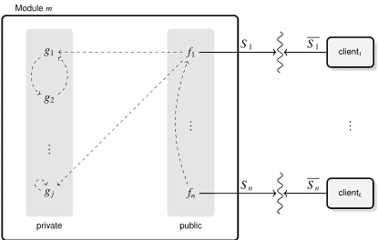

Fig. 1. 由公共和私有函数组成的 Elixir 模块，与客户端进程进行交互。

Elixir 中一种普遍的设计模式是服务器监听客户端请求，我们将其称为服务处理器设计模式（service handler design pattern）。对于每个请求，服务器会生成一个（公共）函数以独立执行并充当专用客户端处理器：在客户端和生成的处理器的各自进程 ID 相互告知后，两个并发实体之间（通过消息传递）开始一个交互会话。例如，在图 1 中，运行公共函数 f1 的处理器进程被分配给与客户端 client1 的会话，而来自 clientn 的请求被分配给运行函数 fn 的专用处理器。虽然函数参数（用于实例化执行的函数体，其值如客户端进程 ID）和函数返回值（报告处理请求的最终结果）等传统接口元素很重要，但会话中两个并发方之间交换的消息对于软件正确性同样或更为重要。更具体地说，交互方之间的通信不兼容可能导致各种运行时错误。例如，如果在会话中发送了带有意外负载的消息，可能导致依赖它的接收方后续计算崩溃（例如，本应接收数字时却乘以字符串）。此外，如果消息交换顺序不正确，可能导致死锁，例如 Elixir 使用阻塞式接收构造，一直等待直到合适的消息到达，因此如果一个进程发送了无效消息，另一个进程就会永远等待合适的消息到达。

在许多情况下，会话中交互的预期协议可以从相应的端点实现（即函数体）中静态确定；为简化起见，我们的讨论假设端点交互协议是图 1 中类型 S1 和 S2 的值。由于两个主要障碍，它不提供对指定（和验证）此设计模式的未来支持。首先，Elixir 不提供任何支持来描述（和验证）函数在其通信副作用方面的交互协议。其次，在开放环境中，通常只有一侧代码可用，因此在没有完整代码库的情况下很难获得静态保证。

贡献 我们提出了一种类型检查器，以两种方式协助 Elixir 模块构建（遵循服务处理器模式）：（a）它允许模块设计者将会话端点协议形式化为会话类型，并将其归属于公共函数；（b）它静态验证函数体是否尊重所归属的会话类型协议规范。类型检查器分析交互的一侧，即模块侧，而不需要访问调用模块公共函数的代码。此分析假设调用代码行为良好（即使它可能或可能未针对会话类型协议规范进行验证），例如 client1 在图 1 的整个会话中遵循 S1。类型检查器（称为 ElixirST）的代码可在以下网址获取：

https://github.com/gerlab/ElixirST

在本文中，我们介绍了 ElixirST 类型检查器所基于的底层类型系统（第 3 节），并讨论其实现细节（第 6 节）。我们还验证了该类型系统；更具体地，在第 4 节中，我们将 ElixirST 支持的 Elixir 语言片段的运行时语义形式化为标记迁移系统（LTS），以模拟在会话中生成的处理器与客户端交互的执行（会话隐含）。此运行时语义随后

1 基于此服务处理器设计模式的一些项目包括 etorrent [4] 和 cowboy [5]。后者是一个 HTTP 服务器，为每个新请求生成一个处理器进程；由于在 Elixir 中生成（和维护）Actor 极其高效，因此这具有可扩展性。在文献中，此模式也称为每会话一个线程（thread-per-session）。

```elixir
defmodule Counter do
  @spec server(pid, number) :: atom
  def server(client, total) do
    receive do
      {:incr, value} -> server(client, total + value)
      {:stop} -> terminate(client, total)
    end
  end
end

@spec terminate(pid, number) :: atom
def terminate(client, total) do
  send(client, {:value, total})
  :ok
end
end
```

Listing 1: 用 Elixir 编写的 Counter。

使我们能够证明 ElixirST 类型系统的会话忠实性和进展性属性的一种条件形式（第 5 节）。直观地讲，它们表明，如果交互进程（隐含）正确遵循规定的协议，那么正在进行类型检查的模块代码保证能够正确地相对于协议进行行为（以改编的会话忠实性和进展性属性的形式表达）。

在本文中，我们合并并扩展了 [7,8] 中提出的工作。除了 [8] 之外，我们还包含了最初附录中的完整类型规则。我们还介绍了两个额外章节（改编自 [7]）：（a）第 2 节介绍了一个激励示例；（b）第 6 节描述了 ElixirST 工具的实现细节，并附带一个案例研究。论文的验证部分也得到了扩展，包含了所有证明。我们还添加了一个新结果，表明 ElixirST 遵循一种进展性属性。

# 2. 激励示例

考虑一个简单的计数器系统，改编自 [9]，其中（服务器）进程存储一个计数器总数，该总数可以由（客户端）交互进程增加，或由同一（客户端）进程终止。列表 1 中显示了一个示例 Elixir Counter 模块。它提供了一个名为 server 的公共函数，位于第 3-8 行，接受两个参数：客户端的 pid，client，以及初始计数器总数，total。执行此函数的进程使用 receive do ... end 语句在其邮箱中等待接收客户端请求作为消息；此构造是阻塞的，意味着进程会停止，直到收到预期格式的消息。server 函数接受两种类型的消息，即，带有标签 :incr 并携带负载 val 的增量请求，或由标签 :stop 表示的终止请求。函数相应地进行分支：对于增量请求，它递归并在第 5 行更新运行总数为 total+value，而第 6 行的终止请求则通过调用私有函数 terminate 来处理。私有函数使用 defp 定义，仅在模块内可见。在此示例中，函数 terminate（定义在第 11-14 行）向客户端进程发送携带最终总数值 total 的 :value 消息，并以原子值 :ok 终止。假设一个携带 pid 到变量 client 的客户端进程已存在，可以使用以下语句启动一个与 cid 关联且运行总数初始化为 0 的计数器服务器：

id = spawn(Counter, :server, [cid, 0]).

Elixir 进行动态类型检查以捕获运行时错误。此外，第 2 行和第 10 行上的 @spec 注释等可以帮助在编译时检测潜在错误。然而，该语言对协助静态检测与并发消息传递相关的错误支持有限。例如，可能不明显 :incr 请求携带的负载应为数字值。同样，列表 1 中的代码不一定传达足够的信息，表明与服务器进程的预期交互应遵循图 2 中描绘的协议。这意味着，如果客户端向服务器进程发送任意数量的消息，然后发送一个终止请求（即最后一个请求之后不再有进一步的增量或终止请求）。

从服务器的角度来看，整个交互会话可以形式化为下面的会话类型（称为 counter）：

```
counter = & { ?incr(number), counter,
  ?stop():!value(number), end }   (1)
```

它表明服务器可以（即 &）以两种方式分支：如果它接收（即 ?）带有数字负载的 incr 标签，服务器递归回到开头，如果它接收 stop 标签，则必须发送（即 !）回带有数字类型负载的 value 标签（即 !value(number)）。当到达 end 语句时，不允许进一步交互。相应地，客户端必须遵循兼容的协议，例如同一会话类型的对偶。

```
counter = & { ?incr(number), counter,
  ?stop():!value(number), end }   (2)
```


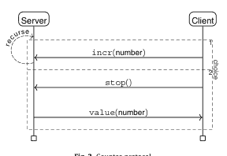

```
defmodule Counter do
  use ElixirST

  @session "counter" = ?{:incr(number).counter,
                    ?stop())).{value|number.end}

  @spec server(pid, number) :: atom
  def server(client, number) do
    receive do
      {:incr, value} -> server(client, total + value)
      {:stop} -> terminate(client, total)
    end
  end

  @spec terminate(pid, number) :: atom
  def terminate(client, total) do
    send(client, {:value, total})
    :ok
  end

  @dual "counter"
  @spec client(pid) :: number
  def client(server) do
    ...
  end
end
```

列表 2：带有会话类型注解的计数器。

具体来说，它可以反复做出一个 _选择_（_即_，\(\oplus\)）来发送两个标签之一，即 `increment` 或 `stop`。前者确保它接收回到开头，而后者会导致客户端接收到类型为 `number` 的值。

本文提出了一种方法，即为函数添加 `@session` 注解来扩展模块定义，如列表 2 所示。虽然第 4 行要求 `public` 函数 `server` 遵守会话类型 `counter`，但第 15 行的 `private` 函数 `terminate` 不需要会话注解。第 22-24 行展示了一种情况，即客户端代码定义为同一模块中的公共函数；在这种情况下，我们可以使用第 20 行的 `@dual` 信息对其进行注解。

我们提出的会话类型注解有两个重要用途。一方面，它们提供了一个高级（但正式）的规范，说明如何与公共函数进行交互，而无需查看其实现，如第 4 行所示。例如，通过检查列表 2 第 4 行上的 `counter` 会话类型，人们可以立即得知运行函数 `server` 的进程接受两种类型的消息，标签分别为 `incr` 或 `stop`。另一方面，它们允许根据此类规范对函数实现进行类型检查。_例如_，我们能够静态检查函数 `server`（及其辅助函数 `terminate`）是否遵循第 4 行会话类型 `counter` 所规定的协议。我们还可以在编译时拒绝列表 3 中给出的有问题的 `client` 实现，理由是它违反了 `counter` 的双会话类型。具体来说，客户端在第 23 行选择了非法选择 `decr`，因为服务器无法处理标记为 `decr` 的传入消息。客户端还期望在“忘记”发送终止请求（_即_，带有 `stop` 标签的消息）后接收一个带有 `number` 的值（第 26 行）。这两种情况都违反了 `counter` 协议。

# 3. 形式分析

我们引入了一个 Elixir 核心子集，并定义了 ElixirST 类型系统的类型规则。

```
20     @dual "counter"
21     def client(server) do
22       send(server, {:incr, 5})
23       send(server, {:decr, 2})
24     end
25
26     receive do
27       {:value, num} -> num
28     end
29   end
```

## 列表 3：带有问题的计数器客户端。

## 3.1. 演员模型

Elixir 使用演员并发模型 [2,3]。它将计算描述为一组并发进程，称为演员，这些进程不共享任何内存，并且仅通过异步消息进行交互。每个演员都通过一个唯一的进程标识符（_pid_）来标识，在向特定演员发送消息时，该标识符用作地址。消息是异步通信的，并存储在接收方演员的邮箱中。演员是唯一可以使用模式匹配从其邮箱中获取消息的实体。这使我们能够为用于服务处理器设计模式的公共函数提供静态行为抽象。除了发送和读取消息之外，演员还可以生成其他演员，并因此获得它们的新 _pid_；这个 _pid_ 可以通过消息作为值传递给其他演员，从而允许活动演员之间形成动态链接结构。

## 3.2. 会话类型

ElixirST 类型系统假设标准表达式类型，包括基本类型，如 boolean、number、atom 和 pid，以及归纳定义的类型，如元组 {_T_<sub>1</sub>, ..., _T<sub>n</sub>_} 和列表 [_T_]；这些类型已经存在于 Elixir 语言中，并且是动态检查的。类型系统通过（二进制）会话类型扩展了这些类型，用于静态检查消息传递交互。

Expression types  \( T ::= \text{boolean} \mid \text{number} \mid \text{atom} \mid \text{pid} \mid \{T_1, \dots, T_n\} \mid [T] \)

Session types  \( S ::= \&\{?l_1(\vec{T}).S_l\}_{l \in I} \quad \text{Branch} \)
\( \mid \oplus\{!l_1(\vec{T}).S_l\}_{l \in I} \quad \text{Choice} \)
\( \mid \text{rec X . S} \quad \text{Recursion} \)
\( \mid \text{X} \quad \text{Variable} \)
\( \mid \text{end} \quad \text{Termination} \)

分支构造 \(\&\{?l_1(\vec{T}).S_l\}_{l \in I}\) 要求代码能够接收由任意一个标签 _l<sub>i</sub>_ 标记的消息，并携带相应的类型为 \(\vec{T}_i\) 的值列表（其中 \(\vec{T}\) 代表某些 \(k \ge 0\) 的 _T_<sup>1</sup>, ..., _T<sup>k</sup>_），然后遵循延续会话类型 _S<sub>i</sub>_。选择构造是其对偶，描述了代码在该执行点允许执行的输出范围和格式。在这两种情况下，标签都需要两两不同。递归类型被等递归地处理 [10]，并与其展开的对应项互换使用。为简洁起见，符号 \& 和 \(\oplus\) 在单选项时偶尔被省略，例如，\(\oplus\{!\text{(number)}.S\}\) 写作 \(!\text{(number)}.S\)；同样，end 也可以省略，例如，?_l_1 代表 ?_l_1().end。会话类型 _S_ 的对偶表示为 \(\overline{S}\)（如定义 3.1 所示）。

### Definition 3.1 (Duality).

\(\overline{\&\{?l_1(\vec{T}).S_l\}_{l \in I}} = \oplus\{!l_1(\vec{T}).\overline{S_l}\}_{l \in I} \qquad \overline{\text{rec X . S}} = \text{rec X . } \overline{S}\)

\(\overline{\oplus\{!l_1(\vec{T}).S_l\}_{l \in I}} = \&\{?l_1(\vec{T}).\overline{S_l}\}_{l \in I} \qquad \overline{\text{X}} = \text{X} \qquad \overline{\text{end}} = \text{end} \quad \blacksquare\)

## 3.3. Elixir 语法

Elixir 程序组织为模块，即 `defmodule m do` \(\vec{P}\) `end`。模块由其名称 _m_ 定义，并包含两组公共 \(\vec{D}\) 和私有 \(\vec{P}\) 函数，以序列形式声明。公共函数 `def f(y,`\(\vec{x}\)`) do end` 由 `def` 关键字定义，可以从任何模块调用。相比之下，私有函数 `defp f(y,`\(\vec{x}\)`) do end` 只能在定义模块内部调用。函数由其名称 _f_ 和主体 _t_ 定义，并由一组 `distinct` 变量 \(y, \vec{x}\) 参数化，其长度 \(|y, \vec{x}|\) 称为元数。第一个参数 (_y_) 保留用于对偶进程的 pid。尽管模块可能包含同名函数，但它们的元数必须不同，因此我们将名称为 f 且元数为 n 的函数称为 fn。

| 模块 | M := defmodule do P end |
|---|---|
| 公共函数 | D := K B def f(y, ...) do end |
| 私有函数 | P := B def f(y, ...) do end |
| 类型注解 | B := @spec f(τ̄, ...) do T end |
| 会话注解 | K := @session "X" = S \| "dual "X" |
| 表达式 | e := w \| not e \| e1 ◦ e2 \| [e1 \| e2] \| [e1, ..., en] |
| 运算符 | ◦ := < \| > \| <= \| >= \| == \| != \| + \| - \| * \| / \| and \| or |
| 基本值 | b := boolean \| number \| atom \| pid \| [] |
| 值 | v := b \| [v1 \| v2] \| [v1, ..., vn] |
| 标识符 | w := b \| x |
| 模式 | p := w \| [w1 \| w2] \| [w1, ..., wn] |
| 项 | t := e \| x \| t1; t2 \| send(w, {l, e1, ..., en}) \| receive do ({l1, p1}, ..., pln} -> tl)end \| f(w, e1, ..., en) \| case do (pi -> ti)end |

图 3. Elixir 语法。

在 Elixir 中，可以使用 @spec 注解为函数参数和返回值指定类型。f(τ̄): T。检查参数类型 T̄ 和返回类型 T。然后，Dialyzer 使用这些信息基于成功类型 [11] 进行静态检查。在我们的形式化中，要求函数由其类型规范注解，在图 3 中用 B 表示。除此之外，我们使用第 3.2 节定义的会话类型来装饰公共函数，以描述其副作用协议。公共函数可以直接使用 @session "X" = S" 进行注解，也可以间接使用双会话类型 @dual "X"，其中 X = S 是 rec X.S 的简写。

函数体由一个项 t 组成，它可以是表达式、let 语句、send 或 receive 构造、case 语句或函数调用；参见图 3。对于 let 构造 x = t1; t2，变量 x 是 t2 中变量的绑定器，作为子项 t1 求值得到的值的占位符。我们将 t1; t2 写作 x = t1; t2 的语法糖，其中变量 x 在 t2 中未被使用。send 语句 send(x, {l1, e1, ..., en}) 允许进程向变量 x 存储的 pid 发送一条消息，消息为 {l1, e1, ..., en}，其中 l 是标签。receive 构造 receive do ({l1, p1}, ..., pln} -> tl)end 允许进程接收一条消息，该消息带有与 l1... ln 中某个标签匹配的标签，以及与模式 p1, ..., pln 匹配的有效载荷列表，分支继续执行 tl。图 3 中定义的模式 p 可以是变量、基本值、元组或列表（例如 [x|y]），其中 x 是列表的头，y 是列表的尾。其余构造相当标准。receive 和 case 语句中使用的模式 p1, ..., pln 中的变量是各自延续分支 ti 的绑定器。在我们的形式化中，case 构造被假定具有一个兜底模式，作为无法匹配值的故障安全机制。这提供了更强的静态保证，但与 Elixir 常见的 "let it crash" 哲学相比更为保守，后者允许进程崩溃。

项也可以采用表达式 e 的形式。表达式可以是变量、基本值（例如 boolean）、列表、元组或其他运算（例如 +、- 和）。请注意，在原始 Elixir 语法中，项 (t) 和表达式 (e) 之间没有分离。然而，有了这种区别，我们就能使第 3.4 节的类型系统更易于管理且更简洁。我们假设开放（即 fv(t) ≠ ∅）和闭合（即 fv(t) = ∅）项的标准表示法，并以绑定变量的 α-变换为准进行工作。

## 3.4. 类型系统

我们的会话类型系统静态验证模块内的公共函数是否遵循分配给它们的通信协议。它使用三个环境：


变量绑定环境。\(\Gamma ::= \emptyset \mid \Gamma, x:T\)
会话类型环境。\(\Delta ::= \emptyset \mid \Delta, f/n:S\)
函数信息环境。\(\Sigma ::= \emptyset \mid \Sigma, f/n: \begin{cases} \text{params} = \vec{x}, \text{param\_types} = \vec{T}, \\ \text{body} = t, \text{return\_type} = T, \text{dual} = y \end{cases}\)

变量绑定环境 \(\Gamma\) 将（数据）变量映射到基本类型（\(x:T\)）。我们写 \(\Gamma, x:T\) 表示用新映射 \(x:T\) 扩展 \(\Gamma\)，其中 \(x \notin \text{dom}(\Gamma)\)。会话类型环境 \(\Delta\) 将函数名和元组对映射到它们的会话类型（\(f/n:S\)）；这将在递归（即函数调用）时用于检查函数是否已映射到会话类型。如果函数 \(f/n\) 具有已知的会话类型，则可以在 \(\Delta\) 中找到它，即 \(\Delta(f/n) = S\)。每个模块都有一个静态函数信息环境 \(\Sigma\)，用于保存与函数定义相关的信息。对于一个具有元组 \(n\) 的函数 \(f\)，\(\Sigma(f/n)\) 返回参数列表（params）及其类型（param\_types）、函数体（body）及其返回类型（return\_type）。它还返回表示交互进程 \(\text{pid}\) 的静态变量名（dual）。我们假设函数信息环境 \(\Sigma\) 是良构的，这意味着对于所有映射的函数（\(f/n \in \text{dom}(\Sigma)\)）都遵循以下条件，要求函数 \(f/n\) 的体是闭合的，即对于 \(\Sigma(f/n) = \Omega\)：

```
\(\text{fv}(\Omega.\text{body}) \setminus (\Omega.\text{params} \cup (\Omega.\text{dual})) = \emptyset\)
```

直观地讲，如果我们查看函数体，其唯一的自由变量将是其参数（即 params 和 dual）。会话类型检查通过分析 Elixir 模块来启动，规则 [TModule]。模块通过检查其每个公共函数来进行类型检查，确保它们对应并完全消耗赋予它们的会话类型。该规则使用三个辅助函数。函数 \(\text{functions}(\vec{D})\) 返回要单独检查的公共函数（\(\vec{D}\)）的所有函数名（和元组）列表。函数 \(\text{sessions}(\vec{D})\) 获取所有公共函数到其在 \(\Delta\) 中存储的预期会话类型的映射。这确保了当具有元组 \(n\) 的函数 \(f\) 执行时，它遵循使用 @session 或 @dual 注释关联的会话类型。辅助函数 \(\text{details}(\text{--})\) 用关于模块中所有公共（\(\vec{D}\)）和私有函数（\(\vec{P}\)）的详细信息填充函数信息环境（\(\Sigma\)）。

```
\(\Delta = \text{sessions}(\vec{D}) \quad \Sigma = \text{details}(\vec{D}\vec{P})\)
\(\begin{array}{l} \Delta(f/n) = S \quad \Sigma(f/n) = \Omega \\ \Omega.\text{params} = \vec{x} \quad \Omega.\text{param\_types} = \vec{T} \\ \forall f/n \in \text{functions}(\vec{D}). \quad \Omega.\text{return\_type} = y \quad \Omega.\text{dual} = y \\ \Delta, \text{return\_type} = y \\ \Omega.\text{body} = t \quad \Delta \vdash (\text{mod}: \text{ptd}) \overrightarrow{S} \triangleleft t : S \triangleright \text{end} \end{array}\)
\(\vdash_{\text{[TModule]}} \Delta \vdash (\text{mod}: \text{ptd}) \overrightarrow{S} \triangleleft t : S \triangleright \text{end}\)
\(\vdash \text{defmodule } \vec{D} \text{ end}\)
```

对于 \(\text{functions}(\vec{D})\) 中的每个公共函数 \(f/n\)，[TModule] 检查其体是否遵循其会话类型，使用下面详细说明的高亮术语类型判断：


该判断指出：“术语 t 在遵循从初始会话类型 S 到剩余会话类型 S' 的交互协议后（类似于参数化单子 [12]），可以生成类型 T 的值，同时与标识符为 w 的双进程进行交互。这种类型在某些会话类型环境 \(\Delta\)、变量绑定环境 \(\Gamma\) 和函数信息环境 \(\Sigma\) 下是有效的。”由于函数信息环境 \(\Sigma\) 对整个模块（以及由此延伸的所有子项）是静态的，因此在术语类型规则中将其隐式处理。我们详细考虑每条规则。

```
\(\forall i \in I \cdot \begin{cases} \forall j \in 1..n \cdot \begin{cases} \text{\textbf{simplepat}}(p_i^j, T_i^j) \\ p_i^j \vdash p_i^j : T_i^j \triangleright T_i^j \end{cases} \\ \Delta \vdash (\Gamma, T_i^1) \dots (T_i^n) \vartriangleright W \vdash_\Sigma t_i : T \vartriangleright S' \end{cases}\)
[TBRANCH]
\(\Delta \vdash \Gamma \vdash W \vdash [2\lambda_i(T_i) \overrightarrow{S}_i]_{i \in I} \triangleright \text{receive do} \langle i : l_i, \overrightarrow{p_i} \rangle \rightarrow t_i \text{end} : T \vartriangleright S'\)
```

receive 构造使用 [rBRANCH] 规则进行类型检查。它期望一个（外部）分支会话类型 &{...}，其中会话类型的每个分支必须与 receive 构造中的相应分支匹配，标签（\(l_i\)）和负载类型（\(T_i\)）都对应。每个 receive 分支都相对于公共类型 T 和公共剩余会话类型 S' 进行检查。每个 receive 分支内的类型使用模式类型判断 \(\Gamma \vdash_{pat} P : T \triangleright \Gamma'\) 计算，该判断为模式中存在的变量分配类型（将在图 6 中稍后解释）。

为确保所有可能的模式都被穷尽，我们使用简单模式来过滤掉列表和基本值等模式结构。因此，如果一个（仅包含简单模式的）receive 构造针对分支会话类型是良类型的，那么我们可以确定任何有效的传入消息都可以与可用分支之一匹配。这将在命题 3 中稍后进一步讨论。简单模式并不限制我们语言的表达性：复杂模式仍然可以通过（简单）receive 和内部 case 构造的组合来表达，这允许我们使用不阻塞 receive 的模式，同时将更具体的模式推迟到后续的 case 匹配中。

### 定义 3.2（简单模式）

谓词 simplepat(p, T) 仅接受 exclusively 包含变量和顶层元组的模式，消除了列表或基本值等结构模式的可能性。它定义如下：simplepat(p, T) def = ((p = (x1, ..., xn) and T = (T1, ..., Tn)) or p = x)

### 示例 3.1

考虑以下 receive 构造（遵循 ?incr(number)... 会话类型），它不满足 simplepat：

```
receive do {;incr,5}->... end
```

这只能接受形式为 {;incr,5} 的消息，因此其他对 ?incr(number)... 会话类型有效的消息，例如 {;incr,9}，无法被处理，因为并非所有有效模式都被穷尽。相比之下，simplepat 将我们限制在如下分支中，其中变量（名为 value）可以接受任何值：

```
receive do {;incr,value}->... end
```

另一个关键的类型规则是 [rCHOICE]，用于类型检查消息的发送。

```
[rCHOICE]
\(\mu \in I\)   \(\forall j \in 1..n. \{ \Gamma \vdash_{exp} e_j : T_j \}\)
-------------------------------------------------------
\(\Delta, \Gamma \vdash^w @\{l_i(\bar{T}_i).S_i\}_{i \in I} \triangleright \text{send}(w, \{;l_\mu, e_1, ..., e_n\}) : \{atom, \bar{T}_\mu\} < S_\mu\)
```

该规则要求一个内部选择会话类型 @{...}，其中标记要发送消息的标签必须与会话选择提供的标签之一（\(l_\mu\)）匹配。消息负载也必须与标签关联的相应类型（\(l_\mu\) 的 \(T_\mu\)）匹配，这通过表达式类型判断 \(\Gamma \vdash_{exp} e : T\) 说明（见图 5）。send 构造的结果表达式类型等同于正在发送的消息的类型，即 \(\{;l_\mu, e\}\) 具有类型 atom(\(T_\mu\))。类型规则还检查 send 语句收件人的 pid，它必须与判断本身中的双 pid（w）匹配，以确保消息仅发送给正确的收件人。

```
\(\Delta(f/n) = S\)   \(\forall i \in 2..n. \{ \Gamma \vdash_{exp} e_i : T_i \}\)
-----------------------------------------------------------
\(\Omega \vdash ... \Omega . \text{return\_type} = \bar{T}\)
```

由于公共函数使用 @session（或 @dual）注释显式装饰了会话类型，因此它们列在 dom(\(\Delta\)) 中。对公共函数的调用使用 [rKNOWN CALL] 规则进行类型检查，该规则验证预期的初始会话类型是否等同于从会话类型环境中已知的函数会话类型（S），即 \(\Delta(f/n) = S\)。在不类型检查函数体（由规则 [rMODULE] 完成）的情况下，该规则确保预期的会话类型 S 被完全消耗，因此剩余类型变为 end。规则 [rKNOWN CALL] 还确保在函数调用期间保留 pid（w），通过要求将其作为参数传递并将其与预期的双 pid 进行比较（即 \(\Delta \vdash \Gamma \vdash^w S > f(w, ...) : T < \text{end}\)）。

```
\(\Sigma(f/n) = \Omega\)
\(\Omega . \text{param\_types} = \bar{x} \dots \Omega . \text{body} = t \dots \Omega . \text{return\_type} = T\)
\(\forall i \in 2..n. \{ \Gamma \vdash_{exp} e_i : T_i \}\)
```

```
[rUNKNOWN CALL]
(\Delta, f/n : S) : (y : pid, \bar{x} : \bar{T}) \vdash S \triangleright T : C < S'
-----------------------------------------------------------
\(\Delta, \Gamma \vdash^w S > f(w, e_2, ..., e_n) : T < S'\)
```


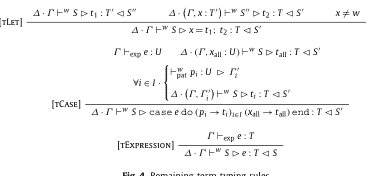

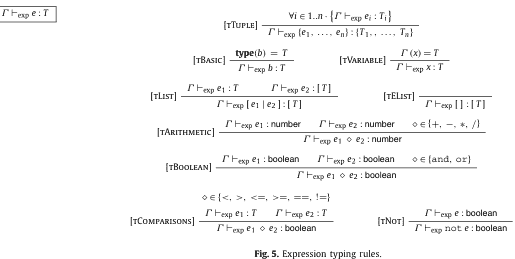

相比之下，对一个（私有）函数 f/n 的调用，其关联的会话类型未知，会使用 [rUNKNOWNCALL] 规则进行类型检查。与其他规则一样，它确保参数具有正确的类型（Γ ⊢exp ei : Ti）。此外，它还会分析函数体 t（从 Σ 获得），相对于调用的初始会话类型所继承的会话类型 S。该会话类型会被追加到会话类型环境 Δ 中以供将来参考，即 Δ' = (Δ, f/n : S)，这使其能够处理对自身的递归调用；如果函数被再次调用，则使用规则 [rKNOWNCALL]，从而无需重新分析其函数体。

其余规则（图 4）构成了语言的函数式方面。let 语句 x = t1 ; t2 使用规则 [rLET] 进行类型检查。初始会话类型 S 首先由于 t1 中的一些动作转换为 S'，并在 t2 的动作之后最终变为 S''。规则 [rCASE] 检查 case 构造，其中每个分支都必须匹配相应的类型 T 和会话类型 S。case 构造的最终模式 (Xni) 充当兜底替代方案，以确保所有值至少匹配一个分支。兜底分支有时会为了可读性而省略。最后，[rEXPRESSION] 使用表达式类型检查所有表达式 e。表达式没有副作用，因此后续会话类型 S 保持不变。

表达式类型。表达式使用判断 Γ ⊢exp e : T 进行类型检查，其中表达式 e 在变量环境 Γ 下具有类型 T。表达式类型规则（图 5）改编自 [13]。规则 [rBASIC] 使用函数类型检查基本值的类型，该函数返回基本值的类型，例如 type(true) = boolean。规则 [rVARIABLE] 检查变量是否具有 Γ 中指定的正确类型。规则 [rTUPLE]、[rTLIST] 和 [rLIST] 分别检查元组、空列表和列表的类型。规则 [rARITHMETIC] 确保在进行算术运算时使用数字。其余规则 [rBOOLEAN]、[rNOT] 和 [rCOMPARISON] 类似。

模式类型。在项类型规则 [rBRANCH] 和 [rCASE] 中，模式匹配会引入新变量。这些变量需要分配各自的类型以用于类型检查。这是通过图 6 中定义的判断 Γ ⊢pat T : Γ' 实现的，该判断指出模式 p 中的所有变量（及其类型）都会被收集到 Γ' 中。基本类型在 [rBASIC] 中检查，新变量在 [rVARIABLE] 中引入。后者还确保双重进程的 pid 保持不变（即 x ≠ w），从而允许静态定位消息的目标 pid。元组中的每个元素都会单独检查，无论是值还是变量（[rTUPLE]）。列表使用 [rTLIST] 和 [rLIST] 检查。多个变量环境 Γ 和 Γ' 会合并为 Γ, Γ'（它们的域必须互不相同）。

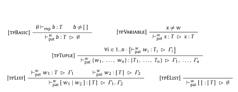

## 3.5. 实际中的类型检查

回顾清单 2 中的计数器系统，它包含两个公共函数 server 和 client，分别标注了会话类型 counter 和 counter，分别定义在等式 (1) 和 (2) 中。我们简要讨论 3.4 节的类型系统如何用于静态分析此 Elixir 模块。

类型检查从 [TModule] 规则 (|- M) 和以下判断开始：

```
|- defmodule Counter do P end
```

其中 D 包含函数 server 和 client，而 P 包含私有函数 terminate。[TModule] 的前提要求所有公共函数最初使用行为类型判断 Delta |- Gamma |- W S > T end 进行检查。从 f0 = server2 开始，初始会话类型 S 设置为 counter，预期的残余会话类型 S' 为 end，因为只有当函数完全消耗会话类型时才是类型正确的。对于 client 函数，初始会话类型 S 通过计算得到 counter 的对偶类型，如等式 (2) 所示。我们关注 server 函数的行为类型。server 的函数体 t 包含以下内容：

```
t = {
  receive do
    {incr, value} -> server(client, total + value)
    {stop} -> terminate(client, total)
  end
}
```

此 receive 语句使用 [TBRANCH] 规则按以下判断进行类型检查：

```
Delta |- Gamma |- W { ?incr(number),counter, ?stop()}, S1 } > t : atom < end
```

其中 S1 = Value(number) end 且 w = client。

[TBRANCH] 中的会话类型规定需要两个分支，分别标记为 incr 和 stop。分支内的项必须与相应会话类型的后续会话类型匹配（即分别为 counter 和 S1）。对于第一个分支（标记为 incr），后续项是一个已知函数调用（Delta(server2) = counter）；因此，我们使用 [TKNOWNCALL] 规则：

```
Delta |- Gamma |- W counter > server(client, total, value) : atom < end
```

第二个分支（标记为 stop）的项需要与会话类型 S1 匹配。该分支调用一个私有函数（terminate）。由于 terminate1 不在 Delta 的域中，我们继续使用规则 [TUNKNOWNCALL] 检查其函数体。回顾私有函数未标注会话类型。因此，规则 [TUNKNOWNCALL] 要求我们继承未完成的会话 S1 作为此判断的类型检查规范，这可立即使用 [TLET] 规则得出：

```
[TLET]
(Delta, terminate1 : S1) . F'' |- W S1 > {send(w, {value, total})} : atom < end
[TUNKNOWNCALL] Delta |- Gamma |- W S1 > terminate(client, total) : atom < end
```

请注意 F'' 包含 client 和 total 变量名的类型信息，且会话类型判断 (2) 已扩展为包含函数 terminate1 的会话类型信息。为完成类型分析，我们需要考虑 [TLET] 规则的两个前提。该规则依次检查两个子项，如下所示：

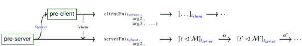

图 7. 生成两个进程（绿色框表示生成的并发进程）。（关于图中颜色的解释，读者请参阅本文的网络版。）

```
(\Delta.\text{terminate}; S_1) \cdot r'' \vdash W \Downarrow S_1 \triangleright \text{send}(w, \{\text{value}, \text{total}\}); U \triangleleft \text{end}
```

```
(\Delta.\text{terminate}; S_1) \cdot r'' \vdash W \Downarrow S_1 \triangleright \text{ok} \triangleleft \text{end}
```

等式 (3) 包含一个发送标记为 value 的消息的 send 构造。这与 S1 中提供的标签匹配，使用 [TCHOICE] 进行检查。最后，等式 (4) 使用 [TExpression] 进行类型检查，从而完成我们的分析。作为延续，考虑清单 3 中行为不当的 client 函数体的前两行，需针对 counter 等式 (2) 进行类型检查：

```
send(server, {incr, 5})
send(server, {decr, 2})
```

第一个 send 语句使用 [TSEND] 和 [TCHOICE] 规则成功检查。下一个 send 语句也需要使用 [TCHOICE] 进行检查：

```
\Delta' \cdot r'' \vdash W \Downarrow \Phi \left\{ \begin{array}{l} \{\text{incr}(\text{number}), \text{counter}\}, \\ \{\text{stop}(\cdot), S_1\} \end{array} \right\} \triangleright \text{send}(\text{server}, \{\text{decr}, 2\}); \text{number} \triangleleft \text{end}
```

然而，[TCHOICE] 规则试图将 decr 与会话类型中不存在的选项匹配。因此，此 client 函数被认为类型不正确。

## 3.6. Elixir 系统

原生地，Elixir 可以使用其 spawn 函数（例如 spawn/3）创建 actor，这些函数接受一个函数（及其参数），生成它并返回其 pid。ElixirS 通过提供一个名为 session/4 的定制生成函数扩展了此功能，该函数允许启动作为会话一部分并行执行的两个并发进程。session/4 函数接受两对参数：两个函数名引用（将被生成），以及它们的参数列表。其参与者创建流程如图 7 所示。最初生成 actor（pre-server），将其 pid（server）传递给第二个生成的 actor（pre-client）。这样，两个 pid（client）都传递给 pre-server，从而会话中参与的两个 actor 都知晓彼此的 pid。从这一点开始，两个生成的 actor 可以相互交互，表现为二进制会话的参与者；每个运行函数的第一个参数初始化为另一参与者的相应 pid。图 7 显示 server 进程执行函数体 t，其中它可以访问邮箱，我们将其表示为 M。在执行过程中，消息可能被发送或接收（由动作 \(\alpha\) 显示），并存储在（修改后的）邮箱 M' 中。这些转换的具体工作原理将在下一节中解释。

# 4. 操作语义

我们将图 3 中 Elixir 语言子集的操作语义描述为一个标记转换系统（LTS）[14]，描述了会话中的处理器进程如何在与会话客户端（隐含）交互的同时执行，如图 1 所示。转换 \(t \xrightarrow{\alpha} t'\) 描述了状态为 t 的处理器进程执行一个步骤以转换到新状态 \(t'\)，同时可能通过动作 \(\alpha\) 作为副作用与客户端交互。外部动作对客户端可见并对其产生影响，而内部动作则不然。在我们的情况中，动作 \(\alpha\) 可以采取以下形式：

```
\alpha \in \text{ACT} ::= \alpha! \{1; \forall\} \quad \text{Output message to } t \text{ tagged as } :1 \text{ with payload } \forall \quad \text{external action}
| ? \{1; \forall\} \quad \text{Input message tagged as } :1 \text{ with payload } \forall
| f/n \quad \text{Call function } f \text{ with arity } n \quad \text{internal action}
| \tau \quad \text{Internal reduction step}
```

输出和输入动作都构成影响会话中任一方的外部动作；3.4 节的类型系统对这些外部动作进行约束。内部动作包括静默转换（\(\tau\)）和函数调用（f/n）；虽然


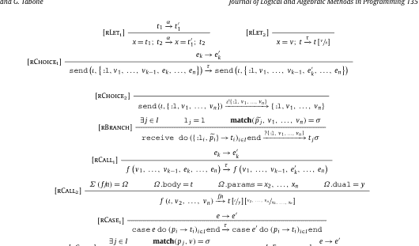

图 8. 术语转换语义规则。

后者可表示为静默动作。装饰有助于我们的技术开发。我们注意到，函数调用只能在良构函数信息环境（\(\Sigma\)）下进行转换，该环境包含模块中所有可用函数的详细信息。由于 \(\Sigma\) 在转换过程中保持静态，我们在转换规则中将其隐含。

转换由图 8 列出的术语转换规则定义。规则 [RLET] 和 [RLET$_s$] 处理 `let` 语句 \(x = t_1\); \(t_2\) 的求值，模拟按值调用语义，其中第一个术语 \(t_1\) 必须完全转换为一个值，然后才能替换为 \(t_2\) 中的 \(x\)，表示为 \([t_1/v] \cdot t_2\) 或用于多重替换的 \([t_1^{v_1}/v_1 \cdot t_2]\)。发送语句 `send`(\(t\), \(\{t_1, v_1, ..., v_n\}\)) 将 \(t_2\) 中的 \(t\) 求值，表示为消息的每个部分从左到右求值为一个值。这通过规则 [RCHOICE$_s$] 执行，该规则不产生可观察的副作用。当整个消息归约为值元组 \(\{v_1, v_2, ..., v_n\}\) 时，规则 [RCHOICE] 执行实际的消息发送操作。此转换产生一个动作 \(\uparrow\{t_1, v_1, ..., v_n\}\)，其中消息 \(\{t_1, v_1, ..., v_n\}\) 通过通道 \(t\) 发送到位置 \(t_1\)。接收语句 `receive` do \(\{t_1:x_1, ..., t_n:x_n\} \rightarrow t_2\) end 由规则 [RBRANCH] 定义。当接收到消息时（即，\(\sigma = \{?1, \vec{v}\}\)），它使用标签 ?1 将接收内容中的值模式进行匹配。若某个标签匹配（\(\vec{j} \in i\) 且 \(i_j = 1\)），则消息的有效载荷（\(\vec{v}\)）使用 `match`(\(\vec{p}_j, \vec{v}\)）与所选分支中的相应模式（\(\vec{p}_j\)）进行比较。若值与模式匹配，**match** 函数（定义 4.1）产生替换 \(\sigma\)，将模式 \(\vec{p}_j\) 中的匹配变量映射到 \(\vec{v}\) 中的值。然后使用此替换来实例化延续分支 \(t_j\) 中的自由值。

## 定义 4.1（模式匹配）。

**match** 函数将模式与相应的值配对，产生一系列替换（称为 \(\sigma\)），例如，**match**(\(p, v\)) = \([v_1/x_1][v_n/x_n]\)。match 函数构建一个元级别的替换列表，不应与图 3 中 Elixir 语法定义的列表混淆。

```
\(\text{\textbf{match}}(\vec{p}, \vec{v}) \stackrel{\text{def}}{=} \text{\textbf{match}}(p_1, v_1), ..., \text{\textbf{match}}(p_n, v_n) \quad \text{where } \vec{p} = p_1, ..., p_n \text{ and } \vec{v} = v_1, ..., v_n\)

\(\text{\textbf{match}}(p, v) \stackrel{\text{def}}{=} \begin{cases} [] & p = b, v = b \\ [v/x] & p = x \\ \text{\textbf{match}}(w_1, v_1), \text{\textbf{match}}(w_2, v_2) & p = [w_1 | w_2], v = [v_1 | v_2] \\ \text{\textbf{match}}(w_1, v_1), ..., \text{\textbf{match}}(w_n, v_n) & p = \{w_1, ..., w_n\} \text{ and } v = \{v_1, ..., v_n\} \end{cases}\)
```

## 示例 4.1。

对于模式 \(p_1 = (x, 2, y)\) 和值元组 \(v_1 = (8, 2, true)\)，\(\text{\textbf{match}}(p_1, v_1) = \sigma\)，其中 \(\sigma = [8/x][true/y]\)（也写作 \(\sigma = [8^{true}/x, y]\)）。然而，对于模式 \(p_2 = (x, 2, false)\)，操作 \(\text{\textbf{match}}(p_2, v_1)\) 失败，因为 \(p_2\) 期望第三个元素为 \(false\) 值，但发现是 \(true\) 值。

使用图 8 中的规则 [RCALL]，函数调用首先通过将所有参数归约为值来求值，使用图 9 中的表达式归约规则；这同样模拟按值调用语义。一旦所有参数完全归约，[RCALLs]，隐式环境 S 会针对具有 arity n 的函数 f 进行查询，以获取函数的参数名和函数体。这导致转换到函数体，其参数相应地实例化，t[f/y1|...vn/xn...αn]，由函数名装饰，即，α = f/n。同样，case 构造首先使用规则 [cRcase] 归约正在匹配的表达式。然后，规则 [cRCase] 使用 match 函数将值与正确的分支匹配，类似于 [rBRANCH]。每当术语仅由表达式组成时，它使用图 9 中的表达式归约规则 e → e′ 通过 [rEXPRESSION] 静默归约。这些都相当标准。

# 5. ElixirST 类型系统的验证

我们通过建立与第 4 节定义的转换语义中类型检查 Elixir 程序的运行时行为的关系，来验证第 3 节概述的 ElixirST 类型系统所强加的静态属性。广义上，我们建立了一种 _类型保持_ 形式，它指出如果一个类型良好的术语进行转换，则生成的术语仍然保持类型良好 [10]。然而，我们的类型保持概念需要更强，以同时考虑 _(i)_ 执行产生的副作用；以及 _(ii)_ 相对于表示为会话类型的协议的执行进展。遵循长期存在的类型传统，这些类型属性随后由精炼属性 _会话忠实性_ 和 _会话活性_ [15,16] 捕获。该命题形式化了 _(i)_ 类型保持属性，即类型化进程的执行结果是协议当前阶段允许的动作之一；以及 _(ii)_ 转换后的生成进程相对于仍未完成的协议剩余部分仍然保持类型良好。我们还建立了一种条件形式的进展，其中类型良好的进程要么是一个值，要么可以安全地转换到一个新术语，产生一个内部（或外部）动作。

在着手证明会话忠实性和进展之前，我们证明一个辅助命题，作为第 4 节操作语义的健全性检查。我们注意到，操作语义假设只执行 _封闭_ 程序；开放程序（即包含自由变量的程序）被视为由于缺少信息而无法正确执行的不完整程序。为此，命题 1 确保封闭术语在转换后 _仍然保持封闭_。

## 命题 1（封闭术语）。

_如果_ fv(t) = ∅ _且_ t →ᵅ t′_, 那么_ fv(t′) = ∅_。

**证明。** 对 t 的结构进行归纳。详情见附录 B.1。□

会话忠实性属性的陈述依赖于一个名为 **after** 的偏函数的定义（定义 5.1），它以会话类型和动作作为参数，并返回另一个会话类型作为结果。该函数有两个用途：(i) 函数 after(S, α) 仅为协议 S（立即）允许的动作 α 定义，这使我们能够验证术语转换步骤是否违反了协议；(ii) 由于 S 描述了要遵循的协议的当前阶段，我们需要一种方法在 α 是允许动作时将此协议演进到下一阶段，这正是 S′，即 after(S, α) = S′ 返回的延续会话类型。

## 定义 5.1（After 函数）。

after 函数是以下情况定义的偏函数：

```
after(S, t) def S
after(S, f/n) def S
after(⊕{j₁:⟨T̃i⟩Si}i∈I, ⊕{j:⟨T̃j⟩Sj} def Sj where j ∈ I
after(&{?j₁:⟨T̃i⟩Si}i∈I, &{?j:⟨T̃j⟩Sj} def Sj where j ∈ I
```

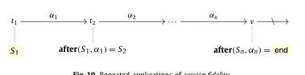

该函数在所有其他情况下均未定义。**after** 函数被重载以作用于会话类型环境（\(\Delta\)），以便给定某个动作 \(\alpha\) 和会话类型 \(S\) 计算新的会话类型环境：

```
after(\(\Delta\), f, hn, S) def= \(\Delta\), f hn : S
```

```
after(\(\Delta\), \(\alpha\), S) def= \(\Delta\) if \(\alpha \neq\) f hn
```

直观地，当转换产生的动作为 f hn 时，会话类型环境会通过新映射 f hn : S 进行扩展。对于所有其他动作，会话类型环境保持不变。\(\blacksquare\)

回顾模块类型检查用法规则 \(\vdash\) TModule] 包含相对于其所赋予的会话类型对所有公共函数体进行类型检查。\(\Delta \langle y : \text{pid}, \vec{X} : \vec{T} \rangle \vdash S : t : T <: S'\)（在此特定情况下 \(S = \text{end}\)）。在运行时，会话中生成的客户端处理进程开始运行函数体术语 \(t\)，其中参数变量 \(y, \vec{X}\) 分别被实例化为客户端的 pid（例如 \(t_1\)）和函数参数值（例如 \(\vec{V}\)），即 \(\{t/y\}[\vec{V}/\vec{x}]\)，如图 8 中的规则 [KCall$_2$] 所建模。因此，实例化的函数体是封闭的，并可以相对于空变量绑定环境进行类型化。\(f = \epsilon\)：会话忠实性因此指出，如果封闭术语 \(t\) 是类型良好的，即，

```
\(\Delta \vdash \theta \vdash W S : t : T <: S'\) (5)
```

（其中 \(S\) 和 \(S'\) 分别是初始和剩余会话类型，\(T\) 是基本表达式类型）并且该术语 \(t\) 以动作 \(\alpha\) 转换到新术语 \(t'\)，即，

```
\(t \xrightarrow{\alpha} t'\) (6)
```

则新术语 \(t'\) 预期仍然保持类型良好，即，

```
\(\Delta' \vdash \theta \vdash W S' \vdash t' : T <: S'\) (7)
```

其中扩展的 \(A'\) 计算为 \(\text{after}(\Delta, \alpha, S) = A'\)，术语的基本类型被保持，如等式 (5) 和 (7) 中的常量类型 \(T\) 所述。要理解演进后的初始会话类型（\(S'\)）在等式 (7) 中是如何计算或假设的，我们必须考虑我们分析的上下文。我们的类型检查器分析不与其他会话交错的交互的一侧。我们还假设交互的双重进程行为良好，因此在执行过程中遵循兼容协议（例如双重会话类型）。尽管有这些限制，我们获得了一定程度的灵活性，可以静态分析与外部进程交互的进程，而我们可能无法访问其源代码。

为此，我们对等式 (6) 中的转换动作进行了区分。如果动作 \(\alpha\) 依赖于被隐含的上下文进程（即，\(\alpha\) 是传入消息），我们仅在 \(\alpha\) 由协议 \(S\) 允许时（即 \(S' = \text{after}(S, \alpha)\)）才要求等式 (7) 中所述的保证。更具体地说，条件 \(S'' = \text{after}(S, \alpha)\) 是会话忠实性定理第一子句的前件的一部分，并捕获我们仅在上下文进程行为良好时适用的条件保证。另一方面，如果动作 \(\alpha\) 仅依赖于正在进行类型检查的进程（即，\(\alpha\) 是输出消息或内部动作），那么我们 *要求* \(\alpha\) 由协议 \(S\) 允许。具体来说，会话忠实性定理的第二子句比条件 \(\text{after}(S, \alpha) 构成后件的一部分更强。

## 定理 2（会话忠实性）。

如果 \(\Delta \vdash \theta \vdash W S \vdash t : T <: S'\) 且 \(t \xrightarrow{\alpha} t'\)

- 对于 \(\alpha = ?\{i, \vec{v}\}\) 和某个会话类型 \(S' = \text{after}(S, \alpha)\)，则存在某个 \(\Delta'，使得 \(\Delta' \vdash \theta \vdash W S' \vdash t' : T <: S'\) 且 \(\text{after}(\Delta, \alpha, S) = \Delta'\)

- 对于 \(\alpha \in \{f \text{ hn}, t, t\{i, \vec{v}\}\}\)，则存在某个 \(S''\) 和 \(\Delta'，使得 \(\Delta' \vdash \theta \vdash W S' \vdash t' : T <: S'\) 对于 \(\text{after}(S, \alpha) = S''\) 和 \(\text{after}(\Delta, \alpha, S) = \Delta'\)

**证明。** 对类型推导 \(\Delta \vdash \theta \vdash W S \vdash t : T <: S'\) 进行归纳。详情见附录 B.2。\(\square\)

如图 10 所示，通过反复应用定理 2，我们可以得出结论，类型化计算（即转换步骤序列）生成的所有（外部）动作都必须是遵循协议的动作


@defun "counter"
def client(server) do
  x = send(server, {stop})
  receive do
    {value, num} -> num
  end
end
end

## 列表 4: 遵循 counter 协议的 Counter 客户端。

由初始会话类型描述。由于公共函数始终使用残余会话类型 end 进行类型化，某些执行可能会达到未决会话也更新为 end 的情况，即 `after(S_p, alpha) = end`。在这种情况下，我们保证该术语不会产生进一步的副作用，如图 10 中所示，该术语归约为某个值 v。

示例 5.1. 我们考虑一个具体示例，以展示会话保真度的重要性。名为 client/1 的函数发送一个 `stop` 标签，并等待带有总值的回复。

该函数遵循以下协议（来自公式 (2)）：

```
counter = + { [incr...
[stop]?value(number),end
end }
```

评估 client 函数的进程首先向交互进程的 pid（t_server）发送包含 stop 标签的消息来执行，如下所示。

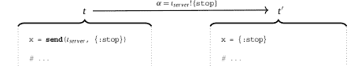

随着进程的评估，初始术语 t 转换为 t'，其中它作为副作用发送一条消息。此副作用表示为动作 alpha，其中 alpha = t_server!{stop}。根据 After Function Definition，counter 演变为新的会话类型 X：

```
X = after(counter, alpha) = ?value(number).end
```

为了使 t' 保持良好类型化，它现在必须与演变后的会话类型 X 匹配，其中它必须能够在终止前接收标记为 value 的消息。因此，根据会话保真度属性，我们知道每个执行步骤都将符合原始协议。

我们还将展示 ElixirST 遵循进度属性的一种条件形式，该形式描述了良好类型化的术语在上述分析上下文中如何转换。然而，我们首先考虑最具问题性的场景，即进程依赖外部因素才能进展。当进程执行遵循分支会话类型的术语时，进程必须能够处理（并模式匹配）任何有效的传入消息。具体来说，遵循会话类型 &[...] 的术语 t 必须能够接受传入消息，通过（成功地）将它们模式匹配到某个分支。这是因为 [TBRANCH] 规则（来自第 3.4 节），我们将所有分支模式限制为简单模式。在命题 3 中，我们表明有效消息始终可以匹配到某个分支。

## 命题 3. 任何遵循分支会话类型的良好类型化术语 (Delta |- Gamma |-^w_p S > t : T < S') 都能处理任何有效的传入消息，即，

```
t = receive do ({l_i; p_i^1, ... p_i^n} -> t_i)_i in end
S = &[l_i(T_1^i, ... T_n^i), S_i]_i in i
=> match(p_j^k, v^j)_{i=1..n} is defined
after(S, ?[l_k, v^1, ... v^n]) = S_k for some k in I
```

证明。注意 Delta |- Gamma |-^w_p S > t : T < S' 和 t = receive do ({l_i; p_i^1, ... p_i^n} -> t_i)_i in end 蕴含 simplepat(p_i^j, T_i^j)_{i in I, j in 1..n}。参见附录 B.3。

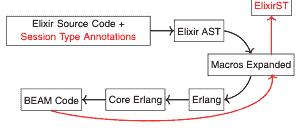

图 11. Elixir 编译阶段及会话类型实现（红色）。

根据命题 3，我们知道如果进程依赖外部因素（即，术语期望接收消息），那么它应该能够处理这些消息而不会出现问题。由此，我们可以推断，良好类型化的 receive 构造在接收消息时能够转换为新术语。如果将此扩展到所有术语，我们可以形成进度定理，其中我们确立进程始终可以从一种形式转换为另一种形式。如果不可能进行进一步转换（参见图 10），那么进程本身必须是一个（最终）值。在此定理中，我们还确立转换期间产生的动作始终由协议允许；这使用 after 函数进行检查。

> **定理 4（进度）。** 如果 $\Delta ; \emptyset \vdash^h S \triangleright T : T < S'$，那么 $t$ 要么是一个值，要么存在某个术语 $t'$ 和动作 $\alpha$，使得 $t \xrightarrow{\alpha}_\Sigma t'$ 且 $\text{after}(S, \alpha)$ 有定义

**证明。** 通过对类型推导 $\Delta ; \emptyset \vdash^h S \triangleright T : T < S'$ 进行归纳。参见附录 B.3。

# 6. 实现

本节描述了第 3 节的类型系统如何作为名为 ElixirST 的会话类型检查器工具实现。该工具集成在 Elixir 中，对表面语言的语法进行了最小更改。源代码用 Elixir 编写，并提供开源。

## 6.1. 带会话类型的 Elixir 编译

Elixir 源代码经过多个步骤编译（参见图 11）。原始 Elixir 源代码最初被解析为抽象语法树（AST）。然后，Elixir 强大的宏系统将所有非特殊形式扩展为特殊形式宏（例如，if/unless 语句转换为 case 构造 [17]）。之后，扩展后的 Elixir AST 被转换为 Erlang 抽象格式和 Core Erlang。最后，它被编译为可在 Erlang 虚拟机（BEAM）上执行的 BEAM 代码。

我们的实现无缝集成到此编译管道中（参见图 11，红色）。在 Elixir 源代码中，进程使用注释（以 @ 开头）描述特定的会话类型。注释能够在编译时保存关于模块的信息。我们提供普通标记会话类型（@session）及其对偶（@dual，由标签引用）：

```
@session 'X = ping() : pong() : X'
ping() ->
    receive do
    {:ok, "X" # equivalent to x -> x.ping().pong().X'
```

注释设置了会话类型的规则，这些规则需要在编译过程后期强制执行。Elixir 提供了几个编译时钩子，用于修改或追加到编译管道。在此实现中，我们最初使用 on_definition 钩子来解析会话类型（来自注释）并在需要时计算对偶类型；这是使用 Erlang 模块 leex 和 yecc 完成的，它们分别根据图 3 所示的会话类型语法规则创建词法分析器和解析器。然后，使用 after_compile 钩子在生成 BEAM 代码后立即运行 ElixirST。由于 BEAM 代码直接存储扩展后的 Elixir AST，ElixirST 能够遍历此 AST 并使用会话类型验证其并发部分。

## 6.2. Elixir 与我们的模型之间的桥接

图 3 中的每个构造都直接映射到实际 Elixir 语言中的相应构造。用于为函数添加类型的 @spec 注释已经存在于该语言的最新分发中。它通常用于代码文档，并使用 Dialyzer [11] 静态分析程序，Dialyzer 是一种使用成功类型 [9] 检测 Core Erlang 程序中潜在（类型）错误的工具。我们使用 @spec 信息来指定函数参数和返回类型的类型，补充我们的会话类型检查分析。Cassola 等人 [13] 为 Elixir 采用了类似的渐进式静态类型系统方法。

```
receive do
  {:a} -> send(p, {:c}) > ok
  {:b} -> send(p, {:c}) > ok
end

receive do
  {:a} -> ok
  {:b} -> ok
end
send(p, {:c})
```

第 3 节的类型规则的设计方式是尽量少地改变语言中的常见编码模式。例如，会话类型中的分支可能有共同的延续，例如类型 &{?A().end, ?B().!C().end} 中的 !C().end。许多类型系统强迫程序像上面左侧代码片段所示那样构建代码（该片段执行两次相同的发送操作）。然而，在 Elixir 中，通常将其表示为 fork-join 模式，使用单个延续执行一次常见操作，如右侧代码片段所示。我们的类型系统可以对两个代码片段进行类型检查。

剩下唯一需要讨论的方面是我们的实现用于保证实现二进制会话类型各自端点的两个进程之间交互的机制。为了实现这一目标，我们实现了一个定制的生成函数（参见第 3.5 节），它获取各自端点的代码，并返回一个包含已链接的两个进程 pid 的元组。我们的会话启动实现如下：

```
1 def session(serverFn, serverArg, clientFn, clientArg)
2   when is_function(serverFn) and is_function(clientFn) do
3     server_pid = spawn(fn ->
4       receive do
5         {:pid, client_pid} ->
6           apply(serverFn, [client_pid | server_arg])
7       end
8     end
9
10    client_pid = spawn(fn ->
11      send(server_pid, {:pid, self()})
12      apply(clientFn, [server_pid | client_arg])
13    end
14
15    {server_pid, client_pid}
16  end
```

此修改后的 session/4 函数获取两对参数：两个函数名引用（应被生成）及其参数列表。该代码实现了图 7 中描绘的初始化协议。它首先生成一个进程（图 7 中第 3 行的 pre-client），并将其 pid 传递给第二个生成的进程（图 7 中第 11 和 12 行的变量 server_pid 的 pre-client）。然后，pre-client 进程将其 pid 发送到 pre-server 进程（第 11 行以及第 4 和 5 行）。此时，两个进程执行各自的函数，转换为参与会话的实际第一个和第二个进程，将各自的 pid 作为执行函数的第一个参数传递（第 6 和 12 行）。

session/4 函数的当前实现一次只能启动两个进程，符合二进制会话。然而，这可以扩展以处理多于两个进程的情况，用于分层进程，其中一个进程可能在几个独立的二进制会话中交互，类似于直觉主义会话类型 [18] 的概念。

我们的实现仍然允许生成的进程从任何其他进程接收消息。不幸的是，未请求的消息可能会干扰会话类型化的进程，因为接收者无法在当前实现中区分消息的来源。一种改进将是利用 Elixir 使用模式匹配从队列中按顺序之外挑选消息的能力。一旦会话启动，唯一会话 ID 将与双方共享，它们之间交换的每条消息都将使用此 ID 来识别源（和目标）。这将使选择性读取能够过滤未请求的消息。Mostrous 和 Vasconcelos [19] 创建了一个类似系统，通过为每条消息附加唯一引用来区分消息。

## 6.3. 案例研究

我们使用 ElixirST 验证一个与第三方服务（即 Duffel [20]）交互的 Elixir（CLI）应用程序。Duffel 提供实时航班销售服务，航班可以通过 REST 应用程序编程接口（API）获取和预订。

我们的应用程序构建为名为 FlightSystem 的 Elixir 模块，它与 Duffel Flight Server 交互，如图 12 所示。该模块由一个客户端组成，可以向 Duffel Server 请求预订航班。此服务器可以


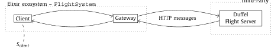

图 12. 与 Duelf API 的交互。

仅接受 HTTP 消息（例如 GET 或 POST 请求），因此我们使用一个网关，它充当客户端和第三方服务器之间的中间人。

从 Duelf API 文档中，我们可以获取可进行的 API 调用列表及其详细信息。因此，我们可以推断出调用顺序（即协议），即需要按正确顺序调用以实现我们想要的目标。例如，我们考虑一个搜索并预订航班的客户端。具体来说，客户端需要按正确顺序与多个终端节点交互，包括 !offer_requests、!offers 和 !orders。这种交互顺序在 S_client 协议中被形式化，随后由 ElixirST 用于确保客户端进程遵循该协议，从而安全地（通过将请求转换为 HTTP 消息的网关进程）与 Duelf 服务器交互。

```
S_client = \oplus {
    |request(origin: binary, destination: binary,
    dep_date: binary, class: atom, pass_no: number).S_offers,
    |cancel()
}
S_offers = rec Y.& {
    ?offer(offer_no: number, total_amount: number,
    currency: binary, duration: number,
    stops: number, segments: binary).S_details,
    ?error(binary).S_client
}
S_details = \oplus {
    |more_details().& {
        ?details(...).\oplus {
            |make_booking(...).
            |&(?ok(...), ?error(binary)),
            |cancel()
        },
        ?error(binary)
    },
    |reject().Y
}
```

为清晰起见，S_client 被分为两部分：S_offers 和 S_details。此外，我们为每个负载类型添加标签，以便更清楚地显示需要传输什么数据 - ElixirST 也允许使用标签，前提是标签仅用于装饰目的。我们简要了解一下客户端如何预订航班。交互始于客户端发出请求以获取可用航班（S_client）。浏览 S_client，可以了解客户端需要在请求中包含哪些详细信息，例如出发地和目的地。请注意，我们使用 binary 类型，这是 Elixir 中字符串的类型。然后，客户端开始一次接收（并拒绝）一个报价，直到客户端决定接受某个报价（S_offers）。

要了解航班报价的更多信息，客户端发送请求以获取更多详细信息（例如运营航空公司和更新后的价格），并等待结果（S_details）。收到详细信息后，客户端可以决定取消订单或预订航班。在后一种情况下，预订将在客户端收到确认码后完成。在整个交互过程中，服务器可能会回复错误消息，客户端也需要处理该消息（即 ?error(binary)）。

由 S_client 形式化的此行为应用于模块 FlightSystem，该模块在清单 5 中部分显示。FlightSystem 包含公共函数 client、私有函数 consume_offer 以及一个省略的公共函数 gateway。client 函数使用 ElixirST.session/4 启动会话类型 S_client，然后等待客户端遵循协议（第 4 行）。client 函数随后执行操作：请求报价、接收报价，并调用函数 consume_offer。后者遵循会话类型中的其余操作，即 S_offers。交互的对偶部分，即 gateway 函数，应遵循兼容协议，例如对偶会话类型 S_client。这并未强制执行，因为 gateway 函数超出了第 3.3 节中定义的语法（例如，使用其他模块解析 JSON 响应，或使用动态类型），这些内容未由我们在第 3.4 节中的类型系统定义。该函数也可能无法进行静态分析（例如专有源代码），因此我们假设在运行时它遵守 S_client。尽管如此，我们可以使用我们的 session 函数启动一个会话，同时执行两个公共函数，如下所示：

```
ElixirST.session(@FlightSystem.Client,
    {"MAD", "CDG", "2023-11-24", :economy, 2},
    @FlightSystem.gateway/1,
    [1])
```

9 https://duelf.com/docs/api/overview/welcome.

```elixir
defmodule FlightSystem do
  use ElixirST

  @spec client(pid, binary, binary, binary, atom, number) :: ok
  def client(pid, origin, destination, dep_date, class, pass_no) do
    send(pid, {:request, origin, destination, dep_date, class, pass_no})
    IO.puts("Sending request for a flight from #{origin} to ...")
    IO.puts("Waiting for a response from the server...")
    consume_offer(pid)
  end

  @spec consume_offer(pid) :: atom
  defp consume_offer(pid) do
    receive do
      {:ok, offer_no, total_amount, currency, dur, stops, segments} ->
        IO.puts("Offer #{offer_no}: \n#{currency}#{total_amount}...")
        IO.puts("Accept? (y/n: ")
        case accept? do
          "y" -> send(pid, {:more_details})
            IO.puts("Requesting updated details for offer...")
            send(pid, {:reject})
          _ -> consume_offer(pid)
        end
      {:error, message} -> send(pid, {:cancel})
    end
  end
end
```

清单 5: 用 Elixir 编写的航班系统的会话类型代码片段。

ElixirST 确保函数 client 遵循 S_client 描述的模式，该模式反映了 Duelf 的 API 请求的隐式顺序。例如，如果客户端尝试在发送包含航班详细信息的请求之前进行预订（即跳过第 7 行），则订单将失败；这将由我们的类型系统更早地标记，而不是在运行时被 Duelf 拒绝。

此案例研究表明，ElixirST 足够灵活且实用，可以集成到实际应用程序中。除了静态验证单个函数外，通过明确添加有关交互的信息，我们在源代码本身中提供了文档来源。

在此案例研究中，我们分析了交互的客户端，未对网关进程进行验证，因此容易出现行为问题。要解决此问题，我们可以使用现有技术，例如为未验证部分合成运行时监视器 [21-23]，类似于 Bartolo Burlo 等人 [24] 的工作。

# 7. 相关工作

在本节中，我们将 ElixirST 与其他类型系统和实现进行比较。

## 7.1. Elixir 的类型系统

Cassola 等人 [13,25] 为 Elixir 提出了一种渐进式类型系统。它使用渐进方法静态类型检查 Elixir 模块的函数部分，其中某些术语可能保留未知的表达式类型。与 ElixirST 不同，Cassola 等人直接分析未展开的 Elixir 代码，从而产生更明确的类型检查规则。此外，他们专注于静态类型系统，而未制定操作语义。

另一个 Elixir 的静态类型检查器是 Gradient [26]。它是其 Erlang 对应工具的包装器，并采用与 [13] 类似的方法，其中使用了渐进式类型。另一个项目 Typecheck [27] 为 Elixir 程序添加了动态类型验证。Typecheck 通过在现有函数周围包装检查来执行运行时类型检查。Gradient 和 Typecheck 通过分析对 ElixirST 的调用来实现渐进式类型检查，而讨论的类型检查器 [13, 26,27] 分析了 Elixir 语言的很大一部分，但不检查与进程间消息传递相关的内容。

一些实现旨在检查与消息传递相关的问题。Harrison [28] 静态检查 Core Erlang 中的此类问题。例如，它检测孤儿消息（即永远不会被接收的消息）和不可达的接收分支。在另一项工作中，Christakis 和 Sagonas [29] 分析 Core Erlang 代码以构建通信图，该图描绘了不同进程之间的消息流。随后使用此图来检测类似类型的错误，例如永远不会接收任何消息的接收构造。此工作作为 Dialyzer 的一部分实现。Harrison [30] 扩展了 [28] 以分析 Erlang/OTP 行为（例如 gen_server，它以层次结构方式组织进程），通过注入


代码中的运行时检查。与我们的工作相比，[28,30,29] 对实现进行自动分析，其中他们相互分析发送和接收原语。他们在细粒度级别分析消息，这与我们的工作形成对比，我们的工作使用一般协议（例如会话类型）来描述会话内的完整交互。Svensson 等人 [31] 提出了另一种 Erlang 类型系统。他们的工作覆盖的 Erlang 子集比我们的工作所覆盖的 Elixir 等价物更大。此外，他们的多类型语义捕获了定义在并发角色系统上的 LTS。虽然我们选择了更小的子集，但我们超越了 Svensson 等人描述的模式匹配，因为我们对基本类型进行了一定程度的类型检查（例如在 {rBRANCH} 的前提中）。

## 7.2. 会话类型系统

与我们的工作最接近的是 [19]，其中 Mostrous 和 Vasconcelos 将会话类型引入 Core Erlang 的一个片段，Core Erlang 是一种与 Elixir 关联的动态类型语言。他们的类型系统为每条交换的消息打上唯一引用标记。这允许多个会话共存，因为不同的消息可以使用相关性集与相应的会话匹配。Mostrous 和 Vasconcelos 采取更理论的方法，因此 [19] 没有实现。他们的类型系统通过检查进程的邮箱来保证会话忠实性，在终止时，邮箱中不应留下未处理的消息。我们的工作采取更限制但更务实的方法，即在模块内的函数中引入会话类型。我们提供额外功能，包括变量绑定（例如在 let 语句中）、表达式（例如加法运算）、归纳类型（例如元组和列表）、通过递归进行的无限计算以及显式进程。

Neykova 和 Yoshida [32] 最初提出了一种基于会话的 Python 运行时监控工具。他们使用 Scribble [33] 语言编写多方会话类型（MPST）[16] 协议，然后用于监控进程的操作。不同的进程使用函数装饰器（例如 @role）被赋予角色（在 MPST 协议中定义），这与我们使用协议注释函数的方式类似（例如使用 @session）。与 [32] 类似，Fowler [34] 为 Erlang 提出了一种 MPST 实现。该实现使用 Erlang/OTP 行为（例如 gen_server），这些行为考虑了 Erlang 的“让它崩溃”哲学，即进程在执行过程中可能会失败。Neykova 和 Yoshida [35] 将 Erlang 中的进程监控扩展为对失败进程提供恢复策略，确保所有失败（或受影响）的进程都能安全重启。所有这些 Erlang 工具接受的语言比我们的工作允许的更灵活。这是以增加运行时成本为代价实现的，因为它们在运行时标记问题，而我们的工作提供静态保证，在预部署阶段标记问题。此外，我们的工作能够在不需要访问整个代码库的情况下，对部分代码进行静态分析（并为其提供静态保证）。

Scalas 和 Yoshida [36] 将二进制会话类型应用于 Scala 语言，其中会话类型被抽象为 Scala 类。会话忠实性通过 Scala 编译器来确保，如果实现不遵循其指定的协议，编译器会报错。Bartolo Burdulo 等人 [24] 扩展了上述工作，以静态方式监控交互的一方，并使用运行时监视器动态监控另一方。这些工作将线性检查转移到运行时。相比之下，ElixirST 静态检查交互的两边，但只一次性完整耗尽其关联的协议。Scalas 等人 [37,38] 进行了另一种实现，在 Scala 3 中添加了会话类型。这种设计利用依赖函数类型和模型检查在编译时验证程序。

Harvey 等人 [39] 提出了一种新的基于角色的语言，称为 EnsembleB，它将会话类型作为语言的原生功能。EnsembleB 静态验证相对于会话类型的实现，同时仍允许在运行时适应新角色，前提是角色遵循已知协议。因此，角色可以在运行时终止和发现，同时仍然保持静态正确性。

Rust 有几种 [40,41] 和多方 [42,43] 会话类型实现。这些实现利用 Rust 的仿射类型系统来保证通道镜像会话类型规定的操作。Padovani [44] 为 OCaml 创建了一个二进制会话类型库，以提供静态通信保证。该项目被扩展 [45] 以包括动态合同监控，在运行时标记违规行为。Rust 和 OCaml 实现中使用的方法严重依赖于语言的类型级特性，这些特性不易转换为动态类型的 Elixir 语言。当我们将我们的工作与上述工作进行比较时，我们注意到几个局限性。ElixirST 只支持有限形式的生成（在 6.2 节中讨论），其中我们将单个会话中的进程数限制为两个进程。这与 π-演算中允许的无界数量的并行进程形成对比，会话类型最初就是在那里引入的 [46]。我们未讨论的另一个方面是 ElixirST 中缺乏会话委托，这是由于在将会话转移到其他进程时缺乏线性通道造成的。这源于我们采用的方法；我们的工具直接对角色进行类型检查，而上述作品 [40–45] 对通道角色进行类型检查，这些通道角色可以轻松在不同进程之间转移。类似角色的技术也用于基于主动对象（AO）的语言中，以结合进程分离的概念与面向对象语言中的异步方法调用。会话类型被用于在这样的语言中构建方法调用。例如，Kamburjan 等人 [47,48] 将会话类型添加到 ABS，这是一种使用 future 来解析方法调用所得结果的 AO 语言。Kamburjan 等人使用全局协议（源自 MPST）来定义源自对象实例的方法调用顺序。虽然这些全局协议用于动态检查，但它们也用于使用局部类型在更局部的规模上静态检查每个方法。ABS 使用（抽象的）Erlang 进程来构建其并发后端，类似于我们工作中使用的后端结构。

角色系统臭名昭著地难以进行静态分析。主要原因是角色可以接收任何类型的消息，这使得预测或分析其行为变得困难。我们的工作对此持宽松态度，即我们简单地使用 Elixir 的选择性 `receive` 构造忽略格式错误的消息。另一方面，格式正确但未请求的消息可能导致行为问题。其他工作通过直接对角色的邮箱进行类型化而不是对其行为进行类型化来处理此问题。DeLiguoro 和 Padovani [49] 引入了一种邮箱演算，将邮箱视为一等公民。该演算为邮箱添加类型，从而确保进程不存在行为问题，例如死锁。Fowler 等人 [50] 在此基础上构建，在实用的并发编程语言中实现了邮箱类型。这些作品 [47,48,50] 为专门构建的定制语言提供了实现。我们的工作的目标不同，因为我们从工业强度语言开始，并试图将会话类型机制回溯，以支持语言的现有设计模式。

# 8. 结论

在本工作中，我们建立了 ElixirST 类型系统 [7] 与运行 Elixir 模块函数的客户端处理程序的运行时行为之间的对应关系，该函数已根据其会话类型协议进行了类型检查。特别是，我们表明这种基于会话的类型系统遵循标准会话 _忠实性_ 属性，这意味着执行类型化函数的进程在运行时始终遵循其指定的协议。该属性提供了实现各种形式通信安全所需的底层保证，即当两个进程遵循相互兼容的协议（例如 `S` 及其对偶 `S̄`）时，它们会避免某些通信错误（例如没有相应接收构造的发送语句）。

## 未来工作

我们打算追求多个方向。一个调查方向是增强协议，这些协议涉及模块的多个入点，可能从同时参与多个会话（可能涉及多个模块）的客户端角度出发。这里明显的起点是研究成熟的多方会话类型 [16,38] 或者关于以层次结构组织进程的直觉主义会话类型的工作 [51,18]。我们工作的另一个自然扩展是增强我们的会话类型协议，以考虑进程失败和监督，这是 Elixir 语言的核心部分。为此，我们将研究考虑失败的进程/会话类型扩展的先前工作 [52,53,39,54–57]。我们还应该增强我们的会话类型系统，以支持带有运行时成本的会话类型，例如 Castagna 等人 [58] 开发的那些。还可以直接集成 Castagna 等人 [60] 开发的精巧表达式类型检查机制，以替换我们在 Fig. 5 中（有限的）表达式类型化。这将大大增强我们框架的表达能力，以处理更广泛的 Elixir 程序。

# 竞争利益声明

作者声明他们没有已知的可能影响本文所报告工作的竞争性财务利益或个人关系。

# 附录 A. 其他定义

在本附录中，我们形式化了一些在 3–5 节和附录 B 中使用的辅助定义。

## 定义 A.1（自由变量）。自由变量集归纳定义如下：

```
fv(e) def = { [x]   e = x
              b     e = b
              fv(e1) U fv(e2)   e = e1 <> e2 or e = [e1 | e2]
              fv(e')   e = not e'
              U_{i in 1..n} fv(ei)   e = {e1, ..., en}
fv(t) def = fv(t1) U fv(t2) \\ {x}   t = <x = t1; t2>
              U_{i in 1..n} fv(ei) U fv(w)   t = send (w; (t1, e1, ..., en))
              U_{i in 1..n} fv(ei) U vars(p_i)   t = receive do ({t1, p_i} -> t1)_i end
              U_{i in 2..n} fv(ei) U fv(w)   t = f (w, e2, ..., en)
              U_{i in 1..n} fv(ti) \\ vars(p_i) U fv(e)   t = case e do (p_i -> ti)_i end ■
```


**定义 A.2（绑定变量）。**

\(\mathbf{bv}(t) \stackrel{\text{def}}{=} \begin{cases} \emptyset & t = e \text{ or } t = \text{send}(w, \{..l, \tilde{e}..\}) \text{ or } t = f(\tilde{e}) \\ \{ x \mid x \in \mathbf{bv}(t_1) \cup \mathbf{bv}(t_2) \} & t = (x = t_1; t_2) \\ \bigcup_{i \in I} \mathbf{bv}(t_i) \cup \mathbf{vars}(\tilde{p}_i) & t = \text{receive do } (\{l_i, \tilde{p}_i \rightarrow t_i\})_{i \in I} \text{end} \\ \bigcup_{i \in I} \mathbf{bv}(t_i) \cup \mathbf{vars}(p_i) & t = \text{case } e \text{ do } (p_i \rightarrow t_i)_{i \in I} \text{end} \end{cases}\)

**定义 A.3（变量替换）。**

\( e \lfloor e' / a \rfloor \stackrel{\text{def}}{=} \begin{cases} e' & e = x \\ y & e = y, y \neq x \\ b & e = b \\ e_1 \lfloor e' / a \rfloor \diamond e_2 \lfloor e' / a \rfloor & e = e_1 \diamond e_2 \\ \text{not } (e' \lfloor e' / a \rfloor) & e = \text{not } e' \\ \{ e_1 \lfloor e' / a \rfloor \diamond e_2 \lfloor e' / a \rfloor \} & e = \{ e_1 \diamond e_2 \} \\ \{ e_1 \lfloor e' / a \rfloor, \dots, e_n \lfloor e' / a \rfloor \} & e = \{ e_1, \dots, e_n \} \end{cases}\)

\( t \lfloor e' / a \rfloor \stackrel{\text{def}}{=} \begin{cases} \text{send}(w \lfloor e' / a \rfloor, \{..l, e_1 \lfloor e' / a \rfloor, \dots, e_n \lfloor e' / a \rfloor \}) & t = \text{send}(w, \{..l, e_1, \dots, e_n\}) \\ \text{receive do } (\{l_i, \tilde{p}_i \rightarrow t_i \lfloor e' / a \rfloor \})_{i \in I} \text{end} & t = \text{receive do } (\{l_i, \tilde{p}_i \rightarrow t_i\})_{i \in I} \text{end} \\ f (e_1 \lfloor e' / a \rfloor, \dots, e_n \lfloor e' / a \rfloor) & t = f (e_1, \dots, e_n) \\ \text{case } e \lfloor e' / a \rfloor \text{ do } (p_i \rightarrow t_i \lfloor e' / a \rfloor)_{i \in I} \text{end} & t = \text{case } e \text{ do } (p_i \rightarrow t_i)_{i \in I} \text{end} \\ y = t_1 \lfloor e' / a \rfloor; t_2 \lfloor e' / a \rfloor & t = (y = t_1; t_2), a \neq y \end{cases}\)

**定义 A.4（类型）。** 该偏函数定义基本值的类型。

\(\text{type}(\text{boolean}) \stackrel{\text{def}}{=} \text{boolean} \quad \text{type}(\text{number}) \stackrel{\text{def}}{=} \text{number}\)
\(\text{type}(\text{atom}) \stackrel{\text{def}}{=} \text{atom} \quad \text{type}(t) \stackrel{\text{def}}{=} \text{pid}, \text{ where } t \text{ is a pid instance}\)

**定义 A.5（变量模式）。** 从给定模式 \(p\) 计算有序变量集。

\(\mathbf{vars}(\tilde{p}) \stackrel{\text{def}}{=} \mathbf{vars}(p_1, \dots, p_n) \stackrel{\text{def}}{=} \mathbf{vars}(p_1) \cup \dots \cup \mathbf{vars}(p_n)\)

\(\mathbf{vars}(p) \stackrel{\text{def}}{=} \begin{cases} \emptyset & p = b \\ \{ x \} & p = x \\ \mathbf{vars}(w_1) \cup \mathbf{vars}(w_2) & p = [ w_1 \mid w_2 ] \\ \bigcup_{i \in 1..n} \mathbf{vars}(w_i) & p = [ w_1, \dots, w_n ] \end{cases}\)

**定义 A.6（函数详情）。** 我们可以从函数列表（\(\tilde{Q}\)）中提取函数详情（即 params、body、param_types、return_type、dual），并使用集合推导式构建映射，如下所示。函数列表（\(\tilde{Q}\)）可能包含公共（\(\tilde{D}\)）和私有（\(\tilde{P}\)）函数。

\(\mathbf{details}(\tilde{Q}) \stackrel{\text{def}}{=} \left\{ f/n : \left[ \begin{array}{l} \text{"dual"} = y, \text{params} = \tilde{x}, \\ \text{param\_types} = \tilde{T}, \\ \text{return\_type} = T, \\ \text{body} = t \end{array} \right] \mid \dots \right\} \cup \dots \)

**定义 A.7（函数名和元数）。** 该定义获取所有公共函数名及其元数的集合。

\(\mathbf{functions}(\tilde{D}) \stackrel{\text{def}}{=} \left\{ f/n \mid \dots \right\} \in \tilde{D} \)

**定义 A.8（所有会话类型）。** 函数 \(\mathbf{sessions}(\tilde{D})\) 返回每个带注释公共函数对应的会话类型。

```
sessions(D) def = { f/n : S | [ @session "S"; @spec... def f(y, x0, ..., xn) do t end ] D }
```

如果使用 @dual 注释代替 @session，则会自动计算双会话类型。

# 附录 B. 证明

在本附录中，我们展示了命题 1、定理 2 和定理 4 的完整证明，这些证明在正文中被省略了。

## B.1. 命题 1 的证明

在证明命题 1 之前，我们必须分析与闭合项相关的一些属性，以了解它们如何影响变量替换（定义 A.3）。引理 5 表明，如果变量 x 不存在于项 t 内部，那么，如果我们用某个值初始化 x，项 t 必须保持不变，即 t[γ/τ] = t。限制这一陈述，推论 6 表明，如果 x 不是 t 中的自由变量，则应保持相同结果。引理 7 包含两个陈述，用于比较项（或表达式）中的自由变量与包含替换的自由变量。

### 引理 5. x ∉ fv(t) ∧ x ∉ bv(t) 意味着 t[γ/τ] = t

**证明。** 对 t 的结构进行归纳。

### 推论 6. x ∉ fv(t) 意味着 t[γ/τ] = t

**证明。** 引理 5 的推论。

### 引理 7。

- i. x ∈ fv(t) 意味着 fv(t{γ/λ}) = fv(t)
- ii. x ∈ fv(e) 意味着 fv(e{γ/λ}) = fv(e)

**证明.** 分别对 t 和 e 的结构进行归纳，对应项 i 和 ii。

### 引理 8. match(p, v) = [v1 ... vn / x1 ... xn] 意味着 vars(p) = (x1, ..., xn)

**证明.** 对 p 的结构进行归纳。

- [p = b] 函数 match(b, v) 仅在 v = b 时成功。因此，根据 match 定义，当 v = b 时，

```
match(b, b) = []
```

根据 vars 定义，vars(b) = ∅，这与等式 (B.1a) 的结果一致，因为未进行变量替换。

- [p = x] 根据 match 定义，对于任意 v，

```
match(x, v) = [γ/τ]
```

根据 vars 定义，vars(x) = (x)，这与等式 (B.1b) 替换中的变量匹配。

- [p = w1 | w2] 根据 match 定义，对于 v = v1 | v2，

```
match(p, v) = match(w1, v1).match(w2, v2) = [γ1/τ1][γ2/τ2] where
```

```
match(w1, v1) = [γ1/τ1]
```

```
match(w2, v2) = [γ2/τ2]
```

通过对 w1 和 w2 从等式 (B.1d) 和 (B.1e) 进行情况分析，我们得出结论

```
vars(w1) = {x1}
```

```
vars(w2) = {x2}
```

我们需要证明 vars(w1 | w2) = {x1, x2}。根据 vars 定义和等式 (B.1f) 及 (B.1g)，vars(w1 | w2) = vars(x1) ∪ vars(x2) = {x1} ∪ {x2}。此结果与等式 (B.1c) 替换中的变量匹配。

- [p = {w1, ..., wn}] 与前一种情况类似。

### 引理 9（闭合表达式）。fv(e) = ∅ 且 e → e' 意味着 fv(e') = ∅

**证明.** 对 e 的结构进行归纳。

引理 5-9 使我们能够证明闭合项命题（命题 1）。根据该命题，我们可以说闭合项 t 在转换为某个新项 t' 并产生动作 α 后仍保持闭合。引理 9 类似；它表明表达式在归约后仍保持闭合。

### 命题 1（闭合项）。如果 fv(t) = ∅ 且 t →α t'，则 fv(t') = ∅

**证明.** 对 t 的结构进行归纳。

- [t = e] 根据规则 [rExpression] 和表达式引理，立即成立。

- [t = (x = t1 ; t2)] 鉴于 t 的当前结构，我们可以通过两种情况推导 t →α t'：

  1. [rLET1] 根据规则，t' = (x = t1' ; t2) 且

  ```
  t1 →α t1' (B.2a)
  ```

  从前提 fv(t) = ∅ 出发，根据 fv 定义，fv(t1) ∪ (fv(t2) \ {x}) = ∅，或等价地

  ```
  fv(t1) = ∅ (B.2b)
  ```

  ```
  fv(t2) \ {x} = ∅ (B.2c)
  ```

  如果将归纳假设应用于等式 (B.2a) 和 (B.2b)，我们得到

  ```
  fv(t1') = ∅ (B.2d)
  ```

  因此，根据等式 (B.2c) 和 (B.2d) 以及 fv 定义，我们得到 fv(x = t1' ; t2) = ∅，如所要求。

  2. [rLET2] 根据规则，t = (x = v ; t2) 且 t' = t2 [v/x]。由于 fv(t) = ∅，根据自由变量定义，fv(v) ∪ (fv(t2) \ {x}) = ∅，或等价地

  ```
  fv(v) = ∅ (B.2e)
  ```

  ```
  fv(t2) \ {x} = ∅ (B.2f)
  ```

  我们需要证明 fv(t') = ∅，即 fv(t2 [v/x]) = ∅，因此我们考虑两种子情况：

  a. 如果 x ∉ fv(t2)，则根据推论 6，t2 = t2 [v/x]。将其代入等式 (B.2f)，得到 fv(t2 [v/x]) = ∅，如所要求。

  b. 如果 x ∈ fv(t2)，则根据引理 7，我们得到 fv(t2 [v/x]) = fv(t2) \ {x}。如果将其代入等式 (B.2f)，则该情况成立。

- [t = send(w, (t1.e1, ..., tn.en))] 鉴于 t 的当前结构，我们可以通过两种情况推导 t →α t'：

  1. [rCHOICE1] 根据此规则，我们知道 α = τ 且

  ```
  t' = send(w, {1 ↓ v1, ..., vk-1, ek', ..., en})
  ```

  ```
  ek → ek' (B.3a)
  ```

  由于 fv(t) = ∅，根据 fv 定义

  ```
  fv(t) = ∅ (B.3b)
  ```

  ```
  fv(v_i) = ∅ for i ∈ 1..k-1 (B.3c)
  ```

  ```
  fv(e_i) = ∅ for i ∈ k..n (B.3d)
  ```

  将闭合表达式引理应用于等式 (B.3a) 和 (B.3d)，得到 fv(ek) = ∅。结合此信息与等式 (B.3b-d) 和 fv 定义，得到 fv(t') = ∅，如所要求。


- 2. [RCHOOSE2] 在这种情况下，t = {i1, v1, ..., vn} 且 t' = {i1, mu, v1, ..., vn}。由于从前提 fv(t) = ∅ 可知，然后使用 fv 定义，

fv(i) = ∅, fv(v_i) = ∅ for i ∈ 1..n

(B.3e)

要证明 fv({i1, mu, v1, ..., vn}) = ∅，我们可以将公式 (B.3e) 应用于 fv 定义。

[t = receive do {i1, Pi} -> ti}ie end] 从前提可知，fv(t) = ∅，因此根据 fv 定义，

fv(i1) \ vars(Pi_tilde) = ∅ for all i ∈ I

(B.4a)

鉴于 t 的当前结构，我们可以使用 [RBRANCH] 推导 t -> alpha t'，其中 alpha = ? {i1, v1, ..., vn} 对于某些 j ∈ I，并且

match(Pi_tilde, v_tilde) = sigma where sigma = [v1/.../vn/x1...xn]

(B.4b)

t' = t sigma

从公式 (B.4b)，我们可以应用引理 8 得到

vars(Pi_tilde) = {x1, ..., xk}

(B.4c)

将公式 (B.4c) 代入公式 (B.4a)（当 i = j 时），我们得到 fv(i_j) \ {x1, ..., xk} = ∅。我们的目标是得到 t_j sigma = ∅，因此我们检查 x 是否属于 fv(i_j)。如果成立，则根据引理 7，我们可以得出 fv(i_j[v1/.../vn/x1...xn]) = ∅。在 x 不属于 fv(i_j) 的情况下，同样可以通过推论 6 得出结论。应用相同的过程共 k 次，得到 fv({v1/.../vn/x1...xn}) = ∅，如要求所示。

[t = f(w, e2, ..., ek)] 鉴于 t 的当前结构，我们可以使用两种情况推导 t -> alpha t'：

- 1. [RCALL1] 根据此规则，我们知道 alpha = t，t = f(v1, ..., vk-1, ek, ..., e_n)，t' = f(v1, ..., vk-1, ek', ..., e_n) 并且

ek -> ek'

(B.5a)

由于 fv(t) = ∅，根据 fv 定义，

fv(v_i) = ∅ for all i ∈ 1..k-1

(B.5b)

fv(e_i) = ∅ for all i ∈ k..n

(B.5c)

将闭合表达式引理应用于公式 (B.5a) 和 (B.5c)（当 i = k 时），我们得到

fv(ek) = ∅

(B.5d)

因此，使用 fv 定义结合公式 (B.5b-d)，结果 fv(t') = ∅ 按预期成立。

- 2. [RCALL2] 根据此规则，我们知道 alpha = f j h 并且

t = f(t, v2, ..., vn)

(B.5e)

t' = t[i/|v|^... \ Sigma(f)h = Omega_body = t Omega.params = x2, ..., xn Omega.dual = y

(B.5f)

由于项约简只能相对于良形成的函数信息环境 Sigma 发生，我们可以假设函数体中唯一的自由变量是参数类型，或者正式地，对于所有 f ∈ dom(Sigma)，我们有

Sigma(f(body)) \ (Sigma(f(body).params U (Sigma(f(body).dual)) = ∅

因此，使用此信息并代入公式 (B.5f) 中的信息，我们得到

fv(t) \ {y, x2, ..., xn} = ∅

(B.5g)

为了获得预期结果（即 fv(t) = ∅），我们检查 y 是否属于 fv(t)。如果成立，则根据引理 7，我们可以得出 fv(t[i/|v|^...]) = ∅。在 x 不属于 fv(t) 的情况下，同样可以通过推论 6 得出结论。对剩余自由变量（即 x2, ..., xn）应用相同的过程，我们得到 fv(t[v1/.../vn/x1...xn]) = ∅，如预期。

[t = case e do (p_i \rightarrow t_i)_{i \in I} end] 鉴于 t 的当前结构，它隐含地包含兜底模式，我们可以使用两种情况推导 t \mapsto t'：

- 1. [RCASE1] 根据规则，我们知道 t' = case e' do (p_i \rightarrow t_i)_{i \in I} end，并且从前提可知 e \rightarrow e'

e \rightarrow e' (B.6a)

由于 fv(t) = \emptyset，根据 fv 定义，我们知道

fv(t_i) \setminus vars(p_i) = \emptyset \quad \text{for all } i \in I (B.6b)

fv(e) = \emptyset (B.6c)

将闭合表达式引理应用于公式 (B.6a) 和 (B.6c)，得到 fv(e') = \emptyset。因此，使用此信息，结合公式 (B.6b) 和 fv 定义，我们得到 fv(t') = \emptyset，如所需。

- 2. [RCASE2] 根据规则，我们知道 t = case v' do (p_i \rightarrow t_i)_{i \in I} end，e = v' 并且对于某些 j ∈ I，

match(p_j, v') = \sigma \quad \text{where } \sigma = [^{y_1}_{x_1} ... ^{y_n}_{x_n}] (B.6d)

t' = t_j \sigma (B.6e)

从前提可知，fv(t) = \emptyset，因此根据 fv 定义，fv(v') = \emptyset 并且

fv(t_i) \setminus vars(\tilde{p}_i) = \emptyset \quad \text{for all } i \in I (B.6f)

从公式 (B.6d)，我们可以应用引理 8，得到

vars(p_j) = \{x_1, ..., x_k\} (B.6g)

将公式 (B.6g) 代入公式 (B.6f)（当 i = j 时），我们得到 fv(t_j) \setminus \{x_1, ..., x_k\} = \emptyset。通过与先前情况类似的推理，我们得到 fv(t') = \emptyset，如要求所示。

## B.2. 定理 2 的证明

在证明定理 2 之前，我们考虑一些其他必要的引理。\Delta-弱化引理弱化（即扩展）会话类型环境（\Delta）而不影响整体类型结果。

### 引理 10 (\Delta-弱化)

如果 \Delta, \Gamma \vdash^w S > t : T < S'，则 (\Delta, \Delta'), \Gamma \vdash^w S > t : T < S'

**证明。** 通过对 \Delta . \Gamma \vdash^w S > t : T < S' 的推导进行归纳。我们分析重要情况：

- [TUNKNOWNCALL] 根据规则，我们知道

(\Delta, f h : S, \Gamma) \vdash^w S > \tilde{e} : T < S' (B.7a)

\Gamma \vdash exp_i : T_i \quad \text{for all } i \in 2..n (B.7b)

将归纳假设应用于公式 (B.7a) 得到 (\Delta, \Delta', f h : S, \Gamma) \vdash^w S > t : T < S'，其中我们假设 fv h ∈ dom(\Delta)。因此，使用后者结果、公式 (B.7b) 和 [TUNKNOWNCALL]，得到 (\Delta, \Delta'), \Gamma \vdash^w S > t : T < S'，如要求所示。

- [TKNOWNNCALL] 根据规则，我们知道

\Delta (f h) = S (B.8a)

\Gamma \vdash exp_i : T_i \quad \text{for all } i \in 2..n (B.8b)

如果我们用 \Delta' 扩展 \Delta，则 (\Delta, \Delta')(f h) = S 仍然有效。因此，使用此信息，结合公式 (B.8b) 在 [TKNOWNNCALL] 中，我们得到 (\Delta, \Delta'), \Gamma \vdash^w S > t : T < end，如要求所示。

情况 [TCHOICE] 和 [TREXPRESSION] 立即成立，因为 \Delta 未使用。剩余情况通过归纳假设轻松成立。

如果类型正确的项在转换后仍保持类型正确，则类型系统遵循会话保真属性。在项转换过程中，特别是在规则 [RLETS_]、[RCALLs] 和 [RBRANCH] 中，变量被值替换。替换引理（引理 11）确保当项和表达式中的自由变量被一个闭合值替换时，得到的项和表达式仍保持类型正确。结果，被替换的变量在变量绑定环境（\(\Gamma'\)）中变得冗余，因此可以从 \(\Gamma'\) 中移除。该引理包含两个陈述，替换分别在 (i) 项和 (ii) 表达式中执行。

### 引理 11 (替换)

- i. 如果 \(\Gamma \vdash^{\text{exp}} v : T'\) 且 \(\Delta \cdot (\Gamma, x:T') \vdash^w S \vdash t : T <: S'\)，则 \(\Delta \cdot \Gamma \vdash^{w[x'/x]} S \vdash t[\gamma/x] : T <: S'\)
- ii. 如果 \(\Gamma \vdash^{\text{exp}} v : T'\) 且 \(\Gamma, x:T' \vdash^{\text{exp}} e : T\)，则 \(\Gamma \vdash^{\text{exp}} e[\gamma/x] : T\)

证明。通过对 \(\Delta \cdot (\Gamma, x:T') \vdash^w S \vdash t : T <: S'\) 的推导进行归纳（针对项目 i），以及通过对 \(\Gamma, x:T' \vdash^{\text{exp}} e : T\) 的推导进行归纳（针对项目 ii）。我们展示项目 i 的主要情况：

### [TLET]

根据规则，我们知道 \(t = (x = t_1; t_2)\)，并且

\(x' \neq w\) (B.9a)

\(\Gamma \vdash^{\text{exp}} v : T'\) (B.9b)

\(\Delta \cdot (\Gamma, x:T') \vdash^w S \vdash t_1 : T'' <: S'\) (B.9c)

\(\Delta \cdot (\Gamma, x:T', x':T'') \vdash^w S' \vdash t_2 : T <: S'\) (B.9d)

公式 (B.9d) 的变量绑定环境可以重新排序为

\(\Delta \cdot (\Gamma, x':T'', x:T') \vdash^w S' \vdash t_2 : T <: S'\) (B.9e)

我们需要证明 \(\Delta \cdot \Gamma \vdash^{w[x'/x]} S \vdash x = (t_1; t_2)[\gamma/x] : T <: S'\)，这根据变量替换定义，等价于

\(\Delta \cdot \Gamma \vdash^{w[x'/x]} S \vdash x' = t_1[\gamma/x] : t_2[\gamma/x] : T <: S'\) (B.9f)

对于 \(x \neq x'\) 且 \(x' \neq v\)。为了获得公式 (B.9f)，我们需要一些初步结果。将归纳假设应用于公式 (B.9b) 和 (B.9c)，同样地应用于公式 (B.9b) 和 (B.9e)，得到

\(\Delta \cdot \Gamma \vdash^{w[x'/x]} S \vdash t_1[\gamma/x] : T'' <: S'\) (B.9g)

\(\Delta \cdot (\Gamma, x':T'') \vdash^{w[x'/x]} S'' \vdash t_2[\gamma/x] : T <: S'\) (B.9h)

从公式 (B.9a) 和变量替换定义可知 \(x \neq w[\gamma/x]\)。应用此信息，结合公式 (B.9g) 和 (B.9h) 到 [rLet] 的前提，得到公式 (B.9f)，如要求所示。

### [TBRANCH]

根据规则，我们知道对于某些 \(n \in \mathbb{N}\) 且

\(\Gamma \vdash^{\text{exp}} v : T'\) (B.10a)

\(t = \text{receive do } (\{ ; l_i, p_i^1, \dots, p_i^n \} \to t_i)_{i \in I} \text{ end}\) (B.10b)

从前提，我们还知道，对于所有 \(i \in I\) 和 \(j \in 1..n\)：

simplepat(\(p_i^j, t_i^j\))

\(\vdash_{w}^{\text{pat}} p_i^j : T_i^j \triangleright \Gamma_i^j\) (B.10d)

\(\Delta \cdot (\Gamma, x:T', \Gamma_i^1, \dots, \Gamma_i^n) \vdash^w S_i \vdash t_i : T <: S'\) (B.10e)

如果获得以下陈述，则此情况成立：

\(\Delta \cdot \Gamma \vdash^{w[x'/x]} S \vdash t[\gamma/x] : T <: S'\) (B.10f)

其中 \(t[\gamma/x] = \text{receive do } (\{ ; l_i, p_i^1, \dots, p_i^n \} \to t_i)_{i \in I} \text{ end}\)。为了获得公式 (B.10f)，我们需要使用 [tBranch] 规则，该规则需要多个前提。将归纳假设应用于公式 (B.10a) 和 (B.10e) 得到

\(\Delta \cdot (\Gamma, \Gamma_i^1, \dots, \Gamma_i^n) \vdash^{w[x'/x]} S_i \vdash t_i[\gamma/x] : T <: S'\) 对于所有 \(i \in I\) (B.10g)

如果 \(w \neq x\)，则公式 (B.10d)

\(\vdash_{w}^{\text{pat}} p_i^j : T_i^j \triangleright \Gamma_i^j\) 对于所有 \(j \in 1..n\) (B.10h)


由于根据变量替换定义，w = w[\gamma]。因此，可以将等式 (B.11c)、(B.10g) 和 (B.10h) 应用于 [TBRANCH] 的前提，以得到等式 (B.10)：

```
\(\Delta \cdot \Gamma \vdash^{w[\gamma]} S \Downarrow t [\gamma] : T \Downarrow S'\)
```

这就是所需的结果。在 w = x 的情况下，可以从将对偶 pid 映射到类型的模式类型规则中获得额外的映射。但是，由于在这种情况下 x 可以替换为变量，因此额外的映射不影响结果，从而得到所需的等式 (B.10)。

[TCHOICE] 根据该规则，我们知道对于某些 \(\mu \in \iota\)，\(T = atom, T'_{\mu}, ..., T'_{\mu}\)，\(S = \oplus \{ \oplus_{\mu} (\widetilde{T}_{\mu}), S_{\mu} \}_{\iota \in \iota}\) 且

```
\(t = send \{ t_i : \{ \iota_1 . e_1, ..., e_n \} \}\) (B.11a)
\(\Gamma, x : T \vdash^{exp} e_j : T'_{\mu}\) for all \(j \in 1..n\) (B.11b)
\(\Gamma \vdash^{exp} v : T\) (B.11c)
```

将等式 (B.11b) 和 (B.11c) 应用于 Lemma 11 的第 ii 项，得到对于所有 \(j \in 1..n\) 的 \(\Gamma \vdash^{exp} e_j [\gamma] : T'_{\mu}\)。将此结果应用于 [TCHOICE] 得到

```
\(\Delta \cdot \Gamma \vdash^{w[\gamma]} S \Downarrow t [\gamma] : T \Downarrow S'\)
```

这就是所需的结果，因为 \(t [\gamma] = send \{ w [\gamma] . \{ \iota_1 . e_1 [\gamma], ..., e_n [\gamma] \} \}\)。\(\square\)

Lemma 12 将表达式类型与基本值相关联（反之亦然），例如，值 5 具有类型 number。

## Lemma 12 (值类型).

- i. \(\Gamma \vdash^{exp} v : boolean \text{ iff } v = boolean\)
- ii. \(\Gamma \vdash^{exp} v : number \text{ iff } v = number\)
- iii. \(\Gamma \vdash^{exp} v : atom \text{ iff } v = atom\)
- iv. \(\Gamma \vdash^{exp} v : pid \text{ iff } v = \iota\)
- v. \(\Gamma \vdash^{exp} v : [T] \text{ iff } v = [v_1 | v_2] \text{ or } v = []\)
- vi. \(\Gamma \vdash^{exp} v : \{ \tilde{T} \} \text{ iff } v = \{ \tilde{v} \}\)

证明。通过对表达式类型规则进行情况分析。\(\square\)

Lemma 13 保证 match 函数产生的替换中的变量具有预期的类型。它还确保存储在 \(\Gamma\) 中的来自相同替换的变量被赋予相同的类型。因此，Corollary 14 为模式和值的序列提供了相同的保证。

## Lemma 13. 对于所有模式 p 和值 v.

```
\(\text{match}(p, v) = [v_1 \cdots v_n / x_1 \cdots x_n] \vdash_{pa}^{w} p : T \Downarrow \Gamma \vdash^{exp} v : T \implies \begin{cases} \Gamma = x_1 : T_1, ..., x_n : T_n \\ \vdash^{exp} v_i : T_i ; \text{for } i \in 1..n \end{cases}\)
```

证明。通过对 match(p, v) 的定义进行归纳。我们按情况进行分析：

[p = b, v = b] 根据定义，match(b, b) = []，因此不期望任何替换。根据 \(\vdash_{pa}^{w} b : T \Downarrow \Gamma\) 和 [TPBASIC]，变量绑定环境（即 \(\Gamma\)）必须为空，因此该情况立即成立。

[p = x] 根据定义，match(x, v) = [v/x]，从前提可知

```
\(\emptyset \vdash^{exp} v : T\). (B.12a)
```

从 \(\vdash^{w}_{pa} x : T \Downarrow \Gamma\) 和 [TPVARIABLE] 可知，\(\Gamma\) 必须仅包含 x : T。因此，根据等式 (B.12a)，该情况成立。

[p = [w1 | w2], v = [v1 | v2]] 使用 match 定义，match([w1 | w2], [v1 | v2]) = match(w1, v1), match(w2, v2)，或等价地

```
\(\text{match}(w_1, v_1) = [v_1 \dots v_k / x_1 \dots x_k]\) (B.13a)
\(\text{match}(w_2, v_2) = [v_{k+1} \dots v_n / x_{k+1} \dots x_n] \text{ where } k = j + 1\) (B.13b)
```

从前提出发，将 [RLIST] 应用于 \(\emptyset \vdash^{exp} [v_1 | v_2] : [T]\)，得到

```
\(\emptyset \vdash^{exp} v_1 : T \text{ and } \emptyset \vdash^{exp} v_2 : [T]\) (B.13c)
```

还将 [TPLIST] 应用于 \(\vdash_{pa}^{w} [w_1 | w_2] : [T] \Downarrow \Gamma\)，得到

```
\(\vdash_{pat} w_1 : T \triangleright \Gamma''\) and \(\vdash_{pat} w_2 : [T] \triangleright \Gamma''\)
```

将归纳假设两次应用于等式 (B.13a-d) 得到

```
\(\Gamma' = x_1 : T_1, ..., x_j : T_j\) and \(\Gamma'' = x_{k} : T_k, ..., x_n : T_n\)
\(\vdash^{exp} v_i : T_i\) for all \(i \in 1..n\)
```

因此，由于 \(\Gamma = \Gamma', \Gamma''\)，等式 (B.13e) 和 (B.13f) 的情况成立。

[p = (w1, ..., wm), v = (v1, ..., vn)] 使用 match 定义，match((w1, ..., wm), (v1, ..., vn)) = match(w1, v1), ..., match(wm, vn) = \(\sigma\)，或等价地，对于 \(i \in 1..m\)，

```
match(w_i, v_i) = \(\sigma_i\) given that \(\sigma = \sigma_1, ..., \sigma_m\)
```

从 \(\vdash^{exp} (v_1, ..., v_m) : [T_1, ..., T_m]\)，根据 [TTUPLE] 可知

```
\(\vdash^{exp} v_i : T_i\)
```

还将 [rtTUPLE] 应用于 \(\vdash_{pat} (w_1, ..., w_m) : \{T_1, ..., T_m\} \triangleright \Gamma_1, ..., \Gamma_m\)，得到

```
\(\vdash_{pat} w_i : T_i \triangleright \Gamma_i\)
```

将归纳假设 m 次应用于等式 (B.14a-c) 得到

```
\(\Gamma = \Gamma_1, ..., \Gamma_m = x_1 : T_1, ..., x_n : T_n\)
\(\vdash^{exp} v_j : T_j\) for all \(j \in 1..n\)
```

按要求。\(\square\)

## Corollary 14. 对于所有模式 \(\vec{p} = p^1, ..., p^n\)，值 \(\vec{v} = v_1, ..., v_n\) 以及 \(\forall j \in 1..n\)，则以下蕴含关系成立。

```
match(\vec{p}, \vec{v}) = [v_1, ..., v_k, ..., v_n]
\(\vdash_{pat} p^j : T^j \triangleright \Gamma^j\)
\(\theta \vdash^{exp} v_j : T^j\)
\(\Longrightarrow\)
\(\widetilde{\Gamma} = \Gamma^1, ..., \Gamma^j = x_1 : T_1, ..., x_k : T_k\)
\(\theta \vdash^{exp} v_i^j : T_i\) for \(i \in 1..k\)
```

**证明。** 取 j = 1，其中我们知道 match(p1, v1) = \(\sigma_1\)，\(\vdash_{pat} p^1 : T^1 \triangleright \Gamma^1\) 和 \(\vdash^{exp} v_1 : T^1\)。然后，将此信息应用于 Lemma 13，我们得到

```
\(\Gamma^1 = x_1^1 : T_1^1, ..., x_m^1 : T_m^1\)
\(\vdash^{exp} v_1^j : T_i^j\) for \(i \in 1..m\)
```

对 \(j \in 1..n\) 进行推广，则通过推广等式 (B.15a) 得到 \(\Gamma = \Gamma^1, ..., \Gamma^n\) 成立。另外，通过等式 (B.15b) 对 \(i \in 1..k\) 的 \(\vdash^{exp} v_i^j : T_i\) 成立。因此，通过 n 次应用 Lemma 13，Corollary 14 成立。\(\square\)

Lemma 15 表明表达式在归约后类型保持不变（或被保留）。这意味着表达式在所有归约步骤中都具有恒定的类型，直到表达式无法再归约为止。

## Lemma 15 (表达式保持性). 如果 \(\vdash^{exp} e : T\) 且 \(e \rightarrow e'\)，则 \(\vdash^{exp} e' : T\)

**证明。** 通过对 \(\vdash^{exp} e : T\) 进行归纳得出。我们考虑主要情况：

[TTUPLE] 根据该规则，我们知道 \(e = (e_1, ..., e_k, ..., e_n)\)，\(T = [T_1, ..., T_n]\) 且

```
\(\vdash^{exp} e_i : T_i\) for all \(i \in 1..n\)
```

使用 [rtTUPLE] 推导 \(e \rightarrow e'\) 得到 \(e' = [v_1, ..., v_{k-1}, e'_k, ..., e_n]\) 且

```
\(e_k \rightarrow e'_k\)
```

将等式 (B.16a) 和 (B.16b) 应用于归纳假设得到 \(\vdash^{exp} e'_k : T_k\)。根据后者、等式 (B.16a) 和 [TTUPLE]，我们得到 \(\vdash^{exp} e' : T\)，按要求。

[TARITHMETIC] 根据规则可知 \(e = e_1 \circ e_2\)，\(T = \text{number}\) 且

```
\(\emptyset \vdash^{exp} e_1 : \text{number}\) (B.17a)
\(\emptyset \vdash^{exp} e_2 : \text{number}\) (B.17b)
```

\(e \to e'\) 可以使用不同的规则推导，因此我们考虑三种子情况：

- [REOPERATION] 根据此规则可知 \(e' = e'_1 \circ e_2\) 且

\(e_1 \to e'_1\) (B.17c)

将等式 (B.17a) 和 (B.17c) 应用于归纳假设得到 \(\emptyset \vdash^{exp} e'_1 : \text{number}\)。使用此信息，并结合等式 (B.17b) 在 [TARITHMETIC] 中，得到 \(\emptyset \vdash^{exp} e' : \text{number}\)，按要求。

- [REOPERATION2] 与 [REOPERATION] 类似。

- [REOPERATION3] 根据规则，我们知道 \(e = v_1 \circ v_2\)。由于我们知道 \(\emptyset \vdash^{exp} e : T\)，或 \(\emptyset \vdash^{exp} v_1 \circ v_2 : T\)，那么 \(\emptyset \vdash^{exp} e' : T\) 立即得出，因为 \(e' = v = v_1 \circ v_2\)。

关于其余情况：[TBASIC]、[TVARIABLE] 和 [TLIST] 的情况平凡成立，因为 \(e \to e'\) 不适用。[TCOMPARISON] 和 [TBOOLEAN] 的情况与 [TARITHMETIC] 类似。[TLIST] 和 [TNOT] 的情况采用与 [TTUPLE] 类似的方法。

Lemma 10-15 使我们能够证明会话保真定理。这是第 5 节的主要结果之一。

## Theorem 2 (会话保真). 如果 \(\Delta \cdot \emptyset \vdash^w S \triangleright T : T < S'\) 且 \(t \xrightarrow{\alpha} t'\)

- 对于 \(\alpha = ?\{i.. \overline{i}\}, \overline{v}\rangle\) 和某些会话类型 \(S' = \text{after}(S, \alpha)\)，则存在某个 \(\Delta'\)，使得 \(\Delta' \cdot \emptyset \vdash^w S' \triangleright t' : T < S'\) 且 \(\text{after}(\Delta, \alpha, S) = \Delta'\)
- 对于 \(\alpha \in \{f, t, \iota, !\{i.. \overline{i}\}, \overline{v}\rangle\}\)，则存在某些 \(S''\) 和 \(\Delta'\)，使得 \(\Delta' \cdot \emptyset \vdash^w S'' \triangleright t' : T < S'\) 对于 \(\text{after}(S, \alpha) = S''\) 和 \(\text{after}(\Delta, \alpha, S) = \Delta'\)

### 证明.

通过对类型推导 \(\Delta \cdot \emptyset \vdash^w S \triangleright t : T < S'\) 进行归纳。

### [TLET]

根据规则，我们知道 \(x \neq w\)，且

```
t = (x = t_1; t_2) (B.18a)
\(\Delta \cdot \emptyset \vdash^w S \triangleright t_1 : T' < S''\) (B.18b)
\(\Delta \cdot (x : T') \vdash^w S'' \triangleright t_2 : T < S'\) (B.18c)
```

从 t 的结构（等式 (B.18a)）来看，项转换（\(t \xrightarrow{\alpha} t'\)）可以使用两个规则推导，因此我们考虑两种子情况：

- [RLET] 根据此规则，我们知道 \(t' = (x = t'_1; t_2)\) 且

\(t_1 \xrightarrow{\alpha} t'_1\) (B.18d)

如果 \(\alpha = ?\{i.. \overline{i}\}\)，那么根据 \(\alpha\)、等式 (B.18b) 和 (B.18d) 以及归纳假设，我们得到

\(\Delta' \cdot \emptyset \vdash^w S'' \triangleright t'_1 : T' < S''\) (B.18e)

其中 \(\text{after}(\Delta, \alpha, S) = \Delta'\)。在 \(\alpha \neq ?\{i.. \overline{i}\}, \overline{v}\rangle\) 的情况下，也可以得到等式 (B.18e)，但我们还要求 \(\text{after}(S, \alpha) = S''\)，这立即成立。另外，根据 After 函数定义，我们知道 \(\Delta'\) 是 \(\Delta\) 的扩展，因此我们可以对等式 (B.18c) 应用 \(\Delta\)-弱化引理 来得到

\(\Delta' \cdot (x : T') \vdash^w S'' \triangleright t_2 : T < S'\) (B.18f)

使用等式 (B.18e) 和 (B.18f) 作为规则 [rTLET] 的前提，我们得到：

```
[TLET] \frac{\Delta' \cdot \emptyset \vdash^w S \triangleright t_1 : T' < S'' \quad \Delta' \cdot (x : T') \vdash^w S'' \triangleright t_2 : T < S' \quad x \neq w}{\Delta' \cdot \emptyset \vdash^w S \triangleright x = t_1; t_2 : T < S'}
```


其中 \(\Delta' : \emptyset \vdash S'' \triangleright t' : T \triangleleft S'\) 是预期结果。

- [RLET] 根据该规则，可知 \(t = (x = v; t_2)\)，\(t' = t_2 \{v/x\}\) 且 \(\alpha = \tau\)，因此 \(\text{after}(S, \alpha) = S = S''\)。由于 \(t_1 = v\)，根据公式 (B.16b) 和 [RExpression]，则 \(\emptyset \triangleright \text{exp} : T\) 成立。若将此信息和公式 (B.18c) 应用于代换引理，则可得 \(\Delta \cdot \emptyset \vdash^w S'' \triangleright t_2 \{v/x\} : T \triangleleft S'\)。这是预期结果，因为根据变量替换定义，\(\text{w}[\Delta'] = \text{w}\)；且根据 **after** 的定义，\(\Delta' = \Delta\)。

### [TBRANCH] 根据该规则，对于某些 \(n \in \mathbb{N}\)，则有

\(S = \& \{ ?i_1 (T_1^1, \dots, T_i^n), S_i \}_{i \in I}\) (B.19a)
\(t = \text{receive} \ \text{do} \ \{ [\langle 1_i, p_i^1, \dots, p_i^n \rangle \rightarrow t_i \}_{i \in I} \text{end}\) (B.19b)
\(S_\mu = \text{after}(\& \{ ?i_1 (T_1^1, \dots), S_i \}_{i \in I}, \alpha)\) (B.19c)

由于 \(\alpha\) 必须是一条入站消息，我们仅关注会话保真定理的第一种情况。从前提中，我们还了解到关于 receive 构造中每个分支的一些属性：

\(\forall i \in I . \begin{cases} \vdash^{\text{par}} p_i^j : T_i^j \triangleright \Gamma_i^j \text{ for all } j \in 1..n \\ \Delta \cdot (\Gamma_i^1, \dots, \Gamma_i^n) \vdash^w S_i \triangleright t_i : T \triangleleft S' \end{cases}\) (B.19d) (B.19e)

从 \(t\) 的结构（公式 (B.19b)）来看，约简（\(t \xrightarrow{\alpha} t'\)）只能通过 [RBRANCH] 推导，其中执行仅推进到单个分支（即 \(t_\mu\)），而非所有分支。正确分支通过将其标签 \(1_\mu\) 与入站消息中接收到的标签 \(1_\mu\) 匹配来选择。因此，对于某些 \(k \in \mathbb{N}\)，存在 \(\mu \in I\) 使得 \(1_\mu = 1_\mu\)，且

\(\alpha = ? \{ \langle 1_\mu, \nu_1, \dots, \nu_n \rangle \}\) (B.19f)
\(\text{match}((p_\mu^1, \dots, p_\mu^n), (\nu_1, \dots, \nu_n)) = [\nu_1^{i_1} \dots \nu_n^{i_n} / x_{i_1} \dots x_{i_n}]\) (B.19g)
\(t' = t_\mu [\nu_1^{i_1} \dots \nu_n^{i_n} / x]\)

根据公式 (B.19f)，\(\alpha\) 指的是从对偶进程接收到的消息，根据定理的前提，该消息被 after 函数（公式 (B.19c)）视为有效。我们可以将此消息的内容与原始会话类型 \(S\)（公式 (B.19a)）进行比较，从而获得关于 \(\alpha\) 内各个值类型的信息。我们知道 \(\alpha\) 包含一个标签 \(1_\mu\) 和 \(n\) 个值。因此，对于 \(j \in 1..n\)，每个值 \(\nu_j\) 都有一个来自会话类型 \(S\) 的对应类型 \(T_\mu^j\)，其中 \(S\) 包含 ?\(1_\mu (T_\mu^1, \dots, T_\mu^n). S_\mu\)。形式上，这可以表示为

\(\emptyset \triangleright \text{exp}_j \nu_j : T_\mu^j \text{ for all } j \in 1..n\) (B.19h)

将公式 (B.20)、(B.19g) 和 (B.19h) 应用于推论 14，得到 \(\widetilde{\Gamma}_\mu^j = \Gamma_\mu^1, \dots, \Gamma_\mu^n = x_1 : T_1, \dots, x_k : T_k\) 且

\(\emptyset \triangleright \text{exp}_j^w : T_m \text{ for } m \in 1..k\) (B.19i)

将公式 (B.19i) 和 \(\Delta \cdot \widetilde{\Gamma}_\mu^j \vdash^w S_\mu \triangleright t_\mu : T \triangleleft S'\)（来自公式 (B.19e)，当 \(i = \mu\) 时）反复应用于代换引理，可得

\(\Delta \cdot \emptyset \vdash^w S_\mu [\nu_1^{i_1} \dots \nu_n^{i_n} / x_{i_1} \dots x_{i_n}] : T \triangleleft S'\) (B.19j)

由于 \(\text{after}(\alpha, S) = \Delta\)，则公式 (B.19j) 是预期结果。

### [TCHOICE] 根据该规则，对于某些 \(\mu \in I\)，\(T = (\text{atom}, T_\mu^1, \dots, T_\mu^n)\) 且

\(S = \oplus \{ \langle 1_i, (T_i^1) \rangle S_i \}_{i \in I}\) (B.20a)
\(t = \text{send} \ \langle \langle 1_\mu, e_1, \dots, e_n \rangle \rangle\) (B.20b)
\(\emptyset \triangleright \text{exp} \ e_j : T_\mu^j \text{ for all } j \in 1..n\) (B.20c)

从 \(t\) 的结构（公式 (B.20b)）来看，约简（\(t \xrightarrow{\alpha} t'\)）可由多个规则推导，因此我们需要考虑两种子情况：

- 1. 由规则 [RCHOICE1] 推导，可知 \(\alpha = \tau\) 且

\(t' = \text{send} \ \langle \langle 1, \nu_1, \dots, v_{k-1}, e_k^i, \dots, e_n \rangle \rangle\)
\(e_k \rightarrow e_k^i\) (B.20d)

将公式 (B.20c)（当 \(j=k\) 时）和公式 (B.20d) 应用于保存引理（表达式），可得 \(\emptyset \vdash_{\text{exp}} e'_j : T_k\)。将此结果和公式 (B.20c) 应用于 [rChoice]，得到 \(\Delta \cdot \emptyset \vdash^w S \triangleright t' : T \triangleleft S_\mu\)。由于 \(\text{after}(S, \tau) = S\) 且 \(\text{after}(\Delta, \alpha, S) = \Delta\)，此结论成立。

- 2. [RCHOICE2] 根据该规则，可知

\(t' = \langle !_\mu, v_1, ..., v_n \rangle \quad \alpha = \langle !_\mu, v_1, ..., v_n \rangle\)

其中 \(\alpha\)（公式 (B.20e)）是正在发送给 pid 为 t 的对偶进程的消息——因此，我们仅考虑会话保真定理的第二种情况。

回顾公式 (B.20c)，其中对于 \(j \in 1..n\) 有 \(\emptyset \vdash_{\text{exp}} e_j : T^j_\mu\)。请注意，类型 \(T^j_\mu\) 是从会话类型 \(S\)（公式 (B.20a)）中获得的，其中 \(S\) 包含 \(!_\mu \langle T^1_\mu, ..., T^n_\mu \rangle . S_\mu\)。现在，根据 [rChoice2] 的前提，由于 \(e_j = v_j\)，则

\(\emptyset \vdash_{\text{exp}} v_j : T^j_\mu \text{ for all } j \in 1..n\)

根据值类型引理，我们还知道 \(\emptyset \vdash_{\text{exp}} !_\mu : \text{atom}\)。利用此信息和公式 (B.20f) 在 [tTuple] 和 [tExpression] 中，可得所需结果：

[TTUPLE] \(\frac{\emptyset \vdash_{\text{exp}} !_\mu : \text{atom} \quad \forall j \in 1..n. \quad \emptyset \vdash_{\text{exp}} v_j : T^j_\mu}{\emptyset \vdash_{\text{exp}} \langle !_\mu, v_1, ..., v_n \rangle : \langle \text{atom}, T^1_\mu, ..., T^n_\mu \rangle}\)
[TEXPRESSION] \(\frac{\Delta \cdot \emptyset \vdash^w S \triangleright \langle !_\mu, v_1, ..., v_n \rangle : T \triangleleft S_\mu}{\emptyset \vdash_{\text{exp}} \langle !_\mu, v_1, ..., v_n \rangle : T \triangleleft S_\mu}\)

公式 (B.20g) 的结果按要求成立，因为 \(\text{after}(S, \alpha) = S_\mu\) 且 \(\text{after}(\Delta, \alpha, S) = \Delta\)。

### [TKNOWN CALL] 根据该规则，可知
\(t = f(w, e_2, ..., e_n) \quad \emptyset \vdash_{\text{exp}} e_i : T_i \text{ for all } i \in 2..n\)

从 \(t\) 的结构（公式 (B.21a)）来看，术语转换（\(t \xrightarrow{\alpha} t'\)）可使用两个规则推导，因此我们考虑两种子情况：

- 1. [RCALL1] 根据该规则，可知 \(t = f(v_1, ..., v_{k-1}, e_k, ..., e_n)\)，\(\alpha = \tau\)，\(w = v_1\) 且

\(t' = f(v_1, ..., v_{k-1}, e'_k, ..., e_n) \quad e_k \xrightarrow{\tau} e'_k\)

将公式 (B.21b)（当 \(i=k\) 时）和公式 (B.21c) 应用于保存引理（表达式），可得
\(\emptyset \vdash_{\text{exp}} e'_k : T_k\)

根据公式 (B.21b) 和 (B.21d) 以及 [rKnownCall]，可得
\(\Delta \cdot \emptyset \vdash^w S \triangleright f(v_1, ..., v_{k-1}, e'_k, ..., e_n) : T \triangleleft S'\)

公式 (B.21e) 成立，因为 \(v_1 = w\)。

- 2. [RCALL2] 根据该规则，可知 \(\alpha = f/n\)，\(w = t\) 且

\(t = f(t, v_2, ..., v_n) \quad t' = t[|t|/\langle v_2, ..., v_n / \alpha_n \rangle]\)

\(\Sigma(f/n) = \Omega \text{ where } \left\{ \begin{array}{l} \Omega.\text{return\_type} = T \\ \Omega.\text{param\_types} = T_2, ..., T_n \end{array} \right.\)
\(\Delta(f/n) = S\)

由于所有已知函数（即 \(f/n \in \text{dom}(\Delta)\)）根据公式 (B.21h) 已事先进行过一次类型检查，因此从函数信息环境（即 \(\Sigma\)）和公式 (B.21g) 中，我们可以假设
\(\Delta \cdot \Gamma' \vdash^w S \triangleright T : T \triangleleft \text{end}\)

其中 \(\Gamma'\) 仅包含从参数名到其类型的映射，即 \(\Gamma' = (y : \text{pid}, x_2 : T_2, ..., x_n : T_n)\) —— 我们的目标是将 \(\Gamma'\) 更改为 \(\Psi\)。公式 (B.21i) 中的此假设是可能的，因为格式良好的 \(\Sigma\) 规定函数体中唯一的自由变量是参数类型，或者形式上，对于所有 \(fh \in \mathbf{dom}(\Sigma)\)，我们有

\(\mathbf{fv}(\Sigma(fh).\text{body}) \setminus (\Sigma(fh).\text{params} \cup (\Sigma(fh).\text{dual})) = \emptyset\)

根据公式 (B.21f) 和值类型引理，可知 \(\theta \vdash_{\text{exp}} t : \text{pid}\)。将此信息和公式 (B.21i) 应用于代换引理，得到

\(\Delta \cdot (x_2 : T_2, ..., x_n : T_n) \vdash^w S \triangleright T [f/x] : T \triangleleft \text{end}\) (B.21j)

其中，根据变量替换定义，\(y [f/x] = t = w\)。

将代换引理多次应用于公式 (B.22b) 和 (B.21j)，得到

\(\Delta \cdot \emptyset \vdash^w S \triangleright T [f/x] [v_1, ..., v_n / x_1, ..., x_n] : T \triangleleft \text{end}\) (B.21k)

按要求成立，因为 \(\text{after}(S, fh) = S\) 且 \(S' = \text{end}\)。另外，\(\text{after}(\Delta, fh, S) = (\Delta, fh : S)\)，但根据公式 (B.21h)，\(fh\) 已在会话类型环境中映射到 \(S\)，因此 \((\Delta, fh : S) = \Delta\)，如所需。

### [TUNKNOWNCALL] 根据该规则，可知

\(t = f (w, e_2, ..., e_n)\) (B.22a)

\(\theta \vdash_{\text{exp}} e_i : T_i \text{ for all } i \in 2..n\) (B.22b)

从前提中我们还知道

\((\Delta, fh : S) \cdot (y : \text{pid}, \tilde{x} : \tilde{T}) \vdash^w S \triangleright \tilde{T} : T \triangleleft S'\) 其中 \(\tilde{x}, \tilde{T}, \tilde{T}, T\) 和 \(y\) 来自函数信息环境（即 \(\Sigma\)）（B.22c）

从 \(t\) 的结构（公式 (B.22a)）来看，术语转换（\(t \xrightarrow{\alpha} t'\)）可使用两个规则推导，因此我们考虑两种子情况：

- 1. [RCALL1] 根据该规则，可知 \(\alpha = \tau\)，且

\(t' = f (v_1, ..., v_{k-1}, e_k', ..., e_n)\) \(e_k \rightarrow e_k'\) (B.22d)

将公式 (B.22b)（当 \(i = j\) 时）和公式 (B.22d) 应用于保存引理（表达式），可得

\(\theta \vdash_{\text{exp}} e_j' : T_j\) (B.22e)

将公式 (B.22b) 和公式 (B.22e) 用于规则 [TUNKNOWNCALL]，得到

\(\Delta \cdot \emptyset \vdash^w S \triangleright f (v_1, ..., v_{k-1}, e_k', ..., e_n) : T \triangleleft S'\)

此结论成立，因为 \(\text{after}(S, \tau) = S\) 且 \(\text{after}(\Delta, \tau, S) = \Delta\)。

- 2. [RCALL2] 根据该规则，可知 \(\alpha = fh\) 且

\(t = f (t, v_2, ..., v_n)\) (B.22f)

\(w = t\) (B.22g)

\(t' = f [t] [v_2 ... v_n / x_2 ... x_n]\)

根据公式 (B.22f) 和值类型引理，可知 \(\theta \vdash_{\text{exp}} t : \text{pid}\)。将此信息和公式 (B.22c) 应用于代换引理，得到

\((\Delta, fh : S) \cdot (\tilde{x} : \tilde{T}) \vdash^w S \triangleright T [f/x] : T \triangleleft S'\) (B.22h)

其中，根据变量替换定义和公式 (B.22g)，\(y [f/x] = t = w\)。

将代换引理反复应用于公式 (B.22b) 和 (B.22h)，得到

\((\Delta, fh : S) \cdot \emptyset \vdash^w S \triangleright T [f/x] [v_2 ... v_n / x_2 ... x_n] : T \triangleleft S'\)

其中 \(\text{after}(S, fh) = S\) 且 \(\text{after}(\Delta, fh, S) = (\Delta, fh : S)\)，如所需。


### [TCASE]

从规则可知，对于某些类型 U，

t = case e do (p_i -> t_i)_{i \in I} (x_{nil} -> t_{all}) end \quad (B.23a)
\Delta \cdot (x_{nil} : U) \vdash^w S > t_{all} : T < S' \quad (B.23b)
\emptyset \vdash_{exp} e : U \quad (B.23c)
\vdash^w_{par} p_i : U > \Gamma'_i \quad \text{for all } i \in I \quad (B.23d)
\Delta \cdot \Gamma''_i \vdash^w S > T_i : T < S' \quad \text{for all } i \in I \quad (B.23e)

由等式 (B.23a)，归约 t \mapsto t' 可使用两条规则推导，因此我们考虑两种子情况：

- 1. [RCASE_1] 由规则可知，t' = case e' do (p_i -> t_i)_{i \in I} (x_{nil} -> t_{all}) end。由前提可知

e \to e' \quad (B.23f)

由等式 (B.23c) 和 (B.23f) 以及保存（表达式）引理，可得

\emptyset \vdash_{exp} e' : U \quad (B.23g)

使用等式 (B.23b)、(B.23d)、(B.23e)、(B.23g) 和 [TCASE]，可得

\Delta \cdot \vdash^w S > case e' do (p_i -> t_i)_{i \in I} (x_{nil} -> t_{all}) end : T < S'

这与预期一致，因为 after(S, \tau) = S 且 after(\Delta, S) = \Delta。

- 2. [RCASE_2] 由规则可知，t = case v do (p_i -> t_i)_{i \in I} (x_{nil} -> t_{all}) end 且 e = v。为方便起见，我们将兜底模式包含在 t 的其余模式中，因此 t = case v do (p_i -> t_i)_{i \in I} end。于是，对于某些 j \in I'，

\text{match}(p_j, v) = \sigma \text{ where } \sigma = [\tau :: \dots \backslash v_k / \dots \backslash \kappa] \quad (B.23h)

t' = t_j \sigma \quad (B.23i)

由等式 (B.24c)、(B.23d) 和 (B.23h) 以及引理 13，可知 \Gamma''_j = x_1 : T_1, \dots, x_n : T_n 且

\emptyset \vdash_{exp} v_k : T_k \text{ for all } k 1..n \quad (B.23j)

然后，通过反复对等式 (B.23j)、(B.23e for i = j) 应用替换引理，可得

\Delta \cdot \vdash^w S > \sigma : T < S'

这成立，因为 after(S, \tau) = S 且 after(\Delta, S) = \Delta。\square

### [TEXPRESSION]

由规则可知

t = e \quad (B.24a)

\emptyset \vdash_{exp} e : T \quad (B.24b)

由 t 的结构（等式 (B.24a)），项转换 (t \mapsto t') 只能使用 [RExpression] 推导，从而产生内部转换（即，\alpha = \tau）

e \to e' \quad (B.24c)

由引理 15 和等式 (B.24b) 及 (B.24c)，可知

\emptyset \vdash_{exp} e' : T \quad (B.24d)

因此，情况成立，因为 [RExpression] 和等式 (B.24d)。

## B.3. 定理 4 的证明

在本节中，我们提供命题 3 的证明，这些证明推导出表达式（引理 16）和项（定理 4）的进展性证明。

### 命题 3.

任何遵循分支会话类型的良好类型项 (\Delta \cdot \Gamma \vdash_S^w S \triangleright T : T < S') 都能处理任何有效的传入消息，即，

$t = \text{receive do } \{ (l_i; p_i^1, \dots, p_i^n) \rightarrow t_i \}_{i \in I} \text{ end} \qquad S = \&\{l_i(T_i^1, \dots, T_i^n).S_i\}_{i \in I} \implies \text{\textbf{匹配}}(p_k^j, v^j)_{j \in 1..n} \text{ is defined} \qquad \text{after}(S, ?[l_k, v^1, \dots, v^n]) = S_k \text{ for some } k \in I$

**证明.** 遵循分支会话类型 (\&{...}) 的良好类型项必须精确是一个 receive 构造，如项 t 所示。此类项只能使用 [rBRANCH] 规则进行类型化，由此我们推断出

$\text{simplepat}(p_i^j, T_i^j)_{i \in I, j \in 1..n}$

simplepat 语句表明分支中使用的所有模式都是简单的，即，$p_i^j$ 形式为变量 ($x_i^j$) 或变量元组 ($x_i^j$)。由第三条语句可知，如果消息与 t 中可用的某个标签匹配（即，某些 $k \in I$ 的 $l_k$）且每个有效载荷值 ($v^1, \dots, v^n$) 与会话类型 S 规定的载荷类型匹配，则该消息有效。因此，我们可以将 $x_i^j$ 和 $v^j$（对所有 $j \in 1..n$）应用于匹配函数，以获得所需的一系列变量替换。

### 引理 16 (进展（表达式）).

如果 $\emptyset \vdash_{exp} e : T$，那么要么 $e$ 是一个值，要么存在某个 $e'$ 使得 $e \rightarrow e'$

**证明.** 对类型推导 $\emptyset \vdash_{exp} e : T$ 进行归纳。我们考虑主要情况。

### [TTUPLE]

由规则可知，$e = \langle e_1, \dots, e_k, \dots, e_n \rangle$ 且

$\emptyset \vdash_{exp} e_i : T_i \quad \text{for all } i \in 1..n$ (B.25)

由归纳假设和等式 (B.25)，表达式 $e_1$ 要么是一个值，要么可归约为 $e'_1$。我们考虑两种子情况：

- 1. 若对任意 $i \in 1..n$，$e_i \rightarrow e'_i$，则情况由 [rTUPLE] 成立，产生归约 $e \rightarrow \langle v_1, \dots, v_{i-1}, e'_i, \dots, e_n \rangle$。
- 2. 否则，若对所有 $i \in 1..n$，$e_i = v_i$，则情况成立，因为元组 $\langle v_1, \dots, v_n \rangle$ 是一个值。

### [TARITHMETIC]

由规则可知，$e = e_1 \circ e_2$ 且

$\emptyset \vdash_{exp} e_1 : \text{number}$ (B.26a)
$\emptyset \vdash_{exp} e_2 : \text{number}$ (B.26b)

由归纳假设和等式 (B.26a)，$e_1$ 要么是一个值，要么可归约为 $e'_1$。我们考虑两种子情况：

- 1. 若 $e_1 \rightarrow e'_1$，则情况由 [rOPERATION_] 成立，产生归约 $e \rightarrow e'_1 \circ e_2$。
- 2. 否则，若 $e_1 = v_1$，我们需要考虑 $e_2$ 的行为，由归纳假设和等式 (B.26b) 产生另外两种子情况：
  - 2a. 若 $e_2 \rightarrow e'_2$，则情况由 [rOPERATION_] 成立，产生归约 $e \rightarrow v_1 \circ e'_2$。
  - 2b. 否则，若 $e_2$ 是一个值，则情况由 [rOPERATION_] 成立。

关于其余情况：[rBOOLEAN]、[rCOMPARISON]、[rLIST] 和 [rNOT] 的情况与前一种情况类似。最后，[rBASIC] 和 [rELIST] 的情况立即成立，因为在这些实例中 $e$ 是一个值。

### 定理 4 (进展).

如果 $\Delta \vdash \emptyset \vdash_S^w S \triangleright T : T < S'$，那么要么 $t$ 是一个值，要么存在某个项 $t'$ 和动作 $\alpha$ 使得 $t \xrightarrow{\alpha}_T t'$ 且 $\text{after}(S, \alpha)$ 已定义

**证明.** 对类型推导 $\Delta \vdash \emptyset \vdash_S^w S \triangleright T : T < S'$ 进行归纳。

### [TLET]

由规则可知，$t = (x = t_1; t_2)$，且

\(\Delta \cdot \emptyset \vdash^w S > t_1 : T' > S''\) (B.27)

由归纳假设和等式 (B.27)，可知 **后继**(S, \(\sigma\)) 已定义，且项 t_1 可以是一个值，或者转换为新项 t'_1。我们考虑两种子情况：

- 1. 若 t_1 \Rightarrow t'_1，则情况由 [rLET] 成立，产生 t \Rightarrow t'_1; t_2。
- 2. 否则，若 t_1 = v_1，则情况由 [rLETv] 成立，产生内部转换 t \xrightarrow{\tau} t_2 [v_1/x]。

在两种情况下，**后继**(S, \(\sigma\)) 由归纳假设保持已定义。

### [TBRANCH]

由规则可知

t = receive do (\{1 \downarrow_i \vec{p}_i\} \rightarrow t_i)_{i \in I} end (B.28)
S = &\{1(\vec{T}_i).S_i\}_{i \in I} (B.29)

当接收到消息 (\sigma = ?\{1, v_1, ..., v_n\}) 时，接收项（等式 (B.28)）转换为新子项 (t_i)。传入消息保证能与某个可用模式匹配，因为 (i) 我们处理的是发送有效动作的可信观察者，且 (ii) 分支限制为简单模式（使用 simplepat），因此结构良好的消息将与某个分支匹配。传入消息通过其标签 :1_j（对 j \in I）与某个分支匹配。因此由 [rBRANCH] 可知，t \xrightarrow{?\{1_j, v_1, ..., v_n\}} t_j \sigma，其中 \sigma 使用模式匹配定义计算（即，\sigma = match(\vec{p}_j, v_1, ..., v_n)）。由传入消息动作和等式 (B.29) 中的 S，after(S, ?\{1_j, \vec{v}\}) 已定义，如所要求。

### [TCHOICE]

由规则可知，对于某些 \mu \in I，则

t = send t, (\{1_\mu \triangleright e_1, ..., e_n\})
\theta \vdash exp_j : T'_j for all j \in 1..n (B.30)
S = \oplus\{1_j(\vec{T}_j)\}_{j \in I} (B.31)

由引理 16 和等式 (B.30)，任何表达式 e_i 要么是一个值，要么可归约为新表达式，因此我们考虑两种子情况：

- 1. 若对任意 i \in 1..n，表达式 e_i 可归约（即，e_i \Rightarrow e'_i），则情况由 [rCHOICE_e] 成立，产生内部转换：t \xrightarrow{\tau} send t, (\{1_\mu \triangleright v_1, ..., v_{i-1}, e'_i, ..., e_n\})

由于这是内部转换，after(S, \tau) 对任何 S 均已定义。

- 2. 否则，对所有 i \in 1..n，e_i = v_i，则情况由 [rCHOICE_v] 成立，产生转换 t \xrightarrow{!(1, v_1, ..., v_n)} (1, v_1, ..., v_n)。在此情况下，包含 (1, v_1, ..., v_n) 的消息被发送到 pid 为 t 的进程。由等式 (B.31)，可知 S 是内部选择，因此 after(S, !(1, \vec{v})) 已定义，如所要求。

### [TKNOWNCALL]

由规则可知

t = f(t, e_2, ..., e_n)
\theta \vdash exp_i : T_i for all i \in 2..n (B.32)

由引理 16 和等式 (B.32)，任何表达式 e_i 要么是一个值，要么可归约为新表达式，因此我们考虑两种子情况：

- 1. 若对任意 i \in 2..n，表达式 e_i 可归约（即，e_i \Rightarrow e'_i），则情况由 [rCALL_e] 成立，产生内部转换：t \xrightarrow{\tau} f(v, v_2, ..., v_{i-1}, e'_i, ..., e_n)。

- 2. 否则，若对所有 i \in 2..n，e_i = v_i，则情况由 [rCALL_v] 成立，产生转换 t \xrightarrow{fn} t'[f_j/x_j]_{j=1}^n ... 被调用者的函数体（即 t'）和替换细节（例如 y, x_2）直接从函数信息环境 \Sigma 使用转换动作 fn 获得，例如 \Sigma (fn).body = t'。

在两种情况下，after(S, \sigma) 已定义，因为 after 对内部动作（fn 和 \tau）接受会话类型 S。

### [TUNKNOWNCALL]

与前一种情况类似。


### [TCASE]

根据规则，可知

```
t = case e do (p_i -> t_i)_i end
\theta \vdash \text{exp } e : U \quad \text{(B.33)}
```

根据引理 16 和公式 (B.33)，表达式 e 要么是一个值，要么可以归约为一个新表达式。请考虑以下两种子情况：

- 1. 如果表达式 e 可以归约（即，e -> e'），则根据 [kCase$_e$] case 成立，产生内部转换：t -> case e' do (p_i -> t_i)_i end。
- 2. 否则，如果 e = v，则根据 [kCase$_v$] case 成立，产生内部转换 t -> t sigma_j，其中 t_j 是与 v 模式匹配的分支，sigma 包含替换（即，sigma = match(p_j, v)）。

### [TEXPRESSION]

根据规则，可知

```
t = e \quad \text{(B.34a)}
\theta \vdash \text{exp } e : T \quad \text{(B.34b)}
```

与前一种情况类似。根据引理 16 和公式 (B.34b)，表达式 e 要么是一个值，要么可以归约为一个新表达式。在前一种情况中，即 e 可以归约（e -> e'），则根据 [kExpression] case 立即成立（即，t -> t'），其中 after(S, r) 已定义。在另一种情况中，当 e 是一个值时，t 也是一个值，因为 t = e（根据公式 (B.34a)）。

# 参考文献

- [1] D. Thomas. 《Elixir 编程：函数式、并发、实用、有趣》. Pragmatic Bookshelf, 2018.
- [2] C. Hewitt, P. Bishop, R. Steiger. 面向人工智能的通用模块化 ACTOR 形式主义. In: N.J. Nilsson (编), 第 3 届国际人工智能联合会议论文集. Stanford, CA, USA, 1973 年 8 月 20-23 日, William Kaufmann, 1973, pp. 235-245.
- [3] C.A. Agha. ACTORS - 分布式系统中并发计算模型. MIT Press 人工智能丛书, MIT Press, 1990.
- [4] J. Armstrong. 《Erlang 编程：面向并发世界的软件》. Pragmatic Bookshelf, 2013.
- [5] N. Niesen, Cowboy. GitHub 仓库, https://github.com/ninenines/cowboy, 2022.
- [6] D.C. Schmidt, S. Vinoski. 对象互连：比较多线程 CORBA 服务器的替代编程技术（第 7 栏）, 1996.
- [7] C. Tabone, A. Francalanza. Elixir 中的会话类型. In: E. Castegren, J.D. Koster, S. Fowler (编), 第 11 届 ACM SIGPLAN 基于 Actor、代理和去中心化控制的编程国际研讨会论文集, AGERE! 2021, 虚拟事件 / 芝加哥, IL, USA, 2021 年 10 月 17 日, ACM, 2021, pp. 12-23.
- [8] C. Tabone, A. Francalanza. Elixir$^T$ 的会话保真：Elixir 模块的会话类型系统. In: C. Aubert, C. Di Giusto, L. Safina, A. Scalas (编), 第 15 届交互与并发经验会议论文集, ICE 2022, 意大利卢卡, 2022 年 6 月 17 日, EPTCS, vol. 365, 2022, pp. 17-36.
- [9] S. Nyström. Erlang 的软类型系统. In: B. Däcker, T. Arts (编), 2003 年 ACM SIGPLAN Erlang 研讨会论文集, 乌普萨拉, 瑞典, 2003 年 8 月, ACM, 2003.
- [10] B.C. Pierce. 《类型与编程语言》. MIT Press, 2002.
- [11] T. Lindahl, K. Sagonas. 基于成功类型的实用类型推断. In: A. Bossi, M.J. Maher (编), 第 8 届 ACM SIGPLAN 声明式编程原理与实践国际会议论文集, 2006 年 7 月 10-12 日, 威尼斯, 意大利, ACM, 2006, pp. 167-178.
- [12] M.C. Rinard, P.C. Diniz. 兼容性分析. J. Program. Lang. 19 (1997) 35-70. https://doi.org/10.1007/s007780050020.
- [13] M. Papadakis, A. Serebrenik. 测试 Elixir 程序的动态分析技术综述. Comput. Lang. Syst. Struct. 68 (2022) 101077. https://doi.org/10.1016/j.cl.2021.101077.
- [14] R.M. Keller. 并行程序的形式化验证. Commun. ACM 19 (1976) 371-384. https://doi.org/10.1145/360248.360251.
- [15] L. Lamport. 在非时态线性逻辑命题中证明规范类型. In: CONCUR ’90, 并发理论：统一与扩展, CONCUR 2010, 巴黎, 2010 年 8 月 31 日-9 月 2 日, pp. 222-236. 2010 - 并发理论. 第 21 届国际会议, CONCUR 2010, 法国巴黎, 2010 年 8 月 31 日-9 月 2 日, 论文集. JAM 63 (2016) 9. https://doi.org/10.1145/2827895.
- [16] K. Honda, N. Yoshida, M. Carbone. 多方异步会话类型. J. ACM 63 (2016) 9. https://doi.org/10.1145/2827695.
- [17] C. MacCart. Elixir 元编程 - 写更少代码，做更多事（并享受乐趣）. The Pragmatic Programmers, O’Reilly, 2015. http://www.bookshelf.dk/books/8160800407/index.htm.
- [18] R. Milner. 通信系统演算. Lect. Notes Comput. Sci. 32 (2022) 66. https://doi.org/10.1007/3540102353_1.
- [19] D. Mostrous, V.T. Vasconcelos. 轻量级 Erlang 的会话类型. In: W.D. Meuter, G. Roman (编), 协调模型与语言 - 第 13 届国际会议, COORDINATION 2011, 冰岛雷克雅未克, 2011 年 6 月 6-9 日. 论文集, Lecture Notes in Computer Science, vol. 6721, Springer, 2011, pp. 95-109.
- [20] A. Francalanza, S. Aceto, I. Cassar. https://duffel.com/, 2023.
- [21] A. Francalanza, A. Seychell. 合成正确的并发运行时监视器. Form. Methods Syst. Des. 46 (2015) 226-261. https://doi.org/10.1007/s10703-014-0217-9.
- [22] A. Francalanza, A. 监视器理论. Inf. Comput. 281 (2021) 104704. https://doi.org/10.1016/j.ic.2021.104704.
- [23] R. Milner. 同步与异步演算. Theoretical Computer Science 25 (1983) 267-310. https://doi.org/10.1016/0304-3975(83)90114-2.
- [24] C. Bartolo Buttò, A. Francalanza. 可扩展的会话类型可监视性：理论与实践. In: A. Möller, M. Sridharan (编), 第 35 届面向对象编程欧洲会议, ECOOP 2021, 2021 年 7 月 11-17 日, 丹麦奥胡斯 (虚拟会议), LIPIcs, vol. 194, Schloss Dagstuhl - Leibniz-Zentrum für Informatik, 2021, pp. 20:1-20:30.
- [25] M. Papadakis, A. Serebrenik. 测试 Elixir 程序的动态分析技术综述. Comput. Lang. Syst. Struct. 68 (2022) 101077. https://doi.org/10.1016/j.cl.2021.101077.
- [26] Erlang Solutions. Gradient. GitHub 仓库. https://github.com/elixir-lang/gradient, 2022.
- [27] W.-M. Wijnga. Typecheck: 适用于您的 Elixir 项目的快速灵活运行时类型检查, GitHub 仓库. https://github.com/Qqwy/elixir-type\_check, 2022.
- [28] J. Harrison. Core Erlang 消息传递错误的自动检测, in: N. Chechina, A. Francalanza (编), 第 17 届 ACM SIGPLAN Erlang 国际研讨会论文集, ICFP 2018, 圣路易斯, MO, USA, 2018 年 9 月 23-29 日, ACM, 2018, pp. 37-48.
- [29] M. Christakis, K. Sagonas, 使用静态分析检测异步消息传递错误, in: R. Rocha, J. Launchbury (编), 声明式编程实用方面 - 第 13 届国际研讨会, PADL 2011, 奥斯汀, TX, USA, 2011 年 1 月 24-25 日. 论文集, Lecture Notes in Computer Science, vol. 6539, Springer, 2011, pp. 5-18.
- [30] K. Ostermann, S. Jost, H. Loeh, J. Berthold, P. Steckler, 异构多核的消息传递并发, in: A. Francalanza, V. Fodor (编), 第 18 届 ACM SIGPLAN Erlang 国际研讨会论文集, Erlang@ICFP 2019, 德国柏林, 2019 年 8 月 18 日, ACM, 2019, pp. 36-47.
- [31] H. Svensson, L. Fredlund, C. Earl, 未来 Erlang 的统一语义, in: S. F. Critch, K. Sagonas (编), 第 9 届 ACM SIGPLAN Erlang 研讨会论文集, 巴尔的摩, 马里兰州, USA, 2010 年 9 月 30 日, ACM, 2010, pp. 23-32.
- [32] M. Papadakis, K. Sagonas, A. Francalanza, Erlang/PropEr: 工业级 Erlang/OTP 程序的基于属性的测试工具, in: J. Hage (编), 第 7 届 ACM SIGPLAN Erlang 研讨会论文集, 东京, 日本, 2008 年 9 月 22 日, ACM, 2008, pp. 31-40.
- [33] K. Honda, A. Mukhamedov, G. Brown, T.-C. Chen, N. Yoshida, 形式基础中的交互描述, in: R. Natarajan, A. K. Ojo (编), 分布式计算与互联网技术 - 第 7 届国际会议, ICDCIT 2011, 印度布巴内斯瓦尔, 2011 年 2 月 9-12 日. 论文集, Lecture Notes in Computer Science, vol. 6536, Springer, 2011, pp. 55-75.
- [34] S. Fowler, 多方会话 Actor 的 Erlang 实现, in: M. Bartoletti, L. Henrio, S. Knight, H. T. Vieira (编), 第 9 届交互与并发经验会议论文集, ICE 2016, 希腊伊拉克利翁, 2016 年 6 月 8-9 日, EPTCS, vol. 223, 2016, pp. 36-50.
- [35] R. Neykova, N. Yoshida, 让它恢复：多方协议诱导的故障恢复, in: 第 26 届编译器构建国际会议论文集, CC 2017, 计算机协会, 纽约, NY, USA, 2017, pp. 98–108.
- [36] A. Scalas, N. Yoshida, 少即是多：多方会话类型再探, in: 第 43 届 ACM SIGPLAN-SIGACT 编程语言原理年度研讨会论文集, POPL 2016, 圣彼得堡, FL, USA, 2016 年 1 月 20-22 日, ACM, 2016, pp. 211-228.
- [37] A. Scalas, N. Yoshida, E. Benussi, Effpi: Dotty 中经过验证的消息传递程序, in: J. Bäckhans, R. Neykova, N. Yoshida (编), 第十届 ACM SIGPLAN Scala 研讨会论文集, Scala@ECOOP 2019, 伦敦, 英国, 2019 年 7 月 17 日, ACM, 2019, pp. 27-31.
- [38] A. Scalas, N. Yoshida, E. Benussi, 使用依赖行为类型验证消息传递程序, in: S. K. McKinley, K. Fisher (编), 第 40 届 ACM SIGPLAN 编程语言设计与实现会议论文集, PLDI 2019, 凤凰城, AZ, USA, 2019 年 6 月 22-26 日, ACM, 2019, pp. 502-516.
- [39] P. Harvey, S. Fowler, O. Dardha, S. J. Gay, 乘法会话类型：用于 Actor 语言中安全运行时适应, in: A. Moller, M. Sridharan (编), 第 35 届面向对象编程欧洲会议, ECOOP 2021, 2021 年 7 月 11-17 日, 丹麦奥胡斯 (虚拟会议), LIPIcs, vol. 194, Schloss Dagstuhl - Leibniz-Zentrum für Informatik, 2021, pp. 13:1-13:29.
- [40] T.B.L. Jespersen, P. Munksgaard, K.F. Larsen, Rust 的会话类型, in: P. Bahr, E. Erdwadi (编), 第 11 届 ACM SIGPLAN 泛型编程研讨会论文集, WGP@ICFP 2015, 温哥华, BC, 加拿大, 2015 年 8 月 30 日, ACM, 2015, pp. 13-24.
- [41] W. Kokke, Rust 变体：Rust 中带故障的无死锁会话, in: M. Bartoletti, L. Henrio (编), 第 12 届交互与并发经验会议论文集, ICE 2019, 丹麦哥本哈根, 2019 年 7 月 3-4 日, EPTCS, vol. 304, 2019, pp. 48-60.
- [42] N. Lagaliaridis, R. Neykova, N. Yoshida, 在 Rust 中实现多方会话类型, in: S. Bludze, L. Bocchi (编), 协调模型与语言 - 第 22 届 IFIP WG 6.1 国际会议, COORDINATION 2020, 作为第 15 届分布式计算技术国际联合会议 DisCoTec 2020 的一部分, 马耳他瓦莱塔, 2020 年 6 月 15-19 日. 论文集, Lecture Notes in Computer Science, vol. 12134, Springer, 2020, pp. 122-141.
- [43] Z. Cutner, N. Yoshida, Rust 中基于会话的安全异步协调, in: F. Damiani, O. Dardha (编), 协调模型与语言 - 第 23 届 IFIP WG 6.1 国际会议, COORDINATION 2021, 作为第 16 届分布式计算技术国际联合会议 DisCoTec 2021 的一部分, 马耳他瓦莱塔, 2021 年 6 月 14-18 日. 论文集, Lecture Notes in Computer Science, vol. 12717, Springer, 2021, pp. 80-89.
- [44] A. Francalanza, Rust 中会话类型的协议库, Proc. ACM Program. Lang. 7 (ICFP) (2023) 17. doi:10.1145/3607857.
- [45] H.C. Melgratti, A. Padovani, 高阶会话类型的编舞语义, Proc. ACM Program. Lang. 1 (2017) 35. doi:10.1145/3133879.
- [46] K. Honda, V. T. Vasconcelos, M. Kubo, 结构化通信编程的语言原语与类型纪律, in: 编程语言与系统：第 7 届欧洲编程研讨会, ESOP'98 作为软件理论与实践联合欧洲会议 ETAPS'98 的一部分, 1998 年 3 月 28 日-4 月 4 日, 葡萄牙里斯本. 论文集 7, Springer, 1998, pp. 122-138.
- [47] K. Honda, V. T. Vasconcelos, M. Carbone, 会话类型的关键类型, in: K. Ogata, M. Lawford, S. Liu (编), 形式方法与软件工程 - 第 18 届形式化工程国际会议, ICFEM 2016, 东京, 日本, 2016 年 11 月 14-18 日. 论文集, Lecture Notes in Computer Science, vol. 10009, 2016, pp. 296-312.
- [48] R. Hu, N. W. A. Haber, E. Kamburjan, 主动对象的局部静态、全局动态会话类型, in: E. S. de Boer, J. Muro (编), 软件与并发系统验证的最新进展 - 献给 César B. Festi 的纪念文集, 2020 年 11 月 27 日, 意大利博洛尼亚, OASICS, vol. 86, Schloss Dagstuhl - Leibniz-Zentrum für Informatik, 2020, pp. 1:1-1:24.
- [49] U. de'Liguoro, L. Padovani, 无序交互的邮箱类型, in: T.D. Millstein (编), 第 32 届面向对象编程欧洲会议, ECOOP 2018, 2018 年 7 月 16-21 日, 荷兰阿姆斯特丹, LIPIcs, vol. 109, Schloss Dagstuhl - Leibniz-Zentrum für Informatik, 2018, pp. 10:1-10:29.
- [50] S. Fowler, D. Attard, F. Sowul, S.J. Gay, P. Trinder, 特殊投递：使用邮箱类型编程, Proc. ACM Program. Lang. (2023).
- [51] S. Balzer, F. Pfenning, 带会话类型的显式共享, Proc. ACM Program. Lang. 1 (2017) 37. doi:doi.org/10.1145/31338281.
- [52] A. Francalanza, M. Hennessy, 可观测容错理论, Log. Algebraic Methods Program. 73 (2007) 22-50.
- [53] A. Francalanza, A. Seychell, 节点和链路故障存在下的系统行为理论, Inf. Comput. 208 (2010) 711-759.
- [54] L. Bocchi, K. Honda, T. Yoshida, A. Vaynol, Actor 与灰色故障模型, in: COORDINATION, Lecture Notes in Computer Science, vol. 13271, Springer, 2022, pp. 140-158.
- [55] K. Peters, U. Nestmann, W. Vogler, 容错多方会话类型, in: FORTE, Lecture Notes in Computer Science, vol. 13273, Springer, 2022, pp. 90-108.
- [56] A. Francalanza, A. Scalas, N. Yoshida, 带崩溃停止故障的广义多方会话类型, in: CONCUR, LIPIcs, vol. 243, Schloss Dagstuhl - Leibniz-Zentrum für Informatik, 2022, pp. 35:1-35:25.
- [57] M.A.L. Brugnara, D. Maggi, 故障易发通信的类型, in: ESOP, Lecture Notes in Computer Science, vol. 13990, Springer, 2023, pp. 363-391.
- [58] J. Hogg, J. Lea, S. Wills, D. Detlefs, P. O'Hearn, 资源感知会话类型的工作分析, in: A. Dawar, E. Grädel (编), 第 33 届 ACM/IEEE 计算机科学逻辑年度研讨会论文集, LICS 2018, 牛津, 英国, 2018 年 7 月 9-12 日, ACM, 2018, pp. 305-314.
- [59] A. Francalanza, E. de Vries, M. Hennessy, 基于通道的并发中显式资源管理的组合推理, Log. Methods Comput. Sci. 10 (2014). https://doi.org/10.2168/LMCS-10(2:15)2014.
- [60] C. Casagna, G. Duboc, J. Valtin, Elixir 类型系统的设计原则, CoRR, arXiv:2306.06391, 2023.
