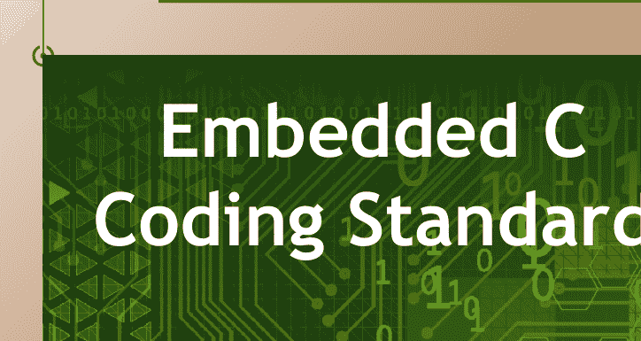

# Embedded C 编码标准：零缺陷……彻底杜绝

当然，编码标准本身无法消除复杂嵌入式系统中的所有漏洞。本编码标准是“零缺陷……彻底™”固件设计方法的一部分。“零缺陷……彻底”强调了开发者培训、软件和系统架构、轻量高效流程以及团队或组织文化在防止漏洞产生方面的关键作用。

采用此编码标准的其他重要原因包括提高软件的可读性和移植性，以便以更低的成本对固件进行维护和重用。编码标准通过减少个人理解或审查同行工作所需的时间，使开发团队和大型组织获益。

# 指导原则

本编码标准根据以下指导原则制定，这些原则旨在使作者集中注意力，并消除有时被程序员视为个人风格偏好的项目之间的冲突：

1. 个人程序员并不拥有他们编写的软件。所有软件开发都是为雇主或客户提供的雇佣工作，因此最终产品应该以专业的方式构建。

2. 防止漏洞进入代码比在漏洞进入后找到它并消灭它要便宜且也更简单。这场战斗中的关键策略是编写代码，使得编译器、链接器或静态分析工具能够自动检测漏洞——即在代码执行之前。

3. 无论好坏（嗯，主要是坏处），ISO “标准” C 编程语言允许编译器实现者的决策存在大量的变数。许多被称为“实现定义的”、“未指定的”和“未定义的”的行为，以及“特定区域选项”，意味着从相同 C 源代码编译的程序在运行时可能非常不同。语言标准中的这些灰色地带极大降低了未精心编写的 C 程序的移植性。

4. 本编码标准将代码可靠性和移植性置于执行效率或程序员便利性之上。

5. 软件程序中的漏洞有很多来源。原始程序员产生了一些漏洞。其他漏洞源于后期维护、扩展、移植和/或重用代码的人的误解。

   - 原始程序员引入的漏洞数量和程度可以通过严格遵守某些编码实践来减少，例如将常量放在等效（`==`）测试的左侧。
   - 维护程序员引入的漏洞数量和程度也会受到原始程序员的影响。例如，适当使用可移植固定宽度整数类型（如 `int32_t`）可以确保代码未来的任何移植都不会遇到意之外的溢出。
   - 维护程序员引入的漏洞数量和程度也可以通过自律使用一致的注释和风格实践来减少，使组织中的每个人都能更容易理解变量、函数和模块的含义和正确用法。

6. MISRA《C 语言使用指南》比本编码标准更严格——但具有研究价值。对任何 MISRA-C 强制或建议性规则的偏离都应审慎考虑。MISRA-C 指南的作者对在安全关键系统中使用 C 语言的风险非常清楚。我们与 [MISRA04] 之间少数已的分歧已在本标准的脚注中列出。Netrino 编码标准的遵循者可能希望在采用此处找到的规则外，额外采用 MISRA-C 的其他规则。

7. 为了确保有效，编码标准必须具有可执行性。每当两个或多个竞争性规则都能同样有效地防止错误，但只有其中一条规则可以自动执行时，建议采用更具执行性的规则。

在缺少所需规则或规则之间冲突的情况下，应应用上述原则的精神来指导决策。

# 执行指南

遵守本编码标准是强制性的。

不符合标准的代码应修改为符合这些最低标准。应通过自动化扫描、正式代码审查或非正式发现来检测并移除不符合的代码。所有提交发布的软件代码都应符合这些标准，除非已获得偏离许可。

# 偏离程序

在项目层面，允许采用另一种编码标准（例如客户或合作伙伴的编码标准）。在这种情况下，项目团队的所有成员都应遵循所选的编码标准。

在模块层面，只有在项目经理批准的情况下才允许偏离本编码标准。偏离原因和批准人姓名应尽可能靠近偏离发生的范围进行说明。例如，函数中的单个偏离应记录在该函数内部或上方的块注释中，以对后续读者最有帮助为准。

# 致谢

尽管书封面上只有我一个人的名字，但 Netrino 嵌入式 C 编码标准的开发是一项协作工作，涉及了 Netrino 的许多人员以及嵌入式软件社区的其他成员。我特别感谢 Nigel Jones、Jack Ganssle、Jean Labrosse 和 Miro Samek 出版早期的固件编码标准；感谢 Netrino 的 Joe Perret 和 Salomon Singer 大力推动了该项目；感谢 Andrew Girson 为实现“零缺陷”目标做出的无数讨论；感谢 Elizabeth Gallaresi 处理各种细节；并感谢所有提供重要反馈的众多技术评审员，包括 Mike Ficco、JR Simma、Dan Smith、Michael Wilk 以及已列出的其他人员。

## 1.1 使用哪种 C？

规则：

- a. 所有程序应按照最新的 C 语言 ISO 标准编写 [C99]。
- b. 每当使用 C++ 编译器时，应设置相应的编译器选项，将语言限制为编译器支持的最新标准 C 子集。
- c. 专有编译器语言关键字扩展、#pragmas 和内联汇编的使用应保持在完成任务所需的最低限，并限制在直接与硬件接口的少数设备模块中。

**推论：** 即使是“标准”C 也会随编译器而异，但我们需要尽可能通用的平台来实现后续的规则和执行机制。C++ 是一种不同的语言，不应在同一设计中混合使用 C++ 和 C；C++ 程序员应该查阅 Netrino 的嵌入式 C++ 编码标准，该标准与本文档有实质区别。

**异常：** 无。

**执行：** 违反此规则的行为应在每次构建时通过自动化扫描检测。

## 1.2 行宽

规则：

- a. 程序中所有行的长度应限制为最大 80 个字符。

**推论：** 代码审查和其他检查有时会在打印的页面上进行，这些页面必须没有分散注意的自动换行，也不有缺失（即超出右边距）的字符。行宽规则还便于屏幕上的侧并对比代码差异。

**异常：** 无。

**执行：** 违反此规则的行为应在每次构建期间通过自动化扫描检测到。

## 1.3 大括号

规则：

- a. 在 `if`、`else`、`switch`、`while`、`do` 和 `for` 语句之后，大括号应始终围绕代码块（即复合语句）；紧随这些关键字的单语句也应用大括号括围。
- b. 每个左大括号（`{`）应位于其开启的代码块开始下方的单独行。对应的右大括号（`}`）应在文件适当的行数后单独出现。

**推论：** 空语句和未用大括号括围的单语句存在巨大的风险。当附近的代码被更改或注释掉时，此类代码结构往往会引发错误。通过一致地使用大括号可以完全消除这种风险。

**异常：** 无。

**执行：** 构建时应通过自动化工具强制要求每个 `if`、`else`、`switch`、`while`、`do` 和 `for` 之后出现左大括号。应使用相同或另一个工具强制所有左大括号与相同缩进级别的右大括号配对。

## 1.4 括号

规则：

- a. 不要依赖 C 的运算符优先级规则，因为这些规则对于维护代码的人来说可能并不直观。为了提高清晰度，请使用括号（并将长语句拆分为多行代码）以确保操作序列中正确的执行顺序。
- b. 除非是单个标识符或常量，逻辑 `&&` 和 `||` 运算符的每个操作数都应用括号括。

示例：

```
if ((a < b) && (b < c))
{
    result = (3 * a) + b;
}
return result;
```

**异常：** 无。

**执行：** 这些规则应在代码审查期间执行。

## 1.5 常用缩写

规则：

- a. 除非其含义在工程社区中被广泛且一致地理解，否则应避免使用缩写和术语。下表列出了常用缩写及其含义。
- b. 应在版本控制文档中维护一个额外的项目特定缩写和术语表。

示例：参见附录 C。

**异常：** 与本标准中的常用缩写不冲突的项目特定缩写可以按上述方式添加。

**执行：** 在代码审查期间应强制执行这些缩写的一致使用。

## 1.6 强制转换

规则：

- a. 每个强制转换都应带有相关的注释，描述代码如何确保在右侧所有可能的值的范围内维持正确的行为。

示例：

```
int
abs (int arg)
{
    return ((arg < 0) ? -arg : arg);
}
```

```
unsigned int y;
y = adc_read();
z = abs((int) y); // 一个风险的转换。
```

**原理：** 强制转换是危险的。在上面的示例中，无符号的 `y` 可以取比符号整数更大的正值范围。在这种情况下，绝对值也将是不正确的。上面的强制转换可能是为了消除关于可能丢失精度的重要警告。

**异常：** 无。

**强制执行：** 这些规则应在代码审查期间执行。

## 1.7 关键字

规则：

- a. 不应使用 `auto` 关键字。
- b. 不应使用 `register` 关键字。
- c. 不应使用 `goto` 关键字。
- d. 不应使用 `continue` 关键字。
- e. 不要在 `switch` 语句之外使用 `break` 关键字。

**原理：** `auto` 关键字是该语言一个不必要的历史特性。C语言的其他某些功能虽然用途，但带来的麻烦大于其价值。例如，`register` 关键字假设程序员比编译器聪明。`goto`、`continue` 和 `break` 关键字往往会导致意大利面代码（spaghetti code）。

**异常：** 无。

**强制执行：** 在新或修改的源代码中存在的这些关键字应在每次构建时通过自动化工具检测并报告。

## 1.8 重要关键字

规则：

- a. 应使用 `static` 关键字来声明所有不需要在声明定义的模块外部可见的函数和变量。
- b. 应在适当的情况下使用 `const` 关键字。示例包括：
    i. 定义初始化后不应更改的变量，
    ii. 定义不应被修改的引用传递函数参数（例如 `char const * param`），
    iii. 定义结构体和联合体中不应被修改的字段（例如在内存映射 I/O 外设寄存器的结构体覆盖中），以及
    iv. 作为数值常量的 `#define` 的强类型替代方案。
- c. 应在适当的情况下使用 `volatile` 关键字。示例包括：
    i. 声明被任何中断服务程序（通过当前使用或范围）访问的全局变量，
    ii. 声明被两个或多个任务（通过当前使用或范围）访问的全局变量，
    iii. 声明指向内存映射 I/O 外设寄存器集的指针（例如 `timer_t volatile const p_timer`），以及
    iv. 声明延迟循环计数器。

**原理：** C语言的 `static` 关键字有多种含义。在模块级，声明为 `static` 的全局变量和函数受不受外部使用的保护。像这样过度使用 `static` 减少了模块之间的耦合。`const` 和 `volatile` 关键字更为重要。尽可能使用 `const` 的优点是可以通过编译器强制保护，防止对应该是只读的数据进行意外写入。恰当使用 `volatile` 可以防止编译器消除对变量或寄存器的请求读或写优化，从而消除一整类难以检测的错误。

**异常：** 无。

**强制执行：** 应在代码审查期间强制恰当使用这些重要关键字。

## 2.1 可接受的格式

规则：

- a. C++ 风格的单行注释（即以 `//` 开头）是传统 C 风格注释（即 `/* ... */`）有效且可接受的替代方案。
- b. 注释绝不能嵌套。
- c. 注释绝不能用于禁用一段代码，即使是暂时的。
    i. 要临时禁用一段代码，请使用预处理器的条件编译功能（例如 `#if 0 ... #endif`）。发布候选源代码中不应保留任何临时禁用的代码块。
    ii. 任何专门为了增加调试输出信息水平而存在的行或代码块都应被 `#if 0 ... #endif` 围起来。

**推论：** 遵循这些规则可以产生良好的注释。良好的注释会产生良好的代码。遗憾的是，源代码和文档很容易随着时间的推移产生偏差。防止这种现象最好的方法是让文档与代码尽可能接近。Doxygen 是一个非常有用的工具，可以在代码更改时重新生成描述项目模块、函数和参数的文档。

**异常：** 单项目可能会对超出模板文件的 Doxygen 特性使用进行标准化处理。

**执行：** 在代码审查期间应对注释的质量进行评估。代码审查人员应关注注释是否准确描述了代码，并确保它们清晰、简洁且有价值。例如，应当自动重新生成 Doxygen 生成的文档文件（如 HTML 或 PDF），并作为软件构建过程的一部分。

## 2.2 位置与内容

规则：

- a. 所有注释应用清晰完整的句子编写，并有正确的拼写和语法。
- b. 最有注释通常位于代码块之前。每个此类块后应留一个空行。
- c. 避免解释显而易见的事。假设读者了解编程语言。
- d. 单个注释块的数量和长度应与其描述的代码的复杂度成正比。
- e. 每当算法或技术细节来自出版源时，注释应包含对原始来源足够的引用（通过书名、网站 URL 或细节），以便代码读者找到引用的材料。
- f. 每当需要流程图或其他图来充分记录代码时，图表应与源代码一起进行版本控制，注释应通过文件名或标题引用该图。
- g. 所有假设都应在注释中列出。
- h. 每个模块和函数都应以适用于 Doxygen 自动生成文档的方式注释。
- i. 使用以下大写的注释标记来突出重要问题：
    ii. `WARNING：`：警告维护者更改此代码存在风险。例如，延迟循环计数器的终点值是通过实验确定的，在代码迁移或调整优化级别时可能需要更改。
    iii. `NOTE：`：提供关于代码块“为什么”的描述性注释——与通常放在注释中的“如何做”区分来。例如，一段驱动程序代码偏离数据手册是因为芯片存在错误（errata）。或者原始程序员做了某个假设。
    iv. `TODO：`：表示代码某个区域仍在构建中，并解释了剩余需要完成的工作。在适当的情况下，可以在 TODO 之前包含全大写的程序员姓名或缩写（例如 `MJB TODO:`）。

示例：

```
// Step 1: Batten down the hatches.
for (int hatch = 0; hatch < NUM_HATCHES; hatch++)
{
    if (hatch_is_open(hatches[hatch]))
    {
        hatch_close(hatches[hatch]);
    }
}
```

```
// Step 2: Raise the mizzenmast.
// TODO: Define mizzenmast driver API.
```

## 3.1 空格

规则：

- a. 每个关键字 `if`、`else`、`while`、`for`、`switch` 和 `return` 后面都应始终紧跟一个空格。
- b. 每个赋值运算符 `=`、`+=`、`-=`、`*=`、`/=`、`%=`、`&=`、`|`、`^`、`~` 和 `!=` 前后都应始终紧跟一个空格。
- c. 每个二元运算符 `+`、`-`、`*`、`%`、`<`、`<=`、`>=`、`==`、`!=`、`<<`、`>>`、`&&`、`||` 前后都应始终紧跟一个空格。
- d. 每个一元运算符 `+`、`-`、`++`、`!` 和 `~` 在编写时，操作数一侧应始终不留空格，而另一侧应留一个空格。
- e. 指针运算符 `*`、`&` 在声明中两侧均应留空格，但在其他情况下操作数周围不应有空格。
- f. 组成三元运算符的 `?` 和 `:` 字符前后都应始终紧跟一个空格。
- g. 结构体指针和结构体成员运算符（分别为 `->` 和 `.`）周围不应始终有空格。
- h. 数组下标运算符的左右括号（`[` 和 `]`）周围不应始终有空格。
- i. 括号内的表达式与左、右括号字符之间应始终不留空格。
- j. 函数调用运算符的左右括号周围不应始终有空格，但函数声明的函数名和左括号之间应留有一个空格，以便于快速定位该函数名的特定引用。
- k. 每个分隔函数参数的逗号后面都应始终紧跟一个空格。
- l. 每个分隔语句元素的分号后面都应始终紧跟一个空格。
- m. 每个分号应紧跟在它终止的语句之后，且前面不应有空格。

**原因：** 空格的放置与程序文本的放置同样重要。良好使用空格可以减少视觉疲劳，并提高代码作者和审查人员发现潜在 bug 的能力。

**异常：** 无。

**执行：** 这些规则应通过自动化工具（如代码格式化工具）执行。

## 3.2 对齐

规则：

- a. 一系列声明中的变量名其首字符应对齐。
- b. 结构体和联合体成员名的首字符应对齐。
- c. 相邻赋值语句块中的赋值运算符应当对齐。


## 预处理指令

规则：

- d. 预处理指令中的 `#` 始终应位于第 1 列，除非在 `#if` 或 `#ifdef` 序列中进行缩进。

**原因：** 视觉对齐强调了相似性。包含变量声明的一系列连续行很容易被识别并理解为一个块。应使用空行和不相关的对齐来在视觉上区分相邻的不相关的代码块。

**异常：** 无。

**执行：** 这些规则应在代码审查期间执行。

## 空行与格式

规则：

- a. 每行代码不应包含超过一个语句。
- b. 在每个自然代码块的前后都应有一个空行。自然代码块的示例包括循环、`if-else` 和 `switch` 语句以及连续的声明。
- c. 每个源文件末尾应有一个空行¹¹⁰。

**原因：** 恰当放置空格可以提供视觉隔离，并使代码更易阅读和理解，就像本编码规范中段落之间的空格有助于可读性一样。

**异常：** 无。

**执行：** 这些规则应在代码审查期间执行。

> ¹¹⁰ 这是为了可移植性，因为某些编译器要求空行。

## 3.4 缩进

规则：

- a. 模块内的每个缩进级别应由 4 个空格组成。
- b. 在 `switch` 语句中，每个 `case` 语句应当缩进；`case` 块的内容再缩进一次。
- c. 当一行代码过长无法放入最大行宽时，以最可读的方式对第二行及任何后续行缩进。

示例：

```
sys_error_handler(int err)
{
    switch (err)
    {
        case ERR_FIRST:
            ...
            break;
        default:
            ...
            break;
    }
}
```

```
// 故意未对齐的缩进；知道为什么吗？
if ((first_long_comparison_here
    && second_long_comparison_here
    || third_long_comparison_here)
{
    ...
}
```

**原因：** 少的缩进空格会增加视觉混乱风险，而更多的空格会增加换行的概率。

**异常：** 对于缩进方式不同的旧代码模块，除非预计将修改大量代码，否则不更改其缩进。在这种情况下，应在独立的版本控制步骤中更改整个模块的缩进。这是因为更改缩进的副作用是丢失差异跟踪。因此，应将代码更改与缩进的更改分开。

规则：

- a. 任何模块内禁出现制表符。

**原因：** 制表符的宽度随编辑器和程序员的偏好而异，使得在审查和维护期间一致的视觉布局是一个不断的难题。

**异常：** 旧代码模块中的现有制表符除非预计修改大量代码，否则不消除。在这种情况下，应在独立的版本控制步骤中消除整个模块的制表符。这是因为消除制表符的副作用是丢失差异跟踪。因此，应将代码更改与空格更改分开。

**执行：** 每次构建时应通过自动扫描确认新或修改代码中不存在制表符。

规则：

- a. 在可能的情况下，所有源代码行应仅以单个字符 `LF` (0x0A) 结束。

**原因：** 在多平台环境中，多字符序列 `CR-LF` (0x0D 0x0A) 比单个字符 `LF` 更引起问题。此类问题与 Unix 平台上的多行预处理器宏有关。

**异常：** 无。

**执行：** 在可能的情况下，程序员的编辑器应配置为使用 `LF`。此外，自动化工具应在每次构建扫描所有新或修改的源文件，将每个 `CR-LF` 序列替换为 `LF`。

## 4.1 命名规范

规则：

- a. 所有模块名称应完全由小写字母、数字和下划线组成。文件名中不允许出现空格。
- b. 所有模块名称的前八个字符必须唯一，`.h` 和 `.c` 分别用作头文件和源文件的后缀。
- c. 任何模块名称都不应与标准库头文件重名。例如，模块不应为 `stdio` 或 `math`。
- d. 任何包含 `main()` 函数的模块其文件名中应包含 `main` 单词。

**理由：** 多平台工作环境（例如 Linux 和 Windows）是常态而非例外。为了支持最广泛的范围，文件名应满足能力最弱平台的限制。此外，由于可能出现名称相似但大小写不同的文件导致混淆，混合大小写的名称容易出错。在文件名中包含 `main` 对维护者非常有帮助，且已被证明是很有用的.¹¹¹

**异常：** 无。

**强制措施：** 应由自动化工具确认在每次构建中使用的所有文件名都与这些规则一致。

> ¹¹¹ 我们遇到过某公司的一个项目拥有超过 200 个包含名为 `main()` 函数的文件。

## 4.2 头文件

规则：

- a. 每个源文件必须有且仅有一个头文件，并且它们具有相同的根名称。
- b. 每个头文件应包含一个防止重复包含的预处理器保护，如下例所示。
- c. 头文件应仅标识其他模块严格需要知道的程序、常量和数据类型（通过原型或宏、`#define` 以及 `struct`/`union`/`enum` `typedef` 定义）。
    - i. 建议不要在头文件中定义（通过 `extern`）变量。
    - ii. 不应在头文件中为任何变量声明存储（存储空间）。
- d. 任何头文件都不应包含 `#include` 语句。

示例：

```
#ifndef ADC_H
#define ADC_H
...
#endif /* _ADC_H */
```

**理由：** 语言标准默认赋予所有变量和函数全局作用域。这种做法的缺点是模块之间存在不必要的（且是危险的）耦合。为了减少模块间的耦合，应尽可能将程序、常量、数据类型和变量隐藏在模块的源文件中。

**异常：** 对于核心应用模块，偏离通用根名称规则是可以接受的（例如，“foomain.c”包含 `main()`，其头文件可以是“foo.h”）。在某些情况下，可能需要跨模块共享全局变量。每当这样做时，该变量应以模块前缀命名，声明为 `volatile`，并在每个访问处始终保护免受竞态条件的影响。

**强制措施：** 这些头文件规则应在代码审查期间执行。

## 4.3 源文件

规则：

- a. 每个源文件应仅包含控制一个“实体”的相关行为。实体的示例包括封装的数据类型、活动对象、外设驱动程序（例如用于 UART）以及通信协议或层（例如 ARP）。
- b. 每个源文件应按列出的顺序包含部分或全部以下部分：注释块；数据类型、常量和宏的定义；静态数据声明；私有函数原型；公共函数定义体；然后是私有函数定义体。
- c. 每个源文件应始终 `#include` 同名的头文件（例如，文件 `adc.c` 应 `#include “adc.h”`），以便编译器确认每个公共函数及其原型相匹配。
- d. 包含文件名中不应使用绝对路径。
- e. 每个源文件应不包含未使用的包含文件。
- f. 任何源文件都不应 `#include` 另一个源文件。

**理由：** 源文件模块的目的和内部布局对所有维护者应该是清晰的。例如，公共函数通常是最感兴趣的，因此出现在其调用的私有函数之前。至关重要的一点是每个函数声明都要由编译器与其原型进行匹配。

**异常：** 无。

**强制措施：** 在每次构建之前，自动化工具应扫描源文件，以确保它们 `#include` 自己的头文件，但不包含未使用的头文件。`Lint` 是可以配置为自动执行第二次检查的工具示例。

## 4.4 文件模板

规则：

- a. 应在项目级维护一套头文件和源文件的模板。建议的模板请参见附录 A 和附录 B。

**理由：** 从模板开始每个新文件可以确保文件头注释块的一致性，并确保包含适当的版权声明。

**异常：** 无。

**强制措施：** 注释块格式的一致性应在代码审查期间执行。

## 5.1 命名规范

规则：

- a. 所有新数据类型（包括结构体、联合和枚举）的名称应仅由小写字母和内部下划线组成，并以 `_t` 结尾。
- b. 所有新的结构体、联合和枚举应通过 `typedef` 命名。

示例：

```
typedef struct
{
    uint16_t count;
    uint16_t max_count;
    uint16_t _unused;
    uint16_t control;
} timer_t;
```

**理由：** 类型名和变量名通常相似。例如，外设中的一组定时器控制寄存器可以命名为 `timer`。为了区分定义寄存器布局的结构体定义，创建一个具有不同名称的新类型（如 `timer_t`）非常有价值。如果需要，可以使用该相同类型创建定时器寄存器的影子拷贝，例如称为 `timer_shadow`。

**异常：** 对于匿名结构体和联合，没有必要使用 `typedef`。

**强制措施：** 在每次构建之前，自动化工具应扫描新的或修改的代码，以确保 `struct`、`union` 和 `enum` 关键字仅在 `typedef` 语句或匿名声明中使用。

## 5.2 固定宽度整数

规则：

- a. 每当整数值的宽度（位或字节）在程序中很重要时，应使用固定宽度类型之一代替 `char`、`short`、`int`、`long` 和 `long long`。有符号和无符号固定宽度类型如下表所示.¹²
- b. 不应使用关键字 `short` 和 `long`。
- c. 关键字 `char` 的使用应限制在字符串的声明和操作上。

| 整数宽度 | 有符号类型 | 无符号类型 |
| --- | --- | --- |
| 8 位 | `int8_t` | `uint8_t` |
| 16 位 | `int16_t` | `uint16_t` |
| 32 位 | `int32_t` | `uint32_t` |
| 64 位 | `int64_t` | `uint64_t` |

> ¹² 如果程序执行速度也是考虑因素，请注意 [C99] 标准定义了一组“最快”固定宽度类型。例如，`uint_fast8_t` 是存储 8 位无符号数据的快速整数类型。

**理由：** [C90] 标准允许 `char`、`short`、`int`、`long` 和 `long long` 类型的宽度取决于实现，这导致了可移植性问题。[C99] 标准没有解决这个问题，但引入了统一的类型名称，这些名称定义在 C99 头文件 `<stdint.h>` 中。

**异常：** 在没有符合 C99 的编译器的情况下，允许基于 `char`、`short`、`int`、`long` 和 `long long` 通过 `typedef` 定义上表中的固定宽度类型集。如果这样做了，请使用编译时检查（如静态断言）让编译器标记错误的类型定义。在使用 C 标准库函数时，使用原生类型是可以接受的——只需留心。

**强制措施：** 每次构建时，自动化工具应扫描并标记 `short` 和 `long` 关键字的使用，这些是不允许使用的。其他规则的合规性应在代码审查期间检查。

## 5.3 有符号整数

规则：

- 不应在有符号整数类型中定义位域（Bit-fields）。
- 不应使用任何位运算符（即 `&`、`|`、`^`、`<<` 和 `>>`）来操作有符号整数数据。
- 在比较或表达式中，不应将有符号整数与无符号整数混合。为了这一点，意用于无符号的十进制常量应在末尾加上 `u`。

示例：

```c
uint8_t a = 6u;
int8_t b = -9;
if (a + b < 4)
{
    // 这条正确的路径应该被执行
    // 如果 -9 + 6 的结果是 -3 < 4，如预期那样。
}
else
{
    // 这条错误的路径实际上被执行
    // 因为 -9 + 6 变成了 (0xFF - 9) + 6 = 252。
}
```

**原因：** 在有符号整数容器内操作二进制数据的多个细节属于 C 标准中的“实现定义行为”（implementation-defined behaviors）。此外，混合有符号和无符号数据的结果可能导致与数据相关的错误。

**异常：** 无。

**强制：** 可以使用静态分析工具来检测对这些规则的违反。

## 5.4 浮点数

规则：

- a. 尽可能避免使用浮点数常量和变量。定点运算可能是另一种替代方案。
- b. 当需要进行浮点计算时：
    i. 使用 [C99] 类型名 `float32_t`、`float64_t` 和 `float128_t`。
    ii. 在所有单精度常量后加上 `f`（例如 `pi = 3.1415927f`）。
    iii. 如果你的数学计算依赖于双精度，请确保编译器支持它。
    iv. 永远不要测试浮点值的相等或不相等性。

示例：

```c
// 确保编译器支持双精度。
#include <limits.h>
#if (DBL_DIG < 10)
  #error "Double precision is not available!"
#endif
```

**原因：** 错误地使用浮点运算会产生大量的错误风险；这些风险超出了本文的范围¹¹³ 默认情况下，C 将所有浮点数常量提升为双精度，这在目标平台上可能效率低下或不受支持。然而，许多微控制器对浮点运算没有任何硬件支持。编译器可能不会警告这些不兼容性，而是通过链接一个大型（通常为几 KB 代码）且缓慢（每次操作需要许多指令周期）的浮点仿真库来执行请求的数值操作。

**异常：** 无。

**强制：** 这些规则应在代码审查期间执行。

> ¹³ [Seacord] 在第 6 章对这些问题进行了很好的解释并提供了一些建议指南。

## 5.5 结构体与联合体

规则：

- 应采取适当措施，防止编译器在用于与外设通信或通过总线或网络与另一个处理器通信的结构体（`struct`）或联合体（`union`）类型中插入填充字节（padding bytes）。
- 应采取适当措施，防止编译器更改位域（bit-fields）内预期的位顺序¹¹⁴

**原因：** 在结构体和联合体领域存在大量的实现定义行为。特别是位域，面临着严重的的可移植性问题，包括缺乏标准的位排序，并且对它们经常调用的固定宽度整数类型没有官方支持。

**异常：** 无。

**强制：** 这些规则应在代码审查期间执行。

> ¹⁴ 包括静态断言（static assertions）或其他编译时检查，以及使用预处理器指令从两个竞争的结构体定义中选择其一。

## 6.1 命名规范

规则：

- a. 程序的名称不应该是 C、C++ 或任何其他已知 C 编程语言扩展的关键字，特别是 K&R C 和 C99。受限名称包括 `interrupt`、`inline`、`class`、`true`、`false`、`public`、`private`、`friend`、`protected` 等。
- b. 程序的名称不应与 C 标准库中的函数重叠。此类名称的示例包括 `strlen`、`atoi` 和 `memset`。
- c. 程序名称不能以下划线开头。
- d. 程序名称长度不应超过 31 个字符¹¹⁵
- e. 函数名称不应包含任何大写字母。
- f. 宏名称不应包含任何小写字母。
- g. 使用下划线分隔程序名称中的单词。
- h. 每个程序的名称应描述其用途。注意，程序封装了程序的“动作”，因此在名称中使用动词会大有益处（例如 `adc_read()`）；建议使用这种“名词-动词”的词序。或者，程序也可以根据它们回答的问题来命名（例如 `led_is_on()`）。
- i. 所有公共函数的名称应以... 为前。

**原因：** 良好的命名让审查变得更容易。使用前缀是非常重要的。

**异常：** 无。

**强制：** 对这些规则的遵守情况应在代码审查期间确定。

## 函数设计规则

规则：

- a. 应努力将每个函数的长度保持在 50-100 行左右。
- b. 只要可能，所有函数应只有一个出口点。
- c. 允许有多个出口点，但最多出现一次¹⁶
- d. 每个函数都应定义一个原型（prototype）。
- e. 所有私有函数都应该是静态的（`static`）。
- f. 每个参数都应有意义地命名。

示例：

```c
int state_change (int event)
{
    int result = ERROR;

    if (EVENT_A == event)
    {
        result = STATE_A;
        // 不要在此处返回。
    }
    else
    {
        result = STATE_B;
    }

    return (result);
}
```

## 宏与内联函数

规则：

- a. 如果可以使用内联函数（`inline function`）完成相同任务，则不应使用参数化宏¹⁷
- b. 如果出于某些原因使用了参数化宏，则适用以下规则：
    i. 用括号包裹整个宏体。
    ii. 用括号包裹每个参数的使用。
    iii. 每个参数的使用不要超过一次，以避免意外的副作用。

示例：

```c
// 不要这样做 ...
#define MAX(A, B) ((A) > (B) ? (A) : (B))
```

```c
// ... 如果你可以这样做的话¹⁸
inline int max(int a, int b)
```

> ¹⁷ [C99] 正式将 C++ 的 `inline` 关键字引入 C语言。
> ¹⁸ 注意，对于每个基础类型都需要单独函数来进行比较。

## 任务函数命名

规则：

- a. 所有表示任务（即线程）的函数应赋予以 `_task`（或 `_thread`）结尾的名字。

示例：

```c
void
alarm_task (void * p_data)
{
    alarm_t alarm = ALARM_NONE;
    int err = OS_NO_ERR;

    for (;;)
    {
        alarm = OsmboxPend(alarm_mbox, &err);
        // Process alarm here.
    }
}
```

**原因：** 实时操作系统 (RTOS) 中的每个任务都像一个微型 `main()`，通常在无限循环中永久运行。在代码审查和调试期间，能够易地识别这些重要函数是有价值的。

**例外：** 也可以使用 `_thread`。

**强制执行：** 这一命名规范应在详细设计阶段和代码审查中执行。

## 中断服务程序

规则：

- a. 中断服务程序 (ISR) 不是普通函数。必须通过 `#pragma` 或编译器特定的关键字（如 `__interrupt`）告知编译器该函数是一个 ISR。


# 嵌入式 C 编码标准

## ISR 实现规则

- b. 所有实现 ISR 的函数应赋予以 `_isr` 结尾的名字。

- c. 为了确保 ISR 不会在无意中从软件的其他部分调用（如果发生，可能会损坏 CPU 和调用栈），每个 ISR 函数不应具有原型，应声明为 `static`，并位于相关驱动模块的末尾。²⁰

- d. 在向量表中所有意外或未处理的中断源位置应安装一个存根（stub）或默认 ISR。每个此类存根将尝试禁用未来的相同类型中断（例如在中断控制器处），并调用 `assert()`。²¹


²⁰ 注意，智能静态分析工具（如 lint）可能会对这种不可达性报错。

²¹ 虽然这不能防止任何 bug，但它确实有助于发现硬件 bug 并使系统更健壮。

**理由：** ISR 是硬件的扩展。根据定义，它与顺序执行代码是相互异步的。如果它们共享全局数据，则必须在顺序执行代码中通过禁用中断来保护该数据。ISR 不得在操作系统内部阻塞或等待变量或寄存器的值改变。

**例外：** 无。

**强制执行：** 这些规则应在代码审查期间执行。

## 7.1 命名规范

规则：

- 变量名不能是 C、C++ 或任何其他已知 C 编程语言扩展的关键字，特别是 K&R 和 C99。限制名称包括 `interrupt`、`inline`、`restrict`、`class`、`true`、`false`、`public`、`private`、`friend` 和 `protected`。

- 变量名不能与 C 标准库中的变量名重叠（例如 `errno`）。

- 变量名不能以下划线开头。

- 变量名长度不能超过31个字符。

- 变量名不能少于3个字符，包括循环计数器。22

- 变量名不能包含任何大写字母。

> 22 这是因为你无法对“i”进行有意义的全局搜索。

- g. 变量名不应包含在其他地方被指出的数值，例如数组的元素数量或底层类型的位数。

- h. 应使用下划线分隔变量名中的单词。

- i. 每个变量的名字应描述其用途。

- j. 所有全局变量的名字应以字母 ‘g’ 开头。例如，`g_zero_offset`。

- k. 所有指针变量的名字应以字母 ‘p’ 开头。例如，`*p_led_reg`。

- l. 所有二级指针变量的名字应以字母 `pp` 开头。例如，`gpp_vector_table`。

- m. 所有包含“有效布尔值”信息（即 0 与非零）的整数变量的名字应以字母 ‘b’ 开头，并以它们回答的问题的形式表述。²³ 例如，`b_done_yet` 或 `gb_is_buffer_full`。

> ³ 在 C 中，定义如 `TRUE` 等常量（其中 `TRUE` 等于 1）是不安全的。然而，将“有效布尔值”整数值与 0 进行比较是安全的。例如，测试“if (!gb_buffer_is_full)”是安全的且符合规则 13.2。

**理由：** 采用这些基本规则是为了最大化跨编译器的代码移植性。许多 C 编译器只识别变量名前31个字符的区别，并保留了以下划线开头的名称作为内部名称。其他规则旨在强调风险并确保变量的正确使用。

**例外：** 无。

**强制执行：** 这些变量命名规则应在代码审查期间执行。

（建议性）参考 [MISRA04]。另注意 [C99] 添加了 `<stdbool.h>`，它定义了 `bool` 类型以及常量 `true` 和 `false`。

## 7.2 初始化

规则：

- a. 所有变量在使用之前均应初始化。

- b. 最好在需要时创建变量，而不是在函数顶部创建。24


示例：

```c
for (int loop = 0; loop < MAX_LOOPS; loop++)
{
  ...
}
```

**理由：** 许多程序员假设运行时会处理它们。将变量放置在其使用的地方有助于可读性。25。

**例外：** 无。

> 25 一项研究 ([Uwano]) 证明了将变量放置在其使用的地方的重要性。

强制执行：自动化工具应在初始化之前扫描所有源代码。Lint 是可以实现此点的工具示例。

## 8.1 变量声明

规则：

- a. 变量声明内部不应使用逗号（','）运算符。

示例：

```c
char * x, y; // y 应该是指针吗？
```

**理由：** 每个声明单独占据一行成本较低。相比之下，编译器或维护者误解你的意图的风险很高。

**例外：** 无。

## 8.2 if-else 语句

规则：

- a. if 和 else 子句最短（按代码行数计算）的应放在前面。²⁶

- b. 嵌套的 if-else 语句深度应超过两层。使用函数调用或 switch 语句来降低复杂度。

- c. 不应进行赋值。

- d. 任何带有 else if 子句的 if 语句应以 else 子句结尾。⁷


> ²⁶ 感谢 [Holub] 将这种“为了可读性进行格式化”的想法转化为文字。

> ²⁷ 这等于在每个 switch 中都要求一个 default 情况，如下所示。

示例：

```c
if (NULL == p_object)
{
    result = ERR_NULL_PTR;
}
else if (p_object = malloc(sizeof(object_t))) // 不！
{
    ...
}
else{
    // 正常处理步骤，
    // 这需要很多行代码。
    ...
}
```

**理由：** 长的子句会分散人类眼睛对决策路径逻辑的注意力。通过将较短的子句放在前面，决策路径变得更容易遵循。（而且更容易遵循总是有助于减少 bug。）

**强制执行**：这些规则应在代码审查期间执行，当审查人员认为这有助于提高可读性时。

## 8.3 switch 语句

规则：

- a. 每个 `case` 的 `break` 应当缩进与相关的 `case` 对齐，而不是与 `case` 代码块的内容对齐。

- b. 所有 `switch` 语句都应包含一个 `default` 块。

示例：

```c
switch (err)
{
    case ERR_A:
        ...
    break;

    case ERR_B:
        ...
    break;

    default:
        ...
    break;
}
```

嵌入式 C 编码标准

**理由**：`switch` 语句强大，但容易产生错误，例如遗漏 `break` 语句和未处理的情况。通过对齐 *case* 和 *break* 关键字，可以发现缺失的 *breaks*。

**例外**：无。

**强制执行**：这些规则可以通过在每次构建期间对所有新或修改的代码进行自动扫描来执行。或者，它们应在代码审查中执行。

## 8.4 循环

规则：

- a. 魔数不应作为 `while` 或 `for` 循环的初始值或终点测试。28

- b. 除了 `for` 语句第一个子句中的单个循环计数初始化外，不应在任何循环的控制表达式中进行赋值。

- c. 无限循环应通过控制表达式 “for (;;)” 实现。29

- d. 每个体为空的循环都应该有一组括号，其中包含注释以说明为什么在循环终止之前不需要执行任何操作。

示例：

```c
// 不要使用魔数 ...
for (int row = 0; row < 100; row++)
```

> 28 注意，`sizeof()` 在理论上是确定数组维度的方便方法，但当你传递指针而不是数组本身时，这种方法不起作用。因此，最可移植的方法是在数组声明和循环之间共享一个常量。

> 29 我们无法对 `while (1)` 提出任何有力的技术反对，但请注意 Kernighan & Ritchie 长期以来推荐 `for (;;)`，许多 C 程序员已经习惯了这种结构来构建无限循环。在这种情况下，一致性是唯一重要的事情。

嵌入式 C 编码标准

```c
{
    // ... 当你指的是常量时。
    for (int col = 0; col < MAX_COL; col++) {
        ...
    }
}
```

**理由**：将循环迭代次数与底层数据结构的大小同步始终非常重要。通过单个常量来实现可以防止一整类错误，这些错误是在当代码的一部分（例如数组维度）发生变化，作为操作数组的循环迭代器时产生的。使用命名常量也使代码更易读和维护。

**例外**：使用整数值 0 开始或结束循环是可以接受的（大多数人认为这不那么魔幻），例如从数组基或指向数组基迭代时。

**强制执行**：这些规则应在代码审查期间执行。

## 8.5 无条件跳转

规则：

- a. 如前所述，不应使用 `goto`、`continue` 和 `break` 关键字创建无条件跳转。

理由：利用无条件跳转移动指令指针的算法可以重写为更具可读性的方式，从而更容易维护。

**例外**：无。

强制执行：这些规则应通过对所有修改或新的模块进行自动扫描，以检查这些标记是否有不当使用。执行。

## 8.6 等价测试

规则：

- a. 在评估变量与常量值的相等性或不相等性时，始终将常量值放在比较操作符的左侧，如上面的 if-else 示例所示。

理由：在编译时检测可能的拼写错误和尽可能其他错误总是理想的；运行时发现可能对产品用户产生危险，并且需要大量精力来定位。通过遵循此规则，编译器可以检测出尝试给常量赋值新值的错误尝试（即使用 `=` 而不是 `==`）。

**例外**：无。

强制执行：应配置静态分析工具，对所有通常预期比较的赋值语句提出错误或警告。


嵌入式 C 编码标准

# 参考文献

- [Barr] Barr, Michael and Anthony Massa. “Programming Embedded Systems with C and GNU Development Tools,” 2nd Edition. O’Reilly, 2006.

- [C90] “ISO/IEC9899:1990, Programming Languages – C,” ISO, 1990.

- [C99] “ISO/IEC9899:1999, Programming Languages – C,” ISO, 1999.

- [Dictionary] Ganssle, Jack G. and Michael Barr. “Embedded Systems Dictionary.” CMP Books, 2003.

- [Ganssle] Ganssle, Jack G. “A Firmware Development Standard: Version 1.4,” The Ganssle Group, May 2007.

- [Hatton] Hatton, Les. “Safer C: Developing Software for High-Integrity and Safety-Critical Systems.” McGraw-Hill, 1994.

- [Holub] Holub, Allen I. “Enough Rope to Shoot Yourself in the Foot: Rules for C and C++ Programming,” McGraw-Hill, 1995.

- [IEC61508] “Functional Safety of Electrical/Electronic/ Programmable Electronic Safety-Related Systems,” International Electromechanical Commission, 1998.

- [Koenig] Koenig, Andrew. “C Traps and Pitfalls.” Addison-Wesley, 1988.

- [MISRA98] MISRA-C:2004 Guidelines for the Use of C in Critical Systems,” The Motor Industry Association, 2004.

- [Prinz] Prinz, Peter and Ulla. “C Reference.” O’Reilly, 2003.

- [Seacord] Seacord, Robert. “Secure Coding Standard,” 2009.

## 附录 A：头文件

```c
/** @file module.h
 * @brief 模块的描述。
 * @par
 */
#ifndef MODULE_H
#define MODULE_H

#ifdef __cplusplus
extern "C" {
#endif

int8_t max(int8_t a, int8_t b);

#ifdef __cplusplus
}
#endif

#endif /* MODULE_H */
```

## 附录 B：源文件

```c
/* @file module.c
 * @brief 模块的描述。
 *
 * @par
 */
#include "module.h"

/**
 * @brief 函数的描述。
 * @param[in] a a 的描述。
 * @param[in] b b 的描述。
 * @return int8_t
 */
int8_t
max (int8_t a, int8_t b)
{
    return ((a > b) ? a : b);
}
```

## 附录 C：标准缩写

| 缩写 | 含义 |
|---|---|
| adc | 模拟数字转换器 |
| avg | 平均 |
| b_ | 布尔值（即 0 或非零） |
| buf | 缓冲区 |
| cfg | 配置 |
| cmp | 比较 |
| curr | 当前 |
| dac | 数字模拟转换器 |
| ee | (串口)EEPROM |
| err | 错误 |
| g_ | 全局 |
| gpio | 通用输入输出引脚 |
| h_ | 句柄（指向） |
| init | 初始化 |
| io | 输入输出 |
| isr | 中断服务程序 |
| lcd | 液晶显示 |
| led | 发光二极管 |
| max | 最大 |
| mbox | 邮件邮箱 |
| mgr | 管理器 |
| min | 最小 |
| msec | 毫秒 |
| msg | 消息 |
| next | 列表中的下一个项 |
| nsec | 纳秒 |
| num | 数量（的） |
| p_ | 指针（指向） |
| pp_ | 指向指针的指针（指向） |
| prev | 列表中的上一个项 |
| prio | 优先级 |
| pwm | 脉宽调制 |
| q | 队列 |
| reg | 寄存器 |
| rx | 接收 |
| sem | 信号量 |
| str | 字符串（空终止） |
| sync | 同步 |
| temp | 温度 |
| tmp | 临时 |
| tx | 传输 |

³⁰ 注意不要缩写秒、分钟、小时、天、周、月或年。除其他因素外，此规则消除了分钟（minute）和最小（for“min”）之间的冲突。

| usec | 微秒 |

# 嵌入式 C 编码标准

采用此编码标准的主要原因是减少嵌入式软件（又称固件）以及维护人员后期添加或修改的代码中存在的 Bug 数量。当然，编码标准本身无法消除复杂嵌入式系统中的所有 Bug。该编码标准与其说是 Netrino **Zero Bugs...Period™** 设计方法论的一部分。

**Zero Bugs...Period (ZBP)** 方法论是一套轻量级的最佳实践系统，旨在防止 Bug 侵嵌入式软件。ZBP 解决了进度延误和固件漏洞等反复出现的问题。通过应用 ZBP 重叠的开发、架构和文化改进层，遵循该标准可以减少 Bug 并确保进度回归正轨。ZBP 强调了软件和系统架构的重要性，以及程序员技能和流程中的关键要素，如设计评审、代码评审和控制。

采用该标准的其他原因还包括提高软件的可读性和可移植性，以便以更低的成本对固件进行维护和复。编码标准通过减少理解或评审同行工作所需的时间，使开发团队和更大型组织受益。


# Zero Bugs...Period™

# 嵌入式 C 编码标准



# Michael Bart（巴尔特）

Michael Bart 是国际认可的嵌入式计算机系统设计专家。在该职位上，他曾在联邦和民事法庭提供过专家证言，出现在 PBS《美国商业评论》节目，并被多家报纸引用。

他还是两本书和四十多篇相关文章的作者，并且 Netrino **Zero Bugs...Period** 设计方法论的创立者。在三年半的时间里，Netrino 担任《嵌入式系统编程》（Embedded Systems Programming）的主编辑。

此外，Michael 一一直是嵌入式系统小组（Embedded Systems Group）的顾问委员会成员，在那里继续致力于数百万个产品的工作。Michael 拥有学士和硕士学位，并曾在马里兰大学电气与计算机工程系进行过演讲，他从该大学获得了 MBA 学位。


```
0101010101010101010101010101010101010101010101010101010101010101
0101010101010101010101010101010101010010100101010101000101010101
0101010101010101010101010101010101010011000101010101000101010101
0101010101010101010101010101010101010010111000010101000101010101
0101010101010101010101010101010101010010101000010101000101010101
```


# Netrino

www.netrino.com

Copyright © 2009 Netrino, LLC.
