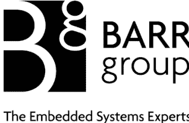

# Embedded C 编码标准

作者 Michael Barr

嵌入式系统专家®

作者 Michael Barr



作者 Michael Barr

# 文档许可

获取 Barr Group 版版权的《嵌入式 C 编码规范》（下简称“文档”），表示您同意受本文档许可（下简称“协议”）条款的约束。

1. 权利授予。考虑到良好且价值的对价（此处已确认其收到且充分），Barr Group 授权您按以下方式使用文档：您仅可以供自己使用以及内部员工在开展业务时使用该文档。通过获取文档副本，您即明确同意本协议的条款。

2. 保留。除本文明确允许外，未授予您任何关于文档的权利，Barr Group（代表其及其关联公司）保留在全球范围内对文档的所有其他权利。具体而言，您承认并同意：(i) Barr Group 授予您该文档的版权；(ii) 文档及其中任何派生的的作品不得按照上述第 1 节允许的方式进行发布或共享；(iii) 您可以对发布和共享实施合理的限制，包括在发布和共享时加入适当的版权标记和注释。如果您未能包含这些要求的版权标记和注释，您同意此类副本为版权材料的未经授权的复制，且未经授权的复制侵犯了 Barr Group 对文档的版权。如果您根据该文档准备了任何新作品、译作或衍生作品，您特此同意对于这些新作品、译作或衍生作品，您仅限于自用（例如公司内部使用）。

3. 免责声明与责任限制。您同意在法律允许范围内，对于与使用文档有关的任何索赔，使 Barr Group 及其所有者、员工、继承人和承包商免受、为其辩护并使其补偿。您全责任确定文档内容及其衍生内容对于您的用途是否安全且合适。此外：(a) 文档按“原样”提供，不提供任何形式的陈述或保证。在法律允许的最大范围内，Barr Group 明确放弃任何形式的、法定、明示或暗示的保证，包括但不限于对文档的适销性、特定用途适用性以及不侵权的任何暗示保证。(b) 在任何情况下，Barr Group 对因本协议或使用文档引起或与之相关的任何损害（无论 Barr Group 是否知晓此类损害的可能性）或任何及所有其他第三方索赔（包括但不限于人身伤害的特殊、间接、后果或间接损害、任何及所有其他第三方索赔、业务利润损失、业务信息中断或相关中断或任何其他金钱损失、律师费和诉讼费用），或根据本协议交付给您的文档侵犯了您行业的任何版权或商标或挪用任何商业秘密的第三方索赔不承担责任。

4. 适用法；管辖权；审判。本协议应根据马里兰州的法律解释，而不考虑其法律冲突。任何由本协议引起或与本协议相关的争议应提交至蒙哥马利县具有普通管辖权的州法院或马里兰州美国联邦地区法院，双方同意上述法院为审理任何与本协议引起或与之相关的案件或争议的地点和唯一法庭。双方均不可销地接受此类法院的管辖权，并放弃对此类法院管辖权或审判地的任何异议。如果 Barr Group 在任何由本协议引起、与之相关或与之相关的争议中胜诉，您应支付 Barr Group 与此类争议相关的所有费用，包括限于合理的律师费。

5. 可分割性；对价。本协议的每一部分均应视为独立。如果由于任何原因本协议的任何部分被判定为无效，该判定不损害或以其他方式影响协议其他部分的执行力。通过获取文档，您承认并同意根据本协议的条款和条件对使用和访问文档所提供的对价。

# 引言

## 标准目的

Barr Group 的《嵌入式 C 编码》专门为减少嵌入式软件中的编程缺陷而设计。通过遵循此编码规范，固件开发人员不仅减少减少用户的风险并缩短项目调试阶段的时间，还能提高软件的可维护性和可移植性。这些结果共同可以大幅降低开发高可靠嵌入式软件的成本。

此“BARR-C”编码规范与其他编码标准不同。它不是基于作者的风格偏好，本标准中的规则是根据其最大限程度减少缺陷的能力而被选择的。当某条规则在某个编码方面方面比替代规则更能防止程序员产生缺陷时，就会选择更具影响力的规则。例如，关于何时以及何处放置大括号的风格规则，是基于其减少整个程序中 Bug 的而选定的。

客观上预期可以通过这种方式减少缺陷数量的单独规则标记有以下“杜绝漏洞”（Keeps Bugs Out）图标：


显然，没有任何一组编码规则能够消除嵌入式系统中 100% 的缺陷。电子与软件之间以及相互连接系统之间的交互在本质上是复杂的。即使存在一个编写完美代码的程序员团队并且他们遵循了所有可能的缺陷化规则，项目仍可能由于以下原因出现缺陷：项目需求中的错误；实现者对需求的误解；系统和/或软件架构的疏忽；对硬件故障或其他异常运行时情况的处理不当等。

# 嵌入式 C 编码规范

采用此编码规范的其他重要原因还包括提高源代码的可读性和可移植性。结果是降低了代码维护和重用的成本。采纳此编码规范中的全规则（即不仅仅是减少缺陷的规则）使开发团队及其更大的组织受益，有助于减少个人理解同事和前任工作所需的时间。

我们建议将 BARR-C 编码规范应用于您的项目，作为改进组织嵌入式软件开发和质量保证流程更广泛努力的一部分。相对于您的项目对人类用户的风险，当然，适当软件开发开发可以是轻量级的，但必须强调系统和软件架构的重要性，以防止和从运行时风险中恢复，并对所有程序员在这些及其他方面进行专业培训¹。至少，您的流程应该不仅包含编码规范，还应至少使用版本控制和缺陷跟踪工具、正式的架构/设计代码审查和同行代码审查，以及通过一个或多个静态分析工具进行自动源代码扫描。

## 指导原则

为了集中我们的注意力并消除那些经常被程序员视为个人风格偏好的项目产生内部冲突，本编码规范根据以下指导原则制定：

- 1. 个人程序员并不拥有他们编写的软件。所有软件开发都是为雇主或客户服务的，因此最终产品应以专业的方式构建。

- 2. 预防 Bug 进入代码比在它进入后发现并杀死它更便宜、更容易。这场战斗中的关键策略是编写能够在代码执行前自动检测此类缺陷的代码。

> ¹当产品故障或不安全可能导致人类受伤或死亡时，应遵循相应的安全指南。本书不是安全标准。

3. 不管好坏（嗯，主要是坏的方面更多），ISO C 编程语言“标准”允许编译器之间存在大量的差异。ISO C 标准中的“实现定义（implementation-defined）”、“未指定（unspecified）”和“未定义（undefined）”行为，以及“特定区域选项（locale-specific options）”，意味着即使相同的源代码通过不同的“符合 ISO C”编译器编译，其运行时的行为也可能大不相同。C语言标准中的这些灰色地带极大降低了未经设计的源码的可移植性。

4. 源代码的可靠性、可读性、效率以及有时的可移植性比程序员的便利更重要。

5. 软件程序中的缺陷有很多来源。原始程序员团队会产生一些缺陷。后期维护、扩展、移植和/或重用源代码的可能会可能会额外的缺陷——包括由于对原始代码的误解导致的缺陷。

- 通过严格遵守某些编码规范，可以减少原始程序员引入的缺陷数量和严重程度，例如将常量放在等值（==）测试表达式的左侧。

- 原始程序员也可以减少维护程序员引入的缺陷数量和严重程度。例如，恰当使用可的固定宽度整数类型（例如 `int32_t`）可以确保未来的代码移植时不会遇到意外的溢出。

- 通过自律使用一致的注释和风格规范，也可以减少维护程序员引入的缺陷数量和严重程度，以便组织中的每个人都能轻松理解变量、函数和模块的含义及正确用法。

> 参见例如 [C90] 和 [C99]。

6. 为了有效，编码标准必须是可执行的。因此，当两个或替代规则可以同样有效地防止缺陷时，更易执行的规则是更好的选择。

如果此处缺少所需的规则，或与你团队承诺遵守的编码标准之间存在冲突，应应用上述原则的精神来指导决策。

## MISRA C

《MISRA C:2012 – 关键系统中使用 C 语言指南 [MISRA-C]》定义了 C 编程语言的一个子集，该子集比 BARR-C 编码标准中的规则更安全——尽管限制性更大。

如果你正在设计可能导致更多人员死亡或受伤的产品，那么研究 MISRA C 指南是非常重要的，并应该将其作为你项目编码标准的一部分。MISRA C 指南现在已是第三版，并实践了二十多年。MISRA C 作者对安全关键系统中使用 C 语言的风险了解可能比你更得多。

在当前版本中，已尽一切努力确保 BARR-C 的规则可以与部分或全部 MISRA-C:2012 指南相结合。具体而言：

- 在一组规则定义了 C 编程语言子集的范围内（例如对 `register` 和 `goto` 关键字使用的限制），它们的限制绝不会比 MISRA C 指南严格。换句话说，MISRA-C:2012 定义的 C 语言子集本身就是 BARR-C 规则的子集。

- 在此处的规则规则对程序员施加了风格限制（例如限制函数或变量名的格式），这些限制绝与 MISRA C 指南冲突。换句话说，BARR-C 包含与 MISRA C 互补的风格指南，而 MISRA C 不提供任何纯关于风格的建议。

2018 年的一项调查发现，这些标准共同成为了超过 40% 的固件设计师所遵循的特定项目编码标准的主要依据。

尽管这本书的标题只明确包含了 C 语言，但使用 C++（或混合使用这两种语言）的嵌入式程序员也能通过遵循此处的规则来减少程序中的缺陷数量。这是因为 C++ 的语法紧随 C，且许多行 C++ 源代码仅依赖于 C 语法。

然而，需要注意的是，C++ 是一门比 C 大得多且更复杂的语言，包含了许多在 C 中没有等效功能的特性。如果你在 C++ 中遵循 BARR-C 规则，你应该强烈考虑采用其他编码标准规则，也许从 [MISRA-C++]、[Sutter] 和/或 [Holub] 建议的进行选择。

作为嵌入式开发者，我们的重点仍然是 C，它是约 70% 专业固件设计师的主要编程语言。对 2005 年至 2018 年行业调查的长期回顾显示，C 不仅可靠地是最常用的语言，而且在这些年里市场份额实际上从 50% 增加到了约 70%。在嵌入式系统社区，C++ 的巅峰年份似乎是 2006 年。

## 执行指南

遵守本编码标准中的所有规则被认为是强制性的。不符合规则的代码应尽可能被检测：主要通过自动扫描（即静态分析）；其次通过同行代码审查；或者在没有这些选项的情况下，通过非正式发现。一旦检测到，任何不符合规则的代码都应使其符合此处的所有规则。

有商业静态分析工具可用于自动检查是否符合本标准和其他编码标准中许多规则的规定。要求预配置以检测本编码标准中可执行规则集违反情况的工具，将其称为“BARR-C:2018”标准。

在切换到新的编码标准时，必须对遗留代码做出决策。很少开发团队有时间重新考虑现有源代码库的风格。

对于遗留代码，我们建议：

- 通常情况下，保持运行中的遗留代码不变是最好的。除非生命安全受到威胁。

- 任何将遗留源代码符合此处规则的决策都应该一次针对一个模块（即 `.h` 头文件和 `.c` 源文件）或一个库。进行此类风格更改的最佳时机通常是该模块或库也需要功能性更改时。

注意，与空格的使用和/或放置有关（例如将制表符替换为空格）的更改应在版本控制提交中进行，且该提交与同一代码的功能更改分开。这样做是为了确保版本控制工具的源码差异功能在处理空格更改前后的功能更改时，能够发挥最大的效用。

## 偏差程序

所有提交用于产品发布的源代码均应符合此处的所有规则，除非其特定偏差已记录并获得批准。

在项目层面，指示某些特定数量的规则（例如每个缩进的字符数或函数中的最大行数）可以更改，以实施在开发工具中运行效果更好的不同数量。特定数量通常不是这些规则的关键属性。

在源代码模块层面，只有在获得项目经理批准的情况下才允许偏离本编码标准。批准人的姓名和支持偏差的理由应尽可能在靠近实际偏差发生的地方进行记录。例如，单个函数中的单个偏差应记录在实现代码上方或内部的注释中。相比之下，整个模块的偏差在源文件顶部的注释中记录可能更好。

## 致谢

尽管我的名字列为作者，但本《嵌入式 C 编码标准》的开发和维护是一项十多年前就开始的协作努力，涉及目前 Barr Group 大多数人员以及嵌入式软件社区的许多成员。我特别感谢 Salomon Singer 和 Joe Perret 帮助我使 2008 版书籍成为现实；感谢 Gary Stringham 与我密切合作完成 2018 版中更具技术性的更新；并感谢多年来对特定规则提出更改建议、审查任何版本的草稿或提供其他类型反馈的众多人士。

## 1 通用规则

### 1.1 使用哪种 C？

规则：

- a. 所有程序均应按照 ISO C 编程语言标准的 `C99` 版本编写。

- b. 每当使用 C++ 编译器时，应设置适当的编译器选项，将语言限制在选定的 ISO C 版本。

- c. 专有编译器语言关键字扩展、`#pragma` 和内联汇编的使用应保持在完成任务所需的最小限度，并局限于在直接与硬件接口的少数设备驱动模块中。

- d. 不得使用预处理器指令 `#define` 来修改或重命名关键字或编程语言的其他方面。

示例：

```
#define begin      // 不要写这样的代码...
#define end      } // ... 也不要这样。
...
for (int row = 0; row < MAX_ROWS; row++)
begin
  ...
end                        // 让 C 回归 C，而不是成为你曾经爱过的某种语言。
```

理由：为了清晰地定义本标准中其余部分的规则，我们首先对基准编程语言规范达成共识是至关重要的。

执行：这些规则应通过编译器设置和代码审查来强制执行。

> ¹ 兼容 `C99` 的编译器相比旧编译器提供了许多有用的改进，例如 C++ 风格的注释、布尔型和固定宽度整数类型、内联函数以及函数体内任意位置的变量声明。

### 1.2 行宽

规则：

- a. 程序中所有行的宽度应限制在最多 80 个字符。

理由：偶尔会对打印的页面进行同行评审和其他代码检查。为了使其有用，这些打印输出必须没有分散注意的折行，也没有缺失（即超出右边距）的字符。行宽规则还便于在屏幕上并排对比不同的代码。

执行：违反此规则的行为应在每次构建期间通过自动扫描进行检测。

### 1.3 大括号

规则：

- a. 在 `if`、`else`、`switch`、`while`、`do` 和 `for` 语句之后，大括号应始终包围代码块（即复合语句）；这些关键字后的单语句和空语句也应用大括号包围。

- b. 每个左大括号 `{` 应单独出现在其所开启代码块起始位置的下一行。对应的右大括号 `}` 应在文件中后续适当行数之后、合适的位置单独占一行。

示例：

```
if (depth_in_ft > 10) dive_stage = DIVE_DEEP; // 这是合法的...
else if (depth_in_ft > 0)
    dive_stage = DIVE_SHALLOW; // ... 也是如此。
else{
    // 但使用大括号总是更安全的。
    dive_stage = DIVE_SURFACE;
}
```

理由：存在未用括号包围的空语句和单语句存在相当风险。当附近的代码被更改或注释掉时，这种代码结构通常会关联出 bug。通过一致使用大括号可以完全消除这种风险。将左大括号放在下一行便于在视觉上检查对应的右大括号。

执行：在每个 `if`、`else`、`switch`、`while`、`do` 和 `for` 之后存在左大括号应通过自动化工具在构建时强制执行。应使用同一工具或另一个工具（如代码美化工具）来强制大括号的对齐。


### 1.4 括号

规则：

- 不要依赖 C 语言运算符优先级规则，因为它们对于维护代码的人来说可能并不显而易见。为了清晰起见，使用括号（和/或）将长语句拆分为多行 `(code)`，以确保操作序列内正确的执行顺序。

- 除非是单个标识符或常量，否则逻辑与 (`&&`) 运算符和逻辑或 (`||`) 运算符的每个操作数都应用括号包围。

示例：

```
if ((depth_in_cm > 0) && (depth_in_cm < MAX_DEPTH))
{
depth_in_ft = convert_depth_to_ft(depth_in_cm);
}
```

理由：C 编程语言的语法有很多运算符。决定哪些运算符先于其他运算符求值的优先级规则非常复杂——有十多个优先级级别——而且对于所有程序员来说并不总是显而易见的。当不确定时，明确你希望编译器对你的计算进行什么处理会比较好。

执行：这些规则应在代码审查期间强制执行。


### 1.5 常见缩写

规则：

- a. 除非其含义在工程社区中被广泛且一致地理解，否则通常应避免缩写和术语。

- b. 应在版本控制文档中维护一份项目特定的缩写和术语表。

**示例：** 附录 A 包含一个缩写及其含义的示例表。

**理由：** 程序员在代码中（以及简历中！）太容易使用晦涩的缩写和术语了。你今天知道 ZYGXL 代表什么，并不意味着以后必须读取/维护/迁移你代码的程序员能够理解你引用的这些晦涩名称。

**执行：** 这些规则应在代码审查期间强制执行。

### 1.6 强制类型转换

规则：

- a. 每一个强制类型转换都应包含一个注释，描述如何确保右侧值范围的行为正确。

示例：

```
int
abs (int arg)
{
    return ((arg < 0) ? -arg : arg);
}
...
uint16_t sample = adc_read(CHANNEL_1);

result = abs((int) sample); // 警告：假设 int
```

理由：类型转换是危险的。在上面的示例中，无符号 16 位 `sample` 可以存储更大的正值。因此，如果 `int` 只有 16 位，ISO C 标准允许溢出。

执行：此规则应在代码审查期间强制执行。

嵌入式 C 编码规范

### 1.7 应避免的关键字

规则：

- a. 不使用 `auto` 关键字。

- b. 不使用 `register` 关键字。

- c. 优先避免所有使用 `goto` 关键字的情况。如果使用了 `goto`，它应仅跳转到同一块内的标签。

- d. 优先避免所有使用 `continue` 关键字的情况。


理由：`auto`关键字是一个不历史特性。`register`关键字假设程序员比编译器更聪明。使用这两个关键字没有任何的理由。

`goto`和`continue`关键字在语言中仍有用途，但它们的使用往往会导致面条代码。特别是使用`goto`进行正交于普通结构化编程范式的跳转是有问题的。偶尔使用`goto`处理异常情况是可以接受的，如果它可以简化并清晰代码。

执行：新或修改源代码中的禁用关键字应在每次构建时通过自动化工具检测。在允许使用`goto`或`continue`的范围内，代码审查人员应研究替代代码结构以提高可维护性。

### 1.8 频繁使用的关键字

规则：

- a. 应使用`static`关键字声明所有不需要在声明模块之外可见的函数和变量。

    i. 声明初始化后不应更改的变量；

    ii. 定义不应修改的引用函数参数（例如`char const * param`）；

    iii. 定义结构体或联合体不应修改的字段（例如在内存映射 I/O 外设寄存器的结构体覆盖中）；

    iv. 作为数值常量`#define`的强类型替代方案。

- c. 应在适当的情况下`volatile`关键字。示例包括：

    i. 声明由任何中断服务程序访问（按当前使用或范围而言）的全局变量；

    ii. 声明由两个或多个线程访问（按当前使用或范围而言）的全局变量；

    iii. 声明指向内存映射 I/O 外设寄存器组的指针（例如`timer_t volatile * const p_timer`）；

    iv. 声明延迟循环计数器。

## 示例：

```
typedef struct
{
    uint16_t      count;
    uint16_t      max_count;
    uint16_t const _unused;    // 只读寄存器
    uint16_t      control;
} timer_reg_t;
```

```
timer_reg_t volatile * const p_timer = (timer_reg_t *) HW_TIMER_ADDR;
```

**原理：** 语言的`static`关键字有多种含义。在模块级，声明为`static`的全局变量和函数不受外部使用。以这种方式过度使用`static`可以降低模块之间的耦合性。

`const`和`volatile`关键字更为重要。尽可能使用`const`的优点是可以通过编译器强制保护，防止对应该是只读的数据进行意外写入。正确使用`volatile`可以防止编译器优化（优化可能会消除对变量或寄存器的请求读写），从而消除一整类难以检测的 bug。

**执行：** 这些规则应在代码审查期间执行。

> 轶事证明，不熟悉`volatile`关键字的程序员认为其编译器的优化功能比帮助更有用，并禁用了优化。我们认为绝大多数嵌入式系统由于缺少`volatile`关键字而潜伏着可能发生的 bug。此类 bug 通常表现为“闪故障”，或者仅在对“已验证的”代码库进行更改后才会出现。

## 注释规则

## 2.1 可接受的格式

规则：

- C++风格的单行注释（即以`//`开头）/`/* ... */`是传统 C 风格注释（即`/* ... */`）有效且可接受的替代方案。

- 注释中绝不应包含预处理器标记`/*`、`//`或`\`。

- 代码绝不应被注释掉，即使是暂时的。

  - 要临时禁用代码块，请使用处理器的条件编译功能（例如`#if 0 ... #endif`）。

  - 任何专门为了增加调试输出信息而存在的行或代码块应被`#ifdef NDEBUG ... #endif`包围。

示例：

```
/* 以下代码本应该是构建的一部分...
...
safety_checker();
...
/* ... 但漏掉了注释结束字符序列。 */
```

**原理：** 无论是否刻意，嵌套注释都有导致源代码审查人员对哪些代码块将被编译和运行产生困惑的风险。我们选择负逻辑`NDEBUG`是故意的，因为该常量还与禁用`assert()`宏相关联。在这两种情况下，程序员的作用都是禁用冗余代码。

**执行：** 仅使用允许的注释格式可以通过编译器或静态分析进行部分强制。然而，只有人工代码审查人员才能区分被注释掉的代码与包含描述性代码片段的注释。

# 嵌入式 C 编码规范

## 2.2 位置与内容

规则：

- 所有注释均应用清晰、完整的句子编写，并具有正确的拼写、语法和适当的标点符号。

- 最有用的注释通常位于执行大型算法某一步的代码块之前。每个此类代码块后应留一个空行。代码块前的注释应处于相同的缩进级别。

- 避免显而易见。假设读者了解 C 语言语言。例如，行尾注释仅应在仅通过变量、函数名和操作无法确定单行含义，且简短注释可以使其清晰时使用。具体而言，避免无帮助且冗余的注释，例如`number << 2; // 将数字左移 2 位.`。

- 单个注释块的数量和长度应与其描述的代码复杂性成正比。

- 每当在外部引用（例如设计规范、专利或教科书）中定义了算法或技术细节时，注释应包含对原始源的充分引用，以便代码的读者能够找到该文档。

- 每当需要流程图或其他图来充分记录代码时，注释应包含足够的引用，以便代码的读者能够定位文档。

- 每当需要流程图或其他图来充分记录代码时，注释应包含足够的引用，以便代码的读者能够定位文档。

- 所有的注释都应在生成文档时。[0](https://example.com/img/0.png)

> 轶事证明，不熟悉`volatile`关键字的程序员认为其编译器的优化功能比帮助更有用，并禁用了优化。我们认为绝大多数嵌入式系统由于缺少`volatile`关键字而潜伏着可能发生的 bug。此类 bug 通常表现为“闪故障”，或者仅在对“已验证的”代码库进行更改后才会出现。

## 空格规则

## 3.1 空格

规则：

- a. `if`、`while`、`for`、`switch`和`return`关键字在同一行有后续程序文本时，后面应有一个空格。

- b. 每个赋值运算符`=`、`+=`、`-=`、`*=`、`/=`、`&=`、`|=`、`^=`、`!=`应在前后都有空格。

- c. 每个二元运算符`+`、`-`、`*`、`%`、`<`、`<=`、`==`、`<<`、`>>`、`|`、`^`、`&&`和`||`应在前后都有空格。

- d. 每个一元运算符`*`、`-`、`+`、``、`!`和`~`应无空格。

- e. 指针运算符`*`和`&`在声明内应两侧留空格。

- f. 三元运算符`?`和`:`应在前后都有空格。

- g. 结构体指针和结构体成员运算符`->`和`.`分别应始终没有周围空格。

- h. 数组下标运算符的左右括号`((`和`))`应没有周围空格，除非满足其他空格规则的要求。

- i. 括号中的表达式在左、右括号字符旁应始终没有空格。

- j. 函数调用的左右括号应始终没有周围空格，但函数声明在函数名和左括号之间应有一个空格，以便于定位该处特定的函数名。

- k. 除位于行尾外，每个分隔函数参数的逗号后应始终有一个空格。

- 1. *for*语句中分隔元素的每个分号后面应始终跟有一个空格。

- m. 每个分号应紧跟在其终止的语句之后，且前面不能有空格。

**示例：** 参见附录 D。

**理由：** 在源代码中，空白的位置与文本的位置同样重要。合理使用空白可以减轻眼部疲劳，并提高程序员和代码审查人员发现潜在漏洞的能力。

**强制执行：** 程序员在工作时应遵守这些规则，并通过代码格式化工具（例如 GNU Indent）进行强化。

规则：

- a. 一系列声明中的变量名其首字符应当对齐。

- b. 结构体（struct）和联合体（union）成员名其首字符应当对齐。

- c. 相邻赋值语句块中的赋值运算符应当对齐。

- d. 预处理器指令中的 # 应当始终位于行首，尽管指令本身可以在`#if`或`#ifdef`内部进行缩进。

示例：

```c
#ifdef USE_UNICODE_STRINGS
## define BUFFER_BYTES 128
#else
## define BUFFER_BYTES 64
#endif

typedef struct struct {
  uint8_t buffer[BUFFER_BYTES];
  uint8_t checksum;
} string_t;
```

理由： 视觉上的对齐强调了相似性。包含变量声明的一系列连续行很容易被观察和理解为一组相关的代码块。应根据情况使用空行和不同的对齐方式，在视觉上分离并区分物理上相邻但不相关的代码块。

强制执行：这些规则应在代码审查期间执行。

规则：

- a. 每行代码不应包含多个语句。

- b. 在每个自然代码块的前后应有一个空行。自然代码块的示例包括循环、`if...else`和`switch`语句以及连续的声明。

- c. 每个源文件应以一个标记文件结束的注释结尾，并在其后跟一个空行。

示例： 参见附录 D。

**理由：** 合适当的空白放置提供了视觉分离，从而使代码更易阅读和理解，正如本编码标准段落之间的空白区域有助于可读性一样。清晰地标记文件结束对于查看打印输出的人类审查人员很重要，且某些旧编译器可能需要随后的空行。

强制执行：这些规则应在代码审查期间执行。

规则：

- 每个缩进层级应当相对于行首对齐 4 个字符的倍数。

- 在`switch`语句中，`case`标签应当对齐；每个`case`块的内容应在此基础上缩进一次。

- 每当某行代码过长无法适应最大行宽时，以最可读的方式对第二行及任何后续行进行缩进。

示例：

```c
sys_error_handler(int err)
{
    switch (err)
    {
        case ERR_THE_FIRST:
            ...
            break;

        default:
            ...
            break;
    }

    // 故意未对齐的缩进；知道为什么吗？
    if ((first_very_long_comparison_here
        && second_very_long_comparison_here)
        || third_very_long_comparison_here)
    {
        ...
    }
}
```

**理由：** 较少的缩进空间增加了视觉混乱的风险，而更多的空间会增加行换的概率。

**强制执行：** 程序员应可用一种工具（如代码格式化工具），以自动方式转换其他尺寸的缩进。该工具应在每次构建之前用于所有新文件或修改的文件。

规则：

- a. 制表字符（ASCII 0x09）永远不应出现在任何源代码文件中。

示例：

```c
// 当字符串内部需要 tab 的时候，使用 '\t' 字符。
#define COPYRIGHT "Copyright (c) 2018 Barr Group.\tAll rights reserved."

// 当源代码中需要缩进时，请通过空格进行对齐。
void
 main()
{
    // 如果不是，你可能会遇到
    // 各种
    // 奇怪的
        // 不均匀的
        // 代码和注释的对齐... 跨工具出现这种情况。
}
```

**理由：** Tab 字符的宽度随文本编辑器和程序员的偏好而异，这导致一致的视觉布局成为代码审查和维护期间不断的头疼源。

**强制执行：** 每个程序员都应配置其代码编辑工具，在按下 TAB 键时插入空格。新代码或修改代码中存在 tab 字符应通过每次构建或代码提交时的自动扫描进行标记。

## 3.6 非打印字符

规则：

- a. 尽可能，所有源代码行应仅以单个字符 'LF'（ASCII 0x0A）结束，而不是以 'CR'-'LF'（0x0D 0x0A）结束。

- b. 源代码文件中允许的唯一其他非打印字符是换页符 'FF'（ASCII 0x0C）。

**示例：** 无法通过打印演示非打印字符。

**理由：** 'CR'-'LF'多字符序列在多平台开发环境中比单字符 'LF'更容易引起问题。其中一个问题与 Unix 平台上的多行预处理器宏有关。

**强制执行：** 尽可能，程序员的编辑器应配置为使用 LF。此外，应使用自动工具在每次构建期间扫描所有新或修改的源文件，将每个 CR-LF 序列替换为 LF。

## 4. 模块规则

### 4.1 命名规范

规则：

- a. 所有模块名应完全由小写字母、数字和下划线组成。模块头文件和源文件名内部不应空格。

- b. 所有模块名在前 8 个字符上应该是唯一的，并且头文件和源文件名分别以 .h 和 .c 结尾。

- c. 任何模块头文件名都不应与 C 标准库或 C++ 标准库的头文件重名。例如，模块不应命名为“stdio”或“math”。

- d. 任何包含`main()`函数的模块其源文件名应包含“main”一词。

**示例：** 参见附录 D。

**理由：** 多平台开发环境（例如 Unix 和 Windows）是常态而非例外。混合大小写的名称在不同操作系统之间可能会导致问题，而且由于命名相似但大小写不同的文件可能被人类程序员混淆，因此容易出错。

在文件名中包含“main”对于具有多个软件配置的项目维护者来说是一种帮助。

**强制执行：** 自动工具应确认作为构建部分的文件名称符合这些规则。

### 4.2 头文件

规则：

- 每个源文件应始终对应一个头文件，且它们应具有根名称。

- 每个头文件应包含一个防止重复包含的预处理器保护符，如下例所示。

- 头文件应仅标识其他模块严格需要了解的程序、常量和数据类型（分别通过原型、#define 和 typedef 定义）。

- 一种优选做法是永远不要在头文件中声明（通过 extern）任何变量。

- 头文件中不应为任何变量分配存储。

- 公共头文件不应包含任何私有头文件的 #include。

示例：

```c
#ifndef ADC_H
#define ADC_H
...
#endif /* ADC_H */
```

理由： C 语言标准默认赋予所有变量和函数全局作用域。这种方法的缺点是模块之间存在不必要的（危险的）耦合。为了减少模块耦合，尽可能将许多程序、常量、数据类型和变量私有在模块的源文件中。

另请参见 C .h 头文件中包含什么？

embeddedguru.com/bar-code/2010/11/what-belongs-in-a-c-h-header-file/

强制执行：这些规则应在代码审查期间执行。

规则：

- 每个源文件应仅包含适用于控制一个“实体”的行为。实体的示例包括封装的数据类型、活动对象、外设驱动程序（例如用于 UART）以及通信协议或层（例如 ARP）。

- 每个源文件应按列出的顺序包含以下部分或全部部分：注释块；include 语句；数据类型、常量和宏定义；静态数据声明；私有函数原型；公共函数实现体；然后是私有函数实现体；

- 每个源文件应始终 #include 同名的头文件（例如，文件`adc.c`应该包含`"adc.h"`），以允许编译器确认每个公共函数及其原型相匹配。

- 包含文件名中不应使用绝对路径。

- 每个源文件应不包含未使用的包含文件。

- 任何源文件属性 #include 另一个源文件。

示例：参见附录 D。

理由：源文件模块的目的和内部布局对所有维护者来说应该是清晰的。例如，公共函数通常是关注重点，因此出现在它们所调用的私有函数之前。至关重要的一点是，每个函数声明都必须由编译器与其原型进行匹配。

强制：大多数静态分析工具都可以配置为检查未被实际使用的包含文件。其他规则应在代码审查期间执行。


规则：

- a. 在项目级维护一套用于头文件和源文件的模板。

示例：参见附录 B 和附录 C 中的示例文件模板。

理由：从模板开始创建每个新文件可以确保文件头注释块的一致性，并确保包含适当的版权声明。

强制：文件格式的一致性应在代码审查期间执行。

## 5.1 命名规范

规则：

- a. 所有新数据类型（包括结构体、联合体和枚举）的名称应由小写字母和内部下划线组成，并以`_t`结尾。

- b. 所有新的结构体、联合体和枚举应通过`typedef`命名。

- c. 所有公共数据类型的名称应以其模块名和下划线为前。

示例：

```
typedef struct
{
    uint16_t count;
    uint16_t max_count;
    uint16_t unused;
    uint16_t control;
}
timer_reg_t;
```

理由：数据类型名和变量名通常具有相似性。例如，外设中的一组控制寄存器可以被命名为`timer_reg`。为了区分定义寄存器布局的结构体定义，创建一个具有不同名称的新类型（如`timer_reg_t`）是有价值的。如果需要，可以使用该类型来创建定时器寄存器的影子拷贝，例如命名为`timer_reg_shadow`。

强制：在每次构建之前，应使用自动化工具扫描新的或修改的源代码，以确保`struct`、`union`和`enum`关键字仅在`typedef`语句或匿名声明中使用。应通过代码审查来强制执行新类型的命名规则。

规则：

- 每当整数值的宽度（以位或字节）在程序中很重要时，应使用固定宽度数据类型来代替`char`、`short`、`int`、`long`或`long long`。有符号和无符号固定宽度整数类型如下表所示。

| 整数宽度 | 有符号类型 | 无符号类型 |

| --- | --- | --- |

| 8 bits | int8_t | uint8_t |

| 16 bits | int16_t | uint16_t |

| 32 bits | int32_t | uint32_t |

| 64 bits | int64_t | uint64_t |

- 不应使用`short`和`long`关键字。


`char`关键字的使用应限制在字符串的声明和操作中。

示例：参见附录 D。

**理由：** C90 标准故意允许 `char`、`short`、`int`、`long` 和 `long long` 类型具有实现定义的宽度，这导致了代码的可移植性问题。C99 标准没有解决这个问题，但引入了表中所示的类型名称，这些类型定义在 `std.h` 头文件中。

参见 C 中的可移植固定宽度整数：

`barrgroup.com/embedded-systems/how-to/c-fixed-width-integers-c99`

在没有兼容 C99 的编译器的情况下，通过底层类型的 `typedef` 来定义上表中的固定宽度类型是可以接受的。如果必要，请务必使用编译时检查（例如 `static assertions`）。

**强制：** 在每次构建时，自动化工具应标记任何对 `short` 或 `long` 关键字的使用。其他规则的合规性应在代码审查期间检查。

### 规则

- a. 位域不应定义在符号 `|` `^` 整数类型中。
- b. 不应使用任何位运算符（即 `|`、`~`、`^` `<<` 和 `>>`）来处理有符号整数数据。
- c. 有符号整数不应在比较或表达式与无符号整数混合。为了支持这一点，用于无符号的十进制常量应在末尾带有 `u`。

示例：

```c
uint16_t unsigned_a = 6u;
int16_t signed_b;
```

```c
if (unsigned_a > signed_b) {
    // ...
}
```

理由：源文件模块的目的和内部布局对所有维护者来说应该是清晰的。例如，公共函数通常是关注重点，因此出现在它们所调用的私有函数之前。至关重要的一点是，每个函数声明都必须由编译器与其原型进行匹配。

强制：大多数静态分析工具都可以配置为检查未被实际使用的包含文件。其他规则应在代码审查期间执行。

### 规则

- 尽可能避免使用浮点数。
- 当必要时：
    - 为所有单精度常量加上 `f`（例如 `3.14159f`）。
    - 使用 `isfinite()` 宏检查结果是否不是 `INFINITY` 或 `NAN`。
    - 永远不要对浮点值进行相等或不相等测试。

示例：

```c
#include <limits.h>
#if (DBL_DIG < 10)
## error "Double precision is not available!"
#endif
```

理由：错误使用浮点数存在大量风险。默认情况下，C 将所有浮点常量提升为双精度，这在目标机器上可能是低效或不支持的。然而，许多微控制器没有浮点的硬件支持。

强制：这些规则应在代码审查期间执行。

### 规则

- a. 对于与外设通信或通过总线或网络与另一个处理器通信的结构体或联合体类型，应采取措施防止编译器插入填充字节。
- b. 应采取措施防止编译器更改位域内预期的顺序。

示例：

```c
typedef struct {
    uint16_t count;      // 偏移 0
    uint16_t max_count;  // 偏移 2
    uint16_t unused;     // 偏移 4

    uint16_t enable      : 2;   // 偏移 6 位 15-14
    uint16_t b_interrupt : 1;   // 偏移 6 位 13
    uint16_t _unused1   : 7;   // 偏移 6 位 12-6
    uint16_t b_complete : 1;   // 偏移 6 位 5
    uint16_t _unused2   : 4;   // 偏移 6 位 4-1
    uint16_t b_periodic : 1;   // 偏移 6 位 0
} timer_reg;
```

```c
// 预处理器检查定时器寄存器布局字节数。
#if (8 != sizeof(timer_reg))
## error "timer_reg_t 结构体大小错误（预期 8 字节）"
#endif
```

**原理：** 由于于不同处理器家族之间的差异以及 ISO C 语言标准的定义松散，在结构体和联合体领域存在大量由实现定义的行为。特别是位域（Bit-fields），面临着严重的移植性问题，包括缺乏标准的位排序，并且没有对它们经常经常调用的固定宽度整数类型提供官方支持。检查此类数据结构布局的方法包括静态断言（`static assertions`）或其他编译时检查，以及使用预处理器指令（例如，根据编译器在两种互为竞争的结构体布局中选择其一）。

**执行：** 这些规则应在代码审查期间强制执行。

### 规则

- a. 布尔变量应被声明为 `bool` 类型。
- b. 非布尔值应通过使用关系运算符（例如，`<` 或 `!=`）转换为布尔值，而不是通过强制类型转换。

示例：

```c
#include <stdbool.h>
...
```

```c
bool b_in_motion = (0 != speed_in_mph);
```

**原理：** C90 标准没有为布尔变量定义数据类型，程序员广泛将任何非零整数值视为 `true`。C99 语言标准与这种旧样式兼容，但同时也引入了布尔变量的新数据类型，以及在 `stdbool.h` 头文件中的新常量 `true` 和 `false`。

**执行：** 这些规则应在代码审查期间强制执行。

## 6 过程规则

### 6.1 命名规范

规则：

- a. 任何过程名称都不应是 C 或 C++ 编程语言任何版本的关键字。受限名称包括 `interrupt`、`inline`、`class`、`true`、`false`、`public`、`private`、`friend` 等。
- b. 任何过程名称不能与 C 标准库中的函数重叠。此类名称示例包括 `strlen`、`atoi` 和 `memset`。
- c. 任何过程名称不能以下划线开头。
- d. 过程名称长度不应超过 31 个字符。
- e. 任何函数名不应包含任何大写字母。
- f. 任何宏名不应包含任何小写字母。
- g. 过程名称应用下划线来分隔单词。
- h. 每个过程的名称应描述其用途。注意，过程受益于在名称中使用动词（例如，`adc_read()`）；推荐这种“名词-动词”的词序。或者，过程也可以根据其回答的问题进行命名（例如，`led_is_on()`）。
- i. 所有公共函数的名称应以其模块名和下划线作为前缀（例如，`sensor_read()`）。

**示例：** 附加 D。

**原理：** 良好的函数名可以让代码审查和维护变得更容易（从而使成本更低）。程序中的数据（变量）是名词。函数操作数据，因此是动词。使用模块前缀符合封装这一重要目标，有助于避免过程名称重叠。


**执行：** 这些命名规则的遵守情况应在详细设计阶段确定，并在代码审查期间强制执行。

### 6.2 函数

规则：

- 应尽一切努力将每个函数的长度限制在一个页打印纸内，或最多 100 行。
- 尽可能，所有函数都应设从打印页的顶部开始，除非几个小函数可以挤在单页内。
- 一种首选做法是所有函数都应只有一个出口，且应通过函数底部的 `return` 实现。
- 在模块头文件中，应为每个公共函数声明原型。
- 所有私有函数都应声明为 `static`。
- 每个参数都应显式声明并赋予有意义的名称。


> 实现这一目标的一种方法是在函数定义之前的注释块的第一行开头插入换页符 `FF`（ASCII 0x0C）。

**示例：**

```c
int
state_change (int event)
{
    int result = ERROR;

    if (EVENT_A == event)
    {
        result = STATE_A;
    }
    else
    {
        result = STATE_B;
        return (result);
    }
}
```

**原理：** 代码审查是在函数级别进行的，且通常在纸上进行。每个函数理想情况下应该在单打印页上可见，这样来回纸张就不会分散审查者的注意力。

只有在能提高代码可读性时，才使用多个返回语句。

**执行：** 这些规则的遵守情况应在代码审查期间检查。

### 6.3 类函数宏

规则：

- a. 如果可以编写函数来实现相同的行为，则不应使用参数化宏。
- b. 如果由于原因使用了参数化宏，则适用以下规则：
    i. 用括号包裹整个宏体。
    ii. 用括号包裹每个对参数的使用。
    iii. 每个参数的使用次数不要超过一次，以避免无意的副作用。
    iv. 使用每个参数不要超过一次。

示例：

```c
#define MAX(A, B) ((A) > (B) ? (A) : (B))
```

```c
// ...
inline max(int num1, int num2)
```

**原理：** 存在许多与使用实现定义相关的风险，例如如所示的宏误用。使用模块前缀符合封装这一重要目标，有助于避免过程名称重叠。宏在运行时是不可进入的。

**执行：** 这些规则应在代码审查期间强制执行。

### 6.4 执行线程

规则：

- a. 所有封装执行的函数（例如任务、进程）应以 `_thread` 结尾。

示例：

```c
void thread (void * p_data)
{
    int alarm = ALARM_NONE;
    int err = OS_ERR;

    for (;;)
    {
        alarmPend(&err);
    }
}
```

**原理：** 运行。

**执行：** 这一规则应在详细设计期间遵循。

# 嵌入式 C 编码规范

### 6.5 中断服务程序

规则：

- a. 中断服务程序（ISR）不是普通函数。必须通过 `#pragma` 或编译器特定的关键字（如 `__interrupt`）告知编译器函数是 ISR。
- b. 所有实现 ISR 的函数应以 `_isr` 结尾。
- c. 为了确保 ISR 不会被软件的其他部分意外调用（它们可能会破坏调用栈），每个 ISR 都应声明为 `static` 并/或位于驱动模块的末尾。
- d. 应在所有意外或其他未处理的中断源的向量表中安装存根或默认 ISR。此类存根可以尝试禁用相同类型的中断，例如在控制器处并调用 `assert()`。


示例：

```c
#pragma irq_entry
void timer_isr (void)
{
    uint8_t static prev = 0x00; // 之前的按钮状态
    uint8_t curr = *gp_button_reg; // 当前按钮状态

    // 比较当前和之前的按钮状态
    g_debounced |= (prev & curr); // 记录所有关闭
    g_debounced &= (prev | curr); // 记录所有开启

    // 保存引脚状态供下次中断
    prev = curr;
}
```

**原理：** ISR 是硬件的扩展。根据定义，它与直行代码是异步的。如果它们共享全局变量或寄存器，则这些单例对象必须通过直行代码中的禁用中断来保护。ISR 不得挂在操作系统内部或等待变量或寄存器值的改变。

嵌入式 C 编码规范

## 7 变量规则

### 7.1 命名规范

规则：

- a. 变量名称都不应是 C、C++ 或任何其他已知 C 编程语言扩展的关键字，特别是 K&R C 和 C99。受限名称包括 `interrupt`、`inline`、`restrict`、`class`、`true`、`false`、`public`、`private`、`friend` 和 `protected`。


- b. 变量名称都不应与 C 标准库中的变量名（例如 `errno`）重叠。
- c. 任何变量名都不应以下划线开头。
- d. 变量名长度不能超过 31 个字符。
- e. 变量名长度不能少 3 个字符，包括循环计数器。
- f. 变量名不应包含任何大写字母。
- g. 变量名不应包含任何在其他地方指出的数值，例如数组的元素个数或底层类型的位宽。
- h. 应使用下划线来分隔变量名中的单词。
- i. 每个变量名都应描述其用途。
- j. 任何全局变量的名称应以字母 `g` 开头。例如：`g_zero_offset`。
- k. 任何指针变量的名称应以字母 `p` 开头。例如：`p_led_reg`。
- l. 任何二级指针变量的名称应以字母 `pp` 开头。例如：`pp_vector_table`。
- m. 所有包含布尔信息（包括 0 与非零）的整数变量名称应以字母 `b` 开头，并以其回答的问题形式命名。例如：`b_done_leet` 或 `b_is_buffer_full`。
- n. 任何代表对象非指针句柄（例如文件句柄）的变量名称应以字母 `h` 开头。例如：`h_input_file`。
- o. 在变量名需要多个上述前缀的情况下，它们在第一个下划线之前的包含顺序应为 `[q|p|pp|b|h]`。

**示例：** 参见附录 D。

**理由：** 采用这些基本规则是为了最大程度地提高跨编译器的移植性。许多 C 编译器仅识别变量名中前 31 个字符的差异，并预留以下划线开头的名称用于内部名称。

其他规则旨在突出风险并确保变量的一致正确使用。例如，所有涉及全局变量和其他单例对象（包括外设寄存器）使用的代码都需要仔细考虑，以确保不会通过异步写入产生竞态条件或数据损坏。

**执行：** 这些规则应在代码审查期间执行。

嵌入式 C 编码规范

### 7.2 初始化

规则：

- a. 所有变量在在使用前均应进行初始化。
- b. 最好在需要时再定义局部变量，而不是全部放在函数顶部。
- c. 如果使用了项目级或文件级全局变量，它们的定义应组合在一起并放在源文件的顶部。
- d. 任何缺少初始地址的指针变量应初始化为 `NULL`。

示例：

```
uint32_t g_array[NUM_ROWS][NUM_COLS] = { ... };

for (int col = 0; col < NUM_COLS; col++)
{
    g_array[row][col] = ...;
}
```

理由：太多的程序员假设 C 运行时会为他们留意，例如在系统启动时将未初始化变量的值置零。这是一个糟糕的假设，在任务关键型系统中会被证明是危险的。为了可读性，最好将局部变量声明在尽可能靠近其首次使用的地方¹，C99 通过引入 C++ 的早期功能使得这成为可能。

执行：应使用自动化工具在每次构建前前扫描所有源代码，对在初始化之前使用的变量发出告警；静态分析工具可以做到此点。其余规则应在代码审查期间执行。

> ¹ [Uwano] 描述了代码审查中眼睛的往复移动，这证明了将变量声明尽可能放在首次引用它们的代码周围的价值。

嵌入式 C 编码规范

## 8 语句规则

### 8.1 变量声明

规则：

- a. 逗号运算符（`,`）不应在变量声明中使用。

示例：

```
char * x, y; // y 是否也打算设计为指针？不要这样做。
```

**理由：** 将每个声明单独独占一行的成本很低。相比之下，编译器或维护者误解你意图的风险很高。

**执行：** 此规则应在代码审查期间执行。


嵌入式 C 编码规范

### 8.2 条件语句

规则：

- a. 一种优良做法是将最短（按代码行数计算）的 `if` 和 `else if` 子句放在第一个。
- b. 嵌套的 `if...else` 语句深度不应超过二级。使用函数调用或 `switch` 语句来降低复杂度并辅助理解。
- c. 赋值不应在 `if` 或 `else` 测试中进行。
- d. 任何带有 `else if` 子句的语句都应以 `else` 子句结束¹¹

示例：

```
if (NULL == p_object)
{
    result = NULL_PTR;
}
else if (p_object = malloc(sizeof(object))) // 赋值
{
    ...
}
else
{
    // 正常处理
    ...
}
```

理由：长长的语句会分散人们对决策路径的注意力。通过将较短的语句放在前面，决策路径变得更容易遵循。（深度嵌套的 `if...else` 语句是复杂的实现迹象；存在更安全、更易读的方法。）

执行：这些规则应在代码审查期间执行。

> ¹¹ 这等同于要求每个 `switch` 都有 `default` 情况。


编码规范

### 8.3 Switch 语句

规则：

- a. 每个 `case` 的 `break` 应与相应的 `case` 对齐，而不是与 `case` 代码块对齐。
- b. 所有 `switch` 语句应包含 `default case`。
- c. 任何设计为穿透到下一个 `case` 的 `case` 都应注释说明为什么缺少 `break`。

示例：

```
switch (err)
{
    case ERR_A:
    ...
    break;
    case ERR_B:
    ...
    break;
    // 同时执行 ERR_C 的步骤
    case ERR_C:
    ...
    break;
    default:
    ...
    break;
}
```


理由：C 的 `switch` 是强大的构造，但容易出现遗漏 `break` 等错误。通过将 `case` 与其 `break` 语句对齐，更容易发现缺失的 `break`。

执行：这些规则应在代码审查期间执行。

# 嵌入式编码规范

## 8.4 循环

规则：

- a. 魔数不应作为 `while`、`do...while` 或 `for` 循环的初始值或结束测试。
- b. 除了循环第一句中的初始化和第三句中对同一变量的更改外，任何循环表达式中都不应进行赋值。
- c. 无限循环应通过控制表达式 `for(;;)` 实现。
- d. 每个空体的循环都应包含一组括号和注释，说明为什么在循环结束前不需要任何操作。

示例：

```
// 为什么有人会在代码里埋入魔数（例如“100”）呢？
for (int row = 0; row < 100; row++)
{
    // 描述性常量防止缺陷并提高可读性。
    for (int col = 0; col < NUM_COLS; col++)
    {
        ...
    }
}
```

理由：将循环次数与底层数据结构的大小同步至关重要。通过描述性常量来实现这一点，可以防止当代码某处的更改（如数组维度）发生时，其他区域未同步更改而导致的缺陷。

执行：这些规则应在代码审查期间执行。

> ¹² 注意 `sizeof` 宏在理论上是为数组定的方便方法，但当你传递数组指针而不是数组本身时，这种方法不起作用。

¹³ `Kernighan & Ritchie` 很久就推荐使用 `for(;;)`，其额外的好处是防止出现 `while(l)` 这种视觉混淆的缺陷；引用变量 ‘1’。

54

## 8.5 跳转 (Jumps)

规则：

- a. `goto` 语句的使用应根据规则 `1.7.c` 进行限制。
- b. 不应使用 C 标准库函数 `abort()`、`exit()`、`setjmp()` 和 `longjmp()`。

理由：利用跳转语句移动指令指针的算法可以并且应该重写为更具可读性的方式，从而易于维护。

执行：这些规则应通过对所有修改或新模块进行自动扫描，检查是否存在不当使用禁止标记的情况来强制执行。在允许使用 `goto` 的范围内，代码审查人员应研究替代代码结构，以提高代码的可维护性和可读性。

# 嵌入式 C 规范

## 8.6 等效性测试

规则：

- 在评估变量与常数的等效性时，常量应始终放在等号运算符 (`==`) 的左侧。

示例：

```c
if (NULL == p_object)
{
    return (ERR_NULL_PTR);
}
```

理由：在编译时尽可能检测可能的拼写错误以及尽可能其他代码缺陷总是理想的。在后期阶段发现缺陷是无法保证的，而且成本更高。通过遵循此规则，任何编译器都能可靠地检测到尝试给常量赋新值（即使用 `=` 而不是 `==`）的错误。

执行：许多编译器可以配置为对可疑赋值发出警告（即位于通常出现比较的地方）。然而，执行此规则的最终责任在于代码审查人员。


## 附录 A：缩写表

以下缩写和首字母词接受在源代码中使用，无需本地解释。

| max | 含义 |

|---|---|

| adc | 模拟量数字转换器 |

| avg | 平均 |

| b_ | 布尔 (Boolean) |

| buf | 缓冲区 |

| cfg | 配置 |

| curr | 当前（列表中的项） |

| dac | 数字模拟量转换器 |

| ee | EEPROM |

| err | 错误 |

| g_ | 全局 (global) |

| gpio | 通用 I/O 引脚 |

| h_ | 句柄 (handle) |

| init | 初始化 |

| io | 输入输出 |

| isr | 中断服务程序 |

| lcd | 液晶显示器 |

| led | 发光二极管 |

| max | 最大 |

| mbox | 邮箱箱 |

| mgr | 管理器 |

| min | 最小 |

| msec | 毫秒^1 |

| --- | --- |

| msg | 消息 |

| next | 下一个（列表中的项） |

| nsec | 纳秒 |

| num | 数量 |

| p_ | 指针（指向） |

| pp_ | 指级指针（指向） |

| prev | 上一个（列表中的项） |

| prio | 优先级 |

| pwm | 脉冲宽度调制 |

| q | 队列 |

| reg | 寄存器 |

| rx | 接收 |

| sem | 信号量 |

| str | 字符串（空终止） |

| sync | 同步 |

| temp | 温度 |

| tmp | 临时 |

| tx | 传输 |

| usec | 微秒 |

> ^1 注意：秒(s) 不应缩写，分钟、小时、日、周、月或年也不如此。在其他方面，此规则消除了 minute（分钟）与 minimum（最小）之间的冲突。

## 附录 B：头文件模板

```c
/** @file module.h
*
* @brief 模块目的的描述。
*
* @par
* 版权声明:(c) 2018 Barr Group. 保留所有。
*/

#ifndef MODULE_H
#define MODULE_H

int8_t max8(int8_t num1, int8_t num2);

#endif /* * MODULE_H */

*** end of file ***
```

## 附录 C：源文件模板

```c
/** @file module.c
 *
* @brief 模块目的的描述。
 *
* @par
* 版权声明:(c) 2018 Barr Group. 保留所有。
 */

#include <stdint.h>
#include <stdbool.h>

#include "module.h"

/*!
* @brief 识别两个 8 位整数中较大的的一个。
* @param[in] num1 第一个比较的数字。
* @param[in] num2 第二个比较的数字。
* @return 较大数字的值。
 */
int8_t
max8 (int8_t num1, int8_t num2)
{
    return ((num1 > num2) ? num1 : num2);
}

/*** end of file ***/
```

## 附录 D：示例程序

```c
/** @file crc.h
 *
 * @brief 用于嵌入式系统的 CRC-CCITT、CRC-16、CRC-32 紧凑型 CRC 库。
 * @par
 * 版权声明:(c) 2000, 2018 Michael Barr. 此软件处于公有领域，
 * 可用于任何目的。然而，此声明不得更改或删除。此源代码
 * 分发不提供任何明示或隐含的。
 */

#ifndef CRC_H
#define CRC_H

// 编译时选择所需的 CRC。
//
#if defined(CRC_CCITT)

#define CRC_NAME "CRC-CCITT"
uint16_t crc_t;

#elif defined(CRC_16)

#define CRC_NAME "CRC-16"
uint16_t crc_t;

#elif defined(CRC_32)

#define CRC_NAME "CRC-32"
uint32_t crc_t;

#else
#error "必须定义 CRC_CCITT, CRC_16 或 CRC_32。"
#endif
// CRC 库的公共 API。
//
void crc_init(void);
crc_t crc_slow(uint8_t * const p_message, int n_bytes);
crc_t crc_fast(uint8_t * const p_message, int n_bytes);

#endif /* CRC_H */

*** end of file ***
```

```c
/** @file crc.c

*

* @brief 用于嵌入式系统的紧凑型 CRC 生成器，具有暴力法和表驱动选项。

* 支持 CRC-CCITT、CRC-16 和 CRC-32。

* @par

* 版权声明:(c) 2000, 2018 Michael Barr. 此软件处于公有领域，

* 可用于任何目的。然而，此声明不得更改或删除。此源代码

* 分发不提供任何明示或隐含的保证。

*/

#include <stdint.h>

#include "crc.h"

// 基于 crc.h 的算法参数。

//

#define BITS_PER_BYTE 8

#define WIDTH (BITS_PER_BYTE * sizeof(crc_t))

#define TOPBIT (1 << (WIDTH - 1))

// 为字节宽 CRC 分配存储。

//

#define CRC_TABLE_SIZE 256

static crc_t g_crc_table[CRC_TABLE_SIZE];

// 支持所选 CRC 标准的配置。

//

#if defined(CRC_CCITT)

#define POLYNOMIAL (uint16_t) 0x1021

#define INITIAL_REMAINDER (uint16_t) 0xFFFF

#define FINAL_XOR_VALUE (uint16_t) 0x0000

#define REFLECT_DATA(X) (X)

#define REFLECT_REMAINDER(X) (X)

#elif defined(CRC_16)

#define POLYNOMIAL (uint16_t) 0x8005

#define INITIAL_REMAINDER (uint16_t) 0x0000

#define FINAL_XOR_VALUE (uint16_t) 0x0000

#define REFLECT_DATA(X) ((uint16_t) reflect(X), BITS_PER_BYTE)

#define REFLECT_REMAINDER(X) ((uint16_t) reflect(X), WIDTH)

#elif defined(CRC_32)

#define POLYNOMIAL (uint32_t) 0x04C1DB7

#define INITIAL_REMAINDER (uint32_t) 0xFFFFFFFFFF

#define FINAL_XOR_VALUE (uint32_t) 0xFFFFFFFF

#define REFLECT_DATA(X) ((uint32_t) reflect(X), BITS_PER_BYTE)

#define REFLECT_REMAINDER(X) ((uint32_t) reflect(X), WIDTH)

#endif

/**
 * @brief 计算一组数据位围绕其中心进行反射。
 * @param[in] data 要反射的数据位。
 * @param[in] n_bits 位数。
 * @return 反射后的数据。
 */

static uint32_t

reflect(uint32_t data, uint8_t n_bits)

{

    uint32_t reflection = 0x00000000;

    // 注意：为了效率考虑，未验证 n_bits 是否 <= 32。
    // 关于中心位反射数据。
    //

    for (uint8_t bit = 0; bit < n_bits; ++bit)

    {

        // 如果最低位(LSB)被设置，则设置其反射位。
        //

        if (data & 0x01)

        {

            reflection |= (1 << ((n_bits - 1) - bit));

        }

        data = (data >> 1);

    }

    return (reflection);

}

/* reflect() */

/**
 * @brief 为逐字节 CRC 加速初始化查找表。
 *
 * @par
 * 此函数必须在运行 crc_fast() 或存储在 ROM 中的表之前运行。
 */

void

ncrc_init(void)

{

    // 计算可能的除数的余数。
    //

    for (crc_t dividend = 0; dividend < CRC_TABLE_SIZE; ++dividend)

    {

        // 从除数后跟零开始。
        //

        crc_t remainder = dividend << (WIDTH - BITS_PER_BYTE);

        // 逐位执行模 2 除法。
        //

        for (int bit = BITS_PER_BYTE; bit > 0; --bit)

        {

            // 尝试除以当前数据位。
            //

            if (remainder & TOPBIT)

            {

                remainder = (remainder << 1) ^ POLYNOMIAL;

            }

            else

            {

                remainder = (remainder << 1);

            }

        }

        // 将结果存入表。
        //

        g_crc_table[dividend] = remainder;

    }

}
```

# 嵌入式 C 编码规范

```c
/*!
 * @brief 逐位计算字节数组的 CRC。
 * @param[in] p_message  指向待要计算 CRC 的数据字节数组的指针。
 * @param[in] n_bytes      数据数组中的字节数。
 * @return 数据数组的 CRC 结果。
 */
```

```c
crc_t
crc_slow(uint8_t const * p_message, int n_bytes)
{
    crc_t remainder = INITIAL_REMAINDER;
    // 执行模 2 除法，每次处理一个字节。
    for (int byte = 0; byte < n_bytes; ++byte)
    {
        // 将下一个字节带入余数中。
        remainder ^= (REFLECT_DATA(p_message[byte]) << (WIDTH - BITS_PER_BYTE));
        // 执行模 2 除法，每次处理一个位。
        for (int bit = BITS_PER_BYTE; bit > 0; --bit)
        {
            // 尝试除尽当前数据位。
            if (remainder & TOPBIT)
            {
                remainder = (remainder << 1) ^ POLYNOMIAL;
            }
            else
            {
                remainder = (remainder << 1);
            }
        }
    }
    // 最终余数为 CRC 结果。
    return (REFLECT_REMAINDER(remainder)) ^ FINAL_XOR_VALUE;
}
/* crc_slow() */
```

```c
/**
 * @brief 逐字节计算字节数组的 CRC。
 * @param[in] p_message 指向待计算 CRC 的字节数组的指针。
 * @param[in] n_bytes 数据数组中的字节数。
 * @return 数据数组的 CRC 结果。
 */
```

```c
crc_t
crc_fast(uint8_t const * p_message, int n_bytes)
{
    crc_t remainder = INITIAL_REMAINDER;
    // 使用多项式对消息进行除法，每次处理一个字节。
    for (int byte = 0; byte < n_bytes; ++byte)
    {
        uint8_t data = REFLECT_DATA(p_message[byte]) ^
                       (remainder >> (WIDTH - BITS_PER_BYTE));
        remainder = g_crc_table[data] ^ (remainder << BITS_PER_BYTE);
    }
    // 最终余数即 CRC。
    return {REFLECT_REMAINDER(remainder)} ^ FINAL_XOR_VALUE;
}
/* crc_fast() */
```


# 参考文献

- [Barr] Barr, Michael. “Programming Embedded Systems in C and C++.” O’Reilly, 1999.
- [C90] “ISO/IEC9899:1990, Programming Languages – C,” ISO, 1990.
- [C99] “ISO/IEC9899:1990, Programming Languages – C,” ISO, 1999.
- [CERT-C] Seabord, Robert C. “The C Coding Standard, Second Edition.” Pearson, 2014.
- [Harbison] Harbison III, Samuel P. and Guy L. Steele, Jr. “C: A Reference Manual, Fifth Edition.” Prentice Hall, 2002.
- [Hatton] Hatton, Les. “C: Developing Software for High-Integrity and Safety-Critical Systems.” McGraw-Hill, 1994.
- [Holub] Holub, Allen I. “Enough Rough to Shoot Yourself in the Foot: Rules for C and C++ Programming,” McGraw-Hill, 1995.
- [IEC6508] “Functional Safety of Electrical/Electronic/Programmable Electronic Safety-Related Systems,” International Electromechanical Commission, 1998-2000.
- [Koenig] Koenig, Andrew. “C Traps and Pitfalls.” Addison-Wesley, 1988.
- [Loudon] Loudon, Kyle. “C++ Pocket Reference.” O’Reilly, 2003.
- [MISRA-C] “MISRA C:2012 Guidelines for the use of the C language in critical systems,” MISRA, March 2013.
- [MISRA-C++] “MISRA C++ Guidelines for the use of the C++ language in critical systems,” MISRA, June 2008.
- [Prinz] Prinz, Peter and Ulla Kirch-Prinz. “C++ Pocket Reference.” O’Reilly, 2003.
- [Sutter] Sutter, Herb and Andrei Alexandrescu. “C++ Coding Standards: 101 Rules, Guidelines, and Best Practices.” Pearson, 2005.
- [Uwano] Uwano, H., Nakamura, M., Monden, A., and Matsumoto, K. “Analyzing Individual Performance of Source Code Review Using Reviewer’s Eye Movement,” Proceedings of the 2006 Symposium on Eye Tracking Research & Applications, San Diego, March 27-29, 2006.

# 索引

## 符号

- + 递减运算符 21
- 减法/单负运算符 21
- ! 逻辑取反运算符 21
- != 不等于运算符 21, 39
- # 预处理器标记符 21
- % 模运算符 21
- & 地址/按位与运算符 21
- && 逻辑与运算符 11, 21
- * 乘法/指针运算符 21
- + 加法/单加运算符 5, 21
- ++ 递增运算符 21
- . 成员运算符 21
- , 逗号运算符 21, 51
- $ 终止符 22
- / 除法运算符 21
- //, /* 注释符 17
- [ ] 下标运算符 21
- ^ 按位异异运算符 21, 35
- { } 大括号 1, 10, 54
- ( ) 圆括号 21, 44
- | 按位或运算符 21, 35
- || 逻辑或运算符 11, 21
- < 小于运算符 21
- << 左移运算符 21, 35
- <= 小于等于运算符 21
- =, +=, -=, *=, %, &=, ^=, <<= 赋值运算符 21
- = 等运算符 21
- -> 成员运算符 21
- > 大于运算符 21
- >= 大于等于运算符 21
- >> 右移运算符 21, 35
- ? 三元运算符 21
- - 按位取反运算符 21, 35

## A

- 缩写 12, 57-58
- abort() 函数 55
- 缩术语 12, 57-58
- 算法 18
- 对齐 23, 25, 27
- 匿名声明 33
- 架构 1, 2
- 数组下标 21
- 数组 48, 50, 54
- 汇编语言 8
- assert() 函数 17, 46
- 赋值表达式 52, 54
- 赋值运算符 21, 23
- 假设 18, 19
- 异步 45, 47, 49
- auto 自动存储类 14

## B

- 二进制数据 35
- 二进制运算符 21
- 位域 35, 37-38
- 位排序 37-38
- 按位运算符 35
- 空行 18, 23, 24
- 块代码 10, 23, 24
- bool 类型 39
- 布尔值 8, 39, 49
- 大括号 1, 10, 54
- break 语句 25, 53
- 总线 37
- 编译器优化 16
- 编译时检查 34, 38
- 复合语句 10
- 条件编译 17
- const 常限定符 15-16
- 常量 30, 31, 35, 36, 54, 56
- continue 语句 14
- 控制流 14
- 耦合 16, 30

## D

- 数据类型 30, 31, 33-39
- 调试输出 17
- 默认标签 25, 52-53
- 缺陷跟踪 2
- #define 指令 8, 15, 30, 44
- 延迟循环 15, 19
- 合约设计 18
- 设计评审 2
- 偏离 6
- 设备驱动程序 8, 31
- do-while 语句 10, 54
- 双精度 36
- double 类型 36
- Doxygen 工具 18, 20

## C

- C 运行时 50
- C 标准库 29, 40, 48, 59
- C++ 7, 8, 17, 29, 48
- C++ 风格注释 17, 18
- C90 3, 34, 39
- C99 3, 8, 34, 35, 36, 39, 44, 48, 50
- 引用传递 15
- 调用栈 46
- char 字符 28
- case 标签 25, 53
- 强制转换 13, 39
- char 类型 34, 51
- 代码美化 22, 26
- 代码比对 6, 9
- 代码评审 2, 5
- 逗号运算符 21, 51
- 被注释掉的代码 17
- 注释 3, 6, 8, 17-20, 24, 31, 32, 42, 45
- 通信协议 31
- 比较 35, 56

## E

- else 语句 10, 24, 42, 52
- 空语句 10
- 行尾注释 17, 18
- 文件结束 24
- #endif 指令 17, 30
- enum 关键字 33
- 枚举类型 33
- 等于运算符 (==) 3, 56
- 等效性测试 36, 56
- 异常情况 1, 14
- exit() 函数 55
- extern 存储类 30

## I

- #if 指令 17, 23
- if 语句 10, 21, 24, 52
- #ifdef 指令 23
- #ifndef 指令 17, 30
- 实现定义行为 3, 35, 38
- #include 指令 30, 31
- 头文件 31
- 缩进 6, 10, 18, 25, 27, 53

## F

- false 常量 39, 40, 38
- 文件路径 31
- 定点数数学 36
- 固定宽度整数类型 3, 34
- float32_t 类型 36
- float64_t 类型 36
- float128_t 类型 36
- 浮点 36
- 流程图 18
- for 语句 10, 21, 22, 54
- 换行符 28, 42
- 函数原型 31, 47
- 函数 3, 15, 16, 20, 30, 40, 42, 43, 45, 46
- 函数类宏 44

## INFINITY

- INFINITY 常量 36
- inline 关键字 40, 44, 48
- inline 函数 8, 44
- instruction 指针 55
- int 类型 34
- int_t 类型 34
- int16_t 类型 34, 35
- int32_t 类型 3, 34
- int64_t 类型 34
- 中断 15, 46, 47
- 中断服务例程 15, 46, 47
- isfinite() 宏 36
- ISO C 3, 8, 13, 35, 38

## G

- 缺陷 16
- 全局作用域 30
- 全局变量 15, 16, 30, 47, 48, 50
- GNU 缩进工具 22
- goto 语句 4, 14, 55

## J

- 跳转 14, 55

## K

- K&R C 48

## H

- 对象句 49
- 硬件故障 1
- 模板 3
- 头文件 29, 30, 31, 32, 42

## L

- 遗留代码 5, 6
- limits.h 36

## P

- 换行符 28
- 填充字节 37
- 行宽 25
- 参数 15, 20, 21, 42, 44
- 圆括号 11, 21, 44
- 局部变量 8, 50
- 外设 37
- long 类型 34
- 外设驱动程序 31
- long long 类型 34
- longjmp() 函数 55
- 指针 15, 21, 48, 50, 54
- 循环 24, 45, 54
- 计数器 15, 19, 48, 54
- 指针变量 48
- 指针指针变量 48
- 可移植性 1, 2, 3, 34, 38, 49

## M

- #pragma 指令 8
- 宏、预处理器 30, 31, 40, 44
- 优先级规则 11
- 魔术数字 54
- main() 函数 29, 45
- 预处理器保护 30
- malloc() 函数 52
- 内存映射 I/O 15
- 私有函数 31, 42
- MISRA 4, 5, 35
- 过程 30, 40-47
- 进程 45
- 模块 3, 6, 15, 18, 20, 29-32, 40, 55
- 原型 30, 31, 47
- 公共数据类型 33
- 公共函数 31, 40, 42

## N

- 命名规范 4, 21, 29, 33, 40, 48

## R

- NAN 常量 26
- 可读性 2, 24, 43, 50, 54
- NDEBUG 常量 17
- 寄存器 存储类限定符 4, 14
- 嵌套注释 17
- 寄存器 15-16, 33, 37, 47, 49
- 嵌套 if 块 52
- 关系运算符 39
- 网络 37
- 可靠性 1, 3, 34, 49
- 非打印字符 28
- 要求 1
- NULL 常量 50, 52, 56
- 返回语句 13, 21, 42, 43, 44
- RTOS 45

## O

- 操作系统 45, 47
- 运算符优先级 11
- 优化、编译器 16, 19

# 嵌入式 C 编码标准

## S
- 安全指南 2
- uint8_t 类型 34
- 分号 22
- uint16_t 类型 34
- setjmp() 函数 55
- uint32_t 类型 34
- short 类型 18, 34
- uint64_t 类型 34
- 旁效应 44
- 一元运算符 21
- 有符号整数 13, 34, 35, 44
- 无条件跳转 14, 55
- 有符号类型说明符 13, 34, 35
- 下划线 29, 33, 40, 48
- 单例对象 47, 49
- 未处理的情况 53
- sizeof 宏 37, 52, 54
- 未初始化变量 50
- 源文件模板 32, 60
- union 关键字 23, 33, 37
- 源文件 29, 30, 31, 32
- unions 15, 23, 33, 37-38
- 栈 46
- 无符号整数 13, 34, 35, 44
- 静态类说明符 15-16, 42, 46
- 无符号类型说明符 13, 34, 35
- 静态分析 2, 5
- 静态断言 34, 38

## V
- stdbool.h 头文件 39
- 变量声明 8, 50, 51
- uintint.h 头文件 34
- 变量初始化 50
- 存储、分配 30
- 变量 3, 8, 15, 16, 23, 33, 39, 40,
- 字符串 34 48-49, 50, 56
- struct 关键字 15, 23, 33, 37
- 结构重叠 15
- volatile 类型限定符 15-26
- 结构 15, 21, 23, 33, 37-38
- 结构化编程 14
- switch 语句 10, 21, 24, 25, 52, 53
- 系统启动 50

## W
- while 语句 10, 21, 54
- 空格 6, 21-28

## T
- 制表符 6, 27
- 任务 45
- 三元运算符 (?:) 21
- 线程 15, 45
- 真常量 39, 40, 48
- typedef 关键字 33
- typedefs 30, 34

Barr Group 的《嵌入式 C 编码标准》为 Pole/Zero 开发自己的嵌入式固件编码标准文档提供了所需的基础。
Kevin Ehlert，Pole/Zero 数字设计工程师

Barr Group 在编码标准和 MISRA C 方面的培训和咨询，对于 Datalight 创建用于安全关键系统的 Reliance Edge 文件系统产品起了关键作用。
Tony Quest，Datalight 工程总监

《嵌入式 C 编码标准》在我们开发自己的减少 Bug 编码标准时节省了大量时间。
Ed Lukas，Chamberlain 电气工程经理

Barr Group《嵌入式 C 编码标准》旨在帮助固件工程师尽可能减少嵌入式系统的缺陷。与大多数编码标准不同，该标准建立在防止 Bug 的实用规则之上——包括提高嵌入式软件可维护性和可移植性的技术。该编码标准中的规则包括一套指导原则，以及针对数据类型、函数、预处理器宏、变量和其他 C 语言构造的特定命名规范和其他规则。对于证明能够减少或消除某些类型缺陷的单独规则进行了重点标记。

BARR 标准与《关键系统中 C 语言使用的 MISRA 指南》虽有不同，但又是相互兼容的。程序设计人员可以根据需要结合这两个标准中的规则。

## 关于作者

Michael Barr 是 Barr Group 的 CTO 联合创始人。Barr 先生曾任电气和计算机工程教授，在多个行业拥有软件设计和实现经验。他是国际公认的嵌入式软件架构和开发专家，曾在美国和加拿大的法庭担任专家证人。Barr 还是《C 和 C++ 嵌入式系统编程》的作者，发表了七多篇关于嵌入式系统设计的文章和论文。他曾担任《嵌入式系统编程》杂志主，并担任嵌入式系统会议的顾问委员会成员和分会主席。Barr 拥有马里兰大学的电气工程学士学位和硕士学位。


## 关于 Barr Group

Barr Group，嵌入式系统专家*，是嵌入式系统行业提供工程咨询和培训服务的独立供应商。Barr Group 开发并发布了这一“杀 Bug”编码标准，其使命之一是帮助产品设计工程师提高其嵌入式系统的可靠性和安全性。

barrgroup.com


Copyright © 2018 by Barr Group
