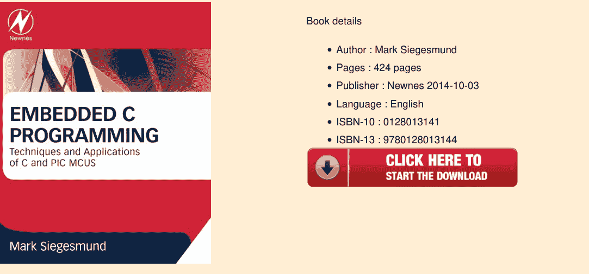

# 嵌入式 C 编程：C 与 PIC MCU 的技术与应用

点击下方图片阅读或下载书籍 !!!

本书提供了一门关于使用 PIC® 微控制器和 CCS C 编译器进行 C 编程概念的实战入门课程。通过以项目为向的方法，本书提供了一种易于理解的方法，帮助读者学习 C 语言编程 PIC 的正确且高效的实践。C 编程原理被逐步引入，以此构建数据和知识。早期章节通过练习涵盖对 C 语言的理解，而书的后半部分则详细介绍了 PIC® 微控制器、其外设，以及如何在 C 语言内部使用这些外设。本书展示了大多数嵌入式设计专业人士使用的编程方法和工具，并为该主题提供循序渐进的指南；本书将鼓励你学习、扩展并自定义代码以用于你自己的项目。这是一本关于使用 PIC 微控制器进行 C 编程的完整介绍，侧重于实际应用、编程方法和工具。每章都包含了 C 项目示例、表格、图表、图示、参考文献、照片、原理图、流程图和编译器兼容性说明，旨在将你的知识转化为真实世界的案例。在线资源包括演示文文稿、扩展测试、练习、测验及答案、真实案例研究、视频和网页链接。
