# 高性能的嵌入式计算：基于定制、代码转换和编译的高效计算映射


# 献词

我们将此书献给：
我们的父母
我们的家人

献给 Teresa、Rodrigo、Frederico 和 Dini。

献给我的祖母 Amélia。

献给 Rafael Nuno，在过去的几年里，他承受了远超他应得的许多苦难。

# 作者简介

**João M.P. Cardoso** 是波尔图大学工程学院信息工程系的正教授，波尔图，葡萄牙，也是 INESC TEC 的研究成员。此前，他曾就职于 IST/里斯本技术大学（UTL）（2006–08），INESC-ID 高级研究员（2001–09），以及阿尔加维大学（1993–2006）。2001/2002 年，他曾在德国慕尼黑的 PACT XPP Technologies, Inc. 工作。他于 2001 年获得 IST/里斯本技术大学电气与计算机工程博士学位。他曾担任许多国际会议的项目委员会成员、大会联合主席和项目联合主席。他（合著）了 150 多篇关于编译器、嵌入式系统和可重构计算等主题的科学出版物。此外，他还参与了多个研究项目。他是 IEEE 高级会员、IEEE 计算机学会会员和 ACM 高级会员。他的研究兴趣包括编译技术、领域特定语言、可重构计算、应用特定架构以及嵌入式计算的高性能计算，尤其侧重于嵌入式计算。

**José Gabriel F. Coutinho** 是伦敦帝国学院定制计算研究组的副研究员。他于 1997 年获得葡萄牙里斯本高等技术学院计算机工程硕士学位。2000 年和 2007 年，他分别获得伦敦帝国学院计算机科学硕士和博士学位。自 2005 年以来，他一直参与英国和欧盟的研究项目，包括 FP6 hArtes、FP7 REFLECT、FP7 HARNESS 和 H2020 EXTRA。此外，他已在同行评议期刊和国际会议上发表了 50 多篇研究论文，并为四本书籍出版物做出了贡献。他的研究兴趣包括可重构计算、HPC 平台、云计算平台、高级编译技术、编程模型和领域特定语言。

**Pedro C. Diniz** 获得葡萄牙里斯本技术大学电气与计算机工程硕士学位，以及美国加州大学圣巴芭拉分校计算机科学博士学位，时间为 1997 年。自 1997 年以来，他一直是南加州大学信息科学研究所（USC/ISI）的研究助理，以及美国加州洛杉矶南加州大学计算机科学研究助理教授。他参与和/或领导了高性能计算编译、可重构计算架构映射与综合，以及更近期的弹性计算等领域的各种研究项目。他还积极参与科学界，曾担任超过 20 个高性能计算、可重构和现场可编程计算领域国际会议的技术项目委员会成员。

# 前言

在过去几十年中，计算机用户享受着晶体管在芯片上看似无限可用的益处，每种新的微处理器设计都展现出远超前几代的性能数字。计算平台从单个处理器核心发展为通用多核和专用核心，例如图形处理单元（GPU），得益于当前可用的高度并行性，提供了前所未有的性能。更近期，能源效率已成为一个主要关切，促使系统以现场可编程门阵列（FPGA）和其他形式的可重构计算设备的形式包含定制计算引擎。

所有这些计算平台趋势都在渗透到嵌入式计算领域，尤其是在高性能嵌入式计算系统中。然而，这些先进架构暴露的执行模型与程序员在开发其庞大代码库时习惯的传统顺序编程范式相去甚远，并且他们在推理程序正确性时依赖于该范式。作为架构与高级编程语言之间这一差距的自然结果，开发人员必须了解应用程序与目标计算架构之间的基本映射，以充分发挥其能力。为了帮助缓解这种映射和优化问题的复杂性，许多高级语言现在包括语言扩展和编译器指令，允许应用程序更有效地使用并行架构，例如，利用多核上的多线程。鉴于当前嵌入式计算平台在延迟、吞吐量、功耗和能源方面的严格要求，开发人员需要进一步掌握这一映射过程。

本书全面描述了用高级命令式编程语言（如 C 或 MATLAB）表达的计算的基本映射技术和源代码转换，以映射到由多个 CPU、GPU 和可重构硬件（主要是 FPGA）组成的高性能嵌入式架构。因此，本书旨在帮助电气、计算机工程和计算机科学领域的从业人员有效地将计算映射到这些架构。

本书还涵盖了现有编译器及其转换，概述了它们在许多映射技术中的应用。这些包括用于循环结构的经典面向并行的转换，但同样重要的是面向数据和数据映射转换，这些转换在基于 GPU 的系统的背景下至关重要。因此，本书旨在帮助面临将计算映射到高性能嵌入式计算系统这一艰巨任务的计算机工程师、计算机科学家以及电气工程师。鉴于此处描述的全面源代码和重定向转换集，本书可以


effectively used as a textbook for an advanced electrical, computer engineering, and computer science course focused on the development of high-performance embedded systems.

We are very conscious about the difficulty of presenting in a single book, and in a cohesive form, all the topics we consider important about the process of mapping computations to high-performance embedded computing platforms. However, we believe that the topics presented in this book should be mastered by the next generation of developers.

We hope you enjoy reading this book, and that it contributes to increasing your knowledge about developing efficient programs on high-performance embedded platforms, and that it serves as an inspiration to your projects.

João M.P. Cardoso
José Gabriel F. Coutinho
Pedro C. Diniz

# 致谢

We would like to acknowledge Walid Najjar, from the University of California Riverside, United States, for reading a previous version of Chapter 2 and for providing important feedback and suggestions for improving it.

We would like to acknowledge all the members of the SpeCS group for their suggestions and discussions, namely, João Bispo, Tiago Carvalho, Pedro Pinto, Luís Reis, and Ricardo Nobre. We are also grateful to all of them for reviewing previous versions of this book’s chapters and for their valuable feedback that undoubtedly helped to improve the book.

Students of the PhD Program on Informatics Engineering (ProDEI) of the Faculty of Engineering of the University of Porto (FEUP) have also been a source of helpful feedback regarding some of the contents of this book, as earlier revisions from selected chapters were used as part of the class material for the High-Performance Embedded Computing (CEED) course.

In addition, we would also like to acknowledge the support given by the following companies. Xilinx Inc. (United States) provided, through their University Program, FPGA-based development boards and software licenses including Vivado and Vivado HLS. ARM Ltd. (United Kingdom) provided, through its ARM University Program, a sample ARM Lab-in-a-Box on Efficient Embedded Systems Design and Programming.

João M.P. Cardoso would like to acknowledge the support of the Department of Informatics Engineering of the Faculty of Engineering of the University of Porto, of INESC TEC, and the partial support provided by the following research projects: ANTEAR (H2020 FET-HPC-1-2014, ref. 671623), CONTEXTWA (FCT PTDC/EEI-SCR/6945/2014), and TECA4Growth—RL1 SMILES (NORTE-01-0145-FEDER-000020). José Gabriel F. Coutinho would like to acknowledge the support of Wayne Luk, the Department of Computing at Imperial College London, United Kingdom, and the partial support of the EXTRA research project (H2020 FET-HPC-1-2014, ref. 671653).

We would like to thank Elsevier for giving us the opportunity to write this book. A warm acknowledgment and appreciation to Lindsay Lawrence, our Elsevier editor, for her belief in this project since the very beginning, as well as her direction which helped us finish this book project.

Last but not least, we would like to thank our families for their support and understanding for the countless hours we had to devote to this book.

# 缩略语

- ACPI 高级配置与电源接口。由Intel、Microsoft和Toshiba推广的标准
- ADC 模数转换器
- AMD 高级微设备
- AOP 面向方面编程
- API 应用程序编程接口
- ARM 高级RISC机器
- ASIP 应用特定指令集处理器
- AST 抽象语法树
- AVX 高级向量扩展
- BRAM 块RAM
- CD 计算设备
- CDFG 控制/数据流图
- CFG 控制流图
- CG 调用图
- CGRA 粗粒度可重构阵列
- CISC 复杂指令集计算机
- CLB 可配置逻辑块
- CMP 片上多处理器
- COTS 商业现成产品
- CPA 关键路径分析
- CPU 中央处理器
- CU 计算单元
- DAC 数模转换器
- DAG 有向无环图
- DDG 数据依赖图
- DDR 双倍数据率
- DFG 数据流图
- DFS 动态频率调整
- DPM 动态电源管理
- DRAM 动态随机存取存储器（RAM）
- DSE 设计空间探索
- DSL 领域特定语言
- DSP 数字信号处理
- DVFS 动态电压和频率调整
- DVS 动态电压调整
- EDA 电子设计自动化
- EDP 能量延迟乘积
- EEMBC 嵌入式微处理器基准联盟
- FMA 融合乘加

| 缩略语 | 定义 |
|---|---|
| FPGA | 现场可编程逻辑门阵列 |
| FPS | 每秒帧数 |
| FSM | 有限状态机 |
| GA | 遗传算法 |
| GCC | GNU编译器集合（最初名为GNU C编译器） |
| GPGPU | 通用图形处理单元（也称为图形处理器上的通用计算） |
| GPIO | 通用输入/输出（IO） |
| GPU | 图形处理单元 |
| HLS | 高层综合 |
| HPC | 高性能计算 |
| HPECC | 高性能嵌入式计算 |
| HPPF | 高性能Fortran |
| ICC | Intel C/C++编译器 |
| IDE | 集成开发环境 |
| ILP | 指令级并行或整数线性规划 |
| IO | 输入/输出 |
| IOB | 输入/输出块 |
| IR | 中间表示 |
| ISA | 指令集架构 |
| LDG | 循环依赖图 |
| LLVM | 低级虚拟机 |
| LOC | 代码行数 |
| MIC | 多核集成 |
| MPI | 消息传递接口 |
| MPSoC | 多处理器SoC（片上系统） |
| NFRs | 非功能性需求 |
| NUMA | 非一致内存访问 |
| OpenACC | 开放加速器 |
| OpenCL | 开放计算语言 |
| OpenMP | 开放多处理 |
| PC | 个人计算机 |
| PCI | 外围组件互连 |
| PCIe | 外围组件互连快速 |
| PE | 处理单元 |
| QoE | 体验质量 |
| QoS | 服务质量 |
| QPI | Intel快速路径互连 |
| RAM | 随机存取存储器 |
| RISC | 精简指令集计算机 |
| ROM | 只读存储器 |
| RTOS | 实时操作系统 |
| SA | 模拟退火 |

- SDR 单数据率
- SDRAM 同步动态随机存取存储器
- SIMD 单指令流多数据流
- SIMT 单指令流多线程
- SLP 子字级并行
- SMT 同时多线程
- SNR 信噪比
- SoC 片上系统
- SPIR 标准可移植中间表示
- SPM 暂存存储器
- SPMD 单程序多数据流
- SRAM 静态随机存取存储器（RAM）
- SSA 静态单赋值
- SSE 流式SIMD扩展
- TG 任务图
- TMR 三模冗余
- UART 通用异步收发传输器
- UMA 一致内存访问
- UML 统一建模语言
- USB 通用串行总线
- VL 向量寄存器长度
- WCET 最坏情况执行时间

# 简介

## 1.1 概述

嵌入式计算系统渗透到我们生活的方方面面，从智能手机和游戏机等消费设备，到控制汽车运行不同方面等不那么显眼的电子设备。在当前嵌入式系统上运行的应用程序表现出与桌面计算机上运行的应用程序相当的复杂性。特别是，移动设备现在支持计算密集型应用程序，且趋势表明应用程序复杂性将进一步增加，以满足用户日益增长的期望。除了性能要求外，能源和功耗对嵌入式应用至关重要，这对应用程序的开发方式以及可使用的算法施加了限制。

图1.1展示了嵌入式计算系统的通用简化架构。嵌入式系统的一个关键区别特征在于其输入和输出设备的多样性，这些设备统称为传感器和执行器，其需求源于为每个特定领域定制其使用的需求。在此图中，我们有一个基于总线的计算核心系统，由RAM、ROM和处理器单元组成。计算核心系统通过一组执行器和传感器与其物理环境交互，使用模数转换器（ADC）和数模转换器（DAC）单元。在软件层面，操作系统和应用软件存储在ROM或闪存中，可能运行一个定制版本的Linux操作系统，该版本能够满足特定的内存和/或实时要求[1]，并可以支持嵌入式系统所需的其他软件组件，例如驻留监视器。

在受限严苛的环境中开发应用程序（这是嵌入式应用的典型目标）需要相当的编程技能。程序员不仅需要理解底层硬件及其伴随运行时支持的局限性，还必须开发能够满足严格非功能性需求（如性能）的解决方案。培养这些跨学科技能并非易事，因此不足为奇的是，缺乏针对相关能力开发的教材。在开发和将高性能应用程序映射到当前和新兴嵌入式计算系统时，会涉及这些能力。我们相信，这本教材是朝这个方向迈出的一步。


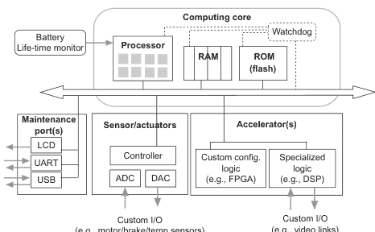

图 1.1 典型嵌入式计算系统的框图。

## 1.2 社会与工业中的嵌入式系统

虽然不一定全面，但图 1.2 说明了嵌入式系统运行的领域和环境的多样性。在家庭中，嵌入式系统用于控制和监控我们的家电，从简单的独立式微波炉、洗衣机和恒温器，到更复杂、更灵敏的安防系统（该系统监控摄像头，并可能通过互联网与远程系统通信）。嵌入式系统还控制我们的车辆，从燃油喷射控制到排放监测，同时利用视觉辅助手段管理大量信息以显示车辆的运行情况。在我们的城市中，嵌入式系统监控公共交通系统，这些系统普遍连接到中央车站，进行公交车和火车的在线调度，并为所有交通线路的所有站点提供实时到达时间更新。在办公室，嵌入式系统处理打印机、摄像头、安防系统以及照明等小型电子设备。

此外，当今的智能手机是技术集成和软件开发的奇迹。这些高端嵌入式系统现在包括多核处理器、WiFi、蓝牙、触摸屏，其性能可与几年前可用于解决科学和工程计算问题的高端多处理系统相媲美。


## 1.3 嵌入式计算趋势

在过去几十年中，晶体管看似无限的可用性促进了具有多种且异构设备的令人印象深刻的计算架构的发展。这使得能够在单个集成电路上结合计算和存储能力，其原始硬件性能以及由此带来的软件复杂性和功能性在以前是无法想象的。各种经验法则已突出并捕捉了重要趋势，在嵌入式系统的背景下，这些法则至今仍然适用。这些经验法则包括：

- 穆尔定律——“集成电路中的元件数量每18个月翻一番。”穆尔定律是推动电子元件微型化及其复杂性不断增加的驱动力之一；
- 古斯塔夫森定律——“任何足够大的问题都可以高效并行化。”由于嵌入式应用复杂性的增加，使用多核和多核架构的潜力也随之增加；
- 维尔特定律——“软件变慢的速度比硬件变快的速度更快。”与可用于利用目标架构的有效开发工具和API（应用程序编程接口）相比，多核系统、定制计算和硬件加速器的快速进步支持了这一观察；
- 吉尔德定律——“带宽增长速度至少是计算能力的三倍。”这一观察指出了数据传输的进步，这些进步放大了计算和存储技术的进步，构成了云计算和物联网（IoT）等技术的基础。

嵌入式系统的一个关键趋势是越来越依赖多核异构架构，以支持计算密集型应用，同时确保长续航时间。计算能力的提升与日益增长的连接需求相结合，推动了从大多在独立环境中运行的嵌入式系统，向它们与其他设备和通信基础设施普遍连接的环境的根本转变，这种环境被称为物联网（IoT）。

与硬件的发展一样，IoT软件需求也已演变，以支持更多应用领域。而在过去几年中，重点一直放在数字信号和图像处理上，现在人们期望嵌入式系统能够与网络上的其他设备交互，并支持各种应用，例如，具备搜索远程数据库和使用地理分布数据进行计算的能力。

毫不奇怪，移动应用的计算需求也呈指数级增长[2]，从而加剧了将这些应用映射到移动架构的复杂性。有人认为（参见，例如，[3]），在某些领域，硬件扩展或硬件复制都不足以满足先进移动应用的性能要求。因此，除了下一代硬件架构的研发外，重新审视资源受限设备上应用程序的开发和映射过程将至关重要。特别是，在考虑算法和/或目标硬件系统变化时，关键的一步是评估代码转换和编译器优化，以充分利用目标系统的加速能力。

对公司而言，另一个关键问题是上市时间[4]（见图 1.3）。进入市场的延迟意味着整体销售额减少，因为产品在市场开始下降之前获益的时间更少。因此，快速高效的应用开发过程是在这些竞争激烈的市场中取得成功的关键因素之一。

## 1.4 嵌入式系统：原型设计与生产

图 1.4 说明了嵌入式系统的设计流程。为嵌入式平台开发高性能应用程序，要求开发人员利用复杂的工具流，并掌握应用程序开发各个阶段（包括部署和维护）中不同的抽象级别。

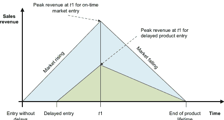

图 1.3 简化的销售模型和市场进入。

Based on Vahid F, Givargis T. Embedded system design: a unified hardware/software introduction. 1st ed. New York, NY: John Wiley & Sons, Inc.; 2001.

在我们的示例中，开发流程始于捕获用户需求，随后进行应用程序的实际开发。首个概念验证原型通常在台式计算机上进行验证，可能使用具有便于早期原型设计功能的编程语言（例如MATLAB），并依赖于外部接口的仿真（例如，不使用真实摄像头，可以使用预先录制的视频或存储为文件的简单图像序列）。如果这个初始原型不满足其功能需求，开发人员必须进行迭代并修改应用程序，可能更改其数据类型（例如，将double转换为单精度浮点数），并应用代码转换和/或重构代码以满足所需的要求。这一过程由开发人员对这些修改对最终嵌入式版本影响的知识所指导。取决于手头的项目，原型可能使用与嵌入式版本相同的编程语言开发，但可能使用不同的API。

开发过程的下一步涉及修改原型代码以得出嵌入式代码实现。这包括使用仿真器、模拟器和/或虚拟平台来验证嵌入式版本，并在需要时对其进行优化。在这个阶段，开发人员必须考虑完整的非功能需求集。在这个阶段，探索和测试硬件加速器也是典型的做法。此步骤将选定的计算划分并映射到可用的加速器上。如果此验证阶段成功，应用程序将部署到目标嵌入式系统或硬件系统仿真器，并进行第二阶段验证

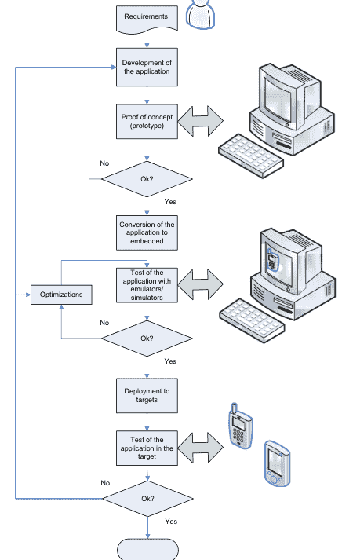

图 1.4 开发嵌入式应用程序的设计流程示例。


执行。如果第二级验证成功，则应用程序即可作为产品部署。

根据应用程序，目标系统需求和非功能性需求（在前面描述的某些开发阶段中）可能会合并。阻碍这些开发阶段有效集成的障碍之一是相应工具之间缺乏接口，以使它们能够真正实现互操作。这一限制迫使开发人员手动关联跨工具的转换和分析效果，这是一个容易出错的过程。

将应用程序开发和映射到高性能嵌入式系统必须考虑大量的设计选择。通常，开发人员必须分析应用程序，并通过通常称为硬件/软件分区 [5] 的过程将其代码分区到最合适的系统组件中。此外，开发人员必须处理针对每个特定系统组件的多个编译工具（子链）。在处理 FPGA（现场可编程门阵列）时，这些问题会进一步加剧，FPGA 是一种用于硬件加速和快速原型制作的技术，因为它结合了定制硬件的性能和软件的灵活性 [5,6]。随着嵌入式平台变得越来越异构，开发人员还必须探索针对每个架构的代码和映射转换，以便生成的解决方案满足其总体要求。

映射过程的关键阶段之一是对代码进行性能分析以了解其行为（参见，例如，[7]），这通常通过广泛的代码插桩和监控来实现。此外，针对高性能嵌入式系统开发应用程序会导致源代码经过广泛的架构特定转换和/或使用工具特定的编译指令进行转换。此类做法要求开发人员具备专业知识，以了解转换何时可能限制可移植性，因为否则当底层架构发生变化时，开发人员可能需要重新启动设计过程。导致开发复杂性的另一个问题是，为同一应用程序存在不同的产品线，以支持多个目标平台和/或多个应用场景。

提升性能的关键方面是利用计算平台中可用的并行性。在此背景下，在改进应用程序性能时，开发人员需要考虑 Amdahl 定律 [8,9] 及其对多核时代的扩展 [10,11]，以指导代码转换和优化，以及代码分区和映射。

## 1.5 关于 LARA：面向切面的方法

LARA 是一种面向切面的语言，能够表达代码转换和映射策略，允许开发人员以系统化的方式将非功能性关注点编码化，随后可以以自动化的方式将其应用于其应用程序代码。

使用面向切面编程（AOP）机制允许 LARA 描述与应用程序代码本身解耦——这是提高可维护性和跨目标平台程序可移植性的重要特性。此外，LARA 描述可以轻松组合，以使用原生 LARA 循环和报告分析构造来创建越来越复杂的设计空间探索（DSE）策略。简而言之，LARA 提供了一种更正式的载体来指定应用程序设计流程各个阶段的策略，这可以被视为可执行策略。1

本书中许多代码插桩和转换的描述使用 LARA 语言 [12]。尽管 LARA 作为转换描述语言具有许多优势，但本书并非关于 LARA。在其他文本中，用于针对高性能嵌入式系统的许多（如果不是全部）映射技术和代码转换都以非正式的、通常是临时的方式描述，使用底层硬件甚至运行时系统的抽象。因此，本书中呈现的 LARA 描述可以被视为一种载体，帮助读者清晰且明确地理解复杂映射过程中使用的各种代码和数据转换。此外，LARA 已在针对真实计算系统的许多研究项目中开发和验证，并支持 C 和 MATLAB 等流行语言，以针对包括 GPU 和 FPGA 在内的异构系统。

## 1.6 目标与目标读者

本书旨在为信息工程、计算机科学、计算机工程的本科生和研究生、从业者和工程师提供知识，以分析并高效地将用高级编程语言描述的计算映射到高性能嵌入式计算（HPEC）领域使用的架构。所需技能横跨多个领域，涵盖算法分析、所需架构、编译器转换和优化。本书还旨在解决行业所需技术能力方面的特定趋势，从而为计算机科学和信息工程学生提供必要的技能。

本书主要关注代码转换和优化，以在嵌入式计算环境中提高性能和/或实现节能。主题包括描述计算的方式，以便编译器和映射工具能够有效地利用异构架构和硬件加速器。具体来说，本书考虑了多核架构提供的数据和任务并行性支持，以及使用 GPU 和 FPGA 进行硬件加速（通过 C 和 OpenCL 代码）。

1. 读者将有机会使用本书在线材料中提供的在线工具来使用 LARA 策略。

在描述各个主题时，我们的意图是侧重于概念，而不是使用当前技术的实际实现，以避免本书内容在短期内过时。尽管如此，我们在各章中提供了带有特定示例的“侧边栏”，以将概念与当前实现或技术联系起来。此外，我们还为每章提供了补充的在线材料，在许多情况下包括完整的源代码示例，更深入地突出使用当今技术的概念。

## 1.7 补充参考文献

尽管存在一些支持嵌入式系统课程的技术教科书（例如，[4,13–15]），但其他书籍仅部分涵盖本书涵盖的主题。相反，其他文本，如参考文献 [16–18]，涵盖本文未涉及的补充主题。

关于高性能系统编译技术 [14]、嵌入式计算 [19]、性能调优 [20]、高性能计算 [21]、LARA 提供的 AOP 方法 [22]、硬件/软件协同设计 [23] 和可重构计算 [5,24] 的文本，也涉及与本书主题相关的主题，因此可以作为补充参考文献。

在高性能计算（HPC）优化背景下，其他相关文本包括 Crawford 和 Wadleigh [25]、Garg 和 Sharapov [26] 以及 Gerber 等人 [27] 的书籍。

## 1.8 知识方面的依赖关系

为了跟上本书涵盖的主题，读者应具备高级编程、数据结构和算法、数字系统、计算机体系结构、操作系统和编译器方面的基本知识。图 1.5 说明了这些主题之间的依赖关系，尤其是高性能嵌入式计算（HPEC）。与并行计算和可重构计算相关的主题被视为补充，具备这些技能的读者能够从事更高级的 HPEC 项目和/或将其工作集中在特定技术上。


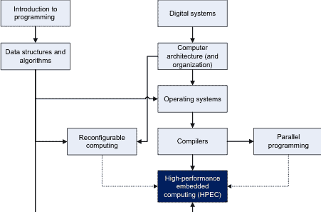

图 1.5 显示主题间依赖关系的框图。请注意，为简化互连，我们省略了不创建额外排序的依赖关系，例如计算机体系结构和 HPEC 之间的依赖关系。

## 1.9 示例和基准

虽然计算行业使用 EEMBC 提供的商业基准，但是，有几个可用的基准仓库已被许多研究小组采用。最常用的基准包括 MiBench [28]、MediaBench [29]、PolyBench、SNU-RT、HPEC Challenge Benchmark Suite [30]、CHStone、UTDS 和 SD-VBS [31]。它们都包含源代码和输入/输出数据。

为了提供示例，并引导读者关注特定优化，同时说明其在性能方面的影响，本书有时会使用这些基准仓库中的代码内核和/或应用程序。随附材料提供了说明性示例的完整源代码，使读者能够使用功能齐全的示例应用程序或代码内核。

EEMBC – 嵌入式微处理器基准联盟，http://www.eembc.org。MiBench 版本 1，http://www.eecs.umich.edu/membench/。MediaBench II，http://eel.cs.ucla.edu/~fritts/mediabench/。PolyBench/C，http://web.cs.ucla.edu/~pouchet/software/polybench/。SNU 实时基准套件，http://www.cprover.org/goto-cc/examples/snu.html。基准，http://www.omgwiki.org/pec/files/hpec-challenge/info.html。CHStone：面向基于 C 的高层次综合的基准程序套件，http://www.ertl.jp/chstone/。UTDS 基准套件，http://www.csg.toronto.edu/~corinna/DSP/infrastructure/UTDSD.html。圣地亚哥视觉基准套件，http://parallel.ucsd.edu/vision/。

## 1.10 图书组织

本书包含八章。每章均提供了一份我们认为可作为特定主题补充阅读的参考文献列表。在每章（本章除外）中，我们都包含一个“进一步阅读”部分，为有兴趣了解特定主题的读者提供参考文献和途径。正是在这些部分中，我们建立了与研究工作和发现的联系。除了八章之外，我们还包含一个术语表，以简要描述贯穿全书的相关术语和概念。

本书的八章如下：

- 第 1 章介绍了嵌入式系统和嵌入式计算的一般概念，同时强调了它们在日常生活中的重要性。我们概述了它们的主要特征和可能的外部环境接口。除了介绍这些主题之外，本章还强调了目标架构和设计流方面的趋势。本章阐述了本书的目标、主要目标受众、先验知识方面的依赖关系，以及在不同情境和读者能力下使用本书的方法。
  *关键词：* 嵌入式计算，嵌入式系统，高性能嵌入式计算，嵌入式计算趋势。

- 第 2 章概述了高性能嵌入式计算系统的主要概念和代表性计算机体系结构。随着多核和多核心趋势正在塑造从高性能计算（HPC）到嵌入式计算的所有计算领域中计算设备的组织方式，本章简要介绍了一些常见的 CPU 架构，包括包含多个核心/处理器的平台。此外，本章介绍了异构架构，包括硬件加速器（GPU 和 FPGA）以及片上系统（SoC）可重构器件。本章强调了阿姆达尔定律及其在将计算卸载到硬件加速器时的影响。最后，本章描述了功耗/能耗和性能模型。
  *关键词：* 计算机体系结构，硬件加速器，FPGA，GPU，性能分析，阿姆达尔定律。

- 第 3 章着重于控制和指导设计流以实现高效应用程序实现的必要性。本章强调了在开发嵌入式计算应用程序时，从高抽象级别开始并处理高抽象级别的重要性。MATLAB 语言用于说明典型的开发过程，尤其是在开发的第一阶段使用高抽象级别时。在这种情况下，需要将这些模型转换为具有高效工具链支持的编程语言，以针对常见的嵌入式计算机体系结构。本章简要讨论了映射问题，并强调了硬件/软件划分作为优化由硬件和软件组件组成的异构平台上的计算的首要任务的重要性。我们阐明了在针对多种和异构架构时，为处理代码维护复杂性而需要领域特定语言和生产力工具。我们还介绍了 LARA，这是一种面向方面的领域特定语言，贯穿其余章节，用于描述设计流策略，并为需要代码插装和编译器转换的示例提供可执行规范。
  *关键词：* 模型，高抽象级别，原型设计，MATLAB，LARA，优化策略，硬件/软件划分。

- 第 4 章描述了源代码分析和插装技术，以揭示后来用于决定最合适的编译和/或执行策略的运行时数据。我们描述了由静态分析和运行时性能分析得出的程序度量。本章介绍了数据依赖分析和基于图的表示，以捕获静态和动态程序信息。最后，我们强调了自定义性能分析的重要性，并展示了 LARA 示例，这些示例捕获自定义性能分析策略以提取复杂的代码度量。
  *关键词：* 插装，性能分析，软件度量，代码分析，数据依赖。

- 第 5 章描述了相关的代码转换和优化，以及它们如何用于实际代码中。我们介绍了各种高级代码转换及其主要优点和目标。我们强调使用循环和基于函数的转换来提高性能，并使用多个说明性示例。我们将代码专用化作为性能改进的最重要来源之一。此外，本章描述了关于数据结构的一些最具代表性的转换。本章的目标是提供一份全面的代码转换目录，并作为需要了解和应用代码转换的读者和开发人员的参考。最后，我们包含了一组 LARA 策略，以示例说明 LARA 在本章主要主题方面的可能用法。
  *关键词：* 代码转换，代码优化，循环转换，代码重构。

- 第 6 章着重于将应用程序映射到基于 CPU 的平台的问题，涵盖通用代码重定向机制、编译器选项和阶段排序、循环向量化、利用多核/多处理器平台以及缓存优化。本章提供了用于面向共享和/或分布式内存架构的代码目标的基本概念，包括使用 OpenMP 和 MPI，因此涵盖了程序员在为高性能计算系统开发或调优应用程序时所需的重要和实际主题。我们认为代码重定向是一个重要主题，因为大多数高级语言（如 C/C++）没有足够的编译器支持来自动发挥当今处理器的全部计算能力。
  *关键词：* 循环向量化，面向多核和多处理器架构，编译器选项，编译器标志，阶段排序，指令驱动的编程模型，OpenMP，MPI。

- 第 7 章涵盖了异构平台的代码重定向，包括针对 GPU 以及基于 FPGA 的加速器的特定指令和领域特定语言。本章强调了使用 OpenCL 和高层次综合（HLS）工具分别将用 C/C++ 编程语言描述的计算映射到 GPU 和 FPGA 时的重要方面。我们通过重新审视屋顶线模型并描述其在面向异构架构时的重要性来补充本章。本章还介绍了性能模型和程序分析方法，以支持开发人员决定何时将计算卸载到 GPU 和基于 FPGA 的加速器。
  *关键词：* FPGA，GPU，可重构结构，指令驱动的编程模型，高层次综合，硬件编译，加速器代码卸载，OpenCL。

- 第 8 章描述了设计空间探索（DSE）、硬件/软件协同设计、运行时适应性以及性能/能耗自动调优（离线和在线）等附加主题。更具体地说，本章为需要应用这些概念的开发人员提供了一个起点，尤其是在高性能嵌入式计算的背景下。更具体地说，本章解释了自动调优如何帮助开发人员在给定目标（例如，执行时间缩短、节能）的情况下找到最佳编译器优化，以及如何利用静态和动态适应性来推导优化的代码实现。此外，它还介绍了模拟退火，这是一种重要且易于实现的优化技术，可用于 DSE 和离线自动调优的背景下。此外，本章还涵盖了多目标优化和帕累托前沿，我们相信这为读者和开发人员处理更复杂的 DSE 问题奠定了基础。虽然由于主题的性质和复杂性，我们无法详细涵盖上述所有主题，但我们希望本章能对它们提供有用的介绍，并且作为本书的最后一章，它能在前几章所介绍的主题基础上带来有趣的讨论点。
  *关键词：* 设计空间探索（DSE），自动调优。运行时适应性，模拟退火，多目标优化，多准则优化，多版本。

## 1.11 预期用途

本书有多种预期用途。对计算机体系结构、硬件加速器以及能耗和功耗有扎实背景的读者可以跳过第 2 章。对代码转换、编译器优化，


指令驱动编程模型或使用指令来指导工具，可能分别侧重于第 5、6 或 7 章。第 8 章描述了高级主题，例如设计空间探索、运行时适应性和自动调谐，这些主题可能会引起读者的兴趣，作为这些主题的入门。最后，虽然我们在本书中一直使用 LARA 规范，但对这种用于捕获和自动化策略的 DSL 没有特别兴趣的读者，仍可以通过遵循本书中用这种语言描述的示例来掌握本书的概念。

## 1.12 摘要

本章介绍了本书涵盖的高性能嵌入式计算主题，本书高度重视通过真实案例和实验实践来阐释理论与实践的相互作用。本书旨在培养日益重要且目前大多数信息工程、计算机工程和计算机科学课程设置中很少涉及的核心能力。

## 参考文献

- [1] Stankovic JA, Rajkumar R. 实时操作系统. Real-Time Syst 2004;28 (2–3):237–53.
- [2] Canal C, Colajanni M, Lancellotti R. 移动 Web 服务的性能演变. IEEE Internet Comput 2009;13(2):60–8.
- [3] Park Y, Park JK, Mahke SA. 面向移动应用的未来 CGRA 高效性能扩展. 载于: 国际现场可编程器件技术会议 (FPT’2012), 韩国首尔, 12 月 10–12 日; 2012. p. 355–42.
- [4] Vahid F, Givargis T. 嵌入式系统设计：统一的硬件/软件导论. 第 1 版. 纽约, NY: John Wiley & Sons, Inc.; 2001.
- [5] Hauck S, DeHon A. 可重构计算：基于 FPGA 的计算理论与实践. 旧金山, CA: Morgan Kaufmann Publishers Inc.; 2007 年 11 月.
- [6] Cardoso JMP, Diniz P, Weinhardt M. 面向可重构计算的计算：一项调查. ACM Comput Surv (CSUR) 2010;42(4):1–65. 文章 13.
- [7] Tu C-h, Hsu H-J, Chen J-H, Chen C-H, Hsu S-H. 仿真 Android 系统的性能与功耗分析. ACM Trans Des Autom Electron Syst 2014;19(2) 文章 10, 25 页.
- [8] Amdahl GM. 计算机体系结构与阿姆达尔定律. Computer 2013;46(12):38–46.
- [9] Amdahl GM. 单处理器方法实现大规模计算能力的有效性. 载于: AFIPS 春季联合计算机会议论文集; 1967. p. 483–5.
- [10] Hill MD, Marty MR. 多核时代的阿姆达尔定律. IEEE Comput 2008;41:33–8.
- [11] Cassidy AS, Andreou AG. 超越阿姆达尔定律：将多处理器性能提升与延迟和能耗关联的客观函数. IEEE Trans Comput 2012;61(8): 1110–26.
- [12] Cardoso JMP, Carvalho T, Coutinho JGF, Luk W, Nobre R, Diniz P, 等. LARA：面向嵌入式系统的面向方面编程语言. 载于: 第 11 届年度国际面向方面软件开发会议论文集 (AOSD’12). 纽约, NY: ACM; 2012. p. 179–90.
- [13] Marwedel P. 嵌入式系统设计——网络物理系统的嵌入式系统基础. 第 2 版. 荷兰: Springer; 2011.
- [14] Wolfe MI. 并行计算高性能编译器. 第 1 版. 波士顿, MA: Addison-Wesley Longman Publishing Co., Inc.; 1995 年 6 月.
- [15] Lee EA, Seshia SA. 嵌入式系统导论：网络物理系统方法. 第 1 版. 美国: Mc-Cl Press; 2011.
- [16] Wolf M. 高性能嵌入式计算：网络物理系统与移动计算中的应用. 第 2 版. 旧金山, CA: Morgan Kaufmann; 2014 年 4 月 15 日.
- [17] Allen R, Kennedy K. 面向现代体系结构的优化编译器：基于依赖的方法. 第 1 版. 旧金山, CA: Morgan Kaufmann; 2001 年 10 月 10 日.
- [18] Cardoso JMP, Diniz PC. 可重构体系结构的编译技术. 纽约, NY: Springer; 2008 年 10 月.
- [19] Fisher JA, Faraboschi P, Young C. 嵌入式计算：面向架构、编译器和工具的 VLIW 方法. 旧金山, CA: Morgan Kaufmann; 2004 年 12 月.
- [20] Bailey DH, Lucas RF, Williams S, 编. 科学应用性能调优. 博卡拉顿, 伦敦, 纽约: Chapman & Hall/CRC Computational Science. CRC Press; 2010 年 11 月.
- [21] Hager G, Wellein G. 面向科学家和工程师的高性能计算导论. 第 1 版. 博卡拉顿, 伦敦, 纽约: Chapman & Hall/CRC Computational Science. CRC Press; 2010 年 7 月 2 日.
- [22] Cardoso JMP, Diniz P, Coutinho JG, Petro Z, 编. 嵌入式可重构系统的编译与综合：面向方面的方法. 第 1 版. 纽约, NY: 海德尔堡, 多德雷赫特, 伦敦, Springer; 2013 年 5 月.
- [23] Schraudolph F. 硬件/软件协同设计实用导论. 第 2 版. 纽约, 海德尔堡, 多德雷赫特, 伦敦: Springer; 2012 年 12 月.
- [24] Cardoso JMP, Huchner M, 编. 可重构计算：从 FPGA 到硬件/软件协同设计. 第 1 版. 纽约, 海德尔堡, 多德雷赫特, 伦敦: Springer; 2011 年 9 月.
- [25] Crawford I, Wadleigh K. 面向高性能计算的软件优化：创建更快的应用程序. 上萨德尔河, NJ: Prentice Hall; 2000.
- [26] Garg RP, Sharapar I. 应用程序优化技术：高性能计算. 帕罗奥尔托, CA: Sun Microsystems Press; 2002.
- [27] Gerber R, Bik AJC, Smith KB, Tian X. 软件优化秘籍：IA-32 平台的高性能配方. 第 2 版. 希尔斯伯勒, OR: Intel Press; 2006. ISBN 0-9764832-1-1. 版权所有 © 2006 Intel Corporation. https://software.intel.com/sites/default/files/m/d/04/1d/toc-swc2.pdf.
- [28] Gauthus MR, Ringenberg JS, Ernst D, Austin TM, Mudge T, Brown RB. MiBench：免费的商业代表性嵌入式基准测试套件. 载于: IEEE 工作负载特征研讨会论文集 (WWC’01). 华盛顿特区: IEEE Computer Society; 2001. p. 3–14.
- [29] Lee C, Potkonjak M, Mangione-Smith WH. MediaBench：用于评估和综合多媒体与通信系统的工具. 载于: 第 30 届年度 ACM/IEEE 国际微架构研讨会论文集 (MICRO’30). 华盛顿特区: IEEE Computer Society; 1997. p. 330–5.
- [30] Haney R, Meuse T, Kepner J, Lebak J. HPEC 挑战基准测试套件. 载于: 第九届年度高性能嵌入式计算研讨会论文集 (HPEC’2005), 列克星敦, MA, 美国, 2005 年 9 月.
- [31] Venkata SK, Ahn I, Jeon D, Gupta A, Louie C, Garcia S, 等. SD-VBS：圣地亚哥视觉基准测试套件. 载于: IEEE 工作负载特征国际研讨会论文集 (IISWC’09), 华盛顿特区: IEEE Computer Society; 2009. p. 55–64.

# 高性能嵌入式计算

## 2.1 引言

嵌入式系统种类繁多，组织方式多种多样。它们可以将微处理器和/或微控制器与其他计算设备相结合，例如专用处理器 (ASIPs)、数字信号处理器 (DSPs) 和可重构器件（例如 FPGAs [1,2] 和粗粒可重构阵列——CGRAs——如 TRIPS [3]），通常以片上系统 (SoC) 的形式存在。在嵌入式系统领域，以及最近在科学计算领域（参见，例如 [4]），使用硬件加速器 [5] 已被公认为满足所需性能水平和/或节能（例如延长电池寿命）的有效方法。尽管本书的重点不在于 GPU 计算（参见，例如 [6–8]），但 GPU 的使用也被作为高性能嵌入式系统中一种可能的硬件加速器予以讨论。

图 2.1 展示了过去三十年来帮助提升计算系统性能的主要驱动因素，以及未来几年的趋势。显然，在 2000 年代中期之前，频率调整是提升性能的主要驱动因素。此后，更复杂的技术被用于提高计算平台的计算能力，包括更激进的流水线执行、超标量执行、多核架构、单指令多数据 (SIMD) 支持、融合乘加 (FMA) 单元和片上多处理器 (CMPs)。硬件加速器与多核架构的结合，目前是新兴高性能异构架构加速器的重要性能提升来源，我们相信在未来几年将继续发挥重要作用。

通常，当给定应用程序和目标嵌入式计算系统的要求（例如执行时间、功耗、能耗和内存带宽）未得到满足时，工程师和开发人员通常会采用一种或多种以下技术：

- 执行代码优化，以减少执行指令的数量，或用耗用更少资源但产生相同结果的指令替换昂贵指令。
- 利用缺乏控制依赖和数据依赖的特点，对代码段进行并行化，从而使多个功能单元或多个处理器单元能够并行执行指令。


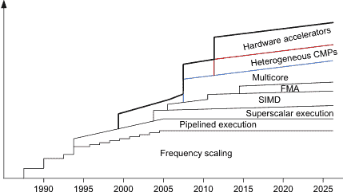

FIG. 2.1 性能提升方面的计算机架构趋势示例。基于“CSE 6230—高性能计算：工具与应用”课程（2013年秋季）的讲义材料：“CPU性能调优：SIMD优化”，作者：Marat Dukhan，乔治亚理工学院，美国。

- 例如，通过在满足数值精度要求的同时降低特定计算的计算需求，在精度与其他非功能性需求之间找到最佳权衡。
- 将代码部分从主机CPU迁移（也称为卸载）到一个或多个硬件加速器（例如，GPU、FPGA），以满足非功能性需求，如性能和能效。

在某些情况下，开发人员可能只需考虑使用更合适的硬件平台，该平台包括具有更强大计算能力的微处理器、外设和加速器。

## 2.2 目标架构

嵌入式计算平台的一个近期趋势是包含多个计算组件，这些组件可以是同构的或异构的，并使用传统总线系统或基于网络的更先进通信系统（例如片上网络（NoC）设备中使用的系统）进行连接。通常，这些架构在内存层次结构的不同级别上包含多个分布式内存，此外还有共享内存，并具有不同的地址空间视图。

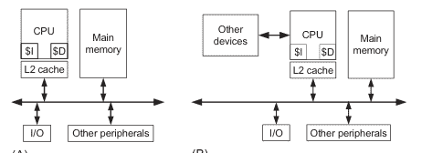

FIG. 2.2 典型单CPU/单核架构的框图：(A) 所有设备通过系统总线连接；(B) 设备可以使用直连通道连接到CPU。

最简单的嵌入式计算系统由一个单CPU/核心组成，带有一个系统总线，连接所有系统设备，从I/O外设到内存，如图2.2A的框图所示。在某些情况下，计算设备（例如，CPU）使用点对点通道直接访问其他组件（图2.2B）。在其他情况下，所有组件都使用内存映射寻址方案访问，其中每个组件被选中并分配到全局地址空间的特定区域。

在大多数高性能系统中，CPU使用分层内存缓存架构。在这样的系统中，第一级内存具有独立的指令和数据缓存[9]。例如，在图2.2所示的系统中，内存组织为一级（L1）指令（I）和数据（D）缓存、二级缓存（L2）和主内存。但是，也存在一些情况，例如低性能和安全关键系统，系统仅支持一级内存。这是因为大多数具有严格实时要求的安全关键系统可能无法应对缓存内存引入的执行时间变化。特别是，当使用缓存内存时，系统可能无法满足由最坏情况执行时间（WCET）规定的实时要求，因此这些系统可能不包含缓存。

### 2.2.1 作为协处理器的硬件加速器

简单的嵌入式系统，例如图2.2所示的系统，可以通过将主机CPU连接到充当硬件加速器的协处理器来扩展。一种硬件加速器是FPGA，这是一种可重新编程的硅芯片，可以定制以实现任何数字电路。其他硬件加速器示例包括GPU和网络协处理器（即专门用于网络接口和通信的协处理器）。

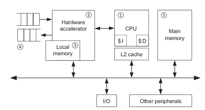

FIG. 2.3 扩展了硬件加速器的典型单CPU/单核架构框图。

图2.3展示了一个由CPU（③）和硬件加速器（②）组成的架构框图。根据硬件加速器的复杂性及其与CPU的连接方式（例如，紧密耦合或松散耦合），硬件加速器可能包含本地内存（③片上和/或外部，但直接连接到硬件加速器）。与加速器紧密耦合的本地内存的存在，允许存储本地数据和中间结果，这是支持数据密集型应用的重要架构特征。

在程序级别，使用硬件加速器时需要考虑的一个重要方面是加速器与主机处理器之间的数据移动成本。通常，加速器仅控制其本地存储，主机处理器与加速器之间的数据通信通过数据消息显式完成。尽管这种组织在概念上很简单，但如果CPU必须参与将数据从主内存（⑤）传输到加速器（②），则会带来显著的通信开销。一种替代方案，其通信开销要低得多，依赖于使用直接内存访问（DMA），因为加速器可以自主访问主内存中的数据（⑤→②）。在这种情况下，仅需要在主机CPU和加速器之间通信数据位置（①↔②）。此外，根据输入/输出设备的系统级连接性，硬件加速器可以直接连接到输入/输出通道（④↔②），例如，使用FIFO，从而完全绕过主机CPU。

硬件加速器也用于台式机和服务器，通常通过PCI-express（PCIe）总线连接到CPU。尽管PCIe提供专用连接，但它仍然带来较高的数据传输延迟并表现出低吞吐量。因此，只有计算密集型代码区域（其中计算工作量与传输数据量的比率较高）才可能从将其卸载到硬件加速器中获益。

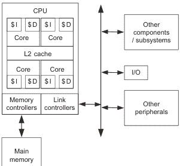

FIG. 2.4 典型多核架构（四核CPU）的框图。

### 2.2.2 多处理器和多核架构

现代微处理器基于由多个处理核心组成的多核架构。通常，每个核心都有自己的指令和数据内存（L1缓存），所有核心共享二级（L2）片上缓存。图2.4展示了一个典型多核（本例中为四核）CPU计算系统的框图，其中所有核心共享一个L2缓存。CPU还连接到外部内存，并包含链路控制器以访问外部系统组件。但是，也存在一些多核架构，其中一个L2缓存由核心子集共享（例如，在四核中每个L2缓存由两个核心共享，或在八核CPU中由四个核心共享）。这在具有额外内存层级的计算系统中很常见。外部内存通常分组为多个级别并使用不同的存储技术。通常，第一级使用SRAM器件组织，而第二级使用DDRAM。

### 将CPU与基于FPGA的加速器相结合

多个平台为通用CPU提供基于FPGA的硬件扩展。示例包括Intel QuickAssist QPI-FPGA [10]、IBM Netezza [11]、CAPI [12]和Xilinx Zynq [13]。其他平台，例如Refif [14]，通过提供集成框架来使用PCI Express（PCIe）链路将基于FPGA的加速器与CPU系统总线接口，从而专注于供应商独立的支持。

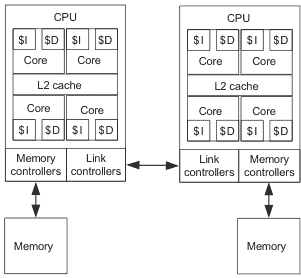

FIG. 2.5 使用分布式内存组织的典型多CPU/多核架构（带有两个四核CPU）的框图。

其他系统组件，例如GPIO、UART、USB接口、PCIe、网络协处理器和电源管理器，通过快速链接（可能是内存映射）连接。但是，在其他架构中，CPU专门使用快速链接和/或交换结构（例如，通过部分交叉开关）连接到这些子系统（包括内存），从而在架构组件之间提供点对点通信通道。

在需要更高性能要求的计算系统中，通常包含多个多核CPU（例如，所有CPU集成为CMP*）。图2.5和2.6说明了CMP的两种可能组织方式，一种使用分布式内存组织（图2.5），另一种使用共享内存组织（图2.6）。

图2.5展示了非一致内存访问架构（NUMA）的示例。在这样的系统中，分布式内存被所有CPU视为一个组合内存；但是，访问时间和吞吐量取决于内存和CPU的位置而有所不同。例如，位于目标内存相对一侧的CPU的内存访问延迟比访问附近内存的延迟更大。

CPU还为每个核心提供多线程并行执行支持。拥有多个多核CPU的系统有可能拥有许多并发执行的线程，从而支持多线程应用程序。


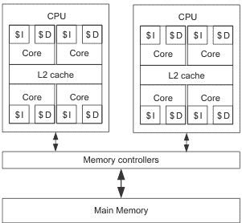

图 2.6 典型多 CPU/多核架构（带两个四核 CPU）的框图，采用共享内存组织。

### CPU 与其他组件的互连方式

目标架构中使用的互连类型取决于所需的性能级别和平台供应商。

交换结构的一个示例是“TeraNet”。快速链接的一个示例是 HyperLink。两者均用于德州仪器公司（Texas Instruments Inc.）提出的某些基于 ARM 的 SoC 中，为子系统与 ARM 多核 CPU 以及外部加速器之间提供高效互连。

在基于 Intel 的计算系统中，内存子系统通常通过 CPU 中集成内存控制器提供的 Intel 可扩展内存接口（SMI）进行连接。它们还包括一个快速链接，使用 Intel 快速路径互连（QPI，一种点对点互连技术）将其他子系统连接到 CPU。AMD 为点对点链路提供 HyperTransport 技术。

德州仪器公司（Texas Instruments Inc.），AM5K2GX0 多核 ARM KeyStone II 片上系统（SoC），SPRS640D—2010 年 11 月。英特尔公司（Intel Corp.），Intel 快速路径互连简介。2009 年 1 月 30 日。API Networks 通过推出业界首款 HyperTransport 技术至 PCI 桥接芯片加速 HyperTransport 技术的应用。（新闻稿）。HyperTransport 联盟，2001-04-02。

### 2.2.3 异构多处理器/多核架构

计算组织的一个当前趋势是异构片上系统（SoC），包含多个独立且不同的 CPU，每个处理器具有任意数量的核心以及其他计算设备，如硬件加速器。图 2.7 显示了一个带有两个不同 CPU（一个有两个核心，另一个有四个核心）和一个 GPU 的架构框图。这种计算组织与智能手机等移动设备中使用的组织类似（参见异构 SoC）。

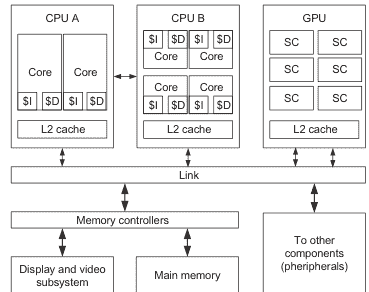

图 2.7 典型异构架构的框图。

### 2.2.4 OpenCL 平台模型

目前，并行计算架构模型被广泛使用，部分原因是存在支持它们的硬件实现。一个著名的示例是在 OpenCL（Open Computing Language，开放计算语言）[15,16] 上下文中提出的计算模型，该模型的实例在此称为 OpenCL 计算设备。该模型得到广泛异构架构的支持，包括多核 CPU 以及 GPU 和 FPGA 等硬件加速器。在 OpenCL 方法中，程序由两部分组成：在 CPU 上运行的主机程序，以及在作为协处理器的 OpenCL 兼容计算设备上运行的一组内核。第 7 章详细介绍了 OpenCL 语言和工具。

### 异构 SoC

与图 2.7 中所示组织类似的 SoC 示例是三星电子为部分三星智能手机设计和制造的 Exynos 7 Hexa 7650（Exynos 7650*）。该 SoC 包含一个 1.8 GHz ARMv8A 双核 Cortex-A72、一个 1.3 GHz ARMv8 四核 Cortex-A53（并无缝支持 32 位和 64 位指令集）以及一个 Mali-T860MP2 GPU。

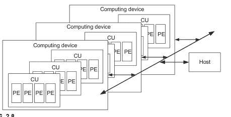

图 2.8 OpenCL 平台模型的高级框图。

图 2.8 显示了典型 OpenCL 平台的高级框图，该平台可能包含一个或多个计算设备。每个设备包括多个计算单元（CU），每个计算单元由多个处理单元（PE）组成。单个内核可以在同一 CU 内的一个或多个 PE 上并行执行，也可以在多个 CU 中执行。计算设备（例如，支持 OpenCL 的 GPU 板）通过共享总线连接到主机 CPU。

PE 通常是负责执行无条件控制流的指令序列的 SIMD 单元。在某些情况下，可以通过应用 if 转换和/或执行两个分支，然后通过多路复用不同分支提供的值来选择所需结果，从而支持控制流。

如图 2.9 所示，OpenCL 计算设备还可以包含分层内存组织，由私有内存（与 PE 紧密耦合的寄存器，每个 PE 一个内存）、每个 CU 的本地内存、全局只读内存（可由主机 CPU 写入但仅由计算设备读取）以及由计算设备和主机 CPU 读写的全局内存组成。每个 CU 的本地内存由该 CU 的所有 PE 共享。

OpenCL 内核通过并行工作项（每个工作项都有关联的 ID 并被视为硬件线程）来执行，工作项定义组（称为工作组）。每个工作组在 CU 上执行，其关联的工作项在其 PE 上执行。

OpenCL 平台非常适合以 SIMT（单指令多线程）结构组织的计算，这在针对 GPU 时很常见。最近，主要 FPGA 厂商已采用 OpenCL 模型，并提供工具链支持以将模型映射到 FPGA 资源（即，使 FPGA 成为 OpenCL 计算设备）。

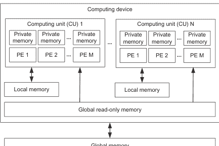

图 2.9 OpenCL 模型的框图 [15]。

## 2.3 基于核心的架构增强

除了最近的多核趋势之外，CPU 核心也得到了增强，以进一步支持并行性和特定类型的计算。这包括使用 SIMD、FMA 单元以及对多线程的支持。

### 2.3.1 单指令多数据单元

单指令多数据（SIMD）单元是指同时对多个数据操作数执行相同操作的硬件组件。通常，SIMD 单元接收两个向量作为输入（每个向量包含一组操作数），对两组操作数执行相同操作（每个向量一个操作数），并输出一个包含结果的向量。图 2.10 说明了一个 SIMD 单元并行执行四个操作的简单示例（如下所示）。

```
C[3:0] = A[3:0] op1 B[3:0];
```

### SIMD 单元

自 MMX、SSE（流式 SIMD 扩展）和 AVX（高级向量扩展）ISA 扩展 [17] 出现以来，SIMD 单元一直可用于 Intel 微处理器。MMX 扩展最初被包含在内，以加速多媒体应用以及需要图像和信号处理的其他应用领域的性能。

ARM 也通过其 NEON 技术向 ARM Cortex 架构引入了 SIMD 扩展。NEON SIMD 单元宽 128 位，包含 16 个 128 位寄存器，这些寄存器可用作 32 个 64 位寄存器。这些寄存器可被视为相同数据类型元素的向量，数据类型分配为 8、16、32、64 位以及单精度浮点。以下示例展示了如何在 Cortex-A9 中使用 SIMD 单元实现涉及单精度浮点数据的向量语句。

```
A[3:0] = B[3:0] x C[3:0];
// assembly
VLD1.32 {r0}, {s15}
Vldmia.32 r1!, {s14}
Vmul.f32 s15, s15, s14
vstmia.32 r2!, {s15}
```

通常，SIMD 单元中的操作包括基本算术运算（如加法、减法、乘法、取反）以及其他运算，如绝对值（abs）和平方根（sqrt）。

促进 SIMD 单元性能提升的另一个因素是，可以同时从内存加载/存储多个数据项，充分利用内存数据总线的全宽。图 2.11 描述了一个使用 SIMD 单元和向量处理的简单示例。如图 2.11C 所示，与不使用 SIMD 单元执行的代码（图 2.11B）相比，使用 SIMD 单元的代码在 ¼ 的时钟周期内执行 ¼ 的指令。

要利用 SIMD 单元，将多个加载或存储访问合并到单个 SIMD 指令中非常重要。这可以在使用连续内存访问时实现，例如，在存在单步长访问的情况下，并且当数组元素对齐时。在前面的示例中，数组 A、B 和 C 以单步长访问，我们假设它们是对齐的（即，每个元素的基地址

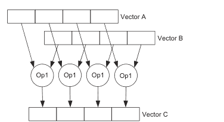

图 2.10 SIMD 单元示例，在本示例中并行执行相同的四个操作（使用不同的操作数）。


```
A[i] = B[i]+C[i];
A[i+1] = B[i+1]+C[i+1];
A[i+2] = B[i+2]+C[i+2];
A[i+3] = B[i+3]+C[i+3];
```

```
t1 = LD B, i
t2 = LD C, i
t3 = t1 + t2
ST A, i, t3
t1 = LD B, i+1
t2 = LD C, i+1
t3 = t1 + t2
ST A, i+1, t3
t1 = LD B, i+2
t2 = LD C, i+2
t3 = t1 + t2
ST A, i+2, t3
t1 = LD B, i+3
t2 = LD C, i+3
t3 = t1 + t2
ST A, i+3, t3
```

```
V1 = LD B, i, 4
V2 = LD C, i, 4
V3 = V1 + V2, 4
ST A, i, 4, V3
```

图 2.11 SIMD 单元的使用示例：(A) 简单的代码片段；(B) 不使用 SIMD 支持的符号汇编；(C) 考虑 SIMD 支持的符号汇编。

起始于字的开头，即，在字节寻址的 32 位机器上，内存地址是 4 的倍数。在处理循环内未对齐的数组时，通常通过应用循环剥离变换（参见第 5 章）来对齐地址（从而启用 SIMD 指令的使用）。此外，为了使数组维度与 SIMD 向量长度匹配，编译器通常应用部分循环展开。我们在第 6 章中提供了关于如何在高级描述中利用向量化的更多细节。

### 2.3.2 融合乘加（FMA）单元

融合乘加（FMA）单元执行融合操作，例如乘加和乘减。其主要思想是提供一条 CPU 指令，该指令可以执行具有三个输入操作数和一个输出结果的操作。图 2.12 显示了一个 FMA 单元的示例。在此示例中，我们考虑支持指令 D = A*B + C 和 D = A*B - C。

```
D[3:0] = A[3:0] * B[3:0] + C[3:0];
D[3:0] = A[3:0] * B[3:0] - C[3:0];
```

FMA 单元通常也支持单精度、双精度浮点数和整数操作，并且根据数据类型，在最后一个操作后包含一个舍入阶段（当不使用融合操作时，为单个舍入步骤，而非两个舍入步骤）。

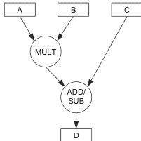

图 2.12
FMA 单元的一个示例。

根据处理器架构，FMA 单元的输入/输出可能与四个不同的寄存器或三个不同的寄存器相关联，其中一个寄存器在结果和 FMA 单元的一个输入操作数之间共享。后者在图 2.12 的 FMA 单元中有所描绘，当 D 是 A、B 或 C 中的一个时（取决于 FMA 指令）。

除了 SIMD 硬件支持外，一些最近的处理器架构不仅包含 FMA 单元，还包含 FMA 向量操作（示例包括 Intel 64 和 IA-32 架构 [18] 以及 ARM Cortex）。在此情况下，一条 SIMD 指令可以在多个数据输入上执行相同的融合操作，如以下针对 D = A*B + C 和 D = A*B - C 的向量形式所示：

### FMA 单元

最近包含在 Intel 微处理器中的 FMA 单元能够执行融合操作，例如乘加、乘减、乘加/减、带符号反转的乘加和乘减。这些最近的 FMA 扩展 [18] 包含 36 条 256 位浮点指令，用于在 256 位向量上进行计算，以及额外的 128 位和标量 FMA 指令。

FMA 指令有两种类型：FMA3 和 FMA4。FMA3 指令支持三个输入操作数（即三个寄存器），并且其结果必须存储在其中一个输入寄存器中。另一方面，FMA4 指令支持三个输入操作数，结果存储在专用输出寄存器中。例如，Intel FMA 指令 VFMADD213PS（FMA3）计算 80~31 = 80*31 + 50*52，而指令 VFMADDP5（FMA4）能够计算 50*31 = 32 * 433。大多数最近的处理器使用 FMA3 类型实现 FMA 指令。

高性能 ARM 微处理器也通过向量浮点（VFP）单元 [19] 包含 FMA 支持。以下示例展示了如何在 Cortex-A9 中使用融合操作和 SIMD 实现涉及单精度浮点数据和临时向量 E（在这两条语句之后不再存活）的两个向量语句。

```
E[3:0] = B[3:0] * C[3:0];
D[3:0] = E[3:0] + C[3:0];
// assembly:
Vldmia.32 r0!, {s13}
Vfma.f32 s11, {s14}
vmla.f32 s15, s13, s14
vstmia.32 r2!, {s15}
```

由于中间值使用了不同的数值舍入方案，FMA 指令的数值结果可能与使用非 FMA 指令的结果不同。例如，浮点表达式 d=a*b+c; 在 FMA 指令的情况下意味着乘法 a*b 以更高精度执行，并且加法的结果被舍入以产生所需的浮点精度（即与 d 的浮点类型相关联的精度）。当使用非 FMA 指令时，此计算执行方式不同，它首先计算 t=a*b，其中 t、a 和 b 使用相同的浮点类型，然后计算 d=t+c。在这种情况下，使用 FMA 指令可能产生比相应的非 FMA 指令更高精度的结果。

### 2.3.3 多线程支持

现代微处理器通过提供多个核心并在单个核心中复制硬件来支持同时多线程（SMT），以允许并行线程执行的原生支持。同一核心内多个线程的执行是通过对其硬件资源进行时分复用和快速上下文切换来实现的。Intel Hyper-Threading² 就是这样一种技术的示例，它能高效地支持同一核心上两个线程的平衡执行。另一方面，不支持多线程的处理器按顺序执行线程，而不交错它们的执行。第 6 章（第 6.5 节）解释了如何使用 OpenMP 利用多线程。

## 2.4 常见硬件加速器

常见硬件加速器有多种形式，从为特定功能（例如，浮点单元）设计的完全可定制 ASIC，到更灵活的图形处理单元（GPU）和高度可编程的现场可编程门阵列（FPGA）。这些设备需要不同的编程模型，并具有不同的系统级接口，不出所料，它们在通用性、性能或能耗之间表现出不同的权衡。在以下小节中，我们专注于基于 GPU 和 FPGA 的硬件加速器。

### 2.4.1 GPU 加速器

最初专用于图形计算加速（例如，着色），图形处理单元（GPU）在灵活性和可编程性方面已发展，以支持许多其他计算密集型应用领域，例如科学和工程应用。在内部，GPU 由许多轻量级核心（有时称为着色器核心）和片上内存组成，这些内存为高度并行性提供原生支持。因此，单程序多数据（SPMD）范式常用于编程 GPU。

对于嵌入式设备，GPU 具有相对简单的组织结构，如图 2.13 的示例所示；而对于高端计算，典型的内部组织结构如图 2.14 所示。自然地，图 2.14 中用于嵌入式应用的 GPU 具有相对“扁平”的层次结构，多个 GPU 核心共享对内部内存或 L2 缓存的访问。相反，高端 GPU 具有更复杂的内部架构，其中核心以层次结构方式组织在集群中，每个集群都有本地非共享和共享资源，例如常量缓存和 L1 缓存，如图 2.14 所示。关于其预期目标应用，嵌入式领域的多样性导致了嵌入式 GPU 配置的更大多样性，具有不同的特征（例如，缓存大小、着色器核心数量、每个着色器核心的 ALU 数量）。另一方面，高端 GPU 的架构多样性较少，因为它们主要设计为硬件加速器，提供具有许多核心和大量片上内存资源的架构。

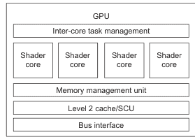

图 2.13 嵌入式设备 GPU 的框图（在此情况下代表 ARM Mali 高性能 GPU）。


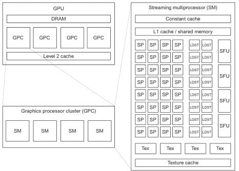

图 2.14 基于GPU的高端加速器的框图（在此表示NVIDIA Fermi GPU）。SP标识流处理器，LDST标识加载/存储单元，SFU标识特殊功能单元，Tex标识Tex单元。

应当清楚，前两种GPU组织架构表现出非常不同的性能和能耗特性。对于移动设备，GPU主要设计为以极低功耗运行，而对于高端科学和工程计算，重点在于高计算吞吐量。

### 2.4.2 可重构硬件加速器

鉴于定制（进而带来性能和能效）与通用性（进而带来可编程性）之间始终存在的权衡，可重构硬件作为硬件加速的可行平台正在获得相当多的关注。可重构设备可以进行定制（甚至可以在运行时动态定制），以满足特定计算的需求，转变为一种可以与定制架构一样高效的硬件组织。由于其内部容量不断增长（就可用硬件资源而言），可重构设备（尤其是FPGA）已被广泛用作嵌入式系统中的硬件加速器。

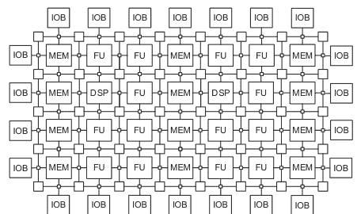

图 2.15 典型可重构结构的简化框图。

图 2.15 说明了典型可重构结构的组织。它由可配置逻辑模块（CLB）、输入/输出模块（IOB）、数字信号处理（DSP）组件、块RAM（BRAM）和互连资源（包括开关盒）组成。可配置（及可重构）结构的极端灵活性在于能够使用其组件构建定制硬件，包括可定制的存储器（例如，无论是端口数量还是容量）、可定制的数据通路和控制单元。借助这种可配置结构，开发人员可以实现与手头计算特性相匹配的硬件设计，而不是重新组织其应用程序的软件代码以适应特定的计算架构。片上存储器组件（BRAM或分布式存储器）可以分组以实现大容量存储器和/或比默认提供的两个访问端口具有更多访问端口的存储器。这是一个重要特性，因为存储器组件可以根据应用程序的需要进行定制。

更具体地说，可重构架构通过提供硬件结构来实现硬件定制，用于实现具有任意数量输入位的功能；位级寄存器；位级互连资源；资源配置以支持移位寄存器、FIFO和分布式存储器；以及高性能内置算术和存储器组件，这些组件可以配置，例如，以实现数学表达式（例如，类似于FMA单元）并支持本地存储。

### FPGA DSP 单元

内置组件的一个示例是由Xilinx提供的XtremeDSP DSP48切片。FPGA（请参见下图中的示例）。这些DSP48切片可以实现乘法、乘累加（MACC）、乘加/减、三输入加法、桶式移位、宽总线复用、幅值比较器、位逻辑函数、模式检测和宽计数器等功能。高端FPGA中包含的DSP48切片包括作为ALU操作的逻辑功能、3或4输入48位加法器以及25或27 x 18位乘法器。DSP切片的数量取决于FPGA型号，但当前型号提供大约1,000到10,000个DSP切片。

下面我们展示了一个FPGA DSP切片，显示其基本组件：（Xilinx UltraScale DSP48E2，来自Xilinx Inc. UltraScale架构DSP切片。用户指南，UG579（v1.3）2015年11月24日。）

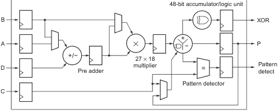

所有这些硬件资源允许实现复杂的硬件加速器，可能包括一个或多个计算引擎，通过最合适的通信结构（例如，RAM、FIFO）互连，并有可能原生支持数据流计算。作为示例，图 2.16 描绘了在可重构结构（例如FPGA）上实现的硬件加速器，它由两个计算引擎、片上RAM和FIFO组成。这些定制硬件资源使得即使在低时钟频率下也能实现性能显著提升且能效高的架构。

然而，可重构硬件（例如FPGA）的极端灵活性是有代价的。首先，它们在晶体管器件方面的内部计算密度不高，因此与ASIC或GPU对比物相比，空间效率较低。其次，更重要的是，由于缺乏“固定结构”，它们需要使用硬件综合工具来推导配置

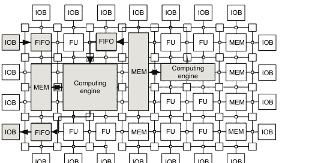

图 2.16 在可重构结构中实现的硬件加速器示例的框图（即，由可重构硬件实现）。

文件定义实际架构逻辑。因此，可重构硬件加速器给程序员带来了额外的负担，通常需要学习面向硬件的编程语言并掌握其物理架构的低级硬件细节。尽管存在这些被认为的困难，但高层综合（用于识别从高级程序描述生成配置文件的编译器的术语）的最新进展已为将C和/或OpenCL描述映射到硬件提供了更高效的方法。FPGA供应商还提供集成设计环境（IDE），通过提供一套复杂的工具来提高编程生产力。

通过综合OpenCL代码获得的FPGA设计也可以利用可重构硬件固有的定制特性。示例包括OpenCL模型中计算单元（CU）之间的定制硬件通信机制，以及根据手头的数据类型和操作使用专用CU。另一个重要特性是，在由CPU和可重构硬件组成的SoC器件中，硬件加速器可以包含对主存和共享数据的直接访问，这可能会产生显著的性能影响，因为使用CPU的通信被简单地避免了。

实现可重构硬件加速器的另一种方法是使用覆盖架构。在这种情况下，可重构硬件资源用于实现不直接源自原生FPGA结构硬件综合的架构。覆盖架构的示例包括粗粒度可重构阵列（CGRA），通常由ALU（字长宽度）、存储器和互连资源组成，每个都使用原生FPGA资源进行综合。因此，这些覆盖架构提供了更高的架构抽象，暴露了更粗粒度的元素。这种更高的架构抽象提供了更短的编译时间，因为映射问题需要处理较少数量的更粗粒度计算单元和更简单的控制逻辑，但这种编译时间的减少是以牺牲定制灵活性为代价的。这些CGRA通常针对特定应用领域设计和/或实现非常特定的执行模型（例如，收缩阵列）。使用覆盖架构一直是Convey计算机平台及其向量协处理器[20]的首选方法，这些平台特别适合向量处理。

### 2.4.3 带有可重构硬件的片上系统

最近的商业SoC也包括可重构硬件结构（即，具有可重构逻辑的芯片区域），能够实现定制硬件加速器和/或其他系统功能，例如Xilinx Zynq器件[21,13]。图 2.17 展示了Zynq器件的框图，其中包括双核ARM CPU、片上存储器、外设、可重构硬件、收发器、I/O、ADC和内存控制器。这些器件允许在单个芯片上实现紧密的硬件/软件解决方案，是应用硬件/软件协同设计方法（参见第8章）和硬件/软件划分的必要性示例。在这种情况下，开发人员需要识别应用程序中可能在CPU上运行（即，作为软件组件）以及在可重构硬件中运行（即，作为硬件组件和/或处理器软件）的组件。针对可重构架构的高级组件和硬件综合工具的广泛进展大大简化了针对这些系统的嵌入式应用开发，并缩短了这些应用的上市时间。

在这些SoC中，可重构硬件资源可用于实现定制硬件加速器（即，专门设计用于执行应用程序部分的硬件加速器）、领域特定硬件加速器（即，由于其可编程性支持而有可能被不同应用程序和/或应用程序部分使用的硬件加速器），甚至由多个使用软件CPU实现的处理器组成的架构（即，使用可重构硬件资源实现的CPU，与在制造时实现的硬件CPU相对）。器件容量的最近增加甚至使这些SoC能够转变为MPSoC（多处理器SoC），最近的Xilinx Zynq器件（例如Zynq UltraScale+ [21]）甚至包括与CPU耦合的GPU核心。


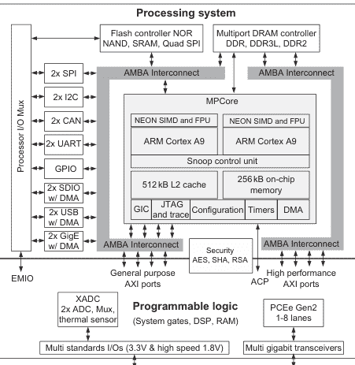

图 2.17 Zynq-7000 器件的框图 [21]：具有可重构硬件的片上系统示例。

## 2.5 性能

在嵌入式系统领域，开发者面临的一个重要挑战是满足非功能性需求，例如执行时间、存储容量和能耗。在此背景下，开发者必须考虑并评估不同的解决方案，以优化系统的性能。作为评估的一部分，开发者识别最合适的性能指标以指导这一过程非常重要。

应用程序的性能定义为应用程序执行时间的算术倒数。其他常见指标涉及识别执行函数、特定代码段或整个应用程序所用的时钟周期数。此外，指标可以由应用程序的非功能性需求驱动，例如：*任务延迟* 衡量执行特定任务所需的时钟周期数，*任务吞吐量* 衡量每个时间单位完成的任务数。吞吐量的常见度量还包括每秒数据包或帧数以及每个时钟周期的采样数。

可扩展性也是常常重要的设计考虑因素，因为它突出了应用程序性能如何随不同的数据集大小和/或使用额外核心/CPU/硬件加速器而变化。可扩展性推动常见的资源使用分析，例如线程数量对应用程序执行时间和能耗的影响，并且是理解满足特定性能目标所需的并行化程度和硬件资源的关键。

就原始性能指标而言，应用程序或任务的执行时间（记为 $T_{exec}$）的计算方法是硬件（例如 CPU）完成它所需的时钟周期数乘以工作时钟的周期（或除以时钟频率），如公式 (2.1) 所示。在大多数情况下，处理 CPU 时，测量的时钟周期数不是经过的 CPU 时钟周期数，而是硬件定时器报告的周期数，该定时器以远低的时钟频率运行。在这种情况下，公式 (2.1) 仍然有效，但周期（$T$）或时钟频率（$f$）必须反映所使用的硬件周期。

$$T_{exec} = N_{cycles} \times T = \frac{N_{cycles}}{f}$$

在考虑将计算卸载到硬件加速器时，执行时间受公式 (2.2) 中三个主要因素的影响，即在 CPU 上运行的应用程序部分的执行时间（$T_{CPU}$）、CPU 与硬件加速器（HA）之间数据通信相关的执行时间（$T_{Comm}$），以及在 HA 上运行的应用程序部分的执行时间（$T_{HA}$）。公式 (2.2) 反映的执行时间模型不考虑 CPU 与硬件加速器执行以及数据通信之间的重叠，即在硬件加速器执行时 CPU 处于停滞状态。不过，可以在模型中考虑数据通信与 HA 执行和/或 CPU 执行与 HA 执行之间的完全/部分重叠，方法是减小公式 (2.2) 中 $T_{Comm}$ 和 $T_{HA}$ 项的值，以考虑观察到的重叠。

$$T_{exec} = T_{CPU} + T_{Comm} + T_{HA}$$

在考虑硬件加速器时，公式 (2.1) 测量 $T_{CPU}$，即应用程序花费在 CPU 执行上的时间（包括多个 CPU 和/或多核）。经过的时钟周期数从执行开始到结束进行测量，这是可靠的测量，因为执行在此组件中开始和结束。

在许多情境中，另一个有用的指标是执行加速比，它量化了优化版本相对于基准实现的性能改进。公式 (2.5) 展示了如何使用优化版本（$Perf_{optimized}$）和基准性能（$Perf_{baseline}$）计算加速比，即我们希望改进的应用程序和/或系统所实现的性能。

Speedup = $T_{baseline} / T_{optimized} = Perf_{optimized} / Perf_{baseline}$ (2.3)

在关注性能改进时，通常首先识别代码中最关键的部分（热点），然后尝试优化这些部分。这些关键部分的识别通常基于使用分析工具（例如 GNU gprof）和/或代码分析（参见第 4 章）以及性能模型。一条著名的经验法则（称为 90/10 局部性法则 [9]）指出：“应用程序 90% 的执行时间花费在 10% 的代码中。”换句话说，应用程序的关键部分大约位于 10% 的代码中，最常见的形式是循环。

### 2.5.1 阿姆达尔定律

阿姆达尔定律 [22, 23] 指出，程序的性能改进受限于必须顺序执行的部分，因此可以用于估计使用并行化和/或硬件加速加速应用程序的潜力。简而言之，阿姆达尔定律指出，通过加速应用程序的部分内容所实现的加速比受限于未加速的代码部分。更正式地说，可实现的性能加速比受限于应用程序顺序（未改进）执行时间的比例（$1 - f$）以及对应用程序执行的其余部分比例 $f$ 所能实现的实际加速比（$s$）。因此，该应用程序加速比可以用公式 (2.4) 表示。

Speedup = $\frac{1}{(1-f) + \frac{f}{s}}$ (2.4)

该关系表明，如果要实现显著的整体性能改进，必须改进代表全局执行时间显著比例的应用程序执行的重要部分。此外，该关系还揭示，如果计算有一个无法（或未）改进的显著比例 $f$，则该比例 $f$ 限制了整体应用程序的可实现加速比。随着比例 $f$ 的性能加速比 $s$ 增加，可能通过使用额外资源和/或使用高级编译器变换，整体应用程序加速比将渐近趋向于公式 (2.5) 给出的值。

Speedup = $\frac{1}{1-f}$ (2.5)

图 2.18 显示了在考虑不同加速比例 $f$ 并将 $s$ 视为无穷大时的加速比极限。如所观察到的，要实现 2 倍的加速比，

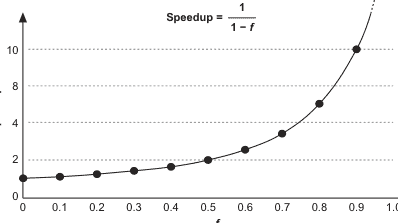

图 2.18 相对于应用程序被加速的执行时间比例的加速比极限（考虑将这些比例的执行时间减少到 0 秒的理论情况，例如，通过使用无限硬件资源）。

原始应用程序代码中其执行时间需要减少到可忽略量的比例 $f$ 为 50%。要实现 10 倍的加速比，比例 $f$ 需要为 90%。因此，只有当代码中越来越大的部分的执行时间大幅减少时，才能实现更高的性能改进。换句话说，最大可实现性能因此受限于应用程序代码中无法或根本不进行优化的内在顺序部分。

这种加速比分析虽然是理论上的，但在实践中非常重要，因为它可以提供关于加速比极限的洞察，从而为程序员工作和/或额外硬件资源使用提供早期的成本效益分析。

作为这种性能模型（即使简化）有用性的示例，我们考虑用于 MP3 解码的 Libmad² 库及其可能加速的理论极限。图 2.19 显示了在典型台式机上运行该程序时的分析结果。使用无通信开销的理想化性能模型，我们预计在考虑对 dct32（一种非常适合硬件实现的函数）进行硬件加速时，最大加速比为 1.11 ×。要实现 10 × 的加速比，我们必须考虑加速分析结果揭示的至少前 9 个函数，这些函数代表了整个程序执行时间的 90% 以上。最大可实现加速比的图表在图 2.20 中描绘。此处，加速比是通过对最...的累积优化计算得出的。


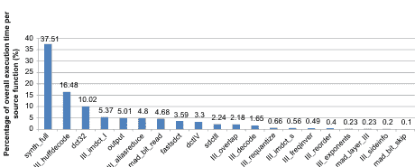

图 2.19 针对 MP3 解码中 20 个最耗时函数的 Libmad 库分析结果。

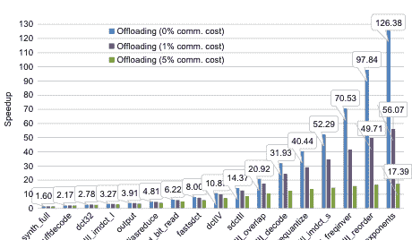

图 2.20 在累积优化 libmad 库代码中每个源代码函数时，各种通信开销场景下可实现的最大加速比（注意，这仅供参考，并假设所有选定函数都可以卸载到硬件加速器，且其在这些加速器上的实现执行时间可忽略）。

Libmad 库中耗时的函数。此图捕获了三个实验的结果。第一个实验揭示了理想化的加速比，假设与硬件加速器之间没有通信开销，也没有任何其他开销来源。第二个实验假设，对于每个卸载到硬件加速器的函数，通信开销为其执行时间的 1%（假设一种假设情况，即数据通信成本与计算时间成正比）。最后一个实验假设此通信开销上升至 5%。图 2.18 所示的指数效应在图 2.20 呈现的第一个实验中非常明显。所呈现的最后三个较少耗时函数（即，“_III_\_firqnver,” “_III_\_reorder,” 和 “_III_\_exponents”）的理想加速，在考虑程序整体执行时间时其执行时间均可忽略（参见图 2.19），使得加速比分别从 52.29 × 提高到 70.53 ×、97.84 × 和 126.38 ×。

显然，这种理想化场景过于乐观，在实际中不可行。同样，可以立即看出，通信和同步开销需要降至最低，因为它们会迅速侵蚀即使应用程序相当大一部分执行时间被加速所带来的任何性能收益。然而，即使是一个简单的模型也可以帮助开发者选择应用程序源代码中可行的部分进行改进。

### 2.5.2 楼顶模型

楼顶模型 [24,25] 是一种越来越流行的方法，用于捕捉计算的计算-内存比，从而快速识别计算是受计算限制还是受内存限制。楼顶模型通常表示为一个二维图，Y轴为性能（Flops/Cycle 或 Flops/s），X轴为操作强度（也称为算术强度或数值强度，Flops/Byte），如图 2.21 所示。

此图基于手头计算系统的架构特征划分了各种性能区域，计算内核可根据所使用的特征和所采用的编译器变换被放置在这些区域中。显然，标记为 © 的区域是不可行的，因为它暗示了超出计算系统所能提供的带宽值。因此，标记为“峰值流带宽”的线标识了任何给定代码设计的带宽上限。该图还包含其他对应于架构特征或元素使用的“上限”线。例如，标记为“无软件预取”的线表示不利用预取的代码无法超过此性能上限。同样，其他水平线限制了代码设计的性能，如果这些代码不使用 SIMD 指令或仅仅不利用指令级并行性（ILP）。理想情况下，开发者希望自己的代码尽可能高，并通过使用编译器变换和代码重构来突破其中一些上限，以展现最高可能的性能率。

简而言之，楼顶模型的目标是为特定架构和特定代码设定性能预期，以指导开发者调整代码并充分利用目标计算系统。该模型也可用于暴露性能瓶颈并指导代码变换。对于代码

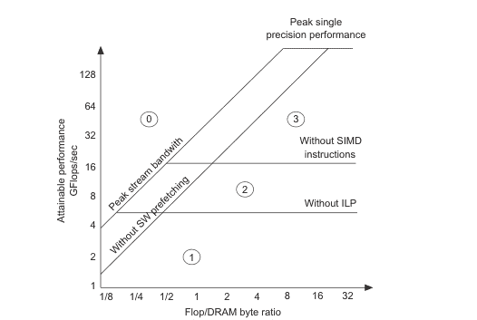

图 2.21 带有多个架构带宽边界和指令优化边界的楼顶模型示意图。

本质上受计算限制，即具有高操作强度的代码，可以通过源代码和编译器优化，从区域 ③“拉”到区域 ⑥。然而，如果代码本质上受内存限制（较低操作强度），最有效的性能改进可能是进行变换，通过预取或利用应用级数据重用（实际上消除内存访问）来减少或隐藏内存操作的延迟。例如，我们在图 2.22 [26] 中描绘了三个代表性 Intel MKL（数学内核库）内核（“daxpy,” “dgemv,” “dgemm”）和一个 FFT 内核的楼顶图，适用于各种输入数据集大小，并考虑在 i7 Core Sandy Bridge E 系统上运行的代码的串行和并行版本。

楼顶图中描绘的峰值性能和内存带宽是使用单核和多核平台上的特定微基准测试，并采用不同内存访问模式估算得出的。图 2.22B 中从图 2.22A 的单核执行使用多核有两个主要影响。首先，如预期由于使用多个独立核心，最大性能上限从 8 增加到 48 Flops/Cycle。其次，峰值带宽从 6.2

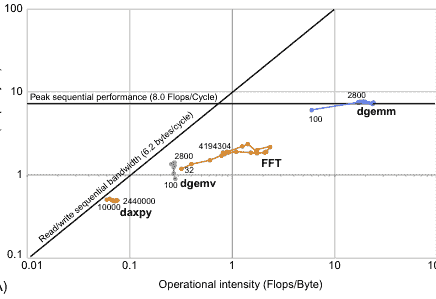

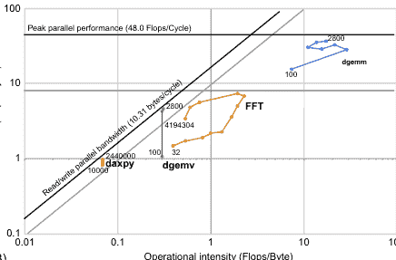

图 2.22 在 i7-3930K Core Sandy Bridge E 系统上 Intel MKL BLAS 1–3 和 FFT 内核的楼顶图示例：串行代码 (A) 和并行代码 (B)。

引自 Ockenberg G, Steinnann R, Cabeza VC, Spampinato DG, Püschel M. Applying the roofline model. In: IEEE international symposium on performance analysis of systems and software (ISPASS’2014). Monterey, CA, March 23–25, 2014. p. 76–85.

到 10.31 Bytes/Cycle，这可能是由于 NUMA 架构中使用的优化内存管理技术，其中内存被分配到“靠近”执行线程的核心（例如，先触策略）。内核 daxpy 和 dgemv 在串行和并行两种情况下均受内存限制（低操作强度），而 dgemm 在两种情况下均受计算限制，接近峰值性能。另一方面，FFT 内核从串行版本的受计算限制变为并行版本的受内存限制，这意味着任何旨在提高 FFT 内核性能的优化首先都会遇到带宽上限。

### 2.5.3 最坏情况执行时间分析

在其他上下文中，要求特定代码段或任务在规定的时间边界内执行。因此，必须对其执行时间进行建模。许多嵌入式系统（如实时系统和安全关键系统）也是这种情况，这些系统要求特定任务的执行受时间约束，以确保符合系统要求的正确行为（参见，例如，[27]，第 10 章）。例如，在汽车发动机中，特定操作控制必须在非常严格的时序约束内发生。同样，在核反应堆软件中，一旦触发报警条件，与安全相关的控制动作必须在精确的时间发生。在这些上下文中，开发者必须保证特定任务的最坏情况执行时间（WCET）低于特定时间边界，并且，这是常见做法，它们可以在底层实时操作系统（RTOS）分配给它们的调度时间槽内执行。

嵌入式软件开发者已采用静态分析（指令计数和执行路径覆盖分析）与限制与其他任务共享资源，甚至抢占相结合的方法，以便推导出可行的执行时间上限（参见，例如，[28]）。

架构元素（如具有非确定性时序行为的缓存和分支预测）的存在，使得即使对于输入受限代码，WCET 的估计也变得非常复杂（参见，例如，[29]）。由于这些限制，并且在满足严格时序截止日期至关重要的情况下，例如，在安全应用中，软件开发者选择使用不表现出非确定性行为的硬件组件，通常以较低的预期平均性能为代价。

## 2.6 功耗和能耗

由于功耗和能耗是大多数嵌入式系统中的关键问题，因此了解影响并最重要的是降低它们的技术非常重要。动态电压和频率缩放（DVFS）[30]、动态频率缩放（DFS）、动态电压缩放（DVS）和动态


power management (DPM) are techniques related to architectures and hardware to reduce energy/power consumption.

Power consumption is represented in watts (W), which directly affects system heat (temperature) and the possible need for cooling schemes. The total power consumption of a CMOS integrated circuit (IC) is the sum of the static power and the dynamic power as represented by Eq. (2.6).

```
$P = P_{static} + P_{dynamic}$ (2.6)
```

Short circuits and leakage currents are responsible for power consumption even when transistor devices are not switching. The static power consumption ($P_{static}$) can be calculated by Eq. (2.7), where $V_{cc}$ represents the supply voltage (sometimes also represented as $V_{dd}$) and $I_{cc}$ (sometimes represented as $I_{dd}$) represents the overall current flowing through the device which is given by the sum of the leakage currents. The static power depends mainly on the area of the IC and can be decreased by disconnecting some parts of the circuit from the supply voltage and/or by reducing the supply voltage.

```
$P_{static} = V_{cc} \times I_{cc}$ (2.7)
```

The dynamic power ($P_{dynamic}$) consumption can be calculated by Eq. (2.8), where $V_{cc}$ represents the supply voltage, $\beta$ represents the activity factor, $C_L$ represents the load capacitance, and $f$ denotes the clock frequency at which the device is operating. $P_{dynamic}$ is proportional to the switching activity of the transistors in the IC. Thus, one way to reduce the dynamic power is to make regions of the IC non active and/or to reduce $V_{cc}$ and/or $f$.

```
$P_{dynamic} = \beta \times C_L \times V_{cc}^2 \times f$ (2.8)
```

When reducing the dynamic power by reducing the frequency and/or the supply voltage, it is common to attempt to reduce the value of the supply voltage as its value impacts in a quadratic way the dynamic power ($P_{dynamic} \propto V_{cc}^2$). Reducing the clock frequency clearly has a negative impact on execution time as the components will operate at a lower clock frequency thus translating into longer execution times, increased latencies, or lower throughputs. Moreover, reducing supply voltage may also imply a reduction of the clock frequency. Typically, the system provides a table of discrete values of supply voltages that they can operate under along with the corresponding maximum clock frequencies (known as frequency-voltage table). Thus, the supply voltage ($V_{cc}$) can be seen as a linear function of the clock frequency as depicted in Eq. (2.9) and the dynamic power consumption is directly proportional to the cube of the clock frequency ($P_{dynamic} \propto f^3$), as shown in Eq. (2.10).

### 频率-电压对

The operating performance points (OPPs) depend on the components (e.g., CPUs) and the support included in the system implemented in the IC.

For example, the Texas Instruments OMAP-L138 IC includes an ARM9 RISC processor and a VLIW DSP. The following table presents the OPPs for three subsystems of the IC, the ARM processor, the DSP, and the RAM.

| 子系统 | 频率 (MHz) | 电压 (V) |
| :--- | :--- | :--- |
| DSP C674x 和 ARM926EJ-S | 456 | 1.3 |
| | 375 | 1.2 |
| | 200 | 1.1 |
| | 100 | 1.0 |
| DDR2 | 312 | 1.3 |
| | 312 | 1.2 |
| | 300 | 1.1 |
| | 266 | 1.0 |

Intel also has provided control over the processor’s operating frequency and supply voltage with the Enhanced Intel SpeedStep Technology.*

*德州仪器公司，OMAP-L138 6000 DSP+ARM处理器，SPRS586I—2009年6月—2014年9月修订。
†英特尔公司，面向英特尔奔腾M处理器的增强型英特尔SpeedStep技术，白皮书，2004年3月。

The tuple consisting of the voltage and the corresponding maximum clock frequency is known as the operating performance point (OPP). OPP = (f,V).

Table 2.1 presents an example of four OPPs of a hypothetical processor. This example considers the processor can operate with a supply voltage of 1 V at a maximum clock frequency of 300 MHz, or 1.2 V at 600 MHz, or 1.3 V at 800 MHz, or at 1.4 V at 1 GHz. These OPPs can be managed by the operating system (OS) and/or by the application via system library functions.

$V_{cc} = \alpha \times f$ (2.9)

$P_{dynamic} = \beta \times C_L \times \alpha^2 \times f^3$ (2.10)

To reduce dynamic power and static power consumption, two main mechanisms can be used, namely, dynamic voltage and frequency scaling (DVFS) and dynamic power management (DPM), respectively. These two techniques are described in the following subsections.

### 表2.1 频率-电压表示例（表示OPP）

| 频率 (MHz) | 供电电压 (V) |
| :--- | :--- |
| 300 | 1.0 |
| 600 | 1.2 |
| 800 | 1.3 |
| 1,000 | 1.4 |

The energy consumed, represented in Joules (J), during a period of activity is the integral of the total power dissipated (Eq. 2.6 for CMOS ICs) over that period. Eq. 2.11 represents in a simplified way the total energy consumed during a period T (in seconds) as the product of the average power dissipated over that period (P_avg) by T. For a given application, one can save energy if power consumption/dissipation is reduced and the execution time is not increased as much, or conversely if the execution time is reduced without a large increase in power dissipation.

### ACPI：高级配置与电源接口

ACPI is a standard interface specification supported by hardware and software drivers. Usually the operating system uses this API to manage power consumption, but the API can also be used by applications.

ACPI considers four global states (from G0 to G3, with a subdivision in six sleep states S0 to S5), performance states (based on the possible OPPs), known as P-states (and from P0 to P15 at maximum, being P0 the state operating at maximum clock frequency and resulting in the highest power dissipation). Processor states, known as C-states (and usually from C0 to C3, but depending on the processor). The C-states represent operating (C0), Halt (C1), Stop-Clock (C2), and Sleep (C3) states.

*统一EFI公司。高级配置与电源接口（ACPI）概述。修订版5.1，2014年7月。http://www.uefi.org/sites/default/files/resources/ACPI_5_1_Release.pdf.

```
E = P_avg × T (2.11)
```

Energy consumption is not directly associated with heat but affects battery usage. Thus by saving energy one is also extending the battery life or the length of the interval between battery recharges. On the other hand, energy efficiency is a term related to performing the work needed with as less energy as possible, sometimes being quantified by the work done per Joule (e.g., samples/J, Gbit/J, and frames/J). Two common metrics used to represent the trade-off between energy consumption and performance are the energy delay product (EDP) and the energy delay squared product (ED²P). EDP is obtained by multiplying the average energy consumed by the computation time required [31]. Both EDP and ED²P give more importance to the execution time than to the energy consumed. Compared to EDP, by squaring the computation time required, the ED²P metric gives even more importance to execution time than to energy consumption. One can give even more importance to performance by raising the computation time required by values >2.

### 2.6.1 动态电源管理

Dynamic power management (DPM) techniques [32] use the various operating CPU modes such as sleep (idle) and active (running) to dynamically reduce power and possibly energy consumption. These techniques need to take into account the switch cost, in terms of time and energy, between those modes. Fig. 2.23 presents an example of a power state machine representing a microprocessor with three power states (RUN, IDLE, and SLEEP). Each state dissipates a certain level of power. The

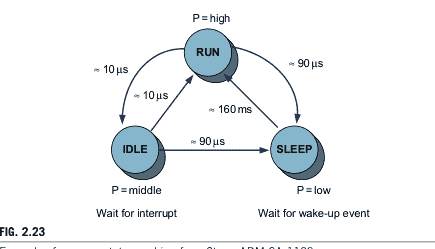

状态之间的转换显示了电源状态之间转换相关的延迟。The RUN state may also have different levels according to the support of DVFS, DVS, or DFS.

### 2.6.2 动态电压和频率调整

Dynamic voltage and frequency scaling (DVFS) is a technique that aims at reducing the dynamic power consumption by dynamically adjusting voltage and frequency of a CPU [33]. This technique exploits the fact that CPUs have discrete frequency and voltage settings as previously described. These frequency/voltage settings depend on the CPU and it is common to have ten or less clock frequencies available as operating points. Changing the CPU to a frequency-voltage pair (also known as a CPU frequency/voltage state) is accomplished by sequentially stepping up or down through each adjacent pair. It is not common to allow a processor to make transitions between any two nonadjacent frequency/voltage pairs.

### 测量功率和能量

Power dissipation can be monitored by measuring the current drawn from the power supply to the system or to each device. There are specific boards providing this kind of measurements but this scheme requires access to the power rails for the inclusion of a shunt resistor from the Vcc supplied and the device/system under measurement (note that P = V x Icc). This is typically a problem and only useful in certain conditions or environments. Another possibility is to use pass-through power meters as the ones provided for USB interfaces.

Some computing systems provide built-in current sensors and the possibility to acquire from the software side the power dissipated. Examples of this are the support provided by the ODROID-XU3, which allows us to measure the power dissipation of the ARM Cortex big.LITTLE A15 and A7 cores, GPU and DRAM individually, and the NVIDIA Management Library (NVML) which allows to report the current power draw in some of their GPU cards.


通过测量平均电流并了解电压供应，我们可以推导特定执行期间的平均耗散功率和消耗能量。

基于硬件感知的软件功率模型用于自Sandy Bridge微架构起为Intel微处理器提供的运行平均功率限制（RAPL）驱动程序。

测量值通过特定于型号的微处理器寄存器收集。与平台无关的库（如性能API（PAPI））的最新版本还包括对RAPL和基于NVML的功率与能量读数的支持，此外还包括基于微处理器硬件计数器的运行时性能测量。在移动设备中监控功率可以通过特定支持实现，例如PowerTutor在基于Android的移动平台中的支持。

监控功率耗散的一个重要方面是功率采样率（即，在某些上下文/系统中功率可能过低的最大采样率）。

最后，测量功率和能量的其他可能性包括为特定功率应用使用功率/能量模型和/或使用能够报告耗散功率估计值的模拟器。

- ODROID-XU3。http://www.hardkernel.com.
- NVIDIA管理库（NVML）– 参考手册，NVIDIA公司，2014年3月，TRM-06719-001 vR331。https://developer.nvidia.com/nvidia-management-library-nvml-manual.
- Intel® 64和IA-32架构软件开发人员手册，第3B卷：系统编程指南，第2部分，2016年9月。
- Intel公司。Intel Xeon处理器。http://www.intel.com/content/www/us/en/processors/xeon/xeon-processor-e5-family.html.
- PowerAPI。http://powerapi.gforge.inria.fr.
- R. Joseph, E. De, 和 M. Martonosi，“功率、能量和云的运行时估计”，载于：IEEE第11届系统与软件性能分析国际研讨会，2013年4月。
- PowerTutor：基于Android的移动平台电源监视器，http://ziyang.eecs.umich.edu/projects/powertutor/.

动态频率缩放（DFS）和动态电压缩放（DVS）是用于降低功率耗散的技术，适用于电压和频率范围不完全相互依赖的情况，即时钟频率的变化不一定（在一定程度上）意味着供电电压的变化，反之亦然。在不改变供电电压（可能将其维持在以最大时钟频率运行所需的电平）的情况下降低时钟频率，意味着功率耗散降低，但可能导致能量消耗变化不大（理论上我们期望能量消耗相同）。在不改变工作频率的情况下降低供电电压，意味着功率和能量都会减少。

DVFS技术可以被视为DFS和DVS的组合，当电源与工作频率之间的相互依赖以全局方式进行管理时。然而，在存在电压-频率相互依赖的CPU中，DFS、DVS和DVFS通常具有相同的含义，即动态电压-频率缩放。

### 2.6.3 暗硅

丹纳德缩放 [34] 的终结——该理论认为可以在保持功率密度不变的同时继续降低晶体管特征尺寸和电压——为大晶体管数量IC设计带来了巨大挑战。功率密度问题的核心在于，随着越来越小的晶体管数量不断增加，如果不加控制，总漏电流足以造成热失控的威胁。这在多核设备中尤其严重，因为在其中所有核心以最大或可接受速度执行是不可行的。

为应对这一问题，IC可能已采用“暗硅” [35] 技术，在未使用IC区域时对其降压或降频。为支持这些技术，IC必须提供低级机制，以监控IC特定区域（例如协处理器或硬件加速器）的热状况，并提供一个接口，使运行时环境或调度器能够降低相关时钟频率，甚至暂时为降低功率耗散而关闭该单元。这对编译器在该类设备上静态调度选定计算执行的能力产生重大影响。在此背景下，执行可预测性以及因此对延迟和吞吐量等非功能性要求的保证更难以确保。另一种可能性是使用操作系统、中间件或应用程序级支持在运行时对计算进行映射和调度。

## 2.7 比较结果

在比较执行时间、功率耗散和能量消耗时，通常比较多次应用程序运行的平均值（算术平均值）结果。这减少了可能的测量波动的影响，因为大多数时候测量可能受到不相关的CPU活动和测量技术精度的影响。根据测量次数，报告标准偏差也可能很重要。然而，在比较加速比和吞吐量时，比较实验中使用的每个基准/应用程序所实现的优化或改进的加速比/吞吐量的几何平均值更为方便，而不是对加速比使用算术平均值，后者可能导致错误结论。在大多数情况下，测量使用目标平台上的实际执行，并利用硬件计时器来测量时钟周期（及相应的执行时间）以及利用传感器来测量所供电流。大多数嵌入式计算平台不包括电流传感器，有时需要使用可以连接到电源的第三方板子（例如，在电源和被测设备之间使用分流电阻）。

这是如何被发表的？计算机系统实验评估中的陷阱。José Nelson Amaral的演讲。嵌入式系统语言、编译器、工具与理论（LCTES’12），2012年6月12日，北京。

在某些情况下，性能评估使用周期精确模拟器进行（即，在时钟周期级别执行并因此报告准确延迟和功率/能量模型的模拟器。周期精确模拟可能非常耗时，替代方案是使用指令级模拟器（即，关注指令执行而非流逝时钟周期的模拟器）和/或性能/功率/能量模型。大多数虚拟平台使用指令级模拟器来模拟整个系统，包括操作系统的存在，因为它们提供更快的模拟。

在许多情况下，结果比较是使用从实际测量计算得出的指标进行的。最相关的示例是加速比，它允许与基准（参考）解决方案相比较性能改进。在多核和多核心架构的情况下，除了目标平台的特性（例如，内存、CPU、硬件加速器）之外，通常还会报告特定实现所使用的核心数量和核心类型、线程数量以及所用时钟频率。

关于FPGA的使用，通常评估特定设计所使用的硬件资源数量和实现的最大时钟频率。这些度量由特定于供应商的工具在工具链的多个级别中报告，最高精度由工具链的较低级别提供。通常，报告的指标取决于目标FPGA供应商或FPGA系列。对于Xilinx FPGA，报告的指标包括LUT的数量（区分用作寄存器、逻辑或两者兼用的LUT）、切片、DSP和BRAM。

## 2.8 总结

本章描述了目前用于高性能嵌入式计算和通用计算的主要架构。描述包括多核和多核心集成电路（IC）以及硬件加速器（例如，GPU和FPGA）。我们介绍了在性能方面需要考虑的方面，并讨论了将计算卸载到硬件加速器的影响以及使用屋顶线模型来揭示应用程序性能改进潜力的方法。由于功率耗散和能量消耗在嵌入式系统中至关重要，即使主要目标是提供高性能，我们也描述了功率耗散和能量消耗的主要影响因素，以及一些降低它们的技术。

## 2.9 进一步阅读

本章关注了许多主题，这些主题有着广泛的参考文献。本节包含一些我们认为适合作为有兴趣了解本章所涵盖某些主题的读者起点的参考文献。

有兴趣了解可重构计算和可重构架构进展的读者可以参考，例如，[1.36–38]。FPGA架构的介绍见参考文献[2]。参考文献[39,40]中的概述提供了关于可重构代码转换和编译器优化的有用信息。


在可重构计算背景下的体系结构。覆盖层体系结构提供了有趣的方法，并吸引了学术界和工业界的关注（参见，例如，[20,41]）。

参考文献[6]介绍了GPU计算的有用入门知识。此外，已有多项研究工作比较了GPU与FPGA的性能（参见，例如，[42]）。

计算卸载一直是许多作者关注的焦点，不仅涉及将计算迁移到本地硬件加速器，还涉及迁移到服务器和/或HPC平台。计算卸载的示例包括将计算从移动设备迁移到服务器（参见，例如，[43]）。

利用并行性对于提升性能至关重要。在此背景下，在改进应用程序性能时，开发者应考虑阿姆达尔定律（Amdahl’s law）及其对多核时代的扩展[44,45]，以指导代码转换和优化，以及代码分区和映射。

已有许多方法被提出用于利用DVFS降低功耗和能耗（参见，例如，[46]）。关于DVFS和DPM的最新且有用的综述载于[47]。对功耗感知计算主题感兴趣的读者可参阅参考文献[48]。移动设备通常有严格的功耗和能耗要求。因此，已有多种方法针对移动设备功耗监测API进行了研究。基于Android的智能手机的能耗模型是PowerTutor [49]。对自建能耗模型方法感兴趣的读者可参阅参考文献[50]。

虽然简单性能模型在单核体系结构中的应用已被广泛理解，但仍需进一步理解以扩展或重新审视阿姆达尔定律（Amdahl’s law）及其主要教训和对多核时代的扩展，如近期研究[44,45]所讨论的。具有处理器异质性和定制处理引擎的新兴架构的复杂性，也可能促使更复杂的模型（如本章简要描述的屋顶线模型（roofline model）[51,25]）取得进展。

请注意，阿姆达尔定律（Amdahl’s law）也可应用于功耗和能耗等其他指标。

## 参考文献

- [1] Pocek K. Tessier R, DeHon A. 可重构计算的诞生与青春期：前20年现场可编程定制计算机综述. 收录于：IEEE现场可编程定制计算机国际研讨会前二十年精选. 西雅图, WA, 2013年4月.

- [2] Kuon I, Tessier R, Rose J. FPGA体系结构：调查与挑战. 电子设计自动化基础与趋势 2008;2(2):135–253.

- [3] Burger D, Keckler SW, McKinley KS, Dahlin M, John LK, Lin C, et al. 基于EDGE体系结构的硅时代终结扩展. 计算机 2004;37(7):44–55.

- [4] Weber R, Gothandaraman A, Hinde RJ, Peterson GD. 科学应用中硬件加速器的比较：一个案例研究. IEEE并行与分布系统汇刊 2011;22(1):58–68.

- [5] Ogawa Y, Iida M, Amagasaki M, Kuga M, Sueyoshi T. 面向嵌入式系统的具有软硬件兼容性的可重构Java加速器. 计算机体系结构新闻 2014;41(5):76–81.

- [6] Owens JD, Houston M, Luebke D, Green S, Stone JE, Phillips JC. GPU计算. IEEE学报 2008;96(5):879–99.

- [7] Nickolls J, Dally WJ. GPU计算时代. IEEE微 2010;30(2):56–69.

- [8] Michael S, Vetter IS. CPU-GPU异构计算技术综述. ACM计算机调查 2015;47(4). 文章69，35页.

- [9] Hennessy JL, Patterson DA. 计算机体系结构——定量方法. 第5版. 旧金山, CA, 美国: Morgan Kaufmann; 2012.

- [10] Oliver N, Sharma RR, Chang S, Chulffar B, Garcia E, Greco J, et al. 基于缓存一致结构的可重构计算系统. 收录于：可重构计算与FPGA国际会议论文集 (ReconFig’11). 华盛顿特区: IEEE计算机学会; 2011. 第80–85页.

- [11] Singh M, Leonhardi B. IBM Netezza数据仓库设备简介. 收录于：Litiou M, Stroulia E, MacKay S, 编. 2011年协作研究高级研究中心会议论文集 (CASCON’11). 里弗顿, NJ: IBM公司; 2011. 第385–386页.

- [12] Stucheli J, Bart B, Johns CR, Siegel MS. CAPL：一致加速器处理器接口. IBM研发杂志 2015;59(1):17:1–7:7.

- [13] Crockett LJ, Elliot RA, Enderwitz MA, Stewart RW. Zynq图书：基于ARM Cortex-A9在Xilinx Zynq-7000全可编程SoC上的嵌入式处理. 英国: Strathclyde Academic Media; 2014.

- [14] Jacobsen M, Richmond D, Hogains M, Kastner R. RIFFa 2.1：FPGA加速器的可复用集成框架. ACM可重构技术与系统汇刊 2015;8(4):22.

- [15] Howel L. OpenCL规范. 版本：2.1，文档修订版：23，Khronos OpenCL工作组. 最后修订日期：2015年11月11日. https://www.khronos.org/registry/cl/specs/opencl-2.1.pdf.

- [16] Kaeli DR, Mistry P, Schaa D, Zhang DP. 基于OpenCL 2.0的异构计算. 第1版. 旧金山, CA: Morgan Kaufmann Publishers Inc.; 2015.

- [17] Kusswurm D. 现代X86汇编语言程序设计：32位、64位、SSE和AVX. 第1版. 伯克利, CA: Apress; 2014.

- [18] Intel Corp. Intel® 64和IA-32架构优化参考手册. 订货号：248966-033；2016年6月.

- [19] Langbridge JA. 专业嵌入式ARM开发. 第1版. 伯明翰: Wrox Press Ltd; 2014.

- [20] Bakos JD. 基于Convey HC-1的高性能异构计算. 计算机科学与工程 2010;12(6):80–7.

- [21] Xilinx Inc. Zynq-7000全可编程SoC概述. 产品规格，DS190 (v1.10)；2016年9月27日.

- [22] Amdahl GM. 计算机体系结构与Amdahl定律. 计算机 2013;46(12):38–46.

- [23] Amdahl GM. 单处理器方法实现大规模计算能力的有效性. 收录于：AFIPS春季联合计算机会议论文集；1967. 第483–485页.

- [24] Williams S, Waterman A, Patterson D. 屋顶线：多核体系结构的直观可视性能模型. ACM通讯 2009年4月;52(4):65–76.

- [25] Williams S. 屋顶线模型. 收录于：Bailey DH, Lucas RF, Williams G, 编. 科学应用性能调优. 博卡拉顿, FL, 美国: Chapman & Hall/CRC计算机科学, CRC Press; 2010. 第195–215页.

- [26] Ofenbeck G, Steinmann R, Cabezas VC, Spampinato DG, Püschel M. 应用屋顶线模型. 收录于：IEEE系统与软件性能分析国际研讨会 (ISPASS’2014)，蒙特雷, CA. 2014年3月23–25日. 第76–85页.

- [27] Koopman P. 分布式嵌入式应用的嵌入式系统设计原则. 纽约, NY, 美国: Springer; 2003.

- [28] Altmeyer S, Gebhard G. 抢占式调度的WCET分析. 收录于：第8届最坏情况执行时间(WCET)分析国际研讨会论文集；2008.

- [29] Hardy D, Puaut I. 指令缓存层次结构的WCET分析. 系统结构期刊 2011;57(7):677–94. ISSN: 1383-7621.

- [30] Le Sueur E, Heiser G. 动态电压和频率调整：边际效益递减定律. 收录于：2010年电源感知计算与系统国际会议论文集 (HotPower’10)，伯克利, CA. USENIX协会; 2010. 第1–8页.

- [31] Larios III J, Pedretti K, Kelly SM, Shu W, Ferreira K, Vandyk J, et al. 能量-延迟乘积. 收录于：能源高效高性能计算. Springer计算机科学简明系列. 伦敦: Springer; 2013. 第51–55页.

- [32] Benini L, Bogliolo A, De Micheli G. 系统级动态电源管理设计技术综述. 收录于：De Micheli G, Ernst R, Wolf W, 编. 硬件/软件协同设计选集. 诺威尔, MA: Kluwer Academic Publishers; 2001. 第231–248页.

- [33] Jha NK. 低功耗系统调度与综合. 收录于：IEEE/ACM计算机辅助设计国际会议论文集 (ICCAD’01). 皮斯卡特威, NJ: IEEE出版社; 2001. 第299–363页.

- [34] Dennard RH, Gaensslen FH, Rideout VL, Bassous E, LeBlanc AR. 具有非常小物理尺寸的离子注入MOSFET的设计. IEEE固态电路学报 1974;SC-9(5):256–68.

- [35] Esmaeilzadeh H, Blem E, St Amant R, Sankaralingam K, Burger D. 黑暗硅与多核扩展的终结. 计算机体系结构新闻 2011;39(3):365–76.

- [36] Trimberger S. FPGA的三个时代：FPGA技术前三十年回顾. IEEE学报 2015;103:318–31.

- [37] Hauck S, DeHon A, 编. 可重构计算：基于FPGA的计算理论与实践. 旧金山, CA, 美国: Morgan Kaufmann/Elsevier; 2008.

- [38] Najjar WA, Jenne P. 可重构计算. IEEE微 2014;34(1):4–6. 特刊导言.

- [39] Cardoso JMP, Diniz PC. 可重构体系结构编译技术. 纽约, NY, 美国: Springer; 2008年10月.

- [40] Cardoso JMP, Diniz PC, Weinhardt M. 面向可重构计算的编译：综述. ACM计算机调查 2010;42(4):1–65.

- [41] Rashid R, Steffan JG, Betz V. 比较TILT覆盖层处理器与OpenCL HLS的性能、生产力和可扩展性. 收录于：IEEE现场可编程技术会议 (FPT’14); 2014. 第20–27页.

- [42] Cope B, Cheung PYK, Luk W, Howes LW. 图形处理器与可重构逻辑的性能比较：一个案例研究. IEEE计算机汇刊 2010;59(4):433–48.


- [43] Kun Y, Shumao O, Hsiao-Hwa C. 对资源受限移动设备上运行更重移动互联网应用的有效卸载服务的研究. IEEE Commun Mag 2008;46(1):56–63.

- [44] Hill MD, Marty MR. 多核时代的阿姆达尔定律. IEEE Comput 2008;41:33–8.

- [45] Cassidy AS, Andreou AG. 超越阿姆达尔定律：将多处理器性能增益与延迟和能耗关联的客观函数. IEEE Trans Comput 2012;61(8):1110–26.

- [46] Saha S, Ravindran B. 实时DVFS调度算法的实验评估. In: 第5届年度国际系统与存储会议（SYSTOR 12）论文集. New York, NY: ACM; 2012. 文章7. 12页.

- [47] Bambaci M, Marinoni M, Aydin H, Buttazzo G. 面向实时系统的节能调度：综述. ACM Trans Embed Comput Syst 2016;15(1):1–34.

- [48] Melhem R, Graybill R, 编. 省电计算. Norwell, MA, USA: Kluwer Academic/Plenum Publishers; May, 2002.

- [49] Zhang L, Tiwana B, Qian Z, Wang Z, Dick RP, Morley Mao Z, et al. 智能手机准确在线功率估算及基于自动电池行为的功率模型生成. In: 第8届国际硬件/软件协同设计与系统综合会议（CODES+ISSS 2010）论文集，Scottsdale, AZ，10月24–28日；2010. 第105–14页.

- [50] Dong M, Zhong L. 面向电池供电移动系统的自构建高速率系统能耗建模. In: 第9届移动系统、应用与服务国际会议（MobiSys’11）论文集. New York, NY: ACM; 2011. 第335–48页.

- [51] Williams S, Waterman A, Patterson D. 楼顶图：面向多核架构的深刻可视性能模型. Commun ACM 2009;52(4):65–76.

# 控制设计与开发周期

## 3.1 引言

丰富的编程和可视化环境的可用性，使得使用所谓的第四代编程语言（如MATLAB [1]和Simulink [2]）开发高性能嵌入式系统成为可能。

这种开发方法的基本形式是从模型规格开始，在其中验证端到端功能，同时考虑内部反馈回路和特定数值变量精度要求。

一旦此首次功能规格完成，设计人员和开发人员可以专注于满足其他规格要求。

这些要求通常涉及性能和/或能源目标，在某些极端情况下（如寻求专用集成电路（ASICs）），还涉及特定时钟频率范围的设计面积约束。

为在设计实现的后期阶段保持设计选择的开放性，通常将行为级的昂贵算术运算封装为抽象算子。

即使对于整数值表示，加法和乘法等基本运算符也有多种实现方式。

对合适算子实现的这种探索主要由时钟频率和时序等性能因素指导。

常见的设计空间探索（DSE）方法缺乏允许设计人员传达特定目标要求的语言机制，也缺乏能够利用设计流不同阶段传达的信息来有效探索并得出高效设计方案的工具。

虽然存在执行硬件DSE的工具，但它们往往紧密集成在硬件综合工具链中（例如，[3]），或仅允许使用有限参数集（如循环展开因子）进行探索，因此不提供探索替代方案和潜在更优解决方案的灵活性。

其他工具则专门针对算术精度问题的探索，以满足特定算法级要求（例如，噪声水平）。

更糟糕的是，这些硬件设计通常需要针对时序要求进行认证，并在复杂片上系统（SoC）的上下文中集成，在许多情况下在实时操作系统（RTOS）的监督下执行。

此类系统的验证和认证极其复杂。

虽然特定硬件设计可以满足严格的时序目标，但将其纳入实时系统需要在具有非确定性执行的计算核心上完美同步多个线程的时序和优先级。

在这种情况下，设计人员通常会采用最坏情况执行时间场景，这往往会导致资源使用增加以及非最优的节能设计方案。

设计这些系统的大部分复杂性源于这样一个事实：将原始项目设计目标（如总体能耗或时序要求）追溯到单个设计组件极其困难。

与许多工程领域的常见做法一样，设计人员将其解决方案组织为逻辑相关模块的层次结构。

跨越层次结构边界追踪和向下传播这些要求极其复杂，因为多个解决方案可能表现出可行的单独设计点，但当组合在一起时，组合设计可能无法满足其要求。

因此，在更高设计级别公开要求，并允许工具理解这些要求如何在模块层次结构中上下转换，是现代高性能嵌入式系统设计的关键方面。

在本章余下部分，我们将使用一系列设计规格和示例来满足这一需求，假设读者熟悉C和MATLAB等命令式编程语言。

## 3.2 MATLAB和C中的规格：原型设计与开发

用于编程应用程序、模型、算法或原型的语言极大地影响将其高效映射到目标计算系统所需的工作量。

高级抽象语言通常能提高设计生产率，同时增加生成设计的映射解决方案数量，而无需复杂的代码重构/重构技术。

在以下部分中，我们将使用MATLAB [1]和C [4]编程语言来描述原型设计和编程开发阶段。

### 3.2.1 抽象级别

像C这样的编程语言通常被认为是低级语言，因为算法是使用更接近目标处理器指令的结构和原语实现的，因为大多数操作（如算术、逻辑和内存访问）都由微处理器指令集直接支持。

例如，如果低级编程语言不直接支持矩阵乘法或排序操作（无论是原生还是通过库），开发人员将被迫使用低级操作提供自己的实现。

此类低级实现可能会限制在此抽象级别定义的计算的转换和映射过程，因为编译器自然局限于狭窄的转换和映射路径，为高级优化留下的空间相对较小。

或者，开发人员可以使用支持更高抽象级别的编程语言，这些语言原生支持矩阵

```
D=A*B*C;
```

```
D=mult(mult(A,B),C);
```

图3.1 简单的MATLAB示例（A）；考虑“mult”函数存在的C示例（B）。

乘法和排序。MATLAB [11]、Octave [5]和Scilab [6]就是这种情况，它们原生支持广泛的线性代数矩阵运算（与标量上的常见算术运算符重载）。

图3.1A展示了使用矩阵乘法的MATLAB语句示例。

这种原生支持使代码更简单、更简洁，使编译器能够轻松将该操作识别为矩阵乘法，从而关联实现它的最佳算法（例如，基于矩阵是否稀疏的知识）。

图3.1B展示了一个可能的等效C语句，考虑“mult”函数和存储矩阵的数据结构的存在（包括矩阵的大小和形状）。

为了让编译器识别“mult”函数是矩阵乘法操作的实际实现，需要一种机制让程序员传达该信息，例如通过代码注释。1

面向矩阵的编程语言（如MATLAB）提供的抽象在许多情况下都很有帮助。

在此，我们使用UTDS基准存储库 [7] 提供的边缘检测应用程序，并将其与该存储库中可用的相应C实现进行对比，突出可能的映射。

边缘检测应用程序使用一个函数来卷积两个输入矩阵。

图3.2展示了实现二维卷积的可能MATLAB代码片段。

在此示例中，使用原生支持的点积`.*`来计算K×K大小窗口中的像素与内核矩阵的乘积。

图3.3展示了一个MATLAB代码，它与存储库中存在的C代码非常相似，但不使用`.*`运算符。

```
% Convolve the input image with the kernel.
for r = 0:1:(N-K)
    for c = 0:1:(N-K)
        sum = sum(input_image(r+1:r+K,c+1:c+K).*kernel));
        output_image(r+dead_rows1,c+dead_cols1) = (sum / normal_factor);
    end
end
```

图3.2 使用原生点积操作对输入图像与内核（系数矩阵）进行二维卷积的MATLAB代码。

1 请注意，C++等语言支持运算符重载，这将允许代码像图3.1中所示的MATLAB代码一样简单，但开发人员仍必须提供实现或使用特定领域的库。


```matlab
/* Convolve the input image with the kernel. */
for r = 0:1:(N-K)
    sum = 0;
    for i = 0:1:(K-1)
        for j = 0:1:(K-1)
            sum = sum + input_image(r+i, c+j) * kernel(i,j);
        end
    end
    output_image(r+dead_rows+1, c+dead_cols+1) = (sum / normal_factor);
end
end
```

### 图 3.3 对输入图像与内核（系数矩阵）进行二维卷积的 MATLAB 代码。

```matlab
function [ image_buffer3 ] = combthreshold(image_buffer1, image_buffer2, T)
    N = length(image_buffer1); % for now images are squares
    % pre-allocation and zeroing of the output image
    image_buffer3 = zeros(N); % for now images are squares
    image_buffer3(max(abs(image_buffer1), abs(image_buffer2))>T) = 255;
    % statement below is not needed when considering the pre-allocation and zeroing
    %image_buffer3(max(abs(image_buffer1), abs(image_buffer2))<T) = 0;
end
```

### 图 3.4 基于阈值 T 和两个输入图像的各个像素，为输出图像的每个像素分配黑色或白色的 MATLAB 代码。

边缘检测基准的其他部分包括 (a) 将两个卷积产生的两个图像合并在单个图像中并使用不同的内核值，以及 (b) 基于阈值 (T) 生成黑白图像（0 或 255 值）。这两项计算均在图 3.4 所示的 combthreshold 函数中实现。该函数的代码依赖于 MATLAB 使用矩阵和指定逻辑索引的能力。虽然此代码结果非常紧凑，但它需要使用临时矩阵来存储中间结果。MATLAB 语句 max(abs(image_buffer1), abs(image_buffer2)) 返回一个矩阵，其元素是 abs(image_buffer1) 和 abs(image_buffer2) 的相应元素之间的最大值。max(abs(image_buffer1), abs(image_buffer2))>T 的结果提供一个由 1 和 0 组成的矩阵，指示矩阵 max(abs(image_buffer1), abs(image_buffer2)) 的每个元素是否大于 T。

因此，在本示例中，使用了四个临时矩阵（包括由 abs(image_buffer1) 和 abs(image_buffer2) 产生的两个临时矩阵）。从 MATLAB 到 C 的翻译过程需要决定是使用这些临时矩阵，还是以一种可使用逐元素运算的方式分解运算，从而减少内存使用，因为不再需要临时矩阵。图 3.5 展示了 combthreshold 函数的另一个版本，与原始 C 代码类似，图 3.6 展示了通过从原始 C 代码逐语句翻译获得的 MATLAB 版本。这两个版本都使用了逐元素运算。

```matlab
function [ image_buffer3 ] = combthreshold(image_buffer1, image_buffer2, T)
% N = length(image_buffer1); % for now images are squares

% pre-allocation of output image
image_buffer3 = zeros(N); % for now images are squares

for i = 1:N
    for j = 1:N
        temp1 = abs(image_buffer1(i,j));
        temp2 = abs(image_buffer2(i,j));

        if(temp1 > temp2)
            out = temp1;
        else
            temp3 = temp2;
        end

        if(temp3 > T)
            out = 255;
        else
            out = 0;
        end

        image_buffer3(i,j) = out;
    end
end
```

### 图 3.5 基于阈值 T 和两个输入图像的各个像素，为输出图像的每个像素分配黑色或白色值的 MATLAB 代码的第二个版本。

```matlab
function [ image_buffer3 ] = combthreshold(image_buffer1, image_buffer2, T)
% N = length(image_buffer1); % for now images are squares

% pre-allocation of output image
image_buffer3 = zeros(N); % for now images are squares

for i = 1:N
    for j = 1:N
        temp1 = abs(image_buffer1(i,j));
        temp2 = abs(image_buffer2(i,j));

        if(max(temp1, temp2) > T)
            out = 255;
        else
            out = 0;
        end

        image_buffer3(i,j) = out;
    end
end
```

### 图 3.6 基于阈值 T 和两个输入图像的各个像素，为输出图像的每个像素分配黑色或白色值的 MATLAB 代码的第三个版本。

有许多抽象可能有助于编程应用程序和模型。除了本示例中强调的对矩阵运算的固有支持外，对正则表达式的支持是另一种抽象，它以紧凑的形式为编译器提供增强的语义信息。识别正则表达式允许编译器在考虑目标架构、输入数据和正则表达式复杂性的情况下，生成最有效的实现。当无法直接支持正则表达式时，需要提供一个实现，这会限制编译器的代码转换和优化，并减少进一步转换的机会。

使用更高级别的抽象允许代码捕获规范而非实现。作为规范，它关注需要执行的操作（做什么），而不是执行的方式（怎么做）。因此，使用低级抽象且接近目标实现的代码可能难以识别替代实现路径。领域特定语言（DSL）[8] 通过向开发人员提供领域特定的构造和语义，使抽象级别得以提高，开发人员可以传递关键信息，编译器可直接利用这些信息来为给定设计追求优化的实现。

使用建模语言和模型驱动方法有许多好处。诸如统一建模语言（UMLs）[9] 之类的可视化建模语言提供高级别的抽象以及应用程序/系统的规范。然而，它们依赖于工具生成高效代码的能力以及模拟这些模型的环境的可用性。

Simulink [2] 和 Ptolemy [10] 等环境也可以提供高级别的抽象。这些可以被视为基于组件的仿真和开发框架，其中可视化语言（例如，以组件为术语构建程序）与文本语言（例如，用于编程每个组件的行为）相结合。这些环境提供混合不同组件的能力，例如计算系统的部分和这些环境的仿真器接口，同时为每个组件使用模型。它们还提供在同一框架内以不同抽象级别描述每个组件的可能性，例如，使用高级或低级的行为描述。例如，可以模拟一个系统，使得一个或多个组件使用计算的高级语言描述，或者可以使用微处理器的周期精确模型进行模拟。在某些环境中，可以通过将模型与“硬件在环”（即，为某些组件使用硬件）[11] 相结合来模拟系统。

可以在 C/C++ 和 Java 等传统文本语言中使用特定的应用程序编程接口（API）和/或嵌入式 DSL [33] 来提供更高级别的抽象。提供高级别抽象的 API 的一个示例是可用于没有原生支持正则表达式的编程语言（如 Java 语言）的正则表达式 API。

### 3.2.2 处理不同关注点

在设计周期中，开发人员可能需要处理不同的关注点，这些关注点包括模拟系统的输入/输出、提供计时/能量/功率测量以及监控功能。这些关注点可能转化为必须在应用程序中引入，但在最终实现和/或部署到目标系统时最终删除的特定代码。计时和测量应用程序的功耗和能耗是设计周期中通常考虑的关注点示例。图 3.7 和 3.8 展示了插入到应用程序中以提供此类测量的代码示例。两者都包括对特定函数库（API）的调用，以与硬件组件（例如，计时器和功率传感器）进行接口。

```c
#include "time.h"
...
clock_t begin, end;
begin = clock(); // number of CPU clock cycles
// code section under timing measurements
end = clock(); // number of CPU clock cycles
printf("Elapsed clock cycles: %d\n", (int) (end-begin));
printf("CLOCKS_PER_SEC is the CPU number of clock cycles per second");
printf("Elapsed time: %f (sec)\n", (double) (end-begin)/CLOCKS_PER_SEC);
```

### 图 3.7 对应用程序某一部分进行计时。

```c
#include "energy.h"
...
double begin, end;
begin = energy_start();
// code section under energy measurements
end = energy_end();
printf("Consumed energy: %d (J) \n", (end-begin));
```

### 图 3.8 测量应用程序某一部分的能量。


在 C 等编程语言中，常使用预处理器功能，并使用 #ifdef 和 #define 构造来静态配置应用程序的不同版本。然而，这会污染代码，并使维护不同版本变得困难，尤其是在处理许多需要大量侵入式代码更改的问题时。图 3.9 和 3.10 展示了使用 #ifdef 预处理指令配置应用程序某个部分的两个示例。

```c
#ifdef FROM_FILE
    int image_in[N][M];
    input_from_file(image_in, N, M, "image1.dat");
#endif
#ifdef FROM_FILE
    #include "image.h" // image.h defines the array of constants const_array
    int *image_in = const_array;
#endif
#ifdef FROM_MEMIO // memory mapped I/O device
    // assuming 0xFFFF0000 as the memory address used for mapping the real camera
    volatile int *image_in = (volatile int *) 0xFFFF0000;
#endif
```

图 3.9 使用 #ifndef 和 #ifdef 配置在特定时间使用的代码版本。

```c
#ifdef TIMING
    #include "timing.h"
#endif
double EuclideanDistanceInt(int *str1, int *str2, int size){
    int i, n;
    double sum, dist;
#ifdef TIMING
    start_timer();
#endif
    sum = 0.0;
    for(i = 0; i < size; i++){
        dist = (double)(str1[i] - str2[i]);
        sum = (dist*dist);
    }
    dist = sqrt(sum);
#ifdef TIMING
    showtime(timer());
#endif
    return dist;
}
```

图 3.10 使用 #ifdef 启用应用程序某个部分的计时。

根据在特定设计点上要解决的问题。图 3.9 中的示例展示了 C 代码和预处理指令，用于配置输入图像的获取方式：从数据文件、从内存映射 I/O，或由头文件（“.h”）中的初始化定义。从文件读取图像或将其定义为表示可能测试和评估场景的“.h”文件的选项，通常在将应用程序部署到目标平台之前定义。在图 3.10 的示例中，预处理指令用于使用插桩（对计时库函数的调用）来配置函数的计时。取决于库如何实现这些函数，此示例甚至可以使用许多微处理器中可用的硬件计时器来测量计时。

在大多数实际 C 代码中常见预处理指令，尤其是在嵌入式编程领域。开发者使用它们根据特定需求配置应用程序。特定配置的选择是通过直接在源代码中更改特定值或定义，或使用编译器提供的通过命令行选项控制预处理器的支持来完成的（例如，GNU gcc 支持 -D 选项来定义 #define 预处理指令的值）。

## 预处理指令

C 编程语言支持在编译的预处理阶段（即由预处理器）解析的指令。预处理器返回将作为输入到 C 编译器的源代码。

指令集包括 #include、#define、#ifdef、#else、#elif、#if、#ifndef、#undef、#error 等。#define 指令可用于定义常量或定义宏。以下是两个示例，一个定义常量，另一个定义返回两个值中最大值的宏。

```c
#define LIMIT 10
#define MAX(a, b) ((a) > (b) ? (a) : (b))
```

使用 GNU gcc 时，可以使用 -E 选项输出预处理阶段的结果（例如，gcc -E file.c）。

*C 预处理器，版权所有 © 1987–2016 自由软件基金会，Inc.，https://gcc.gnu.org/onlinedocs/cpp/*

帮助全局设计/开发周期的一种可能性是使用面向切面编程（AOP）方法 [12,13]，以提供根据各特定阶段的要求配置应用程序和设计/编译流程不同阶段（包括不同目标语言）所需的模块化级别。与特定应用问题相关的不同代码版本可以在称为切面的独立模块中编程，而一种工具（在 AOP 社区中称为织入器）负责将应用程序代码与切面织入，以自动生成不同的代码版本（例如，一个用于建模和仿真，一个用于原型设计，多个用于实现）。图 3.11 展示了一个受 AOP 启发的示例，考虑了

```
select beginning of file including the call to "EuclideanDistanceInt"
insert "#include \"timing.h\""
select beginning (after declarations) of function "EuclideanDistanceInt"
insert "start_timer();"
select end (before return statement) of function "EuclideanDistanceInt"
insert "showtime(timer());"
```

图 3.11 AOP 示例。

之前展示的用于说明 #ifdef 预处理指令使用的第一个示例的相同配置要求（参见图 3.9）。此示例选择与问题相关的程序目标元素（例如，要计时的代码），并指定包括插入目标语言代码（在此情况下与使用计时库相关）的操作。尽管此示例的应用与名为 EuclideanDistanceInt 的函数相关联，但该函数的名称实际上可以是图 3.11 中所示切面的参数，使此切面可重复用于每个需要通过插桩进行计时的函数。

### 3.2.3 处理通用代码

使用高级抽象语言开发模型时，通常希望在各种项目和应用程序中重用模型。为此，代码以更通用的方式开发，通常通过将某些选项作为参数提供。在为模块化和可重用性编程时，这很常见。例如，对数字列表进行排序的函数通常被编程为对 N 个数字进行排序，而不是特定数字（例如，1000），该数字可能是正在开发的特定应用程序所需的。在考虑 MATLAB 代码时，开发尽可能通用的代码非常常见，同时考虑各种使用场景。在库函数的上下文中也是如此，如果考虑到许多使用场景，这些函数可以最大限度地提高可重用性。

### 面向切面编程

“面向切面编程是一种编程范式，旨在通过允许分离横切关注点来提高模块化。它通过在不修改代码本身的情况下向现有代码添加额外行为（通知）来实现这一点，而是有一个单独的描述，通过“切点”捕获哪些代码被修改，例如“当函数名称以‘set’开头时记录所有函数调用”。这允许将与业务逻辑不核心的行为（例如日志记录）添加到程序中，而不会使核心功能的代码变得混乱。AOP 为面向切面的软件开发奠定了基础。”（“in”）

一种著名的 AOP 语言是 AspectJ，它为 Java 编程语言提供了 AOP 概念。

*面向切面编程。https://en.wikipedia.org/wiki/Aspect-oriented_programming。* *AspectJ。https://en.wikipedia.org/wiki/AspectJ.*

```matlab
function [cim, r, c] = harris(im, sigma, thresh, radius, disp)
error(nargchk(2,5,nargin));

dx = [-1 0 1; -1 0 1; -1 0 1]; % Derivative masks
dy = dx';

Ix = conv2(im, dx, 'same'); % Image derivatives
Iy = conv2(im, dy, 'same');
% Generate Gaussian filter of size 6*sigma (+/- 3*sigma) and of
% standard deviation sigma
g = fspecial('gaussian',max(1,fix(6*sigma)), sigma);

Ix2 = conv2(Ix.^2, g, 'same'); % Smoothed squared image derivatives
Iy2 = conv2(Iy.^2, g, 'same');
Ixy = conv2(Ix.*Iy, g, 'same');

cim = (Ix2.*Iy2 - Ixy.^2)./(Ix2 + Iy2 + eps); % Harris corner measure

if nargin > 2 % We will perform nonmaximal suppression and threshold
% dilation to find local maxima in a grey scale image
% If dilation is larger than image points whose corner strength image that
% match the dilated image and are also greater than the threshold.
size = 2*radius+1;
maxcim = ordfilt2(size,size,ones(size)); % Size of mask.
maxcim = (cim==maxcim)&(cim>thresh); % Find local maxima.
[r, c] = find(cim); % Find row, col coordinates.
else
if nargin==5 & disp % overlap corners on original image
figure, imagesc(im), axis image, colormap(gray), hold on
plot(c,r,'ys'), title('corners detected');
end
else % leave cim as a corner strength image and make r and c empty.
r = []; c = [];
end
end
```

图 3.12 Harris 角点检测算法的一种可能 MATLAB 规范。eps 是值为 2.2204e-16 的常数。

来自 http://szabeni.cs.illinois.edu/spring16/harris.m。

为了说明这一点，我们在图 3.12 中展示了基于 Harris 算法的图像角点检测器的 MATLAB 代码，该算法广泛用于基于视觉的导航系统。此代码的第 2 行检查每次函数调用的参数数量是否在 2 到 5 之间。如果不是，则报告错误。由于 MATLAB 函数可以使用可变数量的参数调用，因此这种检查参数数量的代码非常常见（_nargin_ 是包含有关函数参数信息的系统 MATLAB 变量）。在第 19 行，再次对参数数量进行测试。如果函数不是使用超过两个参数调用的，则 r 和 c 返回为空（第 33 行），即不执行任何操作且未识别任何角点。此代码与其他非功能性问题交织在一起。例如，第 29–30 行绘制结果图像和角点。该函数包含一个参数 disp，用于控制绘图。


```matlab
function [cim, r, c] = harris(im, sigma, thresh, radius)

    dx = [-1 0 1; -1 0 1; -1 0 1]; % Derivative masks
    dy = dx';

    Ix = conv2(im, dx, 'same'); % Image derivatives
    Iy = conv2(im, dy, 'same');

    g = fspecial('gaussian',max(1,fix(6*sigma)), sigma);

    Ix2 = conv2(Ix.^2, g, 'same'); % Smoothed squared image derivatives
    Iy2 = conv2(Iy.^2, g, 'same');
    Ixy = conv2(Ix.*Iy, g, 'same');

    cim = (Ix2.*Iy2 - Ixy.^2)./(Ix2 + Iy2 + eps); % Harris corner measure

    sze = 2*radius+1;
    mx = ordfilt2(cim,sze^2,ones(sze)); % Size of mask.
    cim = (cim==mx).*(cim>thresh); % Grey-scale dilate.
    [r, c] = find(cim); % Find row,col coords.
end
```

FIG. 3.13
去除某些顾虑后的 Harris 角点检测算法的一种可能的 MATLAB 规范。

这两个示例说明了包含代码以提高函数在多种不同场景/应用中的可用性。包含的某些功能在最终系统或产品中几乎不会出现。图 3.13 展示了不包含此附加代码的函数代码。原始函数现在更清晰，因为它仅具有旨在最终系统中使用的功能。

然而，我们注意到代码仍处于通用形式，并有通过专门化进行性能改进的巨大潜力。3 具体来说，存在可以在编译时求值的代码部分。例如，dy=dx'；将 dy 赋值为 dx 常量矩阵的转置矩阵。因此，一种可能性是将 dy 赋值为常量矩阵（即，dy=[-1 -1 -1; 0 0 0; 1 1 1]），而不是在运行时从 dx 推导它。另一个示例是计算 g = fspecial('gaussian',max(1,fix(6*sigma)), sigma)。对于某些应用，通常会以特定的 sigma 值（1、2 或 3）调用该算法。在每种情况下，第 9 行的语句都可以替换为根据 sigma 值分配的相应值矩阵。在更通用的实现中，但不如提供的实现通用，可以根据 sigma 值用三个矩阵中的一个替换第 9 行。

3 代码专门化是指定义仅针对特定输入值执行的代码版本的行为，与通用版本相比，为这些值提供更好的性能。

```matlab
function [cim, r, c] = harris(im)

dx = [-1 0 1; -1 0 1; -1 0 1]; % Derivative masks
dy = [-1 -1 -1; 0 0 0; 1 1 1]; % Transpose of derivative masks

Ix = conv2_same(im, dx); % Image derivatives
Iy = conv2_same(im, dy);

g=[0.0603 0.0923 0.0603 0.0603 0.0803 0.0803 0.0603; ...
0.0823 0.0168 0.0458 0.0458 0.0168 0.0823; ...
0.0602 0.0458 0.1244 0.1244 0.0458 0.0602; ...
0.0602 0.0458 0.1244 0.1244 0.0458 0.0602; ...
0.0823 0.0168 0.0458 0.0458 0.0168 0.0823; ...
0.0603 0.0923 0.0603 0.0603 0.0803 0.0803];

Ix2 = conv2_same(Ix.^2, g); % Smoothed squared image derivatives
Iy2 = conv2_same(Iy.^2, g);
Ixy = conv2_same(Ix.*Iy, g);


cim = (Ix2.*Iy2 - Ixy.^2)./(Ix2 + Iy2 + eps); % Harris corner measure

mx = ordfilt2(cim,9,[1 1 1; 1 1 1; 1 1 1]); % Grey-scale dilate.
cim = (cim==mx).*(cim>1000); % Find maxima.
[r,c] = find(cim); % Find row,col coords.
end
```

图 3.14 在去除某些顾虑并执行专门化后的 Harris 角点检测算法的一种可能的 MATLAB 规范（eps=2.2204e-16）。

该函数将要执行的函数代码作为其第三个参数进行选择。在此情况下，代码中对 conv2 的所有调用都使用 'same' 作为第三个参数（在 conv2(A, B, 'same') 中），这意味着 conv2 返回与 A 大小相同的卷积的中心部分。因此，可以专门化与 'same' 情况相关的 conv2 版本。

图 3.14 显示了在将 sigma 和 radius 专门化为 1 且 thresh 专门化为 1000 后的一种可能的代码版本。矩阵 g 现在是常量矩阵，甚至可以移动到函数 conv2_same 内部，从而实现该函数中的进一步优化。函数 ordfilt2 也可以通过将两个参数的常量移动到函数内部来进行专门化。

如本示例所示，在考虑模型和通用代码时，专门化的潜力可能非常大。在第 5 章中，我们描述了对代码专门化有帮助的代码转换，例如，在性能和能耗/功耗方面。

### 3.2.4 处理多个目标

开发需要在不同架构上进行评估的代码以决定每个函数或特定代码区域使用的目标处理组件是很常见的，例如，在针对异构多核架构时

```c
#ifdef embedded_timing
XTime_GetTime(&timeStamp_206983496);
printf("TS_before 'gridsInit': %llu\n", timeStamp_206983496);
#endif

#ifdef pc_timing
hTimer.t("t1");
#endif

// code region to time

#ifdef embedded_timing
XTime_GetTime(&timeStamp_206983496);
printf("TS_after 'gridsInit': %llu\n", timeStamp_206983496);
#endif

#ifdef pc_timing
printf("TS_after 'gridsInit': %llu\n", hTimer.elapsed("t1"));
#endif
```

图 3.15 使用预处理器指令来考虑用于测量执行时间的代码，以考虑多个目标的示例。

和/或提供硬件加速器的架构，或者在使用不同计算系统特性实现产品时（例如，在针对不同移动设备时）。

当开发人员需要为某些代码区域、函数、常量值、选项等拥有多个实现时，使用预处理器指令非常常见。选项可以在预处理阶段并根据目标架构进行选择。例如，考虑图 3.15 中的示例，它测量在个人计算机 (PC) 或嵌入式系统中代码区域的执行时间。此示例在同一源代码中捕获：(1) 在 PC 中的执行时间测量和 (2) 在使用在 FPGA 中实现的 Xilinx MicroBlaze 微处理器的嵌入式系统中的执行时间测量。在此示例中，取决于 "embedded_timing" 或 "pc_timing" 的定义（使用 #define），预处理器将选择一个用于测量执行时间的代码版本。

即使使用特定硬件加速器实现代码区域，也可能需要根据所使用的工具链应用不同的指令。图 3.16 说明了一个示例，其中函数在基于 FPGA 的硬件加速器上实现，并使用不同的指令来指示目标工具将 C 函数代码转换为自定义硬件实现。在此示例中，我们将 Catapult-C（例如，参见 [15]）和 Vivado HLS [16] 视为目标高级综合 (HLS) 工具。

在使用不同编译器（例如，GCC、LLVM、ICC）或使用相同编译器但考虑不同目标架构时，可以提供类似的示例。

```c
#define CATAPULT_SYN
// #define VIVADO_SYN

/*! defined(CATAPULT_SYN) && defined(VIVADO_SYN)
   Error Only one of the tools at a time.
   endif

#if!def CATAPULT_SYN
#pragma hls_design top
#endif

#if!def CATAPULT_SYN
#pragma hls_pipeline_init_interval 1
#endif
for (i=0;i<N;i++) {
  #ifdef VIVADO_SYN
  #pragma HLS PIPELINE II=1
  #endif
  ...
  #pragma CATAPULT_SYN
  #pragma hls_unroll yes
  ...
  for (j=0;j<8;j++) {
    #ifdef VIVADO_SYN
    #pragma HLS unroll
    #endif
    y[i] += x[i][j];
  }
}
```

图 3.16 使用预处理器指令来支持多个工具的示例。

### 使用 LARA 的多目标/多工具链

在 LARA 语言中，代码中所需的指令可以移动到 LARA 切面，以便织入器可以根据用户提供的选项注入所需的代码，如以下示例所示。

```
select
function.loop.body.first_stmt end
apply
--
if(options="VivadoHLS") {
  insert_before %{
    #ifdef VIVADO_SYN
    #pragma HLS PIPELINE II=1
    #endif
  }%;
}
end
condition $loop.is_outmost end
--
```


## 3.3 翻译、编译和综合设计流程

给定一个需要映射到混合软件/硬件执行平台的高级计算描述，设计人员需要掌握一组工具，即：

- 编译器：这些工具将用高级命令式编程语言（如 C）描述的代码翻译为针对一个或多个核心的汇编代码，并使用诸如 OpenMP 库（参见第 7 章）提供的并发管理原语。当与硬件或 GPU 设备交互时，代码需要包含特定的库和运行时环境，以便访问设备进行数据和计算同步。
- 综合工具：这些工具将用以硬件为中心的语言（如 Verilog/VHDL）描述的内容翻译为目标特定的表示，该表示适合映射到（例如）FPGA 设备。该描述在寄存器传输级（RTL）描述硬件行为。

图 3.17 描绘了工具的一般组织结构以及整体编译和综合流程。在这个映射过程的核心，需要将生成的组件之间的数据和控制进行接口，即软件组件（其中控制存在于顺序或并发结构中，并由特定并发执行环境的语义以及目标硬件设备定义）。

当针对 GPU 设备时，厂商提供的库和接口环境仍然是高级的，并且很好地映射到传统执行环境的内存和控制抽象。通常，GPU 接口围绕协处理器模型的抽象进行结构化，其中输入数据在执行前传输到设备，随后将结果传输到主机处理器地址空间。厂商提供库函数来执行复制操作，并提供将高级代码翻译为 GPU 汇编代码的编译器。从开发者的角度来看，智力工作包括封装哪些计算需要被捕获为“内核”以及如何分阶段传输数据以最大化性能。对于许多流行的计算，例如快速傅里叶变换（FFTs）和线性代数函数，厂商甚至提供库，以便访问特定函数的高度优化实现。总体而言，这些方法大大简化了程序执行的推理，从而简化了并发代码的开发和验证。

相反，当针对以硬件为中心的设备（如 FPGA）时，编译流程存在显著差异。虽然数据暂存已使用相同的方法（即将数据复制到设备和从设备复制）来捕获，但实际计算现在需要将计算从诸如 C 之类的高级编程语言翻译为诸如 Verilog 或 VHDL 之类的面向硬件的编程语言。一旦要映射到

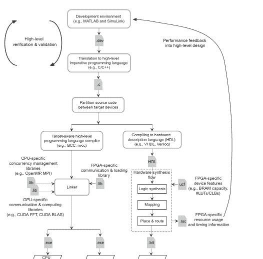

图 3.17 典型设计流程。

设备的识别完成后，程序员必须使用综合工具，该工具最终将生成编程二进制文件（在 FPGA 设备的情况下为比特流文件）。硬件设计仍然需要与 FPGA 中实现数据通信和同步协议的部分进行接口，以便与主机处理器的执行集成。在此背景下，从主机处理器的角度来看，硬件线程的概念已被利用，不仅为了促进硬件设备的集成，还为了促进其正确执行。

## 3.4 硬件/软件分区

当针对由硬件和软件组件组成的计算系统时，一项重要任务是硬件/软件分区。硬件/软件分区是将应用程序的不同部分映射到异构计算平台上的不同处理元素的过程，以便满足性能和/或其他非功能性需求（例如能耗）。异构平台可能包含一组多样化的处理元素，例如通用处理器（GPPs）、FPGA 和 GPU，并且这些设备中的每一个可能比其他设备更高效地处理特定类型的工作负载。

因此，高效的硬件/软件分区过程旨在将工作负载分配给由软件和硬件组件组成的异构计算平台中最合适的计算元素。这个过程可能相当复杂，因为硬件平台变得越来越专用化，因此需要增强程序员的专业知识来有效利用其内置的架构特性。异构硬件平台的示例包括由 Zynq UltraScale+ 等设备提供的包含多处理器片上系统（MPSoCs）的嵌入式系统、集成 FPGA 的新一代 Intel Xeon CPU，以及提供按需计算资源的新兴异构云平台。

分区过程识别应作为应用程序代码部分的计算，以便映射到不同的处理元素。映射过程通常需要针对每个目标处理元素的特定代码生成器和编译器优化。一旦映射过程定义完成，主应用程序代码需要修改以将计算和代码部分卸载到不同的处理元素。这个卸载过程通常涉及插入同步和数据通信原语。由于每个处理元素可能表现出不同的能耗/功耗/性能特性，并且主机处理器与不同处理元素之间的数据通信可能有不同的成本，分区过程必须处理设计探索过程，其目标是根据给定需求找到最佳分区。

鉴于其重要性，因此不奇怪的是在硬件/软件分区方面进行了大量研究（参见，例如，[17]）。技术和算法的选择取决于多个因素，包括：

- 从应用程序描述中得出的候选程序分区的数量。我们将分区视为具有定义明确的输入和输出的自包含程序模块。由于每个分区可能在不同的处理元素上执行，映射过程需要考虑分区在映射到不同处理元素时的通信开销。分区可以由程序函数或子程序模块定义。但是，函数可以进一步分区，以找到代码中作为硬件加速主要候选项的区域，例如，识别为程序热点的循环语句。
- 可用于映射过程的处理元素的数量、其相应的架构类型以及处理器间通信模型。特别是，处理元素可以通过存储和访问共享内存中的数据相互通信。或者，在异构架构的情况下，每个处理元素可能有自己的本地内存，通信可能通过共享内存和/或通信通道进行。在不存在共享内存的情况下，映射过程变得不那么灵活，共享相同数据的分区可能必须映射到同一个处理元素。

通常，我们可以将硬件/软件分区过程分为两大类：静态和动态。静态分区过程在编译时确定并在运行时保持不变。在动态分区过程中，映射在运行时确定，同时考虑现有工作负载和设备可用性。在其余小节中，我们将描述支持这两类硬件/软件分区的设计流程。

### 3.4.1 静态分区

执行静态分区的典型设计流程如图 3.18 所示，包含以下步骤：

- 1. 重构应用程序以发现候选分区。这涉及从原始代码中合并和拆分函数，以找到一组良好的分区。可以执行性能分析以找到热点和可能加速的代码区域，以及提取不同代码区域之间的数据通信模式。可以应用基于源代码检查和性能分析的其他启发式方法，以找到相互依赖性最小的分区。

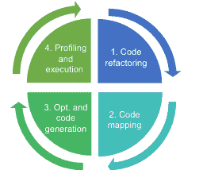

图 3.18 静态设计流程中的硬件/软件分区步骤。


此外，可以识别分区，以发现将分区映射到不同类型处理元素的更多机会，从而增加优化的机会。

- 2. 一旦得到一组分区，下一个问题就是寻找高效的映射。这通常涉及采用元启发式搜索算法，例如禁忌搜索或模拟退火，其目标是满足总体非功能性能目标。为了实现这一点，需要一个成本模型来估计特定映射配置的性能，并指导优化过程中的后续步骤。该成本模型可能会考虑针对特定处理元素的代码可能优化。例如，如果映射到FPGA，循环可以流水线化以提高吞吐量。

- 3. 一旦找到映射方案，代码仍可进行优化，以考虑所选处理元素的特定架构。优化可以在源代码级或较低的中间表示（IR）级别执行。此外，如前所述，代码会使用同步和数据通信原语进行修改，以在不同处理元素之间卸载计算。一旦生成最终代码，它将由不同的子工具链编译和链接。

- 4. 最后，生成的应用程序可以在目标平台上（或通过仿真）进行性能分析，以确保其满足应用程序要求。如果不满足，则可以从步骤1重新运行分区过程。在此背景下，综合报告和性能分析报告将反馈到重构（1）、映射（2）以及优化和代码生成（3）步骤，以改进硬件/软件分区过程。

分区过程也取决于编程和执行模型。接下来我们将看一个典型示例，其中C应用程序被映射到一个托管CPU和任意数量硬件加速器的异构嵌入式平台上。我们将C函数用于定义分区（请注意，也可以使用其他粒度）。一旦代码得到充分重构，映射过程将检查代码并生成静态调用图G = (N, E)，其中节点N表示函数调用，边E对应从一个节点到另一个节点的数据和控制流。我们认为每个函数调用都会实例化一个任务。因为单个函数可以在程序的不同点被调用，因此可以从同一个函数实例化两个任务，并可能将其映射到不同的处理元素。请注意，由于静态调用图是在编译时生成的，因此它不会捕获运行时执行的任务数量，因为该数量可能取决于运行时条件，例如输入数据。此外，在调用图中，边可以与数据流信息相关联，例如输入和输出参数的数据类型。

请参考图3.19A中的C程序及其在图3.19B中显示的相应调用图。可以看出，main函数调用函数（任务）a和d，函数a调用函数（任务）b、c和d。调用图中函数d的调用分别标识为d1和d2，因为它们对应两个不同的调用位点。

```
void b(...) {
...
void c(...) {
...
void d(...) {
...
void a(...) {
while (...) {
if (...) {
b(...) {
...
}
else (...) {
...
}
d(...) {
...
}
}
}
int main() {
a(...);
d(...);
}
```

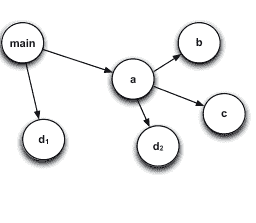

图3.19 代码示例及其调用图：(A) C代码；(B) 从(A)中的代码生成的静态调用图。每个节点对应一个任务，边表示任务之间的控制流和数据流。

一旦推导出调用图，下一步就是将其映射到目标异构架构。我们将为图3.20所示的示例性异构嵌入式平台描述此映射过程。该平台包含作为主机处理器的CPU和一组作为协处理器的硬件加速器。每个处理器都有自己的本地内存，没有全局共享内存，因此通信仅允许在CPU和任何加速器之间进行。对于这种平台，CPU运行应用程序，并将代码的特定部分（热点）卸载到硬件加速器，以最大限度地减少总体执行时间。

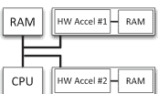

图3.20 可能的异构嵌入式平台框图。

任务映射过程需要找到一种配置，以最小化总体成本并满足给定的性能目标：
min \sum_{task \in App} cost(PE_{task}, task)
其中PE_{task}对应于特定配置下应用程序（App）中每个任务映射到的处理元素。初始配置作为基准分区，将所有任务放在CPU上。在每个后续映射步骤中，映射算法尝试通过将一个或多个任务从一个处理器映射到另一个处理器来寻找更好的映射配置，使得总体成本低于前一配置的成本。优化过程的另一个挑战是找到一组可行的映射配置，因为并非所有配置都是有效的。例如，在我们之前的示例中，任务a和b不能映射到两个不同的硬件加速器，因为在我们的目标架构中，硬件加速器无法直接相互通信。出于同样的原因，如果任务b不能映射到硬件加速器，那么调用任务b的任务a也必须映射到CPU。因此，搜索优化算法（例如模拟退火）可以与约束求解器相关联，以找到候选映射方案。还要注意，成本估计函数不仅必须考虑将任务迁移到硬件加速器的计算成本，还必须考虑CPU与硬件加速器之间的通信开销。图3.21描绘了前一示例的一个映射方案，其中任务a、b、c和d2映射到硬件加速器#1，其余任务映射到CPU。

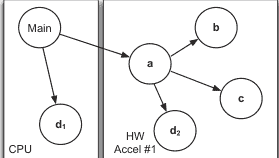

图3.21 硬件/软件分区方案。

### 3.4.2 动态分区

静态硬件/软件分区的基本假设是，在编译时推导出的映射方案能够抵御不断变化的运行时条件。这可能不适用于所有类别的应用程序。请考虑用于Bing搜索引擎网页执行排名的AdPredictor机器学习算法[34]，以便仅展示点击概率最高的广告。

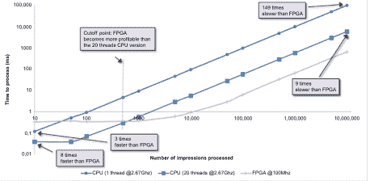

图3.22 三种AdPredictor模型训练实现的性能。

该算法的训练阶段以广告展示作为输入。每个广告展示都会捕获用户会话（IP、地理位置、搜索词）以及相应的广告是否被点击。每组广告展示，训练过程都会更新贝叶斯模型并提高其在网页广告排名中的准确性。

图3.22显示了使用三种实现的训练过程性能：单线程CPU、20线程CPU和FPGA实现。可以从该图中看出，性能最好的实现取决于作业大小。在此情况下，即要处理的广告展示数量（体积）。在此情况下，输入大小很重要，因为FPGA设计支持深度流式架构，需要足够的处理数据来隐藏流水线延迟。

如果作业大小仅在运行时才知晓，且最高效的处理元素取决于数据大小或其他运行时条件，那么在运行时执行映射过程可能更可取。图3.23显示了一个可能的运行时管理系统。在此，应用程序显式调用托管任务，这些任务被分发到Executive进程。该Executive进程根据多个因素确定任务应在哪个可用处理元素上执行。

与静态分区一样，动态分区依赖成本估计模型来确定特定作业最高效的处理元素。可以通过对不同数据输入的实现进行性能分析来离线构建成本模型。由于对所有输入组合进行性能分析是不可行的，因此可以通过回归推导估计模型，并通过在执行期间监控应用程序来进一步改进。

动态分区过程的一个含义是，除了托管任务之外的所有应用程序代码均由主机CPU处理。然而，托管任务由Executive进程处理，其执行取决于可用的任务实现和计算资源。特别是，一个任务可以与


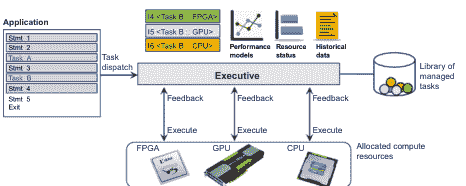

图 3.23 动态分区的运行时管理系统。

多种实现，每种都可以在特定类型的处理单元上执行。因此，如果异构计算平台包含 N 个同质处理单元，那么在存在该类型实现的情况下，有 N 个处理单元可供其执行。在此背景下，中央存储库或库将在运行时存储与每个实现关联的元数据，并由执行进程访问，以便在运行时做出映射决策，具体包括：

- 实现特征描述。每个实现都必须关联元数据信息，其中包括前置条件和性能模型。前置条件允许执行进程筛选出不适合运行特定任务的实现，例如，仅支持最多 256 个整数的硬件排序实现。前置条件可以表示为一组谓词，所有谓词都必须求值为 true 才能被视为可执行。性能模型允许执行进程在给定一组输入属性（例如数据大小和数据类型）的情况下，估计实现执行任务时的基准性能。在图 3.24 中可以看到，如果传入任务的数量为 100 条广告展示，则执行进程可能会选择多线程 CPU 实现，从而避免将计算卸载到硬件加速器，而数量为 10 万条展示的任务原则上在 FPGA 上执行会更快。

- 资源可用性。仅凭性能模型可能不足以估计给定特定任务的最快处理单元。例如，最快的执行器（通过使用性能模型识别）可能正忙，只能在后续阶段执行任务，因此执行速度比潜在的早期执行器更慢。因此，为选择最高效的处理单元，执行进程还需要估计任务在实际执行前需要等待多长时间。

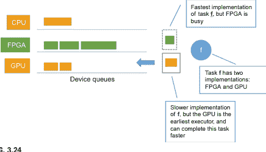

执行。这是通过检查与每个处理单元关联的设备队列的大小以及队列中当前每个任务执行的代价来完成的。一旦选定实现和处理单元，它们就会被推入相应的设备队列（参见图 3.24）。

该领域的近期研究促成了针对异构平台开发出多种动态映射方法，包括 StarPU [35]、OmpSs [18]、MERGE [36]、SHEPARD [37] 和 Elastic Framework [19]。这些方法提供了类似的运行时映射机制，但在所使用的编程和执行模型、实现和计算资源的特征描述方式、支持的目标平台，以及用于优化工作负载分布的调度策略等方面存在差异。例如，OmpSs 支持在源代码中对任务依赖进行显式标注，使运行时管理系统能够在满足依赖的同时异步（并可能并行）执行任务。

## 3.5 LARA：用于指定策略的语言

LARA [21, 38] 是一种 AOP 语言 [22, 39]，专门设计用于允许开发者描述：(1) 复杂的代码插桩方案（例如，用于定制化性能分析）；(2) 用于硬件加速的关键代码段的高级选择；(3) 包括基于硬件/软件资源的条件决策在内的映射策略；(4) 确定编译器优化序列的复杂策略；以及 (5) 针对多核架构的策略。此外，LARA 还提供了一种一致且系统的方式来控制工具链中的工具，使用统一编程接口（参见，例如，[20]）。

LARA 允许开发者以结构化的方式从应用程序中捕获非功能性需求，利用高/低级操作和灵活的工具链接口。开发者因此可以在保留原始应用程序源代码的同时，利用自动化方法为各种领域和目标组件特定的编译/综合工具带来的好处。具体来说，LARA AOP 方法的设计旨在帮助开发者以低编程工作量实现高效实现。使用切面进行软件/硬件转换的经验 [23] 揭示了 AOP 在应用程序代码开发中的优势，包括跨架构和工具的程序可移植性，以及开发者生产力的提升。此外，随着软件开发和维护成本以及验证与确认成本的不断增加，应用程序代码开发的这些方面将继续对整体软件开发周期至关重要。

本质上，LARA 使用 AOP 机制在统一框架中提供：(a) 传达原始编程语言中无法指定的应用程序特定需求的载体；(b) 使用这些需求来指导转换和映射选择的应用，从而便于 DSE（设计空间探索）；以及 (c) 以可扩展的方式对接工具链中的各种编译/综合组件。

LARA 支持由 LARA 解释器和织入器提供。使用 LARA 技术的工具示例包括以下四个编译器：MATISSE（MATLAB 到 C 编译器）、Harmonic（源码到源码 C 编译器）、MANET（源码到源码 C 编译器）、ReflectC（基于 CoSy 的 C 编译器）和 KADABRA（源码到源码 Java 编译器）。

本节简要介绍 LARA 语言的主要构造，以及如何使用它来修改给定应用程序的代码以满足特定需求。

LARA 代码是模块化的，并围绕切面的概念组织。切面定义可以调用其他切面，因此，一组 LARA 切面可以应用于给定的输入程序。一种称为织入器的特殊工具执行这些切面，并根据切面中表达的操作对输入程序文件进行织入，以生成新文件。图 3.25 显示了两种源码到源码编译器的输入/输出。第一种（图 3.25A）是常见的，通过指令和/或命令行选项进行控制。第二种（图 3.25B）经过扩展以支持 LARA。在此情况下，显示的输出控制台主要用于打印来自 LARA 切面的消息（例如，通过 LARA println 语句）。我们注意到，LARA 的其他用途还可以包括在机器码生成上下文中控制编译器。

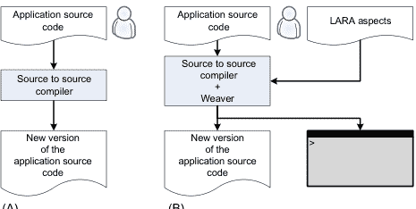

图 3.25 源码到源码编译器：(A) 基于指令和/或命令行选项的可能控制；(B) 在 LARA 控制的织入辅助下。

### 3.5.1 选择与应用

LARA 的一个重要特性是其能够使用类似于数据库查询的方法来查询程序元素。图 3.26 显示了一个用于查询输入源代码中循环的 select 构造的简单示例。被 LARA select 语句查询的程序元素称为连接点，每种目标编程语言都定义了支持的连接点列表。可以根据代码中的位置（例如，就嵌套结构而言）选择代码中的特定程序元素。例如，我们可以为给定文件中的特定函数选择特定循环。本示例中使用的 loop 单词指的是 LARA 当前支持的所有编程语言中的循环连接点。如果将此 select 应用于图 3.27 中展示的 C 代码，结果是代码中 4 个循环的列表。每个 LARA 连接点包括一组与特定程序元素属性相关联的属性。例如，与循环连接点关联的某些属性包括 is_innermost、is_outmost、line 和 type。我们可以使用属性来验证关联程序元素的某些特征。例如，select loop type=="for" end 仅选择代码中类型为 for 的循环。一旦选定程序元素，我们还可以对每个元素应用操作。为此，LARA 语言提供了 apply 语句。通常，每个 select 都有一个关联的 apply 部分。apply 部分支持 JavaScript

```
select loop end
```

图 3.26 查询程序元素（在此示例中为循环）。


```
//File: convolve.c
//Function: conv2d
...
10. /* Convolve the input image with the kernel. */
11. for(int r = 0; r<kN-1; r++) {
12. for(int c = 0; c<kN-1; c++) {
13. sum = 0;
14. for(int i = 0; i<k; i++) {
15. for(int j = 0; j<k; j++) {
16. sum += input_image[r+i][c+j] * kernel[i][j];
17. }
18. }
19. output_image[r-dead_rows][c+dead_cols] = (sum / normal_factor);
20. }
21. }
--
```

图 3.27 用于对输入图像与内核进行二维卷积的MATLAB代码的C代码部分。

```
select loop end
apply
    printfn("Found loop of type: " + $loop.type);
end
```

图 3.28 查询循环并报告其类型（即，for、while、do while）。

与特定LARA构造混合的代码。图 3.28 显示了一个示例，其中对于代码中的每个循环，织入器都会将找到的每个循环的类型打印到控制台。要访问程序元素的信息，可以在 apply 部分中使用连接点，方法是将其名称以 $ 前缀（示例中为 $loop）。为了访问特定连接点的属性，以 "$" 前缀的属性名称后必须跟 "." 和属性名称（例如，$loop.type）。当将切面应用于图 3.27 中的代码时，输出如下：

找到的循环类型：for
找到的循环类型：for
找到的循环类型：for
找到的循环类型：for

如果将 printfn 语句替换为 printfn("Is innermost? " + $loop.is_innermost)，则结果如下：

是最内层？false
是最内层？false
是最内层？false
是最内层？true

select-apply 部分的语义类似于查询语言。对于 select 语句找到的每个程序元素，都会执行 apply 部分的相应代码。在图 3.28 所示的示例中，代码并不

```
/*.select file.function.loop end
/*.apply
/apply/
print("Found loop:");
print("File name: " + $file_name);
print("Function: " + $function_name);
print("Loop line number: " + $function.line);
print("Loop type: " + $loop.type);
print("Loop number of iterations: " + $loop.num_iterations);
print("Loop rank: " + $loop.rank);
print("Increment value: " + $loop.increment_value);
print("Nested level: " + $loop.nested_level);
print("Is innermost? " + $loop.is_innermost);
print("Is outermost? " + $loop.is_outermost);
end
end
```

FIG. 3.29 查询循环并报告它们。

修改程序，而是向控制台输出消息。这是根据对输入程序进行静态检查和/或分析所确定的程序特性的报告的重要机制。

select-apply 构造必须是切面模块的一部分。每个切面模块以 LARA 关键字 aspectdef 开头，后跟切面名称，并以关键字 end 结尾。图 3.29 显示了一个 LARA 切面示例，用于报告代码中找到的每个循环的属性。我们注意到，在此示例中，select 继续查询循环，但在此情况下，我们公开了连接点链 file.function.loop，以访问 file（例如，$file_name）和 function（例如，$function_name）的属性，此外还包括与循环相关的属性（例如，$loop.type、$loop.num_iterations、$loop.rank、$loop.is_innermost、$loop.is_outermost）。

当将图 3.29 中的切面应用于图 3.27 中的代码（此时 N 和 K 分别等于 512 和 3）时，会产生以下输出：

```
Found loop:
  File name: convolution.c
  Function: conv2
  Loop line number: 11
  Loop type: for
  Loop number of iterations: 510
  ...
  Is innermost? false
  Is outermost? true
  ...
Found loop:
  File name: convolution.c
  Function: conv2
```

```
Loop line number:15
Loop type: for
Loop number of iterations: 3
...
Is innermost? true
Is outermost? false
```

我们还可以在 LARA 切面中使用变量。它们可以是切面的全局变量，也可以是每个 apply 部分的局部变量。图 3.30 展示了使用全局切面变量来计数程序中 for 类型循环数量的用法。

除了使用 select 语句查询特定类型循环的功能外（例如，select loop(type=="for") end），LARA 还支持 condition 语句，用于过滤在 apply 部分中处理的连接点。条件可以使用复杂的布尔表达式来表示，而 select 过滤器仅允许将属性与表达式进行布尔比较。另一种可能性是在 apply 部分中使用 if 语句。图 3.30 显示了三种 LARA 代码案例，它们产生相同的结果。

每个 LARA 切面模块定义可以包含多个 select-apply 语句，并且这些语句使用声明性语义行为。更具体地说，切面语句按其在 LARA 文件中出现的顺序依次执行。因此，程序员有责任通过按正确顺序放置

```
aspectdef countForLoops
var num_for_loops = 0;
select loop(type=="loop") end
apply
    num_for_loops = num_for_loops + 1; // count number of loops FOR
end
println("Number of loops: "+num_for_loops); // this is a use not suggested
end

aspectdef countForLoops
var num_for_loops = 0;
select loop end
apply
    num_for_loops = num_for_loops + 1; // count number of loops FOR
end
condition $loop.type == "for" end
println("Number of loops: "+num_for_loops); // this is a use not suggested
end

aspectdef countForLoops
var num_for_loops = 0;
select loop end
apply
    if($loop.type == "for") {
        num_for_loops = num_for_loops + 1; // count number of loops FOR
    }
end
println("Number of loops: "+num_for_loops); // this is a use not suggested
end
```

FIG. 3.30 计数程序中 for 类型循环的数量（支持条件的三种方式）。

```
1. aspectdef reportNumForLoops
2. Call A:countForLoops();
3. println("Number of Loops: "+A.num_for_loops);
4. end
5.
6. aspectdef countForLoops
7. output num_for_loops = 0; end // the no. of loops will be output as a parameter
8.
9. select loop(type=="loop") end
10. apply
11. num_for_loops = num_for_loops + 1; // count number of loops FOR
12. end
13. end
```

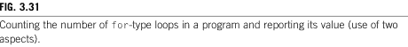

切面语句的正确顺序。如图 3.30 中的切面示例所示，这种顺序求值会导致正确报告循环数量（切面末尾的 println 语句）。一种替代的切面规范（产生相同结果）将使用第二个切面来调用计数循环数量的切面，并在其执行结束时打印其值（参见图 3.31）。请注意，每个 apply 部分中的代码是严格的命令式代码。

在同一文件中存在多个切面定义的情况下，第一个切面定义被视为主切面，并会自动首先执行。只有当其他切面被主切面的执行直接或间接显式调用时，才会执行。

可以使用以下属性分别查询与特定连接点关联的属性、操作和连接点子项的列表：attributes、actions 和 selects。例如，$loop.attributes 输出连接点 loop 的属性列表（更准确地说是它们的名称），$loop.actions 报告与连接点 $loop 相关的织入器操作，而 Weaver.actions 输出 LARA 可用的织入器操作。

### 3.5.2 插入操作

LARA 提供了一个插入操作，用于将代码注入到应用程序的源代码中。此操作可以与 apply 部分中的其他语句混合使用。要插入的代码由分隔符 $| 和 $| 标识，其中前者捕获多行代码，后者捕获单行代码（类似于字符串）。代码的插入可以在关联连接点之前、之后执行，或替换该连接点。图 3.32 显示了一个简单示例，在源代码中的每个循环之前插入一个打印语句。默认情况下，插入与 select 表达式（在链中）的最后一个元素的连接点相关联，但可以通过在 insert 前加上连接点后跟 ":" 来显式标识关联连接点。例如，$loop.insert 将等同于图 3.32 中的插入。


select function.loop end
apply
...
 insert before %(printf("Found a loop\n"););
...
end

**图 3.32** insert 动作的简单示例。

select function.loop end
apply
...
 insert before %(printf("Found a loop at line %d!\n", *{[$loop.line]}););
...
end

**图 3.33** 向要插入的代码传递值的 insert 动作简单示例。

可以将 `aspect` 和/或连接点的数据传递给要插入的代码。图 3.33 展示了前一个示例的扩展，用于指示每个找到的循环的源代码行号。在此示例中，连接点 join 的 line 属性（`$loop.line`）作为 `[[]]` 之间的参数传递给插入的代码。织入过程会在每次执行 insert 语句时，将 `[$loop.line]` 替换为其实际值。同样，可以在要插入的代码段中使用 LARA 变量。

`Insert` 动作为在应用程序中添加/替换代码提供了一种强大的机制。指定代码插入策略的可能性是 LARA 最有用的概念之一。图 3.34 展示了一个 LARA aspect 示例，该 aspect 指定插入对函数 `QueryPerformanceCounter`⁶ 的调用，用于测量在 Windows 操作系统上运行的用 C 语言编写的应用程序的执行时间。请注意，该 `aspect` 需要插入 `#include`（第 5 行）、要使用的变量的声明（第 10 和 11 行）以及用于初始化和启动测量的代码（第 14 行中的 `select-apply`）和用于结束测量并输出结果的代码（第 24 行中的 `select-apply`）。此 aspect 提供了一种自动方案，用于修改带有类似于图 3.7 中所示并使用 `clock()` 函数⁷ 的调用的定时关注点的应用程序。图 3.34 中展示的代码可以轻松修改，以提供使用 `clock()` 的定时策略。

```
1. aspectdef InsertTiming
2.
3.   select file.first_header end
4.   apply
5.     insert after "#include <windows.h>";
6.   end
7.
8.   select function(name="main").first_stat end
9.   apply
10.    insert before %{ int64 freq, start, end, diff;
11.      long elapsedTime;%};
12.   end
13.
14.   select function(name="main").first_stat end
15.   apply
16.     insert before %{
17.       // get ticks per second
18.       QueryPerformanceFrequency((LARGE_INTEGER*)&freq);
19.       // start timer
20.       QueryPerformanceCounter((LARGE_INTEGER*)&start);
21.     %};
22.   end
23.
24.   select function(name="main").last_stat end
25.   apply
26.     insert after %{
27.       // stop timer
28.       QueryPerformanceCounter((LARGE_INTEGER*)&end);
29.
30.       printf("It took %d ticks", (end - start));
31.       printf("Freq %d\n", freq);
32.       elapsedTime = ((end - start) * 1000) / freq;
33.       printf("It took %d ms\n", elapsedTime);
34.     %};
35.   end
36. end
```

**图 3.34**
使用 LARA insert 动作在 Windows 中使用 QueryPerformanceCounter 包含用于测量应用程序执行时间（以 ms 为单位）的代码的示例。

### 3.5.3 EXEC 和 DEF 动作

在上一节中，我们介绍了 insert 动作，并展示了如何在应用程序的源代码中对代码进行插桩的策略编程。LARA 提供了其他类型的动作。exec 和 def 是两种用于通过使用编译器支持的特定代码转换来修改应用程序的动作。

exec 动作用于执行织入器定义的动作，例如特定的编译器通道（如循环展开）。def 动作用于修改某些应用程序工件，例如变量的数据类型。

图 3.35 展示了使用 exec 动作（第 6 行）来展开循环。在此示例中，aspect 指定按由变量“factor”表示的因子展开最内层且类型为 for 的循环。当应用于应用程序的源代码时，此 aspect 将展开所有尊重这些条件的循环。图 3.36 展示了一个更复杂的 aspect，当展开因子为零且所选循环具有大量迭代（在此情况下超过八次迭代）时，它会阻止最内层循环的完全展开。

```
1. aspectdef loopUnrollInnermost
2.   input factor end
3.
4.   select function.loop end
5.   apply
6.     $loop.exec Unroll(factor);
7.   end
8.
9.   condition
10.    $loop.is_innermost && $loop.type=="for"
11. end
```

**图 3.35**
使用 LARA exec 动作展开循环的示例。

```
1. aspectdef loopUnrollInnermost
2.   input factor end
3.
4.   select function.loop end
5.   apply
6.     if(factor == 0) {
7.       if($loop_num_iter < 8) { // limit fully loop unrolling
8.         $loop.exec Unroll(factor);
9.       } else {
10.        printf($loop.id+"no unroll");
11.      }
12.    } else {
13.      $loop.exec Unroll(factor);
14.    }
15.  end
16.
17.  condition
18.    $loop.is_innermost && $loop.type=="for"
19. end
```

**图 3.36**
使用 LARA exec 动作展开循环并使用规则决定是否展开的示例。

图 3.37 展示了一个示例，其中变量 z 被赋予 float 类型。此示例使用 def 动作，并意味着编译器中间表示（IR）的变化。

```
1. select var(name="z") end
2.   apply
3.     def type = "float";
4.   end
```

**图 3.37**
使用 LARA def 动作更改变量类型的示例。

```
call LoopUnrollInnermost(2);
```

**图 3.38** 调用语句示例。

### 3.5.4 调用 ASPECTS

LARA 提供了一种从 aspect 定义中调用 aspect 的机制，并可选择通过其输入和输出参数在它们之间共享数据。这增强了模块化和重用性。图 3.38 展示了一个简单示例，其中之前展示的 LoopUnrollInnermost aspect 之一以 2 作为其参数被调用。

在调用带有输出参数的 aspect 时，访问输出值的唯一方法是将标识符分配给调用，然后使用类似字段访问的语法。例如，在图 3.31 第 2 行的 call A.countFOR(loops); 中，标识符 A 用于表示 countFOR loops aspect 的特定调用。在第 3 行中使用 A.num_for_loops 允许在该特定调用中访问 num_for_loops 的值。

与调用相关的当前语义在 insert 和 exec/def 动作方面有所不同。insert 动作的结果在生成输出代码并将其输入到编译器之前，不会提供给后续的织入语句。也就是说，使用 insert 动作的代码修改在负责这些插入的织入过程中不会立即可见。

另一方面，exec/def 动作导致的更改在执行进入新 aspect 时即可用。我们在此展示一个示例，以说明 exec/def 动作的语义含义。之前在图 3.35 中展示的 aspect 展开最内层 for 循环。如果使用 factor = 0 应用该 aspect，我们将完全展开所有符合特定条件的循环。此 aspect 不会递归地完全展开循环，因为它只考虑应用程序中找到的原始最内层循环。递归调用此 aspect 将导致完全展开所有循环，而不考虑它们在嵌套循环结构中的原始位置。图 3.39 展示了一个可能的 aspect，它递归地展开程序中的所有循环。请注意第 23 行中 break 指令的使用，以防止展开因完全展开而不再存在的循环。图 3.40 说明了一个具有相同目标但使用迭代而非递归的 aspect。

### 3.5.5 执行外部工具

LARA 还允许从 aspect 中显式调用外部工具，并导入此类工具执行输出的数据，提供了一种透明的方式，以便在 LARA 级别使用反馈信息进行决策，并对特定工具流进行迭代。

图 3.41 展示了一个示例，该示例调用 Xilinx 后端工具，其输入为要综合、映射、布局和布线到特定目标 FPGA 的硬件的 VHDL 或 Verilog 描述。LARA aspect 还根据 opt 输入参数的值提供执行一个或多个工具的支持。


```text
aspectdef mainloopunroll
  var loopsDone = {};
  call loopunroll(loopsDone);
end

aspectdef loopunroll
  input loopsDone end

  select loop(type="for") end
  apply
    println("-> CONSIDERING ACTION TO LOOP ID: "+$loop.ID);
    if(loopsDone[$loop.ID]) {
      println("ACTION WILL BE PERFORMED TO LOOP ID: "+$loop.ID);
      println("ITER: "+$loop.num_iterations);
    }
    loopsDone[$loop.ID] = true;

    exec Unroll(O); // do loop unrolling

    call A::loopunroll(loopsDone); // recursive
    loopsDone = A::loopsDone; // update loopsDone

    break;
  }
end
condition $loop.is_innermost && ($loop.num_iterations != -1) end

end
```

### 图 3.39 使用 LARA exec 操作递归展开循环的示例。

```text
aspectdef strategy
  do ( call A::loopunroll(); ) while(A.changed);
end

aspectdef loopunroll
  output changed = false end
  select loop(type="for") end
  apply
    exec Unroll(O);
    changed = true;
  end
condition $loop.is_innermost && ($loop.num_iterations != -1) end
end
```

### 图 3.40 使用 LARA exec 操作迭代展开循环的示例。

第 6、11、15 和 19 行 printf 语句中使用的 @function 是执行工具以 JSON 对象形式输出的数据。

执行 xr 工具（LARA 切面的第 3 行）将根据输入的 VHDL/Verilog 代码和目标 FPGA 提供以下属性及其对应值：

```text
aspectdef xilinx
  input tool "xst": args = {"myIP", folder = "myPrj"} end
  run(tool = "xst", args: {ModuleName: name},
    pathfolder: folder, pathHLStools: ""});
  println("--- FUNCTION ATTRIBUTES AFTER XST EXECUTION:");
  printobject(@function);
  if(opt > 1) {
    run(tool: "ngbuild", args: {ModuleName: name});
    run(tool: "map", args: {ModuleName: name});
    println("--- FUNCTION ATTRIBUTES AFTER MAP EXECUTION:");
    printobject(@function);
    if(opt > 2) {
      run(tool: "par", args: {ModuleName: name});
      println("--- REPORTING RESULTS AFTER MAP EXECUTION:");
      printobject(@function);
      if(opt > 3) {
        run(tool: "xpr", args: {ModuleName: name});
        println("--- REPORTING RESULTS AFTER XPR EXECUTION:");
        printobject(@function);
      }
    }
  }
end
```

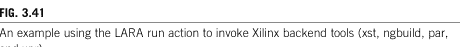

-- XST 执行后的函数属性：
myIP:

| 属性 | 值 |
|-----------|-------|
| numSliceRegisters | 881 |
| maxFreq | 324.5287 |
| numSlices | 677 |
| device | S5VX50ff1136 |
| minPeriod | 3.081 |
| numGffs | 16 |
| GffDepth | 7 |
| numSliceLuts | 660 |
| msgErrors | 0 |
| numLutAsSramS | 5 |

图 3.42 展示了另一个 LARA 切面，它包括对图 3.41 所示切面的调用，对高级综合（HLS）工具的调用以从输入 C 函数生成 VHDL 描述，以及对 VHDL 仿真器的调用。该切面负责报告关于时钟周期和执行时间的结果，并考虑工具报告的最大时钟频率。

LARA 提供的这种执行工具（包括使用 LARA 辅助的工具）的支持，为开发者提供了构件和统一视图，从而减少了编程和评估 DSE 方案的工作量。图 3.43 展示了一个 DSE 方案的简单示例。在此示例中，探索了四种不同的循环展开因子和不进行循环展开，目标是实现延迟尽可能低的硬件设计。

```text
import xilinx;
expectsdofs

    aspectdef All("^filter_subband", "vhdl");
    call b::simul("^filter_subband");
    println("RESULT:");
    print("Execution Time: *"+lat);
    var lat = @design.filter_subband_kernel.latency;
    println("####### Number of clock cycles: *"+lat);
   call C::xilinx("^filter_subband");
   print("Execution Time: *"+lat|C:MaxFreq|*" us");
end
```

### 图 3.42 使用 LARA run 操作调用不同工具并报告考虑性能的结果的示例。

```text
import xilinx;
expectsdof olUnrollKInnerloops1 modular

    var confs = {}; var best_lat = Number.MAX_VALUE;
    var best_conf; var exploreParam = ["*", "*", "*", "*", "*"];
    for(var i=0; i<exploreParam[0].length; i++){
        call A::compile("^filter_subband", "vhdl", "UnrollKInnerloops1_inner",
            call b::simul("^filter_subband", "-arg=" + exploreParam[i] + ")"););
        call b::simul("^filter_subband");
       println("RESULT:");
       printObject(@design);
       print("Execution Time: *"+lat);
       var lat = @design.filter_subband_kernel.latency;
       confs.push({lat:lat, conf:exploreParam[i]});
       if(lat < best_lat){
           best_lat = lat;
           best_conf=exploreParam[i];
       }
    }
    println("####### Number of clock cycles: *"+lat);
    println("best lat: *"+ best_lat + " * best conf: " + best_conf );
    println("Design points and correspondent no. of clock cycles:");
    printObject(confs);
end
```

### 图 3.43 使用 LARA run 操作迭代的示例。

### 3.5.6 LARA 中的编译和综合策略

LARA 中的编译和综合策略包括代码转换、参数探索以及可传递给其他编译工具以生成更高质量代码的补充程序知识的规范。如第 1 章所述，本书中使用 LARA 旨在实现两个目标：(1) 提供代码转换和优化策略的规范，以及 (2) 作为用于学习活动实验的领域特定语言（DSL）。目标 (2) 侧重于使用带有 LARA 支持的特定工具，即以下工具：

- MANET，一种基于 Cetus 的源码到源码 C 编译器：http://specs.fe.up.pt/tools/manet/
- KADABRA，一种基于 Spoon 的源码到源码 Java 编译器：http://specs.fe.up.pt/tools/kadabra/
- MATISSE，一种从 MATLAB 到 C/OpenCL 的编译器：http://specs.fe.up.pt/tools/matisse/

在目标 (2) 的上下文中使用的 LARA 策略部分是基于第三方工具提供的支持来实现 LARA 操作语义而开发的。可以想象，定义明确的 LARA 策略可能无法与不导出“控制接口”的工具进行协作，该接口允许 LARA 切面执行相应的操作。

## 3.6 总结

本章介绍了应用程序设计周期早期阶段的主要概念，如规范、原型设计和开发，主要强调抽象级别以及如何处理不同关注点；处理通用代码和高级模型所需的专业化，以及如何处理多个目标。本章还介绍了翻译、编译和综合设计流程的概念，以及硬件/软件分区（包括将计算映射到异构架构）。最后，我们描述了一种面向切面编程语言 LARA，它专门设计用于允许开发者描述复杂的代码插桩方案和先进的映射及编译策略。

## 3.7 进一步阅读

在带有硬件加速器的异构平台上运行的设计流程一直是近期研究的重点（例如，[24] 中的 hArtes 设计流程）。设计流程的主要任务之一是决定将计算映射到软件和/或硬件组件。这项任务传统上被称为硬件/软件分区（例如，[25]），尤其是当目标系统考虑在 CPU 中实现的软件组件和从输入计算综合的硬件组件时。更完整的硬件/软件分区形式还考虑随后被综合和/或作为协处理器存在的硬件加速器。最近，将计算从 CPU 迁移到硬件加速器（包括 GPU 和 FPGA）被称为将计算卸载到这些设备。

硬件/软件分区始于静态方法，即在设计/编译时进行分区 [26, 40]。在编译时，已有从高级代码（例如来自


C/C++ 代码) 或与已执行指令的二进制文件和/或痕迹 [41]。近年来，针对动态硬件/软件分区的方法受到更多关注（参见，例如，[7,42]）。其他方法考虑硬件/软件组件的静态准备，但将在硬件或软件中执行计算的决策委托给运行时。例如，Beisel 等人 [28] 提出了一种在运行时决定库函数级别硬件/软件分区的系统。该系统拦截库调用，并对每个调用决定将调用卸载到硬件加速器。决策基于存储每个受支持函数和不同数据大小执行时间信息的表格。其他决策还可以考虑其他信息，例如每个循环在每个执行点将执行的迭代次数（在运行时计算），以决定将计算卸载到硬件加速器。Vaz 等人 [29] 提议将应用程序中的决策点移动，以可能隐藏一些开销，例如协处理器执行的准备。

当前的异构多核架构支持 GPU 和/或可重构硬件（例如，由 FPGA 提供），并有可能提供不同的执行模型和架构，从而增加了将计算映射到目标组件的复杂性。系统可能不仅需要考虑可能适合特定目标的代码转换，还需要决定在哪里执行计算，这并非易事。例如，当考虑由 CPU + GPU 组成的目标架构时，系统可能需要决定在多核 CPU 上还是在 GPU 上执行 OpenCL 内核 [30]。问题的复杂性以及做出决策所涉及的可变参数正在通过复杂的解决方案来解决，例如使用机器学习技术基于静态和动态代码特征来估计执行时间 [31]。其他作者在针对 GPU 加速时解决数据迁移问题 [32]。由于这些是热门研究主题，预计将提出进一步的解决方案，特别是考虑代码转换、工作负载、运行时适应性和目标架构特定性之间的相互作用。

## REFERENCES

- [1] Mathworks 公司，MATLAB——技术计算语言。http://www.mathworks.com/products/matlab [2016 年 5 月访问]。
- [2] Simulink——仿真和基于模型的设计——MathWorks，© 1994–2016 The MathWorks, Inc.，www.mathworks.com/products/simulink/ [2016 年 5 月访问]。
- [3] Corre Y, Hoang V-T, Diguet J-P, Heller D, Lagadec H, 基于 LHS 的 ad hoc 硬件加速器快速设计空间探索：FPGA 上 MPSoC 综合的关键工具。载于：信号和图像处理设计与架构国际会议 (DASIP’2012)，2012 年 10 月 23–25 日，8 页。
- [4] Kernighan BW. C 程序设计语言。第 2 版。Piscataway, NJ: Prentice Hall; 1988。
- [5] Octave 主页。http://www.gnu.org/software/octave/ [2016 年 5 月访问]。
- [6] Scilab：主页，© Scilab Enterprises S.A.S 2013。http://www.scilab.org/ [2016 年 1 月访问]。
- [7] UT DSP 基准套件。http://www.eecg.toronto.edu/~corinna/DSP/Infrastructure/UTDSP.html [2016 年 3 月访问]。
- [8] Fowler M. 领域特定语言。第 1 版。Boston, USA: Addison-Wesley Professional; 2010。
- [9] 欢迎访问 UML 网站！Copyright © 1997–2016 Object Management Group®, Inc. http://www.uml.org/ [2016 年 5 月访问]。
- [10] Ptolemy 项目主页。Copyright © 1999–2016 UC Regents. ptolemy.eecs.berkeley.edu/ [2016 年 5 月访问]。
- [11] 什么是硬件在环仿真？© 1994–2016 The MathWorks, Inc. http://www.mathworks.com/help/physmod/simscape/ug/what-is-hardware-in-the-loop-simulation.html [2016 年 5 月访问]。
- [12] Kirchhoff U., J. Mendhekar A. Maeda C, Lopes CV, Jean-Marc L, 等。面向切面编程。载于：第 11 届面向对象编程欧洲会议 (ECOOP’97)，芬兰 Jyväskylä，1997 年 6 月 9–13 日，计算机科学讲义 (LNCS)，第 1241 卷。Heidelberg: Springer-Verlag; 1997. 第 220–42 页。
- [13] Elrad T, Filman RE, Bader A. 面向切面编程：简介。Commun ACM 2001;44(10):29–32。
- [14] 角点检测。https://en.wikipedia.org/wiki/Corner_detection [2016 年 5 月访问]。
- [15] Fingeroff M. 高层次综合蓝皮书。Bloomington, IN: Xlibris Corporation; 2010。
- [16] Vivado 高层次综合。http://www.xilinx.com/products/designtools/vivado/integration/esl-design.html [2016 年 1 月访问]。
- [17] Arató P, Mann ZA, Orbán A. 硬件/软件分区的算法方面。ACM Trans Des Autom Electron Syst (TODAES) 2005;10(1):136–56。
- [18] Duran A, Ayguadé E, Badia RM, Labarta J, Martinell L, Martorell X, 等。OmpSs：异构多核架构编程提案。Parallel Process Lett 2011;21(02):173–93。
- [19] Wessing JR, Stiti G. 弹性计算：面向多核异构计算的透明、可移植和自适应框架。载于：ACM SIGPLAN/SIGBED 嵌入式系统语言、编译器和工具会议论文集；2010. 第 115–24 页。
- [20] Cardoso JMP, Carvalho T, Coutinho JGF, Nobre R, Nane R, Diniz PC, 等。使用 LARA 切面控制综合工具链中的设计复杂性。Microprocess Microsyst 2013;37(8):1078–89。
- [21] Cardoso JMP, Coutinho JGF, Carvalho T, Diniz PC, Petrov Z, Luk W, 等。使用 LARA 面向切面编程方法的性能驱动插装和映射策略。载于：Software: practice and experience (SPE)。New York, NY, USA: John Wiley & Sons Ltd; 2014. 12 月。
- [22] Fabry J, Dinkelaker T, Noyé J, Tanter É. 领域特定切面语言分类法。ACM Comput Surv 2015;47(3): 文章 40，44 页。
- [23] Cardoso JMP, Diniz P, Coutinho JG, Petrov Z，编。嵌入式可重构系统的编译与综合：面向切面方法。第 1 版。New York, Dordrecht, Heidelberg, London: Springer; 2013. 5 月。
- [24] Bertels K, Sima VM, Yankova Y, Kuzmanov G, Luk W, Coutinho JGF, 等。HArtes：异构多核平台的硬件/软件协同设计。IEEE Micro 2010;30(5):88–97。
- [25] López-Vallejo M, López JC. 关于硬件/软件分区问题：系统建模和分区技术。ACM Trans Des Autom Electron Syst 2003; 8(3):269–97。
- [26] Ernst R, Henkel J, Benne T. 微控制器的硬件/软件协同综合。IEEE Des Test 1993;10(4):64–75。
- [27] Stitt G, Lysecky R, Vahid F. 动态硬件/软件分区：一种初步方法。载于：第 40 届设计自动化年会 (DAC’03) 论文集。New York, NY, USA: ACM; 2003. 第 250–5 页。
- [28] Beisel T, Nickamp M, Plessl C. 使用共享库拦截在具有异构硬件加速器的系统中实现透明加速。载于：面向特定应用的系统、架构和处理器国际会议 (ASAP’10) 论文集。IEEE Computer Society，7 月：2010. 第 65–72 页。
- [29] Vaz G, Riebler H, Kenter T, Plessl C. 将动态卸载决策嵌入应用程序代码的潜力和方法。Comput Electr Eng 2016;55(9):1–11。
- [30] Wang Z, Grove D, O’Boyle MIF. 面向基于 GPU 的异构系统的数据并行程序到 OpenCL 的自动可移植映射。ACM Trans Archit Code Optim 2014;11(1):26。
- [31] Wen Y, Wang Z, O’Boyle M. CPU/GPU 异构平台上 OpenCL 程序的智能多任务调度。载于：第 21 届 IEEE 高性能计算国际会议 (HiPC’14) 论文集，印度果阿，IEEE。2014 年 12 月 17–20 日。10 页。
- [32] Wang B, Wu B, Li D, Shen X, Yu W, Jiao Y, 等。通过软件/硬件协同设计探索混合内存以提高 GPU 能效。载于：第 22 届并行架构和编译技术国际会议 (PACT’13) 论文集，IEEE Press，Piscataway, NJ，2013. 第 93–102 页。
- [33] Hickey PC, Pike L, Elliott T, Bielamann J, Launchbury J. 使用嵌入式 DSL 构建嵌入式系统。载于：第 19 届 ACM SIGPLAN 函数式编程国际会议 (ICFP ’14) 论文集。New York, NY, USA: ACM; 2014. 第 3–9 页。
- [34] Graepel T, Candela JQ, Borchert T, Herbrich R. 面向 Microsoft Bing 搜索引擎赞助搜索广告的 Web 规模贝叶斯点击率预测。载于：第 27 届机器学习国际会议 (ICML-10) 论文集；2010. 第 13–20 页。
- [35] Augonnet C, Thibault S, Namyst R, Wacrenier P-A. StarPU：异构多核架构任务调度的统一平台。Concur Comput Pract Eng 2011;23(2):187–98。
- [36] Linderman MD, Collins JD, Wang H, Meng TH. Merge：异构多核系统的编程模型。ACM SIGOPS Oper Syst Rev 2008;42(2)。
- [37] O’Neill E, McGloin J, Coutinho JGF, Doole A, Ragusa C, Pell O, Sanders P. 异构处理器间数据库功能的跨资源优化。载于：带应用的并行和分布式处理 (ISPA)，26–28 Aug.；2014. 第 150–7 页。
- [38] Cardoso JMP, Carvalho T, de F. Coutinho JG, Luk W, Nobre R, Diniz PC, 等。LARA：嵌入式系统的面向切面编程语言。载于：面向切面软件开发国际会议 (AOSD’12) 论文集，德国波茨坦，3 月 25–30 日。ACM; 2012. 第 179–90 页。
- [39] Kiczales G, Lamping J, Mendhekar A, Maeda C, Videira Lopes C, Loingtier J-M, Irwin J. 面向切面编程。载于：第 11 届面向对象编程欧洲会议 (ECOOP’97)，芬兰 Jyväskylä。1997 年 6 月 9–13 日，计算机科学讲义 (LNCS)，第 1241 卷。Springer; 1997. 第 220–42 页。
- [40] Gupta RK, De Micheli G. 数字系统的硬件/软件协同综合。IEEE Des Test Comput 1993;10(3):29–41。
- [41] Bispo J, Paulino N, Cardoso JMP, Ferreira JC. 面向可重构 HW/SW 系统的基于痕迹的透明二进制加速。IEEE Trans Ind Inform 2013;9(3):1625–34。
- [42] Lysecky R, Vahid F. 基于 MicroBlaze 的 warp 处理器的设计与实现。ACM Trans Embed Comput Syst 2009;8(3):21–22。


# 源代码分析与插桩

## 4.1 引言

源代码分析与插桩是软件开发过程中理解应用程序行为和潜在代码转换的基本方面。理解代码在高粒度级别（全局程序范围）和低粒度级别（过程/函数范围级别）上的结构对于调试和验证非常重要。从高层次来看，通过检查哪些过程调用其他过程或哪些过程分配存储来理解代码结构，可以启用复杂的源代码转换或面向性能的转换（或“优化”）。考虑到嵌入式系统的内存容量通常有限，理解存储分配及其使用是关键分析。最后但同样重要的是，了解执行花费大部分时间的地方（执行时间分析）是关键信息，可帮助开发者选择对性能有影响的一组转换。

程序员可能对代码分析的许多方面感兴趣。软件工程界提出了大量软件度量（例如，参见 [1–3]）。这些包括简单的度量，例如代码行数（LOCs）、圈复杂度和内聚度。如果开发者的目标是评估迁移到具有高浮点计算能力的 CPU 的潜力，那么进行浮点计算与整数算术计算的分析是可取的。然而，在并发执行的上下文中，需要知道数据通信量，以评估将应用程序代码移植到具有更合适的节点间通信带宽的系统的好处。

一般来说，源代码分析可以从两个角度来看待。第一个角度将代码分析视为达到目的的手段。也就是说，必须定义特定目标，以便识别可以实现该目标的技术。例如，一种常用的技术来帮助优化应用程序的执行时间（“目标”）是代码分析以查找热点，也称为关键部分。热点是程序执行花费大部分总执行时间的代码区域，因此是优化的首选候选项。通过减少热点的执行时间，比减少对总执行时间贡献较低的代码区域的执行，能够实现更高的全局减少。

然而，代码分析不仅仅面向性能和其他优化目标。从第二个角度来看，通过探索性实验过程发现应用程序信息的目标，旨在揭示应用程序的意外属性（与功能性和非功能性问题相关），并允许开发能够处理软件应用程序日益增长的复杂性的新代码分析技术。代码分析可以提供洞察，例如，关于断言发现、克隆检测、调试、经验软件工程研究、故障定位、优化技术、性能建模、程序演进、质量评估、逆向工程、安全关键性、软件维护、软件可靠性工程、软件版本控制、符号执行、测试、验证（符合性检查）和验证。

在许多场景中，能够自动分析代码的工具越来越受欢迎。这些工具与其捕获的信息类型一样多种多样。对于简单的分析，例如调用结构，一个简单的源代码分析器就足够了，不需要代码执行。在光谱的另一端，对于动态度量，例如使用的存储量或传输的数据量，工具必须在具有代表性的输入数据集下检查正在运行的可执行文件。为了解决应用程序的动态行为及其在输入数据、操作环境和目标系统方面的主要特征，分析正在成为开发应用程序时的一个关键阶段。

在本书中，我们专注于代码分析和插桩，以帮助开发者（在某些上下文中，自动化工具）更好地决定如何转换给定的代码部分，以及/或更好地将应用程序映射到目标计算机架构，该架构可能由多个核心和硬件加速器组成。对这些目标至关重要的是提取数据级和任务级并行性、数据通信需求以及函数和代码部分级别的程序执行分布。在此，我们假设应用程序的源代码存在，以及一个由代码转换、编译器优化和代码翻译和/或扩展到不同编程模型组成的过程。

## 4.2 分析与度量

源代码分析的输出可以采用多种形式。它可以提供关于应用程序的高级别信息，例如识别程序属性的度量，以及带注释的内部表示，如调用图，捕获函数被调用的次数。与修改源代码的其他转换不同，代码插桩通常旨在执行以揭示应用程序的动态属性，之后被丢弃。插桩的一个经典示例是在代码的战略区域插入计时调用以识别热点。

因此，我们可以将代码分析分类为静态或动态。静态代码分析在不运行应用程序的情况下应用，并需要检查和分析源代码。它主要关注应用程序代码本身的结构，并且通常旨在理解应用程序代码。程序员需要了解代码的哪些部分调用哪些例程（或过程）以及使用了什么形式的并发构造。因此，这些分析检查源代码，不需要知道程序输入来提取“性能”度量，因为应用程序从未被执行。因此，派生信息的范围是有限的。

### 分析工具

用于分析应用程序的典型工具包括 GNU Gprof [5]、Valgrind [6]、VTune 和 Vampir。但是请注意，根据目标系统，可能有特定的 API 和库来获取某些系统信息，例如功耗。

- GNU gprof。http://www.cs.utah.edu/dept/old/texinfo/as/gprof.html。
- Gprof 主页。http://www.gnu.org/software/binutils/manual/gprof-2.9.1/html_mono/gprof.html。
- Valgrind。http://valgrind.org/docs/manual/（2012 年 6 月访问）。
- Intel VTune Amplifier XE 2013。http://www.intel.com/software/products/vtune/（2014 年 6 月访问）。
- Vampir。https://www.vampir.eu/（2015 年 10 月访问）。

相比之下，动态分析旨在揭示与代码执行固有相关的“性能”度量。有许多值得关注的度量，例如代码分析等分析通过源代码和/或其二进制可执行形式的插桩来支持。

考虑到动态分析揭示的数据的多样性和可能的巨大数量（这些数据可能因输入数据集的特征而有很大差异），工具生成汇总摘要数据或仅关注选定的性能度量并不罕见。一个具体示例包括 MPI（消息传递接口）程序中并发执行线程之间交换的消息数量和大小等度量。根据线程数量，使用此类分析（插桩 MPI 发送/接收调用）生成的数据集大小可能非常大。

与分析类型互补，如果它们可以保证特定结果（例如，如果执行函数 A，则也会执行函数 B），我们也可以将它们分类为安全的。此外，一个分析被认为是健全的，如果


它针对程序语义提供正确性保证。一个不健全分析的例子是字长优化，它为程序中的变量和表达式分配自定义字长（与固定32位或64位宽度相对），以基于预期输入范围和所需输出精度推导出更高效的实现（例如，使用更少的硬件资源、节省内存）。

我们还可以将静态分析的结果分类为代码属性和/或源代码度量，并将动态属性的结果分类为执行度量。代码属性捕获关于源代码的结构、语法和语义信息。例如，它们可以识别特定变量是否为整数类型、函数是否仅在文件上下文中声明，或者变量的值是否可以在特定代码区域中访问。另一方面，源代码度量提供定量度量，允许对应用程序的代码做出断言，例如关于其复杂性、计算要求甚至设计质量。代码复杂性的一种常用简单度量是代码行数（LOC）（表4.1）。

### 表4.1 常见代码度量示例

| 度量 | 描述 | 方法 | 范围 |
| :--- | :--- | :--- | :--- |
| 代码行数 | 所有文件中的代码行数 | 代码检查 | 复杂性 |
| # 运算符 | 模块中的运算符数量 | 代码检查 | 复杂性 |
| 圈复杂度 | 模块结构的复杂性 | 代码检查 | 复杂性 |
| 耦合度 | 软件模块之间的相互依赖程度 | 代码检查 | 复杂性 |
| 内聚度 | 模块中元素相互所属的程度 | 代码检查 | 复杂性 |
| 代码覆盖率 | 单元测试和集成测试对源代码的测试程度 | 代码插桩和执行 | 测试 |
| 性能分析 | 程序中模块的执行时间 | 代码插桩和执行 | 优化 |
| 功耗 | 执行程序时消耗的动态功率 | 代码插桩和执行 | 优化 |
| 性能模型 | 基于输入数据（大小、数据类型等）估计模块在特定设备上能获得多少收益 | 代码检查、插桩和执行 | 优化 |

## 4.3 静态源代码分析

我们现在专注于面向静态代码分析的工具和分析技术。这些工具首先解析源代码以生成一个或多个内部表示，抽象掉词法细节，同时支持一种保留程序语义且更适合自动化代码分析的表示。内部表示的典型示例包括抽象语法树（ASTs）、控制流图（CFGs）、调用图（CGs）、数据流图（DFGs）、基于静态单赋值（SSA）形式的表示 [7] 和数据依赖图（DDGs）。虽然内部表示可以在解析过程中直接从代码中导出（例如，ASTs），但其他表示需要事先分析。例如，函数 $F$ 是否直接（或间接）调用 $G$，或者变量 $x$ 是否使用先前语句中定义的值，分别需要对调用（及调用图的生成）和数据流分析。

一项重要的静态分析任务是识别数据依赖。这一识别对于决定代码的并行化以及应用第5章中描述的许多代码转换至关重要。以下小节描述了数据依赖以及用于识别这些依赖的一些表示。

### 4.3.1 数据依赖

现代编译器的大量精力致力于程序分析和转换，这些转换常被不当地描述为“优化”。$^3$ 这些转换利用目标架构的特性，例如其流水线执行单元、缓存存储器和/或以多个同质或异质核心形式的多个执行单元，如具有多个CPU核心和额外GPU设备的系统。

通常，为了暴露这些特性，编译器会更改程序员指定的操作执行顺序。例如，操作相同数据项的操作应“捆绑”在同一处理单元中。此外，操作相同数据项的操作也应在时间上相邻执行。换句话说，对相同项进行操作的操作应在空间和时间上共置，以分别暴露并发性和局部性的优势。

编译器转换的基石（这些转换暴露了并发性和局部性的概念）是数据依赖的概念，它确保了每个编译器的基本属性——正确性。如果两个顺序操作 op1 和 op2（或指令 i1 和 i2）操作（无论是读取还是写入）相同的数据项 d，则它们是数据依赖的。因此，这种依赖可以分为四种类型，即：

- 真数据依赖：op1 写入 d；op2 读取 d，即第一条指令可能修改数据项 d 的值，而 op2 将读取该值。
- 反数据依赖：op1 读取 d；op2 写入 d，即第二条指令可能修改数据项 d 的值，而 op1 已读取该值。
- 输出数据依赖：op1 和 op2 都修改数据项 d 的值。op2 写入的值是两个操作执行后 d 的值。
- 输入数据依赖：op1 和 op2 都读取数据项 d 的值。两个操作都不修改 d 的值，其在执行后保持不变。

除了输入数据依赖之外，所有其他形式的依赖都迫使编译器保留两个操作的原始执行顺序，因为否则无法保证数据项 d 的最终值相同。

图 4.1A 描绘了一个操作三个标量变量 a、b 和 c 的示例（指定为简单的 C 程序语句）。在图 4.1B 中，我们

```
(A)
s0: a=b + c ;
s1: b=2 * a;
s2: a=c - 1;
```

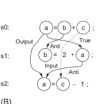

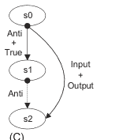

```
(D)
s0: a1=b1 + c1;
s1: b2 = a1;
s2: a = c - 1;
```

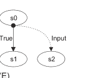

图 4.1 标量变量语句序列、语句之间相应的数据依赖类型以及数据依赖图（DDG）的示例。（A）语句序列，（B）数据依赖类型，（C）DDG，（D）变量重命名后的语句序列，以及（E）变量重命名后的DDG。

以图形方式展示这些操作之间的各种依赖类型。例如，操作 s1 和 s0 之间存在真数据依赖，因为 s1 中使用（或读取）的变量 a 的值由 s0 中的操作定义（或写入）。相反，s1 和 s0 之间存在反数据依赖，因为 s1 中定义（或写入）的变量 b 的值在操作 s0 中被使用（或读取）。其他类型的依赖也显示出来，很明显同一操作可以与其他操作具有多种类型的数据依赖。例如，语句 s0 中的操作与语句 s2 中的操作既有输出依赖也有输入依赖。

图 4.1C 显示了示例中数据依赖作为数据依赖图（DDG）的表示。通过应用变量重命名（如图 4.1D 所示），可以消除输出依赖和反依赖，从而得到图 4.1E 的 DDG。数据依赖图可以被视为数据流图（DFG）的一种特例，其中节点可以是语句、任务、函数等，边表示依赖（当然，在真依赖的情况下，这些依赖与数据流相关联）。

正如示例所示，任何编译器都必须保守并进行精确的数据依赖分析，以保证其对代码应用的转换的正确性。数据独立操作（或指令）可以自由交换其执行顺序以改善其引用局部性，或者简单地在不同的执行单元中执行以实现并发。然而，数据依赖操作必须以相同的相对顺序执行（无论是在同一处理单元还是在不同单元中），尽管与它们无关的其他操作可以在它们之间执行。出于这个原因，我们重命名图 4.1A 代码示例中的变量 'a' 和 'b'，以分别消除输出依赖和反依赖，从而允许编译器更改任何操作的相对顺序（图 4.1D 和 4.1E），否则任何执行顺序（原始代码中存在的顺序除外）都会产生不同的结果。

虽然对于标量变量，编译器发现所有类型的数据依赖相当简单，但对于循环和数组等其他构造，准确的数据依赖需要更复杂的分析。可行的准确数据依赖分析的特定上下文是循环构造的情况，其主体不包括控制流语句，并且仅操作标量变量或数组变量，其中数组索引函数定义为封闭循环控制（或索引）变量的整数仿射函数。

面对循环构造时，编译器的数据依赖分析需要了解各个数组元素（数据项）相互之间以及相对于循环迭代的数据访问模式。然后的一个关键问题是

$^3$对输入值的依赖使得编译器无法为任何非平凡代码生成最优代码，这被称为“不可判定性”。

4 我们在此假设变量名之间不存在别名，即不同的标量变量名在运行时指向不同的内存位置。允许指针的语言（如 C）通常会妨碍编译器区分它们的能力。

5 变量 i0, i1, ..., ik 的整数仿射函数定义为 a0 * i0 + i0 * i1 + ... + ik * ik + c，其中 a0 到 ak 的值是已知整数常数。


for (i=1; i <= N; i++){
C[i] = A[i] + B[i];
}

for (i=1; i <= N; i++){
for (j=1; j <= N; j++){
D[i][j] = D[i-1][j-1] + i;
}
}

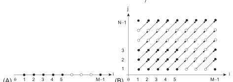

图 4.2 使用仿射索引函数操作数组变量的循环 C 源代码示例：(A) 一维示例；(B) 二维示例。每个示例源代码下方都描绘了相应的迭代空间（一维和二维）。

确定循环的哪些迭代（如果有的话）与同一循环的其他迭代存在数据依赖关系。

为了在循环嵌套和带有仿射索引函数的数组的上下文中支持数据依赖分析，研究人员提出了迭代空间和依赖向量的概念。迭代空间及其对应的迭代向量将循环的迭代空间定义为一个整数（或离散）笛卡尔空间，其维度与分析代码段中的嵌套循环数量相同。依赖向量确定该空间中的哪些迭代依赖于同一空间中的哪些迭代，即，循环体中的语句在哪些循环迭代中与同一循环的相同语句在不同迭代中存在数据依赖关系。图 4.2 描绘了两个使用仿射索引函数操作数组变量的简单循环示例。在图 4.2 的下部，我们分别描绘了相应的迭代空间，即一维空间和二维空间。

给定迭代空间，形式上表示为向量空间 I = (i1, ..., ik)，其中 i1 和 ik 表示该空间的基向量，并分别对应每个循环索引变量，循环的数据依赖分析必须确定是否存在两个不同的迭代，例如 I1 和 I2，使得这些迭代中的操作访问的数组元素不相离。换句话说，编译器必须确定对于每对数组引用（指向同一数组），是否存在 I1 和 I2 ∈ I，使得 F1(I1) = F2(I2)，其中 F 函数表示每个数组引用的仿射索引函数，例如引用 1 和 2。一旦数据

for(i=0; i < N; i++)
for(j=1; j < N; j++)
A[i][j] = A[i][j-1] + 1;

parfor(i=0; i < N; i++)
for(j=1; j < N; j++)
A[i][j] = A[i][j-1] + 1;

图 4.3 双重循环嵌套中最外层循环 i 的并行化。依赖向量 D = (0,1)。

依赖关系被确定后，还需要进一步细化以确定依赖类型，因为这可能会影响编译器可以合法应用的程序转换范围。对于图 4.2 左侧的示例，循环中任何迭代之间都不存在数据依赖，因为每个迭代都访问所有数组的不同数据元素。我们用依赖向量 D = (0) 表示这种缺乏数据依赖的情况。然而，对于右侧的示例，循环中不同迭代之间存在由依赖向量 D = (1,1) 表示的数据依赖。在这种情况下，该依赖向量非常精确，因为它表明循环的迭代 (i1,j1) 和 (i2,j2) 之间存在依赖，其中 i2 = i1 + 1 且 j2 = j1 + 1。图 4.3 显示了另一个带有依赖距离向量（针对右侧代码示例）D = (0,1) 的循环示例，清楚地显示了哪些迭代依赖于哪些其他迭代。

考虑到这种数据依赖形式化在科学计算以及用于并发性和内存局部性的编译器转换中的重要性，多年来，研究人员开发了大量数值方法，以高效确定数据依赖问题的解集。解决方案包括整数线性规划（ILP）、最大公约数（GCD）测试 [8] 以及傅里叶-莫茨金方法 [9]。与任何其他 NP-完全决策问题一样，仿射域的数据依赖测试算法从评估速度快但结果不精确，到计算开销更大但结果更精确不等。编译器始终不得不选择保守解决方案。因此，在存在无法得出结论的结果（即方法得出的结果指示可能存在数据依赖）的情况下，编译器必须假设该依赖存在，从而限制某些程序转换。在这些场景中，数据依赖解析可以通过一种名为“检查器-执行”（inspector-execution）的技术推迟到运行时（例如，参见 [10,11]）。在此过程中，编译器生成代码，在循环嵌套的第一次迭代期间在运行时检查数据依赖。如果在运行时的第一次运行中未检测到依赖，并且假设依赖在循环执行过程中不会改变（这一事实可以在编译时推导出来），则其余迭代可以并发执行。

与图 4.2 中描绘的示例不同，其中发现的依赖向量非常精确且依赖距离是常数，还有其他情况，数据依赖分析算法无法精确确定依赖距离。在某些情况下，算法只能确定依赖距离具有一定的“形状”，这意味着在某些循环中存在精确依赖，但在其他循环中依赖不够精确。例如，依赖向量可以采用 D = (0,>) 的形式，这表明在循环嵌套的第一个循环的迭代沿线没有依赖，但在第一个循环的相同迭代下，第二个循环的迭代之间存在正依赖距离。虽然不够精确，但这种依赖距离仍然有用，因为只要第二个循环的迭代按顺序执行，第一个循环的迭代就可以并发执行，从而遵循其原始执行顺序。在此示例中，编译器可以将外部 for 循环转换为 parfor 构造，以表明特定循环的迭代可以并发执行，因此相互之间可以以任意顺序执行，甚至可能在不同的执行单元上执行。

给定一个循环嵌套，编译器可以确定嵌套中的哪个循环承载依赖，即哪个循环要求其所有迭代都必须按原始顺序顺序执行。为了确定此信息，编译器可以使用词法正依赖向量的概念。我们定义依赖向量 D = (d1, ..., dn) 为词法正的，当且仅当其第一个非零分量（从 d1 到 dn）为正。此外，我们说对应于这个第一个非零分量的循环是承载循环嵌套（数据）依赖的循环。因此，编译器可以通过检查所有发现的依赖向量并检查哪个向量的嵌套中的第一个循环承载数据依赖，来构建一个简单的并发测试。该循环及其所有外层循环必须顺序执行。嵌套中的所有外层循环都可以并发执行。图 4.4 中的示例虽然简单，但展示了编译器如何确定嵌套的第一个循环（即 i 循环）可以并发执行，而内层循环（即 j 循环）必须顺序执行。

在许多情况下，无法直接发现给定循环嵌套中可并行化的循环，但仍然可以应用揭示并行循环的转换。在图 4.4A 中，我们展示了一个具有依赖距离向量 D = (1, 0) 的循环嵌套。最外层循环（即 i 循环）承载依赖，因此无法并行化该循环。但是，可以交换嵌套中两个循环的顺序，即交换两个循环的执行顺序，从而在最外层循环处暴露并发性。

可以使用文献中称为单模循环转换的方法，通过转换矩阵 T [12] 来形式化这种循环置换转换。给定一个带有依赖向量集合 d ∈ D 的输入循环嵌套，当且仅当对于所有 d ∈ D，T.d ≥ 0 时，T 是合法的循环转换。换句话说，对于每个依赖距离向量，转换后的依赖距离向量都需要是词法正的。


```
for (i=1; i <= N; i++){
    for (j=1; j < N; j++){
        C[i][j] = C[i-1][j] + 1;
    }
}
```

```
for (j=1; j < N; j++){
    for (i=1; i < N; i++){
        C[i][j] = C[i-1][j] + 1;
    }
}
```

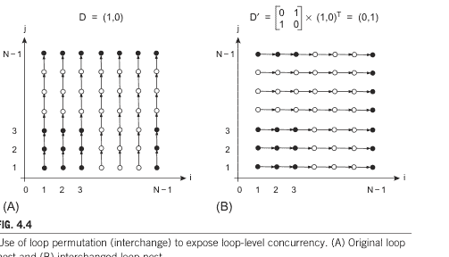

图 4.4A 中的循环嵌套示例具有依赖距离向量 D = (1, 0)。使用单模变换 T = [0 1; 1 0] 进行置换后，得到的变换后的依赖距离向量为 D' = (0, 1)，从而得到图 4.4B 中的变换后的循环嵌套。在这个变换后的循环嵌套中，外层循环（j 循环）现在可以并发执行。

在其他情况下，根本无法应用暴露并发循环的循环变换。不过，仍然可以应用其他循环变换（非单模循环变换）来改进代码执行的特定方面。循环分块（通常称为循环阻塞，参见第 5 章）就是一个例子。在这种变换中，原始循环嵌套中的一个循环会被“阻塞”或“分块”，从而创建两个循环：一个最外层的“控制”循环，用于控制原始循环每个分块迭代的执行；以及第二个最内层循环，用于控制每个分块内部迭代的执行。图 4.5 展示了二维循环嵌套上循环分块的示例。图 4.5A 中的原始循环被重构为图 4.5B 中的二维分块循环嵌套，其中每个分块（在此示例中为 2×2 分块）的执行顺序由变换后循环嵌套中的两个最外层循环控制。

```
for (j=1; j < N; j++){
    for (i=1; i < N; i++){
        C[i] = C[i] + A[i][j];
    }
}
```

```
for (j=1; j < N; j += tile_size){
    for (i=1; i < N; i += tile_size){
        for (jj=j; jj < j+tile_size; jj++){
            for (ii=i; ii < i+tile_size; ii++){
                C[ii] = C[ii] + A[ii][jj];
            }
        }
    }
}
```

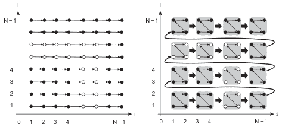

取决于被操作数组的数据布局，图 4.5B 中分块版本的代码相对于原始版本可能表现出显著的性能优势。在原始循环嵌套中，对数组 a 的访问具有较大的步长（假设为 C 语言中的行主序组织），而在变换后的代码中，这些访问更加局部化，从而实现更好的缓存复用。

通过对分块循环嵌套中的两个控制循环使用循环交换（如图 4.6 所示），可以获得更好的循环组织。在这里，分块遍历的顺序增强了对 c 和 a 数组访问的局部性。

这些示例说明了在存在使用仿射索引函数操作多维数组的循环嵌套时，如何使用精确的数据依赖分析。将循环变换形式化为线性代数框架，使编译器能够推理变换的合法性以及利用并发性和数据局部性的机会。

尽管在科学和高性能计算领域，使用如本文所述的数据依赖分析框架已取得非常成功的应用，但在其他应用领域中，别名和指针引用（如 C 语言的情况）等编程语言特性的存在阻碍了这些复杂分析的使用。在许多实际情况下，编译器根本无法（在编译时）知道是否存在依赖。这种根本性的无能因此阻止了高级变换的使用。经典示例是稀疏矩阵操作中间接索引的使用。

其他编译器变换（有关代码变换和优化的集合，参见第 5 章）需要与先前为循环嵌套的数据并发性和局部性描述的不同分析抽象。在应用软件流水线等优化时，编译器通常会在数据依赖图（DDG）中表示循环嵌套的数据依赖关系，该图通过标注循环携带的延迟和距离来识别迭代内和迭代间的依赖关系。在这个 DDG 中，从指令 i 到指令 j 的循环携带延迟 d 意味着 j 依赖于指令 i 在 p 次迭代前计算出的值，并且 j 至少要在 i 的适当实例执行后 d 个周期（表示流水线延迟）才能开始。距离 d=0 表示迭代内依赖。DDG 中可用于执行操作的硬件资源，以及边中存在的距离和周期，构成了导致可实现的最小软件流水线启动间隔（II）的约束。

根据此信息的使用情况，DDG 可能由低级中间表示（接近目标汇编代码）、操作级或语句级形成。在涉及操作调度的情况下（如软件流水线），DDG 节点通常表示单个操作而不是语句。图 4.7 说明了一个带有周期和距离信息的 DDG 示例。在此示例中，我们认为加载、乘法和除法操作分别需要 2、2 和 3 个时钟周期，而所有其他操作都需要 1 个时钟周期来执行。该 DDG 中的循环显示了距离为 1 的循环携带依赖关系。

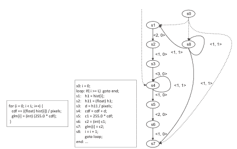

图 4.7 周期和距离：(A) 带有循环的代码示例（基于 UTDSP 基准测试仓库 [133] 中的代码），(B) 中间三地址表示，以及 (C) DDG 示例。

在存在循环序列（每个序列由嵌套循环或单个循环组成）的情况下，如图 4.8A 中的示例，识别它们之间是否存在数据依赖关系可能很重要。此信息可以表示为一个称为循环依赖图（LDG）的图，如图 4.8B 所示。LDG 的边表示有关依赖关系的信息。图 4.8B 的 LDG 以边标签的形式说明了负责循环嵌套（表示为节点）之间真依赖关系的数组变量。

在图 4.8 所示的示例中，序列中的所有循环都在每两个循环之间强加数据依赖关系。例如，序列中的两个循环存在数据依赖关系，因为第一个嵌套循环写入 hist 数组，而第二个循环读取 hist 数组的元素。第一个嵌套循环中的间接索引阻止编译器确定此时写入的元素会在后续循环中使用。LDG 可以被视为任务图（参见第 4.4 节）的特例，其中节点始终是循环，边表示循环之间的数据依赖关系。

```
L1: for (i = 0; i < L; i++) {
    hist[i] = 0;
}
L2: for (i = 0; i < N; i++) {
    for (j = 0; j < N; j++) {
        hist[img[i][j]] += 1;
    }
}
L3: for (i = 0; i < L; i++) {
    cdf += (float)hist[i] / pixels;
    img[i] = (int) (255.0 * cdf);
}
L4: for (i = 0; i < N; i++) {
    for (j = 0; j < N; j++) {
        img[i][j] = g[img[i][j]];
    }
}
```

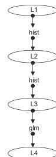

图 4.8 循环序列：(A) 带有循环序列的代码示例（基于 UTDSP 基准测试仓库 [13] 中的代码），以及 (B) 生成的循环依赖图（LDG）。

### 4.3.2 代码度量

一般来说，如图 4.9 所示，代码分析依赖于代码度量和代码属性，以推导出越来越复杂的度量和/或属性。在表 4.2 中，我们展示了代表性代码属性的示例。这些示例包括数据类型、循环类型、循环层级、使用-定义链、AST、CFG 和调用图（仅静态）。

不难观察到，这些度量都不依赖于目标平台，因为它们完全取决于源代码的结构，旨在帮助程序理解，而非应用性能调优。捕获源代码固有“复杂性”的一种度量是圈复杂度。这种特定的度量依赖于源代码的控制流图（CFG），其中节点表示基本块（或指令），边对应于基本块（或指令）之间的执行流。给定一个 CFG，圈复杂度度量计算为 E – N + 2 × P，其中 E 是 CFG 的边数，N 是节点数，P 是程序中的模块数。这种圈复杂度度量（例如，参见 [2]）用于通过考虑程序中线性无关路径的数量来衡量程序的复杂性。

7 基本块捕获直线型代码片段，其中执行流始终从第一条指令开始，并且仅在最后一条指令处退出（即，如果第一条指令执行，则所有后续指令都会执行）。


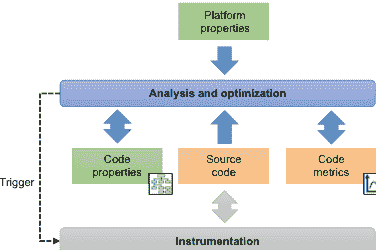

图 4.9 代码分析与插桩工作流。

### 表 4.2 代码属性示例

| 属性 | 上下文 | 描述 | 方法 |
| :--- | :--- | :--- | :--- |
| 数据类型 | 变量 | 变量的类型（例如，整数、浮点数或字符串），用于标识可能的值以及对这些值执行的操作 | 代码检查 |
| 循环类型 | 循环 | 循环结构的类型：计数控制（例如，for）、条件控制（例如，while）或集合控制（例如，foreach） | 代码检查 |
| 循环排名 | 循环 | 循环相对于同一模块中其他循环的相对位置。例如，以下嵌套循环具有以下排名值：循环 r：排名 1，循环 r：排名 1.1，循环 r：排名 1.2 | 代码检查 |
| 使用-定义链 | 变量 | 用于为每个变量的每次使用提供数据的结构 | 代码检查 |
| 抽象语法树 (AST) | 程序 | 源代码语法结构的树形表示 | 代码检查 |
| 控制流图 (CFG) | 程序 | 程序执行期间可能遍历的所有路径的图形表示 | 代码检查 |
| 静态调用图 | 程序 | 程序模块（函数、任务）之间所有可能调用关系的图形表示 | 代码检查 |

该度量背后的直觉是：程序的独立路径越多，对可维护性和可测试性的影响就越大，包括更新代码时出错的概率。因此，圈复杂度的高值表征控制主导的代码（例如，包含许多 if-then-else 结构），而圈复杂度的低值表征具有非常规则的循环主导和顺序结构的代码。

让我们考虑用于计算 N 体模拟问题质量分布的程序片段，如图 4.10 所示。该代码的 CFG（如图 4.11 所示）有 8 条边、7 个节点和 1 个模块，圈复杂度为 3。

```
function computeMassDistribution(Node node) {
  if (number of particles in this node equals 1) {
    centerOfMass = particle.position;
    mass = particle.mass;
  } else {
    (all child quadrants that have particles in them) {
      quad.computeMassDistribution();
      mass += quad.mass();
      centerOfMass += quad.mass() * quad.centerOfMass();
    }
    centerOfMass = centerOfMass / mass;
  }
}
```

图 4.10 计算 N 体模拟问题质量分布的代码示例。

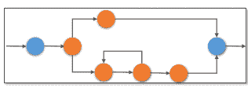

图 4.11 控制流图 (CFG) 示例。

## 4.4 动态分析：对插桩的需求

许多感兴趣的指标只能动态收集，且可在不同层级进行。可以对代码执行进行剖析，以收集关于代码特定部分执行频率的指标，或收集特定变量的值，以及执行指标（例如，已执行代码给定部分中特定类型指令的数量）。执行时间是一种常见且重要的指标，因此确定代码中哪些部分负责绝大部分执行时间（即所谓的“热点”）变得至关重要。要找到这些热点，典型的方法是通过插桩来实现，即插入计时原语来测量特定代码区域（如函数调用和循环）的执行时间。一旦插桩后的应用程序执行完毕，就可以收集计时数据并用于后续分析。这是 *剖析* 工具的典型方法，这些工具通过插桩来收集与程序执行相关的广泛指标，在许多情况下，这些指标（与内在代码指标或属性不同）与目标系统的架构紧密相关。

剖析会输出一份关于应用程序特征及其在一次或多次执行中行为的报告，因为通常可以将不同执行运行的结果汇总到单个报告中。报告中的信息可以以人类可读的方式输出，也可供其他工具或编译器使用。由于输出信息的复杂性，更高级的剖析工具使用可视化方案，例如图形（如带注释的调用图、数据依赖图）和图表（数据分布）。输出报告通常包含对应用程序源代码的显式交叉引用，以指导用户和/或工具及编译器。尽管如此，为了有用，剖析必须使用具有代表性的输入数据来执行。

剖析过程报告的信息可以通过指令驱动的编程模型方法、属性、编译器选项和/或更复杂的策略（例如 LARA [14,15] 支持的策略）以注释的形式传递给工具链（请参阅“LARA 和插桩”侧边栏和第 3 章）。

大多数剖析方法都使用插桩方案，即在应用程序代码的关键点插入代码以记录/监控动态行为。它们通常使用插桩库，插入的代码通常由对库函数的调用组成。然后，应用程序会与插桩库一起编译和链接。信息会在插桩应用程序执行期间和/或之后报告。这种方法的一个问题是插入代码对编译器优化适用性的影响，进而影响相应的代码生成效率，并最终影响执行时间。有时需要使用相同的输入数据多次对同一应用程序进行剖析，并在不同运行之间分配插桩，或仅对代码区域进行插桩。事实上，这可能是一个多阶段过程：在第一次运行中识别关键函数（路径和/或区域），然后将剖析集中在这些关键函数上，以便可能报告更多、更精细的信息。

### 4.4.1 剖析信息

在编译时，剖析可以揭示应用程序的一些属性，例如加载/存储指令的数量、分支指令的数量、结构良好的循环的迭代次数等。其他属性通常可以估算。

在运行时，可以为特定执行场景得出精确的发生次数，例如，不仅可以得出加载/存储指令的数量，还可以得出每条指令执行的次数，因为 CFG 的边缘可以标注其执行频率。一种重要的表示形式是调用图 (CG)。它可以通过静态分析或动态分析创建，因此分别称为静态 CG 或动态 CG。动态 CG 可以捕获与静态 CG 相同的信息，也可以仅考虑特定执行场景中执行的函数调用，从而表示静态 CG 的一部分。动态 CG 的威力不仅在于识别运行时实际执行的调用，还在于可以标注动态信息（例如调用之间流动的数据大小以及每个函数被调用的次数）。

### LARA 和插桩

LARA [14,15] 是一种面向切面编程 (AOP) 语言，专门设计用于允许开发人员编程代码插桩策略，控制代码转换和编译的应用，并有效控制工具链中的不同工具。除了插桩之外，LARA 切面还允许用户插桩代码以收集方案（例如，用于剖析定制）。LARA 提供的统一视图也有助于开发使用剖析输出作为输入信息的策略。LARA 技术目前正在四个编译器工具中使用：MATISSE（MATLAB 到 C 编译器）、Harmonic（源到源编译器）、MANET（源到源编译器）和 ReflectC（基于 C 风格的 C 编译器）。

- MATISSE: http://...
- Harmonic: http://...
- ReflectC: http://...

另一种有用的表示形式是任务图 (TG)，它也类似于表示工作流的图。TG 将应用程序表示为任务集合，以及它们之间的控制和数据依赖关系，因此可用于识别任务级并行机会，包括任务级流水线。TG 也可以视为任务级的数据依赖图 (DDG)。

在较低层级，可以查看在语句/指令/操作级别创建动态 DDG。通过访问的内存地址的跟踪，可以确定内存访问距离，并指导代码转换以促进数据重用、访问的内存区域（可用于指导数据分区）、内存访问模式、生产者/消费者任务、它们的通信访问模式（可用于指导任务级流水线）等。

从应用程序执行中可以获取的信息多种多样，且高度依赖于特定的分析和/或转换目标。表 4.3 显示了高性能嵌入式计算环境下的一组代表性特征。监控按三种类型分组：控制、数据和操作。这里假设获取的信息用于指导代码转换、编译器优化以及分区和映射。获取的特征或指标包括范围值、数据大小、循环迭代次数、内存别名以及路径和基本块的执行频率（考虑分支）。


表 4.3 从应用程序中提取的代表性特征示例

| 监控类型 | 特征 | 静态/动态特征 | 表示形式 | 目标示例 |
| :--- | :--- | :--- | :--- | :--- |
| 数据 | 数据值 | 动态 | 分布频率 范围 | 代码专用化 字长缩减 |
| 数据 | 数据大小 | 动态 | 图中的注释 关于变量的报告 | 获取数据通信需求 内存存储需求 |
| 数据 | 内存地址 | 动态 | 动态数据依赖图 (DDGs) | 变量可私有化 并行化 约简操作 计算与通信重叠 确定设置、硬件加速初始化的位置 识别访问之间的距离 识别正在访问的内存区域 |
| 数据 | 数据和指令缓存的缺失率 | 动态 | 注释或文本报告 | 指导代码转换和编译器优化 |
| 操作 | 内存访问（加载/存储） | 静态/动态 | | 指导分区和映射 |
| 操作 | 已执行的操作 | 动态 | 每个操作的执行频率 动态执行图 | 指导分区和映射 |
| 控制 | 已采取的分支及其频率 | 动态 | 动态执行图 CFG 中的注释 | 指导编译器优化 指导调度、分区、映射 关于分支预测方案的决策 |
| 控制 | 分支误预测率 | 动态 | 注释或文本报告 | 指导代码转换和编译器优化 |
| 控制 | 调用 | 静态/动态 | 静态调用图 动态调用图 | 叶子过程内联和使用公共参数值的过程专用化 |
| 控制 | 循环迭代 | 静态/动态 | 图形表示中的注释 | 将优化器集中在迭代次数多的循环上 |

在将应用程序映射到嵌入式系统并考虑使用多核和硬件加速器的不同阶段，它们都可能很重要。

仪器化对于支持关键路径分析 (CPA) 以及突出显示应专注于优化和/或加速的代码区域或执行路径也可能很重要。通过正确地对应用程序代码进行仪器化，应用程序的执行可以生成执行跟踪，然后可以分析该跟踪以构建动态依赖图 (DDG)。在此 DDG 中，每条已执行的指令都是一个节点，边表示数据流（指令之间的依赖关系）。也可以构建动态控制/数据流图 (CDFG) 并显式地暴露控制流和数据流。请注意，从跟踪和分析构建的所有图都可以根据运行时属性，为节点和/或边关联信息来丰富。检查图表以确定重要属性。例如，检查入站和出站数据依赖边可以帮助确定变量是否可私有化。其他有用的方案可以查找约简操作、基于流的数据访问等。

值分析提取诸如范围值、某个变量的值枚举等信息，这些信息也可用于将变量标识为不变量或常量，并执行更激进的常量折叠、代码专用化和部分求值。这些信息可用于指导函数内联、针对 CPU 和加速器的代码分区等。例如，在获取动态数据依赖和内存访问模式后，可以确定连续内存访问，并例如识别应用向量化以实现 SIMD 并行性的机会。另外，指导向量化的重要特征还包括循环次数、数组的访问步长、数组对齐，以及最后，循环内分支的结果。

识别内存分配和释放操作、系统调用、对特定库函数（例如 Math.h）的调用，对于指导代码转换、分区和映射也可能至关重要。例如，这些信息可以限制某些函数映射到硬件加速器，并可以触发对特定代码区域的一组转换，以使其准备好迁移到硬件加速器。

显而易见，某些代码指标，如执行时间和功耗，可能依赖于平台，即测量值可能因所使用的硬件而异。在这种情况下，代码分析过程可能需要平台属性（除了代码属性之外）来识别，例如，特定任务是否可以（或应该）映射到 GPGPU 等硬件加速器。有用的平台属性包括内存和缓存大小、存储卷大小、处理核心数量和核心时钟频率。

虽然其中许多指标非常面向架构，例如每条指令的时钟周期数，但在转换上下文中还有其他非常感兴趣的指标，它们与应用程序代码的结构相关。例如，在各种上下文中，了解特定循环边界所采用的值的范围很重要，因为它们决定了已执行迭代的数量或已分配

| 指标 | 目标 | 描述 |
| :--- | :--- | :--- |
| 操作强度 从内存移动的每字节数据的算术操作比率 | 估计性能上界 | 用于屋顶线模型 |
| 自并行性 [16] | 并行化 | 它表示单个区域的并行潜力 |
| DDG 节点数与关键路径长度之比 [17] | 并行化 | 并行潜力的估计（可并行执行的指令数量） |
| 每周期指令数 (IPC) | 估计性能并发现并行性 | 表示 ILP（指令级并行性）程度的指标 |
| 每秒帧数 (FPS) 和每帧能量 | | 用于图像/视频处理应用程序上下文中的指标 |
| 应用程序成本 [24]（CPU 利用率与 CPU 频率的乘积） | 突出性能和/或内存瓶颈 | 在内存访问较少的情况下，CPU 利用率大约与频率成正比，因此应用程序成本随核心频率保持平稳 |

数组。要揭示这些信息，需要对代码进行仪器化（不一定是执行或性能分析）。仪器化的代码在代码执行时简单地收集特定值并编译相关统计列表。

使用分析获取的信息，可以计算一些感兴趣的指标。例如，已完成工作量与关键路径长度之比可以估计可并发执行的指令数量。表 4.4 列出了开发人员用于评估其应用程序性能并可能识别瓶颈、并行潜力等的若干指标。

### 4.4.2 分析示例

图 4.12 展示了 UTDSP 基准测试仓库 [13] 中包含的边缘检测算法的部分核心源代码。该算法包括平滑滤波器、水平和垂直梯度、梯度组合以及阈值任务。图 4.12 中的代码说明了该基准测试，对初始化以及梯度组合和阈值代码区域封装到两个函数（initialize 和 combthreshold）中进行了修改。该应用程序使用 GNU gcc -O2 编译，并在 Intel i5-2467M CPU @ 1.60 GHz、4 GB RAM 和 64 位 Windows 7 操作系统上执行。图 4.13 显示了分析报告的一部分（此处为扁平配置文件信息

```c
/* Initialize to zero image_buffer2 and image_buffer3 */
/* initialize(image_buffers, image_buffer3); */

/* Set the values of the filter matrix to a Gaussian kernel. */
/* filter[0][0] = 1; */
---
/* filter[2][2] = 1; */

/* Perform the Gaussian convolution. */
/* convolve2d(image_buffer1, filter, image_buffer3); */

/* Set the values of the filter matrix to the vert. Sobel operator. */
/* filter[0][0] = 1; */
---
/* filter[2][2] = -1; */

/* Convolve the smoothed matrix with the vertical Sobel kernel. */
/* convolve2d(image_buffer1, filter, image_buffer1); */

/* Set the values of the filter matrix to the horiz. Sobel operator. */
/* filter[0][0] = 1; */
---
/* filter[2][2] = -1; */

/* Convolve the smoothed matrix with the horiz. Sobel kernel. */
/* convolve2d(image_buffer1, filter, image_buffer2); */

/* Combine and form a new image based on threshold. */
/* combthreshold(image_buffer1, image_buffer2, image_buffer3); */
---
```

此处）由 GNU gprof[5] 输出，并考虑对代码进行修改以重复执行 1000 次算法。从分析信息可以看出，该算法有 93.23% 的执行时间用于执行 convolve2d 函数（单次运行中调用 3 次），以及 3.76% 和 3.01% 的时间分别用于执行 combthreshold 和 initialize 函数。图 4.14 显示了获得的调用图 (CG)，表示每个函数被调用的次数。CG 中可能表示的其他信息包括，例如，每个函数的执行时间和全局执行时间的百分比。

| 时间百分比 | 累计秒数 | 自身秒数 | 调用次数 | 自身微秒/调用 | 总微秒/调用 | 名称 |
| :--- | :--- | :--- | :--- | :--- | :--- | :--- |
| 93.23 | 1.19 | 1.19 | 3000 | 398.33 | 431.33 | convolve2d |
| 3.76 | 1.29 | 0.05 | 1000 | 43.00 | 43.00 | combthreshold |
| 3.01 | 1.33 | 0.04 | 1000 | 40.00 | 40.00 | initialize |

图 4.13 边缘检测 UTDSP 基准测试的 Gprof 扁平配置文件。


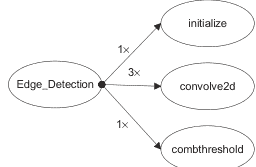

图 4.14 边缘检测 UTDS 基准的调用图（边上的标签标识每个被调用函数从调用函数被调用的次数）。

通过对代码进行插桩获得的任务图（TG）如图 4.15 所示。然而，我们未包含描述任务间及任务内部信息流的动态信息。可以看出，TG 明确显示了任务间的数据通信需求以及可以并行执行的任务。在此示例中，TG 显示两个 convolve2d 执行可以并行执行，这可以指导开发者，例如，将两个 convolve2d 函数实例映射到两个核上。

还可以提取的其他信息是生产者/消费者任务的访问模式，这可以是指导任务级流水线和支持任务间数据通信的硬件结构的重要信息（例如，根据访问模式，可以使用 FIFO 来通信数据）。

## 4.5 自定义分析示例

本节介绍了一些常用于嵌入式平台上下文中的代码分析自定义分析示例。所有示例都需要对应用程序进行插桩，以推导特定的动态指标。尽管应用程序的插桩可以手动完成，但我们在此强调使用 LARA 语言 [14,15] 来指定代码插桩策略，并使用基于这些策略生成代码修改的源到源编译器。

### 4.5.1 查找热点

加速应用程序执行的一个重要步骤是识别其热点，即花费大部分执行时间的代码区域，因此是优化的首选候选者。要识别热点，大多数开发者依赖于 GNU gprof 等免费可用工具，该工具提供关于程序每个模块花费执行时间的信息。GNU gcov 是另一个实用工具，在此情况下可用于呈现代码覆盖率结果。此类工具的功能有限，因为它们不提供选择要分析哪些代码区域和要忽略哪些区域的通用机制。不依赖分析工具，查找热点的一个简单策略是按如下方式手动插桩代码：

- 1. 分析 API 头文件。在每个源文件开头包含分析 API 头文件，以访问计时和报告函数。
- 2. 候选代码语句。在每个函数定义的开头和结尾插入计时调用，以计算相应的经过时间。我们仅对具有调用或循环的函数进行计时。
- 3. 计时报告。在应用程序终止之前，必须生成并输出计时报告。


图 4.15
边缘检测 UT DSP 基准的任务图（TG）。

```
#include <profiling.h>
Boolean crc32file(char *name, DWORD *crc, long *charcnt) {
    timer_begin("crc32file");
    oldcrc2 = 0xFFFFFFFF; *charcnt = 0;
    if ((fin = fopen(name, "rb")) == NULL) {
        perror(name);
        timer_end("crc32file");
        return Error_;
    }
    while ((c=getc(fin))!=EOF) {
        ++charcnt;
        oldcrc2 = UPDC32(c, oldcrc2);
    }
    if (ferror(fin)) {
        perror(name);
        *charcnt = -1;
    }
    fclose(fin);
    *crc = ~oldcrc2;
    timer_end("crc32file");
    return Success_;
}
DWORD crc32buf(char *buf, size_t len) {
    timer_begin("crc32buf");
    oldcrc2 = 0xFFFFFFFF;
    oldcrc2 = UPDC32(*buf, oldcrc2);
    for ( ; len--; ++buf) {
        oldcrc2 = UPDC32(*buf, oldcrc2);
    }
    timer_end("crc32buf");
    return ~oldcrc2;
}
int multialign_arg(char *argv[]) {
    timer_begin("main");
    while(--argc > 0) {
        errors |= crc32file(*++argv, &crc, &charcnt);
        printf("%08lX %7ld %s\n", crc, charcnt, *argv);
    }
    timer_end("main");
    timer_report();
    return(errors != 0);
}
```

图 4.16 基于 CRC32 基准的代码。

例如，考虑图 4.16 中基于 CRC32 基准 [18,19] 的代码，我们在其中以粗体突出显示已插桩的语句。timer_begin、timer_end 和 timer_report 原语是专门开发的 API 的一部分，用于监控函数的执行时间和调用次数并提供计时报告。虽然我们的分析策略相对简单，但如果代码非常大且跨越多个源文件，手动插桩代码可能具有挑战性。我们的策略要求识别具有循环和函数调用的函数以及所有退出点（例如，return 语句）以插入 timer_end 原语。

```
1. aspectdef MyProfiler
2. // select the first (global) statement of the file
3. select file.first end
4. apply
5.
6. $first.insert before % #include <profiling.h> %;
7. end
8.
9. // select all function calls
10. select function end
11. apply
12. var loops = $function.pointcut("loop");
13. var calls = $function.pointcut("call");
14. if (loops.length > 0 || calls.length > 0) {
15. var entries = $function.pointcut("entry");
16. for (var i in entries) {
17. entries[i].insert before % timer_begin("[%[function.name]]"); %;
18. timer_begin("[%[function.name]]"); %;
19. }
20. var exits = $function.pointcut("exit");
21. for (var i in exits) {
22. exits[i].insert before % timer_end("[%[function.name]]"); %;
23. }
24. }
25. end
26. end
27. // select last statement of the main function
28. select function.exit end
29. apply
30. exit.insert before % timer_report(); %;
31. end
32. condition $function.name == "main" end
33. end
34. end
35. end
36. .
```

图 4.17 分析的 LARA 策略示例。

图 4.17 中展示的 LARA 切面基于我们的分析策略，通过对具有任意数量源文件的 C 应用程序进行插桩来自动化此分析过程，具体如下：

- 1. 第 3–6 行：选择每个源文件的第一条语句，并插入分析 API 的头文件。
- 2. 第 9–26 行：对于应用程序中的每个函数，我们识别它是否包含循环或函数调用。在此情况下，我们为该函数选择所有入口和退出语句，并分别插入相应的 `timer_begin` 和 `timer_end` 原语。
- 3. 第 29–33 行：选择 main 函数的所有退出点，并插入对 `timer_report()` 的调用。

### 4.5.2 循环指标

循环指标可以帮助确定哪些循环是优化的候选者：在硬件执行的上下文中，它们是将计算卸载到可重构硬件的首选候选者。在此分析中，我们希望识别程序中每个循环的平均迭代次数和每个循环的执行次数（实例数量）。与前一节一样，此代码分析需要对代码进行插桩以在执行期间收集关于循环的信息。

提取这两个循环指标的策略是按如下方式对程序中的每个循环进行插桩：

- 1. 分析 API 头文件。在每个源文件开头包含分析 API 头文件，以访问计时和报告函数。
- 2. 循环语句。在每个循环语句之前插入监控 API 调用（monitor_count）以计算其执行次数。此外，我们在循环体内插入一个计数器来监控每次循环执行的迭代次数，并使用 monitor_avg API 调用来跟踪平均值。

```c
#include <profiling.h>

void BF_set_key(BF_KEY *key, int len, unsigned char *data) {
    d = data;
    end = (data + len);
    memset(key, 0, sizeof(*key));
    int COUNT_BF_set_key_1 = 0;
    "BF_set_key_1");
    for (i = 0; i < 16 + 2; i += 4) {
        COUNT_BF_set_key_1++;
        rl = " (*(d++))";
    }
    monitor_avg("loop-iterations", "BF_set_key_1", COUNT_BF_set_key_1);
    in[0] = 0l;
    in[1] = 0l;
    monitor("loop-instances", "BF_set_key_2");
    int COUNT_BF_set_key_2 = 0;
    for (i = 0; i < 16 + 2; i += 2) {
        COUNT_BF_set_key_2++;
        P[2 * i] ^= encrypt(in, key);
        P[(2 * i) + 1] = in[1];
        p[1] = in[1];
    }
    monitor_avg("loop-iterations", "BF_set_key_2", COUNT_BF_set_key_2);
    p = (key->S);
    monitor("loop-instances", "BF_set_key_3");
    int COUNT_BF_set_key_3 = 0;
    for (i = 0; i < 4 + 256; i += 2) {
        COUNT_BF_set_key_3++;
        S[2 * i] ^= encrypt(in, key);
        S[(2 * i) + 1] = in[1];
        p[1] = in[1];
    }
    monitor_avg("loop-iterations", "BF_set_key_3", COUNT_BF_set_key_3);
}
```

图 4.18

来自 blowfish 基准的代码示例（粗体语句标识插桩插入的代码）。


- 3. 循环报告。在应用程序终止之前，会生成并输出循环报告。

图 4.18 中的代码基于 blowfish 基准 [18,19]，展示了基于上述策略的插桩代码。

虽然监控 API 跟踪迭代次数和实例数，但手动插桩代码既费力又容易出错。我们可以使用图 4.19 中展示的 LARA 切面来自动化此过程，具体如下：

- 1. 第 2-8 行：选择每个源文件的第一条语句，并插入分析 API 的头文件。

- 2. 第 10-21 行：选择应用程序的所有循环及其对应的入口点。在每个循环语句之前，插入 monitor_count 调用以跟踪实例数，并插入迭代计数器的初始化语句。在循环体内插入循环计数递增，并在循环语句之后插入 monitor_avg API 调用以计算平均迭代次数（考虑循环之前的执行）。

- 3. 第 23-30 行：选择 main 函数的所有入口点，并插入 monitor_report() 调用以输出循环迭代次数和实例指标。

```
1. aspectdef lCount
2. select file.first_end
3. // add profile header
4. apply
5. if(first_insert before %{
6. #include <profiling.h>
7. %};
8. end
9.
10. select function.loop_entry end
11. apply
12. %{
13. %y key = $loop.key.replace(/\\/.g, "_");
14. %monitor_count("loop-instances", "[key]"); %};
15.
16. // $loop.insert before %{
17. %monitor_before %{
18. %monitor_insert after %{
19. %monitor_avg("loop-iterations", "[key]", COUNT_[key]); %};
20. end
21.
22. select function(name="main").exit end
23. // report monitor
24. apply
25. %{
26. %monitor_report("loop-iterations"); %};
27. %monitor_before
28. %monitor_insert before("loop-instances"); %};
29. end
30.
31. end
```

### 图 4.19 用于分析循环的 LARA 策略示例。

### 4.5.3 动态调用图

调用图通过表示不同程序模块（函数、子程序）之间的关系，为程序行为提供了一扇窗户。具体而言，调用图中的每个节点代表一个模块，边代表对模块的一次或多次调用。调用图可以在编译时（静态地）通过识别带有函数调用的语句来构建。它表示程序执行期间可能发生的所有调用的结构。在动态调用图的情况下，我们可以跟踪特定执行中调用的所有模块。具体而言，哪些模块被调用以及哪个模块触发了它们。动态调用图可以附加额外信息，例如其执行时间或其他指标。在本节中，我们专注于通过插桩代码生成动态调用图。插桩策略如下：

- 1. 分析 API 头文件。在每个源文件开头包含分析 API 头文件，以访问调用图监控函数。

- 2. 调用语句。在每个函数调用之前插入监控 API 调用（cgraph_task）。在此示例中，我们忽略所有系统调用。

- 3. 生成调用图。在应用程序终止之前，我们使用 cgraph_report 生成调用图。

让我们考虑基于 SHA 基准 [18,19] 的图 4.20 中的代码。它展示了基于先前策略的插桩代码，以加粗显示。我们可以使用图 4.21 中展示的 LARA 切面来自动化此过程，具体如下：

- 1. 第 3-8 行：选择每个源文件的第一条语句，并插入分析 API 的头文件。

- 2. 第 10-18 行：在每个调用之前插入 cgraph_task API 调用。cgraph_task API 调用接收两个参数：触发调用的函数名和被调用的函数名。我们添加一个条件，仅在调用不是系统调用时才跟踪该调用。

- 3. 第 20-25 行：选择 main 函数的所有退出点，并插入 cgraph_report() 调用以生成调用图。

### 4.5.4 分支频率

分支频率是另一项可用于确定热点的重要指标，特别是了解哪些分支被执行得最多，从而指导确定代码中哪个区域更适合优化的过程。与之前的示例一样，我们必须对代码进行插桩，在此情况下专注于条件结构，添加计数器，并使用具有代表性的数据集运行应用程序。我们的插桩策略如下：

```
#include <profiling.h>
void sha_final(SHA_INFO *sha_info) {
    if (count > 56) {
        memset(((BYTE *) &sha_info -> data) + count, 0, (64 - count));
        cgraph_task("sha_final","sha_transform");
        sha_transform(sha_info);
        sha_transform(sha_info);
        memset((&sha_info -> data),0,56);
    } else {
        memset((((BYTE *) &sha_info -> data) + count),0,(56 - count));
    }
    (sha_info -> data)[14] = hi_bit_count;
    (sha_info -> data)[15] = lo_bit_count;
    cgraph_task("sha_final","sha_transform");
    sha_transform(sha_info);
}
void sha_stream(SHA_INFO *sha_info, FILE *fin) {
    int i;
    BYTE data[8192U];
    cgraph_task("sha_stream","sha_init");
    sha_init(sha_info);
    while((i = fread(data,1,8192,fin)) > 0) {
        profile_graph_monitor("sha_stream","sha_update");
        sha_update(sha_info,data,i);
    }
    cgraph_task("sha_stream","sha_final");
    sha_final(sha_info);
}
void print_graph(SHA_INFO *sha_info) {
    printf("%08lX %08lX %08lX %08lX\n",
    (sha_info -> digest[0]),
    (sha_info -> digest[1]),(sha_info -> digest[2]),
    (sha_info -> digest[3]),(sha_info -> digest[4]);
}
```

### 图 4.20 基于 SHA 基准的代码示例。

- 1. 分析 API 头文件。在每个源文件开头包含分析 API 头文件，以访问分支频率监控函数；

- 2. 条件语句。为应用程序中的每个分支插入监控 API 调用（monitor_bfreq）。

- 3. 分支频率报告。就在应用程序终止之前，我们使用 report_bfreq API 调用生成分支频率报告。

我们现在考虑基于 Dijkstra 基准 [18,19] 的图 4.22 中的代码，它展示了基于先前策略的插桩代码，以加粗显示。

我们可以使用图 4.23 中展示的 LARA 切面来自动化此过程，具体如下：

- 1. 第 3–8 行：选择每个源文件的第一条语句，并插入分析 API 的头文件。

```
1. aspectdef CostGraph
2.
3.   // select the first (global) statement of the file
4.   select file.file first end
5.
6.   // add profile header
7.   apply
8.     profile_insert_before % (#include <profiling.h> %);
9.   end
10.
11.   // select all function calls
12.   select function.call end
13.   // add a monitor before each call
14.   apply
15.
16.     $call.parent_stmt.insert before % {
17.       cgraphTask("[[$function.name]]", "[$call.name]"); %};
18.   end
19.   condition !$call.is_sys end
20.
21.   // select last statement of the main function
22.   select function.end end
23.   // display call graph
24.   apply
25.     exit_insert_before % (cgraph_report()); %};
26.   end
27.   condition $function.name == "main" end
```

### 图 4.21 动态调用图的 LARA 策略示例。

- 2. 第 10–25 行：对于每个条件，选择“then”和“else”分支，并在每个分支内部插入 monitor_bfreq API。monitor_bfreq API 有两个参数：第一个是标识条件的键，第二个参数标识条件分支（then 或 else）。

- 3. 第 27–32 行：选择 main 函数的所有退出点，并插入 report_bfreq() 调用以输出条件被执行的总次数及其每条路径的频率。

### 4.5.5 堆内存

在开发没有自动垃圾回收的程序时，错误来源之一是堆内存管理。虽然 valgrind [6] 等复杂工具可以帮助调试潜在问题，但我们也可以使用自定义插桩来拦截对堆内存管理函数的调用，并监控其使用情况。我们跟踪堆内存使用情况的插桩策略如下：

- 1. 分析 API 头文件。在每个源文件开头包含分析 API 头文件，以访问堆监控函数。

- 2. 堆内存函数。拦截每个对 malloc、free 和 realloc 的调用，并分别将其替换为包装函数 profile_heap_malloc、profile_heap_free 和 profile_heap_realloc。


```
#include "profiling.h"

void dequeue(int iNode,int iDist,int iPrev){
    QITEM *tok;
    QITEM *qNew = (QITEM *)qMalloc(sizeof(QITEM));
    QITEM *qLast = qHead;
    if (qHead == 0){
        monitor_fstart("dequeue_1", 1);
        pIHead = (struct QITEM *)iNode;
        pIPrev = (struct QITEM *)iNode;
        exit(1);
    }
    else {
        monitor_bfreq("dequeue_0", 0);
    }
    qNew -> iNode = iNode;
    qNew -> iDist = iDist;
    qNew -> iPrev = iPrev;
    qNew -> qNext = (struct QITEM *)((void *)0);
    if (qLast == 0){
        monitor_bfreq("dequeue_2", 1);
        qHead = qNew;
    }
    else {
        monitor_bfreq("dequeue_2", 0);
        while((qLast -> qNext) != 0){
            qLast = (qLast -> qNext);
        }
        qLast -> qNext = qNew;
    }
    qLast = qNew;
    g_QCount++;
}

void dequeue(int *pINode,int *pIDist,int *pIPrev){
    QITEM *qKill = qHead;
    if (qHead == 0){
        monitor_fstart("dequeue_1", 1);
        *pINode = (qHead -> iNode);
        *pIDist = (qHead -> iDist);
        *pIPrev = (qHead -> iPrev);
        qHead = (qHead -> qNext);
        free(qKill);
        g_QCount--;
    }
    else {
        monitor_bfreq("dequeue_1", 0);
    }
}
```

### 图 4.22

基于 SHA 基准的代码示例。

- 3. 堆使用情况报告。在应用程序终止之前，我们使用 heap_report API 函数生成分支频率报告。

图 4.24 中的代码基于 patricia 基准 [18,19]，展示了应用早期策略后的插桩代码。

我们可以使用图 4.25 中展示的 LARA 切面来自动化此过程，具体步骤如下：

- 1. 第 3–7 行：选择每个源文件的第一条语句，并插入分析 API 的头文件。

```
1. aspectdef BFreq
2.
3. // select the first (global) statement of the file
4. // select file.first end
5. joinpoint jp: program;
6. apply
7.   $first.insert before %[ #include <profiling.h> %];
8. end
9.
10. // select all function calls
11. joinpoint jc: function.call;
12. apply
13.   $entry.insert after %{
14.     monitor_bfreq("[$if.key]", 1);
15.   %};
16. end
17.
18. // select all function calls
19. // select function.if.else.entry end
20. // add a monitor before each call
21. apply
22.   $entry.insert after %{
23.     monitor_bfreq("[$if.key]", 0);
24.   %};
25. end
26.
27. // select last statement of the main function
28. select function.exit end
29. apply
30.   $exit.insert before %[ report_bfreq(); %];
31. end
32.
33. condition $function.name == "main" end
34. end
```

### 图 4.23 用于插桩分支并计算分支频率的 LARA 切面。

```
#include <profiling.h>

int pat_remove(struct ptree *n,struct ptree **head) {
  if ( (*(t -> p.mn)).pm_data != 0) {
    profile_heap_free((*t -> p.mn).pm_data);
  } else {
    profile_heap_free((*t -> p.mn));
  }
  profile_heap_free((*t -> p.mn));
  if (t != p) {
    t -> p.key = (p -> p.key);
    t -> p.mn = (p -> p.mn);
    t -> p.mlen = (p -> p.mlen);
  } else {
    profile_heap_free(p);
  }
  return 1;
}

/* Allocate space for a new set of masks. */
buf = ((struct ptree_mask *) (profile_heap_malloc(sizeof(struct ptree_mask) * (t -> p.mlen) / sizeof(struct ptree_mask));

/* Free old masks and point to new ones. */
t -> p.masks = buf;
profile_heap_free(t -> p.mn);
t -> p.mn = buf;
return 1;
}
```

### 图 4.24 基于 patricia 基准的代码示例。

```
1. aspectdef MemoryCheck
2.
3. select file.first end
4. // add profile header
5. apply
6. $first.insert before #{
7.    #include <profiling.h> %};
8. end
9.
10. select function.call end
11. apply
12. if (${call.name == "malloc"} || ${call.name == "free"} ||
13.${call.name == "realloc"})
14. {
15. var call_code = $call.parent.stat.unparse;
16. var new_code = call_code.replace(${call.name + "(",
17. profile_heap_" + $call.name + "(");
18. $call.parent.stat.insert around ${
19. [new_code]}
20. };
21. }
22. end
23.
24. select function.exit end
25. // report monitor
26. apply
27. insert before #{
28.    heap_report("dynamic heap report"); %};
29. end
30. condition $function.name=="main" end
31. end
```

### 图 4.25 用于内存检查的 LARA 切面。

- 2. 第 9–21 行：选择所有执行堆管理（malloc、free 和 realloc）的函数调用，并将其替换为相应的包装函数。这是通过将函数调用转换为字符串并进行文本替换来实现的。然后我们用新调用替换旧调用。

- 3. 第 23–28 行：选择 main 函数的所有退出点，并插入对 heap_report() 的调用以输出堆管理报告。该 API 的当前实现支持检测内存泄漏、无效内存释放，以及报告应用程序生命周期期间分配的最大堆内存。

## 4.6 总结

本章探讨了在高性能嵌入式应用程序背景下代码分析与性能分析的重要性。我们描述了关键的应用程序特性，以指导开发者将计算高效地映射到当代异构多核嵌入式系统上。我们介绍了在嵌入式平台背景下常用的代码分析主要概念，以提取应用程序信息并根据其需求进行优化。在考虑代码转换和编译器优化时，第 6 章将重点介绍通过代码分析和性能分析获得的特性的应用。

## 4.7 延伸阅读

本章重点介绍了应用程序源代码的分析，以及可用于帮助开发者理解代码（例如应用程序热点）的属性和度量。我们还介绍了自定义性能分析技术和监控的使用，这些技术在学术文献中已得到广泛研究。作为本章介绍的性能分析示例的补充，还有其他性能分析技术，例如路径分析 [20] 和垂直分析 [21]，它们使开发者能够更好地理解运行时行为。性能分析可以通过以下方式为开发者和工具提供重要信息，例如：捕获 (1) if-then-else 结构中执行路径的分支频率；(2) 特定函数调用中的不变参数值，这些值可为同一函数启用不同的特化；以及 (3) 变量的数据范围和数值精度，以指导字长优化。此外，代码插桩不仅对于检测故障/错误越来越重要，而且对于获取运行时信息以指导工具编译到硬件 [22]、GPU [17] 和基于多核的系统 [23] 也至关重要。一个示例是用于指导投机性优化的基于插桩的数据依赖性分析方法。另一个示例是使用插桩来帮助识别和/或建议可并行化的代码区域 [16,23]。尽管所采用的插桩策略通常依赖于特定工具，并且在范围和灵活性方面有所限制，但这些方法为提取相关运行时信息提供了机制。

## 参考文献

- [1] Chidamber S., Kemerer C. 面向对象设计的度量套件. IEEE Trans Softw Eng 1994;20(6):476–93.
- [2] Fenton NE. 软件度量：一种严谨的方法. London: Chapman & Hall, Ltd; 1991.
- [3] Fenton NE, Pfleeger SL. 软件度量：一种严谨且实用的方法. 第 2 版. Boston, MA: PWS Pub. Co.; 1998.
- [4] Amdahl GM. 单处理器方法实现大规模计算能力的有效性. In: Proceedings AFIPS spring joint computer conference; 1967. p. 483–5.
- [5] Graham SL, Kessler PB, Mckusick MK. Gprof：调用图执行性能分析器. In: SIGPLAN Not. vol. 17, no. 6, June; 1982. p. 120–6.
- [6] Nethercote N, Seward J. Valgrind：用于重量级动态二进制插桩的框架. In: Proceedings ACM SIGPLAN conference on programming language design and implementation (PLDI’07). New York, NY: ACM; 2007. p. 89–100.
- [7] Torczon L, Cooper K. 编译器构建. 第 2 版. San Francisco, CA: Morgan Kaufmann Publishers Inc; 2007.


- [8] Wolfe M. Banerjee U. 数据依赖及其在并行处理中的应用. Int J Parallel Progr 1987;16(2):137–78.
- [9] Dantzig G. Curtis Eaves B. 傅里叶-莫茨金消元及其对偶. J Comb Theory A 1973;14:288–97.
- [10] Rauhwerger L, Padua D. LRPD 测试：带私有化和归约并行化的循环推测运行时并行化. In: 1995 年 ACM SIGPLAN 程序设计语言设计与实现会议论文集 (PLDI’95). New York: ACM; 1995. p. 218–32.
- [11] Saltz J. 并行循环的运行时调度. IEEE Trans Parallel Distrib Syst 1991;4(6):603–12.
- [12] Wolf ME, Lam MS. 一种数据局部性优化算法. In: 1991 年 ACM SIGPLAN 程序设计语言设计与实现会议论文集 (PLDI’91). New York, NY: ACM Press; 1991. p. 30–44.
- [13] UTDSP 基准套件. http://www.eecg.toronto.edu/~corinna/DSP/infrastructure/UTDSP.html [2015 年 12 月访问].
- [14] Cardoso JMP, Carvalho T, Coutinho JGF, Luk W, Nobre R, Diniz PC, 等. LARA：一种面向嵌入式系统的面向切面编程语言. In: 面向切面软件开发国际会议 (AOSD’12). Potsdam, Germany, 2012 年 3 月 25–30 日. p. 179–90.
- [15] Cardoso JMP, Coutinho JGF, Carvalho T, Diniz PC, Petrov Z, Luk W, 等. 使用 LARA 面向切面编程方法的性能驱动插桩与映射策略. Software: practice and experience (SPE), vol. 46, no. 2. Hoboken, NJ: John Wiley & Sons Ltd; 2016. p. 251–287.
- [16] Garcia S, Jeon D, Louie CM, Taylor MB. Kermelin：为多核时代重新思考和重启 Gprof. In: 第 32 届 ACM SIGMETRICS 程序设计语言设计与实现会议 (PLDI’11). New York, NY: ACM; 2011. p. 458–69.
- [17] Holewinski J, Ramamurthi R, Ravishankar M, Fauzia N, Pouchet L-N, Routtner A, 等. 应用程序向量化潜力的动态分析. In: 第 33 届 ACM SIGPLAN 程序设计语言设计与实现会议论文集 (PLDI’12). SIGPLAN Not. 2012;47, no. 6, June. New York, NY: ACM; 2012. p. 371–82.
- [18] Allen MR, Ringelberg H, Ernst D, Austin TM, Mudge T, Brown RB. Milén：一种免费的、可商业重定目标的仿真基准套件. In: IEEE 工作负载特征分析国际研讨会论文集 (WWC’01). Washington, DC: IEEE Computer Society; 2001. p. 3–14.
- [19] MiBench 版本 1. http://www.eecs.umich.edu/mibench/ [2015 年 11 月访问].
- [20] Ball T, Larus J. 高效路径分析. In: 第 29 届年度 ACM/IEEE 微架构国际研讨会论文集 (MICRO 29). Washington, DC: IEEE Computer Society; 1996. p. 46–57.
- [21] Hauswirth M, Sweeney P, Diwan A, Hind M. 垂直分析：理解面向对象应用程序的行为. In: SIGPLAN Not. vol. 39, no. 10, October. 2004. p. 251–69.
- [22] Ben-Asher Y, Rotem N. 使用内存分析进行指针代码的自动合成. ACM Trans Embedd Comput Syst 2013;12(3). Article 68, 21 pages.
- [23] Lazarescu MT, Lavagno L. 基于动态跟踪的 C 程序并行化数据依赖分析. In: 第 12 届 IEEE 源代码分析与操作国际工作会议论文集, September. 2012. p. 126–31.
- [24] Bai Y, Vaidya P. 用于分析和预测嵌入式系统中多媒体性能和功耗的内存特征分析. In: IEEE 声学、语音和信号处理国际会议论文集 (ICASSP’09). Washington, DC: IEEE Computer Society; 2009. p. 1321–4.

# 源代码转换与优化

## 5.1 引言

在存在严格要求（例如，性能、能耗或功耗）的情况下，仅将通过使用标准编译器优化（例如，使用 GCC 或 ICC 等编译器的 -O2 或 -O3 命令行选项）来自动满足这些要求的任务委托给编译器可能是不够的。虽然代码转换在提高性能、节省能源、降低功耗等方面发挥着重要作用，但许多代码转换并未包含在主流编译器的优化组合中。尤其是因为大多数代码转换不够通用，无法证明将其包含在内所付出的努力是合理的。因此，代码转换可能需要由开发人员手动应用。然而，这给开发人员带来了额外的负担，因为要应用特定的代码转换，需要了解它是否合法以及是否有利。通常，要了解它是否合法，需要执行一种取决于当前转换的特定类型的静态分析。还需要进行有利性分析，且经验不足的开发人员通常不容易理解转换的影响，除非他们手动应用它并直接测量其影响。此外，分析可能需要针对该代码转换进行实验，例如，为了调整其参数。

在实践中，性能分析也用于决定是否应用特定的代码转换。然而，存在一些情况，代码转换带来的改进取决于数据集和执行环境。在这种情况下，开发人员可能需要考虑多个版本的代码，每个版本都由应用不同的代码转换和编译器优化得到，并包含代码以在运行时决定每个执行 pass 中执行哪个版本。更高级的机制将代码转换的调优及其应用委托给运行时系统，通常是自适应编译和在线自动调优系统的一部分（在第 8 章中简要描述）。

本章介绍最相关的代码转换。首先，它涵盖基本代码转换，然后介绍更高级的代码和循环转换。

## 5.2 基本转换

大多数基本代码转换由编译器在高级中间表示（IR）上内部应用。这些代码转换的示例包括常量传播、强度削减、常量折叠、公共子表达式消除、死代码消除、标量替换、if 转换、函数内联和调用专用化。

我们现在来考虑几个强度削减的示例。强度削减的一个简单情况是，当整数乘法和除法由 2 的幂整数常数进行时，分别用左移和右移替换。例如，若 x 为整数变量，8 × x 可以替换为 x << 3。更复杂的情况涉及不是 2 的幂的常数，此时乘法和除法可能转换为使用移位、加法和减法的表达式。例如，在以下表达式中，常数 105 转换为 15 × 7 = (16 − 1) × (8 − 1)，因此：

```
B = 105 * A;
```

可以替换为：

```
A1 = (A<<4) - A;
B = (A1<<3) - A1
```

是否应用此转换的选择取决于在目标架构上执行两次移位和两次减法而非一次乘法的代价。

以下强度削减示例使用不同的方法来替换表达式 113*A。更具体地说，(1) 直接使用 113 的二进制表示 1110001（2^6 + 2^5 + 2^4 + 2^0），(2) 考虑减法，在此情况下 1110001 可以表示为 2^7 - 2^4 + 1，(3) 对 (1) 中的表达式进行因式分解但仅使用加法，最后 (4) 对 (1) 中的表达式进行因式分解但使用加法和减法。

```
int B = (A<<6)+(A<<5)+(A<<4)+A; (1)
int C = (A<<7) - (A<<4)+A; (2)
int D = (((((A<<1)+A)<<1)+A)<<1)+A; (3)
int E = ((((A<<3)-A)<<4)+A; (4)
```

强度削减的另一个示例是替换模运算：

```
A = n % d
```

使用以下表达式（其应用主要取决于计算 n/d 的代价）：

```
A = n - d*floor(n/d);
```

虽然程序员手动执行此类转换的可能性极低，但编译器转换（例如循环合并）可以包含一个


在代码的中级表示中存在大量此类表达式，随后可在编译器优化阶段的后续阶段进行简化。

存在可以用近似表达式替换原表达式的情况。与强度削减相关的一个例子是使用 (x>>1)+(x>>3) – (x>>6) – (x>>9) 来替代 x*0.607259。这是我们在函数近似的上下文中更详细关注的一个主题。

在考虑浮点数时，也有应用强度削减的机会。例如，将浮点值乘以 2 可以通过在表示的指数上加 1 来完成。以下代码展示了如何在 C 编程语言中实现这一点。不过需要注意的是，C 并不是执行此转换的特别好的示例，因为它需要许多操作来捕获指数的正确位、加 1，并将新指数放置在正确的位置。一般来说，将浮点数乘以整数次幂的 2 都可以替换为向浮点表示的指数加上一个常量。

```
// get the bit representation of the floating-point as an uint
unsigned int p1 = * (unsigned int *) &a;
// get the exponent
unsigned char exp = (p1 & (0xFF<<23))>>23;
// equivalent to multiply by 2
exp = exp + 1;
// add the new exponent to the representation of the floating-point value
p1 = (p1 & (~(0xFF<<23))) | (exp<<23);
// the resultant floating-point value: 2*a
float ax2 = * (float *) &p1;
```

关于浮点值的另一个例子是当我们需要对一个值取反，例如 -1*a。这可以通过修改浮点表示的符号位来完成，如以下 C 代码所示（仅用于说明目的，因为在微处理器中实现此操作并不划算）。

```
unsigned int p2 = * (unsigned int *) &a;
p2 ^= 1 << 31;
float neg_a = * (float *) &p2;
```

强度削减也可以应用于循环上下文中，如图 5.1 所示。在此情况下，图 5.1A 中的乘法可以替换为加法（参见图 5.1B）。请注意，如果我们更改循环控制以反映索引计算，甚至可以进一步优化（参见图 5.1C）。

这种形式的强度削减通常可应用于归纳变量（即值为循环迭代值函数的变量），在某些情况下甚至可以完全消除归纳变量（归纳变量消除），如图 5.1C 中的示例代码所示。

```
for(i=0; i<N*4; i++) {
 Sum += A[4*i];
}
```

```
int j = 0;
for(i=0; i<N*4; i++) {
 Sum += A[i];
 j = j + 4;
}
```

```
int j = 0;
for(j=0; j<N; j+=4) {
 Sum += A[j];
}
```

图 5.1 循环上下文中的强度削减：(A) 原始循环；(B) 对 4*i 应用强度削减；(C) 将强度削减移至循环控制（该转换也称为归纳变量消除）。

另一个重要的转换是标量替换，其中对数组元素的引用被替换为对标量变量的引用。通常，诸如值累积之类的计算首先在标量变量上执行（可能甚至由编译器映射到硬件寄存器）。当累积完成后，标量变量的值会被转移到数组位置，从而在数组地址计算和加载/存储操作方面实现显著节省。此外，当应用于下标变量的重用上下文时，标量替换可以实现数据重用。在此情况下，可以消除冗余的数组访问并用标量访问替换。

使用标量变量替换对数组的访问可以针对数组的部分元素或整个数组进行。标量替换的一种特殊情况（通常由循环展开启用）是寄存器阻塞。通过展开循环，通常可以暴露下标变量块（对数组访问进行寄存器化）并增加应用标量替换的机会。

以下示例展示了标量替换的一个示例（有时称为循环标量替换）。在此情况下，对数组 y 在 i 上的访问被替换为对标量 y_aux 的访问，并且每个 i 只需要访问 y 一次。此示例展示了使用标量替换消除冗余数组访问。

```
for (i=0;i<64;i++) {
 y[i] = 0;
 for (j=0;j<8;j++) {
 y[i] += x[i*64+j];
 }
}
```

```
for (i=0;i<64;i++) {
 y_aux = 0;
 for (j=0;j<8;j++) {
 y_aux += x[i*64+j];
 }
 y[i] = y_aux;
}
```

也可以在更复杂的示例中使用标量替换，特别是那些由循环展开产生的示例，如以下示例所示。在此处，写入 y[i] 的值存储在标量变量 yi 中，随后用于计算 y[i+1]。

```
for (i=1;i<N;i++) {
 y[i] = x[i]*y[i-1];
}
```

```
for (i=1;i<N;i++) {
 y[i] = x[i]*y[i-1];
 y[i+1] = x[i]*y[i];
}
```

```
for (i=1;i<N;i+=2) {
 yi = x[i]*y[i-1];
 y[i] = yi;
 y[i+1] = x[i+1]*yi;
}
```

## 5.3 数据类型转换

数据类型影响内存使用和执行时间。根据数据类型，操作可能需要更多或更少的时钟周期，并且可以同时加载的值的数量也可能不同，例如，影响向量化。通常将浮点数据从双精度转换为单精度（如果结果精度保持在可接受水平）。还有从浮点数转换为整数和定点数据类型的情况。虽然数据类型转换的效果在大多数 CPU 和 GPU 上可能不明显，但使用基于现场可编程门阵列（FPGA）的加速器时，其影响可能非常显著。因此，对数据转换影响的分析不仅必须包括结果精度，还必须包括这些转换相关的开销以及目标架构使用这些转换后的数据类型计算操作的效率。

## 5.4 代码重排序

在许多情况下，代码重排序可能会显著影响性能/能耗/功耗。一个示例是嵌套循环中循环的重排序（在关于循环转换的章节中有所描述）。就指令而言，通常依赖于编译器基于数据依赖性执行的重排序，例如，在调度指令时。然而，也有开发人员可能需要手动重排序指令的情况。一个示例是 switch 语句中 case 的重排序。最常见的情况（常见情况）可以移到顶部，因为顶部 case 需要更少的测试和跳转操作。

## 5.5 数据重用

存在旨在最大化数据重用的代码转换。数据重用非常重要，因为它通过使用更快的存储来减少对慢速内存的访问次数。数据重用技术消除对相同数据的重复访问，将此类数据保存在内部寄存器和/或比数据原始存储位置更快的访问内存中。首次使用时，频繁访问的数据会保存在寄存器中，并在后续访问中重用。这提高了数据可用性并避免了对主内存的访问。然而，在微处理器的情况下，数据重用技术可能会增加寄存器压力（因为我们可能会向代码中添加额外的标量变量），并且由于编译器难以识别某些数据访问模式的数据重用机会，因此不容易自动应用它们。存在数据重用的情况，其中优化受益于硬件支持，例如旋转寄存器。

考虑图 5.2 中的代码示例。对于循环的每次迭代，我们加载 x 的一个新位置和先前迭代中已加载的两个 x 位置（如图 5.3 所示）。我们可以转换循环以将重用的数据存储在标量变量中


```
for (int i = 2; i < N; i++) {
 y[i] = x[i] + x[i-1] + x[i-2];
}
```

**FIG. 5.2** 带有数据复用机会的简单代码示例。


**FIG. 5.3** 图 5.2 中循环每次迭代的访问。左图显示使用 x 的三个值（索引为 i-2、i-1 和 i）来计算 y 的一个值（索引为 i）。右图显示前两次循环迭代，以及 x 元素 1 和 2 的两次使用。

在连续迭代之间，因此对于循环的每次迭代，只需要一次对数组 x 的访问，如图 5.4 所示。这使得对数组 x 的访问从 3 x (N - 2) 次减少到 N 次。

在某些情况下，可以执行代码转换，并可能利用快速访问内存组件，其存储大小可被视为比微处理器提供的内部寄存器更大（例如，FPGA 中的片上分布式存储器和块 RAM）。

考虑图 5.5 中所示的“平滑”图像处理算子。在最外层循环的每次迭代中，从内存加载 9 个像素（3 x 3 窗口）的数据。在连续迭代中，只需要三个新像素的数据，因为六个数据项可以重复使用（参见图 5.6A）。在遍历（“水平方向”）图像的所有列之后，3 x 3 窗口移动到下三行，在这种情况下，它只需要在开始时加载三个新值，之后只加载一个新值（参见图 5.6B）。这种结合“水平”和“垂直”数据复用需要使用存储组件来存储图像的三行，该存储组件的访问速度比存储图像的内存更快。

如本示例所示，我们可以转换一些代码，以牺牲额外的存储空间来减少从内存加载的次数，以保存（或缓存）之前从内存加载的数据。因此，数据复用程度随所需存储量的变化而变化，从而产生各种程度的数据复用。表 5.1 列出了标量替换转换对于 350 x 350 像素的二维图像的各种复用的内存加载次数和相应的减少量。可以看出，对于更激进的“水平”和“垂直”复用转换，每个像素的加载次数是“最优”的（每个像素仅 1 次加载），因为图像正好有 122,500 个像素。在这种情况下，相对于没有任何数据复用的朴素实现，减少量为 88.76%，代价是 3 x 350 个数据寄存器（可能使用暂存内存实现）。

```
int x_2 = x[0];
int x_1 = x[1];
int x_0;
for (int i = 2; i < N; i++) {
    x_0 = x[i];
    y[i - 1] = x_0 + x_1 + x_2;
    x_2 = x_1;
    x_1 = x_0;
}
```

**FIG. 5.4** 修改为数据复用的代码。

```
int sizex = 350;
int sizey = 350;
void smooth(short IN[][], short OUT[][]) {
    short[][] K = {{1, 2, 1}, {2, 4, 2}, {1, 2, 1}};
    for (int j = 0; j < sizey-2; j++) {
        for (int i = 0; i < sizex-2; i++) {
            int sum = 0;
            for (int r = 0; r < 3; r++)
                for (int c = 0; c < 3; c++)
                    sum += IN[i+c][j+r]*K[r][c];
            sum = sum / 16;
            OUT[j+1][i+1] = (short) sum;
        }
    }
}
```

**FIG. 5.5** 平滑图像算子示例。


**FIG. 5.6** 平滑图像算子示例中的 3x3 窗口访问：(A) 前三行图像以及第一列像素后的 6 个像素复用；(B) 前三行图像之后以及第一列像素后的 8 个像素复用。

**表 5.1** 平滑示例的版本和对数组 IN 的访问次数

| 代码版本 | 对数组 IN 的加载次数 (Y*X) | 对数组 IN 的加载次数 (350*350) | 减少量 |
|---|---|---|---|
| 原始平滑 | 3*1*X - 2*(Y - 2) | 1,089,936 | |
| 带水平数据复用的平滑 | (3*3 + 3*(X - 3))*(Y - 2) | 365,400 | 66.48% |
| 带水平和垂直数据复用的平滑 | (3*3 + 3*(X - 3)) + (3 + 1)*(X - 3)*(Y - 2) | 122,500 | 88.76% |

X 和 Y 分别标识图像的水平和垂直大小（代码中的变量 sizeX 和 sizeY）。

## 5.6 基于循环的转换

应用程序倾向于将其相当大一部分执行时间花费在由循环和/或嵌套循环主导的少数关键部分上。因此，循环通常是应用程序的热点，即对性能/能量/功率影响最大的重要代码区域。编译器（或程序员）可以应用的循环转换列表非常广泛，大多数编译器（即使是商业编译器）只支持其中几个（例如，循环展开和循环分块）。

以下小节介绍了实践中主要使用的循环转换。在本节末尾，我们介绍了这些技术的概述，包括其可行性和适用性。

### 5.6.1 循环对齐

循环对齐转换旨在促进循环每次迭代中数组引用的复用。考虑以下示例。左侧代码对数组 b 有两个引用，对数组 a 有两个引用。但是，两个数组在循环的每次迭代中都有未对齐的访问，因为每个数组都有两个不同的访问。然而，右侧代码中两个数组都已对齐。在这里，我们“剥离”了一个循环赋值并将其放在循环之前，并将循环语句的出现“移位”了“一个”。现在，在循环的每次迭代中，对数组 b 或数组 a 的引用都是相同的。此外，请注意我们需要处理最后一次循环迭代，它需要部分回剥。

```
for(i=1; i<=N; i++) {
    b[i]=a[i];
    d[i]=b[i-1];
    c[i]=a[i+1];
}

d[1]=b[0];
for(i=2; i<=N; i++) {
    b[i]=b[i-1];
    b[i]=a[i-1];
    c[i]=a[i-1];
}
b[N]=a[N];
c[N]=a[N+1];
```

可以看出，此转换保留了操作的执行顺序，因此始终可以合法应用。此外，其使用促进了标量替换的使用，因为同一循环迭代中的相同引用可以使用标量变量。

### 5.6.2 循环合并

循环合并 [1] 可用于将两个或多个嵌套循环转换为单个循环。此技术可以减少循环控制开销并改进指令调度（考虑到循环体中指令级并行性的潜在增加），但通常通过引入用于计算数组索引函数的模运算和除法运算来增加一些指令复杂性。接下来，我们展示一个简单的循环合并示例。左侧的两个循环 j 和 i 合并为右侧的循环 t，i、j 索引根据 t 的值和最内层循环的迭代次数计算得出。即使最外层循环的迭代次数在静态未知时，也可以应用此技术。

```
for(j=0; j<M; j++)
  for(i=0; i<N; i++)
    sum += A[i][j];

for(t=0; t<N*M; t++) {
  j = t%M;
  i = t/M;
  sum += A[j][i];
}
```

使用循环合并的盈利性取决于模运算的性能和成本。在某些情况下，可以对模运算使用强度削减。例如，2 的幂的模运算可以表示为按位与运算，即 x % 2^n = x & (2^n - 1)。在其他情况下，使用 x - y*[x/y]（即 x - y*floor(x/y)）可能比使用 x%y 更好（这是本章开头提到的一种转换）。

使用模运算和除法运算的另一种替代方案是使用条件代码。以下示例展示了将循环合并应用于前一个示例，但考虑使用条件代码来计算索引值。

```
i=0;
j=0;
for(t=0; t<N*M; t++) {
  sum += A[i][j];
  if((i+1) == (i+j)++)
    i=j=1;
  else i++;
}
```

以下示例展示了将循环合并应用于三重嵌套循环。一般来说，每合并一个循环，循环合并需要一次除法和一次模运算。此示例引入了两次除法和两次模运算。


```
for(i=0; i<cX; i++) {
    for (j=0; j<cY; j++) {
        for (k=0; k<cZ; k++) {
            val = A[i][j][k];
            ...
        }
    }
}
```

```
for(m=0; m<C(*Y**2); m++) {
    i = m / (Y**2) + j;
    j = m % (Y**2) / i+1;
    k = m % i;
    val = A[i][j][k];
}
```

与许多循环变换不同，循环合并不要求循环完美嵌套。对于不完美嵌套的循环，需要包含额外代码以确保正确执行。

循环合并的一种特殊情况是循环坍缩 [2]，当循环迭代边界与数组边界匹配，且数组每个元素仅被访问一次时，可以应用该技术。前一个示例即属此情况。以下代码展示了应用循环坍缩后的结果。

```
int *p = &A[0][0];
for(t=0; t<N*N; t++) {
    sum += *p;
}
}
```

```
int *p = &A[0][0];
for(t=0; t<N*N; t++) {
    sum += p[t];
}
}
```

与循环对齐一样，循环合并和循环坍缩始终是合法的，因为它们保留了原始循环的执行顺序。

### 5.6.3 循环展平

循环展平 [3] 是将两个或多个嵌套循环替换为单个循环的过程。一些作者将循环合并称为循环展平。然而，我们更倾向于使用“循环展平”这一术语来指代一种更通用的方案，用于将嵌套循环和序列循环转换为单个循环。在这种分类下，循环合并和循环坍缩可以被视为循环展平的特殊情况。

以下示例基于 [3]，展示了对压缩稀疏行（CSR）矩阵-向量乘法代码应用循环展平后的结果。

```
for (i=0; i<N; i++) {
    y[i] = 0.0f;
    for (k=pntr[i]; k<pntr[i+1]; k++) {
        y[i] = y[i] + val[k]*vec[indx[k]];
    }
}
```

```
k=pntr[0]; i=1;
for (j=0; j<flatLength; j++) {
    if(t==pntr[i+1]-1) {
        y[i] = 0.0;
        i = pntr[i];
    }
    y[i] = y[i] + val[k]*vec[indx[k]];
    k++;
}
```

通常，循环展平可以基于下面展示的代码模板。其思想是确保最内层循环体在新展平循环的所有迭代中执行，并根据原始循环定义限制最外层循环级别块的执行。此外，循环展平始终是一种合法的循环变换，因为原始执行顺序未被修改。

```
LOOP Outer
Body_1;
LOOP Inner
Body_2;
End Inner;
End Outer;

Loop Flatten: FlatIndex = Outer x max(Inner)
If(Last iteration of Inner (FlatIndex))
Body_1;
Body_2;
If(Last iteration of Inner (FlatIndex))
Body_3;
End FlatLoop
```

### 5.6.4 循环融合与循环分裂

循环融合（也称为循环合并）和循环分裂（也称为循环分布）分别将一系列循环合并为一个循环，并将一个循环拆分为一系列循环。

与先前提到的其他循环变换不同，这两种循环变换会改变操作的执行顺序，因此只有在保留原始数据依赖关系时才合法。就数据依赖关系而言，如果循环融合不引入反依赖，则是合法的。如果在执行循环融合之前，原始循环之间存在流依赖，则支持流依赖。如果被合并循环的迭代次数不相同，则循环融合需要额外代码以启用每个循环代码块的原始迭代空间执行。就数据依赖关系而言，当存在词法上向后的循环携带数据依赖时，循环分裂是非法的。

尽管存在这些限制，但这两种变换都具有多种潜在好处（参见，例如，[4]）。循环融合可能提高并行度、数据局部性，并减少循环控制开销（通过减少循环数量），但也可能增加寄存器分配的压力。另一方面，循环分裂可用于以一种方式分布计算和内存访问，这可能增加循环流水线和循环向量化的潜力，可能减少缓存未命中，并可能降低寄存器分配的压力。还有一些情况是，循环融合允许对数组变量使用标量替换（也称为数组收缩），因为数据可能不需要完全存储，可以使用标量进行通信。相反，使用循环分裂可能要求将某些标量存储在数组中（称为标量扩展），以便其他循环可用。循环分裂还可以启用其他变换，例如循环交换。

### 5.6.5 循环交换与循环置换（循环重排序）

循环交换（也称为迭代交错）改变循环嵌套中两个循环之间的执行顺序（参见，例如，[5]）。该技术有助于改善数据内存访问模式，从而提高整体代码空间局部性。此外，它还可以启用其他重要的代码变换。循环置换（或循环重排序）是当重排序超过两个循环时，对该循环交换变换的推广。

以下代码展示了应用循环交换的一个简单示例。在这种情况下，该变换为数组 A 提供步长为 1 的访问（右侧代码），而不是步长为 M 的访问（左侧代码）。然而，请注意，步长访问的变化取决于编程语言。例如，C/C++ 中的内存布局与 Fortran/MATLAB 不同。特别是，在 Fortran/MATLAB 中，左侧的相应代码将产生对数组 A 的步长为 1 的访问。

| for(j=0; j<M; j++) | for(i=0; i<N; i++) |
| :--- | :--- |
| for(i=0; i<N; i++) | for(j=0; j<M; j++) |
| A[i][j] += C; | A[i][j] += C; |

循环交换的合法性取决于嵌套循环的依赖类型。当要交换的两个循环的依赖方向分别为正和负时，交换会产生非法距离向量。以下代码展示了非法距离向量的示例。考虑左侧代码。i 的距离向量为 -1，而 j 的距离向量为 +1，结果为 <-1, +1>。如果应用循环交换（右侧代码），距离向量将变为 <+1, -1>，产生非法代码，因为反依赖变为真依赖（如以下箭头所示）。

| for(i=0; i<N; i++) | for(i=1; i<N; i++) |
| :--- | :--- |
| for(j=1; j<N; j++) | for(j=0; j<N-1; j++) |
| A[i][j] = A[i+1][j-1] + C; | A[i][j] = A[i+1][j+1] + C; |
| A[0][1] = A[1][0] + C | A[0][1] = A[1][0] + C |
| A[0][2] = A[1][1] + C | ... |
| ... | A[M-2][1] = A[M-1][0] + C |
| A[0][N-1] = A[1][N-2] + C | A[0][2] = A[1][1] + C |
| A[1][1] = A[2][0] + C | ... |
| ... | A[M-2][2] = A[M-1][1] + C |
| A[1][N-2] = A[2][N-3] + C | |
| A[1][N-1] = A[2][N-2] + C | |

### 5.6.6 循环剥离

循环剥离是指将循环开头和/或结尾的迭代分离（或剥离）出来（参见下面的简单示例）。循环剥离始终是合法的，可以作为标量替换和软件流水线上下文中更好代码生成的基础。有时需要生成带对齐向量加载/存储的向量代码，并在循环展开和/或软件流水线中剥离一些循环迭代到序言和/或尾声。

```
for(i=0; i<n; i++) 
    sum += A[i];
```

```
sum += A[0];
for(i=1; i<n; i++) 
    sum += A[i];
```

### 5.6.7 循环移位

循环移位（参见，例如，[6]）是将一些语句从其原始迭代移动到另一个循环迭代的过程。该技术可用于启用循环融合，并识别何时将循环移动到循环嵌套内部。在以下示例中，原始循环（左侧）被转换为一个循环（右侧），其中在第一次迭代中仅执行 S2，在最后一次迭代中仅执行 S1，即，仿佛其中一个语句被向左移动了一次迭代或向右移动了一次迭代。

```
for(i=1; i<n; i++) {
S1[i]=b[i]; //S1
d[i]=a[i-1]; //S2
}
```

```
for(i=0; i<n-1; i++) {
if(i>0) a[i]=b[i];
if(i<n-1) d[i+1]=a[i];
}
```

### 5.6.8 循环斜交

循环斜交 [7] 是一种改变索引及其相应循环控制的变换。例如，在以下示例中，数组 A 的列访问现在由两个归纳变量 i 和 j 之间的替换给出。

```
for(j=0; j<n; j++)
for(i=0; i<n; i++)
sum += A[i][j-i];
```

```
for(j=0; j<n; j++)
for(i=j; i<n+j; i++)
sum += A[i][i-j];
```

### 5.6.9 循环分割

循环分割将一个循环或循环嵌套分区为多个循环，每个循环遍历不同的迭代空间（参见下面的简单示例）。在考虑数据并行性时可以执行此技术，其中循环的迭代空间被拆分，每个部分现在作为线程执行，例如。

```
for(i = 0; i < N; i++)
A[i] = B[i] + C;
```

```
for(i = 0; i < M/2; i++)
A[i] = B[i] + C;
for(i = M/2; i < N; i++)
A[i] = B[i] + C;
```

循环分割也可用于创建循环的序言和尾声（在这种情况下，它类似于循环剥离），如在循环向量化的情况中，当


迭代空间不是向量长度的倍数，或者在循环展开的情况下，当迭代空间不是展开因子的倍数时。可以在以下循环向量化示例中看到，其中循环迭代的余数 N%4 被移动到第二个循环。

```c
//float *restrict A, float *restrict B
for(i = 0; i < N; i++)
    A[i] = B[i] + C;
```

```c
//float *restrict A, float *restrict B
// w/o assuming N%4=0
for(i = 0; i < (N-N%4); i+=4)
    A[i:i+3] = B[i:i+3] + C;
for(i = N - N%4; i < N; i++)
    A[i] = B[i] + C; //epilogue
```

### 5.6.10 循环条带化（循环分段）

循环条带化（也称为循环分段）将双重嵌套循环中的一个循环转换，可以看作是循环分块（见下一小节）的一种特例，其中仅对一个循环进行分块（阻塞）。以下是循环条带化的示例，如我们所见，左侧的循环被转换为右侧的两个循环：一个外部循环负责遍历块，一个内部循环负责遍历每个块。

```c
for(i=0; i<N; i++) {
    sum += A[i];
}
```

```c
for(is=0; is<N; is+=S) { // S is the size of the 1-dimensional block
    for(js=is; js<min(is+S,N); js++) {
        sum += A[js];
    }
}
```

### 5.6.11 循环分块（循环阻塞）

循环分块，也称为循环阻塞，是一种循环变换，利用循环嵌套中数据访问的空间局部性和时间局部性。该变换允许以块（瓦片）的方式访问数据，块大小定义为该变换的参数。每个循环被转换为两个循环：一个在每个块内迭代（块内）和另一个在块之间迭代（块间）。图 5.7 显示了一个简单示例，考虑在三个嵌套的“for”循环中的两个上使用循环分块。

```c
for(i=0; i<N; i++) {
    for(j=0; j<N; j++) {
        for(k=0; k<N; k++)
            C[i][j] = C[i][j] + A[i][k]*B[k][j];
    }
}
```

```c
for(jj=0; jj<N; jj+=B8) {
    for(kk=0; kk<N; kk+=B8) {
        for(i=0; i<N; i++) {
            for(j=jj; j<min(jj+B8,N); j++) {
                for(k=kk; k<min(kk+B8,N); k++)
                    C[i][j] = C[i][j] + A[i][k]*B[k][j];
            }
        }
    }
}
```

(A) (B) 图 5.7 循环分块示例：(A) 原始代码；(B) 对循环 j 和 k 进行循环分块后的代码。

循环分块可以针对不同级别的内存（包括缓存级别），并可以调整以最大化内存层次结构特定级别的数据重用。该变换涉及使用特定的块大小，这些大小可以在编译时固定，并根据数据大小和内存（例如，缓存）大小计算，以及/或在运行时调整。

### 5.6.12 循环展开

循环展开是一种众所周知的循环变换。当以因子 K 展开循环时，循环体重复 K 次，循环迭代空间被减少（或在循环完全展开时被消除）。循环展开能够实现其他优化，并/或由于操作数量的增加而提高循环体中的并行度。由于循环的迭代次数并不总是已知，因此在展开循环时，需要将“清理”代码作为循环的前言和/或后言的一部分包含在内。但是，当循环的迭代次数在编译时已知且是展开因子的倍数时，不需要前言或后言代码。

```c
for(i=0; i<4;i++) {
    c[i] = a[i] + b[i];
}
```

```c
c[0] = a[0] + b[0];
c[1] = a[1] + b[1];
c[2] = a[2] + b[2];
c[3] = a[3] + b[3];
```

以下示例展示了以因子 2 展开的循环。在这种情况下，循环未被消除。

```c
for(i=0; i<4;i+=2) {
    c[i] = a[i] + b[i];
    c[i+1] = a[i+1] + b[i+1];
}
```

当迭代次数在编译时未知，且意图以某个因子展开循环时，需要包含代码来测试迭代次数是否大于或等于展开因子，并包含一个后言（左侧示例）或一个前言（右侧示例）。

```c
if(N > 2) {
    for(i=0; i<N-2;i+=2) { // K>=2
        c[i] = a[i] + b[i];
        c[i+1] = a[i+1] + b[i+1];
    }
} else i=0;
for(; i<N; i++) { // epilogue
    c[i] = a[i] + b[i];
}
```

```c
for(i=0; i<K; i++) // prologue
    c[i] = a[i] + b[i];
if(N > 2) {
    for(; i<N-2; i+=2) { // K>=2
        c[i] = a[i] + b[i];
        c[i+1] = a[i+1] + b[i+1];
    }
}
for(; i<N; i++) {
    c[i] = a[i] + b[i];
}
```

循环展开始终是一种合法的变换，因为操作执行的顺序保持不变（在存在 continue 语句时必须特别小心）。然而，与其他复制代码指令的变换一样，编译器需要评估使用循环展开可能导致的代码膨胀的影响，特别是在迭代空间或循环体语句数量非常大时。

### 5.6.13 展开并合并

展开并合并是一种循环变换，它以某个因子展开外层循环，然后融合/合并（jam）由外层循环展开产生的内层循环。以下示例展示了 2x 的展开和合并，其结果是在最外层循环的每次迭代中对 y 数组进行两次存储，同时保持单个最内层循环（该循环对 z 数组进行两次加载）。

```c
for(i=0;i<4;i++) {
    y_aux = 0.0;
    for(j=0; j<64;j++)
        y_aux += z[i*64+j];
    y[i] = y_aux;
}
```

```c
// unroll 2x outermost loop and jam
for(i=0;i<4; i+=2) {
    y_aux0 = 0.0;
    y_aux1 = 0.0;
    for(j=0; j<64;j++){
        y_aux0 += z[i*64+j];
        y_aux1 += z[(i+1)*64+j];
    }
    y[i] = y_aux0;
    y[i+1] = y_aux1;
}
```

### 5.6.14 循环开关外提

循环开关外提包括将循环不变条件（无副作用且其逻辑值与循环迭代无关的条件）移到循环外部。该变换涉及拥有与分支条件数量相同的循环，每个循环体执行相应的分支语句。以下示例左侧展示了一个循环，其中存在一个条件（op==1），该条件不依赖于循环迭代（即，在循环执行期间始终为真或假）。在这种情况下，可以将条件移到循环外部，if 语句的每个分支现在都有一个负责原始分支语句的循环（参见右侧的以下示例）。

```c
for(i=0;i<m;i++) {
    if(op==1)
        sum += A[i];
    else
        sum *= A[i];
}
```

```c
if(op==1) {
    for(i=0;i<m;i++) {
        sum+=A[i];
    }
} else {
    for(i=0;i<m;i++) {
        sum *= A[i];
    }
}
```

该变换的合法性取决于编译器确定给定谓词是否为循环不变式的能力，从而能够使用此变换。

### 5.6.15 循环版本化

循环版本化包括生成循环的多个版本，每个版本的执行都基于谓词并在运行时选择。该变换始终是合法的，并通常与部分循环展开结合使用，以测试循环的迭代次数是否能被选定的展开因子整除。

该变换也可用于确保其他变换的合法性。例如，以下代码展示了编译器如何生成转换后的代码并使用谓词来确保循环可以向量化。在这种情况下，它发出代码，在运行时检查数组变量之间是否不存在数据依赖关系（即，数组 A 和 B 是否未完全或部分重叠），从而可以向量化。如果该谓词在运行时不成立，则循环不可向量化，代码将执行循环的替代版本（可能是原始循环版本）。

| | |
|---|---|
| `//Float *a, float *b`<br>`for(i = 0; i < N; i++)`<br>` A[i] = B[i] + C;` | `//float *a, float *b`<br>`// USE ORIGINAL VERSION:`<br>`if (((B[N-1] >= B[0]) && (B[N-1] >= A[0]))`<br>` for(...) { // N: i++ }`<br>` // USE VECTORIZED VERSION:`<br>` else { // assuming N==4`<br>` for(i = 0; i < N; i+=4)`<br>` A[i:i+3] = B[i:i+3] + C;`<br>` }` |

通常，对应于同一循环不同优化的多个版本可以在运行时共存，并根据某些运行时属性进行选择。在考虑使用硬件加速器和/或计算卸载时，此变换甚至可以扩展。在这种情况下，可以提供同一循环的多个实现，执行哪一个的决定被推迟到运行时。

### 5.6.16 软件流水线

软件流水线 [8]（也称为循环流水线和循环折叠）是一种重叠循环迭代的技术（即，后续迭代在前一次迭代完成之前开始）。该技术适合提高性能，但也可能增加寄存器压力（在具有流水线阶段的可重构架构中不是主要问题）。最常用的软件流水线技术之一是迭代模数调度 [9]。

所有高效编译器都将软件流水线作为其优化集的一部分。该技术主要应用于程序的中间表示（IR）级别，但也可以应用于源代码级别（在这种情况下，它被视为一种代码变换技术，如以下示例所示）。

软件流水线需要前言、内核和后言（参见图 5.8）。它们可以如以下示例（中间）所示显式，也可以在执行期间隐式，如右侧代码的情况。在后者中，使用谓词执行。内核是捕获所有循环指令的迭代代码段。前言和后言执行一组指令（ ramp-up 和 ramp-down）。


图 5.8 软件流水线阶段：序段、核心段和尾段。

软件流水线中使用的一个重要参数是发起间隔（Initiation Interval，II）[9]，它标识连续迭代开始之间的周期数。软件流水线的最终目标是最大化性能，即实现一个时钟周期的 II，这意味着核心以每周期一次迭代的速率执行。然而，这可能会要求过多不可用的硬件资源，或因寄存器压力而带来显著开销。可能的最小 II 取决于同时可用的硬件资源、它们的延迟和流水线阶段，以及数据依赖图（DDG）中环路所施加的延迟。

```
for(i=0; i<10; i++) {
    a[i] = A[i] * B[i];
}
```

```
a_tmp = A[0];
b_tmp = B[0];
for(i=0; i<10; i++) {
    C[i] = a_tmp * b_tmp;
    a_tmp = A[i+1];
    b_tmp = B[i+1];
}
C[9] = a_tmp * b_tmp;
```

```
for(i=0; i<10; i++) {
    C[i-1] = a_tmp * b_tmp; if i!=0
    a_tmp = A[i]; if i!=10;
    b_tmp = B[i]; if i!=10;
}
```

### 5.6.17 求值器-执行器变换

求值器-执行器循环变换在参考文献 [10] 中提出，允许对具有条件结构的循环进行流水线执行，这些条件结构的值在编译时无法确定。该技术将循环拆分为求值器循环和执行器循环（参见以下示例）。主要思想是减少带条件的循环内部的计算，从而在应用循环流水线时避免谓词执行。

```
for(i=0; i<N; i++) {
    ai = A[i];
    if (ai > 0) {
        B[i] = sqrt(ai);
    }
}
```

```
int ExecC = 0;
for(i=0; i<N; i++) { // evaluator loop
    ai = A[i];
    if(ai > 0) {
        ExecC++;
        ExecC[ExecC] = i;
    }
}
for(j=0; j<ExecC; j++) { // executor loop
    i = ExecC[j];
    ai = A[i];
    B[i] = sqrt(ai);
}
```

### 5.6.18 循环穿孔

某些循环变换可能无法保留原始结果，因为它们改变了浮点运算的顺序。然而，这并非故意，而是用于表示实数的有限精度所导致的结果。还有其他情况，代码变换会导致近似计算，如循环穿孔 [11] 所示。这种循环变换仅考虑迭代空间的一部分，通过跳过某些迭代来实现。以下示例（右侧）展示了将循环穿孔应用于左侧代码的结果。在此示例中，新循环的每两个连续迭代之间跳过原始循环的 k - 1 次迭代。

只要 QoS（服务质量）或 QoE（体验质量）可接受，循环穿孔可用于提高性能、降低能耗/功耗。

```
for(i=0; i<N; i++) {
    sum += A[i];
}

for(i=0; i<N; i+=k) {
    sum += A[i];
}
```

### 5.6.19 其他循环变换

除了前几小节简要描述的循环变换之外，还有其他变换，它们能够启用其他变换的使用或执行中间变换。

这种变换的一个示例是循环类型之间的转换，例如，将 while-do 和 do-while 转换为 for 类型循环。一种有用的技术是循环反转，它由将 while 循环替换为 repeat-until（do-while）循环组成。以下示例说明了这种转换。请注意，当原始循环始终至少执行一次迭代时，可能不需要 if 语句。

```
while (e) {
    S;
}

if(e) {
    do {
        S;
    } while (e);
}
```

循环归一化是一种常见的变换，用于使数据依赖性测试更容易。它修改循环边界，使所有 do 循环的下界均为一（或零）且增量为一。这简化了数据依赖性测试，因为三个循环边界表达式中有两个将是简单的已知常数。

循环反转由改变遍历迭代空间的顺序组成。当循环具有循环携带的数据依赖性时，循环反转是非法的。

循环不变式外提（也称为循环不变式代码移动）由移动不随循环迭代而变化的计算组成，因此可以将其移至循环之前。

节点拆分由复制数据以移除数据依赖性环路组成。

*循环缩放*由增加遍历迭代空间的步长组成，在其他循环变换（如循环分块）的上下文中可能很有用。

*循环重索引*（也称为循环对齐或索引集移位）由更改数组变量的索引组成，例如，考虑不同的循环迭代控制。

与循环头相关的两个过程间代码移动技术是 *循环嵌入* 和 *循环提取* [12]。循环嵌入将循环头推入循环中调用的过程，而循环提取将过程体中最外层的循环提取到调用过程。

内存访问合并是某些计算架构上执行的一种优化，其中多个数据元素可以同时加载或存储（例如，由 GPU 硬件合并 [13]）。循环变换可用于通过对齐内存访问和转换代码以实现对内存的步长为 1 的访问来允许合并。

### 5.6.20 概述

本节提供了前几小节简要描述的循环变换的全局图景。尽管有许多循环变换，但编译器仅支持非常有限的子集，因此优化代码（尤其是面向异构多核平台时）的大部分负担落在开发者身上。

公认的是，有些循环变换具有更广泛的适用性，例如循环展开和循环分块，但即使是像循环反转这样非常简单的技术也可能非常重要。例如，改变遍历迭代空间的顺序可能允许其他变换（例如，循环融合），这些变换原本因数据依赖性而无法应用。

表 5.2 总结了本章描述的循环变换，并为每个变换提供了简单的示例说明。此列表的目的是为这些循环变换提供快速指南。

编译器组织中的一个关键方面是如何利用这些变换，并将它们组合成一个连贯且有效的程序变换序列，该序列可由一组定义明确且具有定性的性能指标指导。一般来说，选择执行这些循环变换的集合和顺序非常具有挑战性，因为存在编译器无法克服的固有不可判定性限制。尽管如此，研究人员已开发出非常复杂的算法，这些算法由特定指标（如数据局部性）指导，可以建议一系列变换，在许多实际情况下，该系列变换会产生高性能代码 [12]。在其他上下文中，在缺乏有效的编译时指导指标的情况下，研究人员已求助于在优化框架中使用自动调谐探索技术，以便编译器可以尝试不同的参数和变换集，寻找能够产生良好性能结果的变换组合 [14]。

表 5.3 指示了若干循环变换技术在主要目标和上下文方面的有用性。我们注意到，许多循环变换如果单独使用并不有用，但它们可以允许其他循环变换和/或编译器优化的适用性。

## 表 5.2 循环变换和示例说明

| 循环变换 | 原始源代码 | 转换后的代码 |
| :--- | :--- | :--- |
| 循环对齐 | `for(i=1; i<=N; i++) {`<br>`  b[i]=a[i];`<br>`  d[i]=b[i-1];`<br>`  c[i]=a[i]+i;`<br>`}` | `d[1]=b[0];`<br>`for(i=2; i<=N; i++) {`<br>`  b[i-1]=a[i-1];`<br>`  d[i]=b[i-1];`<br>`  c[i-1]=a[i-1];`<br>`}`<br>`b[N]=a[N];`<br>`c[N]=a[N+1];` |
| 循环合并 | `for(j=0; j<N; j++)`<br>`  for(i=0; i<N; i++)`<br>`    sum += A[i][j];` | `b[N]=a[N];`<br>`for(t=0; t<N*N; t++) {`<br>`  j = t/N;`<br>`  i = t%N;`<br>`  sum += A[i][j];`<br>`}` |
| 循环坍塌（循环合并的一种特殊形式） | `for(j=0; j<N; j++)`<br>`  for(i=0; i<N; i++)`<br>`    sum += A[i][j];` | `// p is a pointer to &A[0][0]`<br>`for(i=0; i<N*N; i++)`<br>`  sum += p[i];` |
| 循环展平 | `for(i=0; i<N; i++)`<br>`  ai = A[i];`<br>`  sum = 0;`<br>`  for(j=0; j<M; j++) {`<br>`    sum += B[j][ai];`<br>`  }`<br>`  A[i] = sum/A[i];` | `j=M;`<br>`i=1;`<br>`for(k=0; k<N*M; k++) {`<br>`  if(j==M) {`<br>`    i++;`<br>`    ai = A[i];`<br>`    sum = 0;`<br>`  }`<br>`  sum += B[j][ai];`<br>`  if(j==M-1) {`<br>`    A[i] = sum/A[i];`<br>`  }`<br>`  j++;`<br>`}` |


表 5.2 循环变换和示例说明—续

| 循环变换 | 原始源代码 | 转换后代码 |
| :--- | :--- | :--- |
| 循环分裂/分发 | for(i=0; i<N; i++) {<br>  sum += A[i];<br>  prod += B[i]*B[i];<br>} | for(i=0; i<N; i++) sum += A[i];<br>for(i=0; i<N; i++) prod += B[i]*B[i]; |
| 循环融合/合并 | for(i=0; i<N; i++) sum += A[i];<br>for(i=0; i<N; i++) prod += B[i]*B[i]; | for(i=0; i<N; i++) {<br>  sum += A[i];<br>  prod += B[i]*B[i];<br>} |
| 循环交换/重排序 | for(j=0; j<M; j++)<br>  for(i=0; i<N; i++)<br>    sum += A[j][i]; | for(i=0; i<N; i++)<br>  for(j=0; j<M; j++)<br>    sum += A[j][i]; |
| 循环规范化 | for(i=2; i<N; i++) sum += A[i-2]; | for(i=0; i<N-2; i++) sum += A[i]; |
| 循环剥离 | for(i=0; i<N; i++) sum += A[i]; | sum += A[0];<br>for(i=1; i<N; i++) sum += A[i]; |
| 循环反转 | for(i=0; i<N; i++) sum += A[i]; | for(i=N-1; i>=0; i--) sum += A[i]; |
| 循环移位 | for(i=1; i<N; i++) {<br>  a[i]=b[i];<br>  d[i]=a[i-1];<br>} | for(i=0; i<N; i++) {<br>  if(i>0) a[i-1]=b[i-1];<br>  if(i<N) d[i]=a[i-1];<br>} |
| 循环倾斜 | for(j=0; j<M; j++)<br>  for(i=0; i<N; i++)<br>    sum += A[j][i]; | for(j=0; j<M; j++)<br>  for(i=0; i<N; i++)<br>    sum += A[j][i+j]; |
| 循环分割 | for(i=0; i<N; i++) sum += A[i]; | for(i=0; i<N/2; i++) sum += A[i];<br>for(i=N/2; i<N; i++) sum += A[i]; |
| 循环条带开采（单层嵌套循环） | for (i=0; i<N; i++) sum += A[i]; | for (is=0; is<N; is+=S) for (i=is; i<min(N, is+S-1); i++) sum += A[i]; |
| 循环分块/阻塞（通用嵌套循环） | for (j=0; j<M; j++) for (i=0; i<N; i++) sum += A[j][i]; | for (jc=0; jc<M; jc+=B) for (ic=0; ic<N; ic+=B) for (j=jc; j<min(M, jc+B-1); j++) for (i=ic; i<min(N, ic+B-1); i++) sum += A[j][i]; |
| 展开并压缩 | for (j=0; j<M; j++) for (i=0; i<N; i++) sum += A[j][i]; | for (j0=0; j0<M; j0+=2) for (i=0; i<N; i++) { sum += A[j0][i]; sum += A[j0+1][i]; } |
| 循环展开（完全或按因子 k） | for (i=0; i < N; i++) { sum += A[i]; } | for (i = 0; i < N; i+=2) { sum += A[i]; sum += A[i+1]; } |
| 循环开关外提 | for (i=0; i<N; i++) { sum += A[i]; if (b) A[i] = 0; } | if (b) { for (i=0; i<N; i++) { sum += A[i]; A[i] = 0; } } else for (i=0; i<N; i++) sum += A[i]; |
| 循环版本化 | for (i = 0; i < N; i++) A[i] = B[i] + C; | if (WZ>=0) { for (i = 0; i < N; i+=2) { A[i] = B[i] + C; A[i+1] = B[i+1] + C; } } else { for (i = 0; i < N; i++) A[i] = B[i] + C; } |
| 循环求值器-执行器 | for(i=0; i<n; i++) {<br> ai = A[i];<br> if(ai > 0) {<br> B[i] = sqrt(ai);<br> }<br> } | int ExecLC = 0;<br>for(i=0; i<n; i++) { // evaluator loop<br> ai = A[i];<br> if(ai > 0) {<br> Executor[ExecLC] = i;<br> ExecLC++;<br> }<br> }<br>for(j=0; j<ExecLC; j++) { // executor loop<br> i = ExecIter[j];<br> ai = A[i];<br> B[j] = sqrt(ai);<br> } |
| 循环穿孔 | for(i=0; i<n; i++) {<br> sum += A[i];<br> } | for(i=0; i<n; i+=k) {<br> sum += A[i];<br> } |
| 循环外提 | for(i=0; i<n; i++) {<br> A[i] = f(x)*B[i];<br> } | y = f(x);<br>for(i=0; i<n; i++) {<br> A[i] = y*B[i];<br> } |
| 节点分割 | for(i=0; i<n; i++) {<br> A[i] = t*B[i];<br> C[i] = A[i+1] + D[i];<br> } | for(i=0; i<n; i++) {<br> temp[i] = A[i+1];<br> A[i] = t*B[i];<br> C[i] = temp[i] + D[i];<br> } |
| 循环缩放 | for(i=0; i<n; i++) {<br> sum += A[i];<br> } | for(i=0; i<2*n; i+=2) {<br> sum += A[i/2];<br> } |

| 目标/上下文 | 循环变换 |
|---|---|
| 提高数据局部性（减少缓存未命中） | 循环融合，循环分裂<br>循环分块，循环条带开采，和循环交换 |
| 提高ILP并为其他优化创造条件 | 循环展开，循环融合，数组复制，展开并压缩，循环开关外提 |
| 提高ILP | 软件流水线 |
| 使用SIMD单元 | 循环向量化，循环对齐 |
| 使推迟到运行时成为可能 | 循环版本化 |
| 在近似计算上下文中跳过迭代 | 循环穿孔 |
| 减少循环开销并暴露更多机会 | 循环合并，循环扁平化，和循环坍塌 |
| 改进缓存分析 | 循环规范化，循环反转 |
| 消除依赖，改善粗化内存访问 | 循环移位，循环倾斜 |
| 消除依赖 | 节点分割 |
| 增加其他循环变换的应用 | 循环剥离，循环分割，和循环缩放 |
| 提高软件流水线和循环向量化的适用性 | 循环求值器-执行器 |
| 减少循环工作量 | 循环外提 |

## 5.7 基于函数的变换

在函数级别，有许多重要的代码变换可以影响性能和资源利用率。在本节中，我们描述了一组代表性的这些变换。

### 5.7.1 函数内联/外联

函数或过程内联是一种变换技术，它由用被调用函数/过程的函数体替换函数/过程调用组成。这种变换有助于减少调用开销，并为进一步的代码分析和变换（例如常量折叠和常量传播）以及其他现在可以在调用点应用的代码优化暴露更多机会。例如，可以应用部分求值（参见第 5.7.2 节），这允许具有特定值的函数参数传播到函数体中。相反，这种技术可能会增加寄存器压力并导致代码膨胀，尤其是在整个调用链都被内联时。显然，调用图中的递归区域除非先前转换为迭代版本，否则无法内联。

为避免这些问题，通常应用“部分内联”，这需要选择必须应用函数内联的候选调用点。这种选择取决于哪些调用点被认为更有利可图，同时考虑到例如代码大小约束等因素。

函数外联（也称为函数外提）执行与内联相反的操作，以调用/返回开销为代价促进代码重用。更具体地说，在这种变换中，一段代码被提取到一个函数/过程中，并被替换为对该函数/过程的调用。当该函数替换多个代码段（这发生在代码克隆段的情况）时，该技术可能会减少代码大小。它通常作为一个步骤应用，以启用代码段的多个版本。

### 5.7.2 部分求值和代码专用化

部分求值，也称为“柯里化”[15]，是一种技术，其中计算是相对于给定操作数的值进行求值的。也就是说，不将操作数视为变量，其值变为“固定”。给定参数的特定值后，代码通过用相应的值替换变量的出现来进行专用化。显然，在没有关于程序输入运行时值的任何信息的情况下，编译器可以为参数的特定值创建过程/函数的多个代码变体。选择专用化哪个值可以由运行时分析或过程/函数调用点的静态分析指导。当与常量传播、强度削减以及一般来说控制流优化等变换结合时，代码专用化尤其有益。

代码专用化可以静态或动态执行。动态代码专用化用于 JIT 编译器 [16]，而静态代码专用化基于静态分析收集的信息执行（例如，编译器能够确定调用点中至少有一个参数是静态已知的常量值）或使用分析数据。

代码专用化可以分类为控制流专用化和数据专用化。控制专用化利用执行路径来提供专用化的代码版本。另一方面，数据专用化利用数据值（或其属性）来提供专用化的版本。这两种技术都可以通过静态分析或使用分析数据、运行时数据或两者的混合来完全识别。

函数的专用化是一种可以用于提高性能和/或能耗/功耗的优化类型。这种专用化通常基于调用点中参数的运行时值应用。例如，函数的一个参数可能始终是一个常量值，或者有时具有特定值。这分别转化为该函数的一个专用化版本或多个版本。


代码专用化可以实现广泛的程序变换。在非常低的层面上，编译器可以利用特定操作数值的信息来应用指令级优化，例如强度削减和代数简化。例如，如果已知左侧以下语句中 b 的值为 2，则可以将其转换为右侧的语句：

```
c=pow(a, b);       c = a*a;
```

如果 b 有多个值，包括 1 和 2，可以采用多版本策略，如以下示例所示：

```
if (b == 1) c = a;
else if (b == 2) c = a*a;
else c = pow(a, b);
```

对至少有一个已知常量参数的函数进行专用化，通常是通过克隆函数然后提供相应的专用版本来实现。以下代码示例实现了一个 4 点模板计算，用于两种由“sel”输入参数控制的模板模式，该参数在函数“funcRelax”的调用点设置为“0”或“1”（或任何其他非零）值，以定义对数组 A（此处假设为全局定义）的遍历模式：

```
void funcRelax(int N, int sel){
int i, j;
for (j=1; j < (N-1); j++){
for (i=1; i < (N-1); i++){
if (sel == 0){
A[i][j] = (A[i-1][j]+A[i+1][j]+A[i][j-1]+A[i][j+1])/4;
} else {
A[i][j] = (A[i-1][j-1]+A[i-1][j+1]+A[i+1][j-1]+A[i+1][j+1])/4;
}
}
}
}
```

基于此代码，编译器可以生成该函数的两个代码变体，如下所示，并在相应的调用点替换它们。每个函数变体现在只有一个参数 N，而不是两个参数。

```
void funcRelaxSel0(int N){
int i, j;
for (j=1; j < (N-1); j++){
for (i=1; i < (N-1); i++){
A[i][j] = (A[i-1][j]+A[i+1][j]+A[i][j-1]+A[i][j+1])/4;
}
}
}
```

```
funcRelax(16,0);       funcRelaxSel0(16);
```

如果对于某些调用点，剩余参数（或已部分求值的函数）有特定值，也可以进一步专用化此函数。对于前一图（右侧）中的示例，我们可以进一步传播 N 的值并创建此函数的另一个数据专用化版本，如下所示：

```
void funcRelaxSel0N16(){
int i, j;
for (i = 1; i <= 15; i++){
for (j = 1; j < 15; j++){
A[i][j] = (A[i-1][j] + A[i+1][j] + A[i][j-1] + A[i][j+1])/4;
}
}
}
```

现在已知循环边界，编译器可以应用其他变换，例如循环展开或标量替换，以进一步提高 funcRelax 函数此特定变体的性能。

### 5.7.3 函数近似

如果结果精度足够，使用近似函数代替精确函数可能会提高性能、降低功耗和/或能耗。用于函数近似计算的方法包括：

- 查找表；
- 查找表和插值，例如，使用 Ramer-Douglas-Peucker 算法生成表；
- 低成本函数；
- 迭代方法，如 Taylor 级数 [17] 和 Newton-Raphson 方法 [18]。

查找表可以是一种高效的方案，用于替代三角函数等函数。一个函数可以被一个包含多个输入值对应值的表所替代，而表中不存在的给定输入的值可以通过近似最近的值或在两个最近点之间插值来获得。这是一种有效且高效的方法，尤其在定制硬件的背景下，但对于非平凡函数来说不具备可扩展性，因为该表可能变得非常大，对于面向嵌入式系统的应用来说不切实际。

生成给定函数近似值的一个选项是使用 Ramer-Douglas-Peucker 算法。该算法通过考虑每对点之间的连线来减少曲线中的点数，然后找出两点之间到该线垂直距离最大的点（此过程重复多次，同时考虑在某个最大距离下添加点）。

低成本函数背后的概念是将强度削减推广到函数。基本思想是用更简单的实现来替代预期的函数，该实现执行代数简化或利用对称性属性。在某些上下文中，对于函数定义域的某些区域，可以用线性函数来近似该函数，从而大大简化其求值。如下文所述，对函数的 Taylor 级数进行截断是这种技术的一种流行实现。

使用 Taylor 级数进行近似是实现许多计算开销较大的三角函数（如 "sin"、"cos"、"tan" 和 "arctan"）的方法之一。"sin" 函数可以用以下方式实现：

```
sin(x) = x - x³/3! + x⁵/5! - x⁷/7! + ...
```

使用的项数越多，"sin" 函数求值的精度就越高。如果可以接受，可能只使用少量项，从而得到一个低成本的近似函数。

计算数字平方根最常用的方法之一是 Newton-Raphson 方法（也称为 Newton 方法）。使用 Newton-Raphson 方法，x 的平方根 √x 可以使用以下公式迭代计算：

```
yₙ₊₁ = ½ (yₙ + x/yₙ)
```

该方法从 y₀ 开始，y₀ 是 √x 的一个初始近似值。增加迭代次数会提高结果的精度。

Newton 方法的另一个应用示例是计算逆平方根：1/√x。迭代计算由以下方程管理：

```
yₙ₊₁ = ½ yₙ (3 - x * yₙ²)
```

图 5.9 展示了使用 Newton 方法实现的逆平方根，对于许多问题，它只需要一次迭代即可产生可接受的精度（此版本考虑单精度输入/输出，但双精度版本主要在数据类型和用于计算第一个估计值的常量值上有所不同）。与典型的使用 Newton 方法的实现相比，此实现的主要改进在于计算足够接近解的第一个估计值的方案的效率（它使用一个通常在此上下文中被称为“魔数”的数字）。

有了逆平方根，就可以得到平方根：sqrt(x) = x * invsqrt(x)。这种方法主要用于计算机游戏，但在

```
float invsqrt(float x) {
  float xhalf = 0.5f*x;
  int i = *(int*)&x; // get floating-point bits
  i = 0x5f3759a8 - (i >> 1); // calculate a first estimation
  float y = *(float*)&i; // the first estimation in float
  y = y * (1.5f - xhalf * y * y); // 1st iteration
  // y = y * (1.5f - xhalf * y * y); // 2nd iteration, if needed
  return y;
}
```

图 5.9 快速逆平方根的可能单精度近似实现。对于双精度，0x5fe6eb50c7b537a9 是建议的“魔数”。修改自维基百科 https://en.wikipedia.org/wiki/Fast_inverse_square_root [2015 年 9 月访问]。

包含用于计算逆平方根或平方根的原生硬件的当代处理器。

## 5.8 基于数据结构的变换

在许多情况下，如果修改和/或转换数据结构以改变其存储方式，程序可以在性能、能耗或功耗方面得到优化。一个例子是使用数组而不是链表。在某些情况下，软件开发人员可能没有对要使用的数据结构做出最合适的决定，或者该决定在代码质量方面（关于其他指标）是合适的，但可能导致性能较低、能耗更高或功耗更大。

所选的数据结构会导致不同的内存需求、访问其元素以及添加或删除元素的不同成本。这些数据结构操作有不同的成本，并且取决于其使用频率，可以选择一个更有利的数据结构。

### 5.8.1 标量扩展、数组收缩和数组标量化

标量扩展是指用数组变量替换标量变量，它可以启用输出依赖和反依赖。标量扩展始终是合法/安全的，可以启用自动向量化和/或帮助并行化。在应用循环分裂时，通常需要此变换，因为原始循环语句之间共享的标量，在循环分裂后现在分布在两个循环中，需要在第一个循环中存储在数组中，以便在第二个循环中可用。

数组收缩 [19,20] 是一种减少内存需求的代码变换技术，它由将数组转换为一个或多个较小尺寸/维度的数组组成。当数组中保存的中间数据现在通过缓冲区（例如，FIFO）进行通信时，也可以使用此变换。在这种情况下，数组被替换为存储需求较低的数据结构。


虽然一些作者（参见，例如，[20]）在数组变量被转换为标量变量或包含少量标量变量的缓冲区的情况下提到数组收缩，但我们更倾向于将前者视为称为数组标量化的数组收缩的特例。数组标量化可以被视为一种标量替换形式，其中数组被标量替代。此转换的可行性取决于数组的大小、循环携带依赖的存在、间接索引的使用以及需要同时存储的数组元素的数量。此转换是标量扩展的对偶（其中标量变量被数组变量替代）。

下面，我们描绘了一个简单的数组收缩示例（中间代码）。二维数组 T 被转换为一维数组。然而，在此示例中，我们可以应用数组标量化（标量替换或循环标量替换）并将整个 T 数组替换为标量变量 T（右侧代码）。

```
int A[N], B[N][M], T[N][M];
for (i=0; i<N; i++) {
  T[i][i] = 0;
  for(j=0; j<M; j++) {
    T[i][j] += B[i][j]*c;
  }
  A[i] = T[i][i]*d;
}
```

```
int A[N], B[N][M], T[N];
for (i=0; i<N; i++) {
  T[i] = 0;
  for(j=0; j<M; j++) {
    T[i] += B[i][j]*c;
  }
  A[i] = T[i]*d;
}
```

```
int A[N], B[N][M], T;
for (i=0; i<N; i++) {
  T = 0;
  for(j=0; j<M; j++) {
    T += B[i][j]*c;
  }
  A[i] = T*d;
}
```

### 5.8.2 标量和数组重命名

通常，重命名标量和/或数组变量很有用。标量和数组重命名的目的是划分定义和使用，并打破递归。以下两个示例分别展示了标量重命名和数组重命名的简单情况。

```
T = A[i] * B[i];
C[i] = T*C[i];
T = A[i]*C[i];
D[i] = T*D[i];
```

```
T1 = A[i] * B[i];
C[i] = T1*C[i];
T2 = A[i]*C[i];
D[i] = T2*D[i];
```

```
A[i] = A[i-1] * B[i];
C[i] = A[i] / B[i];
A[i] = T*B[i];
```

```
A[i] = A[i-1] * B[i];
C[i] = A[i] / B[i];
A[i] = T*B[i];
```

### 5.8.3 数组和记录

为了节省内存，记录结构的字段可能需要重新排序。当字段大小不同时会发生这种情况，所使用的顺序可能会因打包而减少其存储需求。记录的另一种优化是字段对齐。这可以通过重新排序字段和/或添加填充字段来实现。以下示例展示了在字段 a 之后添加 3 个字节以对齐字段 x 的示例。

```
char a; // 1 byte
int x; // 4 bytes
```

```
char a; // 1 byte
char pad[3]; // 3 bytes
int x; // 4 bytes
```

将结构体数组（记录数组）转换为结构体数组（或有时转换为每个记录字段一个的原始类型数组）在某些上下文中可能有助于性能改进。以下我们展示了一个示例，其中复数值数组被转换为两个数组，一个包含虚部值，另一个包含实部值。此转换将连续的虚部和实部值放置在连续的内存位置。这对于启用循环向量化可能很重要。

```
// phi: array of complex numbers
typedef struct {
float real;
float imag;
} complex;
float phiImg[N];
complex phi[N];
void CompPhiImg(int M, complex* phi, float* phiImg) {
for (int i = 0; i < M; i++) {
float real = phi[i].real;
float imag = phi[i].imag;
phiImg[i] = real*real + imag*imag;
}
}
```

```
// phiI: array of imaginary part of
// complex numbers
// phiR: array of real part of complex
// numbers
float phiR[N];
float phiI[N];
float phiImg[N];
void CompPhiImg(int M, float* phiR,
float* phiI, float* phiImg) {
for (int i = 0; i < M; i++) {
float real = phiR[i];
float imag = phiI[i];
phiImg[i] = real*real + imag*imag;
}
}
```

### 5.8.4 减少数组的维度数

有时将多维数组转换为低维数组是有利的。这可能需要，例如，因为某些硬件编译器不支持多维数组。以下是一个示例，其中二维数组被转换为一维数组。

```
int A[N][M], B[N][M];
for(i=0;i<N;i++) {
A[i][j] = 0;
for(j=0;j<M;j++) {
A[i][j] += B[i][j]*c;
}
}
```

```
int A[N*M], B[N*M];
for(i=0;i<N*M;i++) {
A[i*M+j] = 0;
for(j=0;j<M;j++) {
A[i*M+j] += B[i*M+j]*c;
}
}
```

### 5.8.5 从数组到指针和数组恢复

在某些情况下，修改代码使数组变量作为指针访问可能很有用。在这种情况下，数组元素不是通过索引访问，而是通过指针算术访问。以下是将数组转换为指针，然后使用指针算术访问数据的示例。

```
int A[N*M], B[N][M];
for(i=0;i<N;i++) {
A[i*M+j] = 0;
for(j=0;j<M;j++) {
A[i*M+j] += B[i*M+j]*c;
}
}

int *A, *B;
for(i=0;i<N;i++) {
*A = 0;
for(j=0;j<M;j++) {
*A = *B;
A++, B++;
}
}
```

数组恢复 [21] 是前面转换的相反过程，包括将基于指针的代码转换为基于数组的代码。此转换可以帮助编译器执行进一步的编译器优化和循环转换，否则这些优化和转换不会被考虑。

### 5.8.6 数组填充

由于缓存的大小通常是 2 的幂，大小为 2 的幂的大型数组可能会导致冲突。数组填充包括将数组的一个维度的大小增加 1（称为数组间填充）以减少此类冲突，或通过在连续数组声明之间引入填充数组来“强制”后续数组的基地址（称为数组内填充）。以下示例展示了数组间填充（中间代码）和数组内填充（右侧代码）技术的使用。

```
double A[1024];
double B[1024];
double sum=0.0;
for(i=0;i<1024; i++)
sum+=A[i]*B[i];
```

```
double A[1024];
double pad[M];
double B[1024];
double sum=0.0;
for(i=0;i<1024; i++)
sum+=A[i]*B[i];
```

```
double A[1024+1];
double B[1024];
double sum=0.0;
for(i=0;i<1024; i++)
sum+=A[i]*B[i];
```

### 5.8.7 矩阵和图的表示

矩阵可以根据其存储的等于零的元素数量（称为稀疏性）由不同的数据结构表示。常见的方法是使用二维（2D）数组表示它们，但在稀疏矩阵的情况下，可以选择将其表示为压缩稀疏行（CSR）或压缩稀疏列（CSC）。

以下是一个 3 x 7 稀疏矩阵及其 CSR 和 CSC 表示的示例。使用压缩表示可以显著减少表示稀疏矩阵所需的内存，使用 CSR 或 CSC 的好处取决于值的位置方式（例如，列或行中值的高频出现。）

```
[ 0 0 5 0 0 0 0 ]
[ 9 0 0 7 0 0 15 ]
[ 0 0 0 0 0 0 0 ]

A CSR representation:
Val: [5 9 7 15]
Idx: [2 7 10 13]
Ptr: [5 9 16]

A CSC representation:
Val: [9 5 7 15]
Idx: [1 6 10 19]
Ptr: [9 5 7 15 16]
```

图可以表示为由节点（C 中的结构体）、边以及使用指针连接它们的数据结构，也可以表示为邻接矩阵。关于使用哪种特定数据结构的决定取决于，例如，图的大小和要使用的算法，并可能导致性能改进和/或节能。

### 5.8.8 对象内联

对象内联 [22,23] 是一种代码转换技术，可以应用于面向对象编程语言的上下文中，包括通过内联字段和移动方法来融合类层次结构中的类和/或删除类。因此，对象内联可以应用于删除类层次结构和/或删除类。其好处与减少与运行时支持面向对象特性（包括继承和虚方法）相关的开销有关，并可能对性能产生重大影响。

以下是一个展示对象内联的简单示例。中间的代码仅考虑由 Point1D 和 Point2D 类形成的类层次结构的内联，而右侧的代码展示了对左侧所有三个原始类使用内联，结果得到一个类。在此示例中，我们省略了与这些类的方法相关的代码转换。

```
class Point1D {
    public int X;
}
class Point2D extends Point1D {
    public int Y;
}
class Rectangle {
    public Point2D left;
    public Point2D right;
}
```

```
class Point2D {
    public int X;
    public int Y;
}
class Rectangle {
    public Point2D left;
    public Point2D right;
}
```

```
class Rectangle {
    public int leftX;
    public int leftY;
    public int rightX;
    public int rightY;
}
```

### 5.8.9 数据布局转换

数据布局转换，特别是与循环交换等循环转换结合使用时，可以带来显著的性能改进，因为数据引用局部性可以得到大幅改善。


此转换的经典示例是使用矩阵转置，使内存中数组的数据布局（使用列优先或行优先组织）与数据访问模式相匹配。当代码遍历矩阵的列或行时，连续访问将转换为对地址空间中连续数据项的访问，从而转换为连续的缓存行（对于短序列甚至可能在同一行内）。这有助于缓存行重用，并提高预取等执行技术的有效性。

以下示例描述了一段代码，其中对矩阵 A 进行转置以改善数据引用局部性。或者，可以交换循环（并非总是合法）以达到相同效果（如循环交换部分所示）。在许多情况下，我们不需要额外的开销（在此例中为复制并转置数组 A 的值到 Anew），因为数据的存储方式可以更改以适合访问该数据的计算。

```
for(j=0; j<N; j++)
for(i=0; i<N; i++)
A[i][j] += C;

for(j=0; j<N; j++)
for(i=0; i<N; i++)
Anew[i][j] = A[j][i];
for(j=0; j<N; j++)
for(i=0; i<N; i++)
Anew[j][i] += C;
```

然而，这种布局组织并非仅适用于多维数组。在更离散的数据结构上下文中，可以像前面讨论的那样布局结构体的字段，或将结构体数组（AoS）转换为数组结构体（SoA），以在 GPU 执行上下文中促进多线程执行。

### 5.8.10 数据复制与数据分发

数据复制可以是提高并行度的重要代码转换，尤其是在存在分布式内存的情况下。然而，数据复制在内存使用方面可能带来较高的开销，因此需要评估性能改进与内存需求之间的权衡。

数据复制的一个简单示例是数组复制。通过创建多个存储相同数据的数组并将其分布到多个内存中，我们允许对这些数组进行并发访问。

最佳场景是在创建数据时触发复制过程（即在源端，而不是制作额外副本，这可能会降低或消除数据复制的好处。当数据也需要以复制方案存储时，更新可能仅在该数据上的计算结束时执行，尤其是在数据依赖中不存在负距离的情况下。在数据依赖中存在负距离时，数据复制可能不可行和/或不高效。总体而言，当计算使用不同的输入/输出数组来消耗输入数据并生成输出数据时，数据复制可能是合适的。

当不需要复制所有数据结构时，复制方法变得类似于数据分发，其中数据结构的块或部分被拆分并分布到不同的内存和计算设备上。数据分发可能需要代码转换来拆分数据（在存在多个内存的情况下），或者可能仅基于将识别块或部分所需的信息发送给每个并发计算。后者发生在存在具有多个端口的全局内存的情况下，其中每个端口负责访问相应的数据块或部分。

以下代码展示了数组复制的示例，通过将数组存储在分布式内存中，允许循环体中的两条语句（左侧）同时执行。

```
double A[N];
double B[N];

double sum=0;
for(i=0;i<N; i+=2) {
  sum=A[i]+B[i+1];
  sum=A[i+1]+B[i+1];
}

double A1[N];
double A2[N];
double B1[N];
double B2[N];

double sum=0;
double sum=0;
for(i=0;i<N; i+=2) {
  sum=A1[i]+B1[i+1];
  sum=A2[i+1]+B2[i+1];
}
```

## 5.9 从递归到迭代

在针对某些架构时，有时将递归算法转换为功能等效的迭代实现是合适且/或必需的。在某些情况下，例如嵌入式系统（尤其是关键系统中），实现代码时不使用递归是一个要求。

最简单的转换是在存在尾递归函数且不需要使用堆栈的情况下。以下是消除尾递归函数的示例，用于简单计算以查找向量 A 的最大值。

```
int funcMax(int n){
  if(n == 0)
    return A[0];
  else
    return max(A[n],funcMax(n-1));
}

int funcMaxIterative(int n){
  int i, res;
  res = A[0];
  while(n > 0){
    while(i == 0){
      res = max(A[1],res);
      i = 1 - i;
    }
  }
}
```

## 5.10 从非流式到流式

使用加载/存储模型本质上是非流式的，大多数编程语言不原生支持流式处理（例如，带有用于数据流的结构和访问它们的操作）。通常，开发人员使用特定的 API 进行数据流处理或使用 FIFO 等数据结构。图 5.10 显示了加载/存储模型和流式模型之间的概念差异。


图 5.10 加载/存储（左）与流式（右）。

加载/存储模型假设数据存储在内存中，而流式模型假设数据按顺序到达，并且诸如 get 和 put（接收和发送，或 push/pop）之类的操作（如 StreamIt 语言 [24] 中）根据数据到达的顺序访问数据。流式模型还包括内存（在图 5.10 中标识为“Buffer”），其中可以存储中间结果甚至输入/输出数据的部分。

在使用加载/存储模型的编码与流式方案之间进行转换可能很困难，并且很难自动执行。图 5.11A 显示了使用加载/存储模型的代码的简单示例，图 5.11B 显示了该代码的流式版本。

## 5.11 数据与计算分区

分区是一种重要的代码转换，可以应用于数据结构和/或包含计算的代码区域。这些转换在科学计算的并行编译器上下文中已被广泛使用，因为在该领域，人们强烈希望自动将旧版应用程序转换为分布式内存多处理器 [25]。通常，大型数组数据结构必须被分区并分布到多处理器中每个计算节点的各个内存中，与此同时，相应的计算也需要被分区。

### 5.11.1 数据分区

在许多情况下，尤其是在存在数据并行性时，可以分区数据结构以将其存储在分布式内存中。通常，虽然不一定，这种数据分区还伴随着计算分区，以便操作分区数据结构的计算可以由不同的处理器执行。

在面向分布式内存机器的编译上下文中，例如，考虑自动并行编译器，如 FORTRAN-D 编译器 [25]，


顺序代码（尤其是循环）根据所谓的“所有者计算”规则进行分区。在这里，数组被分区为多个数组，并使用诸如 Block（行、列或块）、Cyclic 或两者的分布方案，按照目标并行机器的名义多维组织进行分布（另见 5.11.2 节）。

一般来说，数据分区可以在诸如结构体数组（AoS）、数组结构体（SoA）、树或图表示等数据结构上执行。为简单起见，我们在此说明数组数据分区的一个简单示例，其对偶转换称为数组合并。

图 5.12 描述了一个简单示例，其中我们将 A 数组分区为两个数组，以便将其映射到不同的内存，从而提高相应的数据可用性。这里，我们假设 N 的值为偶数，并且在循环执行之前，数组 A1 和 A2 包含原始数组 A 中奇数和偶数索引位置对应的值，这可能是通过从执行开始就分发该数组的数据实现的。还要注意，可以通过将循环分区为不相交的循环来分区计算，如下一节所述。

### 5.11.2 分区计算

当有多个设备可用时，可以使用合适的映射将计算分布到这些设备上。当多个设备是同一处理元素的实例时，例如在同构多核架构中，分区是


double A[N]; // Assume N is even
double B;

double sum=0;
for(i=0; i<N; i++) {
    sum+=A[i]*B;
}

double A1[N/2];
double A2[N/2];

double sum=0;
for(i=0; i<N/2; i++) {
    sum+=A1[i]*B;
}
sum+=A2[i]*B;

### 图 5.12 数据分区示例。

通常受可实现并行度、计算负载均衡以及数据通信和同步开销的指导。就并行性而言，可以将串行程序转换为并行程序并使用线程，或使用指令驱动的编程模型（例如 OpenMP [26]）。此外，可以使用并行编程语言重新编写程序的部分或全部，或依赖编译器自动并行化应用程序的功能。尽管向其他编程语言的翻译、线程的使用和指令驱动的编程模型在第 7 章中有所描述，但本小节重点介绍计算的手动分区。

这种并行执行风格通常称为 SPMD（Single Program, Multiple Data），编译器生成创建多个线程的代码，每个线程都有唯一标识符，并执行相同的代码。每个线程映射到不同的处理器并管理自己的地址空间。左侧的以下示例说明了一个简单的计算，其中一个向量被赋予两个相同长度向量的线性组合。

```
int j, k1, k2, N=128;
double A[N], B[N], C[N];

for(j=0; j < N; j++) {
    A[j] = k1 * B[j] + k2 * C[j];
}
```

```
int j, k1, k2, N=128;
double A[N], B[N], C[N];
#pragma DISTRIBUTE A(BLOCK), B(BLOCK),
#pragma DISTRIBUTE A(BLOCK), B(BLOCK), C(BLOCK)

#pragma PARALLEL FOR SCHEDULE(A)
for(j=0; j < N; j++) {
    A[j] = k1 * B[j] + k2 * C[j];
}
```

右侧代码包含分布指令（DISTRIBUTE），指示相应的数组将使用 BLOCK 分布策略进行分布（即，每个计算节点均匀分割的连续元素）。代码还包含计算分布指令，指示编译器将循环的迭代空间分区为四个相等的块。当数组 A、B 和 C 分布在四个处理器上时，它们访问原始声明数组的相应数组部分。每个部分从索引 0 开始本地寻址。处理器将并发地对每个分布数组的本地数组部分进行操作。处理器 0 将执行原始循环的前 32 次迭代，将位置 0 到 31 写入其本地 A、B 和 C 数组部分。处理器 1 也将执行 0 到 31 次迭代，但将对其本地 A、B 和 C 数组部分进行操作。其余两个处理器将以类似方式执行。请注意，在此 SPMD 范式中，地址空间是不相交的。这种情况与共存内存多处理器的编译场景显著不同，后者无需物理分布数组数据，而是存在一个单一的全局寻址数组，各个线程作用于同一数组存储的不相交部分。

在其他上下文中，特别是在混合计算系统中，可能希望计算不是在多个计算节点之间均匀分区，而是在传统计算节点（例如 CPU）和另一个计算设备（例如 GPU 或 FPGA）之间分区。虽然这种分区通常被视为纯粹的计算分区，但通常也涉及数据分区，因为卸载到加速器的数据可以保持对该计算设备私有。

### 5.11.3 计算卸载

为加速应用程序，一种可能性是将计算密集度最高的部分（例如，也称为热点或关键区域）迁移到更强大的计算设备，如硬件加速器（例如 GPUs、FPGAs）、服务器、超级计算资源或云计算基础设施。这种计算迁移称为计算卸载，在移动计算 [27] 的背景下变得尤为重要，因为设备可能不提供提高计算关键区域性能所需的硬件加速能力。

就代码生成而言，编译器需要将要从主执行线程（例如在 CPU 上）卸载到加速器的代码替换为一系列操作，这些操作将数据传输到加速器，启动加速器的执行（可能调用为该加速器预先编译的二进制镜像），同步执行的终止，并将执行结果传回主线程。尽管这里进行了简化，但这些步骤使用了内存分配和同步等库函数的变体。由于数据传输的开销通常不可忽略，因此最好通过鼓励使用加速器私有数据或可在多个加速器调用中重复使用和访问的数据，来最小化每次卸载计算调用的数据传输量。

计算卸载需要目标架构上可用的实现（代码区域将被卸载到该架构）以及应用程序主机代码的转换以卸载计算。计算卸载需要识别特定的实现和目标设备和/或请求服务，以在主机计算系统和目标计算设备之间通信输入/输出数据，并实现两者之间的同步。

计算卸载可以静态定义或在运行时决定。在前一种情况下，主机代码已准备好处理目标计算系统中关键区域的执行，卸载不依赖于使用的运行时信息和数据。在后一种情况下，可以添加特定代码以动态管理是否卸载计算。在这种情况下，可以使用同一代码区域（例如函数）的多个版本，并根据运行时信息选择其中一个。例如，根据循环的迭代次数（仅在运行时已知），可以选择卸载或不卸载。由于卸载过程可能会产生设置、通信和同步开销，因此关于计算卸载的运行时决策可以提供更高效的实现。

指令驱动编程模型的最新版本（例如 OpenMP 4.0 [28]）已经包含加速器指令，将处理这些指令、为主机生成必要的设置代码以及为加速器生成代码的任务委托给编译器。

## 5.12 LARA 策略

在本节中，我们展示了一些示例（灵感来自 MANET 在线演示 3 上提供的示例），说明在源到源编译器（以 C 代码作为输入和输出）的上下文中使用 LARA 定义循环转换。

图 5.13 说明了一个 LARA 切面，它按特定因子（默认情况下为 4）对由切面输入参数提供的名称（默认情况下为 "fun1"）标识的函数的最内层循环应用循环展开。除了最内层

```
1. aspectdef SimpleLoopUnroll
2.
3.   input
4.     funName = 'Fun1',
5.     factor = 4
6.   end
7.
8.   /* call the Unroll action using the exec keyword */
9.   select function(funName).loop end
10.   apply
11.     exec Unroll(factor);
12.   end
13.   condition
14.     loop.is_innermost
15.   end
16.
17.   printIn('\nSimpleLoopUnroll done!');
18. end
```

### 图 5.13 LARA 中的循环展开。

```
1. aspectdef SimpleLoopFilling
2.   var size = 8;
3.   apply
4.     function loop.loop end
5.     apply
6.       exec Tiling(size);
7.     end
8.   end
```

### 图 5.14 LARA 中的循环分块。

```
1. aspectdef SimpleUnrollAndJam
2.   select function.($11-loop).($12-loop) end
3.   apply
4.     exec UnrollAndJam($11, $12, 2);
5.   end
6.   condition $12_is_innermost end
7. end
```

### 图 5.15 LARA 中的循环展开与挤压。

循环的属性，我们还可以将循环展开的使用限制为具有静态已知迭代次数（$loop.bound）、迭代次数少于某个数 N（$loop.num_iter < N）、迭代次数是展开因子的倍数（$loop.num_iter % factor == 0）等的循环。

图 5.14 展示了基于 size 变量指定的块大小应用循环分块的示例，而图 5.15 说明了一个应用展开与挤压的 LARA 切面。

图 5.16 说明了一个 LARA 切面，它通过先克隆一个函数，然后对函数中的一个循环应用循环分块，最后用 switch 语句替换对克隆函数的调用（该语句选择要调用的实际函数，即原始版本或带有循环分块的克隆版本）来应用函数多版本化。

一个重要的规范功能是能够描述循环转换序列。图 5.17 提供了一个 LARA 示例，指定对两个最内层循环（第 3 行到第 7 行）使用循环合并，以及对由合并得到的最内层循环（第 9 行到第 13 行）按因子 2 进行循环展开。

图 5.18 显示了另一个循环转换序列的示例，这次是使用循环展开然后进行循环合并（融合）来定义展开与挤压。第一个 apply 语句按因子 2 展开第二个最内层循环。第二个 apply 语句获取最内层循环，这些循环现在是使用展开因子 2 的先前循环展开产生的两个循环。第三个切面将循环合并应用于存储在 LoopsToMerge 数组变量中的循环。


```
aspectdef CloningAndTransformations

  Input
    funcName = 'fun1';
  end

  /* The names of the new functions */
  var newName = funcName + '_new';
  var newName = funcName + '_new';

  /* Clone functions */
  select function(funcName) end
  apply
    exec Clone(newName);
  end

  /* Perform optimizations */
  select function(newName).loop end
  apply
    exec Tiling(32);
  end
  condition $loop.is_outermost end

  /* Change calls to the function */
  select file.call(newName) end
  apply
    var originalCode = $call.code + ';';
    var tiledCode = originalCode.split(funcName).join(tiled);

    insert before '/*';
    insert after '*/';

    insert after %{
      switch (get_version(/* ... */) ) {
        case 1: [[originalCode]] break;
        case 2: [[tiledCode]] break;
        default: [[originalCode]] break;
      }
    %}
  end
end
```

图 5.16
LARA 中的函数克隆与优化。

```
aspectdef CompoundLoopTrans

  select function().($11-loop).($12-loop) end
  apply
    exec Coalescing($11, $12);
  end
  condition $12.is_innermost end

  select function().loop end
  apply
    exec Unroll(2);
  end
  condition $loop.is_innermost end
end
```

图 5.17
在 LARA 中组合循环变换序列。

```
aspectdef SimpleUnrollAndJam

  var LoopsToMerge = [];

  select function.($11-loop).($12-loop) end
    apply
      exec Unroll($11, 2);
    end
  condition $12.is_innermost end

  select function.loop end
    apply
      LoopsToMerge.push($loop);
    end
  condition $11.is_innermost end

  select function end
    apply
      exec Merge(LoopsToMerge);
    end
  end
```

### 图 5.18

在 LARA 中使用循环展开和循环合并指定的循环展开与合并。

## 5.13 小结

本章介绍了几种通常被认为可以提升性能、降低功耗或能耗的代码变换。代码变换的组合多样且庞大，据我们所知，不存在能够自动执行所有这些变换的编译器或源码到源码编译器。事实上，大多数编译器（包括 GCC）仅支持本章介绍的代码变换中的有限集合。这使得用户对它们的了解变得更加重要。然而，应用这些变换中的大多数的决策并不容易，需要特定的专业知识和/或尝试-评估方法。在大多数情况下，如果没有实际测量，很难理解特定代码变换在性能/能耗/功耗方面的影响，以及应用该变换可能带来的任何进一步优化机会。尽管如此，代码分析工具提供的信息、对代码的手动分析或运行时分析通常有助于指导开发者选择使用哪些代码变换。

## 5.14 延伸阅读

关于代码变换的文献非常庞大，因为它们在许多应用领域中被使用。代码变换的一个重要方面是用于代码分析的底层技术，不仅用于确定其合法性，还用于确定其潜在盈利能力。代码分析技术是任何编译器的一部分，如文献中广泛描述的那样（参见，例如，[29,30,31,32]）。

大多数已提出的循环变换通常与特定的出版物相关联，循环版本化 [33] 就是一个例子。然而，我们建议感兴趣的读者参考 Ref. [34] 中提出的侧重于循环变换的代码变换综述。对于有兴趣了解特定主题更多信息的读者，存在相关参考文献。例如，Ref. [16] 中关于 JavaScript 代码上下文中 JIT 特化的工作包括对特化的非常通用和全面的概述。

其他代码变换，例如代码特化，是高级 JIT 编译器的一部分，例如用于执行 Java 字节码或 JavaScript 代码的编译器（参见，例如，[16,53,36]）。虽然 JIT 编译器没有昂贵的编译时静态分析的优势，但它们有使用运行时数据知识的优势（参见，例如，[37]），因此能更好地评估特化对性能或功耗等指标的影响。即使在生成的代码中折叠了有限的静态编译时信息，也能让它们动态调整代码的执行。

代码变换也可能对于满足本书未涉及的其他非功能性需求很重要。例如，安全要求可能从软件技术中获益，因此适合进行代码变换（参见，例如，[38,39]）。一个例子是通过在软件代码级别应用三模冗余（TMR）技术来提高韧性。

## 参考文献

- [1] Polychronopoulos CD. 面向并行机的循环合并：一种编译器变换。载于：国际并行处理会议论文集；1987. p. 235–42.
- [2] Kuck DJ, Kuhn RH, Leasure B, Wolfe M. 面向流水线处理器的高级向量化器结构。载于：IEEE 计算机学会第四届国际计算机软件与应用会议论文集，1980年10月。p. 709–15.
- [3] Glulum AM, Fisher AL. 不规则递归循环嵌套的扁平化与并行化。ACM SIGPLAN Not 1995;30(8):58–67.
- [4] Kennedy K, McKinley KS. 通过循环融合与分布最大化循环并行性并改善数据局部性。载于：第6届并行计算语言与编译器国际研讨会论文集。伦敦：Springer-Verlag；1994。p. 301–20.
- [5] Yi Q, Kennedy K, Adve V. 面向局部性的复杂嵌套循环变换。J SuperComput 2000;27(3):219–64.
- [6] Darte A, Huard G. 面向循环紧凑的循环移位。Int J Parallel Prog 2000; 28(5):499–534.
- [7] Wolfe M. 循环倾斜：波前方法再探。Int J Parallel Prog 1986; 15(4):279–93.
- [8] Lam M. 软件流水线：面向VLIW机器的有效调度技术。载于：Wexelblat RL（编）。ACM SIGPLAN 程序设计语言设计与实现会议论文集（PLDI’88）。纽约，NY：ACM；1988。p. 318–28.
- [9] Ramakrishna Rau B. 迭代模数调度：一种软件流水线循环算法。载于：第27届年度国际微架构研讨会论文集（MICRO 27）。纽约，NY：ACM；1994。p. 63–74.
- [10] Jeong Y, Seo S, Lee J. 面向含条件循环的高效流水线的求值器-执行器变换。ACM Trans Archit Code Optim 2013;10(4): Article 62, 23 pages.
- [11] Misailovic S, Sidiroglou S, Hoffmann H, Rinard M. 服务质量分析。载于：第32届ACM/IEEE国际软件工程会议论文集（ICSE’10），卷1。纽约，NY：ACM；2010。p. 25–34.
- [12] McKinley KS. 面向共存内存多处理器的编译器优化算法。IEEE Trans Parallel Distrib Syst 1998;9(9):769–87.
- [13] Davidson JW, Jinturkar S. 内存访问扩展：一种消除冗余内存访问的技术。载于：ACM SIGPLAN 1994程序设计语言设计与实现会议论文集（PLDI’94）。纽约，NY：ACM；1994。p. 186–95.
- [14] Rudy G, Khan MM, Hall M, Chen C, Chame J. 描述变换和代码生成的编程语言接口。载于：Cooper K, Mellor-Crummey J, Sarkar V（编）。第23届并行计算语言与编译器国际会议论文集（LCPC’10），柏林/海德尔堡：Springer-Verlag；2010。p. 136–50.
- [15] Jones ND, Gomard CK, Sestoft P. 部分求值与自动程序生成。第1版。上萨德尔河，NJ：Prentice-Hall；1993.
- [16] Costa IRdA, Santos HN, Alves PRO, Pereira FMQ. 即时值特化。Comput Lang Syst Struct 2014;40(2):37–52.
- [17] Weisstein EW. 泰勒级数。来自 MathWorld—Wolfram 网络资源。http://mathworld.wolfram.com/TaylorSeries.html [访问日期：2016年11月].
- [18] Weisstein EW. 牛顿法。来自 MathWorld—Wolfram 网络资源。http://mathworld.wolfram.com/NewtonsMethod.html [访问日期：2016年11月].
- [19] Lim AW, Liao S-W, Lam MS. 基于仿真分区的任意嵌套循环的分块与数组收缩。载于：第八届ACM SIGPLAN 并行编程原理与实践研讨会论文集（PPoPP’01）。纽约，NY：ACM；2001。p. 103–12.
- [20] Sarkar V, Gao GR. 通过集体循环变换优化数组访问。载于：Davidson ES, Hossfeld F（编）。第5届国际超级计算会议论文集（ICS ’91）。纽约，NY：ACM；1991。p. 194–205.
- [21] Franke B, O’Boyle MPF. 面向DSP应用的数组恢复与高级变换。ACM Trans Embed Comput Syst 2003;2(2):132–62.
- [22] Dolby J, Chien A. 自动对象内联及其评估。载于：ACM SIGPLAN 程序设计语言设计与实现会议论文集（PLDI’00）。纽约，NY：ACM；2000。p. 345–57.
- [23] Dobb J. 对象的自动内联分配。载于：Michael Berman A（编）。ACM SIGPLAN 程序设计语言设计与实现会议论文集（PLDI’97）。纽约，NY：ACM；1997。p. 7–17.
- [24] Thies W, Karczmarek M, Amarasinghe SP. StreamIt：一种面向流媒体应用的语言。载于：Nigel Horspool R（编）。第11届国际编译器构建会议论文集（CC’02）。伦敦：Springer-Verlag；2002。p. 179–96.
- [25] Hiranandani S, Kennedy K, Tseng C-W. 面向MIMD分布式存储机器的Fortran D编译。Commun ACM 1992;35(8):66–80.
- [26] Chapman B, Jost G, van der Pas R. 使用 OpenMP：可移植共存内存并行编程（科学与工程计算）。剑桥，MA：MIT Press；2007.
- [27] Kumar K, Liu J, Lu Y-H, Bhargava B. 移动系统计算卸载综述。Mob Netw Appl 2013;18(1):129–40.


[28] OpenMP 应用程序接口，版本 4.0；2013 年 7 月。http://www.openmp.org/mp-documents/OpenMP4.0.0.pdf.

[29] Aho AV, Lam MS, Sethi R, Ullman JD. 编译器：原理、技术与工具. 第 2 版. 波士顿, 马萨诸塞州: Addison-Wesley Longman; 2006.

[30] Banerjee UK. 依赖分析. 纽约, 纽约: Springer; 1997.

[31] Kennedy K, Allen JR. 面向现代架构的优化编译器：一种基于依赖的方法. 旧金山, 加利福尼亚州: Morgan Kaufmann; 2001.

[32] Muchnick SS. 高级编译器设计与实现. 旧金山, 加利福尼亚州: Morgan Kaufmann; 1998.

[33] Kuck M, Davids JR, Huson C, Leasure B, Wolfe M. 多版本循环. 收录于: 1987 年国际并行处理会议论文集, 8 月 17–21 日; 1987. p. 312–8.

[34] Bacon DF, Graham SL, Sharp OJ. 面向高性能计算的编译器变换. ACM Comput Surv 1994;26(4):345–420.

[35] Cramer T, Friedman R, Miller T, Seberger D, Wilson R, Wolczko M. 即时编译 Java. IEEE Micro 1997;17(3):36–43.

[36] Santos HN, Alves P, Costa I, Pereira FMQ. 即时值专用化. 收录于: IEEE/ACM 代码生成与优化国际研讨会 (CGO’13) 论文集. 华盛顿特区: IEEE Computer Society; 2013. p. 1–11.

[37] Gal A, Eich B, Shaver M, Anderson D, Mandelin D, Haghighat MR, 等. 面向动态语言的基于跟踪的即时类型专用化. ACM SIGPLAN Not 2009; 44(6):465–78.

[38] Cheynet P, Nicolescu B, Velazco R, Rebaudengo M, Sonza Reorda M, Violante M. 通过自动高级代码变换实现系统安全：一种实验评估. 收录于: Nebel W, Jerraya A (编). 设计、自动化与欧洲测试会议 (DATE ’01) 论文集. 皮斯卡特威, 新泽西州: IEEE Press; 2001. p. 297–301.

[39] Reis GA, Chang J, Vachharajani N, Rangan R, August DI, Mulkherjee SS. 软件控制的容错. ACM Trans Archit Code Optim 2005;2(4):366–96.

# 针对基于 CPU 平台的代码重定向

## 6.1 引言

本章专注于基于 CPU 架构的代码重定向问题，以及在给定平台上优化应用程序源代码以更高效执行的问题。在第 7 章中，我们将代码重定向主题扩展到涵盖异构平台，例如 GPU 和 FPGA。

这里，我们假设输入是应用程序的源代码，使用 C/C++ 等高级语言编写，甚至可能像第 3 章所述那样从更高层次的抽象翻译而来。此源代码捕获应用程序的算法行为，同时与目标平台无关。作为第一步，此代码版本在 CPU 平台上编译和执行，使开发人员能够根据其规范测试应用程序的正确性。

然而，随着计算机架构变得越来越复杂，拥有更多处理核心、更加异构和分布式，为现有机器编译的应用程序无法充分利用目标平台资源，即使保证了二进制兼容性，因此也无法像可能的那样高效运行。特别是，现代计算平台（简要概述见第 2 章）支持许多独立的计算单元以允许并行计算，包含专门的架构特性以提高并发性和计算效率，支持分层内存以提高数据局部性并降低内存延迟，并包括快速互连和总线以减少数据移动开销。因此，为了最大化性能和效率，必须利用计算平台的所有底层特性。

虽然 C 和 C++ 等命令式语言允许开发人员使用高级抽象编写可移植应用程序，但现代计算平台的复杂性使得编译器很难为每个平台架构推导出优化¹且高效的代码。可重定向编译器确实存在，但它们通常将自身限制在为不同的 CPU 指令集架构生成代码。这一限制迫使开发人员手动优化和改进其应用程序以支持目标计算平台。此过程需要相当的专业知识来移植应用程序，包括应用基于最佳实践的代码优化策略、

¹ 在本章中，如同大多数文献一样，我们将“优化”一词宽泛地用作“性能改进”的同义词，因为一般来说（包括平凡计算）程序优化在编译时（或设计时）是一个不可判定问题。

最佳实践、了解可用的重定向机制，以及部署和测试应用程序。生成的代码虽然更高效，但往往难以维护，因为它会被用于优化的工艺品所污染（例如，新的 API 调用和数据结构、代码变换）。出于这个原因，开发人员通常保留两个版本的源代码：一个用于验证正确性的功能版本，以及一个在特定平台上运行更高效的优化版本。

本章组织如下。在第 6.2 节中，我们简要概述常见的重定向机制。第 6.3 节简要描述基于 CPU 平台的并行机会和编译器选项，包括阶段选择和排序。第 6.4 节专注于循环向量化以最大化单线程执行。第 6.5 节涵盖共享内存多核架构上的多线程，第 6.6 节描述如何利用使用分布式内存的多处理器平台。第 6.7 节解释 CPU 缓存优化。第 6.8 节介绍与代码重定向相关的 LARA 策略示例。其余部分提供本章所介绍主题的进一步阅读。

为了说明以下各节中描述的各种重定向机制，我们考虑两个矩阵 A（$nX$ 行和 $nY$ 列）和 B（$nX$ 行和 $nZ$ 列）的乘法，生成一个矩阵 C（$nX$ 行和 $nZ$ 列），通用描述如下：

$C = AB, \quad s.t. C_{ij} = (AB)_{ij} = \sum_{k=0}^{n-1} A_{ik}B_{kj} \quad 0 \le i < nX, 0 \le j < nZ$

此矩阵乘法计算是许多算法中的关键操作，对于非常大的矩阵大小输入可能耗时较长。尽管针对通用矩阵乘法操作已提出了几种优化算法，但我们以一个简单的 C 语言实现作为起点，描述如下：

```
void matrix_mult(float *A, float *B, float *C) {
for (int i = 0; i < nX; i++) {
for (int j = 0; j < nZ; j++) {
C[i*nZ+j] = 0;
for (int k = 0; k < nY; k++) {
C[i*nZ+j] += A[i*nY+k] * B[k*nZ+j];
}
}
}
}
```

要计算矩阵 C 的每个元素（参见图 6.1），算法遍历矩阵 A 的第 i 行和矩阵 B 的第 j 列，以成对方式将两个矩阵的元素相乘，然后将所得乘积相加以获得 Cij。

虽然这是一个简单的示例，但它在不同平台上提供了一套丰富的重定向和优化机会（显然并非详尽无遗）。然而，其使用


图 6.1 矩阵乘法内核。

并非旨在为每个目标系统提供最有效的实现。在实践中，当寻求高度优化的实现时，我们建议使用特定领域的库，例如 BLAS [1]。

## 6.2 重定向机制

开发人员可利用不同的机制来优化和微调其应用程序以适应给定的计算平台。鉴于当今平台的复杂性以及缺乏能够完全自动化优化过程的设计工具，专家开发人员在优化其应用程序上投入的精力与优化后代码的可移植性之间往往存在权衡。在此背景下，我们可以识别以下重定向机制：

- 1. 编译器控制选项。此机制通过配置处理器工具链选项来控制代码优化过程。例如，一些选项选择目标处理器架构（例如，32 位或 64 位），其他选项选择使用特定的指令集（例如，SSE、SSE2、AVX、AVX2），或设置优化级别（例如，偏好生成更快的代码而非代码大小）。其他选项启用语言特性和语言标准（包括库）。一般来说，此机制所需的开发人员精力最少，但鉴于当今编译器的固有局限性，它也是充分利用现代计算平台能力方面效果最差的机制。

- 2. 代码变换。程序员通常需要手动重写代码，以采用特定于平台工具链和运行时系统的实践和代码风格。例如，在 FPGA 上针对特定应用架构使用硬件编译工具时便是如此。这些工具通常会对某些编程语言结构和风格的使用施加限制（例如，使用数组而非指针），否则它们可能会生成低效的硬件设计。还有一些变换（参见第 5 章）可以应用


系统地优化硬件平台上的应用程序，同时保证相对于原始代码的编译正确性。即使在编译器执行自动代码转换时，开发人员可能需要识别一组带有正确参数化（例如，循环展开因子）的代码转换序列，以推导出符合给定非功能性需求的实现。然而，也有开发人员必须完全更改算法以更好地适应平台的情况，例如，在针对基于FPGA的加速器时，将递归算法替换为基于迭代流的版本。

- 3. 代码注释。开发人员可以使用注释或指令（例如，C/C++中的pragma）来注释其程序，以支持编程模型或指导编译器优化过程。代码注释不具侵入性，通常不需要更改代码逻辑。尽管如此，开发人员已成功使用此方法通过识别代码中所有并发区域来并行化其顺序应用程序。此类方法包括指令驱动的编程模型，例如OpenMP [21]。代码注释机制的优势在于允许程序保持高度可移植性，因为如果未激活甚至不支持，代码注释可以轻松移除或忽略。

- 4. 领域特定库。库常被用于扩展编译器功能并生成高效代码。与代码注释相比，将库集成到应用程序中通常需要对应用程序源代码进行相当大的更改，包括引入新的数据结构并用库调用替换现有代码。因此，如果库在不同平台上不被广泛支持，可移植性可能成为问题。尽管如此，库可以为应用程序领域提供抽象层，允许开发人员使用库接口编写应用程序而无需提供实现细节。这样一来，只要该平台上有优化的库实现可用，应用程序就可以轻松移植到不同平台，从而也提供一定程度的性能可移植性。可移植应用程序领域库的一个例子是ATLAS [2]（用于线性代数），它适用于许多平台。此外，库可以为特定计算平台支持编程模型，从而允许生成高效代码。例如，MPI库 [22]支持分布式内存平台。

- 5. 领域特定语言。重定向应用程序的另一种机制涉及使用领域特定语言（DSL）[3]重写部分源代码，以支持应用程序领域或特定类型的平台。DSL可以嵌入在宿主语言中（例如，C++、Scala），与使用领域特定库产生的代码相比，这通常会产生更“干净”的代码。或者，DSL可以使用与宿主采用的不同的独立语言和/或编程模型（例如，OpenCL）来实现。在这种情况下，DSL需要其自身的工具链支持。

其他广泛用于协助代码重定向的方法包括：编译器自动向量化（在CPU SIMD单元的上下文中）、OpenMP（在使用共享内存架构进行并行化的上下文中）、OpenCL（在CPU、GPU和FPGA的上下文中）、MPI（在分布式内存架构的上下文中）以及高级综合（HLS）工具，用于将C程序转换为FPGA提供的可重构硬件。

表6.1总结了这些方法及其各自使用的重定向机制：自动向量化过程主要由代码转换（手动或自动）驱动，以推断CPU向量指令；OpenMP需要代码注释和库调用来并行化针对具有共享内存的多核/处理器系统的代码，并且根据最新的OpenMP规范，还支持向量化；MPI需要库调用来查询环境并触发节点之间的通信，并且代码必须重构以支持MPI模型；OpenCL需要修改宿主代码以查询平台并配置设备以执行，并将热点转换为OpenCL内核；HLS需要使用指令和代码转换，使源代码更易于HLS工具进行FPGA加速，并且宿主代码必须修改以与硬件加速器接口。

## 表6.1 重定向机制和方法

| | 自动向量化 | OpenMP | MPI | OpenCL | HLS |
|---|---|---|---|---|---|
| 编译器选项 | 是 | 是 | 否 | 否 | 是 |
| 代码转换 | 是 | 是 | 是 | 是 | 是 |
| 代码注释 | 是 | 是 | 否 | 否 | 是 |
| 库 | 否 | 是 | 是 | 是 | 是 |
| DSL | 否 | 否 | 否 | 是 | 否 |
| 目标 | 具有向量指令的CPU | 具有多个核心的CPU（共享内存）<br>具有向量指令的CPU（OpenMP 4.0） | 具有多个核心/处理器的CPU（分布式内存）<br>大规模分布式系统 | CPU<br>GPU<br>FPGA | FPGA |
| 参考章节 | 6.4 | 6.5 | 6.6 | 7.4 | 7.5 |

## 6.3 并行性和编译器选项

尽管针对CPU平台的编译器技术取得了相当大的进步，但许多自动执行的优化仅限于单线程执行，从而错过了从多核和分布式计算中获得的大量计算能力。因此，开发人员必须手动利用CPU的架构特性，以实现尽可能高的性能，以满足严格的应用程序要求，例如处理非常大的工作负载。

### 6.3.1 并行执行机会

图6.2说明了商品CPU平台的不同并行化机会。在此图的底部，每个CPU核心中都有可用的SIMD处理单元，它们同时在多个数据元素上执行相同的操作，从而利用数据级并行性。要启用这种级别的并行性，编译器会在称为自动向量化（第6.4节）的过程中自动将标量指令转换为向量指令。在多核架构的上下文中，也可以启用数据级并行性，其中计算区域的多个实例（每个实例处理一组不同的数据元素）可以使用线程级方法（例如OpenMP，第6.5节）并行执行。接下来，我们有任务级并行性，它要求开发人员使用诸如OpenMP之类的方法显式定义其应用程序中的多个并发区域。


图6.2 基于CPU的平台上的不同并行级别：多处理器、多核和SIMD处理器单元。

应用程序的这些并发区域在OpenMP中实现为*线程*，共享相同的地址空间，并由操作系统调度到可用的CPU核心。大工作负载可以进一步分区到具有分布式内存的多处理器平台，其中每个处理器都有自己的私有内存和地址空间，并使用消息传递（例如MPI，第6.6节）相互通信。最后，数据移动是一个重要的考虑因素，以确保数据以足够高的速率到达，从而维持高计算吞吐量。对于CPU平台，此级别的一个重要优化来源是利用其分层缓存内存系统（第6.7节）。

### 其他有用的GCC选项

GCC编译器支持许多由命令行上的特定标志控制的编译选项。“-E”选项输出预处理阶段后的代码（即，在应用和展开宏，例如#define、#include、预处理器指令之后）。“-S”选项将生成的汇编代码作为“.s”文件输出。“-c”汇编标志输出带有额外机器代码的汇编代码。

在处理数学运算优化时（且不保守地保留原始精度/准确性），可以使用标志“-funsafe-math-optimizations”（或“-Ofast”）。当可用时，可以使用标志“-ffp-contract=fast”（或“-Ofast”）利用FMA（融合乘加）指令。

在针对本机CPU优化时，可以使用“-march=native”，或者显式定义特定目标，例如“-march=corei7-avx”或特定单元，例如SIMD单元之一：“-mmmx”、“-m3dnow”、“-msse”、“-msse2”、“-msse3”、“-mssse3”、“-msse4”、“-msse4.2”、“-mavx”、“-mavx2”、“-mavx512f”等。

在渲染方面，开发人员可以使用诸如“-fopenmp-info”之类的标志，该标志提供关于应用优化的信息。

在特定循环和代码优化方面，有几个标志可以启用它们。例如，“-floop-interchange”应用循环交换，“-fivopts”在树上执行归纳变量优化（强度降低、归纳变量合并和归纳变量消除）。

*https://gcc.gnu.org/onlinedocs/gcc/Optimize-Options.html.

### 6.3.2 编译器选项

最流行的支持高级描述（例如，C、C++）的CPU编译器和工具包括GCC、LLVM和ICC（Intel C/C++编译器）。这些编译器支持命令行选项来控制和指导代码生成过程，例如，通过选择预定义的编译器优化序列，旨在最大化应用程序的性能，或者减小其大小。例如，广受欢迎的GNU GCC编译器包括使用标志-O1启用的44项优化，如果使用-O2，则额外增加43项，如果使用-O3，则额外增加12项（参见参考文献[4]）。此外，程序员可以在命令行编译器调用时显式调用其他转换。编译选项示例包括：

- 为减小程序大小而编译（例如，gcc -Os）。在这里，编译器尝试生成指令数量尽可能少的代码，而不考虑性能改进。在针对具有严格存储要求的计算系统时，这可能很重要；


- 使用最小优化集进行编译，即仅使用简单的编译器通行证（例如 gcc -O0），这有助于调试；
- 使用不会显著影响代码大小但通常能提高性能的优化进行编译（例如 gcc -O1）；
- 使用经过精选的少量优化进行编译，这些优化不会导致数值精度问题（例如 gcc -O2）；
- 使用更激进的优化进行编译，例如考虑循环展开、函数内联和循环向量化（例如 gcc -O3）；
- 使用更高级的优化进行编译，可能会对某些代码的精度产生重大影响，在这些代码中算术指令的顺序可能会被重新排序（例如 gcc -Ofast）；

## 循环变换的编译器选项

GCC 编译器包含多种循环变换，例如 "-floop-interchange"、"-floop-strip-mine"、"-floop-block"、"-floop-distribution" 和 "-floop-unroll-and-jam"（通过 Graphite 框架支持）。

对于某些编译器标志，可以定义控制内部循环变换启发式的参数值。例如，参数 "max-unroll-times-n"（可在使用 "--param" 选项调用 gcc 时使用）断言对单个循环的展开操作的最大次数 (n)。要强制循环展开，可以使用标志 "-funroll-loops" 和诸如 "-max-unroll-times"、"-max-unrolled-insns" 和 "max-average-unrolled-insns" 等参数来控制此过程。

*https://gcc.gnu.org/onlinedocs/gcc/Optimize-Options.html。**https://gcc.gnu.org/wiki/Graphite.

## GCC 报告

编译器报告其变换效果的信息非常重要，以便开发者可以决定使用哪些变换，并通过其支持的参数对每个变换进行调优。

为此，GCC 支持报告标志。要在应用循环向量化后输出每个函数的中间表示 (IR)，可以使用标志 "-fdump-tree-vect-blocks=foo.dump"。

"-dump" 标志还有其他有用选项，例如 "-fdump-tree-pre" 和 "-fdump-tree-pre-blocks"，而 "-fopt-info" 标志及其各种选项（例如 "-fopt-info-vec-all"）在应用向量化优化后报告详细信息。关于循环向量化信息，可以使用标志 "-fvectorizer-verbose=n"，其中 n（范围从 1 到 7）表示要报告的信息级别（n 值越高，报告的详细信息越多）。

**https://gcc.gnu.org/onlinedocs/gcc/Developer-Options.html.

总体而言，这些编译选项为开发者提供了一种简单的机制，以在代码大小和性能之间找到合适的权衡。然而，此类机制并未扩展到支持旨在最小化功耗和/或能耗的编译器选项。尽管如此，旨在减少总工作量的优化倾向于同时最小化能耗和执行时间。

编译器还允许用户从大量标志存储库中选择特定的编译选项，通常通过其命令行界面控制。然而，与这些标志关联的变换应用顺序通常不由用户控制（即，用户可以选择某些编译阶段，但不能控制其顺序）。常见的编译器标志控制以下编译器功能：

- 函数内联及控制函数内联的启发式（例如，要内联的函数的最大语句数和最大指令数）——在 gcc 中，通过 "-param" 命令行选项作为参数传递。
- 循环展开及控制循环展开的启发式，例如展开因子。
- 循环向量化及要针对的 SIMD 单元（这取决于向后兼容性，主要在针对 x86 架构时使用）。
- 可能导致精度损失的数学选项。相关的编译器标志也可能需要用于启用 FMA 单元的使用。
- 针对特定机器，这可能会改善结果，但可能导致与其他机器不兼容的代码。

我们注意到，这些编译器标志通常还需要内部执行特定的编译器分析和准备阶段，以及相应的阶段顺序。

可用的编译器标志数量通常以百计，并且有几种选项可以报告关于编译器优化使用情况的分析信息（例如，报告对应用程序代码中循环自动向量化的尝试）。通常，这些标志中的大多数也可以通过使用源代码指令来激活（例如，在 C 编程语言中使用 pragma）。请注意，每个编译器都支持自己的一组 pragma 来控制编译器选项。

### 6.3.3 编译器阶段选择和排序

选择一组优化及其序列的问题分别称为阶段选择和阶段排序，一直是编译器社区中长期存在的研究问题。

虽然某些变换组合显然是协同的（例如常量传播后跟代数简化和强度缩减），但其他变换序列的可行性和盈利性远不那么明显，因为许多变换会产生不利的相互作用。

毫不奇怪，该领域已有大量研究，采用了从广义优化 [5] 到机器学习 [6,7] 和遗传算法 [8,9] 以及基于随机的搜索等优化技术。主要的是，考虑特定函数属性和/或应用领域的阶段排序专用化，与使用 -Ox 选项和编译器标志提供的通用预定义优化序列所取得的最佳成就相比，可能在性能、功耗和能耗方面带来显著改进。

极少数编译器允许开发者定义其阶段的特定顺序。不支持用户指定特定阶段顺序的编译器示例是 GCC 编译器。然而，可以通过修改编译器本身来实现顺序，但这需要了解编译器内部工作原理、编译器源代码以及对目标编译器架构的深入知识。相比之下，LLVM 编译器基础设施 [10] 允许开发者在预定义优化序列选项之外指定编译器优化的顺序。

### LLVM 中的阶段选择和排序

LLVM 编译器基础设施 [10] 提供了一个名为 opt 的工具，它接收一组优化作为输入，并将该序列应用于 LLVM IR（例如，存储在使用位码格式的文件中，这是 LLVM 用于存储 IR 的二进制格式，可以由 clang 前端生成）。然后可以使用 llc 工具将此 IR 转换为汇编代码。

下面展示了一个可使用 opt 应用的编译器序列（阶段顺序）示例。在此示例中，我们考虑一个名为 x.c 的 C 程序。clang 工具将此程序转换为 LLVM 表示，然后将其传递给 opt 工具。opt 工具随后应用通过命令行指定的一组编译器优化以生成 LLVM IR 文件。最后，llc 将此 LLVM IR 文件转换为汇编代码，随后由 gcc 将其转换为可执行文件。

```
clang -emit-llvm x.c -c -o x.bc
opt -loop-simplify -loop-rotate -inline -
-simplify-libcalls -basicaa -licm -constmerge
-reassociate -gvn -loop-rotate -loop-unroll -
-reassociate -gvn -licm -loop-rotate -loop-unroll -
-licm -gvn -g -o y.s // translate to assembly code
gcc y.s -o y // create executable "y"
```

*The LLVM compiler infrastructure, http://llvm.org/.
*opt - LLVM optimizer, http://llvm.org/docs/Passes.html.
*opt - LLVM optimizer, http://llvm.org/docs/CommandGuide/opt.html#passes.
*LLVM bitcode file format, http://llvm.org/docs/BitCodeFormat.html.
*llc - LLVM static compiler, http://llvm.org/docs/CommandGuide/llc.html.

## 6.4 循环向量化

循环向量化是将循环体内的标量操作转换为向量（SIMD）指令的过程（参见第 2 章）。由于向量指令可以同时对多对操作数进行操作，如果可以利用数据并行性，则可以使用此技术来加速应用程序。大多数现代 CPU 都具有向量处理指令，包括 Intel x86 的 MMX、SSE 和 AVX 指令、MPS 的 MSA、SPARC 的 VIS 以及 ARM NEON 扩展。

要了解向量化如何提高性能，请考虑以下代码：


```
for (i = 0; i < 100; i++) {
    z[i] = x[i] * y[i];
}
```

假设数组 x、y 和 z 是 32 位单精度数组，且 CPU 支持 128 位 SIMD 寄存器。未进行向量化时，标量乘法指令将执行 100 次，每次仅使用每个 SIMD 寄存器的 1/4：

| x[] | 空 | 空 | 空 |
|---|---|---|---|
| y[] | 空 | 空 | 空 |
| z[] | 空 | 空 | 空 |

进行向量化后，所有 SIMD 寄存器均被用来在单条向量指令中一次性执行四次乘法：

| x[i] | x[i+1] | x[i+2] | x[i+3] |
|---|---|---|---|
| y[i] | y[i+1] | y[i+2] | y[i+3] |
| z[i] | z[i+1] | z[i+2] | z[i+3] |

因此，在之前的示例中，我们只需执行 25 条乘法指令，而无需执行原来的 100 条指令，从而提高了该循环的性能。

在 C/C++ 中，开发者可以通过将选定代码转换为一系列汇编向量指令来手动执行向量化过程，或者使用某些编译器提供的内置函数（例如，针对 SSE 的内置函数）。这些内置函数包含一组 C 函数及相关数据类型，可直接访问向量指令。不幸的是，手动向量化需要付出相当大的努力，并会产生不可读、不可移植且难以维护的代码。因此，让编译器自动执行向量化过程要方便得多。

## 汇编和内置函数

C 编程语言允许使用 asm（或 "__asm__"）语句嵌入汇编代码，如下示例所示：

```
asm("ADD x, x, #1\n" "MOV y, x\n");
```

或

```
asm {
    ADD x, x, #1
    MOV y, x
}
```

另一种方法是使用内置函数（也称为 _intrinsics_）。内置函数是由编译器以特殊方式处理的函数，例如，将其替换为一系列汇编指令。以下是针对 ARM CPU 的 C 代码中内置函数的示例。*
*https://gcc.gnu.org/onlinedocs/gcc-4.6.1/gcc/ARM-NEON-Intrinsics.html.

```
s1 = vld1_s16(s1+1);
c1 = vld1_s16(c+1);
o = vnal_s16(s1, c1);
```

启用自动向量化后，编译器会分析代码，以验证是否可以执行向量化，从而确保生成的代码相对于原始标量版本是正确的。进一步分析将确定向量化是否有利。例如，如果编译器执行非连续内存访问，则向量化可能无益。为了支持向量化，编译器可能需要应用一系列转换，例如循环剥离和循环展开（参见第 5 章）。

尽管多年来自动向量化过程有了相当大的改进，但不同 C/C++ 编译器的支持程度和效率并不一致。某些编译器仍然无法对不符合特定惯例或风格的代码进行向量化，因此需要手动努力使代码更易于自动向量化。

表 6.2 中列出的编译器选项用于控制流行 C 编译器（即 GNU C 编译器 (GCC) [11]、Intel C 编译器 (ICC) [12] 和 CLANG/LLVM [13]）的自动向量化过程。可以看出，每个编译器都有自己的一组选项来控制自动向量化。例如，在指定高优化级别（-O2 或 -O3）时可以隐式启用自动向量化，也可以显式启用（例如，-free-vectorize）。还有用于禁用自动向量化以及报告自动向量化如何应用于每个循环的选项。

## 表 6.2 三种 C 编译器控制自动向量化的选项（假设 x86 目标）

| 选项 | GCC | ICC | CLANG/LLVM |
| :--- | :--- | :--- | :--- |
| 版本 | 4.9.4 | 17.0 | 3.9 |
| 启用向量化 | -O3 或 -ftree-vectorize | -O2 或 -vec | (默认启用) |
| 禁用向量化 | -fno-tree-vectorize | -no-vec | -fno-vectorize |
| 向量化报告 | -fopt-info-vec 和 -fdump-tree-vect-details | -vec-report=[n] | -Rpass-missed=loop-vectorize 和 -Rpass-analysis=loop-vectorize |

根据所使用的详细级别，如果循环未被向量化，开发者将被告知阻止循环向量化的原因，以便他们相应地修改代码。除了编译器选项外，开发者还可以使用代码注释向自动向量化过程提供提示。

以下是适用于上述所有编译器的通用准则，旨在提高循环被自动向量化的可能性：

- 1. 循环计数。循环迭代次数应为常量，最好在编译时已知。
- 2. 控制流。循环体应具有一个入口点和一个出口点。此外，建议不要包含控制语句，例如条件语句（如 if 语句）。但是，编译器可以使用谓词自动删除某些条件语句，其中控制语句（例如 if ( c ) { y=f(x); } else { y=g(x); }）将转换为谓词表达式（例如 y = c ? f(x) : g(x)）。
- 3. 函数调用。除非编译器支持这些函数的向量化版本，否则函数调用也会阻止向量化。这些通常包括数学函数，支持单精度和双精度，例如 sin()、pow() 和 round()。
- 4. 数据依赖。由于每条 SIMD 指令一次性对多个迭代的数据元素进行操作，向量化过程必须确保这种顺序更改保持原始标量版本的结果。为此，编译器必须计算循环迭代之间的依赖关系，并确保没有阻止向量化的读后写和写后写循环携带依赖关系。请注意，当检测到归约惯例时，编译器可以对带有依赖关系的代码进行向量化，例如 sum = sum + k[i]。
- 5. 内存访问。如果内存加载指令访问连续内存地址，则向量化可能更高效，允许单条 SIMD 指令直接加载它们，而不是使用多条加载指令。

总体而言，这些准则旨在确保与每个循环迭代关联的每个数据通道执行相同的操作集，从而允许它们并行执行。让我们考虑以下循环，它违反了前述准则，从而阻止了自动向量化：

```
void no_vec(int a[]) {
    for (int i = 1; i < 100; i++) {
        a[i] = a[i-1]*2;
        if (a[i] == 100.0) {
            a[i] = f(a[i]);
            break;
        }
    }
}
```

首先，连续迭代之间存在读后写依赖关系（a[i] 和 a[i-1]）。其次，if 语句内部的 break 语句意味着循环次数未知且存在多个循环出口点。最后，存在对函数 f 的调用。

还有其他可以手动应用的技术，以增强循环自动向量化的适用性（参见，例如，参考文献 [11–13]），包括：(a) 在数组访问中使用循环索引而不是指针或指针运算，(b) 尽量减少数组访问中的间接寻址，(c) 将数据结构对齐到 16 字节边界（SSE 指令）或 32 字节边界（AVX 指令），(d) 优先使用结构数组（SoA）而不是数组结构（AoS）。

虽然自动向量化过程在编译时执行，但编译时可能无法获得所有信息。例如，编译器可能不知道两个指针在循环内是否引用同一内存位置，从而产生依赖关系并阻止向量化。在这种情况下，编译器可能会生成向量化版本和非向量化版本，并在运行时根据指针地址调用其中一个（参见第 5 章）。

## 内存对齐

内存对齐很重要，因为它允许对连续内存位置并发执行加载/存储操作。

动态分配内存的对齐支持由特定函数提供（参见以下示例），例如 Linux 上的 aligned_alloc 和 Windows 上的 _aligned_malloc。

```
float *c = (TYPE *) aligned_alloc(16, sizeof(float) * N);
float *c = (TYPE *) aligned_malloc(16, sizeof(float) * N);
```

在对数组变量进行静态内存分配时，通常通过属性提供支持，如下示例所示。

```
float c[LEN] __attribute__((aligned(16)));
```

可以通过使用特殊内置函数来传递其他对齐信息，以指示编译器假设数据已对齐，如下示例所示。

```
TYPE_OF_ARG *c1 = __builtin_assume_aligned (arg, 16);
```
*http://www.gnu.org/software/libc/manual/html_node/Aligned-Memory-Blocks.html.

关于自动向量化的实现，可以区分两种通用技术，即循环级和块级。考虑以下代码：

```
for (i = 0; i < 512; i++)
D[i] = A[i]+B[i]*C[i];
```

使用循环级向量化技术时，编译器首先确定循环是否可以向量化。然后，它按因子执行循环分块


对应于可以装入SIMD寄存器的标量数量。此步骤之后是循环分布，它生成一系列被向量指令替换的循环，如下所示：

```
for (i = 0; i < 512; i+=4) {
    for (j = 0; j < 4; j++) vA[j] = A[i+j];
    for (j = 0; j < 4; j++) vB[j] = B[i+j];
    for (j = 0; j < 4; j++) vC[j] = C[i+j];
    for (j = 0; j < 4; j++) vD[j] = D[i+j];
    for (j = 0; j < 4; j++) vE[j] = vA[j]+vB[j];
    for (j = 0; j < 4; j++) vF[j] = vC[j]+vD[j];
    for (j = 0; j < 4; j++) D[i+j] = vD[j];
}
```

另一方面，块级技术是一种更通用的技术，专注于向量化基本块语句。因此，它依赖于按与向量寄存器大小相对应的因子展开最内层循环体（与循环级技术中的条带开采使用相同的因子），如果不违反依赖关系，则将所有执行相同操作的标量指令打包成向量指令。

```
for (i = 0; i < 512; i+=4) {
    vA0 = vld(&A[i+0]);
    vA1 = vld(&A[i+1]);
    vB0 = vld(&B[i+0]);
    vB1 = vld(&B[i+1]);
    vC0 = vld(&C[i+0]);
    vC1 = vld(&C[i+1]);
    vD0 = vld(&D[i+0]);
    vD1 = vld(&D[i+1]);
    vt0 = vadd(vA0, vB0);
    vt1 = vadd(vA1, vB1);
    vt2 = vadd(vC0, vD0);
    vt3 = vadd(vC1, vD1);
    vst(&D[i+0], vt0);
    vst(&D[i+1], vt1);
    vst(&D[i+2], vt2);
    vst(&D[i+3], vt3);
}
```

同时使用这两种技术生成以下向量化代码：

```
for (i = 0; i < 512; i+=4) {
    vA = vld(&A[i]); // vector load
    vB = vld(&B[i]);
    vC = vld(&C[i]);
    vt = vmul(vA, vC); // vector mult
    vt = vadd(vt, vF); // vector add
    vst(&D[i], vt); // vector store
}
```

## restrict 关键字

restrict 关键字是C99标准引入的C编程语言的一部分。在声明指针时使用此关键字，以向编译器传达这些指针不寻址与其他指针寻址的内存区域重叠的内存区域，因此不被其他指针别名。请注意，C++不支持restrict关键字。因此，GCC和CLANG/LLVM等编译器支持__restrict__指令，该指令适用于C和C++代码。

```
void addv(TYPE * restrict c, TYPE * restrict d, TYPE * restrict e, int N)
{
    for(int i=0 ; i < N; i++)
    {
        e[i] = d[i] + c[i];
    }
}
```

我们现在重新审视第6.1节中介绍的矩阵乘法示例。使用GCC编译器（4.8）并启用带报告生成选项的自动向量化时，GCC将报告如下所示的三个循环均未向量化：

```
matrix_vec.cc:10:22: note: not vectorized: multiple nested loops.
matrix_vec.cc:11:25: note: not vectorized: complicated access pattern.
matrix_vec.cc:12:28: note: not vectorized: complicated access pattern.
```

对代码的仔细检查揭示了两个问题。首先，矩阵A、B和C作为指针传递给matrix_mult函数。如果没有关于它们所指向的相应存储地址的相对位置的其他信息，编译器将无法确定它们是否指向同一内存位置，例如，指向C的指针是否是A的别名。例如，如果这些指针被别名，则循环将携带依赖关系，从而阻止向量化。在前面的示例中，指针未别名，即A、B和C指向不相交的内存位置，因此程序员必须在其声明中包含__restrict__指令以指示它们之间没有依赖关系。第二个问题是，在原始代码中，循环边界未定义为常量，尽管它们在全局作用域中初始化了。编译器决定不向量化循环，因为它无法识别确切的迭代次数。程序员可以通过在相应变量声明中将边界指定为const来解决此问题。最终代码如下：

```
const int nx = 1024; // bounds have been specified as constant
const int ny = 1024;
const int nz = 1024;

// the restrict directive has been added
void matrix_mult(float **restrict A,
                 float **restrict B,
                 float **restrict C)
{
    for (int i = 0; i < nx; i++) {
        for (int j = 0; j < nz; j++) {
            C[i][nz+j] = 0;
            for (int k = 0; k < ny; k++) {
                C[i][nz+j] += A[i][ny+k] * B[k][nz+j];
            }
        }
    }
}
```

做出这两个更改后，编译器现在能够自动生成向量指令来乘加A和B的元素。请注意，支持和指导自动向量化过程的指令在不同编译器之间并未标准化。此外，随着新编译器版本的发布，对自动向量化的支持在分析和执行的转换方面不断改进。因此，阅读每个使用的编译器的最新自动向量化指南非常重要。

## 6.5 共享内存（多核）

OpenMP [21]是一个API，允许程序员在具有共享内存的多核平台上利用数据级和任务级并行性（参见第2章）。OpenMP的关键特性之一是，程序可以从初始顺序版本开始逐步并行化。一旦开发人员识别出可以从并行执行中受益的代码区域（例如热点），就可以使用OpenMP指令对代码进行注释，以定义如何在不同核心之间分布计算以及每个核心内访问哪些数据。

OpenMP提供了一组编译器指令、例程库和运行时来实现其执行模型（图6.3）。OpenMP运行时使用线程支持并行性。线程是一种自治子例程，可以在进程上下文中并行执行，并由操作系统透明地调度，同时考虑可用资源和资源利用率。与进程不同，多个线程共享同一地址空间。OpenMP的设计目标之一是可移植性：构建良好的OpenMP程序无论使用一个线程还是多个线程，都会输出相同的结果，仅根据所达到的并行级别影响性能。为了最大化性能，线程数通常设置为平台上可用核心数和工作负载大小的函数。因此，可以开发OpenMP应用程序，使其工作负载在可用计算资源之间高效分布，而无需重新编译。


图6.3 OpenMP API组件。


图6.4 OpenMP fork-join执行模型。

为了允许应用程序适应可用资源，OpenMP使用_fork-join_执行模型[14]（见图6.4）。所有OpenMP程序都在主线程中开始执行，主线程顺序运行代码。当发现并行区域时，主线程会创建给定数量的线程团队，主线程本身也是该线程团队的一部分。操作系统随后将调度这些线程，将其分配给可用的处理器核心。由于线程管理会带来开销，开发人员必须调整线程数量，以便工作负载分布得到适当平衡，并且每个线程都最大化核心利用率。当并行区域中的某个线程完成执行时，它将等待所有其他线程完成。此时，顺序执行在主线程中恢复。在OpenMP中，开发人员需要显式指定其程序的并行区域，并可以控制每个并行区域关联的线程数量。OpenMP运行时和操作系统协调并行执行。

开发人员使用OpenMP代码指令识别并行区域。在C/C++中，编译器指令由源代码#pragma注释控制，以识别：(i) 并发性，(ii) 工作如何在线程之间分布，以及(iii) 同步点。OpenMP指令在C/C++中具有以下语法格式：

```
#pragma omp <comp-directive-name> [clause, ...] <statement>
```

OpenMP指令通常注释其后紧跟的语句，包括代码块{ ... }。除了OpenMP指令外，开发人员还可以使用一组OpenMP库例程来控制和查询底层执行平台关于其可用资源的信息，包括：(i) 获取特定程序执行点上运行的线程数量、执行线程_id_和嵌套级别；(ii) 设置线程数量；(iii) 设置和终止锁及嵌套锁。请注意，如果程序中未显式配置平台（例如设置线程数量），则默认行为可以被环境变量覆盖。


我们现在考虑一个简单的 OpenMP 程序：

```
#include <omp.h>
...
void main( ) {
    int X[100];
    ...
    omp_set_num_threads(omp_get_num_procs());
    #pragma omp parallel
    {
        int ID = omp_get_thread_num( );
        f(ID, X);
    }
    printf("done!");
}
```

所有 OpenMP 程序在使用 GCC 编译器时必须使用 -fopenmp 选项进行编译，或在使用 ICC 编译器时使用 /Qopenmp。使用这些选项时，编译器会处理 OpenMP 指令，并将程序与 OpenMP 库链接。本示例的第一行源代码插入了 OpenMP 头文件，以便访问其库例程。在 main 函数内，程序将任何后续并行区域的线程数设置为与可用处理器（核心）数量匹配。接下来，程序使用 parallel 指令将一个代码块定义为并行区域。运行此程序时，并行区域中的每个线程都会执行此代码块的一个实例，如图 6.5 所示。

在此示例中，四个线程并行执行相同的代码。每个线程都会等待，直到所有线程完成。此时，并行区域执行完毕，主线程打印单词“done”。请注意，OpenMP 在任何并行区域的末尾都会放置一个隐式屏障，在此处所有线程都会汇合。另一个值得注意的方面是函数 f 中使用了两个参数：第一个参数 ID 是私有变量，仅对分配的线程可见，因为它是局部定义的；第二个参数 X 是共享变量，因为它是在并行块之外定义的。共享变量可以被团队中的所有线程访问，并可用于线程间通信，但需要特别小心以避免数据竞赛。在此示例中，parallel 指令创建了一个 SPMD（单程序多数据）计算，其中每个线程在不同的数据项上执行相同的代码。


图 6.5 使用四个线程执行简单代码块的 OpenMP 执行。


图 6.6 OpenMP 循环工作共享执行。

除了提供暴露并发性的接口外，OpenMP 还支持用于团队内线程之间工作负载分发的指令。具体来说，OpenMP 支持不同形式的工作共享：(1) 循环、(2) 节区和 (3) 任务，我们将在下文中进行说明。

循环通常是程序中的热点，因此是优化和并行化的首选对象。循环工作共享指令 omp parallel for 将循环迭代分发到团队中的所有线程（图 6.6），如下所示：

```
int A[N];
#pragma omp parallel for
for (i = 0; i < N; i++) {
    A[i] = fn(i);
}
```

使用 omp parallel for 指令时，循环迭代空间会按并行区域中可用线程的数量进行划分，因此迭代之间不能存在依赖关系。在许多情况下，输出依赖和反依赖可以通过变量重命名、标量扩展、节点拆分和归纳变量替换等技术消除。消除依赖的其他技术需要复杂的数据依赖分析和代码重构（例如，重新排序语句）来并行化循环。然而，OpenMP 支持并行化源自归约操作的真实循环携带依赖的循环。特别是，reduction(op:list) 子句用于指定归约操作，其中 op 是归约运算符（例如，+、*、−），list 是用逗号分隔的变量序列。

作为 OpenMP 中归约支持的示例，请考虑以下计算浮点数列表平均值的代码：

```
float A[N]; float avg = 0.0; int i;
#pragma omp parallel for reduction(+:avg)
for (i = 0; i < N; i++) {
    avg += A[i];
}
avg = avg/N;
```

在此示例中，循环表现出由变量 avg 引起的真实循环携带依赖，其中累积结果在后续迭代中被使用。使用 reduction 子句时，列表中每个变量（avg）的本地副本会分配给团队中的每个线程，并根据所使用的操作 op 进行初始化（例如，对于求和操作，初始值为 0）。然后，每个线程在其本地副本上执行归约。最后，每个本地副本的结果会归约为一个单一值（使用 OpenMP 指令中指定的运算符），并赋值给原始全局变量（avg）。

循环工作共享的一个重要方面是线程之间循环迭代的分发。在 OpenMP 中，开发人员使用 schedule(type[, chunk_size]) 子句控制此分发。主要有三种调度类型，即：(1) 静态调度类型在编译时将循环迭代划分为大小相等的块。默认情况下，块大小是循环次数与线程数量的比率。(2) 动态调度类型使用内部工作队列，每个线程检索一个块大小的迭代块（默认情况下为 1）。当线程终止时，它会从队列顶部检索下一个块。(3) 引导式调度类型与动态类型类似，但它从大块大小开始，然后逐渐减小以平衡负载。调度类型和块大小的选择旨在最大限度地提高负载平衡，同时限制运行时开销。一般来说，静态调度类型的开销最低，但更容易受到负载不平衡的影响，而动态调度类型的运行时开销最高，但提供更好的负载平衡。此外，OpenMP 支持自动调度类型，其中 OpenMP 运行时实现会自动确定调度策略。

我们现在关注剩下的两个 OpenMP 工作共享构造，即节区和任务。OpenMP 节区通过将每个节区分配给一个线程，允许代码区域并行运行，并使用 omp parallel sections 指令进行标识。

我们通过以下代码示例说明节区构造的用法：

```
a = alice();
b = bob();
c = charles(a, b);
```

假设 alice() 和 bob() 执行独立的计算，代码可以结构化为节区，如下所示：

```
#pragma omp parallel sections
{
    #pragma omp section
    a = alice();

    #pragma omp section
    b = bob();
}
c = charles(a, b);
```

在此示例中，每个节区都分配给一个可用线程。

对于涉及无界循环、递归算法和生产者/消费者交互等更复杂的场景，使用任务工作共享更为合适，该工作共享使用 omp task 指令指定。OpenMP 任务定义由线程执行的独立工作单元。OpenMP 运行时决定任务是立即执行还是推迟执行。

我们通过以下代码示例说明任务构造的用法，该示例遍历链表以处理每个节点：

```
#pragma omp parallel
{
    #pragma omp single private(p) shared(list)
    {
        /* block A */
        now = p = list;
        while (p != NULL)
        {
            #pragma omp task
            process(p);
            p = p->next;
        }
    }
}
```

第一个指令 omp parallel 创建一个线程团队。第二个指令 omp single 指派单个线程执行块 A。该线程负责遍历列表并实例化独立处理每个元素的任务。对函数 process() 的调用被标记为 omp task 指令，这意味着每次调用此函数都会实例化一个任务。因此，每个任务实例都由并行区域中的一个线程执行。

如前所述，在此编程模型中，区分哪些变量由团队中的所有线程共享，哪些变量在线程作用域内是私有的非常重要。默认情况下，并行区域之外定义的所有变量（包括静态变量和全局变量）都是共享的。循环索引变量以及从并行区域内部调用的子例程中的栈变量是私有的。变量的作用域可以通过与并行和工作共享构造配合使用的数据作用域属性子句显式定义。例如，在前一个示例中，变量 p 被定义为私有变量。数据作用域属性的一般格式为 data_scope(var1, <var2, ...>)。数据作用域属性包括 shared、private、firstprivate 和 lastprivate。后三种属性类型创建一个实例的


每个线程一个变量。但是，私有变量未初始化，其结果也不会在 `parallel` 或 `workshare` 区域之外暴露。`firstprivate` 变量的值将使用并行构造之前定义的变量的值进行初始化，而 `lastprivate` 变量的值由执行最后一个部分或最后一个循环迭代的线程设置。在前面的示例中，`p` 被显式声明为私有变量，`lst` 作为共享变量。

OpenMP 还提供指令来同步线程执行，以确保线程等待直到其依赖关系满足。像循环和使用 `omp single` 指令注释的语句等构造在执行结束时具有隐式屏障。然而，不必要的屏障会导致性能损失，并可以使用 `nowait` 子句删除。如下面的示例所示，如果没有 `nowait` 子句，第一个循环结束时会有一个隐式屏障。这个屏障将阻止任何空闲线程（已完成第一个循环）开始执行第二个循环。

```
#pragma omp parallel
{
#pragma omp for schedule(dynamic,1) nowait
for(int i=0; i<n; ++i) a[i] = bigFunc1(i);
#pragma omp for schedule(dynamic,1)
for(int j=0; j<n; ++j) b[j] = bigFunc2(j);
}
```

然而，也有程序员需要强制执行屏障的情况，以便执行等待直到所有线程到达屏障。这是通过 `omp barrier` 指令实现的。例如，在以下代码中，`g()` 仅在 `f()` 之后调用，以便正确处理来自 `B` 的依赖关系：

```
#pragma omp parallel shared(A, B, C)
{
f(A,B); // Processed A into B
#pragma omp barrier
g(B,C); // Processed B into C
...
}
```

使用 OpenMP 并发构造时，程序员有责任确保其程序不出现数据竞争，如果他们希望保证确定性执行的话。当两个或多个线程同时访问共享变量时会出现竞态条件，这可能导致不确定性行为。为了保护共享数据免受竞态条件影响，程序员可以使用 `omp critical` 指令定义临界区域。

为了说明 `critical` 指令的用法，请考虑以下代码，其中循环已用 `parallel for` 循环指令注释。该循环的每次迭代都会更新变量 `sum` 的值。使用 critical 指令时，在任一给定时间只能有一个并发线程进入临界区域，从而确保对 `sum` 变量的更新是原子执行且无竞争的。

```
float dot_prod(float* a, float* b, int N) {
    float sum;
    #pragma omp parallel for shared(sum)
    for (int i = 0; i < N; i++) {
        #pragma omp critical {
            sum += a[i] * b[i];
        }
    }
    return sum;
}
```

请注意，虽然 `omp critical` 可以串行化任何代码区域，但它会带来开销。作为替代方案，当临界区域是更新单个内存位置的表达式语句时，可以使用 `omp atomic` 子句来提供轻量级锁。在 OpenMP 中有四种原子模式子句：read、write、update 和 capture。read 子句保证原子读取操作，而 write 子句确保原子写入操作。例如，在 y = x + 5 的情况下，x 是原子读取的。update 子句保证对变量的原子更新，例如在 y = y + 1 的情况下更新 y。最后，capture 子句确保对变量的原子更新以及变量的最终值。例如，如果将 capture 子句与 y = x++ 一起使用，则 x 会被原子更新，并且 y 的值会被捕获。

尽管共享变量可以被并行区域中的所有线程访问，但 OpenMP 支持放松一致性内存模型，即在任一时刻线程可能对共享变量的状态没有相同的视图。这是因为每个线程中执行的写入操作可能不会立即将数据存储在主内存中，而是选择缓冲结果以隐藏内存延迟。为了在线程执行的特定点强制执行共享变量的一致视图，程序员需要使用 `omp flush ([a,b,c])` 指令，并指定要提交到主内存的变量列表。如果未指定变量列表，则所有变量都会被刷新。例如，请考虑以下代码，其中两个线程共享两个变量 x 和 y。

| 线程 1 | 线程 2 |
|---|---|
| int x = 0, y = 0; // 共享变量 | |
| x = 1; #pragma omp flush(x, y) if (y == 0) { /* 临界区 */ } | y = 1; #pragma omp flush(x,y) if (x == 0) { /* 临界区 */ } |

为了确保只有一个线程可以访问“临界区”，程序必须刷新两个变量，以确保一个线程观察到的值也被另一个线程观察到。虽然只有一个线程访问临界区，但也有可能两个线程都不访问临界区。因此，内存刷新并非旨在同步不同线程，而是确保线程状态与其他线程一致。一般来说，每当多个线程访问共享数据时，就需要使用刷新指令：在写入之后和读取之前。假设一个程序有两个线程 T1 和 T2 共享变量 x，那么必须发生以下操作序列，以确保两个线程共享该变量的一致视图：

```
T1 [write X] -> T1 [flush X] -> T2 [flush X] -> T2 [read X]
```

由于线程间的数据共享可能导致终止时状态视图不一致，OpenMP 在屏障中以及在进入和退出以下区域时会隐式执行刷新操作：parallel、worksharing（除非调用了 nowait）、omp critical 和 omp atomic。

除了本节开头描述的基本 fork-join 模型之外，OpenMP 3.0 的较新版本还支持 _嵌套并行_。可以通过两种方式启用这种嵌套并行，即调用库例程 `omp_set_nested()`（如下面的代码示例所示）或设置 `OMP_NESTED` 环境变量。如果启用了嵌套并行，当并行区域内的线程遇到新的 `omp parallel` pragma 语句时，将生成额外的线程团队，原始线程成为其主线程。如果禁用了嵌套并行，则并行区域内的线程会忽略其遇到的任何并行 pragma 构造。理解嵌套并行区域的影响很重要，因为它们可能会快速生成大量线程。一般来说，嵌套并行比使用单个并行区域带来更大的开销。然而，它们在负载不平衡的执行场景以及某个代码区域可以进一步并行化的场景中可能很有用。

```
omp_set_nested(1);
#pragma omp parallel sections
{
#pragma omp section
{
#pragma omp parallel for
for (i = 0; i < n; i++) { x[i] = 1.0; }
}
#pragma omp section
{
#pragma omp parallel for
for (i = 0; i < n; i++) { y[i] = 2.0; }
}
}
```

我们现在专注于如何使用 OpenMP 加速第 6.1 节中介绍的矩阵乘法示例。使用 OpenMP 并行化此示例的一种可能解决方案如下所示：

```
void matrix_mult(Float *A, Float *B, Float *C) {
omp_set_num_threads(OMP_NUM_THREADS);
#pragma omp parallel for schedule(static)
for (int i = 0; i < nX; i++) {
for (int j = 0; j < nY; j++) {
float sum = 0.0;
for (int k = 0; k < nZ; k++) {
sum += A[i*nZ+k] * B[k*nZ+j];
}
C[i*nZ+j] = sum;
}
}
}
```

在这里，我们只需用 `parallel omp for` pragma 注释最外层循环体。由于迭代空间大小在编译时已知，我们使用静态调度，它将根据指定的线程数划分最外层循环迭代。在任何内层循环中指定并行 pragma 会减少每个线程完成的工作，并不必要地串行化计算，因为我们可以并行计算矩阵的每个元素。原始代码的进一步更改包括使用临时变量（`sum`）来存储矩阵 `A` 的一行与矩阵 `B` 的一列的内积。这防止了多个线程在最内层循环的每次迭代中写入内存。我们邀请读者尝试将向量化（在上一节中讨论过）与 OpenMP 指令结合起来，以在多核上并使用更大的矩阵大小进一步加速此矩阵乘法代码。

## 6.6 分布式内存（多处理器）

在上一节中，我们介绍了 OpenMP 编程模型，该模型允许开发多线程应用程序。OpenMP 模型在进程上下文中使用，允许多个线程在可用处理器核心上执行并共享相同的内存空间（*进程内并行化*）。

在本节中，我们介绍了 MPI（消息传递接口）模型，该模型适用于并行化分布在一组进程中的计算，其中每个进程都有自己的内存空间和执行环境（*进程间并行化*）。这些进程可以在同一计算平台上运行，也可以在不同计算平台上运行。由于进程不共享相同的内存空间，MPI 提供了一个进程间通信 API，支持同步以及从一个进程内存空间向另一个进程内存空间移动数据。使用此 API，进程之间的交互是通过显式消息交换进行的。因此，MPI 适合于利用通过高速互连连接的多个（且可能是异构的）处理元素的计算能力，从多核架构到分布式系统平台。

要使用 MPI，开发人员必须使用提供的库例程将其应用程序调整为符合 MPI 通信模型。MPI 库基于一个成熟的标准，使得 MPI 程序可以在支持 C/C++ 和 Fortran 的广泛并行计算平台之间移植。这种可移植性特征意味着 MPI 代码的设计旨在在重新编译到不同并行架构平台时保持功能行为。但是，为了在给定平台上最大化性能，MPI 应用程序必须设计为可扩展，并将工作负载要求与可用资源相匹配。

我们现在用对 *N* 个整数向量元素求和的问题来说明 MPI 的用法。并行化此计算的一种方法是让一个 *主* 进程将 *N* 个整数元素的向量划分给可用的 *工作* 进程。然后每个工作进程对其分区内的值求和，并将结果发送回主进程。主进程然后将所有工作进程的结果相加到


生成最终结果。此示例使用一种常见的分布式计算模式，称为 map-reduce 或 scatter-gather，它将大问题分解为较小的部分（分片），这些部分独立计算，然后归约为单个结果。以下代码展示了使用 scatter-gather 模式的此程序的 MPI 实现：

```
#include <stdio.h>
#include <stdlib.h>
#include <mpi.h>

#define N 200 /* vector size */

int main(int argc, char *argv[])
{
    int rank, num_procs;

    /* initialization stage */
    MPI_Init(&argc, &argv); //initialize MPI operations
    MPI_Comm_rank(MPI_COMM_WORLD, &rank); //get the rank
    MPI_Comm_size(MPI_COMM_WORLD, &num_procs); //get number of processes

    int A[N]; int i, n;
    int sum = 0;

    /* 2. map stage */
    if (rank == 0) { // master
    MPI_Request req;
    MPI_Status status; // sets vector values
    int offset = 0;
    int partition = N / (num_procs - 1);

    for (i = 1; i < num_procs; i++) {
    n = (i < num_procs - 1) ? partition : N - ((num_procs-2) * partition);
    MPI_Isend(&n, 1, MPI_INT, i, TAG, MPI_COMM_WORLD, &req);
    MPI_Isend(&A[offset], n, MPI_INT, i, TAG+1, MPI_COMM_WORLD, &req);
    offset += n;
    }
    } else { // workers
    MPI_Status status;
    MPI_Recv(&n, 1, MPI_INT, 0, TAG, MPI_COMM_WORLD, &status);
    MPI_Recv(A, n, MPI_INT, 0, TAG+1, MPI_COMM_WORLD, &status);

    for (i = 0; i < n; i++) {
    sum += A[i];
    }
    }

    /* 3. reduce stage */
    int total_sum;
    MPI_Reduce(&sum, &total_sum, 1, MPI_INT, MPI_SUM, 0, MPI_COMM_WORLD);
    if (rank == 0) {
    printf(":::: sum: %d\n", total_sum);
    }

    /* 4. finalize stage */
    MPI_Finalize();

    return 0;
}
```

在前面的示例中，我们将主函数分为四个阶段（图 6.7）：

- 第 1 阶段初始化 MPI 环境（MPI_Init），获取进程排名（MPI_Comm_rank）以及在通信域 MPI_COMM_WORLD 中生成的进程数量（MPI_Comm_size）。通信域定义了一组可以相互通信的进程。通信域中的每个进程都被分配一个唯一的排名。进程使用各自的排名显式地相互通信。MPI_COMM_WORLD 通信域对应于 MPI 作业中的所有进程。除非需要更复杂的通信模式，否则 MPI 程序通常以这三行代码开始，因为它们提供了 MPI 作业中所有进程及其关联排名的完整视图。

- 在第 2 阶段，主进程（由排名 0 标识）将向量划分给工作进程（其余进程）。主进程使用 MPI_Isend 函数将一个分区（向量的一部分）发送给每个可用的工作进程。该函数在数据被接收之前不等待即发送数据。向每个工作进程发送分区的过程分为两步：首先发送分区的大小，然后发送分区本身。如果向量无法被工作进程的数量整除，则最后一个工作进程被分配一个较大的分区。相反，工作进程使用 MPI_Recv 函数从主进程接收分区，该函数会阻塞执行直到接收到数据。此过程镜像了主进程在此阶段使用的协议：首先工作进程接收分区的大小，然后接收分区。随后，每个工作进程将对其分配的分区中的值求和。

- 在第 3 阶段，所有工作进程的结果使用归约集体通信原语 MPI_Reduce 发送回主进程，该原语会自动将结果归约为主进程的单个值。归约操作（在此例中为 MPI_SUM）必须在 MPI_Reduce 调用中提供。

- 最后，在第 4 阶段，调用 MPI_Finalize 例程以清理所有 MPI 状态并释放所有已用资源。此调用后，不能再调用任何其他 MPI 例程。

MPI 有多种可用实现，包括 Open MPI、Intel MPI 和 MS-MPI。然而，最流行的 MPI 实现是 MPICH，它适用于 Linux 和 Windows 发行版。要验证特定系统上是否已正确安装 MPI，程序员可以使用以下命令：

```
% mpiexec --version
```

要编译 MPI 应用程序，MPI 框架包含 mpicc 和 mpicxx 工具，它们分别封装默认的 C 和 C++ 编译器。这些工具会自动配置 MPI 框架（头文件和库）的位置，并自动将应用程序与 MPI 特定的库链接。这些工具的参数与用于底层 C/C++ 编译器的参数相同：


图 6.7 使用两个工作进程对向量元素求和的 MPI 程序示例，以提高工作负载性能。

```
% mpicc -o sum_vec sum_vec.c
```

构建后，可以在同一台机器上按以下方式调用 mpiexec 工具启动多个进程（使用 MPICH 实现）：

```
% mpiexec -n <num of processes> ./sum_vec [args]
```

-n 参数允许用户指定 MPI 作业的进程数量，该数量随后通过 MPI_Comm_size 例程提供给应用程序。请注意，在我们的示例中，预期 MPI 作业至少使用两个进程执行，因为一个进程充当主进程，其余进程充当工作进程。我们可以通过提供一个包含所有可用主机信息的文件，在多个机器节点上生成进程：

```
% mpiexec -n <num of processes> -f machines ./sum_vec [args]
```

machines 文件具有以下格式：

```
host1
host2:2 # comment
```

在此文件中，"host1" 和 "host2" 是我们要部署 MPI 作业的机器节点的主机名。"-2" 指定在特定机器上可以生成的最大进程数量，通常会考虑可用内核的数量。如果未指定进程数量，则假定为 "-1"。请注意，主节点（机器）是启动 MPI 作业的位置（即执行 mpiexec 的地方），并且应该能够通过 ssh 访问所有从节点，通常不需要密码（尽管使用 SSH 密钥身份验证）。在 MPI 作业要求从节点存储数据的情况下，可以在集群节点上使用 NFS 分布式文件系统。

MPI 支持两种通信类型：点对点通信和集体通信。点对点通信涉及两个进程：发送进程，它打包所有必要数据并使用 MPI_Send（阻塞）或 MPI_Isend（非阻塞）例程启动传输；以及接收进程，它使用 MPI_Recv（阻塞）或 MPI_Irecv（非阻塞）确认将接收此数据。另一方面，集体通信涉及通信域中的所有进程。集体通信的示例包括 MPI_Bcast（它将同一进程的相同数据发送到通信域中的所有其他进程）、MPI_Scatter（它将数组的块发送到不同进程）、MPI_Gather（它从不同进程接收数据并将其汇集到单个进程）以及 MPI_Reduce（如我们在示例中所见，它对从不同进程接收的数据执行操作）。

点对点和集体这两类通信例程允许实现一系列广为人知的分布式计算模式，例如主-从、scatter-gather、stencil、pipeline 和 ring，如图 6.8 所示。主-从模式使用一个协调进程，负责将工作负载分发给其余进程。如前所述，scatter-gather 模式是主-从模式的一种变体，其中一个进程（例如主进程）执行归约阶段。stencil 模式允许进程与其邻居通信，而 pipeline 模式将计算分解为


图 6.8 分布式计算模式：（A）主-从；（B）stencil；（C）pipeline；（D）ring。


分解为一组并行执行的阶段。环形模式以类似于流水线模式的方式分配工作负载；然而，最后一个进程（阶段）与第一个进程通信。

在 MPI 中，选择使用哪种分布式模式在很大程度上取决于两个因素，即应用程序固有的并发级别以及哪种模式可以最大化工作负载分布。并发级别可以通过使用数据流分析和/或其他技术（如多面体分析）来发现潜在并发性。如果算法是极度并行（embarrassingly parallel），即不存在数据依赖关系，则通常使用主从或散射-收集等模式。其他形式的并发模式，例如模板模式，出现在以固定时间步长更新所有数组元素的算法中，例如图像处理。非并行循环仍可使用流水线或环形执行模式进行优化，这些模式保留迭代的执行顺序，但在一系列阶段（P1、P2、P3、...）中并行执行循环体的部分内容。

任何形式的并行执行的一个根本问题是最大化性能。要实现这一目标，程序员必须确保计算资源被调整以支持给定的工作负载，而不是反之。换句话说，工作负载的大小和类型应决定使用哪些（可用的）资源以及使用多少。此外，在并行化程序并分发其工作负载时，程序员需要确保所有资源尽可能接近其峰值性能运行。在将问题分解为工作块并将其映射到可用处理器时，一个常见问题是算术强度可能降低，因为每个处理器执行的工作量减少，因此更容易受到内存或 I/O 操作的限制。因此，MPI 作业中使用的处理器数量必须根据给定的工作负载进行调整。本节开头提供的示例并非如此，该示例设计为无论向量大小如何都使用所有可用的处理元素，并且分区大小是作为可用处理元素数量的函数计算的。这种简单的分区策略在处理元素数量可比地大于向量大小时会导致非最优性能。

为解决将资源调整到工作负载的问题，程序员可以使用性能模型来估计应用程序在给定工作负载大小和资源数量（及类型）下的表现。这些性能模型是通过在一组代表性工作负载上对应用程序进行性能分析，然后应用统计分析（如回归）得出的。有关工作负载分布的更多详细信息在第 7 章中在异构平台的背景下提供。

关于第 6.1 节中描述的运行示例——矩阵乘法（C = AB），并行化该问题的一个明显方法是使用主从模式：每个工作节点独立计算矩阵 C 的一组行，前提是它拥有来自矩阵 A 的必要行和矩阵 B 的副本。因此，主节点需要分区矩阵 A 并将相应的分区发送给每个工作节点：

```
if (rank == 0) { // master
    for (i = 1; i < nprocs; i++) { // for each worker other than the master
        // calculate partition without master
        lower_bound = (i - 1) * partition_size;
        if (((i - 1) == nprocs) && ((nx % (nprocs - 1)) != 0)) { // last worker gets all the remaining rows
            upper_bound = nx;
        } else {
            upper_bound = lower_bound + partition_size; // rows are equally divisible
        }
        // send the lower bound first to the intended worker
        MPI_Isend(&lower_bound, 1, MPI_INT, i, MTAG, MPI_COMM_WORLD, &request);
        // send the upper bound without blocking to the intended worker
        MPI_Isend(&upper_bound, 1, MPI_INT, i, MTAG + 1, MPI_COMM_WORLD, &request);
        MPI_Waitall(2, &request[0], MPI_STATUS_IGNORE);
        MPI_Isend(&A[lower_bound*nY], (upper_bound - lower_bound) * nY, MPI_DOUBLE, i,
                  MTAG + 2, MPI_COMM_WORLD, &request);
    }
}
```

接下来，矩阵 B 从主节点广播到所有工作节点。这需要所有参与者（工作节点和主节点）执行单个例程调用：

```
//broadcast [B] to all the slaves
MPI_Bcast(&nYZ, nYZ, MPI_DOUBLE, 0, MPI_COMM_WORLD);
```

一旦工作节点接收到其对应的矩阵 A 部分，它们就可以独立计算矩阵 C 的各个部分：

```
if (rank > 0) {
    //receive lower bound from the master
    MPI_Recv(&lower_bound, 1, MPI_INT, 0, MTAG, MPI_COMM_WORLD, &status);
    //receive upper bound from the master
    MPI_Recv(&upper_bound, 1, MPI_INT, 0, MTAG + 1, MPI_COMM_WORLD, &status);
    //receive [A] row partition from the master
    MPI_Recv(&A[lower_bound*nY], (upper_bound - lower_bound) * nY, MPI_DOUBLE, 0,
             MTAG + 2, MPI_COMM_WORLD, &status);
    // iterate through the given set of rows of [A]
    for (i=lower_bound; i<upper_bound; i++) {
        for (j = 0; j < nYZ; j++) {
            C[i*nZ+j] = A[i*nY+k] * B[k*nz+j];
        }
    }
    //send back the lower bound first to the master
    MPI_Isend(&lower_bound, 1, MPI_INT, 0, STAG, MPI_COMM_WORLD, &request);
    //send the upper bound to the master
    MPI_Isend(&upper_bound, 1, MPI_INT, 0, STAG + 1, MPI_COMM_WORLD, &request);
    //send the processed portion of C to the master
    MPI_Isend(&C[lower_bound*nZ], (upper_bound - lower_bound) * nZ, MPI_DOUBLE, 0,
              STAG + 2, MPI_COMM_WORLD, &request);
}
```

主节点现在收集计算出的 C 矩阵的不同部分以组装或生成最终结果：

```
/* master gathers processed work*/
if (rank == 0) {
    for (i = 1; i < nprocs; i++) {
        /* receive lower bound from the worker */
        MPI_Recv(&lower_bound, 1, MPI_INT, i, STAG, MPI_COMM_WORLD, &status);
        //receive upper bound from a slave
        MPI_Recv(&upper_bound, 1, MPI_INT, i, STAG + 1, MPI_COMM_WORLD, &status);
        /* receive processed data from worker */
        MPI_Recv(&C[lower_bound*nZ], (upper_bound - lower_bound) * nZ, MPI_DOUBLE, i,
        STAG + 2, MPI_COMM_WORLD, &status);
    }
}
```

此实现并非最优，因为它需要为每个工作节点通过网络发送矩阵 B。鑒于其重要性，已经有大量研究致力于如何减少该问题的通信带宽并提高并行性，包括使用模板分布式模式和执行块矩阵分解 [15]。

## 6.7 基于缓存的程序优化

尽管在计算机体系结构和旨在加速计算的编译技术方面取得了相当大的进步，但性能瓶颈通常在于内存和 I/O 的相对较大延迟，数据无法足够快地到达 CPU 以以全速计算速率进行处理。在此背景下，利用系统中可用的不同类型的内存非常重要，特别是尽可能多地使用更快的内存或缓存。由于数据在较慢和较快的内存之间透明传输（无需手动干预），因此了解它们的工作原理以有效利用它们非常重要。

缓存利用局部性原理。该原理考虑两个方面。第一个是时间局部性，即一旦被引用的单个内存位置很可能会再次被引用。第二个是空间局部性，即如果引用了某个位置，那么附近的位置也很可能会被引用。因此，每当查找数据元素或指令时，系统首先验证它是否在缓存中，否则系统会自动将其从较慢的内存（例如 RAM）加载到较快的内存（例如缓存 L3、L2 和 L1），包括附近位置的数据或指令。目标是最大限度地利用缓存（最大限度地减少缓存未命中次数），从而提高应用程序的性能。


## 缓存无关算法

缓存无关算法旨在有效利用 CPU 缓存系统。然而，与显式阻塞算法和其他缓存感知算法不同，这些算法不依赖于显式硬件参数，例如缓存大小或缓存行长度。因此，此类算法可以在无需修改的情况下，在具有不同缓存大小和层级的机器上表现良好。

缓存无关算法通常采用递归分治策略，将问题不断划分为越来越小的子问题，直到达到基本情况。这些算法背后的关键思想是，最终会达到一个适合可用缓存的子问题大小。这种方法无论缓存大小及其支持的层级数量如何都有效。

Kumar P. "缓存无关算法." 内存层次结构算法, 计算机科学讲义 (LNCS 2625). Springer Verlag, 2003, p. 193-212.

在第 6.1 节描述的示例中，矩阵乘法算法访问矩阵 B 的所有列来计算矩阵 C 的每一行。如果 B 的列数远大于缓存大小，这会导致缓存使用次优。在这种情况下，每次访问矩阵 B 都会导致缓存未命中，因此永远不会使用快速内存。解决此问题的一种方法是确保按行访问矩阵 B，这可以通过在两个内层循环之间执行循环交换来实现。这是一个合法操作，因为它不违反原始程序的依赖关系：

```
void matrix_mult(float *A, float *B, float *C) {
    for (int i = 0; i < nK; i++) {
        for (int j = 0; j < nN; j++) {
            C[i*nN+j] = 0;
        }
    }

    for (int i = 0; i < nK; i++) {
        for (int k = 0; k < nK; k++) {
            for (int j = 0; j < nN; j++) {
                C[i*nN+j] += A[i*nK+k] * B[k*nN+j];
            }
        }
    }
}
```

然而，优化库通常依赖一种称为阻塞的技术，该技术涉及将数据结构装入缓存。阻塞背后的关键思想是用较大数据集的子集完全填充缓存，并最大限度地重复使用它，以减少从较慢内存中不必要的加载。这种阻塞技术通常可应用于 1D、2D 或 3D 数据结构，通常涉及循环分块代码转换（参见第 5 章）。此优化的一个关键因素是确定块（瓦片）大小，其应与目标机器的缓存大小相匹配。

以我们的矩阵乘法示例为例，如果 n 同时对应输入矩阵的行数和列数，我们可以看到该算法使用 2n³ 次算术运算（加法器和乘法器）并引用 3n² 个数据值。虽然这表明计算表现出相当大的数据重用，但它可能无法完全适配缓存。以下代码使用循环分块将迭代空间划分为大小为 bIk 的较小块：

```
for (int i0 = 0; i0 < nX; i0 += bIk)
  for (int j0 = 0; j0 < nZ; j0 += bIk)
    for (int k0 = 0; k0 < nY; k0 += bIk)
      for (int i1 = i0; i1 < min(i0 + bIk, nX); i1 += 4)
        for (int j1 = j0; j1 < min(j0 + bIk, nZ); j1 += 4)
          for (int k1 = k0; k1 < min(k0 + bIk, nY); k1 += 4)
            C[i1*nZ+j1] += A[i1*nY+k1] * B[k1*nZ+j1];
```

尽管此代码执行的操作与未阻塞版本相同，但独立操作的执行顺序有所不同。在此情况下，每次迭代 (i0, j0, k0) 执行 3 × bIk² 次内存访问。我们现在可以选择足够小的 bIk 值，使得 3 × bIk² 数据能够适配目标机器缓存。请注意，优化库可能会进一步将循环迭代空间划分为更多层级，以更有效地利用缓存层次结构。

## 6.8 LARA 策略

在本节中，我们考虑基于本章涵盖主题的三个问题：控制代码优化（第 6.8.1 节）、利用 OpenMP 发挥多核 CPU 架构优势（第 6.8.2 节）以及监控 MPI 应用程序的执行（第 6.8.3 节）。我们使用 LARA 切面来捕获解决这些问题的策略，使它们能够在适当的织入基础设施支持下，自动且系统地应用于不同的应用程序代码。

### 6.8.1 捕获启发式策略以控制代码转换

如第 6.3.2 节所述，编译器有自己内部的启发式策略来应用特定的一组优化。通过 LARA，开发人员可以描述自己的策略，而无需更改编译器的内部逻辑或手动应用它们。

在以下切面定义中，我们展示了一个简单的 LARA 示例，当满足特定条件时，它会内联函数的所有调用。目标函数名称通过切面输入参数指定。在此示例中，我们只希望在目标函数（调用者）不包含循环时才内联被调用的函数。很容易修改此策略以包含其他条件，例如基于函数属性和/或考虑输入程序中的所有函数，而不仅仅是针对作为参数传递给切面的特定函数。

```
1. aspectdef FunctionInlining
2.
3.   input
4.     FuncName
5.   end
6.
7.   var inline = true;
8.
9.   /* First determines the properties of the given function */
10.  select
11.     selectFunction(funcName) end
12.  apply
13.     if(function.has_loops) {
14.       inline = false;
15.     }
16.  end
17.
18.  /* Call the function inlining action using the exec keyword */
19.  select function.call(funcName) end
20.  apply
21.     if(inline) {
22.       $call_exec_inline();
23.       printf("Function "%s.call.name%" inlined in "%s.function.name%"\n");
24.     }
25.  end
26.  print("\nFunctionInlining done!");
```

在此切面中，我们使用 inline 变量来标识目标函数是否应内联。这在第 10–15 行中进行验证，用于检查函数代码是否包含循环。如果不包含，则切面为目标函数中的每个调用调用内联操作（第 21 行）。

### 6.8.2 使用 OpenMP 并行化代码

如第 6.5 节所述，OpenMP 提供了多种机制来在多核 CPU 架构上并行化顺序描述。使用哪种机制的选择很大程度上取决于原始代码的结构以及代码可以达到的并发级别。

在以下示例中，我们使用 OpenMP 的循环工作共享指令 `omp parallel for` 来针对循环，该指令通过指定数量的线程分发循环迭代。操作系统随后将这些线程调度到可用的处理核心上。在我们的优化策略中有两点需要考虑。首先，我们需要决定哪些循环应进行优化；其次，应为每个选定优化的循环分配多少个线程。这两点考虑旨在确保计算能够从并行化中受益，如果计算工作量不足，并行化可能会受到不利影响。捕获我们策略的 LARA 切面定义如下所示：

```
1. aspectdef AutoOmpLoop
2.   input
3.     numCores
4.   end
5.
6.   select loop end
7.   apply
8.     var nt;
9.     if ($loop.iterCpushare > 0.80) {
10.       nt = numCores;
11.     } else if ($loop.iterCpushare > 0.30) {
12.       nt = numCores * 2;
13.     } else {
14.       nt = numCores * 3;
15.     }
16.
17.     var numThreadsSpec = "num_threads(" + nt.toString() + ")";
18.
19.     $loop.insert before "#pragma omp for schedule(guided) " + numThreadsSpec;
20.   end
21.   condition loop_type == "for" &&
22.     $loop.isOutermost &&
23.     $loop.isParallel &&
24.     $loop.isHotspot end
25. end
```

此切面选择程序中的所有循环（第 6 行），然后根据定义的条件过滤此列表（第 21–24 行）。我们感兴趣的是并行且已被识别为热点的最外层“for”循环。循环类型（例如，“for”）及其嵌套级别是循环的静态属性，织入器可以在编译时通过简单检查代码结构直接确定。我们还可以通过静态分析代码来确定循环是否并行（即，其所有迭代可以按任何顺序执行），可以直接通过织入器，或通过外部工具（参见第 3.5.5 节）完成。此信息随后作为属性（在此例中为 isParallel）集成到织入器上下文中每个对应循环的属性中。isHotspot 属性必须通过使用代表性输入数据集对应用程序进行性能分析来动态计算，以识别代码各部分成为热点的执行时间占总执行时间的比例阈值。性能分析可以由外部工具使用类似于并行属性所述的过程来执行，或由 LARA 切面执行，这些切面对应用程序进行插桩以计时其执行，如第 4.5.1 节所述。

一旦选择了要优化的循环，我们仍希望计算为其执行分配的线程数量（第 8–17 行）。为此，我们对该切面进行参数化以获取系统中可用核心的数量（第 3 行）。确定线程数量的策略是经验性的，需要 iterCpuShare 属性，该属性也必须以与 isHotspot 属性类似的过程动态计算，并确定顺序运行单个迭代的 CPU 占用率。iterCpuShare 属性指示迭代是


计算密集型——例如运行占用CPU份额80%或更多，或者内存/IO密集型在此情况下运行占用20%或更少。直觉上，如果计算是计算密集型的，我们希望将线程数与可用核心数匹配。如果是内存或IO密集型，我们使用更多线程来减少空闲核心的数量。用于确定线程数的启发式方法在此方面可以轻松更改或调整，以捕捉更复杂的条件和指标。最后，我们使用识别出的线程数，通过OpenMP指令#pragma omp for对选定的循环（第19行）进行插桩。

### 6.8.3 监控MPI应用程序

MPI应用程序可能难以监控和调试，因为它们由多个相互通信的并行进程组成，每个进程在其自身的内存空间中运行。如第4章所述，监控和跟踪执行的一种简单策略是用增强功能包装库函数，在此情况下，这将监控每个MPI进程的行为。

在我们的策略中，我们开发了一个新的监控库，例如TrackMPI，用于跟踪程序中使用的每个MPI例程的行为。为了便于将TrackMPI集成到现有的MPI程序中，我们以相应的MPI例程命名每个监控例程，并加上前缀“Track”。因此，TrackMPI_Recv跟踪对MPI_Recv的调用。剩下要做的就是将原始MPI调用替换为相应的监控调用，这由以下切面执行：

```
1. aspectdef TrackMPI
2.
3. select file end
4. apply
5. ${file.exec addInclude("mpi_track.h", true);}
6. end
7.
8. var mpiFn = [ "MPI_Init",
9. "MPI_Comm_size",
10. "MPI_Comm_rank",
11. "MPI_Finalize",
12. "MPI_Send",
13. "MPI_Recv",
14. "MPI_Recv",
15. "MPI_Recv",
16. "MPI_Gather",
17. "MPI_Scatter",
18. "MPI_Gatherv" ];
19.
20. select function call: end
21. apply
22. var name = $call.name;
23.
24. if (mpiFn.indexOf(name) > -1) {
25. $call.exec setName("Track" + name);
26. }
27. end
28. end
```

在此切面中，我们在每个源文件的开头包含TrackMPI头文件（第3–6行），其中包含该库的所有声明。接下来，我们声明要跟踪的所有MPI函数列表（第8–18行）。最后，我们查找源代码中的所有函数调用（第20行），并将前缀“Track”添加到其名称中（第25行）。

请注意，这个简单的切面假设每个TrackMPI例程具有与其相应的MPI例程相同的原型声明，并且在跟踪其活动之前或之后调用该MPI例程。TrackMPI的一个实现可能涉及跟踪被调用例程的名称、放置时间戳，并添加诸如参与者的级别和接收或传输的数据大小等附加信息。由于每个MPI进程独立运行，每个进程生成的信息在终止MPI作业时需要合并。当由级别为0的进程（按定义，主进程）调用时，这可以由TrackMPI_Finalize透明地完成。更复杂的TrackMPI库可以生成一个捕获MPI作业骨架的图形，跟踪每个进程的总输入和输出数据量。这种强大的跟踪工具仍然可以使用前面介绍的相同切面，无论应用程序的大小和复杂性如何。

## 6.9 总结

本章描述了编译器选项、优化以及开发者知识的使用，以指导编译器面向基于CPU的计算平台。在编译器选项主题中，我们将重点限制在大多数编译器提供的优化上，而不是第5章中广泛介绍的需要手动或由专门的源到源编译器应用的代码转换和优化。

本章还将循环向量化作为支持当代CPU中SIMD单元的重要优化进行了重点介绍（参见第2章）。鉴于多核和多CPU的趋势，本章描述了使用OpenMP和MPI分别面向共享和分布式内存架构，以及它们如何处理并发性。最后，本章介绍了缓存优化，作为加速面向大多数基于CPU的计算平台的分层内存组织的应用程序的重要转换。

## 6.10 进一步阅读

选择可以优化特定类型应用程序性能的编译器标志和编译器序列一直是许多研究工作的重点。

例如，许多作者最近已经探讨了编译器序列（阶段排序）问题，一些研究工作使用机器学习技术来解决这个问题（参见，例如，[6]和[24]）。许多作者已经探索了编译器阶段选择和阶段排序（参见，例如，[5][9][25]）。Purini和Jain [25]提出了一种生成N个编译器序列的方法，该方法对一组应用程序提供的结果优于-Ox选项提供的预定义优化序列。参考文献[5]中的方法的主要目标是使用聚类为每个函数提供编译器序列，以减小设计空间的大小。

关于编译器标志的选择，参考文献[26]中的工作概述了机器学习技术，用于选择与-Ox选项所使用的标志相比在提高性能方面更有效的编译器标志。

许多研究人员一直关注循环自动向量化（参见，例如，参考文献[16–18]），包括外层循环的向量化（参见，例如，参考文献[19]）。

关于OpenMP的进一步阅读，我们建议Chapman等人编写的书籍[20]以及参考文献[21]提供的资源。关于MPI，我们建议Pacheco [22]和Gropp等人 [23]编写的书籍。

## 参考文献

- [1] BLAS (基本线性代数子程序). http://www.netlib.org/blas/ [访问于 2017年1月].
- [2] Whaley R, Dongarra JJ. 自动调谐线性代数软件. In: ACM/IEEE超级计算机会议论文集 (SC’98), 华盛顿特区: IEEE计算机学会; 1998. p. 1–27.
- [3] Ghosh D. 领域特定语言实战. 第1版. 格林威治, 康涅狄格州: Manning Publications Co; 2010.
- [4] 3.10 控制优化的选项. https://gcc.gnu.org/onlinedocs/gcc/Optimize-Options.html [访问于 2016年5月2日].
- [5] Martins GA, Assunção R, Carro L, JMP. Delhem ACB, Marques E. 基于聚类的编译器优化序列探索选择. ACM Trans Archit Code Optim 2016;13(1): 文章8, 28页.
- [6] Agakov F, Bonilla E, Cavazos J, Franke B, Fursin G, O’Boyle MFP, et al. 使用机器学习聚焦迭代优化. In: 代码生成与优化国际研讨会论文集 (CGO’06), 2006年3月26–29日. p. 295–305.
- [7] Kulkarni S, Cavazos J. 使用机器学习缓解编译器优化阶段排序问题. In: 面向对象编程系统语言与应用国际会议论文集 (OOPSLA’12), 纽约, NY: ACM; 2012. p. 147–62.
- [8] Almagor L, Cooper KD, Grosul A, Harvey TJ, Reeves SW, Subramanian D, et al. 寻找有效的编译序列. In: 2004年ACM SIGPLAN/SIGBED嵌入式系统语言、编译器和工具会议论文集 (LCTES’04), 纽约, NY: ACM; 2004. p. 231–9.
- [9] Cooper KD, Subramanian D, Torczon L. 21世纪自适应优化编译器. J Supercomput 2002;23(1):7–22.
- [10] Lattner C, Adve V. LLVM: 用于终身程序分析与转换的编译框架. In: 代码生成与优化国际研讨会论文集：反馈导向与运行时优化 (CGO’04), 2004年3月20–24日, 圣何塞, CA: IEEE计算机学会; 2004. p. 75–88.
- [11] GCC中的自动向量化. http://gcc.gnu.org/projects/tree-ssa/vectorization.html [访问于 2016年9月].
- [12] 使用Intel C++编译器进行自动向量化指南. https://software.intel.com/en-us/articles/a-guide-to-auto-vectorization-with-intel-c-compilers [访问于 2016年7月].
- [13] LLVM中的自动向量化. http://llvm.org/docs/Vectorizers.html [访问于 2016年10月].
- [14] Dagum L. Menon R. OpenMP: 共享内存编程的行业标准API. IEEE Comput Sci Eng 1998;5(1):46–55.
- [15] Irony D. Toledo S. Tiskin A. 分布式内存矩阵乘法的通信下界. J Parallel Distrib Comput 2004;64(9):1017–26.
- [16] Allen R. Kennedy K. 将FORTRAN程序自动翻译为向量形式. ACM Trans Program Lang Syst 1987;9(4):491–542.
- [17] Eichenberger AE, Wu P, O’Brien K. 带对齐约束的SIMD架构向量化. In: ACM SIGPLAN 2004程序设计语言与实现会议论文集 (PLDI’04). 纽约, NY: ACM; 2004. p. 82–93.
- [18] Larsen S. Amarasinghe S. 利用多媒体指令集的超字级并行性. In: ACM SIGPLAN程序设计语言与实现会议论文集 (PLDI’00). 纽约, NY: ACM; 2000. p. 145–56.
- [19] Nuzman D, Zaks A. 外层循环向量化：面向短SIMD架构的重讨. In: 第17届并行架构与编译技术国际会议论文集 (PACT’08). 纽约, NY: ACM; 2008. p. 2–11.
- [20] Chapman B, Jost G, van der Pas R. 使用OpenMP：可移植共享内存并行编程. 科学与工程计算. 剑桥, 马萨诸塞州: MIT出版社; 2007.
- [21] 并行编程的OpenMP API规范. http://www.openmp.org/ [访问于 2016年6月].
- [22] Pacheco PS. 使用MPI进行并行编程. 旧金山, CA: Morgan Kaufmann出版社; 1996.
- [23] Gropp W, Lusk E, Skjellum A. 使用MPI：带消息传递接口的可移植并行编程. 第3版. 剑桥, 马萨诸塞州: MIT出版社; 2014.
- [24] Frigo M, Leiserson CE, Mennon AW, Charzinski Z, Temam O, Namolaru M, et al. FFTW: GCC: 机器学习支持的自调谐编译器. Int J Parallel Prog 2011;39(3):296–27.
- [25] Purini S, Jain L. 覆盖程序空间的优秀优化序列查找. In: ACM架构与代码优化事务论文集 (TACO), vol. 9(4). 纽约, NY: ACM出版社; 2013.
- [26] Ashouri AH, Mariani G, Palmero G, Park E, Cavazos J, Silvano C. COBAYN: 使用贝叶斯网络的编译器自动调优框架. In: ACM Trans. Archit. Code Optim. vol. 13(2), 文章21. 纽约, NY: ACM出版社; 2016.


# 针对异构计算平台

## 7.1 引言

高级语言，例如 C 和 C++，旨在允许代码在不同类型的计算平台之间可移植，这与汇编语言形成对比，汇编语言的抽象级别接近机器码指令集。编译器负责将这些高级描述翻译成高效指令，使应用程序代码大部分情况下对底层架构无感知。这种方法在单核时代效果良好，当时基于 CPU 的处理器通过时钟频率的连续提高以及引入可由编译器自动利用且开发者几乎无需付出努力的专用指令集而变得越来越强大。然而，由于散热和门延迟方面的物理限制，CPU 速度停止了增长。这种停滞导致了更复杂平台的出现，这些平台：(a) 拥有更多独立处理核心的原生硬件并行执行支持；(b) 变得更加异构以支持专用和定制化计算；以及 (c) 变得更加分布式以支持需要大规模计算的应用，包括大数据和 HPC。然而，计算能力的显著提升是有代价的：优化的负担从编译器重新转移到了开发者身上。

在本章中，我们将在第 6 章中介绍的代码重定向主题进行扩展，涵盖面向专用计算设备（GPU 和 FPGA）以及异构平台的一般技术。代码重定向是优化应用程序源代码，使其在特定平台架构上运行更高效的过程。最基本的计算平台对应于单一类型的计算设备，例如通用处理器（如多核 CPU）或硬件加速器（如 FPGA 和 GPU）。我们可以通过将通用处理器与硬件加速器相结合来构建更复杂、更异构的计算平台。针对这些异构平台的应用程序在通用处理器上运行，并将关键计算部分卸载到硬件加速器。

本章结构如下。在第 7.2 节中，我们介绍屋顶线模型，并解释它如何指导代码重定向过程。在第 7.3 节中，我们关注工作负载分布问题，该问题涉及如何在异构平台上有效地将计算卸载到硬件加速器。第 7.4 节介绍用于针对带有 GPU 加速器的 CPU 平台的 OpenCL 框架，第 7.5 节专注于将 C 程序翻译为 FPGA 硬件设计的高级综合（HLS）过程。第 7.6 节介绍了两种辅助 HLS 的 LARA 策略。其余章节总结本章，并提供本章所介绍主题的进一步阅读材料。

## 7.2 再探屋顶线模型

在将应用程序重定向到复杂异构平台时，了解应用程序工作负载的主要特征以及目标架构的特性非常重要。

我们从工作负载特征描述开始。我们描述工作负载的方式在很大程度上取决于我们要针对的应用程序类型。例如，对于浮点应用程序，计算浮点运算次数是相关的。我们还可以通过统计执行加载和存储操作时内存与处理器之间传输的字节数来扩展这种工作负载特征描述。一般来说，应用程序工作负载与问题大小成正比；大问题，例如 1000 x 1000 矩阵乘法，会导致比 100 x 100 矩阵乘法更大的工作负载，因为前者计算需要更多的运算和传输字节数。

我们现在假设一个由一个计算节点和一个存储单元组成的简单平台。为了估计执行给定工作负载（定义为 #operations, #bytes moved）所需的时间，我们需要了解平台的两个信息：计算吞吐量（计算节点每秒可以处理的操作数）和内存带宽（数据从内存读取或写入内存的速率）。

需要注意的是，计算吞吐量通常不是常数，而是所处理数据大小的函数。例如，当计算机架构具有深度处理流水线时，需要填充流水线才能达到最大吞吐量。然而，阻碍峰值性能的最普遍因素是，计算节点处理数据的速率取决于其访问数据的速率。换句话说，如果数据访问速率低于计算吞吐量，则带宽将成为性能瓶颈。

这意味着工作负载分布不仅需要考虑平台每个计算节点的计算吞吐量，还需要考虑数据移动（以数据大小和数据访问速率为准），因为这些因素直接影响性能。因此，考虑另一种指标来描述和比较工作负载是有用的：操作强度，即总操作数与总数据移动量（字节）的比率：#operations / #bytes moved Flops/byte。例如，FFT 通常在每字节约 2 次浮点运算的水平上运行，而 N-body 模拟则在每字节几十次浮点运算的数量级上运行。直观地讲，需要花费更多周期进行数据操作（加载和存储）而非计算操作的算法通常会表现出较低的计算强度，并且更可能受内存限制。相反，需要更多计算而非数据移动的算法将具有更高的计算强度，并且更可能受计算限制。

第 2 章中介绍的屋顶线性能模型 [1,2]，提供了一种有用的可视化，展示给定应用程序（或其内核之一）在利用特定平台（例如多核、硬件加速器、缓存存储器）的各种架构和运行时特性时的性能表现。最基本的屋顶线模型可以通过将计算吞吐量（y 轴）作为操作强度（x 轴）的函数来绘制得出。如图 7.1 所示，得到的曲线定义了应用程序性能所处的两个性能边界：内存带宽上限和计算性能上限，两者均特定于所绘制的性能。如预期，操作强度高的实现将达到峰值计算上限，因为它们需要的计算多于数据移动，否则它们将达到内存带宽上限。

在将应用程序或内核重定向到特定平台时，我们寻求性能尽可能接近平台峰值计算性能的实现。在图 7.1 所示的示例中，只有实现 Z 达到了这个上限。虽然并非总是可能实现峰值计算性能，尤其是在算法本身计算需求较低的情况下，但可以使用以下技术来最大化性能：


图 7.1 屋顶线模型，显示三个应用程序（内核）实现（X、Y、Z）在特定平台上的已达到性能。

### 数据局部性

鉴于现代平台包含多种类型的存储单元，具有不同的大小、速度和访问模式（共享或分布式），因此改善数据局部性非常重要，以便计算单元可以以处理数据的速度访问数据。这意味着有效利用多级缓存系统（第 6.7 节）并使用本地设备内存来存储作为协处理器工作的硬件加速器的中间结果。改善数据局部性的其他技术包括软件数据预取，用于缓解来自主存储或缓存层次结构上层的内存访问的长延迟，从而减少现代处理器执行流水线中的停顿周期。预取的基本思想是预先加载数据以隐藏内存访问的延迟，从而在计算需要数据时数据已经可用。如果硬件支持预取指令和缓冲区，编译器可以通过在代码中审慎地放置预取指令来利用它们。当数据局部性未得到优化时，存在增加数据移动量的风险（例如，由于缓存未命中或 CPU 与硬件加速器之间存在多余的传输），这会导致较低的操作强度，并使设计变成内存（或 I/O）受限，如图 7.1 中所示的实现 X 所示。

### 异构计算

通用处理器足够灵活，可以执行大多数工作负载。然而，这种灵活性是以相对较低的性能上限为代价的。因此，即使是计算强度较低的实现也可能很快达到平台的性能上限（参见图 7.1 中实现 Y 上的虚线）。为了进一步提高性能上限的高度，开发者需要利用平台的专用特性。关键思想是将给定工作负载（或该工作负载的选定部分）映射到专用处理单元，包括：(i) 将标量指令打包为向量指令以并行执行更多操作（第 6.4 节）；(ii) 在 GPU 上并行运行内核处理多个数据点（第 7.4 节）；(iii) 在 FPGA 上跨定制流水线数据路径架构流式传输数据（第 7.5 节）。这种映射需要深入了解计算设备（CPU、GPU、FPGA）的架构特性以及适合在该设备上运行的工作负载类型。这种努力使峰值性能通常比通用处理器提高 1 到 2 个数量级。

### 多核和多处理器

当今的平台由多核 CPU 机器组成，其计算能力可以通过使用快速网络互连将多台机器连接在一起来扩展，因此有可能运行非常大的计算密集型工作负载。此类工作负载可以在每台机器的核心和处理器内部（第 6.5 节）以及可用机器之间（第 6.6 节）进行分区，使得每个计算单元都在其峰值计算吞吐量下运行。如果在编译时已知所有参数（例如工作负载类型和大小），则分区和映射工作负载的过程可以静态完成，否则由平台的运行时系统动态决定。


## 7.3 工作负载分布

如前一节所讨论的，理解应用程序的性质和底层平台的特性，以便在两者之间建立高效的映射非常重要。这一点尤其关键，因为平台正变得越来越异构，允许各种类型的硬件加速器协助加速运行在主机处理器上的计算。因此，我们需要了解在什么条件下应将计算卸载到这些设备，以及哪些因素会影响整体性能。这是本节的主题。

当计算被卸载到加速器时，会存在一种在整个计算完全由主机处理器执行时不存在的开销，即：

- 1. 主机与加速器存储或地址空间之间的数据传输。
- 2. 由加速器发起和终止计算的同步。

鉴于大多数计算系统当前的系统级组织方式，数据通常需要通过总线在存储设备之间进行物理拷贝。这在处理加速器时一直是开销的主要来源。此外，主机需要主动进行轮询以观察加速器上计算的终止，因此同步也会产生开销，该开销通常与要卸载到加速器的任务数量成正比。

因此，在主机和加速器按顺序执行的情况下（即，主机阻塞直到加速器终止执行），只有当内核表现出非常高的操作强度（即计算与所用数据的比率——见前一节）时，将内核卸载到加速器才是有利的。此外，为了使卸载有利，加速器执行计算的速度必须显著快于主机，以抵消上述开销。

为了衡量卸载的好处，我们需要首先选择一个或多个性能指标，例如执行时间和能耗。通常，开发者会将在主机上运行内核针对每个相关问题大小 $n$ 的执行时间（即 $T_{host}(n)$）与使用加速器执行相同计算所需的时间（例如 $T_{comp}(n)$）进行比较。

请注意，执行时间（或另一个指标，如能耗）可能与问题大小呈非线性关系。对于线性代数运算，例如矩阵-矩阵乘法，简单算法可以描述为具有随输入矩阵维度大小 $n$ 的立方增加的计算复杂度（即 *方阵的列数或行数*），也就是说，对于维度大小为 $n$ 的方阵，主机上的计算时间可以建模为 $T_{host}^{comp}(n) = \alpha_0 n^3 + \beta_0$。对于其他计算，复杂度可能是二次的，如 $T_{host}^{comp}(n) = \alpha_0 n^2 + \beta_0$。

当相同的计算在加速器上执行时，虽然复杂度可能不变，但由于其他开销来源（即数据传输成本），系数 $\alpha_0$ 和 $\beta_0$ 的值可能会不同。

为了评估收益并从而帮助决定是否卸载计算，程序员可以为主机和加速器构建执行模型，捕获给定问题大小的执行时间和任何额外开销。例如，请考虑以下两个执行模型：

- 1. **阻塞协处理器执行模型。** 在这种执行模型中，主机处理器负责将数据传输到加速器存储空间或从中传输数据（或者简单地将其复制到其自身地址空间的选定区域），并发起和观察加速器上任务执行的完成。虽然主机处理器在加速器计算时可以执行其他不相关的计算，但通常由主机负责检查加速器何时终止其执行。以下分析表达式（Eq. 7.1）捕获了该模型的执行时间：

\( T_{comp}^{acc}(n) = T_{comm}^{HostAcc}(n) + T_{acc}^{exec}(n) + T_{comm}^{AccHost}(n) \) (7.1)

显然，要使在这种执行模型下运行的加速器有效，数据传输时间需要要么降至最低，要么像下一节将要解释的非阻塞模型那样被隐藏。

- 2. **非阻塞协处理器执行模型。** 在这种执行模型中，在触发加速器上第一个任务的执行后，主机可以发起第二个任务（如果它与前一个任务独立），方法是在加速器执行与第一个任务对应的计算时，将第二个任务的数据传输到加速器。

(Eq. 7.2) 中的分析表达式捕获了该模型在“稳态”操作模式下的执行时间，其中忽略了第一个和最后一个任务的通信，并且使用 max 函数来捕获这样一个事实：如果计算时间比通信时间长，加速器会延迟通信；或者如果从主机到加速器的数据传输时间比前一个任务的计算时间长，加速器会停顿。

\( T_{comp}^{acc}(n) = \max(T_{comm}^{HostAcc}(n) + T_{acc}^{exec}(n), T_{acc}^{exec}(n)) \) (7.2)

只有当两个计算之间没有依赖关系并且有足够的内存空间来保存计划下次执行的计算数据时，此模型才可能实现。当主机和加速器之间的通信可以完全被计算掩盖时，此执行模型达到最大收益，并且除去初始和最终计算外，执行时间仅由通信或加速器执行的最大持续时间决定。

基于前面描述的执行模型，并在假设开发者可以准确建模各种开销来源的前提下，可以根据问题（工作负载）大小 $n$ 确定何时使用加速器来执行一组计算任务是有利的。为简单起见，我们假设整体计算由一系列数据大小相同的任务组成。

使用前面的执行模型，我们可以在图表中描绘出何时将计算执行卸载到使用两种执行模型的加速器是有利的。图 7.2 说明了在前面描述的两种执行模型中，何时将计算卸载到加速器是有利的。


图 7.2 使用阻塞和非阻塞执行模型说明了有加速器和无加速器的计算时间。此描绘假设相对于输入问题大小的计算工作量为二次，以及从和到加速器的数据传输为线性成本（如图右侧所示）。

在此示例性示例中，我们假设对于任何涉及的任务，主机处理器和加速器的计算工作量相对于输入问题（或数据）大小采用二次成本模型。相比之下，从和到加速器传输数据的通信成本遵循线性成本模型。

此图描绘了两个盈亏平衡点，超过这些点后，尽管存在数据传输的通信开销，使用加速器卸载计算也变得有利。显然，这些平衡点的相对位置取决于固定开销成本 \(\delta\) 以及 Eqs. (7.1) 和 (7.2) 中概述的各种模型组件的 \(\alpha\) 和 \(\beta\) 系数的相对值。

因此，这两种执行模型中的任意一种的性能加速比由 Eq. (7.3) 中的表达式给出，当通信和同步的开销趋于零时，它可以渐近地达到加速器的原始性能收益。

```
SpeedUp = \frac{T_{comp}^{host}}{T_{acc}^{comp}} = \frac{T_{acc}^{host}}{T_{acc}^{exec}}
```

请注意，虽然将计算卸载到加速器可能是有利的，但问题大小可能会变得太大而无法适应加速器的内部存储。在这种情况下，开发者需要通过采用不同的分区策略来重构计算，以便每个考虑卸载的任务的数据都能适应加速器的存储。

主机和加速器之间的通信成本使用简单的仿射函数进行建模，如图 7.3 所示，其中 n 对应问题大小（Eq. 7.4），与传输的数据量成正比。请注意，在建模通信成本时，还可以考虑其他应用程序参数。例如，对于图像处理，传输的数据量可能不仅取决于图像大小，还取决于所使用的颜色深度和滤波器大小。

```
T_{comm}^{host2accel} = \beta n + \delta
```

通常，开发者依赖基于经验数据的分析建模来对其加速器上的特定任务性能进行建模。通常，这种方法使用回归模型将观察到的数据拟合到假设的分析模型中


### 图 7.3 主机和加速器之间的通信成本模型。


图 7.4 使用经验数据并假设二次模型的加速器执行时间模型。

（参见图 7.4）。有了这些执行模型，并了解问题大小以及在加速器上执行的合理估计后，开发者可以确定何时将计算卸载到加速器变得有利。此处描述的分析，虽然使用了简单的顺序执行模型，但可以通过调整通信和同步开销的各种系数，扩展到具有多个加速器的执行系统（或许并非易事）。

## 7.4 图形处理单元

图形处理单元（GPU）是一种专用的硬件加速器，最初设计用于执行图形处理任务。然而，随着可编程着色器和浮点支持的出现，发现GPU在解决特定类型的问题（例如可表述为统一流处理的科学应用）时比CPU快得多。这种进程利用数据并行性，在大量数据元素序列上应用相同的内核（操作）。

为GPU编程的一种流行方法是OpenCL [3,4]，这是一个开放标准，目前由Khronos Group联盟维护。与CUDA不同，OpenCL与厂商无关，并支持从多核CPU到FPGA的广泛计算设备。在本节中，我们考虑在异构平台上使用OpenCL编程GPU，其中CPU充当主机，一个或多个硬件加速器（GPU）充当协处理器。在这种平台上，运行在主机上的应用程序通过将程序的部分卸载到GPU来加速。决定程序的哪些部分卸载到GPU，以及实际上卸载到任何充当协处理器的硬件加速器，对于最大化整体性能至关重要。

1 通常使用GPGPU（通用图形处理单元）一词来指代可编程且可支持不同应用领域的GPU。我们混用GPU和GPGPU这两个术语，因为当今市场上大多数GPU都属于后一类。

如前所述，数据并行算法非常适合GPU加速，因为GPU架构包含数百个轻量级处理单元，能够并行处理多个数据项。此外，算法必须计算密集，以最大限度地利用GPU计算资源，从而隐藏内存延迟。这是因为GPU支持快速上下文切换：在处理一部分数据元素时如果需要内存访问，则该部分被搁置，并激活另一部分，以使GPU计算资源始终保持忙碌。此外，需要流式传输大量数据序列的问题也非常合适，因为它们减少了主机与GPU内存之间的数据移动开销。

在OpenCL中表达数据并行性时，程序员必须指定问题的*全局维度*。全局维度指定问题的总大小，描述了使用相同操作（称为*内核*）处理的数据元素数组。全局维度可以根据算法表示为1D、2D或3D空间。在此上下文中，*工作项*是内核的一个实例，它在全局维度空间定义的数组上执行一个数据元素，因此类似于CPU线程。因此，全局维度定义了将在硬件设备上执行的工作项数量。例如，考虑以下问题：

- 1. 1D：使用每个样本一个线程处理8k音频样本：约8千个工作项
- 2. 2D：使用每个像素一个线程处理4k帧（3840 x 2160）：约800万个工作项
- 3. 3D：使用256 x 256 x 256的体素体积进行光线追踪：约1600万个工作项

当前GPU设备不足以一次运行1600万个工作项，因此这些工作项根据可用计算资源进行调度。尽管如此，开发者仍需根据具体问题明确定义工作项的总数及其维度。例如，开发者可以决定使用处理一行而非一个像素的工作项来处理4k帧，这样总共需要2160个工作项，而不是约800万个。这不仅影响需要调度的工作项数量，还影响每个工作项的粒度。

开发者还必须指定问题的*局部维度*，它定义了在*工作组*中一起执行的工作项数量。该工作组的大小必须在每个维度上均匀划分全局大小。因此，如果问题的全局维度为1024 x 1024，则512 x 512和128 x 128是有效的局部维度，但512 x 100无效，因为100不能整除1024。因此，工作组很重要，因为它们定义了在物理*计算单元*上逻辑上一起执行的工作项集合，并且只有在工作组的上下文中，工作项才能同步。换句话说，如果工作项之间需要同步，则它们需要被限制在同一工作组内（参见图 7.5）。


图 7.5 OpenCL工作组和工作项。部署到OpenCL设备的工作项数量，以及工作组的数量和大小，是通过指定全局（Gx Gy）和局部维度（Lx Ly）来定义的。请注意，本示例中使用了两个维度。

内核是在问题域的每个点上并行执行的代码单元，开发者通过编写OpenCL内核来表达数据并行计算。OpenCL内核使用C99语言语法描述，尽管它们与其软件（CPU）对应物存在显著差异。将常规CPU程序转换为OpenCL内核的一种常见方法是检查程序中的循环，并尝试将最内层循环语句转换为应用于循环迭代空间中每个点的操作。我们现在考虑以下执行两个向量逐元素乘法的C循环：

```c
void mult(const int n, const float *a, const float *b, float *c) {
    for (int i = 0; i < n; i++) {
        c[i] = a[i] * b[i];
    }
}
```

此代码可以翻译为以下OpenCL内核：

```c
__kernel void kmult(__global const float *a,
                    __global const float *b,
                    __global float *c) {
    int id = get_global_id(0);
    c[id] = a[id] * b[id];
}
```

在此示例中，内核对应于最内层循环体，该循环体执行n次，其中n是由全局维度定义的指定工作项数量（在此示例中在1D空间中运行）。get_global_id()例程返回工作项的标识符，以便它知道要处理哪些数据。

关于内核描述，OpenCL对标准C99语言提供了一些扩展，即：

- 矢量数据类型和操作。矢量数据类型由类型名称（char、uchar、ushort、int、uint、float、long和ulong）后跟一个表示向量中元素数量的文字值n定义。这些数据类型与标准C运算符（如+、-、*）一起使用。如果硬件支持，OpenCL内核中使用矢量会自动编译以利用SIMD单元，否则编译为常规标量代码。

- 舍入和转换例程。与C99一样，兼容标量数据类型支持隐式转换，而不兼容标量类型则需要通过强制转换进行显式转换。OpenCL通过一组形式为convert_<destination_type>(source)的显式转换例程，将此支持扩展到标量和向量，如以下示例所示：

```c
int8 i;
// converts an int8 vector to float8
float8 j = convert_float8(i)
```

此外，OpenCL支持一组语法为convert_<destination_type><sat>|_<rounding_mode>(source)的舍入例程，其中可选的sat模式指定将超出范围的值饱和为目标类型可支持的最大可能值。支持四种舍入模式，即：rte（舍入到最近偶数）、rtp（向正无穷舍入）、rtz（向零舍入）和rtn（向无穷舍入）。如果未指定修饰符，则整数值默认为rtz，浮点值默认为rte。

- 内置函数。OpenCL支持许多精度有保证的数学库函数，例如exp、log、sin、fmax和modf。OpenCL还支持另外两组快速内置函数版本，形式为native_<fn>（最快但无精度保证）和half_<fn>（性能不如相应的原生内置函数但精度更高），例如native_log和half_log。使用内置函数可以保证可用性（所有符合OpenCL标准的设备都应支持它们），从而提高OpenCL代码在异构设备之间的可移植性。

此外，OpenCL包括提供每个工作项信息的实用函数，使内核能够识别要对哪些操作和数据执行操作：

- 全局维度：（1）get_global_id(dim)：为特定维度返回唯一的全局工作项ID；（2）get_work_dim()：返回全局维度的数量；（3）get_global_size(dim)：返回特定维度中全局工作项的最大数量。

- 局部维度：（1）get_local_id(dim)：在其工作组内为特定维度返回唯一的工作项ID；（2）get_local_size(dim)：返回特定维度中局部工作项的数量；（3）get_num_groups


图 7.6 OpenCL 平台架构。

(dim)：返回将为特定维度执行内核的工作组数量；(4) get_group_id(dim)：返回特定维度的唯一全局工作组 ID。

我们现在关注第 2 章介绍的 OpenCL 运行时架构。在顶层，OpenCL 暴露了一组平台（参见图 7.6），每个平台由同一供应商（如 AMD、Intel 和 Nvidia）提供的一组计算设备组成。OpenCL 设备有多种类型，包括 CPU、GPU 和 FPGA。每个设备都具有特定大小和带宽的全局内存。通常，GPU 的内存比 CPU 更快，因为它们可以支持更高的计算吞吐量。设备可以相互通信（例如，通过 PCIe），但通常同一平台内的设备可以更高效地相互通信。每个设备由一组相互独立运行的计算单元组成，每个计算单元具有一组处理元素。所有 OpenCL 设备都表现出这种架构组织，在计算单元数量、处理元素数量及其计算吞吐量能力方面有所不同。

要将 OpenCL 程序部署并执行到一个或多个设备上，OpenCL 支持两个重要概念。首先，上下文（context）将同一平台的一组设备分组，允许它们共享相同的 OpenCL 对象（如内存和程序），从而支持从单个执行上下文管理多个设备。其次，命令队列（command-queue）必须在每个设备上（在执行上下文中）创建，以允许主机向设备提交工作。在使用多个 OpenCL 设备时，开发人员负责手动分区应用程序工作负载，并根据设备的计算能力将每个部分分发到可用设备上。此外，虽然 OpenCL 内核规范可以无需修改即部署到任何设备，但通常会进行修改，例如，考虑到与 GPU 相比，CPU 的内存带宽较低但缓存系统更大，支持的线程更少。


当主机向设备发送工作负载时，它会创建一个内核执行实例，如图 7.7 所示，其中内核（及其全局和局部维度）被部署到设备上。全局维度定义了设备必须计算的工作项（线程）总数。这些工作项根据开发者指定的局部维度组合成工作组。每个工作组由一个计算单元执行，每个工作项由一个或多个处理元素处理。OpenCL 处理元素的架构取决于设备类型及其供应商，但通常支持 SIMD 指令。虽然全局维度由问题大小定义，但局部维度的选择会显著影响整体性能，因为部署到每个计算单元的工作项数量必须足够大以隐藏内存延迟。工作组大小还必须利用可用的并行性，同时考虑每个计算单元内的处理元素数量以及设备中可用的计算单元数量。出于此原因，开发人员通常执行设计空间探索，尝试不同的局部维度，以找到特定 OpenCL 设备的最佳性能配置。

The OpenCL memory model is illustrated in Fig. 7.8. The OpenCL runtime assumes the existence of a host where an application is originally deployed and executed, and a set of OpenCL devices that handle offloaded computations from the host. The host has a main memory where the application data resides. On the other hand, each OpenCL device has four types of memory: (1) global memory which is the primary conduit for data transfers from the host memory to the device and can be accessed by all work-items, (2) constant memory where content can be accessed by all work-items as read-only, (3) local memory which is only accessed by work-items within a work-group, and (4) private memory which is specific to a work-item and cannot be accessed by any other work-item.


### 图 7.8 OpenCL 内存模型。

OpenCL 中没有自动数据移动。开发人员负责显式分配全局数据、将数据从主机内存传输到设备的全局内存、分配局部数据并将数据从全局内存复制到局部内存再复制回去，最后将结果传回主机。在执行数据移动时，必须同时考虑内存大小和带宽。例如，当 OpenCL 设备通过 PCIe 总线连接到主机时，通过全局内存从主机内存传输数据可支持 5 到 10 GB/s 的带宽。工作项可以以 50–200 GB/s 的带宽访问全局内存，并以 1000 GB/s 的带宽访问局部内存。因此，将数据缓存到更快的内存中可以带来整体性能提升。现代 GPU 支持自动将数据缓存到局部内存的选项，而不是手动管理。

OpenCL 实现了一种宽松一致性内存模型。这意味着在执行期间，工作项可能对内存内容持有不同的视图。在工作项内部，所有读写操作都按一致顺序排列，但在工作项之间，需要同步以确保一致性。OpenCL 提供两种内置函数来对内存操作进行排序并同步执行：(a) 内存栅栏会等待工作项在内存栅栏之前对局部/全局内存的所有读/写操作对工作组内所有线程可见；(b) 屏障会等待工作组内所有工作项到达屏障，并向局部/全局内存发出内存栅栏。请注意，同步支持仅限于同一工作组内的工作项。如果需要在工作组之间进行同步，且它们共享全局内存中的数据，一种解决方案是多次执行内核，以便每次内核退出时都同步内存。

我们现在将注意力转向第 6.1 节中介绍的矩阵乘法示例，即 (C = A x B)，及其映射到 OpenCL 设备上的过程。最明显的 OpenCL 实现策略是使用两个维度，并允许每个工作项计算 C 矩阵的一个元素：

```
__kernel void mul1(const int *A,
                     const int *N,
                     const int nz,
                     __global float *A,
                     __global float *B,
                     __global float *C)
{
    int i = get_global_id(0);
    int j = get_global_id(1);
    for (int k = 0; k < nz; k++) {
        C[i*nz+j] += A[i*nz+k] * B[k*nz+j];
    }
}
```

在这个版本中，我们使用全局内存在 2D 空间上执行计算。为了进一步优化性能，我们使用比全局内存快得多的私有内存和局部内存：

```
__kernel void mul2(const int *A,
                     const int *N,
                     const int nz,
                     __global float *A,
                     __global float *B,
                     __global float *C,
                     local float *Bw)
{
    int i = get_global_id(0);
    int iloc = get_local_id(0);
    int nloc = get_local_size(0);
    float Aw[DMY][MY];
    // copy A to private memory
    for (int k=0; k<nz; k++) {
        Aw[k] = A[i*nz+k];
    }
    for (int j = 0; j < nz; j++) {
        // copy B to local memory
        for (int k=iloc; k < nz; k+=nloc) {
            Bw[k] = B[k*nz+j];
        }
        barrier(CLK_LOCAL_MEM_FENCE);
        float sum = 0.0f;
        for (int k = 0; k < nz; k++) {
            sum += Aw[k] * Bw[k];
        }
        C[i*nz+j] = sum;
    }
}
```


在此改进版本中，我们在一维上操作，因此每个工作项每次计算矩阵 C 的一行。我们注意到，对于每一行 C，每个工作项独占访问 A 的一行。因此，我们将相应的行从全局内存复制到私有内存 (Aw)，因为它比全局内存提供更高的带宽。请注意，私有内存的大小必须在编译时已知。在上面的示例中，我们将 DIM_NY 指定为 #define 常量（未显示），它必须与主机提供的 NY 值对应。

此外，由于工作组中的每个工作项也使用 B 的相同列，我们将它们存储在本地内存中。请注意，在早期代码中，组内的每个工作项通过引用 iloc（工作组内唯一的工作项索引）和 nloc（当前工作组内的工作项数量），将 B 列的一部分从全局内存复制到本地内存。然后我们使用屏障，以确保组内所有工作项在每个工作项计算 C 的一行之前对 B 具有一致的视图。

关于主机代码，我们使用 OpenCL C++ 包装器 API 来部署和执行前面的内核。在以下代码中，我们从第一个可用的 OpenCL 平台选择 GPU 设备：

```
#include <CL/cl.hpp>
...
try {
  //get all platforms
  vector<cl::Platform> platforms;
  cl::Platform::get(&platforms);
  if (platforms.empty()) {
    throw runtime_error("No platforms found. Check OpenCL installation!");
  }
  cl::Platform platform = platforms[0];
  cout << "Using platform: " << platform.getInfo<CL_PLATFORM_NAME>() << endl;
  vector<cl::Device> devices;
  platform.getDevices(CL_DEVICE_TYPE_GPU, &devices);
  if (devices.empty()) {
    throw runtime_error("No devices found. Check OpenCL installation!");
  }
  cl::Device device = devices[0];
```

选择设备后，我们创建执行上下文和命令队列以向设备部署工作。接下来，我们加载 OpenCL 内核源文件并创建 OpenCL 程序对象，将其与先前创建的执行上下文关联。请注意，内核 1 对应先前展示的第一个版本，内核 2 对应改进版本。

```
// create execution context
cl::Context context(device);

// create command-queue
cl::CommandQueue queue(context, device);

// load kernel source
#if defined(KERNEL1)
    ifstream fs("kernel1.cl");
#elif defined(KERNEL2)
    ifstream fs("kernel2.cl");
#endif

if (!fs.is_open()) {
    throw cl::Error(CL_INVALID_VALUE, "cannot open kernel source!");
}

stringstream ss;
ss << fs.rdbuf();
string code = ss.str();
cl::Program::Sources sources;
sources.push_back({code.c_str(), code.length()});

// build
cl::Program program(context, sources);
try {
    program.build({device});
} catch (cl::Error e) {
    cout << program.getBuildInfo<CL_PROGRAM_BUILD_LOG>(device) << endl;
    throw e;
}
```

接下来，我们为矩阵 $A$ 和 $B$ 创建相应大小的缓冲区，并通过设备的命令队列提交命令，将矩阵 $A$ 和 $B$ 从主机复制到设备的全局内存。

```
cl::Buffer bufA (context, CL_MEM_READ_ONLY, sizeof(float) * nx * ny);
cl::Buffer bufB (context, CL_MEM_READ_ONLY, sizeof(float) * ny * nz);
queue.enqueueWriteBuffer(bufA, CL_TRUE, 0, sizeof(float) * nx * ny, A);
queue.enqueueWriteBuffer(bufB, CL_TRUE, 0, sizeof(float) * ny * nz, B);
```

然后我们选择矩阵乘法（“mmul”）内核并设置内核参数。请注意，在内核 2 的情况下，我们传递一个额外参数，即本地数组。

```
cl::Kernel kernel = cl::Kernel(program,"mmul");
kernel.setArg(0, nx); kernel.setArg(1, ny); kernel.setArg(2, nz);
kernel.setArg(3, bufA); kernel.setArg(4, bufB); kernel.setArg(5, bufC);

#if defined(KERNEL2)
kernel.setArg(6, sizeof(float)*ny, NULL);
#endif
```

最后，通过指定全局和局部维度来执行内核，并从全局内存获取结果：

```
#if defined(KERNEL1)
 queue.enqueueNDRangeKernel(kernel, cl::NullRange, cl::NDRange(nx,ny),
 cl::NDRange(16, 16));
 #elif defined(KERNEL2)
 queue.enqueueNDRangeKernel(kernel, cl::NullRange, cl::NDRange(nx),
 cl::NDRange(8));
 #endif
 queue.enqueueReadBuffer(bufC, CL_TRUE, 0, sizeof(float) * nx * nz, C);
 queue.finish();
```

本节最后总结了利用 OpenCL 设备的技术。首先，性能瓶颈之一是主机与充当协处理器的设备之间的数据移动，因为连接设备的总线可能较慢。一种常见的最大限度减少数据传输的技术是将各种内核组织成消费者-生产者“链”，在其中中间结果保留在设备上，而运行一系列内核，这些内核以先前执行的内核的结果作为输入。另一个重要考虑是使用本地内存而不是全局内存，因为它允许几乎 10 倍更快的访问。对于某些设备，例如 AMD GPU 和 CPU，使用向量操作会对性能产生巨大影响。此外，使用 half_ 和 native_ 数学内置函数可以在牺牲精度的代价下帮助加速计算。分支分歧执行也会降低性能，这是在内核中引入条件语句时引起的，并迫使工作项分支（then 和 else 部分）串行执行。全局内存合并也有助于提高性能，因为它将多个内存访问合并为单个事务，从而利用连续工作项访问连续内存字的事实。不过，当内存访问不是顺序的、是稀疏的或未对齐时，并不总是可以合并内存访问。在这种情况下，一种常见的技术是将访问的数据移动到本地内存。

## 7.5 高级综合

将高级程序描述（例如 C/C++）编译到可重构设备（例如 FPGA），即高级综合（High-Level Synthesis 或 HLS），是一个与针对常见处理器架构（例如 x86 架构）截然不同的显著过程。更具体地说，软件编译可以被视为一种翻译过程，其中高级编程结构被翻译成处理器原生支持的一系列指令。另一方面，高级综合使用基本逻辑元素及其互连，生成实现高级程序描述的计算的定制架构。

一般来说，将高级编程语言编译到可重构设备（参见，例如，[5–7]）区分了两种目标：(a) 细粒度可重构设备，和 (b) 粗粒度可重构设备或粗粒度覆盖架构。


图 7.9
高级综合（HLS）方法的主要阶段。

针对细粒度可重构设备的 HLS 编译流程 [8–10] 包含若干阶段，如图 7.9 所示。在第一阶段，从高级程序（例如 C/C++ 程序）生成 RTL 描述。RTL 模型（通常用硬件描述语言如 Verilog 或 VHDL 描述）以寄存器（触发器）、内存以及算术和逻辑部件的形式表示硬件设计。在随后的阶段，该 RTL 描述被综合为逻辑门（在称为 *逻辑综合* [11] 的过程中）以及 FPGA 资源直接支持的功能单元。接下来，这些逻辑门和功能单元进一步 *映射* 到 FPGA 元素（LUT、Slices、BRAM、DSP 块等）。最后，布局布线（P&R）过程将这些 FPGA 元素分配给 FPGA 上的实际资源，并在这些资源之间分配必要的互连，以形成完整的硬件电路。


图 7.10 边缘检测实现的框图（参见图 4.15 中展示的任务图）。虚线水平线标识计算阶段，矩形节点表示数据，椭圆节点标识计算任务。

将高级计算映射到细粒度可重构设备（例如 FPGA）的好处之一，是能够选择最合适的执行模型并面向定制架构。例如，图 7.10 中展示的框图捕获了第 4 章介绍的 UTDSP 基准测试中边缘检测实现的结构。该框图暴露了该实现中同一阶段内任务之间的并发性（阶段在图 7.10 中用水平虚线标识）。例如，两个 convolve2d 任务实例可以在支持其执行的两个不同硬件元素实现上并行执行。当映射到 FPGA 时，计算节点（椭圆形节点）被实现为具有离散元素（例如加法器和乘法器）及其自身有限状态机（FSM）控制器的逻辑电路。另一方面，存储节点（矩形节点）可以使用片上 FPGA 内存资源（BRAM）实现，可能为每个数组使用一个内存，在某些情况下使用双端口内存。


## VIVADO HLS 指令

HLS 工具利用用户注释和指令（及其关联参数）来手动指导优化任务。这些指令大多应用于源代码级别，例如，在处理输入 C 代码时通过 pragma 实现，如 Xilinx Vivado HLS [12] 指令所示。Vivado HLS 包含用于指导循环流水线（目标 II）、任务级流水线、函数内联、循环展开、循环合并、循环扁平化、数组重塑以及资源使用和分配的指令。还有指令用于向工具告知某些代码/执行属性，例如循环的最大和最小迭代次数，以及关于数据依赖性的信息。

下表列出了 Vivado HLS 支持的部分指令。

| 指令 | 简要描述 |
| :--- | :--- |
| INLINE | 内联函数 |
| PIPELINE | 应用循环流水线。可以指定 II 的目标值 |
| LOOP_TRIPCOUNT | 指定循环的最大、最小和平均迭代次数 |
| ARRAY_PARTITION | 将数组分区为多个较小的数组 |
| ARRAY_RESHAPE | 重塑数组，使得不再是一个具有许多元素的数组，而是一个具有较少元素且每个元素字长更大的数组 |
| ARRAY_MAP | 将多个数组合并为一个数组 |
| DATAFLOW | 启用任务级流水线。循环和函数可以并行执行 |
| DEPENDENCE | 提供关于循环携带依赖性的信息 |
| EXPRESSION_BALANCE | 关闭表达式的自动平衡 |
| UNROLL | 展开一个循环 |
| LOOP_MERGE | 合并连续循环 |
| LOOP_FLATTEN | 扁平化嵌套循环 |
| STREAM | 将特定数组实现为 FIFO 或内存通道 |

除了此框图（图 7.10）中揭示的任务并行性之外，我们还可以利用任务级流水线。在任务级流水线执行模式中，计算被结构化为一系列在时间上部分重叠的阶段。根据生产者任务和消费者任务之间的数据访问情况，实现可以使用 FIFO 和/或内存通道来支持连续任务之间的通信。

事实上，使用细粒度可重构器件时存在大量可能的优化，包括使用定制资源、代码专用化、循环流水线和数据并行性。此外，重构代码（例如，考虑第 5 章中介绍的代码转换）并高效使用 HLS 指令，使得 HLS 工具能够相较于其软件对应物推导出高效的硬件实现。

鉴于使用可重构器件进行节能计算的潜在收益，工业界在高级综合（HLS）[13]方面进行了大量投资，学术界也日益关注此领域。目前，考虑将 FPGA 作为目标器件、C/C++ 代码作为主要输入，存在学术工具（如 LegUp [14]），以及 FPGA 厂商提供的工具（如 Xilinx [15] 的 Vivado HLS [12]），还有 EDA 公司提供的工具（如 Mentor Graphics 的 Catapult C [16] 或 Impulse Accelerated Technologies 的 Impulse-C [17,18]）。最近的趋势包括将 OpenCL 计算映射到 FPGA 的工具，Xilinx [19] 和 Altera [20]（现为 Intel [21]）均提供此类工具。其他商业工具专注于特定的计算模型。Maxeler [22,23] 提供的 MaxJ 语言和 MaxJ 编译器即是如此，它们高度依赖数据流计算模型和面向当代 FPGA 的流式架构。

面向可重构器件的细粒度编译的一个重要方面是，其某些编译阶段（尤其是布局布线）对计算和内存有较高要求。习惯于快速软件编译周期的开发人员必须面对综合硬件设计所需的长编译运行时间（数分钟到数小时）。因此，并不总是可行地对硬件设计进行穷尽搜索。在此背景下，开发人员在投入硬件编译设计流程之前，必须理解源代码转换和编译器选项的影响。

面向粗粒度可重构器件 [24] 或覆盖架构的编译流程，在根本上与面向细粒度可重构架构的流程类似，但通常会绕过与硬件综合相关的阶段。在此背景下，粗粒度可重构阵列（CGRAs）[25] 是最常用的粗粒度架构，因为它们提供诸如处理单元（PEs）之类的计算结构。这些 PE 提供其自定义指令集架构（ISA），原生支持 16、24 或 32 位字长，以及 PE 之间和/或与内部存储元素之间在相同字级上的互连资源。由于其粒度，CGRAs 对高级计算如何映射到 PE、存储元素，以及其执行如何编排施加了额外约束。尽管大多数 CGRA 的编译仍然需要布局布线（P&R）阶段，但该过程通常比面向细粒度可重构器件时更不复杂。

## 7.6 LARA 策略

我们现在描述两种策略，用于提高 Xilinx Vivado 高级综合（HLS）工具的效果。两种策略首先决定在哪里应用特定的 HLS 优化，然后通过使用 HLS 指令对代码进行插桩来自动应用这些优化（参见上一节中关于 Vivado HLS 指令的文本框部分）。

第一种 LARA 策略（参见图 7.11）将循环流水线应用于程序中选定的嵌套循环。由于 Vivado HLS 工具在不完全展开所有内层循环的情况下不会对外层循环进行流水线处理，因此当将 PIPELINE 指令关联到一个循环时，所有封闭循环都会被完全展开。在策略开始时，会分析程序中的所有循环嵌套，以决定在哪里包含 PIPELINE 指令。这是

```
1. aspectdef strategy1_AVivadoHLS
2.
3.   input
4.     FuncName = 'smooth',
5.     threshold = 100, // threshold to decide about fully unrolling
6.     II = 1 //value for the loop pipelining initiation interval
7.   end
8.
9.   /* Select each loop nest and start at the loop nest leaves */
10.  apply function(funcName):loopIsInnermost==true) end
11.  apply
12.    var $currentLoop = $loop;
13.    do
14.      // calling aspect to determine the cost when fully unroll the loop
15.      // and its inner loops
16.      call A: CostFullyUnrollAll[$currentLoop];
17.      if($currentLoop == undefined){
18.        call InsertPragma[$currentLoop, 'pragma HLS PIPELINE II=[II]'];
19.        continue $loop; //i.e., go to the next join point "loop"
20.      }
21.      $currentLoop = $currentLoop.ancestor['loop'];
22.    } while($currentLoop != undefined);
23.  end
24. end
```

通过从最内层到最外层遍历所有循环嵌套来实现的。对于每个遍历的循环，策略调用切面 CostFullyUnrollAll（第 16 行）来决定完全循环展开的可能可行性和盈利性。CostFullyUnrollAll 切面（此处未显示）估计如果将循环体（包括所有封闭循环）映射到 FPGA 时的复杂性。这种复杂性可以基于循环的迭代次数以及循环体中的语句和操作。如果遍历循环的成本大于给定的阈值（由输入参数 threshold 提供），则策略使用 PIPELINE 指令对代码进行插桩（参见第 18 行），使用由输入参数 II 提供的发起间隔（II，默认值为 1）。

当将此策略应用于实现 smooth 图像算子的 C 代码时，我们得到图 7.12 中的代码，其中 PIPELINE 指令使用 C pragma 插桩到代码中。

第二种 LARA 策略（参见图 7.13）将循环扁平化（参见第 5 章）应用于完全或半完全嵌套循环（从循环嵌套的最外层循环开始），同时对剩余的内层循环应用完全循环展开。此策略混合了两种策略，一种用于选择和应用循环扁平化，另一种用于应用完全循环展开。对于每个遍历的循环，策略使用第一种 LARA 策略中使用的切面（CostFullyUnrollAll）来获取决定完全循环展开的可行性和盈利性所需的信息。此外，此策略可以轻松扩展以考虑循环流水线，从而使其适用于更广泛的转换上下文。


```c
#define sizeX 350
#define sizeY 350

void smooth(short IN[sizeX][sizeY], short OUT[sizeX][sizeY]) {
    short K[3][3] = { {1, 2, 1}, {2, 4, 2}, {1, 2, 1}};
    L1: for (int i = 1; i < sizeX-2; i++) {
    L2:     for (int j = 1; j < sizeY-2; j++) {
#pragma HLS PIPELINE II=1
        int sum = 0;
        L3:     for (int r=0; r < 3; r++) {
        L4:         for (int c = 0; c < 3; c++) {
            sum += IN[i+r-1][j+c-1]*K[r][c];
        }
    }
    sum = sum / 16;
    OUT[i-1][j-1] = (short) sum;
    }
}
```

### 图 7.12

应用流水线指令循环选择策略后的平滑图像算子示例。

```
1. aspect_def strategy2_v4/avivadoHLS
2.
3. input
4.   functName = "smooth",
5.   threshold = 100 // threshold to decide about fully unrolling
6. end
7.
8. /* Select each loop nest starting at the loop nest root */
9. select function(functName=loop[isoutermost=true]) end
10. apply
11.   var lookPerfected = true;
12.   var unroll = false;
13.   var currentLoop = $loop;
14.   do {
15.     if(lookPerfected) {
16.       seqLoops.push(currentLoop);
17.       call B: PerfectedNestedLoops(seqLoops) {
18.         if(isPerfect && (seqLoops.length > 2)) {
19.           call InsertPragma(currentLoop, "loop_flatten");
20.           "pragma HLS LOOP_FLATTEN");
21.         }
22.         lookPerfected = false; // at this point the strategy decides about
23.         }
24.       } else {
25.         // calling aspect to determine the cost when fully unroll the loop
26.         call CostfullyUnrollAll(currentLoop);
27.         if(cost > threshold) {
28.           call InsertPragma(currentLoop, "pragma HLS UNROLL");
29.         }
30.       }
31.       call child: getChildLoop(currentLoop);
32.       currentLoop = child.$loop;
33.     } while(currentLoop != undefined);
34. end
```

### 图 7.13

选择循环并应用循环展平和完全循环展开的 LARA 示例。

```c
#define sizeX 350
#define sizeY 350

void smooth(short IN[sizeX][sizeY], short OUT[sizeX][sizeY]) {
    short KC[3][3] = {{1, 2, 1}, {2, 4, 2}, {1, 2, 1}};
    int sum;
    L1: for (int i = 0; i < sizeY; i++) {
        L2: for (int r = 1; r < sizeX-1; r++) {
#pragma HLS LOOP_FLATTEN
        int sum = 0;
        L3: for (int r = 0; r < 3; r++) {
#pragma HLS UNROLL
        L4: for (int c = 0; c < 3; c++) {
#pragma HLS UNROLL
        }
        sum += IN[i+r][c]*KC[r][c];
        }
        sum = sum / 16;
        OUT[r+1][i+1] = (short) sum;
        }
    }
}
```

### 图 7.14

应用循环展平指令循环选择策略并考虑对其他循环进行循环展开后的平滑图像算子示例。

将此第二策略应用于平滑图像算子示例时，我们得到图 7.14 中的代码，该代码包括使用 C pragma 指定的 LOOP_FLATTEN 和 UNROLL 指令。

使用 LARA 的一个关键方面是策略可以扩展或组合，从而增加其变换能力和适用范围。这在前面描述的 LARA 策略中得到了清楚的说明，该策略可以轻松扩展以在循环展开变换之外考虑循环流水线。

## 7.7 总结

本章扩展了关于异构计算平台代码重定向的主题，主要利用 GPU 和 FPGA 等硬件加速器。特别关注了 OpenCL 和高级综合（HLS），后者将 C 描述转换为硬件设计。本章重新探讨了屋顶线模型和其他性能模型，这些模型旨在帮助程序员解决工作负载分布和将计算卸载到加速器等问题。

## 7.8 进一步阅读

关于可重构计算的出色概述见 Hauck 和 DeHon 的书 [5]。关于编译到可重构结构（如 FPGA），Refs. [6,7] 中的综述提供了良好的起点。Ref. [8] 提供了高级综合主要阶段的摘要，但如需更深入的描述，我们建议阅读 Gajski 等人的书 [13]。对特定 HLS 工具感兴趣的读者可以先了解 LegUp [14]，这是一个可用的学术工具 [9]。一篇比较可用于 FPGA 的 HLS 工具的最新综述可见 Ref. [26]。编译器优化对基于 FPGA 硬件生成的影响在 Ref. [27] 中有描述。Xilinx Vivado HLS 工具的使用细节在 Ref. [12] 中介绍，Xilinx 提供的教程是 Vivado HLS 初学者的重要材料来源。

如需了解 OpenCL 编程模型及其计算平台的介绍，我们建议参考 Refs. [3,4] 中的材料。关于将 OpenCL 用作 FPGA 输入编程模型和底层计算平台的最近工业开发工作可见 Refs. [19,20]。

## 参考文献

- [1] Williams S, Waterman A, Patterson D. 屋顶线：多核架构的深入可视性能模型。Commun ACM 2009;52(4):65–76.
- [2] Hawes S. 屋顶线模型。In: Bailey DH, Lyons RF, Williams S, 编. 科学应用性能调优。Chapman & Hall/CRC 计算科学。Boca Raton, FL, USA: CRC Press; 2010. p. 195–215.
- [3] Howes L, 编. OpenCL 规范。版本：2.1。文档修订版：23。Khronos OpenCL 工作组。最后修订日期：2015年11月11日。https://www.khronos.org/registry/cl/specs/opencl-2.1.pdf.
- [4] Kaeli DR, Mistry P, Schaa D, Ping Zhang D. 使用 OpenCL 2.0 进行异构计算。第1版。San Francisco, CA: Morgan Kaufmann Publishers Inc.; 2015.
- [5] Hauck S, DeHon A. 可重构计算：基于 FPGA 计算的理论与实践。第1版。San Francisco, CA: Morgan Kaufmann Publishers Inc.; 2007.
- [6] Compton JMP, Pedro C. D. 粗粒度可重构架构。New York, NY, USA: Springer; 2008年10月.
- [7] Cardoso JMP, Diniz P. Weinhardt M. 面向可重构计算的编译：一项综述。ACM Comput Surv 2010;42(4):1–65. 文章 13.
- [8] Cardoso JMP, Weinhardt M. 高级综合。In: Koch D, Hannig F, Ziener D, 编. 面向软件工程师的 FPGA。New York, NY, USA: Springer; 2016. p. 23–48 (第2章).
- [9] Guo Z, Najjar W, Buyukturun B. FPGA 的高效硬件代码生成。ACM Trans Archit Code Optim 2008;5(1). 文章 6，26页.
- [10] Cong J, Liu B, Neuendorffer S, Noguera J, Vissers K, Zhang Z. FPGA 的高级综合：从原型到部署。IEEE Trans CAD Integr Circuits Syst 2011;30(4):473–91.
- [11] De Micheli G. 数字电路的综合与优化。第1版。New York, NY, USA: McGraw-Hill Higher Education; 1994.
- [12] Xilinx Inc. Vivado 设计套件用户指南。高级综合。UG902 (v2016.3) 2016年10月5日.
- [13] Gajski D, Dutt N, Wu A, Lin S. 高级综合：芯片和系统设计导论。Norwell, MA: Kluwer Academic Publishers; 1992.
- [14] Canis A, Choi J, Aldham M, Zhang V, Kammoona A, Czajkowski T, 等. LegUp：面向基于 FPGA 的处理器/加速器系统的开源高级综合工具。ACM Trans Embed Comput Syst 2013;13(2): 文章 24，27页.
- [15] Xilinx Inc. http://www.xilinx.com [2016年10月访问],
- [16] Fingerhoff M. 高级综合蓝皮书。Bloomington, IN, USA: Xlibris Corporation; 2010,
- [17] Impulse Accelerated Technologies, Inc. http://www.impulseaccelerated.com/ [2016年11月访问],
- [18] Pellerin D, Thibault S. C 语言 FPGA 实用编程。第1版。Upper Saddle River, NJ: Prentice Hall Press; 2005,
- [19] Xilinx Inc. SDAccel 环境用户指南。UG1023 (v2016.3). 2016年11月30日,
- [20] Intel Inc. SDAccel FPGA SDK for OpenCL 入门指南。UG-OCL-001, 2016.10.31. 最后更新用于 Quartus Prime Design Suite: 16.1,
- [21] Intel Corp. FPGA 器件。http://www.intel.com/content/www/us/en/fpga/devices.html,
- [22] Pell O, Mencer O. 使用可重构数据流计算应对频率缩放的终结。SIGARCH Comput Archit News 2011;39(4):60–5,
- [23] Pell O, Averbuch V. 使用数据流引擎的最大性能计算。Comput Sci Eng 2012;14(4):98–103,
- [24] Mei B, Vernalde S, Verkest D, Lauwereins R. 紧耦合 VLIW/可重构矩阵架构的设计方法：一项案例研究。In: 设计、自动化和欧洲测试会议 (DATE’04) 论文集，卷 2。Washington, DC: IEEE Computer Society; 2004. p. 1224–9,
- [25] Hartenstein R. 粗粒度可重构架构（嵌入式教程）。In: 2001年亚洲和南太平洋设计自动化会议 (ASP-DAC’01) 论文集。New York, NY: ACM; 2001. p. 564–70,
- [26] Nane R, Mihai Sima V, Pilato C, Choi J, Fort B, Canis A, 等. FPGA 高级综合工具的调查与评估。IEEE Trans CAD Integr Circuits Syst 2016;35(10):1591–604,
- [27] Huang Q, Lian R, Canis A, Choi J, Xi R, Calagar N, 等. 编译器优化对高级综合生成硬件的影响。ACM Trans Reconfig Technol Syst 2015;8(3). 文章 14，26页.


# 其他主题

## 8.1 引言

本章重点介绍与前几章内容相辅相成的主题。具体而言，涵盖设计空间探索（DSE）、硬件/软件协同设计、运行时适应性和自动调谐等技术。由于高性能嵌入式架构日益复杂，以及对计算需求日益高的应用的开发，对这些技术的兴趣和需求不断增长。将应用针对高性能嵌入式架构进行开发的挑战，因需要为每个目标架构管理不同的开发工具和代码版本而进一步加剧。

本章的目标是通过让读者了解主要概念来介绍这些技术，希望这些概念能帮助开发者在自己的工作中探索替代方案。从这个角度出发，我们将模拟退火 [1] 作为一种适用于许多问题和问题领域的通用优化方法加以介绍。

## 8.2 设计空间探索

设计空间探索（DSE）是从一组候选设计点中寻找最能满足所需设计要求的设计方案（或多个方案）的过程。这种探索本质上很复杂，因为搜索可能涉及应用代码转换和各种抽象层级的编译器优化所产生的候选设计，以及/或者选择特定参数值（例如配置），甚至选择算法替代方案。与考虑当前市场上可用的嵌入式系统的多样性时常见的情况一样，这个搜索空间的巨大规模使得替代设计选择及其相应的设计生成和评估的自动化变得势在必行。

> “设计”一词通常与硬件设计相关联，但在此处以更广泛的意义使用，指代硬件/软件设计。

虽然存在可以进行穷举搜索的情况，或者启发式、动态规划和分支定界方法能成功推导出最优设计方案的情况，但在绝大多数设计案例中，对该空间进行穷举探索（即使自动化）也是不可行的。因此，DSE方法必须在满足给定要求（例如与性能相关的要求）的同时，在有用的时间内推导出设计。DSE方法采用多种算法技术，即随机优化方法，如随机搜索、进化算法、群体算法、随机爬山法，甚至机器学习。在评估每个设计点（候选解）方面，开发者通常可以使用两种方法之一（或两者结合）：（1）基于真实执行或仿真测量的经验评估；（2）性能模型，可能是解析模型，以推导所需信息。关于优化准则，设计可以分为单目标（可能包含多个准则）或多目标，如下文所述。

### 8.2.1 单目标优化与单/多准则

单目标优化问题的目标是为特定准则或度量找到最佳解，例如执行时间（或性能）以及/或者该度量与能耗或功耗度量的组合。我们可以通过将单目标成本函数定义为与各度量相关的归一化成本的加权和，进一步将多个准则组合为单目标优化问题，如 Eq. (8.1) 所示，其中 \(\alpha > 0\) 且 \(\sum_{i=1}^k \alpha_i = 1\)。

```
Cost = \(\alpha_1 \times Cost_{n1}/Cost_{n1}^f + \alpha_2 \times Cost_{n2}/Cost_{n2}^f + \dots + \alpha_k \times Cost_{nk}/Cost_{nk}^f\) (8.1)
```

作为特例，Eq. (8.2) 给出了一个由三个度量（即执行时间、能耗和功耗）的加权和组成的成本函数示例。可以使用初始非优化解的成本作为参考来对这三个度量进行归一化。

```
Cost = \(\alpha_1 \times Cost_{time}/Cost_{time}^f + \alpha_2 \times Cost_{energy}/Cost_{energy}^f + \alpha_3 \times Cost_{power}/Cost_{power}^f\) (8.2)
```

在此示例中，DSE目标可以定义为寻找成本最小的设计方案，即所有准则现在组合为单一成本。然而，也有DSE目标是最小化多个度量（即作为多目标问题）的情况。在这种情况下，考虑帕累托最优解很重要，如下文所述。

### 8.2.2 多目标优化，帕累托最优解

多目标优化问题涉及为不同且通常相互竞争（或冲突）的目标寻找一组最优解：图 8.1 展示了基于两个准则（执行时间和功耗）的各种设计点的示意图。虽然同时降低执行时间和功耗是可取的，但两者往往相互冲突。例如，为了降低执行时间，我们可能会提高电路工作电压和时钟频率，这会导致耗散功率增加。因此，功耗较低的设计倾向于执行得更慢，而功耗较高的设计点倾向于运行得更快。然而，图表中绘制的并非所有设计都能在执行时间和功耗之间取得良好的权衡，因此需要开发一种比较所有可行设计的方法，以便开发者能确定哪种设计最有利。

为此，我们认为每个设计都由一个向量 \(x = (x_1, ..., x_d) \in F\) 表征，其中每个元素对应一个客观度量，如速度和功耗，\(d\) 是目标的数量，\(F\) 是设计问题的 \(d\) 维目标空间。我们还假设每个度量 \(i \in \{1, ..., d\}\) 都可以用序 \(<\)（\(x_i\) 优于 \(y_i\)）和 \(\le\)（\(x_i\) 优于或等于 \(y_i\)）进行比较。我们说设计 \(x = (x_1, ..., x_d) \in F\) 支配设计 \(y = (y_1, ..., y_d) \in F\) 当且仅当：

- \(x\) 在至少一个目标上“优于” \(y\)：\(\exists i \in \{1, ..., d\} : x_i < y_i\)
- \(x\) 在其他目标上不“劣于” \(y\)：\(\forall i \in \{1, ..., d\} : x_i \le y_i\)

使用此支配定义，在我们的示例中（图 8.1），设计 A 支配设计 B，因为两者的执行时间相似，而设计 A 的功耗更低。因此，直觉上，设计 B 不如设计 A 理想，可以从 DSE 过程中排除。在此图中，未被其他设计支配


**图 8.1** 帕累托点和帕累托前沿示例。

的设计被称为帕累托最优设计，并定义了帕累托前沿。因此，帕累托最优设计方案表现出一个关键属性：一个目标的改进会导致至少一个其他目标的恶化。

为了求解多目标优化问题，我们识别所有帕累托最优解的集合或其最具代表性的点。假设有一组设计，我们可以先按第一个目标函数（例如执行时间）的重要性降序对这些设计进行排序，从而计算帕累托前沿。假设排序后的设计群体为 D，我们可以使用图 8.2 中描绘的递归算法 frontier(D) 来确定设计空间的帕累托算法（有关进一步阅读，请参见参考文献 [2]）。

该算法通过将设计群体 D 分为两半（T 和 B）来工作。鉴于初始群体的排序方式，上半部分 T 被认为包含相对于所考虑子群体的支配性设计，因此我们只需检查下半部分 B 中未被 T 中任何元素支配的设计。然后将 B 中的非支配设计与 T 合并，生成 M 以计算帕累托前沿。

由于每个计算出的帕累托前沿设计点都对应于冲突目标之间的权衡，我们仍需确定选择哪个设计方案。这可以通过手动检查帕累托前沿设计点来完成，例如，使用开发者提供的信息来表达某些偏好或优先级，这些偏好或优先级可能基于其他非功能性需求。

鉴于此问题的重要性，研究人员开发了各种方法来推导帕累托前沿。在此，我们假设有一个设计群体 x ∈ X，其中 X 对应于所有可行解，并且我们有 k 个目标函数 f(x)，每个对应一个感兴趣的度量。文献中描述的三种主要方法可以大致分类为：

- 线性标量化。该方法涉及将多目标优化问题重新表述为单目标问题（如前所述），使得后者的解是前者的帕累托最优解。

```
frontier(D)
    nd = size(D)
    if nd is 1: return D
    T = frontier(D[0:nd/2])
    B = frontier(D[nd/2+1:nd-1]);
    M = T
    for each design t ∈ T:
        for each design b ∈ B:
            if design b is not dominated by design t: M = M U {b}
    return M
```

**图 8.2** 确定帕累托前沿的算法。


在此上下文中，决策者必须根据各目标函数的重要性，为每个目标函数 \( f_i(x) \) 提供一组权重 \( w_i > 0 \)：

```
\(\min_{x \in X} \sum_{i=1}^k w_i f_i(x), \quad s.t. \ x \in X\)
```

这种方法需要对目标函数进行归一化，因为它们表达的是不可比拟的度量值，例如执行时间和功耗。此外，如果Pareto点位于Pareto前沿的非凸区域，该方法无法识别这些点。

- \(\epsilon\)-约束法。不使用权重，此方法要求选择一个目标函数 \( f_i(x) \) 进行最小化，而其余目标函数则受上界限制 \( \epsilon_i \) 约束：

```
\(\min f(x) \\
s.t. \quad x \in X, f_i(x) \le \epsilon_i, \quad \text{for } i \in \{1, ..., k\} \setminus \{j\}\)
```

- 效用函数法。这是一种通用方法，需要一个效用函数 \( u(t) \) 来表达设计之间的偏好。如果 \( u(f_1(x), ..., f_k(x)) > u(f_1(y), ..., f_k(y)) \)，则设计 \( x \) 优于 \( y \)，从而可以通过求解以下问题来确定最佳设计：

```
\(\max \ uf(x), \quad s.t. \ x \in X\)
```

在实践中，寻找所有可行设计的集合是一个计算密集型过程，因为用于生成每个单独设计的可能优化序列数量极其庞大。因此，开发人员依赖于元启发式优化算法，例如模拟退火或进化算法 [3]，来指导搜索过程。或者，开发人员可以结合前面描述的方法对设计进行排名和/或识别其邻居，并（可能以迭代方式）找到接近Pareto最优解的可行设计。

### 8.2.3 DSE 自动化

DSE过程的自动化基于三个主要组件：搜索空间算法、正在探索的每个设计点的定义（或合成），以及每个设计点的评估。对于这些组件中的每一个，DSE过程可以使用多种技术，即：

- 搜索空间算法方法包括：1—组合优化，如模拟退火（SA）、禁忌搜索（TS）、遗传算法（GA）、蚁群优化算法（ACO）、粒子群优化（PSO）；2—整数线性规划（ILP）求解器；
- 3—基于启发式和特定领域或问题的搜索算法；
- 4—通用搜索算法，如动态规划和分支定界；
- 每个设计点的定义可能涉及使用特定的（序列）源代码转换（参见第5章），以及为应用程序变量分配特定值，甚至用等效且可能更高效的变体替换特定函数/算法。因此，DSE过程的自动化建立在自动化构建或定义每个设计点所需的操作之上。虽然存在诸如编译器之类的工具，它们提供接口允许外部DSE过程控制其操作（例如，通过自动插入编译器指令来控制转换序列——参见第6章），但在其他情况下，这种自动化不受支持，需要开发人员干预。例如，开发人员可能不使用源级指令驱动的编程模型（例如，OpenMP——参见第6章）。
- 设计点评估可以通过在目标计算系统上部署和运行设计来执行，或者使用模拟器和估算器，以产生执行时间、能量和功耗等成本指标。估算设计的成本通常涉及分析编译器生成的IR（中间表示）或相应的汇编代码（当针对具有ISA的计算引擎，如微处理器的情况）。根据DSE的目标，此评估可以简化，例如，在搜索最小程序大小时。在这种情况下，评估只需检查正在优化的函数/程序生成的代码大小（以字节为单位）。

探索设计空间最流行的方法之一是模拟退火（SA）[1]。SA是一种概率迭代方法，旨在基于与热力学冷却和加热概念的类比来解决组合优化问题。该算法依赖于温度的抽象概念（以及由此产生的分子振动），在高温下，它会探索空间中与当前最佳设计点“遥远”的设计点。在较高温度下，搜索（或移动）的范围因此更“全局”。然后算法会冷却，缩小其搜索范围，将搜索限制在迄今找到的最佳设计解旁边更“局部”的设计上。该算法会经历一系列这些加热和冷却循环（或迭代），每次降低“温度波动”的幅度，直到达到稳定状态，从而识别出最佳解或解。

图8.3展示了一个基于SA的算法示例。初始温度（T0）和迭代次数（iter）是该算法的重要参数。通常，这些参数是根据搜索空间特征计算的。在算法执行期间，需要考虑两个重要方面，即使用的冷却方案（最简单的方案是逐渐以常数因子 \(\alpha\) 降低温度：\(0 < \alpha < 1\)）和迭代次数（两种最简单的选项是使用常数次数或在每个步骤中以常数因子 \(\beta \ge 1\) 增加它）。\(\alpha\) 和 \(\beta\) 的可能值分别为0.95和1.01。对于作为移动一部分考虑的每个新设计，都会计算新解的成本，该成本通过实际测量、模拟或估算技术获得。

2假设在此情况下，应用的优化保留了程序的功能。然而，情况并非总是如此，因此需要通过执行或模拟转换后的程序来进行功能验证。

### 图 8.3
一种基于模拟退火的探索方案。

```
// Cost_init = computeCost(Sol_init); // the cost of the initial solution
CostSol = Cost_init; // for now the minimum cost is the one used by this solution
T_min = 0; // the minimum temperature considered (e.g., a value near zero
temp = T_0; // the initial temperature
alpha = 0.95; // the constant factor used to decrease the temperature
iter = 1; // the number of iterations
beta = 1.0; // the factor used to decrease the number of iterations
do { // iterate for the number of temperatures requested
    for(int i = 0; i<iter; i++) { // iterate for the prescribed number of moves
        Sol_new = Move();
        CostNew = computeCost(Sol_new); // compute the cost of tentative best design
        delta = CostNew - CostSol;
        if (delta > 0) { // if the tentative design is worse...
            if (rand() > exp(-1*delta/temp)) { // still considers the move
                CostSol = CostNew; // update the current cost
            }
        } else { // update the minimum
            if(CostNew < CostMin) {
                CostMin = CostNew;
                UpdateBest(Sol_new);
            }
            CostSol = CostNew; // update the current cost
        }
    }
    temp = alpha * temp; // decrease the temperature.
    iter = beta * iter; // Increase the iterations.
} while(temp > T_min); // if temp is zero or approximately zero the search finishes
```

尽管简单，但由于其在搜索“陷入”局部最小值时的鲁棒性（因为SA算法可以暂时考虑比迄今找到的更差的设计），以及能够将许多领域问题重新表述为SA搜索问题，SA在许多领域被广泛使用。在许多情况下，使用“正确”的参数使SA能够找到接近最优解的设计。

作为SA的替代方案，并取决于设计空间的大小以及寻找接近最优解的重要性，DSE实现可以依赖于基于启发式的算法，甚至使用基于机器学习的方法。这两种方法都旨在通过探索远少量的可能设计点、使用一组预定义的搜索方向，甚至跳过中间设计点的评估来加速搜索过程。


## 8.3 硬件/软件协同设计

硬件/软件协同设计 [24] 是设计由硬件和软件组件组成的计算系统的过程 [4]。它本质上是一种协作和并发的设计过程，因为为应用程序选定部分使用特定硬件组件的决策必须以系统的全局视角来做出（即，这些决策不是单独做出的，也不评估全局设计影响）。虽然硬件/软件协同设计的主要任务涉及描述系统（例如，使用建模语言）以及探索实现此类系统的最佳架构，如图 8.4 所示，但目标架构通常是固定的，除非存在可重构硬件组件。

在对本主题的简要介绍中，我们关注受限协同设计场景，其目标是将软件计算映射到具有一定硬件架构灵活性的计算平台上。在这类架构中，我们包括基于 SoC 的架构以及其他具有有限硬件配置参数（例如缓存内存配置）的常规架构。我们认为，这是软件开发人员最常见的映射场景。

在此背景下，两个最重要的硬件/软件协同设计任务是硬件/软件协同综合和硬件/软件划分 [5,6]。


图 8.4 硬件/软件协同设计的主要任务。

硬件/软件协同综合通常指对软件代码和硬件组件代码以及它们的接口（包括通信和同步）进行综合。当应用程序使用目标架构工具链不直接支持的高级描述语言（例如，在没有合适的交叉编译器的情况下使用 MATLAB）时，也需要软件代码综合（在图 8.4 中称为软件流）。因此，此综合过程需要将应用程序规范转换为合适的程序描述（例如 C/C++），随后将其编译到目标架构。该流还可能生成部分应用程序代码，例如用 C 或 OpenCL 编写的代码，这些代码可用于硬件加速，并针对特定于硬件和供应商的工具链（在图 8.4 中称为硬件流）进行优化，例如在针对 FPGA 可重构硬件时使用的高级综合工具。

硬件/软件划分是指识别软件代码的部分（在以软件为中心的协同设计方法中），将其映射到专用架构（例如 GPU 和 FPGA）上以更高效地执行。在 FPGA 和其他可重构设备的上下文中，所选代码被综合为自定义硬件结构，而在 GPU 的情况下，代码被交叉编译以利用特定的执行模型及其支持硬件。此代码通常被称为被卸载到硬件加速器。在其他上下文中，例如基于 FPGA 的加速器的情况，除了卸载之外，还需要通常使用高级综合（HLS）工具（例如 Vivado HLS [7]）来综合硬件结构。

决定将哪部分软件代码卸载到硬件的选择通常由硬件与软件之间的执行性能比指导，该比率考虑了主机处理器与加速器之间的数据通信成本（参见第 6 章）。在其他上下文中，将计算卸载到硬件可能由实时响应要求决定。例如，硬件/软件划分问题可以表述为由模拟退火（SA）算法解决的优化问题，如 [6] 等所提议。在此情况下，SA 算法每次迭代中的移动包括将代码部分（例如，指令、基本块、循环、函数）从软件迁移到硬件，反之亦然。对于每个新的设计方案，成本考虑相关的通信成本以及每个代码部分在主机处理器和硬件加速器上的性能。

## 8.4 运行时适应性

运行时适应性是指系统适应其执行环境运行时变化的能力。例如，在应用程序级别，运行时适应性可能侧重于根据特定参数值（也称为软件旋钮）、数据表示或针对计算资源不足的代码调整在算法之间切换。此外，运行时适应性还可能涉及修改系统级属性，例如时钟频率或缓存内存配置（也称为硬件旋钮）。

### 8.4.1 调整应用程序参数

根据应用程序，可能有各种需要调整（静态或动态）的参数。一个示例是给定数字信号处理滤波器使用的抽头数。抽头数影响执行时间、功率和能量，以及滤波器的有效性（例如，信噪比 (SNR)）。

在运行时，参数可能会根据特定目标进行调整。例如，考虑图 8.5 中的代码，它使用泰勒级数展开提供了双曲正弦 sinh 函数的迭代实现。此计算的自适应实现可以根据指定的执行截止时间在运行时调整迭代次数 (N) 参数。较大的 N 会提高精度，但也会导致更长的评估（计算）时间。

### 8.4.2 自适应算法

除了算法参数之外，适应性还可以在算法层面上发生，通过考虑对基线算法的修改或使用替代算法。这种适应性的一个示例是 C 标准库 "stdlib" 中 qsort 函数的实现。当每个分区中要排序的元素数量低于某个阈值时，它使用插入排序，否则恢复为快速排序。排序的更复杂的适应性案例将使用其他排序算法（例如，参见 [8] 了解排序算法的介绍）。例如，当要排序的元素数量较小且这些元素可以同时作为输入加载到网络时，可以使用排序网络；并且/或者当要排序的元素是整数且具有小值范围时，可以使用计数排序算法。在计数排序算法中，当数组元素的整数值范围（例如，介于 0 和 255 之间）时，可以使用 256 个条目的数组，并通过递增对应于元素值的索引给出的条目，以 O(n) 的最坏情况时间复杂度对输入元素进行排序。存在

```
int N = 10;
double sinh(double x) {
    int i, j;
    double y = 0.0;
    for (i = 1, j=0; j < N; i+=2, j++) {
        y += pow(x, i)/fact(i);
    }
    return y;
}
```

图 8.5 基于参数的适应性示例。

存在整数范围值在静态或编译时已知的情况（例如，在对 8 位数据类型进行排序时），因此排序算法甚至可以在编译时选择。如果元素值的范围在编译时未知，则可以作为预处理步骤在运行时计算范围值，从而带来微小的开销，以决定，例如，计数排序算法的适用性。

图 8.6A 说明了一个示例，其中应用预处理步骤来确定整数数组 A 中元素的值范围。使用哪种排序算法的选择是基于此范围进行的。在另一个版本中，可以使用 A 的最小大小来证明使用此策略的合理性（参见图 8.6B）。A 的最小大小也可以静态定义（基于分析实验），或者在更高级的方法中，它可以是在运行时调整的软件旋钮。


图 8.6 基于算法的适应性示例：(A) 基于要排序的值范围在算法之间进行选择；(B) 基于值范围和要排序的值的数量进行选择。

### 8.4.3 资源适应性

应用程序的适应性 [9] 也可以由特定资源的使用驱动。例如，在使用传感器的嵌入式应用程序中，适应性可以考虑传感器的具体数量及其特性，或它们在运行时甚至在整个应用程序生命周期中的可用性。这种对资源的适应性可能需要对算法进行更改，例如，在处理传感器数量变化时，或者仅进行轻微的算法调整，例如，在处理不同的每秒帧数 (FPS) 率或图像分辨率时。


此外，这种适应可能在线（运行时）通过使用内置软件适应、通过在运行时部署的新软件组件，或通过部署新版本的应用程序来实现。更复杂的系统甚至可以包括内省和自适应性 [10]。

有些系统甚至要求在适应可用资源的同时，以可接受的服务质量（QoS）和/或体验质量（QoE）完全运行。具有这些运行要求的系统不是本书的重点，因为本书专门考虑适应现有资源的场景，同时针对与执行时间、能量和功耗相关的非功能性需求（NFRs）。

## 8.5 自动调优（AUTOTUNING）

在本节中，我们关注能够自动优化其自身内部参数以适应特定执行环境的自动调优系统，例如，识别导致在给定架构上表现出最大性能的软件的编译器优化。图 8.7 说明了使用能够在应用程序执行期间观察某些属性并根据涉及的控制单元和目标采取行动的自动调优器。决定特定参数值、代码/算法变体和/或编译器转换/优化所需的信息可能难以获取或在编译时不可用，因此需要使用运行时方法。在这种情况下，图 8.7 中展示的组件在运行时执行完整的分析和决策。或者，如果寻求较低开销的解决方案，分析过程可以部分或完全在离线执行。

软件调优的目标是通过定义适当的软件旋钮来推导高效配置，从而得到满足一个或一组指标（例如能量消耗或执行时间）的实现。在此上下文中，配置可以定义为由参数值、代码/算法变体和/或编译器转换/优化组成的元组。与第 8.3 节中提到的硬件合成或硬件/软件协同设计领域的其他优化问题一样，软件调优表现出无法手动搜索的设计空间，因此需要类似于第 8.2 节中描述的自动化方法。


图 8.7 将运行时自动调优视为观察和采取行动的过程。

自动调优可以是运行时适应性的重要任务。例如，自动调整图 8.5 代码中 N（迭代次数）的值，或图 8.6 示例中语句 if (range < 255) 所使用的阈值 255。

### 8.5.1 搜索空间

以包含一个循环（标识为 Li）的程序为例，我们希望基于三种编译器转换（即循环展开、循环分块和循环并行化）对其进行调优。在此上下文中，配置由元组 <Li, UF, TS, PAR> 指定，其中 Li 表示应用转换的循环，UF 表示展开因子（在此示例中为 1、2、4、8；展开因子为 1 对应不展开）；TS 表示循环分块中使用的块/瓦片大小（在此示例中为 1、32、64、128、256、512、1024；瓦片大小为 1 表示不分块）；PAR 表示循环并行化的存在或不存在。考虑到要探索的值，<Li, UF, TS, PAR> 的搜索空间因此由 UF x TS x PAR = 4 x 6 x 2 = 48 个可能的参数配置组成。

在第二个场景中，除了循环 Li 之外，我们还考虑第二个循环 Lj，其配置表示为 <Lj, UF, PAR>，仅使用三个展开因子（1、2、4）来应用循环展开，并在循环并行化与不并行化之间进行选择。考虑到假设两个循环的调优是独立的搜索空间，可以先搜索循环 Li 的最佳配置，然后再搜索循环 Lj 的最佳配置。这相当于分别为循环 Li 和 Lj 探索 48 和 6 个可能的设计点，总共 48+6 = 54 个设计点。但是，如果考虑到循环的执行不是独立的，则需要考虑包含 48 x 6 = 288 个设计点的搜索空间。

一般来说，在由一系列 n 个代码段（被认为相互依赖）组成的代码调优问题中，要考虑的设计点总数由 $\prod_{i=1}^{n} \prod_{j=1}^{m(i)} \#option_{i,j}$ 给出，其中 $\#option_{i,j}$ 标识优化 $i_j$ 的选项数量，$m(i)$ 表示代码段 $i$ 的优化总数。当每个代码段（例如循环）的优化和选项相同时，搜索点总数由 $\left( \prod_{i=1}^{m} \#option_i \right)^n$ 给出。两种情况都可能意味着难以穷举探索的大型搜索空间，从而促使使用搜索启发式和/或设计空间搜索剪枝技术。

### 8.5.2 静态和动态自动调优

自动调优可以离线（静态，即在编译时）和/或在线（动态，即在运行时）执行。在离线自动调优中，开发人员通常使用启发式来指导适用编译器优化和代码转换的参数设置，无论是使用编译器分析和/或剖析（来自先前的执行）。启发式可以导致生成多版本代码实现，类似于第 8.4.1 节中描述的实现，并倾向于为广泛的输入代码生成优化但可能不是最优的结果。

在在线自动调优中，通常混合使用静态分析和剖析来构建模型，通常是关于性能的模型，并在运行时利用它们来做出代码执行决策。其他模型根据运行时收集的信息进行改进。此外，还有完全在运行时构建的模型，通常是增量构建的，不需要离线分析和模型构建。

例如，考虑一个应用了循环分块（参见第 5 章）且块大小是待调优参数的代码段中的循环嵌套。在静态自动调优中，开发人员分析循环嵌套的执行时间，考虑不同的数据集和不同的块大小。有了这些剖析信息，开发人员随后生成代码，为每个数据集输入特性（例如数组大小）使用特定的块大小，对应于每个数据集输入和目标架构组合的最佳观察性能。

在动态自动调优中，开发人员可以将此块大小调优推迟到运行时。在此上下文中，开发人员在应用程序中插入额外代码，以便根据观察到的数据集大小甚至其他输入数据集特性（例如其他相关变量的特定值）动态更改块大小值，以实现更复杂的（尽管带有额外开销）适应性方案。

### 使用 ISAT 进行离线自动调优

生成不同代码版本以及支持离线自动调优所需的其他代码的一种方法是使用特定的代码注释来指导源到源的修改，以输出准备在目标机器上编译和评估的不同版本。一些方法还考虑使用代码注释来选择用于调优和测量（例如计时）的代码部分，并提供有关调优搜索方案以及要探索的软件旋钮的具体详细信息。使用此方法的一个工具示例是 Intel 软件自动调优工具（ISAT）。ISAT 是一个离线自动调优器，用于在考虑程序参数（例如 pragma）和机器参数（例如核心数量）的情况下调优程序。ISAT 是一个源到源（C 语言）工具，由特定的 pragma 控制，以基于两种搜索类型（依赖和独立）创建和评估多个代码版本。要调优的值在 pragma 指令中使用值列表或范围定义（对表达式和环境参数的使用有一定支持）。

- Intel Corp., Intel 软件自动调优工具, https://software.intel.com/en-us/articles/intel-software-autotuning-tool.
- Luk C-K, Newton R, Hasenplaugh W, Hammond M, Lowney G. 基于 x86 的多核桌面处理器吞吐量计算的协同方法. IEEE Software 2011;28(1):39–50.

自动调优类似于设计空间探索（DSE），因为它涉及一个搜索空间过程，以找到参数的最佳（或可接受）配置。


being tuned. For instance, consider the two parameters, TileSize (TS) and Loop-UnrollingFactor (UF), to be tuned according to the following set of values to be explored.

```
TS = {64, 128, 256};
UF = {2, 4}
```

An exhaustive search involves the evaluation of six code versions (design points) when applying loop unrolling and loop tiling with the parameter settings denoted by the tuple (UF, TS) as (2, 64), (2, 128), (2, 256), (4, 64), (4, 128), and (4, 256). This exhaustive design point search is the default search strategy used by the Intel ISAT tool (see the “Offline Autotuning with ISAT”).

Alternatively, we can consider a search algorithm in two steps. The first step would evaluate all design points using all possible values related to the UF parameter and an arbitrary value for the TS parameter. The second step would then use the best UF value (UFbest) found for all possible values of TS, i.e., (UFbest, 64), (UFbest, 128), and (UFbest, 256). This “dependent” or sequential search reduces the number of points to be evaluated, in general from \sum_{j=1}^{m(op)} Option_j to \sum_{j=1}^{m(op)} hop_j, but is not guaranteed to find the optimal design point. Conversely, the exhaustive search does guarantee optimal results at the expense of a potentially much longer search time.

For simplicity, we now consider the implementation of a simple autotuning strategy as depicted in Fig. 8.8. In this case, we consider the use of loop tiling to a matrix multiplication (function matmult) where the size of the block is a parameter (variable blocksize) to be tuned at runtime. The strategy starts with an initial block size. For each block size, it measures the execution time for the matmult function and then increments the block size by a step value. The search terminates when either the execution time increases relative to the previous choice of block size or a maximum value of block size is reached.

### 8.5.3 MODELS FOR AUTOTUNING

As runtime autotuning selects the code configuration dynamically according to a specific objective function, the current workload, and the target architecture, it is often more efficient if the model capturing the criteria/metric related to the objective function can be built offline. This model must take into account the possible parameter

```
typedef struct {
    int block;
    int maxblock;
} config;

int blocksize = 32; // the initial value of the parameter to tune
int step = 8; // the value to increment/decrement to the parameter to tune

config best;
best.maxblock = MAX_BLOCK_SIZE;
best.block = blocksize;

while (blocksize < best.maxblock) {
    ti = start();
    matmul(A, B, C, N);
    to = stop();
    delta = (to - ti);
    if(delta < 0) {
        best.maxblock = blocksize;
        blocksize += step;
    } else
        break;
}
}
```

FIG. 8.8
An example of a simple autotuning algorithm.

choices and their impact on the objective function considering the target architecture. While this model is mainly built to aid runtime decisions, it can also serve as a basis for static autotuning.

We now revisit the example of the tiled loop nest using the block size as the tuning parameter, and consider its execution time as the criteria/metric to be minimized. An offline analysis can be used to build a statistical performance model of the loop nest for different input datasets and block sizes. A model may even be developed for each possible target architecture. A simple approach to develop this model consists in distilling the various best choices of parameter values for each dataset and architecture, and embedded that “decision model” in the generated code using “if-then-else” programming constructs in the scheme described in Fig. 8.6.

In a more systematic and sophisticated approach, one can employ machine learning techniques to incrementally build performance models. In this approach, offline models, based on static analysis and profiling results from previous executions of the loop nest, can be used as part of the learning phase, and later augmented (or refined) using runtime data. Clearly, a concern of this approach is the computational weight of the online learning technique. While traditionally, platforms such as embedded devices have not benefited from these approaches due to the runtime overhead, the advances in computing power are certainly making it increasingly more feasible.

### 8.5.4 AUTOTUNING WITHOUT DYNAMIC COMPILATION

Without dynamic compilation, autotuning has to resort to the use of code multiversioning so that at runtime the suitable code version is selected according to the observed parameter values or target architecture. Fig. 8.9a presents an example considering three function code versions (f1, f2, and f3) using the option variable to control the invocation of one of these three function versions via a function pointer. Fig. 8.9b illustrates an alternative code implementation using a switch statement instead.

From an implementation perspective, a dynamic autotuning without dynamic compilation can be realized by generating code consisting of two alternating execution phases, namely, one phase responsible for “sampling,” i.e., measuring the performance of the current solution being considered and another phase responsible for “production,” i.e., switching to the best solution found so far during sampling [11]. Fig. 8.10 illustrates an example of the implementation of this approach considering the existence of multiple versions of a given function and the access to a version using the function pointer multiversioning code method (see Fig. 8.9). The sampling phase is responsible for the measurement of the performance of each version in the current environment by running each version for a fixed time interval. In each production phase, the system uses the function version that yielded the best performance in the previous sampling phase. Obviously, the implementation can even periodically repeat sampling-production phases to adapt to a possible changing execution environment.


FIG. 8.9 The use of function multiversioning: (A) the use of a pointer to a function to select the function to execute based on the value of option; (B) a switch that can be used instead of the pointer to functions.

*It should be clear that this online search strategy is orthogonal to the code generation scheme used, for instance, static code generation using multiversioning, or runtime code generation using a Just-In-Time (JIT) compiler.*

```
id = 0; // identifies the default version
if(sampling) {
  ti = start();
  id = selectBest(id); // id identifies the current version
  T2 = end();
  delta = T2-t1;
  saveDelta();
} else { // production mode
  id = selectNextVersion(); // the search strategy for the next sampling version
} else { // production mode here
  if(firstProductionRun) {
    id = selectBestVersion(); // looks up id of best version in first production run
  }
  id = selectBestVersion(); // looks up id of best version in first production run
}
*(funccPtr[id])(); // id identifies the current version
}
```

FIG. 8.10 An example of dynamic feedback policy considering sampling and production controlled by a given policy.

Despite its elegance, this approach has its drawbacks, which are inherent in any dynamic autotuning approach. First, there is an overhead due to the execution during the sampling phase of code versions that are possibly very suboptimal, when that time could be better spent executing the best code version. This would suggest that the production phase should be much longer than the sampling phase. Second, and in the presence of changing environment conditions, such as varying available resources, an implementation should switch to the sampling mode often to reassess the best code version. This suggests the production phase should be short to improve the reaction response time to such environment changes. Clearly, the best approach to negotiate this trade-off is to make the rates of the “sampling” and “production” stages adaptive parameters in an autotuning adaptive strategy. An initial “sampling” and “production” cycle would use default values for the relative lengths of these phases. Subsequent cycles would increase the relative length of the production phase of a cycle while monitoring the performance of the chosen code version. When the performance would degrade to a level inferior to the performance of the “second best” alternative code version (sampled in the previous cycle), the implementation would reengage in a new cycle with a new sampling phase.

### 8.5.5 AUTOTUNING WITH DYNAMIC COMPILATION

If the compilation system (and the target runtime execution environment) supports dynamic compilation, the autotuning approach does not need to rely on compile time generated code multiversioning. Instead, as is the case of popular Just-In-Time (JIT) compilers, the code generation can rely on low-level templates with parametrization capabilities so that the overhead of runtime code generation is kept to a minimum. In addition, the compilation might even consider to execute some of the static analysis of the code, or just complete this analysis, at runtime. While the use of static analysis


| (A) | (B) |
|---|---|
| void func1_UF0(..){ // 不展开<br>void func1_UF2(..){ // 使用 UF=2 编译<br>void func1_UF4(..){ // 使用 UF=4 编译<br>void func1_UF8(..){ // 使用 UF=8 编译<br>...<br>int unroll;<br>...<br>if (unroll == 0)<br>  func1_UF0();<br>else if (unroll == 2)<br>  func1_UF2();<br>else if (unroll == 4)<br>  func1_UF4();<br>else if (unroll == 8)<br>  func1_UF8();<br>else<br>  func1_UF0(); // 默认版本 | int unroll;<br>funcptr=dyngen(func1,unroll);<br>(*funcptr)(); |

图 8.11 使用 (A) 静态编译与 (B) 动态编译的自动调优示例。

在运行时无疑会带来执行开销，但这种方法的好处在于可以使用否则无法获取的分析信息。

图 8.11 说明了一个简单示例，其中动态编译用于在运行时考虑特定循环展开因子动态生成 func1 函数的代码实现。在图 8.11A 中，我们描绘了使用静态编译的自动调优代码结构，因此依赖于多版本化（带有嵌套的“if-then-else”语句），而在图 8.11B 中，我们展示了使用自动调优但依赖动态编译和代码生成的结构代码。

在使用静态编译的自动调优情况下，我们可以看到与生成的代码可能包含的大量代码版本及其相关的大量 if-then-else 语句相关的代码“扩张”潜在问题。此外，依次测试每个 if 语句谓词会带来开销，对于大量版本而言，这可能并不可忽略（在这种情况下，可以选择使用函数指针和表格将参数值映射到函数索引值）。相反，使用动态编译的自动调优情况极其简单。一旦使用 dyngen 编译函数生成可执行代码，新函数的代码将通过函数指针访问。

## 8.6 使用 LARA 探索代码转换策略

作为其众多用途之一，第 3 章介绍的 LARA 语言也可用作脚本语言来控制工具流的整体操作，从而支持设计空间探索策略的开发。


### 图 8.12 将 LARA 用作脚本控制语言

图 8.12 描绘了使用 LARA 语言通过循环转换执行设计空间探索的示例性示例。在此设计流中，开发人员可以应用循环转换（例如循环展开），可以显式地通过控制源到源编译器来执行请求的转换，也可以间接地通过使用源级程序转换指令来实现。该工具流还包括后端编译器和执行/仿真环境，开发人员可以利用它们获取各种代码转换影响的定量度量。

图 8.13 展示了用于执行图 8.12 所示工具流的设计空间探索的 LARA 方面代码，适用于一组预定义的循环展开因子。此方面还考虑了使用 LARA 编码的循环展开策略，该策略由源到源编译器（在此情况下为 manET）应用。结果是 C 代码，其中所识别函数的最内层循环按此 LARA 第 3 行考虑的因子展开。然后，生成的 C 代码使用 C 编译器（在示例中通过 makefile）编译，并在目标架构上执行，以收集所关注代码函数的执行时间。

图 8.14 展示了类似的探索策略，但面向高级综合工具，在此情况下是 Vivado HLS 工具 [7]，为简单起见，既不考虑后端 FPGA 工具（负责 RTL 综合、

```
aspectdef ExploreloopUnrollingCPU
input program, filename, unroll end
var unrollfactors = [0, 2, 4, 8, 16]; // 0 means full-unrolling

select file(filename) end
apply
// consider the original as the baseline
end(program) = "report.js"; // execution outputs a json structure
var report = importJSON("report.js");
var exec_baseline = report.exec_time;
var new_exec = exec_baseline;
var factors;
// iterate
for (i = 0; i < unrollfactors.length; i++) {
var unrollargs = {
filename,
"loopunroll.lara",
"av": { { "unrollfactors[i]": func: funcname }
};
run
cmd(program) = "execute Makefile.nant with the args
cmd(program) = "report.js"; for gcc
var report = importJSON("report.js");
new_exec = report.exec_time;
if(new_exec < exec_best) {
exec_best = new_exec;
factor = unrollfactors[i];
}
}
println("Program: " + program);
println("Selected Unroll Factor: " + factor);
println("Speedup obtained: " + (exec_baseline/exec_best));
end

// the loopunroll.lara
aspectdef loopunroll
input k, funcname end
select function(funcname).loop end
apply
loop.exec Unroll(k);
end
condition
$loop_is_innermost && $loop.type=="for"
end
end
```

### 图 8.13 针对 CPU 的 LARA 搜索策略示例。

```
aspectdef ExploreloopUnrollingFPGA
input program, filename, unrollname, clkfreq=100E6 end
var unrollfactors = [0, 2, 4, 8, 16]; // 0 means full-unrolling

select file(filename) end
apply
// consider the original as the baseline
var vivadoArgs = [
filename, _
];
run report: vivado.hls(vivadoArgs); // run VivadoHLS (through tcl script)
var new_exec = report.latency/clkfreq;
var exec_time = report.exec_time;
var exec_best = exec_baseline;
var factor=1;
// iterate
for (i=0; i<unrollfactors.length; i++) {
factor = unrollArgs = [
filename,
"unroll",
"-a", {k: unrollfactors[i]; func: funcname}
];
run manet(metaArgs); // execute manet with the args
report = report: vivado.hls(vivadoArgs); // run VivadoHLS (through tcl script)
new_exec = report.latency/clkfreq;
if(new_exec < exec_best) {
exec_best = new_exec;
factor = unrollfactors[i];
}
}
printf("Program: "+programname);
printf("Selected Unroll Factor: "+factor);
printf("Speedup obtained: "+(exec_baseline/exec_best));
end
// the loopunroll.lara
aspectdef loopunroll
input k, funcname end
end
select function(funcname).loop.header end
apply
insert after "#pragma HLS unroll factor="+k;
end
condition
$loop_is_innermost && $loop.type=="for"
end
end
```

### 图 8.14 针对 FPGA 的 LARA 搜索策略示例。

映射、布局和布线）也不考虑 RTL 仿真器的执行时间。在此示例中，循环展开因子作为指令（#pragma unroll）插入在感兴趣循环之前的代码中，我们依赖 HLS 工具提供的估计时钟周期数和目标时钟频率来计算生成设计的执行时间估计值。还要注意，报告（作为 Vivado HLS 执行的一部分在第 24 行生成）可以包括目标 FPGA 硬件资源使用情况等指标。

此示例说明了应用代码转换时的常见场景，其中一些（但不一定是全部）优化是通过特定源代码指令在高级综合工具的上下文中表达的（参见第 7 章），或通过源到源编译器显式应用源代码转换来实现的（参见第 5 章）。在仅可用指令驱动编程模型的情况下（如 OpenMP 的情况），LARA 策略可作为一种手段，以自动化方式控制将注释插入源代码中，因此非常宝贵。虽然简单，本节介绍的两个示例突出了 LARA 语言作为 DSE 脚本语言的潜力，用于控制工具流以评估在流程不同阶段应用的应用程序转换和映射决策的结果。

## 8.7 总结

本章重点介绍了补充前几章内容的其他主题，即设计空间探索（DSE）、硬件/软件协同设计、运行时适应性和自动调优。鉴于应用程序和高性能嵌入式架构复杂性的不断增加，这些主题变得越来越重要。

## 8.8 进一步阅读

设计空间探索（DSE）一直是嵌入式计算和系统综合领域当前研究的重点（参见，例如，[12,13]）。可能的 DSE 方法的多样性使得选择一种方法甚至一种算法变得困难。在大多数情况下，开发人员使用基于随机算法的常规和/或通用方法来寻找近似最优解。

由于硬件/软件分区是硬件/软件协同设计的主要任务之一，许多作者已采用多种方法对其进行了探讨（参见，例如，[5,14]）。毫不奇怪，硬件/软件协同设计问题多年来一直是电子设计自动化（EDA）社区研究的重点（参见，例如，[5,6,15]），最近也引起了高性能计算（HPC）社区的关注（参见，例如，[16]）。

由于可用计算资源的普及使得其运行时变体越来越可行，运行时适应性主题最近受到了更多关注。PetaBricks 提出了一种代表性方法（参见，例如，[17]）。PetaBricks 包含一种“基于算法选择的隐式并行语言”用于程序开发。使用 PetaBricks，程序员可以指定解决问题的多种算法，而无需指定在每种特定情况下使用哪种算法（例如，根据数据集大小）。相反，基于解决问题的算法集和实验测试，编译器生成并自动调优优化的混合算法。混合算法是通过


将多种算法相结合，并为每个特定的执行环境和数据集使用最佳方法。PetaBricks 语言由定义代码转换的规则组成，其编译器将这些规则翻译为 C++ 代码。关于 PetaBricks 的近期工作还考虑了一种用于算法自动调优的两级输入学习算法 [18]。

关于自动调优（无论是离线还是在线）的大量研究都集中在针对特定目标选择编译器优化和/或编译器优化参数上。一个典型的例子是自动解耦自适应程序变换（ADAPT）框架 [19–21]。ADAPT 包括 ADAPT 语言（AL），一种用于编程运行时迭代编译过程（包括监控点）的领域特定语言；ADAPT 编译器；以及用于收集测量数据、执行策略和调用远程编译器的基础设施。ADAPT 方法遵循关注点分离，其中适应性在特定文件中表达（由全局变量、一个或多个“技术”部分和一个协调部分组成），因此不需要修改原始源代码应用程序。ADAPT 将优化与执行重叠。AL 是一种类 C 语言，专门用于在运行时探索编译器优化的上下文中进行程序优化策略。优化策略表达为 AL“技术”部分，其中包括优化阶段子部分。协调部分定义如何组合 AL 技术（AL 包括线性搜索、并行搜索和穷举搜索）。该语言提供机制来限制应用给定 ADAPT 技术的间隔（代码区域）（例如，最内层循环、完美嵌套循环、在循环入口处已知迭代次数的循环）。AL 还提供语句来定义用于应用优化和/或编译器参数的工具的接口。接口示例包括代码变体是否由特定编译器标志生成。Collect 语句定义为每个特定间隔测量什么（例如，计时）。AL 策略可以使用机器信息（例如，时钟频率、缓存大小）、最内层和最外层循环的迭代次数，以及通过宏使用的有关运行时输入数据的其他信息。除了阶段部分外，AL 技术还可以包含默认部分和安全部分。ADAPT 编译器负责处理应用程序源代码和 AL 代码，并生成完整的运行时系统。

自动调优可以被视为设计空间探索（DSE）的一种特例，因为它需要搜索“最佳”代码变体。因此，它可以利用为 DSE 提出的大量现有方法。例如，迭代编译作为自动调优的一种特例，也已通过批量消除、迭代消除和组合消除等迭代算法得到解决 [22]。最后，其他自动调优方法也考虑了近似计算（参见，例如，[18,23]），为不需要精确计算的应用程序提供了额外的优化标准。受益于此方法的应用程序包括那些需求可以用 QoS（服务质量）或 QoE（体验质量）来定义，并且其输出既不需要确定性也不需要精确的应用程序。

## REFERENCES

- [1] Kirkpatrick S, Gelatt Jr CD, Vecchi MP. 基于模拟退火的优化. Science 1983;220(13):671–80.
- [2] Kung HT, Luccio F, Preparata FP. 关于查找一组向量的极大值. J ACM 1975;22(4):469–76.
- [3] Deb K. 使用进化算法的多目标优化. New York, NY: John Wiley & Sons, Inc.; 2001.
- [4] Dick RP, Jha N, MOQAC: 用于分布式嵌入式系统硬件软件协合成的多目标遗传算法. IEEE Trans Comput Aided Des Integr Circuits Syst 2006;17(10):920–35.
- [5] Arato P, Marn ZA, Orban A. 硬件/软件分区的渐近特性. ACM Trans Des Autom Electron Syst 2005;10(1):136–56.
- [6] ACM Trans Des Autom Electron Syst. 微控制器的硬件软件协合成. IEEE Des Test 1993;10(4):64–75.
- [7] Xilinx Inc. Vivado 设计套件用户指南，高级综合. UG902 (v2016.3) October 5.
- [8] Knuth DE. 计算机程序设计艺术，第 2 版. 排序与搜索，第 3 卷. Reading, MA: Addison-Wesley; 1998.
- [9] Fayad M, Cline MP. 软件适应性的各个方面. Commun ACM 1996;39 (10):58–9.
- [10] Salehie M, Tahvildari L. 自适应软件：现状与研究挑战. ACM Trans Automat Syst 2009(4):2. 文章 14，42 页.
- [11] Diniz PC, Rinard MC. 动态反馈：一种用于自适应计算的有效技术. In: Michael Berman A, editor. 1997 年 ACM SIGPLAN 编程语言设计与实现会议论文集 (PLDI’97) New York, NY: ACM; 1997. p. 71–84.
- [12] Pareani J, Beltrame G. 高层次设计多目标探索算法的比较评估. ACM Trans Des Autom Electron Syst 2014;19(2). 文章 15，22 页.
- [13] Palmero G, Silvano C, Zaccaria V, ReSPir: 基于响应面的帕累托迭代细化，用于面向应用的设计空间探索. IEEE Trans Comput Aided Des Integr Circuits Syst 2009;28(12):1816–29.
- [14] López-Vallejo M, Lopez JC. 关于硬件/软件分区问题：系统层探索技术. ACM Trans Des Autom Electron Syst 2003;8(3):269–97.
- [15] Teich J. 硬件/软件协同设计：过去、现在与未来预测. Proc IEEE 2012;100(Centennial-Issue):1411–30.
- [16] Hu XS, Murphy RC, Dosanjh SS, Okukotu T, Poole S. 高性能计算的硬件/软件协同设计：挑战与机遇. In: CODES+ISSS; 2010. p. 63–4.
- [17] Ansel J, Chan C, Wong YL, Olszewski M, Zhao Q, Edelman A, et al. Petabricks: 一种用于算法选择的语言和编译器. In: 第 30 届 ACM SIGPLAN 编程语言设计与实现会议论文集 (PLDI’09) New York, NY: ACM; 2009. p. 38–49.
- [18] Ding Y, Ansel J, Veeramachaneni K, Shen X, O’Reilly U-M, Amarasinghe S. 针对输入敏感性的算法选择自动调优. In: 第 36 届 ACM SIGPLAN 编程语言设计与实现会议论文集 (PLDI'15). New York, NY: ACM. 2015. p. 379–90.
- [19] Voss MJ, Eigenmann R. ADAPT: 自动解耦自适应程序变换. In: 国际并行处理会议论文集 (ICPP'00). Washington, DC: IEEE Computer Society; 2000. p. 163–72.
- [20] Voss MJ, Eigenmann R. 基于 ADAPT 的高级自适应程序优化. In: 第 8 届 ACM SIGPLAN 并行编程原理与实践研讨会论文集 (PoPP'01) New York, NY: ACM; 2001. p. 93–102.
- [21] Voss MJ. 高级自适应程序优化的通用框架 (博士论文). West Lafayette, IN: Purdue University; 2001. AAI3075736.
- [22] Pan Z, Eigenmann R. 用于自动性能调优的编译器优化快速有效编排. In: 国际代码生成与优化研讨会论文集 (CGO'06) Washington, DC: IEEE Computer Society; 2006. p. 319–32.
- [23] Ansel J, Wong YL, Chan C, Olszewski M, Edelman A, Amarasinghe S. 可变精度算法自动调优的语言和编译器支持. In: 第 9 届 IEEE/ACM 国际代码生成与优化研讨会论文集 (CGO'11) Washington, DC: IEEE Computer Society; 2011. p. 85–96.
- [24] De Micheli G, Wolf W, Ernst R. 硬件/软件协同设计选集. San Francisco, CA: Morgan Kaufmann Publishers; 2002.

# Glossary

## A

**Affine function** 是形式为 $f(x_1, x_2, ..., x_n) = c_1 x_1 + c_2 x_2 + ... + c_n x_n + c_0$ 的函数，其中考虑 $n \ge 1$ 个变量 $x_i$ 和 $n+1$ 个常数 $c_i$（另见仿射索引函数）。

**Affine index function** 用于数组索引的上下文中，当定义它的表达式是循环归纳变量的线性组合时。例如，索引函数 $2*i + j$ 是关于归纳变量 $i$ 和 $j$ 的仿射索引函数，但索引函数 $i*j$ 不是仿射的（另见仿射函数）。

**Aspect-oriented programming (AOP)** 是一种编程范式，旨在通过允许将横切关注点与应用程序的其余部分分离来提高软件代码的模块化。AOP 通常需要对编程语言进行扩展或使用一种新语言来描述横切关注点（使用切面），并使用一种工具将这些关注点与应用程序源代码合并（在 AOP 社区中，此过程称为织入，负责织入的工具称为织入器）。AOP 方法的示例包括用于 Java 的 AspectJ 和用于 C++ 的 AspectC++。

**Autotuning** 是基于一个或多个性能指标（例如，能耗或执行时间）自动推导满足给定目标的高效配置的过程。在此上下文中，配置定义为由参数值、代码/算法变体和/或编译器转换/优化组成的元组。自动调优可以在离线（编译时）、在线（运行时）或两者同时进行。

**Basic block** 是指令的最大序列（可能在汇编或中间表示级别定义），使得如果执行序列中的第一条指令，则该序列中的所有指令也都会被执行。换句话说，它是一组没有“跳转”到或来自基本块内任何指令的指令序列。

## B

**big.LITTLE** 是 ARM 开发的一种异构计算架构，它在同一设备中将功耗效率较高的较慢处理器（LITTLE）与更强大的耗电处理器（big）耦合在一起。

**Block and cyclic distribution** 在多处理器平台上，可以通过为数组的每个维度指定数组索引与抽象处理器之间的映射，将数组分区到可用的分布式内存中。如果 N/P 个连续元素被分配给给定处理器，则大小为 N 的分布以块方式分布在 P 个处理器上。在循环分布中，N 个元素中每隔 P 个元素分布到同一处理器。数组可以沿一个维度使用块方案，沿另一个维度使用循环方案进行分布。

**Built-in functions** 是特定于目标机器并利用特定 ISA 支持的函数。

## C

**Cloud computing** 是通过互联网按使用付费的方式提供按需计算、存储和通信资源，以及计算平台和软件的交付模式。


**代码专用化** 基于输入参数、操作数、数据集、工作负载或环境属性的特定值，对代码段进行定制版本的推导。

**空间计算** 不同硬件设备或元件的执行。在可重构架构的上下文中，空间计算是指在这些架构中，所有活动逻辑元件以完全异步的方式并行运行。也就是说，与按时间计算（参见“按时间计算”）不同，空间计算时存在多个并发执行的控制线程实例。

**按时间计算** 一种顺序执行模式，由围绕程序计数器和存储概念组织的线程抽象支持。线程指令使用存储中的数据作为输入，并在完成时更新或在存储中创建新数据。

**可配置逻辑块 (CLBs)** 一种可配置的数字逻辑结构，是现场可编程逻辑门阵列 (FPGA) 的基本模块。通常，由逻辑元素（如触发器 (FFs) 和查找表 (LUTs)）以及其他离散逻辑元素或门组成。

**控制步骤** 高级硬件合成设计实现中常见的控制单元步骤。在同步设计中，控制步骤通常对应一个时钟周期。

**周期精确仿真器** 一种跟踪执行（和退役）给定代码段或应用程序所需时钟周期数的仿真器（参见“指令级仿真器”）。

## D

**数据并行、SIMD 和 SPMD** 一种并发执行形式，其中不同的处理元素对同一数据结构（例如，数组）的不相交部分进行操作，并且通常以非常紧密的同步模式（即同步锁步）进行。指令级数据并行执行通常称为单指令流多数据流 (SIMD)，其中相同的指令在单个数据项或空间上并置的多个数据项的不同部分或段上执行（另请参见 SSE 和 MMX 指令）。在粗粒度级别，数据并行执行也称为单程序多数据流 (SPMD)，其中处理元素在较松散的执行控制下对不相交的数据项进行操作。

**数据流计算** 一种执行形式，处理器从任务图（或工作流）中分配任务，并在输入可用时执行。任务输出随后传播到其他任务的输入（通常通过使用 FIFO 缓冲区），这将触发更多任务的执行。与数据流式计算不同，输入之间没有时间同步的概念。

**数据流式计算** 一种执行形式，处理器从任务图（或工作流）中分配任务。当数据通过输入流式传输（或“泵送”，通常受数据速率控制）并通过后续任务的各种输出和输入时，任务将被执行。与数据流计算（参见“数据流计算”）不同，数据流式输入项是“时间同步”的，因为它们作为“项”通过任务图进行处理，产生相应的输出项集（另请参见“任务级流水线”）。

**定义-使用链** 一种数据结构，用于识别程序变量定义（写入）从该定义可到达的所有使用（读取）。

**延迟** 在输入发生变化的情况下，计算或逻辑电路产生输出变化（如果有）所需的时间。

**依赖方向向量** 给定循环迭代空间中的一个向量，定义所引用循环中不同指令实例之间的最小依赖距离。它是定义在 n 维笛卡尔空间中的循环上的 n 维向量。此距离可以是一个常量向量，在这种情况下它被称为依赖距离向量，或者以正、负或未知距离的汇总形式包含近似距离向量。

**依赖距离向量** 表示 n 维循环嵌套的迭代空间图的 n 维向量，它捕获数组访问之间的依赖距离。虽然此向量捕获了依赖的“形状”，但它丢失了依赖的来源位置。例如，在单维 1 循环中，数组引用 A[i] 和 A[i − 1] 具有 1 次迭代的依赖距离。

**设计空间探索 (DSE)** 一种通过探索不同配置（例如输入参数、源代码转换和编译器选项）来推导优化设计的技术。每个生成的设计可能表现出不同的“性能”指标，例如功耗/能耗或墙钟时间性能，并在它们之间提供不同的权衡（另请参见“帕累托点”）。

**动态分析** 在运行时执行的程序分析。通过使用一个或多个输入数据集运行应用程序，动态分析可以发现无法静态收集的信息，例如给定循环的迭代次数或过程参数的特定值。

## E

**嵌入式 DSL** 一种领域特定语言 (DSL)，它继承与宿主语言相同的语言结构，同时添加新的领域特定原语，以允许程序员在更高的抽象级别工作。嵌入式 DSL 的关键优势之一是，DSL 描述通常可以与宿主语言使用相同的工具链进行编译。

## H

**硬实时约束** 必须满足需求中规定的所有截止日期才能被视为可行解的约束（与软实时约束相对）。具有硬实时约束的系统示例包括核设施、飞行控制系统和医疗生命支持系统。

**硬件处理器** 当 VLSI 设计在硅布局中包含处理器布局 VLSI 掩模的副本块时使用的术语。这也常被称为“硬 IP”。

**硬件设计与合成** 使用面向硬件的编程语言（如 Verilog 或 VHDL）捕获数字电路结构和行为的过程，包括硬件的空间组织及其时序控制。针对特定可重构器件（如 FPGA）生成配置文件的过程称为硬件合成，需要特定的设计流工具链。

**硬件旋钮** 用于调整硬件系统特定方面的接口，例如时钟频率、缓存共享以及分配给操作系统 (OS) 与用户程序的存储容量。与特定于应用程序的软件旋钮不同，硬件旋钮影响所有应用程序的系统操作。

**硬件合成** 从 VHDL 或 Verilog 描述转换为特定的寄存器传输级 (RTL) 描述，然后由其他工具用于合成目标硬件的位级规范或直接针对预定义 IP 块库。

**硬件/软件协同设计** 设计由硬件和软件组件组成的计算系统的过程。它本质上是一种协作和并发的设计过程，因为针对应用程序选定部分使用特定硬件组件的决策必须考虑其全局影响（参见“硬件/软件协同综合”和“硬件/软件分区”）。

**硬件/软件协同综合** 硬件/软件协同设计过程的一个阶段，负责综合目标系统的软件代码和硬件组件及其接口（包括通信和同步）（参见“硬件/软件协同设计”）。

**硬件/软件分区** 识别应用程序的哪些部分将在目标架构的软件或硬件组件上执行的过程（参见“硬件/软件协同设计”）。

**硬件在环** 用于识别使用真实硬件作为系统某些组件的计算机仿真的术语。

**高级综合 (HLS)** 一种软件工具，可将以 C 等高级编程语言指定的计算转换为 VHDL 或 Verilog 等硬件规范语言。这通常被称为“C 到门”高级综合。

**热点** 程序代码中占程序执行时间较高百分比（或比例）的区域（也称为关键区），因此是优化和/或硬件加速的首选候选对象。

**指令级仿真器** 一种可以一次一条指令地跟踪可执行程序代码执行的仿真器。它为用户提供检查各种指令字段并验证给定程序功能的能力（参见“周期精确仿真器”）。

**指令集架构** 处理器的指令集架构（ISA）定义了处理器可以执行的所有命令，为在平台上运行的应用程序与其硬件之间提供接口。

**物联网 (IoT)** 嵌入式设备、应用程序和其他物理设备之间的协同互连，使它们能够通过 Internet 共享数据。

**内置函数** 针对特定架构专门设计的指令序列（例如，利用缓存行大小和流水线深度）。这些通常称为内置函数，并在相应的调用点内联。

**迭代空间图** 一种表示形式，其中嵌套循环的所有迭代及其之间的依赖关系均被显式表示。在某些表示中，每个迭代都显式指示与每个迭代相关的所有指令，以及迭代内部和跨迭代的相应依赖关系。

**迭代编译** 将编译器优化和/或代码转换成功应用于程序，然后（例如通过执行程序）对其进行评估的过程。选择最能满足给定目标（例如性能改进、节能）的编译器优化。


## L

### Lane
元素被打包到向量中的段（形成元素组），用于 SIMD 单元的上下文中。例如，在 128 位向量中，我们可以考虑四个 32 位元素的车道（即一组四个 32 位元素）、两个 64 位元素的车道，等等。

### Latency
计算从开始到终止所需的时间（通常以时钟周期数表示）。该术语在指令流水线执行的上下文中很常见，例如，当提到某条特定指令具有 K 个周期的延迟时。

### Lexically forward/backward dependence
两条语句 S1 和 S2 之间的循环携带依赖，如果 S2 在循环体中出现在 S1 之前，则该依赖为词法后向依赖，否则该依赖被视为词法前向依赖。

### Little-endian and big-endian
可寻址字在内存中存储字节的顺序。在大端序中，字的最高有效字节（或位）存储在较低的物理地址中。例如，一个 4 字节（32 位）字将把最高有效字节存储在地址 $N$，最低有效字节存储在地址 $N+3$。在小端序中，最高有效字节存储在地址 $N+3$，而最低有效字节存储在地址 $N$。

### Logic synthesis
将以寄存器传输级（RTL）风格描述的硬件设计转换为由门（例如 AND、OR）和寄存器（触发器）组成的较低级别设计表示（电路网表）的过程。

### Look-up table (LUT)
在 FPGA 上下文中实现具有 $N$ 个输入（通常在 3 到 6 之间）和一个或两个输出的表的硬件结构。该表可以重新配置（即，其内容可以在制造后或现场上传），并可以实现为 SRAM。在 FPGA 中，每个 LUT 可以实现一个 $N$ 输入逻辑函数、一个移位寄存器和/或分布式存储器。

## M

### Manycore and Multicore Architectures
众核架构由非常大量的（同质）核心组成，这些核心松散耦合，由于其高度并行性，常用于高性能应用。相比之下，多核架构的核心数量相对较少，但每个核心更强大。此外，这些核心紧密耦合，通常共享缓存资源，因此更适合细粒度并发管理，因为同步成本低于使用消息传递通信方式。

### Mapping (hardware synthesis)
硬件综合的一个阶段，将电路网表（逻辑综合的输出，由门和寄存器组成）中的所有逻辑和存储元素分配给通用 FPGA 资源，例如 LUT 和寄存器。

## O

### Overlay architectures
粗粒度架构，其组件由一组更细粒度的元素综合而成。常见的覆盖架构基于细粒度 FPGA 可配置模块，定义了一个带有处理元素的“虚拟”粗粒度架构，每个处理元素都有自己的 ALU、本地存储，并通过特定互连资源或片上网络与覆盖架构中的其他处理元素通信。

### Owner-computes rule
HPF（高性能 Fortran）编译器使用的一条规则，规定拥有赋值语句左侧元素的处理器执行计算。在此上下文中，拥有右侧所用数据的组件必须将数据传输给所有者，随后由所有者执行计算。

## P

### Pareto points
一组设计点，在可能相互冲突的准则之间提供权衡，即改进一个准则必然会恶化另一个。常用于多目标优化的上下文中。

### Performance
执行给定工作负载所需时间的数值倒数，通常用于评估计算机架构和应用程序。因此，性能提升意味着执行时间减少。不过，通常也会以更通用的意义使用性能来捕捉其他指标，例如功率和/或能量，或给定算法的整体效率（包括其结果的质量）。

### Phase detection
应用程序分析上下文中使用的一个术语，开发人员试图表征其应用程序中行为显著不同的部分，无论是在性能、能量或内存访问模式行为、浮点强度，还是任何其他基于硬件或软件的指标方面。

### Phase selection and ordering
编译器优化（转换）阶段上下文中使用的一个术语。该阶段通常结构化为一系列较低级别的阶段或“通道”。编译器优化的有效性很大程度上取决于选择哪些阶段（或通道）以及以什么顺序应用它们。通常会多次应用特定的阶段（或通道）顺序。

### Placement and routing
在映射阶段之后执行的硬件综合阶段，负责将通用逻辑和存储 FPGA 资源分配给可用的物理 FPGA 资源，并使用结构布线资源将它们互连。

### Predictable memory accesses
一种内存访问类型，可以通过检查源代码甚至通过二进制代码级分析，在编译时（静态地）确定或预测。

## R

### Reconfigurable fabric
一个通用术语，用于描述包含可编程计算元素（例如 CLB 的情况）和/或也可配置的互连的计算架构。

### Register-transfer level (RTL)
一种设计规范，用寄存器（触发器）和组合逻辑元件（例如由 AND、OR 和 NOT 门等逻辑元件组成）来模拟同步数字电路。

### Row-major and Column-major
多维数组变量的两种常见组织方式。在行主序组织中，数组按行在内存中布局，而在列主序中，数组按列布局。这种内存组织是以虚拟地址而非物理地址来定义的，因为底层硬件和操作系统可能会对连续虚拟地址的地址顺序施加特定的映射。

## S

### Scratchpad memory
一种存储结构，通常不是传统处理器地址空间的一部分，而是专用于计算单元或处理器，用于显式保存和恢复临时数据。

### Shader cores
一种可编程计算核心，旨在硬件中实现特定的顶点几何着色操作。

### Slack
一种用于识别计算完成与特定时序标记之间延迟或时延的指标。例如，如果目标是在 100 个时钟周期内完成计算，而实现能够在 80 个时钟周期内完成，则该执行的时间余量为 20 个时钟周期。余量可以为负，这意味着实际完成已超过预设的时序标记。

### Slices
FPGA 逻辑资源组，每个切片包含一小组（通常为 2 个）可配置逻辑块或 CLB（参见查找表和可配置逻辑块）。

### Soft real-time constraints
可能错过某些截止日期但仍被视为可行的约束。次要性能指标评估系统作为错过截止日期数量和严重程度的函数的效用。这些系统的示例包括声音/图像系统，其中错过截止日期可能导致质量损失，但不会导致灾难性后果。

### Software processors
当处理器组件被映射到设备的底层架构时使用的术语。这在 FPGA 上下文中很常见，其中处理器规范被映射到可配置逻辑块（CLB）上。这通常被称为“软 IP”（另见覆盖架构）。

### Software knobs
可调整以针对特定输入提高效率或效果的算法参数。程序员可以使用这些所谓的软件旋钮来调整这些参数，通常通过 GUI 界面或一组应用程序首选项公开。

### Source-to-source compiler
一种编译器，它以 C 或 FORTRAN 等编程语言的高级描述作为输入，并输出（转换后的）高级源代码，可能使用相同的高级编程语言。源到源用于分析、源代码级插桩和源代码转换（例如，代码重构）的上下文中。

### Static analysis
对程序或其部分进行的编译时分析。使用数据流和控制流分析的组合来推导诸如定义-使用链和活跃性等信息。

### Subword-level parallelism (SLP)
以并发方式对基础字大小的子集进行操作的指令。例如，可以使用子字指令在 32 位字上对四个 8 位元素进行操作，执行掩码甚至对 8 位整数值求平均等操作，在算术操作中考虑子字边界，如后文所述。

### Superlinear speedup
分析加速度量时使用的亚线性加速度量。当有多个可用处理元素时，工作负载可以分布在它们之间。我们可以预期，如果处理器数量翻倍，并且工作负载分配得当且所有处理器都以峰值容量运行，则性能也会翻倍。在这种情况下，我们说性能已线性扩展。但是，如果性能不到两倍，则我们说性能亚线性扩展。如果处理器数量增加导致每个处理器的工作负载减少，从而导致内存或 IO 瓶颈，则可能发生这种情况。另一方面，计算规模


如果性能超过两倍，则呈超线性增长。例如，当分配给每个处理器的工作负载能够装入缓存内存时，就会发生这种情况，从而提高单个处理器的性能。此外，在分布式系统的上下文中，工作负载大小的减小还可能减少或隐藏每台机器中的网络、内存和磁盘存储瓶颈。

**收缩阵列** 是一种同质并行计算架构，其中每个处理节点以非常规则的方式互连，通常呈二维网格。这些架构通常通过数据沿一个或多个方向流动和/或脉动的“波”来完成其计算。

## T

**任务并行** 是一种并发执行形式，其中不同任务或代码段由不同处理元件并发执行，当任务需要共享数据或满足控制和数据依赖时，需要在它们之间进行显式同步。

**任务级流水线** 是一种执行模式，其中不同处理器（或特定应用架构）以流水线方式执行数据依赖任务序列。执行任务之间的同步和数据通信通常通过 FIFO 缓冲区或其他通信通道实现。

**线程级并行** 是一种并行形式，其中任务在同一执行环境（地址空间）内异步执行，并使用特定的同步原语（如信号量和锁）进行通信。线程环境由操作系统管理。

**时间跨度** 是执行时间或调度上下文中的一个时间框架或时间段。

**工具链、工具流、设计流** 是一组协同工作以生成可执行规范和/或硬件设计规范的综合和编译工具的通用名称。

**循环次数或迭代次数（循环迭代）** 是循环体执行的次数。如果循环边界在编译时可以确定（例如，它们是常数），则循环次数可以静态确定。

## U

**单步长访问（步长为一的访问）** 是一个术语，用于描述对数组元素的连续访问在内存中位于相邻位置。

**使用-定义链** 是一种数据结构，用于指示程序变量（读取）的所有可到达该使用点的定义（写入）。因此，UD 链允许编译器确定哪些可能的写操作（定义）可以影响特定读操作的结果。

## V

**向量长度** 是向量指令可以处理的连续数据项的数量。向量长度通过提供正确的因子来展开和条带化，以推导合适的向量指令，从而支持自动向量化过程。

**向量广播** 是一个术语，用于将向量的所有元素赋予某个值（该值可以由标量变量、常数或向量的一个元素给出）。

**向量化/自动向量化** 是大多数编译器支持的一项功能，它包括程序分析和代码转换，可从基于循环的计算中自动推断向量指令，以最大化性能。

## W

**最坏情况执行时间（WCET）** 是一种时序分析，用于计算代码段在所有可能的数据输入和环境条件下的最坏情况执行时间。该指标对于实时安全关键系统的调度分析至关重要。

## Z

**零步长** 是一种步长类型，其中仅在所有计算中使用数组的单个元素（特定位置）。从概念上讲，它可以在向量操作中用作常量。

# Index

注意：页码后跟 / 表示图形，t 表示表格，b 表示方框，sp 表示脚注。

## A

- 抽象级别，58-62
- 抽象语法树 (ASTs)，103
- 加速器执行时间模型，235f
- 加速器框架，参见 自动解耦自适应程序转换 (ADAPT) 框架
- 自适应性，96, 255, 263-268, 264-265f, 277-278
- ADAPT 语言 (AL)，278
- AdiPredictor 机器学习算法，78-79, 79t
- 优势（配置和电源接口 (ACPI)，488
- AL，参见 ADAPT 语言 (AL)
- 基于算法的自适应性，265, 265f
- 算法，运行时自适应选择，264-265
- 阿姆达尔定律，7, 39-42, 53, 53np, 100np
- 模数转换 (ADC)，1
- 应用程序员，运行时自适应性，264
- 应用程序编程接口 (APIs)，3-5, 62, 210
- 特定应用集成电路 (ASICs)，57
- 特定应用处理器 (ASIPs)，17
- 近似计算，155, 164, 278
- 架构组织，190-191
- 数组轮廓，147, 166-167
- 数组数据结构，156, 156, 174
- 数组填充，169
- 数组恢复，168-169
- 数组重命名，167
- 数组，167-168
- 数组标量化，166-167
- 面向切面编程 (AOP)，8-9, 65-66, 66f, 66t, 81-82, 95, 117
- 汇编代码，195-196
- 汇编语言，227
- 自动解耦自适应程序转换 (ADAPT) 框架，278
- 自动调谐，参见 自动调优
- 自动调度类型，205
- 自动调优，13-14, 137, 255, 266-273, 268b, 277-278
- “自动调优”探索技术，156
- 自动向量化过程，189-191, 196-198, 196t, 200-201, 224

## B

- 基本代码转换，138-140
- 基本分叉-连接模型，209
- 阻塞协处理器执行模型，232
- 阻塞执行模型，233f
- 阻塞技术，218
- 块级技术，199
- 块 RAM (BRAMs)，33
- 块，128-130, 129t
- 分支语句，192-193
- switch 语句，197-198

## C

- 缓存无感知算法，218b
- 缓存优化，217-219
- 调用图 (CGs)，103, 116-117, 128, 130f
- 捕获子句，208
- CATAPult C，208
- CGRA (粗粒度可重构阵列 (CGRAs)))
- 片上多处理器 (CMPs)，17
- “清理”代码，151
- 时钟周期，51-52
- 云计算，4
- 粗粒度可重构阵列 (CGAs)，17, 55-56, 249
- 代码注释，99-136
- 代码注释，58-59, 188-189, 193, 196-197
- 代码生成，176, 271np
- 代码度量，102, 102, 113-115
- 为数据重用修改的代码，143f
- 代码优化，161
  - 过程，187
  - 策略，186-187
- 代码分区，53
- 代码剖析，99-100
- 代码属性，102, 114t
- 代码重排序，141
- 代码重定向机制，185-189, 227
- 代码专用化，12, 68p, 69, 119, 162-164, 181, 248
- 代码转换，137, 142, 187, 219-220
  - 与优化，8-9, 12
  - 策略，273-277
- 代码调优问题，267
- 内聚性，99
- 集体通信，214
- 组合优化问题，260
- 商业开发工具，248-249
- 通信成本模型，234ff
- 编译器正确性，187
- 编译器标志，192-193, 197, 223-224
- 编译器优化，193
- 编译器选项，116, 191-193, 192b, 196-197, 223, 249
- 编译器组织，156
- 编译器阶段选择，193-194
- 编译器卸载，53, 153, 176-177, 252
- 编译器分区，173-177
- 计算单元，185, 188, 195
- 计算单元，230, 236-237, 239-240
- 计算单元 (CUs)，25, 35
- 可配置逻辑块 (CLBs)，33
- Khronos Group 联盟，235-236
- ∈-约束方法，259
- 控制/数据流图 (CDFG)，119
- 控制流，119
- 控制循环图 (CFGs)，103, 113-117, 115f
- 控制专用化，162
- CostFullyUnrollAll，129-250
- C 程序，8-9, 58-71, 76
- CPU，18, 74, 99, 141, 185-227, 275f
- CPU 频率/电压状态，49-50
- CPU/多核架构，22, 22-23f
- Cyclo C 核心架构，20-21, 30-39f
- CRC32，222-224
- critical 指令，207-208
- 关键路径分析 (CPA)，119
- 临界区，39-99, 100, 144, 208
- 柯里化，参见 偏求值
- 周期精确仿真器，51-52
- 环路复杂度，99

## D

- 暗硅技术，50-51
- 数据通信成本，263
- 数据依赖图 (DDG)，103, 104f, 105, 111-112, 112f, 116-117, 119, 154
- 数据依赖，39p, 103-112, 117, 119, 134, 141, 147, 155, 155-156, 171, 197, 204-205, 215, 248
- 数据分布过程，116, 171-172
- 数据流图 (DFGs)，103, 105
- 数据布局，110, 170-171
- 数据局部性，230
- 数据分区，117, 173-174, 175f, 176
- 数据复制过程，171-172
- 数据重用，42-43, 117, 140-143, 142-143f, 218-219
- 数据作用域属性，206-207
- 数据专用化，162
- 数据流，172-173
- 基于数据结构的转换，166-172
- 数据转换，172-173
- 数据类型转换，141
- DDG. 参见 数据依赖图 (DDG)
- 设计点评估，260
- 设计空间探索 (DSE)，8, 13, 57, 82, 93, 240, 255-261, 268-269, 274-275, 277-278
  - 自动化，259-261
  - 实现，261
  - 编程语言，277
- 数字信号处理 (DSP) 组件，33
- 数模转换 (DAC)，1
- 指令，7, 64-66, 65b, 70-71, 70-7f, 82, 83f, 175-176, 201-203, 205-210, 221-222, 248-250, 248b, 251, 268
- 指令驱动的编程模型，116, 174-175, 177, 188, 260, 277
- 距离向量，106-109, 148
- 分布式内存架构，214-215, 214f
- 分布式内存 (多处理器)，210-217
- 领域特定语言 (DSL)，8, 62, 94-95, 188, 278
- 领域特定库，186-188
- 领域特定过程，117
- DSE. 参见 设计空间探索 (DSE)
- DSL. 参见 领域特定语言 (DSL)
- 动态自动调优，268-269, 271-272
- 动态代码分析，101, 115-122
- 动态代码专用化，162
- 动态编译，带/不带自动调优，271-273
- 动态反馈策略，271, 272f
- 动态电源管理，78-81
- 动态资源管理 (DRM) 技术，45-49
- 动态调度类型，205
- 动态电压和频率调整 (DVFS)，45-47, 49-50
- dynGen 编译函数，273

## E

- EDA 社区。参见 电子设计自动化 (EDA) 社区
- 边缘检测，59-60, 120, 121-122f


## F

- 快速傅里叶变换 (FFTs), 72
  - 内核, 42–45
- 细粒度可重构结构, 248
- 有限状态机控制器, 247–248
- 浮点数, 139
- flush 指令, 206–209
- fprompter 工具, 106–107
- forall 循环, 36–37, 87, 91, 207
- 傅里叶-莫茨金方法, 107
- 第四代编程语言, 57
- 基于 FPGA 的加速器, 141, 263
- FPGAs, 17, 22, 70, 141, 185, 187, 227, 246–250, 253, 262–263
  - 加速, 189
  - 工具, 275–276
  - 厂商, 275–276
- 频率-电压对, 47b
- 函数逼近, 139, 164–166
- 基于函数的变换, 161–166
- 函数调用, 197
- 函数克隆，参见优化, 179f
- 函数熄灭，函数外提，函数内联, 119, 138, 161–162, 192–193, 248
- 函数外提, 161–162
- 函数指针多版本化代码方法, 271, 271f
- 融合乘加 (FMA) 单元, 17, 28–30, 29–30b, 29f

## G

- GCC 编译器, 194, 200
  - 选项, 191b
  - 报告, 192b
- 图形处理器上的通用计算 (GPGPU), 74, 119, 235p
- 通用处理器 (GPPs), 74
- 泛型代码, 66–69, 95
- gst_global_id 例程, 237
- 吉尔德定律, 4
- 全局维度, 236
- GGPU. 参见图形处理器上的通用计算 (GPGPU)
- 图形处理器 (GPUs), 17, 23–25, 30–32, 34–36, 49, 53, 72, 96, 103, 156, 171, 176, 227–228, 230, 235–245
- 图的表示, 169–170
- 最大公约数 (GCD) 测试, 107
- 引导式调度类型, 205
- 古斯塔夫森定律, 3

## H

- 硬件加速器, 19–21, 30–36, 35f, 38, 70, 77, 95–96
- 硬件编译, 187, 249
- 硬件/软件协同设计, 262–263, 262f
- 硬件/软件协同设计, 7, 36, 74–81, 95–96, 262–263, 277
- Harn, 67, 67–68
- 堆内存, 130–133
- 异构架构, 23–24, 24f
- 异构计算, 230
- 异构 SoC, 24f
- 启发式算法, 261
- 高级语言, 227
- 高层综合 (HLS), 33–34, 70, 93, 189, 227–228, 245–252, 252–253, 262–263, 275–277
- 高性能计算 (HPC), 9
- 高性能嵌入式计算 (HPEC), 8–9, 10f, 11, 17–56
- HLS. 参见高层综合 (HLS)
- 热点, 39, 74–75, 77, 99–100, 115–116, 122–125, 129, 132, 134, 144, 176, 189, 201, 204, 251–252

## I

- if 语句, 197–198, 273
- if-then-else 语句, 273
- 命令式语言, 185–186
- 实现特征描述, 80
- 索引集移位。参见循环重新索引
- 归纳变量, 256
- 内联变量, 220
- 内联, 75, 119, 138, 161–162, 170, 192–193, 248
- 输入/输出模块 (IOBs), 33
- 插入操作, 87–88, 88f
- 指令级并行 (ILP), 42
- 指令集架构 (ISA), 249
- 插桩, 7–8, 12, 64–65, 81–82, 95, 99–136
- 整数线性规划 (ILP), 107
- 集成电路 (ICs), 50–52
- Intel 超线程, 30
- Intel MKL (数学内核库), 42–43
- Intel 软件自动调优工具 (ISAT)
  - 使用其进行离线自动调优, 268p
  - 工具策略, 269pp
- 数组间填充。参见数组填充
- 中间表示 (IR), 260
- 物联网 (IoT), 4
- 过程间分析技术, 156
- 进程间通信, 210
- 内置函数, 195–196, 195–196p, 238
- IR. 参见中间表示 (IR)
- ISA. 参见指令集架构 (ISA)
- 迭代交错。参见循环交换
- 迭代, 89–90, 105–106, 139, 197, 237, 260

## J

- 即时编译 (JIT), 272–273

## K

- 内核, 153, 236–237

## L

- LARA, 7–9, 11, 13–14, 71b, 81–95, 89–90f, 116, 117b, 122, 125, 125f, 127–128, 127f, 131–132, 132–133f, 177–179, 219–223, 249–253, 273–277
- LegUp, 248–249
- 线性代数算子, 231
- 线性标量化, 258
- 代码行数 (LOCs), 99, 102, 102f
- LLVM 编译器基础设施, 194
- 加载/存储模型, 172–173, 173–174f
- 局部距离, 236–237
- 局部性, 240–241
- 循环对齐, 144–146, 156
- 循环自动向量化, 224
- 基于循环的变换, 144–160
- 循环阻塞。参见循环分块
- 循环携带依赖, 111–112, 167, 204–205
- 循环合并, 158–159, 145–146, 178
- 循环依赖图 (LDG), 113f
- 循环分布, 198–199
- 循环嵌入, 156
- 循环提取, 156
- 循环裂变, 147, 166
- 循环扁平化, 146–147, 250, 251–252f
- 循环融合, 147, 149, 156
- 循环索引变量, 206–207
- 循环交换, 110, 147–148, 170–171, 191, 218
- 循环不变式代码外提, 155
- 循环反转, 155
- 循环级向量化技术, 198–199
- 循环度量, 125–127
- 循环规范化, 155
- 循环剥离, 27–28, 148–150, 196
- 循环性能, 155
- 循环置换, 108, 109f, 111f, 147–148
- 循环重新索引, 156
- 循环反转, 147–148
- 循环反转, 155
- 循环缩放, 156
- 循环分段。参见循环条带化
- 循环移位, 149
- 循环斜化, 149
- 循环分割, 149–150
- LoopsToForge 数组变量, 178
- 循环分块。参见循环阻塞, 158
- 循环分块 (阻塞), 109, 110–111f, 144, 150–151, 156, 178f, 269
- 循环变换, 108–109, 137, 141, 144, 146–147, 155–160, 157–161f, 169–170, 177–178, 179f, 181, 192b, 274
- 循环展开, 27–28, 89, 93, 140, 144–148, 153, 156, 164–178, 177–178f, 180f, 196, 249–250, 275–277, 282–287, 289, 273–276
- LoopUnrollingFactor, 277, 286–289
- 循环开关外提, 155
- 循环向量化, 141, 147, 149–150, 168, 186, 194–201
- 循环版本化, 153, 181

## M

- 基于机器学习的方法, 261
- 机器学习方案, 270
- 机器学习技术, 223–224
- MANET, 274pp
- 多核, 17, 52, 210
- 映射, 1, 4, 7, 9, 34–35, 53–58, 59–72, 74–82, 95–96, 117–119, 247–248, 215, 228, 230–231, 240f, 241–245
- 主从配置, 215
- 数学运算，优化, 191
- MATLAB, 4–5, 8, 11, 58–71, 67–68f, 84f
- 矩阵的表示, 169–170
- 矩阵乘法, 58–59
  - 算法, 218
  - 内核, 186, 187f
- matmul 函数, 269
- matrix_mult 函数, 200
- Max 函数, 232
- 内存访问合并, 156
- 内存访问, 197
- 内存对齐, 198b
- 消息传递方法, 190–191
- 消息传递接口 (MPI), 101, 188–189, 210–211, 214–215, 223
  - 应用, 222–223
  - 库, 188
  - 模型, 210, 213f
- 消息传递优化算法, 259
- 元计算机, 49f
- 微处理器, 49f
- 现代计算平台, 185
- 监控, 2, 7, 51, 53, 63, 79, 117–119, 127, 134, 219, 222–223, 272, 278
- 摩尔定律, 3
- MPI. 参见消息传递接口 (MPI)
- MPI_Bcast, 214
- MPI_Comm_create, 212–213
- MPI_Comm_size 例程, 213
- MPI_COMM_WORLD 通信域, 212
- mpicc 工具, 212–213
- mpiexec 工具, 213
- MPI_Finalize 例程, 212
- MPI_Gather, 214
- MPI_Isend 函数, 212
- MPI_Recv 函数, 212
- MPI_Reduce, 214
- MPI_Scatter, 214
- 多核, 2, 4, 7–19, 21–26, 2f, 43–45, 52–53, 69–70, 81–82, 96, 133–134, 156, 174–175, 186, 220–221, 290f, 291–210, 219–223, 227, 229, 230–236
- 多准则, 256–257
- 多维数组, 168
- 多目标, 256–259
- 多处理器, 21–24
- 多处理器片上系统 (MPSoCs), 74
- 多版本化, 178, 271–273, 271f, 271ff

## N

- 嵌套并行, 209
- 片上网络 (NoC) 设备, 18
- 牛顿-拉夫逊方法, 165
- 牛顿法, 165
- NFRs. 参见非功能性需求 (NFRs)
- 节点分割, 155
- 非阻塞协处理器执行模型, 232
- 非阻塞执行模型, 233f
- 非功能性需求 (NFRs), 266
- 非并行循环, 215
- 非一致性内存架构 (NUMA), 22
- nowait 子句, 207

## O

- 对象内联, 170
- 离线自动调优, 268, 278
  - 使用 Intel 软件自动调优工具 (ISAT), 268b
- omp atomic 子句, 208
- omp barrier 指令, 207
- omp critical 指令, 207–208
- omp flush [a,b,c] 指令, 208
- OMP_NESTED 环境变量, 209
- omp parallel 指令, 206
- omp parallel for 指令, 204–205, 220–221
- omp parallel pragma 语句, 209
- omp parallel sections 指令, 205
- omp single 指令, 206–207
- omp task 指令, 208
- 在线学习, 268, 278
- 在线学习技术, 270
- OpenCL, 8, 9–24, 25–25, 26f, 34–35, 96, 188–189, 227–228, 235–245, 237f, 239–240f, 252–253
  - 内核, 189, 239
  - 内存模型, 240, 241f
  - 平台架构, 239f
  - 平台, 239
- OpenMP (OMP), 30, 72, 174–175, 177, 188–191, 201–210, 203f, 219–224, 260, 277
  - 指令, 202
  - 循环工作共享执行, 204, 204f
  - 使用其并行化代码, 220–222
  - 程序, 203, 210
- OpenMP Java-Foilx 执行模型, 202, 202f
- 操作系统执行点 (OPs), 47, 47f
- 操作强度, 228–229, 229f
- 最优设计方案, 256
- 优化策略, 278
- 优化, 17, 58, 99, 137–186, 227, 255

## P

- 基于参数的自适应性, 264, 264f
- Pareto 前沿, 257–259
- Pareto 最优设计方案, 257–258
- Pareto 最优解, 256–259
- Pareto 点, 257f, 259
- 部分求值, 119, 161–164
- 部分内联, 162
- 分区, 7, 36, 53, 74, 81–95, 96, 117–119, 173–177, 175f, 262–263, 277
  - 计算, 174–176


### P

- 路径分析, 134
- 性能指标, 37–45
- 性能模型, 39–42, 53, 80, 215, 229, 252, 256, 270
- 处理元件 (PEs)。参见 处理元件 (PEs)
- PetaBricks, 277–278
- 阶段排序, 193
- 流水线模式, 214–215
- 布局布线阶段, 240
- 布局，参见 布局规划 (PFK), 246, 249, 275–276
- 点对点通信, 214
- 可移植应用域库, 188
- 功耗, 45–51, 49–50, 63, 63f
- 功率耗散, 257
- PowerTutor, 53
- 布局布线。参见 布局
- 预处理指令和布局布线 (P&R)
- 预处理指令, 56, 70–71f
- 预处理指令 (PEs), 25, 49
- 剖析分析, 39–42, 41f, 75–76, 79, 81–82, 99–101, 101f, 115–137, 137, 162, 180, 215, 221, 265, 268, 270
- 托勒密, 62

### Q

- 用户体验质量 (QoE)。参见 用户体验质量 (QoE)
- qsort 函数, 264
- Quake 3 游戏, 165
- 用户体验质量 (QoE), 266, 278
- 服务质量 (QoS), 266, 278

### R

- 拉默-道格拉斯-普克算法, 164
- 实时操作系统 (RTOS), 45, 57–58
- 可重构器件, 32
- 可重构结构, 245, 248–249, 252–253
- 记录, 167–168
- 递归, 35–37
- 归约, 35–36, 46–47, 50, 99–100, 119, 138–139, 140f, 142, 145, 162–163, 165, 170, 193, 204–205, 215
- 归约(op-list)子句, 204–205
- 寄存器传输级 (RTL), 72
- 资源可用性, 80
- 资源，运行时适应性, 265–266
- 受限 C 编程语言, 199–200
- 屋顶模型, 42–45, 43–44f
- 屋顶性能模型, 228–230
- RTL, 246, 275–276
- 运行时适应性, 96, 255, 263–267, 277
- 运行时自动调优, 266f, 269–270

### S

- 模拟退火 (SA)。参见 模拟退火 (SA)
- 基于 SA 的算法, 260–261
- 安全关键系统, 18
- 帆鱼模型和内存条目, 4, 5f
- 可扩展性, 38
- 标量扩展, 147, 166–167, 204–205
- 标量重命名, 167
- 标量替换, 140
- 标量变量, 140
- 分散-收集模式, 210–211, 214–215
- 搜索空间算法, 259–260, 267
- 搜索-征服算法, 1
- 共享内存 (多核), 201–210
- “位移-剥离”技术, 149
- 简单自动调优算法, 269, 270f
- 模拟退火 (SA), 76, 77f, 255, 259–261, 261f, 263
- 基于仿真的探索方案, 260–261
- 同时多线程 (SMT), 30
- 同时多线程, 57, 62
- 单指令多数据流 (SIMD), 17, 26–28, 26–27f, 27–28f
  - 处理单元, 190–191
  - 寄存器, 195
- 单指令多线程 (SIMT), 25
- 单发射准则, 256
- 单目标代价函数, 256
- 单目标优化问题, 256
- 单程序多数据流 (SPMD), 31, 175, 203–204
- "平滑" 图像处理算子, 142, 143f
- 软件架构, 262
- 基于软件的码本方法, 263
- 软件关键性设计, 262–263
- 软件数据预取, 230
- 软件度量, 99
- 软件流水线, 111, 148–149, 153–154, 154f
- 软件调优, 266–267
- 源代码分析, 12, 99–136
- 源代码转换, 99, 137–184, 249, 260, 277
  - 指令驱动编程模型, 260
  - 程序转换指令, 274
- 源到源编译器, 274–275
- 稀疏性, 169
- 空间局部性, 217–218
- 加速比, 234
- SPMD。参见 单程序多数据流 (SPMD)
- 栈变量, 206–207
- 阶段, 268–269
- 静态代码分析, 101
- 静态分区, 75–78, 75f
- 静态调度类型, 205
- 静态单赋值 (SSA) 形式, 103
- 静态单赋值形式, 103–105
- “稳态”运行模式, 232
- 模板模式, 214–215
- 流处理, 34, 79, 119, 172–173, 174f, 230, 235–236, 248–249
- 强度削弱, 138–139, 140f
- 数组结构 (SoA), 171, 174, 198
- 综合设计流, 72–73, 73f
- 系统级组织, 21
- 片上系统 (SoC), 17, 23–24, 36

### T

- 任务图 (TG), 112, 117, 122, 123f
- 任务级并行, 190–191
- 任务级流水线执行模式, 248
- 泰勒级数, 163, 264
- 时间局部性, 217–218
- Torrent, 248

### U

- 统一建模语言 (UMLs), 62
- 一模数环变换, 108
- 循环展开与挤压, 152, 178, 178f, 180f
- update 子句, 208
- 更新函数方法, 259

### V

- 向量数据类型, 238
- 向量化, 119, 141, 141, 147–150, 168, 186, 189, 194–201
- Verilog/VHDL, 72–73, 92–93
- 垂直剖析, 134
- Vivado HLS, 70
  - 指令, 294f
  - 工具, 249, 275–276

### W

- Wirth 定律, 3
- 工作组, 236–238, 227f
- 工作负载, 74–75, 81, 96, 116, 190, 201, 204, 210, 213, 214–215, 215, 227–228, 230–235, 239–240, 252, 269–270, 272
- 工作共享, 204–207, 204f, 209, 220–221
- 最坏情况执行时间 (WCET) 分析, 18, 45

### Z

- Zynq-7000 器件, 37f

