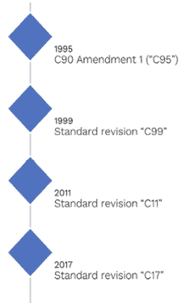
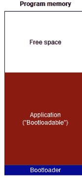

# 嵌入式专家的 C 指南：成为可靠嵌入式 C 专家的秘密


如果您喜欢这本书，请在 Amazon 上为 Chris 留下评论。

# 前言

这是前言，人人都会跳过。直接深入代码吧！毕竟你来这里不就是为此吗？过一两年，如果有兴趣，再回来看它。对于 C 语言，问题总是存在的，所以这里的评论明年依然适用。另一方面，你也可以现在就读。为了理解原因，以下是关于本书、C 语言和嵌入式系统的一些背景。

你可能会问：我们是否还需要另一本 C 语言编程书籍。确实有几个理由需要。然而，这不是一本关于“如何编写”的书籍——这类书籍已经太多了。它更多是一本关于“如何不编写 C 语言”的书籍，这一点非常重要。稍后将详细说明。

关于 C 语言，不变的一点是 C 语言一直在变化。1978 年出版的 Kernighan 和 Ritchie（K&R）最初的 C 语言书籍，其大小不到当前 C 标准的十分之一，大多数程序员都没有读过任何 C 标准。（你读过吗？）36 年前（或第一版 45 年前）K&R 第二版中的一些结构已经发生了变化，通常是悄无声息地变化，并且仍在变化。更糟糕的是，C 标准中的问题往往得不到修复，反而在其上不断堆砌新内容。

因此，C 程序员使用的是一种不断变化的语言，其行为可能与过去不同，也可能与程序员预期的不同。此外，许多、大多数，甚至可能所有（？）编译器都倾向于不完全实现 C 标准，或限制其中的部分内容，然后添加自己的扩展。关于 C 语言，几乎没有什么可以假设。我注意到，对于某个静态分析器，他们有超过 100 个不同的配置文件用于 C 编译器，以调整对每个编译器所使用的（不同）C 语言的检查。因此，出现了像 MISRA C 和 Barr C 这样严格定义的子集，试图突出问题区域。与 C 标准一样，MISRA C 在过去 25 年里也一直在扩展，以保持同步。在参与 ISO C 标准近三十年（包括 5 年担任英国召集人）以及自 20 世纪 90 年代中期以来参与 MISRA C 的经验后，我要说：“我不认识任何一个人能声称完全掌握 C 语言。”他们对某些部分了解较多，对其他部分了解较少。他们知道足够多，以便知道在标准中去哪里查找。不过，如前所述，你还需要编译器文档。所以，如果你遇到有人声称“懂 C”，那他一定是自欺欺人。我认识的任何真正专家都更有分寸，不会在没有几个保留意见的情况下说出这样的话。我似乎记得 Dennis Richie 说过，不会有 K&R 第三版，因为该语言已经远远超出了他开发的版本，他自己也不完全了解。

其次，大多数 C 语言书籍面向的是在 Windows 或 Linux 等通用操作系统上编写应用程序的人。为裸机或 RTOS 系统进行 C 语言编程是完全不同的游戏。这时你确实需要了解语言处理硬件的细微差别，以及硬件本身的陷阱。可能没有……嗯，桌面系统所期望的任何东西。此外，如上所述，C 语言存在许多变体，如作者在后续章节所示，许多是 C 标准允许的，但许多其他则是编译器扩展。因此，“懂 C”对于嵌入式开发人员来说是不够的，他们还需要了解硬件以及特定编译器如何处理它。这不仅仅是字节序问题。我们都知道有大端和小端，尽管我曾在一片芯片上工作过的 MCU 具有三种字节序！long 和 long 的存储问题会根据硬件工作方式而变得更加复杂。但你们都知道这一点，不是吗？同样，你们知道为什么永远不要使用 printf 进行调试。

因此，与大多数“学习 C 语言”的书籍不同，本书探讨了许多对嵌入式开发人员至关重要，而 Windows、Mac 和 Linux 上的桌面操作系统程序员从未遇到过，或者通常甚至不知道的事情。话虽如此，即使是桌面程序员也能从本书的大部分内容中学到很多。

我已经说过，这更多是一本关于如何不编写 C 语言的书，这一点非常重要。作者探讨了 C 语言中一些不太明显的陷阱以及如何避免它们。这就是如何不编写 C 语言的地方。为什么你不应该做那些事情，因为出于通常微妙的原因，它们可能不会按你预期的方式工作。在 K&R 或 C90/95 中可能曾经有效，但在 C99 中则不尽相同。在某些情况下，关于 register、volatile、constant 和 static 的都市传说，30 年前在一两个流行编译器上可能是真的，但现在根本不是。其他则从来都不是。当你开始研究这些事情时，你就会开始明白为什么 MISRA C 和 Barr C 存在。

2018 年，我与 Michael Barr 会面，讨论新的 MISRA C 和 Barr C 版本，以确保它们不冲突。Michael 进行大量咨询工作，他的 Barr C 源于在开发团队中反复看到相同的问题。三十年前的 1993-6 年，当英国汽车公司看到完全相同的问题时，他们开始了催生第一个 MISRA C 的工作。CERT C 的开发也是同样的方式，尽管结果与 MISRA 和 BARR 不同。当我参加由本书作者 Chris Rose 讲授的课程时，与会者提出的一些问题，正是过去 30 年来一直被问到的问题，通常是由编程多年的人提出的。

我惊讶地发现，第一个静态分析器（最初的 Lint）是由 K&R 团队的一部分人在 1976 年开发的，在语言开发完成之前，因为人们滥用合法但可疑的结构。是的，即使是 40 多年前的 K&R 也意识到程序员在滥用 C。编译通过并不能保证它是正确的，或者能按程序员的意图运行。

从许多方面来说，学习如何不编写 C 比学习如何编写 C 更重要。许多问题是由程序员做那些不按预期工作的事情引起的。另一件非常重要的事情是，虽然本书确实突出了许多领域（尽管不是我所知的 400 多个全部），但它并没有详细说明所有问题。大多数问题远远超出了像本书这样的范畴，但它确实指引你去哪里寻找答案。嵌入式系统的一个不变之处是它们各不相同，因此并非所有问题都适用于所有开发，即使你原则上应该了解它们。此外，如我所说，没有一个人是完全的专家。这就是为什么作者指引你去那些特定领域有专家的地方，而不是自己解释。

简而言之，学习如何不为嵌入式系统编写 C 语言。这将使你编写的 C 语言代码更加健壮可靠。然后代码甚至应该按你的意图运行，并且至关重要的是，不会做任何你不打算做的事情。

祝好运

克里斯·希尔斯


Phaedrus Systems. 塔姆沃思

2023 年 1 月


## 简介：
## 又一本 C 语言图书？

C 编程语言已存在近 50 年。《C 程序设计语言》是由 Brian Kernighan 和 Dennis Ritchie 编写的关于该语言的书籍，最初出版于 1978 年。此后，该书出了第二版（与首次尝试标准化该语言同时期），以及关于该主题的无数其他书籍。那么，再出一本书可能有什么理由呢？

答案是：虽然许多书籍承认 C 语言的诸多不足，但相对较少的书籍是以嵌入式程序员为对象编写的。它们是为那些为 PC、服务器和其他“通用”平台编写软件的人而写的。这有些令人惊讶，因为嵌入式应用是 C 语言继续占据主导地位的关键领域之一；在大多数其他场景中，更现代的编程语言往往更受青睐。

根据我的经验，以及我交谈过的许多其他人的经验，现代通用程序员严重缺乏编程嵌入式系统所需的装备。他们缺乏必要的硬件知识以及对微处理器实际工作原理的了解。在培训期间，他们有时会被告知诸如“硬件容易，软件困难”之类的谬误。本书专门以嵌入式系统为对象编写。

互联网已经彻底改变了计算机和更广泛的软件行业。最终用户现在普遍接受他们使用的软件将需要持续更新。这使得程序员对“bug”（导致软件表现异常的编码错误）变得自满，因为它们可以稍后简单地修正。与任何曾经编写过安全关键软件的人交谈，他们都会对这种态度感到绝望。如果你无法立即明白原因，问问自己：如果航空航天行业以定期为其控制软件发布更新而闻名，你乘坐飞机会感到多么舒适。连“bug”这个词也受到许多人的反感——它淡化了错误可能造成的毁灭性后果；更倾向于使用“缺陷”一词来强调其严重性。虽然并非总是不合适，但在嵌入式应用中，重复更新的循环往往不是一种选择。假设有持续的互联网连接（甚至是任何连接！）几乎算不上良好实践；更重要的是，在被检测到之前，单个缺陷就可能造成巨大损失。有缺陷软件的后果应该是任何程序员都必须了解的知识。更新对 Therac-25 的受害者无济于事，也未能拯救首飞。虽然后果可能并不总是如此严重，但还有无数其他案例，事后几乎没有或根本没有机会纠正缺陷。

你所使用的嵌入式系统可能并非安全关键型，但嵌入式软件与其通用 counterpart 仍有许多不同之处。例如，计算机程序员学习新语言时的传统第一项任务，是在屏幕上显示“Hello World”字样。在 C 语言中，如同大多数语言一样，一旦你发现了 printf 函数，这便是一项简单的任务。至少在考虑嵌入式……之前是这样。我经常使用只有数字显示器——或者根本没有显示器！的硬件。在不存在的显示器上显示文字有些无意义。即使对于确实包含显示器的嵌入式系统，也没有理由假设 printf 会向其写入任何内容（虽然，由于该函数是 C 标准库的一部分，它包含在每个符合标准的 C 中。在嵌入式软件中使用时，还有许多其他“标准”函数可能会表现出与预期行为不符的情况。

```
#include
/* A program to say hello, then exit. */
int main(void)
{
printf("Hello, world. \\n");
return
}
```

图 1.1 用 C 语言编写的经典“Hello, World”程序。

虽然没有哪本书能让你每次都编写完美、无缺陷的软件，或教你关于任何语言的一切，但本书至少会指出在使用 C 语言时，缺陷最可能出现的领域。关键的是，本书旨在提供实用的建议和指导，而不是编程理论论文。它还将帮助你培养更好的实践，使你的编程风格和态度本质上倾向于可靠性和安全性。不幸的是，在编写可靠、安全的软件方面，C 是一种特别有问题的语言。

鉴于 C 语言有据可查的诸多不足，你可能会质疑它为何能享有如此持久的成功。答案是 C 语言灵活，在大多数情况下可移植，且编译器通常能够生成高效的机器代码。C 编译器的广泛可用性也是一个主要因素；几乎每个当前使用的平台都有 C 编译器。在嵌入式应用中，C 语言的低级特性使其特别合适。缺乏广泛的运行时环境使得可以编写不需要任何底层系统支持的独立代码——这也是 C 语言作为开发操作系统的语言一直保持流行的原因。替代方案确实存在：Pascal 和 Ada 都曾在某个时期与 C 竞争；更近期，有建议称 Google 的 Go 语言可能会取代 C 成为首选的系统编程语言（就我个人而言，我持怀疑态度，但只有时间才能证明）。

## 嵌入式系统究竟是什么？

你可能已经对什么是嵌入式系统有自己的想法，但遗憾的是，并没有一个确定的示例来说明什么是嵌入式系统。这只是一个太过宽泛的类别，无法精确定义。该短语涵盖了绝大多数现代数字电子产品，从数字闹钟到航天器的飞行控制计算机。这包括电信技术、交通管理设备、计算机外围设备、医疗设备以及现代车辆中的电子系统。我一看到嵌入式系统就知道它是什么，而且它们无处不在。

问十几位工程师他们如何定义嵌入式系统，你可能会根据个人经验得到十几种不同的答案。有些人会向你保证嵌入式系统是“小”的，但这不一定是真的。其他人会向你保证它们很少或没有用户控制手段，同样，这也只是有时的情况。另外，说嵌入式系统不使用操作系统也是不正确的——它们经常使用，而且许多操作系统正是为此目的而开发的。然而，你听到的各种定义中经常会出现一些共同特征。很可能会提到明确定义的任务——嵌入式系统通常不打算作为通用工具；它们有一个要执行的特定功能列表。

通常需要低级硬件访问来与嵌入式系统中的各种元素进行交互，而没有为通用计算机编程时所获得的抽象便利。严格的时序要求和受限的资源是嵌入式系统的其他常见特征。处理这些约束需要与编程内存充裕且时序很少关键的系统不同的思维方式。最后，嵌入式系统可用于处理安全关键任务；最重要的是，这是将它们与其他系统区别对待的非常充分的理由。为安全关键型应用编写糟糕软件的后果不仅限于声誉受损或利润损失：人们可能会丧生。

嵌入式系统的范围和种类在不断演变。近年来，“物联网”已成为常见的讨论话题。构成这一新颖且定义松散的概念的大多数“事物”都是某种形式的嵌入式系统。这为每位嵌入式工程师的职责增加了另一个维度：信息安全。随着数据以越来越大的数量被传输和存储，而其中大部分数据是个人且可识别的，因此保护其收集和处理的方式免遭故意滥用和疏忽泄露至关重要。虽然糟糕软件的后果可能不如安全关键型系统中的后果那么立即严重，但泄露他人的信用卡详细信息或位置绝非无关紧要的错误。

虽然这可能有助于解释嵌入式编程与其他更通用风格的不同之处，但它并没有真正回答本节开头提出的看似简单的问题。不幸的是，在这方面我所能做的最好是提供一个普遍、模糊的定义：一个嵌入式


系统是作为更大系统一部分而执行专用功能的计算机。

## C 究竟是什么？

你已经知道 C 是一种编程语言（如果你不知道，我会非常惊讶你竟然会选择读这本书），但这只是部分描述。更完整的解释是，C 是一种通用的、过程式编程语言——它并不试图限制在该语言中可以编写的程序类型，每个程序都由称为函数的构建块组成。每个 C 程序至少有一个函数——几乎总是称为 main——但大多数程序不止一个；事实上，main 函数（或任何其他函数）中代码过多通常是软件编写不佳的迹象。从更实际的角度来看，在深入探讨如何使用 C 之前，有必要先澄清几个要点。

当我们提到 C 时，可能会给人一种我们在指代单一编程语言的印象。虽然这在一定程度上是正确的，但有必要意识到，标准化（ISO）C 的版本不少于五个（不包括修正案）：其中最新的（撰写本文时）是 C18（2018 版本）。你也可能会遇到 ANSI C，这是第一次尝试标准化。从实际角度来看，ANSI C（“C89”）和第一个版本的 ISO C（“C90”）是等价的。

除了 ANSI 和 ISO 版本之外，该语言在第一个发布的标准之前就已经存在；这个版本通常被称为“K&R C”，因为它是《C 程序设计语言》中使用的版本。但是，K&R C 不是标准，也不应被视为标准——不存在所谓的 K&R 编译器。（参见图 1.2）

- 1967 BCPL（影响了 B）
- 1969 B（影响了 C）Unix 引入
- 1972 C 引入
- 1973 Unix 内核用 C 重写
- 1979 《C 程序设计语言》（"K&R C"）
- 1989 ANSI C/"C89" 《C 程序设计语言》第 2 版
- 1990 ISO C/"C90"



图 1.2 C 语言历史上的关键时刻。

虽然该语言不同版本之间存在一定程度的兼容性，但这并不得到保证，当然也不应依赖。每个新版本都会添加新特性，而一些特性则被弃用。每当发布新版本的标准时，该语言的行为也可能会被澄清或改进。

你应该使用哪个版本的问题并不容易回答。编译器在实现标准最新版本时通常会滞后几年，而且许多编译器故意针对标准的早期版本，以此来保持兼容性。此外，几乎没有编译器真正忠实于标准；大多数厂商都会包含额外特性，而且许多厂商选择不完整实现标准。就嵌入式系统而言，你不太可能使用实现比 C99 更新内容的编译器，尽管可能会包含许多厂商特定的扩展来帮助解决常见问题。对于某些平台，你可能被限制在 C90 或 C95（更准确地说：C90，修正案 1）。你需要查看编译器文档以确认。在本书的大部分内容中，除非另有说明，否则默认使用 C99。每当未作进一步澄清地提到“C 标准”时，指的都是 1999 版本。

本书中大部分建议和指导都基于其他编码标准，特别是 MISRA C 和 Barr C。尽管它们适用于专业嵌入式编程，但在一般编程文献中，两者都未得到多少认可。MISRA C 是专门为帮助编写安全关键型 C 程序而制定的标准。Barr C 与此类似，它侧重于软件可靠性和安全性，并且与 MISRA C 规则不冲突。Barr C 可从 Barr Group 网站免费获取。获取 MISRA C 副本需要付费，但价格非常实惠，如果你参与编写任何高可靠性嵌入式软件，这笔投资是值得的。

## 本书使用的风格约定

与大多数编程书籍一样，本书在混合文本和代码时使用某些风格约定。关键字、函数和变量名以及代码片段都使用等宽字体编写。这样可以突出显示它们，以便轻松识别为代码片段；这也与开发环境的显示风格一致。偶尔，不重要的代码片段会被省略，并用占位符 ... 替换；出现此占位符的地方，你可以简单地假设它替换的代码是合法的 C 代码，并且与示例无关。

程序员之间存在一个（大多是无意义的）争论领域，并无特别充分的理由，即应该使用哪种大括号和缩进风格。在这个问题上有人持有强烈观点，这导致了诸如将一种风格称为“One True Bracing”以及一些程序员吹嘘“纠正”他人风格等荒谬之举。对这些事情变得狂热是没有意义的；存在多种风格，所有风格都能产生有效代码。就我个人而言，我更喜欢将大括号放在各自的行上，缩进级别与前面的（或后面的）代码相同，并在大括号之间增加缩进；这是我在本书示例中使用的风格。就我而言，你可以自由选择任何你喜欢的风格。如果你作为团队工作，请商定一种风格，然后让团队始终如一地使用它。归根结底，你使用的风格几乎无关紧要，但一致性很重要。

关于函数名和控制语句后括号的位置，争议较少，尽管有些人对此仍有强烈感受。为了完整起见，我在本书和我自己的代码中使用的风格是：在函数名后的左括号前不加空格，但在控制语句（例如 if

## 本书包含什么？

本书最初是一门名为“嵌入式系统 C 编程”的一天培训课程。该课程和本书都探讨了 C 语言的许多方面，特别侧重于嵌入式系统，尽管本书增加了课程中没有的一些额外材料。它假设你对该语言有一定程度的熟悉，并不是一本入门级书籍——本书无法帮助你学习 C 语言基础；已经有很多书籍和课程用于此目的，而学习的最佳方式是开始实验。

你可以选择从头到尾阅读本书，也可以只阅读你觉得特别有趣或有用的章节或部分。这个决定完全由你做出。无论如何，快速概述每一章的内容都是值得的：

- 第一章，“信任程序员”——C 语言的问题，将帮助你理解为什么 C 在安全编程方面名声如此糟糕。
- 第二章，编写更安全的 C，将介绍一系列技术和工具，你可以使用它们使软件更安全、更可靠，而不是依赖大量调试。
- 第三章，内存管理，提供了关于嵌入式系统内存维护的实用指导。它向你展示如何实现常见的内存管理技术，并帮助你决定何时适合使用它们。
- 第四章，中断和回调，将帮助你编写更好的中断服务例程，并理解由于程序流程变化而可能出现的问题和风险以及如何克服它们。
- 第五章，与硬件交互，描述了编写硬件驱动程序的最佳实践方法，并向你介绍在嵌入式系统中可能遇到的常见通信协议。


第六章，数据安全与完整性，侧重于许多现代系统的要求，其中保护通信免受窃听是一个严重问题。

第七章，C 预处理器，涉及 C 预处理器，它并非严格属于语言的一部分且常被忽视，但为了编写优秀软件，需要正确理解它。

第八章，理解翻译过程，对 C 程序编译时发生的情况以及在需要时如何操纵该过程进行了一些深入分析。

第九章，运行！运行！运行！– 优化软件，提供了一些关于如何以及何时优化软件的有用指导，并帮助你确定应集中精力的软件部分。

第十章，多任务，介绍了编写多任务软件所需的概念，并描述了编写基本任务调度器所需采取的步骤。

最后，第十一章，引导加载程序和操作系统，将帮助你为托管环境编写软件，在这些环境中，你通常需要牺牲对行为的部分控制，以换取许多管理功能由系统为你处理。

如果你读到这里，那么这本书很可能就是适合你的。剩下的就是祝你在培养成为嵌入式编程专家所需的技能方面好运。

克里斯·罗斯博士 (2023)

## 引言尾注

- 1 嵌入式软件工程师在某种程度上通过创建他们自己的“Hello World”程序等价物克服了这一问题——他们通常会编写一些简单代码来在开发板上闪烁 LED。此代码通常比标准的“Hello World”示例复杂得多。

- 2 许多嵌入式编译器使用它来提供某种形式的调试功能。

- 3 尽管两种语言之间存在相似之处，但 C 并非 C++ 的子集，尽管有时有人如此声称。它们是两种不同的语言，应当如此对待——尽管大多数 C 程序可以以能够与 C++ 编译器一起编译的方式编写，但生成的机器代码不保证与 C 编译器生成的代码在功能上等效。此外，代码编译方式存在重要差异。

- 4 这通常被称为“K&R 风格”——即《C 程序设计语言》和原始 UNIX 内核中使用的风格，尽管它从未被指定为官方首选风格，也从未如此；事实上，《C 程序设计语言》指出：“大括号的位置不太重要，尽管人们对此持有热烈的信念。我们选择了几种流行风格中的一种。选择适合你的风格，然后始终如一地使用它。”

- 5 这偶尔被称为“Allman 风格”或“BSD 风格”——它以 Eric Allman 命名，他在为 BSD 操作系统编写的许多实用程序代码中使用了该风格。

# 第 1 章：“信任程序员” – C 语言的问题

也许令人惊讶的是，似乎从未有人出版过一本关于“最伟大的 C 编程错误”的书。这可能是因为该主题有些小众；但对于其他 C 编程书籍来说，确实存在市场。也许是因为该语言被视为有些晦涩，即使在专业编程圈中也是如此：它在通用应用程序编程中基本上已被 Java 和 C# 取代，并且在 Web 应用程序中从未发挥过多大作用。在互联网时代，你可能会原谅自己认为 C 或多或少已经灭绝——一种过时的事物，因其不可否认的影响而引人好奇，而非其实用性；只不过是过于热衷的爱好者的玩物。

但 C 编程继续占据主导地位的两个领域是：操作系统和嵌入式编程。C 编译为高效的机器代码，并提供了许多现代编程语言所缺乏的灵活、低级特性。虽然完全有可能开发一种在技术层面能与 C 竞争的新语言，但要说服程序员在与“可移植汇编”结盟 50 年后转换阵营，却并不容易。对于嵌入式系统，拥有低级功能的同时又无需编写冗长乏味的汇编代码，这正是 C 如此吸引人的原因。操作系统也是如此。

但正是不受限制的低级功能、可移植性以及最重要的是“信任程序员”这一理念的结合，使 C 成为一种潜在危险的语言。就像负责为阿尔弗雷德·诺贝尔混合硝化甘油的人一样，C 程序员的工作最好是坐在一条腿的凳子上完成，以确保他们保持警觉。错误很容易发生，并且通常无法被程序员可用的默认工具检测到，从而在未来的某个任意时刻引发灾难。

对 C 编程语言的任何论述，如果不讨论其缺陷，都不算完整。在不首先对语言固有的危险形成敏锐认识的情况下，不可能成为一名优秀的 C 程序员。这正是本章旨在做到的。

## 未定义和未指定的行为

C 最受赞誉的特性之一是，它可以在广泛的平台上编译成高效的机器代码。编译器通常不会生成比实现程序员所要求的功能所需的代码更多的代码。如果程序员要求编译器生成代码来除以两个整数，编译器会生成该代码并力求使其高效——也就是说，生成的机器代码应尽可能快地运行。编译器不会做的是生成任何代码来检查操作是否可以执行或结果是否有意义。那么，当你要求生成的代码将一个整数除以零时会发生什么？

在 C#、Java 或你偏好的任何“现代”编程语言中尝试此操作，你可以期望抛出一个异常——你不需要自己编写检查，它们是语言的一部分。但在 C 中，你得到的是“未定义行为”——你无法在尝试运行代码之前知道会发生什么，也无法知道再次运行时是否会看到相同的结果。

未定义行为是语法正确但语义无意义的代码的结果，无论是固有的，还是因为你给它处理的数据。根据 C 标准，当你尝试执行“不可移植或错误的程序结构”或为有效程序提供“错误数据”时，会导致未定义行为。标准附录 J 中列出了近 200 种未定义行为。“未定义行为”这个名称很贴切：如果行为未定义，则 C 标准“不施加任何要求”——换句话说，你完全听凭编译器摆布，编译器有权假设未定义行为不会发生，并且在遇到未定义行为时可能生成也可能不生成有意义的机器代码。事实上，编译器甚至可能生成与程序员意图完全一致的代码。未定义行为有几大类：内存访问违规、有符号整数溢出、严格别名违规、无序修改、竞争条件和某些非终止循环。你将遇到的一些常见实例包括空指针解引用、越界数组访问和“类型 punning”。

```
/* Invalid operation:
 * The value stored in bad_int could be
 * anything. */
int apple = 0;
```

```
int bad_apple = 1 / good_int;
/* Out-of-bounds array access:
 * Array indexing starts at 0! */
```

```
char fruit_name[10];
fruit_name[10] = 'a';
/* Wild pointer dereferencing:
* Where does p_banana point? */
int * p_banana;
++(*p_banana);
```

图 1.1 这些示例可能都能在不产生任何错误的情况下编译，但它们在运行时都不会给出明确定义的结果。

整数除以零的示例是未定义行为的一个明确实例——它在数学上是无意义的。除法可以以多种不同的方式实现；C 标准没有指定应使用哪种方式，选择将决定尝试除以零时的行为。如果你正在编译的平台具有本地除法指令，可能会发生硬件异常；执行重复减法的天真算法可能会陷入无限循环。其他方法会产生其他行为，但没有一种会对其被要求求解的计算给出有意义的结果。

除以零是一个示例，在任何有用的程序中，它只能在运行时发生——一般来说，在编写或编译代码时都无法检测到问题。这对于未定义行为来说相当常见——它们通常不是由单一明确的代码行引起的。尽管如此，许多现代编译器在检测未定义行为发生的潜力方面相当出色。虽然这似乎是一件好事，但它们也非常擅长以自己的方式创造性地、悄悄地“解决”问题：通过优化。结果通常是一个不含……的中间程序


undefined behaviours as far as the C Standard is concerned, but with behaviour which does not match what the programmer intended.

Undefined behaviour should never be allowed to occur. This is much easier to state than it is to achieve, but it is critical that you take steps to avoid writing code that results in undefined behaviour. Later, we will explore tools and techniques that you can use to help you.

Slightly less serious, but still a concern, are unspecified behaviours. These arise in situations where the C Standard “provides two or more possibilities” and “imposes no further requirements on which is chosen.” The choice does not have to be documented; it is even possible (although unlikely) that the compiler may make a different choice for each instance of an unspecified behaviour. Many unspecified behaviours are not easily avoidable – for example, the order of evaluation of subexpressions is unspecified and if the programmer were to always ensure a specific ordering then the resulting code will often be both verbose and unnecessary; in most cases, it does not matter which of a group of subexpressions is evaluated first. This does not, however, mean you should not be concerned by unspecified behaviours. There are occasions where they can easily create serious issues: for instance, if a variable is modified in one subexpression and used in another, then the order of evaluation clearly is important; the behaviour is no longer simply unspecified, it is

Related to unspecified behaviours are implementation-defined behaviours. In this case, the compiler may implement the behaviour in a number of ways, but the choice must be documented; these behaviours are well-defined for a particular compiler but may behave differently when using an alternative compiler. These are essentially a special case of unspecified

It is almost impossible to write software that does not include some implementation-defined behaviour. For example, the size of integer types is implementation-defined, but it would be unrealistic to expect programmers not to use them. Other examples are best avoided: performing a right-shift on a negative integer is implementation-defined; in this instance it is better to write code to do what you intend, rather than relying on a particular compiler. In some cases, there are ways to assure yourself that the result of an implementation-defined behaviour is what you intend; some compilers will also allow you to manually determine some behaviours based on your needs – it is always worth checking the documentation for your compiler.

## 反直觉的语法

C is a programming language; it is neither a form of mathematical notation nor a natural language. It has its own syntax, which at times is counter-intuitive; indeed, there are examples of C syntax which almost seems intended to cause mistakes. Many operators and keywords are overloaded in ways that are easily misunderstood; others are easily mistyped. The precedence of some operators is inconsistent with their mathematical equivalents. It is possible to write statements in C that, although perfectly legal as far as the language is concerned, behave very differently to what would naturally be expected; because these statements are perfectly legal, the compiler may not even issue a warning when they are encountered and they can be difficult to track down, or even detect at all, once the code has been compiled. One common piece of advice commonly given to novice programmers is to make their intentions clear. The problem with this is that the compiler simply doesn’t care about the programmer’s intentions – it cares about how to interpret the lines of code it is given based on a list of very clear rules that may, or may not, be consistent with what the programmer thinks they are or should be.

One common cause of errors is confusion between the equality and assignment operators. This is particularly common in the controlling expressions for conditionals and loops. It is perfectly legal to perform an assignment in these statements and the behaviour is well-defined, although it is much more common to intend to perform a check for equality in these situations. Given the visual similarity between the operators and the ease of missing a sign, it is not surprising that this causes problems. This is such a common mistake that many compilers will issue a warning message even though there is no requirement for them to do so. Don’t be tempted to make use of this ‘feature’ in an attempt to reduce the number of lines of code you have to write – you will soon run into problems and even if you don’t, your code could quickly become unreadable and it won’t make any significant difference to the performance.

When comparing a variable to a constant value, it is helpful to write the constant on the left-hand-side of the operator; doing so ensures that a syntax error will occur if you mistakenly use the assignment rather than equality operator, since assigning a value to a constant is not allowed. I do this with all comparisons, even those that are not so easily mistyped. It can take a while to form a habit like that, but it can save hours of tedious debugging later.

Operator precedence is another area where mistakes are easy to make and where the compiler will give minimal, if any, help. Even when you think that the context of a statement makes it absolutely clear what it should do, the C Standard might see things very differently. For instance, the bitwise operators have a lower precedence than the equality operator, so, for instance, the statement x & 1 == 0 will never be. In other situations, it may be that the context of the statement appears to imply a certain behaviour, but this is not the same as the behaviour that is observed. As a stand-alone statement *p++; makes sense only if the pointer is dereferenced before the increment operation – the value pointed to is neither used nor changed if the increment is performed first, which means the indirection operator is not needed. But the increment operator has a higher precedence than the indirection operator and the statement is equivalent to. Any compiler will accept this statement, probably without issuing a warning, since it is perfectly legal C; even the most basic optimising compiler should remove the indirection operator before compiling, since the result is discarded anyway.

The solution is to use parentheses to force statements to be executed in the correct order any time you are in doubt – (*p)++; will always behave as the previous example was expected to. In most cases, the precedence of mathematical operators is as expected, so you can write most formulae out as normal (although parentheses that would usually be omitted can be useful for a completely different reason). Don’t bother trying to memorise the precedence rules for operators – it’s not that useful a piece of knowledge to have and being comfortable removing a few brackets won’t help other people reading your code.

The arithmetic operators may behave as expected, but this is not always true of the logical operators. This is because the logical operators in C use a method known as short-circuit or minimal evaluation: the second operand is only evaluated if necessary – if the first operand to an AND operator evaluates to false, or if the first operand to an OR operator evaluates to true, the second operand will not be evaluated. In the case of the conditional operator (often referred to as the ternary operator), the first operand is always evaluated and if it evaluates to true, only the second operand is evaluated, otherwise, only the third operand is evaluated. These three operators insert a sequence point into the code; unlike most other operators, the order of evaluation of the operands is well defined for these.

```
int apple = 1;
int pear = 3;
/* A pear will only be taken if you don't have
*an apple! */
if (apple || (--pear))
{
...;
}
/* You still have three pears... */
```

Fig 1.2 - Short circuit evaluation can change the result of conditional expressions. Despite the expression --pear appearing twice in the code, the final value of pear will be 2, not 1.

Short-circuit evaluation is often not a problem. It is even sometimes suggested that this is a helpful feature of the language: the first operand can be used to check a necessary condition before evaluating the second. I strongly caution against such reckless usage since it is easy to make mistakes and can make code difficult to read and correctly understand – make the checks explicit instead. Problems can arise if the second operand is intended to have side-effects since these will not occur if the operand is not evaluated.


与逻辑运算符一样，逗号运算符也会在操作数之间插入一个序列点；事实上，这正是该运算符的唯一目的。乍一看，这似乎很有用，因为它允许你在一定程度上控制子表达式的求值顺序，但这种额外的控制微乎其微，可能不值得麻烦：逗号可能是所有运算符中理解最差的一个，并且具有最低的优先级，这可能导致它以意想不到的方式行为。我遇到的最贴切的描述（来自一位匿名作者）是它“主要用于混淆”。它使代码难以阅读，很少使用，而且绝非必需。应完全避免使用。

虽然并非严格违反直觉，但在嵌套 if 语句时，else 语句的行为未必显而易见，并且可能出现所谓的“悬空 else”问题——一个后跟嵌套 if 语句并再后跟 else 语句的 if 语句应如何解释？else 语句应该与第一个 if 语句还是第二个 if 语句关联？

```
/* Will the ‘else’ path run? */
bool has_apples = false;
bool has_pears = true;
if (has_apples)
if (has_pears)
...
else
...;
```

图 1.3 - “悬空 else”语句必定会引起混淆——即使对于熟悉该语言规则的人来说，乍看也可能令人困惑。更糟的是——无法知道程序员的意图！

这对编译器来说不是问题：在实践中，else 语句总是与最近的 if 配对。问题在于程序员意图的歧义性。没有额外信息，无法判断观察到的行为是否是预期的行为。消除这种歧义的简单方法是：始终将 if 或 else 语句控制的代码用花括号括起来，即使它只包含一条语句。这不仅消除了与悬空 else 相关的歧义，还能减少许多其他常见错误发生的可能性。事实上，此建议不仅适用于 if 语句，也适用于循环。添加花括号不会对代码性能产生负面影响。它会降低可避免错误潜入的可能性，并减少日后被误解的风险。

## 类型安全

C 要求所有变量在声明时都有类型。然而，这并不使语言类型安全。事实上，该语言在类型安全方面的声誉相当差。C 类型系统的许多方面未指定，语言的多个特性本质上是类型不安全的，并且只要稍加了解，就可以完全绕过类型系统。考虑到 C 作为汇编语言替代品的起源，这并不奇怪；以类型安全的方式提供 C 的低级特性将是极其困难的。除了可能产生的明显语义歧义之外，违反类型系统还可能导致其他软件安全问题：例如，将指向 char 的指针视为指向 int 的指针，可能导致访问未分配或分配给其他变量的内存。

在讨论具体的类型安全问题之前，值得提及 typedef 关键字。虽然 typedef 很有用，并且你应该在适当的时候使用它们，但不要因此产生虚假的安全感——使用 typedef 为现有类型创建别名，而不创建新类型。在评估变量类型时，C 将别名视为与底层类型以及该类型的任何其他别名可互换。使用 typedef 可能使理解和调试代码更容易，但它不会帮助编译器替你发现错误。

某些类型安全问题相当微妙，例如混合不同整数类型的规则。在对整数类型进行操作时，C 标准（自 C99 起）规定：“如果 int 可以表示原始类型的所有值，则该值转换为 int；否则转换为 unsigned int。”这被称为整数提升，并可能导致一些意外行为。例如，无法直接将 int 与 unsigned int 进行比较；如果要求执行此类操作，编译器会先对 int 进行类型转换，以便比较两个无符号值。如果两个值都是正数，这不应造成任何问题。但如果有符号值最初是负数呢？

从 int 到 unsigned int 的转换是明确定义的。在使用二进制补码表示有符号数的平台上（这是最常见的表示方式），有符号值的位模式因此所有负有符号值都被转换为可用范围上半部分的正无符号值——结果是，负有符号值可能大于正无符号值！显然，此结果在数学上是荒谬的，但它是 C 标准规定的结果。整数提升规则也适用于 short 和 char 类型——但这些类型始终会被转换为（有符号）int。这可能造成更多混淆——将负有符号 char 与具有相同底层位模式的无符号 char 进行比较会显示两者不相等，这在数学上是正确的，但表明你甚至不能依赖位保持不变！

这里的教训是，不要混合使用有符号和无符号类型——这只会给你带来麻烦。如果你绝对必须这样做，那么请显式进行类型转换，而不是依赖整数提升规则导致的隐式转换。

```
int oranges = -1;
unsigned int stop = 1;
/* Integer promotion causes odd behaviour:
 * This loop will never run! */
while (oranges < stop)
{
++oranges;
...;
}
```

图 1.4 - 整数提升可能导致非常奇怪的行为——不同大小的整数类型之间，或相同大小的有符号和无符号类型之间的比较，可能会产生奇怪的结果——例如导致循环意外终止（或根本不运行）。

类型安全违规的不那么微妙的例子也经常发生；许多是指针赋予程序员的灵活性的结果。这可能是最明显的示例是类型擂台，即将指向一种类型的指针转换为指向另一种类型的指针。虽然在许多情况下这严格来说是未定义行为，但这是一种如此常见的做法，以至于许多编译器都会允许它。即使编译器阻止直接转换，C 标准也允许将任何指针转换为指向 void 的指针，并将指向 void 的指针转换为指向任何其他类型的指针。

类型擂台的另一种方法是写入一种类型的联合体成员，随后从另一种类型的成员读取数据。根据 C 标准，这也会导致未定义行为，但这是另一种大多数编译器都会允许的普遍做法。类型擂台有时是必要的，但可用方法的问题在于它们依赖于多个实现定义和未指定的行为，因此远不能保证按预期行为。此外，使用这些方法，你可以完全绕过类型系统。当你确实需要使用类型擂台时，可以采取一些措施使其更安全；我们将在后面探讨这些措施。

任何返回指向 void 的指针的函数（以及几乎所有在调用时期望接收此类指针的函数）都会暴露类型安全风险，包括 C 标准库中的函数。应谨慎使用此类函数。C 标准库中的显著示例包括 malloc、calloc 和 realloc——因此，C 中的动态内存分配不是类型安全的。

## 内存安全

C 没有内置机制来确保内存安全，而违规行为可能是严重编程错误最常见的来源。无数错误和安全漏洞都是由内存安全违规引起的。2014 年首次公开披露的 OpenSSL 库中臭名昭著的“心脏出血”（Heartbleed）漏洞是由缓冲区过度读取错误引起的。2018 年，在多个 Apple 操作系统的内核中发现了缓冲区溢出漏洞。2019 年 5 月，有报道称 Facebook 流行的消息应用程序 WhatsApp 存在内存安全漏洞。托尼·霍尔爵士（1965 年首个提出使用空引用作为保护内存手段的人）后来将他的发明描述为“我的十亿美元错误”。

在 C 中，指针是许多内存安全违规的原因。作为 C 唯一的原生引用类型，程序员别无选择，只能使用它们，尽管与之相关的风险已有详细记录。两个特性使得强制执行内存安全尤其困难：对指针执行任意算术运算的能力，以及缺乏作为内置功能的数组边界检查。

在 C 中，完全可以将任意地址赋给指针——事实上，在声明指针时，大多数情况下就会发生这种情况（声明仅为指针分配空间——而不为其指向的内容分配空间）。此类指针被称为“野指针”。或者，指针可能引用一个已超出作用域的变量（即不再应可访问）。在这种情况下，该指针被称为“悬空指针”。解引用野指针或悬空指针都是未定义行为，解引用空指针也是如此。

野指针问题可以通过在声明指针时始终显式赋值（即使值为空）来在很大程度上缓解（没有通用方法来验证指针是否为野指针，


但至少可以检查空指针）。虽然并非完全可靠，但大多数悬空指针可以通过避免动态内存分配来消除。最后，如果无法保证指针不是空指针，则在解引用前进行检查。

```
/* Get a reference to an apple. */
char * get_fruit(void)
{
char fruit[] = "apple";
return &fruit[0];
}
```

图 1.5 - 你没有理由故意这样做，但如果你非常执意，你总是可以以“艰难的方式”创建一个悬空指针：从函数中返回指向栈分配变量的指针。

动态（堆）内存分配在嵌入式系统中通常被视为不良实践。这一点在前一节中已有暗示，当时提到了缺乏类型安全，此外，上文还提到了悬空指针的问题。动态分配的另一个主要问题是内存碎片化——也就是说，随着内存部分被分配和释放，可能会有大量空闲空间，但由于不连续而不适合进一步分配。当空间相对有限时（如大多数嵌入式系统的情况），即使空间看似可用，反复的动态分配也会迅速耗尽它。稍后，我们将探讨一些替代方案，这些方案可以以更可靠的方式提供类似堆的分配。目前，最好接受诸如 malloc 之类的函数不应使用，无论你过去觉得它们多么有用。

## C 中没有运行时检查！

C 的吸引力之一在于它通常能编译成高效的机器码；这在一定程度上是因为没有任何显著的运行时环境及其相关的软件开销。其缺点是，不会执行运行时检查来防止有问题的代码被执行——即使是对常见错误的检查也不会执行。虽然在托管环境中，某些代码会触发操作系统干预，但这通常非常有限，而且即使发生，操作系统通常也只能终止程序，无能为力。对于独立程序，没有操作系统可以干预。在最严重的错误情况下，硬件可能表现得不可预测、无响应，或者在某些情况下强制重置（这或许是可能的响应中最不麻烦的一种！）。由于两种情况的结果都不可取，程序员显然有动机在代码中包含任何必要的运行时检查。

例如，不会生成代码来防止空指针解引用或除以零。也不会生成代码来防止整数溢出或其他众多潜在问题。你可能希望利用整数溢出行为，但如果你不希望这样，防止它是你的责任，而不是编译器的责任。

更糟糕的是，编译时进行的检查非常少，因此许多有问题的代码甚至不会伴随任何提示。如果程序在语法上是有效的 C 代码，那么它很有可能会被编译，即使它包含多个未定义行为的实例。

正如我们已经看到的，C 标准允许，在某些情况下甚至要求一些看似奇怪的行为。

## 第 1 章尾注 - 信任程序员

- 1 C 是一种可移植汇编语言的观点已经存在相当长一段时间；虽然没有明确说明，但在《C 程序设计语言》第一版的引言中已有暗示。
- 2 “信任程序员”哲学继承自 C 的前身语言之一 BCPL。《BCPL：语言及其编译器》对此进行了阐述：“BCPL 的哲学不是暴君的哲学，暴君自以为知道最好，并规定什么是允许的、什么是不允许的；相反，BCPL 更像是一个仆人，尽其所能提供服务而不抱怨，即使面对明显的荒谬也是如此。程序员总是被假定知道自己在做什么，不会被琐碎的限制所束缚。” 也许在汇编语言仍占主导地位的时代，这种哲学并不算糟糕；但今天它几乎无法辩护。
- 3 粗略地说，自 C11 以来，没有副作用的无限循环会导致未定义行为。解释这一点的实际规则有些冗长且微妙。这可能会引起问题，因为有时这些循环非常有用！
- 4 顺便说一句，浮点除以零操作通常是允许的，通常会导致正无穷或负无穷。这并不是因为使用浮点算法时该操作更有意义；相反，这是 IEEE 754 中包含的一个特性，作为追踪计算过程中错误的辅助。
- 5 具体来说，这是一个未排序修改的示例。
- 6 编译器处理未指定行为的方式不必进行文档化。
- 7 对负整数进行左移（但不是对正有符号整数）是未定义行为。完全避免麻烦，仅对无符号类型使用位移（左移或右移）。
- 8 尽管我之前有过规定，但我还是选择在这个示例中将常量放在右边，因为 0 == x & 1 可以为真，这只会使讨论进一步复杂化。我本可以写 0 == 1 & x，但那样看起来就像是我故意在写难以阅读的东西！这个特定的示例是由于 C 最初没有不同的逻辑运算符——位运算符被用来代替它们，而且逻辑运算符的优先级低于相等运算符确实有些道理。当逻辑运算符引入时，位运算符的优先级没有更改，目的是为了与“几百千字节的源代码和也许 3 个安装”保持兼容。（Dennis Ritchie, net.lang.c Newsgroup, October 1982）。
- 9 虽然这种行为实际上并非由语言语法规定，而语法对此存在歧义。
- 10 其他语言，例如 Ada，试图在防止 C 中出现的类型安全问题的同时仍提供低级功能，但在这方面仍然存在困难；通常的解决方案是在有限的上下文中提供禁用类型检查的机制。
- 11 C 标准以这种方式定义强制类型转换，使得结果与所使用的有符号数表示无关。
- 12 在某些情况下，即使是手动数组边界检查也是不可能的。尝试实现这样的检查是不可靠的；在最坏的情况下，可能会导致未定义行为。
- 13 早期的 C 编译器不包含语义检查；它需要太多内存且运行时间太长。相反，创建了一个名为 'lint' 的可选独立工具，以便在程序员认为有必要时提供帮助。现在有许多此类工具可用，但使用范围远不如应有的那么广泛。许多程序员不知道它们的存在，许多其他人则看不到它们的价值。

# 第 2 章：编写更安全的 C 代码

在探讨了 C 之所以被认为是不安全编程语言的一些原因之后，寻找使其更安全、更可靠的方法似乎是合理的。这当然是可以做到的，在本章中，我打算概述一些你可以使用的技术；但与任何事情一样，这是一个需要实践的过程，并且需要始终如一地应用这些技术。在继续之前，重要的是要认识到，几乎没有程序员能真正声称自己是 C 专家。不要陷入这样的陷阱：认为这本书或其他任何书籍提供了编写完美 C 代码的权威指南；这样的指南根本不存在。

假设的 C 指南必然会包含比“做”语句多得多的“不要”语句。C 标准中大量的未定义行为、未指定行为和实现定义行为，以及经常存疑的语法，使得几乎不可能在不使用语言所有功能的同时不在某个时刻掉进陷阱。这可以简洁地总结为：虽然没有一种正确的编写 C 代码的方式，但有许多错误的方式。“好代码”不仅仅是能运行的代码——它是可以被理解和维护的代码，并且理想情况下可以以最小的更改从一个系统移植到另一个系统。当然，有很多事情你应该做：例如，每个变量在使用前都应该初始化，因为编译器不对其初始值做出任何保证。


除此之外，你可以采取一些步骤来编写可被视为优秀的代码，而其中许多步骤与构成代码的实际语句和表达式关系不大。首先也是最重要的是，遵循编码标准。

## 编码标准

编码标准，在其最基本的形式中，是一份在编程时应遵循的一系列规则的文档。这些规则应涵盖语言的样式和技术用法。就样式而言，虽然你使用哪种样式通常并不太重要，但一致性很重要。例如，反复更改你使用的大括号样式会降低代码的可读性。技术规则用于概述语言使用的要求。这些可能包括对可使用的标准库函数、类型和关键字的限制（例如，使用 goto 关键字通常被强烈不鼓励）。在大多数情况下，你使用哪个编码标准并不太重要；选择一个，学习规则并坚持下去。花时间理解规则也同样重要——盲目遵守任何标准，无论多么彻底，都无法帮助你编写优秀的代码。

遵循良好的编码标准将帮助你减少代码中的缺陷数量，并编写易于理解和维护的代码。有些编码标准比其他标准好得多——许多标准只不过是基于作者个人偏好的规则陈述。如果一个编码标准不包含对其所含规则的至少一些客观理由，你可能应该寻找另一个。当然，你可以编写自己的标准，但请务必不要陷入仅列出自己样式偏好的陷阱。理想情况下，还应能够使用自动化工具强制执行任何编码标准中的规则。

如果你在寻找合适的标准时感到困难，并且不想编写自己的标准，那么 BARR C 编码标准是一个很好的起点；这些规则专门旨在减少编码缺陷，并包含解释性注释。如果你正在处理安全关键系统（代码缺陷可能导致受伤甚至死亡），那么我强烈建议你遵循 MISRA C 中的指南，尽管你还需要找到（或编写）一份单独的样式指南来配合它。没有任何标准可以被期望完全消除缺陷，但 BARR C 和 MISRA C 都是为了帮助程序员安全地导航 C 中更危险的方面而编写的。

## 空白字符

在 C 程序中，你会遇到三种不同的空白字符：换行符、缩进和单个空格。在大多数情况下，空白字符的存在（或不存在）不会影响 C 程序的标记化。虽然有少数例外情况，但更重要的是，即使根据 C 标准标记化有明确定义，从程序员的角度来看，代码也可能难以阅读甚至产生歧义。解决方案是使用空白字符来明确你的意图。编译器会忽略额外的空白字符，在源代码存储和编译时间方面，其带来的开销可以忽略不计。这样做还能成功防止因空白字符确实改变代码标记化的情况而引发的问题。

在 C 中，语句以分号结束；从编译器的角度来看，不需要在其后跟换行符。在单行上编写多个语句是完全有效的 C 代码，但这很快会变得难以阅读，因此语句应各自单独占一行。也可以将单个语句分布在多行上，这对于异常长的语句很有用，但将语句拆分为多个较小的语句可能更好，以确保含义清晰。换行符对于对功能相关的语句进行分组也很有用；例如，你可能在一系列变量声明后添加一个额外的换行符。条件和循环语句块周围的额外换行符也有助于突出显示这些块的开始和结束。

```
/* Space following conceptual blocks is good for
 * readability. */
int apples;
int pears;
int times = 2;
int all_fruit;
/* Everything's defined - now do something. */
apples = fetch_apples();
pears = fetch_pears();
/* Splitting compound statements helps too. */
all_fruit = apples + pears;
all_fruit *= times;
/* This could have been:

 * all_fruit = (apples + pears) * times; */
```

图 2.1 “不必要的”空白字符可以被删除，但这些空白字符使源代码更易读。

预处理语句中的换行符会导致不同的行为：这些语句由换行符而非分号结束，因此，在这样的语句中需要换行符的地方，换行符应紧跟在一个反斜杠之后。虽然这在代码的任何位置都是有效的，但它最常出现在多语句宏定义中，这允许宏以与代码其余部分相似的样式编写。

```
/* Newlines do nothing in C statements:
 * This is a single statement. */
all_fruit =
apples + pears;
/* But newlines terminate preprocessor statements:
 * This won't work: */
#define MORE_APPLES apples +
1
```

图 2.2 - 普通 C 语句不需要换行符 – 但会导致预处理语句结束。

在大多数编程语言中，使用缩进（在某些情况下是必要的）来划分代码块是惯例。在 C 中，缩进本身不会改变代码的行为，因为块是使用大括号打开和关闭的。缩进纯粹是为了程序员着想——尽管如此，它是一个有用的视觉指示器，允许你立即识别相关的代码行。当然，这假设缩进是正确的。这不再像过去那样是个问题，因为有可正确对齐代码的格式化工具，并且大多数 IDE 在你输入时可以确定适当的缩进级别。通常建议使用单个空格来创建缩进，而不是制表符；不过，大多数现代 IDE 也会处理此问题，它们会将制表符编码为预定数量的空格，而不是单个制表符字符。此建议的原因是制表符的宽度可能因系统而异，甚至在同一系统的不同程序之间也可能不同，而一系列空格的宽度是一致的，并且制表符是否编码为空格取决于编辑器。虽然这对代码行为没有影响，但可能导致一些看起来奇怪的代码。缩进推荐的空格数因编码标准和 IDE 而异，但通常在两到八之间（许多 IDE 会在某个地方提供配置选项）。

缩进也可用于提高预处理块的可读性。虽然惯例是位于预处理指令前的 # 应位于行首，但其后可以跟随空白字符而不改变随后指令的含义；这在使用条件宏定义或 #if 块中的其他指令时，与代码块内缩进有用的方式相同。

```
/* Indentation of preprocessor directives is
 * allowed - but the ‘#’ may still be placed at
 * the start of the line. */
#if defined(APPLES)
## #define PEARS
#endif
```

图 2.3 #if 块内预处理指令的缩进——在指令前添加缩进很少有其他理由。

最常见且最重要的空白字符类型是普通的空格字符。这是最可能改变程序行为的字符。使用空格的主要原因是使代码更易读，但是，在少数情况下，缺乏间距会导致代码的非预期标记化。C 的标记化规则规定，当标记化存在歧义时，编译器应从左到右，使用尽可能多的字符来构建标记，而不考虑上下文——这通常被称为“最大匹配”规则。这意味着，例如，语句 x++++++y; 永远不会编译；即使 x+++ ++y; 可能是一个完全有效的语句，该序列也始终会被解释为 x+++ ++，这是无效的。此标记化规则可能导致一系列微妙的问题；例如，语句 *z = *x/*y; 可能导致编译失败，或者（更糟的是）可能导致输出一个完全意外的程序。

语句 a=-b; 也可能导致奇怪的行为——在早期的 C 实现中，=- 和 += 并非被视为两个独立的标记，而是各自被视为一个单一标记，其目的与更常见且无歧义的 -= 和 += 复合赋值运算符相同；虽然这早已更改，但一些编译器在一段时间内继续以这种方式解释它们（你不太可能在使用它们中的任何一个，但如果你正在使用，你可能会花很长时间来解决它引起的问题）。解决方案是使用空白字符来使标记无歧义。这不仅可以防止编译器误解代码，还能使代码更易读。

我倾向于遵循 Barr C 中规定的空白字符规则，特别是针对运算符。对于赋值、算术、逻辑和按位运算符，这意味着运算符和操作数之间通常应有空格。例外是一元运算符，它们编写时不使用


a space to separate them from the operand. The pointer indirection and address operators should be written without a space before the operand, although within a declaration, a space is

## 命名规范

Choosing meaningful function and variable names is an important part of writing code that can be easily understood and reviewed. Many programmers use abbreviations or truncations, which, although seemingly logical at the time, are easily misunderstood later. Furthermore, it is common to use single character names for generic variables, such as loop counters. Although such habits are widespread, they are unhelpful and usually unnecessary.

Rather than using the variable name i for a loop counter, for instance, a more descriptive variable name such as count or index can be used; there is no performance cost in doing so and such names add some context that can make your intentions clear. Meaningful names, even for “trivial” variables, are also easier to read when reviewing code – when rapidly skimming, it is easy to confuse statements such as var = i; and var = as well as being difficult to know at a glance which was actually intended. Symbol names may be up to 31 characters long, so it is rarely necessary to significantly shorten them. Rather than worrying about keeping names short, worry about not allowing them to be too short – a lower limit of three characters is a reasonable choice; it is short enough to allow simple names for generic variables, but long enough that it forces you to put some thought into them.

There will be times when it is useful to identify certain special characteristics of a variable. The most common examples are pointers and globals. This can be achieved by prefixing the name with p_ for a pointer, g_ for a global or potentially both: e.g. g_p_ for a global pointer. Although other methods are sometimes used, I particularly like this one because it is efficient and easily expanded – for instance, a pointer to a pointer can be identified by prefixing the name with pp_. The prefix h_ can be used for

Although it is not recommended for most types, there are occasions when you may wish to be able to tell the type of variable from its name. This is most common with floating point types, since these need to be treated differently to integers. A simple way to do this is to use _f as a suffix to the name (or _d for a double if you need to differentiate them). Similarly, you may use _b to identify a Boolean type. Related to this is the naming of custom types themselves; it is common to see _t used to identify a type and occasionally you may also see _u used to identify structures and unions, respectively. This is useful for two reasons: first, it makes it clear that the unfamiliar symbol is a type, not a variable name; second, it allows the instance to have a similar name to the type if desired, e.g., declarations such as adc_register_t adc_register; are relatively common.

Like variables, functions should have meaningful names. It is useful for a function name to give some indication of what the function does and what it does it to – many functions will necessarily have similar names; you may have functions to read analogue and digital inputs, for instance; since the names cannot be identical, identifying the type of input being read is a good way to distinguish them from each other. It's a good idea, therefore, to begin each function name with an indication of the module to which it belongs – you might choose to name the analogue and digital read functions adc_read and digital_read respectively rather than the more ambiguous sample input and

As with variables, there are some functions which should have names that make them quickly identifiable; interrupt service routines and callbacks being the most likely examples you will come across. The easiest way to highlight these is to use an appropriate suffix with the name: _isr for interrupt service routines or _cb for callbacks, for instance. Similarly, a suffix such as _thread or _task can be used for the entry functions of threads in multitasking software to highlight these functions as having a role similar to the main function used in most C programs.

It is almost universal for C variable and function names to be lowercase, with words separated by underscores – a style which is sometimes referred to as snake case. There is no actual requirement for this in the C Standard, although I recommend that you follow it simply because it is so widely used. To differentiate macros (both function-like and object-like) from variables and functions, these are generally written in uppercase, again using underscores as a separator. You will occasionally see type names capitalised as well – the FILE type in the C Standard Library is one

## 注释实践

All formal training for programmers will include encouraging them to include comments in their code. Unfortunately, many programmers quickly slip into the habit of ignoring this advice or attempt to add comments once the code has been written. Alternatively, they may include comments with little thought as to whether those comments are helpful or not. The most useful comments avoid stating the obvious, while providing information about what the code is supposed to do – comments should explain and give an overview of how the code works, rather than explaining exactly what is being done step-by-step. The occasional why comment is also justified to highlight parts of code that may need some special consideration; for instance, if a piece of code relies upon the wrap-around behaviour of unsigned integers, this should be stated somewhere. Comments should also be clear. Clarity is more easily achieved when you write comments as full sentences, rather than the rushed shorthand that is often seen. It is also perfectly acceptable to reference other sources and documents where appropriate to avoid excessively verbose comments while ensuring all relevant information is accessible.

Comments should not be written retrospectively – the only time this is acceptable is during code reviews when it becomes apparent that a comment is needed. It is helpful to write some comments before any code is written – these then provide an outline of what the code will do and help you structure the program. Such comments should appear before each function within a source file explaining what the function does, what arguments it expects and what value it should return. Other comments should be written as you go to explain parts of the code that are not sufficiently clear enough on their own. Additional comments should be added whenever a query is raised about a piece of code. Including comments at the earliest possible stage makes the process of accurately documenting the code much easier and more reliable – you will quickly forget what you were doing when you wrote the code and trying to decipher it later is simply creating work for yourself.

There are tools available to help you document code using the comments. Doxygen is one such tool and can export the documentation to HTML and PDF files (as well as other formats). Such tools will require comments to be written using their own syntax, but this is a small inconvenience compared to preparing separate documentation to accompany every library you write and ensures that the documentation version corresponds to the source version it was generated from.

## 全局变量

Using global variables is a practice that is almost universally frowned upon, although it is sometimes unavoidable. There are several reasons for this. First, there is the problem of name clashes in C – it is legal for a global and local variable to share a name in C; when this occurs, the local variable will be preferred to the global one. This is at best confusing and it would be far better for the name clash to result in an error. This can be overcome by strictly adhering to proper naming conventions. However, this does not help solve the wider problem of global variables – since they can be changed from anywhere in the code, read and write operations need to be performed with special care. They can also cause problems for optimising compilers, which may make incorrect assumptions about when the variable will be modified.

```
/* This is a valid C program - but which bunch
 * of bananas controls the loop? */
```


```
int bananas = 10;
int main(void)

{
int bananas = 0;
while (0 < bananas)
{
--bananas;
...;
}
return 0;
}
```

图 2.4 允许为全局变量和局部变量使用相同的名称——但这肯定会给任何试图理解代码的人造成混淆。

尽可能优先使用全局变量的替代方案。

当数据必须在函数之间共享时，应优先在函数参数中使用指向数据的指针。这并非总是可行，尤其是在使用中断服务例程和回调函数时。如果可能，应将全局变量限定为 static，以将其可见性限制在当前模块内。同时，最好还将其限定为 volatile 或 const——前者可防止编译器对数据值何时可能改变做出假设，而后者适用于应将数据视为

## 指针

指针是存储内存中另一位置地址的变量。它们通常被称为引用类型，是 C 语言原生提供的唯一此类类型——其他编程语言中常见的许多引用类型比指针要全面得多。由于指针的值是一个地址，因此它所指向对象的类型不会影响其大小——所有指针在内存中占用相同的空间。此外，所指向的地址可以是任意的，这也是指针成为 C 程序中严重缺陷最常见来源的主要原因。

要使指针有用，它必须指向某个对象，尽管像 uint32_t * const p_cpu_reg = (int *) 0x1000; 这样的定义是有效的（且偶尔需要），但该对象通常是另一个变量，尽管也可以是函数。void 指针在某种程度上是泛型指针——它们可以指向任何类型，但在先转换为指向其他类型的指针之前不能解引用，因为无法知道如何处理数据。C 标准保证，指向任何类型的指针可以转换为 void 指针，并可转回而不丢失信息；但是，转换为除原始类型或 char 以外的类型的指针是未定义行为。还存在空指针（名为 NULL，通常定义为类似 (void *) 0 的内容），旨在帮助识别无效指针；解引用空指针是未定义行为，但这并不意味着不能这样做——它实际上可能是一个有效地址，即使它不是你应该

指针的一个常见用途是在函数调用中实现按引用传递行为；即向函数传递对变量的引用，而不是传递变量的值（后者必然涉及复制变量）。默认情况下，数组以这种方式传递给函数，但其他类型则不是。按引用传递在处理复合变量时最有用，因为它可以显著降低传递整个变量所带来的开销。调用者实际上不需要知道被引用变量的地址以外的任何信息，这一事实可以用来在代码模块的底层实现与用于将其与其他代码集成的接口之间创建额外的抽象层。

函数指针可用于实现回调函数，并简化基于运行时可用数据选择要调用的函数所需的代码。就大多数目的而言，函数指针与其他任何类型的指针并无不同。初次遇到时，其语法可能令人生畏：int (* p_func)(int); 声明一个指向返回 int 并接受 int 作为参数的函数的指针；char (* p_func)(char *); 声明一个指向接受 char * 类型参数并返回 char 的函数的指针。通常使用 typedef 来简化函数指针的声明。语句 typedef void (* callback)(arg_t); 定义一个名为 callback 的类型，可用于简化未来针对接受 arg_t 类型参数且不返回值的函数指针的变量定义。从函数指针调用函数遵循与其他函数调用相同的语法；在调用它引用的函数之前，无需显式解引用指针。

## 整数类型

在 C 语言中，基本整数类型为 short、int、long 以及（自 C99 起）long long。long 和 long long 名称中的 int 部分是可选的。所有类型前都可以加上 signed 或 unsigned 修饰符——默认情况下，所有整数类型都是有符号的，char 除外，char 可能是有符号的也可能是无符号的，具体取决于实现。未修饰的 char 类型被称为普通 char 类型，仅应用于存储字符。

C 标准未指定任何整数类型的实际位宽。相反，它指定了最小取值范围，实现可以根据需要允许更大的范围。标准也未指定有符号值的表示形式——尽管二进制补码表示法现在几乎是通用的，但允许使用其他表示形式。为满足对已知大小整数的需求，C99 引入了固定宽度整数类型，这些类型位于 stdint.h 头文件中。这大大降低了编写可移植代码的复杂性，并鼓励在大小重要的任何类型中使用这些类型。使用固定宽度整数时，无需使用 long 或 long long 类型——int 对于精确宽度无关紧要的变量可能仍然有用。

## 浮点数注意事项

浮点变量扩展了可使用的数值范围，但需要一些特殊处理。重要的是要记住，这些值的行为与整数或定点数不同。首先，浮点值的绝对精度随其数值大小而变化，因此虽然 1.0 具有精确的浮点表示，但将其与其他浮点数相加或相减可能不会产生预期结果。此外，由于浮点数通常使用十进制表示法编写，很容易忘记它们在内存中存储时仍然是二进制数——尽管你可以编写看似将 0.1 赋值给浮点变量的代码，但实际存储的数字会不同（0.1 无法精确表示为浮点数），看似微不足道的计算也不一定会产生预期结果。

IEEE 754 是迄今为止实现最广泛的浮点标准，还包含用于表示无穷大和非数字（NaN）值的特殊值；这些值被纳入标准，以便无效操作或导致溢出的操作可以以不返回未定义结果的方式进行处理，但也不一定会导致硬件或软件异常。然而，在嵌入式系统中，通常无法对这些特殊值做任何有用的事情，并且在执行计算时检查它们是否被返回非常重要，因为它们通常指示底层逻辑或运行时可用数据中存在错误。

浮点算术的实现技术细节对其使用方式施加了限制。对浮点变量进行大于和小于比较是安全的，但应避免比较值是否相等，因为结果不可靠。同样，不应使用浮点值来实现循环计数器；如果计数器值需要用于浮点计算，则应将其实现为整数类型，并在需要时转换为适当的浮点类型。C 标准库头文件 math.h 提供了一些用于识别无穷大和 NaN 值的函数，最明显的是名为 isinf 和 isnan 的函数。是否实现了 IEEE 754 标准可以通过查找 __STDC_IEC_559__ 宏的定义来检查（IEEE 754 也称为 IEC 60559，该名称赋予了符号）。

```
/* Check for IEEE 754 support and abort
```


```
* compilation if it is unavailable. */
#ifndef __STDC_IEC_559__
## IEEE 754 支持要求
#endif
```

图 2.5 预处理器可用于检查所需的浮点支持，并在必要时中止编译。

浮点变量允许表示更广泛的值范围，但如果硬件不支持，则可能需要包含大型软件库。出于此原因，在资源有限的平台上使用浮点运算通常不切实际。此外，软件实现伴随着显著的性能损失，其速度可能比相应的整数运算慢几百倍。因此，当没有硬件支持时，应避免使用浮点运算。

## 第 2 章结尾注释 - 编写更安全的 C 语言

- 1 我可以说我对这门语言了解颇多——如果我不了解，就不会写这本书了。但我当然不认为自己是专家；我经常发现关于这门语言的新事物和意外之处。

- 2 完全可移植性通常是可取的，但往往不可能实现；代码中几乎总会有一些部分依赖于特定实现才能工作。

- 3 它们也大体兼容；尽管 MISRA C 比 BARR C 更严格，但 BARR C 的编写意图是不与 MISRA C 中的任何内容相矛盾。

- 4 标记化是编译过程的一个阶段，用于划分和分类每个 C 语句的各个部分，以便它们可以被正确编译。就像句子可以按名词、动词和其他句法单元进行分析一样，程序可以按变量、运算符和其他编码单元来理解。

- 5 一般来说，预处理器指令不应以分号结尾，尤其是 #define 指令。这样做可能不会对预处理器本身造成问题，但更有可能是编程错误。

- 6 如果需要在字符串或字符中编码制表符（没有其他需要甚至可取的情况），正确的做法是使用 \t 转义序列，确保使用制表符字符而非一系列空格。

- 7 这是 C 标准中给出的示例；依我看来，这样的语句无论如何都需要完全重写，因为即使在其正确形式下，其预定目的也似乎完全无法解读。

- 8 如果你没有立即发现，问题在于 /* 被编译器解释为注释的开始，而不是对解引用指针的除法。

- 9 并非所有人都同意这一点——有些人在声明变量时不使用额外的空格。这种方法有一定道理，然而，如果需要使用 const 或 volatile 对被指向变量的地址（即指针的值，而非被引用变量的值）进行限定，这可能会造成一些混淆。尽管根据 C 标准这在技术上是合法的，但最好永远不要省略类型和 * 之间的空格，因为这会进一步增加混淆，特别是如果你习惯一次性编写多个声明（这是一种最好避免的习惯），因为声明中的指针部分与变量相关联，而非与被指向的类型相关联（对于讲究严谨的人来说，它具有右结合性），并且必须与每个声明的变量一起包含。

- 10 C 标准实际上并不禁止更长的符号名称，但只要求符合标准的编译器在解析名称时考虑前 31 个字符。除非你习惯使用非常长且看起来相似的名称，否则此限制（以及你的特定编译器是否受其影响）不太可能成为问题。

- 11 句柄就像指针一样，是一种引用变量类型。然而，与指针不同，句柄不能用于直接访问被引用的对象。它们可以像数组索引一样简单——尽管许多实现要复杂得多。该术语也用于表示不透明指针，即指向当前翻译单元不可见的类型对象的指针，在概念上类似于 void 指针，因为它不指向无需额外信息即可使用的数据。

- 12 中断服务例程和回调函数都不寻常，因为它们通常不会被直接调用，因此对不熟悉其用途的人来说可能看起来未被使用。我们将在后面详细探讨这些特殊类型的函数。

- 13 在引入 typedef 关键字之前，为类型名称生成别名的唯一方法是使用宏定义，因此从历史上看，这遵循了其他地方使用的大小写约定。这种技术仍然有效，但使用带小写名称的 typedef 是为类型名称创建别名的首选方式。

- 14 我见过完全不添加任何信息的注释，包括对明显是方程的东西使用单个单词“方程”。虽然此类注释可能不具误导性或不准确，但它们没有添加有助于理解代码的上下文。

- 15 const 关键字命名不当；它并不意味着变量是常量——它大致翻译为“只读”，或者更准确地说，“通过此变量实例不可修改”。甚至有可能有一个变量既是 volatile 又是 const——基本上，这告诉编译器“此变量的值可能会意外改变，但你不得生成任何会导致其改变的代码”。只读硬件寄存器就是可能以这种方式限定的变量的示例。

- 16 此语句将常量地址赋给指针。此类用法通常不被鼓励，但在编写必须直接寻址特定内存位置（例如硬件寄存器）的代码时有时是必要的。在此情况下使用 const 可确保稍后无法将备用地址赋给指针（注意它位于星号右侧）。另请注意，常量地址需要在赋值前强制转换为 int *——不这样做可能不会阻止代码工作，但可能会导致发出警告。

- 17 至少有一个微妙但重要的区别。虽然任何指向变量的指针可以合法地强制转换为指向 void 的指针，而指向 void 的指针可以合法地强制转换为指向正确类型变量的指针，但此类转换应用于函数指针时属于未定义行为（这是一种必要性，因为无法保证变量和函数位于同一内存空间；从简单的角度来看，基于冯·诺依曼架构的机器将数据和指令存储在单一内存空间中，而基于哈佛架构的机器则不会）。然而，具有一个签名的函数指针可以强制转换为具有不同签名的函数指针，尽管尝试使用错误的签名调用它仍然是未定义行为。我从未有过执行此类转换的理由，但有人可能会发现这些知识很有用。

- 18 在 C99 之前，如果变量和函数声明中未给出类型，则默认为 int，因此始终是可选的。大多数编译器出于向后兼容性考虑，继续将其视为隐含并发出警告而非错误——明确声明它仍然是个好主意。严格来说，short 和 long 是修饰符，而不是类型名称的一部分，但由于 int 通常被省略，它们常被视为类型（还有一个 long double 类型，其中 double 不是可选的）。

- 19 C 语言实际上不包含定点类型，但它们的行为与整数类型非常相似，可以小心地用作真正定点类型的替代品。

# 第 3 章：管理内存

嵌入式系统的内存管理与其他系统有显著不同。嵌入式系统通常存在资源限制，这可能导致动态内存分配失败。虽然失败可能是由于内存耗尽造成的，但此类失败也可能发生在未使用动态内存分配的情况下。相反，风险源于内存碎片化；具体来说，可能有足够的空闲内存，但不是作为所需大小的连续块。正是这一点，而非内存耗尽的风险，是应在嵌入式系统中避免动态内存分配的原因。假设系统已按足够资源设计，内存分配并非问题；问题在于随后释放内存会导致碎片化。

因此，嵌入式系统中需要进行的内存管理相对较少，这一章的名称可以说不太恰当。内存是静态分配的，除了调用栈上的变量；这确保了使用具有确定性并避免了碎片化问题。然而，在嵌入式编程中，有时需要类似于动态内存分配的行为；尽管这可以被描述为一种动态内存分配形式，但应以内存分配仍然是静态的方式进行管理。此外，尽管内存碎片化仍可能发生，但它的处理方式不会导致真正动态分配中出现的问题。


除了原始数据类型（在 C 中，这些是指针、整数和浮点变量），内存中存储的是原始类型的有组织集合，称为数据结构。C 语言仅支持三种数据结构：数组、记录（在 C 中称为结构或 struct）和联合体。使用 C 支持的三种数据结构作为构建块，可以创建许多其他类型的数据结构，其中包括队列、栈和列表。这些复合类型很有用，因为它们允许程序员管理内存，并能高效实现许多仅使用内置类型无法轻松执行的算法。

## 数组

数组是 C 中可用的最基本的数据结构。数组是同一类型变量的集合，可以通过其索引来标识。数组始终作为内存中的连续区域分配；因此，数组也可以使用指针高效访问：语句 `array[index]` 等价于 `*(array + index)`，任一形式均可用于访问任何数组。数组与指针之间这种简单而有用的关系有时会导致声称两种类型本质上等效的说法——尽管它们兼容，但这并不正确。有些场合两者不能互换（例如，不能为数组分配新地址）。在内存分配方面，两者之间还有一个重要区别：指针定义仅分配指针变量本身所需的空间，而数组定义分配存储数组所需的所有空间。

在实践中，大多数数组都是一维的，即只需要一个索引来标识任何元素；然而，多维数组（元素通过多个索引标识）也受支持。与一维数组可以使用指针访问的方式相同，多维数组可以使用指针的指针来访问二维数组，或者使用高维数组所需的任意层间接寻址。由于数组被分配到内存的连续区域，也可以仅使用单层间接寻址来访问多维数组，但这样做通常不切实际，并且不太可能产生易于理解的代码。

数组非常适合随机访问操作；读取和写入操作所需的时间相同，无论访问数组中的哪个位置。但是，从数组中任意插入或删除元素是一项代价高昂的操作，因为它需要对其他元素进行大量重新排列；其他数据结构（通常是使用数组构建的）更适合这些操作，其中一些将在本章中介绍。

## 结构体

记录是 C 语言中可用的第二种数据结构。在 C 中，它们简单地称为结构，并使用 struct 关键字声明。结构用于存储称为成员的变量，这些变量旨在一起使用；它们封装数据，以便可以将其视为单个实体，从这个意义上说，可以将其视为其他编程语言中类的原始前身。与数组中的元素不同，结构的成员是命名的，而不是索引的，并且不需要共享相同的类型。任何类型都可以用作结构成员，包括数组、其他结构和联合体。结构可以被视为创建自定义复合类型的一种手段，但是，由于 C 不支持运算符重载，程序员将这些新类型完全集成到语言中的能力存在限制——赋值运算符可用于整个结构，而不是单个成员，前提是源变量是兼容的结构，但大多数其他运算符不能。

还要记住，struct 是类型名称的一部分（名称的另一部分是标记，在所有情况下并非严格要求）。这就是为什么 typedef 经常与结构定义一起使用的原因，尽管这种做法有时不被推荐。

```c
/* Define a custom type using a struct.
 * The new type is “struct fruit_type_s”, not
 * “fruit_type_s”. */
struct fruit_type_s
{
int16_t fruit_id;
char fruit_name[32];
}
/* Give the new type a more straightforward
 * name. We can now declare instances of the
 * type as “fruit_type_t” rather than
 * “struct fruit_type_s”. */
typedef struct fruit_type_s fruit_type_t;
```

图 3.1 - 可以使用 typedef 为自定义 struct 类型指定新名称。这样可以在声明实例时无需每次都加上 struct 前缀即可使用该类型。

## 联合体

联合体用于将多个变量分配到同一地址。联合体定义类似于结构定义，只是使用 union 关键字而不是 struct。与结构类似，名称也可以包含标记，并且它们具有命名成员，但与结构不同，成员之间不是相互独立的：它们在内存中重叠。联合体的成员始终是不同类型的；虽然这不是语言的严格要求，但使用联合体存储两个相同类型的变量几乎没有意义。联合体最常见的用途是在保留原始类型二进制表示的同时，将变量从一种类型转换为另一种类型。因此，联合体是绕过 C 类型系统的一种方法；它们应被视为类型不安全，并谨慎使用。联合体的一个可接受用途是为串行接口打包和解包单个字节。指向联合体的指针实际上也是指向联合体中每个成员的指针，尽管需要适当的强制转换才能正确访问成员。

## 链表

链表是一种旨在按顺序访问且不依赖内存中元素顺序的数据结构。为实现此目的，每个元素都包含指向下一个元素的链接，通常以指针形式存在。这允许高效地将元素插入列表中或从列表中删除元素。但是，与数组不同，在链表中访问任意元素并不高效，因为这只能通过一次处理一个元素来遍历列表，直到找到所需条目。

基本链表存在许多变体，其中包括双向链表（可以向两个方向遍历，为此在列表中向前一个元素添加第二个链接）和循环链表（所有元素都循环链接，因此遍历列表最终会返回最初访问的元素）。一些变体，例如未展开链表和跳表，试图在内存使用或非顺序访问时间方面提高性能，但代价是实现复杂性增加。

```c
/* Create a statically allocated list. Each node
 * contains a block of data and a pointer to the
 * next node. */
typedef struct list_node_s
{
struct list_node_s *p_next;
char node_data[LIST_BLOCK_SIZE];
} list_node_t;
static list_node_t list[LIST_NODES];
/* There are actually two lists - we need to keep
 * track of the nodes that haven't been
 * allocated yet. So create pointers to the list
 * head and the free list head. */
static list_node_t *p_list_head;
static list_node_t *p_free_head;
/* Initialise the lists. This function must be
 * called before the list can be used. Each node
 * is added to the free list and points to the
 * next node. */
static void list_init(void)
{
p_list_head = NULL;
p_free_head = list;
for (int index = 0;
LIST_NODES - 1 > index; --index)
{
list[index].p_next = &list[index + 1];
}
list[LIST_NODES - 1].p_next = NULL;
}
/* Add a node to the list and return a pointer
* to the new node. This function also
* initialises the list the first time it is
* called. */
list_node_t * list_add_node(void)
{
static bool is_ready = false;
list_node_t * p_new_node = NULL;
list_node_t * p_end_node = p_list_head;
/* Initialise the list on first call. */
if (!is_ready)
{
list_init();
is_ready = true;
}

/* If there is a free node, add it to the list
* and update the last node to point to
* it. */
if (NULL != p_free_head)
{
/* Find the next free node. */
```


```c
p_new_node = p_free_head;
p_free_head = p_free_head->p_next;
p_new_node->p_next = NULL;
/* Find the old end node. */
while (NULL != p_end_node->p_next)
{
    p_end_node = p_end_node->p_next;
}
/* Add the new node to the end of the list. */
p_end_node->p_next = p_new_node;
}
return p_new_node;
/* Remove a node from the list and put it back
* into the free list. This function does not
* check that p_node actually points to a valid
* node in the list. */
void list_remove_node(list_node_t * p_node)
{
    list_node_t * p_prev_node = p_list_head;
    list_node_t * p_end_free = p_free_head;
    /* Find the node before the one to be
    * removed. */

    while ((NULL != p_prev_node->p_next)
        && (p_node != p_prev_node->p_next))
    {
        p_prev_node = p_prev_node->p_next;
    }
    /* Remove the node from the list. */
    p_prev_node->p_next = p_node->p_next;
    p_node->p_next = NULL;
    /* Add the node to the end of the free
    * list. */
    if (NULL != p_end_free)
    {
        /* If the free list is not empty, find the
        * last node of the free list and point it
        * to the freed node. */
        while (NULL != p_end_free->p_next)
        {
            p_end_free = p_end_free->p_next;
        }
        p_end_free->p_next = p_node;
    }
    else
    {
        /* If the free list is empty, start a new
        * one. */
        p_free_head = p_node;
    }
}

## 图 3.2 基本链表数据结构

尽管链表本身是有用的数据结构，但它们也是实现队列和池的重要基础块，而队列和池是管理内存最有用的结构之一。也可以使用链表实现栈，不过，这也可以仅使用数组来实现。

## 栈

栈（偶尔称为 LIFO，即后进先出）是一种简单的数据结构，允许变量以与写入相反的顺序进行读取和移除。读取和写入操作通常分别称为“pop”和“push”。由于 pop 操作也会从栈中移除变量，因此通常还有一个“peek”操作，用于在不移除值的情况下读取值。

大多数软件已经包含一个栈，通常简称为栈，尽管这并非由程序员直接管理。相反，由于它用于局部变量分配以及处理函数调用和返回，管理它的代码由编译器生成。在这些情况下，大部分工作是使用硬件完成的。

需要时，栈易于实现且效率高。可以使用数组存储数据，并使用指向下一个空闲元素的指针。pop 和 push 函数只需将数据复制到栈中或从栈中复制，并根据需要递增或递减指针。还建议包含额外逻辑以防止栈上溢或下溢。如果栈仅需要存储一种数据类型，则可以使用整数来跟踪下一个空闲位置，而不是使用指针；如果栈旨在存储多种数据类型，则应将其实现为

```c
/* Create a generic stack. */
static char stack_array[STACK_SIZE];
static char *p_stack_end = stack_array;
static int stack_free_space = STACK_SIZE;
/* Push data on to the stack. Returns 'true' if
 * the data is successfully added to the
 * stack. */
bool stack_push(char *p_data, int size)
{
    bool success = false;
    int bytes_to_copy = size;
    /* If the stack has space, copy the data on
     * to it. */
    if (stack_free_space >= size)
    {
        while (0 < bytes_to_copy)
        {
            *p_stack_end++ = *p_data++;
            --bytes_to_copy;
        }
    }
    stack_free_space -= size;
    success = true;
    return success;
}
/* Pop data from the stack. Returns true if the
 * data is successfully copied from the
 * stack. */
bool stack_pop(char *p_data, int size)
{
    bool success = false;
    int bytes_to_copy = size;
    /* Get a pointer to the end of p_data. */
    char * p_data_end = &(p_data[size - 1]);
    /* If there is enough data on the stack, copy
    * it. */
    if (STACK_SIZE >= (size + stack_free_space))
    {
        while (0 < bytes_to_copy)
        {
            *p_data_end-- = *p_stack_end--;
            --bytes_to_copy;
        }
        stack_free_space += size;
        success = true;
    }
    return success;
}
```

## 图 3.3 栈

当数据必须以与写入相反的顺序读取时，栈是一种高效的存储方式，即最近写入的元素是第一个被读取的。

栈对于以与写入相反的顺序读取数据很有用；它们可用于回滚事件并将应用程序返回到早期状态——许多桌面软件包中的“撤销”和“后退”操作就是常见示例。这种行为对于实现诊断功能也很有用，因为在出现意外行为时，最近的事件通常最引人关注。这也对实现某些类型的数据解析和搜索算法很重要。

## 队列

与栈不同，队列是先进先出（FIFO）数据结构（在调度算法的上下文中也称为先来先服务，FCFS）；只有在所有先前写入的元素都被读取后，最近写入的元素才能从队列中读取。与栈类似，从队列中读取元素也会将其从队列中移除。写入和读取操作通常称为入队（enqueue）和出队（dequeue）。队列是一种常用的缓冲区实现，特别是在需要在异步任务之间共享数据时；例如，管理 UART 的中断服务例程在接收数据时可以将数据写入队列，以便主应用程序在需要时读取，而不是立即处理。队列对于实现某些类型的任务调度器也很有用。

队列可以以多种方式高效实现；双向链表天然适合实现队列（以及双端队列），尽管最简单的实现可能是使用循环缓冲区并存储读写索引以跟踪元素。循环缓冲区可以使用标准数组实现；通过计算数组索引对数组长度取模来实现元素环绕，使最后一个元素看起来与第一个元素相邻（取模运算符是 % 符号；因此，计算可以表示为 index % QUEUE_SIZE。如果缓冲区长度是 2 的幂，则可以将取模计算替换为单个按位与操作，使此实现更加高效。通过专用的入队和出队函数访问队列可确保索引得到维护，且访问始终有效。

```c
/* Implements a simple queue of 32-bit ints. */
static int32_t queue_data[QUEUE_SIZE];
static int queue_write_index = 0;
static int queue_read_index = 0;
/* Write data to the queue. Return true if there
 * is space in the queue and the write is
 * successful. */
bool write_queue(int32_t data)
{
    bool success = false;
    /* Check for space in the queue. Then write
     * the data, increment the index, wrapping if
     * necessary. */
    if (((QUEUE_SIZE + queue_read_index - 1) % QUEUE_SIZE) != queue_write_index)
    {
        queue_data[queue_write_index] = data;
        queue_write_index =
        (queue_write_index + 1) % QUEUE_SIZE;
        success = true;
    }
    return success;
}
/* Read data from the queue. Return true if the
 * queue contains some data to read. */
bool read_queue(int32_t * p_data)
{
    bool success = false;
```


```c
/* Check the queue is not empty and then read
 * the next data element. */
if (queue_read_index != queue_write_index)
{
    *p_data = queue_data[queue_read_index];
    queue_read_index =
    (queue_read_index + 1) % QUEUE_SIZE;
    success = true;
}
return success;
}
```

图 3.4 - 队列（或 FIFO）用于需要以写入相同顺序读取数据的情况（与栈相反）。

## 内存池

内存池是固定大小的内存块，可根据需要分配和释放。乍看之下，这似乎与使用 malloc 调用分配内存并无不同。但精心的实现可以避免与更通用的内存分配方法相关的问题。首先，需要注意的是内存池的大小是固定的——因此，要么有一个内存池可用于分配，要么没有；内存碎片虽然未被消除，但不再是问题。内存池本身所需的空间可以静态分配。其次，跟踪已分配和空闲空间量的开销显著降低，因为只需要知道给定内存池是否空闲，而无需维护空闲内存块及其大小的完整映射。然而，悬空指针的问题依然存在，且难以完全解决。

内存池可以是通用的，也可以是特定于资源的。通用内存池由 char 数组的数组组成，而特定于资源的内存池由最合适类型的数组组成（该类型本身可能是集合类型，例如数组或结构体）。两种情况下的实现可以相同。一种简单的实现是使用所谓的空闲列表。空闲列表由单个内存池连接形成的链表组成。当分配内存池时，它会从列表中移除。当释放内存池时，它会被重新添加到列表中。每个内存池中的链接指针不需要关联任何开销：当分配内存池时，指针可以被内存池用于存储的数据覆盖，因为列表只包含空闲内存池。因此，使用联合体将指针和内存池数据合并为单个变量是实现内存池的一种合理方法。

```c
/* Implement a pool allocator for TOTAL_POOLS
 * pools. Each pool is a block of POOL_SIZE
 * chars. */
/* Create the basic pool type from a union. When
 * allocated, p_next_pool can simply be
 * overwritten. */
typedef union pool_u
{
    union pool_u * p_next_pool;
    char pool_data[POOL_SIZE];
} pool_t;
/* Create an array of pools. */
static pool_t pools[TOTAL_POOLS];
/* Create a pointer to track the next pool to
 * be allocated. */
static pool_t * p_pool_head = &pools[TOTAL_POOLS - 1];
/* This function must be called before the pools
 * can be used. */
static void init_pools(void)
{
/* Point each pool to the next available
 * pool. */
for (int index = TOTAL_POOLS - 1; 0 < index;
--index)
{
pools[index].p_next_pool =
&pools[index - 1];
}

/* No pools are available after pool[0] is
 * allocated so point it to NULL. */
pools[0].p_next_pool = NULL;
}

/* Allocate a pool - return a pointer to the
 * pool, or NULL if no pool is available. */
char * pool_alloc(void)
{
static bool pools_ready = false;
char * p_new_pool = p_pool_head;
/* Initialise the pools on the first run. */
if (!pools_ready)
{
init_pools();
pools_ready = true;
}
/* Point p_pool_head to the next available
 * pool. */
if (NULL != p_pool_head)
{
p_pool_head = p_pool_head->p_next_pool;
}
return p_new_pool;
}
```

```c
/* Free a pool. This function does not check
* p_pool points to a valid pool to add back to
* the list of free pools (but does check it does
* not point to NULL). */
void pool_free(void * p_free_pool)
{
if (NULL != p_free_pool)
{
p_free_pool->p_next_pool = p_pool_head;
p_pool_head = p_free_pool;
}
}
```

图 3.5 - 内存池可以提供一种灵活的分配内存块的方法，类似于其他动态分配方法。但是，每个内存池的大小是固定的，因此不会发生内存碎片。

使用空闲列表实现分配内存池非常简单。需要将内存池从列表中移除，分配器函数返回指向内存池中第一个地址的指针。空闲列表中的最后一个内存池应将其下一个内存池指向 NULL，在内存池分配失败时应返回此值。将内存池重新添加到空闲列表同样简单；但是，重要的是要记住，仅此 alone 无法保护内存池在未来不被访问，因为任何指向内存池的指针仍然有效，任何此类访问都有损坏整个空闲列表的风险。

内存池是此处将讨论的最动态的内存管理方法；它们通过仅分配固定大小的内存块，克服了与通用动态分配相关的许多风险和低效问题，但这以牺牲灵活性为代价。然而，池分配方案还有一个重要优势——可以实现分配和释放函数，使它们始终以固定时间运行。这在通用分配方法中是不可能的。

## 第 3 章 - 内存管理的尾注

- 1 某些编译器（尤其是针对资源特别有限的简单目标的编译器）仅静态分配内存，不使用调用栈。

- 2 在 C 语言中，char 是整数类型，可以像任何其他整数类型一样使用，尽管它默认是否有符号由实现定义。C99 引入了 bool 类型，它也实际上是整数类型，枚举类型也是，尽管管理它们的规则可能令人困惑。可选的 complex 类型也在 C99 中引入；它可以被视为浮点类型的特例。

- 3 无论如何都要包含它，这样可以省去记忆何时需要它的规则，而且绝不会给你带来任何问题。

- 4 反对的理由是它掩盖了该类型指的是结构体，而不是基本变量类型之一的事实。关于将 typedef 与联合体一起使用，也提出了类似的反对意见。就我个人而言，我看不出有任何理由反对这两种做法，并且会始终如一地使用它们。

- 5 循环链表没有第一个或最后一个元素；对任何元素的引用都可用于访问整个列表。

- 6 在此语境中，搜索具有广义含义，包括优化和约束满足问题，而不仅仅是指查找与特定输入匹配的数据。

- 7 还可以实现双端队列，允许从队列的任一端添加或删除元素。还可以实现更复杂的实现，称为优先队列，其中高优先级元素可以在低优先级元素之前读取，无论它们先后加入队列。

- 8 双端队列偶尔也被称为 dequeque，但这种用法现在大多已过时，以避免明显的歧义，更倾向于使用 deque 这个名称。

# 第 4 章：中断与回调

C 是一种过程式编程语言；也就是说，C 程序由过程构成，这些过程称为函数，可以从代码中的其他位置调用，运行，并最终返回到被调用的位置。函数本身由语句组成，这些语句概述了函数需要执行的计算步骤。调用过程及其中包含的语句的顺序完全由代码决定。

但是，如果你需要一种改变程序确定性流程的方法呢？假设设备应该由用户操作。如果用户需要等到程序准备好响应其输入才行，用户能接受吗？还是他们更希望响应是即时的，或者至少看起来是即时的？大多数人，至少当他们是用户时，会更喜欢后一种选择，但这种响应性并非过程式编程的固有特性。需要的不是过程式程序，而是事件驱动程序，其中控制流由运行时的条件决定；在此语境中，事件是指任何需要处理器及时关注的条件变化。

要实现这样的响应式程序，可以使用一种称为忙等待的方法——这需要一个循环来持续监控，阻塞所有其他程序活动，直到检测到用户输入。虽然这可行，但这显然是编写软件的低效方式。它还假设没有其他程序可能需要响应的事件——


例如，一个旨在触发周期性事件的定时器。单独来看，每个事件都可以使用忙等待来处理。但整体来看，管理多个事件等待的代码很快就会变成一团难以理解的乱码——即通常所说的“意大利面条代码”。这不仅容易出错，也不是编写事件驱动软件的特别有效的方式。

```
/* This should be volatile to prevent the
 * compiler optimising out evaluation. */
bool volatile g_resource__ready = false;
/* Assume g_resource__ready can be changed
 * elsewhere, e.g. in an interrupt service
 * routine. */
void use_resource(void)
{
    /* Wait for the resource to be ready. */
    while (!g_resource__ready)
    {
        /* Don't do anything here - just wait! */
    }
    /* Now the resource is ready, continue. */
```

图 4.1 忙等待可以放置在处理器正在等待的事件之前。软件会不断检查以确定事件是否发生，但在检查之间不执行任何有用操作。处理器在等待期间处于“不可用”状态，这才是所谓的“忙”。

幸运的是，即使是最简陋的微控制器也至少包含几个中断。中断是将代码从纯过程式转变为包含事件驱动功能的关键工具。

简单来说，中断顾名思义就是中断程序；处理器会保存其内部状态以供稍后检索，并将控制权从当前过程转移到中断服务例程（ISR）。ISR 完成后，处理器恢复其先前状态，并将控制权返回给被中断的过程。

中断与回调之间存在一些重叠，回调是另一种旨在被间接调用的函数类型。然而，何时执行中断的选择被推迟到运行时，而回调则用于你希望推迟调用哪个函数（或是否调用函数）的选择时。此外，中断应通过硬件而非用户代码调用，而如果使用函数指针实现，回调可以像任何其他函数一样被调用；虽然如果你以前未见过此语法，可能不熟悉它，但它受 C 标准支持，因此可以编写可移植的回调。

## 使用中断

从广义上讲，中断分为两类：可屏蔽中断和不可屏蔽中断。可屏蔽中断是指可以通过软件禁用的中断，通常是通过写入特定寄存器来实现。某些处理器还具有专用指令来禁用或启用所有可屏蔽中断。定义一个宏来使用有意义的符号名称在需要时执行这些指令会很有帮助：例如 #define DISABLE_INTERRUPTS asm “di” 即可完成此任务（此特定宏适用于 PIC32 微控制器，启用中断的相应指令是）。此类宏或等效函数可能已作为编译器扩展或平台特定库的一部分定义。不可屏蔽中断无法禁用；因此，当事件始终需要响应时（即使处理器正在服务另一个中断，例如紧急停止信号），使用它们是合适的。复位信号也算是一种中断，尽管程序员对处理器将如何响应的控制有限。

当使用多个中断时，每个中断通常会相对于其他中断被分配一个优先级。这可以防止当多个中断都需要处理时发生冲突；最高优先级的中断将首先被服务。复位信号将始终具有最高优先级——没有其他中断可以阻止处理器响应它。不可屏蔽中断通常比可屏蔽中断具有更高的优先级。在大多数处理器上，可以更改各种中断源的相对优先级以适应应用程序。

ISR 可能是可重入的。进入 ISR 时通常会禁用进一步的中断，并且在遇到中断时，这甚至可能由处理器处理。可重入 ISR 是指在返回之前会重新启用其他中断的 ISR。换句话说，ISR 有可能被中断。尽早重新启用中断是减轻错过中断风险的好方法，但这确实会引起一些问题。例如，通常可重入函数不应引用任何全局或静态变量，但由于无法向 ISR 传递变量或从 ISR 返回变量，允许 ISR 与代码其他部分通信的唯一方法是使用全局变量。编写可重入 ISR 时，首先识别所谓的代码关键部分至关重要——这些是绝不应被中断的部分。此外，最好不要在 ISR 之间共享变量——为每个 ISR 提供专用的全局变量以与代码其他部分通信。如果存在 ISR 可能被自身中断的可能性，则应使用队列传递变量。对全局变量的读写操作应始终是原子的——即，应始终以保证不会被中断的方式执行。

## 中断类型

中断可由各种事件触发。常见来源包括定时器、通信外设和 IO 信号；某些处理器具有专用于这些目的的专用中断引脚，但许多微控制器可以配置为允许其部分或全部通用 IO 引脚用作中断。处理器本身也可能产生软件中断——此类中断通常称为陷阱或异常，在支持它们的处理器上可用于捕获非法指令、内存访问违规或尝试使用无效参数执行指令。还可能有一个或多个专用中断指令可用；在可用时，这些指令可用于类似于陷阱或异常的方式，或用于调用操作系统或内核例程。本章将重点介绍由硬件事件生成的中断；除了进行系统调用（此处不予介绍）之外，其他类型的中断主要用于开发低级库或操作系统。

定时器中断用于周期性事件；使用它们的原因可能包括 ADC 采样、输出更新、任务调度器和硬件轮询。考虑一组交通信号灯；显然，在各个可能的灯光状态之间没有延迟的情况下连续循环是无用的。在简单的应用程序中，延迟可以通过具有固定迭代次数的简单循环实现，也可以通过不断轮询计数器直到经过正确的时间量来实现。但是，更可靠的方法是使用中断来确定何时需要更改状态。

定时器中断的另一种常见用途是实现看门狗定时器——在此情况下，ISR 不打算在正常操作期间被调用；相反，定时器应在（几乎总是不可屏蔽的）中断生成之前定期重置。如果定时器未按时重置，则中断将发生并调用 ISR。此类定时器用于检测阻止执行时间关键操作的硬件或软件错误，并强制处理器做出响应。


IO 中断用于允许任何硬件组件向处理器请求响应。例如，键盘可能会发送中断信号以指示某个键已被按下且键盘缓冲区已准备好读取，或者紧急停止按钮可能直接连接到不可屏蔽中断引脚，而不是通过与其他控件相同的接口。各种硬件组件共享同一中断信号并不罕见。在这种情况下，通常需要仲裁中断信号，以便明确识别信号源，或在中断同时到达时决定先服务哪个中断；这可能远非易事，许多专用硬件解决方案已被开发出来以解决这个问题。

微控制器和片上系统处理器可以响应由片上外设生成的中断。这些中断的行为与通用 IO 中断类似，但发生在单个硬件组件内部。这通常简化了处理中断相关的软件要求，因为内部可用的信号通常比芯片封装上可用的信号多得多。片上定时器和通信外设将拥有自己的中断，从而消除了中断共享或仲裁的需要。

## 何时以及如何使用中断

虽然在需要快速响应事件时经常使用中断，但调用中断服务例程通常比普通函数调用更昂贵。中断的不可预测时序意味着代码在进入 ISR 之前保存所有处理器寄存器并在退出后恢复它们是至关重要的——这一过程通常称为上下文切换。虽然此过程在普通函数调用中也可能需要，但有些寄存器在函数调用期间不需要保存（但在事件发生时需要；对于那些需要保存的寄存器，编译器通常可以更灵活，甚至可能完全消除调用——在调用 ISR 时这根本不可能。当多个中断源共享一个发送到 CPU 的中断信号时，问题会更严重，因为确定将控制权转移到哪个 ISR 时会产生额外开销。如果中断触发过于频繁或使用了太多中断，那么在普通代码和 ISR 之间切换所花费的时间就会变得显著——虽然使用中断来响应每个事件可能很诱人，但这并不总能带来你期望的性能收益。

限制使用的中断数量是减少相关开销的一种相对简单的方法。慢速硬件可以使用单个定时器中断定期轮询，而不是在每次状态变化时中断。这不太可能引起问题；例如，虽然用户可能期望对键盘输入做出“即时”响应，但普通人对即时的概念远不如现代微处理器严格，几毫秒的延迟完全可以忽略不计。同样，每当只需等待某个硬件就绪时，使用忙等轮询设备可能比中断更可取，特别是如果对资源的需求不高；如果使用多线程和适当的调度程序，这不必阻止处理器执行其他有用任务。

中断服务例程处理程序中时间关键的元素，因此应尽可能保持简短。“简短”的含义取决于应用程序；在实时控制应用中，定时器中断可用于在计算并输出新输出之前测量输入，但在许多其他情况下，这对于单个 ISR 来说是不适当的处理量，处理最好卸载到 ISR 外部运行的代码中。作为一条规则，ISR 应仅在将控制权归还给它中断的进程之前执行绝对必要的操作。例如，UART 中断可能只需要从 UART 缓冲区复制数据；实际数据处理可以推迟到需要时再进行。尽可能避免在 ISR 中使用循环和函数调用，因为这些会增加额外开销，尤其是循环会给中断时序引入一定程度的不可预测性。尽量减少服务中断所花费的时间，可以防止处理器在任何单个中断上花费太多时间，并有助于减轻服务中断对正常处理造成的干扰；它还有助于降低抖动的风险——即本应是周期性的事件未在正确时间触发，通常是因为其他进程正在阻塞它们。

在极端情况下，通常是由于软件或硬件配置错误，可能会发生中断风暴。在这种情况下，大部分处理器时间都分配给服务中断，因此其他处理进展非常缓慢或根本无法进行。还可能出现竞态条件，特别是在同时使用多个中断时。有两种值得关注的竞态条件类型：

- 第一个是确定同时中断应以什么顺序服务；这是一个复杂问题，通常通过专用硬件解决，程序员除了更改中断优先级外，对其解决方式的控制可能有限。
- 第二种竞态条件发生在指令执行顺序很重要但可能取决于中断发生时间时。如果一个修改变量的中断在正常程序流程中修改同一变量时发生，就可能出现这种情况。最简单的解决方案是识别可以修改此类数据的代码关键部分，并在修改完成前禁用中断。最好完全避免这种情况，只允许变量在 ISR 和主程序之间（或之间）单向共享，尽管语言本身无法强制执行这一点，因此这完全是程序员的责任。

## 回调

与中断相关的是回调。中断允许你将调用函数的时间决策推迟到运行时，而回调允许你将调用哪个函数的决策推迟。以计算器为例；你可以使用 if ... else 或 switch 语句来确定应用哪个运算符，也可以为每个运算符使用回调并在需要时选择调用哪个；虽然在这种情况下 switch 和回调之间可能没有太大区别，但回调可以用于生成高效且模块化的代码，而使用更熟悉的条件语句很难轻松实现这一点。

```
/* Define the available operators. */
typedef enum
{
op_add = 0,
op_subtract,
op_multiply,
op_divide
} operator_t;
/* The calculator function - using a
* switch/case. */
float calculate(operator_t operator, float lh_f, float rh_f)
{
float result_f= 0.0F;
switch (operator)
{
case op_add:
result_f= lh_f + rh_f;
break;
case op_subtract:
result_f= lh_f - rh_f;
break;
case op_multiply:
result_f= lh_f * rh_f;
break;
case op_divide:
result_f= lh_f / rh_f;
break;
default:
/* Do nothing. */
break;
}
return result_f;
}
```

图 4.2 - 简单计算器函数可能使用 switch 语句来决定执行哪个操作。

回调也比使用条件语句更灵活，因为使用此类语句的复杂选择通常可以简化为相对简单的指针运算或数组访问。回调最大的优势或许在于它们提供了额外的抽象层级，允许编写低级硬件驱动程序而无需为每个单独的应用程序对其进行修改。这还允许将低级模块对应用程序员隐藏，防止他们无意中更改预期的行为，或者反过来，防止低级模块的更改需要重写应用程序级

```
/* Declare the functions - they'll be defined
* elsewhere. */
extern float add(float lh_f, float rh_f);
extern float subtract(float lh_f, float rh_f);
extern float multiply(float lh_f, float rh_f);
extern float divide(float lh_f, float rh_f);
/* Define an array of callbacks. */
float (* calc_cb[4])(float, float) =
{
&add, &subtract, &multiply, &divide
};
/* Define the available operators. */
typedef enum
{
op_add = 0,
op_subtract,
op_multiply,
op_divide
} operator_t;
/* The calculator function - using a


```
* callback. */
float calculate(operator_t operator,
float lh_f, float rh_f)
{
float result_f=

(*calc_cb[operator])(lh_f, rh_f);
return result_f;
}
```

图 4.3 之前的计算器示例也可以使用回调实现；每个运算符现在由单独的函数提供，指向这些函数的指针存储在一个数组中。所需运算符的数组索引与该运算符的枚举值对应。

使用回调的主要缺点是它们仍然是指针，因此带有与其他指针相同的所有问题——关键的是，确保指针有效仍然是程序员的责任。事实上，与其他指针相比，使用回调还存在额外的风险——尝试解引用指向函数的无效指针会导致将指针所指地址上碰巧存在的任何内容解释为可执行指令，这可能会产生灾难性的后果（并且绝对是未定义行为的一个例子）。

回调是使用函数指针实现的。这允许将对函数的引用像任何其他变量一样处理：所指向的函数可以被更改，引用可以作为参数传递给其他函数，或根据需要存储在类似引用的数组中。使用指针调用函数的语法与直接调用函数没有区别，只是在调用中指针名称取代了函数名称；同样，在赋值给函数指针时，不需要显式获取函数的地址，仅函数名称（后面不带任何括号或参数）就足够了。从程序员的角度来看，引用名称成为其所引用函数的别名。

回调可用于扩展或修改其他函数的功能；例如，通用排序函数可能包含遍历值数组的代码；然后可以使用回调来确定每次迭代如何对它们进行排序，就像 C 标准库中的 qsort 函数一样。请注意，调用函数不关心数组中存储的是什么类型（尽管通常关心类型的每个实例占用多少内存）——这仅对回调很重要。这样可以使用单个函数重用通用代码，而特定于任务的代码可以包含在回调中——例如，同一个函数可以用于以程序员希望的任何方式对任何类型的数组进行排序，只需更改使用的回调即可。在这些情况下，所需的回调在调用时作为参数传递给其他函数，这是它们最简单的用法示例。更复杂的示例将采用多个可能的回调并确定要调用的正确回调；这可以简单到如果操作成功则使用一个回调，如果操作失败则使用另一个回调，但可以使用任意数量的回调，从而允许实现更复杂的应用程序，例如前面的计算器示例。

回调可以与中断结合使用，在服务中断时需要采取的操作有所变化时这很有用——例如，可能是因为有多个周期性事件需要循环处理，因为多个资源共享一个中断，或者因为正在使用外部总线与多个外部设备通信。ISR 可以自行选择合适的回调，也可以从代码其他位置已赋值的全局变量中检索所需的引用。或者，回调不必在 ISR 期间调用；通信方向可以反转，ISR 可以将所需回调的引用存储在适当的全局变量中，或存储供其他代码选择回调所需的信息。然后可以在必要时调用回调，而不会在服务中断时造成额外的、可能不可预测的时间开销。这是通过在主程序控制流上下文中运行的函数内某处使用事件循环实现的——一个等待并响应新事件注册的循环，本质上是另一个忙等示例。

## 软件中断

软件中断是通过执行中断指令故意由软件触发的中断。本章迄今未讨论它们。原因有二：首先，它们在非托管环境（即包含操作系统的环境）之外的用途相对有限；其次，该概念起初可能难以理解，因为它们最初看起来只不过是一种间接调用函数的手段，这可能导致它们与回调混淆。

在非托管环境中，软件中断的用途有限，主要是因为当整个内存空间都可供程序员使用时，很少需要它们，因为它们可以被普通函数替代。软件中断最常见的用途之一是进行系统调用——即请求操作系统执行程序本身无权执行的某些操作——如果所需函数可以直接调用，则不需要这样做。此时，此类功能用处不大或不感兴趣，但在使用操作系统时它变得相关。

## 第 4 章 - 中断和回调 尾注

- 1 由于通过硬件调用，中断不能接受任何参数，也不能返回值，尽管编译器可能以一种看起来像是带参数调用的方式实现它们，以帮助程序员理解调用中断的原因。然而，回调在调用时可以传递参数并可以返回值。

- 2 通常，如果多个函数实例可以并发运行而互不干扰，则该函数被认为是可重入的。当实例仅修改其自身栈空间内的变量时，这不是问题；但是，如果函数修改不在其自身栈上的变量，则无法保证写入变量的值在读取之前不会再次更改。事实上，由于 C 在大多数情况下不保证变量写入是原子操作（在完成前不能被中断的操作），除非采取额外措施确保这一点，否则甚至无法保证值在写入期间不会被更改。

- 3 非法指令并非不存在（无效）的指令，而是当前程序无权使用的有效指令。

- 4 例如，每个处理器至少包含一个状态寄存器，用于存储上一次操作的有用信息，例如结果是否为零或是否发生溢出。作为函数调用或返回的一部分，几乎从不需要保存或恢复状态寄存器，但在调用 ISR 时必须始终保存它，并在其结束时恢复它，因为 ISR 无法知道内容是否需要。

- 5 罗伯特·米勒（Robert Miller）1968 年的一篇论文（《人机对话事务中的响应时间》）表明，人类会将 100 ms 的响应时间视为即时，尽管较新的研究表明这对于许多应用程序来说太慢了。然而，当主要关注点是用户体验时，50 ms 的延迟通常是可以接受的，而 10 ms 的延迟太短，根本无法感知。因此，每秒 20 到 100 个采样的采样率足以满足几乎所有用户输入要求。

- 6 任何共享变量都可以从代码中的任何位置无限制地读取，但对变量的修改（写入）应仅限于一个 ISR 或其他函数（但不能同时是两者）。如果需要双向通信，应使用两个变量，即使其中一个看起来是多余的。本书后面将探讨替代方法。

- 7 在许多高级语言中，回调的使用方式通常类似于中断——当满足必要条件时会自动调用它们。然而，这仅仅是因为涉及的抽象级别；程序员与负责检查条件和调用回调的程序部分相隔开来，该部分属于语言的运行时环境。C 程序没有关联的此类运行时环境，因此程序员负责实现调用回调所需的代码。


8 这假设低级模块的接口不会改变。将模块的使用方式与其实现方式区分开来的一般原则是通过信息隐藏或封装实现的——这些术语对于具有面向对象编程背景的人来说可能更熟悉，但并不局限于该特定范式。

9 我并非暗示 qsort 在嵌入式编程中有任何特定用途；如果有，我也不知道。然而，它是 C 标准库中使用回调的一个函数示例。

10 有些来源包括处理器自身产生的中断，当它无法或不愿执行给定的代码时，例如响应执行除以零的请求。这种用法本身并没有什么错，然而，将这些中断称为陷阱或异常会更少歧义。

11 这并非说它们没有用处；即使是早期的 8 位处理器（例如 Intel 8080 或 Motorola 6800），在没有任何内存保护的情况下，也具有软件中断功能，这些功能常被用于调用常用例程。

# 第 5 章：与硬件交互

与应用程序编程不同，嵌入式编程往往涉及软件与硬件之间更紧密的耦合。因此，对嵌入式编程的讨论如果不同时考虑如何编写与硬件交互的代码，就不算完整。此类代码必然是特定于实现的；它需要了解底层系统及可用的硬件。不幸的是，这意味着这里只能浅显地介绍，因为更深入的讨论必然会专注于单一平台。对于通用编程，C 包含 stdio.h 头文件，它提供用于读写标准流（称为 stdin、stdout 和 stderr）的函数——对于大多数实现，这些通常与键盘和显示器相关联——以及文件。然而，鉴于程序员可能遇到的广泛差异，将标准流的概念扩展到嵌入式系统并不特别有帮助。此外，流本身是抽象概念，需要一个实现来赋予其意义——这通常由操作系统提供。因此，嵌入式程序员必须擅长编写直接与硬件交互的软件，而不是依赖 C 语言提供的功能。

嵌入式系统中的硬件往往是固定的——原始规范旨在贯穿系统的整个生命周期。这在一定程度上简化了软件开发，因为驱动程序不需要应对可能改变其功能的意外变更或升级。需要驱动程序的外设大致可分为输入设备、输出设备和组合输入/输出设备。名称不言自明：输入设备包括键盘和模数转换器等外设；显示器和继电器是输出设备的示例，而输入/输出设备包括数据存储以及大多数通信和网络硬件。对于基于微控制器的系统或片上系统平台，外设通常包含在与 CPU 相同的设备中。在更复杂的系统中，外设通常是独立的硬件。在实践中，通常需要至少有一些非集成的硬件。

外设可以是内存映射的，也可以是端口映射的；内存映射外设是指可以使用 CPU 用于内存访问的同一总线访问的外设，而端口映射外设则需要单独的总线，并且在最低级别需要特殊的机器码指令来访问。内存映射 IO 的优势在于可以使用指针轻松访问，且不需要任何特殊指令，而特殊指令需要内联汇编代码或预编译库。此外，编译器扩展通常允许指定变量的地址，从而消除了对指针的需求，且针对特定 CPU 的头文件通常会将外设映射到有意义的结构类型。

本章将介绍与内存映射 IO 交互所需的方法。端口映射 IO 的应用特定性使其难以深入探讨。此外，不可能考虑你可能遇到的每种硬件类型，因此，尽管你可能会发现此处的信息有用，但仍有必要将其调整以适应你所使用的应用程序。

## 固定地址

与变量不同，外设通常位于内存的固定位置，且在编译时需要知道该位置。原则上，将变量映射到此类外设很容易——只需定义一个指针并将外设的基地址赋给它即可。除非该指针具有函数作用域，否则应将其限定为 static 以限制其可见性。指针所指向的地址应限定为 const，并且将所指向的值设为 volatile 也是个好主意。这可能会导致一个相当奇怪的定义，例如 static uint32_t volatile * const p_hw = (uint32_t *)

如果你经常使用此类定义，可以始终使用 typedef 使其更易读。你的编译器可能还有一个更简洁的替代方案，通常可以避免繁琐重复的解引用——从可读性角度来看，这可能更可取，尽管这是以牺牲可移植性为代价的。或者，可以使用预处理器定义来实现类似行为，例如 #define HW_REG (*((uint32_t *) 0x1234))。

不过，如果可以避免，你不应该经常使用其中任何一种；尽管此类定义本身没有问题，因为它们有明确定义的含义，但只有在需要访问特定地址时才应使用它们；对于普通变量，编译器更适合决定变量应存储在何处。同样重要的是要密切关注类型，因为编译器如何寻址内存中连续的字是由实现定义的；如果字的宽度与 CPU 寄存器宽度相同，这通常不是问题，但对于较短的字，编译器可能会决定在字之间插入填充字节以提高效率，这可能会迅速导致你认为正在访问的地址与实际访问的地址不匹配。这不会影响基地址，尽管如果导致未对齐可能会出现错误，但许多外设占据多个内存位置，因此如果不小心，功能仍可能受到影响。

访问占据一系列地址的外设时，你有几种选择。可以将基指针视为数组，最好在代码中将固定值索引替换为有意义的名称。这可行且易于实现，但不寻常，未来审查代码的任何人都可能误解。使用结构体更为常见，尽管重要的是要确保编译器使用的内存布局正确。当硬件寄存器中的位用作标志时，通常通过位字段读写它们；然而，位字段是 C 标准中定义得特别不清晰的领域，使用位掩码可以以更健壮的方式实现相同结果——即通过使用 |= 和 &= 赋值运算符设置或清除位，甚至使用 ^= 运算符切换它们，并在检查值之前使用按位与运算符选择适当的位。

## 字节序

在不同硬件之间通信时的一个重要问题——但常被经验不足的程序员忽略——是字节序。这指的是多字变量的各个字在内存中存储或在传输中出现的顺序。最常见的两种方法是最高有效字首先出现（或位于内存中最低地址）和最低有效字首先出现。小端字节序是占主导地位的方法


小端字节序更常用于内存，而大端字节序在通信中更为常见。少数系统甚至使用混合字节序；例如，PDP-11 将 16 位值作为两个 8 位字节以小端字节序存储，但 32 位值（由两个 16 位值组成，以小端字节序）以大端字节序存储。如果这听起来令人困惑，你或许会感到欣慰的是，此类系统很少见。

字节序是实现定义的；虽然存储在内存中的值默认可能以小端字节序存储（同样，有符号值可能使用补码表示），但 C 标准并不要求如此。

在内部，字节序通常无关紧要；问题出现在需要将一种字序转换为另一种字序时，无论是因为特定的外部硬件还是通信协议要求如此。虽然某些处理器可能包含交换寄存器中字节顺序的指令，但 C 语言不包含能够做到这一点的单个语句。最直观的方法是使用掩码、位移和 OR 操作来更改字节顺序。或者，可以使用联合体将较大的字拆分为单个字节并交换它们——不过要小心；这可能是一种常见做法，但根据 C 标准，这属于严格未指定的行为，尽管许多编译器确实支持它。

```
/* Swap the order of bytes in a 16-bit word using
* masking and shifting. */
uint16_t byte_swap(uint16_t input)
{
uint32_t output = 0;
/* Swap bytes by masking and shifting. */
output = ((input & 0x00FFU) << 8) |
((input & 0xFF00U) >> 8);
return output;
}
```

图 5.1 - 位掩码和移位是交换数据字节序的一种简单高效的方法。在给定的示例中，位掩码步骤并非严格必要，但已包含在内，以说明该方法如何扩展到更大的字长。

## 类型欺骗

类型欺骗——在不改变变量在内存中的表示的情况下更改其类型——通常不被推荐；然而，在编写与硬件交互的代码时，它也常常是不可避免的。例如，如果你希望使用一次只能发送一个字节的通信协议发送 32 位浮点值，你首先需要将 float 转换为可以逐字节操作的类型；这通常意味着在软件中必须将其视为整数类型。由于类型转换会改变所使用的表示，因此必须使用类型欺骗。

此处有必要发出警告：没有任何类型欺骗方法可以被视为符合 C 标准。编译器通常支持此类方法，仅仅是因为它们被广泛使用，且标准中未定义任何替代方案。

有两种常用的类型欺骗方法。你可以将指向对象的指针进行类型转换，使其解引用为预期的类型，或者可以使用联合体。前一种方法可能是未定义行为，除非将对象地址转换为指向 char 的指针。然而，从指向 char 的指针转换为另一种指针类型，仍然可能导致未定义行为——C 标准给出的要求是，在转换指针时，所指向的类型在内存中必须具有兼容的对齐方式。

请注意，即使两种类型大小相同，控制其在内存中对齐方式的规则仍可能不同，从一种转换为另一种仍可能导致问题。后一种使用联合体的方法有时被错误地认为是 C 标准允许的，但这并不严格正确；在 C89 中这是实现定义行为，在 C99 中是未指定行为，类型欺骗应始终极其谨慎地进行；重要的是记录在此过程中所做的任何假设，并尽可能使用预处理器指令或其他可用方法来强制执行这些假设。

```
/* Read a (signed) 32-bit word from an array of
 * bytes. */
int32_t int32_from_bytes(uint8_t * p_bytes)
{
/* Cast p_bytes to a pointer to an int32 then
 * dereference and return. */
return *((int32_t *) p_bytes);
}
```

## 图 5.2a

```
/* Make a float from an array of packed
 * bytes. */
float float_from_bytes(uint8_t * p_bytes)
{
union
{
uint8_t as_bytes[4];
float as_float;
} type_swap;
type_swap.as_bytes[0] = p_bytes[0];
type_swap.as_bytes[1] = p_bytes[1];
type_swap.as_bytes[2] = p_bytes[2];
type_swap.as_bytes[3] = p_bytes[3];
return type_swap.as_float;
}
```

## 图 5.2b

图 5.2a & b - 类型欺骗用于将内存中的变量视为另一种类型。它可以通过将指向第一种类型的指针转换为指向第二种类型的指针来实现，也可以通过联合体访问两种类型。这两种方法在 C 标准中都未定义良好，但两者都被广泛使用和支持。不要因此掉以轻心——结果可能是一些意外且难以追踪的软件缺陷。

## 基本输入和输出

最基本的输入和输出功能由通用输入/输出（GPIO）连接提供。这些是没有预定义用途的输入和输出——程序员可以按需以任何方式使用，前提是在设备能力范围内。这些 IO 连接的具体实现因平台而异，但通常可以单独或成组访问，并且，虽然在某些情况下可能存在仅输入或仅输出的连接，但其配置通常可以更改，甚至经常在运行时更改。与 GPIO 一起使用的典型输入源包括开关或跳线（可连接或断开的引脚，用于配置设备）等组件。输出负载包括 LED 和其他指示器等组件。GPIO 连接组通常可用于实现更复杂的接口。这些简单示例绝非 GPIO 能实现的全部，尽管对于许多任务，使用专用硬件接口通常更可取。

虽然在输入状态改变时偶尔需要产生中断，但大多数输入可以持续轮询或采样，而不需要专用中断或服务例程。采样输入是指检查以确定其值的输入；这些可能是数字输入或专用模数转换器的输入。关键的是，通常可以同时读取多个输入，这显著降低了与之相关的代码复杂性。采样最常见的是周期性的，由定时器中断驱动，尽管也可以使用其他触发采样的方法。在使用周期性采样的地方，采样频率主要由被捕获信号的带宽决定；任何信号都必须以至少信号带宽两倍的频率进行采样。过采样——以高于所需最小频率的频率进行采样——是一种常见做法，因为它简化了硬件设计，并且在适当使用时可以提高样本的精度。非周期性采样可用于在精确时刻知道输入值很重要，但不需要持续更新的情况；这种方法在低功耗应用中可能很有用，这些应用只需要偶尔更新读数，或者对于变化非常缓慢的输入，例如电位器或热敏电阻读数，其中精确的采样时间并不关键。

在可用的情况下，直接内存访问（DMA）对于需要高采样率的 ADC 输入很有用；这使得 CPU 花费更少的时间来服务中断，并可以成批处理样本而不是单独处理。同样，在过采样时，如果可用此类硬件，硬件可以用于对样本求和或求平均，而无需 CPU 采取任何操作。这些功能不直接通过 C 语言支持，但在存在所需硬件的地方，应提供相应的库。

开关和其他类似组件（如继电器）可能会给那些假设其行为理想的人带来意想不到的挑战。虽然许多处理器为数字输入包含变化时中断功能，但这些通常不是这类输入的最佳选择，定期轮询输入往往更合适。问题是触点会“弹跳”——改变状态后，在它们最终稳定到新状态之前存在延迟，导致多次快速转换。此过程可能需要几毫秒才能完成，在此期间可能发生数十次转换。这些虚假转换可以在硬件中滤除，但这对每个输入至少需要两个额外组件，可能更多。或者，定期采样输入并在软件中高效地实现消抖相对简单——所有开关都可能一次性采样并集体消抖，而无需任何额外硬件。一般原则是每隔几毫秒采样一次输入，并从最近样本的平均值中推断真实状态。类似的方法可用于


嘈杂的数字输入，其中电磁干扰可能导致状态短暂、虚假的变化。

```c
/* Debounce a switch by checking
 * for five consecutive 'true' inputs. */
bool debounce(bool state)
{
    static int sample_count = 0U;
    static bool debounced_state = true;
    /* If it's time to restart sampling, reset the

    * state variables. */
    if (!(debounced_state || (5U == sample_count)))
    {
        debounced_state = true;
        sample_count = 0;
    }
    /* AND the current state with the stored
     * state, then increment the number of
     * samples. */
    debounced_state &= state;
    ++sample_count;
    /* Return true after five true inputs. */
    return debounced_state &&
        (5U == sample_count);
}
```

图 5.3 - 开关可以定期采样并在软件中进行消抖。此示例展示了一个简单函数，每次采样开关时都可以调用该函数，并在连续五个“真”输入后返回“真”。

与输入类似，输出可以定期更新或仅在需要时更新，适当的选择在很大程度上取决于其用途。大多数输出将是数字输出；要么是单个信号（可能是开或关），要么是多个输出，通常被称为可以承载二进制的输出。然而，情况并非总是如此，许多平台还包括模拟输出。

简单输出可以包括 LED、蜂鸣器、电磁阀和这些设备，这些都可以使用单个输出进行控制，将其打开和关闭；虽然也可以通过在开和关状态之间快速切换来改变 LED 强度或电机速度等属性，每个状态的相对时间决定输出——这种技术称为脉冲宽度调制。对于需要有限带宽的输出，无需任何专用硬件即可实现这一点，尽管 PWM 模块是现代微控制器的常见功能。可以通过使用更高开关频率的 PWM 或使用专用数模转换器 (DAC) 来实现更精确的模拟输出。

```c
/* Generate simple PWM signals. The bandwidth
 * of the input must be much less than the
 * frequency at which the compare signal
 * wraps-around. */
bool pwm(uint8_t input)
{
 static uint8_t counter = 0U;
 /* Increment counter. The value wraps back to
 * zero when it exceeds 255. */
 ++counter;
 /* Return true when the input exceeds the
 * counter value. */
return (input >= counter);
}
```

图 5.4 - 低频 PWM 可以使用计数器并将值与调制信号进行比较来实现。这种方法适用于仅需要约 100 Hz 调制频率的指示 LED 等输出，但更好的性能需要硬件支持。调制信号的带宽必须低于载波信号（低五倍或更多）。载波信号频率是函数被调用的频率除以计数器回绕前的增量次数。

## 总线

总线是外设和设备之间传输数据的物理手段。这是一个广义术语，涵盖用于互连的硬件和协议，这些互连可以是并行或串行，也可以是同步或

并行总线是使用单独的物理连接同时传输多个位的总线；反之，串行总线一次使用一个物理连接传输一个位。并行总线的带宽可以通过简单增加连接数量来提高，从而允许一次传输更多位。从历史上看，这曾被视为一种优势，当低成本而非高性能是重要要求时，会使用串行通信；然而，对于高速总线，匹配每个互连的电气特性是一项重大挑战，因此除专用应用外，通常更倾向于串行总线。同步总线是指设备还共享时钟信号以控制数据传输时序的总线，而异步总线则通过其他方式控制时序。许多常见总线，例如 Ethernet 和 USB 都是异步串行总线；虽然今天它们对普通最终用户来说不那么熟悉，但 RS232 和 RS485 也是异步串行总线，并且仍在许多嵌入式系统中使用。同步串行总线，例如 SPI 和 I2C，通常在设备内部发现。并行总线现在比过去少得多，至少在实现通用通信方面是如此。

大多数总线至少在理论上可以使用一种称为位操作的技术来实现——即使用软件来模拟专用硬件的行为。虽然这偶尔可能是必要的，但它通常效率低下、麻烦，并且在除最低数据速率外的任何情况下都完全不切实际，尤其是在与串行协议一起使用时。此外，协议的某些要求在软件中可能难以甚至不可能模拟；例如，数据可能需要在时钟信号的上升沿写入并在下降沿读取（或反之），这在硬件中（至少在理论上）很容易实现，但在软件中则不然。由于包含至少一个通用异步收发发射器、SPI 或 I2C 模块的廉价微控制器很常见，使用这些协议进行通信的各种外设也很常见，因此在几乎所有情况下都应优先使用专用硬件。

```c
/* The bus itself is defined somewhere else. */
extern spi_bus_t g_spi;
/* Send and receive one byte of data using an
 * SPI bus at the maximum possible data
 * rate. */
uint8_t spi_transceive(uint8_t data_in, uint8_t device)
{
    uint8_t data_out = 0U;
    /* Set the device address pins to the selected
     * device. Device selects are active low. */
    g_spi.n_cs = ~device;
    /* Send and receive data bit-by-bit. To lower
     * the data rate, add delays. */
    for (bit = 0U; 8U > bit; ++bit)
    {
        /* Write one bit, set clock high. */
        g_spi.mosi = data_in & 0x80U;
        g_spi.clk = 1U;
        /* Shift input and output bits to the
         * right. */
        data_in <<= 1;
        data_out <<= 1;
        /* Set clock low, read one bit. */
        g_spi.clk = 0U;
        data_out |= g_spi.miso;
    }
    /* Set all device address pins high to
     * deselect. */
    g_spi.n_cs = 0xFFU;
    /* Return the data read from the device. */
    return data_out;
}
```

图 5.5 - 位操作是在软件中满足总线要求并直接读写位而不是通过硬件的一种技术。此示例展示了如何为 SPI 总线实现此功能。位操作确实存在一些挑战。例如，请注意，该示例不努力精确控制总线时序；可以使用定时器中断或在语句之间插入“NOP”（无操作）指令来解决此问题，但专用硬件完全避免了这种需求，并且在可用时应始终是首选方案。

总线上的单个设备可以在软件中使用包含与其通信所需信息的字段的结构来表示；这包括标识信息、发送和接收缓冲区以及在接收数据或发生错误时调用的回调函数。这些结构应仅对相关设备和总线驱动程序模块可见，并且应仅在应用程序代码中使用指针间接引用。这样的指针可能被称为设备句柄。这样做有两个很好的理由。

- 首先，它在设备的实现与应用程序与其交互的方式之间提供了一定程度的抽象，这既简化了应用程序的开发，也使它们更具可移植性。

- 其次，它防止程序员意外或天真地更改实现。


## 第 5 章 - 与硬件交互 尾注

- 1 嵌入式编译器确实经常使用 stdio.h 中的许多函数，通常作为与主机通信的一种方式；例如，printf 函数可用于驱动串行端口，该端口可以连接到 PC 以显示文本。我个人很少使用此类功能。

- 2 全局变量和静态变量也位于固定内存地址；不过，直到运行时才需要知道这个地址。在实践中，除非你使用动态内存分配，否则它是在链接时确定的。如果这对你来说不太明白，不用担心——后面会讲到，但对于大多数用途来说，这也并不特别重要。

- 3 此定义假设我们希望寻址一个 32 位字。volatile 限定符让编译器知道该位置存储的值可能会意外改变，const 限定符适用于地址本身，该地址不得更改。因此，该定义是指向 volatile 32 位整数的常量指针。

- 4 在这种情况下，符号 HW_REG 被定义为常量 0x1234，先强制转换为指向 32 位无符号整数的指针，然后解引用——即它表现为位于程序员确定的固定地址的变量。此后，该符号在代码中大多数用途下都可以作为变量来处理。

- 5 定义两个变量，都关联到同一内存位置（类似于联合体，并可能实现为联合体），这种情况很常见。一个变量允许将位作为完整长度的字来访问，而另一个变量允许将它们作为单个位或按功能分组的位来访问。

- 6 这是 C 语言和 Unix 操作系统历史上的一个重要平台，因为它是首次在其上实现它们的机器，但现在不过是博物馆展品。

- 7 C11 修改了措辞，这进一步增加了混淆，并导致有人声称 C11 及更新编译器的行为不再是未指定的。C99 将“除最后存入的联合体成员外的联合体成员的值”列为未指定行为；C11 将其改为“除最后存入的联合体成员外对应的联合体成员的字节的值”，这似乎暗示只有不重叠的字节才是未指定的。成员保证至少部分重叠，因为指向一个联合体成员的指针也是指向该联合体所有其他成员的指针。然而，C 标准的任何版本都不对不同类型在内存中的表示方式做出任何保证，因此使用联合体进行类型重解释（type punning）仍然不是任何版本的一部分，即使在实践中得到广泛支持。

- 8 能够准确捕获的载波最大频率偏差称为奈奎斯特频率，它正好是采样频率的一半。（这有时被错误地认为是可以准确采样的最大频率；然而，只有在没有载波信号或载波为直流偏移时才成立，这一事实可以被利用来大幅降低所使用的采样频率）。偏离载波更大的频率会导致混叠；它们会被移入采样频率范围并导致信号损坏。相反，当从输出样本生成信号时，输出更新速率应至少为所需信号带宽的两倍。这种分析最常与采样模拟信号相关联，但对数字信号同样适用，尽管重要的是数字信号的比特率（有时令人困惑地称为带宽），而不是底层电气信号的带宽。模拟输入在采样前几乎总是需要使用模拟低通或带通滤波器进行处理——这些被称为抗混叠滤波器，不能被数字滤波器替代。

- 9 端口是一个通用术语，用于指代可以集体访问的一组输入或输出。你也可能遇到“总线”这一术语。总线更具体，通常不仅指物理连接，还包括其用途和所使用的协议。

- 10 这些都需要不同复杂程度的额外硬件才能与微处理器或微控制器接口。然而，从软件要求来看，它们都很简单。

- 11 一种相关但不同的技术，称为脉冲密度调制（PDM），是一种可能的替代方案（有些来源认为 PWM 是 PDM 的特例；我不确信，而且在任何实际应用中，这种纯粹理论上的等效性都无关紧要）。PDM 与三角洲-西格玛调制密切相关（且等效），这是一种广泛用于模拟-数字转换器的技术。细节完全超出了本书的范围，但 PDM 可能有一些有趣的好处，例如减少电磁辐射，尽管需要更高的采样率才能实现等效分辨率。

- 12 “总线”也可能是一个歧义术语；更复杂的架构通常会包括数据总线、地址总线和控制总线，统称为“系统总线”或简称为总线。就本书而言，假设读者不过分关注硬件的确切细节，该术语用于集体指代实现特定协议所需的所有互连。在此意义上，它至少包括（通常大多是学术性的且不太有帮助的）七层开放系统互连（OSI）模型的“物理层”。

- 13 此类要求很常见，尽管时序通常不至于因小小的不匹配而导致问题（在读写操作中使用相反的时钟沿的理由是确保满足硬件建立时间和保持时间，即使考虑到信号传播延迟的不匹配）。在 bit-banging 有用的数据速率下，你不太可能遇到问题，尽管这是在没有专用硬件的情况下限制可实现带宽的另一个因素。其他要求可能证明更难以忽略。例如，I2C 依赖于使用开漏输出驱动器来协商通信速度和总线仲裁（确定在给定时间哪个设备应该发送）；如果没有这样的输出，通过 bit-banging 实现真正的 I2C 总线是不可能的，甚至可能导致硬件损坏；即使有它们，你仍然会遇到重大挑战。

- 14 这类似于在 C 标准库中使用 FILE 类型访问文件的方式，FILE 类型只不过是为在其他地方定义的结构体的别名。FILE 实例本身不是指针，但这是该类型首次引入时语言限制的结果；完整的结构体定义通常仍然不可用于程序员，尝试声明 FILE 而非 FILE * 实例会导致编译错误。

# 第 6 章：数据安全与完整性

许多软件开发资源不幸忽略了安全与完整性这一话题。然而，这一领域比以往任何时候都更加重要——过去二十年左右连接性的巨大增长意味着，许多看似微不足道的产品都有可能使用户面临从麻烦和不便到严重财务损失或人身伤害的各种问题。你可能会质疑对大量日常联网小工具的需求（如果你问我的话，这很正确！），但事实是它们正在被制造和销售。当然，这个话题重要还有许多其他原因——它只是不再被视为专业话题；而是每个嵌入式工程师都需要知道的事情。

First, a couple of definitions:

首先，给出几个定义：

Integrity is about ensuring that data is “correct” – it has not been corrupted between being transmitted or stored and being received or retrieved. Data that is erroneous should be detected and either corrected where possible or discarded.

完整性是关于确保数据是“正确”的——在传输或存储与接收或检索之间，数据未被损坏。错误的数据应当被检测到，并在可能的情况下纠正，或者被丢弃。

Security is about ensuring that data cannot be accessed, or commands issued by, those with no right to do so, either intentionally or by mistake. This includes the subject of encryption – the process of making data completely inaccessible without access to additional information.

安全是关于确保数据不会被无权访问或发出命令的人访问或操作，无论是故意还是错误。这包括加密主题——在没有访问其他信息的情况下使数据完全无法访问的过程。


虽然两个主题之间存在一定的重叠，但区分它们很重要。完整性对任何系统都很重要，在该系统中数据错误可能导致不想要的或潜在危险的行为；数据不必敏感，并且这样的系统可能不需要安全。相反，安全系统可能不需要始终密切关注数据完整性，即使该数据可能被视为敏感。然而，两者往往相辅相成，许多用于确保数据完整性的方法也有助于确保其安全。

## 数据编码

在深入讨论用于确保数据完整性的专业方法之前，有必要提及数据编码的需求。许多用于连接系统的旧通信协议并非旨在传输任意二进制数据；它们期望发送和接收文本，其中某些字符代码被解释为控制代码。许多协议假设使用 7 位 ASCII 编码（或默认使用它），任何任意数据都必须首先进行编码以匹配。为此目的存在大量所谓的二进制到文本编码。虽然许多较新的协议不需要此类编码，但在设置系统间通信时，对它们有基本的了解仍然很有价值；这些编码不仅仍被广泛用于确保兼容性，而且在数据需要与控制代码混合时（例如，指示流的开始和结束），对数据进行编码也很有用。

一种流行的编码称为 Base64。其基本原理（与许多其他常见编码使用的方法相似）是将底层数据分解为 6 位字（给出 64 个可能的字），随后将每个字映射到可由 7 位表示的字符集的子集（通常是 ASCII）。因此，如果底层数据在内存中表示为 8 位字节，则三个字节表示为四个 Base64 字符。存在多种变体——ASCII 中总共有 62 个字母数字字符，因此还必须使用两个附加字符，其选择因不同应用而异；当要编码的数据中的总位数不是 6 的倍数时，某些实现会使用额外的填充字符。

```c
/* Generate a lookup table of Base64
 * encodings. */
static uint8_t const b64_table =
{
    65U, 66U, 67U, 68U, 69U, 70U,
    71U, 72U, 73U, 74U, 75U, 76U,
    77U, 78U, 79U, 80U, 81U, 82U,
    83U, 84U, 85U, 86U, 87U, 88U,
    89U, 90U, 97U, 98U, 99U, 100U,
    101U, 102U, 103U, 104U, 105U, 106U,
    107U, 108U, 109U, 110U, 111U, 112U,
    113U, 114U, 115U, 116U, 117U, 118U,
    119U, 120U, 121U, 122U, 48U, 49U,
    50U, 51U, 52U, 53U, 54U, 55U,
    56U, 57U, 43U, 47U
};
/* Encode an array of bytes in Base64. */
size_t base64_encode(uint8_t * p_in,
                     uint8_t * p_out, size_t in_size)
{
    size_t out_size;
    uint8_t index[4];
    /* Handle the input three bytes at a time. */
    while (3U <= in_size)
    {
        /* Generate an index to lookup each output
         * byte. */
        index[0] = p_in[0] >> 2;
        index[1] = ((p_in[0] & 0x3U) << 4) |
                   (p_in[1] >> 4);

        index[2] = ((p_in[1] & 0xFU) << 2) |
                   (p_in[2] >> 6);
        index[3] = p_in[2] & 0x3FU;
        /* Assign output bytes from the lookup
         * table. */
        p_out[0] = b64_table[index[0]];
        p_out[1] = b64_table[index[1]];
        p_out[2] = b64_table[index[2]];
        p_out[3] = b64_table[index[3]];
        in_size -= 3U;
        out_size += 4U;
        p_in += 3;
        p_out += 4;
    }

    if (1U == in_size)
    {
        /* One input byte is left - encode it. */
        index[0] = p_in[0] >> 2;

        index[1] = (p_in[0] & 0x3U) << 4;
        p_out[0] = b64_table[index[0]];
        out_size += 2U;
    }
    else if (2U == in_size)
    {
        /* Two input bytes are left – encode
         * them. */
        index[0] = p_in[0] >> 2;
        index[1] = ((p_in[0] & 0x3U) << 4) |
                   (p_in[1] >> 4);
        index[2] = ((p_in[1] & 0xFU) << 2);
        p_out[0] = b64_table[index[0]];
        p_out[1] = b64_table[index[1]];
        p_out[2] = b64_table[index[2]];
        out_size += 3U;
    }
    else
    {
        /* All input bytes have been encoded. */
    }
    /* Return the size of the output. */
    return out_size;
}
```

图 6.1 - 可以通过使用查找表为原始数据的每六位查找对应字符来实现数据到 Base64 的编码。每三个字节的输入产生四个字节的输出。可以对此示例进行多种改进——但它被故意编写得冗长，以更好地说明所使用的方法。输出不包含任何填充字节——虽然对于准确解码输出不是必需的，但有时会将这些字节添加到输出中，直到总长度为四字节的倍数。字符（ASCII 代码 61）通常被使用。解码可以以类似方式实现；最简单且最快的解决方案是使用数组提供反向查找表，尽管这不是特别高效的内存使用——数组的一半将填充不与任何 Base64 字符对应的值。

以这种方式对数据进行编码不提供任何安全优势；这些编码仅是一种替代表示，不需要特殊知识即可提取其中包含的信息。数据完整性优势也很小——只有当结果是无效字符序列时，才有可能检测到数据损坏，但许多错误不会造成问题，而且这些编码本身并非旨在检测错误。

## 错误检测

错误检测方法并非什么复杂的东西。最简单的方法是使用奇偶位——附加到字上的单个位，指示数据中‘1’位的数量是偶数还是奇数。这足以检测单个位错误或任何奇数个位错误，但当错误数量为偶数时会失效。奇偶位无法帮助识别哪个位发生了变化；数据本身可能甚至是完好的，而奇偶位出错。奇偶位可以从任意数量的位计算得出，尽管随着位数的增加，错误未被检测到的可能性会增加。尽管存在局限性，奇偶位仍被广泛使用，特别是在许多简单的通信协议中。

```c
/* Calculate a parity word LRC. */
uint8_t parity(uint8_t * p_data, size_t data_length)
{
    uint8_t parity_word = 0U;
    /* Ex-or each input byte with the parity
     * word. */
    while (0U < data_length)
    {
        parity_word ^= *p_data;
        ++p_data;
        --data_length;
    }
    return parity_word;
}
```

```c
/* Calculate an 8-bit LRC value from the two's
 * complement of the summed data. */
uint8_t lrc8(uint8_t * p_data, size_t data_length)
{
    uint8_t check = 0U;
    /* Add each data byte to the check value. */
    while (0U < data_length)
    {
        check += *p_data;
        ++p_data;
        --data_length;
    }
    /* Get the two's complement of the check
     * value. Don't use check = -check; */
    check = ~check;
    check += 1U;
    return check;
}
```

图 6.2 - 纵向冗余校验（LRC）计算速度快，可以对错误提供一定保护。要验证数据，请再次计算 LRC 值并与原始值比较。请注意，在数据求和版本中，LRC 使用无符号值，即使该值在末尾被取反——这是必要的，主要是因为有符号整数溢出是未定义行为，但也因为混合使用有符号和无符号类型或假设目标平台对负数使用二进制补码表示是不良做法（尽管几乎所有现代平台都如此）。

奇偶位的概念可以扩展到奇偶字，对于大量数据，这比为每个字计算奇偶位更高效。奇偶字是原始数据中各字的异或。另一种方法是计算数据中所有字的和，将它们视为无符号整数，并将和截断为与计算所用字相同的长度。在这种情况下，通常将和的二进制补码负值（而非和本身）附加到数据。这两种方法都是校验和的基本示例，通常称为纵向冗余校验（LRC）。

虽然这些基本校验和实现简单，但在检测某些类型的错误方面能力有限；例如，可以向数据中添加或删除任意数量的值为零的字，而不会改变校验和值。原始数据中字的顺序也不重要，因此虽然重新排列它们可能会显著改变其含义，但不会改变校验和。这些校验和的值对于输入数据的小变化只会略有变化，因此相对较少的错误很容易相互抵消，导致校验和看起来是正确的。


存在更高级的方法——最著名的可能是一组称为循环冗余校验（CRC）的算法。这些算法计算起来通常比简单的校验和慢，但在错误检测方面提供了更高的可靠性。CRC算法基于除法而非加法。除数不能为零，因此CRC使用一个称为生成器的值进行初始化。理解其底层数学并非[必须]，但需要注意的是，对于任何给定长度的CRC，都有多种不同的多项式可用——因此不存在标准的32位CRC、16位CRC或任何其他长度的CRC。还值得注意的是，生成多项式始终比CRC长度多一位，即8位CRC使用9位多项式，32位CRC使用33位多项式。

```c
/* Define the CRC constants. */
#define CRC16_POLY (0x8005U)
#define CRC16_START (0x0000U)
#define CRC16_MSB (0x8000U)
/* Externally defined functions to reverse bit
 * order. */
```

```c
extern uint8_t reflect8(uint8_t data);
extern uint16_t reflect16(uint16_t data);
/* A slow implementation of the CRC-16
 * algorithm. */
uint16_t crc16(uint8_t const * p_data, int data_size)
{
uint16_t reflection;
uint16_t remainder = CRC16_START;
for (int byte = 0U; data_size > byte; ++byte)
{
/* Reflect the next byte in the message,
 * then shift and XOR with the
 * remainder. */
reflection =
    (uint16_t) reflect8(p_data[byte]);
remainder ^= (uint16_t) reflection << 8;
/* Bit-by-bit division, modulo 2. */
for (int bit = 8; 0 < bit; --bit)
{
    remainder <<= 1;
    if (0U != (remainder & CRC16_MSB))
    {
        remainder ^= CRC16_POLY;
    }
}
/* Reflect the result. Some CRC variants also
 * add an additional XOR at the end. */
return reflect16(remainder);
}
```

Fig 6.3 - 循环冗余校验广泛用于数据验证，并提供比LRC算法更可靠的检查。相比之下计算较慢，尽管通常使用预计算值的查找表来提高性能。

校验和与哈希函数相关，并且通常被视为哈希函数——一类将任意量的数据映射到单个固定大小值的函数，有时称为哈希值。这样的函数有广泛的用途——错误检测只是其中之一。在此背景下，特别感兴趣的是加密哈希。这些通常比其他错误检测码更大，并具有三个特性，使其区别于更通用的哈希函数：

- 给定所需的哈希值，几乎不可能找到能产生该值的输入，
- 同样，几乎不可能找到与任何其他输入产生相同哈希值的输入，
- 输入的微小变化会导致与原始哈希值看起来完全不相关的哈希值。

这些特性使得加密哈希函数适用于广泛的应用场景，在这些场景中，数据完整性、安全性或两者都很重要。虽然找到产生特定CRC值的输入（从而以看似未更改的方式修改数据）微不足道，但对加密哈希做同样的事情是不可行的；只要可以独立验证预期的哈希值，这不仅防止了意外损坏，还防止了数据的恶意篡改。此类函数的一个常见用途是存储和验证哈希值。它们还可用于验证数据源，但前提是哈希还包含一段额外的秘密信息，因此在实现某些类型的数字签名时非常重要。

## 错误校正

比错误检测码更高级的是允许尝试错误校正的代码。与通常只增加少量开销的错误检测码不同——32位CRC可用于（大多成功地）检测几兆比特大小的数据块中的错误——错误校正码会大幅增加传输的数据量。最简单的此类代码涉及将每个位重复三次；这允许纠正许多传输错误，但将必须发送的位数增加三倍。额外的重复会带来更大的开销，而仅重复两次相比不重复没有任何好处。稍微高效一些的是Hamming (7,4)代码，它将四个输入位编码为七位输出——每个额外位是四个原始数据位中三个位的奇偶校验位——同时仍允许纠正所有单比特错误。还有其他Hamming代码，不仅可以纠正单错误，还可以检测双错误，代价是增加开销。

```c
/* Calculate the parity bit for one byte. */

uint8_t parity (uint8_t byte)
{
    byte ^= byte >> 4;
    byte ^= byte >> 2;
    byte ^= byte >> 1;
    return byte & 1U;
}
```

```c
/* Encode an array of bytes using Hamming (7,4)
 * code. */
void h74_encode(uint8_t *p_in,
                uint8_t *p_out, size_t size)
{
    uint8_t t_half;
    uint8_t b_half;
    uint8_t parity_bits;
    size_t index;
    size_t out_index;
    for (index = 0U; size > index; ++index)
    {
/* Two output bytes are required for each
 * input one. */
out_index = 2U * index;
/* Split the input byte into two
 * nibbles. */
t_half = (p_in[index] & 0xF0U) >> 4;
b_half = p_in[index] & 0xFU;
/* Shift bit 3 into position 4 for both
 * nibbles. */
t_half = (t_half & 0x7U) |

((t_half & 0x8U) << 1);
b_half = (b_half & 0x7U) |
((b_half & 0x8U) << 1);
/* Get the parity bits. */
parity_bits = parity(t_half & 0x15U) << 6;
parity_bits |= parity(t_half & 0x13U) << 5;
parity_bits |= parity(t_half & 0x07U) << 3;
/* Merge the parity bits and the data
 * bits. */
t_half |= parity_bits;
/* Repeat for the second nibble. */
parity_bits = parity(b_half & 0x15U) << 6;
parity_bits |= parity(b_half &
0x13U) << 5;
parity_bits |= parity(b_half &
0x07U) << 3;
b_half |= parity_bits;
/* Put the results in the output array. */
p_out[out_index] = t_half;
p_out[out_index + 1U] = b_half;
}
}
```

```c
/* Decode an array of Hamming (7,4) encoded bytes. */
void h74_decode(uint8_t * p_in,
uint8_t * p_out, size_t size)
{
uint8_t error_bit;
uint8_t t_half;
uint8_t b_half;
size_t index;
size_t out_index = 0U;
for (index = 0U; size > index; index += 2U)
{
/* Decode the first input byte. */
error_bit = parity(p_in[index] & 0x55U);
error_bit |= parity(p_in[index] &
0x33U) << 1;
error_bit |= parity(p_in[index] &
0x0FU) << 2;
/* Correct any bit errors, remove the parity
* bits and put bit 4 back in
* position 3. */
t_half = p_in[index] ^
(0x80U >> error_bit);
t_half = (t_half & 0x7U) |
((t_half & 0x10U) >> 1);
/* Repeat for the second input byte. */
error_bit = parity (p_in[index + 1U] &
0x55U);
error_bit |= parity (p_in[index + 1U] &
0x33U) << 1;
error_bit |= parity (p_in[index + 1U] &
0xFU) << 2;
b_half = p_in[index + 1U] ^
(0x80U >> error_bit);
b_half = (b_half & 0x7U) |
((b_half & 0x10U) >> 1);
/* Combines nibbles into one output
* byte. */
p_out[out_index] = (t_half << 4) | b_half;
++out_index;
}
}
```

Fig 6.4 - Hamming代码是易于计算的错误校正代码；最常见的是Hamming (7,4)变体。与基本重复相比，位使用更高效，但输出位的总数仍然几乎是输入位数的两倍。编码将三个错误检查位与四个数据位交错，以产生系统代码。这提高了解码性能——错误检查不仅能识别是否发生了错误，还可以直接识别哪个位的值发生了变化。此外，示例总是“纠正”至少一位：由于Hamming代码长七位，所使用的八位字节的最高位可以更改而不会引起任何问题。已经开发出其他错误校正代码，它们效率显著更高，但也实现难度大得多。


汉明码的其他长度也是可能的。随着代码长度增加，代码效率也随之提高；一个255位汉明码包含247位数据。这些更长的代码仍然只能纠正单比特错误。

还有其他提供不同改进的纠错码——例如，里德-所罗门（Reed-Solomon）算法的一种常见实现每发送255字节可以传输223字节的数据。里德-所罗门码对于纠正突发错误这一常见问题也特别有用——突发错误是指影响多个连续比特的错误——而重复码和汉明码不太适合处理此类问题。然而，它们在编码和解码时计算开销较大，这可能会限制资源受限

在一定程度上，可以使用一种称为交织的技术来改进突发错误性能。这涉及在发送前对要传输的数据进行重新排序，以便如果发生一系列错误，当接收端纠正顺序时，其影响会分散到数据中。这不一定有助于恢复丢失的数据，但在整个传输中少量损失是可以接受的，或者损坏的数据可以通过其他方式推断时，这是一种有用的技术。交织也有一些缺点：首先，所有数据在传输前都必须交织，这会在传输中引入一些额外的延迟，并且所有数据必须接收完毕才能去交织，增加更多延迟；其次，在某些情况下，可能更希望错误是局部化的，而不是分散在整个数据中——在这种情况下，交织不合适。

## 加密

加密不仅仅是模糊数据的过程。有很多方法可以模糊数据而不增加有意义的安全性；加密与之的区别在于，如果没有有效的解密访问权限，该过程应该难以逆转。在现代密码学中，加密算法（密码）主要有两类：对称密钥和非对称（或公开）密钥算法。对称密钥密码在加密和解密时使用相同的密钥；非对称密钥密码使用一对密钥，其中只有一个需要保密——一个用于加密的公钥和另一个用于解密的私钥；私钥也可用于加密——这不提供安全性，但保证了数据的真实性。

非对称密钥的好处在于它们克服了需要安全共享密钥的问题；其中一个密钥可以公开供任何人使用，而另一个保持私密而不会危及安全。然而，它们通常比对称密钥密码计算开销大得多，并且更依赖于密钥的属性才能安全运行——最著名的非对称密码要求从两个大素数开始生成密钥对。

虽然非对称加密是一个有趣且重要的主题，但这里不会涉及，因为它也是一个专业领域，需要实现大整数（数千位长）以及理解数学方法，这些方法虽然操作起来不过分困难，但超出了本书的范围。此外，非对称算法数量非常有限，许多库已经存在来实现

对称密钥密码可以进一步分为两种算法：分组密码和流密码。正如名称所示，分组密码对数据块进行操作，而流密码则处理任意长度的单个比特或字节序列。流密码通常比分组密码快，但必须不断更新其状态以保护数据（流密码的密钥本质上是生成更长密钥的函数的种子值），这需要存储与密码相关的状态信息。然后将密码的状态信息与明文使用简单的异或结合以生成密文。相比之下，分组密码是无状态的。分组密码中使用的固定大小块使它们天然能抵抗数据的恶意插入或删除，并具有高扩散性——这意味着每个密文字节取决于整个明文块，而不仅仅是一个字节，这与流密码的情况不同。

不应在不更改每个块使用的密钥或向密码添加额外“操作模式”的情况下，使用分组密码加密多个数据块。问题是，给定相同的输入，分组密码将始终产生相同的输出；虽然精确数据会被隐藏，但明文中的任何模式都会被识别，从而可能危及密文的安全性。密码块链（CBC）是一种简单且常见的操作模式：每个明文块在加密前都与前一个密文块进行异或。由于没有可用的前一个密文，第一个块与初始化

CBC中的解密是相反的过程——解密块，然后将明文与前一个块的密文（或在解密第一个块时与初始化向量）进行异或。初始化向量是一个与密码块大小相同的值——通常是随机的（或者更可能是伪随机的）。CBC的优势在于每个密文块仅直接影响下一个块的加密；因此，如果一个块损坏或丢失，解密将仅在该块及其紧随其后的块上失败。可以利用这一事实来避免共享初始化向量（不过，你仍然需要共享密钥）——只需用任意值填充第一个明文块；解密时，初始化向量仅用于第一个块，因此从第二个块开始的所有内容都将正确解密，并且由于第一个块不包含实际数据，你可以丢弃它。

还有其他操作模式，最常见的是密码反馈（CFB）、输出反馈（OFB）和计数器（CTR）。这些模式很有趣，因为它们可以用于将分组密码转换为流密码，并且当需要高数据速率时，CTR模式特别有用。这些模式的实现细节可以轻松在网上找到。

## 生成随机数

随机数生成，或者更准确地说，伪随机数生成，是许多加密协议的重要功能；它对于生成密钥、初始化向量和盐至关重要。不幸的是，生成真正的随机数非常困难，因此用于此目的的大多数算法实际上都是

生成一系列看起来随机的数字很容易——线性反馈移位寄存器（LFSR）是实现此目的的最常见方法之一，已被广泛分析，并且对于许多目的来说是足够的。然而，大多数伪随机数生成器不适合用于加密应用，因为如果在给定时间知道其状态的足够信息，确定其过去和未来状态就微不足道。此外，它们有两个缺陷，导致其输出偏离统计（而非真正）随机性：首先，输出序列最终会返回其起始值并开始重复；其次，在序列的单个周期内，没有值会出现多次。

```
/* SEED can be any number other than 0. */
#define SEED 0x12345678UL
/* Generate a 32-bit pseudorandom number using
 * an XOR shift LFSR. */
uint32_t lfsr32(void)
{
    static uint32_t state = SEED;
    /* The number of bits to shift can change, but
     * should be chosen to give a maximal-length
     * LFSR. */
    state ^= state << 13;
    state ^= state >> 17;
    state ^= state << 5;
    return state;
}
```

图6.5 - 线性反馈移位寄存器易于实现，因此成为仅需要随机性表面外观的应用中伪随机数生成的最流行选择之一。所示实现是一种特别高效的实现。它们不适合用于加密应用，例如密钥或盐生成，因为它们易于分析且其输出序列可以被预测。在某些情况下，计算整个输出序列可能不切实际——一个64位LFSR以当前任何


周期很可能在重复之前很久就化为尘土——但了解当前状态和配置（只需观察少量输出即可确定）足以预测下一个输出。

因此，已开发出几种算法来解决这个问题——这些算法被称为加密安全伪随机数生成器。这些算法最容易通过使用流密码生成的密钥流或使用块密码加密自由运行的计数器输出来实现，在这两种情况下都使用密钥作为种子值。其他方法基于难解的数学问题，通常与非对称加密中使用的相同，但这些方法计算速度往往较慢。或者，可以通过测量某些不可预测变化的外部变量（例如热噪声）来创建真随机数生成器；这些生成器计算容易，但速度慢，因为需要在较长时间内累积测量值。一些算法结合了这两种方法，通过定期重新为生成器播种来提供一定程度的真随机性，同时也从执行加密相对于累积随机数据的速度优势中受益。

对于纯算法方法，无论使用何种方法生成随机数，总会存在选择初始种子值来初始化算法的问题。如果反复使用相同的值，随机数序列将始终相同。因此，种子值本身需要足够随机。至少，它必须来自与使用它的代码独立的来源；一些建议的来源包括：周期源自 CPU 时钟以外来源的定时器、被故意制造噪声的未使用 ADC 输入，或专用随机数生成器。如果这些来源实现不够谨慎，它们产生的输出仍可能表现出偏差。

## 密钥共享

密钥共享长期以来一直是安全密码学的一大障碍，也是开发非对称密码的主要动机之一。你可能会想将硬编码密钥随嵌入式产品一起交付。虽然简单，但这种方法存在多个弱点。首先，每台生产的设备都应有自己的密钥，否则攻破一台设备将导致所有其他设备也被攻破。其次，如果设备被攻破，它就变得无用，因为更改密钥并非易事。最后，必须维护每台设备及其密钥的数据库，并将其复制到可能希望与该设备通信的每台其他设备上。

一种替代方案可能是生成一个具有有限生命周期的对称密钥（通常称为会话密钥），并使用该设备的公钥通过非对称密码先对其加密，然后将其发送给你希望通信的设备。这消除了在每台设备上存储硬编码密钥的需求，因为公钥可以自由分发。频繁更改密钥可以提高安全性，并且由于不再需要时可以丢弃它，因此被攻破的风险降低。然而，这种方案缺乏一种称为完美前向保密的属性——如果用于解密短期密钥的私钥被攻破，则可以从设备之间的通信记录中恢复所有过去和未来的密钥。

许多加密协议都追求完美前向保密所设定的更高标准；即使私钥被攻破，也不应能恢复过去的会话密钥或使用它们加密的消息。起初，这可能看起来是一个不可能达到的高标准——它要求会话密钥永远不能在设备之间直接通信。然而，这是完全可以实现的；Diffie-Hellman 密钥交换是第一个被公开提出的此类方案，并继续得到广泛使用。

还存在其他密钥交换算法。这里不会详细介绍，因为，如同非对称密码一样，已经有许多库可用于实现它们。还存在验证密钥交换是否与正确方进行的问题，这并非易事。大多数解决方案都需要一定程度的信任；例如，X.509 证书标准是用于保护网络流量的 TLS 协议的关键部分，但最终依赖于多个受信任的证书颁发机构来证明证书的真实性；如果证书颁发机构以某种方式被攻破（这种情况确实发生过），那么该机构颁发的证书可能就不再可靠。

## 第 6 章 - 数据安全与完整性 尾注

第 6 章 - 数据安全与完整性 尾注

1 犹太学者早在 7 世纪就已开发出确保《塔纳赫》（希伯来圣经）副本准确复制原件的方法——尽管表面上与现代方法毫无相似之处（在通信史上只不过是一个有趣的旁注），但其一般原则并非完全无关。

2 如果你非要知道，可以从查阅多项式运算（特别是多项式长除法）开始。

3 密码绝不应以明文形式存储；这是数据安全中最常见的错误之一，而且由于已有充分文档记录和理解，这完全不可原谅。在哈希之前最好给密码添加一个“盐”——这是一个任意值，可以与哈希值一起存储，用于增加额外的安全性，防止将哈希值与使用相同密码生成的其他哈希值进行比较。盐可以以明文形式存储，因为哈希函数是不可逆的，因此仅凭盐毫无用处；但是，如果存储多个密码哈希值，每个哈希值仍应有自己的盐。

4 通常存在专用硬件来为你执行纠错——如果可用，请使用它，而不是编写代码来完成这项工作。

5 不要将不寻常甚至独特的编码与加密混淆，即使使使用它们存储的数据变得可理解可能需要时间和精力。关键的是，良好的加密算法不能仅凭对算法的了解就被逆转；密码设计者从“敌人知道系统”的假设出发——这一规则称为 Kerckhoff（不要与 Kirchhoff 混淆！）原理，或在该特定形式中称为 Shannon 格言。密码学家以多疑著称，通常会将即使是最假设性的弱点也视为漏洞。

6 最常提到的密码是 RSA。它依赖于这样一个事实：目前尚无已知的高效方法来分解两个大质数的乘积。“大”这词还算是轻描淡写——在撰写本文时，公开已知被分解的最大值是一个 829 位（250 位十进制数字）的数。这相当于 2700 个 Intel Xeon 处理器在该问题上工作了一年。目前建议 RSA 密钥长度至少为 2048 位——512 位密钥已被证明使用现成的硬件和软件是不安全的，并且认为 1024 位密钥可能会被决心充足且资源丰富的攻击者（例如政府安全机构）破解。对称密码可以使用更短的密钥来达到可比的安全级别，并且没有如此严格的密钥生成要求。

7 谈到密码学，许多评论家会声称你根本不应该编写自己的代码，而应只使用受信任的库。这并不是特别有用的建议，因为它假设存在满足你应用程序要求的此类库。诚然，编写良好的加密库很困难（不仅仅是实现算法），但总得有人去做，而且外面有许多“受信任”的库，我个人绝不会梦想依赖它们。你绝不应该做的是：基于你没有发现其中任何弱点的假设，就实现自己的定制密码并认为它是安全的。

8 异或运算符在密码学中被广泛使用，主要是因为它是可逆的——即，a ⊕ b ⊕ a = b。

9 正如约翰·冯·诺伊曼曾经说过的：“任何认为用算术方法生成随机数字的人，当然都处于罪恶状态。”换句话说，仅使用算术无法生成随机数；你所能做的最好就是生成看起来是随机的数字。

10 伪随机数生成器最终开始重复自身这一事实是对随机性的明显偏离；而知道序列运行过程中不会重复任何单个值可能看起来是一个更反直觉的偏离；然而，对于真正的随机序列，每个值都是唯一的概率远低于至少有一个值出现多次的概率。这一点最清楚地通过考虑可能输出序列的数量并与每个值都唯一的序列数量进行比较来阐明：即使对于仅包含八个三位数字的随机序列，也有超过 1600 万个可能序列，但其中只有约 40,000 个不包含重复值；这种序列偶然出现的概率略低于 0.25%。对于更长的序列，排列数量很快变得难以想象，而没有重复值的序列的概率微乎其微。


11 我个人一直觉得“完美前向保密”有点名不副实。它只保证保护过去的通信；一旦私钥被泄露，就有可能冒充该密钥的所有者，从而危及依赖该密钥安全的任何未来通信。

12 2001年，发现了两个欺诈性声称属于“Microsoft Corporation”的证书，两者均由证书颁发机构VeriSign签发。尽管相关证书很快被吊销，但此案清楚地表明，任何仅依赖信任的系统都绝非万无一失。

# 第 7 章：C 预处理器

理解C预处理器是C编程中常被忽视的一部分。在大多数情况下，程序员接触预处理器是通过预处理指令（以“ # ”开头的少数语言关键字；在口语中，这些通常被称为带有“hash”前缀，例如“hash-define”或“hash-pragma”），尽管指令的处理只是预处理器角色的一小部分。认识到这一点很重要，因为运行预处理器是C程序翻译过程中执行的第一步。完整的翻译过程，包括预处理器执行的各种任务，将在本书后面描述；本章主要关注各种预处理指令及其正确用法。

在详细描述指令之前，重要的是要认识到预处理器主要是一个文本替换工具；这常常是经验不足的程序员感到困惑的原因，即使是经验丰富的老手也可能会犯错。过度依赖预处理器无疑会给自己带来麻烦——它使诊断编译器错误和警告的任务变得复杂，并可能使调试变得困难。预处理器使用的语言语法与C不同，而且与C不同，预处理器语言不是图灵

最初，C预处理器仅包含两个指令：#include 和 #define。此外，宏定义最初不能接受参数，即只能定义常量宏。最初有限的功能此后已大幅扩展，无论是在其标准化形式中，还是通过厂商特定的扩展。也许出人意料的是，预处理器不仅限于与C一起使用；它可以（并且通常是）作为独立程序实现，无需C编译器，因此有时也被用于处理其他类型的文件。出于这个原因，你偶尔可能会遇到包含C预处理器命令的汇编语言编写的文件。

除了包含其他文件和定义常量之外，预处理器（从程序员的角度来看）用于控制代码的条件编译、发出自定义错误，并以通常由实现定义的方式确定代码如何编译。这些是本章将要探讨的主题。

## #include 指令

源文件可以使用 #include 指令引用其他文件以进行包含。最常见的用法是引用“头”文件，这些文件通常使用文件扩展名。虽然头文件可以包含任何有效的C代码，但它们通常使用语言的有限子集来声明函数（referred to as 和定义与被引用代码相关的宏和typedef。完整的源代码通常位于其他地方，要么作为预编译库，要么作为一个文件，通常与 the 同名。偶尔，源代码由汇编语言编写的文件提供，但这不需要对头文件进行任何更改。

当预处理器遇到 #include 指令时，它只是用被引用文件的内容替换该指令。这是递归执行的：在被引用文件中找到的任何指令也会被替换。因此，有可能无意中多次包含同一文件。当这种情况发生时，结果是重复的声明或定义，这必然会引起问题。因此，必须在包含的文件中处理这种可能性；我们将很快看到如何实现这一点。这是与 #include 指令相关的唯一重大风险。

#include 指令有两种变体：第一种将要包含的文件名放在引号中：#include 第二种将文件名放在尖括号中：#include 这两种形式不打算完全互换。使用第一种变体时，文件的搜索路径包括当前源目录。第二种变体将搜索路径限制在标准包含路径，即可以找到C标准库头文件的位置。这一区别不再像以前那么重要；在现代系统中，搜索更多路径所涉及的额外延迟相对较小。尽管如此，使用尖括号形式可以作为对程序员的有用提醒，即包含的文件可能与原本预期的版本不同，并且源代码本身可能不可用。

可以使用条件编译（将在稍后描述），根据存在哪些预处理器符号，将确定包含哪些文件的操作推迟到编译时。或者，可以使用 computed，其中定义了一个包含要包含的文件名的预处理器符号，并且该符号而不是实际文件名跟在 #include 指令之后。两种方法都很有用，而且通常不需要将符号定义为代码的一部分，因为IDE通常具有定义特定于项目的预处理器符号的功能，编译器通常允许通过命令行参数定义它们；然而，许多现代IDE在无需编译的情况下非常擅长检查代码语法并在工作时突出显示问题，如果许多符号直到最后一刻才被解析，这可能会令人困惑。

没有技术理由将文件包含仅限于头文件。可以包含完整的C源文件，但这没有必要，因为源代码本身不需要被包含，并且被视为不良实践，因为它暴露了源文件的全部内容，包括原本旨在隐藏的静态函数和变量。其他文件类型可以，并且偶尔会被包含。唯一的限制是文件可以被预处理器、C编译器或两者的组合理解。有时这导致开发出了一些不寻常的文件类型；例如，XBM图像格式，它实际上是一个包含以数组形式表示的单色位图的C文件。

## #define 指令

#define 指令用于创建宏，这些宏随后可以在代码的其余部分中引用。宏有两种形式：对象式宏或函数式宏。对象式宏通常用于定义符号和常量，而函数式宏可以接受参数，因此可以在其他地方以类似于普通C函数的方式使用，但重要的是要记住宏本身不是函数。

在预处理指令中，#define 远远是最容易被滥用的，尤其是在使用函数式宏时。还有一个 #undef 指令，用于删除使用 #define 创建的定义。此外，有三个预处理运算符：## 和 #。# 或“字符串化”运算符用于将标记转换为字符串字面量。## 或“标记粘贴”运算符用于将两个标记合并为一个。defined 运算符在定义内用处不大，但可以在其他地方用于检查宏是否已定义；在执行条件编译时很常见，即根据在编译时已知但不一定在此之前已知的某些标准来决定编译哪些代码。

对象式宏常用于使用符号名称定义常量。这通常被视为良好实践的一部分，因为它避免了使用“魔术数字”——即在源代码中出现但没有明确来源或含义的数字。它还允许更改这些常量，而无需为每个实例搜索整个源代码。

这些常量没有类型，也不限于仅表示一个值。代码中宏的每个实例都会被替换为宏的文本，因此宏可以包含任何内容，包括多个完整语句，前提是展开后的结果是有效的。宏甚至可以引用另一个宏，在这种情况下，预处理器会尝试迭代替换宏实例，直到全部完全解析。定义空宏也是可以的。虽然这些宏默认展开为 "0"，但在实践中很少（而且绝不应该）以这种方式使用；相反，通常检查定义是否存在，以此作为控制其他预处理器操作的手段。在这种情况下，宏的值无关紧要。

```
/* Define which header is to be used. */
#define FRUITS_LIB "mango.h"
/* Include the chosen library. */
#include FRUITS_LIB
```


图 7.1 - 如前所述，要包含的文件可以通过定义预处理器符号来确定。这可能不立即清楚其有用性；但当符号在外部定义时，无论是在另一个包含的文件中还是使用编译器选项（查看您的编译器文档），它都可以帮助将软件从一个平台移植到另一个平台，或简化从一个包含库的版本迁移到另一个版本。

与 C 语句不同，宏不需要（也不应该）使用分号终止，尽管由多个语句组成的宏将要求除最后一个语句外的所有语句都被终止。预处理器在遇到换行符时将把定义视为完成。如果希望宏跨越多行，则可以通过在除最后一行外的所有行末尾添加反斜杠来实现。

特别重要的是要记住，预处理器主要是一个文本替换工具。对象类宏不是对象，函数类宏也不是函数。一旦预处理器的任务完成，两者的出现都将不复存在，它们的内容已被展开并替换到原处。函数类宏尤其令人困惑，因为一旦定义，它们的用法看起来与普通函数完全相同，尽管它们的行为存在重要差异。虽然可能会诱人地认为宏可以用于创建类型无关的函数，但该“函数”本身并未定义，永远不会被调用，且参数不会被传递给它；相反，宏文本会被展开并在代码中替换函数“调用”的位置。如果使用的参数不仅限于单个变量，这可能会导致意外行为；如果将带有副作用的表达式用作参数，则尤其成问题，因为该表达式将在宏中每次出现时都被求值，而不是像函数调用中那样只求值一次。编写不良的宏很容易导致未定义行为。因此，最佳实践是将每个参数限制为在宏体中只出现一次。

```
/* Select the larger of two values. */
#define MAX(VA_, VB_) \
((VA_) > (VB_) ? (VA_) : (VB_))
/* Select the smaller of two values. */
#define MIN(VA_, VB_) \
((VA_) < (VB_) ? (VA_) : (VB_))
```

图 7.2 - 此示例演示了如何实现查找两个值最大值和最小值的宏。然而，这两个宏都存在严重缺陷，因为其中一个参数总会被求值两次。如果两个参数都没有副作用，这不是问题，但请考虑如果通过语句 MAX(++apples, ++pears) 调用宏会发生什么。在这种情况下，apples 或 pears（但不是两者）将被递增两次，这不太可能是程序员的本意，并且肯定与宏名称不一致。

使用宏实现即使看似简单的语句，也常常困难甚至不可能以保证安全的方式；在这种情况下，使用函数总是更安全得多。

编写函数类宏时，整个宏以及所使用的任何参数实例都应用括号括起来。如果不这样做，引用宏时其行为可能会因周围代码而改变。多语句宏不能用一组括号括起来；在这种情况下，你可能会遇到包含在 do ... while (0) 循环中的宏。这个不寻常且看似不必要的循环只有一个目的：使宏可以用分号终止，并且仍然可以紧跟在 if 语句之后使用。虽然这是一种相对常见的做法，但如果你在 if 语句中始终使用花括号，你将永远不需要它。

字符串化运算符用于需要将参数视为字符串的情况。该运算符将参数的精确文本括在引号内，并将出现的任何特殊字符替换为其转义等价物。符号粘贴运算符用于从两个现有符号创建一个新符号。新符号必须有效；你可以使用 #define ADD_EQ + ##= 来定义 += 运算符的替代品（尽管你永远不需要这样做），但尝试 #define ADD_TWO + ##= 2（同样不必要）不会产生新符号。你可能偶尔会遇到这些运算符，尽管它们相对罕见。它们最常见的用途可能是编写辅助调试的宏。通常不鼓励使用它们，首先是因为其实现方式可能令人困惑，并且在不同供应商之间往往不一致；其次是因为许多人不熟悉它们的用法。如果你确实使用它们，请务必留下清晰的注释来解释它们用于实现什么。

```
/* Make a string. */
#define STRINGIFY(EXP_) #EXP_
/* An extra macro is required whenever EXP_
* needs to be expanded. */
#define MAKE_STRING(EXP_) STRINGIFY(EXP_)
/* Paste two tokens together. */
#define PASTE(PRE_, SUF_) PRE_ ## SUF_
/* This macro is required for the same reason
* as MAKE_STRING. */
```

```
#define NEW_TOKEN(PRE_, SUF_) PASTE(PRE_, SUF_)
/* This version and revision of the
* software. */
#define MAJOR_VERSION 2
#define REVISION 5
#define VERSION_NUMBER NEW_TOKEN(MAJOR_VERSION, REVISION)
/* Make software information available as a
* string. */
#define VERSION_STRING MAKE_STRING(VERSION_NUMBER)
```

图 7.3 - 这个相当复杂的示例展示了字符串化和符号粘贴运算符如何使用——以及它们有多令人困惑。VERSION_STRING 将展开为“25”（包含引号）。

请注意，VERSION_NUMBER 不仅没有定义为 VERSION ## REVISION，VERSION_STRING 也没有定义为 #VERSION_NUMBER，而且每个运算符还需要一个额外的、看似多余的宏。更直观的定义都无法工作，省略额外宏也不行——字符串化和符号粘贴操作在对操作数执行宏展开之前进行，唯一的解决方法是使用额外宏先展开任何需要展开的操作数。

默认情况下，宏一旦定义即具有全局作用域。限制宏作用域的唯一方法是随后将其取消定义。这是通过使用 #undef 指令实现的，如果需要重新定义宏，也可以使用它；尽管对同一宏的多次定义通常会导致警告而不是错误，但最好还是不要存在多个冲突的宏定义，并避免在没有非常充分的理由的情况下重新定义宏。无论是为了完全移除宏还是重新定义宏，都应谨慎使用 #undef。使用时，程序员需要确保被取消定义的宏没有在其他地方使用，并且取消定义的是预期的宏；除非在非常特殊的情况下，否则宏应在定义它的同一文件中取消定义。

宏的全局作用域也意味着必须谨慎命名，以避免重新定义现有符号。应选择不太可能与其他名称冲突的名称；实现这一点的常见方法是宏名称仅使用大写字符，而其他符号名称使用小写字符。名称仍应选择为不与任何保留名称冲突；例如，你不应定义自己的 NULL 宏。

另一个常见约定是在宏名称后附加下划线，因为这进一步减少了冲突的可能性。然而，在宏名称前加下划线是不良实践：所有以下划线开头后跟大写字符的名称都是保留的。函数类宏中的参数名称如果与其他符号名称冲突，不会导致重新定义；然而，采用类似的命名方法有助于减少混淆。在极少数需要在宏定义中包含变量声明的情况下，变量也应命名以避免冲突。在这些情况下，限制变量的作用域也是个好主意，使其无法在宏外部引用。

## 条件编译


C 预处理器提供指令以允许条件编译。这些是 #else 和 #elif（else-if）指令。预处理器 #if 块必须使用 #endif 指令显式关闭。花括号不用于分隔条件指令之间的代码块。#if 指令用于检查条件在编译时是否为真；如果条件求值为真，随后的代码将被包含在翻译单元中，直到预处理器遇到另一个条件指令，或者如果条件求值为假，代码将被删除。指令之间的代码可以是 C、预处理器指令或两者的组合。当需要基于仅在编译时才知道的条件更改相对较小的代码量时，条件编译最有用。这些条件可能有很大差异——它们可能是特定于编译器的；特定于平台的，例如正在使用的处理器；甚至是特定于应用程序的，您可能不希望在产品的特定版本中包含某些功能。任何通常在 C 文件中允许的内容在条件编译块中都是可接受的。除了 C 代码块外，这还包括定义宏和包含头文件。函数和变量可以在条件编译块中声明或定义，但请记住，对这些的任何引用也需要是条件性的。如果需要，条件编译也可用于在不满足某些先决条件时放弃编译。

之前提到的 defined 运算符现在很有用，因为我们可以将其与条件指令结合起来，根据存在哪些预处理器符号来编译不同版本的代码。这是一个如此常见的需求，以至于存在两个额外的简写指令：#ifdef 和 #ifndef，分别用于确定符号是否已定义或未定义。

```
/* Check if this header is already included and
* guard against it being included again. */
#ifndef HEADER_H__

#define HEADER_H__
/* Check if a C++ compiler is being used. */
#ifdef __cplusplus
/* Tell C++ to use C linkage for the
* functions. */
extern "C" {
#endif
/* Function prototypes. */
int c_linked_function(int apples, int pears);
/* End the C linkage block for C++
* compilers. */
#ifdef __cplusplus
}
#endif
#endif
```

图 7.4 - 条件编译应在每个头文件中使用，以防止同一文件被多次包含。条件编译还用于与 C++ 编译器兼容。

条件编译最常见的用途之一是在头文件中。通常将文件的全部内容包裹在 #ifndef ... 中。#ifndef 总是紧接着被检查的符号的定义。这被称为包含保护（include guard），可防止文件被包含多次——在第一次包含后，对 #ifndef 指令的后续求值将为假，因此文件的内容将被忽略。在每个头文件中使用包含保护是良好的做法。

要检查的符号不必在代码本身中定义。各种预处理器符号可能在开发环境中定义，无论是作为 C 标准的要求还是作为特定于实现的添加。通常还有一个选项可以在环境中定义自定义符号，而无需编辑正在编译的文件。例如，自 C95 以来，C 标准要求定义符号 __STDC_VERSION__，并赋予一个值，该值指示编译器设计用于使用的标准版本。C++ 实现需要定义该符号，该符号通常在头文件中检查，用于用 C 编写的库，以确保代码正确

#if 和 #elif 指令的条件部分不仅限于检查定义。任何可在编译前求值的语句都可以使用。此功能不如简单检查定义那样广泛使用，但仍然有用；例如，如果一段代码要求编译器满足特定版本的 C 标准，但可以为其他编译器使用替代代码。

在这种情况下可以使用诸如 #if __STDC_VERSION__ == 199901L 之类的语句（在此情况下，对于 C99 编译器，该语句将求值为真）。

可能最不被重视的指令是 #error。遇到此指令时，预处理器会停止构建过程并返回自定义错误。它仅在条件编译块中有用，因为否则将使编译不可能。将此指令视为不被重视可能看起来很奇怪，但放弃编译并返回有用错误消息的能力非常有帮助，可以防止浪费大量时间来尝试解决在预处理器协助下很容易发现的问题。诊断单个明确的错误比解释多个通用编译器消息，或者更糟的是，当假设默认情况时发生的意外运行时行为要容易得多。一些预处理器还包括在不放弃编译的情况下发出自定义警告的方法。

虽然这可能有用，但警告比错误更容易被忽略，且发出自定义警告的方法尚未作为 C 标准的一部分包含，因此供应商选择以各种不一致的方式实现这一点。

```
/* Ensure C99 or newer is supported. */
#if __STDC_VERSION__ < 199901L
## C99 编译器支持要求
#endif
```

图 7.5 - 当要求未满足时，可以使用 error 指令放弃编译（并发出自定义错误消息）。这比软件以意外方式成功编译更可取。

## #pragma 指令

在预处理器指令中，#pragma 可能是最不有用的。它用于为程序员提供对实现行为的一定控制，如果几乎所有 #pragma 实例都不是特定于实现的，这会更有帮助。这些指令中的许多都很不寻常，因为，尽管被归类为预处理指令，但其效果不一定仅限于预处理器；#pragma 指令可用于控制源代码的编译方式，而不仅限于更改编译的内容。

C 标准（自 C99 起）仅定义了三种 #pragma 用途；它们都仅涉及优化浮点数和复数计算。虽然其他一些指令被广泛实现，但它们未被标准化，其效果是特定于实现的；具体来说，C 标准指出它们“可能导致翻译失败，或导致翻译器或生成的程序以不符合标准的方式行为。” C 标准还指出预处理器应忽略任何未识别的 #pragma 指令，尽管在实践中可能会生成警告。自 C99 起，C 标准还包含了 _Pragma 预处理器运算符。尽管使用的语法不同，当它单独出现时，运算符的行为与 #pragma 指令无异；但是，运算符形式也可用于宏定义中，而指令形式则不能。

三个 C 标准 #pragma 指令是：

- #pragma STDC 用于向编译器发出信号，通常需要多条指令的浮点表达式可以收缩为缩短形式，在有适当指令的情况下
- #pragma STDC 用于控制对浮点数的访问，允许程序员更大程度地控制浮点运算的执行方式；以及，
- #pragma STDC 用于控制某些复数计算的执行和优化方式。

它们后面都跟一个允许的值：OFF 或 ON。对于大多数嵌入式编程，不需要深入了解何时以及如何使用这些指令。

常见但非标准的指令包括 #pragma once 和 #pragma pack。#pragma once 用作包含保护的替代方案，以指示应仅包含一次的文件；就我个人而言，我从不使用它，因为它是非标准的，因此仍然需要包含保护。理论上，它应该导致编译时间减少，尽管我怀疑对大多数现代编译器来说实际影响很小。#pragma pack 用于更改内存中变量的对齐方式——它接受一个整数参数，以确定内存中未填充两个内存边界之间所有空间的变量之间的填充量。虽然这在一定程度上可以提高内存效率，但几乎总是以代码体积增大和速度降低为代价，因此除非内存特别紧张，否则这并不是使用它的充分理由。你还可能遇到 #pragma，它用于手动控制编译器执行的循环展开量。虽然循环展开是一种有效的优化技术，但编译器通常更能识别何时有益，因此应谨慎覆盖默认行为。

#pragma 指令的其他常见用途包括禁用特定编译器警告或发出自定义错误或警告。


许多 #pragma 指令完全特定于供应商，因此不可移植。不幸的是，这些指令往往也是嵌入式编程中最有用的，因为它们用于各种基本目的，例如设置处理器配置、将符号映射到特定内存位置以及识别中断服务例程。其中许多任务本质上是应用程序和平台特定的，因此没有可移植的解决方案，这在一定程度上使得指令的不可移植性变得无关紧要。但是，如果你只是更换编译器供应商而不更换正在使用的硬件，或者如果你正在尝试支持旧版代码，这帮助不大。

## 其他指令

还有另外两个预处理指令：空指令和 #line 指令。空指令不执行任何操作；它没有任何用途，至少在预处理器作为 C 正常翻译过程的一部分使用时是这样。#line 指令用于更改表面的行号，以及可选地更改表面的文件名，这些名称替换 __LINE__ 和 __FILE__ 宏的出现。虽然这可能看起来特别无用，但预处理器通常会插入 #line 指令（或者至少生成与这样做一致的输出），以便预处理器输出中的表面位置与源代码行的位置匹配；例如，当包含头文件时。它也用于代码生成系统。手动使用此指令很少见。

## 第 7 章尾注 - C 预处理器

- 1. 翻译是指将 C 源代码转换为可执行程序或库的过程。这通常被称为编译，尽管编译只是该过程中的一个步骤。这种区别可能看起来吹毛求疵，但如果要彻底理解整个过程，这是一个重要的区别。

- 2. 简单来说，图灵完备语言是指至少在理论上可以用于执行任何可计算函数的语言。找到任何自然数的最小质因数是一个可计算函数，但不一定总是实际可评估的；确定任意程序是否会终止（“停机问题”）则不是。图灵完备性的概念主要具有学术兴趣，并不一定揭示“语言”作为通用工具的实用性。大多数现代编程语言都是图灵完备的。令人惊讶的是，Microsoft PowerPoint 和扫雷游戏也是。

- 3. 这实际上不是要求，但从程序员的角度来看，作为良好维护的一部分很有用。头文件只不过是带有替代文件扩展名的 C 文件。

- 4. 不建议过度使用宏来替代大量代码。

- 5. 使用对象类宏时，这样做通常也是个好主意。

- 6. 有时也会使用一些同样古怪的替代方案，例如将宏包含在 if (1) {...} else 中（else 语句出现在宏的末尾，意图后面跟一个分号）。这些替代形式迟早通常会遇到麻烦——如果你坚持以这种方式编写多行宏，至少请坚持使用 do ... while (0) 形式。

- 7. 更准确地说，宏可以从其在翻译单元中定义的点开始引用（在此之前不能引用），直到随后被取消定义，尽管其范围仅限于翻译的预处理阶段，因此与函数或变量的范围不太可比。

- 8. 即使定义之间相互冲突，这也可能成立。

- 9. 我通常建议完全不要在宏内部声明变量。但是，有些情况下可能无法避免。

- 10. 这实际上与链接而非编译更相关，但关键是，C 和 C++ 并不像通常认为的那样可以互换，C++ 编译器默认不会正确解释 C 头文件。例如，如果已定义，__cplusplus 具有一个值，指示编译器旨在符合的 C++ 标准版本。C 实现被明确禁止定义此符号。

- 11. 无论其他程序员是否认为它“被低估”，我当然认为它是。如果它被更频繁地使用，或者在大多数情况下至少被使用，我本可以节省无数令人沮丧的问题解决时间。

- 12. 由于几乎所有 #pragma 指令都是实现定义的，因此它们通常理解得很差。供应商可以为几乎任何他们喜欢的功能创建 #pragma，因此要全面覆盖每种可能的用途非常困难。

- 13. 例如，许多处理器包含专用的乘累加指令，因此诸如此类的表达式可能被编译为单条指令。收缩此类指令可以显著提高计算速度，但也可能导致精度损失。

- 14. 所有编译器都应该包含更可移植的 #error 指令，因为这是 C 标准的一部分。禁用警告非常偶尔有用——但只有在你确信警告不是问题，并且应在尽早的阶段重新启用警告时，才应作为最后手段使用。

- 15. 空指令存在的最可能解释是，它在预处理器的一些早期版本中曾发挥过有用的作用——也许是源文件中空行的问题——并为兼容性而保留在 C 标准中。但是，我未能找到权威参考来支持这一点。

# 第 8 章：理解翻译过程

迄今为止，我们仅专注于编写软件。关于如何将源代码从程序员可理解的人类可读格式转换为微处理器可理解的二进制格式，尚未进行讨论。虽然对于大多数目的来说，不需要如此深入的讨论，但理解该过程可以为读者提供宝贵的见解，并有助于理解本书其余部分将涵盖的高级主题。

当我们谈论编译软件时，通常不仅仅是指编译本身，而是指从用 C 编写的源代码生成可执行机器码的完整过程。编译实际上只是该过程中的一个步骤，尽管为了简洁起见，这种区别常常被忽略，并且通常被理解为描述整个过程。大多数 IDE 确实尊重这种区别——生成可执行代码的过程通常被称为构建，而不是编译。在 C 标准的各个版本中，该过程被称为翻译。

C 标准总共定义了八个翻译阶段：

- 源文件字符映射。
- 行拼接。
- 标记化。
- 预处理器指令执行。
- 字符常量和字符串字面量映射。
- 字符串连接。
- 翻译。
- 链接。

在实践中，多个阶段可以合并为一个，但符合标准的 C 实现必须表现得好像它们是单独且按顺序发生的。我们通常也不关心某些阶段——例如，行拼接和字符串连接对程序员兴趣不大，仅用于将（大概）旨在人类可读的源代码转换为编译器更简洁的格式。为了简化问题，我们可以将阶段分组为更大的阶段。值得理解的阶段至少有三个，这些阶段通常由不同的软件完成，尽管现代 IDE 通常会将它们捆绑在一起，并允许程序员将其作为一个任务执行：

- 预处理。
- 编译。

预处理是指 C 预处理器执行的工作，对应于 C 标准中描述的前四个翻译阶段。关键的是，这是展开和替换任何 #define 宏的阶段。重要的是要记住，此阶段在源代码编译之前完成，并且是不当宏使用引起的许多混淆和风险的根源。在此点上会评估任何 #pragma 和条件预处理器语句。任何包含在评估为 false 的 #if 指令中的 C 源代码都会在此点被丢弃，因此不会对构建过程的输出产生任何影响。任何 #error 指令必须在此阶段执行或被丢弃。以这种方式定义的自定义错误可能不会在后续阶段调用。在翻译过程的第四阶段完成后，预处理器指令会被删除。此时，预处理器输出 C 标准中称为翻译单元的内容。

编译器以翻译单元作为输入，生成可执行机器码作为输出。这对应于翻译过程的第 5 到第 7 阶段。第 5 和第 6 阶段涉及字符常量和字符串字面量的存储。我们通常认为的编译发生在第 7 阶段——其输出是机器码。在某些情况下，第 7 阶段实际上可能分为两个阶段：编译器可能输出汇编代码而不是机器码。然后将由汇编器处理以生成机器码。虽然这并不是实现翻译阶段的不常见方式，但在大多数情况下，可以假设编译器获取翻译单元并生成机器码，而无需考虑中间汇编的生成。


翻译过程的最后一个阶段称为链接，由链接器执行。尽管第 7 阶段的输出是机器代码，但它不是有用的机器代码，因为它无法立即运行。链接器有几个重要任务需要执行：

- 首先，如果程序由多个源文件构建，链接器必须将这些文件合并为一段可执行代码。此时，必须解析对外部函数和变量的所有引用。
- 其次，链接器必须确定机器代码应如何在目标平台的地址空间中排列。这不仅仅是排列代码块的问题——跳转指令和变量地址需要更改才能完成此阶段。
- 链接器可能需要生成一些代码。此代码通常会为程序创建初始堆栈，也可能创建堆以及任何其他代码来确定程序如何开始执行。这可能只是从复位向量（处理器在通电或复位后访问的第一个地址）到主函数的跳转指令，适用于旨在在非托管环境中运行的软件。

我们将详细探讨翻译的各个阶段。

## 预处理阶段

预处理器负责完成翻译的前四个阶段。预处理阶段的输入是源文件以及使用 #include 指令引用的任何头文件和源文件。C 标准将此称为“预处理翻译单元”，并将输出简单地称为“翻译单元”。

在第 1 阶段，编辑过程中使用的字符集被转换为编译器可以理解的字符集。源文件中的每个字符都映射到目标集中的受支持字符。这可能看起来是一个微不足道且不重要的步骤，但重要的是要意识到这是以实现定义的方式完成的。如果你在支持完整 Unicode 码空间的编辑器中编写了源代码，但编译器期望 ASCII，那么如果存在任何不在 ASCII 中的字符，就有可能丢失信息。虽然这可能不是一个主要问题，但值得将编辑器限制为仅使用你正在使用的其他工具支持的字符。如果不确定，请选择 ASCII，因为这通常受到支持。

在第 1 阶段，任何三字符序列也会被替换为其单字符等价物。三字符序列是 C 语言的一个功能，旨在帮助那些键盘不支持标准 US 布局上某些字符的程序员，但我们在很大程度上忽略了它们，因为它们容易引起混淆并使代码更难以阅读。即使没有这些问题，C 语言中三字符序列的实现也坦率地说很差，应强烈不鼓励使用它们。尽管如此，值得意识到三字符序列会在此点被替换。

翻译过程的第 2 阶段从源代码中删除多余的换行符。任何反斜杠后跟换行符的实例都会被删除。这只不过是预处理器的一些例行清理工作，对程序员来说关注度很低。

预处理器标记化是翻译的下一步。标记化是分析和分解源代码为其组成部分的过程——就像可以分析句子以识别名词、动词和其他类型的单词一样，代码可以被分析以提取标识符、运算符和其他类别的标记。C 语言中的标记化过程是上下文敏感的——标记类可能无法仅根据字符序列明确解析。偶尔这可能导致一些晦涩的错误，例如 typedef 别名被视为变量名，因为在正确位置找不到适当的 typedef。标记化过程是上下文敏感的这一事实，不会阻止代码以与程序员看来显而易见的不同方式被解释：只需尝试编译包含行 a=b/*c; 或类似内容的程序。

在预处理器标记化阶段，二字符序列也会被替换。二字符序列相对于第 1 阶段替换的三字符序列有轻微改进，部分原因是每个二字符序列必须自行构成一个完整标记，否则不会被替换。尽管如此，仍不鼓励使用它们，因为它们不引入任何新功能，并且往往会让不熟悉它们的程序员感到困惑。

预处理指令直到预处理阶段的最后一个阶段才会被求值。如果遇到 #include 指令，那么翻译的预处理阶段因此可能是递归的，这就是为什么只应该以这种方式包含头文件，以及为什么头文件不应包含任何 #include 指令实例的原因之一。#pragma 和 #define 指令也会被执行。任何 _Pragma 运算符都会被执行。最后，预处理指令会被删除。

## 编译阶段

编译器负责将源代码翻译为目标平台可以理解的格式。这可能分为两个阶段：编译器可能首先将源代码语句翻译为一系列汇编语句，然后调用汇编器将结果翻译为二进制操作码。由于汇编指令和操作码之间通常存在非常紧密（通常是一对一）的关系，编译器可能能够直接生成机器代码，而无需汇编器的干预。程序员很少对该过程的细节感兴趣，因此为简单起见，我们将假设后一种情况。

在翻译语句之前，首先有必要将任何字面量转换为可以在目标上存储的格式。虽然这对于数值字面量可能不太重要，但字符串字面量确实需要一些操作。翻译过程的第 5 阶段涉及将用于编写源代码的字符映射到执行字符集。这与第 1 阶段的字符映射是不同的步骤。

- 首先，编译器理解的字符集不必与执行字符集相同，尽管在大多数情况下，可以安全地假设两者都至少支持基本 ASCII 字符。
- 其次，在此点转义序列会被替换为其字符等价物，例如，转义序列会被替换为。在翻译过程的第 6 阶段，相邻字符串字面量会被连接。从程序员的角度来看，此步骤意义不大，因为它不应对软件功能产生任何影响。

从源代码（以标记形式）到机器代码的实际翻译发生在第 7 阶段。这包括另一轮标记化（根据 C 标准，预处理标记被翻译为标记——可能不值得担心预处理标记和普通标记之间的区别），随后是语法和语义分析，以便生成机器代码。

此时，输出是机器代码，或者使用 C 标准术语来说，是“已翻译翻译单元”。为了使代码运行，仍需要进一步的步骤，但这些步骤不必现在完成。例如，如果代码将用作预编译库，翻译可以在此点停止——因为无意让库以独立方式运行，无需采取进一步步骤；事实上，在这种情况下，尝试任何进一步步骤几乎没有意义，因为无论如何没有额外软件都无法正确调用库中的任何函数。

对于旨在加载到目标并立即运行的软件，该过程的最终阶段是链接。尽管在 C 标准中仅被呈现为单个阶段，但这是一个关键且可能复杂的步骤。


## 链接阶段

如果你之前未曾考虑过链接的概念，可能会疑惑为什么还需要这个阶段。编译器应该生成可执行机器码，那我们为什么还需要链接器？

一个天真的编译器可以简单地生成旨在立即运行的机器码。虽然这种方法看起来直观，并且确实简化了生成可执行软件的过程，但它有一些显著的缺点。关键的是，这是一种非常僵化的方法：编译器运行时必须知道所有函数和变量地址，这使得预编译模块或引用已经编译好的库变得困难。整个可执行文件必须作为一个整体构建，任何（即使是微小的）对一个模块的更改都需要重新编译整个项目。事实上，即使在编译时所有相关信息都可用，考虑到大多数软件的开发方式，这样的编译器可能也无法工作。

源文件不应使用 #include 指令引用——只应以这种方式引用头文件。假设我们正在适当地使用每种文件类型（用途是两者之间唯一有意义的区别！），头文件不会告诉我们任何关于函数内容的信息——它只告诉我们返回变量的类型以及传递给函数的任何变量。它也不会告诉我们任何未在头文件中列出但仍出现在源文件中的函数。头文件本质上是程序员和编译器之间的契约：它是程序员做出的一系列承诺，即在某个时刻，实际函数而非仅原型将以某种形式可用。作为承诺的回报，编译器会生成代码，就好像这些函数可用一样，尽管它不知道在哪里可以找到它们。

链接器的主要目的是履行每个契约——它解析不同源文件之间的引用。它能够做到这一点是因为在链接时所有必要信息都可用。到这一点，所有源文件都已编译，所有函数都可用。因此，链接器可以将编译器生成的每个调用指令（调用任意地址）替换为指向正确地址的调用指令。如果出于某种原因所需信息不可用，链接器将失败并生成错误。

链接器还负责决定函数和变量在内存中的位置。这只能在链接时完成，因为，正如我们已经讨论过的，许多所需信息在编译时不可用。为了实现这一点，链接器必须首先将函数和变量的符号引用分组。然后可以将每个组分配给内存中的一个段。段的数量和名称将取决于你使用的链接器，但一般来说至少有三个内存段：

- 代码段，包含可执行指令，
- 数据段，全局和静态变量存储于此，
- 调用栈，局部变量存储于此。

除了这三个段之外，还可能有一个堆，动态分配的变量存储于此。链接器实际上不需要知道调用栈或堆上存储了什么（也无法知道，因为它们的用途直到运行时才确定），但它确实需要决定这些段的起始地址。在某些情况下，还可能有一个额外的只读数据（或“rodata”）段，并且，特别是在软件编译为在托管环境中运行时，数据段可能被分为已初始化和未初始化段。

链接器如何确定指令和数据的排列也取决于系统架构。如果系统基于使用冯·诺依曼架构的处理器，那么处理器只访问一条总线用于指令和数据。链接器必须决定指令和变量需要存储在内存中的哪个位置，但只有一个地址空间需要考虑。在哈佛架构系统中，不仅有用于数据和指令的独立内存区域，而且两者物理分离并通过独立总线访问——有一个用于指令的物理地址空间和另一个用于数据的物理地址空间。虽然大多数现代通用处理器表现得好像使用冯·诺依曼架构，但许多 DSP 和微控制器使用哈佛架构。

除了确定所有全局和静态变量及函数地址外，还需要向软件添加一些启动代码。这通常通过将一些标准样板代码链接到软件中来实现。这是在调用用户代码之前执行必要初始化的代码。至少，这意味着将初始地址加载到栈指针，然后调用 main()（或等效）函数。对于大多数软件，它还包括初始化静态和全局变量。在托管环境中，一些初始化可能由操作系统的加载程序执行，但启动代码将负责将环境中的任何参数传递给程序，并在终止时向环境返回一个值。如果需要，你可以编写自己的样板代码——这通常会用汇编语言完成，因此代码将是平台特定的。

```
/* This label serves as a function name so the
* linker knows where to put the code. It should
* be made visible to the linker. */
_start:
/* Initialise global memory space. The C
* Standard does not require this to be done,
* but it's a good idea anyway. It is assumed
* the space to be cleared is a multiple of
* four bytes in size. */
ldr r0, =__bss_start
ldr r1, =__bss_end
ldr r2, #0x0
ldr r3, #0x4
/* Clear the first four bytes. */
str r2, [r0]
/* Clear the rest of the global space four bytes
* at a time. */
cglob: add r0, r0, r3
str r2, [r0]
cmp r0, r1
bne cglob
/* Set up the stack pointer. */
ldr sp, =__stack_top
/* Call main with argv = 0 and argc = NULL (0).
* Assumes the calling convention used is for
* arguments to be passed using registers where
* possible. */
ldr r0, #0x0
ldr r1, #0x0
call main
/* If main returns, this is where we end up. Not
* much to do now, so loop forever. */
end: b end
```

Fig 8.1 - 用 ARM 汇编编写的简单且可能不太实用的启动代码示例。该代码清除用于未初始化全局数据的空间，设置栈指针，并调用 main。如果 main 返回，代码将循环直到处理器被重置。命名常数需要在某个地方定义——通常由链接器或汇编指令定义。

## 链接器错误

与构建过程中的任何其他部分一样，链接可能会失败，或者更糟的是，成功但产生的结果不是程序员预期的。链接器错误可能特别令人沮丧，因为它们通常与你试图构建的源代码几乎或完全无关。许多链接器错误是由不正确的配置引起的，在这种情况下，你需要查阅链接器文档来确定解决方案。除此之外，你可能遇到的两种主要错误类型是：

- 标识符的多重定义，
- 标识符的缺失定义。

你可能会疑惑为什么这些错误中的任何一个都没有在构建过程的更早阶段被发现。在许多情况下，它们会被发现，或者至少应该被发现。然而，在早期阶段不可用的信息对链接器是可用的——早期阶段不会从外部库导入源代码，因此无法看到那些文件中所有引用的标识符和函数调用。链接器会导入这些文件，因此能够检测出不影响编译器但使链接不可能的错误。

为了说明多重定义如何在链接之前保持未被发现，考虑一个引用头文件的源文件。在编译时，不需要头文件对应的实际代码。但是，在链接时需要该代码。该代码可能引用其他代码，编译器在处理第一个文件时对其一无所知，但链接器需要它才能完成工作。如果一个函数在原始源文件中定义，而另一个同名函数在第三个文件中定义，那么链接器无法确定当从第二个文件调用时应该使用哪个函数。如果我们不小心建立有意义的命名约定，多重定义很容易潜入复杂项目中。

理解定义如何缺失且在编译时未被发现稍微简单一些。最可能的原因是外部标识符存在于头文件中，但出于某种原因，不存在于与该头文件对应的代码中。当然，这种情况在管理良好的项目中不应该发生，但仍然可能发生。一个可能的原因是头文件引用了给链接器的较旧或较新版本的代码。检查你是否正在链接正确的文件。另一个可能的原因是你以错误的方式尝试链接代码——例如，在尝试链接库时，你可能会看到诸如“reference to”之类的错误消息。如果你不期望任何“reference to”的引用，这显然有点晦涩。这里链接器正在尝试生成应用程序而不是库。解决方案是检查链接器


文档，并确定如何告诉链接器你希望生成库而不是可执行文件。

其他令人沮丧的链接器错误可能发生在不同文件中的代码之间存在循环依赖时。虽然这是另一种在管理良好的项目中不应出现的错误，但如果发生，最简单的解决方案可能是尝试重新编译各个源文件——这相当于程序员的“关机再重启”。你可能还会发现文件链接的顺序很重要。这两种情况都可能表现为未定义引用错误，这使得它们在发生时特别难以定位。

多重定义并不总是会导致错误。例如，如果你定义了一个与标准库函数同名的函数，链接器会假设你是有意为之。对库函数的任何调用都将被替换为对你函数的调用，无论这是否是你的本意。这被称为 interpositioning，尽管这种方式倾向于创建难以（或不可能）找到的缺陷，但它是语言的预期功能。除非你已经背诵了整个 C 标准库，否则很容易中招。如果你有一个标识符名称可能与 C 标准库中的标识符冲突，那么最好是检查一下或者干脆不使用它。既然你知道这可以做到，你可能会想用自己的版本替换一些标准库函数——不要！除非你有非常充分的理由并且知道自己在做什么（并记录下来），否则这是一个非常糟糕的主意。

令人担忧的是，有些链接器可能根本不会对重复定义发出警告。链接器通常旨在与多种不同的语言配合使用——既然链接器本身不处理 C 源代码，就没有必要将其限制为仅适用于 C 编译器输出。某些语言（例如 FORTRAN）期望全局变量被多次定义。事实上，C 并未明确禁止对未初始化的全局变量进行多重定义，这可能比链接器可能不会对此发出警告更令人担忧。查看你的链接器文档——希望会有一个选项来强制执行单一定义规则，以帮助防止多重定义可能引起的问题。

最后，链接器可能会在竭尽全力且要链接的代码本身没有任何问题的情况下失败。如果你的代码占用的空间超过了目标可用空间，那么链接器显然无能为力。如果发生这种情况，你的选择相当有限：你可以尝试使用不同的优化设置重新编译，从程序中删除一些功能，重写代码以占用更少空间，或者寻找具有足够可用空间的目标。最后一个选项是唯一保证有效的选项。

## 操作链接器

通常，只需让链接器不受干扰地完成其工作即可，但现在我们对链接器有了一些了解，讨论如何改变其行为是有价值的。这是通过自定义链接器脚本实现的。大多数供应商会为其工具预期使用的目标提供默认链接器脚本，这些脚本通常可以直接使用而无需编辑。事实上，除非你有特殊要求，否则使用提供的链接器脚本可能是你的最佳选择。

不幸的是，链接器脚本使用的语言并未标准化，许多供应商为自己的链接器开发了自己的语言和语法。尽管如此，由于所有链接器执行相同的功能，它们之间存在一些共性，一旦理解了其中一种的原理，就应该能够将一种链接器的脚本转换为另一种。幸运的是，许多链接器基于 Unix 链接器 ‘ld’，因此值得更详细地考虑这一点。如果你打算就此主题进行进一步阅读，你可能会发现大部分现成的信息指的是 GNU 而非 Unix 版本；从学习如何使用它的角度来看，这并不是一个重大问题。

编写链接器脚本的内容远比这里描述的多得多，而且由于这是一个你希望不需要频繁重复的任务，我们将介绍一些更重要的特性和概念，并允许你在需要时进一步探索。

## 内存区域

MEMORY 命令用于定义内存区域。除了为每个区域命名并设置其大小和起始地址外，你还可以设置属性以让链接器知道该区域如何使用——它是只读还是可读写，以及是否可以包含可执行指令。

链接器脚本中只能出现一次 MEMORY 关键字，但可以一次定义多个区域。

## 内存段

你可以使用 SECTIONS 关键字定义内存段。你会反复遇到一些标准段：text、data 和 BSS。Text 是包含可执行代码的段的名称。Data 用于存储已初始化的全局变量，BSS 用于未初始化的数据。我还见过一些链接器脚本，其中 BSS 区域用于存储调用堆栈和堆（如果使用的话）。你可以在段定义后使用额外属性来指示链接器将段放置在指定区域中。

## 符号

也可以使用链接器脚本来定义符号。如果这些符号作为 SECTIONS 命令的一部分被赋值，则可以赋予它们外部链接并在代码中引用，尽管可能需要一些额外命令来确保这种情况。实际上引用变量可能不像听起来那么简单；链接器符号既不是变量也不是对象类宏，关键的是，当符号旨在用作变量名时，链接器分配给该符号的值是变量将被存储的地址（该符号不是指向该地址的指针），而不是存储在该地址的值，至少就链接器而言，

在为符号赋值时也可以使用表达式。如果你需要将符号放置在一个非特定但具有某些属性的地址上，这很有用；例如，你要求符号与字边界对齐。链接器表达式的语法类似于 C 表达式，并使用许多相同的运算符，但重要的是要记住它们是不同的。链接器表达式用于计算地址，你需要小心确保结果是你想要（并且可以）使用的地址。

```
/* Ensure _start runs first. */
ENTRY(_start)
/* Define how big the stack needs to be
 * (1kB). */
STACK_SIZE = 0x400;
MEMORY
{
/* 64kB of ROM (read only), 64kB of RAM
 * (read/write). */
ROM (rx) : origin = 0x00000000,
length = 0x00010000
RAM (rwx) : origin = 0x10000000,
length = 0x00010000
}
SECTIONS
{
/* Put all 'text' sections from compiled
 * code in ROM. */
.text :
{
KEEP(*(.vector*))
*(.text*)
} > ROM
/* 'bss' data goes in RAM. */
.bss :
{
/* Create symbol __bss_start and set to the
 * current address counter value ('.'). */
__bss_start = .;
/* Reserve space for uninitialised global
 * data. */
*(.bss*)
/* Deal with multiple definitions. */
*(COMMON)
/* Align the address counter to a 32-bit
 * boundary then create a symbol for the end
 * of the BSS section. */
. = ALIGN(4);
__bss_end = .;
} > RAM
/* Allocate RAM space for the stack. */
.stack :
{
/* The stack grows down, so allocate space
 * first. */
. += STACK_SIZE;
. = ALIGN(4);
/* Create a symbol for the top of the
 * stack. */
__stack_top = .;
} > RAM
}
```

图 8.2 一个简单链接器脚本的示例。标识 BSS 和堆栈地址的符号与示例启动函数中使用的相同。没有什么能阻止定义其他内存段；例如，某些软件需要多个独立的堆栈，这些可以由链接器定义。启动函数给出为 a


parameter to the ENTRY command, which tells the linker to ensure the function is the first to run.

Every programmer should have an appreciation of the build process and how it can affect the software they write. We have outlined the process in this chapter and introduced the concept of linkage and how it can be controlled. Since the preprocessor is significant enough to warrant its own chapter, we have not discussed it in detail here beyond its role in the wider process. One subject we have not touched on here is dynamic linking. This is the practice of not fully linking a program until run-time and only makes sense within a hosted environment. It can save memory where multiple programs make use of the same library by not requiring each of them to be built with a copy of the shared code. However, it does require additional software capable of performing the linking when the program is launched.

The information in this chapter will help with understanding the remaining chapters of this book, which will cover some of the more advanced topics you will encounter in embedded programming: software optimisation, multitasking, bootloaders and real-time operating systems.

## 第 8 章 - 理解翻译过程 尾注

- 1 This may not be the case for the final implementation, where character mappings are entirely implementation defined. The C Standard provides only a minimal mandatory character set, with any other characters optional, and does not specify any particular encoding to be used.

- 2 Early implementations of C, and the original C Standard, allowed functions to be called without a previous declaration for the function being available, only causing an error if the function definition was not available when linking. Since C99, a declaration (but not a definition) must be available for every function called from within a translation unit at compile time. Some compilers will still allow this – albeit usually with a warning – to maintain backwards compatibility.

- 3 The name ‘ld’ was originally a contraction of “link editor.” The manual entry for the original Unix version does not actually mention linker scripts; the language used for GNU’s implementation appears to be derived from earlier SunOS implementations.

- 4 The “value” assigned to a symbol by the linker is always an address. Confusion often arises because, knowing that the linker can only assign addresses to symbols, it is assumed that the symbols are therefore pointers. This assumption is incorrect. If apples = 100; appears in your linker script, then “apples” is the name of a variable stored at address 100. The value stored in that variable is undefined until it is written. In C, you could access “apples” as though it were any other (non-pointer) variable, e.g. apples = 1 would assign the value 1 to address 100, although you would first need to provide a declaration for which included a type (the linker is not concerned with types and therefore linker symbols are essentially typeless). If the address assigned by the linker is of interest, as is often the case, it is necessary to take the address of the linker symbol.

# 第 9 章：运行！运行！运行！优化软件

If you are following the rules found in this book, you should find it easier to write code that works reliably and efficiently. There are, however, occasions when performance is not quite good enough. When this happens, you need to think about optimisation.

Optimisation is a topic which is discussed a lot but often poorly understood, particularly by less experienced programmers. Discussions often focus on the speed at which software runs, but this is only one type of optimisation. Memory usage, power consumption and electromagnetic performance can all be optimised. Much of the advice which can be found on this topic is written from the perspective of general-purpose computer programmers; the modern processors found in such computers incorporate many features which are less commonly available and potentially even undesirable in an embedded system. Furthermore, the goal of optimisation on such a system is almost always to reduce the overall time taken for the code to run. While there is certainly some overlap in principles, it is important to remember that embedded systems are often constrained in ways general-purpose ones are not.

Before embarking upon an aggressive optimisation campaign, it is important to understand what you are trying to achieve. It is also worth noting modern optimising compilers often do a very good job and, in most cases, can be relied upon to at least improve the execution times of programs. Additional optimisation may also take place during other parts of the build process, such as during preprocessing or linking. There are usually options available in the compiler settings to control the level of optimisation which will be performed. Even on the lowest optimisation setting, some basic changes are likely to be made; for instance, expressions which can be evaluated to a constant value at compile time will usually be replaced by the appropriate constant.

It is often the case that optimisation can be achieved through a better choice of algorithm, particularly for calculations which are performed many times or require multiple iterations to arrive at a result. While this will require a change to the software, it is not so much the code which is being optimised, but the process it implements. For instance, an FFT algorithm can usually be expected to perform faster than a DFT of the same size despite yielding the same result. Although writing your own FFT function may not be appealing, it’s worth taking a moment to consider if a calculation (even simple ones) can be rewritten in a way which could execute faster. If in doubt, you can always run a test to compare the different versions. Note that the number of lines of code is not usually important; the total number of operations which must be performed is a better predictor of the time a piece of code will take to run. In choosing an algorithm, you will need to consider the complexity of each available option, ideally choosing an algorithm with constant, logarithmic or linear time. Bear in mind, however, many algorithms which perform faster on large inputs may not perform so well on smaller inputs. For instance, a four-point DFT may actually run faster than a four-point FFT on a particular platform but increase the input size and the results are quickly reversed.

Once you have selected an appropriate platform and the right algorithms, it is still important to question when optimisation is justified. Most of the time, we simply shouldn’t bother; as Donald Knuth once put it: “We should forget about small efficiencies, say about 97% of the time: premature optimization is the root of all evil. Yet we should not pass up our opportunities in that critical 3%.”

Put another way, unnecessary attempts at optimisation not only yield no benefit; they can actually cause a greater number of problems than they


求解 – “高效”的代码往往更难理解和维护，优化也常常不像看起来那么直观。先编写能正常工作的软件，然后再考虑瓶颈并针对性能进行微调——让编译器处理其余部分。只有当某个约束（通常是时间或内存约束）未满足时，才需要进行优化。本章旨在作为手动优化的指南，并且像本书的大部分内容一样，专注于可靠且安全地进行优化。

## 了解运算符

你常常会听到，通过仔细选择使用的运算符可以提高执行速度。例如，乘以或除以2的幂通常被声称比左移或右移更高效。然而，这种技术仅适用于无符号整数类型，并且至少在乘法的情况下，并不保证能带来任何速度提升。

了解不同运算符的相对性能大概是有价值的。一般来说，对于整数运算：加法、减法和按位运算通常速度最快，移位通常性能相似，乘法通常但不一定会更慢（这很大程度上取决于CPU是否包含硬件乘法器），而除法和取模运算几乎总是最慢的。对于浮点运算，乘法可能比加法和减法快一点点，但性能可能相似，而除法要慢得多。

对于浮点计算（但不包括整数计算），有时乘以一个数的倒数比直接除法更快。

整数和浮点运算的相对性能很大程度上取决于是否存在浮点单元；如果存在，整数和浮点运算可能性能相似，否则，预计浮点计算将比整数计算慢得多（可能慢100倍或更多）。在这两种情况下，尽可能减少除法的次数似乎是合理的，对于整数，减少乘法的次数也可能有帮助。对于任何非平凡的方程，手动写出它们通常是个好主意，某些强制类型转换操作几乎没有或没有开销，但这并不总是成立。在不同整数类型之间进行强制类型转换很快，从一种类型的指针转换为另一种类型的指针也很快，因为对底层数据的更改很小。然而，从整数类型转换为浮点类型（或反之）确实会带来更显著的性能惩罚，因此此类转换的次数应保持最少。

```
/* ADC offset and scaling constants. */

#define SCALE (7.5F)
#define OFFSET (2.0F)
/* A function to average 10 ADC samples. */
float average_samples(int16_t * p_adc_sample)
{
float sum = 0.0F;
/* Correct, scale and add each sample to the
* sum. */
for (int sample = 0; 10 > sample; ++sample)
{
sum += SCALE * (((float) p_adc_sample[sample]) -
OFFSET);
}
/* Divide by the number of samples (10), then
* return. */
return sum / 10.0F;
}
```

## 图 9.1a

寻找可能提高性能的重新排列。

```
/* ADC offset and scaling constants. */
#define SCALE (0.75F)
#define OFFSET (-20L)
/* A function to average 10 ADC samples. */
float average_samples(int16_t * p_adc_sample)
{
int32_t sum = OFFSET;
/* Calculate the sum of the samples. */
for (int sample = 0; 10 > sample; ++sample)
{
sum += (int32_t) p_adc_sample[sample];
}
/* Cast to a float and scale. */
return SCALE * ((float) sum);
}
```

## 图 9.1b

图 9.1a & b - 这两个函数看起来非常相似，且都旨在计算10个ADC样本的平均值，但其性能可能大相径庭。第一个示例是一个非常直观的实现，但需要一次赋值、10次从整数到浮点的转换、20次浮点加法、10次浮点乘法和一次浮点除法。稍加思考，可以将其重写以显著提高性能。第二个示例中的常数必须重新计算，但它只需要一次赋值、10次整数到整数的转换、10次整数加法、一次从整数到浮点的转换和一次浮点乘法。操作次数几乎减半，且其中许多操作比第一个示例中的更快，尤其是在没有浮点单元的情况下。第二个示例的另一个不太直观的好处是，它可能更准确，因为浮点舍入错误混入的机会更少。

从理论上讲，可以通过利用C语言中使用的短路求值技术，在一定程度上优化逻辑运算符的性能。其原理是，逻辑与运算符仅在左操作数求值为真时（对于逻辑或运算符则为假）才会求值右操作数，因此通过仔细选择参数顺序可以降低平均求值速度：如果一个表达式求值相对较慢，最好将其用作右操作数；如果一个参数比另一个更可能为假，最好将其用作逻辑与操作的左操作数；如果一个参数比另一个更可能为真，最好将其用作逻辑或操作的左操作数。这一原则本身是合理的，但在实践中，通过这种方式实现显著性能提升的机会可能不多，还有其他应优先考虑的因素，例如确保右操作数没有副作用。

```
/* Short-circuit evaluation ensures pp_apple is
* checked before dereferencing to check the
* pointer it points to. */
if ((NULL == pp_apple) || (NULL == *pp_apple))
{
/* Handle the NULL pointer error. */
}
```

图 9.2 - 在此示例中，短路求值用于确保代码的正确行为，而不是为了提高性能；因为使用了两级间接寻址，必须检查 pp_apple 和 *pp_apple 以确保两者都不是 NULL。然而，必须始终先检查 pp_apple，并且第二次检查仅在它不是 NULL 时才应执行。虽然这是有效的C语言，但仍不够理想——不熟悉短路求值的程序员不会意识到第二次检查仅在第一次失败时才会执行。

## 优化关键字

C语言包含一些可辅助优化的关键字。严格来说，这些关键字本身通常不会导致任何优化发生；相反，它们作为提示告诉编译器在哪里可能进行优化。编译器可以选择不执行优化，或者相反，即使未使用关键字也执行优化。

名字颇具争议的 const 关键字是你应该熟悉并尽可能使用的一个。尽管名字如此，声明为 const 的变量不一定是常量（真正的常量具有在编译时即可知晓的值）；更准确地说，它最好被描述为只读，尽管即使这也可能不被认为完全准确。无论名称是否准确，这个关键字向编译器指示该变量不可被赋值。在大多数情况下，这意味着编译器可以假设值不会改变，并可利用此来优化变量的加载和求值，甚至可能消除对该变量的需求。虽然这与优化无关，但大多数时候，const 可以与变量定义一起使用，作为使用 #define 的替代方案。然而，由于此类变量不被视为真正的常量，存在一些不能（或不应）这样做的情况：当常量用于设置位字段的长度或数组的大小，或在 case 语句之后（此时必须使用真正的常量）；以及在初始化静态变量或另一个常量时。

volatile 关键字用于向编译器指示变量的值可能会意外改变。这意味着 volatile 变量在每次遇到时都必须被加载和求值，并基本上阻止了可能适用于其他变量的任何优化。虽然这看起来可能不必要，但你会发现，即使使用相对温和的编译器优化级别时，许多变量也需要声明为 volatile，否则编译器可能会简单地假设它们的值不会改变并相应地进行优化，即使这些变量并非 volatile。偶尔，一个变量可能看似矛盾地同时是 const 和 volatile。这向编译器发出信号：变量的值可能不会被代码更改，但值仍可能意外改变，这在与硬件交互时最为广泛使用。虽然通常不需要，但我有一条规则：将所有全局变量（至少是跨多个翻译单元共享的变量）限定为 volatile 或 const。我的理由是，如果全局变量的值不能意外改变（即它不是 volatile），那么它根本就不应该是全局的，例外情况是该变量是常量且仅具有全局作用域，因此不需要多次定义。


内联函数可以通过在函数定义中使用关键字 inline 来声明。内联函数是通过用函数体替换函数调用来消除函数调用的函数。使用 inline 关键字限定函数并不能保证替换会发生；相反，它作为向编译器的提示，表明程序员希望在可能的情况下进行替换，而编译器可能根本不选择内联该函数，或者只在某些情况下内联。内联函数是类函数宏的良好替代品，并且不需要编写宏时所需的特殊预防措施。内联函数的一个缺点是它们在翻译单元之间可能难以解析，这可能导致链接器错误或无法访问的代码。为避免此类问题，最好将每个内联函数的范围限制在定义它的翻译单元中，方法是将其设为 static。此外，内联虽然可能有利于代码速度，但可能会增加编译代码的大小。内联对于相对频繁调用的小型辅助函数最有益，在这些函数中，函数调用的开销与函数本身的代码相当。

```
/* Square a number. Make the function inline so
 * the compiler knows it can omit the function
 * call. */
static inline square(int value)
{
return value * value;
}
```

图 9.3 - 将函数声明为内联向编译器提示，与其生成函数调用，不如扩展函数体并用其替代函数调用。因此，内联函数可以作为类函数宏的安全替代品（无论是类型安全性还是求值方式）。编译器不需要执行内联，此外，即使未使用 inline 限定符，某些编译器也可能能够内联函数。

还有两个关键字，你可能期望它们能提高性能，但它们更可能造成问题而非解决问题，因此最好避免使用。它们是 register 和 restrict。

register 关键字是 C 语言中包含的原始存储类说明符之一。它指示变量应以允许最快速访问变量的方式存储；在大多数情况下，尤其是在旧系统上，这是通过将变量存储在 CPU 寄存器中来实现的。但是，编译器可以自由选择将变量存储在主内存中。然而，大多数现代编译器默认会尽可能将变量存储在寄存器中，因此该关键字实际上是多余的，不太可能对代码性能产生任何明显改善。但是，使用 register 关键字限定变量有一个重要的副作用，因为寄存器的寻址方式与其他内存不同，因此无法使用指针引用变量。无论编译器最终将变量放在寄存器中还是主内存中，情况都是如此。鉴于这一限制以及大多数情况下没有任何好处，几乎没有理由使用 register 关键字。

你可能会遇到使用 restrict 关键字限定的指针。restrict 的目的是向编译器指示，在指针的生命周期内，受限指针是访问引用变量的唯一指针。乍一看，这似乎很有用，因为它允许编译器进行否则不可能进行的优化，特别是涉及可能位于同一内存位置的变量的加载和存储。使用 restrict 限定指针表明可以假设受限指针永远不会被另一个指针别名。问题是编译器不需要以任何方式强制执行限制：完全是程序员的责任，以确保指针不被别名，否则会导致未定义行为。C 标准库中的几个函数是使用指针定义的，但由于相关风险，不鼓励在用户代码中使用 restrict。

## 循环

循环的重复性使其成为优化的良好候选者。即使是短循环运行多次也会减慢程序速度；事实上，短循环通常能从相对简单的优化中获益最多。最常见的优化之一称为循环展开。每次循环迭代都以条件执行的分支指令结束，返回到循环的起点（无限循环除外，其中分支是无条件的）；循环展开的想法是通过将多次迭代合并为一次来减少条件求值和跳转的次数。为此，显然需要知道将执行的迭代总数，或者至少知道迭代次数的一个因子。通常可以依赖编译器执行循环展开；但是，程序员可能拥有编译器不一定可用的关于将执行的迭代次数的知识，在这种情况下，可能需要手动展开。迭代期间执行的计算结果中也可能存在可以利用的冗余；这些通常不会被编译器知晓，但程序员应尽可能利用它们。

```
/* Copy lemons into oranges. */
for (index = 0; LAST > index; ++index)
{
orange[index] = lemon[index];
}
/* The same loop unrolled, assuming the length
 * of the arrays is a multiple of four. */
for (index = 0; LAST > index; index += 4)
{
orange[index] = lemon[index];
orange[index + 1] = lemon[index + 1];
orange[index + 2] = lemon[index + 2];
orange[index + 3] = lemon[index + 3];
}
```

图 9.4 - 已知迭代次数的循环可以完全展开——尽管对于大型循环这可能不切实际。即使不知道迭代总数，如果知道一些关于总数的信息，也可以进行展开——在此示例中，迭代次数始终是四的倍数。如果所需信息对程序员可用但对编译器不可用，则必须手动进行展开。

即使无法展开循环，通常也可以进行其他优化。可以将一次迭代到下一次迭代不变的表达式移到循环外部，以便不需要重复求值。尽管这可能需要声明额外的临时变量（这些变量可能无论如何都会存储在寄存器中），但这仍然可以带来显著的性能提升。同样，如果求值在迭代之间不变，则可以将循环内求值的条件语句移到循环外部。这可能导致代码量增加，类似的循环出现在 if 和 else 块中，但可以带来显著的速度提升，因为条件语句不在循环内重复求值。

循环的其他重构也可能产生重大影响。与等效的 while 循环相比，do ... while 循环需要更少的跳转；即使 do ... while 循环必须包装在 if 块中才能达到相同结果，这也可能成立。合并两个始终迭代相同次数但彼此独立的循环（或合并循环不会影响任何依赖关系的循环），立即将必须执行的求值和跳转次数减半。如果可以合并更多循环，则求值和跳转次数将按比例减少。偶尔也可以通过交换嵌套循环的内层和外层循环来提高性能；然而，此类收益通常取决于平台且难以预测。在可能的情况下，将循环移到函数内部以减少循环中函数调用相关的开销可能很有用；这可以显著提高性能，因为每个函数调用至少增加两条额外指令（调用和返回），并且通常涉及一些内存操作；或者，在循环中使用内联函数可以避免此额外开销。

## 其他值得进行的优化

尽可能将 if ... else if 语句链替换为等效的 switch 语句。在最坏情况下，性能将相同。但是，if ... else if 语句链可能需要多次求值同一表达式，然后进行条件分支。通常可以将等效的 switch 语句编译为跳转表。这可以带来显著的性能改进：实现跳转表只需要一个无条件分支，


根据 switch 条件的求值得到目标地址，然后进行第二次无条件跳转到结果代码。进一步的优化甚至可能消除无条件跳转。

与其他变量（数组除外）一样，结构体在 C 中默认是“按值传递”的，因此在向函数传递结构体或从函数返回结构体时，通常更倾向于使用指针而不是传递结构体本身。这样可以避免在调用函数或从函数返回时复制结构体的开销。此外，当将不打算修改的任何指针或数组传递给函数时，请记住将其限定为 const。这允许编译器假设所指向的变量不会改变，因此不需要将当前存储在寄存器中的变量副本存回主内存，以便在函数返回后重新加载。寄存器副本仍可能丢失，但编译器至少有机会尝试避免所需的额外工作。

## 警示读者：使用汇编语言进行优化

人们常声称，高效代码最好使用汇编器编写。确实，熟悉指令集和硬件的熟练程序员可以通过这种方式提高性能，偶尔可实现 10% 或更多的加速。然而，这种方法容易出错，而且很少值得付出努力。此外，要达到与汇编器足够熟悉的水平，以便始终比使用编译器编写出更高效的软件，这必然会限制程序员，因为汇编器始终是特定于平台的（这也严重限制了可移植性）。如果你发现确实需要它们，C 确实支持内联汇编指令——根据 C 标准，做到这一点的唯一方法是使用 asm 关键字，但由于它有些受限，大多数编译器还包括扩展，以更好地将汇编与 C 集成。

## 警示读者：关于未定义行为的说明

编译器有权假设未定义行为不会发生。虽然对于执行很少或不进行优化的编译器来说，这问题较小（但未定义行为当然仍然是一个问题，许多编译器现在利用这一假设来执行激进优化，这些优化可能会完全改变程序的行为。请注意，优化并不防止未定义行为——它们只是在编译代码时假设它不会发生，即使该假设毫无根据。C 标准允许任何编译器做出此类更改，因为未定义行为的结果，正如名称所暗示的那样，是未定义的。不幸的是，编译器通常比程序员更擅长发现潜在的未定义行为。更糟糕的是，编译器执行优化的顺序也可能改变结果，并且没有执行优化的标准顺序。

虽然意外引入未定义行为完全有可能，但如果你尝试进行自己的优化，尤其是那些依赖于类型的低级表示或关于代码将如何编译的假设的优化，那么这样做的可能性会显著增加。不要过于聪明，否则你会很快遇到可能极难解决的问题——即使是好的调试工具也可能难以理解高度优化的代码，编译输出可能与原始代码几乎没有共同之处。如果你确实选择尝试手动优化，请务必小心。在这种情况下，你最有用的工具是静态分析器或“lint”——无论如何，使用一个都是个好主意，因为它会发现许多容易被忽略的错误。

## 第 9 章 - 优化软件 尾注

- 1 针对电磁抗扰度和兼容性的编程可以被视为一种专门的优化形式；然而，这是一个非常专门的主题，并且有些超出了本书的范围。

- 2 在更高优化级别下，即使表达式包含函数调用，这也可能成立；但是，如果被调用的函数不在与正在优化的表达式相同的翻译单元中，则情况并非如此。

- 3 “敏捷”最常被呈现为一种软件开发方法。然而，原始的《敏捷宣言》有些模糊且开放于解释，替代方法（特别是所谓的“瀑布模型”）经常被误解、歪曲或完全忽略。因此，在大多数情况下，敏捷只不过是一个流行语，并且已经开始进入许多其他业务领域。它被过度使用和过度评价。我可以继续说下去，但你有比读我的牢骚更好的事情要做。

- 4 我不会在这里深入细节，但线性复杂度的算法需要与输入大小成正比的资源（通常是内存或时间），对数复杂度的算法需要与输入大小的对数成正比的资源，依此类推。有时这样的算法根本不存在。要进行更深入的分析，请先查找 Big O 表示法。

- 5 对负值进行移位是未定义行为；如果编译器按字面意思解释该操作，结果几乎肯定不会是成功的除法或乘法；如果将其解释为除法或乘法，速度优势将丢失——而且总有可能移位正是程序员最初的意图。将移位操作限制为仅无符号类型，避免了解释移位负值含义的问题，以及如果你尝试这样做而无疑会随之而来的意外行为。

- 6 我说“在理论上”是因为，尽管有时会推荐这种优化，但我个人认为除了在非常特定的情况下外，它几乎没有实际价值。

- 7 例如，你可以获取变量的地址并间接修改其值。我当然不是建议你应该这样做，但几乎没有什么能阻止你这样做。如果你这样做，请做好遇到一些奇怪行为的准备——编译器有权假设该值不会改变，并基于此进行优化。

- 8 虽然不推荐，但在 C99 中，你可以对局部数组这样做而不会招致编译器的强烈不满，C99 支持可变长度数组，尽管该特性在 C11 中变成了可选特性，因此可能支持也可能不支持。早期版本的 C 根本不支持可变长度数组，并且无法编译以这种方式定义数组的代码。

- 9 不深入技术细节，要在编译时将函数内联，函数体（因此是完整的函数定义）必须在当前翻译单元中可见。这与普通函数调用形成对比，在普通函数调用中，编译时只需要函数声明可用，而函数定义只需在链接时可用。

- 10 其他存储类别是 extern 和 auto。在函数内声明的任何变量默认隐式为 auto，且不允许在函数外声明变量，因此 auto 关键字是多余的。现代编译器通常擅长决定何时变量最好存储在寄存器中，因此只有 extern 和 static 是经常使用的。

- 11 一种称为 Duff's Device 的技术可以通过使用 switch 语句在任意点跳入循环来避免循环展开的这一限制（这一技巧受汇编编程中类似方法的启发）。然而，这是混淆代码的一个绝佳示例，在某些情况下可能导致执行速度下降。

- 12 要理解为什么会这样，请考虑 while 循环首先求值终止条件，当满足终止条件时需要条件分支到循环后的代码，并在循环结束处进行无条件分支回到开头；do ... while 循环在循环结束处求值条件，因此只需要一个返回循环开头的条件分支。将 do ... while 包装在 if 语句中需要一个额外的条件分支，但关键是它只被求值一次，而不是在每次循环迭代中求值。

- 13 存在几种不那么明显，甚至反直觉的循环优化方法可以使用。这些方法通常高度依赖于


平台缓存内存的具体细节。（假设存在缓存）在其他平台上，它们更有可能降低性能而非带来任何好处。例如，将循环拆分为多个较小的循环有时可以提高性能，前提是它减少了非缓存内存访问的次数，尽管这种修改直觉上预期会增加总的循环执行时间。

14 从历史上看，有人可能会认为利用未定义行为本身就是一种优化形式；程序员可能了解编译器如何解释代码，而这些知识无法包含在C标准中（或其之前的非标准化规范中），而这些标准必然需要允许广泛的实现。

# 第 10 章：多任务

我们都习惯于计算机同时执行许多任务的概念。除了能够运行多个应用程序外，现代操作系统还运行大量后台进程。尽管服务中断可以被视为一种基本的多任务形式，但在许多嵌入式系统中，平衡多个没有明确中断机制的并发进程的更通用能力是必要的。有时需要这种功能，了解如何正确实现运行多个进程的系统是任何嵌入式工程师都应具备的宝贵技能。

考虑一个必须处理少量任务的简单系统：通过UART与外部系统通信、从控制面板读取用户输入以及更新显示器。起初，构建程序似乎有两种方法：在循环中按顺序执行每个任务，使每个任务在每次循环迭代中运行一次；使用中断按需处理每个任务——你可以为UART使用缓冲区满/空中断，使用变化中断来处理用户输入，并使用定时器中断来更新显示器。迄今为止，本书假设这两种方法（或两者的结合）足以应对我们可能面临的任何编程问题。

第一种方法的主要缺点是三个基本上不相关且异步的任务被一个接一个地运行——UART通信的速率与用户输入到达的速率无关。此外，监控不需要关注的任务可能会浪费大量处理时间。

采用第二种方法，我们按需处理每个任务，但不考虑该任务在当前时刻是否需要处理——读取用户输入或更新显示器时延迟几毫秒，用户不太可能察觉，并且等待缓冲区满才读取数据并不是从UART读取数据的理想方式。在这种情况下，处理时间也被浪费了，这次是无所事事。两种方法都存在一个任务“阻塞”另一个任务的风险——因为缓冲区已满而丢失UART数据，但处理器正忙于更新显示器，这几乎是不可取的！

第三种方法是引入一个监督任务，称为调度器，负责平衡各个任务的需求。这是多任务的基本原理。当系统预期执行多个不需要同步的不同任务时，软件多任务最有用。这并不是说任务之间不能相关，甚至相互依赖；但它们之间必须有足够的界限，以便不需要按顺序运行。当所有任务要么是中断驱动的，要么是适合在主程序循环中运行的后台任务时都不可行时，多任务尤其有益。在我们简单的三任务示例中可能并非如此，但随着任务数量的增加，开发以中断驱动为主的管理解决方案的难度也随之增加——你很快就会用完中断，而现有中断相互冲突的可能性也会迅速增加。

主要有两种多任务范式：协作式多任务和抢占式多任务。在协作模型下，调度器负责启动每个任务，但一旦任务开始运行，它将继续运行，直到自愿将控制权交还给调度器。在抢占模型下，调度器可以中断正在运行的任务并将控制权转移给下一个任务。协作式多任务更容易实现，通常需要更少的内存来跟踪进程，但如果编写不良的进程拒绝在不必要的长时间内放弃控制权，可能会引起问题。抢占式多任务通过更复杂的调度器和增加的内存使用来克服这个问题；编写与抢占式调度器协同工作的进程时也需要更加小心。像中断一样，抢占式调度器会破坏程序的正常控制流。这种破坏有时可能会带来问题；例如，如果我们将前面的示例扩展到包括两个使用UART的进程，我们不希望其中一个进程在传输过程中抢占另一个进程。为了防止这种情况发生，我们需要保护某些共享资源，防止不同任务同时访问它们。

大多数现代通用操作系统采用抢占式多任务方法，尽管协作模型仍在许多嵌入式系统和一些专用应用程序中使用。虽然操作系统通常包含调度器，从而使实现更容易，但多任务并不严格要求操作系统。同样，某些硬件具有旨在辅助多任务的功能，但硬件支持不是必需的。

如果你使用的编译器不支持C11或更高版本，除非作为编译器特定扩展提供，否则没有内置的多线程支持。C11向C标准库引入了两个可选扩展：threads.h和stdatomic.h，它们提供新函数以帮助开发多任务软件。通常可以使用第三方库，其中较知名的是pthreads（或threads）库。大多数多线程库需要操作系统支持。

多任务的一个具体好处是它可以用来消除代码中许多忙等待的情况。忙等待（也称为自旋）是一种用于等待资源可用的技术。它通常表现为一个空的while循环，不断检查所需资源是否可用。在忙等待运行期间，无法进行其他处理，这通常被认为是不可取的，尽管有时没有其他选择。

```
/* Start a new conversion. */
adc_start_conversion();
/* Wait for sampling to finish. */
while (!adc_finished())
{
/* Stay in the loop until done. */
}
/* Make a copy of the sample and continue. */
new_sample = adc_read();
```

图10.1 - 一个简单的忙等待循环；在此示例中，软件正在等待ADC转换完成；在每次循环迭代时都会查询ADC硬件以确定采样是否完成。根据所使用的硬件和采样频率，这可能需要一些时间，在此期间CPU可以将周期用于其他有用的活动。

## 进程和线程

在深入探讨如何实现多任务之前，有必要定义一些关键术语。当你谈论多任务时，会反复听到进程和线程这两个词，但它们是什么？进程和线程都指可以与其他指令序列并发运行的独立指令序列单元。进程通常彼此完全独立——它们不共享内存，在大多数情况下无法相互通信，如果一个进程需要向另一个进程发送消息，则必须有某种特殊机制可用于此目的。相反，线程是进程的一部分，进程内各个线程之间的界限要模糊得多——同一进程的两个线程共享内存；它们通常可以直接相互通信，并且必须特别小心以避免它们之间不必要的交互。即使只有一个进程在执行，也完全可以使用多个线程。此外，多个单线程进程也可以并发运行，这也无可厚非。迄今为止，本书中我们讨论的所有软件都被视为唯一运行的进程，通常只包含一个线程。

由于进程（几乎）可以与程序同义使用，在本章范围内，我们主要关注线程。我们已经说明进程内的线程共享内存。虽然这是事实，但每个线程仍然需要自己的堆栈、寄存器和程序计数器。如果我们希望将执行从一个线程切换到另一个线程，则必须保存正在运行线程的状态，并将替换它的线程的状态加载到处理器的寄存器中。许多处理器包含支持快速线程切换的硬件，尽管运行多线程代码不需要硬件支持。在某种程度上，我们已经介绍了多线程——中断服务例程是线程，与负责程序常规运行的主线程截然不同且分离。

除了线程之外，多任务系统还使用某些你可能不熟悉的代码结构。已经提到了两个任务尝试同时访问资源的问题。为了处理


针对此类问题，会使用一种称为“互斥锁”（mutex）的锁定机制。互斥锁的基本思想是：在访问资源之前必须获取它，且同一时间只有一个任务可以持有共享资源的互斥锁。另一个问题是，任务可能在操作进行到一半时被挂起。虽然这并不总是问题，但某些操作绝对不能被中断——例如访问易失性数据。在这种情况下，可能会建议使用原子操作作为解决方案。原子操作是指以无法被中断的方式执行的操作。单处理器指令始终是原子的，至少在单处理器、单核上下文中是这样。一般来说，任何需要多条处理器指令的操作都不是原子的，但有方法可以使此类操作表现得像是原子的。获取互斥锁就是必须是原子操作的一个示例，因为部分获取会导致资源要么被永久锁定，要么根本没有被锁定。

与互斥锁相关的是信号量（semaphore），它通过记录资源可用性来辅助资源分配。关键的是，调整记录必须像锁定和解锁互斥锁一样“安全”——调整过程不能被中断，且记录应保持准确。仅显示资源是否可用的信号量称为二元信号量（binary semaphore），在概念上与互斥锁相似。当有多个资源副本可用时，使用计数信号量（counting semaphore）来跟踪可用副本的数量。信号量和互斥锁有所不同：互斥锁控制对资源的访问，而信号量仅用于跟踪其可用性。

简单协程可能通过 setjmp 和 longjmp 函数实现，你可能会遇到以这种方式编写的代码——甚至可能将其扩展以提供完整的多任务环境。此类实现将充满未定义行为；它依赖于 setjmp 和 longjmp 的可能实现，而非 C 标准保证的行为。通过 longjmp 调用退出的函数不应重新进入——它使用的栈帧已被跳转使无效，且无法保证会被保留。此外，创建第二个栈帧可能比较困难。一种方法是使用分配大型数组的中介函数——但使用此类函数可能会让不熟悉该技术的任何人感到困惑。我强烈建议不要使用它，即使你不需要遵守任何明确禁止使用这些函数的标准。

更健壮但可移植性较差的实现可以通过使用汇编语言编写自己的函数来实现，用于创建新例程以及从例程让出控制权返回调度器——这些函数应提供栈切换机制，从而消除对令人困惑的中介函数的需求。采用这种方法，你还需要编写一些汇编代码，在任务让出和恢复时保存和恢复处理器状态，类似于示例代码中 jmp_buf 类型的使用方式。

如果编写自己的汇编语言库不适合你，那么你唯一真正的选择是找到一个经过验证能实现所需功能的第三方库——C 标准库不支持协程。

## 抢占式多任务

我们已经讨论过的协程多任务是协作式多任务的一个示例。协作式调度的简单性使其在资源有限的应用中很有吸引力，并且在任务可以定期明确让出控制权给下一个任务的场景中也很有吸引力，因为此步骤必须是显式的，且不希望某个任务长时间独占处理器。在许多情况下，这完全足够，特别是当只需要少量优先级相同的任务时，但手动确定在推进一个任务和允许其他任务推进之间的适当平衡可能比较困难。

抢占式多任务是一个更灵活的替代方案。抢占式调度器可以中断任务，以便让其他任务运行。这立即使程序员摆脱了确定代码中让出控制权的最佳点的任务，立即解决了一个任务占用不成比例的处理器时间的问题。此外，更高级的抢占式调度器可以根据任务的重要性来调度任务。

最知名且最容易实现的调度方法之一是轮转算法。任务被允许运行固定的时间，然后将执行权交给下一个任务。一旦所有任务都使用完分配的时间，执行权将返回给第一个任务——这称为循环处理。循环持续进行，直到队列中的所有任务完成。如果启动新任务，它将加入任务队列的末尾。在最简单的形式中，轮转调度器不允许按优先级对任务进行排序，但也有变体会考虑任务的相对重要性。

正确实现后，轮转调度器的优势在于无饥饿：没有任务会因为资源始终被其他任务占用而被拒绝访问资源。该算法也是确定性的——如果任务在队列中，则保证会分配一些运行时间。轮转方法的主要缺点在于，在其基本形式中，它不考虑任务的优先级或大小——调度器始终按相同顺序遍历任务队列，并为每个任务分配相同的时间，而不考虑任务需要运行多长时间。

考虑到轮转调度器允许每个任务运行固定的时间，然后将执行权交给列表中的下一个任务，因此使用定时器中断来实现调度器似乎是合理的（这也适用于许多其他调度算法）。中断服务例程必须确定哪个任务应该运行，以及任务是否已经启动。如果调度器强制任务让出控制权，则必须保存机器状态——这意味着所有寄存器值（包括程序计数器和栈指针）必须移动到非寄存器内存。如果队列中的下一个任务尚未启动，调度器需要在调用任务的入口函数之前为该任务创建一个新的栈帧（入口函数相当于任务的 main() 函数）。如果任务之前已启动，调度器需要从内存中检索任务上次让出时的机器状态并恢复它。任务之间切换的过程通常称为上下文

如果不小心处理，处理通过 return 语句停止执行的任务可能会引起问题。没有编译器支持，return 语句将像任何其他函数中的一样被处理，栈可能无法正确恢复。因此，必须确保要么任务不以传统方式返回，而是使用不同的方法停止执行（在没有编译器支持的情况下，在实际中很难保证这一点），要么由调度器在任务返回时管理栈恢复。直接操作栈指针和程序计数器的要求使得仅使用 C 标准库编写抢占式调度器成为不可能。

轮转调度器不是你可以使用的唯一调度器。它在一个指标上通常表现良好——响应时间。这是任务到达队列与任务开始执行之间的平均时间。如果我们考虑另一个指标，周转时间——任务到达队列与完成执行之间的平均时间——那么性能通常较差。如果我们希望改善周转时间，那么像最短任务优先（STCF）调度器这样的替代方案更合适。与轮转调度器不同，STCF 调度器默认不会定期切换任务（尽管它必须定期监视等待中的任务）。顾名思义，STCF 调度通过选择预计完成所需时间最短的任务并先运行它来工作。


每当向队列中添加新任务时，其预计完成时间必须与其他任务（包括正在运行的任务）进行比较。只有当新任务预计完成时间短于当前运行任务时，调度器才会切换执行到新任务。

STCF 调度的优势在于与轮询调度相比，上下文切换（通常是一种处理时间开销较大的操作）被减少，并且平均周转时间得到改善。然而，平均响应时间可能会显著增加，且长时间运行的任务可能会反复被较短任务抢占。STCF 是动态调度器的一个示例——即允许任务在加入任务队列后更改优先级的调度器。动态调度器通常不是嵌入式系统的合适选择——它们需要显著的调度开销，并且比静态调度器的确定性要差得多。然而，STCF 背后的调度原则——即最短任务应首先运行——可用于确定静态调度任务的相对优先级。我们将在后面回到这一点。

无论使用哪种调度器，多任务处理都不是没有风险的。任务之间共享变量并非易事——对这些共享变量的读写必须是原子的。线程间共享的函数理想情况下应当是可重入的，尽管仅限于单个线程的函数不一定需要；如果不可能，函数必须使用一些替代手段，例如互斥锁，以防止对共享资源的并发访问。C 标准库中的大多数函数不保证是可重入的。

在大多数情况下，允许调度器暂停一个任务并用另一个任务抢占它是可取的，否则使用调度器就几乎没有意义了。然而，有时任务不得被抢占——任务的某些部分可能被视为关键部分，必须允许其运行。

例如，访问全局变量时就是这种情况。理想情况下，应使用单个原子操作来防止由抢占引起的问题，但这并不总是可行。例如，如果要访问的数据是结构体或数组，即使各个成员或元素的字长与处理器字长相同，也需要多次读写操作。

在这种情况下，防止抢占的最简单方法通常是禁用中断。必须以不干扰未来调度时序的方式执行此操作，因此如果中断无法在代码退出临界区之前保持挂起状态，则可能还需要在临界区期间停止驱动调度器中断的定时器，或使用替代的绕过机制。仅仅禁用中断在多处理器或多核系统上不起作用，在许多架构上，对资源的并发访问仍然可能。此外，除非仅禁用特定中断，否则在临界区期间可能无法服务任何中断。这可能是预期的结果，因为中断服务例程可能需要访问相同的共享资源，但作为一般规则，中断应仅在必要时禁用，而不只是为了方便。

这就是本章前面介绍的互斥锁和信号量变得重要的地方。如前所述，互斥锁和信号量必须以原子方式实现。许多处理器包含特殊指令来便于此操作：示例包括特殊的测试并置和比较并交换指令。然而，这些指令可能不可用，特别是如果你使用的处理器对多任务处理没有显著的内置支持。仔细的编程和经过验证的库对于开发用于访问共享资源的多线程代码至关重要。

任务队列长什么样？

我们多次提到任务队列，但迄今尚未讨论如何实现一个。这可能不是问题——当使用第三方库实现多任务处理时，此类细节通常对程序员兴趣不大。然而，即使你不打算实现自己的调度器，了解基础知识也有助于澄清我们所涵盖的一些其他概念。

在最简单的形式中，任务队列可以实现为任务上下文或任务句柄的数组。每个任务句柄是一个结构体，存储与其相关任务所需的所有信息：至少，它必须存储对任务入口函数的引用、任务当前使用的程序计数器和栈指针，以及任务运行时要存储在其他寄存器中的值。还包括一些关于任务的附加信息也是合理的，例如标志以指示任务是挂起还是正在等待外部资源。

任务引用本身可以使用函数指针轻松实现，尽管如果你以前没见过，语法可能看起来很晦涩（通常使用 typedef 来提高可读性）。这要求每个任务的入口函数使用通用函数签名——通常函数将不带参数调用且不返回值，尽管只要所有任务以相同方式调用和返回，这并非必须。这就引发了任务之间如何传递数据的问题。可以使用全局变量，但与之相关的通常预防措施仍然适用；事实上，并发运行多个任务会增加使用全局变量的风险。此外，使用全局变量会阻止任务可重入。

虽然队列可以实现为简单数组，但如果我们希望以逻辑方式从队列中添加和删除任务，使用链表存储任务句柄似乎是更合理的方法。因此，列表中的每个条目存储任务句柄和指向下一个条目的指针。调度器库中需要提供添加和删除任务的接口函数，但这些函数并不比任何其他链表的添加和删除函数更复杂。

```
/* A minimal struct to contain the task list
* entries. */
typedef struct task_s
{
/* Pointer to the next task list entry. */
struct task_s * p_next_task;
/* Pointer to the task reentry point.
* Initialise to the task's entry function.
* Save/restore the CPU's link register
* here. */
void (*p_reentry)(void);
/* Pointer to the task stack. Initialise to
* the start of the task's stack. Save/restore
* the CPU's stack pointer here. */
char * p_stack;
/* Stored contents of other CPU registers;
* assumes 'int' is same width as a CPU
* register. NUM_GPR is the total number of
* general purpose registers (excludes the
* program counter, stack pointer and link
* registers). */
unsigned int cpu_register[NUM_GPR];
} task_t;
```

图 10.2 - 任务在内存中存储的最小示例。首次添加到列表时，下一个任务应设置为 NULL 或指向列表中的第一个任务，p_reentry 应指向任务的入口函数，p_stack 指向任务的栈空间。cpu_register 数组中存储的值无需显式设置，尽管将其设置为零确实保证了任务首次运行时它们将具有定义的值。切换到另一个任务时，CPU 寄存器（程序计数器除外）的内容将复制到相应的结构体成员中。然后调度器检索下一个任务（如果条目是列表中的最后一个任务，则检索第一个任务），并将结构体成员的内容加载到相应的寄存器中。从调度器返回时，CPU 将跳转到链接寄存器中的地址——因为该值已设置为下一个任务的重入地址，控制权可以传递到与调度器被调用前正在执行的函数不同的函数。

## 优先级任务调度

我们迄今讨论的协程和轮询调度示例都改编自基本的先进先出（FIFO）——队列中的任务按到达顺序服务。确实，在轮询情况下，如果任务在分配的处理时间结束前完成，或者在协作情况下不让出，两者都等同于基于 FIFO 的调度器。这种方法的缺点在于，希望任务能够“插队”，但我们讨论的调度算法没有允许此操作的机制。

相对简单的轮询调度器可以调整为允许调度具有不同优先级的任务。经过少量修改，可以创建加权轮询调度器：这与普通轮询调度器类似，但使用多个队列而不是仅一个。每个


队列具有一个权重或相对优先级，用于确定在下一个队列中的任务开始被调度之前，当前队列中将有多少任务被调度。例如，可以实现一个使用三个队列的调度器，第一个队列的权重为 3，第二个队列的权重为 2，第三个队列的权重为 1——可以从第一个队列调度三个任务，接着从第二个队列调度两个任务，最后从第三个队列调度一个任务。由于加权调度，第一个高优先级队列中的任务将分配到比其他两个队列中任务更多的总处理器时间。

| | 1 | 2 | 3 | 4 | 5 | 6 | 7 |
|---|---|---|---|---|---|---|---|
| 任务 #1 | | | | | | | |
| 任务 #2 | | | | | | | |
| 任务 #3 | | | | | | | |
| (a) 轮询调度 | | | | | | | |
| 任务/队列 #1（高优先级） | | | | | | | |
| 任务/队列 #2（中优先级） | | | | | | | |
| 任务/队列 #3（低优先级） | | | | | | | |
| (b) 加权轮询调度 | | | | | | | |
| 任务/队列 #1（高优先级） | | | | | | | |
| 任务/队列 #2（中优先级） | | | | | | | |
| 任务/队列 #3（低优先级） | | | | | | | |
| (c) 交错加权轮询调度 | | | | | | | |

图 10.3 - 简单的轮询调度器（顶部）可以调整为调度不同优先级的任务。加权轮询调度器（中间）为高优先级任务分配更多时间，无论是允许它们运行更长时间，还是在切换到低优先级任务之前允许高优先级队列中的更多任务运行。交错轮询调度器（底部）达到相同的结果，但将每个优先级的时间片分配得更均匀；尽管在每个队列中运行任务的总时间相同，但与更基本的加权方式相比，某些低优先级任务将被允许更早运行。

使用本章开头介绍的 UART、用户输入和显示示例，我们可以选择将最高优先级分配给 UART 服务任务，将中级优先级分配给处理用户输入，将低优先级分配给更新显示。这样可以更频繁地处理快速 UART 通信，而显示更新只需偶尔处理。将中等优先级分配给用户输入，可以使其以足够频繁的方式处理，以便用户不会注意到任何显著延迟。

这种方法可能看起来直观，并且可能适用于简单系统。然而，大多数实际系统需要一种更彻底、更系统的优先级分配方法。至少对于固定优先级调度，分配优先级的最佳方法是使用速率单调调度。虽然正确分配优先级可能需要一些深入分析，但原理很简单——任务所需时间越少，其优先级应越高，这与前面讨论的 STCF 方法类似。为了实现最佳 CPU 使用率，任务周期应为谐波周期——每个周期应为更高优先级（更短周期）任务周期的精确倍数。如果任务无法使用速率单调调度可靠地调度，那么它们也无法使用任何固定优先级调度器可靠地调度。

除了需要考虑如何正确为任务分配优先级之外，基于优先级的调度还引入了一种需要警惕的新风险：优先级反转。当高优先级任务需要当前正在被低优先级任务使用的资源，而该低优先级任务随后被中优先级任务抢占时，就会发生这种情况。高优先级任务的初始阻塞并不是问题：在这种情况下，调度器按预期工作。问题在于低优先级任务被中优先级任务抢占；此时，高优先级任务也被间接抢占，其方式不尊重任务优先级。

更一般地说，多任务处理要么创造新的潜在问题，要么增加现有风险。例如，栈溢出——调用栈超出其预期结束并开始读取或写入从未打算作为栈一部分的数据——始终是一个潜在问题；然而，没有多任务处理时，这种情况很少见，并且总是表明平台缺乏支持软件所需的内存；使用多任务处理时，可能有大量可用内存，但如果分配给单个（或多个）任务栈的内存不足，仍可能发生栈溢出。相反，死锁——两个或多个任务相互依赖彼此的完成，因此无法继续——是仅在使用多任务处理时才可能出现的问题。

在相对简单的多任务处理环境中，可以手动处理此类问题。可以通过为所有任务仅使用一个优先级来避免优先级反转，在可用足够总内存的前提下可以增加分配的栈大小，而防止死锁的最佳实践是始终只允许任务一次持有一个互斥锁，在尝试获取另一个互斥锁之前释放持有的互斥锁（或者，如果这不可能，互斥锁应仅按预定义顺序获取，并在任何获取失败时释放）。但是，随着系统复杂性增加，操作系统很快成为管理系统的宝贵工具。

操作系统将在下一章中讨论。

## 第 10 章 - 多任务处理的尾注

- 1 POSIX 是可移植操作系统接口，是 IEEE 计算机学会操作系统标准的名称。它深受 UNIX 影响，可以说是 UNIX 的标准化。
- 2 也就是说，受设计限制，而不仅仅是使用限制，即它是包含线程的模块中的静态函数。
- 3 可以为多任务处理实现一个非常基本的 FIFO 调度器（有时称为先来先服务，或 FCFS 调度器）。然而，如此基本的调度器的实际性能使其在实际应用中价值有限。
- 4 加权轮询算法有多种变体，可实现相同的总体结果：例如，允许任务运行的时间可以根据任务的优先级确定。一种常见的替代方案是交错加权轮询调度器，可用于在队列之间更均匀地分配处理器时间，而无需更改在单个任务上花费的总时间。
- 5 对于持续运行的任务，“完成”一词可能需要一些解释；例如，在无限循环中执行工作的任务，每完成一次迭代时可能被视为完成。

# 第 11 章：引导加载程序和操作系统

前几章假设读者正在编写独立软件——即在 C 标准中称为独立环境中运行的软件——这种软件不需要操作系统即可运行。虽然大量嵌入式软件属于此类，但简要了解一下不以这种方式运行、而是需要 C 标准所称的托管环境的软件也是有价值的。操作系统提供软件和硬件管理功能，例如任务调度、IO 控制和内存管理。与 PC、服务器和其他通用计算机上更常见的操作系统相比，嵌入式操作系统通常更轻量；其设计也常常将效率和确定性置于广泛功能和可维护性之上。¹ 实时操作系统（RTOS）是具有可预测任务时序的操作系统，因此非常适合对时间敏感的应用。

虽然拥有操作系统使嵌入式编程更接近通用编程，但继续遵循编写良好嵌入式软件的规则仍然很重要——一个好的操作系统会对某些常见编程错误提供一些保护，但最好还是编写良好的软件，而不是依赖环境在发生错误时帮助其恢复。


## 引导加载程序

迄今未涉及的另一个主题是，一直假设目标应用程序已位于程序内存中并可以直接运行。情况常常如此，但程序也可以存储在程序内存之外，并在系统首次激活时加载；这是通过使用引导加载程序实现的。更一般地说，引导加载程序是任何将其他程序加载到内存中以便运行的程序；这些通常作为大多数操作系统的基本组成部分包含在内。引导加载程序不适用于所有平台；某些微控制器无法支持它们，在其他情况下，由于内存类型或资源过于受限，可能不适合使用。

引导加载程序的主要优点是它们提供灵活性；应用程序代码可以从引导加载程序理解的任何来源加载，如果存在多个可能的来源，则应该可以在它们之间进行选择——这一功能可用于例如同时实现“正常”和“维护”模式。此外，由于可加载代码不是直接启动的，因此程序可以在不需要专用开发工具的情况下加载，同时，通过设计良好的引导加载程序，还可以降低自修改代码的风险。

最基本的引导加载程序除了在跳转到程序入口点之前识别并将可引导程序从其源复制到程序内存外，不具备其他功能。此类引导加载程序受到严重限制；功能完善的引导加载程序至少应包括验证其加载的代码完整性的方法，并在有多个选项可用时确定应加载哪个代码。还使用了更高级的引导加载程序——旧式PC中发现的BIOS（基本输入/输出系统）（现在在新设计中已大多被替换）主要是一个引导加载程序，但也执行自检例程、初始化硬件并提供硬件访问例程，这些例程在系统控制权移交给加载的软件后仍然可用。在嵌入式系统中，（大致）等效的软件通常称为板级支持包，在某些情况下它不仅包含引导加载程序，还提供必要的硬件接口例程。

要与引导加载程序兼容，程序必须在要加载的代码旁边包含一些额外数据；这必须包括一种将代码标识为引导加载程序适合复制的内容的方法，通常称为引导签名，以及关于要加载的代码大小的一些信息。如果初始化不是由可加载代码本身执行的，也可以包括全局变量和常量的初始化要求；确切需要哪些信息以及如何呈现将取决于所使用的引导加载程序。或者，可以使用两阶段引导加载程序。在这种情况下，第一阶段引导加载程序是通用的，仅负责加载第二阶段引导加载程序，后者专为要加载的应用程序设计。这种方法的明显缺点是存储第二个引导加载程序所需的额外空间，以及在目标应用程序可以运行之前运行两个引导加载程序所需的额外时间开销；然而，该技术在更复杂的系统中很常见，在这些系统中，单阶段引导加载程序很难设计得具有所有所需的灵活性，例如当应用程序存储在主内存之外（如硬盘或存储卡上）且第一个引导加载程序关于应加载什么的信息有限时。使用第二个引导加载程序还有助于缓解可能因无法更新主引导加载程序而产生的任何问题，后者通常只有在可以物理访问硬件并拥有合适的编程工具时才可能。如果引导加载程序用于帮助促进现场软件更新，那么包括版本和修订标识符也是个好主意——这允许快速自动识别过时的应用程序并启动更新。包括代码的校验和也是个好主意；引导加载程序应在加载过程中计算其自身的校验和，并且只有当两个值相等时才应尝试启动代码。

## 引导加载



引导加载程序在通电后或处理器复位后始终是第一个运行的代码。引导加载程序检查是否有新软件——如果有新应用程序可用，它会覆盖旧应用程序（可能使用部分空闲空间）。如果没有可用的新应用程序，或者加载已完成，引导加载程序会调用应用程序入口函数，应用程序将正常运行。

图 11.1 - 简单的引导加载程序与应用程序（有时称为“可引导程序”）一起位于程序内存中。当系统首次激活时，引导加载程序检查是否有新软件，并要么覆盖应用程序，要么允许其运行。更高级的引导加载程序可以在运行时从多个应用程序中进行选择。引导加载程序如何知道是否有新软件可用因系统而异——某些引导加载程序只有在通过特殊引导引脚正确配置硬件时才会运行，其他引导加载程序始终运行，并要么执行新软件检查（通过尝试联系服务器或其他外部设备），要么在将执行权移交给应用程序之前设置一个预定义的超时。

## 与操作系统协作：C 标准的规定

许多（但并非所有）嵌入式操作系统与其更熟悉的同类系统在一个非常重要的方面有所不同——它们不打算作为管理系统的独立软件运行；相反，它们为构建特定应用程序提供基础，而这些应用程序通常与操作系统完全集成到单个可执行代码中——从目标系统的角度来看，操作系统和应用程序是一个单一程序。因此，许多此类操作系统除了内核之外包含的代码相对较少或没有代码——内核是操作系统中负责提供关键功能的部分，但不包括用户界面等功能。然而，一些较新的嵌入式操作系统看起来更像是其桌面同类系统的精简版，而非它们历史上一直是专用程序；这一变化至少部分是由小型但灵活的消费设备数量增加、“物联网”的扩张以及面向教育和爱好者而非专业市场的设备和开发套件的更广泛可用性所推动的。

操作系统可以简化编写需要多任务处理或具有复杂I/O要求的程序，例如以太网协议栈、文件系统或图形用户界面。它们还可以对一些（但绝非所有）软件缺陷提供保护，例如栈溢出、内存访问违规和非法操作。操作系统本身可能会引入新的系统特定行为，但也可以通过在不同设备上使用时提供通用接口层来缓解一些平台特定行为。应用程序与操作系统之间的大部分交互可以通过作为所使用操作系统特定的应用程序编程接口（API）一部分提供的包装函数来实现。C标准库中也有一些功能可以提供帮助，尽管其行为仍将取决于所使用的编译器和操作系统。

在非常简单的情况下，操作系统与应用程序之间的唯一通信将在调用应用程序的main函数以及其返回时发生。在托管环境中，main函数可能（取决于操作系统和编译器）能够接受参数并返回一个值；通常返回值是int，参数是一个int（用于传递参数的数量）和一个char **（指向包含参数的字符串数组），但确切细节是实现定义的。如果存在这样的参数，则允许在程序开始运行前立即对应用程序进行一些配置，并允许它在终止时向操作系统返回一个值。尽管可以返回任何值，但C标准提供了两个宏，EXIT_FAILURE和EXIT_SUCCESS，用于指示程序是否成功运行，任何其他返回值都以实现定义的方式解释。C标准库还提供了一些允许程序在不从main返回的情况下终止的函数：abort（导致非正常终止）和exit（导致正常终止）。还有atexit函数，用于注册在程序正常终止时调用的回调函数。还有_Exit，它导致正常程序终止，但不调用使用atexit注册的任何函数。


一些变量也可能由操作系统存储和共享。
这些被称为环境变量，环境变量始终作为字符串存储且无法直接访问，尽管C标准库提供了getenv函数用于读取它们（但没有用于创建或修改它们的函数）。该函数接受一个指向字符串的指针作为参数，并返回一个指向相关环境变量的char *，如果找不到变量则返回NULL指针。不要尝试修改getenv调用结果所指向的数组——这属于未定义行为。

操作系统还可能提供一个命令处理器，该处理器能够解释和执行高级指令；如果是这样，程序可以请求操作系统执行另一个程序或系统函数，并使用system函数返回结果。system函数接受一个指向字符串的指针作为参数；如果提供了NULL指针，则仅当命令处理器可用时，返回值才会非零。如果提供了指针，则函数以实现定义的方式将所指字符串的内容传递给命令处理器，并返回一个实现定义的值——实际行为将由存在的编译器和命令处理器共同决定，C标准对两者均无要求，除编译器应记录其行为外。C标准还警告，任何调用system的程序都可能“以不符合标准的方式行为或……终止”。

信号为操作系统与应用程序之间的通信提供了一种有限但高效的方法；操作系统（或在某些情况下，应用程序本身）生成一个信号，然后由应用程序捕获。当应用程序捕获信号时，正常的程序流程会被暂停，信号可以由默认信号处理程序处理，也可以调用自定义信号处理程序。C标准定义了六个信号：

- SIGABRT（中止），
- SIGFPE（浮点错误），
- SIGILL（非法指令），
- SIGINT（中断），
- SIGSEGV（段违例），以及
- SIGTERM（终止）。

```
#include
/* A simple program that waits for SIGINT. */
/* The signal handler. */
static void on_signal(int signum)
{
/* Do something with the signal. */
}

/* main() registers the handler and then loops. */
void main(void)
{
/* Register the SIGINT handler.
* Assume this is successful; a more complete
* implementation should check for errors. */
signal(SIGINT, on_signal);

for (;;)
{
/* Loop forever. */
}
}
```

## 图 11.2 信号

注册信号处理程序的最小示例。假设对signal()的初始调用成功，该程序将等待直到SIGINT信号到达，然后执行信号处理程序函数。虽然这是有效的C语言，但C标准未指定信号如何或何时发送到应用程序——甚至未指定操作系统是否需要发送信号。

其他信号也可能可用，但其含义将由实现定义。如果应用程序希望生成自己的信号，可以使用raise函数，这将导致相关信号处理程序的间接调用。除通过调用raise函数外，信号何时以及是否被引发由实现定义。默认情况下，信号要么被忽略，要么导致程序终止；可以使用signal函数注册自定义处理程序，尽管尝试处理某些信号（在C标准信号中，即SIGSEGV）会导致未定义行为，除非处理程序导致程序终止。自定义信号处理程序不应调用raise函数，且只应调用signal函数为当前正在处理的信号注册处理程序；C标准库中的其他函数也不应调用，除了abort。信号处理程序可访问的变量也有限制；从信号处理程序访问的全局变量必须为volatile sig_atomic_t类型，以避免未定义行为。

## 使用操作系统：现实

虽然对通用编程有用，但前一节对许多嵌入式操作系统（尤其是资源受限平台）帮助不大。C标准关于与操作系统交互的内容很少，而且它所说的几乎总是伴随着行为由实现定义的警告——如果实现选择定义的话。嵌入式系统上的应用程序通常旨在无限期运行而不返回，即使存在操作系统，main的原型通常仍为void，因为操作系统对返回值几乎无能为力，且向main提供参数的手段非常有限。同样，此类操作系统可能不实现任何存储和访问环境变量或发送和接收信号的手段。此外，许多嵌入式操作系统设计为与运行在其上的应用程序静态链接——操作系统和应用程序被编译为单个程序。操作系统函数在很大程度上可以从应用程序中像调用任何其他函数一样调用，因此很少需要间接与操作系统通信。

嵌入式操作系统仍然提供有用的功能。它们通常包含调度器，并至少实现互斥量和信号量，通常还会提供内存管理例程。大多数还会包含硬件抽象层（HAL）；本质上是一组函数库，允许软件与平台硬件交互，而无需了解其工作原理。这可以说是有益的，不仅在于减少编写必要代码所涉及的时间和风险，还在于使软件更具可移植性。更高级的操作系统则更进一步，提供更复杂的功能，例如文件系统和进程间通信。

从历史上看，嵌入式操作系统大多也是实时操作系统——它们保证按照严格的时间约束运行任务。尽管如此，操作系统实现这些功能的方式仍缺乏标准化，尤其是对于较简单的操作系统，为一个系统编写的软件不太可能轻松移植到另一个系统。以专有方式行为的嵌入式操作系统示例包括：

- Azure RTOS（以前称为ThreadX）。
- FreeRTOS。（及相关的），
- SAFERTOS 和
- OPENRTOS。

已有一些标准化操作系统的努力，其中最成功的是POSIX。这将在下一节中简要描述，尽管真正符合POSIX标准的操作系统相对较少，并且比小型嵌入式系统所能支持的要复杂一些。

## POSIX

C语言与Unix操作系统的历史紧密交织；它们最初几乎是并行开发的，计算机科学家丹尼斯·里奇深度参与了两者。随着计算机变得更加实惠和普及，许多新的Unix变体和其他类Unix操作系统出现；这促使人们努力为操作系统开发标准化接口，以在它们之间保持兼容性并确保程序从一个操作系统移植到另一个操作系统。这导致IEEE于1988年发布了第一个POSIX（可移植操作系统接口）标准版本。开发一直在继续，POSIX标准的最新版本（撰写时）为2017年。

POSIX的开发考虑了C语言兼容性，C标准库包含提供与POSIX兼容性的功能。提供了创建和管理进程间消息传递以及许多其他常见任务的标准方法。POSIX还引入了许多额外信号；虽然这些信号不是C标准的一部分，但它们在所有POSIX操作系统中都很常见，因此仍然相对可移植。简单来说，POSIX允许以可移植的方式显著扩展C标准库，前提是目标系统运行符合POSIX标准的操作系统。这使得符合POSIX标准的操作系统在决定使用哪个系统时是一个不错的选择。unistd.h头文件为C语言提供了大部分POSIX API。

虽然许多操作系统大多符合POSIX标准，但完全认证的相对较少；其中包括QNX（以……著称


用于汽车和一些移动设备中——最著名的是来自 BlackBerry 的设备），INTEGRITY-178B（因其在航空航天领域的应用、获得了评估保障以及据称其源代码被分类而非简单关闭而闻名）以及较新版本的 MacOS。在考虑合规但未认证，或大部分合规的操作系统时，选择要多得多。大多数 Linux 和 BSD 派生的操作系统版本都属于此类。

关于多任务、引导加载程序和操作系统，还有很多可以讨论的内容——这些是高级话题，有些超出了日常 C 编程（实际上，也超出了 C 标准）的范围；每个话题都有整本书在讨论。然而，了解这三个主题都很重要，尤其是随着嵌入式应用与更通用应用之间的区别变得越来越模糊，嵌入式操作系统在规模和复杂性上都在增长——在某些情况下可与桌面版本相媲美。

## 第 11 章尾注 - 引导加载程序和操作系统

- 1 这并非说嵌入式操作系统无法维护；然而，它们很少依赖于更常见操作系统使用的就地更新模型，并且可能需要在多年内无需修改代码即可工作。

- 2 原则上，自修改代码并没有什么问题，这种代码已使用数十年。然而，如果代码对自身进行了破坏性更改，或在修改过程中发生错误，它将变得不可用。引导加载程序无法完全防止这种情况发生，但可以设计为检测代码中的错误，或在发生运行时错误时提供故障安全回退例程。

- 3 这些信息可以省略，但这样做需要一个引导加载程序，它将固定数量的字复制到程序内存中，因此对要加载的程序、其存储方式以及加载后可能的内存布局施加了额外限制。

- 4 C 标准中建议的函数声明是 int main(int argc, char **argv) 然而，标准允许将其替换为等效声明（通常为 int main(int arg, char ** argv)）或“其他实现定义”的声明。换句话说，该函数允许任何声明，但由编译器而非程序员决定。“标准”版本有一些相关的附加要求，并且在应用程序从命令行环境调用时最有用；argc 告诉程序传递给 main 的命令行参数数量，argv 是字符串数组（本身也是字符数组），包含每个命令行参数的值。

- 5 不是退出！

- 6 设备供应商为其设备提供 HAL（硬件抽象层），至少现代设备如此，这当然有助于在同一系列设备之间移植软件，即使它对将软件移植到另一系列或另一供应商的设备没有好处。编写良好的操作系统应设计为可在许多不同设备之间移植，因此可能会在供应商的 HAL 之上添加额外的 API 层以进一步提高可移植性。然而，依赖 HAL 并非没有缺点，特别是在必须满足严格时序要求时。关于使用 HAL 与所谓的裸机编程（应用软件直接与硬件交互）的优劣，一直存在许多持续的争论。然而，随着越来越多的功能集成到即使是低端微控制器中，对 HAL 和相关 API 的需求也必然会增加。

- 7 近年来，可被视为嵌入式系统的手持式、可穿戴及其他面向消费者的设备大幅增长，以及此类设备可用处理能力的提高，改变了这一状况；尽管实时操作系统在更传统的嵌入式应用中仍然至关重要。

- 8 POSIX 线程，或简称 pthreads，是与 C 一起使用的最广泛可用且常用的线程实现之一。

- 9 评估保障级别（EAL）是计算机安全的衡量标准；级别越高，表示安全认证程度越高。最高级别是 7，尽管没有公开的操作系统被认证到此级别。大多数广泛使用的商业操作系统仅评估到 EAL 4。

# 参考文献

## 图书

- Arpaci-Dusseau, Remzi H., & Arpaci-Dusseau, Andrea 操作系统：三部曲（Arpaci-Dusseau Books），2015

- Barr BARR-C:2018 嵌入式 C 编码（Barr Group），2018

- Cai, Hongxu, Shao, Zhong & Vaynberg, 认证自修改（ACM SIGPLAN Notices），2007

- Chamberlain, Steve Lance & Taylor, 使用（自由软件基金会 Inc），2003

- Cormen, Thomas H, Leiserson, Charles E, Rivest, Ronald L & Stein, 导论（MIT Press），1990

- Daintith, John & 词典（牛津大学出版社），2008

- Dhurjati, Dinakar & Adve, 面向 C 的极低开销向后兼容数组边界检查（软件工程会议），2006

- Dijkstra, Edsger 关于一次有些令人失望的通信（未知），1987

- ECMA C# 语言规范，第六版（ECMA International），2022

- Goldberg, 每位计算机科学家都应了解的浮点数知识（ACM 计算机调查），1991

- Gosling, James, Joy, Bill, Steele, Guy, Bracha, Gilad, Buckley, Alex, Smith, Daniel & Bierman, Java 语言（Oracle America Inc），2022

- Grover, 链接器和（Linux 期刊），2002

- Hamming, Richard 错误检测与纠正（贝尔系统技术期刊），1950

- Herlihy, 无等待（ACM 编程语言与系统事务），1991

- Horowitz, Paul & Hill, 电子学艺术（第三版）（剑桥大学出版社），2015

- Hyde, 汇编语言艺术（出版社未知），1996

- IEEE 标准 信息技术—可移植操作系统接口（POSIX(TM)）基础规范，发行版（IEEE 标准协会），2017

- 电气和电子工程师学会 IEEE 浮点标准（IEEE），2019

- 国际标准化组织（ISO），1991

- 信息处理 — 使用纵向奇偶校验检测信息中的错误（ISO），1978

- 信息技术 — 编程（Ada ISO），2012

- 信息技术 — 安全技术 — IT 评估准则（ISO），2009

- 编程语言 - （ISO），1990

- 编程语言 - （ISO），1995

- 编程语言 - （ISO），1999

- 编程语言 - （ISO），2011

- 编程语言 - （ISO），2018

- Kernighan, Brian & Ritchie, C 程序设计语言（第一版）（Prentice Hall），1978

- Kernighan, Brian & Ritchie, C 程序设计语言（第二版）（Prentice Hall），1989

- Kircher, Michael & Jain, （出版社未知），2003

- Knuth, 使用 goto 的结构化编程（ACM 计算机调查），1974

- Knuth, 大 omicron 和大 omega 和大（SIGACT 新闻），1976

- Knuth, Donald, 计算机程序设计艺术，第 1 卷（第三版）（Addison-Wesley），1997

- Koenig, C 陷阱和（Addison-Wesley），1989

- Kularatna, 现代元器件系列和电路模块（Newnes），2000

- Le Lann, Ariane 5 501 号飞行失败 - 计算系统工程案例研究（INRIA Rocquencourt 研究单位），1997

- Leveson, 软件、系统安全和（Addison-Wesley），1995

- Levine, John 链接器和（Morgan Kaufmann），1999

- Loudon, C++ 口袋书（O’Reilly），2003

- Miller, Robert 人机交互中的响应时间（AFIPS ‘68 (秋季，第一部分)），1968

- Microchip Technology PIC32 系列参考（Microchip Technology Inc），2012

- MISRA 联盟（MISRA Consortium Limited），2012

- O'Hara, 嵌入式的 EMC 影响（合规性杂志），2007

- Pandey, 在一个中的数据结构（Dev Genius），2020

- Parnas, David 关于用于将系统分解为的准则（计算机协会 Inc），1972

- Prinz, Peter & Kirch-Prinz, C 口袋书（O'Reilly），2003

- Regehr, 实时和嵌入式系统中中断的安全和结构化使用（CRC Press），2006

- Reid, Jeff CRC 和 Reed Solomon ECC, （出版社未知），1995

- Richards, Martin & Whitby-Stevens, BCPL，该语言及其（剑桥大学出版社），1980

- Ritchie, Dennis 流输入输出（贝尔实验室技术期刊），1984

- Rivest, R L, Shamir, A & Adleman, 获得数字签名和公钥的方法（ACM 通信），1978

- Scott, Michael, 编程语言实用性（第二版）（Morgan Kaufmann），2006


- 塞奇威克, 算法 (Addison-Wesley), 1998
- 香农, 保密通信理论 (贝尔系统技术期刊), 1949
- 西尔伯沙茨, 亚伯拉罕, 彼得·贝尔·加尔文 & 加涅, 操作系统原理 (第七版 (Wiley), 2004
- 史蒂文·史密斯, 科学家和工程师的数字信号指南 (加州技术出版), 1997
- 斯特劳斯特鲁普, C++ 编程
- 范·德·林登, C 专家编程 (Pearson), 1994
- 冯·诺依曼, 关于...的报告初稿 (出版社未知), 1945
- 冯·诺依曼, 与随机相关的各种技术 (国际通信、网络与系统科学期刊), 1951
- 兹拉塔诺夫, 计算机总线、端口和外围设备 (CES), 2016

# 网站

- 亚马逊网络 FreeRTOS - (亚马逊网络服务), https://www.freertos.org/ 01/11/2022
- 巴尔, 看门狗定时器 - 看门狗简介 (Embedded.com), https://www.embedded.com/introduction-to-watchdog-timers/ 01/11/2022
- 巴尔, 脉冲宽度调制 - 脉冲宽度调制简介 (Barr Group), https://barrgroup.com/Embedded-Systems/How-To/PWM-Pulse-Width-Modulation 01/11/2022
- 巴尔, 速率单调调度 - 速率单调简介 (Barr Group), https://barrgroup.com/embedded-systems/how-to/rma-rate-monotonic-algorithm 01/11/2022
- 肯特·贝克, 迈克·比德尔, 阿里·范·本内库姆 等 敏捷软件宣言 (出版社未知), https://agilemanifesto.org/ 01/11/2022
- BlackBerry QNX - BlackBerry (BlackBerry Limited), https://blackberry.qnx.com/en 01/11/2022
- 布伦南, 协程 - 在...中实现简单的协作线程 (Stephen Brennan), https://brennan.io/2020/05/24/userspace-cooperative-multitasking/ 01/11/2022
- 陈, 可重入性 - 线程安全与...的区别 (Microsoft Corporation), https://devblogs.microsoft.com/oldnewthing/20040629-00/?p=38643 01/11/2022
- 克伦威尔, INTEGRITY-178B - 系统安全审计/监控 (Bob Cromwell), https://cromwell-intl.com/cybersecurity/sysaudit.html 01/11/2022
- 编辑, 类型欺骗 - 类型欺骗 (IBM), https://www.ibm.com/docs/en/ztpf/1.1.0.15?topic=warnings-type-pun-problems 01/11/2022
- 编辑, 位操作 - 什么是 (Analog Devices Inc), https://www.analog.com/en/design-center/glossary/bit_banging.html 01/11/2022
- 编辑, Base64 - Base16、Base32 和 Base64 数据 (IETF), https://datatracker.ietf.org/doc/html/rfc4648 01/11/2022
- 编辑, X509 证书 - 2001 CERT (卡内基梅隆大学软件工程研究所), https://resources.sei.cmu.edu/asset_files/WhitePaper/2001_019_001_496192.pdf 01/11/2022
- 嵌入式引导加载程序 - 引导加载程序 101: 使您的嵌入式设计面向未来 (Embedded.com) https://www.embedded.com/bootloaders-101-making-your-embedded-design-future-proof/ 01/11/2022
- 甘斯尔, 可重入性简介 (Embedded.com), https://www.embedded.com/introduction-to-reentrancy/ 01/11/2022
- 爱丽丝·戈尔德弗斯, 跳转表 - 在...中的函数分发表 (Alice Goldfuss), https://blog.alicegoldfuss.com/function-dispatch-tables/ 01/11/2022
- Google Go - Go 编程 (Google LLC), https://go.dev/ 01/11/2022
- Green Hills INTEGRITY-178B - INTEGRITY-178 tuMP (Green Hills Software), https://www.ghs.com/products/safety_critical/integrity_178_tump.html 01/11/2022
- 高完整性系统 SAFERTOS - SAFERTOS 适用于 (高完整性系统有限公司), https://www.highintegritysystems.com/rtos/safety-critical-rtos/embedded-rtos-for-industrial-applications/. 01/11/2022
- 高完整性系统 OPENRTOS - 嵌入式的新方法 (高完整性系统有限公司), https://www.highintegritysystems.com/openrtos/ 01/11/2022
- 霍尔, 空指针, 空引用: 十亿美元的错误 (InfoQ), https://www.infoq.com/presentations/Null-References-The-Billion-Dollar-Mistake-Tony-Hoare/ 01/11/2022
- 霍利, 循环展开, Duff 设备 - 可重用的 Duff (Dr Dobb’s Journal), 01/11/2022
- FORTRAN - 多重定义, 关于 COMMON 的全部 (MaskRay), https://maskray.me/blog/2022-02-06-all-about-common-symbols 01/11/2022
- Microsoft Azure RTOS, ThreadX - Azure (Microsoft Corporation), https://learn.microsoft.com/en-us/azure/rtos/ 01/11/2022
- 米德尔顿, 敏捷 - 星期五牢骚 - 为什么敏捷开发是一种时尚, 而非真正的工程 (Diginomica), https://diginomica.com/friday-rant-why-agile-development-fad-not-proper-engineering-approach 01/11/2022
- 米勒, 自修改代码 - 二进制代码修补: 一门为 21 世纪精炼的古老艺术 (北卡罗来纳州立大学计算机科学杰出讲座系列), https://arcb.csc.ncsu.edu/~mueller/seminar/fall06/miller.html 01/11/2022
- 米斯特里, 实时操作系统 - 实时操作系统简介 (嵌入式计算设计), https://embeddedcomputing.com/technology/software-and-os/introduction-to-realtime-operating-systems-rtos 01/11/2022
- MITRE Apple, 缓冲区溢出 - (MITRE Corporation), https://cve.mitre.org/cgi-bin/cvename.cgi?name=CVE-2018-4249 01/11/2022
- MITRE WhatsApp, 缓冲区溢出 - (MITRE Corporation), https://cve.mitre.org/cgi-bin/cvename.cgi?name=CVE-2019-3568 01/11/2022
- MITRE Corporation, Heartbleed, OpenSSL, 缓冲区溢出 - MITRE Corporation, https://cve.mitre.org/cgi-bin/cvename.cgi?name=CVE-2014-0160 01/11/2022
- 大卫·奥尔森, 敏捷, 瀑布 - 瀑布的神话 (BAwiki), http://www.bawiki.com/wiki/Waterfall.html 01/11/2022
- 彭宁顿, 硬件抽象层 - 让硬件只是 (Havoc Pennington), https://ometer.com/hardware.html 01/11/2022
- Red Hat Enterprise Linux 宏 - 宏 (麻省理工学院), https://stuff.mit.edu/afs/athena/project/rhel-doc/3/rhel-cpp-en-3/macro-pitfalls.html 01/11/2022
- 雷格尔, 未定义行为 C 和 C++ 中未定义行为指南, 部分 (嵌入式学术界), https://blog.regehr.org/archives/213 01/11/2022
- 雷格尔, 循环行为 - C 编译器反驳费马大定理 (嵌入式学术界), https://blog.regehr.org/archives/140 01/11/2022
- 雷格尔, 循环行为 - 编译器和终止 (嵌入式学术界), https://blog.regehr.org/archives/161 01/11/2022
- 任乾乾, 整数提升 - 深度 C: 整数提升, (Carpe diem (Felix's blog)), 01/11/2022
- 丹尼斯·里奇, C 语言的历史, C 的发展 (贝尔实验室-版权属计算机协会 Inc.), https://www.bell-labs.com/usr/dmr/www/chist.html 01/11/2022
- 丹尼斯·里奇, 运算符优先级, Dennis Ritchie 关于 & | 与 Lysator, 源自 net.lang.c 新闻组 (原始), https://www.lysator.liu.se/c/dmr-on-or.html 01/11/2022
- 范·赫斯, Doxygen, (Doxygen), https://doxygen.nl/ 01/11/2022
- 威廉姆斯, 互斥锁, 信号量, 锁, 互斥锁和信号量: 同步类型 (Just Software Solutions), https://www.justsoftwaresolutions.co.uk/threading/locks-mutexes-semaphores.html 01/11/2022

# 作者的话

在这本书中，我似乎做出了两项重大遗漏（并且几乎肯定还有许多次要遗漏）。

首先，本书未提及 C23。当我于 2020 年开始编写本书时，C18 是 C 标准的最新版本。在我撰写本文时，情况依然如此——C23 目前仍在起草中。它最终定稿时可能不再被称为 C23。从理论上讲，它可能会被完全搁置（我认为这不太可能）。C18 版本并不特别引人注目——它解决了 C11 的一些问题，但对语言几乎没有其他改动。C11 同样并不特别引人注目——它确实做了一些出于良好意图的改动，但在实践中影响不大，几乎没有编译器能真正声称自己是“C11 编译器”。

尽管 C99 已被正式撤销，但我仍然坚信它是值得关注的最新标准版本。针对 C23 提出的许多更改很可能会受到欢迎。例如，许多程序员假设有符号整数采用补码表示法，并且有一项提案将使其成为强制性要求。同样，删除旧式函数声明和三字符图可能会迫使重写一些旧软件，但也将消除常见的困惑和意外行为的来源。其他提案旨在标准化常见的编译器扩展，例如 #warning 指令。因此，我确实认为 C23——或者它最终被称作的任何名称——可能会改变事物，但在它最终定稿并且有机会查看编译器厂商的反应之前，我们不会知道。无论如何，它很可能


许多现有的嵌入式编译器在一段时间内将基本保持不变。

其次，本书未提及 Rust。这里的 Rust 指的是编程语言——而非你在指甲上发现的那种红色物质。这是一本关于 C 语言的书，因此可以说根本没有理由提及任何其他语言。许多语言都被顺带提及，但并未详细介绍。那么，为什么 Rust 应该与众不同呢？

Rust 确实值得特别提及。其拥护者称，它是最终将取代 C（和 C++）的语言。此类说法尚为时过早，但也不应完全予以否定。Rust 确实相较于 C 具有一些优势。在本书中，我重点介绍了 C 语言存在的诸多问题，其中大部分问题可以通过使用 Rust 来避免。但同样的说法也适用于 Ada，如果编程语言仅凭技术优势就能流行，那么我们会看到更少的 C 和更多的 Ada。然而，Rust 除了技术优势之外，还有更多值得关注之处。自 2021 年以来，它拥有了 Rust 基金会，其创始成员包括微软、亚马逊云服务、华为、谷歌和 Mozilla。我怀疑，推动其看似势不可挡增长的，正是他们的支持，而非该语言以安全性著称的声誉。当人们开始对 Rust 表现出严肃兴趣时，本书已接近完成。因此，与 C23 类似，Rust 的缺席不过是时机不佳罢了。

在未来多年内，C 程序员仍会有市场，但至少可以考虑学习一些 Rust。

以防你好奇，本书花费这么长时间来撰写的原因是 C 语言充满了古怪之处和微妙之处。研究它就像钻进了兔子洞。本书还有大量内容未尽之言。我可以再工作五年，仍会有大量内容未尽之言。也许会有第二版，也许不会。我当然不做任何承诺！

# 致谢

Chris Hills 同意为本书撰写前言，这再合适不过了。Chris 作为嘉宾参加了我的第一次培训课程；他当天的贡献非常出色，他的反馈和建议极为宝贵。在许多场合，他都负责指出 C 语言存在的一些问题——这些问题很容易被忽略或遗忘，因此我将与你分享 Chris 在我们初次见面时给我的同样建议：使用静态分析器。

我的出版商 Ladey Adey 及其团队使本书得以出版。虽然文字是我写的，但一本书远不止于此——排版、版式和美观性都必须考虑。此外，还有许多我对此一无所知的出版特定注意事项——如果没有得到帮助来应对这些问题，我可能至今仍然一无所知。团队对我也异常耐心！我天真地建议本书将在一年内完成初稿。结果并非如此。

我的妻子 Eleanor 也很有耐心。她容忍我写书，而我本应更努力地赚取一些更直接的收入。

# 关于作者


在获得博士学位、开设第一次培训课程或撰写本书之前很久，Dr Chris Rose（曾在学术界担任研究员，并为中小企业和全球公司担任顾问）通过尝试 BASIC 解释器学习编程，后来又为 PIC 微控制器编写汇编程序。

这是一段旅程的开端，使 Chris 专注于为电力电子变流器编写数字控制软件——这包括使用电动机控制器、电动汽车充电器和用于可再生能源发电的并网逆变器。

可以在 LinkedIn 上找到 Chris：
https://www.linkedin.com/in/chrisrose-ei/

# 你的笔记

以下是一些供你做笔记的额外页面。


无数软件都是用 C 编写的。每年，成千上万的学生学习这门语言。自诞生以来 50 年后，它依然流行——尤其是在嵌入式应用领域。

这种流行意味着已经有大量关于如何编写 C 语言的书籍。因此，你可能——完全合理地——会问世界是否真的需要另一本。答案：“可能不需要。”

但本书并非另一本关于如何编写 C 语言的书——它是一本关于如何不编写 C 语言的书。世界迫切需要这样一本书，因为尽管 C 语言长期流行，许多程序员仍然对 C 语言存在的问题或如何避免这些问题一无所知。

本书假设你已经能够按照其他书籍告诉你的方式编写 C 语言。其目的不是重复你已知的内容，而是揭示该语言的一些微妙之处、奇特之处和荒谬之处——这些内容常常被忽视。


