# 嵌入式系统：现代设计工具


献给我的家人：近亲与远亲，亲密与疏远，
在世与逝去，如此相似，
如此不同，如此熟悉，如此令人惊讶……
尤其是我们最年轻的兄弟卡尔，
在埃德蒙·菲茨杰拉德号最后一次航行中，不合时宜地被带离我们。

  - 16.6.1.2 带应答的选通信号 757
  - 16.6.1.3 完整握手 757
  - 16.6.1.4 重新同步 758
  - 16.6.1.5 分析 759
- 16.6.2 同步信息交换 759
  - 16.6.2.1 位同步 759

### 16.7 远程设备模型 762
- 16.7.1 位置与信息 764
- 16.7.2 控制与同步 764
- 16.7.3 传输 764

### 16.8 实现远程设备模型——初步探讨 764
- 16.8.1 OSI 与 TCP/IP 协议栈 765
  - 16.8.1.1 OSI——物理层 767
  - 16.8.1.2 OSI——数据链路层 767
  - 16.8.1.3 TCP/IP——主机到网络 767
  - 16.8.1.4 OSI——网络层 767
  - 16.8.1.5 TCP/IP——互联网层 767
  - 16.8.1.6 OSI——传输层 767
  - 16.8.1.7 TCP/IP——传输层 768
  - 16.8.1.8 OSI——会话层 768
  - 16.8.1.9 OSI——表示层 768
  - 16.8.1.10 OSI——应用层 768
  - 16.8.1.11 TCP/IP——应用层 768
- 16.8.2 模型 769
  - 16.8.2.1 客户端-服务器模型 769
  - 16.8.2.2 对等模型 769
  - 16.8.2.3 组播模型 770

### 16.9 实现远程设备模型——第二步 771
- 16.9.1 消息 771
- 16.9.2 消息结构 771
- 16.9.3 消息控制与同步 772
  - 16.9.3.1 报头 772
  - 16.9.3.2 传输方案 772

### 16.10 处理远程任务 773
- 16.10.1 关于处理远程任务的初步思考 773
  - 16.10.1.1 本地与远程地址和数据 774
  - 16.10.1.2 重复任务执行 774
  - 16.10.1.3 节点故障、链路故障、消息丢失 775
- 16.10.2 过程与远程过程 775
  - 16.10.2.1 调用远程过程——RPC 语义 775
  - 16.10.2.2 传输 777
  - 16.10.2.3 消息源与目的地 777
  - 16.10.2.4 协议 778
  - 16.10.2.5 RPC 接口定义 779
- 16.10.3 节点故障、链路故障、消息丢失 779
  - 16.10.3.1 节点故障与丢失 779
  - 16.10.3.2 消息丢失 780

### 16.11 组播再探 781
- 16.11.1 原子组播 781
- 16.11.2 可靠组播 781

### 16.12 连接到分布式进程——管道、套接字和流 782
- 16.12.1 管道 782
- 16.12.2 套接字 782
- 16.12.3 流通信 784

### 16.13 小结 784

### 16.14 复习题 784

### 16.15 思考题 785

### 16.16 习题 786

## 17 处理器外部工作 II：与本地设备接口 789

### 17.1 共享变量 I/O——与外围设备接口 789

### 17.2 共享变量交换 790

### 17.3 生成模拟信号 790
- 17.3.1 二进制加权数模转换器 791
- 17.3.2 R/2R 电梯型数模转换器 794

### 17.4 常见测量 796
- 17.4.1 电压 796
- 17.4.2 电流 796
- 17.4.3 电阻 797

### 17.5 测量电压 797
- 17.5.1 双斜率模数转换 797
- 17.5.2 逐次逼近模数转换 801
  - 17.5.2.1 采样保持 803
- 17.5.3 VCO 模数转换 804

### 17.6 测量电阻 806

### 17.7 测量电流 808

### 17.8 测量温度 808
- 17.8.1 传感器 809
- 17.8.2 进行测量 809
- 17.8.3 使用非线性器件 810

### 17.9 生成数字信号 812
- 17.9.1 电机与电机控制 812
- 17.9.2 直流电机 812
- 17.9.3 伺服电机 814
- 17.9.4 步进电机 814

### 17.10 控制直流电机和伺服电机 815
- 17.10.1 直流电机 815
- 17.10.2 伺服电机 816
- 17.10.3 控制步进电机 817
- 17.10.4 电机驱动电路 819
- 17.10.5 电机驱动噪声 821

### 17.11 LED 与 LED 显示器 821
- 17.11.1 单个 LED 821
- 17.11.2 多 LED 显示器 822

### 17.12 测量数字信号 824
- 17.12.1 方法 824
- 17.12.2 处理异步信号 825
- 17.12.3 缓冲输入信号 826
- 17.12.4 内部与外部 827
- 17.12.5 测量频率和时间间隔 827
  - 17.12.5.1 测量周期——内部实现 827
  - 17.12.5.2 测量周期——外部实现 828
  - 17.12.5.3 已知间隔计数——内部实现 829
  - 17.12.5.4 已知间隔计数——外部实现 830

### 17.13 小结 831

### 17.14 复习题 831

### 17.15 思考题 832

### 17.16 习题 832

## 18 处理器外部工作 III：与远程设备接口 837

### 18.1 常见基于网络的 I/O 架构 837

### 18.2 基于网络的系统 838

### 18.3 RS-232/EIA-232——异步串行通信 838
- 18.3.1 简介 838
- 18.3.2 EIA-232 标准 839
  - 18.3.2.1 它是什么…… 840
  - 18.3.2.2 他们认为它是什么…… 840
- 18.3.3 EIA-232 寻址 842
- 18.3.4 异步串行通信 842
- 18.3.5 配置接口 842
- 18.3.6 数据恢复与时序 843
- 18.3.7 EIA-232 接口信号 844
- 18.3.8 一个实现 845

### 18.4 通用串行总线——同步串行通信 845
- 18.4.1 背景 846
- 18.4.2 通用串行总线架构 846
- 18.4.3 通用串行总线协议 847
- 18.4.4 USB 设备 848
- 18.4.5 传输类型 848
- 18.4.6 设备描述符 849
- 18.4.7 网络配置 850
- 18.4.8 USB 事务 851
- 18.4.9 USB 接口信号 852
- 18.4.10 物理环境 853
  - 18.4.10.1 低速电缆 853
  - 18.4.10.2 高速电缆 853
  - 18.4.10.3 电缆与电缆供电 853
- 18.4.11 检测设备连接和速度 854
- 18.4.12 差分对信号 855
- 18.4.13 实现 855

### 18.5 I²C——局域网 855
- 18.5.1 架构 855
- 18.5.2 电气注意事项 856
- 18.5.3 基本操作 857
- 18.5.4 控制流 858
- 18.5.5 多主设备 859
  - 18.5.5.1 仲裁 859
  - 18.5.5.2 同步 859
- 18.5.6 使用 I²C 总线 859

### 18.6 控制器局域网——CAN 总线 860
- 18.6.1 架构 860
- 18.6.2 电气注意事项 861
- 18.6.3 消息类型 862
- 18.6.4 消息格式 862
- 18.6.5 基本操作 863
  - 18.6.5.1 同步 863
  - 18.6.5.2 错误管理 863
  - 18.6.5.3 传输与仲裁 863
- 18.6.6 使用 CAN 总线 864

### 18.7 小结 865

### 18.8 复习题 865

### 18.9 思考题 866

### 18.10 习题 866

## 19 可编程逻辑器件 869

### 19.1 简介 869

### 19.2 为什么使用可编程逻辑器件？ 870

### 19.3 基本概念 871

### 19.4 基本配置 874
- 19.4.1 (P)ROM 874
- 19.4.2 可编程阵列逻辑 – PAL 875
- 19.4.3 可编程逻辑阵列 – PLA 875
- 19.4.4 可编程逻辑定序器 – PLS 876
- 19.4.5 PLA 与 PAL 与 (P)ROM 876

### 19.5 可编程与可重编程技术 876
- 19.5.1 可编程技术 876
- 19.5.2 可重编程技术 877

### 19.6 架构 879
- 19.6.1 PLD 879
- 19.6.2 CPLD 881
- 19.6.3 FPGA 882

### 19.7 设计过程 885

### 19.8 设计示例 885
- 19.8.1 车道偏离检测实现与加速 886
  - 19.8.1.1 简介 886
  - 19.8.1.2 需求 886
  - 19.8.1.3 设计 887
  - 19.8.1.4 结果 888
  - 19.8.1.5 本节小结 888


- 19.8.2 局部区域跟踪系统 – 带 uCLinux™ OS 的 LATS 888
- 19.8.2.1 简介 888
- 19.8.2.2 需求 889
- 19.8.2.3 系统描述 889
- 19.8.2.4 设计流程 890
- 19.8.2.5 测试计划 890
- 19.9 总结 891
- 19.10 复习问题 891
- 19.11 思考题 892

## 20 实际考虑因素：现实世界中的信号行为 – 第 1 部分 – 噪声和串扰 893

- 20.1 简介 – 再次面对现实世界 893
- 20.2 噪声 893
- 20.3 电源和地噪声 894
- 20.3.1 公共路径噪声 894
- 20.3.2 电源分配布线 895
- 20.3.2.1 电阻 895
- 20.3.2.2 电感 896
- 20.3.3 板级旁路 897
- 20.3.3.1 计算板级旁路电容 899
- 20.3.4 本地旁路电容 900
- 20.3.4.1 计算本地旁路电容 901
- 20.3.5 电源和平面 903
- 20.4 串扰和环路 903
- 20.4.1 串扰 904
- 20.4.1.1 防止或减少串扰 905
- 20.4.2 环路 905
- 20.5 总结 907
- 20.6 复习问题 907
- 20.7 习题 908

## 21 实际考虑因素：现实世界中的信号行为 – 第 2 部分 – 高速信号 909

- 21.1 简介 – 又一次面对现实世界 909
- 21.2 问题 910
- 21.2.1 术语 911
- 21.2.1.1 噪声 911
- 21.2.1.2 开关噪声 911
- 21.2.1.3 串扰 912
- 21.2.1.4 振铃 912
- 21.2.1.5 衰减或损耗 912
- 21.2.1.6 抖动 912
- 21.2.1.7 周期抖动 912
- 21.2.1.8 周期至周期抖动 912
- 21.2.1.9 第 N 个周期抖动 912
- 21.2.1.10 光圈时间 912
- 21.2.1.11 反射 912
- 21.2.1.12 地弹 913
- 21.2.1.13 发送器输出时序抖动 913
- 21.2.1.14 电容负载 913
- 21.3 工作环境 914
- 21.3.1 信号环境 914
- 21.3.2 PCB 环境 917
- 21.3.2.1 微带线 918
- 21.3.2.2 条带线 918
- 21.3.2.3 信号传播 919
- 21.3.2.4 分布参数与集总参数 920
- 21.3.3 点对点布线 921
- 21.3.3.1 信号失真 921
- 21.3.4 点对点布线中的电磁干扰 923
- 21.3.4.1 点对点布线中从电磁干扰到串扰 923
- 21.4 传输线 924
- 21.4.1 无损传输线 926
- 21.4.2 有限传输线 927
- 21.4.2.1 瞬态输入 929
- 21.4.3 反射 – 终止方案 930
- 21.4.4 未终止信号路径 931
- 21.4.4.1 低源阻抗 – TTL/ECL 驱动器 931
- 21.4.4.2 高源阻抗 – CMOS 驱动器 932
- 21.4.5 并联终止 – 末端终止 932
- 21.4.5.1 末端终止 – 偏置终止 934
- 21.4.5.2 末端终止 – 分割终止 934
- 21.4.6 源终止 – 串联终止 936
- 21.5 差分信号 937
- 21.5.1 环境 937
- 21.6 非理想（现实）世界中的信号 937
- 21.7 其他考虑 939
- 21.8 检查环境 940
- 21.8.1 测试设备 940
- 21.8.2 眼图 940
- 21.8.2.1 生成眼图 940
- 21.8.2.2 解读眼图 942
- 21.9 粗略估算检查 943
- 21.9.1 第一步检查清单 943
- 21.9.2 布线和拓扑 943
- 21.9.2.1 拓扑替代方案 944
- 21.10 总结 945
- 21.11 复习问题 946
- 21.12 思考题 946
- 21.13 习题 947

- A Verilog 概述：Verilog 硬件描述语言 949
- A.1 简介 949
- A.2 Verilog 程序概述 950
- A.3 创建 Verilog 程序 951
- A.3.1 Verilog 源文件中的一些概念 951
- A.3.2 模块 951
- A.3.2.1 模块名 952
- A.3.2.2 输入和输出声明 952
- A.3.2.3 网线和变量 953
- A.3.2.4 声明多位信号 953
- A.3.2.5 多位表达式的子集 954
- A.3.2.6 $display 和 $monitor 语句 955
- A.3.2.7 $stop 和 $finish 语句 955
- A.3.2.8 时间语句 956

- A.4 三种模型 – 门级、数据流和行为级 956
- A.4.1 结构/门级模型 956
- A.4.1.1 创建模块 957
- A.4.1.2 使用模块 958
- A.4.1.3 延迟 959
- A.4.1.4 定义常量 960
- A.4.2 数据流模型 963
- A.4.2.1 连续赋值 963
- A.4.2.2 延迟 964
- A.4.2.3 运算符 966
- A.4.3 行为模型 966
- A.4.3.1 程序结构 966
- A.4.3.2 过程赋值 968
- A.4.3.3 延迟 969
- A.4.3.4 控制流 973

- A.5 电路测试与验证 976
- A.5.1 电路模块 977
- A.5.2 测试模块 977
- A.5.2.1 时钟和复位 979
- A.5.3 测试平台 979
- A.5.4 执行仿真 979

- A.6 总结 980

- 进一步阅读 981

- 索引 991

## 关于作者

作者在软件、数字和嵌入式系统设计与开发领域拥有超过 50 年的工程师和教育工作者经验。作为航空航天、商业和医疗电子行业的工程师，作者曾参与军用飞机导航系统和雷达系统、阿波罗彩色相机、各种气象卫星、火星维京号着陆器、多架商用飞机飞行控制系统、高品质电子测试仪器和测量系统的生产，以及若干除颤系统的测试系统工作。他的学术经验涵盖超过 30 年的软件、数字设计、模糊逻辑、网络和嵌入式系统设计课程的开发与教学，学生背景从硬件或软件基础有限到初级、高级和研究生水平不等。

## 前言

### 需要关注的事项 ...

- 嵌入式系统的定义。
- 嵌入式应用的必要性。
- 该领域的一些术语。
- 嵌入式应用开发的理念。
- 嵌入式系统中的主要硬件和软件组件。
- 嵌入式系统的设计和开发过程。
- 一些基本架构及其演变。

### 嵌入式系统简介

本前言首先阐述了关于嵌入式系统开发的一些个人理念。它还概述了什么是嵌入式系统以及此类系统的结构。最后，从高层次角度介绍了嵌入式系统的开发过程。

### 理念

本书中关于解决工程问题的一般方法和观点是我个人的观点和方法；你的观点可能会不同，尤其是在你学习和发展技能以及技术变化的过程中。这件事既有趣又充满挑战。同时，也要认识到并非每个人都有同样的感受。如果你有不同的看法，请尽快放下这本书，出去探索其他领域；爬上下一座山丘，然后翻过它，直到你找到对你来说令人兴奋和充满挑战的事物。

当我们开始时，让我们乘上时光机，回到大约一万年前，来到某个美丽湖泊的岸边。在远处，我们看到一些人正在行走，捡起石头或岩石，或者也许是一些树枝。想象他们可能在想什么。看，一个人看到了什么东西。那是一块小小的、圆圆的、扁扁的石头——“啊哈，”他说。“我打赌我可以让这块石头在那个湖面上跳五次甚至十次，只要我扔得恰到好处。事实上，我可以让它跳的次数比你更多。”另一个人捡起一块更大的——也是圆的，但更像个篮球。这可以当成一把好椅子（他们可能当时并没有真的说“椅子”，因为这个词还没被想出来）。又一个人看到一根又长又粗的棍子——非常适合帮他妈妈行走，因为她年纪大了。在每种情况下，他们都是从外部看待这个对象。这最初引起了他们的兴趣——大小、形状、颜色和可能的用途。后来，是好奇心驱使他们去了解更多，去理解，


为了探究某物内部有什么，或是什么让它运作。正是那种把石头扔得更远、让它跳得更多次、或让它比别人更亮的驱动力，推动我们不断改进设计。

也许在你早年的某个时候，有人告诉过你“需求是发明之母”。那个人甚至可能是你的母亲。不幸的是，他们撒谎了。需求不是发明之母：懒惰才是。没错，就是懒惰。我们的祖先用削尖的棍子在花园里挖掘时，不会说“我想我需要一把铲子。”他们更可能会说：“这活儿太累了，我受够了。为什么我非得干所有这些活？我宁愿在那棵树下休息。我想我会发明一把铲子，这样能更快干完这活。如果我能发明汽油，我会发明一台拖拉机和一台犁，把活儿干得更快。”

我们在这里看到了将贯穿后面每一章的两个主要主题。在每一个新设计中，我们首先应该从外部来看。我们在设计什么？人们将如何使用它——它的行为是什么？它对运行环境会产生什么影响——输出是什么？运行环境对它会产生什么影响——输入是什么？我们需要多好地完成工作——约束是什么？我们希望先看高层次的细节，然后再深入底层。我们可以从从事对象中心设计的同事那里，借用公共接口（外部视图）的概念应用到我们的系统中。

随着技术的进步，我们能做的事情越来越多。今天，我们可以在几年前单个电子管所占据的空间里，放入超过一千台非常强大的计算机。跟踪单个电子管的行为几乎不构成挑战。协调超过一千个高性能微处理器核心的信息流并管理计算调度，则是一个更有趣的问题。

为了解决这类问题，我们必须有工具——帮助我们应对当今设计复杂性的工具：帮助我们更快、更高效地完成工作的工具。嘿，坐在那棵树下也不是个坏主意。哲学很有趣，但现在是时候开始工作了。不幸的是，今天，我们还没有任何工具能自动将这些知识灌输到我们脑海中。然而，未来20到50年我们将去往何方？那时我们会有什么工具？让你的想象力自由驰骋——这就是作为明天工程师和科学家的你的工作。

## 嵌入式系统

我们将通过探索嵌入式系统来开始。记住，在开始时，嵌入式系统不是一个独立的领域。我们使用电气工程和计算机科学中几乎每个学科的工具、技术和知识。

### 什么是嵌入式系统？

嵌入式系统是硬件和软件部分以及其他组件的组合，我们将它们集成到手机、音乐播放器、网络路由器或飞机导航系统等产品中。它们是另一个系统中的一个系统，如图1所示。

### VLSI – 超大规模集成电路

嵌入式系统技术使我们能够制造出更小、更快、更安全、更可靠、更便宜的产品。它们使我们能够将几年前还只能梦想的功能和能力带入日常事物中。VLSI——超大规模集成电路——是使这一切成为可能的关键组件。昨天，我们讨论了单个晶体管或几十个晶体管。今天，有了VLSI，我们思考

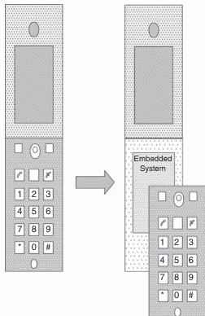

以集成到单个集成电路中的数百万个晶体管为单位。没有VLSI，嵌入式系统将不可行，而没有嵌入式系统，VLSI也将几乎没有用处。

当我们开发应用程序，例如文字处理软件或最新的视频游戏时，我们希望人们看到它、喜欢它并购买它。如果没有发生这种情况，我们就失败了。相比之下，我们希望我们的嵌入式设计能安全、可靠、安静、高效地完成工作，并且隐藏在某个更大的系统内部，例如汽车中的燃油控制系统。只有当它们不工作时，我们才意识到它们的存在。

当我们将硬件、软件以及微处理器外部世界的种种不确定性结合在一起时，嵌入式系统带来了各种挑战。看到我们的设计将漫游车送到平原上，在火星上进行实验或拍摄遥远星系中某个行星的照片，作为最新心脏监测系统的一部分挽救生命，或者作为最新娱乐系统的核心运行——这些都是我们从事这个行业的原因。

几年前，当微处理器和可编程只读存储器（PROM）首次作为新工具出现时，开发应用程序——后来被称为固件——并不怎么费力。配备电传打字机、简单的汇编器和一台主机小型计算机，我们就可以开始工作了。几百行代码的“复杂”应用程序将相当复杂的离散逻辑设计转变为简单而强大的最先进的系统。今天，我们正在设计包含数千行代码、多个微处理器、VLSI组件和可能分布在办公室或世界各地的阵列逻辑的嵌入式应用程序。当今问题的复杂性已大幅增加。为了成功应对这类问题，我们必须开发和学习新工具，以取代我们已经习惯的工具。

与台式PC不同，嵌入式计算机必须与各种模拟和数字设备进行交互。熟练的嵌入式开发人员必须了解和理解传感器和换能器、模数转换（反之亦然）、网络及其众多协议、电机和其他处理器，以及更传统的外设的操作。当我们使系统越来越小时，几十位早期物理学家正在潜伏。我们的老朋友麦克斯韦、法拉第、高斯和楞次会迅速指出我们何时违反了他们的定律。解决由信号耦合、噪声、电磁干扰或传播延迟引起的问题确实具有挑战性——但却是必要的。

### 构建嵌入式系统

当我们开始研究嵌入式应用程序时，我们会发现，除了各种其他硬件组件外，我们还将三种基本类型的计算引擎嵌入到我们的系统中：微处理器、微控制器和微型计算机。微处理器和其他硬件元素通过系统总线连接，系统总线为电信号流动提供互连路径。系统总线实际上细分为三条总线，按其携带的信息分类：地址、数据和控制。

我们将在接下来的章节中更深入地研究系统的每个元素。目前，我们看到一个典型的嵌入式系统包含硬件和软件，并被设计和优化以非常高效地解决特定问题。微处理器通过执行一组称为固件的指令来控制整个系统，并最终控制应用程序，这些指令存储在内存子系统的ROM中。

要运行应用程序，当电源首次打开时，微处理器寻址一个预定义位置，并依次获取、解码和执行一条又一条指令。每条指令完成后，处理器获取下一条。指令周期无限重复，不同于最终会终止的典型应用程序。在顶层，嵌入式程序结构为无限循环，如图2中的代码片段所示。

```
while(1)
{
    Embedded Program
}
```

图2 顶层嵌入式程序。

程序从不执行返回；也没有返回的地方。微处理器知道如何执行的特定指令集称为其指令集。包括从外部世界读取数据、向外部世界输出信号以及提供与内存子系统交换数据的手段的指令。

嵌入式系统一词是指封装或嵌入在更大系统中的系统。此类系统在监控和控制一组进程时，通常会持续与其周围环境交互。一个很好的例子是汽车，它可能包含多达100个嵌入式微处理器和微控制器，用于管理发动机点火和喷射、变速箱换挡、动力转向、防抱死制动系统、安全系统或乘客娱乐系统。

在电气环境恶劣的环境下运行时，例如汽车发动机舱或飞机驾驶舱，电磁噪声很可能导致系统行为异常。我们台式机上的类似行为


**看门狗定时器**
仅需伸手过去重置系统即可轻松解决。但对于可能在40,000英尺高空飞行，或正飞往火星三分之二路程的嵌入式应用，我们并没有这种奢侈。为解决此问题，我们添加了所谓的 *看门狗定时器*。这种定时器不过是一个花哨的闹钟。微处理器必须定期重置该定时器。如果未能做到，定时器将重置微处理器，这通常能解决问题。在图 3 中，来自看门狗定时器的信号作为不可屏蔽中断（NMI）输入到处理器中——即，一种不能被忽略的中断。

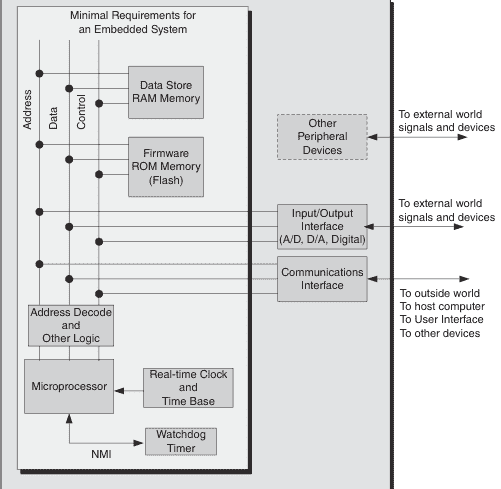

**图 3** 基于微处理器的嵌入式系统。

**实时**
在嵌入式应用中，时间通常是一个关键约束，这与典型的桌面应用程序形成对比。声明一个系统是 *实时* 的，意味着系统必须在指定的时间间隔内响应指定的外部或内部事件。预期的响应通常是执行与触发事件相关的任务。

**软实时系统**
根据满足所需时间约束的紧迫性，我们识别出三种实时系统。如果未能满足时间约束仅导致性能下降，则该系统被视为 *软实时系统*。

**硬实时系统**
如果在 *硬实时系统* 中未满足时间约束，则认为系统已失败。如果此类失败可能对人员、环境或被监控或控制的系统造成重大风险，则可能被视为灾难性。*准实时系统*介于两者之间，混合了两种类型的任务。

**微处理器** *微处理器*基础的嵌入式系统的实现将各个部件组合成一个整体，如图 3 所示，它展示了典型嵌入式系统的架构，并确定了必要组件的最小集合。

## 嵌入式设计与开发过程

不久以前，我们开始设计一个新的嵌入式应用时，会先思考问题，在微处理器周围添加一些寄存器、逻辑和总线，编写几行汇编语言代码，将汇编后的目标文件下载到开发环境，调试它，然后交付——或者看起来是这样。当我们只需要关心微处理器、少量输入和输出、几个小规模集成 (SSI) 或中规模集成 (MSI) 门电路，以及能容纳在几个 PROM 中的固件时，这种方法效果很好，如图 4 的简单图所示。

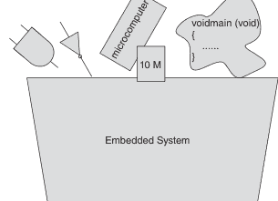

图 4 构建嵌入式系统。

我们发现，当代嵌入式应用程序往往分为两类：运行烤面包机、微波炉或儿童视频游戏的简单应用，以及控制喷气式飞机、管理娱乐系统、协助医生诊断患者或帮助控制核反应堆的复杂应用。第二类系统的复杂程度比我们过去构建的任何系统都要高出几个数量级。手工设计已不再可行。为每个不同应用量身定制的临时方法成本太高，且错误风险太大。我们不能仅仅将几个部件连接在一起，随意写一点软件，然后花几天或几周时间调试这个集合。我们需要工具；我们需要正式方法。我们需要工具来建模我们的设计、执行仿真，并简化和交互式优化硬件、软件和固件。最终，我们需要能够用于将设计部分综合为可编程逻辑器件或 VLSI 电路的工具。

图 5 展示了开发过程的高级流程，并识别了开发生命周期的主要元素。具体而言，生命周期的硬件部分涉及物理系统架构、封装、印刷电路板，以及最终各个组件的设计、开发和测试。

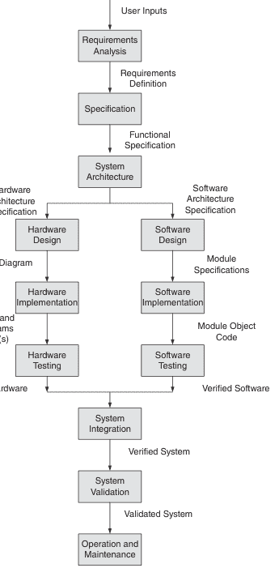

图 5 嵌入式系统生命周期。

软件部分涉及应用程序的任务或算法部分。此类软件可以用高级语言、汇编语言或两者的混合编写。汇编语言工作需要详细了解微处理器架构及其寄存器结构。

传统的设计方法是分别遍历附带图表的两侧；即：

- 设计硬件组件。
- 设计软件组件。
- 将两者结合起来。
- 花费时间测试和调试系统。

当代方法论倾向于对硬件和软件组件进行组合的“同时”设计，其目标是通过在这两者之间进行权衡来满足系统级要求。这种方法的关键点是同时指定和（迭代地）设计和开发系统的两个方面，目标是提高生产力——缩短设计周期——并提高产品质量。

这种方法关注设计过程的主要领域：

- 确保为流程提供可靠的硬件和软件规范及输入。
- 制定待设计系统的架构。
- 划分硬件和软件。
- 为硬件和软件的设计提供迭代方法。

我们已识别的每个问题都列在图 6 中，并将在我们对现代嵌入式系统开发的研究中详细讨论。

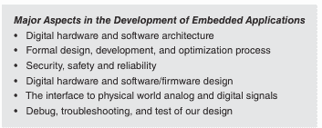

图 6 开发嵌入式系统时的注意事项。

当代的创造性设计和开发过程始于对待构建系统的抽象概念，并通过一系列迭代转换到达最终产品。基于计算机的工具对该过程至关重要。为了能够有效地使用当今的此类工具，作为工程师，我们必须了解如何为我们打算设计和构建的系统开发准确的硬件和软件模型。作为嵌入式系统开发的组成部分，我们不断在速度、尺寸、功耗、成本、重量或时间约束之间进行权衡，以满足指定约束或提高性能。工具可以帮助我们更高效地进行这些权衡。

对设计过程及所有相关建模工具和方法论的全面研究轻而易举就能写好几卷书——事实也是如此。在这里，我们迈出第一步，为未来的工作奠定基础。我们将介绍、研究和应用正式方法和工具的基本概念。我们了解到，优秀的系统设计师和设计至少使用五个步骤。这些步骤列在图 7 中。

- 需求定义
- 系统规格说明
- 功能设计
- 架构设计
- 原型制作

## 图 7 开发嵌入式系统的重要步骤。

在当今世界，我们看到当代设计过程在每个设计阶段也必须考虑设计复用和知识产权。通过分层建模和功能分解，我们将熟悉并使用正式设计方法论。在我们的研究中，我们将使用 Verilog HDL – 硬件描述语言 – 作为硬件建模和仿真工具。我们将深入研究软件生命周期；统一建模语言 (UML) 和结构化方法将被介绍，并将成为我们的软件建模工具。

（一个良好、稳固、安全且可靠的设计始于坚实的基础（图 8）。没有它，我们后来添加的一切都将脆弱。今天，希望在嵌入式领域工作的工程专业学生必须对数字硬件和软件架构的基础有扎实的理解，并能熟练使用更复杂的系统。因此，我们将从回顾基础知识开始学习；随着我们进入新主题，将在此知识基础上构建。


## 图 8 必要的基础。

我们将从高级结构和组件开始，并介绍构成嵌入式应用硬件和计算核心的冯·诺依曼和哈佛架构。该核心通常表现为微处理器、微型计算机或微控制器。在系统层次结构的另一端，当我们研究各种基本信息（数字、字符、地址和指令）如何在数字系统内部表示时，我们将首次了解位、字节和伏特。


接下来，我们探讨此类机器中的控制流与数据流，并讨论它们如何分别体现为微处理器、微型计算机或微控制器。模拟和数字外围设备被纳入其中，以将基本架构扩展到嵌入式应用领域。通过讨论寄存器传输级（RTL）和指令集架构（ISA）模型，介绍了程序员对机器的视角。系统设计师的视角将硬件和软件结合在一起。在建立高层视图后，我们将对开发稳健嵌入式固件所必需的逻辑基础和 C 语言基础进行扎实的回顾。

当今的嵌入式系统被应用于许多可能影响人们生命、造成重大环境影响，或在发生故障时导致数百万美元损失的应用中。在嵌入式应用设计的目标之一，是在以最低成本提供最高性能的同时，交付一个安全、可靠、安全和可信赖的系统。设计过程不会在初步设计完成后就停止；性能评估，如同测试一样，必须在开发的每个阶段进行。本书贯穿了安全、可靠、安全和可信赖设计方法论的理念。作为设计周期的导论，我们探讨了执行安全、可靠、健壮且可信赖设计所需的诸多考量。我们研究硬件和软件两种方法来解决这些问题。

设计是将客户需求转化为可运行系统的过程。基于规格说明，我们将系统划分为主要功能，然后将这些功能映射到架构结构上。应用程序本身通常体现在软件中，并运行在硬件基础设施之上。

一位同事曾评论说，硬件仅仅是软件表达自身的载体。他的说法有一定道理。当然，软件/固件是任何嵌入式系统的基本组成部分。早期系统使用无限循环来不断循环处理应用中的各项任务。这种方法在当今许多简单的设计中仍然有效。对于更复杂的设计，则需要更强大的方法；此类方法将所需任务组织成正式的任务或进程，并仔细安排每个任务的执行时间。随着各种约束的增加，调度会变得更加复杂。任务通常需要共享信息：以受控的方式相互合作和通信，并与处理器外部的世界进行交互。

- 任务，进程
- 合作，通信
- 轮询，事件驱动

在接下来的章节中，我们将从简单的轮询和事件驱动方案入手，介绍嵌入式应用控制与管理的基础。这些思想将首先扩展到非抢占式，然后扩展到抢占式任务系统。基于时间和反应式系统将导致简单调度算法的发展。基于这些概念，将介绍实时内核，深入研究，并扩展到包括多任务和多线程控制。对任务间通信方法和问题的全面介绍，将导致对协调和同步数据交换的需求，以及临界区概念，以及信号量和监视器作为满足此类需求的工具。

将 RTOS 视为基本内核概念的扩展，这一概念将提供下一级的复杂性和能力。任务优先级和调度准则的概念将导致对几种基本调度算法的正式讨论，这些算法包括先来先服务、轮转法和速率单调。再次，针对安全、可靠和可信赖系统的需求，优先级反转、死锁和饥饿将被介绍为多任务系统中的潜在问题。识别和解决此类困难的方法将被深入研究。

嵌入式应用旨在与物理世界协同工作，在感知各种模拟或数字信号的同时，控制、操作或响应其他信号。对外部世界接口的研究，通过对总线、其组成部分及其时序考量的详细研究，扩展了冯·诺依曼机器的 I/O 部分（参见图 9）。本地交互被扩展到包括分布式和远程系统。对基本事务管理、一致性模型、幂等系统和错误管理的研究，延续了设计安全、可靠和可信赖系统的主线。

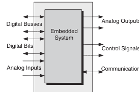

图 9 与外部世界接口。

对多种常见串行和并行硬件设备接口开发的大量介绍，为构建提供了一套坚实的工具。讨论扩展到典型嵌入式应用必须处理的感知和转换元素（及其相关问题）。

当第一个原型交付时，设计并未完成；系统在设计投入生产后也必须进行测试。然而，测试的需求并不会随着投入生产而结束。我们在不同时间出于不同原因进行测试；测试和调试，如同建模一样，必须与开发过程交织在一起。

让我们再回顾一下美好的旧时光。一旦我们为系统构建了硬件和固件，确认其正常工作通常是一项简单的任务。几个开关、硬连线信号、一个好的仿真器、一个示波器和一个逻辑分析仪，再加上一点创意，通常就足以构成一个全面的测试系统。今天情况远非如此。我们现在正在处理几十个同时变化的高速信号，这些信号分布在几十个组件上，这些组件可能会基于数据中不常出现的模式而发生故障。使问题更加复杂的简单事实是，我们对正在使用的处理器、VLSI 电路或阵列逻辑几乎没有可见性。更进一步，我们现在必须处理最先进的操作系统、以纳秒或皮秒计量的时序约束、多个处理器以及散布在世界各地的系统。

与建模一样，测试领域的文献、工具和技术非常广泛。尽管如此，掌握测试和基本测试技术的扎实基础是必不可少的，然而这些知识却缺失于大多数当代本科生和许多在职工程师的工具箱中。许多年轻工程师工具箱中缺失的更重要的工具是对基本调试技术的理解，尤其是在面对当今系统的复杂性时。太常见的是，魔法取代了关键的问题分析技能。“这个电路只有在下午阳光明媚、我在这张靠窗的工作台上工作时才能正常工作……”哎呀，为什么？“我不知道，它就是这样……我试过其他地方或时间，它从来都不工作。”是温暖的温度影响了你系统的行为吗，还是我们继续把魔法当作答案？

主张测试必要性的理念贯穿本书的每个部分。我们力求通过首先介绍一些简单的调试技术，阐明测试的必要性，然后展示如何设计电路和系统以便于调试和测试，从而为这种关键分析提供基础。我们将研究分析基本数字硬件和软件系统的基本方法。此类研究的目标是学习为许多更常见的故障开发测试和测试方法，并学习如何将这些概念扩展到更复杂的设计。

在当今世界，我们不断努力使我们的设计更快、更小、更便宜，并降低功耗。作为工程师，我们总是相信可以让我们的设计好上那么一点点。我们可以买张票，坐上飞机，几小时内就能到达亚洲、欧洲或世界上几乎任何其他地方。口袋里装满电池，我们或许能让笔记本电脑撑过大部分行程。我们每天都在推动摩尔定律（处理能力大约每两年翻一番），可能正在逼近极限；然而，我们必须让事情变得更好。

在本书中，我们介绍了几种系统性能指标，并讨论了优化设计的多种方法和权衡。在我们的讨论中，我们大量介绍了在时间、尺寸、成本和功耗方面分析和优化嵌入式系统性能的方法。

## 摘要

本文为传统本科电气工程、计算机工程或计算机科学专业的学生，以及希望回顾基本概念的在职工程师，提供了一个宝贵的工具。我们介绍了当代嵌入式系统开发的五个基本方面：硬件和软件架构基础、设计过程和形式化方法（包括安全性和可靠性）、当代实时内核和操作系统概念、与本地和分布式外部世界的接口，以及设计的调试和测试。

我们设计嵌入式系统的目标是帮助人们解决问题。我们的设计可能影响人们的生活。请始终尽力为每个应用使我们的设计尽可能安全、可靠和可信赖。请记住，产品的成本不仅限于构成它的零件成本。我们还必须考虑构建、销售、支持以及为设计添加新功能的成本。最后，请记住，我们对设计的责任并不会随着设计发布而结束。祝你好运，玩得开心。

## 复习问题

### 嵌入式系统

- F.1 什么是嵌入式系统？
- F.2 VLSI 与嵌入式系统有什么区别？
- F.3 嵌入式系统中使用的三种计算引擎是什么？
- F.4 嵌入式微型计算机和支持硬件元素如何互连？
- F.5 嵌入式系统总线通常由三条独立的总线组成；它们是什么？
- F.6 什么是指令周期？
- F.7 指令周期包含几个步骤；这些步骤是什么？
- F.8 什么是指令集？
- F.9 看门狗定时器在嵌入式应用中的作用是什么？
- F.10 实时一词是什么意思？
- F.11 硬实时、确定性实时和软实时之间有什么区别？

### 嵌入式系统设计与开发

- F.12 简要描述嵌入式系统开发生命周期的主要要素。


- F.13 设计过程的主要元素有哪些？
- F.14 本章指出，优秀设计师在设计系统时通常会采取五个步骤。识别并简要描述每个步骤。

- F.15 嵌入式系统与外部世界交互的信号主要有哪些类别？

## 思考题

### 嵌入式系统

- F.1 有些评论家认为，嵌入式系统将成为明天无处不在计算的基础。你同意还是不同意？请详细阐述。
- F.2 举出两个可能被认为是软实时系统、硬实时系统和坚实实时系统的例子。
- F.3 讨论在嵌入式系统内部互连各种组件时，采用多条专用总线而非单条通用总线的优缺点。
- F.4 讨论使用类似互联网微型版的网络方案而非传统总线来互连嵌入式系统内部各种组件的利弊。
- F.5 在嵌入式应用中设置多个看门狗定时器是否有好处？请解释你的答案。
- F.6 举出嵌入式系统可能交互的几个模拟信号和数字信号的例子。
- F.7 举出嵌入式系统可能交互的几个模拟设备和数字设备的例子。

### 嵌入式系统设计与开发

- F.8 当今，在典型的嵌入式系统开发周期中，硬件设计先于软件设计。讨论同时开发系统硬件和软件组件的优缺点。
- F.9 嵌入式系统由硬件和软件组件组成。在决定将某项功能实现在硬件还是软件中时，应考虑哪些因素？
- F.10 当今嵌入式系统设计师面临哪些更棘手的问题？请考虑以下示例：一款非常受欢迎的消费品、一套将被派往火星执行任务的智能机器人系统，或一架商用喷气式客机上的自动着陆系统。
- F.11 你认为在设计嵌入式系统时，应考虑哪些更重要的性能因素？

## 前言

## 嵌入式系统简介

150多年前，将石油这一新产品用驳船沿密西西比河运输，曾被人们怀疑并担心可能发生爆炸。50年后，电力和电灯被视为只有少数人才能享有的现代技术奇迹。又过了50年，有人曾建议，世界最多只需要三四台计算机。我们的观点在不断变化。如今，我们将石油（仍然带着担忧）运往世界各地。电力已经变得如此普遍，以至于当我们进入一个房间却找不到开关来开灯时，我们会感到惊讶。三四台计算机的需求已增长到全球安装的数亿甚至数十亿台各种规模的计算机。

本书介绍了一种当代方法，用于设计和开发一种我们大多数人永远不会见到的计算机系统——即我们称之为嵌入式系统的系统。该方法将坚实的硬件和软件理论基础与现实世界应用相结合。我们为什么需要这样的东西？这是个好问题，让我们来看看。

嵌入式系统是当今计算机技术的基础元素之一。从操作我们的汽车、管理智能手机、清洁家居、烹饪饭菜，到响应我们的查询或指令，或运用深度推理来帮助解决复杂问题，我们称之为嵌入式系统的这些特殊计算机正在使我们的生活更加便捷、安全和紧密相连。

微处理器——微型计算机——微控制器——无处不在。如今，这些机器无处不在。就像电灯一样，我们期望汽车的防抱死制动系统在使用时能正常工作。我们期望手机能像家里的固定电话一样运行。我们口袋里携带的计算机，比最初的宇航员带入太空以及我们送往火星的计算机更强大。

如今，我们有能力将数量越来越多、运行速度惊人地提高的硬件元件，放入越来越小的空间中。软件不再被局限于空调房间里的巨型机器；我们的计算机及其软件随我们去到哪里。这种能力为工程师、医学医生等许多其他人提供了新的自由，可以创造性地组合出具有令人兴奋的功能的更复杂系统——这些系统几年前只有科幻作家才会构想。这种能力还让我们有机会解决比我们曾经想象过的更大、更复杂的问题——并将这些设计装进越来越小的包装中。这些无疑是最有趣的问题，是我们受挑战去处理的那种令人兴奋的事情。好吧，我们从哪里开始？

嵌入式领域几乎是偶然起步的，不过是在几年前。20世纪70年代初，Federico Faggin以及英特尔和摩托罗拉的许多其他人，将4004、8008和6800微处理器引入工程界。最初用于计算器及类似计算器的应用，如今，在Faggin、Gary Kildall和Tom Rolander等布道者的推动下，微处理器及其软件已成为我们几乎接触的每样东西的基本组成部分。随着如此广泛的应用，确保此类系统的安全性、安全和可靠性绝对至关重要。

嵌入式系统领域已从几年前的不存在，发展到涵盖现代电气工程和计算机科学的几乎所有方面。就这一点而言，嵌入式系统几乎是独一无二的。虽然电气工程和计算机科学中的其他学科当然也会利用其他领域的知识，但研究和使用嵌入式系统的人必须发展多学科技能，特别是在数字硬件、软件、安全和网络领域。从事嵌入式系统工作的电气工程师和计算机工程师，为从规划和设计到制造、测试和营销的整个开发过程做出贡献。

嵌入式系统领域也有些神秘。与数学、物理或化学等领域不同，嵌入式系统是从工程师的工作台演变而来，而非来自科学家的研究实验室。我们大部分正式理论的根源在于Kildall和Rolander等熟练工程师和计算机科学家的努力，他们的工作已被迅速应用到工厂车间。

嵌入式系统领域更像一把大伞。在这个伞下设计的系统需要来自许多不同领域的技能。没有这些技能，嵌入式系统将无法存在。这就是试图撰写该领域图书时面临的困境之一。在深度和广度之间找到合适的平衡可能是一个重大挑战。希望，我们已经取得了良好且有用的平衡，并在新版中引入新颖且令人兴奋的材料的同时保持了这种平衡。

本文本基于多年来为航空航天、商业和医疗行业开发安全、安全性和高度可靠的嵌入式应用所积累的大量理论和实践知识。我们致力以有趣、令人兴奋且具有挑战性的方式呈现材料。我们希望，再一次，我们取得了成功，并且本文本将为你提供大量探索和进一步学习的机会。

## 选择语言和工具

本书包含大量现实世界的硬件和软件示例。在这两个领域，我们都有多种方法可以将我们的想法和设计转化为现实世界的硬件和软件组件。也许有一天，我们会开发出一种通用语言，可以用来表达从商业到科学、从医学到工程的所有应用。经过多年的汗水、辛劳、创造性决心以及克服偶尔的失败，我们取得了一些根本性的胜利，使我们能够与计算机对话，并让它轻松地响应我们的请求——也许还会一路提出建议——这些建议我们可能喜欢也可能不喜欢。我们甚至可以直呼这些工具的名称。我们在此学习的硬件和软件概念在很大程度上与语言无关。在本书中，当我们从概念迈向实现时，我们将使用Verilog语言作为建模和综合工具来表达硬件实现，使用统一建模语言（UML）和结构化设计来建模软件设计，并使用C语言来实现软件实现。我们将学到，对我们设计的硬件和软件功能进行建模，对于被称为硬件-软件（HW-SW）协同设计的新兴领域以及支持快速发展的高速环境至关重要。转向其他实现语言和


这些工具应该相当直观。对于尚未完全精通 Verilog 或 C 的读者，我们提供了对这两种工具基础知识的良好介绍和概述。

## 组织本书

凑合做出一个能运行的一次性嵌入式应用往往太容易了。试图复制一百万或更多副本的此类设计（在紧迫的时间限制下）很快就会撞上等着我们的现实世界“小妖精”。一个稳固、安全、健壮、可靠的设计必须始终基于底层理论和有纪律的设计与开发方法。随着我们不断突破设计和基本物理原理的边界，此类方法变得越来越重要。

本书从开发者的角度教授嵌入式系统概念。它详细探讨了在当今应用设计中必须考虑的每个重要理论和实践方面。这些内容包括正式的硬件和软件开发过程（强调安全性、安全防护和可靠性）；系统的数字和软件架构；物理世界接口周期；外部模拟和数字信号；开发周期中的调试与测试；最后是提高系统性能。

## 章节

## 简介与背景

前言提供了介绍性概述、嵌入式世界中的一些术语、一些背景和历史，以及几个当代示例。

## 硬件与软件基础设施

在初步背景介绍之后，接下来的几章涵盖了当代嵌入式系统设计与开发所需的硬件和软件的基本方面。Verilog 硬件描述语言、UML、结构化设计模型以及 HW-SW 协同设计被介绍为支持开发过程的工具。

第 1 章首次正式介绍嵌入式系统，并介绍了一些基本概念、方法和术语。本章从硬件和计算核心开始，这通常表现为微处理器、微型计算机或微控制器，随后介绍并讨论了经典的冯·诺依曼架构和哈佛架构。

接下来，在系统层次结构的另一端，研究了如何将位、字节和伏特解释为嵌入式系统内部发现的各种基本信息类型（数字、字符、地址和指令）的方法。在指令基础上，介绍并研究了计算机的指令集架构（ISA）和寄存器传递（RTL）层级。

第 2 章和第 3 章涉及嵌入式系统设计硬件方面的一部分，并为后续章节中对信号完整性的更详细研究奠定了初步基础。随着电压水平不断降低、开关速度不断提高，以及模拟信号的基本物理特性融入我们的设计，嵌入式系统信号的损坏成为日益严重的问题。这些章节为理解在当今充满挑战的嵌入式世界中使用数字电路和系统的实践方面提供了初步基础。

Verilog 硬件描述语言被用作组合逻辑和时序逻辑设计与综合中的建模工具。硬件层面的时间约束及相关问题被介绍为嵌入式应用中的关键考量。本节考察了异步系统 I/O 问题的困难与解决方案。用于设计健壮数字硬件的有效时钟方案将读者带入同步世界。

嵌入式系统在现实世界中工作，有时也会失败。作为反复强调安全、安全防护、健壮和可靠设计必要性的一部分，本节介绍了组合逻辑和时序硬件中几种更常见的失效模式，以及测试此类失效的方法。那些已经在数字设计或硬件描述语言方面有良好背景的读者，仍可通过复习时序、时间约束以及寄生器件影响的内容，或回顾 Verilog 示例而获益。

第 4 章探讨了嵌入式系统中内存的使用方式。本节从对寄存器和缓存的考察开始，并研究了几种更常用的缓存组织和方案。接下来，研究了内存的静态分配和动态分配及其对实时嵌入式设计性能的影响。最后，考察了栈数据类型及其在多任务设计中的使用方式。

第 5 章介绍了与后文内容相关的主要 UML 建模图，随后转向结构化设计方法中的数据流图和控制流图，用于系统建模与开发。本章介绍了基于 UML 的软件静态模型和动态模型。静态视图从系统外部开始，逐步细化到更高层次的细节，以捕捉组成模块、它们之间的关系以及通信路径。

动态视图表达了系统在执行预定任务时的行为，并提供任务间交互的信息。并发任务操作和持久性被介绍和讨论为两个更重要的动态考量，以期为后续关于任务、任务间通信、调度和操作系统的研究做准备。

第 6 章和第 7 章回顾了 C 语言的核心要素，以及开发嵌入式应用所需的几种更常用数据结构和算法。无论你是经验丰富的程序员，还是仅懂得足以惹祸的程度，这些材料都将指导你在嵌入式环境中开发软件。本章介绍了 C 语言结构，具体涵盖变量、存储类型、作用域、地址、指针和结构体。位操作被介绍为处理硬件信号的重要工具。函数、函数调用和函数指针在嵌入式应用的语境中被介绍和讨论。

## 奠定基础

接下来的几章介绍了基于交付安全、安全防护和可靠设计需求的嵌入式系统开发过程。开发部分如同现实世界一样，以调试和测试过程结束。

第 8 章介绍了嵌入式应用中安全性、可靠性和健壮性的基本概念，为每个概念制定定义，并识别它们之间的差异。本节考察了几个现实世界示例，其中微小的疏忽导致了重大或潜在重大且代价高昂的失败。在建立一些相关术语以及对安全、健壮和可靠应用的需求之后，介绍了几种设计方法，以帮助确保满足这些需求。本章随后介绍了基本概念三重奏的第四个基本成员：安全防护。本节介绍并考察了系统内外部潜在的安全漏洞。本章最后介绍了一些可用于在系统运行期间预期、检测和管理所有四个领域中可能出现的问题的工具和技术。

第 9 章形式化了嵌入式系统设计与开发过程。介绍、研究和分析了开发生命周期的几种不同表现形式。读者将了解几种传统的系统设计方法。然而，当今的设计复杂度不断增加、尺寸不断缩小、工作频率不断提高，并利用越来越广泛的激动人心的新技术。为满足这些需求，第 2 版详细介绍并研究了协同设计方法论，该方法论建立在之前研究过的开发生命周期背后的理念之上，并利用迭代、组合和“同时”进行的硬件与软件设计、开发和测试理念。该方法采用模型和基于模型的开发，这两者在当今高度复杂系统的设计中变得越来越关键。本章如同设计必须做的那样，以对设计发布包中核心要素的考察结束。

第 10 章包含始终相关的概念和材料。尽管调试、测试和故障排除绝非良好设计过程的替代品，但它们是开发嵌入式系统全过程中的必要组成部分。本章首先阐述了硬件和软件测试的必要性。然后，从项目的预调试阶段开始，介绍了模块、子系统和系统级调试与测试。内容包括测试过程及相关规范、测试用例设计、α测试和β测试，然后是生产测试以及自测试和机构驱动测试。

## 开展工作

接下来的章节在先前建立的基础上，在实时操作系统 RTOS 的管理下，将应用程序开发为一组交互任务的集合。本节考察了此类设计中产生的死锁问题。在接下来的章节转到微处理器之外之前，介绍了分析和优化嵌入式应用性能的方法。

第 11 章和第 12 章介绍了任务、多任务和嵌入式应用控制的概念及动机。从必要的术语开始，材料考察了时间在开发和部署许多嵌入式应用中的关键作用，并初步介绍了基于时间的系统和反应式系统。本章识别了操作系统的核心职责，考察了区分 RTOS 的特性和能力，然后考察了操作系统（OS）内核所体现的核心要求集。

研究随后转向嵌入式应用中控制流、通信和详细时序的基础知识。讨论从基于简单轮询、中断及相关处理机制的事件驱动控制方案开始。感兴趣的主题包括任务间通信、数据和资源共享，以及通过信号量和监视器进行的任务同步。调度、调度算法以及在实时环境中评估调度算法的方法完成了本主题。

第 13 章通过考察多任务嵌入式应用中的死锁和饥饿问题，继续研究调度器。本节描述、分析和讨论了几种避免、预防、识别和解决死锁的方法，以及确保系统进展的方法。


第14章探讨嵌入式设计中的性能以及性能的量化和评估。为开始研究，介绍并讨论了几种不同的度量指标。随后分析了几个更重要的指标——响应时间、时间加载和嵌入式应用中的内存加载。本章还研究了性能中时间和功耗方面的评估与优化。通过审视性能的另一面，探讨并评估了性能度量分析中的几种常见错误。然后，从嵌入式系统功耗的高层视角入手，制定了零功耗、静态功耗和动态功耗的定义，并考察了每个功耗级别的潜在来源。接着，向读者介绍了多种功耗管理方案和降低各级别功耗的方法。

## 与物理世界交互

在继续嵌入式应用的设计与开发过程中，范围首先扩展到本地外围设备，然后扩展到更远端的设备。接下来的几章将超出处理器范围，进入物理世界，涉及处理各种不同类型的信号。首先，作为第12章中开发模型的扩展，构建了交互模型，然后在该模型的背景下考察具体应用。

第15章和第16章通过探讨嵌入式应用如何与外部世界交互来开启研究。先前开发的内部进程间和通信模型被扩展，以包含外部世界中的信息、控制与同步以及寻址，并进一步扩展以包含传输组件。在介绍性讨论之后，每个组件都从共享变量（本地）和基于消息（远程）的信息交换模型两个角度进行详细研究。这些章节的目标是为本地和远程外部世界交互模型建立基本基础设施和各种实现架构。

第17章侧重于通常为本地的模拟和数字I/O接口与外部世界的连接。本章首先介绍生成模拟输出信号的几种不同方法，然后探讨如何将各种物理世界的模拟输入信号转换为数字形式。研究了三种特定的转换算法——双斜率、逐次逼近和电压转频。由于各种传感器和换能器的输出通常是非线性的，因此考察了处理此类信号的问题。本章接着介绍生成数字信号作为多种小型电机（包括步进电机和伺服电机）的控制输入，以及必须显示的信息的主题。数字I/O讨论通过研究如何测量数字信号的时间和频率参数来结束。

第18章考察通过网络与外部世界设备进行交互的世界。本章介绍了四种不同的常用基于网络的输入/输出设计。每种设计的研究都始于推动接口开发的问题。每种设计的分析包括传输机制、所使用的控制和同步方案，以及在先前开发的任务间通信和同步模型背景下识别消息发送者和接收者。

本章从传统的RS-232（EIA-232）标准异步串行接口开始，接着介绍通用串行总线采用的同步方法，然后考察I²C总线和控制器局域网（CAN）总线。目标是为本地和远程外部世界交互模型建立基本基础设施和各种实现架构。

第19章介绍可编程逻辑器件（PLDs）。本章首先简要讨论在嵌入式系统中使用此类器件的动机，然后考察促使其发展和广泛应用的底层逻辑概念。接着，考察实现可编程器件的常用技术。随后介绍了器件的基本结构、I/O配置的变体，以及复杂可编程逻辑器件（CPLD）和现场可编程门阵列（FPGA）的基本架构。

作为PLD架构的代表性示例，介绍了两种更常用的器件——CPLD和门阵列——以及一种称为可编程系统芯片的更通用器件。本章最后考察了几个应用。

## 实际考虑：现实世界中的信号行为

第20章和第21章在先前考察基础电气物理和寄生元件对嵌入式系统现实影响的材料基础上，介绍了日益重要的信号质量或完整性领域。第20章从数字系统中噪声、噪声源、串扰以及电容和电感耦合的高层次考察开始研究。重点转向电源和地噪声、潜在根本原因、系统信令频率的影响以及可能的解决方案等具体问题。

第21章接着介绍信号完整性的术语和度量，然后识别与高速数字信令和信号质量相关的潜在问题。为考察这些问题，工作环境被分解为印刷电路板（PCB）和信令环境。从PCB开始，考察点对点布线的问题和局限性，随后对高速受控阻抗环境进行类似的研究和分析。转向信令环境，考察信号反射和某些网络拓扑对信号质量及高速数字系统性能的可能问题和负面影响。本章最后研究了可用于解决此类问题的多种信号路径终止方案和网络拓扑，然后分析每种方案的优点、缺点和顾虑。

## 支持和背景材料

第一个附录是Verilog入门教程。第二个附录位于配套网站上，提供了一系列复杂度递增的实验项目，可用于加强嵌入式系统设计基础理论的实际应用。

附录A介绍Verilog语言，并介绍本书随后将使用的重要特性和功能。材料从Verilog程序的基本组件和组织开始；考察组合逻辑电路的行为级、数据流和门级或结构模型，随后介绍时序电路的类似模型。设计只是产品开发的一个要素；每个设计还必须经过测试，以确认其满足指定要求。为此，每个部分还讨论如何制定测试套件以验证正确操作。关于测试的材料将为指导开发人员构建测试用例以执行所需级别的测试奠定基础。全面论述测试超出了本文的范围。

附录B位于本文的配套网站 http://www.wiley.com/college/peckol 上，提供了一系列分为三类的实验练习：入门、技能提升和综合应用。第一类练习建议了一些基本项目，用于介绍嵌入式系统的一些基本要求，例如将信息输入微处理器、在应用中使用该信息以及产生一些输出。第二类项目更为复杂。其中许多需要多任务实现，尽管不需要操作系统。它们使用嵌入式微处理器、微计算机或基于微控制器的设计中常见的许多外围设备。第三类项目代表现实世界应用的简化示例。这些项目涵盖了从需求识别到设计和测试的完整产品开发生命周期。

## 附加材料

本书配套网站 http://www.wiley.com/college/peckol 上提供了大量额外的支持材料。这包括向所有人免费提供的信息，例如最新的勘误表以及涵盖数字设计基础和C语言基础的额外背景教程。

在网站的教师部分，我们还包括了本文所有图表和先前描述的附录B的PowerPoint幻灯片等内容。

## 受众

本书面向具有广泛背景和经验的学生，也可作为该领域从业人员的参考教材。核心读者应至少学习过一学期或一学期的逻辑设计，精通C、C++或Java等高级编程语言，具备一些操作系统知识，并且应是高年级大三或大四学生，或低年级研究生。

## 给教师的说明

本书可作为传统本科电气工程、计算机工程或计算机科学专业学生以及希望复习基本概念的在职工程师的宝贵工具。在这里，学生可以学习当代嵌入式系统开发的六个基本方面，特别是获得硬件和软件架构基础的扎实介绍、设计过程和形式方法（包括安全性、安全性和可靠性）的良好入门、当代实时内核和操作系统概念的研究、本地和分布式外部世界设备接口的全面介绍，最后是设计的调试和测试。

呈现的关键是大量的例题，说明基本思想以及应用中的某些细微差别如何超越基本概念。每章开头都有一个“需要关注的事项”列表，突出章节中更重要的材料，并以复习问题和思考问题结束。复习问题直接基于章节中涵盖的材料，并反映和扩展


Things to Look For 列表。它们为学生提供了对所学材料的理解和回忆的自我评估。虽然基于章节中涵盖的材料，思考问题扩展了概念，并为学生提供了一个基于这些概念综合新想法的论坛。大多数章节还包含一组广泛的问题，以允许学生开始应用理论。这些不需要实验室支持；然而，它们可以轻松扩展为基本实验室项目。附录 B 中包含的 23 个深入实验室练习，可在教材的配套网站 http://www.wiley.com/college/peckol 上找到。

本教材的编写和组织方式，很大程度上就像开发一个新系统一样，自顶向下，循序渐进。理念在全书中被引入并反复回顾，每次都会深入更深层次或置于新的语境中。总线可能出现在最初几段中以引入概念，随后用于互连系统组件，并在研究关键时序和数据移动等概念时进行详细分析。安全、安全性和可靠性是当今任何系统开发中绝对必不可少的组成部分。此类材料被放置在本教材的前部，以强调其重要性。目标是让学生在学习和设计嵌入式应用时思考此类问题。

正如我们在本序言开头所述，在嵌入式系统教材中找到深度与广度之间的良好平衡是一项挑战。为此，在一开始就做出了一些决定。首先，本教材并非围绕特定微处理器编写。相反，材料旨在与（并已用于开发）运行在多种不同处理器上的广泛应用相关。其次，嵌入式领域正在迅速变化，甚至在输入和阅读这句话时也是如此。与其试图追求并包含当今的最新技术，不如专注于适用于任何技术的基础知识。本书的基本理念是，学生打好基础后，将能够熟练使用最新理念开发和使用最先进的系统。欧姆定律多年来未变；电气工程领域却已发生变化。

核心材料作为嵌入式系统开发的一学期高年级课程教授了大约二十年。大约三分之二的材料已作为三学期的现场和远程学习外联项目，在多年内成功教授给背景各异的学生群体。外联学生通常在获得学士学位后至少在行业工作了五年。

根据学生背景，本教材内容足够丰富，可为传统四年制大学或学院中初级到高年级的嵌入式系统开发课程提供两到三学期或两个学期的教材。除了核心读者外，涵盖假定基础主题的章节可以为硬件或软件背景有限的学生提供基础，以便他们继续学习其余材料。逻辑和软件章节的深度不足以替代相应主题的一学期或两学期课程。对于在这些领域有足够背景的人，材料可以跳过，也可作为简要复习。具有 Java 背景的学生可能会发现关于指针、按位运算符和结构体的材料特别有用。操作系统部分的材料也是如此；此类材料不旨在替代正式的、深入的操作系统课程。根据需要，材料可以跳过，用作良好的复习，或用于介绍嵌入式应用特有的主题。

## 致谢

多年来，在收集知识和经验以编写本书的过程中，我与许多人学习、工作和交流过。我们的讨论、辩论和合作促成了后续页面中提出的设计理念和方法。

虽然应感谢的人太多，无法在此一一列举，但我仍要特别感谢 David L. Johnson、Corrine Johnson、Greg Zick、Tom Anderson、David Wright、Gary Anderson、Patrick Donoho、Dave Bezdol、Tom Roland、Steve Swift、Paul Lantz、Mary Kay Winter、Steve Jones、Kasi Bhaskar、Brigitte Huang、Jean-Paul Calvez、Gary Whittington、Olivier Pasquier、Charles Staloff、Gary Ball、John Davis、Patrick F. Kelly、Margaret Bustard 和 Donna Karschney 多年来所做的一切。William Hippe、Alex Talpalatsky 和我的兄弟 William Peckol 花费了大量时间校对、评论并为改进文本的早期工作版本提出宝贵建议，值得特别感谢。

来自 John Wiley，我要感谢 Bill Zobrist，他支持出版本教材的最初想法，尤其是 Gladys Soto，第一版项目编辑，她推动了开发进程，生产编辑 Lea Raddick 和 Lisa Wojcik 将一切整合在一起，以及无名的校对员、排版员和其他人，他们对本项目的努力和贡献无价无价。对于第二版的贡献，我要感谢 Sandra Grayson，她提出并启动了第二版，Louis Manoharan 和 Kanchana Kathirvelu 指导手稿经过了编辑和制作阶段。

在任何项目中，设计评审都是生产高质量产品的重要组成部分。我要感谢本项目的众多评审员的评估和建设性意见，这些意见帮助指导了其开发。

| 姓名 | 单位 |
| --- | --- |
| John Aken | 俄克拉荷马州立大学，斯蒂尔沃特 |
| Farrokh Attarzadeh | 休斯顿大学 |
| Saad Biaz | 奥本大学 |
| Phillip De Leon | 科罗拉多大学博尔德分校 |
| Michael Eastman | 罗切斯特理工学院 |
| Richard Fyer | 加州理工学院圣路易斯奥比斯波分校 |
| Subra Ganesan | 奥克兰大学 |
| Adam Hoover | 克莱姆森大学 |
| Kenneth Jocker | 阿巴拉契亚州立大学 |
| Phillip Laplante | 宾夕法尼亚州立大学 |
| Al Liddicoat | 加州理工学院圣路易斯奥比斯波分校 |
| Tulin Mangir | 加州州立大学长滩分校 |
| Michael Morrow | 威斯康星大学麦迪逊分校 |
| Brad Nagle | 美国海军研究生院 |
| Kamesh Namuduri | 奇奇托州立大学 |
| Kimberly Newman | 丹佛大学 |
| Mitchell Nielsen | 堪萨斯州立大学 |
| Dan Phillips | 罗切斯特理工学院 |
| HR Shih | 杰克逊州立大学 |
| Tom Stuart | 托莱多大学 |
| Jindong Tan | 密歇根理工大学 |
| Richard Wall | 爱达荷大学莫斯科分校 |
| Hong Zhao | 埃姆里-里德尔航空大学 |
| Peixin Zhong | 密歇根州立大学 |

最后，我要感谢多年来有幸认识并合作过的众多老师、朋友、同事和学生。

> James K. Peckol, Ph.D

## 关于配套网站

本书配有配套网站：

- www.wiley.com/college/peckol


## 第 1 章

### 硬件篇 – 第 1 部分：简介

### 需要关注的事项 ...

- 微处理器、微型计算机和微控制器之间的区别。
- 计算机的四个主要功能模块及其互连总线。
- 如何在数字系统中表示数字、字符、地址和指令。
- 不同的指令格式和寻址方式。
- 计算机中的数据和控制流。
- 计算机的指令集架构（ISA）级模型。
- 计算机指令周期。
- 计算机的寄存器传输级（RTL）模型。

### 1.1 简介

前言中对嵌入式系统的简要介绍表明，硬件、软件和固件是当今嵌入式系统的基本要素。数字硬件提供了平台，使三者能够协同执行惊人的任务。


需要在硬件中实现的内容以及软件或固件的变更，会随着每一次设计而改变——甚至可能在单个设计中，随着需求和开发的演进而改变。硬件为设计带来各种优势和劣势；软件和固件也是如此。随着我们学习开发嵌入式应用，我们将了解它们所有的优势和劣势。我们还将学习何时以及如何在设计中选择使用哪一种。

在本章中，我们将从高层结构和组件入手：嵌入式应用的硬件和计算核心。该核心通常表现为微处理器、微型计算机或微控制器。在系统层次结构的另一端，我们将初步了解位、字节和伏特，研究各种基本信息（数字、字符、地址和指令）在数字系统中是如何表示的。在指令的基础上，我们将介绍并研究计算机的指令集架构（ISA）级和寄存器传输级（RTL）。在本书剩余章节中，我们将详细开发和研究嵌入式设计的每个部分。该研究还将包括硬件与软件的交互，因为没有两者，我们今天无法构建任何类型的系统。

在当今高科技且不断变化的世界中，我们可以构建一个可工作的硬件组件层次结构。在顶层，我们发现VLSI（超大规模集成）电路包含重要的功能模块：微处理器、微控制器、FPGA（现场可编程门阵列）、(C)PLD（(复杂)可编程逻辑器件）和ASIC（专用集成电路）。也许我们还可以包括存储器。在下一层，我们发现MSI（中规模集成）电路，它们提供更小但完整的功能模块。再往下一步，我们有SSI（小规模集成）电路。在最底层，我们有用于表示数据和控制信息的电信号，以及作为噪声或其他不需要信号进入系统的其他信号。我们将根据该层次结构开发设计的硬件部分。

今天，我们将集成电路最后两类（MSI和SSI）中的组件收集到我们所谓的胶逻辑中。随着我们在更复杂数字组件的设计和开发方面取得重大进展，人们不得不思考胶逻辑组件的剩余寿命。明天，作为独立实体的与门和或门，可能只能在史密森尼博物馆、大英博物馆或德国博物馆中找到。

我们将从核心微处理器级开始，然后通过回顾布尔代数、有限状态机以及算术和逻辑电路的基础知识，来查看硬件组件的内部。在研究硬件方面时，我们将学习良好的设计实践，以及在开发健壮、可靠且可维护的硬件基础时的一些重要注意事项。当今系统的复杂性排除了我们昨天使用的许多方法。构建包含500000个门的设计面包板既不可行也不合理。同时，构建此类系统的计算机模型是完全可行的。在我们对硬件方面的研究中，我们将使用Verilog建模语言，使我们能够在承诺硬件之前测试、确认和演示设计的可行性。该语言将使我们能够在不同详细级别上工作——在顶层或行为级，我们可以确认高级功能；在较低级别或结构级，我们可以确认时序、调度和控制的细节。掌握这两个级别今天至关重要。

如果您已经对硬件设计和开发硬件系统感到自如，请花几分钟浏览接下来的几章，并可能回顾良好设计实践的材料。如果硬件设计对您来说是新事物，那么学习本章的内容应该能让您踏上数字化熟练之路。祝你好运，玩得开心。

### 1.2 硬件方面 – 入门

我们对嵌入式系统硬件方面的研究始于对系统计算核心的高层视图。我们将扩展和完善该视图，以包括对核心内外硬件（及其与软件的交互）的详细讨论。图1.1说明了我们将遵循的顺序。

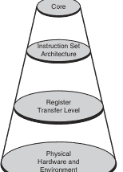

图1.1 探索嵌入式系统

计算核心是任何现代嵌入式应用中的中央硬件组件。它通常表现为微处理器、微控制器或微型计算机。偶尔，它可能表现为定制设计的VLSI电路或FPGA。它与系统的其余组件交互并利用它们来实现所需的应用。此类操作由一组软件和固件指令控制。信息和数据从周围环境和应用进入系统。这些数据根据软件指令进行处理，转换为发送回系统外部到应用的信号。软件和固件指令，以及进入或离开系统的信号，都存储在内存中。

### 1.3 核心级

- 输入，输出，
- 内存，数据通路，
- 控制

在顶层，我们从一个包含四个主要功能块（输入、输出、内存以及数据通路和控制）的模型开始，该模型描绘了嵌入式硬件核心和高层信号流。这些在图1.2中有所插图。虽然模型中没有任何固有的

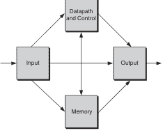

图1.2 嵌入式硬件核心的四个主要模块

- 内存
- 软件，固件
- 输入
- 输出
- 数据通路和控制
- CPU
- 中央处理器
- 总线
- 地址，数据，控制
- 位
- 宽度

内容要求使用微处理器，通常，一个用于计算和控制功能。

内存块用于保存我们称为软件和固件的程序指令集合，以及为输入数据、输出数据和计算的中间结果提供短期存储。数据以及其他类型的信号通过输入块从外部世界进入系统。一旦进入系统，它们可以被定向到任意数量的目标。输出块提供将数据或其他信号发送回外部世界的手段。数据通路和控制块，更常被称为中央处理器（CPU），协调系统的活动，并执行执行应用所需的计算和数据操作。在履行其职责时，CPU从内存中获取指令，对其进行解释，然后执行指令指示的任务。在此过程中，它可能从内存或输入块中检索更多数据。通常，它还会产生发送出系统的信息。

我们通过称为总线的路径将信号移入、移出或在系统内移动。在最常见的实现中，总线只是携带相关电信号从一个地方到另一个地方的导线集合。我们使用总线一词，以便可以将此类集合或组视为单个实体。流经构成总线的导线的信号分为三大类：地址、数据和控制。数据是被移动的关键信号；地址信号标识数据来自哪里以及要去哪里；控制信号指定和协调数据的传输方式。

将此安排想象成类似于你的电话。你拨号的号码是你的对话将被导向的地址，铃声是其中一个控制信号，指示你正在呼叫的人有来电。最后，你的声音或文本消息是你从你的位置移动到另一部电话对方的数据。与你的电话一样，承载信号的介质可以有多种形式：铜线、光纤电缆或电磁波。

在数字世界中，信号表示为二进制0和1的集合；此类集合的元素，即0和1，称为位。位只是一个取两个值之一的变量。在硬件级别，位可以由电信号表示：二进制0为0V，二进制1为5V。在光通信信道中，位也可以由光的存在或不存在来表示。

总线的宽度，即它可以同时携带的信号或位数，提供了信息移动速度的间接度量。在32位宽的总线上传输64位数据需要两次传输来移动数据。相比之下，仅8位宽的总线将需要八次传输来移动数据。图1.3说明了移动此类

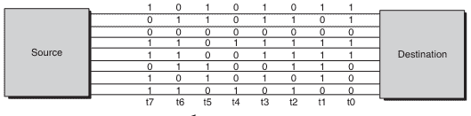

图1.3 8位总线上的数据移动


从源模块向目标模块通过8位总线传输一组数据。在模型中，每次传输需要一个时间单位；该过程从时间10开始，在时间7完成。时间向左增加。

以下C代码片段可能产生这样的模式，

```
for (i = 0; i < 8; i++)
    printf("%s", a[i]);
}
```

传输的源是八位值数组；目标可能是一个显示器。在图1.4中，我们细化高级功能图以说明典型的总线配置，包括地址线、数据线和控制线。

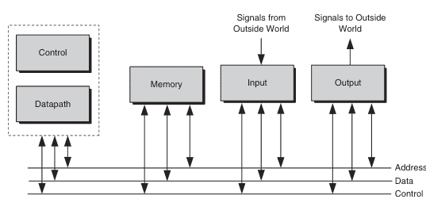

图1.4 包含地址、数据和控制信号的典型总线结构

总线宽度，地址总线，数据总线，控制总线

没有要求任何总线具有相同数量的线路。为了避免在图中包含构成总线的所有信号或导通路径而使图表杂乱，我们通常使用标注 /总线宽度/ 来标记总线宽度，如图1.5所示。在此示例中，地址总线显示有18个信号，数据总线16个，控制总线7个。

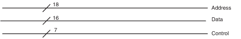

图1.5 识别总线中的信号数量

在实践中，此类框图将使用微处理器、微型计算机或微控制器来实现。让我们逐一查看这些内容，从微处理器开始，目的是了解每个的高级结构及其之间的差异。

#### 1.3.1 微处理器

微处理器是机器CPU部分（控制单元和算术逻辑单元）的集成实现；它通常简称为CPU或数据通路。微处理器在复杂性、功耗和成本方面有所不同。今天，微处理器的范围从仅有几千个晶体管且成本不到一美元的器件，到拥有500万至1000万个晶体管且成本数千美元的器件。

还可能发现机器内部架构的差异，包括内部寄存器的数量、机器的整体控制结构以及内部总线结构。寄存器是少量高速内存，用于临时存储经常使用的值，例如循环索引或缓冲区索引。越来越多地，特征冯·诺依曼机的内部单存储器方案正在让位于哈佛架构及其同时访问指令和数据的优势。

要实现完整的（嵌入式）计算机系统，我们还必须包括输入/输出子系统和（相对于微处理器的）外部存储器系统。我们还包括时钟或时序参考，作为计时、调度或测量经过时间的基础。所有这些组件都通过系统总线或总线连接。图1.6描绘了基于微处理器的系统的高级框图。

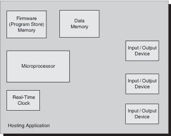

图1.6 基于微处理器的系统的框图

- 固件
- 数据存储
- 只读存储器
- ROM
- 随机存取存储器
- (RAM)

在微处理器外部，我们看到两个不同的存储器块。固件（或程序存储器）包含应用程序代码，而数据存储器包含正在被操作、发送到或从外部世界读取的数据。在嵌入式领域，我们将应用程序代码称为固件，因为它通常存储在只读存储器（ROM）中，而不是像桌面应用程序那样存储在硬盘驱动器上。数据存储器通常由随机存取存储器（RAM）组成。

> > 注意：两个独立的存储器块不会将架构从冯·诺依曼架构改为哈佛架构，除非有两条独立的总线将它们连接到处理器。

#### 1.3.2 微型计算机

微型计算机 微型计算机是一种完整的计算机系统，使用微处理器作为其计算核心。通常，微型计算机还将利用许多其他大规模集成（LSI）电路来提供必要的外围功能。与微处理器一样，微型计算机的复杂性各不相同，从在单芯片上实现并带有少量片上存储器和基本I/O系统的简单单元，到用大量强大的外围支持电路增强微处理器的复杂系统。当然，成本与功能相称。

#### 1.3.3 微控制器

微控制器 如图1.7所示，微控制器将微处理器核心和丰富的外设及I/O能力集成到单个集成电路中。此类添加通常包括定时器、模数转换器、数模转换器、数字I/O、串行或并行通信通道以及直接内存访问（DMA）。存储器子系统可能包含也可能不包含。如果未包含存储器，设计师必须在微控制器外部添加此类功能。微控制器在基本嵌入式应用中非常有用，其中低成本是一个重要约束。

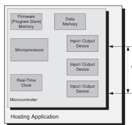

图1.7 基于微控制器的系统的框图

我们看到，我们拥有与基于微处理器的系统中相同的组件。然而，现在它们集成到一个单元中。

#### 1.3.4 数字信号处理器

数字信号处理器（DSP）除了我们讨论过的三种不同类型的通用计算引擎之外，一种称为数字信号处理器（DSP）的专用微处理器在嵌入式应用中变得越来越常见。DSP通常与通用处理器配合使用，以执行图像、语音、音频或视频处理等专用任务。DSP的代表性框图如图1.8所示。

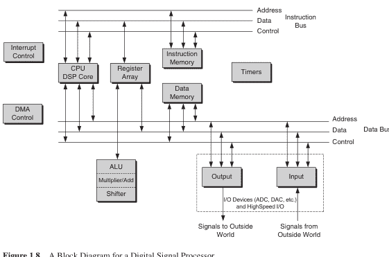

DSP执行的任务通常需要它与模拟世界进行接口。现实世界的模拟信号通过模数转换器捕获，进行处理，然后通过数模转换器返回。DSP的一大优势是其能够以每秒百万次操作的速度执行基本算术运算，例如乘法、加法和移位。为了支持高速算术运算，该器件通常会实现乘累加（MAC）原语，在其中乘法和加法到累加器在单个操作中完成，这在矩阵运算中很有用。其算术运算通常采用饱和算术，其中溢出（下溢）保持在最大（最小）值，而不是回绕。为了进一步支持高速信号处理，DSP器件的架构为哈佛架构而非冯·诺依曼机，并包含多个计算单元、大量寄存器和宽带高带宽数据总线。在深入研究硬件的下一级细节之前，让我们转向层次结构的另一端，检查我们在各种组件之间以及进出系统的一些信号。

### 1.4 表示信息

在任何嵌入式应用中，除了预期的数字、符号或字符之外，我们还必须能够表示固件指令以及这些指令可能正在操作的数据。由于这些指令存储在内存中，我们还需要能够表示存储数据和指令的内存地址。在接下来的几个部分中，我们将简要探讨如何表示这些不同类型的信息，以及使用此类表示时将遇到的限制。

#### 1.4.1 字长

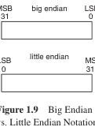

用于描述微处理器的术语之一是其字长。通常，微处理器中的字长指的是整数的大小。在本研究的其余部分，我们将假设我们正在使用字长为32位的微处理器。这种处理器称为32位机器。对于这样的系统，我们可以例如根据图1.9中看到的两种表示之一来解释无符号整数。

我们知道数据总线宽32位，总线上的每次传输将花费一个时间单位。如果我们检查字的格式，几点很明显。字由四个字节组成。位可以被解释为将最高有效字节放在左边，最低有效字节放在右边，或者反之。

> 重要点
> 
> 对位顺序的解释仅仅是一种解释。数字的构造中并没有任何固有的东西规定哪一端具有最高或最低有效位。

大端序 小端序

如图1.9上半部分解释的字被认为采用大端序格式编写，而如下半部分所示的字被认为采用小端序格式编写。不同的微处理器、操作系统和网络以不同方式解释此类字。在执行设计时，确定系统中每个组件使用哪种格式至关重要。在本文中，除非另有说明，我们将假设采用大端序解释。

### 1.5 理解数字

我们已经看到，在微处理器内部，我们没有无限数量的位来表示嵌入式应用中将要处理的各种数值信息。有限字长的限制可能对我们可能需要执行的任何数学运算的结果产生意想不到的后果。让我们探讨有限字长对这些运算中分辨率、精度、错误及其传播的影响。在嵌入式系统中，整数和浮点数通常表示为二进制值，并存储在内存或寄存器（小块内存）中。任何数字的表达能力取决于数字中的位数。虽然在极端情况下，数字可以作为大小为一的字的集合来存储和传输，但这种实现既不实用也不高效。归根结底，我们也有内存限制。


#### 1.5.1 分辨率

要开始理解这个问题，让我们考虑一个 4 位字。如果该字用于存储数字，则组成该字的位可以按多种方式解释，如表 1.1 所示。

| 解释 | 表达能力 |
|---|---|
| 整数 | 0–15 |
| 实数 | |
| xxx.x | 0–7.5 |
| xx.xx | 0–2.75 |
| x.xxx | 0–1.6875 |

如果将位解释为表示无符号整数，则该整数范围可从 0 到 15；分辨率为 2⁰。将数字解释为实数，其中 2 位用于小数部分，可提供两位分辨率。也就是说，我们可以将二进制数表示并分辨到 2⁻²。这种限制的含义在以下示例中可见。

### 示例 1.1

要使用具有 2 位分辨率的 4 位二进制数表示数字 2.3，最佳写法为 (10.10)₂ 2.5 或 (10.01)₂ 2.25。表达式中的误差将为 +0.2 或 –0.05。所有可分辨的内容为 ±0.25。

由于字长限制了表达数字的能力，最终，我们必须对数字进行四舍五入或截断，才能将其存储在内部内存中。因此，面对截断或四舍五入，人们可以问哪种方法提供更高的精度，哪种方法能对测量值提供最佳表示？哪种替代方案更准确或不那么准确？

让我们考虑一个实数 N。在将原始数字截断或四舍五入以适应微处理器字长后，该数字将具有 n 位的小数部分。最低有效位的值为 2⁻ⁿ。无论是四舍五入还是截断，结果数字都会有误差。图 1.10 中的图表绘制了原始数字与截断或四舍五入后的数字。

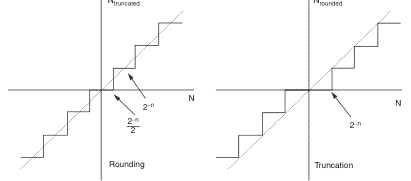

图 1.10 截断与四舍五入

操作后的误差计算如下

$E_R = N_{rounded} - N$ (1.1)

$E_T = N_{truncate} - N$ (1.2)

并如表 1.2 所示。

| | N | N_rounded | N_truncated | 误差 |
|---|---|---|---|---|
| 截断 | 0 | | 0 | 0 |
| | 2⁻ⁿ | | 0 | -2⁻ⁿ |
| 四舍五入 | 0 | 0 | | 0 |
| | ½ 2⁻ⁿ | 0 | | ½ 2⁻ⁿ |
| | ½ 2⁻ⁿ⁺ | 2⁻ⁿ | | ½ 2⁻ⁿ |

如图表和表格所示，操作产生以下误差范围

截断

$-2^{-n} < E_T \le 0$

四舍五入

$-\frac{1}{2}2^{-n} < E_R \le \frac{1}{2}2^{-n}$

请注意，误差的完整范围相同；但是，对于四舍五入的情况，误差分布更均匀，最大误差更小。

#### 1.5.2 误差传播

接下来，我们分析误差在处理过程中如何传播。我们从两个完美数字 N1 和 N2 开始。在截断下，误差小于 1 个最低有效位。

##### 1.5.2.1 加法

我们可以用带误差的数字表示为

$N_{1E} = N_1 + E_1$ (1.3)

$N_{2E} = N_2 + E_2$ (1.4)

$N_{1E} + N_{2E} = (N_1 + E_1) + (N_2 + E_2)$

$= N_1 + N_2 + E_1 + E_2$ (1.5)

结果和中的误差范围为

$-2 \cdot 2^{-n} < E_T \le 0 \Rightarrow 2^{1-n} < E_T \le 0$

请注意，结果误差是原始误差的（代数）和。

### 1.5.2.2 乘法

我们可以用带误差的数字表示为

$N_{1E} = N_1 + E_1$ (1.6)

$N_{2E} = N_2 + E_2$ (1.7)

$N_{1E} \bullet N_{2E} = (N_1 + E_1) \bullet (N_2 + E_2)$

$= (N_1 \bullet N_2) + (N_2 \bullet E_1) + N_1 \bullet E_2 + (E_1 \bullet E_2)$ (1.8)

如果忽略 $E_1 \bullet E_2$，则结果误差为

$(N_2 \bullet E_1 + N_1 \bullet E_2) \le E_T$

请注意，误差的大小现在取决于数字的大小。

为了进一步说明基本计算中的误差传播，请考虑图 1.11 中设计用于确定电阻负载功率的测量系统。电阻器中的功率是根据电阻器两端的电压降和通过该部件的电流计算得出的。这些测量值如下

```
E = 100 VDC ± 1%
I = 10 A ± 1%
R = 10 Ω ± 1%
```

电阻器 R 中耗散的功率可以用三种方式计算。理论上，它们应产生相同的结果。

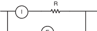

图 1.11 简单测量系统

在三种计算中，均忽略了低阶项；但是，这样做对最终结果的影响微乎其微。

```
EI = (100V ± 1%) · (10A ± 1%)
= ((1000 ± 10 · 1%)) ± ((100 · 1%) ± (1% · 1%))
= (1000 ± 1.1)
EI ⇒ 998.9 ⇒ 1001.1 (1.9)

I²R = (10A ± 1%) · (10A ± 1%) · (10Ω ± 1%)
= (100 ± (20 · 1%) ± (1% · 1%)) · (10 ± 1%)
= (100 ± 0.2) · (10 ± 1%)
= ((1000 ± 2) ± ((100 · 1%) ± (0.2 · 1%)))
= (1000 ± 3)
I²R ⇒ 997 ⇒ 1003 (1.10)

E² / R = (100V ± 1%) · (100V ± 1%)
R
= ((10000 ± 2%) ± (1% · 1%))
(10 ± 1%)
E² / R ⇒ 908.9 ⇒ 1111.3 (1.11)
```

三种计算的结果不仅得出三个不同的答案，而且，取决于使用哪种公式，误差大小也会有显著差异。

这些简单的例子非常直观地说明，在进行数学计算时，了解误差可能产生的位置、误差如何在数学运算中传播，以及此类现象如何影响任何计算非常重要。如果我们不小心，此类误差可能对任何应用程序的安全性造成严重后果。

### 1.6 地址

在早期的功能图以及微处理器的框图中，我们了解到信息存储在内存中。内存中的每个位置都有一个关联的地址，很像数组中的索引。如果数组有 16 个位置来存储信息，它将有 16 个索引。如果内存有 16 个位置来存储信息，它将有 16 个地址。通过提供地址来访问内存中的信息。当我们从编码字符开始时，每个地址都有一个唯一的二进制模式。地址从二进制 0 开始，范围延伸到字长允许的最大值。

对于 32 位字长，地址范围（十六进制）将从 00000000 到 FFFFFFFF。因此，使用 32 位，我们最多有 4294967296 个唯一组合，因此也有相同数量的可能地址。当然，您可能不会全部使用，但它们确实存在。图 1.12 说明了如果将位解释为表示地址，一个字可能是什么样子。事实上，地址与无符号整数没有任何不同，实际上它就是无符号整数。重要的是它不是有符号整数。微处理器不支持负地址。

以下 C 或 C++ 声明将整数值 10 以二进制形式放入内存中的某个位置。假设在地址 3000 处。

```
int myVar = 10;
int* myVarPtr = &myVar; // take the address of myVar
// assign it to the pointer variable myVarPtr
```

当系统解释时，代码片段指示系统预留另一个内存字来存储有符号整数 *myVar* 的地址（假设在地址 5000 处），并将 3000 放入该地址。地址 5000 处的 *值* 指向地址 3000。图 1.13 中的附带图示说明了这种安排。

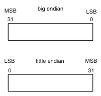

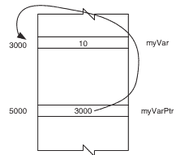

### 1.7 指令

我们想要对字采取的最后一种视角是将其视为指令。在我们研究的这个阶段，我们的考察将处于非常高的水平。随着我们学习的深入，我们将更详细地考察指令。

首先，我们规定指令的目的是指导微处理器的硬件执行一系列操作。此类操作可以包括：执行算术或逻辑计算、分配或读取变量的值，或将数据从一个位置移动到另一个位置，例如从输入到内存或从内存到输出。

在指令的术语中，此类操作称为操作。

指令操作的实体称为操作数。指令在任何时刻操作的操作数数量称为操作的元数。

让我们看看以下代码片段：

```
x = y + z;
```

这里有两个操作：加法操作和赋值操作。首先是加法操作：该操作在两个操作数 y 和 z 上执行。加法运算符被称为二元运算符——其元数为二。现在是赋值运算符：该操作通过将 x 赋予加法操作返回的值来执行。它也在两个操作数上执行，即加法结果和操作数 x——其元数也是二。

在 C 和 C++ 中，这两个运算符都被称为二元运算符。只接受单个操作数的运算符具有元数为一，被称为一元运算符。除一个例外外，C 和 C++ 中的所有运算符都是一元或二元。

我们看到，指令可能至少包含两个组件：操作和操作数。取决于操作的元数，指令可能有一个或两个操作数。让我们看看几个常见的 C 或 C++ 指令。

- 1. x = y;

该指令表达了基本的 C/C++ 赋值操作，其中操作数 y（源操作数）的值被赋给操作数 x（目标操作数）。

分析指令的格式，我们看到有两个操作数 x 和 y，因此运算符是二元运算符。这种指令因此被称为双操作数或双地址指令。

- 2. z = x + y;

该代码片段将两个操作数 x 和 y 相加；结果被赋给操作数 z。分析，我们看到有两个操作：加法操作和赋值操作。两者都是二元。

对于加法操作，操作数 x 和 y 是源，而（临时）结果是目标。转到赋值操作，加法的结果（目标）是赋值操作的源。操作数 z 是赋值操作的目标。


three operands three-operand instruction, three-address instruction

如果忽略短暂的中间结果，我们可以看到对于该代码片段，有三个操作数，x 和 y 是源操作数，z 是目标操作数。这种指令被称为三操作数或三地址指令。

- 3. x = x + y;

该代码片段正在将两个操作数 x 和 y 相加。结果被赋值给操作数 x。再次分析，我们看到有两个操作：加法操作和赋值操作。两者都是二元操作。

与之前一样，对于加法操作，操作数 x 和 y 是源操作数，（临时）结果是目标操作数。转到赋值操作，加法的临时结果的目标是赋值操作的源操作数。操作数 x 除了是源操作数之一外，也是赋值的目标。

我们看到一个操作数同时充当源和目标的双重角色。在这种情况下，它作为源所持有的值会因赋值而丢失。

one-operand one-address instruction

与之前一样，如果忽略短暂的中间结果，我们可以看到对于该代码片段，有两个操作数，x 和 y 是源操作数，x 也是目标操作数。这种指令被称为两操作数或两地址指令。

- 4. ++x OP x++;

在该代码片段中，请求的操作是递增变量的值。在这种情况下，变量 x 既是操作的源也是目标；我们只有一个操作数。这种指令被称为一操作数或一地址指令。

one-, two-, three-operand instruction

之前的代码片段说明了我们可能在系统软件或固件中找到的三类指令。这些类是一操作数、两操作数或三操作数指令。现在让我们看看如何解释 32 位字中的位以反映此类指令。任何此类解释都必须支持表达操作和操作数的能力，如图 1.14 所示。

| MSB 31 | 大端 | LSB 0 | LSB 0 | 小端 | MSB 31 |
|---|---|---|---|---|---|
| 操作 | 操作数0 | | 操作数0 | 操作 | |
| | 源和目标 | | 源和目标 | | |

| MSB 31 | 大端 | LSB 0 | LSB 0 | 小端 | MSB 31 |
|---|---|---|---|---|---|
| 操作 | 操作数1 | 操作数0 | 操作数0 | 操作数1 | 操作 |
| | 源/目标 | 源 | 源 | 源/目标 | |

| MSB 31 | 大端 | LSB 0 | LSB 0 | 小端 | MSB 31 | | |
|---|---|---|---|---|---|---|---|---|
| 操作 | 操作数2 | 操作数1 | 操作数0 | 操作数0 | 操作数1 | 操作数2 | 操作 | |
| | 源/目标 | 源 | 源 | 源 | 源 | 源/目标 | | |

图 1.14 表达指令

在图 1.14 中，我们看到在 32 位字中，位被聚合成组或字段。某些字段被解释为要执行的操作，而其他字段则被视为操作中涉及的操作数。此时，我们尚未指定每个字段包含多少位。此类决定是在微处理器架构和设计开发的早期阶段做出的。

用于标识操作的字段是最容易指定大小的。指定大小的第一步是决定微处理器要支持多少种不同的指令。此类指令可以包括算术操作（例如 add、subtract、multiply 或 divide）、逻辑操作（例如 or、shift、or、invert）、数据移动或控制流（例如 jump、function call 或 branch）。一旦指令数量确定，则为每个指令分配一个唯一代码，这与之前对字符进行编码时所做的完全相同。此类代码称为操作码或 op-code。如果微处理器要支持 128 条指令，则至少需要 7 位。设计师可以选择分配 8 位，以便为以后加入更多指令或支持增强版微处理器留出空间。

### 1.8 寄存器 – 初探

分配给操作数的字段大小并不复杂多少。然而，在回答问题之前，我们必须稍微扯一下题。对于那些已经开始预见到一个小问题的读者，你们是对的。我们一直在讨论如何将 32 位字解释为各种类型的数据（操作数），这些数据可以由用户选择的操作进行操作。如果一条指令（除了操作码之外，甚至包含一个操作数）是 32 位，那么 32 位数据将无法放入分配给操作数的任何字段中。为了解决这个看似棘手的问题，我们使用一种称为寄存器的硬件组件。寄存器是一种特殊的内存，足够大以容纳一个数据字。寄存器是一种短期内存，在指令执行期间临时保存操作数。

在执行指令之前，操作数会从内存移动到寄存器中，如果数据值在不久的将来不再需要，则再移回内存。虽然数据字在内存和寄存器之间不断移动似乎涉及大量额外工作，但与我们迄今讨论的内存相比，寄存器的更高速度可以显著提高系统性能。

取决于微处理器的架构，它可能只有少量寄存器——16 到 256 个——或者可能有超过 1000 个。前一类微处理器被称为复杂指令集计算机（CISC），后一类被称为精简指令集计算机（RISC）。虽然寄存器数量不是两种架构之间唯一的（或最显著的）区别，但它们对系统性能的影响可能是显著的。

现在我们可以检查寄存器在指令格式中所起的作用。指令中操作数字段的内容不是操作数；相反，它是一个二进制数，指示微处理器的哪个寄存器包含操作数。

让我们假设一个具有 144 条指令的假设微处理器。为了允许每条指令被唯一标识，我们将不得不指定操作码包含 8 位，因为 2^7 < 144 < 2^8。让我们进一步假设微处理器设计为包含 256 个寄存器。为了允许每个寄存器被唯一标识，也将需要 8 位。

我们之前用于各种指令格式的图表现在可以修改，以反映操作数字段的新解释，如图 1.15 所示。

两操作数和一操作数指令中的操作数字段足够大，可作为寄存器指示符提供超过 256 种组合；大多数组合将保持未使用。

图 1.16 总结了微处理器系统中字的大端解释。小端解释自然随之而来。

> **注意**
> 重要的是要理解，一组位本身没有固有含义。含义来自于我们对这些位的解释，这就是定义为类型信息的内容。

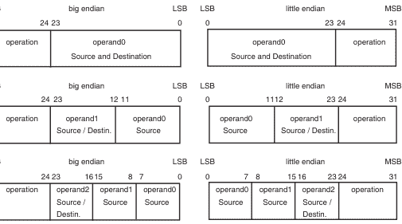

### 图 1.15 表达指令

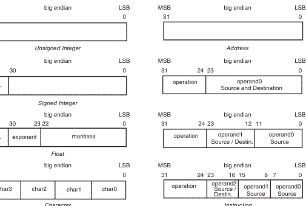

### 图 1.16 位集作为大端表示的可能解释。小端类似

### 1.9 嵌入式系统 – 指令集视图

嵌入式系统中的软件（固件）通常使用 C 或 C++ 等高级语言编写。在其他情况下，它可能使用称为汇编语言的语言编写，用于应用程序将要运行的机器。有时会两者结合使用，例如当程序的部分需要针对速度或大小进行优化时。

- 汇编语言
- 机器语言
- 指令集
- 指令集架构
- 机器码汇编器
- 微处理器汇编语言 IEEE 标准

使用汇编语言时，我们离微处理器的机器语言（控制指令执行期间硬件组件的 0 和 1 的集合）近了一步。在汇编语言级别，我们使用机器支持的指令集——即其指令集。

这样的集合驱动架构，即处理器底层硬件的设计。

该架构，即 ISA，为程序员提供了底层硬件的公共接口。

在汇编语言级别，助记符名称被赋予由操作码表达的二进制模式，以使它们更易于使用。用机器的汇编语言编写的程序由一种称为汇编器的软件工具翻译成机器码。因此，机器码反映了机器指令或操作码的二进制编码。ISA 的此类操作码集可以被视为该特定架构的机器语言。对于以下讨论，汇编语言指令取自微处理器汇编语言 IEEE 标准 – IEEE Std. 694–1985。汇编语言指令的完整列表以及如何使用它们在特定处理器的支持手册中给出。这些将由每个处理器的开发者提供。

#### 1.9.1 指令集 – 指令类型

微处理器的指令集指定了机器支持的基本操作。

- 传输 存储，操作，做出决策

从之前的功能模型中，我们看到此类操作的目标是传输或存储数据、对数据进行操作，以及基于数据值或操作结果做出决策。相应地，我们可以将指令分为以下几组：

- 数据传输
- 控制流
- 算术和逻辑

数据传输指令提供在系统内移动数据以及与外部设备（包括内存）进行交换的手段和机制。控制流指令确定构成嵌入式应用程序的指令的执行顺序。此类指令通常响应算术或逻辑操作产生的副作用。算术和逻辑指令提供了微处理器的大部分计算能力和有用功能。

#### 1.9.2 数据传输指令

数据传输指令负责在处理器内部移动数据，以及从外部世界导入数据或向外发送数据。每条此类指令


必须包含四个信息项：数据、数据的位置——传输源，以及数据将被发送的位置——传输目标。源和目标可以是以下任意一项：

- 寄存器
- 内存
- 输入或输出端口

如图 1.17 所示。

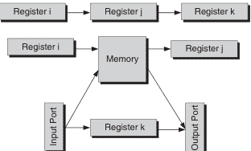

图 1.17 数据传输

用于支持此类数据传输的更常见指令包括图 1.18 中所示的那些。处理器设计不会同时实现 MOVE 和 LD/ST 对。为完整起见，两者在图中均有说明。

| LD 目标, 源 | 加载——源操作数传送到目标操作数，目标操作数可以是寄存器或内存位置。 |
| --- | --- |
| ST 源, 目标 | 存储——源操作数传送到目标操作数，源必须是寄存器，目标必须是内存。 |
| MOVE 目标, 源 | 从寄存器到寄存器或从内存到内存的传输。 |
| XCH 目标, 源 | 交换源操作数和目标操作数。 |
| PUSH/POP | 操作数被压入或弹出栈。 |
| IN/OUT 目标, 源 | 从输入/输出端口或向其传输数据。 |

图 1.18 数据传输指令

数据传输由使用我们之前讨论过的三种不同地址格式中的任意一种的指令支持。每条指令的操作码部分标识要对操作数执行的操作。实际选择操作数的路径由为操作数指定的寻址模式控制。

##### 1.9.2.1 寻址方式

通常，微处理器设计将实现 4–8 种不同的寻址方式。每个操作数字段的一部分被指定为硬件规范，用于说明如何解释或使用相关地址字段其余位中的信息。该规范称为操作数的地址模式。最终用于选择操作数的地址称为有效地址。

寻址方式被包含在指令中，以便为设计师在访问数据和控制程序执行流程方面提供更大的灵活性。但是，某些地址变体可能会影响程序流程以及单个指令的执行时间。当我们研究优化应用程序性能的方法时，将更详细地讨论这个问题。每种都由一个独特的二进制位模式标识，该模式被解释。图 1.19 中的图表细化了我们之前对每条指令格式的表达，以反映地址模式信息的包含。

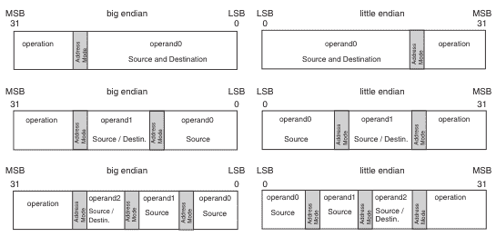

图 1.19 增强以包含地址模式信息的指令类型

更常用的寻址方式包括

- 立即
- 直接和间接
- 寄存器直接和寄存器间接
- 索引
- 程序计数器相对

我们将在即将到来的段落中检查每种模式。为了支持这五种模式加上直接/间接选择，与每个操作数地址关联的地址模式字段必须为 4 位宽。现在让我们检查每种寻址方式并识别其优缺点。

###### 1.9.2.1.1 立即模式

立即模式指令使用一个操作数字段来保存操作数的值，而不是对其的引用，如图 1.20 所示。此类指令的主要优点是减少了内存访问次数。取指令的同时取出操作数；不需要额外访问。如果立即操作数的值较小（例如循环索引或初始化值），此方案效果良好。

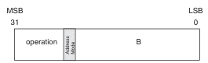

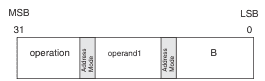

图 1.20 立即模式指令格式

立即指令可能表现为一操作数或二操作数指令，如图 1.20 所示。一操作数版本仅包含立即值。没有显式目标时，目标必须是隐含的。通常，这是算术逻辑单元（ALU）中的累加器。二操作数版本在 C 或 C++ 级和汇编语言级都说明了操作。在前一种情况下，变量 y 被声明并初始化为十六进制值 0xB。此类表达式被编译成所示类型的汇编语言语句。

汇编语言表达式中的立即值旨在是一个十六进制数，并通过数字上的 H 后缀指定。指令的第一种形式将 ALU 中的累加器作为隐含目标；在 C 或 C++ 级没有等价物。毕竟，开发人员在该级别不应了解累加器。第二种形式将 operand1 的值设置为十六进制值 B。

在某些处理器上，指令助记符指定操作使用立即操作数。在这种情况下，指令可以按图 1.21 所示编写。

| 指令 | 描述 |
| :--- | :--- |
| STI | 存储立即数 |
| LDI / LOADI | 加载立即数 |
| MOVI | 移动立即数 |

图 1.21 立即模式指令的变体

### 1.9.2.1.2 直接和间接模式

使用直接和间接寻址方式时，我们处理的是操作数地址而非操作数值。在这两种情况下，第一级地址信息都包含在指令中。两种模式的区别在于，在直接模式下，指令中操作数字段的内容是所需操作数的地址，而在间接情况下，该字段包含操作数地址的地址。在后一种情况下，操作数通过一级间接取出。由于操作数字段大小有限，可寻址的内存位置范围小于接下来讨论的寄存器直接和间接模式所能实现的范围。无论哪种模式，主要缺点都是取出操作数所需的额外内存访问。

直接，yPtr xPtr

图 1.22 中显示了两种不同的数据传输操作。对于直接操作，在 C/C++ 级，由一个变量 yPtr 指向的值被赋给由 xPtr 指向的第二个变量。在汇编语言级，MOVE 指令指示将 operand1 引用的内容复制到 operand0 引用的位置。

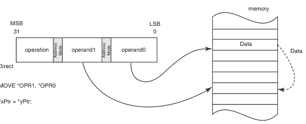

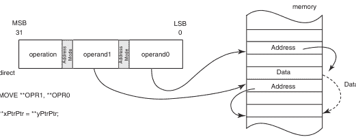

图 1.22 寄存器直接和寄存器间接指令格式

间接 yPtrPtr xPtrPtr

对于间接操作，在 C/C++ 级，存储在内存中并由指针变量 yPtrPtr 指向的一个变量的值，被赋给由第二个指针变量 xPtrPtr 指向的第二个变量。在汇编语言级，MOVE 指令现在指示一个内存位置的内容作为要分配给第二个操作数所标识的内存位置的操作数的内存地址。

间接访问模式中操作数前的双 ** 符号表明，需要两级间接才能到达内存中的最终操作数。

流程以及汇编和 C/C++ 级的两个代表性指令在图 1.22 中有说明。

### 1.9.2.1.3 寄存器直接和寄存器间接模式

寄存器直接模式和寄存器间接模式的区别在于被引用寄存器的内容。在前一种情况下，寄存器包含操作数的值；在后一种情况下，则是操作数的（内存中）地址。寄存器间接模式提供了一种轻松实现 C 和 C++ 中常用指针类型操作的方法。

间接寻址的主要缺点是需要额外的内存访问来检索操作数的值。相比之下，使用直接寻址时，操作数的值位于寄存器中。

图 1.23 中显示了两种不同的数据传输操作。对于寄存器直接操作，在 C/C++ 级，一个变量 y 的值被赋给第二个变量 x。在汇编语言级，我们假设 x 和 y 的值之前已分别存储在寄存器 R2 和 R3 中。MOVE 指令指示将 R3 的内容复制到 R2。

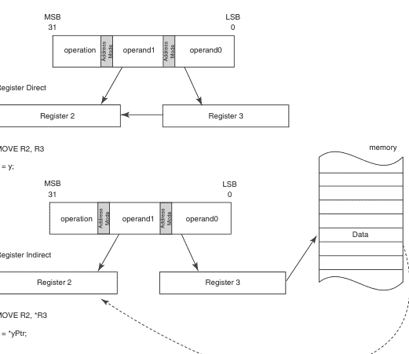

图 1.23 寄存器直接和寄存器间接数据传输操作


## 寄存器间接寻址 yPtr, x

对于寄存器间接操作，在 C/C++ 层面，一个存储在内存中并由指针变量 yPtr 指向的变量的值，被赋给第二个变量 x。在汇编语言层面，我们再次假设 x 和 yPtr 的值已分别预先存储在寄存器 R2 和 R3 中。MOVE 指令现在指示 R3 的内容作为内存中的地址；该地址处变量的值将被检索并复制到 R2 中。

如果两个操作数的值和寻址方式互换，数据传输将从 R2 到内存中由 R3 内容所指向的位置。

汇编层面和 C/C++ 层面的流程及两条代表性指令如图 1.23 所示。

间接指令中第二个操作数前的 * 表示汇编器应为该指令设置间接寻址模式。

## 索引，位移

## 1.9.2.1.4 索引模式

索引或位移寻址模式支持访问数组等容器类型数据结构。有效地址计算为基地址与索引寄存器内容之和。这里需要注意的是，指令执行后，基地址和索引值均不会改变。

索引寻址的主要缺点是计算操作数地址并从内存中检索值所带来的时间开销。与间接寻址相比，索引寻址对系统性能造成的负担更大。

图 1.24 说明了使用汇编层面和 C/C++ 层面编写的代码片段检索索引变量的过程。

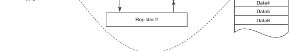

### 图 1.24 索引模式数据传输操作

从 C/C++ 层面开始，我们有一个名为 y 的数组变量和一个整数变量 x。变量 x 将被赋为数组第四个元素所包含的值。

在汇编层面，该 C/C++ 片段被翻译成一条三操作数指令。基寄存器 R2 将保存容器的起始地址，在此例中即名为 y 的数组的第 0 个元素的地址。变量 y 的值包含变量 Data() 的地址，即数组的起始位置。寄存器 R1 将充当索引寄存器，即提供偏移量。在汇编层面，我们假设寄存器 R1 已初始化为值 3，即容器中的偏移量。

执行指令时，R1 的内容与 R2 的内容相加，得到内存中的一个地址。计算地址处存储在内存中的数据值被检索并写入寄存器 R3。

## 1.9.2.1.5 程序计数器相对模式

请回顾，程序计数器包含内存中下一条要执行的指令的地址。也就是说，程序计数器相对寻址在机械上几乎与索引寻址模式相同。尽管如此，仍有几个重要区别。首先，程序计数器中的值作为基地址；其次，程序计数器被赋予计算出的有效地址的值；也就是说，程序计数器的内容会因执行指令而被修改。最后，添加到程序计数器的偏移量是一个有符号数。因此，添加偏移量后的 PC 内容可能指向比原始值更高（偏移量为正）或更低（偏移量为负）的地址。

图 1.25 说明了该指令的流程。对于此指令，operand0 充当索引寄存器，并保存其中已存储的值。有效地址通过将 operand0 标识的寄存器（在此例中为 R1）的内容与程序计数器的内容相加来计算。然后程序计数器内容被更新为新值，并现在指向计算地址处的指令。

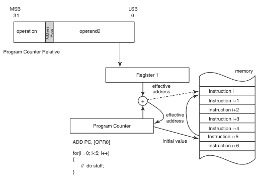

```
ADD PC, [OPR0]
for(i = 0; i<5; i++)
{
    // do stuff;
}
```

### 图 1.25 程序计数器相对操作

该 C/C++ 代码片段说明了一个简单的 for 循环。循环体执行后，流程必须返回循环顶部并再次测试循环变量。要实现该移动，必须向 PC 内容添加一个负偏移量。

PC 相对模式的缺点与索引模式中的缺点相似。系统性能可能会出现潜在下降。

## 1.9.3 执行流

执行流或控制流捕获嵌入式应用中固件所包含的每条指令的求值顺序。我们将这些识别为

- 顺序
- 分支
- 循环
- 过程或函数调用

并将逐一检查每种情况。

## 1.9.3.1 顺序流

顺序控制流描述了程序中的基本移动。程序中包含的每条指令按顺序逐一执行。应用程序中大量代码按顺序求值和执行，尽管各个序列可能相当短。我们在图 1.26 的随附图表、图 1.27 中的以下 C/C++ 代码片段以及图 1.28 的汇编代码中捕捉了这一概念。

执行首先为多个变量赋值，然后对这两个变量执行算术运算。

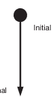

### 图 1.26 顺序流

```
a = 10;
b = 20;
c = a + b;
```

### 图 1.27 C/C++ 顺序流

```
MOVE R1, #AH; // puts 10 - hex A - into R1
MOVE R2, #14H; // puts 20 - hex 14 - into R2
ADD R3, R1, R2; // computes R1 + R2 and puts result into R3
```

### 图 1.28 汇编顺序流

## 1.9.3.2 分支

分支构造以一个决策点终止顺序控制流。在此点，基于对某个条件的测试结果，将采用几条替代执行路径中的一条。图形上，此类构造如图 1.29 所示。分支构造用于实现 if-else、switch 或 case 语句。

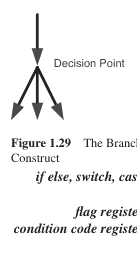

分支可以无条件执行，在这种情况下，PC 的内容将被操作数指定的有效地址替换。或者，分支可以基于对数据执行的操作的副作用，或两个变量之间多种不同比较（如相等、大于或小于关系、算术运算中的进位、或变量等于或不等于零）的结果而条件性地执行。

条件信息暂时作为标志寄存器或条件码寄存器中的一组位保留。寄存器中每个位的状态在每条指令执行后都会被求值并可能更改。图 1.30 列出了微处理器可能支持的一些条件。

| E, NE | 操作数 1 等于/不等于操作数 2。 |
| --- | --- |
| Z, NZ | 操作结果为零/非零。 |
| GT, GE | 操作数 1 大于或等于操作数 2。 |
| LT, LE | 操作数 1 小于或等于操作数 2。 |
| V | 操作导致溢出——结果大于目标所能容纳的大小。 |
| C, NC | 操作产生进位/无进位。 |
| N | 操作结果为负。 |

### 图 1.30 典型条件码

特定微处理器可能支持的分支替代方案如图 1.31 所示。

| BR label | 无条件分支到指定标签 |
| --- | --- |
| BE label, BNE label | 如果相等标志被设置或未设置，分支到指定标签 |
| BZ label, BNZ label | 如果零标志被设置或未设置，分支到指定标签 |
| BGT label | 如果大于标志被设置，分支到指定标签 |
| BV label | 如果溢出标志被设置，分支到指定标签 |
| BC label, BNC label | 如果进位标志被设置或未设置，分支到指定标签 |
| BN label | 如果负标志被设置，分支到指定标签 |

### 图 1.31 典型分支指令

if-else 构造通过图 1.32 中的以下 C/C++ 代码片段和图 1.33 中的汇编代码片段进行说明。


```
if (a == b)
    c = d + e;
else
    c = d - e;
```

### 图 1.32 C/C++ if-else 构造

```
CMP R2, R1    // compare the contents of R1 and R2, will set the equal flag
BE $1         // if the equal flag is set jump to $1
              // $1 is a label created by compiler
SUB R3, R4, R5 // compute d - e and put results in c
BR $2         // $2 is label created by compiler
$1: ADD R3, R4, R5 // computed e + d and put results in c
$2: ...
```

### 图 1.33 汇编 if-else 构造

## 1.9.3.3 If-else 构造

在图 1.32 的 C 代码片段中，会对两个变量进行比较。如果它们相等，则执行一个算术运算；否则执行第二个运算。

图 1.33 的代码片段说明了汇编中的该构造。我们假设变量 a–e 已经被放入寄存器 R1–R5 中。

如果原始源代码是用高级语言编写的，编译器会创建标签 $1 和 $2；如果原始源代码是汇编代码，则由设计者创建。

## 1.9.3.4 循环

循环构造允许设计者反复执行一组指令，要么永远执行，要么直到满足某个条件为止。如图 1.34 所示，是否在进入循环之前（入口条件循环）或在循环体求值之后（出口条件循环）对循环体进行求值的决定可以在循环进入前做出。在前一种情况下，代码可能根本不执行；而在后一种情况下，代码至少执行一次。这种循环类型的构造出现在 do、repeat、while 或 for 语句中。

- 入口条件
- 出口条件
- do、repeat、while、for

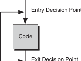

### 图 1.34 循环构造

图 1.35 和 1.36 中的 C/C++ 和汇编代码片段分别说明了 while 循环构造。

```
while (myVar < 10)
{
    index = index + 2;
    myVar++;
}
```

### 图 1.35 C/C++ 循环构造

```
$1: CMP R2, #AH       // test if R2 < 10
BGE $2               // if R2 greater than or equal to 10 branch to $2
ADD R3, #2H          // compute index + 2 put result in index
ADD R2, #1H          // add 1 to myVar
BR $1                // continue looping
$2: ....
```

### 图 1.36 汇编循环构造

只要循环变量小于指定值，循环体就会持续求值。此代码片段实现了一个入口条件循环。

myVar, index

假设变量 myVar 和 index 分别已被放入 R2 和 R3 中。

## 1.9.3.5 过程或函数调用

过程或函数调用是控制流构造中最复杂的一种。它并不更难，只是更为复杂。这种调用要求控制流离开当前上下文，执行一组指令，然后返回到原始上下文，如图 1.37 所示。这种构造出现在过程或子程序调用、中断处理程序或协程中。

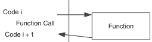

### 图 1.37 过程调用

该操作由图 1.38 给出的指令支持。

| CALL 操作数 | PC 无条件保存并由指定操作数替换；控制权转移到指定内存位置。 |
| RET | 先前保存的 PC 内容被恢复，控制权返回到之前的上下文。 |

### 图 1.38 常见过程调用指令

在我们研究 CALL 过程之前，需要引入一个称为栈的数据结构。

## 1.9.3.5.1 栈

栈是一个占用内存区域的数据结构。它具有有限大小并支持多种操作。其结构类似于数组，不同之处在于，与数组不同，数据只能在一个称为栈顶的位置进行插入或删除。栈顶相当于数组中的第 0 个索引。当插入新数据时，下面的所有内容都会被推下，就像自助餐厅里的一叠托盘，或者纸牌游戏中弃牌堆的最后一张牌。当删除数据时，下面的所有数据都会上移，同样像一叠盘子或新的顶牌。

- 栈顶
- push（入栈）、pop（出栈）

图 1.39 说明了多个数据操作的模型。数据插入称为 push，数据删除称为 pop。实际上，这种模型不切实际，因为每次新插入时都要移动每个数据，时间开销太大。更实际的实现是在结构的开放端添加或删除数据。反映当前栈顶的内存地址会被记住，并在每次添加或删除后修改。这样的地址称为栈指针。

- 栈指针

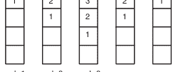

### 图 1.39 栈操作

图 1.40 展示了图 1.39 的修改版本，并说明了如何正确管理栈指针。

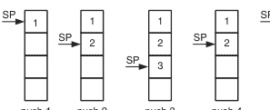

### 图 1.40 管理栈指针

## 1.9.3.5.2 PUSH（入栈）

push 操作将某物放入栈顶，以便稍后使用。从机械角度看，push 操作会递增栈指针所持有的地址，以指向下一个空位置（新的栈顶），然后将要存储的数据写入该地址指定的内存位置。如图 1.40 所示，为了便于实现，栈指针中包含的地址通常会从较低的内存地址递增到较高的内存地址。

## 1.9.3.5.3 POP（出栈）

pop 操作通过先检索栈指针所指定内存位置中的值，然后递减栈指针所持有的地址以指向下一个较低地址（新的栈顶），从栈顶取出某物。检索到的值作为 pop 操作的结果返回。

## 1.9.3.5 过程

现在让我们回到函数调用。从高层次来看，代码执行按顺序进行，直到遇到函数调用。控制流切换到函数，执行函数体中的代码，然后控制流返回到原始上下文，如图 1.41 所示。

```
3000 Code
3053 CALL F1(3)
3054 pop R2
3055 More Code
....
5000 code // Function Body....
5053 Return
```

### 图 1.41 函数调用构造

现在让我们更详细地研究该过程。在图 1.42 所示的代码片段中，程序最初被加载到内存中，并从地址 3000 开始执行。代码执行直到流程到达地址 3053，此时遇到函数调用。此时，图 1.42 所示的操作序列将发生。

- 1. 返回地址和参数被压入栈中。
  - 保存的地址是 3054。
  - 保存的参数是 3。
- 2. 函数体地址 5000 被放入 PC。
- 3. 地址 5000 处的指令开始执行。
- 4. 执行继续直到 5053。
- 5. 遇到返回
  - 栈获取
  - 返回值
  - 栈失去
  - 返回地址
- 6. 返回地址被放入 PC。
- 7. 控制流返回到地址 3054，栈顶被弹出并放入寄存器 R2。
- 8. 执行继续于 3055。

### 图 1.42 函数调用控制流

如果在函数 F1 中又遇到一个函数调用，将发生完全相同的过程。该过程可以重复多次；但是，我们必须意识到栈可能会溢出。如果压入栈中的内容太多，我们就会开始丢失信息，特别是返回地址。

## 1.9.3.6 算术与逻辑

算术和逻辑操作是影响处理器要做什么的基本要素。此类操作由构成 ALU 的多个硬件组件中的任何一个执行。图 1.43 展示了一个可能的功能性 ALU 架构的框图。

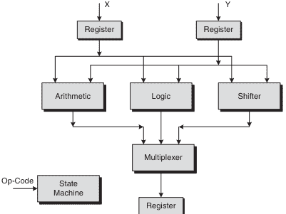

### 图 1.43 ALU 框图

数据被送入 ALU 并保存在局部寄存器中。操作码被解码，对所选操作数执行适当的操作，结果被放入另一个局部寄存器中。

## 1.9.3.6.1 算术

通常，处理器将支持四种基本算术功能：加、减、乘和除。更简单的处理器只实现前两种，将后两种留给设计者通过软件实现。加法和减法操作可能有两种版本：带进位和借位，以及不带进位和借位。

后两种版本旨在支持双精度操作。此类操作分两步执行：第一步计算保留任何进位（借位），然后将该值作为进位（借位输入）用于第二步。大多数此类操作仅实现以支持整数计算。如果支持浮点数学，可能会包含一个单独的浮点硬件单元。除了四种基本功能外，处理器还可以实现硬件自增和自减操作。


在指令集级别，典型的算术支持集将包含图 1.44 列出的功能。

| Instruction | Description |
| :--- | :--- |
| ADD2, ADD3 | // 两个或三个操作数的加法 |
| ADDC | 带进位加法 |
| SUB2, SUB3 | // 两个或三个操作数的减法 |
| SUBB | 带借位减法 |
| MUL | 乘法 |
| DIV | 除法 |
| INC | 自增 |
| DEC | 自减 |
| TEST | 操作数被测试并设置指定条件 |
| TESTSET | 原子测试并设置 |

图 1.44 典型算术指令

### 1.9.3.6.2 逻辑操作

逻辑操作对位或字的集合执行传统的二进制操作。此类操作在嵌入式应用中特别有用，因为在位操作很常见。此类操作将在我们研究嵌入式系统软件方面时详细讨论。逻辑指令集中包含的典型操作如图 1.45 所示。

| Instruction | Description |
| :--- | :--- |
| AND | 按位与 |
| OR | 按位或 |
| XOR | 按位异或 |
| NOT or INV | 取反 |
| CLR or SET | 清除或设置 |
| CLRC, SETC | 进位操作 |

图 1.45 典型逻辑指令

### 1.9.3.6.3 移位操作

逻辑、算术、旋转

移位操作通常对位或字的集合执行几种不同类型的移位。主要区别在于如何管理移位两侧的边界值。通常支持三种移位：逻辑移位、算术移位和旋转。任何移位都可以实现为向左移位或向右移位。

逻辑移位将 0 移入移位清空的位置；末尾的位被丢弃。向右的算术移位将（并保留）符号位传播到空出的位置；向左移位在右侧插入 0 并覆盖符号位。旋转移位根据向左或向右移位，将末尾位循环到右侧或左侧的空出位置。

移位指令集中的典型操作包括图 1.46 列出的那些。

| SHR operand, count | 逻辑右移 |
| SHL operand, count | 逻辑左移 |
| SHLA operand, count | 算术右移 |
| SHLA operand, count | 算术左移 |
| ROR operand, count | 向右旋转 |
| ROL operand, count | 向左旋转 |

图 1.46 典型移位指令

## 1.10 嵌入式系统 – 寄存器视图

在 ISA 级别，指令集指定了机器支持的基本操作——即从软件开发人员的角度看处理器的外部视图。在设计的早期阶段，它在机器架构的制定中起着重要作用。指令集表达了机器传输数据、存储数据、操作数据和做出决策的能力，所有这些都是机器能够执行其最终任务（即帮助解决问题）所必需的。

- 传输、存储、操作、决策
- 控制单元 数据通路
- 微操作
- 寄存器传输级硬件设计语言 (HDL)

指令集的基础是执行指令所指示操作所需的物理硬件。核心硬件包括控制单元和数据通路，如图 1.47 所示。

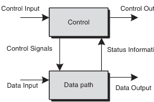

图 1.47 控制与数据通路框图

数据通路是寄存器的集合，以及对寄存器中保存的数据执行的一组相关微操作。控制单元指导微操作的有序执行，以实现数据所需的转换。因此，系统的行为（ISA 级别指令的执行）可以通过寄存器之间的数据移动、对寄存器内容执行的操作和转换，以及对这些移动和操作的管理方式来表达。指令级别上发现的数据操作在寄存器级别或 RTL 上有类似但更详细的一组操作作为对应。当我们研究嵌入式应用硬件组件的建模时，我们会发现最初在 RTL 级别工作是自然且方便的。这种方法容易过渡到硬件设计语言 (HDL) 实现。

### 1.10.1 基本寄存器

寄存器是一种能够保存一位或多位集合的存储设备。根据我们需要的详细程度，我们从多个角度看待寄存器，如图 1.48 和 1.49 的图所示。

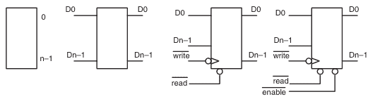

图 1.48 几个抽象级别的寄存器 – 并行数据输入

图 1.48 左侧的抽象视图显示一个简单的框，其中位被编号以反映寄存器的大小和输出。更精细/详细的视图显示输入和输出；这些视图可以进一步阐述以包含一些控制信号。数据以并行方式输入寄存器，如图 1.48 所示，或以串行方式输入，如图 1.49 所示。

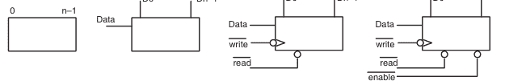

图 1.49 几个抽象级别的寄存器 – 串行数据输入

### 1.10.2 寄存器操作

寄存器支持两种基本操作：

- 读
- 写

递增/递减、计数、移位

这些操作在图 1.50 所示的时序图中说明；所有其他操作都基于这些操作。此类高级操作包括递增/递减、计数或移位。

### 1.10.2.1 写入寄存器

并行写操作在数据被放置到寄存器输入时开始。在延迟一段时间以允许数据在总线上稳定后，写信号被置位。对于串行写操作，写信号必须伴随每个输入的数据位。在图 1.50 所示的图中，写信号为低电平有效——这是典型的。每次写操作后，寄存器的内容会更改以反映输入数据的新值。

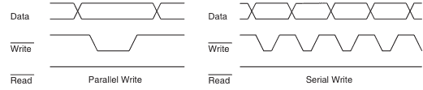

图 1.50 写入寄存器

### 1.10.2.2 从寄存器读取

读取操作如图 1.51 所示执行。发出读信号；经过一段延迟后，数据出现在寄存器输出上。在此示例中，读信号显示为低电平有效。

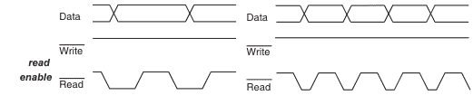

图 1.51 从寄存器读取

输出数据将是寄存器内容的副本；读取操作不会改变寄存器的状态。在某些设计中，当读信号未被置位时，寄存器的数据输出被禁用；在其他设计中，输出由使能控制信号禁用。

## 1.11 寄存器传输语言

在 RTL 级别，数据传输、数据操作和控制流使用寄存器传输语言来描述/指定。在该语言中，单个操作和传输使用寄存器传输表示法 (RTN) 来表达。表 1.3 总结了我们在后续讨论中将使用的 RTN 表示法。这种表示法在当代 HDL（如 Verilog 或 VHDL）中具有直接等价物，从而促进了从设计到实现的转换。

| Operator | Operation |
| :--- | :--- |
| ← | 从右侧传输到左侧 |
| → | 如果-那么操作 |
| [index] | 在索引处从内存中选择字 |
| <index> | 在索引或范围处从寄存器中选择位或多位 |
| i,j | 索引范围 |
| := | 文本替换 |
| # | 连接 |
| : | 并行操作分隔符 |
| . | 顺序操作分隔符 |
| @ | 复制 |
| { } | 关于操作的信息 |
| ( ) | 分组 |
| = ≤ < ≥ > | 比较运算符 |
| + − × ÷ | 算术运算符 |
| ∧ ∨ ¬ ⊕ ≡ | 逻辑运算符 |

表 1.4 说明了如何使用 RTN 表达 ISA 级别的代表性操作。

| Type | Instruction | ISA level | Register transfer level |
| :--- | :--- | :--- | :--- |
| 数据传输 | 移动寄存器 | MOVE R1, R2 | R1 ← R2 |
| | 从内存移动 | MOVE R1, memax | R1 ← (memax) |
| | 移动到内存 | MOVE memax, R1 | (memax) ← R1 |
| | 立即数移动 | MOVE R1, #DEAD | R1 ← #DEAD |
| 控制流 | 无条件分支 | BR $1 | PC ← $1 |
| | 条件分支 | BNE $1 | cond (PC ← $1) if(cond) PC ← $1 |
| 逻辑 | 累加器取反 | CMA | A ← ~A |
| | 与寄存器 | AND R1, R2 | R1 ← R1 ∧ R2 |
| | 或寄存器 | OR R1, R2 | R1 ← R1 ∨ R2 |
| | 移位寄存器 | SHL R1, #3 | R1 < 31-n..0>n@(0) R1 的内容将被 31-n..0 范围内的位替换，其中 n 是要移位的位数，且在右侧扩展 n 个 0 |
| 算术 | 带进位加寄存器 | ADDC R1, R2 | R1 ← R1 + R2 + C |
| | 清除进位 | CLRC | C ← 0 |
| 程序控制 | 不执行指令 | NOP | PC ← (PC + 1) |
| | 停止执行指令 | HALT | PC ← PC |


## 1.12 微处理器的寄存器视图

我们将在RTL级别上检查简单微处理器的数据通路和控制。我们将首先从寄存器角度查看构成数据通路的组件。然后，我们将通过研究此类机器的指令周期来查看此类数据通路的控制。

### 1.12.1 数据通路

图1.52表达了RTL级别简单微处理器的数据通路和存储器接口的架构。

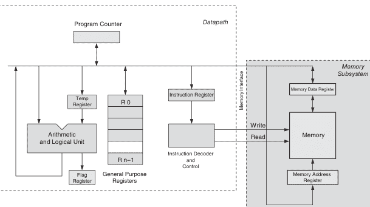

图1.52 微处理器数据通路和存储器接口的RTL模型

在图中，我们可以识别出最小寄存器集合，如图1.53所示。

| 程序计数器 – PC | 保存下一条指令地址 |
| 指令寄存器 – IR | 保存当前指令 |
| 通用寄存器 – R0–Rn–1 | 临时数据存储 |
| 存储器地址寄存器 – MAR | 读写操作期间保存地址 |
| 存储器数据寄存器 – MDR | 读写操作期间保存数据 |
| TR0 | ALU操作期间保存操作数 |
| TR1 | 保存算术运算的结果 |

图1.53 典型微处理器寄存器

### 1.12.2 处理器控制

微处理器数据通路的控制包括定义为指令周期的四项基本操作。这些步骤在图1.54中标识，并根据图1.55中的状态图进一步描述。

| 取指 | 取指令 |
| 译码 | 译码当前指令 |
| 执行 | 执行当前指令 |
| 下一条 | 计算下一条指令地址 |

图1.54 指令周期中的步骤

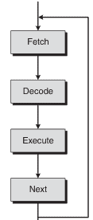

图1.55 指令周期

#### 1.12.2.1 取指

取指操作从内存中检索一条指令。该指令由其地址标识，即程序计数器PC的内容。因此，在ISA级别，取指操作写为

```
MOVE IR, *PC;
```

将程序计数器中包含的地址所标识的内存字移动到指令寄存器（IR）中。

- 取指
- 存储器地址寄存器，读
- 存储器数据寄存器
- 指令寄存器，取指

取指操作的第一步是将程序计数器（标识下一条指令地址）的内容放入存储器地址寄存器（MAR）。向内存发出读取命令，该命令检索寻址位置存储的指令并将其放入存储器数据寄存器（MDR）。然后将MDR的内容传输到IR。在RTL级别，取指分解为图1.56给出的步骤序列。

```
MAR <- PC; // PC enabled out to bus, MAR captures value
MDR <- Memory[MAR]; // contents of specified memory location placed into MDR
IR <- MDR; // MDR enabled out to bus, IR captures value
```

图1.56 取指指令的组件

此序列中的第二步从指定内存位置执行读取操作。底层硬件将生成读取控制信号并管理底层时序。

#### 1.12.2.2 译码

当指令中的操作码字段从指令中提取并由指令译码器解码时，执行译码步骤。该信息转发给控制逻辑，控制逻辑将启动指令周期的执行部分。

#### 1.12.2.3 执行

根据操作码字段中包含的值，控制逻辑执行执行指令所需的步骤序列。图1.57和1.58给出了两个示例。

```
// C Instruction
*Ptr = y;
// ISA Level Instruction
ST R1, R2;
// RTL Level Instructions
MAR ← R1; // R1 enabled out to bus, MAR captures value
MDR ← Memory[MAR]; // contents of specified memory location placed into MDR
R2 ← MDR; // MDR enabled out to bus, R2 captures value
```

图1.57 执行序列

```
// C Instruction
*Ptr += *yPtr;
// ISA Level Instruction
ADD R3, R1, R2;
// RTL Level Instructions
// Assume that R2 and R3 already contain the desired addresses in memory
TR0 ← R1; // R1 enabled out to bus, TR0 captures value
MAR ← R2; // R2 enabled out to bus, MAR captures value
MDR ← Memory[MAR]; // contents of specified memory location placed into MDR
TR1 ← TR0 + MDR; // MDR enabled out to bus, ALU adds TR0 and MDR places result in TR1
MAR ← R3; // R3 enabled out to bus, MAR captures value
MDR ← TR1; // TR1 enabled out to bus, MDR captures value
Memory[MAR] ← MDR; // contents of MDR placed into specified memory location
```

图1.58 执行序列

将寄存器的内容存储在内存的命名位置中。
将寄存器的内容与内存中存储的一段数据相加，并将结果
放回内存，但位置不同。

#### 1.12.2.4 下一条

要执行的下一条指令的地址取决于要执行的指令类型，以及可能取决于最近完成的指令修改的条件标志状态。归根结底，大多数情况归结为向PC代数加上一个值。对于短跳转，位移可能包含在指令的一个操作数字段中；对于长跳转，该值可能包含在指令之后的内存位置中。

因此，在ISA级别，*next*操作的多个版本写为

```
ADD PC, offset;
```

代数修改PC最好通过使用ALU中的一个算术函数来完成。当控制逻辑将所需偏移量放入ALU的临时寄存器时，操作开始。接下来，PC的输出被定向到另一个ALU输入。执行ADD指令，结果写入PC。控制逻辑可以直接将特定值放入PC，因为目标地址通常包含在指令中。

在RTL级别，*next*步骤分解为图1.59给出的步骤序列。

```
// Assume the offset is contained in the instruction
TR0 ← IR.m..m;    // offset field of instruction enabled out to bus, TR0 captures value
TR1 ← TR0 + PC;   // PC enabled out to bus, ALU adds TR0 and PC
PC ← TR1          // TR1 enabled out to bus, PC captures value
```

图1.59 下一条序列

图1.60中的Verilog程序实现了本节开头介绍的简单CPU的部分数据通路和控制的行为模型。寄存器数量已减少，仅实现了两条指令，且寻址模式字段支持四种不同的模式。尽管如此，该架构实现了一个可工作的系统。包含了CPU的测试平台和测试器。

```verilog
#define TRUE 1'b1
#define FALSE 1'b0
/*

instruction format 32 bit word
31..24 op-code
23..22 address mode field operand 1
21..12 operand 1
11..10 address mode field operand 0
9..0 operand 0

all registers are 32 bits
*/

// Build a test bench to test the design
module testBench;

wire [31:0] pc; // connect the pc
wire [31:0] ir; // connect the ir
wire clock; // connect the clock
hal0 aComputer (pc,ir,clock); // build an instance of the computer
test1 ttest1(clock, pc, ir); // build a tester

endmodule

// Test module
module test1(clock, pc, ir);
// declare the input and output variables
input [31:0] pc; // program counter
input [31:0] ir; // instruction register
output clock; // system clock
reg clock; // system clock

parameter halfPeriod = 1;

initial
clock = 0;

// manage the clock
always
begin
#(halfPeriod) clock = -clock;
end

// manage the display and look for changes
always @ (posedge clock)
begin
$monitor ($time, ", pc = %h ir = %h", pc, ir); // record only changes
#(10*halfPeriod); // let clock cycle a couple of times
#(halfPeriod); // needed to see END of a simulation
$stop; // stop so user can look at waveform
$finish; // exit
end

endmodule
```

图1.60 简单CPU的数据通路和控制模型


```
// The Computer - HaLO
module ha10 (pc, ir, clock);

// declare the I/O and registers
input     clock;
output  [31:0] pc;
output  [31:0] ir;

reg   [31:0] m   [0:15];    // 16 x 32 bit memory
reg   [31:0] pc;    // 32 bit program counter
reg   [31:0] acc;    // 32 bit accumulator
reg   [31:0] ir;    // 32 bit instruction register
reg   [31:0] r[0:7];    // 8 32 bit general purpose registers
reg    notDone;    // flag to end program
integer  i;

// define op-codes
parameter add   = 8'h01;    // 8 bit add op-code
parameter move  = 8'h05;    // 8 bit move op-code
parameter done  = 8'hff;    // 8 bit done op-code

// define address mode field values
parameter dir   = 2'b00;
parameter ind   = 2'b01;
parameter imm   = 2'b10;
parameter pcr   = 2'b11;

// define registers
parameter r0    = 32'h0;
parameter r1    = 32'h1;
parameter r2    = 32'h2;
parameter r3    = 32'h3;
parameter r4    = 32'h4;
parameter r5    = 32'h5;
parameter r6    = 32'h6;
parameter r7    = 32'h7;

// initialize the system
initial
begin
    pc = 0;    // pc <- 0
    acc = 0;    // acc <- 0
    notDone = TRUE;    // initialize notDone flag

// define the instruction rom
// enter some instructions into memory
m[0] = 32'h05000803;    // r0 <- 0x3
m[1] = 32'h05001802;    // r1 <- 0x2
m[2] = 32'h01001000;    // r1 <- r1 + r0
m[3] = 32'hFFFFFFFF;    // done - end of program
m[4] = 32'h00000000;
m[5] = 32'h00000000;
m[6] = 32'h00000000;
m[7] = 32'h00000000;

ir = m[pc];        // fetch operation - get first instruction
end

// run the program
always
while (notDone == TRUE)
begin
    @(posedge clock)    // control system timing
    case({i[31:24]})    // decode operation
        move:           // move op-code
        begin
            $display("\nMove");    // annotate execution
            case({i[11:10]})      // check address mode
                dir:    $display("\ndirect");
                ind:     $display("\nindirect");
                imm:    // implement immediate mode move
                begin
                    $display("\nimmediate");    // execute operation
                    if (i[21:12] == ) ir[9:0];   // rx <- aValue
                    $display("\n register value %h", r[{i[21:12]}]);
                end
            endcase
            pcr: $display("\n pc relative");
        endcase
    end
    add:            // add op-code
    begin
        $display("\nadd");
        case({i[11:10]})
            dir:    // register direct
            begin
                $display("\ndirect");    // execute operation
                // rx <- rx + ry
                if (i[21:12] == ) r[{i[21:12]}] += r[{i[11:0]}];
                $display("\n register value %h", r[{i[21:12]}]);
            end
            ind:    $display("\nindirect");
            imm:    $display("\nimmediate");
            pcr:     $display("\npc relative");
        endcase
    end
    default: $display("\nIllegal op-code trap");    // identify illegal op-codes
endcase
pc = pc+1;            // next operation compute next address
ir = m[pc];            // fetch operation
if ({i[31:24]} == done)    // check for end of program
end
notDone = FALSE;        // done
```

## 1.13 总结

我们介绍了嵌入式应用计算核心的高层视图，然后通过几个细节层级递增的层次对该核心进行了细化。我们观察到，这样的核心通常表现为微处理器、微型计算机或微控制器。我们简要地考察了每一种，识别了各自的基本元素，并了解了它们之间的差异。我们从功能层级开始介绍和研究了计算核心的架构，功能层级由四个主要模块组成——输入、输出、内存和CPU——以及总线作为四个模块之间交换信息的手段。

然后，我们转向光谱的另一端，了解各种基本信息（数字、字符、地址和指令）在数字系统内部是如何表示的。在指令的基础上，我们了解到指令集驱动或定义了计算机的架构，以及该架构如何被细化并随后在寄存器层级表达。我们将这两个层级指定为计算机的ISA层级和RTL。

在ISA层级，我们考察了数据和信息在机器内部是如何表达的，不同的指令格式，以及当代计算引擎通常支持的不同寻址方式。

在RTL层级，我们介绍了寄存器、基本寄存器操作以及用于在RTL层级表达操作的RTN。然后，我们将CPU分解为控制和数据通路组件。我们介绍了指令周期，并考察了其取指、译码、执行和下一指令组成部分如何在ISA和RTL层级上都能表达。

最后，我们给出了一个简单数据通路的行为级Verilog实现。

## 1.14 复习问题

### 硬件方面

- 1.1 从计算核心开始，一直到完整系统及其环境，本章识别了嵌入式系统的一系列视图层次。请识别并简要描述每个视图。
- 1.2 识别并简要描述构成计算核心的主要功能模块。
- 1.3 计算核心的主要模块是如何互连的？
- 1.4 在计算核心的主要模块之间流动的信号的主要类别有哪些？
- 1.5 总线宽度一词是什么意思？
- 1.6 描述微处理器一词的含义。请具体说明。
- 1.7 描述微型计算机一词的含义。请具体说明。
- 1.8 描述微控制器一词的含义。请具体说明。
- 1.12 小端序和大端序这两个术语是什么意思？它们为什么重要？
- 1.13 表示浮点数时，必须捕获的基本组成部分有哪些？
- 1.14 当我们说二进制数的表示具有四位分辨率时，是什么意思？
- 1.15 超过微处理器字长的数字可能会被截断或舍入。哪种方式会产生更大的误差？
- 1.16 当对带有误差的数字进行算术运算时，误差会反映在计算结果中。如果数字相加（相减）、相乘或相除，该误差会如何影响结果？
- 1.17 字母数字字符和符号在微处理器内部是如何表示的？
- 1.18 地址在微处理器字中是如何表示的？

### 信息表示

- 1.9 在嵌入式应用中，我们必须能够表示哪些类型的信息？
- 1.10 在嵌入式应用中，我们关心的数字的两种基本分类是什么？
- 1.11 我们如何区分有符号整数和无符号整数？

### 指令

- 1.19 指令用于指导微处理器执行某个操作。微处理器指令的主要组成部分有哪些？
- 1.20 什么是指令的目数（操作数个数）？
- 1.21 请解释一操作数、二操作数或三操作数指令的术语。
- 1.22 请解释一地址、二地址或三地址指令的术语。
- 1.23 操作码一词的含义是什么？
- 1.24 操作码的用途是什么？

### 指令集视图

- 1.25 请解释指令集和ISA这两个术语。
- 1.26 称为汇编器的软件工具的用途是什么？
- 1.27 机器码一词是什么意思？
- 1.28 微处理器指令可以分为三大类。这些类别是什么？请描述每组指令的特征。
- 1.29 识别可能作为数据传输指令源或目的的硬件组件。
- 1.30 指令的寻址方式传达什么信息？
- 1.31 请识别并简要描述本章讨论的更常用的寻址方式：
- 1.32 寻址方式信息是如何包含在指令中的？
- 1.33 请解释执行或控制流一词的含义。
- 1.34 嵌入式程序中执行流的四大类别是什么？简要描述每个类别的含义。
- 1.35 标志或条件码寄存器的用途是什么？
- 1.36 入口条件循环和出口条件循环有什么区别？

## 1.15 思考题

### 硬件方面

- 1.1 嵌入式系统中使用了三种计算引擎。每种的优缺点是什么？
- 1.2 在什么情况下应该考虑使用微控制器？微型计算机？微处理器？请详细解释你的答案。
- 1.3 讨论宽内部系统总线与窄内部系统总线的优缺点。
- 1.4 系统总线的地址部分和数据部分是否必须具有相同的位数？更宽的地址总线有什么优缺点？数据总线呢？
- 1.5 在某些设计中，地址和数据信号被复用到同一组总线上。这种方案有什么优缺点？
- 1.6 讨论冯·诺依曼机与艾肯机相比带来的益处和劣势。
- 1.37 请识别并描述执行函数或过程调用所需的步骤。请准确说明。
- 1.38 什么是栈？
- 1.39 可以对栈执行的主要访问操作有哪些？
- 1.40 称为栈指针的变量的用途是什么？
- 1.41 ALU的功能是什么？

### 寄存器视图

- 1.42 微处理器指令集底层是实现硬件。该硬件的核心组件有哪些？
- 1.43 RTL表达式是什么意思？微处理器的RTL视图与ISA级视图有何关系？
- 1.44 什么是寄存器，它在微处理器中的作用是什么？
- 1.45 可以对寄存器执行哪些基本操作？
- 1.46 寄存器传送语言和RTN的用途是什么？
- 1.47 请识别并简要描述通常在微处理器数据通路中会找到的寄存器。
- 1.48 微处理器数据通路的控制由称为指令周期的四个操作组成。请识别并描述每个操作。

### 信息表示

- 1.7 数据字中可以存储的信息量有哪些限制？
- 1.8 宽字长与窄字长之间的权衡是什么？
- 1.9 如果系统总线宽度为1字节，32位字如何通过总线传输？
- 1.10 如果嵌入式系统围绕16位字设计，是否可以支持32位浮点数？如果可以，如何实现？如果不可以，为什么？
- 1.11 识别使用无符号整数的几个原因。
- 1.12 如果嵌入式系统的字长为16位，为什么还要使用字节？无符号字节？
- 1.13 如果嵌入式核心实现为大端序机器，如何与小端序外围设备通信？
- 1.14 为什么数据字需要类型信息？


1.15 浮点数的隐藏位格式免费提供了一位额外的精度。有人建议应用相同的技术来获得两位额外的精度。你对这个想法有什么看法？它有什么问题吗？

## 指令

1.16 指令的基本组成部分是操作码和要对其执行操作的操作数。操作码是否总是需要包含相同数量的位？为什么或为什么不？

1.17 本章讨论了一地址、二地址和三地址指令。是否可能存在零地址指令？这种设计有什么好处？

1.18 如何在指令中实现双重间接寻址？

## 指令集视图

1.19 指令必须传达的四个主要信息是什么？这些信息是如何传达的？

1.20 本章讨论了几种不同的寻址方式。你能想到其他可能有用的寻址方式吗？

1.21 指令机器码表示中的位是任意的，还是具有特定含义？如果有含义，可能是什么？

1.22 微处理器指令可以分为三大类。这些类别是什么？请描述每组指令的特点。

1.23 如果指令包含内存中操作数的地址，如果源或目标是微处理器上的输入或输出端口，如何传达操作的源或目标？

## 1.16 问题

- 1.1 将以下十进制数表示为指定的进制。

  十进制：1011, 23.4, 207, 111.439

  - (a) 二进制
  - (b) 八进制
  - (c) 十六进制
  - (d) 二进制编码十进制（BCD）

- 1.2 将以下二进制数表示为指定的进制。

  二进制：101101011, 1101.11001, 1001001110, 111.001

  - (a) 十进制
  - (b) BCD

1.24 如果有人有一个在摩托罗拉处理器上运行的嵌入式程序的汇编代码清单，该程序能在高级微设备（AMD）处理器上运行吗？

1.25 如果有人有一个在摩托罗拉处理器上运行的嵌入式程序的 C 代码清单，该程序能在 AMD 处理器上运行吗？

1.26 请从指令集角度解释分支类型指令的工作原理。

1.27 指令如何知道如何或在哪里访问标志或条件码寄存器？

1.28 讨论当指令译码器在指令中发现它不认识的操作码时的处理方法。

## 寄存器视图

1.29 RISC 架构通常比 CISC 设计包含更多的寄存器？为什么？

1.30 解释为什么寄存器访问通常比内存访问快。

1.31 解释索引类型指令如何在寄存器级别实现。

1.32 来自多个源的数据如何传输到同一个寄存器中？

1.33 讨论使用锁存器与触发器构建寄存器的优缺点。

1.34 对于在一个寄存器到另一个寄存器之间传输数据，三态门与传统多路复用器门相比有哪些优缺点？

- 1.3 将以下十六进制数表示为指定的进制。

  十六进制：B3D9, CA43, 1234, 5D.06F

  - (a) 十进制
  - (b) BCD
  - (c) 二进制

- 1.4 将以下十进制数表示为指定的进制。

  十进制：12.34, 9503.313

  - (a) 二进制
  - (b) 十六进制

- 1.5 以以下格式将你的名和姓表示为 ASCII 字符：

  givenName familyName

  ASCII 字符应以二进制形式编写，并存储以使用最少数量的 16 位字。查看网站 http://asciitable.com/ 了解 ASCII 字符集。

- 1.6 以下数据存储在内存的前 32 个位置中，如所示。

| 内存地址 | 值 |
|---|---|
| 00000 | 0000010 |
| 00001 | 0101001 |
| 00010 | 1000001 |
| 00011 | 0101111 |
| 00100 | 0001111 |
| 00101 | 0000011 |
| 00110 | 1110101 |
| 00111 | 1101001 |
| 01000 | 1111101 |
| 01001 | 0001111 |
| 01010 | 0011101 |
| 01011 | 0001011 |
| 01100 | 0000001 |
| 01101 | 0101111 |
| 01110 | 0101001 |
| 01111 | 0100011 |
| 10000 | 0000010 |
| 10001 | 0001101 |
| 10010 | 0111101 |
| 10011 | 0111001 |
| 10100 | 1101001 |
| 10101 | 0011101 |
| 10110 | 0000001 |
| 10111 | 0001111 |
| 11000 | 0011111 |
| 11001 | 0010001 |
| 11010 | 0111101 |
| 11011 | 1001101 |
| 11111 | 1010101 |

(a) 请识别以下十六进制地址处的字。

12, F, 1E, 7, 1C

(b) 请给出内存中以下字的十六进制地址。1100101, 0010111, 0100011, 0111101

- 1.7 我们有以下 C 代码片段：

```c
unsigned char a = 0xD3;
char b = 'A';
int c = 6;
int d = 9;
int e = -31564;
unsigned int f = 0xFAD7;
float g = 3.1;
float h = 0.0345;
int j;
int* cPtr = &c;
int* dPtr = &d;
int** ccPtr = &cPtr;
int** ddPtr = &dPtr;
float* gPtr = &g;
float* hPtr = &h;
```

| 变量 | 内存地址 | 值 |
|---|---|---|
| | 00000 | 1000 |
| | | 1001 |
| | | |
| | | |
| | | |
| | | |
| | | 2000 |
| | | 2001 |
| | | |
| | | |
| | | |
| | | |
| | | 3000 |
| | | 3001 |
| | | |
| | | |
| | | |
| | | |
| | | 4000 |
| | | 4001 |
| | | |
| | | |
| | | |
| | | |

- (a) 请将所有变量的值以二进制形式放入内存中。假设字长为 16 位，并采用大端字节序。
- (b) 执行以下代码片段后，内存中的值会如何变化？

```
e = e + f;
*gPtr = *gPtr + *hPtr;
j = **ccPtr - **ddPtr;
```

- 1.8 将以下每个浮点数转换为二进制。假设字长为 16 位，最低有效位的权重为 2^-7。转换后，每个数的误差是多少？

- (a) E = 72.23
- (b) F = 121.034
- (c) G = 98.6
- (d) H = 43.612

- 1.9 使用问题 1.8 中的数字和误差，执行以下计算。每个计算的最坏情况误差是多少？

- (a) E + F + G + H
- (b) E*F
- (c) G*H
- (d) (G*H)/(E + F)

- 1.10 请在执行以下每条指令后，显示栈的内容、栈指针（SP）的位置以及指示寄存器的内容。指令按顺序执行。

最初，寄存器包含以下值 R0 = 1234，R1 = 2345，R2 = 4567，R3 = 8901。对于双操作数指令，假设左操作数也是目标。

| PC | 指令 |
| :--- | :--- |
| FACE | ADD R3, R1 |
| FACF | PUSH R2 |
| FAD1 | POP R3 |
| FAD6 | ADD R1, R2 |

| 寄存器 | | 栈 |
| :--- | :--- | :--- |
| R0 | | |
| R1 | | |
| R2 | | |
| R3 | | |
| PC | | |

| 寄存器 | | 栈 |
| :--- | :--- | :--- |
| R0 | | |
| R1 | | |
| R2 | | |
| R3 | | |
| PC | | |

| 寄存器 | | 栈 |
| :--- | :--- | :--- |
| R0 | | |
| R1 | | |
| R2 | | |
| R3 | | |
| PC | | |

| 寄存器 | | 栈 |
| :--- | :--- | :--- |
| R0 | | |
| R1 | | |
| R2 | | |
| R3 | | |
| PC | | |

| 寄存器 | | 栈 |
| :--- | :--- | :--- |
| R0 | | |
| R1 | | |
| R2 | | |
| R3 | | |
| PC | | |

- 1.11 使用本章介绍的汇编语言指令，编写一个程序来解决以下问题。
\[
\left( \frac{(A \cdot B)}{(C - D)} \right) \cdot E
\]

变量 A–E 已经存储在寄存器 R1–R5 中。结果应放入寄存器 R6。你不得更改寄存器 R1–R5 中存储的内容。

- 1.12 如果处理器包含变量的地址而不是变量的值，问题 1.11 中的程序会如何变化？

- 1.13 给定以下内存位置、值，以及一台带有累加器（累加器为默认目标）的一地址机器，以下指令将加载什么值到累加器中？假设 R1 和 R3 分别包含值 0x5000 和 0x3000。

| 内存位置 | 内容 | 累加器 |
|---|---|---|
| 1000 | 2000 | |
| 2000 | 3000 | |
| 3000 | FACE | |
| 4000 | 5000 | |
| 5000 | 1000 | |

```
MOVE R1 5000
LOADI 0x5000
MOVE *R1
LOADI 0xFACE
MOVE *R2 3000
```

- 1.14 给出了典型嵌入式处理器的部分规格说明：

- 16 位架构 – 16 位宽数据字。
- 20 位指令。
- 8 个通用寄存器。
- 一地址、二地址和三地址指令。
- 每个地址字段由一个 2 位字段限定，用于识别以下四种不同的寻址方式中的任意一种：寄存器直接、寄存器间接、PC 相对、索引。

(a) 请给出该机器一地址、二地址和三地址指令的格式。请注意，指令宽度与数据宽度不同。这不是问题。

(b) 请使用你设计的格式，展示以下指令如何实现。

ADD2, SUB2, MUL, DIV
opcodes: 0001, 0010, 0011, 0100
分别。
对两个操作数进行加、减、乘、除运算。
MOVE opcode: 0101
将一个字从内存移动到寄存器。
将一个字移动到寄存器中包含的内存地址位置。
JUMP opcode: 0110
跳转到一个位置。
BR, BE opcodes: 00111, 01000
将一个 16 位整数加载到寄存器中。
CMP opcode: 01001

比较两个操作数并设置适当的条件码。

CALL, RET opcodes: 01010, 01011
PC 被替换为指定地址，控制权转移到该地址。
控制权返回到调用上下文。

- 1.15 我们有以下微处理器要求。

假设处理器具有 32 位指令。让每个寄存器操作数地址由一个 5 位地址字段指定，并由一个 2 位字段限定，用于识别以下四种不同的寻址方式中的任意一种：寄存器直接、寄存器间接、PC 相对、索引。

假设需要 K 条双操作数指令和 L 条零操作数指令（例如 HALT）。

- (a) 计算机最多可以提供多少条一地址指令？
- (b) 给出零地址、一地址和二地址指令的格式。这些指令如何区分？
- (c) 使用你的格式，以下指令将如何表示：
  - 将一个字从内存移动到寄存器。
  - 将一个字移动到寄存器中包含的内存地址位置。
  - 跳转到一个位置。
  - 对两个操作数进行加、减、乘、除运算。
  - 将整数 99 加载到寄存器中。
  - 从键盘读取。

- 1.16 考虑计算机的以下状态：

```
Register R1 contains 800
Register R2 contains 3000
Memory location 1000 contains 2000
Memory location 2000 contains 3000
Memory location 3000 contains 1000.
```

所有数字均采用十六进制表示。

对于以下三条指令，每条均从上述初始状态开始执行。

- (a) 执行每条指令的效果是什么？
- (b) 每条指令占用多少个字？
- (c) 每条指令的取指和执行需要多少次内存访问？

假设每条指令彼此独立

```
MOVE *R2, R1 // move R1 to what R2 is pointing at
MOVE *R2, 1800(R1) // move the contents of the memory location // indexed by R1 to what R2 is pointing at
MOVE *R2, #DEAD // move the constant // DEAD to what R2 // is pointing at.
```


## 1.17 在问题1.15的微处理器上执行的嵌入式应用程序需要执行以下计算：

Z = W₁×Y₁ + W₂×Y₂ + W₃×Y₃

针对内存位置 Z₁, W₁, Y₁, W₂, Y₂, W₃ 和 Y₃ 的内容。位置 W 或 Y 的内容均不得被破坏。

- (a) 为上述任务编写一个直线程序。
- (b) 在同一台计算机上为同一任务编写一个循环程序。
- (c) 计算每个程序所需的主存访问次数（读或写操作）。包括获取和执行指令所需的所有访问。例如，指令：

```
MOVE Ri, Rj
```

需要两次内存访问：一次是将指令从主存读入微处理器，另一次是将 Ri 中包含的主存位置的操作数读入微处理器。

## 1.18 在某些计算机中，子程序链接以以下方式实现。调用子程序指令将返回地址（调用程序中的下一条指令）存储在子程序的第一个位置，然后分支到第二个位置，子程序的执行从该位置开始。

- (a) 定义一条从子程序返回的合适指令。
- (b) 你将如何在调用程序和子程序之间传递参数？
- (c) 上述链接是否支持子程序嵌套？为什么或为什么不支持？
- (d) 上述链接是否支持递归？为什么或为什么不支持？

## 1.19 基于图1.52给出的微处理器数据通路RTL模型和表1.4给出的RTL操作，请确定执行该微处理器上的以下指令时，指令周期各阶段所包含的必要步骤：

```
// add the contents of the value
// contained in the register R3 to
// the contents of the memory
// location pointed to by R2 and
// put the results into R4.
add R4, R3, *R2;
```

## 1.20 我们有以下C代码片段，它为数组的每个元素加一。

```
int a[4] = { 1, 2, 3, 4 }; // declare an array
// of integers
for i ;
for ( i = 0; i < 4; i++)
a[i] = a[i] + 1; // add to each
// element of the array
```

- (a) 使用你在问题1.15中开发的指令，将给定的代码片段翻译成汇编语言。
- (b) 使用表1.4给出的RTL操作，将汇编语言翻译成RTL级。
- (c) 使用你在问题1.15中开发的指令和部分(a)中的汇编语言，将代码片段翻译成机器码。

## 1.21 被称为艾肯或哈佛架构的架构使用独立的数据存储器和独立的指令存储器。

- (a) 请与普林斯顿架构相比，列出哈佛架构的两个优点和两个缺点。请准确回答。
- (b) 对于以下C++代码片段，x和y的值应存储在哪个存储器（指令存储器还是数据存储器）中？请解释原因。

```
int x = 3;
int y = 4;
x = x + y;
```

- (c) 使用以下内存图，请将x和y的值放置到适当内存的相应位置中。*

| | 指令存储器 | |
|---|---|---|
| 内存位置 | 内存地址 | 内容 |
| | | |
| | | |
| | | |
| | | |
| | | |
| | | |

| | 数据存储器 | |
|---|---|---|
| 内存位置 | 内存地址 | 内容 |
| | | |
| | | |
| | | |
| | | |
| | | |
| | | |

| | 数据存储器 | |
|---|---|---|
| 内存位置 | 内存地址 | 内容 |
| | | |
| | | |
| | | |
| | | |
| | | |
| | | |

- (d) 以下汇编代码指令是单地址、双地址还是三地址指令？请解释你的答案。

```
LOADI Ri, #constant // load the constant
                    // into Ri
LOADI *Ri, #constant // load the constant
                     // into what Ri is
                     // pointing to
ADD2 Ri, Rj         // add the contents of
                    // Ri to Rj and place
                    // the result in Ri
ADD2 *Ri, *Rj       // add the contents of
                    // what Ri is pointing to
                    // to what Rj is pointing to
                    // and place the result in
                    // what Ri is pointing to
```

- (e) 使用上述指令，完成以下代码片段以实现部分(b)中的加法操作。

| LOADI | | |
|---|---|---|
| LOADI | | |
| ADD2 | | |

- (f) 使用以下内存图，请将你在部分(e)中编写的指令放置到适当内存的相应位置中。

| | 指令存储器 | |
|---|---|---|
| 内存位置 | 内存地址 | 内容 |
| | | |
| | | |
| | | |
| | | |
| | | |
| | | |
| | | |
| | | |
| | | |

- (g) 请为上述加法指令提供一种格式。解释你实现中每个字段的用途。
- (h) 请列出在哈佛机器上执行上述部分(e)中的加法指令所需的所有步骤。在描述中引用架构图的具体部分。

## 1.22 设计了一台计算机，它使用一组特殊寄存器 R50-R53，而不是堆栈，来向子程序传入和传出数据。堆栈仅用于保存返回地址。堆栈指针保存在特殊寄存器 SP 中，程序计数器保存在寄存器 PC 中。该机器有四个通用寄存器 R0-R3。该机器有一个状态标志 equal，如下所示，每条指令执行时大约会被置位或复位。为这样的机器编写一个例程 exp(num, pow)，计算 num^pow 并返回该值。

- (a) 请编写调用此类例程的详细伪代码，假设它是从某个高级函数调用的。请务必识别所有步骤。
- (b) 请使用以下指令编写实现此类序列所需的汇编语言步骤序列。

```
LOAD Ri, Rj     // Ri <- Rj, sets the equal
                // flag true if Ri contains 0
LOAD Ri, #val   // Ri <- #val, sets the
                // equal flag true if Ri
                // contains 0
BE @Ri          // jumps to address
                // contained in Ri if the
                // equal flag is true
BNE @Ri         // jumps to address
                // contained in Ri if the
                // equal flag is false
MUL Ri, Rj      // Ri <- Ri * Rj, sets the
                // equal flag true if Ri
                // contains 0
DIV Ri, Rj      // Ri <- Ri / Rj, sets the
                // equal flag true if Ri
                // contains 0
```

```
ADD2 Ri, Rj    // Ri <- Ri + Rj, sets the
               // equal flag true if Ri
               // contains 0
```

```
PUSH Ri        // stack <- Ri
POP Ri         // Ri <- stack
```

```
SUB2 Ri, Rj    // Ri <- Ri - Rj, sets the
               // equal flag true if Ri
               // contains 0
```

```
INC Ri         // Ri <- Ri + 1
DEC Ri         // Ri <- Ri - 1, sets the
               // equal flag true if Ri
               // contains 0
```

- (e) 使用 num 为 20、pow 为 3 的值，请在假设已执行你识别的步骤序列的情况下，指示以下各寄存器在指示执行点处的内容。同时指示栈顶。

假设原始函数调用位于内存地址 3050，子程序位于内存地址 5000。

### 函数调用前

| PC | |
|---|---|

| 通用寄存器 | SP寄存器 | 堆栈 |
|---|---|---|
| R0 | RS0 | |
| R1 | RS1 | |
| R2 | RS2 | |
| R3 | RS3 | |

### 函数调用后

| PC | |
|---|---|

| 通用寄存器 | SP寄存器 | 堆栈 |
|---|---|---|
| R0 | RS0 | |
| R1 | RS1 | |
| R2 | RS2 | |
| R3 | RS3 | |

### 返回前

| PC | |
|---|---|

| 通用寄存器 | SP寄存器 | 堆栈 |
|---|---|---|
| R0 | RS0 | |
| R1 | RS1 | |
| R2 | RS2 | |
| R3 | RS3 | |

### 返回后

| PC | |
|---|---|

| 通用寄存器 | SP寄存器 | 堆栈 |
|---|---|---|
| R0 | RS0 | |
| R1 | RS1 | |
| R2 | RS2 | |
| R3 | RS3 | |


## 硬件篇 – 第2部分：组合逻辑 – 实用视角

### 需要关注的事项 ...

- 逻辑器件的输出拓扑。
- 实际考量 – 逻辑电平、驱动能力、上升和下降时间以及传播延迟。
- 实际信号质量的基本概念
- 影响数字信号质量的根本问题。
- 竞争条件与冒险。
- 对寄生元件及其对数字电路影响的理解与建模。
- 实际考量 – 信号边沿、铃响、耦合、上升和下降时间、传播延迟。
- 竞争条件与冒险。
- 组合逻辑电路中的常见故障。

### 2.1 引言

上一章从计算核心的自顶向下视角以及构成该核心所用信息的比特和字节的自底向上视角，介绍了嵌入式应用的硬件侧。该层级的另一种视角是从物理组件的角度出发，这些物理组件将高层设计概念和比特与字节转化为可运行的应用。数字硬件是所有嵌入式系统设计中必不可少的组件。与此同时，在当今的系统中，如果没有伴随的软件和固件，硬件几乎毫无用处。本章和下一章的目标是为在嵌入式世界中使用数字电路的实际方面提供坚实基础。后续章节将用软件/固件侧来丰富和补充硬件侧，然后将两者合并为安全、可靠、可信的实际应用。

当我们专注于数字硬件、软件和固件时，有时会忘记在我们所有的0和1之下，同样存在一个模拟世界。在这个世界中，我们所使用的电压和电流，以及我们将其转换为软件比特和字节的信号，并不总是稳定或准确的。在这个世界中，信号在通过门电路、触发器、阵列逻辑和微处理器时会产生延迟。要能够设计和构建在各种实际应用中都能工作的健壮、生产级应用，理解这个世界如何影响组件和系统是至关重要的。

建模与仿真是当今系统设计过程中的关键步骤。人们常常会听到另一种观点，认为随着功能强大的可编程逻辑元件的快速发展，我们很快就能快速综合设计并直接尝试，而不必浪费时间进行仿真。毕竟，我们不是已经在软件中这样做了吗？需要牢记的重要一点是，如果我们只需完成一个设计并用一组元件使其工作，那么这种方法可能是合理的。不幸的是，并非所有元件（即使来自同一制造商 – 即使日期代码相同）都是相同的；每个元件都略有不同。元件和子系统可能以许多意想不到的方式相互作用。软件不会老化。它不受制造公差、基本电气物理、湿度、温度或电磁辐射的影响。建模与仿真使我们能够快速且廉价地将设计中关键的（这里通常是硬件）部分置于此类实际现象之中。我们在上一章中介绍了寄存器传输级（RTL）的建模。在本章和下一章中，我们将更接近构成RTL器件和控制的门电路和触发器。我们对嵌入式系统物理层面的讨论将假设读者对布尔代数和逻辑简化技术有扎实的理解，并熟悉基本的小规模和中规模逻辑器件及器件系列。

本章首先对物理世界中的逻辑信号电平、其变化性以及噪声对这些信号的影响进行考察。在设计并大规模生产新系统时，这种理解至关重要。接下来将研究逻辑器件驱动其他器件的能力。当我们在模块内互连组件以及与其他模块或系统进行接口时，我们经常会使用此类知识。

随后，我们从静态世界进入动态世界，了解到逻辑信号不会立即改变状态，并且它们在系统中以不同的速率传播。使用Verilog硬件描述语言（VHDL），我们学习在不同抽象层级上对（部分）设计进行建模，以便在综合之前的设计生命周期中研究并考虑此类实际效应。深入现实世界，我们探讨了被动寄生元件——电阻、电容和电感——对我们设计的一阶和二阶影响。最后，通过研究组合逻辑电路中的常见故障以及如何开始测试此类电路来结束本章。

### 2.2 现实世界门电路概览 – 第1部分：信号电平

当我们开始使用逻辑门来实现设计时，首先看到的是它们所执行的功能。接下来的视角必须是它们的电气和机械特性：它们有多大、耗散多少热量、消耗多少功率、速度有多快、驱动其他部件的能力、对其他部件呈现的负载类型、输出幅值以及对输入信号的要求。

在哲学和逻辑的世界里，谈论真理与虚假的概念是合理的。归根结底，如果我们要构建电路和系统来实现逻辑关系，就必须能够用可测量的现实世界量（如光子、电压或电流）来表达这些概念。此外，我们还必须能够设计和

#### 2.2.1 逻辑电平

在我们的方程中，处理的是逻辑0或逻辑1。在物理器件中，这些值由不同的电压或光强度水平（或其他几种度量之一）表示。今天，我们通常定义：

```
Logical 0 as 0 volts
Logical 1 as +5 volts
```

更新的逻辑，包括我们称为绿色逻辑（通过消耗更少功率来帮助环境）的逻辑，开始采用较低电平的信号传输。

如今，由于嵌入式应用中使用的器件和逻辑系列种类繁多，不同逻辑器件之间接口的问题变得越来越复杂。在本讨论中，我们将假设信号电平为0.0或5.0 VDC（直流伏特）。此处讨论的概念可以轻松地缩放到任何电平。

```
Logical 0 as 0 volts
Logical 1 as +1.5 or 3.0 volts
```

高速系统如果还必须容忍潜在的电气噪声污染，将采用差分信号传输。在这些情况下，信号电平可能遵循某些国家或国际标准，也可能是设计特有的。

在纸上，逻辑电平始终精确处于其定义值，且从不受环境或制造过程的影响。然而，在使用实际器件时，逻辑1从不精确为5.0 VDC，逻辑0也从不精确为0.0 V。如果逻辑高电平过低，可能会被解释为逻辑0。同样，如果逻辑低电平过高，可能会被解释为逻辑1。因此，电路将为逻辑1（逻辑0）指定最小（最大）值。集成电路在生产线上大批量制造。由于没有任何生产线能生产出完全相同的器件，因此在不同日子、不同供应商或同一供应商的不同生产线上生产的器件，其各种参数值总会存在微小差异。任何设计都必须考虑到此类差异；此类参数值的规格及其变化范围在供应商的数据表中给出。

由于参数值会有变化，供应商将根据参数的性质指定一个*典型*值和一个*最小*或*最大*值。为了了解这是如何工作的，让我们假设参数值的变化服从高斯分布或正态分布。从供应商的数据表中，我们获取了针对74LS04反相器的表2.1中给出的信息。

| | 最小 | 典型 | 最大 |
|---|---|---|---|
| VOH | 2.5 | 3.4 | |
| VOL | | 0.2 | 0.4 |
| VIH | 2.0 | | |
| VIL | 0.8 | | |


让我们现在将两个反相器连接到图 2.1 中的简单电路中，例如我们可能在系统总线上的信号路径中发现的那样。

请注意，门上的气泡位置用于反映每个器件上逻辑信号的状态。左侧图示说明了供应商指定的高电平输出电压 VOH 和相应的高电平输入电压 VIH 的范围——箭头右侧的那些值。右侧图示说明了低电平输出电压 VOL 和相应的低电平输入电压 VIL 的指定值范围——箭头左侧的那些值。

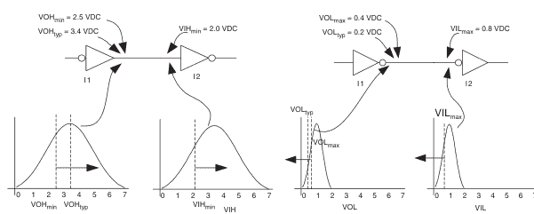

## 图 2.1 器件输入和输出上的逻辑信号电平变化

左侧图示说明高电平输出电压 VOH typ 的典型值为 3.4 VDC，并保证逻辑 1 绝不会低于 2.5 VDC（VOH min）。因此，所有大于 VOH min 的值都应被解释为有效的高电平输出。我们还看到，器件保证将低至 2.0 VDC（VIH min）的所有电压解释为有效的高电平输入。

右侧图示说明了低电平输出及相应输入的相同关系。左侧反相器输出的逻辑 0 具有典型低电平输出电压 VOL typ 为 0.2 VDC，且保证逻辑 0 绝不会高于 0.4 VDC（VOL max）。因此，所有小于 VOL max 的值都应被解释为有效的低电平输出。对于反相器 I2，我们看到器件保证将高达 0.8 VDC 的任何电压解释为有效的低电平输入（VIL max）。

最小保证输出高电压与最小可接受输入高电压之间的差值称为器件的高电平抗噪声能力或噪声容限。保证的最大输出低电压与最大可识别输入低电压之间的差值称为低电平抗噪声能力或噪声容限。这些规格确保，当驱动器件的最小输出信号为 2.5 VDC 时，接收器件可容忍其输入上高达 0.5 VDC 的噪声，并仍将信号解释为逻辑 1。

当驱动器件的最大输出信号为 0.4 VDC 时，接收器件可容忍其输入上高达 0.4 VDC 的噪声，并仍将信号解释为逻辑 0。根据供应商数据表中的数值，我们计算

```
0.5V of high noise margin
0.4V of low noise margin
```

最小输入高电平电压与最大输入低电平电压之间的区域是未知区域。供应商不会对器件在此区域的行为做出任何保证。

我们可以以图形方式表示这些值，如图 2.2 所示。

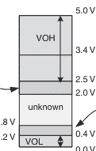

## 图 2.2 逻辑信号电平的最小值和最大值

### 2.2.2 初探逻辑门内部

当今的集成电路使用多种不同的技术和器件架构来实现各种逻辑器件。各种器件之间更显著的差异之一源于所使用的两种主要半导体技术：双极技术和金属氧化物半导体（MOSs）技术。前者利用双极晶体管实现所谓的晶体管-晶体管逻辑（TTL），后者利用场效应晶体管（FETs）实现 MOSs 和互补金属氧化物半导体（CMOS）逻辑。

- 双极技术
- MOS 技术
- 晶体管-晶体管逻辑（TTL）
- 场效应晶体管（FETs）
- 金属氧化物半导体（MOS）
- 互补对称金属氧化物半导体（CMOS）
- 图腾柱（totem pole）

我们可以将反相器建模为串联的两个开关，如图 2.3 所示。深入器件内部，我们看到这些开关所建模的逻辑行为源于实现逻辑输出部分的配置。采用任一技术实现的逻辑门都使用以图腾柱模式结构化的输出网络。这种配置在展示各技术输出网络的图示中有所说明（图 2.4 和 2.5）。

采用 TTL 构建的器件系列的基本输出结构如图 2.4 所示。尽管基本实现技术有许多变体（标准 TTL [如图所示]、肖特基、低功耗肖特基以及次要衍生物），但架构保持不变。

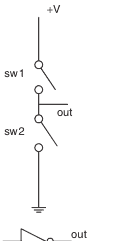

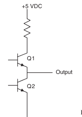

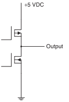

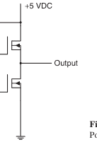

## 图 2.5 CMOS 和 NMOS 图腾柱输出配置

在图 2.5 中，左侧电路展示了 CMOS 配置。架构仍然是图腾柱结构。上方晶体管是 PMOS（P 型金属氧化物半导体）器件，下方是 NMOS（N 型金属氧化物半导体）器件。右侧电路中展示的 NMOS 器件是 CMOS 器件的简单修改。上方晶体管被替换为作为负载器件实现的第二个 NMOS 晶体管。它们是 P 沟道和 N 沟道的简称。顶部晶体管在器件输出为逻辑 1 时能够源电流，且底部晶体管在输出为逻辑 0 时能够沉电流的能力，称为器件的驱动能力。

### 2.2.3 扇入与扇出

- **扇出源**：典型门在不降低其指定最小和最大输出逻辑电平的情况下能够驱动的器件数量称为器件的扇出。器件的扇出指定了器件在逻辑高状态下能够向其他器件源出的电流以及在逻辑低状态下从其他器件沉入的电流。扇入是衡量器件输入电流要求的指标。
- **沉电流，扇入源**：它指定了当输入处于逻辑 0 状态时器件向其他器件源出的电流，以及当输入处于逻辑 1 状态时从其他器件沉入的电流。
- **沉电流器**：
- **源电流**：
- **沉电流**：

当电流离开器件（驱动器或接收器）时，称为源电流；当电流进入器件（驱动器或接收器）时，称为沉电流。我们将离开器件的电流定义为负值，进入器件的电流定义为正值。这是一种任意但一致的标记。我们可以在图 2.6 中看到这些情况。


## 图 2.6 源电流和沉电流

在第一种情况中，反相器 Inv1 向 Inv2 源出电流，而 Inv2 正在沉入该电流。相对于 Inv1，电流 I 将为负值；相对于 Inv2，它将为正值。在第二种情况中，角色互换；Inv1 正在沉入电流（将被视为正值），该电流由 Inv2 源出（将被视为负值）。再次，我们使用门上的气泡来指示逻辑 0 状态。

器件的数据表将在表 2.2 中给出规格。

| | 电流 | 电压 |
|---|---|---|
| IOL | 8 mA（进入） | @ VOL = 0.5 VDC |
| IOH | -400 µA（离开） | @ VOH = 3.4 VDC |
| IIL | -400 µA（离开） | @ VIL = 0.4 VDC |
| IIH | -20 µA（进入） | @ VIH = 2.7 VDC |

从数据表出发，可以计算 SN74LS04 器件的扇出。在计算器件扇出时，必须考虑两种情况：输出处于逻辑 0 状态和输出处于逻辑 1 状态。在指定器件扇出时，我们始终使用两个值中较低的一个。

### 逻辑 0 状态

当输出处于逻辑 0 电平时，数据表规定器件可以沉入 8 mA，而当输入处于逻辑 0 电平时，它源出 –400 µA。因此，当其输出处于逻辑 0 状态时，SN74LS04 可以从 20 个类似器件中沉入电流。

```
fan-out = | 8 mA / -400 µA |
= 20
```

### 逻辑 1 状态

当输出处于逻辑 1 状态时，数据表规定器件可以源出 –400 µA，而当输入处于逻辑 1 时，它沉入 20 µA。


fan-out = \left| \frac{-400 \, \mu\text{A}}{20 \, \mu\text{A}} \right| = 20 \quad (2.2)

因此，当其输出处于逻辑1状态时，SN74LS04可以向20个类似器件提供电流。

在此例中，两种配置的扇出相同。如果数值不同，我们将选择较小的值，如下例所示。

## 示例 2.1

在图2.7的电路中，标识为驱动器的器件其输出连接到发光二极管（LED）电路，同时还向若干其他门电路扇出。


**图 2.7** 一个器件驱动多种不同类型的负载

当器件输出为逻辑0时，警告LED应点亮，电流按图2.7中的箭头所示方向流动。当驱动器门输出为逻辑1时，警告LED熄灭，LED中无电流流过。

器件的规格如下：

| 器件 | 规格 | 条件 |
|---|---|---|
| 反相器 | I<sub>IL</sub> = -400 µA | |
| | I<sub>IH</sub> = 20 µA | |
| 驱动器 | I<sub>OL</sub> = 24 mA | V<sub>OL</sub> = 0.2V 时 |
| | I<sub>OH</sub> = -15 mA | V<sub>OH</sub> = 3.5V 时 |
| LED电流 | 10 mA | |

要计算驱动器的扇出，我们在两种逻辑状态下在节点N1应用基尔霍夫电流定律。

### 逻辑 1

如果驱动器输出处于逻辑1状态，电流将如图2.8所示。在节点N1处求和电流得到图中所示的结果。

i1 + i2 - i3 = 0 \quad (2.3)

在当前条件下，LED被指定为关闭状态：

i3 = i1

i3 = 15 mA

fan-out = \frac{i3}{i4}
= \frac{5 \, \text{mA}}{20 \, \mu\text{A}}
= 750


**图 2.8** 驱动至逻辑1状态

### 逻辑 0

如果驱动器输出处于逻辑0状态，电流现在将如图2.9所示。请注意，逻辑符号上的气泡已更改，以反映各门上的逻辑0值。再次，在节点N1处求和电流得到，

```
-i1 + i2 + i3 = 0
(2.4)
```

在此例中，i2不为0，必须予以考虑。

```
i3 = i1 - i2
i3 = 15 mA - 10 mA
fan-out = i3 / i4
= 5 mA / 20 µA
= 250
```


**图 2.9** 驱动至逻辑0状态

在逻辑0情况下，驱动器必须能够吸收来自LED以及来自反相器集合的电流。在考虑LED电流后，可用于反相器的电流大幅减少。正如本分析所示，在逻辑0情况下，扇出减少到250。因此，在任何设计中，我们都必须使用两个数值中较小的一个。该电路的扇出确定为250。

我们现在通过添加两个电阻（如图2.10所示）来扩展我们的双开关器件输出模型，以包含非理想输出信号电平。这些电阻将模拟图腾柱输出配置中顶部和底部晶体管的导通电阻。当器件在吸收电流时，根据欧姆定律，R2两端将有电压降，使输出电压从理想情况下的0.0 VDC增加。同样，当它在提供电流时，我们将看到R1上的电压降，输出电压相应地从理想值+5.0 VDC降低。器件输入接口也可以如右侧图所示建模为电阻网络和电压源。


**图 2.10** 器件输入和输出电路的一阶模型

当器件在提供电流时，即输入信号为逻辑0，根据欧姆定律，R3两端将有电压降。在正常工作条件下，最坏情况下的电流消耗将发生在输入为0.0 VDC时。驱动器的输出信号电平V_OL通常会更高。将输入信号电平降至0.0 VDC以下可能会损坏器件。同样，当器件在吸收电流时，R4两端将有电压降。强迫器件超过指定限值同样可能会损坏器件。

## 2.3 现实世界门电路概览 – 第2部分：时间

在理想世界中，信号电平在零时间内从一个状态变为另一个状态，输入变化对器件输出的影响是即时的。没有延迟。在现实世界中，信号需要时间来改变状态，其对器件输出的影响将在未来的某个时间发生。在设计过程中必须考虑这些延迟和延迟行为，特别是当信号路径有严格的时间约束时。在这种情况下，必须仔细分析器件的数据手册，以了解延迟，并考虑任何变化如何影响系统行为。

### 2.3.1 上升时间和下降时间

上升时间，下降时间。我们定义信号从一个状态变为另一个状态的时间为上升时间，如果变化是从逻辑0状态到逻辑1状态；为下降时间，如果变化是从逻辑1到逻辑0。这些时间分别指定为\(\tau_{rise}\)和\(\tau_{fall}\)。在实际器件中，这两个值通常不相同。事实上，两者之间可能高达两比一的差异。

图2.11说明了这些参数、我们如何测量它们以及它们的不对称性。请注意，我们在信号的10%和90%点处测量上升时间和下降时间。


**图 2.11** 数字信号上升时间和下降时间

上升时间和下降时间过长可能会引起问题。在这种情况下，门不再充当开关；相反，它变成一个相当差的放大器，并进入所谓的亚稳态区域。我们将稍后讨论这一点。亚稳态

在Verilog器件模型中包含上升时间和下降时间的语法如下，

```
Syntax
# (riseTime, fallTime) deviceInstance
```

以下代码片段说明了在器件模型中包含此类参数。

```
parameter riseTime = 1;
parameter fallTime = 2;
not #(riseTime, fallTime) myNot (sigOut, sigIn);
```

### 2.3.2 传播延迟

传播延迟。输入信号的效果在器件输出中反映为相应变化所需的时间称为器件的传播延迟。响应输入信号，输出从逻辑0变为逻辑1的时间通常与相反方向的状态变化不同。这两个不同的传播延迟分别指定为\(t_{pLH}\)和\(t_{pHL}\)。

传播延迟在反相器中很容易观察到。如果将上升沿信号作为器件的输入，输出将在稍后变为低电平。我们在两个信号的50%点处测量该时间。图2.12说明了这些参数、我们如何测量它们以及它们的不对称性。


在实时嵌入式应用中，主要设计关注点之一是满足时序规范。虽然在某些情况下，关注点是信号到达得太快，但通常重点是努力确保信号在指定截止时间之前到达。因此，在建模组合逻辑电路时，我们使用两个延迟中较长的一个，并将该值简单地指定为τpd。

在Verilog中建模此类延迟的语法如下，

```
Syntax
# delay LHS = RHS; // RHS changes and is assigned to LHS after
// delay
```

以下代码片段说明了在器件模型中包含两个时间单位延迟。

```
parameter propagationDelay = 2;
not #propagationDelay myNot (sigOut, sigIn);
```

Verilog还支持包含器件上升时间、下降时间和延迟。语法如下，

```
Syntax
# (rise time, fall time, delay) device;
```

图2.13中的代码片段说明了在器件模型中包含一个时间单位的上升时间、两个时间单位的下降时间和三个时间单位的延迟。

```
parameter riseTime = 1;
parameter fallTime = 2;
parameter propagationDelay = 3;
not #(riseTime, fallTime, propagationDelay)
myNot (sigOut, sigIn);
```

**图 2.13** 建模上升时间、下降时间和传播延迟


在组合逻辑中建模时序行为时，必须提出以下问题：如果一个信号进入组合网络，并且在初始值能够通过网络之前信号状态发生多次变化，这对输出有什么影响？

- 传输延迟
- 惯性延迟

可使用两种不同的传播延迟模型来研究组合器件的行为。它们分别定义为传输延迟和惯性延迟。如果在输出传播到输出之前输入只发生一次状态变化（且无其他变化），则两种情况下电路的行为相同。在传输延迟模型下，输入的变化在指定延迟后由输出观察到。惯性延迟模型对延迟概念进行了细化，以试图解释器件内部电子电荷的物理移动。如前所述，器件内部的电压水平必须达到指定的最小电平，才会被识别为逻辑0或逻辑1。惯性延迟模型指出，如果信号的持续时间小于指定的最小值，则信号状态变化不会体现在器件输出中。此类持续时间通常设置为小于或等于器件的传播延迟。

图2.14说明了简单器件中两种延迟模型。请注意，短持续时间的状态变化在惯性模型的输出波形中不会出现。


### 2.3.3 竞争条件与冒险

当多个信号在不同时间到达电路的输入或共同决策点（与门、或门等）时，就会发生竞争条件。不同的到达时间是由于信号在到达决策点之前可能经过的不同路径长度而导致的电路或系统中的延迟造成的。

- 关键 非关键
- 冒险，解码尖峰，毛刺
- 静态，动态

当电路的状态或输出取决于多个相关输入到达决策点的顺序时，就会发生关键竞争。当电路的状态或输出不取决于多个相关输入到达决策点的顺序时，就会发生非关键竞争。冒险（在该领域的行话中称为解码尖峰或毛刺）存在于任何可能产生错误输出的电路中。定义了两种冒险类型：静态和动态。

### 2.3.3.1 静态冒险

- 静态-0
- 静态-1

当基于电路功能的静态分析预期输出应保持在稳定电平时，如果由于两个或多个输入信号之间的竞争导致毛刺出现在电路输出上的可能性存在，则存在静态冒险。当输出应为恒定逻辑0时，电路可能产生错误的逻辑1输出，此时发生静态-0冒险。静态-1冒险发生在相反条件下。让我们看一个简单示例。图2.15中的电路存在静态-1冒险。


图2.15 静态-1冒险

图2.16中的电路提供了静态冒险的其他示例。


图2.16 产生静态-0和静态-1冒险的逻辑电路

图2.17中的Verilog模块模拟了静态-0和静态-1冒险。在测试和验证设计时，我们使用此类模型来反映现实世界的行为。

```
// Modeling a Static 0 Hazard
// A static circuit comprised of an and gate and an inverter
module Static0 (o0, i1, i2);
// declare the inputs and outputs
input i1, i2;
output o0;
parameter delay = 6;
// build the logic circuit
not #delay inv0(n1, i1);
and #delay(o0, n1, i2);
endmodule

// Modeling a Static 1 Hazard
// A static circuit comprised of an or gate and an inverter
module Static1 (o0, i1, i2);
// declare the inputs and outputs
input i1, i2;
output o0;
parameter delay = 6;
// build the logic circuit
not #delay inv0(n1, i1);
or #delay(o0, n1, i2);
endmodule
```

图2.17 模拟静态-0和静态-1冒险

在模型中，通过带有反相器的路径的额外延迟会导致冒险。通过插入额外缓冲器来尝试匹配路径长度无法解决该问题。大批量元件中电气参数值的自然变化使这种方法在大规模生产的产品中无效。

### 2.3.3.2 动态冒险

当电路输出可能因单个输入转换而错误地变化多次时，就存在动态冒险。图2.18中的电路包含动态冒险。


图2.18 具有动态冒险的数字电路

请注意，电路中某部分的路径较慢；也就是说，门的传播延迟处于规格的高端。第二条路径由延迟处于规格低端的门组成。假设其余器件具有典型延迟（介于短延迟和长延迟之间）且均为相同值。

已指定输入信号的静止条件。我们假设信号已经稳定的时间远大于信号通过电路的传播延迟。然后将输入B上的信号从逻辑0更改为逻辑1。该图说明了该信号通过逻辑的传播过程。请注意，输出信号在最终稳定之前会发生三次状态变化。

图2.19中的Verilog模块模拟了动态冒险。

```
verilog
// Modeling a Dynamic Hazard
module Dynamic0 (E, term0, term1, term2, A, B, C, D);
    // declare the inputs and outputs
    input   A, B, C, D;
    output  E, term0, term1, term2;
    parameter delay0 = 10;
    parameter delay1 = 5;
    // build logic functions
    not   #delay0 invN(B, B);
    and   #delay0 and0(term0, A, B);
    and   #delay0 and1(term1, nB, C);
    and   #delay0 and2(term2, nB, term1);
    and   #delay1 and3(term3, nB, D);
    or    #delay1 or0(E, term2, term3);
endmodule
```

图2.19 模拟动态冒险

## 2.4 现实世界门电路概览 – 第3部分：现实世界中的信号行为 – 早期物理学家的遗产

当我们更深入地观察现实世界时，我们会发现，现实世界中的信号在每一步都经历着实际器件的物理特性。成千上万的昨天的物理学家正在那里等待我们。麦克斯韦、法拉第、楞次、高斯及其所有朋友都向我们打招呼，欢迎来到我们的世界。当我们接受他们的邀请时，我们进入了一个充满挑战、看似充满魔法，却又充满机遇的世界。当我们遇到挑战时，第一步应该是认识到它的存在。然后，我们努力识别它是什么以及它在告诉我们什么，然后再探索潜在的根本原因。一旦我们理解了问题，我们就会努力寻找解决方案。第一个解决方案可能并不总是成功；与其气馁，不如探索其他可能性。

当我们使用理想器件时，我们是在宏观层面工作：我们对器件及其行为采取高层次、抽象的视角。当我们转向现实世界硬件时，我们必须开始采取微观层面的视角；该视角和那个世界是模拟的——归根结底，这是一个模拟世界。

振铃 在教科书或理想世界中，信号会立即改变状态，如图2.20a所示，或者以零时间通过组合或顺序网络传播。当我们迈入现实世界的第一步时，我们会发现实验台上看到的情况更像图2.20b；即我们教科书信号的质量或完整性与我们在现实世界电路中看到的不同。信号边沿和转换不再那么清晰，当信号改变状态时，我们会看到称为振铃的振荡。当信号通过电路传播时，它们会蜿蜒前往目的地，可能以不同的传播速度前进并采取不同的路径；拜访其他门上的朋友。


图2.20 (a) 教科书数字信号。(b) 现实世界数字信号

随着嵌入式应用工作频率的提高，我们的重点必须更大程度地转向对无源元件的深入理解，包括它们的位置以及它们如何影响系统的行为。此类元件包括电流、电压、电阻、电容、电感、导线（电阻的一种特殊情况），以及这些元件在时域和频域中的行为。理解欧姆和基尔霍夫定律等基本物理、电子和电磁学定律，以及戴维宁和诺顿给出的基本模型是必不可少的。

电容 根据安培定律，我们知道流过导线的电流会产生磁场。从法拉第和楞次的工作中，我们了解到在磁场中移动的导线会有感应电流。从高斯等人的工作中，我们认识到电荷和两个导电表面之间的电势差由一种称为电容的量相关联。从这些中，我们看到大自然和我们的物理同事正在向我们发起挑战。

互电容 互感 当我们有相邻的导电路径时，电容和电感物理特性会将信号从一个电路耦合到另一个电路。只要有两个电路，就存在互电容。一个电路中的电压会产生电场；这些电场会影响周围的电路。只要有两个回路，就存在互感。一个回路中的电流会产生磁场；这些磁场可以影响其他回路；它们近处和远处的邻居。


确实，我们的现实世界系统似乎充满了黑魔法。随着信号频率的增加，问题似乎变得越来越神秘。如果我们要为今天和明天设计和构建在现实世界中可靠、强健且安全运行的系统，就必须了解此类物理效应发生的时间、地点、方式和原因，以及它们对我们设计的影响。我们将在本章后面以及第20章和第21章中更详细地探讨这些概念。一旦获得这样的理解，我们就可以预见即将出现的问题，并可能围绕它们进行设计或对其进行补偿。作为第一步，我们可以将此类知识纳入我们的模型中，以确定和测试此类问题如何影响我们系统内信号的质量或完整性，以及我们减轻现实世界影响的设计方法是否已被证明是成功的。

## 2.5 寻找罪魁祸首——信号质量初探

在早期的课程中，我们介绍了一些术语，然后识别并从高层次审视了信号问题。我们现在转向微观问题和根本原因的边缘。我们将从基本元件开始，首先研究直流行为，然后是交流行为。

- 电阻
- 电容
- 电感
- 导线——电阻的特例。

我们将从熟悉的电阻开始讨论。

### 2.5.1 电阻

在电阻的物理层面，我们有一块电阻材料，如图2.21所示。该材料可以是物理电阻、印刷电路走线、导线、集成电路封装上的引脚、集成电路内部的掺杂硅或金属走线，或我们电路中任何其他数量的元件或器件。


图2.21 一块电阻材料

器件的电阻由物理学中的基本公式给出，如公式(2.5)所示：

```
R = \frac{\rho}{A} \cdot L
```

其中

- R 电阻
- \(\rho\) 材料的电阻率
- L 材料的长度
- A 材料的横截面积

公式表达的关键点是：随着长度L的增加或减少，R增加或减少；随着A的增加或减少，R减少或增加。

这种行为在我们设计的实现中意味着，例如，当我们使印刷电路走线越来越小时，电流路径的横截面积A相应减少，从而增加了导通路径的电阻。当这种行为与降低电路内信号电平的持续努力相结合时，沿导通路径的电压降增加突然可能开始严重影响整个数字系统中信号的噪声容限。

将长信号走线布线通过微处理器、门阵列或可编程逻辑器件可能产生相同的效果。随着路径长度的增加，该路径上的电阻也随之增加，根据欧姆定律，由此产生的电压降也随之增加。

### 2.5.1.1 离散元件一阶电阻模型

图2.22所示的网络给出了电阻的一阶电路模型。电感器和电容器是固有的*寄生器件*（例如分布电容或一段导线中的电阻和电感），并给出了典型值。使用此类模型假设整个电路可以视为*集总系统*。也就是说，在直流或低频下，任何信号的状态变化会“即时/同时”出现在系统中所有互连点上。如果在转向高频时情况并非如此，则必须使用*分布模型*，信号将在不同时间出现在互连点上。


然后，所示模型中的所有元件都必须表示为长度的函数——R(x)dx、L(x)dx、C(x)dx。此外，该模型是理想直流模型。这里的关键点是，此类模型可以表示离散电阻、电路中的电阻元件、电路走线或导线。

需要提出的重要问题是：

- 建模何时重要？
- 为什么建模重要？
- 我们何时从集总模型转向分布模型？

我们从频率函数的器件行为高层次视角开始。

在直流下——我们谈论电阻

- R是电阻器——它没有频率相关分量
- L的电阻为零
- C的电阻为无穷大

```
|Z_R(w)| = R   w = 0 -> no frequency dependent component   (2.6)
|Z_L| = wL   w = 0 -> short   (2.7)
|Z_C(w)| = 1/wC   w = 0 -> open   (2.8)
```

### 在交流下——我们谈论阻抗

- R是电阻器——它没有频率相关分量
- L具有有限非零阻抗
- C具有有限非零阻抗

各元件的阻抗如下：

```
|Z_R(w)| = R   no frequency dependent component   (2.9)
|Z_L(w)| = wL   finite nonzero impedance - w increase -> open   (2.10)
|Z_C(w)| = 1/wC   finite nonzero impedance - w increase -> short   (2.11)
```

请注意，如果频率增加，电感器的阻抗将增加，电容器的阻抗将减少。随着频率进一步增加，电容器最终将在电阻器两端形成低阻抗路径，电感器的阻抗将占据主导地位，超过电阻器。在低频下曾是导线或电阻器的东西，突然变成了频率相关阻抗。

问题实际上更复杂。如果我们将进入网络的传递函数写成拉普拉斯变换：

```
Z(s) = Ls + R || 1/Cs
     = (Ls + R / RCs + 1)   (2.12)
```

对s = jω求值并求解传递函数的阻抗和相位角，我们得到：

令 s -> jω

```
|Z(w)| = sqrt( R^2(1 - LCw^2)^2 + (Lw)^2 / 1 + (RCw)^2 )   (2.13)
```

检查阻抗的边界，对于

```
w = 0
|Z(w)| = R   (2.14)
w -> ∞
|Z(w)| = L   (2.15)
```

这些值与我们之前估计的值一致。由于电感和电容元件，我们还通过公式(2.16)所示路径获得相位移。简单的导线或电阻器突然变得更加复杂。

\(\phi = \phi_1 - \phi_2\)
\(\phi_1 = \tan^{-1} \left( \frac{L}{R} \left( \frac{\omega}{1 - LC\omega^2} \right) \right)\)
\(\phi_2 = \tan^{-1} (\omega RC) \quad (2.16)\)

如果我们现在为几个R值绘制Z(\(\omega\))与频率的图，我们得到图2.23所示的三个图表。R值分别为10、1和0.1 k \(\Omega\)。

这三个图表再次证实了我们之前的分析。随着频率增加，随着电容器短路电阻器，阻抗开始下降。在大约10GHz时，电感器成为主导因素，网络的阻抗开始再次增加。


图2.23 10、1和0.1 k电阻器作为频率函数的值变化图

随着系统运行频率的持续增加和运行电压电平的持续降低，这种现象将对任何逻辑电路产生重大影响。

### 2.5.2 电容器

接下来研究电容器，在物理层面，我们有一个由两个由介质隔开的平行板组成的器件，如图2.24所示。


图2.24 平行板电容器

电容器可以是常规电容器、印刷电路板上电源和平面形成的器件、两条并行电路板走线形成的器件、并行导线、集成电路封装上的相邻引脚、集成电路内部的P型和N型材料，或我们电路中任何其他数量的器件。该器件的电容由物理学中的标准公式给出，即公式(2.17)。

```
C = \frac{\epsilon A}{d} (2.17)
```

其中

- C 电容
- A 电容器的横截面积
- \(\epsilon\) 板间介质材料的介电常数
- d 板间距

与电阻器一样，从公式中需要理解的关键点是：随着d的增加或减少，C减少或增加；随着A的增加或减少，C增加或减少。

在印刷电路中，两条信号走线可以形成电容器的两个板。该电容器作为图2.25中两条信号走线之间的寄生器件出现。随着我们继续减小设计尺寸，这些走线越来越靠近；板间距减小，从而增加相关电容。该电容器作为图2.26中的寄生器件出现。


图2.25 并行PCB走线


图2.26 由两条信号走线组成的平行板电容器

**噪声地弹** 由于电容器两端的电压不能瞬时变化，左侧逻辑门产生的部分信号会作为噪声（即所谓的地弹）耦合到下方走线（地）。将任何信号走线布线通过微处理器、门阵列或可编程逻辑器件，都会以不同程度产生相同的效果。

我们在电源和地等平行平面之间发现类似的寄生器件，在希望电容或耦合的地方（如人体之间），以及在电路中，我们不希望如此。因此，我们有相互冲突的要求：使几何尺寸更小 vs. 将元件移得更远


## 2.5.2.1 离散元件一阶电容器模型

我们可以将电容器的一阶电路模型表示为图 2.27 所示的网络。如同前面的电阻器模型中所见，电感器和电阻器是具有典型给定值的固有寄生器件。我们对电阻器所做的集总模型假设同样适用于电容器。


图 2.27 集总电容器模型

对该模型针对直流信号的快速分析将 L 视为短路，C 视为开路。在直流下，电路表现得就像电容器应该有的样子。对于交流信号，L 现在具有有限非零阻抗，而 C 表现得像一个电容器。

### 在直流下 – 我们谈论电阻

- R 是一个电阻器 – 它没有频率相关分量
- L 具有零电阻
- C 具有无限电阻

各元件的电阻如下：

```
|Z_R(\omega)| = R   no frequency dependent component   (2.18)
|Z_L| = \omega L   \omega \to 0 \rightarrow short   (2.19)
|Z_C(\omega)| = \frac{1}{\omega C}   \omega \to 0 \rightarrow open   (2.20)
```

### 在交流下 – 我们谈论阻抗

- R 是一个电阻器 – 它没有频率相关分量
- L 具有有限非零阻抗
- C 具有有限非零阻抗

各元件的阻抗如下：

```
|Z_R(\omega)| = R   no frequency-dependent component   (2.21)
|Z_L(\omega)| = \omega L   finite nonzero impedance, \omega = increase \rightarrow open   (2.22)
|Z_C(\omega)| = \frac{1}{\omega C}   finite nonzero impedance, \omega = increase \rightarrow open   (2.23)
```

与电阻器模型一样，当交流信号频率增加时，电感器的阻抗会增加，而电容器的阻抗会减少。我们预期这种后者的变化。随着频率进一步增加，电感器的阻抗将主导电阻器和电容器（其阻抗随频率降低）的阻抗。该元件在低频下最初表现得像电容器，现在在高频下表现为增加的阻抗。

观察该网络并将传递函数写成拉普拉斯变换，我们有：

Let s = jω

Z(s) = \frac{1}{Cs} + Ls + R (2.24)

对 s = jω 计算传递函数，然后求该表达式的幅值和相位角，我们有：

|Z(ω)| = \sqrt{\frac{(1 - LCω^2)^2 + (RCω)^2}{(Cω)^2}} (2.25)

由于感性元件，我们得到一个相位移。其值由以下给出：

φ = φ₁ - φ₂
φ₁ = tan⁻¹\left( \frac{RCω}{1 - LCω^2} \right)
φ₂ = \frac{π}{2} (2.26)

传递函数的相位角已被寄生元件的影响从电容器的预期值 π/2 进行了修改。

对于 C = 1, 0.1, 0.01 μF，|Z(ω)| 相对于 ω 的图分别如图 2.28 所示。


图 2.28 1、0.1 和 0.01 μF 电容器随频率变化的数值变化图

再次，电感器在高频下对电路阻抗的主导作用显而易见。

## 2.5.3 电感器

我们现在转向电感器及其密切相关的电磁理论主题。这两个领域是最不被理解且更具挑战性的基础电气工程概念之一，但两者在理解电气信号质量的现实影响方面都发挥着重要且显著的作用。

我们已将电感器纳入电阻器和电容器的模型中。现在我们将考察电感作为特定属性/元件，并考察它如何应用于现实世界环境。

我们的分析将基于电磁物理学中的三个基本原理：

- i. 所有电流周围都有磁场线的圆形环。ii. 电感是每安培电流通过导体周围磁场线的 *韦伯* 数量的度量。iii. 当导体周围磁场线（环）的数量发生变化时，会在导体两端感应出电压。

### 2.5.3.1 磁场线 – 第一个原理

从第一个原理开始，在物理层面上，根据安培定律：

如果电流流过导体，我们将在导体周围有一个磁通量场 $\Phi$。

环绕导体的磁通量场强度与流过它的电流大小直接相关，而通量场的方向通过使用 *右手定则* 确定，如图 2.29 所示。


图 2.29 电流流动–磁通量关系

右手定则说明：

用右手的手指环绕导体，拇指指向电流通过导体的方向。你的手指将指向导体周围通量的方向。

### 2.5.3.2 磁场线 – 第二个原理

磁场环始终是完整的圆形，并且始终包围着某些电流。围绕电流的磁场环数量，即场强，以韦伯为单位测量。如果包围电流的量发生变化，磁场强度将发生相应变化；即，磁场环的韦伯数量。

磁场环的数量也受导体长度影响；更长的导线会导致更多的环或通量。此外，导体的横截面积也会影响围绕电流的环的总数。此外，可能导致信号完整性问题，其他附近电流的存在会影响第一个电流周围的磁场线数量。一个互耦场将第一个电流与其他电流联系起来，从而可能对第一个电流的信号质量产生显著影响。

在探讨第二个原理时，首先考虑一根单独的导线，并让 I1 为驱动电流，如图 2.30 所示。如果 I1 发生变化，它将引起变化的磁场，而变化的磁场将感应出一个电流 I2，其方向为抵消引起它的磁场。这种现象称为自感或简称为电感。


图 2.30 变化的磁场在导体中感应出 I2

从图 2.30 看，初始电流引起相反方向的感应电流 I2。结果是净电流为零。如果磁场变化减小，感应电流 I2 减小，从而增加净电流。在稳态下，电流 I1 无变化导致磁场无变化，进而导致无感应电流，最终不再有感应效应。

正式地说，电感与每安培电流通过导体周围磁场环数量（即场强）根本相关。一韦伯/安培定义为一亨利。因此，电感直接源于安培定律，并按每安培电流的磁通量大小计算，如公式 (2.27) 所示。

```
L = \frac{\Phi}{I} \quad (2.27)
```

L-以亨利表示的电感

Φ-以韦伯表示的磁通量

I-通过导体的电流，单位为安培

现在我们将第二个导体靠近第一个导体，但第二个导体中没有驱动电流，如图 2.31 所示。来自 I1 的部分磁通量


将在第二个导体中感应出电流 I2。感应电流的方向将使其产生自己的磁场，该磁场将抵消来自 I1 的磁场。感应电流的通量现在出现在图 2.32 的图中。来自 I1 的部分磁通量将耦合回第一个导体。


**互感** 现在考虑两个近距离的导体，两者都有驱动电流，如图 2.33 所示。来自 I1 的部分磁通量将环绕第二个导体，从而在该导体中感应出电流。然后，来自 I2 的部分磁通量将环绕第一个导体，在第一个导体中感应出电流。我们现在看到互耦磁场线连接了两个导体。这种耦合称为互感。


### 2.5.3.3 磁场线 – 第三个原理

接下来是第三个原理；根据图 2.30、2.31 和 2.33 所示的电磁物理学，对上述讨论进行阐述：

- **奥斯特定律** 通过导体的直流电流产生恒定磁场 – 奥斯特定律。
- **法拉第电磁感应定律** 通过导体的交流或时变电流产生以韦伯为单位测量的变化磁场，并在附近导体中感应出电压 – 法拉第电磁感应定律。
- **楞次定律** 通过包含电感的电路的交流或时变电流感应出阻碍电流变化的电压 – 楞次定律。如果变化发生在电路中，则表示为自感；如果发生在附近电路中，则表示为互感。


现在让我们来看看图 2.34 中带有驱动电流 I 的导体。如果导体中的电流发生变化，磁通量就会发生变化，从而在导体长度上产生如所示的电压。导线两端感应电压与导线的电感相关。稍后我们将了解，电流 I 变化的速率将至关重要。


我们可以按 Eq. (2.28) 所示计算感应电压。

```
V = \frac{\Delta \Phi}{\Delta t} = \frac{\Delta LI}{\Delta t} = L \frac{dI}{dt} (2.28)
```

- L-以亨利表示的电感
- \(\Phi\)-以韦伯表示的磁通量
- I-通过导体的电流，单位为安培

如图 2.32 和 2.33 所示，如果在第一个导体附近有第二个导体，并且第二个导体中有电流（无论是感应电流还是驱动电流），则来自第二个导体的磁场将环绕第一个导体。然后，如果第二个导体中的电流发生变化，从而导致磁通量发生变化，第一个导体中将感应出电压。这种感应电压称为串扰或噪声。

感应电压的计算方法与 Eq. (2.28) 类似，只是将自感电感替换为互感电感，如 Eq. (2.29) 所示。

```
V = \frac{\Delta \Phi}{\Delta t} = \frac{\Delta MI}{\Delta t} = M \frac{dI}{dt} (2.29)
```

- M-以亨利表示的互感电感
- \(\Phi\)-以韦伯表示的磁通量
- I-通过导体的感应电流，单位为安培

## 2.6 电感的实际应用

如前所述，只要导体中有电流，就会产生电感。类似于电容器的行为，电流会产生磁场，磁场中的能量由驱动源提供。如果在电感器两端施加电压，最初没有电流流动。类似于电容器两端的电压，电流不会立即改变；磁场正在建立，并随时间增加到稳态值；可以考虑一下电磁铁。

给定图 2.35 中的电路及其在图 2.36 中的伴随波形，如果施加电压阶跃 V_s(t)，最初没有电流流动，因此 I(t) 为 0。由于没有电流流动，输出电压将为 V_s(t)。因此，最初电感器看起来像开路。随着电流的建立，电流增加会导致输出电压降低。因此，在稳态下，电感器看起来像短路，正如我们之前学到的那样。


### 2.6.1 导线和导体

如前所述，导线或导体是电阻的一种特例。因此，我们之前对电阻的分析也适用于其他导体。回顾基本的离散电阻模型，此处再次作为图 2.37 给出。我们之前的分析侧重于电阻性分量，并认识到电感和电容效应。我们现在将更详细地研究电感器。


根据我们之前的讨论，流经导体的电流会产生磁场，而磁场会导致电感。现在，考虑图 2.38 中描绘的导体端视图，由左侧圆圈说明。假设导体中的电流


流入页面。这将产生如右侧图所示的磁通环。部分磁通将位于导体内部，部分磁通将位于导体外部。

首先，从基础电气物理学我们知道，电流是电子的运动。我们现在提出一个问题：这些电子在哪里？它们是否均匀分布在导体内部？

磁通密度由包围的电流量（流动的电子）决定。导体外部的磁通包围了流经导体的所有电流；它不取决于导体内部电流的分布或频率。相比之下，在导体内部，如果电流分布或频率发生变化，磁通分布也会相应变化。

当直流电流流经导体时，电流（电子）将均匀分布在导体本体中。然而，靠近导体中心的电流每安培电流的磁通密度更大，因此比靠近外部的电流具有更高的自感电感。在直流下，电感阻抗将为零。当交流电流流经导体时，情况会发生变化——几个因素开始起作用：

- 由于电感阻抗是频率的直接函数，频率升高会导致阻抗增加。
- 对于给定频率，电感最高的路径将具有最高阻抗。
- 根据基本电磁物理学，电流将寻求沿阻抗最低的路径流动。
- 由于导体中心具有最高阻抗，电流（电子流）倾向于从中心向导体外围迁移，那里的阻抗较低。

随着信号频率增加，内部和外部路径之间的电感阻抗差异增大。电流分布发生变化，使得最大密度靠近导体表面。也就是说，电流主要流在所谓的导体 *皮* 中。这种现象称为 *趋肤效应*。

皮是导体表面与称为 *皮深* 的内部水平之间的区域，如图 2.39 所示。这种效应可以显著改变导体的阻抗，也可以改变自感电感，但程度较小。


图 2.39 皮深

上述分析默认假设为正弦（模拟）信号波形。这种信号具有单一频率。在数字世界中，问题变得更加复杂。数字信号近似于方波，它们是 *宽带信号*，即包含许多频率分量。根据傅里叶分析，周期 50% 占空比方波的级数展开如 Eq. (2.30) 所示。

f(x) = \frac{2}{\pi} \sum_{n=1,3,5,...}^{\infty} \frac{1}{n} \sin 2\pi n Fx
F 是频率
x 是时间
(2.30)

请注意，方波由基频的奇数整数（n）倍分量或谐波组成。每个谐波在沿导体传播时都会遇到不同的电感阻抗。后果可能会对复合信号质量产生影响，具体表现为上升时间、下降时间和幅度。想象一个理想的数字信号进入一条网络。随着信号传播，每个谐波都会遇到不同的阻抗和电压降。原始信号在到达目的地时会是什么样子？

## 2.7 逻辑电路模型和寄生元件

随着嵌入式系统变得越来越复杂和精密，开发反映和复制现实世界行为的模型以及分析它们的支持工具的需求变得越来越重要。

首先需要指出，对于接下来的一阶模型，不能有任何铃铃振荡。我们将首先研究寄生元件对逻辑电路行为的影响。如图 2.40 所示，我们的数字系统由两个黑盒逻辑电路组成，我们最初使用所示的两个缓冲器对其进行建模。信号源产生典型的数字信号，例如可能来自逻辑门、总线驱动器，或 FPGA 或微处理器等更复杂器件的输出。信号的接收器是任何类似的此类器件


### 2.7.1 一阶 RC 电路模型

我们将从器件、环境和互连两个器件的导线的一阶模型开始。将图 2.40 中的基本逻辑电路扩展以包含寄生电阻和电容，我们得到如图 2.41 所示的电路。由于我们使用的是一阶模型，因此不包括寄生电感。这种模型在典型数字电路行为的一阶分析中起着重要作用。结果自然地扩展到更复杂的电路。


在该模型中，电阻代表互连路径的电阻性分量。电容包括来自逻辑器件、导线、集成电路封装以及与其他器件的耦合电容的贡献。信号发生器作为传输数字信号的源。V_in 和 V_out 的值由电容和电阻形成的分压电路相关联。输入和输出电压之间的关系，作为 s 的函数，由图 2.42 和公式 (2.31) 中的电路模型给出。

$$V_{out}(s) = \left( \frac{\frac{1}{Cs}}{R + \frac{1}{Cs}} \right) V(s)_{in} = \left( \frac{1}{RCs + 1} \right) V(s)_{in}$$ (2.31)


如果 V_in 是一个正向阶跃（如大多数数字信号所具有的那样），则有：

$$V_{out}(s) = \frac{V_{in}}{s} \left( \frac{1}{RCs + 1} \right)$$ (2.32)

进行部分分式展开后，

$$V_{out}(s) = V_{in} \left[ \frac{1}{s} - \frac{1}{s + \frac{1}{RC}} \right]$$ (2.33)

进行逆拉普拉斯变换后，

$$V_{out}(t) = V_{in} \left( 1 - e^{-\frac{t}{RC}} \right)$$ (2.34)

图 2.43 给出了系统模型对 0 V 到 5 V 阶跃输入的输出响应。如果 V_in 随后是一个从 5 V 到 0 V 的负向阶跃，则输出波形将呈现类似形状的负向响应。


虽然输出没有显示任何振铃，但这是一个一阶模型，需观察信号上升时间（或下降时间）对电路行为的潜在影响。随着寄生电阻和/或电容变大，上升（下降）时间将增加。这会带来两个直接后果。首先，随着转换时间增加，达到逻辑开关阈值的时间增加，从而延迟系统对输入信号的输出响应。其次，被驱动器件可能进入亚稳态；即在开关阈值附近振荡较长时间，可能迅速产生大量错误输出。

现在让我们来考察两种常见情况，其中寄生电容会对应用的行为和性能产生显著影响。

## 2.7.2 一阶 RL 电路模型

首先来看图 2.44 中的基本 R-L 电路。


同样，我们将输出计算为简单的分压电路。

$$V_{out}(s) = \left( \frac{Ls}{R + Ls} \right) V_{in}(s)$$

$$V_{out}(s) = \left( \frac{s}{s + \frac{R}{L}} \right) V_{in}(s) \tag{2.35}$$

对于 V_in 为正向阶跃：

$$V_{out}(s) = \frac{V_{in}}{s} \left( \frac{s}{s + \frac{R}{L}} \right)$$

$$V_{out} = V_{in}(s) \left( \frac{1}{s + \frac{R}{L}} \right) \tag{2.36}$$

进行逆拉普拉斯变换得到：

$$V_{out}(t) = e^{-\frac{1}{RC}t}$$ (2.37)

我们将其绘制为图 2.45。一阶电流图将具有相反的波形。


## 2.7.3 二阶串联 RLC 电路模型

我们之前指出，一阶电路不能产生振铃。然而，二阶电路可以。在现实世界中，这种振铃是寄生电感和电容的副作用。在分析此类电路时，我们将遵循与一阶电路相同的方法。再次，我们将使用表示总线中一条信号路径的电路模型。驱动器和互连网络现在可以如图 2.46 所示建模。


现在我们通过添加寄生电感来扩展一阶互连模型。加入电感后，我们现在有一个二阶电路。图 2.47a 显示扩展模型，图 2.47b 显示结果电路模型。建模的电容器


将封装、总线、外部世界和地平面寄生器件合并，它们全部并联。

再次，我们使用公式 (2.38) 中的简单分压电路来计算阶跃输入的 Vout。

$$V_{out}(s) = \left( \frac{\frac{1}{Cs}}{R + Ls + \frac{1}{Cs}} \right) V_{in}(s)$$

$$V_{out}(s) = \left( \frac{1}{s^2 + \frac{R}{L}s + \frac{1}{LC}} \right)$$

右侧分母中的表达式可以写成公式 (2.39) 中的经典二阶特征方程。因此，

$$V_{out}(s) = \frac{V_{in}(s)}{LC} \left( \frac{1}{s^2 + 2\xi\omega_n s + (\omega_n)^2} \right)$$

$$\omega_n = \frac{1}{\sqrt{LC}}$$

$$\xi = \frac{R}{2} \left( \frac{C}{L} \right)^{0.5}$$

阻尼系数 \(\xi\) 的值决定电路是

- 欠阻尼 \(\xi < 1\)
- 临界阻尼 \(\xi = 1\)
- 过阻尼 \(\xi > 1\)

对于数字系统，我们既不希望欠阻尼（可能产生振荡和噪声）也不希望过阻尼（可能产生亚稳态）行为。临界阻尼允许信号在状态变化后达到全幅值，是各替代方案中最快的，且超调最小。

### 品质因数 Q

变量 Q，即品质因数，是描述振荡器或谐振器阻尼特性的参数。它是衡量电路支持振荡能力的指标。优质振荡器具有高 Q，反之亦然。对于该电路，Q 给出为：

$$Q = \frac{(\frac{L}{C})^{1/2}}{R} = \frac{\omega_n L}{R} = \frac{1}{2\xi}$$

如果 Vin 是 5.0 V 阶跃输入，并且我们在时域中求解 Vout(t)，则逆拉普拉斯变换给出了公式 (2.41) 中的电路输出。

$$V(t) = 5 - \left( 5 \exp \left( \frac{-\alpha t}{2Q} \right) \frac{\sin \left( \frac{1}{2} \omega \frac{\sqrt{4Q^2 - 1}}{Q} t \right)}{\sqrt{4Q^2 - 1}} \right) - \left( 5 \exp \left( \frac{-\alpha t}{2Q} \right) \cos \left( \frac{1}{2} \omega \frac{\sqrt{4Q^2 - 1}}{Q} t \right) \right)$$

我们可以如图 2.48 所示绘制电路的行为：


图 2.48 驱动器和寄生器件扩展一阶模型的阶跃响应图

虽然前面的方程乍一看可能有点令人生畏，但实际上相当直接。让我们先看看它的一般形式，如公式 (2.42) 所示：

$$V_{out}(t) = V_{in}(0)(1 - e^{-t/\tau})$$ (2.42)

这将给出一个作为信号包络的阻尼指数。在该包络内，由两个正弦项给出振荡行为。因此，我们得到一个指数衰减的正弦振荡，如图 2.48 中的图所示。

## 2.7.4 三态驱动器

三态驱动器通常用于基于总线的应用，以路由不同的数据源或使多个不同的数据源连接到系统总线。让我们分析此类总线中的一个信号，并考察寄生器件如何影响性能。

总线信号如图 2.49a 所示。电容器建模了总线、封装和相邻路径的寄生电容。该值约为 50 pF，TTLS（晶体管晶体管逻辑半导体）逻辑的典型上拉电阻为 10 K。互连导线的寄生贡献在此分析中不计入。

当发送器件被启用并正在传输数据时，总线电容和导线寄生参数会起作用，如前面讨论的那样。在图示电路中，驱动器已被禁用并正在进入三态区域。我们像之前一样对该关断进行建模。当驱动器件被禁用时，被驱动总线现在由上拉电阻控制。我们在图 2.49b 中建模该电路。


图 2.49 (a) 三态线上的寄生器件。(b) 三态上寄生器件的一阶模型

如果在三态器件被禁用时总线状态为逻辑 0，则电阻上拉电压将作为阶跃输入作用于电路。信号 V_out（即被驱动器件的输入）将根据前面的方程增加。方程和时序图分别给出于公式 (2.43) 和图 2.50。

$$V_{out}(t) = V_{in}(t) \left( 1 - e^{-\frac{t}{RC}} \right)$$ (2.43)


图 2.50 明显显示了寄生电容的后果。我们之前的分析得出结论，如果信号劣化过于严重，接收器件可能进入亚稳态区域，从而可能导致器件输出上出现显著振荡。

### 2.7.4.1 开路门输入

**悬空** 永远不应让门输入保持开路或悬空。我们如何定义未使用输入的状态与不让它们悬空同样重要。为了理解原因，让我们考虑一个需要两输入与门的设计。设计师没有添加另一个器件，而是选择使用一个备用的三输入与门。器件上的第三个未使用输入可以通过多种方式管理。

图 2.51a 展示了三种替代方案。理论上，所有三种设计都应等效。让我们来看一个更详细的模型。在这样做时，我们将关注关键寄生电容。

图 2.51b 现在添加了这些组件。


第一个图中的电路将未使用的输入悬空。两个寄生电容 C1 和 C2 构成一个分压器，如图 2.52 所示的电路。


C2 上的结果电压现在由公式 (2.44) 给出为：

```
V_out(s) = \left\{ \frac{ \frac{1}{C_2 s} }{ \frac{1}{C_1 s} + \frac{1}{C_2 s} } \right\} V_in(s)
= \left( \frac{C_1}{C_1 + C_2} \right) V_in(s)
(2.44)
```

如果 C2 上的电压足够高，与门将按预期工作。如果电压低于 VIH,min，器件将保持恒定逻辑 0 作为其输出状态。有时电路可能工作，有时可能不工作。

在第二个电路的设计中，两个输入连接在一起，从而消除了浮空输入。从逻辑上讲，这种做法将产生所需的结果。然而，两个寄生电容现在并联。由于并联电容相加，净值现在为 C1 + C2。进入器件的组合引脚上的电压现在给出为：

```
V_out(t) = V_in(t) \left( 1 - e^{-\frac{1}{RC}t} \right)
(2.45)
```

其中时间常数中的 C 值现在为 C1 + C2。如果两个电容值相同，时间常数加倍，从而显著减慢输入信号的上升或下降沿。这样做在器件切换时可能引发亚稳态行为，并可能损坏器件。

在第三个电路中，设计使用上拉电阻来定义未使用输入的状态。尽管与未使用输入相关的寄生电容仍然存在，但电容上存储的电压值被保持在电源电压。这不会造成任何问题。

## 2.8 测试组合电路 – 简介与哲学

- **调试** 调试是识别新电路或系统或修改后的电路或系统中的错误的过程，**故障排除** 故障排除是识别先前正常工作的系统中的故障。**测试** 测试略有不同。我们通常发现有四个主要原因需要进行测试。首先，我们希望验证任何硬件或软件模块、原型、子系统、子系统集合或最终集成系统都按设计运行。一旦初始功能得到确认，测试工作就转向确保完成的系统满足所有要求和设计规范。任何系统都会随着修改的进行或为满足新的和变化的客户要求而添加新功能和能力而随时间变化和增长。与原始设计一样，必须确保完成的系统，包括所有新功能和能力，也满足所有规范。满足所有规范意味着确保系统的原始行为未因更改而以非预期或意外的方式被修改。最后，由于尚未存在完美的制造过程，我们必须确保系统在构建后能正常工作。

### 测试套件

在思考测试和组织测试套件时，一个好的思考方式是从每个步骤可以获得的信息量来考虑。当测试中的某个步骤失败时，它在说什么？从失败中可以获得的最大信息量是多少？当测试成功时，它对被测电路或系统意味着什么？我们是否更接近证明它按我们期望的方式运行？如果是，那很好。如果不是，那我们为什么要包含那个步骤？

## 2.9 建模、仿真与工具

迄今为止在我们的学习中，我们已经看到建模和仿真在现代数字电路和系统的设计中起着关键作用。我们已经了解了几种不同的工具以及如何和何时应用它们。当我们进入测试阶段时，这些工具也应随之而来；它们在开发的测试部分与在设计部分一样重要。今天，没有人会想在没有 Spice、VHDL 或 Verilog 等建模工具的情况下攻克复杂设计。测试问题也应采用相同的正式方法来解决。

如前所述，模型和建模对当今复杂数字系统的设计、开发和测试至关重要。可以使用模型将问题分解为更简单、更易于管理的部分。在电路或系统设计的早期阶段，模型可以作为理解和处理待解决问题的复杂性的辅助工具。在测试期间，模型作为理解硬件或软件在故障条件下的行为的辅助工具，并作为制定稳健测试策略及后续测试的指南。

原始设计中的故障和错误或制造过程中引入的故障和错误，对电路或系统行为的影响与设计到系统中的元件并无不同。我们将初步了解如何开始建模此类故障，以及此类模型在设计调试和测试中的作用。在第 9 章中，当我们介绍协同设计过程时，将更详细地探讨这一点。

- 协同设计
- 间歇性、瞬态故障
- 故障、失效、错误

然而，在开始之前，让我们先看看问题的范围。对 *间歇性*（仅偶尔存在）或 *瞬态*（仅发生一次）故障的分析和理解需要详细的统计信息来描述其发生方式，以及用于分析收集数据的特殊工具。在继续之前，我们将先介绍一些相关词汇。*故障* 是任何不令人满意的系统条件或状态。*失效* 和 *错误* 是不同类型的故障。失效是在特定时间发生的（不希望的）动态事件。错误是静态的。错误是系统固有的特性，例如，源于设计错误或疏忽。故障可能以多种不同方式影响系统。

故障可能是随机的或系统性的，而失效通常是随机的。当系统中发生失效时，我们现在拥有一个曾经正常工作但不再正常工作的系统。失效通常在现场发生，当硬件部件损坏或磨损时。随机故障只能发生在物理事物中，例如电气元件。我们无法通过设计来消除它们。错误的情况并非如此。错误是系统固有的，源于设计疏忽或错误。它们会在意外输入组合等情况下浮现（通常是在最尴尬的时候——经常是在我们最好的客户面前）。通过仔细设计和彻底测试，可以捕获大多数错误。人们还试图通过应力测试来识别潜在的失效条件。

- 逻辑故障模型
- 结构故障
- 功能故障
- 单故障假设

设计被描述为静态或动态；系统中的故障也是如此。静态故障与时间无关；动态故障是由于瞬变和/或变化信号（如竞争）而出现的。与早期工作一样，我们首先对物理故障进行建模。为此，我们开发 *逻辑故障模型* 作为现实世界或物理故障对系统影响的抽象表示。借助此类模型，可以识别影响系统逻辑行为的故障和影响其性能的故障。可以将故障源识别为源于元件之间互连的故障，即 *结构故障*，以及源于元件内部的故障，即 *功能故障*。

*单故障假设* 允许人们在研究结构故障时假设正在使用良好元件——即无故障的元件，反之亦然。

## 2.10 结构故障

### 2.10.1 粘着故障

- 网
- 干线，分支
- 粘着故障模型
- 粘着一 (s-a-1)
- 粘着零 (s-a-0)
- 开路
- 短路

在电路或系统中，*网* 被定义为连接两个或多个元件的信号或信号集合。信号路径由 *干线* 和 *分支* 组成。干线是信号的起源，通常是逻辑器件的输出。分支是可能从干线扇出的一条或多条信号路径。分支通常终止于逻辑器件的输入。

结构故障源于系统中互连元件的网络中的缺陷。此类故障可能源于网络的干线或其分支之一。用于研究此类故障的常用模型之一称为 *粘着故障模型*。在该模型中，信号被解释为永久保持在逻辑一状态，*粘着一* (s-a-1)，或永久保持在逻辑零状态，*粘着零* (s-a-0)。

*开路* 是设计为连接到电路元件或其他信号线但未连接的信号线。*短路* 是非旨在连接到电路元件或其他信号线但已连接的信号线。

粘着故障通常是由于各种缺失或非预期的连接引起的。示例可能包括开路电路、连接错误的导线，或一小片印刷电路板走线材料，将网络中的信号连接到电源轨之一或网络中的另一个信号。在后两种情况下，可以假设网络的所有元件都处于相同的逻辑电平。在第一种情况下，不能做此假设。

开路电路代表一种特殊的粘着故障。开路可能是由断线、损坏的印刷电路板走线或焊接不良引起的。此类故障的困难在于，它们可能表现为粘着零或粘着一，具体取决于与相邻元件的寄生连接或器件的物理特性。现在让我们看看此类故障将如何出现在设计中以及如何对其进行建模。

在随附的图中，我们将使用逻辑门来建模任何合取（AND）或析取（OR）类型的关系，并说明每种上下文中粘着故障的影响。我们假设单故障模型；因此，诸如干线上的粘着故障之类的故障。


伴随同一网络上分支的开路代表两个故障，将不予考虑。

### 2.10.1.1 卡零故障

让我们先从卡零故障开始。在图 2.53 中，我们考虑逻辑与门（电路 0）和逻辑或门函数（电路 1）的简单情况。在存在故障时，两个电路都无法实现其预期的逻辑功能。


| 输入 1 | 输入 2 | 输出 1 |
|---|---|---|
| 0 | 0 | 0 |
| 0 | 1 | 0 |
| 1 | 0 | 0 |
| 1 | 1 | 0 |


| 输入 1 | 输入 2 | 输出 1 |
|---|---|---|
| 0 | 0 | 0 |
| 0 | 1 | 1 |
| 1 | 0 | 0 |
| 1 | 1 | 1 |

图 2.53 卡零故障

对于电路 0，该故障将实现的功能从逻辑与门改为恒定逻辑零，同时阻止任何其他信号通过该门。在电路 1 中，存在故障时，逻辑功能已从或门变为简单的缓冲器；OUT1 与 IN1 无关，电路仅将 IN2 复制到输出。

在电路中，一个网络有两端——其输入端和输出端。虽然这看起来显而易见（大多数时候我们可以忽略这种差异），但这种区别对于某些类型的故障可能很重要，正如我们稍后将看到的。

电路输入上的 s-a-0 故障通过在逻辑器件处打开相关输入线，然后如图 2.54 所示，将该连接替换为接地短路来建模。


图 2.54 卡零故障建模

电路输出上的卡零条件（位于系统内部网络而非板边缘）可以建模为后续电路输入上的卡故障。板边缘上的相同故障建模为电路输出上的接地短路。

### 2.10.1.2 卡一故障

具有卡一故障的电路或系统如图 2.55 所示。


图 2.55 卡一故障

存在卡一故障时，与门（电路 3）现在的功能与或门在卡零故障下的功能相同，即作为简单的缓冲器。它传输出现在输入 IN2 上的所有信号。电路 4 中或门上的卡一故障是与门上卡零故障的对偶。IN2 上的信号被阻断，系统输出保持恒定逻辑 1。这里假设电源电压将驱动 NAND 门的输出。

卡一故障的模型与卡零故障的模型类似，如图 2.56 所示。


图 2.56 卡一故障建模

## 2.10.2 开路故障

现在让我们看看开路故障如何出现在电路中。我们将使用由两个不同信号驱动的标准 CMOS 逻辑门。该电路包括连接到 IN2 的寄生电容 C1，如图 2.57 所示。该电容模拟了封装的输入电容以及与其他走线的任何耦合。


图 2.57 开路故障

如果 IN2 为逻辑 1，则 IN1 上的信号将通过该门。接下来，假设连接或门输出到 IN2 的信号走线出现开路，并在图中用 x 标记。

如果电容 C1 可以通过寄生耦合积累足够的电荷，使 IN2 上的电压升高到逻辑 1 的阈值以上，则 IN1 上的信号将出现在输出 OUT1 上。开路在 IN2 网络上表现为卡一故障。另一方面，同样通过寄生耦合，如果可以从 C1 移除足够的电荷，则 IN2 表现为逻辑 0，信号 IN1 被阻断。故障现在在网络上表现为卡零故障。

识别和隔离此类故障可能是一个非常困难的问题。故障排除过程中探测信号的简单过程可能会影响寄生器件上存储的电荷量。探测后，所有信号可能看起来都是正确的。只有过一段时间后，电路输出才会返回故障状态。

## 2.10.3 桥接故障

桥接故障为故障模型增加了下一层复杂性。正如名称所暗示的那样，桥接故障在两个（或多个）原本不应连接的信号线之间形成连接。桥接故障源于焊接不良或印刷电路走线上的碎片，这些碎片可能在蚀刻过程中被侧蚀，或是一段 stray 导线。当电路走线外露时，如图 2.58 所示，薄边缘断裂并不困难。

桥接通常定义为发生在逻辑器件（或子系统）输出之间、输入之间，或输出与输入之间。可以对这类故障进行建模，如图 2.59 所示逻辑电路中的电路片段所示。这些电路说明了输入网络上的可能桥接和两种可能的桥接输出。


图 2.60 中的接下来两个电路说明了不同的可能反馈桥接配置。


现在我们将研究这两种桥接故障。

### 2.10.3.1 非反馈桥接故障

让我们先从非反馈桥接故障开始。这些是最容易理解和建模的。最简单的非反馈故障是那些在元件输入或输出与电源轨（电源或地）之间桥接的故障。此类故障使用卡故障模型进行建模，如前所述。

下一层复杂性出现在故障发生在多个信号走线或逻辑门引脚之间时；模型变得稍微复杂一些。必须考虑两种情况。第一种情况是连接器引脚或卡边缘上两个或多个电路输入之间的桥接；第二种情况反映了两个或多个信号走线之间的内部桥接，或卡边缘上多个输出信号之间的桥接。

卡边缘上输入信号的桥接故障只会影响另一个卡边缘输入。此类故障可以建模为一个共同信号进入两个输入。电路内部的桥接故障涉及多个器件输出的互连。在这种情况下，这些输出将激烈地争夺。输出处于逻辑 1 状态的器件将试图将信号拉高，而处于逻辑 0 状态的器件将试图做相反的事情。争夺的结果在很大程度上取决于器件和逻辑系列。更强大（源电流或沉电流能力）的器件通常会更成功。

我们可以通过从驱动器和接收器的戴维宁等效电路入手，为这类故障制定一阶模型。使用 TTL 器件，我们将假设只有两个器件被桥接。该模型可以轻松扩展到其他逻辑系列以及构成桥接的其他器件（如有需要）（再加上两个，我们就可以有四个了，但那是另一回事了）。

在图 2.61 中，我们展示了两个器件输出的戴维宁等效电路。现在假设左侧器件正在将 Output0 驱动为高电平，右侧器件正在将 Output1 驱动为低电平。在这种配置下，R2 和 R3 将退出电路，电流将通过 R1 和 R4 流向地。使用供应商数据表规格，74LS04 的短路输出电流约为 20 mA。此外，我们可以计算 R4 接近 100Ω。作为一阶近似，我们可以计算桥接处的电压约为 2.0 V。


此类故障可以建模为电压源。源的值将是连接到桥接网络的逻辑器件数量、它们试图驱动的状态以及每个器件的驱动能力的函数。假设只有两个器件连接，可以使用刚刚计算的 2.0 V 值作为合理的近似。


这里应当提出一个小小的注意事项。当器件输入为相反值时，组合输出被驱动到的值在很大程度上取决于所涉及的逻辑系列。TTL 与 CMOS 器件之间桥接上的信号值很可能由 TTL 器件决定。通常假设，更强大的器件将占据主导。

### 2.10.3.2 反馈桥接故障

反馈桥接故障的分析和建模稍微复杂一些。这种桥接将最初实现组合逻辑功能的电路转变为表现为时序电路的电路。

我们将重新绘制图 2.62 中之前的两个电路，以说明不同可能的反馈桥接。


图 2.62 反馈桥接

左侧电路在桥接路径周围包含奇数个反相；因此，它可能会振荡。此类故障出于多种原因难以建模和检测。如果桥接路径周围的延迟较短，振荡频率可能会相当高。在较高频率下，驱动器件可能无法达到完整的有效逻辑电平。

通常，桥接输入还将来自其他逻辑功能输出的预期连接。在反馈桥接中，再次存在两个输出冲突。我们现在面临的情况与之前讨论的桥接器件输出类似。

右侧电路包含偶数个反相，且很可能不会振荡。此类故障通常可以使用卡在-at 模型进行分析。与反相路径反馈桥接一样，也可能出现多个器件输出处于争用状态的情况。

## 2.11 功能故障

让我们将关注点从静态故障转移到动态故障。动态故障是指源于器件时序参数固有制造差异以及运行环境的故障。如果所有器件都相同，人们或许有机会从系统中设计掉动态故障。但事实并非如此，如前所述。即使器件相同，电路中不同的（寄生阻抗）负载也将影响信号在系统中的传播。

### 2.11.1 危险与竞争条件

在理想数字电路或在非常低频下运行的电路中，逻辑器件的传播延迟不存在或足够小以至于可以忽略。对于此类电路，只有在输入相对于电路电子元件的延迟保持稳定很长时间后，才会查看电路的输出。然而，由于电路延迟，数字电路的高速瞬态行为可能与稳态分析所预测的不同。

竞争条件，
危险

我们在本章之前的学习中了解过竞争条件和危险。功能故障的研究意味着彻底理解这两种现象。可以用多种不同的方式对危险故障输入进行建模。一种方法是将门视为无延迟，然后在输出电路中添加一个尖峰发生器，如图 2.63 所示。


图 2.63 静态-0 危险产生

这种方法能够控制危险的宽度、极性和时序，与逻辑门的模型无关。

第二种方法是在每个合取或析取路径中添加延迟元素。使用这种方法，可以紧密近似每个信号从其源点通过网络时将经历的传播延迟。此类模型如图 2.64 所示。


图 2.64 静态-0 危险产生

再次，我们假设器件完美。两个延迟元素 td0 和 td1 被插入以模拟路径延迟。通过使 td0 - td1 > 0，可以轻松产生译码尖峰；通过控制两个延迟之间差值的大小，可以控制尖峰的宽度。

归根结底，通过适当设计，我们可以消除大多数危险。随着我们开始推动当今器件的速度极限，通过设计消除危险变得稍微困难一些。

## 2.12 总结

本章首先考察了现实世界逻辑信号电平、其变化性以及噪声对这些信号的影响。随后，我们研究了一个逻辑器件驱动其他器件的能力和局限性。

我们从静态世界进入动态世界，了解到逻辑信号不会立即改变状态，并且它们在系统中以不同速率传播。使用 Verilog 硬件设计语言，我们在不同抽象层次上对（部分）设计进行了建模，以研究此类现实世界效应。深入现实世界，我们探讨了无源寄生元件——电阻、电容和电感——对设计的一阶影响。我们考察了数字信号和信号质量的高层视图，为其研究奠定了基础，介绍了一些相关概念和术语，考察了影响数字信号质量的一些基本问题，并迈出了进入称为信号完整性的高级领域的第一步。

最后，我们通过研究组合逻辑电路中的常见故障以及如何开始测试此类电路来结束本章。

## 2.13 复习问题

### 现实世界门电路 – 信号电平

- 2.1 当今，通常用哪些电压电平来定义逻辑 0 和逻辑 1？
- 2.2 当今较新的逻辑系列中，通常用哪些电压电平来定义逻辑 0 和逻辑 1？
- 2.3 VOH、VOL、VIH 和 VIL 分别指什么？
- 2.4 同一逻辑系列中所有器件的 VOH、VOL、VIH 和 VIL 值是否始终相同？
- 2.5 VOH_typ、VOL_min、VOL_typ、VOH_max、VIH_typ、VIH_min、VIL_typ 和 VIL_max 分别指什么？
- 2.6 高电平噪声免疫力或噪声容限是什么？低电平噪声免疫力或噪声容限是什么？
- 2.7 为什么噪声免疫力很重要？
- 2.8 如何计算噪声容限？

### 逻辑门内部一览

- 2.9 当今制造集成电路所使用的主要半导体技术有哪些？
- 2.10 当今逻辑器件中常用的输出配置称为什么？
- 2.11 TTL 逻辑与 CMOS 逻辑的主要区别是什么？

### 扇入与扇出

- 2.12 扇出一词是什么意思？扇入呢？
- 2.13 灌电流与源电流有什么区别？
- 2.14 如何计算扇出？扇入呢？

### 现实世界门电路 – 时间

- 2.15 上升时间和下降时间这两个术语是什么意思？
- 2.16 如何测量上升时间？下降时间呢？

- 2.17 特定逻辑系列中所有器件的上升时间和下降时间值是否相同？
- 2.18 可以将上升时间和下降时间值纳入 Verilog 模型吗？如何操作？
- 2.19 传播延迟这一术语是什么意思？
- 2.20 如何测量传播延迟？
- 2.21 器件的传播延迟值对于从逻辑 0 到逻辑 1 的信号转换与相反方向的状态变化是否相同？
- 2.22 可以将延迟值纳入 Verilog 模型吗？如何操作？
- 2.23 传输延迟和惯性延迟这两个术语是什么意思？
- 2.24 传输延迟与惯性延迟有什么区别？
- 2.25 逻辑电路中的竞争一词是什么意思？
- 2.26 逻辑电路中的关键竞争和非关键竞争分别是什么意思？
- 2.27 逻辑电路中的危险是什么？
- 2.28 什么是静态-0 危险？静态-1 危险？
- 2.29 什么是动态危险？
- 2.30 为什么我们要关注危险？

### 现实世界门电路 – 物理学的遗产

- 2.31 教科书门电路与现实世界器件之间的主要区别是什么？
- 2.32 电阻与阻抗有什么区别？
- 2.33 导线或印刷电路板走线等电阻材料的电阻如何随长度和直径变化？
- 2.34 逻辑电路中的寄生器件是什么？
- 2.35 电阻的一阶模型由哪些元件组成？其中哪些被视为寄生器件？


- 2.36 什么是集总模型？分布模型？
- 2.37 一阶电阻模型中寄生器件的主要影响是什么？
- 2.38 两个平行板（例如两条印刷电路板走线或逻辑电路中的电源和平面）之间的电容如何随板间距离变化？板的横截面积？
- 2.39 电容的一阶模型由哪些元件组成？其中哪些被视为寄生器件？
- 2.40 一阶电容模型中寄生器件的主要影响是什么？
- 2.41 一根导线可以用图 2.28 的一阶电路建模。基于该模型，通过导线传输的数字信号会受到什么影响？
- 2.42 从电磁物理学角度，向导线通电会产生什么结果？
- 2.43 什么是电感？
- 2.44 改变导体周围磁场线的数量会产生什么结果？
- 2.45 将第二个导体靠近携带驱动电流的导体会产生什么结果？
- 2.46 将两个都携带驱动电流的导体靠近会产生什么结果？
- 2.47 我们能瞬间改变电感器中的电流吗？
- 2.48 导体的阻抗如何随长度变化？直径？
- 2.49 如果流过导体的电流频率增加，导体中的电流分布会改变吗？

- 2.50 什么是肤效？肤深？
- 2.51 什么是悬空输入？
- 2.52 管理悬空输入的最佳方法是什么？
- 2.53 一根导线可以用图 2.37 的二阶电路建模。基于该模型，通过导线传输的数字信号会受到什么影响？
- 2.54 欠阻尼？临界阻尼？过阻尼？这些术语是什么意思？

## 测试组合逻辑电路

- 2.55 调试？故障排除？测试？这些术语是什么意思？
- 2.56 我们测试嵌入式系统或其组件的主要原因是什么？
- 2.57 什么是故障？
- 2.58 失效和错误有什么区别？
- 2.59 什么是间歇性或瞬态故障？
- 2.60 什么是逻辑故障模型，我们为什么要开发这种东西？
- 2.61 什么是结构故障？功能故障？
- 2.62 什么是单故障假设？
- 2.63 什么是粘连故障模型，我们如何使用它？
- 2.64 什么是桥接故障，哪些因素可能导致桥接故障？
- 2.65 识别并描述几种不同类型的桥接故障。

## 2.14 思考题

### 现实门电路 – 信号电平

- 2.1 嵌入式设计可以使用不同系列的逻辑器件吗，例如 CMOS 和 TTL？如果不可以，为什么？如果可以，应考虑哪些重要因素？
- 2.2 最小高输出逻辑电平由 VOH_min 指定，最大低输出逻辑电平由 VOL_max 指定。违反这些规范会有什么后果？
- 2.3 最小高输入逻辑电平由 VIH_min 指定，最大低输入逻辑电平由 VIL_max 指定。如果输入信号低于 VIH_min 或高于 VIL_max，逻辑器件还能工作吗？
- 2.4 如果逻辑器件在问题 2.3 描述的条件下能正常工作，是否可以假设该系列所有器件都有这种行为？为什么或为什么不？如果不，为什么该器件能正确工作？

- 2.5 如果 15 个逻辑器件样本在问题 2.3 描述的条件下能正常工作，是否可以假设该系列所有器件都有这种行为？为什么或为什么不？如果不，为什么这些器件能正确工作？
- 2.6 如果接受的抗噪声干扰能力低于数据手册信息计算出的值，嵌入式系统还能被认为设计得当吗？为什么或为什么不？
- 2.7 在什么条件下，问题 2.6 所述的决定是可以接受的？

### 逻辑门内部一览

- 2.8 在开漏或开集极器件中，输出 totem pole 顶部的晶体管被关闭。我们为什么要使用这种器件？
- 2.9 开漏/开集极器件与三态器件的主要区别是什么？
- 2.10 使用开漏/开集极器件与三态器件相比的优缺点是什么？
- 2.11 开漏/开集极器件可以用于三态总线吗？为什么或为什么不？

### 扇入和扇出

- 2.12 逻辑器件的计算扇出可以超过吗？如果不可以，为什么？如果可以，这样做的后果是什么？
- 2.13 问题 2.12 所述的设计可以被认为是良好设计吗？如果不，为什么？如果可以，为什么？
- 2.14 在器件数据手册的哪个部分可以找到支持问题 2.12 所述决策及其后果的信息？
- 2.15 如何计算一个逻辑系列驱动不同逻辑系列器件时的扇出？扇入？

### 现实门电路 – 时间

- 2.16 增加逻辑信号的上升时间会有什么后果？下降时间呢？
- 2.17 问题 2.16 所述情况的后果会随输入信号频率变化而改变吗？
- 2.18 如果输入信号的上升时间比下降时间长（短），对逻辑器件输出有什么后果？
- 2.19 问题 2.18 所述情况的后果会随输入信号频率变化而改变吗？
- 2.20 器件内的传播延迟对逻辑器件输出有什么影响？
- 2.21 逻辑器件内的传播延迟的影响如何随频率增加（减少）而变化？
- 2.22 如果器件内的传播延迟对从逻辑 0 到逻辑 1 的信号变化更长（更短），器件输出会受到什么影响？在相同情况下，对于相反方向的状态变化，输出会受到什么影响？
- 2.23 如果逻辑电路存在关键竞争条件，可以通过使用额外的逻辑门来匹配引起竞争的延迟路径长度来纠正该竞争吗？为什么或为什么不？
- 2.24 如何在不匹配延迟路径长度的情况下纠正关键竞争条件？

### 现实门电路 – 物理学的遗产

- 2.25 导线或印刷电路板走线等材料的电阻如何影响通过该材料的信号的时域行为？

- 2.26 描述自感现象是如何发生的。
- 2.27 描述互感现象是如何发生的。
- 2.28 什么是串扰？
- 2.29 解释串扰如何通过电容耦合发生？通过电感耦合？
- 2.30 使用图 2.28 描述的导线的一阶 RC 模型，从开漏/开集极器件驱动的信号的时域行为有什么影响？
- 2.31 使用图 2.28 描述的导线的一阶 RC 模型，从三态器件驱动的信号的时域行为有什么影响？
- 2.32 使用图 2.28 描述的导线的一阶 RC 模型，从具有 totem pole 输出配置的器件驱动进入该导线的信号的时域行为有什么影响？
- 2.33 如果逻辑门的一个（或多个）输入悬空，输出可能有哪些影响？
- 2.34 如果逻辑器件使用 CMOS 技术实现？TTL 技术？问题 2.33 描述的影响会改变吗？
- 2.35 如果输入信号频率增加？减少？问题 2.33 描述的影响会改变吗？
- 2.36 如果输入数字信号导线的一阶模型被二阶模型取代，逻辑门输出可能有哪些时域影响？
- 2.37 什么是阻尼系数？
- 2.38 如果导通路径的阻尼系数 <1，=1，>1，对数字信号有什么影响？

### 测试组合逻辑电路

- 2.39 当我们对嵌入式子系统或系统进行故障排除时，可以做出哪些基本假设？
- 2.40 当我们对嵌入式子系统或系统进行测试时，可以做出哪些基本假设？
- 2.41 当我们对嵌入式子系统或系统进行调试时，可以做出哪些基本假设？
- 2.42 假设我们正在调试一个电路或子系统，并遇到间歇性或瞬态故障。我们更换了一两个部件，问题消失了。我们可以假设更换的部件是坏的吗？如果不，为什么？
- 2.43 如果我们一直在调试两个模块，并得出结论两者都工作正常，现在是时候将它们集成到更大的子系统中了。我们可以假设


子系统将按预期工作吗？为什么或为什么不？

2.44 如果作为调试过程的结果，我们得出结论：新集成的系统没有结构性故障，那么我们能否假设它也不包含功能性故障？为什么或为什么不？

2.45 在大多数情况下，单故障假设是否合理？在什么情况下可能不成立？

2.46 在排查故障系统时，假设不存在卡在故障或桥接故障是否合理？

## 2.15 习题

### 数字信号 – 电平与寄生参数

### 2.1 一位朋友向你展示了他远程控制灯光的巧妙新设计。他计划制造并销售数百个这样的设备，并征求你对图 P2.1 中所示设计的意见。

在当前正在开发的项目的指示子系统中。目前，她正在巴黎与客户讨论要纳入项目的新功能。


图 P2.1

图 P2.2

他描述其操作如下：当 Lamp ON 信号为逻辑 0 时，继电器闭合，灯亮起。当 Lamp ON 信号为逻辑 1 时，继电器断开，灯熄灭。

他说电路工作良好，但他的供应商提供了一些不良零件，有时继电器无法闭合。

作为电路设计过程的一部分，她曾考虑过几种不同的逻辑族，但没有机会完成分析，因此在她离开期间请求你提供帮助。她的笔记表明，她正在考虑以下逻辑族和配置：

| 元件 | 规格 |
|---|---|
| SN 74LS04 | I_OL = 8 mA @ V_OL = 0.2 V |
| | I_OH = -400 µA @ V_OH = 3.5 V |
| 继电器 | I_CLOSE = 375 mA ± 10% @ V = 3.5 V |

(a) 使用以下数据，你分析电路并发现设计存在问题。使用分析结果解释可能是什么问题。

(b) 基于你的分析，提出一种纠正设计的方法。解释你的修改为何能修复设计错误。

### 2.2 一位同事在图 P2.2 中设计了她的电路，其中使用反相器驱动单个 LED 作为元件

| 驱动器 | 接收器 |
|---|---|
| 74LS04 | 74LS04 |
| 74LS04 | 74HC04 |
| 74LS04 | 74HCT04 |
| 74HCT04 | 74ALS04 |

她的笔记还规定了 LED 电流如下

| 元件 | 状态 | 电流 | 备注 |
|---|---|---|---|
| LED | ON | 3.0 mA | 阴极上的 V_OL |
| | OFF | 50 µA 漏电流 | 阴极上的 V_OH |

- 为了完成她的分析，
- (a) 如果上述电路的输入信号为逻辑 1，请识别并标记上述电路中的所有电流。
- (b) 如果上述电路的输入信号为逻辑 0，请识别并标记上述电路中的所有电流。
- (c) 对于她列出的每种组合，基于厂商数据手册，如果输入信号为逻辑 1？逻辑 0？我们能驱动的最大门数是多少，同时仍满足厂商规格？
- (d) 每种配置和每种逻辑状态的最坏情况噪声容限是多少？


| 参数 | 值 | 条件 |
|---|---|---|
| I_OH | -400 µA | @ V_OH = 3.4 V |
| I_OL | 4.0 mA | @ V_OL = 0.4 V |
| I_IH | 20 µA | @ V_IH = 3.4 V |
| I_IL | -500 µA | @ V_OL = 0.4 V |

- 假设驱动器为 SN74LS04，二极管需要 1.25 mA 才能导通。为了结束争论，你决定对电路进行完整分析。
- (a) 基于你的分析，哪种配置会产生更亮的光？
- (b) 哪种配置会消耗更多功率？
- (c) 如果还要驱动一个额外的 SN74LS04 器件，两种配置的噪声容限是多少？

| 元件 | 状态 | 电流 |
|---|---|---|
| LED | ON | 1.25 mA |
| | OFF（漏电流） | 1 µA |
| 继电器 | ON | 1.5 mA |
| | OFF | 0 µA |


设计规格要求，除了继电器和 LED 之外，电路还必须能够驱动另外四个门。确定设计是否满足指定要求。

### 2.4 在你正在开发的设计中需要一个警告指示器。在与几位同事的讨论中，一些人说图 P2.4 给出的两个电路是等效的，另一些人说左边的更好，而其余的人推荐左边的。


假设驱动器为 74LS244，反相器为 74LS04。分析两个电路并选择两个电阻的值，以

- (a) 当驱动器来的信号处于高电平、低电平和三态时，最小化电阻中的功率耗散。
- (b) 当驱动器来的信号处于高电平、低电平和三态时，最大化噪声容限。

### 2.6 使用文中讨论的总线导线一阶模型以及你从问题 2.5 中得到的电阻值，确定以下内容：

- (a) 对于上图中的设计，假设总线信号处于逻辑 0 状态且驱动器被禁用。总线状态达到最小逻辑 1 状态所需的时间是多少？
- (b) 对于下图中的设计，假设总线信号处于逻辑 1 状态且驱动器被禁用。总线状态达到最小逻辑 0 状态所需的时间是多少？

### 2.7 如果驱动器扇出到其他 10 个器件，重复问题 2.6。

### 2.8 使用文中讨论的总线导线一阶模型以及你从问题 2.5 中得到的电阻值，确定以下内容：

- (a) 对于上图中的设计，假设总线已禁用足够长的时间，使得信号状态已达到其最大值。驱动器现在已启用并正在将总线驱动至逻辑 0 状态。总线状态达到最大逻辑 0 状态所需的时间是多少？
- (b) 对于上图中的设计，假设总线已禁用足够长的时间，使得信号状态已达到其最大值。驱动器现在已启用并正在将总线驱动至逻辑 0 状态。总线状态达到最大逻辑 0 状态所需的时间是多少？

### 2.9 如果接收器是 MC74HC04 而不是 SN74LS04，重复问题 2.5。

### 2.10 如果接收器是 74ACT04 而不是 SN74LS04，重复问题 2.5。

### 2.11 使用文中讨论的总线导线一阶模型，确定

- (a) 从典型 TTLS 逻辑 0 电平变化到 V<sub>IH</sub> 最小值所需的时间
- (b) 从典型 TTLS 逻辑 1 电平变化到 V<sub>IL</sub> 最大值所需的时间
- (c) 如果时间常数加倍？三倍？你对 (a) 和 (b) 部分的答案会如何变化？

### 2.12 必须分析图 P2.6 中用于驱动系统总线每条线路的两种备选设计。


图 P2.6

左侧设计使用开漏集电极驱动器 74LS05 将数据流门控到总线上；右侧设计使用三态驱动器 74LS244。

- (a) 使用文中讨论的总线导线一阶模型，确定在上拉电阻为 1、10 和 100 kΩ 时，两种情况下总线导线的最大切换速度。
- (b) 确定每个上拉电阻值的最坏情况功率耗散。
- (c) 确定每个上拉电阻值的最坏情况噪声容限。

### 2.13 图 P2.7 中的电路片段和控制已被提议作为新应用中系统总线的一个元素。总线主控使用 Dir 线设置通信方向。


图 P2.7

- (a) 你能发现设计中有任何问题吗？
- (b) 是否存在总线竞争的可能性？如果有，你能否建议对电路进行修改以消除任何竞争？

### 2.14 一位设计师为较大系统的一部分提出了一个逻辑表达式。他以最小项形式写出了方程

```
out = Σ(m4, m5, m6)
```


(a) 将电路输出的方程化简为最简求和形式。
(b) 部分 (a) 中化简后的方程应给出三个不同但逻辑等价的方程。给出每个方程的逻辑图。假设每个门的延迟均为五个时间单位。分析这三个电路，评述并比较每个电路中不同路径的延迟，以及每个电路对静态冒险和动态冒险的敏感性。

2.15 重复问题 2.14，使用你所用器件厂商数据手册中的最小-典型或典型-最大延迟范围。

2.16 图 P2.8 中的电路片段实现了基本 RS 锁存器。


(a) 分析该电路并绘制详细的时序图。假设每个门的延迟为五个时间单位，且 Q 输出以及 R 和 S 初始均为 0。基于以下输入序列进行分析：(R,S) = (0,0)、(0,1)、(0,0)、(1,0) 和 (0,0)。
(b) 重复该分析，使用你所用器件厂商数据手册中的最小-典型或典型-最大延迟范围。
(c) 使用该电路的 Verilog 结构模型和厂商数据手册验证你的分析。

## 数字信号 – 动态视图

2.17 图 P2.9 中的电路被提出用于将电平转换为脉冲。


(a) 使用你所用器件厂商数据手册中的最小-典型或典型-最大延迟范围分析该电路。
(b) 基于你的分析，脉冲宽度的最坏情况变化是多少？
(c) 你对该设计有什么看法？

2.18 一位初级工程师为她正在设计的电路的一部分提出了图 P2.10 中的设计。她说该设计运行完美，但仍请你审查一下。她提供了图中来自厂商数据手册的信息。


```
t_pdHL = 10ns // Propagation delay from a high input to a low output
t_pdLH = 15ns // Propagation delay from low input to a high output
```

(a) 使用数据手册中的信息，根据所示条件完成图 P2.11 中标识信号的时序图。


假设每个方格为 10 ns。
(b) 基于你的分析，你可以对她关于该设计说些什么？

2.19 对于图 P2.12 中的电路：


(a) 由于门 1 输入上的指示变化，绘制七个门输出上的理论信号。假设无延迟。
(b) 由于门 1 输入上的指示变化，绘制七个门输出上的信号，假设给定的延迟。

| 门 1： | t_rHL = t_fHL = 5–10 ns |
| 门 2： | t_rHL = t_fHL = 10–15 ns |
| 门 3–7： | t_rHL = t_fHL = 5–7 ns |

2.20 如图 P2.13 附带图示中的电路，偶尔用于在低成本嵌入式应用中提供时钟。假设逻辑门为 74LXX 器件，分析该电路并识别任何可能的问题。


考虑该电路在上电时自振的能力、低电压条件下的行为、基于不同器件的传播延迟变化、慢上升和下降时间，以及潜在的准稳态问题。

2.21 在本章中，图 P2.14 所示形式的电路被识别为可能产生静态冒险。有人建议，只需在门的下支路添加一个与反相器具有相同延迟的缓冲器，就可以轻松解决该问题。


(a) 这样的改变能解决问题吗？为什么或为什么不能？
(b) 如果部分 (a) 的答案是肯定的，可以放心地将该修改纳入每年销售超过 100,000 单位的产品中吗？为什么或为什么不能。

2.22 使用结构式 Verilog 设计、实现并验证一个全加器。使用你电路中每个逻辑器件厂商数据手册中的传播延迟。

(a) 你的全加器中最长路径和最坏情况延迟是多少？
(b) 你的设计是否有任何静态或动态冒险？如果有，请识别。

2.23 使用你来自问题 2.22 的全加器，使用结构式 Verilog 设计、实现并验证一个 4 位进位波纹加法器。使用你电路中每个逻辑器件厂商数据手册中的传播延迟。

进位保存加法器使用一个全加器，从最低有效位列开始一次一列地添加两个数字。第 i 列加法的进位输出被保存，并成为第 i+1 列加法的进位输入。

(a) 你的 4 位加法器中最长路径和最坏情况延迟是多少？
(b) 你的 4 位加法器中最短路径和最佳情况延迟是多少？
(c) 你的设计是否有任何静态或动态冒险？如果有，请识别。

2.25 使用你来自问题 2.22 的全加器，使用结构式 Verilog 设计、实现并验证一个 4 位超前进位加法器。使用你电路中每个逻辑器件厂商数据手册中的传播延迟。

(a) 你的 4 位加法器中最长路径和最坏情况延迟是多少？
(b) 你的 4 位加法器中最短路径和最佳情况延迟是多少？
(c) 将结果与进位保存加法器和进位波纹加法器的结果进行比较。
(d) 你的设计是否有任何静态或动态冒险？如果有，请识别。

2.26 使用移位加算算法设计、实现并验证一个 2 位乘 2 位乘法器。对于加法，使用你之前设计中最高性能（求和计算时间最短）的加法器。使用你电路中每个逻辑器件厂商数据手册中的传播延迟。
你的设计的最坏情况执行时间是多少？

2.27 在嵌入式系统中通过总线传输的信号在穿越总线时会经历延迟。在较低频率下，这些延迟的影响通常可以忽略不计。随着总线信号传输速率的增加，延迟的后果变得更加显著。在这种情况下，高性能系统中必须考虑以下因素：


## 图 P2.15

每个单独总线信号的延迟都将不同。也就是说，总线上的每个信号将在略有不同的时间到达各个模块。

当集体信号从源到目的地沿总线传播时，该组信号将沿总线经历（不同的）延迟。因此，靠近源的模块到达的信号将看到与较远距离处不同的信号时间。

图 2.15 中的以下电路片段说明了互连三个模块的系统总线的一条线路以及该路径一段的基本一阶模型。缓冲器 B0 在模型中隔离各段且没有延迟。

- (a) 使用给定的段模型来模拟每个模块之间的总线，构建一个互连三个模块的 4 位总线模型。
- (b) 在源处依次将位模式 0101 1010 放置到总线上。绘制详细的时序图，显示波前沿总线的传播。也就是说，显示信号在时间上如何出现在各自模块的缓冲器 B1-B3 的输出上。确保你考虑到每个模块缓冲器 B1-B3 之间的延迟变化。

## 硬件方面 – 第 3 部分：存储元件和有限状态机 – 实用视角

- 数字系统中状态和时间的概念。
- 有限状态机的形式模型。
- 寄存器和移位寄存器的设计。
- 计数器和分频器的设计。
- 在 Verilog 中对存储器和简单有限状态机进行建模。
- 存储器和有限状态机的现实世界行为。
- 时钟系统和时间基准的设计。
- 使用归零序列、扫描路径和边界扫描来测试 FSM。

## 3.1 简介

第 1 章和第 2 章从自顶向下的视角介绍了嵌入式应用的硬件方面，从计算核心开始，然后移动到该层次结构的另一端，研究组合逻辑器件以及在设计现实世界应用时需要考虑的事项。本章将对实际考虑因素的研究扩展到时序电路——有限状态机（FSM）。

我们迄今为止研究的逻辑器件是组合逻辑的。此类电路的输出仅是输入的函数；只要输入为真，输出就是有效的。如果输入改变，输出也会改变。计算机和其他类型的数字系统需要存储数据和信息，并对该数据执行数学或逻辑操作的能力。在该领域的行话中，在这些任务中起重要作用的器件称为锁存器和触发器。

本章的讨论假设你理解基本的锁存器和触发器类型（R-S、J-K、D）以及由这些器件构建的时序电路。因此，我们对 FSM 的研究将集中在几个特定应用上，以及现实世界如何影响此类电路中使用的存储器件的行为。我们将先简要回顾数字系统中状态和时间的概念，因为这些概念在硬件和软件组件的设计和建模中都起着重要作用。


嵌入式系统。基于这些概念，我们将发展一个形式有限状态机（FSM）模型。然后我们将简要考察基本 *寄存器* 和 *移位寄存器*，它们是大多数当代计算核心的寄存器传输级（RTL）模型以及误差检测和误差纠正系统的基础。接下来，我们将重新审视基本 *计数器* 和 *分频器* 及其在嵌入式设计中常用的时钟和时基子系统设计中所起的关键作用。基于这一理论基础，我们将接着考察现实世界应用中非理想行为的影响。

与我们研究组合逻辑电路时一样，我们将以对时序电路测试的介绍作为结尾。这些技术中的许多随后将在第10章中应用于我们对嵌入式设计调试的研究。由于它们围绕存储器件构建，时序系统的测试比组合逻辑电路要复杂得多。它们的行为是时间相关的，并由其输入信号的值以及出现的顺序所控制。在FSM中，测试问题因这类系统固有的循环性质而更加复杂。我们将介绍并研究几种不同的方法来解决时序电路特有的问题。

## 3.2 状态与时间的概念

我们通过考察时间和状态的概念来开始对有限状态系统的讨论。

### 3.2.1 时间

组合逻辑系统没有时间或历史的概念。当前（静态）输出绝不以任何方式取决于输出值是如何实现的。忽略系统中的延迟，我们发现输出是即时的，并且是当前输入集的直接函数。相比之下，有限状态系统的当前输出既取决于系统到达当前状态所走的路径，也可能取决于输入集的当前值。时间是这类系统行为不可或缺的一部分。

### 3.2.2 状态

在模拟电路中，我们定义支路和网孔电流以及支路或节点电压。这些变量随时间变化的值表征了该电路的行为。如果我们知道指定变量随时间变化的值，我们就知道了电路的行为。

*状态变量，系统的状态*

这样的变量被称为 *状态变量*。我们在任意时刻将系统的 *状态* 定义为这些变量的一组值；每组值代表一个唯一的状态。图3.1说明了一组示例状态。当任何变量的值发生变化时，系统的状态就会改变。


图3.1 状态集合

### 3.2.3 状态变化

在传统逻辑中，由单个变量表示的简单存储器件有两个状态，即二进制0和二进制1。该器件将保持在该状态直到被更改。对于一组状态变量，随时间变化的状态被称为系统的 *行为*。对于简单系统，可以详尽地命名每个状态。对于更复杂的系统，某种形式的算法或公式通常更高效。

## 3.3 状态图

**状态图，图** 在嵌入式领域，*状态图*，或者更正式地说，*图*，是用于捕获、描述和指定系统行为的一种手段。在状态图中，每个状态由一个圆、*节点* 或 *顶点* 表示。我们为每个节点加标签以标识状态。标签应简洁且具有描述性。存储器件有两个状态——其输出是逻辑1或逻辑0；因此，为了表达其行为，我们需要两个节点，如图3.2所示。

**弧，边，箭头，有向图，边的最终状态，尾初始状态** 我们使用带标签的有向线或箭头来表示两个状态之间的转换，这种线或箭头称为 *弧*（在图论语言中称为 *边*），如图3.3所示。由于线条有方向，状态图被称为 *有向图*。箭头的 *箭头* 或尖端标识 *最终状态*，箭头的 *尾部* 或末端标识 *初始状态*。特殊的弧，例如标记为 *初始* 的弧，反映外部的、覆盖性的异步事件，例如复位，它将系统置于指定状态，这里是 *状态 a*。


**循环图** 由于图中可以包含循环，因此它进一步被称为 *循环图*。每个弧上的标签标识了引起变化的原因以及系统的输出（如果适用）。

### 示例3.1

我们可以使用如图3.4所示的状态图来描述一个晚上的娱乐活动。该图以图形方式表达了与图3.5中文字描述相同的行为。


```
enter room
if in state awake
    Input boring event
    Change to state asleep
else if state asleep
    Input fall off chair
    Change to state awake
```

图3.5 状态图所表达行为的文字描述

在嵌入式领域，状态图是一个非常强大的工具，可用于从高层抽象角度以及随着设计的推进，从详细角度来指定和建模多种不同类型的硬件和软件系统的行为。

## 3.4 有限状态机——一种理论模型

我们可以（理论上）使用状态图来表达任意复杂数字系统的行为。该图捕获状态、系统输入和输出以及响应输入而在这些状态之间的转换。对基本图的扩展，例如硬件/软件协同设计工具或统一建模语言（UML）状态图中所见的扩展，支持一套丰富的系统建模能力。

统一建模语言（UML）

有限状态机

时序电路，或者更正式地说，有限状态机，是我们最终将状态图中表达的行为转换为硬件和/或软件实现的手段。此类电路也是大多数现代数字系统核心中所见的复杂计算和控制算法的基础。

此类机器的硬件实现可以通过以下方式实现：

- 大规模集成（LSI）或超大规模集成（VLSI）。
- 阵列逻辑。
- 可编程逻辑器件（PLD）或（复杂）可编程逻辑器件（CPLD）。
- 只读存储器（ROM）。
- 离散逻辑。

软件实现通常表现为在各种硬件上执行的固件。

如图3.6所示的简单FSM除了时钟外没有输入，并且只有原始输出（我们通常不显示时钟）。此类机器被称为自主时钟。随着我们转向更复杂的设计，我们将引入输入以及更复杂的输出。FSM的高级框图始于图3.7中的图。

自主时钟


图中显示的输出可以是状态变量的值（如计数类型设计中那样）、状态变量的组合，或状态变量与输入的组合。

细化细节层次后，状态机的框图如图3.8所示。


图3.8 有限状态机的高级框图

**状态变量，输出** 我们首先看到，FSM输出的信号分解为两组：状态变量和输出。请注意，状态变量作为输入反馈到系统中。该图说明了机器强大之处的本质。它能够识别其当前所处的状态，然后根据状态变量的值以及（可能）系统的输入做出反应。关于转移到哪个状态的决定是根据当前输入和机器当前所处的状态来确定的。FSM的当前状态固有地编码了到达那里所走路径的历史。

如果我们继续增加模型的细节层次，现在将包括构成机器的存储元件以及实现输出功能和存储元件输入方程的组合逻辑。框图现在变为图3.9所示。


图3.9 有限状态机的高级框图

**n个输入，m个输出，p个状态变量** 该模型有n个输入、m个输出和p个状态变量。每个状态变量关联一个存储器件，每个状态变量都与一个存储器件关联。此时未指定特定类型的存储器件。

基于此框图，我们可以开始形式化我们的FSM模型。该模型必须反映输入、输出（可能是输入和


状态变量或仅状态变量)、状态变量以及状态之间的移动。我们指定变量集合 $X_i$ 来表示系统的 $n$ 个输入；$Z_i$ 来表示系统的 $m$ 个输出；以及 $Y_i$ 来表示 $p$ 个内部状态变量。我们将我们的 FSM 定义为一个五元组。

```
M = (I, O, S, \(\delta\), \(\lambda\))
I - Finite nonempty set or vector of inputs
O - Finite nonempty set or vector of outputs
S - Finite nonempty set or vector of states
\(\delta\) - Mapping I x S -> S
\(\lambda_i\) - Mapping I x S -> O - Mealy Machine
\(\lambda_o\) - Mapping S -> O - Moore Machine
```

**笛卡尔积，叉积** 映射 \(\delta\) 和 \(\lambda_i\) 中的算子是笛卡尔积或叉积。两个向量的乘积给出了两个向量元素中所有可能配对的矩阵。为了反映此类机器输出的不同表达方式，我们定义了 Mealy 和 Moore 机器。

```
Mealy machine - \(\lambda_i\)
The output is a function of the present state and inputs
Moore machine - \(\lambda_o\)
The output function of the present state only
```

在接下来的几个部分中，我们将回顾理论 FSM 模型的两个实际实现。我们将从基本寄存器开始，然后考察几种不同的计数/分频电路。

## 3.5 设计有限状态机 – 第 1 部分：寄存器

单个锁存器或触发器可以存储一位信息——单个逻辑 1 或逻辑 0。将此类设备视为单个实体的集合称为 **寄存器**。我们在早期的微处理器数据通路研究中遇到过此类设备。

### 3.5.1 存储寄存器

寄存器用于保存数据；它们构成微处理器存储系统中的一个小组件。它们常用于临时存储经常使用的值，例如 for 或 while 循环中的控制变量。对寄存器的大小（触发器或锁存器的数量）没有限制。但是，通常的做法是设计二进制大小的组：4 位、8 位、16 位或 32 位寄存器。寄存器的大小通常更恰当地称为其宽度。构成寄存器的器件：

- 具有共同时钟或门控。
- 可能具有共同复位（和预置）。
- 作为一个单元工作。

**锁存器，寄存器** 通常用语中，如果器件由门控锁存器组成，则称为锁存器；如果成员器件是触发器，则称为寄存器。图 3.10 的逻辑图展示了一个 4 位锁存器和一个大小相似的寄存器。

放置在器件输入上的任何值都会被时钟或门控到输出。通过简单的反相，可以修改门控或时钟的极性。寄存器有时也会实现带有共同复位信号。这里的重要点是，构成该部件的器件集合被视为一个组。

### 3.5.2 移位寄存器

移位寄存器 与基本寄存器一样，移位寄存器是一组可以存储数据的触发器。移位寄存器具有将存储数据向左或向右移位的额外功能。与基本寄存器一样，通常的做法是按二进制大小组设计移位寄存器。构成移位寄存器的器件：

- 具有共同时钟以执行移位操作。
- 可能具有共同复位。
- 作为一个单元工作。

为什么我们不使用门控锁存器作为移位寄存器的构建模块？


图 3.10 基本锁存器和寄存器

### 3.5.2.1 向右移位寄存器

4 位右移位寄存器。图 3.11 所示配置中的四个 D 触发器实现了一个 4 位右移位寄存器，并说明了该器件系列的基本架构。


图 3.11 一个 4 位移位寄存器

假设所有器件的初始状态均为逻辑 0。在 t0 时刻，我们在数据输入上放置一个逻辑 1 并发送一个时钟脉冲。触发器的状态如图 3.12 所示。

| 时间 | 数据 | QA | QB | QC | QD |
| :--- | :--- | :--- | :--- | :--- | :--- |
| t0 | 1 | 0 | 0 | 0 | 0 |
| t1 | 0 | 1 | 0 | 0 | 0 |

图 3.12 一个时钟脉冲后的移位寄存器

时钟脉冲后，输入数据位已存储到第一个触发器中。在 t1 时刻，我们在数据输入上放置一个 0 并发送另一个时钟脉冲。触发器的状态现在如图 3.13 所示。

| 时间 | 数据 | QA | QB | QC | QD |
| :--- | :--- | :--- | :--- | :--- | :--- |
| t0 | 1 | 0 | 0 | 0 | 0 |
| t1 | 0 | 1 | 0 | 0 | 0 |
| t2 | 0 | 0 | 1 | 0 | 0 |

图 3.13 两个时钟脉冲后的移位寄存器

时钟脉冲后，一个逻辑 0 已存储到第一个触发器中，第一个触发器中的逻辑 1 已移动到第二个。在 t2 时刻，我们保持数据输入上的 0 并发送另一个时钟脉冲。触发器的状态如图 3.14 所示。

| 时间 | 数据 | QA | QB | QC | QD |
| :--- | :--- | :--- | :--- | :--- | :--- |
| t0 | 1 | 0 | 0 | 0 | 0 |
| t1 | 0 | 1 | 0 | 0 | 0 |
| t2 | 0 | 0 | 1 | 0 | 0 |
| t3 | 0 | 0 | 0 | 1 | 0 |

图 3.14 三个时钟脉冲后的移位寄存器

时钟脉冲后，一个逻辑 0 已传播到第二个触发器。第二个触发器中的逻辑 1 已移动到第三个。在 t3 时刻，我们保持数据输入上的 0 并发送另一个时钟脉冲。触发器的状态如图 3.15 所示。

| 时间 | 数据 | QA | QB | QC | QD |
|---|---|---|---|---|---|
| t0 | 1 | 0 | 0 | 0 | 0 |
| t1 | 0 | 1 | 0 | 0 | 0 |
| t2 | 0 | 0 | 1 | 0 | 0 |
| t3 | 0 | 0 | 0 | 1 | 0 |
| t4 | 0 | 0 | 0 | 0 | 1 |

图 3.15 四个时钟脉冲后的移位寄存器

时钟脉冲后，一个逻辑 0 已传播到第三个触发器。第三个触发器中的逻辑 1 现在已移动到第四个。每个时钟脉冲，存储的数据向右移一位，新的数据位进入第一个触发器。输入到器件中的数据将在 N 个时钟脉冲后出现在输出上。因此，输出流是输入流的延迟版本，使其在嵌入式应用需要受控良好的延迟时成为一种有效工具。

基于这些观察，可以写出两个形式化器件行为的方程：

For the 0th flip flop, D0 = data
For the i th D flip flop D_i = Q_{i-1}
该设计实现了一个 4 位右移位寄存器，每次右移一位。

右移一位的 4 位移位寄存器

此类器件的 Verilog 模型在以下代码模块中给出。我们从图 3.16 给出的 RTL 模型开始。

```
// RTL Model - Four Bit Shift Right Shift Register
module ShiftRegister4(dataOut, datain, clk, por);
// declare the inputs and outputs
input datain, clk, por;
output dataOut;

// implements the shift register
reg [3:0] data;
reg dataOut;

// build the shift register
always @ (negedge por or posedge clk)
begin
// reset the register
if(por==0)
begin
data<= 4'b0;
assign dataOut = 0;
end
// implement shift operation
else
begin
assign dataOut = data[3];
data <= {data[2:0], datain};
end
end
endmodule
```

图 3.16 4 位右移位寄存器的 RTL 实现

### POR – 上电复位

该设计实现了一个称为 POR（上电复位）的主复位。这种复位在任何嵌入式应用中都是必不可少的，以确保系统始终从已知状态启动；通常该状态为全 0 条件。最高有效位 D3 或 data[3] 在右侧。数据从左侧进入。

RTL 实现使用 Verilog 数组类型数据结构来表达功能。该设计的结构实现在图 3.17 的代码模块中给出。

```
module DFF(q, qBar, D, clk, rst);
    input D, clk, rst;
    output q, qBar;

    parameter delay0 = 2;   // delay reset to q
    parameter delay1 = 3;   // delay clock to q
    parameter delay2 = 2;   // delay for qBar with respect to q

    reg q;

    not #delay2 n1 (qBar, q);
    always @ (negedge rst or posedge clk)
    begin
        if(rst==0)
            #delay0 q = 0;
        else
            #delay1 q = D;
    end
endmodule

// Structural Model - Four Bit Shift Right Shift Register
module ShiftRegister4(dataOut, datain, clk, por);
    // declare the inputs and outputs
    input datain, clk, por;
    output dataOut;

    // build the shift register
    DFF f3(dataOut, q3Bar, q2, clk, por);
    DFF f2(q2, q2Bar, q1, clk, por);
    DFF f1(q1, q1Bar, q0, clk, por);
    DFF f0(q0, q0Bar, datain, clk, por);
endmodule
```

图 3.17 4 位右移位寄存器的结构实现

包含了 D 触发器模型，并简化为仅支持复位信号。传播延迟参数通过底层触发器实现而非移位寄存器本身来实现。


### 3.5.2.2 并行输入/串行输出 – 串行输入/并行输出左移寄存器

移位寄存器也是在串行数据和并行数据之间进行转换的一种便捷方式。图 3.18 中的第一个图实现了一个简单的 4 位串行转并行转换器。


图 3.18 4 位串行输入/并行输出移位寄存器

**数据** 通过标记为 Data 的输入以串行方式将一个 4 位字写入移位寄存器。经过四个时钟脉冲后，该字出现在标记为 D3–D0 的四个输出线上。对基本设计的一种常见扩展是在输出端使用三态缓冲器，以允许将多个此类器件的输出复用到共享总线上。如实现所示，必须计数输入的位数，以确保寄存器不会溢出。在设计中加入一个触发器以包含标记位，可提供一种替代方法，如图 3.19 所示。


图 3.19 带标记位的 4 位串行输入/并行输出移位寄存器

**复位** 在输入数据字之前，置位 Reset 输入。复位后，第 0 阶处于逻辑 1 状态，其余各阶均处于逻辑 0 状态。经过四次移位后，逻辑 1 位于最后一状态，Complete 信号现已置位。

**完成** 实现并行输入/串行输出移位寄存器需要在每个阶段的输入端添加一个二选一多路复用器，以及一个选择器控制输入，用于在加载和移位之间进行选择。此类设计如图 3.20 所示。


图 3.20 4 位并行输入/串行输出移位寄存器

**选择** 当 Select 输入处于逻辑 1 状态时，电路表现为一个 4 位右移寄存器。当其处于逻辑 0 状态时，并行输入数据可在下一个时钟上升沿被存储。

## 3.5.3 线性反馈移位寄存器

线性反馈移位寄存器（LFSR）广泛应用于任何使用伪随机序列的嵌入式应用中。此类应用包括随机噪声生成、测试系统中“随机”向量的开发、编码和加密，或利用码分多址（CDMA）或扩频技术的无线电信系统。

无法使用有限状态机（FSM）生成真正的随机数。有限的状态数确保状态序列中的任何路径最终都会重复。最好的期望是该机器的周期“非常长”；因此，此类机器称为伪随机。任何此类序列的长度上限由 2^n – 1 给出，其中 n 是移位寄存器中的触发器数量。此类序列称为最大长度序列，产生该序列的移位寄存器配置描述为最大长度移位寄存器。上限并非人们可能预期的 2^n，因为不允许全 0 状态。一旦发生器进入全 0 状态，它将无法退出。由于其在噪声生成中的应用，最大长度 LFSR 序列通常被称为伪噪声序列或 PN 序列。

此类设计的高层框图称为 LFSR，如图 3.21 所示。


图 3.21 线性反馈移位寄存器的框图

根据 Eq. (3.1) 给出的多项式，移位寄存器输出的一个子集被反馈作为输入数据。

input = v<sub>0</sub> + v<sub>1</sub>.X + v<sub>2</sub>.X<sup>2</sup> + ... + v<sub>n-1</sub>.X<sup>n-1</sup>
v<sub>i</sub> = 0 or 1
+ implemented as an exclusive OR
X' represents the flip-flop outputs

生成序列的长度（作为 0 和 1 的系列出现在输出上）由移位寄存器中的起始值以及根据 v<sub>i</sub> 的值指定的反馈输出决定。如果连接多项式是不可约的（即不能分解），则发生器将产生最大长度序列。此类多项式称为原始多项式。Eq. (3.2) 表达了此类多项式之一。

input = 1 + X + X<sup>4</sup>

LFSR 设计的结构 Verilog 模型如图 3.22 中的代码模块所示。

```
module LFSHiftRegister4(q3, q2, q1, q0, feedBack, clk, por);
// declare the inputs and outputs
input clk, por;
output q3, q2, q1, q0, feedBack;

reg pullUp;

initial
  pullUp = 1.;

xor xr0 (feedBack, q2, q3);
// build the shift register
DFF ff3(q3, q3Bar, q2, clk, por, pullUp);
DFF ff2(q2, q2Bar, q1, clk, por, pullUp);
DFF ff1(q1, q1Bar, q0, clk, por, pullUp);
DFF ff0(q0, q0Bar, feedBack, clk, por, pullUp);
endmodule
```

图 3.22 线性反馈移位寄存器的结构 Verilog 代码模块

set、reset、pullUp 实现中使用的 D 触发器同时具有异步置位和异步复位输入。由于仅使用复位输入，因此必须定义置位输入；也就是说，它不能悬空。变量 pullUp 用于此目的。

根据给定多项式配置的 LFSR 如图 3.23 所示。


图 3.23 根据 Eq. (3.2) 实现的线性反馈移位寄存器

## 3.6 设计有限状态机 – 第 2 部分：计数与分频

顺序机器和有限状态自动机构成了现代数字系统中大部分计算和控制功能所依据的理论计算模型。计数和分频是各种当代嵌入式应用中的基本任务。实现此类功能的设计代表了我们将遇到的一些较简单的顺序机器。我们在微处理器内部通过许多用户可编程计数器/定时器，以及在微处理器外部通过实现专用中规模集成（MSI）或 LSI 定时和计数功能，发现了对此类功能的支持。

我们使用计数器来累积事件、计数位，或确定指定数量的事件是否或何时发生。我们使用定时器（计数器的一种简单变体）来测量应用中事件之间的经过时间，或在事件发生后延迟指定时间的操作。分频器主要用于从较高频率生成较低频率。

在随后的讨论中，我们将大多数设计基于 D 触发器，仅仅是因为它在大多数实现介质中都有常见应用：VLSI、现场可编程门阵列（FPGA）、CPLD。它之所以有吸引力，是因为它易于实现，并且在集成实现中占用面积非常小。

### 3.6.1 分频器

分频器在需要从较高频率生成较低频率信号的设计中经常应用。

### 3.6.1.1 二分频

最简单的此类电路接受输入频率并输出其一半频率。二分频电路的实现相当直接，如图 3.24 所示。我们从一个 D 触发器开始，并将 Q 输出连接回 D 输入。从触发器的真值表可以看出，如果按图所示配置然后进行时钟，它将在状态之间交替。


| D | Qn+1 |
|---|---|
| 0 | 0 |
| 1 | 0 |

图 3.24 二分频分频器

忽略延迟，器件的输出将如图 3.25 给出的时序图所示。


图 3.25 二分频分频器的时序图

在时钟的每个上升沿，触发器改变状态。每次发生这种情况时，Q 输出的新状态被反馈到触发器的输入，并通过 D 输入影响下一状态的值。经过若干个时钟周期后，很明显 Q 输出处的信号频率是时钟频率的一半。输入频率已被二分频。

### 3.6.2 异步分频器和计数器

让我们扩展图 3.26 所示的电路。第二个触发器 B 由第一个触发器 A 的 Q 输出时钟。当 A 的 Q 输出从逻辑 1 变为


图 3.26 四分频分频器的逻辑图


逻辑 0，Q 输出将从逻辑 0 变为逻辑 1。在这样的转换过程中，触发器 B 将改变状态。因此，B 将在 A 改变状态的每隔一次时被时钟，或者时钟频率的四分之一。

观察我们如何在触发器上标记输出信号。时序图如图 3.27 所示。


图 3.27 四分频器时序图

该电路有多种名称。它被称为四分频电路，因为输出频率是输入频率的四分之一。由于两个触发器不是由同一信号时钟，它被称为异步四分频电路。基于电路经历的状态序列 {B, A = 00, 01, 10, 11}，该电路也被称为异步 2 位二进制递增计数器。它从初始状态 00 开始递增计数，计数序列为二进制。

- 四分频
- 异步四分频
- 异步 2 位二进制递增计数器

该电路的状态图和状态表如图 3.28 所示。


图 3.28 四分频器的状态图和状态表

状态图中的边未加标签，因为没有输入信号导致状态变化（时钟除外，图中未显示）。节点或状态加有标签，以反映两个状态变量 A 和 B 的二进制值。左侧列标记为“当前状态”，说明连续的当前状态；右侧列标记为“下一状态”，标识后继状态或下一状态——即系统在下一个时钟周期将处于的状态。

当前状态，下一状态

请注意，由于逻辑图通常以从左到右、从上到下的信号流方式呈现，计数器的最低有效位出现在左侧——即小端表示法。

按此配置，触发器 B 必须在触发器 A 改变状态后才能改变状态。只要我们只是进行分频，就没有问题。如果级联许多这样的阶段，当每个阶段改变状态时，我们将遇到显著延迟，就像多米诺骨牌倒下一样。就像多米诺骨牌系列一样，最后一个阶段必须在所有前面的阶段都改变后才能改变状态。这种设计被称为异步，因为连续阶段的时钟不同步于主时钟。它也被称为纹波计数器，因为第一个阶段的变化会纹波般地穿过中间阶段，最终到达最后一个阶段。我们无法解码任何状态变量模式，而不会面临静态和动态危险的严重风险。

为了了解延迟效应的重要性，假设每个器件的时钟到 Q 传播延迟为 m 个时间单位。假设第一个触发器在时间 t0 时被时钟。

- 第一级输出将在 t = t0 + m 时出现。
- 第二级输出将在第一级输出后 m 个时间单位出现，即 t = t0 + 2 m。
- 对于 n 级，最终输出最坏情况下将在 t = t0 + 2mn 时出现。
- 设 m 为 10 ns。
- 例如，10 级纹波计数器最后一级的输出将在初始时钟沿后 200 ns 改变状态。

> 注意：在纹波计数器中解码状态变量的组合可能（并且将会）在任何组合逻辑网络的输出上导致静态和动态危险。最好避免此类做法。

## 3.6.3 同步分频器和计数器

同步设计是计数器或定时器的首选方案。所有阶段都同步到一个公共时钟。每个触发器输出信号在大约同一时间改变。状态图和状态表将保持不变。

利用 D 触发器的特征方程和真值表以及计数器的状态表，我们可以推导出两个触发器的 D 输入方程。根据 D 触发器的定义（无论是通过真值表还是特征方程表达），我们得出结论：要使器件在时间 tn+1 时的状态为逻辑 1，D 输入在时间 tn 时必须为逻辑 1；否则状态将为逻辑 0。2 位二进制递增计数器的状态表为方便起见在图 3.29 中重复给出。

| | 当前状态 t=tn | | 下一状态 t=tn+1 | |
|---|---|---|---|---|
| | B | A | B | A |
| 0 | 0 | 0 | 0 | 1 |
| 1 | 0 | 1 | 1 | 0 |
| 2 | 1 | 0 | 1 | 1 |
| 3 | 1 | 1 | 0 | 0 |

图 3.29 2 位二进制递增计数器状态表

根据给定的状态表，我们确定：

- 从状态 0，计数器必须转换到状态 1。在此过程中，触发器 A 必须从逻辑 0 变为逻辑 1；触发器 B 必须保持不变。因此，DA 必须为逻辑 1。
- 从状态 1，计数器必须转换到状态 2。在此过程中，触发器 A 必须从逻辑 1 变为逻辑 0，且触发器 B 必须从逻辑 0 变为逻辑 1。因此，DA 必须为逻辑 0，DB 必须为逻辑 1。
- 从状态 2，计数器必须转换到状态 3。在此过程中，触发器 A 必须从逻辑 0 变为逻辑 1；触发器 B 不得改变状态。因此，DA 和 DB 均必须为逻辑 1。
- 最后，从状态 3，计数器必须转换到状态 0。两个触发器都必须转换到逻辑 0；两个 D 输入都必须为逻辑 0。

我们得出结论：DA 在状态 0 和 2 中必须为逻辑 1，DB 在状态 1 和 2 中必须为逻辑 1。得到以下 D 输入方程。

```
D_A = \overline{A} \cdot \overline{B} + \overline{A} \bullet B
= \overline{A}
(3.3)

D_B = \overline{A} \bullet B + A \cdot \overline{B}
= A \oplus B
(3.4)
```

逻辑图如图 3.30 所示。


图 3.30 同步 2 位二进制递增计数器逻辑图

## 3.6.4 约翰逊计数器

*约翰逊计数器* 约翰逊计数器是计数器中一个有趣且有用的子集。它们在为嵌入式应用以及其他数字系统设计时基方面具有重要实用价值。其设计基于经典移位寄存器，最后一级的 Q 输出反馈作为第一级的数据输入。

### 3.6.4.1 两级约翰逊计数器

两级或 2 位约翰逊计数器执行状态表，并具有图 3.31 所示的状态图。


| 当前状态 t=tn | 下一状态 t=tn+1 |
|---|---|
| A B | A B |
| 0 0 | 1 0 |
| 1 0 | 1 1 |
| 1 1 | 0 1 |
| 0 1 | 0 0 |

该设计的结构 Verilog 模型在图 3.32 的代码模块中给出。根据 Verilog 代码，逻辑图如图 3.33 所示。

```
module JohnsonCounter(qF1, qF0, clk, por);
input clk, por;
output qF1, qF0;
reg pullUp;
initial pullUp = 1;
// Build the counter
DFF f1(qF1, qBarF1, qF0, clk, pullUp, por);
DFF f0(qF0, qBarF0, qBarF1, clk, pullUp, por);
endmodule
```

图 3.32 2 位约翰逊计数器的 Verilog 代码模块


计数器的时序图如图 3.34 所示。


请注意关于两级或 2 位约翰逊计数器的以下要点。

- 状态以格雷码序列变化——连续状态之间只有一个变量发生变化。
- 由于计数序列是格雷码，任何状态都可以使用组合逻辑进行解码，且永远不会出现竞争条件或危险（解码尖峰）。
- 使用两个状态变量，共有 2² 种组合；所有组合都用于计数序列。

### 3.6.4.2 三级或更多级约翰逊计数器

三级约翰逊计数器具有图 3.35 所示的状态图，并执行所示的状态表。三级以上的计数器只是扩展该模式。


| | 当前状态 t=t_n | | | 下一状态 t=t_{n+1} | | |
|---|---|---|---|---|---|---|
| | A | B | C | A | B | C |
| 0 | 0 | 0 | 0 | 1 | 0 | 0 |
| 1 | 1 | 0 | 0 | 1 | 1 | 0 |
| 2 | 1 | 1 | 0 | 1 | 1 | 1 |
| 3 | 1 | 1 | 1 | 0 | 1 | 1 |
| 4 | 0 | 1 | 1 | 0 | 0 | 1 |
| 5 | 0 | 0 | 1 | 0 | 0 | 0 |

图 3.35 3 位约翰逊计数器的状态图和状态表

三级约翰逊计数器的状态表有两个不同的组成部分；这在状态图或图中也能看到，该图由两个不连通的子图组成。所需的状态图子图在左侧给出。但是，如果计数器由于系统中的噪声或其他外部原因进入右侧显示的第二个状态子图，则无法退出。它将被卡住。

从可靠性或安全性角度来看，这种情况都是不可接受的。必须纠正该问题。可以通过指定每个 D 触发器的输入来实现这种纠正，以确保系统在计数序列中返回到有效状态。可能的解决方案将作为章末练习进行探讨。

请注意图 3.36 中关于两级以上约翰逊计数器的要点。


- 状态按照格雷码序列变化——相邻状态之间只有一个变量发生变化。
- 由于计数序列是格雷码，任何状态都可以使用组合逻辑进行解码，且永远不会出现竞争冒险（解码尖峰）。
- 具有 n 个状态或状态变量时，共有 2^n 种组合；然而，并非全部都用于计数序列。
- 任何 Johnson 计数器的周期为 2n；剩余的 2^n – 2n 个状态构成非法状态的不连通子图。这些状态必须被识别并进行管理。

图 3.36 设计多级 Johnson 计数器

## 3.7 实际注意事项 – 第 1 部分：锁存器和触发器中的时序

对于组合逻辑器件，主要的时序问题关注信号通过器件的延迟。锁存器中输入数据与门控端之间，以及触发器中时钟之间的时序关系，引入了建立时间和保持时间的概念。

### 建立时间，保持时间

建立时间规定输入信号在门控端或时钟改变状态之前必须存在并保持稳定的时间。保持时间规定在指定的门控端或时钟改变状态后，输入信号必须保持稳定（即不能改变）的时间。

### 3.7.1 门控锁存器

图 3.37 说明了由 Gate 上逻辑 1 使能的门控锁存器的建立时间和保持时间关系。各信号的时序规范给定在 50% 点。

Gate

建立时间，保持时间

建立时间和保持时间允许输入信号通过任何输入逻辑，并启动和完成任何内部存储元件的适当状态变化。这些时间指定为

```
\tau_{setup} or \tau_{su} and \tau_{hold}.
```

如果未满足建立时间约束——即，如果输入数据在建立时间窗口内发生变化——电路的行为是未定义的。输入可能被识别，也可能不被识别，或者输出可能进入亚稳态，在其中振荡不定的时间，如图 3.38 所示，器件的内部组件试图达到稳定状态。这种振荡可以持续几纳秒。


图 3.37 门控锁存器的建立时间和保持时间

图 3.38 典型亚稳态行为

### 3.7.2 触发器

**建立时间，保持时间** 图 3.39 的图示图形化地说明了正边沿触发触发器的 _建立时间_ 和 _保持时间_ 关系。各信号的时序规范给定在 50% 点。


**图 3.39** 正边沿触发触发器的建立时间和保持时间

触发器中违反建立时间和保持时间约束的必要性及后果与门控锁存器相同。

### 3.7.3 传播延迟

**最小值，典型值，最大值，致动沿** 在组合电路中，传播延迟指定输入信号状态变化后到该变化在器件输出端出现之间的间隔。该间隔由 _最小值_、_典型值_ 和 _最大值_ 来表征。在触发器中，测量是相对于时钟的致动沿进行的。

图 3.40 的时序图说明了触发器输出低到高和高到低转换时，时钟到 Q 输出的最小和最大传播延迟。


**图 3.40** 正边沿触发触发器的时钟到 Q 传播延迟

与组合逻辑一样，延迟在信号的致动沿和后续沿之间的 50% 点处进行测量；两个延迟通常不对称。

**门控端** 锁存器的传播延迟规范稍微复杂一些。除了来自门控端致动沿（或电平）的延迟外，锁存器透明性还要求指定 _Gate_ 使能时从输入到输出的延迟。

图 3.41 的时序图说明了从 Gate 上升沿到器件 Q 输出的延迟。


图 3.41 门控锁存器-Gate 到 Q
门控锁存器（高电平有效 Gate）的 Gate 到 Q 传播延迟

输入状态变化导致的锁存器 Q 输出延迟自然而然地随之而来。

### 3.7.4 时序裕度

时序裕度

为研究时序裕度的概念，我们将更详细地分析 Johnson 计数器的时序。两级实现已在图 3.42 中重新绘制以供参考。


图 3.42 两级 Johnson 计数器

如果对电路进行时钟驱动，我们将在任一触发器的输出上得到模式（... 0011001100 ...）。如果不断增加频率，该模式将重复，直到在某个频率下失效。为什么？让我们分析电路的时序，以了解问题可能出在哪里以及从何处产生。74ALS74 D 型触发器的基本规范如下：

- τPDLH = 5 – 16ns
- τPDHL = 7 – 18ns
- τsu = 16ns

图 3.43 的时序图说明了 A 触发器的时钟和 Q 输出，用于状态变量值的两次变化。


图 3.43 说明两级 Johnson 计数器一级中传播延迟的时序图

如前所述，当违反建立时间时，电路将不会按设计运行，并可能以不可预测的方式运行。为了理解电路的时序约束，让我们考虑两种情况。前述分析假设不存在由寄生器件或板布局引起的信号延迟。

### 情况 1 QA 低到高转换

从时序图：

时钟周期 = \(\tau_{pd,LH} + \tau_u + slack_0\)

\(F_{max} = \frac{1}{(5+16) \times 10^{-9} sec} = 48 \, \text{MHz}\)

在极限情况下，当 slack\(_0\) 趋近于 0 时，时钟周期趋近于最小值：

时钟周期 = \(\tau_{pd,LH} + \tau_u\)

如果 \(\tau_{pd,LH}\) 处于其最大值，计数器的最大频率将为：

\(F_{max} = \frac{1}{(16+16) \times 10^{-9} sec} = 31.3 \, \text{MHz}\)

在此条件下，且 \(\tau_{pd,LH}\) 取最小值时，计数器的最大频率将为：

### 情况 2 QA 高到低转换

从时序图：

时钟周期 = \(\tau_{pd,LH} + \tau_u + slack_1\)

\(F_{max} = \frac{1}{(7+16) \times 10^{-9} sec} = 43.5 \, \text{MHz}\)

在极限情况下，当 slack\(_1\) 趋近于 0 时，时钟周期趋近于最小值：

时钟周期 = \(\tau_{pd,LH} + \tau_u\)

如果 \(\tau_{pd,LH}\) 处于其最大值，计数器的最大频率将为：

\(F_{max} = \frac{1}{(18+16) \times 10^{-9} sec} = 29.4 \, \text{MHz}\)

在此条件下，且 \(\tau_{pd,LH}\) 取最小值时，计数器的最大频率将为：

## 3.8 实际注意事项 – 第 2 部分：时钟和时钟分发

### 3.8.1 时钟源

数字系统中的时钟系统或时基是确保正常运行的关键组件。对于某些硬实时应用，拥有适当的时基对于满足时序规范至关重要。

在设计或选择时钟系统或时基时，应考虑四个基本参数。对于基本时钟，这些参数为：

- 频率和频率范围
- 上升时间和下降时间
- 稳定性
- 精度

### 3.8.1.1 频率。

通常我们从一个比需要的频率更高的时钟源开始。然后可以使用递增计数器将较高频率分频为多个较低频率。请记住：由于递增计数器是异步的，绝不应解码任何状态变量组合来生成特定频率。将出现解码尖峰，并且具有足够的能量在错误的时间对触发器和锁存器进行时钟驱动。

锁相环 (PLL)

使用锁相环 (PLL) 从较低频率生成较高频率。基本框图如图 3.44 所示。


图 3.44 基本锁相环框图

压控振荡器 (VCO)

反馈信号是压控振荡器 (VCO) 的输出，该输出由输出电压控制。当输入信号与 VCO 输出之间的相位差为零时，系统已锁定到输入频率。相位检测器的输出将为零。相位差表现为误差电压，该电压由所示的低通滤波器滤波、放大，并用于向 VCO 提供输入电压。VCO 的输出现在可以作为系统时基的时钟。


## rate multiplier

一种用于选取时钟信号分数部分的方案称为速率乘数器。此类电路的框图如图 3.45 所示。


速率乘数器只是一个组合逻辑模块与 N 位计数器的组合。计数器的周期为 2^n，即计数器每 2^n 个时钟脉冲会循环遍历其所有状态。N 位选择器也允许 2^n 种组合。对于选择器输入上的每种 2^n 组合，器件将输出相应数量的脉冲。因此，若 N 为 4，则计数器为 4 位，且会有 4 条选择线。若计数器为二进制计数器，且选择器模式为 0101（即二进制 5），那么每输入 16 个时钟脉冲到计数器，就会输出 5 个脉冲。输出频率将为输入频率的 5/16。速率乘数器的设计使得选定的输出脉冲数均匀分布在时钟周期内，如图 3.46 的时序图所示（选择器模式为二进制 5）。


若在设计中使用高频振荡器作为主时钟源，但应用的某部分需要显著更低的频率，则纹波计数器可以提供一种非常有效的方法来产生此类信号。十二至十四级纹波计数器通常以单个 MSI 器件形式出现。使用此类计数器，可以轻松将高频源分频高达 16 K。不过，这样做时必须注意，由于器件中的纹波延迟，输入信号沿与计数器输出的任何较低频率信号沿之间会存在显著的沿偏移。此类分频器的应用如图 3.47 的逻辑图所示。沿偏移的效果在图 3.47 的后续时序图中得到体现，该图针对异步二进制递增计数器。

时序图说明了计数器从二进制 7 变为二进制 8 时前四级的传播延迟。请观察，随着后续触发器改变状态，级间延迟会累积。在此示例中，第三级的状态变化在第一级的触发事件之后延迟了四个传播延迟。无需太多想象即可可视化以下情况：最低有效级可能在第 n 级能够改变状态之前已经改变了两次状态。


图 3.47 说明异步纹波计数器中延迟累积的时序图

### 3.8.1.2 精度与稳定性

最简单的时钟源类型使用电阻和电容组合来设置其输出频率。尽管此类器件用于控制雨刷器或门铃可能完全合理，但绝不应用于关键的硬实时应用。电容器具有宽容差，并受湿度、电压骤降或低电平以及多种环境因素的影响。

基于晶体的源通常是稳定且准确时序信号的最佳解决方案。使用此类器件时，可以从基本晶体开始，然后设计实现所需振荡器所需的模拟电子电路，或者购买预封装的振荡器。每个晶体或振荡器都有不同的稳定性和精度规格。如果应用对精度和稳定性的要求高于标准器件所能提供的，下一步是使用温度补偿设计。此类源利用小型加热器来最小化振荡器温度变化的影响。

## 3.8.2 设计时钟系统

### 3.8.2.1 单相时钟

单相时钟应从晶体振荡器开始。这种方法为嵌入式应用中所需的任何时钟和时序提供稳定性和可重复性。图 3.48 电路的变体绝不应使用。


图 3.48 简单时钟发生器

该设计试图用模拟元件完成数字工作。如图所示添加 R 和 C 会显著影响缓冲器输入信号的上升沿和下降沿时间。随着转换时间增加，电路进入亚稳态的概率也随之增加。

### 3.8.2.2 多相时钟

当代数字系统经常需要比单相时钟所能实现的更精确的时间分辨率。请考虑图 3.49 中的基本时钟波形。


在单个时钟周期内，有四个位置可以做出决策：

- 1. 上升沿
- 2. 下降沿
- 3. 高电平
- 4. 低电平

无法分辨 1a 处沿与 1b 处沿之间的时间差。我们所能获得的最佳分辨率是半个周期。

最简单的多相时钟发生器如图 3.50 所示。该电路输出两个非重叠时钟信号。时钟发生器的结构 Verilog 模型如图 3.51 的代码模块所示。


```
module ClockTwoPhase(phase2, phase1, clk, por);
// declare inputs and outputs
input clk, por;
output phase2, phase1;

reg pullUp;
initial
pullUp = 1;

// build clock
not inv0(nclk, clk);
DFF f0(qF0, qBarF0, nclk, pullUp, por);
and andP1(phase1, qBarF0, qF0, clk);
and andP2(phase2, qBarF0, clk);
endmodule
```

图 3.51 双相时钟发生器的结构 Verilog 代码模块

发生器的时序图如图 3.52 所示。


图 3.52 双相时钟发生器的时序图

现在我们可以看到，在两个时钟周期间隔内，有八个不同的位置可以做出逻辑决策。此外，t0 处的沿与 t1 处的沿是可区分的；同样的情况也适用于两相沿线上的其余沿和电平。

使用此类方案，例如，我们可以将 P2 用作触发沿，将 P1 用作采样沿。P2 将影响事件或状态变化。P2 和 P1 之间的间隔应足够，以便所有变化和传播的信号在被 P1 时钟的逻辑作用之前稳定下来。

尽管电路包含图 3.53 逻辑图所示的竞争，但该竞争偏向 path2，因此生成 P1 和 P2 的两个 AND 门绝不会出现解码尖峰。


图 3.53 双相时钟发生器中的关键时序路径

产生多时钟相位时间基的另一种有效且灵活的方法是使用 Johnson 计数器。图 3.54 所示的逻辑图中，两级计数器被重复和扩展。通过对计数序列中的每个四个状态进行解码，我们可以生成四个不同相位的时钟，如图所示。


图 3.54 使用 Johnson 计数器的四相时钟发生器逻辑图

结构 Verilog 模型如图 3.55 所示。

```
module ClockFourPhase(phase4, phase3, phase2, phase1, clk, por);
// declare inputs and outputs
input clk, por;
output phase4, phase3, phase2, phase1;

reg pullUp;

initial
pullUp = 1;
// build clock
not n0(nclk, clk);
DFF f0(qF0, qBarF0, qBarF1, nclk, pullUp, por);
DFF f1(qF1, qBarF1, qF0, nclk, pullUp, por);

// build the four phases
and p0(phase1, qBarF0, qBarF1);
and p1(phase2, qF0, qBarF1);
and p2(phase3, qF0, qF1);
and p3(phase4, qBarF0, qF1);
endmodule
```

图 3.55 使用 Johnson 计数器的四相时钟发生器结构 Verilog 代码模块

图 3.56 的时序图说明了四个不同的时钟相位。


图 3.56 使用 Johnson 计数器的四相时钟发生器时序图

通过引入更多相位，我们增强了对事件在时间中的放置或采样的控制。

### 3.8.2.3 超过四个相位

将时间基扩展到四个相位以上，我们可以继续在 Johnson 计数器基础上构建。如果采用此类设计，则每种情况的不连通子图都需要进行管理。一种替代方法是使用基于延迟的方案，例如抽头延迟线。此类方法的优点是可以使用较低频率的时钟。先前设计中使用的 Johnson 计数器需要一个基础时钟，其频率是相位频率的四倍。

### 3.8.2.4 多时钟与多相位

与多时钟相比，多相位的主要优点是所有相位都源自相同的基频。时钟噪声可以更容易地被滤除。使用多时钟时，尽管它们可能都使用相同的频率，但它们彼此是异步运行的。

### 3.8.2.5 时钟门控

一般经验法则是绝不应对时钟进行门控，因为存在很高的竞争风险。如果门控是必需的，则应彻底理解时序，并且仅在时钟处于不会导致门输出发生变化的状态时才更改控制逻辑。前面讨论过的双相时钟就是一个示例。

## 3.9 测试时序电路

测试时序电路比测试组合逻辑电路复杂得多。时序机器具有存储器；其行为由输入信号的值及其出现顺序决定。组合逻辑电路可以非常


通过使用我们之前学习过的那种PN（伪噪声）序列发生器可以有效地实现。这种方法在具有潜在循环行为的电路中是不可行的。在序列世界中，测试带来了一整套新的有趣机会。

## 3.9.1 重新审视有限状态机模型

作为解决测试问题的第一步，我们将简要回顾图3.57中给出的FSM基本模型。


图3.57 有限状态机模型

序列机及其行为的基本组成部分包括组合逻辑电路、存储器件及其联合操作。组合逻辑电路中的故障可以使用之前讨论过的方法进行建模。此类技术也自然地扩展到存储器件。我们将稍后更详细地研究这些器件。对完整系统行为的建模要复杂一些。

为序列机开发测试的目标与严格组合逻辑系统所确立的目标类似。必须验证电路中的每条路径，必须确保每个组成元件的正常操作，并且必须确认系统的正常操作。

## 3.9.2 序列电路测试——初探

可以通过多种方式来应对序列电路测试的复杂性。我们将从一种相当基本的方法开始，然后探讨一些可以简化更复杂问题的方法——基本不一定意味着高效或快速。还记得线性搜索算法吗？它相当简单（查看每个案例直到找到目标），但绝对不快。

- **测试向量** 测试向量是0和1的集合，施加到被测单元（UUT）的输入上，通过在指定输出或输出上产生信号（或一组信号）来验证其功能的某些方面。
- **被测单元（UUT）**
- **测试模式** 测试模式是一系列测试向量，施加到UUT上以测试一系列输入/输出组合或测试UUT的时序行为。

问题的一个高层次视图如图3.58所示。


图3.58 测试有限状态机的高层次视图

从序列电路（UUT）、描述其行为的状态表以及一系列测试向量开始，将测试模式施加到电路的主输入上，并观察电路主输出上的响应。然后将观察到的行为与给定状态表进行比较。如果匹配且测试是良好测试，则可以假设系统运行正常。否则，发生了故障，必须找出原因。

该测试相当简单。如果更详细地检查此类测试，可以明显看出每个测试由两部分组成：一个初始化序列，将机器带到所需的起始状态；以及一个测试序列，将机器从初始状态经过每个可能的转换到达适当的最终状态。这种结构如图3.59所示。完整的测试套件包含足够数量的此类测试，以确保机器的正确行为。


图3.59 测试有限状态机的测试用例

现在让我们开始正式化我们的方法；我们将从一些术语开始。如果且仅当对于任何有序状态对{Si, Sj}，存在一个输入序列{In ... In}将机器从Si带到Sj时，FSM被称为强连通的。最短的此类序列称为转移序列。T(Si, Sj)。现实世界中的机器不是强连通的。显然，任何具有终止状态的机器都是这种情况。就本节目的而言，我们定义弱连通机器为：存在一对有序状态{Sinitial, Sj}和一个有限输入序列I，使得如果机器处于状态Sinitial，则在应用序列I后，机器可以到达状态Sj。如果不是这种情况，则系统由于设计错误或疏忽而存在不可达状态。必须纠正该问题。

**初始化序列** 弱连通机器的概念预设机器能够到达每个这样的初始状态。这可以通过多种方式实现。如果对机器的访问仅限于其主输入，则必须定义一组输入序列，将系统置于所需的初始状态Sinitial。这样的序列称为初始化序列，Iinitial。开发这样的序列可能是一项非平凡的任务。进一步增加难度的是，该序列可能相当长。生产测试的目标之一是在确保高质量产品的同时将测试成本降至最低。在生产中，时间就是金钱。

**扫描设计** 一种替代技术基于认识到生产测试的目标是识别制造过程中引入的缺陷。必须以UUT设计正确作为初始测试假设开始。因此，我们可以选择通过附加电路将系统置于所需的初始状态，该电路可仅为此目的而包含。这种方法称为扫描设计；我们将稍后更详细地讨论该方法。通过扫描设计应用的较短初始化序列仍将称为Iinitial。

**测试序列 终止状态 归位序列** 在运行正常的机器中，一旦系统处于所需的初始状态，测试序列{Itest}将把它带到所需的终止状态。FSM的归位序列定义为：应用该序列后，从任何初始状态都会产生唯一目标状态的输入序列。如果将归位序列和转移序列的概念与弱连通机器相结合，可以得出结论：序列机的完整测试序列以初始化（归位）序列开始，然后是转移序列：ItestSequence = Iinitial + Itransfer。测试套件现在可以由确认电路正确行为所需的所有此类序列的必要集合组成。

根据线性系统理论，已知如果两个系统对所有输入组合的输出行为相同，则它们是等价的。正是这种认识允许用另一个可能简化或成本更低的版本替换一个系统。虽然这种能力在设计过程中有益，但在系统测试过程中可能相当麻烦。

**区分序列** FSM中的故障条件将改变其逻辑结构。当将给定测试序列应用于系统时，基本假设是故障电路的可观察输出行为将与应用该序列的无故障版本可区分。这样的序列称为区分序列。这种假设部分取决于机器是否完全指定和简化。

### 3.9.2.1 定义归位序列和转移序列

现在让我们来看看如何为本节描述的简单状态机制定义归位（初始化）序列和转移序列。我们将使用图3.60中状态表指定的机器。

| 当前状态 t = tn | 下一状态 t = tn+1 (x = 0) | 下一状态 t = tn+1 (x = 1) | 输出 (x = 0) | 输出 (x = 1) |
|---|---|---|---|---|
| A | C | D | 0 | 0 |
| B | B | A | 1 | 0 |
| C | A | C | 1 | 1 |
| D | D | B | 0 | 1 |

图3.60 一个基本有限状态机


图3.61 示例有限状态机的状态图

我们假设系统最初处于状态A。图3.61中的状态图是从状态表提取的。基于状态图，可以轻松制定转移序列，从任何初始状态到达任何其他状态。因此，如果选择状态D作为初始状态，输入序列{1,1}将把机器带到状态A，{1,1,0}将把它带到状态C。

**后继树** 状态机的归位序列可以使用称为后继树的简单二叉树来构建。归位序列已定义为一组输入值，它将把状态机从任何初始状态带到唯一的最终状态。因此，如果将状态机视为黑盒，最初不知道它处于哪个状态。我们具有最大不确定性。每施加一个输入值，关于机器状态的不确定性就会降低。在完整的归位序列完成后，机器将处于包含状态之一（并具有完全知识或零不确定性）。

对于示例机器，我们从最大不确定性开始；也就是说，已知的一切是它处于集合{A, B, C, D}中的某个状态。如果施加逻辑0


作为输入数据，并观察输出，如果系统最初处于状态 A 或状态 D，则输出必须是逻辑 0。如果机器最初是 B 或 C，则电路输出必须是逻辑 1。初始不确定性已降低。在应用第一个输入之前，机器可能处于四种状态中的任意一种。通过观察输出值，现在知道机器处于两种状态中的一种。同样，如果向输入施加逻辑 1，当初始状态为状态 A 或状态 B 时，系统输出将是逻辑 0；如果系统最初处于状态 C 或状态 D，则输出将是逻辑 1。因此，在仅应用一个输入值后，初始不确定性减半。在应用第一个输入之前，最多只能说机器处于四种状态中的一种；现在它是两种状态中的一种。我们继续应用 0 或 1，直到不再获得新信息或获得完美知识。图 3.62 中的后继树说明了该过程。


图 3.62 示例有限状态机的后继树

请注意，输入序列 {0,0}、{1,1} 和 {1,0,0} 中的每一个都会导致唯一的最终状态，如图 3.63 的状态表所示。

| 当前状态 | x=0 | x=1 | 序列 (0,0) T0 | 序列 (0,0) T1 | 序列 (1,1) T0 | 序列 (1,1) T1 | 序列 (1,0,0) T0 | 序列 (1,0,0) T1 |
|---|---|---|---|---|---|---|---|---|
| A | C/0 | D/0 | C/0 | A/1 | D/0 | B/1 | D/0 | C/0 |
| B | C/1 | A/0 | B/1 | B/1 | B/0 | D/0 | A/0 | D/0 |
| C | A/1 | C/1 | A/1 | C/0 | C/1 | C/1 | A/0 | C/0 |
| D | D/0 | B/1 | D/0 | D/0 | B/1 | A/0 | B/1 | B/1 |

图 3.63 示例有限状态机对多个归零序列响应的状态表

特定的最终状态基于原始起始状态。每个序列构成一个归零序列。如果应用序列 {0,1}，则不会获得超出所示内容的新信息。请注意，对于不同的起始状态，存在唯一的输出序列。

现在可以将任何归零序列用作初始化序列，以将任何状态建立为初始状态；然后，可以应用适当的转移序列到达任何其他状态。故障将改变机器的物理结构，迫使它在响应三个输入序列中的任何一个时遵循不同的模式。

所有约简状态机至少有一个归零序列。在前面的示例中，三个序列中的任何一个都将根据起始状态将机器带入四种可能状态中的一种。然而，情况并非总是如此；特定序列可能始终导致相同的状态，与初始状态无关，如下面针对简单模式识别器的示例所示。

## 示例 3.2

如图 3.64 的状态图和状态表所示，该系统旨在识别连续串行数据流中的模式 1010。如果找到该模式，输出信号 Z 将指示逻辑 1。


| 当前状态 t = tn | x = 0 | x = 1 |
| :--- | :--- | :--- |
| A | B/0 | A/0 |
| B | B/0 | C/0 |
| C | D/0 | A/0 |
| D | B/0 | B/0 |

图 3.64 简单模式检测电路的状态图和状态表

现在可以构建图 3.65 中的后继树。


图 3.65 简单模式检测电路的后继树和归零序列

从完全不确定的状态开始，请注意，应用不同序列中的每一个都会将机器带入唯一状态。但是，无法通过观察应用单个归零序列后系统的状态来推断初始状态。

### 3.9.3 扫描设计技术

如前所述，有限状态机可以分解为组合逻辑模块和触发器模块。如果每个部分都可以单独测试，那么任务将容易得多。组合部分可以使用前面介绍的技术进行测试。如果不必担心长序列或循环行为，触发器可以更容易地进行验证。然而，有两个小问题：如何将电路的两个部分隔离开，以及如何从主输出获得触发器状态的可见性？

回顾一下，在早期的计数器和移位寄存器设计中，几种不同的功能（向上计数/向下计数、向左移位/向右移位）被组合到一个电路中，并使用选择器输入在它们之间进行选择。让我们重新审视这一想法。设计复用始终是一个好主意。我们首先确定需要的功能部分。

要验证触发器的正确操作，必须证明每个器件可以被置于逻辑 0 或逻辑 1 状态。如果所有触发器都可以配置为移位寄存器，并通过移位逻辑 0 和 1 的模式，则可以完成该任务。因此，我们有了第一个功能部分——移位寄存器。接下来，必须确认组合逻辑。确认可以采取两个方向之一。可以测试任何粘连故障，或者可以确认所有状态转换都可以执行。无论哪条路径，都要求将已知值置于组合逻辑模块的输入上。

值 {Xn} 可以通过电路的主输入输入。已知如何将我们的触发器配置为移位寄存器。配置后，可以移入任何所需的模式。具体来说，可以移入一个模式，该模式可以将模型中所需的任何值置于变量 {Yn(t + 1)} 上。值 {Zk} 可以通过主输出确认。剩余需要确认的是变量 {Yn(t)} 的值。这些值也可以通过移位寄存器访问。第二个功能部分是将移位寄存器配置为支持并行加载。然而，这与触发器的正常行为无异。

测试可以通过在移位寄存器功能和系统正常操作之间适当选择来执行。要实施该策略，必须修改原始电路以允许在两种模式之间进行选择。这种重新配置可以通过简单的多路复用器来控制，如图 3.66 所示。

- **扫描路径，扫描输入/扫描输出** 移位寄存器称为扫描路径；串行数据输入和输出分别称为扫描输入和扫描输出。多路复用器控制允许在正常操作和测试之间进行选择。这些信号被引出到连接器引脚，以便轻松访问和连接到测试夹具。机器时钟包含在引出到外部的信号集中。虽然可以使用内部系统时钟，但如果可以禁用内部时钟并提供测试时钟 (TCK) 来控制机器，则测试可以更有效地执行。

当选择测试模式时，存储器件被配置为移位寄存器。

- **扫描输入，扫描输出** 数据可以通过 scan_in 端口输入，并从 scan_out 端口读取。在正常模式下，值 {Ym(t)} 将出现在触发器输入上，并在器件被时钟时可以存储。然后我们可以切换回测试模式以将值移出。


图 3.66 带有支持扫描路径的有限状态机

使用扫描路径现在可以对有限状态机的测试提供一定的可见性和控制。如果有两台或三台这样的机器呢？每台机器是否需要单独的输入和输出路径、单独的时钟和单独的测试模式控制？这些都是很好的问题。

### 3.9.4 边界扫描 – 扩展扫描路径技术

过去 20–30 年发生的增长、变化和技术进步是非凡的；它们曾是科幻小说的素材。今天，变化仍在以越来越快的速度继续。这些变化总是好的吗？这有时很难说。尽管如此，每个变化都带来新的复杂程度和新的挑战，以发现应对这种复杂性的方法。不久以前，所需的测试设备只是一个好的示波器和一点直觉。情况不再如此。今天的专用集成电路 (ASIC)、CPLD、阵列逻辑、定制 VLSI 电路或片上系统使设计和测试变得更加有趣。我们如何测试？我们如何看到看不见的东西？


让我们从上次结束的地方开始。再次，让我们复用一个设计思路。扫描路径可以让我们窥见状态机的内部工作原理。无需太多工作，该思路可以扩展到整个芯片或系统。扫描路径概念构成了今天所谓边界扫描的基础。

## 标准测试访问端口和边界扫描架构

在20世纪80年代中期至晚期，一群国际电子公司认识到，一种用于测试和调试复杂系统及集成电路的通用手段对于各自在当今快节奏市场中保持竞争力在经济上至关重要。他们共同成立了联合测试咨询组（JTAG），并为这类系统开发了标准测试访问端口（TAP）和边界扫描架构。该标准通常称为JTAG，它提出了一种简单的四线串行接口，通过该接口可以将测试向量和测试结果写入系统或集成电路，并从中读取。1990年，IEEE将JTAG的工作采纳为标准（IEEE 1149.1），该标准定义了通用协议和边界扫描架构。如今，IEEE 1149.1已被公认为行业标准。

边界扫描提供了一种软件方法，用于控制和观察任何符合JTAG标准的电路板或集成电路上的连接器或I/O引脚上的值。让我们来看看边界扫描系统的基本组件和架构。我们将从输入和输出引脚结构开始，如图3.67所示。


图3.67 边界扫描架构中的输入和输出引脚结构

### 测试访问端口（TAP）指令寄存器

在正常操作期间，边界单元被禁用，I/O信号正常进入或退出系统。在测试模式下，输入信号在相关存储元素中被跟踪，输出信号被设置为所选测试值，这些值沿扫描路径传播到其他测试设备。扫描单元通过TAP和指令寄存器（IR）进行控制，如图3.68所示。

- 测试模式选择
- 测试数据输入
- 测试数据输出
- 测试时钟

TAP控制器是一个具有最多16个可能状态的简单状态机。它用于控制与边界扫描单元相关的操作。系统使用四个信号，即测试模式选择（TMS）、测试数据输入（TDI）、测试数据输出（TDO）和TCK，来管理边界扫描系统的操作。TDI和TDO信号用于将数据引入系统或将测试信号或数据传播出去。

边界扫描系统可以轻松扩展到系统中的多个集成电路或电路板，只需将一部分的TDO信号连接到下一电路的TDI信号即可。通过激活旁路寄存器，可以在测试其他组件的同时对选定组件进行扫描路径步进。


### 指令寄存器

当测试仪在TMS输入上发送命令指示IR加载出现在TDI输入上的一串位时，测试操作即启动。IR接收到的数据标识系统将执行哪种类型的测试。规范的最新版本IEEE 1149.1-2001规定，所有设备必须支持以下四个必需指令：

**EXTEST。** EXTEST指令将设备置于外部边界测试模式，并将边界扫描寄存器（BSR）连接在TDI和TDO引脚之间。执行时，输出边界扫描单元加载测试模式以发送到下游设备。输入边界扫描单元被配置为跟踪输入数据。

**BYPASS。** 旁路指令指示设备的扫描路径将被绕过，并且TDI输入数据将直接路由到TDO输出，而不会干扰设备的正在进行的操作。

**SAMPLE。** SAMPLE指令允许设备保持在功能（而非测试）模式，并将BSR连接在TDI和TDO引脚之间。执行期间，可以读取BSR以监视进入设备的数据。

**PRELOAD。** PRELOAD指令也用于将已知数据值加载到BSR中。例如，我们可以使用这些值进行初始化。PRELOAD和SAMPLE指令都用作未来活动的前奏。

除了必需指令外，标准还规定了几个可选指令。这些是：

**INTEST。** INTEST指令用于激活BSR以测试设备的内部逻辑。

**IDCODE。** IDCODE指令访问设备的（可选）内部识别寄存器，该寄存器包含制造商和特定部件的信息。该数据通过TDO寄存器返回。

**USERCODE。** USERCODE指令允许将用户识别数据加载到设备的识别寄存器中。如果设备具有原始通用功能（例如门阵列）和增值识别（例如高速图形操作器），则此类信息很有用。

**BIST。** BIST指令用于调用用户定义的内置自测试功能。假设内置功能不需要任何外部初始化。一旦内置测试完成，结果将通过TDO输出路径发送到外部。

**CLAMP。** CLAMP指令与PRELOAD协同工作，使用PRELOAD期间输入的值驱动设备的输出线，然后启用旁路功能。CLAMP指令可用于确保设备的输出保持在所需状态。此类功能可用于避免共享共享总线的多个不同设备之间的冲突。

**HighZ。** HighZ的工作方式类似于CLAMP指令，以确保特定设备输出被置于高阻抗状态。

IEEE 1149.1标准还提供了一个可选输入引脚TRST，可用于异步复位TAP控制器。

## 3.10 小结

在本章中，我们从状态和时间的概念入手，这是区分时序电路与组合逻辑电路的两个关键方面，并为有限状态机（FSM）提出了一个理论模型。我们将寄存器和移位寄存器作为FSM的基本示例进行了介绍。我们使用状态图和状态表来表达状态和时间的概念，这是表征和处理时序电路的两种基本工具。然后，我们使用状态图和状态表来描述基本计数和分频电路的行为。我们研究了时钟系统和时基设计，这些设计对于准确控制嵌入式应用中的数字硬件很有用。

然后，我们从理论转向实践世界，研究了早期在组合逻辑电路中遇到的现实问题以及几个新问题如何也存在于时序设计中。我们以如何测试有限状态系统的问题结束了对时序电路的研究。可能的工具和替代方案包括归巢序列、扫描路径和边界扫描技术，作为解决测试时序电路所特有问题的方法。

## 3.11 复习问题

### 状态和时间的概念

- 3.1 什么是状态变量，它们告诉我们什么？
- 3.2 当我们说系统的状态时，我们是什么意思？
- 3.3 什么是状态图？
- 3.4 状态图的目的是什么，我们可以从中获取哪些信息？
- 3.5 状态图的基本元素是什么？
- 3.6 什么是有限状态机，它的目的是什么？
- 3.7 在文中，有限状态机被定义为一个五元组。构成五元组的元素是什么，每个元素的目的是什么？
- 3.8 Mealy有限状态机和Moore有限状态机之间有什么区别？

### 设计有限状态机 – 寄存器

- 3.9 什么是寄存器？
- 3.10 我们所说的寄存器宽度是什么意思？
- 3.11 什么是移位寄存器？
- 3.12 描述移位寄存器的特征行为。
- 3.13 我们所说的并行输入/串行输出或串行输入/并行输出移位寄存器是什么意思？
- 3.14 我们所说的透明锁存器是什么意思？
- 3.15 什么是线性反馈移位寄存器？
- 3.16 我们所说的最大长度移位寄存器是什么意思？
- 3.17 什么是PN序列？

### 设计有限状态机 – 计数和分频

- 3.18 在嵌入式应用中，我们使用计数器和分频器的目的是什么？
- 3.19 异步计数器/分频器和同步计数器/分频器之间的主要区别是什么？
- 3.20 什么是纹波计数器？
- 3.21 什么特征使约翰逊计数器与本章研究的其他计数器不同？
- 3.22 约翰逊计数器周期的一般表达式是什么？

### 实际考虑 – 锁存器和触发器中的时序

- 3.23 建立时间是什么意思？保持时间呢？
- 3.24 为什么建立时间是一个重要参数？保持时间呢？
- 3.25 锁存器与触发器中的建立时间有什么区别？保持时间呢？

## 3.12 思考题

### 状态和时间的概念

- 3.1 对于较大的系统，状态图可能会很快变得难以处理。建议可以修改底层概念的哪些方法来适应此类问题。
- 3.26 亚稳态是什么意思？
- 3.27 如何测量锁存器中的传播延迟？触发器呢？
- 3.28 锁存器或触发器中的传播延迟与组合逻辑中的传播延迟有何不同？

### 实际考虑 – 时钟和时钟分配

- 3.29 什么是时基？
- 3.30 在选择或设计时钟系统或时基时，应考虑哪四个基本参数？
- 3.31 什么是锁相环？
- 3.32 锁相环的相位是什么？
- 3.33 什么是倍频器？它的目的是什么？

### 测试时序电路

- 3.34 测试时序电路与组合逻辑系统相比的主要困难是什么？
- 3.35 什么是测试向量？
- 3.36 当我们说有限状态机是强连接的？弱连接的？是什么意思？
- 3.37 转移序列是什么意思？
- 3.38 什么是初始化序列？
- 3.39 什么是终止状态？
- 3.40 什么是归巢序列，它在测试有限状态机中起什么作用？
- 3.41 什么是测试序列，它在测试有限状态机中起什么作用？
- 3.42 什么是区分序列？
- 3.43 什么是后继树，它的目的是什么，我们如何构建一个？
- 3.44 什么是扫描路径，它如何用于测试有限状态机？
- 3.45 边界扫描是什么意思？描述它如何用于测试有限状态机。

- 3.2 系统的状态可以传达关于系统的重要信息。你能想到系统的状态可能成为问题的情况吗？考虑系统已故障并正在恢复的情况。


3.3 Why is the concept of time important in an embedded system?

## Designing Finite-State Machines – Registers

3.4 Propose some situations in which a latch rather than a register would be the preferred storage device. Explain the reasoning behind your choices.

3.5 Propose some situations in which a register rather than a latch would be the preferred storage device. Explain the reasoning behind your choices.

3.6 How can the shifting function be implemented without a storage element?

3.7 What advantages can you think of for a design such as that proposed in Question 3.6?

3.8 Propose several uses for a parallel in/serial out shift register for a serial in/parallel out shift register?

3.9 Can a latch be used instead of a flip-flop to implement a shift register?

3.10 Propose several uses for a linear feedback shift register?

3.11 Can a linear feedback shift register be used as a counter timer? What would be the pros and cons of such design?

## Designing Finite-State Machines – Counting and Dividing

3.12 Why is a Power On Reset control signal important in the design of finite-state machine-based designs?

3.13 Is a Power On Reset control signal subject to fan-out restrictions?

3.14 What are the major problems that one encounters with a ripple counter? How does the frequency of the input clock affect these problems?

3.15 Are there cases for which the ripple counter is preferred to a comparable synchronous counter? Explain your choice(s).

3.16 Are there cases for which the synchronous counter is preferred to a comparable ripple counter? Explain your choice(s).

3.17 What is the major difference between a counter and a timer?

3.18 For a timing application, what determines the temporal resolution of your timer?

3.19 One problem with a long synchronous counter or divider chain is the rapid increase in the complexity of the flip-flop input equations. Can you propose a possible solution to this problem?

3.20 Can a latch be used instead of a flip-flop as the basic storage element in a counter or divider? Why or why not?

3.21 Is it necessary that the clock input to a counter, timer, or divider be a square wave?

## Designing Finite-State Machines

3.22 Give several examples in which a Mealy state machine is preferred to a Moore machine? Explain your choice.

3.23 Give several examples in which a Mealy state machine is preferred to a Moore machine? Explain your choice.

3.24 As the complexity of a design increases, the finite-state machine used to implement a solution can become large rather quickly. Propose several solutions to such a problem.

3.25 Give several examples in which we might use a finite-state machine as the underlying control mechanism.

3.26 Must a finite-state machine always be implemented in hardware?

3.27 Please give several examples of embedded applications for which a pattern recognition system would be required.

3.28 Cite several examples showing when a sliding window recognizer would or would not be an appropriate solution. Explain your choices.

3.29 Why or under what circumstances might a one hot state assignment scheme be appropriate for a Moore machine?

3.30 Why or under what circumstances might a Gray-code-based state assignment be appropriate for a Mealy machine?

## Practical Considerations – Timing in Latches and Flip-Flops

3.31 What are the consequences of failing to meet the setup time specifications for a storage device? Hold time specifications?

3.32 Setup time in a storage device is based on what factors in the design of the device?

3.33 What are some of the factors that limit the operating speed in a counting, dividing, or timing circuit?

3.34 What are some of the factors that one must consider when generating control or clocking signals by decoding the states of a finite-state machine?

3.35 Why is generating control or clocking signals by decoding the states of a ripple counter generally discouraged? Under what circumstances might such a technique be considered reasonable?

## Practical Considerations – Clocks and Clock Distribution

3.36 Discuss the pros and cons of utilizing multiphase versus a single-phase clocking scheme or time base for an embedded application.

3.37 What problems might arise in a clocking scheme that utilizes the rising edge of a timing signal to clock some flip-flops in a system and the falling edge to clock others?

3.38 Are timing signals subject to fan-out restrictions?

3.39 When routing timing signals throughout a system, not all paths may be of equal length. Is this a potential problem?

3.40 What potential problem might arise from including a timing signal such as a clock on a system bus?

3.41 What problems might arise in a clocking scheme from parasitic R, L, C components in a system? How can these be addressed?

3.42 What are some of the factors that limit the frequency at which the embedded hardware in a system may be clocked?

3.43 Normally, for high-performance systems we strive to have signals change state quickly. What are some of the consequences of very small rise and fall times in clocking and timing signals?

## Testing Sequential Circuits

3.44 What are some of the things that can be done to facilitate the test of sequential circuits?

3.45 Is it necessary to test all possible combinations of inputs to a finite-state machine?

3.46 What combinations of signals should be included in the set of test vectors for a sequential machine?

## 3.13 PROBLEMS

## Flip-Flops, Latches, and Shift Register Designs

3.1 For the two devices in Figure P3.1 and their inputs, data and signal, please draw the corresponding output signals, QA and QB. Be sure to explain your answer.


Figure P3.1

3.2 Design and implement an 8-bit shift register that can shift 1 or 2 bits to the left or right based on the states of two input control lines.

3.47 Why are synchronous designs easier to test than asynchronous?

3.48 What purpose does the Power On Reset control signal play in the test of sequential circuits?

3.49 What does the expression “break the feedback loop” mean in the test of sequential circuits?

3.50 When testing sequential machines, how should we deal with the machines for which the associated state diagram has loops or cycles?

3.51 What is a homing sequence, and what purpose does it serve in testing finite-state machines?

3.52 Can you think of an easy way to test shift registers?

3.53 How can a long counting, timing, or dividing chain be tested without having to traverse all states? Discuss any caveats with your proposed approach.

3.54 Must a counting, timing, or dividing chain be tested at its intended operating frequency? What are the consequences of not doing so?

3.3 You have just won a contract to design and implement a high-speed logical shifter. The specification you have been given requires the design of a circuit that will shift a 16-bit word to the right or to the left by 1-, 2-, 3-, or 4-bit positions in a single clock time.
The input to your system is a 3-bit word that is to be interpreted as follows:

| B2 | Meaning |
|---|---|
| 0 | Shift right |
| 1 | Shift left |

| B1 | B0 | Meaning |
|---|---|---|
| 0 | 0 | Shift by 1 |
| 0 | 1 | Shift by 2 |
| 1 | 0 | Shift by 3 |
| 1 | 1 | Shift by 4 |

- (a) Draw a top-level block diagram for your system.
- (b) Assume you decide to build the shifter using 16 D flip-flops. Write the logic equations for the D inputs.
- (c) Explain how your design works.
- (d) Confirm your design by writing and testing a structural Verilog model.

3.4 Extend the design in Problem 3.2 by incorporating the ability to load the contents of the shift register in parallel. Confirm your design by writing and testing a behavioral Verilog model.

3.5 An N-bit circular shift register, as shown in Figure P3.2, operates as follows:


Figure P3.2

| Dir | Amt | Meaning |
|---|---|---|
| 0 | 0 | Shift right by 1 |
| 0 | 1 | Shift right by 2 |
| 1 | 0 | Shift left by 1 |
| 1 | 1 | Shift left by 2 |

Assuming that the shift register is implemented using D flip-flops, write the input equation for the 0th flip-flop.

- (a) Write the input equation for the ith flip-flop.
- (b) It's just days away from first shipment and the customer requests a simple addition to the design. They would now like to be able to load the shift register in parallel (all bits at once). What additional signals, if any, will we have to add to the design and how would they be used? Be specific.
- (c) Rewrite the input equation for the ith flip-flop to incorporate the design change in part (b).

3.6 The purchasing department in your company, Storage Stuff, Ltd., has just gotten a great deal on 100,000 74LS175 quad D flip-flops. These devices have an internal logic diagram as shown in Figure P3.3.


Figure P3.3

Using the 74LS175, and any other parts you need, design an 8-bit shift register that can be loaded, in parallel, from two different sources and then enabled to shift the data to the right or to the left.

- (a) From the vendor's data sheet, we have the following information: t_setup = 5 ns, t_hold = 0 ns, t_CLH = 15 ns and t_HLH = 10 ns for each flip flop.
- (b) What is the maximum rate that data can be reliably shifted through the shift register? Explain how you arrived at your answer.

## Counters

3.7 Design and implement a synchronous BCD counter using D flip-flops that will count up or down based on the state of an input control line, UP-DOWN.

3.8 Design and implement a 3-bit synchronous counter using D flip-flops that counts according to the sequence:

| A | B | C |
|---|---|---|
| 0 | 0 | 0 |
| 1 | 0 | 0 |
| 0 | 1 | 0 |
| 1 | 1 | 1 |
| 1 | 1 | 0 |
| 0 | 1 | 1 |

3.9 The following circuit is designed to provide an output signal on QC with an input clock frequency of 12MHz. The system containing the circuit has been in production for several months, but now sometimes it works and sometimes it does not.

- (a) Draw the theoretical timing diagram for the circuit showing the signals at points A, B, and C with respect to the clock.
- (b) After a little bit of research, you find from the vendor's data sheets that the flip-flops have the following characteristics: t_AHL = 25 to 40 ns, t_LH = 15 to 25 ns, t_SU = 25 ns and the exclusive OR gate has the following characteristics: t_AHL = 20 to 30 ns, t_dLH = 13 to 20 ns
- (c) Draw the actual timing diagram for the circuit showing the signals at points A, B, and C with respect to the clock when the practical circuit parameters are considered.


- (d) 你能解释电路行为为何突然改变吗？必要时可使用实际时序图进行说明。

- (e) 你能确定电路安全运行的最大频率吗？

### 3.10
- (a) 对于图 P3.4 中的以下电路


图 P3.4

请为信号 A–F 提供详细的时序图。你有以下规格：
- 输入时钟 1 MHz
- 触发器
  - t_setup = 10 ns
  - t_hold = 0 ns
  - t_phl = 15 ns
  - t_plh = 10 ns
- 门电路
  - t_phl = 7 ns
  - t_plh = 11 ns

在什么输入时钟频率下，电路将无法正确生成输出信号 E 和 F？

### 3.11
你被要求对图 P3.5 中的计数电路进行详细分析和设计评审。


图 P3.5

- (a) 作为评审的一部分，你决定确定电路的计数序列。给出一个表格，显示机器从初始状态 000 开始经历的完整状态序列。

- (b) 作为分析设计的下一步，你为电路绘制理想时序图（无延迟），显示点 A、B、C、复位线和 2 MHz 输出的信号——所有信号均相对于时钟。

- (c) 接下来，你查阅供应商的数据表，了解触发器的特性：
  - t_phl = 15 ns
  - t_plh = 30 ns
  - t_su = 35 ns

  AND 门和 NAND 门的特性如下：
  - t_phl = 10 ns
  - t_plh = 5 ns

  在考虑实际电路参数时，为电路绘制实际时序图，显示点 A、B、C、复位线和 2 MHz 输出相对于时钟的信号。

- (d) 结束你的分析，触发器 A、B、C、复位或 2 MHz 时钟的任何状态是否可能存在问题？如果有，它们是什么，为什么是问题？在设计评审中具体说明是否重要？

- (e) 你能否推荐对设计进行更改，以纠正你发现的任何问题？

### 3.12
设计一个四级 Johnson 计数器。

- (a) 检测任何非法状态，并强制计数器返回 0000 状态。你不能使用主复位或清除信号来实现这一点。

- (b) 检测所有非法状态，并强制计数器返回 0000 状态。你不能使用主复位或清除信号来实现这一点。

- (c) 讨论两种设计的优缺点。

- (d) 在什么情况下你会选择第一种设计？第二种设计？

### 3.13
一个计数电路具有图 P3.6 给出的输出波形。


图 P3.6

- (a) 给出一个 3 位计数器的状态表，该计数器根据图 P3.6 给出的时序图运行。假设机器从初始状态 000 开始。

- (b) 这样的计数器在输入时钟周期中的周期是多少？为什么？

- (c) 设计并绘制一个计数器的逻辑图，使用 D 触发器，该计数器根据部分 (a) 的时序图和状态表运行。你的触发器必须反映转换发生在时钟的哪个沿。请务必考虑任何不关心条件。

- (d) 供应商的数据表显示，触发器和门电路具有以下特性：
  - t_pdl = 20 到 30 ns
  - t_pdh = 10 到 20 ns
  - t_su = 20 ns

  基于数据表中的数据，为电路绘制实际时序图，显示点 A、B 和 C 相对于时钟的信号。假设 10 MHz 时钟。

## 定时器和时基

### 3.14
一个应用需要一个周期为 1 ms 的定时信号。系统中有一个可用的 10 MHz 晶体振荡器，所需信号可以从中导出。

- (a) 设计将产生所需信号的定时链。在你的设计中，考虑使用一个纹波计数器预分频器级联后跟一个同步链。

- (b) 讨论将定时链设计为完全同步电路的困难。

- (c) 讨论如果定时链是完全异步的，可能出现的问题。

- (d) 定时链对 1 ms 周期贡献的周期误差是多少（不包括振荡器误差）？

- (e) 如果振荡器频率增加到 20 MHz，对 1 ms 周期的误差有什么影响？

### 3.15
设计一个满足以下规格的定时器：定时器支持两个间隔 A 和 B 的定时。在间隔 A 期间，生成一个高电平有效的输出信号来表示该间隔。在间隔 A 结束时，间隔 B 开始，间隔 A 输出变为无效，间隔 B 输出变为有效。在间隔 B 结束时，两个输出都变为无效。定时器可以独立启动，并可以设置为计数 1 到 255 个输入时钟周期。输入时钟是一个 20 MHz 振荡器。定时器支持 Time、Stop 和 Hold 模式。在 Time 模式下，系统按指定进行定时。在 Stop 模式下，定时器保持在其初始状态。在 Hold 模式下，定时器不推进并保持其当前状态。

### 3.16
你一直在开发的一个嵌入式应用需要一个定时发生器，它根据图 P3.7 中的时序图生成三个周期信号。时间单位为纳秒。信号 T0–T2 不一定是触发器的 Q 输出。


图 P3.7

- 除了波形规格外，规格还要求，只有当系统的 Enable 输入为高电平时，时基才会生成波形 T0–T2。在执行设计时，

- (a) 你为时钟选择什么频率？为什么？

- (b) 你的时基单元的周期是多少？为什么？

- (c) 如果你的时基单元使用 D 触发器实现，请给出触发器方程。

- (d) 请给出时基单元的逻辑输出方程，以生成输出信号 T0–T2。

- (e) 开发并测试你设计的时基的结构 Verilog 模型。

- (f) 74ALS74 D 型触发器的供应商规格如下：
  - t_pdl = 15 ns
  - t_pdh = 20 ns
  - t_su = 15 ns

  逻辑门具有以下延迟。
  - t_pdl = 9 ns
  - t_pdh = 15 ns

  请给出反映触发器和门延迟的信号 T0–T2 的时序图。

### 3.17
一个嵌入式应用需要一个时基，它产生一个四相非重叠周期时钟输出。每个时钟输出的频率必须为 10 MHz。

- (a) 你选择什么输入频率？为什么？

- (b) 设计将产生四个输出的时基。

- (c) 为设计开发并测试时基的行为级 Verilog 模型。

- (d) 为设计选择元件，并从供应商数据表中识别所有适当的延迟。使用供应商信息，给出反映你设计运行的时序图。

### 3.18
一种称为脉冲宽度调制（PWM）的技术通常用于嵌入式应用，作为控制小型电机的方法。用于驱动电机的 PWM 信号具有固定频率和可变占空比。在接近 0% 的占空比下，电机以低速运行；在接近 100% 的占空比下，电机以接近全速运行。

- (a) 设计这样一个定时器，它可以以 ± 5% 的增量控制输出波形的占空比。

- (b) 你为 PWM 信号选择了什么频率？为什么？

### 3.19
你已经完成了新嵌入式应用大部分的设计；只剩下时基单元尚未设计。时基有两个输入：select 和 clock，以及一个输出：sync。该单元具有以下规格：

- 输入 select 时钟的频率为 1 MHz。

- 当 select 为逻辑 0 时，输出信号 sync 是一个宽 1 µsec、周期为 3 µsec 的脉冲。当 select 为逻辑 1 时，输出信号 sync 是一个宽 1 µsec、周期为 7 µsec 的脉冲。

- (a) 请绘制时基单元输出的时序图，显示 select 为逻辑 0 时的行为。

- (b) 请绘制时基单元输出的时序图，显示 select 为逻辑 1 时的行为。请务必在图中标记时间单位。

- (c) 如果时基使用 D 触发器实现，请给出触发器输入方程。

- (d) 请为你的设计编写一个行为级 Verilog 测试模型。

- (e) 请根据你的方程，展示你的时基单元的逻辑图。

## 有限状态机

### 3.20
作为用于锁定传入数据流的卫星系统的一部分，我们必须设计一个同步器，其操作如下：系统在其输入上接受一个串行数据流（一次一位），并产生两个输出 Z1 和 Z2。两个输出通常为高电平。

同步器的操作如下：如果在时间 t 和 t+1 到达的两个连续输入位的值为 (01 或 10)，则输出 Z1 应处于逻辑 0 状态。如果在时间 t 和 t+1 到达的两个连续输入位的值为 (11 或 00)，则输出 Z2 应处于逻辑 0 状态。否则，两个输出都应处于逻辑 1 状态。

当检测到任一模式时，系统进入并保持在锁定状态。

- (a) 使用 Mealy 模型为这样的系统绘制状态图。

- (b) 根据你的状态图，给出使用 Mealy 模型的该系统的状态和输出表。

- (c) 将该系统的状态和输出表简化为最简单形式。

- (d) 基于你的简化状态和输出表，提供状态赋值。

- (e) 给出两个输出信号 Z1 和 Z2 的方程。

- (f) 为同步系统编写并测试行为级 Verilog 模型。

### 3.21
一个系统有两个输入，串行数据 (DI) 和控制信号 (SEL)，以及一个输出 (Z)，如图 P3.8 所示。


图 P3.8

该系统具有以下规格：

- 如果控制输入 SEL 为逻辑 0，系统应在时间 t = t1 时在输出 Z 上产生逻辑 1；如果前三个输入数据位是模式 110。否则，它应在输出上产生逻辑 0。

- 如果控制输入 SEL 为逻辑 1，系统应在时间 t = t1 时在输出 Z 上产生逻辑 1；如果前三个输入数据位是模式 011。否则，它应在输出上产生逻辑 0。

- 为这样的系统绘制状态图。

- 给出这样的系统的状态和输出表。

- 为这样的系统提供状态赋值。

- 为你的设计编写行为级 Verilog 测试模型。

### 3.22
需要一个错误管理系统作为新电信系统的子系统。作为概念验证，我们将设计和构建一个与 4 位串行字协作的原型。子系统的部分框图如图 P3.9 所示。


图 P3.9

它的操作如下：

- 三个数据位使用加载信号加载到寄存器 A 中。


- 向编码器发送一个启动信号。
- 启动信号之后，编码器输出逻辑 0。
- 编码器向寄存器 A 发送一个使能信号，指示它逐位将数据从 serialData 线移出。
- 编码器从 serialData 线接收每个数据位，并将该数据输出（传输）到 serialOut 线。
- 传输四个数据位后，编码器向 serialOut 线输出一个奇偶校验位。
- 如果四个数据位中包含奇数个 1，则奇偶校验位应为 1；如果 1 的个数为偶数，则为 0。
- 奇偶校验位之后，编码器向 serialOut 线输出逻辑 1，并返回初始状态。
- 发送到 serialOut 线的总位数为 6。

- (a) 为该系统绘制一个完整的、未简化的状态图，表达所有输入和状态的组合。
- (b) 给出该系统的状态和输出表。
- (c) 给出该系统的简化状态和输出表。务必展示如何减少状态数量。
- (d) 为简化系统提供状态分配。
- (e) 给出该系统的简化转换表。
- (f) 给出简化系统中每个 D 触发器和输出的输入方程。务必考虑所有不要关心项。
- (g) 为你的设计编写并测试行为级 Verilog 模型。

- (d) 为系统提供状态分配。
- (e) 为你的设计编写并测试结构级 Verilog 模型。

## 3.24 一种新的温度监控系统，该系统利用模数转换器在酸奶生产过程的各个点收集数据，将予以设计。控制逻辑接受所示输入信号，并按图 P3.11 规定生成输出信号。

- 收到启动信号后，系统必须依次经历三个时间间隔——t1、t2 和 t3——并指令执行以下操作：采样、转换和自动归零。
- 系统应按图所示响应输入信号。在 t3 结束时，由 Tend 输入指示，系统必须返回初始状态并等待启动输入。
- 时间 t1–t3 不是系统的输入；它们仅标识每个间隔的长度。
- 信号 start、done 和 tend 是系统的输入。
- 它们按所示标识间隔的开始或结束。
- 系统必须有多个输出信号来控制执行转换的电子设备。控制逻辑在一个房间，模数转换器在另一个房间。连接系统两部分的电缆中的导线数量有限。


图 P3.11

对于该系统，开发以下内容：

- (a) 系统的框图
- (b) 输出控制信号的最小数量，并解释为什么你的答案是正确的。
- (c) 状态图
- (d) 状态表
- (e) 输出表
- (f) 状态分配
- (g) 转换图
- (h) 控制模块的行为模型
- (i) 一旦从模型中验证了行为，即系统的完整设计
- (j) 触发器的最小数量规格，并解释为什么你的答案是正确的
- (k) D 触发器的输入方程。

## 3.25 一位同事为测量频率的仪器开发了图 P3.12 中的框图。

## 应用

## 3.23 你刚刚在一个小黑盒中开发了一种新玩具，如图 P3.10 所示，正在向祖母展示。


图 P3.10

你告诉她应该依次投入三枚硬币。你告诉她，一枚硬币可以是一角硬币或一分钱硬币。然后你说，如果她投入零枚或两枚一分钱硬币，奇数之眼将亮起；如果她投入一枚或三枚一分钱硬币，偶数之眼将亮起。她希望你解释它是如何工作的。

- (a) 给她一个详尽的（未简化的）状态图，用于描述玩具的行为（她是个聪明的祖母）。
- (b) 给她一个系统的状态和输出表。
- (c) 将你的状态表简化为最简单的形式。


图 P3.12

附图包含以下描述和规格。

测量

当接收到 Start 信号时，定时器将开始计时，控制状态机将 Enable 输出置为逻辑 1 状态。
当 Enable 信号处于逻辑 1 状态时，未知频率将被用作十进制计数器链的时钟。
10 ms 后，定时器将输出 Done 信号。

存储

响应 Done 信号，控制状态机将 Enable 信号置为逻辑 0 状态，并将 Transfer 信号置为逻辑 1 状态。
一个时钟脉冲后，控制状态机将 Transfer 信号置为逻辑 0 状态，并返回空闲状态等待另一个 Start 信号。
当 Enable 返回逻辑 0 状态时，十进制计数器链将包含相当于测量频率的值。
十进制计数器链中计数器包含的值随后被传输到 4 位寄存器中（响应传输信号），并在读数上显示。

提供：

- (a) 系统的高级时序图
- (b) 定时器模块的完整设计
- (c) 其中一个计数器模块的完整设计
- (d) 控制状态机的状态图
- (e) 控制状态机的状态表
- (f) 控制状态机的状态分配
- (g) 控制状态机的结构级 Verilog 模型。

## 3.26 你已被 Let There Be Lyght – Signals Ahead, Ltd. 聘请设计交通控制系统。你的前任提出的设计在关键时刻失败了，当时他正在路口中间测试它。

你必须控制的路口如图 P3.13 所示。你的设计必须满足以下规格：

- 每个灯，L1 和 L2，都有两种状态：开启或关闭
- 如果一辆车到达路口且其方向的灯是关闭的，它可以通过路口。
- 如果一辆车到达路口且其方向的灯是开启的，汽车必须停车。启动一个名为 Timer1 的定时器。在六个时间单位结束时，灯关闭，启动第二个定时器 Timer2，汽车可以通行。在第二个定时器经过 12 个时间单位后，灯再次打开。
- 汽车不得相撞。

图 P3.13

请设计以下内容：

- (a) 两个定时器 Timer1 和 Timer2 的输入和输出方程
- (b) 两个定时器的实现
- (c) 显示交通控制系统行为的状态图
- (d) 交通控制系统的状态和输出表
- (e) 交通控制系统的触发器输入和系统输出方程

## 3.27 你正在开发的嵌入式系统具有一个系统总线，规格如下：

| 数据 | 2 位 |
|---|---|
| 地址 | 2 位 |
| 控制 | |

你负责系统总线和总线接口，该接口管理从源 S0 到四个目标 D0–D3 的数据传输，如图 P3.14 所示。数据一次只能从源传输到一个目标。

图 P3.14

你可以无限使用以下器件类型：

| L2B | 2 位锁存器 |
|---|---|
| R2B | 2 位寄存器 |
| BD2 | 2 位总线驱动器 – 非反相 – 类似于反相器但驱动能力更强 |
| BR2 | 2 位总线接收器 – 非反相 – 类似于反相器但无反相 |
| NG2-NG4 | 2、3 和 4 输入 NOR 门 |

提供以下内容：

- (a) 系统的框图
- (b) 控制总线中包含的信号
- (c) 设计的顶级时序图，显示数据如何从源传输到单个目标
- (d) 仅使用上述器件类型的设计详细逻辑图。
- (e) 你设计的操作描述。请务必说明任何假设。对于设计的这部分，你只设计总线和总线接口。数据的来源及其在板上之后的用途与设计无关。但是，从总线接受时必须正确处理。

## 3.28 你的团队正在开发更大型家庭娱乐系统的音频部分。该系统结合了新旧组件，必须理解并集成到高质量系统中。

系统的音量控制标有十进制数字 0–5。根据输入选择，输出所选级别对应的单个 BCD 数字。选择 0 输出 BCD 0，选择 1 输出 BCD 1，以此类推。

然而，我们的增益级需要 0–15 范围内的值。因此，我们必须设计一个电路，将该单个 BCD 数字乘以 3，以给出如图 P3.15 所示框图中的适当值。

图 P3.15

- (a) 请提供此类电路的设计和逻辑图。由于这是商业产品，简单性和低成本非常重要。

系统的输入可能来自四个不同的来源之一：CD 播放器、DVD 播放器、调谐器和操纵杆。这些设备中的每一个都产生 4 位宽的数据流。

因此，有必要设计一个电路，选择这些数据流中的任何一个并将其路由到系统总线，如图 P3.16 所示框图。

- (b) 设计进入该模块的逻辑。

图 P3.16


系统的输出可以发送到四种不同的设备之一：数模转换器、数字显示器、内存和花哨的图形输出。

这些设备中的每一个都需要一个4位宽的数据流。我们必须设计一个电路，将系统总线的数据路由到这些设备中的任何一个，如下图所示的框图图 P3.17。


### 图 P3.17

(c) 设计块内部的逻辑。

虽然系统总线是4位，但内部，系统控制器使用8位字。因此，数据必须每次4位地送入控制器并组装成8位字。我们必须设计一个数据组装器作为系统总线与系统控制器之间的接口，如下图所示的框图图 P3.18。


### 图 P3.18

数据组装器必须按照以下算法运行：

- 第一个4位出现在总线上，伴随着DV-数据有效信号。
- DV从逻辑0变为逻辑1，以表示总线上的数据有效。
- 4位数据并行加载到8位移位寄存器的最高4位中。
- DV从逻辑1变为逻辑0。
- 生成一个输出信号，左移（Shift Left），以使能移位寄存器时钟四次。
- 第二个4位出现在总线上，伴随着DV-数据有效信号。
- DV从逻辑0变为逻辑1，以表示总线上的数据有效。
- 4位数据存储到8位移位寄存器的最高4位中，从而构建完整的8位字。
- DV从逻辑1变为逻辑0。
- 生成一个加载完成（Load Complete）输出信号，以表示数据已被捕获。

(d) 为总线接口系统给出一个状态图。识别您可能需要的任何其他控制信号。

(e) 提供数据组装器的详细框图，显示主要模块和所有输入输出信号，包括您添加的任何信号。

(f) 系统需要一个时钟源，其周期为0.5 µs，作为系统时基的一部分。系统中仅有一个18 MHz时钟源可用，您现在必须使用D触发器设计并实现该时钟源。

## 第4章

### 内存和内存子系统

### 需要关注的要点 ...

- 内存设备的一般类别。
- 不同内存设备的一般和特定接口。
- 缓存及其在嵌入式环境中的用法。
- 直接映射、全相联和组相联缓存方案。
- 内存映射及其在嵌入式设计中的作用。
- RAM和ROM类型内存的测试。

### 4.1 简介

对于较小的嵌入式应用，微处理器或微控制器上的内存已足够。较大的应用需要大量得多的内存，并必须移出处理器，使用完整的内存子系统来满足这些需求。

内存子系统是嵌入式系统中存储指令和数据的地方。该子系统的架构和设计会对系统行为产生重大影响。在设计过程中，主要关注点包括内存和内存管理对应用程序各模块执行时间的影响、这些执行时间的可预测性、运行时所需的内存量，以及最终存放固件所需和可用的内存量。设计不当的内存子系统和访问方案可能是系统失败的主要原因之一。

- 内存管理：静态分配、动态分配

在嵌入式应用中，内存管理涉及管理进程栈以及内存的静态和动态分配。静态分配涉及将内存划分为应用程序和系统使用的代码段和数据段。动态分配涉及运行时进程的内存资源分配和管理。

在嵌入式系统中管理内存时，主要关注点是避免危险的分配，并尽量减少内存分配期间的开销。不当的分配可能导致确定性行为丢失，并可能在运行时创建死锁情况。

在本章中，我们将介绍和讨论用于在嵌入式应用中实现内存子系统的各种设备。我们将从两个一般类别开始：只读存储器（ROM）和随机存取存储器（RAM）。为了了解如何与内存交互，我们将研究通用内存接口，然后详细讨论常用的内存存储设备，并利用此类设备进行代表性内存系统的设计。

- 只读存储器，ROM
- 随机存取存储器，RAM
- 直接映射、全相联和组相联内存映射
- 动态分配

介绍和讨论了嵌入式系统环境下的缓存概念。开发和研究了几种不同的缓存方案：直接映射、全相联和组相联。分析了每种方法的优缺点。

讨论转向系统层面，介绍了嵌入式环境下的内存映射和简单动态分配。内存测试话题结束本章。介绍和研究了几种测试RAM和ROM内存的方法。

### 4.2 内存分类

- 只读存储器，ROM
- 随机存取存储器，RAM
- 静态，动态

研究内存系统的第一步是，重要的是要认识到"内存"一词是泛指的。存在多种不同类型的内存，各有其优缺点。了解每种内存的特性以及如何使用它们进行设计，可以带来更强健、更有效的设计方案。我们首先将内存分为两个一般类别：ROM和RAM。我们进一步将RAM细分为静态RAM（SRAM）和动态RAM（DRAM）。这些分类导致RAM和RAM的多个不同子类别。这里描述了一些更常见的子类别。

RAM – 随机存取存储器。顾名思义，内存中的任何位置都可以立即访问，而不必按顺序访问前驱位置。读操作和写操作的时间可比。RAM可以按位、字节或字组织。

DRAM – 动态RAM。一种简单的存储单元设计，位存储使用存储电荷机制实现。如果不定期刷新，存储的电荷可能会泄漏。这些设备用于较大的内存系统。I/O相对于任何外部系统时钟是异步的。

SRAM – 静态RAM。一种更复杂的存储单元设计，位存储使用锁存器类型机制实现。存储的数据不需要刷新。这些设备用于更高速的内存系统，因为它们比DRAM设计更快。I/O相对于任何外部系统时钟是异步的。

半静态RAM。外围电路由时钟激活（动态）。每个时钟只允许一个存储周期。外围电路在每个活动存储周期后必须允许复位，以获得最小预充电时间。不需要刷新。

SDRAM – 同步DRAM。SDRAM将所有地址、数据和控制信号与系统时钟同步，并允许比异步传输高得多的数据传输速率。

ROM – 只读存储器。在正常操作期间，ROM只能读取。与RAM类似，内存中的任何位置都可以立即访问，而不必按顺序访问前驱位置。读操作比写操作快几个数量级。写操作通常称为对ROM编程。与RAM类似，ROM可以按位、字节或字组织。

PROM – 可编程ROM。PROM通常使用某种编程设备进行编程。该设备只能编程一次。

EPROM – 可擦除可编程ROM。与PROM类似，EPROM通常使用编程设备进行编程。擦除（以便重新编程）是通过将设备置于紫外线下指定时间间隔来完成的。

EEPROM – 电可擦除可编程ROM。EEPROM与EPROM类似，可以重新编程。擦除不需要UV光，而是通过编程设备电气方式完成。

FLASH – 一种EEPROM。其优点是可以就地重新编程。该设备不需要从电路中取下即可重新编程，尽管可以这样做。

### 4.3 通用内存接口

作为内存的第一级模型，我们可以将设备视为数组。可以为数组中的位置赋值，并可以读取存储在那里的数据值。对于数组，我们通过索引号来识别数据存储的位置。图4.1说明了一个带有八个条目的简单数组。对于访问的每个索引，相应的存储值出现在输出上。反之，如果提供一个索引和一个输入值，数据将存储在相应的索引位置。

| 索引 | 数据 |
|---|---|
| 0 | 1234 |
| 1 | 3456 |
| 2 | FACE |
| 3 | DEAD |
| 4 | EAD3 |
| 5 | BADB |
| 6 | FEAD |
| 7 | 7654 |

图4.1 数组作为简单内存模型

可以无缝地将此数学模型应用于物理实现。然而，这样做会很快发现出现几个困难。首先，为每个条目使用一个索引值会很快导致大量输入信号。可以通过将索引值编码为定义为地址的二进制数来解决该问题。现在可以轻松地将二进制编码的地址解码为相应的索引值。在数学模型中，在指定索引处的读访问会自动返回存储的值，而写访问会存储新值。

- 地址
- 读访问
- 写访问
- 控制，数据读，写

物理模型需要更多工作。必须控制进出内存的数据线。还必须控制读写操作发生的时间。图4.2中的图示说明了如何将这些功能添加到数组模型中。


The three-to-one-of-eight encoder converts the incoming address patterns into the equivalent in index numbers. The read and write signals perform the associated operations. Prior to writing, the output drivers for the memory must be placed into the high-impedance state so that there is no conflict with the incoming data words. For this simple model, the data is entered into or read from the memory as a 16-bit word.

**address, data, control** Thus, we see that a memory interface generally requires three categories of signals: address, data, and control. Address signals are inputs to the memory, data can be either an input or an output, and the control signals are generally inputs. All of the different memory types require both address and data signals. They differ in the number and the nature of the necessary control signals.

In Table 4.1, we identify some of the more common control signals.

| | Chip Select (CS) | Output Enable (OE) | Read (R) | Write (W) | Column Address Strobe (CAS) | Row Address Strobe (RAS) |
|---|---|---|---|---|---|---|
| ROM | X | X | | | | |
| SRAM | X | X | X | X | | |
| DRAM | X | X | X | X | X | X |

- Chip Select (CS) – Enables a memory device for reading or writing. Generally low true.
- Output Enable (OE) – Memory device output tristate control. Generally low true.
- Read (R) – Signify a read operation on the memory device.
- Write (W) – Signify a write operation on the memory device.
- Column Address Strobe (CAS) – Signify that the signals on the address inputs represent a column address for the memory device.
- Row Address Strobe (RAS) – Signify that the signals on the address inputs represent a row address for the memory device.

## 4.4 ROM OVERVIEW

Although there are exceptions, the ROM is generally viewed as a read only device. A high-level interface to the ROM given in Figure 4.3. Moving inside the ROM, we find that the adjacent diagram illustrates several bits in a ROM fragment. When the ROM is implemented, positions in the array that are to store a logical 0 have a transistor connected as shown in the figure. Those positions intended to store a logical 1 have none.


Figure 4.3 The ROM – Outside and Inside

### 4.4.1 Read Operation

A value is read from a ROM by asserting one of the row lines. Those rows in which there is a transistor will be pulled to ground, thereby expressing a logical 0. Those without the transistor will express a logical 1.

Typical timing for a ROM read operation is given in Figure 4.4.


Figure 4.4 The ROM – Read Operation Timing

## 4.5 STATIC RAM OVERVIEW

A high-level interface to the SRAM is very similar to that for the ROM. The major differences arise from support for write capability. Figure 4.5 presents the major I/O signals and a typical cell in an SRAM array.

Observe that there are six transistors per cell (two in each of the buffers and the two pull-up transistors); two access transistors enable the cell for read and write.


Figure 4.5 The SRAM – Outside and Inside


Figure 4.6 Timing for the SRAM – Read and Write Operations

### 4.5.1 Write Operation

A value is written into the cell by applying a signal to b<sub>i</sub> and <o>b<sub>i</sub></o> through the write/sense amplifiers. Asserting the word line causes the new value to be written into the latch.

### 4.5.2 Read Operation

A value is read from the cell by first pre-charging b<sub>i</sub> and <o>b<sub>i</sub></o> to a voltage that is halfway between a 0 and a 1. Asserting the word line drives b<sub>i</sub> and <o>b<sub>i</sub></o> to high and low and high depending on the value that has been stored. The values are sensed and amplified by the write/sense amplifier. Typical timing for a read and a write operation is shown in Figure 4.6.

## 4.6 DYNAMIC RAM OVERVIEW

A typical cell in a DRAM array appears as illustrated in Figure 4.7. Observe that in contrast to the configuration of the SRAM cell, in the DRAM, there is only one transistor per cell. The read and write operations use a single bit line.


Figure 4.7 The DRAM Inside

### 4.6.1 Read Operation

A value is read from the cell by first pre-charging b<sub>1</sub> to a voltage that is halfway between a 0 and a 1. Asserting the word line enables the stored signal onto b<sub>1</sub>. If the stored value is a logical 1, through charge sharing, the value on line b<sub>1</sub> will increase. Conversely, if the stored value is a logical 0, charge sharing will cause the value on b<sub>1</sub> to decrease. The change in value is sensed and amplified by the write/sense amplifier. The read operation causes the capacitor to discharge. The sensed and amplified value is placed back on to the bit line. This is called a restore or rewrite operation.

*restore, rewrite*

### 4.6.2 Write Operation

A value is written into the cell by applying a logical 0 or logical 1 to b<sub>1</sub> through the write/sense amplifiers. Asserting the word line charges the capacitor if a logical 1 is to be stored and discharges it if a logical 0 is to be stored.

### 4.6.3 Refresh Operation

Dynamic memories only store data for short periods of time on the parasitic capacitor associated with a MOS transistor. If the charge stored on the capacitor is not replaced periodically, it will leak away, thereby losing the data stored in the memory. Replacement is implemented by executing a read operation followed by a rewrite of the data back into the cell. Such replacement is referred to as refresh or a refresh cycle. The time between two refresh operations is called the refresh time interval. The interval is determined by the vendor's specification and the system in which memory is operating. A high-level interface to the DRAM is given in Figure 4.8.

*refresh, refresh cycle refresh time interval*


Figure 4.8 The DRAM Outside

**Column Address Strobe Row Address Strobe** CAS or Column Address Strobe is a clock used in dynamic memories to control the input of column addresses to the memory. RAS or Row Address Strobe is a clock used in dynamic memories to control the input of row addresses to the memory.

Typical DRAM read and write timing is given in Figure 4.9.

### DRAM Read


### DRAM Write


Figure 4.9 Timing for the DRAM Read and Write Cycles

## 4.7 CHIP ORGANIZATION

Independent of type of internal storage, the typical memory chip appears as is shown in Figure 4.10.

## 4.8 TERMINOLOGY

Prior to delving into the detailed design and application of memory systems, it is appropriate to introduce some of the vocabulary.

**Access time.** The time to access a word in memory.

Access time specifies to perform a read or a write operation. Note that the times for these two operations may be different. The time is measured from the point at which the access commences (as defined by the application of the address) until the operation is complete. For a read operation, that time will be when the data appears at the output port of the device. For a write operation, that time will be when the data is successfully written into the memory.


Figure 4.10 Typical Memory Chip Internal Architecture

In the timing diagram for the write operation in Figure 4.11, it is assumed that the internal write process commences on the transition from high to low on the write line and completes sometime later.

**write**

The read and write operations are illustrated in the timing diagram in Figure 4.11.

**Cycle time.** The time interval from the start of one read or write operation until the start of the next. Cycle time is a measure of how quickly the memory can be repeatedly accessed. It is illustrated in the timing diagram in Figure 4.12.

**logical** Block size. A block is a logical view placed on a collection of words in memory.

**blocks** When quantities of data are transferred within a system, the units of transfer are called blocks. The block size specifies the number of words in such a collection. Figure 4.13 illustrates a memory organized into blocks.

**Bandwidth.** Memory bandwidth is a measure of the word transmission rate to and from memory via the memory I/O bus.


读取


写入


图 4.11 存储器访问时间

读取


写入


图 4.12 存储器周期时间


考虑一种存储器，其中存储的数据字是交替的 0 和 1 的模式，如图 4.14 所示。

从存储器读取数据时，每条数据线上的模式将是一个方波。该方波的最高频率即为存储器带宽。

延迟。延迟是访问一系列字中第一个字所需的时间。延迟衡量计算该系列地址然后在内存中定位其第一个字块所需的时间。

块访问时间。块访问时间衡量从读取开始访问整个块所需的时间。块访问时间将包括查找块中第 0 个字的时间，然后传输其余字的时间。

页。页是放置在内存中较大字集合上的逻辑视图。页通常由块组成；页的大小可以用字或块来表示。

## 4.9 存储器接口详解

如果单个 ROM 或 RAM 芯片足够大，且地址和数据 I/O 足够宽以满足系统内存要求，那么接口相当简单。然而，通常其中一个要求无法满足。让我们来看看实现一个两个要求都不满足的存储器系统。

我们将首先研究 SRAM 系统，然后研究 DRAM 设计。ROM 实现与 SRAM 设计相同，只是没有写入能力。

## 4.10 SRAM 设计

系统规范要求一个可以存储最多 4K 个 16 位字的 SRAM 系统。然而，可用的最大存储器件是 1K×8。也就是说，它可以存储最多 1024 个 8 位字。因此，该器件将需要八个较小的存储器件：两组四个。

在最坏情况下，为了支持 4K 个 16 位字，需要 12 条地址线和 16 条数据线。如果微处理器上有足够的 I/O 线，设计很简单。让我们假设情况并非如此，且只有八条地址线和八条数据线可用。在这样的限制下，完成单个事务需要两次地址传输和两次数据传输。这种系统的架构如图 4.16 所示。

### 4.10.1 存储器阵列

*存储器阵列* 让我们从存储器阵列开始，看看设计的各个部分。规范要求支持 4K 个 16 位字。可用的存储器芯片仅支持 1K 个 8 位字。我们可以使用两个 1K×8 存储器芯片来存储 1K 个 16 位字。

一个存储器芯片将存储高字节，另一个存储器芯片将存储低字节，如图 4.15 所示。通过复制这样的配置四次，我们将有足够的存储空间来存储 4K 个 16 位字。


图 4.15 使用两个 8 位 SRAM 存储 16 位字

片选 输出使能

十个地址位使我们能够识别 1K 块中的每个位置，因为 10 位给出了 2^10 或 1024 种组合。接下来，必须能够识别要从中读取或写入哪个 1K×16 位块。两个额外的地址位使这种选择成为可能。这四种组合可用于激活相应 1K 块的片选 (CS) 控制输入。单个 RAM 的输出使能 (OE) 控制输入在写周期中必须置于逻辑 1 状态，在读周期中置于逻辑 0 状态。


图 4.16 4K×16 SRAM 系统设计

### 4.10.2 读取和写入

由于微处理器仅支持八条地址线，完整地址在地址总线上通过两次传输构建。每个地址字节存储在一个寄存器中；寄存器由伴随每次传输的选通信号时钟。只需要 12 个地址位；因此，第二次传输的高四位未被使用。

### 4.10.3 写入

向内存和从内存传输数据使用与地址类似的技术进行管理。对于写操作，每个数据字节首先存储在一个寄存器中。要执行写操作，内存地址和要写入该地址的数据被放置到各自的总线上，每次八位。每次传输都伴随着一个选通信号，该信号将用于将地址和数据值存储在 16 位地址和数据寄存器中。数据存储在数据锁存器后，发出写命令。

写入内存时，必须确保其输出驱动器被关闭；否则会发生总线竞争。写操作的高级时序图如图 4.17 所示。


图 4.17 SRAM 系统写时序

### 4.10.4 读取

对于读操作，必须禁用数据锁存器的输出并启用内存输出驱动器。为了适应 8 位微处理器总线，数据从存储器阵列每次传输八位。要执行读操作，选择所需的内存地址，如同在写操作中所做的那样。适当的 CS 信号与读线的状态相结合，在所选内存块上开始读取过程。图 4.18 逻辑图中显示的 OE 信号被成功断言，首先将高字节然后将低字节放置到数据总线上，如图 4.19 时序图所示。

我们刚刚完成的设计有许多变体。应用和设计之间的主要区别之一是处理器可用于支持接口的 I/O 线数量。在一个极端，有足够的线路来支持完整的地址和数据总线。如果每条总线包含 12、16、32 位或更多，这种奢侈在嵌入式应用中很少见。在另一个极端，信号必须被复用到总线上并存储在寄存器中，直到收集所有信息。


图 4.18 SRAM 系统读取控制逻辑

## SRAM 读取


图 4.19 SRAM 系统读取时序

复用实现是更常见的架构：在两个功能（地址和数据）之间共享一组总线。在这种情况下，地址和数据寄存器是临时存储所必需的。在文献中，这种寄存器被称为内存地址寄存器（MAR）和内存数据（缓冲）寄存器（MD(B)R）。这种系统的设计将与我们在这里所做的密切平行。

## 4.11 DRAM 设计

现在让我们探讨 DRAM 系统接口的设计和实现。DRAM 系统将使用复制大部分之前 SRAM 系统的架构。主要区别之一是可能需要管理刷新功能。第二个区别源于内存大小与 IC 封装大小之间的困难。今天，可以轻松找到基本 DRAM 架构的众多变体（EDO – 扩展数据输出；SDRAM – 同步 DRAM；FPM – 快速页模式）。归根结底，所有这些不同类型都只是 DRAM。差异出现在它们的组织方式和访问方式上。差异的根源在于需要适应当代处理器不断提高的速度。因此，DRAM 访问与系统时钟同步，块访问寻址得到改进，或允许流水线访问。今天，基本 DRAM 被称为常规或传统 DRAM。较新的设备在器件内部集成了刷新管理，并支持许多其他有用功能。

在 SRAM 设计中，微处理器上可用的引脚不足以允许所有必要的地址位并行控制。该问题通过将所需地址复用到较小的总线上，然后将其解复用到全宽地址寄存器中来解决。

当今 DRAM 中存储大量信息的能力带来了类似的难题。当前的集成电路封装技术不支持足够数量的 I/O 引脚来同时容纳必要数量的地址位。我们通过将地址作为行段和列段复用到芯片中，然后在它们进入内部后解复用来解决这个问题。如同我们在 SRAM 设计中所做的那样，每个地址段都伴随着一个选通信号；对于 DRAM，这些分别标识为 RAS 和 CAS。

作为理解当代 DRAM 变体的基础，让我们抽象掉性能增强的修改，并检查基本 DRAM 核心的操作。对于当前分析，我们将使用一个 4M×16 位器件——一种将存储 4 百万个 16 位字的 RAM。

## 4.11.1 DRAM 时序分析

### 4.11.1.1 核心组件

要开始研究 DRAM 核心和关键时序元素，需要一些新词汇。

| 术语 | 描述 |
| :--- | :--- |
| RAS – 行地址选通 | 断言地址的行段位于输入地址总线上。 |
| CAS – 列地址选通 | 断言地址的列段位于输入地址总线上。 |
| RAS 周期时间 | 指定 RAS 的周期。 |
| RAS 到 CAS 延迟 | 指定行地址选通开始与列地址选通开始之间的分离。 |
| 刷新周期 | 指定必须刷新所有内存单元以确保不丢失数据的最大周期。 |

这些信号在基本情况下的相对时序如图 4.20 所示。

行地址或列地址相对于 RAS 或 CAS 信号的时序允许选通信号的前沿或后沿捕获地址信息。


为说明起见，下一个时序图扩展了基本周期，以说明支持 EDO（扩展数据输出）的 DRAM。在行地址捕获后，RAS 信号不再返回到非置位状态，而是被重新解释为包含行地址部分，后跟一个或多个列地址部分。在图 4.21 中，三次连续的列访问使用相同的行地址。采用这种方案，消除了两个行周期，从而大大缩短了执行读取或写入操作所需的时间。


进行此类修改后，行地址信息必须在 RAS 的前沿捕获。可以看到，时间间隔 tRAS 现在包括 RAS 间隔和一个或多个后续的 CAS 间隔。

### 4.11.2 DRAM 刷新

刷新管理可以通过多种方式实现。重要的是要记住，刷新操作是开销；正常的读取和写入操作才是内存的预期用途。因此，希望刷新对正常操作的影响最小。

虽然正常的读取或写入操作会刷新被寻址的行，但不能依赖此类操作来确保内存中的每一行都被访问，或者此类访问发生的频率足够高以满足最大刷新周期规范。

定期执行突发刷新（在刷新所有行期间暂停正常操作）可能会影响实时性能。另一种方法是按照计划一次刷新一行，该计划确保在最大刷新周期内至少访问一次所有行。这种方法旨在均匀分布刷新负担。

各种 DRAM 芯片设计通常支持多种不同的刷新方案。主要区别在于刷新是由外部还是内部控制，以及刷新地址的来源（同样是外部或内部）。

## 4.12 DRAM 内存接口

从微处理器的角度来看，用于 DRAM 正常读取和写入操作的接口在很大程度上复制了已经为 SRAM 设计的内容。现在让我们添加刷新组件。

对于此设计，我们将实现一次刷新一行的方案，并将刷新管理实现在芯片之外。我们假设一个 4 M 字的存储器芯片，组织为 4 K 行和 1 K 列，并假定每行必须每 64 ms 刷新一次。该组织总共需要 22 个地址位，包括 12 个行地址位和 10 个列地址位。存储器芯片将支持 12 个地址输入引脚；其中 10 个引脚将在行地址位和列地址位之间共享。

我们还假设时序将使用从 50-MHz 源派生的两相时钟方案，如图 4.22 所示。


两相时钟设计在时间上比单相时钟方案提供了更大的灵活性。有关时钟和时间基础的早期讨论，请参见第 3 章。

### 4.12.1 刷新时序

为满足刷新时序约束，每 16 us 必须刷新一行。来自 9 位计数器的 400 个计数（该计数器从时钟的任一相位递增，25 MHz）将提供 16 us 的间隔。对该计数器的两个最高有效位进行递减将产生一个在计数 384 或 15.36 us 后出现的信号。提前 16 个计数执行刷新可提供一些时序余量。刷新间隔定时器的设计如图 4.23 所示。


### 4.12.2 刷新地址

刷新地址与正常读取或写入操作使用的地址不同。为提供地址，使用一个 12 位二进制计数器。计数器应在每次行刷新操作完成后递增。地址计数器如图 4.24 所示。

图 4.24 刷新地址发生器

在正常读取或写入操作期间，DRAM 的行地址由执行操作的源提供。在刷新期间，它们由刷新地址计数器提供。因此，DRAM 地址线在正常操作期间必须提供行地址，然后是列地址，在刷新周期期间提供刷新行地址。三种替代方案的选择如图 4.25 所示。


图 4.25 地址源控制

请注意，由于内存有 1 K 列，列地址只需要 10 个地址位。正常行地址和列地址使能信号的时序如图 4.26 所示。


信号时序设置为在时钟的相位 1 上生成地址。行地址和列地址使能信号在同一相位上置位。RAS 和 CAS 在时钟的相位 2 上生成。两个使能信号可以使用图 4.27 中的状态机生成。


### 4.12.3 刷新仲裁

刷新地址与正常读取或写入操作使用的地址独立。因此，当另一个操作被请求时，刷新或正常读取或写入操作可能正在进行，或者可能发生两者同时被请求的冲突，这种概率不为零。必须处理所有三种情况；我们制定以下规则：

- 1. 如果正常读取或写入操作开始，则允许其完成。
- 2. 如果刷新操作已开始，则记住正常操作。
- 3. 在平局的情况下，正常操作优先。

定义了以下信号：

| 信号 | 描述 |
|---|---|
| Read-Write | 指示微处理器总线上已发起正常读取或写入操作。 |
| Refresh Interval | 指示刷新时间间隔已过。 |
| Normal Request | 指示仲裁逻辑请求正常读取或写入操作。 |
| Refresh Request | 指示仲裁逻辑请求刷新操作。 |
| Normal Grant | 指示仲裁逻辑授予正常读取或写入操作。 |
| Refresh Grant | 指示仲裁逻辑授予刷新操作。 |
| Normal Active | 指示正常读取或写入操作已开始。 |
| Refresh Active | 指示刷新操作已开始。 |

Read-Write、Operation Complete、Normal Active、Refresh Active

其中几个信号的具体实现将取决于应用程序和处理器。这些包括 Read-Write、Operation Complete、Normal Active 和 Refresh Active。无论如何，它们都不难构建。对于当前设计，将假设它们存在。

图 4.28 所示的逻辑图将仲裁电路实现为两级设计——请求部分后跟授予部分。


图 4.28 正常访问与刷新访问仲裁

我们现在将 DRAM 寻址和刷新管理的主要部分汇总到图 4.29 所示的框图中。

对 DRAM 的数据读取和写入操作通常将遵循前面介绍的时序图。它们在图 4.30 中重复以供参考。

微处理器
控制总线
地址总线
DRAM
9 位二进制计数器
仲裁逻辑
状态机
12 位二进制计数器

图 4.29 框图 – DRAM 存储器系统

DRAM 读取


DRAM 写入


图 4.30 时序图 – DRAM 存储器系统读取和写入访问

## 4.13 内存映射

作为理解嵌入式应用中内存子系统的第一步，我们从 *内存映射* 开始。制定内存映射是核心系统设计中的一个有用早期步骤。该映射指定物理内存地址空间中每个位置的分配和用途。至少，内存映射应标识数据空间和代码空间。图 4.31 介绍了小型 16 位机器的典型内存映射。

如图所示，内存映射列出了分配给应用程序各个部分的内存地址。请注意，这是主物理内存。从高级角度来看，内存子系统由两种基本类型组成：RAM 和 ROM。ROM 用于保存预期在运行时不会更改的字；这将是应用程序固件可用的空间。RAM 用于保存可能在运行时更改的字；这将是可用于保存数据等的空间。一部分 RAM 内存可分配给非易失性 RAM，用于在断电时需要保留的数据。


从系统中移除。如果设计使用内存映射 I/O，则所有物理内存都将不可用于数据或代码。

虚拟内存覆盖

## 4.14 存储子系统架构

我们已经研究了几种不同类型的内存，如何为其设计和构建接口，以及如何分配物理内存地址空间的子集以满足应用程序的不同要求。我们现在将其中许多部分整合到一个存储系统中。冯·诺依曼机器图中标记为内存的块实际上由多种类型、大小和速度的内存组件以层次方式排列而成，并设计为相互协作。这样的层次结构如图 4.32 所示。

二级缓存
主存，主内存

用于关联不同种类内存的常用层次指标是速度和存储容量。顶部是最慢、最大且最便宜的内存。这些被称为二级内存，在图中由左侧的块表示。底部是最小、最快的内存，称为缓存内存；这些通常是高速 SRAM。这些设备也往往是最昂贵的。层次结构中间是主存或主内存。这些要么是低速 SRAM 器件，要是更常见的 DRAM 内存。CPU 寄存器有时也被纳入排名，作为比缓存更高速的内存。

构建一个由不同种类内存组成的层次集合作为存储系统的动机是，我们希望应用程序尽可能快地执行。访问内存需要时间；每次访问都会增加执行指令所需的时间，这可能对嵌入式应用的实时性能产生重大负面影响。


图 4.32 利用多种内存类型的典型内存层次结构

我们将不考虑二级存储；典型的嵌入式应用不会使用它。此处的讨论将集中在主存和缓存上，即右侧的最后两个块。这些可以使用前几节中介绍的设计（及其变体）来实现。

## 4.15 缓存基本概念

*指令缓存，数据缓存* 缓存是一种小型、快速的内存，暂时保存来自主存的块数据和程序指令的副本。缓存内存比主存组件速度更快，如果指令和数据可以保留在缓存中，程序有望执行得快得多。当今许多高性能微处理器（基于哈佛架构实现）内部同时支持 *指令缓存*（instruction cache）和 *数据缓存*（data cache）。我们将更详细地研究缓存的概念。我们将首先探讨缓存背后的思想、什么是缓存、为什么它有效，以及在嵌入式应用中可能遇到的一些潜在困难。然后我们将研究几种替代缓存方案，以及在第 14 章中缓存对性能的影响。

### 4.15.1 引用局部性

时间是许多嵌入式应用中的关键约束。由内存访问和内存访问速度引起的时间开销可能对满足这些约束产生重大影响。因此，在执行设计时，在众多目标中，有两个目标是减少内存访问次数，并使每次访问尽可能短（在时间上）。理想情况下，人们希望所有内存都尽可能快。然而，这伴随着相关成本。高速内存昂贵且设计复杂；支持电路也可能相当昂贵。随着速度需求和额外支持电路要求的增加，系统电源将面临越来越大的压力。让我们看看另一种方法。

当今几乎所有嵌入式软件都采用过程式范式编写，并且通常使用 C 语言编写。多年前，IBM 分析了此类程序的设计和执行方式，并发现了一个有趣的现象。执行通常是顺序进行的，或者是在包含少量指令的小循环中进行。这种行为意味着程序的整体前进速度远低于最快内存的访问时间。换句话说，就整个程序而言，实际执行发生在一个小窗口中，该窗口在程序中向前移动。如图 4.33 所示。


正式地，这种现象称为顺序引用局部性。因为程序在小窗口中只执行少量指令，如果这几条指令可以保留在快速内存中，程序将看起来像是从该内存中执行的。通过这种方案，我们可以以较低的成本获得更高速度的好处。需要记住的重要一点是，只有当应用程序当前正在执行的程序区域位于局部窗口内时，这种方法才有效。该方法很容易被窗口外的大循环或重复分支击败。还定义了另外两种引用局部性类型：空间局部性和时间局部性。空间局部性表明，对资源（在此情况下为内存地址）的未来访问将位于先前访问过的位置附近。时间局部性表明，对资源（同样是内存地址）的未来访问将在最近访问过的位置附近的时间发生。利用引用局部性知识可以显著提高内存访问时间性能。

对于使用缓存方案的实时应用，一个主要的注意事项是，指令或数据块在主存与缓存之间移动的需求是由程序执行路径驱动的。这种路径通常由计算结果、外部事件和/或各种其他因素决定。例如，分支采取哪条路径可能决定应用程序是否需要从缓存中调入数据/指令。

虽然要牢记任何此类方案都可能对实时系统产生重大负面影响，但也要记住，当正确使用时，它们可以对系统性能产生重大积极影响。因此，很明显，使用缓存方案有时是合适的。如果必须使用缓存，则必须完全理解问题和缓存算法，确定上下文切换的上限，并在应用程序中留出充足的时间余量。

### 4.15.2 缓存系统架构

使用缓存方案时，目标是尽可能大程度地从缓存内存（通常是 SRAM）运行。当程序执行需要缓存中不存在的指令或数据时，必须从主存（通常是 DRAM）中调入。

该架构的框图如图 4.34 所示。


图 4.34 缓存系统架构

## 4.16 设计缓存系统

缓存需要一定数量的高速内存。该内存的大小决定了可以本地存储多少信息。在较大的现代处理器中，处理器内部的多个缓存级别可以启用或禁用。此处讨论的缓存位于 CPU 外部。

### 4.16.1 高层描述

应用程序开始执行并遇到对某个数据或指令的需求。为了定位该项，首先检查缓存。如果找到该项，则发生缓存命中。数据或指令被检索并使用。如果未找到该项，则发生缓存未命中，该项必须从其他地方获取。在当前讨论中，该位置将是主存。

包含数据或指令的块从主存调入缓存。如果缓存中还有空间，则存储该块；否则必须腾出空间。这项任务通过覆盖或删除现有块来完成。一方面，如果块的内容已被修改，则必须保存更改。另一方面，如果旧块中的任何数据都没有被修改，则可以简单地丢弃该块，并将新块写入其位置。

立即出现几个问题。

- 如何知道某物不在缓存中？
- 如果不在缓存中，去哪里查找？
- 如果不在那里怎么办？
- 如何知道缓存中是否还有空间？
- 如何知道缓存中的信息是否已被修改？
- 如何选择要替换的块？


## 4.17 缓存——直接映射实现

直接映射 我们将要学习的第一种缓存管理策略称为直接映射。在审视设计时，我们将逐一解答这些问题。首先是规格说明：

- 缓存和主存将存储32位字。
- 缓存大小将为64K字。
- 缓存将组织为128个0.5K字的块。
- 缓存将实现直接映射置换算法。
- 内存地址将为32位。
- 主存大小将为128M字。
- 主存将组织为2K页；每页将容纳128个块。

缓存的核心硬件组件在以下图中给出。这些组件包括缓存存储器阵列、用于保存正在访问的地址的MAR，以及用于保存从缓存读取或写入缓存的数据的内存数据寄存器（MDR）。图4.35右侧的图给出了缓存的软件视图，该视图在逻辑上分为128个块。框中的每个块将包含512个字。


**图4.35** 缓存系统架构详细图

缓存现在将在逻辑上如图4.35所示。

在正常操作期间，从内存获取指令或数据或向内存写入数据的过程与前面讨论的相同。提供地址（以及适当的数据），并执行读取或写入操作。当目标地址在缓存中未找到时，会发生缓存未命中。在这种情况下，所需的数据或指令必须从主存复制到缓存中。当需要这种传输时，不是将单个字带入缓存，而是将包含所需字的完整块带入。新块被复制到的目标位置由缓存中设计的置换算法决定。

*直接映射* 讨论中的设计将使用*直接映射*算法。该算法是较简单的算法之一。主存页大小设置为等于缓存大小；因此，每页将包含相应数量的块。因此，主存将包含 size_main memory mod size_cache 页。结果，每个主存页将包含块0、块1，等等。

*块0，块1* 当从主存将一个块带入缓存时，它被放置在缓存中对应编号的块中。因此，主存块0将始终被放置（或直接映射）到缓存块0插槽，主存块1将始终被放置到缓存块1插槽，以此类推。该映射如图4.36所示。


**图4.36** 主存到缓存的映射

系统内存地址为32位；其中只有18位将用于缓存地址（如果支持字节寻址）。18个缓存地址位按图4.37所示进行解释。


**图4.37** 缓存上下文中的地址解释

| A1–A0位 | 每个数据或指令字长32位或四个字节。A1位和A0位标识字中的一个字节。 |
| A10–A2位 | 每个块包含512个字。地址位A10–A2标识块中的一个字。 |
| A17–A11位 | 缓存中的块地址由地址位A17–A11标识。这些位称为缓存索引，也对应于主存页中的块地址。因此，任何地址位A17–A11值为(1000 0000)的主存地址都将映射到缓存中的块0。 |
| A31–A17位 | 标识块来自哪个主存页。该值称为标记。这些值将存储在称为标记表的数据结构中，并在测试所需字是否在缓存中时使用。当前设计将使用其中的11位；其余位将为0。 |

**标记表** 标记表是一个包含正确管理缓存所需基本信息的数据结构。标记表为缓存中的每个块包含一条记录。因此，对于当前设计，标记表将包含128个条目。每条记录中包含的典型信息包括：

- **标记** 来自主存地址的位子集，用于标识块来源的页（在主存中）。
- **有效位** 一个标志，指示相应的块是否包含有效数据。
- **脏位** 一个标志，指示相应的块是否包含已修改的数据。

**有效位** 当应用程序启动时，缓存中不包含任何相关信息。分配给应用程序的所有块都是空的。与每个块关联的`valid bit`被设置为FALSE。当将一个块带入缓存时，会测试有效位。如果为FALSE，则将新块复制到目标位置并设置有效位。如果有效位为TRUE，则必须检查块是否有更改。

**一致性** 当新块首次被带入缓存时，缓存中的副本和主存中的副本是相同的或一致的。如果对缓存中的任何数据进行更改，则两个块不再相同。

**直写，延迟写** 解决该问题有两种主要方案。第一种称为直写，它会将任何数据更改立即传播到主存，从而确保两者保持一致。第二种称为延迟写，它假设如果某数据更改过一次，则在不久的将来可能会再次更改。因此，通过不对同一数据执行（可能的）多次写操作，可以节省时间。为了标识数据已更改，脏位被设置为TRUE。

**脏位，有效位** 当将新块带入内存且有效位为TRUE时，会检查与该块关联的脏位。如果该位为FALSE，则新块覆盖旧块。如果该位已设置，则在将新块带入之前，必须将旧块复制回主存。

**时间** 时间信息可以与标记条目一起存储，指示块何时被带入缓存或上次访问时间。时间信息用于其他置换算法。直接映射方案不需要它。

## 4.18 缓存——关联映射缓存实现

虽然简单，但直接映射算法可能对系统性能产生一些负面影响，特别是在必须满足实时约束时。很容易想象一种情况，即算法的不同部分位于主存的不同块0中。在这种情况下，两个块将反复互换。

一种替代方法允许将新块放置在缓存中的任何位置。然后执行**关联搜索**来定位它。这种算法按内容而非地址进行搜索。关联搜索询问：“给定一个目标，它在内存中吗？如果在，在哪里？”传统访问说：“这里有一个地址；返回该地址的内容。”

主存到缓存的映射现在可能如图4.38所示。


图4.38 从主存到缓存内存的映射

主存的新块可以放置在缓存中的任何位置。与直接映射算法一样，与缓存块对应的标记表条目将包含标识主存来源的地址信息。但是，通过线性搜索标记表来定位所需块是不可行的。

使用关联映射方案的缓存未命中处理方式与直接映射方案大致相同。两者在将新块带入缓存的方式以及替换哪个块方面有所不同。由于新块不受特定位置的限制，替换提供了更多机会，变得更加有趣。通常使用三种方案中的任何一种。每种方案都有优缺点；实现的选择通常由应用程序的要求决定。

- **最近最少使用（LRU），最近最多使用（MRU）**

使用关联映射算法时，时间被添加为标记记录的组成部分之一。两种更常用的应用时间局部性作为度量的算法是最近最少使用（LRU）和最近最多使用（MRU）。


前者也称为 FIFO – 先进先出方案。后者称为 LIFO – 后进先出。第三种算法随机选择并移除一个块。FIFO 算法基于这样一个假设：缓存中最老的块是未来最不可能被使用的块；因此，它应该是被替换的块。LIFO 算法采取不同的方法，并假设最新的块是未来最不可能被使用的块，因为它刚刚被使用过。因此，应该移除那个块。关联映射方案中的标签表使用联想内存，如图 4.39 的高级框图所示。


图 4.39 关联映射方案中的标签表块查找

要在缓存中查找一个字，内存地址的标签和块部分指定联想搜索的目标。标签表中的所有条目并行搜索。如果找到匹配项，标签表位置将标识缓存中包含目标字的块。该信息与内存地址的其余部分结合，用于检索所需的字。

全关联缓存的问题是搜索时间长，这可能会减慢应用程序，以及底层逻辑的复杂性和成本。

## 4.19 缓存 – 块组关联映射缓存实现

**块组关联**
**两路组关联方案**

用于将数据和指令存入缓存并从缓存中检出的第三种算法，称为块组关联，结合了直接映射算法的部分简单性和关联算法的部分灵活性。在块组关联方案下，特定索引处的条目从单个块扩展到多个块。这样的集合称为一个组。每个组中的块数由特定实现确定。要实现的设计将是两路组关联方案；因此，每个组将有两个块。同样，四路实现将支持包含四个块的组。两路实现的缓存采用图 4.40 所示的形式，适用于 n 个组的缓存大小。


图 4.40 两路组关联缓存实现

主内存地址空间首先组织为 m 个块的集合。然后将 m 个块组织为 n 个组的集合。分配给每个块的组号计算如下：

```
groupNumber = m mod n
```

缓存中的组号对应主内存组号。主内存组 j 中的任何块都可以放入缓存组 j。现在以关联方式搜索一个组；搜索要简单得多，因为我们处理的搜索空间要小得多。

| | |
|---|---|
| 对于我们当前的系统， | |
| 缓存 | 64 K，带有 128 个 0.5 K 块，组织为 64 个两路组。 |
| 主内存 | 256 K 个字，组织为 512 个块。生成的组列于表 4.2 中。 |

| 块 | | | | | | | 组 |
|---|---|---|---|---|---|---|---|
| 0 | 64 | 128 | • | • | • | 384 | 448 | 0 |
| 1 | 65 | 129 | | | | 385 | 449 | 1 |
| 2 | 66 | 130 | | | | 386 | 450 | 2 |
| • | | | | | | | |
| • | | | | | | | |
| • | | | | | | | |
| 63 | 127 | 191 | | | | 447 | 511 | 63 |

标签表将有 128 个条目。表 4.3 说明主内存地址如何映射到缓存地址。

表 4.3 主内存到缓存映射

| 组号 | 缓存 | 主内存 | 组号 |
|---|---|---|---|
| 0 | 128 448 | 0 64 128 • • • 384 448 | 0 |
| 1 | 1 65 129 | 1 65 129 | 1 |
| 2 | 2 66 130 | 2 66 130 | 2 |
| 6 | • • | • • • | • |
| • | • • | | • |
| 63 | 63 127 191 | 63 127 191 447 511 | 63 |

每个标签为 3 位
标签号
450 mod 64 = 2

## 4.20 动态内存分配

动态内存分配通常被解释为在运行时分配内存的过程，与某些可扩展数据结构（如链表或堆）相关联。基于链表的方案对于嵌入式系统效果良好。C 的 malloc 和 C++ 的 new 运算符是与堆配合使用的例程示例。

请记住：在嵌入式系统中，我们通常使用两种内存，ROM 和 RAM（可能是缓存或主内存）。这里我们更关注管理主内存以容纳

- 大于主内存的程序。
- 主内存中的多个进程。
- 主内存中的多个程序。

传统的虚拟内存方案完全是非确定性的，因此很少用于实时系统，特别是具有硬截止时间的系统。

### 4.20.1 交换

请记住，我们系统中的内存被隔离为两部分：指定为系统内存的部分和分配给用户程序代码和数据空间的部分，如图 4.41 所示。在内存中容纳多个程序的最简单方法称为*交换*。采用这种方案，系统常驻内存，并进一步假设任何时候只有一个用户程序常驻内存。任务也是如此；通常任何时候内存中只有一个任务。


图 4.41 典型的用户和系统内存隔离

我们假设一个程序由多个任务组成。当第一个任务正在执行时，需要运行第二个任务。我们现在面临一种类似于子程序调用但稍微复杂一些的情况。我们按以下步骤进行。第一个任务被挂起并交换到二级存储设备。在这里，我们将使用“二级”一词来指代非运行时内存。在嵌入式系统中，通常我们没有安装在任何可能方便位置的大型硬盘。二级存储也可能位于 ROM 的某个地方，因为我们正在处理固件。我们还保存上下文；我们可能正在从缓存工作并执行交换到主内存。

接下来，带有其上下文的第二个进程被加载到用户空间并由调度程序激活。请注意，这种方案在时间关键系统中可能是致命的。同时，如果程序/任务/线程被充分理解，时序可以是确定性的。如果使用这种方案，应确保任务/程序执行时间远长于交换时间。此类进程可能与化学处理或热控制相关。

### 4.20.2 覆盖

覆盖是穷人的虚拟内存版本。覆盖将位于 ROM 中，并用于容纳大于主内存的程序。程序被分割成若干称为*覆盖*的部分。通常，有一个主部分加上几个剩余的覆盖。主部分通常包含以下内容，如图 4.42 所示：

- 顶层例程
- 执行覆盖过程的代码
- 共享数据的数据段
- 覆盖段


图 4.42 分段为覆盖的程序

当覆盖过程执行时，新的覆盖段将替换主内存中的当前段。设计此类系统时必须小心。具体来说，每个覆盖中的代码必须仔细选择；我们不能只是将程序切成合适的片段。循环的两半可能落在不同的覆盖中，这可能导致抖动。通常分段是手工定制的。

### 4.20.3 多道程序

顾名思义，多道程序允许在同一内存空间（RAM）中运行多个程序。这里我们考虑两个版本：任务数量固定的程序和任务数量可变的程序。

#### 4.20.3.1 固定

具有固定数量任务/线程的设计与分页系统非常相似。当任务数量预先已知时，这种方案很有用。当然，这对于许多嵌入式系统都是如此。要实现该设计，用户空间被分成若干个固定大小的分区，如图 4.43 所示。任务必须驻留在连续分区中；否则链接将变得极其困难。


图 4.43 分为固定大小段的用户空间


当被抢占时，一个分区会被交换到磁盘上，或者（在大多数嵌入式系统的情况下）交换到较慢的内存或RAM中，或者保存代码部分地址。与虚拟内存方案中常见的情况一样，使用固定大小分区可能导致内存碎片。碎片可能以多种方式发生。考虑一个使用2 K固定大小分区的系统。让三个作业被载入内存：

- J1-1.5 K
- J2-0.5 K
- J3-2.1 K

让这些作业被分配到内存中连续的分区。我们可以看到需要四个分区。现在，让J2完成并被交换出去。这意味着什么？我们立即看到以下问题：

- J2. 离开留下了一个只能由作业 <= 2K 填充的空洞。该任务占用一个2 K分区，留下四分之三未使用。
- J3. 需要两个分区，一个大小为2 K，一个大小为0.1 K；这非常浪费内存。如果这三个作业耗尽了最后的内存，一个大小为1 K的新作业无法进入，尽管它能够放入。

### 4.20.3.2 可变数量

任务数量可变的程序的处理方式与传统虚拟内存方案中的段类似。可变数量任务的内存分配类似于分页虚拟内存方案。分配由进程加载到内存时的需求决定。当任务数量未知或可变时，这种方法效果良好。由于分区大小不匹配而产生的浪费内存几乎被消除。空洞仍然存在，但可以通过使用压缩方案来消除。压缩将已使用内存的碎片移动到连续位置。需要牢记的是，任何此类方案都可能对实时系统产生重大负面影响。如果必须使用，则需要完全理解这些方案和应用上下文。还应确定上下文切换的上限，并在应用中留出充足的余量。

## 4.21 测试内存

现在让我们来看测试内存的问题。如前面的研究所学，各种不同类型的内存都可以集成到设计中。一方面，当代系统中可以经济地包含的内存（ROM或RAM）的数量似乎在日益增长。另一方面，将内存测试作为生产测试的一部分变得更加昂贵和复杂。对所有可能的数据值组合进行穷举测试不是一种实用的方法。此外，可以合理地假设，在生产中，内存测试的目的不是确认单个内存芯片本身，而是确保设备的安装和互连没有缺陷。

为解决内存测试问题，与任何其他问题一样，我们首先将其分解为基本部分。RAM或ROM内存系统的高级图表在图4.44中重新绘制。首先从外部角度来看，我们看到两种类型相似，主要区别在于RAM的读写线和双向数据流。所示的每个内存块可能包含若干通过地址、数据和控制总线互连的内存芯片。


在系统级别，内存与我们处理过的任何其他组件无异。遇到的制造缺陷也大致相同——短路、开路或桥接线路。此类故障可能表现为地址、数据或控制线上的粘连或桥接类型缺陷。基于预期的故障类型，可以开始制定测试策略。每个内存芯片内部都存在图4.45所示架构的变体。对于ROM内存，在大多数情况下，所有数据线都将严格为输出。

由制造引起的内存设备内部缺陷可能出现在存储单元阵列本身、行或列地址解码逻辑中，或读/写逻辑和驱动器中。所谓软错误的整个类别将不予考虑。此类错误包括由α粒子、热效应或瞬态类型错误引起的错误。处理软错误更多是设计问题而非测试问题。此外，还将假设内存设备本身没有缺陷。

### 4.21.1 RAM内存

首先让我们来看RAM故障模型。我们的分析基于RAM芯片设计正确且不包含内部制造缺陷的假设。我们从数据线上的故障开始。粘连故障阻止预期数据被正确写入或读取内存。此类故障的模型直接沿用了组合逻辑故障讨论中使用的模型，如图4.46所示。


图4.46 内存数据线故障

粘连-1故障会导致所有内存地址的受影响位被写入逻辑1。同样，粘连-0故障会导致所有设备地址的受影响位被写入逻辑0。故障的影响为测试提供了基础。

要测试粘连-1条件，将全0模式写入内存地址，然后从同一地址执行读取操作。对于粘连-0条件，写入全1模式然后读取。如果读取的数据与写入的数据相同，则数据线上不存在粘连故障。在单个地址执行写入和读取应足够。对于此类故障，测试其他位置不会获得更多信息。

如图4.47所示，桥接故障连接两个（或多个）数据线。如前面关于组合逻辑中桥接故障的讨论所指出，故障网络中组成信号线上出现的实际电压取决于驱动信号的相对强度。这里假设这些信号（本例中为D0和D1）将共享一个共同值。因此，测试包括将...01010...模式写入所有进入内存的数据线，执行读取，写入...010101...模式并执行读取。在存在桥接故障的情况下，可以预期在两次读取中，两个相邻数据线上会出现相同的值。不同的模式应该能够识别出主导驱动器。


图4.47 桥接数据线故障

现在让我们来看地址线上的类似故障。地址线上粘连条件的故障模型与任何数据线上的模型相同，如图4.48所示。然而，测试略有不同。在存在地址线粘连故障的情况下，两个不同的内存地址将被映射到同一位置。


要识别此类故障，必须证明每个地址位可以被驱动到逻辑0和逻辑1状态，并且数据可以正确写入和读取每个此类内存位置。反过来说，必须证明如果数据写入特定测试地址，则该数据也不会写入被测试位取反的地址。

测试按以下方式进行。选择一个地址位A0作为被测试位。接下来，选择一个数据模式，例如...0000，并将该数据写入内存地址...xxx0。然后选择一个不同的数据模式，例如...1111，并将其写入内存地址...xxx1。然后读取两个位置的内容。如果A0上存在粘连故障，则两个地址将被映射到同一位置，并且从两个不同地址读取相同的数据。

类似于数据总线上的桥接故障，地址总线上的此类故障会将两个（或多个）地址线限制为相同的值。再次，多个地址已被映射到单个地址。此类故障如图4.49所示。桥接故障的测试动机和方法与粘连故障相似。测试仅略微复杂一些。数据写入一个地址并从第二个地址读取。如果没有桥接故障，将读取正确的数据。


假设正在进行地址位A0和A1之间桥接的测试。作为测试地址，选择任何形式为...xxx01的地址。接下来，将背景数据模式（例如...1111）写入两个可能的别名地址：...xxx00和...xxx11。然后将不同的数据模式（例如...0000）写入测试地址。最后，读取所有三个地址。


测试可能有四种可能的结果。如果没有桥接故障，将从每个地址读取正确数据。如果存在桥接故障，必须考虑三种情况：测试地址中的逻辑 1 占主导，或逻辑 0 占主导，或两者都不占主导。对于第一种情况，写入别名地址 - xxxx11 的数据会被污染，而对于第二种情况，写入别名地址 - xxxx00 的数据会被损坏。第三种情况稍微困难一些（实际上可能是几个比特）。如果任何地址位都不占主导，那么三个地址中的任何一个的数据都可能受到影响。

迄今为止，桥接故障分析一直假设一种电压/电流模型，其中桥中的某个构成信号占主导地位，从而影响系统的逻辑行为。如果改为考虑电阻模型，任务就会容易一些。使用这种模型时，组件的工作方式并不重要；相反，只需测量感兴趣引脚之间的电阻即可。

在制定桥接故障测试时，可以使用黑盒模型或白盒模型。在黑盒模型中，必须考虑所有可能的故障对。只要了解内存的引脚排列和印刷电路板的布局，就可以排除大部分可能的组合。如果总线布局上的器件引脚使得两个地址线或数据线之间的桥接在物理上不可能，则无需针对这种故障测试这些组合。

```
groupNumber = m mod n
```

### 4.2.1.2 ROM 存储器

从外部角度来看，ROM 故障模型与用于 RAM 的模型无异。此外，分析所基于的底层假设也相似。对于 RAM，曾假设器件不含制造缺陷。在同一层面上，同样的假设也可用于 ROM。然而，ROM（可能表现为可编程器件）旨在存储特定的数据集。如果存储的模式不正确，则认为器件发生故障。因此，ROM 测试策略必须解决粘住故障和桥接故障，并确保已存储正确数据。

### CRC、循环冗余校验、签名分析

一种能够解决所有这些问题的 ROM 存储器测试有效方法基于 CRC 或循环冗余校验，称为签名分析。签名分析使用 LFSR 将数据流压缩为 K 比特模式。测试算法相当简单，遵循用于系统间和系统内通信中错误管理的常用方法。

**设计说明**

请注意，在开发 ROM 测试方法时，正在利用几个完全不同的领域的思想，这些领域与测试完全无关。无论何时进行设计，都要保持初始选项广泛开放，不限制替代方案。

可以将 ROM 的内容建模为 N×M 比特数据流，其中 N 是 ROM 中的地址数量，M 是每个地址或字长存储的比特数。要测试 ROM，需为已知数据流计算 CRC 或签名。为待测 ROM 生成类似的签名。如果签名一致，则已存储正确数据；否则存在数据故障。

图 4.50 给出了一个简单系统的框图。


图 4.50 ROM 签名的 CRC 生成与测试

数据从 ROM 读入并行输入/串行输出移位寄存器。然后将存储的数据通过 LFSR 发送。在此实现中，可以在每个字之后或在读取 ROM 的全部内容后进行比较。每个字之后比较的优点是可以快速识别粘住故障。缺点是额外比较的时间开销。然而，如果在硬件速度下进行此类比较，开销可以很小。


图 4.51 使用数据签名识别 ROM 故障

上述设计中的签名测试还可用于帮助识别（但不一定隔离）桥接故障。再次借鉴编码理论，在桥接故障条件下从 ROM 读取的字可以建模为具有多比特错误或突发错误的字。通过选择可检测此类错误的不可约多项式，可以按照图 4.51 所示配置 LFSR。在此设计中，为每个数据比特流计算签名。这种配置为隔离粘住故障和桥接故障提供了更大的灵活性。例如，可以假设具有相同（错误）签名的比特是桥接的。

## 4.22 总结

我们首先介绍并讨论了嵌入式应用中使用的各种存储器件。我们研究了通用存储器接口，并详细讨论了常用的存储器件。然后，我们分析了代表性的基于 SRAM 和 DRAM 的存储器系统设计，这些系统可以构成典型缓存方案的基础。介绍并讨论了嵌入式系统环境下的缓存概念。开发并研究了几种不同的缓存方案，包括直接映射、全相联和组相联。介绍了每种方法的优缺点。讨论随后转向系统层面，介绍了存储器映射和嵌入式环境下的简单动态分配。最后，介绍并研究了几种 RAM 和 ROM 存储器测试方法。

## 4.23 复习问题

### 简介

- 4.1 在嵌入式应用中，内存管理系统的主要职责是什么？
- 4.2 *静态* 和 *动态内存分配* 这两个术语是什么意思？
- 4.3 嵌入式应用中使用的存储器件的两大类别是什么？

### 存储器分类

- 4.4 我们使用术语 *ROM* 来标识只读存储器，使用 *RAM* 来指代随机访问存储器。这两种存储器的主要区别是什么？
- 4.5 ROM 存储器支持随机访问吗？
- 4.6 *SRAM* 和 *DRAM* 这两个术语是什么意思，两种 RAM 之间的主要区别是什么？
- 4.7 以下几种只读存储器之间的主要区别是什么：ROM、PROM、EPROM、EEPROM 和 FLASH？

### 存储器概述

- 4.8 基本存储器系统中的主要接口信号有哪些？每个信号的用途是什么？
- 4.9 基本存储器系统中的接口信号对 ROM 和 RAM 是否相同？

- 4.10 解释 t_access 和 t_cycle 这两个术语。它们为什么重要，何时重要？
- 4.11 在 DRAM 中，什么是恢复或重写操作？
- 4.12 在 DRAM 中，什么是刷新和刷新周期？为什么有必要？
- 4.13 在 DRAM 中，恢复操作和刷新操作有什么区别？
- 4.14 在 DRAM 中，刷新时间间隔是多少？不满足时间间隔会有什么后果？
- 4.15 在 DRAM 中，行和列地址选通信号的用途是什么？
- 4.16 *块* 和 *块大小* 这两个术语是什么意思？它们在内存访问中起什么作用？
- 4.17 什么是延迟和块访问时间？它们如何相关，以及为什么在读取或写入内存时它们很重要？
- 4.18 什么是内存带宽，为什么在读取或写入内存时它很重要？

### 存储器映射

- 4.19 什么是存储器映射？
- 4.20 存储器映射在嵌入式系统设计中如何使用？
- 4.21 存储器映射中通常标识哪些信息？

### 存储子系统架构

- 4.22 在本章中，我们讨论了存储器系统层次结构以及通常包含的存储器类型。这些是什么？
- 4.23 在本章讨论的存储器层次结构的每个类别中，通常会找到哪些存储器件？
- 4.24 本章讨论了三种引用局部性类型。这些是什么，它们有什么区别？
- 4.25 什么是缓存方案，它在存储子系统层次结构中起什么作用？
- 4.26 详细描述缓存方案的工作原理。
- 4.27 在本章中，我们讨论了三种缓存方案。这些是什么？简要描述每种方案的运行方式。
- 4.28 在缓存方案中，什么是标记表，它的用途是什么？
- 4.29 标记表中存储哪些类型的信息？每种信息的用途是什么？
- 4.30 描述如何使用标记表。
- 4.31 写直通和延迟写这两个术语是什么意思？
- 4.32 什么是相联搜索？
- 4.33 解释在缓存内存管理中应用最近最久未使用算法。
- 4.34 解释在缓存内存管理中应用最近最多使用算法。
- 4.35 解释在缓存内存管理方面，组相联和二路组相联这两个术语。

### 动态内存分配

- 4.36 在嵌入式应用的上下文中，动态内存分配是什么意思？

## 4.24 思考题

### 简介

- 4.1 讨论嵌入式应用中静态和动态内存分配的优缺点。务必说明可能出现潜在问题的情况。
- 4.2 在 ROM 存储器和 RAM 存储器中存储信息的优缺点分别是什么？

### 存储器概述

- 4.3 讨论使用 SRAM 而非 DRAM 的优点；使用 DRAM 而非 SRAM 的优点。
- 4.4 哪些类型的系统会受益于基于 SRAM 的存储器系统？基于 DRAM 的存储器系统？

- 4.37 在嵌入式应用中，什么时候可能会考虑使用动态内存分配方案？
- 4.38 在本章中，交换被描述为一种较简单的动态内存管理方案；描述该方案的工作原理。
- 4.39 描述覆盖方案如何工作以支持大于主内存容量的程序。
- 4.40 称为多道程序的动态内存管理方案如何工作？
- 4.41 本章讨论的动态内存管理方案之间的主要区别是什么？

### 存储器测试

- 4.42 描述如何测试 RAM 类型存储器中数据线上的 stuck-at-1 条件？stuck-at-0 条件？
- 4.43 描述如何测试 RAM 类型存储器中数据线上的 stuck-at-1 条件？stuck-at-0 条件？
- 4.44 描述如何测试 RAM 类型存储器中地址线上的 stuck-at-1 条件？stuck-at-0 条件？
- 4.45 描述如何测试 RAM 类型存储器中地址线上的 stuck-at-1 条件？stuck-at-0 条件？
- 4.46 描述如何测试 RAM 类型存储器中桥接的数据线？
- 4.47 描述如何测试 ROM 类型存储器中桥接的数据线？
- 4.48 描述如何测试 RAM 类型存储器中桥接的地址线？
- 4.49 描述如何测试 ROM 类型存储器中桥接的地址线？
- 4.50 描述如何构建基于 CRC 的算法来测试存储在 ROM 中的数据的有效性和完整性。

- 4.5 高速系统还是低速系统更能从基于 SDRAM 的存储器系统中获益最多？
- 4.6 为什么有些存储器件被设计和规格说明为 nbits × 1？即 n 行和一列。哪些类型的应用可能从这种配置中受益？
- 4.7 以下几种只读存储器类型应用于哪些类型的嵌入式系统：ROM、PROM、EPROM、EEPROM 和 FLASH？

### 存储器映射

- 4.8 在为嵌入式设计设计存储器映射时，应考虑哪些因素？


## 存储子系统架构

- 4.9 为什么在嵌入式系统设计中需要内存映射？

- 4.10 地址和数据信号是基本存储系统中的接口信号之一。在存储系统设计中，是否必须将最低有效地址位连接到指定为 A0 等的引脚，并将最低有效数据位连接到指定为 D0 等的引脚？为什么或为什么不？

- 4.11 存储器能否以比 t_access 和 t_cycle 指定的速率更快的速度访问？为什么或为什么不？

- 4.12 存储器能否以比 t_access 和 t_cycle 指定的速率更慢的速度访问？为什么或为什么不？

- 4.13 在 DRAM 中，违反刷新和刷新周期时间规范会有什么后果？

- 4.14 DRAM 能否以比刷新周期时间规范更快的速度刷新？

- 4.15 在存储子系统设计中指定块大小时，应考虑哪些因素？

- 4.16 你能否想到在单个存储器件内减少延迟和块访问时间的方法？

- 4.17 如果存储器件受带宽限制，你能否想到在整个存储系统中增加访问块时间的方法？

- 4.18 为什么缓存方案在某些类型的嵌入式系统中效用有限？

- 4.19 哪些类型的嵌入式系统可能会从利用虚拟内存和缓存方案的存储系统设计中获益显著？

- 4.20 在本章中，我们讨论了三种缓存方案。每种设计的优缺点是什么？

- 4.21 写直写和延迟写更新算法之间的权衡是什么？

- 4.25 利用联合搜索架构的缓存方案有哪些优缺点。

- 4.23 将最近最少使用算法应用于缓存内存管理时，哪些类型的应用会受益？

- 4.24 将最近最多使用算法应用于缓存内存管理时，哪些类型的应用会受益？

- 4.25 讨论采用四路组相联方案设计的缓存与采用二路组相联方案设计的缓存之间的权衡。

## 动态内存分配

- 4.26 在嵌入式应用程序的背景下，利用动态内存分配时可能会遇到哪些潜在问题？有哪些好处？

- 4.27 对于哪些类型的应用程序，可以考虑使用动态内存分配方案？

- 4.28 C 语言使用 malloc 和 free；C++ 和 Java 语言分别使用 new 进行分配和删除，以及垃圾收集器来将未使用的内存返回给系统。这三种方案对具有硬实时约束、软实时约束和准实时约束的嵌入式系统可能有什么影响？

- 4.29 对于哪些类型的嵌入式系统，交换是一种有用的技术？为什么？

- 4.30 对于哪些类型的嵌入式系统，不推荐使用交换？为什么？

- 4.31 对于哪些类型的嵌入式系统，不推荐使用覆盖？为什么？

## 测试存储器

- 4.32 提出一些简单的测试，这些测试可能构成 RAM 存储系统内置自测试的基础。对于 ROM 存储系统呢？

- 4.33 在利用内置自测试方案验证存储器的嵌入式系统设计中，如果存储器有缺陷，如何执行测试？

- 4.34 讨论使用基于 CRC 的算法测试 ROM 中存储数据的有效性和完整性的优缺点。

## 4.25 问题

## 构建基本组件

- 4.1 新设计中需要一个存储系统，以支持处理器之外的少量数据存储。该设计基于组织为 2K x 8 的 16K 位 CY7C128A SRAM。

  - (a) 为该接口提供高级框图。

  - (b) 假设有独立的地址和数据总线，为从微处理器到 SRAM 的接口提供高级时序图。定义可能必要的任何控制信号。

  - (c) 基于部分 (a) 的时序图设计接口。

  - (d) 分析 1、10 和 100 字节的写入和读取操作的存储器性能。

- 4.2 在数据和地址使用共享总线的限制下，重复问题 1。

- 4.3 为了支持更高性能，有必要升级问题 4.1 中的存储系统。字长加倍。按新要求重复问题 4.1。

- 4.4 为了支持更高性能，有必要升级问题 4.3 中的存储系统。存储器的存储能力加倍。按新要求重复问题 4.3。

- 4.5 在数据和地址信号使用共享总线的限制下，重复问题 4.3。

- 4.6 为实现独立数据存储器和指令存储器的存储系统重复问题 4.3。指令将保存在与 SRAM 具有相同组织和规格的 ROM 存储器中。对于部分 (d)，只有读取操作适用于 ROM 组件。

- 4.7 扩展问题 4.1 中设计的存储系统架构，以包括支持仅从存储器执行读取操作的外围设备。

  - (a) 为修改后的设计提供高级框图。

  - (b) 假设有独立的地址和数据总线，为从微处理器到 SRAM 的接口提供高级时序图。定义可能必要的任何控制信号。

  - (c) 识别任何可能的总线或访问冲突、您提出的解决方案，以及您的解决方案为何能解决问题。

  - (d) 基于部分 (a) 的时序图设计接口。

  - (e) 分析 1、10 和 100 字节的写入和读取操作的存储器性能。

- 4.8 重复问题 4.7，以包括支持从存储器执行读取和写入操作的外围设备。

  - (a) 为修改后的设计提供高级框图。

  - (b) 假设有独立的地址和数据总线，为从微处理器到 SRAM 的接口提供高级时序图。定义可能必要的任何控制信号。

  - (c) 识别任何可能的总线或访问冲突、您提出的解决方案，以及您的解决方案为何能解决问题。

  - (d) 基于部分 (a) 的时序图设计接口。

- 4.9 请解释缓存的术语，以及为什么在计算机内存中使用它。

- 4.10 请给出 CPU 和主存之间直接映射缓存的顶层设计。

  - (a) 设主存包含 16K 个字（需要 14 位地址），缓存包含 4K 个字。请务必解释您所做的任何选择的理由。缓存必须包含多个块。

  - (b) 请详细解释，如果主存地址 356D 处的字在缓存中，如何读取它。

  - (c) 请详细解释，如果主存地址 356D 处的字不在缓存中，如何读取它。

- 4.11 为四路块组相联设计重复问题 4.10。将您的设计性能与本章中介绍的二路块组相联设计进行比较。

## 时序注意事项

- 4.12 问题 4.4 中设计的存储子系统能够存储 4K 个字。下位器件（地址 0–2K）将存储前 2K 个字，上位器件（地址 2K–4K）将存储后 2K 个字。

如果连续读取操作跨越器件之间的物理地址边界，下位器件的输出驱动器将继续关闭，而上位器件的输出驱动器则需要打开。在这种情况下，存在总线冲突的潜在可能性。

考虑寄生元件，在下位器件上的 OE（输出使能）信号禁用其 SRAM 输出后，上位器件最多可以在多长时间后使能到总线上而不会发生冲突？

- 4.13 在连续内存字尽可能快速读取的约束下，提出一种设计更改或访问算法，以防止问题 4.5 中描述的共享总线可能产生的冲突。

- 4.14 分布式嵌入式应用利用存储子系统作为主处理器和高速外围设备之间的缓冲区。外围设备以 1K 个字、10 µs 突发的方式产生数据。存储器件的最小读取或写入访问时间为 40 ns。突发之间的间隔可以控制；但是，向存储器传输字的速率不可控。处理器能够以 10-MHz 的速率从存储器传输数据。

  - (a) 为实现系统两部分之间缓冲区接口的系统设计提供框图。

  - (b) 提供反映两个组件之间数据传输的数据和控制流图。

  - (c) 您的设计使用多少个存储器件？

  - (d) 外围设备突发之间的最小时间是多少？

- 4.15 低端嵌入式系统中的微控制器具有 8 位字长和问题 4.1 中的存储系统。The


## Applications

cross compiler defines char data types as one byte, integer and instruction data types as two bytes, and floating point data types as four bytes.

交叉编译器将 char 数据类型定义为一个字节，整数和指令数据类型定义为两个字节，浮点数据类型定义为四个字节。

A statistical study of the application shows that char data types are used in 20% of the operations, integer data types in 40%, instructions in 37%, and floating point types in 3%.

对该应用的统计研究表明，char 数据类型在 20% 的操作中被使用，整数数据类型在 40%，指令在 37%，浮点类型在 3%。

How many memory accesses will be required for a program with 100, 1000, 10000 instructions?

包含 100、1000、10000 条指令的程序需要多少次内存访问？

### 4.16 Repeat Problem 4.15 for the memory system design in Problem 4.2.

### 4.16 对问题 4.2 中的存储器系统设计重复问题 4.15。

### 4.17 A home entertainment system is designed to utilize a caching scheme to improve system performance. An application in such a system attempts to fetch the instruction at cache address 3000 and has a miss.

### 4.17 一款家庭娱乐系统设计为利用缓存方案来提升系统性能。该系统中的一个应用尝试获取缓存地址 3000 处的指令，但发生了缺失。

- (a) Describe the sequence of operations that would be necessary to retrieve the 512-word block containing that instruction from primary memory.
- (b) Draw a theoretical timing diagram showing the address, data, and control signals necessary to execute such a transfer. Assume a separate address and data bus.
- (c) The following information is contained in the hardware manual for the system microprocessor and memory system:

  - Register delay, \(\tau_{rd}\), 25 ns max
  - Delay from internal processor register to output port
  - Register set up time, \(\tau_{su}\), 15 ns min
  - Time data must be settled on register input prior to clocking
  - MAR counter propagation delay, \(\tau_{ard}\), 10 ns max
  - Time required for counter input to propagate to the output following clocking
  - Primary memory read/write access time, \(\tau_{paccess}\), 100 ns min
  - Delay to Read or Write from/to memory
  - Cache memory read/write access time, \(\tau_{caccess}\), 50 ns min
  - Delay to Read or Write from/to memory
  - Primary memory – Cache Data Bus propagation delay, \(\tau_{bd}\), 10 ns max
  - Delay from time signal placed on bus until reaching destination

  Based on the data given here, please modify your theoretical timing diagram in part (b) to reflect the real-world address, data, and control signals necessary to transfer such a block.
- (d) Based on your analysis, what is the highest frequency that such a transfer could be executed?

- (a) 描述从主存中检索包含该指令的 512 字块所需的操作序列。
- (b) 绘制一个理论时序图，显示执行此类传输所需的地址、数据和控制信号。假设有独立的地址总线和数据总线。
- (c) 系统微处理器和存储器系统的硬件手册中包含以下信息：

  - 寄存器延迟，\(\tau_{rd}\)，25 ns 最大值
  - 从内部处理器寄存器到输出端口的延迟
  - 寄存器建立时间，\(\tau_{su}\)，15 ns 最小值
  - 时钟之前数据必须在寄存器输入上稳定的时间
  - MAR 计数器传播延迟，\(\tau_{ard}\)，10 ns 最大值
  - 时钟之后计数器输入传播到输出所需的时间
  - 主存读/写访问时间，\(\tau_{paccess}\)，100 ns 最小值
  - 从/到内存读取或写入的延迟
  - 缓存读/写访问时间，\(\tau_{caccess}\)，50 ns 最小值
  - 从/到内存读取或写入的延迟
  - 主存 – 缓存数据总线传播延迟，\(\tau_{bd}\)，10 ns 最大值
  - 信号放置在总线上直到到达目的地的延迟

  基于此处给出的数据，请修改部分 (b) 中的理论时序图，以反映传输此类块所需的实际地址、数据和控制信号。
- (d) 基于你的分析，此类传输能够执行的最高频率是多少？

### 4.18 A certain program contains two nested loops. The general structure of the program is as shown in Figure P4.1. The decimal addresses shown delineate the locations of the two loops as well as the beginning and end of the complete program. Other than the two loops, all remaining portions of the program execute in a straight-line sequence.

### 4.18 某个程序包含两个嵌套循环。程序的一般结构如图 P4.1 所示。所示的十进制地址划分了两个循环的位置以及完整程序的开始和结束。除了两个循环之外，程序的其余部分按直线顺序执行。


Figure P4.1

图 P4.1

The program is executed on a computer with a cache. The cache uses a direct mapping scheme and the important memory parameters are:

| | |
| :- | :- |
| Main | 64 K words |
| Cache | 1 K words |
| Block | 128 words |

The cycle time (minimum time between consecutive accesses) for main memory is 10 ts and that for the cache is 1 ts.

该程序在带有缓存的计算机上执行。缓存使用直接映射方案，重要的存储器参数如下：

| | |
| :- | :- |
| 主存 | 64 K 字 |
| 缓存 | 1 K 字 |
| 块 | 128 字 |

主存的周期时间（连续访问之间的最短时间）为 10 ts，缓存为 1 ts。

- (a) Please specify the number of bits in the Tag, Block, and Word fields of a main memory address.
- (b) What is the total time for fetching instructions for this program?

- (a) 请指定主存地址中 Tag、Block 和 Word 字段的位数。
- (b) 该程序获取指令的总时间是多少？

### 4.19 A presentation system is to be designed and installed in a new convention center that is being built. The system will have the ability to provide all forms of high-performance video display play.

### 4.19 一款演示系统将在正在建设的新会展中心内设计和安装。该系统将能够提供各种形式的高性能视频显示播放。

To the performance of the system, the video memory sub-system is implemented using a hierarchical scheme as shown in Figure P4.2. Video data is transferred from main memory to the cache in blocks.

为了系统的性能，视频存储子系统采用分层方案实现，如图 P4.2 所示。视频数据以块的形式从主存传输到缓存。


Figure P4.2

图 P4.2

As you design the system, using specifications from the memory vendor's data sheets, you specify for the memory system as follows:

| Main memory latency | 4.0 µs |
|---|---|
| Data transfer bandwidth | 20.0 M words s⁻¹ |
| Block size | 256 words |

在设计系统时，使用存储器供应商数据表中的规格，你为存储器系统指定如下：

| 主存延迟 | 4.0 µs |
|---|---|
| 数据传输带宽 | 20.0 M 字/秒 |
| 块大小 | 256 字 |

Based on these specifications, what should the speed of the graphics processor be to ensure that the processing and transfer rates match?

基于这些规格，图形处理器的速度应为多少，以确保处理速率和传输速率匹配？

### 4.20 A memory subsystem that is to be utilized by four different independent subsystems, S0–S3, to store information is needed in a new design. The memory design is to be based on the 16 K bit CY7C128A SRAM organized as 2K x 8.

### 4.20 在新设计中，需要一个由四个不同的独立子系统 S0–S3 用于存储信息的存储子系统。存储器设计基于组织为 2K x 8 的 16 K 位 CY7C128A SRAM。

By design, each subsystem is allocated 500 words of the memory. Nonetheless, there may be conflicts if more than one subsystem tries to access the memory at the same time.

按设计，每个子系统被分配 500 个字的内存。尽管如此，如果多个子系统同时尝试访问内存，可能会发生冲突。

- (a) Provide a textual description of how one subsystem will be prevented from accessing memory that has been allocated to another subsystem.
- (b) Provide a textual description of how bus conflicts will be avoided.
- (c) Provide a high-level block diagram for the memory interface.
- (d) Provide a high-level timing diagram for the interface to the SRAM assuming that separate address and data buses are available. Define any control signals that may be necessary. Your diagram should illustrate a bus contention and resolution.

- (a) 提供文本描述，说明如何防止一个子系统访问已分配给另一个子系统的内存。
- (b) 提供文本描述，说明如何避免总线冲突。
- (c) 提供存储器接口的高级框图。
- (d) 提供与 SRAM 接口的高级时序图，假设有独立的地址总线和数据总线可用。定义可能需要的任何控制信号。你的图应说明总线竞争和解决。

### 4.21 Modify the design in Problem 4.20 to provide 100 words of shared memory locations between S0 and S1, S1 and S2, S2 and S3, S3 and S0.

### 4.21 修改问题 4.20 中的设计，以在 S0 和 S1、S1 和 S2、S2 和 S3、S3 和 S0 之间提供 100 个字的共享内存位置。

## Testing

## 测试

### 4.22 Design a built-in self-test that could be conducted on the memory design in Problem 4.1 to identify any address bits that are stuck low or high. Explain how your algorithm works and how it is assured of finding the fault.

### 4.22 设计一个可在问题 4.1 的存储器设计上进行的内置自测试，以识别任何卡在低电平或高电平的地址位。解释你的算法如何工作以及如何确保找到故障。

Your test must be designed to ensure that if it passes, the contents of the memory are left unchanged.

你的测试必须设计为确保如果通过，内存内容保持不变。

If your test fails, what statement can you make about the contents of memory?

如果你的测试失败，你能对内存内容做出什么陈述？

### 4.23 Repeat Problem 4.22 for any data bit.

### 4.23 对任何数据位重复问题 4.22。

### 4.24 The memory design in Problem 4.5 uses a shared address and data bus. Design a self-test to identify if one of the bus lines is stuck low or high. Can you devise a test that will further isolate such stuck-at-faults to the address or data component of the bus?

### 4.24 问题 4.5 中的存储器设计使用共享地址和数据总线。设计一个自测试，以识别总线上的某条线是否卡在低电平或高电平。你能设计一个测试来进一步将此类卡住故障隔离到总线的地址或数据组件吗？

### 4.25 Devise a simple test that can be used to ensure that a ROM contains the correct data. Consider the bitwise operators. Can such a test be used to test a RAM as well? If so, what are the constraints on the test?

### 4.25 设计一个简单的测试，可用于确保 ROM 包含正确的数据。考虑位运算符。此类测试可以用于测试 RAM 吗？如果可以，测试的限制是什么？

## An Introduction to Software Modeling

## 软件建模简介

## THINGS TO LOOK FOR...

## 需要关注的要点...

- Unified Modeling Language overview and diagrams.
- Major static modeling diagrams in UML and the utility of each.
- UML class diagrams and use cases.
- Diagrams for expressing intermodule relationships.
- The need for dynamic modeling.
- Major dynamic modeling diagrams in UML and the utility of each.
- UML state, timing, sequence, and activity diagrams.
- The philosophy behind the Structured Design methods.
- The purpose and utility of the data and control flow diagram.

- 统一建模语言概述和图表。
- UML 中主要的静态建模图表及其各自的实用性。
- UML 类图和用例。
- 用于表达模块间关系的图表。
- 动态建模的必要性。
- UML 中主要的动态建模图表及其各自的实用性。
- UML 状态图、时序图、序列图和活动图。
- 结构化设计方法背后的哲学。
- 数据流图和控制流图的目的和实用性。

### 5.1 INTRODUCTION

### 5.1 简介

Unified Modeling Language Structured Design

统一建模语言 结构化设计

As we begin our studies of the design and development of the software side of embedded systems, it is appropriate that we start to learn about some of the tools that can help us with that portion of the job. On the hardware side, we used the Verilog language to model and to analyze the behavior of the modules prior to physical implementation. In this chapter, we will introduce UML – the Unified Modeling Language – and several tools taken from the Structured Design approach to system design for that same purpose. A common theme with both approaches to software modeling is the heavy use of graphics as a first step in dealing with the complexity of many contemporary software systems.

当我们开始学习嵌入式系统软件端的设计与开发时，开始学习一些能帮助我们完成这部分工作的工具是合适的。在硬件端，我们使用 Verilog 语言在物理实现之前对模块进行建模和行为分析。在本章中，我们将介绍 UML——统一建模语言——以及从结构化设计方法中汲取的几种工具，用于同样的目的。两种软件建模方法的共同主题是大量使用图形作为处理许多当代软件系统复杂性的第一步。

We will begin our studies with a brief history of some of the work that led up to the UML. We will then present and discuss the different diagrams that comprise the UML approach. Our initial goal will be to learn techniques by which we can express and model the static structure of a system. We will then work to capture and model its dynamic behavior.

我们将先简要回顾导致 UML 出现的一些工作，然后开始学习。接着，我们将介绍和讨论构成 UML 方法的不同图表。我们的初始目标是学习表达和建模系统静态结构的技术。然后，我们将致力于捕捉和建模系统的动态行为。

The static view of a system begins from the outside. Such a view is initially captured by seeking to identify and to express how the user (which may be another system or peripheral device) expects to interact with the system. As the system is analyzed and modeled at increasing levels of detail, the comprising modules, their relationships, and their communication paths are identified, defined, and included.

系统的静态视图从外部开始。这种视图最初是通过寻找并表达用户（可能是另一个系统或外围设备）预期如何与系统交互来捕捉的。随着系统在越来越详细的层次上被分析和建模，组成模块、它们的关系以及它们的通信路径被识别、定义并包含进来。


动态模型在系统执行其预定任务时捕获系统的行为，并提供任务间交互的信息。并发任务操作和持久性是两个更重要的动态考虑因素。

在嵌入式应用的设计中，我们处理协作对象的集合。这些对象可以是软件实体，例如任务或进程，也可以是硬件模块，例如处理器或各种外围设备。其中一些对象可能是活动的，即独立活动的中心，而其他对象可能是非活动的。并发表达了系统同时处理许多此类活动的能力。它是对象的属性，通过基于单处理器或多处理器时间共享的实现来模拟并行操作。

嵌入式应用中任务或进程内一组指令的顺序执行称为线程或控制线程。支持并发操作的系统将有多个控制线程。有些线程可能是短暂的，而有些可能持续整个系统执行的生命周期。并发关注这些线程之间的抽象、协调和同步概念。理解和建模系统行为的这一方面对于多任务和多处理嵌入式系统的设计至关重要。

软件对象占据空间并存在有限的时间段。持久性是对象的属性，描述其在空间和时间上的存在。例如，临时变量可能仅在表达式求值期间存在。局部变量仅在控制流在其作用域内时存在，并在作用域退出时消失。例如，全局变量的生命周期可能超出其作用域。其他变量在程序执行之间、程序版本之间持续存在，或者可能比程序本身寿命更长。

在本章中，我们对系统动态方面的研究将重点放在变量和生命周期属于前面列出的前三类的任务上。然而，持久性不仅关注数据生命周期；还必须考虑对象的状态。值必须保持一致，特别是在物理或时间分布式系统等情况下。必须考虑对象的类型。在分布式应用程序中，系统的每个元素都必须以相同的方式解释数据。

我们将通过简要介绍一些结构化设计方法来结束对软件建模的介绍。结构化设计已有30多年的历史，为应对当代设计的复杂性提供了另一套丰富的工具。在我们的研究中，我们将介绍两种动态建模工具，它们有助于方便地表达系统内数据和控制的流动。与UML一样，结构化设计的一个关键方面是它是图形化的。

## 5.2 UML简介

我们将用来介绍UML的方法是按需引入各个部分。在本节中，我们将提供一些初始背景、术语和词汇。

如前所述，有多种多样的工具可用于帮助软件的设计、开发和测试。每种工具都有其优点和缺点。有应该使用它们的时间和场合，也有不应该使用它们的时候。

创造力和设计的一部分是能够看到事物在它们“可能不属于”的地方，或者以最初未预期的方式看到事物。我们在软件环境中介绍UML；然而，其底层思想和方法有着更广泛的应用，正如我们在研究更正式的设计时将看到的那样。

UML源自许多致力于寻找更好方法来设计和开发面向对象模型和系统的人们的工作。到20世纪90年代中期，可信方法的数量减少到三种。持续的努力开发和完善了这些**对象管理组OMG**方法，直到1997年对象管理组（OMG）提交并接受了UML 1.1版本。OMG是一个国际组织，在计算机科学的许多领域定义标准。UML的当前版本是2.5.1。但是，任何标准的版本都可能会更改，建议您检查最新版本以查看是否有影响您设计的更改。

正如其历史所暗示的那样，UML的发展目标是使以对象为中心的设计更加容易；因此，大部分词汇和方法都围绕对象展开。

**类，对象** 尽管如此，我们可以将这些想法扩展到各种软件和硬件应用中。在随后的讨论中，我们将频繁使用*类*和*对象*这两个词。这里的意图是描述或引用抽象实体（或一组实体），而不是内在的Java或C++类。

我们将介绍的许多工具本质上是图形化的。作为人类，当新概念以图片形式出现而不是文本页面时，我们通常发现更容易掌握。然而，使用图形并不消除对清晰、简洁、易懂的文本描述的需求。好的图形可以快速捕捉高级概念；我们仍然依赖文本来表达细节。

## 5.3 UML图

**模型驱动架构（MDA）** UML使用图和模型作为表达对象间静态和动态关系的第一步。虽然这是标准的重要组成部分，但作者并不认为此类图是该方法的主要重点。相反，一种模型驱动架构（MDA）的哲学，其中UML被用作编程语言，更为常见。高层次目标是创建一个环境，使工具供应商能够开发可与各种其他MDA工具协同工作的模型。在用户方面，使用UML的设计师范围从那些绘制“信封背面”草图的人到那些将其作为正式（高层次）设计和编程语言的人。UML提供了一种非常好的机制，可以快速与其他设计师交换想法并捕捉设计的关键元素。

尽管如此，当前标准承认13种不同类别的图纸。随着设计的演变，这些不同的视角提供了一套丰富的工具，使我们能够制定和分析潜在解决方案。这些工具使我们能够对设计的几个不同方面进行建模。在单个设计中使用所有类型的情况很少。不同的图类型在表5.1中介绍。

表5.1 常见的UML图

| 图类型 |
|--------|
| 类 |
| 用例 |
| 组件 |
| 通信 |
| 状态图 |
| 时序 |
| 序列 |
| 活动 |
| 对象 |
| 包 |
| 复合结构 |
| 交互 |
| 部署 |

正如它们名称所暗示的那样，前四个类别的图提供了开发静态或结构视图的手段；接下来的四个增加动态分析；最后五个将各部分整合在一起。

我们将从几个静态组件和关系开始；这些将足以让我们入门。我们将只在最后一类图类型上花费有限的时间。

## 5.4 用例

*用例* 我们将查看的第一个图是*用例*，它为我们提供了系统的外部视图。它描述了模块或系统的公共接口，并回答了“用户看到的行为是什么？”和“用户期望的行为是什么？”等问题。用例反复提出“这是什么？”的问题，直到系统的外部视图得到令人满意的捕获。

用例图展示了系统的主要组件，并显示用户如何与这些组件交互。与我们将使用的许多图一样，用例图可以是层次化的。从顶层图开始，可以根据需要将每个用例展开为子用例。

*系统，参与者（们），用例（们）* 用例图有三个组件：*系统*、*参与者（们）*和*用例（们）*。系统的含义不言自明；毕竟，这就是正在设计的东西。它在图中表示为一个框——我们通常会从图中省略它。参与者（们）以简单的棍子人形状绘制，代表任何可能使用系统的人或事物。它们被视为系统之外。用例以实心椭圆表示，识别系统的各种行为或其可能的使用方式。它们封装了实现系统预期行为所必须发生的事件或动作，并从用户的角度陈述或表达。每个用例都附带一个完整描述它的文本组件。在项目早期阶段，当试图识别、定义和捕获系统需求时，用例图可以是非常强大的工具。

在构建图时，我们将执行用例的参与者放在左侧。支持参与者出现在右侧。支持参与者不仅限于人类用户；参与者也可以是计算机或其他系统。用例集出现在图的中心，箭头指示参与用例的参与者。

图5.1给出了一个通用用例图。我们可以看到系统包含三个用例。Actor1正在使用系统并出现在左侧；Actor2正在支持UseCase2并放在右侧。

在绘制用例图时，应保持简单。如果正在设计的系统在顶层图上显示25-50个用例，那么是时候重新考虑设计了。

在示例5.1中，我们正在处理一个简单的数据采集系统。

### 示例5.1

将设计一个能够测量电压和温度的基本数据采集系统。该系统的用例图以显示为Actor0的用户开始。数据收集后，需要对其进行趋势、报警条件或其他特定模式的分析。此外，由于温度传感器是非线性器件，必须执行线性化操作。


图 5.1 UML 用例图

**数据处理器** 数据以非常高的速度从多个测量点采集；因此，很可能需要硬件协处理能力。该实体作为第二个参与者包含在内，并标记为 *数据处理器*。数据采集系统的一个可能用例图如图 5.2 所示。


图 5.2 简单数据采集系统的用例图

### 5.4.1 编写用例

- 正常活动，异常条件：测量伏特

用例图捕获了模块或系统公共接口的图形表示。与每个用例关联的是一个文本描述，说明参与者要执行哪些操作以及系统预期如何响应。此类描述可以分解为两部分：用例的正常活动以及如何处理异常条件。

让我们来看看数据采集系统的 *测量伏特* 用例。我们指定用户如何选择任务、任务相关的任何选项，以及如何处理异常，如图 5.3 所示。请记住：用例描述不打算成为 *战争与和平*。


图 5.3 编写用例描述

## 5.5 类图

一旦我们确定了用户打算或期望如何与系统交互，下一步就是开始识别和制定产生该外部行为的模块。该过程始于类图。该图描述了系统中的对象以及它们之间存在的关系。此类描述经常出现在大多数建模工具的基础元素中。类图使人们能够指定对象的公共接口，即用例中表达的接口。此类描述包括对象实例可以执行的属性和操作，并识别应用程序对这些操作施加的任何约束。公共接口应始终是人们对任何设计采用的较早视图之一。我们希望从用户的角度来看设计。

类图展示了系统中各种类型的对象，并识别出它们之间称为关联的关系。对象表示为一个矩形，如图 5.4 所示，分为三个区域。顶部区域给出类或对象的名称，中间部分标识对象的所有属性。这些属性通常在模块实现内部声明，从而对普通用户隐藏。第三个窗格标识对象打算执行的操作。这些操作建立了对象的外部行为；它们提供了对象的公共接口。

| 对象名称 |
|----------|
| -属性 |
| +操作() |

图 5.4 UML 类图

对象的属性提供了一种机制来捕获该对象的结构特征。属性可以进一步阐述为属性或关联。属性描述属性的特定特征，例如输出端口的地址，而关联捕获对象如何与系统中的其他对象相关联。属性可以由 *多重性* 属性量化，该属性标识可能有多少个对象填充该属性。汽车的车轮 *多重性* 为四。

### 5.5.1 类关系

我们可以定义类之间的多种不同关系，包括

- 父子关系或继承或泛化。
- 包含或聚合。

### 5.5.1.1 继承或泛化

我们使用以空箭头结尾的实线来表示 *继承*。图 5.5 展示了嵌入式系统中外部世界通信接口设计的一部分。在此，我们表示父类 *驱动程序* 和两个子类 *串行* 和 *并行* 之间的关系。我们说串行或并行是 *驱动程序的一种（AKO）*。


图 5.5 UML 继承图

该图捕获了需求（通过父接口），即每种不同类型的接口都必须支持一组共同的功能。具体来说，每个接口必须关联一个端口号，驱动程序必须提供 I/O 缓冲区的地址，它必须管理状态标志，并且必须实现 *read()* 和 *write()* 函数来执行传输。图中的 + 号表示每个相应的元素都是公开可见的。

我们通常认为继承由 Java 和 C++ 语言支持；当我们开始设计 I/O 接口及其相关驱动程序时，该概念自然适用。似乎合理的是，应该有一种与每个驱动程序通信的通用方式。虽然 C 语言不正式支持继承，但这种限制不应排除该概念作为硬件或软件设计工具的使用。

### 5.5.1.2 接口

*接口* 是围绕一段功能的包装器，允许我们将一组不同的功能作为公共视图呈现。我们以类似于继承的方式来表达接口。我们使用以空箭头结尾的虚线。


在图 5.6 中，我们用标准实验室仪器来说明接口的概念。当我们处理几种不同的数据结构时，我们很快将应用相同的概念。

> measurePressure
> convert()

在图中，接口 measurePressure 使底层电压表具有压力表的公共外观。隐藏的操作 convert() 执行必要的数学运算，将换能器的原始电压读数转换为相应的正确压力读数。

### 5.5.1.3 包含

> 包含
> 聚合
> 组合

包含传达了一个对象由多个其他对象组成的概念，即整体-部分关系。在 UML 中，我们可以表达两种不同的包含形式：聚合和组合。

### 5.5.1.3.1 聚合

> 聚合，整体-部分关系

聚合表达了一种整体-部分关系，其中一个对象或模块包含另一个模块。聚合的一个关键特征是，被拥有的模块可以与聚合之外的其他模块共享。在这种情况下，必须建立规则以确保对共享模块的正确管理。

> 压力

继续讨论电压表系统，让我们假设设计要求之一规定，除了执行压力测量外，还必须对其收集的数据执行几种不同类型的分析。为部分支持此类分析，我们设计了一个算法，该算法对收集的数据执行一系列统计计算，例如趋势、均值、极限测试或变化率。

> 聚合

为了执行必要的计算，该算法利用了多个不同的库函数。尽管单个函数在设计中可能归纳在分析包的伞下，但它们可以在没有该模块的情况下存在，并且当然也可以被系统中的其他模块使用。

统计分析算法是许多特定算法的聚合。聚合关系的 UML 图（如图 5.7 所示）通过一条实线将整体及其部分连接起来，该实线起始于与整体关联端的空心菱形，并终止于与部分关联的端。


### 5.5.1.3.2 组合

> 组合

组合关系与聚合类似，但整体对部分的所有权概念要强得多。组合的元素不能成为另一个对象的一部分，并且与聚合关系不同，它们不能存在于整体之外


整个对象。虽然这听起来可能有点奇怪，但问题的核心在于对内存的正确管理。这个想法大致类似于函数中的局部变量。一旦离开函数的作用域，局部变量就会消失。

在嵌入式系统中，我们通常将应用程序构建为一组任务的集合。这些任务中的每一个都按照指定的计划执行。计划由若干个间隔组成。没有计划，间隔就没有意义。我们在组合图中表达这种关系，如图5.8所示。


计划由1–n个间隔组成。请注意，该图与聚合图类似。连接线现在源自实心菱形，而非空心菱形。我们将该关系标注为1–n组合。

## 5.6 使用UML进行动态建模

动态建模提供了捕获、理解和设计系统预期行为的手段。静态结构提供架构；设计的动态方面完成实际工作。动态模型的重要元素包括

- 识别模块间的交互和通信。
- 确保任务执行的正确顺序。
- 了解哪些活动可以并行执行。
- 选择备选执行路径。
- 识别哪些任务处于活动状态以及何时不活动。

在接下来的几个部分中，我们将学习UML图，这些图将使我们能够探索、表达并对设计的这些元素进行权衡。

## 5.7 交互图

交互图 我们将要学习的第一个图是交互图。对于嵌入式设计，理解和建模系统的动态行为至关重要。动态行为提供关于任务生命周期的信息，识别该任务何时处于活动或非活动状态，并建模任务之间的交互。这种交互通常以消息的形式出现。消息是两个或多个任务之间的通信手段。它可以采用多种形式：

- 事件
- 会合
- 消息

通常，消息的接收会导致一个或多个动作的启动。这些动作是任务中的可执行函数，并导致与任务相关的一个或多个属性的值发生变化。

UML明确支持五种动作：

- 调用和返回 调用动作在对象上调用方法，返回动作作为对调用的响应返回一个值。
- 创建和销毁 创建动作创建一个对象；销毁动作则相反。
- 发送 发送动作向对象发送信号。

这些动作都可以直接应用于后续的任务工作。这些动作在以下图中所示。从每个对象或类发出的虚线称为生命线。生命线捕捉了对象持久性的概念。

### 5.7.1 调用和返回

**调用动作** **返回动作** 调用动作由从调用对象到接收对象的实心箭头表示，返回动作由从接收对象到调用对象的虚线开放箭头表示。这种交互如图5.9所示。


Figure 5.9 调用和返回交互图

### 5.7.2 创建和销毁

**创建动作** **销毁动作** 创建动作由从创建对象到已创建类实例的实心箭头表示，销毁动作由从销毁对象到已销毁类实例的实心箭头表示。这种关系如图5.10所示。


Figure 5.10 创建和销毁交互图

### 5.7.3 发送

发送动作 发送动作由从发送任务到接收任务的带开放半箭头的实心箭头表示，如图5.11所示。


Figure 5.11 发送交互图

发送方不期望响应。

## 5.8 序列图

序列图 序列图的目的是表达对象之间一系列消息交换的时间顺序。该图包含图5.12中所示的四个主要组件。

- 对象 对象出现在图的顶部边缘，与交互图中的情况相同。在我们的设计中，这些将是任务。
- 生命线 生命周期以从对象发出的虚线形式绘制，捕捉了对象持久性的概念。
- 控制焦点 控制焦点反映了对象生命周期中被视为活动的持续时间。它表示为一个细长的矩形框，横跨对象的生命线，并指示对象控制流程的时间，即执行方法或创建另一个任务。这就是任务拥有CPU的时间。
- 消息 消息显示对象对自身或彼此执行的操作。

Figure 5.12 UML序列图的主要组件

序列图 图5.13给出了在简单计数器设计中进行时间间隔测量、转换和显示的序列图。对特定功能的初始选择跨越测量任务。测量任务从内部缓冲区检索范围和测量边沿信息，并将其发送到执行测量任务。执行任务将原始读数返回给测量任务，测量任务跨越转换任务以


Figure 5.13 时间间隔测量序列图

将原始读数处理为可显示的格式。转换任务还将对读数进行边界检查，并在必要时返回超出边界的值。最后，测量任务将测量结果发送到*显示*任务，该任务通过前面板显示将其呈现给用户。

## 5.9 分叉和合并

在使用多任务嵌入式系统时，常见的操作序列是父进程启动，然后生成多个子任务来完成实际工作。子任务完成工作并终止，然后父类随之执行。

- **分叉** 将控制流拆分为两个或多个控制流或子任务的过程称为分叉。每个子任务代表一个独立的控制线程。
- **合并** 当子任务重新汇合或重新同步时，称为合并。
- **分叉和合并** 任务和子任务的这种行为使用分叉和合并图进行建模，如图5.14所示。


Figure 5.14 UML分叉和合并图

任务由徽章或圆角矩形表示。顺序流由实心箭头给出。分叉和合并由粗条或矩形表示，称为**同步条**。分叉发生在第一个父活动或动作完成后。在这样的动作之后，我们看到任务生成子任务，然后挂起自身，直到子任务完成。一旦所有子任务都完成，合并发生，父任务恢复其活动。

在图5.14中，父任务生成两个子任务。一个子任务执行其任务并完成，第二个子任务同样完成其任务，然后生成另一个子任务。当所有活动完成时，子任务终止，父任务继续。

## 5.10 分支和合并

- **分支** 控制流的另一种形式是分支，其中执行线程由某个变量的值决定。这种结构允许建模备选执行线程。
- **合并** 合并将流程重新汇合。两者均由菱形符号表示，该符号常见于熟悉的流程图中。顺序流由实心箭头显示，单个任务或活动使用圆角矩形表示。

图5.15给出了一个简单图，其中包含整体任务一部分的两条备选执行路径。

在右侧路径的活动完成后，控制流合并回单一路径。在每个分支点，可以关联一个保护条件，以规定在什么条件下采取该分支。保护条件显示在转换箭头的方括号中。


图 5.15 UML 分支与合并图

## 5.11 活动图

*活动图*

活动图允许捕获任务中的所有过程性动作或控制流。此类动作可能是分支与合并、分叉与汇合，或是从一个状态到另一个状态的简单转换。

图中的初始节点由实心黑圆表示；最终节点是被第二个圆包围的实心黑圆。图 5.16 展示了我们如何将早先的活动组合成一个更大的任务。反之，也可以展示一个更大的任务如何分解为其组成部分。

## 5.12 状态图

*状态图*

状态图（与熟悉的状态图类似）起源于图论的数学。使用该图，我们可以开始捕获并建模（软件）系统的状态行为，以及影响该行为的众多外部和内部事件。

### 5.12.1 事件

*事件*

任何嵌入式应用都必须与其周围的世界进行交互。系统将接受输入并产生输出。输入通常会导致某些相关动作，而这些动作可能也可能不会导致输出。此类输入、输出和动作有多种名称。在 UML 的范畴下，它们被归类为事件。事件是系统感兴趣的任何发生，更具体地说，通常是系统中某个任务感兴趣的发生。

UML 支持图 5.17 中给出的四种事件。


图 5.16 UML 活动图

### 5.12.2 状态机与状态图

(FSMs) 我们已学习并使用有限状态机（FSM）来对系统随时间的行为进行建模和实现。状态机一词用于描述：

- 系统在其生命周期内可以进入的状态。
- 系统可以响应的事件。
- 系统对事件可能做出的响应。
- 可能状态之间的转换。

- 信号
  信号是任务之间的异步交换。
- 调用事件
  调用事件是一种同步通信，涉及向另一个任务发送消息或向自身发送消息。
- 时间事件
  时间事件在另一个事件发生后经过指定的时间持续时间时发生。
- 变化事件
  变化事件在某个指定条件满足后发生。

图 5.17 UML 事件

由于其简单性，FSM 对系统行为提供了良好的一阶模型。UML 支持并扩展了传统的状态机概念。

### 5.12.2.1 UML 状态图

状态图只不过是在 UML 下对熟悉的状态图进行了一些扩展/修改。该图始于状态的概念。状态写成一个卡匣——一个圆角矩形，如图 5.18 所示。状态之间的转换反映了系统从一个状态到另一个状态的变化，并表示为从源状态指向目标状态的箭头。

状态图 状态


图 5.18 UML 状态

在数学上，UML 状态图是一个有向图。由于允许循环，它是一个循环有向图。

### 5.12.2.2 转换

转换 无触发转换

当系统感兴趣的事件发生，或者系统完成某个动作并准备好进入下一个状态时，状态之间就会发生转换。前者称为触发转换，后者称为无触发转换。可以将动作与转换相关联，且允许自转换。图 5.19 说明了所有四种转换类型。


图 5.19 UML 状态图中的可能转换

### 5.12.2.3 守卫条件

守卫条件 守卫条件可以与转换相关联。守卫条件是一个布尔表达式，在转换触发之前必须求值为真。如同在分支与合并图中所做的那样，守卫条件显示在转换箭头的方括号中。UML 支持几种不同类型的守卫。

- 事件和守卫条件写作状态转换边上的 EventName [guardCondition]。如果 guardCondition 求值为 false，则不会执行该转换。
- 事件、守卫条件和动作三元组显示为状态转换箭头上的 EventName [guardCondition]/Action。如果 guardCondition 求值为 false，则不会执行动作，也不会执行转换。
- 单独的守卫条件描述为 [guardCondition]。在这种情况下，会重复自转换直到满足守卫条件。通过这种机制，可以建模轮询操作或对事件或变量状态的阻塞。

在下图（图 5.20）中，实心圆表示初始状态，带有周围开放圆的实心圆表示最终状态。图 5.20 说明了带有动作和守卫事件的转换。


图 5.20 UML 状态图中带有守卫条件的转换

UML 还作出以下定义：

- **入口动作** 入口动作是系统在进入状态时立即始终执行的动作。该要求显示为状态符号内的 entry/actionName
- **退出动作** 退出动作是系统在离开状态前立即始终执行的动作。该约束显示为状态符号内的 exit/actionName
- **延迟事件** 延迟事件是系统感兴趣的事件。对该事件的处理被推迟，直到系统到达另一个状态。延迟事件显示为状态符号内的 eventName/defer。此类事件被放入一个队列中，当系统切换到新状态时会检查该队列。

### 5.12.2.4 复合状态

迄今我们所看到的状态称为简单状态。UML 将简单状态的概念扩展为包括多个嵌套状态，称为 *复合状态*。这些有几种不同的类型。

### 5.12.2.4.1 顺序状态

如果系统在某一时刻处于复合状态且仅处于该状态的一个子状态中，则此类子状态称为 *顺序子状态*。此类子状态之间的转换按预期是允许的。使用顺序子状态，可以将状态的行为分解为更小的组件，如图 5.21 所示。


图 5.21 UML 状态图中的复合状态

### 5.12.2.4.2 历史状态

当系统转换进入复合状态时，控制流通常将在初始子状态中开始。然而，开始于其他状态可能是可取或必要的。UML 包含 *历史子状态* 的概念以支持此类功能。历史子状态在图 5.22 的状态图中由一个围绕字母 "H" 的小圆表示，它将保存系统在较早时间离开复合状态前所处的最后状态。


图 5.22 在 UML 状态图中表达历史子状态

在建模中断行为时，或者在需要暂时切换到另一个上下文以执行某些操作后再继续的情况下，此类状态可能很有用。无论哪种情况，当前状态都会被暂时退出。在未来的某个时间，控制流将返回到同一状态。

### 5.12.2.4.3 并发子状态

系统可能处于复合状态，并且同时处于多个子状态中。这就是系统可能拥有两个或多个子状态集合表示并行控制流的情况。当系统进入带有并发子状态的复合状态时，它会进入两个流的初始状态。通过为每个流显示最终状态来实现重新同步，如图 5.23 所示。


图 5.23 在 UML 状态图中表达并发子状态

我们仅触及了静态和动态 UML 图的一些功能。这对于我们当前的工作已经足够。对于有兴趣进行更详细研究的人，有大量文献可供参考。

## 5.13 使用结构化设计方法进行动态建模

我们将要学习的下一个工具来自软件建模的结构化设计方法。正如我们在简要研究 UML 方法时所指出的，结构化设计方法提供了一套更丰富、更广泛的工具，我们将在此介绍。我们的重点将完全放在捕获设计中数据和控制流的高层视图上。

### 5.13.1 结构化设计哲学简介

结构化设计方法为应对当今设计的复杂性提供了另一种工具。该方法以一种或另一种形式存在了 30 多年。它提供了许多现代工具（包括）的基本基础之一。


UML 发展壮大。该方法的一个关键方面是它是图形化的。其目标相当简单。本文中提出的设计理念是许多概念的延伸。从上到下，这些目标如下：

- 在初始设计期间减少犯错的数量。
- 使查找和修复确实发生的错误变得容易。
- 开发健壮、可靠、安全的软件。

其方法包含五个基本理念，同样简单：

- 1. 使用问题的定义来指导解决方案的定义。
- 2. 通过将问题划分为模块，然后将模块组织成层次结构来攻克问题复杂性。
- 3. 使用工具帮助使复杂系统变得可理解。
- 4. 从问题的明确陈述出发开发解决方案。
- 5. 确定评估设计质量的标准。

许多静态和哲学的设计方法在早期的讨论和早期的工具中已经体现；它们与本节内容无关。然而，数据和控制图提供了一种非常简单的工具，用于快速、轻松地捕捉设计的高层动态结构视图。

### 5.13.2 数据和控制流图

数据和控制流（DFD）图。数据和控制流图（DFD）用于将系统划分为其活动组件以及它们之间的数据和控制接口。该图有时也被称为气泡图。

### 5.13.2.1 元素

数据流图包含四个图形元素：

- 1. 数据和控制流。
- 2. 进程或任务和线程。
- 3. 数据源和数据终点。
- 4. 任何数据存储。

让我们逐一查看这些元素。

### 5.13.2.1.1 数据和控制流

数据和控制流使用与许多 UML 图中看到的类似的表示法来表达。数据流由闭合实箭头表示，控制流由闭合虚箭头表示。如图 5.24 所示，数据或控制流沿箭头方向。


图 5.24 表达数据和控制流的表示法

### 5.13.2.1.2 进程或任务

进程、模块、函数或任务是应用程序中完成重要工作的地方。使用与 UML 中状态表示法类似的表示法，这些在数据或控制流图中由带标签的圆圈表示。标签标识进程或任务的名称以及进程所在的层次结构级别。

- Level 0 – 1.0, 2.0, 3.0 等。
- Level 1 – 1.1, 1.2, 1.3；2.1, 2.2, 2.3；3.1, 3.2 等。
- Level 2 – 1.1.1, 1.1.2；1.2.1, 1.2.2 等。

嵌入式系统的通信部分可能包含用于管理系统中发送和接收操作的任务。它们将如图 5.25 所示表示。


图 5.25 表达进程或任务的结构化设计表示法

### 5.13.2.1.3 数据源/数据终点

source sink
顾名思义，源标识数据的来源，例如来自输入端口，而终点指示数据的去向，例如到输出端口。源或终点绘制为带标签的框，并带有箭头以指示数据流的方向，如图 5.26 所示。


图 5.26 表达数据源或数据终点

源或终点通常是系统外部的实体。

### 5.13.2.1.4 数据存储

最后一个元素是数据存储。数据存储反映数据的临时存储或带时间延迟的数据存储库。数据存储由两条平行线或左侧封闭的两条平行线表示。对于电气工程专业的学生来说，这看起来就像一个电容器——并且承担着大部分相同的工作。图形伴随着一个带标签的箭头，以指示数据流的方向，如图 5.27 所示。


图 5.27 表达数据存储

让我们看一个简单的示例。

### 示例 5.2

图 5.28 展示了一个系统的 0 级（顶级）数据和控制流图，该系统接受来自远程源的命令，在本地站点收集图像数据，然后将信息发送回远程站点。


图 5.28 捕获成像系统中的数据和控制流

命令数据从远程站点进入系统。此输入显示为数据源。接收由 Receive 任务管理，该任务将信息带入系统并将其存储在 Receive Buffer 中。一旦 Receive 任务接受完整消息，它就会向 Command Parser 发送控制消息，Command Parser 解析数据并解释命令。完成后，Command Parser 将命令写回缓冲区，并向 Image Capture 任务发送消息以执行捕获。Image Capture 任务从外部源收集数据并将其存储到发送缓冲区中。捕获完成后，它会向 Transmit 任务发送信号，将收集的数据发送回远程站点。

图 5.29 说明了通过三个层次对数据流图进行分层分解。在每个层次，都会提供更多细节。


图 5.29 输入/输出任务中的分层数据和控制流图

## 5.14 总结

在本章中，我们迈出了进入基础软件设计的第一步。在此过程中，我们开始了解一些可以帮助我们完成这项工作的工具。具体来说，我们在本章开头介绍了一些从 UML 中借用的工具。我们介绍了几种不同的 UML 图和一种结构化设计图，作为可用于捕获和建模典型嵌入式应用程序中静态和动态关系的工具。我们了解到，静态模型对于捕获系统结构至关重要，而动态模型对于在系统执行其指定任务时表达系统所需行为以及提供任务之间交互的信息非常重要。最后，我们发现，了解应用程序中模块的并发操作以及构成系统的软件实体的持久性，是设计系统时更重要的考虑因素之一。

## 5.15 复习问题

### 简介

- 5.1 开发嵌入式系统时，为什么使用 UML 和结构化设计方法论？
- 5.2 嵌入式系统的静态视图提供什么信息？动态视图呢？
- 5.3 在嵌入式应用程序中，并发一词是什么意思？
- 5.4 解释线程或控制线程的术语。
- 5.5 在嵌入式软件应用程序中，持久性一词是什么意思？
- 5.6 是否存在不同形式的持久性？如果是，请简要描述这些形式可能是什么。

### UML 简介

- 5.7 UML 源自何处，为什么要开发它？
- 5.8 在本文的工作背景下，类和对象这两个术语的解释是什么？
- 5.9 为什么 UML 中使用的许多工具都是图形化的？

### UML 图

- 5.10 UML 图的目的是什么？
- 5.11 UML 图或图纸的主要类别有哪些？对每种图纸的目的进行一两句话的描述。
- 5.12 在本文中，UML 图被分为三大类。这些类别是什么？

### 用例图

- 5.13 用例图为我们提供什么？
- 5.14 用例图的主要组成部分有哪些？简要描述每个部分。
- 5.15 用例图中的参与者总是人吗？
- 5.16 用例图通常关联一个文本描述。该描述应包含哪些信息？

### 类图

- 5.17 类图中应包含哪些信息？
- 5.18 当我们说类图向对象展示公共接口时，我们是什么意思？
- 5.19 类图表示为一个分为三个组件的矩形。识别这些组件，并简要描述每个组件中包含的信息。
- 5.20 对象的属性可以分解为关联和属性。简要描述每个术语的含义。
- 5.21 类或对象之间可以定义哪些不同类型的关系？
- 5.22 继承图中应捕获哪些信息？
- 5.23 继承图应用于哪种类型的关系？
- 5.24 接口图的目的是什么？
- 5.25 我们使用聚合图表达哪种类型的关系？
- 5.26 我们使用组合图表达哪种类型的关系？
- 5.27 聚合图和组合图之间有什么区别？

### 使用 UML 进行动态建模

- 5.28 动态模型为我们提供关于设计的哪些信息？
- 5.29 动态模型中应包含哪些主要元素？
- 5.30 交互图中可以表达三种不同形式的消息。这些是什么？
- 5.31 UML 交互图支持哪些不同类型的操作？简要描述每个操作。
- 5.32 UML 序列图的目的是什么？
- 5.33 序列图的主要元素有哪些？
- 5.34 什么是分叉和合并图？何时应使用此类图？
- 5.35 分支和合并图允许我们表达哪种类型的活动？
- 5.36 我们使用活动图是为了什么目的？
- 5.37 在统一建模语言的上下文中，什么是事件？
- 5.38 UML 支持哪些类型的事件？简要描述每个事件。
- 5.39 UML 状态图是用于表达有限状态机行为的熟悉状态图的扩展。状态图旨在描述什么？
- 5.40 UML 状态图指定了状态之间的四种转换。请识别每种转换，并简要描述每种转换的含义。
- 5.41 UML 状态图中保护条件的目的是什么？
- 5.42 UML 支持哪些类型的保护条件？简要描述每种此类条件的含义。
- 5.43 UML 状态图中的复合状态是什么？
- 5.44 UML 支持哪些类型的复合状态？简要描述每种复合状态及其预期目的。

### 结构化设计方法论

- 5.45 结构化设计方法论的主要目标是什么？
- 5.46 结构化设计方法的软件建模包含五个基本理念。它们是什么？
- 5.47 数据和控制流图的目的是什么？
- 5.48 数据和控制流图中的四个主要元素是什么？每个元素捕获哪些信息？


## 5.16 思考题

### 引言

- 5.1 为什么在整个设计过程中，对嵌入式系统的静态视图和动态视图进行建模都是必不可少的？

- 5.2 在为多任务嵌入式系统设计软件时，为什么理解并发并具备建模并发的能力很重要？

- 5.3 为什么在嵌入式软件应用中建模持久性的能力是必要的？

### 用例图

- 5.4 用例图提供了捕获和建模系统外部视图的能力。这种视图在嵌入式系统设计早期为什么很重要？

- 5.5 用例图是否仅限于系统的顶层/外部视图？

- 5.6 讨论为构成系统的每个模块开发用例分析可能带来的好处。

- 5.7 用例图是否仅限于系统的软件组件？

- 5.8 为什么文本描述是用例图的重要组成部分？

### 类图

- 5.9 开发类图的目的是什么？

- 5.10 当我们说类图向对象展示公共接口时，这与用例图有何不同？

- 5.11 类图提供了类的名称、属性和操作。在类设计的早期阶段捕获这些信息为什么很重要？

- 5.12 类图在应用程序的系统级定义中可以发挥什么作用？

- 5.13 对象的属性可以分解为关联和特性。这些信息为什么很重要？

- 5.14 为什么理解类或对象之间可以定义的不同类型的关系在系统定义的早期阶段很重要？

- 5.15 即使在实现中不使用面向对象语言，继承图为什么也可能有用？

- 5.16 接口图应表达哪些信息？

- 5.17 为什么我们要区分聚合图和组合图？

- 5.18 聚合图和组合图使我们能够捕获关于相应集合元素的哪些评估？

### 使用 UML 进行动态建模

- 5.19 为什么动态模型中捕获的关于系统的信息对现代嵌入式系统的设计至关重要？

- 5.20 我们应该在动态模型中包含哪些类型的信息？

- 5.21 事件、会合和消息量化了交互图中的交换。描述每种交换中信息的性质。

- 5.22 交互图的适用性是否仅限于系统内部？

- 5.23 为什么我们要区分系统中实体之间交换的三种信息类型？

- 5.24 请为交互图中建模的每种动作类型，从你熟悉的嵌入式应用中举一个例子。

- 5.25 我们使用 UML 序列图试图理解和建模哪些信息？

- 5.26 我们是否应该考虑为完整系统创建序列图？

- 5.27 分叉和合并图对哪些类型的系统能提供有用信息？

- 5.28 我们何时应该使用分支和合并图？

- 5.29 我们使用活动图的目的是什么？

- 5.30 UML 支持几种类型的事件。请从你熟悉的商业可用嵌入式应用中，为每种此类事件类型举一个可能发生的例子。

- 5.31 UML 状态图是用于表达有限状态机行为的熟悉状态图的扩展。请从你熟悉的商业可用嵌入式应用中举出几个例子，其中系统软件端的行为可以用状态图建模。

- 5.32 UML 状态图规定了状态之间的四种转换类型。请从你熟悉的商业可用嵌入式应用中举一个例子，说明每种此类转换可能发生的情况。

- 5.33 请举出你熟悉的几个商业可用嵌入式应用的例子，它们可能使用复合状态作为表达和建模系统行为某些方面的有效辅助手段？解释使用复合状态如何提供帮助。

- 5.34 请举出你熟悉的几个商业可用嵌入式应用的例子，它们可能使用历史状态作为表达和建模系统行为的有效辅助手段？解释使用历史状态如何提供帮助。

### 结构化设计方法论

- 5.35 请举出你熟悉的几个商业可用嵌入式应用的例子，其中数据和控制流图可能比 UML 状态图、交互图或活动图提供更简单、更合适的行为模型。解释为什么数据和控制流图是更可取的替代方案。

## 5.17 习题

### UML 建模 – 基本容器

对于嵌入式应用中可能使用的每种数据类型，请提供以下图表：

- 用例图及每个用例的文本描述。

- 每个顶层模块的类图。

- 5.1 链表中的一个链接（节点）。

- 5.2 链表。

- 5.3 队列。

- 5.4 栈。

- 5.5 FIFO 容器。

- 5.6 LIFO 容器。

- 5.7 循环列表。

### UML 建模 – 应用

对于以下嵌入式应用，请根据需要提供以下每个图表。:

- 用例图及每个用例的文本描述。

- 将应用程序分解为顶层模块的第一级分解。

- 每个顶层模块的类图。

- 标识应用程序中主要活动的活动图。

- 标识应用程序状态行为的状态图（或根据需要的多个状态图）。

- 标识应用程序中高级模块之间交互和时序行为的交互图/序列图（或根据需要的多个图表）。

- 5.8 创建一个嵌入式应用程序。

- 5.9 数字手表。

- 5.10 井字棋（或圈叉棋）游戏。

- 5.11 手机。

- 5.12 支持三方通话的手机。

- 5.13 咖啡壶。

- 5.14 iPod™。

- 5.15 汽车。

- 5.16 汽车定速巡航控制。

- 5.17 带 VCR/DVD 播放器的电视机。

- 5.18 数码相机。

- 5.19 洗衣机。
  控制必须包括设置水温、洗涤开始时间、模式（预浸、正常、永久压烫、精细）以及温度、时间和模式的状态指示的能力。

- 5.20 带有三个门和每个门定时器的入侵检测系统。
  如果门打开时间过长，将启动入侵报警。

- 5.21 烤箱控制。
  控制必须包括设置温度、烹饪开始和停止时间、模式（烘烤、烧烤、清洁）以及温度、时间和模式的状态指示的能力。

- 5.22 安全带 – 发动机 – 车门锁联锁。
  如果未系安全带，发动机无法启动。发动机启动时，车门会自动上锁。

- 5.23 娱乐系统。
  娱乐系统应支持编程和控制立体声、电视、家庭影院和游戏机，并能将音乐路由到房屋中的任何六个房间。

- 5.24 电视机。

- 5.25 电视遥控器。

- 5.26 VCR/DVD 录制和播放设备。

- 5.27 立体声系统。

- 5.28 游戏机。

- 5.29 实现商用飞机上四座乘客娱乐系统的模块。
  娱乐系统应支持四名乘客各自编程和控制。
  - 电影选择
  - 音频选择
  - 游戏机。

- 5.30 装配线上果汁瓶装和封盖的自动化过程。

### 结构化设计概念 – 数据和控制流

对于嵌入式应用的以下方面，提供数据和控制流图。

- 5.31 从 USB 端口和通用并行端口读取/写入。

- 5.32 访问和读取鼠标。

- 5.33 访问和读取键盘上的按键。

- 5.34 控制和访问数字模拟转换器。

- 5.35 控制和访问模拟数字转换器。

- 5.36 刻录 CD。

- 5.37 将数据从外部设备传输到内存，然后传输到显示器。

- 5.38 管理和控制汽车旅馆或酒店中的点播系统。

- 5.39 装配线上果汁瓶装和封盖的自动化过程。


## 软件篇 – 第 1 部分：C 程序

### 需要关注的要点 ...

- 嵌入式 C 程序的结构。
- C 程序的构建过程。
- C 变量 – 其类型、存储类和作用域。
- C 程序的结构。
- 使用多个文件。

### 6.1 简介

软件和固件，如同数字硬件一样，是当今嵌入式系统的基本要素。在本章和下一章中，我们将介绍开发当今嵌入式系统所必需的 C 语言元素。我们将从嵌入式 C 程序的顶层视角开始，检查其结构并学习如何构建多文件程序。我们将学习良好的编程风格，以及在开发健壮、可靠且易于维护的程序时的一些重要注意事项。

然后，我们将通过回顾 C 语言的基础知识（具体来说是变量、它们的类型、作用域和存储类）来深入了解程序内部。我们将以查看 C 程序本身的结构并学习使用多文件程序的细节来结束，这是大型应用程序的必要条件。在下一章中，我们将介绍位运算符、指针、函数和结构体。

如果您已经对 C 语言和程序开发感到自如，请花几分钟浏览本章和下一章。如果 C 语言编程对您来说是新的，那么学习本章和下一章的内容应该能让您踏上 C 语言熟练之路。祝你好运，玩得开心。

### 6.2 软件及其表现形式

一位同事曾评论说，硬件仅仅是让软件表达自身的载体。显然，这是一位软件人员；然而，在某种程度上，这一观察是正确的。在嵌入式应用中，硬件是工作的组成部分。没有硬件，软件就无处可表达。两者都是必不可少的。

正如早期计算机开发者所展示的，通过适当重写计算机，他们可以将其配置为解决特定问题。最初，所有数学运算都使用整数而不是浮点数。早期的开发者都是数学家；他们觉得每个人都知道如何对数字进行缩放。

不断重写计算机是艰苦的工作。为了使计算机编程更容易，聪明的人们一直在开发越来越复杂和强大的语言。这些语言隐藏了机器的底层。我们现在用更舒适的术语编写代码，我们开发的工具会弄清楚如何将我们的指令翻译成操作底层硬件以解决我们问题的信号。我们不再重新布线。我们用图 6.1 中的整个想法来表达，这是一个我们称之为洋葱模型的图表。


图 6.1 从硬件到应用程序

### 6.2.1 结合硬件与软件

我们看到，嵌入式应用程序只是一个使解决问题更容易的工具。让我们从原始问题陈述开始，跟踪这个过程，看看硬件和软件如何协同工作。

> **问题** 让我们从一个非常简化的自动着陆系统版本开始。当飞机接近跑道时，不断降低速度，直到飞机高度为 20m。在该高度，激活最终进近剖面并使飞机在跑道上拉平着陆。如果飞机下降太快，增加推力。

原始问题是作为客户要求的一部分，用自然语言陈述的。从软件角度来看，我们可以看到几个熟悉的事物：需要变量来表达高度和速度，一个基本的循环结构 – 重复直到 – 以及一个条件 if 结构。我们还看到需要从外部传感器将信息带入系统。该信息采取什么形式？我们将使用什么类型的变量？但我们有点超前了。

当今的计算机，无论是嵌入式还是其他，都无法接受用自然语言陈述的问题。因此，第一步必须是：

步骤 1. 将问题陈述翻译成更符合计算机兼容的形式。

### 6.2.2 高级语言

我们将看到，我们所有的设计活动都只是将问题从一种形式翻译成另一种形式，直到我们获得计算机硬件可以接受并响应的表示。在本章中，我们将翻译成 C 语言。这种翻译今天是手动完成的，尽管时代在变化。

这种翻译过程就是我们所说的软件设计或编程，翻译的结果是一个程序。该程序是用所谓的高级语言编写的。在这一点上，有多种不同的翻译可能；它们不是唯一的。它们因问题的约束和执行翻译的人而异。这也是我们发挥最多创造性表现的阶段。有了程序，还需要额外的翻译层次。

步骤 2. 更多翻译。

用高级语言表达的程序，必须被翻译成微处理器可以理解的形式，即一组称为目标代码的 0 和 1。在这个阶段，目标代码是不完整的，因此在没有进一步处理的情况下不能被微处理器使用。现在问题变得更加复杂。然而，还需要回答更多问题。具体来说，如果需要，如何适应不同版本的目标语言？目标代码可以在不同的目标机器上执行或在不同的操作系统上运行吗？下一个翻译过程的第一个高级模型看起来像图 6.2 中的框图。


图 6.2 从源代码到目标代码的翻译

让我们现在深入了解一下该模块。

### 6.2.3 预处理器

在这个阶段，我们可以引入一些工具来帮助这个过程。第一个这样的工具，称为预处理器，执行几种机械操作以准备源文件供编译器使用。这些职责包括宏处理、为编译选择源文本，或将共享文件纳入最终将被编译的文件中。

框图现在采用图 6.3 所示的扩展视图。


图 6.3 从源代码到目标代码的翻译 – 扩展视图

### 6.2.4 交叉编译器

- 交叉编译器
- 汇编语言
- 交叉编译器
- 开发平台
- 目标机器

编译器（更具体地说，这里是 *交叉编译器* – 稍后详述）是一种将程序翻译成各种形式的工具。其中一种形式是 *汇编语言*。我们注意到，在此之前阶段，程序与目标微处理器无关。如果程序编写良好，理论上，应该能够将任何用高级语言编写的程序（在我们的情况中是 C 语言，它是可移植的）编译成在任何特定目标微处理器架构上执行的汇编语言程序。交叉编译器登场。*交叉编译器* 是一种在一台机器上运行，通常是 *开发平台*，并为另一台机器生成代码的编译器，通常是 *目标机器*。

### 6.2.5 汇编器

- 汇编器
- 机器语言

汇编器是我们用于继续翻译步骤系列的下一个工具。汇编器将汇编语言步骤的集合转换为 *机器语言*。机器语言将程序的每条指令表示为机器设计用于理解的特定 0 和 1 集合。我们还没有完成。框图的细节级别再次增加一层，如图 6.4 所示。


图 6.4 从源代码到目标代码的翻译 – 更多细节


### 6.2.6 链接器和加载器

链接器和加载器 链接器和加载器现在介绍如下。虽然程序现在已是机器语言，但尚未准备好执行。问题是，程序中使用的所有变量和数据结构都必须驻留在计算机内存中，并且每个都需要一个内存地址。我们可以提出的下一个问题是，应该使用哪个地址？为了解决这个问题，汇编器生成可重定位代码——即可以放置在内存中任何位置的代码。现在又出现了第二个问题。

在开发软件解决方案时，能够使用现有代码是有益的。通过重用代码，我们可以减少开发时间和成本。此类代码可能来自以前的项目，或作为专门的功能片段购买。如何在不重新输入所有内容的情况下将此类代码纳入程序？链接-加载器工具可以帮助解决这两个问题。

链接-加载器工具完成两项工作：它将一组程序模块链接在一起，并解决（或识别）地址问题。要了解其工作原理，请参考图 6.5 和 图 6.6 中的两个图表。第一个，即图 6.5，显示了参与转换序列的工具之间的流程，第二个，即图 6.6，更详细地显示了构成程序的模块的一些变化。还有其他内容，但我们暂时略过。


图 6.5 从源代码到目标代码的转换 – 工具流程


图 6.6 从源代码到目标代码的转换 – 工具流程详解

原始程序包含两个用户编写的模块和一个库模块。在图 6.6 的图表中，假设预处理步骤已完成。显示了每个模块的大小以及相对于模块开头的几个变量和函数的位置。请注意，函数原型和外部声明不会成为最终代码的一部分，因此不分配地址。

编译器将两个 C 模块中的每一个翻译成目标机器的汇编语言。

**符号表** 在该过程中，会识别所有变量的名称，并在称为符号表的表中为每个变量创建一个条目。如果编译器能够为每个变量在模块内识别一个地址，则该信息会与符号表中的变量关联。如果不能，并且未被告知该变量在其他模块中定义（通过 extern 指令），则会将该变量引用为未定义。

**链接错误** 如果存在 extern 指令来告诉编译器推迟对定义的关注，即已处理过，并且当链接器到达且链接器找不到该定义时，该过程以链接错误结束。请注意，每个变量的位置仍然相对于其定义所在模块的开头。

**可重定位** 汇编器将汇编语言程序翻译成称为可重定位目标代码或机器代码的内容，保持变量位置不变。在图表中，最终将放置在栈上的变量以斜体显示。链接器接受汇编器的两个目标模块和库文件，然后将三者链接在一起。

**main()** 链接涉及将所有机器代码合并为一个文件，并将所有地址重新引用到新模块的开头（地址 0）。当 C 程序开始执行时，它正在查找 main() 的位置。main() 在指令代码空间中的位置取决于其正在执行的机器。加载器的工作是修改所有变量地址以反映程序的开头。

步骤 3. 加载到内存中。

### 6.2.7 存储

该过程尚未完成；还有几个阶段。此时，链接器和加载器已准备好将程序加载到内存中。对于嵌入式应用，这意味着进入某种形式的非易失性内存，例如闪存型 ROM。一旦程序开始运行，指令和数据将被读入 RAM、缓存和各种寄存器。添加这些，我们就完成了工作。我们现在已经看到如何将用自然语言表达的问题转换为计算机可以解决的东西。这听起来很简单——获取问题，添加一些知识、想象力和创造力，将它们结合起来，我们就完成了。

我们现在将探讨使这一切成为可能的 C 语言部分，还将描述将完整程序组合在一起所需的一些机械步骤。

## 6.3 嵌入式 C 程序

### 6.3.1 一个程序

我们从程序开始。无论是嵌入式还是运行在桌面计算机上，程序都是一系列指令，用于指导计算机硬件和软件解决问题。人们可以立即问：“任何一组指令都令人满意吗？” “有些指令是否比其他指令更好？” “如果有些是，什么定义了一组好的指令，什么定义了一组坏的指令？”

从机器，即计算机开始，我们认识到它仅仅是一台机器。尽管有一些有趣的科幻电影，但今天的机器是一堆刚性的、毫无感情的硅和导线，旨在以精确的方式反应。指导其操作的程序是大量指令的集合，组织为算法和计算过程以执行某项任务。期望的性能与实际性能之间的差异是人类未能正确指导计算机的证据。尽管如此，谁来为机器操作中的错误或缺陷承担责任？当然是计算机。

作为嵌入式软件程序设计师，我们的使命是编写解决问题且无缺陷的程序，并且当然要在过程中享受乐趣。我们以渐近的方式接近第一个目标；具体来说，它们在图 6.7 中列出。

- 1. 性能
- 2. 鲁棒性
- 3. 易于修改
- 4. 风格

图 6.7 程序设计目标

量化每个目标，我们发现性能必须从解决问题开始。然后通过评估该程序的某些特性或属性来衡量，例如其大小、速度或实用性等。一个健壮的程序对故障条件、误用、意外输入、输入或计算数据上的副作用或边界条件具有容忍度。

易于修改要求模块化以及支持修改、重用或添加新功能。良好的设计和编码风格包括算法和代码中的控制流清晰、模块化、可读性、正确使用缩进和空格以及文档。

### 6.3.2 开发嵌入式软件

软件可以自顶向下、自底向上或两者结合的方式开发。该过程的主要部分从制定良好的规格说明开始，然后执行设计、进行编码、调试代码，最后测试产品。这里有两个关键点。首先，应将大部分注意力放在列表的顶部——规格说明和设计上。其次，无论调试和测试多么多，都无法将规格说明和设计不佳的应用程序变成好的应用程序。人们往往适得其反。“我们必须尽快推出产品，没有奢侈的时间来设计”或“我们必须完成编码，因为有大量调试工作要做”等评论，无疑是项目和产品失败的步骤。规格说明和设计应占工作的 70-80%，而代码和测试应占其余部分——而不是反过来。让我们现在看看在整个设计和开发过程中将遇到的一些术语和概念。

### 6.3.2 抽象

所有计算机编程都涉及处理现实世界的事物；嵌入式应用更是如此。输入、输出和算法来自现实世界的事物：电机、传感器、通信端口、开关和其他系统。当我们编写程序时，重点在于应用所需的信息方面；其余部分被舍弃。现实世界从伏特、电流或其他数量被抽象为 int、float、char 或更复杂的数据结构。

抽象是将不重要或非必要的细节最小化或消除，同时专注于重要细节的能力。通过抽象，重点在于问题的基本要素；那些不立即重要的细节被忽略。

存在不同级别的抽象。在更高级别，关注点集中在设计的主要元素上；在较低级别，则转向设计的详细元素。在研究嵌入式应用的设计和开发过程中，抽象概念将反复出现。要成功设计嵌入式系统，必须学会改变对问题的思考方式以及对现实世界的看法。

让我们现在看看 C 语言的一些元素，这些元素在学习设计嵌入式系统时将很有用。对于已经熟悉 C 的读者，可以快速浏览重点内容。对基本指针和函数指针的内容进行更广泛的复习可能会有所帮助。

## 6.4 C 构建块

在了解嵌入式 C 程序的一般结构后，我们将更深入地检查用于构建此类程序的基本组件。我们将从作为 C 语言一部分指定的数据类型开始。这些被称为内置（或内部）类型。

### 6.4.1 基本数据 – 名字里有什么？

### 6.4.1.1 C 中的标识符

C 中变量或函数的名称称为标识符。尽管可以使用任何符号组合，但 ANSI/ISO C 标准对什么是合法标识符设定了一些限制。

- 标识符区分大小写。
  如前所述，这意味着 main() 和 MAIN() 是两个不同的函数。
- 标识符的第一个字符必须是字母字符或下划线。
  虽然某些编译器允许 $，但这不属于标准，应避免使用。


一些供应商会在专有标识符前加上一个或两个下划线作为前缀。ANSI/ISO C 标准有特定规则允许供应商这样做。因此，最好避免使用以单个下划线或双下划线开头的标识符；否则，局部变量标识符可能会与库文件中的某些标识符冲突，例如。

- 通常，变量和函数标识符以小写字母开头，而符号常量全部用大写字母书写，尽管这两者都不是强制性的。
- 标识符不能是 C 关键字。例如，return 或 int 不能用作标识符。
- 标识符应尽可能具有描述性。使用具有描述性的标识符可以使任何程序更易于阅读，并且如果其他人试图修改或升级它，则不太容易出错。
- ANSI/ISO 标准标识符没有长度限制。

> 注意：多个编译器声明支持无限长度的标识符，但同时规定标识符仅在前 32 字节内必须唯一。此要求不是标准要求；请参阅编译器文档以确认。

### 示例 6.1

```
int tl = 98.6;
int temperature = 98.6;
```

两者都是合法的标识符。哪一个传达的信息更多？

## 6.4.2 定义变量 – 为其命名并赋值

**声明，定义 已声明，命名空间** C 语言允许声明和定义不同种类的变量。当变量被声明时，该变量的名称被引入程序的命名空间。现在可以由程序中的其他实体引用它。但是，不会分配内存。

**已定义** 当变量被定义时，会分配内存。定义会自动指定存储变量所需的内存大小，量化该存储的特性，并将变量的名称（标识符）与该存储块关联起来。

**类型** 单词 type 用于表示声明中表达的信息。

### 示例 6.2

```
int age;
```

**声明，定义 标识符，age 整数** 是变量的声明和定义。这行代码表明变量的名称，即其标识符，是单词 age（声明），并且应分配足够的内存来容纳整数类型的变量（定义）。

**limits.h, float.h** 此时，在不知道目标机器的情况下，无法知道变量的大小（位数）。系统文件 limits.h 和 float.h 分别为特定机器上的整数类型和浮点类型指定大小。通常，这些文件位于编译器安装目录的 include 子目录中。

**包含，初始化** 应始终在定义变量时为其赋予初始值：
int age = 21;

**已赋值** 随后随时可以为其赋予新值：

`age = 40;`

**赋值运算符** 使用赋值运算符：=

**初始化，赋值** 请注意，变量只能初始化一次；之后可以根据需要多次为其赋值。

**相等** 我们稍后将详细讨论相等。目前，只需知道相等运算符是 ==，即两个等号。很容易混淆这两个运算符，因此编码时要非常小心。为了强调赋值和相等之间的区别，我们将 = 读作 gets，将 == 读作 equals。

在 C 中声明并定义变量时，它不会自动赋予值。但是，变量确实有一个值；该值是分配给变量的内存位置中当前位的状态。系统每次启动时，该值很可能都不同。这就是为什么在定义变量时始终分配一个初始值很重要的原因。

- **重要要点**
  - 变量或函数的声明使其名称对程序可见。不分配内存。
  - 变量或函数的定义指示编译器分配内存以容纳变量或函数体。
  - 最后，初始化仅在定义变量时发生一次。此后，会为变量赋值。

## 6.4.3 定义变量 – 为其指定类型、作用域和存储类

**类型，作用域，存储类** C 程序中的每个变量都由其类型、作用域和存储类来描述。我们已经介绍了类型的概念；作用域和存储类进一步描述了标识符。在设计嵌入式应用程序的硬件和软件部分时，都必须考虑到这些因素。

### 6.4.3.1 类型

**名称，类型** 变量是程序中用于存储数据的一块内存。每个变量还有一个关联的标识符，即其名称，在程序中通过该名称引用它。每个变量还有一个指定其大小（即存储它所需的内存量）的类型。这有点像桶——我们有多种不同类型或大小的桶。这些是 10 升、20 升、50 升、100 升或 500 升的容器。显然，每个桶能容纳的东西数量不同。同样很明显的是，试图将 100 升桶中的内容装入 10 升桶中会出问题。此外，将盐放在标记为糖的容器中，可能会给任一产品的使用者带来一些相当意外的反应。

### 6.4.3.1 内在类型

当我们观察现实世界时，会发现我们使用多种不同的单位来衡量事物：英寸、英尺、码、英里、厘米、米、千米、克、千克等等。这些是标准；它们是内在的计量单位。C 语言也是如此。该语言指定了一些标准数值类型。这些是具有已知大小的预定义类型，包括

- 内在类型
- 基本类型
- 整数类型
- 浮点类型

变量。此类数值类型称为内在类型，有时也称为基本类型。该语言将内在类型分为两大类：整数类型和浮点类型。我们之前在学习如何在计算机中表示信息时，从硬件角度研究过每一类。现在，让我们从软件角度来看看它们。

### 6.4.3.2 整数类型

**整数类型，整数** 整数类型是整数；它们没有小数部分。整数可能是整数类型中最熟悉的一种。其他类型在所需存储位数上有所不同。整数变量占用的内存空间位数取决于其类型以及程序运行的机器架构。在嵌入式领域，不同微处理器的典型字长为 4、8、16 或 32 位。作为用户，我们必须始终参考并使用随工具和目标环境提供的硬件和软件文档。

**无符号，有符号** ANSI/ISO C 语言标准定义了图 6.8 中列出的整数类型。整数类型可以是无符号或有符号。默认情况下，此处列出的所有类型都是有符号的——是的，char 默认也是有符号的。有符号整数可以表示正值或负值；无符号整数只能为正值。无符号整数类型通过在定义中使用 C 关键字 unsigned 来指定。


### 示例 6.3

要定义一个值为 25 的无符号整数，我们写

```
unsigned int anotherNumber = 25;
```

在数轴上，无符号整数具有图 6.9 所示的表示范围，其中 n 是字中的位数。


在 16 位机器上，无符号整数的格式如图 6.10 所示。


### 示例 6.4

要在程序中定义一个值为 -25 的有符号整数，可以写

```
signed int aNumber = -25;
```


或者简单地

```
int aNumber = -25;
```

## 有符号

第二种形式是被允许的，因为语言标准规定所有整数默认都是有符号的。当指定有符号整数时，数轴向左移动，表达能力如图 6.11 所示进行修改。


### 图 6.11 有符号整数的表达能力

在微处理器中，如果将无符号数的最高有效位 (MSB) 重新解释为符号位，那么对于 16 位机器，有符号整数的格式如图 6.12 所示。


### 图 6.12 16 位有符号整数格式

二进制 0 用于表示正号，二进制 1 表示负号。基于这种格式，这两种变量类型的表达能力如下所示

```
unsigned integer 0 .. 2^15-1
signed integer ± 0 .. 2^15-1
```

请注意，使用有符号表示法后，我们丢失了一个数字。现在数字 0 有两种表示形式，一个是正版，一个是负版。

这些数字以十六进制表示，将出现在内存中，如图 6.13 所示。


### 图 6.13 内存中的两个 16 位有符号整数

对于（负）有符号整数 aNumber，符号位（数字的 MSB）导致最高半字节（4 位）的十六进制值为 0x8。无符号整数的最高半字节值为十六进制 0x0。

供将来参考 请注意，这些数字中的每一个都驻留在内存的某个地址中。我们可以通过变量名（未存储）或其地址（存储位置）来标识该变量。

那为什么还要使用无符号整数呢？这是一个非常好的问题。数字以二进制位的形式存储在微处理器内存中。对于有符号数，其中一位用于指示数字的极性——通常是 MSB。编写 signed 或使用默认值告诉编译器：将 MSB 解释为数字的符号。编写 unsigned 告诉编译器：使用类型的全部表达能力。我们希望字中的所有位都被解释为数据的一部分。

在嵌入式设计中，微处理器的 I/O 端口用于向各种外部设备发送信号或从中读取信号，如图 6.14 所示。例如，如果从数字成像器读取一个字并写入内存，那么所有位都包含相关的像素信息。如果 MSB 为 1，则这些位不应被解释为负值。


## 6.4.3.1.3 字符整数类型

整数类型 char 历史上一直用于表示字符。通过为 char 赋值，我们实际上是在为该变量赋予一个字符。如今，char 有两种不同的大小。传统的 char 是 8 位，即 1 字节。用于表示亚洲、中东或类似字符的 Unicode char 是 16 位，即 2 字节。

这些 char 整数类型在 16 位字中的格式如图 6.15 所示。


### 示例 6.5

### ASCII

### 美国信息交换标准代码

如果使用 ASCII 代码（ASCII 是 American Standard Code for Information Interchange 的缩写），则
`char x = 'A';`
`char y = 65;`

上述两行代码的作用相同，因为整数 65 是 ASCII 字符 A 的十进制值。

### 空字符

请注意，整数 0 和字符 0 之间存在差异。未能注意到这一差异可能导致难以查找的程序错误。整数零写作 0。也就是说，所有位都是 0。值为零的 char 整数通常称为 *空字符*。另一方面，"0" 在 ASCII 字符集中的值为 48。如果目标是将某物与零进行比较，但我们使用 "0"，那么我们实际上是在与整数 48 进行比较。在处理整数和字符时，务必确定所指的是哪一个，是整数解释还是字符解释。

## 6.4.3.1.4 短整型

**短整型** 顾名思义，短整型是一种短整数。它在计算机早期（内存昂贵时）常用于表示小整数值。通常，它的大小是整数的一半。在嵌入式应用中，内存仍然昂贵。因此，使用 chars 或 shorts 来表示整数并不罕见。在嵌入式应用中，通常会选择足以完成手头任务的最小类型。

## 6.4.3.1.5 长整型

**长整型** 长整型是短整型的对立面，并且可能以同样的方式演变。当需要整数类型，但机器上的整数大小太小，无法表示数字的大小，且浮点数不可用或不受青睐时，使用 long。通常，它的大小是整数的两倍。

## 6.4.3.1.6 浮点类型

**浮点类型** 我们已经了解了如何在微处理器中使用整数类型来表示信息。使用整数类型时，可以表示的数字大小由目标机器整数的位数决定。早期 PC 的微处理器将整数表示为 16 位字；因此，可以表示的最大正整数是 65536。虽然人们很少需要处理和管理国债，但在嵌入式应用中，有时有必要表示更大的数字。为此，必须使用一种称为 *浮点类型* 的不同数据类型。

因为使用浮点数进行的数学运算比使用整数类型更复杂、更慢且占用更多内存，大多数嵌入式目标编译器不会自动加载浮点数学库。由用户决定是否专门请求将其包含在构建中。

注意 无论何时使用浮点数，都会损失精度。某些浮点数是无理数，我们通常没有足够的内存来存储无限数量的位。为了使其适应可用存储空间，我们要么对数字进行四舍五入，要么进行截断。两种情况的误差相同，但四舍五入的误差分布更均匀，且最大误差小于截断。

### 解释

浮点数的表示比整数类型稍微复杂一些。然而，重要的是要认识到，这些位是相同的（尽管可能更多）；变得复杂的是对这些位的解释。

在 16 位机器中，float 通常使用 32 位表示。这意味着浮点数将占用两个连续的内存字，是基本整数所需大小的两倍。要了解数字在计算机中是如何表示的，首先要回顾浮点数如何使用科学计数法书写。对于数字

```
+11.287593
```

转换算法是：

- 将小数点立即移动到最左边数字的左侧。
- 将结果数乘以适当的 10 的幂，以保留原始值。

因此，我们写：

```
+0.11287593 x 10^2
```

处理二进制数时也适用相同规则。规则现在为：

- 将二进制小数点立即移动到最左边 1 的左侧。
- 将结果数乘以适当的 2 的幂，以保留原始值。

### 符号、数字、指数、指数的符号

当数字用科学计数法表示时，必须存储四个重要信息：数字的符号、数字本身、指数以及指数的符号。

浮点数现在可以如图 6.16 所示表示。


### 图 6.16 浮点类型格式


和给定的表达能力为：

```
± (2²² - 1) x 2^(2⁸-1)
```

当分配给指数的位数为八位时，可以容纳正指数，或支持±7范围内的指数。

为了避免存储符号，将127加到指数上，将其从±127范围移至0到255范围，如图6.17所示。（有关提高浮点数表达能力的IEEE隐藏位格式标准的讨论，请参见第1章。）


图6.17 表示浮点类型指数

ANSI/ISO C语言标准指定了两种浮点类型：

- float
- double

## 有效数字

这些类型都包含相同的最大指数；double允许更多有效数字——即小数点右侧更多位。甚至还有long double包含更多有效位。

## 6.4.3.2 const限定符

const限定符现在是ANSI/ISO C的一部分，用于声明或指定常量。const限定符的一个直接应用是作为#define预处理器指令的替代品。这种替代的主要优势在于，#define语句由预处理器处理；因此，没有类型检查。const限定符由编译器解释，因此，具有类型检查和优化的所有相关优势。

const语义为程序员提供了指定特定对象不应更改的手段。编译器将强制执行该要求。

声明

```
const int speed = 60;
```

将符号变量speed在speed的作用域内转换为符号常量speed。现在，编写

```
speed = 70;
```

是非法的。

同样。

```
const int speed;
```

```
speed = 60
```

是非法的。

在声明和定义const时，必须始终分配一个初始化值。

## 6.4.3.3 再论变量名

考虑以下声明：

```
unsigned int i = 3; // set i to 3
unsigned char x = 0xC; // initialize x to hex C
unsigned int maxTemperatureLimitOnStarboardEngine = 500; // set temperature limit
```

前两个声明未指示任一变量的用途。注释对改善情况毫无帮助。更糟糕的是，选择“i”作为变量名，在大型文件中查找它相当困难。第三个声明当然解释了变量的用途。然而，现在信息过多。查找该变量首先要尝试输入其名称。

现在让我们尝试：

```
unsigned int maxTempEngine1 = UPPER_LIMIT; // UPPER_LIMIT is 500
```

名称被缩短，我们使用符号常量而非魔术数字。注释提醒了先前在程序中定义为符号常量的实际值。

> **编码风格**
> 
> 在代码中声明变量时，我们应始终选择有意义且反映变量意图的名称。此外，与变量关联的任何注释都应增加信息，而非重复显而易见的内容。

## 6.4.3.4 类型转换

我们现在已经了解了C语言支持的原始数据类型。在使用这些类型时，我们会发现有时需要将一种类型转换为另一种类型。这种过程称为强制类型转换。我们首先来看隐式类型转换。

### 6.4.3.4.1 隐式类型转换

当编译器需要将一种内置类型的数据转换为另一种内置类型的数据时，就会发生隐式类型或副作用转换。这种转换在程序员不知情的情况下静默进行。保留值的隐式转换被认为是安全的，通常称为提升。在执行算术运算之前，使用整型提升从较短的整型类型创建int，并使用浮点转换从float创建double。提升不会提升到long或long double。

整型提升如下：

```
char, signed char, unsigned char, short int, or unsigned short int -> int
bool -> int
false -> 0
true -> 1
```

让我们看几个示例转换。

### 6.4.3.4.2 整型提升

让我们看看图6.18中的简单程序。

```
#include <stdio.h>
// Execution on a 32 bit machine
void main(void)
{
   // declare some variables
   short myShort = 2;
   int myInt = 3;
   myInt = myShort;
   printf("myInt %d\n", myInt); // prints 2

   myInt = 3;
   myShort = myInt;
   printf("myShort %d\n", myShort); // prints 3

   myInt = 32767;
   myShort = myInt;
   printf("myShort %d\n", myShort); // prints 32767

   myInt = 100000;
   myShort = myInt;
   printf("myShort %d\n", myShort); // prints -31072
   return;
}
```

图6.18 整型提升

将myShort赋给myInt是安全的

```
myInt = myShort;
```

- short, int myInt, myShort

因为short（通常在32位机器上为16位）可以放入int（32位机器上为32位）中。转换作为赋值操作的副作用发生。

将myInt首次赋给myShort将会工作，因为整数3的值可以用少于16位表示，但该赋值可能会生成编译器警告。

在下一个赋值中，myInt可以是最大32767的整数，赋值仍会给出正确结果，因为2^16是65536。

```
myShort = myInt;
```

如果整数首先被赋值为65536，然后如上所示赋给short，将显示什么？如果将100000赋给整数，将打印什么？这两个赋值都会造成问题。被赋值的值超过了类型的表达能力。如果这样的代码行被包含在设计中，并且随后允许变量myInt采用所述范围的值，会怎样？

> **注意：** 在进行此类隐式或副作用强制转换时，我们必须极其小心。使用它们，我们正在创造一种情况：程序有时工作有时不工作，或者根据数据值的大小给出错误结果。此类问题极难调试。

### 6.4.3.4.3 浮点转换

由于浮点转换不能保证保留值，因此不称为提升。将float转换为double是安全的，但将double转换为float仅在double中的值能放入float时才是安全的。如果不能，结果未定义。与所有隐式转换一样，编译器没有义务发出警告。只要整数变量足够大以容纳结果值，浮点转换为整数就可以正常工作。浮点数的小数部分被截断。如果截断后的值太大，整数类型无法表示，则转换未定义。

隐式，显式强制转换

### 6.4.3.4.4 显式类型转换

我们已经看到，类型转换可以自动或隐式发生。强制转换是显式将数据从一种类型转换为另一种类型的方法。使用显式强制转换时，我们向编译器声明：“进行此类型更改；我知道我在做什么。”强制转换使用以下语法指定：

```
Syntax

(targetType) sourceExpression
```

### 示例6.7

```
The Code fragment
unsigned int anInt = 0;
unsigned char aChar = 'b';
anInt = (unsigned int) aChar;
```

使用显式强制转换制作aChar的unsigned int类型副本。然后将副本的值（98 - 字符b在ASCII中的十六进制表示）赋给anInt。如前所述，有些人认为使用强制转换表明原始设计存在错误。一般来说，这可能是正确的。然而，我们很快将看到几种情况，其中从一种类型强制转换为另一种类型的能力是一种强大且必不可少的工具。

> 注意：使用隐式或显式强制转换时，要小心并彻底了解自己在做什么以及行为的后果。当进行缩小转换（从较大类型到较小类型的转换）时，务必在赋值前对数据类型的值进行边界检查。查看头文件limits.h和float.h，以了解所使用的任何类型的最大和最小合法值。

## 6.4.3.5 作用域

函数，变量 变量或函数

现在让我们来看变量或函数的作用域。在本节中，为了避免每次都重复“或函数”这几个字，使用了“变量”一词，并且为了增加复杂性，假设它们都存在。当你看到“变量”时，请将其理解为变量或函数。作用域指定变量在程序中的可见性。这是什么意思？先简要地扯一下题。程序的结构或架构描述了程序的组织方式。当然，有许多有趣且可能富有创意的替代方案。一方面，可以有一个包含整个程序的相当大的main函数。虽然这种模式（例如将程序格式化为长达数公里的单行）在理论上是合法的，但它肯定会使调试和未来修改变得更加具有挑战性。


## all-in-one

对于那些认为 all-in-one 模型最多也只能算一般的人来说，还有多模块单文件方法。如果设计得当，每个包含的模块都包含相关函数和子程序。调试和维护大大简化了事情。

更合理的方法是将程序分解为多个文件，每个文件可能包含多个模块。各个实现文件可以同时或不同时进行编译和链接。

大多数当代设计师会使用后一种模型。除了易于维护、扩展和简化开发的直接好处之外，还增加了能够分包或直接购买我们可能没有资源开发的标准功能片段的进一步好处。

随之而来的直接问题包括，“信息和数据如何在所有不同片段之间共享？” “相同的变量名能否在多个模块中使用？” 此外，如果不同模块中的不同变量可以具有相同的名称，当程序被编译和链接在一起时，“编译器如何了解或理清在一个模块中定义并在多个其他模块中使用的变量的标识符和存储需求？”

## 作用域

现在进入正题。这些问题都与变量名的作用域定义有关。作用域确定变量名在应用程序中被知晓的范围。

ANSI/ISO C 指定了图 6.19 中列出的三种主要作用域。

- 程序或全局
- 局部
- 文件


每个作用域的名称暗示了其中定义的任何变量的可见性。可见性不仅限于读取变量的值，还允许程序其他部分的操作更改该值。C 中的三种作用域可以建模为图 6.20 中所示的三个嵌套框。内部的人可以看到外部，但没有人可以看到内部。


### 6.4.3.5.1 局部

### 局部作用域

未初始化

局部作用域是最受限制的。局部变量仅在其声明和定义的块内可见。对于 C 语言，这意味着在声明它们的函数或过程内。局部作用域中的变量在声明时不会被初始化，除非做了特殊处理。

> 注意：虽然局部变量默认不会被赋予初始值——但它们确实有一个值。该值是变量存储所在内存位置中碰巧存在的任何内容。

局部变量及其值仅在程序执行位于声明变量的函数体内时才存在。此外，它们不会在封闭函数的多次调用之间持续存在。

### 6.4.3.5.2 文件作用域变量

文件作用域变量的可见性仅限于其声明所在的文件。我们将在存储类上下文中稍后详细讨论这些变量。

### 6.4.3.5.3 全局作用域和全局变量

在开始讨论全局变量之前，重要的是要理解，此类变量应仅在极其谨慎和节制的情况下使用。

> 注意：顾名思义，全局变量从声明点开始直到程序结束都可见。它们对程序中的每个函数以及所有包含的 C 源文件都可见。这种可见性意味着程序中的任何函数都可以访问并可能更改这些变量。问题之所以出现，是因为函数可能会更改其他函数依赖的值。

这些注意事项已被充分记录。如前所述，在嵌入式应用中，全局变量可能非常有用。当它们被声明时，大多数编译器默认将它们初始化为 0。它们提供了一种在函数或任务之间共享数据的方法，而无需物理移动该数据（或对其的引用）从一个地方到另一个地方。我们节省了函数调用的时间开销和复杂性。全局变量的明显可见性规定，当支持多个用户（任务或函数）时，必须确保严格控制的访问。当我们稍后研究任务间通信时，将更详细地讨论此类问题和替代方案。

## 6.4.3.6 存储类

存储类决定变量在程序中的生存期或持久性以及存储位置。ANSI/ISO C 指定了图 6.21 中列出的六种可能的存储类/限定符。将我们已经看到的内容正式化，我们发现变量声明的语法如下

- auto
- extern
- static
- register
- typedef
- volatile

图 6.21 ANSI/ISO 存储类

```
storage-class type variable-name
```

### 6.4.3.6.1 auto

存储类 auto 是 C 语言中的默认存储类。它指定被指定的变量将存储在栈上，它将局限于使用它的函数，并且编译器将在退出封闭作用域时自动销毁它。

```
auto type variable-name
```

由于 auto 变量是在栈上创建的，因此不能在函数外部声明 auto 变量；请记住：main() 也是一个函数。此外，由于它是默认存储类，因此在声明中不需要包含关键字 auto。

auto 变量采用其声明所在的作用域——全局、文件或局部。当程序执行进入变量声明所在的作用域时，auto 变量会在栈上创建和存储，并在执行离开该作用域时销毁。

> 在嵌入式应用中，栈的大小通常是有限的，如果输入太多变量，可能会超出限制。

### 6.4.3.6.2 extern

C 程序中的每个变量都必须声明和定义。声明将变量名引入指定的实现文件的命名空间。定义分配内存来保存该变量。声明为 extern 的变量为处理多文件程序提供了第一个工具。正如刚才所指出的，auto 变量局限于其声明和定义的块或文件。extern 存储类提供了一种方法，在一个实现文件（或标准或自定义库）中声明和定义变量，然后在另一个文件中使用它。将变量限定为 extern 可防止编译器在单个文件编译期间生成未解析的外部引用错误。相反，未解析的外部引用会被标记，并（希望）由链接器稍后解析。

```
extern type variable-name
```

extern 限定符将变量名（因此也是变量）引入与最初声明它不同的文件的命名空间。该命名变量现在在两个文件之间共享。这种数据共享是嵌入式应用程序内常见的通信方式。

> 注意：extern 声明中的类型说明符很重要。请考虑以下示例：

```
file0.c
char myVar = 'a';
file1.c
extern myVar;
```

如果没有类型说明符，file1.c 中的 myVar 将被视为整数，而不是预期的 char。这种误解发生是因为当未指定类型时，编译器会假设类型为 int。

尽管这样的变量可以在程序的多个位置声明（因此使用），但只为其分配一块内存。C 语言允许多个声明，但只允许一个定义——只有一个内存分配位置。内存分配是声明与定义区别的核心。

当编译器构建程序中的每个文件时，它会跟踪文件中的所有标识符并确保它们已定义。extern 声明告诉编译器，定义——内存分配在另一个文件中，编译器不应报错。当链接器合并所有模块时，所有内部和外部声明都会得到解析。

因为外部声明将变量名引入文件而不分配内存，所以作用域和持久性的概念不相关。

### 6.4.3.6.3 static

我们已经看到，auto 变量仅在程序主动执行于其定义所在作用域内时才存在。有时人们希望变量能持续更长时间——例如，函数中的一个变量，用于指示函数是否被调用，如果是，调用了多少次。被限定为 static 的变量使人们能够实现此类功能。静态变量在包含函数的多次调用之间持续存在。此类变量的内存分配在静态内存池中，并在程序启动时初始化一次（默认为 0），但它的生命周期与包含它的程序一样长。静态变量的作用域局限于其声明所在的块或文件中较受限的那个。

语法指定为

```
Syntax
static type variable-name
```


### 示例 6.8

图 6.22 中的程序模块包含一个文件，其中声明并定义了两个变量，其中一个被限定为 static，另一个文件中则使用了它们。尽管在主文件中将两者都声明为 extern 变量（从而将它们的名称带入 main() 的命名空间），但只有非 static 变量可见。尝试使用 static 变量会导致编译错误。

```c
// staticData0.c
#include <stdio.h>
// make the function name available in this file
extern unsigned int myData0;
extern unsigned int myData1;
void main (void)
{
   printf ("myData0 is: %lu\n", myData0);
   // results in compile error - the variable name
   // is not visible
   // printf ("myData1 is: %lu\n", myData1);
   return;
}

// containData0.c
#include <stdio.h>
unsigned int myData0 = 3;
static unsigned int myData1 = 4;
```

### 图 6.22 静态存储类的作用域

### 6.4.3.6.4 REGISTER

寄存器是速度最快的硬件存储类型，也是微处理器中所有内存里最靠近 CPU 的。因此，理想情况下，人们希望能够将所有变量都存储在寄存器中，特别是在时间约束非常严格的设计中。

### 建议

为了利用此类寄存器提供的速度，可以建议编译器将某些变量放入寄存器。此类建议告诉编译器，该变量可能会被大量使用，并且通过将其放入寄存器，其访问时间将被最小化。目标是更快、更小的程序。在某些时间约束严格的嵌入式应用中，这种时间优势可能意味着满足规范与未满足规范之间的区别。

然而，此类限定仅是建议；编译器不必遵循。可能在提出请求时编译器没有可用寄存器，因此请求可能不会被批准。

精简指令集计算机（RISC）架构中更强大的特性之一是它们包含大量寄存器，有时多达 1000 个。相比之下，在复杂指令集计算机（CISC）架构中，通常发现 8–128 个。为大量变量使用 register 限定可能适得其反。如今，在高度优化的编译器中使用该限定可能效果不大。此类编译器通常会根据需要自动将变量分配给寄存器，无需建议。

语法规定为

```
register type variable-name
```

寄存器变量只能具有局部作用域或被声明为函数参数；不允许寄存器全局变量。此外，此类变量仅限于那些可以放入微处理器寄存器的类型。由于它们位于物理硬件寄存器中，而不是较大的 RAM 内存中，因此无法获取寄存器变量的地址。

寄存器变量的持续性与 auto 变量相同。使用它们的最佳位置是在紧凑循环中，其中访问速度对于最小化循环时间很重要，且它们不会经常更改。对寄存器变量的访问仅限于其作用域。

### 6.4.3.6.5 TYPEDEF

最终存储类是 typedef，它实际上并不是一个新的存储类。typedef 限定符允许用户为现有类型定义同义词。它提供新的数据类型名称。它实际上并不创建新类型——它只能为现有类型创建新名称。新名称充当现有数据类型的别名。该数据类型可以是简单的，也可以是复杂的。

语法规定为

```
typedef type synonym
```

typedef 从定义时起生效。持续性概念不适用，对 typedef 变量的访问或利用仅限于原始变量的作用域。typedef 类似于预处理器 #define 宏。区别在于，typedef 由编译器管理（带有适当的类型管理），而不是仅替换文本的预处理器。

以下 typedef 允许我们将 uint 定义为 unsigned int 的同义词。此后，别名可以像使用任何其他类型限定符一样使用。

```
typedef unsigned int uint;
uint myVar = 0x56;
```

使用 typedef 时应小心。很容易重新定义，从而完全混淆和扭曲语言。应使用 typedef 来澄清代码并使其更具可读性。

### 6.4.3.6.6 VOLATILE

与 typedef 类似，关键字 volatile 不是存储类；而是一个限定符。Volatile 不是在常规桌面应用程序中遇到的东西。它更可能出现在涉及异步内部或外部任务或特定

## 6.5 C 程序结构

在本章开始时，我们研究了用 C 语言编写的嵌入式应用程序如何设计、构建，并最终转换为存储在系统中并由嵌入式微计算机执行的机器代码（即固件）。我们现在将分析 C 程序本身的结构。通常，此类程序由多个实现文件构建；许多文件是专有的，其他文件仅以特定供应商的二进制形式提供。特别感兴趣的是如何在项目文件之间共享变量和函数，以及如何编译每个单独的文件，然后将它们链接以创建可执行对象模块。

### 6.5.1 分离编译

与已变得如此普遍的大型桌面或服务器软件系统相比，当今的嵌入式应用程序仍然相当小。尽管如此，嵌入式项目仍然经常会有大量人员参与开发程序的硬件和软件模块。在这种情况下，每个人只负责程序的一部分。通常，每个部分作为单独的实现文件或文件开发，每个文件都有其关联的头文件。虽然作为单独的功能片段开发，软件模块可能会与系统的其他部分共享常见信息。最终程序将汇总所有实现文件、头文件、旧版文件、库文件以及可能构成构建的任何其他信息。

尽管大型操作系统可能包含 100 000 个实现文件，但大型嵌入式应用程序的文件数量仍然远少于此。无论哪种情况，参与项目的每个人都必须能够独立于所有其他实现文件编译其实现文件。最终，前面讨论过的链接器将编译后的文件组合或链接到可执行程序中。整个过程称为 **构建**，如图 6.23 所示。请注意，每个实现文件都单独处理。

### 6.5.2 翻译单元

**翻译单元** 每个文件都由预处理器读取，并用于构建一个称为翻译单元的临时文件。翻译单元是编译器最终编译以生成目标文件的内容。首先，预处理器定位每个头文件并将其副本放入翻译单元，替换该头文件的 #include 指令。然后，预处理器处理任何其他指令，例如 #ifdef 和 #define。翻译单元编译生成目标文件后，翻译单元将被删除；它不再必要。

- #include
- #ifdef, #define

每个翻译单元都是自包含的。它不能使用属于另一个翻译单元的变量或函数。当 functionA() 的代码在翻译单元之外时，调用 functionA() 会产生错误。


### 图 6.23 构建 C 程序

*未解析的外部引用* 翻译单元会产生错误。对在翻译单元之外声明的变量也是如此。发生这种情况时，翻译单元具有未解析的外部引用。除非另有指示，否则构建将在此点失败。通常，完成构建所需的指令包含在头文件中。这些指令允许我们在编译所有翻译单元后，将此类问题的解析推迟到链接过程。

### 6.5.3 链接与链接属性

在我们的研究中，我们了解到嵌入式程序通常包含多种不同的文件，并且变量和函数通常在这些文件之间共享。最终，所有文件必须汇集在一起，并且必须检查每个文件中的标识符，以确保正确的可见性和内存分配。

### 6.5.3.1 链接

*链接器* 如前所述，每个实现文件都单独编译以生成目标文件。名为链接器的程序读取每个目标文件并将其复制到可执行程序中。此时，所有未解析的外部引用都得到解决。

### 示例 6.10

假设目标文件使用 *printf*。*printf* 的代码不在目标文件中，编译器已将 *printf* 标记为未解析的外部引用。链接器将检查其他目标文件中的 *printf*。

*printf*


如果未找到 `printf`，将使用程序员提供给链接器的列表来检查标准库和自定义库。这些是包含文件。当找到 `printf` 的（已编译）代码时，它会被复制到可执行文件中。与代码连接的目标文件中对 `printf` 的所有引用都会被复制到可执行文件中。当所有目标文件的所有未解析外部引用都已解析时，可执行程序即完成。

**未解析的外部引用** 当链接器无法解析外部引用时，它会生成未解析的外部引用错误，并且不会创建可执行程序。目标文件保留。

## 6.5.3.2 链接

链接涉及在实现文件之间共享变量和函数。当变量或函数使用 `extern` 存储类时，它具有外部链接。例如：

```
extern unsigned int myData;
extern void myFunction(void);
```

**myData, unsigned myFunction()** 此类指令指示编译器在另一个文件或库中查找变量或函数的定义。编译器被告知 `myData` 是无符号 int，只要以这种方式使用，就不应生成错误。同样，`myFunction()` 的函数体在另一个文件中定义，只要它在当前文件中的使用与原型一致，同样不应生成错误。这就是函数原型的真正含义：建议编译器在本文件中找不到定义（在此例中，构成函数体的代码）时不必担心。

**定义** 让我们看看在两个文件之间共享的几个变量。

**myData** 在 myFile1.c 中，变量 `myData` 的使用是正确且合法的。但是，在 myFile2.c 中，该变量未定义；未分配存储，并且在编译期间会出现错误。通过包含关键字 `extern`，我们解决了该问题。

**extern** 现在在 myFile2.c 中，编译器被告知该变量在程序的其他位置定义；第二个文件中仍不分配存储。这是一个关键点：重要的是存储只能在一个位置分配。

**编码风格** 通常我们会将行 `extern unsigned int myData` 放在头文件中，并在 myFile2.c 中包含该头文件。

在尝试使用静态外部变量时要小心；静态变量局限于声明它们的文件：

**内部链接** 在第一种情况下，变量 `myData` 的使用是正确且合法的。但是，在第二种情况下，存在问题。变量 `myData` 是静态的——它局限于 myFile1.c，并且具有内部链接。它在 myFile1.c 之外不可见。

**不是静态的** 相同的访问机制也适用于函数。要能够调用在另一个实现文件中声明和定义的函数，我们在文件中包含由关键字 `extern` 修饰的函数原型。只要该函数不是静态的，这种方法就有效。这就是为什么可以调用或引用库中函数的原因。

**注意：** 静态变量和静态函数具有内部链接——它们局限于声明或定义它们的实现文件。不能使用 extern 来访问静态变量和函数。

## 6.5.4 C 在何处查找函数

当你进行函数调用时，C 根据以下决策逻辑定位函数。

- 如果函数是局部的或静态的，则使用此实现文件中的函数定义。
- 否则，使用另一个目标文件中的定义。
- 否则，使用库定义。

当你的函数原型与库函数的函数原型匹配时，你的函数将优先于（覆盖）库函数。也就是说，你的函数将始终隐藏同名且签名相同的库函数。

我们在开发嵌入式应用程序时利用这种能力。例如，printf() 函数在桌面应用程序中将输出写入标准输出，通常是显示器。对于嵌入式系统，没有显示器。如果我们编写一个使用串行端口的专有版本的 printf()，那么我们可以在程序中透明地使用该函数，并获得我们想要的行为。

> **注意：** 当你编写与库函数具有相同原型的函数时，务必确保清楚地记录你做了什么、为什么要这样做，以及当前程序员必须做什么才能确保你的程序被正确编译。

## 6.5.5 Makefile

如前所述，构建程序的过程需要一个地方来包含指令，这些指令指定要编译的文件、标准库和自定义库的列表、可执行程序的名称，以及可能是否应在可执行文件中包含调试信息。这样的地方称为 makefile；makefile 中的指令指定构建或 make 过程。读取 makefile 并适当调用预处理器、编译器和链接器的实用程序称为 make 实用程序。make 实用程序的名称和格式在不同环境中有所不同。一些编译器供应商提供集成开发环境（IDE），它自动化生成和执行 make 文件。该过程由项目文件掩盖，项目文件提供了一个方便的工具来合成 makefile。

makefile 只是一个包含一组规则和指令的文件，其一般形式如下：

```
targetName   Dependencies or Components of the form x.c, y.obj, z.h
that make up the target and Rules for building targetName such as
the compiler and compiler options

Components Subcomponents comprising each component
Rules for building each subcomponent
...
```

构建 makefile 以指导编译过程的语法和规则可能看起来有点晦涩和不灵活，在很大程度上确实如此。不过，稍加学习就能消除大部分神秘感。

图 6.24 给出了一个非常简单的 makefile 示例。该 makefile 使用 GNU C 编译器从实现文件 hw.c 构建可执行模块。在此示例中，makefile 和实现文件必须位于同一目录中。键入关键字 make 将运行 makefile 并生成文件 hw.exe。要运行第一条规则，需要 hw.o。如果它不存在，则必须执行第二条规则来生成它。

```
A very simple makefile
To make hw.exe (the .exe is implied) use hw.o and
Use the gcc compiler with the identified input, flag, and output
To make hw.o use hw.c and
Use the gcc compiler with the identified input and flag
hw: hw.o
gcc hw.o -o hw
hw.o: hw.c
gcc -c hw.c
// Simple classic C program hw.c
#include <stdio.h>
int main(void)
{
printf("hello world\n");
return 0;
}
```

## 图 6.24 一个简单的 Makefile

## 6.5.6 标准库和自定义库

- **lib** 库包含已编译代码，文件扩展名可能为 .lib。编译器供应商将库作为 C 编程语言实现的一部分提供。这些是标准库。
- **标准库** 作为 C 开发人员，可以编写自己的库来包含专门为当前项目编写的函数，或者可能在
- **自定义库** 早期开发中被发现有用的函数。这些是自定义库。作为 makefile 的一部分，可以指定链接器要搜索函数的库列表。

库随头文件和包含已编译代码的二进制文件一起分发。头文件可以包含在实现文件中，并且可以在 makefile 中包含库名称。然后可以调用库函数。

## 6.5.7 调试和发布构建

构建可以包含或不包含调试工具使用的信息，或者在开发过程中添加到代码中以提供对软件（和硬件）操作的更多洞察的信息。如果排除调试信息，可执行文件当然可以小得多，但调试更加困难。另一方面，如果包含调试信息，可执行文件可能会大得多且更慢，并且可能会输出客户可能未预料到的令人惊讶的信息。

可以通过多种方式包含调试代码。一种方法是使用前面讨论过的预处理器指令。取决于使用的编译器，它可能支持一个


switch to select between including and not including debug information. Be careful here. When you perform a debug build, you must be certain that you use debug libraries in the build. Conversely, with a release build, you must be certain to use release libraries. The reason for this is that the memory allocation may be different between the two builds. Using inappropriate or different allocation schemes on different parts of the build can cause unexpected behavior.

Always be certain that the libraries you use are compatible with the compiler settings. If you are using an IDE (Integrated Development Environment), the makefile is usually automatically generated with the correct libraries. If you are doing this manually, you must read the documentation for your compiler to locate the names of these libraries.

## 6.6 SUMMARY

In this chapter we opened with a high-level look at an embedded C program, its structure, and an introduction to the mechanics of building a multiple-file program. We discussed good programming style and some important considerations when developing robust, reliable, and maintainable programs. We then moved inside the program through a review of the fundamentals of the C language, specifically variables, their scope and storage class. We concluded with a detailed look at the structure of a C program itself and working with multiple-file programs.

## 6.7 REVIEW QUESTIONS

### Software and Its Manifestations

- 6.1 What is the purpose of the software tool called the preprocessor?
- 6.2 What is a cross compiler and how is it different from the basic compiler?
- 6.3 What is the function of the assembler?
- 6.4 Please explain the purpose of the software called the linker and briefly describe its operation.
- 6.5 What is relocatable code?
- 6.6 What is a link error and how can it occur during the compile process?
- 6.7 What is the purpose of the software tool called the loader?

### An Embedded C Program

- 6.8 What are the four major goals to strive for when developing an embedded software application? Briefly describe each one.
- 6.9 Why is the return type for the top-level function, main(), in an embedded C program void?
- 6.10 Is it necessary to put each statement in an embedded C program on a separate line?
- 6.11 What is boot code and what is its purpose?

### C Building Blocks

- 6.12 What does the term identifier mean in the C language?

- 6.13 Are C language identifiers case sensitive?
- 6.14 What do the terms declare and define in the C language mean? What is the difference between them?
- 6.15 How can one find out the sizes, in terms of bits or bytes, for each of the intrinsic types for a specific target machine?
- 6.16 Why is it important to initialize each variable when it is declared and defined? How many times can a variable be initialized?
- 6.17 What is the difference between assigning a value to a variable and initializing that variable?
- 6.18 How many times can we assign a value to a variable?
- 6.19 What is the difference between the C operators = and ==?
- 6.20 The C language classifies built-in or intrinsic types into two major groups. What are these? What are the major differences between entries in each group?
- 6.21 What is the purpose of the const qualifier?
- 6.22 Is it possible to convert a variable from one type to a different type?
- 6.23 What is the difference between a cast and a promotion?
- 6.24 Within an embedded C program, what does the term scope mean?
- 6.25 The C language specifies three primary scopes. Please identify each of these classes and briefly describe what each means.
- 6.26 Within an embedded C program, what does the term storage class mean?

- 6.27 The C language specifies six primary storage classes. Please identify each of these classes and briefly describe what each means.
- 6.28 What is the difference between a variable's scope and its storage class?

### C Program Structure

- 6.29 Why is it good practice to design an embedded C program as a number of individual files?
- 6.30 What is a translation unit and what is its purpose?
- 6.31 What does the term external linkage mean when applied to a C variable?

## 6.8 THOUGHT QUESTIONS

### Software and Its Manifestations

- 6.1 Identify and discuss each of the steps that are necessary to convert a problem statement into the bits and bytes that can be run on an embedded microprocessor.
- 6.2 Why do we use relocatable code?
- 6.3 Why is relocatable code useful in an embedded application?
- 6.4 What is a symbol table? Please identify the information that is stored in the symbol table. What is the purpose of the symbol table?
- 6.5 Why is a link error difficult to find when debugging a program?
- 6.6 Why do we use the software tool called the loader in an embedded application?

### An Embedded C Program

- 6.7 The chapter identifies four major goals to achieve when developing an embedded software application. What is the purpose for setting each of these as a goal? Discuss possible consequences of not considering such goals.
- 6.8 What is the purpose of annotating an embedded software program?
- 6.9 Briefly describe the essential information that should be included in a program's annotation.
- 6.10 What are preprocessor directives and what is their purpose?
- 6.11 What is the purpose of function prototypes? Where, within an embedded C program, should they be placed?
- 6.12 What is the purpose of a while(1) loop in the top-level function, main(), in an embedded C program.
- 6.13 We will often suggest using pseudo code as a tool during the design process. What role can pseudo code play in annotating the final program?

- 6.32 What does the term internal linkage mean when applied to a C variable?
- 6.33 What is the difference between internal and external linkage when applied to a C variable?
- 6.34 When a C function is called, where does the language find the definition of that function, that is, the function's body?
- 6.35 What is a makefile and what is its purpose?
- 6.36 What is a make utility? What is its purpose?
- 6.37 What is the difference between a debug and a release build for an embedded application?

- 6.14 Why is it important to cite the source for any algorithms that may have been used or adapted from the literature in a program's annotation?
- 6.15 How can the preprocessor be an effective tool during the debug process?
- 6.16 What is the purpose of a header file in a C or C++ program?
- 6.17 Why should variable or function definitions never be included in a header file?
- 6.18 Does the C language automatically protect from writing beyond the end of an array?
- 6.19 Can a program write to storage that is beyond the end of a C array?
- 6.20 The while() construct is one way to create an infinite loop in an embedded C program. Are there other ways?
- 6.21 Is the following code fragment legal in C? If not why not?

```
int x = 2;
float y = 3.7;
x = y;
char z = 'a';
```

### C Building Blocks

- 6.22 Why do we declare certain variables as unsigned?
- 6.23 How many times can a C identifier be declared?
- 6.24 Why can a C identifier be defined only once?
- 6.25 If a pointer variable has been declared and defined, what will happen if the pointer is dereferenced but never been initialized or assigned to?
- 6.26 Can one array be assigned to a second one using the = operator? Why or why not?
- 6.27 Can two arrays be compared using the == operator?
- 6.28 Why would we wish to qualify a variable that is being passed into a function as const? Please give a specific example of when such a practice might be particularly useful in an embedded application.

- 6.29 The C language supports converting from a variable of one type to a different type; what precautions must be taken when doing so?

- 6.30 What is the value for the variable x in the following code fragment?

```
int x = 2;
float y = 3.7;
x = y;
```

- 6.31 What will the following code fragment print?

```
int x = 2;
char y = 'a';
x = y;
printf("the value is %i", x);
```

- 6.32 The following code fragment contains several ill-advised practices. What are these?

```
int x = 2;
char y = 'a';
x = y;
printf("the value is %i", x);
```

- 6.33 The C language specifies three primary scopes. Give an example of when each might be used.

- 6.34 The C language specifies six primary storage classes. Give an example of when each might be used.

- 6.35 Can a variable declared in one function be returned by reference to another function? Why or why not?

- 6.36 Can a pointer variable declared and assigned to refer to a variable in one function be returned and dereferenced in another function? Why or why not?

### C Program Structure

- 6.37 What are the major kinds of files that will typically be compiled and linked together in an embedded C software application? Briefly describe the information that might be contained in each such file.

- 6.38 Give examples of several different types of declarations for which external linkage might be useful?

- 6.39 How can the identity of a C variable declared in one file in a program be hidden from other files in the program? Why would we want to do such a thing?

- 6.40 How can the identity of a C function declared in one file in a program be hidden from other files in the program? Why would we want to do such a thing?

- 6.41 Can a function be declared in one file and defined in another? If so, how and why would we want to do such a thing?

- 6.42 Why do we distinguish between a debug and a release build for an embedded application?

- 6.43 How do we create a debug version of a program? a release build?

- 6.44 How can we ensure that debugging code be preserved and available for future revisions and yet not impact the size of the code used for the embedded application?

- 6.45 How can we make a test suite available for future revisions without impacting the size of the code used for the embedded application?

## 6.9 PROBLEMS

### Using the Preprocessor

- 6.1 Starting with the program given in Figure P6.1, write two functions with the prototypes

```
int incrementItem(void)
int decrementItem(void)
```

that will increment or decrement the variable count by 2. Using the preprocessor, conditionally include either the original or the new functions based on whether the variable TWO is defined.

- 6.2 Starting with the program given in Figure P6.1 and using the preprocessor, convert the functions incrementItem() and decrementItem() to macros.

- 6.3 Starting with the program given in Figure P6.1, write macro versions of the functions incrementItem() and decrementItem(). Using the preprocessor, build the program such that the two functions are compiled either as functions

or macros based on whether the variable MACROS is defined. How can you verify that the desired version of the build has occurred?

### Multiple Files

- 6.4 Starting with the program given in Figure P6.1, move the functions and global static variable to one .c and global variables to a second.

### C Scope

- 6.5 Starting with the program in Problem 6.4, add debug code to the two functions to print out the value of the variable count each time the function is called. Using the preprocessor, conditionally include the debug code whenever the variable DEBUG is defined.


```c
// Top level program, demo0.c, used to generate demo. It is made up of demo0.c
#include <stdio.h>

// function prototypes
int incrementItem(void);
int decrementItem(void);

// a global static variable
static int count = 0;

// global variables
int gVar0 = 0;
int myArray[10];

void main(void)
{
    // local declaration
    int number = 0;

    // assign a value to the global variable i
    gVar0=3;

    // This line will print 3
    printf ("The value of gVar0 is %i\n", gVar0);

    // Three values are entered into the array myArray[] and printed
    for (gVar0=0; gVar0<3; gVar0++)
    {
        myArray[gVar0]=gVar0;
    }

    for (gVar0=0; gVar0<3; gVar0++)
    {
        printf ("the value of myArray is %i\n", myArray[gVar0]);
    }

    // The function incrementItem is called to increment the variable count the results are printed
    for (gVar0=0; gVar0<3; gVar0++)
    {
        number = incrementItem();
    }

    printf ("The total number of items is: %i\n", number);
    // The function decrementItem is called to decrement the variable count and the results are printed
    for (gVar0=0; gVar0<3; gVar0++)
    {
        number = decrementItem();
    }
    printf ("The value of number is: %i\n", number);
    printf ("The value of count is: %i\n", count);
    return;
}

int incrementItem(void)
{
    count += 1;
    return count;
}

int decrementItem(void)
{
    count -= 1;
    return count;
}
```

图 P6.2

```c
#include <stdio.h>
#define max(a,b) ((a) > (b) ? (a) : (b))

void main(void)
{
    int i = 0;
    int j = 0;
    int a = 3;
    int b = 4;
    int c = 6;
    int d = 5;

    i = max (a, b);
    j = max (c, d);
    printf ("i = %s, j = %s\\n", i, j);

    i = max(a++, b++);
    printf ("a = %s, b = %s\\n", a, b);
    j = max(c++, d++);
    printf ("c = %s, d = %s\\n", c, d);

    return;
}
```

图 P6.3

```c
#include <stdio.h>
void main(void)
{
    int i = 0;
    unsigned char j = 0;
    char myArray[5];        // declare a character array
    for (i = 0; i < 5; i++)    // fill array with characters
    {
        // fill with the ascii characters A.F
        // 65 is the ascii value for A
        myArray[i] = 65 + i;
    }
    for (i = 0; i < 5; i++)    // display the array
    {
        printf("the value is :%c\\n", myArray[i]);
    }
    return;
}
```

图 P6.4

```c
#include <stdio.h>
// get data from the user
char* getSelection();
void main (void)
{
    // declare variable to store the selection and a pointer to it
    char myValue;
    char* myPtr = &myValue;
    // get selection from the user
    myPtr = getSelection();
    // display the selection
    printf("the selection is: %c \n", *myPtr);
    return;
}
// prompt the user to make a selection then return a pointer the variable holding that selection
char* getSelection(void)
{
    // declare a temp place to store the selection
    char tempValue;
    char *valuePtr;
    // let valuePtr point to it
    valuePtr = &tempValue;
    // prompt for selection
    printf("Please enter a choice between 0 - 9 : ");
    // get the data
    *valuePtr = getchar();
    // display its value
    printf("You selected: %c\n", *valuePtr);
    return valuePtr;
}
```

图 P6.4

6.6 一位同事向你展示了图 P6.2 中的代码片段。他声称有时能得到正确的结果，有时却不能。你能向他解释发生了什么以及原因吗？

6.7 你在正在修改以添加新功能的旧版应用程序中发现了图 P6.3 中的代码片段。当前应用程序运行无问题。在你添加修改后，数组中的数据有时会损坏。当你移除你的代码后，一切又恢复正常。你能找出并纠正这个问题吗？

6.8 一位同事编写了图 P6.4 中所示的一个简单函数，用于在你们共同开发的新应用程序中提示用户做出选择。不知何故，正确的数据似乎没有被正确返回，尽管它在提示函数中打印正确。你能向他解释问题出在哪里以及如何纠正它吗？

## 软件方面 – 第 2 部分：指针和函数

### 需要关注的事项 ...

- 变量和函数的指针。
- C 函数 – 按值或按引用传递和返回。
- 如何以及何时按值或按引用传递信息。
- 编写和使用函数指针的指针。
- 结构体数据类型 – 声明、初始化和访问。
- 结构体指针和将结构体传递给函数。
- 中断事件和中断控制流。
- 理解中断向量表和中断服务例程。
- 管理中断 – 启用、禁用和屏蔽。

## 7.1 简介

- 位运算符，
- 函数，
- 指针变量，
- 结构体
- 函数指针，
- 中断事件
- 中断

在早期，嵌入式应用的软件要么用机器码编写，要么用汇编语言编写。C 语言的开发旨在加快并简化设计和开发过程。因此，语言中的几个特性和功能专门针对这类应用。在本章中，我们将考察其中四个：位运算符；函数、指针变量和结构体。我们还将探讨指针的两个重要用途：函数指针和用于接受和管理来自系统内部或外部的异步事件的中断事件。

## 7.2 位运算符

C 语言中的位运算符更常出现在嵌入式系统开发人员的工具箱中，而非传统应用开发人员的工具箱中。此类运算符旨在用于硬件级工作——即与目标机器上的寄存器和输入或输出端口打交道。

位运算符总结如下，见表 7.1。

| 运算符 | 含义 | 描述 |
|:---|:---|:---|
| >> | 逻辑右移 | 操作数移位后的位置用 0 填充 |
| << | 逻辑左移 | 操作数移位后的位置用 0 填充 |
| & | 按位与 | |
| \| | 按位或 | |
| ^ | 按位异或 | |
| ~ | 按位取反 | |

- 无符号整型，
- 无符号字符
- 无符号短整型，
- 无符号整型

在位级操作中，字中的 _所有_ 位通常都很重要，因为它们通常代表机器硬件中某个信号的状态。因此，底层操作数类型应为 _无符号整型_，如 _无符号字符_、_无符号短整型_ 或 _无符号整型_。我们不希望某一位被解释为符号位。

可能执行的常见操作包括：

- 在微处理器或微控制器输出端口上设置或复位位。
- 测试输入线或寄存器中的状态位。
- 作为某些操作的结果设置或复位状态位。
- 执行比较操作。
- 快速执行某些乘法或除法操作。

每个运算符的应用都相当简单，并自然地源自逻辑运算符。让我们来看一些示例，了解它们如何应用于我们的设计。我们将首先看一些简单的位操作。

### 7.2.1 位操作

逻辑位运算符是二元运算符，返回两个操作数中 _每个单独位_ 的逻辑 AND、OR 或 XOR 结果。图 7.1 中的代码模块说明了每个运算符的工作原理。

_each of the individual bits_

```c
// we are working with byte sized pieces in this example

unsigned char a = 0xF3;       // a = 1111 0011 – note this is not a negative number
unsigned char b = 0x54;       // b = 0101 0100 – note this is not a positive number

unsigned char c = a & b;      // c gets a AND b
                              // a 1111 0011
                              // b 0101 0100
                              // c 0101 0000

unsigned char d = a | b;      // d gets a OR b
                              // a 1111 0011
                              // b 0101 0100
                              // d 1111 0111

unsigned char e = a ^ b;      // e gets a XOR b
                              // a 1111 0011
                              // b 0101 0100
                              // e 1010 0111

unsigned char f = ~a;         // f gets ~a
                              // a 1111 0011
                              // f 0000 1100
```

图 7.1 使用位运算符

### 7.2.2 测试、复位和设置位

### 示例 7.1

我们可以使用逻辑位运算符来确定字中某个特定位是被设置还是被复位——即逻辑值为 1 或 0。

我们已执行以下代码以读取微处理器上 I/O 端口的状态，并希望测试位 5（一个状态位）是否被设置。如果是，我们希望将其复位，以确认状态位标记的事件，并设置位 3 以在外部设备中启动某些操作。

我们假设端口包含八位，即一个字节。我们还假设我们有 I/O 支持函数 *setPort()*，可用于对微处理器的 I/O 端口执行必要操作。此类函数在大多数支持 I/O 端口类型操作的微处理器上都可找到。

图 7.2 中的代码模块说明了几种有趣的技术。

首先，请注意我们正在使用一个名为 *portShadow* 的变量。我们使用此类变量来镜像或跟踪 I/O 端口上所有位的状态。这样做有几个原因。

就像我们在 *if* 子句的参数中所做的那样：

```c
if (portShadow & testPattern0) // if bit 5 is set, the AND will give a
                               // nonzero result
```


```c
unsigned char testPattern0 = 0x20;    // testPattern0 = 0010 0000
unsigned char setPattern0 = 0x08;     // setPattern0 = 0000 1000

// assume portShadow holds 1010 0110
if (portShadow & testPattern0)      // if bit 5 is set, the AND will give a nonzero result
{
  // set bit5 reset bit 5 and update portShadow
  // portShadow = (1010 0110 & ~(0010 0000)) | (0000 1000)
  // portShadow = (1010 0110 & 1101 1111) | (0000 1000)
  // portShadow = 1000 1110
  portShadow = (portShadow & ~testPattern0 ) | setPattern0;
  setPort(portShadow);
}
```

## 图 7.2 使用位运算符测试和修改 I/O 端口信号

无需实际读取端口状态的时间开销即可测试端口状态——从内存读取可能快得多。

如果影子寄存器存储在内部寄存器中，操作可能会更快。

在某些微处理器实现中，端口状态可能无法读取，只能写入。

当复位位 5 时，与其声明一个单独变量来保存可用于复位该位的模式，不如直接对用于测试该位的模式取反。

```
// portShadow = (1010 0110 & ~(0010 0000)) | (0000 1000)
// portShadow = (1010 0110 & 1101 1111) | (0000 1000)
```

代码片段的第一行显示起始模式。第二行显示按位与运算右操作数的按位取反。与运算的结果将复位位 5，得到中间结果

```
1000 0110
```

作为最后一步，我们只需将逻辑 1 或入位位置 3，得到

```
1000 1110
```

## 编码风格

使用位运算符时，良好的做法是使用括号以确保实现所需的操作。

现在让我们看看如何使用左移运算符来辅助完成此任务。请记住，移位运算符是二元运算符。它们的两个操作数包括要移位的操作数和移位量。该运算符实现逻辑移位，除非采取相反措施，否则应用于操作数的移位只是暂时的。

## 示例 7.2

让我们从两个 8 位数字开始，将一个左移四位，另一个右移两位，如图 7.3 的代码片段所示。

```
unsigned char a = 0x3;        // a = 0000 0011
unsigned char b = 0xC5;       // b = 1100 0101
printf( "a shifted 4 places left is %x", a << 4); // prints ...0011 0000
printf( "b shifted 2 places right is %x", b >> 2); // prints ...0110 0101
printf( "a is %x", a );       // prints ...0000 0011
printf( "b is %x", b );       // prints ...1100 0101
0000 0011   1100 0101
0011 0000   0011 0001
a << 4;     b >> 2;
```

## 图 7.3 使用位运算符在数据字中设置和复位位

请注意，两个操作数的值将保持不变。

## 示例 7.3

现在让我们使用左移运算符重复前面的示例，如图 7.4 所示。

```
unsigned char bitPattern0 = 0x1;    // bitPattern0 = 0000 0001
// assume portShadow holds 1010 0110
if (portShadow & (bitPattern0 << 5))   // if bit 5 is set, the AND will give a nonzero result
{
    // set bit5 reset bit 5 and update portShadow
    // portShadow = (1010 0110 & ~(0010 0000)) | (0000 1000)
    // portShadow = (1010 0110 & 1101 1111) | (0000 1000)
    // portShadow = 1000 1110
    portShadow = (portShadow & ~(bitPattern0 << 5)) | (bitPattern0 << 3);
    setPort(portShadow);
}
```

## 图 7.4 使用位运算符在数据字中设置和复位位

## 示例 7.4

*getPort(), setPort()*

现在，让我们看一个稍微复杂的问题。

将使用访问函数 *getPort()* 从微处理器端口读取数据，然后测试模式 0001 1010。与 *setPort()* 类似，此类函数在大多数支持端口 I/O 的微处理器上很典型。该函数读取端口并返回端口信号的状态。

在此示例中，我们执行以下操作：

- 从端口读取数据。
- 将所有位复位为零，除了感兴趣的位。

我们通过定义一个掩码来实现复位操作，该掩码在感兴趣的位置为 1，其他位置为 0，然后将掩码与数据进行与运算。

模式中值为 1 的位将在结果中显示为 1。所有其他位将显示为 0。掩码操作很重要，以确保后续的模式匹配仅限于相关位。

接下来，我们在被测试字与所需模式之间形成按位异或（^）。如果存在该模式，结果应全为 0。

这些步骤在图 7.5 的代码片段中说明。

```
unsigned char getPort(void); // port access function prototype
unsigned char testPattern0 = 0x1A; // testPattern0 = 0001 1010
unsigned char mask = 0x1E; // mask = 0001 1110
unsigned char portData = 0x0; // working variable
// assume port holds 1101 1011
portData = getPort(); // read the port
if (((portData & mask) ^ testPattern0) == 0) // will give a zero result if pattern present
{
    printf("pattern present\n");
}
```

### 图 7.5 使用位运算符在数据字中测试模式

## 7.2.3 算术运算

我们可以利用位移操作来提高特定算术运算的系统性能。认识到二进制乘以二只是左移，除以二只是右移，人们可以在必要时执行此类操作，而不是使用数学包中的相应运算。

一些基本操作可以如图 7.6 所示实现。

```
EXAMPLE 7.5

Multiply by x where x is 2, 4, 8, ...
result = number << x;

Divide by y where y is 2, 4, 8, ...
result = number >> y;
```

### 图 7.6 使用位运算符执行算术运算

一些稍微复杂的示例可以如图 7.7 的代码模块中所示实现。

## 示例 7.6

```
Multiply by x where x is a simple number such as 5, 6, 9, 10, 12,...
result = (number << 2) + number; // multiply by 5 ...0101
result = (number << 2) + (number << 1); // multiply by 6 ...0110
result = (number << 3) + number; // multiply by 9 ...1001
result = (number << 3) + (number << 1); // multiply by 10 ...1010
result = (number << 3) + (number << 2); // multiply by 12 ...1100
```

## 图 7.7 使用位运算符执行算术运算

更复杂的操作收益甚微。

## 7.3 指针变量和内存地址

## 7.3.1 入门

我们一直在研究持有不同类型数据和不同值的变量。

```
int myAge = 39;
float mySpeed = 54.52;
char myAnswer = 't';
```

我们知道这些变量存储在内存的某个位置，并且不同类型需要不同数量的内存。此时，我们应该提出几个问题。如何知道变量存储在哪里？如何知道变量如何存储？大数据对象的存储方式是否与较小的对象相同？如何将大数据对象传递给函数？这些问题对于嵌入式应用比桌面应用更相关，因为在嵌入式应用中，人们通常试图优化系统中内存的数量、组织和使用。桌面应用程序通常没有此类顾虑。让我们看看如何开始回答这些问题。

每个定义的变量在内存中都有一个存储位置，并且该位置有一个值，无论变量是否初始化或赋值。该位置有一个地址。随着程序中每个变量的存储，系统内存将开始类似于图 7.8 中的样子。


### 图 7.8 内存中数据存储的典型视图

使用数据（即变量）时，可以读取其值、修改其值，或询问其存储位置。我们已经了解到变量持有不同类型的值，整数、浮点数、字符等等。在 C 语言中，变量值的类型也可以是内存地址。地址只是带有值的另一个变量。到目前为止，这没什么特别。但是，现在可能会产生一些混淆。

正如我们最初使用内置类型时所学到的，它们只是内存中的一组位。直到将类型与该集合关联，它才作为整数、字符或浮点数获得意义。如果我们查看 16 位数量 0xFE89，没有什么可以将其区分为变量的值或变量的地址。编译器也并不更聪明。因此，为了减少混淆，每个持有地址的变量都会被赋予一个独特的名称和类型——指针。因此，指针是一个值为内存地址的变量——既不多也不少。

## 指针

考虑上述内存片段中标准 C 声明、定义和初始化。

```
unsigned int myData0 = 0x3;
```

编译器响应此类声明：

### myData0

- 分配 16 位内存来保存变量 myData0，假设我们使用 16 位整数。这既是声明也是定义。
- 将值 3 (0x3) 放入这 16 位中。
- 将内存中数据存储的地址（例如 0x3000）与变量 myData0 关联。

随后，当我们写 myData0 时，实际上是指位置 0x3000 处的数据。如果我们想知道数据存储在哪里，即内存中的哪个地址，只需询问即可。我们使用地址运算符 &，编译器会返回相应信息。如果我们写

### 地址运算符

```
&myData0; // read address of myData0
```

编译器返回 0x3000 作为数据存储的位置。现在，如果我们写

```
int *myData0Ptr = &myData0;
```

会发生以下情况。编译器

### myData0Ptr

- 分配 16 位内存来保存（指针类型）变量 myData0Ptr。
- 查找 myData0 的地址（即 0x3000），并将该值放入该地址的 16 位中。

我们使用符号 * 来告诉编译器该变量是指针。我们使用像 myData0Ptr 这样的独特名称来告诉我们（或与代码一起工作的人）该变量是指针。这是良好的编码风格。

处理指针和指针声明时，知道如何读取它们有时有助于使其角色更加清晰。


## 示例 7.7

从声明和赋值开始，

```
int *myData0Ptr = &myData0;
```

赋值运算符左侧的代码片段从右向左分几步读取：

- 1. myData0Ptr – 第一部分。
- 2. 是指针 – * 第二部分。
- 3. 指向整数 – int 第三部分。
- 4. myData0Ptr 是指向整数的指针。

再来一次，

```
float *anOtherPtr = &myFloatVar;
```

我们读取

- 1. anOtherPtr – 第一部分。
- 2. 是指针 – * 第二部分。
- 3. 指向浮点数 – float 第三部分。
- 4. anOtherPtr 是指向浮点数的指针。

如果我们假设编译器将指针变量 myData0Ptr（记住，它只是另一个变量）放在内存地址 0xCD00，我们现在有如图 7.9 所示的图景。

myData0Ptr，解引用运算符


图 7.9 指针引用内存中的变量

我们可以通过在指针变量前使用解引用运算符 * 来获取 myData0Ptr 所引用的值。因此，如果我们写

```
int myData1 = *myData0Ptr;
```

myData1 值 0x3 被赋给 myData1，步骤如图 7.10 所示。


- 1. 获取指针变量 myData0Ptr 中包含的值，0x3000。
- 2. 转到该值所指定、指向或引用的地址（0x3000）。
- 3. 获取内存地址 0x3000 处变量 myData0 的值——这将是值 0x3。
- 4. 将该值（0x3）赋给变量 myData1。

图 7.10 使用指针获取内存中变量的值

同样，如果我们写

```
myData3 = 0x4;
*myData0Ptr = myData3;
```

myData0Ptr 值 0x4 被赋给指针变量 myData0Ptr 所引用的内存位置，步骤如图 7.11 列出。


- 1. 将值 0x4 赋给变量 myData3。
- 2. 获取变量 myData3=0x4 中包含的值。
- 3. 获取指针变量 myData0Ptr 的值，0x3000。
- 4. 转到该值所指定或指向的地址（0x3000）。
- 5. 将变量 myData3 中包含的值赋给内存地址 0x3000 处的变量 myData0——这将是值 0x4。

图 7.11 使用指针更改内存中的变量

让我们试试这个（见图 7.12）。

## 示例 7.8

```
/* A First Look at Pointers */
#include <stdio.h>
void main(void)
{
 int myData0 = 0x3;
 int myData1 = 0;
 int myData2 = 0;
 int myData3 = 0;
 int *myData0Ptr = &myData0; // myData0Ptr is a pointer to int
 // initialized to point to myData0
 myData1 = *myData0Ptr; // myData1 now contains the value 3
 printf("The value of myData1 is: %d\n", myData1);
 *myData3 = 4; // myData3 now contains the value 4
 *myData0Ptr = myData3; // myData0 now contains the value 4 as well
 printf("The value of myData3 is: %d\n", *myData0Ptr);
 return;
}
```

图 7.12 使用指针

该程序将打印

```
The value of myData1 is: 3
The value of myData3 is: 4
```

## 7.3.2 简单指针运算

我们已经学习过，各种算术运算符可以应用于 C 变量。合理地询问，这些相同的运算符是否可以应用于指针变量。答案是既是也不是。让我们先看看不能做什么。

指针不能相加、相乘或相除。稍加思考，这些限制是有道理的。指针不能由标量相加、相乘或相除。这也是有道理的。在这两种情况下，人们不得不问：如果这些操作是合法的，算术运算的结果是否给出有意义的答案？

另一方面，指针变量和标量可以相加。结果是一个指针变量——具体来说，是指向内存地址的指针变量，该地址相对于原始地址偏移了以字节为单位的偏移量大小。相反，两个指针可以相减；结果是一个标量。标量的值是分隔两个指针的偏移量大小（以字节为单位）。

表面上看，这一切似乎都很简单。表面之下，只要认识到有一些小的指针魔法在进行，它仍然很简单。让我们看看那种魔法是什么，以及在这一点上，它是否真的只是小魔法。

正如我们所学，不同的变量类型占用不同的内存量。存储类型所需的字节数可以通过将 C 的 sizeof 运算符应用于该类型来确定。

```
sizeof (type)
```

运算符的应用返回存储指定类型操作数所需的字节数。操作数可以是内置类型或用户定义类型。

当写入以下表达式时，底层发生了什么

```
myPointer0 = myPointer1 + anInteger
```

编译器实际上计算的是

```
myPointer0 = myPointer1 + anInteger * sizeof( type of myPointer1)
```

这种操作给出一个新的指针值，该值引用与原始值由指定类型的标量数个变量实例分隔的内存位置。让我们看看内存。

## 示例 7.9

设 myPointer1 为指向整数的指针类型，并放置在内存位置 0x3000。我们进一步假设整数为 16 位——在该机器上为两个字节。如果我们写：

```
int* myPointer0 = myPointer1 + 4;
```

代码片段被解释为：

```
int* myPointer0 = myPointer1 + 4 * ( sizeof ( int ) );
= 0x3000 + 4*2
= 0x3008
```

变量 myPointer0 现在将引用地址 0x3008。

## 示例 7.10

让我们重复前一个示例；这次我们将使用负整数。再次，设 myPointer1 为指向整数的指针类型，并放置在内存位置 0x3000。我们写：

```
int* myPointer0 = myPointer1 - 4;
```

代码片段被解释为：

```
int* myPointer0 = myPointer1 - 4 * ( sizeof ( int ) );
= 0x3000 - 4*2
= 0x2FF8
```

变量 myPointer0 现在将引用地址 0x2FF8。

回到指针相减的问题，我们现在应该看到，两个指针之间的差由编译器计算为：

```
pointer_1 - pointer_2 / sizeof (type)
```

记住，当我们写变量名时——在这里是指针——它等同于写它的值，而该值是一个地址。

以下任何代码片段的含义和结果现在应该开始变得清晰。

```
int* myPtr = anAddress;
myPtr*1;
myPtr++;
myPtr*3;
myPtr -= 1;
--myPtr;
```

每个操作都将标量值代数地加到指针上。但是，使用自增（自减）运算符时必须小心，并知道何时对指针进行解引用。对于自增（自减）运算符，前缀位置表示先进行算术运算，然后再求值指针变量，而后缀位置表示先求值指针变量，然后再进行算术运算。

图 7.13 中的代码片段并非都完成相同的事情，也不会使指针保持相同的状态。让我们假设指针的初始值为 0x3000，值 0x3 存储在位置 0x3000，并且我们正在使用 16 位整数。


图 7.13 指针与指针运算的优先级

```
int aVal = *(myPtr++);
```

### 求值

- 1. 括号内的操作将首先求值。myPtr 将被求值为 0x3000，这将是操作的返回值。
- 2. 在返回之前，myPtr 将按一个整数的大小递增到 0x3002。
- 3. 返回值 0x3000——即递增*之前*的值。
- 4. 0x3 将被赋给 aVal，因为这是内存位置 0x3000 处存储的值。

```
int aVal = *myPtr + 1;
```

### 求值

- 1. myPtr 将被求值为 0x3000 并解引用。
- 2. 将返回内存位置 0x3000 处的值。
- 3. 将 1 加到从内存位置 0x3000 返回的值上，得到 0x4。
- 4. 0x4 将被赋给 aVal。

```
int aVal = *(myPtr + 1);
```

### 求值

- 1. myPtr 将被求值为 0x3000。
- 2. 将 1 加到 0x3000 上得到 0x3002。
- 3. 将返回内存位置 0x3002 处的值并赋给 aVal。


### 7.3.2.1 指针比较

指针上的另一种算术运算是比较。实际上，比较的是地址。只有当地址在同一地址空间中时，这种比较才有意义。

合法的比较如下。

```
==, !=
The two pointer values are or are not the same address
<, <=, >, >=
The two pointer values are or are not referring to higher or lower addresses
```

## 7.3.3 Const 指针

应用于指针的 const 限定符可能会有些令人困惑。这种困惑是因为根据 const 关键字的位置，有三种不同的解释：

- **指针是 const**: 指针是 const
  指针的值不能更改，并且必须在声明时初始化。
- **所指向的对象是 const**: 所指向的对象是 const
  对象的值不能更改。
- **两者都是 const**: 两者都是 const

如图 7.14 所示。或者换句话说，如果 const 关键字出现在 * 的左侧，则所指向的对象是常量；如果关键字出现在 * 的右侧，则 const 指针是常量。

char myChar = 'a';

| 对象是常量 | | 指针是常量 |
|---|---|---|
| char | * | ptr = &myChar |
| const char | * | ptr = &myChar |
| char | * | const ptr = &myChar |
| const char | * | const ptr = &myChar |

图 7.14 指针和 Const

从右向左读取指针声明有助于稍微减少困惑。

查看前表中的第二和第三项，我们有：

```
const char* ptr = &myChar;
```

读作：
ptr 是指向字符常量的指针 - 字符是常量，不能更改。
char* const ptr = &myChar;

读作：
ptr 是指向字符的常量指针 - 指针是常量，不能更改。

### 示例 7.11 图 7.15 中的简单程序说明了如何使用指针和 const 限定符。

```
#include <stdio.h>

void main(void)
{
    // declare some working variables

    const char myChar = 'a';
    char myChar1 = 'b';
    const char* ptr0 = &myChar;
    char* const ptr1 = &myChar1;

    // *ptr0 = 'c';    // illegal ptr0 points to a constant
    // *ptr1 = 'd';    // ok, the pointer not the object is const

    ptr0 = &myChar;    // ok, the object is const not the pointer
    // ptr1 = &myChar1;  // illegal, the pointer is const
    return;
}
```

### 图 7.15 使用指针和 Const

可以用非 const 对象的地址初始化指向 const 对象的指针。这样做表示我们不会更改一个合法可更改的对象。不能将 const 对象的地址赋给指向非 const 对象的指针。该对象可能通过指针被更改。可以将 const 对象的地址强制转换为指向非 const 对象的指针。这可能很危险。这违背了 const 的意图。

```
EXAMPLE 7.12
const int a;
int * aPtr = &a;    // illegal
int* aPtr = (int*) &a; // legal but dangerous
```

## 7.3.4 泛型和 NULL 指针

### 7.3.4.1 泛型指针

我们一直使用的指针变量必须始终引用与指针类型相同的变量。施加此限制是为了确保每次解引用指针时，编译器都能从内存中返回适当数量的字节。有时，能够使用同一个指针引用任何类型的变量是很方便的。

### 泛型指针

为了支持这种功能，ANSI/ISO C 引入了泛型指针。泛型指针是可以保存任何类型变量地址的指针变量。这种指针被称为 void 类型的指针或 void * 指针。传统上，这是通过将指针强制转换为指向 char 类型的指针变量，然后在解引用前强制转换回适当类型来完成的。引入 void * 指针是为了缓解使用 char * 指针可能导致的明显混乱。

### void, void*

void * 指针保证足够大，可以容纳任何类型对象的指针（函数类型除外）。任何类型变量的指针都可以转换为 void* 指针，并可转换回来而不丢失任何信息。向 void* 指针赋值需要使用强制转换运算符来删除变量中的类型信息。要解引用 void* 指针中包含的值，必须反转该过程；即，必须将 void* 指针强制转换回原始类型的指针。因为所有类型信息都已被移除，所以不能直接解引用 void* 指针。

### 示例 7.13 向泛型指针赋值：

```
unsigned int* myIntPtr;       // declare a working pointer
void * myGenericPtr;          // declare a generic pointer
unsigned int myValue = 3;     // declare an integer variable
myGenericPtr = (void*) &myValue; // find the address of myValue and
                                // cast to a void*
```

要解引用泛型指针，必须将其强制转换回原始类型的指针。解引用泛型指针：

```
myIntPtr = (unsigned int*) myGenericPtr; // recast myGenericPtr back
                                         // to original type
```

### 7.3.4.2 空指针

请记住，在 C 中声明和定义变量时，不会自动分配默认值。当然可以解引用未初始化或未分配特定值的指针。解引用将指针的值视为地址；但是，不知道该地址指向什么。它可能指向程序的另一部分、操作系统或其他代码片段。此类错误可能很难找到，因为通常系统会在错误解引用后不久崩溃。全局或静态指针的初始化值因编译器供应商而异。通常使用值 0。解引用此类值通常会导致运行时错误，随后程序终止。这绝不是理想结果，但对于嵌入式应用程序来说尤其不愉快。

### 空指针

ANSI/ISO C 通过定义一种特殊指针（即空指针）提供了解决方案，其值保证不指向任何对象或函数。该值如下：

```
(void*) 0
```

### <stddef.h>

并在头文件 <stddef.h> 中定义为宏，名称为 NULL。良好的编程风格建议，当指针未分配给任何对象或函数时，其值应为 NULL。在解引用之前，必须为指针分配指向某个值的有效地址。

## 7.4 函数

C 程序只是函数的集合。其中一组特殊的函数称为库函数，是预定义的，并在标准 C 库中。但是，大多数函数是用户定义的。这些将是我们首先关注的重点。

我们已经写过一个函数，即 main()。随着我们编写更大的程序，需要编写更多更复杂的函数。我们稍后还会评论编写函数的一般规则；主要规则是保持简单。

我们之前讨论过将程序分解为模块的必要性。我们编写的模块进一步分解为函数。如果我们在设计上小心谨慎并很好地记录一切，未来使用代码的设计师将能够使用这些模块和函数，而无需了解其内部实现的细节。如果我们非常聪明，我们将能够更改和改进这些函数（减少所需内存量、提高速度、降低功耗），同时仍然保持相同的外部行为。我们的目标是设计具有强大且持久的公共接口的函数，以便使用它们的人永远不需要修改内部代码。

我们通过定义函数来创建函数。定义函数包括指定和设计函数头和函数体。

### 7.4.1.1 函数头

函数头指定函数名、返回类型和参数列表。函数头也称为原型。

### 7.4.1.2 函数名

函数名是 C 标识符。如我们在变量研究中所学，函数的标识符是在应用程序中需要时引用、调用或执行它的方式。

### 7.4.1.3 参数或参数列表

参数由逗号分隔的列表组成，用括号括起来，出现在函数名之后。括号和参数称为参数列表或形参列表。参数的数量、类型和顺序称为函数的签名。当函数被调用、执行时，参数会被赋值。参数可以用于：

- 向函数发送数据；此类参数为输入参数。
- 从函数检索数据；此类参数为输出参数。

### 7.4.1.4 返回

从函数返回数据的另一种方法是使用其 return 语句。以这种方式从函数返回值时，该函数被认为具有返回值。返回的数据类型称为返回类型。可以将函数的返回值视为替换程序中调用函数的位置的函数调用。有时函数没有任何内容可返回；它们的返回值为 void。


## 7.4.1.5 函数体

A function is simply a series of C instructions enclosed in curly braces. That collection of instructions expresses the *function body*. This is where the real work gets done. Both the general form of a function and a specific instance are presented in Figure 7.16.

```
Syntax
returnType functionName(arg0, arg1, ..., argn-1)
{
    return
    body
}

int multiply(int first, int second)
{
    // this is the function body
    return first * second;
}
```

### 图 7.16 函数语法

## 7.4.2 使用函数

- executing
- evaluating
- invoking
- calling
- function call
- calling function
- called function

By itself, a function may be interesting or even elegant, but it is of little use unless one does something with it. Using a function is called *executing, evaluating, invoking,* or *calling* the function. The function is executed by performing a *function call*. The function performing the function call is called the *calling function*, and the function being executed is called the *called function*. All functions are created equal; any function can call any other function, including itself.

Consider the arithmetic function that performs the multiplication of two integers as we have described earlier. One can write the function body such that it is able to multiply the first and second arguments and return the product. Questions to think about include:

- How do we call the function?
- How do we pass in the numbers to be multiplied?
- How do we use the product that is returned?

Let's step inside the function and see what happens when the function is called. We will:

- Call the function.
- Pass variables into the function.
- Perform a computation in the function.
- Return from the function.
- Return a variable from the function.

The code fragment in Figure 7.17 defines a simple function, computeArea(), that computes the area of a specified rectangle.

```
#include <stdio.h>
// function prototype
int computeArea(int length, int width);
void main(void)
{
    // declare and initialize some variables
    int length = 10;
    int width = 20;
    int area = 0;

    area = computeArea(length, width); // this is the function call

    printf("the area is: %d\n", area); // displays 200
    return;
}

int computeArea(int first, int second)
{
    int answer;
    answer = first * second;
    return answer;
}
```

### 图 7.17 使用函数

To get a function to execute the lines of code contained in the body, one must call the function. The call is effected by writing the name of the function followed by the argument list, enclosed in parentheses, as a line of code in a program. This is shown in the line:

```
area = computeArea(length, width); // this is the function call
```

Observe that the arguments of computeArea() are not first and second, but are length and width. The names length and width are in the scope of the main() function; they are not visible to computeArea(). The names first and second are in the scope of the computeArea() function and are not visible outside of that function. To get data into the function so that it can be assigned to the function's internal variables, it has to be passed in through the function's arguments. Recall that the exchange takes place via the stack. The operation is illustrated in Figure 7.18.

- computeArea(), first, second, length, width, main()


### 图 7.18 通过栈向函数传递数据

When the computeArea() function is called, the compiler will make a copy of length, name the copy first, and place that variable onto the stack. Similarly, a copy of width will be created, be named second, and placed onto the stack. We say such a process passes arguments to the function.

- make a copy
- length first
- width second
- passes arguments

Thus, when the C program reaches the line given above, it determines that a value is to be assigned to the variable area. However, the value does not exist; it must be calculated. At this point, the compiler stops executing in main(), and flow of control is passed to the computeArea() function. The change in flow of control is called a context switch. Instruction execution moves from the context in which the call was encountered to that which contains the block of instructions intended to perform the specified operation.

- area
- main()
- computeArea()
- context switch
- context

For designers of embedded applications, it is important to understand how function calls are managed. In most cases, it is sufficient to let the compiler take care of the details. However, there are times when it is necessary to get involved. Understanding the mechanics of the process can provide an understanding of how the program works, what the bottlenecks might be, how to optimize the flow if necessary, and if it is not working, perhaps why.

### 栈帧

We know that variables are local to a function, but exactly where are they stored in memory? The answer is that they are stored in a stack frame, which is also sometimes called an activation record. The stack frame is dynamically allocated and populated when the function is called. It contains:

### 激活记录

- Copies of all the variables used as arguments.
- Copies of any local variables from the original context as necessary, which saves the existing context. These will be restored on return.
- A place for the return value.
- The address in the calling function where execution is to jump when the call is complete. This is known as the return address. The return address is always the address of the next machine instruction after the call.

### 返回地址

As long as the function is executing, the stack frame remains in memory, on the stack. This means that if a function calls another function or itself, a new stack frame is created and added to the top of the stack. When a function exits, the values of all variables in the original context are restored, any return value from the called function is assigned as designated in the calling function, flow of control returns to the original context, and its stack frame is removed from the stack. Removal occurs by modifying the top of stack pointer. The old stack frame is not erased. As a result, it should be very obvious why one should never return the address of a local variable. Returning a local variable is permissible, however, because that value can be retrieved prior to deleting the stack frame of the called function.

## 栈溢出

In embedded applications, one does not have the luxury of unlimited memory. Thus, if too many stack frames are added to the stack, the result is a stack overflow. Under such a condition, the stack frame and all its contents can be lost. Such a loss means that variables in the original context cannot be restored, but, worse, the return address is gone.

It should now be evident that when computeArea() is encountered in a code module, the compiler makes the copies of length and width, names them first and second, pushes them onto the stack, and jumps to the opening brace of the computeArea() function. It should now be understood that the phrase allocating a variable on the stack simply means the variable is stored in the stack frame associated with the function that declared that variable.

- length
- width
- first
- second
- computeArea()
- allocating a variable on the stack

The function body for computeArea() is now given as:

```
int computeArea(int first, int second)
{
    int answer;
    answer = first * second;
    return answer;
}
```

- computeArea()
- first
- second
- answer

When invoked, the computeArea() function will retrieve the two variables from the stack and assign the values to the internal variables first and second. Execution entails evaluating each line of (machine code) in the computeArea() function to calculate the result: answer.

Answer, however, belongs to – is in the scope of – the computeArea() function. When the line

```
return answer;
```

- copy of answer
- main()

is executed, a temporary copy of answer is made and returned to main(). Like the incoming variables, that copy is placed onto the stack as we see in Figure 7.19. The return statement in computeArea() is the end of the function. After this statement executes, all the copies of variables made for computeArea() to use and pushed onto the stack earlier are destroyed. All that is left is the copy of answer (which is a constant). Execution resumes in main() where the copy of answer is now assigned to area. After the assignment is made, the copy of answer is no longer valid.


### Figure 7.19 通过栈从函数返回数据

当程序被编译时，函数体将存储在内存中，情况与图 7.20 所示类似。这里的关键点是，构成函数体的代码具有一个地址，在本示例中，该地址为 0x6FAC。我们稍后将更多地使用此类地址。


### Figure 7.20 内存中的函数体

请注意，仅存储函数的实现部分。传入的参数以及因此的局部变量存储在栈上。

## 7.4.3 按值传递

*按值传递* 在刚才描述的程序中，我们强调传入函数和从函数返回的变量是原始变量的副本。C 语言被称为按值传递语言。这意味着，虽然函数体内的变量与原始变量具有相同的值，但它们并不是原始变量。因此，在函数体内对这些值所做的任何更改都不会反映在原始变量中；原始变量位于不同的局部作用域中。

在函数体内声明的任何变量也是如此；此类变量无法在原始调用函数中访问。再次说明，局部作用域不同。如果我们返回这样的变量，我们只是返回其值。在函数体内声明的任何变量在退出封闭作用域后立即无效。

C 语言的按值传递语义是编程错误的一个很好来源。常见的抱怨是：“我对变量做了更改，我可以看到更改，但它在这里仍然具有原始值。……我不明白这一点。”图 7.21 中的代码模块将说明该问题。

### 示例 7.14

```c
#include <stdio.h>
/*
Demonstrate pass and return by value in C
*/
int myFunction(int aValue);
void main(void)
{
    // declare and initialize some working variables
    int myValue = 5;
    int aReturnVal = 0;
    myFunction(myValue);
    // will show myValue as 5...no change
    printf("main(): myValue is: %d\n", myValue);
    // will show aReturnValue as 0...no change
    printf("main(): aReturnVal is: %d\n", aReturnVal);
    // by assigning to aReturnValue, we copy the returned value
    aReturnVal = myFunction(myValue);
    // will show aReturnValue as 9
    printf("main(): aReturnVal is: %d\n", aReturnVal);
    return;
}
int myFunction(int myValue)
{
    // declare and initialize a working variable
    int aReturnVal = 0;
    // change the value of the input parameter
    // this change will not appear in main
    myValue = myValue + 4;
    // will show myValue as 9
    printf("myFunction(): aValue is: %d\n", myValue);
    aReturnVal = myValue;
    return aReturnVal;
}
```

### Figure 7.21 按值传递给函数

myFunction() 很明显，对传入 myFunction() 的变量所做的任何更改仅在该函数的作用域内可见，即使使用与调用函数相同的名称。

## 7.4.4 按引用传递

虽然 C 语言默认是按值传递语言，但有时有必要将原始变量传入函数，对这些变量进行操作，并使结果在函数外部持续存在。在这种情况下，需要按引用传递语义。

*按引用传递*

实现此功能并不困难。如果知道要修改的变量在内存中的存储位置，只需转到该位置并执行所需操作即可。因此，可以更改原始对象。如何在函数中找出对象的存储位置？存储数据的内存地址通过指针变量传入函数。

让我们修改之前的示例以使用原始数据。请注意，使用按引用传递时，不必返回修改后的值。该更改已反映在变量的值中，如图 7.22 中的代码模块所示。因此，我们节省了将值复制到栈上的时间，以及将栈值复制到调用例程中的局部变量的时间。

### 示例 7.15

```c
#include <stdio.h>
/*

Demonstrate pass by reference in C
*/
void myFunction(int *aValuePtr);

void main(void)
{
    // declare and initialize a working variable
    int myValue = 5;

    // pass the address of the data
    myFunction(&myValue);

    // will show myValue as 9...the original has been changed through the pointer
    printf("main(): myValue is: %d\n", myValue);
    return;
}

void myFunction(int *myValuePtr)
{
    // change the value of the input parameter this change will appear in main
    *myValuePtr = *myValuePtr + 4;

    // will show myValue as 9
    printf("myFunction(): myValue is: %d\n", *myValuePtr);
    return;
}
```

### Figure 7.22 按引用传递给函数

## 7.4.5 函数名作用域

如果没有额外的限定符，函数名的可见性仅限于其声明所在的作用域。但是，在一个文件中声明的函数名可以通过限定符 extern 向其他文件可见，如前面所述。使用此类限定符，可以使函数名（即标识符）为链接器所知，从而使其可用于其他上下文中。

有时，人们希望限制函数名的一般使用。这称为信息隐藏。C++ 和 Java 语言广泛使用此类功能，尽管这些语言中的实现略有不同。在 C 语言中，可以通过将函数名放入单独的文件并使用关键字 static 进行限定来实现信息隐藏，如图 7.23 所示。

```c
// staticFunc0.c
#include <stdio.h>
// make the function name available
// in this file
extern void myFunc0(void);
// this name will not be available
extern void myFunc1(void);
void main (void)
{
    myFunc0();
    // results in compile error -
    // the function name is not visible
    myFunc1();
    return;
}

// containFunc0.c
#include <stdio.h>
// function prototypes
void myFunc0(void);
// function not visible outside of this file
// ...remove static to make visible
static void myFunc1(void);
// define the functions
void myFunc0(void)
{
    int x = 3;
    printf("x is %d", x);
    return;
}
// remove static to make visible
static void myFunc1(void)
{
    int y = 4;
    printf("y is %d", y);
    return;
}
```

### Figure 7.23 使用 static 限定符控制函数名的可见性

使用此类限定符，名称不会导出（即对链接器不可见）。即使使用 extern 限定符，名称仍然隐藏，因此其他函数无法使用，如我们在静态变量中所见。

## 7.4.6 函数原型

在示例程序中，靠近顶部的看起来像函数头的行称为函数原型；它为编译器提供了一些有用信息。

```c
// function prototype
int computeArea( int length, int width );
```

起初，这看起来是重复信息；似乎编译器应该能够从函数头中获取必要信息。然而，一个问题是，不常见的是定义一个函数（即提供头部，然后在程序稍后（通常在另一个文件中）提供实际实现），在使用它的某个其他函数（如 _main()_）之后。为了确保函数调用正确，编译器会检查：

- 预期的返回类型。
- 调用者提供的参数的顺序、数量和类型。
- 函数标识符。

然后，它尝试将这些与其所知函数的名称、签名和返回类型进行匹配。如果没有匹配项，编译器不知道应将哪个函数体与调用关联，因此它会猜测——最好是限制编译器的猜测。这种猜测可能导致运行时错误，因为没有原型，编译器无法进行任何类型检查。

如果未提供原型会发生什么？如果函数在被调用之前定义，则没有问题。编译器有足够的信息来执行所有检查。否则，编译器会再次开始猜测。

为了让编译器满意并通过原型启用完整的类型检查，只需简单声明函数即可。声明是通过在程序顶部列出返回值（类型）、函数名和函数签名来完成的。在原型中，只需指定参数类型；不需要特定的变量名。

### 编码风格

虽然编译器从不使用变量名，但它们可以为函数用户提供关于每个参数意图的额外信息。

良好的编码风格强烈建议包含名称。

作为计算矩形面积的原型，哪个更有用？

```c
int f1(int, int);
```

或

```c
int computeArea(int length, int width);
```

虽然两者在语法上都正确，但第二个使用描述性函数名和有意义的参数名，可以显著提高程序的可读性，减轻可能的错误，并简化对函数的未来增强。通常，所有函数原型都将放入一个公共头文件中，以便在需要时包含。

唯一不需要原型的函数是 _main()_，因为程序中只有一个此类函数。它是所有 C 程序中相同的函数原型，因此编译器已经了解其所有信息。

### 编码风格

编写函数时，我们遵循与变量相同的一般准则。始终选择有意义且相关的名称。由于函数有时可能相当复杂，或者可能仅从其调用接口可见，因此良好的注释变得非常重要。我们在函数头中提供此类文档。


随着在设计和编写函数及其文档方面积累经验，每个人可能会逐渐形成自己的风格和偏好。图 7.24 所示的模板是一个很好的起点。

```
/*
 * Function Name with Signature
 * Short Description of intent/purpose of the function
 * Input Parameters with short description and range of legal values
 * Return Values with short description and range of legal values
 * Side effects of the Function—What it might change that could affect other parts of the program.
 * Invariants—Things the function should not change
 * Revision History—Identify who, when, and what changes have been made to the function.
 * Citation of Code Source or Reference if developed by another author
 */
```

图 7.24 函数文档头部模板

## 7.4.7 嵌套函数

**嵌套** 当一个函数在另一个函数内部使用时，这被称为 *嵌套*。一个合理的问题是，“函数可以嵌套多深？”这个问题有一个相对的答案。编译器会复制函数中用作参数的变量，将它们压入栈以供函数使用，并在函数完成时销毁这些副本。似乎合理的是，所有副本都应该一直存在，直到最深层嵌套的函数调用完成。

**栈** 这种情况的一个简单模型是一组“堆叠”在一起等待着陆的飞机。当系统耗尽 *栈* 内存时，正在执行的程序将崩溃。栈内存的大小因操作系统而异，通常在需要时可以调整。在嵌入式应用中，由于内存限制，这个限制会更早而不是更晚地被达到。

一些编译器会尝试通过查看函数内的一级函数调用并尝试调整必要的栈大小来估计所需的栈空间大小。检测递归，或两个或多个函数相互调用，是一个复杂得多的问题。作为设计人员，预测和管理栈大小是我们的责任。我们通过编译器供应商在编译器文档中提供的信息来做到这一点。

## 7.5 函数指针

迄今为止我们讨论的指针变量保存的是变量或数据的地址。我们将它们称为 *数据指针*。由于指针变量的值是一个地址，而函数体在内存中也有一个地址，因此没有理由不能使用指针变量来保存函数体的地址。这样的指针称为 *函数指针*。

图 7.25 给出的函数指针语法比数据指针的语法稍微复杂一些，也许更令人困惑。经过一点练习，这种复杂性就会消失。

```
Syntax
return type (* functionPointer) (<arg0, arg1, ..., argn>)
arg list may be empty
```

图 7.25 声明指向函数的指针

让我们看几个例子来了解这意味着什么。

### 示例 7.16

我们做如下函数指针声明：

```
int (* intFuncPtr) (void);
```

我们分几步来读取该声明：

### intFuncPtr

- 是指向函数的指针。
- 该函数不接受参数。
- 该函数返回一个 int。

括起来的指针 intFuncPtr 的圆括号很重要且必要。如果没有它们，我们将拥有一个不接受参数并返回指向整数的指针的函数原型。

让我们再试一个，

```
double (* doubleFuncPtr) (int, char);
```

我们分几步来读取该声明：

### doubleFuncPtr

- 是指向函数的指针。
- 该函数接受两个参数，一个是整数类型，另一个是 char 类型。
- 该函数返回一个 double。

与 C 中的变量一样，函数名等同于其在内存中的地址。更具体地说，对于函数，地址是存储函数体的位置。因此，要初始化或赋值给函数指针，只需将函数名写在赋值运算符的右侧即可。

### 示例 7.17

我们首先声明一个函数指针，然后声明一个要指向的函数。之后，我们只需进行赋值即可。

```
int (* intFuncPtr) ();        // declare a function pointer
int myFunction(void);         // declare a function
intFuncPtr = myFunction;      // point to the function
```

请注意，在将函数地址赋给指针变量时，我们只使用函数名。不需要提供函数的签名或返回类型。

函数指针可以以多种方式解引用。语法如图 7.26 所示。


图 7.26 解引用指向函数的指针

### 示例 7.18

图 7.27 中的代码片段说明了如何声明、赋值和解引用函数指针。

```
unsigned int anInt = 3;        // declare some working variables
unsigned char aChar = 'a';

int (* intFuncPtr) ();         // declare a function pointer
double (*doubleFuncPtr)(int, char); // declare another function pointer

int myFunction(void);          // declare a function
double yourFunction (int, char); // declare another function

intFuncPtr = myFunction;       // point to the first function
doubleFuncPtr = yourFunction;  // point to the second function

(*intFuncPtr)();               // dereference the first pointer
(*doubleFuncPtr)(anInt, aChar ); // dereference the second pointer
```

图 7.27 使用指向函数的指针

使用函数，可以封装一段可在应用程序的多个位置使用的功能。我们有一个单一实现和对该函数的多次调用。如果这样的函数体大小适中并在多个位置使用，这种能力非常强大，可以大幅减小应用程序的大小。当然，我们是用减小代码大小来换取函数调用的额外开销。

当我们使用指向函数的指针时，我们获得了额外的能力和灵活性。通过使用指针来引用函数，我们能够像传递简单变量一样将功能传递给另一个函数。就像我们使用单个指针来引用多个不同的变量一样，也可以使用同一个函数指针来引用多个不同的函数。

有了这种能力，可以设计一个计算模块，例如，它以指向数学函数的指针、该函数的参数作为输入，并返回计算结果。计算模块不需要知道它正在评估的函数的任何内部设计。

让我们看看图 7.28 中的简单程序是如何工作的。

### 示例 7.19

```
// Pointers to Functions used as Function Arguments
#include <stdio.h>

// function prototypes
int add(int a1, int a2);
int sub(int a1, int a2);

// myFunction has a three parameters,
// a pointer to a function taking 2 ints as arguments and the argument values, and returning an int.
int myFunction(int (*fPtr)(int, int), int, int);

void main(void)
{
    // declare some working variables
    int sum, diff;

    // Declare fPtr as a pointer to a function taking 2 ints as arguments and returning an int
    int (*fPtr)(int a1, int a2);

    // assign fPtr to point to the add function
    fPtr = add;
    sum = myFunction(fPtr, 2, 3);
    printf("The sum is: %d\n", sum);

    // assign fPtr to point to the sub function
    fPtr = sub;
    diff = myFunction(fPtr, 5, 2);
    printf("The difference is: %d\n", diff);
    return;
}

// perform requested binary computation and return result
int myFunction(int (*fPtr)(int a1, int a2), int aVar0, int aVar1)
{
    // variables a1 and a2 are placeholders - they are not used
    // dereference the pointer and return value
    return (fPtr(aVar0, aVar1));
}

// add two integers and return their sum
int add(int a1, int a2)
{
    return (a1+a2);
}

// subtract two integers and return their difference
int sub(int a1, int a2)
{
    return (a1-a2);
}
```

图 7.28 使用指向函数的指针


## add(int,int)

Let's look at the code fragment in Figure 7.29 from the program above.

```c
// Declare fPtr as a pointer to a function taking 2 ints as arguments and returning an int
int (*fPtr)(int a1, int a2);

// assign fPtr to point to the add function
fPtr = add;       // fPtr points to the function add
sum = myFunction(fPtr, 2, 3); // pass fPtr to myFunction()
printf ("The sum is: %d\n", sum); // prints The sum is: 5
```

图 7.29 使用函数指针

第一行声明一个指向函数的指针。然后可以使用该指针引用先前声明的函数 add(int,int)。只需将函数的地址赋给指针即可。现在可以将指针以及一对要相加的数字传递给第二个函数，在该函数中，函数指针被解引用，计算结果，返回，然后赋给变量 sum。

In the code fragment in Figure 7.30, the process is repeated, only now the function pointer is used to refer to the subtract function.

```c
// assign fPtr to point to the sub function
fPtr = sub;       // fPtr points to the function sub
diff = myFunction(fPtr, 5, 2); // pass fPtr to myFunction()
printf ("The difference is: %d\n", diff); // prints The difference is: 3
```

图 7.30 使用函数指针

The same pointer has been used to refer to two different functions. In neither case does myFunction() know anything about the computation it is performing; it simply dereferences the pointer.

## myFunction()

The function pointer will play a significant role in building an operating system kernel. We will introduce that topic shortly. Several additional pieces of information are necessary first.

## 7.6 结构体

The final intrinsic C language data type that we will study is the structure. We learned earlier that an array or a string is a homogeneous collection of variables grouped under the same name and treated as a single entity. The structure data type permits one to form a heterogeneous collection of variables that can be grouped under a single name and treated as a single object. The semantics are similar to the C++ or Java class. Through the structure data type, one can also define new data types that allow the basic C language to be extended.

- 结构体
- 异质的

The newly defined types are first-class types – they are treated exactly as any of the intrinsic types. We will begin with the basic concept.

### 7.6.1 结构体

From a mathematical perspective, a point in a Cartesian coordinate system can be described by two integers, as illustrated in Figure 7.31. However, we don't think of the point that way. We simply think of it as a point. We are accustomed to treating those two variables as a single object and to referring to different points in space. We think of a variable of type point.

点


图 7.31 笛卡尔坐标系中的一个点

In C, we can capture that concept and express the two attributes of a real-world point in the data type called a struct. Thereafter, we can refer to and work with entities of the type point. We will see an example of how we do this shortly. Let's first examine the struct.

struct point

typedef

The syntax and general format for a struct are given in Figure 7.32. We see that the declaration of a structure in C begins with the keyword struct, which must precede the identifier. We will learn how to use typedef shortly to make such a declaration more readable. Once the struct is declared, we can create instances of it just as is done with any of the intrinsic types.

```c
syntax
struct StructTag
{
    struct body;
};
struct StructTag anInstance;
```

图 7.32 语法和一般结构体格式

匿名

数据成员

The structure tag, which is optional, is used as an identifier for the structure. If we choose not to use an identifying name, the struct is designated as anonymous. The body of the struct is enclosed in curly braces and comprises a heterogeneous collection of variables that are called data members. Each line in the body is terminated with a semicolon. The body cannot contain functions, but can include pointers to functions. The closing brace for the struct is terminated with a semicolon. This is in contrast to other blocks in the language such as a looping construct.

Like the declarations of intrinsic variable types, the declaration of a struct does not allocate any memory. It simply brings the identifier name into the namespace. Memory for the data members is not allocated until an instance is created. The declaration simply says: "The following variables will be grouped together; that grouping will be known by this identifier. An instance of the data type will be created later if necessary." Such treatment of the type is no different from any of the intrinsic types. Naming the type integer simply specifies the characteristics of the type when one is eventually created.

### 编码风格

We generally make the first letter of the structure tag upper case to distinguish a structure type from a variable name (usually lower case first letter) and from a symbolic constant (usually all upper case letters).

One can express the struct using a Unified Modeling Language (UML) object diagram, as shown in Figure 7.33.


图 7.33 作为 UML 对象图表示的结构体

Because the struct data type in the C language does not support functions, if such capability is required, one must use pointers to functions. This should not present any problem.

### 示例 7.20

To express the point in Cartesian space using a struct, we will select the tag name Point. The data members will be the two integers defining the point in two-dimensional space as in Figure 7.34. The UML diagram is presented first followed by the C declaration.

### Point，数据成员


图 7.34 Point 数据类型的 UML 对象图及相应的结构体声明

### Point

Such a declaration has created a new type called Point. One can now create instances of a Point:

```c
struct Point aPoint1;
struct Point aPoint2;
```

Writing the keyword struct for each declaration becomes tedious quickly. One can use the typedef construct to fix this problem, as we see in the code fragment in Figure 7.35.

### struct


图 7.35 使用 Typedef 简化结构体类型规范

Now we have it. The identifier Point is an alias for the struct declaration.

### 示例 7.21

Following the typedef, one can now create several instances of a Point.

### Point

```c
Point aPoint1;
Point aPoint2;
```

### 7.6.2 初始化

Like the array, one can initialize the data members of a struct by following the declaration with a list of initializing values, as given in Figure 7.36. There is a one-to-one correspondence between each of the data members and the initializing values.

```c
syntax
struct StructTag
{
   struct body;
};
struct StructTag anInstance = (initializer list);
```

图 7.36 初始化结构体实例

### 示例 7.22

The following code fragment creates an instance of a Point that has the initial coordinates of 100 and 200.

```c
typedef struct
{
   int x;
   int y;
} Point;
Point pt = (100, 200);
```

### 7.6.3 访问

One can access each of the data members in an instance of the struct by using a fully qualified name. That is, we give the instance name followed by the member name using a construct of the form

```c
structureName.member
```

### 示例 7.23

The following code fragment creates an instance of a Point that has the initial coordinates of 100 and 200 and then prints the values of the two coordinates.

```c
typedef struct
{
   int x;
   int y;
} Point;
Point pt = (100, 200);
printf("%i %i\n", pt.x, pt.y);
```

int aVar

The identifier, pt, designates the specific instance of the struct Point in the same way that int aVar might designate an instance of the type int. The x or y designates which data member of the instance pt we are interested in.

As with a function, the body of a struct represents a distinct local scope. Variables declared within the body of a struct are in the scope of that struct. In the preceding example, we could not, for example, simply write:

```c
x = 50;
```


## 7.6.4 操作

对结构体的唯一合法操作如下：

- 复制。
- 作为整体进行赋值。
- 取地址，使用地址运算符 &。

结构体不能进行比较。诸如以下操作：

```
Point (...) ;
Point pt1, pt2 ;
if (pt1 == pt2)
{
}
```

是非法的。

## 7.6.5 作为数据成员的结构体

### 7.6.5.1 访问成员

由于结构体是用户定义类型，并且可以声明该类型的实例，因此结构体的数据成员理应可以是另一个结构体的实例。事实确实如此。延续 Point 示例，矩形通过命名其相对顶点即可完全指定。以图形方式表达这一概念，得到图 7.37 所示的图表。


图 7.37 矩形由两个点指定

我们从矩形的 UML 对象图入手。也可以说，矩形由两个点组成。这种关系可以用图 7.38 所示的组合图来表达。


图 7.38 将矩形表示为点的组合

Point 和 Rectangle 可以定义为图 7.39 所示的 C 结构体。再次，我们将在声明中使用 typedef 来简化问题。


图 7.39 使用 Typedef 简化 Point 和 Rectangle 的类型说明

两个结构体声明的顺序至关重要。回顾我们之前学到的关于函数原型的知识。由于结构体声明定义了新的数据类型，必须确保它在后续声明中使用之前已被声明。如果在 Point 声明之前声明了 Rectangle，则任何尝试编译该代码片段的操作都会导致错误。

在结构体内访问结构体类型的数据成员，是对我们迄今所做工作的简单扩展。

给定声明：

```
Rectangle r1;
r1.pt1.x
```

引用 pt1 的 x 坐标

```
r1.pt1.y
```

引用 pt1 的 y 坐标

### 7.6.5.2 初始化和赋值

在结构体内初始化结构体类型的数据成员要棘手一些。不能使用点的带括号列表来初始化 Rectangle 实例：

```
Rectangle r1 = {pt1, pt2};
```

不过，可以为数据成员赋值。以下代码片段为两个数据成员提供了值。

```
Point p1 = {10, 20};
Point p2 = {20, 30};
Rectangle r1;
r1.pt1 = p1;
r1.pt2 = p2;
```

### 7.6.5.3 函数

现在让我们看看如何使用结构体。人们可能想了解的关于矩形的事情包括其面积和周长。由于 C 结构体不支持函数，我们将使用函数指针。首先是 UML 图，然后是图 7.40 中的 C 定义。

| Rectangle |
|---|
| +pt1 : Point |
| +pt2 : Point |
| +(area)(in pt0 : Point, in pt1 : Point) : int |
| +(perimeter)(in pt0 : Point, in pt1 : Point) : int |

```
typedef struct
{
 Point pt1;
 Point pt2;
 int (*area)(Point pt0, Point pt1);
 int (*perimeter) (Point pt0, Point pt1);
} Rectangle;
```

图 7.40 向结构体添加函数功能

对象图显示，Rectangle 拥有两个 Point 类型的数据成员和两个函数指针成员。每个函数接受两个 Point 类型的参数并返回一个 int。

现在可以将设计转换为 C 代码。

对于本示例，我们将从三个独立文件构建项目：

- 一个头文件，包含结构体定义和函数原型，如图 7.41 所示的 rect.h。该头文件将被另外两个文件包含，因为它们需要知道 Point 和 Rectangle。

```
typedef struct
{
 int x;
 int y;
} Point;

typedef struct
{
 Point pt1;
 Point pt2;
 int (*area)(Point pt0, Point pt1);
 int (*perimeter) (Point pt0, Point pt1);
} Rectangle;
int computeArea(Point pt0, Point pt1);
int computePerimeter(Point pt0, Point pt1);
```

图 7.41 为结构体声明编写头文件

- 一个实现文件，包含用于计算矩形面积和周长的函数定义，如图 7.42 所示。这是一个 C 源文件，将被链接到项目中。

```
#include "rect.h"
// Rectangle area function
int computeArea(Point p0, Point pt1)
{
    int area = (pt1.x - p0.x) * (pt1.y - p0.y);
    return area;
}

// Rectangle perimeter function
int computePerimeter(Point p0, Point pt1)
{
    int perimeter = 2*(pt1.x - p0.x) + 2*(pt1.y - p0.y);
    return perimeter;
}
```

图 7.42 为结构体定义编写实现文件

- 主实现文件如图 7.43 所示。这是一个 .c 源文件，也是完成工作的地方。

```
#include <stdio.h>
// bring in struct definitions and function prototypes
#include "rect.h"

void main (void)
{
    // declare an instance of Rectangle
    Rectangle myRectangle;
    // declare some working variables
    int myArea = 0;
    int myPerimeter = 0;

    // assign values to instance data members
    myRectangle.pt1.x = 5;
    myRectangle.pt1.y = 10;
    myRectangle.pt2.x = 10;
    myRectangle.pt2.y = 20;

    // assign values to instance function pointers
    myRectangle.area = computeArea;
    myRectangle.perimeter = computePerimeter;

    // compute the area and perimeter
    myArea = myRectangle.area(myRectangle.pt1, myRectangle.pt2);
    myPerimeter = myRectangle.perimeter(myRectangle.pt1, myRectangle.pt2);

    printf("the area and perimeter are: %i, %i\n", myArea, myPerimeter);
    return;
}
```

图 7.43 编写主实现文件

观察面积和周长函数的调用方式，特别是参数的传递方式。

## 7.6.6 指向结构体的指针

结构体在内存中有地址；因此，可以使用指针变量来引用它，就像我们研究过的其他变量的指针一样。可以写：

```
typedef struct
{
    int pt1;
    int pt2;
} Rectangle;
Rectangle myRect;
Rectangle *rectPtr;
rectPtr = &myRect;
```

这段代码声明了一个 Rectangle 实例和一个指向 Rectangle 的指针实例，然后将实例的地址赋给指针变量。现在让我们看看如何访问矩形的成员。

### 7.6.6.1 访问成员

由于

```
*rectPtr
```

标识结构体，代码片段

```
(*rectPtr).pt1
```

引用成员 pt1。指针周围的括号必须包含，因为 . 的优先级高于 * 。如果没有括号，

```
*rectPtr.pt1
```

将被解释为

```
*(rectPtr.pt1)
```

这是非法的，因为 pt1 不是指针。

由于此类指针操作非常常见，C 语言定义了一个特殊的简写符号 ->。该符号允许用

```
structPtr -> member
```

替换结构

```
(*ptr).member
```

-> 符号由两个字符组成：- 后跟 >。使用简写符号，可以写：

```
rectPtr -> pt1;
```

该符号表示：

- rectPtr 是指向结构体的指针
- pt1 是成员

因此，如果有：

Rectangle r1;
Rectangle *r1Ptr = &r1;

以下内容是等价的：

r1.pt1;
r1Ptr -> pt1;

## 7.6.7 传递结构体和指向结构体的指针

将结构体实例或指向该实例的指针传递给函数，与传递任何更简单的内置类型相同。让我们看一个示例。

### 示例 7.24

在本示例中，我们将声明两个函数，如图 7.44 所示。一个函数按值接受结构体类型的参数，另一个函数使用指针按引用接受。我们访问数据成员的方式与函数外部完全相同。


图 7.44 将结构体传递给函数

与数组不同，结构体在 C 中默认按值传递。在嵌入式应用程序中，按值传递大型结构体可能导致栈溢出，从而引起意外的系统崩溃。如果一个或多个数据成员是数组，问题会更加严重。

> 编码风格
> 通常，按值将结构体传递给函数效率不高。
> 按引用传递是首选方式。

> 编码风格
> 将数组声明为结构体数据成员，然后将该结构体传递给函数，不被视为良好做法。

## 7.7 中断

中断与函数调用非常相似。两者的主要区别在于：函数调用与正常程序控制流是同步的；中断调用源于系统内部或外部的某个事件，与正常程序控制流是异步的。在次要区别中，我们发现变量可以传入函数并从函数返回；既不能将变量传入中断，也不能从中断返回变量。原因稍后将变得清晰。首先，让我们看看中断控制流的结构。

synchronous
asynchronous

### 7.7.1 中断控制流

使用中断方案，以便在处理一项工作时，当出现重要问题时能立即收到通知。无需不断检查事件是否发生。中断的一个简单良好模型是电话。无需整天坐在电话旁等待来电——尽管也许有些人会这样做。铃声提供新信息即将到达的通知。

中断结构包含三个主要部分：

- 中断事件和源。
- 中断服务例程 (ISR)。
- 中断向量表。

### 7.7.2 中断事件

中断事件可能源于各种来源。这些来源可能位于系统的许多硬件部件中，也可能位于某个软件部件中。中断用于表示某个感兴趣的事件已经发生，并且必须予以处理。潜在事件可能包括定时器过期、外部信号状态改变，或计算或测量结果超过预设值。

不同的微处理器和微型计算机允许不同数量和类型的中断。有些可能被指定为软件中断，而其他则用于信号硬件事件。中断数量可能从少至一个到多达 12–16 个。通常，没有奢侈地将任何中断分配给


任何任意事件。有些事件被指定用于信号特定事件；系统中每个不同定时器一个，用于检测错误或非法操作码一个，或用于表示模拟到数字转换完成一个，这些都是严重的例子。

我们也常常发现中断被分配了不同的优先级。处理器制造商可能会规定定时器中断的优先级高于来自A/D的转换完成信号，或者错误操作码中断的优先级高于两者。这种优先级方案用于处理多个中断同时发生，或者在我们处理不太关键的任务时发生紧急情况的情况。中断通常按优先级递减顺序编号，从0到n–1，如果我们有n个中断。

## 7.7.3 中断服务例程 – ISR

中断服务例程（ISR）当发生中断时，有必要做些什么，并且要能够做些什么，就必须知道应该做什么。在软件程序中，知道需要做什么，并通过执行一系列指令来完成。对于函数，要完成的任务构成函数体。对于中断，这段代码称为ISR。

ISR的结构与我们一直在处理的函数没有区别。没有其他上下文信息，人们无法将它们区分开来。ISR的模板如图7.45所示。

```
void ISRName(void)
{
 body
}
```

图7.45 中断服务例程（ISR）模板

请注意，返回类型指定为void，函数签名也同样指定为void。

必须为系统中将使用的每个中断编写一个ISR；原因很快就会变得清晰。

> 编码风格
> 
> 编写ISR时，我们的目标应该是使该例程尽可能短小简单。在例程中，我们花费的时间远离主线代码，而主线代码通常是我们的主要关注点。超过15–20行C代码的ISR可能太长了。

## 7.7.4 中断向量表

编写和使用函数时，需要指定原型并定义函数体。要调用函数，需要在程序中输入函数名，并附带适当的参数作为一行代码。当程序流程到达包含调用的代码行时，会发生上下文切换到构成函数体的代码，并执行该代码，如前面讨论过的。

中断带来了一个更有趣的挑战。由于中断与程序的正常流程是异步的，没有地方放置调用。必须有另一种方案；这就是中断向量表的用武之地。

要了解其工作原理，请记住构成函数体的代码位于内存中的某个位置。该内存位置有一个地址。使用函数指针，将函数体的地址赋值给该指针，然后解引用该指针即可求值函数代码。秘密就在这里。

让我们构建一个表。在基本实现中，这个表并不比数组复杂。如果有八个中断，我们将有一个包含八行一列的数组。让我们按如下方式声明数组：

```
void (*isrFunctionPtr) (void) aTable[8];
```

也就是说，我们有一个包含八个函数指针的数组；这些函数不接受参数且不返回值。在每个数组条目中，我们放置每个ISR函数体的地址。

以下是具体操作。如前所述，每个中断都有一个编号；在这种情况下，这些编号将是0–7。可以将这些值用作数组的索引。因此，例如，如果我们将中断2的ISR地址放入数组索引位置2，并写入

```
aTable[2]();
```

我们将求值该中断的函数体。

### 中断向量表

这样创建的表称为*中断向量表*。向量表由微处理器的内部控制逻辑自动构建。设计师仍需确保每个ISR的正确地址被输入到表中的正确位置。

同样，基于微处理器的控制逻辑，当分配给每个中断的事件发生时，控制流会自动“向量”到表中与该中断关联的索引。该位置的内容被解释为相应ISR的地址。控制流会自动重定向到该位置。该中断被认为已被*处理*。如果未输入特定地址或输入了错误地址，该过程并不在意。重定向将继续到该错误地址。这就是为什么，如果要使用特定中断，必须编写ISR来处理中断，并将ISR的地址输入到向量表中。

### 处理

现在可以使用图7.46中所示的图形来了解此过程的工作原理。


### 图7.46 跟踪中断

在图中，程序正在执行主线代码。该过程被中断1上的事件中断。系统识别该中断，并在中断向量表的索引1处找到指针。解引用该指针，导致上下文切换到与中断1关联的ISR。执行在ISR中继续，直到遇到返回。此时，控制返回到事件发生时被中断的原始代码中的点，原始上下文被恢复，执行继续。

切换到ISR的上下文切换涉及的步骤序列，与我们在切换到函数体时遇到的序列完全相同。也就是说，系统的当前状态被保存到堆栈中，返回地址也被保存到堆栈中，并且ISR第一行的地址（通过解引用中断向量表中的函数指针确定）被放入程序计数器。唯一的区别是，我们不需要保存任何要传递给ISR的参数或任何要返回到堆栈的值。

此时，人们应该问：“如何将ISR的地址放入向量表？”这是一个非常好的问题，答案并不明显。所使用的方法取决于用于编写和构建在处理器上运行的应用程序固件的编译器或汇编器。在汇编器级别，每个供应商都有一条指令来将地址输入到向量表中。这些通常被包装（一种标准高级语言技术）在一个函数调用中，该函数调用是编译器供应商提供的支持库之一的一部分。

## 7.7.5 中断控制

此时，我们已经研究了中断过程的基本操作和控制流。我们已经注意到函数调用和中断事件之间的相似之处和一些差异。在控制中断与函数调用方面，仍然存在几个额外的差异。让我们现在来看看这些。

### 7.7.5.1 启用-禁用

在中断下，控制过程的流程可以启用或禁用。函数调用不具备这种能力。这种能力意味着，通过使用适当的控制指令，可以选择允许或禁止中断影响程序的正常控制流。在几种情况下，这种能力很有用。

使用这种能力最明显的时机是不需要使用任何中断时。当我们没有做好处理此类事情的准备时，我们不希望多余（噪声或错误）信号产生中断。另一种情况是，当我们有一个必须及时执行的关键任务，无法承担将时间从工作中抽离出来时。

许多系统会在中断事件发生后立即强制禁用所有中断。在上下文切换发生后，它们将保持禁用状态（由系统）一条指令，以便用户在必要时有时间将它们禁用更长时间。这种情况类似于在接听电话时接到另一个电话。由于中断事件彼此之间都是异步的，这种情况很容易发生。

### 7.7.5.2 识别中断事件

当中断事件发生时，微处理器很可能正在执行某条指令的中途。大多数处理器在响应中断之前会先完成当前（机器语言级别）指令。一旦指令完成，


interrupt process continues. One of the early steps in the handling sequence is to acknowledge the interrupt. How and when this is done is processor specific.

## 7.7.5.3 中断和屏蔽中断事件

The disable and enable capability provides global control over interrupt behavior; we would often like much finer-grained control. For most microprocessors, such capability comes in at least two forms, both of which are executed through what is called a _屏蔽过程_.

In the same manner that we can call a second function from within a first, an interrupt that has a higher priority than the current level can occur. The first form of masking utilizes the different priorities of the interrupts. With this form, the microprocessor supports the ability to disable all interrupts below a certain level or priority. Thus, if the system is responding to an interrupt at levels (or with priority) 5, one can block all interrupts below level 2, for example. Since those at levels 3 and 4 are higher priority than the current one, we may not want to allow them to be recognized during the time that we are handling the level 5 interrupt. However, an event at level 2 may be sufficiently critical that we should not ignore it. The microprocessor compiler or assembler will provide the appropriate instruction to set the mask if the processor supports such capability.

The second form of mask provides for an even finer-grained management. This form gives control over the individual interrupts. Associated with the set of interrupts that the processor supports is what is called an _中断掩码寄存器_. The mask register is a vector of bits, one for each supported interrupt, as we see in the graphic in Figure 7.74 for a system with four interrupts.


The register is typically implemented at the hardware level in the processor. Each mask bit can be independently set to either a logical 1 or 0. If the bit is set to a logical 1, the interrupting event will be recognized by the interrupt subsystem; otherwise it will be ignored. Because most interrupting events are transient, if we choose to ignore an event, it is most often the case that we cannot later come back and look at it. Once again, the means to set or reset the individual bits is a processor-specific operation and instruction.

## 7.8 总结

In this chapter, we covered four elements of the C language – bitwise operators, functions, pointer variables, and structs – that are essential to the development of the software side and interfacing with the hardware side of embedded systems. In addition, we looked at two important uses of pointers: pointers to functions and interrupting events. We have now covered the major elements in the C language that are necessary for our remaining studies of embedded systems.

## 7.9 复习问题

### 按位运算符

- 7.1 C 语言逻辑运算符与同名按位运算符之间有什么区别？
- 7.2 可能会在哪些应用中使用按位运算符？
- 7.3 什么是影子变量，为什么我们可能会使用这种东西？

### 指针变量和内存地址

- 7.4 指针变量与典型数据变量（例如）之间有什么区别？
- 7.5 在声明和定义后，变量存储在内存的某个位置。如何找出变量存储在哪里？
- 7.6 如果指针变量保存内存中变量的地址，如何检索该变量的值？
- 7.7 可以通过指向该变量的指针更改变量的值吗？如果可以，如何更改？
- 7.8 两个指针变量可以像非指针变量一样相加或相乘吗？如果可以，结果是什么？
- 7.9 指针变量和标量可以相加吗？如果可以，结果是什么？
- 7.10 表达式 myPtr* 1 和 myPtr** 是否等价？
- 7.11 表达式 *myPtr++ 和 *(myPtr++) 是否等价？为什么或为什么不？
- 7.12 可以使用标准 C 逻辑运算符比较两个指针变量吗？如果可以，每种情况的含义是什么？
- 7.13 const 限定符可以应用于指针变量。解释 const 和指针的解释如何根据 const 在声明中的位置而变化。
- 7.14 什么是通用指针？
- 7.15 可以解引用通用指针吗？为什么或为什么不？
- 7.16 什么是 NULL 指针？
- 7.17 NULL 指针和通用指针之间有什么区别？

### 函数

- 7.18 什么是函数头，其主要组成部分是什么？
- 7.19 函数参数列表的用途是什么？
- 7.20 函数返回类型的用途是什么？
- 7.21 可以通过函数的返回类型变量返回多少个数据变量？
- 7.22 什么是函数签名，为什么它很重要？
- 7.23 函数体的用途是什么？
- 7.24 描述数据如何传递到函数中。
- 7.25 描述数据变量如何从函数返回。
- 7.26 什么是栈帧或激活记录？
- 7.27 识别函数调用时通常发生的所有步骤。要具体。
- 7.28 关于向函数传递数据，传值是什么意思？
- 7.29 关于向函数传递数据，传引用是什么意思？
- 7.30 在一个文件中声明和定义的函数可以在另一个文件中使用吗？如果可以，如何使用？
- 7.31 函数可以嵌套吗？
- 7.32 函数可以调用其他函数吗？
- 7.33 函数可以调用自身吗？

### 指向函数的指针

- 7.34 为什么有人希望使用指向函数的指针？
- 7.35 声明指向函数的指针的一般语法是什么？
- 7.36 如何为指向函数的指针赋值？
- 7.37 如果声明了指向函数的指针并将其分配给指向特定函数，它指向什么？
- 7.38 指向函数的指针可以用于在不同时间指向不同的函数吗？
- 7.39 如何解引用指向函数的指针？
- 7.40 可以通过指针调用的函数传递数据吗？如果可以，如何传递？

### 结构体

- 7.41 C 结构体与其他 C 容器之间的主要区别是什么？
- 7.42 C 结构体可以同时包含数据成员和函数成员吗？
- 7.43 什么是结构标签，它用于什么？
- 7.44 可以创建结构体的实例吗？
- 7.45 声明结构体时，是否会分配内存来保存成员变量？
- 7.46 何时分配内存来保存结构体的成员变量？
- 7.47 如何初始化结构体中的成员变量？
- 7.48 结构体中的成员变量也可以是结构体吗？
- 7.49 结构体中的成员变量可以是数组吗？
- 7.50 如何访问结构体中的成员变量？
- 7.51 可以声明和定义指向结构体的指针吗？
- 7.52 如何通过指向结构体的指针访问结构体中的成员变量？
- 7.53 对结构体可以执行的唯一合法操作是什么？
- 7.54 一个结构体可以赋值给另一个吗？
- 7.55 结构体可以作为数据变量传递给函数吗？可以从函数返回吗？

### 中断

- 7.56 函数调用和中断之间的主要区别是什么？
- 7.57 中断结构的主要组成部分是什么？
- 7.58 什么是中断事件？
- 7.59 什么是中断服务例程？为什么它是必要的？
- 7.60 中断服务例程和函数体之间有什么区别？

## 7.10 思考题

### 按位运算符

- 7.1 不编写任何代码，描述如何使用按位运算符比较两个二进制数？
- 7.2 不编写任何代码，描述如何使用按位运算符识别二进制字中的特定位模式？

### 指针变量和内存地址

- 7.3 讨论在嵌入式 C 程序中使用传引用与传值的优缺点。要具体阐述你的观点。
- 7.4 在 C 程序中，哪些数据结构会自动按引用传递？你认为为什么会这样？
- 7.5 当使用 = 运算符比较两个指针时，实际比较的是什么？
- 7.6 当使用 == 运算符比较两个指针时，实际比较的是什么？
- 7.7 我们可以使用 = 运算符将一个数组赋值给另一个数组吗？为什么或为什么不？
- 7.8 详细解释，阐述底层过程，为什么以下代码可以编写并得到正确结果。

```
int x[2] = {0, 1, 2};
float y[2] = {1.1, 2.2, 3.3};
int *xPtr = x;
float *yPtr = y;
xPtr++;
yPtr++;
y = *xPtr;
z = *xPtr;
```

- 7.9 计算以下代码片段的步骤结果：

```
int x = 2;
float y = 3.7;
int xPtr = &x;
float yPtr = xPtr;
float *yPtr = xPtr;
```

可以解引用指针 yPtr 吗？如果可以，将返回什么？

- 7.61 什么是中断向量表？它的用途是什么？
- 7.62 当我们说一个中断已被处理时，是什么意思？
- 7.63 识别并简要描述处理中断所需的步骤。
- 7.64 解释启用或禁用中断是什么意思。
- 7.65 解释屏蔽中断是什么意思。
- 7.66 启用/禁用和屏蔽/取消屏蔽中断之间有什么区别？

- 7.10 计算以下代码片段后 y 和 z 的值是多少：

```
int w;
float x = NULL;
int wPtr = &w;
float *xPtr = &x;
int y;
y = *wPtr;
z = *xPtr;
```

- 7.11 在 C 中，二维数组是使用一维数组和指针构建的。解释如何实现这一点。使用简单的图示说明。
- 7.12 描述如何将问题 7.11 中的设计扩展到任意数量的维度。
- 7.13 为什么我们使用通用指针？在实际嵌入式应用中，给出几个此类用法可能合适的示例。
- 7.14 指针变量的值是否总是必须指向 ROM 或 RAM 中的地址？如果不是，它还可以指向哪些其他实体？

### 函数

- 7.15 识别并描述函数调用中涉及的每个步骤。要具体说明可能涉及的任何寄存器、数据结构或地址。如何从函数返回多个不同类型的值？
- 7.16 可以将指向数组的指针传递给函数吗？我们为什么希望这样做？你能举出几个现实世界的示例来说明这样做有用吗？
- 7.17 C 函数可以调用自身吗？如果可以，调用次数是否有限制？如果有，限制是如何设置的？
- 7.18 如果 C 函数可以调用自身，讨论可能的后果。
- 7.19 C 函数的局部变量何时声明？定义？初始化？


- 7.20 通过函数的返回类型变量可以返回多少个数据变量？

- 7.21 如何从函数中返回多个相同类型的变量？

- 7.22 如何从函数中返回多个不同类型的变量？

- 7.23 如果返回类型是 void（不是 void*），如何从函数中返回多个不同类型的变量？

- 7.24 当指向在被调用函数中声明的局部变量的指针返回到调用函数时，能否在调用函数中解引用该指针？解释原因。如果可以解引用，结果是否会是该局部变量的值。

## 函数指针

- 7.26 以下声明是否等效？为什么或为什么不等效？

```
int (*myFunction)(char val0, int val1);
int *myFunction(char val0, int val1);
```

- 7.27 函数指针可以作为参数传递给函数吗？

- 7.28 函数指针应该初始化吗？如果应该，初始值应为何？如果不应该，为什么？

- 7.29 指针支持多种不同的算术运算，例如向指针加上标量。这些运算是否支持用于函数指针？如果支持，请解释应用每种此类运算的结果。

## 结构体

- 7.30 如何在结构体中包含一个函数？

- 7.31 结构体可以有多个函数成员吗？

- 7.32 我们可以声明结构体数组吗？有任何限制吗？

- 7.33 我们可以使用 == 运算符比较结构体吗？如果不可以，为什么？

- 7.34 我们可以使用 = 运算符将一个结构体赋值给另一个结构体吗？如果不可以，为什么？

## 7.11 问题

## 位操作

使用位操作运算符，开发并测试 C 程序以执行以下操作。

- 7.35 如果结构体的实例可能作为参数传递给函数，为什么在嵌入式 C 程序中不建议在结构体数据类型中包含数组？

- 7.36 可以声明一个结构体数组，其中每个结构体的数据成员类型不同吗？例如，一个结构体包含 int，第二个包含 float，第三个包含 char？如果不可以，为什么？如果可以，如何实现？

- 7.37 可以声明一个结构体数组，其中每个结构体包含数据和函数成员，且每个结构体的成员类型不同吗？如果不可以，为什么？如果可以，如何实现？

## 中断

- 7.38 如果未为特定中断分配中断服务例程，且该中断发生，会发生什么？

- 7.39 识别并描述处理中断所涉及的每个步骤。具体说明可能涉及的任何寄存器、数据结构或地址。如何从函数中返回多个不同类型的值？

- 7.40 为什么中断服务例程通常不接受参数且没有返回值？

- 7.41 描述典型中断向量表的结构和内容。

- 7.42 中断完成后，控制流返回到哪个内存地址：中断发生时所在的地址、随后的地址，还是前面的地址？

- 7.43 中断可以在程序控制下启用或禁用。我们为什么希望能够做到这一点？

- 7.44 如果中断已被禁用，中断还会发生吗？请解释你的答案。

- 7.45 禁用中断可能有哪些副作用？

- 7.46 中断可以在程序控制下被屏蔽。屏蔽与禁用有何不同？

- 7.47 在什么情况下我们希望屏蔽而非禁用中断？解释你的答案。

- 7.48 如果中断已被屏蔽，中断还会发生吗？解释你的答案。

- 7.49 有些中断被称为不可屏蔽。这可能是什么意思，为什么我们希望将某些中断指定为不可屏蔽？

- 7.50 举例说明在什么情况下我们希望阻止中断屏蔽。

- 7.1 从字 0xF0A6 开始，复位位 3，置位位 6，置位位 8，复位位 13。

- 7.2 从字 0xCB43 开始，确定该字的最低有效字节是否包含模式 0x43。

- 7.3 从字 0xCB43 开始，确定该字是否在任何位置包含模式 0x84。

- 7.4 从字 0x7C5E 开始，确定位 7 是否被复位且位 14 是否被置位。如果是，对位 6 和位 12 取反。

- 7.5 开发一个 C 程序，接受指向 16 个无符号字符数组的指针，并返回一个无符号字符，该字符是使用按位异或对数组内容进行异或的结果。

返回的值称为块校验和，用于错误管理方案，将在后续章节中讨论。

## 数据类型

容器是许多嵌入式应用中常用的数据类型。请为以下每个容器提供 *用例* 和 *类图*。接下来，为每个容器数据类型提供 C 代码。验证你的实现与模型一致。

- 7.6 单链表中的一个节点。

- 7.7 单链表。

- 7.8 双链表中的一个节点。

- 7.9 双链表。

- 7.10 队列。

- 7.11 优先级队列 – 存储的最高优先级项目始终被返回。

- 7.12 栈。

- 7.13 FIFO 容器。

- 7.14 LIFO 容器。

- 7.15 循环列表。

## 工具和算法

- 7.16 使用嵌套 if，编写一个函数 *min3*，返回传递给它的三个 int 值中的最小值。还要编写一个函数 *max3*，返回其三个 int 参数中的最大值。

- 7.17 在 C 中将十进制转二进制程序表述为子程序。任何调用该子程序的程序都通过主内存位置传递两个地址。第一个地址是 3 字节主内存缓冲区的地址，客户端将使用它来存储输入的十进制数字字符。第二个地址是转换后的二进制数的位置。为设计绘制数据和控制流图。

- 7.18 在 C 中将二进制转十进制程序表述为子程序。任何调用该子程序的程序都通过主内存位置传递两个地址。第一个地址是要转换的二进制数的位置。第二个地址是 3 字节主内存缓冲区的地址，客户端从中检索转换后的十进制数字字符。为设计绘制数据和控制流图。

- 7.19 使用问题 7.17 中的例程，设计一个将三位 BCD（二进制编码十进制）数转换为 ASCII 的程序。

- 7.20 编写一个函数 *tableInit()*，将整数数组的每个元素设置为特定值。该函数有三个参数：数组、其大小和初始值。

- 7.21 编写一个函数 *tableFill()*，生成 0–100 范围内的随机整数值以填充数组。注意：这与问题 7.20 中的 *tableInit()* 不同。该函数有两个参数：数组及其大小。确保检查数组边界。

- 7.22 编写一个函数 *tableAverage()*，计算并返回 int 数组中 N 个元素子集的平均值。使用 *tableFill()* 填充数组值的小程序进行测试。

- 7.23 使用函数 *tableFill()* 填充数组，使用选择排序对数组进行排序。在选择排序中，我们首先找到数组中最大的元素，并将其与第一个元素的值交换。然后找到数组中下一个最大的元素，并将其与第二个元素的值交换。继续此过程直到数组排序完成。

- 7.24 使用冒泡排序算法重复问题 7.23。

- 7.25 使用 C 库函数 QSort 重复问题 7.23。

- 7.26 编写一个 C 程序，接受两个点并计算它们之间的距离。给定两个点 (X1, Y1) 和 (X2, Y2)，它们之间的距离为：


- 7.27 坐标值为整数，结果必须表示为整数。计算产生的最坏情况误差是多少？

- 7.28 以下用于对一组值求平均值的程序，如果值的数量大于 INT_MAX、任何输入值大于 INT_MAX 或总和大于 LONG_MAX，则会产生错误结果。重写程序以避免这些问题。

- 7.29 编写一个程序，该程序是工厂装配线自动筛选系统的一部分。该模块接受表示正在制造的组件上参数的整数数据，将每个数据放入相应的类别，并返回类别的标签和该类别中的条目数。对于此设计，类别为：100–90、89–80、79–70、69–60 和 59–0。

- 7.30 定义一个可插入函数的探针，作为测试覆盖率设备。探针用于跟踪函数是否被调用，如果是，自程序启动以来调用了多少次。对于被调用的情况，探针用于跟踪函数被调用的次数。

当包含探针的函数被查询时，探针应以相应的跟踪信息响应。它将


## 应用

有必要找出呈现查询的最佳方式。在几个不同的函数上演示你的探测。

7.31 在 C 语言中，结构体不能包含函数成员；因此，我们通过使用函数指针来包含函数。将数据与操作该数据的函数相结合，在开发嵌入式应用时可以是一个非常强大的工具。

(a) 给出三个结构体的类图。这三个结构体将通过指向该数据的指针共享一个名为 sharedData 的公共数据变量。这三个函数将是 getData()、compute() 和 outputData()。函数 getData() 将数据带入系统，compute() 将数据乘以 2，outputData() 将数据发送出系统。

(b) 给出这样一个系统的数据流和控制流图。

7.32 编写与问题 7.31 中建模的每个结构体对应的 C 代码。

7.33 设计一个包含问题 7.32 中每个结构体的数组。设计一个 C 程序，该程序将持续遍历数组并求值每个结构体中包含的函数。

软件是嵌入式系统的重要组成部分。以下问题涉及应用程序开发的这部分内容。对于每个设计，你的完整包应根据需要包括：

- 你设计的用例图。
- 每个模块的类图。
- 你设计的序列图。
- 你设计的数据流和控制流图。
- 你设计的经过测试的 C 实现。

7.34 设计并实现一个自动咖啡壶，具有以下功能：控制必须包括在 24 小时时钟上设置开始时间的能力，将温度降至保温状态，在冲泡周期完成时发出提示，以及如果壶从其容器中取出则停止水流。

7.35 设计并实现一个数字手表，具有以下功能：控制必须包括以小时、分钟和秒表示的 12 小时制时间，AM 和 PM 跟踪及提示，闹钟，以及设置闹钟和时间值的能力。

7.36 设计并实现一台洗衣机，具有以下功能：控制必须包括设置水温、洗涤开始时间、模式（预浸、正常、永久压烫、精细）的能力，以及温度、时间和模式的提示。

7.37 设计并实现一个烤箱控制，具有以下功能：控制必须包括设置温度、烹饪开始和停止时间、模式（烘烤、烧烤、清洁）的能力，以及温度、时间和模式的提示。

7.38 设计并实现一个商用飞机上四座乘客娱乐系统模块，具有以下功能：娱乐系统应支持每位乘客编程和控制：

- 电影选择
- 音频选择
- 游戏机。

7.39 设计并实现一个安全带–发动机–车门锁联锁，具有以下功能：如果安全带未系好，发动机无法启动；发动机启动时车门自动上锁。

## 第 8 章

## 安全性、安全、可靠性和稳健设计

## 需要关注的要点 ...

- 安全、可靠性和安全性的定义。
- 良好规格说明的必要性。
- 安全、可靠和安全性的硬件和软件设计的必要性。
- 漏洞及衡量漏洞。
- 故障、失效和错误的定义及区别。
- 在衡量安全、可靠性和安全性时需要上下文。
- 内部和外部安全需求。
- 应保护什么以及如何保护。
- 开发安全性、稳健、安全和可靠设计的指南和方法。
- 如何使用失效模式分析来帮助识别设计中的潜在问题。
- 使用内置测试识别运行时故障。
- 理解内部和外部攻击。
- 实施安全解决方案和对策。
- 损害控制和故障恢复。

### 8.1 简介

正如我们所学，嵌入式系统无处不在；从几年前寥寥数台计算机，到现在我们几乎按十亿计。无处不在的计算时代已不再遥远，甚至可能已经到来。我们在日常生活中以越来越快的速度遇到嵌入式计算机。微处理器、微控制器等存在于从复杂到平凡的各种系统中。在复杂系统中，有飞机飞行控制系统和精密医疗设备。在平凡一端，我们看到熟悉的洗衣机，当然还有儿童玩具。此类系统的故障可能产生重大而深远的影响。随着嵌入式计算变得更加普遍，此类系统中安全、安全性和可靠性问题变得同样重要。今天，可靠性和安全性是任何嵌入式系统设计不可或缺的一部分。对此，我们现在必须将安全作为每个系统设计中必不可少的第三个基础考量因素。

人们常将安全性与可靠性和稳健性混淆；它们都是重要问题，但却是不同的概念。在本章中，我们将介绍嵌入式应用中安全、安全性、可靠性和稳健性的基本概念，为每个概念制定定义，并识别它们的区别。我们将考察几个现实世界的例子，其中微小的疏忽导致了重大或潜在重大且代价高昂的故障。我们将确立对安全、稳健或可靠硬件和软件的需求以及一些相关术语。然后，我们将考察可应用于主要硬件和软件子系统设计的几种方法，以帮助确保安全、安全性、可靠和稳健的嵌入式系统。最后，我们将以一些可用于检测和管理系统运行期间可能出现的问题的工具和技术作为结论。

我们观察到，随着嵌入式系统成为我们高科技世界中越来越重要的组成部分，对此类系统（从儿童玩具到全球金融机构和绝密政府组织）的攻击也变得同样泛滥和常见。作为回应，我们充分认识到现在需要将安全作为任何嵌入式系统设计中必不可少且不可或缺的第三部分予以欢迎和包含。系统安全必须以与系统安全性和可靠性相同或更高的严谨程度来对待。

错误
失效

在讨论安全性和可靠性时，我们将故障分为两大类：错误和失效。错误将被视为系统的固有特征，例如设计错误或对规格说明的误解，而失效通常是系统组件损坏或磨损的结果。电气或机械失效将被进一步描述为无法通过设计消除的东西，因为所有物理事物最终都会失效。话虽如此，工程师的目标应该是在考虑其他设计约束的前提下，使系统的运行寿命尽可能长。然后，我们将类似地将该模型应用于嵌入式系统安全领域，或者更具体地说，漏洞领域。

漏洞
错误
弱保护
故意损坏

在此模型下，我们可以将安全漏洞分为三大类：错误、弱保护和故意损坏。与我们之前讨论安全性和可靠性的方式一样，我们将错误类型的安全漏洞视为系统的固有特征。此类漏洞的示例包括设计错误或对规格说明的误解，这些可以被发现并利用为攻击系统的入口。弱保护漏洞是在管理外部系统访问控制时的疏忽、误用或忽视。故意损坏类型的漏洞要么是系统保护在物理上被绕过，要么是对系统造成物理损坏，其目的是禁用或抑制保护或系统功能。

承前所述，没有任何安全系统是不可战胜的。人类设计的东西最终都可能被人类攻破。在我们对安全性和可靠性的研究中，我们设定了一个目标：用户可识别的故障（对用户而言）或系统失效的概率应尽可能


越小越好。目标是将风险事件推得尽可能遥远，并将任何潜在损害降至最小。同一目标应作为任何系统设计中安全考虑的基础。

我们将强调，系统可靠性和安全性不能通过测试“测试”进系统，而是必须在系统需求和设计规范文档最终确定之前予以考虑和解决。同一要求对系统安全性更为严格，安全性也必须在项目“第一天”就予以考虑，而不是在开发期间的某一天，也不是作为例行更新发布。

任何设计流程的基本起点是理解要设计什么。在嵌入式系统安全中，基本组成部分首先是理解问题是什么，然后是可以采取什么措施来解决或最小化问题。在本章中，从系统角度，我们将努力识别潜在漏洞、安全需求以及如何满足这些需求。从攻击角度，我们将调查常见攻击范式，提出解决方案和对策，并探讨损害控制技术。

多年来，对提高系统或组件可靠性的需求促成了自修复结构或模式的发展。对提高安全性的需求也导致了同样的要求。“见无恶，闻无恶，言无恶”的三只猴子哲学并非系统安全、安全性或可靠性的可行或有效解决方案。

## 8.2 安全性

我们将从讨论安全性开始。再次指出，安全性不同于可靠性。尽管如此，两者是相互关联的，甚至可能是相互依赖的。风险是任何被认为不希望发生的事件或状况。风险可以是小的，也可以是大的。理想情况下，安全系统是没有风险的系统。在现实中，安全系统是经过仔细和充分分析以识别所有潜在风险的系统。然后对每个风险进行评估和评价，以确保如果发生，它不会对人员或设备造成不可接受的后果。

可以通过以下简单关系将安全、安全性和可靠性联系起来。

| 风险 = 故障概率 • 严重程度 |
| --- |
| 风险增加 → 安全性降低 |

安全性在第一个关系的左侧间接出现。第二个表达式暗示风险与安全性之间存在溯因关系。增加与嵌入式应用相关的风险意味着系统的安全性降低；然而，这并非必然。如果系统采用良好的工程实践设计为以安全性、安全和可靠的方式运行，则可以有效管理风险。

故障概率 严重程度

可靠性影响等式右侧的故障概率分量，该分量与严重程度分量（小或大）结合，得出风险。在人口稠密地区（高严重程度）而非远在乡村（低严重程度）建造一座采用创新但未经充分测试的控制系统（故障概率）的原型化学加工厂，会带来不同的风险水平。尽管在这两种情况下控制系统的故障概率可能相同，但后果不同。无论如何，这都不是一件合理的事情。

在构成风险的潜在不希望条件列表中，我们可以包括：

- 干扰生命支持功能。
- 向安全人员和控制系统提供误导性信息。
- 能量释放。
- 毒素释放。
- 危险状况出现时未报警。

安全隐患可能因误用、不当或不安全的规格说明，或系统某个组件的故障而在系统中发生。

## 8.3 可靠性

让我们来看等式中的可靠性分量。必须记住，设计一个系统是一回事；设计一个可靠的系统是另一回事。可靠性的一个衡量指标是正常运行时间或系统正常运行的可用性。如今，引用五个或六个9来表示许多应用的可靠性是常见的。这样的说法要求系统99.9999%或99.99999%的时间处于运行和可用状态。这一约束相当于每年停机3-31秒。

出于各种原因，可靠性在当今许多系统的设计中变得越来越重要。我们正在成为自己成功的受害者——自作自受。嵌入式系统正在进入典型用户对其购买产品的正确操作知之甚少的领域。因此，未来的设计必须变得越来越能容忍意外或不当的输入，以及（无）意的误用。

几年前，计算机在空调房间里过着相对舒适的生活，有良好、洁净的电力系统为其供电。今天，嵌入式系统需要成为“路边勇士”。它们的运行环境炎热、肮脏、电气噪声大、潮湿，并通过糟糕的电力分配系统互连，此外还可能面临十几种其他困难。在开发明天的系统时，我们必须牢记这些条件。

发往土星或放置在海底的嵌入式应用，想过去维修可不容易。当今的系统必须能够长时间运行，几乎没有或根本没有维护机会。不久以前，任何拿着螺丝刀、扳手和锤子的人都是汽车修理专家。今天，通常需要一间装满精密测试设备的车库才能进行即使是基本的保养。同样的趋势正在我们设计的所有系统中发生。昨天的电话有一个简单的拨盘，人们用它打电话。今天的手机支持图片、游戏、音乐、电子邮件、短信，并且——几乎是事后才想到——甚至还能打电话。当今系统的复杂性正在将越来越多数量和种类的组件带入设计，而这些设计被迫塞进越来越小的外壳中。我们在系统中包含的每个硬件组件都有故障率，每个组件的故障率都会影响系统的总体故障率，从而影响可靠性。

让我们看看如何开始解决问题。首先，必须认识到，安全可靠的系统始于规格说明和设计阶段，而非预生产阶段。无论测试套件多么好或测试执行多少次，安全性和可靠性（以及质量）都不能通过测试“测试”进产品。设计一个测试套件以确保具有已知错误或故障模式的系统通过即使是最严格的测试，只需很少的努力。

目标应该是在产品到达客户现场之前识别所有潜在故障。鉴于当今系统的复杂性，这一目标将被渐近地逼近。今天，通常使用基于统计的方法来分析设计并评估还剩下多少错误。偶尔，在经过深思熟虑后，如果估计的错误数量低于某个阈值，产品将被发布。

然而，归根结底，安全性和可靠性是某种程度上“软性”指标——并非指无法衡量，而是指其含义具有模糊性。在一般情况下，几个常识性描述符可能适用。

- 产品始终以客户期望的方式运行。
  对于许多嵌入式系统，这主要意味着满足所有性能约束。例如，移动和处理高质量视频和音频不能容忍延迟。此类延迟会在传输的图像或声音中产生失真。

- 平均无故障时间（MTBF）长。
  所有物理事物最终都会失效；人们希望故障前/之间的时间尽可能长。在核试验期间监测信号或使用粒子加速器进行实验时，长的时间可以用秒的分数来衡量。另一方面，当今汽车制造商对某些部件提供100000英里或更多的保修。
  更好的目标是确保MTBF在产品使用寿命的背景下是长的。在最近的一次会议上，一家大公司研究部门的一位同事说，“长期是指演示一直运行，直到总监批准下一阶段研究的资金。”这位同事了解他的上下文……也许太了解了。

- 系统以确定性方式响应。
  人们已经习惯于产品每次使用时都以相同的方式响应。如果每次使用产品时，它都以不同的、也许不可预测的方式响应，客户就会失去耐心。一本优秀的书，《日常事物的设计》（The Design of Everyday Things，Donald A. Norman，Doubleday，1988），在更一般的范围内探讨了这一问题。

- 系统对越界或意外输入做出优雅响应或优雅失败，并在可能时恢复。在设计系统时，目标应始终确保系统在失败时以优雅且安全的方式失败。
  当人们使用产品时，他们会尝试在设计时可能未预料到的操作。虽然当然无法考虑一切，但必须考虑设计在这样的条件下的响应方式。理解并安全地管理系统对值意外或范围突然变得显著更大或更小的输入的响应行为非常重要。最近在一个欧洲航天计划中就出现了这种情况。我们将稍后更详细地探讨这个问题。

- 系统是安全的。
  仅仅有密码并不能使系统安全。此外，成功的网络钓鱼攻击或因为不方便而“暂时”降低安全防护正变得司空见惯。安全性的一个关键和基本组成部分是确保安全性本身是安全、稳定且一致的。


## 优雅失败
### 安全失败

优雅且安全地失败往往至关重要，甚至关系到生命安全。道路上每一款近期的汽车型号都配备了多个基于嵌入式微处理器的系统，控制从收音机到燃油流量和制动系统的一切。虽然收音机突然故障令人烦恼，但远不如在超车时燃油系统突然关闭更令人不安——此时前方是一辆卡车，而迎面驶来一辆更大的卡车。同样，考虑一下我们现代的飞机。如果乘客在35,000 英尺高空飞行，控制客舱压力和氧气流量的系统突然停止运转且必须在地面重新加载，许多乘客将丧生。良好的工程实践要求优雅失败，并且要求在发生故障时准备好备份系统。

## 8.4 故障、错误与失效

**瞬态故障** 故障是指任何被认为不正确或不可接受的系统条件或状态。故障可按持续时间和频率进行描述。故障可能是瞬态的，即由某些暂时性外部事件引起，例如太阳黑子对通信卫星可能产生的影响。

**软故障** 此类故障被称为软故障。

**间歇性 周期性, 非周期性** 故障可能是间歇性的，由某些不稳定的硬件或边缘设计引起。间歇性故障可能是周期性的，也可能是非周期性的。例如，当打开运行中的微波炉门时会启动的咖啡磨，或者导致组合逻辑中危险的非周期性信号汇合，都是例子。

**永久性 硬故障 失效** 故障可能是永久性的，例如由错误设计引起，但更多时候源于硬件组件失效。永久性故障称为硬故障。根据其性质和起源，故障分为两大类：错误和失效。错误被视为静态的，是系统固有特性，源于设计错误或错误、误解或忽视的规格说明。此类别包括因某些不正确或不当的用户操作而发生的故障。此类故障之所以被包括，是因为它们被允许发生，而不是被检测和阻止，这表明设计路径中某处出现了故障。

**失效** 失效被视为动态事件，即在特定时间发生的事情，通常发生在系统运行期间。当故障发生时，系统可能以多种不同方式受到影响。故障的一些更常见后果包括：

- 动作 – 采取了不当动作，或未采取适当动作。
- 时序 – 在不当的时间采取动作，要么太早，要么太晚。
- 序列 – 跳过的动作或按非预期顺序执行的动作。
- 数量 – 使用了不当数量的能量或试剂。

当系统失效时，我们拥有一个曾经正常工作但现在不再工作的系统。失效通常发生在现场，当某个硬件组件损坏或磨损时。另一方面，软件不会因使用而损坏或磨损。

然而，系统中电气或机械组件发生的故障可以减少，但无法通过设计完全消除。最终，组件会失效。源于硬件的问题可以通过多种不同方式解决；一种常见方法是在系统中设计多个关键组件实例。

## 8.5 再谈可靠性

找到大量关于可靠性的材料相对容易。虽然超出本文范围，无法对可靠性领域进行深入探讨，但目标是强调可靠性和安全性在嵌入式系统设计中的重要性，并尝试介绍一些重要的注意事项。因此，在本节中，我们将介绍一些基本概念，识别任何稳健设计中应考虑的潜在问题，并提出一些可解决这些问题的替代方案。

### 什么是可靠性？

首先应回答的问题是：“什么是可靠性？”一个简单的正式定义表明，可靠性意味着系统失效的概率小于某个阈值。这合理吗？什么是失效？从用户角度来看，存在经常失效却被认为高度可靠的系统。要看到这样的系统，无需超越互联网或电话系统。我们每天都在使用这些系统，却对各个组件的常规失效浑然不觉。

因此，提出一个可行的可靠性定义需要更多思考。确保嵌入式系统可靠（且安全）运行的任务在其生命周期的多个阶段进行。在新项目开始时，主要目标是确保适当且安全的设计。我们努力以这种方式设计系统，使潜在故障在早期被识别，并在开发后期阶段避免或消除。

一旦设计完成且产品交到客户手中，我们假设，就我们所知和所能，设计是正确的，产品已被正确制造（或任何发生的制造缺陷已在生产测试中被识别并纠正）。现在重点转向检测现场可能发生的任何故障。此类故障可能源于系统内部或外部。我们不希望它们就这样发生。一旦故障被检测到，精力就转向管理故障。管理可以从优雅且安全的关机，到限制损害、发出警告并以降低的能力继续运行，或激活冗余组件。

现代智能和自诊断/自纠正系统可以检测异常条件，并可能自行重新配置（如果支持多种配置）或绕过问题。失效可能发生但从未被检测到。在互联网等通信网络上，数据包传输持续失败，但通过重传或其他方式定期恢复。此类系统被称为容错系统。

有了这一认识，我们可以将嵌入式系统中的可靠性定义为：

> 用户检测到失效的概率小于指定阈值。

## 8.6 一些现实世界示例

对系统需求的深入理解、良好的规格说明以及执行良好的设计，构成了开发安全、可靠且强健嵌入式系统的基础。尽管如此，这些设计要素并不消除全面测试的必要性。我们举三个例子。所有这些都是空间应用；一个导致系统完全损失，另外两个则濒临失效。每个至少有一个本应在设计或测试期间被识别的根本性缺陷。

### 8.6.1 大字 ... 小寄存器

第一个案例涉及之前提到的欧洲空间局设计和开发的火箭。阿丽亚娜5号在10年期间设计和建造，成本超过70亿美元。在首次发射后不到一分钟，火箭就消失了。问题是寄存器溢出。

火箭导航与控制系统的核心是惯性导航计算机、转向计算机以及一组用于收集飞行控制计算所需数据的传感器。传感器产生64位数据字；导航系统使用16位字。问题的根源在于导航系统。该系统在火箭的早期版本上有着悠久的成功历史。重复使用一个有着良好记录的系统是合理的。在发射时，早期火箭的路径是直线，而阿丽亚娜5号的路径有轻微的犬腿。火箭的横向移动自然反映在飞船传感器的输出数据中。惯性导航系统的计算机将该64位数据值分配给其自身的一个16位字——问题的根源。

此前，工程师们曾将字长差异视为潜在问题，因为该特定速度数据“永远不会变得那么大，尤其是因为它在早期火箭中从未如此。”然而，新发动机比旧型号更快。当发生突然的横向移动时，传感器数据溢出了导航计算机中的（16位）字，从而产生错误的、超出范围的结果。计算机通过关闭自身并将控制权移交给备份单元来响应。备份单元具有相同的硬件和软件，产生了相同的错误结果（我们将稍后讨论相同设计的注意事项）。当机载转向计算机从导航系统计算机接收到错误数据时，它认为需要进行航向修正，并发出执行该修正的命令。突然的变化导致火箭偏离航线并开始解体。自毁被自动触发；设计的那部分按要求工作。

### 8.6.2 轮到我了 – 不是你

下一个示例将在我们研究操作系统以及如何在应用程序中调度和协调任务时更全面地探讨。火星探路者号于1997 年年中抵达火星。该任务被广泛宣称为近乎完美。在执行收集气象数据任务几天后，系统开始自行重置。每次重置都伴随着收集数据的丢失。当然，机载计算机被归咎。报纸称，“软件故障”发生是因为“计算机试图同时做太多事情”。

实际上，问题的根本原因是低优先级任务能够获取并保持高优先级、更重要任务所需的资源，从而有效地阻塞它们。让我们来看看发生了什么。

问题涉及三个必须执行的任务。第一个是管理任务，它使用内部信息总线在航天器内移动某些类型的数据（包括气象数据）；它被分配了高优先级。通信任务不需要信息总线但执行时间很长，被分配了中等优先级。最后，收集气象数据的任务被分配了低优先级。此后，收集任务运行频率相当低，但它仍然使用信息总线广播其数据。


现在问题出现了。第一个任务没有做任何事情，因此气象任务会运行以分发其信息。高优先级总线管理器看到需要将数据发送到系统中需要数据的各个部分，准备运行。不幸的是，气象任务正在使用总线。因此，较高优先级的任务必须等待，直到总线可用。与此同时，通信任务必须偶尔运行。由于通信任务的优先级高于气象任务且不需要信息总线，它可以抢占较低优先级的任务并无问题运行。因为通信任务相当缓慢，看门狗定时器在履行其职责时，会注意到信息总线任务已经运行了一段时间，并得出结论认为出了严重问题。再次履行其职责时，看门狗定时器将重置系统。

我们将在讨论操作系统和调度时更详细地讨论此问题及潜在解决方案。

## 8.6.3 我的东西放在哪里？

作为最后一个示例，让我们看看另一次火星任务。2004年初登陆火星后不久，勇气号漫游车突然失去联系。与许多此类问题一样，根本原因要在任务早期寻找。飞行器在途中时，地球上的团队认识到随漫游车发射的软件包存在一些严重问题。这些问题被识别并纠正；编译了一个新镜像并发送到航天器，安装在漫游车上。

漫游车上的计算机系统包含RAM和闪存的存储系统。闪存存储可执行代码镜像，系统启动时这些镜像会加载到RAM中。因此，在运行时，实时操作系统和所有其他可执行代码都驻留在RAM内存中。

除了代码部分外，闪存还保存其他文件（包括系统相机的图像数据），这些文件包含漫游车子系统在传输到地球之前收集的数据。当通信窗口打开时，会保留此类文件，此时数据会被下载。通信协议规定，所有此类文件都应保留，直到确认数据已在地球端完全正确接收。此时，系统会收到命令删除上述文件。除了刚才提到的文件外，闪存还保存了与初始软件（已更新）相关的其他杂项数据，但从未被删除。

在漫游车失去联系之前的某个时间，上传了一个脚本来识别和删除所有此类多余文件。上传部分失败；旧信息仍然保留。稍后，数据收集任务需要额外的文件空间，漫游车的计算机尝试进行分配。该尝试超过了RAM空间允许的文件数量，并引发了异常。尝试分配的任务被挂起，并开始重启。操作系统（UNIX™的衍生版）尝试重建目录结构以包含额外空间。不幸的是，没有足够的RAM来执行此操作，于是重启开始了……又开始了……又开始了。最终，地面上认识到了问题，并发送了一个命令，在不挂载闪存文件系统的情况下重启。这成功了，旧文件被逐一手动删除。完成后，系统在挂载闪存文件系统的情况下重启，火星上一切恢复正常。

这三个案例中出现的问题是安全性、可靠性和质量问题。这些问题本应在项目设计阶段被识别和纠正。它们的发现不应被推迟到系统交付之后。这些问题既不复杂也不晦涩。在当今设计和开发嵌入式应用程序时，我们有责任始终关注设计的底层细节。

## 8.7 单点故障和共模故障模型

在讨论设计安全、可靠和可信赖的系统之前，我们必须建立基础和背景。多年前，一位著名的研究员和科学家正在讲授智能系统。他提出了一个问题：“如果一辆车能穿过繁忙的街道而不被撞到，这个系统是否智能？”“如果车开得非常快呢？”“如果车开得非常非常快呢？”“如果它是一辆隐形车，开得那么快你看不见它呢？”他想表达的观点是，总是可以假设系统可能失败的情况，并且可能存在故障在为时已晚之前都不被识别的情况。必须了解系统将运行的上下文；只有这样，才能开始相应地设计和评估系统的安全性和可靠性。对于当前的研究，我们将建立以下基准。

> > 安全的系统设计是指确保单个组件的故障或由于单个故障事件导致的多个组件故障不会导致不安全状态。

实现这一目标的第一步必须从规格说明和设计开始。

## 8.8 安全规格说明

- **识别危险和漏洞** 如果不了解和理解潜在的危险和安全漏洞，就无法进行设计。要识别危险和漏洞，必须首先确定系统将运行的上下文。航天器遇到的危险与起搏器遇到的不同，也与手机可能遇到的不同。一旦必须处理的危险和漏洞被知晓和理解，设计过程就可以继续。然而，了解潜在危险只是问题的一部分。运行上下文的第二部分是对环境的潜在风险。风险评估必须包括对人员、设备和自然环境的影响。

- **潜在风险**

- **安全措施** 焦点随后转移到正在设计的系统。如果初步分析确定潜在风险最小，那么在设计中加入额外或特殊的安全措施可能不是必要的。如果情况并非如此，则必须添加降低风险的方法。在空间站上，为宇航员提供可呼吸大气的系统故障代表着重大风险。系统外部的替代方案，如宇航服，可能是合理的安全措施。其他可能包括紧急氧气发生器，在主系统控制器故障时立即启动。

初步分析完成后，分析结果必须纳入系统需求规格说明。我们编写的每个规格说明都应包含系统遵循的机构、安全标准和专有指南列表。

全球此类机构的一个非常小的样本包括以下内容。

### 在美国

- 保险商实验室
- 联邦通信委员会
- 食品药品监督管理局
- GMPs – 良好生产规范
- 联邦航空局
- 原子能委员会
- NASA
- NIST
- IEEE
- ACM

### 在加拿大

- 加拿大标准局

### 在德国

- TÜV – 为欧洲共同体国际认证产品的测试机构
- ISO – 国际标准化组织
- 国际原子能机构

## 8.9 安全、可靠和健壮的设计

开发安全、可靠和健壮设计过程的下一步是关注设计本身。我们将从项目层面的考虑开始，转向系统的高层设计，检查系统主要功能组件中的潜在故障，最后，提出解决这些故障和安全问题的方法。

### 8.9.1 理解系统需求

### 需求定义是什么

需求定义是识别和理解所有利益相关者的需求，然后将这些需求记录为书面定义和描述的过程。重点在于系统必须解决什么问题。强调的是系统将运行的世界，而不是系统本身。识别和指定需求的过程在第9章设计中详细介绍。在这里，重点在于此类规格说明在嵌入式系统的安全性、安全性和可靠性中所起的作用。

嵌入式应用程序的设计由一系列翻译组成，这些翻译始于客户的需求，最终导致运行在该硬件上的系统硬件和机器代码。每当这些翻译中的任何一个未能准确反映初始意图时，就会产生错误。此类错误的最大单一原因，以及最终导致


不可靠的系统，仅仅是翻译或误解的问题——例如，米到英尺。

在开发过程的每一步，必须对当前的每个交付成果进行严格审查，以确保其符合指定要求以及正常和异常操作。此外，对于每个交付成果或一组交付成果，必须提出、记录问题“可能出什么问题？”，不一定在需求定义阶段解决，但应在设计阶段稍后处理。

## 8.9.2 管理关键信息

良好的文档管理对于开发可靠、高质量的硬件和软件至关重要。一开始，应制定并设置项目目录结构。所有源代码、工具、图纸和文档都应置于版本控制系统之下。有许多非常好的商业软件包可供选择。在软件方面，随各种 UNIX 和 LINUX™ 版本提供的两个是 RCS – 修订控制系统 – 和 CVS – 并发版本控制系统。然而，源代码控制不仅仅用于项目的传统软件方面。随着建模工具和硬件描述语言的日益使用，项目的硬件方面可以生成与软件方面一样多的源代码模块。

- RCS – 修订控制系统
- CVS – 并发版本控制系统

典型的项目目录可能具有类似图 8.1 所示的高级结构。


图 8.1 典型项目目录结构。

对版本控制系统的妥善管理是硬件或软件源代码管理的重要组成部分。在大多数版本控制系统中，源代码被签入到保险库或仓库中。要对特定模块进行更改，设计师将模块签出。这种过程为设计师提供原件的副本，然后锁定原件。根据这种协议，原件只能作为只读文档签出给另一位设计师。

接下来，设计师对源代码进行所需的修改，并与其余模块一起测试更改。此类测试确保更改按预期运行，并且没有破坏系统的任何其他功能。下一步现在取决于项目。

如果此模块是唯一正在更改的模块，可以安全地将其签回保险库。但是，如果其他模块也处于变动状态，则应将模块签入保险库中的暂存区，等待所有其他模块的修改完成。一旦团队达成一致，应执行并测试系统构建。只有在成功测试后，才应将所有模块从暂存区移动到主存档区。

## 8.9.3 审查过程

一旦需求被识别和正式化，就应与客户一起审查。必须确保在开始详细设计之前，已经达成理解和一致。然而，审查过程在这一点上并未完成。

在开发过程中多次进行设计审查是必不可少的。通常，这些审查发生在每个阶段的后期，当交付成果开始成形时。在项目早期，审查必然是高层次的。审查侧重于功能描述和分解、高级接口定义、潜在故障模式以及粗略参数和信号流。目标是识别理解或概念中的错误、标准违规、安全或安全问题。

随着设计的进展和系统级问题的解决，设计审查所涉及的细节程度也应相应增加。在硬件方面，重点应放在主要硬件模块及其构成组件上。至关重要的是关键时序问题、潜在数据流瓶颈、可能的电磁干扰（EMI）敏感性以及可能的故障模式及其后果。在软件方面，初始重点放在算法、竞争条件、潜在临界区、线程管理等方面。目标是识别死锁条件、数据损坏的潜在可能性、系统安全漏洞或软件对任何时间约束的影响。在过程的后期，软件重点转移到实际代码（称为代码检查和代码演练）。在审查期间，必须提出尖锐问题并坚持要求得到解答。

- 代码检查
- 代码演练

这一点再怎么强调也不为过。设计过程早期的更改/更正相对便宜，而设计后期的更改通常会变得越来越昂贵。再次回顾“冰球棒曲线”。

预审查分析应由团队进行，不应包括被审查硬件或软件的设计人员。分析完成后，每个人都应该浏览设计以及特定的硬件和软件组件，解决分析过程中出现的任何问题。

典型的审查过程将如图 8.2 所示。


图 8.2 典型审查过程。

- 无我设计

作为工程师，我们为自己的工作感到自豪，也应该如此。这种自豪感是好的；然而，在开发过程中，要取得成功并交付高质量产品，必须实践所谓的无我设计。

满足指定要求只是执行设计的一部分。还必须验证设计在指定边界之外的安全和可靠运行。在开发过程中，必须尝试破坏设计。验证系统在边界条件下的行为是不可避免的。不能假设系统对正确输入的行为符合预期，它就会对所有输入和关键输入组合都如此。

## 8.9.4 缺陷列表

随着开发的进展进入模块、子系统和系统的调试、测试和集成阶段，应维护一个活跃的缺陷列表。普遍认为缺陷仅在软件方面发现。情况已不再如此。软件支撑着大多数当代硬件设计。缺陷列表应详细识别每个缺陷。缺陷列表还应尽可能提供一组步骤，以便可以重现缺陷。在每个缺陷修复后，应记录并记录问题的根本原因以及修复的简要描述。然后应将缺陷从列表中勾掉，但不应删除。有时，小问题会卷土重来。此外，此类信息对于项目的事后分析总是有好处的。

## 8.9.5 错误和异常

错误和异常 错误是由于设计误算或疏忽，或由于规格说明不正确或被误解而产生的静态事件。异常是在运行时发生的意外且不可取的事件，与错误的区别在于系统有可能从这些情况中恢复。异常处理旨在使程序能够以建设性的方式处理此类问题。

太多时候，错误和异常处理被留作工作完成后再做的事情。在大多数情况下，明显的错误在编译时被捕获；大多数其他错误在开发通过调试和集成阶段时出现时被处理。最后，让我们感到尴尬的是，必须处理之前未被发现的错误/异常，这些错误/异常在贸易展览会上或产品发布并交到第一个客户手中后出现。

月相错误 最后提到的错误是我们幽默地称之为月相错误的那些。它们似乎具有一定的神话色彩。它们只偶尔发生，并且永远（或几乎永远）无法重现。尽管如此，这些隐蔽的错误是真实的，并且极难追踪。当它们确实出现时，典型的回应往往是，“让我们重置系统，看看是否会再次发生。”通常，我们试图找到的东西顽固地拒绝被找到，至少暂时如此，而且，它们常常被当作想象力，但未被识别的异常总会在某个时候回来。在尝试解决此类错误时，绝不应采取“抱有最好希望”的方法。应尽一切可能尝试重现并解决错误。

> **良好设计实践** 绝不应通过重置系统并希望缺陷消失来处理缺陷。

当今系统的复杂性正在增加对更主动的错误管理方法的需求。异常以及异常处理和恢复需要更正式地加以处理。异常管理问题必须从设计的初始阶段就予以考虑，而不是在工作完成后才加入。C++ 和 Java 语言的知名专家和作家 Bruce Eckel 指出，提高程序健壮性最强大的方法之一是通过正确处理异常。

assert, goto, setjmp, longjmp C 语言中的传统异常处理范围从无到立即模式处理，例如 assert 宏，或使用 goto 访问的某种错误处理程序，C 库函数 setjmp 和 longjmp，或从函数返回错误值或代码。


assert 宏是标准 C 库宏，它会对其参数求值，如果参数非零，则宏不执行任何操作。否则，程序终止。Assert 是一种全或无的方法，最初旨在用于项目的调试阶段。使用时，在代码交付前，该宏通常通过 #define 语句禁用。强制嵌入式应用程序中止和终止不是健壮的异常管理。

## assert

assert 宏的语法如图 8.3 所示。图 8.4 所示的代码片段说明了如何使用 assert 宏来确保在解引用指针之前该指针不是 NULL。

```
void assert(int anExpression)
```

图 8.3 assert 宏语法。

```
void aFunction(int* aPtr)
{
    #ifdef DEBUG
    assert(aPtr); // test for a NULL pointer during debugging
    #endif
    printf("The value is: %d \n", *aPtr);
    return;
}
```

图 8.4 使用 assert 宏。

## setjmp, longjmp

C 库函数 setjmp 和 longjmp 旨在实现一种基本的跳转形式，可用于处理异常或特殊情况。这些函数中的每一个在 C 语言中都实现为宏。它们的语法如图 8.5 所示。

```
int setjmp (jmp_buf environment);
int longjmp(jmp_buf environment, int status);
```

图 8.5 setjmp 和 longjmp 函数的语法。

控制流程如下：

- setjmp 将调用者的上下文或环境存储在所谓的跳转缓冲区（即 jmp_buf 类型的缓冲区）中，这是一个特定于 C 实现的数组。
- 在执行 longjmp 之前，必须先执行 setjmp 以保存环境；setjmp 返回 0。
- 当随后执行 longjmp 时，jmp_buf 中存储的环境将被恢复，执行在 setjmp 之后恢复。状态变量的值将被返回。

```c
#include <setjmp.h>
#include <stdio.h>
#include <stdlib.h>
// test function
int divider(jmp_buf env, int num, int denom)
{
    if(0==(denom))
    {
        // we have an exception - return status as 1
        longjmp(env, 1);
    }
    else
    {
        // normal return
        return num/denom;
    }
}
int main(void)
{
    // set up jump buffer
    jmp_buf env;
    // declare some working variables
    int status, num, denom, quotient;
    // prompt for input
    printf("Enter two integers numerator and denominator please\n");
    scanf("%d%d",&num,&denom);
    // save the environment
    status=setjmp(env);
    // on first pass status is 0 - flow will skip the if
    // longjmp will return here and set status
    if(status==0)
    {
        // we have an exception
        printf("Divide by zero - status is: %d\n", status);
        /* try to recover
        printf("Enter two integers numerator and denominator please\n");
        scanf("%d%d",&num,&denom);
        }
        // normal return
        quotient = divider(env,num, denom);
        printf("The quotient is: %d\n", quotient);
}
```

图 8.6 使用 setjmp 和 longjmp。

我们可以在图 8.6 中看到它的工作原理。

- *divider()* / *longjmp*：如果分母不为零，*divider()* 函数正常退出；否则，退出通过 *longjmp* 进行。状态变量作为副作用被设置，程序尝试恢复。

在嵌入式应用中使用此机制时应非常小心。如果恢复失败，系统将陷入无限循环。设计必须考虑到这种可能性，并实施更优雅的故障管理方案。C++ 和 Java 等语言比 C 语言具有更复杂、更强大的异常处理机制。然而，这些机制超出了本文的范围。如果正在使用它们，了解这些语言中如何处理异常以便充分利用这些方法非常重要。

## 8.9.6 使用可用工具

有些设计往往是最简单的。在软件方面，其中一个步骤始于编译器。大多数编译器支持各种警告级别。级别通常从无警告到将任何警告视为错误不等。请将警告级别设置为高。不应忽略警告；它们是有原因生成的。应在出现时理解并解决每个警告。目标应该是在编译时而非运行时识别任何错误。变量类型是可利用可用工具的另一个领域。

- 弱、强、无

定义了三种不同的类型：强类型、弱类型和无类型。在强类型下，类型一致性被严格强制执行。除非操作的精确签名由对象的类型定义，否则不能在对象上调用操作。类型违规在编译时被检测到。在没有类型强制执行的情况下，任何类型的对象都可以随时用作任何其他类型的对象。类型违规可能直到运行时才被知晓——后果可能是灾难性的。另一方面，弱类型是强类型和无类型的混合。C 和 C++ 属于此类。C++ 和 Java 倾向于更强的类型，而 C 倾向于较弱的类型。在弱类型下，可以忽略、抑制或不了解类型信息。

## 8.10 安全和健壮设计 – 系统

典型的嵌入式系统核心包括一个或多个微处理器、存储子系统、时间基准、一组外围设备、看门狗定时器、总线系统、电源系统和复位系统。在图 8.7 中，我们重复了此类系统的早期框图以供参考。

## 8.11 系统功能级别考虑

嵌入式系统核心的任何组件都可能发生故障。我们将在控制应用中使用此核心。风险评估确定控制功能故障构成中等风险。为管理风险，将向核心添加一个报警组件。此外，系统正在与需要可靠安全数据交换的远程应用进行交互。

### 8.11.1 控制和报警子系统

主控制功能和报警子系统（可能包括系统关闭责任）都需要计算能力。应避免设计系统为命令和报警功能使用同一微处理器。如果微处理器在控制任务中失败，它将无法触发报警或关闭系统。如果可能，安全组件应设计为独立子系统。主微处理器或管理安全元素的微处理器中的任何一个失败都不构成会导致系统故障的单点故障。我们假设任一微处理器的失败是独立事件。两者（几乎）同时失败构成多重故障，违反了原始单点故障假设。


图 8.7 典型嵌入式系统框图。

### 8.11.2 存储和总线子系统

为报警和控制子系统使用独立微处理器，而不同时专用独立存储和总线子系统，这抵消了隔离处理器带来的收益。共享其中任何一个都会创造单点故障的潜在风险。

### 8.11.3 数据故障和通信子系统

通信子系统从外部世界将命令和数据带入系统，或向相反方向发送相同内容。损坏的信息可能危及系统的安全、安全性、可靠性和健壮性。首要关注的是区分有效数据和损坏数据的能力。此后，任何错误信息都必须通过纠正错误或利用交换协议或编码算法来处理。

### 8.11.4 电源和复位子系统

主控制功能和报警子系统都需要电力才能运行。与报警子系统一样，应避免为命令和报警功能使用相同电源系统的设计。通常，在设计安全关键系统时，安全/报警组件由不间断电源（UPS）供电。因此，如果主系统的电源子系统失败，报警功能仍保持运行。还可以在主系统中设计报警监控系统。报警和关闭子系统的电源故障可能通过主系统触发受损状态报警。如果设计使用公共电源系统，则存在单点故障的潜在风险，这可能是一个重大问题。

### *上电复位 (POR)*

每个系统都应具有 *上电复位 (POR)* 功能，以确保所有组成存储元素以已知状态启动。对系统两个主要模块进行共同复位会阻止它们各自完成工作。主模块和安全关键模块都应各自从其自身电源获得 POR。

### 8.11.5 外围设备子系统

任何外围设备中的硬故障或软故障都可能以多种方式影响应用程序的运行。任何设备的硬故障都会消除其本应提供的服务。软故障（设备看似正常运行，但实际上返回错误数据或执行错误操作）可能带来更高的安全风险。两种故障都带来两个问题：识别故障的发生以及处理后果。可以通过在后台运行的内置自测功能来识别故障。应对（关键）设备的丢失是设计阶段问题，其处理方式与控制和报警故障相同。

### 8.11.6 时钟子系统

为命令和报警功能使用相同时钟或时间基准的系统设计存在潜在的共同故障点。如前所述的系统中，主控制功能和看门狗子系统都需要时钟才能运行。看门狗定时器类似于火车上的 *dead man's throttle*。如果不定期复位，看门狗定时器会将系统置于安全故障状态。如果使用共享时钟，时钟故障将阻止微处理器复位看门狗定时器。同时，此类故障还会阻止定时器推进。独立时钟（类似于独立微处理器）可以减轻两个时钟同时失效的影响。

### *dead man's throttle*

我们将现在检查这些功能中的每一个，并提出系统级替代方案，以在降低安全风险的同时支持健壮可靠的设计。一个


必须牢记，纳入任何设计替代方案都必须考虑特定应用的上下文和要求。

## 8.12 系统架构层面考虑事项

现在让我们来看看一些用于解决控制和报警子系统的可能硬件架构替代方案。高可靠性系统根据故障后的能力分为三类。第一类称为 fail operational²（读作 fail operational squared）。此类系统可以容忍两个单点故障，并以全能力继续运行。第二组的系统称为 fail operational。它们可以容忍一个单点故障，并仍以全能力继续运行。故障后，第三组的系统可以继续运行，但能力会降低。

fail operational², fail operational

基于此类分类，可以在多个不同层面将安全性构建到设计中。具体做法通常涉及用增加的成本来换取降低的风险。在一个极端，fail operational² 功能通常涉及将完全冗余的控制路径以及独立的安全关键元件或错误检测-纠正功能纳入架构。在另一个极端，设计中添加了足够的功能以确保最低性能，或者至少是报警和优雅故障。

### 8.12.1 Fail Operational²/Fail Operational 功能

fail operational²

三模冗余 (TMR)

在组件级别，fail operational² 功能通常涉及某种形式的投票方案。该实现包含奇数个控制通道和一个投票协议，用于决定传入信号和传出控制的有效性。基本情况称为三模冗余 (TMR)，如图 8.8 所示。在此图中，我们关注三个通道中的潜在故障，而不是投票器或报警器。显然，投票器和报警器都容易受到单点故障的影响。


图 8.8 三模冗余。

我们所说明的设计使用三个独立的传感器，每个系统一个。一个简化的替代方案是使用单个传感器，并将输出总线连接到所有三个系统。如果已知传感器的可靠性非常高，可以进行此类修改。对于此设计，所有三个系统都在线并进行决策。投票器检查每个输出，并选择两个（或更多）系统一致的值。采用这种设计，最多只能实现 fail operational 功能。必须在设计时决定，当两个单元故障时系统应如何行为。添加报警功能以宣布第一次故障，然后在必要时宣布第二次故障的发生。

通过添加两个额外系统，可以实现 fail operational 功能。这种配置如图 8.9 所示，称为 N 模块冗余 (NMR)。投票器稍微复杂一些。输出现在基于多数票结果确定。N 必须始终是奇数，以确保在操作上不会出现平票。


图 8.9 N 模块冗余。

该方法的下一个变体由各个系统的设计驱动。系统可以使用相同或不同的设计实现。

### 8.12.1.1 相同设计

在第一个替代方案中，所有单独的设计在物理上都是相同的。必须确保单点故障不会影响所有通道。这种方案的优势是以最小的设计成本实现改进的系统鲁棒性。额外系统只是原始设计的副本。缺点是常见的故障模式（例如设计缺陷）可能出现在所有系统中。如果设计对某些类型的输入错误敏感，那么当一个系统受影响时，错误将影响所有系统。回顾 Ariane 5 火箭。

### 8.12.1.2 替代设计

使用替代设计通过复制系统来实现冗余。每个设计在物理上都不同，但具有相同的公共接口，即实现相同的功能。这种方法的优势是，常见故障或设计缺陷被复制到所有用于控制的系统中的概率较低。系统可以检测/响应某些类型的输入错误。当然，缺点是成本。该方案有几种不同的实现方式。一种方法是使所有元素在功能上相同。即，所有通道实现相同的行为，这可以通过不同的方式实现。然而，通常实现使用不同的硬件和软件。这种设计是三种替代方案中最昂贵的。为了增加可靠性，输入传感器可以重复，或者如果认为必要，这些传感器也可以不同。例如，一家主要的商用飞机制造商在其客舱压力管理系统中使用来自几家不同供应商的微处理器，以防范任何处理器中的常见设计错误或故障敏感性。

### 8.12.2.2 功能降低

下一种方法在故障下提供功能略有降低的能力。

### 8.12.2.2.1 轻量级冗余

作为故障下全功能运行的替代方案，设计可以支持输出信号的关键子集，并添加额外的报警功能。这种方案称为轻量级冗余。具有报警、 annunciation（报警指示）和一些控制功能的次要系统接受输入的一个子集。然后，次要系统在监控主系统采取的行动的同时，计算输出的一个子集。如果计算出的输出值存在差异且主输出超出范围，则会发出警告。

目的是识别严重故障，并侧重于故障检测而非容错。次要系统可以根据需要提供关键功能和输出的子集，但在发生故障时无法完全替代主系统。此类系统的框图如图 8.10 所示。


图 8.10 轻量级冗余。

### 8.12.2.2.2 仅监控

轻量级冗余的一种替代方案，功能稍少，是实现带有独立监控功能的主系统。监控子系统不支持任何主功能。

主系统负责实施必要的操作，而监控子系统负责跟踪需要采取哪些操作。监控通道还跟踪物理环境，以确保操作结果适当且正确。监控子系统使用的感应与主系统分开。主系统的传感器严格专用于该工作，尽管一个子集可能被导向次要子系统。

这种方法的目的是让监控子系统识别主系统故障并通知相应的故障处理机制。监控子系统的故障不会直接影响主系统，即不会直接影响，只是间接地导致监控功能及相关响应的丢失。尽管如此，我们仍必须识别并消除单点故障。两个通道交换消息以确保各自正常且持续运行。框图现在如图 8.11 所示进行了细化。


图 8.11 仅监控系统配置。

## 8.13 总线 – 子系统互连

系统中的各种组件通过一个或多个总线结构互连。这些总线包含系统正常运行所需的地址、控制和数据信号。嵌入式世界通常使用三种一般配置的变体：*星形、环形、多点*。各有其优点和缺点。我们将在后续章节中详细讨论每种配置的操作。目前，目的是从可靠性角度审视每种配置。

### 8.13.1 星形配置

*星形，主–从* 如图 8.12 所示的 *星形* 配置实现了 *主–从* 安排。设备之间的通信必须通过主设备进行。在发送操作期间，中心的主设备指导所有活动以及与所有其他设备的消息交换。在从设备的接收操作期间，主设备向所需目的地发送。


图 8.12 星形总线配置。

如果发生链路或从设备故障，与其他设备的通信可以继续。虽然部分功能丢失，但系统仍可以在降低级别下运行。当然，丢失主设备将导致永久性或硬故障。

### 8.13.2 多点总线配置

多点总线是星形架构的一种变体，如图 8.13 所示。可以使用也可以不使用总线主设备。这种简单的总线可能是最常用的之一


架构。设备可以设计为具有多种不同的功能级别：所有设备都可以发送或接收；有些只能发送，而另一些可能只能接收。单个设备上的链路故障不会危及整个网络。然而，断开的网络可能会阻止断开点以外的通信。

### 8.13.3 The Ring Configuration

### 8.13.3 环形配置

The basic ring structure is shown in Figure 8.14. The ring configuration also serves as the basis for token ring type networks. This configuration typically has no bus master (on some occasions, one of the nodes is designated as lord). Each device accepts all of the messages circulating within the ring. If a device receiving the message is the addressed device, the message is accepted; otherwise, the message is passed on to the next device. Such a configuration has been utilized for many years as the basis for IBM's token ring. When configured with one node designated as lord, people have gotten into the habit of referring to the architecture as a Tolkien ring. Variants on the ring architecture are common in communication networks in automotive or aircraft applications.

基本环形结构如图 8.14 所示。环形配置也作为令牌环型网络的基础。此配置通常没有总线主控（在某些情况下，一个节点被指定为领主）。每个设备接受环内循环的所有消息。如果接收消息的设备是寻址设备，则接受该消息；否则，消息会被传递到下一个设备。这种配置多年来一直被用作 IBM 令牌环的基础。当配置为一个节点被指定为领主时，人们习惯将该架构称为托尔金环。环形架构的变体在汽车或飞机应用的通信网络中很常见。


Failure of the link in the basic ring configuration still permits full interconnection of all comprising nodes. If one of the links is lost, the architecture reduces to the multidrop bus configuration. A variant on the ring adds a second inner ring, as we see in the leftmost network in Figure 8.15.

基本环形配置中的链路故障仍然允许所有组成节点的完全互连。如果丢失一个链路，架构将退化为多点总线配置。环形的一种变体添加了第二个内环，如图 8.15 中最左侧的网络所示。


Traffic flows in one direction on the outer ring and in the opposite direction on the inner ring. On failure, the loss of a single link on either ring still leaves one of the rings intact, as we see in the center drawing, which shows two alternate failures. If both links are severed between any adjacent nodes, as in the right-hand drawing, a single ring remains intact.

外环上的流量单向流动，内环上的流量则反向流动。在故障时，任一环上单个链路的丢失仍会留下一个完整的环，如中间图所示，该图展示了两种备选故障。如果任意相邻节点之间的两个链路都断开，如右侧图所示，则仍保留一个完整的环。

## 8.14 DATA AND CONTROL FAULTS – DATA BOUNDARY VALUES

## 8.14 数据和控制故障 – 数据边界值

One of the essential steps during the early phases of a design is the definition of the interface signals among the system functions and then the modules. This process involves specifying the type and range of each signal. As each of those decisions is made, one must further consider how the system will behave/respond if the input data either does not match the expected type or exceeds the specified range. In addition to deciding what to do if the signal exceeds the specified range, one must also consider the proper course of action if (and when) the signal returns to the proper values.

在设计早期阶段的关键步骤之一是定义系统功能之间以及随后模块之间的接口信号。此过程涉及指定每个信号的类型和范围。在做出每个决定时，还必须进一步考虑如果输入数据不匹配预期类型或超过指定范围，系统将如何表现/响应。除了决定如果信号超过指定范围该怎么做之外，还必须考虑当信号（以及何时）恢复到正确值时应采取的适当措施。

The problem can be addressed from both the design and operational sides. During design, one must ensure that the input data is in bounds prior to incorporating it in any calculations or before making any irrevocable decisions. Furthermore, one must decide how to treat out-of-bounds values at runtime.

该问题可以从设计和操作两个方面来解决。在设计期间，必须确保在将输入数据纳入任何计算或做出任何不可撤销的决定之前，数据在范围内。此外，必须决定在运行时如何处理超出范围的值。

Under no circumstances should an out-of-bounds piece of input data ever be mapped, without warning, into one that is in bounds. That said, boundary tests must be incorporated into the runtime code to confirm that input data has values (and types) that are within the specified upper and lower bounds. Furthermore, one needs to decide what to do if such bounds are exceeded. Alternatives include:

在任何情况下，都不应在没有警告的情况下，将超出范围的输入数据映射为在范围内的数据。话虽如此，必须将边界测试纳入运行时代码，以确认输入数据具有在指定上下限内的值（和类型）。此外，还需要决定如果超过这些边界该怎么做。替代方案包括：

- Hold at max or min value
- Alarm
- Combination.

- 保持在最大值或最小值
- 警报
- 组合。

### 8.14.1 Type Conformance

### 8.14.1 类型符合性

The task of ensuring type conformance for input signals is somewhat easier in an embedded application because we have greater control over inputs and their characteristics than one might find in the typical desktop application. Runtime type mismatch should not be a major issue. We will discuss such issues in greater detail when we address security issues.

在嵌入式应用中，确保输入信号类型符合性的任务相对容易一些，因为我们对输入及其特征的控制比典型的桌面应用要大。运行时类型不匹配不应是主要问题。我们将在讨论安全问题时更详细地探讨此类问题。

When new features are added to a legacy design, one must be sure that existing functions are invoked with the proper signature. Extra care must be taken when the application is written in a language such as C++ that supports overloaded functions.

当向旧版设计添加新功能时，必须确保现有函数使用正确的签名调用。当应用程序使用支持重载函数的语言（如 C++）编写时，必须格外小心。

### 8.14.2 Boundary Values

### 8.14.2 边界值

Figure 8.16 illustrates a typical signal and a specified range or limits on that signal. At points A and B, the signal is at the low and high boundaries, respectively; at these two points, the signal value remains in range.

图 8.16 说明了典型信号及其指定范围或限制。在点 A 和 B，信号分别处于低边界和高边界；在这两个点上，信号值保持在范围内。

At C1, the signal exceeds the specified range in the negative direction and continues decreasing. It reaches a negative peak and begins increasing, crossing the lower bound at C2. The increase continues until the upper bound is crossed at D1. The behavior at the lower bound is repeated at the upper bound, and eventually the signal crosses back into the specified range at D2.

在 C1 处，信号在负方向上超过指定范围并继续下降。它达到负峰值并开始上升，在 C2 处穿过下限。上升继续直到在 D1 处穿过上限。下限处的行为在上限处重复，最终信号在 D2 处重新进入指定范围。


Figure 8.16 Signal Illustrating Possible Range and Limits.

图 8.16 说明可能范围和限制的信号。

The signal values at points A and B are valid and must be accepted as proper inputs. The design and subsequent tests should confirm that behavior. The signals at points C and D, however, exceed the specifications. At both sets of points, we have several choices:

点 A 和 B 处的信号值是有效的，必须接受为适当输入。设计和后续测试应确认该行为。然而，点 C 和 D 处的信号超出了规格。在这两组点上，我们有几种选择：

- Ignore the out-of-range values.
- Detect the out-of-range values, issue a warning, and continue operating. When or if the signal returns to the proper range, continue operation with annunciation of the original fault.
- Detect the out-of-range values, issue a warning, and terminate operation.

- 忽略超出范围的值。
- 检测超出范围的值，发出警告，并继续运行。当信号返回到正常范围时（或如果返回），继续运行并宣布原始故障。
- 检测超出范围的值，发出警告，并终止运行。

Several choices also exist as to what values to assign to the signal at these points:

关于在这些点上为信号分配什么值，也存在几种选择：

- Accept the actual value of the signal.
- Map the actual value into the maximum or minimum value but do not use the value other than for annunciation.
- Whatever the choice, the system must be thoroughly tested at such values to ensure proper operation.

- 接受信号的实际值。
- 将实际值映射到最大值或最小值，但除用于宣布外，不使用该值。
- 无论选择哪种，系统都必须在这样的值下进行彻底测试，以确保正常运行。

## 8.15 DATA AND CONTROL FAULTS – THE COMMUNICATIONS SUBSYSTEM

## 8.15 数据和控制故障 – 通信子系统

To be useful, any embedded application must interact with the outside world and the internal modules must interact with each other. Such interaction necessarily involves the exchange of data. During the course of that exchange, the data can become corrupted. In that event, what should be done?

要有用，任何嵌入式应用都必须与外部世界交互，内部模块也必须相互交互。这种交互必然涉及数据交换。在交换过程中，数据可能会损坏。在这种情况下，应该怎么做？

### 8.15.1 Damaged Data

### 8.15.1 损坏的数据

At runtime, the possibility always exists that data will be damaged by noise, EMI, or cross talk within the system. See the discussions on such effects on signal quality in Chapters 20 and 21. One can ask several questions about such faults. Are the aberrant data detectable? Detectable faults are those that can be distinguished from legitimate data, whereas undetectable faults masquerade as legitimate data. What is the extent of the damage? Is the damage a single bit, several bits, a group of bits, or is it substantial – the complete loss of an input channel? What is the appropriate or best response? Alternatives range from ignoring the problem to attempting complete recovery. Let's examine each of these alternatives, starting with being able to detect the faulty data.

在运行时，数据始终存在因系统内部的噪声、EMI 或串扰而损坏的可能性。有关此类效应对信号质量的影响，请参见第 20 章和第 21 章的讨论。关于此类故障，可以提出几个问题。异常数据可检测吗？可检测的故障是指可以与合法数据区分开的故障，而不可检测的故障则伪装成合法数据。损坏的程度如何？损坏是单个比特、几个比特、一组比特，还是严重的——完全丢失一个输入通道？适当或最佳的响应是什么？替代方案从忽略问题到尝试完全恢复不等。让我们逐一检查这些替代方案，从能够检测故障数据开始。

### 8.15.1.1 Detectability

### 8.15.1.1 可检测性

Faulty data contains a detectable error if it can be distinguished from legitimate data. One measure of the ability to detect corrupted data is related to the distance between legitimate words in the language. The term distance being referenced here refers to the number of bits that must be changed to map one valid data word into another. Such a difference is denoted as the Hamming distance after R.W. Hamming who first proposed the idea. Put another way, the Hamming distance is given by the number of bits that must be changed before one valid data word is converted into another. The larger the Hamming distance between legitimate words, the greater must be the extent of the damage before an error is incorrectly interpreted as correct.

如果故障数据可以与合法数据区分开，则包含可检测错误。检测损坏数据能力的一个衡量标准与语言中合法字之间的距离有关。这里引用的距离术语是指将一个有效数据字映射到另一个有效数据字所必须更改的比特数。这种差异被称为汉明距离，以最早提出该想法的 R.W. Hamming 命名。换句话说，汉明距离由将一个有效数据字转换为另一个有效数据字之前必须更改的比特数给出。合法字之间的汉明距离越大，错误被错误地解释为正确之前，损坏的程度就必须越大。

Consider a 3-bit piece of data. With three bits, eight possible combinations are possible, as illustrated on the vertices of the labeled cube in Figure 8.17.

考虑一个 3 比特的数据。使用三个比特，有八种可能的组合，如图 8.17 中标记立方体的顶点所示。


Figure 8.17 Graphical Illustration of Distance Between Data Words.

图 8.17 数据字之间距离的图形说明。

Each edge represents a unit distance. Between any two adjacent nodes, only a single bit needs to change to convert one pattern into the next. Within any of the faces of the cube, two bits must change to convert patterns on diagonally opposite nodes from one to the other. The nodes are separated by a Hamming distance of two. Finally, on the full cube, three bits must change to convert patterns on diagonally opposite vertices or nodes – a Hamming distance of three. Thus, if valid data words have a Hamming distance of two, for example, a data word must sustain two faults before one valid piece of data is converted into another.

每条边代表一个单位距离。在任意两个相邻节点之间，只需更改一个比特即可将一种模式转换为下一种。在立方体的任何面内，必须更改两个比特才能将对角相对节点上的模式相互转换。节点之间的汉明距离为二。最后，在完整的立方体上，必须更改三个比特才能将对角相对顶点或节点上的模式相互转换——汉明距离为三。因此，例如，如果有效数据字的汉明距离为二，则一个数据字必须经历两个故障，才能将一个有效数据转换为另一个有效数据。

To try to minimize the possibility that corrupted data will be interpreted as valid data, we try to maximize the Hamming distance between valid data words. Doing so, however, reduces the number of combinations available for a specified word size.

为了尽量减少损坏数据被解释为有效数据的可能性，我们试图最大化有效数据字之间的汉明距离。然而，这样做会减少指定字长可用的组合数量。

For the 3-bit word, specifying a Hamming distance of three permits only three different sets of two valid data words each: {(000, 111), (010, 101), (001, 110)}. A Hamming distance of two gives four possible sets of four valid data words each.

对于 3 比特字，指定汉明距离为三仅允许三组不同的两个有效数据字：{(000, 111), (010, 101), (001, 110)}。汉明距离为二给出四组可能的四个有效数据字。

It can be shown that a minimum Hamming distance of two is required to be able to detect any single-bit error in a transmitted data word. It can also be shown that minimum distance of three is necessary to be able to correct any single-bit error. Generalizing, for a block of code words with a minimum Hamming distance of 2m + 1, it can be shown that up to m bit errors can be corrected. Further, if the minimum Hamming distance is 2m + n + 1, then it is possible to correct up to m bit errors and to detect up to n bit errors.

可以证明，要检测传输数据字中的任何单比特错误，需要最小汉明距离为二。也可以证明，要纠正任何单比特错误，需要最小距离为三。概括而言，对于最小汉明距离为 2m + 1 的代码字块，可以证明最多可纠正 m 个比特错误。此外，如果最小汉明距离为 2m + n + 1，则可以最多纠正 m 个比特错误并检测最多 n 个比特错误。

- detect
- correct
- m bit correct, m bit, detect, n bit

- 检测
- 纠正
- m 比特纠正，m 比特，检测，n 比特

### 8.15.1.2 Extent

### 8.15.1.2 程度

From the outset, data is subject to the vagaries of the environment. Such errors may comprise single or several bits; these errors occur when a bit is dropped or added to a data stream or when one bit is transformed from one state to another. Group-bit errors occur when a group of spatially close bits are corrupted. Such errors are referred to as burst errors. Substantial bit errors occur when there is a major loss of integrity in the physical link. We can address errors in the first two categories in a number of ways. Little can be done for those in the third.

从一开始，数据就受环境变幻的影响。此类错误可能包含单个或多个比特；当比特从数据流中丢失或添加，或者一个比特从一种状态转换为另一种状态时，就会发生这些错误。当一组空间上相邻的比特损坏时，就会发生组比特错误。此类错误被称为突发错误。当物理链路中发生重大完整性丢失时，就会发生严重比特错误。我们可以用多种方法处理前两类错误。对于第三类错误，几乎无能为力。


## 8.15.1.3 响应

当数据损坏时，可以检测损坏的比特并发出错误信号，或者检测并纠正问题（取决于错误的程度）。但是，必须考虑纠正算法的成本（时间和增加的比特）。

## 8.15.2 管理损坏的数据

处理已损坏数据有多种替代方案。选择很简单：忽略它、检测它，或者检测并纠正它。对于最后两种替代方案中的任何一种，都必须将附加信息纳入数据对象。所需的附加信息量取决于要检测的故障类型和预期的响应。

## 8.15.2.1 奇校验

- 奇校验 最简单的检测形式称为奇校验。基本方案在每个数据字或块后附加一个单个比特。使用奇校验时，1比特的总数（包括校验位）必须为奇数。如果数据字中有奇数个1比特，则添加0；如果数据字中有偶数个1比特，则添加1。

- 偶校验 对于偶校验，1比特的总数（包括校验位）必须为偶数。如果数据字中有奇数个1比特，则添加1；如果数据字中有偶数个1比特，则添加0。在使用数据之前，会重新计算校验并与预期值进行比较。不匹配表示发生错误。如果没有不匹配，最好可以说要么没有发生错误，要么发生了偶数个错误。

这种方案的优点是简单且能检测所有奇数个错误。然而，这种方法的简单性也带来了几个问题。该方法对突发错误不太可靠，而且它是一种“仅检测”方案。

基本奇偶校验码的汉明距离为二。也就是说，需要2个比特的变化才能将一个有效数据字变为另一个。


图8.18中使用三比特字来说明如何为每种方案计算和检查校验位。

在本示例中检查错误时，假设只发生了单比特错误。

## 8.15.2.2 线性码

使用基本奇偶校验方案实现数据错误检测对许多应用来说已足够。如果需要更强大的检测和纠正能力，则应采用更复杂的方法。向故障管理方案添加更强大功能的一个良好第一步是利用一种编码方案，该方案生成一组称为线性码的代码。这些代码被称为线性，是因为两个现有字的算术组合会产生第三个字，该字也在有效代码字集合中。

- 线性码 这些代码被称为线性，是因为两个现有字的算术组合会产生第三个字，该字也在有效代码字集合中。

- 编码 在当前上下文中，编码一词是指向数据字添加校验位以提供增强检测和纠正能力的过程。代码、代码字或编码字是指带有附加校验位的数据字。

- 汉明码 我们将要研究的第一类线性码称为汉明码。

| 原始数据 | 奇数据校验 | 偶数据校验 |
|---|---|---|
| 000 | 000 1 | 000 0 |
| 001 | 001 0 | 001 1 |
| 010 | 010 0 | 010 1 |
| 011 | 011 1 | 011 0 |
| 100 | 100 0 | 100 1 |
| 101 | 101 1 | 101 0 |
| 110 | 110 1 | 110 0 |
| 111 | 111 0 | 111 1 |

| 接收到的数据 | 奇校验结果 | 偶校验结果 |
|---|---|---|
| 0000 | 错误 | 有效 |
| 0001 | 有效 | 错误 |
| 0010 | 有效 | 错误 |
| 0011 | 错误 | 有效 |
| 0100 | 有效 | 错误 |
| 0101 | 错误 | 有效 |
| 0110 | 错误 | 有效 |
| 0111 | 有效 | 错误 |
| 1000 | 有效 | 错误 |
| 1001 | 错误 | 有效 |
| 1010 | 错误 | 有效 |
| 1011 | 有效 | 错误 |
| 1100 | 错误 | 有效 |
| 1101 | 有效 | 错误 |
| 1110 | 有效 | 错误 |
| 1111 | 错误 | 有效 |

图8.18 3位数据字的校验生成与检查。

## 8.15.2.2.1 汉明码

汉明开发的一种策略演示了一种对数据字进行编码的方法，其最小距离为三。编码后，数据可以传输，保证在接收时，任何单比特错误都可以纠正，任何双比特错误都可以检测。

要执行编码过程，必须指定数据比特的数量和校验位的数量。这两者的关系如下。

```
Encoded word length = 2^p – 1
Number of parity bits = p
Number of data bits = 2^p – p – 1
```

该方法要求以特定方式将校验位插入数据字段。从第一个比特位置开始，任何2的幂次方的位置都应包含校验位；所有剩余位置用于存储数据比特。因此，位置1、2、4、8、...将保存校验位。该方法还指定每个校验位计算校验的比特。分配方式如下。

编号从最低有效位开始，该位标记为比特1。

- 1. 校验位放置在比特位置：1、2、4、8、16 ... 数据比特放置在其他位置。
- 2. 选择校验位，使其对以下比特位置组提供偶校验：

| a. | P0: 1, 3, 5, 7, ... | P0将位于位置1 |
|---|---|---|
| b. | P1: 2, 3, 6, 7, 10, 11, ... | P1将位于位置2 |
| c. | P2: 4, 5, 6, 7, 12, 13, 14, 15 ... | P2将位于位置4 |

编码字如图8.19所示。

| 7 | 6 | 5 | 4 | 3 | 2 | 1 |
|---|---|---|---|---|---|---|
| D3 | D2 | D1 | P2 | D0 | P1 | P0 |

**图8.19** 4位数据字的汉明编码方案。

接收时，会重新计算校验位。如果重新计算的校验位集合全为零，则接收到的字不包含错误；否则，重新计算的集合中比特的二进制值标识出出错的比特。此时，可以简单地反转指定的比特。

数据字如图8.20所示。

| 4 | 3 | 2 | 1 |
|---|---|---|---|
| 1 | 1 | 0 | 1 |

**图8.20** 示例数据字。

编码如图8.21所示。

| 7 | 6 | 5 | 4 | 3 | 2 | 1 |
|---|---|---|---|---|---|---|
| 1 | 1 | 0 | 0 | 1 | 1 | 0 |

**图8.21** 数据字已编码。

假设接收到如图8.22所示的编码字。

| 7 | 6 | 5 | 4 | 3 | 2 | 1 |
|---|---|---|---|---|---|---|
| 1 | 0 | 0 | 0 | 1 | 1 | 0 |

**图8.22** 损坏的接收数据字。

每个校验位的计算如下：

- P0: {1, 3, 5, 7} 校验为0
- P1: {2, 3, 6, 7} 校验为1
- P2: {4, 5, 6, 7} 校验为1。

检查显示的值为110，即二进制的6。确实，比特6是错误的那个。如果检查数为0，则接收到的字将是正确的。

## 8.15.2.2.2 块码

- 块码
- 块检验码
- 块校验和

块码是线性码的一个子集，其中错误管理是在数据字块而非单个字上执行。此类代码的更简单实现之一是块检验码。使用此类代码对数据进行编码，首先是像之前一样计算每个单个字的校验。接下来，将一组字聚合成一个块或帧，并对整个块计算一个称为块校验和的校验字。块校验和是单个校验位概念的简单扩展，适用于完整的数据块或帧。块校验和根据以下规则计算。

- 1. 每个单个字的校验按基本情况计算；校验位现在称为“横向”或“行”校验位。
- 2. 为块计算一个校验字，方法如下。
- 比特0 – 块中所有字的比特0的校验
- 比特1 – 块中所有字的比特1的校验
- 比特n – 块中所有横向校验位的校验。

此字称为“纵向”或“列”校验。

图8.23示意性地说明了一个数据块（由4位字组成）及其两个校验位。


图8.23 块检验方案中横向和纵向校验的计算。


作为该方案的一种变体，可以选择在一个方向使用奇偶校验，在另一个方向使用偶偶校验。在这种变体下，块右下角的奇偶校验位被忽略。块校验和的优点在于它简单，并且能检测出所有单比特错误以及许多双比特错误。尽管如此，一些简单的错误仍可能逃过检测。与单奇偶校验位方案一样，块校验和对于突发错误不能可靠地工作；此外，它仅是一种检测算法。

## 示例 8.2

在本示例中，定义了一个包含八个数据字的块大小。每个数据字将包含 4 位。我们将对每个字使用偶偶校验，对块中的每一列使用奇偶校验（参见图 8.24）。

| | D3 | D2 | D1 | D0 | P |
|---|---|---|---|---|---|
| 字 0 | 1 | 1 | 0 | 0 | 0 |
| 字 1 | 0 | 1 | 1 | 1 | 1 |
| 字 2 | 0 | 1 | 1 | 0 | 0 |
| 字 3 | 0 | 1 | 0 | 1 | 0 |
| 字 4 | 1 | 1 | 1 | 0 | 1 |
| 字 5 | 0 | 1 | 1 | 0 | 0 |
| 字 6 | 1 | 0 | 0 | 1 | 0 |
| 字 7 | 0 | 0 | 1 | 0 | 1 |
| 字 8 | 0 | 1 | 0 | 0 | 0 |

图 8.24 块校验方案中的横向和纵向奇偶校验计算。

## 8.15.2.2.3 循环编码

### 循环编码

更高级的层次采用一种称为循环编码的方案。这类代码是线性代码的子集，在错误检测和纠正方面都非常有效。它们之所以被称为循环，是因为新的代码字是通过对现有代码字进行循环移位获得的。回顾一下，线性块代码通过添加有效代码字（移位两位）实现了相同的效果。循环编码的本质使其在硬件中非常容易实现，特别是使用现场可编程门阵列（FPGA）或超大规模集成（VLSI）电路。

本节介绍的大部分材料基于埃瓦里斯特·伽罗瓦的工作，他是一位在19世纪初生活在法国的成就斐然的数学家。他的工作对当今许多编码和加密方法做出了重要贡献。遗憾的是，伽罗瓦先生似乎在数学方面比手枪更在行。他年仅21岁在巴黎的一场决斗中丧生。

### 循环冗余校验（CRC）

在循环代码中，循环冗余校验（CRC）编码（通常用于各种存储系统）可能是最著名的。循环编码底层理论的完整细节远超出本文的范围。以下讨论旨在介绍一些词汇和一般概念，但深度不足以让人从头开始设计复杂系统。有兴趣的读者被鼓励探索任何可用的关于通信和编码理论的众多优秀教材。

该方法的核心是与二进制比特序列关联的多项式概念。该多项式在两个元素的伽罗瓦场（GF(2)）上，用虚拟变量（通常是 x）表示，形式如下：

f(x) = \sum_{i=0}^{n-1} a_i x^i

关联的 n - 1 位序列则表示为：[a_{n-1}, a_{n-2}, ... a_1, a_0]。注意，当序列长度为 n 时，多项式的阶次为 n - 1。

对于比特集 [1011]，我们将有，

a3 = 1, a2 = 0, a1 = 1, 且 a0 = 1

对应的多项式为：

f(x) = x^3 + x + 1

此外，根据伽罗瓦场运算，我们可以定义加法和乘法，如图 8.25 所示。

| 加法 | 乘法 |
|---|---|
| 0 + 0 = 0 | 0 * 0 = 0 |
| 0 + 1 = 1 | 0 * 1 = 0 |
| 1 + 0 = 1 | 1 * 0 = 0 |
| 1 + 1 = 0 | 1 * 1 = 1 |

图 8.25 伽罗瓦场加法和乘法。

与其他编码方法一样，目标是向编码字添加足够的冗余信息，以便我们能够检测或检测并纠正接收字中指定数量的比特错误。添加的冗余信息越多，可修复的损坏程度就越大。正如我们从线性海明代码中所学到的，正确选择冗余位才是真正工作的开始。

首先来看数学。从长度为 k 的二进制序列开始，附加 n-k 个额外的奇偶校验位。结果将是一个 n 比特字。该字现在具有以下形式：

[d_{k-1}, d_{k-2}, ... d_1, d_0, r_{n-k-1}, r_{n-k-2}, ... r_1, r_0]

可以写成多项式形式为

m(x) = \sum_{i=n-k}^{n-1} d_i x^i + \sum_{i=0}^{n-k-1} r_i x^i

或等价地写为

```
M(x) = x^n D(x) + R(x)
```

其中 M(x)、D(x) 和 R(x) 表示三个多项式。
我们可以利用这样的方程，如下所示。
首先，设定

- n 和 k 为整数，n > k
- D(x) 为以多项式形式表示的 k 比特二进制数
- G(x) 为以多项式形式表示的 (n – k) 比特数
- R(x) 为以多项式形式表示的 (n – k) 比特数

观察：

1. D(x) 左移 n 位。

```
D(x) \cdot 2^n
```

2. 然后除以 G(x) 得到商和余数：

```
\frac{D(x) \cdot 2^n}{G(x)} = Q(x) + \frac{R(x)}{G(x)}
```

3. 接下来，将余数部分加到等式的两边。

```
\frac{D(x) \cdot 2^n}{G(x)} + \frac{R(x)}{G(x)} = Q(x) + \frac{R(x)}{G(x)} + \frac{R(x)}{G(x)}
```

4. 最后，化简：

```
\frac{D(x) \cdot 2^n + R(x)}{G(x)} = Q(x)
```

根据伽罗瓦场运算，第 3 行等式右侧的两个余数表达式（都表示相同的二进制数）将相互抵消，从而得到第 4 行的等式。因此，如果由以下表达式给出的多项式

```
F(x) = D(x) \cdot 2^n + R(x)
```

被 G(x) 除，则不会有余数。与 F(x) 关联的二进制序列表示要传输的编码数据字。

在操作中，数据根据上述步骤进行编码，并发送生成的二进制序列。当接收到的字被 G(x) 除时，余数为零将表示未发生错误。高 k 位将是数据。如果除法结果不为零，则发生了错误。然后可以使用余数来识别哪个比特（或哪些比特）出错。

n – k 的大小，即添加的奇偶校验位数量，决定了代码检测和纠正错误的能力范围。G(x) 被称为“生成器”多项式。这个多项式不是任意的——它代表所谓的“原始”或“不可约”或“不可因式分解”多项式。在选择多项式 *帧检查序列* 时必须小心，以确保所需的错误管理。选择决定了可以检测的错误数量和类型。上面指示的余数位称为 *帧检查序列*。

编码可以使用简单电路执行，例如图 8.26 给出的框图中的电路。


图 8.26 n–k 级移位寄存器编码器。

在图中，门 gi 表示如果 G(x) 中存在相应的系数，则为连接或逻辑 1，否则为逻辑 0。编码操作按以下方式进行。消息以最高有效位（MSB）优先的方式移入编码器并输出。在消息的所有位移出后，开关置于上位，通过禁用反馈门来断开反馈，编码器重新配置为移位寄存器，其内容（余数位）也发送到输出。

接收到的消息在传输过程中可能已损坏；接收器的目标是恢复原始数据。当接收到编码字时，它由与编码侧类似的电路处理，如图 8.27 所示。该电路计算所谓的接收消息的综合征。


图 8.27 n–k 级综合征计算器。

*综合征* 接收完整个编码字后，如果综合征为 0（所有触发器包含逻辑 0），则字已正确接收。因为没有余数，未发生错误。否则，发生了错误。要识别出错的比特，将解码器的输入连接到逻辑 0 并进行时钟。从接收消息的 MSB 开始，依次检查连续比特。当解码器的内容包含值：0000 ... 01 时，消息的当前比特出错。在所有比特都移位通过后，如果解码器不包含全 0，则发生了不可纠正的错误。


经过恰当的生成器选择，可以检测出

- 所有单比特错误
- 所有双比特错误
- 所有奇数个比特错误
- 所有小于 n + 1 的错误突发
- 大部分大于等于 n + 1 的错误突发。

类似技术可用于检测和纠正多比特错误以及某些突发错误家族。通常，纠错依赖于检测和重传，而非接收方的计算。

## 示例 8.3

在本示例中，再次，设计将使用一个 4 位数据字，将 k 的值设为四。如果希望纠正所有单比特错误，则汉明距离必须为三。三个额外位就足够了；因此，编码字长度 n 将为七。从生成多项式表中（可在文末引用的任何编码理论参考书中找到），我们选择以下多项式。生成器按图 8.28 实现，

```
G(x) = 1 + x + x^3
```


图 8.28 (7–4) 级移位寄存器编码器。

让我们从数据字 0101 开始。将其表示为 x 的多项式

```
D(x) = x + x^3
```

我们将按图 8.29 所示构建编码字。对于编码过程，编码器中的开关处于下位置；因此，从最高有效位（右侧）开始，每个位同时被送入编码器并输出系统。经过四个时钟周期后，奇偶校验位被输入编码器。在接下来的三个时间间隔内，编码器的内容被移出。

| Time | FB | Q0 | Q1 | Q2 |
| :--- | :--- | :--- | :--- | :--- |
| 0 | 1 | 0 | 0 | 0 |
| 1 | 0 | 1 | 1 | 0 |
| 2 | 0 | 0 | 0 | 1 |
| 3 | 1 | 1 | 1 | 0 |
| 4 | 0 | 0 | 1 | 1 |
| 5 | 0 | 0 | 0 | 1 |
| 6 | 0 | 0 | 0 | 0 |
| 7 | 0 | 0 | 0 | 0 |

| Time | | | | | | | |
| :--- | :--- | :--- | :--- | :--- | :--- | :--- | :--- |
| 0 | | | | | | | |
| 1 | 1 | | | | | | |
| 2 | 0 | 1 | | | | | |
| 3 | 1 | 0 | 1 | | | | |
| 4 | 0 | 1 | 0 | 1 | | | |
| 5 | 0 | 0 | 0 | 1 | 1 | | |
| 6 | 1 | 0 | 0 | 1 | 0 | 1 | |
| 7 | 1 | 1 | 0 | 0 | 1 | 0 | 1 |

图 8.29 编码数据字 0101。

循环码的特性使其非常适合集成到与大帧数据传输相关的错误检测方案中，例如可能存在于内存中的情况。最常用的三个生成多项式分别是 CRC-16、CRC-32，它们分别是 15 阶和 31 阶多项式，以及 CRC-CCITT，也是一个十五阶多项式。

这些多项式在图 8.30 中给出。

```
CRC-16
f(x) = x^16 + x^2 + 1

CRC-CCITT
f(x) = x^12 + x^5 + 1

CRC-32
f(x) = x^32 + x^26 + x^23 + x^22 + x^16 + x^12 + x^11 + x^10 + x^8 + x^7 + x^5 + x^4 + x^2 + x + 1
```

图 8.30 几种标准常用生成多项式。

## 8.16 电源子系统

正如我们所见，安全性和可靠性可以在多个层面上得到处理和保障。如果我们分析电源子系统，就可以看到这一点的应用。在一个极端，设计规范可以规定在断电时系统将在指定时间内继续以全能力运行。此类应用中使用的电源称为不间断电源（UPS）。在另一个极端，规范可能只要求确保优雅关机。

### 8.16.1 全功能运行

断电后全功能运行的持续时间是这里的关键因素。如果持续时间是“无限的”，则必须提供与丢失电源相当的电源。实现冗余电源子系统的一种方法是基于与 TMR 系统架构类似的架构。此类系统的框图如图 8.31 所示。

*三模冗余（TMR）*


图 8.31 三模冗余电源系统。

在此配置中，三个电源中的一个将连接到系统。监视器跟踪所选电源的输出。不需要投票，因为所需电压是已知的；当电压不在适当值时也很明显。如果所选电源输出超出规范，则将其关闭，并从剩余两个电源中选择一个作为主电源。第二次故障会重复该过程。此方案有多种变体。正如我们通过 TMR 方法所学到的，电源设计可以相同或不同。通过将电源数量从三个减少到两个，可以简化实现。

### 8.16.2 降级运行

为了确保系统功能子集的持续运行，可以修改先前的设计，仅向系统的关键部分供电，如图 8.32 中的下一个框图所示。


图 8.32 支持关键子系统的双模冗余电源系统。


图 8.33 实现多跳闸点的电源系统。

图 8.32 方案的一个变体假设一个单电源，带有一系列设定点，当供电电压下降或波动时跳闸，如图 8.33 所示。

如果系统的运行环境偶尔出现棕电或其他低电压条件，这种方法效果良好。每个跳闸点都关联一组必须采取的操作，以减少电源负载并备份关键数据。最终跳闸点会导致系统范围的复位操作，从而确保已超出调节范围的逻辑电压不会导致微处理器或其他逻辑电路出现异常行为。除了在断电时减轻电源系统负担外，这些操作还可以启动备份序列，并根据需要将模块置于低功耗模式。

### 8.16.3 备份运行

先前的方案假设没有电源是电池。最后两个简单方案仅旨在在正常系统电源恢复之前保持关键数据或设置。

第一个设计，如图 8.34 所示，使用一个电压足够大的备份电池，使模块保持在低功耗模式。电池电压也必须低于主电源，否则电池而非主电源将向系统供电。在正常运行期间，还可以添加涓流充电电路从主电源为电池充电。


图 8.34 实现电池备份的电源子系统。

第二个电路使用大电容作为临时电源。在正常运行期间，电容从主电源充电。当主电源失效时，电容电压可用于在非常短的时间内维持系统电源。如图 8.35 所示的电路最适合瞬态电源条件，而非长时间使用。


图 8.35 实现短时断电保护的电源系统。

## 8.17 外围设备 – 内置自检（BIST）

最终，所有硬件和软件都汇聚于应用程序。如果我们已正确执行系统的设计和测试，那么系统在客户手中按规范可靠运行的概率将大幅提高。尽管如此，我们始终需要处理组件故障。此外，在运行期间，我们对进入系统的信号的实际特定值几乎无法控制。这两个问题为解决运行时问题提供了两管齐下的方法基础。为了解决数据和控制故障，我们利用设计过程中纳入的值或变化率的界限或限制，如前面所述。为了处理故障，我们依赖内置自检硬件和软件。

### 8.17.1 自检

**基本** 自检是系统可以执行的一组基本测试。在开发并将此类测试纳入设计时，目标是确保系统的关键元件正常工作，并在系统故障或死机时建立行动依据。

**按需** 自检分为两大类：按需调用的和在后台运行的。此类内置测试针对系统硬件的主要组件。关注点在于硬件，因为是硬件而非软件会发生故障。任何此类测试都应尽可能不显眼，以免影响系统主要测试的性能。

**按需** 按需调用的自检是一种“合理性检查”，用于确保系统的核心组件正常工作。在嵌入式应用中，这些自检通常在上电时启动，并在完成后报告其状态。就像编译程序所花费的时间一样，运行前测试的时间只发生一次。因此，尽管系统快速上电是可取的，但时间并不关键。

后台测试可以简单到必须由 CPU 定期重置的看门狗定时器，也可以复杂到在后台运行的测试套件。后果


看门狗定时器复位故障可能严重到导致整个系统复位，也可能轻微到仅产生警告或错误消息。

定期测试套件可以检查系统总线是否存在卡线、ROM内存是否有签名（CRC校验），或RAM是否有故障或卡住的位。此外，还可以通过测量已知参考来检查数学处理、内置A/D精度，或通过在基准点执行转换来检查D/A完整性。电源电压也可以轻松监控。本章前面识别的电源测试当然也适用于此，此处不再赘述。接下来的几段将讨论可以考虑纳入设计的进一步测试。

## 8.17.2 总线

互连嵌入式系统中所有主要组件的地址总线、数据总线和控制总线是其正常运行的关键元素。这些组件中任何一个的故障都可能使系统运行瘫痪或受到严重限制。在总线上执行自测的主要困难在于，从内存获取的指令和数据也必须使用这些总线。在总线故障存在的情况下，执行测试套件的能力可能会受到严重限制。因此，如果要实现此类测试，必须提供一种获取测试指令和存储工作数据的替代方式。

我们可以通过多种方式实现这一点。然而，任何此类方案的关键是必须建立一种可以自动调用和终止测试的方法；否则，问题只是被转移或加剧。

最直接的方法是提供一小部分不位于主总线上的可用内存。可以找到许多带有片上ROM和RAM的微控制器和微型计算机。其余的固件和RAM构成了外部内存系统。系统内存映射可以配置为使测试套件位于片上组件。系统定时器（设置为适当优先级）可以配置为定期中断。然后，相关的ISR – 中断服务例程 –（在内部ROM中）可以执行快速总线测试。

当今许多较大的集成电路都集成了用于测试器件的JTAG端口。作为第二种方法，可以考虑在运行时使用该端口将指令带入处理器，以支持内置测试套件中总线测试部分。如果没有片上内存，下载序列将必须由外部方式触发和执行。

如果主处理器不支持片上内存，第三种替代方案是在设计中引入一个小型辅助微控制器。在最简单的形式中，测试处理器的工作可能是确认主总线的完整性。在另一极端，辅助微控制器可以承担执行完整测试套件的任务。同样，设备的调用必须是自动的。

- 卡位故障，桥接故障

假设已经想出了启动测试的方法，我们发现有两类故障值得关注：卡位故障和桥接故障。在任何测试中，都应该始终从最简单的测试开始，并且通常从已知答案开始。了解答案的最简单方法是预先设置它。我们将稍后回到这一点。

首先，在典型的设计良好的总线中，每个系统模块都通过缓冲器和三态驱动器与总线隔离，如图8.36所示的总线片段所示。因此，初始可见性是主总线——直到缓冲器的输入。卡位故障或桥接故障将影响该上下文中的一个或多个信号。

初始目标是尝试为总线定义一个已知的静止状态。该步骤始于确保没有模块驱动总线，这可以通过“禁用”所有三态驱动器来实现。所有模块都应仅处于监听状态，并且每个


图 8.36 带缓冲的双向总线。

总线线路应处于已知状态。该状态应由上拉电阻或其他方式定义——这种做法是基本总线设计的一部分。

将已知模式放置到总线上，然后读回。该过程使用取反模式重复。也许更好的模式之一是交替的0和1，然后是交替的1和0。如果此测试成功，我们已确认每条总线线路单独可以被驱动到任一逻辑状态，并且没有两条逻辑相邻的信号线短路。

当然，可以通过多种方式提供此类模式。一种有趣的方法是实现一个与测试固件独立的“数据源”。图8.37中的总线片段提供了一种方法。用于选择两种模式之一的两个使能信号由测试源控制。


图 8.37 基于硬件的总线数据发生器。

一旦确认了系统总线的状态，该总线上的某些外设可以进行测试。内存系统可能是下一个逻辑测试对象。

## 8.17.3 ROM内存

presumably，ROM的内容已在启动时通过CRC测试或类似方式确认。运行时的基本假设是这些内容不会改变，重点是访问该设备。

因此，可以进行两种测试来确认性能。第一种涉及在内存中存储一组已知模式。理想情况下，人们希望确保每个单独的地址位都能工作，并且没有一个相互短路。一个简单的置信度测试将要求将已知模式存储在每个地址位处于逻辑1状态且所有其他位处于逻辑0状态的位置集合中。编程此类模式然后控制正常固件访问使此方案有些棘手。仅确认数据信号和一小部分地址的测试要求将已知模式存储在更受限的地址集合中，然后读回该模式。与总线测试一样，选择一个可以确认每个单独的数据线可以被置位和复位且没有两条短路的模式应该就足够了。

## 8.17.4 RAM内存

在RAM上执行置信度测试比在ROM上容易一些。RAM的最简单测试始于读取一个内存位置以保存当前存储在那里的数据。接下来，将已知模式写入该位置并读回。模式被取反，过程重复。然后将原始数据恢复到其正确位置。数据和地址模式的选择是为了以任一状态锻炼每个信号线，并确认它们没有短路。

### 8.17.4.1 外设

用于确认系统中每个外设操作的测试通常特定于该设备。尝试为每个设备提出测试可能会占用本文的其余部分。因此，用一般哲学代替具体内容，让我们看看可以做的一些事情。

对于测量设备，提供一个可测量的已知源。对于刺激设备，提供一个已知刺激和一种测量该值的方法，然后将测量值与已知值进行比较。确认任何定时设备在已知持续时间后会过期。如果系统同时包含测量和刺激设备，请尝试设计一个允许一个设备测试另一个设备的测试。

### 8.17.4.2 如果测试失败该怎么办？

设计自测很容易。决定测试失败后该做什么更困难，如果需要控制关机可能更加困难。花时间仔细考虑问题的这部分。章节开头已经提出了几种替代架构和方法。这些建议当然不是唯一的替代方案，对于特定系统可能也不是最佳替代方案。

无论自测如何制定，都应保持简单，并以一种方式纳入设计，即测试子系统中的故障不会导致整个系统失败。


## 8.18 故障模式与影响分析

### 故障模式、影响和关键性分析

在结束对嵌入式应用中可靠性和安全性的当前研究之前，我们将介绍一种可用于评估设计对现实世界故障脆弱性的分析工具。该工具是故障模式、影响和关键性分析；它也简单称为故障模式分析。此类分析最初应用于航空航天工业，以在设计早期阶段识别飞机、航天器或卫星系统的潜在问题或故障（及其影响）。基本方法是先尝试识别可能的故障模式，即假设系统可能出现什么问题。收集到此类集合后，会对可能的故障模式进行检查。然后假设每种故障模式都已发生，并评估特定故障的后果。虽然预测每种可能的故障是不可行的，但该分析使我们能够识别并设计掉许多常见的故障模式。

在实践中，故障模式分析可以在设计周期的任何级别或阶段进行。在系统级别，会分析顶层功能，以尝试识别系统的哪些主要功能可能会失效以及此类失效可能发生在哪里，然后确定哪些是最关键的。在较低级别，关注点转移到构成子系统的组件上。我们假设每个输入（输出）可能如何失效，并研究此类失效对整体系统行为的影响。同样的分析也可以侧重于制造进行。在每种情况下，目标都是预测失效并采取预防措施来消除这些失效，或者如果无法设计掉故障模式，则减轻其影响。

执行故障模式分析时采用以下步骤。请记住，这些步骤旨在作为指南，而非检查清单。

- 确保执行分析的人员对系统有清晰完整的理解。
- 准备一组适合分析进行级别的图纸。系统级工作应由高层功能图或框图指导。在较低级别，原理图或逻辑图是必不可少的。
- 逐一检查系统的每个组件（从子系统到逻辑门），并记录每个组件的可能故障模式。
- 识别每个已识别故障模式的影响。
- 识别每个已识别故障模式的严重性、风险和发生概率。
- 对列表进行优先级排序，并识别每个将如何处理。

## 示例 8.4

示例 8.4 对核心实现的串行通信子系统进行故障模式分析。

图 8.38 显示了一个 EIA232 接口子系统。
该系统接受串行数据，将其转换为并行，对数据进行奇偶校验，并通过并行总线将其传输到其他子系统。该接口还从其他子系统接受并行数据，将其转换为串行，添加奇偶位，并通过串行端口将字发送回去。


### 图 8.38 EIA232 接口子系统。

在系统级别，我们将关注静态故障——即被识别为卡住型故障的故障。动态或危险型故障往往取决于实现，必须在设计级别的故障分析中包含。

表 8.1 说明了分析可能的进行方式。对于每个组件，识别每个故障模式，分析此类故障的影响，确定此类故障发生的概率，并评估如果发生故障时影响的严重性。

如果认为有必要，可以轻松包含其他信息。最终分析应包含在系统的完整文档包中。

表格的其余部分将以类似方式填写。所示的概率数字仅用于说明。所有数字均被赋予相同的值，基于这些元件都属于同一逻辑系列且该系列中不会存在显著差异的假设。在实践中，故障概率将来自元件供应商、对元件的广泛测试和特性分析，或类似元件的现场故障数据。严重性值为 1 假设这些元件中任何一个失效

### 表 8.1 高层故障模式与影响分析。

| 组件 | 故障 | 影响 | 概率/严重性 |
| :--- | :--- | :--- | :--- |
| RS 232 到 TTL 接收器 | 输入或输出卡在 1 | 起始位或数据永远无法被识别 | 0.000 75/1 |
| | 输入或输出卡在 0 | 连续起始位或假定恒定数据 | 0.000 75/1 |
| 16 倍时钟 | 输出卡住 | 没有时钟，数据无法接收或传输 | 0.000 75/1 |
| 起始位检测 | 数据输入卡住 | 参见 RS 232 到 TTL 接收器故障模式 | 0.000 75/1 |
| | 时钟输入卡住 | 无法检测起始位 | 0.000 75/1 |
| 位采样计数器 | 控制输入卡住 | 无法检测帧结束 | 0.000 75/1 |
| | 时钟输入卡住 | 无法确定输入数据的采样点 | 0.000 75/1 |
| | 使能输入卡住 | 计数器无法启动或无法停止 | 0.000 75/1 |
| | 采样输出卡住 | 位计数器不会推进，且数据无法移入串行到并行寄存器 | 0.000 75/1 |
| 位计数器 | 采样输入卡住 | 无法计数输入位数 | 0.000 75/1 |
| | 使能输入卡住 | 计数器无法启动或无法停止 | 0.000 75/1 |
| | 帧完成输出卡住 | 无法检测帧结束或持续发出帧结束信号 | 0.000 75/1 |

子系统将无法运行，因此每个元件对子系统的正常运行都至关重要。

通过在设计过程中早期识别此类故障，可以确保在设计进展过程中有效处理它们。在项目即将投入生产或在现场时突然发现关键故障模式可能代价高昂。

## 8.19 安全性 – 回头看

在本章开头，我们从安全性和可靠性的角度识别并解决了系统漏洞。现在，我们将从安全性的角度重新审视这些漏洞，以解决任何嵌入式系统设计中必不可少的三要素中的第三个成员。我们在本章前面指出，我们必须以与系统安全性和可靠性相同或更高的严谨程度来处理系统安全性。为了踏上这条道路，我们首先必须理解问题。既然如此，让我们开始吧。

## 8.20 理解问题 – 审视系统

作为理解问题的第一步，我们将审视我们正在工作的系统以及我们工作的环境。

### 嵌入式系统：

- 通常是硬件和软件组件的复杂组合。
- 可能受到成本、功率、尺寸、重量或处理能力约束的影响，这些约束与传统主机、服务器或台式机上的约束有显著不同。
- 通常在汽车、飞机、医疗监测设备、人体或受污染的湖泊或河流等恶劣环境中运行，这些环境位于干净、气候可控或受保护区域之外。
- 可能由电池供电，并可能缺乏干净的电源和接地。
- 通常具有丰富的输入和输出结构，用于感知和测量模拟及数字信号，并管理来自外部世界设备的事件以及向其发送控制信号。
- 运行期间可能发射电磁信号或热特征，并可能容易受到外部来源的类似信号的影响。
- 经常连接到广域网或局域网外部网络（WAN 或 LAN）。

## 8.21 分析问题 – 审视潜在漏洞

鑑于典型嵌入式系统的特征，并认识到此类系统已成为攻击目标，让我们现在来看看预示着此类攻击途径的潜在系统弱点。

- 在硬件方面，内存子系统和系统处理器等关键组件很容易受到外部攻击。通过多种方案，内存子系统可能因安装恶意代码或提取、修改并随后重新插入和重用修改后的软件而被攻破，从而改变系统的预期行为和功能。损坏（部分抑制或重定向处理器功能）可能会对系统的预期行为产生负面且潜在危险的影响。
- 术语“软件”将用于指代用于实现嵌入式系统控制算法、实现任何应用程序的算法或任何应用程序数据的代码。因此，在软件方面，问题可能源于初始专有设计和软件控制算法编码中的错误或疏忽，也可能随后因添加新功能或能力时出现类似错误、使用同样受损的故意失效的第三方软件包，或使用包含额外精心制作数据包的“安全工具”（如病毒扫描器）而产生。缺乏对数据结构边界的关注可能轻易导致意外访问超出容器预期限制的内存。
- 嵌入式设计特有的成本、功率、物理或时间约束可能会阻止纳入用于对抗其他较不受约束系统中入侵者篡改或攻击的功能、工具或其他保障措施。
- 在受控程度较低或陌生环境中运行可能意味着运行位置与操作员的常规监控相距甚远，并为攻击者提供更容易或不受阻碍的访问。
- 脱离电网运行，因此可能电源有限或受限，可能导致对系统主要功能的关注度增加，而


相应的疏忽或未能纳入能够检测并可能挫败外部攻击的工具。

- 输入和输出结构对于预期任务的功能至关重要，它可以通过系统总线为恶意软件进入系统提供一条广阔的通道和便捷的途径。通过系统输入带入的信号和事件通常最终会进入系统的内存子系统。对这些输入的粗心管理可能会促进将精心构造的数据包导入内存，或在内存中构建可稍后调用以执行攻击的代码模块。系统输出/控制信号可能被读取、篡改或阻断，从而可能损坏系统或受控系统。

## 精心构造的数据包

- 运行期间轻易获取系统发出的热或系统电流特征或自由流动的电磁信号，可以提供大量非故意但有价值的信息。这些信号可以被捕获并逆向工程，以重建和读取系统命令和数据中的模式，这些命令和数据正在用于管理、指导和执行系统的预期功能，或表达系统使用的访问或控制代码。请参见第 2、20 和 21 章中关于信号完整性的材料。

- 与主控站、分布式架构内的子系统或外围测量和控制设备的有线或无线连接及通信，为发起攻击打开了另一条或一系列高速公路。

- 关键嵌入式系统与其他非相关设备之间共享的有线或无线网络。

- 与外部世界连接相关的是需要确保任何试图访问系统的个人都已获得适当授权。当尝试此类访问时，必须确认声明的身份与所声称的一致，并且传入的消息或命令未被篡改。

- 然而，归根结底，最大的问题是人为因素。由粗心大意助长的网络钓鱼攻击是最常见且潜在破坏力最大的攻击之一。

## 8.22 理解问题 – 审视攻击

我们现在将注意力转向攻击本身，并探讨一些更频繁或更普遍的攻击及其动机。我们将从软件开始。

### 8.22.1 查看软件

如今，C 语言是嵌入式软件设计中最常用的实现语言之一。回顾其历史，当 C 语言由 Brian Kernighan 和 Dennis Ritchie 开发时，就一切实际目的而言，它是一种高级汇编语言。该语言让设计师对硬件的底层细节有相当大的控制权，同时便于开发高级功能。由于系统未遭受反复攻击，检测设计错误或重复此类入侵的功能和能力既未被认识到，也未被设计到语言中。后来，此类功能和保护机制逐渐发展到了 C++ 或 Java 等语言中。

当今嵌入式系统中的许多潜在软件漏洞根源仅在于编程错误、访问控制薄弱、疏忽或单纯的过度自信。攻破嵌入式系统最简单的方法之一是将恶意代码写入内存系统。任何数组或栈都被视为内存子系统的一部分。C 语言既不检查也不禁止在数组或栈的末尾之后写入内存（即紧随这两种数据结构之后的内存）。如果此类内存已被分配并填充，则覆盖它可能会通过损坏此处写入的任何有效数据，从而潜在地影响系统的预期或所需操作。无论内存是否已被分配，允许将外部代码块插入内存子系统都很容易将恶意软件带入系统。

当调用函数时，会创建一个栈帧，并填充相关数据，包括调用者的返回地址、寄存器值以及传递和返回的变量值。然后将栈帧压入栈，并将栈指针递增到“下一个”可用的栈位置。这里会出现两个潜在问题。

第一个问题的原因是 C 语言不会检查栈指针或其他地址指针是否已超出栈的有效地址/大小限制。第二个问题出现在函数返回时。返回时，栈指针会递减以指向前一个栈帧，或者如果没有，则指向栈的原始顶部。但是，刚使用的栈帧所占内存部分的内容既未被擦除也未被设置为 NULL。这些值仍然存在，并且可以轻松读取——它们在内存中有地址，并将持续存在，直到另一个函数调用或操作可能将其覆盖，如图 8.39 中的代码示例所示。

```
#include <stdio.h>
#include <stdlib.h>
int f10();
int f1();
int main()
{
    int *intPtr0;
    int myVar0 = 0;
    intPtr0 = &myVar0;
    printf("the value is: %d \n", *intPtr0); // invalid access to local variable in f1()
    // will print: the value is: 9

    myVar0 = f1(); // local variable in f1() overwritten
    printf("the value is: %d \n", myVar0); // will print: the value is: 5
    printf("the value is: %d \n", *intPtr0); // will print: the value is: ?????
    return 0;
}
int f1()
{
    int myVar0 = 9;
    return (&myVar0);
}
int f10()
{
    int myVar1 = 5;
    return (myVar1);
}
```

图 8.39 持久栈值。

易受攻击的容器不仅限于栈或熟悉的数组。C 语言中的字符串实现为以 NULL 结尾的 char 数组。将非以 NULL 结尾的 C 字符串逐字符复制到另一个容器中，直到遇到 NULL，可能会导致获取各种信息。

## 代码注入

一种称为 *代码注入* 的技术是另一种用于将攻击代码引入系统内存的做法。攻击者利用易受攻击的工具或语言中的弱点，使无效或不可信的数据能够注入到程序中。结果可能导致数据丢失或损坏，并可能导致拒绝访问。

嵌入式系统的典型任务是使用模数转换器 (A/D) 将来自各种外围传感器的模拟电压信号测量并转换为数字形式。此类传感器旨在收集与当前任务相关的数据。此类测量的结果通常作为二进制模式路由到内存中的缓冲区。如果将此类传感器替换为精密电压校准器，则可以仔细控制校准器输出以产生精确的电压信号，当由 A/D 测量并转换为相应的二进制模式时，可以在内存中构建一个可运行的机器语言恶意软件代码模块。

如前所述，插入内存子系统的外部代码块很容易将 *恶意软件* 带入系统。防病毒或网络安全软件是一段代码，作为系统有意安装，用于防止、识别和删除系统中的 *恶意* 软件。为了完成工作，此类软件包通常对系统的每个角落都有无限访问权；这种自由可能成为攻击的敞开大门。一个表面上良性的网络安全软件包被安装在国家安全局 (NSA) 的计算机上，它能够识别并促进获取大量绝密工具和文档。

C++ 语言支持重载函数。请考虑以下重载函数集的原型示例：

### 示例 8.5

```
1. void f1(int* aPtr);
2. void f1(char* bPtr);
3. void f1(parent* parentPtr);
4. void f1(void* dPtr);
```

变量定义集如下：

```
int a = 3;
char b = 'b';
child aChild;
float d = 5.3;
int* aPtr = &a;
char* bPtr = &b;
parentPtr = &aChild;
dPtr = &d;
```

现在是函数调用集：f1(aPtr)；

```
1. f1(bPtr);
2. f1(parentPtr);
3. f1(dPtr);
```

函数调用 "1" 将调用函数 f1(int* aPtr)，调用 "2" 将调用函数 f1(char* bPtr)，调用 "3" 将调用函数 f1(parent* parentPtr)


因为子类实例包含一个父组件。潜在问题出现在函数调用 f1(void* dPtr) 中。参数类型 dPtr 与任何重载函数的签名都不匹配。因为没有任何重载函数具有 float* 签名，参数 dPtr 的类型将从 float* 到 void* 进行带副作用的强制类型转换，并将调用函数“4”。函数调用“3”和“4”可以为将恶意软件引入系统提供一条直接路径。

当今许多处理器、FPGA、（复杂）可编程逻辑器件（CPLDs）及其他外围设备包含 JTAG 端口，这些端口旨在用于对系统进行边界扫描测试。此类端口在系统的设计、开发和调试阶段也常常扮演多种角色。在早期阶段，正在开发的代码通过 JTAG 端口下载到系统中以对其进行“编程”。稍后，同一端口对于在生产阶段对系统进行有效测试以及后来帮助识别和隔离问题至关重要。再次强调，此类端口为系统提供了一个不想要且易受攻击的入口。

对中断或内部或外部事件的响应通常是直接处理，或者需要进行上下文切换来处理该事件。暂时切换到新上下文的第一步是保存当前上下文。在返回之前对保存的状态进行更改，为攻击者提供了另一个获得系统控制权或损坏系统的机会。

如果系统需要或仅仅能够支持本地或远程访问以实现系统管理或从外部源下载，我们又发现了一个常见的攻击入口。一旦进入系统，恶意软件可以轻易访问操作系统、OS 内核、应用程序或系统功能和控制的其他方面。此类能力通常始于弱密码或未管理的密码或身份验证。另一个潜在弱点是链路两侧使用 Web 浏览器或类似专有技术来支持控制或更新系统，同时忽视或松懈地使用最新安全补丁更新此类设备。

### 8.22.2 查看硬件

在问题的硬件漏洞方面，攻击可以分为两大类。第一类是旨在获取对系统的访问权和/或控制权的攻击。第二类是专注于对系统正常运行产生负面影响的攻击。

- **访问攻击** 访问攻击要么是窃听命令和/或数据交换，要么是利用设备的底层固有电气物理特性（参见第 20 章和第 21 章中关于信号完整性的讨论）来收集此类信号并进行逆向工程，以识别和使用信号模式，从而实现访问代码、密码或控制序列的重建。

当电气设备（例如简单逻辑门或更复杂的微处理器 CPU）改变状态时，系统中的电流流动会发生相应变化。变为逻辑 0 会导致电流略微增加，而相反的切换到逻辑 1 会产生微小减少。当设备状态变化时发出的电磁辐射发生变化，或者系统运行期间发出的不同声音或音频模式发生变化时，也会出现类似效果。

- **电磁干扰** 了解嵌入式系统正在执行的操作，反复执行该操作，然后测量和关联支持该操作的 EMI 排放、系统电流变化、温度变化或操作期间发出的声音，使得有可能重建相应的数据和控制模式及时序。

**负面影响攻击** 负面影响攻击旨在导致系统故障或完全阻止操作。许多嵌入式系统由电池供电，并利用旨在最大限度降低功耗的活动计划。不断发出命令、破坏关机周期或常规激活高功耗外围设备可能导致过度耗电和电池过早耗尽。系统内降低或受限的功率水平可能会阻止旨在检测和阻止入侵者的子系统激活。在极端情况下，电池完全耗尽可以有效地停止系统的运行。取决于设计，嵌入式系统可能需要某种形式的内部温度管理，从风扇或冷却液流经系统等机械装置到对高电流设备的受控和有限使用。破坏此类冷却有可能损坏或破坏各种子系统组件，从而部分或完全阻碍操作并损坏数据采集或控制信号生成。输入传感器和输出控制信号很容易损坏。再次强调，基本电磁物理学提供了将不需要且有损坏的信号耦合到来自或指向此类设备的数据流中的手段。

## 8.23 应对问题 – 防御攻击

考虑到嵌入式系统可能被攻破的众多方式，应该如何解决这个问题？如前面反复强调的，必须在第一天就认真对待这个问题，即在定义系统需求和编写设计规范时。良好的系统安全不能是事后补救。在第 5 章中，我们学习了统一建模语言（UML）建模，特别是用例。用例的一个关键组成部分是对该用例的异常进行枚举。在该列表中，我们应努力识别该用例可能在哪里以及如何受到攻击。一种类似的工具可以是失效模式和影响分析的简单变体，用于搜索系统漏洞。认识到攻击的潜在可能性是规划防御的第一步。

### 8.23.1 保护软件

保护软件始于一个稳健、设计良好、安全的操作系统或内核。随着系统开发的进行，良好、有纪律的设计和编码实践至关重要。在以下内容中，术语 *identifier* 用于统一指代变量、常量和函数名。我们将从以下内容开始。我们注意到，工程和设计周期是一个迭代过程，而不是一次性过程。迭代并不意味着我们不断猜测直到某样东西能工作，而是根据需要不断回顾所有步骤，以确保安全、可靠、安全的设计，满足所有初始或修改后的要求。参见第 9 章中的协同设计材料。

#### 8.23.1.1 FIRST 步骤

#### 8.23.1.1 操作系统

**多独立安全级别**

首先看操作系统，许多技术已被结合起来，以尽可能使潜在的成功攻击遥不可及，并尽量减少发生攻击时的任何潜在损害。这种架构基于一种称为 MILS 的哲学，即支持多独立安全级别的架构。该设计是

#### 受管理的信息流

基于实现分离和受管理的信息流概念的小型微内核。为此，以下安全政策构成了该方法的核心。

- 1. 除非安全策略允许，否则信息不能在分区应用程序之间流动。
- 2. 应用程序内的数据不能被其他应用程序访问。
- 3. 如果应用程序受到攻击或损坏，任何损坏都不能传播到其他应用程序。

#### 周期处理

- 4. 一种称为周期处理的策略确保系统一部分中的信息不能通过寄存器或内存缓冲区等传统路径泄露到另一部分。

了解并理解您的系统。结合硬件，为系统构建完整且准确的（内存）映射。了解系统中每个硬件的地址或地址范围。在引导过程中，检查并确保引导过程的每个步骤仅访问正确的地址并按正确顺序进行，并且任何访问仅针对有效地址。

#### 8.23.1.2 代码

在开发周期开始时以及随后例行地应采取一些初步步骤。在此阶段，我们正在思考和规划系统的设计；参见第 9 章。

将系统划分为高内聚、低耦合的模块。在每个模块中，使用暗示各自预期功能的标识符名称，并确保每个变量都使用首次使用默认值进行初始化。

保持每个模块中的代码简单，即清晰、易于阅读和理解、建设性批评和测试。复杂、混淆的设计可能会在国际混淆 C 竞赛中获得一等奖，但复杂代码可能会很快变得容易出错且易受攻击。

避免使用全局可见的标识符和限定符。在为嵌入式系统设计软件时，一条关键的经验法则是尽可能少地暴露内容。C 语言不支持 C++ 等语言中存在的命名空间概念。因此，就所有实际目的而言，所有标识符都在全局命名空间中。信息隐藏过程中的一个重要第一步是不使用全局变量。如果必须使用，请确保它们已初始化，然后保护/限制/控制访问。

**static** 定义为 static 的标识符在定义它们的作用域之外不可见且不可访问。使用此类限定符来隐藏和限制对关键标识符的访问。

**extern nonstatic** C 语言中的 extern 限定符使一个模块中定义的非 static 标识符可以在其他模块中使用。尽管有时有用，但这种做法可能很危险，应予以避免。

**const** const 限定符可能很危险。当应用于函数参数或其他变量时，该限定符确保函数参数或其他变量不能在函数、代码块或模块中更改。但是，当与 volatile 限定符结合使用时，参数或变量可能会被工作上下文之外的来源更改。在 C 语言的上下文中，const 术语意味着限定的标识符在内部是只读的，且可能在外部可访问，而 C++ 将 const 限定符解释为限定的实体是常量的。


取决于编译器，相关的优化器可能被设计为尝试使代码更简单、更快。优化算法通常通过删除某些“非必要”变量或代码块来实现这一点。然而，这样做时，算法可能会删除预期的（防御性）功能片段。为确保此类预期功能不被触动，可以使用关键字 volatile 对其进行限定。

volatile 关键字可适当用于保护实现延迟循环的计数器、保存指向内存映射外设寄存器的指针，或屏蔽在 ISR 与其他模块之间共享的全局变量。然而，此类限定也表明受保护变量的值可能来自系统外部的更改。进一步使用 const 限定符限定变量，表明系统内部用户具有只读权限，而外部用户具有读写权限。如果可能，应避免使用 const volatile 组合；如果不能避免，则应仔细设计。

确保每个代码块只有一个入口和出口点。不允许或设计从任何代码块异步入口或退出。跳入代码块中间就是跳入麻烦。

优化编译器的工作是最小化或最大化软件程序或模块的特定属性。通常，目标是最小化执行时间或内存需求。从 C 等高级语言转换为目标处理器的汇编或机器代码，可能涉及将原始算法转换为语义等效的版本。此类转换可能会为系统打开非预期的后门。任何如此生成的汇编代码在并入最终产品之前，都应接受检查并彻底分析潜在的非预期漏洞。

## 8.23.1.2 第二步

### 8.23.1.2.1 操作系统

**模糊测试** 在整个开发周期中，对系统模型进行常规挑战和模拟详细攻击。有关模糊测试的讨论见第 8.23.1.3 节。系统部署后，安排并定期重复这些挑战。

### 8.23.1.2.2 代码

确保在开发过程中，由设计者以外的人员或团队定期进行严肃的代码检查、走查和设计评审。“看起来不错”不是严肃的评审。

对所有系统、模块、函数和块的输入和输出执行详细的失效模式、影响和严重性分析（FMECA）。

不要禁用编译器警告，并建设性地评估每个出现的警告。

采用强类型检查而非弱类型检查。当指定强类型时，如果传递给函数的参数与函数签名中指定的类型不完全匹配，编译器更有可能生成错误或拒绝编译。使用弱类型时，编译器可能会接受或强制转换（隐式类型转换）传递给函数的参数，这可能会产生不可预测、非预期且潜在危险的结果。对于每个函数、switch（case 语句）或 if-else 结构，应设置默认/错误返回或退出。另请参见前面关于 C++ 中重载函数的注释。

条件或分支结构不是在测试 False 或 True；在 C 语言中，它们测试的是 0 或非 0。如果被测试的条件求值为 0，则相等性测试失败，路径不会被选取。任何其他值（大、小、正或负）都不是 0，路径将被选取。

以下表达式和相等性测试是正确且有效的：

```
if (aVar == aValue);
```

如果两个表达式不相等，则括号内的表达式为 0，由“if”表达式限定的路径不会被选取。然而，如果发生轻微的输入错误创建：

```
if (aVar = aValue);
```

首先，aVar 被赋予 aValue 的值。然后，aVar 被求值并返回 aValue，其通常不为 0，因此选取了限定的路径，这可能会引起问题。

良好的编码风格建议将此类测试编写如下。

```
if (aValue == aVar);
```

现在，如果丢失了其中一个 = 运算符，则尝试将 aVar 赋给 aValue（这是一个右值）将失败并被编译器拒绝，因为右值只能出现在赋值语句的右侧。右值的值可以被赋值，但不能被赋值给，也就是说，右值不能出现在赋值语句的左侧。如果路径始终被选取，则可能在错误的时间或错误条件下被选取，从而导致潜在的严重问题。

管理所有数据容器，以确保数据不会写入容器边界之外。容器的起始地址和结束地址是已知的；因此，其大小也是已知的。

使用数组时，请记住一维数组的起始索引为 0，结束索引为 N – 1，其中 N 是条目数。测试数组索引是否 <= N 会超出容器，如图 8.40 所示，这是一个问题。

```
#include <stdio.h>
#include <stdlib.h>

int main()
{
    int i = 0;
    int anArray[5]; // array contains 5 elements

    for(i = 0; i <= 5; i++) // write to 6 elements, 1 past end
    {
        anArray[i]=i;
    }

    // prints 6 elements 0..5
    for(i = 0; i <= 5; i++)
    {
        printf("array value at index %d is %d\n", anArray[i], i);
    }

    return 0;
}
```

图 8.40 超出数组末尾写入。

## 8.23.1.3 第三步

测试软件以查找设计缺陷、疏忽或潜在漏洞的策略，与用于硬件的策略相同。无论测试硬件还是软件，请牢记，测试的关键目标是识别并纠正设计中的问题，而不仅仅是证明它能工作。测试应针对所有变量和函数的所有边界条件值进行设计和应用，目的是发现代码中的问题。

该过程始于了解并彻底理解被测试目标。然后过程按以下步骤进行：

- 指定目标的输入和输出。
- 开发输入测试用例向量集。
- 识别每个测试用例的目标预期输出。
- 执行测试。
- 跟踪并收集测试结果。
- 将结果与相应的预期结果进行比较。
- 识别并纠正任何发现的问题。

**黑盒**
**灰盒**
**白盒**
基于对目标内部的预先了解，测试套件可分为三类：黑盒测试、灰盒测试和白盒测试。黑盒测试假设对目标内部设计一无所知，白盒测试假设完全了解，灰盒测试反映部分了解。

### 8.23.1.3.1 黑盒测试

黑盒测试假设对系统或子系统内部一无所知。目标从纯外部角度进行测试，因此是数据驱动的。测试用例被生成并应用。测试失败会中止测试，应识别并修复故障。测试从头开始恢复。黑盒测试要求模块接口明确定义。此类测试的一个主要弱点是测试可能是穷尽的，因此非常耗时。由于缺乏对系统或子系统内部的了解，黑盒测试可能会遗漏死代码或代码中的某些路径。

### 8.23.1.3.2 白盒测试

白盒测试假设对系统或子系统内部实现有完美了解。测试还要求模块接口明确定义。测试是逻辑驱动的，目标从内部角度进行测试。测试用例被生成并应用。测试旨在执行每个内部路径和代码段。测试失败会中止测试，并识别和修复故障。然后测试从头开始恢复。

### 8.23.1.3.3 灰盒测试

灰盒测试是白盒测试和黑盒测试的混合。当系统使用我们未设计的模块时，该方法适用，例如复杂的大规模或超大规模集成电路、门阵列或库模块。

## 8.23.1.4 第四步

产品发布后，为每个更改记录文档、标注日期并分配版本号，并确保在每次启动时，所有模块的版本号都与系统中预期的版本号一致。

仅测试一次系统软件，然后因为已测试过而部署且不再复查，是一种薄弱的防御策略。话虽如此，安全从来不是完美的；人类组装的东西也可能被人类破坏。操作员和其他用户经常在寻找新方法来规避或绕过“烦人的”访问要求。

系统、技术、修复、用户、数据以及随时间推移的潜在更新，通常看起来是常规的。随着此类变化，新风险可能会并且经常被引入。为了缓解


## 8.23.2 软件测试工具

随着技术的不断发展，嵌入式系统变得越来越复杂和精密。支持其开发和测试的工具也相应地变得越来越宝贵和必不可少。然而，重要的是要认识到，工具本身并不是解决问题的全部答案。任何工具的配套都必须有一个经过深思熟虑、一致且详细的测试策略。

今天可用的工具数量越来越多。让我们来看看其中几个。请记住，此列表既不全面也不完整。

- 静态分析
- PC-Lint
- 修改后的条件/判定覆盖
- 失效模式、影响和关键性分析

静态分析是一种调试方法，它在不实际执行程序的情况下检查代码。该过程可以帮助确保代码符合行业和公司标准。诸如 PC-Lint 之类的工具执行静态代码分析，并指示可疑或错误的源代码。

称为修改后的条件/判定覆盖（MC/DC）的软件测试方法与失效模式、影响和关键性分析（FMECA）类似。MC/DC 源自航空电子和航空航天行业，旨在确保对 A 级软件进行充分测试，A 级软件是支持故障运行或故障运行性能的软件。参见本章前面关于可靠性的讨论。MC/DC 要求：

- 每个模块入口和出口点被调用。
- 每个判定测试每种可能的结果。
- 判定中的每个条件测试每种可能的结果。
- 判定中的每个条件被证明独立地影响判定的结果。

图 8.41 中的代码片段说明了对四个变量 A、B、C 和 D 的指定/所需条件和判定进行测试，以确保它们处于适当状态，从而允许正在测试的操作继续进行。

```
int go = 1;
if (A && B)
{
    if (C || D)
    {
        return go;
    }
}
else
{
    return -go;
}
```

图 8.41 简单的 MC/DC 测试。

### 故障注入

一种有趣的方法称为故障注入。该方法故意在系统中植入若干故障。然后像往常一样进行测试。测试完成后，会识别出植入的故障数量。假设测试无法区分植入的故障和非植入的故障。因此，如果 x% 的植入故障仍然存在，那么 x% 的非植入故障也可能仍然存在。

在生产环境中测试基本组合逻辑电路的一种优秀且有效的技术是向设备输入端应用大量随机二进制模式。一种称为模糊测试或模糊处理的软件测试方法采用了类似的想法。此类方案的目标是发现和识别系统和用户软件中的编程错误或安全漏洞。具体来说，被测试的软件包会受到随机、无效或意外数据序列的刺激。其目标是启动和识别潜在的崩溃、异常、内存泄漏或未能实现预期或期望的代码功能。测试数据的一个重要属性是，它必须看起来足够有效，以避免被支持的软件工具立即拒绝。然而，此类数据也必须足够强健，以便在下载或应用到系统时能够触发非预期或意外的行为。

与任何测试一样，将测试设计和测试重点放在可能导致最大损害的领域非常重要。此前，我们讨论了信任区的概念。对信任边界访问协议中的弱点或设计疏忽可能会为攻击打开一扇门。因此，在执行模糊测试策略时，应给予这些领域高优先级。

## 8.23.3 保护硬件

保护硬件，如同保护软件一样，始于良好、有纪律的设计、实现和测试实践。我们重申，工程和设计周期是一个迭代过程，而不是一次性过程，迭代并不意味着我们不断猜测直到某样东西能工作。相反，我们会根据需要不断回顾所有步骤，以确保安全、可靠、安全的设计，满足或超过初始或修改后的要求。

### 8.23.3.1 初始步骤

以下是在开发周期开始时应遵循的一些初步步骤，之后应定期执行。在此阶段，我们正在思考和规划系统的设计。

了解并理解您的系统。为系统构建一个完整且准确的（内存）映射。了解系统中每个硬件的地址或地址范围。将此信息与启动过程结合使用，以检测试图更改启动序列的行为。

### 8.23.3.2 第二步

从概念转向设计是下一步。设计并集成一个受控/有限/受限访问的硬件自测试。在上电/启动时，该测试应能够测试并确认每个硬件是否功能正常，并在初始化或启用系统的运行时功能之前，位于正确的位置并具有正确的标识。

此类测试应与系统的运行时硬件和软件独立且隔离。受控访问（代码和技术）也应与用于主系统访问和控制的不同。两者均由 MILS 操作系统规范支持。

与高可靠性故障运行或故障运行系统所做的一样，自测试子系统和运行时子系统的设计应利用不同的硬件和处理器类型，以及独立的电源系统和数据与控制总线。

- 侧信道攻击
- 时序攻击
- 电磁攻击

利用系统固有行为和特征来支持对该系统安全关键信号进行逆向工程的访问攻击称为侧信道攻击。此类攻击的两大类别是时序攻击和 EM 或电磁攻击。第三类，针对功率和温度的攻击，也可以包括在内。

时序攻击试图跟踪数据进入和退出设备安全 CPU 或其他安全设备的过程。然后跟踪和分析数据流的模式和模式频率，有可能揭示秘密密钥或其他关键数据。

EM 攻击关注设备运行期间的基本电磁物理。当电气设备改变状态时，设备中会发生电流流动的伴随变化，从而导致相关电磁场的变化。参见第 20 章和第 21 章中关于信号完整性的讨论。

功率和温度攻击利用欧姆定律：流过电阻或阻抗的电流会在设备上产生功率变化（I^2R）和设备温度的变化。

### 8.23.3.2.1 钝化时序和电磁攻击

EM 和时序攻击可以通过两种主要方式钝化：消除或显著减少系统的发射，并消除或模糊发射与数据之间的关系。

防护 屏蔽

- 消除发射

发射可以使用熟悉的防护和屏蔽技术进行控制。防护通常用于低噪声环境，以防止或减轻环境之间的互感或杂散电容或电感（电气或磁）耦合。再次参见第 20 章和第 21 章中关于信号完整性的讨论。

屏蔽类似，此类技术通常用于设计中，以支持符合 FCC 标准，该标准规定了设备电气发射的限制以及对外部发射的敏感性。此类技术也可用于阻止运行系统中的显眼内部发射。对防护或屏蔽进行电气驱动可以增强此类工具的效果。

对电源线进行滤波和/或调节可能有所帮助；然而，此类技术并不完美，可能会传递微小的电气信号，这些信号可能足以使攻击者推导出控制和数据之间的相关性。

全内反射

传统铜合金电缆的替代方案是光纤版本，旨在使用基于光的技术在两个地点之间传输信息。基本光纤电缆由芯和包层材料组成。芯和包层材料的选择使得光束由于芯和包层材料的折射率差异而通过反复反射电缆壁向下传播。通过对材料和光束相对于包层壁的入射角进行适当选择，光束将发生全内反射，如图 8.42 所示。数字数据可以转换成一系列相应的光脉冲并沿信道传输。通过光束的全内反射，从电缆外部检测信号将极其困难，甚至不可能。


图 8.42 光纤电缆。


试图破坏电缆以拦截光束会影响内部反射，导致光束及其数据损坏。此类损坏和数据损坏随后可以轻松检测。

- 混淆发射
- 旁通道攻击依赖于识别和辨认系统数据与相应发射之间的关系。通过向传输中注入随机数据模式，可以增加识别和隔离有效数据模式的难度。此类模式可以基于随机数生成器或合成的白噪声、粉噪声、散粒噪声或闪烁噪声。
- 不过，一个重要的注意事项是，基于数学的随机数生成器实际上是伪随机的。也就是说，它们的模式是周期性的，最终会重复。不过，如果此类模式与实际数据创造性地结合，这一特性也可能是一种好处。
- 基于自然发生现象的模式可以是真正随机的。放射性衰变就是一个这样的示例。

### 8.23.3.2.2 减弱功率和温度攻击

此类攻击可以通过减少流经设备的电流来降低功率从而得到缓解。这是嵌入式系统设计从一开始就应有的崇高目标。利用基本电气物理学对输入传感器和输出控制的负面影响攻击，也可以通过审慎的防护和屏蔽来减弱。

外部系统内部通信网络需要以与进入系统的网络相同的勤奋和效力进行加固。此类网络不应与其他不相关设备共享。

正如我们在研究高可靠性系统时之前讨论过的，每个链路应使用奇数个信道。此外，每个链路应具有不同的访问代码和不同的加密方法，结合投票方案可以显著提高攻击的难度。

### 8.23.3.2.3 减弱声学、电磁和热成像攻击

运行中的嵌入式系统发出的可听声音或电磁和热特征，如果被收集并仔细分析，可用于识别系统可能正在执行的操作。此类信息随后可被用于对运行时操作产生负面影响。可以采用一种非常简单的技术来应对攻击。将系统置于箱体中。安全的物理外壳有助于降低秘密安装麦克风或热成像/电磁监测仪器的风险，这些仪器可用于跟踪和收集声学、电磁发射或热行为的运行时签名。

### 8.23.3.3 第三步

在讨论保护系统软件的四个步骤时，我们建议，常规的测试方案以识别和找出弱点应成为任何设计和维护计划的组成部分。此同一建议也适用于系统硬件。

## 8.23.4 保护网络接口

嵌入式系统通常可以有两组输入/输出端口。一组支持与外围设备进行测量和控制事务以影响系统任务。

另一组支持向系统发送命令以及从系统返回数据和状态。与保护硬件和软件一样，保护网络接口始于良好、有纪律的设计和实施实践。我们再次强调，工程和设计周期是一个迭代过程，而不是一次性过程。迭代并不意味着我们不断猜测直到某事起作用。其意图是，我们根据需要不断重新审视所有步骤，以确保安全、可靠且安全的设计，满足初始或修改后的要求。

### 8.23.4.1 第一步

以下是在开发周期开始时应采取的一些初步步骤，并在整个过程中定期重新审视。在这个阶段，我们正在思考和规划系统的设计。

- 了解您的网络和系统。了解并理解系统将要工作的上下文，以及发送到系统和由系统返回的信息的种类和性质。发送到系统的信息通常包括用于调用和管理其预期功能的命令和控制事务。由系统返回的信息通常包括状态和/或其所做测量的结果。
- 检查并理解系统完整性、身份验证和隐私的各种算法和协议的功能、局限性和弱点，这些算法和协议可用于系统并正在考虑中。

### 8.23.4.2 第二步

从概念转向设计，我们将探讨几种可以帮助保障与系统通信完整性的技术。

如果系统支持或需要外部专有或公共网络用于访问和控制，则任何事务都必须是安全的，并可能被打乱。避免与系统进行明文事务。选择并使用加密函数将此类数据映射为更安全的形式，即密文。有许多密码学方法可用于支持系统通信的加密。

### 8.23.4.2.1 加密 / 解密

加密是利用算法（可能与密钥结合）将数据转换为代码的过程，从而使只有持有密钥的人才能访问，即解密和读取数据。解密通过使用类似算法来反转该过程以检索原始消息。三种基本方案首先在图 8.4.3 中以图形方式说明。

密钥通常基于素数，长度可达数百位。此类密钥旨在仅由发送和接收设备以及拥有授权访问权限的个人知晓。此类算法可分为两大类：使用特殊密钥的算法和不使用特殊密钥的算法。基于密钥的算法进一步分为公钥和私钥。

使用私钥算法（也称为对称密钥）时，发送方和接收方共享一个密钥。数据加密标准（DES）使用 56 位密钥，是私钥算法的早期示例。由于其密钥长度较短，DES 算法现在被认为不安全。


图 8.4.3 基本加密/解密方案。

非密钥算法（也称为哈希、消息摘要、校验和或数字指纹）采用哈希函数或算法，以任意字符串（消息）作为输入并生成固定长度字符串作为输出。在这种方案下，两条不同的消息被哈希为相同值应是不可能的。因此，如果接收方对接收到的消息进行哈希处理，而哈希结果与预期值不同，则接收方可以知道消息已被篡改。

MD5 算法。MD5 算法生成 128 位哈希值，是此类哈希函数的示例。然而，尽管仍在使用，但与 DES 算法一样，MD5 已被指定为基本上已被破解。

公钥算法由两个密钥支持：一个公钥和一个私钥。消息使用公钥加密，使用私钥解密。RSA 是此类算法的示例。加密使用公钥，解密使用私钥。密钥长度为 512 位，并基于非常大的素数计算得出。

- 密钥管理和协商

安全运营中心（SOC）TrustZone 密钥协商协议。安全密钥必须保存在安全设备内部，该设备本身受到硬件和软件系统的组合保护，这些系统必须能够挫败任何未经授权的访问尝试。此类设备通常被称为安全运营中心（SOC）或 TrustZone。

如果必须处理大量嵌入式系统，为所有系统管理密钥可能成为一项挑战。一种用于辅助支持该任务的机制称为密钥协商协议。该协议允许多方就密钥达成一致，使各方都能影响结果。此类协议的一个重要方面是，它们不会向任何秘密监听者透露已商定的密钥是什么。


## 身份验证

在系统内部移动、信任传入数据、访问尝试以及信任发送者是接下来的问题。

## TCP 三次握手

三次握手协议由传输控制协议（TCP）使用，用于在基于 IP 的网络上建立两个参与者之间的连接。一个参与者被视为客户端，另一个被视为服务器；两者共享一个密钥，我们将其标识为 ck（客户端密钥）和 sk（服务器密钥）。

根据协议，两台主机之间的连接分三步建立：即三次握手。

希望建立连接的客户端将：

- 选择一个随机数 Nc。
- 使用 ck 加密 Nc：E(Nc, ck) -> enc
  Nc 现在已加密。

将带有加密随机数 enc 和客户端 ID 的 SYN 或同步数据包发送到服务器。

服务器接收消息并响应：

- 解密 enc：D(enc, sk) -> dec
  接收到的数字现在已解密。
- 计算 dec -> dec + 1
- 使用 sk 加密 dec + 1：E(dec+1, sk) -> encdec+1
  dec + 1 现在已加密。
- 选择一个随机数 Ns。
- 使用 sk 加密 Ns：E(Ns, sk) -> ens
  Ns 现在已加密。

将带有 encdec+1 和加密随机数 ens 的 SYN-ACK 或同步-确认数据包发送到客户端。

客户端接收消息并响应：

- 解密 encdec+1：D(encdec+1, sk) -> dec + 1
  接收到的数字现在已解密。
- 如果解密后的数字与 Nc + 1 匹配，则服务器已确认。
- 解密 ens：D(ens, ck) -> dens
  接收到的数字现在已解密。
- 计算 dens -> dens + 1
- 使用 ck 加密 dens + 1：E(dens+1, ck) -> edens+1
  dens + 1 现在已加密。
- 将带有 edens+1 的 ACK 或确认数据包发送到服务器。
- 服务器接收消息。
- 解密 edens+1：D(edens+1, sk) -> dens + 1
  接收到的数字现在已解密。
- 如果解密后的数字与 Ns + 1 匹配，则客户端已确认。

## 数字签名

信任数据是下一个问题。信任数据部分通过数字签名来解决，数字签名是一种基于数学的方案，用于验证数字数据的合法性。数字签名算法（DSA）由 NIST（美国国家标准与技术研究院）开发。此类签名是典型加密协议的常规组成部分。数字签名的目标是验证来源，验证消息来自所指的来源（即使被否认），并确认消息在传输过程中未被篡改。为了完成其验证任务，该方案使用三种算法，也称为（GSV）——生成、签名、验证。

### 生成、签名、验证

密钥生成。从可用的此类密钥集合中随机选择一个私钥 prk，并返回私钥（prk）– 公钥（puk）对。

签名。给定签名算法（SA）、数字消息（DM）和私钥（prk），生成数字签名（disig）。SA(DM, prk) → disig

发送带有签名的签名消息。接收带有签名的签名消息。

验证。对于给定的接收消息（RDM）、公钥（puk）、签名（disig）和签名验证算法（SVA），接受或拒绝消息。SVA(RDM, puk) 是否不等于或等于 RDM？

## 数字证书

### 不可否认性

最后一步是确认消息来源，即公钥的所有者。这称为不可否认性。在这里，我们旨在高度确信地确保数据和数据来源是真实且合法的。

### 数字签名证书颁发者

这种保证可以通过电子数字证书来实现，用于证明密钥所有者的身份。证书包括关于证书所有者的信息以及验证了数字证书内容的证书颁发者的数字签名。

- 守护鸡舍的钥匙

保护系统的方法通常依赖于存储在系统中的密钥。但是，如果这些密钥丢失或损坏，嵌入式系统可能会被攻破。因此，必须在系统内建立安全措施，这些措施必须确保密钥的安全。必须防止任何试图破坏该安全的行为。如前所述，安全密钥必须存储在安全设备内，该设备本身由硬件和软件系统的组合保护，必须能够挫败任何未经授权的访问尝试。再次，此类设备通常被称为安全操作中心（SOC）或 TrustZone。此类设备的高级图如图 8.44 所示。

与物理钥匙不同，安全密钥是二进制位的模式，通常存储在安全 ROM 中，类似于存储在人护照上的安全数据。因此，该 ROM 必须存储在 SOC 中。


在需要时，此类密钥需要传输到 RAM，以便用于支持与外部世界的信息交换。就像在登机时从护照传输数据一样，安全 ROM 到 RAM 的传输以明文进行。如果通过系统总线以明文进行传输，那么在此期间数据泄露是可能的。为了减轻这种可能性，RAM 应该在 SOC 中实现。同样安全的引导加载程序应确保系统执行所有适当且合法固件的干净启动，并且任何试图更改或击败引导加载程序的行为都应被阻止。

存储在 ROM 中的密钥也可以加密。但是，用于加密密钥的密钥现在必须存储在某个地方并受到保护，问题重复出现。对 SOC 和封闭内存的有限和受控访问以及分配给内存管理单元（MMU）的任务可以提供帮助；但是，最终有人能够击败保护的可能性存在。目标应该是使该过程尽可能困难和复杂。

在第 14 章中，我们讨论了一种称为电源门控（Power Gating）的电源管理技术，在该技术中，在被动期间降低或关闭指定子系统的电源，以帮助降低系统功耗。使用此类技术时必须小心。如果信任区域包含在可以控制电源的子系统集合中，那么它就会容易受到侧信道攻击。如果采用该技术，那么信任区域至少应由单独的系统隔离和管理，方式类似于本章前面讨论的故障运行能力。

## 8.23.5 防火墙

### 拒绝服务攻击

从嵌入式系统的外部视角来看，拒绝服务攻击是一种旨在转移或阻止系统执行其预定工作的系统攻击。此类攻击通常通过向目标机器或资源发送大量冗余请求（可能来自各种来源）来开始，试图使系统过载并阻止某些或所有合法请求得到满足。

### 防火墙

如图 8.45 所示，基本防火墙是一种可以帮助处理和缓解此类攻击的工具。在嵌入式系统的上下文中，防火墙被认为是基于主机的，并包含系统上的一层软件，用于监控和控制进出系统的流量。

从根本上说，在此上下文中，防火墙是一个路由器或一组路由器以及一个过滤器，它们共同充当守门人，以筛选 Internet 与受信任且安全的本地站点之间的网络流量。该设备使用一组安全规则来管理和控制进出受保护设备的流量。


在图中，两个路由器将这些规则应用于每个进出数据包。例如，路由器可能会阻止所有指向特定 IP 地址或 TCP 端口的传入网络数据包，从而保护安全设备免受数据包洪水的影响。网关从应用程序角度查看数据包。网关根据一组指定的标准和规则分析每条消息，然后决定是接受、传输还是丢弃消息。因此，允许进出系统的唯一流量是访问策略和安全规则中指定的流量。为了促进上述目标，即在遥远的未来防止任何成功的攻击，我们可以引入“防火墙”这一术语的另一种解释。从更广义的意义上说，防火墙本质上是一种屏障，其设计和安装旨在防止不希望的事件侵入受保护区域。基于前面讨论的 MILS 模型，与其使用单个防火墙保护对受保护区域的访问，不如实施一系列防火墙，每个防火墙都有必须最终遵循的不同协议才能获得对受信任区域的访问权限。通过此类方案，攻破/突破一个障碍的攻击不会立即成功，并且如果被检测到，可以向系统发出警报。

## 8.24 结束语

鉴于针对嵌入式系统的攻击数量不断增加，并遵循本章讨论的准则，我们用几句简单的话来结束。首先，备份、可能复制并隔离系统中最关键和最重要的部分。然后，做好准备。制定一份行动计划来扩展和支持这种准备，预计可能会发生攻击。其次，如果确实发生此类攻击，请迅速启动对情况和损害程度的评估。第三，尝试限制并尽量减少任何额外损害。

## 8.25 未来

在深度学习、监督学习、无监督学习和强化学习等人工智能领域的当前研究和成功显示出在解决复杂问题方面取得了显著进展。这些工具在识别和抵御针对嵌入式系统的攻击方面显示出巨大的前景和潜力。它们也显示出作为发起和实施此类攻击的武器的同样潜力。我们在本章中讨论的工具和方法具有有限的生命周期。我们需要在努力确保系统安全方面始终保持勤勉。


## 8.26 总结

在我们的研究中，我们朝着设计和开发安全、可靠、健壮且可信赖的嵌入式系统迈出了最初的小步。

我们已确立可靠硬件和软件的必要性，介绍了一些术语，并探讨了在系统和架构层面可采用的若干硬件和软件方法，以帮助确保开发出可靠的产品。我们还介绍了可在运行时用于检测问题的某些方法。正如我们所指出的，我们认为详细的问题、更深入的分析以及针对特定问题的可能解决方案，最好在引入和讨论相关硬件和软件概念的地方进行处理。

我们已介绍、审视并讨论了嵌入式系统中日益严重且越来越关键的安全问题，并确立了可靠硬件和软件的必要性。

关于安全，我们强调详细的问题定义/分析是实现成功解决方案的起点。我们将潜在攻击目标分解为系统硬件、软件以及与外部世界的命令和数据交换。随后，我们识别了这些领域中各自的一些潜在漏洞和安全需求，以及如何满足这些需求。

从攻击角度来看，我们探讨了常见的攻击模式，并提出了可能的防护措施和对策。然而，我们强调没有任何安全系统是不可攻破的。归根结底，人类设计的东西最终可能被人类攻破。目标是让攻破路径尽可能困难、复杂，并尽可能推迟到未来，同时将潜在损害降到最低。

最后，我们强调安全、安全性和可靠性不能在产品发布投产时才进行测试或添加。任何嵌入式设计的这些方面都必须在开发周期的第一天就予以解决。

本页的目标是提高对嵌入式系统安全、安全性和可靠性日益严重问题的认识，并着手解决这些问题。本章并非对该问题的全面或详尽论述。有关此主题的更多资料，请参见本书末尾“进一步阅读”部分引用的参考文献。然而，重要的是要认识到，该问题在不断变化。

关于安全性的最后一个注意事项是，假设我可以设计一个我保证无法被攻击的系统。话虽如此，这种说法和这种系统固有的弱点在于人为因素。一个典型的现实例子是，经理因为防火墙干扰了在系统上工作的员工而将其降级；该系统在微秒内被成功攻击。第二个例子是，企业和客户交易网络工具与空调系统在同一网络上；负责空调工作的人员需要访问密码。

总有人、在某个地方会粗心大意，或被说服把鸡舍的钥匙借出去。勤勉是保护嵌入式系统的极其重要的关键。

## 8.27 复习问题

### 安全与可靠性

- 8.1 什么是安全性？
- 8.2 什么是安全？
- 8.3 什么是可靠性？
- 8.4 安全与可靠性有什么区别？
- 8.5 安全性与可靠性有什么区别？
- 8.6 上下文在安全、安全性和可靠性的定义中起什么作用？
- 8.7 为什么安全、安全性和可靠性是嵌入式应用设计中的重要考量？
- 8.8 规格说明在安全、安全性和可靠性中起什么作用？
- 8.9 就安全和可靠性而言，故障、失效和错误有什么区别？分别举出几个与文中不同的例子。
- 8.10 就安全性而言，故障、失效和错误有什么区别？分别举出几个与文中不同的例子。
- 8.11 嵌入式系统有哪些特征使其可能容易受到攻击？
- 8.12 嵌入式系统有哪些潜在弱点会为攻击提供途径？你还能想到文中未列出的其他弱点吗？

### 设计过程

- 8.13 保留错误列表的目的是什么？
- 8.14 设计评审的目的是什么？
- 8.15 应该何时开始识别潜在的安全漏洞，又应何时开始解决它们？
- 8.16 什么是故障运行能力？故障运行能力？分别举出几个例子。解释为什么这种能力在每个示例中都很重要。
- 8.17 什么是轻量冗余？

### 总线

- 8.18 解释星型、环型和多点总线配置的优点。
- 8.19 解释星型、环型和多点总线配置的一些缺点。

### 处理数据

- 8.20 什么是类型符合性？为什么它很重要？
- 8.20 进入系统的数据的边界值是什么？
- 8.22 来自外部源并进入嵌入式系统的数据可能以哪些方式损坏？
- 8.23 在嵌入式应用中，可以利用哪些替代方法来处理损坏的数据？
- 8.24 什么是汉明距离？
- 8.25 如果另一位设计师告诉你，她的代码具有三的汉明距离，她是在告诉你什么？
- 8.26 什么是奇偶校验？
- 8.27 什么是线性码？分组码？

## 8.28 思考问题

### 安全与可靠性

- 8.1 与非嵌入式系统相比，安全和可靠性问题在嵌入式应用中是更重要还是不那么重要？为什么？
- 8.2 什么是风险？分别举出几个低风险和高风险的嵌入式应用示例。指出几个可能根据其运行上下文而为高风险或低风险的嵌入式应用。

### 设计过程

- 8.3 识别有助于确保安全可靠设计的主要系统级功能考量。
- 8.4 有哪些架构级考量有助于确保安全可靠的设计？
- 8.5 在设计评审期间应检查哪些主要的硬件和软件问题？
- 8.6 优雅故障是什么意思？举出几个例子，并解释为什么这种能力在每个示例中都很重要。
- 8.28 什么是循环码？
- 8.29 什么是突发错误？
- 8.30 突发错误的一些可能原因是什么？
- 8.31 什么是模糊测试？
- 8.32 什么是侧信道攻击？此类攻击的主要类别有哪些？
- 8.33 什么是数据加密？解密？
- 8.34 就网络接口而言，什么是身份验证？
- 8.35 什么是 TrustZone？什么是防火墙？

### 电源系统

- 8.36 举出嵌入式应用电源系统中可能故障的几个示例。

### 自我测试

- 8.37 什么是内置自测试？

### 故障模式分析

- 8.38 什么是故障模式分析？
- 8.39 进行故障模式分析有哪些好处？

### 总线

- 8.7 解释星型、环型和多点总线配置的一些优点。分别举出每种配置可能被使用的示例。解释每种情况下的好处。
- 8.8 举出星型、环型和多点总线配置可能不是最佳选择的几个示例。分别解释你的理由。
- 8.9 讨论星型、环型和多点总线配置的可靠性方面，以及每种配置可能的故障原因和后果。

### 处理数据

- 8.10 什么规定了进入系统的数据的边界值？为什么要将程序输入数据与这些值进行测试很重要？
- 8.11 对于在规格范围内、在规格边界上以及超出规格范围的数据值，嵌入式应用可以采取哪些可能的操作？这些操作在什么情况下变得是必须的而不是可选的？举出几个数据示例


- 8.12 解释奇校验和偶校验的区别。为什么会选择一种方案而不选择另一种？

- 8.13 基本奇偶校验方案的局限性是什么？有什么优点？

- 8.14 如果简单的奇偶校验未显示错误，我们能获得的最大信息量是多少？如果显示错误呢？

- 8.15 如果接收到的代码字的计算奇偶校验与接收到的值一致，我们对接收数据的正确性了解什么？

- 8.16 如果接收到的代码字的计算奇偶校验与接收到的值不一致，我们对接收数据的正确性了解什么？

- 8.17 分组码相对于基本奇偶校验方案有什么优势？什么情况下会使用分组编码方案而不是基本奇偶校验方案？分组码方案的额外成本是什么？

- 8.18 循环码与基本、线性和分组编码方案相比如何？请考虑实现难易程度、复杂性和运行时复杂性等因素。

- 8.19 什么时候应该考虑在数据交换中使用错误检测/纠错方案？请举几个例子。

- 8.20 使用错误检测/纠错方案会产生哪些主要成本？

## 8.29 问题

- 8.1 本章讨论了阿丽亚娜5号火箭的损失，并将故障归因于传感器中的字长与制导系统中的字长不匹配。提出一系列可能在发射前发现该问题的测试。

- 8.2 提出对阿丽亚娜5号火箭制导和控制系统的补充或修改，以便以这种方式管理数据，从而在不修改现有寄存器大小的情况下防止火箭损失。

- 8.3 本章介绍了火星探路者号上发生的一个问题，即低优先级任务能够无限期阻塞高优先级任务。提出一系列可能在发射前发现该问题的测试。

- 8.4 提出一种软件或硬件修改，可能防止探路者号上的阻塞问题。

- 8.5 为故障运行系统架构中的投票块设计提供详细的硬件框图，使用本章介绍的不同设计。

- 8.21 关于嵌入式系统网络接口，有哪些安全问题？

- 8.22 什么时候应该考虑在网络接口中使用加密/解密方案？请举几个例子。

- 8.23 关于网络接口，解释身份验证是如何工作的。

- 8.24 解释安全运营中心的目的以及这种中心可能如何工作。

- 8.25 解释防火墙的目的以及这种防火墙可能如何工作。

## 电源系统

- 8.26 确定可能的设计方案，以解决嵌入式应用电源系统中可能出现的故障。讨论每个提议方案的优缺点。

## 自测试

- 8.27 讨论内置自测试的几个优点和缺点。

## 故障模式分析

- 8.28 故障模式分析应该在开发生命周期的哪个阶段使用？为什么？

- 8.29 应该考虑哪些类型的故障？

- 8.6 开发一个UML序列图，表达故障运行系统架构中三种故障所需的活动和响应。

- 8.7 为故障运行系统架构中的投票块提供详细的软件伪代码设计，使用本章介绍的不同设计。

- 8.8 比较问题8.5和8.7中讨论的硬件和软件投票者的优缺点。如果为每个冗余系统使用相同的设计，你的分析会改变吗？如果会，如何改变？

- 8.9 作为故障运行系统架构的替代方案，本章提出了一种利用轻量级冗余的设计。开发一个UML序列图，表达利用轻量级冗余的系统架构中发生故障时所需的活动和响应。

- 8.10 在利用轻量级冗余的系统架构中，提出一个详细的硬件框图或软件伪代码设计，以识别何时发生了问题

- 8.11 提出一种硬件或软件策略，用于检测、宣布和管理采用星形总线配置的系统中节点或链路故障。

## 8.12 对采用以下配置的系统重复问题8.11

- (a) 多点总线配置。
- (b) 单环总线配置。

- 8.13 使用数组作为存储无符号整数的典型数据容器模型。

- (a) 识别应测试的所有边界条件。
- (b) 编写一个软件程序，实现部分(a)中识别的测试。

- 8.14 设计一个算法，接受来自外部源的数据。落在±4.0范围内的数据值被视为有效；超出范围的数据值被视为无效。如果数据在范围内，则应显示。如果值超出有效范围，则应发出并显示警告，并且在警告被确认之前不再接受任何其他数据。使用±5.0范围内的正弦数据来验证算法的性能。

- 8.15 扩展问题8.14中的设计，发出警告并显示数据的上限和下限值，但继续接受输入数据。如果输入数据值返回到指定范围，则警告公告将持续到被确认，但当前传入的数据值将被显示。

- 8.16 提供一个Verilog设计，用于接受一个8位字（并行），附加一个奇偶校验位，并输出结果的9位字。

- 8.17 通过编写软件算法来完成相同的任务，重复问题8.16。

- 8.18 提供一个Verilog设计，用于接受一个9位字（并行），检查奇偶校验，如果接收到的奇偶校验正确，则输出8位数据字；否则发出错误。

- 8.19 通过编写软件算法来完成相同的任务，重复问题8.18。

- 8.20 提供一个Verilog设计，用于使用海明码进行错误管理。系统应接受一个8位数据字（并行），对数据进行编码，然后输出结果代码字。

- 8.21 通过编写软件算法来完成相同的任务，重复问题8.20。

- 8.22 提供一个Verilog设计，用于接受一个使用海明码编码的16位字。然后系统应检查并输出纠正后的8位数据字。

- 8.23 通过编写软件算法来完成相同的任务，重复问题8.22。

- 8.24 提供一个Verilog设计，用于使用分组码进行错误管理。系统应一次一个字地接受一个15字的8位数据字块，对单个字生成奇偶校验，对块生成偶校验，输出每个15个9位数据字，然后输出块检查字符。

- 8.25 通过编写软件算法来完成相同的任务，重复问题8.24。

- 8.26 提供一个Verilog设计，用于接受问题8.24中指定编码的数据字块；然后检查每个数据字和块的奇偶校验。系统应输出每个8位数据字，如果任何字的奇偶校验不正确，则发出字错误，如果块检查字有误，则发出块错误。

- 8.27 通过编写软件算法来完成相同的任务，重复问题8.26。

- 8.28 提供一个Verilog设计，用于基于以下生成多项式使用循环编码进行错误管理。

g(x) = x⁸ + x⁷ + x⁶ + x⁴ + 1

- (a) 使用您的设计对字1011001进行编码。
- (b) 验证您的设计能否检测接收到的代码字中的单比特错误。

- 8.29 通过编写软件算法来完成相同的任务，重复问题8.28。

- 8.30 实现本章讨论的全功能15.0 VDC冗余电源系统的监控和控制系统设计。可以假设电源电压值通过模数转换器获取。

- 8.31 实现本章讨论的利用四个设定点的降低操作15.0 VDC电源系统的监控和控制系统设计。可以假设电源电压值通过模数转换器获取。将设定点选择在4–14 VDC范围内。解释每个选择背后的理由。

- 8.32 为256K×8 SRAM设计内置自测试。必须确保测试不会导致任何数据损坏。测试必须能够在正常内存操作进行时运行。您的设计是硬件、软件还是组合？解释您的选择。

- 8.33 为256K×8 ROM设计上电自测试，该测试利用块检查方案。您的设计是硬件、软件还是组合？解释您的选择。

- 8.34 提供一个算法的伪代码，用于验证嵌入式应用在上电时的操作完整性。说明任何假设。


8.35 对问题 8.5 中开发的故障运行系统架构进行失效模式和影响分析。列出任何假设。

8.36 对采用星形总线配置的系统进行失效模式和影响分析。列出任何假设。

8.37 为同时提供日期和月份报警功能的闹钟提供详细框图。对该系统进行失效模式和影响分析。列出任何假设。

8.38 为包含电视、立体声、DVD录像机和播放器、PC以及互联网连接的娱乐系统提供详细框图。对该系统进行失效模式和影响分析。列出任何假设。

8.39 为与文中介绍的不同的TrustZone提供详细框图。列出任何假设。

8.40 开发一个在启动时运行并确保每个硬件和软件块或模块位于正确地址的算法。记录该算法并列出假设和可能的弱点。

8.41 开发并解释覆盖图8.41中代码片段的MC/DC的完整测试用例集。

8.42 为你设计的系统开发、解释、测试和演示一个三次握手协议，以确保适当且有效的命令被合法输入到你设计的系统中。为你的协议开发一个MC/DC测试套件。

## 嵌入式系统设计与开发 – 硬件-软件协同设计

### 需要关注的事项 ...

- 设计中需要考虑的事项。
- 传统产品开发生命周期。
- 协同设计方法论和生命周期。
- 嵌入式领域协同设计方法论的概述和动机。
- 协同设计方法论中的设计目标和步骤。
- 需要理解环境和正在设计的系统。
- 需求定义与设计规格说明的区别。
- 制定设计规格说明。
- 硬件/软件协同设计的技术和主要阶段。
- 系统划分的动机和目标。
- 耦合与内聚及其重要性。
- 系统功能模型与架构模型的区别。
- 协同设计下的建模。
- 建模工具和方法论。
- 设计静态和动态分析的动机和时机。
- 协同仿真、协同综合和协同验证。
- 设计的资本化和复用。
- 项目归档。
- 需求可追溯性。

### 9.1 引言

在本章中，我们将研究嵌入式系统开发过程的主要阶段。该过程的更详细方面将与系统特定硬件和软件元素的设计和测试相结合进行探讨。

我们将了解设计是将客户需求转化为工作系统的过程，而当代系统的复杂性要求正式的方法和形式化方法。基于问题的正式规格说明，我们将探讨系统划分的方法，作为开发功能设计的前奏。然后我们将研究将功能模型映射到架构结构，并最终映射到工作原型的过程。为了帮助确保最终产品的鲁棒性，我们将说明如何在开发期间和之后对设计进行批判性分析。

我们还将探讨设计生命周期中的几个其他重要考虑因素，包括知识产权（IP）、组件/模块复用以及需求管理和归档过程。

当我们开始思考新产品或为现有产品添加新功能时，我们必须从许多不同的角度来看待事物。其中最重要的是客户的角度，因为客户要么通过商定的合同直接为产品开发融资，要么通过购买间接融资。如果没有人愿意购买，最好的设计也没什么价值。因此，我们提出了问题：“应该考虑哪些事项？”

- **成本、功能、真实需求与感知需求**

如果我们查看产品，就必须知道如何衡量成本和功能。我们必须能够识别并区分真实需求和感知需求。当我们与客户讨论新产品时，下一代产品中必不可少的“需求”往往是今天早上出现问题时缺少的东西。

- **旧技术，旧市场**

学习如何进行市场和技术权衡很重要。几年前，图9.1所示的非常简单的表格被提出。将旧技术带入旧市场是一种合理且安全的策略。这些是利基市场，通常为不再是供应商主流产品的产品提供支持和演进式增长。

- **新技术，新市场**

将新技术带入新市场既困难又有风险。同时，回报可能非常高。个人计算机是一个很好的例子。施乐和苹果在其早期产品中都只有有限的成功。人们和完整的技术都

- **新，现有**

根本没有准备好。将新技术引入现有领域或将现有技术引入新领域更容易。问题的至少一部分——市场或技术——是被充分理解和开发的。


图 9.1 市场-技术权衡

### 一个简单的示例

几年前，在开发早期基于微处理器的嵌入式系统时，我们在调试硬件和软件时会遇到问题。那时，工具少之又少。这是一个新领域。

一种非常强大的用于帮助追踪此类问题的工具称为逻辑分析仪。它允许人们跟踪处理器正在执行的指令（实时），并了解为什么东西进去却再也没有出来。我们必须拥有一台，因此我们的公司从两家不同的供应商处购买了两台。

供应商A的分析仪到达后，开箱、放在工作台上、连接到系统，并在10–15分钟内进行了有用的测量。只有几天之后，有人才想到查看手册。供应商B的分析仪具有与1040税表相媲美的用户界面。其1英寸厚的手册同样晦涩难懂，需要花费数小时学习，才能进行即使是最简单的测量。

猜猜哪种仪器总是排着队等着使用，以及哪家供应商卖给我们更多的仪器？

### 9.2 系统设计与开发

系统设计与开发是一项具有挑战性的问题。使其有趣和令人兴奋的是其巨大的创造性成分。没有规则，也没有遵循步骤来让人变得有创造力。然而，有一大套规则来确保相反的结果。考虑一个新生儿。每个孩子睁大眼睛来到这个世界，带着一百万个问题。为什么天空是蓝色的？为什么太阳是黄色的？为什么我们看不见空气？空气到底从哪里来？我们怎么做？我们把他们送到学校。我们教他们规则。走进任何一群小孩子，问：你们中有多少人会唱歌？有多少人会画画？


几乎每只小手都举了起来。走进任何类似的成人群体，问同样的问题。每个人突然都对自己的鞋子着迷。一只手可能会慢慢举起来。为什么？我们给自己的思维施加了太多限制。当然，我们可能需要价值1000万美元的电子设备来让我们的声音拥有完美音准，但那又怎样。我们需要移除强加于思维的人为限制。

看看那些在画画或涂色的小家伙。我们告诉他们什么？不，人不是紫色的。牛不能飞。鱼不再有腿了。哦，顺便说一句，总要在线条内涂色……让我们也学习如何发挥创造力。

### 9.2.1 做好准备——开始思考

好吧，我们开始吧。开车总是个好的起点。规则很简单。把黄线保持在你左侧，白线在右侧——英国和其他几个地方除外。现在是发挥创造力的机会。在世界北部地区的秋天，白天温暖，但夜晚开始变冷。常常还会出现一些雾。到早晨，雾和寒冷结合在路面上形成了一层非常薄的冰。我们称之为黑冰；它给了我们发挥创造力的机会。跳上车，飞驰上路。什么关于“待在线条内”的废话？也许我们已经决定，我们可以稍微有点创造力，让我们开始探索吧。

### 脑袋上来一记重击

当我们开始思考一个新设计时，会发现有很多事情需要考虑。问题不一定总是乍看之下的样子。Roger van Oech 在《脑袋上来一记重击》（Warner Brooks, 1983）中说：“始终寻找第二个正确答案。”他说得对。开始时，理解问题很重要，以确保我们解决的是正确的问题。考虑图9.2中的插图。哪一个是正确的图像？是老妇人还是年轻女子？


Figure 9.2 老妇人-年轻女子


Figure 9.3 高脚杯或雕像

当我们开始尝试解决问题时，与所有相关人员交谈很重要；倾听不同意见；看看设计可能如何影响必须与之合作的人。我们必须花时间从不同角度看待问题，从内部和外部两方面来看。基于我们的观点，我们可以对图9.3中提出的问题有几种不同的解释。我们是在建造一个高脚杯，还是在建造两种状态？

总会有些时候，我们拥有太多信息、太多意见或太多细节。记住那句老话：一叶障目，不见泰山。在设计早期阶段开始试图理解问题时，情况也是如此。看看图9.4中的这幅下一幅图画。你看到了什么？这个有趣的设计看起来也许像一片雪花。这是信息过多的一个案例。


Figure 9.4 信息过多

Figure 9.5 移除一些信息

让我们像图9.5所示移除一些信息；如果我们从更抽象的角度看待问题，解决方案就更容易看到。

既然我们有了一个开端，让我们来看看设计问题。让我们把每个设计视为一个探索的机会。

### 9.2.2 开始

设计和开发嵌入式系统确实带来了一些有趣的挑战，并且需要做出大量决策。其中一些决策需要了解问题，其他决策需要了解可能可用的工具和技术，还有些决策则选择解决方案的方法。通常还有许多与问题的技术部分完全无关的事情需要考虑。我们从需求到应用所做的一系列事情通常被称为产品生命周期。

就像生活中许多其他事情一样，可能有与设计这些系统的人一样多的不同产品生命周期模型。谁说没有创造力呢？这些模型各有其支持者，也各有其反对者。接下来几页的目标是介绍在执行设计时应该考虑的一些更重要的事情，展示几种更常见的生命周期模型，并介绍在成功项目中行之有效的准则。尽管他们告诉你什么，都没有一成不变的规则——好吧，也许有几条：每个项目都要学到很多，玩得开心，并且尽你所能把工作做好。学会成功地失败也很重要。让我们开始吧。

## 9.3 生命周期模型

嵌入式应用的产品生命周期纯粹是一种描述性表示。它将开发过程分解为一系列相互关联的活动。每个活动都扮演着将其输入（规格）转换为输出（所选解决方案）的角色。这些步骤根据设计过程模型——生命周期模型来组织。设计中的正式性为开发提供了结构，让我们能够创造性地探索设计，同时使用工具来管理一些更机械的问题。我们将结构作为一种辅助，而不是作为阻碍设计的东西。

正如我们已经评论过的，相关文献提出了各种建议的方法和模型。然而，归根结底，它们都有相同的基本目标：它们都有相似的阶段。也许我们可以更准确地说，它们都有相似的需求、目标或目的。这些需求非常简单，如图9.6所示。图9.7列出了历史上更常见的几种模型或方法。

- 找出客户想要什么。
- 想出一种方法给他们想要的东西。
- 通过构建和测试来证明你所做的。
- 构建大量产品以证明这不是偶然。
- 使用产品来解决客户的问题。

Figure 9.6 设计基础

- 瀑布模型
- V模型
- 螺旋模型
- 快速原型

Figure 9.7 常见的生命周期模型

今天，我们不断开发新模型。但是，无论我们选择哪种模型，最重要的是要理解过程中每个阶段或步骤的含义、意图或目标。理解每个步骤的交付成果，以及在所选模型中移动、结束或进入每个阶段所需的必要输出和输入。然后遵循这些，不要走捷径。我们将简要地看看这四个模型中的每一个。在此之前，让我们看看另一个几乎适用于任何工程阶段的模型；它看起来像图9.8所示的那样。


Figure 9.8 曲棍球棒曲线

**曲棍球棒模型** 这被称为*曲棍球棒模型*或曲线；其形状强烈暗示了名称的由来。我们已经讨论过，在生命周期的需求规格和设计阶段尽早解决可靠性和安全性有多么重要。图9.8所示的曲棍球棒曲线，直观地解释了原因。如果我们将水平轴标记为时间，垂直轴标记为成本，并将其应用于此，我们会发现，拖延解决这些问题的时间越长，成本就越高。成本不仅限于金钱。

**瀑布模型** 让我们从*瀑布模型*开始。在这里发挥你的艺术创造力。它的名称唤起了它的声音，进而唤起了模型中所体现的哲学和方法。

### 9.3.1 瀑布模型

**瀑布模型** *瀑布模型*代表一个周期——具体来说，是一系列步骤，像瀑布一样依次排列，一个接一个，如图9.9所示。


Figure 9.9 瀑布生命周期模型

步骤如下：

- 规格说明
- 初步设计
- 设计评审
- 详细设计
- 设计评审
- 实现
- 评审。

**完成此阶段并进入下一阶段** 这些步骤共同涵盖了我们之前识别的每个需求。连续的步骤像链条一样相互连接。这种连接倾向于说：*完成此阶段并进入下一阶段*。


请注意，每个阶段也与前一个阶段相连接。这种反向连接提供了一个关键的反向验证链接，以确保解决方案（以其当前形式）与规范一致并由规范推导而来。使用瀑布模型时，问题的识别可能会被推迟到开发的后期阶段，那时修复的成本更高（曲棍球棒曲线）。瀑布模型的局限性在于，它没有考虑到现实世界设计通常具有的迭代特性。

## 9.3.2 V 循环模型

### V 循环

V 循环模型与瀑布模型类似，只是它更强调在生命周期早期而不是后期处理测试活动的重要性。每个阶段都将该阶段的开发活动与同一级别的测试或验证相关联。每个测试阶段都与其对应的开发阶段相关联，如图 9.10 所示。在图中，我们有：

- 需求 ↔ 系统/功能测试
- 高级设计 ↔ 集成测试
- 详细设计 ↔ 单元测试。


图 9.10 V 生命周期模型

我们在图的顶部识别项目生命周期的主要阶段。这些阶段从规范延伸到客户交付和交付后支持。如果沿着图的左侧序列向下，可以看到规范和设计过程采用自顶向下模型，而实现和测试则从自底向上模型进行，这在图的右侧有所体现。

很明显，每个开发活动都构建了系统的更详细模型，而每个验证步骤都会针对该阶段的需求测试系统的更完整实现。开发通过针对原始规范进行验证和确认测试，结束了系统开发周期的设计和设计相关测试部分。

## 9.3.3 螺旋模型

### 螺旋模型，软件开发与增强的软件模型

螺旋模型由 Barry Boehm 在《软件开发与增强的螺旋模型》（Computer，1988 年 5 月）中提出和开发。该模型的简化版本如图 9.11 所示。


图 9.11 螺旋生命周期模型

该模型对开发生命周期采取面向风险的视角。每个螺旋都处理已识别的主要风险。在所有风险都得到处理后，螺旋模型（如瀑布模型和 V 模型一样）以产品发布结束。

与早期模型一样，螺旋模型始于对需求的良好规范。然后它迭代地完成每个阶段的一小部分。其哲学是从小处着手，探索风险，制定应对风险的计划，并承诺采用下一次迭代的方法。循环持续进行，直到产品完成。Boehm 的模型比图 9.11 中呈现的模型包含更多细节。在这两种情况下，螺旋的每次迭代都包含六个步骤，如图 9.12 所示。

- 确定目标、替代方案和约束。
- 识别并解决风险。
- 评估替代方案。
- 开发交付物——验证其正确性。
- 规划下一次迭代。
- 承诺采用下一次迭代的方法。

图 9.12 螺旋生命周期模型

螺旋模型是对瀑布模型和 V 模型的改进，因为它允许多次构建，并提供多次风险评估和客户参与的机会。在负面方面，它复杂、难以管理，并且不能在所有阶段都让所有开发人员保持忙碌。

## 9.3.4 快速原型 – 增量

### 快速原型模型

快速原型模型旨在在项目早期快速实现软件和硬件的高级部分（因此得名）。该方法允许开发人员以增量阶段构建硬件和软件的可工作部分。每个阶段包括设计、代码和单元测试、集成测试以及交付。在循环的每个阶段，都会加入更多预期的功能。

原型对设计人员和客户都有用。对于设计人员，它能够早期开发系统预期功能的主要部分。通过这样做，它有助于建立和验证系统的结构架构以及系统中的控制流。这种方法允许早期识别主要问题（再次出现曲棍球棒曲线）。

客户受益于在开发周期中比之前三种模型更早地有机会使用功能单元。客户可以在预期的上下文中使用原型，向设计人员提供关于设计任何问题的反馈。

这种反馈是该方法的关键方面，因为它鼓励过程中的向后或逆向流动。它可以用于改进或更改原型，以纠正已识别的问题，并确保设计满足客户的真实需求。

### 演化型，一次性型

原型可以是演化型或一次性型。它的优势在于开发过程中早期就有可工作的系统。如前所述，问题可以更早地被识别，并且它提供了进度的具体衡量标准。然而，要使快速原型方法有效，需要在项目管理和设计人员层面进行仔细规划。

要注意原型的使用方式：

> 注意：原型绝不应转变为最终产品。

现在让我们进入设计过程。设计始于现实世界，我们试图在其中解决问题，以使我们的生活更轻松。

## 9.4 问题解决 – 设计的六个步骤

### 物联网 (IOT)

正如我们所学，嵌入式系统触及我们日常生活的几乎每个方面。此类应用可以包含成千上万行代码、大量异构微处理器集合、超大规模集成 (VLSI) 元件以及阵列逻辑。此类集合还可能包含各种旧版元件；我们无法承担为每个新系统从零开始重新设计的成本。它们可能使用不同形式控制的混合体，例如事件驱动、响应式、基于时间或数据流结构，来协调不同技术的混合体以解决客户的问题。

组件或 IP 可能来自各种不同的来源，我们可能无法访问其内部。这些组件可能分布在办公室或世界各地。芯片上包含多个核心的系统 (Systems On a Chip [SOC]) 变得越来越普遍，我们正在加速迈向片上网络 (NOC)。人工智能 (AI) 和物联网 (IOT)，无论其利弊，也正在成为现实。昨天，嵌入式系统设计主要源于数字逻辑领域，并辅以名为软件工程的新领域的一些支持。今天，嵌入式设计的边界变得越来越模糊，因为几乎所有工程和计算机科学领域的知识和技能都被引用并已成为必不可少的。

我们的设计常常受到成本、尺寸、功耗、速度、安全性和可靠性方面相互矛盾的约束。同时，它们变得越来越复杂和强大，同时也变得更大却又更小。无处不在的微处理器——或多核处理器，加上我们在大规模集成电路设计与开发方面的进步，以及软件领域的进步和发展，正在创造机会来探索推动当前科学和技术边界的设计。今天，嵌入式应用的成功部署需要采用新方法和新工具来解决和管理这些复杂性。然而，典型的开发人员往往继续使用那些可能很快被现代系统的复杂性和需求所压倒的方法和原则。问题正在变得越来越严重，特别是在多核设备、速度增加、电路几何尺寸和元件尺寸减小以及（广泛）分布式系统方面。随着尺寸减小和速度激增，根植于基本物理学的寄生器件对信号质量的影响正在成为一个越来越具挑战性的问题。昨天，我们可以在实验桌上设计然后构建我们的系统。今天，随着设计接近或超过百万晶体管级别，传统方法已不再可行。

现代创意设计和开发过程始于对要构建的系统的抽象概念。希望我们多年前就学到，设计的第一步不是抓起最近的键盘或处理器就开始编写代码或连接零件。在当今复杂的系统中，开始前的规划和思考对于任何成功、安全、可靠和安全的设计都是必不可少的。基于计算机的工具和方法已成为该过程的重要组成部分。

当我们开始设计新产品，或者需要将多个新功能或能力纳入现有产品时，我们通常以文本形式开始一组需求。目标是将这些需求——现实世界——通过一系列转换映射到解决方案——抽象世界。在设计过程中，我们从具体的现实世界进入抽象世界。这些步骤构成了我们所说的良好设计工程实践。如果从各种生命周期模型中提取核心元素，就会发现优秀的系统设计师和成功的项目通常使用至少六个步骤，如图 9.13 所示。


- 需求定义
- 系统规格说明
- 功能设计
- 架构设计
- 原型制作
- 测试


每个步骤的正式程度取决于最终产品的复杂性。如果你在自己的公司里独自或与几位其他人合作一个较小的项目，车库中央的白板通常就足够了。如果你正在协调一个包含开发人员、制造商以及世界上几个国家法规的项目（这在今天变得越来越普遍），那么对正式程度的需求就会增加。在处理产品生命周期的每个阶段时，我们必须记住，这些是指导方针——集体最佳实践。它们不是成功项目的检查清单，也并非详尽无遗。

### IP（知识产权）

当今的现代设计流程还必须在每个设计阶段强制执行IP（知识产权）、资本化和复用。Bob Widlar（运算放大器之父）在硅谷酒吧里讲授集成电路设计的日子已经一去不复返了。还必须考虑正向和反向的可追溯性。可追溯性捕获需求与所有后续设计数据之间的关系，并有助于管理需求变更。

### 协同设计

我们已经迈出了进入嵌入式系统开发周期的第一步。在旅程中，我们的视角通常聚焦于硬件。结合这六个步骤，让我们现在引入软件方面，并使用一种称为协同设计的方法论来整合硬件和软件的并行开发。我们从对这种流程的概述开始。

## 9.5 硬件–软件协同设计

在本章的前面部分，作为我们下一步的基础，我们介绍并考察了几种更常用的开发周期。多年来，传统的设计方法一直遵循这些经典模型。大多数此类模型背后的理念是：先设计硬件组件，再设计软件组件，然后将两者结合起来。通常，硬件组件明显落后于软件组件，但软件必须适配硬件，并纠正可能在开发和测试过程中后期发现的硬件设计中的任何错误。曲棍球棒曲线再次出现。

当今的设计复杂性不断增加，尺寸不断减小，工作频率不断提高，并利用越来越广泛的激动人心的新技术。集成电路掩模成本高达数百万美元；在时间和金钱方面，错误的成本可能非常高昂。在开发周期后期花费时间进行测试和调试（此时变更成本更高，曲棍球棒曲线再次出现）会加剧问题。该问题仅通过引入可编程

### 可编程逻辑器件

逻辑器件（PLDs）。当今不断发展的设计世界要求具备工具和支持，以应对新的和先进的产品功能所带来的挑战，这些功能可以满足客户期望。

## 9.5.1 初步步骤

- 协同设计
- 规格说明
- 设计
- 开发
- 测试

当今，协同设计方法论建立在早期模型的理念之上，为嵌入式设计世界带来了新的视角。该方法支持对硬件和软件组件进行迭代的组合式和“同时”设计、开发和测试，其目标是通过这些组件之间经过深思熟虑的权衡来满足并优化系统级需求。遵循成功设计的六个步骤，该过程的关键点是（迭代地）同时对系统的硬件和软件方面进行规格说明、设计、开发和测试，以满足所需的性能和功能目标。与任何设计或设计流程一样，目标是提高生产率——缩短设计周期时间，提高产品质量、安全性、可靠性和安全性——并且对于明天的设计，在专用集成电路（ASICs）或定制IC上实现一次流片成功。

## 9.5.2 传统嵌入式系统开发

在深入探讨协同设计方法论之前，让我们先快速概述一下传统的嵌入式系统开发流程。众所周知，大多数嵌入式系统共享共同的结构和共同的开发周期。通过这样的周期，嵌入式设计得以开发。图9.14给出了高级流程并识别了此类周期的主要元素。具体来说，硬件设计涉及组件、印刷电路板（这正变得越来越具挑战性）和系统的设计。软件设计可能涉及高级汇编语言和机器代码的设计。在汇编语言级别的工作需要详细了解微处理器架构及其寄存器结构。硬件或软件组件也可能包括遗留组件。

在制定高级架构后，当代方法一直是将系统分解为硬件和软件组件。每个组件将分别开发，通常由不同的团队负责。一般来说，硬件开发落后于软件开发。元件的交货时间和定制电路的制造减缓了进程，但在软件引入和集成之前必须先完成。

这种方法限制了硬件–软件权衡。它们之间的交互作用是在开发后期才确定或发现的。后期集成导致了“让软件修复硬件问题……我们可以稍后发送更新”的理念，可能导致质量不佳的设计、最后时刻的修改、进度延误、昂贵的设计变更、在产品生命周期内需要定期更新以纠正问题，以及可能取消项目。

图9.14所示的开发周期反映了在系统架构规格说明后，高度并行的硬件和软件开发的潜力。这种并发性要求所有设计师之间更紧密的合作。更短的上市时间不利于长期的试错方法，尽管这种方法在苏联空间计划期间实际上相当成功。传统的开发周期要求尽早识别和纠正错误，在设计开始之前需求必须非常明确和被理解，并且可预测的进度表至关重要。在这样的约束下，更多地复用遗留组件可能有助于缩短设计和开发时间。这些观察自然导向协同设计方法。让我们现在更详细地了解协同设计流程的各个要素。


图9.14 传统嵌入式开发周期

## 9.6 历史

复杂指令集计算机 CISC
精简指令集计算机 RISC

当我们开始探索协同设计流程时，我们将先回顾我们的起源。早期的计算机被称为复杂指令集计算机，即CISC架构。IBM及其他地方的工作导致了更简单的架构，并大幅减少了指令的数量和复杂性。这些机器被称为精简指令集计算机，即RISC架构。这种变化简化了硬件和软件的设计，从而提高了计算速度，并简化和改善了机器中性能和控制流。特别是，与上下文切换相关的流程。当今的ARM（高级精简指令集机器）处理器演变自这项早期工作。

同时，针对这类机器的编译器工作也在继续。这种“独立”或串行开发的过程导致了两种设计——硬件先行，软件随后跟进，两者都不是最优的。人们意识到，如果两个组件的开发和优化可以同时执行，就有可能同时改进两者。

协同设计背后的基本概念已存在约30–40年，大约在20–25年前随着第一次国际研讨会开始受到重视。该方法源于多个领域的思想和研究。在硬件方面，人们认识到基于微处理器的系统正成为传统IC和系统设计师日益增长且越来越重要的领域。在软件方面，软件工程的发展和增长，以及人们认识到软件正在成为未来芯片和系统设计中集成且必不可少的组件。硬件和软件的开发都得到了从行为模型综合设计的工作的支持。模型和建模已发展成为协同设计流程中重要且不可或缺的组成部分。

统一建模语言
结构化分析与设计

协同设计方法论的早期目标是控制基于硬件和软件的系统的设计，并确保在实现初始目标和需求方面具有更大的可预测性。支持这些目标的愿望是为设计师提供工具，以评估和验证交付的系统是否满足指定的速度、功耗、成本、可靠性、性能和复杂性目标，同时使他们能够在不承担完整实现成本的情况下，在详细层面探索和评估替代设计。如所述，协同设计方法论的关键在于使用基于计算机的工具和模型。——统一建模语言（UML）和结构化分析与设计方法论已成为对该流程做出贡献并支持它的非常好的工具。

## 9.6.1 协同设计方法论的优势

协同设计方法论允许硬件和软件在开发早期阶段都影响设计，并在整个开发周期中支持对设计和设计替代方案的持续验证。协同设计支持并鼓励在整个过程中（特别是在架构定义期间）使用模型以及硬件和软件设计工具的互操作性。它能够更深入地探索设计权衡和更有趣的架构。复用是该过程不可或缺的一部分，特别是针对那些行为在现有设计中已被先前验证和协同验证的组件。这种复用可以缩短集成和测试时间，从而加快上市速度，并接近一次流片成功的边界。然而，请在此小心。我们可能会将原始设计中原本不是问题的设计缺陷转移到可能成为问题的地方。欧洲空间局的阿丽亚娜5号火箭就是一个这样的例子。


## 9.7 协同设计流程概述

硬件/软件协同设计（Co-Design）嵌入式系统设计方法建议采用能够集成硬件和软件组件设计与开发的工具和方法/方法学。协同设计关注嵌入式开发周期的以下主要领域：

- 确保作为流程输入的硬件和软件规范合理。
- 将系统分解为功能模块。
- （迭代地）将功能模块分区并映射到硬件和软件上。
- 基于硬件–软件分区，为待设计系统制定架构。
- 硬件–软件综合、仿真和验证的迭代过程。

遵循成功设计的六个步骤，协同设计流程包含若干子流程。UML 体现了许多相同的思想。其中包括：

- **系统规格 – 需求与设计**
  开发并验证两组组件的规格。这是该方法的必要且核心的方面。
- **功能分解**
  将系统分区为主要功能模块。
- **分区 – 协同设计**
  将功能模块分区并映射到硬件和软件组件；定义并细化进程间通信。
- **建模 – 架构**
  从硬件和软件模型开发系统架构，兼顾两方面并用于建模完整系统，然后验证这些模型。综合硬件–软件接口。
- **协同综合 – 原型**
  从高层模型综合硬件和软件组件。软件综合将特定任务针对指定硬件组件，硬件综合将计算步骤分解为时钟周期，然后在协同仿真下将两部分结合起来。
- **协同仿真 – 原型**
  使用运行真实软件的建模硬件来仿真架构。随后我们将迁移到真实硬件。目标是保持硬件和软件两种仿真同步，以确保在最终目标平台上正常运行。
- **协同验证 – 测试**
  验证架构是否满足规格。
- **重复流程**
  根据需要或适当情况探索替代分区。

此类流程既需要粗粒度也需要细粒度的计算机工具和支持。特别是，协同综合、协同仿真和协同验证流程受限于工具的处理能力。多核处理器为这种对工具的需求带来哪些优势和劣势？

## 9.8 协同设计流程

我们现在从图 9.14 所示的传统嵌入式开发周期转向图 9.15 所示的周期。后一图展示了协同设计开发周期的高层流程，并识别了流程的主要元素。该方法学的重点在于设计和综合方面。其领域在方框部分中指示。重要的是要注意，与当今任何设计良好并开发的系统一样，我们必须从识别陈述的需求开始，并将其记录在正式规范中。这种认识与所采用的方法无关。


图 9.15 协同设计开发周期

更仔细地考察协同设计方法学，我们可以列出支撑和指导该流程的基本概念：

### 理念

- 硬件和软件建模的透明方法。
- 透明的设计和分析技术。
- 工具和方法的互操作性。
- 功能片段在硬件和软件之间无缝迁移。
- 迭代设计方法。
- 能够快速评估多种不同的硬件–软件分区和权衡。
- 能够在统一设计环境中评估系统性能。
- 能够将真实硬件和软件逐步纳入模型和仿真。
- 能够从高层模型无缝过渡到真实硬件和软件。
- 能够在多个抽象级别工作。

**系统环境** 当我们研究和实践任何严肃大型系统的设计与开发时，必须同时考虑待设计系统及其运行环境。图 9.16 给出的抽象视图捕捉了这一点。随着讨论的深入和我们迭代发展想法，我们将细化模型。


图 9.16 系统及其环境

随着设计的推进，我们将顶层系统块分解为模块和子系统。其中一些模块将是硬件，一些将是软件，还有一些处于中间地带，可能是两者的组合。

必须或应当是硬件或软件的组件通常很明确。我们可以说：这部分必须是硬件，或这部分必须是软件。例如，电源、显示器、通信端口必然是硬件。我们可以同意，操作系统及相关通信驱动程序必然是软件。

图形上，我们在图 9.17 中表达了这种情况。硬件和软件之间存在一个灰色地带，其中实现方法未被精确定义。协同设计关注这一区域；即那些可能是硬件、软件或两者兼有的组件。在这种情况下，我们正在做出与速度、成本、尺寸、重量或其他因素相关的工程决策或权衡。


**图 9.17** 嵌入式系统的扩展视图

协同设计强调模型——从抽象到具体。它本质上是一个自顶向下的过程，如图 9.18 中高层模块所示。请回顾，协同设计流程的主要元素包括：规格、功能分解、分区、协同设计、建模、架构、协同综合、协同仿真和协同验证。在我们的讨论中，我们将逐一介绍每个流程步骤并检查关键点。


**图 9.18** 协同设计流程

## 9.9 奠定基础

当我们开始探索产品开发周期时，将逐一介绍这六个步骤。我们不关注某个特定模型如何解释这些步骤，而是试图识别每个步骤的基本要素。我们将介绍的方法是自顶向下且迭代的。

前两个步骤侧重于捕获和形式化系统的外部行为。其余四个步骤则深入系统内部，并根据需要或必要性，重复开发产生所需和指定行为的内部实现的过程。如同从外部所做的那样，我们将从一般到具体，捕获并指定内部设计的每个方面。

一旦我们开始深入系统内部，一项主要任务将是将设计从某人需要的模糊实体分解和细化为满足该需求的产品。我们首先将客户愿望的集合分解（组织）为功能模块，然后将其分区并映射到架构中。该架构提供了构成最终系统的硬件和软件模块的集合。设计周期的最后一步是将设计整合为原型，进行测试，并最终投入生产。

由于没有唯一正确答案，这个问题代表着一个挑战和发挥创造力的机会。一位曾参与某特定测量技术众多设计的同事曾说：“虽然每个设计都执行完全相同的功能，但每个设计也代表了探索比旧方法更好的新方法的机会。”那位同事的职业生涯建立在做别人都说做不到的事情之上……包括行业内一些顶尖名字。学习如何做某事的最佳方法之一就是直接去做，所以，让我们开始吧。当我们逐一介绍协同设计流程的每个步骤时，我们将看到它们如何应用于以下设计。我们从文本描述开始。


## 示例 9.1

### 设计一个计数器

### 问题陈述

作为 Your Time Is Our Frequency, Ltd.com 的一名高级开发工程师，你刚刚完成一个项目，正准备着手下一个项目。作为该项目早期规划的一部分，你和一位市场部同事正在全国各地出差，与多家不同工程公司的人员交谈。你正在努力确定客户希望在下一代产品中看到哪些功能。你已经和这个人出差几周了，很想回家。所有城市都开始长得一模一样。星期二，这里应该是克利夫兰……嗯，跟过去三个城市一模一样。算了。这是此次行程的最后一个客户。今天早上，你正在与 High Flying Avionics, Inc. 谈话。他们有兴趣采购一种新计数器，可用于其多条航电生产线。与一位制造经理进行了数小时讨论后，你确定了他们的大部分需求。以下是与他们的讨论内容。目前生意有些清淡，资金紧张，因此我们没有大量预算购买多种不同的新仪器。事实上，理想情况下，我们希望能够在多条生产线上使用同一台仪器。今天，我们的技术人员正在手动运行大部分测试，但未来，我们希望尽可能自动化这些测试。在升级系统时，我们希望能够从一台 PC 远程操作多台计数器。以下是我们希望能够完成的其他一些事情。作为持续改进生产和产线流程努力的一部分，我们监控单位进入各主要装配区域的速率。为此，我们需要能够追踪每小时有多少导航无线电从生产线下来。由于我们支持不同种类无线电的小批量生产，单位经过监测点的速率并不恒定。每台无线电到达入口点时，都会中断一束红外线。在大多数产线上，中断红外线会产生一个 1-µs 宽、负向 5.0 V 脉冲。不过，我们仍有几条必须继续支持的旧产线。在这些产线上，脉冲是正向的。在几条较新的产线上，我们需要测量高达 150000 MHz 的频率。我们还有几项测试，需要测量 50 KHz ±0.001 KHz 和 100 Hz（分辨率为 0.001 Hz）范围内的频率。在另一条产线上，我们有几种仪器，其输出信号持续时间可达 1.0000 ±0.0001 ms，还有些信号持续时间可达 9.9999–10.0000 ms，以及可达 1.0000 ±0.001 秒。这些信号不是周期性的。最后，在这些相同单元上，我们还有几个周期信号，必须能够以相同的精度和分辨率进行测量。

## 9.10 识别需求

一个构思良好且设计精良的系统的开发必须从需求定义开始。这种需求与所选择的生命周期模型无关。与图 9.19 中（根据不知名作者改编）那些人不同，在不知道自己应该设计什么之前，我们无法开始设计。需求识别过程的目标是从客户的角度捕获完整系统的正式描述，然后将这些需求记录为书面定义和描述。此类文档构成正式设计规范的后续基础。我们经常使用客户和应用场景的自然语言。之所以这样做，是因为这种对需求的正式表达迫使人们尽早讨论并解决许多复杂问题，涉及多个不同领域的专业人员，尤其是那些了解应用领域的人。

### 新项目的第一天


图 9.19 开始一个新项目


图 9.20 客户与设计过程之间的接口

需求定义提供了客户与工程过程之间的接口。它是将客户愿望转化为最终产品的第一步。因此，可以看出需求定义是对所想要或所需事物的描述。它识别并捕获一组所需的功能或操作。正如前面所述，在开始识别所有需求时，重要的是要同时考虑待设计的系统 *和* 其运行环境。

什么 多好

在产品生命周期的这个早期阶段，目标是捕获并表达环境、系统及其交互的纯外部视图。就系统而言，这种视图称为其公共接口。人们试图从用户的需求和要求出发，识别需要做什么（*什么*）以及需要做得多好（*多好*）。前面给出的环境和系统的第一个抽象模型在图 9.21 中重复出现，并捕获了这一点。从图中可以明显看出，环境包围着系统。系统的输入和输出可以来自环境中的任何地方，也可以发送到环境中的任何地方。在开始时，不应对两者的范围做任何假设。


第一步是抽象并整合该视图，使两者都显示为图 9.22 中看到的黑盒。最初的焦点必须放在系统将要运行的世界或环境（应用上下文）上。接下来，对系统在该环境中所扮演的角色进行越来越详细的描述，在每个步骤中，都会对需求进行补充和细化。


从环境的角度来看，可以看出需求定义必须包括对包含环境的规范、对从该环境输入和输出的描述/定义、对系统必要行为的描述，以及对系统使用方式的描述。

### 外部视图

从系统的角度来看，人们从高层次的抽象开始，采用 _外部视图_。人们为该层次开发适当的定义。与指定环境时所做的一样，通过逐步细化，人们转向较低层次的抽象，以及更详细的理解和定义。

在开发生命周期的这个阶段，随着需求定义的最终确定并最终正式化为规范，人们不应受实施计划的束缚。焦点应放在系统的高级行为上。在开始正式设计之前，必须提供完整、准确且内部一致的规范。理想情况下，它应该是可执行的，从而能够与建模工具套件协同工作。这样的可执行规范最终作为系统验证的基础。

虽然可执行规范是一个值得称赞的目标，但当必须包含对非功能约束的支持、将旧组件集成到抽象模型中，并可能结合不同的领域特定语言和语义时，实现该目标可能会变得困难。

## 9.11 制定需求规范

规范过程的目标是捕获完整系统和环境的描述。此类描述应具有结构性、可理解性和可验证性。我们的首要关注点必须是系统将要运行的世界或环境。接着，对系统在应用中所扮演的角色进行越来越详细的描述。在每个步骤中，我们都会向规范中添加内容。

从图 9.21 和 9.22，以及如前所述，我们的设计必须包含包含环境的模型、输入和输出的描述/定义、必要行为的描述，以及系统使用方式的描述。我们从系统的外部视图开始，进行高层次的抽象。然后，我们开发适合该层次的模型。通过逐步细化，我们转向较低层次的抽象，得到一个更详细的模型。

现在让我们来看看在开始识别和捕获需求，以及尝试在正式规范中定义需求时，应该考虑哪些事项。此类规范的形式、范围和正式程度取决于正在从事的项目、目标受众以及所工作的公司。还要记住，交付的是一个产品，而不是一堆文件。作为经验法则，规范应该是捕获并清晰识别所有必要需求所需的绝对最小限度。

### 需求规范

在捕获需求时，人们努力从用户的角度对细节非常具体。请记住，人们正在识别和正式化需求。在规范完成且客户同意之前，仍然无法开始设计。还要记住，在开发过程的这个阶段，不应讨论微处理器、内存、外围芯片或软件模块。

在开始设计时，人们通常有一些一般性想法、随意讨论和想法，但没有确定的东西。可以将这些作为指导步骤的指南，但不能从中进行设计。然而，重要的是要小心，不要过度依赖先入为主的想法；人们应始终对替代方法保持开放态度。在这个时候开始编码或绘制逻辑图，随着项目的推进，将招致重大问题。很可能，项目会失败。

对于规范的环境组件，必须识别并建立一张详细的图景，其中包括构成目标环境的每个相关实体的所有输入、输出以及功能行为的特征。我们必须知道并理解环境如何与我们的系统交互并影响它，以及系统输出对环境的影响。对于系统，我们需要所有输入和输出的描述，以及功能和操作行为和技术约束的完整描述。

在这个时候，我们自然会问：在不描述或了解系统实现的情况下，如何获取关于系统和环境的此类信息（更不用说建模了）？此时，内部机制本质上是未知的。如何捕获所需的行为？

### 9.11.1 环境

合理的第一步是从定义和描述环境开始，即系统必须运行的世界。环境是一个时间世界；它是各种形式实体的异质集合。它包括系统互连的物理设备集合，以及系统打算测量或控制或可能对系统产生影响的任何物理世界属性。理解环境的初始目标是识别所有相关实体，然后描述它们的


对系统的影响，反之亦然。当需求规格说明完成后，应当掌握关于此类实体的所有必要信息，并包含足够细节以支持继续推进解决方案的开发。

## 9.11.1.1 刻画外部实体

构成环境的每个实体都由一个名称和一个抽象的公共接口来刻画。该接口由实体的输入和输出以及其功能行为组成。外部环境的规格说明应针对每个实体包含以下内容。

- 实体名称与描述
  名称应能暗示实体是什么或其作用。描述应阐明实体的性质。它是数据、事件、状态变量还是消息？实体可能是需要被控制的对象——例如，飞机上的方向舵，或是此类控制系统必须考虑的清晰空气湍流。

- 职责 – 活动
  环境预计执行哪些活动或动作？移动方向舵的液压系统属于环境的一部分。其动作或职责是响应来自正在设计的系统的信号来移动方向舵。

- 关系
  实体与其职责或活动之间存在什么关系？该关系是因果关系还是响应关系？它是生产者还是消费者？

- 安全与可靠性
  安全和可靠性问题必须在规格说明过程中早期纳入。就环境而言，在需求阶段，重点主要放在安全上。目标是识别所有安全关键问题和危害，以便在系统设计规格说明中详细处理。还应识别系统将在其监管下运行的任何监管机构。

## 9.11.2 系统

接下来，重点转向系统的视角。之前针对环境提出的相同问题，现在也针对系统提出。与环境刻画一样，初始目标是识别系统公共接口的所有方面，然后刻画其对环境的影响，反之亦然。对于系统组件，我们必须拥有所有输入和输出的描述、功能和操作行为的描述，以及所有技术约束的识别。

让我们以需求描述和定义作为起点。此类定义描述了客户的需求；它是某种期望的东西。我们与客户交谈。系统分析导致以模型形式对现实进行综合。

对于系统，我们从三个视角制定设计：

- 功能视图
  定义系统的内部功能以及这些功能之间和彼此之间的关系。

- 操作视图
  捕捉并表达这些功能的行为。

- 技术视图
  为问题制定硬件和软件解决方案，识别构成解决方案的组件，以及在硬件上实现与已识别约束一致的功能行为。

在此阶段，针对我们的系统并基于这些视角，我们开发三种类型的规格说明：功能规格说明、操作规格说明和技术规格说明。

- 1. **功能规格说明**
  功能规格说明列举并描述系统或环境中要执行的功能或操作。这些是与内部实现相对的外部功能。它们描述了系统在运行这些功能时环境的行为。该规格说明提出并回答了问题：“系统如何影响环境？”

  我们从用户需求和要求的角度来看待系统。我们必须观察或假设系统在其环境中必须做什么。这可以通过UML中的用例来完成：我们必须观察系统如何与其环境中的对象交互，这种视图纯粹是外部的。了解环境意味着在没有系统的情况下对对象进行建模，并理解和描述它们之间的关系。功能规格说明为我们提供了大部分高阶需求。

- 2. **操作规格说明**
  我们现在正在捕获详细需求和约束。操作规格说明关注系统中要使用的行为、性能、信息细节、方法和方法。它最终导向设计方法。

- 3. **技术规格说明**
  技术规格说明包括高级时序和时序约束、地理分布约束、接口特性以及实现约束。

我们的高级模型现在采用了图9.23中图表的形式。


图9.23 细化系统规格说明

### 9.11.2.1 刻画系统

系统刻画始于识别输入和输出。

### 9.11.2.1.1 系统输入和输出

系统通过环境刻画中描述和定义的实体与现实世界交互。系统的输入来自环境实体的输出，系统的输出是环境实体的输入。可以轻易看出，系统I/O已在环境实体规格说明中得到刻画。

对于每个此类I/O变量，以下信息已经可用：

- 信号的名称。
- 信号作为输入或输出的用途。
- 信号作为事件、数据、状态变量等的性质。

在环境规格说明的基础上，可以编写每个信号的结构、有效域和物理特性。在此基础上，可以添加任何已识别的技术或技术约束。

### 9.11.2.2 功能视图

与环境规格说明所做的一样，现在重点转向系统旨在执行的功能。在设计之前，系统表现为一个黑盒。它只能从外部视角来看待。规格说明中现在包含了关于功能行为的章节。

功能描述定义了系统的外部行为。它刻画了系统输出对环境实体的影响以及系统对来自环境实体输入的预期响应。它阐述了系统如何被用户使用和将要使用。此类规格说明相当于开发系统模型。

功能描述可以通过多种方式捕获。一种有效的方法是使用之前讨论过的UML工具。可以通过用例图和类图构建其中一种视图。另一种视图可以通过高级状态图和活动图获得；结构化设计方法中常用的数据流图和控制流图提供了第三种视图。

在制定这些图表和规格说明时，必须注意确保：

- 指定的（以及最终建模的）状态适用于该应用。
- 规格说明中捕获的与系统I/O相关的动作是表达功能规格说明所必需的，并能准确反映客户所感知和意图的系统期望（外部）行为。
- 对其行为的条件或约束仅是系统输入、指定状态、内部事件以及适当时间划分（相对或绝对）的函数。
- 每个用例可能关联的异常。

### 9.11.2.1.3 操作视图

就操作规格说明而言，操作是指功能必须运行的方式、施加于操作的条件以及操作范围。此规格说明是动态的。

此类规格说明必须考虑具体数值（精度和公差），量化功能规格说明中的所有变量、所有操作条件以及所有正常和非正常的操作模式。已知信息可能有助于产生和评估设计，并可能包括领域特定知识以及客户专有或启发式已知的信息。

### 9.11.2.1.4 技术视图

技术规格说明包括与硬件和软件设计相关的所有规格说明。我们可以轻易识别出六个应考虑的领域：

- 1. 地理约束
  对于分布式应用程序，我们必须考虑地形和通信方式等项目。我们还必须识别使用限制和环境污染。

- 2. 接口信号的电气考虑
  此类考虑包括任何电气I/O信号的特性和约束。这些由外部环境驱动，可能超出设计师的控制范围。

- 3. 用户界面要求
  如医疗或仪器设备等系统可能具有与外部世界的接口。我们必须考虑呈现方法和协议。

- 4. 时序考虑
  系统可能受到硬实时或软实时约束的限制。约束可能指定来自外部实体的信号延迟、外部实体对系统输出的响应以及内部系统延迟。

- 5. 维护、可靠性、安全、安全性
  系统可能具有诊断测试、远程维护或远程升级的要求。我们必须对 MTTF（平均失效时间）、MTBF（平均失效间隔时间）以及环境和安全问题有具体数值。我们必须评估部分或完全失效下的性能。我们必须识别安全漏洞。

- 6. 电气考虑
  内部信号和行为的电气特性包括功耗、电源、对劣化电源的容忍度、信号电平、时间、频率等特性。

### 9.11.2.1.5 安全、安全性和可靠性

在制定系统的安全、安全性和可靠性需求时，重点在于各自的高级目标以及实现这些目标的策略。相关信息可以从UML用例的异常组件或初步失效模式和影响分析中获取。

安全考虑应涉及：

规格说明环境部分中识别的监管机构下的安全指南、规则或法规。


安全考虑应涉及：

- 潜在漏洞。
- 潜在的攻击前、攻击中和攻击后防御策略。

关于可靠性，可以指定：

- 系统运行时间目标。
- 潜在风险、故障和故障模式。
- 故障管理策略。

## 示例 9.1 识别需求

### 设计计数器（续）

从 High Flying Avionics, Inc. 的行程报告开始，该报告讨论了其对新计数器的需求，让我们将需求规格说明整合在一起。

作为思考过程的第一步，从行程报告中提取和总结关键信息。这样做，可以开始关注需求规格说明中应包含的内容。通过与客户的讨论，对系统和环境的高级草图捕捉了问题的基本部分。下一步是开始正式化系统和环境的模型，如图 9.24 所示。让我们将需求规格说明整合在一起。


### 图 9.24 系统及其环境 – 步骤 2

在其初始配置中，环境包含：

- 一组待测的导航收音机。
- 正在进行测试的用户。
- 工厂。

信号从导航收音机流向计数器，但反向则不然。工厂也向计数器提供输入；这些包括电源系统和工厂的环境环境。用户交互是双向的。用户必须选择和配置要进行的测量，然后在测量完成后查看结果。对于计算机，它与计数器的信号交互同样是双向的。

在正在开发的模型中，工厂可以被视为测试线和待测收音机的集合。后来，将添加远程计算机。要设计的系统，即计数器，与所有三个实体交互。这种交互在图 9.25 中体现。


### 图 9.25 系统作为组件的集合

现在让我们进入下一层次的细节。

### 环境

- 客户已说明计数器将在工厂环境中的几条生产线上运行。基于这种理解，可以对温度、电源和环境照明做出某些假设。
- 将测量导航收音机上的时间间隔和频率以及监控生产线的设备的事件。
- 时间间隔可以是周期性或非周期性，但不能两者都是。
- 要计数的事件信号的极性可以是正向或负向。
- 数据显示和模式及范围指示是计数器预期的唯一输出。
- 假设要测量的信号彼此独立。
- 未来，将从计算机向计数器发送命令以指导其操作。数据将从计数器发送到计算机。

### 计数器

- 计数器必须能够测量时间间隔和频率以及计数事件。
- 频率是固定的，但跨越一系列值。
- 时间间隔跨越一系列值，可以是周期性或非周期性，但不能两者都是。
- 计数器将支持用户手动为所有输入信号选择模式和测量范围的能力。
- 计数器将继续进行并显示所选信号属性，直到系统电源关闭或用户做出另一个选择。
- 计数器一次只测量一个信号。
- 事件可以建模为非周期性时间信号。
- 设计将足够灵活，以允许未来加入从计算机向计数器发送命令以指导其操作的能力。
- 计数器对远程命令的响应将与其对前面板选择的响应相同，例外是测量数据将从计数器发送到计算机以及前面板显示。

### 系统需求规格说明

下一步是在规格说明中正式化关于要设计的系统的已知信息。该文档，系统需求规格说明，以设计摘要开头。

### 数字计数器系统需求规格说明

### 系统描述

本规格说明描述和定义数字计数器的基本要求。计数器应能够测量频率、周期、时间间隔和事件。系统支持每个信号三个测量范围和事件两个范围。计数器应手动操作，并具备未来支持远程操作的能力。计数器应低成本且灵活，以便可用于各种应用。

### 外部环境规格说明

计数器应在工业环境中运行，环境为商业级温度和照明。该单元将支持市电或电池操作。

### 系统输入输出规格说明

### 系统输入

系统应能够测量以下信号。

### 三个频率范围

- 高范围最高 150.000 MHz
- 中范围最高 50.000 KHz
- 低范围最高 100.000 kHz

### 三个周期范围

- 高分辨率最高 1.0000 ms
- 中分辨率最高 10.000 ms
- 低分辨率最高 1.000 s

### 三个时间间隔范围

- 高分辨率最高 1.0000 ms
- 中分辨率最高 10.00 ms
- 低分辨率最高 1.000 s
- 电压范围 0.0-4.5 VDC

### 事件 - 一分钟内最多 99 个事件

- 所有信号输入将为：
  - 数字数据
  - 电压范围 0.0-4.5 VDC

### 系统输出

系统应使用 6 位数显示器测量和显示以下信号。

### 三个频率范围

- 高范围最高 200.000 ± 0.001 MHz
- 中范围最高 200.000 ± 0.001 KHz
- 低范围最高 200.000 ± 0.001 Hz

### 三个周期范围

- 高分辨率最高 2.000 ± 0.0001 ms
- 中分辨率最高 20.00 ± 0.01 ms
- 低分辨率最高 2.000 ± 0.001 s

### 三个时间间隔范围

- 高分辨率最高 2.0000 ± 0.0001 ms
- 中分辨率最高 20.00 ± 0.01 ms
- 低分辨率最高 2.000 ± 0.001 s

### 两个事件范围

- 快速 每分钟最多 200 个事件
- 慢速 每小时最多 2000 个事件

### 用户界面

用户应能够使用仪器前面板上的按钮和开关选择以下内容。

| 设置 | 选项 |
|---------|---------|
| 模式 | 频率、周期、时间间隔、事件 |
| 范围 | 频率、周期、时间间隔 – 高、中、低；事件 – 快、慢 |
| 触发边沿（频率、周期和事件） | 上升沿或下降沿 |
| 触发边沿（时间间隔） | 上升沿到上升沿；下降沿到下降沿；上升沿到下降沿；下降沿到上升沿 |
| 复位 | |
| 电源开/关 | |

测量结果将在 6 位数显示器上显示；前导零将被隐藏。显示器应在直射阳光下和任何角度都可读。

前面板将如下所示。


### 用例

计数器的用例如下两个图所示。


第一个图表示通过前面板进行手动操作，第二个图表示通过与计算机的远程连接进行操作。

远程选项不会包含在初始模型中，但将在后续版本中加入。该版本的发布时间待定。

所选测量功能的执行将不取决于如何（本地或远程）选择该功能。

通电开启时，默认模式为测量频率。所有范围将默认为其最高值。

### 测量频率

只要选择了频率模式，计数器将持续测量并显示当前选定范围上的输入信号频率。

如果输入信号的频率超过所选范围上的最大允许值，显示器将显示满量程读数并闪烁。

如果输入信号的频率低于所选范围上的最小允许值，显示器将显示零读数。

如果输入信号返回到范围内的值，将显示频率值。

可以随时通过按下范围选择按钮更改范围。

用户可以选择通过按下启动触发边沿按钮，在信号的正边沿或负边沿开始测量频率。

### 测量周期

只要选择了周期模式，计数器将持续测量并显示当前选定范围上的输入信号周期。

如果输入信号的周期超过所选范围上的最大允许值，显示器将显示满量程读数并闪烁。如果输入信号的周期低于所选范围上的最小允许值，显示器将显示零读数。

如果输入信号返回到范围内的值，将显示周期值。

可以随时通过按下范围选择按钮更改范围。

用户可以选择通过按下启动触发边沿按钮，在信号的正边沿或负边沿开始测量周期。

### 测量间隔

只要选择了间隔模式，计数器将持续测量并显示当前选定范围上输入信号所选部分的持续时间。

如果输入信号所选部分的持续时间超过所选范围上的最大允许值，显示器将显示满量程读数并闪烁。

如果输入信号所选部分的持续时间低于所选范围上的最小允许值，显示器将显示零。

如果输入信号返回到范围内的值，将显示输入信号所选部分的持续时间值。

可以随时通过按下范围选择按钮更改范围。

用户可以选择通过按下启动触发边沿按钮，在信号的正边沿或负边沿开始测量间隔。

用户可以选择通过按下停止触发边沿按钮，在信号的正边沿或负边沿终止测量间隔。

请注意，从正边沿到正边沿或从负边沿到负边沿的信号持续时间与信号的周期相同。

### 事件

计数器将持续计数并显示当前选定范围上输入信号的发生次数。累积计数将在所选计数持续时间结束时重置为 0。

可以随时通过按下范围选择按钮更改范围。

用户可以选择通过按下启动触发边沿按钮，在输入信号的正边沿或负边沿递增计数。

如果累积计数超过所选范围上的最大允许值，显示器将显示满量程读数并闪烁。

### 系统功能规格说明

该系统旨在在时间域和频率域中进行四种不同的数字测量，包括频率、周期、时间间隔和事件。测量频率模式相关的活动如下图所示。


- 测量频率
- 获取范围
- 打开测量窗口
- 关闭测量窗口
- 读取计数器
- [低于量程] [超过量程]
- 显示值最小
- 格式化数据
- 显示值最大
- 启用闪烁显示
- 更新显示

时间与频率测量将实现三个用户可选的分辨率范围：高频范围/短时信号、第二个用于中频范围/中时信号，第三个用于低频范围/长时信号。事件测量功能将支持两个可选的计数时长：短时和长时。

对于频率、周期和事件测量，用户可以选择正边沿或负边沿触发。对于间隔测量，用户可以独立选择起始信号和停止信号的极性。

## 操作规范

系统应在标准商业/工业环境下运行：

- 温度范围 0–85 °C
- 湿度最高 90% RH，无冷凝
- 电源 120–240 VAC 50 Hz、60 Hz、400 Hz，15 VDC

系统在电池充满电的情况下应至少运行八小时。

## 系统时基应满足以下规格：

| 项目 | 规格 |
|------|------|
| 温度稳定性 0–50 °C | <6 x 10^-6 |
| 老化速率 | |
| 90 d | <3 x 10^-8 |
| 6 mo | <6 x 10^-7 |
| 1 yr | <25 x 10^-6 |

## 可靠性与安全规范

计数器应符合相应标准：

- 安全：UL-3111-1, IEC-1010, CSA 1010.1
- 电磁兼容：CISPR-11, IEC 801-2, –3, –4, EN50082–1
- 平均无故障时间：最低 10000 小时。

## 9.12 系统设计规范

### 系统设计规范，系统需求规范

系统设计规范将系统需求规范所给出的系统定性观点形式化，以呈现更定量的观点。因此，设计规范步骤的目的部分是捕获、表达并形式化在需求定义过程中识别出的系统纯外部视图。我们已从需求和用户需求出发确定了需要完成的 WHATs；现在我们对这些 WHATs 进行量化。该步骤需要深入理解系统行为、环境以及环境中的系统。归根结底，它继续关注设计的“什么”和“做得如何”，而不是“怎么做”。

正式设计规范必须使用精确语言编写，说明系统的具体要求。它可以包括：

- 表格
- 方程或算法
- 状态图或流程图
- 形式化设计语言
- 伪语言。

除非存在例外和有限的情况，否则它不包括：

- 原理图
- 代码
- 元件清单。

必须添加非功能规范；我们使用这些规范来解释诸如以下约束：

- 性能和时序约束
- 可依赖性约束
- 成本、实现和制造约束。

与从系统外部向内部看的需求规范不同，设计规范也提供了从系统内部向外部看的视图。

还要注意，设计规范有两个主体：

- 它必须从系统内部指定系统的公共接口。
- 它必须指定由公共接口定义和针对公共接口的需求将由系统内部功能多好地满足。

规范使用设计师的语言并从设计师的角度编写。它充当客户和设计师之间的桥梁，如图 9.26 所示。


图 9.26 客户、需求、设计和工程师

我们已经看到，需求规范使用较不正式的术语编写，旨在捕获客户对产品的看法。设计规范必须使用精确、无歧义的语言形式化这些要求。

暂时不论项目生命周期中不可避免的变化，我们发现设计规范应足够清晰、健壮和完整，以便一组工程师可以在不与规范作者交谈的情况下开发产品。

> **设计备注**
> 
> 检验设计规范可行性的一个好方法是提出这个问题：“如果我把这个发给我的同事（他在另一个国家为我们的一家分包商工作），他或她能理解吗？”如果答案是否定的，则应重新审查规范。

### 9.12.1 系统

作为形式化和量化系统要求的一部分，必须为系统的所有输入和输出信号附加具体数字、公差和约束。所有时序关系都必须定义。系统的功能和操作行为已详细描述。

### 9.12.2 量化系统

基于指定要求，系统特性的量化从输入和输出开始。添加必要的技术细节，以使工程师能够准确、忠实地执行实际设计。

- 系统输入和输出

对于每个 I/O 变量，指定以下内容：

- 信号名称。
- 信号作为输入或输出的用途。
- 信号作为事件、数据、状态变量等的性质。

从需求规范开始，我们根据需要提供详细描述，并纳入可能需要的任何额外技术或工艺约束。

- 信号的完整规范，包括标称值、范围、电平公差、时序和时序公差。
- 与其他信号的相互关系，包括对这些关系的任何约束。
- 职责 – 活动
- 功能和操作规范

将量化系统动态行为的功能和操作规范现在已制定。功能需求规范从高层次视角识别系统必须执行的主要功能。操作规范力求捕获这些功能在操作环境背景下的行为具体细节。

特定功能必须如何运行、施加于运行的条件以及运行范围现在已被捕获。规范必须考虑具体数字——精度和公差。

精度 公差

功能规范中的所有变量、所有操作条件以及所有普通和非常规操作模式都必须量化。规范可能包含客户专有或凭经验所知的领域特定知识。此类知识对设计可能非常重要。

在说明系统的具体设计要求时，可以使用表格、方程或算法、形式化设计语言、伪代码、流程图，或详细的 UML 图，如状态图、序列图和时间轴。除非在有限情况下，否则不包括原理图、代码或元件清单。

- 技术（及其他）规范

技术部分包括与系统硬件和软件设计相关的所有详细和具体规范。应考虑的五个领域可以轻松识别。

### 1. 地理约束

分布式应用可以跨越一个房间，可以扩展到包含整个工厂，或可以涵盖多个国家。因此，必须既处理互连拓扑、通信方法、使用限制和环境污染等技术事项，也要处理与物理介质及其安装相关的成本等非技术事项。

### 2. 接口信号的特征及约束

假设系统与外部世界之间的信号是电信号、光信号或无线信号，或者可以转换为或从这种形式转换。每种信号的必要物理特征显然将取决于信号类型。也就是说，电信号的规范与光信号不同。

由于许多接口信号可能由外部环境驱动，因此可能超出设计师的控制。因此，尽可能获取关于它们的信息非常重要。

### 3. 用户界面要求

如果系统与医疗或仪器设备等外部世界设备接口，则必须考虑如何呈现信息以及是否存在任何相关和关联的协议。还可能存在管理此类信息呈现方式的标准。

考虑一下如果每个航空电子供应商以不同方式向飞行员呈现关键飞行信息和控制，将产生的重大风险。1979 年三哩岛的差点发生的事故部分是由于信息过多造成的混乱引起的。

### 4. 时序约束

系统可能必须在硬实时或软实时约束下运行。此类约束可能指定来自外部实体的信号延迟、外部实体对系统输出的响应，以及/或内部系统延迟。

### 5. 电气基础设施注意事项

必须对任何电气基础设施的电气特性进行规范。规范的这一部分包括功耗、所需电源、此类电源的公差和容量、对劣质电源的容忍以及电源管理方案。

### 安全与可靠性

在制定系统安全性和可靠性的设计要求时，重点转移到各自的详细目标以及实现这些目标的策略上。

安全考虑应涉及：

- 了解并指定任何环境和安全问题。

可靠性规范应包括：

- 诊断测试、远程维护、远程升级及其详细信息的要求。
- 任何内置自测试电路的 MTTF 和 MTBF 的具体数字。
- 系统本身的 MTTF 和 MTBF 的具体数字。
- 考虑部分或完全故障下的系统性能。


## 示例 9.1 设计计数器（续）设计规格说明 需求规格说明

## 量化规格说明

我们将继续开发计数器。系统设计规格说明将遵循，但扩展需求规格说明中已捕获的内容。重点将放在为系统内的信号提供具体数字、范围和公差。

再次，我们将在编写规格说明之前汇总关于环境和系统的任何想法。

## 环境

与环境相关的规格说明之前已讨论过。此处无更改。

## 计数器

- 在指定测量和激励设备时，该设备的规格通常比必须测量或生成的信号的规格好10倍（一个数量级）。
- 在指定计数器测量能力的范围和公差时，会提供该余量。
- 计数事件的规格基于计数事件的时间间隔的定时粒度。
- 现在定义了测量边界处要显示的值。
- 下一步是提供可能需要的任何其他细节，并完全量化计数器规格。

| 系统描述 | 系统输入和输出规格 |
| :--- | :--- |
| 本规格说明描述并定义了数字计数器的基本要求。计数器应能够测量频率、周期、时间间隔和事件。系统支持每个信号三个测量范围和事件两个范围。计数器应为手动操作，并具备未来支持远程操作的能力。计数器应低成本且灵活，以便可用于各种应用。 | **系统输入**<br>系统应能够测量以下信号：三个范围的频率<br>• 高范围最高达 150.000 MHz<br>• 中范围最高达 50.000 kHz<br>• 低范围最高达 100.00 Hz<br><br>三个范围的周期<br>• 高分辨率最高达 1.000 ms<br>• 中分辨率最高达 10.000 ms<br>• 低分辨率最高达 1.000 s |
| **外部环境规格**<br>计数器应在工业环境中运行，处于商业级温度和照明环境。该单元将支持市电或电池操作。具体详情包含在操作规格中。 | |

## 三个范围的时间间隔

- 高分辨率最高达 1.0000 ms
- 中分辨率最高达 10.00 ms
- 低分辨率最高达 1.00 s

- 低分辨率最高达 2.000 s
  - 测量：0–2.0000 ± 0.0001 s
  - 显示：0–2.000 ± 0.001 s

## 事件

- 每分钟事件数最高达 99
- 信号电平 0–4.0 V ± 0.5 V
- 转换时间 10 ns < 上升/下降 < 50 ns

## 三个范围的时间间隔

- 高分辨率最高达 2.0000 ms
  - 测量：0–2.00000 ± 0.00001 ms
  - 显示：0–2.0000 ± 0.0001 ms
- 中分辨率最高达 20.00 ms
  - 测量：0–20.0000 ± 0.0001 ms
  - 显示：0–20.000 ± 0.001 ms
- 低分辨率最高达 2.000 s
  - 测量：0–2.0000 ± 0.0001 s
  - 显示：0–2.000 ± 0.001 s

## 电压灵敏度

- 50 mV 有效值 至 ±5.0 V 交流信号 + 直流信号

## 两个范围的事件

- 快速每分钟最高达 200 个事件
  - 测量：0–200 ± 1 个事件
  - 显示：0–200 ± 1 个事件
- 慢速每小时最高达 2000 个事件
  - 测量：0–2000 ± 1 个事件
  - 显示：0–2000 ± 1 个事件

所有信号输入将为：

- 数字数据
- 电压范围 0.0–4.5 VDC

## 系统输出

系统应使用 6 位数显示器测量和显示以下信号。

## 用户界面

用户应能够使用仪器前面板上的按钮和开关选择以下内容：

## 三个范围的频率

- 高范围
  - 测量：0–200 ± 0.0001 MHz
  - 显示：0–200.000 MHz
- 中范围最高达 200.000 kHz
  - 测量：0–200 ± 0.0001 kHz
  - 显示：0–200.000 kHz
- 低范围最高达 200.000 Hz
  - 测量：0–200 ± 0.0001 Hz
  - 显示：0–200.000 Hz

- 模式
  - 频率、周期、时间间隔、事件
- 范围
  - 频率、周期、时间间隔 – 高、中、低
  - 事件 – 快速、慢速

## 三个范围的周期

- 高分辨率最高达 2.0000 ms
  - 测量：0–2.00000 ± 0.00001 ms
  - 显示：0–2.0000 ± 0.0001 ms
- 中分辨率最高达 20.00 ms
  - 测量：0–20.0000 ± 0.0001 ms
  - 显示：0–20.000 ± 0.001 ms

## 触发沿

- 频率、周期和事件
- 时间间隔
  - 上升沿至上升沿
  - 下降沿至下降沿
  - 上升沿至下降沿
  - 下降沿至上升沿

## 复位

复位按钮将把显示清零为全 0，并重置内部定时/计数链。

计数器将置于频率模式，范围设置为 kHz，触发沿设置为上升。电源 开/关


测量结果将显示在 6 位 LED 显示器上，前导零将被隐藏。

当按下范围按钮时，小数点将移动以反映所选范围的适当值。

前面板将如下所示：


## 用例

计数器的用例在以下两个图中给出。


第一个表示通过前面板进行手动操作，第二个表示通过与计算机的远程连接。

远程选项不会包含在初始型号中，但将在后续版本中加入。该版本的时间待定。

所选测量功能的执行不取决于如何（本地或远程）选择该功能。

通电开启时，默认模式为测量频率。所有范围将默认为其最高值。

## 测量频率

只要选择了频率模式，计数器将在当前选定的范围上持续测量并显示输入信号的频率。频率模式定义了以下用例。


如果输入信号的频率超过所选范围的最大允许值，显示器将闪烁，并根据所选范围显示以下值之一：

- 200.000 MHz
- 200.000 kHz
- 200.000 Hz

如果输入信号的周期低于所选范围的最小允许值，显示器将显示零读数。

如果输入信号返回到范围内的值，将显示周期的值。

可随时按下范围选择按钮更改范围。

用户可通过按下启动触发沿按钮，选择从信号的正沿或负沿开始测量周期。

如果输入信号的频率低于所选范围的最小允许值，显示器将显示零读数。

如果输入信号返回到范围内的值，将显示频率的值。可随时按下范围选择按钮更改范围。

用户可通过按下启动触发沿按钮，选择从信号的正沿或负沿开始测量频率。

## 测量间隔

只要选择了间隔模式，计数器将在当前选定的范围上持续测量并显示输入信号所选部分的持续时间。间隔模式定义了以下用例。

## 测量周期

只要选择了周期模式，计数器将在当前选定的范围上持续测量并显示输入信号的周期。周期模式定义了以下用例。


如果输入信号的周期超过所选范围的最大允许值，显示器将闪烁，并根据所选范围显示以下值之一：

- 2.0000 ms
- 20.000 ms
- 2.000 s

如果输入信号所选部分的持续时间超过所选范围的最大允许值，显示器将闪烁，并根据所选范围显示以下值之一：

- 2.0000 ms
- 20.000 ms
- 2.000 s

如果输入信号所选部分的持续时间低于所选范围的最小允许值，显示器将显示零。


如果输入信号返回到范围界限内的值，将显示所选输入信号部分的持续时间值。可随时按下范围选择按钮更改范围。用户可选择按下开始触发边沿按钮，在信号的上升沿或下降沿开始测量间隔。用户可选择按下停止触发边沿按钮，在信号的上升沿或下降沿终止测量间隔。请注意，从上升沿到上升沿或从下降沿到下降沿的信号持续时间与信号的周期相同。

事件 计数器将在当前选定的范围上连续计数并显示输入信号的出现次数。累积计数将在选定计数持续时间结束时重置为 0。事件模式定义了以下用例。

## Count Events


如果累积计数超过所选范围的最大允许值，显示器将闪烁，并根据所选范围显示以下值之一：

- 200 分钟
- 2000 小时

可随时按下范围选择按钮更改范围。用户可选择按下开始触发边沿按钮，在输入信号的上升沿或下降沿递增计数。

## System Functional Specification

该系统旨在进行四种不同的数字测量，包括频率、周期、时间间隔和事件。时间和频率测量将实现三个用户可选的分辨率范围：高频范围/较短持续时间信号、用于中频范围/中等持续时间信号的第二个范围，以及用于低频/较长持续时间信号的第三个范围。事件测量功能将支持两个可选的计数持续时间，即较短和较长。对于频率、周期和事件测量，用户可以选择上升沿或下降沿触发。对于间隔测量，用户可以独立选择开始和停止信号的极性。系统将设计为不排除未来加入远程访问选项的可能性。系统包含以下框图中所示的六个主要模块。


### Input Subsystem

输入子系统应提供用户选择任何测量功能、范围和触发极性的能力。该子系统还将选择并将输入信号路由到测量子系统的相应部分。

### Output Subsystem

输出子系统实现范围、边沿选择、控制信息和数据格式化，以便在前面板显示器上正确呈现。

### Time Base

时基子系统是由 100-MHz 晶体振荡器驱动的锁相环和分频器链。该子系统将提供两个时钟相位来驱动内部控制和决策逻辑。每个相位将为 200.0000 ± 0.0001 MHz。

时基还将提供以下频率，用于定义事件和频率测量的测量窗口，并为时间间隔和周期测量提供计数频率。

- 频率 – 200.0000 ± 0.0001 MHz
- 周期 – 100.0000 ± 0.0001 MHz
- 时间间隔 – 100.0000 ± 0.0001 MHz
- 事件 – 10.00 ± 0.01 Hz

### Measurement Subsystem

测量子系统提供逻辑和控制，以执行时间和频率测量。

- 频率测量将通过打开持续 1.00 ± 0.01 秒的窗口来实现。在窗口打开期间，测量子系统将未知输入频率门控到七级二进制编码十进制（BCD）计数器中。当窗口关闭时，计数器将包含未知频率的值。
- 执行频率测量所需的活动在以下图中给出。
- 周期和时间间隔测量将通过在指定信号边沿打开窗口来进行。在窗口打开期间，100.0000 ± 0.0001 MHz 的频率将被门控到七级 BCD 计数器中。当窗口关闭时，计数器将包含未知时间间隔的值。
- 计数器将包含测量间隔内发生的事件数量。
- 事件测量将通过为快速模式打开持续 1.00 ± 0.01 秒的窗口，以及为慢速模式打开持续 3600.0 ± 0.1 秒的窗口来进行。在窗口打开期间，测量子系统将未知输入门控到四级 BCD 计数器中。当窗口关闭时，计数器将包含时间间隔内发生的事件数量的度量。

### Power Supply Subsystem

电源子系统将在指定的电流电平下向内部逻辑提供以下电压。

- +5.0 ± 0.01 VDC @ 10 A
- +15.0 ± 0.01 VDC @ 500 mA
- -15.0 ± 0.01 VDC @ 500 mA

上电时，将有一个负跳复位信号。该信号应保持低电平状态至少 10 ms，并具有最高可吸收 1A 的能力。

### Display

仪器显示器将在 6 位、7 段红色 LED 显示器上显示所选测量的结果。主要功能和特性的布局在前面的图中给出。

## Operating Specifications

系统应在标准商业/工业环境中运行。

### Temperature Range 0–85°C

湿度最高 90% RH，无冷凝。

电源：自动线电压选择

- 100-120 VAC ± 10% 50, 60, 400 Hz ± 10%
- 220-240 VAC ± 10% 50, 60 Hz ± 10%

系统在充满电的电池上应至少运行八小时。

净重：2.75 kg，H: 90 mm x W: 200 mm x D: 300 mm

系统时基应满足以下规格。

### Temperature stability 0–50°C

<6 x 10^-6

### Aging Rate

90 天 <3 x 10^-8
6 个月 <6 x 10^-7
1 年 <25 x 10^-7

### Reliability and Safety Specification

计数器应符合相应标准：

- 安全：UL-3111-1, IEC-1010, CSA 1010.1
- EMC：CISPR-11, IEC 801-2, -3, -4, EN50082-1

MTBF：最少 10000 小时。

- 测量频率
- 获取范围
- 打开测量窗口
- 关闭测量窗口
- 读取计数器
- [量程下限]
- [量程上限]
- 更新显示
- 显示最小值
- 格式化数据
- 显示最大值
- 启用闪烁显示

## 9.13 系统需求与系统设计规格

审查迄今为止概述的不同步骤，我们发现存在大量重复。看起来系统设计规格和系统需求规格只是同一事物的不同名称。但事实并非如此；需求和规格是根本不同类型的描述。

### 系统设计规格，系统需求规格

> 需求：对所想要或所需事物的描述。它们是一组所需的属性。

通常，需求来自市场、产品规划或销售部门，并代表客户的需求。需求定义和规格不关心系统的内部组织。相反，它旨在描述系统必须做什么以及必须做得多好，而不是如何做到。

系统设计规格由工程部门生成，作为对需求的回答以及如何实现需求的描述。然后两组进行谈判和迭代，直到需求和规格保持一致。

### 什么，做得多好，如何，系统设计规格

> 规格是对具有或实现这些属性的某个实体的描述。

系统设计规格是将需求描述转化为更正式结构和模型的一种手段。

尽管如此，设计的每个部分都需要另一个规格。随着设计的细化和详细规范，规格可以并且确实存在于各种级别。在产品开发的不同阶段，必须对不同事项进行量化，并以不同的详细程度进行。系统设计规格可能要求系统间通信通道以特定的比特错误率以每秒 10000 字节的速率传输数据。详细的硬件和软件规格为各自的组件建立了要求和约束，以便能够满足这些规格。

### 系统设计规格

规格是满足所述要求的系统的精确描述。理想情况下，规格文档应当是：

### 硬件，软件规格 系统设计规格

- 完整
- 一致
- 可理解
- 可追溯到需求
- 无歧义
- 可修改
- 可编写

### 设计规格

设计规格应尽可能使用正式的语言或符号来表达，同时保持可读性。理想情况下，它还应是可执行的。它应精确关注系统本身，并提供其外部可见特性的完整描述，即其公共接口。外部可见性清楚地将系统运行环境中功能上可见的方面与反映系统内部结构的方面区分开来。


再次以太空计划为例，说明确保所有团队成员了解、理解并同意所有规格的重要性。火星气候轨道器于1999年发射。任务开始四个月后，地面计算机被用来调整航天器的轨迹。几乎立即，人们就意识到有什么地方运行不正常。地面计算机和航天器的数据不一致。结果发现，航天器使用公制单位，而地面计算机使用英制单位。航天器到达了火星；然而，单位不匹配导致飞船在着陆尝试中丢失。

## 9.14 执行硬件-软件协同设计过程

我们已经研究了协同设计过程的前几个步骤：制定需求规格说明和设计规格说明。在开发周期的这个阶段，所有系统需求都已识别、捕获并形式化。

基于这些文档，让我们现在来看看如何执行设计本身。我们的焦点转向系统内部，并从“什么”转变为“怎么做”，当我们开始指定和设计产生外部行为的详细功能时。

设计过程如下：

- 识别系统中的主要功能。
- 将功能分区为硬件和软件组件。
- 细化进程间通信。
- 建模硬件和软件功能。
- 制定架构。
- 协同综合。
- 综合硬件–软件接口。
- 软件综合 – 将特定任务定位到硬件组件。
- 硬件综合 – 将计算步骤分解为时钟周期。
- 协同仿真。
- 协同验证。

## 9.15 功能分解

当我们从正式规格说明转向详细设计和实现时，我们首先要识别和分解产生并支持系统所请求行为的主要功能。我们希望确保在系统硬件和软件设计中采取有纪律的方法。

- 1. 利用策略从明确定义的问题陈述中开发设计解决方案。
- 2. 使用各种工具来帮助使系统的复杂性变得可理解且可处理。
- 3. 通过将系统分区为模块并将模块组织成层次结构来应对复杂性。
- 4. 开始建立评估设计质量、可靠性和安全性的标准。

因此，协同设计开发周期这一阶段的目的是开始寻找系统适当内部功能架构的任务。我们开始制定已识别的需求如何实现。当前的重点是分析并彻底理解问题的细节。通过这种分析，对设计的某种松散理解可以转化为精确的描述。结果应该是对系统的详细文本或图形描述，它是所需行为的完整、一致的功能定义。

为了建立对系统功能模型的认识，请考虑一架飞机。如果飞机是要设计的系统，顶层功能模型可能不应包含超过三个主要功能：起飞、飞行和着陆。有了这样的观点，我们不对飞机支撑结构（机翼、滑雪板、浮筒）、推进系统（喷气、火箭、螺旋桨）或升力方式（常规飞机的机翼或直升机的机翼）等问题发表任何声明。早期，这些并不重要；此类决定可以推迟到以后。这种方法的优势是早期的灵活性——在开始限制系统之前有时间进行探索。功能描述只是形式化了设计的预期行为。

功能描述应编写得让应用领域的知识人员以及将进行硬件和软件开发的人员都能理解。规格说明也必须能够被众多多样且感兴趣的各方审查，并与现实进行测试。如果它太复杂而无法阅读和理解，就没有人会阅读它。当完成的项目交付时，发现客户的观点和开发人员对现实的看法截然不同就太晚了。

管理复杂性的第一步是将初始高层视图分区或分解为模块。我们为这一过程设定了目标：

- 系统应分区，使每个模块的功能易于理解。
- 每个模块应解决问题中一个明确定义的部分。
- 分区应这样进行，即模块间的连接仅因为问题各部分之间的连接而引入。
- 分区应确保模块间的连接尽可能独立。

首次功能分解是基于对系统中基本内部变量和事件的搜索进行的。设计过程随后包括对每个功能进行连续的细化或分解（使用完全相同的过程），直到获得基本功能或叶子功能。这种分解形成了系统的功能或行为模型。由这些功能的集合所表达的模型，应足以验证设计质量，并评估和评价系统安全性、行为和性能。

### 功能或行为模型

在建模和验证期间，系统的操作及相关性能要求被分配给内部功能，并定义了这些功能之间的关系。这种过程还允许估计系统的预期性能。

与需求和设计规格说明一样，理想情况下，功能模型应是可执行的，以便允许相对于规格说明进行验证。有工具允许我们这样做。其中一种工具是行为Verilog模型。UML也开始使可执行模型成为现实。

功能模型与规格说明不同，也与接下来将要开发的物理架构不同。规格说明描述系统的外部行为；功能模型针对将导致外部行为的内部行为。架构模型涉及将功能映射到的物理硬件和软件组件。

在图9.27中，我们说明了一个简单输入/输出任务的首层分解。重要的是要认识到，功能分解就是一种层次分解；它不是流程图。所示的分解捕获并表达了系统必须支持从外部世界接收数据和向外部世界传输数据的要求。与该任务相关的，是一个必需的ASCII代码转换。


图9.27 首层I/O任务分解

这些功能中的每一个都可以根据需要进一步分解。如果需要，二级功能也可以连续细化，以提供理解和执行设计所需的细节。

分析的下一步是识别在用户或其他活跃外部对象与系统之间流动的消息，以及在主要功能块之间流动的内部信号。我们识别用户将如何与系统交互，以使其执行预期的操作。

现在让我们将对分区的理解应用到计数器系统的功能设计中。首先，最重要的是，我们必须继续推迟处理特定数据结构、位、字节、微处理器或阵列逻辑的想法一段时间。虽然在过程后期很重要，但目前它们限制了探索，并可能影响系统的功能分解。


## 识别功能

## 示例 9.1 设计计数器（续）

The first diagram, in Figure 9.28, presents an aggregation of the objects in the system. That aggregation includes both the environment and the counter being designed.


Figure 9.28 A Model of the Environment and the Counter as an Aggregation of Objects

The model of the measurement system is expressed as a collection of:

- The user
- The factory
- The future remote computer
- The counter.

**aggregation, composition**

The factory is an aggregation of test lines and numbers of navigation radios that must be tested. Note that we are using the looser term aggregation rather than composition here.

## Functional Decomposition

The Design Specification provided a high-level block diagram of the system. For this problem, such a diagram provides a good starting place for the initial hierarchical decomposition of the system. Figure 9.29 elaborates on the counter component and gives one possible decomposition for that system.

The interface to the outside world is segregated into two functional blocks. The first is associated with the presentation of information to the user. The second is charged with bringing in information from the user and other tasks necessary to support the measurement. Both functional blocks are further decomposed into local operations versus remote operations.

presentation of information, bringing in information

Such a choice is made in the first case because the display is considered an output function and control an input function. In the second case, two different sets of functionality and different grammars for expressing the user's commands are anticipated. Front panel operations tend to be rather straight forward; remote operations can be a bit more involved. Certainly, these are not the only choices.


Figure 9.29 A Possible Hierarchical Decomposition of the Counter System

The next drawing in Figure 9.30 captures the interface between the counter and the surrounding environment.

```
Mode = [Frequency | Period] | Interval | Events
Range = [High | Medium | Low]
Edge = [Rising | Falling]
```


```
Signal = [Frequency | Period | Interval]
```

Figure 9.30 The Counter-environment Interface

## Example 9.1 Designing a Counter (cont.)

Based upon the decomposition in Figures 9.29 and 9.30, Figure 9.31 now expresses a high-level functional partitioning and the signal flow between the major functional blocks.


Figure 9.31 A Functional Partition of the Counter System

Next, the system architecture is formulated and functions are then mapped onto the hardware and software blocks comprising the system.

## 9.16 PARTITIONING AND MAPPING TO AN ARCHITECTURE

The purpose at this stage in the development cycle is to find an appropriate internal functional architecture for the system. Throughout all of the previous discussions, modularity, and encapsulation have been repeatedly stressed. We will look first at why such an approach is recommended and then at what should be considered as the process of decomposing and ultimately as partitioning the system into hardware and software modules proceeds.

### 9.16.1 Initial Thoughts

So, to the first question, “Why do we do this?” Reuse is one important reason. With each new design, one should always look to the previous project as well as the next one. What can be used from the last project to expedite the development of this one? How can the current design be implemented to support a future feature? Are there parts of this design that can be used in future projects.

Second, many compilers generate object code in segments, one for each module or translation unit. Such actions may place size restrictions on the individual modules. Poor module builds can significantly affect memory accesses, increase cache misses, promote thrashing, and significantly reduce performance.

Third, work assignments are often made on a module by module basis. Module boundaries should be defined to minimize interfaces amongst different parts of the system. Such a practice simplifies the process of subcontracting some of the work as well. Security issues also must play a role when subcontracting is considered. Whether working for a toy company or on a sensitive government project, one needs to consider what information to make available to outside vendors. By properly decomposing a system, the portions that can be outsourced and those over which control should be retained can be more easily identified.

Fourth, the modules should be packaged with the goal of stabilizing the module interfaces during the early part of the design.

Fifth, partitioning the system into well-defined loosely coupled modules helps to ensure a safe, secure, and robust design. Such an approach helps to prevent a failure or attack in one part of the system from propagating into and affecting another. See Chapter 8 for further discussion on embedded security.

The importance of partitioning a new design should be evident; the next step is to examine the process for doing so. The process starts with the top-level system then progressively refines that model into smaller and more manageable pieces that can more easily be designed and built.

Initially, the focus is on a functional view of the system rather than specific pieces of hardware and software. It is important to understand and capture the behavior at a high level first. The next step will then be to map those functions, that functionality, onto the hardware and software as necessary to satisfy the constraints identified during the initial phases of the design. Partitioning is important during the early stages of the development of the system to aid in attacking the complexities of a large system and then later as a guide in arriving at a sound physical architecture.

As we begin to think about organizing the system into the collection of pieces that will ultimately implement the customer’s requirements, one should continually look at the problem from both a high-level view and from a more detailed view. It is important to remember that developing a partition is not a onetime process; it is not necessary to be perfect the first time. The partitioning process will probably need to be repeated several times before a satisfactory and workable decomposition is successfully achieved that meets all the specifications.

Prior to beginning the system partition, there are some general thoughts:

- Remember that with every rule or guideline, there must always be room for exceptions.
- Each module should solve one well-defined piece of the problem.
- Mixing functionality across modules makes all aspects of the development and support process much more difficult and fragile. By doing so, one can easily create noodle hardware and spaghetti code – an excellent meal for security attacks. Future changes to such modules will be very difficult to implement and can easily lead to unexpected side effects and unrelated pieces of the system suddenly not working.

- The system should be partitioned so that the intended functionality of each module is easy to describe and understand.

Although it is desirable to have well-defined modules, with simple interfaces, that solve nicely encapsulated pieces of the problem, sometimes in embedded applications one does not have such a luxury because of performance or economic constraints.

If the design can be described to and understood by other parties, then they will be able to maintain it and to extend it as necessary throughout the product's lifetime. Remember, half of the engineers who are involved in embedded systems design do not new designs; they maintain and enhance existing designs.

During development, easy to understand designs will lead to fewer surprises as the design nears completion. All interested parties should be able to follow the design and comment as the process unwinds. A design that is too complex quickly discourages early criticism. Typically, people will not take the time to learn what the system is to do. Unfortunately, such early acceptance often is replaced by later rejection and potentially major redesign efforts. Although it is important to be proud of one's work, one should practice what is called egoless design and always seek out others' constructive ideas.

- Partitioning should be done so that connections between modules are only introduced because of connections between pieces of problem. One should not put a piece of functionality into a module just because there is nowhere else for it to go.
- Partitioning should assure that connections between modules are as independent as possible.
- Once again, keep like things together. Such a practice helps to reduce errors. Partitioning is also done to help meet the economic goals of the design.

When forming partitions, the process must be considered from a number of viewpoints. Taking only a single point of view or neglecting any one can have significant long-term effects. At the end of the day, the system may meet neither the customer's expectations nor the performance specifications.

As the decomposition process proceeds, the design should first be considered from a functional point of view. The outcome from the decomposition steps is a functional model that can be used to define the system architecture. Among the many things that should be considered, two that should appear early in the process are the coupling and the cohesiveness of the modules into which the system is being decomposed. The goal is to develop loosely coupled, highly cohesive modules. Let us see what these mean.


## 9.16.2 耦合

耦合是一种启发式方法，用于估计模块之间的相互依赖程度。紧密耦合的模块通常会使用共享数据或交换控制信息。随着模块相互依赖程度的增加，管理这些模块的复杂性也随之增加，并且在以下方面会遇到更多困难：

- 开发期间调试设计。
- 现场故障发生时排查系统问题。
- 维护模块和系统。
- 修改设计以添加功能或能力。
- 确保系统安全。

主要目标是使系统的模块尽可能独立，并减少或最小化耦合。

**设计启发式。** 耦合越低，划分工作做得越好。

在设计早期阶段，请考虑以下事项以帮助减少耦合：

- 1. 消除模块之间所有非必要的交互。
  如果某个特定功能或共享参数不是两个模块预期任务的一部分，则应将其消除。

- 2. 尽量减少模块之间必要交互的数量。
  虽然这听起来与前一点相同，但并非如此。如果早期分析确定与另一个模块的某些交互是必要的，则应努力降低该必需接口的复杂性。目标是保持简单。

- 3. 如果可能，放松模块之间的必要交互。除非环境要求多个模块之间高度协调以完成任务或确保无错误通信，否则只需将完成工作所需的信息传递给模块。之后，等待任务完成的指示。执行任务的其他部分。

有助于降低复杂性的一些方法包括：

- a. 减少模块之间的互连数量，从而减少必须在模块之间流动的数据片段数量。

- b. 尽可能采用最直接的路径访问信号或数据片段。
  在某些情况下，最佳实现是使用代理作为信号或数据片段的接口。但是，通常最好减少涉及的模块数量。

- c. 通常，避免使用共享全局变量。更好的方法是通过模块的参数列表或调用接口将数据传递给模块。但是，对于嵌入式应用程序，有时这种共享对于满足时间约束至关重要。出于安全考虑，这种共享应受到限制和控制。

- d. 避免模块之间或模块之间的晦涩互连。所有设计背后的指导原则是保持简单。

- e. 除非绝对必要，否则不要将值硬编码到模块的参数列表或调用接口中。当接口模块或端口必须位于特定地址位置时，我们偶尔必须这样做；不要将此作为一般做法。

## 9.16.3 内聚性

**耦合，内聚性** 与*耦合*相关的一个概念是*内聚性*。耦合的概念涉及系统的划分；内聚性涉及将各部分组合在一起。内聚性是模块中元素功能相关性强度的度量。目标是创建强大、高度内聚的模块，其元素彼此真正且紧密相关。相反，元素不应与另一个模块中的元素强相关。我们希望最大化内聚性并最小化耦合。

**最大化，最小化** 将内聚性作为可靠性和质量度量的使用始于20世纪60年代中期。多年来，对许多研究人员研究的各种设计和设计方法的想法进行改进和整合，促使Constantine和Yourdon，《结构化设计》（Prentice-Hall，1979年），根据易维护性度量制定了一个内聚量表。让我们来看看几种不同的内聚类型。

- **功能内聚。** 模块实现单一任务，所有包含的元素都有助于执行该任务。
- **顺序内聚。** 模块将任务实现为一组顺序过程。每个过程的输出数据成为下一个过程的输入数据。所有包含的元素都参与其中一个过程。
- **通信内聚。** 模块实现一个任务，该任务有多个过程在同一组输入数据上工作，例如图像处理任务。
- **过程内聚。** 模块实现多个过程，这些过程可能与共同活动相关，也可能不相关。控制，而非数据，从一个过程流向下一个过程。
- **时间内聚。** 模块实现多个不相关的过程或活动，这些过程或活动按时间顺序排列。
- **逻辑内聚。** 模块实现多个过程，这些过程是完成任务的可能替代方法。由外部用户选择其中一部分替代方法来实际执行任务。
- **巧合内聚。** 模块聚合多个不相关的过程。这种内聚性或缺乏内聚性不应使用。

我们在表9.1中从多个不同角度比较了不同类型的内聚性和耦合。排名为：优秀/容易 = 5 ... 差/困难 = 1。

## 表 9.1 从不同角度比较耦合和内聚类型。

| 内聚性 | 耦合 | 修改难易度 | 理解难易度 | 维护难易度 |
|---|---|---|---|---|
| 功能 | 5 | 5 | 5 | 5 |
| 顺序 | 4 | 4 | 4 | 3–4 |
| 通信 | 3 | 3 | 3 | 3 |
| 过程 | 2–3 | 2–3 | 2–3 | 2 |
| 时间 | 1 | 3 | 3 | 2 |
| 逻辑 | 1 | 1 | 2 | 1 |
| 巧合 | 1 | 1 | 1 | 1 |

内聚性和耦合性分析提供了一组良好的度量指标，用于开始评估设计的高级架构方面。但是，请记住，两者都是指导原则。确保设计稳固并经过充分测试的工作仍然需要完成。

有许多良好的设计需要紧密耦合的模块；CDMA手机就是一个很好的例子。可以有紧密耦合的多处理器设计，也可以基于消息传递的设计。其含义并非某一种设计是对或错，或优于另一种；它只是为了满足需求而采取的做法。

## 9.16.4 其他一些注意事项

**空间** 在当今的系统中，空间视角通常是必不可少的。这是系统的外部视角，它产生分布式功能架构。采用这种视角时，会考虑性能和通信成本。与空间视角密切相关的是资源分配；同样，这是一个外部视角。此类工作会产生“资源架构”。再次强调，性能、成本和可靠性是必须考虑的因素。

**硬件** 最后，必须考虑硬件和软件。分解成为一种设计过程，导致硬件架构，如前面所讨论。现在必须考虑性能。作为嵌入式开发人员，我们在硬件平台和软件环境的设计与选择中扮演直接角色。在这两个领域进行明智的权衡，可以大大帮助我们开发安全、强健、高质量/高性能的系统。

## 9.16.5 划分和映射方法

在设计过程流程中迈出下一步时，我们的目标是将构成系统行为的操作分配给硬件和/或软件。有多种不同的方法来解决划分问题。我们认识到存在两个极端：面向软件的模型和面向硬件的模型。前者最初将所有内容都放入软件，同时根据需要将时间关键的功能片段移至硬件以满足时间或速度约束。后者最初将所有内容都放入硬件，同时根据需要将非时间关键的功能片段移至软件以满足成本约束。话虽如此，让我们首先根据主要属性或特征对各种方法进行编码。

### 9.16.5.1 方法

- 模型。通常，系统表示为从系统设计规范的抽象中推导出的图（来自图论）。
- 成本函数。评估划分的一个度量是提出问题：这种划分如何对系统性能产生负面影响？这个问题暗示制定一个划分成本函数，指导划分算法朝着最小化函数值的方向发展。理论上，最佳划分是产生最小值的划分。

这样的函数应衡量由两个极端（全硬件和全软件）界定的硬件/软件分配的后果，以及对系统时序行为、功耗和内存加载的影响。

软件中的划分分析执行程序的统计行为以驱动算法。硬件中的划分是查看功能的静态分配。

- 粒度。通常基于规范语言的元素：进程、任务、循环等。

现在让我们深入探讨并执行方法的一些可利用方法。

### 9.16.5.2 方法

在开发系统架构过程的这个阶段，我们的目标是将已识别的功能块映射到硬件、软件或两者。如何执行划分？算法是什么？

可能的替代方案包括聚合或分组元素、迭代、数学关系或贪婪启发式，后者按顺序构建解决方案，然后选择“最佳”局部决策而不考虑后果。在这里，针对各种替代方案，最佳是主观的，取决于应用程序和设计人员。

现在我们将探讨几种不同的划分方法。

### 9.16.5.2.1 方法1（由Kumar提出）

我们可以将正在设计的系统视为由以下抽象集合组成：

- 硬件资源集合。
- 可用软件函数集合。
- 硬件和软件单元之间的通信和控制集合。
- 要实现的函数集合。这些函数由系统早期的功能分解确定，将被分配给硬件、软件或通信。

正式地，如在Eq. (9.1)中表达并在图9.32中建模，我们有一个映射F，从包含我们起始功能块的集合映射到物理硬件、软件和通信块。

```
F: functional blocks → hw, sw, comms
```


我们在此基础上添加了方法2所示的集合。

## 9.16.5.2.2 方法2（Vahid提出）

- 性能约束集。
- 硬件规模规格说明。
- 软件规模规格说明。

针对实时系统中待设计和实现的功能，性能约束通常是时间性的。在探索系统的替代分区时，目标是找到满足性能约束并优化硬件和软件规模的松耦合高内聚模块分区。此类分配最终决定了操作的速度。

操作速度也可以通过相关函数的延迟来评估。但是，请注意，分区和分配过程的结果可能会引入额外的延迟。此类延迟源于模块间通信开销，该开销可能会影响处理器与外围硬件、加速器硬件和存储系统之间总线的可用带宽。或者，随着更多软件任务被分配给处理器，我们正在增加处理器利用率。这种增加可以被视为积极或消极的。

## 9.16.5.2.3 方法3（Mahapatra和Vahid提出）

### 功能分区

存在许多用于解决分区问题的协同设计工具；功能分区是其中一种方法。功能分区将系统的功能规范细化为多个子规范。每个此类子规范表达系统中硬件或软件组件的功能。生成的组件被综合为目标系统的门电路或代码。

从抽象层面看，待分区的系统被解释为一组过程，我们可以将其建模为带有单个顶层过程的过程集：

```
F = {f0, f1, ... fk} ... (9.2)
```

同样，这些是我们在功能分解过程中先前确定的功能片段。过程被结构化为调用图，其中每个节点是一个过程，每个弧是一个过程调用。过程调用被建模为具有读写能力的简单处理器。请参见后面关于有限状态机（FSM）模型的讨论。

集合F的执行被建模为过程顺序执行，没有并发操作。目标是将过程映射到软件程序和硬件描述语言（HDL）程序，如图9.53所示。此方法与前面讨论的方法1相似。


图9.53 将过程映射到硬件和软件

功能分区操作创建包含M个部分或组pi的分区P = {p0, p1, ... pn-1}；M的大小为2或更多。每个部分或组可以是硬件处理器、软件处理器、ASIC或其他PLD，使得每个fi映射到且仅映射到一个pi。如图9.33所示。

我们有方程(9.3)和(9.4)：

```
F = ∪ p_k (9.3)
p_i ∩ p_j = ∅ for all i,j,i != j (9.4)
```

每个pi在单个抽象处理器上实现。抽象处理器是互斥的，可能存在于同一物理硬件设备或软件过程上。分区后，系统操作与之前相同。分区后，对综合过程不施加限制。我们可以实现过程的过程，使其并行运行，前提是满足数据和时序约束。分区后，过程不再互斥，处理器仍然互斥。

## 9.16.5.2.4 方法4（Vahid提出）

Vahid提出了图9.34中给出的三步分区方法。在应用分区算法之前，该方法作为过程的指南，以减少设计时间或算法的运行时间。


图9.34 分区任务

初步分解的目标是尽可能大粒度地进入，这支持对分区的最大预估计以及应用启发式方法进行隔离。只有当隔离会产生劣质解时，系统组件才会被包含在过程中。

### 粒度：细粒度过程

## 9.16.5.2.5 方法5 粒度

分区权衡中的一个关键组件是输入N-way分区算法的过程的粒度。显然，细粒度过程能更好地了解正在设计的系统，并在分配给构成分区的块方面提供灵活性。但是，这种过程可能计算密集度很高，并可能限制需要对分区进行迭代估计的启发式方法。

### 粗粒度过程

粗粒度过程可以减少复杂分区算法的运行时复杂性。将行为分组为原子（不可分割）单元消除了可能从分离中受益的分区。

有一些变换可以帮助指导粒度选择问题。

- 内联。用过程的内容替换过程调用。这可以使粒度更细并增加代码大小。内联的过程以后可能会被消除。

- **外联**。内联的逆操作。语句序列被替换为仅包含这些语句的过程。我们区分两种类型：
- **冗余**，其中两个或多个近乎相同的过程被替换为一个，以及**计算**，其中大型语句序列被细化为几个较小的过程。过程内的语句高度相关，并确保在N-way分配期间不会分解一组相关语句。该过程朝着更细的粒度发展。
- **克隆**。为特定调用者制作过程的副本。我们在代码空间、通信需求和效率之间进行权衡。

## 9.16.5.6 方法6 预聚类

预聚类与定义粒度相似但不同。现在的目标是减少需要分配到组中的过程数量，然后合并那些分离永远不会导致良好解决方案的过程。也就是说，那些在良好分区中永远不应该被分开的过程。
考虑以下情况：假设过程A包含25条语句，并且过程A从过程B中的10个不同位置被调用。潜在组之间将存在显著的调用开销。在B中内联A将向程序添加225行新代码。克隆会导致类似问题。在分区之前，最好将两者合并到同一集群中。
预聚类与粒度定义不同。考虑聚类的过程可能无法进行外联。对此类过程的调用不是相邻的；通常，它们分散在规范中。预聚类也不同于随后的N-way分配。每个集群不代表硬件、软件或其他组。因此，它不是聚类操作，也不受常规设计指标的指导。
在粒度选择后的预聚类通用算法中，每个过程都表示为图中的节点。图是完全连接的，每条边都按相关节点的接近度加权。这类似于电信网络中的路由。最近的一对合并为一个新节点；合并重复进行，直到没有一对的接近度低于指定最小值。接近度是一种经验度量。示例包括节点间的通信位密度、共享硬件或共享过程，例如每个集合中一个。

## 9.16.5.2.7 方法7 N-way分区

使用N-way分区算法，目标是将过程分配给一组处理器。可以使用各种启发式方法来创建初始解决方案。统计技术包括随机分布、遗传算法方法或模拟退火-爬山法。注意避免运行时间长的局部最小值。贪婪启发式是一种线性时间启发式，它移动节点以减少成本函数。端口调用寻求平衡对共享端口的访问。指导启发式方法试图实现平衡分配。

## 9.16.5.2.8 方法8（Ernst和Henkel提出的基于图的模型）

该模型将节点与基本操作相关联。此类操作源自相关规范中的语句。该过程从全软件实现开始。初始步骤是识别可以通过将选定操作迁移到硬件来消除的瓶颈。初始步骤之后是操作之间的接近度估计。主要操作包括：

- 数据操作，用于探索操作之间的共同变量数量。
- 循环索引操作，包括初始化、递增和比较。


- 控制操作，用于检查同一操作的调用之间或紧随其后的操作之间的距离。
- 算子操作，用于检查 add 和 subtract 以及 shift left 或 right 等算子之间的相似性。

下一步是估算在分区之间移动或交换元素时的通信开销。其中一种指标可以是分区之间数据交换的密度。最后，分区由两个嵌套循环实现：内层循环使用模拟退火等统计方法，外层循环基于综合来细化内层循环的估计。

### 9.16.6 分区评估

### 示例 9.1 设计计数器（续）

对于每个分区，我们都必须重新审视边界条件。在这样做时，我们会问：当一段功能从软件移至硬件时，性能是否得到改善；当一段功能从硬件移至软件时，硬件复杂度和尺寸是否得到改善。

### 映射到硬件和软件

基于功能分解，采用方法 1，我们现在将主要功能块映射到硬件和软件模块，如图 9.35 所示。


图 9.35 映射到硬件和软件

## 9.17 架构设计

回到系统开发，在执行架构设计时，目标是基于对多种架构的评估以及为所选架构选择最合适的硬件/软件分区和功能分配，来选择对原始问题最合适的解决方案。我们现在继续该过程。

### 9.17.1 将函数映射到硬件

分区的视图现在发生变化，以反映对系统更详细的理解，并涉及将每个功能模块映射或分配到特定或适当的物理硬件或软件块上。这种映射完全描述了软件的硬件实现和软件的分配。

如前所述，应始终努力扩大架构设计的范围，以免排除可能的未来增强。当然，这涉及在通用性和实用性之间取得平衡，同时满足其他指定要求。尽管如此，计划应针对一个在其生命周期内不断发展的系统；如果做得好，附加组件或修改——这些是当今系统生命和演变中不可避免的组成部分——将会容易得多。

正如我们之前提到的，架构设计活动的主要目标是将系统功能的不同部分分配或映射到适当的硬件和软件块。该过程基于详细的功能结构。分析性能要求，最后考虑可用技术施加的约束以及来自硬件和软件规范的约束。

必须考虑的重要约束包括以下项目：

- 地理分布。
- 物理和用户界面。
- 系统性能规范。
- 时序约束和可靠性要求。
- 功耗。
- 旧组件和成本。

这些约束是决定系统哪些部分应在（哪种）硬件中实现、哪些部分应在（哪种）软件中实现的强有力因素。该情况之前在图 9.17 中已说明。硬件和软件之间实现方法不受约束的区域被识别为协同设计区域。在选择构成该区域的组件时，人们正在就速度、成本、尺寸、重量以及许多其他因素做出知情且合理的工程决策或权衡。

对这种架构的最终映射最初建立了系统的硬件和软件分区。系统受约束的硬件部分由物理架构指定，该架构可能包含一个或多个微处理器、复杂逻辑器件或阵列逻辑，以及/或定制集成电路。重要的是要记住，在当今系统中，这些微处理器和微控制器可以具有多种个性：CISC（复杂指令集）、RISC（精简指令集）或 DSP（数字信号处理内核）。受约束的软件可以轻松与硬件分离。剩余的不受约束的硬件和软件部分属于协同设计区域。

### 9.17.2 硬件和软件规范与设计

系统设计规范基于我们的原始要求，对系统的输入、输出和功能行为进行了详细量化。功能分解类似于定义要求时所采取的步骤。随着设计架构现在开始成形，目标是尽可能充分地确定系统中每个物理组件的规范及其之间的接口。

整个系统的硬件规范通过定义硬件架构及其所有属性来决定。软件规范通过为架构的每个软件组件定义软件实现或框图（使用多种方法之一）来获得。

要在软件中实现的每个功能子集都由详细的软件规范描述，该规范表达了每个任务的优先级以及任务之间的空间（数据耦合）和时间依赖关系。UML 图，包括详细状态图、时序图、序列图、活动图和协作图，在设计的这一阶段都非常有用。

软件实现可以使用实时内核，也可以不使用。使用现成的实时内核，开发时间会减少，但工厂成本或基于时间的性能规范不会减少。对于不使用实时内核的系统（占中小型系统的 80–90%），在处理高速硬实时约束时，可以实现更好的设计优化。在这种情况下，解决方案是针对特定问题量身定制的，而不是将通用解决方案适应特定案例。

对于软件设计，必须分析并决定以下事项：

- 是否使用实时内核。
- 是否可以将多个功能合并以减少软件任务的数量？如果可以，如何合并？
- 每个任务的优先级。
- 每个任务间关系的实现技术。

### 速率单调调度

在适当时，可以使用实时内核或操作系统的服务。一般来说，主要目标是减少组织部分的复杂性，以减少软件的大小和复杂性以及由此产生的开发、测试和调试时间。

在这种情况下，常见的选择是速率单调调度策略（将在第 12 章讨论；执行频率更高的任务被分配更高优先级）。永久函数（在没有激活事件的情况下连续运行的函数）和一些没有时序约束的循环函数通常在后台任务中实现。

对于任务间关系的实现，应尽可能使用过程调用，从而简化组织部分并减少任务间开销。这种实现仅在相对优先级递增的函数之间可能。由硬件事件触发的任务通过处理器中断或轮询子系统调用。

对于分区不明显的系统每个特定子部分，都会编写详细规范；最终的硬件/软件分区通过一系列逐步细化的过程来确定，就像之前的分解过程一样。每个硬件/软件分区还必须识别并包括硬件接口和软件驱动程序，以支持任何组件间通信。

结果是将所有剩余函数和功能关系完整映射到硬件架构上。我们努力优化的重要标准包括：

- 实现（或工厂）成本。
- 开发时间和成本。
- 性能和可靠性约束。
- 功耗。
- 尺寸。


## 架构开发

### 示例 9.1 设计计数器（续）

开发计数器的下一步是制定硬件架构；软件架构随后跟进。然后我们将先前识别的每个功能映射到架构上。图 9.36 中的图表对硬件组件进行了初步勾勒。


图 9.36 计数器的硬件架构

在设计中，微处理器、显示器、前面板控件和电源系统明显属于硬件。理论上，时钟系统以及计数器分频链及相关控制可以部分在软件中实现。然而，计数器预期运行的频率（200 MHz）使决策倾向于硬件解决方案。

图 9.37 中的数据和控制流图识别了主要的软件任务、共享数据和 I/O。前面板任务不断检查（直接通过轮询或间接通过中断）前面板的状态以获取用户输入。输入的变化被捕获并传递给显示任务（将相应更新显示）和测量任务。测量任务将向外部计数器分频链控制块发出适当命令。每次测量结束时，原始数据从计数器分频器读取并传递给输出任务。

输出任务正确格式化数据并将其发送到显示任务，以便在前面板上显示。主控制任务管理所有任务的调度，并根据需要执行任何必要的清理或其他职责。


图 9.37 计数器系统的数据和控制流图

## 9.18 功能模型与架构模型

在制定架构模型后，回过头来看，在这个阶段可能会问一个好问题：“为什么有必要设计功能模型和架构模型？”好吧，让我们看看。我们首先看看任何系统——硬件、软件、混合体，都无所谓。很快就显而易见，系统的内部组织基于一组组件及其之间的互连。一个合适的模型必须同时包含*功能级*和*架构级*的元素，才能表示、设计和评估硬件/软件系统。这种区别是协同设计方法论的基本构建块。

### 9.18.1 功能模型

功能模型通过一组*交互的功能元素*来描述系统。设计在高层次上进行，最初不偏向任何特定实现。我们有自由去探索、发挥创造力、进行硬件–软件权衡。功能元素的行为最好用层次和图形模型来描述。功能模块将使用以下三种关系类型之一进行交互：

- -*共享变量*关系，它定义不带时间依赖的数据交换。
- -*同步*关系，它指定时间依赖。
- -*通过端口的消息传递*，它暗示一种生产者/消费者关系。

当我们学习进程和进程间通信时，我们将讨论每一种。它们在当今嵌入式系统的设计和开发中都至关重要。

### 9.18.2 架构模型

架构模型基于真实硬件组件（如微处理器、阵列逻辑、专用处理器、定制电路、模拟和数字组件以及它们之间的众多互连）来描述系统的物理架构。

### 9.18.3 两种模型的必要性

这两种视图单独考虑都不足以完全描述当代系统的设计。有必要添加功能视图和架构视图之间的映射。这种映射定义了（功能）分区以及将功能组件分配给硬件和/或软件元素。这种过程也称为架构配置。

- 映射
- 功能视图
- 架构配置
- 功能模型
- 架构结构

功能模型位于规格模型和架构模型之间，适合表示系统的内部组织。它解释了所有必要功能及其之间的耦合——从原始问题的角度表达。使用这种方案可得出与技术无关的解决方案。特别是，使用这种模型，描述的全部或部分可以在软件或硬件中实现。再次强调，这非常适合协同设计方法论。

功能模型是系统粗粒度分区的基础。这种分区自然导致选择哪些功能在硬件或软件中实现。架构结构更精细，通常源于功能模型；架构也可以预先强加。

## 9.19 协同设计的建模工具和语言

我们现在已经为系统制定了高层架构。下一步是协同综合和协同仿真，即将架构映射到可执行模型，综合模型，并模拟运行建模硬件和软件的系统。在采取这一步骤之前，让我们看看一些可用的建模工具和方法。

指定和建模复杂的当代嵌入式设计借鉴了各种各样的工具和方法。我们希望能够对硬件和软件进行建模和结合，因此，我们必须有一种无缝的方式来表达两者，并最终在真实物理硬件中进行排序。实体模型以及建模和规范语言对于理解、表达、管理和验证设计至关重要。重要的是要记住，没有一种工具能完成开发过程所有阶段的所有工作。

协同设计过程在不同层次和出于不同原因使用各种模型。对于结构和层次方面，我们使用系统描述语言，例如：SDL、SpecCharts、VHDL、Verilog 或 Esterel。DSP 要求可以通过 C/C++ 或 Matlab 来满足。控制方面通过 FSM 的变体来处理。

我们已经遇到过系统级模型。这种早期模型通常必然是行为模型。从系统级，我们转向架构级模型，随后是数据流和详细级设计模型。随着我们深入，我们将简要探讨建模的动机、我们正在建模的内容以及建模方法的基本特征。然后我们将考察几种不同的模型和建模/规范语言，并试图指出每种的实用性和局限性。此列表既不全面也不完整。

- 计算模型 (MOC)
- 逻辑电路
- 有限状态机
- RAM
- 下推自动机
- 图灵机

首先，我们来看看所谓的计算模型 (MOC)。这种模型是计算如何进展的抽象规范，通常是层次化的。模型驱动工程（当代设计中不断增长的一部分），MOC 解释了整个系统的行为是组件行为的结果。我们可以将 MOC 分为以下五类：逻辑电路、FSM、RAM（包含 CPU 和 RAM）、下推自动机和图灵机。

### 9.19.1 我们为什么要建模？

主要我们使用模型来表示真实系统或设计后将成为现实的系统的描述。模型为我们提供了系统的不同视图——外部、内部、抽象、行为或结构。模型为我们提供了描述待设计系统特征的手段，并为后续的仿真、测试、验证和确认提供了基础。与构建完整系统来测试设计概念或参数变化相比，模型更便宜且更容易更改。模型允许我们执行在初步开发过程中考虑底层物理时可能太危险或不可能运行的测试。

当今熟悉的手机，其设计包含超过一百万个晶体管，在传统实验台上几乎不可能实现和测试。互连那么多晶体管只是问题的一小部分；系统内部的信号完整性问题才是真正的问题。建模提供了唯一可行的解决方案。

在设计过程中，模型先于实际的物理硬件设计。它提供了以廉价和快速的方式快速探索各种替代方法的机会。

### 9.19.2 我们正在建模什么？

为了有效地制定一个好的模型，我们必须了解我们正在建模什么。我们的目标是嵌入式应用。我们正在建模系统、环境以及环境对系统的影响和反之亦然。我们正在建模系统中的同步或异步控制及其导致的数据移动。这种移动可以是顺序或并行、有限或无限。我们知道嵌入式系统可以是：

- 响应式。系统连续运行并响应或对外部环境的信号做出反应。
- 基于时间。事件和动作同步调度。
- 通常是实时的。其行为受到时间约束。
- 异构。由硬件和软件组件组成。
- 由不同的开发环境支持。

我们需要区分模型和用于表达模型的语言。


## 9.19.3 表征模型

共同设计（Co-Design）过程的一个关键部分是拥有待设计系统的良好工作模型。在开发过程的早期阶段，我们正在对该系统的功能进行建模，而不是执行系统的详细设计。这意味着我们正在审查物理细节、硬件和软件的实现以及现实世界的影响。模型表达了现实世界的抽象。它旨在对现实世界的一部分提供抽象表示；它允许我们在深入理解问题的同时暂时忽略某些细节。为了有用，我们可以假设模型的一些基本通用能力：

- 抽象。它必须允许我们表达和审查完整系统的行为，而不受子组件细节的负担。
- 细化。它必须允许我们在不同粒度级别上表达和分解系统的行为。
- 结构。它必须能够将系统表示为一组互连模块。
- 通信。它必须支持模块间通信方法。
- 它必须以可理解的格式表达被建模的预期行为或方面。
- 它应该易于解释。

## 9.19.4 MoC的类别

两种特别有用的模型分类或级别是：概念模型和分析模型，即控制-数据流和结构模型。

### 9.19.4.1 概念模型

概念模型本质上是行为性的，且先于分析模型。它允许我们在更高的抽象级别上工作。它使用符号手段来捕捉问题的定性方面。它在设计早期阶段特别有用，用于制定规范、帮助系统早期分区，随后开发高级架构。它应该使我们能够掌握并处理设计的复杂性，探索功能行为，并专注于关键细节而忽略其他细节。

### 9.19.4.2 分析模型

分析模型允许在较低细节级别进行分析。它使用数学或逻辑关系来表达设计的定量物理行为。它在设计的中期和后期阶段、分区的后期阶段、建模和分析详细架构、验证详细性能、进行性能权衡以及测试现实世界影响方面很有用。它本质上更偏向结构。现在让我们来看看几种不同的MOC类别。

组件交互类建模混合数据驱动和需求驱动计算风格的系统。客户端-服务器模型可以被视为需求驱动；生产者和消费者之间的推拉交互表现出数据驱动行为。由Ptolemy表示的通信顺序进程类将此类进程表示为Java线程。

### FSM

基本FSM枚举状态以及状态之间转换的规则。执行是状态转换的有序序列，利用守卫的概念来约束何时应进行状态转换。这种方案在控制类应用中效果良好。

### Dataflow

数据流模型对输入上可用的数据做出反应，对数据进行计算，然后在输出上发出结果。在数据流类中，我们有以下模型。

### 进程网络

- 通过进程网络，通信通过令牌流实现。每个令牌是由MoC操作的任意数据结构。该方法建模通过缓冲消息通道通信的进程。这些模型是松耦合的，并为并发或分布式操作提供了易于支持。

### 同步数据流

- 同步数据流模型是更通用的进程网络的特例。限制或局限在于对死锁和操作界限的理解。此类模块按顺序执行以完成任务，并支持对数据令牌流进行操作的计算。操作调度是静态确定的。

### 离散事件

- 离散事件模型对发生在某一时刻的事件做出反应。事件包含一个值和一个时间戳。此类模型适用于对输入事件做出响应并在同一时间或未来某个时刻产生输出事件的系统。

### 连续时间

- 连续时间类建模通过连续时间信号交互的组件，并为某些电路的模拟方面提供支持。

## 9.19.5 某些模型概览

要有效，模型应使我们能够表达和支持：

- 1. 模块化和层次结构。它们应能够表达静态和动态行为以及结构和功能构造。
- 2. 子系统之间的关系。它们应能够表达顺序和并发控制流以及子系统间同步和通信。
- 3. 工具间通信。
- 4. 使用旧设计或行为，并且它们应可执行，从而能够在整个设计过程中验证系统。
- 5. 模型应可执行。

让我们来看看之前提到的一些更常用的模型和语言。再说一遍，我们可以将MOC分为以下五类：逻辑电路、FSM、RAM（由CPU和RAM组成）、下推自动机或图灵机。

接下来的示例MOC并非嵌入式系统设计的最终架构；相反，我们将其视为构建块：作为我们系统共同仿真平台的建模架构可能包含/利用其中的几个。在将项目推向最终设计的过程中，我们可能会在权衡和探索替代方案的同时，沿途迭代并建模多种架构变体，以达到满足所有规范的最佳设计。

### 9.19.5.1 逻辑电路

逻辑电路是实现布尔函数的物理设备。逻辑电路可以建模为有向无环图，如图9.38所示。


E = Dr(A + B) 图9.38 逻辑门MOC

### 9.19.5.2 随机存取机 – RAM

随机存取机 – RAM MOC建模为两个FSM：RAM-CPU和RAM，如图9.39所示。


图9.39 CPU-RAM MOC

RAM组件保存N个字，每个字由一个地址标识。它有一个输出字：outword和三个输入字：cmd、read和write。

- cmd: read, write, nop
- read: outword ← data @ adx
- write: data@adx ← inword

RAM-CPU组件包含一个CPU，它实现取指执行周期，交替地从RAM读取指令并执行。RAM MOC类似于图灵机，但支持随机存取。

### 9.19.5.3 图灵机

基本图灵机是由英国数学家艾伦·图灵提出的一种假设性计算设备。该机器能够模拟任何计算机算法。该系统包含一个驱动读写磁头的程序。磁头与磁带接口，并在程序控制下，可以从磁带读取或写入磁带，并向左或向右移动，即进行状态更改。基本图灵机如图9.40所示。


图9.40 图灵机MOC

### 9.19.5.4 下推自动机

自动机MoC是图灵机功能较弱的特例。它使用栈而不是磁带。

### 9.19.5.5 基本有限状态机

FSM为硬件或软件系统提供了简单的行为描述。其输入/输出函数或关系由表示为有向循环图的有限自动机计算。图中的节点定义了建模实体中的离散状态。带有输入/输出数据对标签的弧或边反映了建模实体中的关系和状态变化。通常，包含的状态之一被定义为*初始状态*；也可能有一个节点表示*终止状态*。

基本有限状态机定义为Eq. (9.5)给出的五元组：

```
M = (I, O, S, δ, λ) (9.5)
```

- I – 有限非空输入集或向量
- O – 有限非空输出集或向量
- S – 有限非空状态集或向量
- δ – 映射 I x S → S
- λ1 – 映射 I x S → O – Mealy机器
- λ2 – 映射 S → O – Moore机器

两种模型，*Mealy*和*Moore*，由其输出函数区分。在Mealy机器中，输出是当前状态和输入的函数，而在Moore机器中，输出仅是状态的函数。我们可以如图9.41所示表示基本机器。注意Mealy和Moore的下一状态映射。


图9.41 基本状态机


## 9.19.5.5.1 限制

基本FSM模型的计算能力存在理论限制。它具有有限的有用内存；使用状态效率不高。对于大型问题，会出现状态空间爆炸，对于大量输入来说不切实际。

当需要表达并发活动时，必须使用几台机器的组合，通过它们之间的转换条件耦合。在这种情况下，我们再次遇到状态空间爆炸。

FSM的性质使得持续细化变得困难。FSM本质上是同步的，系统在每个时刻处于单一全局状态。如果我们通过互连一台或多台机器，将输出连接到输入，我们必须通过共享时钟或握手方案等某种形式的同步。基本FSM的多种变体构成了不同模型和建模语言的核心。每种变体都解决了该模型的一个或多个限制。

## 9.19.5.6 通信有限状态机

为开始解决基本FSM的一些限制，我们将考察几种称为通信有限状态机的示例。此类机器支持与其他类似机器的通信，如图9.42所示。


## 9.19.5.7 扩展FSM

通信FSM的第一个示例称为扩展有限状态机（EFSM）。EFSM模型表示为FSM网络，带有用于协调模型操作的通信机制。这是对基本机器的关键补充；通信通道是非破坏性的。事件可以被接收方多次读取。最简单的通信形式是熟悉的共享变量；系统内通信是同步的。EFSM的描述能力等同于图灵机。扩展模型如图9.43所示。

- 1. 添加一组（或一组）变量或（FIFO）队列。变量具有名称，并可以保存限制为整数类型的抽象对象。
- 2. 队列仅限于传输整数。
- 3. 添加一组逻辑或算术运算符，用于对队列内容进行操作。

我们看到，下一状态是当前状态、输入、变量以及来自其他机器的信息的函数。输出也成为变量的函数，这些变量是作为当前状态、输入和变量的函数计算出来的。

### 9.19.5.7.1 限制

该模型级别太低，不易支持规范。通常，Esterel、SystemC、VHDL、Verilog或状态图等形式化规范语言更有效。

## 9.19.5.8 协同设计FSM

第二种此类模型称为_协同设计FSM_。其设计旨在解决基础并发FSM的同步模型所存在的问题。此类模型意味着所有包含的状态机必须同时改变状态。然而，在单处理器环境中实现的软件需要在时间上交错动作；我们无法实现并行活动。协同设计FSM解决了时序和协调问题。

与EFSM类似，CFSM模型表示为FSM网络，带有用于协调模型操作的通信机制。包含FSM的状态变化相互异步。因此，系统是全局异步的。计算下一状态变化的时间在每台机器中可能不同，如果实现未知，则在极限上可能无界。

机器之间的通信机制基于定时事件，而不像EFSM那样基于简单的整数。事件由公式 (9.6) 给出的三元组定义：

Event = {N, V, T} (9.6)：N – 事件名称。V – 值 T – 表示_时间_的正整数

事件传输使用未确认协议：接收方不确认收到事件。定义了两种事件：

- **触发** – 触发事件为CFSM提供基本同步机制。它们只使用一次，称为破坏性读取，并导致目标机器发生状态转换。
- **纯值** – 纯值事件不能直接导致状态变化，但可用于从涉及同一组触发事件的备选可能性中进行选择。

CFSM的操作包括四个阶段：

- 1. 空闲。
- 2. 检测输入事件。
- 3. 根据存在的事件及其与关联转换关系的匹配情况执行转换。
- 4. 发出输出事件。

因此，由输入信号触发的状态转换会在一段时间后反映在输出变化中。

事件的定时跟踪是按时间排序的序列。时间是单调不递减的。不能同时发生两个同名事件。这意味着没有任何通信通道可以同时携带两个值，例如，同一中断的两个实例。

CFSM的全局异步特性有助于将系统模型划分为硬件和软件组件。单个CFSM的低级结构使得硬件或软件的综合相当简单。

### 9.19.5.8.1 限制

通信机制非常特定。它不易支持复杂数据类型或数据转换。它可以模拟其他方案，如阻塞消息和共享变量；然而，这可能会很麻烦。与EFSM类似，它级别太低，不易支持规范。通常，形式化规范语言更有效。

## 9.19.5.9 程序状态机

程序状态机通过集成层次并发FSM和编程语言概念来扩展FSM。该模型类似于RAM MOC。在机器中，状态概念代表不同的计算模式。任何时候只能有一部分程序状态处于活动状态，执行关联的计算或操作。

程序状态可以是复合的，即由一组程序状态组成，也可以是基本的，即由单个程序状态组成。复合状态可以按顺序或并行执行，类似于UML状态图，因此适用于建模多任务操作。基本状态作为命令式语言中的顺序算法建模。赋值是该语言中负责状态变化的唯一语句。

顺序程序状态之间的转换分为两种类型：

- 即时转换弧，即一旦条件为真即发生转换，与子程序状态（活动 – 非活动 或 计算完成 – 未完成）的状态无关：此类弧旨在解决重置或异常条件，例如中断。
- 完成时转换弧，即当状态完成活动时发生转换。此类行为类似于信号量和监视器中的信号-等待和信号-继续语义，大致类似于UML状态图中的守护条件。

### 9.19.5.9.1 限制

并发状态之间的通信和同步通过共享内存建模；不提供其他手段。

## 9.19.5.10 UML状态图

状态图可以被视为一种图形规范语言。它们是建模和指定反应对象动态行为的强大工具。它们通过支持层次分解或细化、并发、延迟和超时的概念，并支持历史机制来扩展基本FSM。并发对于在控制系统中表达同时的顺序行为非常有用。历史机制允许在先前退出时所处的同一点重新进入状态。UML状态图在第5章中详细讨论。

## 9.19.5.11 Petri网

Petri网用于表达和验证系统的行为。与状态图一样，它们支持并发，因此可以用于表达顺序和并行行为以及行为层次。

场所 迁移 标记

Petri网是一个二分图，由节点或场所、迁移和标记组成。节点由圆表示，对应于系统中可能成立的条件。场所可能有标记，也可能没有。迁移由矩形表示，表达可能发生的事件。标记表示关联条件的断言，并表示为场所内的小实心圆或点。图9.44说明了几种基本结构。


图9.44 基本Petri网结构

Petri网通过在各个场所上放置标记来标记。当进入迁移的所有入弧都有标记时，迁移触发，这对应于关联事件的发生。所有入弧上的标记被移除，并在所有出弧上放置一个标记。结果是系统状态的变化，如图9.45所示。

### 9.19.5.11.1 限制

与基本FSM一样，Petri网是扁平的，因此在表达结构层次方面存在困难。其复杂性迅速增加，并行线程之间的通信只能通过共享变量进行。


## 9.19.5.12 Kahn 进程网络

Kahn 进程网络模型在结构上与扩展 FSM 和协同设计 FSM 相似。该结构由一组联网的进程组成。进程如同有限自动机，执行从输入序列到输出序列的映射。该模型支持分布式控制和分布式内存。

进程自主运行，并通过无界 FIFO 使用令牌进行通信。与 CFSM 类似，令牌只能被写入或读取一次。写入操作是非阻塞的，而读取操作是阻塞的。进程通过阻塞读取操作进行同步。进程要么在执行命令（Execute）下运行，要么在发送（Send）或获取（Get）命令下进行通信，且其行为是确定的。

## 9.19.5.13 控制流 – 数据流 – CDFG 图

控制流图和数据流图是表达系统中控制流和数据流的另一种方式。我们在结构化设计的讨论中已经探讨过它们。基本组织由控制节点和数据节点组成。控制节点相互连接以捕获预期的控制流操作，例如序列、分支、并发操作和循环。每个节点都链接到一个数据流块。

数据流块封装了一组数据计算。每个计算序列表示为有向无环图。数据节点表示算术、逻辑、关系操作，或对内存或外部端口的读取或写入。

## 9.20 协同综合

材料基于德克萨斯 A&M 大学的 Mahapatra 以及 Lavagno 等人的工作。

如前图所示，划分、仿真和综合协同工作。此外，归根结底，它们必须实现我们正在设计的系统。我们现在将探讨综合组件。

综合是一个广泛开放的问题。我们发现有许多不同的商业工具以及基于研究的工具可用。许多商业工具专注于硬件。我们将探讨一般性考虑，而不深入特定工具的细节。

综合包括将 HDL 代码转换为硬件，并将软件转换为固件。我们的系统附带一个规范、一组硬件和软件资源，以及通过划分映射到架构上的映射。我们的目标架构由一组黑盒组成。这些黑盒负责在不断发展的设计中执行硬件和软件任务。

硬件包括微处理器、微控制器、微型计算机或其组合。当然可以有多个副本；目前，我们考虑单个副本。我们还有一组硬件模块，包括存储器、I/O 设备、复杂可编程逻辑器件（CPLDs）、ASIC 和/或现场可编程门阵列（FPGAs）。

软件：或者更恰当地说，最终是固件，包括一组固件进程：操作系统、内核、设备驱动程序、流程控制、协程、函数/过程调用、并发操作以及错误/异常管理。此外，我们还有互连这些组件的数据、控制和地址总线，以及支持硬件和软件之间接口的总线，还有调度，即管理所有操作的控制流。

这些黑盒的特定实现在协同开发的综合阶段定义。基本实现采用图 9.46 所示的形式。


### 9.20.1 约束

映射到物理实现时可能会遇到许多约束。这些约束和评估标准与我们在提出和评估划分时遇到的类似。特别值得关注的约束包括：

- 满足规范要求的能力。归根结底，必须满足需求规范。
- 满足时间约束的能力，包括组件算法的时间性能和实时截止时间。
- 满足通信成本的能力，包括时间和实现方案的复杂性。
- 尺寸和重量约束，适用于软件和硬件。对于硬件，设计必须适应硬件组件；对于软件，则是内存加载。
- 基本物理，表现为信号完整性问题和约束，这些问题和约束因硬件占用面积大幅减小和工作频率升高而加剧（实际上，相关信号的上升和下降时间减小）。自由软件基金会在将高级软件映射到机器代码方面做得非常出色。然而，它们并不面临来自麦克斯韦等朋友的基本物理问题。

当今，最新技术状态对源于我们在硬件领域取得的成功的硬件架构施加了一些限制。当前的硬件综合工具远远领先于软件领域的工具。其中许多工具表现非常好。从 VHDL、Verilog 或 SystemC 进行综合相当直接。我们希望随着工具能力的不断增强，使问题在计算上可处理。

因此，为了最大限度地降低特定划分的成本，我们当前倾向于使用现成的处理器和易于综合的逻辑器件，例如 FPGA。在这种环境下，我们拥有经过验证的组件库。当今，FPGA 技术已发展到可以轻松将处理器内核集成到 CPLD 器件中的程度。从 HDL 到阵列逻辑的映射已被充分理解。尽管如此，仍有大量研究和改进的空间。

ASIC 和全定制 IC 在时间和金钱上都很昂贵。再次，我们倾向于可以从旧版库实现的 ASIC。虽然比 FPGA 更昂贵，但它们比全定制实现便宜。

因此，当然可以始终进行改进，但软件综合以及开发相关工具也是有趣的领域。再次，该领域已取得许多进展。代码生成器和基于模板的软件开发不再是新鲜事物。在此，我们的重点可以放在问题的软件组件上。

### 9.20.2 软件综合

将一系列行为语句翻译成 C 或 C++ 等标准实现语言是一项相对简单的任务。更困难的是为应用程序制定并满足调度要求和实时约束。

尽管今天这一情况正在迅速改变，但应用程序通常构建在单个处理器上，并配备一组可编程逻辑。其含义是，在现实中，使用单个 CPU 时，我们只有一个真正的控制线程。因此，在模型中可能运行良好但必须展平为线性或顺序执行顺序的并发执行线程可能会带来挑战。因此，在简单情况下，模型中四个并发执行的线程只能获得四分之一的 CPU，而不是全部。我们可以将 CPU 速度提高四倍，但这通常不切实际，或者延长时间约束。

### 9.20.2.1 系统特征

我们考虑的系统是反应式的，通常是实时的。在建模和划分过程中，此类系统自然分解为并发的功能片段。模型到软件/固件的映射必须尊重这种分解。执行映射时必须考虑的建模并发的重要元素包括：通信、同步、计算流和时序约束。

### 9.20.2.2 调度

与迁移到物理实现一样，硬件上的软件执行调度可能是一个具有挑战性的问题。我们已经在操作系统研究的背景下研究了调度算法。在那里，我们看到调度算法分为几个类别：

- 静态。调度在编译时确定。
- 准静态。一些调度决策在编译时做出，而其他决策在运行时做出。
- 动态。调度由专用软件在运行时确定。

此类调度器可能依赖预定义信息来建立执行顺序以及一些运行时信息；这些调度器可能是非抢占式或抢占式的。相同的规则和目标现在仍然适用。与协同设计过程的其他所有方面一样，我们正在进行权衡。这些包括：进程调度的灵活性、最小化调度开销、上下文切换的成本，以及可靠性和可预测性，随着我们向最终实现迈进，后者变得越来越重要。

对于具有（硬）实时截止时间的嵌入式应用程序，我们更喜欢静态、非抢占式实现。我们可以放宽到具有有限抢占的准静态，当然，存在必须抢占的情况。这种方法趋向于可靠性和可预测性，当然降低了（运行时）灵活性，并最小化调度开销。

### 9.20.2.3 综合方法

大多数软件组件综合方法将问题分解为一组协作任务，然后根据经典算法或基于问题和领域知识的临时技术进行调度。这种方法仅限于专用系统，而专用系统非常适合这种方法。现在让我们来看几种针对这个问题的不同方法。

### 9.20.2.3.1 同步模型

该方法源于 Berry 和 Benveniste 的工作。

所涉及的概念源于用于嵌入式开发的同步语言。正如我们所见，此类语言包括：_埃斯特尔_，其语义基于同步和并行系统的反应模型，并编译为可执行的 FSM；_卢斯特尔_，一种面向反应系统（特别是控制和监控系统）的同步数据流语言；以及 _信号_，其语义基于多个时钟数据和事件流的模型。

卢斯特尔


同步模型利用时间的同步解释，并构成多种当代综合工具的基础。同步方法在工程领域是一种熟悉的方法。连续时间被划分为离散单元。该方法利用两种常见模型：事件驱动和输入或数据驱动。示意图中，模型的执行如图 9.4.7 所示：

- 同步
- 事件驱动
- 输入驱动
- 数据驱动

```
do forever
for each clock tick
get inputs
compute system outputs
update internal state
end for
Data Driven

do forever
for each input event
compute system outputs
update internal state
end for
Event Driven
```

图 9.4.7 数据驱动和事件驱动模型

作者方法的底层结构构建了一个数学框架，其中模型与一个或多个时钟进行时间同步。系统按"同步"方式推进，并表现出并发确定性行为。作者提出了一种反应系统的理想模型，其中系统输出与输入同步产生。此类输出"即时"发生。系统内部通信实现了一种瞬时广播模型，其中信号在发射时即可见并得到响应。该方法实现了输入信号的全局交错，以确定如何管理（异步）输入并按时间计算效果。

## 9.20.2.3.2 执行

软件系统的设计是事件驱动的，并始于 Esterel 模型。它从一组并发模块中推导出单个有限状态机（FSM）。模块间通信变得相当复杂。生成的软件模拟了从 Esterel 程序语法推导出的硬件实现。

同步方法避免使用调度。对于每个感知到的事件，系统对所有存在事件的反应都会被计算并执行。采用这种方法，我们可以在（理想化）时间中精确确定性能。根据上下文，现实世界组件会按需得到适配。大多数其他方法将并发进程映射到协作任务上，并根据规范中给出的时序约束制定执行调度。其中一种方法使用速率单调调度器。

## 9.20.2.3.3 速率单调调度基础

- 速率单调分析（RMA）

基于 Cochran 调度的方法，采用速率单调分析（RMA）算法，使用带抢占的静态优先级分配。截止时间等于调用周期，并假设系统开销可忽略不计。请回顾，在给定此类假设下，如果一组给定任务可以由静态优先级算法调度，则也可以由 RMA 算法调度。

该算法扩展为包括：同步约束、通过中断服务例程（ISR）进行的高优先级 I/O、上下文切换开销、多处理器以及截止时间管理。作者支持多处理器，以评估将选定任务分配到处理器的调度能力，并对潜在瓶颈和死锁提供反馈。

## 9.20.2.3.4 速率单调扩展

归功于 Chou、Walkup、Borriello 的方法

早期工作（Esterel 和状态图）使用了与我们在同步模型中看到的理想化时序模型。它假设简单计算耗时为零。违反此假设的计算被建模为系统的外部信号。禁止对此类信号施加时序约束。作者通过添加时序约束扩展了此类模型。该方法既支持细粒度也支持粗粒度时序约束。

规范基于 Verilog，并使用此类结构提供结构化并发，并由类似于 UML 守卫或熟悉的看门狗定时器的看门狗风格抢占进行增强。当满足指定条件时，会调用关联动作。

时序约束使用模式指定。模式需要一个范围或上下文，在其中必须满足指定的一组时序约束，直到某个看门狗触发并禁用模式或强制退出模式。当启动此类转换时，每个要禁用的并发分支目标都允许运行直到到达安全退出点。

类似于状态图，模式表达操作的不同状态：初始化、正常操作、错误恢复。最小和最大事件间隔的约束可以在模式内定义，也可以基于多个模式中的一组事件定义。

调度在模式内执行，通过识别保持 I/O 速率和时序约束的循环操作顺序来进行。然后，如果存在多个并行循环，通过展开和拆分将每个模式转换为无环部分顺序。最后，基于最长路径算法将部分顺序线性化，并检查可行性，然后为所有操作分配开始时间。

协同综合阶段导致一个可运行的系统原型。原型实现包括：

- 详细设计
- 调试
- 验证
- 测试

原型开发自然是一种自底向上的过程，因为它由组装各个部分并不断完善更多抽象功能组成。实现的每个级别都必须经过验证。也就是说，必须检查其是否符合自顶向下设计中相应级别的规范。

在协同设计方法论下，硬件和软件实现可以同时开发，并可能涉及两个领域的专家，希望缩短总实现时间并产出高质量产品。在现实中，这种情况往往并不发生。通常，软件领先于硬件；然而，协同设计方法正在变得越来越流行。无论哪种情况，都可以为硬件（以 ASIC、标准内核等形式）和软件（以软件函数以及硬件/软件接口形式）生成和/或综合完整解决方案。然后，随着设计的演进，可以验证所得原型并进行权衡。

## 9.21 实现系统

此步骤中的活动高度依赖于所使用的技术。请记住，原型是理解和确认系统设计以及进行实现权衡的工具。它是概念验证。谨言：不要为了尽快得到原型而仓促进行分析或设计。此外，不要害怕丢弃原型。对于小型项目，有时尝试将原型转换为最终产品是可行的。对于大型项目，它通常更多是概念验证，几乎永远无法迁移。

请记住，那些因为有大量测试要做而仓促进行设计和编码的人，将花费漫长的夜晚来让东西运行起来，并花费更漫长的夜晚去面对不满的客户。出于某种原因，当他们购买的产品失败刚刚让他们损失数百万美元时，客户似乎不太有幽默感。如果你面向大众市场销售，你的公司刚刚损失了数百万美元的研发成本，而你仍然没有产品可以推向市场。现在情况更糟了，因为你错过了销售收入的机会，而该产品因构思不佳或尚未准备好而无法销售。

### 9.21.1 分析系统设计

我们一直在研究从需求到设计，最终到实现的系统设计过程。既然第一级设计已经就位，就必须对其进行批判性分析。此步骤对设计提供了几项重要检查，首先，也是最重要的是，它验证解决方案是否满足原始需求和规范。在设计流程的这一阶段，可能还需要对设计的不同架构和功能或硬件和软件方面进行权衡。此类权衡必须根据原始规范中确定的标准进行。

第一步涉及对系统进行静态分析。在此阶段，将检查系统的架构。当前感兴趣的不是系统在运行时的行为。主要目标是拥有一个易于理解、构建、测试和维护的系统。新设计师（以及不幸的是，一些本应更清楚的人）常常宣称“……但它能运行!!!”或“……我们以后随时可以发布更新!!”如果设计需要常规和重复的更新，那么该设计从根本上就有缺陷。对于我们愿意署名的系统，让它运行起来只是工作的一小部分。此外，让任何系统的单一版本运行起来很容易。在生产中制造一百万或一千万个相同设计，最终能够安全可靠地工作，则是一个更大的挑战。

任何系统的主要目标都是让自己失业。我们希望设计如此可靠且文档如此完善，以至于任何未来的修改和扩展都轻而易举。当然，前提是必须知道什么是足够的可靠性以及何时停止编写文档。文档完善意味着恰到好处，让人们能够轻松理解设计，但又不至于成为主要交付成果。

### 9.21.1.1 静态分析

静态分析应考虑三个领域：

- 1. 耦合

我们已经检查过设计的这一方面。耦合与各个系统模块之间存在的关系数量和复杂性相关。它还提供了变更影响程度的度量。目标是松耦合。


## 2. 内聚性

另一个值得再次强调的问题是，内聚性是构成模块的元素的功能同质性的度量。这既适用于组件，也适用于关系。必须同时考虑外部视图和内部视图。外部内聚始于构成元素的适当命名和含义。在内部，分析组件之间的结构和关系。例如，通过共享数据的耦合比暗示时间依赖的消息更具内聚性。

## 3. 复杂性

识别出两种复杂性：功能性和行为性。

功能复杂性的特征如下：

- 内部函数和关系组件的数量。
- 目标是保持这些数量较小。一般来说，随着函数和关系数量的减少，设计的复杂性也会降低。注意，这并不意味着牺牲清晰度。
- 构成每个模块的元素之间的互连。
- 先前讨论的耦合也适用于此。保持简单。

行为复杂性的特征如下：

- 输入和输出的数量。
- 同样，目标是更小的数量。
- 模块描述的长度以及阅读和理解的难易程度。
- 如果需要几段文字或一页书面文本（小于 6 号字体）来描述某个模块的功能，那么该模块可能过于复杂。为简化此类描述，请使用表格、逻辑方程或伪代码。
- 模块中的控制流以及状态变量的数量和结构。
- 在模块中保持单一主要控制线程，并保持状态数量较少。

## 9.21.1.2 动态分析

对系统进行动态分析的目的是确定其在非常接近最终工作环境的上下文中的行为。动态分析考虑以下内容：

- 行为验证
  - 目标是确保系统在其运行环境中的行为符合操作规范。也就是说，它是否按预期执行其预定执行的功能？此验证包括这些功能边界处的行为。当然，要做到这一点，首先需要一个良好的规范。
- 性能分析
  - 性能分析确保系统在其运行环境中符合性能规范。重点在于输入和输出的特定值。我们将在后续章节中讨论此问题。
- 权衡分析
  - 权衡分析对于确定给定约束和目标下的最优解是必要的。此类分析仅基于一小组性能标准，可能会影响产品的最终成功或失败。

## 9.22 协同仿真

材料基于：

- 加州大学伯克利分校（UCB）的 Polis 和 Ptolemy 项目
- 德克萨斯农工大学（Texas A&M）的 Mahapatra
- Lavagno 等人。

在嵌入式设计的早期，硬件始终滞后于软件。设计错误和缺陷通常在项目开发的后期阶段才会被发现。如今，划分和仿真相辅相成。使用与其他仿真工具结合的行为模型仿真，我们可以在项目开发周期中更早地产生更好的仿真。

仿真以其多种形式，仍然是我们验证和验证不断发展的设计与输入规范相符的最佳工具之一。请回顾，协同设计是一个迭代过程。该过程的一部分涉及将系统划分为硬件和软件部分。为确保良好的划分，我们必须根据初始规范进行仿真，使用仿真结果修改划分，并重复该过程，直到达到满意的解决方案。我们在图 9.48 的图表中看到了这一点，该图表反映了 Polis 设计流程的一部分。


图 9.48 协同仿真周期

让我们先来看看协同仿真模块，即综合模块。如果我们检查流程，在尝试设计、进行调整并再次尝试时，无法为每次迭代构建硬件平台。这实在太昂贵且耗时太长。我们希望能够多次迭代该过程，并在每次迭代中改进设计。设计早期阶段的期望是我们希望获得最大灵活性。在设计的后期阶段，我们希望能够引入物理硬件，包括处理器、FPGA 和 ASIC。其中，ASIC 将是最困难的，因为它们构建所需时间最长。当然，我们可以更早地拥有处理器和 FPGA。

为满足早期阶段的目标，我们使用运行真实软件的模拟硬件。后来我们向真实硬件迁移。我们的目标是尽可能快速地执行软件，并且我们希望保持两种仿真同步，以确保在最终目标平台上获得适当的性能。

为实现这一目标，可以在通用 HDL 仿真器上模拟目标硬件设计，然后在此类仿真或比目标平台更快的主机上执行软件解决方案。对于较大的系统，这种方法很快变得不切实际。

### 9.22.1 支持建模的工具

协同设计工具使当今的设计人员能够在高抽象级别和详细级别上工作，从而使他们有高度的信心，即当系统最终制造时，它将按照初始规范运行。我们典型的仿真平台包括计算机，以及将硬件和软件各自建模为进程。混合环境添加协处理器以承担部分计算负载。其余部分保留在软件中。

我们区分仿真和仿真仿真。在仿真中，我们建模软件和硬件，并尽力复制真实系统。在仿真仿真中，我们根据需要增加硬件，以确保满足所有时序要求。

仿真仿真被称为周期精确。这通常使用 FPGA 或类似设备完成。在尝试识别高速、时间关键操作时，仿真仿真变得至关重要。如果我们正在设计在 GHz 区域运行的系统，我们不会使用软件仿真来实现。在这种情况下，我们使用混合或可扩展仿真。基于仿真器或由仿真器驱动的仿真器在处理基于行为的模型时存在困难。

### 9.22.2 仿真类型

- 门级
- 周期基础
- 事件驱动
- 数据流

我们识别出几种主要的仿真类型：门级、周期基础、事件驱动和数据流。在设计过程中，我们可能会使用多种不同的仿真器或仿真方法。始终为工作选择最佳工具非常重要。

#### 门级仿真

门级仿真尽可能复制 CPU 的门级实现行为。该方法效率极低，对于较大的系统不切实际。

#### 周期基础仿真

周期基础仿真模拟总线接口及相关时序。程序在高级指令集解释器上执行。在时钟沿的正向或负向处评估信号状态：这提供了关于给定指令序列在 I/O 操作之间所需时钟周期数的信息。这种方法最常用于具有大量测试和必要计算的大型复杂设计。它比事件驱动方法快大约 10 倍。此类仿真器在处理异步设计时存在困难，并承受严重的时间惩罚。

#### 事件驱动仿真

事件驱动仿真比周期基础仿真更准确。在信号传播过程中，时钟周期内对每个设备的每个活动信号值进行计算。信号既按值也按时序行为进行仿真。当必须进行时序分析或需要测试竞争条件及其后果时，最常使用事件驱动方法。该方法显然计算量非常大，如果要在合理时间内完成，需要一个强大的计算平台。

#### 数据流仿真

顾名思义，数据流仿真关注数据在系统中的流动。通常，这种方法用于高级仿真，以验证整体功能以及算法的正确性/有效性。信号表示为无时间概念的流。功能块由信号链接，并在数据存在时执行。参见 Petri 网。仿真器调度器确定执行顺序。

### 9.22.3 方法

执行协同仿真有多种方法。在这样的执行中，我们必须解决几个问题：

- 我们在哪个级别进行仿真？
- 我们如何模拟混合环境中包含的组件？
- 我们如何同时模拟所有组件？
- 软件仿真器通常比硬件仿真器运行得更快，我们如何同步两者？

让我们看看解决这些问题的几种方法。

#### 9.22.3.1 详细处理器模型

由事件驱动模型模拟的处理器包括：内存、数据通路、控制通路、总线、指令解码器等。处理器与其他组件之间的交互也使用事件驱动模型。门级仿真使用行为模型进行；事件模型太慢。我们的高级模型如图 9.49 所示。


图 9.49 高级处理器模型


### 9.22.3.2 基于周期的仿真 – 总线模型

基于周期的仿真使用离散事件外壳来仿真总线接口。此类模型不关心执行与处理器相关的软件。重点在于低级总线-内存交互类型。软件使用指令集架构（ISA）模型进行仿真。该模型提供以时钟周期为单位的时序信息，用于 I/O 操作之间给定的指令序列，并以速度换取精度。详细模型现按图 9.50 所示进行扩展。


Figure 9.50 基于周期的仿真 – 总线模型

### 9.22.3.3 指令集架构 – ISA 模式

使用 ISA 模型，我们用 C 语言仿真指令集。然后 C 程序充当嵌入式应用程序的解释器。软件在 ISA 模型上执行，该模型为协同仿真提供时序细节。ISA 模型可能比处理器的详细模型更高效。它不需要离散事件模型的高开销。详细模型现按图 9.51 所示进行修改。


Figure 9.51 ISA 模式

### 9.22.3.4 编译模型

再次针对硬件速度问题，假设目标处理器较慢。如果我们试图构建更精确的软件时序模型，我们将嵌入式软件规范翻译为仿真运行所在处理器的本机软件代码。主机上的软件执行为协同仿真提供接口（对软件而言）的时序细节。精度取决于接口信息。模型现按图 9.52 所示进行修改。


Figure 9.52 编译模型

### 9.22.3.5 硬件模型

如果目标处理器可用，或可以使用 FPGA 进行建模，则可以将物理硬件纳入仿真。这是开发后期阶段的理想模型，我们能够获得仿真速度的显著提升。缺点是此类硬件必须可用。我们现在有图 9.53 中的硬件模型。


Figure 9.53 硬件模型

我们已经了解了几种协同仿真方法。当专注于过程的一个或几个方面时，这些方法效果良好。我们之前多次评论过，我们希望仿真能够跟踪设计演进。随着设计的成熟，工具应该能够支持演进。

我们建议协同仿真支持遵循多个抽象级别。在早期阶段，硬件和硬件综合模型不可用。我们使用功能模型进行硬件–软件权衡。在中期阶段，功能模型过渡到网表模型。后来，在硬件确认后，我们可以迁移回更高级别的硬件模型。

### 9.22.3.6 主从模型

攻击该问题的一种方法是将仿真分解为片段，就像我们对网络所做的那样。我们构建一个由主仿真器和多个从仿真器组成的仿真架构。主仿真器根据需要通过过程调用调用从仿真器。采用这种方案，我们牺牲了并发仿真。此类模型如图 9.54 所示。


Figure 9.54 主从模型

### 9.22.3.7 分布式协同仿真

另一种方法是采用更分布式的仿真。我们可以轻松设想一个广泛分布的模型，其中仿真片段分布于不同的供应商、大学和公司，并全部结合成一个用于非常复杂问题的精密仿真。

该架构利用协同仿真（软件）总线，并使用过程调用在仿真器之间传输数据。有许多此类方案可用。总线可以采取多种形式：'本地'总线、以太网或无线。此类架构可以支持仿真器之间的并发性。管理时间是关键要素。我们需要确保仿真的所有元素都同步。

此类模型如图 9.55 所示。


Figure 9.55 分布式协同仿真

### 9.22.3.8 异构建模 – Ptolemy 项目

此环境的当前版本是 Ptolemy II。它被设计为一个用于异构系统仿真和原型设计的环境，利用面向对象方法论的优势，高效且自然地对每个子系统进行建模。该系统使用 Java 来实现其对象功能，并旨在利用 Java 内置的多种功能。网络集成可以支持分布式仿真、代码迁移、内置线程和用户界面功能。它使用 XML 进行持久数据表示，设计以 XML 表达。

其复杂的类型系统支持类型推断和数据多态性。组件可以在多种不同的数据类型上操作。为了支持行为类型，组件和域具有接口定义。还支持静态和动态结构。

Ptolemy 环境引入了域多态性的概念。组件可以设计为在多个域中运行，并与各种不同域中的其他组件进行交互。

### 9.22.3.9 域

异构方法的关键是支持多种不同的设计风格，包括实时和分布式计算、分布式离散事件以及定时多任务。此类风格称为域。

域为构成设计的每种特定类型的子系统实现一种计算 MoC。MoC 是模块或组件之间交互的语义，并以不同方式提供支持并发性和时间的手段。支持的域包括：同步数据流（数据驱动且静态调度）、动态数据流（数据驱动且动态调度）、离散事件以及数字硬件模型。它使用由斯坦福开发的功能仿真器，并支持从详细门（结构）到行为级的模型。

### 9.22.3.10 MoC 类别

Ptolemy 环境支持以下 MoC 类别：

- 组件交互
  对混合数据驱动和需求驱动计算风格的系统进行建模。客户端–服务器可以被视为需求驱动，而生产者和消费者之间的推拉交互则表现出数据驱动行为。

- 通信顺序进程
  Ptolemy 将此类进程表示为 Java 线程。

- 有限状态机
  枚举状态以及状态之间转换的规则。执行是状态转换的有序序列，并利用 UML 中引入的守护条件概念，该概念约束转换发生的时机。该模型适用于控制类应用程序。

- 数据流
  模块对输入上可用的数据做出反应，对该数据执行计算，并将生成的数据作为输出发出。该模型类似于 Verilog 语言中的数据流级别。

- 进程网络
  通信通过令牌流进行。每个令牌是由 MoC 操作的任意数据结构。该方法建模通过缓冲消息通道进行通信的进程。这些模型是松耦合的，从而为并发或分布式操作提供了易于支持。

- 同步数据流
  同步数据流模型是更通用的进程网络的特例。限制在于对死锁和操作约束的理解。模块按顺序执行以完成任务。该模型支持对数据令牌流进行操作的计算。操作调度是静态确定的。

- 离散事件
  模块对在某一时刻发生的事件做出反应。事件包含一个值和时间戳。该模型适用于响应输入事件、在同一时刻或未来某个时刻产生输出事件的系统。

- 连续时间
  对通过连续时间信号进行交互的组件进行建模。它为某些电路的模拟方面提供支持。

## 9.23 协同验证

假设验证已跟随每次通过分区-仿真-综合循环的迭代进行。还假设我们在整个过程中一直在进行所有适当的设计分析。我们现在处于开发的后期阶段。我们已完成设计的“最终”综合，并必须确认其满足原始系统规范。

### 9.23.1 硬件-软件协同验证

硬件-软件协同验证为我们提供了一种手段，在拥有物理原型之前很久就能对设计进行测试和压力测试。我们致力于通过尽早而非尽晚地识别问题来降低风险。随着当今设计日益集成，对设备内部的可见性变得越来越有限。

不幸的是，传统工具（如示波器和硬件逻辑分析仪）依赖于能够连接并监控重要信号（如系统总线或其他数据和控制信号）。如果没有可连接的位置，它们就失去了效果。

**JTAG** JTAG 端口的开发旨在提供一定的访问权限。随之而来的困难是，它必须在过程早期就设计到系统中，并消耗宝贵的内部空间和 I/O 引脚。

**Signal Tap** 另一种工具 Signal Tap，最初由 Altera 开发，提供了一种在 FPGA 上实现软逻辑分析仪的非常有效的方法。

受硅错误的高成本以及缩短上市时间的日益增长需求的驱动，我们希望在首片硅之前验证设计的正确性。通过协同仿真和协同验证，我们致力于验证硬件-软件接口，加速固件调试过程，并执行引导代码、硬件和软件诊断、设备驱动程序、板级支持包以及一些应用程序代码。

公认，良好的模型能提高稳健设计的可能性。然而，模型并不完美。随着我们朝着更小、更高性能的系统发展，对每个硬件和硬件-软件交互进行建模很快就会变得不切实际。一个在纸上或作为分布式原型可能运行完美的电路，在当今设计中，随着几何尺寸的减小和工作频率的提高（上升和下降时间减少），可能会遭受信号完整性问题，例如严重的噪声、串扰和电磁干扰（EMI）污染。


## 9.23.2 支持仿真和验证的工具

为了使我们能够有效地对设计进行协同仿真（Co-Simulate）和协同验证（Co-Verify），在开发过程的所有层级都必须拥有优秀的工具。当今市面上有大量商业可用的工具可供嵌入式开发者使用。关于每种工具的信息可以从各个供应商处获取。让我们来看看此类工具应具备或应当具备的功能。

### 9.23.2.1 基本功能

此类工具大多具有一组共同的基本功能。这些功能包括在开发过程的所有层级上控制硬件和软件仿真。关键的是支持在硬件或软件领域设置的初始化和断点同步。在任一领域遇到断点时，应支持暂停系统，并可能从系统暂停的点稍后恢复系统。在硬件和软件环境之间传递变量的能力也是必要的。最后，支持各种抽象级别，包括高级行为级 HDL 或 C/C++ 模型、详细的组件结构级，以及硬件仿真器，其范围可以从完全的软件抽象（硬件被桩化并建模接口）到硅片上的系统。

### 9.23.2.2 抽象级别

让我们现在更详细地审视许多工具支持的必要抽象级别。

- Software only – Complete abstraction
The hardware is stubbed out and the interface is modeled or the application interfaces with stubbed out or modeled hardware through a device driver. Such an approach enables the functionality of the software to be tested and excludes detailed and constrained timing and asynchronous types of events.

- 仅软件 – 完全抽象
硬件被桩化，接口被建模，或者应用程序通过设备驱动程序与桩化或建模的硬件进行交互。这种方法可以测试软件的功能，并排除详细的受限时序和异步事件类型。

- HDL simulation of hardware
The approach can include a functional model of system bus. Such a model can execute atomic (indivisible) bus cycles, include reads and writes to supporting arrayed logics with correct bus timings, and support modeling and handling asynchronous events such as interrupts. The method does not reflect the internals of the system CPU, missing registers, internal peripherals such as timers or signal converters but aids in debugging peripheral module functionality from the bus side when developing device drivers.

- 硬件的 HDL 仿真
该方法可以包括系统总线的功能模型。此类模型可以执行原子（不可分割）总线周期，包括对支持的阵列逻辑进行具有正确总线时序的读写操作，并支持对中断等异步事件的建模和处理。该方法不反映系统 CPU 的内部（缺少寄存器、定时器或信号转换器等内部外设），但在开发设备驱动程序时有助于从总线侧调试外设模块功能。

- Instruction Set Simulation (ISS) – Modeling the CPU
Modeling of the system CPU or digital signal processor is usually done as a C/C++ behavioral-level model. The simulation may run as a separate process under Unix/Linux. Such a process is separate from the HDL simulation sockets or similar inter-process communication scheme used to exchange information. The approach is not cycle accurate; however, an HDL wrapper surrounding the ISS model approach can be cycle accurate.

- 指令集仿真（ISS）– 建模 CPU
系统 CPU 或数字信号处理器的建模通常作为 C/C++ 行为级模型完成。仿真可以在 Unix/Linux 下作为独立进程运行。此类进程与用于交换信息的 HDL 仿真套接字或类似的进程间通信方案是分离的。该方法不是周期精确的；然而，围绕 ISS 模型方法的 HDL 封装可以是周期精确的。

- CPU Emulator
With the CPU/DSP model extricated from the system and replaced by ICE module(s) for actual processor(s), it is possible to accurately replicate CPU bus cycle timing, thereby provide a robust platform for software development.

- CPU 仿真器
通过将 CPU/DSP 模型从系统中提取出来并替换为实际处理器的 ICE 模块，可以准确复制 CPU 总线周期时序，从而为软件开发提供一个强健的平台。

- Complete HDL Model
Supporting a complete HDL model gives a full HDL implementation of a complete system that can be executing at the register transfer level (RTL) or discrete device level. The approach tends to be more useful for developing the hardware rather than the software side. It is useful for verifying detailed and critical timing, hardware and software interactions, the boot process and memory interfaces and subsystems.

- 完整 HDL 模型
支持完整 HDL 模型可提供完整系统的完整 HDL 实现，该系统可以在寄存器传输级（RTL）或离散器件级别执行。该方法更多用于开发硬件而非软件方面。它对于验证详细和关键的时序、硬件与软件交互、引导过程以及内存接口和子系统很有用。

- **Hardware Emulation**
Under such an emulation, the hardware is modeled through some form of arrayed logic. Specifically this is an emulation; however, execution speed approaches that of a full ASIC. Contemporary arrayed logics can support the inclusion of CPU cores that will enable and facilitate both hardware and software debug.

- **硬件仿真**
在这种仿真下，硬件通过某种形式的阵列逻辑进行建模。具体来说，这是一种仿真；然而，执行速度接近完整 ASIC 的速度。当代阵列逻辑可以支持包含 CPU 核心，这将能够并促进硬件和软件调试。

## 9.24 其他注意事项

还必须考虑几个其他因素。产品必须能够被制造和测试。此类因素必须在定义和设计过程早期得到解决。当今商业世界中需要考虑的三项额外的互补且并行的活动是资本化、复用以及需求和可追溯性管理。让我们简要地看一下资本化；设计复用是本文的核心主线之一。

### 9.24.1 资本化和复用

#### 9.24.1.1 资本化

资本化是当代设计过程的一个基本要素。具体来说，对知识产权（IP）的恰当和高效利用当今非常重要。知识产权是设计，通常经过专利保护，可以出售或授权给另一方开发并销售为（其产品的一部分）。例如，MIPS 公司设计计算机架构。它本身并不实际进行任何实现；设计就是其产品；ARM 公司做类似的事情。

#### 9.24.1.2 复用

对组件复用的任何考虑都是一项应在开发过程的功能和架构设计阶段加以处理和执行的活动。此类活动有时也可以在原型制作阶段考虑。其最终目的是帮助设计师缩短开发周期。

Component reuse is facilitated in two ways: present and future.

组件复用通过两种方式促进：当前和未来。

- **Present**
By identifying external (existing) functional or architectural components that can satisfy some portions of the current system's desired functionality.

- **当前**
通过识别可以满足当前系统所需功能某些部分的外部（现有）功能或架构组件。

- **Future**
By identifying components of the solution under design that can or will be reusable on other or future projects or products.

- **未来**
通过识别正在设计的解决方案中可以或将来可用于其他项目或产品的可复用组件。

To be reused, a component needs to be:

要使组件可复用，它需要：

- Well defined
- Properly modularized
- In conformance to some interchange standard.

- 定义良好
- 模块化得当
- 符合某些交换标准。

A well thought out, well designed module will be much easier to adapt to a new situation than one that someone pieced together for some ad hoc purpose and barely got working. The same is true for a portion of a well-modularized system. If, during the design phase, one makes decisions with an eye to modules that could be reused, the chances of such reuse are greatly enhanced. Finally, if the goal is for a module to have wider applicability than a local venue, then the designs must accommodate existing national and international standards. With today's international market growing daily, it is incumbent upon us to design to such standards. Once again, the real-world intrudes and trade-offs are part of the process. When designing for reusability or striving for a modular design, other factors need to be considered. If there is not enough ROM space for the code if it is designed to be completely modular, the design may be modified to be very application specific. While the decision might create problems in the future, we will end up with a noncompetitive product if the budget is exceeded.

一个经过深思熟虑、设计良好的模块，比某人为临时目的拼凑出来、勉强能工作的模块更容易适应新情况。对于一个模块化良好的系统的一部分也是如此。如果在设计阶段，有人在决策时考虑到可能被复用的模块，那么这种复用的可能性将大大增加。最后，如果目标是让模块具有比本地场景更广泛的适用性，那么设计必须符合现有的国家和国际标准。随着当今国际市场日益增长，我们有责任按照此类标准进行设计。再次，现实世界介入，权衡是过程的一部分。在为可复用性设计或追求模块化设计时，还需要考虑其他因素。如果代码设计为完全模块化时没有足够的 ROM 空间，则设计可能会被修改为非常特定于应用程序。虽然该决定未来可能会带来问题，但如果超出预算，我们最终会得到一款不具竞争力的产品。

### 9.24.2 需求可追溯性和管理

#### 9.24.2.1 需求可追溯性

Requirements traceability refers to the ability to follow the life of a requirement (from the original specification) in both the forward and reverse directions through the entire design process and the design. Traceability is potentially a one-to-many relationship between a requirement and the components it relates or traces to (or that implement it).

需求可追溯性是指能够在整个设计过程和设计中，沿着需求（从原始规格说明）的生命周径向前和向后追踪的能力。可追溯性可能是需求与其关联或追溯到的（或实现它的）组件之间的一对多关系。

An accurate and complete record of traceability between requirements and system components provides several important pieces of information through the product life cycle. Among these are:

需求与系统组件之间准确完整的可追溯性记录在产品生命周期中提供了几项重要信息。其中包括：

- The means for the project manager and (potentially) the customer to monitor the development progress.
- A path that can be used during the verification and validation of the product against the original specification. Knowing where and how a specified requirement has been implemented facilitates confirming that the requirement has been faithfully implemented.
- A means of identifying which hardware or software modules are affected if a requirement changes.

- 项目经理和（潜在）客户监控开发进度的手段。
- 在根据原始规格说明对产品进行验证和确认时可使用的路径。了解指定需求在何处以及如何被实现，有助于确认该需求已被忠实实现。
- 识别需求变更时哪些硬件或软件模块受到影响的手段。

#### 9.24.2.2 需求管理

- Requirements management addresses.
- Requirement modifications.
- Changes.
- Improvements.
- Corrections.

- 需求管理涉及。
- 需求修改。
- 变更。
- 改进。
- 更正。

During the design, such changes are difficult to avoid for many reasons. Therefore, a clear procedure that facilitates a way to accommodate and track such modifications has to be used during the complete design process.

在设计过程中，由于许多原因，此类变更很难避免。因此，在整个设计过程中必须使用一项清晰的程序，以便容纳和跟踪此类修改。


## 9.25 归档项目

When the product has finally been released to production, some work remains to be done. During development, a tremendous amount of important design information has been produced. Most of that information must be retained for a variety of reasons.

当产品最终发布到生产环境时，仍有一些工作需要完成。在开发过程中，产生了大量重要的设计信息。出于各种原因，其中大部分信息必须被保留。

If the product follows the typical life cycle, bugs that must be fixed will be discovered as customers use the product. There will be future revisions; new features will be expected and added and the next generation product will build on the current, to name just a few. The obvious question is, What must be saved?

如果产品遵循典型的生命周期，随着客户使用产品，将会发现必须修复的缺陷。未来会有修订版；会期望并添加新功能，下一代产品将基于当前产品构建，仅举几例。显而易见的问题是，必须保存什么？

The problem of dealing with what to archive is no different from confronting the original design. That said, we use the same approach and start at the top. The typical project will have had many contributors. A basic list can include:

处理归档什么的问题与面对原始设计并无不同。也就是说，我们采用相同的方法，从顶层开始。典型的项目会有许多贡献者。基本列表可以包括：

- Product planning
- 产品规划
- Design and development
- 设计与开发
- Test
- 测试
- Manufacturing
- 制造
- Marketing
- 市场营销
- Sales.
- 销售。

Each group will have information, knowledge, documentation, and tools that will be important in the future. Let's focus on the technical subset of these: design and development, test, and manufacturing. In earlier studies of safe and robust design, we identified a typical software project directory structure. That diagram is presented in Figure 9.56 for reference.

每个组都将拥有未来重要的信息、知识、文档和工具。让我们关注其中的技术子集：设计与开发、测试和制造。在早期关于安全可靠设计的研究中，我们确定了典型的软件项目目录结构。该图在图 9.56 中作为参考呈现。


Figure 9.56 A Typical Project Software Directory

图 9.56 典型项目软件目录

Each of the groups participating in the development should have a similar directory documenting their portion of the project. The project directories and all their contents are one of the main items that must be archived. These are obvious.

参与开发的每个组都应该有一个类似的目录来记录他们负责的项目部分。项目目录及其所有内容是必须归档的主要项目之一。这些是显而易见的。

Now, let's consider the less obvious. Today, software, firmware, and software tools are essential to the design and development of any embedded system. If the source code or the ability to rebuild from sources is lost, any future work on the project will be seriously impaired. Today, source code no longer means just the C, C++, Java, or assembler listing in electronic form or on magnetic media.

现在，让我们考虑不那么明显的事情。今天，软件、固件和软件工具对于任何嵌入式系统的设计和开发都是必不可少的。如果源代码或从源代码重建的能力丢失，项目的任何未来工作都将受到严重影响。今天，源代码不再仅仅指以电子形式或磁性介质上的 C、C++、Java 或汇编程序清单。

All of those tools run on a computer and are routinely modified or updated by their vendor. All of those tools also have a product life cycle and ultimately will no longer be supported. If the archived tools will not execute on today's computer running today's operating system, they are of little use. Today, in addition to archiving the end product, archiving the complete development environment – computer, hard drive, operating system, and so on – is well worth considering. The documentation for the tools should be included in that list as well.

所有这些工具都在计算机上运行，并由其供应商定期修改或更新。所有这些工具也有产品生命周期，最终将不再受支持。如果归档的工具无法在运行当今操作系统的当今计算机上执行，它们就没什么用了。今天，除了归档最终产品外，归档完整的开发环境——计算机、硬盘、操作系统等等——也值得考虑。工具的文档也应该包含在该列表中。

*virgin build* An essential step, once the collected archive has been set, is to conduct what is called a *virgin build*. A virgin build begins with a completely new environment or context. Next, the archived tools are installed and set up. The tools are run, as appropriate, and tested to see if the designated components of the product can be recreated. If the process fails, the missing components must be identified, added to the archive, and the process repeated.

*原始构建* 一旦收集的归档已设置好，一个必要的步骤就是进行所谓的*原始构建*。原始构建始于一个完全新的环境或上下文。接下来，安装并设置归档的工具。根据需要运行工具，并测试以查看产品的指定组件是否可以重新创建。如果过程失败，必须识别缺失的组件，将其添加到归档中，并重复该过程。

Too often, over the span of the product development we build simple special-purpose tools to help manage the tasks of developing and building the system, and when creating the archive we forget that they are an essential part of the build or synthesis. The virgin build quickly reveals when those tools are missing.

在产品开发的整个过程中，我们经常构建简单的特殊用途工具来帮助管理开发和构建系统的任务，而在创建归档时，我们却忘记它们是构建或合成的重要组成部分。原始构建会迅速揭示这些工具何时缺失。

Today, the financial investment in all aspects of a project development is significant. Retaining and protecting that investment for future use is an important closure to the cycle.

今天，在项目开发的所有方面，财务投资都是巨大的。为未来使用保留和保护这项投资是周期的重要收尾。

## 9.26 总结

In this chapter, we have reviewed the major phases of the traditional development process for embedded systems. We have learned that the complexity of contemporary systems now demands a more formal approach, more formal methods, and tools to support that process. To accommodate such demands, we introduced the hardware/software Co-Design development cycle and methodology. We learned that the main goal of the methodology to provide the means by which engineers can simultaneously develop the hardware and the software and identify and solve design problems early in process. The more detailed aspects of that process are covered in conjunction with the study of the design and test of the specific hardware and software elements of the system.

在本章中，我们回顾了嵌入式系统传统开发过程的主要阶段。我们了解到，当代系统的复杂性现在要求更正式的方法、更正式的方法和工具来支持该过程。为了满足这些需求，我们介绍了硬件/软件协同设计开发周期和方法论。我们了解到，该方法论的主要目标是提供一种手段，使工程师可以同时开发硬件和软件，并在过程早期识别和解决设计问题。该过程的更详细方面将与系统特定硬件和软件元素的设计和测试研究相结合进行介绍。

We have seen that design begins with an understanding the environment in which the system being developed will need to work then moves to translating customer requirements into a working system. Following a formal specification, under the Co-Design process we identify major functional blocks and then look for ways to efficiently implement them into high-level hardware and software modules as a preliminary step leading to a mapping onto an architectural structure. With an architecture in hand, we introduced and examined tools and methods for creating a system model as input to the Co-Synthesis phase. The synthesized model became the input to the Co-Simulation phase for test, verification, and validation. We concluded with a working prototype, meanwhile, analyzing the system design both during and after development. We have learned that design is an iterative process in which the described Co-Design phases are repeated as necessary to ultimately yield a safe, secure, and reliable system that meets the customer’s requirements.

我们看到，设计始于对所开发系统需要工作的环境的理解，然后转向将客户需求转化为可工作的系统。遵循正式规范，在协同设计过程中，我们识别主要功能块，然后寻找方法将它们高效地实现为高级硬件和软件模块，作为映射到架构结构的初步步骤。有了架构后，我们介绍并考察了用于创建系统模型作为协同综合阶段输入的工具和方法。综合模型成为协同仿真阶段的输入，用于测试、验证和确认。我们以一个可工作的原型作为结束，同时在开发期间和之后分析系统设计。我们了解到，设计是一个迭代过程，其中描述的协同设计阶段会根据需要重复，以最终产生一个安全、可靠且满足客户要求的系统。

We have looked at several other important considerations in the design lifecycle. These include intellectual property, component/module reuse, requirements management and traceability, and the archival process.

我们还考察了设计生命周期中的几个其他重要考虑因素。这些包括知识产权、组件/模块复用、需求管理和可追溯性，以及归档过程。

We recommend not being afraid to throw a prototype away. For small projects, it sometimes works to try to transform the prototype into the final product. For larger projects, it is usually more of a proof-of-concept that almost never can be migrated. We have further noted that those who hurry through the design and coding because a lot of testing needs to be done are going to be spending long nights getting things to work and even longer nights with unhappy customers. For some reason, customers do not accept the excuse that the software was not ready because of a project overrun. A product that has just cost them several million dollars. If you are selling to a general market, your company has just lost several million in R&D costs and you still do not have a product to take to market. So now, it is even worse, because you have missed an opportunity for sales revenue with a product that you cannot sell because it is poorly conceived, or it is still not ready.

我们建议不要害怕丢弃原型。对于小型项目，有时尝试将原型转化为最终产品是可行的。对于大型项目，它通常更多是一个概念验证，几乎永远无法迁移。我们还注意到，那些因为需要进行大量测试而匆忙完成设计和编码的人，将会花漫长的夜晚让东西运行起来，并花更漫长的夜晚面对不满的客户。出于某种原因，客户不接受“由于项目超期，软件未准备好”这一借口。一个刚刚让他们花费数百万美元的产品。如果你面向大众市场销售，你的公司刚刚损失了数百万美元的研发成本，而你仍然没有产品可以上市。所以现在，情况更糟了，因为你错过了一个销售收入的机会，而那个产品你无法销售，因为它构思不佳，或者仍然未准备好。

## 9.27 复习问题

### Introduction

### 简介

- 9.1 The chapter opened with a discussion of several kinds of things that should be considered when beginning the design of a new product. Please identify and briefly discuss each of these.

- 9.1 本章开头讨论了在开始设计新产品时应考虑的几种事项。请识别并简要讨论每一项。

- 9.2 Why are deadlines and cost important when developing a product?

- 9.2 为什么在开发产品时，截止日期和成本很重要？

- 9.3 Why is it important to consider reliability, security, safety, and quality in an embedded design?

- 9.3 为什么在嵌入式设计中考虑可靠性、安全性、安全和质量很重要？

- 9.4 Why is product documentation important?

- 9.4 为什么产品文档很重要？

### The Product Life Cycle

### 产品生命周期

- 9.5 What is a product life cycle?

- 9.5 什么是产品生命周期？

- 9.6 The chapter introduces and discusses several different product life-cycle models. What are the basic goals that each model shares?

- 9.6 本章介绍并讨论了几种不同的产品生命周期模型。每种模型共享的基本目标是什么？

- 9.7 What are the four life-cycle models presented in the chapter?

- 9.7 本章介绍了哪四种生命周期模型？

- 9.8 Identify and briefly discuss the steps that comprise the Waterfall life-cycle model.

- 9.8 识别并简要讨论构成瀑布生命周期模型的步骤。

- 9.9 Identify and briefly discuss the steps that comprise the V life-cycle model.

- 9.9 识别并简要讨论构成 V 生命周期模型的步骤。

- 9.10 Identify and briefly discuss the steps that comprise the Spiral life-cycle model.

- 9.10 识别并简要讨论构成螺旋生命周期模型的步骤。

- 9.11 What is the underlying motivation of the rapid prototyping life-cycle model?

- 9.11 快速原型生命周期模型的根本动机是什么？

- 9.12 Following the discussion of the commonly used development cycles, the chapter introduces the Co-Design methodology. What are the basic goals of this model and how does it differ from the traditional models?

- 9.12 在讨论常用开发周期之后，本章介绍了协同设计方法论。该模型的基本目标是什么，它与传统模型有何不同？

- 9.13 Identify and briefly discuss the steps that comprise the Co-Design life-cycle model.

- 9.13 识别并简要讨论构成协同设计生命周期模型的步骤。

- 9.14 The chapter identified six steps usually found in successfully completed projects. Identify and briefly discuss the intent and purpose of each of these.

- 9.14 本章识别了通常在成功完成的项目中发现的六个步骤。识别并简要讨论每个步骤的意图和目的。

- 9.15 What is intellectual property?

- 9.15 什么是知识产权？

### The Design Process – Requirements Identification

### 设计过程 – 需求识别

- 9.16 An essential first step in designing a product is identifying the requirements. What are the major goals of this step?

- 9.16 设计产品的一个必要的第一步是识别需求。这一步的主要目标是什么？

- 9.17 For whom is the requirements documentation written?

- 9.17 需求文档是为谁编写的？

- 9.18 Why is it important to consider the system’s operating environment when identifying requirements?

- 9.18 为什么在识别需求时考虑系统的运行环境很重要？

- 9.19 Why should requirements identification not consider the detailed hardware and software components of the design?

- 9.19 为什么需求识别不应考虑设计的详细硬件和软件组件？

- 9.20 What are some of the important things to identify when considering and specifying the system’s operating environment?

- 9.20 在考虑和指定系统的运行环境时，有哪些重要的事项需要识别？

- 9.21 What are some of the important things to identify when considering and specifying the system?

- 9.21 在考虑和指定系统时，有哪些重要的事项需要识别？

### The Design Process – Design Specification

### 设计过程 – 设计规范

- 9.22 The requirements specification provides an external view of a system. What view does the design specification provide?

- 9.22 需求规范提供了系统的外部视图。设计规范提供什么视图？

- 9.23 What is the primary purpose of the design specification?

- 9.23 设计规范的主要目的是什么？

- 9.24 For whom is the design specification written?

- 9.24 设计规范是为谁编写的？

- 9.25 The chapter identified three major areas that should be examined and considered when formulating a design specification. What are these?

- 9.25 本章识别了在制定设计规范时应审查和考虑的三个主要领域。这些是什么？

- 9.26 The chapter identified five sets of constraints that should be examined and considered when formulating a design specification. What are these?

- 9.26 本章识别了在制定设计规范时应审查和考虑的五组约束。这些是什么？

- 9.27 What are the major differences between system requirements and design system specifications?

- 9.27 系统需求与设计系统规范之间的主要区别是什么？

### The Design Process – Partitioning a System

### 设计过程 – 系统划分

- 9.28 What are the purpose and goals of the partitioning process?

- 9.28 划分过程的目的和目标是什么？

- 9.29 The chapter outlines several general guidelines for partitioning a system. What are these, and why is each important?

- 9.29 本章概述了划分系统的几个一般准则。这些是什么，每个为什么重要？

- 9.30 What are the major considerations at the start of the partitioning process?

- 9.30 划分过程开始时的主要考虑因素是什么？

- 9.31 What is the meaning of the term coupling with respect to partitioning a system?

- 9.31 就系统划分而言，耦合一词的含义是什么？

- 9.32 What is the meaning of the term cohesion with respect to partitioning a system?

- 9.32 就系统划分而言，内聚一词的含义是什么？

- 9.33 The chapter identifies several different kinds of cohesion. Identify and briefly describe each of them.

- 9.33 本章识别了几种不同类型的内聚。识别并简要描述每一种。

- 9.34 As the partitioning process is executed, what are the major guideline that should be directing the process?

- 9.34 在执行划分过程时，应指导该过程的主要准则是什么？

- 9.35 Several partitioning methods were presented. Choose two and describe how they work.

- 9.35 介绍了几种划分方法。选择两种并描述它们的工作原理。

### The Design Process – Functional Design

### 设计过程 – 功能设计

- 9.36 What are the purpose and goals of a functional design?

- 9.36 功能设计的目的和目标是什么？

- 9.37 For whom is the functional description written?

- 9.37 功能描述是为谁编写的？

- 9.38 What is one of the first steps that should be undertaken when starting a functional design of a system?

- 9.38 开始系统功能设计时，应采取的第一步之一是什么？

- 9.39 What is the difference between a specification and a functional model of a system?

- 9.39 规范与系统功能模型之间的区别是什么？

### The Design Process – Architectural Design

### 设计过程 – 架构设计

- 9.40 What are the purpose and goals of an architectural design?

- 9.40 架构设计的目的和目标是什么？

- 9.41 For whom is the architectural design developed?

- 9.41 架构设计是为谁开发的？

- 9.42 What are some of the major constraints that should be considered when formulating a system architecture?

- 9.42 在制定系统架构时，应考虑哪些主要约束？

- 9.43 What is the relationship between the functional design of a system and the architecture of the system?

- 9.43 系统功能设计与系统架构之间的关系是什么？

- 9.44 What are some important criteria that should be considered when mapping a functional design onto an architecture?

- 9.44 将功能设计映射到架构时，应考虑哪些重要标准？

### The Design Process – The Prototype or Model

### 设计过程 – 原型或模型

- 9.45 What is the purpose of the prototype or modeling phase of a product design?

- 9.45 产品设计的原型或建模阶段的目的是什么？

- 9.46 What steps are included in developing a model?

- 9.46 开发模型包括哪些步骤？

- 9.47 For whom is the model developed?

- 9.47 模型是为谁开发的？


## 设计流程 – 分析阶段

- 9.48 产品设计分析阶段的目标和宗旨是什么？

- 9.49 分析过程应同时包含静态分析和动态分析。各自的主要目标是什么？

- 9.50 系统设计的静态分析应考虑三个方面。识别并简要描述每个方面。

- 9.51 系统设计的动态分析应考虑三个方面。识别并简要描述每个方面。

## 设计流程 – 其他注意事项

- 9.52 为什么应该将资本化和重用视为任何产品开发中的重要活动？

- 9.53 需求可追溯性和管理的目的是什么？为什么这很重要？

- 9.54 产品开发过程中哪些基本部分应该在流程结束时归档？

## 9.28 思考题

### 简介

- 9.1 本章开头讨论了开始设计新产品时应考虑的几类事项。识别并简要讨论每一项。

- 9.2 开发产品时，截止日期和成本很重要。讨论原因，并引用几个现实世界的例子来说明你的观点。

- 9.3 在嵌入式设计中忽视或未充分关注可靠性、安全性和质量的短期和长期后果是什么？举出几个现实世界的例子来说明你的观点。

- 9.4 文档是任何嵌入式产品的重要组成部分。举出支持产品所需的几种文档示例。

- 9.12 在识别系统需求时，应考虑系统运行环境的哪些因素？请给出应考虑的环境因素的具体示例，并说明此类考虑可能适用的产品类型。

- 9.13 如果有人告诉你他们可以把所有需求都记在脑子里，不需要全部写下来，你会如何回答？

- 9.14 需求规格说明在嵌入式设计的调试和测试中起什么作用？

### 产品生命周期

- 9.5 本章指出了成功完成的项目中通常存在的五个步骤。讨论跳过或缩减其中任何步骤的可能后果。

- 9.6 讨论按照所讨论的生命周期之一（或你可能知道的未涵盖的生命周期）开发新产品的理由及其好处。

- 9.7 为什么当今产品的知识产权内容很重要？

- 9.8 哪些事物可以被视为知识产权？

- 9.9 识别并详细阐述不保护产品知识产权内容的后果。

### 设计流程 – 设计规格说明

- 9.15 设计规格说明在嵌入式设计的调试和测试中起什么作用？

- 9.16 请举例说明设计规格说明中应包含哪些类型的信息。解释你选择这些信息的理由。

- 9.17 在描述和量化系统的行为以及输入和输出信号时，应指定多少细节？环境呢？

- 9.18 设计规格说明被视为一份活文档。这是什么意思？为什么这很重要？

- 9.19 大多数嵌入式设计通常使用版本控制系统来管理代码修订。需求和设计规格说明是否也应以类似的方式进行管理？请说明你的想法。

### 设计流程 – 需求识别

- 9.10 为什么识别嵌入式系统的需求是设计中必不可少的第一步？

- 9.11 讨论在开始设计之前未识别需求的后果。

### 设计流程 – 系统划分

- 9.20 系统划分应在系统设计的哪个阶段进行？

- 9.21 讨论在制定系统划分时可能考虑的权衡。你提出的每个项目的优缺点分别是什么？

- 9.22 一旦完成划分，是否有任何理由重新审视该过程？请解释你的答案和理由？

- 9.23 设计高度相互依赖的模块会带来哪些后果？

- 9.24 可以采取哪些措施来减少设计中的耦合？解释每项措施带来的具体好处。

- 9.25 设计内聚性松散的模块会带来哪些后果？

- 9.26 可以采取哪些措施来提高模块的内聚性？解释每项措施带来的具体好处。

### 设计流程 – 功能设计

- 9.27 通过功能设计捕获了嵌入式系统设计的哪些主要方面？

- 9.28 系统的功能分解应进行到多详细的程度？

- 9.29 为什么保留系统需求规格说明与功能分解过程中识别的功能模块之间的链接很重要？

### 设计流程 – 架构设计

- 9.30 架构设计的目的和目标是什么？

- 9.31 架构设计是为谁开发的？

- 9.32 在制定系统架构时，应考虑哪些主要约束？

- 9.33 系统的功能设计与系统架构之间是什么关系？

- 9.34 将功能设计映射到架构时，应考虑哪些重要标准？

## 9.29 习题

### 设计系统

在本章的习题中，我们将开始将所学的正式设计方法论付诸实践。在之前的几个章节中，我们从硬件或软件方面分别探讨了这些系统。现在我们将把它们结合起来。

现在让我们逐一考察这些系统，并应用本章学习的方法。对于每个系统，我们将从识别需求开始，进入架构设计阶段。当然，其中任何一个都可以轻松地作为更广泛的项目带入实验室。

对于每个系统，假设你已创办自己的公司，并将对产品进行规格说明、设计和制造。因此，你是制定正式设计

### 设计流程 – 建模系统

- 9.35 为设计开发模型的目的是什么？

- 9.36 协同综合和协同仿真这两个术语是什么意思，这两个过程的目标是什么。

- 9.37 模型的一般功能是什么？

- 9.38 建模阶段是为谁进行的？

- 9.39 本章介绍了若干种 MOC 或计算模型。选择两种并描述其优缺点。

- 9.40 本章中，设计师被告知原型绝不应转变为最终产品。讨论这一说法的优缺点。

### 设计流程 – 分析阶段

- 9.41 产品设计分析阶段的目标和宗旨是什么？

- 9.42 分析过程应同时包含静态分析和动态分析。各自的主要目标是什么？

- 9.43 系统设计的静态分析应考虑三个方面。识别并简要描述每个方面。

- 9.44 系统设计的动态分析应考虑三个方面。识别并简要描述每个方面。

### 设计流程 – 其他注意事项

- 9.45 为什么应该将资本化和重用视为任何产品开发中的重要活动？

- 9.46 需求可追溯性和管理的目的是什么？为什么这很重要？

- 9.47 产品开发过程中哪些基本部分应该在流程结束时归档？

规格。

对于每个系统：

- (a) 识别需求。务必识别可能适用的任何安全性和可靠性需求。

- (b) 编写基本的需求规格说明。参考本章中的示例。

- (c) 在设计规格说明中正式化需求。参考本章中的示例。

- (d) 为系统开发功能设计。识别系统的主要功能元素以及各功能之间的通信。确保在设计中包含与环境的交互。


(e) 执行架构设计。将每个功能映射到硬件和软件上。

- 1. 设计一款具有以下功能的自动咖啡壶。
  控制装置必须包括在24小时时钟上设置开始时间、将温度降至保温状态并在冲煮周期完成时发出声光提示，以及如果壶从其容器中取出则停止水流的能力。

- 2. 设计一款具有以下功能的数字手表。
  控制装置必须包括以小时、分钟和秒表示的12小时制时间、AM和PM跟踪及声光提示、闹钟，以及设置闹钟和时间值的能力。

- 3. 设计一款具有以下功能的洗衣机。
  控制装置必须包括设置水温、洗涤开始时间、模式（预浸泡、正常、免烫、精细洗）以及温度、时间和模式声光提示的能力。

- 4. 设计一款具有以下功能的自动烤箱控制装置。
  控制装置必须包括设置温度、烹饪开始和停止时间、模式（烘烤、上烤、清洁）以及温度、时间和模式声光提示的能力。

- 5. 设计一个在商用飞机上实现四座乘客娱乐系统的模块，具有以下功能。
  娱乐系统应支持四名乘客中的每一位编程和控制：
  - 电影选择
  - 音频选择
  - 游戏控制台。

- 6. 设计一个具有以下功能的安全带-发动机-车门锁联锁装置。
  如果安全带未系好，发动机无法启动。发动机启动时，车门会自动上锁。

- 7. 设计图P9.1中所示的新型储蓄罐。


## 图P9.1

该玩具旨在让孩子们在学习存钱的同时享受乐趣。
当孩子放入0或2枚硬币（便士、五分镍币、十分硬币或25分硬币）时，ODDLY之眼会根据投入的金额闪烁。如果小家伙放入1或3枚硬币，EVENLY之眼也会同样闪烁。

- 8. 需设计一种新的温度监控系统，该系统利用模数转换器在酸奶生产过程的各个点采集数据。控制逻辑接受所示的输入信号，并按图P9.2规定生成输出信号。


## 图P9.2

收到启动信号后，系统必须循环经过三个时间间隔——t1、t2和t3——并命令执行以下操作：采样、转换和自动置零。系统应按图示响应输入信号。在时间t3结束时，由Tend输入信号指示，系统必须返回初始状态并等待启动输入。
时间t1-t3不是系统的输入；它们仅标识每个间隔的长度。
信号start、done和Tend是系统的输入。它们按指示标识间隔的开始或结束。
系统必须具有多个输出信号以控制执行转换的电子设备。控制逻辑位于一个房间，模数转换器位于另一个房间。连接系统两部分的电缆中的导线数量有限。
系统必须接受酸奶发酵罐周围八个不同点的模拟信号。

- 9. 你已被Let There Be Lyght – Signs Abound, Ltd.聘请，设计一个交通控制系统。你的前任提出的设计在测试过程中于路口中央时发生了关键故障。你需要控制的路口如图P9.3所示。你的设计必须满足以下规格：


## 图P9.3

- (a) 每个灯L1和L2有两种状态：开启或关闭。
- (b) 如果一辆车到达路口且其方向的灯是关闭的，它可以通过路口。
- (c) 如果一辆车到达路口且其方向的灯是开启的，车辆必须停车。启动一个定时器。在六个时间单位结束时，灯关闭。启动第二个定时器，车辆可以通行。在第二个定时器经过12个时间单位后，灯再次开启。
- (d) 车辆不得相撞。

- 10. 你的团队正在开发一个更大的家庭娱乐系统的音频部分。该系统结合了新旧混合组件，必须理解并集成到高质量系统中。

系统的音量控制标有十进制数字0–5。根据输入选择，选择器输出与所选级别对应的单个BCD数字。选择0输出BCD 0，选择1输出BCD 1，以此类推。

然而，我们的增益级需要0–15范围内的值。因此，我们必须设计一个电路，将该单个BCD数字乘以3，以给出图P9.4方框图中所示的适当值。


## 图P9.4

系统的输入可能来自四种不同的来源之一：CD播放器、DVD播放器、调谐器和摇杆。这些设备中的每一个都生成四位宽的数据流。

因此，有必要设计一个电路，选择这些数据流中的任何一个，并将其路由到系统总线，如图P9.5方框图所示。


## 图P9.5

系统的输出可以发送到四种不同的设备之一：数模转换器、数字显示器、存储器和花哨的图形输出。这些设备中的每一个都需要四位宽的数据流。我们必须设计一个电路，将数据从系统总线路由到这些设备中的任何一个，如图P9.6方框图所示。


## 图P9.6

虽然系统总线是四位，但系统控制器内部使用8位字。因此，数据必须每次四位地送入控制器并组装成一个8位字。我们必须设计一个数据组装器，作为系统总线与系统控制器之间的接口，如图P9.7方框图所示。


## 图P9.7

数据组装器必须按以下算法运行：
第一组四位出现在总线上，并伴随DV – 数据有效信号。
DV从逻辑0跳变到逻辑1，以表示总线上的数据有效。
四位数据并行加载到8位移位寄存器的最高四位中。
DV从逻辑1跳变到逻辑0。
生成一个输出信号Shift Left，以使能移位寄存器被时钟四次。
第二组四位出现在总线上，并伴随DV – 数据有效信号。
DV从逻辑0跳变到逻辑1，以表示总线上的数据有效。
四位数据存储到8位移位寄存器的最高四位中，从而组装成完整的8位字。
DV从逻辑1跳变到逻辑0。
生成一个加载完成输出信号Load Complete，以表示数据已被捕获。系统需要一个周期为0.5-µs的时钟源作为系统时基的一部分。系统中唯一可用的时钟源是18-MHz时钟源。

- 11. 设计自动驾驶汽车的基本控制系统。遵循协同设计方法论，开发完整的文档集。务必考虑安全、安全性和可靠性。

- 12. 选择你自己的系统。

## 硬件测试与调试

### 需要关注的事项 ...

- 测试的术语。
- 调试、故障排除和测试的原因。
- 规划、规格、测试程序和测试用例的必要性。
- 调试过程的步骤和启发法。
- 组合和时序电路中常见故障的识别与隔离。
- 面向设计者和客户的测试。

### 10.1 简介

制定测试、调试或故障排除策略应在设计和开发过程早期进行。理想情况下，它应与硬件和软件开发同步进行。

通常，当我们对任何新设计有了想法时，我们会从一个计划开始。我们思考系统将做什么；我们思考它的特性、功能和特性。调试、故障排除和测试也不例外。我们必须有一个计划。没有计划，我们就无法确定我们在寻找什么，或者如果找到它，它可能是什么样子，或者我们何时完成。

我们将通过介绍一些相关词汇来开始测试的研究。理解术语有助于理解测试或测试策略的要求，以及用于执行策略的设备的能力和局限性。早期关于微处理器字长对实数及后续计算影响的讨论，现在为理解、制定和解释测试过程中的测量提供了基础。然后，我们将介绍测试策略的高级模型；探讨并阐明规划、规格、测试程序和测试用例的必要性；并探讨从黑盒到白盒模型的几种测试方法。最后，我们将进入产品生命周期不同阶段的测试。

### 10.2 一些词汇

作为调试和测试研究的前奏，了解该领域的一些词汇很重要。进行测量或生成信号是相当


简单直接。但要做好却更具挑战性。部分原因在于，词汇将说明挑战所在。在这样做时（暂不谈哲学），重要的是要认识到，物理实体是存在的，它们具有属性，并且基于基本物理学，这些属性具有与任何测量或复制能力无关的值。大多数挑战就存在于此。

| 真实值 | 物理量的实际值或固有值。 |
| --- | --- |
| UUT/DUT | 待测单元 / 待测设备。 |
| 准确度 | 仪器接近真实值或绝对值能力的度量。 |
| 分辨率 | 辨别测量值的能力的度量。将测量值表示为1、2或3位小数，提供了被测值真实值的三个分辨率级别。 |
| 方差 | 无单位。方差提供了一组测量值重复性相对程度的指示；即，一系列重复测量值之间彼此一致的程度。 |
| 均值 | 一组测量值中心值的度量，由以下公式给出。m是单个测量值。mean = 1/N Σ m_i |
| 均方根 | 一组值的平方平均值的平方根，由以下公式给出。m是单个测量值。rms = √(Σ(Y_i)² / N) |
| 偏差 | 一系列重复测量的均值与真实值接近程度的度量。 |
| 残差 | 测量值减去均值。 |
| 黄金单元 | 行为完全已知并用作标准的单元。 |
| 统计容差区间 | 由于测试系统引起的测量变异量的估计，不包括UUT变异性。测试限值必须在STI限值之外。 |
| 测试限值 | 测量的上下物理限值。 |

掌握一些基本词汇后，我们开始制定高层策略。

## 10.3 制定策略

调试、测试、故障排除。虽然调试、测试和故障排除这几个词具有相同的总体目标，但它们代表三项不同的任务；它们在产品生命周期的不同时间进行，并基于不同的底层假设。调试在早期阶段进行；测试在交付前进行；故障排除在交付后进行。调试不假设设计曾经正常工作过。调试是一种用于识别系统在逐步使其正常工作的过程中，在设计和实现中出现的问题原因的过程。测试始于假设设计是正确的。这是一项负责识别系统制造过程中可能引入的任何故障，并确保正常工作的产品交付给客户的过程。故障排除始于这样的前提：设计是正确的，并且产品曾经正常工作过。故障排除过程旨在识别哪些硬件组件失效了。重点在于硬件，因为如前面在安全性和可靠性讨论中所述，软件组件在使用过程中不会磨损和失效。

- 故障排除

在产品开发的早期阶段，任何调试计划可能都不太正式。其中大部分可能只存在于设计师的脑海中。通常，设计电路或软件的人应该清楚在待测单元（UUT）功能以及任何异常或非预期行为的潜在原因方面应寻找什么。然而，情况并非总是如此，因此制定一份周密且有条理的策略是帮助聚焦流程的绝佳第一步。

随着设计的演进和开发周期的推进，更正式的方法变得必不可少。在生产中，基于正式测试计划的正式测试程序是必需的。在现场，面向客户或现场服务人员的故障排除程序是产品交付物的重要组成部分。

- 测试计划、测试规范、测试程序、测试用例

在随后的讨论中，测试计划、测试规范、测试程序和测试用例这些术语被泛指使用。它们同样适用于调试、测试和故障排除；只有初始假设和重点对每项任务会有所不同。尽管本章的主要重点在于硬件方面，但词汇、策略和哲学同样适用于软件方面。

## 10.4 制定计划

工业界对测试非常重视。在懂行的公司中，这是一项非常严肃的任务。例如，让我们考虑一家大型电子测试和测量设备制造商的方法。对于许多大公司，有一个完整的、高素质的测试团队。对于小公司，方法可能是从设计项目中抽调几位资深工程师，让他们彻底测试一个（新）产品，目的是在设计获准投入生产之前发现问题。

- 压力测试

在某些情况下，工程师对盒子内部软件或硬件的具体细节一无所知；他们只是试图将其损坏。这种测试也称为压力测试，因为其理念是尝试对软件或硬件施加压力以使其损坏，或在潜在问题出现在交付产品之前发现它们。

有了高层概览，就可以开始看到如何运用高层概念。重要的是要记住，测试是产品开发所有阶段（包括设计）不可或缺的一部分。测试主要有四个原因，如图10.1所示。

- 系统测试计划 测试规范

这些原因中的每一个都有不同的目标和范围，并测试设计的不同方面。所有此类要求都应在系统测试计划和随后的测试规范中找到。请记住：就像之前讨论过的系统需求文档一样，

- 验证以下任何内容是否按预期运行：
  - 代码模块或硬件原型
  - 子系统或子系统集合
  - 系统接口
- 确保系统符合规范
- 确保对系统的任何更改都能正常工作
- 不会改变其他预期功能。
- 确保系统构建后能正常运行

图10.1 测试的主要原因

在原始设计的背景下，测试计划确定需要进行哪些测试。它大致描述了以下信息：

- 测试什么？
- 每种测试类型内的测试顺序。
- 作出的假设。
- 可能使用的算法。

随着系统向开发后期阶段推进，测试的正式程度会增加。为确保功能而进行的测试可以相对非正式；我们仍应有一定形式的计划。随着系统开始整合，正式程度必须提高。当今的系统变得过于复杂。漏掉关键却又微妙的点变得太容易了。

测试计划，需求规范说明如何

### 示例 10.1

测试计划启动该过程。它大致描述了必须测试的内容。此类计划基于需求规范中记录的初始需求。它可以指定测试将如何进行，每个一般测试类别（输入、输出、处理）内的测试顺序，以及所作的任何假设。

考虑一个简单的与门作为待测单元/待测设备 UUT/DUT（参见图10.2）。


图10.2 待测单元

测试计划可能类似于以下内容：

- 首先验证设备的以下静态行为
  - a. 确保电路根据其指定的真值表作为逻辑与门工作。
  - b. 验证以下信号值：V<sub>OHmin</sub>, V<sub>OLmax</sub>, V<sub>IHmin</sub>, V<sub>ILmax</sub>。
- 然后验证其动态行为。
  - a. 确认以下参数：τ<sub>PDHL</sub>, τ<sub>PDLH</sub>, τ<sub>rise</sub>, τ<sub>fall</sub>，

在制定非正式或正式测试计划时，请记住，目标是捕捉必须测试内容的要点。保持简单、精确和切中要点。该计划不打算成为下部伟大的小说。


测试计划确立了策略。在调试期间，非正式测试计划指导整个过程。在此阶段，从高层次审查设计的行为。该引脚上是否出现5-V信号？计数器是否正常工作？是否正在生成正确的控制信号序列？同样，非正式但精确是合适的。随着设计的成熟，测试必须基于具体的数值和公差。

## 10.5 形式化计划 – 编写规范

- 测试规范要求
- 规范
- 设计规范
- 什么
- 如何

测试规范从测试计划演变而来并将其形式化，其方式类似于之前学习过的需求规范与设计规范之间的关系。测试规范包括每个测试的描述和规范。与测试计划一样，其重点仍然在于正在测试的内容。类似于之前学习过的设计规范，测试规范也开始确定如何执行测试，以及适当的测试激励和测试限值应是什么。测试规范基于设计规范中所述内容，为所有待测参数分配特定的数值、限值和公差。这些数值最终导致用于创建和执行测试的测试设备的约束、要求和规范。

设计阶段使用的测试规范通常将作为构建生产测试策略的基础。在设计阶段用于确保符合系统规范的完整测试套件，通常在产品投入生产后不再需要。产品投入生产后，默认设计正确。确认持续符合性的特定子集绝对是合适的。

待测单元（UUT）的测试规范现在将呈现更正式的形式，如下一个示例所示。

### 示例 10.2

验证器件的以下静态行为：

- a. 确保电路根据其指定的真值表作为逻辑与门工作。

| IN1 | IN2 | OUT1 |
|---|---|---|
| 0 | 0 | 0 |
| 0 | 1 | 0 |
| 1 | 0 | 0 |
| 1 | 1 | 1 |

- b. 验证以下信号值和限值：

| | |
|---|---|
| VOLmin | 2.4 ± 0.003 VDC |
| VOLmax | 0.4 ± 0.001 VDC |
| VIHmin | 2.0 ± 0.003 VDC |
| VILmax | 0.8 ± 0.001 VDC |

接下来，我们必须验证其动态行为。

确认以下参数：

| 参数 | 值 |
|---|---|
| $t_{PDHL}$ | $15.0 \pm 0.05$ ns |
| $t_{PDLH}$ | $15.0 \pm 0.05$ ns |
| $\tau_{rise}$ | $5.0 \pm 0.001$ ns |
| $\tau_{fall}$ | $5.0 \pm 0.001$ ns |

测试规范提供了必须测试内容的定量描述。现在，必须执行这些测试。在调试阶段，程序和方法可能主要基于启发性经验。在生产中，这种方法将让位于更正式的方法。

## 10.6 执行计划 – 测试程序和测试用例

**测试程序，测试用例，如何** 测试程序和测试用例规定了如何实施测试计划和规范，并必须提供每个测试所需设备的详细列表和测试步骤。这些文档首先将计划分解为一系列块，方式与我们最初将整体设计分解为功能模块非常相似。每个块都有其正在测试的系统中的特定行为、参数或一组相关参数。它给出了在每个测试步骤中应用于 UUT 的测试步骤顺序、数值和激励范围。它指定了每个步骤产生的测量值和范围。一系列（相关）测试用例称为测试套件。

**测试套件** 测试用例设计对于任何级别的测试都至关重要。测试用例的内容当然会因每个单独测试的具体性质和意图而异。在测试的早期阶段，必须使用以下三种值测试设计的行为：

- 预期值
- 意外值
- 预期值的边界，包括内部、外部和边界处。

回顾本章前面关于安全性和可靠性的评论。

测试值可以是随机生成的测试向量或基于统计的模式。这种方法对于组合逻辑是合理的；然而，对于时序关系则行不通。请参见前面关于测试时序电路的讨论。

**测试覆盖率** 为了描述测试的有效性，使用了测试覆盖率这一术语。测试覆盖率提供了特定测试或一系列测试中所测试的硬件、软件或系统的百分比。在组织测试用例时，必须确保系统中的每条路径至少遍历一次，硬件情况使用两种极性的信号，软件情况使用标称值和极端值的变量。

在测试过程中，重点主要在于系统通过各种硬件信号表现出的行为。底层固件的目的是产生预期或指定的硬件行为。访问此类硬件信号是通过测试点和/或测试连接器实现的。对软件驱动结果的访问则通过相同的信号间接实现。这些是 UUT 内部的信号或信号组，可以通过设计过程中集成到电路或系统中的探测点或连接器直接观察。当无法直接访问信号（复杂组件内部）时，会使用边界扫描或类似技术。

测试套件必须随测试而发展。在发现并修复故障后，通常会建议进一步的测试，这些测试可能会发现原始测试设计中未包含的类似故障。测试程序的细节在很大程度上取决于所使用的测试系统。此类系统通常由商业仪器（如电源、函数发生器或数字字发生器）以及专门为测试系统设计的专有电路组成。在调试期间，可以使用更复杂的分析设备，如数据发生器、逻辑分析仪或示波器，以帮助验证设计。在生产中，默认设计正确；测试用于识别制造过程中引入的缺陷。

## 10.7 应用策略 – 无我设计

现在让我们跟踪从发布到制造之前的初始测试阶段开始的测试过程。该过程始于为我们自己进行测试，然后转向为客户进行测试。

*无我设计* 开发生命周期早期阶段调试和测试的一个关键要素是无我设计。设计与测试有什么关系？在此阶段，测试以初始规范为基础，用于评估初步设计。如第 8 章所讨论，此类评估通过设计评审、代码演练和代码检查进行。不能让“刚刚设计出了人类有史以来见过的最佳小部件”这一信念阻碍对该设计进行无偏见的评估，以确定是否真是这样。必须确保自我不参与评审过程。

设计评审、代码演练和代码检查必须由他人进行。就像校对自己的文章、原理图或代码时经常发生的情况一样，我们的大脑会确保它们呈现我们希望的样子，而不是实际编写或设计的样子。

## 10.8 应用策略 – 设计评审

在产品设计的早期阶段，我们实际上是在为自己进行测试。这种测试并不是在第一批样品放在实验台上或几个高级算法被编码后才开始的。实际上，它必须在设计过程中更早开始。

朝着这个方向迈出的一个良好第一步是，在系统设计进展过程中举行设计评审。最初，此类评审可以确保每个人都理解系统的高级规范和功能。此后，在架构阶段之前进行的设计评审可以确认详细功能。随着设计的进展，在转向原型之前至少进行一次评审，可以确保从功能到处理器、现场可编程门阵列（FPGA）或专用集成电路（ASIC）的映射是可靠的。此类评审的正式程度可以根据需要而变化。它们可以从团队成员之间简单的图纸和代码交流，到与项目不直接相关的评审人员进行的详细评审不等。

无论选择如何进行，重要的是评审应以建设性的方式进行。所有参与者都应认识到，良好的评审有助于确保最终产品更加稳健。


## 10.9 应用策略 – 模块调试与测试

### 冒烟测试调试

随着设计在开发周期中推进，各个模块的首个原型已构建完成，准备进行行话所说的冒烟测试。当前进入的阶段称为调试。在此阶段，目标是识别在新电路、软件模块或系统开发过程中可能出现的各种不同类型的错误和故障。

**注意：** 运行冒烟测试时：有强有力的科学证据表明，大多数电子电路都内嵌了一个烟雾恶魔，其存在对于保持电路正常工作至关重要。经验证据似乎支持这一理论，因为我们可以证明，一旦烟雾恶魔从电路中释放，电路将不再工作。

在两方面，我们都有早前分析、建模和评审中遗漏的设计错误和疏忽。在硬件方面，我们有原型构建过程中出现的布线错误（通常会导致卡在某一电平的故障）以及错误或安装不当的元件等实现问题。

要有效地调试设计，必须知道正在测试什么行为，如何产生必要且适当的激励，以及如何分析结果。

### 黑盒、白盒、灰盒

设计的调试和早期测试始于单个硬件和软件模块。一旦确认这些模块按预期运行，它们就会被集成到越来越大的部件中；该过程在每个步骤重复。在调试和测试模块时，我们通常根据对被测对象内部可用知识的程度，识别出三种测试类型：黑盒、白盒和灰盒。此类分类和测试方法同样适用于硬件和软件。

### 10.9.1 黑盒测试

尽管在制定测试用例和测试套件之前拥有的信息越多越好，但完整详细的信息并不总是可用。该模块可能采用特定供应商独有的设计。在这种情况下，关于器件为产生所需输出所需的信号以及这些输出信号的详细特性（包括静态状态和动态状态转换）的完整信息是绝对必要的。没有此类信息，无法确保对模块进行正确或最高效的测试。

**黑盒测试策略**

在调试或测试此类模块时，我们使用所谓的黑盒测试策略。黑盒测试是数据驱动的。每个模块都从外部视角进行测试。该方法假设对系统或子系统内部一无所知。因此，黑盒测试要求模块接口经过深思熟虑、明确定义且被充分理解。

基于通过模块公共接口表达的模块行为知识，可以生成测试用例并加以应用。如果测试用例失败，测试过程将中止；故障原因将被识别并修复。在故障条件下继续测试套件可能会产生极大概率无效的结果。取决于测试约束的严格程度，在发生故障后，可能需要从头开始测试套件，而不是从故障点继续。

### 示例 10.3

考虑图 10.3 所示的系统及其随附的真值表。


**图 10.3 基本系统 – 黑盒视图**

如果图中真值表所表达的关系是可用信息的全部，那么为了确保系统正常工作，有必要应用每个输入模式并确认正确的输出。这是所能做到的最好方法，或者说，这是必须做到的最低要求。

黑盒测试的一个显著弱点是，测试可能必须是穷尽的。此类测试可能非常耗时，并且可能会遗漏黑盒内部的某些路径或死代码。

### 10.9.2 白盒测试

**白盒测试策略** 当已知模块内部的完整信息时，我们可以使用所谓的白盒测试策略。白盒测试是逻辑驱动的。每个模块既从公共接口视角，也从内部视角进行测试。

白盒测试假设对系统或子系统内部有完美了解。测试用例和测试套件被设计、生成并应用，以执行每条内部路径和代码段。与黑盒测试一样，测试用例失败会中止测试，直到故障被识别并修复。同样，测试可能需要从头开始恢复。

### 示例 10.4

现在让我们考虑图 10.4 所示系统及其随附真值表的一种略有不同的视角。盒子的内部现在可见了。


**图 10.4 基本系统 – 白盒视图**

基于对系统内部的完整了解，现在可以看到测试可以简单 25% 且成本更低。现在，可以轻松确认当任一输入处于逻辑 0 状态时对输出的影响。只需添加一个测试来确定当两个输入均为逻辑 1 时的行为。无需测试两个输入均为逻辑 0 的条件。有了完整了解，可以消除一个测试。当需要测试大量单元时，节省的成本可能非常显著。

### 10.9.3 灰盒测试

**灰盒测试策略** 灰盒测试策略是白盒和黑盒测试的混合。当系统包含由外部供应商设计的模块时，适用这种方法。硬件方面的示例包括复杂的大规模集成（LSI）电路或门阵列；软件方面的示例包括库模块或预制算法。

## 10.10 应用策略 – 最初步骤

在模块或子系统完全构建和编码之前，切勿开始测试。切勿构建或编码整个系统，然后再尝试对其进行调试。这是通往灾难的必经之路。从慢开始，先让各个模块工作起来，然后再将它们组合成系统中越来越大的部分。

作为策略的一部分，应考虑调试和测试应按什么顺序进行。可能需要考虑的一些主要领域包括

- 零件。
- 电源系统（电源和地）。
- 复位系统。
- 时钟和时序。
- 系统/组件的输入和输出。

### 10.10.1 零件

检查所有元件的时钟（方向），并确保它们已正确安装在电路板上。不同类型的元件标记方式不同。首先检查半导体器件；此类器件包括集成电路、晶体管和二极管。

**双列直插封装（DIP）**

图 10.5 说明了两个 14 引脚双列直插封装（DIP）。对于此类封装，通常使用一个小点或半圆来标识引脚 1。按所示方向，引脚编号 1 位于左上角。引脚编号递增并绕过末端，如图所示。


**图 10.5 顶视图 – 带引脚编号的双列直插封装**

通常，与引脚 1 相对的引脚是 VCC（电压供电）引脚，应连接 +5 V 直流电源。电源引脚的对角线上是 GND（接地）引脚。这两个引脚尽可能远离彼此放置，以防止两者之间发生任何意外短路，因为这可能会瞬间损坏整个芯片。

重要的是要记住，随着集成电路变得越来越复杂，封装也随之变得复杂。对于每个器件，最安全的做法始终是参考供应商的数据手册。

使用晶体管时，双极型器件应寻找发射极、基极和集电极，MOS 器件应寻找栅极、源极和漏极。图 10.6 给出了几种不同的可能性，该图说明了双极型器件的两种常见配置。

使用二极管时，应能够识别阳极和阴极。对于小信号二极管（即常用的二极管），二极管的阴极端标有小环。典型的二极管封装将如图 10.7 所示。


使用电阻、电感或小电容等无源电子元件时，通常不需要关注元件方向。对于这些器件，主要关注的是确保安装的元件具有适合该应用的正确数值和适当的功率额定值。

设计时，除了对每个元件进行数值计算外，还必须进行功率计算。不能仅满足于熟悉的 I²R 计算。查看供应商的数据手册会发现，交流功率、直流功率和脉冲功率都有各自的规格。这些规格各不相同，必须针对特定应用使用相应的规格。

电解电容是极性元件；安装到电路中时必须确保方向正确，这一点非常重要。不过，反向安装它们肯定会更“有趣”。在这种情况下，如果施加足够高的电压，它们会爆炸。这种错误通常不会给周围工作的人留下好印象。然而，在爆炸之前，它们会释放出一些奇妙的烟雾，烟雾的颜色取决于所使用的介质类型。

电解电容在正极引线上标有“+”，或者在负极附近标有一系列环形标记或凹痕。一些较大的器件顶部会有一个小十字。不要将其与加号混淆。这是一个泄压孔，以防器件安装不当且“烟雾恶魔”设法逃逸。电容器内部通过这个端口泄压，而不是让器件将碎片散射到整个实验室或工厂，那会更不妙。

确保系统中所有使用的 LED 都提供了适当的电流限制。如果没有适当的限流电阻，器件在通电后不久可能会烧毁。

## 10.10.2 初始测试与测量 – 通电前

我们几乎准备好第一次给电路通电了。不过，在此之前，还应再检查几件事。假设在实际搭建电路之前，已经测量了任何电源轨与地之间的阻抗，且均显示为断路。元件安装后需要重复此测量。

可能会得到几种不同的结果。测量可能仍然显示断路或非常高的阻抗值。如果是这种情况，说明电源未正确连接到元件，必须在继续之前予以纠正。如果测量值小于 5Ω，则两个电源轨之间存在短路或非常低阻抗路径的可能性很大。在继续之前，这也必须予以纠正。指望通过施加电压并提高电流限制来让短路自行消失，这无疑是在向“烟雾恶魔”挑战。千万不要这样做。测量值应大于约 10-15 Ω 且小于 10 KΩ。

进行此类测量时，可能会遇到一个有趣的现象。阻抗最初读数为 10-15 Ω，然后开始增加。这种现象很容易解释。大多数现代万用表通过向电路注入已知电流，然后测量端口两端的电压来测量电阻。通过正确选择注入电流的大小，读取的电压直接对应电阻值。电阻值的增加反映了测量电流为系统内部电容充电的结果。

最后，调试时使用台式电源时，请记住检查电源上的电流限制和电压设置。

## 10.10.3 初始测试与测量 – 通电后立即

系统现在已通电。首先要观察的是是否有冒烟或起火。如果一些布线问题在早期检查中被遗漏，现在正在引起问题，请迅速关闭电源。冒烟和起火通常能很好地指示问题所在。先扑灭火源并修复问题，然后再继续。

接下来，检查电路消耗的电流。可以使用台式电源上的电表或单独的仪器。电路消耗的电流量能较早地强烈指示系统潜在的问题。那么，合理的电平应该是多少呢？

“合理”取决于所使用的逻辑类型（TTL 或 CMOS）、系统中的元件数量、电压电平，以及是否存在（未使用的）时钟输入等因素。让我们建立一个基准。假设系统包含约 25-30 个 IC，由小规模集成（SSI）、中规模集成（MSI）以及几个小型可编程逻辑器件混合组成。对于 TTL 设计，电流应在 1–2 A 范围内。对于 CMOS 设计，测量值应小于 1 A。如果测量值非常低（接近 0 A），则可以假设电源未正确连接到系统。另一方面，过大的值表明可能存在布线错误、元件不当或元件安装不正确。

特别是对于 CMOS 逻辑，应始终定义未使用门的输入。如果输入未定义，未使用的门可能会部分导通，实际消耗的电流甚至超过电路其余部分。如果电路包含多个 LED 或七段数码管，每个 LED 将消耗约 5–15 mA。因此，每个七段 LED 数码管可能会为功耗预算贡献约 100 mA 或更多。

如果电路消耗的电流在预期范围内，接下来应检查元件的温度。用手摸摸电路板，寻找热点。这些是布线错误、元件不当或元件安装不正确的迹象。同样，对元件温度应有经验性的感觉很重要。

如果使用的是 TTL 电路板且它是冷的，那么就有问题了。最可能是未通电，或者电源未连接到电路的所有部分。如果某个元件摸起来像 20–40 W 灯泡一样烫，那么它就太热了。正常的 CMOS 电路板温度应与实验室工作台表面差不多。TTL 电路板应该比早上的咖啡或茶杯稍凉一些。

## 10.11 应用策略 – 调试与测试

模块或系统现在已通电，我们可以开始执行各种测试用例以确认其运行情况。在接下来的几个部分中，我们将首先确定一些开始查找明显问题的位置。然后，我们将介绍一些调试组合逻辑和时序逻辑电路的策略。

### 10.11.1 复位系统

每个系统都应包含上电复位（POR）信号。使任何系统从已知状态启动，仅仅是良好的工程实践。在调试阶段，每个原型模块都应提供对 POR 信号的手动访问和控制。首次通电时，被测单元应保持在复位状态，并在进一步测试和调试之前确认可用状态变量的初始值。这种做法使人们始终能从已知点启动过程。

随着测试的进展，调试无法正常工作的时序逻辑的第一步是确认 POR 信号处于非复位状态。

### 10.11.2 时钟与时序

在调试阶段，可能会使用台式函数发生器或系统内置的振荡器。使用台式信号源时，在将其连接到电路之前，请确保其配置正确。始终检查信号的电平和偏移。这应始终使用示波器完成。第一次测试应验证示波器上的地设置在哪里。

无论哪种情况，都要确保时钟正常工作，且频率和幅值正确。请记住，电流限制（扇出）也适用于时钟。检查上升沿和下降沿时间，以验证它们在所需范围内。如果时钟负载过重，上升沿和下降沿时间会变长，器件在切换时进入亚稳态区域的风险会增加。最后，确保时钟已连接到所有相应的元件。

### 10.11.3 输入与输出

下一步是进入测试和调试过程的核心，即确认系统的行为。确认系统行为的关键是充分了解行为应当是什么。尽管这种说法对系统设计师来说可能显而易见，但这个简单的陈述在调试时却让大多数人感到最困难。这里的意思是，必须知道每个选定的输入组合应期望什么输出值。

如果不知道输入信号旨在展示什么，就无法判断这组输入信号是否产生了任何有意义的结果。此外，预期结果与实际结果之间的任何不一致都可以为识别差异的根本原因提供第一个线索。

尽管这一经验法则在整个测试和调试阶段都适用，但初始步骤尤其应从系统的一小部分开始，并尽可能使用简单的输入或输入组合。理想情况下，输入集应为直流信号、重复的时变信号或已知的瞬态。应记住，调试过程中的失败应导致策略从确保设计行为转变为识别故障的根本原因。


输入信号及其对应的输出信号集合，以及它们被应用的顺序，构成了测试流程中测试用例的基础。在早期测试和调试中，该集合主要是非正式的，但在设计周期的后期阶段，该集合会被调用并形式化。

随着过程的展开，我们将首先探讨组合逻辑的测试和调试，然后是时序逻辑。但首先，我们将进行一个简短的偏离。

### 10.11.4 调试期间的突然故障

现在让我们假设，我们已经对电路工作了一段时间，并且有条不紊地处理调试和集成任务，一次添加并调试一个功能子组件。到目前为止，系统中五个模块中的三个已被调试和集成，现在第四个被添加。新模块无法工作（尽管它作为独立组件时工作正常）。此外，前三个模块现在也无法正常工作。如果将模块4从电路中断开，原始组件又能正常工作了。对模块4单独进行的重复测试未能识别出任何可能的故障。问题可能出在哪里？

考虑一个简单的模型。可以为系统中的每个组件开发一个戴维宁等效电路。随着每个组件的集成，系统可以建模为图10.8所示的一系列图纸。


图 10.8 随组件添加而建模系统

为便于当前讨论，假设每个模块的戴维宁等效阻抗相同。最初，电流需求如下：

```
$$I_1 = \frac{V_{CC}}{Z}$$
```

现在添加第二个模块。由于阻抗并联，电流需求现在为：

```
$$I_2 = 2 \cdot \frac{V_{CC}}{Z} = 2 \cdot I_1$$
```

随着模块不断添加，等效阻抗继续降低。添加第四个模块后，所需电流现在为：

```
$$I_4 = 4 \cdot \frac{V_{CC}}{Z} = 4 \cdot I_1$$
```

电源的戴维宁模型如图10.9所示。


图 10.9 电源基本模型

现在很明显，随着电流需求增加，电源内部阻抗上的压降会越来越大，导致输出电压随之下降。为解决此问题，如果使用台式电源，必须提高电流限制；如果需要提供更大的驱动能力，则必须修改电源设计。

在接下来的几个部分中，我们将把之前在组合逻辑和时序逻辑测试讨论中学到的一些概念应用于新设计调试的问题。我们将发现，测试和调试的问题非常相似，我们可以利用大部分相同的策略。

## 10.12 测试和调试组合逻辑

早期测试用例的一个目标是证明电路和软件模块，或子系统和系统，满足核心行为要求。边界条件测试发生在过程的后期。测试激励应反映基本要求，并且理论上应产生预期的输出信号。不应穷尽地应用所有输入模式。相反，另一个早期目标是确保从输入到输出的所有可能路径都经过验证。

当测试失败时，调试过程开始。此时，尚不清楚被测模块的设计是否正确。虚构侦探夏洛克·福尔摩斯提出了一种可以轻松应用于调试和故障排除的有趣策略：排除一切不是故障原因的因素，剩下的就是罪魁祸首。因此，在调试时，应使用能够排除对被隔离故障无贡献的电路路径的测试激励。这种知识源于对被测模块行为的清晰理解——白盒测试。

> 排除一切不是故障原因的因素，剩下的就是罪魁祸首

相比之下，在正式测试中，人们首先假设电路良好，目标是通过确认每条路径都能正确传递所需信号来证明这一点。测试中使用的测试向量通常是调试期间使用的向量的子集。

## 10.13 路径敏化

要有效地测试或调试电路，必须应用适当的测试信号（测试向量），并观察这些信号对电路的影响。如果信号的行为可以直接在板边或测试点上看到（测试），则该信号被称为*直接可观测*；如果只能通过某个中间组件才能看到，则称为*间接可观测*。

> 直接可观测 间接可观测

- 路径敏化

确定测试和故障排除所需激励的一种简单有效方法基于所谓的路径敏化。采用这种方法，首先从被测信号（或故障）到可观测电路输出识别一条路径。然后，根据需要为其余信号选择值，使被测电路输出的任何变化仅是被测信号的函数。

我们将以图10.10中的两个基本逻辑门作为第一个模型。虽然我们使用逻辑门来说明该方法，但它们可以轻松建模硬件或软件中输入和输出之间更一般的合取或析取关系。


图 10.10 路径敏化

对于AND（合取）函数，必须确保除了被测输入外的所有输入都处于逻辑1状态。假设我们希望测试输入信号A的行为。我们将输入信号B置于逻辑1状态。在这种情况下，输出C的任何变化仅是输入A变化的函数。因此，A上的粘住故障在C上是直接可观测的。也就是说，如果信号A发生变化，而相应的变化未反映在C上，则可以得出结论：A上存在粘住故障。我们说故障已被转发到可观测输出。

- 故障已被转发

对于OR（析取）函数，我们通过将路径上所有不在路径上的网络置于逻辑0状态来敏化路径。再次，输出的变化仅反映输入A的变化，A上的粘住故障出现在C上。

### 10.13.1 单变量-单路径

路径敏化可用于测试和调试图10.11中的伴随电路。


图 10.11 基本组合逻辑电路

### 10.13.1.1 测试

要测试电路，必须证明信号A、B和C将传播到D或受电路逻辑约束而被阻塞。输入C是开始的合理选择，因为它是最简单的。如果需要调试，假设输出D处于粘住状态，并逆向推理。

暂时向前推进以测试C，必须确保与门的上输入处于逻辑1状态，从而敏化通往信号C的下路径。可以通过将A或B中的任何一个赋值为逻辑1来实现所需的系统状态。另一个输入的状态无关紧要。

该条件在图10.12中用B上的不关心值表示。


现在输出D仅是输入C的函数。我们通过先向C施加逻辑0，再施加逻辑1来进行测试，并确认信号D的正确行为，同时间接部分确认输出与门的正确操作。

A和B通过互换角色进行测试。要测试A，首先通过将C设为逻辑1，然后将B设为逻辑0来敏化该路径。现在输出D仅是输入A的函数。测试B类似，如图10.13所示。作为两个测试用例的副作用，现在已确认与门和或门的正确逻辑操作。


请注意，三个输入的八种可能组合中的六种足以确认电路的正确逻辑操作。

### 10.13.1.2 调试

电路中故障的调试或故障排除自然而然地进行。如前所述，首先假设信号D上存在粘住故障。问题的根本原因可能是通过输出上的故障直接引起，也可能是通过与门的一个输入间接引起。为隔离故障，选择敏化路径C的测试向量，因为它更简单。

首先必须确认网络A + B处于逻辑1状态。如果不是，则沿该路径排查。否则，推理过程如下。

> > 如果C发生变化，人们知道输出应该如何表现。
> > 
> > - 如果所需的变化在D上明显，则向左移动并排查A + B网络。
> > - 如果与门两个输入的行为都正确，则跟随D网络。
> > - 如果与门输入网络工作不正常，则逆向沿着行为不正常的信号路径排查。

### 10.13.2 单变量-双路径

在之前讨论的逻辑电路中，两条路径是独立的；也就是说，它们不共享任何公共信号。在下一级复杂度中，两条路径共享一个公共信号。将图10.14中的配置视为更一般电路或系统架构的简化模型。


实际上，此片段并不比前一个复杂多少。如果信号 B 被保持在逻辑 1，则可以轻松验证从 A 或 C 到输出的路径，如图 10.15 所示（针对从 A 的路径）。从 C 的路径以类似方式进行。


验证公共信号 B 的影响并不复杂得多。首先将 A 保持为逻辑 1，C 保持为逻辑 0，即可验证上方路径。反转 A 和 C 的值，即可通过下方路径获得可见性，如图 10.16 所示。通过 C 的路径再次自然成立。要调试或排除此类配置的故障，所遵循的推理与开发测试用例时使用的相同。


对电路进行了轻微修改。输出 OR 门被替换为 AND 门，如图 10.17 所示。


使用修改后的输出配置，已无法再使用单一敏化路径来确认完整的逻辑操作。仍可使用单一路径来确认来自 A 或 C 的信号流行为。但是，要测试来自 B 的信号流，必须通过两条路径向 D 发送信号，如图 10.18 所示。


图 10.18 具有两条独立信号路径和共享公共信号的基本组合逻辑电路，两条路径均已敏化

首先，对 A 和 C 输入施加逻辑 1 值以敏化两条路径。请注意，为了正确测试功能，必须先执行从 A 和 C 到输出的两条单路径测试。否则，将无法确定两个内部 AND 输出上的卡在故障是由 A（C）还是 B 引起的。

## 10.14 掩码与不可测试故障

图 10.19 中的电路包含与信号 B 相关的静态 1 危险。在适当条件下，B 上的 1 → 0 跳变可能在输出 D 上产生瞬态 1。


图 10.19 具有静态危险的基本组合逻辑电路

**掩码** **不稳定** 如前所述，为了消除危险，可以通过包含额外的合取项 AC 来 *屏蔽* 变化，如图 10.20 所示。做此更改的一个副作用是，我们现在有一个带有 *不稳定* 潜在故障的电路。如果底部 AND 门的输出卡在 1，则该故障将与同一信号线上的适当逻辑 1 无法区分。


图 10.20 具有冗余控制路径的基本组合逻辑电路

这种情况之所以发生，是因为项 AC 是冗余的，通过在卡诺图上绘制表达式可以轻松证明。也就是说，可以证明电路输出 D 与添加的项无关。

由于正在考虑单故障，我们不会考虑上述任何 AND 门上的卡在 1 故障也会屏蔽馈送 OR 门的任何剩余网络上的卡在 0 故障。此类故障还将阻止对剩余网络进行有效测试。

当逻辑电路具有此处所示的冗余文字或项时，此类表达式中的故障（此处为卡在 1 条件）可以在电路实现中被其他项（此处为 ABC 或 ABC）掩码。此类故障被称为不可测试；它们只能出现在我们已加入冗余的电路中。

此处介绍的电路片段模拟了在具有冗余控制路径的系统中遇到的更一般性问题。在这样的系统中，必须找到一种在测试期间禁用冗余路径的方法。实现此目标的最佳方法高度依赖于特定设计。

在具有冗余控制路径的情况下，调试和故障排除的策略从获取精确信息转变为从电路中获取尽可能多的信息。再次强调，从故障中获取的知识量直接取决于对模块正确操作的理解程度。

对于当前模块，初始目标应为确认可以将信号 D 设置为逻辑 0。如果做不到，所能了解的最多是某个输入（或输出）卡在 1。随后可以回溯并测试每个输入网络。如果每个成员输入都可以驱动到任一状态，则得出结论是输出卡住了。否则，适当的诊断过程是从可疑输入缓慢向后回溯。

## 10.15 单变量–多路径

在实践中，系统很少局限于单个输出。在具有多个输出的情况下，通常会发现多个输出具有一个或多个变量或逻辑表达式的共同点。此类情况可以用图 10.21 给出的电路片段来建模。


图 10.21 具有多个输出的基本组合逻辑电路

请注意，两个输出共享承载信号 B 和 C 的合取的网络。测试通过敏化承载信号 B 的该路径部分来启动，如图 10.22 所示。请注意，必须检查两个输出以验证完整的 BC 网络。


图 10.22 通往多个输出的路径已敏化的基本组合逻辑电路

C 可以以类似方式进行测试，通往两个输出的其余路径按以前的方式进行测试。通过将 B 保持为逻辑 1 且 C 保持为逻辑 0，我们敏化 A 的路径。同一组输入也敏化 D 的路径。

要调试或排除故障，假设 E 或 F 的输出存在卡在故障。首先，将 A 和 D 置于逻辑 0 状态，C 置于逻辑 1 状态。表达 A 和 B 合取的网络应处于逻辑 0 状态。

通过 1-0-1 序列对输入 B 进行操作应导致两个输出出现相应变化。如果只有一个输出发生变化，则提供两条信息：表达 B 和 C 合取的网络工作正常，且故障很可能出在未变化的 OR 门输出上。

通过将信号 C 置于逻辑 0 状态且信号 B 置于逻辑 1 状态来确认诊断，从而禁用下方 AND 门（及相应的输出网络）并敏化来自 A 的路径。随后可以根据需要切换 A 或 D。

## 10.16 桥接故障

请记住，当两个或多个信号之间存在原本未意图的连接时，就会发生桥接故障。通常，此类故障将在良好的制造缺陷测试期间被识别，该测试会检测到非预期的低阻抗路径。在调试期间，如果没有此类测试的帮助，必须依赖一种或多种功能测试变体。

图 10.23 所示的卡边输入桥接故障等，可以使用路径敏化方案结合对信号 B 和 C 使用互补值的测试来进行测试。我们以类似方式调试或排除该故障，测试先 B 后 C（或 B 或 C）是否可以将预期值传播到电路输出。


图 10.23 桥接故障

识别图 10.24 中接下来两个电路片段所示的（内部或卡边）输出桥接故障的方法，始于与卡在故障相同的方法。


图 10.24 桥接故障

目标是通过任一路径将信号传播到相应输出。对于左侧电路，我们最初测试将信号 R 和 F 驱动到相反状态的能力。如果做不到，则通过确认析取输入（各个 AND 门的输出）可以分别置于所需状态来进行调试。成功暗示 OR 门输出存在问题，特别是基于单故障假设的桥接。失败会沿无法控制的信号路径启动向后追踪。

对于右侧电路，目标是通过一条路径传播两种逻辑状态，同时禁用另一条路径。如果一条路径占主导地位，则任何尝试将信号传播到另一条路径上的输出都会失败。如果两条路径相等，则尝试通过任一路径更改输出状态都会失败。我们通过确认两条析取路径上的信号可以被更改来进行调试或故障排除。

反馈桥接故障（如图 10.25 中两个电路片段所示）提出了一个更具挑战性的问题。从各个部分入手，第一步是确定已知内容。


图 10.25 反馈桥接故障

如果进入逻辑块的信号位于卡边，通常可以假设测试仪或数据发生器将具有足够的能力来驱动馈送的


## 10.17 调试 – 时序逻辑

back output signal. For the circuit on the left, the input pattern [0 → 1 → 1 → 0, 1, 0, x] on the respective inputs [A, B, C, D] will identify the fault. Similarly, the pattern [1, 1, 0, 0 → 1 → 1 → 0] on the respective inputs [A, B, C, D] will identify the problem in the circuit fragment on the right. Observe that for the right-hand circuit the output should never change because C should block forward signal propagation. However, the feedback fault also provides the means to overdrive the output and force a signal change.

If the signals driving the logic block are from an internal net, then one must assume that at least two outputs are fighting: signal F and the output of the device driving either A or D. We test and troubleshoot as was done with the "outputs tied" bridge fault in the earlier discussions.

Turning on, debugging, and troubleshooting the sequential machines provide the opportunity to apply engineering creativity, imagination, and intuition. Sequential logic introduces time as a variable, which somewhat complicates the test and debug process. With combinational logic, the desired (or perhaps undesired) output appears shortly after the inputs are applied. In contrast, in a sequential system, getting to the desired state often involves a specific (and sometimes tedious) series of input patterns (Refer back to the earlier chapters on finite-state machines, FSMs.)

Efficiently debugging sequential circuitry requires a bit of forethought and planning. As discussed earlier, the first step in debugging is taken during design. In any system, one should always provide a master reset input to any latch or flip-flop based logic. The signal provides the means by which to place the machine into a known initial state. Of course, if that fails, we have a place to begin troubleshooting. Moreover, that is a combinational problem, and we have just studied those.

### 验证真值表策略

At this point, one can take a variety of paths. One good approach is to verify the state machine’s truth table – we call this strategy verify the truth table strategy. Two tools are essential to begin the task: a data generator and a logic analyzer. The first gives the ability to write and produce a series of test vectors that can be applied to the circuit’s input to produce the desired transitions. The second provides the means to monitor and collect the values of the machine’s outputs for each input vector.

We will use the simple pattern recognition circuit studied earlier to illustrate the approach. The state diagram and truth table for the system presented in Figure 10.26.


| 当前状态 | 下一状态 / 输出 |
|---|---|---|
| | X = 0 | X = 1 |
| A | B/0 | A/0 |
| B | B/0 | C/0 |
| C | D/0 | A/0 |
| D | B/0 | C/1 |

图 10.26 简单模式识别状态机

For this example, we will use a simple binary assignment for the state variables, which will yield the excitation table given in Figure 10.27.

| 当前状态 | 下一状态 / 输出 |
|---|---|---|
| | X = 0 | X = 1 |
| A 00 | B/0 01 / 0 | A/0 00 / 0 |
| B 01 | B/0 01 / 0 | C/0 10 / 0 |
| C 10 | D/0 11 / 0 | A/0 00 / 0 |
| D 11 | B/0 01 / 0 | C/1 10 / 1 |

图 10.27 激励表

The first step is to write a test vector that will apply the master reset and, thereby, force the system to its initial state, A, the {00} state. The next step is to select a state transition to be verified and write a homing or initialization sequence that will send the machine to the state just before the transition. For this example, we elect to test the transition from state C {1,0} to state D {1,1}.

Starting from state A, we create the data generator pattern: {Reset, X} = {(0,0), (1,0), (0,1)}. If the machine is functioning properly, it should be in state C. Next, we write a vector to effect the transition. The new vector is added to the data generator pattern: {Reset, X} = {(0,0), (1,0), (1,1), (1,0)}.

The logic analyzer is connected to the circuit and the set of test vectors is entered into the data generator. Following application of the suite of vectors, the following sequence for the state variable and output variable transitions should be captured on the logic analyzer as [M, N, Z] =

```
0 0 0
0 1 0
1 0 0
1 1 0
```

One additional input vector will now confirm the output logic for Z as well. This process is repeated for each transition to be verified.

Recall that in the formal model of the FSM, the next state is given by the mapping:

```
δ : S × X → S (10.4)
```

All this equation states is that the output of a flip-flop comprising the FSM depends on the combinational logic providing the input. Thus, if a failure occurs, the data generator can be used to debug the combinational logic portion of the machine, exactly as was done with a pure combinational logic system earlier.

In order for the test just completed to succeed, there must have also been successful transitions from A to B and then to C. From the results of one test, we have confirmed a significant portion of the logic. A failure also lays the groundwork for a debugging strategy. In such an event, we split the state transition sequence in half – do a binary search. We ask: "Did we get to state C?" If not, we explore the early transitions; otherwise we examine the later ones.

## 10.18 扫描设计测试

### 选择、测试扫描输入输出

The strategy for debugging sequential machines using scan design techniques is rather straightforward. The flip-flops are at the heart of the circuit and the technique, so it is best to ensure that they are functioning properly first. We repeat the drawing of a state machine with scan design support in Figure 10.28.


图 10.28 带扫描路径逻辑的基本状态机

Initially the select input is placed into the test mode. With the flip-flops configured as a shift register, a pattern of alternating 0's and 1's is entered on the scan in input and monitored on the scan out output. If the pattern that has been entered appears properly on the output, we assume that the devices are working correctly and can proceed.

If the output appears as a constant 0 or 1, then we infer that one of the devices (or its input) is malfunctioning. If manual access to the individual flip-flop pins is possible, we debug by probing those signals. If such access is not available, little can be done.

Assuming that the necessary access is available, the first debugging step is to verify the reset signal (if it is present) to ensure that the machine is not being held in the reset state.

The same is done with the preset signal. Next, the presence of the clock on each device is confirmed. If those signals are operating properly, the flip-flop outputs are examined to determine how far through the register the test pattern has correctly propagated.

- 卡住故障测试策略，正常测试扫描输出
- 验证真值表策略，正常测试

Once the flip-flops are confirmed to be functioning correctly, the combinational logic is addressed. If one is using a test for stuck-at strategy, then the test mode is selected and the shift register and the primary inputs {Xn} are used to enter the test vectors to be applied to the combinational net. The logic is switched to normal mode and the state of the {Ym(t)} signals is strobed into the flip-flops. Going back to the test mode once again allows the state of the combinational logic to be shifted out through the scan out line where it and the {Zn} values are compared with the proper values.

A verify the truth table strategy is not much more complex. Let's repeat the previous exercise and see how scan design now applies. As a first step, select a state transition to be verified. Next, select the test mode, shift in the values for {Ym(t)} that will cause the transition, enter the normal mode, execute the transition, go back to test, and clock out and confirm the flip-flop state. This process is repeated for each transition to be verified. The truth table is redrawn in Figure 10.29 for reference.

| 当前状态 | 下一状态 / 输出 |
|---|---|---|
| | X = 0 | X = 1 |
| A | B/0 | A/0 |
| B | B/0 | C/0 |
| C | D/0 | A/0 |
| D | B/0 | C/1 |

图 10.29 UUT 状态机转换表

Once again, a simple binary assignment for the state variables is used; this will yield the excitation table given in Figure 10.30.

| 当前状态 | 下一状态 / 输出 |
|---|---|---|
| | X = 0 | X = 1 |
| A 00 | B/0 01 / 0 | A/0 00 / 0 |
| B 01 | B/0 01 / 0 | C/0 10 / 0 |
| C 10 | D/0 11 / 0 | A/0 00 / 0 |
| D 11 | B/0 01 / 0 | C/1 10 / 1 |

图 10.30 UUT 状态机转换表

The test begins by placing the machine into state A, the {00} state. The initialization is accomplished by placing the FSM into the test mode and entering the pattern {00} on the scan in line. The X input is placed in the logical 0 state and the state machine into the


正常模式。输出 Z 已确认处于逻辑 0 状态。接下来对机器进行一次时钟脉冲以执行转换到状态 B，即 (01) 状态。重新设置测试模式选择，并将触发器的内容移出并检查，以确保发生了正确的转换。

表 10.1 说明了状态表前两行的测试序列。

| 步骤 | 选择 | 动作 | 状态 | 扫描输入 | 扫描输出 | 输入 | 输出 |
|---|---|---|---|---|---|---|---|
| 1 | 测试 | 两个时钟，进入起始状态 (0,0) | 00 | 00 | — | — | — |
| 2 | 正常 | 输入/读取输出 | 00 | — | — | 0 | 0 |
| 3 | 正常 | 一个时钟，进入下一状态 | 01 | — | — | 0 | 0 |
| 4 | 测试 | 两个时钟，移出当前状态 移入下一起始状态 (0,0) | 01 | 00 | 01 | — | — |
| 5 | 正常 | 输入/读取输出 | 00 | — | — | 1 | 0 |
| 6 | 正常 | 一个时钟，进入下一状态 | 00 | — | — | 1 | 0 |
| 7 | 测试 | 两个时钟，移出当前状态 移入下一起始状态 (0,1) | 00 | 01 | 00 | — | — |
| 8 | 正常 | 输入/读取输出 | 01 | — | — | 0 | 0 |
| 9 | 正常 | 一个时钟，进入下一状态 | 01 | — | — | 0 | 0 |
| 10 | 测试 | 两个时钟，移出当前状态 移入下一起始状态 (0,1) | 01 | 01 | 01 | — | — |
| 11 | 正常 | 输入/读取输出 | 01 | — | — | 1 | 0 |
| 12 | 正常 | 一个时钟，进入下一状态 | 10 | — | — | 1 | 0 |
| 13 | 测试 | 两个时钟，移出当前状态 移入下一起始状态 (1,0) | 10 | 01 | 00 | — | — |
| 14–19 | | 继续处理剩余状态 | | | | | |

如果发生故障，组合逻辑的调试方式与之前纯组合逻辑系统的调试方式完全相同。唯一的困难可能是对电路内部节点的可见性有限。

## 10.19 边界扫描测试

调试系统较大部分所采取的方法通常取决于用于实现设计的技术。今天，我们经常使用 ASIC、复杂可编程逻辑器件 (CPLD)、阵列逻辑或定制设计的集成电路。这些是 VLSI 级器件。在这种情况下，边界扫描方法可以提供一个非常强大的工具。


### 图 10.31 边界扫描电路配置

如果系统设计为支持边界扫描功能，则高级架构如图 10.31 所示。从此处开始，测试基于三点策略：

- 测试测试仪。
- 测试器件互连。
- 测试器件。

### *测试测试仪*

从初始步骤开始采用“测试测试仪”启发式方法，可确保边界扫描基础架构功能正常。实现此目的的一种简单方法是强制系统中的每个器件将其指令寄存器连接在其测试数据输入 (TDI) 和测试数据输出 (TDO) 引脚之间。现在，从系统输入侧的 TDI 信号，通过所有器件，到达系统输出侧的 TDO 信号，形成了一条路径。链中的每个器件都可以被指示将 1-0 模式放入 IR。该组合模式将传播通过链中的所有器件，可以在输出处检测到。如果没有出现适当数量的 1-0 对，可以假设系统存在问题。

接下来验证系统中器件之间的互连。通常，系统使用总线结构在组成器件之间交换命令或数据。这些互连可以使用各扫描路径上的边界扫描单元的输入/输出功能轻松检查。

要了解这可能如何工作，请考虑图 10.32 中的电路片段。已纳入三种类型的故障。

接下来使用 EXTEST（参见第 4 章）指令通过扫描寄存器传播各种测试模式。合理的选择是先全 0 然后全 1。使用此类模式，可以识别粘连（包括开路）故障。这些故障将表现为与测试模式相反值的位——对于粘连 0 和全 1 模式，将出现 0，反之亦然。随后使用交替 0-1 测试模式进行测试，以识别桥接型故障：两个连续位出现相同的值。

最后，我们可以使用 RUNBIST 指令命令各个器件执行其自测，或使用某个版本的 INTTEST 来测试器件的内部逻辑。完成自测后，将确认以下内容：边界扫描基础架构正常工作，最常见的制造故障（粘连、开路或桥接）已被检测到，并且系统中支持边界扫描的每个器件均已存在并具有基本功能。必须在测试套件中包含其他非边界扫描测试，以覆盖其余未测试的器件。根据需要，可以包含其他更详细的测试。

与扫描设计方法一样，如果检测到故障，调试可能会有点复杂。通常，在使用扫描设计或边界扫描工具时，系统主要由 VLSI 级器件组成。再次，我们将对器件内部只有有限的可见性。从长远来看，这种限制可能不像最初看起来那么严重。请记住，在生产中，目标是识别制造缺陷，而此类缺陷将位于器件外部。

## 10.20 存储器和存储器系统

存储器和存储器系统的调试策略直接源自第 4 章第 4.20 节中讨论的存储器测试技术，此处不再赘述。

## 10.21 应用策略 – 子系统和系统测试

一旦各个模块经过测试并确认其行为，它们就会被集成并在更大的子系统中进行测试，直到完整系统组装完成。模块级使用的许多技术仍然适用。

在构建和测试子系统时，至关重要的是要关注那些更为隐蔽的动态和交互问题，这些问题在系统越来越大的部分被集成时经常出现。设计和构建执行所需功能的单个模块相当简单。确保几个这样的模块在信号延迟、噪声、温度以及其他现实世界的异常情况作用下能够正常协同工作，是一个更复杂且更具挑战性的问题。将所有系统模块集成为一个正常运行的产品，提供了使用大量工程工具和技能的机会。再次，对设计的全面理解是构建此阶段过程的基本基础。

随着剩余模块和子系统的集成，现在还必须考虑几个额外事项：估计产品中还剩下多少缺陷，并开发随产品增长的测试。在大型复杂系统中，总有可能某些未曾预料到的信号组合会产生不希望的行为。

在测试期间，工程师可以记录发现的缺陷日志，并按 1–5 的等级对其进行排序，例如，5 表示严重（系统崩溃），4 表示严重（功能丢失），依此类推直到 1。如果在 40 小时的测试中未针对产品记录 4 级或 5 级缺陷，则该产品可被视为通过。如果发现缺陷，计时将重新开始。

## 10.22 应用策略 – 面向客户的测试

Alpha 和 Beta 测试、验证测试、确认测试。请记住，面向客户的测试始于设计的规格说明阶段。在此阶段，我们需要区分生产测试和用于产品支持的持续测试。测试包括三管齐下的攻势，即 Alpha 和 Beta 测试、验证测试和确认测试。

## 10.22.1 Alpha 和 Beta 测试

Alpha 和 Beta 测试的目的是获得与系统的真实世界经验。产品的早期版本提供给选定的客户或内部用户。目标是让产品按其预期和期望的方式使用。

Alpha 测试。Alpha 测试在系统设计后不久进行。我们假设第一个实现已完成，并且全面的内部测试套件已执行并通过。当硬件和软件开发团队发布产品时，Alpha 测试通常由内部质量保证测试人员小组执行。

Beta 测试。Beta 测试在纳入 Alpha 测试期间发现的缺陷或不需要的功能的修复后进行。Beta 测试通常由公司外部的一组友好用户执行。

Alpha 和 Beta 测试系列可以重复任意次数，直到对新产品达到所需的信心水平。这些测试非常重要，因为它们让我们第一次了解设计在真实世界环境中的运行情况。

## 10.22.2 验证测试

验证测试旨在证明产品符合其规格说明。这些测试不如之前进行的某些系统测试全面。请记住，此测试套件的有效性仅取决于原始规格说明。在考虑构建验证套件时，开发一个缩减的回归测试套件可能会有所帮助。

## 10.22.3 确认测试

确认测试的目的是证明验证测试套件测试的是它应该测试的内容，它在所需公差内进行所需的测量，并且它可以识别故障。确认套件在将测试发布到生产之前以及每当产品或其测试被修改时执行。


## 10.22.4 验收测试

验收测试套件是客户在验收产品时使用的一组测试。这样的套件可能包括任何或所有验证和确认测试。稍后，在生产过程中，验收测试可能会被随机应用，以确保质量标准得到维持。

## 10.22.5 生产测试

一旦产品投入生产，人们就会假设系统设计正确且符合所有规格。生产测试不是为了验证设计的完整性而开发的。通常，它们是验证测试的一个子集。在编写这些测试时，我们隐含了双重目标：

- 1. 以最少必要的测试量来测试系统，以确保系统质量——即它符合规格，并且在到达客户现场时无法正常工作。
- 2. 尽可能快地进行测试。

生产测试不会为产品增加任何价值；它是一种成本。如果能保证组件零件的质量和制造质量，这样的测试就可以省去。

## 10.23 自测

自测在可靠性与安全性一章中已有详细讨论。以下段落对该讨论进行简要总结。

自测是系统可以执行的一系列内置测试。在开发并将此类测试纳入设计时，目标是确保系统正常工作，并在系统故障或死机时以测试结果作为采取行动的依据。自测分为两大类：按需调用的自测和后台运行的自测。

### 10.23.1 按需

按需调用的自测是一种合理性检查，用于确保系统基本可运行。这些测试通常在上电时执行，并在完成时报告状态。

> > 注意：开发此类测试时，仅仅执行测试的过程通常要求系统的大部分功能正常。

### 10.23.2 后台

后台测试可以简单到RAM读写测试，也可以复杂到检查系统总线是否有卡住的线路、内存是否有ROM签名、或RAM是否有失效或卡住位的测试套件。此外，还可以检查数学处理、通过测量已知参考来验证内置A/D精度，或通过在基准点执行转换来验证D/A完整性。

> > 注意：为测试而添加到系统中的任何东西也可能会失效。

## 10.24 总结

在本章中，我们通过介绍一些相关词汇开始了测试的研究。我们制定了测试策略的高级模型，并阐明了规划、规格、测试程序和测试用例的必要性。接着，我们阐述了调试、测试和故障排除的主要原因，并了解了早期在原始设计背景下学习的建模和仿真工具也可以应用于测试问题。

我们从黑盒到白盒模型的多个角度审视了测试和测试过程。我们进入了产品生命周期不同阶段进行的各种测试类型。我们从测试和调试策略的早期阶段开始，通过考察调试过程，并研究了如何在组合逻辑和时序逻辑中隔离常见故障。最后，我们简要地看了看面向客户的测试以及生产中执行的各种测试类型。

## 10.25 复习问题

### 制定策略

- 10.1 调试、故障排除和测试的目标相似，但在产品生命周期的不同时间发生，且基于不同的前提。每种分别何时发生？

- 10.2 在开始调试、故障排除和测试时，关于设计的基本假设是什么？

### 制定计划

- 10.3 测试设计的四个主要原因是什么？

- 10.4 什么是压力测试，其目的是什么？

- 10.5 什么是测试计划，它基于什么？

- 10.6 测试计划的目的是什么？

- 10.7 什么是测试规格，它基于什么？

- 10.8 测试规格的目的是什么？

### 执行计划

- 10.9 什么是测试程序？其目的是什么？

- 10.10 什么是测试用例，它基于什么？

- 10.11 测试用例的目的是什么？

- 10.12 什么是测试套件？

### 应用策略 – 无我设计

- 10.13 什么是无我设计？

### 应用策略 – 设计评审

- 10.14 设计评审的目的是什么？

- 10.15 应在开发生命周期的哪个阶段举行设计评审？

- 10.16 谁应该参加设计评审？

### 应用策略 – 模块调试与测试

- 10.17 什么是冒烟测试？

- 10.18 在调试的早期阶段，通常会识别出哪些问题？

- 10.19 什么是黑盒测试？白盒测试？

- 10.20 在调试和测试的背景下，“直接可观察”和“间接可观察”这两个表达式是什么意思？

- 10.21 什么是故障转发？

- 10.22 什么是路径敏化？

### 应用策略 – 子系统和系统测试

- 10.23 在子系统和系统测试级别，可能会出现哪些问题？

- 10.24 系统测试过程何时完成？

### 应用策略 – 面向客户的测试

- 10.25 什么是α测试？β测试？

- 10.26 α测试和β测试的目标和宗旨是什么？

- 10.27 验证测试和确认测试的目标和宗旨是什么？

- 10.28 验收测试和生产测试的目标和宗旨是什么？

- 10.29 自测的目标和宗旨是什么？

- 10.30 按需自测和后台自测有什么区别？

## 10.26 思考题

### 制定策略

- 10.1 我们发现，调试、故障排除和测试的过程目标相似，但在产品生命周期的不同时间发生，且基于不同的前提。每种的策略和目标有何不同？

- 10.2 为什么健全的策略对于有效的调试、故障排除或测试至关重要？

- 10.3 测试策略如何随产品类型而变化，例如视频游戏、医疗设备或机器人控制系统？

- 10.4 有人认为设计应该是自顶向下的过程，而调试和测试应该是自底向上的。这是什么意思？

- 10.5 在制定自测策略时，应考虑哪些事项？请解释每个选择。

- 10.6 讨论故障植入作为测试策略的优缺点。

### 制定计划

- 10.7 本章列举了测试设计的四个主要原因。你能提出其他原因吗？

- 10.8 除了测试嵌入式设计中硬件和软件组件的功能外，还应进行哪些其他类型的测试？请解释你的提议背后的思路。

- 10.9 测试计划应包含哪些信息？

- 10.10 测试规格应包含哪些信息？

### 执行计划

- 10.11 测试程序与测试规格有何不同？

- 10.12 在测试套件下应测试哪些类型的信号值？

- 10.13 在调试期间以及投入生产之前，应使用哪些范围的信号值？

- 10.14 投入生产后，应使用哪些范围的信号值？

- 10.15 测试系统是否需要应用所有输入信号组合？为什么或为什么不需要？

- 10.16 当调试测试失败时，应记录和保留哪些信息？请解释每项建议。

- 10.17 什么是测试覆盖率？为什么它很重要？

- 10.18 在调试、压力测试、生产测试、α测试或β测试期间发生测试失败后，下一步应该是什么？请分别说明。

### 应用策略 – 无我设计

- 10.19 为什么无我设计被视为测试的一部分？

### 应用策略 – 设计评审

- 10.20 设计评审应在产品开发周期中举行多次。在这些设计评审中，应审查产品设计的哪些方面？

### 应用策略 – 模块调试与测试

- 10.21 在制定调试策略时，应考虑哪些主要领域？

- 10.22 什么是故障掩蔽？为什么它是一个潜在问题？

- 10.23 在测试的软件方面，什么是死代码？

### 应用策略 – 子系统和系统测试

- 10.24 在子系统和系统测试级别，可能会出现哪些问题？

- 10.25 提出并讨论可以纳入硬件设计以便于调试和测试的功能；软件设计亦然。

- 10.26 在投入生产之前，何时可以说系统测试过程已完成？

### 应用策略 – 面向客户的测试

- 10.27 α测试阶段完成后应做什么？β测试阶段完成后应做什么？

- 10.28 充分的测试能否确保产品质量？

- 10.29 为什么生产测试被视为负担而非益处？

- 10.30 如果系统总线或内存子系统中发生故障，如何执行自诊断程序？

- 10.31 讨论按需自测的一些好处。

- 10.32 是否存在可以合理发布和交付存在已知缺陷产品的情况？请说明你的想法。


## 调试与测试系统

### 10.27 问题

在本章的问题中，我们将进入产品开发生命周期的下一阶段。在前面的章节中，我们探讨了设计的正式方法、硬件端和软件端的详细设计。在本章中，我们考察了该过程的两个方面：调试和测试。在第一个方面，我们假设构成设计的硬件和软件模块的初步设计已完成。在第二个方面，产品已准备好投入生产。

正如我们在本章中所学到的，策略和计划在这两项工作中都是必不可少的。我们现在将分别处理该过程的这两个部分。

对于第 9 章末尾问题 9.1-9.10 中设计的系统：

- (a) 制定调试策略。应该先调试哪个模块？应该使用什么输入？应该期望看到什么输出？应该如何开始集成模块？失败时应该怎么做？

- (b) 制定测试计划。将此计划与原始需求联系起来。应该测试什么？测试范围应有多广？如何生成测试输入和输出？是否应进行边界条件测试？以全速运行/测试系统是否重要？

## 第 3 部分 执行工作

- 第 11 章：实时内核和操作系统
- 第 12 章：任务和任务管理
- 第 13 章：死锁
- 第 14 章：性能分析与优化

## 第 11 章

### 实时内核和操作系统

### 需要关注的内容 ...

- 理解任务和线程。
- 多任务和多处理的动机。
- 理解多任务和多处理的基本概念和术语。
- 操作系统内核的定义。
- 前台-后台系统的含义。
- 理解任务控制块。
- 操作系统及其职责的描述。
- 操作系统的主要职责和架构。
- 区分实时操作系统的特征。
- 软实时和硬实时系统的含义及区别。
- 系统中不同种类的栈及其在上下文切换中的作用。

### 11.1 简介

*多任务* 典型的嵌入式系统通过将复杂问题分解为若干较小、更简单的片段（称为任务）来解决问题，这些任务以有组织的方式协同工作。这样的系统称为多任务系统。多任务设计的几个重要方面包括任务之间交换/共享数据、任务同步、任务调度以及任务之间共享资源。提供所需协调的软件称为操作系统。当控制必须确保任务执行满足一组指定的时间约束时，该操作系统称为实时操作系统（RTOS）。

本章介绍了将任务和多任务作为嵌入式应用设计策略的实现方法和动机。我们将介绍一些必要的术语，并探讨时间在开发和部署许多嵌入式应用中的关键作用。

我们将首先考察任务本身，并探讨在构建、运行和控制由若干独立任务组成的系统时出现的一些问题。我们将介绍操作系统作为协调和控制任务执行的一种手段，以确保高级别应用程序按我们期望的方式运行。我们将确定操作系统的主要职责，探讨区分 RTOS 的特征和能力，然后研究内核中体现的操作系统核心要求集。我们将确定各种控制策略的核心职责和基本架构。最后，我们将探讨不同种类的栈及其在管理与任务状态变化、任务抢占或中断相关的上下文切换中的作用。

### RTOS – 实时操作系统

### 11.2 任务与事物

让我们以邀请一小群特别的朋友开始讨论。我们邀请他们共度一个充满音乐、美食，或许还有一些愉快的哲学讨论的夜晚。对于我们的朋友来说，一切都必须完美。我们希望正在准备的每道菜都能同时完成，这样它们才能烹饪得恰到好处，并且可以一起端上餐桌。在规划餐食时，我们必须决定何时开始烹饪肉类、鱼类、蔬菜、米饭或土豆或面条。如果我们安排得当，它们都将同时完成，并最终呈现一场盛大的宴会；否则，我们就点外卖，然后依靠音乐和交谈。

在某个时刻，所有不同的菜肴都在同时烹饪。我们将主要任务——烹饪餐食——分解为若干较小的子任务，这些子任务可以同时进行。然而，由于只有我们一个人，我们无法始终将全部注意力投入到每个子任务中。因此，我们不断检查一道菜，然后是下一道菜，以确保一切顺利进行——在这里加一点盐，在那里调整一下火焰，在那种酱汁中加一点酒，调整这一道的调味，开始那道。我们可以像图 11.1 所示的高级 UML 活动图一样捕捉餐食准备过程。

设计嵌入式应用程序的常见方法遵循相同的模式。应用程序包含若干任务，必须完成这些任务，预期的应用程序才能完成。在准备餐食时，我们同时处理多个任务；在应用程序中，CPU 在任务之间共享，以便每个任务都能取得进展。

在早期的设计研究中，如同准备餐食一样，我们学会了首先将应用程序划分为主要功能，然后再划分为更小的部分。最终，我们将这些部分映射到硬件和软件模块上。构成嵌入式程序的每个软件模块只是一组指令——即固件——指导系统的中央处理器（CPU）执行规定的工作。如果划分得当，每个较小的模块自然会成为构成应用程序的任务之一。

### 与朋友共进晚餐

设定菜单

并行准备路径：
- 高汤：准备高汤 -> 加入蔬菜 -> 婚姻调味 -> 炖煮 -> 上汤
- 肉类：准备肉类 -> 腌制肉类 -> 烹饪肉类 -> 制作酱汁（需要盐） -> 浓缩酱汁 -> 上肉类和酱汁
- 蔬菜：清洗蔬菜 -> 蒸蔬菜 / 准备酱汁 -> 上蔬菜
- 鱼类：清洗鱼类 -> 腌制鱼类 -> 蒸鱼类 / 准备装饰 -> 上鱼类
- 水果：清洗水果 -> 制作果泥 -> 加糖 -> 调整调味 -> 放入冷冻室（轻微冷冻） -> 从冷冻室取出并上菜

进餐 -> 享受美食

图 11.1 为朋友准备餐食的活动图

### 11.3 程序和进程

**运行、执行进程、任务** 嵌入式程序由一组固件模块组成，是一个静态实体。除非它在运行或执行，否则无法做任何有用的工作。当固件模块在执行时，它被称为进程或任务。这些词经常互换使用。当创建进程时，操作系统会为其分配许多资源。这些资源可以包括进程栈、内存地址空间、寄存器（通过 CPU）、程序计数器、I/O 端口、网络连接、文件描述符等等。这些资源通常不与其他进程共享。

**数据** 在执行过程中，程序计数器的内容不断变化，因为进程在程序中从一条指令移动到另一条指令，读取、操作和写入数据。这些数据可能由应用程序生成，从系统内存中读取，或从某些外部源（例如传感器、开关闭合或远程应用程序）输入系统。当前正在执行的指令（由程序计数器的值标识）以及内存或寄存器中相关数据的当前值，统称为**进程状态**。进程状态还可能包含大量其他信息的值。

### 11.4 CPU 是一种资源

**程序** 传统的计算观点关注程序。人们说程序，或者更具体地说，程序中的某个任务正在计算机上运行。在嵌入式应用中，我们将观点转变为微处理器的角度。相对于微处理器——更具体地说，CPU——CPU 正在被用来执行固件。CPU 是任务可用来完成其工作的另一种资源，如图 11.2 所示。


图 11.2. 单个进程模型（CPU 是一种资源）

**执行时间、终止、持久性** 如图所示，当任务进入系统时，它会占用空间——内存——并使用其他系统资源。完成所需的时间称为其执行时间。从进入系统到终止的持续时间称为其持久性。如果系统中只有一个任务，则不会出现资源争用，也没有关于它可以运行多长时间的限制。


如果向系统中添加第二个任务，就会出现潜在的资源争用问题。通常，只有一个CPU，其余资源有限。通过仔细管理资源如何分配给每个任务，并控制每个任务可以保留资源多长时间来解决该问题。主要资源（CPU）先分配给一个任务使用一小段时间，然后再分配给另一个任务。如果每个任务轮流共享系统资源，每个任务都能完成自己的工作。如果CPU在任务之间传递得足够快，就会给人两个任务同时在使用它的印象。因此，我们将拥有一个通过时间共享单个处理器来模拟并行操作的系统。程序的执行时间会延长，但操作会给人同时执行的表象。这种方案称为多任务处理；这些任务被认为是并发运行的。该概念可以轻松扩展到两个以上的任务，如图11.3所示。

appearance, multitasking, concurrently


图 11.3 多个进程

## 11.4.1 设置调度

在这种方案下，除了CPU之外，进程还共享其他系统资源，例如定时器、I/O设施和总线。尽管所有任务看似同时运行，但实际上，在任一时刻，只有一个进程正在积极执行。该进程被认为处于运行状态。其他进程处于就绪等待状态。这种行为在图11.4的状态图和时序图中得到说明，该图针对具有三个任务的系统。一个任务将在运行，而其他任务则在等待获得CPU。有了在多个任务之间共享CPU的能力，决定哪个任务将获得CPU以及何时获得的问题就出现了。与现实生活中许多类似的问题一样，会设置一个调度表，以指定每个任务何时、在什么条件下以及使用CPU（和其他资源）多长时间。

run ready waiting schedule


图 11.4 具有三个任务的系统的状态图和时序图

**调度策略** 决定下一个运行哪个任务的标准统称为调度策略。此类策略通常分为三类：

- **抢占**
- 1. 多道程序设计，在其中，运行中的任务将继续执行，直到执行需要等待外部事件的操作（例如，等待I/O事件或定时器过期）。
- 2. 实时，在其中，带有指定时间截止期限的任务被保证在截止期限过期前完成。使用此类方案的系统要求对某些事件在明确定义且受限的时间内做出响应。
- 3. 时间共享，在其中，运行中的任务需要放弃CPU，以便另一个任务可以获得执行机会。在时间共享策略下，使用硬件定时器来抢占当前正在执行的任务，并将控制权返回给操作系统。此类方案允许可靠地确保每个进程都获得一段时间来使用操作系统。

## 11.4.2 更改上下文

**上下文** 任务的上下文包含关于任务状态的重要信息，例如任何变量的值（保存在CPU寄存器中）、程序计数器的值等等。每次运行中的任务被停止（被抢占或阻塞）并且CPU分配给另一个就绪任务时，就会执行切换到新上下文的操作。上下文切换首先要求保存当前活动任务的状态。如果下一个被调度获得CPU的任务之前曾经运行过，则会恢复其状态，并从中断处继续执行。否则，新任务将从其初始状态开始。显而易见，上下文切换涉及大量工作，可能需要花费大量时间。

图11.5扩展了之前的状态图，以反映任务进入系统、被抢占和终止的情况。


图 11.5 可能任务状态的基本图

## 11.5 线程 – 轻量级和重量级

如前所述，任务或进程由一组用于执行程序的资源来描述。这些资源中最小的子集（包括程序计数器和堆栈的CPU寄存器副本），对于程序执行是必要的，称为线程。考虑基本的图灵机。有时，该资源子集也被称为轻量级线程，与进程本身（可能被称为重量级线程）相对。一个线程只能属于一个进程，没有线程的进程无法执行任何操作。

### 11.5.1 单线程

- **执行线程，控制线程**：在嵌入式应用中，通过任务或进程顺序执行一组指令称为执行线程，或控制线程。请回顾，线程具有堆栈和与其状态及操作相关的状态信息，以及物理寄存器内容的副本。在执行期间，线程使用分配给进程的代码（固件）、数据、（CPU及相关物理寄存器）和其他资源。
- **单进程-单线程设计**：图11.6展示了具有一个执行线程的单个任务。该模型称为单进程-单线程设计。
- **运行，阻塞，就绪，终止**：当我们说进程是运行、阻塞、就绪或终止时，实际上我们是在描述线程的不同状态。
- **多进程-单线程**：如果嵌入式设计旨在执行各种操作且交互最少，那么为每个主要功能分配一个进程可能是合适的。此类系统非常适合多进程-单线程实现。


图 11.6 单进程–单线程

### 11.5.2 多线程

许多嵌入式系统旨在执行单个主要功能。该功能要执行的操作都是相互关联的。在分区和功能分解过程中，我们应寻找哪些操作将从并行执行中受益。我们可以考虑为每种I/O类型分配一个子任务。

作为单个主要功能执行的应用程序的性质表明，相关进程应分解为多个并行执行的子任务。在运行时，进程可以将CPU在这些子任务之间传递，从而使每个子任务都能完成自己的工作。

单进程–多线程

我们现在看到，每个较小的作业都有自己的执行线程。这种系统称为单进程–多线程设计。与进程或任务不同，线程彼此不独立。它们可以访问进程中的任何地址，包括其他线程的堆栈。为什么要注意这一点很重要？

值得注意的是，线程之间的上下文切换可以比进程之间简单得多，因此更快。在线程之间切换时，需要保存和恢复的信息要少得多。图11.7说明了这样一个具有多个线程的任务。


图 11.7 单进程–多个线程

多线程操作系统 多进程-多线程设计

自然，支持具有多个线程的任务的操作系统称为多线程操作系统。我们可以轻松扩展应用程序的设计以支持多个进程。我们可以进一步将每个进程分解为多个子任务。这种系统，正如预期的那样，称为多进程-多线程设计。

## 11.6 共享资源

基于迄今的讨论，现在可以识别出四类多任务操作系统。

- 1. 单进程-单线程，顾名思义，只有一个进程，在嵌入式应用中，该进程永远运行。
- 2. 多进程-单线程支持多个同时执行的进程；每个进程只有一个控制线程。
- 3. 单进程-多线程设计仅支持一个进程；在进程内，它有多个控制线程。
- 4. 多进程-多线程实现支持多个进程，并且在每个进程内支持多个控制线程。

这些方案之间的主要区别在于进程及其线程使用哪些资源以及资源来自何处。首先是资源。至少，进程或任务需要：

- 代码或固件，即指令。

这些位于内存中并具有地址。

- 代码正在操作的数据。

数据最初位于内存中，可能会移动到寄存器。数据具有地址。

- CPU及相关物理寄存器。
- 堆栈。
- 状态信息。

这些在之前的每个图中都有体现。前三项在成员线程之间共享，最后两项专属于每个线程。请注意，每个线程确实拥有寄存器的副本。通常还有其他必要资源，例如定时器、测量或信号生成资源以及I/O端口。

### 11.6.1 内存资源管理

### 11.6.1.1 系统级管理

当今大多数微处理器设计仍然基于冯·诺依曼架构，在该架构中，程序（指令）以与任何其他信息（数据）相同的方式存储在内存中。当操作系统创建一个进程时，它会分配一部分物理内存供其使用。划定该代码和数据内存的地址集，专属于每个进程，称为其地址空间。该地址空间通常不会与任何其他对等进程共享。但是，当多个

地址空间


进程在内存中并发执行，一个错误的指针或栈错误很容易导致其他进程拥有的内存被覆盖。

系统软件必须限制执行进程可访问的地址范围。试图访问其允许范围之外内存的进程（线程）应在对其他进程所属内存造成损害之前立即停止。强制执行此类限制的一种方法是通过特权级的概念。

进程被分为具有管理模式能力的进程和具有用户模式能力的进程。用户模式限制了进程可使用的指令子集。要访问整个内存空间需要管理模式访问权限。

具有低（用户模式）特权级的进程根本不允许执行某些类型的内存访问或执行某些指令。当进程尝试执行此类受限指令时，会产生一个中断，由具有更高特权级的监督程序决定如何响应。较高（管理模式）特权级通常保留用于委托给操作系统或其他此类软件的监督或管理类型任务。具有此类特权的进程可以访问任何固件，并可以使用微处理器指令集中的任何指令，如处理器固件地址空间图中所示（见图 11.8）。


图 11.8 地址空间访问特权

## 11.6.2 进程级管理

- **子进程** 进程可以创建或派生子进程。在这样做时，该父进程可以选择将其资源的一个子集分配给每个子进程。子进程是独立的进程，每个子进程都有自己的数据地址空间、数据、状态和栈。地址空间的代码部分是共享的。
- **多线程** 进程可以创建多个线程。在这样做时，该父进程与每个线程共享其大部分资源。这些不是独立的进程，而是同一进程内的独立执行线程。每个线程都有自己的栈和状态信息。

图 11.3 说明，与轻量级线程相比，*进程或任务*存在于独立的地址空间中。因此，必须使用某种形式的消息传递或共享变量进行任务间交换。进程比线程具有更强的封装概念，因为每个*线程*都有自己的 CPU 状态，但与对等线程共享代码段、数据段和任务资源。正是这种共享使线程具有较弱的封装概念。

## 11.6.3 可重入代码

子进程及其线程共享相同的固件内存区域。结果是，两个不同的线程可以同时执行相同的函数。仅使用*局部变量*的函数天生就是*可重入*的。也就是说，它们可以在两个或多个上下文中同时被调用和执行。

局部变量被复制到栈中，每次调用都会获得新的副本。另一方面，使用全局变量、进程局部变量、按引用传递的变量或共享资源的函数不是可重入的。必须特别小心，确保对任何共享资源的所有访问都经过协调。在设计应用程序时，必须确保一个线程不能损坏另一个线程中变量的值。任何共享函数都必须设计为可重入。

### 编码风格

最佳实践是确保所有函数都是可重入的。永远不知道未来对设计的修改何时可能需要共享现有函数。

## 11.7 前台/后台系统

用于管理任务执行的前台/后台模型将构成应用程序的任务集分解为两个子集，称为后台任务和前台任务。此类系统的传统观点将与用户或其他 I/O 设备交互的任务分配给前台集，其余分配给后台集。在嵌入式领域，这种解释略有修改。

前台任务是由中断或必须满足的实时约束启动的任务。它们将被分配给系统中的较高优先级。相比之下，后台任务不是由中断驱动的，并被分配较低的优先级。一旦启动，后台任务通常会运行至完成；但是，它可以随时被任何前台任务中断或抢占。通常会为这两类任务维护多个就绪队列。调度、调度算法和优先级将在下一章中讨论。

后台任务应包括所有没有严格时间约束的任务。旨在持续监控系统完整性或涉及大量处理的任务是很好的候选者。

## 11.8 操作系统

嵌入式*操作系统*提供了一个环境，固件组件（即构成嵌入式应用程序的任务）在其中执行。也许初次了解操作系统最简单的方法是从其可提供的服务角度来看。在内部，操作系统在设计和提供此类服务的策略方面差异很大。

首先，操作系统必须提供或支持三项特定功能。

- 1. 调度任务执行。
- 2. 调度任务运行。
- 3. 确保任务间的通信和同步。

调度器决定哪个任务将运行以及何时运行。调度程序执行启动任务所需的操作，任务间或进程间通信是同一机器或不同机器上任务或进程之间交换数据和信息的机制。内核是提供这些功能的操作系统最小部分。

- 调度器，调度程序
- 任务间或进程间通信
- 内核

在嵌入式操作系统中，此类功能体现在以下类型的服务中：

- **进程或任务管理**
  任务管理的核心组件包括用户和系统进程的创建与删除，以及此类进程的挂起与恢复。任务管理职责的处理方式在很大程度上决定了操作系统是否可以定义为实时系统。其他职责包括进程间通信和死锁的管理。当两个或多个任务需要由其他任务持有的资源时，就会发生死锁。

- **内存管理**
  除其他职责外，内存管理服务包括跟踪和控制哪些任务被加载到内存中，监控内存的哪些部分正在被谁使用，如果使用动态内存则对其进行管理，以及管理缓存方案。

- **I/O 系统管理**
  系统输入和输出的管理可以包括广泛的职责。嵌入式应用程序必须与各种不同的设备进行交互。在更复杂的系统中，此类交互通过一种称为*设备驱动程序*的特殊软件进行。在设计良好的系统中，该软件的内部侧面具有所谓的*公共调用接口*——应用程序编程接口（API）。这种方法的动机是允许应用程序软件以相同的方式与每个不同的设备进行交互。例如，在 UNIX™ 中，一切看起来都像一个文件。操作系统必须管理这些设备与应用程序中的用户或任务之间的交互。此类交互还包括根据需要对所有输入和输出事务进行缓存和缓冲。

- 设备驱动程序
- 公共调用接口，应用程序编程接口 API

- **文件系统管理**
  顾名思义，文件系统管理职责面向文件和目录的创建、删除和管理。回顾关于火星车*勇气号*文件管理问题的讨论。在那种情况下，由于可用内存限制，目录结构无法在引导期间创建。

  操作系统文件管理部分的另一项任务是处理非易失性存储（如果系统包含此功能）。职责可以包括对任何要保存的数据进行常规备份，以及在电源即将失效或系统发生其他灾难性事件时进行紧急备份。


- 系统保护
  如前所述，在并发进程的上下文中确保数据和资源的保护是操作系统的一项重要且必不可少的职责。在冯·诺依曼机的上下文中，这一职责更为紧迫。

- 网络
  在分布式应用程序的上下文中，操作系统还必须承担管理分布式内部系统通信和任务远程调度的责任。

- 命令解释
  在诸如直接与用户交互的熟悉台式计算机等机器中，操作系统为该用户的应用程序提供接口。在支持用户交互的嵌入式应用程序中，该任务通过操作系统支持的各种软件驱动程序实现，这些驱动程序与硬件 I/O 设备交互。当命令和指令进入系统时，必须对其进行解析、检查语法准确性，并将其导向目标任务。

## 11.9 实时操作系统 (RTOS)

实时操作系统 (RTOS) 实时操作系统首先是一种操作系统。除了已列举的职责之外，这一特殊类别的操作系统确保（以及其他事项）可以满足严格的时间约束。RTOS 通常用于嵌入式应用程序，因为如前所述，在某些此类应用程序中，如果未满足这些要求，应用程序的性能将不准确或以某种方式受到损害。此类系统通常通过传感器和各种测量设备与物理环境交互。基于 RTOS 的应用程序经常用于科学实验、控制系统或其他无法容忍错过截止日期的应用程序。

通常，人们滥用“实时”一词来表示系统响应迅速。这种解释只部分正确。RTOS 的关键特征是确定性行为。通过此术语，我们的意思是，给定相同的状态和相同的输入集，下一个状态（以及任何相关输出）每次系统执行的控制算法时都将相同。

硬实时，软实时 在早期的讨论中，我们确定了实时行为的两个极端：即所谓的硬实时和指定的软实时。属于第一类的行为已得到充分表征，以至于系统延迟是已知的，或者至少是有界的。如果这些系统能在指定的时间界限内返回结果，则被认为运行正确。被归类为软实时的行为确保关键任务优先于其他任务，并保留该优先级直到完成。实时任务不能无限期地等待。我们将稍后回到此讨论。

## 11.10 操作系统架构

虚拟机 大多数当代操作系统都设计和实现为所谓虚拟机的层次结构，如图 11.9 所示。像前面讨论过的洋葱模型一样，操作系统内各功能模块所见的唯一真实机器是底层物理微处理器；具体来说，操作系统看到 CPU、内存和具体的 I/O 设备。该层次结构的设计使得每一层使用较低层的函数/操作和服务。这种方法的主要优势是提高了模块化。


图 11.9 操作系统虚拟机模型

图 11.10 中显示了典型的操作系统架构。在某些架构中，较高级别的层通过系统调用和硬件指令访问较低级别。在保留层级之间现有调用接口的同时，提供对下方物理硬件的访问。


图 11.10 典型高级操作系统架构

凭借这种能力，可以使接口看起来像是在执行由 API 定义的特定指令集的机器。该想法可以在逻辑上扩展，以创造每个级别的任务在其自身机器上运行的错觉。在这种模型中的每个级别称为虚拟机。

*虚拟机*

采用这种方法，可以在主操作系统内作为应用程序运行完全不同的操作系统。这种虚拟机实现通常很难实现。真实机器的硬件与模拟或虚拟机所需的硬件之间并不总是有良好的匹配。例如，真实机器可能有两个 I/O 端口，一个串行和一个并行，而模拟机器可能需要三个串行和两个并行端口。显然，无法创建比现实中存在的更多物理端口；因此，剩余必要的端口必须是虚拟的。

## 11.11 任务和任务控制块

任务，任务或进程控制块 (TCB)

传统操作系统或 RTOS 通过按照指定的调度执行构成设计的每个任务来编排应用程序的行为。该调度及其在 RTOS 中的管理可以决定设计的成败。每个任务或进程由任务或进程控制块 (TCB) 表示。

### 11.11.1 任务

任务或进程只是识别要在嵌入式应用程序中完成的工作。更具体地说，它是一组软件（固件）指令，收集在一起，旨在执行以完成该工作。因此，嵌入式应用程序只不过是此类工作的集合。每个任务如何以及何时执行由调度和分发算法确定；任务作用于如何及哪些数据由任务间通信方案指定。这三项操作中每一项的性能都决定了设计的鲁棒性和质量。

### 11.11.2 任务控制块

任务控制块 (TCB)，进程控制块

在基于任务的方法中，每个进程在操作系统中由一个称为任务控制块 (TCB) 的数据结构表示，也称为进程控制块。TCB 包含有关任务的所有重要信息。图 11.11 说明了包含以下信息的典型 TCB：

- 指针（用于将 TCB 链接到各种队列）。
- 进程 ID 和状态。
- 程序计数器。
- CPU 寄存器。
- 调度信息（优先级和指向调度队列的指针）。
- 内存管理信息（标记表和缓存信息）。
- 调度信息（时间限制或使用的时间和资源）。
- I/O 状态信息（分配的资源或打开的文件）。

| 指针 | 状态 |
| :--- | :--- |
| 进程 ID | |
| 程序计数器 | |
| 寄存器内容 | |
| 内存限制 | |
| 打开的文件 | |
| 等等。 | |

图 11.11 任务控制块

TCB 分配可以是静态或动态的。静态分配通常用于没有内存管理的嵌入式系统。TCB 的数量固定；内存在系统生成时分配，并处于休眠或未使用状态。当任务启动时，创建 TCB 并输入相应信息。然后，调度程序将 TCB 放入就绪状态。从就绪状态，它将由分发程序移至执行状态。当任务终止时，相关的 TCB 将返回到休眠状态。由于 TCB 数量固定，不需要运行时内存管理。但是，必须小心，不要耗尽 TCB 的供应。

就绪 执行

使用动态分配，可以在运行时从堆中分配可变数量的 TCB。创建任务时，如同静态分配一样，创建 TCB、对其进行初始化，并将其放入就绪状态，由调度程序调度。从就绪状态，它将由分发程序移至执行状态并分配 CPU。当任务终止时，TCB 内存将返回到堆存储。使用动态分配，必须支持堆管理。动态分配暗示了无限的 TCB 供应。但是，典型的嵌入式应用程序内存有限；分配过多 TCB 可能会耗尽供应。动态内存分配方案通常对于较小的嵌入式系统来说太昂贵。

入队列，作业队列

当任务进入系统时，通常会被放入称为入队列或作业队列的队列中。实现此类队列最简单且最灵活的方法是使用链表作为底层数据结构。因此，TCB 中的最后条目保存队列中前一个和后一个 TCB 的指针。当然，也可以使用数组数据类型。但是，在操作系统的后续实现中，某些灵活性会受到影响。无论使用队列、数组还是其他数据类型来保存 TCB，条目都必须看起来相同。此要求将对 TCB 的实施方式施加一些限制。

在 C 语言中，TCB 实现为包含所有相关信息指针的结构体，如图 11.12 中的 C 代码片段所示。因为结构体的数据成员必须全部为相同类型，所以指针全部为 void* 指针。图 11.12 中给出的 C 声明提供了典型 TCB 的骨架结构，标识了基本元素、任务和任务数据示例集。

taskPtr

图中 TCB 的第一个条目是指向函数的指针——taskPtr。该函数体现了与任务相关的功能。该函数的参数列表包括

```
// The task control block
struct TCB
{
    void (*taskPtr)(void* taskDataPtr);
    void* taskDataPtr;
    void* stackPtr;
    unsigned short priority;
    struct TCB* nextPtr;
    struct TCB* prevPtr;
};

// The task
void aTask(void* taskDataPtr)
{
    function body;
}

// The data passed into the task
struct taskData
{
    int taskData0;
    int taskData1;
    char taskData2;
};
```


类型为 void* 的单个参数。由于我们不希望对传入任务的信息类型施加任何限制，也不希望强制每个任务处理相同类型的数据，因此我们采用结构体作为向任务传递数据的手段。为了满足所有 TCB 必须外观一致，同时又能保留对传入任务数据的灵活性这一要求，通过 void* 指针引用数据结构来移除与其关联的类型信息。在任务内部，指针必须被强制转换回原始类型，然后才能解引用以获取数据。

每个任务将拥有自己的栈。TCB 中的第三个条目是指向该栈的指针。第四个条目给出任务的优先级。第五和第六个条目是用于将 TCB 链接到上述任何队列中下一个和前一个 TCB 的指针。

## 11.11.3 一个简单的内核

现在让我们通过一系列简单的示例来开发一个初步的操作系统内核，以了解所有这些组件如何协同工作。我们假设有三个简单的作业需要调度和执行：

- 导入一些数据。
- 对数据进行计算。
- 显示数据。

初始示例将是一个操作共享数据的简单函数队列。在此示例中，数组将用作队列的底层数据类型。系统将永久运行，每个任务将按顺序调度和执行。这种实现的一个重要特征是，每个任务将运行到完成，然后才允许另一个任务运行。

第二个示例将为每个任务声明一个 TCB。TCB 将包含任务（通过指向实现任务的函数的指针引用）以及将传入该任务的数据。任务队列仍将使用数组实现，调度和分派算法将被保留。与第一个示例一样，每个任务运行到完成。两种设计都在图 11.13 的数据流图中表达。


图 11.13 三个共享公共数据缓冲区的异步任务

### 示例 11.1

图 11.14 中的软件清单给出了简单操作系统内核设计的初步版本。

```c
// Building a simple OS kernel - step 1
#include <stdio.h>
// Declare the prototypes for the tasks
void get( void* aNumber); // input task
void increment( void* aNumber); // computation task
void display( void* aNumber); // output task
void main(void)
{
int i=0; // queue index
int data; // declare a shared data
int* aPtr = &data; // point to it
void (*queue[3])(void*); // declare queue as an array of pointers to
// functions taking an arg of type void*
queue[0] = get; // enter the tasks into the queue
queue[1] = increment;
queue[2] = display;
while(1)
{
queue[i]( (void*) aPtr); // dispatch each task in turn
i = (i+1)%3;
}
return;
}
void get( void* aNumber) // perform input operation
{
printf( "Enter a number: 0-9" );
*(int*) aNumber = getchar(); // discard cr
getchar(); // convert to decimal from ascii
*(int*) aNumber -= '0';
return;
}
void increment( void* aNumber) // perform computation
{
int* aPtr = (int*) aNumber;
(*aPtr)++;
return;
}
void display( void* aNumber) // perform output operation
{
printf( "The result is: %d\n", *(int*)aNumber);
return;
}
```

图 11.14 一个简单的操作系统内核

### 示例 11.2

示例 11.1 中的设计现在已在图 11.15 中修改，以使用任务控制块。

```c
// Building a simple OS kernel - step 2
#include <stdlib.h>

// Declare the prototypes for the tasks
void get (void* aNumber);    // input task
void increment (void* aNumber); // computation task
void display (void* aNumber);   // output task

// Declare a TCB structure
typedef struct
{
    void* taskDataPtr;
    void (*taskPtr)(void*);
} TCB;

void main(void)
{
    int i=0;        // queue index
    int data;       // declare a shared data
    int* aPtr = &data; // point to it
    TCB* queue[3];  // declare queue as an array of pointers to TCBs

    // Declare some TCBs
    TCB inTask;
    TCB compTask;
    TCB outTask;
    TCB* aTCBPtr;

    // Initialize the TCBs
    inTask.taskDataPtr = (void*)&data;
    inTask.taskPtr = get;

    compTask.taskDataPtr = (void*)&data;
    compTask.taskPtr = increment;

    outTask.taskDataPtr = (void*)&data;
    outTask.taskPtr = display;

    // Initialize the task queue
    queue[0] = &inTask;
    queue[1] = &compTask;
    queue[2] = &outTask;

    // schedule and dispatch the tasks
    while(1)
    {
        aTCBPtr = queue[i];
        aTCBPtr->taskPtr( (aTCBPtr->taskDataPtr) );
        i = (i+1)%3;
    }
    return;
}

void get (void* aNumber)    // perform input operation
{
    printf ( "Enter a number: 0-9 " );
    *(int*)aNumber = getchar();   // discard cr
    *(int*)aNumber -= '0';    // convert to decimal from ascii
    return;
}

void increment (void* aNumber)     // perform computation
{
    int* aPtr = (int*) aNumber;
    (*aPtr)++;
    return;
}
void display (void* aNumber)      // perform output operation
{
    printf ("The result is: %d\n", *(int*)aNumber);
    return;
}
```

图 11.15 一个简单的操作系统内核

前两个示例中的设计可能存在两个基本问题。第一个源于任务集合中的控制流。因为每个任务在完成前都会占用 CPU，如果任何任务不释放控制权，系统将永久挂起。典型例子是 get() 任务，它取决于用户输入一段数据。

第二个潜在问题源于任务间通信的受影响方式。所有任务都共享一个名为 data 的公共变量。在当前设计中，两个任务正在读取数据，只有一个任务在写入数据。此外，由于同一时间只能有一个任务处于活动状态，因此没有问题。

中断服务例程（ISR）。要实现设计改进，必须进行多项修改。必须编写中断服务例程（ISR），并将 ISR 添加到中断向量表中。

## 11.11.4 再论中断

由于每个处理器和交叉编译器都使用专有协议来管理中断，我们将通过将伪代码与 C 例程相结合来说明通用过程。为此，我们将定义伪代码函数 setVect()，如图 11.16 所示。

| 语法 | 说明 |
|------|------|
| `void setVect(unsigned int intNum, void (*anISR*)(void));` | |
| `intNum` | 中断号 |
| `anISR` | 中断服务例程 |

图 11.16 指定中断服务例程

调用时，该函数将 ISR 函数的指针写入中断向量表中的指定插槽。

每个处理器将支持的中断与相应的硬件或软件功能或源关联。中断可能源于处理器内部或外部，并可能专有于系统或用户。

在定义和使用中断时，必须确保为每个正在使用的中断编写并分配一个 ISR，并确保该例程分配给正确的中断。如果使用了中断但未编写或分配 ISR，则当中断发生时，向量表中相关插槽的（无效）内容将被解释为 ISR 的地址。处理器将向该内存地址传递控制，该地址没有关联任何有意义的代码；随后指令（或数据）的执行可能导致系统崩溃。

大多数微处理器支持多个级别的中断控制。在此上下文中，控制指定系统（以及最终进程）接受或忽略中断的能力。最高级别的控制由 enable 和 disable 指令提供。正如名称所暗示的，enable 指令允许系统识别中断。

disable 指令则起相反作用。

第二级控制通过屏蔽实现。这种功能允许有选择地监听或忽略单个中断。通常，微处理器支持一个屏蔽寄存器，每个中断关联一位。如果屏蔽位是逻辑 1，则相关中断在发生时会被识别。同样，当该位是逻辑 0 时，中断将被忽略。如果支持屏蔽，通常至少有一个中断会被指定为不可屏蔽。也就是说，必须监听并响应该中断。通常，不可屏蔽中断与系统级功能相关，并且常常是灾难管理工具。

第三级控制为每个中断分配优先级。高优先级中断可以中断低优先级中断，但反之则不行。在大多数情况下，每个中断的优先级由微处理器制造商设定。

中断可以被视为异步函数或子程序调用。系统处理中断的机制大多与我们在函数调用中遇到的机制相同。与函数调用一样，在中断下，系统状态信息保存在栈中并在返回时恢复。因此，与函数调用一样，也可能发生栈溢出。如果在基于优先级的方案中允许中断在同一级别的 ISR 中中断另一个中断，则存在栈溢出的潜在风险，必须加以管理。通常的解决方案是根据需要禁用或屏蔽中断，以确保不会发生溢出。在禁用或屏蔽中断时，请记住，导致事件仍然会发生；系统只是不响应。因此，在使用中断和 ISR 时，始终保持例程尽可能简单和简短。超过 12–18 行代码的 ISR 可能太长了。目标是响应中断，完成绝对需要完成的最少工作，然后退出 ISR；如有必要，进一步处理可以在某个任务或前台进程中完成。

示例 11.3 说明了使用中断来管理来自键盘的系统异步输入。在该设计中，所有任务现在都全局访问共享变量，如图 11.17 的数据和控制流图所示。


## 示例 11.3

示例 11.2 中的设计现在已在图 11.18 中修改，以加入中断。请注意，每个任务都会检查一个控制变量，以确定其是应执行其主体还是简单返回。这种方案用于确保松耦合设计。特定任务是否拥有足够信息以执行的知识，最好由任务本身保留，而非由调度器保留。此类决策的负面影响是，无论任务是否完成任何实际工作，都会产生函数调用的开销。

在为特定目的量身定制的紧耦合设计中，此类知识可以移至调度器。在这种情况下，必须分析系统的整体流程，以确认该方法具有时间优势。

### 图 11.18 简单操作系统内核

```
#include <stdio.h>
#define KBINT 0x3;        // the kb will interrupt on interrupt 3

typedef enum aBool(FALSE, TRUE);   // create a boolean value
typedef unsigned char boolean;     // create a boolean type

// Declare the globals
boolean prompted = FALSE;   // user data requested
boolean dataAvail = FALSE;  // user data available

int data;                   // declare a shared data

// Declare the prototypes for the tasks
void prompt(void);          // prompt task
void increment (void);      // computation task
void display (void);        // output task

// Declare the prototype for the ISR
void getDataISR (void);     // get data ISR

// Declare a TCB structure
typedef struct
{
    void (*taskPtr)(void);
}
TCB;

void main(void)
{
    int i=0;                // queue index
    TCB* queue[3];          // declare queue as an array of pointers to TCBs

    // Declare some TCBs
    TCB promptTask;
    TCB compTask;
    TCB outTask;

    // Declare a working TCB pointer
    TCB *aTCBPtr;

// Initialize the TCBs
promptTask.taskPtr = prompt;
compTask.taskPtr = increment;
outTask.taskPtr = display;

// Initialize the task queue
queue[0] = &promptTask;
queue[1] = &compTask;
queue[2] = &outTask;

// Enter the keyboard ISR into the interrupt vector table
setVect(KBINT, getDataISR);

// Schedule and dispatch the tasks
while(1)
{
    aTCBPtr = queue[i];
    aTCBPtr->taskPtr();
    i = (i+1)%3;
}
return;

void prompt(void)        // perform input operation
{
    if (prompted)
    {
        printf ("Enter a number: 0 - 9 ");
        prompted = TRUE;
    }
    return;
}

void increment (void)    // perform computation
{
    if (dataAvail)
    {
        data++;
    }
    return;
}

void display (void)
{
    if (dataAvail)
    {
        printf ("The result is %d\n", data);
        prompted = FALSE;
        dataAvail = FALSE;
    }
    return;
}

// keyboard ISR
void getDataISR(void)
{
    data = getchar();
    getchar();
    data = '0';
    dataAvail = TRUE;
    return;
}
```

### 图 11.18（续）

## 11.12 再论内存管理

大多数当代嵌入式应用程序的架构都围绕多个任务/线程构建。如果设计支持抢占或阻塞正在运行的任务或线程并启动另一个，则必须切换到新上下文。上下文切换通常涉及：

- 保存现有上下文。
- 切换到新上下文。
- 恢复旧上下文。

这三个步骤可能会消耗大量时间。在实时约束下运行时，完成切换所需的时间可能对应用程序的成功或失败至关重要。

从现有上下文中必须保存的信息可能简单到仅包括原始上下文的程序计数器和堆栈指针，也可能复杂到包括切换发生时的系统状态。典型的最小内容包括：

- CPU 寄存器的状态，包括 CPU。
- 局部变量的值。
- 状态信息。

保存此类信息可以通过多种不同的方式实现。

- 重复硬件上下文 某些微处理器架构通过简单切换到重复或备用上下文，而非花费时间保存旧上下文、加载新上下文，然后在返回时恢复原始上下文，从而显著减少必须保存和恢复的信息量。
- TCB 这些最适合复杂度从基于简单内核的系统到使用更全功能操作系统的系统。
- 堆栈 这些最适合仅中断、前台/后台类型的系统，或基于状态机的系统。

在后续的系统性能研究中，我们将详细分析上下文切换。在此，研究将考察支持此类切换的几种替代方法。在切换到任何新上下文时，都必须保存一些信息。

### 11.12.1 重复硬件上下文

典型的微处理器拥有有限数量的通用寄存器。当需要上下文切换时，其中包含的值必须在切换前保存，并在返回时恢复。某些微处理器通过大幅增加可用通用寄存器的数量，为上下文切换提供了一些硬件支持。

在软件级别，可以定义多个不同的上下文，并为每个上下文分配寄存器子集。例如，拥有 64 个通用寄存器时，可以定义四个不同的上下文，每个上下文拥有 16 个通用寄存器。因此，每个上下文都可以拥有一组称为 R0–R15 的寄存器，如图 11.19 所示。当切换即将发生时，系统不保存当前寄存器集合的内容，而只是切换到新的硬件上下文。例如，形式为 add(R3, R1, R2) 的汇编语言指令可以在所有上下文中同时执行，而无需担心数据损坏。

由于不同的上下文是在软件级别对寄存器集合的逻辑解释，因此并不排除重叠上下文。也就是说，寄存器子集可以包含在两个相邻的上下文中，如图 11.20 所示。在此插图中，


### 图 11.19 作为四个不同上下文组织的通用寄存器


### 图 11.20 带有重叠上下文的通用寄存器组织

第 14 个和第 15 个寄存器在上下文 0 中显示为寄存器 E 和 F，在上下文 1 中显示为寄存器 0 和 1。使用此类方案，变量可以轻松在上下文之间传递，且无需开销。

### 11.12.2 任务控制块

当系统使用 TCB 模型实现时，每个 TCB 都将包含有关任务状态的所有相关信息。为了实现上下文切换，必要的任务状态信息会被复制到 TCB。然后可以将 TCB 插入到适当的队列中，并将新任务或恢复任务的状态和状态信息写入系统变量。如果正在运行的任务已被抢占，TCB 将被链接到就绪队列，等待 CPU 可用。基于调度算法，它可能是也可能不是下一个运行的任务。如果任务已阻塞，TCB 将被链接到所需资源的等待队列。当资源可用时，任务将移动到就绪队列。

### 11.12.3 堆栈

堆栈是一种用于存储与任务或线程相关信息的相当简单的数据结构。它是作为系统分配的一部分预留在内存中的一个区域。信息存储在一种称为堆栈帧或激活记录的、类似于 TCB 的数据结构中。必须存储的典型信息如图 11.21 所示。


使用堆栈时，必须编写过程来管理保存、访问以及从堆栈中移除信息的过程。此类过程最初作为函数调用的一部分或由中断处理程序在上下文切换之前调用。


在发生中断时，进一步的中断会被暂时阻塞，以允许切换机制发生。当返回到调用上下文以恢复原始状态时，也会调用栈管理过程。

## 栈指针

栈的当前顶部由一个名为 *栈指针* 的变量标识。当激活记录被添加到栈时，栈指针会前移。栈顶和栈指针前移有几种不同的解释。基于实现，栈顶可以解释为栈上下一个可用的 *空* 位置，也可以解释为最后一个有效条目的位置。图 11.21 显示栈从低内存向高内存增长。另一种实现是将栈从高内存向低内存增长。因此，始终阅读所使用特定实现的文档非常重要。

栈数据类型通常支持以下操作：

| 操作 | 描述 |
|---|---|
| Push | 添加到栈顶。 |
| Pop | 从栈顶移除。 |
| Peek | 查看栈顶。 |

已识别三种栈：

- * 运行时
- * 应用
- * 多处理

## 11.12.3.1 运行时栈

### 运行时栈

在基于栈的设计中，*运行时栈* 受系统控制，并可能由其他进程或线程共享。栈大小是 *先验* 已知的，通常没有动态分配，尽管人们会尝试构建一些缓冲空间。这称为防御性设计。

> **设计启发法**
> 
> 作为任何设计的一部分，始终尝试预见并容纳意外情况。

因此，在运行时，必须确保不会向栈中压入太多栈帧；否则，存在溢出的潜在风险，最终导致系统崩溃。

在 TCB 上下文中，单个运行时栈的一个困难源于栈的访问语义，该语义仅允许访问栈顶。考虑一个由两个任务 T0 和 T1 组成的简单系统。例如，如果 T0 正在运行并在 I/O 操作上阻塞，则其状态信息保存在栈上。T1 现在启动并同样阻塞。在此期间，T0 的 I/O 操作完成，它准备恢复。然而，其状态信息包含在栈的第二个条目中。

单个运行时栈可以在前台/后台模型中工作。后台中的任务通常会运行到完成。由中断驱动的实时任务会向栈中压入然后弹出栈帧，从而无需访问不在栈顶的条目。只要栈大小未超过，中断中的中断不会带来问题。

## 11.12.3.2 应用栈

这是一种有趣的方法。单栈模型可以通过纳入多个额外栈来扩展，如图 11.22 所示。该设计利用运行时栈以及多个 *应用栈* 来简化在抢占式环境中对多个任务的管理。

### 应用栈


图 11.22 使用运行时栈和应用栈的栈架构

发生中断时，运行时栈保存指向与初始或抢占任务/线程关联的应用栈的指针。抢占进程现在使用一个新栈。如果该任务随后被抢占，则现有上下文保存在被抢占任务的应用栈上，并将指向新应用栈的指针放在运行时栈上。

必须修改保存和恢复接口函数，以便在运行时栈展开时相对于当前上下文进行存储/恢复。这种方案可以提供非常快速的上下文切换。

这种设计是否适用于多线程系统？

## 11.12.3.3 多处理栈

在当前上下文中，多处理是指使用多个进程而不是多个处理器。多处理栈与主运行时栈类似。启动任务时，除其他资源外，会为其分配自己的栈空间。与由前台任务管理的应用栈（假设前台/后台与 TCB 架构相对）不同，进程栈由所有者进程管理。它在进程创建时从堆中分配，并在进程退出时返回到堆中。

## 11.13 总结

在本章中，我们开始了对任务、线程、多任务、操作系统和 RTOS 的研究的第一部分。我们详细阐述了操作系统的核心职责，考察了区分 RTOS 的特性和功能，然后确定了内核所体现的操作系统核心要求集。我们随后通过设计多个原始操作系统内核版本来说明这些能力。我们介绍了一些必要的术语，并考察了时间在开发和部署许多嵌入式应用中的关键作用。最后，我们探讨了不同种类的栈及其在管理与任务状态变化、任务抢占或中断相关的上下文切换中的作用。

## 11.14 复习问题

### 程序和进程

- 11.1 程序和进程有什么区别？
- 11.2 任务和进程有什么区别？
- 11.3 什么是执行时间？持久性？
- 11.4 解释什么是任务或进程并发。
- 11.5 为什么我们说大多数时候并发执行只是一种幻觉？
- 11.6 什么是进程或任务调度？调度策略？
- 11.7 确定嵌入式应用中的任务或进程可能存在的主要状态。

### 线程

- 11.8 什么是线程？
- 11.9 任务或进程与线程有什么区别？
- 11.10 什么是轻量级线程？重量级线程？

### 共享资源

- 11.11 确定任务或进程可能需要和使用的几种主要系统资源。
- 11.12 确定与在嵌入式设计中管理内存资源相关的几项主要职责。
- 11.13 内存管理方案中的监管模式是什么？用户模式是什么？
- 11.14 确定与进程管理相关的几项主要职责。
- 11.15 什么是可重入代码？

### 前台/后台系统

- 11.16 什么是前台/后台系统？
- 11.17 前台/后台模型有哪些优势？

- 11.18 前台任务和后台任务有什么区别？

### 内核和操作系统

- 11.19 什么是操作系统？
- 11.20 确定并解释操作系统的核心职责。
- 11.21 操作系统的主要组件有哪些？简要描述每个组件的职责。
- 11.22 什么是实时操作系统？
- 11.23 区分实时操作系统和非实时操作系统的主要特征有哪些？
- 11.24 什么是任务控制块？任务控制块的主要组件有哪些？
- 11.25 什么是操作系统内核？
- 11.26 操作系统与操作系统内核有什么区别？

### 中断

- 11.27 什么是中断？为什么使用它？
- 11.28 什么是中断号？它的用途是什么？
- 11.29 什么是中断服务例程？它的用途是什么？
- 11.30 什么是中断向量表？它的用途是什么？
- 11.31 描述处理中断一旦发生所需的步骤序列。
- 11.32 在中断管理的上下文中，启用和禁用命令有什么作用？
- 11.33 什么是中断屏蔽字？它用于什么？

### 更改上下文

- 11.34 什么是上下文切换？
- 11.35 确定嵌入式应用中可能发现的几种不同的栈。


## 11.15 THOUGHT QUESTIONS

### Programs and Processes

11.1 Can an embedded application have more than one process? If so, give several examples when one might want to design such a system. Discuss the advantages and disadvantages of such a design.

11.2 The chapter identified three general scheduling strategies. What are these examples, and what are their differences?

11.3 Give several examples of embedded applications when each of the scheduling strategies identified in question 11.2 might be used. Give several pros and cons for the choice of strategy for each application.

### Threads

11.4 Can a task or process have more than one thread? If so, what is the advantage of such a design? Are there disadvantages?

11.5 When should we use a heavyweight thread? a lightweight thread?

### Sharing Resources

11.6 Why is the supervisor mode necessary? When is it necessary? Under such circumstances, identify and elaborate on several problems that might occur if it is not used.

11.7 Are there embedded applications when the supervisor mode is not necessary? If so, give several examples and discuss why it is not necessary.

11.8 Why is it good practice to ensure that all functions are reentrant?

11.9 Give several examples of functions that are not reentrant.

### Foreground/Background Systems

11.10 What kinds of embedded designs are best suited for implementation using a foreground/background model?

### Kernels and Operating Systems

11.11 Discuss possible strengths and weaknesses of the architectural style used in most contemporary operating systems.

11.12 Identify some way in which an embedded operating system might be different from the one in your desktop computer? In what ways might they be the same?

11.13 When might one elect to use a foreground/background model in an embedded design? a basic kernel? a full-featured operating system?

11.14 Give several examples of when it would be necessary to incorporate real-time capabilities into the strategies discussed in Question 11.11.

### Interrupts

11.15 Give several examples of where an interrupt mask might be used.

11.16 What is interrupt priority? Why is it used? What determines the priority of an interrupt?

### Changing Contexts

11.17 Identify several cases when a context switch might be necessary in an embedded application.

11.18 Identify several events internal to an embedded system that might cause a context switch. Identify several events external to the system that might cause a context switch.

11.19 Identify and describe each of the major steps in a context switch when duplicate hardware is available; in a design using task control blocks; when a stack is used; in a foreground/background system.

11.20 Give several examples of embedded applications when each of the different kinds of stack discussed in this chapter might be used. Identify several pros and cons for your choice of stack in each application.

## 11.16 PROBLEMS

11.1 Give an example of an embedded application that has at least three tasks that run concurrently. Give a UML activity diagram expressing the behavior of these tasks.

11.2 Give a sequence diagram illustrating the context switch between the tasks in the system designed in Problem 11.16.1.

11.3 Give a UML class diagram for the single process illustrated in Figure 11.2.

11.4 If an embedded system has five processes with the following execution times, propose a schedule in which the average waiting time is the smallest: P1(9), P2(25), P3(4), P4(48), P5(12). Illustrate the scheduling using UML sequence diagram.

11.5 Present a UML activity diagram to illustrate the behavior of tasks in each of the following operating systems.

(a) Single process–single thread
(b) Multiple process–single thread
(c) Single process–multiple threads
(d) Multiple process–multiple threads

For each case, identify which resources each process or thread is using.

11.6 Give an example of a function that is not reentrant. Give an example of a function that is reentrant. How would you modify your first function to make it reentrant?

11.7 Consider implementing an embedded system to control a traffic light as a foreground/background system. Each direction supports a left turn (right turn if traffic normally drives on the left hand side) and pedestrian-activated crosswalk control.

(a) Which tasks are foreground tasks?
(b) Which tasks are background tasks?
(c) Give a UML state diagram illustrating the behavior of the system during a change from north–south green to east–west green. Be certain to consider the operation of and without a left (right) turn and with and without a pedestrian.
(d) Give a UML sequence diagram for the events in part (c).

11.8 Repeat Problem 11.7 for a microwave cooker.

11.9 Repeat Problem 11.7 for a washing machine.

11.10 Repeat Problem 11.7 for a video-on-demand entertainment system for a large hotel.

11.11 Consider implementing an embedded system to control a traffic light as an RTOS-based system. Each direction supports a left turn (right turn if traffic normally drives on the left-hand side) and pedestrian-activated crosswalk control.

(a) Which tasks are the major tasks?
(b) Give a UML state diagram illustrating the behavior of the system during a change from north–south green to east–west green. Be certain to consider the operation of and without a left (right) turn and with and without a pedestrian.
(c) Give a UML sequence diagram for the events in part (c).

11.12 Repeat Problem 11.11 for a microwave cooker.

11.13 Repeat Problem 11.11 for a washing machine.

11.14 Repeat Problem 11.11 for a video-on-demand entertainment system for a large hotel.

11.15 Provide a UML class diagram for a task control block (TCB). Implement the design using a C struct data structure.

11.16 Design a method that would enable the dynamic allocation and deallocation of TCBs as tasks are created or terminated.

11.17 Modify the design in Example 11.2 to support a dynamic number of tasks in the task queue without using malloc and free (C) or new and delete (C++) while retaining the array as the queue container.

11.18 Provide a UML class diagram for a task queue that support the dynamic insertion and deletion of tasks.

11.19 Implement the task queue specified in Example 11.2 to use a doubly-linked list as the underlying data type for the queue container.

11.20 Combine the subsystems in Problem 11.16 and Problem 11.19.

11.21 Modify the design of the TCB in Problem 11.15 to support a task priority number in the range of {0–9}. Assume 0 is the highest and 9 the lowest priority.
Incorporate the modified TCB design into the task queue design in Problem 11.19. Modify the access method to always return the highest priority task.

11.22 Modify the design of the TCB in Problem 11.15 to support the inclusion of an estimate of execution time number in the range of {0–99}.
Incorporate the modified TCB design into the task queue design in Problem 11.19. Modify the access method to always return the shortest task.

11.23 Give a high-level description of how the system in Figure P11.1 works. You should not need more than 10 lines.


11.24 Write a C program to implement the design given in the data/control flow diagram in Problem 11.23.

## Tasks and Task Management

## THINGS TO LOOK FOR ...

- The role of time in embedded designs.
- The definitions of reactive and time-based systems.
- The differences between preemptive and nonpreemptive systems.
- The need for effectively scheduling the use of the system CPU(s).
- The criteria for making scheduling decisions.
- Common scheduling algorithms.
- Real-time scheduling considerations.
- How scheduling algorithms might be evaluated.
- Methods for intertask communication.
- The critical section problem and several solutions.
- Methods for task synchronization.

## 12.1 INTRODUCTION

In the previous chapter we introduced some of the basic concepts and methods involved in controlling multitasking systems. We learned that foreground/background systems can be effective under real-time constraints and that the basic responsibilities of the operating system comprise task scheduling, intertask communication, and task dispatch. In addition, we introduced some of the issues associated with the context switch in preemptive systems.

In this chapter, we will examine the scheduling problem and intertask communication in greater detail. The resource management aspects of task scheduling and dispatch will be covered in the following chapter. We will go on by continuing the discussion of time and the critical role it plays in the design of embedded applications by introducing the concepts of reactive and time-based systems. We will present and discuss various metrics for specifying and assessing a task schedule. We will then investigate several different scheduling algorithms and analyze task synchronization and intertask communication in some detail. The focus will be primarily from the perspective of either a kernel-based or more complete operating system-based control strategy.


## 12.2 时间、基于时间的系统和响应式系统

### 12.2.1 时间

我们已经简要接触过时间及其在嵌入式应用设计和执行中所起的重要作用。我们将更详细地探讨这一作用。

- 绝对时间，相对时间
- 间隔
- 持续时间

我们定义了两种时间度量：绝对时间和相对时间，基于测量所参照的内容。绝对时间基于现实世界时间；相对时间是相对于某个参考点进行测量的。时间进一步划分为间隔或持续时间；这两者是不同的。间隔由特定的开始时间和结束时间标记；持续时间是一种相对时间度量。相等的间隔必须具有相同的开始时间和相同的停止时间；不相等的间隔可以具有相同的持续时间。图 12.1 说明了这一差异。


图 12.1 相等间隔和相等持续时间。

### 12.2.2 响应式系统和基于时间的系统

- 响应式，基于时间

嵌入式系统分为两大类：响应式系统和基于时间的系统。顾名思义，响应式系统包含由某些事件触发的任务，这些事件可能是系统内部的，也可能是系统外部的。内部事件可能是已过去的时间或已超过的数据时限。外部事件的示例包括识别已激活的开关，或对内部生成命令的外部响应。通常，触发事件与系统的正常活动是异步的。前台/后台系统是被归类为响应式系统的良好示例。

- 基于时间的系统
- 绝对时间，相对时间，遵循间隔

基于时间的系统是指其行为由时间控制的系统。这种关系可以是绝对的——动作必须在特定时间发生；相对的——动作必须在某个参考点之前或之后发生；或遵循间隔的——动作必须相对于某个参考点在指定时间发生。基于时间的系统中的行为通常与某种形式的定时元素是同步的。分时系统是被归类为基于时间的系统的良好示例。

当试图在嵌入式应用中调度任务和线程（即决定每个任务何时以及以何频率执行）时，时间的重要性变得清晰。在调用之间具有重复持续时间的任务或线程称为周期性的；否则，它们被指定为非周期性的。重复持续时间称为周期。完成任务所需的时间称为执行时间。

- 周期性，周期性非周期性，周期性执行时间
- 抖动
- 延迟

在周期性系统中，调用事件的变化称为抖动。调用事件与预期动作之间的时间称为延迟。在设计系统时，必须检查系统预计将运行的每个上下文，以确定抖动和延迟相对于指定时间约束的重要性。

**硬截止时间，硬实时** 必须在指定时间之前发生的动作定义为*硬*或被认为具有*硬截止时间*。在这种情况下，错过截止时间被视为部分或完全系统故障。如果系统包含一个或多个具有此类约束的任务，则该系统定义为*硬实时*。此类系统可能还有不具有时限截止时间的其他任务。然而，主要关注点是硬截止时间。

**软实时** 具有放宽时间约束的系统定义为*软实时*。此类系统可能平均满足其截止时间。软实时系统在多个方面可能是“软”的：

- 放宽“错过截止时间构成系统故障”的约束。此类系统可能容错错过特定的截止时间，只要满足某些其他截止时间或及时性约束——例如平均吞吐量。
- 将及时性的正确性评估为一系列值，而非通过或失败。

**稳固实时** 具有既有一些放宽约束又有硬截止时间的任务的系统定义为稳固实时。

**可预测性 何时 如何 周期性** 实时系统是指正确性要求及时性的系统。此类大多数系统都会仔细管理资源，以维持时限约束的*可预测性*。这种可预测性使我们能够事先准确地陈述动作*何时*以及*如何*发生。我们通过对持续时间、事件、抖动和动作进行注释来详细阐述。图 12.2 说明了基于时间设计典型的*周期性系统*。


图 12.2 周期性基于时间的系统中的任务活动。

在图中，定义了任务重复的周期。调用事件相对于周期的开始发生。第一个矩形表示实际调用相对于预期调用的变化。这种抖动可能源于系统对定时器过期响应能力的变化，例如。一旦事件发生，第二个矩形捕获启动任务的延迟。当任务开始执行时，第三个矩形考虑在预期动作发生之前必须发生的任何初始化或类似操作。预期动作发生在第四个矩形指示的时间内。动作完成后，第五个矩形反映入口动作，并在任务完成前进行任何必要的清理。第六个矩形考虑退出任务的变化。

该图还标记了预期动作可以完成并仍满足周期时间约束的最晚时间。完成截止时间与下一个周期开始之间的持续时间，等于动作结束与退出抖动结束之间的持续时间。

### 非周期性

图 12.3 说明了典型的前台/后台设计的非周期性系统。请注意最小和最大时间是如何指定的。


图 12.3 非周期性前台/后台设计中的任务活动。

### 到达间隔时间

非周期性任务的调用在时间上不是固定的——它们与核心系统的操作是异步的。因此，不可能存在抖动，因为没有触发事件的预期时间。此类任务之间的持续时间称为到达间隔时间。当需要确定如何调度实时任务时，这种时间至关重要。在这种情况下，必须识别到达间隔时间的下限。还可能需要考虑在给定时间间隔内发生的最大事件数等任务。

表 12.1 捕获了相对于任务是软实时还是硬实时的及时性约束。

表 12.1 硬实时和软实时及时性约束。

| 属性 | 非实时 | 软实时 | 硬实时 |
| :--- | :--- | :--- | :--- |
| 确定性可预测 | 否 | 可能 | 是 |
| 延迟计算的后果 | 无影响 | 性能下降 | 故障 |
| 关键可靠性 | 否 | 是 | 是 |
| 响应由外部事件决定 | 否 | 是 | 是 |
| 时序分析可行 | 否 | 分析（有时）随机模拟 | 分析，随机模拟 |

到这一点，我们应该对一些术语足够熟悉，可以开始更详细地研究嵌入式系统的控制。我们将从任务调度的问题开始。

## 12.3 任务调度

任务到达后沿控制路径通过各个队列的效率和效果，以及在此过程中CPU的利用效率和效果，决定了嵌入式设计的质量。该控制策略的一个基本组成部分是用于调度CPU分配的算法。

在多任务系统中，主要目标是始终有某个进程使用CPU。这种方案最大限度地利用了该资源。在任何特定时间运行哪个任务基于多个标准。调度器的责任是确保CPU得到高效利用，并且各项工作按满足任何所需约束的顺序执行。

- 优先级

使用调度算法时，还必须考虑任务的*优先级*。优先级由设计者分配，并基于多种不同的标准。我们将很快检查这些标准。当多个任务等待并准备执行时，这些标准用于确定执行哪个任务。优先级较高的任务优先于优先级较低的任务执行。

- 可调度
- 确定性可调度

在实时上下文中，可以确定始终满足其及时性约束的任务被称为*可调度*。可以保证始终满足所有截止时间的任务被称为*确定性可调度*。当事件的最坏情况响应时间小于或等于任务的截止时间时，就会发生这种情况。当所有任务都可以调度时，整个系统就可以调度。

调度决策必须在系统开发的设计阶段做出，因为此类决策涉及影响和优化系统整体性能的权衡。当系统规范规定硬截止时间时，必须确保实现任务及其相关动作可以满足每个截止时间。软截止时间自然提供更多灵活性。

### 12.3.1 CPU 利用率

- CPU 利用率

除了满足时间约束之外，制定任务调度的一个目标是让CPU尽可能忙碌，理想情况下接近100%，但要为额外任务留出一些余量。这种指标称为*CPU利用率*。在实际系统中，利用率应在轻载系统的40%到重载系统的90%之间。


对于单个周期任务，CPU利用率如下

| | |
|---|---|
| \( u_i = e_i / P_i \) | |
| \( u_i \) | 任务占用CPU的时间比例 |
| \( e_i \) | 执行时间 |
| \( P_i \) | 对于周期任务是周期 |

可以对非周期任务表达类似的关系。

CPU利用率信息可以与时序图结合使用，以帮助评估每个任务可以和需要运行的时间。

## 12.3.2 调度决策

实时设计的两个关键要素——可重复性和可预测性——在硬截止日期的背景下至关重要。为确保可预测性，必须完全理解并定义每个任务的时序特性，并使用可预测的调度算法正确调度这些任务。制定健壮调度的第一步是知道何时必须做出调度决策。

在以下四种条件下会做出调度决策：

- 1. 进程从 *运行* 状态切换到 *等待* 状态——由I/O请求发起。
- 2. 进程从 *运行* 状态切换到 *就绪* 状态——当发生中断时。
- 3. 进程从 *等待* 状态切换到 *就绪* 状态——I/O活动完成。
- 4. 进程终止。

如果仅使用条件1和4来做出调度决策，这种调度称为 *非抢占式*。在这种调度标准下，进程保留CPU直到它决定释放，即当它终止或切换到等待状态时。否则，该调度称为 *抢占式*。

## 12.3.3 调度准则

当今存在大量不同的调度算法。在做出选择时，必须考虑各种算法的特性，并结合特定应用中被认为重要或必要的因素。在以下部分中，我们将识别几种更常见的指标。该列表绝非完整，也不具有普遍适用性。

### 12.3.3.1 优先级

在将优先级作为调度准则一部分的设计中，设计师必须批判性地评估系统中的每个任务以建立适当的优先级。调度程序在多个不同的时间点使用此类信息。如果没有任务在运行或某个任务终止，则将从就绪任务中选择优先级最高的任务下一个运行。在抢占式调度策略下，如果在较低优先级任务执行时到达较高优先级任务，则到达的任务抢占正在执行的任务。较低优先级任务随后被挂起。当较高优先级任务完成或因等待某些资源而阻塞时，挂起的任务恢复执行。如果永远没有到达优先级更高的任务，则正在执行的任务将运行至完成。

**阻塞** 虽然优先级方案似乎确保最重要的任务始终能够完成，但情况并非总是如此。在抢占情况下，会出现阻塞问题。当任务需要另一个任务拥有的资源时，就会发生阻塞。请考虑以下几个示例。

- **案例 1**
- 1. 任务A的优先级高于任务B。
- 2. 任务B启动并预留资源R1。
- 3. 任务A抢占任务B。
- 4. 任务A开始执行并在需要资源R1时阻塞。
- 5. 任务A必须挂起并允许B完成，从而释放R1。

**优先级反转** 第二个案例引入了一个称为 *优先级反转* 的问题。火星任务中曾发生过此类问题。（请参见第8章安全与可靠性。）

- **案例 2**
- 我们有三个任务：任务A、任务B和任务C。
- 任务A优先级最高，任务C优先级最低。
- 1. 任务C启动并预留资源R1。
- 2. 任务A进入并抢占任务C。
- 3. 任务A开始执行并在需要资源R1时阻塞。
- 4. 任务A必须挂起并允许C继续，希望释放R1。
- 5. 任务B抢占任务C且不需要R1。
- 6. 任务B完成并允许任务C恢复。

很容易创建一种情况，即最高优先级任务被永久阻塞。在隔离环境下可以调度的高优先级任务在多任务环境中可能会失败。在硬实时环境中，必须确保优先级反转有界。

### 12.3.3.2 周转时间

*周转时间* 指定从任务提交到完成的时间间隔。包括等待进入内存的时间、在就绪队列中等待的时间，以及在CPU上执行或进行I/O的时间。

### 12.3.3.3 吞吐量

**吞吐量** 与周转时间相关的是 *吞吐量*，即单位时间内完成的进程数量。吞吐量当然取决于任务的复杂性。使用吞吐量指标时应谨慎。系统可能表现出非常高的吞吐量，但如果周转时间过长，我们可能无法满足实时性约束。

### 12.3.3.4 等待时间

在围绕内核或完整操作系统构建的嵌入式应用程序中，任务通过系统的路径涉及多个不同的队列。当用户或系统任务最初进入系统时，它被放入入口队列。当所有必要条件都满足，以便在CPU可用时可以运行时，它被放入就绪队列。任务也可以通过其他路径到达就绪队列——例如，如果它们被较高优先级任务中断，或者它们在已完成的I/O操作上阻塞。当进程被放入就绪队列时，它会等待直到被选中执行。此时，它会被分发——分配CPU以执行。

在执行期间，进程可能会发出I/O请求并被放入I/O队列，请求可能无法立即获得的资源，或创建新的子进程并等待它们终止。等待特定资源的进程可能被放入该资源的队列中。该队列通常称为设备队列。当进程终止时，它将从所有队列中移除。其TCB和所有资源将被释放。

### 12.3.3.5 响应时间

响应时间是另一个需要考虑的因素。对于交互式系统，周转时间可能不是最佳度量。相反，考虑从提交到首次响应的时间。首次响应所花费的时间不是到第一个输出的时间。

## 12.4 调度算法

- 异步中断事件驱动、轮询以及带定时事件的轮询

虽然本文超出范围无法详细介绍众多调度算法，但了解其中一些是有益的。最简单的几种包括异步中断事件驱动、轮询以及带定时事件的轮询。使用此类算法时，控制策略旨在支持一个或几个任务。调度和分发是自动的。任务间通信要么不存在，要么依赖于全局变量。虽然简单，但在存在硬截止日期的情况下，此类算法可能是必不可少的。

### 12.4.1 异步中断事件驱动

最简单的调度方案之一是异步中断事件驱动。当然，该方案的异步特性对“调度”一词的使用提出了质疑。在这种方法下，系统被限制在基本的一行无限循环中运行，直到发生中断事件，如图12.4所示的代码片段所示。

```
global variable declarations

isr set up
function prototypes
void main (void)
{
    local variable declarations
    while(1);     //task loop
}
ISRs
function definitions
```

图 12.4 事件驱动调度算法。

因此，该设计是前台/后台模型的特例。在这种情况下，设计没有后台任务。该设计也可以被视为反应式。

当发生中断事件时，控制流跳转到相关的中断服务例程（ISR），在其中执行指定任务；然后控制流在无限循环中恢复。通常，事件来自某个外部源。我们将探讨事件驱动方法的一种扩展，其中事件源自系统定时器。

由于异步中断的非确定性特性，此类系统的整体行为可能难以分析。然而，对于只有一个中断的系统或具有多个中断的系统中最高优先级中断的事后行为，确定起来相当直接。

### 12.4.2 轮询及带定时元素的轮询

基本轮询算法是最简单、最快的算法之一。系统不断循环，等待事件发生。轮询算法与事件驱动的区别在于，轮询算法不断测试轮询信号的值，寻找状态变化。另一方面，中断驱动设计在事件发生前什么都不做。只有在那时才响应。示意图中，该算法如图12.5所示。

```
global variable declarations
function prototypes
void main (void)
{
    local variable declarations
    while(1) // task loop
    {
        // test state of each signal in polled set
        if then construct
        or
        switch statement
    }
}
function definitions
```

图 12.5 基于轮询的调度算法。

这种方案对单个任务效果很好。它是完全确定性的。响应事件的时间是可计算且有界的。在最坏情况下，假设事件在测试指令后立即发生。在这种情况下，响应时间是循环的长度。带定时元素的轮询是一种简单的扩展。该方案使用定时元素，在轮询事件为真后确保延迟动作。这种技术可以消除输入信号的偏斜。

轮询模型也是前台/后台模型的特例。与事件驱动调度相比，轮询模型没有前台任务。该设计实现了一个反应式系统。

### 12.4.3 基于状态

下一种方法将任务集中的控制流实现为有限自动机或状态机。有限状态机（FSM）的两种基本实现，Mealy和Moore，由输出函数的实现来区分：在Mealy中


输出是当前状态和输入的函数，而在Moore机中，输出仅是当前状态的函数。基本机器可以如图12.6所示表示。


图12.6 基本状态机模型。

状态机可以轻松实现为一组case语句、if-then结构或if-then-else结构。

这种方法的一些局限性始于有限状态机计算能力的理论极限。使用状态效率不高，且大型问题的状态空间爆炸使得该方法对于输入数量众多的系统不切实际。然而，基本FSM有丰富的变体，其中一些解决了基本实现的各种局限性。基于状态的设计本质上是响应式的。

## 12.4.4 同步中断事件驱动

下一级的复杂性在于将开场算法中使用的异步事件限制为基于定时器的同步事件。这样的系统会不断循环，直到被定时信号（通常由内部生成）中断。定时/中断事件触发上下文切换到管理它的ISR。基于周期性事件的调度定义为固定速率。相比之下，非周期性调度定义为突发性。这种基于同步中断的方案可以处理多个任务，是分时系统的基础。该设计是基于时间的系统的一个示例，尽管它是在响应特殊中断。

## 12.4.5 组合中断事件驱动

对两种中断事件驱动设计的一个简单变体是允许同步和异步中断。在这样的系统中，优先级用于在定时中断发生时从就绪任务中进行选择。如果允许多个任务具有相同优先级，那么就绪任务之间的选择以轮转方式进行。自然地，高优先级任务随时都会获得优先。

## 12.4.6 前台-后台

采用前台-后台控制流策略的系统实现了中断和非中断驱动任务的组合。前者被指定为前台任务，后者为后台任务。后台任务随时可能被任何前台任务中断，因此运行在最低优先级。中断驱动的进程实现了应用程序的实时方面；中断事件可以是同步或异步的。前面的所有算法都是前台/后台设计的特例，其中前台（轮询系统）或后台（基于中断）组件缺失其一。

## 12.4.7 分时系统

在分时系统中，任务可能也可能不同样重要。当所有任务获得相同的时间量时，调度是周期性的；当分配基于优先级时，调度是非周期性的。接下来的段落将考察几种更常见的算法。

### 12.4.7.1 先到先服务

一种非常简单的算法是先到先服务，可以使用先进先出（FIFO）队列轻松管理。当进程进入就绪队列时，任务控制块（TCB）被链接到队列尾部。当CPU空闲时，它被分配给队列头部的进程。当前运行的进程从队列中移除。这种方法是非抢占式的，在具有实时约束的系统中可能会带来问题。

### 12.4.7.2 最短作业优先

最短作业优先调度假设CPU以活动突发方式使用。每个任务都关联着一个估计值，即下次获得CPU时作业需要的时间。该估计基于之前CPU使用时间的测量长度。该算法可以是抢占式或非抢占式的。在抢占式调度中，当前运行的进程可以被剩余完成时间更短的进程中断。

### 12.4.7.3 轮转法

轮转算法专为分时系统设计。它类似于先到先服务，但增加了抢占以在进程之间切换。定义了一个称为时间片或时间量的小时间单位，就绪队列被视为循环队列。调度器遍历队列，为每个进程分配一个时间片的CPU。如果进程在分配的时间内完成，它释放CPU；否则，当时间到期时进程被中断并放到队列末尾。新进程被添加到队列尾部。请注意，如果时间片增加到无穷大，轮转算法就变成了先到先服务调度器。

## 12.4.8 优先级调度

最短作业优先是更通用的优先级调度算法类的一个特例。每个进程都关联一个优先级，CPU分配给优先级最高的进程。相同优先级的作业按先到先服务或轮转方式调度。优先级调度的主要问题是无限期阻塞或饥饿-优先级反转的潜在可能性。该算法可以是抢占式或非抢占式的。

### 12.4.8.1 速率单调

在抢占式调度中，当前运行的进程可以被任何其他高优先级任务中断。一种称为速率单调的优先级驱动算法特殊类最初于1973年开发，并多年来不断更新。在基本算法中，优先级基于执行周期分配；周期越短，优先级越高。

在设计时确定并分配，然后在执行期间保持固定的优先级被认为使用*静态*或*固定*调度策略。一组任务的调度能力被计算为CPU利用率的上界，如Eq. (12.2)所示。


该方法做出以下假设：

- 每个任务的截止时间等于其周期。
- 任何任务随时都可以被抢占。

右侧表达式给出了CPU利用率的上界；该上界是极端的，即最坏情况。如果无法满足，必须进行更详细的分析来证明任务是否可调度。上述方程将CPU利用率上界设定为69%。实际上，上界可以放宽到约88%，任务仍可调度。

上面给出的基本算法简化了系统分析。调度是静态的，最坏情况发生在所有作业必须同时启动时。超出本文范围的正式分析使我们得出速率单调调度，也称为*关键区域定理*。

> **关键区域定理**
> 如果计算出的利用率小于利用率上界，则系统保证在所有任务顺序中满足所有任务截止时间。

可以证明，速率单调系统是最优的固定速率调度方法。如果找不到速率单调调度，那么其他任何固定速率方案都无效。该算法被定义为*稳定*，这意味着当添加更多低优先级任务到系统时，高优先级任务仍可满足其截止时间，即使低优先级任务未能做到。最初的算法基于没有任务阻塞的假设来提供保证。基本算法可以修改以包含阻塞，如Eq. (12.3)所示。


在非抢占式调度中，当前到达的高优先级进程被放置在就绪队列头部。

### 12.4.8.2 最早截止时间

速率单调算法的一个动态变体称为*最早截止时间*。最早截止时间调度使用动态算法，根据任务


与最接近的截止日期。调度必须在运行时建立和修改，因为只有这样才能评估截止日期。

如果任务加载之和小于100%，则一组任务被视为可调度。它被认为是最优的，因为如果其他算法可以调度某个任务，那么最早截止日期算法也可以调度它。

该算法不被视为稳定。如果运行时任务负载上升超过100%，某些任务可能会错过其截止日期。通常，无法预测哪个任务会失败。这种不确定性增加了更大的运行时复杂性。调度器必须在需要做出此类决策时不断确定下一个执行哪个任务。此类分析方法比固定优先级情况更复杂。

### 12.4.8.3 最小松弛度

最小松弛度 最小松弛度算法与最早截止日期算法类似，但约束稍严。除了截止日期外，还会考虑执行任务所需的时间。任务优先级基于以下关系。很明显，具有负松弛度的任务无法满足其截止日期。

```
laxity = deadline - execution time (12.4)
```

然后调度基于使用升序松弛度的度量。从理论上讲，这是一个相当简单的概念。然而，这意味着必须知道执行时间的精确值，或者至少是其上限。此外，这些值必须随每次系统变化而更新。

最小松弛度算法可用于混合硬截止日期和软截止日期的系统。硬实时任务可以优先于约束较不严格的任务。然而，它具有与最早截止日期算法发现的类似弱点；也就是说，它不稳定。此外，它比固定调度方案具有更大的运行时负担。该算法倾向于将CPU周期用于显然会延迟的任务，从而导致更多任务错过截止日期。

### 12.4.8.4 最大紧急度

最大紧急度优先 关键性 关键，非关键 最大紧急度优先算法结合了速率单调算法和最小松弛度算法的特点。首先，它根据任务周期分配优先级，如同速率单调算法所做的那样。接下来，添加一个二进制关键性任务参数。关键性参数用于将任务分解为两个集合：关键和非关键。然后将最小松弛度算法应用于关键集中的任务。关键性参数和优先级分配在运行时进行评估。

如果没有关键任务在等待，则调度非关键集中的任务。由于关键集基于速率单调算法，调度可以结构化，使得没有关键任务错过其截止日期。

该算法的主要优势是静态优先级组件的简单性，以及与完全最小松弛度相比减少了运行时负担。然而，该算法缺乏一定的灵活性。速率单调组件假设无约束抢占。通常，短期偏差可以很好地容忍；较长的偏差可能导致错过截止日期。

最大紧急度优先最适合应用于理解良好且阻塞约束易于确定的任务。来自最小松弛度的动态调度贡献可能通过提高任务优先级来补偿。该算法具有一些纯最小松弛度的运行时复杂性，最适合应用于错过截止日期的能力可能变化的任务。它主要可以被视为一种带有一些运行时检查的速率单调算法，以确保可以满足截止日期。

## 12.5 实时调度注意事项

实时系统可能是硬实时或软实时，任务调度可能是静态或动态的。对于动态硬实时调度，进程在提交时需附带计算和执行I/O所需时间的说明。如果在评估任务需求后，调度器接受该任务，则保证任务将按时完成。否则，它将任务拒绝为不可调度。这种保证需要资源预留，并要求调度器确切知道每个操作系统函数需要多长时间，以及完成时间保证。对于具有二级存储或使用虚拟内存算法的系统，这种限制是不可能的。

软实时调度限制较少。这种调度确实要求关键进程优先于不太关键的进程。实现软实时系统需要仔细设计调度器和操作系统的其他相关方面。优先级调度还有进一步要求。实时进程必须具有最高优先级，并且该优先级不能随时间降低。这种约束相对容易确保。此外，调度延迟必须很小；因此，系统调用必须可抢占。

可以通过多种方式实现此要求。一种方法是插入抢占点，系统可以在其中检查是否需要运行高优先级进程。或者，可以使整个内核可抢占。在这种情况下，所有内核数据结构必须受到保护，并且必须具有同步方法。

抢占过程有两个组件：冲突阶段和调度阶段。在冲突阶段，允许抢占在内核中运行的任何进程。较低优先级的进程必须释放所需资源。下一步是切换到高优先级进程的上下文。在调度阶段，进程从就绪状态移动到运行状态。

## 12.6 算法评估

由于算法众多且每个算法都有自己的参数，选择合适且适当的算法可能很困难。要开始评估，必须首先建立评估标准。例如，CPU利用率、响应时间或吞吐量必须是设计中最关键的因素。接下来，必须根据选择标准评估候选算法。再次，有多种方法。

### 12.6.1 确定性建模

一大类方法称为分析评估。该方法使用候选算法和代表性系统工作负载来生成用于评估算法的公式或数字。这种方法之一称为确定性建模。要了解其工作原理，请考虑以下进程和工作负载。

| 进程 | 突发时间 |
|---|---|
| P1 | 10 |
| P2 | 20 |
| P3 | 3 |
| P4 | 7 |
| P5 | 12 |

图12.7a–c说明了针对示例工作负载评估以下调度算法的结果。

- 先来先服务。
- 最短作业优先。
- 时间片轮转。

### 先来先服务

从先来先服务开始，每个算法都将以实现最短平均等待时间为目标进行评估。

### (a) 先来先服务

| 进程 | 等待时间 |
|---|---|
| P1 | 0 |
| P2 | 10 |
| P3 | 32 |
| P4 | 42 |
| P5 | 49 |

*平均 28 时间单位*

图12.7a 先来先服务算法。

假设作业按所示顺序进入系统。使用此算法，平均等待时间计算为28时间单位。接下来是最短作业优先调度。

### 最短作业优先

### (b) 最短作业优先

| 进程 | 等待时间 |
|---|---|
| P3 | 0 |
| P4 | 3 |
| P1 | 10 |
| P5 | 20 |
| P2 | 32 |

*平均 13 时间单位*

图12.7b 最短作业优先算法。

现在，平均等待时间为13时间单位。该算法相对于FIFO调度实现了两比一的改进。

### 时间片轮转

对于时间片轮转算法，时间片设置为10时间单位。在这样的约束下，作业P1、P3和P4将在分配的时间内完成。P2和P5将不得不被抢占并返回队列。

### (c) 时间片轮转

| 进程 | 等待时间 |
|---|---|
| P1 | 0 |
| P2 | 32 |
| P3 | 20 |
| P4 | 23 |
| P5 | 40 |
| 平均 | 23 时间单位 |

图12.7c 时间片轮转算法。

### 最短作业优先

现在平均等待时间为23时间单位。在上述示例中，显然应选择*最短作业优先*算法，因为它在指定度量方面表现最好。可以看出，确定性建模简单快速，但确实需要确切了解进程时间，这通常很难建立。一个明显的解决方案是通过重复执行来测量进程时间。在嵌入式世界中，这种数据收集比在应用程序世界中更容易，因为人们通常事先知道任务组合。

### 12.6.2 排队模型

如果正在设计的系统是进程可能每天都会变化的系统，则可能没有可用于确定性模型的静态进程和时间集合。

统计研究表明，任务执行通常由CPU执行后跟随I/O活动的循环组成。CPU和I/O突发交替进行，直到作业完成。突发频率往往相当可预测，并且通常与机器或进程无关。作为一阶近似，此类行为可以建模为图12.8给出的指数图。可以测量或计算一组任务中CPU和I/O突发的分布，并确定进程到达时间的类似分布。基于这两个分布，对于大多数算法，可以计算平均吞吐量、利用率、等待时间等。


图12.8 CPU或I/O突发持续时间与频率。

计算机可以建模为服务器集合或网络，每个服务器都有一个关联的队列。知道到达率和服务率，可以计算利用率、平均队列长度n和平均等待时间w。平均到达时间指定为λ。因此，如果系统处于稳态，离开队列的进程数等于到达的进程数，可以写成：

```
n = λ × W
```

(12.5)

### 小法则

关联这三个变量的表达式称为*小法则*。这种方法很有用，因为它对任何调度算法都有效。知道任何两个变量，就可以


可以计算第三个。虽然对比较算法很有用，但它存在局限性。复杂算法和分布的数学难以处理。到达分布和服务分布都很复杂，排队模型只是对真实系统的近似。

## 12.6.3 仿真

要对调度算法进行更准确的评估，可以使用仿真。这种方法需要计算机系统和进程的模型，以及驱动仿真所需的适当数据。此类数据通常通过记录真实系统上的实际事件，从实际进程的跟踪中收集。仿真可能成本高昂，但它越来越受欢迎，并正在成为一种越来越强大和有效的工具。

## 12.6.4 实现

另一种选择是，只需构建并测试系统。当然，这是最准确的方法。再次，困难在于成本。

## 12.7 任务、线程和通信

### 12.7.1 入门

多任务/多线程系统支持多个任务，这些任务将具有一个或多个线程。任何多任务系统中的重要工作包括在任务之间和线程之间交换数据、同步任务和线程以及共享资源。

在不久以前，此类活动主要局限于单个微处理器内的任务或线程。今天，人们越来越多地使用基于现场可编程门阵列（FPGA）的设计，这些设计利用支持在单个门阵列内包含多个微处理器内核的器件。因此，通信、同步和共享涉及多个处理器上的任务并不罕见。我们将发现，当任务本地化时可以做出某些假设，而这些假设在使用多个分布式处理器或其他计算中心时无法做出。

### 12.7.2 任务间/线程间通信

当任务独立运行时，系统几乎没有冲突、损坏的可能性或争用。真实系统，即有趣的系统，必须应对这类问题的挑战。在现实世界的系统中，资源共享和任务间同步与通信必须以强健、安全和可靠的方式进行。任务之间的交互可能是直接的或间接的，并且必须同步和协调。我们希望防止竞态条件——即计算结果取决于任务执行顺序的条件。这种交互在图 12.9 中有所说明。

那么，我们看到，任务之间的交互和互换需要三个基本组件：要互换的信息、可以找到信息的位置，以及信息最终要放置的位置，再加上管理交互和互换的约定。这些要求在以下进程间通信和同步模型中得到体现。


- information: 信息——正在移动的数据或信号。
- place, places: 信息移动到或从中移动的位置或位置。
- control, synchronization: 对操作和信息移动的控制与同步。

*位置* 在此模型中，位置——即交互的源和目标——通过命名变量或持有内存地址的指针变量以多种方式标识。控制和协调包括从标志或状态位到中断，再到由信号量或监视器控制的临界区受管访问等多种不同技术。信息要么通过共享变量移动，要么通过微处理器内部总线上的消息移动（除罕见情况外，这些总线以前对我们来说并非立即关注的问题）。

*共享变量，消息* 让我们通过查看共享信息组件来开始研究任务间通信和同步。这种共享可以以多种方式发生。在后续章节中，我们将扩展该模型以包含核心微处理器之外的控制中心。

### 12.7.3 共享变量

这种共享可以以多种方式发生。我们将从最简单的模型开始：共享全局变量。

#### 12.7.3.1 全局变量

*全局变量* 在任务间交换数据的一个基本解决方案是共享内存环境。在此类环境中，全局变量可以是共享信息的一种非常有效的机制。当两个或多个任务需要读取一段全局数据并可能修改其值时，全局变量会出现明显的问题。全局变量的主要优点是，在上下文切换期间不需要将其复制到堆栈。通过消除此类复制的需求，可以在硬实时系统中节省关键时间。只要管理得当，全局变量可以是一种有效的工具。

#### 12.7.3.2 共享缓冲区

**共享缓冲区** **生产者** **消费者** 共享缓冲区是一种交换技术，其中两个进程共享一组公共内存位置，如图 12.10 的数据流图所示。数据生产者将数据放入缓冲区，消费者将其移除。再次，存在几个明显的问题。如果一个进程比另一个快，则可能出现溢出或欠载。显然，识别适当的缓冲区大小（针对应用程序）和访问协议对于避免此类问题至关重要。即使有适当的缓冲区大小，生产者和消费者在插入或移除项目之前也必须始终检查缓冲区的状态。


图 12.10 使用共享缓冲区的任务间通信。

良好的设计实践建议向容器的公共接口添加以下形式的方法：

```
bool isFull() or bool isEmpty()
```

此类方法应始终在从缓冲区读取或写入缓冲区之前调用。

#### 12.7.3.3 共享双缓冲区 – 乒乓缓冲区

**共享双缓冲区** **乒乓缓冲区** 共享双缓冲区模型允许两个任务共享两个（或更多）公共内存位置集。如图 12.11 的数据和控制流图所示，该配置也称为乒乓缓冲区。


图 12.11 使用共享双缓冲区的任务间通信。

可以与乒乓缓冲区一起使用多种控制方案。一种实现从两个缓冲区都为空开始。T0 被指定为生产者，T1 为消费者。在操作期间，任务 T0 将向缓冲区 B0 写入数据，直到其填满。在此期间，T1 被阻塞，因为没有可用数据。一旦 B0 填满，T0 将向 T1 发出信号并切换到向缓冲区 B1 写入数据。T1 现在可以开始从 B0 读取数据。当 T1 从 B0 中移除所有数据后，它会向 T0 发出缓冲区为空的信号。如果 T0 已填满 B1，T1 可以开始从该缓冲区读取；否则它会等待。同样，如果 T0 在 T1 清空 B0 之前完成对 B1 的写入，那么它必须阻塞。缓冲区方案的操作在图 12.12 的两个代码片段中有所说明。这种方法可以在运行速度不同的进程之间起到非常有效的“缓冲”作用。一个缓冲区正在被填充，而另一个正在被清空。提高鲁棒性要求消费者在缺乏数据时阻塞，生产者必须避免缓冲区溢出；因此，它在缓冲区满时阻塞。

```
Task T0
while(1)
...
if (B0 == EMPTY)
    repeat
        produce item in nextB0
    until (B0 == FULL)
    signal (T1, FULLB0)
endif
if (B1 == EMPTY)
    repeat
        produce item in nextB1
    until (B1 == FULL)
    signal (T1, FULLB1)
endif
...
end while

Task T1
while(1)
...
if (B0 == FULL)
    repeat
        consume item in nextB0
    until (B0 == EMPTY)
    signal (T0, EMPTYB0)
endif
if (B1 == FULL)
    repeat
        consume item in nextB1
    until (B1 == EMPTY)
    signal (T0, EMPTYB1)
endif
...
end while
```

图 12.12 使用共享缓冲区交换信息的两个任务。

乒乓缓冲区的第二种变体使用超过两个缓冲区。假设我们有两个任务，T0 和 T1；第一个任务可以以 4 MHz 的速率生产数据，但第二个只能以 1 MHz 的速率消费。为了进一步复杂化问题，我们还假设缓冲区只能以 1 MHz 的速率写入。解决该问题的实现如图 12.13 的数据和控制流图所示。


图 12.13 以不同速度执行的任务之间的信息共享。

同步方案的执行如图 12.14 的伪代码片段所示。每个缓冲区以 1 MHz 的速率写入。缓冲区在 T0 中以突发方式填充，并在 T1 中以更均匀的速率读取。


Task T0
while(1)
...
if (B3 == EMPTY)
repeat
   produce item in nextB0
   produce item in nextB1
   produce item in nextB2
   produce item in nextB3
until (B3 == FULL)
signal (T1, FULLB3)
endif
...
end while

Task T1
while(1)
...
if (B3 == FULL)
repeat
   consume item in nextB0
   consume item in nextB1
   consume item in nextB2
   consume item in nextB3
until (B3 == EMPTY)
signal (T0, EMPTYB3)
endif
...
end while

图 12.14 不同速度执行的任务之间的信息共享。

## 12.7.3.4 环形缓冲区

**环形缓冲区** 环形缓冲区方案使用FIFO结构，如图12.15的示意图所示。该结构允许使用头指针和尾指针进行同时输入和输出。任务T0（生产者）向缓冲区添加数据，任务T1（消费者）从缓冲区移除数据。与其他缓冲区一样，必须采取预防措施，以正确管理溢出和下溢。


图 12.15 使用环形缓冲区进行信息共享。

## 12.7.3.5 邮箱

**邮箱** 邮箱是另一种数据结构，其访问语义与队列使用的语义相似。两个或多个任务可以使用邮箱来传递数据或进行同步。通常，全功能操作系统中包含邮箱。对该数据结构定义了两个操作：一个名为 _投递_ 的写操作和一个名为 _挂起_ 的读操作。

当任务向邮箱投递数据时，与邮箱关联的标志会被置位，指示数据可用。可能正在挂起或等待该标志的任务会收到警报，然后可以读取数据并重置标志。

挂起和投递操作提供以下公共接口：

```
post (mailbox, data) // post to mailbox
pend (mailbox, data) // pend on mailbox
```

乍一看，挂起操作可能看起来与轮询相同，因为轮询任务会不断询问被轮询变量（占用CPU），寻找信号状态的变化。然而，挂起任务在没有数据可用时会被挂起（释放CPU），只有在数据可用时才会被唤醒。因此，在轮询操作的情况下，CPU专门用于测试轮询信号的状态，而挂起操作则将CPU释放给其他任务。可以通过邮箱传递各种东西，例如单个位或标志、单个数据字、指向数据缓冲区的指针，或更复杂的消息。

数据和控制流图如图12.16所示。


图 12.16 使用消息和邮箱进行信息共享。

邮箱数据类型的一种直接实现是使用队列作为底层容器。在基本实现中，队列长度为一，因此投递操作会填满邮箱，在挂起操作清空邮箱之前禁止进一步的投递。如果有多个任务在标志上挂起，则启用的任务会重置标志。这种方案会阻止单个任务对资源的多次访问。其他实现会扩展队列长度，从而支持一组挂起元素而非单个条目。当存在多个关键资源的独立副本时，这种方案可能很有用。后一种设计的另一种变体使用优先级队列，因此允许为每条消息分配优先级。关联的挂起操作将始终先读取最高优先级的消息。

## 12.7.4 消息

到目前为止讨论的任务间通信方法都依赖于一个双方约定的内存位置来至少开始交换。当今的嵌入式应用变得越来越分布式。随着这种扩展，同步和信息交换的需求依然存在，并且在某种程度上有所增加。

要执行此类交换，可以基于邮箱的概念进行构建。使用基于邮箱的方法，数据（即消息）被发送到一个命名的邮箱或目标。命名的邮箱现在成为消息目标的地址。消息可能在消息源（源邮箱）或目标（目标邮箱）处缓冲，也可能不缓冲。然而，这种方案与共享内存并非互斥。

进程间通信 发送、接收、挂起、投递

一种基于消息的方法，称为进程间通信设施（IPC），支持两个操作：发送和接收。这些操作类似于用于邮箱的挂起和投递操作。继续此类比，消息可以是固定长度或可变长度。如果任务T0和T1希望使用消息交换信息，它们必须首先建立通信链路，然后发送和接收消息。

如前所述，随着多处理器内核FPGA的使用越来越多，通信链路可以在同一门阵列内的处理器之间建立，也可以在物理和地理上分离的微处理器之间建立。

当人们开始思考消息交换时，会立即出现几个问题，

- 链路是如何建立的？
- 链路可以与多个任务关联吗？
- 一对任务之间有多少个链路？
- 链路容量是多少，是否有缓冲区？
- 消息大小是多少？
- 链路是单向的还是双向的？

我们将探讨其中几个问题，但将最后两个问题推迟到后面介绍网络和远程系统的更深入讨论的章节中。

在考虑实现方法时，可以选择：

- 直接/间接通信。
- 对称/非对称寻址。
- 自动或显式缓冲。
- 按副本或引用发送。
- 固定或可变消息大小。

## 12.7.4.1 通信

直接，间接

### 12.7.4.1.1 直接通信

使用直接通信方案时，每个进程必须显式命名消息的发送方/接收方。消息在逻辑上采用以下形式：

```
send (T1, message) // send message to task T1
receive (T0, message) // receive message from task T0
```

每对进程或进程内的每对线程之间都会自动建立链路。对于包含四个不同进程的系统，图12.17中的配置在所有进程之间提供完全的双向互连。使用此类实现时，需要考虑几个重要点：

- 各个任务可能在物理上也可能不在同一位置。在一个极端，它们可能位于同一FPGA内；在另一个极端，它们可能位于几个不同的国家。
- 对于大量任务，完全互连效率不高。一种层次方案，其中较小的任务子集以这种方式互连，可能更易于实现和管理。可以将互联网视为一个良好模型。


图 12.17 四个完全互连的任务。

使用直接通信方案时，每个任务只需知道彼此的身份；也就是说，链路仅与两个进程关联。链路可以是单向的或双向的。

交换可以通过图12.18中的修改后的数据流图来表示。请注意，每个进程都关联一个缓冲区，尽管在所有实现中可能并非如此。更具体地说，缓冲区可能会附加到I/O任务。


图 12.18 网络上两个任务之间的信息交换。

### 示例 12.1

考虑两个任务之间的骨架结构——生产者任务T0和消费者任务T1。任务T0生成数据并将其存储在与发送任务共享的缓冲区中。发送任务从缓冲区获取数据，并将其格式化为消息，作为有效载荷发送到任务T1（消费者任务）。T1随后执行相反的过程。


交换期间两个任务的活动首先在图 12.19 的活动图中表示，然后在图 12.20 的序列图中表示。


图 12.19 说明生产者-消费者交换的活动图。


图 12.20 说明生产者-消费者交换的序列图。

最后，图 12.21 所示的代码片段反映了两个任务的操作。

```
while(1)
...
produce item in nextB0
...
send (T1, nextB0)
...
end while

while(1)
...
receive(T0, nextB1)
...
consume item in nextB1
...
end while
```

图 12.21 说明生产者-消费者交换的代码片段。

**对称寻址** 请注意，该方案使用对称寻址；发送方和接收方必须相互命名。这种方法的缺点是它将进程名称与实现绑定，从而使未来的更改变得更加困难。

**非对称寻址** 如果使用非对称寻址，发送方只需命名接收方。

### 12.7.4.1.2 间接

采用间接方法时，消息发送到或接收自共享变量，通常以邮箱的形式存在。因此：

```
send (M0, message)       // send message to mailbox M0
receive (M0, message)    // receive message from mailbox M0
```

只有当任务/线程拥有共享邮箱或类似容器时，才会建立链接。链接可能与多个进程关联，进程之间可能存在多个链接。与直接方案一样，链接可以是单向或双向的。修改后的数据流图采用图 12.22 所示的形式，其中说明了两个任务。互连链接显示为双向。


图 12.22 通过共享邮箱在网络上实现两个任务之间的间接信息交换。

现在，考虑三个进程：T0、T1 和 T2，它们都希望通过共享邮箱 M0 交换消息。此外，假设 T0 发送，T1 和 T2 接收。谁能收到消息（T1 还是 T2）的问题随之出现。

一种可能的解决方案是将链接与最多两个进程关联。因此，一次只允许一个进程接收。作为替代方法，系统可以选择接收方。第三种方法可以基于邮箱的所有者。

如果任务拥有邮箱，可以轻松区分所有者（只能接收，除了内置测试外，没有理由给自己发送消息）和用户（只能发送）。由于每个邮箱都有唯一的所有者，因此没有歧义。

如果系统拥有邮箱，则它独立于任何进程或线程存在。

### 12.7.4.2 缓冲

缓冲区或多个缓冲区可能与链接关联。暂不考虑错误管理，缓冲建立了可以安全发送到链接上的消息数量，并确保它们能在目标处正确接收。如果消息发送得太快，接收器可能没有足够的时间在下一条消息到达之前接受和处理一条消息。

可以识别三种可能的缓冲方案。

- 链接容量为零。
  也就是说，链接无法存储消息。发送方必须等待接收方接受消息，无论是通过延迟还是通过握手。这种方案称为会合（rendezvous）或空闲 RQ 协议。

- 链接具有有界容量。
  链接关联一个长度为 n 的消息队列。如果发送方希望传输时还有剩余空间，消息可以放入队列，发送方可以继续。否则，发送方必须等待空间。

- 如果链接具有无界容量，可以将其视为具有无限长度。
  发送方可以发布消息并继续。没有等待。重要的是要认识到，这里的标准是发送方不需要等待。如果接收方能足够快地移除传入数据，缓冲区大小为一就足够了，仍然可以称为无界。这种方案称为连续 RQ 协议。

我们讨论过的所有任务间通信方法都在图 12.23 中汇总。

## 12.8 任务协作、同步和共享

除了共享信息外，多任务系统中的任务或多处理器系统中的处理器在执行应用程序时，通常还需要相互协作/同步。协作任务（和线程）或处理器可以影响或受到其他任务（和线程）或处理器的影响。它们可以直接共享逻辑地址空间（代码和数据），或者只能通过已讨论的各种共享变量模型之一共享数据。这种对公共数据的并发访问可能导致数据不一致、异常或意外的系统行为，甚至可能导致系统完全故障。


图 12.23 任务间通信的替代方法。

### 12.8.1 临界区和同步

苏格兰北部风景优美、地形崎岖，人口稀少。道路很少，交通量也很小。许多道路狭窄，呈田园诗般的单行道驾驶挑战，沿途设有会车处，有时甚至还有狭窄的桥梁，如图 12.24 中附带的简单图所示。当两辆汽车到达时，桥梁明显构成问题，因为它一次只够一辆汽车通过。不让两辆车同时占据这段道路的临界区，对所有相关人士无疑都是有益的。

如果将每辆汽车建模为进程，将桥梁建模为共享资源，则该问题使用图 12.25 中的数据流图来表示。

解决该问题的一种可能方法是在桥边放置一块岩石来控制对桥梁的访问。当汽车靠近桥梁并想要通过时，必须先停下来，捡起岩石，驶过桥梁，然后将岩石放回桥的另一侧。如果岩石不可用，汽车必须等待。

当然，为了使该解决方案可行，需要做出几个基本假设。第一个假设是没有人决定看看他们能把


图 12.24 临界区。


图 12.25 共享变量临界区。

岩石扔多远或忘记归还它。第二个假设是两个人不会同时到达并决定为岩石争吵。如果两个人确实试图同时抢夺岩石（在古代，我们可能会有氏族战争），今天我们已经学会了友好相处、分享——请先；哦不，请先。第三个假设是来自英国的音乐团体不会把它作为纪念品卷走。

为了添加控制，数据流图已扩展并在图 12.26 中说明，设计开始有点像邮箱。


图 12.26 添加控制以管理临界区。

让我们来看看共享资源的并发访问在设计中如何体现。考虑随附伪代码和代码片段中随后出现的问题。通过共享缓冲区实现了两个任务（一个是生产者，另一个是消费者）之间的简单数据传输。缓冲区的容量有限，为 n 个项目。必须管理传输，以确保生产者在缓冲区已满时不尝试将数据放入缓冲区，且消费者在缓冲区为空时不尝试取出数据。变量 count 提供了缓冲区中项目数量的度量。添加项目时递增，移除项目时递减。共享缓冲区的数据流图如图 12.27 所示。


系统的行为首先在图 12.28 的状态图中捕获。请注意，对于生产者任务 T0，从空闲到写入状态的转换由缓冲区的非满条件保护。同样，进入读取状态的转换由消费者图中的非空条件保护。


然后用伪代码表达该问题（参见图 12.29）。

```
Task T0 - Producer
while(1)
If not full
  add item
  increment count
else
  wait for space
end while
|
Task T1 - Consumer
while(1)
If not empty
  get item
  decrement count
else
  wait for item
end while
```


C 代码片段如图 12.30 所示。

与同时访问桥梁的尝试类似，同时访问 count 也存在潜在问题。变量 count 的值取决于哪个任务访问它以及访问顺序。由于两个任务异步运行，该变量在任一时刻可能具有三个不同值中的任何一个。与桥梁一样，count 表示两个进程 T0 和 T1 之间共享的关键数据或临界区。

通常，临界区是多个任务可能共享的资源，例如 I/O 端口或他们在其中读写公共变量的内存段。

```
Task T0 - Producer
int in = 0;
while(1)
{
   // produce an item nextT0
   // wait for room
   while (count == MAXSIZE);
   B0[in] = nextT0;
   in = (in + 1) % MAXSIZE;
   count++;
}

Task T1 - Consumer
int out = 0;
while(1)
{
   while (count == 0); // wait for item
   nextT1 = B0[out];
   out = (out + 1) % MAXSIZE;
   count--;
   // consume an item nextT1
}
```

图 12.30 模拟生产者-消费者信息交换的 C 代码片段。

- 互斥同步
- 互斥
- 同步
- 条件同步

此类变量可能简单到仅为一个位，也可能复杂到一个文件或表格。如同穿越苏格兰桥梁的目标一样，当任务在临界区中处理一段数据或其他资源时，我们希望阻止所有其他进程的访问。也就是说，我们希望确保互斥访问。

控制对共享资源或公共数据的访问的需求产生了一种称为互斥同步的进程或处理器同步形式。第二种同步形式称为条件同步。对于互斥同步，目标是确保两个进程不会同时处于各自的临界区中。另一方面，条件同步要求进程延迟或阻塞，直到指定条件为真（或假）。

只有当多个任务或处理器希望同时使用不可共享资源或修改公共数据时，才存在共享和协调访问的需求。这是一个关键点。如果资源是可共享的，或者任务正在执行只读操作，则不会出现问题。

如同我们通过简单的桥梁管理方案所期望实现的那样，临界区问题的解决方案需要一种控制算法或协议来调节对共享区域的访问。从高层次来看，协议应当使得希望访问临界区的任务检查是否有其他任务正在使用该变量；如果没有，则向所有其他任务宣布它即将使用该变量，完成工作，然后在完成时通知所有人。

带有临界区的任务结构的抽象模型可以如图 12.31 所示。

```
while(1)
noncritical code

entry section
critical section
exit section

noncritical code
end while
```

图 12.31 临界区的抽象模型。

与临界区相关的代码包含在图中所示的三个矩形内。顶部矩形（入口区）充当守门人，控制对临界区域的访问。底部矩形（退出区）用于告知世界，之前正在使用关键变量的任务现已完成。

临界区问题的任何解决方案都必须满足以下要求。

- 它必须确保临界区域中的互斥。如果一个任务在临界区中，则不允许其他任务进入。
- 它必须防止死锁。如果两个或多个任务试图进入临界区，则必须有一个成功。
- 它必须确保通过临界区的进度。如果没有任务在临界区中且其他某个任务希望进入，则只有不在退出区矩形中的任务才能影响下一个进入临界区的任务。此外，希望进入的任务不能无限期地被禁止这样做。
- 解决方案必须确保有限等待。

一旦低优先级任务提出进入请求，必须对其被高优先级任务阻塞的次数设置上限。

让我们来审视几种可能的临界区问题解决方案。我们将从基于标志的方法开始。不过，在此之前，我们先将 atomic 一词作为操作的修饰语来介绍。

```
Atomic Operation
One that is guaranteed to terminate and is indivisible when applied to either examining a program variable or modifying the state of such a variable.
```

不可分割简单意味着，一旦开始，操作就会不间断地运行至完成。从粗粒度角度看，操作表现为单个语句；从细粒度角度看，操作实际上可能包含多个步骤。必须保证完整的步骤序列完成且不中断。

### 12.8.2 标志

为了保护临界区，首要目标是确保互斥访问。这种排他性可以通过在原子操作中嵌入标志来实现。该方法使用两个标志和两个进程进行说明。扩展到更多数量的进程在逻辑上是顺理成章的。

定义两个进程 T0 和 T1。让它们共享一个临界区。定义两个布尔标志 T0flag 和 T1flag，用于标记哪个进程在临界区中。最后，定义原子操作 await，其伪代码如图 12.32 所示。

```
await( condition )
{
statements
}
```

图 12.32 await 语句伪代码模型。

条件是一个布尔表达式，任务、线程或处理器会等待该表达式直到其求值为真。语句包含在条件求值为真时要执行的一组操作。如果条件求值为真，执行将通过 await 构造体主体中的语句继续。这里的一个重要假设是，当进程正在等待条件时，其他进程有机会运行。否则会发生死锁。

使用 await 操作，现在可以重新审视先前的共享缓冲区问题。await 语句针对每个任务表达如下：

```
await (!T0flag) {T0flag = true;}
await (!T1flag) {T1flag = true;}
```

接下来，使用 await 语句来控制对临界区（变量 count）的访问。首先，我们来看生产者（参见图 12.33a）。

```
Task T0 - Producer
int in = 0;
while(1)
{
// produce an item nextT0
while (count == n);
// wait for room
B0[in] = nextT0;
in = (in + 1) % n;
await (!T1flag ) (T0flag = true); // entry section
count++; // critical section
T0flag = false; // exit section
}
```

图 12.33a 使用 await 语句管理临界区。生产者端。

然后我们来看消费者（图 12.33b）。

```
Task T1 - Consumer
int out = 0;
while(1)
{
while (count == 0);
// wait for item
nextT1 = B0[out];
out = (out + 1) % n;
await (!T0flag ) (T1flag = true); // entry section
count--; // critical section
T1flag = false; // exit section
// consume an item nextT1
}
```

图 12.33b 使用 await 语句管理临界区。消费者端。


要证明该方案满足解决临界区问题的前三个条件，相当直接。确保最终访问稍微复杂一些，并且取决于调度策略。

### 12.8.3 令牌传递

解决共享缓冲区问题的另一种可能方案是苏格兰桥问题中开发的石头传递协议的扩展。我们定义一个标志或令牌。为了确保数据共享，只发放一个令牌。令牌在任务之间不断传递；任何希望访问临界区的任务只有在持有令牌时才能访问，如图 12.34 的状态图所示。从状态 A 到状态 B 的转换（共享变量的访问由此发生）受持有令牌的要求所保护。


图 12.34 将令牌传递协议作为解决临界区问题的方案进行状态图建模。

尽管现在对临界区有受控访问，但立即出现了几个问题：

- 1. 不想共享的任务或处理器会永久持有令牌。
- 2. 持有令牌的任务或处理器长时间崩溃。
- 3. 令牌因噪声而丢失或损坏。
- 4. 持有令牌的任务或进程在未释放令牌的情况下终止或离开系统。
- 5. 如何识别添加到系统中的新任务或处理器？

解决所有这些问题的一个可能方案是借鉴网络同事的想法。添加一个负责管理令牌的系统级任务。该任务包括一个看门狗定时器。每次释放令牌时，定时器都会重置。如果定时器过期，将向所有任务或处理器发送 ping 消息以查询令牌。如果没有人响应，则生成一个新令牌。

再次借鉴网络人员的做法，每次任务或处理器进入或离开系统时，都必须向令牌管理任务注册。或者，系统任务可以定期查询系统中的新条目。

很明显，这样的协议满足上述所有要求，从而确实解决了临界区问题。然而，该方法为每个任务增加了显著的系统内和系统间通信负担以及额外开销。

### 12.8.4 中断

解决缓冲区问题的另一种方法集中在管理中断上。由于该问题仅在允许抢占的单处理器上下文中出现，防止抢占即可解决它。在大多数情况下，禁止所有抢占有点过于极端。采取更严肃的方法提供了更实际的路径。

回顾之前描述带有临界区任务的图，如果在进入标记为入口区的矩形时禁用中断，并在标记为退出区的部分重新启用中断，我们应该能够解决该问题。

采用这种方法，可能会遇到与基于令牌的方法中发现的一些相同问题。具体来说，如果任务在其临界区中实现长循环或无限循环，中断可能会被禁用较长时间。

该问题可以通过对基于令牌方案所开发解决方案的变体来解决。与其禁用所有中断，不如在进入入口代码段时，禁用或屏蔽低于指定级别的所有中断。启用一个可以在掩码设置之上的级别中断的定时器。如果定时器过期，系统可以抢占有故障的任务并按设计适当处理。

再次，基于中断的方法满足解决临界区问题的要求。唯一的警告是，这种方法在利用共享内存的多处理器方法中将不有效，因为我们只能管理自己处理器上的中断。

### 12.8.5 信号量

保护临界区的协议是由荷兰鹿特丹杰出计算机科学先驱艾兹格尔·卫斯比·戴克斯特拉教授提出的。戴克斯特拉博士在计算机科学领域的几乎每个方面都做出了重大贡献。作为他解决临界区问题的方案，他发明了所谓的 *信号量*。在其最简单的形式中，信号量是一个布尔变量或整数 S，只能通过两个 *原子* 操作访问：

```
wait - P(S)
signal - V(S)
```

字母 P 和 V 分别是荷兰语单词 proberen（意为测试）和 verhogen（意为增加）的首字母。在讨论的这个阶段，信号量的值将反映对临界变量的访问是否可用。“原子”一词限定了信号量的访问操作非常重要，如前面讨论 await 操作时所述。

wait 操作测试信号量的值，如果为 false，则将其设置为 true。signal 操作将值设置为 false。wait 操作分两步执行其工作：测试，然后设置。这些步骤必须从 wait 的外部看作是一个单一的原子操作。

图 12.35 所示的事件序列不应该是可能的。在所呈现的情况中，两个任务 T0 和 T1 正在执行。T0 当前拥有 CPU 并需要


图 12.35 用于保护临界区的标志非原子模型。

进入临界区。它执行 wait。如果测试和设置操作不是原子的，T0 可能会完成测试部分并看到资源可用。与此同时，优先级更高的任务 T1 中断并也需要该资源。T1 也执行 wait，并且被允许完成。任务 T1 然后退出，T0 从中断处恢复并设置标志。两个进程现在都认为它们对临界区具有互斥访问权。

只要两个任务都不更改临界变量的值，一切都将按预期工作。然而，任一任务的写操作都可能造成严重问题。这些操作可由图 12.36 所示的代码片段定义。请注意与 await 操作的相似之处。


图 12.36 信号量行为模型。

### await

请记住，与 await 控制语句一样，虽然显示为多个步骤，wait 必须作为单一原子操作执行。不要让读者认为 while 后面的分号是错误的；它不是。这样的结构会强制任务阻塞，只要信号量被设置。

### test, set

测试和设置操作（在各种文本中缩写为 TS、TAS 或 TNS）在许多处理器上实现为硬件指令。

现在可以使用信号量来保护关键资源，如图 12.37 所示的两个代码片段所示。


图 12.37 使用信号量保护临界区。

首先执行 wait(s) 的任务将获得对临界区的访问权。第二个任务将阻塞，等待另一个任务执行 signal。之后，它也可以继续。

### 12.8.6 进程同步

可以以略有不同的方式使用信号量来强制多个异步任务的执行顺序。对于基本情况，考虑一个包含两个此类任务 T0 和 T1 的应用程序，它们正在合作完成应用程序的一部分。任务 T0 包含函数 f(s0)，任务 T1 包含函数 g(s1)。它们的执行顺序至关重要；函数 f(s0) 必须在 g(s1) 之前执行。为了实现这种同步，我们定义信号量 sync 并将其初始化为 TRUE。图 12.38 中的代码片段说明了设计。


图 12.38 使用信号量控制执行顺序。

请注意，由于 sync 初始化为 TRUE，T1 将仅在 T0 执行语句 f(s0) 之后才执行 g(s1)。

### 12.8.7 自旋锁和忙等待

wait
busy waiting
spin lock

如前所述，使用信号量进行同步的一个缺点是，当遇到对共享资源或事件的等待（例如）时，遇到该情况的进程会被阻塞，并且必须在等待时连续循环。这种现象称为忙等待。在这种情况下，等待进程浪费了其他进程可以有效利用的 CPU 周期。临界区上的锁称为自旋锁，因为进程在等待锁打开时会“旋转”。当然，这种锁的优点是没有可能耗费大量时间的上下文切换。如果预计锁只会保持很短时间，自旋锁在时间关键的情况下尤其有用。

### 12.8.8 计数信号量

binary semaphores
counting semaphores

我们所研究的信号量称为二进制信号量；它们可以取两个值之一。定义可以稍微扩展，以允许信号量取 0 到 N − 1 范围内的值；这种信号量称为计数信号量。

每个此类信号量都有一个整数值和（潜在的）关联进程列表。当进程执行 wait 操作且信号量不可用时，进程可以阻塞自身，而不是等待。通过阻塞操作，进程将自身放入与信号量关联的等待队列中。进程的状态更改为等待，控制权转移给调度器。当其他任务执行 signal 操作时，被阻塞的进程可以重新启动。重新启动操作由唤醒操作发起，该操作将任务置于就绪状态并放入就绪队列。当我们必须管理一组相同资源时，计数信号量尤其有用。


信号量操作的定义略有修改，如图 12.39 中的代码片段所示。尽管如此，信号量的建模操作仍保持原子性。现在定义的信号量 s 被初始化为 0。

```
wait(s)
{
  s = s+1;
  if (s > 1)
  {
    add process to waiting queue;
    block;
  }
}
signal(s)
{
  s = s-1;
  if (s > 1)
  {
    remove process from waiting queue;
    wakeup(p);
  }
}
```

图 12.39 模拟计数信号量的代码片段。

block, wakeup 注意，block 操作会挂起调用进程，而 wakeup 恢复被阻塞进程的执行。这两项操作均由操作系统调用提供。请注意，等待列表可以通过链表实现，并可能实现为 FIFO 或优先级队列。

## 12.9 空间中的通信与共享

到目前为止，我们已讨论异步任务之间的共享、协作和同步问题。让我们来看一个可以开始使用这些概念的应用。

### 12.9.1 有界缓冲区问题

首先，让我们描述目标。在设计嵌入式应用程序时，主要目标之一是确保它们以高度健壮的方式运行，能够容忍故障和误用。请考虑示例 12.2 中所示的问题。

### 示例 12.2

该应用程序旨在构建可扩展数字成像系统的数据管理部分，该系统将用于下一代火星车，用于持续探索火星。

任务的目标是对火星表面及其周围环境进行一系列详细研究。该系统配备了多台摄像头，可以持续收集各种图像数据。数据可能包括红外摄像头、大气分析或地形测绘。

成像系统安装在火星车上。数据在缓冲区中收集，然后上传到环绕卫星，该卫星随后将图像数据传输到地球上的多个跟踪站中的任何一个。

由于目标是在每次任务中尽可能多地绘制或采样环境，因此在收集数据时，数据被存储到一组较小的缓冲区中的任何一个，而不是一个大缓冲区。通过这种方案，无需等待一个缓冲区被清空后才能重新开始扫描，从而最大限度地提高双方的传输效率。因此，当每个缓冲区填满时，图像数据被定向到下一个空闲缓冲区。为了不与各个地球站中的任何一个错过通信，母船必须在数据可用时立即上传收集的数据。

图 12.40 中的框图说明了该系统。


图 12.40 利用 n 缓冲区设计的信息共享。

要解决该问题，我们首先确定基本要求。
需要管理的事项有几个：空闲/满缓冲区的计数，以及对特定缓冲区进行受控访问以读取和写入图像数据。
接下来，我们来设计解决方案。
成像系统是数据生产者，卫星是消费者。我们将使用信号量来管理对指定满缓冲区或空缓冲区数量的变量的访问，进而管理对这些缓冲区的访问。首先，我们定义信号量：

- **mutex**：为缓冲池访问提供互斥 – 初始化为 1
- **empty**：计数空缓冲区的数量 – 初始化为 n – 1
- **full**：计数满缓冲区的数量 – 初始化为 0

算法的工作方式如下。
生产者会检查是否有空缓冲区；如果有，则等待对缓冲池的独占访问。一旦获得访问权限，生产者将添加数据，然后退出。在消费者方面，消费者会查看是否有缓冲区有数据可用；如果有，将等待独占访问。当缓冲池可用时，消费者将检索数据并退出。
生产者代码片段如图 12.41 所示。

```
Task TO-Produce-Rover Side
while(1)
...
produce an Item TOItem
...
wait(empty); // wait for available buffer
wait(mutex); // buffer available
...
... // wait for exclusive access to buffer pool
...
add TOItem to buffer; // copy image data to buffer
...
signal(mutex); // signal buffer pool available
signal(full); // signal data available
...
end while
```

图 12.41 有界缓冲区问题的解决方案：生产者端。

消费者代码片段如图 12.42 所示。

```
Task T1-Consume-Satellite Side
while(1) {
    wait(full);        // wait for data to become available
    wait(mutex);       // wait for exclusive access to buffer pool
    ...
    remove T1 item from buffer; // retrieve image data
    ...
    signal(mutex);     // signal buffer pool available
    signal(empty);     // signal data read
    ...
    consume item T1item // use image data
    ...
end while
```

图 12.42 有界缓冲区问题的解决方案：消费者端。

- **有界缓冲区问题** 刚才描述的问题是一个经典的同步问题，称为有界缓冲区问题。

### 12.9.2 读者-写者问题

一位新工程师提出，由于有多个缓冲区，成像系统可以通过允许同时从多台摄像头收集数据并将其存储在其中一个缓冲区中来增强。此外，可以使用多个链接上传数据，从而加快该过程。

为了演示其操作，工程师迅速搭建了一个简单的系统模型。它大多数时候工作正常，但偶尔数据会损坏，他或她无法理解原因。

- **读者，写者** 提议的设计展示了一个经典问题。我们有一个数据对象，必须在多个并发进程之间共享。有些进程可能想要上传（读取），而其他进程可能想要存储（写入）。这些进程被称为读者和写者。

- **读者-写者** 运行时，如果多个读者同时访问数据，则没有问题。如果写者和任何其他进程同时访问共享数据，则存在大问题的潜在可能性。这个问题称为读者-写者问题。

该问题有几种变体。

> 第一个读者-写者：除非写者已获得共享变量的访问权，否则读者不等待。
> 第二个读者-写者：一旦写者准备就绪，它会尽快执行写入。如果写者正在等待，则不会启动新的读者。

让我们看看年轻工程师的问题如何解决。我们将介绍第一个读者-写者问题的解决方案。首先，我们定义术语：

- 信号量 mutex, wrtSem，均初始化为 1
- **mutex** 用于在更新 numReaders 时确保互斥
- **wrtSem** 用于确保写者访问的互斥
- **numReaders** 当前访问共享缓冲池的读者数量的整数计数，初始化为 0

每个写者进程在写入前必须检查对缓冲池的独占访问。我们通过使用信号量 wrtSem 保护缓冲池来确保这一点。写者的代码片段如图 12.43 所示。

```
Writer Process
wait(wrtSem);        // wait for wrtSem == 1
                     // wrtSem = 0
...
// critical section
perform writing;
...
signal(wrtSem);      // wrtSem = 1
...
```

图 12.43 第一个读者和写者问题：写者端。

只要没有其他进程正在访问缓冲池以更改数据，就允许所需数量的读者。读者的代码片段如图 12.44 所示。

```
Reader Process
while(1)
wait(mutex);         // wait while mutex == 1
                     // mutex = 0
numReaders++;        // inc number of readers
if (numReaders ==1)  // if I'm the only reader
wait(wrtSem);        // make sure no writers
                     // wrtSem = 1
end if
signal(mutex);       // mutex = 0
// critical section
Perform reading;
...
wait(mutex);         // wait for mutex == 1
                     // mutex = 0
numReaders--;        // dec number of readers
if (numReaders ==0)  // no readers
signal(wrtSem);      // wrtSem = 0
end if
signal(mutex);       // mutex = 0
...
end while
```

图 12.44 第一个读者和写者问题：读者端。


请注意，在临界区的入口区，如果进入的任务不是唯一的读者，那么必然已经有其他读者。这种条件意味着不能有任何写入者。否则，必须在继续之前检查以确保没有写入者。

如果写入者在临界区中，n 个读者正在等待，一个读者排队在 wrtSem 上，n – 1 个读者排队在 mutex 上，并且如果写入者执行 signal(wrtSem)，它可能会恢复等待的读者或一个等待的写入者。决定由调度器做出。

所作的默认假设是，正在被写入或读取的缓冲区受到管理，以确保既不会发生下溢也不会发生上溢。

## 12.10 监视器

我们学习过的信号量是同步的一种基本方法。然而，它们是一种低级机制，使用它们很容易出错。一种替代方案使用一种称为监视器的数据类型。监视器是比信号量提供更多结构的程序模块，其实现可以同样高效。

监视器是一种数据抽象机制，它封装了抽象对象的表示。监视器提供一个公共接口，作为操作内部数据的唯一手段。请注意，这类似于 C++ 或 Java 中的类。监视器包含一个内部（私有）变量来存储对象的状态，以及实现对象操作的过程（方法或函数成员）。通过确保同一监视器中的过程不能同时执行来满足互斥。条件同步通过条件变量提供。

监视器用于对共享资源的表示和实现进行分组。它有一个接口和一个主体。（公共）接口指定资源提供的操作，而主体包含表示资源状态的变量。内部过程实现接口中指定的操作。监视器可以如图 12.45 所示进行示意图说明。

```
monitor monName
{
initialization statements
procedures
permanent variables
}
```

图 12.45 监视器——典型结构。

过程实现可见操作。监视器中的所有进程共享永久变量。它们被称为永久变量，因为只要监视器存在，它们在退出时就会保留其值。这种行为在 C 或 C++ 中的静态变量中出现。过程也可以具有局部变量。

由于作为抽象数据类型（ADT），监视器是一个独立的作用域。只有过程名称在监视器外部可见——即公共接口。永久变量只能通过可见过程之一进行更改。监视器内部的语句不能影响监视器外部的变量，即不同作用域中的变量。永久变量在任何过程被调用之前初始化。初始化通过在创建监视器实例时执行初始化过程来完成。

监视器与 C++ 或 Java 中的类的主要区别在于，监视器由多个并发执行的进程或线程共享。因此，使用监视器的线程或进程可能需要对监视器变量进行互斥，并进行同步，以确保监视器状态有利于继续执行。

互斥通常是隐式的；同步是显式实现的。不同的进程需要不同形式的同步。必要的同步的实现通过条件变量来完成。外部任务或线程调用监视器过程。如果线程或任务正在执行过程中的语句，则该过程处于活动状态。任何时候，最多有一个监视器过程实例处于活动状态。不允许同时调用两个不同的过程或两次调用同一个过程。

根据定义，过程以互斥方式执行，这种互斥由语言库和操作系统确保。互斥通常通过使用锁或信号量以及屏蔽某些中断来实现。

### 12.10.1 条件变量

条件变量用于同步过程的一部分，旨在延迟无法安全继续的任务或线程，直到监视器的状态满足某个布尔条件。请注意，条件变量类似于统一建模语言（UML）状态图中的守卫条件。然后，它们用于在条件变为真时唤醒延迟的进程。条件变量是类型为 cond 的变量的一个实例。

```
cond myCondVar;
```

声明只能在监视器内部出现。条件变量的值是延迟进程的队列。最初，队列为空。队列上的值只能间接访问，例如，用于测试其状态。

```
empty(myCondVar);
```

线程可以在条件变量上阻塞：

```
wait(myCondVar);
```

执行 wait 会导致任务移到队列尾部并放弃对监视器的独占访问。被阻塞的进程使用以下方式唤醒：

```
signal(myCondVar);
```

执行 signal 会导致队列头部的任务唤醒。

请注意，执行 signal 似乎会造成一个两难困境。执行后，两个任务都有可能执行：被唤醒的任务和发出信号的任务。这种情况似乎与同一时间只能有一个任务或线程在监视器中处于活动状态的要求相矛盾。

解决此问题有两种可能的路径：

- Signal and Continue。发出信号的任务继续执行，被唤醒的任务在稍后某个时间恢复。这种方案被认为是非抢占式的；执行 signal 的进程保留对监视器的独占控制。

- Signal and Wait。这被认为是抢占式的。执行 signal 的任务放弃控制权并将锁传递给被唤醒的任务。被唤醒的进程抢占发出信号的进程。

该过程在图 12.46 中描述。


图 12.46 监视器的状态图模型。

操作/同步按以下方式进行。一个任务调用监视器过程。如果另一个任务正在监视器中执行，则调用者被放入进入队列。当监视器变为空闲时（作为返回或 wait 的结果），一个任务从进入队列移入监视器。

calls entry queue return, wait

如果没有其他任务正在执行，则调用任务通过进入队列并立即开始执行。如果任务在监视器中执行时对条件变量执行 wait，则它进入与该变量关联的队列。

Signal and Continue entry, Signal and Wait

当任务在条件变量上执行 Signal and Continue 时，关联队列头部的任务现在移动到进入队列。如果任务在条件变量上执行 Signal and Wait，则关联队列头部的任务移动到监视器，而监视器中执行的任务移动到进入队列。

### 12.10.2 带监视器的有界缓冲区问题

让我们重新审视有界缓冲区问题，并使用监视器实现该设计。与之前一样，有一个包含 n 个缓冲区的池。我们假设每个缓冲区可以容纳一个项目。

```
Define a monitor boundedBuffer.
Define the following condition variables:
notEmpty      Signaled when buffer count >0
              Tracks empty buffers, initialized to 0
notFull       Signaled when buffer count <n - 1
              Tracks full buffers, Initialized to 0
```

定义过程：

put(data) 当有空间时将数据放入缓冲区

get(data) 当有数据时从缓冲区获取数据

定义受保护的实体：

bufferPool 监视器可以如图 12.47 所示实现。

```
monitor boundBuffer
bufferPool;
count = 0;
cond notEmpty;
cond notFull; // signaled when count > 0
// signaled when count < n
put(item)
{
while(count == n) wait (notFull);
put item into a buffer
signal (notEmpty);
}
get(item)
{
while(count == 0) wait (notEmpty);
get item from a buffer
signal (notFull);
}
```

图 12.47 有界缓冲区问题的监视器解决方案。

实现的代码片段如图 12.48 所示。

| 生产者 | 消费者 |
|---|---|
| while(1) | while(1) |
| ... | ... |
| 生成项目 | boundBuffer.get(item) |
| ... | ... |
| boundBuffer.put(item) | 消耗项目 |
| ... | ... |
| 结束 while | 结束 while |

图 12.48 在生产者和消费者中使用监视器来解决有界缓冲区问题。


## 12.11 饥饿

使用信号量和管程时，存在一种称为饥饿的潜在问题。也就是说，一个进程被永久地阻止运行。当一个进程在管程或信号量中等待，而其他进程以后进先出（LIFO）顺序被添加或移除时，可能会发生这种情况。

## 12.12 死锁

在多任务环境中工作时，可能会产生第二个问题，称为死锁。当一组进程中的每个进程都需要该组中其他进程所持有的资源才能继续时，就会发生死锁。我们将在下一章深入研究死锁问题并探讨几种可能的解决方案。

## 12.13 总结

在本章中，我们通过引入响应式系统和基于时间的系统的概念，继续讨论了时间及其在嵌入式应用设计中所起的关键作用。我们详细学习了操作系统中任务调度和任务间通信的基本职责。我们考察了用于评估调度算法的多种不同标准，了解了静态调度和动态调度之间的区别，并查看了每个类别中的几种算法。

- 我们研究了任务间通信的两个类别——共享变量和消息交换——以及实现这些策略的几种方法。我们了解到，使用共享数据的一个副作用是系统中任务和线程需要协调访问。我们看到，这种共享数据（称为临界区）可以通过多种方法进行管理，包括信号量和管程。最后，我们研究了几种共享数据问题的经典模型，以及如何使用信号量和管程解决此类问题。

## 12.14 复习问题

### 时间、基于时间的系统、响应式系统

- 12.1 间隔和持续时间有什么区别？
- 12.2 什么是基于时间的嵌入式系统？什么是响应式嵌入式系统？
- 12.3 周期性事件或操作与非周期性事件或操作有什么区别？
- 12.4 请解释嵌入式应用中由抖动引起的延迟是什么意思。
- 12.5 在实时嵌入式上下文中，硬截止时间或软截止时间的表达式是什么意思？
- 12.6 准实时和软实时的表达式是什么意思？

- 12.9 调度决策何时做出？
- 12.10 抢占式系统和非抢占式系统有什么区别？
- 12.11 本章概述了几种调度标准。这些标准是什么？
- 12.12 本章确定了哪些不同的调度算法？
- 12.13 什么是确定性建模？排队模型？
- 12.14 什么是仿真？模拟？它们之间有什么区别？

### 调度

- 12.7 当说一个任务是可调度的时是什么意思？确定性可调度呢？
- 12.8 什么是 CPU 利用率？为什么它很重要？

### 任务间通信

- 12.15 构成本章介绍的任务间通信模型的三个主要组件是什么？
- 12.16 本章介绍的一种任务间交换信息的方法称为共享变量。这是什么意思？
- 12.17 消息交换被引入作为嵌入式应用中任务间交换信息的另一种方式。这是什么意思？
- 12.18 在消息交换模型中，什么是会合（rendezvous）？
- 12.19 在消息交换模型中，什么是缓冲区？

### 任务协作、同步和共享

- 12.20 什么是临界区？
- 12.21 请描述相对于临界区，进入部分和退出部分是什么意思。
- 12.22 要解决临界区问题，必须满足哪些要求？

## 12.15 思考题

### 时间、基于时间的系统、响应式系统

- 12.1 绝对时间和相对时间有什么区别？在嵌入式应用中分别给出两个示例。
- 12.2 在嵌入式应用中，分别给出周期性和非周期性事件或操作的两个示例。

### 调度

- 12.3 为本章讨论的每种调度标准，给出一个最适合使用该标准的嵌入式应用示例。解释并证明你的答案。
- 12.4 本章介绍了几种不同的调度算法。对于所介绍的每种算法，给出一个最适合使用该算法的嵌入式应用示例。解释并证明你的答案。

### 任务间通信

- 12.5 本章介绍了几种共享变量模型。识别每种模型并解释其工作原理。
- 12.6 对于每种共享变量模型，识别一个优点和一个缺点。
- 12.7 给出一个可能使用每种共享变量模型的嵌入式应用示例。解释并证明你的选择。
- 12.8 解释消息交换作为嵌入式应用中任务间交换信息的一种方式可能如何工作。
- 12.23 原子操作的表达式是什么意思？
- 12.24 测试并设置（test and set）的表达式是什么意思？
- 12.25 什么是信号量？
- 12.26 讨论如何使用信号量来解决临界区问题。
- 12.27 什么是自旋锁？
- 12.28 什么是计数信号量？
- 12.29 什么是有界缓冲区问题？
- 12.30 什么是读者-写者问题？
- 12.31 什么是管程？
- 12.32 管程如何满足解决临界区问题的指定要求？
- 12.33 什么是饥饿？
- 12.34 什么是死锁？
- 12.9 讨论嵌入式应用中消息交换与共享变量的优缺点。
- 12.10 解释消息交换模型中直接通信和间接通信的区别？分别给出一个示例，并解释你所选应用中每种方法的优缺点。
- 12.11 解释消息交换模型中对称寻址和非对称寻址的区别。分别给出一个示例，并解释你所选应用中每种方法的优缺点。
- 12.12 介绍了几种不同的缓冲方案。它们是什么？分别给出每种方法的几个优点和缺点。
- 12.13 给出一个可能使用每种缓冲方案的嵌入式应用示例。解释并证明你的选择。

### 任务协作、同步和共享

- 12.14 给出嵌入式应用中临界区的一个示例并解释其存在原因。
- 12.15 为什么测试并设置操作应该是原子的？
- 12.16 本章介绍了解决临界区问题的几种替代方案。描述每种方案并讨论其优缺点。
- 12.17 讨论在嵌入式应用中使用计数信号量与二元信号量的优缺点。
- 12.18 给出几个使用二元信号量或计数信号量的嵌入式应用示例。在每种情况下解释并证明你的选择。
- 12.19 有界缓冲区问题模拟了什么现实问题？
- 12.20 给出几个包含有界缓冲区问题的嵌入式应用示例。
- 12.21 读者-写者问题模拟了什么现实问题？
- 12.22 给出几个包含读者-写者问题的嵌入式应用示例。
- 12.23 管程与二元信号量有何不同？与计数信号量呢？
- 12.24 解释管程中条件变量的用途。

## 12.16 问题

12.1 提出一个 UML 时序图，以说明包含四个轮询任务的嵌入式设计的行为。

12.2 完成图 12.5 中针对包含四个轮询任务的系统给出的基本轮询算法的设计。将每个任务建模为 mod N 计数器，每次轮询任务时递增一次。

- 12.3 你有一个数字事件，即信号线上的正向跳变，必须在 40 µs 内响应。作为设计师，你需要确定处理此类信号的最佳方式。你有两种选择：轮询或中断。你正在参加设计评审，必须提出理由证明其中一种。
- (a) 列出轮询的优缺点。
- (b) 列出基于中断的方案的优缺点。
- (c) 对于轮询方案，详细描述轮询前、轮询中和事件发生后所需的步骤。要具体。
- (d) 对于基于中断的方案，详细描述中断前、中断中和中断处理后所需的步骤。要具体。
- (e) 在两种情况（轮询和中断）中，如果所有中断都被全局禁用，会发生什么？
- (f) 在中断情况下，如果中断向量位置没有设置 ISR，会发生什么？

12.4 你有一个任务，必须在周期中的五个不同时间响应外部事件。对于其中两个时间 t2 和 t5，响应被视为硬实时；对于另外三个时间 t0、t1、t4，响应被视为软实时，如图 P12.1 所示。


图 P12.1

作为设计师，你只能选择以下一种方法来适应外部事件：轮询、中断或轮询中断。讨论每种方法的优缺点。

12.5 设计一个基于状态调度的交通灯控制嵌入式系统。每个方向支持左转（如果交通通常靠左行驶，则为右转）和行人触发的斑马线控制。

12.6 设计一个基于状态调度的便携式个人娱乐系统控制嵌入式系统。系统必须支持以下功能：打开/选择歌曲播放、播放歌曲、暂停播放、重播歌曲、关闭。

12.7 使用基于双向链表的任务队列实现先来先服务调度算法。

12.8 对于最短作业优先调度算法，重复问题 12.7。

12.9 对于轮转调度算法，重复问题 12.7。

- 12.10 一个嵌入式系统有三个进程，其执行时间和周期如下：P1(4, 16)、P2(3, 12)、P3(8, 28)。
- (a) 该系统的 CPU 利用率是多少？
- (b) 该任务集能否使用速率单调调度进行调度？
- (c) 如果该任务集可以调度，请给出调度的 UML 时序图。

- 12.11 一个嵌入式系统有三个进程，其执行时间和周期如下：P1(4, 16)、P2(3, 8)、P3(2, 7)。
- (a) 该系统的 CPU 利用率是多少？
- (b) 该任务集能否使用速率单调调度进行调度？
- (c) 如果不能，必须做哪些更改才能使该任务集能够使用速率单调调度进行调度？

- 12.12 一个嵌入式系统有五个进程，其执行时间和周期如下：P1(5, 40)、P2(5, 60)、P3(4, 16)、P4(4, 68)、P5(9, 12, 96)。
- (a) 该系统的 CPU 利用率是多少？


- (b) 任务集能否使用速率单调调度进行调度？
- (c) 如果任务集可以调度，请给出调度的 UML 序列图。

## 12.13 一个嵌入式系统有三个进程，其执行时间和周期如下：P1(4, 16)，P2(3, 8)，P3(2, 7)。

### (a) 该系统的 CPU 利用率是多少？

### (b) 任务集能否使用最早截止时间调度进行调度？

### (c) 如果任务集可以调度，请给出调度的 UML 序列图。

## 12.14 提供一个 C 算法，使用最早截止时间调度来调度一组三个任务。

## 12.15 重复问题 12.14，使用最小松弛度调度来调度一组三个任务。

## 12.16 一个嵌入式系统有以下三个作业、进程和资源。设计一个使用最短作业优先算法的调度，以实现资源和系统吞吐量的最优利用。

| 3 个作业： | J1, J2, J3 | | |
|---|---|---|---|
| 3 个资源： | A/D | | |
| 3 个进程： | 测量 | | M |
| | CPU | 计算 | C |
| | I/O | 输出 | O |

| J1 | 时间单位 | J2 | 时间单位 | J3 | 时间单位 |
|---|---|---|---|---|---|
| M1 | 1 | M1 | 2 | M1 | 3 |
| C1 | 1 | C1 | 3 | C1 | 3 |
| M2 | 2 | M2 | 1 | M2 | 2 |
| C2 | 3 | C2 | 2 | C2 | 2 |
| O1 | 3 | M3 | 2 | M3 | 3 |
| M3 | 2 | C3 | 3 | C3 | 3 |
| C3 | 1 | O1 | 2 | O1 | 2 |
| O2 | 1 | | | | |
| 总计 | 14 | | 15 | | 18 |

## 12.17 使用速率单调调度重复问题 12.16。

## 12.18 使用最早截止时间调度重复问题 12.16。

## 12.19 一个嵌入式应用程序设计为三个任务。每个任务的要求如下表所示。

| 任务 | 优先级 | 周期 | 时间单位 |
|---|---|---|---|
| 1 | 1 | 7 | 2 |
| 2 | 2 | 16 | 4 |
| 3 | 3 | 31 | 7 |

### (a) 三个任务能否使用非抢占式调度方案进行调度？为什么或为什么不？如果可以，请使用 UML 序列图显示调度。

### (b) 三个任务能否使用抢占式调度方案进行调度？为什么或为什么不？如果可以，请使用 UML 序列图显示调度。

### (c) 三个任务能否使用时间片调度方案进行调度？为什么或为什么不？如果可以，为了确保所有三个任务的最小平均等待时间，时间片的值是多少？请使用 UML 序列图显示调度。

## 12.20 给出一个可在两个任务之间共享的缓冲区的 UML 类图。

## 12.21 提供问题 12.20 中类图所指定的缓冲区的 C 实现。

## 12.22 提供问题 12.20 中类图所指定的缓冲区的 Verilog 模型。

## 12.23 给出一个可在两个任务之间共享的乒乓缓冲区的 UML 类图。

## 12.24 给出乒乓缓冲区操作的 UML 序列图。

## 12.25 提供问题 12.24 中类图所指定的乒乓缓冲区的 C 实现。

## 12.26 提供问题 12.24 中类图所指定的乒乓缓冲区的 Verilog 模型。

## 12.27 给出一个可在两个任务之间共享的环形缓冲区的 UML 类图。

## 12.28 提供问题 12.27 中类图所指定的环形缓冲区的 C 实现。

## 12.29 提供问题 12.27 中类图所指定的环形缓冲区的 Verilog 模型。

## 12.30 将使用共享内存方案作为两个任务 T0 和 T1 之间交换数据块的一种方式。要交换的数据块数量及其位置不是固定的。

### (a) 为共享内存系统提供一个数据/控制流图。

### (b) 使用 UML 序列图并描述一个完整周期（包括以下内容：T0 写入 – T1 读取 – T1 写入 – T0 读取）来解释您的内存系统如何工作。请务必解释每个任务如何知道何时以及读取或写入多少数据。

### (c) 如果有三个任务参与交换，您的设计将如何改变？

## 12.31 作为 Make Me Rich Consultancy 的首席工程师，您已被一家初创嵌入式系统公司 Inside Your Stuff, Ltd. 聘用。看来该公司（在不到两周的时间内）为 Fastest Yours Processes, Etc. 设计了一个硬实时控制系统。该控制系统支持对一组数据项 a0, a1, a2 ... an-1 执行以下两种操作，

```
get (i)—Returns the value of a_i
put (i, aValue)—Assigns a Value to a_i
```

控制系统有三个异步进程，必须执行以下事务：

```
p0: x = read (j); y = read (i); write (j, 52); write (i, 27);
p1: x = read (k); write (i, 43); y = read (j); write (k, 72);
p2: write (k, 25); x = read (i); y = read (j); write (i, 27);
```

偶尔，系统会产生错误的结果，Fastest Yours Processes, Etc. 威胁要退回系统。现在凌晨 3:30，您正在 Fastest Yours Processes 现场，面对一位不太高兴的客户和一个运行相当缓慢的系统。

- (a) 当 Inside Your Stuff, Ltd. 说它设计了一个硬实时系统时，它们是什么意思？
- (b) 您能识别问题并解释为什么会发生吗？
- (c) 您能提出修复方案吗？解释为什么您的解决方案能解决问题？

## 12.32 一位同事构建了电信模块一部分的仿真。他解释说，该系统使用一个共享缓冲区，接受来自测量进程 P1 的字符块，并将数据块转发到输出进程 P2。他编写了以下例程，一个用于 P1，一个用于 P2

```
full = 0
max = buffer size
p1Generate()
{
    while (full < max)
    {
        buffer(head) = anItem;
        (head = head + 1) mod max;
        full++;
    }
}
```

```
full = 0
max = buffer size
p2Transmit()
{
    while (full > 0)
    {
        anItem = buffer(head);
        (head = head - 1) mod max;
        full--;
    }
}
```

偶尔，系统要么丢失数据，要么转发错误的数据。

- (a) 您能解释为什么吗？
- (b) 请详细提出一种修复问题的方法。根据需要修改现有代码。
- (c) 展示您的设计如何解决问题。

## 12.33 在一家小餐厅厨房的糕点角，我们发现两位世界级厨师，脾气暴躁的 Pierre des Oeufs 和 Jean "la loupe" Farouche，他们互相鄙视。尽管如此，他们必须在同一个地方工作并共享相同的资源。每人负责一种不同的饼干。以下是食谱：

| 脾气暴躁的 Pierre | Jean "la loupe" |
|---|---|
| 将 1 杯牛奶与 2 个鸡蛋混合 | 将烤箱预热至 190°C |
| 加入 1 杯糖 | 将 1 杯水与 1 杯面粉混合 |
| 加入 1 杯面粉 | 加入 1 杯糖 |
| 在 170°C 下烘烤 10 分钟 | 加入 1 个鸡蛋 |
| | 在烤箱中烘烤 5 分钟 |

- 在厨房里，我们有，
- 一大盒牛奶
- 一大箱鸡蛋
- 两个大糖碗
- 一个大面粉容器
- 一个冷水龙头
- 一个只能放一盘饼干的小烤箱

之前尝试安排 Pierre 和 Jean 工作的顾问突然换工作去了意大利里维埃拉的 Cinque Terre，现在他每天都在晒干牛肝菌。

您的前任其实相当聪明，将两位厨师建模为进程。您找到了以下代码片段（沾满了饼干面团）和部分实现的厨师进程。请完成设计。

您有以下非原子（可被中断）子程序可用：

```
getEggs( numEggs ) // retrieves numEggs // from the crate
getFlour( numCups ) // retrieves numCups // from the flour container
getMilk( numCups ) // retrieves and pours numCups // from milk carton
getSugar( numCups ) // retrieves numCups // from the // sugar bowl
getWater( numCups ) // retrieves numCups
putIntoOven( numMinutes ) // from the tap
// puts cookie
// tray into oven
setOvenTemp( numDegrees ) // for numMinutes
// sets oven
// temperature to
// numDegrees
```

初始化以下信号量：

```
Semaphore eggCrate =
Semaphore flourContainer =
Semaphore sugarBowl =
Semaphore waterTap =
Semaphore oven =
Semaphore milkCarton =
```

完成两个厨师进程：

```
process grumpyPierre()
{
}
process jeanlaLou()
{
}
```

## 12.34 一家现已倒闭的工程公司受聘设计一个小城镇火车站的切换系统。其最终设计如图 P12.2 所示。


图 P12.2

信号 1 和 2 可以是红色、黄色或蓝色。

如果 1 号列车正在接近 1 号站台，则在继续行驶前必须先将信号 2，再将信号 1，变为蓝色。同样，如果 2 号列车正在接近 2 号车站，则必须先将信号 1，再将信号 2，变为红色。

列车只有在信号处于黄色状态时，才能更改信号（变为红色或蓝色）。

当 1 号列车离开 1 号车站时，必须先将信号 1，再将信号 2，变为黄色。同样，当 2 号列车离开 2 号车站时，必须先将信号 2，再将信号 1，变为黄色。

- (a) 上述方案是否存在任何问题？如果有，请指出问题所在。
- (b) 这种方案能防止碰撞吗？请证明你的答案。如果不能，请提出一种能防止碰撞的方案。
- (c) 这种方案能防止死锁吗？请证明你的答案。如果不能，请提出一种能防止死锁的方案。


## 死锁

- 需要关注的事项 ...
- 任务调度与资源管理。
- 共享资源环境中的死锁问题。
- 死锁发生的必要条件和充分条件。
- 如何预防、避免和检测死锁。
- 如何从死锁状态中恢复。

### 13.1 引言

在前两章中，我们探讨了嵌入式系统任务管理的几个重要方面；其中包括任务调度执行和任务间通信。在本章中，我们将从管理任务对资源的需求角度，考察任务调度和分派的相关方面。为此，我们将介绍共享资源多任务环境中的死锁问题。我们将确定死锁发生的必要条件和充分条件。首先，我们探讨预防或避免死锁的方法，然后研究在竭尽全力的情况下如果确实发生死锁，如何检测死锁的方法。最后，我们将介绍几种从死锁状态中恢复的技术。

### 13.2 共享资源

多任务或多处理嵌入式系统拥有有限数量的资源，例如定时器、模数转换器、数模转换器和 I/O 端口。通常，多个任务可能会竞争这些资源。当提出请求，且所请求的资源不可用时，任务或处理器将阻塞。例如，带有等待队列的信号量或监视器的实现，可能导致两个或多个进程无限期等待的情况。这种情况称为死锁。

考虑以下简单问题：有两个任务 T0 和 T1，以及两个资源 R1 和 R2。假设每个任务都有两个计数信号量 S0 和 S1。此外，每个任务都需要这两个资源才能执行其作业。现在，让

```
T0 set wait(S0)    // wait for R1 increment S0 (= 1)
T1 set wait(S1)    // wait for R2 increment S1 (= 1)
```

现在让

```
T0 set wait(S1)    // wait for R2 increment S1 (= 2)
T1 set wait(S0)    // wait for R1 increment S0 (= 2)
```

系统现在陷入僵局；任何进程都无法继续。

如今，死锁问题往往被比较随意地对待。随着系统变得更加复杂，任务和线程数量增加，必须解决这个问题。

### 13.3 系统模型

首先，我们制定死锁问题的模型。任何嵌入式系统都有有限数量的资源。一方面，如果所有系统都被架构为单个任务，或者多任务系统中的所有任务都有互斥的资源需求，则死锁不会发生。另一方面，对于大多数设计，随着任务进入系统，它们将需要这些资源。如果系统将支持抢占式多任务，则这些资源将需要共享。换句话说，可以从单个任务的角度来看，死锁不是问题。在分析死锁——其原因、预防、检测和纠正——时，必须从系统层面考虑问题。必须考虑系统中 *所有* 任务。

- **任务资源** 首先，高层次模型将问题分解为两部分：任务集合和资源集合。任务大体等价；资源则不然。因此，可以对资源集合形成粗粒度划分。一种可能的划分将集合分为两组：相同资源和不同资源。虽然这种分解看起来合理，但必须量化什么构成相同资源，以及什么将它们与不同资源区分开来。与将问题陈述分解为功能块时所考虑的因素不同，针对资源的这种过程更加直接。

- **相同资源** 对于当前模型，相同资源被视为存在多个可互换副本的同一资源。例如，如果系统有两个模数转换器、两个数模转换器、三个串行 I/O 端口或八个内存缓冲区，则可以将每种资源的实例视为可互换。将其中任何一个分配给任务可能就足够了。

- **不同资源** 另一方面，*不同资源*是出于某种原因而独一无二的资源。例如，其中可能只有一个副本，如最高优先级中断或单个串行 I/O 端口。当前模型的状态可以如图 13.1 所示以图形方式表示。

要使用资源，任务必须提前请求该资源。这种情况在具有硬实时约束的任务中至关重要。任务可以请求任意数量的资源，但不能超过资源可用副本的总数。在正常操作下，任务只能按照以下协议使用资源。


图 13.1 作为任务和资源集合的系统状态

- 请求
  如果资源无法立即使用，请求进程必须等待。
- 使用
  资源分配给操作或使用该资源的任务。
- 释放
  当任务或线程使用完资源后，将其返还给分配任务。

### 13.4 死锁模型

根据前面的讨论和经验分析，可以推断：如果集合中的每个成员都在等待只能由集合中另一个成员发起的事件，则该任务集处于死锁状态。查看资源利用协议，我们发现此类事件源于资源获取和释放。重新审视前面关于共享资源的讨论，我们注意到如果所有任务都合作，就不会发生死锁。此外，由于系统控制资源分配，问题的根源似乎就在这里。换句话说，如果系统能以“适当”的方式分配资源，并且任务能以“适当”的方式释放资源，则可以解决死锁问题。

话虽如此，如果知道什么是“不当”的方式，就可以避免。然而，首先有必要确定在什么条件下可能发生死锁。

### 13.4.1 必要条件

只有当以下四个条件同时成立时，死锁才有可能发生。这些条件是必要条件，而不是充分条件，也不是独立条件。

- 1. **互斥**
   一旦资源分配给进程，它就对该资源拥有独占控制权。该资源被视为不可共享模式。
- 2. **占有并等待**
   必须存在持有资源并请求其他任务或线程正在持有的额外资源的任务或线程。
- 3. **不可抢占**
   资源不能被抢占。
- 4. **循环等待**
   存在一种系统状态，其中进程集合 {T0 ... Tn-1} 中的每个进程都持有一个资源，并请求由另一个进程持有的资源，因此，T0 等待 T1 持有的资源，T1 等待 T2 持有的资源……

### 13.5 图论工具——资源分配图

可以使用资源分配图来开始理解并正式分析死锁。此类图是前面图表的形式化模型，用于捕获任务和资源。它是一个有向图，包含节点或顶点集合 V 和有向弧或边集合 E。节点既表示系统任务集合，也表示可用资源集合。这种解释因此将节点划分为两个子集：

```
Set of processes {Pn}
Set of resources {Rn}
```

边也可以类似地划分；一组包含从任务指向资源的边，另一组包含从资源指向任务的边。从任务发出的边表示请求资源，指向任务的边表示分配请求的资源。因此，我们有两组边：

```
{Pn} -> {Rn}
{Rn} -> {Pn}
```

从 Pi 到 Rj 的有向边 Pi -> Rj 表示 Pi 已请求资源 Rj 并正在等待。此类边称为请求边。从 Rj 到 Pi 的有向边 Rj -> Pi 表示 Rj 已分配给 Pi。此类边称为分配边。


让我们再次回到之前的图示。每个任务表示为一个圆圈。一组资源（资源分配图中的资源节点）表示为一个小矩形。资源的每个副本由矩形中的一个点或小圆圈表示。之前的图示现在可以正式表示为图 13.2 所示。


图 13.2 任务集合及相似与不相似资源的系统状态

考虑图 13.3 中绘制的资源分配图。存在以下情况。


图 13.3 显示资源请求和分配的资源分配图

```
Sets
Processes
T = {T0, T1, T2}
Resources
R = {R0, R1, R2, R3, R4, R5}
Edges or allocations
E = {T0 -> R3, T1 -> R4, T2 -> R1, R0 -> T0, R0 -> T1, T1 -> R0, R4 -> T2, R5 -> T2}
```

## 资源实例

- 3 个 R0
- 2 个 R1
- 3 个 R2
- 1 个 R3
- 1 个 R4
- 4 个 R5

## 进程状态

- T0
  - 持有 1 个 R0
  - 等待 R3

- T1
  - 持有 1 个 R0 和 1 个 R3
  - 等待 R4

- T2
  - 持有 1 个 R1 和 1 个 R3
  - 等待 R1

利用图论技术，我们可以证明，如果图中不包含任何环路，则系统中没有任何进程会发生死锁。但是，如果存在环路，则存在死锁的潜在可能性；这并不保证死锁已经发生或将会发生。

要理解原因，请考虑每种资源只有一个实例的情况；环路意味着已经发生了死锁。因此，环路成为必要且充分条件。但是，如果资源有多个实例，环路不一定意味着死锁。现在，环路表示必要但不充分条件。

图 13.3 中的图在当前存在的分配和请求下没有任何环路。系统没有死锁。尽管涉及 T0、T1、R0 和 R3 的循环看起来像是一个环路，请记住这是一个有向图。要存在环路，所有边缘必须朝同一方向流动。

让我们看两个示例，第一个（图 13.4）既有环路又有死锁，而第二个（图 13.5）有环路但没有死锁。在图 13.4 中，T1 已分配一个 R5 副本并正在请求使用 R1。但是，一个 R1 副本已分配


给 T0，另一个给 T2。同时，T2 正在请求使用 R5。T1 和 T2 都无法推进。此外，第二个 R1 副本已分配给 T0。尽管如此，T0 被阻塞，因为它正在等待 R3，而 R3 已分配给 T1。因此，存在死锁。在第二种情况下，涉及 T1、R1、T2 和 R3 的相同环路发生。但是，可以授予 T0 使用资源 R3。当它终止时，R1 将被释放，T1 可以继续。

## 13.6 处理死锁

可使用三种一般哲学来管理死锁问题。在处理死锁时，我们遵循一种与设计安全可靠系统时类似的哲学和方法。初始目标是尝试设计系统，使问题不发生。但是，这种方法可能会给设计增加显著成本或复杂性。取决于正在设计的系统，可能会发现，直接让问题发生，然后在发生时（或如果发生时）修复它更高效。当问题发生频率非常低且相对容易检测和纠正时，这种方法效果很好。第三种方法是简单地忽略问题，假设（或希望）它不会发生。这不是一个好的解决方案。让我们看看前两种。

**死锁预防** 这种方法称为死锁预防。如果操作系统对进程及其将要需要的资源有足够了解，则可以将这些要求与任务运行时可用和将要可用的资源进行比较。基于这种预先了解，如果存在死锁潜在可能性，操作系统可以决定延迟任务。

**死锁避免** 这种方法称为死锁避免。硬实时任务或线程将拥有此类信息。

## 13.7 死锁预防

预防是最简单的解决方案。IBM 的 James W. Havender 提出了三种防止各种必要条件中任一条件发生的方法。他没有涉及第一个条件，即互斥。让我们了解原因。

### 13.7.1 互斥

在执行设计时，必须确保系统中每个不可共享资源的互斥访问。此类资源包括某些通信端口或支持多个资源的任何共享变量。对于可共享资源，不需要此类限制。存储表、仅输入端口或类似的外部接口是此类资源的示例。这些资源可以随时由任何进程访问。在大多数情况下，不能通过拒绝互斥来防止死锁。就像刚才识别的那样，某些资源天然不可共享。

### 13.7.2 持有并等待

当进程持有资源并提出额外资源请求时，就会出现持有并等待的情况。可以通过规定如果任务已经持有某些资源，则不能请求资源来解决这个问题。必须考虑两种情况：新任务和已经运行的任务。

情况 1. 新任务或线程必须在被允许运行之前请求并获得所有所需资源。对于具有硬截止时间的任务或线程，这种协议至关重要。

这种解决方案的问题是，例如，如果任务仅在终止前一次使用某个资源，那么该资源将无法供其他任务使用，而其他任务本可以在需要之前很久就使用并释放它。这种方法的缺点是资源利用率可能较低。

情况 2. 如果正在执行的任务请求额外资源，则必须放弃它已经持有的资源。因此，它不再持有任何资源，现在可以完成请求和分配。如果稍后需要某些已释放的资源，则会重新请求它们。

虽然第二种方法解决了资源利用率低的问题，但它打开了饥饿的可能性。需要高需求资源的低优先级任务可能需要无限期等待。

### 13.7.3 非抢占

为了解决非抢占条件，规定在某些条件下任务必须自愿放弃其资源。这种要求再次导致两种情况。它们的区别在于任务必须放弃资源的时间。

情况 1. 如果任务正在持有资源并需要额外但不可用的资源，则必须等待。在这种情况下，必须放弃它当前持有的所有资源。然后构建一个列表，标识它当前拥有的资源以及任务请求的任何其他资源。当任务能够重新获得其所有原始资源和请求的新资源时，任务将恢复。

情况 2. 如果任务需要一些额外资源，则遵循两步协议。首先，确定请求的资源是否可用。如果是，分配它们并继续。第二，如果不可用，检查它们是否与另一个也在等待资源的进程在一起。如果请求的资源与另一个等待进程在一起，则要求等待进程放弃资源并将其分配给请求进程。否则，简单地阻塞。

两种方法的缺点是任务可能已经完成了其工作的重要部分。这些中间结果可能会丢失。第二种方法相对于第一种方法的优势是，除非且直到必要时才放弃资源。该资源可能永远不会被需要，因此用于管理资源的时间和精力将被浪费。

### 13.7.4 循环等待

循环等待是持有并等待条件的一种特殊情况。为了防止循环等待，对所有资源施加全序或线性序。其中一种序是 ≤（小于等于）；例如，该序是整数集上的全序。我们观察到，对于


任何两个整数中，必有一个小于或等于另一个。接下来，系统中每个资源都会被分配一个唯一的整数，从而产生集合 R = {R1}。然后对资源类型集合 R = {R0, R1, ..., Rm-1} 施加顺序。

当进程需要资源时，规定其只能按枚举的递增顺序请求资源。同样，存在两种情况：新任务和当前正在运行且需要额外资源的任务。

情况 1. 新任务可以请求其所需的任何资源。这与我们之前针对“占有并等待”问题所见的情况类似。

情况 2. 正在运行的任务请求任何所需的资源。

- a. 一种方法是限制任务仅按枚举的递增顺序请求额外资源。如果需要多个同一资源的副本，则必须一次性全部请求。

- b. 另一种方法规定，如果需要额外资源（例如 Rj），则任务必须释放所有满足 i < j 的资源 {Ri}。

这种方法的优缺点与之前针对“占有并等待”提到的类似。

## 13.8 死锁避免

旨在防止死锁的算法通过管理资源请求来实现这一目标，以确保死锁的必要条件中至少有一个无法发生。这种策略的两个主要缺点是系统吞吐量可能降低（因为资源管理的负担）以及资源利用率低。致力于避免死锁的算法需要并利用任务关于资源请求方式和时间的更深层信息。

考虑一个具有以下资源的系统：定时器 R0 和 A/D 转换器 R1，以及两个任务 T0 和 T1。现在假设每个任务都请求定时器和 A/D 转换器。图 13.6 中的资源分配图存在一个环路和死锁。另一方面，如果预先知道任务执行期间每个任务何时需要资源，则可以建立一个确保不会发生死锁的调度。


图 13.6 含有环路和死锁的资源分配图

存在大量不同的避免算法，每种算法所需的预先信息量各不相同。让我们分析一个简单的算法，以了解该过程可能如何工作。

### 13.8.1 基于资源分配图的算法

在每种资源只有一个实例的边界情况下，可以使用资源分配图的简单扩展来避免死锁。这种扩展的意图再次是向系统引入额外信息，以便在问题实际发生之前预见问题。为此，我们引入一种称为“申领边”的边类型。

- 申领边

申领边 Ti → Rj 向系统宣布任务 Ti 可能需要并因此申领特定资源 Rj。该边的语义与请求边相似，但较为宽松。边的方向相同，在分配图中表示为虚线。

使用这种额外边的避免算法要求，在进程开始执行之前，必须对所有预期资源发出事先通知。因此，所有申领边和请求边都将体现在资源分配图中。只有在未分配任何资源时才能放宽此限制——也就是说，只有当进程的所有其他边都是申领边时才能放宽。形式化这些要求，我们现在制定以下协议。

- 申领边，请求边

当任务进入系统时，该任务的所有申领边和请求边均已知并声明。此后，当任务 Ti 请求资源 Rj 时，相应的申领边会转换为请求边。同样，当任务释放资源 Rj 时，该请求边会转换回申领边。因此，只有当转换为请求边不会导致环路时，才能避免死锁。如果不存在环路，分配及随后的转换将使系统保持在安全状态。

考虑图 13.7 中的资源分配图。请注意，如果 T1 请求并分配 R1，则无法进行分配，即使资源可用，因为这种分配会创建环路，从而导致不安全状态。在这种情况下，如果 T0 请求 R1，则会发生死锁。


图 13.7 含有三条申领边的资源分配图

### 13.8.2 银行家算法与安全状态

银行家算法

在设计每种资源有多个实例的系统时，基于资源图的避免算法将不起作用。我们将要考察的下一个算法——银行家算法——适用于此类系统，尽管效率稍低。该算法由 Dijkstra 提出；名称源自一位银行家，他使用单一资金来源发放贷款，并将偿还的款项重新加入该来源。将该算法应用于资源调度时，客户端即进程，资金即资源。

根据银行家算法，贷款人拥有一定数额可用于发放贷款的资金。当客户进入银行并请求资金时，必须事先指定所需的最大金额。如果请求不超过银行家拥有的资金总额，则会批准客户的请求。

客户端可能需要等待才能获得所请求的全部金额；然而，随着其他客户归还借款，资金最终将可用。此外，如果客户已获得所请求金额的一部分，则额外请求不要求立即偿还初始金额。默认理解是，总额最终将被偿还。这种方法直接适用于死锁避免的资源分配问题。

在预防方案的讨论中，有人提出，可以通过简单地提前给每个任务分配其请求的所有资源来避免占有并等待或循环等待条件。我们现在基于 Dijkstra 的算法，对这种方法采取更细粒度、动态的视角。

当任务进入系统时，要求其事先声明执行期间将需要的每种资源的最大数量。利用这些知识，如果资源可用，并且可以找到一系列请求、分配和释放，以确保每个进程最终都能完成（即使每个进程都需要其最大数量的资源），则可以分配资源。因此，显然可以构建一个基于银行家算法的算法，以确保系统永远不会进入死锁状态。这种理解为具有多个资源副本的死锁避免奠定了基础。让我们看看这如何工作。

资源分配状态

定义资源分配状态，其由以下三个指标表征：

- 1. 可用资源的数量。
- 2. 已分配资源的数量。
- 3. 进程请求的最大资源数量。

安全序列

如果可以按某种顺序向每个进程分配资源并避免死锁，则任何此类状态都是有效的或安全的。这种分配序列称为安全序列。因此，如果从该状态存在一个安全序列，则可以声明系统处于安全状态。

正式地，任务执行序列 <T0, T1 ... Tn-1> 是当前分配状态的安全序列，当且仅当对于每个 Ti，Ti 仍可请求的资源可以由当前可用资源加上所有 Tj（其中 j < i）所持有的资源来满足。请注意，如果所需资源不可用，Ti 可以简单地等待，直到某些 Tj 子集完成。此时，就可以获得所需资源。当 T1 完成后，Ti+1 可以获得所需资源。如果不存在这样的序列，则系统状态是不安全的。

不安全


系统的分配状态在随附的图 13.8 维恩图中进行了分解。请注意，安全状态不能是死锁状态。还可以看出，非安全状态不一定是死锁状态，但可能导致死锁。让我们看一个简单的例子。


图 13.8 说明安全、非安全和死锁情况的维恩图

### 示例 13.1

我们首先来看一个基本情况，即分配单一资源的实例。考虑一个带有 A/D 的系统，它可以接受并转换来自 10 个不同输入或通道中任意一个的模拟数据。使用多路复用器，我们可以将来自多个不同源的信号连接到每个输入上。图 13.9 说明了四通道 A/D 转换器的这种设计。


图 13.9 作为共享资源的 A/D 转换器

在给定的四通道设计中，任务 T0 最多需要三个通道，任务 T1 需要两个通道，任务 T2 需要三个通道，任务 T3 需要两个通道，任务 T4 需要一个通道。

回到 10 通道系统，三个不同的任务必须使用 A/D 进行多种不同的测量。这些任务的需求和已分配的资源（通道）如图 13.10 所示。

当前状态是安全的。我们已分配了八个通道，还剩两个。我们可以这样调度资源：如果将剩下的两个通道给 T0，它可以运行至完成，释放出五个。然后可以将这五个中的四个给任务 T2，使其完成，最后 T1 可以完成。我们看到所有任务最终都会完成。

| 任务 | 最大需求 | 当前分配 |
|---|---|---|
| T0 | 5 | 3 |
| T1 | 4 | 1 |
| T2 | 8 | 4 |
| 总分配 | | 8 |

图 13.10 任务需求和分配

### 示例 13.2

现在让我们看看不良分配如何导致不安全状态。我们从相同的初始状态开始（参见图 13.11）。

| 任务 | 最大需求 | 当前分配 |
|---|---|---|
| T0 | 5 | 3 |
| T1 | 4 | 1 |
| T2 | 8 | 4 |
| 总分配 | | 8 |

图 13.11 任务需求和不良分配

与允许 T0 运行不同，批准了 T1 关于两个额外通道的请求。这样的分配允许 T1 短暂继续。但是，当它请求所需的最后一个资源时，没有可用资源。此外，其他两个任务也被阻塞，现在存在死锁。

因此，图 13.11 给出的分配可能导致不安全状态。

事后诸葛亮，这两个例子表明，安全状态是指存在至少一个资源分配序列，使得所有任务最终都能完成。还可以看出，不安全状态的存在并不必然导致死锁。它确实表明，通过不当分配，这种情况可能发生。

## 13.9 死锁检测

如果系统既不使用预防算法也不使用避免算法，则可能发生死锁。在这样的环境中，系统必须提供一个算法来确定是否发生了这种状态，以及一个从死锁中恢复的算法。

### 13.9.1 单实例环境中的检测

在设计每个资源只有一个实例的系统时，如前所述，可以从资源分配图入手。从资源分配图中，通过移除资源类型的节点并适当合并边缘，可以构建一个 **等待图**。这种过程的结果是仅包含进程的图；当且仅当缩减后的图包含环路时，才存在死锁。

从资源分配图开始，即图 13.12 左侧的图，移除资源集合 {R1 ... R6}。移除这些节点后，得到右侧图中的缩减图。


图 13.12 资源分配图及相关等待图

可以立即看出，右侧的图有多个环路，因此有多个进程处于死锁状态。

### 13.9.2 死锁恢复

一旦确定存在死锁，目标就从检测转变为恢复。有几种行动方案可供选择。忽略死锁不是合理的替代方案之一。可以始终通知用户存在这种情况，并让他们自行处理。这种方法在嵌入式系统中通常比较困难。另一种可能性是让系统自动恢复。选择自动恢复会导致两种一般方案：可以向所有死锁进程（一次一个）发送终止信号，或者一次抢占一个进程并暂时夺取其资源。

### 13.9.2.1 任务终止

终止所有死锁进程的激进方法显然能达到预期效果，但代价高昂，因为任务可能已经运行了一段时间。采取这种行动后，很可能所有结果都会丢失。另一方面，一次终止一个进程，直到消除死锁环路，涉及相当大的时间开销。每中止一个进程，就必须重新运行死锁检测算法。

终止任务时必须格外小心，因为这样做可能会使资源或系统处于未知、不可用或危险的状态。还必须确定终止哪个进程。这个问题类似于在尝试调度 CPU 使用时遇到的问题。目标是终止进程，以造成最小损害、产生最小成本并确保高效恢复。需要考虑的一些事项包括：

- 任务优先级。
- 任务启动以来的时间和剩余运行时间。
- 资源组合和数量。
- 完成所需的资源需求。
- 要终止的任务/线程数量。

### 13.9.2.2 资源抢占

作为终止的替代方案，进程抢占涉及依次抢占任务及其资源，并将其随后分配给其他进程，直到打破死锁环路。如果使用抢占，必须考虑三个问题。

- 1. 选择要抢占的任务。
  必须确定抢占顺序以最小化成本。做出此类决定时，考虑的因素与评估进程终止时相同。
- 2. 回滚。
  如果资源被抢占，应该如何处理被抢占的任务？当然，它不能从当前状态继续。可以采用的一种替代方案与开发软件或编写长文档时使用的相同。定期保存备份。这样的备份提供了系统状态的快照，称为检查点。当必须抢占进程及其资源时，可以将其重新启动——回滚——到将来的某个时间点的最后一个检查点。所有资源和进程的状态都恢复到最后一个检查点时的值。但是，可能无法确定系统或被控制外部设备的完全安全内部状态。将化学过程的温度或啤酒厂发酵批次中的酵母回滚并暂时保持，是相当棘手的。在决定抢占哪些进程时，必须考虑这些因素。通常，最简单的解决方案是完全回滚，当然要受到前面考虑因素的限制。也就是说，中止任务并重新启动它。

可以尝试回滚到打破死锁所需的程度。这种策略涉及维护所有运行任务和线程的信息。

- 3. 饥饿。
  如何确保不会发生饥饿？人们努力确保资源不会总是从同一个进程中抢占。

## 13.10 总结

当两个或多个进程正在等待一个只能由等待进程中的一个引起的事件时，就会发生死锁。解决该问题有三种主要方法。

- 1. 使用协议确保系统永远不会进入死锁状态。
- 2. 允许系统进入死锁状态，然后恢复。
- 3. 忽略该问题。

当且仅当四个条件（互斥、占用并等待、不可抢占和循环等待）同时发生时，才会发生死锁。我们通过确保其中一个条件不会发生来防止死锁。

如果系统不采用确保死锁不发生的协议，则必须采用某种形式的检测和恢复方案。如果检测到死锁，可以通过全局或选择性终止任务（线程）或资源来恢复。

## 13.11 复习问题

### 任务和资源模型

- 13.1 嵌入式应用程序中的死锁是什么？
- 13.2 任务处理资源通常使用什么协议？
- 13.3 死锁和饥饿有什么区别？

### 死锁模型

- 13.4 死锁发生的必要条件是什么？
- 13.5 举一个可能发生死锁的现实世界示例。
- 13.5 什么是资源分配图？
- 13.6 在资源分配图中，什么是请求边？什么是分配边？

### 死锁预防

- 13.8 描述在什么条件下，必要条件占用并等待不会发生。
- 13.9 描述在什么条件下，必要条件不可抢占不会发生。
- 13.10 描述在什么条件下，必要条件循环等待不会发生。

### 死锁避免

- 13.11 大多数死锁避免算法的基础策略是什么？
- 13.12 避免死锁的一种策略使用修改后的分配图。描述该策略。
- 13.13 在银行家算法的上下文中，什么是资源分配状态？
- 13.14 在什么条件下，资源分配状态被定义为安全？
- 13.15 什么是安全序列？
- 13.16 什么是不安全状态？
- 13.17 安全状态可以是死锁状态吗？
- 13.18 不安全状态一定是死锁状态吗？

### 死锁检测

- 13.19 什么是等待图？
- 13.20 如何开发等待图？等待图中的环路意味着什么？


## 13.12 思考题

### 任务与资源模型

13.1 嵌入式系统中发生死锁所需的最少任务数是多少？为什么？

13.2 具有两个任务的嵌入式系统是否必然最终会遇到死锁？为什么或为什么不？

13.3 嵌入式应用程序中的资源可以收集为被视为相同的资源组和被视为不同的资源组。什么时候一组资源可以被视为相同的？不同的？

13.4 任务可以被划分为相同任务组和不同任务组吗？

### 死锁模型

13.5 复习问题13.5要求举出一个死锁可能发生的现实世界示例。证明死锁的四个必要条件在你的示例中成立。

13.6 发生饥饿所需的条件是什么？

13.7 资源分配图中的环意味着什么？

13.8 资源分配图中的环是死锁的必要且充分条件吗？为什么或为什么不？

13.9 如何确保嵌入式系统中不会发生死锁？

13.10 你认为嵌入式系统中死锁的后果比台式计算机更严重还是不那么严重？为什么？

### 死锁预防

13.11 预防死锁的一种方法建议确保必要条件之一不能发生。为什么不能通过强制资源互斥访问来预防死锁？

## 13.13 问题

13.1 哲学家就餐问题是同步问题，最终也是死锁问题的经典示例之一。据传，Edsger Dijkstra 在一次考试中提出了一个问题，其中五台计算机竞争使用五台不同的磁带驱动器。随后，Anthony Hoare 将该问题改编为哲学家就餐问题。Hoare 版本的问题中，五位哲学家围坐在一张桌子旁，交替思考或进食。每位哲学家面前摆着一盘食物；每两个盘子之间有一根筷子。要能够进食，哲学家必须拥有两根筷子。每个人都发誓保持沉默，因此他们永远无法互相交谈。

13.12 讨论死锁预防策略所伴随的一些问题。

13.13 你能否想出避免问题13.12中识别出的许多问题的方法，同时仍能使用预防策略？

### 死锁避免

13.14 大多数死锁避免算法背后的策略是什么？

13.15 避免死锁的一种策略使用修改后的分配图。这种基于资源图的算法的主要局限性是什么？

13.16 简要描述银行家算法如何用于死锁避免。

13.17 你能否想出银行家算法如何扩展到多种资源？

### 死锁检测

13.18 如果嵌入式应用程序不预防或避免死锁，是否有可能确定死锁是否已经发生？如果是，如何确定？

13.19 如果嵌入式系统中发生了死锁，恢复是否可能？如果是，如何恢复？

13.20 任务终止被提出作为死锁恢复的一种策略。这种策略的主要缺点是什么？

13.21 使用终止策略时，应考虑哪些事项？

13.22 资源抢占被提出作为任务终止策略的替代方案。这种策略的主要缺点是什么？

13.23 使用抢占策略时，应考虑哪些事项？

结果：可能发生死锁。

- (a) 使用资源分配图对问题和资源进行建模。该图是否包含潜在的环？
- (b) 基于讨论过的死锁必要条件，为什么存在死锁的可能性？
- (c) 提出一个避免死锁的问题解决方案。给出伪代码实现并描述为什么你的解决方案避免了该问题。
- (d) 提出一个预防死锁的问题解决方案。给出伪代码实现并描述为什么你的解决方案避免了该问题。

## 13.2 大众运输系统中一个枢纽的拟议设计如图P13.1所示。


图 P13.1

信号1和2可以是红色、黄色或蓝色。

如果列车1正在接近车站1，则在继续行驶前必须先将信号2，然后将信号1，变为蓝色。同样，如果列车2正在接近车站2，则必须先将信号1，然后将信号2，变为红色。

列车只有在信号处于黄色状态时才能更改信号（变为红色或蓝色）。

当列车1离开车站1时，必须先将信号1，然后将信号2，变为黄色。同样，当列车2离开车站2时，必须先将信号2，然后将信号1，变为黄色。

- (a) 上述方案是否存在任何问题？
  如果存在，请指出是什么问题。

- (b) 这种方案能防止碰撞吗？请证明你的答案。
  如果不能，请提出一个能防止碰撞的方案。

- (c) 这种方案能防止死锁吗？请证明你的答案。
  如果不能，请提出一个能防止死锁的方案。

## 13.3 嵌入式控制系统支持对一组数据项执行以下两种操作：a0, a1, a2, ..., an-1。

```
read(i) Returns the value of ai
write(i, aValue) Assigns aValue to ai
```

控制系统有三个异步进程，必须执行以下事务：

```
p0: x = read (j); y = read (i); y = read (i, x-27);
     write (j, y+13); write (i, x-27);
p1: x = read (k); write (i, x-3);
     y = read (j); write (k, x+y);
p2: read (k, 25); x = read (i);
     write (j, y); write (i, x-y);
```

- (a) 使用资源分配图，确定该系统是否存在死锁的可能性。
- (b) 基于讨论过的死锁必要条件，为什么存在死锁的可能性？
- (c) 这些任务的执行是否存在安全序列？如果存在，是什么？

## 13.4 考虑以下问题。两个任务共享一个FIFO队列。任一任务都可以向FIFO写入或从中读取。

- (a) 你能假设一种可能发生死锁的情况吗？提示：任务不能同时向缓冲区写入和从缓冲区读取。
- (b) 你能提出解决该问题的方案吗？

## 13.5 此前，我们研究了有界缓冲区问题。我们有一个嵌入式系统S1，必须通过网络与第二个类似系统S2交换信息。该网络设计用于使用TCP/IP协议。使用此类协议时，连接建立后，连接的每一侧都会设置一个输入缓冲区和一个输出缓冲区。

当要通过网络发送消息时，它首先被复制到发送方的输出缓冲区。消息发送后，发送方的缓冲区被清除，消息被放入接收方的输入缓冲区。当接收方读取消息时，输入缓冲区被清除。

- (a) 你能假设一种可能发生死锁的情况吗？提示：任务不能同时向缓冲区写入和从缓冲区读取。
- (b) 你能提出解决该问题的方案吗？

## 13.6 在威尼斯（Venezia - Venice，运河之城）度假期间，你预订了一家安静的旅馆，Casa Rosa della Quercia，位于圣马可运河上游几英里处，安顿下来休息放松。

图P13.2显示了旅馆附近运河及其周边地区的大致布局。阴影区域是陆地或岛屿，黑色区域是旅游景点，其余部分是水域。


图 P13.2

小运河A、B和C相当狭窄。似乎有两种贡多拉——运动型实用贡多拉（SUGs）和小型赛艇贡多拉，即快速运动贡多拉（FSGs）。几艘FSG可以轻松地相互通过。然而，任何时候只能有一艘SUG通过。如果错误类型的贡多拉从相反方向进入运河，它们将无法通过，其中一艘必须倒退出来，造成巨大延误。在一瓶美味的意大利红酒的陪伴下，你和伟大的当代意大利发明家Vito del Lampada讨论如何解决这个问题。Vito说他可以开发一个


某种光源，如果这可能有帮助的话。他提议开发一种遥控的双色（红色和绿色）灯，如图 P13.3 所示。


## 图 P13.3

(a) 设计一个算法，防止两个 SUG 或一个 SUG 和一个 FSG 同时进入运河。详细说明你的设计如何工作以及如何解决问题。务必指出你需要的最少灯的数量以及放置位置。

(b) 你打算要求 Vito 在灯/遥控系统中加入哪些功能/能力？

(c) 你的解决方案是否需要除你伙伴的灯之外的任何设备？如果是，那可能是什么？

13.7 考虑图 P13.4 所示的交通死锁。


## 图 P13.4

(a) 对于该系统，资源是什么，进程是什么？

(b) 绘制一个包含进程和资源的资源分配图。

(c) 该图是否包含环？

(d) 证明死锁的四个必要条件都成立。要精确。

(e) 给出一条简单的规则，以避免系统中的死锁。

(f) 说明你的方案如何或为何能避免死锁。

13.8 我们有一个嵌入式系统，包含四个任务 T0-T3 和三个资源 R0-R2。系统有九个 R0 实例、三个 R1 实例和六个 R2 实例。系统运行一段时间后，状态如图 P13.5 所示。

| 任务 | R0 需求 | R0 分配 | R1 需求 | R1 分配 | R2 需求 | R2 分配 |
|---|---|---|---|---|---|---|
| T0 | 3 | 1 | 2 | 0 | 2 | 0 |
| T1 | 6 | 5 | 1 | 1 | 1 | 1 |
| T2 | 3 | 2 | 1 | 1 | 4 | 1 |
| T3 | 4 | 0 | 2 | 0 | 2 | 2 |

## 图 P13.5

(a) 如果任务 T1 请求并分配到一个额外的 R2 资源实例，这会导致安全状态吗？

(b) 如果是，确保无死锁的适当任务执行序列是什么？

(c) 从上述状态提出一个资源请求和分配，该请求和分配不会导致安全状态。

## 性能分析与优化

## 需要关注的要点 ...

- 嵌入式应用中性能分析和优化重要的原因。
- 分析和改进的一些局限性。
- 我们关注的性能类型。
- 性能量化的术语。
- 可以评估性能并进行权衡的层级。
- 程序不同层级的基本控制流结构。
- 如何在汇编层级确定此类结构的执行时间。
- 性能指标时间加载、响应时间和内存加载是什么，以及如何测量它们。
- 分析性能以及在时间、降低功耗和内存访问方面改进性能时常见的错误。
- 嵌入式系统功耗的高层视图。
- 零功耗、静态功耗和动态功耗的定义。
- 识别电流泄漏和静态功耗的潜在来源。
- 降低静态功耗的方法。
- 识别硬件中动态功耗的潜在来源。
- 降低硬件动态功耗的方法。
- 识别软件中动态功耗的潜在来源。
- 降低软件动态功耗的方法。
- 电源管理方法。

## 14.1 简介

嵌入式应用的运行速度只是其整体性能的一个小方面。随着当今应用变得越来越普及，期望也在不断扩大。交付载体变得越来越小；必要功能变得更加复杂并不断扩展；电池技术在改进，尽管速度比需求慢。一个设计在多大程度上满足所有常常相互冲突的要求，由我们称之为系统的 *性能* 来量化。在本章中，我们将首先介绍一些相关术语，并尝试给出性能的可行定义。然后，我们将考察几个指标，以开始评估嵌入式系统的性能，例如 *响应时间、时间加载和内存加载*。作为时间加载研究的一部分，我们将讨论构成大多数当代软件程序的基本控制流结构。我们将首先从 C 语言层面，然后从汇编层面来看待此类结构。目标是学习如何通过计算指令时间来进行详细的时序分析。当必须理解和适应硬实时约束时，这种分析往往是必要的。我们将以评估缓存的使用如何影响性能，并介绍电源管理（包括几种降低功耗的方法）作为结尾。

## 14.2 入门

性能重要吗？是的！更快、更小、更便宜、更低功耗，当然都更好，前提是设计满足所有指定的约束。这些特性在嵌入式系统中都非常重要，并且日益重要。在设计过程中，必须经常在速度、功耗、内存大小和成本之间进行权衡，以满足指定的约束；要做到这一点，必须有具体的数字。随着现代系统规模和复杂性的增加，此类技术变得越来越重要。小型系统和大型系统需要不同的规则和不同的方法。在研究性能时，我们将遵循贯穿本书一直使用的相同方法。我们将从问题的抽象视角入手，逐步深入细节。

## 14.3 性能或效率度量

### 14.3.1 简介

嵌入式系统由硬件和软件组件的集合组成，这些组件共同旨在提供所需的服务或行为。规格说明通常规定该行为或服务的某些方面必须满足一组指定的约束。基于规格说明，工程师将优化设计的相关部分，以满足或超过这些要求。

系统的 *优化* 和 *性能* 这两个词对不同的人有不同的含义。虽然可以说这些本质上都是好的，但归根结底，它们到底意味着什么？正在优化什么？正在检查哪种性能？什么是性能？对于任何设计，都有许多可以优化的方面，也有许多不同的性能度量。性能或效率通常意味着“时间”（运行时间）或“空间”（使用的内存）、“功耗”（消耗或电池寿命）和“成本”（对客户而言）。如何衡量效率？有很多方法。可以简单地运行程序，看需要多长时间，看使用多少内存，测量其功耗，并加总零件成本。困难在于运行程序时遇到的显著变异性。

- 什么输入数据？
- 什么硬件平台？
- 什么编译器？
- 什么编译器选项？

仅仅因为一个程序现在比另一个快，它就会一直更快吗？任何算法、方法或协议都有某些开销。编译器、语言或处理器的选择对结果可能有高达 100% 的影响。因此，初步看来，这些并不真正重要。目前，它们是细节；通常可以等待更快的机器，问题大概就会消失。然而，基本算法的选择可以产生显著的差异。

让我们开始量化。我们可以开始关注几个主要领域；我们已经确定了以下内容：

- 复杂性
- 时间
- 功耗
- 内存大小
- 成本
- 重量。

其他需要考虑的因素包括：

- 开发时间
- 维护难易程度
- 可扩展性。

在学习过程中，我们将考察其中的几个领域。对于每个这样的度量，必须考虑：

- 最佳或最小情况
  - 当涉及 *时间* 时，重点是衡量完成任务的能力。这种度量在许多实时调度算法中是必不可少的量。
  - 就 *成本、功耗或重量* 而言，度量变成了无法再移除任何零件的值。
- 大小
  - 就 *大小* 而言，人们寻找所需的最小量。
- 平均情况
  - 给出典型度量；通常，这就足够了。
- 最坏情况
  - 时间
    - 特定度量的最大或最长值。当我们提到 *时间* 时，我们关注的是时间表的上界或下界。


## 14.3.2 系统

分析和优化问题的范围限于系统的架构和内部组件，以及其行为如何通过该系统的公共接口表现出来。典型嵌入式系统的内部架构包含一个根硬件平台，还可能包括许多外围设备。因此，从嵌入式角度来看，我们认为硬件包括：

- 计算和控制元件。
- 通信子系统。
- 存储器。

我们认为软件（固件）是：

- 算法和数据结构。
- 控制和调度。

要优化组合系统的性能，必须考虑每个硬件和软件组件。在优化或权衡系统的不同方面或特性时，决策所依据的参照必须是规格说明书。基于指定的要求，任务变为确定应在哪个级别测量性能，决定该级别上的有意义参数，并为将要测量或优化的事物选择合理和适当的值。作为设计师，这是我们的工作。

## 14.3.3 一些局限性

在解决性能改进/优化问题之前，必须量化可行的极限。根据阿姆达尔定律，可以写出：

| \frac{T_{total}}{T_{improved}} = \frac{T_{total}}{(T_{total} - T_{component}) + \frac{T_{component}}{n}} (14.1) | |
|---|---|
| T_{total} | 改进前的系统度量。 |
| T_{improved} | 改进后的系统度量。 |
| T_{component} | 待改进组件对系统度量的贡献。 |
| n | 改进的幅度。 |

### 示例 14.1

考虑一个具有以下特征的系统：待分析和改进的任务当前执行时间为100个时间单位，目标是将执行时间减少到80个时间单位。该任务中考虑的算法使用40个时间单位。

```
\frac{100}{80} = \frac{100}{(100 - 40) + \frac{40}{n}} (14.2)
```

化简可得n的值为2。分析表明，为了达到新的性能目标，算法执行速度需要降低到20个时间单位。此类目标能否实现由设计师决定；分析仅识别必要改进的程度。

### 示例 14.2

考虑一个具有以下特征的系统：待分析和改进的任务当前执行时间为100个时间单位，目标是将执行时间减少到50个时间单位。待改进的算法使用40个时间单位。

\(\frac{100}{50} \approx \frac{100}{(100 - 40) + \frac{40}{n}}\) (14.3)

化简可得n的值为–4。为了满足新规格，算法速度需要以负时间运行。显然，这是一个非因果系统。

牢记这些限制，我们现在可以开始研究各种性能度量，从软件方面入手。第一个度量将是算法和程序复杂度。

## 14.4 复杂度分析——一种高层度量

### 步骤、时间刻度、单位

复杂度分析为算法和系统软件提供高层或启发式视图。其意图是抽象掉硬件对分析的影响。具体来说，时间将以时间步骤或时间刻度来衡量，内存将以存储单元来量化。使用这些度量，我们将假设每个基本操作耗时一个步骤，每个基本对象占用一个内存单元。当然，量化什么构成基本操作是必要的。

当寻求用于比较不同设计相对性能的高层度量时，会使用复杂度分析。分析在非常粗粒度的层面上进行，寻找随着问题规模增大的数量级比较和影响。在这个早期分析阶段，执行时间的纳秒差异或微瓦级的功耗都不相关。目标是首先关注较大的问题。

当分析转移到指令级时，方法将处于更细的粒度。那时，分析将专注于特定机器和有限的代码块。在较低层级，目标转变为优化特定算法或识别一段代码序列的上界和下界。

### 示例 14.3

让我们分析一个非常简单的算法，它接受整数数组和数组中的元素数量作为输入（图14.1）。我们为算法的每一行编号，以便日后更容易引用。

```
1 int total (int myArray[], int n)
2 {
3   int sum = 0;
4   int i = 0;
5   for ( i = 0; i < n; i++ )
6   {
7     sum = sum + myArray[i];
8   }
9   return sum;
10 }
```

图14.1 对数组元素求和的算法。

### 对Total的分析

- 1. 用一个或多个参数描述输入的*大小*。算法的输入是整数数组，该数组的大小给定为n。问题的大小设为n。
- 2. 计算执行该大小输入的算法需要多少步骤。在当前分析中，步骤被解释为基本操作，如+、-或下标操作。

我们可以按如下方式分析算法的每一行：

- 第1行：两个入栈操作——发生一次。2次操作
- 第3行：一个赋值操作——发生一次。1次操作
- 第4行：一个赋值操作——发生一次。1次操作
- 第5行：三个操作——i的初始化发生一次，与n的比较发生n次，i的递增发生n次。2 * n + 1次操作
- 第7行：三个操作——索引操作、求和计算和对sum的赋值。每个操作发生n次。3 * n次操作
- 第9行：一个返回操作——发生一次。1次操作
- 最终：5 * n + 6次操作

上一示例中代码片段的操作数量表达式可以解释为n的函数；也就是说，执行算法所需的操作数量直接取决于容器的大小。因此，可以为算法编写一个复杂度函数：

```
f(n) = 5n + 6 (14.4)
```

现在让我们使用这个表达式进行一些探索，看看它的行为。特别感兴趣的是，随着原始容器大小的变化，操作数量如何变化。这种分析的动机来自这样的观察：通过这样的研究，可以对较大问题的算法计算负载做出合理的估计。

如果进行一些粗略计算，算法随输入的增长就很明显了：

| n | 步骤 |
|---|---|
| 10 | 54 |
| 100 | 504 |
| 1000 | 5004 |
| 1 000 000 | 5 000 006 |

*线性比例* 基于简单计算，两点变得明显：操作数量似乎与n呈*线性比例*增长，数字6对最终答案的相对重要性正在降低。

## 14.5 方法论

示例14.3及其后续分析是理解应用程序复杂度的典型方法。这种度量使人们能够在设计周期早期进行权衡分析。该方法总结如下：

1. 将问题分解为一组基本操作。
2. 统计此类操作的总数。
3. 根据问题大小参数n推导公式。
4. 使用数量级估计来评估行为。

例如，可能有一种算法，其操作数量随输入大小增加而线性增长，如上一示例所示。另一种算法可能随输入大小的平方增长。还有一种可能表现为2ⁿ。

### 14.5.1 一个简单的实验

另一个简单的数量级实验提供了一些有趣的结果。该实验将研究几种常见的增长函数，以查看每种函数在输入大小增加时的行为（见表14.1）。增长函数包括：

- 线性
- 二次
- 对数
- 指数。

| N | 10N | N² | N³ | log₂N | Nlog₂N | 2ᴺ |
|---|---|---|---|---|---|---|
| 8 | 80 | 64 | 512 | 3 | 24 | 256 |
| 16 | 160 | 256 | 4096 | 4 | 64 | 65 536 |
| 32 | 320 | 1024 | 32 768 | 5 | 160 | ~4 × 10⁹ |
| 64 | 640 | 4096 | 262 144 | 6 | 384 | ~16 × 10¹⁸ |
| 128 | 1280 | 16 384 | 2 097 152 | 7 | 896 | ~256 × 10³⁶ |
| 256 | 2560 | 65 536 | ~16 × 10⁶ | 8 | 2048 | ~6 × 10⁷⁶ |
| 512 | 5120 | 262 144 | ~1 × 10⁸ | 9 | 4608 | ~2 × 10¹⁴⁹ |
| 1024 | 10 240 | 1 048 576 | ~1 × 10⁹ | 10 | 10 240 | ~1 × 10³⁰⁰ |

在任何分析中，都应始终检查边界条件。相关且必要的问题包括：如果完全消除这段代码，程序运行速度会有多快？如果CPU速度无限快，程序运行速度会有多快？如果这部分的成本为0.00美元，系统成本会是多少？

此类问题可快速提供比较的近似值。对于上述实验，我们假设科学和工程取得远超摩尔定律的惊人突破，并在三年内CPU性能比当今快十亿倍。


### 14.5.2 处理大数

现在是当天的重要问题：如果算法按 $2^n$ 增长，那又有多大帮助呢？检验实验结果，如果我们能实现这样的突破，我们发现输入规模为 1000 的问题性能将从 $10^{200}$ 提高到 $10^{191}$。这听起来很令人印象深刻，但用实际数字来说意味着什么？让我们回到粗略估算。

假设有一种算法，其操作数量与 n!（n 的阶乘）成正比。假设对于输入规模为 10 的情况，该算法运行需要 1 毫秒。输入规模为 12 时的执行时间为 $12! = 12 \times 11 \times 10!$，比 1 毫秒长 132 倍：即 132 毫秒。还不错，那么问题在哪里呢？继续，令 n = 14。对于 n = 14，运行时间大约为 24 秒。再继续，对于 n = 16，运行时间大约为 1.6 小时；对于 n = 18，运行时间大约为 1.4 年；对于 n = 20，运行时间大约为 500 年。

如果在性能从 $10^{30}$ 提高到 $10^{19}$ 的机器上运行相同的算法，运行时间将从 $10^{197}$ 秒减少到 $10^{188}$ 秒。一年大约为 $31 \times 10^6$ 秒长。

### 14.5.3 渐近复杂度

在评估简单求和算法复杂度公式的实验中，我们观察到，随着输入规模的增加，最低有效位对总体的影响减小。当我们重新审视该表达式，

$f(n) = 5n + 4$ (14.5)

我们发现，不仅 4 的影响减小，而且 5 也不准确。原因是，在大多数 CISC（复杂指令集计算机）中，<、>、+、=、++ 等操作所需时间各不相同。因此，在计算中可以安全地忽略该乘数。重要的是，操作总数的增加/减少与 n 呈线性关系。当 n 变得很大时，可以专注于最高阶项，并舍去 +4 等低阶项以及最高阶项的常数系数。

- 线性
- 最高阶
- 渐近增长
- 渐近复杂度

基于这种认识，可以指出对于表达式 5n + 4，操作数量的界随 n 渐近增长。这种解释提供了一种近似算法复杂度的方法。这种近似被称为算法的渐近复杂度。虽然该方法忽略了许多低级细节，但它使人们能够专注于整体情况。

## 14.6 比较算法

比较算法时，可以提出的典型问题包括：

- 特定算法的最坏情况性能（上界）是多少？
- 特定算法的平均情况性能是多少？
- 特定类型问题的最佳可能性能（下界）是多少？

使用复杂度分析，我们现在可以（部分地）回答问题：“给定算法 A 和 B，哪个在时间上性能更好？”这样的问题等同于问：“哪个算法的渐近时间界更小？”

### 增长率，渐近情况

n 的具体值可能会导致不同（且通常无信息量）的答案。然而，进行边界分析使人们能够计算和比较任意大 n 值的增长率，即渐近情况。这种分析为算法比较提供了基础。

注意：同时必须小心不要忘记进行分析的上下文。如果可以确保输入规模保持较小，那么渐近增长率不是应使用的适当度量。

### 关于阶数的方法

我们定义的抽象函数给出了算法复杂度的界，该界是渐近趋近的。因此，可以说算法的复杂度趋近于该界，或者处于该界的阶数。

如果这样的函数表示为问题规模 N 的函数，并且该函数称为 g(N)，那么可以说（某个函数的）复杂度处于 g(N) 的阶数。这种比较可以写成

```
f(N) = O(g(N))
If there is a constant c such that
f(N) < c * g(N) for all sufficiently large N,
read "f(N) is order g(N)" or
"f(N) is Big-O of g(N)"
```

### 14.6.1 Big-O 表示法

试着将表达式 f(N) = O(g(N)) 理解为 f(N) 的增长最多像 g(N) 一样，或者 f 的增长不比 g 快，对于大 N 忽略常数因子。再次强调，g(N) 给出了 f(n) 行为的上界。感兴趣的是函数的变化率，而不是单个值。

请记住，Big-O 不是一个函数，而是一种表示法，一种描述事物的手段。在这个语境下，我们绝不将符号 = 读作等于！

> 定义
> 函数 f(N) 是 O(g(N))，如果存在常数 C 和一个值 N0，使得
> f(N) <= C*g(N)，当 N >= N0 时。

早前的实验考察了几个不同 N 函数随着 N 的量级增加而如何增长。这些信息现在可以用于指定增长界。表 14.2 捕获并比较了几个更常见的界。再次强调，N 指定输入规模。

在表中，复杂度从上到下增加。表中的复杂度排名表明，随着输入规模的增长，任何较小阶数的算法都会比较大阶数的算法更高效。然而，如前所述，上下文很重要，如图 14.2 所示。

### 表 14.2 复杂度与输入规模的常见界

| 复杂度 | 描述 |
| :--- | :--- |
| O(k) = O(1) | 常数时间，复杂度与数据项数量无关 |
| O(log N) = O(log N) | 对数时间 |
| O(N) | 线性时间，复杂度与规模成正比 |
| O(N log N) | |
| O(N^2) | 平方时间 |
| O(N^3) | 立方时间 |
| ... | |
| O(k^N) | 指数时间 |
| N^infinity | 称为“多项式”时间 |


### 图 14.2 算法阶数与效率。

对于低于 50 的输入规模，O(N^2) 算法的时间性能会优于 O(N) 算法。超过该值后，角色互换。我们还绘制了 O(Nlog(N)) 算法的行为以供比较。请注意，对于低于约 12 的值，O(N^2) 仍然提供最佳性能。

### 14.6.2 Big-O 运算

Big-O 运算基于以下简单规则。

- 按从小到大的顺序排列常见函数。
  - 1, log(N), N, Nlog(N), N^2, N^3, ..., 2^N, 3^N, ...

- 忽略常数乘数。
  - 300 N + 5N^4 + 6 * 2^N = O(N + N^4 + 2^N)

- 除了最高阶项外忽略一切。
  - N + N^4 + 2^N = O(2^N)

让我们看几个例子。

### **示例 14.4**

$5N + 4 = O(N)$

当然，5N + 3 = O(N^2) 也是成立的。也就是说，其增长率不比 N^2 或 N! 或 2^N 快。目标是识别最紧的界，即性能的最佳指示。

### **示例 14.5**

$37N^5 + 7N^2 - 2N + 1$

从最小项开始，随着 N 的增加，1 变得微不足道；同样的情况首先适用于 N，然后适用于 N^2。37N^5 保留。乘数常数被忽略；该表达式是 O(N^5)。

## 14.7 分析代码

随着人们在分析和理解系统行为方面变得熟练，很快就会发现，即使是系统中最复杂的部分最终也由基本模块组成。大多数模块或系统部分都是线性的；因此，可以利用叠加的好处。最直接的好处是，算法可以分解为其组成部分，进行分析，然后将各个部分相加。然而，这种能力并不消除理解算法和上下文的必要性。

### 控制流结构

现在让我们分析许多算法中常见的几个基本控制流结构。此阶段的分析将从 Big-O 视角进行；很快，相同的结构将从时间性能的角度进行考察。

### 14.7.1 常数时间语句

常数时间语句的执行，正如其名称所示，是恒定的，与输入规模无关。此类表达式被指定为 O(1)，即阶数为 1。此类语句包括：

- 简单数据类型的声明和初始化：
  ```
  int x, y;
  char mychar = 'a';
  ```

- 简单数据类型的赋值语句：
  ```
  x = y;
  ```

- 算术运算：
  ```
  x = 5 * y + 4 * z;
  ```

- 数组引用：
  ```
  A[i]
  ```

- 指针引用/解引用：
  ```
  Cursor = Head -> Next;
  ```

- 大多数条件测试：
  ```
  if ( x < 12 ) ...
  ```


## 14.7.2 循环结构

循环结构是一种常见的控制流机制。从复杂性角度来看，任何循环分析都有两个部分：

- 1. 确定要执行的迭代次数。
- 2. 确定每次迭代的步骤数。

### 14.7.2.1 For 循环

基本 for 循环如图 14.3 所示。


图 14.3 基本 for 循环。

- 迭代次数。
  循环执行 N 次（从 0 到 N - 1）。
- 每次迭代的步骤数。

- 1. 求和 sum + j
- 2. 赋值 sum =
- 3. 自增 j++
- 4. 比较 j < N

总时间为 N · O(1) = O(N - 1) = O(N)

图 14.4 中的代码片段是基本 for 循环的一个变体。


图 14.4 固定大小的 for 循环。

- 迭代次数。
- 循环执行 100 次（0-99）。
- 每次迭代的步骤数。

- 1. 求和 sum + j
- 2. 赋值 sum =
- 3. 自增 j++
- 4. 比较 j < N

总时间为 100 · O(1) = O(100 · 1) = O(100)

此循环的复杂度为常数。
当 N >> 100 时，此循环更快是合理的。

### 14.7.2.2 While 循环

图 14.5 所示 while 循环的分析与 for 循环的分析相同。

```
bool done = false;
int result = 1;
int n; // n has some value
while ( !done )
{
    result = result * n;
    n--;
    if ( n < 1 ) done = true;
}
```

图 14.5 while 循环。

- 迭代次数。
  当 done == true 时循环终止，这发生在 n 次迭代之后。
- 每次迭代的步骤数。
  - 每次迭代 3 = O(1) 个步骤
  - 1. 乘法 result · n
  - 2. 赋值 result =
  - 3. 自减 n--

总时间为 N · O(1) = O(N) · 1 = O(N)

### 14.7.3 语句序列

对于语句序列，只需分别计算它们各自的复杂度函数并相加即可。如果两个循环按顺序执行，结果如图 14.6 所示。

```
int j, k, sum = 0;
for ( j = 0; j < N; j++ )
    for ( k = 0; k < j; k++ )
        sum = sum + k * j;
for ( i = 0; i < N; i++ )
    sum = sum - i;
```

图 14.6 语句序列。

复杂度如下：
总时间为 N³ + N = O(N³)

### 14.7.4 条件语句

条件语句的分析并不更困难；只需考虑所有组件即可。从简单的分支语句开始，如图 14.7 所示，假设 statement₁ 的时间复杂度为 O(n²)，而 statement₂ 的复杂度为 O(n)。使用这种结构，在设计实时系统时必须进行的某些分析类型应该变得清晰。要理解算法，必须考虑最坏情况复杂度。必须问，对于此算法和所有大小为 n 的输入，最大运行时间是多少？

最坏情况复杂度 最大运行时间


对于此示例，我们得出结论，基于持续（或至少频繁）执行 statement₁ 的可能性，最坏情况时间复杂度为 O(n²)。

### 14.7.5 函数调用

函数调用呈现出下一级复杂度。分解问题，我们看到函数调用的时间复杂度由四个组件组成：

成本 = 调用 + 传递参数 + 执行函数 + 返回值

让我们逐一检查每个组件。

- 进行调用并从调用返回。
  函数调用本身与输入大小无关。复杂度为 O(1)。
- 传递参数。
  此组件的复杂度取决于参数的传递方式。
  - 按值传递。必须复制整个对象并将其放入堆栈，这可能是一项昂贵的操作，特别是如果支持动态内存分配。
  - 按引用传递。将对象的引用放入堆栈。不会创建对象的副本。时间复杂度应为常数。
- 确定执行成本。
  复杂度取决于正在执行的任务。我们必须分解和分析函数体的组件。
- 确定返回成本。
  返回的复杂度取决于值的返回方式。返回可以按值或按引用进行；前者比后者更昂贵。

## 14.8 分析算法

让我们检查几种搜索和排序算法并确定它们的复杂度。我们将从搜索开始，然后转到排序。

### 14.8.1 分析搜索

### 14.8.1.1 线性搜索

线性搜索算法如图 14.8 所示，每行都编号以供参考。


图 14.8 分析线性搜索算法。

首先将评估算法的最坏情况性能。

- 第 1 行：三个入栈操作 – 发生一次。3 次操作
- 第 2 行：一个赋值操作 – 发生一次。1 次操作
- 第 3 行：一个赋值操作 – 发生一次。1 次操作
- 第 4 行：五个操作 – i 的初始化发生一次，与 size 的比较，与 0 的比较，AND 操作 – 这些各发生 size 次，i 的递增发生 size 次。3 * size + 2 次操作
- 第 5 行：一个比较操作 – 发生 size 次。size 次操作
- 第 6 行：一个赋值操作 – 发生一次。1 次操作
- 第 7 行：一个返回操作 – 发生一次。1 次操作
- 最终：5 * size + 8 次操作

当 N 是容器大小时，最坏情况复杂度为 O(N)。当目标值始终是容器中的第一个条目时，将实现最佳情况性能。在这种情况下，最佳情况复杂度为常数，即 O(1)。也可以有力地论证，平均操作数将为 (size/2)。尽管如此，复杂度仍然是 O(N)，与容器大小呈线性关系。

### 14.8.1.2 二分搜索

当 N 是搜索范围的大小时，二分搜索算法的最坏情况复杂度为 O(log2 N)。计算此值将作为练习留给读者。

### 14.8.2 分析排序

### 14.8.2.1 选择排序

选择排序算法的代码如图 14.9 所示。排序例程和辅助搜索例程合作执行排序；两者都必须考虑。

```
void selectionSort(int a[], int lower, int upper)
{
   // declare some working variables
   int low = 0;
   int smallest;
   int working;

   for (low = lower; low < upper; low++)
   {
      // find index of smallest element
      smallest = findSmallest(a, low, upper);

      // swap smallest with current top of container
      working = a[low];
      a[low] = a[smallest];
      a[smallest] = working;
   }

   return;
}

int findSmallest(int a[], int lower, int upper)
{
   int smallIndex = lower;
   int i = 0;
   for (i = (lower + 1); i <= upper; i++)
   {
      if (a[i] < a[smallIndex])
         smallIndex = i;
   }
   return smallIndex;
}
```

图 14.9 分析选择排序算法。

### selectionSort

从函数 selectionSort 开始，我们看到它迭代 N 次，其中 N 是排序范围。接下来，我们可以问，每次要做多少工作？对于此算法，我们不逐行查看，而是采取更便捷的路径。让我们看看各个部分并估计每个部分的复杂度。在此过程中，我们忽略与输入大小无关的操作。

- 1. findSmallest()

函数内 for 循环的迭代次数由以下给出：
N - 1 + N - 2 + N - 3 ... 1

由于每次遍历搜索范围减少 "一"，总工作量可以计算为前 N 个数字之和。

```
N · (N-1)/2
```

- 2. 由交换操作的三行组成：

```
N - 1 calls -> N - 1 exchanges
```

- 3. 由其他语句：

```
Each exchange -> 3 assignments
```

最终总数如下：

```
Total = N · (N-1)/2 + 3 · (N - 1) (14.6)
```

选择排序的复杂度因此简化为：

```
O(N²/2) -> O(N²)
```

### 14.8.2.2 快速排序

快速排序算法的最坏情况复杂度为 O(N log2 N)。计算此值将作为练习留给读者。

## 14.9 分析数据结构

我们现在将检查两个重要的容器：数组和链表。对于每个容器，我们将查看以下基本操作。

- 在开头插入/删除。
- 在末尾插入/删除。
- 在中间插入/删除。
- 在开头、末尾和中间访问。

为了进行分析，我们假设每个数据结构在编译时分配且不支持运行时分配。

### 14.9.1 数组

每个操作必须考虑两种情况；该操作是作为覆盖执行还是作为插入执行。第一种情况不需要移动数据，而第二种情况需要。

- 在开头插入/删除

在覆盖模式下，插入元素在常数时间内完成。复杂度为 O(1)。

在插入模式下，容器中的每个元素都必须移动以给新元素腾出空间。因此，复杂度为 O(N)，其中 N 是数组中的元素数量。

删除操作的复杂度与插入模式相同，O(N)。容器中的每个元素都必须移动以填补空缺。


- 在末尾插入/删除
  在任一模式下，数组末尾的插入和删除操作均在常数时间内完成。无需移动任何元素；因此，复杂度为 O(1)。

- 在中间插入/删除
  该操作包含两部分：查找元素，然后执行插入或删除。数组支持随机访问；因此，查找元素是常数时间操作。在覆盖模式下，插入元素也在常数时间内完成。复杂度为 O(1)。

  在插入模式下，所有下方（索引更高）的元素都必须移动，为新元素腾出空间。对于两种边界情况，我们只移动单个元素，或者移动除一个元素外的所有元素。因此，平均复杂度为 O(N/2)，或简单地说为 O(N)，其中 N 是需要移动的元素数量。

  删除操作的复杂度与插入模式在边界情况和典型情况下相同，均为 O(N)。

- 在开头、末尾和中间访问
  这些访问均为常数时间操作，因为数组支持随机访问。

### 14.9.2 链表

- 在开头插入/删除
  在链表头部插入或删除链接涉及修改几个地址。这些操作与列表大小无关；因此，复杂度为 O(1)。

- 在末尾插入/删除
  对于这两种操作，必须考虑两种情况。如果维护了指向链表尾部的引用，则任一操作均可在常数时间内完成。

  另一方面，如果仅保留头部引用，则必须先查找列表的尾部。此类操作取决于列表中的元素数量；因此，在这种情况下复杂度为 O(N)，其中 N 是容器的大小。

- 在中间插入/删除
  该操作包含两部分：查找元素和执行插入或删除。链表不支持随机访问；因此，查找元素取决于列表中的元素数量。与末尾删除类似，访问的复杂度为 N 级，插入或删除为常数。因此，任一操作的复杂度均为 O(N)。

- 在开头、末尾和中间访问
  与在链表开头、末尾或中间插入或删除类似，时间复杂度由查找元素所需的时间控制。因此，任一操作的复杂度均与相应的插入或删除操作相同。

## 14.10 指令详解

我们已经研究了算法的数量级度量和比较。最终，代码必须被编写、编译并在微处理器上运行。在实时系统中，正是这里产生了有趣的设计问题和挑战。在硬实时系统中，几个纳秒可能意味着设计成功与失败的区别。

我们现在将深入算法内部，详细检查每条指令的时间性能。与任何其他工具和方法一样，必须彻底理解工具、问题和上下文。分析单条指令或指令序列（即将进行）绝对不适用于整个程序。相反，该技术用于理解和优化关键指令集。

再次，我们假设程序或算法由几种常见的控制流构造组成。基本构造将被详细分析；这些组件可根据需要稍后组合。
还需注意以下几点。

1. 假设为单线程执行。
2. 分析在汇编语言级别进行。每个不同的编译器都会生成略有不同的汇编代码，即使针对相同的目标也是如此。分析必须基于为设计中使用的微处理器生成最终代码的编译器。
3. 编译器支持编译过程的不同选项。此类变化包括目标内存的大小。小内存模型与大内存模型可能生成不同的代码。

一致性是关键。始终对最终将嵌入到正在设计的系统中的代码进行分析。

### 14.10.1 入门

在确定要分析的高级代码后，分析在汇编语言清单上进行。大多数当代编译器不会自动生成此类清单。但是，通常可以选择生成。一旦拥有完整的汇编清单，即可识别感兴趣的特定指令。

然后，可以从处理器供应商的汇编语言手册中确定每条指令的时间。此时间可能受以下任何因素影响。

- 指令的寻址方式。
- 必须从中获取指令或数据的内存部分：
  - 立即数
  - 寄存器
  - 主存
  - 二级存储

在计算时间时，可能需要根据手头的目标使用最小值、最大值或平均值。例如，是寻找最长路径还是最短路径？目标是满足截止期限，还是确保值不会变化过快？

### 14.10.2 控制流

随着越来越复杂的嵌入式系统的设计和实施继续进行，基于执行几行代码来开发解决方案将不再可能。相反，设计将作为协作任务和线程的集合来实现。某些任务将根据预定算法调度，而其他任务将作为响应内部或外部事件的异步调用。每个新任务或线程的调用将涉及从当前上下文到新上下文的更改，并可能涉及保存当前上下文和检索旧上下文。根据要执行的任务，此类一系列操作将花费不同的时间，并在实时系统中可能至关重要。为了能够有效地设计嵌入式系统，必须彻底理解系统内外的控制流。这种理解的关键在于能够按时间分析系统中的控制流。

大多数当代程序中的控制流——单线程执行路径——可以建模和分析为四个基本元素的组合：

- 顺序
- 分支
- 循环
- 函数调用。

### big-O

我们已经从 big-O 或数量级角度分析了这些构造中的每一个。我们现在将首先从 C 语言级别，然后在汇编器级别更详细地检查它们。

### 14.10.2.1 顺序

顺序块是一组按顺序执行的指令——即，指令在程序中出现的顺序，最终在程序内存（我们的固件）中。此类指令集可能包括声明、定义或赋值（图 14.10）。


### 14.10.2.2 分支

分支是允许程序中执行线程流被改变的最简单构造。可以根据某些条件选择几个分支中的一个。图形上，此类构造在图 14.11 中可见，并在高级代码中表现为以下语句：


```
if else
switch or case
```

在汇编器中，分支将作为一系列跳转或分支指令实现，具体取决于汇编器。

### 14.10.2.3 循环

*循环* 构造表达一组重复执行的指令，直到满足某些终止条件。如图 14.12 的图所示，是否执行代码块的决定可以在进入循环前做出——代码可能不执行——或在循环后做出——代码至少执行一次。


图 14.12 循环。

此类构造在高级指令中表现为以下形式：

```
do or repeat
while
for
```

并在汇编器中表现为一组协调的跳转。

### 14.10.2.4 函数调用

最复杂的控制流组件是函数调用。在此组件中，退出当前上下文，在新上下文中执行一组指令，然后流返回到初始上下文。此类构造可在以下内容中找到：

```
Function, Procedure or Subroutine call
Interrupt Handler and Interrupt Service Routine
Co-Routine
```

上下文被解释为描述程序当前执行环境的信息，包括以下项目：

- 程序计数器
- 自动变量
- 寄存器内容
- 全局变量的状态。

控制流在图 14.13 中说明。


图 14.13 函数调用。


## 14.10.3 分析控制流 – 两种视角

现在已确定可用于在指令级分析控制流的主要组件。对于每种类型，我们先从体现该结构的高级语言程序入手，然后展示和分析汇编语言实现。

需要记住的关键点是，汇编语言实现取决于编译器和处理器。以下分析应作为分析系统的方法论，而不是一套必须遵循的具体步骤。

将展示每种控制流结构的 C 语言和汇编语言级实现。汇编指令是 Intel 微控制器的指令；然而，该过程可应用于任何机器。每条指令都标注了其执行时间。计算这些时间的处理器运行频率为 20 MHz。这种时钟频率对于嵌入式微控制器并不罕见，通常足以满足许多较小应用的需求。

### 14.10.3.1 顺序流

图 14.14 给出的代码片段代表了在 C 语言顺序流中可能遇到的一组典型指令。

```
// make a couple of declarations
int a = 10;
int b = 20;
// perform an arithmetic operation followed by an assignment
c = a + b;
```

图 14.14 分析顺序流 – C 语言级。

C 片段现在在图 14.15 中用汇编语言表示。每条指令都标注了其执行时间。

| 指令 | 注释 | 时间 |
|---|---|---|
| ldbse R0,#0AH | // 将 10 加载到临时寄存器 | 400 ns |
| push R0 | // 将局部变量压入栈 | 600 ns |
| ldbse R2,#14H | // 将 20 加载到临时寄存器 | 400 ns |
| push R2 | // 将局部变量压入栈 | 600 ns |
| add R0,R2 | // c <- a + b | 400 ns |
| push R0 | // 将局部变量压入栈 | 600 ns |
| 总计 | | 3000 ns |

图 14.15 分析顺序流 – 汇编语言级。

### 14.10.3.2 分支

```
if - else construct
```

图 14.16 中的代码片段是分支结构的典型示例。

```
if (a == b)
    c = d + e;
else
    c = d - e;
```

图 14.16 分析分支 – C 语言级。

汇编代码如图 14.17 所示。我们假设变量 a–e 已经加载到寄存器 R1–R5 中。

| 指令 | 操作数 | 注释 | 时间 |
|---|---|---|---|
| cmp | R1,R2 | // 比较 R1 和 R2 | 400 ns |
| jne | @0002 | // 如果不相等，分支到标签 @0002 | 分支跳转时 800 ns |
| | | // 标签 @0002 | 分支未跳转时 400 ns |
| add | R3,R4,R5 | // R3 <- R4 + R5 | 500 ns |
| jmp | @0003 | // 跳转到标签 @0003 | 700 ns |
| @0002: | sub | R3,R4,R5 | // R3 <- R4 - R5 | 500 ns |
| @0003: | | | 总计：1700-2000 ns |

图 14.17 分析分支 – 汇编语言级。

请注意，对于分支结构，分支跳转和不跳转时的执行时间会不同。这些数字必须结合上下文考虑。如果此分支关联了硬实时约束，则必须使用最坏情况数字 2000。这种选择将决定可以保证的最佳执行时间。然而，如果仅评估一般性能，可以考虑对这两个值取平均。

### 14.10.3.3 循环

C 语言中典型的循环结构如图 14.18 所示的代码片段。

```
while (myVar < 10)
{
    i = i + 2;
    myVar++;
}
```

图 14.18 分析循环 – C 语言级。

基本循环导致图 14.19 所示的汇编代码片段。我们假设 myVar 已加载到 R1，i 已加载到 R0。

```
@0004:                  // start of the while loop
  cmp   R0,#0AH         // compare myVar with 10       400 ns
  jge   @0004           // if greater than or equal to 10  800 ns for branch taken
                        // jump to label @0005         400 ns for branch not taken
  add   R0,#2           // increment i by 2            500 ns
  inc   R1              // increment myVar             300 ns
  br    @0004           // jump to start of while loop 700ns
@0005:                  Total                         1200-2300 ns
```

图 14.19 分析循环 – 汇编语言级。

与分支一样，在使用此类结构的时间时，必须考虑运行上下文。在硬实时约束下，必须使用最坏情况值。所示数字是针对循环单次通过的。

### 14.10.3.4 函数调用

过程调用（如图 14.20 的代码片段所示）是控制流结构中最复杂的一种。过程调用并不特别困难，但稍微更复杂一些。首先从高层次考虑该过程。假设程序加载在代码内存地址 0x3000 处。让指令执行直到流程到达地址 0x3053。此时，遇到一个过程，并执行以下步骤：

```
3000 Code
3053 Function Call F1()
3054 More Code
5000 F1
Function Code
5053 Return
```

图 14.20 分析函数调用 – C 语言级。

- 1. 保存返回地址。
  - 此处应注意几点重要事项
    - 保存的地址是 0x3054
    - 以下信息将入栈
      - 返回地址
      - 参数
      - 旧上下文和新上下文中的局部变量。
    - 此步骤可能非常耗时。在具有硬实时约束的上下文中，如果时序约束要求，可以选择将代码内联实现，并可能使用汇编语言。

作为练习，为你的处理器编写一个简单的函数调用并编译程序，以获得汇编清单。查看指令，并为每条指令关联一个时间。调用需要多长时间？

- 2. 将过程地址 0x5000 放入程序计数器 (PC)。
- 3. 地址 0x5000 处的指令开始执行。
- 4. 执行继续直到到达地址 0x5053。
  - 此时遇到返回，并得到一系列与调用类似的操作。
  - 栈获得
    - 返回值
  - 栈失去
    - 返回地址
  - 将返回地址放入 PC
  - 返回时可能需要额外步骤来删除栈帧。此操作序列在时间上代价高昂吗？
- 5. 执行继续于 0x3057。

图 14.21 首先以 C 语言（可能存在于 main() 中）给出了一个代表性代码片段，然后在图 14.22 中以汇编语言给出了函数调用的一种可能实现。

```
int myVar0 = 30;
int myVar1 = 40;
myVar1 = myFunction(myVar0);
```

图 14.21 分析函数调用 – C 语言级。

| 指令 | 操作数 | 注释 | 时间 |
|---|---|---|---|
| push | myVar0 | // 将 myVar0 压入栈 | 600 ns |
| lcall | myFunction | // 执行函数调用（调用将 PC 的内容（返回地址）压入栈，并将当前 PC 与函数地址之间的位移加到 PC 上） | 1100 ns |
| add | SP,#2 | // 增加栈指针 | 400 ns |
| ld | myVar1,Tmp0 | // 将函数返回值放入 myVar1 | 400 ns |
| | | 总计 | 2500 ns |

图 14.22 分析函数调用 – 汇编语言级。

声明了几个变量；一个传递给函数，另一个用于保存返回值。将首先检查 main() 中的代码片段，然后是函数体中的代码片段。我们假设 myVar0 已经存储在 R0 中，myVar1 已经存储在 R1 中。

函数体中的 C 代码如图 14.23 所示。

```
int myFunction(int aVar)
{
 int localVar = 15;
 localVar = localVar + aVar;
 return localVar;
 }
```

图 14.23 分析函数调用 – C 语言级。

汇编实现如图 14.24 所示。如果在过程 myFunction() 中有第二个过程调用，将启动相同的过程。该过程可以重复多次。但是，必须注意，如果压入栈的内容过多，栈可能会溢出。在这种情况下，信息（特别是返回地址）会丢失。

| 指令 | 操作数 | 注释 | 时间 |
|---|---|---|---|
| push | Tmp01 | // 将临时变量压入栈 | 600 ns |
| ld | Tmp01,SP | // 将栈指针放入该局部变量 | 400 ns |
| ldbase | localVar,#0FH | // 将 15 加载到临时寄存器 | 400 ns |
| add | localVar,aVar[Tmp01] | // 使用栈索引获取传入的参数 | 600 ns |
| ld | Tmp0,localVar | // 使用全局临时变量返回局部变量 | 400 ns |
| pop | Tmp01 | // 弹出栈 | 800 ns |
| ret | | // 返回到调用函数 | 1100 ns |
| | | // 将栈顶放入 PC | |
| | | 总计 | 4300 ns |

图 14.24 分析函数调用 – 汇编语言级。

函数调用消耗了近 7 µs，其中 2500 ns 用于保存上下文，4300 ns 用于执行函数并返回。

观察该处理器编译器的作者如何处理返回值。根据上述时间，push 和 pop 操作消耗 1.4 µs，而 load 操作需要 400 ns。通过使用全局临时寄存器而不是栈，他们在该序列上将性能提高了近 300%。

### 14.10.3.5 协程

协程是一种特殊的过程调用，其中协作过程之间存在相互调用交换——即两个过程共享时间。其机制与简单过程调用相同，时间预算也是如此。主要区别在于，常规过程执行直到结束，除非在非同寻常的情况下退出。协程在过程体中退出和返回。通常，退出和返回在第三个进程或过程的指导下执行。从图形上看，该过程如图 14.25 所示。


图 14.25 协程。


控制过程启动该进程。每次上下文切换由以下任一项决定：

- 控制过程
- 外部事件 – 定时信号
- 内部事件 – 数据值

该过程持续运行，直到两个过程均完成。每次切换时，必须保存当前上下文中的相应信息。此类活动会带来显著的时间开销。如果此类结构用于受时间约束的上下文，则必须根据需要允许抢占。协程序列的分析与过程调用的分析完全相同。

### 14.10.3.6 中断调用

中断是另一种特殊的过程调用。在此情况下，发起者是某个异步内部或外部事件。如图 14.26 所示，正常执行在前台任务中进行。当中断发生时，控制首先转移到中断处理程序，然后转移到相应的中断服务例程 (ISR)。


中断的分析遵循与函数调用相同的方法。大多数处理器在发起上下文切换前会完成当前指令。因此，由于通常不知道中断发生时正在执行哪条指令，因此选择最长的那条。这种选择给出了上界。在此基础上，必须加上上下文切换的时间，其处理方式与函数调用完全相同，只是不会将变量压入堆栈。不能将值传递给 ISR。从 ISR 返回与函数调用相同，同样，不需要返回任何变量。

在处理具有硬实时约束的上下文时，必须像上面一样分析代码，以建立精确或有界的执行时间。任何程序都可以由上面研究过的基本结构构建。

## 14.11 时间等 – 更详细的观察

如前所述反复强调，时间是在设计嵌入式系统时必须考虑的更关键的约束之一。到目前为止，分析一直采用对算法复杂度的数量级估计，对系统（软件）性能进行粗粒度视角的考察。汇编器级别基本控制流结构的时间性能也已得到研究。下一步是深入各个硬件组件和软件任务内部，了解时间在何处以及如何影响其性能。

在考察嵌入式系统的时间性能时，必须同时考虑硬件和软件时序。在硬件方面，必须考虑硬件组件的内部延迟，以及根据需要通过外部元素或系统的延迟。正如我们所见，软件性能受程序路径和单条指令时序的双重影响。在考察时间时，我们关注几个方面：如果可计算，则关注精确时间；如果无法计算精确时间，则关注有界时间。我们还可以考虑在大量单元样本上测量时间。另一个重要考虑是时间必须是确定性的，即已知且可预测的。时间是分析和指定大多数嵌入式应用性能的重要因素，并且可以用多种不同的方式表示，这很快就会变得明显。尽管如此，时间并非唯一的考虑因素。还应考虑其他几个因素。让我们来看看这些因素。

### 14.11.1 度量指标

在讨论嵌入式系统性能时，可以使用几种简单的度量。

- **响应时间** 最常见的度量之一是响应时间，即事件发生与完成某个相关操作（通常是第一个有用操作）之间的间隔。有时，此类间隔也被称为执行时间或吞吐量。但是，这些术语不同。前者是完成整个任务所需的时间，而后者是单位时间内完成的任务数量。在流水线系统中，一旦流水线填满，吞吐量可能非常高，但每个任务的执行时间却要慢得多。
- **时间加载** 另一个重要的度量是时间加载，即 CPU 用于执行有用工作的时间百分比，也就是说，用于处理用户作业而非系统作业的时间。如果 90% 的 CPU 资源都将用于运行系统任务，那么将应用程序性能优化到纳秒级别就没有意义了。
- **内存加载** 与时间加载类似，内存加载是指正在使用的可用内存百分比（由应用程序而非系统使用）。大多数非硬实时应用程序都是多任务的，并以一种或另一种形式使用虚拟内存方案。然而，在硬实时应用程序中，我们通常避免使用此类方案。如果分配给应用程序的内存量足够小，以至于系统不断进行分页，那么，低性能的责任很可能在于系统而非程序。尽管如此，人们仍然必须意识到需要减小程序的大小。

让我们更详细地了解每个度量指标；我们将从响应时间开始。

## 14.12 响应时间

响应时间是事件与完成相关操作之间的间隔。例如，有人可能向 A/D 发出读取命令，并接收来自 A/D 的表示任务完成的事件。更准确地说，响应时间取决于所涉及的系统类型——例如，向 A/D 发出读取命令与接收来自 A/D 的表示任务完成的事件之间的时间。在以下各节中，我们将考察不同的控制流段及其各自的响应时间。

### 14.12.1 轮询循环

轮询循环是最简单、最易理解的。响应时间由三个组成部分：

- 1. 外部设备设置信号事件的硬件延迟。
- 2. 测试标志的时间。
- 3. 响应并处理与标志关联的事件所需的时间。

1. 外部硬件设备延迟。

必须考虑两种情况：

- (i) 通过外部系统对先前内部事件的响应。
- (ii) 异步外部事件。

### 情况 1

图 14.27 以图形方式表达了该问题。


图 14.27 通过外部设备的延迟路径。

在分析行为时，必须考虑：

- 从内部因果事件到达轮询循环的时间。
- 通过外部设备的延迟。
- 生成响应的时间。

时序分析可能很复杂，特别是当触发事件通过外部设备采取多条不同路径时。事实上，可能无法计算精确值。或者，可以对时间设置上界。这种约束对硬实时行为设定了最低限度。

从时间上看，情况如图 14.28 所示。我们将通过外部设备的时间标记为 $t_{ext}$。


图 14.28 分析通过外部设备的延迟路径。

### 情况 2

问题现在如图 14.29 所示。

在这种情况下，无法确定事件何时发生。


图 14.29 来自外部设备的异步事件。

- 2. 标志时间
- 标志时间由机器的位测试指令的执行时间确定。
- 将此时间标记为 $\tau_f$。

- 3. 处理时间
- 处理时间是执行与触发事件相关的任务所需的时间。触发事件可以是内部或外部的。此时间必须包括从当前指令到达标志的时间。我们假设我们在轮询循环中，而不是在测试指令处。必须考虑最佳、最坏和平均时间。还必须包括重置标志和执行任务的时间。我们将此时间称为 $\tau_p$。

如果需要用缓慢谨慎的进程或设备来满足非常高速的要求，可以考虑预判事件。预判是通过武装系统来实现的，这样当事件发生时，一切都已准备就绪。可以使用硬件作为实现机制，并考虑一个小窗口来响应事件。

在计算处理时间时，必须考虑两种情况：第一个事件和第 n 个事件。对于第一个事件，循环没有负担。在这种情况下，执行时间最短。如果循环允许事件排队，则对于第 n 个事件，必须加上完成 n - 1 个先前事件中某个子集所需的时间。此时间可以由 n - 1 倍的单个事件处理时间来界定。

### 14.12.2 协程

在非中断环境中，协程的时间可以直接计算，或者更常见的是，将其界定，我们将其计算为通过每个组件的最坏情况路径。

### 14.12.3 中断驱动环境

中断驱动环境是计算中最复杂的，因为涉及可能是非确定性的异步事件。程序每次执行时，事件可能不会以相同的顺序发生。可以通过假设只能发生一个此类事件来对计算复杂性设置上界。

几个影响因素包括中断延迟、上下文切换时间、调度和任务执行时间。对于上下文切换，必须考虑以下时间：

- 切换到中断处理程序的上下文切换。
- 确认中断。
- 切换到处理例程的上下文切换。
- 切换回原始上下文的上下文切换。

调度可能是非抢占式或抢占式。具有固定速率调度的抢占式调度最容易计算。让我们来看看各个部分。

### 14.12.3.1 抢占式调度

- 上下文切换
- 可以通过识别汇编器级别的指令并计算每条指令所需的时间，直接计算上下文切换的时间。


- 任务执行
  计算任务执行时间时，通常会考虑三个值：最小时间、平均时间和最大时间。这些时间可以再次通过计算指令时间来得出。

- 中断延迟
  计算中断延迟时，必须考虑两种情况：
  1. 最高优先级设备。
  2. 较低优先级设备。

| 情况 1 | 最高优先级设备 |
| --- | --- |

将检查三个因素：

1. 从外部设备中断的前沿开始，直到该边沿在系统内部被识别的时间。
2. 如果中断被启用，完成当前指令的时间。大多数处理器在切换上下文前会完成当前指令。某些处理器允许在微指令级别识别中断。因此，时间将受最长指令的限制。
3. 如果中断被禁用，完成当前任务的时间。该时间将受任务大小的限制。
作为初步估计，可以说时间受后两个因素中较长者的限制。

| 情况 2 | 较低优先级设备 |
| --- | --- |

如果使用较低优先级设备，必须考虑两种情况。首先，中断发生并被处理。在这种情况下，时间按上述方式计算。其次，中断发生并被抢占。除非中断被禁用，否则情况是不确定的。在关键情况下，可能需要更改优先级或限制抢占次数。

### 14.12.3.2 非抢占式调度

由于不允许抢占，时间按上述最高优先级情况计算。

## 14.12.4 满足实时约束

实时系统的一个显著特征是它们有必须满足的指定硬实时或软实时约束。为了能够满足硬实时截止期限，我们必须能够在部署前确定是否能满足截止期限。
当然，一种方法是考虑并按最坏情况行为进行调度。虽然这种方法确保可以满足约束，但可能会产生相对较差的性能。

我们已经看到几种一般的调度类别：

- 静态
  调度在部署前确定和设置，通常实现为任务持续时间最小公倍数的单位。主要问题再次是低效率。
  通常，这种方法不需要操作系统 (OS)，可以使用基本内核和简单任务队列轻松实现。当任务数量固定且很少修改时，该方法最有效。然而，要有效，我们仍需了解最坏情况时间。

- 优先级
  在此类调度下，任务被分配优先级。虽然不是必须的，但此类系统通常使用支持抢占的实时操作系统 (RTOS)。RTOS 有可能比静态方案更高效，并且确保任何时候都在运行最高优先级任务。

困难在于，最坏情况响应时间并不立即明显，特别是对于单个任务和中断及其相关处理程序。如果没有此类知识，尝试使用优先级方案将变得非常困难。

我们可以使用一种称为截止期限单调分析的方法来发展这种理解。该方案提供了分析基于优先级的调度中任务如何交互的手段，并能确定任务、中断和中断处理程序的最坏情况响应时间。

### 14.12.4.1 截止期限单调分析

要进行截止期限单调分析，我们建立一组初步的简化假设，然后在发展分析过程中放宽其中几个。

### 假设：

- 我们有一组已知优先级的固定任务。
- 任何任务可以在任何时刻准备好运行；但是，在任务再次准备好之前有一个已知的最小间隔。
- 执行持续时间是有界的。
- 任务不能挂起自身，也不能等待或阻塞事件。
- 任务截止期限必须小于或等于其周期。此假设与上述第二个假设相关。
- 不允许重复优先级。
- 任务可抢占，且不能被较低优先级任务延迟。在此类条件下，任务不能禁用中断或在信号量下共享数据。
- 调度和执行上下文切换的时间是已知且有界的。

随着我们继续，将检查并修改最后两个假设。

### 14.12.4.2 术语

现在让我们介绍一些必要的术语。

- T<sub>i</sub> – 任务 i 的周期
  任务连续实例准备好运行之间的时间。
- C<sub>i</sub> – 任务 i 在系统处理器上的执行时间
  这严格是第 i 个任务的执行时间，不包括其他任务或中断的任何非任务处理时间。
- R<sub>i</sub> – 任务 i 的响应时间
  任务准备好运行到完成其最坏情况执行时间之间的时间。注意，执行时间将包括任何非任务处理以及其他任务或中断的时间。
- I<sub>i</sub> – 任务 i 期间其他任务和中断的时间
- D<sub>i</sub> – 任务 i 的截止期限
  任务必须完成的时间。显然，如果 $D_i \ge R_i$，任务将始终满足其截止期限。

### 14.12.4.3 分析

根据上述定义，以下关系很明显：

$$R_i = C_i + I_i$$ (14.7)

如果我们知道任务执行时间 $C_i$，问题就归结为寻找 $I_i$。

给定第二个任务 j，任务 j 可以抢占执行任务 i 的次数 $N_j$，由任务 i 的响应时间与任务 j 的周期之比的上限给出。因此：

$$N = \left\lceil \frac{R_i}{T_j} \right\rceil$$ (14.8)

对于给定的整数 x，上限函数返回最小整数 $\ge x$，从而可以计算第二个任务消耗的总时间。

$$\text{time} = \left\lceil \frac{R_i}{T_j} \right\rceil \cdot C_j$$ (14.9)

根据 Eq. (14.9)，我们可以轻松计算所有任务消耗的时间。我们只需对所有较高优先级任务 $T_{hp}$ 求和：

$$I_i = \sum_{k \in T_{hp}} \left\lceil \frac{R_i}{T_k} \right\rceil \cdot C_k$$ (14.10)

将上述 Eq. (14.7) 代回，我们得到以下关系：

$$R_i = C_i + \sum_{k \in T_{hp}} \left\lceil \frac{R_i}{T_k} \right\rceil \cdot C_k$$ (14.11)

这引导我们得到递归关系：

$$R_i^{n+1} = C_i + \sum_{k \in T_{hp}} \left\lceil \frac{R_i^n}{T_k} \right\rceil \cdot C_k$$ (14.12)

现在我们扩展 Eq. (14.11) 中的关系，以放宽无阻塞的限制。任务可能被较低优先级任务阻塞的情况称为 *优先级反转*。

$$R_i = B_i + C_i + \sum_{k \in T_{hp}} \left\lceil \frac{R_i}{T_k} \right\rceil \cdot C_k$$ (14.13)

术语 $B_i$ 表示发生此类阻塞的时间，并包括所有阻塞任务的时间。计算 $B_i$ 的值可能很困难；对此类阻塞施加限制使问题更易处理。该限制现在变为：较高优先级任务最多只能被所有较低优先级任务阻塞一次。此类限制称为

### 14.12.4.4 优先级天花板协议

优先级天花板协议规定每个信号量都有一个天花板优先级。也就是说，可以锁定信号量的最高优先级任务的优先级。此类任务可以同时持有多个信号量，这些信号量必须以嵌套模式锁定和解锁。

```
Lock 1
  Lock 2
    Lock 3
    Unlock 3
  Unlock 2
Unlock 1
```

### 即时继承

使用即时继承算法，该算法规定当任务锁定信号量时，任务的优先级会提升到该信号量的天花板优先级。当任务解锁信号量时，任务的优先级恢复到原始值。结果，锁定始终成功；没有其他任务可以持有信号量锁定。如果有，此类任务将具有天花板优先级并正在运行，而当前任务则无法运行。

基于此类知识，我们现在可以计算任务 i 的阻塞时间。首先，我们定义 T_ip 为优先级低于任务 i 的任务集合。接下来，我们检查 T_ip 中每个任务 j 可以锁定的信号量集合，并选择所有此类信号量中天花板优先级高于任务 i 的子集。我们将此类子集定义为 S_j，并将 Time_j,s 定义为任务 j 在 S_j 中持有信号量 s_i 的时间。我们现在有：

$$B_i = max_{j \in hp_i \cup \gamma_{s_i}(S_i)} (Time_{j,s})$$ (14.14)

现在让我们看看包括调度程序和上下文切换的开销。我们认识到调度程序是连续运行的，因此时间负担中有两个组件。

1. 当不需要处理任务时，执行基本调度程序的时间。
2. 管理实际上下文切换的时间。

对于给定持续时间和周期为 T_k 的任务，调度程序被调用的次数由以下给出：

invocations = t / T_k (14.15)

单个任务的时间负担由以下给出：

time = (t / T_k) * C_taskK (14.16)

所有任务的负担简单如下：

time_total = sum_{forall tasks in allScheduledTasks} (t / T_k) * C_taskK (14.17)

在相同持续时间内执行基本调度程序的时间：

time_schedule = (t / T_schedule) * C_schedule (14.18)


在这种情况下，我们有，

调度器周期 – $T_{schedule}$
调度器最坏情况执行时间 – $C_{schedule}$

综合以上，我们现在有公式 (14.19)：

```
time_schedule = S_i = \(\left( \frac{t}{T_{schedule}} \right) \bullet C_{schedule} + \sum_{\forall tasks \in ScheduledTasks} \left( \frac{t}{T_k} \right) \bullet C_{taskK}\)
(14.19)
```

将调度器开销的时间负担加到任务 i 的响应时间上，我们有：

```
R_i = S_i + B_i + C_i + \(\sum_{k \in T_{hp}} \left[ \left( \frac{R_i}{T_j} \right) \right] \bullet C_k\)
(14.20)
```

方程的最后一部分包括上下文切换，$C_{switch}$。负担包括以下几个组件：

- 1. 挂起并保存任务 i 所需的时间。
- 2. 恢复并继续任务 i 所需的时间。
- 3. 激活抢占任务所需的时间。
- 4. 挂起并保存抢占任务所需的时间。

前两项仅计入一次；后两项必须针对每个可能的抢占任务分别计入。添加此最终组件后，我们现在有：

```
S_i + B_i + C_i + C_switch + \(\sum_{k \in T_{hp}} \left[ \frac{R_i}{T_j} \right] \bullet (C_k + C_{switch})\)
(14.21)
```

在公式 14.21 中，第一个 $C_{switch}$ 涵盖项目 1 和 2，第二个 $C_{switch}$ 涵盖项目 3 和 4。

## 14.13 时间加载

时间加载是 CPU 执行有用工作所占时间的百分比。这里的有用工作是指嵌入式程序设计所针对的任务的执行。分析时间加载需要理解构成模块的执行时间。这些时间首先通过计算主任务和支持或次要任务所花费的时间，然后计算以下比率来得出：

```
\(\frac{\text{Primary}}{\text{Primary} + \text{Secondary}}\)
```

要计算这些时间，使用三种主要方法：

- 指令计数
- 仿真
- 物理测量。

### 14.13.1 指令计数

指令计数要求代码实际上已被编写。归根结底，计算指令数量是确定由于代码执行时间导致的时间加载的最佳方法。

- 周期性
- 突发性

对于周期性系统，总时间加载是通过对每个单独任务的时间加载值求和来计算的。单个任务的值是通过首先确定任务的执行时间，然后除以其周期时间来计算的。对于突发性系统，使用最大任务执行率，并将所有任务的百分比合并。这给出了总时间加载。例如，如果我们有：

总时间加载是 T

$T_i$ 是第 i 个任务的周期时间

$A_i$ 是第 i 个任务的执行时间

对于 n 个任务，

```
T = \sum_{i=1}^{n} \frac{A_i}{T_i}
```

有效的指令计数需要理解软件中基本的控制流。改变控制流通常涉及上下文切换。

### 14.13.2 仿真

尽管在某些情况下是必需的，但也存在其他情况，其中指令计数的实用性有限，特别是当必须分析多于少量指令时。如前所述，我们发现许多其他因素，例如内存访问、寻址方案和循环迭代，都可能导致时间加载。要有效地将仿真用作设计和开发工具，必须对系统有完整的了解，并且还必须有一个准确且具有代表性的工作负载来运行仿真。基于这种了解，可以开始开发系统的准确模型。模型可以包括硬件、软件或两者。可以使用 VHDL 或 Verilog 等工具对硬件进行建模；还有多种软件建模工具可用。System C 是一种可用于对硬件和软件进行建模的工具。建模可以在各种层次上进行，具体取决于所寻求的信息类型。

本文超出范围，无法对仿真和模型进行除简要介绍之外的更多阐述。然而，此处未涵盖绝不应被理解为限制其重要性。对于大型系统，简单地计算所有指令是不切实际的；仿真和建模是唯一可行的工具。

#### 14.13.2.1 模型

- 行为
- 概念
- 结构
- 分析

模型的两大类别是行为或概念，以及结构或分析。第一类通常基于符号来表示定性方面，而第二类使用数学或逻辑关系来表示物理行为。

我们在各种层次和出于各种原因开发和应用模型。此处显示了最常见的模型。

##### 14.13.2.1.1 系统级模型

系统级模型由层次结构模型描述，并由一组通信函数或进程表示。通常，函数使用行为模型来指定。

##### 14.13.2.1.2 功能模型

功能模型将待设计的系统表示为一组函数。其结构是层次化和图形化的，并通过一组交互的功能元素来描述系统。每个元素的行为与任何未来的硬件或软件实现无关。

##### 14.13.2.1.3 物理模型

物理模型基于真实组件及其交互来描述系统的架构结构。

##### 14.13.2.1.4 结构模型

结构模型基于系统中的组件及其之间的互连来指定系统的组织。模型包括功能级和物理级元素以及它们之间的映射。模型将功能视图与物理视图绑定，并可在任何抽象级别上使用。

##### 14.13.2.1.5 行为模型

此类别中有多种多样的模型。如前所述，此类模型通常基于符号来表示定性方面，行为经常表示为时间的函数。

##### 14.13.2.1.6 数据模型

数据模型或实体-关系模型以实体及其属性以及这些实体之间/之间的关系来表示世界。

### 14.13.3 定时器

定时器可以与系统中的各种总线或代码块关联。然后可以在进入要计时的代码块时启动定时器，并在退出时停止定时器。这种方法最适合对代码块进行计时。该方法对于长程序不太有效。

### 14.13.4 插桩

评估系统性能的另一种有效方法是直接测量它。众多仪器，例如基本逻辑分析仪和代码分析仪，允许对系统进行插桩并定性评估其性能。此类仪器可以测量最大和最小时间、计时循环、识别未执行的代码、捕获执行率等。此类仪器还可以识别最常用的代码，以便将来对其进行优化。任何此类测量的主要警告是，它们只取决于系统的输入。如果您没有执行典型应用和边界条件应用，那么任何测量的质量都是可疑的。此外，非常重要的是要记住，测量不是预测性的。也就是说，不能说测量值保证系统在所有情况下的性能。任何此类仪器都应谨慎使用。测试设备可以提供大量有用的信息，但我们必须将所学到的内容放在适当的角度来看待。

## 14.14 内存加载

如今，在许多应用程序中，可用内存的数量似乎是无限的。然而，在许多情况下并非如此。归根结底，在飞机或航天器等应用中，实际使用的内存量可能需要减少以节省重量。内存可能受到严格成本限制的限制，例如在电视机或汽车等超大批量消费品中。可能出现必须消除部件以减少功耗的情况，这在便携式系统（如手机或 PDA）中很常见。在这种情况下，必须优化可用内存的使用。如前所述，内存有几个不同的组件：代码空间、数据空间和系统内存。再次回顾，我们优化设计以将大部分资源集中在完成目标应用程序上。内存加载定义为用于该应用程序的可用内存的百分比。

### 14.14.1 内存映射

内存映射是了解可用内存分配和使用的有用步骤。作为参考，典型的内存映射如图 14.30 所示。

| 组件 |
| :--- |
| 内存映射 I/O 和 DMA |
| 指令（固件） |
| RAM |
| 堆栈空间 |
| 系统内存 |

图 14.30 典型内存映射。

总内存加载将是指令、堆栈和 RAM 的各个加载量之和。加载量由以下公式给出：

```
$M_T = M_I \bullet P_I + M_R \bullet P_R + M_S \bullet P_S$ (14.23)
```

$M_i$ 的值反映了每个内存部分的内存加载量。$P_i$ 的值表示分配给程序的总内存百分比。$M_T$ 将表示为百分比。


## EXAMPLE

让系统按以下方式实现：

- \( M_I - 15 \text{ megabytes} \)
- \( M_R - 100 \text{ kilobytes} \)
- \( M_S - 150 \text{ kilobytes} \)
- \( P_I - 55\% \)
- \( P_R - 33\% \)
- \( P_S - 10\% \)

这将给出 \( M_T \) 的值为：

```
\( M_T = 0.55 \bullet \frac{15}{15.25} + 0.33 \bullet \frac{0.1}{15.25} + 0.1 \bullet \frac{0.15}{15.25} \)
```

\( M_T = 54\% \)

请注意，内存映射 I/O 和直接内存访问（DMA）空间未包含在计算中。这些由硬件设计固定。

## 14.14.2 设计内存映射

设计内存映射时，为指令和堆栈分配所需的最小内存量，但务必为未来增长留出空间。将剩余的 RAM 留给应用程序。

### 14.14.2.1 指令/固件区域

这部分内存空间通常是某种形式的 ROM，因此其标签为固件。固件包含实现应用程序的程序。内存加载通过将用户位置数除以最大允许位置数来计算。我们得到：

```
\( M_I = \frac{U_I}{T_I} \)
```

(14.24)

### 14.14.2.2 RAM 区域

这部分内存空间通常用于存储程序数据。此类数据还包括任何全局变量以及某些 CPU 架构中所谓的 RAM 寄存器。偶尔，RAM 可用于存储指令，这是为了提高指令获取速度或支持可修改指令。然而，通常我们更倾向于避免此类情况。再次说明，指令被称为固件，因为指令不打算更改。

RAM 区域的大小在设计时确定。因此，加载情况只能在设计完成后确定。内存加载通过将用户位置数除以最大允许 RAM 区域来计算。这样得到：

```
\( M_R = \frac{U_R}{T_R} \)
```

(14.25)

### 14.14.2.3 堆栈区域

堆栈区域是用于存储上下文信息和自动变量的内存空间部分。根据设计，此内存区域中可能有多个堆栈。从内存加载计算的角度来看，多个堆栈被建模为一个单一堆栈。容量通常在设计时确定，大小基于运行时的使用情况。

对于当前计算，可以建立一个界限。假设任务的最大数量并将其称为 Tmax。接下来，假设每个任务的最大堆栈分配。将分配称为 Smax。根据任务数量和各个任务的堆栈分配，最大堆栈大小可以计算为：

```
Us = Smax • Tmax
```

内存加载通过将 Us 除以最大分配的堆栈区域来计算，以得到：

```
\( M_S = \frac{U_S}{T_S} \)
```

关于内存分配，请记住，奥卡姆剃刀适用——永远不要分配比必要更多的空间。大多数操作系统允许用户控制堆栈大小。根据对系统的分析，指定一个足够大以完成工作但又不至于过大的大小。务必理解问题，因为堆栈溢出可能很危险。如果您在没有购买内核的情况下开发多线程到多任务应用程序，请仔细管理堆栈的分配和释放。

## 14.15 评估性能

在分析和量化任何系统的性能时，我们关注的是可用的最佳信息。当然，如果这些时间可计算或可测量，则首选精确时间；否则，如果无法获得精确数字，可以使用界限时间。确定性能数据可以通过多种方法之一来完成。在上面关于时间加载的讨论中，确定了三种获取性能信息的技术：分析建模、仿真和测量。

决定使用哪种技术的关键考虑因素是系统所处的开发周期阶段。只有当系统或类似于拟议系统的系统已经存在时，测量才是可能的。否则，分析建模或仿真是唯一的替代方案。表 14.3 提供了选择评估技术的一组标准。

| 标准 | 分析建模 | 仿真 | 测量 |
|---|---|---|---|
| 阶段 | 任意 | 任意 | 后原型 |
| 所需时间 | 少 | 中等 | 变化 |
| 工具 | 分析 | 计算机语言 | 仪器 |
| 准确性 | 低 | 中等 | 变化 |
| 权衡评估 | 容易 | 中等 | 困难 |
| 成本 | 少 | 中等 | 高 |
| 可扩展性 | 低 | 中等 | 高 |

必须记住，只有在将性能测量置于环境背景下考虑时，任何性能测量才有效；环境确定了系统工作负载。性能分析不能拖延到设计完成且产品准备发货时。那时，纠正措施已为时过晚，恢复成本可能过高。

### 14.15.1 早期阶段

在设计的早期阶段，通常人们被限制使用建模技术。在开发该模型时，应考虑以下事项。

- 模型应是分层的。通过这种方式，可以通过将系统分解为更简单的部分来对复杂系统进行建模。有用的技术包括渐进式细化、抽象以及现有（已知）组件的重用。
- 模型应能够表达物理元素和建模元素之间的并发和时间相互依赖。有了这种能力，人们可以开始了解系统的动态性能以及组成元素之间的交互。
- 理想情况下，模型应是图形化的；这种演示使交互更容易。然而，这种模型并非绝对必要。
- 模型应具有允许最坏情况和场景分析的参数。因此，可以执行边界条件分析。
- 模型应支持时间上的移动。也就是说，人们应该能够（反复）向前和向后验证系统模型的性能。

### 14.15.2 中期阶段

在设计的中期阶段，真实组件开始可用。人们可以开始使用原型模块并将这些模块集成到子系统中。

### 14.15.3 后期阶段

在开发的后期阶段，人们可以开始将各部分集成到越来越大的系统部分中。此时，我们现在准备开始对集成子系统进行测试。

## 14.16 关于性能优化的思考

在调查如何提高系统性能时，人们应该考虑几个显而易见的事情。在此背景下，我们将假设性能意味着响应时间和时间加载。

### 14.16.1 要问的问题

在优化时，需要考虑的重要问题包括

- 正在优化什么？
- 如果无法回答这个问题，人们应该重新思考问题和设计。
- 为什么要优化系统的特定部分？优化的预期效果是什么？
- 如果从程序中消除正在优化的模块，对整体程序会有什么影响？假设正在研究的模块零执行时间或不需要内存。如果对系统性能的影响很小，那么花费精力来减少该模块的执行时间或内存需求可能不值得。
- 优化是否适合运行上下文？例如：如果系统仅打算处理整数，请不要针对浮点性能进行优化。

## 14.17 性能优化

现在让我们看看几种可以开始提高系统性能的方法。再次，我们将假设性能意味着响应时间和时间加载。我们将首先看一些在评估和尝试提高性能时经常犯的更常见的错误。

### 14.17.1 常见错误

在努力改进或优化设计性能时，请注意以下常见误解。

- 期望设计某一方面的改进能按比例提高整体性能。必须理解工作所处的上下文。对仅占整体性能 1% 的设计方面进行 100% 的改进，将产生微小的大规模影响。

- 使用与硬件无关的指标来预测性能。一个很好的例子是代码大小。大型可执行模块不一定意味着程序更慢；通常，我们用一个参数（例如大小）换取另一个参数（例如速度）。请记住宏或内联定义与子例程之间的区别。

当我们使用宏或内联函数体时，是为了速度。我们有意决定用增加的内存换取额外的速度。使用内联定义时，函数调用的成本（时间）被消除——无需创建或销毁堆栈帧，无需复制变量，等等。

- 使用峰值性能。峰值性能是典型的“你的里程可能会有所不同”情况，也就是说，它是一个边界值问题。峰值性能是有用的信息，允许人们对设计做出限制性陈述。通过了解系统的峰值性能，人们知道在广泛的上下文中，无法做得更好。这些值是渐近趋近的。

- 基于几个指标比较性能。示例是时钟频率、每时钟周期指令数或指令计数。更高的时钟频率或每周期更多指令并不保证更好的性能。回顾


早期的奔腾处理器，该系列中最后针对 16 位字长优化的处理器。随着后续一代处理器的推出，人们发现 16 位程序在旧机器上实际上运行得更快——尽管时钟频率较低——而非在新机器上。

- 使用合成基准测试。代码可以且会被优化以在可能永远不会在现实世界中遇到的基准测试中表现出色，但这仍是标准做法。请务必阅读细则。

## 14.18 行业技巧

可以通过多种方式缩短响应时间和时间加载。以下是几种示例方法。

- 1. 以与数据变化率和数值、算术类型以及计算的有效数字位数相一致的速率和精度进行测量和计算。在嵌入式应用中，我们通常与外部世界交互。例如，温度通常是一个变化非常缓慢的实体。以大于一秒的采样间隔测量变化是在浪费 CPU 周期。

- 2. 使用查找表或组合逻辑。在典型执行期间，查找表比进行测量、计算数值、缩放数据或在一种形式与另一种形式之间转换要快得多。

- 3. 某些算术计算可以通过移位操作实现，而无需使用标准数学计算。将数值按常数缩放是一种逻辑操作。使用查找表。将两个整数相乘也是一个组合逻辑问题。将乘积存储在 ROM 中并查找答案。

- 4. 向编译器专家学习。编译器编写者通常会使用许多技巧来减小代码体积并提高速度性能。学习这些技术，同时要注意在何时何地应用它们。

优化也可能引起问题。例如，如果将一个值放入寄存器，并假设它会一直保留且不变，无需重新加载，却在几条指令后发现该假设不成立，可能会令人不快地感到惊讶。变量的值可能已被其他例程修改。共享变量也存在同样的问题。C++ 提供了 volatile 和 const 限定符来处理此类情况。

- 5. 循环管理。

### 循环不变量优化

预先计算重复代码块中不会改变的任何值，以便在每次迭代时无需重新计算该值。一些优秀的编译器已经会这样做。使用预计算的值，而不是每次都重新计算。例如，如果操作数需要间接内存访问，这种技术尤其重要。另一种情况是在处理多个数组时，它们的索引以整数值不同。

可以使用指针轻松重写并简化代码

```
int offset = 0;
for(i = 0; i < k; i++)
{
    for(j = 0; j < m; j++)
    {
        *(aPtr + offset) = *(bPtr + offset) + *(cPtr + offset);
        offset++;
    }
}
```

该代码片段假设所有数组都从索引 0 开始。

### 展开循环

考虑以下简单的代码片段。

```
for(j = 0; j < 4; j++)
a[j] = a[j]*8;
```

循环可以以多种方式展开。

### 情况 1

```
a[0] = a[0]*8;
a[1] = a[1]*8;
a[2] = a[2]*8;
a[3] = a[3]*8;
```

### 情况 2

```
for (j = 0; j < 2; j++)
{
    a[j] = a[j]*8;
    a[j+1] = a[j+1]*8;
}
```

### 循环和数组

数组是一种常用的数据结构。访问数组方式的简单修改可能对性能产生重大影响。考虑以下代码片段：

```
for(j = 0; j < x * 3 ; j++)
{
    a[j] = b[j] + c[j];
}
```

请注意，测试参数在每次循环迭代时都会被计算。对于较大的 x 值，此类操作可能会累积大量时间。优秀的编译器应能发现并优化测试参数中的计算值。

不依赖编译器，将计算移出循环上下文：

```
int tempVar = x * 3;
for(j = 0; j < tempVar ; j++)
{
    a[j] = b[j] + c[j] ;
}
```

现在 tempVar 的值仅计算一次。

### 嵌套循环

让我们将前面的示例修改为在多个多维数组上使用嵌套循环：

```
for(i = 0; i < K; i++)
{
    for(j = 0; j < m; j++)
    {
        a[i][j] = b[i][j] + c[i][j] ;
    }
}
```

- 6. 控制流优化。

使用分支或开关时，避免重复跳转或测试。考虑以下汇编代码片段。

```
Instead of...
Je $2
$1: ...
jmp $3 ...
We write...
Je $1
$1: ...
$2: jmp $3 ...
```

对于以下 C 代码片段，我们不使用第一个片段，而是编写第二个。还可以在进入 switch 之前将 x 设置为某个值，仅在必要时更改。

```
switch (y)
{
    case 0: x = x+1;
    case 1: x = x*2;
    case 2: x = x+1;
}

switch (y)
{
    case 0: x = x+1;
    case 1: x = x*2;
}
```

在下一个代码片段中，第一种实现被第二种替换。

```
while(1)
{
    if (light==ON)
        light = OFF;
    else
        light = ON;
}
while(1)
    light = ~light;
```

- 7. 使用寄存器和缓存。

C 和 C++ 等语言支持寄存器类型变量。使用此类类型通常有利。寄存器操作比内存操作更快。在使用 C 或 C++ 时，变量声明中的寄存器限定符请求编译器将变量放入寄存器。尽管编译器可能不予遵从，但可以通过在汇编级别编写代码来确保变量被放入寄存器。

某些处理器支持缓存。使用缓存存储常用变量。从缓存访问比从通用内存访问更快。

- 8. 仅使用必要的值。

X Windows 中鼠标移动跟踪的早期实现涉及在鼠标从一个位置移动到另一个位置时生成一系列中断。当性能证明相当缓慢时，这种方案很快被替换。

另一个示例是，考虑将图形图像从屏幕的一个位置移动到另一个位置。与其重新绘制完整图像几十次，不如仅在移动期间反映图形线框。当将变量从一个值平滑过渡到另一个值时，也存在类似情况。通常，人们只关心最终值；系统可以带着这种认识进行设计。

- 9. 优化常用路径或常用代码块。最常用的路径或高度使用的代码段应当是优化程度最高的。

- 10. 使用页模式访问。对于主内存访问，设置行地址并仅修改列地址，实质上是移动页/数据块。

- 11. 了解何时使用递归而非迭代。

了解何时使用递归很重要。一些明显的场景包括处理递归数据结构或在“分治”算法中。此类算法将问题分解为子问题，递归求解每个子问题，并合并各个子问题的解。

何时应改用迭代？此类情况包括非递归数据结构、没有明显递归结构的问题，以及具有较大“足迹”的函数，尤其是在需要许多迭代时。

理论上，任何迭代都可以用递归重写，反之亦然（至少在理论上）。然而，重写并不总是简单。迭代通常更高效、更快，且占用内存更少。作为一种折中方案，如果问题本质上是递归的，先以递归方式设计算法，然后在需要提高效率时再转换为迭代解决方案。

假设函数的最后一个操作是调用自身。在基于栈的实现中，当发起函数（递归）调用时，局部变量会被压入栈。当函数终止时，局部变量的值会被弹出栈并恢复。执行此最后一步是徒劳的，因为递归调用是函数的最后一个操作。刚刚恢复的值会被丢弃。

当函数的最后一个操作是递归调用自身时，无需使用栈，因为不需要保存局部变量。相反，在首次进入函数时，声明并初始化一组工作变量，将其设置为传入参数的值。在每次遍历重复代码后，按需要修改工作变量，并分支到函数开头。

如果函数中最后执行的语句是对自身的递归调用，则可以通过将调用参数赋值为递归调用中指定的值，然后重复整个函数来消除该调用。

位于函数末尾的递归调用称为尾递归。智能编译器可以自动使用迭代重写该函数。

- 12. 宏和内联函数

每个函数调用都需要构建一个栈帧，以存储当前上下文的必要信息，以便在返回时恢复。此过程可能非常昂贵，尤其是在时间限制紧迫的情况下。

C 语言支持基于 #define 指令的宏。此类指令允许将函数体直接内联放置在代码中，从而避免函数调用的开销。

以这种方式使用时，#define 指令声明宏和形式参数列表。带参数的宏通过编写其名称、左括号、每个形式参数对应的一个实际参数（用逗号分隔），后跟右括号来调用。如果不存在形式参数，则必须包含一个空参数列表。名称和左括号之间可以出现空白字符。


## 示例 14.6

```
#define sum(x,y) ((x) + (y))
// On expansion, the expression for sum in all cases
// will be replaced by the macro body (x + y)
x = sum(2*a, b) / sum(c,d); -> (2*a + b) / (c + d)
x = sum(2*g(a,b), h(a,b)) / sum(c,d); -> (2*g(a,b) + h(a,b)) / (c + d)
```

**myMacro** #undef 宏是 #define 的伴随宏。它用于使宏的名称（例如 myMacro）不再定义。#undef 导致预处理器忘记 myMacro 的宏定义。一旦 myMacro 未定义，就可以使用 #define 为其赋予新定义。

**内联** C++ 语言支持一种称为内联的类似结构。其动机相同——即，通过用函数体替换函数调用来避免函数调用的开销。与其他优化技术一样，我们总是存在权衡。在这里，权衡是为了更好的速度性能而增加内存大小。

## 14.19 硬件加速器

**硬件加速器** 相对于软件实现，获得显著性能提升的一种技术是将部分功能移至硬件。这种组件集合称为硬件加速器。加速器通常连接到 CPU 总线。与 CPU 的通信是通过许多已经讨论过的相同技术实现的：

- 共享变量。
  实现为位于加速器中的数据和控制寄存器。
- 共享内存位置。
  我们可以使用 DMA。

使用共享位置会带来我们之前讨论过的所有问题。共享变量必须使用信号量、监视器或其他方案进行管理。

加速器与协处理器有所区别。加速器通常不执行指令；其接口表现为 I/O，旨在执行特定功能，并通常实现为专用集成电路（ASIC）、现场可编程门阵列（FPGA）或复杂可编程逻辑器件（CPLD）。然而，随着当今阵列逻辑能力的不断提高，加速器与协处理器之间的区别正在消失。通常，协处理器与 CPU 紧密集成，并具有执行指令的能力。

硬件加速器用于那些操作不易映射到 CPU 的函数。可能的示例包括：

- 位和位字段操作。
- 算术计算精度不同。
- 极高速算术。
- 快速傅里叶变换（FFT）计算。
- 乘法操作。
- 极高速或关联搜索。
- 高要求的输入或输出操作，具有严格的时序约束和高吞吐量。
- 包括高速音频和视频的流式应用。对于此类应用，时域中的延迟会直接转化为频域中的失真。

## 14.20 简介 – 面向低功耗

当今，嵌入式世界正以越来越快的速度向更小更小的手持式或其他类型的便携设备发展，同时这些设备的范围和功能也在增加。然而，每一次功能的提升都伴随着对更多电力的需求，以实现这些功能。所有此类应用中的共同点是需要更长更长的电池寿命。这一要求转化为低功耗，使工作变得更加有趣和具有挑战性。

在我们之前关于性能分析和优化的研究中，我们简要地涉及了一些嵌入式系统功耗的硬件和软件因素。现在我们希望更深入地探究和探索这一问题。

在本节中，我们重新审视功耗问题，然后研究和探索这些相同技术提供的应对可能性。当代技术规定任何嵌入式系统都会消耗电力，因此必须找到提供电力的方法。我们可以通过增加系统可用的电力量或减少所需电力量来解决这一问题。本节的目标是识别功耗源并探讨降低此类消耗的方法。

在继续深入的过程中，我们将在各种上下文中使用静态和动态这两个术语；每种用法的含义应从上下文中清晰明了。

## 14.21 低功耗 – 高层视图

当我们从高层次审视嵌入式系统时，会发现它可能处于三种电源状态之一：

- 电源关闭：系统未连接到任何电源，不包括市电、电池或采集能源。我们将此定义为零参考状态。
- 通电静态：系统已通电，但未启动任何前置任务活动，例如引导、初始化或自检；也没有任何任务在运行。静态状态还可以包括系统运行后进入空闲或低功耗状态的情况。在任何此类情况下，功耗将仅基于系统的硬件部分。我们将电源关闭状态定义为静态功耗的最低或基准级别。
- 通电动态：系统已通电并启动了最小活动。通电动态状态被识别为动态功耗的最低或基准级别。当系统正在执行最坏情况操作活动时，该级别被识别为最大动态功耗。介于这两个极端之间的功耗水平典型地代表正常动态活动。

认识到系统在不同时间可能存在不同的功耗水平，一个合理的问题是：“每个级别的功耗贡献因素是什么？”我们将从静态功耗的基准级别开始我们的检查。

### 14.21.1 零功耗

零参考状态 如前所述，在基准状态下，系统未连接到任何电源且未消耗任何电力。此基准状态被定义为系统的基准或零参考状态。

### 14.21.2 静态功耗

### 14.21.2.1 静态功耗源

在最低级别，静态功耗源自两个来源。第一个是通电设备在通电后、未运行任何软件时消耗的基本静态系统功率。这样的集合包括系统正常运行所必需的最小硬件集，可以包括各种基本支持设备，例如系统时基振荡器和各种带有相关电路的定时器。在某些系统中，此功耗级别还可能包括最小通信和任何必要的外围设备。

漏电流 静态功耗的第二个来源是系统组件或设备消耗的电流，这些电流流过连接到此类设备输入或输出的偏置、阻抗匹配或状态定义阻抗，并可提供直接或间接通往地的路径。这种电流称为漏电流，是静态功耗的最大贡献因素之一。

漏电流是半导体器件中的一种基本物理量子效应，其中移动电荷载体从栅极穿过绝缘区隧道穿到底衬，或在金属氧化物半导体（MOS）晶体管的源极和漏极之间，以及在双极结型晶体管（BJT）器件的集电极和发射极之间，最终找到通往地的路径。随着晶体管中绝缘区厚度的减小，该现象会增加。虽然泄漏主要发生在器件内部，但我们也可以在器件互连之间以及通过印刷电路板（PCB）材料中观察到它。

图 14.31 中的图示说明了 MOS 和 BJT 晶体管器件中的典型漏电流。对于 MOS 器件，泄漏发生在源极（S）和漏极（D）之间以及栅极（G）氧化层上。BJT 器件中的泄漏发生在集电极（C）和基极（B）到发射极（E）。


图 14.31 MOS 和双极型泄漏。


图 14.32 中的图示说明了几种常见的阻抗配置及其相关的漏电流。在每种情况下，输入（阻抗）电路都连接到器件；器件可以是模拟器件或数字器件。各种输入电路的用途包括：

### 数字器件

- 定义未使用的输入或由处于高阻抗模式的三态驱动器驱动的输入的状态。
- 定义总线或网络环境中被驱动线路的终止阻抗。

### 模拟器件

- 定义或建立输入偏置状态。


图 14.32 常见配置中的漏电流。

在图示中，器件可以简单到仅为一个逻辑门、晶体管或运算放大器，也可以复杂到 CPU、FPGA、A/D 转换器或模拟控制子系统。所示的电流方向仅作示例；在实际中，电流流动的方向将取决于特定器件及其类型。

## 14.21.2.2 解决静态功耗问题

### 14.21.2.2.1 电源门控

电源门控

观察图 14.32 中的电路，上拉和下拉阻抗网络为漏电流提供了流动路径。利用一种称为 *电源门控* 的技术可以显著降低漏电流功耗。

电源门控是在被动周期、通电后以及穿插在活动周期中的正常空闲或休眠期间启用的一种方案。当激活时，上拉和下拉器件与电源轨断开，时钟和其他时序元件被关闭。这样做可以显著减少或消除大部分漏电流功耗。当活动周期开始或恢复时，器件会根据需要重新连接或重新启用。

然而，在利用电源门控时，必须确保从器件输入断开状态定义阻抗不会使器件进入中间（亚稳）状态，在这种状态下，半导体元件部分导通并提供一条通往地的路径。

**零延迟** 在静态或动态环境下利用电源门控时，可能出现的一个重要问题是需要确保重新连接阻抗网络的最小延迟。这种方案通常被称为零延迟技术。第二个重要问题是确保管理连接的器件不会提供一条通往地的替代漏电路径。

### 14.21.2.2.2 悬空输入

在使用小规模集成电路（SSI）或中规模集成电路（MSI）逻辑器件，或某些更复杂的超大规模集成（VLSI）或 FPGA 器件时，器件中有部分未使用并不罕见。所有此类未使用的组件都应置于低功耗状态。特别是，器件不应留有未使用的开路或悬空输入引脚。在这种情况下，有源组件无法进入实现串联晶体管均为导通或部分导通的状态，从而将电源连接到地，进而显著增加电流消耗。

当互补金属氧化物半导体（CMOS）逻辑最初被开发时，一位同事使用新的逻辑器件重新实现了气象卫星中一个子系统的早期设计。他预计会看到功耗显著降低。令他失望的是，功耗实际上增加了。经过一些调试后，他发现自己没有将 IC 中未使用门的输入连接起来。在正确连接它们以禁用未使用部分后，他兴奋地发现功耗甚至低于他计算和预期的水平。

### 14.21.2.2.3 数字输入和输出

为确保准确识别输入信号并使数字器件正常工作，输入到器件的逻辑 1 或高电平信号不能低于指定的最小值，逻辑 0 或低电平信号不能高于指定的最大值。上拉或下拉电阻网络常用于定义由三态驱动器驱动的未使用输入的状态，如图 14.32 中的多个电路所示。因此，此类网络可能是功耗的重要来源。

如果使用下拉电阻，其值需要足够小，以便对于悬空（三态驱动器）输入，通过电阻从被驱动器件流出的漏电流不会产生超过指定最大低电平 V_IL,max 值的电压。同时，电阻必须足够大，以便使被驱动的逻辑 1 输入高于指定的最小 V_IH,min 值，而非常小的下拉阻抗值可能不允许这样做。此外，如果下拉电阻太小，试图驱动逻辑 1 信号的器件产生的大电流会增加系统功耗。在这种情况下，一般的设计经验法则是使用大阻值上拉电阻，而不是下拉电阻。

### 14.21.2.2.4 PCB 漏电流

漏电流的另一来源是标准印刷电路板的漏电电阻。表面污染物和实现材料（通常为 FR4，一种玻璃纤维复合材料）的介质阻抗都可能为此类电流提供流动路径，可能通往地。根据欧姆定律，通过阻抗的电流会产生功率：V^2/R 或 I^2R。此类漏电问题可以通过设计良好的保护环显著减少或消除。有关信号完整性的内容请参见第 20 章和第 21 章。

## 14.21.3 动态功耗

转向动态功耗，我们从系统及其功耗的非常高层次的模型开始。我们将嵌入式系统视为一个带有外部电源的简单黑盒，如图 14.33 上部图所示。观察黑盒内部，如下部图所示，我们看到状态图，反映了系统首次通电时的行为。我们从电源关闭转到静态，再转到动态功耗。施加电压后，电流从电源流入黑盒。通电后，典型系统将进入启动或初始化状态，并启动了最小活动。


图 14.33 功耗状态。

- **空闲状态** 当系统或其部分从被动状态转换为动态状态时，随着有源元件所需电流的增加，可能会出现显著的电流浪涌。初始活动之后，系统可能进入空闲状态，或任何正在运行硬件和软件以执行其预期任务的状态。

- **最大动态**

- **正常动态** 动态状态可以描述为由不同活动水平的各部分组成，范围从关闭、睡眠、空闲、低功耗到完全活跃。如前所述，当系统正在执行最坏情况操作活动时，该状态被识别为最大动态功耗水平。这两个极端之间的功耗水平典型地代表正常动态活动，并根据活动水平在不同水平之间演变。

### 14.21.3.1 动态功耗来源 – 硬件

动态功耗的硬件贡献来源可以分为两大类：

- **纯硬件**
  - 纯硬件包括系统在活动状态下核心操作所必需的组件，因此必须全天候运行。

此类别中的潜在器件可能包括（部分）主 CPU、多核系统中必要的核心子集、基于 ROM 的指令存储器和 CPU 外部 RAM、基本输入输出驱动器、重要系统外设、系统时钟和时基以及其他关键组件。

### 纯受控硬件

纯受控硬件包括可以关闭并从电源断开的组件，或者可以关闭或置于空闲、低功耗或睡眠模式但仍保持连接到电源的组件。此类别中的潜在器件还可以包括（部分）主 CPU、多核系统中非必要的核心子集、某些定时器、基于 ROM 的指令存储器以及 CPU 外部 RAM。

### 14.21.3.1.1 寄生器件和开关

深入现实世界，电路元件生活在过去数百位物理学家发现的恶魔所居住的区域。高斯、楞次、麦克斯韦、法拉第及其所有朋友探索、介绍并教导我们关于由电磁场以及各种各样的被动寄生电阻、电容和电感所居住的黑魔法世界。通过这些看似不可见的寄生器件切换电流将消耗功率。

图 14.34 说明了标准 CMOS 和双极器件的典型图腾柱输出配置。通常，如图所示，器件的输入和输出上也会存在对地寄生电容。该电容可以是，而且通常是来自不同附近源的多个类似寄生元件的并联组合。在开关期间，会发生额外的电流流动 I1 和/或 I4 来充电或放电这些电容，从而为动态功耗增加一个分量。


图 14.34 CMOS 和双极图腾柱输入输出配置。

无论哪种情况，当输入为逻辑 0 时，器件可以通过顶部晶体管提供电流；当输入为逻辑 1 时，器件可以通过底部晶体管吸收电流。


当输入改变状态时，电流水平会出现尖峰，因为晶体管无法在零时间内从导通状态切换到非导通状态或反之亦然。结果是，会出现一个间隔，在此期间两个晶体管都处于线性区，从而提供一条路径，使瞬态电流尖峰 Ic 可以从供电电压流向地，如图 14.35 和 14.36 所示。


## CMOS

DC 顶部或底部晶体管处于 OFF 状态，因此功耗非常低。在逻辑低输出状态下，灌电流来自后续器件（或多个器件）的栅极电路。在逻辑高输出状态下，源电流流向后续器件（或多个器件）的栅极电路。

AC 两个器件在短时间内都处于 ON 状态，如图 14.35 所示，灌电流和源电流现在流经两个器件到地。

## TTL

DC 顶部或底部器件处于 OFF 状态。然而，功耗高于 CMOS。在逻辑低输出状态下，灌电流来自后续器件的发射极或二极管电路。在逻辑高输出状态下，源电流流向后续器件的发射极或二极管电路。

AC 两个器件在短时间内都处于 ON 状态，如图 14.36 所示。灌电流和源电流现在流经两个器件到地。

器件消耗的总功率由公式 (14.28) 给出：

```
P = (C + C_0)V^2f + i_{dc}V + P_{leakage} (14.28)
```

- V 供电电压
- i_{dc} 直流电流
- C 外部电容负载
- C_0 内部输出电容
- f 工作频率 – 开关频率
- P_{leakage} 由漏电流产生的功率

频率相关部分部分源于图腾柱器件输出配置，因为如前所述，在状态切换操作期间两个器件都导通时，两者可能会在短时间内处于 ON 状态。除了寄生器件外，设计师通常还会在电路板上添加板级和分布旁路电容，以局部电流源并帮助减少开关噪声。

图 14.37 所示的三态多路复用器也会出现类似，甚至更严重的情况。该特定电路设计用于将来自三个源中的任何一个的串行数据路由到目标。通过选择相应的使能（E）控制并取消选择其他两个源来选择特定源，从而将源数据路由到目标。请注意，通往目标的信号线上的寄生电容将是驱动器的输出寄生电容 C_1 与接收器的输入寄生电容 C_2 的并联组合。


图 14.37 三态多路复用器。

当 0 和 1 的数据流通过源逻辑器件时，如上文所述，在 0 到 1 和 1 到 0 的转换过程中可能会出现总线争用。当选择备选源器件时，还会发生额外的冲突。因为器件无法在零时间内从驱动切换到三态或反之亦然，在一个源器件被使能而另一个被禁用的过渡期间，可能同时出现

- 先断后接
- 禁用
- 使能

都在尝试驱动输出线。现在，如果一个器件试图将输出线驱动为高电平而另一个试图将其驱动为低电平，我们就可能会出现总线争用，从而导致大电流消耗。禁用一个驱动器并使能另一个驱动器时的控制流程应为：先断，禁用（可能延迟），再接，使能。

## 14.21.3.1.2 上拉电阻和下拉电阻

根据前面的讨论，连接三态器件输出和目标器件输入的节点应通过上拉电阻连接到正电压源。否则，如果所有源器件都被禁用，目标器件的输入将处于浮空状态。结果是，目标器件被使能进入一种状态，其中实现晶体管部分导通，从而将电源连接到地，这可能会显著增加电流消耗。

状态定义电阻应是连接到电源的大值上拉电阻，而不是连接到地的小值下拉电阻。如果实现为下拉器件，漏电流可以从目标器件的输入，通过电阻流向地，从而增加系统功耗。

## 14.21.3.1.3 上电 – 下电

在不需要时将子系统和外围设备从 ON 切换到 OFF 有可能显著降低功耗。在从 ON 到 OFF 然后再到 ON 的过渡期间，子系统不会像在完全激活状态下那样响应控制。结果是，再次，器件争用可能导致瞬态大电流消耗。除此之外，当器件切换到激活状态时，电流浪涌也很可能发生。

## 14.21.3.2 动态功耗来源 – 软件

虽然这个想法起初可能看起来很奇怪，但软件可以间接对系统功耗产生显著影响。这种影响可能源于所使用的指令和算法类型、代码的物理位置，以及软件如何控制各种内部和外部子系统。

研究表明，内存以及内存中的数据传入传出往往是处理器执行的功耗较高的操作之一。这里，内存一词指的是主存，通常使用 DRAM 实现，而不是通常使用静态随机存取存储器（SRAM）实现的缓存。已证明 DRAM 的功耗大约是 SRAM 的七倍。

轮询循环和函数调用是嵌入式系统中常见的控制流结构。轮询循环会不断从内存中获取指令并测试内部或外部事件的发生。函数调用的执行涉及上下文切换。在执行切换之前，常见的做法是将当前上下文保存到堆栈或内存中，以便在返回时恢复。轮询和函数调用操作都可能需要内存访问，轮询还可能需要 I/O 访问。由此，我们发现了一些主要的功耗源。正如我们从公式 (14.28) 中所见，随着此类操作频率的增加，问题会变得更糟。

更详细地检查函数调用，函数调用涉及上下文切换，即在切换之前将当前状态（上下文）保存到内存或堆栈（也是内存）中，然后在返回时恢复。保存和恢复的数据通常包括当前正在使用的任何 CPU 寄存器的状态、潜在的局部变量、传递的变量、返回的变量以及返回地址。

在嵌入式系统中，设计师完全了解系统行为。这种知识结合周到的设计，可能消除或最大限度地减少此类内存访问。如果在被调用函数中没有修改 CPU 寄存器，则寄存器中的值不需要保存。保存在特殊寄存器中的返回地址和有限数量的传递及返回变量将比多次内存访问消耗更少的功率。

图 14.38 说明了作为带有分层 *直接映射* 缓存方案的冯·诺依曼机实现的嵌入式系统的一部分。本章前面引用的 DRAM-SRAM 功耗比率假设命中缓存。缓存未命中需要主存访问，而主存通常是 DRAM。缓存内存通常是 SRAM，因为它更快。从引用的比率可以看出，使用基于分层缓存的内存架构可能对系统功耗产生显著的负面影响。


如果代码片段实现循环、重复函数调用或轮询，则指令块、数据块或两者可能需要不断地从主存移动到缓存，并将修改后的数据移回主存。再次，这会导致大量使用内存及其相关的功耗。

## 14.22 解决动态功耗问题 – 硬件

可以通过多种方式解决动态功耗问题。管理嵌入式应用功耗的一种简单技术借鉴了家庭中常用的熟悉方案。关闭系统中未使用的部分。这种方案多年来一直用于空间站上的太空计划、环绕地球和行星间卫星，以及航天飞机和水星、双子座、阿波罗飞船。在那里，硬件由电池供电。电池必须充电，这通过某种形式的太阳能电池板来完成。

今天，可以从西雅图飞往伦敦，飞行时间为九小时。笔记本电脑或其他此类工具已经发展到可比拟的典型电池寿命；进步仍在继续。毫无疑问，笔记本电脑仍然是一个嵌入式系统。作为工程师，我们正处于电池技术与对更强大且更小功能的需求之间的持续竞赛中。所有这些功能都需要电力。我们的技术既在帮助我们，也在与我们对抗。


## 14.22.1 电源管理方案 – 硬件

要在设计中着手解决功耗问题，必须从一开始就制定电源管理策略。这种方法与检查安全和可靠性问题、系统安全以及研究系统测试时所采取的方法完全相同。

在一个极端，仅仅关闭指定子系统的电源是一种可能性。在这种状态下，功耗仅限于泄漏。与其他指标一样，关闭电源的替代方案设定了功耗的下限。相反的极端是为系统的所有部分供电，并确保所有部分都在运行。在这种状态下，功耗接近其最大值，并设定了上限。上限比下限更柔和。要了解原因，请回顾前面关于软件对功耗影响的讨论。目标是介于两者之间，再次由需求和设计规范决定。

**静态组件，动态组件** 基于此目标，系统组件可以分为两类：必须保持通电的组件和可以断电的组件。前者称为静态组件，后者称为动态组件。这种方案听起来很简单……在高层面上也是如此。与其他被考虑的事物一样，需要做出某些权衡。必须：

- 1. 决定系统哪些部分需要断电。这些可能是所有动态组件，或基于需要或不需要的子组。
- 2. 意识到组件无法立即关闭。
- 3. 意识到组件无法立即通电。
- 4. 意识到正在通电的组件可能会引发电流瞬变。
- 5. 意识到在断电或通电转换过程中电流可能会激增。

这些因素可以像图 14.39 所示那样，通过简单的初步图形来表达。


图 14.39 系统断电-通电序列的基础。

我们将使用地形测绘卫星作为应用示例。当卫星绕地球运行收集数据时，数据会在卫星位于适当地面站上方时，在轨道的已知点发送到地面站。当发射器无法发射时，没有理由保持其通电。此外，轨道时间已知且分辨率足够高，可以预先知道何时需要发射。经过地面站后，发射器可以关闭，并在到达下一个下载点前不久重新启用。每个地面站的位置也已预先知道。这种固定时间表，类似于率单调调度算法，是降低功耗最简单且非常有效的方法之一。请注意，这种方法也类似于无抢占的轮询调度。

下一个复杂程度层次是认识到时间表可能不是固定的。问题现在从确定性转向概率性。对系统当前历史的了解和对问题的理解可以用来预测何时关闭系统的动态部分。这种方法称为预测性关闭。请注意，这种方案通常用于指令预取流水线中的分支预测逻辑。然而，使用这种方案可能导致过早关闭或重启。

相关的想法是使用关联定时器而不是固定时间表来控制算法。定时器监控要动态控制的设备的活动。如果定时器过期，设备将断电。设备按需重新激活。我们已经在看门狗定时器中使用了这种方案。也可以在个人电脑中找到这种方案，例如，如果一段时间内未检测到活动，它会启动屏幕保护程序（虽然仍在消耗电力，但级别较低）。

下一个复杂程度层次借鉴了基本排队理论。在这种方案下，有一个资源或生产者，以及由正在控制其电源的系统提供的服务。还有一个消费者，即需要该服务的系统部分，以及一个服务请求队列。电源管理器监控系统的行为（生产者、消费者和队列）。电源管理器可以利用基于马尔可夫建模的时间表，在满足指定功耗预算的同时最大化系统计算性能。

让我们看一个简单电源管理的示例。一个简单的数据/控制流图如图 14.40 所示。


图 14.40 基于队列的电源管理模型的数据/控制流图。来源：源自 Pedram 2001。

我们将把此方案应用于地形测绘卫星作为练习。

## 14.22.2 高级配置与电源接口 (ACPI)

功耗可以通过多种方式解决。对于低功耗要求的设备，一种硬件解决方案当然是关闭系统的部分。高级配置与电源接口 (ACPI) 是此类应用的国际标准。令人惊讶的是，软件也可以为降低功耗做出贡献。

ACPI 是一种行业标准电源管理方案，最初应用于 PC，更具体地说是 Windows™ 操作系统。近年来，ACPI 已面向越来越广泛的操作系统。该标准提供了一些基本的电源管理设施以及与硬件的接口。软件，更具体地说是操作系统，提供一个电源管理模块。操作系统必须为系统指定电源管理策略。为此，它使用 ACPI 模块向硬件发送所需控制，并监控硬件状态作为电源管理器的输入。ACPI 方案的行为在图 14.41 的状态图中表达。


图 14.41 ACPI 标准框图。来源：改编自 ACPI 标准的图纸。

该标准支持五个全局电源状态。

- 1. G3 – 硬关机或完全关机。
  - 定义为物理关闭状态 – 系统不消耗电力。
- 2. G2 – 软关机需要完全重启操作系统才能将系统恢复到完全运行状态。
- 3. G1 – 睡眠状态 – 系统看起来是关闭的。返回到运行状态所需的时间与功耗成反比。
  - 子状态
    - S1 – 低唤醒延迟 – 确保不丢失系统上下文。
    - S2 – 低唤醒延迟 – 状态不丢失 CPU 和系统缓存状态。
    - S3 – 低唤醒延迟状态 – 除主内存外，所有系统状态均丢失。
    - S4 – 最低功耗睡眠状态 – 所有设备均关闭。
- 4. G0 – 系统完全可用的工作状态。
- 5. 旧版状态 – 系统不符合 ACPI 标准。

## 14.22.3 动态电压和频率调整

众所周知，当嵌入式系统运行时，它会消耗电力。因此，许多设计的目标是尽可能降低功耗需求。一方面，关闭电源会导致零功耗预算，但几乎无所作为。对所有设备全时全功率供电则会产生相反的效果。下一节将讨论的一种常用的中间方案，即仅在需要时才为子系统供电，以降低总体功耗。在所有这些情况下，当应用时，电压处于全供电值。

与其局限于电源开或关的二进制值，不如更高效的方法是在两极之间以选定的降低性能级别运行。关掉家里所有的灯当然可以节省能源和金钱，但代价是在黑暗中操作。将灯泡输出降低到最大输出的百分比，可以完成任务并节省能源和金钱。让我们进一步探讨这一点。

再次考虑前面将开关频率和电压与功耗联系起来的公式，即公式 (14.28)。该方程的动态部分在此重复为公式 (14.29)。

```
P = AV²FC (14.29)
```

我们能利用这种关系吗？从公式中看，如果 V 或 F 中任何一个可以降低或控制，那么 P 的减少也就随之而来。

### 动态电压和频率调整

动态电压和频率调整是一种运行时方案，它根据手头的任务和需求动态管理系统电压和频率，将其调整到更低或更高的水平。当代技术可以实现支持各种低(更低)电压运行模式的设备。然后可以将较低的时钟频率与这些较低电压模式相结合，以进一步降低功耗。

检查这两个组件时，当嵌入式系统的工作量减少时，可以降低系统频率。这种降低的效果是每单位时间执行的指令减少；然而，必要的工作仍然可以完成，并且通过适当的调度，实时约束也仍然可以满足。当工作量增加时，可以随之进行相应的频率增加，从而提高性能。

切换到较低电压模式也会以类似方式影响系统性能。连锁效应是，在较低电压和频率下运行的设备将消耗更少的电力并以较低温度运行。因此，系统散热要求可能会降低。这种降低可能导致风扇或其他散热设备以降低速度运行或关闭。

根据运行需求对动态降低和任务进行适当调度是这种调整的重要要求和组成部分。最小松弛和最大紧迫性调度算法的变体在此可能很合适。

## 14.23 解决动态功耗问题 – 软件

如前所述，可以检查所使用的软件对功耗的影响。最初需要查看的地方包括，

- 使用的算法。
- 代码的位置（内存访问可能对功耗产生重大影响）。
- 使用软件控制各种子系统。

为了能够分析然后控制性能的某个特定方面，必须能够在修改前后测量该方面。


## 14.23.1 测量功耗

目前，假设目标是降低处理器的功耗。为此，测量功耗是一个两步过程。

### 测量

- 1. 确定要分析的代码部分。通常，相关代码部分会是某种形式的循环；但不一定是。
- 2. 在代码运行时测量处理器消耗的电流。
- 3. 修改循环，使构成循环的代码被禁用。确保编译器没有优化掉该循环。
- 4. 测量处理器消耗的电流。

### 降低

一旦确定了功耗量，下一步就是在适当或可能的情况下尝试降低它。研究已经确定了几种可能导致处理器功耗的软件因素。

其中包括：

- 指令的类型。
- 执行的指令集合或序列。
- 指令及其操作数的位置。

存储器（子）系统以及主存储器的传入和传出传输已被证明是处理器执行的最昂贵的操作（就功耗而言）。DRAM 就是这样一个子系统。

如前所述，显然使用缓存方案会对系统功耗产生显著影响。如果使用缓存，其大小应优化为能够提供所需时序性能的最小大小。这几乎成为一个经验过程。

其他优化包括以下内容：

- 1. 电源感知编译器。
  - 此类编译器从指令级角度看待问题，并修改总线活动的调度。
- 2. 高效使用寄存器。
  - 将值加载到寄存器中并保留以供重复使用。
- 3. 查找缓存冲突并尽可能消除它们。
  - 对于指令冲突，如果可能，重写代码。可能需要移动代码。对于标量数据冲突，数据可以移动到不同位置。数组数据也可以移动到备用位置，或者更改访问模式。
- 4. 展开循环。
  - 但是，必须小心，展开后的循环不应导致缓存未命中。
- 5. 尽可能消除递归过程，从而消除函数调用的开销。

## 14.23.2 缓存与性能

基于大多数当代程序的引用局部性特征，可以使用少量高速内存来保存指令和数据的子集以供立即使用。这种方案给人一种程序拥有无限高速内存的错觉。实际上，大部分指令和数据都存储在周期/访问时间远长于系统 CPU 可用时间的内存中。

实时嵌入式应用中的一个主要问题是缓存行为是非确定性的。预测缓存未命中或命中何时发生可能很困难。因此，很难为任务设置合理的执行时间上限。在极端情况下，可以肯定地假设每次访问都是未命中；这过于悲观。也可以做乐观主义者，假设每次访问都是命中；这是愚蠢的。

该问题源于两个原因：条件分支和带抢占的共享访问。如今，有许多非常好的分支预测算法可用。尽管如此，事先无法确定知道哪个分支会被选中——连罗伯特·弗罗斯特也无法知道。这种知识很重要，因为一条路径可能是缓存命中，而另一条路径可能导致缓存未命中。

所选路径和成功的缓存访问可能会随迭代而变化。在流水线架构中，该问题会加剧。流水线技术用于在其他活动进行时预取数据和指令。选择备用分支需要刷新并重新填充流水线。副作用是可能导致缓存未命中，从而延长时间延迟。

在多任务或中断上下文中，一个任务可能会抢占另一个任务。在这种情况下，抢占任务可能需要不同的数据或指令块，其结果是任务切换时可能会出现大量缓存未命中。在冯·诺依曼机的指令周期中也会出现类似情况。在这样的机器中，指令和数据共享同一物理内存。在这种架构下，可以根据指令和数据获取强制产生缓存未命中。

让我们详细阐述共享访问的问题。考虑直接映射缓存方案。回顾一下，主存储器中的块或行是按缓存大小取模映射到缓存中的。如果我们有一个 1K 缓存，块大小为 64 个字，那么主存储器地址 0、1024、2048 等等的块都将映射到缓存的块 0。

让我们假设以下内存映射。指令从位置 1024 开始加载，数据从位置 8192 开始加载。考虑附带的简单代码片段。

```c
for (i = 0; i < 10; i++)
{
    a[i] = b[i] + 4;
}
```

第一次访问时，指令访问将未命中并从主存储器中读取相应的块。指令将执行并需要读取数据。数据访问将未命中并从主存储器中读取相应的块。因为块 0 已被占用，数据块将覆盖缓存块 0 中的指令。第二次访问时，指令访问将再次未命中并从主存储器中读取相应的块。未命中是因为指令已被传入的数据覆盖。指令将执行并需要再次读取数据。数据访问也将再次未命中并再次从主存储器中读取相应的块。因为块 0 又被占用，数据块将再次覆盖块 0。该过程将重复，从而导致严重的性能下降。事实上，使用缓存后性能反而更差。不仅现在有主存储器访问，还有搜索和管理缓存的时间负担。持续的主存储器访问还会增加系统的功耗。

基于缓存的设计中解决共享访问问题的可能方案包括：

- 1. 使用组相联方案而不是直接映射方案，这有助于缓解直接映射方案的一些影响。
- 2. 采用哈佛或艾肯架构。
- 3. 支持指令缓存和数据缓存。

最后一种方法的优点是可以支持每个时钟周期多次访问。两个缓存可以根据不同的标准设计，并采用不同的架构，例如直接映射和组相联。

## 面向实时的智能内存分配（SMART）

解决抢占问题的一种方案是为每个任务分配缓存的专用部分。这种方案称为面向实时的智能内存分配（SMART）缓存。缓存可以分解为受限部分和公共部分。关键任务在启动时被分配受限部分。所有缓存访问都限制在这些分区和公共区域内。任务在终止或中止之前保留对受限区域的独占权。这种限制包括被其他任务抢占。分配分区的方法仍然是一个开放问题。已经探索和利用了各种启发式方案。

## 14.24 权衡

通常，性能改进是一个优化问题，涉及权衡几个相互矛盾的要求。这些要求可能包括速度、内存大小、成本、重量或功耗。我们必须在设计开始时花时间彻底理解应用程序及其相关约束。

## 14.25 总结

在本章中，我们研究了嵌入式系统中的几种性能指标。我们从讨论性能所使用的术语开始，然后介绍了几种常用指标。这些指标从高层次的大 O 分析开始，然后在我们检查常见控制流结构的性能时转向更低层次的细节。接着，我们研究了评估嵌入式性能的几个指标，例如响应时间、时间负载、内存负载，并评估了缓存如何影响性能。最后，我们介绍了电源管理，包括几种降低功耗的方法。

讨论倾向于降低功耗，而不是提供更大的电源来适应不断发展的技术进步带来的日益增长的功耗需求。确定并定义了三个功耗级别：零、静态和动态。对每个级别进行了分析并确定了潜在来源。在各种来源中，电流泄漏以及 SRAM 和 DRAM 内存被确定为嵌入式系统中功耗的一些主要贡献者。随后讨论了降低硬件和软件动态功耗的方法，包括几种电源管理方案。


## 14.26 复习问题

### 性能

- 14.1 嵌入式应用的性能是指什么？
- 14.2 优化与权衡有什么区别？
- 14.3 性能优化是否同样适用于构成嵌入式系统的硬件和软件组件？
- 14.4 什么是阿姆达尔定律？

### 复杂度分析

- 14.5 "复杂度分析"这一表达式是什么意思？
- 14.6 对软件算法进行复杂度分析的目的是什么？
- 14.7 构成复杂度分析的基本步骤有哪些？
- 14.8 什么是大O表示法？

### 指令分析

- 14.9 找出可能影响指令时间性能的主要因素。
- 14.10 在嵌入式应用中进行指令分析的合理范围是什么？

### 性能指标

- 14.11 在嵌入式应用中，响应时间、吞吐量、内存加载、时间加载这些术语分别指什么？
- 14.12 针对问题14.11中识别的每个性能指标，提出一种可以衡量该指标值的方法。
- 14.13 识别并描述轮询循环响应时间分析的三个主要组成部分。
- 14.14 识别并描述嵌入式应用中抢占式调度响应时间分析的主要组成部分。
- 14.15 什么是内存映射？
- 14.16 应在何时对嵌入式应用进行性能分析？
- 14.17 零功耗、静态功耗和动态功耗分别指什么？
- 14.18 嵌入式系统中功耗的最大贡献者之一是什么？
- 14.19 嵌入式系统功耗是否是工作频率的函数？

### 性能优化注意事项

- 14.20 在性能优化分析之前和期间，应该提出哪些重要问题？
- 14.21 在性能优化分析过程中可能会犯哪些常见错误？
- 14.22 什么是硬件加速器？它与协处理器有何不同？
- 14.23 为什么功耗被包含在性能中？
- 14.24 嵌入式软件对功耗可能产生哪些影响？
- 14.25 我们如何衡量软件算法对功耗的影响？
- 14.26 嵌入式软件对功耗可能产生哪些影响？
- 14.27 我们如何衡量软件算法对功耗的影响？
- 14.28 解释电源门控一词。
- 14.29 关于电路器件，浮空输入一词是什么意思？

## 14.27 思考题

### 性能

- 14.1 找出衡量嵌入式应用性能的主要标准。这些标准是否适用于所有嵌入式应用？
- 14.2 举一个嵌入式应用的例子，其中问题14.1中列出的一个或多个标准被认为很重要。对于每个识别出的应用和标准，为什么这些标准被认为很重要？未能满足标准会有什么后果？
- 14.3 讨论开发过程中应在哪些阶段进行性能分析？解释你选择开发周期中每个阶段的原因。分析过程中应使用哪些标准？
- 14.4 将阿姆达尔定律应用于性能优化问题时，我们能获得哪些信息？
- 14.5 解释浮空器件输入如何影响嵌入式系统的功耗。

### 复杂度分析

- 14.6 解释软件算法中线性、平方、对数和指数增长之间的区别。
- 14.7 渐近复杂度一词是什么意思？举个例子。
- 14.8 我们在嵌入式应用中使用各种类型的容器来存储数据。我们可以从容器的顶部、底部或中间读取、插入或删除数据。讨论使用我们学过的四种主要容器中的每一种对算法性能的影响。
- 14.9 在嵌入式应用中进行大O分析的合理范围是什么？

### 指令分析

- 14.10 大O分析提供程序性能的宏观视图；指令块分析提供微观视图。我们试图从每种分析类型中获得关于嵌入式应用的哪些信息？
- 14.11 指令块的时间性能应该在源代码（例如C或C++、汇编）级别还是目标代码级别进行分析？为什么？

### 性能指标

- 14.12 描述我们可以用来对嵌入式应用进行时间加载分析的方法。讨论每种方法的优缺点。
- 14.13 本章介绍了我们可用于分析嵌入式应用性能的几种替代模型。描述每种模型，并详细阐述我们试图从每种模型中获得哪些信息。

## 14.28 习题

- 14.1 计算图P14.1中代码片段给出的两个独立嵌套循环的时间加载。

```
int j, k, sum = 0;
for ( j = 0; j < N; j++ )
    for ( k = N; k > 0; k-- )
        sum += k + j;
```

Figure P14.1

- 14.2 对图P14.2中给出的两个相互依赖的嵌套循环重复问题14.1。

```
int j, k, sum = 0;
for ( j = 0; j < N; j++ )
    for ( k = 0; k < j; k++ )
        sum = sum + k * j;
```

Figure P14.2

- 14.14 如何利用微处理器的内置定时器来辅助性能分析？
- 14.15 据说内存映射在进行内存加载分析时很有用。这可以如何实现？

### 性能优化注意事项

- 14.16 本章识别了几种"行业技巧"，可用于帮助减少时间加载和响应时间。这些是什么？讨论为什么这些技术可能有用。
- 14.17 在什么情况下应该考虑在嵌入式设计中使用硬件加速器？举出几个例子，并指出每种情况下的好处。
- 14.18 讨论缓存和虚拟内存方案对嵌入式应用时间性能的影响。
- 14.19 列举嵌入式应用中缓存和虚拟内存方案的几个优缺点。
- 14.20 举出缓存可能有用的几个例子，并解释原因。
- 14.21 识别并讨论我们可以用来优化嵌入式应用功耗的几种方案。互联网搜索可能会揭示一些有趣的答案。
- 14.22 什么是高级配置和电源接口标准？它是否或可以应用于嵌入式应用？
- 14.23 嵌入式系统的内存组织是否会影响嵌入式系统的性能？如何影响？
- 14.3 设计并实现一个计算N个数阶乘的递归函数。使用迭代设计实现相同的函数。比较N取值为10、100和1000时的时间加载。
- 14.4 当N为搜索范围的大小时，二分查找算法的最坏情况复杂度为O(log2 N)。提供复杂度分析以证明这是正确的。
- 14.5 当N为搜索范围的大小时，快速排序算法的最坏情况复杂度为O(N log N)。提供复杂度分析以证明这是正确的。
- 14.6 计算以下操作在delete数据结构上的时间复杂度。
  - 在开头插入/删除。
  - 在结尾插入/删除
  - 在中间插入/删除
  - 在开头、结尾和中间访问。
- 14.7 对栈数据结构重复问题14.6。
- 14.8 检查并分析通过堆栈将单个变量传递给函数的汇编语言实现。将此类操作的时间加载与使用全局变量访问相同信息进行比较。讨论每种方法的优缺点。
- 14.9 一个简单的嵌入式应用正在使用基于轮询并带有定时元素的调度。使用其中一个内置定时器，系统将支持的最小定时元素是什么？使用编写为一系列汇编语言指令的延迟循环呢？
- 14.10 一个嵌入式应用利用外部中断来信号发生了一个事件。作为对事件的响应，应用程序必须在延迟后执行一个操作。
(a) 如果延迟是作为一系列汇编指令实现的，可以容纳的最小延迟是多少？最坏情况下的误差是多少？
(b) 如果使用定时器，最小延迟是多少？最坏情况下的误差是多少？
- 14.11 FFT中频域失真部分由时域采样误差决定。对于你的系统，如果模数转换器读数按以下方式调度，最佳情况的时间误差是多少：
(a) 使用系统定时器的中断进行调度？
(b) 使用编写为一系列汇编语言指令的延迟进行调度？
(c) 通过轮询定时器中断进行调度？
每种方法的优缺点是什么？
- 14.12 设计并构建链表抽象数据类型（ADT）。计算从链表头部、尾部和中间添加/删除元素的复杂度。对以下大小的链表进行计算：10、100、1000。
- 14.13 使用数组、链表和二叉树作为底层数据结构设计并构建队列ADT。计算每种实现中从队列尾部或头部添加/删除元素的复杂度。对以下大小的队列进行计算：10、100、1000。
- 14.14 使用数组、链表和二叉树作为底层数据结构设计并构建基于数组的优先级队列ADT。计算每种实现中从队列尾部或头部添加/删除元素的复杂度。对以下大小的队列进行计算：100、1000。如果队列是排序的，复杂度和时间如何变化？
- 14.15 使用堆作为底层数据结构设计并构建优先级队列ADT。计算每种实现中从队列尾部或头部添加/删除元素的复杂度。对以下大小的队列进行计算：10、100、1000。如果队列是排序的，复杂度和时间如何变化？数据输入的顺序是否会影响时间加载？如果是，影响多大？
- 14.16 编写一个min3算法，使用一系列嵌套if语句来确定作为参数传递的三个整数值中的最小值。使用你的处理器汇编语言手册，确定该算法的执行时间。
- 14.17 将问题14.16中的min3算法编写为C宏和C函数。设计两个版本的程序，一个使用min3作为宏来确定三个数字中的最小值，另一个将其用作函数。使用你的处理器汇编语言手册，确定两种实现之间的执行时间差异。
两者之间的内存加载有何不同？
- 14.18 比较带有10个case的C switch语句与一系列if-else语句在识别一组10个备选值中的目标时的最小、平均和最大时间性能。
- 14.19 使用C语言指令设计并构建一个一毫秒延迟块。使用你的微处理器汇编语言指令构建相同的循环。每种实现的误差是多少？如果你的延迟用于实现10-ms延迟？100-ms延迟？两种情况下的误差是多少？
- 14.20 使用你的微处理器的一个定时器设计并构建一个一毫秒延迟块。实现中的误差是多少？如果你的延迟用于实现10-ms延迟？100-ms延迟？误差是多少？
- 14.21 问题14.19和14.20中研究的实现延迟的替代方法有哪些优缺点？考虑与硬实时截止期限相关的行为。
- 14.22 编写一段代码，每次执行时切换微处理器上一个输出端口的一个位。如何利用此代码块来确定函数的执行时间？
- 14.23 一位同事设计了一个使用定时器的嵌入式应用，该定时器应该每5 ms中断一次。她正在调试代码，并声称无法确定定时器是否正常工作。建议一种她可以对代码进行插装的方法，以便她能够确定程序是否进入中断服务例程，如果是，间隔是多少。
- 14.24 与大多数现实世界中的传感器设备一样，热电偶是一个非线性器件。因此，我们根据给定的幂级数方程近似其对应输出电压对应的温度，如下所示

TM = c₀ + c₁ V + c₂ V² + ... + cₙ Vⁿ

其中：
V = 热电动势电压（微伏特）
cᵢ = 类型相关的多项式系数
T = 温度（°C）
n = 多项式阶数


在TM处产生的计算热电电压，使用此类幂级数多项式及其类型相关的系数表，转换为等效温度值。

美国国家标准与技术研究院（NIST）为每种热电偶类型发布多个表格，其中包含表示二次（二阶）、三次（三阶）或四次（四阶）的系数。使用更高阶系数表可以提高电压到温度的转换精度，但代价是执行计算所需的处理时间更长。通过为特定测量应用选择表示最窄温度范围的表格，可以进一步提高精度。

对于0–760 °C、误差范围–0.9至0.7 °C的J型热电偶四阶多项式，我们有以下系数：

| 系数 |
|---|
| c0 = 0.0 |
| c1 = 1.9323799 × 10–2 |
| c2 = –1.0306020 × 10–7 |
| c3 = 3.7084018 × 10–12 |
| c4 = –5.1031937 × 10–17 |

下表给出了J型热电偶在0–190 °C范围内的输出电压（单位：微伏）。

| | 0 | 10 | 20 | 30 | 40 | 50 | 60 | 70 | 80 | 90 |
|---|---|---|---|---|---|---|---|---|---|---|
| 0 | 0 | 507 | 1019 | 1537 | 2059 | 2585 | 3118 | 3650 | 4187 | 4726 |
| 100 | 5269 | 5814 | 6360 | 6909 | 7459 | 8105 | 9162 | 9115 | 9669 | 10224 |

推导一个查找表，将测得的电压转换为以一度为步长的相应温度。设计一个利用查找表实现转换的算法。

- (a) 使用处理器的指令时间，比较使用四阶方程进行转换的时间与使用查找表的时间。

- (b) 比较两种备选方法各自所需的内存量。

14.25 在10°增量之间使用线性曲线拟合（y = mx + b）重复问题14.24。不要存储所有预计算的温度，而是修改查找表的设计，使其仅保存m和b的值。

14.26 本章介绍了对轮询循环时间行为的分析。确定在你的系统中轮询单个事件的各组成时间值。你可以响应该事件的最小和最大时间是多少？

14.27 对于你的系统，给出识别和响应外部中断所需的所有步骤的统一建模语言（UML）序列图。你可以响应该事件的最小和最大时间是多少？这种变化对硬实时调度有什么影响？

14.28 嵌入式应用程序启动图P14.3中所示的事件序列。


图P14.3

- (a) 对于你的处理器，使用轮询能够生成事件E3的最小和最大时间是多少？使用中断呢？

- (b) 每种方法的优缺点是什么？

14.29 使用C结构体，设计一种探针数据类型，将其作为静态变量插入函数中以统计函数被调用的次数。在多个不同函数上演示该探针。

14.30 扩展问题14.29中的探针数据类型，添加两个数据成员enter和exit。结合系统定时器之一，使用探针测量多个不同函数的执行时间。

14.31 设计一个包含三个或四个任务的简单应用程序。重复问题14.30，测量设计中不同任务的执行时间。

14.32 设计一个实现以下功能的简单应用程序：

- 1. 声明一个数组，unsigned short Array[10000]。

- 2. 用任意数据填充数组。

- 3. 包含三个函数。每个函数通过索引访问数组元素，然后对数组中的每个元素求平方，如下：

  - (a) Function0，作为一个C for循环，每次迭代对数组的一个元素求平方。

  - (b) Function1，作为一个C for循环，每次迭代对数组的两个连续元素求平方。

  - (c) Function2，作为一个C for循环，每次迭代对数组的四个连续元素求平方。

- 4. 包含三个函数。每个函数通过指针和偏移量访问数组元素，然后对数组中的每个元素求平方，如下：(a) Function3，作为一个C for循环，每次迭代对数组的一个元素求平方。(b) Function4，作为一个C for循环，每次迭代对数组的两个连续元素求平方。(c) Function5，作为一个C for循环，每次迭代对数组的四个连续元素求平方。(d) 每当进入和退出函数时，该函数将切换微处理器输出端口上的一个位作为标记，可用于测量执行每个计算所需的时间。比较3a–c和4a–c中每个测试的结果。

14.33 从一个双输入TTL NAND门和一个双输入CMOS门开始。设计一种方法来测量器件消耗的电流，并将每个器件连接到电源和地。在以下每种输入配置下测量每个器件消耗的电流。(a) 两个输入均悬空且彼此断开。(b) 两个输入均悬空且相互连接。(c) 一个输入连接到地，另一个悬空。

- (d) 一个输入连接到电源，另一个悬空。(e) 两个输入均连接到地。(f) 两个输入均连接到电源。比较并讨论两种逻辑系列在每种情况下的结果。

14.34 如前所述，当地形测绘卫星飞越地面站时，有一个五分钟的窗口期，在此期间可以向地面站下载数据。无线电开启时消耗10W；关闭时消耗0W。将无线电从OFF状态切换到ON状态需要4秒并消耗50J，从ON切换到OFF需要2秒并消耗15J。下载包括传输一个数据块的20秒间隔和获取新数据块的40秒间隔。因此，在传输窗口期间，可以下载五个数据块。使用本章讨论的基于队列的电源管理方案，计算下载窗口期间消耗的功率。...

- (a) 如果无线电在整个五分钟下载窗口期间保持ON状态。(b) 如果无线电在传输结束时断电，并在有新数据块可用时再次通电。

## 第4部分 打好基础

- 第15章：处理器外部工作I：进程间通信模型
- 第16章：处理器外部工作I：改进进程间通信模型
- 第17章：处理器外部工作II：与本地设备接口
- 第18章：处理器外部工作III：与远程设备接口
- 第19章：可编程逻辑器件
- 第20章：现实世界中的信号行为实际考虑因素 – 第1部分 – 噪声和串扰
- 第21章：现实世界中的信号行为实际考虑因素 – 第2部分 – 高速信号

## 第15章

### 处理器外部工作I：进程间通信模型

### 需要关注的内容 ...

- 扩展的进程间通信模型。
- 在外部世界信息交换的背景下，信息、控制与同步、寻址和传输的含义。
- 通信模型共享变量解释的关键组件。
- 通信模型基于消息的解释的关键组件。

### 15.1 与外部世界的通信与同步

几年前，嵌入式系统在各种测量或控制系统中使用微处理器作为主要控制元件。今天，除了这些应用之外，我们已扩展到现代世界的几乎每个角落。昨天只有处理器和几个逻辑门的系统已成为可能包含多个处理器、可编程逻辑器件、网络、通信系统、专用集成电路（ASICs）等的复杂系统。除了昨天熟悉的控制和测量元件之外，今天我们正在接口各种可以想象的设备。

在我们早期的研究中，我们所处理的任务和进程位于微处理器内部。在今天的分布式设计中，其中一些进程已迁移到外部世界。处理器外部的那个世界是一个我们必须理解、能够讨论并与之合作的硬件和软件的异质复合体。当我们转向外部时，微处理器内部任务之间同步以及交换数据和信息的要求依然存在。物理环境的不可预测性与外部硬件和软件的分布式特性和变幻莫测相结合，使得通信与同步成为一个更有趣、更具挑战性的问题。

信息、位置、控制与同步、传输

在本章和下一章中，我们将为嵌入式应用如何与外部世界交互奠定基础。我们将从扩展前面在第12章中开发的内部进程间通信模型开始，即接下来的第16–18章。我们的第一步是介绍该模型，并简要讨论其四个组件：信息、位置、控制与同步、以及传输。然后，我们将对每个组件进行更深入的分析，了解该组件的重要基本方面，以及它在具体应用中一般如何体现。

在下一章中，我们将把该模型子类化为两个更具体的模型，一个专注于本地设备，另一个专注于远程设备。每个模型随后分两步进行研究。首先，介绍模型并考察其独特特征。接下来，详细讨论说明它一般如何应用于现实世界的应用。第17章和第18章将说明每个模型在特定现实世界情况中的应用。

### 15.2 初步了解：理解问题

输入 输出 I/O子系统 本地 远程

我们现在处理的是冯·诺依曼机中指定为输入和输出的部分。我们通过一个统称为I/O子系统的窗口来查看主微处理器外部的硬件和软件世界。问题的简单部分到此为止。为了给嵌入式设计师必须应对的各种接口和交换协议的喧嚣带来一些秩序，我们将外部世界设备分为两大类——本地设备和远程设备。本地设备通常更靠近核心系统（一般为1–3米或更近），并且通常具有专有或专用接口。在该设备上执行的任何任务通常与特定设备的功能相关，不被视为嵌入式应用本身的一部分。与该设备的进程间通信和同步主要基于共享变量范式的变体。与该设备的交互将由本地设备模型来表征。与远程外部设备的交互始于在这些设备上执行分布式任务的概念，并构成远程设备模型的基础。此类任务现在通常被视为主应用不可或缺且有贡献的一部分。进程间通信和同步通常通过网络使用消息交换进行。此类设备通常位于更远的物理距离（3–5米或更远）。然而，今天，随着片上系统和网络的发展，该模型已扩展到包括位于同一晶圆或同一门阵列内的外部设备。

本地设备模型 分布式任务 远程设备模型


这两类设备的小样本包括：

- 模数和数模转换器。
- 各种模拟和数字传感器。
- 各种不同类型的（特殊用途）处理器。
- 大量专用可编程逻辑器件或专用集成电路。
- 高速音频和视频系统。
- 文件系统和存储设备，用于读写数据。
- 输入设备，用于与其他计算机交互或控制其他计算机。
- 扫描和感应设备，用于捕获并输入信息。
- 显示、录制和打印设备，用于显示各种数据。
- 网络和通信系统。
- 远程应用。

与每个输入或输出设备关联的，通常是一种称为驱动程序或设备驱动程序的软件过程，用于支持与设备的交互。在研究与外部世界的输入和输出交互时，必须考虑几个事项，尤其是：

- 任何交换的源或目的地。
- 微处理器上的I/O端口。
- 本地和全局内存地址空间。
- 交换的性质，作为事件、共享变量或消息。
- I/O过程的调用及对该过程的任何相关限制。
- I/O驱动程序的位置。
- 数据交换的协议。
- 时序要求。
- 交换的物理介质。

## 15.3 进程间交互再探

作为在微处理器内部进行进程间通信和同步的早期研究的一部分，我们根据三个问题制定了一个模型：

- 我们在通信什么？
- 与谁通信？
- 如何控制交换？

我们在此重复该模型以供参考。

- 信息——正在移动的、传达我们意图或目标的数据或信号。
- 信息移动到或从中移动的地点或地点。
- 动作和信息移动的控制与同步。

在这样的模型中，交换的源和目的地通过命名变量或持有内存地址的指针变量以各种方式标识。控制和协调包括从不同标志或状态位到在信号量或监视器控制下管理对关键区域访问的各种方法。信息要么通过共享变量移动，要么通过微处理器内部总线上的消息移动（除罕见情况外，这些总线与我们关系不大）。

随着我们的研究扩展到包括与核心处理器外部世界的交互，通信和同步模型也同样扩展到包括移动信息的物理手段。此外，以前属于微处理器范围内的交换细节现在必须被考虑和容纳。先前开发的进程间通信模型现在扩展到包括外部世界，并且还包括对问题的回答。

- 我们如何将信息送到它要去的地方？

模型的第四个组成部分成为移动信息的物理手段——传输机制。

模型的第一个正式视图如图15.1所示。本地模型和远程模型是从定义每个模型的基本和通用组件的父模型派生的子类。每个子类模型根据其上下文实现特定组件。任一模型的实例根据其应用的应用程序和设备实现组件。


图 15.1 进程间通信模型

总结，组件如下：

- **信息** – 信息——正在移动的、传达意图或目标的数据或信号。
- **地点** – 信息移动到或从中移动的地点或地点。
- **控制，同步** – 动作和信息移动的控制与同步。
- **传输机制** – 移动它的物理手段。

进程间通信模型的这四个主要元素在图15.2中得到体现。


图 15.2 任务交互模型的四个主要元素

## 15.4 模型

我们将通过阐述每个组件来开始研究扩展的进程间通信和同步模型。然后，我们将在本地和远程设备模型的上下文中深入研究每个组件。

### 15.4.1 信息

**信息，数据或信号** 信息——数据或信号——将直接表示为电压、电流和电磁波，或间接表示为压力、应变、声或温度等基本物理量。在后一种情况下，信号可以使用称为**换能器**的设备转换为电信号。一旦进入微处理器，这些物理量将被抽象为原始类型（如整数或浮点数），或更复杂的数据类型（如原始类型的集合或表现为结构体或类的聚合体）。

当带入微处理器或在其中生成的数据需要与外部设备交换时，可能会出现几种潜在困难。首先，必须记住并非所有处理器或设备都以相同方式表示数据；必须关注不同的字节序和不同的字长。即使是整数等简单类型也会体现出这些差异。此外，为了允许此类设备之间交换信息，必须确保更复杂的数据类型和值在发送到另一设备之前以商定的形式表示（或转换）。

**单向** **双向** 交换信息的性质仅受需求和想象的限制。有些交换将是单向的——仅输入或仅输出——而其他交换可能是双向的。在被归类为测量和控制设备的嵌入式应用集合中，传出信息可能是配置数据，随后是执行测量或一系列测量的后续命令；返回的可能是这些测量的结果。模数转换器、电荷耦合器件（CCD）或互补金属氧化物半导体（CMOS）图像扫描仪将属于此类别。在仅传出类型的设备类别中，可能需要作为控制系统的一部分使用数模转换器，或使用传输到外部存储设备的数字数据。对于此类应用，信息通常会以一种或另一种形式出现为共享变量，如我们在进程间通信研究中之前讨论的那样。

### 15.4.2 地点

在扩展的上下文中，交换的源和目的地扩展到本地地址空间之外的位置。以前通过解引用指针到达的内存位置，现在可能位于几米外的设备中，该设备只能通过消息交换访问。任何本地地址都无意义；移出处理器意味着管理远程访问和信息交换。

**源，目标地址** 尽管如此，我们看到任何交换的源和目的地仍然由地址标识。这些地址可能是隐式的——目标设备直接连接到嵌入式处理器上的输出端口或总线——或显式的；源和目的地具有一种或另一种相关名称，系统中的其他设备可以通过该名称引用它们。域名作为实际IP地址的别名就是一个很好的例子。

**点对点** 我们将要处理的大多数交换都表示为点对点。在这种情况下，交互是与特定组件、系统、子系统或其他设备进行的。交换可能命令测量、更改组件的配置、指示其执行特定操作并返回值、将其输出设置为指定值，或仅请求状态信息。

**广播** 对于大多数嵌入式应用，任何交换都有一个源，即本地系统。目的地可能包括构成应用程序的所有子系统。这种交换称为广播。广播消息用于将相同信息发送到所有组件。信息可能指示所有成员子系统进入重置状态、启动自测序列，或发出信号表明某个系统变量的状态已发生变化并且需要更新。

**组播** 有时，要发送的信息仅面向成员元素的减少子集。这种交换称为组播，仅将信息传输给与其相关的人——例如商用飞机上的通信或成像子系统。固件更新可能通过广播消息发送到所有成像仪。但是，如果特定包仅要发送给所有头等舱乘客，则可能会使用组播。

### 15.4.3 控制和同步

**控制，同步** 模型的控制和同步部分是硬件和软件的结合。硬件部分包括传输机制的整体结构和组织、任何连接的设备以及任何必要的控制信号。


软件组件包含一组称为驱动程序的特殊例程，用于管理与单个设备或设备类的通信。

在扩展模型中，远程进程和信息交换的管理受到系统内及系统间延迟，以及传输机制或远程设备本身故障的影响而变得复杂。早期模型将共享变量和消息标识为执行交换的主要手段。我们现在将这些概念的范围扩展到包括远程地址空间中的位置。

共享变量对的源或目标现在可能包括外部设备，例如外围设备中的寄存器或一组寄存器，必须向其写入初始化或配置值，或者该设备上的数据缓冲区。消息模型将扩展到包括对远程外部设备上方法或过程的调用。

## 15.4.4 传输

#### 传输机制

传输机制是移动信息的物理手段，可以通过多种多样的物理介质和配置来实现。众多选择中包括一根简单的导线、一束光纤丝，或周围的空气。交换的目标可以是本地的——在同一阵列内——也可以是远程的——跨越办公室、工厂、国家或世界。

当今最常见、最熟悉的传输方式是熟悉的铜缆连接，尽管这种偏好正在迅速转向光纤、空气或无线。在最基本的情况下，传输介质只是将所需数量的导线捆绑在一起，将电信号从一个地方传输到另一个地方。然而，今天，I/O 速度开始跟上处理单元不断提升的能力。随着速度的提高，通信信道的质量也必须随之提高。

我们可以采用多种设计方法，以开始确保质量和可靠性的必要提高。电气污染的两个主要原因是相邻导电路径之间的串扰以及来自外部源的感应噪声。可以通过在导电路径中交替信号和地导体，或将地导体和信号导体绞合在一起来解决串扰问题。可以通过使用差分信号、屏蔽整个电缆或单独的绞线对，或两者兼用来应对外部污染。

光纤提供了更高级别的鲁棒性。在传输之前，信息被转换为光学信号，沿着细长的光学导电通道移动，不受电气干扰。归根结底，目标保持不变：可靠地将数据和控制信息从一个地方移动到另一个地方。在撰写本文时，对于大多数应用来说，光纤是比标准铜线稍贵的替代方案。除了材料成本之外，使用低成本工具建立连接的困难依然存在。光纤的优势在于其对影响传统导线的大多数电气污染的免疫力。随着时间的推移和技术的不断进步，这两个反对意见都将改变。

无线（以无线电波的形式）为铜缆提供了另一种替代方案。无线通信网络易于安装，在没有布线基础设施或需要临时连接的区域工作效果很好。它比基于导线的方法更便宜、更灵活。然而，它通常比导线慢，并且更容易受到环境干扰导致错误。

介质的组织可以从少量信号线（信息串行流动）到大量信号同时传输更多信息。无论使用哪种传输方案，都需要对所有时序关系、介质的优势和局限性以及传输协议有扎实的理解。

## 15.5 探索模型

有了这个概述，我们现在将更详细地研究模型的每个组件。交换可以从多种不同的角度进行表征、分析和设计。在探索过程中，我们将从高层次开始，逐步深入到具体细节。早期关于进程间通信和同步的研究为我们提供了可以在此基础上构建的坚实基础。传输机制为设计引入了新的考虑因素。因此，我们将从这一点开始开发扩展模型。我们将从词汇和基本概念开始；随着章节的展开，这些将被深入探讨。接下来，我们将介绍区分不同类型 I/O 接口的一些特征，这些特征是必须考虑的，并且可以作为设计的一部分加以利用。在设计早期阶段进行权衡时，这些变得很重要。

### 15.5.1 传输机制

图 15.3 给出的层次结构标识了传输机制的两个主要元素：物理层和互连架构。


我们已经指出，移动信息的物理手段可以通过多种方式实现。在物理介质之上是互连架构或拓扑。互连拓扑和架构的选择会对系统的性能（通常是时间）、可靠性和经济成本产生重大影响。

#### 15.5.1.1 互连拓扑

在设计物理介质时，一个重要的考虑因素是其组织拓扑。在本地设备模型中，这种介质实现了熟悉的总线架构的扩展；在远程设备模型中，介质更常被称为网络。然而，无论使用哪个名称，意图都是相同的。

总线网络

星形 环形，并行总线

在配置互连的众多方式中，通常存在三种基本组织。它们是星形（如图 15.4 所示）、环形（如图 15.5 所示）和简单的并行总线（如图 15.8 所示）。大多数通用嵌入式系统的传输机制架构以某种方式修改或扩展了其中一种或多种。我们在其他上下文中已经研究过这些总线拓扑的不同方面。此处呈现的一些材料将重复那些讨论的部分内容。

每种配置都有某些优点和缺点。对于所有配置，都有三种消息：

- 寻址给单个设备的消息（点对点）。
- 寻址给设备子集的消息（组播）。
- 发送给所有设备的消息（广播）。

这些配置中的每一种都可以应用于（有线）本地环境，例如当代汽车中的一组微处理器、复杂集成电路内部，或高度分布式的无线或联网的物联网设备系统。在我们研究三种主要拓扑中的每一种时，我们将介绍信息流和容错的高层次描述。我们从星形配置开始。

#### 15.5.1.2 星形

星形配置（如图 15.4 所示）是一种主从型安排。设备之间的通信必须经过主设备。发送和接收操作按以下方式进行。


##### 15.5.1.2.1 从主设备到从设备的发送

被指定为主设备的设备位于系统中心；这通常是本地系统。从设备单元可以是各种外围设备。所有通信（通常遵循命令-响应协议）都必须源自主设备，主设备启动和指导系统内的所有活动，并协调与其他设备的任何消息交换。

事务通常是读取或写入操作。写入操作将信息发送到从设备，而读取操作请求返回信息。

##### 15.5.1.2.2 从从设备到主设备的接收

事务由主设备通过发出读取命令的请求启动。该命令可用于请求状态信息，可能是自测试结果或先前请求的某个操作的结果检索。


### 15.5.1.2.3 从一个从设备到另一个从设备的发送/接收

在星型配置中，一个从设备向其他设备传输的情况有些少见。这种交换可以通过多种方式执行。一种方法要求主设备充当中介。信息从源设备移动到主设备，然后再从主设备移动到目标设备。这种方案的缺点非常明显。另一种方法要求主设备通过指定一个从设备作为源，另一个（些）作为目标（们）来配置交换。随后，主设备授权交换开始并等待其完成。

### 15.5.1.2.4 故障

如果一个设备或链路失效，与其他设备的通信可以继续，尽管系统性能可能会/正在下降；然而，失效的从设备的服务将丢失。相比之下，主设备的丢失代表潜在的单点故障，除非已纳入替换或备份方案。

### 15.5.1.3 环形

环形的变体在通信网络中很常见。我们发现它是令牌环网、汽车或飞机中嵌入式处理器网络，或片上系统/网络类型设计的基础。通常，没有总线主设备，所有设备都被视为平等。基本配置如图 15.5 所示。一种利用两个同心环的更强健配置也已呈现。


图 15.5 环形网络架构

寻址 每个设备接受环形中循环的所有消息。如果接收消息的设备是寻址设备，则接受该消息；否则，消息将传递给环形上的下一个设备。

### 15.5.1.3.1 发送-接收

由于通常没有总线主设备来控制对总线的访问，并且所有设备都被视为平等，因此必须建立并使用一种协议来决定谁能够发送消息和使用总线。

读者，作者 回顾之前关于共享资源的讨论，环形中的总线是一个关键且共享的资源。我们从读者-作者问题中了解到，可以允许多个读者但只允许一个写者。对环形总线的访问是一个读者-作者问题。

任何设备都可以读取——接收消息——来自总线。但是，只允许一个写者。一种常用的确保只有一个写者的方法是让一个称为令牌的特殊消息或数据包在环形中持续循环。只有当设备持有令牌时才能写入。当它完成写入后，它会释放令牌，过程继续。

另一种使用的方法是实现碰撞检测/重传方案。其基本前提是访问尝试是随机发生的。因此，当设备想要发送时，它首先检查总线上的活动。如果它没有看到任何活动，它将数据放到总线上并查找碰撞（其他人可能也有同样的想法）。如果它检测到碰撞，它会停止发送并等待（退避）一个随机的时间量，然后重复该过程。在负载较轻的总线或突发传输中，重复碰撞的概率很小。当我们在第 16 章学习 I²C 和控制器局域网（CAN）总线时，将看到几种处理碰撞的替代方法。

### 15.5.1.3.2 故障

环形可以为信息交换提供非常强健的上下文。首先考虑图 15.6 给出的单环。如果伴随图中出现的任何一种故障发生，系统可以将自身重新配置为将在下一节讨论的并行总线。在链路故障（链路上的 X）的情况下，可以与网络上所有设备保持完全连接和通信。如果设备（节点上的 X）丢失，系统将遇到与主-从配置相同的性能下降。


图 15.6 带单点故障的基本环形架构

当实现为两个同心环时，如图 15.7 所示，存在几种可能的故障和恢复模式。如果一个链路丢失，如故障编号为 1 或 2 所示，系统可以重新配置为完全运行的单链路系统。如果两个链路丢失，如故障编号 3 所示，再次，系统可以重新配置为完全运行的单链路拓扑。如果设备丢失，如故障指定为 4 所示，剩余设备仍通过单环配置完全互连。双环也对第二次故障具有容忍性。观察故障 1 后跟 2 会留下一个完全运行的系统。其他组合随之而来，具有不同程度的性能下降。


图 15.7 带多点故障的双环架构

### 15.5.1.3.3 并行总线

传统的总线，如图 15.8 所示，是星型架构的一种变体。可能有也可能没有总线主设备。熟悉的程序计数器（PC）中的 SCSI（小型计算机系统接口）子系统是一种使用称为控制器的主设备的设计。


图 15.8 并行总线架构

这样一个简单的总线可能是最常用的架构之一。设备互连以多种不同的方式发生。通常，所有设备都可以接收信息，无论是数据和命令还是仅命令。发送能力可能受到更多限制，某些设备被指定为仅接收。

与环形配置遇到的情况一样，必须解决控制对总线的访问以进行发送操作的问题。替代方案从已经讨论过的星型拓扑——指定总线主设备——到令牌方案的变体，再到实现控制总线以协调所有事务，再到实现请求/授予协议。

### 15.5.1.3.4 发送-接收

如果存在总线主设备，协议遵循之前在类似上下文中讨论的协议。信息交换可以是点对点、广播、组播或轮询。所有设备都可以监听并对消息采取行动。

### 15.5.1.3.5 故障

故障模式和影响遵循为星型配置讨论的内容。单个设备故障不会损害总线——假设隔离得当。但是，总线断裂可能会阻止损坏点以外的通信。

## 15.5.2 控制与同步

进程间通信扩展模型的控制与同步方面由以下内容特征：

- 信息流。
- I/O 时序。
- 管理交换的软件驱动程序。

这些之间的关系在图 15.9 中捕获。请注意，控制与同步组件位于传输机制之上。


不久我们将考虑如何表达本地和远程交换。到那时，我们将看到控制与同步的较低层面将对每种类型的交换是唯一的。目前，以下分析适用于两者。

## 15.5.3 信息流

管理信息的移动包括控制传输过程的两个方面：流向和流量大小。我们将首先考虑流向。

### 15.5.3.1 流向

如果信息只在一个方向发送——发送方到接收方或接收方到发送方——则该传输称为 *单工*。如果允许信息在两个方向流动，但一次只能在一个方向流动，则称为 *半双工*。如果交换支持双向流动，可能同时，则指定为 *全双工*。图 15.10 显示了每种方案。


### 15.5.3.2 流量大小

与设计的其他任何部分一样，I/O子系统设计涉及持续的权衡。在此，早期决策之一是评估成本与速度。随着介质中的传输速率增加，成本负担也随之增加；同时，每次事务可传达的信息量也随之增加。

串行，并行

流量大小量化了单次事务中移动的信息量。在最高层次上，信息可以串行或并行发送。串行发送的信息使用窄通道（每次传输一位），而并行发送的信息使用更宽的通道，每次传输可移动n位（通道的宽度）。

在一个极端，最低成本的机制是按位串行。采用这种设计时，为了换取传输的简单性和（通常）较低成本，会接受较低的流速。如果交换单位扩展到字符，传输路径的宽度会增加，并伴随相应的速度提升。

按字串行（按位并行）再次增加了传输路径的宽度。与前一种情况类似，这种交换在适当编码下也可以被视为按字符并行。实际上，我们将按字符并行解释为同时传输多个字符。在另一个极端，按字并行涉及同时发送多个字。

图15.11试图捕捉这些想法中的每一个。在展示图形时，我们将假设一个字符包含8位，一个字包含32位。


图15.11 信息流与传输路径

在前面的性能讨论中已指出，测量和计算应以与数据变化率和值一致的速率和重要性进行。同样的启发式方法也适用于信息的移动。如果串行通道对应用程序来说足够，就无需承担高吞吐量并行通道的成本和额外复杂性。

### 15.5.3.3 I/O时序

**同步** 控制和同步传输机制的下一个重要方面是交换的时序。与外部世界的交换可能基于某些共享时序元素或信息而为同步。参考可能是共同时钟或类似的时序信号。或者，时序信息可能编码在传输的数据中。在这种情况下，时钟信号可以由数据的接收方恢复或再生。

**异步** 交换也可以是异步的，在这种情况下，发送方和接收方之间没有共享的时序信息。任何特定事务及其后续事务的开始在时间上是独立的。同步在每个事务组件中重新建立。

### 15.5.3.4 软件设备驱动程序

软件设备驱动程序提供了与外部世界交换的控制和协调软件方面的重要部分。这些设备驱动程序的复杂程度和复杂性在很大程度上取决于嵌入式设计和设备本身的复杂程度。简单的洗衣机或微波炉控制器通常会将控制例程实现为几个函数调用，直接提供和管理与任何硬件的控制和数据交换。

在更高端、更强大的系统中，这些例程在系统软件和应用程序任务与需要通信的物理设备之间提供接口。设备驱动程序的一个目的是为I/O操作提供（共同的）高级调用接口，同时将设备用户与管理物理硬件的低级细节分离开来。

无论是临时性的还是更通用的，设备驱动程序通常会提供以下功能：

- 支持将设备注册到系统。
- 设备初始化。
- 支持在设备之间移动数据。
- 支持管理中断等控制事件。

设备驱动程序可能位于主系统微处理器中，也可能位于专用外围处理器中。

**信息位置** 无论为设计选择哪种物理传输架构或控制和同步机制，模型的其余两个组件（信息和位置）都必须得到支持。

### 15.5.4 位置

模型中的位置组件至少标识任何传输的目标。获取、表示和传达此信息的方式在本地设备和远程设备之间有所不同。对于本地设备，通常仅使用目标地址。相比之下，远程设备通常包括源地址和目标地址。在模型中，假设本地设备靠近核心系统，而远程设备通常距离更远且倾向于基于网络。在下一章中，我们将从本地设备模型开始，然后对远程模型进行类似的研究。

## 15.6 总结

在本章中，我们研究了嵌入式应用程序如何与外部世界进行通信和协调。我们通过添加传输机制组件扩展了先前开发的进程间通信模型。我们研究了在外部世界背景下信息、控制和同步以及寻址的含义。在下一章中，我们将继续从共享变量和基于消息的信息交换解释的角度，更详细地开发和考察本地和远程组件，以完善模型。目标是为两种模型建立基本基础设施和各种实现架构。随后的两章将研究每种模型呈现的几个现实世界示例。

## 15.7 复习问题

### 与外部世界的通信

- 15.1 确定嵌入式应用程序可能需要与之交换信息的设备类型。
- 15.2 设计和实现与外部世界设备的接口时必须考虑哪些因素？
- 15.3 在前一章中，基于三个问题的答案开发了一个任务间通信模型。这些问题是什么，为什么它们很重要？
- 15.4 处理器内部先前的信息交换模型如何扩展以适应与外部世界的类似信息交换？

### 传输机制

- 15.5 与外部世界设备进行消息交换的三种主要类型是什么？

- 15.6 可用于与外部世界设备互连的主要架构拓扑有哪些？

### 控制、同步和共享

- 15.7 外部世界交换的控制和同步由哪三个方面来表征？

### 信息流

- 15.8 确定外部世界交换的源和目标之间的三种信息流类型。
- 15.9 识别并讨论交换每个阶段可能移动的不同信息量。
- 15.10 在外部世界交换的背景下，称为设备驱动程序的软件算法的目的是什么？
- 15.11 设备驱动程序通常位于嵌入式应用程序的哪个位置？

## 15.8 思考题

### 与外部世界的通信

- 15.1 识别或讨论与处理器内部类似交换相比，当数据或信号必须与外部世界交换时可能出现的问题。
- 15.2 识别并讨论与外部世界交换的源和目标在与外部世界交换过程中如何被识别。

- 15.3 识别并讨论源和目标之间交换的控制和同步如何实现以进行与外部世界的交换。

### 传输机制

- 15.4 识别并讨论源和目标之间交换过程中可能使用的传输机制。


## 控制、同步与共享

15.5 用于与外部世界互连的每种互连拓扑各有什么优势和劣势？分别从性能、可靠性和安全性的角度进行讨论。

15.6 在尝试控制或同步外部世界设备时，可能会遇到哪些与内部进程不同的差异？讨论这些差异对嵌入式应用设计的一些后果。

15.7 在与外部世界设备的交互中是否可能存在临界区？如果存在，应如何解决？

15.8 信号量能否用于控制内部进程与外部进程之间共享信息的访问？如果可以，如何实现？如果不可以，有哪些替代方案？

15.9 原子测试并置（atomic test and set）的概念在与外部世界设备或进程同步的上下文中是否有意义？

## 信息流

15.10 识别了外部世界交互中源与目的地之间的三种不同信息流。讨论每种形式的优缺点。特别是关注性能和可靠性。

15.11 在交互的每个段中可能会移动不同数量的信息。讨论每种此类信息的优缺点。特别是关注性能和可靠性。

15.12 软件设备驱动程序提供了外部世界交互控制和协调的重要部分。此类驱动程序通常提供哪些功能？

## 处理器外工作 I：细化进程间通信模型

## 需要关注的事项 ...

- 通信模型共享变量解释的关键组件。
- 通信模型基于消息解释的关键组件。
- 实现模型共享变量和基于消息解释的各种方式。

## 16.1 与外部世界的通信与同步

在上一章中，我们建立了嵌入式应用如何与外部世界交互的基础。我们首先通过引入传输组件，扩展了第 4 章中开发的内部进程间通信模型。该模型在图 16.1 中重复展示。


图 16.1 进程间通信模型

在本章中，我们将继续通过将该模型子类化为两个更具体的模型（一个关注本地设备，另一个关注远程设备）来细化该模型。然后将分两步研究每个模型。首先，介绍模型并考察其独特特征。接下来，详细讨论说明它如何一般性地应用于现实世界情况。接下来的两章将说明每个模型在特定现实世界情况中的应用。

在该模型中，假设本地设备靠近核心系统，而远程设备通常距离较远且倾向于基于网络。该模型不区分作为独立单元实现的宏观外围设备和可能在单个系统或片上网络中实现的微型设备。我们将从本地设备模型开始，然后是对远程模型的类似研究。

## 16.2 本地设备模型

图 16.2 给出了利用本地外部总线的本地设备模型的高级架构。在该模型中，信息、源和目的地以及本地总线结构上的控制和同步通过以下信号集支持：

- 地址
- 数据
- 控制。


图 16.2 本地设备模型架构

地址、位置、
信息数据、
控制

地址信息提供了识别模型中要写入或读取信息或数据的位置的手段。控制信号实现了本地设备模型特有的控制和同步，并提供了指导和协调事务的物理手段。这些信号中的每一种都可以根据底层 I/O 通道的性质和结构以多种方式实现。嵌入式应用甚至支持多种不同方案也并不罕见。

### 16.2.1 控制、同步与位置

本地设备模型中控制信号的数量和结构通常是特定于系统的。典型信号可能包括：

- 读/写信号。
- 地址/数据存在或稳定选通信号。
- 时钟 – 时钟来源，可以是单独的线路，也可以编码在数据中。
- 传输方向。
- 就绪或活动。
- 同步。
- 复位。
- 电源 – 可能也可能不被视为控制信号。

识别交互中涉及的位置的手段必须考虑构成系统的初始设备集以及运行时可能添加的任何新设备。如果系统配置从不更改或更改不频繁，地址分配可以通过一组开关或一组跳线完成，如小型计算机系统接口（SCSI）设备上所做，也可以在构建设备时永久分配。或者，对于配置可能更临时的系统，一种效果很好的方法使用所谓的地址寻址。使用这种方法，系统的管理例程在每次系统通电或每次将新设备连接到系统并随后识别时，为总线上的每个模块分配一个地址。这种过程有时称为枚举。设备在每次系统通电时可能有相同的地址，也可能没有。

地址信息如何用于识别和支持与设备的通信涉及通常的权衡，包括成本和速度等熟悉的约束。让我们先看一个典型的实现。

### 16.2.1.1 串行模型

当使用串行寻址方案时，地址和数据位作为 1 和 0 的串行流通过相同的物理传输介质发送。如图 16.3 所示，地址首先出现在总线上以选择接收器，然后是数据。


必须在比特流之上使用更高级别的协议来区分数据和地址信息，并确保数据不会被错误地解释为地址，反之亦然。一种方法是拥有一个共享且指定的消息格式，交互中的每个参与者都理解并遵守。

串行系统的优势是低成本。在某些应用中，连接硬件和物理传输机制的成本是一个主要问题。对于分布在大面积上的大型安装，该成本可能超过核心系统的成本。当然，缺点是通信速度降低。

今天，高吞吐量通用串行总线（USB）、火线（Firewire）和 WIFI 接口提供了相当可观的性能。此类方案的主要困难在于，要实现更并行架构中可能的相同信息传输速率，传输速率必须显著提高。随着速度的提高，需要对物理传输机制进行更加仔细的设计。随着速度的不断提高，人们开始进入传输线和差分信号的世界。信号完整性分析现在需要电磁场理论的工具。

### 16.2.1.2 并行模型

在并行系统中，地址传输通常有两种处理方式之一。一种方法是通过相同的物理总线传输地址和数据。如图 16.4 所示，地址在数据之前，其操作方式与早期的串行方法非常相似，只是更快，因为位是并行传输的。同样，地址可以被标记以将其与数据区分开。此类标记可以作为传输的一部分实现（再次如串行实现中所做），也可以使用控制线实现。在图 16.4 中，使用了两条控制线，即地址选通和数据选通。两个选通的极性显示为低电平有效。同样可以轻松反转极性。


图 16.4 单并行总线上的信息传输

选通信号提供两个好处：(i) 它们简化了两组位之间的区分；(ii) 它们使信号去斜成为可能，即在信号切换到总线上并有时间稳定后对信号进行评估。地址和数据信息可以使用寄存器或锁存器来捕获和存储。

对于寄存器，捕获可以在选通信号的任意沿上执行；对于锁存器，可以在任意状态下执行，如图 16.5 所示的逻辑图部分所示。


图 16.5 单并行总线上的地址/数据捕获


另一种方法是通过物理上分离的总线传输地址和数据。在这种配置中，地址总线不必与用于数据的总线宽度相同；大小取决于架构和要求。地址和数据同时传输，如图 16.6 所示。采用这种方案可显著提高吞吐量。


图 16.6 分离总线上的信息传输

无论哪种情况，选通信号都是必不可少的。每个选通信号都标识总线上的信号何时稳定且有效。没有选通信号，就无法正确解释信号的值。

### 16.2.2 信息 – 数据

无论是作为串行总线还是并行总线实现，数据线都承载要传输或接收的信息。以并行方式实现时，它们通常传输一个字。对于具有 32 位字的系统，数据总线宽度为 32 位，并传输 DB0–DB31。确定哪一位是最高有效位（MSB）以及哪一位是最低有效位（LSB）非常重要。同样重要的是确定数据是正逻辑还是负逻辑。

### 16.3 传输

系统核心与本地外部设备之间信息的物理传输可以采用第 15 章中介绍的任何方案。最常见的是，铜线提供互连手段。

## 16.3 实现本地设备模型——初步探讨

### 16.3.1 概述

我们将研究 I/O 子系统本地设备模型的三种不同实现。与外部世界的数据交换源可能是系统微处理器，也可能是外部外设处理器。由主系统微处理器发起的交换可以实现为对系统微处理器内存地址空间中位置的一系列读写操作，或通过专门指定的 I/O 端口。

内存地址空间，I/O 端口 I/O 端口。

### 16.3.1.1 主内存地址空间

大多数微处理器或微控制器的板载内存有限。为了支持更复杂的应用，必须使用外部内存。为了支持对外部内存的访问，CPU 地址总线和数据总线在处理器之外可用。因此，可以从处理器主内存地址空间中“看似”是一个地址的任何位置读取数据或向其写入数据，无论该地址物理上位于处理器内部还是外部。可以利用这种能力为外设设备实现一个简单的接口，前提是该设备在处理器看来只是另一个内存位置。

例如，如果数字成像设备的存储缓冲区放置在内存地址位置 0x3000，并执行从该地址的内存读取，则存储的数据可以像从内存中同一地址的传统数组读取一样访问。这种方案称为 *内存映射 I/O*。这种设计的主要优势在于减轻了 CPU 的负担。

### 16.3.1.2 I/O 端口

在许多微控制器或微处理器上，有许多引脚专门用于将数据输入设备或将数据从设备发送出去。统称为 I/O 端口，它们不同于外部内存总线。

这些线路可以指定为输入、输出（单向）或输入和输出（双向）。单向线路通常是静态的。方向在硬件中确定，通常在初始化期间设置。双向线路是动态的；方向根据事务性质在程序控制下选择。通常，此类信号分为四或八线一组，并为整个组设置方向。

基于专门指定的 I/O 端口的信息交换称为 *程序控制 I/O*。与内存映射 I/O 相比，其优势在于不使用任何主内存地址，并消除了对内存地址总线和数据总线的双重使用（从而消除了时间负担）。缺点是与外设设备的任何交换的控制仍由主 CPU 管辖。

### 16.3.1.3 外设处理器

如果我们移出主系统处理器，并加入一个专用处理器来处理扩展系统中各种外设设备的接口，那么我们就有了另一种形式的 I/O。这种处理器称为 *外设处理器*。该设备的目的是使主处理器摆脱 I/O 操作的细节，并通常创建比前两种设计可能实现的更高性能的接口。

我们将更详细地研究支持输入和输出操作的这三种方法。我们将从处理器内部开始，然后转到外部。

### 16.3.2 主内存地址空间 – 内存映射 I/O

*内存映射 I/O* 的理念是让 I/O 共享系统内存地址空间的一部分。I/O 地址空间映射到内存地址的一个子集中；数据路径是通用且共享的。因此，I/O 读写操作对处理器的内存地址空间进行访问，就像访问任何其他内存一样。内存映射 I/O 的主要优势是实现简单且成本低。主要缺点是 I/O 带宽较低，并且给 CPU 带来额外负担。

内存映射 I/O 方案的实现相当直接。内存地址空间中的一个地址分配给每个输入或输出设备，如图 16.8 所示的部分内存映射所示。此处地址 0xF000 指定给串行通信设备，0xF010 指定给测量设备，0xF100 指定给显示器。这种映射也在图 16.9 的框图中以示意图形式说明。

| | I/O 空间 |
|---|---|
| FFFF | |
| F100 | 显示器 |
| F010 | 测量 |
| F000 | 串行通信 |

图 16.8 I/O 地址映射到内存地址空间

某些设备可能有多个地址：例如，一个用于读取，一个用于写入。通常，地址在设备上永久固定，或通过开关或跳线设置。

早期的程序计数器（PC）采用这种方案，因为它成本低且实现简单。随着 PC 的普及，各种外设的大量开发导致地址冲突、IRQ（中断请求）冲突以及扩展能力有限。我们将逐步介绍为假设处理器设计内存映射 I/O 方案的过程。假设外部设备已连接到本地系统。


图 16.9 物理地址分配到内存地址

### 16.3.2.1 地址总线

地址线 A0–A15 从内存扩展端口（端口 0 和端口 1）的核心处理器输出。它们在外部总线周期的地址部分期间有效，并与数据复用，如前面所述。

### 16.3.2.2 数据总线

对于处理器，D0–D16 在地址之后出现在端口 0 和端口 1 上。

### 16.3.2.3 控制总线

至少有四个控制信号：

- *AS* – 地址选通 – 高电平有效，下降沿标识有效地址。
- *RD* – 读取 – 低电平有效，下降沿标识数据已被读取。
- *WR* – 写入 – 低电平有效，下降沿标识数据已被写入。
- *方向* – 逻辑 0 表示总线输出，逻辑 1 表示总线输入。

为了支持读写操作，总线必须支持双向通信。图 16.10 和 16.12 中的时序图说明了读写操作的高级时序。


图 16.10 从 I/O 设备读取操作的高级时序


## 16.3.2.4 读

对于读操作，处理器将把总线方向设置为输出，将要读取的地址放置到总线上，并发出地址选通（AS）。地址线通常从总线接受并存储在缓冲区中，如图 16.11 所示。在外部设备上，接收到地址后，对其进行解码。如果有匹配项，设备则根据控制信号做出相应响应。


图 16.11 从总线到 I/O 设备的地址存储

操作继续进行，处理器将总线方向设置为输入，外围设备将数据放置到总线上，并伴随读选通以完成周期。在块传输的情况下，块中的连续字将被放置到总线上，每个字均伴随一个读选通，直到传输完成。随后不再需要地址，且总线方向将保持设置为输入，直到所有数据传输完毕。

## 16.3.2.5 写

写操作以类似方式进行。处理器将总线方向设置为输出，并将设备地址放置到总线上，伴随地址选通。被寻址的设备接受并解码地址，等待传入数据。对于要传输的每个数据字，处理器将数据放置到总线上并发出写选通。与块读操作类似，其余传输不需要地址。


图 16.12 来自 I/O 设备的写操作高级时序

## 16.3.2.6 双向总线

具有硬实时约束的高速系统通常会有两个单向总线，从而消除了总线转向的开销。图 16.13 中的设计展示了双向总线的初步尝试。


图 16.13 双向 I/O 总线 – 设计 1

让我们来看看这个系统的组件。首先，注意总线线路在从总线进入设备时是缓冲的。这样做是为了确保总线上的已知负载。接下来，每条总线线路都有一个连接到 VCC 的上拉电阻，以确保永远不会出现浮空信号线。

此设计使用单个控制信号来选择是处理器还是设备在驱动总线。这种方案可能会引发多种不同的问题。

考虑以下事件序列：

- 1. 方向线的状态从逻辑 1（设备在总线上）变更为逻辑 0（处理器在总线上）。
- 2. 状态变更将使能处理器上的三态驱动器，并允许它们开始驱动总线。
- 3. 同时，方向线上的状态变更开始通过反相器传播到设备驱动器上的三态控制。反相器的延迟允许两组驱动器在延迟期间同时位于总线上。

两组驱动器同时位于总线上的后果包括：

- 驱动器相互争夺导致过大的电流消耗，在电源和接地系统中产生噪声。
- 系统中过大的功耗。
- 驱动器可能受损。

恰当的设计通过使用两条控制线来执行先断后合切换。在转向总线之前，第一步是指示所有设备释放总线。这是通过将使能控制线置于逻辑 0 状态来完成的。然后更改方向控制的状态。最后，通过将使能控制线置于逻辑 1 状态，重新使能设备到总线上。该设计如图 16.14 所示。


图 16.14 双向 I/O 总线 – 设计 2

从前面的时序图可以明显看出，CPU 必须参与交换的每个方面。此外，任何此类交换的传输速率由设备读取或写入数据的速率决定。较慢的设备会给 CPU 操作带来显著负担。显然，在高性能系统中以这种方式使用 CPU 并不是资源的最佳利用方式。

在软件方面，我们在图 16.15 中有以下代码片段。在每种情况下，anAddress 是 I/O 地址空间中目标设备的地址。

```c
*anAddress = aValue; // Write to anAddress
aValue = *anAddress; // Read from anAddress

Assembler
LD aReg, anAddress; // Register <- anAddress
ST anAddress, aReg; // anAddress <- Register
```

图 16.15 针对与 I/O 设备进行写和读操作的 C 和汇编代码片段

## 16.3.3 I/O 端口 – 程序控制的 I/O

在许多微处理器中，CPU 指令集中有用于执行数据向系统及从系统传输的指令。

I 类指令用于传输数据：

- 来自：指定的内存位置或 I/O 端口
- 到：指定的内存位置或寄存器

- 用于传输数据的 OUT 类指令：
  - 来自：指定的内存位置或寄存器
  - 到：指定的内存位置或 I/O 端口

外部基础设施的硬件实现遵循内存映射设计中使用的方法。主要区别在于，使用专用 I/O 总线，而不是外部内存访问总线，作为传输的传输介质。

利用 I/O 端口的时序和指令在每个特定微控制器或微处理器的供应商文档中有说明。相较于内存映射 I/O，其优势在于端口 I/O 与主内存地址空间分离，并消除了内存地址和数据总线的共享使用。劣势在于，与外围设备的任何交换控制仍由主 CPU 管辖。

## 16.3.4 外围处理器

内存映射或程序控制的 I/O 模型要求 CPU 参与所有事务，包括管理任何详细时序，这可能会给 CPU 带来显著负担。相比之下，外围处理器方案专用一个（特殊用途）处理器来处理所有 I/O 任务。基本架构表现为一个外围处理器，它可能连接也可能不连接系统内存。高级设计如图 16.16 所示的简单框图所示。


图 16.16 使用外围处理器管理 I/O 设备的高级框图

基于主系统总线、CPU 以及任何非外围设备的不同参与级别，存在多种不同的交换算法。以下替代协议按 CPU 参与级别分类。

- CPU 必须与外围处理器发送/接收，而外围处理器管理所有 I/O。外围处理器在交换过程中以突发方式使用系统总线，并在数据可用时向 CPU 发出信号。
- CPU 告诉外围处理器在内存中查找/放置数据的位置。外围处理器与内存交换数据，管理所有 I/O，并在数据可用时向 CPU 发出信号。外围处理器在交换过程中以突发方式使用系统总线，或者在直接内存访问（DMA）的情况下，在整个交换期间使用。该方案使用地址传递和共享缓冲区。
- CPU 使非外围设备和外围处理器能够通信。外围处理器与设备交换数据，管理所有 I/O，并在数据可用时向设备发出信号。它可能在事务完成时向 CPU 发出信号。外围处理器在交换过程中以突发方式使用总线，或者在整个交换期间使用。

使用外围处理器的主要优势是 I/O 速度和事务可以独立于 CPU，从而减轻了昂贵资源的负担。主要劣势是更高的成本和复杂性。

## 16.4 实现本地设备模型 – 第二步

我们现在已经研究了使用本地设备模型与外部世界进行交换的三种替代架构。现在让我们更详细地了解该交换的控制和同步组件。在处理器内部工作时，已识别出任务和线程之间的三种交换类型。进入微处理器外部的本地上下文时，变化不大。仍然存在三种可能的交换类型：事件、共享变量和消息。

事件，共享变量，消息

请记住，这些是更多样化概念的抽象。在每种类型中，都有各种相关信号。因此，我们看到数据交换可用于与外部世界或处理器内部任务之间。让我们重新审视之前讨论的三种交换模式。

## 16.4.1 信息交换 – 事件

事件是感兴趣信号状态的任何变化。通常，事件被假设为与执行进程异步的单个信号。事件的每次发生都会同时激活与链接到该事件的任务相关联的函数或过程。事件的发生可能以某种方式存储，也可能不存储。这在实时系统中成为一个重要问题。

轮询，同步，异步，中断

事件可以通过多种方式获取。它可以被采样；一种示例称为轮询。在这种情况下，事件的识别与正常程序流同步。在另一种形式中，它以异步于正常流的方式到达；一种示例称为中断。处理器不需要响应此类事件。

事件的控制流模型如图 16.17 所示。


### 16.4.2 信息交换 – 共享变量

共享变量可由多个处理器或 I/O 设备读取或写入。它通常用于在异步进程之间交换数据。由于进程间没有时序约束，必须尊重数据的完整性。此类共享数据代表临界区；重要的是要用信号量、监视器或其他手段对其进行保护，就像之前为任务和线程间的共享数据所做的那样。当移出处理器之外时，确保此类保护会更加困难。

共享变量可能是全局的。通常，在传统编程中不鼓励使用全局变量；但在实时设计中，我们常会采用此类方案，以消除通过栈传递参数的开销（时间成本）。这里可以指定一个全局缓冲区域，作为存放数据或指向缓冲区域的“指针”的位置。然后，事务源可以发出一个控制事件，指示新信息现已可用。

事务的方向可以是单向或双向，操作可以是简单的读取或读取/写入。事务的目标可以是共享内存空间中的一个字或缓冲区，也可以是 I/O 端口空间中的几个位之一。对于较大的容器，通常，如果参与交换的进程在同一地址空间中工作，则交换指向容器的指针。对于不共享公共内存地址空间的设备，指针交换将不可行或无意义。图 16.18 中的数据和控制流图说明了共享变量交换。


图 16.18 控制流图：与 I/O 设备的共享缓冲区信息交换

### 16.4.3 信息交换 – 消息

当需要更大量的信息，并伴随更复杂的交换协议时，消息模型优于共享变量或事件。交换通常通过专有接口、修改后的标准（如电子工业协会（EIA）232）或标准通道（如 USB 或 Firewire）的专用版本进行。图 16.19 中附带的高级别图在本地模型中添加了一个简单的网络。

与共享变量一样，消息交换的方向可以是单向或双向，意图可以是简单的读取或读取/写入操作。希望从本地外围设备发送或接收消息的任务将向 I/O 驱动程序提供缓冲区地址，信息从此处读取或由驱动程序写入此处。

本地交换消息模型的一个实现的数据和控制流图如图 16.19 所示。


图 16.19 控制流图：与 I/O 设备的基于消息的信息交换

## 16.5 实现事件驱动交换 – 中断和轮询

与本地设备的事件驱动信息交换根据所需的控制和信息级别以多种不同方式实现。无论在处理器内部还是外部，所需的操作都归结为我们已经学过的内容：轮询操作和中断。我们现在将在超出处理器范围的上下文中分别考察每种方式。首先，让我们看看轮询作为完成交换的一种手段。

### 16.5.1 轮询

采用轮询方案时，需要一个控制设备。该设备可以是主 CPU，也可以是外围处理器。在以下讨论中，我们将两者统称为 CPU。对于此类方案，控制流通常实现为 *轮询循环*。在轮询循环中，会询问每个可能需要服务或可能拥有重要信息的外部设备。在多种情况下可能需要服务：

- 通电期间。
- 按需。
- 作为正常控制流的一部分。

在通电期间，可以通过要求每个本地设备或进程报告其状态来完成确认系统完整性的任务。事件源可能是正在报告自检或初始化序列结果的硬件。它也可能来自现已启动并运行的软件进程的相同信息。

在需要时，应用程序可以请求硬件或软件模块执行自检或自动校准并返回结果。该请求也可能是系统完整性检查或系统配置常规更新的一部分。

或者，作为正在执行的任务的组成部分，应用程序可以发起某些操作，例如开关闭合或信号激活，然后持续测试此类请求的结果。无论出于何种动机，算法都按以下方式进行：

1. 发送设备地址，后跟特定请求。
2. 接收响应。
   响应可能包含单个信号、一个字、状态信息或状态。结果可能是系统的状态或请求操作的结果。

   作为响应的结果，我们可以选择进一步操作或继续轮询。

3. 如果需要进一步响应：
   - 如果是发送操作
   - 收到设备就绪时 – 视情况而定
   - 转移到适当的例程
   - 执行传输
   - 返回轮询循环以查找结果
   - 否则如果是收集状态、结果或接收操作
   - 收集或接收，然后继续轮询其他设备
   - 状态可能包括自检结果、通电后的就绪条件、可用于进一步传输、数据可用或请求操作的完成。

一般轮询操作在图 16.20 的状态图中表示。每次响应后，控制流可能会暂时切换到处理响应的相关例程。


图 16.20 描述典型系统轮询算法的状态图

轮询的一个局限性（与之前学过的忙等或自旋锁一样）是，在轮询期间 CPU 无法做其他任何事情。然而，其优点在于该过程是确定性的，并且完成操作（或操作的特定阶段）的时间可以根据指令计数或直接测量来预测，正如我们之前学到的那样。最坏情况下的响应将发生在被轮询信号的状态在采样后立即发生变化，并且轮询循环中的其余代码必须在返回适当测试之前执行。在具有硬截止时间的实时系统中，能够分析和量化控制流是绝对必要的。

### 16.5.2 中断

无论是在处理器内部还是外部工作，基于中断的交换的目标与轮询方法相同。主要区别在于，使用中断时，CPU 不专门用于监视信号输入的状态；它可以从事其他任务。来自处理器外部的中断信号源通常位于硬件中。典型的基于微处理器的 I/O 系统可能有一个或多个指定为外部中断的线路。每个此类中断输入可能连接到一个或多个设备。

### 外部中断

我们将首先考察如何管理单个源自处理器外部的外部中断。顾名思义，中断信号会中断后台活动（使用前台/后台模型）。与内部中断一样，必须编写中断服务例程（ISR）来处理事件。处理器供应商会为每个支持的中断指定优先级并关联一个源。ISR 以与之前为内部中断所做的完全相同的方式输入到向量表中。由于内部中断和外部中断之间存在如此无缝的结构，管理方案将与我们已经学过的方案几乎没有区别。

#### 16.5.2.1 单中断线与单设备

管理外部中断的第一项任务与内部中断相同：识别中断源。只有一个设备时，识别导致事件的原因和发起事件的设备很容易。当中断发生时，有两种可能的操作：可以忽略它，也可以响应它。我们将稍后讨论忽略中断及其后果。

响应外部中断与响应内部中断无异。这不外乎是一次子程序调用。

过程如下：

1. 挂起当前进程。
2. 保存当前上下文。
3. 确认中断。
4. 跳转到与中断设备相适应的 ISR。
5. 执行例程。
6. 恢复先前的上下文并恢复先前的进程。

#### 16.5.2.2 单中断线与多设备

当处理单个中断线上的多个设备时，问题仅比单个设备稍微复杂一些。图 16.21 说明了一种方法


## 图 16.21 利用单个外部中断支持多个设备的系统框图


连接到中断线。每个源使用如图所示的开漏/开集电极驱动器进行连接。

确认

响应事件时，CPU 发出一个确认（ACK），通知中断设备中断已被识别且处理过程将开始。确认可以以多种不同方式管理。一种方法通过图 16.22 的框图进行说明。


## 图 16.22 利用带链式中断应答方案的单个中断的系统框图

在该设计中，ACK 通过外围设备进行链式传递。因此，优先级基于与控制器的物理距离。距离最近的设备优先级最高。链中的每个设备都必须处理 ACK 并将其传递下去，或阻止 ACK 的流动并执行其中断服务例程。该设计类似于用于选择写入者的令牌环设计。

另一种确认方案与识别中断源的过程相耦合，我们将在下一节中看到。

## 16.5.2.1 识别中断源

当多个源使用单个中断时，必须确定请求服务的设备的身份，并考虑多个中断的可能性。我们将首先解决识别问题。此外，暂时假设仅发生了一个中断。

## 16.5.2.2 单个中断

轮询或矢量方案都提供了一种简单有效的方法来识别单个中断的源。我们将首先研究轮询。

轮询操作在中断发生时开始。此时，当前任务被挂起，控制流切换到 ISR。ISR 将依次查询每个设备。一旦识别出源，中断将被确认，控制流将转到适当的处理程序例程来管理请求，然后返回并恢复挂起的任务。图 16.23 所示的代码片段说明了 ISR 的伪代码实现。

```
interrupt service routine
{
    repeat
        query device
        receive status
    until (status == interrupt)
    switch on device id
    {
        routine 0
        .
        .
        .
        routine n-1
    }
    return
}
```

图 16.23 响应利用带链式中断应答方案的单个中断的系统中中断的伪代码算法

采用矢量方案时，请求服务的设备发出中断。当中断被确认时，中断设备返回某种标识符。标识符可以是设备名称或服务例程的地址，例如。然后处理中断的序列将与轮询替代方案类似地进行。

## 16.5.2.3 多个中断

当同一线路上有多个设备时，必须考虑存在多个同时和/或顺序中断的可能性。我们将接下来逐一研究这些情况。

## 16.5.2.4 同时中断

识别源的最简单方法是以循环方式依次处理每个中断。实现搜索的 ISR 伪代码如图 16.24a 所示。基于优先级的方案可以是一种有效的替代方案。优先级可以基于与 CPU 的物理距离（越近优先级越高）、分配的值或中断发生的时间来分配。在任何情况下，优先级较高的设备首先得到服务。在后一种情况下，仍可能出现平局。最简单的解决方案是按先识别先服务的基础进行管理。解决平局的替代方法最好留给对系统和应用有深入了解的设计师。

基于循环的 ISR 伪代码实现如图 16.24a 所示，基于优先级的 ISR 如图 16.24b 所示。

```
interrupt service routine
{
repeat
    query device
    receive status
    if (status == interrupt)
    {
        switch on device id
        {
            routine 0
            .
            .
            .
            routine n-1
        }
    }
until no interrupting device identified
return
}
```

```
interrupt service routine
{
    for each device
        query device
        receive status
        if (status == interrupt)
        {
            add to list
        }
    end for
    repeat
    {
        select highest priority from list
        switch on device id
        {
            routine 0
            .
            .
            .
            routine n-1
        }
    }
    until list empty
    return
}
```

图 16.24 (a) 服务多个同时中断的先到先得方案伪代码算法。(b) 服务多个同时中断的优先级方案伪代码算法

解决中断源的第三种方法是利用基于矢量的方案。该过程始于请求服务的设备发出中断。当中断被确认时，中断设备返回一个标识符。标识符可以是设备名称或服务例程的地址，例如。然后处理中断的序列将与轮询替代方案类似地进行。可以反复发出确认消息，直到中断被处理并且中断信号返回到非活动状态。

## 16.5.2.5 顺序中断

如果在处理第一个中断时可能发生第二个中断，可以最初禁用进一步的中断，从而忽略随后发生的所有中断，直到当前 ISR 退出，或者为每个设备分配优先级。如果新的中断设备的优先级高于正在处理的设备，则其处理方式与从子程序中调用子程序时的方式相同。

在采用禁用中断的协议时，彻底理解其后果非常重要。因为中断通常是瞬态事件，在系统准备好处理它时可能已经消失。在这种情况下，可以选择实现一个队列，在其中存储事件及其源。只要中断发生时的上下文状态不是关键的或瞬态的，这种方法就能很好地工作。

## 16.5.2.3 多个中断线

使用支持多个外部中断的处理器时，前几节的分析可以轻松扩展。对于每个中断，必须考虑每个中断线上有单个设备的情况以及每条线上有多个设备的情况。我们将从每条线一个设备开始。

### 16.5.2.3.1 每条线一个设备

对于每条单独线路上有一个设备的情况，我们将该线视为与单线单设备情况相同的处理方式。为了管理多条线，我们遵循为单线多源情况建立的模型。因此，我们可以按循环方式管理中断处理，也可以为每条线分配优先级。

基于优先级的设计可以通过以下几种方式进行：

- 外部硬件
- 内部硬件
- 内部软件

### 外部硬件

要使用外部硬件解决优先级问题，可以使用一种称为优先级编码器的设备，如图 16.25 的高级框图所示。该电路可以作为中规模集成（MSI）器件购买，或者如果商用可用元件不满足要求，可以选择专有设计。


图 16.25 管理多个同时中断的硬件优先级方案

优先级编码器的高级行为是接受 n 个输入，并输出与该输入（基于其分配的固定优先级）对应的二进制数。对于图 16.25 的图示，假设 Int0 由编码器设计设置为最高优先级。在此假设下，当 Int0 被置位时，输出集 [Out0 ... Outm-1] 将包含二进制 0 模式。如果 Int0 未被置位且任何其他中断输入（如 Int1）被置位，输出集 [Out0 ... Outn-1] 将呈现与 Int1 对应的二进制数。如果后来 Int0 被置位或重新置位，则输出集 [Out0 ... Outn-1] 将断言二进制 0，因为 Int0 具有最高优先级。处理器对 Int1 的处理被挂起，Int0 处理开始。


**有效** 图 16.26 的真值表指定了一个八线到三线优先级编码器。假设 int0 具有最高优先级。添加了一个 *有效* 输出以确保支持完整的八个优先级。如果没有有效输出，就无法区分中断、Int7 和无中断激活。

| int0 | int1 | int2 | int3 | int4 | int5 | int6 | int7 | Out1 | Out2 | Out3 | 有效 |
|---|---|---|---|---|---|---|---|---|---|---|---|
| 0 | | | | | | | | 0 | 0 | 0 | 1 |
| 1 | 0 | | | | | | | 0 | 0 | 1 | 1 |
| 1 | 1 | 0 | | | | | | 0 | 1 | 0 | 1 |
| 1 | 1 | 1 | 0 | | | | | 0 | 1 | 1 | 1 |
| 1 | 1 | 1 | 1 | 0 | | | | 1 | 0 | 0 | 1 |
| 1 | 1 | 1 | 1 | 1 | 0 | | | 1 | 0 | 1 | 1 |
| 1 | 1 | 1 | 1 | 1 | 1 | 0 | | 1 | 1 | 0 | 1 |
| 1 | 1 | 1 | 1 | 1 | 1 | 1 | 0 | 1 | 1 | 1 | 1 |
| 1 | 1 | 1 | 1 | 1 | 1 | 1 | 1 | 1 | 1 | 1 | 0 |

图 16.26 八个中断优先级编码器的真值表

## 使用内部硬件管理

之前描述的相同方案在处理器或控制器芯片内部以硬件方式实现。

## 使用内部软件管理

之前描述的相同方案在控制器或处理器芯片内部以软件方式实现。

## 16.5.2.3.2 每条中断线挂载多个设备

当每个中断线支持多个设备时，我们从为单个设备情况开发的相同模型开始。一旦某条单独的线路被选中进行服务，我们就遵循单个中断–多个设备模型。

## 16.5.3 屏蔽中断

屏蔽是通过阻止中断传播到中断管理硬件和软件来忽略中断的过程。与我们研究过的其他概念一样，该方案可以在软件或硬件中实现。图 16.27 给出了一个硬件实现。软件设计在功能上是等效的。


图 16.27 屏蔽中断的框图

**屏蔽寄存器** 要实现该方案，向中断系统添加了一个 *屏蔽寄存器*。通过在屏蔽寄存器的相应位置放置逻辑 1 来选择性地启用中断，通过输入逻辑 0 来禁用中断。支持屏蔽的微处理器将提供用于管理屏蔽寄存器的指令。请注意，中断仍然可能发生；但是，它被阻止发起内部中断信号。优先级方案也可以轻松纳入设计中。一般形式的项为
\(c_i \cdot i_i \cdot \overline{i_{i+1}} \cdot \overline{i_{i+2}} \cdots\) (16.1)

如图 16.26 的真值表所示。右侧的中断具有更高优先级。

**不可屏蔽** 当处理器支持屏蔽方案时，通常将潜在中断的一个子集指定为 *不可屏蔽*。这些通常与关键系统功能相关的中断，例如非法指令陷阱，必须进行处理。

## 16.6 消息

图 16.28 的图表为本地模型添加了基本网络功能，以支持简单的基于消息的交换。


图 16.28 同时利用本地总线和本地网络架构的系统框图

同步传输

异步通信的特征是传输的数据组之间间隔不规则。通信信道上的字符间距可能变化很大。可能会有活动爆发，随后是长时间的不活动。相比之下，当间隔规则的数据块通过串行线路传输时，发送器和接收器可以同步到共有时钟，从而允许以更高的速率传输字符。这种格式称为同步传输。通常，同步传输所需的开销较少，因此比异步设计更高效。现在让我们更详细地了解异步通信和时序，然后再看同步方法。

### 16.6.1 异步信息交换

由于异步交换没有固有时钟，协调和同步是通过允许将数据重新同步到接收系统内部时钟的协议来完成的。协议和交换的数据量都可能变化很大。

### 16.6.1.1 选通信号

让我们看几个常见的设计示例。第一个在图 16.29 中说明。在较简单的设计之一中，源将按字并行传输数据，并为每个传出字关联一个选通信号。接收到的数据不会被确认。


图 16.29 使用正沿或负沿选通信号来消除偏斜并捕获异步数据

如时序图所示，选通信号可以是任意极性，数据可以在任意沿上采样，且数据传输是断续的。当速度很重要且数据损坏的概率较低时，我们使用这种方案。

### 16.6.1.2 带确认的选通信号

更高级（且更可靠）的下一级是为每个传出数据字关联一个选通信号。如图 16.30 所示，字的接收通过返回选通信号或确认信号来确认。在该设计中，发送方在收到 ACK 时阻塞。


图 16.30 利用选通信号和确认信号的异步数据捕获方案

选通信号和确认信号可以是任意极性。

### 16.6.1.3 完整握手

完整握手确认交换的所有阶段。如图 16.31 所示，当接收方将其控制线置于逻辑 0 状态以指示已准备好接受数据时，事务在接收方开始。该低电平状态（或事务后的下降沿）最初告诉发送方，现在可以将数据放置到总线上。发送方通过将新数据放置到总线上来响应，随后一段时间后控制信号出现上升沿。该动作通知接收方，新数据已在总线上并且已稳定，可以正确捕获。


图 16.31 利用完整握手的异步数据捕获方案

作为响应，接收方拉高其控制线以通知发送方数据已接收，现在可以从总线上移除。接收方侧的状态变化促使发送方拉低其控制线，从而确认接收方已捕获数据。然后接收方拉低其选通信号以完成事务。接收方控制中的下降沿指示发送方，如果还有数据要发送，新事务可以开始。

### 16.6.1.4 重新同步

另一种同步协议形式是基于已知传输速率和第一个数据位到达时间，在接收方侧生成采样信号。

位时序

这种方法称为位时序。该方法的工作原理如下。发送器和接收器由独立时钟定时。为了可靠地捕获输入信号，必须知道位的长度或持续时间以及传输何时开始。在理想情况下，信号在中心处采样，这为信号两侧的错误提供了最大容差。

如图 16.32 所示，可以实现这种方法。


图 16.32 利用接收端位采样的异步数据捕获方案

发送方和接收方预先商定位时间和消息长度。还预先商定数据线的空闲状态为逻辑 1，且从逻辑 1 到逻辑 0 的转换将表示传输的开始。在当前设计中，我们选择一个周期为位时间四分之一的接收时钟；也就是说，每个位时间内有四个接收时钟。

字符的开始由数据线从逻辑 1 到逻辑 0 的转换来指示。作为响应，启动接收时钟并计数接收时钟的数量。基于商定的时序，已知第二个时钟的下降沿将出现在数据位的中心。此时，可以存储传入的数据位。第六个（两个时钟 + 四个时钟）时钟脉冲的下降沿将出现在第二个数据位的中心，现在可以存储该数据位。该过程可以重复，直到接收完所有数据。对于当前示例，存储的数据将被读取为 011。


图 16.33 中的框图说明了该设计。


图 16.33 利用接收端位采样的系统高级框图

## 16.6.1.5 分析

异步方法的潜在问题包括以下几点：

- 测试困难。
- 时钟噪声更难滤除。
- 用于识别传输开始/结束的协议可能比同步方案稍复杂一些。

同时，异步方法还可提供多项优势。

- 系统内的设备可以以不同速度运行。
- 长总线上不会出现时钟偏斜。

## 16.6.2 同步信息交换

异步传输方案存在多个缺点，包括控制位的额外开销以及位时钟同步方案，后者在较高数据速率下可靠性较低。采用同步传输可以在很大程度上缓解此类问题。尽管如此，仍需实现位、字符和帧同步。帧同步通常源自位同步或字符同步。在同步传输中，发送方和接收方之间的交互要么直接与时钟同步，要么通过数据中编码的信号与时钟同步。

## 16.6.2.1 位同步

要实现位同步，通常采用两步过程：

- 将时钟编码到数据中。
- 从数据中重新推导时钟。

## 16.6.2.1.1 编码时钟

要将时钟编码到数据中，通常使用三种不同的方法或其变体。

### 极性编码

使用极性编码时，二进制 0 和 1 由不同极性的信号表示，如图 16.34 所示。每个位单元包含时钟信息，这由位单元中心的跳变所体现。


图 16.34 使用极性编码的时钟编码

观察图 16.34 中的图示，信号在每个编码位后返回零电平。这种方案称为归零（RZ）信号。该方法需要三个不同的信号电平。

### 归零（RZ）

### 曼彻斯特相位编码

在曼彻斯特相位编码方案中，二进制 0 编码为从高到低的信号跳变，二进制 1 编码为从低到高的信号跳变。跳变发生在每个位单元的中心，从而提供时钟信息。

观察图 16.35，信号在每个编码位后不返回零电平。这种方案称为非归零（NRZ）信号。

### 非归零（NRZ）


图 16.35 使用曼彻斯特 NRZ 相位编码的时钟编码

### 曼彻斯特差分编码

如图 16.36 所示，在曼彻斯特差分编码中，跳变同样发生在每个位单元的中心并提供时钟信息。只有当下一个要编码的位为二进制 0 时，才会在每个位单元的开始处出现跳变。


图 16.36 使用曼彻斯特 NRZI 差分编码的时钟编码

## 16.6.2.1.2 重新推导时钟

锁相环（PLL）。要从数据中重新推导时钟，传输以包含同步序列的前导码开始。基于非常稳定的接收时钟的锁相环（PLL）用于将采样时钟锁定到输入信号的信号跳变上。必须对数据进行编码，以确保有足够数量的信号跳变以保持同步。在每个跳变处，会调整采样时序以确保在位的中心进行采样。只要存在稳定的基本时钟，设计就可以容忍没有跳变的间隔。

PLL 是一种带有若干附加和修改的常规闭环控制系统。闭环系统的基本结构如图 16.37 所示。


图 16.37 基本反馈控制系统

对于传统的模拟闭环控制系统，输入与从系统输出反馈并经过修改的信号代数相加。结果是一个误差信号，作为受控系统的输入。系统的目标是将误差信号驱动至 0。

对于 PLL，目标是控制频率。基本框图如图 16.38 所示。


图 16.38 利用基本反馈控制系统实现锁相环

PLL 的输出使用电压控制振荡器（VCO）生成。VCO 的输出反馈到相位检测器，该检测器比较输入信号与反馈信号的信号特性。当输入信号与 VCO 输出之间的频率和相位差为 0 时，系统已锁定到输入频率。频率和相位差表现为误差电压，经过所示的低通滤波器滤波、放大后，为 VCO 提供输入电压。VCO 的输出现在可作为系统的时钟。输入到 PLL 的信号是我们之前讨论过的任何一种编码数据流。

## 16.6.2.1.3 分析

与异步方法所学到的一样，同步设计也存在潜在问题。

- 所有设备必须以相同速度运行。
- 由于时钟线与数据线上的（潜在）负载不同，总线沿线可能存在不同的传播延迟。
- 时钟相对于数据可能在不同时间到达各个目的地，如图 16.39 所示。因此，在长总线上（尤其是较高时钟频率下）很容易出现相对于数据的时钟偏斜。


同步设计的一些潜在优势包括：

- 测试更容易。
- 通常，协议比异步方法更简单。
- 比异步方法更容易与数据保持同步。

## 16.7 远程设备模型

随着嵌入式系统需求日益复杂，其设计复杂性也随之增加。此前，应用中承担大部分工作的任务主要位于主处理器中。我们一直在研究的本地设备模型专注于并支持与本地系统附近外围设备的交互。在该类设备上执行的任何任务都与特定设备的功能相关联。这些任务通常不被视为应用本身的一部分。

*远程设备模型 分布式任务*

外部世界交互的另一个组成部分引入了 *远程设备模型* 和 *分布式任务* 的概念，这些任务在该类设备上执行。这些任务通常被视为主应用的组成部分。

图 16.40 现在为不断扩展的嵌入式系统架构增加了远程功能。

至此，进程间通信和同步主要依赖于利用共享变量范式的多种变体的熟悉语义。只要系统交互的设备距离控制微处理器在 3–5 米以内，本地设备模型就能很好地工作。数据移动通常以并行方式进行。尽管这种通信在移动大量位方面比串行通信高效得多，但并不总是同样实用。

随着我们开始扩展到更远的距离，我们的思路转向基于网络的方法，任务可以通过消息交换信息。发送进程


图 16.40 通过添加网络扩展外部内系统通信

消息通道，端口 Send，Receive 通过指定的通信介质传输一组数据值（即消息），由接收进程接收。介质可以是通道或端口。基本支持操作是 Send 和 Receive。

远程设备模型与本地设备模型的主要区别体现在传输机制的细节以及信息交换的控制和同步方面。分布式嵌入式系统中大多数远程内部和系统间通信都通过使用串行方案（如 EIA-232、I2C、Ethernet、USB 等）的标准网络进行。

任何现代汽车都为这种系统提供了绝佳示例。车辆中的处理器管理从燃油系统到乘客环境和娱乐系统的一切。Internet 和 Internet 设备也是当代分布式嵌入式应用的进一步示例。

当我们转向网络化系统时，引入了一系列新的机遇和挑战。基本目标之一是确保底层架构对构成应用程序的任务不可见。也就是说，从任何任务的角度来看，与其他任务的交互不应取决于任务的物理位置或每个任务正在执行的计算引擎。此外，我们希望能够轻松且无缝地与系统的任何部分交换信息。此前介绍的高内聚、低耦合模块概念现在继续延伸到处理器之外。

挑战源于分布式系统的本质。对于此类系统，现在存在局部故障的可能性。系统可能会在应用程序的任何分布式部分出现硬件或软件故障，而系统的其余部分继续运行。设计必须能够容忍此类故障。进程间通信和同步问题也变得更加严重。随着应用程序变得越来越分布式，通信延迟会变长，并可能变得不确定。因此，满足硬实时约束的需求依然存在，增加了对这类问题进行任何分析和建模的复杂性。

### 16.7.1 位置和信息

图 16.40 为远程设备模型提供了高级架构。在该模型中，要写入或读取的位置的标识以及信息本身都体现在通过远程网络结构交换的消息中。消息的格式可以根据底层协议和支持网络的性质和结构以多种方式实现。

### 16.7.2 控制和同步

控制和同步策略已纳入交换消息所使用的协议中。

### 16.7.3 传输

系统核心与远程外部设备之间信息的物理传输可以利用本章前面介绍的任何模型。今天，铜线仍然是首选介质；然而，光纤和空气正在获得广泛支持。在可编程逻辑设备或片上网络中，它是硅路径。

## 16.8 实现远程设备模型——第一步

我们现在开始研究远程设备模型的消息交换部分。任何此类电子设备之间通信的核心都是用于传输和接收信息或消息的协议。我们将从传输级别开始。分布式嵌入式应用中的消息交换要么通过专有网络进行，要么通过根据众多标准之一实现的网络进行。通常，传输拓扑是串行的，信息流是全双工的。无论它使用专有拓扑还是标准拓扑，典型的传输架构都包含虚拟网络的层次结构。

在传输机制的物理部分之上，将有不同数量的软件层或级别，如图 16.41 所示。一台机器上每个级别或层的功能与第二台机器上同一级别的相应功能进行交互。

在每个级别，可能会使用一种不同的语言，称为协议。每个级别的功能是为上一级提供服务。因此，在级别之间，存在服务提供者和服务消费者的关系。在每个级别，协议可以在硬件或软件中实现。通常，较低级别在硬件中完成，较高级别在软件中完成。

整个集合称为网络架构，所使用的协议集称为协议栈。在每个级别发送的信息称为消息。较高级别上的消息可能由多个较低级别的消息组成。


图 16.41 N 层网络架构

分布式进程之间或之间的同步通过这种消息交换来完成。

今天，有多种多样的协议标准可用。尽管有时必须使用专有网络和协议，但如果有选择，应该选择其中一种标准。每种标准的一般目标是促进特定应用上下文中的消息交换，例如小型计算机网络（EIA-232 或 USB）、简单局域网（Firewire、Bluetooth、PCI）、汽车网络（控制器局域网 [CAN] 总线）或制造环境（CAMAC）。尽管这些模型各自独特，但其中大多数都起源于两种主要的协议方案或栈，即 OSI 和 TCP/IP。

## 16.8.1 OSI 和 TCP/IP 协议栈

| 开放系统互连模型 (OSI) | 开放系统互连模型 (OSI) 由国际标准化组织 (ISO) 提出和开发。OSI 协议指定一个七层虚拟机。TCP/IP 包含一个五层虚拟机。我们在图 16.42 中比较了两者。OSI 的物理层和数据链路层在 TCP/IP 中合并为主机到网络层。 |
|---|---|
| 传输控制协议/互联网协议 (TCP/IP) | |
| 物理层、数据链路层、主机到网络 | OSI 和 TCP/IP 模型的分层架构和层在图 16.43 中介绍和比较。请注意，在网络层及以下，模型基于硬件，而在此级别之上，模型以软件形式表达。 |

| OSI | TCP / IP |
|---|---|
| 物理层 | 主机到网络 |
| 数据链路层 | |
| 网络层 | Internet |
| 传输层 | 传输层 |
| 会话层 | 不存在 |
| 表示层 | 不存在 |
| 应用层 | 应用层 |

图 16.42 OSI 和 TCP/IP 模型网络架构中的层


OSI 层次结构

TCP/IP 层次结构

图 16.43 OSI 和 TCP/IP 模型的网络架构

## 16.8.1.1 OSI – 物理层

**比特** 物理层通过通信通道移动比特集（1 和 0）。这些集合没有意义或结构。在此级别，关注机械和电气接口、比特的完整性以及比特的物理特性。此类特性包括每个比特的伏特数和宽度（按时间计算）。控制问题涉及如何建立和释放连接。

## 16.8.1.2 OSI – 数据链路层

**帧、数据帧、确认帧** 数据链路层移动聚合为帧的比特集合。发送方将数据流分解为数据帧。接收方通过确认帧确认接收。数据链路层必须创建和识别帧边界，这通过在帧周围添加分隔符来实现。数据链路层还管理流量控制和一些错误管理。

## 16.8.1.3 TCP/IP – 主机到网络

**网络层、Internet** 此级别未指定任何重要要求。主机系统只需能够连接到网络并传输或接收 IP（Internet 协议）数据包。OSI 网络层对应于 TCP/IP Internet 层。

## 16.8.1.4 OSI – 网络层

**网络层** 在 OSI 栈中，网络层管理从源到目标的传输路由。作为该任务的一部分，它必须适应网络之间或之间的不同特性，例如寻址、消息大小和协议。活动旨在管理网络和数据的物理移动；比特被收集成可管理的数据包。在网络层之上是一组负责管理会话的虚拟机。

## 16.8.1.5 TCP/IP – Internet 层

**Internet 层、IP、Internet 协议** Internet 层是 TCP/IP 模型的关键元素。它定义了官方数据包格式和协议，即 IP 或 Internet 协议。Internet 层的主要任务是将由数据包组成的消息从点 A 移动到点 B。在传输过程中，对数据包的顺序或数据包可能采取的路由没有要求。在交换过程中，所有数据包可能或可能不会从源到目标采取相同的路由。

**传输层** OSI 和 TCP/IP 模型都支持传输层。该层在任一模型中的基本目的是将应用程序与管理下层网络的底层机制隔离开来。

## 16.8.1.6 OSI – 传输层

**传输层、会话层、网络层** OSI 模型中传输层的任务包括接受来自紧邻其上的会话层的数据，然后将该数据细分为与下层网络层兼容的数据包。根本目标是确保事务的实现方式使得硬件对更高层不可见。


## 16.8.1.7 TCP/IP – 传输层

TCP/IP 传输层等同于 OSI 传输层，职责相似。该层定义了两种通信协议：TCP 和 UDP。前者 TCP 非常可靠，确保源自一台机器的数据流能够传送到网络上的任何其他机器。

后者 UDP（用户数据报协议）被认为不可靠，因为消息传输遵循“尽力而为”约束，而非像 TCP 那样保证投递。UDP 专为希望自行实现分组排序和流量控制的主机而设计。它应用于请求-响应和客户端-服务器类型的应用程序中，在这些应用中，速度以牺牲准确性为代价。

## 16.8.1.8 OSI – 会话层

在 OSI 模型中，会话层允许不同机器上的用户进行通信。与传输层一样，它支持机器之间的数据传输。然而，它提供了一组更丰富的功能和能力。在会话层，我们正从“必须做”转向“可以做”。该层管理对话控制；对于单向传输，它跟踪发送轮次并在令牌传递协议中管理令牌。会话层还同步事务，并在必要时重新组装消息。如果传输无法在单个会话中完成，或者发生重大错误（如线路中断或节点崩溃），就会出现这种情况。

## 16.8.1.9 OSI – 表示层

表示层的目标是为常见问题提供一组通用解决方案。潜在服务包括将信息（包括类型、结构和编码）从源计算机表示映射到网络表示，再从网络表示映射到目标表示。我们将稍后详细讨论此过程。

OSI 协议栈中的会话层和表示层在 TCP/IP 模型中没有对应层。两种模型都支持顶层，即应用层。

## 16.8.1.10 OSI – 应用层

该层还处理网络两端系统之间的不兼容性。虽然对硬件差异有一定的适应，但主要关注软件。对嵌入式应用重要的潜在不兼容性包括文件系统和远程过程执行。我们将稍后讨论远程过程。

## 16.8.1.11 TCP/IP – 应用层

TCP/IP 模型中的应用层复制了我们在 OSI 模型中已识别的大部分职责。

在任何分布式嵌入式设计中，理解其中任何一种基础模型都有助于理解由此衍生的协议。当选择使用任何常见标准进行通信时，通常会集成商业可用的协议栈，而不是选择专有设计。同样重要的是要认识到，OSI 层次结构是一个可以在此基础上构建其他协议的模型。在实践中，通常找不到特定的实现。

## 16.8.2 模型

- 客户端-服务器，对等点对点，组播

大多数分布式嵌入式系统将实现基于消息的交换，采用三种通信和同步模式之一：客户端-服务器、对等点对点和组播。

### 16.8.2.1 客户端-服务器模型

- 客户端-服务器 生产者-消费者，服务器 客户端，请求-响应

客户端-服务器模型（如图 16.44 的状态图所示）与我们之前学习的生产者-消费者模型非常相似。该模型假设存在一个服务器（或一组服务器，类似于生产者），能够提供某些客户端所需的服务。客户端-服务器模式涉及按照以下顺序交换请求-响应消息：

- 1. 客户端：向服务器进程发送请求并阻塞。
- 2. 服务器：执行请求。
- 3. 服务器：将响应返回给客户端。


图 16.44 基于消息交换的客户端-服务器模型

服务器进程（类似于生产者进程）在消息到达时立即知晓。发送进程的活动会暂停或阻塞，直到收到响应，从而提供一种同步形式。该过程在语言级别通常表示为远程过程调用（RPC），从而隐藏了底层通信操作——即之前所需的基础设施的不可见性。

- 远程过程调用

在逻辑或功能级别，交换似乎直接在客户端和服务器进程之间进行。实际上，交互由本地内核管理。信号从或到相应的软件驱动程序，以及从或到物理网络。

### 16.8.2.2 对等点对点模型

- 对等点对点模型

对等点对点模型自然源于客户端-服务器模型。在该模型中，多个（对等或相等）进程合作以解决问题或共享信息。不存在预先指定的客户端或服务器的概念；相反，网络中的任何成员都可以向其他任何成员请求服务或提供服务。这种方法可以消除客户端-服务器模型中可能出现的瓶颈，即多个客户端必须同时与单个服务器交互。对等点对点模型允许多个节点提供所需的服务。同步通过消息交换实现，与客户端-服务器模型中的做法相同。

此类系统架构的一部分如图 16.45 所示，是对客户端-服务器架构的微小修改。


图 16.45 基于消息交换的对等点对点模型

### 16.8.2.3 组播模型

*组播* 组播模型（如图 16.46 所示）由单个发送方和多个接收方组成。当需要将信息传递给网络中的所有节点时，会使用此方案。我们可以使用此方案强制所有节点进入已知状态，启动系统范围的自测，或定位对象或服务。例如，在最后一种情况下，所需资源或服务的名称可能会组播到一组服务器进程，持有资源或能够提供服务的进程会做出响应。类似的想法是 Sun 的 Jini 架构的基础。USB 使用组播要求所有节点“断开”网络连接，并在已知地址上监听，作为枚举过程的初始步骤。


图 16.46 基于消息交换的组播模型

该方法本质上具有容错性。相同的任务可以组播到多个服务器；如果一个失败，任务仍可继续。如果相同的信息要发送给一组感兴趣的进程，组播也效果良好。

组播与其他通信和同步模式并非互斥。例如，在对等点对点网络中，加入网络的节点可以使用组播来宣布其存在及其可提供的服务。

## 16.9 实现远程设备模型——第二步

我们将更详细地研究客户端-服务器和组播通信方案。对等点对点源于客户端-服务器。我们从客户端-服务器模型开始，查看此类系统的基本组件，包括底层数据结构和消息。

### 16.9.1 消息

在设计和实现分布式嵌入式系统时，人们很快会发现远程操作占进程间交互的很大比例。此类操作由一个进程向另一个进程发送请求消息来启动。接收进程通过确认或响应进行回复，指示操作已执行或将被执行。

从最抽象的层面来看，消息只是一组比特，如图 16.47 所示，交换是这些比特从一个地方移动到另一个地方。为了使基于消息的通信设计可行，对交换和比特的解释应用了规则。


### 16.9.2 消息结构

数据，有效载荷，头部信息 寻址 控制和同步 一种此类解释将部分比特视为数据或有效载荷，将其他比特视为头部信息。有效载荷是正在传输的信息。将有效载荷从一个地方移动到另一个地方是发送消息的最终目标。头部信息有助于完成该工作，由通信驱动程序添加，以提供寻址、控制和同步信息。消息现在如图 16.48 所示。


并非所有消息的大小都相同。它们可能很简单，只占用几个内存字，也可能很复杂，包含大量数据块。如果比特被组织以确保始终传输固定大小的分组，则交换过程的设计会更清晰、更可靠。此类分组通常称为数据报或数据包。有时，如果可用数据不足以完成数据包，则必须包含填充或填充比特，以确保数据包大小合适。图 16.49 现在给出了已划分为数据包的消息的逻辑视图。


图 16.49 将基本消息分解为数据包

## 16.9.3 消息控制与同步

在基于消息的交换中，实际上存在两种控制和同步方式：报头信息和数据传输方案。

### 16.9.3.1 报头

报头信息是将数据从一个位置传输到另一个位置所必需的开销。此信息由通信驱动程序软件根据交换协议（在该层级）的要求添加（在协议栈的每个层级中）。潜在的报头元素可能包括目标地址或消息标识符信息。至少，此字段标识消息的目标。如果在联网环境下工作，报头还可能提供路由信息，并标识消息的发送方和接收方。报头字段还可以指示消息的大小。这可以通过多种方式实现：可能存在唯一的起始和结束标识符，或者起始标识符和长度字段。

- 起始, 结束
- 起始标识符, 长度字段

报头通常包含关于消息类型或结构的信息。例如，可能需要区分数据类型消息和命令类型消息。

如前一章安全性部分所讨论，通信的一个重要要素是确保接收后提供给用户的数据不包含传输过程中可能发生的错误。请注意，不能保证绝不会发生传输错误；此类错误会发生。相反，归根结底，保证是：如果数据被传递给任务，则数据将是正确。如前所述，这是通过多种方案实现的：所有方案都始于识别传输错误的发生。因此，为实现此目的，在报头字段中可以选择包含错误管理信息。此类信息可能仅支持检测，例如简单奇偶校验，或通过包含块检查或循环冗余校验（CRC）序列来支持检测和纠错。

### 16.9.3.2 传输方案

物理信息传输可能遵循专有协议或前面讨论过的某些标准或其衍生协议。在此类协议中，识别出两种服务：面向连接和无连接。面向连接服务在交换任何数据之前建立源与目标之间的连接。随后进行交换，并终止连接。消息从一端进入，从另一端提取；顺序得以保留。该交换被指定为可靠，因为答复实际上是一种确认。此类方案称为电路交换。图 16.50 中的每个数据包将依次通过相同的物理路径发送。

- 面向连接, 无连接
- 可靠电路交换


图 16.50 将基本消息分解为数据包

无连接服务在交换开始之前不建立特定连接。每个数据包携带完整的地址信息；每个数据包可能通过多条不同路径中的任何一条到达目标，并且可能不会以发送的相同顺序到达。图 16.51 所示的每个数据包已添加地址信息。此类方案称为 *分组交换*。无连接交换被指定为 *尽力而为*。

- 分组交换
- 尽力而为


图 16.51 向每个数据包添加地址信息

- 数据报
- 已确认数据报
- 数据报请求-回答

消息可以作为数据报服务发送，即发送消息但接收方不确认；作为已确认数据报服务，即发送消息且接收方确认；或作为请求-回答服务，即发送方传输包含请求的数据报，接收方返回包含答案的数据报。此最后提及的方案常用于客户端-服务器模型。

## 16.10 使用远程任务

在考察远程设备模型中基于消息的方面的内部工作原理时，下一步是从客户端-服务器模型开始。采用此模型时，进程（无论是本地还是远程）要么提供服务，要么请求服务。前者是 *服务器*，后者是 *客户端*。任何进程都可以扮演其中一种或两种角色。

- 服务器
- 客户端

### 16.10.1 使用远程任务的初步考虑

在开发远程任务功能之前，了解本地任务与远程任务之间的几个主要差异非常重要。从高层次来看，分布式客户端-服务器交互的初步视图在图 16.52 的框图中呈现。

客户端和服务器各自假设与对方进行直接通信。通信链路通过本地内核（客户端或服务器端）到达网络，然后到达远程节点（服务器或客户端端），在那里消息被解释并传递给该本地进程。

在此级别，实现似乎相当直接。然而，情况并不总是如此。在采取下一步之前，让我们预先考虑可能遇到的一些问题。


图 16.52 客户端-服务器模型的高层视图

### 16.10.1.1 本地与远程地址及数据

使用分布式系统时，必须记住并非所有任务都将使用相同的内存空间或位于同一台机器上。现在必须仔细考虑不同的寻址方案和数据格式。程序中的数据项表示为数组、结构体和类等原语，以及基于这些构建的更丰富、更复杂的结构。相比之下，消息中交换的信息是（固有地）扁平或顺序的。

还必须记住，并非所有处理器都以相同的方式表示数据——不同的字节序或不同的字长很常见。即使是整数等简单元素也会体现出此类差异。为了允许计算机之间交换信息，必须确保在某个层级上，数据值以商定的通用（外部）形式表示。

如果外部系统中的所有组件以相同的方式使用相同的语言，则可能不需要转换。更常见的是，外部世界由各种不同供应商提供的异构设备集合组成。在这种情况下，通信和信息交换变得更具挑战性。在这种情况下，建立连接的一部分可能是协商一种通用语言。另一种选择是选择以某种本地形式进行通信；此类通信可能需要包含架构标识符。

### 16.10.1.2 重复任务执行

在设计分布式嵌入式应用程序时，必须考虑来自远程设备的操作或过程调用请求可能损坏并因此被拒绝的可能性。还必须解决完整消息可能永远不会被接收的可能性。因此，远程过程可能永远不会执行、部分执行或完全执行。

上述任何一种替代方案都可能导致严重的安全问题。尽管请求的远程过程的完全执行看似无害，但如果发送方未收到或未正确解释任务已完成的确认，则可能会发出额外请求。如果请求的形式为“降低抑制剂的流量或增加进程的温度”，则重复请求可能会造成严重的安全问题。在设计交换时，必须考虑：


- 如何避免此类重复消息。
- 如何处理未收到的确认。
- 如何处理操作的成功与失败。

为预测和管理此类情况，当代分布式嵌入式应用程序采用了所谓的 *最多一次* 语义和 *原子事务*。我们将在稍后分别探讨这两者。

### 16.10.1.3 节点故障、链路故障、消息丢失

分布式系统容易受到本地模型中不存在的多种故障模式的影响。通常可以检测到故障，但往往无法区分是链路故障、节点故障还是消息丢失。一旦检测到故障，即可采取适当措施。

## 16.10.2 过程和远程过程

牢记这些初步注意事项，我们继续讨论。在传统软件应用程序中，封装一组软件指令最常用的手段或许就是过程。*过程调用*在主处理器上执行，方法是写出过程名称，后跟括号内的相关参数。当该过程位于远程地址空间时，我们仍希望能够使用类似的语义。这种调用称为 RPC。也可能会看到使用术语 *远程过程调用*（RPI）。

- 过程调用
- 远程过程调用 (RPC)
- 远程过程调用 (RPI)
- 接口语言
- 处理器绑定
- 服务通信
- 驱动程序请求-答复协议

### 16.10.2.1 调用远程过程 – RPC 语义

RPC 范式将熟悉的（本地）过程调用模型与客户端-服务器模型相结合。RPC 模型的目标是让任务与本地和远程过程无缝交互。

调用本地过程时，参数和任何返回值通常通过栈传入并从该过程返回。调用后，调用过程会阻塞并等待返回。这种方法在远程过程中不可行。尽管如此，远程调用最好表现得就像本地调用一样。

创造这种幻觉的第一步是为过程编写存根，然后将其放置在客户端和服务器上。这些存根具有与完整过程相同的公共接口——相同的过程名称、返回类型和签名。公共接口掩盖了幕后的魔法。

当服务器进程准备就绪时，它将执行阻塞接收。当客户端执行调用时，输入参数作为 *请求消息* 中参数的值传递给服务器。为了模拟本地调用语义，调用后，客户端会阻塞并等待返回。

消息到达后，服务器检索参数并执行过程。执行后，输出参数通过答复消息返回给客户端。返回的值替换调用上下文中相应变量的值。这种方案等同于常规过程中的按值传递语义。按引用传递语义更难实现，并需要关于用作输入、输出或两者兼有的参数的额外信息。

由于远程过程在与调用者不同的上下文中执行，它无法看到调用上下文中的全局变量或其他变量。传递内存地址或等效项没有意义。参数不能直接包含数据结构或指向内存位置的指针。

图 16.53 中的框图说明了操作的结构和流程。如图所示，当客户端调用位于远程服务器上的过程时，该调用会被客户端存根拦截。


图 16.53 远程过程调用的框图视图

### 16.10.2.1.1 参数传递与返回

存根包含例程，用于将参数、返回值以及任何其他要交换的数据放入与网络和远程系统兼容的格式中。这种转换称为封送。然后，存根构建包含该信息的消息，并将该请求消息转发给传输驱动程序。消息通过网络发送到服务器节点；在那里，过程被逆转。将网络兼容格式转换为远程设备格式的过程称为反序列化。

执行请求的过程后，服务器的响应遵循相同的过程将答复返回给客户端。远程过程及其相关操作与本地版本具有相同的结构。

**封送** 封送始于一组数据类型，然后将这些结构展平或序列化为基本数据项序列。然后将数据项转换为适合在传出消息中传输的形式。也就是说，它们被转换为外部表示。封送可以在发送程序中“手动完成”，也可以从要传输的数据项的正式规范自动生成。“手动完成”意味着发送程序显式地将每个数据项从其内部（本地）表示转换为商定的外部（远程）表示。

**反序列化** 反序列化是将数据在到达远程节点或在返回响应时到达本地节点时，重新组装为其等效形式（可能不是相同形式）的过程。

### 16.10.2.2 传输

**发送，接收** **接收 同步，异步** 单消息传输由发送和接收两种操作支持，如前几章所示。为了通信，一个进程将消息（一系列数据项）发送到目标。目标进程接收消息。此前，发送进程和接收进程之间的通信被识别为相对于共享时钟的同步或异步。在当前语境下，这些词有略微不同的含义。

**同步，发送 接收 空闲 RQ，停止等待** 同步交互通过要求在发出 send 时，客户端进程阻塞并等待，直到发出相应的 receive 后才发送下一个请求来实现。同样，接收进程会阻塞并等待传入消息。这种交互称为空闲 RQ 或停止等待。

**异步发送** 如果放宽对接收答复的限制，从而使交互变为异步，则可以获得显著的性能改进。在这样的方案下，客户端进程在发送后不阻塞，而是一旦传出消息被复制到本地缓冲区即可继续执行。如果客户端不阻塞，客户端和服务器将并行工作。客户端可以在不等待答复的情况下发送连续消息。同样，服务器在处理下一个调用时可以排队多个答复消息。这种方案类似于用于提高 CPU 指令周期或某些类型计算性能的流水线技术，称为连续 RQ。

**连续 RQ 非阻塞** **阻塞** 如果客户端任务计算密集，或者客户端正在处理需要与多个服务器协调的任务，则可以使用非阻塞方案。在前者（阻塞）情况下，客户端可以在服务器处理第一个结果的同时进行下一个计算。在后者（非阻塞）情况下，客户端可以发送所有请求，然后在答复到达时收集它们。这种情况可能发生在客户端位于自动化工厂的主控制台，而服务器位于各个装配线上时。客户端可以向每个分布式线路发送状态请求消息，然后收集结果。强制客户端在发送下一个请求前等待每个答复，收益甚微。

### 16.10.2.3 消息源和目标

**发送** 在客户端-服务器模型中，消息有多个可能的目标。可能性包括进程或进程组、端口或端口组、套接字或对象。因此，发送操作的一个参数是指示消息目标的标识符。大多数操作系统将使用进程或端口。端口是一个消息目标，恰好有一个接收者但可能有多个发送者。有时，端口


*邮箱* 也称为邮箱。但是，邮箱始终有一个消息队列，而端口可能没有。

在 Internet 协议中，目标地址指定为进程使用的端口号以及运行接收进程的计算机的 Internet 地址。这种方法出现的问题是，服务必须始终运行在同一台机器上，地址才能保持有效。回顾我们之前关于内部进程间通信的讨论。

理想情况下，人们希望具有位置透明性。为此，使用位置无关的标识符。此类标识符由网络驱动程序和路由器软件映射为较低级别的地址以传递消息。该方法自然考虑了服务的当前位置，从而能够更改消息目标和服务，而无需通知客户端新位置。

*请求-回复* 在使用客户端-服务器实现时，通信始终以请求-回复对的形式进行。通常，通信是同步的。即，客户端进程阻塞直到返回回复。但是，当客户端可以承受延迟检索时，可以选择实现异步方案。

### 16.10.2.4 协议

将 RPC 功能纳入设计主要有两种方式。一种方法是使用已内置该机制的编程语言。这种方法的优点是，RPC 要求可以通过类似于 C++ 中处理异常的方式的语言构造来处理。另一种方法是使用专用接口语言。这种方法的优点是设计不绑定到特定语言或语言环境。

客户端-服务器协议通常实现为三条消息。由于只需要三个系统调用，通信成本较低。服务器回复消息被解释为确认。交互在图 16.54 的状态图中展示。

```
DoOperation
GetRequest
SendReply
```


图 16.54 客户端-服务器交互的状态图

### 16.10.2.5 RPC 接口定义

在 C 或 C++ 中编写程序时，会指定设计中每个函数的原型。编译器使用该信息来确保过程调用与过程体的正确绑定。RPC 接口定义在过程及其相关签名的列表中提供相同的信息。该列表标识过程、变量类型和参数类型。对于远程过程，我们识别三种基本参数类型：

- **仅输入** – 仅输入 – 此类参数仅允许将信息传递到远程过程。
- **仅输出** – 仅输出 – 此类型的参数只能从服务器向客户端发送信息。同一参数不能用于将信息发送回服务器。
- **输入和输出** – 输入和输出 – 此类参数可用于将信息发送到服务器，然后由服务器用于将信息返回给客户端。

此类列表使 RPC 系统能够识别哪些值应封装进请求和回复消息中。

接口定义中还包括服务器提供且对客户端可见的那些过程的类似信息。客户端和服务器使用服务名称来引用每个过程。

### 16.10.3 节点故障、链路故障、消息丢失

当今嵌入式系统的要求对安全性和可靠性提出了高要求。与检测和管理故障密切相关的一个问题是管理消息的传递。在分布式环境下工作时，重复和丢失消息的问题比在本地环境下更为严重，因为损坏的机会更大。

### 16.10.3.1 节点故障和丢失

为帮助早期识别链路或节点故障，可以使用由看门狗定时器监控的握手协议。在定期间隔内，两个站点都会发送“我已启动”消息。如果看门狗定时器过期，客户端无法联系服务器，或使用请求-回复-确认协议发生超时（因为发生了故障），则必须采取进一步措施。

客户端可以通过轮询服务器或预期的“我已启动”消息的来源来响应。如果没有响应，则未获得任何额外信息。然后可以尝试第二条路由。如果有响应，则已知服务器正常运行且链路已失败。否则，已知服务器已关闭或超时太短。如果延长超时无效，则可以假设服务器故障。此类推理假设没有双重故障。

假设上述检测协议识别出一个问题。当发生此类异常时，客户端进程必须能够以安全且健壮的方式报告和管理它们。对于软件异常，C++ 和 Java 等一些语言提供用于处理它们的构造。当实现语言中不存在此类手段时，过程调用至少可以返回一个错误代码。对于硬件异常，可以启动一个协议以允许系统重新配置以继续运行。

如果到接收器的直接链路已失败并被识别，则必须将信息重新广播到系统中的所有其他站点，从而允许路由器重新配置。如果客户端认为站点已失败，则必须通知每个其他站点，以便它们不会尝试使用失败的节点。

当失败的站点被修复后，必须将其重新集成到系统中。重新集成可以通过握手过程完成。更新路由表的信息也需要广播。然后可以将排队的消息传递到该站点。

### 16.10.3.2 消息丢失

RPC 语义必须指定重复过程调用时会发生什么。在分布式嵌入式应用程序中，初始过程调用、回复消息或返回值可能丢失的概率始终是有限的。因此，必须假设过程调用可能会重复。

考虑以下情况。执行一个 RPC 以将锅炉的设定点值提高一定数值。调用已被接收并执行，但确认丢失。发送方对响应超时并重新发送。现在，存在一种潜在的危险情况：不应第二次提高设定点。

此类语义的具体实现取决于接收器是否维护状态。对于服务器维护状态的情况，客户端在某些数据结构中保存状态信息。客户端随后对接收器的调用基于存储的信息。但是，服务器崩溃可能会在客户端不知情的情况下丢失该信息。当服务器（和客户端）不保留状态信息时，每个事务都是独立的。

观察 MPEG 编码数据中的类似情况。高数据压缩和吞吐速度是通过仅传输参考帧的差异来实现的。如果参考帧丢失，随后的差异就无关紧要了。

这里表达了几种更常见的 RPC 调用语义。

### 16.10.3.1 可能调用

顾名思义，在以下情况下调用的执行是不确定的。发送请求并启动定时器。如果在定时器过期前未收到回复消息，则采取安全退出且不重试。但是，无法知道过程调用是否成功或是否曾经执行过。请求消息可能丢失或服务器崩溃；或者过程可能已执行且回复消息丢失。此类语义在嵌入式应用中是不可接受的。

### 16.10.3.2 至少调用一次

采用此方案，除非服务器已失败，否则已知调用已成功；然而，未知的是调用了多少次。如果未及时收到服务器的回复，则会重新传输请求消息。最终，会返回并由客户端接收到回复，表明调用成功或服务器已失败。在前一种情况下，服务器可能已多次接收并执行了消息。如果服务器设计为幂等——即，操作可以重复执行，其效果与仅执行一次完全相同——则没有问题，此类语义是可接受的。如果所有操作都是幂等的，则不需要特殊处理重复请求。

幂等

### 16.10.3.3 最多调用一次

最多一次

最多一次语义要求请求要么执行零次，要么最多执行一次。如果事务无法完成，则请求被放弃或状态的


系统被回滚到请求的过程调用之前的状态。作为一个注意事项，必须记住，并不总是可以回滚系统的状态。如老话说，“我们可以乘以零，但不能除以零。”

为处理回滚问题，服务器会跟踪重复消息，例如，通过查看与消息关联的时间戳。当代协议可以（轻松地）设计为识别来自同一客户端且具有相同消息标识符的连续重复消息。这些消息会被过滤掉。也就是说，如果收到重复消息且已被处理，则会重新传输回复，但不会重新执行操作。该方案要求服务器保证不会处理同一调用的重复调用。该语义通常在保留状态信息的服务器上实现。

## 16.11 重新审视组播

用于从单个进程向一组进程进行通信的交互称为组播。组播消息可以被视为发送给所有接收者子集的广播消息。它是构建分布式系统的有用工具，此类系统必须

- 容错，即需要复制服务。
- 定位分布式服务或资源。客户端请求可以组播到服务器组的成员。
- 使用复制数据。
- 在发生变化时支持组更新。

当进程进入系统时，它可能希望定位服务或资源，或宣布其可提供的服务。要定位服务，进程会组播发现查询；要宣布服务，它会组播服务公告。只有适当的服务器会响应发现查询。在定位资源或服务后，信息会被缓存以减少进一步组播消息的需求。通过组播，我们可以通过复制数据获得性能改进。数据副本在本地缓存，从而提高访问速度。当数据发生变化时，组播可用于更新所有副本。

所使用的组播方法将在以下各节中描述。

### 16.11.1 原子组播

通过原子组播传输的消息必须由组中的所有任务接收并处理，或者一个都不接收。此类要求确保所有接收者在操作后处于相同状态。如果有一个未接收，则都不接收。如果接收者失败，则将其从组中移除。

### 16.11.2 可靠组播

可靠组播会尽力将消息传递给组的所有成员；但是，不能保证所有成员都会接收并处理该消息。不可靠组播仅传输一次消息。

原子事务要求将整个事务解释为单个、不可分割的信息单元。如果完整请求不可用，则不会对其进行处理。对于原子组播，必须保留消息顺序。顺序通过接收者上的先进先出（FIFO）缓冲实现。所有接收者必须按相同顺序执行命令。最强的顺序称为完全有序组播；较不严格的顺序称为因果顺序。因果顺序假设，如果两个事件发生在同一进程中，则它们按观察到的顺序发生。对于进程之间发送的消息，我们假设发送消息的事件发生在接收消息的事件之前。

## 16.12 连接到分布式进程 – 管道、套接字和流

现在让我们看看如何与（远程）进程建立逻辑连接。确定了三种替代方案：管道、套接字和流。

### 16.12.1 管道

管道是最早且最基本的进程间通信机制类型。它们只是经典生产者-消费者模型的一种实现。这种方案允许两个进程通过有限大小的缓冲区进行通信。该缓冲区作为共享FIFO数据类型实现，因此仅支持单向通信。管道由进程使用系统调用创建。类似于文件访问调用返回的描述符，系统返回两个管道描述符，一个用于读取，一个用于写入。

图16.55中的数据流图表达了这种关系。图中所示的双向流由两个单向流组成。


交换的数据使用标准读写操作按FIFO顺序存储。通信是一对一的，管道仅在进程存在期间存在。但是，一个进程可能在消费进程很久之前执行写操作并终止。

当进程位于不同的计算引擎上时，管道通过其位置路径进行标识。此类管道称为命名管道。命名管道限于一个域和单个文件系统。这种限制对大多数分布式嵌入式应用来说并不特别限制。

### 16.12.2 套接字

两个进程之间的通信路径可以建模为一条通道，两端分别由端点或套接字终止。在这种模型中，进程间通信操作基于在套接字对之间发送消息；每个套接字属于两个通信进程中的一个。每个套接字由一个地址标识，该地址由本地端点地址（通常是端口号）和全局端点地址组成，后者是网络上的主机地址（通常是创建套接字的机器的互联网地址）。

通信可以是双向或单向的；通信任务可以位于同一台或不同的机器上。任何进程都可以创建套接字用于与另一个进程通信。与管道一样，套接字由系统调用创建，并且也像管道一样，具有文件I/O语义。系统调用返回一个描述符，该描述符成为句柄或逻辑端点，未来通过它引用套接字。

在套接字可用于通信之前，目标进程必须将描述符绑定到其套接字地址，即通信的物理端点。如果需要回复，发送方也必须执行此操作。用于执行绑定的系统调用需要一个套接字描述符和对包含要绑定的套接字地址的结构的引用。一旦绑定，套接字地址就不能更改。与管道或文件一样，套接字会持续存在，直到它被关闭或持有描述符的每个进程退出为止。

当通信开始时，要发送的消息会在发送套接字中排队，直到由相关软件驱动程序传输。同样，它们会在接收套接字中排队，直到被接收进程接受。

图16.56中显示的伪代码片段说明了设置客户端-服务器套接字对。

```
clientSocket = socket(aDomain, aType, aProtocol);
bind(clientSocket, clientAddress);
sendto(clientSocket, myMessage, serverAddress);
serverSocket = socket(aDomain, aType, aProtocol);
bind(serverSocket, serverAddress);
recvFrom(serverSocket, myBuffer, clientAddress);
```

图16.56 设置客户端-服务器套接字对的伪代码

域指定通信域，它标识将使用的协议族。类型标识通信的语义，例如我们将在下一节讨论的流。最后，协议规定将用于通信的协议。

今天，套接字可能是基于消息的进程间通信最广泛使用的接口。

### 16.12.3 流通信

- 流头
- 流尾，驱动器端
- 流模块，
- 处理模块

流的概念由丹尼斯·里奇在20世纪80年代初开发。流是连接进程与构成分布式嵌入式应用的众多设备的另一种方式。与管道或套接字提供两个进程之间连接的接口不同，流在设备（更具体地说，设备驱动程序）和应用程序进程之间形成连接。通信是面向字节且全双工的，其特征是流头（与应用程序进程接口）、流尾或驱动器端（自然连接到驱动程序软件），以及零个或多个流模块或处理模块。

流模块提供了一种实现和动态配置设备驱动程序的方法。一个模块有一个用于输入的关联读取队列和一个用于输出的写入队列。模块被推入流中，从而将队列连接在一起，很像链表，按FIFO顺序在流头和驱动器端之间形成数据流。

此外，模块可以在字节流从流头移动到驱动器端时对其执行基本操作。例如，模块可以读取一行数据，丢弃行终止符，并将数据存储在字符缓冲区中。使用这种方法的主要好处是它是模块化和增量的。一旦编写完成，模块（如类实例）可以在许多不同的流中使用。

要使用流协议，两个进程必须首先在其关联的套接字对之间建立连接，如前一节所示。此操作通过一系列系统调用实现。套接字被打开，绑定到各自的进程，并通过另一个系统调用链接。这种安排是不对称的，因为一个套接字正在监听连接（驱动器端），而另一个正在请求连接（流头）。一旦连接被请求和接受，服务器就会fork一个新进程与客户端通信。它创建一个新套接字，将该套接字与客户端套接字配对，并通过原始套接字在原始进程中恢复监听。

现在可以使用该连接单向或双向通信。数据会立即按传输顺序读取。操作持续进行，直到连接关闭。

## 16.13 总结

在上一章中，我们研究了嵌入式应用程序如何与外部世界通信和协调。我们通过添加传输机制组件，扩展了先前开发的进程间和通信模型。在本章中，我们继续从共享变量和基于消息的信息交换解释两个角度，更详细地考察本地和远程组件，以完善模型。目标是为两种模型建立基本基础设施和各种实现架构。接下来的两章将研究每种模型表现形式的几个现实世界示例。

## 16.14 复习问题

### 本地设备模型

- 16.1 在本地设备模型中，用于实现信息交换的三组信号是什么？

- 16.2 列出通常包含在本地设备模型控制信号集中的信号。简要描述每个信号的目的。


- 16.3 识别几种不同的商用设备接口，这些接口采用本地设备模型的串行实现。

- 16.4 识别几种不同的商用设备接口，这些接口采用本地设备模型的并行实现。

- 16.5 本章识别了外围设备可连接到本地处理器的三种模型。这些模型是什么？

- 16.6 什么是内存映射 I/O？I/O 端口交换？外围处理器？

- 16.7 关于双向总线，break before make 是什么意思？

## 轮询和中断

- 16.8 什么是轮询？

- 16.9 什么是中断？

- 16.10 给出执行轮询操作的步骤序列。

- 16.11 给出执行中断操作的步骤序列。

- 16.12 “中断优先级”是什么意思？

## 局域网

- 16.13 本章将异步和同步通信模式识别为通过局域网交换信息的两种不同方法。这两种模式之间最显著的区别是什么？

- 16.14 本章识别了三种不同的异步通信方案：这些方案是什么？

- 16.15 本章识别了几种将时钟信息编码到传输数据流中的不同方法。这些方法是什么？

## 16.15 思考题

## 本地设备模型

- 16.1 描述在本地设备模型的串行实现中如何交换地址和数据信息？这种实现的主要优点和缺点是什么？

- 16.2 为什么使用选通信号来伴随与外围设备的地址或数据交换？如果不使用此类选通信号，对设计会有什么后果？

- 16.3 描述在本地设备模型的并行实现中如何交换地址和数据信息？这种实现的主要优点和缺点是什么？

## 远程设备模型

- 16.16 什么是虚拟网络？网络架构？

- 16.17 什么是服务提供者？服务消费者？

- 16.18 什么是协议栈，它在远程设备模型中起什么作用？

- 16.19 本章识别了两种主要的协议方案。这些方案是什么，它们的主要区别是什么？

- 16.20 在嵌入式系统中可能会发现的三种更常用的通信和同步模式是什么？

- 16.21 描述与远程设备交换时可能使用的消息的典型结构。解释每个组件的用途。

- 16.22 无连接服务和面向连接服务之间有什么区别？

- 16.23 关于过程调用，按值传递和按引用传递语义有什么区别？

- 16.24 为什么大多数远程过程调用使用按值传递而不是按引用传递语义？

- 16.25 描述在嵌入式应用中执行远程过程所涉及的步骤。

- 16.26 术语“编组”（marshalling）是什么意思？解编组（unmarshalling）呢？

- 16.27 描述远程过程调用接口并讨论其操作。

- 16.28 讨论在远程设备模型中如何管理故障和错误。

- 16.29 什么是原子多播？可靠多播？

- 16.30 什么是管道？套接字？流？

- 16.4 本章识别了外围设备可连接到本地处理器的三种模型。给出使用每种模型的几个现实世界设备示例。讨论可能选择该接口模型的原因以及该方法的优点和缺点。

- 16.5 对于问题 16.4 中的每个设备，从性能角度来看，使用另外两种模型之一实现接口会有什么后果？

- 16.6 讨论内存映射 I/O 的优点和缺点。

- 16.7 内存映射 I/O 的优点和缺点是什么？I/O 端口交换呢？外围处理器呢？

- 16.8 双向总线通常用于向外围设备发送数据和从中接收数据。描述将总线从发送转向接收（例如）应使用的步骤序列。

- 16.9 为什么在双向总线上使用先断后连方案？

## 轮询和中断

- 16.10 轮询和中断已被识别为管理从发送方到接收方的信息流的两种方法。讨论各自的优点和缺点。

- 16.11 给出几个轮询方案是最佳选择的现实世界示例。证明该选择的合理性，说明使用中断方案的影响。

- 16.12 给出几个中断方案是最佳选择的现实世界示例。证明该选择的合理性，说明使用轮询方案的影响。

- 16.13 描述在以下每种配置中如何识别中断源：单中断–单设备、单中断–多设备、多中断–每条线路单设备、多中断–每条线路多设备。

- 16.14 为什么在嵌入式应用的外部设备接口中会使用中断优先级方案？

## 局域网

- 16.15 从可靠性角度来看，异步和同步通信模式各自的优点和缺点是什么？

- 16.16 从性能角度来看，异步和同步通信模式各自的优点和缺点是什么？

## 16.16 问题

- 16.1 设计硬件和软件驱动程序，以实现从处理器到外围设备的字节宽数据传输。每次传输必须伴随一个选通信号以消除数据偏斜。绘制统一建模语言（UML）序列图和反映设计操作的时序图。

- 16.2 设计硬件和软件驱动程序，以实现处理器与外围设备之间的字节宽双向数据传输。每次传输必须伴随一个选通信号以消除数据偏斜。绘制 UML 序列图和反映设计操作的时序图。

- 16.3 对于问题 16.2 中的总线设计，描述将总线从处理器输出转向处理器输入以及反之的过程。

- 16.17 给出使用异步或同步通信模式的几个现实世界设备示例。

- 16.18 从可靠性角度来看，本章识别的三种不同异步通信方案的优点和缺点是什么？

- 16.19 从时间性能角度来看，本章识别的三种不同异步通信方案的优点和缺点是什么？

## 远程设备模型

- 16.20 远程设备模型引入嵌入式设计的一项更重要的贡献是什么？

- 16.21 与本地模型相比，远程设备模型中设备之间信息交换的一般格式如何变化？

- 16.22 给出几个可能与嵌入式系统互连并交换信息的现实世界网络示例。

- 16.23 给出可能使用问题 16.22 中识别的每种模型的几个现实世界系统示例。识别每种模型在嵌入式应用中可能何时使用。

- 16.24 无连接服务和面向连接服务的优点和缺点是什么？

- 16.25 识别并讨论在远程设备模型的信息交换中可能出现而本地模型中可能不会出现的几个问题。

- 16.26 识别并讨论在远程设备模型的过程调用过程中可能出现而本地模型中可能不会出现的几个问题。

- 16.4 设计硬件和软件驱动程序，以使用 4 位数据总线实现从处理器到外围设备的字节宽数据传输。每次传输必须伴随适当的控制信号以消除数据偏斜。绘制 UML 序列图和反映设计操作的时序图。

- 16.5 设计硬件和软件驱动程序，以使用 4 位数据总线实现处理器与外围设备之间的字节宽双向数据传输。每次传输必须伴随适当的控制信号以消除数据偏斜。绘制反映设计操作的时序图。

- 16.6 使用完整握手重复问题 16.1。

- 16.7 使用完整握手重复问题 16.2。


### 16.8 将地址与外围设备关联的方法有多种。较简单的几种是设置为所需比特模式的一组跳线或开关。设计逻辑，该逻辑将从 4 位地址总线接受一个比特模式，将该模式与为设备设置的模式进行比较，如果传入地址与设置的模式一致，则断言匹配信号，并在接收到另一个地址之前保持匹配信号断言。识别所有必要的控制信号。绘制反映您设计操作的 UML 序列图和时序图。

### 16.9 如问题 16.8 所述，使用跳线或开关来指定外围设备的地址存在许多缺点。至少识别三个。一种替代方法称为地理寻址。采用这种方法时，每个设备在系统首次通电时由总线主设备分配一个地址。设计硬件和软件驱动程序，以实现支持最多八个外围设备的系统的地理寻址方案。

### 16.10 设计 Verilog 模型、硬件和软件驱动程序，以实现您的处理器与四个不同外围设备之间利用星型总线配置进行字节宽双向数据传输。星型总线的每个分支支持独立的地址和数据总线组件。除了地址和数据线外，识别所有必要的控制信号。绘制反映您设计操作的时序图。

### 16.11 对单环形总线配置重复问题 16.10。

### 16.12 对并行总线配置重复问题 16.10。

### 16.13 设计 Verilog 模型、硬件和软件驱动程序，以从您的处理器传输一个 4 字节数据块。数据将从处理器一次一个字节地传输，转换为串行数据流，并发送到外围设备。每个输出比特应伴随一个数据时钟。数据流中不得有间隙。识别所有必要的控制信号。绘制反映您设计操作的时序图。

### 16.14 设计 Verilog 模型、硬件和软件驱动程序，以接受传入的串行数据流。数据将一次一个字节地被接受，转换为并行，并送入处理器。每个输入比特应伴随一个数据时钟。识别所有必要的控制信号。绘制反映您设计操作的时序图。

### 16.15 设计一个硬件模块，接受问题 16.13 中描述的串行数据流和时钟，然后输出曼彻斯特相位编码数据流。

### 16.16 设计一个硬件模块，接受曼彻斯特相位编码串行数据流，并输出每个比特伴随数据时钟的串行数据流。

### 16.17 重复问题 16.15 以产生曼彻斯特差分编码数据流。

### 16.18 重复问题 16.16 以接受曼彻斯特差分编码数据流。

## 处理器外部工作 II：与本地设备接口

## 需要关注的内容 ...

- 局部设备接口中常用的一些架构。
- 不同架构的一些优势和劣势。
- 不同的传输机制。
- 不同架构中使用的控制和同步方案。
- 每种不同设计中设备和子系统寻址的实现。

## 17.1 共享变量 I/O – 与外围设备接口

在本章中，我们将继续研究与本地微处理器外部世界中看似无穷无尽的外围设备阵列交互的许多方式。在上一章中，我们研究了基于网络的系统。此类远程系统的主要目的是在系统内的一个点到另一个点移动信息，或利用本地组件中可能不可用的计算能力。

在嵌入式世界中，我们也常规地处理各种模拟和数字信号，这些信号通常源于或发送到本地附近的设备。作为应用程序的输入，此类信号可以源于应用程序周围的环境，也可以源于可能构成应用程序的众多外围设备。作为输出，它们可以作为控制信号生成到应用程序的一部分，或者作为被捕获并发送到某处进行进一步处理的数据。利用共享变量模型可以更有效地处理此类信号。

模拟信号可以直接或间接（通过转换）作为来自物理世界信号的输入到达，也可以作为来自内部生成的数字数据源的输出产生。数字信号也可以作为来自时域或频域物理世界信号的输入，或者来自直接连接到各种产生数字数据的外围设备的接口而产生。作为输出，它们可以作为外围设备的控制或配置信息，或者要存储或显示的信息。

在本章中，我们将介绍和研究生成和处理模拟及数字信号的几种不同方式。重点将放在生产者和消费者上，而不是信息的发送者和接收者。对于每种设计，我们将考察传输机制，研究控制和同步如何受到影响，并探讨如何识别生产者和消费者。我们将首先分析生成模拟信号的几种不同方法，然后探讨如何将各种物理世界模拟信号转换为更适合在微处理器中使用的数字形式。将深入考察三种特定的转换算法——双积分法、逐次逼近法和电压转频法。由于各种传感器和转换器的输出通常是非线性的，我们将探讨如何处理这种非线性。

我们现在转向生成数字信号，作为几种不同小型电机（包括步进电机和伺服电机）的控制输入，以及必须显示的信息。我们最后通过介绍和研究如何测量时间和频率信号来结束本章。

## 17.2 共享变量交换

在局部设备模型中，数字 I/O 的世界通常围绕共享变量构建。事件用于信号状态变化或请求动作；然而，它们传达重要信息的能力是有限的。与通过消息进行的交换类似，共享变量模型的目标是将信息从源移动到目标。然而，该交换比基于消息的模型中的交换结构要少一些。

实现范围从基本架构（其中信息包括指导外围设备执行某些操作的命令集）到复杂的数据采集、测量或命令和控制系统。与基于消息的架构相比，共享变量模型适用于相对靠近本地核心处理器的一两个设备。

共享变量系统中的控制和同步通常由专门为相关外围设备或应用程序编写的驱动程序固件支持。任何错误管理通常是特定应用程序的功能。外部接口通常使用内存映射 I/O、程序控制 I/O 或单独的外围处理器来实现。

共享变量基础设施的传输机制倾向于比基于消息的方案更并行的实现，如果考虑更宽的地址和数据总线，可能涉及几十个信号。

## 17.3 生成模拟信号

大量应用需要模拟信号——例如，用于声音或音乐系统的音频信号，或可用于模数转换器（ADC）的参考电压。在许多控制系统中，激励或设定点通常是模拟电平。在这种情况下，必要的信号是使用一种称为*数模转换器（D/A）*的设备从数字字生成的。


## 17.3.1 二进制加权数模转换器

数模转换器产生的模拟信号质量，直接取决于作为设备输入的数字字中的位数，以及分配给每个位的值或权重。在前面介绍加权数制时，已指出一个数可以根据公式 Eq. (17.1) 以任意基数表示。

```
N = \sum_{i=0}^{n-1} w^i S_i (17.1)

1. w = the base or weight associated with each position
2. S = a symbol from the alphabet of symbols for the specific base
3. n = the number of positions in the number
```

对于 D/A 的输入，符号将来自二进制系统 {0, 1}。权重将是指定的电压电平。n 的值将是正在转换为模拟信号的数字字中的位数。

### 示例 17.1

使用 4 位字时，如果最低有效位（LSB）的权重指定为 1 毫伏，则以下二进制字将对应所示电压：

- 0000 – 0 毫伏
- 0001 – 1 毫伏
- 0101 – 5 毫伏
- 1010 – 10 毫伏
- 1111 – 15 毫伏

该数字的分辨率显然为 1 毫伏；即，每个增量或步进相当于 1 毫伏。使用这种加权 4 位数能表示的最大信号为 15 毫伏。

如果将 1 微伏的值分配给 LSB 的权重，则以下二进制字将对应所示电压：

- 0000 – 0 微伏
- 0001 – 1 微伏
- 0101 – 5 微伏
- 1010 – 10 微伏
- 1111 – 15 微伏

分辨率现在提高到 1 微伏；然而，可表示的最大信号减小到 15 微伏。

### 示例 17.2

让我们继续使用 4 位字，并从不同角度审视问题。如果希望使用这样的字来合成最大值为 150 毫伏的电压，则 LSB 必须具有 10 毫伏的权重。该值还决定了设计中可实现的最佳分辨率。

图 17.1 展示了一个 4 位二进制加权数模转换器（DAC 或 D/A 转换器）的理想实现。请注意，电阻已被选定为具有二进制加权。如果将连接到地的开关定义为逻辑 0，将连接到参考电压的开关定义为逻辑 1，则可以轻松创建伴随的表 17.1。


图 17.1 4 位数模转换器

表 17.1 理想二进制加权 D/A 中开关闭合与输出电压之间的关系

| 最高有效位 (MSB) | 位 2 | 位 1 | 最低有效位 (LSB) | 输出电压 (Vout) |
|---|---|---|---|---|
| 0 | 0 | 0 | 0 | 0 |
| 0 | 0 | 0 | 1 | 1Vref/8 |
| 0 | 0 | 1 | 0 | 2Vref/8 |
| 0 | 0 | 1 | 1 | 3Vref/8 |
| 0 | 1 | 0 | 0 | 4Vref/8 |
| 0 | 1 | 0 | 1 | 5Vref/8 |
| 0 | 1 | 1 | 0 | 6Vref/8 |
| 0 | 1 | 1 | 1 | 7Vref/8 |
| 1 | 0 | 0 | 0 | 8Vref/8 |
| 1 | 0 | 0 | 1 | 9Vref/8 |
| 1 | 0 | 1 | 0 | 10Vref/8 |
| 1 | 0 | 1 | 1 | 11Vref/8 |
| 1 | 1 | 0 | 0 | 12Vref/8 |
| 1 | 1 | 0 | 1 | 13Vref/8 |
| 1 | 1 | 1 | 0 | 14Vref/8 |
| 1 | 1 | 1 | 1 | 15Vref/8 |

在示例 17.2 中，通过将 Vref 选择为 8 VDC，然后选择合适的开关组合，分辨率将为 1 V，我们理论上可以产生 0 到 15 V 范围内的任何输出值。

要从微处理器与这种设备交互，可以使用寄存器作为共享变量，如图 17.2 所示。


对应所需电压的数据字由软件驱动程序从微处理器写入寄存器。如果设计使用互补金属氧化物半导体（CMOS）寄存器，则 D/A 每个输入位的 Vref 值将为 5.0 V，即寄存器的输出逻辑电平值。

这种理论模型可作为理解此类设备工作原理的良好基础；然而，该设计存在几个根本问题。

- 1. Vref 被指定为 5.0 VDC。参考电压的准确性和精度直接影响模拟输出信号的相同属性。对于 CMOS 器件，典型的供应商规范中，电压输出高电平（VOH）在 1 µA 负载下为 4.95–5.0 VDC；对于 TTL 器件，VOH 范围为 2.4 至 3.6 VDC。这种误差通常是不可接受的。

寄存器的输出应用于在两者之间进行选择：一个是设计并校准以提供所需准确性和精度参考电压的电压源，另一个是 0 VDC 的干净参考电压。此外，连接应通过开关进行（无论是机械形式的干簧继电器，还是电子形式的场效应晶体管 FET），该开关应具有非常低的导通阻抗和非常高的（趋近于无穷大）断开阻抗。

- 2. 电阻的公差应与输出模拟信号指定的准确性和精度一致。电子工业协会（EIA）规定的最佳标准公差为 ±0.1%。

- 3. 设计中指定的电阻精确值无法作为标准值获得。激光修整到这些值可能成本高昂。对于上述设计中使用的电阻，标准 0.1% 电阻值指定为 1、2、4.02 和 8.06 K。

## 17.3.2 R/2R 电梯数模转换器

一种更实用且广泛使用的设计采用所谓的 R/2R 电梯网络，如图 17.3 所示用于 4 位 DAC。


图 17.3 使用 R/2R 电梯输入网络的 4 位数模转换器

如果最高有效位（MSB）的开关连接到 Vref，其他开关连接到地，则图 17.4 中的分析将给出相应的输出信号。从网络变换的最后一步：

```
V_i = \frac{V_{ref}}{3} (17.2)
```

而对于运算放大器：

```
V_{out} = -V_i \cdot \frac{R_f}{2R} (17.3)
```


图 17.4 选择 MSB 时分析 4 位 R/2R 电梯数模转换器

将公式 (17.2) 代入公式 (17.3) 得到：

V_{out} = -\frac{V_{ref}}{6} \bullet \frac{R_p}{R} (17.4)

对剩余三个位分别进行类似分析，得到表 17.2。

表 17.2 R/2R 加权 D/A 中开关闭合与输出电压之间的关系

| 位 | 输出 |
|---|---|
| MSB 3 | -\frac{V_{ref}}{6} \bullet \frac{R_p}{R} |
| 2 | -\frac{V_{ref}}{12} \bullet \frac{R_p}{R} |
| 1 | -\frac{V_{ref}}{24} \bullet \frac{R_p}{R} |
| 0 | -\frac{V_{ref}}{24} \bullet \frac{R_p}{R} |

请注意，输出之间的比率为 8、4、2、1。

可应用叠加原理来计算任意 16 种二进制组合的输出电压。例如，位模式 0101 将给出，


由于以下几个原因，R/2R 电梯 DAC 优于早期模型。

- 1. 该设计仅使用两种电阻值，与转换中的位数无关。更重要的是，电阻的绝对值并不重要，只有它们的比率重要。在设计和制造中，保持比率比保持特定值更容易。
- 2. 所有电阻对输出误差的贡献相等，这与早期模型中明显的不同贡献形成对比。
- 3. 电梯的单片实现现成可得。

从微处理器到基于 R/2R 的 DAC 的接口可以与早期设计相同。在这样的实现中，仍必须小心确保参考电压满足指定的准确性和精度要求。将参考电压或地连接到每个电阻的方法也仍需遵循前面讨论的阻抗约束。
现在让我们来看看可以进行的几种常见模拟测量。

## 17.4 常见测量

大多数物理世界中的模拟量，如压力、温度、应变、流量或重量，可以使用换能器或传感器轻松转换为电阻、电流或电压等其他形式。归根结底，捕获这些信号归结为进行电压测量。在数字侧，大多数物理世界量都需要测量时间或频率。

### 17.4.1 电压

测量电压的能力是电气工程的基本组成部分。大多数技术通常涉及将未知电压与已知参考电压进行比较。一种高度精确的方法使用电桥电路；然而，在嵌入式应用中自动平衡电桥并不实际。

早期模拟电表使用未知电压使表针偏转至标准刻度盘。校准是通过记录一系列已知参考值引起的偏转程度来完成的。当代电压表使用数字方法实现比较。我们将考察其中几种方法。

### 17.4.2 电流

电流可以用几种方式测量。一种方法是使用所谓的电流分流器。这种分流器是插入电流路径中的已知精确电阻值。典型


值范围从 0.1（或更低）到 1 Ω。然后测量分流器两端的电压降，通过简单的数学计算和欧姆定律即可得到电流。使用分流器的缺点是，必须断开电路才能插入分流器。一种不需要中断电路的替代方法是，在导体周围缠绕一圈线圈并测量感应电压。无论哪种情况，测量的都是电压。

### 17.4.3 电阻

电阻可以通过多种不同的方法进行测量。与电压测量一样，一种非常准确的方法是使用电桥式电路。同样，与电压测量一样，在嵌入式应用中使用电桥通常不可行。第二种方法是向电阻施加已知电流并测量电压降。欧姆定律和一些数学计算可得出电阻值。

## 17.5 测量电压

- 模拟数字转换器，A/D 转换器

电压是一种模拟信号。测量此类信号意味着将模拟值转换为等效的数字值。得到的二进制值随后可用于后续的计算和控制算法，或用于显示。实现该转换的电路称为模拟数字转换器或 A/D 转换器。转换（进而也是测量）的质量至少由其精度、分辨率和重复性来评估。转换的精度和分辨率直接取决于包含数字结果的字中的位数。

ADC 在各种微型计算机上以集成外设的形式出现，也可以作为多家不同供应商提供的外部外设设备出现。接下来几页的目标不是培养 A/D 设计专家，而是介绍几种更常用的转换方法，找出每种方法的优缺点，并了解如何为它们开发接口。

### 17.5.1 双斜率模拟数字转换

双斜率 A/D 转换方法始于一个基本模拟积分器，其配置如图 17.5 所示。


图 17.5 模拟积分器

该电路的传递函数可写成如下方程：

```
Vout(t) = -\frac{1}{RC} \int Vin(t)dt
```

如果 Vin(t) 是恒定电压，经过一段时间 t0 后，积分器的输出将达到一个恒定值：

Vout(t) = - \frac{V_{in} \bullet t_0}{RC}

如果上述电路中的开关在经过一段时间 t1 后连接到值为 Vref 的电压，则积分器的输出将降至零。如果 Vref = Vin，则 t1 将等于 t0。

如果选择 R 和 C 的值使得 RC 等于 t0，则电路的行为将如图 17.6 所示。


图 17.6 当输入在相等但相反的电压之间切换时，模拟积分器的输出

设 Vref 为 10.0 VDC。从上图可以明显看出，Vin 也可以允许具有最大值 10.0 VDC，同时仍保持所示行为；也就是说，t1 将等于 t0。同样可以明显看出，如果 Vin < Vref 且 t0 保持固定，则 t1 将小于 t0。特别是，如果 Vin = 5.0 VDC，则 t1 将为 t0 的 1/2。一般化地，可以很容易地证明：

\frac{t_1}{t_0} = \frac{V_{in}}{V_{ref}}

图 17.7 说明了几个 Vin 值及其对应的不同 t1 值之间的关系。


图 17.7 显示测量和读取时序的模拟积分器输出

由于 Vref 和 t0 的值已知，如果可以测量时间 t1，那么计算 Vin 就非常直接。

现在，将 t0 设置为 16 ms，并设计一个在 6 MHz 下运行的定时器来测量时间间隔 t1。这些数字听起来可能有点随意，但并非如此。第一个被选中是因为它是 60 Hz 正弦波的周期——即世界上许多国家的电网频率。如果我们身处使用 50 Hz 电力的国家，我们将把 t0 设置为 20 ms，并相应调整振荡器频率。

这有什么区别？回顾微积分知识，正弦波在一个完整周期内的积分为 0。来自周围环境中所有电源线的耦合信号是电子电路和系统中噪声的主要来源之一。

t0 的持续时间越接近 16 2/3 ms，电网相关噪声抑制效果就越好。在极限情况下，如果电力公司能将电网频率保持在精确的 60 Hz，并且 t0 能保持在精确的 16 2/3 ms，那么 A/D 转换器将具有无限的电网噪声抑制能力。

选择 6 MHz 的值是因为它在 16 2/3 ms 内累积 100000 个周期。因此，如果输入电压值为 10.0 VDC，则 t1 的持续时间将与 6-MHz 振荡器的 100000 个周期的持续时间相同。如果输入电压为 5.0 VDC，则 t1 的持续时间将等于 50000 个周期的持续时间；对于 2.5 VDC，t1 的持续时间将等于 25000 个周期的持续时间，以此类推。通过正确放置小数点，可以直接将测得的 t1 持续时间转换为输入电压 Vin 的值。

积分间隔
读取间隔

在双斜率 A/D 转换器中，时间 t0 称为积分间隔，时间 t1 称为读取间隔。现在可以添加其余必要组件以完成转换器的设计，如图 17.8 所示。


图 17.8 基本双斜率模拟数字转换器的框图

### 积分，读取，自动置零

计数器实现为一个可预置、同步、二进制、递增计数器，具有三态输出；在此设计中，它起到三重作用。除了用于定时积分间隔和读取间隔外，它还用于定时一个称为自动置零的第三个间隔。我们将很快看到此间隔的用途。为了确保它能在 16 ms 间隔内以 6 MHz 的频率累积 100 000 个计数，计数器必须至少为 17 位。

### 启动加载

要启动转换，微处理器将值 (2^17 – 100 000) 加载到寄存器中，并向状态机发出 Start 命令。状态机通过向计数器发出 Load 信号来响应，从而将计数器预置为寄存器中存储的值。

### 积分

通过在计数器中设置这样的初始值，在 100 000 个计数或 16 ms 后，计数器将从 1FFFF 溢出到 00000，从而发出积分间隔结束的信号。零值易于检测，计数器随后可以立即开始定时读取间隔——从零状态开始。计数器中的零值还告诉状态机将积分器的输入从未知电压切换到参考电压。

### 读取

在读取间隔期间，积分器正在从存储在反馈电容器上的未知电压向零方向积分返回，而计数器正从零开始递增。当积分器输出达到零时，比较器改变状态，从而向状态机发出转换完成的信号。计数器现在包含输入信号的数字等效值。状态机随后通过激活 Complete 线向微处理器发出信号。

### 完成自动置零

为了完成一个测量周期，A/D 将执行所谓的自动置零测量。进行此类测量的动机在于，任何电子电路和信号都会受到外部或内部噪声、温度以及元件行为的普遍漂移等因素的影响，以及许多其他因素。可以通过测量来自这些源的偏差，然后将该值代数加到实际测量值上，从而部分补偿这种变化。

### 偏差

偏差是指当系统输入连接到地或具有已知零值的信号时所测量的值。自动置零间隔通常大约是积分间隔的一半。对于此设计，这大约是 8 ms 或 50 000 个计数。

### 启动

因此，在发出 Start 命令后的一段时间，微处理器将把寄存器预置为值 (2^17 – 50 000)。在从计数器读取转换后的值后，微处理器将指示状态机执行自动置零测量。作为响应，状态机将把寄存器中存储的值传输到计数器，将积分器的输入连接到地，并将积分器的输出连接到自动置零电容器。当计数器达到零时，周期完成，偏置电压将存储在自动置零电容器上。该值随后将代数加到下一次测量中。

完整周期现在如图 17.9 所示。


图 17.9 基本双斜率模拟数字转换器的完整积分、读取和置零间隔


- 集成
- 自动零调
- 寄存器
- 启动
- 读取

测量控制的一部分在微处理器的软件中实现，另一部分由状态机管理。将集成和自动零调间隔的初始值预设到寄存器中，发出启动命令（以启动读取或自动零调间隔），以及在转换后使用读取命令读取计数器内容，都是相对缓慢的任务，可以轻松在软件中完成。这些任务由微处理器中的驱动程序软件执行。将积分器输入信号从未知电压切换到参考电压、响应比较器输出状态的变化以及禁用计数器的时钟，都是硬实时关键操作，最好在硬件中实现。让我们更详细地探讨为什么做出这样的决定。

后三项任务是关键任务。在从未知电压切换到参考电压时出现的延迟或其他时间误差会改变积分间隔的长度，产生两种影响：降低电源线相关噪声抑制能力，并可能在积分电容器上存储错误的值。这两者都会导致转换值出现错误。在响应比较器上的状态变化或禁用计数器时钟时出现类似的延迟或时间误差，会改变读取间隔，从而改变该间隔内累积的计数数量，进而导致测量错误。

### 读取

微处理器获知外部事件信息有两种方式：中断和轮询。对于大多数微处理器，CPU 会在响应中断前完成当前指令。由于外部中断与微处理器的内部活动是异步的，无法得知正在执行哪条指令。在复杂指令集计算机（CISC）架构中，不同指令完成所需的时钟周期数不同。因此，对任何外部中断的响应都存在固有的时间不确定性。最好，可以对响应时间设置上限；尽管如此，任何不确定性都会体现为转换中的错误。轮询事件变化可以将歧义降低到轮询循环的长度，如前面所述。但是，错误仍然存在。

> ### 设计启发法
> 
> 在进行硬件–软件权衡决策时，在必要时利用硬件速度，并在速度不关键时充分发挥软件优势。

双斜率 A/D 转换器的主要优势在于，如果将积分间隔设置为一个电源线周期的持续时间，则其能够抑制电源线相关噪声。这一优势也是其局限性之一。每次测量都需要一个完整的电源线周期；该转换方法不适用于高速测量。

## 17.5.2 逐次逼近模数转换

如果需要高速 A/D 转换，逐次逼近（S/A）方法可能非常有效。图 17.10 所示的简单框图说明了该方法的要点。


图 17.10 基本逐次逼近模数转换器示意图

采样保持。要进行测量，将开关置于采样位置一段时间 t0，以便电容器充电至未知电压。在理想情况下，t0 将趋近于 0。然后打开开关（置于保持位置），并调整参考电压，直到比较器输出为 0。即，直到两个输入电压相等。

回想一下，二分查找算法通过从有序容器的中间开始，将存储在那里的值与所查找的项进行比较来定位感兴趣的项目。根据比较结果，要么找到了该项，要么应搜索容器的上半部分或下半部分。该过程重复进行，直到找到该项或容器已耗尽。该算法的略作修改的版本用于逐次逼近 A/D。

在转换开始时，将参考电压设置为满量程值的一半，并与采样值进行比较。如果参考电压较大，则将其值减半；同样，如果参考电压太小，则将其值加倍。无论哪种情况，都会重复该算法，直到找到正确值。

显然，可调电压参考是 S/A 转换器中的关键组件。测量电压的精度和分辨率直接取决于电压参考的精度和分辨率。在实践中，参考电压源自数模转换器。我们将使用前面开发的 R/2R DAC 来实现当前应用。

我们将 Vref 设置为 5.0 VDC，Rf/R 比率设置为 6。表 17.3 给出了 DAC 的相应输出电压。

表 17.3 带 5.0 V 参考电压的 4 位 R/2R 电梯 DAC 的输入位与输出电压

| 位 | 输出 |
| :--- | :--- |
| MSB 3 | 5.0 |
| 2 | 2.5 |
| 1 | 1.25 |
| LSB 0 | 0.625 |

图 17.11 中的高级图将所有部分整合在一起。


图 17.11 基本逐次逼近模数转换器框图

**采样** 测量通过最初将 4 位二进制字 1000 输入寄存器并发出 *采样* 命令来执行。按照前面概述的算法，将连续值输入寄存器，直到 DAC 输出等于未知电压（基于比较器输出）或所有可能的 DAC 值都用完。后一种情况包含三种子情况：未知电压过大或过小，或在转换器分辨率范围内达到最佳匹配。此时，开关的状态代表未知电压的数字等效值。

### 17.5.2.1 采样保持

*采样保持* 采样保持电路是 S/A/D 的关键组件。图 17.12 的示意图给出了使用两个配置为电压跟随器的运算放大器实现的一个版本的高级图。

在设计采样保持电路时，必须考虑多个因素，以确保数据被准确采样，并且在随后的 A/D 转换过程中采样信号不会发生变化。我们将在逐步讲解转换过程时详细阐述每个因素。


**采集时间，采样保持** 在转换开始时，上述开关置于 *采样* 位置，保持电容器开始充电。*采样保持* 的 *采集时间* 是电容器上存储的值达到采样信号全值所需的时间，加上电路输出达到输入值所需的时间。

**保持** 输入，直到电路进入 *保持* 模式。电路必须保持在采样模式，直到输出达到全值。

**采样-保持孔径时间** 采集后，电路从 *采样* 切换到 *保持* 模式。状态变化不能在零时间内发生；完成该转换所需的时间称为 *孔径时间*。在此期间，输出可能会略有变化，从而失去对未知信号的准确表示。

**孔径不确定性** 孔径时间的变化称为 *孔径不确定性*。设计目标是使孔径时间尽可能接近零。

**下降率** 在转换过程中，电荷可能会从保持电容器泄漏，从而降低存储值。保持期间这种电荷损失的速率称为 *下降率*。显然，希望对电容器的任何连接确保非常高阻抗的路径。

**介质吸收** 如果进行重复测量，从而进行重复采样，必须考虑一种称为 *介质吸收* 的现象。当电压施加到电容器两端时，电荷存储在电容器的介质中。即使电容器被短路，该电荷也无法立即移除。如果在大信号之后采样小信号，较小信号的存储值可能不准确，因为较大信号留下的电荷。这种现象会影响采样保持电路对采样信号大幅变化的快速响应能力。

在使用运算放大器时，还必须关注通常的偏移和增益错误。

与双斜率方法相比，逐次逼近 A/D 的主要优势是速度。转换器对每个位尝试需要一个周期。在最坏情况下，16 位转换器将需要八个周期。与双斜率转换器不同，S/A 方法不具有任何固有的噪声抑制能力。必须加入适当的滤波来处理任何噪声问题。

## 17.5.3 VCO 模数转换

实现 A/D 转换的第三种替代方案基于电压控制振荡器（VCO）。VCO 是产生与输入成比例的频率的电路。


电压。如果VCO设计为响应5.0 VDC信号产生50 kHz的频率，将频率门控到计数器一秒钟将产生50000个计数值。小数点的适当位置给出了模拟电压的数字等效值。

基于此概念的A/D高级设计如图17.13所示。


### 图17.13 基于压控振荡器的A/D框图

- 寄存器
- 启动，状态机
- 加载，寄存器，时间使能，时钟，定时器转换，未知电压
- 间隔结束，状态机，完成
- 读取计数器
- 定时器

当微处理器将一个值加载到寄存器并发出启动命令时，测量开始。在启动命令之后，状态机发出以下命令：

1. 加载命令，将寄存器的内容传输到定时器。
2. 使能信号，控制向定时器提供时钟的门控。
3. 转换命令，将未知电压连接到VCO的输入。

一秒钟后，定时器向状态机发出间隔结束信号，状态机响应之即将未知信号从VCO断开，并向微处理器发出完成事件。微处理器响应之即断言读取信号以捕获计数器的状态。

在图中，定时器设计用于计时一秒钟间隔。与双斜率转换器中使用的计数器设计一样，定时器从预设值开始递增计数，并在溢出到全零状态时发出信号。定时器的位数及其时钟频率影响将未知信号门控到VCO的窗口的分辨率。

此设计中的硬件-软件权衡与双斜率设计中的类似，因此此处不再赘述。

## 17.6 测量电阻

现在让我们使用A/D。在许多嵌入式应用中，都需要测量电阻。测量目标可能是简单的电阻器，或者电阻可能是其他物理参数的转换，例如应变——应变计的“输出”——或温度——例如电阻温度器（RTD）的输出。无论如何，问题的解决方案源于欧姆定律。

与任何其他测量一样，可以使用多种方法来测量电阻。一种常用的方法是通过电阻器注入已知电流并测量电阻器两端的电压降。电流应足够小，以免损坏电阻元件或导致其耗散显著功率。典型值小于100 mA，最好是1 mA或更小。

基本测量技术如图17.14所示。A/D可以是已讨论过的任何一种，当然不局限于这些。当微处理器发出启动命令时，测量开始。作为响应，A/D关闭两个测量开关，从而将电流源和A/D连接到未知电阻。一旦测量完成，A/D将完成信号返回给微处理器，微处理器随后可以随时发出读取命令以获取测量值。

- 启动
- 完成
- 读取


### 图17.14 测量电阻

从伏特到欧姆的转换通常在相关的测量驱动程序中进行。这样做的动机是使测量电路独立于特定的测量。此外，从电压到电阻的转换可以轻松以软件速度执行。

### 两线测量

这种测量称为两线测量，因为电流源和A/D连接到相同的点。两线配置会导致图17.15所示电路修改版中图示的问题。

测量电路现在包括两个寄生电阻，R1和R2。两者都存在，并且是任何测量中的误差源。可以看出，测量电压包括未知电阻上的压降以及两个寄生元件上的压降。


因此，计算出的电阻值将因这两个额外电阻的串联值而出错。

为了补偿额外的电阻，可以如图17.16所示稍微修改测量电路。


当然，最初的寄生电阻R1和R2仍然存在；起初，似乎问题因加入两个新电阻R3和R4而加剧。显著的区别是，在上述配置中，流过R3或R4的电流接近于零，因为回望A/D的戴维宁等效阻抗设计为趋近于无穷大。因此，尽管这些电阻可能存在，但其上的压降与未知电阻上的压降相比很小。这种方案称为四线测量。

## 17.7 测量电流

电流测量与电阻测量类似。再次，测量可以以多种方式实现。一种常用方法是反转测量电阻设计中电流源和电阻的角色。电阻器现在成为电流分流器——一种精密电阻器，典型值为0.1–1 Ω，插入电流路径中。测量分流器两端的电压，并使用欧姆定律和已知的分流器值将其转换为等效电流。这种设计如图17.17所示。


### 图17.17 测量电流

与之前的测量一样，当微处理器发出启动命令时，过程开始。作为响应，A/D关闭两个测量开关，从而将电流源和A/D连接到未知电阻。一旦测量完成，A/D将完成信号返回给微处理器，微处理器随后可以随时发出读取命令以获取测量值。从伏特到安培的转换通常在相关的测量驱动程序中进行。使用分流器的一个缺点是需要中断电流路径以插入分流器。一种替代方案是利用绕在待测电流导体上的线圈并测量感应电压。基本物理学提供了转换为电流的方法。

## 17.8 测量温度

与迄今讨论的其他测量一样，进行温度测量可以采用大量方法。一种常见且廉价的技术是使用一种称为热电偶的传感器。

热电现象于1821年由德国物理学家Johann Seebeck发现。他发现，当两根由不同金属制成的导线在两个点相互连接，并且两个接点保持在不同温度时，电流会流动，这种现象现在称为塞贝克效应。驱动电流的力称为塞贝克热电动势。只要两个接点之间存在温差，电流就会持续流动。这种电动势（电压）是热电偶温度计中测量的参数。

当包含两种不同金属的电路完成时（如图17.18所示），回路中总会至少有一个额外的热电偶。所示的简单回路包含两种不同金属A和B以及两个接点：TM——测量——和TR——参考。流动的电流量与温差有关。


### 17.8.1 传感器

*康斯坦坦、克罗梅尔、阿卢梅尔* 通常，热电偶是几种不同金属的合金，包括铁、铜、镍、铬、铝、铂、钨和铼。几种合金已变得非常普遍，以至于其商品名已广为人知。这些包括*康斯坦坦*（铜-镍）、*克罗梅尔*（铬-镍）和*阿卢梅尔*（铝-镍）。将这些合金与其他金属结合使用，会导致更常见的热电偶配置，其中许多已被赋予字母标识，如表17.4所示。

| 类型 | 合金 | 范围 |
| :--- | :--- | :--- |
| J | 铁-康斯坦坦 | –210°C 至 +1200°C –8 至 70 mV |
| K | 克罗梅尔–阿卢梅尔 | –270°C 至 +1372°C –6.5 至 54.8 mV |
| T | 铜–康斯坦坦 | –270°C 至 +400°C –6.3 至 28.9 mV |
| R 和 S | R–铂 13% 铑 | –50°C 至 +1768°C –0.2 至 21.1 mV |
| | S–铂 10% 铑 | –270°C 至 +400°C –6.3 至 18.7 mV |

另一种温度传感器（换能器）是RTD。RTD基于以下原理：当材料受到不同温度时，其导电性会以可预测的方式改变。该器件使用绕在陶瓷芯上的细线圈构造。使用的材料包括铂、铜、镍或钨，但最常用的是铂。该器件具有高工作范围、线性特性和长期稳定性。使用此类器件，最精确的测量是使用四线电阻测量进行的。

### 17.8.2 进行测量

对于使用基本热电偶作为传感器的系统，电压（热电动势）按图17.19所示进行测量。如前所述，构成热电偶的材料通常是几种不同金属的合金；热电偶到


测量设备通常是铜。因为铜与热电偶合金是不同的金属，通过与热电偶连接，如图所示引入了额外的热电偶。这些额外的热电偶产生如图所示的电压 VjuncA 和 VjuncB。检查图中的电路，可以看出电压 VAB 将等于电压 VjuncA 和 VjuncB 的代数和。如果热电偶–铜接点（JuncTA 和 JuncTB）保持在相同温度，它们将作为一个单热电偶（由 TR 驱动）工作。在这种情况下，进行测量时，读取的电压值将与 TR 和 TM 之间的差值成正比。

一旦热电势电压（VAB）的电压测量完成，将该值转换为等效温度值的第一个操作是代数加算在参考接点端子处测量的电压（VjuncA 和 VjuncB）——所得的总和代表了温度感应接点（图中的 TM）处产生的热电势电压的近似值。

### 17.8.3 使用非线性器件

美国国家标准与技术研究院 (NIST)

热电偶与许多其他现实世界中的传感器和换能器一样，物理参数与实际测量的电信号之间存在单调非线性关系。在美国，美国国家标准与技术研究院 (NIST) 提供表达此类关系的方程。这些方程通常以幂级数的形式给出，并附有与器件类型及其工作范围相对应的系数表。

执行从测量信号到物理量转换的数学运算在测量设备的软件驱动程序中进行。为每次测量求解幂级数所带来的显著开销在大多数应用中是不合理的负担。因此，级数通常被多项式的线性化版本所取代。这种近似可以是线性拟合（y = mx + b）或基于应用所需拟合度的高阶拟合。

一般来说，近似由若干个线性化片段组成。每个片段的长度由对正在进行的测量的实际曲线所需拟合程度决定。要理解这一点，请考虑图 17.20 中由线性曲线拟合近似的以下曲线。

### 图 17.20 非线性曲线的线性近似

曲线 III 比曲线 I 更线性，潜在地，它可以由两条直线片段近似，而曲线 I 可能需要三条。曲线 II 和 IV 中也出现类似现象。

一旦片段已计算，线性化方程的减小系数集将存储在 ROM 的表中。例如，对于线性拟合，将存储每个 m 和 b 对的值。要执行转换，软件驱动程序使用测量信号计算系数表中的索引。选择适当的系数集，并与测量值一起用于计算相应的物理量值。

对于热电偶测量，与设备输出电压对应的温度根据给定的幂级数方程近似计算：

```
TM = c_0 + c_1 V + c_2 V^2 + ... + c_n V^n
(17.9)
```

- 其中
- V 热电势电压（微伏特）
- c_n 热电偶类型相关的多项式系数
- T 温度（摄氏度）
- n 多项式阶数

在 TM 处计算产生的热电势电压使用（线性化的）幂级数多项式以及热电偶类型相关的系数表转换为等效温度值。

NIST 为每种热电偶类型发布多个表格，包含代表二次（二阶）、三次（三阶）或四次（四阶）的系数。通过使用更高阶系数表可以提高电压到温度的转换精度，但代价是执行计算所需的处理时间更长。通过为特定测量应用选择代表最窄温度范围的表格，可以进一步提高精度。

对于 J 型热电偶的四阶多项式（-200 至 0 C，误差范围 -0.4 至 0.5 C，以及 0 至 760 C，误差范围 -0.9 至 0.7 C），系数如表 17.5 所示。

| c0 = 0.0 | c0 = 0.0 |
| --- | --- |
| c1 = 1.884 385 0 x 10^-2 | c1 = 1.932 379 9 x 10^-2 |
| c2 = 1.202 973 3 x 10^-6 | c2 = -1.030 602 0 x 10^-7 |
| c3 = -2.527 859 3 x 10^-10 | c3 = 3.708 401 8 x 10^-12 |
| c4 = -2.584 926 3 x 10^-14 | c4 = -5.103 193 7 x 10^-17 |

要进行温度测量，需记录参考接点温度（TR）和热电偶电路的微伏输出。接下来，通过将测得的参考接点温度乘以相应的塞贝克系数，对电路输出电压进行修正，以补偿参考接点相对于 0 C 的任何偏差。对于 J 型热电偶，该值为 51.71 µV °C⁻¹。如果需要更精确的转换，可以使用幂级数多项式将参考接点温度转换为等效热电势电压。

然后将计算得到的参考接点电压值代数加到在参考接点处测得的热电偶电路输出电压上。新值代表了热电偶温度感应接点（TM）产生的热电势电压的近似值。计算得到的电压现在可以如前所述转换为等效温度值。

## 17.9 生成数字信号

嵌入式应用可能需要几种不同类型的数字信号。这些信号常用于利用并因此需要控制各种电机的应用中。在其他场合，必须提供某种显示器的接口。有时，嵌入式应用正在提供对打印机、键盘、CDROM 或视频成像仪等设备的控制。接下来的几个部分将考察这些更常见应用的几个代表性示例。

### 17.9.1 电机与电机控制

控制不同种类电机的能力在众多当代应用中至关重要，这些应用范围从装配机器人到遥控车辆再到医疗仪器的精密定位。此类应用中通常发现的电机分为三类：直流电机、伺服电机和步进电机。

### 17.9.2 直流电机

- 直流电机
- 定子
- 转子
- 电刷，换向器

图 17.21 给出了直流电机基本组件的高层次图。这些组件包括一个称为定子的固定永磁体、一个称为转子的可移动（旋转）电磁体，以及一个称为电刷和换向器的为电磁体连接电源的系统。

### 图 17.21 基本直流电机

电机的运行过程如下。当电压施加到电磁体两端时，转子的磁极被吸引到定子的相反磁极，从而使转子旋转。当转子旋转时，电磁体的极性反转，转子的磁极现在被较近的磁极排斥，并被永磁体的相反磁极吸引，从而使转子再次旋转。

请注意，换向器是一个分裂环，电刷与其进行物理接触。换向器的一部分连接到电磁体的一端，另一部分连接到另一端。通过换向器的作用，电磁体中的磁场方向不断切换，从而使转子继续移动。

换向器、电刷和电磁体的作用通过图 17.22 中的简单模型进行说明。电刷是固定的。然而，当转子旋转时，换向器（连接到转子上）像开关一样，先以一种方式再以相反的方式将电压源连接到电磁体两端，从而改变其极性。

显而易见，当通电时，直流电机能够在一个方向上连续旋转 360°。如果施加的电压保持不变，转速


### 图 17.22 直流电机中换向器、电刷和电磁体的示意图


of the motor is also held constant; increasing or decreasing the applied voltage will have a corresponding effect on the motor's speed.

Using a scheme called pulse width modulation (PWM), the average magnitude of the applied voltage can effectively be controlled and so can the motor's speed. We will learn to do this shortly. As the speed of the motor decreases, so does its torque.

If the polarity of the applied voltage is reversed, the motor will run in the opposite direction, as should be expected. We will use a circuit called an H bridge to manage the reversal. Generally, a DC motor is not used for positioning tasks unless it is incorporated into a control system that can provide position (and possibly velocity) feedback information.

## 17.9.3 伺服电机

*伺服电机* 伺服电机是直流电机的一种特殊情况，在其中添加了位置或速度反馈电路以实现闭环控制系统。与直流电机一样，伺服电机可以向任一方向旋转；但是，通常范围小于360°。同样与直流电机一样，伺服电机由脉冲宽度调制信号控制；但是，该信号用于控制位置而非速度。伺服电机通常用于遥控系统、机器人应用、数控机械、绘图仪或类似系统，在这些系统中，启动和停止必须快速进行，且精确位置至关重要。

## 17.9.4 步进电机

*步进电机* 步进电机与直流电机和伺服电机既不同又相似。一个主要区别是，后两种电机均以平滑连续的运动向前或向后移动；而步进电机以一系列增量或步进移动。图17.23展示了步进电机基本元素的高层视图。


图17.23 步进电机的基本组件

首先需要注意的是，转子是永久磁铁，而不是像直流电机和伺服电机那样的定子。图17.23中电机的转子有两个齿，定子有四个极和四个电磁铁。

在步进电机中，每个步进的大小以度为单位指定，并随电机设计而变化。步进大小根据所需定位精度进行选择。

图17.23中给出的简单电机的步进角为90°，基于极的间距。通过标记为X1、X2、Y1和Y2的信号将电磁铁连接起来。与直流电机一样，步进电机可以向任一方向旋转360°。电机的速度由步进的重复率决定。

## 17.10 控制直流电机和伺服电机

### 17.10.1 直流电机

直流电机和伺服电机都需要脉冲宽度调制信号来控制速度或位置。PWM，顾名思义，是使用脉冲宽度在数字信号中传递信息的过程。例如，假设我们有图17.24中描绘的完美方波。


50%占空比高电平

从该图中可以看出，信号的周期是固定的（在此情况下为100个时间单位），且信号在100个可能时间单位中有50个时间单位处于高电平。因此，信号在一半的周期内处于开启状态。该信号被认为具有50%的占空比，其中信号的占空比定义为数字信号在波形周期内处于高电平的时间百分比。使用此定义，我们可以轻松看出图17.25a中的信号具有25%的占空比，而图17.25b中的信号具有75%的占空比。


同样，图17.26a中的信号具有0%的占空比，最后，图17.26b中的信号具有100%的占空比：


假设直流电机由0至12V的电压信号驱动。要使电机以全速运行，施加12V信号；要使电机以半速运行，施加6V信号；要使电机以四分之一速度运行，施加3V信号；以此类推。

基于这些时序图，如果向电机施加100%占空比的信号，人们会期望它以全速运行；同样，如果施加0%占空比的信号，电机应该停止。如果施加75%占空比的信号，人们应该期望什么？波形每个周期内施加到电机的平均电压由公式(17.10)给出。

```
V_{ave} = 0.75 \cdot 12VDC + 0.25 \cdot 0VDC
= 9VDC (17.10)
```

也就是说，人们应该期望电机以全速的75%运行。通过使用这种脉冲宽度调制信号，可以控制直流电机的速度，因为是平均电压决定了其速度。

如今，在微处理器或微控制器中发现内置PWM功能并不罕见。在这种情况下，实现PWM功能的软件方面归结为根据器件数据手册编程所需的周期和占空比。如果不内在支持PWM功能，并且微处理器或微控制器具有内置定时器，则向输出端口生成PWM信号相当简单。

例如，假设需要一个75%占空比的PWM信号，且信号周期已设置为100 ms。该信号可以按以下方式实现：配置定时器计时75 ms，打开数字输出，并等待定时器到期。当定时器到期时，关闭数字输出并计时25 ms。该过程可以重复执行以生成75%占空比的PWM信号。请注意，信号频率不变，仅占空比变化。

无论哪种情况，电机通常不能直接从微处理器的数字输出端口驱动。相反，必须确保硬件电机驱动器能够支持预期电机的电流要求。几种替代实现将很快讨论。

### 17.10.2 伺服电机

可以使用脉冲宽度调制（PWM）信号以以下方式控制伺服电机的位置。每个伺服电机都有一个中性或基准位置。通过施加伺服电机制造商指定宽度的连续脉冲列车，将伺服电机置于该位置。内部反馈控制系统将伺服电机保持在命令位置。要使伺服电机向一个方向移动，增加脉冲宽度；要使其向相反方向移动，减小脉冲宽度。脉冲宽度的变化引起移动；重复序列保持位置。这些动作在图17.27中有所说明。

设计可能对伺服电机提出许多要求，包括以非常严格的公差控制加速度、速度和位置的能力。位置变换率（伺服电机从一个位置变到另一个位置所需的时间）通常是另一个关键参数。与设计中的许多其他部分一样，这些约束必须在设计规范中识别并包含，而不是在原型开发期间。


电机是机械设备，因此通常比控制其电子对照物时常见的时间约束要宽松得多。因此，除非有其他压倒性考虑，否则可以考虑直接通过微处理器命令来控制它们。

### 17.10.3 控制步进电机

控制步进电机并不比控制直流电机复杂太多，尽管在试图理清所有信号时，这可能看起来很像杂耍。此处再次给出步进电机的先前图表以供参考。图17.28a所示的电磁铁极化要求将指示的输入信号施加到X1、X2、Y1和Y2：V施加到X1和Y2，0施加到X2和Y1。


如果对 X1 和 Y1 施加 V 以及对 X2 和 Y2 施加 0 的输入信号现在发生变化，电磁铁上的极化将变为图 17.28b 所示。图中顶部的两个北极将相互排斥，转子上的北极将被吸引到定子右侧的南极。转子因此将顺时针方向移动 90°（参见图 17.29）。

| X1 | X2 | Y1 | Y2 | 位置 |
|---|---|---|---|---|
| V | 0 | 0 | V | 0° |
| V | 0 | V | 0 | 90° |
| 0 | V | V | 0 | 180° |
| 0 | V | 0 | V | 270° |

图 17.29 每步 90° 的步进电机

同样，随附表中所示输入信号电平的变化将产生图 17.30 所示的转子运动。


图 17.30 控制步进电机

将设计扩展到极数或定子齿数更多的电机，是对所插图模式的直接应用。变量将是模式需要重复的次数，以实现一整圈旋转，因为每步的度数将减少。

一个周期（非全旋转）的时序图如图 17.31 所示。


图 17.31 步进电机控制时序图

- 可以通过多种方式生成此模式，包括：
  1. 利用微处理器的四个数字输出线，并基于内部定时器对信号时序进行计时。
  2. 利用微处理器的两个数字输出线和一个外部解码器，该解码器将输出线的四种可能组合映射到所需的驱动信号。时序基于内部定时器。
  3. 实现一个外部上/下计数器（用于双向旋转）。计数器可以基于四个触发器设计，直接复制 (1) 中的模式，从而最小化组合逻辑解码。或者，设计可以利用两个触发器和一个解码网络，从而复制 (2) 中的设计。

## 17.10.4 电机驱动电路

电机通常需要比典型微处理器、晶体管-晶体管逻辑（TTL）或 CMOS 门所能提供的更大的驱动电流。为提供该电流，所讨论的控制信号连接到驱动电路，而非直接连接到电机。对于单向驱动，可以使用图 17.32 设计的任意多种变体。驱动晶体管必须能够吸收所需的电机电流。缓冲器是开漏驱动器。因此，当数字信号 in 为逻辑 1 时，晶体管的基极电流通过上拉电阻提供，而非来自缓冲器。当数字信号 in 为逻辑 0 时，缓冲器能够吸收比标准门更多的电流。


二极管用于抑制电机关闭时线圈中磁场崩溃产生的飞返电压。如果未包含该二极管，产生的电压可能会损坏电路中的其他部分。

**H 桥，半 H 桥** 如果电机必须支持双向旋转，则更常用的驱动设计之一称为 *_H 桥_* 或称为 *_半 H 桥_* 的变体。该电路之所以获得此名称，是因为其拓扑结构类似于大写字母 H。一种 H 桥设计如图 17.33 所示。

所有四个门都是开漏或开漏器件。例如，如果输入 _in_1 处于逻辑 0 状态，则开漏器件的输出处于浮空状态，Q3 的基极被拉至供电电压，从而将其截止。

如果晶体管 Q2 和 Q3 导通而晶体管 Q1 和 Q4 截止，电流将从左到右流过电机绕组。反之，如果四个晶体管的状态相反，电流将沿相反方向流动，电机将反向旋转。


图 17.33 H 桥电机驱动

这四个二极管用于抑制电机关闭或改变方向时线圈中磁场崩溃产生的飞返电压。

*in1, in2* 要控制直流电机或伺服电机，PWM 信号连接到一对输入信号 *in1* 和 *in2*，而另一对输入连接到地。要反转旋转方向，反转输入连接。步进电机的连接方式类似。对于步进电机，每个绕组需要一个桥。

半 H 桥的设计如图 17.34 所示。


图 17.34 半 H 桥电机驱动

如果半 H 桥的输入信号 IN1 和 IN2 分别处于地和 5.0 VDC，则晶体管 Q1 和 Q4 截止，而晶体管 Q2 和 Q3 导通。电流将在图中从左到右流过绕组。如果输入信号相反，则四个晶体管的状态将相反，电流将沿绕组的相反方向流动。

要控制直流电机或伺服电机，PWM 信号连接到输入信号 IN1 或 IN2 之一，另一输入连接到地。要反转旋转方向，反转输入连接。步进电机的连接方式类似。对于步进电机，每个绕组需要一个桥。

如今，众多供应商提供 H 桥、半 H 桥及其他类型电机驱动集成电路的优秀选择，应能满足大多数设计规范。

## 17.10.5 电机驱动噪声

电机是嵌入式应用中臭名昭著的噪声源。这种噪声源于电机绕组中的开关电流，正如从电感两端电压降的简单方程中可以轻易看到的那样：


电机中常见的大开关电流会产生噪声，最终出现在地分布系统中，作为 *地弹跳* 的一个促成因素——地偏离参考 0.0 V 的移动。

解决此问题的一种方法是将电机放置在与其余逻辑和任何精密模拟电路物理分离的电源和地系统上。任何必要的控制信号都通过光耦合进入隔离子系统。这种方案如图 17.35 所示。


图 17.35 使用光耦合器隔离电机噪声

## 17.11 LED 和 LED 显示器

发光二极管 (LED)、点阵和多段 LED 显示器在许多嵌入式应用中很常见。设计中应包含的外部硬件数量由微处理器输出端口的电流驱动能力以及设计中的 I/O 空间限制决定。

假设处理器的硬件支持有限，因此大部分设计必须在处理器之外实现。如果可用必要资源，设计可以轻松迁移到软件。

### 17.11.1 单个 LED

大多数 TTL 和 CMOS 器件吸收电流的能力优于提供电流的能力。开漏或开漏器件作为驱动器效果很好。此类器件设计用于吸收比标准门大得多的电流，并提供反相或非反相驱动器。

假设应用程序规定在某个事件为 TRUE 时应发出指示信号。如果假设该事件是有效高电平或高电平有效信号，则应选择反相器件。图 17.36 中的原理图说明了指示器的设计。电阻用于限制流过 LED 的电流，范围为 20 至 60 mA。对于 LED，随着电流电平的增加，亮度也随之增加。


图 17.36 使用阴极驱动控制 LED

### 17.11.2 多 LED 显示器

无处不在的七段或数字显示器只是将若干个单个 LED 组合到一个带有合适透镜的封装中，以便在适当 LED 点亮时显示任何 10 个十进制数字（加上小数点）。器件的顶视图和几个可能的数字如图 17.37 所示。


图 17.37 三位 LED 显示器

显示器内的 LED 采用共阳极或共阴极配置连接。简单来说，要么所有阳极连接在一起，驱动信号施加到各个阴极，要么反之，如图 17.38 所示（省略小数点）。


图 17.38 七段 LED 显示器配置

#### BCD 到七段解码器

要驱动该器件，可以使用一种称为二进制编码十进制 (BCD) 到七段解码器的中规模集成 (MSI) 器件。顾名思义，该器件接受四个输入信号，编码为 BCD 数字，并产生七个输出信号。如果这些信号如图 17.39 所示连接到七段显示器，则相应的 LED 将点亮以显示相应的 BCD 数字。如有必要，小数点将单独控制。


图 17.39 使用七段译码器/驱动器控制共阳极 LED 显示器

译码器的输出实现为开漏器件。除了四个数据输入外，译码器还有三个低电平有效的控制输入。第一个，~LT-Lamp Test，当有效时，点亮所有七段。其余两个支持多位显示中的前导零消隐。启用后，数字 00789 将显示为 789。当信号 ~BI（空白输入）有效时，所有数据输出均关闭，与输入数据无关。当信号 ~RBI（纹理空白输入）有效时，所有数据输入为低电平，所有数据输出关闭，且信号 ~RBO（纹理空白输出）有效。在实现多位显示时，为节省功耗、重量和元件成本，译码器可以在所有显示设备之间复用，如图 17.40 所示。


图 17.40 复用四位 LED 显示器

该设计利用人眼能够将图像中的短暂瞬变积分掉，使其看起来是恒定的这一事实。操作过程如图 17.41 所示的时序图。


要显示的每位数据依次写入微处理器的一个 I/O 端口，作为 BCD 到七段译码器的输入。短时间后，发送一个选通信号以打开相应显示位中的晶体管。该循环对显示器中的所有位重复。

更新率必须足够高，以使位间闪烁不可感知。因为每位仅在显示周期的 (1/位数) 内被使能，其平均电流将相应降低。为确保与非选通实现相同的亮度，需要修改限流电阻。

## 17.12 测量数字信号

最常被测量的数字信号是时域和频域中的信号。在时域中，我们测量以下任一项：

- 1. 周期信号的周期。
- 2. 信号的持续时间。
- 3. 两个事件之间的经过时间。

在频域中，我们测量：

- 1. 周期信号的频率。
- 2. 周期或非周期信号的单位时间事件数。

我们现在来看一下在前一章中开始使用的计数器的详细设计的一部分。

### 17.12.1 方法

要实现时域测量，用未知时间测量已知信号；对于频域测量，用已知时间量测量未知信号（图 17.42）。

对于图中所示的测量，两个标记为未知时间的区域反映了一个持续时间未知的信号。如果该信号用于使一个已知频率（实际上重要的是周期）的第二个信号进入计数器，那么在未知时间结束时计数器中的值将提供对以下内容的度量：


图 17.42 用未知时间测量已知信号

未知信号的持续时间。测量分辨率是计数器时钟频率的直接函数。如果输入计数器的频率为 1 MHz，则已知在 1 ms 间隔内将发生 1000 次计数，且测量分辨率将为 1 µs。如果在测量结束时累积了 654 次计数，则持续时间必定为 654 µs。图 17.43 所示的图表只是将已知条件颠倒过来。


图 17.43 用已知时间测量未知信号

在这里，时间是已知的，目标是确定未知信号的频率。因此，如果将已知持续时间用作计数器的使能信号，在时间结束时计数器将累积一定数量的计数。也就是说，我们得到了单位时间事件数，即周期信号的频率。对于非周期信号，计数可以解释为平均频率或单位时间事件数。

### 17.12.2 处理异步信号

当处理进入系统且与内部时钟异步的数字信号时，必须意识到并妥善管理亚稳态行为。为此，目标是在尝试对该信号进行任何重要操作之前，将其同步到内部时钟。

可以使用多种不同的方法来处理此问题；其中一种较简单的方法如图 17.44 所示。


图 17.44 将异步外部信号同步到内部时钟

未知或输入信号是系统外某个时钟的函数。因此，无法知道状态变化相对于内部时钟 clock1 何时发生。如图 17.45 所示，输入信号可能违反也可能不违反触发器的建立时间。如果违反建立时间，第一个触发器的输出可能会进入一段时间的亚稳态。


在图 17.45 中，如果未知信号在区域 1 改变状态，将被第一个时钟脉冲正确识别。如果它在区域 3 改变状态，将被第一个时钟脉冲遗漏，但被第二个识别。区域 2 中的状态变化会产生潜在问题。在这种情况下，第一个触发器可能进入亚稳态。

如果满足以下两个条件，同步器将“滤除”亚稳态，并且未知信号将被正确识别和同步：

- 1. 未知信号持续时间长于内部时钟（本例中为 clock1）的两个周期。
- 2. 亚稳态持续时间短于 clock1 周期减去触发器建立时间。

### 17.12.3 缓冲输入信号

除了需要处理外部信号相对于内部时钟的异步时序外，还需要容纳超过传统逻辑电平的信号电平。为此，我们使用某种形式的缓冲器。如图 17.46 所示的电路适用于频率较低（小于 10 MHz）的信号。


对于更高频率，缓冲器必须使用适用于所用频率的元件来设计。超出本文范围，无法介绍该水平的模拟设计。

### 17.12.4 内部 vs. 外部

许多微处理器具有一个或多个内置定时器，可用于进行时间和频率测量。是使用内部定时器之一还是在微处理器外部构建测量电路，取决于多个因素。对于性能约束较低但成本约束更严格的系统，尽可能多地利用内部电路是首选方案。或者，在测量频率更高或持续时间更短且可能伴有硬实时约束的信号时，设计的更大部分需要在微处理器外部的硬件中实现。

第三种方案同时利用外部硬件和内部定时器。硬件组件管理高速/短时长测量，而内部计数器/定时器处理较慢的部分。

### 17.12.5 测量频率和时间间隔

考虑一个需要测量 1 MHz 范围内信号频率的应用。我们将探讨执行此测量的几种方法中的两种。一种方法要求测量信号的周期，然后将其转换为频率；这种方法当然也能得到周期或间隔测量。第二种方法要求将信号门控进入计数器，持续一个已知间隔。对于每种方法，我们将考察内部和外部实现。

### 17.12.5.1 测量周期——内部实现

采用第一种方法并使用内部计数器/定时器实现设计时，必须以远高于未知信号频率的速率递增计数器。这样，可以以足够的精度确定频率。

图 17.47 说明了使用这种技术可以进行的三种不同测量。


图 17.47 测量时间

在一种情况下，可以测量周期信号的周期。信号上升沿和下降沿（或下降沿和上升沿）之间的间隔也可以测量。

要测量周期，将未知信号用作进入微处理器的中断。中断配置为在上升沿触发。当中断发生时，


计数器已启动。此时，计数器以已知速率递增。当发生第二个中断时，计数器被禁用。其内容与递增信号的频率结合，提供了足够的信息来计算未知信号的频率，因此，

未知频率 = (已知周期 / 计数 • 累积计数)^-1 (17.12)

这种方法的困难在于，馈送到计数器的内部时钟源的频率可能不够高，无法达到所需的分辨率。

## 17.12.5.2 测量周期 – 外部实现

相比之下，如果使用外部硬件实现测量，可以获得更高的精度和准确性，并且微处理器不受负担——它不需要直接参与测量。这种实现的一个示例如图 17.48 所示。


图 17.48 基于微处理器外部硬件实现的信号周期测量系统框图

- **启动** 系统的高级时序图如图 17.49 所示。来自微处理器的启动信号发起测量。作为响应，状态机启用同步器。同步器发挥双重作用。除了将外部信号与内部时钟同步之外，第二个同步器触发器用于界定测量。
- **clock1** 在外部信号发生 0 到 1 跃变后的一到两个 clock1 脉冲，状态机会置位 Enable 信号，从而启动计数器。
- **使能** 当外部信号发生第二次 0 到 1 跃变时，使能信号被取消置位，并且完成事件被发送到微处理器。
- **完成** 之后，可以随时读取计数器的状态，它代表未知信号的周期。


图 17.49 基于微处理器外部硬件实现的信号周期测量系统时序图

## 17.12.5.3 在已知间隔内计数 – 内部实现

第二种方法颠倒了门控信号和被计数信号的角色。在这种情况下，门控信号在已知且指定的间隔内打开，并使用未知信号来递增计数器。当间隔结束时，计数器中包含未知信号的频率。这种关系在图 17.50 的时序图中得到说明。


图 17.50 测量未知信号的频率

例如，如果要测量的频率在 1MHz 范围内，且所需精度为三位数，即 1,000 次计数，那么窗口应打开

```
window = 1000 counts * 1 sec
         -------------
             count
         = 1ms
(17.13)
```

要实现该测量，需要一个定时器和一个计数器。未知信号用作馈送到微处理器的中断。当发生第一个中断时，定时器启动且计数器递增。对于每个后续中断，计数器都会递增，直到定时器过期。此时，外部中断被禁用。计数器现在将包含累积的计数次数，这直接对应于未知频率。

这种方法的困难在于，对于较高频率，微处理器将不得不处理所有中断，从而承担沉重的负担。对于足够高的频率，可能会导致栈溢出。

## 17.12.5.4 在已知间隔内计数 – 外部实现

该测量也可以在微处理器外部的硬件中实现。这种设计如图 17.51 所示。

高级时序图如图 17.52 所示。在此设计中，与之前用于其他测量的外部硬件设计一样，当微处理器发出启动命令时，进程开始。随后，状态机启用时基、同步器和计数器。时基生成一个窗口，即 Enable Counter，其持续时间与正在进行的测量一致。当窗口持续时间到期后，完成信号会置位发送到微处理器，微处理器响应一个读取命令以读取计数器的状态。


图 17.51 基于微处理器外部硬件实现的信号频率测量系统框图


图 17.52 基于微处理器外部硬件实现的信号频率测量系统时序图

## 17.13 总结

在本章中，我们利用共享变量模型研究了生成和处理模拟信号与数字信号的几种不同方法。对于每种设计，我们考察了传输机制，研究了控制和同步的实现方式，并学习了如何识别生产者和消费者。我们首先讨论了如何生成模拟信号，然后研究了将物理世界中的模拟信号转换为可在微处理器内部使用的数字形式的各种方法。由于各种换能器信号具有非线性特性，我们探讨了如何处理这种非线性。接着，我们转向生成数字信号作为多种不同类型小电机的控制输入以及必须显示的信息的问题。最后，我们通过介绍和研究如何测量时间和频率信号来结束本章。

## 17.14 复习问题

### 生成模拟信号

- 17.1 在数字系统中生成模拟信号时，我们使用的主要技术之一是什么？
- 17.2 数字字中的位数如何影响数模转换器输出的质量？
- 17.3 什么是 R/2R 电梯网络，它用于什么？

- 17.14 列举几种可用于测量温度的方法。
- 17.15 当我们说传感器输出是非线性的时，我们是什么意思？
- 17.16 列举几种可用于校正非线性信号的方法。

### 模拟量测量

- 17.4 请给出三种不同的电压测量方法。简要说明每种情况下使用的测量技术。
- 17.5 双积分型模数转换器中的三个主要间隔是什么？解释每个间隔的目的。
- 17.6 简要解释逐次逼近型模数转换器的工作原理。
- 17.7 在逐次逼近型 A/D 中，采样保持电路的用途是什么？
- 17.8 采样保持电路的操作如何影响转换的精度？
- 17.9 采样保持电路中的误差来源有哪些？
- 17.10 使用电压控制振荡器进行模数转换的工作原理是什么？
- 17.11 电压控制振荡器型 A/D 转换器的主要误差来源有哪些？
- 17.12 列举几种可用于测量电阻的方法。
- 17.13 列举几种可用于测量电流的方法。

### 生成数字信号

- 17.17 嵌入式系统有时需要作为应用的一部分来驱动电机。在这样的应用中，三种更常用的电机类型是什么？
- 17.18 问题 17.17 中识别的每种电机类型之间的主要区别是什么？
- 17.19 通常用什么技术来控制直流电机或伺服电机的速度或位置？解释该技术的工作原理。
- 17.20 通常用什么技术来控制步进电机？解释该技术的工作原理。
- 17.21 什么是 H 桥？它用于什么？解释其工作原理。

### 测量数字信号

- 17.22 在嵌入式应用中，我们可能需要进行哪些更常见的数字测量？
- 17.23 描述我们如何测量频率。
- 17.24 描述我们如何测量时间。


## 使用外部世界设备的输入信号

- 17.25 使用输入信号时，同步信号和异步信号有什么区别？
- 17.26 什么是亚稳态？

- 17.27 什么导致亚稳态？
- 17.28 为什么要对来自外部世界设备的数字信号进行缓冲？
- 17.29 为什么要对来自外部世界设备的模拟信号进行缓冲？

## 17.15 思考题

### 生成模拟信号

- 17.1 列举几个原因，说明为什么在嵌入式应用中可能需要生成模拟信号。

### 生成数字信号

- 17.11 本章识别的每种电机之间的主要区别是什么？
- 17.12 举例说明几种需要使用本章识别的某种电机类型的应用。解释你识别的类型为何是该应用的最佳选择。

### 进行模拟测量

- 17.2 在嵌入式应用中，我们可能需要进行哪些常见的模拟测量？
- 17.3 列举几个原因，说明为什么在嵌入式应用中可能需要进行模拟测量。
- 17.4 举例说明几种产生模拟信号的设备，这些信号可能作为嵌入式应用的输入。来自此类设备的信号可能是电压、电流或其他类型？简要说明每种情况下使用的测量技术。
- 17.5 在本章中，我们识别了三种测量电压的不同方法。比较每种测量方法的优缺点。
- 17.6 本章识别了双斜率模数转换器中的三个主要间隔：每个间隔持续时间的变化是否会影响测量？如果会，影响是什么？
- 17.7 采样保持电路的操作如何影响转换的精度？
- 17.8 举例说明在嵌入式应用中何时可能需要测量电阻。
- 17.9 举例说明在嵌入式应用中何时可能需要测量电流。
- 17.10 举例说明在嵌入式应用中何时可能需要测量温度。

### 测量数字信号

- 17.13 列举几个原因，说明为什么在嵌入式应用中可能需要进行数字测量。
- 17.14 举例说明几种产生数字信号的设备，这些信号可能作为嵌入式应用的输入。来自此类设备的信号可能是什么类型？
- 17.15 如果只能进行一次测量（时间或频率），如何获得另一个？这种方法对嵌入式应用的时间性能有什么影响？

### 使用外部世界设备的输入信号

- 17.16 使用源自外部世界设备的数字信号时会遇到哪些问题？
- 17.17 如何处理亚稳态问题？
- 17.18 如何与外部世界数字信号同步？
- 17.19 如何处理来自外部世界、电平超出数字逻辑信号有效范围（即过高或过低）的信号？

## 17.16 问题

- 17.1 设计Verilog模型、硬件和软件驱动程序，以在单位数LED显示器上显示BCD数字0–9。在软件中构建BCD到七段译码器。
- 17.2 修改问题17.1中的设计，使用外部硬件译码器执行BCD到七段转换。比较两种方法的成本和优势。

- 17.3 扩展问题17.1中的设计以支持四位数LED显示器。可以添加复用硬件；但是，BCD到十进制译码仍应在软件中实现。

- 17.4 扩展问题17.2中的设计，仅使用一个单十六进制BCD到七段译码器来支持四位数LED显示器。可根据需要添加额外的复用硬件。

- 17.5 一个嵌入式系统使用提供两个硬件定时器的处理器。多任务应用程序包含四个任务，需要计时1、2、6和10µs的间隔，以及三个任务，需要计时2、5、15和25ms的间隔。每个定时器为16位，且均以10MHz时钟工作。可以使用软件加载命令将16位值加载到定时器中。给出支持所有任务的时间基的伪代码。

- 17.6 嵌入式应用必须能够启用或禁用安全建筑中八个不同入口处的任何一个声音报警器。设计一个系统，可以在单个事务中设置所有报警器的状态（启用或禁用）。

- 17.7 扩展问题17.6中的设计，以便可以在单个事务中读取所有报警器的状态。

- 17.8 设计Verilog模型、硬件和软件驱动程序，可以对四个设备中的任何一个进行状态信息轮询。轮询设备应以单字节形式返回状态信息。

- 17.9 设计Verilog模型、硬件和软件驱动程序，用于支持连接到单个中断线的四个不同设备中的任何一个产生的中断。务必处理同时中断的问题。

- 17.10 扩展问题17.9中的设计，为每个设备关联一个优先级。

- 17.11 一个嵌入式系统有三个输入/输出设备（A、B和C）。处理器有两个可用的输入线和两个可用的输出线用于控制。设备B和C具有相同的优先级。A的优先级高于B或C。为这台计算机设计一个满足以下要求的I/O系统。在每种情况下，请务必指定设备如何请求服务、服务例程如何被调用，以及如何处理同时请求。(a) 显示框图并解释使用中断的I/O方案。(b) 显示框图并解释使用轮询的I/O系统。(c) 在每种情况下，如何处理同时的服务请求。(d) 简要讨论每种方法的优缺点。

- 17.12 一个嵌入式系统设计用于控制家庭娱乐系统。处理器必须从四个不同来源中的任何一个获取数据：CD播放器、DVD播放器、调谐器和操纵杆。CD和DVD播放器传输16位数据字，调谐器和操纵杆传输字节宽数据字。每次传输包含四个数据字。设计Verilog模型、硬件接口和软件驱动程序，以选择这些设备中的任何一个，并通过系统总线将数据传输到处理器。

- 17.13 一个嵌入式系统设计用于控制家庭娱乐系统。处理器必须将数据发送到四个不同设备中的任何一个：数字-模拟转换器、数字显示器、内存和图形协处理器。D/A转换器和内存均支持12位接口，图形协处理器需要16位数据字，显示器需要8位字。每次传输包含四个数据字。设计Verilog模型、硬件接口和软件驱动程序，以选择这些设备中的任何一个，并通过系统总线将数据从处理器传输到设备。

- 17.14 外围设备必须按照以下顺序以两个8位部分（先最低有效字节，然后最高有效字节）接收一个16位数据字。当收到来自外部设备的Ready信号时：– 生成信号E1以输出低八位。– 等待τr，然后输出信号dStrobe。– 等待2τr，然后终止信号E1和dStrobe。– 生成信号E2以输出高八位。– 等待τr，然后输出信号dStrobe。– 等待2τr，然后终止信号E2和dStrobe。(a) 使用统一建模语言（UML）状态图描述所需的传输。(b) 设计软件驱动程序以执行所述的数据传输。

- 17.15 处理器必须在外围通信设备中接受一个10位串行数据字。每个输入数据位都有一个伴随时钟，如图P17.1所示。注意，时钟是连续运行的。


- 设备必须按以下方式操作。串行数据线处于逻辑1的静止状态，输入设备处于就绪状态。
  - 输入上出现一个逻辑0位。
  - 启用计数器来计数输入的数据位。
  - 在接收到10个数据位后，生成recComplete信号。


- 一个错误检测电路，用于测试传入数据中的错误，具有一个 _错误输出_ 信号，用于指示接收到的字是否包含错误。_错误_ 信号上的逻辑 1 表示存在错误。
- 无论哪种情况，电路都应向处理器发出数据可用的信号。如果未发生错误，则应将数据标记为有效并传输到处理器。

如果错误检测电路在 _接收完成_ 信号出现时指示 _错误_，则设备应将数据标记为无效，并在传输期间向处理器发送错误状态字。

- (a) 为通信设备的操作给出一个 UML 状态图。
- (b) 为从通信设备到处理器的传输给出一个时序图。
- (c) 指定将从外围设备返回的数据和状态字的格式。
- (d) 编写用于与外围设备接口的软件驱动程序。

### 17.16 设计一个 Verilog 模型、硬件接口和软件驱动程序，以支持通过 8 位总线对 1024 x 8 SRAM 进行读写访问。

### 17.17 设计一个 Verilog 模型、硬件接口和软件驱动程序，以使用内存映射 I/O 支持对 1024 x 8 SRAM 进行读写访问。假设有一个 16 位外部地址总线和一个 8 位数据总线。

### 17.18 扩展图 17.18 中的设计，以支持一个 LCD 显示模块，该模块以 16 个字符块的形式接受字符串行格式的数据。

### 17.19 将使用共享内存方案作为在两个任务 T0 和 T1 之间交换数据块的手段。其中一个任务在主处理器上，另一个任务在外部设备上执行。共享区域占用 16 K x 8 SRAM 中的 2K 内存；但是，每次交换写入的字节数是可变的。

- (a) 为共享内存系统提出一个设计。
- (b) 使用 UML 序列图，通过描述包含以下内容的完整周期来解释您的内存系统如何工作：T0 写入 - T1 读取 - T1 写入 - T0 读取。
- (c) 每个任务如何知道数据何时可用以及有多少数据可用？
- (d) 您的设计是否存在任何潜在问题？
- (e) 如果有三个任务参与交换，您的设计将如何更改？

### 17.20 创建一个查找表，包含足够的“采样”数据以重构以下正弦函数：

```
v(t) = 2 sin (ωt) + 2
```

让频率为 5 KHz，并将每个数据样本表示为一个字节。

- (a) 设计一个 Verilog 模型、硬件接口和软件驱动程序，以反复将查找表中的数据写入 DAC。
- (b) 最低有效数据位的值是多少伏特？
- (c) 在您的系统中，可以支持的正弦波最高频率是多少？
- (d) 什么限制了上限频率？
- (e) 为什么您的数据的“采样频率”应略大于最高频率的两倍？

### 17.21 首先将“采样”数据存储在外部 SRAM 中，然后重复问题 17.17。使用您修改后的设计可以支持的最高频率正弦波是多少？

### 17.22 使用包含足够的“采样”数据的查找表重复问题 17.20，以重构以下正弦函数：

```
v_i(t) = 2 sin (ωt) + 2
```

随后是

```
v_i(t) = 3 sin(2ωt) + 3
```

让频率为 5 KHz，并将数据样本表示为一个字节。

### 17.23 首先将“采样”数据存储在外部 SRAM 中，然后重复问题 17.22。使用您修改后的设计可以支持的最高频率正弦波是多少？

### 17.24 设计一个 Verilog 模型、硬件接口和软件驱动程序，用于 8 位逐次逼近 ADC。假设模拟输入信号将在 0–5.0 VDC 范围内。

- (a) 最低有效数据位的值是多少伏特？
- (b) 一个样本中最小的满量程误差是多少？
- (c) 使用您的测量子系统对以下电压进行采样：0.0、1.0、2.0、3.0、4.0、5.0。将您的测量值与输入值进行比较。您的读数中有哪些误差？
- (d) 编写一个简单的软件循环，将部分 (c) 中的测量重复 10 次。绘制您的样本以及每个基准点的最小和最大误差。误差在整个值范围内是否一致？如果不是，您如何解释这些差异？

### 17.25 如章节中所述，双斜率 ADC 的基本测量周期由三个子间隔组成：_积分_ 或 _采样_、_读取_ 或 _转换_、以及 _自动置零_。

因此，设备可以处于三种模式之一：对未知信号进行 _采样_、将其 _转换_ 为数字值，或 _置零_ 以消除错误。发送到 ADC 的控制信号将其置于三种模式之一。

积分和自动置零间隔是固定且已知的。读取间隔从积分间隔结束时开始，并在从 A/D 接收到比较事件时结束。读取间隔的长度对应于未知信号的幅度。

- (a) 给出一个表示双斜率 A/D 测量周期的 UML 序列图。
- (b) 给出一个描述测量周期操作的 UML 状态图。
- (c) 使用伪代码，编写一个任务以在您的处理器上执行基本的双斜率 A/D 转换器测量周期。请务必指定可能需要的任何数据存储以及所需的最少 (A/D) 控制信号数量、它们的作用以及它们的来源。
- (d) 测量周期的任何部分是否存在可能至关重要的时序约束？
- (e) 基于您的伪代码，编写控制转换的软件驱动程序。

### 17.26 设计一个 Verilog 模型、硬件接口和软件驱动程序，用于 8 位逐次逼近 ADC。假设模拟输入信号将在 0–5.0 VDC 范围内。

- (a) 使用您的测量子系统对以下正弦函数进行采样。

```
v(t) = 2 sin (ωt) + 2
```

- (b) 将您的测量值与输入电压进行比较。您的读数中有哪些误差？

### 17.27 设计一个软件驱动程序，它将轮询处理器输入端口上的周期性数字信号，并使用定时器确定端口上信号的周期。

- (a) 假设没有其他任务在运行，您的设计将支持的最短周期是多少？
- (b) 您测量中的最坏情况误差是多少？
- (c) 在不发生定时器溢出的情况下，您可以测量的最长周期是多少？
- (d) 您将如何修改您的设计以适应定时器溢出？

### 17.28 设计一个软件驱动程序，它将轮询处理器输入端口上的周期性数字信号，并使用定时器确定端口上信号的频率。

- (a) 假设没有其他任务在运行，您的设计将支持的最高频率是多少？
- (b) 您测量中的最坏情况误差是多少？
- (c) 在不发生定时器溢出的情况下，您可以测量的最低频率是多少？
- (d) 您将如何修改您的设计以适应定时器溢出？

### 17.29 通过将数字信号连接到处理器的外部中断，重复问题 17.27。

### 17.30 通过将数字信号连接到处理器的外部中断，重复问题 17.28。

### 17.31 设计 Verilog 模型、外部硬件和软件驱动程序，以测量 0 到 100 µs 范围内的数字信号周期。

### 17.32 设计 Verilog 模型、外部硬件和软件驱动程序，以测量 0 到 100 KHz 范围内的数字信号频率。

### 17.33 设计 Verilog 模型、外部硬件和软件驱动程序，以使用脉冲宽度调制方案控制直流电机的速度。输出波形应支持根据 8 位控制字的值将电机从完全关闭控制到完全开启。十六进制值 0x00 应对应 0 RPM 的速度，0xFF 应对应全速。

- (a) 您可以控制的电机速度的最小变化是多少？
- (b) 基于部分 (a) 的答案，电机速度控制中的最坏情况误差是多少？

### 17.34 设计外部硬件和软件驱动程序，以控制步进电机的位置，假设仅在正向方向发生变化。

- (a) 您可以命令的电机位置的最小变化是多少？
- (b) 基于部分 (a) 的答案，电机位置中的最坏情况误差是多少？

### 17.35 设计 Verilog 模型、外部硬件和软件驱动程序，以控制步进电机在正向和反向方向上的位置。

- (a) 您可以命令的电机位置的最小变化是多少？
- (b) 基于部分 (a) 的答案，电机位置中的最坏情况误差是多少？


## 处理器外部工作 III：与远程设备接口

### 需要关注的事项 ...

- 常用于基于网络的接口的一些体系结构。
- 不同体系结构的一些优点和缺点。
- 不同的传输机制。
- 用于不同体系结构的控制和同步方案。
- 每种不同设计中设备和子系统寻址的实现。

### 18.1 常见的基于网络的 I/O 架构

我们一直在研究与外部世界交互并将其纳入嵌入式设计的许多不同方式，该外部世界位于核心微处理器之外。这个世界包括与当前上下文本地的设备，也包括可能远在远方的设备。现在让我们来看看这些技术如何从教科书走向现实世界的一些具体示例。

在本章中，我们将研究四种不同的、常用的基于网络的输入/输出设计。对于每种设计，我们将简要考察促使设计师开发该接口的问题，确定每种设计为嵌入式世界引入的贡献，并引用每种方法的优点和缺点。

沿用前几章中开发的任务间通信和同步模型，对于每种方案，我们将考察传输机制，研究控制和同步如何受到影响，并调查消息发送方和接收方是如何被识别的。

我们将从对传统 RS-232（现为 EIA-232 标准异步串行接口）的考察开始。然后，我们将探讨通用串行总线（USB）采用的同步串行接口方法。PC 总线作为一个小型局域网（LAN）将是我们接下来要研究的设计。最后，我们将以控制器局域网（CAN）总线结束，这是一种常用于汽车应用的另一种 LAN 类型。

选择这些总线是因为每一种都代表了在应用设计的背景下，关于信息交换方式思维的变化。

### 18.2 基于网络的系统

通过消息进行信息交换是嵌入式应用中普遍使用的技术。实现范围从用于将收集的数据移动到远程站点进行存储或处理的基本单工架构，到复杂、强健、高速的全双工网络。与倾向于由相对靠近本地应用的若干设备组成的本地设备模型架构相比，基于网络的设计通常包括若干远程节点或子系统，并且往往地理分布更广。

- 地点、控制和同步、信息传输

此类系统中的地点、控制和同步以及信息通常由本地和远程机器上的设备驱动程序固件支持。设备驱动程序通常会包含一个正式协议，用于管理寻址、控制流、错误管理和有效载荷的封装。基于网络的基础设施的传输机制通常是串行的，并且仅涉及有限数量的信号路径。我们将从一种更常见的基于消息的串行通信方案开始。当前的实现形式是从最初作为电子工业协会（EIA）的 RS-232 标准诞生的东西演变而来的。

- 电子工业协会（EIA）

### 18.3 RS-232/EIA-232 – 异步串行通信

#### 18.3.1 简介

当今使用的更熟悉的异步基于网络的 I/O 方案之一，已从 RS-232（现为 EIA-232）标准模型演变而来。该模型及其底层标准最初是在 20 世纪 60 年代初开发的。当时，成立了一个名为 EIA 的委员会，旨在开发一台计算设备与一台数据通信设备（DCE）之间的标准接口。在创立之初，RS-232 规范并非旨在作为网络规范。

- POTS，普通旧式电话系统
- 调制解调器 modem demod modem 数据通信设备（DCE），数据电路终止设备
- 数据终端设备（DTE）

在宽带、DSL（数字用户线路）或有线调制解调器出现之前，地理上分离的站点之间的任何数据交换都是通过电话线进行的——亲切地称为 POTS 或普通旧式电话系统。电话系统的底层基础设施是模拟的，而要发送的数据是数字的。为了纠正这种看似矛盾的情况，发送端将数字数据调制成与电话系统兼容的形式，然后接收端将其解调回与那里数字设备兼容的形式。调制解调器对及其控制过程被缩短为 modem demod，或进一步缩短为 modem。

调制解调器或执行类似任务的其他设备被指定为一台 DCE。该缩写的当前解释是数据电路终止设备。任一端的数字源同样被指定为一台数据终端设备（DTE）。

基本思想相当简单而优雅。然而，正如我们所学到的，事情并不总是如此简单。通过模拟信道进行的数字交换提供了许多数据损坏的机会。随着要交换的数据重要性增加，对更可靠的交换手段的需求也随之增加。此外，随着电信领域开始发展，提供设备的供应商数量也随之增加——这些设备通常具有不兼容的接口。正如我们在学习 USB 接口时将了解到的，这些要求和期望推动了对标准化的需求。采用的标准是 RS-232 接口。它规定了信号电压、时序和功能，以及交换信息的协议、物理连接器和参与交换的设备的引脚分配。涉及的特定设备是一台 DCE 和一台 DTE。

自 1960 年以来，该标准已进行了三次修订。除了名称变更为 EIA-232 之外，多个信号已被重新命名，并添加了新信号。该标准的最新版本被指定为 EIA-232E。

其易用性导致了如此多的变体，以至于标准的原始意图变得模糊或被遗忘。今天，这些变体通常以 RS-232 之名出现，但在使用中它们与原始意图有显著偏离。因此，往往要花费大量时间、金钱和精力来理清所有这些情况。在我们探讨 RS-232 通常如何被误用之前，让我们更详细地了解一下它最初的预期用途。

#### 18.3.2 EIA-232 标准

EIA-232 标准规定了 DTE 和 DCE 设备之间的信号和互连线路。完整标准规定 DTE 设备使用 25 针 DB25P（公头）连接器，DCE 端使用配对的 25 针 DB25S（母头）连接器。标准为可用引脚中的 22 个规定了信号。今天，其中一个子集出现在各种计算设备上，电缆终止于 DB9P 和 DB9S 连接器。无论哪种情况，原始布线都是平行的、直连的——没有交叉连接。图 18.1 的图示显示了 DB-9 和 DB-25 连接器上的引脚编号，以及它们对应的 EIA-232 输入/输出。


图 18.1 DB-9 和 DB-25 EIA-232 连接器的引脚编号

图 18.2 提供了一个代表性早期通信系统的高层图示。请注意，再次强调，RS-232 接口严格定义在一台 DTE（即某种形式的计算机）和一台 DCE（通常是调制解调器）之间。


图 18.2 早期通信系统的高级表示

## 18.3.2.1 它是什么 ...

除了用于交换数据的线路外，标准还规定了若干握手和状态线。较为熟悉的线路在下面的方框中列出，并说明了其最初的预期用途。

- TXD. 从 DTE 到 DCE 的数据传输线。
- RXD. 从 DCE 到 DTE 的数据传输线。
- DSR. 从 DCE 到 DTE 的数据设备就绪信号 – 旨在告知 DTE 数据设备已建立有效连接，已完成可能必要的任何初始化，并准备好进行消息交换。如果在交换过程中连接断开，该信号将被取消置位。
- DTR. 从 DTE 到 DCE 的数据终端就绪信号 – 旨在告知 DCE 数据终端已完成可能必要的任何初始化，准备好进行消息交换，并希望打开通信信道。
- RTS. 从 DTE 到 DCE 的发送请求信号 – 旨在告知 DCE DTE 有数据要发送，并要求 DCE 做任何必要的事情（拨号、确保载波、确保线路等）以实现通信。
- CTS. 从 DCE 到 DTE 的发送允许信号 – 旨在告知 DTE DCE 已完成其工作，数据现在可以发送。
- CD. 载波检测 – 旨在指示已建立连接，并已从远程调制解调器接收到应答音。
- SG. 信号地 – 名如其义。

## 18.3.2.2 他们认为它是什么 ...

基于 EIA-232 的系统的当代观点更像图 18.3 所示。请注意，原始调制解调器已被现在称为空调制解调器（NULL modem）的设备取替。当今，CTS、RTS、DTR 和 DSR 线路常被错误地用于握手。为什么这是一个问题？为什么使用这种方案可能会导致数据丢失？让我们回到原始问题，考虑实际的数据流。

> CTS, RTS, DTR, DSR

握手是一种流量控制方式，是一段 DTE 与另一段 DTE 同步操作或数据交换的方式。例如，如果数据以打印机无法处理的速度发送到打印机（由于打印速度限制），它会向发送设备发送信号，要求其停止，直到打印机赶上进度。在 EIA-232 规范中，CTS 和 DSR 等信号有时会被（误）用于实现该目的。

> CTS – 发送允许，DSR – 数据设备就绪


图 18.3 EIA-232 通信系统的当代视图

DSR 线路上置位信号的原始意图是告知发送设备，通信设备（通常是调制解调器）已准备好发送数据，而取消置位信号则表示相反的情况。该线路应在上电后置位（自检、其他初始化和建立连接），并保持该状态，直到系统关闭。CTS 信号旨在指示发送设备现在可以发送数据——即物理线路完好、已检测到载波等等。

## Universal Asynchronous Receiver Transmitter (UART)

让我们更仔细地检查交换过程，以找出将 DSR 和 CTS 信号作为握手协议一部分可能产生的问题。大多数基于 EIA-232 的系统使用通用异步收发传输器（UART）来管理消息接口。通常，此类设备采用双缓冲，以帮助减轻发送设备的负担。同样，在接收端，UART 也用于管理传入数据。同样，采用了双缓冲。

让我们浏览图 18.4 中的图表，并计算在任一时刻可能有多少个字符在传输中。从发送端开始，可能有一个字符在本地应用程序中准备发送，两个在发送 UART 的缓冲区中，一个在传输中，两个在接收器的缓冲区中，总共六个字符。


图 18.4 EIA-232 通信系统中的数据流

如果接收设备的 I/O 驱动程序（正在使用 CTS/RTS 对进行流量控制）发现数据传入速度快于其处理速度，驱动程序将取消置位 CTS 线。如果接收器的 I/O 驱动程序立即从接收线程切换到处理线程以开始处理部分数据，则可能会丢失多达六个正在传输中的字符。定时器可能会有所帮助，但仍无保证；为什么呢？为了确保发送方和接收方之间数据流的正确控制，该控制应纳入驱动程序软件使用的交换协议中。

## 18.3.3 EIA-232 寻址

由于 RS-232 接口的原始重点是单个 DTE 与单个 DCE 之间的交换，因此不需要寻址。通过调制解调器连接到电话系统的系统之间的高级寻址，是通过相应的电话号码自然实现的。

如今，绝大多数 EIA-232 接口既不使用调制解调器，也不使用电话系统。因此，源地址和目标地址必须作为特定应用程序使用的消息交换协议的一部分来实现。标准对此类寻址未作规定。

## 18.3.4 异步串行通信

EIA-232 标准采用异步通信方案。异步通信承认并接受发送数据片段之间存在不规则间隔。

为了帮助澄清操作，假设一条串行通信线路设置为传输由键盘上的人键入的美国信息交换标准代码（ASCII）字符。连续字符传输之间的间隔自然会有很大差异，并且可能有长时间没有字符被键入或发送。在这种情况下，接收设备需要确定何时正在发送字符，以便做好接收该字符的准备，并区分哪部分是数据、哪部分是错误检查字段，等等……或者它甚至是不是合法的数据，而只是噪声。

这是通过一种称为成帧的过程来完成的。在 EIA-232 数据交换的上下文中，每个字符由一个起始位和一个停止位成帧，如图 18.5 所示。


起始位表示将跟随一个数据字符，从而使接收设备能够暂时与发送设备同步。停止位表示数据字符的结束，并为接收设备提供时间，以便为下一个字符做好准备。

## 18.3.5 配置接口

如今，EIA-232 接口要么作为微处理器或微型计算机内的集成组件实现，要么使用大规模集成（LSI）器件在外部实现。

- USART – 通用同步/异步收发传输器

外部设备可能是微型计算机支持芯片组中包含的外围处理器，也可能是由其他供应商提供的通用设备。

无论采用哪种方法，设备仍必须配置，以确保发送方和接收方使用相同的语言。必须配置的典型最小参数集如下列表所示。

- 波特率。调制解调器传输数据的速度的度量。这常被错误地认为是每秒传输的比特数的度量。波特率实际上是每秒信号变化或事件数的度量。在数字通信的早期，一个波特可能是每秒 1 比特；当今的技术允许单个事件编码多个比特。因此，例如，配置为以 9600 波特传输的调制解调器，实际上是通过每个信号事件编码 4 个比特，以 9600 比特每秒的速率进行通信。

- 每字符比特数。所发送字符大小的规范。典型值为每字符 5、6、7 或 8 比特。

- 奇偶校验。字符上的奇偶校验规范。典型值为奇、偶或无。

- 停止位数。要包含的停止位数的规范。典型值为 1、1½ 或 2。如今很少使用两个停止位。此值源于旧电传打字机，它们会将车架物理移回每行开头。此机械操作需要一些时间才能完成。

## 18.3.6 数据恢复和定时

在异步传输方案中，发送设备和接收设备各自运行在独立的本地时钟上，这些时钟通常设计为以波特率的 16 倍、32 倍或 64 倍运行。我们为什么要这样做？

- 起始位
- 停止位
- 位定时器

EIA-232 数据恢复基于位定时方案。该方案的工作原理如下。每个字符由一个起始位和一个停止位成帧。一旦检测到起始位，位定时器就会被启用，以选定的时钟速率开始递增。位定时器的设计使其周期为：

定时器周期 = 时钟速率 / 波特率

例如，如果时钟速率是波特率的 16 倍，则计数器的周期为 16。

对于 9600 波特，时钟速率应为其 16 倍，即 153.6 kHz。

- 位定时器
- 起始位

因此，在起始位前沿启用的位定时器，将在第一个数据位中心达到计数 8，如图 18.6 所示。


此外，由于计数器按模 16 递增，它将在第二个及后续数据位的中心再次达到计数八。

### 位定时器

### 位计数器

### 位定时器，位计数器启动

当约定（由发送方和接收方）的位数已存储时，即可知晓已接收完整字符。位定时器和位计数器均返回空闲状态，等待下一个起始位。

以下是该方法正常工作的关键要素：

- 1. 发送方和接收方必须以相同的波特率运行。
- 2. 发送方和接收方必须就字符所包含的位数达成一致。
- 3. 数据线的空闲状态是已知的。EIA-232 标准将其指定为逻辑 1 状态。
- 4. 发送方必须在字符之间至少将数据线保持在空闲状态一个位时间。此时间称为停止位。

该技术的主要优势在于采样信号无需从某个计数器状态解码，因此不会出现任何解码尖峰。此外，通过在每个位的中心进行采样，最大位时序误差容差已内置于接收器中。使用此类方案，我们可以在每个字符时重新同步接收器和发送器。尽管发送和接收设备中的时钟理想情况下以相同频率运行，但频率相差一两个百分点不应导致传输错误。

## 18.3.7 EIA-232 接口信号

### 标记 空格

EIA-232 数据和控制信号及其电压电平在表 18.1 中进行了总结。逻辑 1（称为标记）对应 −3 至 −15 V 之间的电压电平。逻辑 0（即空格）对应 +3 至 +15 V 之间的电压电平。这些值旨在提高系统抗噪声能力。

### 表 18.1 EIA-232 信号电平

| 符号 | 交换电压 |
| :--- | :---: |
| | 负 | 正 |
| 二进制状态 | 1 | 0 |
| 信号状态 | 标记 | 空格 |
| 功能 | 关闭 | 开启 |

大多数当代嵌入式系统的内部逻辑电平保持在 5.0 VDC 电平。因此，在使用之前，必须对进出的 EIA-232 信号进行缓冲和/或电平转换，以从或到标准逻辑电平。最后，请注意，数据链路保持在标记状态（< −3 V），直到发送起始位（空格，> +3 V）。

## 18.3.8 实现

图 18.7 的框图给出了与外部 UART 类型设备的典型接口。从微处理器的角度来看，该设备可以表现为内存映射 I/O 设备，也可以表现为特定用途外围处理器。


图 18.7 UART 类型设备框图

在框图中，UART 是连接在微处理器总线上的外围设备。地址线起双重作用：选择 UART 并识别设备内部必须写入以配置设备的寄存器。数据线是双向的，包含要写入或从 UART 传输或由 UART 接收的数据。每次交换均伴随 RD 选通信号（用于从 UART 读取接收到的字符）或 WR 选通信号（用于发送一个字符）。Data Rec. 线可以轮询，也可以在接收到字符时用于产生中断。Tx Rdy 线指示 UART 的内部发送缓冲区为空，可以传输新字符。与 Data Rec. 类似，该线可以轮询，也可以用作中断。

## 18.4 通用串行总线——同步串行通信

当需要在较长距离上快速传输较大块的等间距数据时，每个字符重新同步发送方和接收方之间时序的开销可能变得显著。一种替代方法称为同步传输。

不再需要起始位和停止位。发送方和接收方都直接或间接地基于共同时钟工作。该时钟可以作为通信信道上的独立信号存在，也可以使用前一章讨论的任何技术对数据进行编码。

尽管同步传输所需的开销较少，因此可以更高效，但其应用比异步数据传输更有限。因此，当今异步实现仍然更广泛使用。随着 USB 或 FireWire 等较新接口的出现，这一比例正在发生变化。

USB 是典型同步接口的良好示例。与 EIA-232 接口类似，大部分低级设计工作已被整合到各种 LSI 接口芯片中。在大多数情况下，可以直接将此类设备作为设计的一部分。尽管如此，理解该标准的动机以及底层信令和协议仍然很重要。

### 18.4.1 背景

导致 USB 诞生的因素与先于 RS-232 标准开发的许多因素相似。其中包括各种不同接口及其相关连接方案的混杂、对系统 I/O 资源的限制和冲突，以及成本。

开发者为自己设定的目标相当平凡：任何新系统都应克服现有缺陷，并为增长和扩展留出空间。在开始每个新设计时，牢记这些想法很有好处。更具体地说，设计人员确定了以下需求：

- 单一连接器类型。
- 能够将许多不同的外围设备连接到同一连接器。
- 缓解资源冲突的方法。
- 外围设备的自动检测和配置。
- 系统和外围设备实现者的低成本。
- 增强的性能能力。
- 支持连接新外围设备。
- 支持旧版软件和硬件。
- 低功耗实现——支持绿色系统。

最终解决方案很好地满足了每一项需求。特别是，I/O 资源限制和冲突（曾在旧版系统中司空见惯）已不再存在。USB 上的每个设备都分配了一个仅 USB 子系统知晓的地址，因此不会占用任何主系统资源。尽管 127 个地址的上限在某些大型系统中可能构成限制，但在大多数分布式嵌入式应用中这不应是问题。除了 127 个可直接访问的地址外，每个 USB 设备还支持称为端点的端口数量，这些端口可以间接访问。

### 18.4.2 通用串行总线架构

USB 系统的设计和实现遵循我们之前学习过的开放系统互连（OSI）和传输控制协议/互联网协议（TCP/IP）网络架构。USB 使用三级层次结构，如图 18.8 所示。


图 18.8 通用串行总线网络架构

**应用程序** 在主机端，标记为“应用程序”的块包含软件驱动程序，这些驱动程序为托管的 USB 设备提供应用程序编程接口（API），并通过主机控制器提供与客户端侧应用程序接口通信的手段。**主机控制器** 在客户端侧，“应用程序”块监视物理设备的驱动程序以及与下面 USB 级别的接口。请注意，在主机端，中间两个层在逻辑上被拆分为两个组件：一个提供向上层的接口，另一个提供向下层的接口。

### 18.4.3 通用串行总线协议

USB 系统中的所有事务均在主机端发起。该设计不支持来自客户端设备的中断。在主机端，当 USB 客户端调用 USB 驱动程序并请求传输时，会发起一次交换。客户端驱动程序提供一个内存缓冲区，用于在向外围设备发送或从外围设备接收数据时存储数据。客户端侧端点与客户端驱动程序之间的每次交换均通过 USB 系统软件在设备配置期间建立的通信管道进行。此类管道实现面向连接的通信方案。

- **通信管道** 当客户端希望向/从端点执行传输时，它会调用 USB 驱动程序，通过发出 IO 请求数据包（IRP）来启动传输。当 USB 驱动程序接收到 IRP 时，它会将请求组织为在一系列 1-ms 帧期间执行的单个事务。驱动程序根据
- **USB 驱动程序，IO 请求数据包（IRP）帧**


基于对目标设备要求、客户端驱动程序需求以及USB的限制和能力的了解。主机控制器驱动程序随后构建一个称为传输描述符的数据结构链表。该列表定义了在给定帧期间计划执行的事务。这些数据结构包含主机控制器生成事务所需的所有信息。这些包括：

- USB设备地址。
- 传输类型。
- 传输方向。
- 设备驱动程序内存缓冲区地址。

**传输描述符，主机控制器**

传输描述符列表被传递给主机控制器，主机控制器随后执行满足客户端传输请求所需的事务。每个事务都会导致数据从客户端缓冲区传输到USB设备，或从USB设备传输到缓冲区。当整个传输完成后，USB系统软件会通知客户端驱动程序。

### 根集线器

根集线器为各种USB设备提供物理连接点。此外，它控制USB端口的电源，启用和禁用端口，识别设备何时连接到端口或从端口移除，并维护与端口相关的状态信息。

## 18.4.4 USB设备

USB支持两种设备：指定为高速的设备和指定为低速的设备。高速设备可以看到USB上广播的所有事务，并可以实现为全功能设备。它们以最大速率12 Mbits/s接受和发送串行数据。低速设备的最大吞吐量限制为1.5 Mbits/s。它们只能看到遵循特定前导码数据包的事务。在全速事务期间，低速端口通常处于禁用状态。
前导码数据包指定随后的事务将以低速广播。集线器因此被指示启用低速端口；低速设备现在可以接受低速总线活动。

## 18.4.5 传输类型

**同步，批量，中断，控制**

USB指定并支持四种不同的传输类型：同步、批量、中断和控制。高速设备支持所有四种，而低速设备仅支持最后两种。
同步传输是指必须在恒定时间内完成的传输，例如高速音频或视频。批量传输旨在移动大量数据。虽然USB不支持中断，但声明的目标之一是支持旧版设备，而许多此类设备需要中断支持。中断传输通过确保传输以这样的速率发生，从而适应这些设备，使得中断和相关信息不会丢失。最后，控制传输专门用于管理USB。

## 18.4.6 设备描述符

为满足支持新（尚未开发）设备的声明目标之一，USB开发者设计了一种巧妙的方案来管理网络配置。每个希望连接到USB的设备都使用若干描述符向主机软件描述自身。其中四个描述符按层级树状结构组织，如图18.9所示。其余两个描述符的范围更广。


**图18.9** 通用串行总线描述符层次结构

描述符提供以下信息

- **设备描述符** 设备描述符。每个设备具有一个设备描述符，用于指定设备支持的可能配置数量。此外，它还包含用于配置设备的默认通信管道以及设备的任何其他一般信息。

- **配置描述符** 配置描述符。每个设备为其支持的每个配置具有一个配置描述符。该描述符提供有关配置的相关信息，并指定设备在使用指定配置时支持的接口数量，例如CD/DVD ROM。

- **接口描述符** 接口描述符。接口描述符包含接口支持的设备类的信息，以及有关指定接口及其支持的端点数量的一般信息。CD/DVD ROM可能根据其支持的功能需要多个不同的驱动程序。例如，音频、视频、大容量存储或写入功能可能需要不同的驱动程序。

- **端点描述符** 端点描述符。每个设备接口可以支持多个端点或功能。每个端点定义与配置的通信点。该描述符提供诸如端点支持的传输类型或支持的最大传输速率等信息。

除了上述四个命名描述符外，还支持另外两个描述符。

- **字符串描述符** 字符串描述符。可以定义一个可读的描述符，称为字符串描述符，以提供关于每个设备、给定配置或设备支持的每个接口的信息。字符串描述符以Unicode格式表达其信息。

### 类特定描述符

类特定描述符。类特定描述符提供开发USB标准未涵盖的描述符的方法。这些类似于C或C++中的pragma语句，使软件供应商能够将产品特定的信息或要求（这些信息或要求可能不被语言本身普遍支持）包含到编译器中。目前定义了以下设备类：

- HID设备类 – 人机接口设备。
- 通信设备类。
- 监视器设备类。
- 大容量存储设备类。
- 音频设备类。

## 18.4.7 网络配置

**枚举** 主机软件负责检测和管理连接到根集线器的所有设备的配置。在USB上下文中，该过程通常称为USB设备枚举。初始配置过程在系统通电时从根集线器开始。在该过程之后，设备可以随后逐步添加或移除。

**重置** 枚举过程在根集线器使用广播消息禁用所有端口并发出重置命令时开始。重置设备会强制其以地址零作为默认地址进行响应，并进入低功耗配置。使用这种方案，配置软件可以在相同的默认地址读取每个设备的描述符。在配置期间，每个设备将被分配一个唯一地址，设备此后将响应该地址。通过这种方案，协议设计者消除了地址争用的可能性。

主机软件随后查询每个设备并读取关联的描述符。通过这种过程，配置软件确定与设备关联的端点，基于剩余可用带宽是否可以满足端点的需求，以及设备所需的总线电源是否可以满足。

设备可能具有多个配置，每个配置描述符代表一组可选择的不同资源。主机软件有责任确保所有必需的资源请求都能得到满足。如果无法满足请求，则必须拒绝该配置。回顾前面关于死锁的讨论。在配置期间，规范要求每个设备消耗的总线电流不超过100 mA。此后，设备所需的最大总线电源从配置描述符中确定。主机软件必须验证设备所需的总线电源是否可以由集线器端口提供。

每个不同的配置定义一组端点，每个端点都知道其所需的带宽量。在将端点接入总线之前，主机软件必须验证端点的带宽需求是否可以得到满足。如果有足够的带宽可用，则会建立到端点的链接并保留所需的带宽。在成功为设备内的每个端点分配带宽后，即可配置该设备。如果带宽不可用，则会检查其他配置。如果所有备选配置也超过了可用带宽，则不配置该设备。

一旦配置被接受，主机软件会分配一个与所选配置对应的值。该值通过配置描述符提供给配置软件。此时，客户端软件可以访问该设备，并消耗其配置中指定的最大电流和带宽。


## 18.4.8 USB 事务

典型的 USB 事务包含三个阶段，如图 18.10 所示：

- 1. 令牌包阶段
- 2. 数据包阶段
- 3. 握手阶段


图 18.10 USB 事务阶段

### 令牌包阶段、数据包、握手包

每个事务都以令牌包阶段开始，该阶段标识事务的类型。当事务针对特定设备时，其地址也会包含在内。令牌还可以指示数据包后面不会跟有其他数据包，或者可能会有两个额外的数据包：数据包和握手包。

数据包阶段承载有效载荷，在每个单个事务中最大可达 1023 字节。有效载荷的实际大小取决于正在执行的传输类型。

与 TCP 协议类似，所有 USB 传输（同步传输除外）都旨在保证数据传输。同步传输旨在支持类似于 TCP/IP 协议下用户数据报协议（UDP）传输的尽力而为机制。同步传输没有握手阶段。对于所有其他传输，握手阶段向数据发送方提供反馈，指示事务是否未发生错误。如果发生错误，错误管理方案会重试传输。

所有数据包的格式如图 18.11 所示。


图 18.11 USB 数据包格式

### 同步序列

与 EIA-232 事务（每个字符都会进行同步）不同，USB 协议对每个数据包重新同步。此任务通过图 18.11 所示的特殊同步序列完成。该序列由七个连续的 0 后跟一个 1 组成，由本地锁相环用于重新合成数据时钟。

### 数据包标识符

数据包标识符指定每个数据包的用途和内容。标识符分为四大类：

- 令牌包
- 数据包
- 握手包
- 特殊包。

每个数据包的格式和长度取决于其类型。令牌包需要四个字节，批量传输限制为 64 字节，同步传输指定为 1024 字节。

## 18.4.9 USB 接口信号

USB 实现了一个串行通信系统。信号是差分信号，这有助于减轻线路上噪声的影响并确保数据完整性。请注意，这与 EIA-232 标准采用的方法不同。在那种设计中，远高于噪声的信号电平有助于确保完整性。基本 USB 通信通道配置如图 18.12 所示。


图 18.12 USB 通信通道

嵌入式系统可以是数据的发送方或接收方。

USB 实现了同步通信方案。为了提供时序信息，时钟使用 NRZI（非归零反转）编码嵌入到传输的数据中。NRZI 编码方案如图 18.13 所示。数据流中的跳变表示 0，无跳变表示 1。请注意，在原始数据的每个比特开始时，编码数据上都会发生跳变。


图 18.13 USB NRZI 数据编码

NRZI 编码器必须与输入数据流保持同步，以便能够正确采样比特。编码后的数据将输入锁相环（PLL），PLL 将感知比特跳变并重建同步时钟，如前面讨论过。

数据流必须在每个数据比特内进行采样，以确定自上一个比特时间以来是否发生了跳变。这是由解码器实现的。跳变表示零比特，无状态变化表示接收到了一比特。数据流中零比特上的跳变允许解码器使用 PLL 与输入数据保持同步。长串连续的 1 将没有跳变，因此可能导致同步丢失。为了解决这个问题，使用了一种称为比特填充的技术。USB 发送器中的比特填充实现会在每次遇到六个连续的 1 时，向 NRZI 数据流中强制插入一个跳变。添加的比特确保接收器至少每七个比特时间检测到一次跳变。额外的零比特在解码时不会引起混淆，即使第七个比特是合法的零。在六个 1 之后，接收器知道接下来接收到的比特将是插入的零，因此在接收时会将其丢弃。真正的零将随后接收并正确解释。

## 18.4.10 物理环境

USB 连接器的设计允许将任何 USB 外围设备连接到任何集线器端口。USB 子系统支持两种电缆：低速和高速。

### 18.4.10.1 低速电缆

低速电缆（也称为子信道电缆）仅用于 1.5 M 字节/秒的信号传输。最大电缆长度不能超过 3 m。低速电缆支持差分对信号传输；信号对可以是非绞合的 28 AWG 绞线导体。低速电缆不需要屏蔽。

### 18.4.10.2 高速电缆

高速电缆需要绞合屏蔽对（TWSP）。只要在 1 到 16 MHz 范围内运行时，电缆长度上的传播延迟小于 30 ns，最大电缆长度可延长至 5 m。如果无法满足此约束，则必须缩短电缆。除上述差异外，低速和高速电缆是相同的。

### 18.4.10.3 电缆和电缆供电

USB 电缆支持有限的 5 VDC 电量，可供外围设备使用。系统通常支持高达 500 mA，但在某些实现中可能低至 100 mA。电缆的端视图如图 18.14 所示。


图 18.14 USB 电缆结构

## 18.4.11 检测设备连接和速度

根集线器或其他集线器及系统软件有责任在初始配置期间以及之后新设备连接或设备从总线移除时，自动检测设备的存在或不存在。使用相同的机制来确定每个设备的速度。

检测通过在将电缆电源应用到端口后监控差分数据线来完成。图 18.15 中的示意图说明了配置为全速运行的设备。从设备返回到主机的通道已省略。


图 18.15 连接高速设备的 USB 通信通道

当没有设备连接时，D+ 和 D– 上的两个下拉电阻确保进入单端接收器的两条数据线上的信号电平接近地电平。当设备连接到网络时，它必须在 D+ 线上（对于全速设备）或 D– 线上（对于低速设备）提供一个 1.5 kΩ 上拉电阻。

当设备连接时，上拉电阻通过由 15 kΩ 和 1.5 kΩ 电阻组成的分压器增加相关线路上的信号。当集线器检测到一条数据线接近 VCC 而另一条接近地时，它知道设备已连接。通过知道哪条线为高电平，它可以确定连接了什么类型的设备。根据规范，当 D+ 或 D– 中任一线路高于 2.0 VDC 且持续时间大于 2.5 µs 时，检测到设备已连接。当设备移除且两条线路低于 0.8 VDC 且持续时间大于 2.5 µs 时，集线器设置一个状态标志。主机软件定期轮询集线器以检查连接或断开。

## 18.4.12 差分对信号

在图 18.15 中我们观察到两点。首先，线路在源端使用 27 Ω 电阻终止；驱动器本身的输出阻抗约为 3–15 Ω。其次，使用差分信号。差分对信号用于减少可能耦合到信号路径上的噪声影响。任何耦合进来的噪声对两条线路的影响都相同。当总线信号转换回单端形式时，噪声将被有效抵消。

源端或串联终止用于消除并联终止方案固有的直流功耗。这种方案的一个缺点是，在信号达到全幅之前需要一个完整的往返时间。

USB 使用半双工方案。任一端的设备可以接收或发送，但一次只能向一个方向进行。这种设计要求在不发送数据时将驱动器置于高阻抗状态。

## 18.4.13 实现

与 EIA-232 接口一样，作为分布式嵌入式应用的一部分实现 USB 接口和支持有两种主要方式：首先作为各种微处理器芯片上的集成外设，其次作为外部芯片组。今天，有大量 USB 芯片组产品可供选择。其中大多数实现了与 UART 芯片所见架构相似的通用并行 I/O 结构。这种结构与大多数当代微处理器上的外部中央处理器（CPU）总线兼容。

## 18.5 I2C – 局域网

I2C 总线 – 集成电路间总线 – 由飞利浦半导体在 20 世纪 80 年代开发，用于支持特定系统内一组芯片之间的通信。在最初推出时，该总线用于小型、低速系统。最初的 100 K 比特/秒比特率已增加四倍，达到今天的 400 K 比特/秒。除了低成本和易于实现之外，I2C 总线还提供几个我们将在稍后详细介绍的有趣特性。

### 18.5.1 架构

多主机–从机 I2C 总线采用简单的串行双线多主机–从机架构，如图 18.16 的高级框图所示。

具有总线主机功能的设备通常是微处理器，但不一定是。与总线主机功能无关，总线上的任何设备都有可能成为事务的发送方或接收方——源或目的地。双向 I2C 总线实现了所谓的有线与信号。因此，将设备连接到总线所需的唯一特殊接口电路是两个开漏或开集极器件，它们使设备能够将任一线路拉至地。总线上的每个设备都有一个


图 18.16 I²C 总线架构框图

与物理设备类型无关的唯一地址，但设备类型已嵌入地址中。

**串行时钟 (SCL)**

**串行数据 (SDA)** 从物理上讲，除了地线之外，总线由两条信号线组成：串行时钟 (SCL) 和串行数据 (SDA)，如图 18.17 所示。


图 18.17 I²C 总线串行时钟和串行数据信号

该图反映了总线及其与多个设备连接的详细信息。

## 18.5.2 电气注意事项

I²C 总线的设计对可以连接到总线的设备类型没有限制。因此，可以配置一个系统，混合使用各种晶体管-晶体管逻辑 (TTL) 和互补对称金属氧化物半导体 (CMOS) 系列，每个系列都有其自身不同的供电电压。为了适应与低于 5.0 VDC 运行的设备进行双向通信，建议在 SCL 和 SDA 信号路径中加入一个简单的缓冲电路，如图 18.18 所示。现在，运行在不同电压电平的两个子系统已相互分离。如今，不同的电压电平源于在 5.0 V 或 3.3 V 下运行的逻辑器件。


图 18.18 I²C 总线支持器件运行

为了支持标准 (100 K bits/s) 模式和快速模式 (400 K bits/s) 传输速率，总电容必须小于 400 pF，信号上升和下降时间分别为 1000 ns 和 300 ns。这些是在信号的 30% 和 70% 点上测量的，而不是传统的 10% 和 90% 点。这些约束自然限制了可以互连到总线上的设备数量。

## 18.5.3 基本操作

让我们现在来看看由一个主设备和多个从设备组成的系统中的基本总线操作。我们将查看主读操作和主写操作。

- **停止，启动** SCL 和 SDA 线的空闲状态都是高电平。总线周期以启动条件开始，以停止结束；这些始终由主设备生成。当主设备在保持 SCL 线处于高电平状态的同时，导致 SDA 线出现高电平到低电平的跳变时，表示启动。当主设备在保持 SCL 线处于高电平状态的同时，导致 SDA 线出现低电平到高电平的跳变时，表示停止。

I²C 地址由七位组成。四个最高位 (A7–A3) 标识被寻址设备的类别。三个最低位 (A2–A0) 标识分配给设备的可编程硬件地址。因此，系统中最多可以包含八个相同类型设备的实例。例如，如果系统中包含八个串行 EEPROM（电可擦除可编程只读存储器），每个设备的基地址将是 1010 与地址 000–111 之一连接。

数据先发送最高位，每个位都伴随一个时钟信号。数据仅在 SCL 线处于低电平状态时才能改变。数据以不限数量的字节传输；每个字节必须由接收方确认。事务可以是写操作（主设备到从设备）、读操作（从设备到主设备），或者是在事务过程中传输方向发生变化的组合。

- **写，读** 完整数据传输周期的内容如下：

```
Start
Slave Address
Read / Write
Acknowledge
Data - Acknowledge (the pair is repeated as necessary)
Stop
```

消息格式如图 18.19 所示。


图 18.19 I²C 总线消息格式

对于读操作，读/写位将为高电平；对于写操作，它将为低电平。在 ACK（由从设备生成并出现在第 8 位）之后，如果接下来的操作是读操作，主设备将角色从发送方切换为接收方，从设备也从发送方切换为接收方。尽管角色反转，主设备仍然生成停止并管理事务的结束。

## 18.5.4 控制流

事务协议要求每个数据字节都必须被确认。与确认 (ACK) 关联的时钟脉冲由主设备生成。在此期间，发送方（可能不是主设备）必须释放 SDA 线，使其悬空。接收方必须在 SCL 线上的时钟脉冲处于高电平状态的持续时间内将 SDA 线拉低。

在正常情况下，在 ACK 位时间之后，主设备将释放 SCL 线，以便传输可以继续传输下一个字节。但是，如果接收方暂时无法继续，它将保持 SCL 线为低电平，从而延长 ACK 间隔。当能够再次继续时，接收方将释放 SCL 线，传输继续。图 18.20 中的时序图说明了 ACK 间隔的扩展。


图 18.20 确认扩展

停止 启动 在与一个从设备的通信会话结束后，主设备通常会发出停止指令来结束会话。但是，如果它希望与不同的从设备建立连接，主设备将发出另一个启动，使用新设备的地址，而不是发出停止。

## 18.5.5 多主设备

*仲裁，同步*

当系统中有多个主设备时，可能会出现几个问题。第一个问题是如果两个或多个主设备试图同时通信；第二个问题是系统中存在多个时钟。第一个问题通过 *仲裁* 解决，第二个问题通过 *同步* 解决。

### 18.5.5.1 仲裁

只有在总线未被占用时，主设备才能启动传输周期。如前所述，当主设备将 SDA 线置于低电平状态同时保持 SCL 线处于高电平状态时，此类周期开始。此时，如果多个主设备同时发出启动，则无法区分它们。因此，仲裁只能从地址的最高位开始。

每个尝试在总线上通信的设备都驱动 SDA 线。总线的线与特性本质上赋予将 SDA 线驱动至低电平状态的设备优先权。每个主设备都在监控 SDA 线，并且每个主设备都知道它放置在线上的位的状态。因此，如果一个主设备看到 SDA 线处于低电平状态，而知道它发送了高电平，它将禁用其数据驱动能力并退让。仲裁过程可以按位继续，经过若干个 SCL 时钟周期，直到解决为止。

如果失败的主设备也包含从设备功能，则存在获胜的主设备正在尝试寻址该从设备的可能性。失败的主设备必须立即切换到接收模式。

### 18.5.5.2 同步

每个主设备通常有自己的内部时钟，并且每个主设备负责为总线生成 SCL 时钟。由于每个主设备时钟相对于其他时钟是异步的，为了使刚才描述的仲裁方案正常工作，时钟必须同步。该操作利用了 I²C 总线使用的线与连线方案，并按以下方式进行：

SCL 线上的高电平到低电平跳变（来自任何主设备）指示每个主设备将其 SCL 驱动器置于低电平状态，并开始计时其 SCL 时钟的低电平持续时间。当该间隔到期时，其中一个主设备的设备将其 SCL 驱动器置于高电平状态。但是，如果其他一些主设备仍在计时其低电平间隔，SCL 线可能不会跟随。

当每个主设备完成计时低电平 SCL 间隔时，它将其 SCL 驱动器置于高电平状态，进入等待状态，直到最后一个设备释放 SCL 线，然后进入高电平状态。此时，每个主设备开始计时其 SCL 时钟的高电平持续时间。以类似的方式，最后完成计时其高电平持续时间的设备将 SCL 线的状态更改为低电平。

基于这样的方案，很明显，对于每个主设备，低电平间隔将基于具有最长此类间隔的设备，而高电平间隔将由具有最短此类间隔的设备设定。

## 18.5.6 使用 I²C 总线

今天，各种集成电路器件，包括大量不同的微处理器和微控制器，都支持 I²C 总线。此类器件范围从显示器和串行 EEPROM 到模数转换器和视频采集系统。总线可以为本地分布式嵌入式应用提供高效的低速网络。拓扑分布的范围受 400 pF 限制


电容性负载规范。此类约束表明建议使用 20–30 个器件，最大信号路径约为 10 m。

## 18.6 控制器局域网——CAN 总线

CAN 总线，控制器局域网

当今的汽车与一百多年前亨利·福特推出的汽车有显著不同。将越来越多越来越复杂的电子系统引入现代汽车，导致互连所有器件的线束尺寸和复杂性相应增加。为解决这一问题，德国汽车制造商博世开发了一种简单的两线串行通信总线，即 CAN 总线或控制器局域网。尽管其最初目标是汽车行业，但 CAN 总线的接受程度已远超该领域，如今已获国际标准化组织采纳为标准 ISO 11898。

### 18.6.1 架构

CAN 网络对应于 ISO/OSI 参考模型的物理层和数据链路层。这些层在图 18.21 中的层次结构中有所体现，反映了 ISO 标准 ISO 11898。模型的其余层由微处理器在软件中根据需要进行管理。


图 18.21 CAN 总线网络层次结构

在硬件方面，物理层采用双绞线多点电缆。它还包括用于连接到总线和从总线断开的连接器和收发器。基本系统配置如图 18.22 的高级框图所示。

与 I2C 总线不同，CAN 总线不要求某个节点必须是主节点。节点可以随时添加到网络中；无需关闭系统电源。标准规定最多可向总线添加 30 个节点。


图 18.22 基本 CAN 总线网络框图

### 18.6.2 电气注意事项

从电气角度看，CAN 总线采用与 USB 类似的平衡差分信号——每条信号线上的电流大小相等、方向相反。这种方案显著增强了抗噪声能力，提高了共模噪声抑制能力，并相对于单端驱动模型改善了容错能力。所有这些对于总线设计运行的汽车环境都是必不可少的。

构成 CAN 总线的两条串行线分别称为 CANH 和 CANL。总线信令协议定义两种状态：占优势和占劣势。类似于 I2C 总线中的线与配置，占优势将覆盖占劣势。当发送的数据 TXD 为逻辑 0 时，总线处于占优势状态；CANH 信号线拉至 3.5 V，CANL 拉至 1.5 V，差值为 2.0 V。当发送的数据为逻辑 1 时，总线处于占劣势（静止）状态，设置为 2.5 V。图 18.23 的时序图说明了这两种情况。

总线上的传输速率范围从 1000 m 电缆上的 40 Kbit/s 到 40 m 电缆上的 1 Mbit/s。标准进一步规定主总线外的最大桩线长度为 0.3 m。


图 18.23 说明 CAN 总线上占优势和占劣势信号的时序图

电缆的特性阻抗规定为 120 Ω，两端应使用 120 Ω 电阻终止。

### 18.6.3 消息类型

CAN 标准将消息称为帧。协议规定支持四种不同类型的帧。这些包括数据帧、远程帧、错误帧和过载帧。

数据帧。数据帧包含以下字段：仲裁字段、控制字段、数据字段、循环冗余校验（CRC）字段和确认字段。稍后将解释的仲裁字段包含一个 11 位标识符和远程传输请求（RTR）位，用于标识操作是发送还是接收。控制字段包含所发送消息的类型及其长度的信息。数据字段包含最多八字节的有效载荷。CRC 字段包含用于错误管理的 16 位校验和。在数据帧结束时，发送器检查确认字段的状态。如果该位处于占劣势状态，则重新传输消息。

远程帧。远程帧负责请求来自另一个节点的数据。它与数据帧镜像，但不包含有效载荷，且 RTR 位为占劣势。

错误帧。当节点检测到消息中的错误时，会发送错误帧。此操作迫使网络中所有其他节点也发送错误帧；原始发送器随后重新发送导致错误的消息。

过载帧。过载帧用于支持流量控制。当节点无法足够快地处理信息时，用于在消息之间强制额外延迟。

### 18.6.4 消息格式

标准 CAN 消息格式如图 18.24 所示。

| 帧起始 | 标识符 | RTR | IDE | r0 | DLC | 有效载荷 | CRC | ACK | 帧结束 | 帧间间隔 |
|---|---|---|---|---|---|---|---|---|---|---|

图 18.24 标准 CAN 总线消息格式

SOF（帧起始）。标记消息开始的单个占优势位。它还用于在空闲期后同步节点。

仲裁字段 标识符。标识符和 RTR 位构成仲裁字段。它标识消息的目标和优先级。优先级更高的消息具有更低的二进制值。

RTR（远程传输请求）。单个位，当目标节点需要信息 RTR 时表现为占优势。返回的数据可由任何节点使用。这种方案有助于确保网络上所有节点的数据一致性。

控制字段 IDE、标识符扩展、r0 和数据长度码（DLC）位构成标准消息格式的控制字段，为单个占优势位。它用于指示未使用扩展格式。r0。保留位 DLC（数据长度码）。四位字段，用于标识消息中包含的数据字节数。

数据字段 数据。构成数据字段的消息有效载荷。有效载荷可多达八个字节。

CRC 字段 CRC（循环冗余校验）。CRC 指定 CRC 字段。这是一个 15 位字段，包含对有效载荷数据的校验和。

ACK 字段 ACK（确认位，即 ACK 字段）。这是原始消息中的单个占劣势位加分隔符。如果消息正确接收，接收器会将该位覆盖为占优势位，表明已发送无错误的消息。如果该位保持占劣势，表明有错误，则接收器不接受消息，发送器重复发送消息。

EOF（帧结束）。EOF 标识 CAN 消息帧的结束。IFS（帧间间隔）。这是一个 7 位帧，包含控制器将接收到的帧放入缓冲区所需的时间量。

### 18.6.5 基本操作

### 18.6.5.1 同步

通过 CAN 网络发送的数据以 NRZ（非归零）格式传输。这种方案使接收节点能够通过编码到数据流中的时钟沿与发送节点同步。为确保传输边沿信息（在出现长串 1 或 0 的情况下），采用比特填充方案。五个连续的 1 或 0 会提示发送者向数据流中插入一个极性相反的比特。请回顾，USB 也采用类似方法来确保同步。

### 18.6.5.2 错误管理

由于运行环境对总线提出了严格的可靠性要求，CAN 协议采用三管齐下的方法来应对错误。每条消息都对数据有效载荷使用 CRC 校验。CRC 由接收器重新计算并与发送的内容进行比较。任何差异都会标记 CRC 错误。

每个接收到的帧的格式和大小都会与该帧的已知模板进行检查。如果存在不一致，则会记录格式错误。

最后，每个接收到的帧必须通过积极动作（将 ACK 位覆盖为占优势位）来确认。缺乏此类动作会触发重新传输。

在比特级，发送器监控总线状态。发送内容与总线状态之间的任何不一致都表明已发生错误。

### 18.6.5.3 传输与仲裁

如前所述，CAN 总线的静止状态为占劣势。这种条件产生了一种有趣的总线仲裁和访问协议。首先请注意，CAN 总线本质上是对等网络。没有总线主节点；因此，任何节点都有可能发送


在总线上随时可用。以太网采用类似方案。在以太网发生冲突时，所有节点都会退避并在稍后（随机）的时间重试。冲突期间传输的任何信息都会丢失。CAN 总线并非如此。

SOF 信号为占优；任何希望发送的设备都会在总线上放置逻辑 0。同时，每个节点都在监控总线状态，类似于 I²C 总线。如果四个节点都将其 SOF 信号放在总线上，每个节点都会在总线上看到这种状态。总线上的 SOF 信号是一个有效位——它未被冲突损坏。

SOF 之后，每个节点都假设自己拥有总线，并将发送其第二位——标识符字段的第一位。每个节点再次测试总线状态。如果总线指示占优，则任何将总线状态设置为占劣的节点都会失去仲裁，并在传输期间将其驱动器保持在占劣状态。

如果所有节点都将总线状态设置为占优，则过程继续进行第三位。无论如何，总线状态都将是有效的。没有信息丢失。该过程重复，直到只有一个节点未失去仲裁。图 18.25 的时序图描绘了四个节点的仲裁过程。


图 18.25 四个节点的 CAN 总线仲裁

节点 4 在第三个仲裁位上输掉，节点 2 在第四个上输掉，节点 1 在第七个上输掉。因此，节点 3 最终赢得仲裁。请注意，仲裁期间从未丢失或损坏任何信息。目标节点将正确接收完整传输。

## 18.6.6 使用 CAN 总线

当今，CAN 总线在汽车工业之外的支持和应用日益增加。总线和协议由国际 ISO 标准 ISO 11898 指定和控制。许多半导体制造商提供 CAN 收发器和控制器的集成实现。

## 18.7 总结

在本章中，我们研究了四种不同的、常用的基于网络的输入/输出设计。对于每种设计，我们考察了促使设计师开发该接口的问题，确定了每种设计带来的贡献，并引用了每种方法的优缺点。对于每种架构，我们考察了传输机制，了解了控制和同步如何受到影响，并探讨了消息发送者和接收者如何被识别。我们从传统的 EIA-232 标准异步串行接口开始，然后转向 USB 使用的同步模型。我们以 PC 总线作为小型局域网和 CAN 总线（一种常用于汽车应用的局域网）结束。

## 18.8 复习问题

### 常见基于网络的架构

- 18.1 本章介绍了四种常见的基于网络的架构。它们是什么？

### EIA-232 接口

- 18.2 RS-232（现为 EIA-232）接口标准最初的预定用途是什么？
- 18.3 构成 EIA-232 接口标准的主要信号有哪些？请简要描述每个信号及其在数据交换中的功能。
- 18.4 缩写 DCE 和 DTE 分别表示什么？
- 18.5 什么是空调制解调器？解释此类设备的工作原理。
- 18.6 EIA-232 字符的格式是什么？
- 18.7 为什么通过 EIA-232 网络的信息交换被描述为异步？
- 18.8 在 EIA-232 交换中，数据字符中的起始位和停止位的作用是什么？
- 18.9 波特率一词是什么意思？
- 18.10 逻辑 0、逻辑 1、真或 ON 控制信号以及假或 OFF 控制信号的信号电平是什么？

### 通用串行总线

- 18.11 USB 设计师试图解决哪些问题？
- 18.12 USB 的主要贡献有哪些？
- 18.13 USB 是否实现中断？
- 18.14 USB 协议栈的主要元素有哪些？请简要描述每个元素的功能。
- 18.15 主机控制器的用途是什么？根集线器的用途是什么？
- 18.16 设备地址如何让 USB 软件知晓？
- 18.17 什么是传输描述符？
- 18.18 USB 支持哪些类型的数据传输？
- 18.19 什么是设备描述符？它的用途是什么？
- 18.20 USB 支持多少种描述符？每种的用途是什么？
- 18.21 USB 支持多少个类描述符？
- 18.22 一个 USB 事务包含多少个阶段？它们是什么？
- 18.23 所有 USB 事务都支持保证数据传送吗？

### I²C – 局域网

- 18.24 I²C 总线上的两条主要信号线是什么？每条的功能是什么？
- 18.25 I²C 总线设计师试图解决哪些问题？
- 18.26 I²C 的主要贡献有哪些？
- 18.27 I²C 在架构上与 USB 和 EIA-232 总线有何不同？
- 18.28 I²C 总线上的两条主要信号线是什么？每条的功能是什么？
- 18.29 描述 I²C 总线上总线主控读取操作涉及的步骤。
- 18.30 描述 I²C 总线上总线主控写入操作涉及的步骤。
- 18.31 I²C 总线是否支持多主机？
- 18.32 在有多个主机的情况下，如何解决总线争用情况？

### 控制器局域网 – CAN 总线

- 18.33 CAN 总线与 I²C、USB 和 EIA-232 信号之间有哪些更显著的差异？
- 18.34 CAN 总线设计师试图解决哪些问题？
- 18.35 CAN 总线的主要贡献有哪些？
- 18.36 CAN 总线上的两条主要信号线是什么？每条的功能是什么？
- 18.37 CAN 总线信令协议指定两种状态，占优和占劣。这些术语在此上下文中是什么意思？
- 18.38 描述通过 CAN 总线发送的消息格式。
- 18.39 CAN 总线上如何管理错误？

## 18.9 思考题

### 常见基于网络的架构

- 18.1 本章讨论的每种网络架构引入了什么，并为简化远程信息交换问题做出了什么贡献？

- 18.2 比较和对比本章讨论的四种总线架构所使用的传输机制。每种的优缺点是什么？

### EIA-232 接口

- 18.3 为什么有人希望使用空调制解调器？

- 18.4 为什么本章建议不要将 RTS、CTS、DSR、DTR 信号用作流量控制的硬件握手信号？

- 18.5 描述字符如何通过 EIA-232 网络传输和接收。

- 18.6 提出一种可用于控制 EIA-232 交换中数据流的软件协议。

- 18.7 描述 EIA-232 传输机制。

### 通用串行总线

- 18.8 USB 与 EIA-232 信号之间有哪些更显著的差异？

- 18.9 举出本章识别的每种 USB 传输类型可能使用的现实设备示例。

- 18.10 描述 USB 传输机制。

- 18.11 为什么 USB 使用差分信号？

- 18.12 由于 USB 是同步的，接收器必须了解来自源的时序信息。这是如何实现的？

- 18.13 USB 如何确定设备何时连接到总线或从总线上移除？

- 18.14 USB 中实现的每种不同数据传输类型的用途是什么？

### I²C – 局域网

- 18.15 I²C 与 USB 和 EIA-232 信号之间有哪些更显著的差异？

- 18.16 可以将哪些类型的设备放置在 I²C 总线上？举一些例子。

- 18.17 描述 I²C 总线传输机制。

- 18.18 为什么希望在 I²C 总线上拥有多主机架构？

- 18.19 I²C 总线将如何在嵌入式环境中使用？

### 控制器局域网 – CAN 总线

- 18.20 可以将哪些类型的设备放置在 CAN 总线上？举一些例子。

- 18.21 描述 CAN 总线传输机制。

- 18.22 可以通过 CAN 总线交换哪些类型的消息？解释每种不同类型的目的和含义。

- 18.23 CAN 总线上如何管理错误？将 CAN 策略与本章研究的其他三种总线的策略进行比较。

## 18.10 问题

### EIA-232 接口

- 18.1 本章讨论了四种不同的、常用的网络架构。电子工业协会（EIA）指定了许多其他架构，这些架构可作为各种嵌入式应用的一部分。其中包括 EIA-422、423 和 485 架构。

- (a) 这些与本章讨论的四种模型有何不同？

- (b) 此类模型可能在哪些嵌入式应用中使用？

- 18.2 为 EIA-232 网络接口设计一个软件流量控制系统。解释您的设计为何能防止数据字符丢失。

- 18.3 通常，通用异步接收发送器（UART）用于管理 EIA-232 网络上的数据流。不使用 UART，设计一个逻辑块，该块将从微处理器并行接受七个数据字符，在七位上添加一个奇偶校验位，将每个转换为 10 位串行 EIA-232 兼容字符，并通过 9600 波特率比特流传输该字符。

### 通用串行总线

- 18.4 不使用 UART，设计一个逻辑块，该块将从 9600 波特率比特流中接受一个串行 EIA-232 兼容字符，对传入数据进行奇偶校验，将接收到的数据转换为 7 位字，并向处理器发出数据信号


is available, and transfer the 7-bit characters into the processor and indicate a parity error, if appropriate.

18.5 The chapter discussed the USB 1 interface. What different features and capabilities have been incorporated into the USB 2 interface?

18.6 The USB 2 interface is intended to be backwards compatible with the USB 1 interface. How does the USB 2 design distinguish between and handle high speed, full speed, and low speed signaling?

18.7 How does the USB 2 interface differ from the FireWire interface? What are the advantages of each?

18.8 Design a Verilog model and hardware block that will accept the serial data stream and clock and output an NRZI-encoded data stream.

18.9 Design a Verilog model and hardware block that will accept an NRZI-encoded data stream and produce a serial data stream with accompanying clock.

18.10 When data is received over the USB, the decoder samples a data stream during each bit time to check for transitions. Such transitions permit the decoder to maintain synchronization with incoming data. However, if the data to be transmitted contains a long sequence of consecutive ones bits, the output of the NRZI will contain no transitions. Consequently, the receiver will eventually lose sync. To remedy the problem, whenever six consecutive 1's are encountered, a 0 is automatically inserted into the data stream. Such a practice forces transitions into the NRZI data stream, thereby ensuring that the receiver detects a transition every seventh bit time. Such a practice is called *bit stuffing*. Design and implement a software driver that will implement the described bit stuffing algorithm.

18.11 Design and implement a software driver that will accept a serial data stream such as would be produced in Problem 18.10 and remove any one bits that may have been inserted via a bit stuffing algorithm.

### I²C – A Local Area Network

18.12 Design and implement a software driver that will enable a slave device to transfer a 256-byte block of data over the I²C bus to a master.

18.13 Design and implement a software driver that will enable a master device to request the transfer of a 256-byte block of data over the I²C bus from a master.

### The Controller Area Network – The CAN Bus

18.14 Give a detailed block diagram for a CAN Bus-based network for a commercial aircraft passenger entertainment system.

18.15 Can the CAN bus support a streaming audio server? If so, what is the maximum number of clients that could be supported? Be certain to state any assumptions. If not, give a detailed timing analysis explaining why not.

18.16 Give a detailed block diagram for a CAN Bus-based network for a passenger environment management system for a standard automobile.

### Other Busses and Networks

18.17 Research the USB-2 bus.

- (a) Describe the operation of the bus.
- (b) Compare and contrast the operation and performance of USB-2 with the USB-1 bus discussed in the chapter.

18.18 Research the FireWire bus.

- (a) Describe the operation of the bus.
- (b) Compare and contrast the operation and performance of FireWire with the USB-1 and USB-2 busses.

18.19 Research the PCI Express bus.

- (a) Describe the operation of the bus.
- (b) Discuss the pros and cons of using the PCI Express bus as a means of communicating with local peripheral devices in an embedded application.
- (c) Discuss the pros and cons of using the PCI Express bus as a means of communicating with remote peripheral devices in an embedded application.

18.20 Research the SPI (Serial Peripheral Interface) bus.

- (a) Describe the operation of the bus.
- (b) Discuss the pros and cons of using the SPI bus as a means of communicating with local peripheral devices in an embedded application.
- (c) Discuss the pros and cons of using the SPI bus as a means of communicating with remote peripheral devices in an embedded application.

18.21 Compare the following busses: I²C bus, SPI bus, CAN bus, and PCI Express.

- (a) Identify the major differences in architecture among each of these busses.
- (b) Identify the major similarities in architecture among each of these busses.
- (c) Identify the major strengths and weaknesses of each.

## Programmable Logic Devices

### THINGS TO LOOK FOR ...

- Why use programmable logic devices in embedded systems.
- How a programmable cell works.
- What is a Programmable Logic Device (PLD)?
- What is a (Complex) Programmable Logic Device (CPLD)?
- What is a Field Programmable Gate Array (FPGA)?
- What is an antifuse?
- The difference between a CPLD and an FPGA.
- The difference between Static Random Access Memory (SRAM) and antifuse-based FPGAs.
- What is a programmable system on a chip?
- The PLD design process.

### 19.1 INTRODUCTION

Our hardware focus in previous chapters has been on the microprocessor, microcontroller, and microcomputer. The world of embedded systems is continually changing. Today we find an increasing number and variety of other components being designed into the applications to support the basic computing core. These devices are grouped into programmable logic devices (PLDs). With such devices, we begin to move into the world of large and very large-scale integrated (LSI) devices. Today these devices play a supporting role; tomorrow they will provide a highly flexible hardware environment that will include, among other things, very high-speed logic, multiple microprocessor cores, and dynamically reconfigurable systems.

The key strengths of these devices lie in their small geometries and their ability to take advantage of the regularity in combinational logic and in certain kinds of memory elements. With such regularity, the chip designs and layouts can be highly optimized. Included in this category of devices we generally find (programmable) read only memories (PROMs), programmable logic arrays (PLAs), field programmable gate arrays (FPGAs), application specific integrated circuits (ASICs), and full custom-designed integrated circuits.

ASICs offer the designer the support of libraries of components that might include logic gates, counters, arithmetic parts, and storage elements. These preexisting modules enable the designer to complete a new design very quickly. In addition to the supporting libraries, the component vendor will offer both synthesis and place and route tools to aid in the development process. A full custom-integrated circuit is going to be faster and denser than either the ASIC or PLD; however, the development cycle can be substantially longer.

In this chapter, we will provide an introduction to PLDs. Detailed design information is better found in the data sheets and application notes from the various device manufacturers. We will open with a brief discussion motivating the use of PLDs in embedded systems and then examine the underlying logical concepts that have led to the development and widespread use of PLDs. We will next move to the basic building blocks of PLDs and show how these can be configured into useful tools. We will then look at the commonly used technologies for implementing programmable devices and how they are able to store information. We will present the basic structure of the devices, variations on I/O configurations, and the fundamental architectures for the (Complex) Programmable Logic Device (CPLD) and the FPGA, and then compare and contrast these architectures.

Next, we will introduce and study two of the more commonly used components: the CPLD and the Gate Array, as well as a more general-purpose device called a Programmable System on a Chip. We will conclude with a look at several applications.

### 19.2 WHY USE PROGRAMMABLE LOGIC DEVICES?

Programmable logic device is a generic term that covers all subfamilies of programmable logic. Unfortunately, it also refers to a particular architecture. Hopefully, the discussion context will permit the reader to recognize when the term is being used in a general or a specific sense.

We use the devices in our designs because generally, they are faster, consume less power, and can support significantly more functionality in a much smaller package than Small-Scale Integrated (SSI) and Medium-Scale Integrated (MSI) logics. There certainly will be far less work involved in the layout of system printed circuit boards. The design can be specified by a text file rather than on multiple pages of schematics. Certainly, some may consider this to be a disadvantage. A PLD-based design also facilitates the reuse core elements, thereby helping to get a new design to the market more quickly.

In the introductory chapter in this text, we observed that the contemporary world of embedded systems is expanding at an incredible pace. The systems in which we design are embedded are growing smaller and smaller at probably the same or faster pace. Today, a PLD can easily replace thousands of SSI and MSI gates and almost as many storage devices. A portable music player or cellular telephone implemented with an equivalent number of SSI devices would be enormous. Certainly, the reduction in size of our products alone would be reason enough for using these devices.

Today, PLDs can be programmed to incorporate several Central Processing Unit (CPU) cores. Now, in addition to the computing power of the main system processor, we can bring several support processors to bear on special portions of the application. We learned earlier that in a multitasking system we divide a problem into multiple cooperating tasks that appear to be running simultaneously. With multiple core PLDs, we can begin to achieve true multiprocessing both easily and economically. We can inexpensively offload some of the special purpose tasks to the peripheral processor(s).

When we studied the design process, we learned that embedded systems are a mixture of hardware and software pieces. The developing field of co-design addresses the challenge


将功能设计映射到构成系统架构的硬件和软件组件上。对于某些PLD，硬件与软件的区别变得越来越模糊：我们发现PLD可以动态重新配置，以容纳或适应正在解决的问题。这种能力使我们作为工程师在开发设计时拥有更大的灵活性。

随着我们的系统在物理尺寸上变得越来越小，其功能和复杂性也相应地越来越大。为了实现这些功能，我们转向更复杂的设计。我们将越来越多的电路集成到同一封装中。几年前，在绘制了系统的逻辑图之后，我们构建了一个原型系统的面包板。尽管我们对自己的设计充满信心，但只有我们中最出色的人才知道他们的原型第一次就能像理论所暗示的那样工作。问题因现实世界的物理现实而更加复杂。12到18英寸方形面包板上的寄生效应与同一电路的生产印刷电路板上的寄生效应有很大不同。正如我们在早期关于寄生效应的研究中所学到的，随着几何尺寸变小，相关问题会变得更糟。随着当今设计的工作频率继续增加，问题变得更加严重。基于硬件的面包板无法准确反映设计在最终产品中的真实行为。PLD制造商在当今器件的架构和设计中已经考虑了其中许多问题。此外，他们还提供工具来帮助分析和解决这些问题。

今天，我们的许多设计可以使用PLD实现，并且通常使用Verilog、VHDL或其他硬件描述语言（HDL）进行开发。与基于硬件的面包板方法相比，使用HDL进行设计显著简化了开发过程。因为开发路径涉及对设计进行大量建模，然后对该模型进行反复仿真和测试（包括现实世界的影响），到设计被编程到PLD时，它第一次就能正常工作的概率大大提高了。使用电路原型的面包板实现，纠正任何设计错误可能需要几天的重新布线（想想重新编程早期计算机）。使用PLD和HDL实现的设计，同样的修改可以在大大更短的时间内完成（用高级语言编程胜过任何一天的重新布线）。

前几段总结了在我们的系统中将PLD作为设计工具的许多原因。在接下来的章节中，我们将更详细地研究这些器件。

## 19.3 基本概念

PLD的根本优势在于其能够以乘积和形式表示组合逻辑，将这些（约化的）最小项组合成电路，并存储（并利用）组合网络的输出。它们通常配置为两级AND-OR器件。用于构建逻辑方程的变量以真值和否定形式提供。乘积项只是变量的逻辑AND，而和项是作为AND表达式的逻辑OR构建的。

这种系统的架构并不难可视化。它由均匀的互连网络和一组变量组成，以产生所需的逻辑表达式。

考虑图19.1中的简单布局。请注意，我们有每个输入变量的有效和否定形式。每个AND门都有每个变量的真值和否定形式可用作输入，每个OR门都有每个AND门的输出可用作输入。组合起来，我们有一个AND阵列，后面跟着一个OR阵列。


图19.1 简单组合逻辑阵列

对于上述配置，有两个输入变量，称它们为A和B，我们有四个可能的最小项：

A̅B̅, A̅B, AB̅, AB

并且有指定的三个输出，我们可以根据选择建立（或断开）哪些连接，表达最多三个不同的乘积和逻辑表达式。在某些实现中，所有连接都存在（在其他实现中，它们不存在）。要实现逻辑方程，我们只需移除（或建立）一些连接。

### 示例19.1

使用上述器件，我们可以实现逻辑方程：

F = AB̅ + A̅B

- 第一个AND
- 建立A和B̅连接 – 这些由小圆圈指示。
- 第二个AND
- 建立A̅和B连接 – 这些由小圆圈指示。
- 第一个OR
- 建立前两个引脚的连接，第三个引脚不建立连接。

我们可以看到，在图19.2中，我们有一个AND阵列和一个OR阵列作为最终实现。


图19.2 实现异或

利用这种架构，我们可以实现任何乘积和表达式。我们唯一的限制是器件的大小，即输入和输出引脚的数量以及可用的乘积项数量。


图19.3a描绘了支持信号真值和否定状态的输入驱动器。图19.3b显示了三态输出驱动器，该输出的状态被反馈到阵列中，以及双极性输入信号。

图19.3 (a) 具有真值和否定状态的输入驱动器。(b) 具有三态输出和逻辑阵列反馈的输出驱动器

锁存或寄存器三态输出如图19.4所示。存储元件的输出通过双极性驱动器从Q输出反馈到阵列。这种方法平衡了存储元件输出上的负载。存储元件输入的极性通过D输入上的XOR器件控制。输出信号的极性通过选择输入信号的状态来控制。


图19.4 简单寄存器输出配置

器件的架构可能要求所有存储器件使用相同的时钟和相同的复位或清除信号。在简单的器件中，时钟和清除信号通常都来自PLD器件之外。更复杂的器件还可能支持内部或外部时钟和复位源的选择。

## 19.4 基本配置

可编程逻辑的核心元素存在于四种基本配置中：

- (P)ROM – (可编程)只读存储器。
- PAL – 可编程逻辑阵列。
- PLA – 可编程逻辑数组。
- PLS – 可编程逻辑排序器。

### 19.4.1 (P)ROM

(P)ROM是最通用和灵活的配置。输入位的所有组合都是可编程的。

### 示例19.2

要使用只读存储器（ROM）或PROM来实现以下逻辑表达式：

```
F = Σ(2, 11, 12)
```

我们需要一个16 x 1位存储器。四个地址线将使每个存储位能够被唯一寻址。该方程通过在地址2、11和12中存储逻辑1，而在所有其余地址中存储逻辑0来实现。

只有当这些地址（或最小项）出现在器件输入上时，器件才会输出逻辑1。每个乘积项对应1个地址。

基于(P)ROM的解决方案通常仅在需要大量乘积项时才合适。


### 19.4.2 可编程逻辑器件 – PAL

在 PAL 或可编程逻辑器件中，器件的 AND 部分是可编程的，而 OR 部分是固定的。这种架构限制了求和中的产品项数量。此外，产品项不可复用，如果需要则必须重复。实现使用固定 OR 阵列。每个产品项的输出只能连接到一个 OR 门。通常，该器件支持双向 I/O 引脚和带有单独使能的三态输出。

器件结构如图 19.5 所示。在图中，虽然每个阵列中的器件只画了一个输入，但每个器件都支持多个输入。开放圆圈说明了可编程链接。


### 19.4.3 可编程逻辑阵列 – PLA

与 PAL 相反，在如图 19.6 所示的 PLA 中，器件的 AND 和 OR 部分都是可编程的。因此，产品项是可复用的。


### 19.4.4 可编程逻辑排序器 – PLS

PLS（也称为寄存器器件）本质上是一个加上触发器存储元件的 PLA。在大多数设计中，存储元件的输出被反馈到逻辑阵列以支持有限状态机设计。对于这些器件，AND 和 OR 阵列都是可编程的。再次强调，产品项是可复用的。此类器件的一部分如图 19.7 所示。


图 19.7 基本可编程逻辑排序器

### 19.4.5 PLA 与 PAL 与 (P)ROM 的比较

PAL 与 PROM 相反。我们可以将 PROM 视为一个具有固定 AND 阵列且所有 2^n 种 AND 可能性均可用的 AND-OR 阵列。如果设计需要大量的 AND 组合，PROM 是一个不错的选择。一些示例应用包括查找表、高速数学运算或代码翻译。

如果设计只需要少量的 AND 组合，并且这些组合在输出之间不多共享，则具有固定 OR 阵列的 PAL 是一个不错的选择。如果需要完全灵活性，则具有可编程 AND 和 OR 阵列的 PLA 更为合适。

## 19.5 可编程和可重编程技术

可编程逻辑器件分为两大类：可编程和可重编程。第一类中的器件只能编程一次，第二类中的器件可以编程多次。

### 19.5.1 可编程技术

一次性可编程器件要么由器件制造商按订单制造，要么采用允许设计师一次性输入所需配置的技术。供应商制造的器件反映了之前研究用于实现 ROM 类型器件的技术。晶体管被选择性地包含以产生所需行为。现场可编程一次的防熔丝器件通常基于一种称为防熔丝的技术。在传统电子学中，熔丝用于电路中，以便在必要时断开导通路径，从而防止可能有害的大电流。防熔丝的设计正好相反。当在两个金属导体之间的非晶硅链接上施加足够高的电压时，会形成金属-晶体合金以完成导通路径。新形成的导通路径使原始逻辑组件的通用块能够互连，形成更复杂的逻辑电路。一旦形成低电阻路径，该过程即不可逆。

### 19.5.2 可重编程技术

当今的（重）可编程逻辑器件通常要么基于静态随机存取存储器（SRAM），要么采用可编程 ROM 技术的变体。基于 SRAM 的架构围绕易失性读/写存储单元构建，用于控制器件内部连接的状态。器件配置和互连信息存储在伴随的非易失性存储介质中，例如 PROM 或类似的闪存外部启动器件。这种方法的一个显著优势是，器件配置可以在运行时动态更改，从而使系统能够适应手头的问题。

浮栅可编程 ROM 技术分为三大类：EPROM、电可擦除 PROM（EEPROM）和 FLASH。这三种器件均基于所谓的浮栅技术构建。为了介绍概念，我们将从图 19.8 中的存储片段开始，它提供了可编程 AND 阵列一部分的高级视图。


图 19.8 可编程 ROM 存储器架构

AND 阵列中的每一列实现一种 NOR 型 AND，即低电平有效信号的 AND。列上的所有晶体管必须关闭，输出才能为逻辑 1。构成 AND 的每个 N 型晶体管有两个栅极。其中一个栅极是浮栅，即未连接，并被高阻抗绝缘材料包围，如图 19.9 所示。


图 19.9 双栅可编程存储器件

最初，浮栅上没有电荷，因此对电路操作没有影响。所有晶体管实际上都处于连接状态。当向非浮栅施加正电压时，晶体管导通，相关 AND 的输出为逻辑 0。要对器件进行编程，在不需要链接的每个位置施加高电压，如图 19.10 中的第一个图所示。通过雪崩注入，负电荷聚集在浮栅上。当编程电压移除时，许多电子被困在浮栅上，如第二个图所示。被困的电子导致晶体管阈值电压升高到约 7.0 V，从而防止晶体管在向非浮栅施加正常逻辑 1 时导通，如最终图所示。晶体管实际上与电路断开。测试表明，电荷可保留长达 10 年。


图 19.10 双栅可编程存储单元的编程

早期，使用紫外光擦除器件。在紫外光照射下，浮栅变得略微导电。编程期间被困的电荷获得足够能量泄漏掉。此类器件称为 EPROM，即可擦除 PROM。

当今的器件较早期设计有了显著改进。浮栅被超薄绝缘层包围。不再使用雪崩注入方案，而是利用隧道物理学将电荷置于浮栅上。器件也支持电擦除。可以通过向非浮栅施加与充电电压极性相反的电压来擦除器件。因此，我们可以使用与编程器件相同的设备。图 19.11 给出了两种当代可编程器件的剖面图。左侧图说明了所谓的电可擦除器件，即 EEPROM。右侧图称为 FLASH 技术。


## 19.6 架构

无论 PLD 是以 PLD、CPLD 还是 FPGA 的形式出现，器件的架构都包括组合逻辑和/或存储元件块、输入/输出逻辑以及这些功能块之间的互连。逻辑块的大小（或粒度）和灵活性以及互连网络的速度和通用性决定了器件的性能和能力。

PLD 和 CPLD 器件倾向于较粗粒度。构建块通常称为宏单元。它们可以被视为可编程逻辑中 MSI 逻辑块的等效物。相比之下，FPGA 器件通常是较细粒度，具有非常丰富的互连拓扑。构建块通常构建为查找表（称为 LUTs），倾向于 SSI 逻辑的等效物。

当今，器件的功能范围从简单的编码或解码网络到能够实现完整 CPU 核心（请参阅第 1 章）及其伴随外围设备。我们将从 PLD 开始更详细地研究这些器件的架构。

### 19.6.1 PLD

最简单的器件称为 PLD，即可编程逻辑器件（与用于描述可编程器件完整类别的通用用法相区分）。基本器件旨在取代使用 SSI 和 MSI 组件实现的组合逻辑电路集合。这些器件实现为之前讨论的 AND 阵列—OR 阵列对。

*通用逻辑阵列* Lattice Semiconductor 提供了此类器件的早期实现，称为通用逻辑阵列，或 GAL16V8™ 器件。GAL™ 支持 16 个输入和 8 个输出，配置为 10 个仅输入、2 个仅输出和 6 个双向。每个输出最多可接受七个产品项；每个产品项最多可有 32 个输入。电路


图 19.12 中的片段说明了一个输入和两种不同的输出配置。可编程异或门提供了反转输出信号极性的能力。


图 19.12 GAL 16V8 PLD 的输出配置

通过添加存储器件，GAL16V8 的功能被扩展为 GAL22V10™，以支持基本顺序数字电路的设计与实现。

**宏单元** 器件将 10 个具有公共时钟和异步复位以及单个同步预置的 D 型触发器集成到一种称为宏单元的结构中。每个宏单元可配置为带寄存器或不带寄存器。输出产项支持按对组织：两个支持 8 个产项，两个支持 10 个，依此类推，最多支持 16 个。

图 19.13 中的电路片段说明了典型的不带寄存器和带寄存器的输出宏单元。

宏单元构建块概念构成了更大、更复杂的 CPLD 的基础。AND-OR 阵列在宏单元内提供完全互连的网格。完全互连意味着任何宏单元都可以直接与任何其他宏单元通信。

逻辑设计可以通过文本方式使用多种标准或专有 HDL（如 Verilog、VHDL 或 ABEL）进行开发，也可以通过原理图捕获进行开发。一旦以电子形式存在，设计即可被综合（使用一种类似于但又不同于软件编译器的工具）为与用于对器件编程的工具兼容的形式。


图 19.13 GAL 22V10 PLD 的带寄存器和不带寄存器的输出配置

### 19.6.2 CPLD

CPLD 提供比基本 PLD 显著更强的功能。这些器件的功能范围从更强大的 MSI 器件中所具有的功能，一直到 LSI 器件的低端。其通用架构由一组逻辑块和互连网络组成。每个逻辑块包含一个 AND/OR 阵列和若干个宏单元。如图 19.14 所示的基本结构，说明了一个包含六个逻辑块的器件，每个逻辑块包含八个宏单元。


图 19.14 CPLD 的基本架构

除了提供从一个逻辑块向另一个逻辑块路由信息的手段外，互连网络通常还包含全局系统时钟以及支持任何顺序逻辑或存储器元件的全局置位和复位控制的信号。

互连网络内部逻辑块之间的信号路由将在多个不同级别上得到支持。在某些情况下，不支持完全互连。某些逻辑块可能无法直接（或间接）与每个其他逻辑块交换信息。在其他情况下，互连性是有条件的。有条件的互连包括直接连接到逻辑块的有限子集，或通过沿路径路由经过一两个其他块来连接到另一个块。此类路由限制可能会阻止充分利用器件中可用的所有逻辑块或宏单元。

每个逻辑块将包含若干个宏单元。取决于供应商和器件的设计，在每个逻辑块内部都会有一个局部互连网格。当传输的源和目的地位于同一块内时，交换速率可以比逻辑块之间快得多。

每个宏单元将包含一组丰富且灵活的逻辑功能，支持组合逻辑和存储功能。存储功能可以选择性地旁路，通常实现为 D 型或 T 型触发器。触发器的输入可以从宏单元内部或外部的多个不同源中选择。触发器时钟可以是全局时钟，也可以由逻辑阵列中的产项构建。

### 输入、输出

宏单元的输入和输出可以包含多种可选择的功能。从上往下看，输出信号可能来自存储元件，也可能来自 AND/OR 阵列中的组合项。在当今逻辑速度不断提高的世界中，这可能看起来有些不寻常，但有些器件支持减慢信号上升和下降时间的功能。稍加思考就会发现，快速变化的电压或电流与电路中的寄生电感和电容耦合是噪声的重要来源，这就解释了这种现象。

I/O 线上的三态功能使外部信息能够被引入宏单元中实现的逻辑方程。由于器件可能与总线接口，每个 I/O 线还可能包含一个弱上拉，它可以被输入信号轻松驱动，但在未驱动或三态模式下会定义总线的状态。

### 19.6.3 FPGA

FPGA 提供与 CPLD 相当的功能。随着技术的不断发展，这两种器件之间的区别变得越来越模糊。如前所述，CPLD 实现了一种以逻辑块和宏单元为基础的粗粒度架构。FPGA 采用了一种基于更小的可配置逻辑块和丰富互连方案的更细粒度结构。FPGA 中的每个逻辑块比 CPLD 中的简单得多，通常包括通过查找表实现的一些基本组合逻辑、一个存储器件以及大量的内部 I/O。FPGA 中大量的触发器和丰富的互连能力使其对于嵌入式系统设计者来说比 CPLD 灵活得多。

FPGA 的架构要么是基于 SRAM 的器件，要么是通过电可编程抗熔丝实现的。基于 SRAM 的设计提供了极大的灵活性。上电时，配置作为串行比特流从外部 PROM 下载到器件。由于它是软加载，器件的配置可以在运行时根据正在求解的问题类型动态更改。采用抗熔丝架构的 FPGA 的配置在用户对器件进行编程时不可逆地设置。

接下来的三个图分别给出了每种器件的代表性架构。图 19.15 说明了基于 SRAM 的 FPGA 通用结构的一个片段。


图 19.15 基于 SRAM 的 FPGA 的基本架构

可以看出，器件被组织为互连的可配置逻辑块阵列。阵列外围的器件连接到 I/O 块。互连由一系列通道支持，信号通过交换矩阵在这些通道上进行路由。典型交换矩阵的一部分实现如图 19.16 所示。在图中，任何一行上的信号只需关闭所需交叉点处的开关即可路由到任何一列。任何一列上的信号可以以类似的方式路由到任何一行。


图 19.16 矩阵开关片段

图 19.17 显示了基于抗熔丝架构的一部分。器件由由互连通道分隔的可配置逻辑块的列或行组成。通过将所需连接点处的抗熔丝编程为低电阻状态，从逻辑块信号到通道中的路径建立连接。抗熔丝的尺寸非常小，使器件能够支持大量的互连。


图 19.17 基于抗熔丝的 FPGA 的基本架构

## 19.7 设计过程

基于 PLD 的系统的设计过程与我们在前面章节中讨论的内容几乎没有区别。开发周期受到相同的警告和预防措施的约束。如前所述，嵌入式系统开发周期始于识别需求。对于基于 PLD 的设计，我们通常就是客户。因此，我们知道需求。尽管如此，这些需求仍然需要被记录下来。从需求出发，我们编写正式的设计规范，量化我们必须处理的所有信号和所有约束。我们对 PLD 的需求和设计规范自然源自更大封闭系统的需求和规范。

基于 PLD 的设计将在很大程度上使用多种 HDL 之一（如 Verilog 或 VHDL）进行开发。将可编程器件纳入系统并不消除对将在 PLD 中实现的较大系统部分进行详细时序分析的需求。每个器件和器件类型都会有所不同；因此，与制造商的数据手册合作并彻底了解器件的行为以及任何关键时序路径非常重要。尽管下面的列表绝非详尽无遗，但一些基本而重要的时序规格包括：

- τPD 从输入到输出的传播延迟。
- τCO 从时钟（沿）到输出的传播延迟。
- τCF 从时钟（沿）到内部触发器反馈的传播延迟。
- τSU 从输入到时钟（沿）的建立时间。
- τH 从输入到时钟（沿）的保持时间。

时钟管理、信号路由和管理、将逻辑划分为适当的块以最大化性能（包括块间和块内通信）并最小化功耗，是设计、建模和仿真的重要组成部分。我们之前关于模块耦合和内聚的讨论在 PLD 上下文中也绝对适用。任何器件最终都将与其他外部伴随器件交换信息。正确分配输入和输出引脚，并将这些分配与相应的逻辑功能及其内部布置相关联，会对器件性能产生显著影响。在专注于基于 PLD 的子系统的设计与开发时，请记住，归根结底，它是更大系统的一部分。它必须与包含系统交互，并受到相同的约束。

使用供应商的工具，设计最终被综合为一种电子交换格式，可用于对 CPLD 进行编程，或为 FPGA 构建 SRAM 集或抗熔丝图案。

## 19.8 设计示例

我们现在将探讨 PLD 技术的两个嵌入式应用。这些项目是作为华盛顿大学高级嵌入式系统课程的一部分开发的。两个项目都使用 Xilinx Spartan-II™ FPGA。第一个系统是用于行驶中的汽车的车道偏离检测系统；第二个系统是创建基于 MicroBlaze™ 软件 CPU 的系统，并将 uClinux™ 操作系统移植到该系统，该操作系统专为 MicroBlaze 硬件环境定制编译。


## 19.8.1 车道偏离检测实现与加速

The project was designed and developed by Aaron Severance of the University of Washington, Seattle, WA, November 2005.

### 19.8.1.1 简介

A recent advance in safety technology in the automotive industry has been the design of lane departure detection systems. These systems are designed to alert an unaware driver that his or her vehicle has started to leave the designated lane. Such a system can be very useful in alerting tired or distracted drivers of their potentially harmful state.

In order to function properly, such a system must be able to handle different size, color, shape, and spacing of lane markings. One popular approach is to use a forward-looking camera, mounted in the windshield of the vehicle, to examine the road. This approach's utility lies in its ability to analyze a large field of information and to be easily adapted/upgraded, something that approaches utilizing specialized sensors lack.

Algorithmically, this can be accomplished using three main steps: edge detection, line finding, and image space conversion. Edge detection is the process of reducing the amount of information to be analyzed by selecting only portions of the image with a strong gradient. Line finding does a transformation on the image in order to detect predominant lines in the image, which should correspond to lane markings. Finally, image space conversion converts the positions of the lines found in the image to positions in a real-world coordinate system, relative to the position of the vehicle.

Implementation was done as a dual core processor system on a Xilinx Spartan-III FPGA. The hardware and software configurations were created using Xilinx Platform Studio 6.2i, which included the MicroBlaze soft processor core that was used in the design. In addition, Xilinx StateCAD was used in order to design the custom hardware acceleration logic.

### 19.8.1.2 需求

The lane detection problem reduces to two tasks: edge detection followed by line finding.

#### 19.8.1.2.1 边缘检测

To identify an edge within a visual field, a region of the input must be specified to be the region of interest (ROI). The edge detection routine must have an output that corresponds to convolving the image with a 3x3 Sobel vertical edge detection filter in the ROI. Any pixels in the image not in the ROI must be set to zero. The convolution must not be circular; the outermost pixels of the image, where a full convolution cannot be performed, must be set to zero. Finally, a threshold input must be specified; pixels with edge strength below this threshold must be set to zero.

#### 19.8.1.2.2 直线查找

Line finding was implemented using the Hough Transform, with the output bin of angles equal in number to the input width of the image. Each of the left/right halves of the image must be searched for one lane marking, with at least r/2 angles scanned. A line finding algorithm must be able to identify the two peaks with the highest value in the output of the Hough Transform as probable lane markings. An inverse Hough Transform must be provided; this will allow for output to an image buffer of the lines identified as lane markings.

### 19.8.1.3 设计

The design of the system was implemented through a set of phased deliverables. First, a basic setup with the MicroBlaze processor was developed. Next, the code for edge detection and line finding were ported to the setup. A dual processor system was then implemented, and basic communication between the processors was established. The code was then parallelized, and functional, static, semidynamic, and dynamic approaches were examined. Finally, the Sobelator hardware accelerator was designed and tested.

The baseline system was designed using Xilinx Platform Studio's Base System Builder™. This allowed for the creation of a basic design including a MicroBlaze processor, OPB Synchronous DRAM (SDRAM) controller, and OPB timers. The necessary user constraint file was also generated to map I/O correctly to the prototyping board used.

All code was written in C. In order to minimize code size, lookup tables for the sin and cos functions used in the Hough Transform had to be precomputed rather than be generated upon initialization of the program.

Because Base System Builder does not allow for more than one microprocessor, the dual processor system had to be implemented in Platform Studio. Adding the hardware simply required manually connecting cores to the appropriate busses and allocating space for memory-mapped I/O appropriately. The two MicroBlaze processors share a common OPB bus for peripherals and external memory. The two processors could also be connected through Fast Simplex Link (FSL) connections to examine the performance of message passing rather than shared memory.

Since there was only one external memory available, however, this message passing system would not have the distributed memory of a typical point-to-point network and, therefore, would be a poor model. Message passing was used through shared memory for command information but all data was shared via pointers to buffers.

In addition, memory contention and critical sections had to be dealt with. For the sake of keeping the code small and simple, it was decided to use no operating system, and the MicroBlaze instruction set architecture (ISA) does not provide test and set instructions for synchronization. A simple solution was to design the system as a master/slave setup rather than true symmetrical multiprocessing. Communication then became a matter of sending commands from the master and receiving acknowledgments from the slave. In order to implement this in an extensible manner, a first-in first-out (FIFO) was modeled in memory, using a circular buffer.

With the dual processor system in place, the code needed to be parallelized in order to take advantage of the second processor. The edge detection algorithm requires the same processing time for each pixel and has no interdependencies of data. It was, therefore, decided that a static, data parallel partitioning should be sufficient. Testing later showed that this assumption was correct. The runtime of the Hough Transform is dependent on the number of points that must be examined, which may change between frames and between different portions of a frame. A static partitioning then should not be optimal. Compared against the static partitioning baseline would be a semidynamic partitioning scheme, where the amount of the image to be processed by each processor would be updated between frames, and a dynamic partitioning scheme, where blocks of pixels would be dynamically assigned to each processor. A functional implementation would also be compared, where one processor did lane finding while the other did edge detection of the previous frame.

Finally, the Sobelator hardware accelerator was designed. Its purpose was to implement in hardware the additions, subtractions, shifts, magnitude and rounding operations required to do edge detection. The FSL interface was chosen because of its simplicity and its low latency to the MicroBlaze's data path. The design was initially developed in the VHDL hardware description language. As the design progressed, Xilinx's StateCAD™ was used to generate the VHDL code for the Sobelator from a specified state diagram. The Sobelator was designed to take 32-bit words consisting of four 8-bit pixel values as input. This led to a shift-and-add design, allowing it to process a different pixel after each shift. Separate code had to be written to take advantage of the Sobelator. One change made to the code was to not write the output of the edge detection performed by the Sobelator to a memory buffer but perform the Hough Transform on it directly.

### 19.8.1.4 结果

The assembled system was tested to make sure all functions worked correctly. The board was able to receive and transmit images as bitmaps. The system was then tested on 16 input frames, taken from inside the front windshield of a Pontiac Sunfire outside of the University of Washington campus. Times for performing the Sobel transform varied less than 1% between frames. The combination of Sobel and Hough was able to identify lane markings for some test images, as shown in Figure 19.18.


Figure 19.18 车道标线检测

### 19.8.1.5 本节总结

Lane Departure Detection was successfully implemented on a Xilinx Spartan-III FPGA. The algorithms used were examined in a dual processor setup. Doubling the number of processors gave less than a doubling of speed. For the given algorithms, a simple static partitioning of the data gave the most consistent and generally fastest results. Using the Sobelator hardware accelerator gave a large gain in speed in the edge detection algorithm; however, the line finding part of the algorithm dominated runtime.

## 19.8.2 局部区域跟踪系统 – 带 uCLinux™ OS 的 LATS

The project was designed and developed by John Burnette and David Burnett of the University of Washington, Seattle, WA, November 2004.

### 19.8.2.1 简介

As a component in a larger project, an ultra wideband Local Area Tracking System (LATS) control unit, a MicroBlaze softcore CPU-based system utilizing a Xilinx Spartan-III has been designed and developed. This CPU runs an implementation of uCLinux, custom-compiled for the MicroBlaze hardware environment.


我们不仅使用并测试了全面的 uCLinux 系统的功能，还测试了 uCLinux 引导加载程序、通用异步接收/发送器（UART）通信系统、CPU 数据和指令缓存，以及 SRAM 和闪存作为存储设备和文件系统的功能。最终结果是一个基于 MicroBlaze/uCLinux 的独立系统，具有许多未来发展路径。

## 19.8.2.2 Requirements

uCLinux 操作系统需要控制 Spartan III™ 开发板上的大多数外设，包括发光二极管（LED）、UART、LCD、闪存和 SDRAM。uCLinux 的实现通过 RS232 与其他 PC 交互，接受输入并提供输出。

操作系统必须能够在开发环境的最大容量下添加新的输入和输出路径。uCLinux 内核和引导加载程序需要驻留在闪存中，从而允许操作系统从本地内存系统（闪存）启动，而不是依赖于在上电循环时重新下载操作系统。

操作系统的主要工作是调解系统中所有组件（包括用户界面、显示、网络和通信组件）之间的交互，并协调共享内存资源的安全处理。

## 19.8.2.3 System Description

LATS 的系统配置如图 19.19 所示。


图 19.19 LATS 系统高级架构

系统的命令和控制中心是运行在 Xilinx Spartan III FPGA 上的 uCLinux 操作系统。该操作系统调解剩余系统组件之间的交互，这些组件包括：

- UI 接口。
- VGA 接口。
- 网络协议。
- UWB 通信接口（目前为 RF）。
- 数学单元 – 用于矩阵操作。
- LCD。
- RS232 通信接口。

## 19.8.2.4 Design Procedure

### 19.8.2.4.1 SOFTWARE – UCLINUX

对控制 LATS 的可能操作系统的调查最终导致选择 uCLinux 作为首选方案。uCLinux 的一个显著优势是已有可用版本；因此，唯一必要的更改是使其与 Spartan III 硬件协同工作所需的更改。这些更改包括修改内核配置。

### 19.8.2.4.2 SOFTWARE – TEST APPLICATION

测试应用程序的设计非常快速且简单；只需要一个函数来演示在 uCLinux 系统内进行一定程度的硬件交互。基于之前的工作，已有一个基本测试套件可用，从而简化了任务。现有代码已更新为在 Xilinx EDK 6.2 中工作，并集成到 uCLinux 映像中。

### 19.8.2.4.3 HARDWARE

本项目的硬件使用基础系统构建器进行设置，并根据我们的需求进行了修改。这些修改包括错误修复、缓存启用和处理器加速。

mbvanilla_net™

硬件开发的第一步是使用板级支持包（BSB）设置硬件项目。然后，我们从 mbvanilla_net™ 发行版中提供的引导加载程序源代码入手，并对其进行修改以适配我们的板级配置。

所需更改包括修改系统组件的基地址并集成新的闪存驱动程序。这些源文件被编译为在 MicroBlaze 软核处理器上工作，并作为引导处理器加载我们的内核映像并运行我们的应用程序的主要手段。

## 19.8.2.5 Test Plan

### 19.8.2.5.1 UCLINUX™

测试 uCLinux 的功能包括对文件系统和响应性的简单验证。从引导加载程序中选择适当选项后，系统应通过一套标准启动例程启动，扩展文件系统，打印 uCLinux 徽标，并提供一个用于与系统交互的控制台。输入字母数字字符应产生回显——这验证了系统的基本 UART 输入/输出功能。使用 Linux™ cd 和 ls 命令验证编译到 uCLinux 映像中的应用程序在 /bin 目录中是否存在。在命令提示符下输入 ps -ef 可确保 Linux 进程正在运行且系统处于活动状态。

### 19.8.2.5.2 TEST APPLICATION

一旦 uCLinux 系统启动到命令提示符，就会执行一个测试应用程序。在理想情况下，它应响应开发板上的按钮通过 UART 打开和关闭 LED 并向屏幕打印。此外，它应遵守所有常规的程序礼仪：不崩溃系统，使用 Ctrl+C 退出，并响应“kill”命令。

### 19.8.2.5.3 HARDWARE

应将硬件配置比特流下载到目标设备并运行一些诊断代码以确保一切正常。诊断应包括读写 SDRAM 和闪存、向 LCD 打印、向 UART 写入文本（将在 HyperTerminal™ 会话中显示），以及使开发板上的 LED 闪烁。

### 19.8.2.5.4 SECTION SUMMARY

经过标准的研究、调查、设计、原型制作和调试过程，FPGA 硬件和基本 uCLinux 操作系统协同工作。尽管整个项目距离完成还有相当距离，但为未来工作奠定基础方面已取得了许多成就。

## 19.9 SUMMARY

在本章中，我们首先阐述了在开发当代嵌入式系统中使用 PLD 作为重要工具和辅助手段的必要性；随后考察了导致 PLD 开发和广泛应用的底层逻辑概念。我们从 PLD 的基本构建模块及其如何配置为有用工具入手。接着，我们探讨了实现可编程器件的常用技术，以及可编程器件如何存储信息。我们介绍了器件的基本结构，考察了 I/O 配置的变体，并研究、比较和对比了 CPLD 和 FPGA 的基本架构。我们介绍了两种更常用的组件：CPLD 和门阵列，以及一种称为可编程系统芯片的更通用器件。我们简要阐述了 PLD 设计过程，并以对几种应用的考察作为结尾。

## 19.10 REVIEW QUESTIONS

### 可编程技术

- 19.1 解释可编程单元的工作原理。
- 19.2 可编程单元有不同种类吗？它们有什么区别？
- 19.3 什么是防熔丝？
- 19.4 可编程单元可以重新编程吗？如何操作？
- 19.5 一个位在可编程单元中可以存储多久？
- 19.6 什么是矩阵开关？

### 可编程逻辑器件

- 19.7 我们为何希望在嵌入式设计中使用 PLD？
- 19.8 什么是可编程逻辑器件？
- 19.9 解释如何使用 PLD 构建逻辑功能。
- 19.10 什么是 CPLD？
- 19.11 什么是 FPGA？
- 19.12 什么是防熔丝器件？
- 19.13 什么是查找表，它用于什么？
- 19.14 CPLD 和 FPGA 之间有什么区别？
- 19.15 FPGA 的两大主要类型是什么？
- 19.16 解释基于 SRAM 的 FPGA 如何工作。
- 19.17 基于 SRAM 和基于防熔丝的 FPGA 之间有什么区别。
- 19.18 什么是可编程系统芯片？
- 19.19 识别并描述 PLD 中常见的输出功能。

## 19.11 THOUGHT QUESTIONS

### 可编程逻辑器件

- 19.1 我们能在不使用专门设计的 CPLD 或 FPGA 的情况下实现 PLD 器件吗？如果可以，如何实现？如果不可以，为什么？
- 19.2 使用 CPLD 器件与在微处理器或离散硬件中使用软件实现功能相比，有哪些优缺点？
- 19.3 使用 FPGA 器件与在微处理器或离散硬件中使用软件实现功能相比，有哪些优缺点？
- 19.4 使用 SRAM FPGA 器件与使用基于防熔丝的器件相比，有哪些优缺点？
- 19.5 使用 CPLD 器件与使用 FPGA 器件相比，有哪些优缺点？
- 19.6 矩阵开关有哪些优缺点？
- 19.7 在低速嵌入式系统中使用 PLD 会对噪声产生什么影响？在高速嵌入式系统中呢？
- 19.8 某些 PLD 提供降低输出信号沿率的功能。为什么要这样做？请在分析中具体说明。

### 设计

- 19.20 PLD 的设计周期与标准嵌入式系统的设计周期有何不同？
- 19.21 PLD 的设计周期与标准嵌入式系统的设计周期有何相似之处？
- 19.9 为什么某些 PLD 供应商允许用户在器件上定义额外的接地引脚？请在分析中具体说明。
- 19.10 在什么情况下可能希望使用 PLD 而不是 ASIC 或全定制设计的集成电路？
- 19.11 讨论在尝试实现基于高速 FPGA 的设计时可能遇到的一些潜在问题。请在回答中具体说明。考虑传播延迟、噪声、路径布线和长度等等。
- 19.12 如何解决问题 19.11 中识别出的潜在问题领域？
- 19.13 讨论一次性器件与可重新编程器件的优缺点。
- 19.14 什么时候应该在设计中使用 PROM、PAL 或 PLA 类型器件？给出每种器件可能适用的几个示例应用。
- 19.15 虽然基于 PLD 的设计可能支持多个处理核心，但我们今天开发的程序通常是顺序的而非并行的。将顺序问题重写为并行实现具有挑战性。提出一些我们可能思考问题的新方式，以利用多核设计。


## 实际考虑：现实世界中的信号行为 – 第1部分 – 噪声和串扰

### 需关注的要点...

- * 数字系统中噪声及噪声源的高层视图。
- * 电源和地噪声问题及一些根本原因。
- * 减轻电源和地噪声的方法。
- * 针对噪声的板级攻击和分布式或局部攻击。
- * 串扰和感应耦合分析。
- * 地平面。

## 20.1 引言 – 再次面对现实世界

在第2章中，我们从基础电磁物理学中了解到，寄生电阻、电容和电感器件会对信号的基本质量产生显著影响，从而迈出了进入现实世界的第一步。现在我们将在这段旅程中迈出下一步。从教科书世界来看，理想系统零时间切换、无噪声、无信号传播延迟且不消耗功率。移步实验台，我们认识到真实系统存在这些问题。因此，我们需要意识到并理解这些问题，并拥有应对它们的工具。我们还必须牢记，没有两个系统是完全相同的。物理世界属性的差异意味着我们必须理解问题的根本原因，而不是死记硬背预先打包好的解决方案。

## 20.2 噪声

我们将从电气噪声开始探索。电气电路中的噪声是来自各种不同来源的不需要的信号。此类信号在性质上也常常是随机的。潜在来源可以包括以下任何一种：

- 来自机械、电灯、收音机和电视或电信设备等外部电气源的耦合信号。
- 来自系统时钟、电源分配子系统中的开关反射、信号之间的电容和电感耦合、热噪声或地弹的内部产生的噪声。

正如我们在早期关于寄生器件的研究中所学到的，信号路径中固有的信号质量问题往往会随频率增加而恶化。更高的频率可能导致寄生器件阻抗增加，以及信号边沿或其他电气特征减少，这些特征会在分母减小的常见表达式（如公式 (20.1) 和 (20.2) 所示）中加剧问题。

```
V = L di/dt (20.1)
I = C dv/dt (20.2)
```

部分解决方案是尝试减少寄生阻抗，或者相应地减少上述表达式中的 di 或 dv，或增加 dt。

让我们来看看其中几个与噪声相关的问题，并探讨一些有助于解决它们的方法。请记住，没有完美的解决方案，每个设计通常都包含不同的问题和原因。

## 20.3 电源和地噪声

### 20.3.1 公共路径噪声

**地路径公共路径噪声** 我们将从一种称为公共路径噪声的现象开始检查电气电路中的噪声。基本电气理论规定，电流必须在闭合路径中流动。因此，当信号从源发送到目标时，它必须返回到源。返回路径（闭合路径）称为地路径。公共路径噪声是此类返回信号电流流经共享地路径并与该路径的固有阻抗耦合的结果。共享路径可以是单根导线、印刷电路板（PCB）走线或地平面。我们将从由四个基本逻辑门建模的系统部分开始，如图 20.1 所示。


图 20.1 公共路径寄生电感。

实线显示电路两部分从源到目标的正向电流，虚线显示电路两部分的返回电流流经共享地路径。因此，来自任一电路的返回电流都可能通过地路径的寄生电感产生噪声。正如我们所学到的，噪声电压的大小将是所有返回电流的代数和，是这些电流频率的函数，也是寄生电感值的函数，寄生电感值随模块分离而增加。从根本上说，我们处理的是欧姆定律以及众多其他物理学家的工作。为了确保低公共路径噪声，我们必须在门之间具有低阻抗（关键词）地连接。更一般地说，信号路径有三个组件：

- 1. 地路径。
- 2. 电源路径。
- 3. 电源和地之间通过开关器件的路径。

我们在图 20.2 中识别了这三条路径中的每一条的阻抗。


噪声可能来自这些段中的任何一个信号。这种认识产生了处理此类问题的三条一般规则。

- 1. Zg – 在门之间使用低阻抗（此处为关键词）地连接——地平面效果很好。
- 2. Zp – 任意两个门之间电源引脚的阻抗应与地引脚之间的阻抗尽可能低。
- 3. Zs – 在电源和地之间建立低阻抗路径。

我们将探讨实现每一条的方法。

### 20.3.2 电源分配布线

正如我们所见，电源布线（PSW）具有电阻分量和电感分量。

### 20.3.2.1 电阻

首先，让我们来看看 PSW 的电阻。识别电源相对于其他电气元件的位置以及布线特性非常重要。PSW 的电阻易于计算，预期工作电流已知。如果电阻是问题，我们可以使用直径更大的导线。

此外，正如我们所见，纯电阻的大小不是频率的函数。根据欧姆定律，如果我们在电路布线沿线经历电阻性电压降，电源也可以设计为带有远程感应，以跟随分配远端的电压水平并自动调整，如图 20.3 所示。


### 20.3.2.2 电感

电感的影响是一个更难处理的问题。快速变化的信号作用于图 20.4 所示的电源分配电感时，可能会在电源及其供电的逻辑之间引起电压偏移。此类偏移比布线电阻引起的偏移更突然且更大。


The induced noise is given by the basic relationship in Eq. (20.1), repeated here as Eq. (20.3).

```
V = L\frac{di}{dt} (20.3)
```

请注意，随着 dt 减小，V 增加，从而使噪声电压成为信号上升和下降时间（分母中的 dt）的直接函数，因此也成为其频率的间接函数。随着信号频率增加，上升和下降时间自然倾向于减少。某些阵列逻辑支持控制输出上升和下降时间，以帮助解决此类问题。我们有三种可能的方法来处理此问题：

- 1. 使用低电感布线。
- 2. 使用对电源噪声免疫的逻辑。
- 3. 减小充电电流的大小。

这些有帮助吗？电感是导线直径的对数函数。因此，仅通过增加导线直径来解决问题几乎是不可能的。差分逻辑信号几乎完全免疫电源波动；然而，这种方法并不便宜，在许多情况下也不太实用，尽管一些供应商正朝这个方向发展。有两种方法可用于攻击充电电流。观察公式 (20.3) 的右侧，我们可以增加分母或减小分子。

### 20.3.3 板级旁路

让我们来看看图 20.5 电路中的问题。假设我们将门的输出从逻辑 0 切换到逻辑 1，这必须给寄生电容 C1 充电。进一步假设我们的信号上升时间为 5 ns，且 C1 为 50 pF，这对于 5–7 个单元负载是典型的。


**图 20.5** 简单开关电路。

We compute the maximum di/dt starting with Eq. (20.4), then add a little calculus.

```
i = C (dv/dt)
(20.4)
```

We get Eq. (20.5). A typical TTL signal gives a dV = 4.5 V when switching from logic 0 to logic 1. The state change gives us the charging current in Eq. (20.5).

```
max di/dt = 1.5 x dV / (trise)^2 C = 1.5 x 10^7 (amps/(second))
(20.5)
```

假设我们有两条并行的电源分配路径：电源导体和地平面，如图 20.6 所示。


**图 20.6** 电源和地分配。

Specific formulas for such an inductance can become complex and can be dependent upon the specific environment and circuit geometry. A generally accepted version for a wire over a ground plane is given in Eq. (20.6).

```
L_psw = (10.16 • X) • (ln (2H / D)) = 186 nH
(20.6)
```

- L – 电感，单位 nH。
- X – 导线长度，假设 10 英寸。
- H – 距地高度，假设 0.1 英寸。
- D – 导线直径，假设 20 AWG – 0.032 英寸。

我们现在从公式 (20.5) 计算峰值开关噪声电压。在某些频率以下，我们将看到 PSW 的阻抗足够低，以至于我们不需要采取任何措施。


V = L_{psw} \frac{di}{dt} \quad (20.7)
V_{noise} = L_{psw} (\frac{di}{dt})_{max} = (186 \text{ nH})(1.5 \times 10^7 \text{ amps/second}) = 2.8 \text{ V}

观察公式 (20.7)，三个因素导致噪声电压：

- 1. L_{psw}
- 2. di
- 3. dt

电流和时间是设计固有的。对这两个术语几乎无能为力。降低 PSW 的寄生电感似乎提供了最佳机会。由于该电感是导线长度的函数，如果我们能减少开关电流必须流经的路径长度，我们应该能够降低相应的路径电感，从而降低噪声电压水平。

我们可以通过多种方式减少路径长度。我们可以简单地缩短电源与系统之间的导线。这种方法通常不切实际。或者，我们可以在更靠近负载的地方提供电流源。

根据我们的基础电子知识，电容器可以存储电荷并可以被释放电荷。因此，为了将电流源更靠近负载，我们将安装一个电容器 C_2，如图 20.7 所示，以满足 PCB 上元器件的短期开关电流需求。我们假设电源不在 PCB 上，且 C_2 安装在 PCB 上，通常位于卡边缘。


图 20.7 板级电容器。

观察图 20.7，通过安装板级旁路电容器 C_2，我们将原始电流路径及其寄生电感 L_1 分成了两部分。到开关器件的路径现在大大缩短，L_1A 部分必须小于原始 L_1。因此，我们将面对一个更小的电感器和一个更小的感性噪声电压降。

如果 C_2 的阻抗低于 PSW 的阻抗，根据基尔霍夫电流定律 (KCL)，如图 20.8 所示，C_1 的大部分充电电流将从 C_2 流出，沿较短路径流动，而不是通过较长的系统 PSW。


### 20.3.3.1 计算板级旁路电容器

我们按以下方式计算板级旁路电容：

- 1. 估计由于门开关引起的电源电流最大阶跃变化 \(\Delta I\)，如公式 (20.8) 所示。该电流将流经 PSW，通过地连接返回电源。由于我们不知道哪个门何时开关，我们假设最坏情况是所有 N 个门在已知频率下同时开关。PCB 上所有被驱动门的寄生电容并联，因此相加。

  \(\Delta I_{max} = NC \frac{\Delta V_{signal}}{\Delta t}\)
  
  \(\Delta I_{max} = NC \frac{\Delta V_{signal}}{\tau_{rise}}\) (20.8)

- 2. 确定或指定逻辑可处理的最大电源噪声 – \(\Delta V_{noisemax}\)。

- 3. 计算最大共同路径阻抗 \(X_{max}\)，如公式 (20.9) 所示。
  
  \(X_{max} = \frac{\Delta V_{noisemax}}{\Delta I_{max}}\) (20.9)

请记住，\(X_{max}\) 是一个阻抗，因此是信号频率的函数。通常，我们可以将所有阻抗分配给一个集总值。如果不能，我们必须将阻抗分配给地连接、电源连接以及电源与地之间的路径。

- 4. 计算 PSW 中的寄生电感 \(L_{psw}\) 和阻抗 \(X_L\)。结合 \(X_{max}\)，如公式 (20.10) 所示，找到 PSW 感性阻抗可接受（即足够低）的频率。
  
  \(X_L = j\omega L\)
  
  \(|X_L| = \omega L = X_{max} = \frac{\Delta V_{noisemax}}{\Delta I_{max}} = 2\pi F L_{psw}\) (20.10)

我们现在想确定开始出现问题的频率，这给出了最坏情况数值。假设所有门在频率 \(F = F_{psw}\) 下同时开关。将公式 (20.9) 中的 \(X_{max}\) 代入公式 (20.10)，用 \(\Delta V_L\) 替换 \(\Delta V_{noisemax}\)，用 \(\Delta I_L\) 替换 \(\Delta I_{max}\)，然后求解 \(F_{psw}\)，我们得到公式 (20.12)。

```
\(F_{psw} = \left( \frac{\Delta V_L}{\Delta I_L} \right) \frac{1}{2\pi L_{psw}}\) (20.12)
```

| X_L | = | ΔV_L / ΔI_L | = X_max |
|-----|---|---------------|---------|

F_psw = X_max / (2πL_psw) (20.12)

在 F_psw 以下，噪声将小于 ΔV_noise，且 PSW 阻抗足够。信号可以通过 PSW，噪声将低于 V_noisemax。

- 5. 在 F_psw 以下，PSW 运行正常；在 F_psw 以上我们不需要板级旁路，而是添加一个旁路电容器来接管，即缩短路径并降低感性阻抗。

我们计算在 F_psw 处具有阻抗 X_max 的电容器值，如公式 (20.13) 所示：

```
X_C = 1 / (jωC) = X_max

ω = 2πF ... let F = F_psw (20.13)

C_boardbypass = 1 / (2πF_psw X_max) (20.14)
```

## 20.3.4 本地旁路电容器

每个 PCB 都需要一个相对较大的旁路电容器 C_boardbypass 来抵消 PSW 的电感。每个板上一个理想电容器可能完全解决分布问题。我们可以计算此类电容器有效的最大频率。一个好的电容器应在 F_psw（PSW 足够的地方）和 F_board bypass 之间有效。在高于 F_board bypass 的开关速度下，需要额外的帮助。

重复公式 (20.12) 以计算 F_psw：

```
F_psw = X_max / (2πL_psw) (20.15)
```

现在让我们更仔细地看一下 F_board bypass。板级电容器 C_2 遵循我们之前的基本高级模型，如图 20.9 所示。


图 20.9 板级电容器模型。

基于板级电容器模型，我们计算 F_board bypass，它由 L_C2 决定，如公式 (20.16) 所示：

```
F_boardbypass = X_max / (2πL_C2) (20.16)
```

不幸的是，没有电容器是完美的。正如我们所知，每个电容器都有一些串联电感。对于我们刚刚添加的板级旁路，我们有 L_{C2}。L_{C2} 的阻抗随频率增加而增加。根据我们的模型，电容器还有一个寄生电阻，称为等效串联电阻 (ESR)。典型值约为 0.1–1.1 Ω。组合各个阻抗，完整的电容器阻抗由公式 (20.17) 给出：

\(X_C(F) = ESR + j\left(\frac{-1}{C\omega} + L\right)\) (20.17)

由此我们计算电容器阻抗的幅值，如公式 (20.18) 所示：

\(|X_C(F)| \equiv \sqrt{(ESR)^2 + \left(\frac{-1}{2\pi FC} + 2\pi FL\right)^2}\) (20.18)

### 20.3.4.1 计算本地旁路电容器

正如我们在公式 (20.16) 中看到的，这种电感 (L_{C2}) 会导致器件阻抗增加而非降低。在高频下，问题的程度取决于必须维持的阻抗。

在 F_board bypass 以上保证低阻抗的最佳方法是添加另一个串联电阻更低的电容器 C_4。记住并联电阻如何相加；总值将小于最小值。当我们之前安装板级旁路时，我们减少了到已安装器件的开关电流路径的相应长度；现在让我们重复在那里学到的技术。

与其添加另一个大电容器，不如通过在电源和地之间、在板上靠近逻辑器件的地方并联分布若干小电容器来达到同样的目的。电容器的引线应尽可能短。这样做，我们完成了几件事。

首先，再次，我们将开关电流源更靠近逻辑器件，从而减少路径长度及相关寄生电感。然后，由于并联电容相加，我们得到了想要的更大电容。由于并联电感的阻抗降低，我们得到了想要的较低电容器寄生感性阻抗。这个电容阵列现在成为我们解决方案的第三部分。

在继续之前，让我们简要看一下我们的信号环境。我们将在第 21 章中更详细地介绍这个话题。与由单一频率组成的正弦波不同，数字信号被认为是宽带的，即由许多不同频率的组成部分组成。

信号的频谱功率密度（以每赫兹瓦特为单位）说明了信号或时间序列中的功率在频率上如何分布，即信号功率集中在哪里。

对于数字信号，频谱功率密度是平坦的（均匀分布）或可以在称为膝频的点之前有一些下降，膝频是对信号最高频率含量的启发性估计。在膝频以上，下降（每单位频率的瓦特数更少）可能大得多。

膝频 F_{knee} 通常定义如公式 (20.19) 所示：

\(F_{knee} \equiv \frac{k}{\tau_{rise}}\) (20.19)

- F_{knee} – 数字脉冲中大部分能量集中在其以下的频率。
- τ_{rise} – 脉冲上升时间，在信号上升沿的 10–90% 点处测量。
- K – 各种给定值为 0.35 或 0.5。后者更常见。


我们现在看到，三个因素主导着电源与地之间的阻抗：

- 低频。电源分配布线的电感 0 到 $F_{sw}$
- 中频。板级旁路的阻抗 $F_{sw}$ 到 $F_{boardpass}$
- 高频。分布式电容阵列的阻抗 $F_{boardpass}$ 到 $F_{knee}$

我们按如下方式设计电容阵列。

- 1. 基于以上讨论，我们希望系统工作频率可达 $F_{knee}$。因此，我们计算在高频下可容忍的总电感 $L_{total}$。

  $$|X_L| \approx |L\omega| \approx |2\pi F L|$$

  $$F_{knee} = 0.5 / t_{rise}$$

  $$L_{total} = X_{max} / (2\pi F_{knee}) = X_{max} \cdot t_{rise} / \pi$$

- 2. 接下来，从数据手册中我们找到将在分布式阵列中使用的旁路电容器（C3）的串联电感。对于表面贴装、通孔器件，典型值约为 1–5 nH。
  由于 N 个相同值并联电感的等效电感 $L_{equivalent}$ 为：

  $$L_{equivalent} = L_1 / N$$

  我们必须将 N 个器件并联，以获得所需的 $L_{total}$ 值。因此，我们有：

  $$L_{total} = L_{C3} / N$$

  这正是我们想要的。这种配置降低了总电感和总阻抗。我们现在重新排列 Eq. (20.22) 并按 Eq. (20.23) 计算旁路电容器的数量：

  $$N = L_{C3} / L_{total}$$

- 3. 总阵列电容在从 $F_{boardpass}$ 到 $F_{knee}$ 的频率范围内的阻抗必须小于 $X_{max}$。请记住，$L_{C2}$ 是板级旁路寄生电感。
  由上可知：

  $$F_{boardpass} = X_{max} / (2\pi L_{C2})$$

  由，

  $$X_C = 1 / (j\omega C)$$

  $$X_C = X_{max} \text{ and } = 2\pi F_{boardpass}$$

  $$C_{array} = 1 / (2\pi F_{boardpass} X_{max})$$

- 4. 最后，计算构成分布式阵列的元件所需的电容值。

  $$C_{element} = C_{array} / N$$

## 示例

让我们考虑一个包含 100 个门电路的 CMOS 板。假设负载为 100 pF，上升和下降时间为 5 ns。

$$F_{knee} = \frac{0.5}{5ns}$$

设电容器的串联电感为 4 nH，并假设我们希望 $X_{max}$ = 0.09 $\Omega$。因此，

$$L_{total} = \frac{X_{max} \times t_{rise}}{\pi} = 0.114 nH$$
$$N = \frac{L_{C3}}{L_{total}} = \frac{4nH}{0.114 nH} = 35$$
$$F_{boardpass} = \frac{X_{max}}{2\pi L_{C2}} = \frac{0.09\Omega}{2\pi 5nH} = 2.86 MHz$$
$$C_{array} = \frac{1}{2\pi F_{boardpass} X_{max}} = 0.86 \mu F$$
$$C_{element} = \frac{C_{array}}{N} = 0.02 \mu F$$

> 设计启发法：除了在板边放置一个大的板级旁路电容器（2050 $\mu F$）外，每块板还应配备一个电容阵列，每三个 IC 配备一个 0.01 $\mu F$ 或 0.02 $\mu F$ 电容器。

## 20.3.5 电源和平面

并联电源和平面提供第 3 级旁路电容。电源和平面具有零引线电感且无 ESR——并且可以帮助降低高频下的电源和地噪声。

我们按 Eq. (20.27) 计算电容：

$$C_{powerplane} = \frac{0.225 \epsilon_r A}{d}$$ (20.27)

- $\epsilon_r$ – 绝缘材料的相对介电常数。对于环氧 PCB FR4 材料，假设为 4.5。
- A – 共享电源-地平面的面积（平方英寸）。
- d – 平面之间的间距

## 20.4 串扰和回路

根据安培定律，我们知道流过导线的电流会产生磁场。根据法拉第和楞次的工作，我们知道在磁场中运动的电路会有感应电流。根据高斯等人的工作，我们知道电荷与两个导电表面之间的电势差由称为电容的量相关联。从这些我们可以看到，大自然正在与我们作对……并窃笑。

当我们有相邻的导电路径时，电容和电感物理会将信号从一个电路耦合到另一个电路。每当我们有两个电路时，我们就有互电容。一个电路中的电压会产生电场，而这些电场会影响其他电路。每当我们有两个回路时，我们就有互感。一个回路中的电流会产生磁场，而这些磁场会影响其他回路。

### 20.4.1 串扰

串扰源于电路之间的互电容和互感。我们将分别考察每个组件。首先考虑图 20.10 中的简单电路。让我们只看电容。


根据我们的基础物理知识，我们知道由于不能瞬间改变电容器两端的电压，A 上的信号变化必须出现在 B 上。互电容 $C_M$ 向电路 B 注入一个电流 $I_M$，该电流与电路 A 中电压 $V_A$ 的变化率成正比。我们可以写出如下简化近似，即 Eq. (20.28)：

$$I_M = C_M \frac{dV_A}{dt} \tag{20.28}$$

其中 $I_M$ 是串扰电流。

该模型在以下假设下有效：

- 耦合电流远小于主电流，且不对电路 A 造成负载。
- B 上的耦合信号电压小于 A 上的信号。
- 电容器的阻抗远大于电路 B 中的地阻抗。

我们可以根据以下条件，将串扰估计为驱动电压 $V_A$ 的一部分：

- 已知的互电容 $C_M$。
- 固定的电路上升时间 $\tau_{rise}$。
- 接收电路中已知的阻抗 $R_B$。

使用 Thevenin 模型：

- 1. 我们从电路 A 的变化中推导每单位时间的最大电压变化。

  $$\frac{dV_A}{dt} = \frac{\Delta V_A}{\tau_{rise}} \tag{20.29}$$

- 2. 接下来，计算互电容电流：

  $$I_M = C_M \frac{\Delta V_A}{\tau_{rise}} \tag{20.30}$$

- 3. 计算电路 B 中的串扰电流，即电路中的阻抗乘以感应电流。感应串扰电压如下给出：

  $$V_{crosstalk} = I_M R_B \tag{20.31}$$

- 4. 最后，计算串扰信号，即 B 中感应电压相对于 A 的变化的比率。

  $$\frac{V_{\text{crosstalk}}}{\Delta V_\text{A}} = \frac{I_\text{M}R_\text{B}}{\Delta V_\text{A}} = \frac{R_\text{B}C_\text{M}}{\tau_\text{rise}} \qquad (20.32)$$
  $$V_{\text{crosstalk}} = (\Delta V_\text{A}) \left( \frac{R_\text{B}C_\text{M}}{\tau_\text{rise}} \right)$$

### 20.4.1.1 防止或减少串扰

为防止这种耦合，我们有几种替代方案：

- **保护（Guarding）。** 如图 20.11 所示，我们布线一条地迹以切断路径。保护迹仅在一端接地。电容仍然存在，但它不能耦合到电路 B，且保护迹中无电流流动。为什么？


图 20.11 布线保护迹。

- **绞线对（Twisted Pair）。** 通过绞合导体，交替的正负耦合产生的净串扰相互抵消。

- **地平面或地网（Ground Plane or Ground Grid）。** 在迹线正下方提供回流路径，以获得最低电感和最小回路面积，并最大限度地减少与其他迹线相互作用的磁场。地平面是首选方案，但地网提供了一个良好的替代方案。

### 20.4.2 回路

任何电子电路都包含回路；这是它们工作的唯一方式。同样，根据我们对电磁物理学的研究，穿过电路的变化电磁场可以在电路中感应出寄生电流。这种场无处不在；广播和电视台以及电灯是两个来源。它们可能会给高空飞行的飞机和发射到太空中的物体带来问题。

让我们看看图 20.12 中的简单电路。


图 20.12 互感。

根据我们早期物理同行的知识，我们知道互感 $L_M$ 将一个电压 $V_M$ 耦合到回路 B，该电压与电路 A 中电压的变化率成正比。我们可以写出如下简化近似，即 Eq. (20.33)：

$$V_{crosstalk} = L_M \frac{di_A}{dt}$$ (20.33)

上述表达式在以下假设下有效：

- 次级阻抗远小于电路 A 对地的阻抗。
- 电路 B 中的耦合信号电流小于电路 A 中的电流。
- $L_M$ 两端的感应电压小于主信号电压，且连接 $L_M$ 不会给电路 A 加载。

我们可以根据以下条件，将串扰估计为驱动电压 $V_A$ 的一部分：

- 已知的互感 $L_M$，
- 固定的电路上升时间 $\tau_{rise}$。
- 驱动电路中已知的阻抗 $R_A$。

我们按如下方式计算串扰：

- 1. 推导每单位时间的最大电压变化。

  $$\frac{dV_A}{dt} = \frac{\Delta V}{\tau_{rise}}$$ (20.34)

- 2. 假设回路 A 由 $R_A$ 电阻性阻尼，且电流和电压成正比。我们计算电路 A 中的电流：

  $$\frac{dV_A}{dt} = R_A \frac{di_A}{dt}$$ (20.35)

  $$\frac{\Delta V_A}{\tau_{rise}} = R_A \frac{di_A}{dt}$$

  $$\frac{di_A}{dt} = \frac{\Delta V_A}{R_A \tau_{rise}}$$

- 3. 计算互感诱导的噪声电压：

  $$V_{crosstalk} = L_M \frac{\Delta V_A}{R_A \tau_{rise}}$$ (20.36)

- 4. 计算串扰信号，即感应信号与因果信号的比率。

  $$\frac{V_{crosstalk}}{\Delta V_A} = Crosstalk = \frac{L_M}{R_A \tau_{rise}}$$ (20.37)


为防止这种耦合，我们有几种替代方案。在布置电路时，应尽可能使此类回路尽可能小，如果可能的话，则不存在。图20.13中的电路A优于电路B。


## 20.5 总结

我们已考察了数字系统中噪声及噪声源的高层视图，并介绍了电源和地噪声问题及一些根本原因。接着，我们探讨了减轻电源和地噪声的方法，包括板级攻击以及分布式和本地攻击。我们确定了一种有助于减少开关噪声的方法：每块电路板应在板边配置一个大旁路电容，并在板周围布置较小电容的分布式阵列。最后，我们分析了串扰和感应耦合，并简要探讨了地平面和功耗。

## 20.6 复习问题

### 噪声

- 20.1 电气电路中的噪声是什么？
- 20.2 嵌入式系统中噪声的潜在来源有哪些？
- 20.3 较高频率对嵌入式系统中信号质量有何影响？
- 20.4 什么是共路径噪声？
- 20.5 为什么抗噪声性很重要？
- 20.6 我们如何处理嵌入式系统中的共路径噪声？
- 20.7 系统电源如何影响嵌入式系统内的噪声？
- 20.8 在系统电源分配网络中，导致不需要噪声的最大贡献因素是什么？
- 20.9 处理电源分配网络中噪声的三种潜在方法是什么？

### 板级旁路

- 20.10 本章建议在电源进入系统的点上，在电源和地之间添加一个较大的电容器。这如何有助于减轻板或模块上电源网络中的噪声？
- 20.11 板级旁路电容器是否足以消除电源网络上的所有开关噪声？

### 本地旁路电容器

- 20.12 什么是本地旁路电容器？
- 20.13 为什么使用本地旁路电容器？
- 20.14 我们在板上哪里安装本地旁路电容器？
- 20.15 什么是电源平面和地平面？这些平面如何帮助解决电源分配网络中的噪声？

### 串扰和回路

- 20.16 串扰一词是什么意思？
- 20.17 嵌入式系统中串扰的来源是什么？它是否是信号频率的函数？
- 20.18 为什么串扰在嵌入式系统中是一个问题？
- 20.19 我们如何防止或消除串扰？
- 20.20 为什么图20.11中的保护走线没有电流流动？我们为什么希望这样？

### 现实世界门电路 – 物理学的遗产

- 20.21 逻辑电路中需要关注的寄生器件有哪些？
- 20.22 电阻和阻抗有什么区别？
- 20.23 信号和电源分配网络的电阻和阻抗是否都会导致系统噪声。

## 20.7 问题

20.1 考虑你为系统设计的数字板。对于该板，在其最大频率下运行时，测量系统中最大电源噪声的值。如果使用示波器进行测量，请确保探针处于x10模式。

20.2 使用问题20.1中的最大电源噪声值，指定你希望系统能够处理的最坏情况电源分配噪声。计算该板满足规格所需的板级旁路电容器值。

20.3 对于你在问题20.1中设计的板，计算你需要的本地旁路电容器的必要数量和值。

## 实际考虑因素 现实世界中的信号行为 – 第2部分 – 高速信号

### 需要关注的事项...

- 信号完整性词汇和度量。
- 高速数字信号和信号质量相关的问题。
- 点对点布线的问题和局限性。
- 高速信号和PCB环境。
- 对信号和PCB环境进行建模。
- 单端和差分信号。
- 几种常见布局拓扑的优点、缺点和关注点。
- 用于减轻信号质量/完整性问题的信号路径终止方案。
- 眼图作为检查信号质量的工具。

### 21.1 引言 – 再次进入现实世界

在前几章中，我们开始了对现实世界的探索，介绍了寄生器件及其对系统内信号质量可能产生的影响。接着，我们考察了系统内的电磁噪声，并探讨了一些减轻或消除其影响的方法。现在，我们将更深入地进入当今和未来的设计必须存在和运行的现实世界。

当代设计的特点是对更大功能、日益增长的复杂性、更广泛分布的系统以及加速的信号数据率的需求不断升级。系统数据链路和信号正在迅速从MHz世界转向GHz世界。这种速率对系统内和系统间信号的质量和完整性提出了越来越高的要求。同时，物理世界对设计师确保所需信号质量的能力提出了越来越大的挑战。

有趣的是，高速数字设计越来越强调被动电路元件的行为。具体来说，高速数字设计考察：

1. 系统内寄生、被动电路元件和信号路径如何影响信号传播（振铃和反射）。
2. 信号之间的相互作用（串扰）。
3. 与外部物理世界及相关信号的相互作用（电磁辐射和干扰）。

在高速嵌入式系统中，物理、电气和机械设计都可能影响信号质量。因此，我们必须仔细考虑“时域”和“频域”中的行为。在低频下，普通导线会有效地短接两个电路。然而，在高频下，同一根导线具有过高的感抗，无法充当短路。随着信号频率升高，一根在1 kHz时测量为0.01 Ω的地线，在1 MHz时可能测量高达1.0 Ω或更多。此外，由于趋肤效应，该地线还可能获得40 Ω或更多的感抗。如果我们像之前一样在对数坐标上绘制基本电气参数，就会发现很少有参数能在10–20个频率数量级内保持不变。因此，对于每个电气参数，我们都必须考虑其行为与设计所需一致的工作范围。

在现实世界的背景下考察此类系统时，我们将更深入地介绍信号完整性的概念。我们将努力量化信号质量或完整性的概念，并了解它们为何重要。接着，我们将探讨现代高速数字系统设计和开发中可能导致信号质量丢失的潜在问题，并识别此类问题的可能根本原因。我们将介绍潜在的工具和解决方案；然而，此类方法不能保证消除所有信号完整性问题。我们的目标是尽可能识别和减少根本原因，并减轻其影响。然而，我们必须认识到，系统的设计、实现和运行不能完全脱离物理世界的影响而存在于真空之中。

设计过程通常是一项非常直观和富有创造力的工作。培养对影响信号质量的因素的直觉感觉，对于实现安全、可靠、高质量的产品至关重要。所有参与产品设计的工程师都应了解其工作如何影响产品的性能。

以下材料的目标是在此前学习的基础上，识别现代高速数字系统设计中的挑战、此类挑战的潜在来源以及设计过程中应避免的事项。我们将介绍与该领域相关的概念和术语，旨在提供关于问题可能发生的时间和地点以及何时可能需要寻求额外专业知识的知识。

### 21.2 问题

在数字世界中，数字信号的典型视图是作为同步或异步的离散二进制值的时间序列。这种序列最常以电压波形的形式或作为电压波形来表达。实际上，数字信号本质上是模拟性质的。此类信号受现实世界的影响和变化。当信号从源发送到目的地时，它可能/将会因系统内外的噪声、时间和电平的失真以及幅度的损失或降低而退化。质量


信号完整性是衡量接收到的信号在时间、频率和幅度方面多大程度上忠实地表示发送信号的指标。

在早期，时钟频率为1–20 MHz，上升和下降时间为5–10 ns或更长，主要挑战仅仅是如何在有线电路中物理布线信号，后来是在双层印刷电路板（PCB）上布线。互连的电气特性并不重要，现实世界对数字系统的寄生影响微乎其微，往往不被认识到。信号质量不是问题。如果发生与串扰和电源质量相关的噪声问题，则会逐案处理。

早期的一个加剧问题是噪声的基本物理原理理解不足。高频效应的知识在微波领域已被充分理解，但这些知识很少进入新兴的数字世界。数字设计师在设计阶段往往没有认识到或忽略了寄生效应的影响，而且可用于准确检测、测量或建模寄生效应的工具数量有限。

随着系统时钟频率进入100 MHz，然后发展到多个GHz，上升和下降时间小于5 ns，设计师越来越多地遇到信号质量问题。理解电路板、导线和互连引入的高频物理效应变得与硅设计本身同样重要。

这些信号质量问题是什么？让我们先来看看理想世界中的信号波形形状。在数字系统中，如果在理想世界中具有理想信号质量或完整性，信号将具有瞬时上升和下降时间，没有振铃或过冲或下冲，如图21.1所示。在理想的现实世界中，上升和下降时间很短但不是瞬时的；它们没有振铃、没有过冲或下冲，也没有边缘失真，如图21.2所示。


从理想的现实世界出发，让我们介绍一些描述新世界中信号问题的常见术语：噪声、开关噪声、串扰、振铃、衰减、抖动、周期抖动、周期到周期抖动、第n个周期抖动、门限时间、反射、地弹、发射器输出抖动和电容负载。等等，我要担心所有这些事情吗？是的，这些问题分为三类：时序、噪声和电磁干扰（EMI）。让我们看看这些术语是什么。

## 21.2.1 术语

### 21.2.1.1 噪声

噪声是来自源的信号与系统内部或外部产生的非预期或不需要的信号的代数和。任何此类非预期或不需要的信号都被归类为噪声。噪声的主要影响是改变信号幅度。

### 21.2.1.2 开关噪声

开关噪声是开关器件改变状态时，由于电流或电压浪涌而在电源和地走线或平面上感应出的不需要的信号。开关噪声也可以耦合到时钟线和数据总线上。

### 21.2.1.3 串扰

串扰是一种噪声，它是从周围环境（例如近距离的外来信号路径或系统外部的信号源，如收音机、电视、手机、电动机等）电容性或电感性地耦合到主信号路径中的。

### 21.2.1.4 振铃

振铃是信号前沿或后沿或器件输出上的信号振荡，通常是对源处信号状态突然变化的响应。

### 21.2.1.5 衰减或损耗

衰减是由于相反极性信号的耦合或通过寄生电容或电感路径泄漏而引起的信号幅度降低。

### 21.2.1.6 抖动

抖动是信号边沿相对于时钟等参考的理想位置发生短期时间变化导致的信号时序损坏。

### 21.2.1.7 周期抖动

时钟或周期性时序参考的周期抖动是周期相对于理想值的变化。

### 21.2.1.8 周期到周期抖动

周期到周期抖动是两个连续周期之间信号周期的变化。

### 21.2.1.9 第n个周期抖动

第n个周期抖动是信号在N个周期内的周期变化。

### 21.2.1.10 门限时间

门限时间是接收器可以可靠采样接收到的信号的持续时间。门限时间必须落在接收设备的建立和保持窗口内。违反建立或保持时间可能导致亚稳态或数据被错误解释或丢失。

### 21.2.1.11 反射

当信号离开源时，它沿着信号路径传播直到到达接收器。在某些情况下，在接收器处，一部分信号能量返回到源方向，另一部分被负载吸收。返回的部分称为反射。作为比喻性的例子，考虑一个装满水的游泳池。在池的一端产生一个波浪，让波浪沿着池的长度传播到另一端。当波浪到达另一端时，一些能量被吸收，一个较小的波浪返回到原一侧。该过程重复，直到所有能量被吸收。

### 21.2.1.12 地弹

在电气电路中，电流从源出发，通过元件，沿地路径返回到源，形成闭合路径。地路径的阻抗不为零。欧姆定律指出，流过阻抗的电流产生的电压与电流和阻抗的乘积成正比。当器件切换时，足够大的电流可以被送到地，从而产生暂态信号，可能抬高本地地的电压水平。当本地参考被扰动时，器件可能进入亚稳态或未知状态。

### 21.2.1.13 发射器输出时序抖动

发射器输出时序抖动是衡量在给定时间发送数据时的不确定性的指标。图21.3中的图示说明了理想情况。采样时钟沿位于数据位中心，从而最大化接收器处的采样窗口。


图21.3 理想采样窗口

### 21.2.1.14 电容负载

电容负载源于总线、封装和连接器引脚或器件输入或输出上的寄生电容。这种负载可能导致信号上升和下降时间退化。

这些问题的一个根源通常在于信号互连；具体来说，互连的电气特性如何与信号的电压和电流波形相互作用以影响性能。在这里，我们将性能视为将表示为电信号的数据从一个地方准确移动到另一个地方的能力。

电路中的互连信号路径称为_网_。网具有物理拓扑和电气阻抗。当信号在网上传播时，如果网阻抗恒定，信号通常可以基本不失真地通过。如果信号遇到阻抗不连续性——引脚、线宽变化、连接器、网络变化（分支、T形或存根，见第21.5节和21.8.2节）、网络末端、层变化或过孔——每个不连续性都可能导致信号相对于原始信号失真。不连续性的影响取决于信号的上升/下降时间，而不是其频率。随着上升/下降时间减小，损坏的程度增加。最常见的不连续性发生在走线末端，要么是接收器处的高阻抗开路，要么是输出驱动器处的低阻抗，如图21.4所示。


图21.4 信号失真

由于阻抗不连续性的影响，目标是尽量在整个网中保持阻抗恒定。这可以通过做三件事来实现：

- 使用具有恒定或受控阻抗走线的PCB，通常是传输线。
- 使用布线规则，使拓扑能够沿走线保持恒定阻抗。
- 战略性地放置电阻器以支持管理反射。

## 21.3 工作环境

当今的电路和系统在两个层面上开发：PCB和集成电路（IC）。后者包括微处理器、可编程逻辑器件（PLD）、专用集成电路（ASIC）和定制超大规模集成电路（VLSI）。此外，上述电路和系统支持两种主要不同的信令方式：单端和差分。

电路分析的讨论将集中在PCB和信令上。与PCB相关的问题和解决方案在IC设计领域也会出现；然而，由于几何尺寸更小，它们可能更复杂。信令讨论将首先涉及单端信令，然后是差分信令。

### 21.3.1 信令环境

在工作环境中，我们确定了两大类信令：单端信令，它使用一根信号线和一根地线从发射器向接收器发送信号；差分信令，它使用两根线和一根地线。在这两种情况下，信号的*频谱功率密度*（以瓦特/赫兹为单位）说明了信号或时间序列中的功率在频率上是如何分布的，即信号功率集中在哪里。考虑类似的音频VU（音量单位）表，它显示音频信号的幅度或电平。

与只包含单一频率的正弦波不同，数字信号由许多不同频率的分量组成。对于数字信号，频谱功率密度是平坦的（均匀分布），或者可以在称为*膝频*的点之前有一些下降，膝频是对信号最高频率含量的启发性估计。在膝频以上，下降（每单位频率的瓦特数更少）可能大得多。

考虑Eq. (21.1)中给出的周期50%占空比方波的傅里叶级数展开。随着分量频率的增加，其对信号的贡献减少。在较低频率下，所有分量都在贡献。随着频率


增加，贡献显著的分量频率越来越少。但是，请记住，快速傅里叶变换（FFT）和功率谱密度并不是同一事物。

```
f(t) = \frac{2}{\pi} \left( \sum_{n=1,3,5...} \left( \frac{1}{n} \sin(2\pi n F t) \right) \right)
```

F 是信号频率，t 是时间

我们可以使用经验法则，根据公式 (21.2) 定义膝频：

```
F_{knee} = \frac{k}{\tau_{rise}}
```

$F_{knee}$ – 数字脉冲中大部分能量集中于其以下的频率。
\(\tau_{rise}\) – 在上升时间的 10–90% 点处测得的脉冲上升时间。
k – 各种给定值为 0.35 或 0.5。后者更常见。

任何数字信号的重要时域特性主要由信号在 $F_{knee}$ 以下的频谱功率密度决定。

使用图 21.5 中的电路模型，将以下实验作为一阶示例进行考虑。寄生电阻模拟网络的电阻，电容器模拟接收器输入处的寄生电容负载。将数据波形驱动到网络中，并在增加输入时钟频率时监测接收器的输出。


### 图 21.5 在带有寄生器件的一阶模型中观察膝频

电路的输出电压由公式 (21.3) 给出：

```
|V_{out}| = |V_{in}| \frac{1}{\sqrt{1 + \omega^2 R^2 C^2}}
```

对于此电路，膝频或半功率点将出现在：

```
\omega = \frac{1}{RC}
```

图 21.6 说明了被监测信号的谱密度下降。


### 图 21.6 随机数字信号的预期谱功率密度

请记住，F_knee 是频谱含量的不精确度量。但是，我们可以将其作为指南，将频率敏感效应分类为无关紧要、麻烦或重大问题。通常这种定性评估就足够了。这一原则导致了以下描述数字电路定性特性的关键点：

- 任何在包括 F_knee 在内的频率范围内具有平坦频率响应的电路，都将几乎无失真地通过数字信号。
- 在 F_knee 处，电路处理阶跃边沿的能力将受到影响。短上升时间可能需要增加 F_knee。
- 在 F_knee 以上，电路对数字信号处理的影响很小。

从这个实验中我们可以推断出以下结论：

- 电路在高频下的响应会影响上升或下降时间等短期效应的处理。
- 电路在低频（更长周期）下的响应会影响稳态脉冲等长期事件的处理。
- 能够通过高频事件（例如上升或下降沿）的电路，不能很好地通过低频事件。

我们可以将 F_knee 用作数字信号中谱功率含量的实际上限。使用图 21.7 中的一阶电路，首先查看 F_knee 处的电路。我们将使用之前的集总电容模型，忽略寄生电感和电阻。从电路中，我们可以估计电容器在 F_knee 处的电抗 X_C，如公式 (21.4) 所示。


### 图 21.7 电路输出作为频率的函数

```
|X_C| = 1 / (ωC)

X_C = 1 / (2π(f_knee)C) = τ_rise / (πC) = 0.62Ω

τ_rise = rise time

(21.4)
```

基于图 21.7 中的电阻和电容器的分压器，给出了 y(t) 作为 x(t) 百分比的输出，如公式 (21.5) 所示。

```
y(t) = (50Ω / (50Ω + 0.62Ω)) · x(t) = 99%(x(t))

(21.5)
```

在这样的频率下，电容器表现得像虚拟短路，前沿的完整幅度通过。电路几乎无失真地通过信号。现在让进入图 21.7 中电路的信号频率降低。随着信号对应周期的增加，即当 t 趋于无穷大或信号频率趋近于 0 或直流电（DC）时，电容器趋近于开路，我们将看到输出电平下降。

考虑一个 20MHz 方波。该信号的脉冲宽度将为 25 ns。在图 21.7 中，在 25 ns 时间间隔内，大约相当于 20MHz 信号的脉冲宽度，我们会得到轻微下降。

```
|X_C| = \frac{1}{\omega C} = \frac{1}{2\pi FC}
```

```
Let
F = 20 MHz
C = 500 pF
```


电容电抗增加到相当于 15 Ω。电路的响应及其在较低频率下的响应影响在公式 (21.6) 中表达。请注意，我们现在有相当大的幅度下降。

```
y(t) = \left( \frac{50\Omega}{50\Omega + 15\Omega} \right) \cdot X(t) = 76\%(x(t)) (21.6)
```

## 21.3.2 PCB 环境

PCB 环境包含以下主要部分：

- 物理电路板。
- 组件模块。
- 模块之间及之间的互连。
- PCB 输入和输出连接。

早期设计将电路板、互连网络和几何视为独立实体。模块使用离散点对点线互连并连接到 I/O 子系统。随着技术的发展，离散线被替换为后来被称为 PCB 的铜走线。尽管此类互连网络的拓扑演变为需要某些几何标准，但互连仍然基本上是点对点的。PCB 环境的技术和理解不断发展，以至于今天 PCB 被视为一个独立的系统。

现在必须更加关注 PCB 的结构、制造材料、互连特性以及互连网络的拓扑，以确保网络的电气特性受控且可预测。为了满足这些要求，点对点布线必须由称为传输线的受控阻抗结构取代。

### 传输线

传输线结构包括：

- 导电走线 – 通常是埋入或附着在介电或绝缘材料中的铜 – 一般为 FR4（玻璃纤维材料），但也可以是特氟龙或类似材料。
- 一个或多个参考平面 – 地和/或电源。

常见传输线结构的横截面如图 21.8 所示。参考平面是地或地和电源。


### 图 21.8 常见传输线结构

当代高速 PCB 设计中最常见的两种传输线结构是微带线和带状线。两者均在图 21.9 中详细说明。


### 图 21.9 微带线和带状线传输线结构

### 21.3.2.1 微带线

微带线是当今最常用的传输线结构之一。微带线有两种类型：埋入式或嵌入式，以及非埋入式。埋入式或嵌入式是嵌入介电中但仍具有一个参考平面的传输线。非埋入式是在介电外表面布线的传输线。非埋入式更常用；它只有一个参考平面，并提供较少的路径间隔离。然而，所有有源元件都可以安装在电路板的一侧。从图 21.9 可以看出，如果走线宽度 W 保持为 2H（其中 H 是 PCB 的厚度），则走线的阻抗约为 50Ω。该结构可以辐射并且具有色散性，这意味着不同频率的信号以不同速度传播。

### 21.3.2.2 带状线

带状线具有两个参考平面，导体可以埋入或布线在 PCB 的内层。带状线不辐射，无色散，并提供电路走线之间的优异隔离。因此，线宽可以更窄且更紧密排列。然而，由于额外的层和更小的线尺寸，带状线的制造可能比微带线更困难。


多层PCB可以提供多种微带线和带状线结构。在任一结构的设计中，导体几何形状以及对导体和介电层的控制至关重要。特别是要确保可预测的传输线特性，特征阻抗（观察传输线时的阻抗）和传播速度（信号沿传输线移动的速度）至关重要。

## 21.3.2 信号传播

导电线或电路走线中的电信号传播速度取决于周围介质。影响传播速度的因素包括走线几何形状和PCB的介电材料，通常为FR4。FR4是一种由玻璃纤维布和环氧树脂粘合剂组成的材料。

传播速度以皮秒每英寸为单位进行测量，沿导电路径的延迟与周围介质的介电常数的平方根成正比。几种常见介质的传播速度延迟如表21.1所示。

表21.1 传播速度与周围介质

| 介质 | 延迟 (ps in⁻¹) | 介电常数 |
| :--- | :--- | :--- |
| 空气 – 无线电波 | 85 | 1 |
| 同轴电缆 | 129 | 23 |
| FR4 PCB 微走线 | 140-180 | 2.8–4.5 |
| FR4 PCB 外走线 | 140-150 | 2.8–4.5 |
| FR4 PCB 内走线 | 180 | 4.5 |

ᵃ 决定电场是停留在板内还是进入空气。
ᵇ 注：外层信号始终比内层信号快。

从上述图表和数据中，我们可以得出两点观察。

假设有一个系统，其中包含一条长5英寸、信号频率为1 GHz的数据总线。设信号为方波。在该频率下，信号周期为1000 ps。将一些走线布置在外层，其他走线布置在内层。根据表21.1，内层和外层之间可能存在40 ps/in的传播延迟差异。在1 GHz信号下，如果走线同时布置在内层和外层，则从总线起始点同时发出的信号到达目的地时，可能存在5 × 40 ps = 200 ps的信号时差。这种差异相当于信号周期的20%。如果信号频率提高到10 GHz（这是当前可行的范围），则目的地的信号时差相当于100 ps信号周期的200%。

现在，考虑一个在时间t₀进入导电路径的信号。让信号沿图21.10所示的两条路径传播相同距离。


图21.10 沿导电路径传播的信号

在左侧电路中，信号在时间t₁到达点z；然而，在右侧电路中，信号直到时间t₄才到达。在右侧电路中，当信号在时间t₁到达点x时，该点处正向路径和回路之间将存在电位差。然而，在点y和点z处，电位差将为0，直到信号在时间t₂到达y或在时间t₃到达z。这种差异在信号路径沿线的正向导体和回路导体之间产生电场。此外，当电流流过导体时，它会在导体周围产生磁场。

### 21.3.2.4 分布式与集总式

- 有效长度
- 集总式
- 分布式

如果我们观察信号的时间持续时间与其通过系统的传播延迟之间的关系，就会发现一个有趣的现象。我们可以定义一个称为电气特征或特性（如信号上升沿或下降沿）的*有效长度*的属性。该属性决定是使用*集总*电路模型还是*分布式*电路模型来分析系统。在集总模型中，信号变化同时出现在连接到信号源的所有点上，如图21.10左侧图所示。在分布式模型中，信号变化在不同时间出现在连接到信号源的所有点上，如图21.10右侧图所示。

特征的有效长度eL取决于其持续时间及其通过系统的传播延迟。信号的有效长度eL可按经验公式（21.7）定义。

```
eL = \frac{\tau_{rise}}{D} \tag{21.7}
eL = effective length in inches
\tau_{rise} = rise time
D = delay time on ps/in
```

考虑图21.10中的直观极端情况。如果信号上升时间小于到达目的地的传播延迟，则所有相关输入基本上在同一时间看到（相似电平的）信号。然而，如果信号上升时间大于到达目的地的传播延迟，则所有相关器件输入将在不同时间看到（不同电平的）信号，因为信号从源传播到目的地。

导体系统对入射信号的响应很大程度上取决于信号中最快电气特征的有效长度。如果导体的物理长度是传导信号波长的很大一部分，则该导体被认为在电气上很长。

考虑以下信号：

- (i) 1 ns 上升时间 – 典型用于ECL（发射耦合逻辑）10 K
  - 140 ps/in 延迟 – PCB 外走线
  - 我们计算出有效长度eL为7.1 英寸。

- (ii) 4 ns 上升时间 – 典型用于TTLS（晶体管晶体管逻辑肖特基）
  - 140 ps/in 延迟 – PCB 外走线
  - 我们计算出有效长度eL为30 英寸。

这意味着，当信号进入走线并沿其传播时，沿走线的电位并不均匀。系统对入射脉冲的反应也同样沿走线分布。我们称那些物理上足够小、能以均匀电位共同响应的系统为*集总*。较大的系统，具有非均匀电位，称为*分布式*。集总与分布式的分类取决于流经信号的*上升或下降时间*，而仅间接取决于信号频率。关于PCB走线使用点对点布线与传输线的经验法则是：短于有效长度1/6的布线大多表现出集总行为。

## 21.3.3 点对点布线

我们将现在考察点对点布线，并识别一些潜在缺陷。考虑当今不断发展的系统，这些系统越来越多地采用硬件与软件的混合设计和实现。这种趋势催生了协同设计（Co-Design）领域，这需要对两者都有扎实的理解。我们可以拥有世界上最好的软件，但如果该软件发起的信号无法从点A准确传播到点B，那么这样的软件用处不大。

### 21.3.3.1 信号失真

如果我们检查信号特性，可以观察到两点：分布式电路如果未终止会产生振铃，而集总电路可能振铃也可能不振铃。我们已经看到，振铃是由于电路中的寄生阻抗引起的。振铃的程度取决于一个称为品质因数或Q的无量纲参数的大小。随着Q值的增加，电路的阻尼减小，较慢的电路振荡会逐渐消失。信号超调百分比可按公式（21.8）计算：

```
Percentage Overshoot = 100 * e ^ (-pi / sqrt(1-zeta^2)) (21.8)

Q = 1 / (2 * zeta)

\zeta Damping factor
```

关于完美阶跃输入下电路Q与信号超调之间关系的经验法则如表21.2所示。

表21.2 Q与超调

| Q | 超调 (%) |
|---|---|
| 1 | ~15 |
| 2 | ~45 |
| <0.5 | 无 |

让我们假设已经设计了一个电路，保持几何尺寸较小，且线长较短，以便可以使用集总模型。我们将使用前面讨论过的简单串联电阻-电感-电容电路，如图21.11所示，作为一阶近似。


图21.11 基本集总电路模型


我们计算电容两端的输出电压，对其求导以找到最大值，然后在该点评估解。

因此，我们得到一个关于阶跃输入信号（$V_{step}$）的输出最大超调（$V_{overshoot}$）的衰减指数，如Eq. (21.9)所示。

\(\frac{V_{overshoot}}{V_{step}} = e^{-\left(\frac{\pi}{\sqrt{Q^2-1}}\right)}\) (21.9)

计算该系统的Q值时，我们假设采用晶体管-晶体管逻辑（TTL）的绕线系统。对于TTL驱动器，请回顾Q由Eq. (21.10)给出：

\(Q = \frac{1}{R_s} \sqrt{\frac{L}{C}}\) (21.10)

Rs = 30 \(\Omega\) 典型TTL驱动器源阻抗  
C = 15 pF 典型寄生电容负载

我们按如下方式计算导线的电感L：

假设圆形导线悬空于地平面之上。我们可以从任何优秀的电气工程师手册或**无线电工程师手册**中得到Eq. (21.11)中的此类公式。

\(L = (5.0 \times 10^{-9}) (X) \left( \ln \left( \frac{4H}{D} \right) \right)\) (21.11)

H – 导线离地高度 – 假设0.3英寸。  
D – 绕线导线直径 – 0.01英寸。  
X – 导线长度 – 本示例假设3.5英寸。  
L = 84 nH

使用Eq. (21.12)和此L值，我们计算该电路的Q值为2.5。

\(Q = \frac{\sqrt{(84 \text{ nH})/(15 \text{ pF})}}{30 \Omega} = 2.5\) (21.12)

使用Eq. (21.9)，如果假设$V_{step}$从0到1的3.7 V正向跳变，我们计算出峰值超调为1.95 V。请记住，对于从逻辑1到0的负向阶跃跳变，我们也会有大约相同幅度的欠调。

使用Eq. (21.13)（重复第2章的工作），我们现在计算该电路的自然频率$F_{ring}$，即铃声频率：

\(\omega_h = \frac{1}{\sqrt{LC}} \text{ Hz}\)  
\(F_{ring} = \frac{1}{2\pi\sqrt{LC}} \text{ Hz}\) (21.13)

L = 84 nH  
C = 15 pF  
$F_{ring} = 140 \text{ MHz}$

## 21.3.4 点对点布线中的电磁干扰

EMI是基本的电气物理现象。无论是使用离散点对点布线还是印刷布线实现的电子电路，都充满了电流回路。大电流回路是非常好的（尽管并非故意的）外部信号接收器。携带快速变化信号的回路也可以充当非常好的发射器。

### 21.3.4.1 点对点布线中从EMI到串扰

串扰 在图21.12中，我们有两个相邻的信号路径（回路）。一条路径（回路）中的电流流动会在相邻路径中感应电子流动（电流）。这种现象称为串扰。


图21.12 感应电流流动


图21.13 两个相邻电路

串扰噪声 回顾我们之前在电磁学方面的工作，图21.13中回路A中的电流会产生磁通量。部分磁通量耦合到回路B，进而在回路B中感应电子流动。感应信号代表串扰或噪声，可能会损坏回路B中的信号。这种耦合可以表示为共享或互感。数学上，两根平行导线之间的互感现象可以按Eq. (21.14)表示：

$$L_M = L \left( \frac{1}{1 + \left( \frac{s}{h} \right)^2} \right)$$ (21.14)

$L_M$ – 互感  
$L$ – 单根导线的电感 – 如上所述84 nH  
$s$ – 两根导线之间的间距 – 假设0.1英寸  
h – 离板（地平面）高度 – 假设0.2英寸。  
$L_M$ – 互感 67 nH

第二个回路中感应的电压由Eq. (21.15)给出：

$$V = L_M \frac{di}{dt}$$ (21.15)

$\frac{di}{dt}$ – 驱动回路中电流的最大变化率

使用Eq. (21.16)，对于回路A中的电压阶跃变化，我们得到：

$$i = C \frac{dv}{dt}$$ (21.16)

如果对Eq. (21.16)求导，然后求解电流的最大变化率，我们可以证明上述负载电容中电流的最大变化率由Eq. (21.17)给出：

$$\frac{di}{dt} = \frac{1.52 \Delta V}{(\tau_{rise})^2} C$$ (21.17)

$\Delta V$ – 电压摆幅 – 假设3.7 V  
\(\tau_{rise}\) – 上升时间 – 假设4 ns  
C – 负载电容 假设15 pF

$$\frac{di}{dt} = 5.3 \times 10^6 A/s$$

我们现在可以代入Eq. (21.15)得到：

$$V = 355 \text{ mV}$$

在上下文中，这是一个相当大的电压，因为对于TTL电路，我们有\(V_{OH} \approx 3.7 \text{ V}\)和\(V_{OL} \approx 0.4 \text{ V}\)。

我们可以通过将回流电流限制在小回路中，有效地减少EMI及其产生的串扰。

## 21.4 传输线

我们现在从点对点布线转向传输线。在高频下，传输线远优于普通点对点布线。传输线网络将具有更小的失真、更小的电磁辐射（EMI）和更小的串扰。然而，它们确实需要更多的驱动功率。

让我们从传输线的一段开始，识别其基本特征，并从中制定基本模型：

- 传输线由两根平行导体组成。
- 能量存储在电场和磁场中。
- 磁场源可以由串联电感L表示。电场源可以由并联电容C表示。
- PCB走线不是完美导体，沿其路径存在损耗。
  - 损耗源可以由串联电阻R表示。
- 电路板介质材料不是无限电阻，这导致从走线到地平面的介质泄漏。
- 泄漏损耗源可以由并联电导G表示。

让我们现在初步构建一个传输线的高级分布式模型。电感和电容阻抗是频率的函数，所有参数均为单位长度。首先，我们将传输线的一个增量段建模为二端口器件，如图21.14所示。

- x – 从导体一端测量的距离坐标。
- Δx – x坐标的增量。
- v – 导体x点处的电位。
- Δv – 距离Δx上的电位增量。
- i – 导体x点处的电流。
- Δi – 间隔Δx内由于导电和电容效应导致的导体之间电流增量。


对于理想的无限长传输线，线上任意点的电压是输入信号的完美副本，仅被线路的传播延迟所延迟。延迟是传播或传输速度的倒数。从图21.14，我们现在推导出如图21.15所示的电气模型。


在我们的模型中，Δv源于串联电阻和电感上的压降，Δi源于通过并联电容C和电导G的泄漏。从以上内容，我们现在可以写出Eq. (21.18)中的差分方程：

```
v(x + Δx) - v(x) = Δv(x) = -R(x)Δx i(x) - jωL(x)Δx i(x)
i(x + Δx) - i(x) = -G(x)Δx v(x) - jωC(x)Δx v(x)
```

将Eq. (21.18)中的差分方程转换为微分方程，得到Eq. (21.19)：

```
dv(x)/dx = -Ri(x) - jωLi(x)
di(x)/dx = -Gv(x) - jωCv(x)
```

分别对V和I求解这些方程，得到Eq. (21.20)：

```
d²v(x)/dx² - (R + jωL)(G + jωC)v(x) = 0
d²i(x)/dx² - (R + jωL)(G + jωC)i(x) = 0
```

解现在变为Eq. (21.21)：

```
v(x) = v₁e⁻γx + v₂eγx
i(x) = i₁e⁻γx + i₂eγx
γ = √((R + jωL)(G + jωC))
```

γ – 传播常数（一个无量纲常数，表示被测量随单位长度的变化）。  
v(x) – 表示传输线上任意点处的电压。

电流和电压方程均为相量，反映了沿信号路径距离的信号。经过少量数学运算，我们可以将传输线的特性阻抗写为Eq. (21.22)：

```
Z₀ = V/I = √((R + jωL) / (G + jωC))
```

令ω → ∞，在极限情况下，得到无损耗传输线，如Eq. (21.23)所示：

```
Z₀ → √(L/C)
```

### 21.4.1 无损耗传输线

观察Eq. (21.21)，如果从阻抗角度假设无损耗传输线，R和G通常会非常小，因此，

```
Let R = G = 0
```

传输线现在将是纯无功的。特性阻抗再次变为Eq. (21.23)。


传播速度 传播延迟 in/ps 传播速度（距离/时间）是传播延迟（延迟/距离）的倒数。请记住，延迟取决于周围介质的介电常数。传播速度 \(\Theta_p\) 的单位为 in/ps，如公式 (21.24) 所示。传播延迟 \(\tau_p\) 的单位为 ps/in，如公式 (21.25) 所示。

\(\Theta_p = \frac{1}{\sqrt{LC}}\) (21.24)
\(\tau_p = \sqrt{LC}\) (21.25)

基于无损线假设，信号衰减 \(\alpha\) 将给定为 0。图 21.16 中的传输线现在是一个完美的延迟线。


## 21.4.2 有限传输线

考虑图 21.17 给出的电路模型。


从戴维宁角度来看，回望驱动器或源时，我们有一个阻抗 \(Z_S\)，而朝向接收器或负载看去，我们有一个阻抗 \(Z_L\)。我们现在有图 21.18 中的电路模型。


从阻抗角度来看，我们有从源 \(Z_S\) 到路径 \(Z_0\) 再到目的地 \(Z_L\) 的阻抗段，如图 21.19 所示。


由于系统是线性的，利用路径上前向和后向信号的叠加，我们有公式 (21.26) 和 (21.27) 中给出的入射和反射电压及电流波。

\( V = V_0^+ - V_0^- \) (21.26)

V 是沿线任何一点的相量电压：|V| ∠ Φ

\( I = I_0^+ - I_0^- \) (21.27)

请注意，电流已改变方向，而电压未改变。电压仍然是两个导体之间的电位差。根据戴维宁定理和欧姆定律，我们可以将沿线任何一点的特性阻抗表示为公式 (21.28)：

\( Z_0 = \frac{V_0^+ + V_0^-}{I_0^+ - I_0^-} \) (21.28)

请记住，电压和电流是公式 (21.29) 给出形式的相量，

\( v(x) = v_i e^{-\gamma x} + v_r e^{\gamma x} \) (21.29)
\( i(x) = i_i e^{-\gamma x} + i_r e^{\gamma x} \)

如果我们令 \( V_s \) 为频率为 \( \omega \) 的正弦波，那么我们有公式 (21.30) 中给出的 \( V_0 \) 的正向和反向形式：

\( V_0^+ \sin(\omega t - \phi) \)
\( V_0^- \sin(\omega t + \phi) \)
(21.30)

根据欧姆定律，负载端的 \( \frac{V}{I} \) 比值必须等于 \( Z_L \)。利用入射波和反射波的叠加，任何一点的 V 由公式 (21.31) 给出，任何一点的 I 由公式 (21.32) 给出。

\( V = V_0^+ + V_0^- \) (21.31)
\( I = I_0^+ - I_0^- \) (21.32)

因此，我们得到公式 (21.33)：

\( \frac{V}{I} = \frac{V_0^+ + V_0^-}{I_0^+ - I_0^-} = Z_L \) (21.33)

整理后，

\( Z_L = \frac{V_0^+ + V_0^-}{V_0^+ - V_0^-} \frac{V_0}{Z_0} \)

经过一些数学推导，我们得到公式 (21.34)：

\( \Gamma = \frac{V_0^-}{V_0^+} = \left( \frac{Z_L - Z_0}{Z_L + Z_0} \right) \) (21.34)
\(\Gamma\) Gamma = 反射系数
\( V_0^- \) 反射波
\( V_0^+ \) 入射波

重写后，我们得到公式 (21.35)：

\( V_0^- = V_0^+ \left( \frac{Z_L - Z_0}{Z_L + Z_0} \right) = \Gamma V_0^+ \) (21.35)

这给出了从源返回的入射信号反射百分比的度量，如图 21.20 所示。


图 21.20 来自驱动器的入射信号被接收器反射

现在让我们来考察公式 (21.35) 的边界极限。如果导电路径末端的负载阻抗表现为高阻抗器件，即如果负载表现为开路：开路线 \( Z_L = \infty \)，那么我们有：

\( \Gamma = \frac{Z_L - Z_0}{Z_L + Z_0} = 1 \) (21.36)

这给出：

\( V_0^- = V_0^+ \)

如果导电路径末端的负载阻抗表现为低阻抗器件，那么负载表现为短路：短路线 \( Z_L = 0 \)

\( \Gamma = \frac{Z_L - Z_0}{Z_L + Z_0} = -1 \) (21.37)

这给出：

\( V_0^- = -V_0^+ \)

如果导电路径末端的负载阻抗与路径的特性阻抗匹配，我们就有一个匹配线：匹配线 \( Z_L = Z_0 \)

\( \Gamma = \frac{Z_L - Z_0}{Z_L + Z_0} = 0 \) (21.38)

不会发生反射。

一般来说，反射系数的幅值将 \(\le 1\)，表明反射最终会消失。

## 21.4.2.1 瞬态输入

现在让我们考虑图 21.21 中简单系统的阶跃输入。从源向信号路径看去，源阻抗 \( Z_S \) 与线路特性阻抗 \( Z_0 \) 之间存在一个初始分压器。输出信号 \( V_1 \) 由公式 (21.39) 给出。


图 21.21 从源向信号路径看去

\( V_1^+ = \frac{V_S Z_0}{Z_S + Z_0} \) (21.39)

信号沿传输线传播，当到达负载时发生反射，如图 21.22 和公式 (21.40) 所示。


图 21.22 负载处的入射波

\( V_1^- = \Gamma_{load} V_1^+ \) (21.40)

反射波返回源方向，在源处反射，如图 21.23 和公式 (21.41) 所示。


图 21.23 源处的反射波

\( V_2^- = \Gamma_{source} \Gamma_{load} V_1^+ \) (21.41)

也就是说，我们现在有公式 (21.42)：

\( V_2^- = \left( \frac{Z_S - Z_0}{Z_S + Z_0} \right) \left( \frac{Z_L - Z_0}{Z_L + Z_0} \right) V_1^+ \) (21.42)

## 21.4.3 反射 – 终止方案

传输线上的反射会代数叠加到源发出的输出信号上，因此会对高速数字系统中的信号质量和性能产生显著的负面影响。为了减轻这些影响，必须找到消除、最小化或至少控制它们的方法。让我们来看看解决此类反射的可能方法。我们有三种基本方法可以用来解决这个问题：

- 降低信号传输频率。目标 – 使一个信号的反射在下一个信号到来之前消失。这种方法在高速系统中通常不合理。
- 缩短信号路径。目标 – 使反射更快达到稳态。
- 用传输线的特性阻抗终止信号路径。目标 – 消除反射。

## 21.4.4 未终止信号路径

现在让我们来考察影响信号路径及其传输信号的三种环境条件：

- 1. 线路未终止。
- 2. 线路由低输出阻抗器件驱动。
- 3. 线路由高输出阻抗器件驱动。

当源或负载阻抗均与线路特性阻抗不匹配时，我们认为该线路是 *未终止* 的。再次请注意，即使在LSI和VLSI电路中，我们也有许多可能出现阻抗不匹配的边界，这可能导致信号反射。

现在让我们先分析由低源阻抗器件驱动，然后由高源阻抗器件驱动的未终止信号路径。

### 21.4.4.1 低源阻抗 – TTL/ECL 驱动器

与路径的特性阻抗 \(Z_0\) 相比，TTL 和 ECL 器件具有低源阻抗 \(Z_S\)。

\( Z_S \ll Z_0 \)

对于未终止线路，与路径的特性阻抗相比，我们有无限大的负载阻抗 \(Z_L\)。

\( Z_L = \infty \)

在典型操作下，信号：

- 离开源。
- 沿路径传播到负载。
- 从负载反射。
- 沿路径返回源。
- 以递减幅度从源反射。

从公式 (21.41) 和 (21.42)，我们得到公式 (21.43)：

\( V_2^- = \left( \frac{-Z_0}{Z_0} \right) \left( \frac{Z_L}{Z_L} \right) V_1^+ \rightarrow -1 \) (21.43)

这给出了一个趋近于 -1 的反射系数 \(\Gamma\)。当反射系数为 -1 时，我们有以下行为：

- 连续反射符号相反，且通常幅度递减，如图 21.24 所示。
- 在连续信号具有相同极性之前，需要两个往返（4 次传播）。

经过单次往返后，\(V_2^- = -V_1^+\)，如图 21.24 所示。如果信号的上升时间短于往返延迟，\(\tau_{line} > \tau_{rise}\)，我们就有一个分布式而非集总模型，输出信号中将出现明显的超调。


过冲可能导致大多数TTL/CMOS门电路的输入保护二极管中流过过大的电流。电流通过芯片的地引脚返回，这可能导致内部地参考与地平面之间产生地弹。在极端情况下，这种地弹可能损坏半导体器件上的输入保护电路。

## 21.4.4.2 高源阻抗 – CMOS驱动器

CMOS器件的源阻抗Zs相对于路径的特性阻抗Z0较高。

```
Zs >> Z0
```

对于未终止线路，相对于路径的特性阻抗，我们具有无限大的负载阻抗ZL。

```
ZL = ∞
```

由Eqs. (21.41)和(21.42)可得Eq. (21.44)：

```
V2- = ( -Zs / +Zs ) ( ZL / ZL ) V1+ (21.44)
```

这给出了趋近于+1的反射系数Γ。当反射系数为+1时，我们有以下行为：

- 源端的连续反射符号相同。

经过单次往返后，V2- = +V1+，如图21.25所示。输入信号的响应从连续反射中单调叠加。


## 21.4.5 并联终止 – 末端终止

现在让我们来研究一条已终止的传输线。第一个问题是如何终止线路，第二个问题是用什么？我们将通过分析图21.26所示的无限长传输线和图21.27所示的表观无限长传输线来探讨回答这些问题。


如果我们在图21.26所示的路径上发送信号并观察其行为，我们永远看不到任何反射。当然，线路是无限长的，所以没有东西可以反射。观察输入端口，我们看到阻抗 \( Z_0 \)。

如果我们现在将这样的传输线分成两部分，并如图21.27所示观察第二部分，我们仍然有一条无限长传输线，因此我们仍然会看到阻抗 \( Z_0 \) 并且永远不会有反射。

现在，如果我们用阻抗 \( Z_0 \) 替换无限长线路的第二部分，那么从信号的角度来看，它将继续看到阻抗 \( Z_0 \)。有限长传输线看起来和表现得就像无限长传输线一样。我们永远不会有反射；我们欺骗了信号。

我们观察到，一条终止于特性阻抗的有限长传输线，对信号来说就像一条无限长已终止线路。我们现在可以看到，可以通过用与线路有效阻抗匹配的阻抗来终止有限长线路，从而消除反射。

### 并联终止

当终止电阻放置在传输线的接收端时，它称为*并联终止*。因此，我们的目标是使 \( Z_S = 0 \) 和 \( Z_L = Z_0 \)。使用并联终止，由Eqs. (21.41)和(21.42)，我们得到Eq. (21.45)。当 \( Z_L = Z_0 \) 时，我们消除了目的端的第一个反射，并有以下情况：

\( V_2^- = \left( \frac{Z_S - Z_0}{Z_S + Z_0} \right) \left( \frac{Z_0 - Z_0}{Z_0 + Z_0} \right) V_1^+ \) (21.45)

如图21.28所示，由于源端没有反射，我们现在有：

- 线路上全幅值输入波形。
- 由终止电阻阻尼的反射。
- 非零静态功耗。


如所观察到的，使用图21.28所示的终止方案，如果驱动器输出在静止状态为高电平或逻辑1，则终止阻抗中存在持续非零静态功耗的潜在可能，这绝对是一种不希望的情况。让我们来看看两种实现方案：偏置终止和分割终止，通过这些方案可以解决此类问题。

## 21.4.5.1 末端终止 – 偏置终止

让我们来研究一种技术，通过该技术可以在传输停止时在操作上断开终止电阻。我们的已终止传输线如图21.29所示。偏置方案引入一个电容器，此处指定为C0，在直流下，电容器表现为开路；电阻与地断开。


图21.29 偏置终止

### 偏置终止

使用偏置终止时，目标是确保终止在每种状态（0或1）中各花费大约一半的时间，并确保我们没有直流功耗。

在这种情况下，在传输期间，电容器两端的电压趋近于Eq. (21.46)中的值。

```
V_C = \frac{V_{OH} - V_{OL}}{2} = \frac{\Delta V}{2} (21.46)
```

由此我们得到Eq. (21.47)中的平均功耗。

```
P_{RC} = \frac{\left( \frac{\Delta V}{2} \right)^2}{Z_0} = \frac{(\Delta V)^2}{4Z_0} (21.47)
```


图21.30 计算信号上升和下降时间

使用图21.30中的模型，信号上升和下降时间的时间常数τ由Eq. (21.48)给出。

```
τ = 2Z_0C (21.48)
```

注意，C将是C0和寄生电容的并联组合。

## 21.4.5.2 末端终止 – 分割终止

### 分割终止

分割终止方案将终止阻抗分为两部分。分割终止方案的常见实现如图21.31所示。


图21.31 分割终止

观察图21.32所示的输出终止网络，我们计算Eq. (21.49)中的Thevenin等效阻抗和Eq. (21.50)中的Thevenin等效电压：


R_{th} = \frac{R_1 R_2}{R_1 + R_2} = Z_0 \quad (21.49)

V_{th} = V_{cc} \frac{R_1}{R_1 + R_2} \quad (21.50)

对于分割终止，我们得到的功耗为：

P_{R0} = \frac{(\Delta V)^2}{2Z_0} \quad (21.51)

观察图21.33所示的带有R1和R2 = 2Z0的终止网络，


信号上升和下降时间的时间常数变为：

\tau = Z_0 C

在这种情况下，C是寄生电容。

通常我们无法精确匹配线路阻抗。任何影响接收器噪声容限的结果反射可能是可以接受的。在选择R1和R2时，我们必须遵守以下约束：

- 1. 两个电阻的并联组合应等于Z_0。
- 2. 我们不能超过I_{OHmax}或I_{OLmax}。这些电流的约束在图21.34和21.35以及Eqs. (21.52)和(21.53)中说明。


\frac{V_{CC} - V_{OH}}{R_1} - \frac{V_{OH} - V_{SS}}{R_2} < I_{OHmax} \quad (21.52)


\frac{V_{CC} - V_{OL}}{R_1} - \frac{V_{OL} - V_{SS}}{R_2} < I_{OLmax} (21.53)

## 21.4.6 源端终止 – 串联终止

*源端终止* 另一种常用的线路终止方案称为*源端终止*。使用这种方案，终止放置在驱动端而非接收端，串联在信号路径中而非并联，如图21.36所示。


使用串联终止时，目标是使 \( Z_S \)（即 \( R_S \) 与驱动器输出阻抗之和）等于 \( Z_0 \)，从而使源端反射系数为0，如Eq. (21.54)所示。未终止的接收器对 \( Z_L \) 具有无限阻抗，从而使接收端反射系数为1，如Eq. (21.55)所示。

\(\Gamma_{Source} = \left( \frac{Z_S - Z_0}{Z_S + Z_0} \right)_{Z_S=Z_0} = 0 (21.54)\)

\(\Gamma_{Load} = \left( \frac{Z_L - Z_0}{Z_L + Z_0} \right)_{Z_L=\infty} = 1 (21.55)\)

使用串联终止，我们得到：

- 初始传输的输入波形幅值为一半。
- 负载反射产生全幅值。
- 源端阻尼反射。
- 无静态功耗。
- 上升时间为并联终止的一半。

当负载端的反射系数为+1时，反射信号叠加到入射信号上，如图21.37所示。


图 21.37 源端终止反射

## 21.5 差分信号

与单端信号相比，差分信号使用两根导线而不是一根来发送信号。为单端信号开发的 PCB 环境早期分析同样适用于差分信号。差分信号的主要优势是卓越的抗噪声能力。

### 21.5.1 环境

差分信号环境如图 21.38 所示。任何噪声都会以相同极性的信号影响差分对中的两条传输线。然而，接收器看到差分对中两条传输线之间的电压差，从而代数上消除了噪声。因此，差分配置可以拒绝诸如串扰、电源噪声和某些开关噪声等共模信号。

- 串扰
- 电源噪声
- 开关噪声


图 21.38 差分信号模型

差分放大器固有的抗噪声能力和高增益降低了对信号衰减的敏感度，并允许使用较低的信号电平。该方法可提高开关速度、降低功耗、减少相反极性信号辐射的净磁通量场，并抵消并减少远场 EMI。

## 21.6 非理想（现实）世界中的信号

数字和嵌入式系统的设计生活在非理想的现实世界中。在开始设计时，我们通常使用理想信号。现在让我们识别并检查用于表征非理想现实世界中信号的几个基本指标；即用于高速数字系统设计的信号。违反此类指标是指波形畸变严重到足以违反时序要求，并可能物理损坏或破坏接收设备上的输入电路。我们将从四个基本指标开始，分别定义为桩、环回、非单调边沿和回路不连续。

### 桩

在图 21.39 中，主总线由水平走线表示。桩从主总线分支到另一个模块，由垂直走线表示。来自该模块的反射可能会与主总线上的信号发生破坏性干扰。这种现象几乎可能出现在任何实际设计中。


图 21.39 分支自主总线的桩

### 环回

如图 21.40 所示，环回识别回馈到接收设备阈值区域的信号电压量。主要效应是传输信号被识别的延迟，并使接收设备能够响应输入状态的变化。设备在不确定状态下保持较长时间会显著增加信号之间的时差，并可能导致接收设备产生错误输出。


图 21.40 环回

### 非单调边沿

如图 21.41 所示，当信号边沿在通过阈值区域时偏离线性行为，就会发生非单调边沿。这种现象是由多点总线上较长走线的桩引起的。


图 21.41 非单调信号

### 回路不连续

参考平面中的接地间隙如图 21.42 所示。在顶部走线片段中，信号沿走线流动，回流（由虚线表示）在信号走线下方流动。


图 21.42 回路不连续

在底部走线片段中，接地平面的铜中存在间隙，由垂直条纹区域表示。外出信号沿走线流动，越过接地平面上的间隙。然而，回流（由虚线表示）绕过接地平面上的间隙流动，导致回路延迟。此外，接地平面上的间隙可以充当所谓的槽天线，从而产生可耦合到附近导体的干扰（噪声）。

### 超冲或欠冲

如图 21.43 所示，过度振铃，即超冲或欠冲，可能会对接收设备的输入电路产生负面影响。这些负面影响可能（i）损坏或击穿栅氧化层，（ii）通过输入保护二极管耦合或连接到电源系统（包括供电电压和回路，即地），以及（iii）可能影响或延迟输出状态切换。


## 21.7 其他注意事项

今天在设计的各个方面，我们必须更加关注以下内容：

- 传输线和传输线效应。
- I/O 电容。
- 导通路径电感。
- 阻抗不匹配。
  - 硅到引线框架到引脚到走线。
  - 走线到引脚到引线框架到硅。
  - 内层变化。
- 信号布线
  - 走线长度、阻抗、信号传播速度。
  - 信号终止方案和值。
- 接收器建立时间和保持时间。
- 电源分配和接地方案

我们需要密切关注的设计环境的其他方面包括：

1. 信号上升和下降时间。
2. 时钟到 Q 时间。
3. 建立时间和保持时间。
4. 从源到目的地沿走线的传播延迟。
5. 信号时差。
6. 路径不连续。

## 21.8 检查环境

如今有许多出色的硬件和软件工具可用，详细介绍每一项已超出当前范围。作为起点，在不同详细程度或粒度级别进行仿真可能非常有效。

使用粗粒度（低详细程度）视图时，由 Verilog 或 VHDL 支持的工具和技术在开发的仿真阶段查看和建模路径及器件延迟方面可能非常有效。还有许多优秀的低成本或开源仿真器可用。

要获得更详细（细粒度）的视图，PSPICE 和 S-参数等工具可用于信号和路径建模与分析。设计良好的行为模型可以作为有效的辅助手段，用于识别精确波形如何从互连末端散射。

### 21.8.1 测试设备

在第 10 章中，我们通过介绍一些相关词汇并为测试策略制定高级模型，开始了测试研究。有许多实验室工具可用，可非常有助于检查物理设计。

时域反射仪（TDR）测量信号穿过传输环境时产生的反射。矢量网络分析仪（VNA）测量网络的网络参数，通常用于测量 s-参数，即两端口网络的频域散射参数。

还有老牌工具。示波器仍然是确保和保持信号完整性战斗中的强大武器。始终将探针设置为 x10 而不是 x1，以减轻对被采样信号的负载。我们现在将把眼图添加到测试工具包中。

### 21.8.2 眼图

数字信号从发送器到接收器需要经过一条艰难的路径。如前所述，信号的完整性可能受到外部源（如 PCB 走线、连接器或电缆）以及内部源（如相邻 IC 引脚或 PCB 走线之间的串扰）的影响。

简单的眼图是高速数字传输中信号质量的常见指标。眼图因其形状（类似眼睛形状的图案）而得名。它可以快速查看系统的性能和导致错误的问题。

#### 21.8.2.1 生成眼图

眼图是通过叠加长数据流不同片段的扫描生成的。特定的触发边沿并不重要，显示的脉冲转换可以朝任何方向。正脉冲和负脉冲相互叠加，产生睁开的眼睛形状图案。

构建良好的图表应包含每种可能的比特序列：0 和 1 交替的模式，长串 0 之后的孤立 1 以及反之亦然，或其他模式


这可能表明存在设计弱点。生成眼图的目的是深入了解信号不完美的性质，这些不完美可能导致接收器在解释数据位时出错。

在使用示波器和探头生成图表时，确定探头放置位置以生成有用的眼图并帮助识别问题来源非常重要。示波器探头应始终设置为 x10 而非 x1 模式，以减轻信号加载。我们还必须认识到，探头放置和接地会显著影响被测信号，并可能根据放置和接地情况产生不同的（可能不正确的）显示结果。

在理想的信号世界中，眼图看起来像一个矩形框。在现实世界中，信号不完美，传输和通信也不完美。转换并不总是完美对齐。图表的形状取决于触发方式：基于时钟、分频时钟或模式触发，以及信号时序和幅度，这些都可能导致眼图开口减小。

我们通过从一个 3 位信号序列开始来说明眼图的构建：即传输然后捕获八个 3 位模式。构成图表的八个组件模式及其组合如图 21.44 所示。在图中，水平轴是时间，垂直轴显示驱动器的输出信号，范围在 Voutput low (VOL) 和 Voutput high (VOH) 之间。


图 21.44 构建基本眼图

### 21.8.2.2 解读眼图

一个完成的眼图包含大量参数信息。我们如何解读这些信息，以及它没有显示什么？

首先看它不会显示什么，眼图不会反映逻辑错误、协议问题或发送的错误位。它会显示逻辑 1 是否失真到足以被解释为逻辑 0。

让我们检查图 21.45 中的完成图表，以识别先前确定的基本指标。我们查看汇总迹线的三个重要特征方面：上升和下降时间、信号交叉点中点的抖动，以及超调和欠调。

图 21.45 中的图表提供了数据的即时图形视图，工程师可以使用它来检查和评估设计的信号完整性，并在设计周期早期识别问题。当与误码率和其他措施结合使用时，它可以帮助预测性能并识别问题来源。


**图 21.45** 基本眼图

检查我们的图表，我们可以：

- 查看采样信号的最佳位置。
- 查看采样点的信噪比。
- 跟踪抖动和失真的量。
- 查看信号交叉处的时间变化。
- 评估抖动的量。

图 21.46 中的眼图说明了逻辑 1 输入的门限时间。

在图中，两个电压 V<sub>IH</sub> 和 V<sub>in</sub> 指定最小和典型高电平输入信号电平。时间 t<sub>SU</sub> 和 t<sub>h</sub> 指定输入信号的建立时间和保持时间。浅色填充框的宽度 (t<sub>SU</sub> + t<sub>h</sub>) 设置建立时间和保持时间，浅色填充框的高度 (V<sub>in</sub> - V<sub>IH</sub>) 设置有效输入电压电平。灰色填充框必须位于浅色填充框内部且比其小。


图 21.46 信号门限时间

## 21.9 信封背面检查

### 21.9.1 初步检查清单

让我们制定一个简单的高级检查清单，作为处理信号完整性问题的指南。检查并分组设计中涉及的具有相似特征或功能的信号或变量，为分析提供一个良好的起点。

- 识别和分类信号
  - 源同步 – 时钟随数据一起传输。
  - 公共时钟 – 从单一来源生成的时钟馈送到驱动器以发起传输，然后发出第二个时钟在接收器处存储数据。
  - 控制 – 子系统内部或之间的控制信号。
  - 时钟 – 系统内使用的来自多个不同来源的时钟。
  - 其他特殊类别。

- 确定系统变量值的最佳估计
  - 平均值
  - 估计最大变化量
  - 示例变量
  - I/O 电容
  - 走线长度、传播速度、阻抗
  - 内层阻抗变化
  - 缓冲器驱动能力和边沿变化率
  - 终止阻抗
  - 接收器建立时间和保持时间
  - 互连偏差规范。

### 21.9.2 布线和拓扑

信号布线及其相关的网络拓扑对系统信号完整性有显著影响。此类拓扑的关键限定条件是对称性。我们必须确保从每个驱动器的角度来看，网络拓扑是对称的。网络中每个支路的长度和负载应相同，并尽量减少节点处的阻抗不连续。

### 21.9.2.1 拓扑替代方案

让我们看看几种更常见的布线和网络拓扑。

### 21.9.2.1.1 点对点

点对点拓扑（如图 21.47 所示）是一种简单且常用的布局选项。主要关注点是最小和最大线长以及同一信号组中线长的匹配。


### 21.9.2.1.2 重点对点

重点对点拓扑如图 21.48 所示。主要关注点是最小和最大线长、同一信号组中线长的匹配，以及保持主互连外的短桩线短。


### 21.9.2.1.3 T 型配置

T 型配置如图 21.49 所示。在这种配置中，模块 0 通常是驱动器。主要关注点是最小和最大线长以及同一信号组中线长的匹配。如果 T 型支路长度相等，模块 0 驱动时看到的是 ½ 特性阻抗。解决该问题的一种技术是使 T 型支路的阻抗是模块 0 处阻抗的两倍，从而消除  阻抗不连续。另一方面，如果支路不平衡，那么如果模块 1 或 2 驱动，我们将得到反射。

### 21.9.2.1.4 星型配置

在星型配置中（如图 21.50 所示），主要关注点是该拓扑本质上是不稳定的。在这种模式下，每条路径的信号延迟和每个支路的负载必须相同，并且电气和物理线长必须匹配。


图 21.50 星型配置网络拓扑

### 21.9.2.1.5 链式连接

链式连接（如图 21.51 所示）是多点总线的常见拓扑。主要关注点是通常需要短桩线来连接次要模块到主总线，而这些短桩线会电容性地加载主总线，从而降低有效特性阻抗。


图 21.51 链式连接网络拓扑

## 21.10 总结

我们识别了与高速数字信号和信号质量相关的一些主要问题，然后研究了相对于 PCB 的高速信号环境，并分析和建模了信号环境。接下来，我们介绍并探讨了各种信号路径终止方案，以减轻信号质量/完整性问题。然后，我们转向差分信号环境，介绍了一些信号完整性词汇和指标，并引入眼图作为检查信号质量的工具。最后，我们查看了几种常见 PCB 信号路径布局拓扑的优点、缺点和关注点。


## 21.11 复习问题

### 从理想世界到现实世界

- 21.1 我们如何开始描述当今的嵌入式设计？
- 21.2 理想教科书信号波形与其现实世界对应物之间的主要区别是什么？
- 21.3 我们在当代嵌入式设计中开始看到哪些信号质量问题？
- 21.4 本章列出了一些用于描述信号质量问题的常用术语。请选择并解释其中四个。
- 21.5 什么是阻抗不连续，它如何影响信号质量？
- 21.6 我们可以做些什么来尝试保持信号网络的阻抗恒定？
- 21.7 在高速工作环境中，关注的两个主要组成部分是什么？

### 信号环境

- 21.8 解释“膝频”这一术语？
- 21.9 膝频取决于数字信号的哪些特性？
- 21.10 膝频告诉我们关于高速数字电路基本信号特性对传输线意味着什么？

### PCB环境

- 21.11 PCB环境的主要组成部分是什么？
- 21.12 什么是传输线结构，其主要组成部分是什么？
- 21.13 识别并描述三种不同的传输线结构。
- 21.14 微带线传输结构与带状线结构之间有什么区别。
- 21.15 哪两个因素对于确保可预测的传输线特性至关重要？
- 21.16 在微带传输线中，关于信号传播速度，“色散”一词是什么意思？

## 21.12 思考问题

### 信号环境

- 21.1 解释“频谱功率密度”这一术语？

- 21.17 什么是FR4材料？
- 21.18 电气特征的有效长度是什么？

### 点对点布线

- 21.19 “点对点布线”一词是什么意思？
- 21.20 解释信号的“超调”这一术语？

### 电磁干扰

- 21.21 “EMI”一词是什么意思？
- 21.22 “互感”一词是什么意思？

### 传输线

- 21.23 将传输线与点对点布线进行比较。
- 21.24 传输线的基本特征是什么？
- 21.25 对于无限长传输线，任意一点的信号与输入信号有何关系？
- 21.26 信号沿传输线的延迟与其传播速度有何关系？
- 21.27 当数字信号传播到传输线末端时会发生什么？
- 21.28 解释“反射系数”这一术语。
- 21.29 “未终止线路”一词是什么意思？
- 21.30 “并联终止传输线”这一表达是什么意思？
- 21.31 “源端终止传输线”这一表达是什么意思？
- 21.32 “偏置终止传输线”这一表达是什么意思？
- 21.33 “分割终止传输线”这一表达是什么意思？

### 差分信号

- 21.34 单端信号与差分信号之间有什么区别？
- 21.35 差分信号的主要优势是什么？
- 21.36 什么是共模信号？

- 21.2 数字信号的傅里叶级数能告诉我们哪些信息？
- 21.3 电路中振铃的原因是什么？

- 21.14 分布参数电路会振铃吗？集总参数电路会吗？
- 21.15 振铃会对数字信号产生什么影响？
- 21.16 电路的“固有频率”一词是什么意思？
- 21.17 电路的“Q值”一词是什么意思？
- 21.18 电路的“阻尼系数”一词是什么意思？
- 21.9 阻尼系数如何影响数字信号？
- 21.10 电路的“固有频率”一词是什么意思？

### PCB环境

- 21.11 微带结构的阻抗与PCB厚度有何关系？
- 21.12 解释传输线的特性阻抗和传播速度这两个术语。
- 21.13 信号在多层PCB的所有层上是否以相同的速度传播？穿过所有不同介质时呢？
- 21.14 在传输线信号方面，“辐射”一词是什么意思？
- 21.15 我们如何确定电气特征的有效长度，它是什么意思？

### 点对点布线

- 21.16 信号超调的原因是什么？解释信号的“超调”这一术语？
- 21.17 电路中信号超调可能带来哪些后果？
- 21.18 关于电路，“振铃”一词是什么意思？
- 21.19 电路中振铃可能带来哪些后果？
- 21.20 导线长度如何影响其电感，长度增加会对信号质量产生什么影响？

### 电磁干扰

- 21.21 一个电路路径中的电流如何影响相邻路径的信号质量？

- 21.22 我们如何减少网络中EMI的影响？

### 传输线

- 21.23 “特性阻抗”一词对传输线意味着什么？为什么这很重要？
- 21.24 从有限长传输线末端反射的信号如何影响后来到达的信号？
- 21.25 从典型数字电路模块的输入端看进去的近似阻抗是多少？
- 21.26 传输线的反射系数与线路的特性阻抗以及从线路末端看进去的阻抗有何关系？
- 21.27 本章识别了管理传输线末端信号反射的三种方法。请分别解释。
- 21.28 并联终止传输线有哪些缺点？
- 21.29 偏置终止传输线有哪些优点？
- 21.30 分割终止传输线有哪些优点和缺点？
- 21.31 源端终止传输线有哪些优点？

### 差分信号

- 21.32 解释差分信号如何以及为何能够减少或抑制共模信号。

### 非理想（现实）世界中的信号

- 21.33 本章识别了用于描述非理想现实世界信号的几种基本指标。这些指标是什么？
- 21.34 违反这些指标可能产生哪些影响？
- 21.35 本章识别了五种可能的此类信号违例情况。任选其中三种，并识别每种的可能原因和后果。

## 21.13 习题

### 检查环境

21.11 配置图P21.1所示的电路。使用一根2英寸长的导线将驱动器的输出连接到接收器的输入。将信号发生器配置为输出1 MHz方波。将示波器通道1连接到驱动器输出，探针设置为×10模式并采用短接地连接。将示波器通道2连接到接收器输入，探针设置为×10模式并采用短接地连接。在通道1上升沿的50%点触发示波器。

- (a) 测量驱动器输出信号上升沿与接收器输入信号上升沿之间的时间差。
- (b) 使用10 MHz信号重复测试。
- (c) 使用100 MHz信号重复测试。
- (d) 使用一根6英寸长的导线连接驱动器和接收器，重复测试a–c。


- (e) 使用一根12英寸长的导线连接驱动器和接收器，重复测试a–c。

讨论对于不同信号频率和每种不同信号路径长度，你从驱动器到接收器观察到了哪些时间差异。

21.2 设计并实现一个如图P21.2所示的系统。基于由模块0到模块1的8位ASCII字符组成的信号序列构建眼图。将示波器配置为探针设置为×10并采用短接地连接。


选择一个初始频率，构建图表，然后在逐渐升高的频率下构建图表。根据本章列出的标准以及图21.45和21.46所示的内容，检查和分析每个图表。

21.3 实现本章前面图21.5所示的测试电路。经验性地确定该电路的fmax值。

21.4 配置图P21.3所示的电路。该电路表达了信号路径的一阶模型。电阻模拟网络的电阻，电容模拟寄生电容，逆变器模拟数字器件。


将电阻和电容的初始值设置为最小值。将示波器通道1连接到信号发生器输出，探针设置为×10模式并采用短接地连接。在通道1上升沿的50%点触发示波器。将示波器通道2连接到门电路输出，探针设置为×10模式并采用短接地连接。

执行实验(a)至(c)。对于每个实验，按规定在实验开始、进行中和结束时，识别、监测并测量以下指定信号的特性：

- 1. 通道1信号上升沿50%点与通道2对应边沿50%点之间的时间关系。
- 2. 通道2信号的上升时间和下降时间值。
- 3. 通道2信号上升时间与下降时间之间的差值。
- 4. 通道2信号相对于理想情况的质量。

- (a) 在监测逆变器输出的同时，缓慢增加电阻值。
- (b) 将电阻恢复到原始值，然后缓慢增加电容值。
- (c) 将电阻和电容恢复到原始值，然后缓慢增加两者的值。


## Verilog 概述：Verilog 硬件描述语言

## 需要关注的要点 ...

- Verilog 程序的结构。
- 如何开发和使用 Verilog 模块。
- 门级、数据流和行为级模型之间的区别。
- 如何在三个层次上开发组合逻辑和时序逻辑电路模型。
- 每个建模层次的赋值类型。
- 如何在电路中指定和建模现实世界的延迟。
- 如何监控和显示电路的动态行为。
- 如何构建测试器和测试平台来评估模型。

## A.1 简介

我们今天开发的电路和系统在功能和复杂性方面每天都在增长。昨天，一张纸上的草图和几个元件就足以尝试一个设计想法。今天，这已不再可能。今天，想法是使用基于计算机的工具和语言进行建模的，这些工具和语言经常被综合成所需的硬件实现。这里我们使用两个关键词：建模和综合。

我们首先对设计进行建模，不断迭代直到满意，然后将该设计转换为现场可编程门阵列（FPGA）或专用集成电路（ASIC）。许多语言允许这种设计方法：Verilog 和 VHDL（VHSIC 硬件描述语言）是两种更常见的语言。SystemC 用于建模硬件和软件组件，正在嵌入式世界中越来越多的设计中得到应用。在本文中，我们将使用 Verilog。

Verilog 是一种硬件设计语言，它提供了一种在广泛抽象级别上指定数字系统的方法。该语言通过其行为级抽象支持设计的早期概念阶段，并通过其结构级抽象支持后期实现阶段。该语言提供层次结构构造，使设计师能够高效、有效地管理当代设计的复杂性。

本附录将介绍 Verilog 语言，并展示本书中使用的重要特性和功能。它不声称是对该语言的全面研究。我们将从 Verilog 程序的基本组件和组织开始，接下来研究组合逻辑电路的门级或结构级、数据流和行为模型，然后是时序电路的类似模型。

设计只是产品开发的一个方面；每个设计还必须经过测试，以确认其符合指定要求和建模过程的目标。为此，每个部分还将讨论如何制定测试套件以验证预期操作。关于测试的材料将为开发人员构建测试用例奠定基础，以支持达到所需级别的测试。超出本文范围的是，对测试进行全面论述。

## A.2 Verilog 程序概述

Verilog 程序的结构复制了设计、测试和调试模块、子系统或系统的传统方式。作为工程师，我们设计电路，构建电路，将电路带到我们的工作台上进行测试。在我们的电子测试台上，我们有测试设备。此类设备包括激励仪器、开关、函数发生器、复杂的数据或模式发生器。我们还有测量设备，例如电压表——DVM（数字万用表）或 DMM（数字电压表）、示波器、逻辑分析仪和网络分析仪。电路由电子元件和导线组成。我们通过互连导线和电子元件来构建模块。一旦电路构建完成，我们就用导线将测试设备连接到电路。我们现在有了一张类似图 A.1 的图片。该电路或模块称为被测单元或被测器件——UUT 或 DUT。Verilog 源程序遵循此模型。它包含三个主要元素：

- 测试平台。
- 一组激励和测量模块。
- 正在建模的电路或系统。


图 A.1 电子测试系统的结构。

该电路或系统由许多逻辑组件组成。逻辑组件可以是原子器件，例如逻辑门，也可以是多个组件或模块。每个组件反过来也可能由其他逻辑器件组成。激励模块向 UUT 提供信号；测量模块获取/测量 UUT 的相应输出。Verilog 程序非常类似于物理电子工作台，激励和测量设备连接到正在建模的电路或系统。如在物理工作台上所做的那样，设备使用导线连接到 UUT。在 Verilog 程序中，有时激励和测量设备可能位于同一个软件模块中。

## A.3 创建 Verilog 程序

为了使用 Verilog 进行数字电路仿真，我们需要：

- 使用文本编辑器创建 Verilog 源文件。
- 综合和仿真源文件。
- 如有必要，通过查看仿真输出进行调试。

使用 C、C++ 或 Java 等语言编写传统程序的目标是实现和运行应用程序。在这种情况下，程序是最终交付物。相比之下，Verilog 程序的初始目的是对电路设计进行建模。一旦设计性能令人满意，程序就用于综合硬件电路。硬件描述语言（HDL）程序是中间步骤。

### A.3.1 Verilog 源文件中的一些概念

在继续之前，应该了解该语言的几个重要点。

区分大小写。像 C、C++ 或 Java 一样，Verilog 区分大小写。如果在编译 Verilog 源文件时遇到错误，请查找大小写错误。

标识符名称。标识符名称的规则与 C、C++ 或 Java 中的规则类似。标识符名称可以包含任何数字或字母以及下划线和 $ 字符。第一个字符必须是字母，标识符不能是 Verilog 关键字。

注释。Verilog 语言支持 C 风格的多行注释和 C++ 风格的单行注释。成对的 /* */ 符号表示分隔符内的所有文本都应解释为注释。符号 // 指定符号后一行上的所有文本都应视为注释。

空白字符。Verilog 编译器会忽略空白字符 "space" 和 "tab"。

**顺序块** 块分隔符。顺序块包含一个或多个旨在一起执行的语句。在 C、C++ 或 Java 中，语句块由一对花括号 "{ }" 分隔。Verilog 语言使用 Pascal 风格的语句 begin 和 end。顺序块中的语句按指定顺序执行。

### A.3.2 模块

**模块，黑盒** **黑盒，导线** 模块是 Verilog 的基本构建块。可以将模块视为黑盒。要构建由模块组成的系统，我们用导线连接各个黑盒。也可以将模块视为大致类似于 C 中的 struct 或 C++ 或 Java 中的类。请记住，模块不是类。

像这些数据类型一样，模块表示用户定义的类型。定义后，模块的实例可以像任何内置类型一样声明。模块概念允许通过组合或聚合低级组件来构建复杂系统。像 C 结构体或 C++ 或 Java 类一样，每个模块都表达一个独立的局部作用域。其中声明和定义的所有变量仅在该作用域内可见。

模块为设计过程提供结构。随着定义的模块数量增加，设计变得越来越复杂。在这种情况下，能够逐个模块验证功能是很方便的。

图 A.2 中的代码片段给出了 Verilog 模块的一般语法和结构。


图 A.2 Verilog 模块的结构。

首先要注意的是，Verilog 模块中的每一行（最后一行除外）必须以分号结束。在 C、C++ 或 Java 中，块的作用域由花括号 { } 分隔。在 Verilog 中，模块的作用域由关键字 module 和 endmodule 分隔。

**module, endmodule**

### A.3.2.1 模块名称

类似于结构体或类声明，Verilog 模块的声明以关键字 module 开头，如代码片段的第一行所示。

```
module moduleName(outputsList, inputsList);
```

module 关键字之后是模块的名称。模块名称现在可以用作类型说明符。

> **编码风格**
> 始终尽量选择能传达模块目的或功能的模块名称。

### A.3.2.2 输入和输出声明

模块名称之后，括号内是模块的输入和输出。inputsList 和 outputsList 是可选的；但是，大多数时候会使用它们。输入和输出可以以任何顺序指定，甚至可以混合（不过这不是个好主意）。

**inputsList, outputsList**


## 编码风格

Verilog 中的标准惯例是 outputsList 位于 inputsList 之前。始终尝试选择能够传达变量含义的输入和输出名称。

因此，在声明模块时，inputsList 和 outputsList 中的每一项都必须按如下方式在 input 或 output 声明中标识。

### 语法

```
output outputsList;
input inputList;
```

## A.3.2.3 网线和变量

- 网线，变量

Verilog 语言定义了几种不同的网线和变量。网线表示一类用于模拟电路中节点或电气连接的原始数据类型。网线不能被赋值；它不能保持值。网线上的值是由某些逻辑器件的输出持续驱动而得出的。如果网线未被驱动，它将采用默认值 z，表示高阻态或浮态。Verilog 变量（如 C、C++ 或 Java 中的变量）可以被赋值，并将保持该值，直到后续赋值将其替换。

- wire

wire 类型是一种网线，类似于现实世界中的电线，用于将一个逻辑元件的输出连接到其他逻辑元件的输入。由于它是网线，wire 的值只能作为门或行为语句驱动的结果而改变。

- reg

reg 是一种变量。reg 或寄存器的值可以直接通过赋值来更改。不应将 Verilog 的 reg 与硬件寄存器混淆。reg 只是一个可以保持值的实体。reg 数据类型的默认值是 "x"，即未知。

- reg，wire

reg 和 wire 声明的语法如下：

### 语法

```
reg regList;
wire wireList;
```

## A.3.2.4 声明多位信号

通常需要表示多位电线，例如，一根可以承载表示 0–7 值的数字信号的 3 位电线。reg 和 wire 类型也可以组成总线，例如：

### 语法

```
Big Endian
reg [msb:lsb] regList
wire [msb:lsb] wireList;

Little Endian
reg [lsb:msb] regList
wire [lsb:msb] wireList;
```

**msb, lsb**，其中 `msb` 是最高有效位的位索引，`lsb` 是最低有效位的位索引。lsb 索引的值必须为零，因为位置 0 通常表示最低有效位。此类语句将一组单独的电线配置为可以作为一个组处理，例如，

```verilog
wire [2:0] myWires; // a 3-bit signal (a bus)
reg [15:0] aState; // a 16-bit state holding value
```

图 A.3 声明多位信号。

**myWires** 图 A.3 中的声明 `myWires` 声明了一个 3 位信号，其 MSB（第 2 位）为 `myWires[2]`，中间位为 `myWires[1]`，LSB（2^0 位）为 `myWires[0]`。

单个信号可以像 Verilog 中的任何其他二进制值一样使用。例如，我们可以如图 A.4 所示进行声明。

```verilog
and a1(myWires[2], myWires[0], C);
```

图 A.4 使用多位信号。

**myWires** 该语句将 C 与 `myWires` 的最低有效位（LSB）进行 AND 运算，并将结果放入 `myWires` 的最高有效位（MSB）中。此总线规范也可扩展到输入和输出列表；也就是说，多位信号也可以一起传递给模块（参见图 A.5）。

```verilog
module random(bus1, bus2);
output [31:0] bus1;
input [19:0] bus2;
wire c;

anotherRandom ar1(C, bus2, bus1);
endmodule
```

图 A.5 使用多位输入和输出。

## A.3.2.5 多位表达式的子集

有时，有必要拆分多位值。我们可以通过选择值的一个子集来实现这一点。例如，如果我们有，如图 A.6 所示：

```verilog
wire [31:0] myWires;
initial myWires[3:1] = 3'b101;
```

图 A.6 访问多位信号的子集。

```
myWires[3] = 1
myWires[2] = 0
myWires[1] = 1
```

*myWires* myWires 的其他所有位都不会被改变。也可以使用相同的形式来获取多位电线的子集，并将其作为输入传递给另一个模块。

## A.3.2.6 $display 和 $monitor 语句

*$display, $monitor* $display 和 $monitor 是标准系统任务，使人们能够以文本形式查看某些信号的状态。输出通常定向到屏幕（或窗口）。两个语句的区别在于，$display 仅在执行过程中遇到指令时求值。$monitor 语句在被监视的任何信号改变状态时都会求值。

### 语法

```
$display (["formatString"], variableList);
$monitor (["formatString"], variableList);
```

*formatString print variableList* 对两个语句而言，formatString 都是可选的；两者都遵循 C printf 语句语法。formatString 是一个文本字符串，包含要从 variableList 中指定的值一对一实例化的格式变量。更常用的格式变量在表 A.1 中给出。

| 格式变量 | 显示 |
|---|---|
| %b | 二进制 |
| %d | 十进制 |
| %h | 十六进制 |
| %c | 字符 |

*高，$display，$monitor，initial，always* 按照惯例，逻辑高表示为 1，逻辑低表示为 0。未知状态表示为 x。$display 和 $monitor 输出语句必须放在 initial 或 always 块中。

## A.3.2.7 $stop 和 $finish 语句

*$stop, $finish* $stop 和 $finish 语句是用于停止或结束仿真的系统任务。前者将仿真导向交互模式，后者终止仿真。当设计师希望在退出前暂停仿真以检查信号值的状态时，使用 $stop。

### 语法

```
$stop;
$finish;
```

## A.3.2.8 $time 语句

$time $time 语句是一个返回当前时间的系统函数。语法如下：

```
$time;
```

该语句可以包含在 $display 或 $monitor 语句中，如下所示：

```
$display ($time, ["formatString"], variableList);
$monitor ($time, ["formatString"], variableList);
```

## A.4 三种模型——门级、数据流和行为级

在简要介绍 Verilog 语言的一些元素后，我们将接下来探讨该语言如何支持建模过程。Verilog 语言支持在三种不同的主要抽象级别上开发模型。门级模型提供最详细的表达，而行为级则最抽象。在门级中，模块通过互连各种逻辑门来实现，这与使用小规模集成（SSI）和中规模集成（MSI）器件时的做法类似。这也称为结构模型。在数据流级中，模型通过指定包含硬件寄存器之间的数据移动来实现。数据流模型类似于用于指定微处理器架构的寄存器传输级（RTL）。在行为级中，建模基于问题的算法描述，而不考虑底层硬件。

该语言确实支持晶体管级的建模。但是，本文不会讨论该级别的工作。

我们将从门级开始，逐步深入。我们将遵循的路径是，利用可进行建模过程的三种不同级别来介绍语言的核心方面。在讨论完不同方法后，我们将通过讨论开发测试模块，然后将测试模块与测试平台中的 UUT 耦合，将所有内容整合在一起。由于许多工程师最熟悉门级工作，我们将从该级别开始，然后转向更高的抽象级别。

我们将使用相同的组合逻辑和时序设计来说明在每个不同级别上如何开发模型。组合逻辑电路将是一个使用 AND 和 OR 门的逻辑块，并扩展以实现 NAND 和 NOR 电路。时序电路将从基本锁存器进展到门控锁存器，再到触发器，最终到 2 位二进制计数器。

## A.4.1 结构/门级模型

顾名思义，在门级中，我们使用的是任何详细数字逻辑图中都能找到的基本逻辑门和触发器。这些器件模拟了我们可以从任何电子商店购买或可能自己设计的部件的行为。


集成到 ASIC 中或用于 FPGA。Verilog 支持图 A.7 中标识的逻辑门作为预定义的内置模块。

| 缓冲门 | 非门 |
| --- | --- |
| 与门 | 与非门 |
| 或门 | 或非门 |
| 异或门 | 异或非门 |

图 A.7 基本 Verilog 逻辑门。

每个逻辑门的原型在图 A.8 中给出。

```verilog
buf <name> (OUT1, IN1); // Sets output equal to input
not <name> (OUT1, IN1); // Sets output to opposite of input
and <name> (OUT, IN1, IN2); // Sets output to AND of inputs
or <name> (OUT, IN1, IN2); // Sets output to OR of inputs
nand <name> (OUT, IN1, IN2); // Sets to NAND of inputs
nor <name> (OUT, IN1, IN2); // Sets output to NOR of inputs
xor <name> (OUT, IN1, IN2); // Sets output to XOR of inputs
xnor <name> (OUT, IN1, IN2); // Sets to XNOR of inputs
```

图 A.8 基本 Verilog 逻辑门原型。

器件原型与 C 或 C++ 函数或过程的原型非常相似。门实例的 <name> 必须以字母开头，之后可以是字母、数字、下划线 _ 或 $ 的任意组合。具有两个以上输入的门可以通过在声明中简单地包含其他输入来创建。请注意，输出列表首先出现，后跟输入列表。

## 示例 A.1

一个五输入与门声明为

```verilog
and <name> (OUT, IN1, IN2, IN3, IN4, IN5); // 5-input AND
```

## A.4.1.1 创建模块

在门级，无论构建的是组合逻辑电路还是时序逻辑电路，Verilog 模块本质上都是逻辑门的集合。每次声明和定义模块时，我们都在创建该门集。我们将首先探讨组合逻辑模型，随后介绍时序电路。

### A.4.1.1.1 组合逻辑

组合电路的结构或门级模型反映了用于实现设计的物理门。为了说明创建 Verilog 程序并在门级建模组合逻辑的基本过程，我们将从一个简单的电路开始。

一个简单模块的示例始于图 A.9 中的逻辑图；该模块需要一个名称，我们将其命名为 AndOr。

```verilog
// Compute the logical AND and OR of inputs A and B.
module AndOr(AandB, AorB, A, B);
output AandB, AorB;
input A, B;
and myAnd (AandB, A, B);
or myOr (AorB, A, B);
endmodule
```

图 A.9 带有相应结构 Verilog 模块的组合逻辑电路。

我们可以逐行分析该模块。

```
// Compute the logical AND and OR of inputs A and B
```

第一行是由 // 指定的注释。// 之后行上的所有内容都会被忽略。注释可以出现在单独的行上，也可以出现在代码行的末尾。

```verilog
module AndOr(AandB, AorB, A, B);
output AandB, AorB;
input A, B;
```

模块的顶部以关键字 module 开头，表示模块的开始，接着是模块名称 AndOr 以及连接到该模块的信号列表。随后的行首先声明该模块生成的前两个二进制值是模块的输出，而接下来的两个（A、B）是模块的输入。

接下来的行

```verilog
and myAnd (AandB, A, B);
or myOr (AorB, A, B);
```

创建两个门的实例：一个名为 myAnd 的与门，输出为 AandB，输入为 A 和 B；以及一个名为 myOr 的或门，输出为 AorB，输入为 A 和 B。我们讨论这些内置组件的方式，与在 C、C++ 或 Java 中讨论 int、float 或 char 相同。

最后一行声明模块的结束。

```verilog
endmodule
```

所有模块都必须以 endmodule 语句结束。请注意，endmodule 语句是唯一不以分号结尾的语句。

## A.4.1.2 使用模块

我们通过让过程调用子过程或将类组合成更大、更强大的类结构来构建复杂的传统软件程序。Verilog 使用类似于组合或聚合的设计方法，从模块构建复杂的电路和系统。

为了说明该过程，我们将使用之前的 AndOr 模块来构建一个 NandNor 电路。我们从图 A.10 中的逻辑图和 Verilog 模块开始。


```verilog
// Compute the logical AND and OR of inputs A and B.
module AndOr(AandB, AorB, A, B);
output AandB, AorB;
input A, B;
and myAnd (AandB, A, B);
or myOr (AorB, A, B);
endmodule
```

```verilog
// Compute the logical NAND and NOR of inputs X and Y.
module NandNor (XnandY, XnorY, X, Y);
output XnandY, XnorY;
input X, Y;
wire XandY, XorY;
AndOr myAndOr (XandY, XorY, X, Y);
not n1 (XnandY, XandY);
not n2 (XnorY, XorY);
endmodule
```

图 A.10 定义和使用带有相应结构 Verilog 模块的组合逻辑电路。

NandNor 模块声明了一个 AndOr 模块的实例，就像声明任何内置类型一样。可以声明多个子模块实例。可以将另一个 AndOr 模块实例添加到 NandNor 模块中。子模块的每个实例都会创建一组新的门。三个 AndOr 实例将总共创建 2×3 = 6 个门。

wire 语句用于将 AndOr 模块的输出连接到两个非门。这些导线构成了一条网络，用于将信号从 AndOr 模块的输出传输到反相器。

```verilog
wire XandY, XorY;
```

## A.4.1.3 延迟

在理想世界中，器件是理想的，信号通过导线和器件时没有延迟；在现实世界中，器件并不完美。信号会经历不同程度的延迟。在 Verilog 中，我们可以使用 # 运算符来建模信号通过电路中基本门所需的时间。基本语法如下

```verilog
#delay device;
```

我们修改图 A.11 中的 AndOr 模块，将延迟纳入设计以模拟现实世界的行为。

```verilog
// Compute the logical AND and OR of inputs A and B.
module AndOr(AandB, AorB, A, B);
    output AandB, AorB;
    input A, B;

    and #5 myAnd (AandB, A, B);
    or #10 myOr (AorB, A, B);
endmodule
```

图 A.11 建模门延迟 – 第一次尝试。

该行

```verilog
and #5 myAnd (AandB, A, B) ;
```

说明与门需要 5 个时间单位将输入的变化传播到输出，而或门慢两倍，需要 10 个时间单位。

```verilog
or #10 myOr (AorB, A, B) ;
```

请注意，时间单位可以是我们想要的任何单位，只要我们使用一致的值即可。

在理想世界中，逻辑器件在零时间内改变状态；在现实世界中，我们很少遇到这种能力。为了支持建模信号上升或下降所需的时间，Verilog 还支持包括器件上升时间和下降时间。所有三个参数的语法如下

```verilog
# (rise time, fall time, delay) device;
```

## A.4.1.4 定义常量

虽然可以使用所谓的 *魔法数字*，但更健壮的设计将使用命名或符号常量，即在一个位置设置值并在整段代码中使用的变量。Verilog 中的符号常量称为 *参数*。参数使用以下语法定义和初始化。

```verilog
parameter = aValue;
```

以下代码片段说明了在部件模型中包含两个时间单位延迟。

```verilog
parameter propagationDelay = 2;
not #propagationDelay myNot(sigOut, sigIn);
```

让我们将之前的示例修改为图 A.12 中的示例，以反映更专业的方法，并同时包含信号上升和下降时间。

```verilog
// Compute the logical AND and OR of inputs A and B.
module AndOr(AandB, AorB, A, B);
output AandB, AorB;
input A, B;

parameter delay0 = 5;
parameter delay1 = 10;
parameter riseTime = 3;
parameter fallTime = 4;

and #(riseTime, fallTime, delay0) myAnd (AandB, A, B);
or #(riseTime, fallTime, delay1) myOr (AorB, A, B);
endmodule
```

图 A.12 建模门延迟 – 第二次尝试。

修改后的代码将门的延迟分别设置为 delay0 和 delay1，并将上升时间和下降时间设置为其余两个参数指定的值。要加快任何一个门的速度，只需将参数行中的值更改为所需值即可。

### A.4.1.4.1 时序逻辑

时序逻辑在门级建模中，首先开发相应的触发器模块，然后将设计实现为该模块实例、必要门以及通过导线互连的组件的组合。为了说明该过程，我们从基本的 SR（置-复位）锁存器开始，其逻辑图和 Verilog 代码片段如图 A.13 所示。


```verilog
// Gate Level Model S R Latch
module srLatch(q, qnot, s, r);
input s, r;
output q, qnot;
parameter delay0 = 2;

// implement the latch
nor #delay0 n0(r, qnot);
// nor #delay0 n1(qnot, s, q);
endmodule
```

图 A.13 定义带有相应结构 Verilog 模块的 SR 锁存器。


基本设计可以扩展，将使能作为额外的控制级别。逻辑图和 Verilog 实现（使用 srLatch）如图 A.14 所示。


```
// Gate Level Model
// Gated SR Latch with clear
module gsrLatch(q, qnot, sg, rg, clr, enab);
    input sg, rg, clr, enab;
    output q, qnot;
    parameter delay0 = 2;

    // Build the gating logic
    not n0(nclr, clr);
    and n0d(rl, rg, clr, enab);
    and n1(sl, sg, clr, enab);

    // Build the basic RS latch
    nor #delay0 N0(q, rl, nclr, qnot);
    nor #delay0 N1(qnot, sl, q);
endmodule
```

图 A.14 扩展带有相应结构 Verilog 模块的 SR 锁存器。

使用门控锁存器的主从式实现如图 A.15 所示。


```
// Use two SR Latches
// in a master slave configuration to build a flip-flop
module srmsff(q, qnot, s, r, clr, clk);
    input s, r, clr, clk;
    output q, qnot;

    not n0(nclk, clk);
    gsrLatch master(qm, qnotm, s, r, clr, clk);
    gsrLatch slave(q, qnot, qm, qnotm, clr, nclk);
endmodule
```

图 A.15 带有相应结构 Verilog 模块的主从式 SR 锁存器。

现在可以使用 SR 触发器构建一个简单的 2 位同步二进制递增计数器。逻辑图和 Verilog 模型如图 A.16 所示。


```
// Build a two bit binary up counter
// using master slave SR flip-flops
module TwoBitCntr(qA, qB, clr, clk);
    input clr, clk;
    output qA, qB;
    and a1(sA, qAnot, qB);
    and a2(rA, qA, qB);
    srmsff FFB(qB, qBnot, qBnot, qB, clr, clk);
    srmsff FFA(qA, qAnot, sA, rA, clr, clk);
endmodule
```

图 A.16 使用主从式 SR 锁存器的 2 位二进制递增计数器及其相应结构 Verilog 模块。

## A.4.2 数据流模型

门级建模是处理较小问题的一种有效方法。这种方法直接遵循典型的详细逻辑图，从而简化了从设计到模型和仿真的过程。嵌入式应用的复杂性在不断增加。昨天的 SSI 和 MSI 模块正在被 ASIC、FPGA 和微处理器所取代。在门级开发完整设计已不再可行。在门级工作类似于尝试用汇编语言编写复杂的应用程序。虽然可以这样做，但这种方法不切实际。

然而，在更高层次上开发也并非没有问题。一个人越是远离底层细节并越依赖工具来生成这些细节，工具生成非最优设计的风险就越大。推动设计和技术极限的能力来自多年的经验和对问题的理解。工具可以帮助我们解决大多数设计问题。它们还不够先进，无法完全自主地解决所有问题。

- 数据流建模
- RTL，寄存器传输级
- 逻辑综合

数据流建模顾名思义，从数据在系统中从源到目的地移动的角度来看待设计。在数字世界中，这种观点通常被称为 RTL 或寄存器传输级设计。当代工具能够接受数据流模型作为输入，并通过称为逻辑综合的过程生成低级逻辑门实现。

## A.4.2.1 连续赋值

在数据流级别，设计被建模为模块之间数据的移动，以实现应用。该数据通过网络移动。因此，这种建模的一个基本元素是能够将值从源模块驱动到互连网络上的目标模块。在 Verilog 中，这种能力通过连续赋值来表达。连续赋值语句使用以下语法指定。

- 连续赋值

```
Syntax
assign destination net = source net expression
```

连续赋值的左侧必须是标量或向量（多行）网络。表达式的右侧可以是网络、寄存器或函数调用返回值，并且必须与左侧大小相同。例如，不能将标量赋值给向量，反之亦然。

连续赋值始终处于活动状态。右侧的变化会强制对左侧进行求值，并将右侧值赋给左侧网络。

## A.4.2.1.1 组合逻辑

我们使用之前设计的 AndOr 电路来说明组合数据流模型。该模型使用连续赋值，如图 A.17 所示。

```
// continuous assignment
module AndOr(AandB, AorB, A, B);
output AandB, AorB;
input A, B;

wire AandB, AorB;
parameter delay0 = 10;

assign AandB = A&B;
assign AorB = A|B;
endmodule
```

图 A.17 使用数据流 Verilog 模型的组合逻辑模块。

使用按位 AND 和 OR 运算符实现该函数应该与之前使用其 C 语言对应物的工作相似。

## A.4.2.2 延迟

从门级上升一层抽象并不排除对电路行为现实世界影响建模的需求。数据流级别的 Verilog 延迟模型自然源自门级模型。

语法如下：

```
Syntax
assign #delay net
```

## 示例 A.2

之前设计的 AndOr 电路模型可以包含延迟，如图 A.18 所示。

```
// continuous assignment
module AndOr(AandB, AorB, A, B);
output AandB, AorB;
input A, B;
wire AandB, AorB;
parameter delay0 = 10;
assign #delay0 AandB = A&B;
assign #delay0 AorB = A|B;
endmodule
```

图 A.18 使用数据流 Verilog 模型的带门延迟的组合逻辑模块。

系统输出现在将在输入信号中的任何一个变化后 10 个时间单位发生变化，如图 A.19 所示。

| 时间 | A | B | AandB | AorB |
|---|---|---|---|---|
| 0 | 1 | 1 | x | x |
| 10 | 0 | 1 | 1 | 1 |
| 20 | 0 | 0 | 0 | 1 |
| 30 | 0 | 1 | 0 | 0 |
| 40 | 0 | 1 | 0 | 1 |

图 A.19 图 A.18 电路模块的系统输出。

上升和下降时间延迟以类似方式纳入。所有三者的语法如下：

```
Syntax
assign # (rise time, fall time, delay) net;
```

## 示例 A.3

之前设计的 AndOr 电路模型可以包含所有三种延迟，如图 A.20 所示。

```
// Compute the logical AND and OR of inputs A and B.
module AndOr(AandB, AorB, A, B);
output AandB, AorB;
input A, B;
wire AandB, AorB;
parameter delay0 = 10;
parameter rise = 5;
parameter fall = 7;
assign #(rise, fall, delay0) AandB = A&B;
assign #(rise, fall, delay0) AorB = A|B;
endmodule
```

图 A.20 使用数据流 Verilog 模型的带所有延迟的组合逻辑模块。

系统输出现在将在输入信号中的任何一个变化后 10 个时间单位发生变化，并反映上升和下降时间，如图 A.21 所示。

| 时间 | A | B | AandB | AorB |
|---|---|---|---|---|
| 0 | 1 | 1 | x | x |
| 5 | 1 | 1 | 1 | 1 |
| 10 | 0 | 1 | 1 | 1 |
| 17 | 0 | 1 | 0 | 1 |
| 20 | 0 | 0 | 0 | 1 |
| 30 | 0 | 1 | 0 | 0 |

图 A.21 图 A.20 电路模块的系统输出。

## A.4.2.3 运算符

数据流级别 Verilog 中使用的语法和运算符与 C 语言非常接近。表 A.2 列出了最常用的运算符。

| 运算符 | 符号 | 操作 | 运算符 | 符号 | 操作 |
|---|---|---|---|---|---|
| 算术 | + | 加 | 相等 | == | 等于 |
| | - | 减 | | != | 不等于 |
| | / | 除 | 逻辑 | ! | 逻辑非 |
| | * | 乘 | | && | 逻辑 AND |
| | % | 取模 | | || | 逻辑 OR |
| 关系 | > | 大于 | 按位 | ~ | 按位非 |
| | < | 小于 | | & | 按位 AND |
| | >= | 大于或等于 | | | 按位 OR |
| | <= | 小于或等于 | 移位 | << | 左移 |
| | | | | >> | 右移 |

## A.4.2.3.1 时序逻辑

图 A.22 中的以下三个代码模块演进了之前在门级设计的门控 SR 锁存器、主从式 SR 触发器和 2 位二进制计数器的数据流实现。

## A.4.3 行为级模型

行为级模型又提高了一层设计抽象级别。我们对设计的思考现在超越了系统内部数据流的考虑，转而关注表达系统行为的算法。在行为级别，模型开始更像 C 或 C++ 程序，而非数字电路。系统中的控制流使用熟悉的循环和分支结构来表达，而不是逻辑门。

## A.4.3.1 程序结构

在行为级别，C 或 C++ 等语言之间的一个主要区别变得清晰。与 C 或 C++ 不同，在 C 或 C++ 中控制流通常是顺序的，而在 Verilog 中控制流是并发的。C 或 C++ 中的语句串行执行；Verilog 中的语句并行执行。

顺序 并发


```verilog
// Dataflow Level Model
// Gated SR Latch

module gsrLatch(q, qnot, sg, rg, clr, enab);
input sg, rg, clr, enab;
output q, qnot;

wire rL, sL;

wire q, qnot;

// Build the gating logic
assign rL = rg & clr & enab;
assign sL = sg & clr & enab;

// Build the basic RS latch
assign q = ~(rL | qnot);
assign qnot = ~(sL | q);

endmodule
// Use two SR Latches in
// a master slave configuration to build a flip-flop

module srmsff(q, qnot, s, r, clk, clr);
input s, r, clk, clr;
output q, qnot;

gsrLatch master(qm, qmnot, s, r, clk, clk);
gsrLatch slave(q, qnot, qm, qmnot, clr, ~clk);
endmodule
// Build a synchronous two bit binary up counter
// using master slave SR flip-flops
module TwoBitCntr(qA, qB, clr, clk);
input clr, clk;
output qA, qB;
wire sA, rA;
wire qA, qB;
assign sA = qAnot & qB;
assign rA = qA & qB;
srmsff FFB(qB, qBnot, qBnot, qB, clk, clr);
srmsff FFA(qA, qAnot, sA, rA, clk, clr);
endmodule
```

图 A.22 SR 锁存器、主从触发器和 2 位二进制递增计数器的数据流模型。

## A.4.3.1 ALWAYS 和 INITIAL 语句

initial 和 always 语句分离控制流。在行为级，Verilog 程序结构为 initial 和/或 always 块的集合。每个此类块表达一个独立的控制流，并且每个块的执行完成与其他任何块无关。一个模块可以定义多个 initial 和/或 always 块；但是，此类块不能嵌套。除了输入、输出语句和参数声明外，所有行为语句都必须包含在这些块之一中。

initial 块、begin、end。initial 块（由 begin 和 end 分隔）中包含的语句在仿真开始时只计算一次。always 块（由 begin 和 end 分隔）中包含的语句从仿真开始起持续计算。

always, initial。always 和 initial 语句是 Verilog 中允许向模块设置激励的众多关键字中的两个。initial 语句的语法如下：

```
Syntax
initial
begin
Initial statements
end
```

always 语句的语法是：

```
Syntax
always
begin
statements to always be executed
end
```

## A.4.3.2 过程赋值

行为模型中的赋值与门级模型或数据流模型中的赋值不同。在行为模型中，使用过程赋值语句来更新电路状态变量。在数据流模型中，连续赋值结构会持续更新左侧网络的值。相比之下，在行为模型中，值仅作为过程赋值语句执行的结果进行更新。

Verilog 支持两种过程赋值：阻塞和非阻塞，以及两种块：顺序块和并行块。顺序块（由 begin 和 end 分隔）中的语句按顺序执行。并行块（由 fork 和 join 分隔）中的语句并行执行。

阻塞赋值语句按其在顺序块中编写的顺序执行。它们会阻塞同一顺序块中后续语句的执行；但不会阻塞并行块中语句的执行。非阻塞赋值不会阻塞顺序块中的后续语句。

换句话说，阻塞赋值会依次计算顺序块中每个赋值语句的右侧，然后是左侧。非阻塞赋值会先计算所有右侧，然后计算顺序块中每个语句的所有左侧。

两种赋值的语法如下：

```
Syntax
Blocking
aVariable = aValue;
NonBlocking
aVariable <= aValue;
```

## A.4.3.3 延迟

### 语法

```
Blocking
aVariable = #d aValue;
#d aVariable = aValue;
NonBlocking
aVariable <= #d aValue;
#d aVariable <= aValue
```

每种情况的解释可能有点令人困惑。

### A.4.3.3.1 阻塞

第一个语句表示：
计算 aValue；然后阻塞 d 个时间单位，再将 aValue 赋给 aVariable。随后对 aVariable 的任何使用都将获得新值。

第二个语句表示：
在计算 aVariable = aValue 之前阻塞 d 个时间单位。变量 aVariable 将在 d 个时间单位后具有值 aValue。

### A.4.3.3.2 非阻塞

第一个语句表示：
计算 aValue；安排 d 个时间单位后更新 aVariable；但是，继续处理其他语句。在接下来的 d 个时间单位内，任何使用 aVariable 值的其他变量都将被赋予旧值。

第二个语句表示：
在计算 aVariable = aValue 之前等待 d 个时间单位。变量 aVariable 将在 d 个时间单位后具有值 aValue。

图 A.23 和 A.25 中的示例将说明在相同和不同的 initial 块中，这四种情况的行为。

### 示例 A.4

从图 A.23 中代码片段的执行来看，我们观察到图 A.24 给出的输出。

- 来自两个 initial 块的变量 a 和 g 在时间 10 时改变状态。变量 (b 和 c) 以及 (h 和 i) 类似地根据其指定的延迟，分别在 a 和 g 之后两个和四个时间单位跟随。
- 阻塞语句计算完成后，计算非阻塞语句。
- 变量 d 在第一个 initial 块中的阻塞语句之后 10 个时间单位被赋值为 1；表达式 j <= 1 在第二个 initial 块中的阻塞语句之后 10 个时间单位被计算。
- 变量 e 和 f 分别在第一个 initial 块中的阻塞语句之后两个和四个时间单位被计算。
- 最后，表达式 k <= 1 和 l <= 1 分别在第二个 initial 块中的阻塞语句之后两个和四个时间单位被计算。

### 示例 A.5

```
// Illustrate Procedural blocking and non-blocking assignment
// Separate initial block
module blockingNonblocking();
    //declare temp registers
    reg a,b,c,d,e,f,g,h,i,j,k,l;

    //initialize reg variables
    initial
    begin
        a = 0; b = 0; c = 0; d = 0; e = 0; f = 0;
        g = 0; h = 0; i = 0; j = 0; k = 0; l = 0;
    end

    initial
    begin // delay on right hand side
    // blocking
    a = #10 1;
    b = #2 1;
    c = #4 1;

    // non-blocking
    d <= #10 1;
    e <= #2 1;
    f <= #4 1;
    end

    // Illustrate Procedural blocking and non-blocking assignment
    // Separate initial block
    initial
    begin // delay on left hand side

    // blocking
    #10 g = 1;
    #2 h = 1;
    #4 i = 1;

    // non-blocking
    #10 j <= 1;
    #2 k <= 1;
    #4 l <= 1;
    end

    initial
    begin
    $display("time, va, vb, vc, vd, ve, vf, vg, vh, vi, vj, vk, vl");
    $monitor($time, "%b %b %b %b %b %b %b %b %b %b %b %b", a,b,c,d,e,f,g,h,i,j,k,l);
    #50 $finish(1);
    end
    endmodule
```

图 A.23 使用过程阻塞和非阻塞赋值。

| time | a | b | c | d | e | f | g | h | i | j | k | l |
|---|---|---|---|---|---|---|---|---|---|---|---|---|
| 0 | 0 | 0 | 0 | 0 | 0 | 0 | 0 | 0 | 0 | 0 | 0 | 0 |
| 10 | 1 | 0 | 0 | 0 | 0 | 0 | 0 | 1 | 0 | 0 | 0 | 0 |
| 12 | 1 | 1 | 0 | 0 | 0 | 0 | 0 | 1 | 1 | 0 | 0 | 0 |
| 16 | 1 | 1 | 1 | 0 | 0 | 0 | 1 | 1 | 1 | 0 | 0 | 0 |
| 18 | 1 | 1 | 1 | 0 | 1 | 0 | 1 | 1 | 1 | 0 | 0 | 0 |
| 20 | 1 | 1 | 1 | 0 | 1 | 1 | 1 | 1 | 1 | 0 | 0 | 0 |
| 26 | 1 | 1 | 1 | 1 | 1 | 1 | 1 | 1 | 1 | 1 | 0 | 0 |
| 28 | 1 | 1 | 1 | 1 | 1 | 1 | 1 | 1 | 1 | 1 | 1 | 0 |
| 32 | 1 | 1 | 1 | 1 | 1 | 1 | 1 | 1 | 1 | 1 | 1 | 1 |

图 A.24 图 A.23 中模块的系统输出。

### 示例 A.6

```
// Illustrate Procedural blocking and non-blocking assignment
// Single initial block
module blockingNonblocking();
  // declare temp registers
  reg a,b,c,d,e,f,g,h,i,j,k,l;
  // initialize reg variables
  initial
    begin
    a = 0; b = 0; c = 0; d = 0; e = 0; f = 0;
    g = 0; h = 0; i = 0; j = 0; k = 0; l = 0;
    end
  initial
    begin
    // delay on right hand side
    // blocking
    a = #10 1;
    b = #2 1;
    c = #4 1;
    // non-blocking
    d = #40 1;
    e <= #2 1;
    f <= #4 1;
    // blocking left hand side
    // blocking
    #10 g = 1;
    #2 h = 1;
    #4 i = 1;
    // non-blocking
    #10 j = 1;
    #2 k <= 1;
    #4 l <= 1;
    end
  initial
    begin
    $display("Time, a, b, c, d, e, f, g, h, i, j, k, l");
    $monitor($time, " %b %b %b %b %b %b %b %b %b %b %b %b",
             a,b,c,d,e,f,g,h,i,j,k,l);
    #50 $finish(1);
    end
endmodule
```

图 A.25 使用过程阻塞和非阻塞赋值。


从图 A.25 中代码片段的执行结果如图 A.26 所示。

| 时间 | a | b | c | d | e | f | g | h | i | j | k | l |
|---|---|---|---|---|---|---|---|---|---|---|---|---|
| 0 | 0 | 0 | 0 | 0 | 0 | 0 | 0 | 0 | 0 | 0 | 0 | 0 |
| 10 | 0 | 0 | 0 | 0 | 0 | 0 | 0 | 0 | 0 | 0 | 0 | 0 |
| 12 | 1 | 1 | 0 | 0 | 0 | 0 | 0 | 0 | 0 | 0 | 0 | 0 |
| 16 | 1 | 1 | 1 | 0 | 0 | 0 | 0 | 0 | 0 | 0 | 0 | 0 |
| 18 | 1 | 1 | 1 | 0 | 0 | 0 | 0 | 0 | 0 | 0 | 0 | 0 |
| 20 | 1 | 1 | 1 | 1 | 1 | 1 | 0 | 0 | 0 | 0 | 0 | 0 |
| 26 | 1 | 1 | 1 | 1 | 1 | 1 | 1 | 0 | 0 | 0 | 0 | 0 |
| 28 | 1 | 1 | 1 | 1 | 1 | 1 | 1 | 1 | 0 | 0 | 0 | 0 |
| 32 | 1 | 1 | 1 | 1 | 1 | 1 | 1 | 1 | 1 | 0 | 0 | 0 |
| 42 | 1 | 1 | 1 | 1 | 1 | 1 | 1 | 1 | 1 | 1 | 0 | 0 |
| 44 | 1 | 1 | 1 | 1 | 1 | 1 | 1 | 1 | 1 | 1 | 1 | 0 |
| 48 | 1 | 1 | 1 | 1 | 1 | 1 | 1 | 1 | 1 | 1 | 1 | 1 |

图 A.26 图 A.25 中模块的系统输出。

两种实现之间的主要区别体现在变量 d、e、f、g、h 和 i 的求值时间上。

## A.4.3.3.3 组合逻辑

图 A.27 中的下一个示例使用行为模型实现了前面的 NandNor 组合逻辑电路，并利用带有右侧和左侧延迟的阻塞和非阻塞赋值。

```
module blocking_nonblocking();
reg a, b, d, AandB, AorB, AandNAndB, AorNAndB;
reg e, f, EnforEf, EforF, EorF;
// Blocking Assignment
initial
begin
a = b = 1;
// Delay on the right hand side
AandB = #10 a & b;
// Delay on the left hand side
#10 d = a & b;
#10 AorB = a|b;
#11 AandNAndB = ~AorB;
end
// Non-Blocking Assignment
initial
begin
e = f = 1;
// Delay on the right hand side
// Delay on the left hand side
EnforEf <= #11 e&f;
// Delay on the left hand side
#12 EforF <= e & f;
#13 EorF <= e | f;
end
initial
begin
$display("time a b, \tAandB, \tAorB, \tAandNAndB, \tAorNAndB, \tEnforEf, \tEforF");
$monitor($time, " (%b) (%b) (%b) (%b) (%b) (%b) (%b) (%b) (%b) (%b) (%b)", a, b, AandB, AorB, AandNAndB, AorNAndB, e, f, EnforEf, EforF, EorF);
#50 $finish(1);
end
endmodule
```

图 A.27 使用带有阻塞和非阻塞赋值的行为 Verilog 模型的组合逻辑模块。

## 示例 A.7

图 A.27 中每种情况的电路输出如图 A.28 所示。

| 时间 | a | b | AnandB | AnorB | e | f | EnandF | EnorF |
| :--- | :--- | :--- | :--- | :--- | :--- | :--- | :--- | :--- |
| 0 | 1 | 1 | x | x | 1 | 1 | x | x |
| 21 | 1 | 1 | 0 | x | 1 | 1 | x | x |
| 25 | 1 | 1 | 0 | x | 1 | 1 | x | 0 |
| 42 | 1 | 1 | 0 | 0 | 1 | 1 | x | 0 |

图 A.28 图 A.27 中模块的系统输出。

请注意，基于非阻塞赋值的求值顺序，NAND 操作数永远不会被赋予有效值。

## A.4.3.4 控制流

行为 Verilog 模型支持许多熟悉的控制流结构，例如分支、开关和循环。此外，该语言还提供对基于事件的控制的支持。

## A.4.3.4.1 事件

Verilog 支持四种不同的基于事件的控制。如下所示：

- 常规事件
- 命名事件
- OR 事件
- 电平。

基于事件的控制

每种都由事件控制符 @ 标识。Verilog 将事件解释为网线或寄存器值的变化。这种变化可用于触发单个语句或语句块的求值。

每种的语法如下。

```
Syntax
Regular Event
@(signal = action
variable = @( signal) action
signal may be clock, posedge clock, negedge clock for example
Named Event
event anEvent;
always @(anEvent) action // event is a keyword
OR Event
always @( signal1 or signal2 or signal3..) action
Level
always wait( signal) action // wait is a keyword
```

## A.4.3.4.2 分支

### *if, if else*

与 C 和 C++ 语言一样，Verilog 使用 if 和 if else 结构根据条件变量的值选择备用执行路径。允许的组合遵循 C 和 C++ 语法。

```
Syntax
if (condition)
    statement;
if (condition)
    statement1;
else
    statement2;
if (condition1)
    statement1;
else if (condition2)
    statement2;
else
    statement 3;
If statement comprises a block of statements, the block must be delimited by the begin-end pair.
```

如果 if 语句包含一个语句块，则该块必须由 begin-end 对界定。

## A.4.3.4.3 case 语句

Verilog 中的 switch 或 case 语句使用 Pascal 而非 C 语言语法，如所示。

```
Syntax
case (expression)
    label0:    statement0;
    label1:    statement1;
    .
    .
    .
    labeln-1:  statementn-1;
    default:   defaultStatement;
endcase
If statement comprises a block of statements, the block must be delimited by the begin-end pair.
```

如果语句包含一个语句块，则该块必须由 begin-end 对界定。

与 C 的 switch 不同，一旦求值了某个语句或语句块，控制流就会离开 case，而不是继续执行其余备选项。

## A.4.3.4.4 循环

Verilog 语言支持四种常见的循环结构：

- while
- repeat
- for
- forever。

前三种应该从 C 或 C++ 语言中很熟悉；forever 是 Verilog 所独有的。每种的语法如下。

```
**Syntax**
while(test)
begin
    loop body
end

repeat(repeatcount)
begin
    loop body
end

for(init; test; action)
begin
    loop body
end
init and action are usually assignments.

forever
begin
    loop body
end
```

## A.4.3.4.5 时序逻辑

图 A.29 中的三个代码模块演进了之前在门级和数据流级设计的门控 SR 锁存器、主从式 SR 触发器和 2 位二进制计数器的行为实现。

```
// Behavioral Level Model
// Gated SR Latch
module gated_sr_latch(q, qnot, s, r, clr, enab);
reg q, qnot;
always @(~clr or enab)
begin
if (~clr)
begin
q = 1'b0;
qnot = 1'b1;
end
end
else
begin
if(s & ~r)
begin
q <= s;
qnot <= r;
end
else if(~s & r)
begin
q <= s;
qnot <= r;
end
end
endmodule

// Use two SR Latches in a master slave
// configuration to build a flip-flop
module srmffs(q, qnot, s, r, clk, clr);
input s, clk, clr;
output q, qnot;
gated_sr_latch master(qm, qmnot, qnot, s, r, clk, clr);
gated_sr_latch slave(q, qnot, qm, qmnot, clr, ~clk);
endmodule

// Build a synchronous two bit binary up counter
// using master slave SR flip-flops
module TwoBitCounter(qA, qB, clk, clr);
input clk, clr;
output qA, qB;
reg sA, sR;
wire qA, qnotB, qB;
always @(posedge clk)
begin
qA = qA & qnot & qB;
sR = ~qA & qB;
end
srmffs FFB(qB, qBnot, sB, rB, clk, clr);
srmffs FFA(qA, qAnot, sA, sR, clk, clr);
endmodule
```

图 A.29 SR 锁存器、主从式触发器和 2 位二进制递增计数器的行为模型。

图 A.30 中的下一个代码模块说明了一种更常用的建模计数、定时或寄存器类型设计的方法。该设计不是使用单个触发器，而是采用算法方法。

```
// Build a synchronous two bit binary up counter
module TwoBitCntr(state, clr, clk);
    input clr, clk;
    output[1:0] state;

    reg[1:0] state;

// Name the states
parameter state0 = 2'b00;
parameter state1 = 2'b01;
parameter state2 = 2'b10;
parameter state3 = 2'b11;

// Build a synchronous two bit binary up counter
always @(~clr or negedge clk)
begin
    if (~clr)
    begin
        state = state0;
    end

    else case(state)
    state0:
        state = state1;
    state1:
        state = state2;
    state2:
        state = state3;
    state3:
        state = state0;
    endcase
end
endmodule
```

图 A.30 使用 case 语句的 2 位二进制递增计数器行为模型。

## A.5 测试和验证电路

一旦电路在 Verilog 中设计并建模完成，我们就进入下一阶段。首先需要验证模型功能是否正常。下一步是将其用于预定目的。为此，我们通过模型对设计执行任何我们认为必要的功能、参数和压力测试，以在提交硬件之前确认设计。


## NandNor 测试台

我们将使用先前设计的 NandNor 电路来说明该过程的验证阶段。为此，我们创建一个测试台。测试台模拟电子工作台。它包含测量和激励仪器以及待测电路。用于激励和测量的模块将放入测试模块中。测试台的高级模型具有图 A.31 所示的一般结构。

```
module MyTestBench;
parameter declarations
wires
circuit module declarations
test module declaration
endmodule
```

图 A.31 Verilog 测试台模型。

### main()

测试台的作用与 C 或 C++ 中的 main() 函数以及 Java 中的顶层类相同。它充当程序中最外层的容器。

### A.5.1 电路模块

我们将使用先前开发的 NandNor 电路作为待测和验证的电路模块。在测试期间，我们必须确认逻辑电路中的每条路径都功能正常，并按规范执行。该电路的逻辑图在图 A.32 中重复给出以供参考。


图 A.32 简单的被测单元。

### A.5.2 测试模块

与其他模块一样，测试模块将有一组输入和一组输出。测试模块的输入将是 UUT 的输出，并将模拟测量设备。测试模块的输出将是 UUT 的输入。这些将模拟激励设备。

### NandNor

NandNor 组合逻辑的测试器模块在图 A.33 的代码片段中给出。

测试模块的开头行标识输入和输出集合。这些信号将来自 UUT，并将激励向量发送到 UUT。参数，

```
module Tester (X, Y, XandY, XnorY);
output X, Y;
reg X, Y;
input XandY, XnorY;
parameter
simDelay = 10;
initial
begin
//Stimulus
X = 1; Y = 1; #1;
#simDelay X = 0;
#simDelay Y = 0;
#simDelay X = 1;
end
initial
begin
//Response
$display("Time, X, Y, XandY, XnorY");
$monitor("Time %b %b %b %b", X, Y, XandY, XnorY);
end
endmodule
```

图 A.33 被测单元的测试器模块。

**simDelay** 指定连续测试向量应用之间的延迟。接下来，测试向量被定义并作为连续语句出现。

将 X 和 Y 信号的四种不同组合应用到电路输入。每次激励应用之间指定一个延迟。NandNor 电路的设计假设理想元件。如果逻辑门包含延迟，那么在连续向量应用之间的 simDelay 将为信号通过逻辑块提供时间。

**initial** 测试向量作为 initial 块中的语句编写。因此，测试套件在仿真期间只应用一次。电路输出对测试向量集的响应使用 $display 和 $monitor 系统任务呈现。

**$display, $monitor** 2 位二进制计数器 行为顺序 2 位二进制计数器模块的测试器遵循相同的模式，有几处补充，并在图 A.34 的代码模块中给出。

```
// Test module for two bit binary up counter
module tester(clk, qa, qb);
output clk;
reg clk;
reg qa, qb;
parameter simDelay = 15;
parameter clkDelay = 5;
initial
begin
clk = 0;
qa = 0;
qb = 0;
repeat(16) clk = ~clk;
#clkDelay clk = ~clk;
end
initial
begin
$display("Time, qa, qb, clk");
$monitor("Time %b %b %b", qa, qb, clk);
end
endmodule
```

图 A.34 2 位二进制递增计数器的测试器模块。

### A.5.2.1 时钟和复位

同步顺序电路需要一个选通、使能或时钟信号才能运行。良好的设计还包括复位或清除信号以建立电路的初始状态。通常，这些信号由测试器提供，代码如图 A.35 的代码片段所示。

```
reg clk, clr;

parameter simDelay = 15;
parameter clkDelay = 5;

initial
begin
    clk = 0;
    clr = 0;
    #simDelay clr = ~clr;

    always
    #clkDelay clk = ~clk;
end
```


### A.5.3 测试台

我们现在将所有内容整合到测试台中。在测试台中，我们实例化一个 NandNor 门——即 UUT——和一个测试器。这些是激励和监测仪器。最后，我们使用导线将它们连接起来，如图 A.36 所示。

```
module MyTestBench;
    wire XandY, XnorY, X, Y;
    NandNor aNandNor (XandY, XnorY, X, Y);
    Tester aTester (X, Y, XandY, XnorY);
endmodule
```


### A.5.4 执行仿真

如果现在运行仿真，测试向量将依次应用到 UUT 的输入。随着仿真执行，$monitor 系统任务将显示输入和输出信号的状态以及采样所在的系统时间。这些显示在图 A.37 中。

| 时间 | X | Y | XandY | XnorY |
|---|---|---|---|---|
| 0 | 1 | 1 | 0 | 0 |
| 10 | 0 | 1 | 1 | 0 |
| 20 | 0 | 0 | 1 | 1 |
| 30 | 1 | 0 | 1 | 0 |


如果结果满意，我们可以继续进行确认设计的实际工作。

## A.6 摘要

本附录介绍了 Verilog 语言，并介绍了本书中使用的重要特性和功能。它不声称是对语言或确认嵌入式设计所需的测试类型的全面研究。

我们从 Verilog 程序的基本组件和组织开始；然后我们研究了组合逻辑电路的门级或结构、数据流和行为模型，并随后介绍了顺序电路的类似模型。设计只是产品开发的一个要素。每个设计还必须经过测试，以确认其符合指定要求。然后，该模型必须用于测试和验证原始设计。为此，本附录以

关于如何制定测试台和测试套件以验证正确操作的简短讨论结束。关于测试的材料为开发人员构建测试用例奠定了基础，以便进行测试、验证和压力测试，达到所需水平。

Verilog 和其他硬件设计语言（如 VHDL）为设计师提供了一套丰富而强大的工具，以帮助应对当今复杂的设计。超出本文范围，无法介绍使用类似 Verilog 的语言进行测试或建模的全面论述。强烈鼓励感兴趣的读者参阅进一步阅读中引用的参考资料。

## 进一步阅读

### 计算机体系结构

- Baer, J. (1980). Computer Systems Architecture. Computer Science Press.
- Baron, R. and Higbie, L. (1992). Computer Architecture. Addison-Wesley.
- Coulouris, G., Dollimore, J., and Kindberg, T. (2001). Distributed Systems Concepts and Design, 3e. Addison-Wesley.
- Hamacher, C., Vranesic, Z., and Zaky, S. (1984). Computer Organization. 2e. McGraw-Hill.
- Heuring, V. and Jordan, H. (1997). Computer Systems Design and Architecture. Addison-Wesley Longman.
- Mano, M. and Kime, C. (2004). Logic and Computer Fundamentals, 3e. Pearson Prentice-Hall.
- Miller, G. (1999). Microcomputer Engineering, 2e. Prentice-Hall.
- Null, L. and Lobur, J. (2003). The Essentials of Computer Organization and Architecture. Jones and Bartlett Publishers.
- Patterson, D. and Hennessy, J. (2004). Computer Organization & Design: The Hardware/Software Interface, 3e. Morgan Kaufmann Publishers.
- Patterson, D. and Hennessy, J. (2002). Computer Architecture: A Quantitative Approach, 3e. Morgan Kaufmann Publishers.
- Shen, J. and Lipasti, M. (2005). Modern Processor Design Fundamentals of Superscalar Processors. McGraw-Hill.
- Shuey, R., Spooner, D., and Frieder, O. (1997). The Architecture of Distributed Computer Systems. Addison-Wesley Longman.
- Sima, D., Fountain, T., and Kacsuk, P. (1997). Advanced Computer Architectures: A Design Space Approach. Addison-Wesley Longman.
- Tanenbaum, A. (1999). Structured Computer Organization, 4e. Prentice-Hall.

### 设计

- Abdi, S., and Gajski, D., Formal Verification of System Partitioning, Technical Report CECS-03-06, 6 March 2003, Center for Embedded Computer Systems, University of California, Irvine.
- Boehm, B. (1987). A spiral model of software development and enhancement. In: Software Engineering Project Management, 128-142.
- Budgen, D. (1993). Software Design. Pearson Addison-Wesley.
- Guerrouaut, A., & Richer, H., “A Component-Based Specification Approach for Embedded Systems Using FDTS,” Proceedings of the 2005 Conference on Specification and Verification of Component-based Systems, 2005, Article No. 14.
- Hardung, B., Kölzow, T., and Krüger, A. (2004). Reuse of software in distributed embedded automotive systems. In: Proceedings of the 4th ACM International Conference on Embedded Software, 203-210. Association for Computing Machinery.
- Hyman, B. (1998). Fundamentals of Engineering Design. Prentice-Hall.
- Jones, M. (1998). The Thinkers Toolkit. Three Rivers Press.
- Kaplan, D. (2004). Introduction to Scientific Computation and Programming. Thomson Brooks/Cole.
- Norman, D. (1988). The Design of Everyday Things. Doubleday.
- Pop, P., Eles, P., Pop, T., and Peng, Z. (2001). An approach to incremental design of distributed embedded systems. In: Proceedings of the 38th Conference on Design Automation, 450-455. Association for Computing Machinery.
- Richter, K., & Ernst, R., Event Model for Heterogeneous System Analysis, Proceedings of the 2002 Design, Automation and Test in Europe Conference, and Exhibition.
- Stankovic, J. (1996). Strategic directions in real-time and embedded systems. ACM Computing Surveys 28 (4): 751-763. Special ACM 50th-anniversary issue: Strategic Directions in Computing Research.
- VanOech, R. (1983). A Whack on the Side of the Head. Warner Books.
- Voland, G. (1999). Engineering by Design. Addison-Wesley Longman.

### 硬件设计语言

- Arnold, M. (1999). Verilog Digital Computer Design Algorithms into Hardware. Prentice-Hall.
- Bhasker, J. (1997). A Verilog HDL Primer. Star Galaxy Publishing.
- Bhasker, J. (1996). A VHDL Synthesis Primer, 2e. Star Galaxy Publishing.
- Bhasker, J. (1999). VHDL Primer, 3e. Prentice-Hall.
- Botros, N. (2006). HDL Programming Fundamentals VHDL and Verilog. Da Vinci Engineering Press.
- Ciletti, M. (1999). Modeling, Synthesis and Rapid Prototyping with Verilog HDL. Prentice-Hall.


- Dewey, A. (1997). 基于 VHDL 的数字系统分析与设计. PWS 出版公司.
- Palnitkar, S. (1996). Verilog HDL：数字设计与综合指南. 普伦蒂斯·霍尔.
- Roth, C. (1998). 使用 VHDL 进行数字系统设计. PWS 出版公司.
- Skahill, K. (1996). 可编程逻辑的 VHDL. 艾迪生-威斯利长曼.
- Smith, D. 和 Franzon, P. (2000). 数字系统综合的 Verilog 风格. 普伦蒂斯·霍尔.
- Thomas, D. 和 Moorby, P. (1996). Verilog 硬件描述语言（第 3 版）. 克卢威尔学术出版社.
- Yalamanchili, S. (2001). VHDL 入门：从仿真到综合. 普伦蒂斯·霍尔.

## UML 和结构化设计

- Armour, F. 和 Miller, G. (2000). 高级用例建模软件系统. 皮尔森艾迪生-威斯利.
- Cheeseman, J. 和 Daniels, J. (2001). UML 组件：基于组件软件规范的简单过程. 艾迪生-威斯利长曼.
- Douglass, B. (2001). 实时 UML（第 2 版）：为嵌入式系统开发高效对象. 艾迪生-威斯利长曼.
- Eriksson, H. 和 Penker, M. (1998). UML 工具包. 约翰·威利父子出版社.
- Fowler, M. (2004). UML 精粹（第 3 版）：标准对象建模语言简明指南. 皮尔森艾迪生-威斯利.
- Harmon, P. 和 Watson, M. (1994). 理解 UML：开发者指南. 摩根·考夫曼出版社.
- Holt, R., Graham, G., Lazowska, E. 和 Scott, M. (1978). 带操作系统应用的结构化并发编程. 艾迪生-威斯利.
- Larman, C. (2002). 应用 UML 和模式：面向对象分析与设计及统一过程导论（第 2 版）. 普伦蒂斯·霍尔.
- Lee, R. 和 Tepfenhart, W. (2001). UML 和 C++：面向对象开发实用指南（第 2 版）. 皮尔森普伦蒂斯·霍尔.
- Naiburg, E. 和 Maksimchuk, R. (2001). 用于数据库设计的 UML. 皮尔森艾迪生-威斯利.
- Page-Jones, M. (1988). 结构化系统设计实用指南（第 2 版）. 普伦蒂斯·霍尔.
- Richter, C. (1999). 使用 UML 设计灵活的面向对象系统. 麦克米伦技术出版.
- Rosenberg, D. 和 Scott, K. (1999). 用例驱动的 UML 面向对象建模：实用方法. 艾迪生-威斯利长曼.
- Scott, K. (2001). UML 图解. 皮尔森艾迪生-威斯利.
- Stevens, P. 和 Pooley, R. (2000). 使用 UML 进行面向对象和组件的软件工程. 皮尔森艾迪生-威斯利.
- Ward, P. 和 Mellor, S. (1985). 面向实时系统的结构化开发，卷 I-III. 尤尔登出版社.
- Yourdon, E. 和 Constantine, L. (1979). 结构化设计. 普伦蒂斯·霍尔.

## 模拟设计

- Freking, M. (1978). 晶体振荡器设计与温度补偿. 范诺斯特兰德莱因霍尔德公司.
- Geiger, D. (1981). 直流电机速度控制的锁相环. 约翰·威利父子出版社.
- Morrison, R. (1977). 仪器接地与屏蔽技术（第 2 版）. 约翰·威利父子出版社.
- Motchenbacher, C. 和 Fitchen, F. (1973). 低噪声电子设计. 约翰·威利父子出版社.
- Roberge, J. (1975). 运算放大器：理论与实践. 约翰·威利父子出版社.
- Thomas, R. 和 Rosa, A. (2004). 线性电路分析与设计（第 4 版）. 约翰·威利父子出版社.

## 数字设计

- Balabanian, N. 和 Carlson, B. (2001). 数字逻辑设计原理. 约翰·威利父子出版社.
- Brown, S. 和 Vranesic, Z. (2003). 带 Verilog 设计的数字逻辑基础. 麦格劳-希尔.
- Cheung, J. 和 Bredeson, J. (1990). 现代数字系统设计. 西部出版公司.
- Givone, D. (2003). 数字原理与设计. 麦格劳-希尔.
- Katz, R. 和 Borriello, G. (2005). 当代逻辑设计（第 2 版）. 皮尔森普伦蒂斯·霍尔.
- Mano, M. (2002). 数字设计（第 3 版）. 皮尔森普伦蒂斯·霍尔.
- Marcovitz, A. (2005). 逻辑设计导论（第 2 版）. 麦格劳-希尔.
- Nelson, V., Nagle, H., Carroll, B. 和 Irwin, J. (1995). 数字电路分析与设计. 普伦蒂斯·霍尔.
- Roth, C. (2004). 逻辑设计基础（第 5 版）. 汤森布鲁克斯/科尔.
- Salic, Z. 和 Smailagic, A. (1997). 使用现场可编程逻辑进行数字系统设计与原型制作. 克卢威尔学术出版社.
- Sandige, R. (2002). 数字设计精要. 普伦蒂斯·霍尔.
- Siva, S. (1998). 逻辑设计导论（第 2 版）. 马塞尔·德克ker.
- Tinder, R. (2000). 工程数字设计（第 2 版）. 学术出版社.
- Vahid, F. (2006). 数字设计. 约翰·威利父子出版社.
- Wakerly, J. (2006). 数字设计原理与实践（第 4 版）. 皮尔森普伦蒂斯·霍尔.

## 编码理论

- Berlekamp, E. (1968). 代数编码理论. 麦格劳-希尔.
- Lin, S. (1970). 差错纠正码导论. 普伦蒂斯·霍尔.
- Peterson, W. 和 Weldon, E. (1972). 差错纠正码（第 2 版）. 麻省理工学院出版社.
- Sellers, F., Jr., Hsiao, M. 和 Bearnson, W. (1968). 数字计算机差错检测逻辑. 麦格劳-希尔.

## C 语言

- Antonakos, J. 和 Mansfield, K. Jr. (2001). 工程与技术的结构化 C 语言（第 4 版）. 普伦蒂斯·霍尔.
- Austell-Wolfson, B. 和 Otieno, R. (2000). C 语言编程全书. 普伦蒂斯·霍尔.
- Deitel, H. 和 Deitel, P. (1994). C 语言：如何编程（第 2 版）. 普伦蒂斯·霍尔.
- Hanly, J. 和 Koffman, E. (1996). C 语言中的问题求解与程序设计. 艾迪生-威斯利.
- Harbison, S. 和 Steele, G. Jr. (2002). C 语言：参考手册（第 5 版）. 普伦蒂斯·霍尔.
- Kernighan, B. 和 Ritchie, D. (1988). C 程序设计语言（第 2 版）. 普伦蒂斯·霍尔.
- Miller, L. 和 Quilici, A. (1997). C 语言的乐趣. 约翰·威利父子出版社.
- Press, W., Teukolsky, S., Vetterling, W. 和 Flannery, B. (1992). C 语言数值算法：科学计算的艺术（第 2 版）. 剑桥大学出版社.
- Waite, M. 和 Prata, S. (1993). C 语言入门经典. 桑姆斯出版.

## 数据结构

- Carrano, F., Helman, P. 和 Veroff, R. (1998). 使用 C++ 墙与镜进行数据抽象与问题求解（第 2 版）. 艾迪生-威斯利长曼.
- Dale, N. (2003). C++ 加数据结构（第 3 版）. 琼斯与巴特利特出版社.
- Dale, N., Joyce, D. 和 Weems, C. (2002). 使用 Java 的面向对象数据结构. 琼斯与巴特利特出版社.
- Ford, W. 和 Topp, W. (1996). 带 C++ 的数据结构. 普伦蒂斯·霍尔.
- Horowitz, E. 和 Sahni, S. (1976). 数据结构基础. 计算机科学出版社.
- Kruse, R. 和 Ryba, A. (1999). C++ 中的数据结构与程序设计. 普伦蒂斯·霍尔.
- Murray, W. 和 Pappas, C. (2001). 带 STL 的数据结构. 普伦蒂斯·霍尔.
- Nyhoff, L. (1999). C++：数据结构导论. 普伦蒂斯·霍尔.
- Weiss, M. (1997). C 语言中的数据结构与算法分析（第 2 版）. 艾迪生-威斯利长曼.

## 软件工程

- Andrews, G. (2000). 多线程、并行和分布式编程基础. 艾迪生-威斯利长曼.
- Bryant, R. 和 O'Hallaron, D. (2003). 计算机系统：程序员的视角. 普伦蒂斯·霍尔.
- Dorfman, M. 和 Thayer, R. (编) (1997). 软件工程. IEEE 计算机学会出版社.
- IEEE. (1985). 微处理器汇编语言 IEEE 标准. 电气和电子工程师学会.
- McConnell, S. (1996). 快速开发. 微软出版社.
- Murphy, M. (1996). C/C++ 软件质量工具. 普伦蒂斯·霍尔.
- Savage, J. (1998). 计算模型：探索计算的力量. 艾迪生-威斯利.
- Sommerville, I. (1996). 软件工程. 艾迪生-威斯利.

## 嵌入式和实时系统

- Auslander, D., Ridgely, J. 和 Ringgenberg, J. (2002). 机械系统控制软件：实时世界中的面向对象设计. 普伦蒂斯·霍尔.
- Buhr, R. 和 Bailey, D. (1999). 实时系统导论：从设计到使用 C/C++ 的网络. 普伦蒂斯·霍尔.
- Burns, A. 和 Wellings, A. (1996). 实时系统与编程语言（第 2 版）. 艾迪生-威斯利长曼.
- Buttazzo, G. (2004). 硬实时计算系统：可预测调度算法与应用（第 2 版）. 施普林格科学+商业媒体.
- Calvez, J. (1993). 嵌入式实时系统：一种规格与设计方法论. 约翰·威利父子出版社.
- Cheng, A. (2002). 实时系统调度、分析与验证. 约翰·威利父子出版社.
- Cooling, J. (1997). 实时软件系统. PWS 出版公司.
- Douglas, B. (1999). 艰难时光：使用 UML、对象、框架和模式开发实时系统. 艾迪生-威斯利长曼.
- Fisher, J., Faraboschi, P. 和 Young, C. (2005). 嵌入式计算：面向架构、编译器和工具的 VLIW 方法. 摩根·考夫曼出版社.


Gajski, D., Vahid, F., Narayan, S., and Gong, J. (1994). 嵌入式系统的规格说明与设计. Prentice-Hall.
Grehan, R., Moore, R., and Cylix, I. (1998). 实时编程：32位嵌入式开发指南. Addison-Wesley Longman.
Krishna, C. and Shin, K. (1997). 实时系统. McGraw-Hill.
LaPlante, P. (2004). 实时系统设计与分析，第3版. Wiley.
Lewis, D. (2002). 嵌入式软件基础：C与汇编的交汇. Prentice-Hall.
Liu, J. (2000). 实时系统. Prentice-Hall.
Mathai, J. (编) (1996). 实时系统规格、验证与分析. Prentice-Hall.
Noergaard, T. (2005). 嵌入式系统架构：工程师和程序员的全面指南. Elsevier.
Simon, D. (1999). 嵌入式系统入门. Addison-Wesley.
Vahid, F. and Givargis, T. (2002). 嵌入式系统设计：统一的硬件/软件导论. Wiley.
Valvano, J. (2000). 嵌入式微计算机系统：实时接口. Brooks/Cole Thomson.
Wolf, W. (2001). 计算机即组件：嵌入式计算设计原理. Morgan Kaufmann Publishers.

## 微电子学

Jaeger, R. (1997). 微电子电路设计. WCB/McGraw-Hill.
Miller, G. (1999). 微计算机工程，第2版. Prentice-Hall.
Rabaey, J. (1996). 数字集成电路：设计视角. Prentice-Hall.
Rabaey, J., Chandrakasan, A., and Nikolic, B. (2003). 数字集成电路：设计视角，第2版. Prentice-Hall.
Weste, N. and Harris, D. (2005). CMOS VLSI设计：电路与系统视角，第3版. Pearson Addison-Wesley.
Wolf, W. (1998). 现代VLSI设计：硅上的系统，第2版. Prentice-Hall.

## 可编程逻辑器件

Barr, M. (1999). 可编程逻辑：它与你有什么关系？. Embedded Systems Programming 75-84.
FLEX 10K Embedded Programmable Logic Device Family Data Sheet, Altera Corp., 2003年1月, ver. 4.2.
Hamblen, J. and Furman, M. (2001). 数字系统快速原型设计：教程方法，第2版. Kluwer Academic Publishers.

PSoCTM Mixed Signal Array, Final Data Sheet, CY8C21123, CY8C21223, CY8C21233, Cypress Semiconductor, Corp., 2005年2月25日.
Salcic, Z. and Smailagic, A. (1997). 使用现场可编程逻辑进行数字系统设计与原型设计. Kluwer Academic Publishers.
XC9500XL High-Performance CPLD Family Data Sheet, Xilinx, Inc., DS054 (v2.1), 2006年3月22日.

## 操作系统

Bach, M. (1986). Unix操作系统设计. Prentice-Hall.
Brinch Hansen, P. (1973). 操作系统原理. Prentice-Hall.
Chow, R. and Johnson, T. (1997). 分布式操作系统与算法. Addison-Wesley Longman.
Cole, B. (1999). 以网为中心的计算的出现. Prentice-Hall.
Comer, D. (1984). 操作系统设计：XINU方法. Prentice-Hall.
Deitel, H. (1984). 操作系统导论，第1版. Addison-Wesley.
Deitel, H., Deitel, P., and Choffnes, D. (2004). 操作系统，第3版. Pearson Prentice-Hall.
Finkel, R. (1986). 操作系统速查手册. Prentice-Hall.
Galli, D. (2000). 分布式操作系统. Prentice-Hall.
Havender, J. (1968). 多任务系统中的死锁避免. IBM Systems Journal 7 (2): 74–84.
Labrosse, J. (2002). MicroC/OS-II：实时内核，第2版. CMP Books.
Mullender, S. (1993). 分布式系统. Addison-Wesley, ACM Press.
Nutt, G. (2004). 操作系统，第3版. Pearson Education.
Peterson, J. and Silberschatz, A. (1983). 操作系统概念. Addison-Wesley.
Silberschatz, A., Galvin, G., and Gagne, P. (2005). 操作系统概念，第7版. Wiley.
Tanenbaum, A. (1995). 分布式操作系统. Prentice-Hall.

## 死锁

Andrews, G. and Levin, G. (1982). 即时死锁预防. 在：第一次ACM SIGACT-SIGOPS分布式计算原理研讨会论文集, 165–172. 计算机协会.

Chen, X., Davare, A., Hisch, H. et al. (2005). 基于仿真的系统级设计截止期限分析. 在：*第42届年度设计自动化会议论文集*, 260–265. 计算机协会.

de Alfaro, L., Raman, V., Faella, M. and Majumdar, R. (2005). 代码感知资源管理. 在：*第5届ACM国际嵌入式软件会议论文集*, 191–202. 计算机协会.

Dijkstra, E. (1968). 协作顺序进程. 在：*编程语言：北约高级研究学院*（F. Genuys 编）, London, UK: Academic Press.

Felder, M. and Pezze, M. (2002). 实时系统的形式化设计表示. *ACM软件工程与方法学事务* **11** (2): 149–190.

Fontoyn, R. (1972). 多处理器多资源系统中避免死锁的并发算法. *ACM SIGOPS操作系统评论* **6** (12): 72–79. 特刊：进程交互与系统正确性.

Frailey, D. (2003). 管理资源和避免死锁的实用方法. *ACM通讯* **16** (5): 323–329.

Havender, J. (1968). 多任务系统中的死锁避免. *IBM系统期刊* **2**: 74–84.

Lee, J. and Mooney, V. III (2004). 一种新颖的死锁避免算法及其硬件实现. 在：*第2届IEEE/ACM/IFIP国际硬件/软件协同设计与系统综合会议论文集*, 200–205. 计算机协会.

Lee, J. and Mooney, V. III (2005). 一种面向片上系统的新颖O(N)并行银行家算法. 在：*2005年亚洲南太平洋设计自动化会议论文集*, 1305–1308. 计算机协会.

Stepner, D., Rajan, N. and Hui, D. (1999). 使用实时操作系统的嵌入式应用设计. 在：*第36届ACM/IEEE设计自动化会议论文集*, 151–156. 计算机协会.

Tanenbaum, A. and Renesse, R. (1985). 分布式操作系统. *ACM计算机调查* **17** (4): 419–470.

## 计算机网络

Anderson, D. (2001). *通用串行总线系统架构*. Addison-Wesley Longman.

Blahut, R. (1997). *信息的数字传输*. Addison-Wesley.

Goldman, J. and Rawles, P. (2001). *应用数据通信：面向业务的方法*，第3版. Wiley.

Green, P. (1993). *光纤网络*. Prentice-Hall.

Halsall, F. (1997). *数据通信、计算机网络与开放系统*，第4版. Addison-Wesley.

Hyde, J. (1999). *USB设计实例*. Intel University Press, Wiley.

Keshav, S. (1997). *计算机网络的工程方法*. Addison-Wesley Longman.

Kurose, J. and Ross, K. (2003). *计算机网络：自顶向下方法，互联网版*，第2版. Addison-Wesley Longman.

Shankar, P. (2002). *无线系统导论*. Wiley.

Tanenbaum, A. (2003). *计算机网络*，第4版. Prentice-Hall.

Wilson, S. (1996). *数字调制与编码*. Prentice-Hall.

## 高速信号 – 信号完整性

Bogatin, E. (2010). *信号与电源完整性 – 简化版*. Prentice Hall.

Brooks, D. (2003). *信号完整性问题与印刷电路板设计*. Pearson Prentice-Hall.

Hall, S., Hall, G. and McCall, J. (2000). *高速数字系统设计：互连理论与设计实践手册*. Wiley.

Hall, S.H. and Heck, H.L. (2009). *高速数字设计的高级信号完整性*. Wiley.

Johnson, H. and Graham, M. (1993). *高速数字设计：互连黑魔法手册*. Prentice-Hall.

Johnson, H. and Graham, M. (2003). *高速信号传播：高级黑魔法*. Pearson Prentice-Hall.

Lawday, G., Ireland, D. and Edlund, G. (2008). *信号完整性工程师的伴侣*. Prentice-Hall.

Oh, K.S. and Yuan, X. (2012). *高速信号：抖动建模、分析与预算*. Prentice-Hall.

Pandit, V.S., Ryu, W.H. and Choi, M.J. (2011). *I/O接口的电源完整性：带信号完整性/电源完整性协同设计*. Prentice-Hall.

## 性能、安全性、安全、可靠性与测试

Abramovici, M., Breuer, M. and Friedman, A. (1990). *数字系统测试与可测试设计*. IEEE Press.

Ait-Aymer, Y., Bel, G., Bonfio, F. et al. (2003). 航空电子嵌入式系统的鲁棒性分析. 在：*2003年ACM SIGPLAN嵌入式系统语言、编译器和工具会议论文集*, 123–132. 计算机协会.

Anantaraman, A., Seth, K., Patil, K. et al. (2003). 虚拟简单架构（VISA）：在安全实时系统中超越复杂性极限. 在：*第30届年度国际计算机体系结构研讨会论文集*, 350–361. 计算机协会.


Anoop, M.S. 嵌入式系统的安全需求. 印度：塔塔艾尔克西有限公司.

Asplund, L. 和 Lundqvist, K. (2000). 基于形式模型的安全关键系统. ACM SIGAda Ada 通信 20 (4). SIGADA 2000 专刊: 32–39.

Bhansali, P. (2005). 软件安全：现状与未来方向. ACM SIGSOFT 软件工程笔记 30 (1): 1–4.

Biswas, S., Simpson, M., 和 Barua, R. (2004). 基于运行时检查、重用和压缩的嵌入式系统内存溢出保护. 载于：2004 年编译器、架构和嵌入式系统综合国际会议论文集, 280–291.

Botaschanjian, J., Kof, L., Kihnel, C., 和 Spichkova, M. (2005). 迈向经过验证的汽车软件. 载于：第 2 届汽车系统软件工程国际研讨会论文集, 1–6. 计算机协会.

Easttom, C. (2012). 计算机安全基础. 皮尔逊.

Guttman, B. 和 Roback, E.A. (1995). 计算机安全简介. NIST 手册. NIST 特刊 800-12. 美国商务部技术管理局国家标准与技术研究院.

Hilton, A. 和 Hall, J. (2005). 使用 PLD 组件开发关键系统. 载于：第 10 届工业关键系统形式方法国际研讨会论文集, 72–79. 计算机协会.

Izosimov, V., Pop, P., Eles, P., 和 Peng, Z. (2005). 时延和成本约束的容错分布式嵌入式系统设计优化. 载于：欧洲设计、自动化与测试会议论文集, 第 2 卷, 864–869. IEEE.

Jain, R. (1991). 计算机系统性能分析的艺术. 约翰·威利父子出版公司.

Jhumka, A., Klaus, S., 和 Huss, S. (2005). 嵌入式系统的可靠性驱动系统级设计方法. 载于：欧洲设计、自动化与测试会议论文集, 第 1 卷, 372–377. IEEE.

Kleidermacher, David 和 Kleidermacher, Mike. 嵌入式系统安全 – 第 1 部分：安全需求. EDN 网络, 2013 年 2 月 5 日.

Knight, J. (2002). 安全关键系统：挑战与方向. 载于：第 24 届国际软件工程会议论文集, 547–550. 计算机协会.

Kocher, P. (1996). 针对 Diffie-Hellman、RSA、DSS 及其他系统实现的时序攻击. 载于：密码学进展—CRYPTO ’96, 计算机科学讲义, 第 1109 卷, 104–113. https://doi.org/10.1007/ 3-540-68697-5_9. 检索于 2018 年 9 月 12 日.

Leveson, N. (1990). 软件安全评估. 载于：第 12 届国际软件工程会议论文集, 223–224. 计算机协会.

Leveson, N. (1991). 嵌入式计算机系统中的软件安全. 计算机协会通讯 34 (2): 34–46.

Leveson, N. 和 Weiss, K. (2004). 使嵌入式软件重用既实用又安全. 载于：第 12 届 ACM SIGSOFT 软件工程基础国际研讨会论文集, 171–178. 计算机协会.

Lutz, R. (1993). 针对软件需求分析过程中的安全相关错误. 载于：第 1 届 ACM SIGSOFT 软件工程基础研讨会论文集, 99–106. 计算机协会.

Lutz, R. (2000). 面向安全的软件工程：一份路线图. 载于：软件工程未来会议论文集, 213–226. 计算机协会.

McCabe, T. (1976). 复杂度量. IEEE 软件工程汇刊 2: 308–320.

Marwedel, P. 和 Gebotys, C. (2004). 安全与安全关键型 vs. 不安全、非安全关键型嵌入式系统：它们是否需要完全不同的设计方法？载于：第 2 届 IEEE/ACM/IFIP 硬件/软件协同设计与系统综合国际会议论文集, 72–73. 计算机协会.

Meyers, G. (1976). 软件可靠性. 约翰·威利父子出版公司.

Paap, D., Ma, Z., 和 Buttyan, L. (2005). 嵌入式系统安全：威胁、漏洞和攻击分类学. 载于：2015 年第 13 届隐私、安全与信任年度会议. IEEE.

Perry, W. (1995). 软件测试的有效方法. 约翰·威利父子出版公司.

Pfleeger, C.P. (1997). 计算机安全（第 2 版）. 普伦蒂斯霍尔 PTR.

Parameswaran, S. 和 Wolf, T. (2008). 嵌入式系统安全 – 概述. Springer Science+Business Media, LLC.

Ravi, S., Raghunathan, A., Paul, K., 和 Hattangady, S. (2004). 嵌入式系统安全：设计挑战. ACM 嵌入式计算系统汇刊 3 (3): 461–491.

Rieback, M.R., Crispo, B., 和 Tanenbaum, A.S. 你的猫感染计算机病毒了吗？阿姆斯特丹：自由大学.

Shuo Chen; Rui Wang, XiaoFeng Wang, & Kehuan Zhang. Web 应用程序中的侧信道泄露：今日的现实，明日挑战. IEEE 安全与隐私研讨会, 2010 年 5 月.

Siewiorek, D. 和 Swarz, R. (1992). 可靠计算机系统设计与评估（第 2 版）. 数字出版社.

Stallings, W. (1996). 面向性能设计的计算机组织与体系结构（第 4 版）. 普伦蒂斯霍尔.

Steininger, A. (2000). 测试与片内自测——一项综述. 系统架构期刊 46 (9): 721-747.

Vaishnavi, V. 和 Fraser, M. (1998). 安全关键软件系统成熟度测量模型的验证框架. 载于：第 36 届东南区域年度会议论文集, 314-322. 计算机协会.

Zhang, Y. 和 Chakrabarty, K. (2004). 嵌入式实时系统中面向容错和电源管理的动态适应. ACM 嵌入式计算系统汇刊 3 (2): 336-360.

维基百科，自由的百科全书，侧信道攻击. (2018).

Wu, W. 和 Kelly, T. (2005). 面向安全的软件架构设计中的故障建模. 载于：2005 年可靠系统架构研讨会论文集, 1-7. 计算机协会.

## 低功耗与电源管理

高级配置与电源接口规范, 惠普公司, 英特尔公司, 微软公司, 凤凰科技有限公司, 东芝公司, 修订版 3.0b, 2006 年 10 月 10 日.

Bagherzadeh, N., Chou, P., 和 Li, D. (2002). 面向功率感知嵌入式系统的模式选择与模式依赖建模. 载于：2002 年亚太设计自动化/VLSI 设计会议论文集, 697. IEEE.

Benini, L., Macii, A., 和 Poncino, M. (2003). 嵌入式存储器的能量感知设计：技术、架构和优化技术综述. ACM 嵌入式计算系统汇刊 2 (1): 3-52.

Brock, Bishop, Rajamani, Karthick. 嵌入式系统动态电源管理. IEEE SOE 会议论文集, 2003 年 9 月 17-20 日, 俄勒冈州波特兰.

Cattheer, F., Wuyttack, S., DeGreef, E. 等. (1998). 定制内存管理方法：嵌入式多媒体系统设计的内存组织探索. 克卢威尔学术出版社.

Chandran, S., Mehendale, M., 和 Govindarajan, R. (2001). 使用指令压缩和可重构编码减少嵌入式 DSP 系统的面积和功耗. 载于：2001 年 IEEE/ACM 计算机辅助设计国际会议论文集, 631-634. IEEE.

Dutt, N. 和 Manindapka, M. (2003). 低功耗嵌入式架构的片上堆栈基础内存组织. 载于：欧洲设计、自动化与测试会议论文集, 第 1 卷, 11082-11089. 计算机协会.

Gordon-Ross, A., Cotterell, S., 和 Vahid, F. (2003). 低功耗嵌入式系统的微型指令缓存. ACM 嵌入式计算系统汇刊 2 (4): 449-481.

Gupta, S. 和 Kumar, M. (2012). 嵌入式 MCU 设计中的低功耗优化. 赛普拉斯半导体. 低功耗嵌入式系统技术, 2006 年 7 月 2 日.

Hua, S., Qu, G., 和 Bhattacharya, S. (2003). 对错过截止期限具有容忍度的多媒体应用的能量降低技术. 载于：第 40 届设计自动化会议论文集, 131-136. 计算机协会.

Joo, Y., Choi, Y., Shim, H. 等. (2002). SDRAM 内存系统的能量探索与降低. 载于：第 39 届设计自动化会议论文集, 892-897. 计算机协会.

Kim, Jihong, Rosing, Tajana Sinunic. 面向功率感知的资源管理. 2006.

Mc Brien, C. M., Hetzel, S. 环境测试下介电材料的绝缘电阻.

Madhurima, V. 和 Padma Priya, K. 异步电路中静态功耗降低技术综述. IOSR VLSI 与信号处理期刊 (IOSR-JVSP) 4 (4, Ver. I) (2014 年 7 月 - 8 月): 64-69. e-ISSN: 2319 – 4200. p-ISSN 号: 2319 – 4197.

Mamidipaka, M., Dutt, N., 和 Hirschberg, D. (2002). 时分复用地址总线的高效功耗降低技术. 载于：第 15 届系统综合国际研讨会论文集, 207-212. IEEE.

Massoud Pedram, 南加州大学, IEEE 2001. 嵌入式系统中的电源优化与管理,

Microchip Technology 2011, AN1416 低功耗设计指南,

Nachtegale, L., Tiwari, V., 和 Dutt, N. (2000). 基于微处理器的通信和多媒体应用的系统与架构级功耗降低. 载于：2000 年 IEEE/ACM 计算机辅助设计国际会议论文集, 569-574. IEEE.

Niu, L. 和 Quan, G. (2004). 硬实时系统中动态和泄漏能耗的降低. 载于：2004 年编译器、架构和嵌入式系统综合国际会议论文集, 140-148. 计算机协会.

Pedram, M. (2001). 嵌入式系统中的电源优化与管理. 载于：2001 年亚太设计自动化会议论文集, 239-244. IEEE.


Shrivastava, A., Earlic, E., Dutt, N., and Nicolau, A. (2005). 聚合处理器空闲时间以降低能耗. In: 第 3 届 IEEE/ACM/IFIP 硬件/软件协同设计与系统综合国际会议论文集, 154–159. IEEE.
Tessier, R., Betz, V., Neto, D., and Gopalsamy, T. (2006). 针对 FPGA 嵌入式存储块的感知功耗 RAM 映射. In: 现场可编程逻辑门阵列国际研讨会论文集, 189–198. Association for Computing Machinery.
Venkatachalam, V. and Franz, M. (2005). 微处理器系统的功耗降低技术. ACM 计算机调查 37 (3): 195–237.
Zhang, Y. and Chakrabarty, K. (2004). 嵌入式实时系统中面向容错与电源管理的动态适应. ACM 嵌入式计算系统汇刊 3 (2): 336–360.

## 微控制器、微处理器与微型计算机

Clements, A. (1997). 微处理器系统设计：68000 硬件、软件与接口，第 3 版. PWS Publishing Company.
Haskell, R. (2000). 基于 68HC12/11 微控制器的嵌入式系统设计. Prentice-Hall.
Hellenbuyk, C. (2003). 使用 PICBasic 编程 PIC 微控制器. Elsevier Science.
Korneev, V. and Kiselyev, A. (2004). 现代微处理器，第 3 版. Charles River Media.
Lipovski, G. (1999). Motorola 68HC12 微控制器架构、编程与接口导论. Academic Press.
Peatman, J. (1998). PIC 微控制器设计. Prentice-Hall.
Salas, M. (2011). 低功耗设计基础：如何为您的嵌入式系统选择最佳低功耗 MCU. Silicon Laboratories Inc.
Short, K. (1998). 嵌入式微处理器系统设计：使用 INTEL 80C188EB 的入门. Prentice-Hall.
Silicon Laboratories, Inc. 从硅到软件设计低能耗嵌入式系统，第 1 部分 – 硅片选择，第 2 部分 软件决策. 2012.
Smith, D. (2002). PIC 实践. D.W. Smith.
Uffenbeck, J. (2002). 80x86 系列. Prentice-Hall.

## 建模与综合

Ciletti, M.D. (1999). 使用 Verilog HDL 进行建模、综合与快速原型设计. Prentice-Hall.
Fernandes, J.M., Machado, R.J., and Santos, H.D. (2000). 使用 UML 建模工业嵌入式系统. ACM.

Mohanty, S. and Wisley, P.A. (1995). 系统建模、硬件-软件协同设计及使用硬件描述语言的混合建模. IEEE.
Palnitkar, S. (1996). Verilog HDL 数字设计与综合指南. SunSoft Press, A Prentice-Hall Title.
Savage, J.E. (1998). 计算模型. Addison Wesley Longman, Inc.
Schultz, S. and Rozenblit, J.W. (1998). 基于模型的协同设计. IEEE.
Thomas, D.E. and Moorby, P.R. (1996). Verilog 硬件描述语言. Kluwer Academic Publishers.
Sternheim, E., Singh, R., Trivedi, Y., and Madhavan, R. (1993). 使用 Verilog HDL 进行数字设计与综合. Automata Publishing Company.

## 协同设计

Benveniste, A. and Berry, G. (1991). 响应式与实时系统的同步方法. IEEE 论文集 79: 9.
Calvez, J.P. (1993). 嵌入式实时系统：一种规格与设计方法论. Wiley.
Calvez, J.P., Pasquier, O., Isidoro, D., and Jeuland, I.D. (1994). 基于 MCSE 方法论的协同设计. IEEE.
Chou, P. and Borriello, G. 模态进程：通过分布式嵌入式系统的控制组合增强可重定向性. 华盛顿大学计算机科学与工程系.
Cochran, M. 使用速率单调分析分析 ADARTS 实时软件设计的可调度性. 硬件-软件协同设计国际研讨会论文集, 1992 年 9 月.
Edwards, S., Lavagno, L., Lee, E.A., and Sangiovanni-Vincentelli, A. 嵌入式系统设计：形式模型、验证与综合. IEEE 论文集 85 (3): 366–390.
Geilen, M. and Basten, T. Kahn 进程网络执行的要求. 荷兰：埃因霍温理工大学电气工程系.
Hsiung, P.-A. 并发嵌入式实时系统的硬件-软件协同设计. 台北，台湾：中央研究院信息科学研究所.
Berry, G. (1992). 纯 ESTEREL 的硬件实现. Sadhana 17 (1): 95–130.
Karypis, G. and Vipin, K. (1998). 不规则图划分的快速高质量多级方案. 工业与应用数学学会科学计算期刊 20 (1): 359–392.

Kumar, S., Jantsch, A., Soininen, J.P. 等. (2002). 片上网络架构与设计方法论. 收录于：*IEEE 计算机学会 VLSI 年度研讨会论文集。VLSI 系统设计的新范式*. IEEE.

Sampson, A., Bornholt, J., and Luis, C. (1998). *硬件–软件协同设计：不仅仅是陈词滥调*. 华盛顿大学，美国.

Schaumont, P.R. (2010). *硬件/软件协同设计实用导论*. Springer.

Shaout, Adnan, El-Mousa, Ali H., and Mattar, Khalid. *异构嵌入式系统 HW/SW 协同设计的规格与建模，2009 年世界工程大会论文集 第 I 卷 WCE 2009，2009 年 7 月 1–3 日，英国伦敦*.

Shyamasundar, R.K. and Avghav, J.V. (2001). *嵌入式系统中实时约束的验证*. IEEE.

Stefanov, T., Zissulescu, C., Turjan, A. 等. (2004). 使用 Kahn 进程网络进行系统设计：Compaan/Laura 方法. 收录于：*欧洲设计、自动化与测试会议和展览论文集*. IEEE.

Vahid, F. and Givargis, T. (2002). *嵌入式系统设计：统一的硬件/软件导论*. Wiley.

Vahid, F. (1998). *大型行为进程功能划分的三步法*. 加州大学.

Vahid, F. (1995). *过程内联：改进系统与行为综合的变换，84–89，ISSS*.

Vahid, F. and Gajski, D. (1995). *面向改进系统级功能划分的聚类，28–33，ISSS*.

Vahid, F. and Gajski, D.G., *系统设计的规格划分，设计自动化会议论文集，1992 年 6 月*.

Wolf, W. (2007). *高性能嵌入式计算*, Morgan Kaufmann.

Wolf, M. (2014). *高性能嵌入式计算，第 2 版*. Morgan Kaufmann.

Wolf, W.H. (1994). 嵌入式系统的硬件-软件协同设计. *IEEE 论文集 82* (7): 967–989.

## 索引

- 符号
- #define 268
- #define 指令 258
- #ifndef 268
- #include 268
- A
- 拍脑袋 406
- ABEL 850
- 抽象
  - 概念 250
  - 层次 250
- 验收测试 见 测试
- 准确性，测量 508
- 激活记录 299
  - _也称为_ 栈帧
- 活动对象，UML 216
- 活动图，UML 228
- 参与者，UML 218
  - 支持 218
- A/D-模拟到数字转换技术 797
  - 双斜率 797-801, 804, 805
  - 逐次逼近 lii 801-804
  - VCO-压控振荡器 135, 761, 804-805
  - 电压到频率 lii 790
- ADC-模拟到数字转换 _也即_ A/D 797
- 地址运算符 (&)，C 语言 286
- 地址，表示 36
- ADT-抽象数据类型 614
- 聚合 222, 432
  - _另见_ 相关组合
- 在栈上分配变量 300
- Alpha 测试 536
  - _另见_ Beta 测试
- ALU-算术逻辑单元 21, 32
  - 累加器 21
  - 算术运算 32
    - 加 32
    - 除 32
    - 指令集级别 33
    - 乘 32
    - 减 32
  - 逻辑运算 33
    - 指令集级别
    - AND 33
    - CLR 或 SET 33
    - CLRC, SETC 33
    - NOT 33
    - OR 33
    - XOR 33
  - 移位运算
    - 指令集级别 34
    - 算术移位 34
    - 逻辑移位 34
    - 循环移位 34
- 阿姆达尔定律 648
- 安培定律 79
- 模数转换器 7
- 模数转换器设计
  - 双斜率 797-799
    - 自动零间隔 799
    - 自动零测量 799
    - 积分间隔 799
    - 线频率 801
    - 电源线相关噪声抑制 801
    - 读取间隔 799
  - SA-逐次逼近
    - 保持 802
    - 参考电压 802
    - 采样 802
  - VCO-压控振荡器 805-806
- AND-OR 器件 871
- ANSI/ISO C 标准 250
- API-应用程序编程接口 552
- 归档过程 404
- 实参列表 见 形参列表
- 阵列逻辑 56
  - _另见_ PLD-可编程逻辑器件
- 人工 413
- ASCII-信息交换美国标准代码 256
- ASCII 字符 842


## B

- ASIC-应用特定集成电路 2, 462, 481, 482, 485, 489, 490, 869
- assembler 18, 246
- assembly language 18, 246
- assembly operation (=), C language 252
- asymptotic complexity, big-O notation 615
- asymptotic growth, big-O notation 652
- attacks 370
  - electromagnetic 389
  - side channel 389
  - timing 389
- await, critical section 602
  - condition 603

- back-of-the-envelope calculations 650
- bandwidth, memory 174
  - see also memory subsystem
- beta tests 536
  - see related alpha tests
- bias, measurement 508
- big numbers 652
- big-O notation 653-654
  - analyzing algorithms
    - linear search 659
    - quick sort 661
    - selection sort 660
  - analyzing code 655
  - analyzing data structures 661
  - array 661
  - linked list 662
  - comparing algorithms 652
    - asymptotic case 653
    - growth rates 653
    - on the order of 653
  - complexity analysis 658
    - conditional statements 658
    - worst-case complexity 658
  - constant time statements, 6, 55
  - flow of control constructs 655
  - function calls 658
  - looping constructs 656
    - for loop 656
    - while loop 657
    - sequence of statements 657
- BIST-Built-In Self Test 370
- background 370, 537
- busses 371
  - bridge faults 371
  - stuck-at faults 371
  - JTAG ports 371, 381
  - on demand 370, 537
  - periodic test suite 371
  - peripheral devices 373
    - RAM 373
    - ROM 373
    - CRC 373
    - test failure 373
- bitwise operators see C Language bitwise operators
- BIT-bipolar technology 59
- black box tests 514
  - see also testing, test category
- block access time, memory subsystem 176
- block size, memory subsystem 174
- board level bypass 899
  - bypass cap 899
  - common path impedance 899
  - power supply wiring 854
- Boehm, Barry 411
- bottom-up design 249
- boundary condition testing 521
- boundary scan testing 533
- Bounded Buffer Problem
  - monitor solution 616
  - semaphore solution 610
- branch, structural fault 93
- branch and merge, UML
  - branch 227
  - merge 227
- bubble chart see data flow diagram
- bugs 249
- Burnett, David 888
- Burnette, John 888
- busses, system 4
- byte 255

## C

- C keyword 251, 253
- C Language function
  - identifier 250
  - logical flow control
    - functions 296
      - called function 297
      - function call 297
      - return statement 297
      - return type 297
      - return value 297
  - operators
    - bitwise operators 280-284
      - shift (<<, >>) 282
      - testing 281
      - print 955
    - arithmetic operations 284
    - logical operations 280
    - resetting 281
  - qualifiers
    - const 258
    - volatile 267
    - scope 261, 262
    - storage class 263
    - type 252
- C Language bitwise operators 279, 280–285
- C program structure 268–271
  - function location 271
  - header
    - files 268
    - implementation files 268
    - legacy files 268
    - library 268
    - library files 272
  - linkage 269
  - makefile 270–271
  - multiple files 262, 264, 268
  - multiple module single file 262
  - separate file compilation 268
  - translation unit 268
- cache 190–196, 234
  - associative mapped 190, 196–198
  - associative search 196
  - block-set associative 166, 198
  - set 198
  - 2-way set associative scheme 198
  - cache hit 192
  - cache miss 192
  - caching scheme 192
  - dcache 190
  - direct mapped 166, 193–195
  - direct mapping algorithm 194
  - fully associative cache 198
  - icache 190
  - MAR-memory address register 193
  - non-deterministic behavior 199, 581, 708
  - performance 708
  - replacement algorithm
    - LRU-Least Recently Used 196
      - also called FIFO algorithm
    - MRU-Most Recently Used 196
      - also called LIFO algorithm
  - tag table 195
  - coherent 195
  - dirty bit 195
  - time 195
  - valid bit 195
  - update
    - delayed write 195
    - write through 195
- call action, UML call and return 224
- called function 297
- calling function 297
- CAN Bus-Controller Area Network 765, 837, 860–864
  - architecture
    - ISO/OSI reference model 860
    - ISO standard ISO 11898 860, 864
  - operation
    - error management 863
      - CRC error 863
      - format error 863
      - NRZ-Non Return to Zero 863
      - synchronization 863
      - transmission and arbitration 863
- CAN Bus messages
  - data frame 862
    - acknowledge field 862
    - arbitration field 862
    - control field 862
    - CRC field 862
    - data field 862
  - overflow frame 862
  - error frame 862
  - format 862
  - frames 862
  - overflow frame 862
  - remote frame 862
- CAN Bus signaling
  - balanced differential signaling 861
  - CANH 861
  - CANL 861
- CAN Bus signaling states
  - dominant 861
  - recessive 861
- capacitance
  - parasitic 75
- capacitor 75
  - adjacent IC pins 75
  - behavior with frequency 74–78
  - impedance 76
  - parallel wires 75
  - parasitic 74
- Cartesian product 116
- checksum 392
- class, UML 206
- class diagram, UML 192–220
  - name 220
  - operations 220
  - properties 220
  - associations 220
  - attributes 220
  - multiplicity 220
  - class relationships, UML
    - containment 221
    - aggregation 221
    - composition 221
    - inheritance 221
    - interface 221
    - a kind of AKO 221
- clock 137
  - decision points
    - falling edge 138
    - high level 138
    - low level 138
    - rising edge 138
    - multiple phase vs. multiple clocks 138
  - system
    - debug 195
    - distribution 132
    - gating the clock 141
    - multiple phase 138
      - four phase 140
      - more than four phases 141
      - two phases 138
    - single phase 137
- CMOS-Complementary Metal-Oxide Semiconductor 59, 60
- code injection 380
- code walk-through 513
- Co-Design
  - approaches to Partitioning and Mapping 454
  - architectural model 465
  - architecture design 465, 468
  - characterizing the system 472
  - cohesion 458
  - co-simulation 418
  - co-synthesis 418, 480
  - coupling 486
  - co-verification 418, 495
  - co-design 415
  - evaluation of a partition 465, 481
  - functional decomposition 418, 449
  - functional model 450
  - functional specification 425
  - modeling 408
  - modeling tools and languages 470, 473, 489
  - operational specification 425
  - partitioning 418, 459, 465
  - repeat 418
  - requirements specification 425
  - specify 418
  - system design specification 437
  - system specifications 418
  - technological specification 430
  - test 415, 418, 485
- Co-Design-co-simulation 488
- Co-Design development cycle 419
- Co-Design-implementing the system 486
- Co-Design Process Overview 419
- cohesion 458
  - co-incidental 458, 459
  - communicational 459
  - logical 459
  - procedural 459
  - sequential 459
  - temporal 459
- column address bits, DRAM memory 182, 183
- combinational logic 131
  - drive
    - current 56
    - drive capability 60
    - fan in, fan out 60-64
    - sink current 60
    - source current 60
  - logic level 57-59
    - maximum 57, 60
    - minimum 57, 60
    - typical value 57, 58
  - noise 57
  - noise immunity
    - high level 58
    - low level 58
  - noise margin 58
- common calling interface 542
  - see also API-application programmer's interface
- compilation 245
  - separate 268
- compiler 245, 246
- complex instruction set computers 266
- component/module reuse 404
- composition 222, 452
  - see related aggregation
- Computers
  - CISC-Complex Instruction Set Computers 16
  - Harvard architecture 6
  - RISC-Reduced Instruction Set Computers 16
  - von Neumann 6
- concurrency 216
- concurrent tasks 216
- const pointers, C Language 293
- const qualifier, C Language 258
- context switch 299
- control system 3
- control flow diagram 234
  - see DFD-data and control flow diagram
- control logic 40
  - see related instruction cycle and instructions
- control unit 34
- costs, product 404, 405
- CPLD-(Complex) Programmable Logic Device 114, 149, 381, 881-882
  - interconnection net 881
  - logic block 881
  - macrocell inputs and outputs 881
- CPU-Central Processing Unit core 3, 870
  - datapath 3, 34, 38
  - input, subsystem 3
  - memory subsystem 3
  - output subsystem 3
- CPU busses
  - address 4
  - control 4
  - data 4
- CPU utilization, performance, analyzing 567
- crafted packets 378, 379
- create action, UML interaction diagram 223
- critical section 600
  - atomic operation 604
  - await operation 604
  - bounded waiting 604
  - deadlock 604
  - entry section 604
  - exit section 604
  - flags 604
  - interrupts 606
  - monitor
    - condition variables 614
    - mutual exclusion 604
    - progress 604
  - semaphore
    - process can block 603
    - wakeup 609
  - starvation 618
  - token passing 606
- cross compiler 246
- Crosstalk 891
- customer requirement 244, 421
- CVS-Concurrent Versioning System 342
- cyclic encoding 362-367
  - CRC-cyclic redundancy check 362
  - frame check sequence 365
  - Galois field 363
  - Galois field arithmetic 363
  - generator polynomial 364, 368
  - syndrome 365

## D

- D/A-Digital to Analog Converter 790
  - see also DAC-Digital to Analog Converter
- DAC-Digital to Analog Converter 790, 796
  - binary weighted 790-791
  - R/2R ladder 794-796
  - R/2R ladder network 794
- damping factor 88
- data and control information, representing 2
- Data Encryption Standard 791
- data error management
  - damage
    - group of bits 356
    - several bits 356
    - single bit 356
    - substantial 356
- data and control faults
  - boundary values 355
  - communications subsystem 356
  - damaged data 356
  - detectability 356
  - out of bounds inputs 355
  - parity 358
  - type conformance 355
  - detectable error 356
  - distance 357
  - extent 357
  - burst errors 357
  - response 357
  - detect 357
  - detect and correct 357
- data flow diagram 234
  - see DFD-data and control flow diagram
- data memory address, C Language 285
- data pointers, C language 285
- data store 248
- data type, C language 250
- dataflow modeling 963
- DB9P (male) connector 839
- DB25P (male) connector 839
- DB9S (female) connector 839
- DB25S (female) connector 839
- DCE-Data Communications Equipment 838
- dead man's throttle 349
  - see also watch dog timer


## D

### 截止日期 405

### 死锁 625
- 避免 631
- 银行家算法 635
- 资源分配状态 635
- 安全序列 635
- 安全状态 635
- 不安全状态 634
- RAG-资源分配图算法 599
- 声明边 634
- 请求边 634
- 检测 638
- 等待图 638
- 潜在 630
- 预防 631-632
- 循环等待 632
- 另请参阅 占有并等待
- 占有并等待 632
- 互斥 631
- 非抢占 632
- 问题 626
- 相同资源 626
- 必要条件 628
- 资源集 626
- 任务 626
- 恢复 638-640
- 资源抢占 639
- 任务终止 639

### 调试和发布构建 672

### 调试 xlvi, 91, 507, 508, 510-536
- 组合逻辑
  - 桥接故障 527
  - 掩蔽故障 525
  - 路径敏感化 521-525
  - 单变量-多路径 526
  - 单变量-单路径 522
  - 单变量-双路径 523
  - 不可测试故障 425
- 存储器 535
- 时序逻辑 529
  - 边界扫描 531
  - 测试测试者 535
  - 扫描设计 504
  - 卡住-在-测试策略 532
  - 验证真值表策略 529
  - 子系统和系统 535

### 声明, 变量 264
- 另请参阅相关主题 定义 264

### 声明
- 变量 251

### 解码尖峰 139

### 解密 391

### 定义
- 变量 251

### 定义, 变量 251
- 另请参阅相关主题 声明

### 拒绝服务攻击 395

### 解引用运算符 (*) C 语言 288

### 设计生命周期 404

### 设计过程
- 归档 499
- 初始构建 500
- 环境特征描述 426, 427
- 系统特征描述 427
- 分解与分区 454
- 内聚 433
- 耦合 458
- 环境 425
- 如何完成工作 407
- 识别需求 423
- 复用 497
- 空间视图 459
- 系统外部视图 426
- 需要完成的工作 424
- 也称为开发周期或生命周期

### 设计过程模型 408
- 另请参阅 生命周期, 模型

### 设计评审 513

### 设计规范, 设计过程 451

### 销毁动作, UML 交互图 224

### 开发平台 246

### 设备驱动程序 481, 495

### DFD-数据和控制流图 234-237
- 数据存储 236
- 元素 234
- 数据和控制流 234
- 数据源和数据宿 234
- 数据存储 234
- 任务和线程 234
- 模块 234
- 进程 234
- 数据宿 234
- 数据源 234
- 任务 234

### 差分信号 855

### 数字证书 394

### 数字指纹 392

### 数字签名算法 394

### 艾兹格·W·迪杰斯特拉教授 607, 635

### 二极管 517

### DIP-双列直插封装 516

### 可直接观测信号, 调试和测试 521

### 调度程序, 操作系统 552

### 异构资源, 死锁 626

### 分布式 716, 762

### 分布式应用 216

### 分布式设计 716
- 另请参阅 远程设备模型

### 分布式模型, 信号传播 72, 493
- 另请参阅 集总参数模型

### 分频器和计数器 125-131
- 异步 125
- 计数器 127
- 分频器 127
- 四分频 126
- 二分频 124
- 约翰逊 128-131
- 纹波 127
- 同步 125
- 定时器 70, 124

### DMA-直接内存访问 7

### 文档 249, 253

### DRAM, 常规 173

### DRAM-动态随机存取存储器 181

### DRAM 系统 183-189
- 地址
  - CAS-列地址选通 168, 172
  - RAS-行地址选通 168, 172
- 控制
  - RAS 周期时间 181
  - RAS 到 CAS 延迟 181
  - 读-写 186
- 刷新
  - 地址 185
  - 管理 181
  - 刷新周期 181
  - 刷新仲裁 185
  - 刷新循环 172
  - 刷新时序约束 183
- 存储系统接口 176
- 读周期 172, 188
- 恢复或重写操作 166
- 时序 183
- 写周期 172, 188

### 驱动端 784

### 驱动固件 790

### DSP-数字信号处理器 8

### DTE-数据终端设备 838

### DUT-被测设备 508, 510, 950

### 动态行为, UML 215

### 动态故障 93

### 动态模型, UML 215

### 动态功耗
- 高级配置和电源接口 704
- 动态功耗-硬件 703
- 动态功耗-软件 706
- 动态电压和频率调整 705
- 功耗测量 707

### 动态功耗 (续)

### 动态可重构系统 869

## E

### 易变性, C 程序 249

### 窃听 381

### EDO-扩展数据输出, DRAM 182

### EEPROM-电可擦除可编程只读存储器 167

### 有效长度 920

### 效率 708

### 无我设计 513

### EIA-电子工业协会 746, 793

### EIA-232 837
- 寻址 842
- 异步串行通信 842
- 位计数器 844
- 位定时器 844
- 数据恢复 843
- 接口信号 844
  - 数据已接收 845
  - 标记 845
  - 空格 845
  - 发送就绪 844

### EIA-232E, 标准, 当前版本 839

### EIA-232 标准 839

### 电解电容器 517

### 电子测试平台, Verilog 950

### 嵌入式 C 程序 249, 542

### 加密 391

### EPROM-可擦除可编程只读存储器 167

### 相等运算符 ( == ), C 语言 251

### 等效串联电阻 901

### 错误管理 863

### 错误 336, 341

### 评估性能
- 早期阶段 685
- 后期阶段 685
- 中期阶段 685

### 事件
- 请求一个动作 790
- 状态变化 790

### 事件 790

### 异常处理, C 风格
- assert 344, 345
- jmp_buf 345
- longjmp 345
- setjmp 345

### 外部交换数据和信息 715

### 内部交换 / 共享数据 542

### 执行硬件-软件协同设计过程 416

### 现有市场 404

### 现有技术 404

### extern, C 语言 303
- 指令 304
- 存储类 243, 252

### 外部, C 语言
- 声明 252
- 链接 269

### 眼图 940

## F

### 失效模式和关键性分析 374

### 失效模式影响和关键性分析 374

### 失效率 334

### 故障后果
- 不当动作 336
- 不当数量 336
- 不当序列 336
- 不当时间 336

### 故障植入 387

### 故障, 失效和错误 331

### 失效
- 优雅失效 335
- 操作失效 350
- 操作性 350

### 失效
- 失效概率 333
- 严重程度 333

### 系统失效 336

### 故障 93, 336
- 错误 93
- 失效 93, 336
- 间歇性 93, 336
- 永久性 336
- 随机 93
- 软故障 336
- 系统性 93
- 瞬态 336
- 功能故障 93
- 逻辑故障模型 92
- 单故障假设 93

### 产品特性 404

### FET-场效应晶体管 59

### FIFO 算法 197

### 有限状态系统 112

### 防火墙 395

### 固件 1, 4, 243

### 一等类型 310

### 一阶 RC 电路 84

### 五个或六个 9 的可靠性 334

### FLASH 167

### 触发器 132
- 保持时间 132
- 传播延迟 132
- 时钟
  - 触发沿 132
  - 最大值 132
  - 最小值 132
  - 典型值 132
- 建立时间 132
- 类型 110
  - D 111
  - J-K 111
  - R-S 111

### float.h, C 语言头文件 251

### 悬空输入 96

### FMECA-失效模式, 影响和关键性分析 384, 387

### 前台 / 后台系统 541, 551
- 非周期设计 574
- 外部中断 753
- 中断驱动 674
- 查询 583
- 运行时堆栈 568, 569
- 堆栈 567

### 分叉和合并, UML 226
- 分叉 226
- 合并 226
- 同步条 227

### 正式测试 521

### FPGA-现场可编程逻辑门阵列 869, 879, 882-885
- 基于抗熔丝的设计 877
- 互连可配置逻辑模块 882

### FPM-快页模式 181

### 帧同步 842

### 频率 71

### FSM-有限状态机 111, 114-116 也称为状态机和顺序机器
- 自主时钟 114
- 模型 114
- 输出函数 114
- 输出 114
- 状态变量 114, 115

### 全双工网络 727

### 函数, C 语言 243, 279, 296-306
- 函数体 297
- 调用 297
- 输入参数 297
- 名称 296
- 嵌套 306
- 输出参数 297
- 指针 306
- 原型 296, 304
- 返回类型 305, 307
- 签名 297

### 函数调用 297, 665-666

### 函数名 296 另请参阅 标识符, C 语言

### 函数原型, C 语言 304

### 函数签名 296, 305, 355

### 功能设计 414, 421, 871

### 模糊测试 388

### 模糊测试 388

## G

### GAL™-通用逻辑阵列 879

### GAL16V8™ 879

### GAL22V10™ 880

### 门阵列 870

### 门, 逻辑器件 59

### 高斯分布 57

### 生成, 签名, 验证 394

### 通用指针 ( void * ), C 语言 295

### 全局变量, C 语言 551

### 胶水逻辑 2

### GND 516

### 黄金单元 508

### 良好工程实践 336

### 灰盒测试 386
- 另请参阅 测试, 测试类别

### 绿色逻辑 57

### 接地 903

### 接地网 905

### 接地平面 905

### 增长, 大 O
- 线性比例 664

### 增长函数, 大 O 651
- 指数 651
- 线性 651
- 对数 651
- 二次 651

## H

### 汉明, R.W 357

### 汉明码 363

### 汉明距离 366
- 错误纠正 357
- 错误检测 357
- 单位距离 357

### 硬实时
- 约束 467, 553, 575, 577

### 硬件规范 448

### 硬件漏洞 381
- 访问攻击 381
- 电磁干扰 381
- 负面影响 381

### 哈佛架构 8

### 哈希 392

### 詹姆斯·W·哈文德 631

### 危险, 组合逻辑
- 危险 67
- 动态 67, 68
- 静态 67
  - 静态-0 67
  - 静态-1 67
- 竞争条件 67, 100
  - 关键竞争 67
  - 解码尖峰 67
  - 毛刺 67
  - 非关键竞争 67

### HDL-硬件描述语言 36, 496

### 高级语言 245

### 最高阶项 652

### 曲棍球模型 408

### 占有并等待 628, 632, 635

### HyperTerminal 891

## I

### I2C 总线-集成电路间总线 788, 855-860
- 架构
  - 多主从 859
  - 总线主设备 855
  - 多主设备 859
  - 仲裁 859
  - 同步 859
  - 读 857, 858
  - 写 857
- SDA-串行数据 856
- SCL-串行时钟 858
- 信号
  - 地址 857
  - 起始 857
  - 停止 857
- 事务协议 858
- 线与信号 859

### 标识符, C 语言 251


- 标识符名称，C 语言 250
- IEEE 1149.1 152
- IEEE 隐藏位格式 258
- 微处理器汇编语言 IEEE 标准 18
- 电感 78
  - 寄生 72
- 电感器
  - 阻抗 73, 76
    - 寄生 75
- 信息流
  - 控制与同步 728
- 信息隐藏 204
- 指令周期 39
  - 译码 39
  - 执行 39
  - 取指 39
  - 下一条 41
- 指令集 18
- 指令 18
  - 寻址方式 20
    - 直接 20
    - 立即 20
    - 索引或位移 20
    - 间接 20
    - 程序计数器相对 20
    - 寄存器直接 20
    - 寄存器间接 20
  - 寻址方式字段 20
  - 算术 21
  - 目数 14
  - 二元运算符 14
  - 有效地址 20
  - 执行流 26
    - 分支 26
    - do、repeat、while 或 for 28
      - 入口条件循环 28
      - 出口条件循环 28
    - if else、switch 或 case 28
    - 过程或函数调用 29
    - 顺序流 26
  - 标志寄存器或条件码寄存器 27
  - 组或字段 16
  - 逻辑 18
  - 1 操作数指令 15
  - 2 操作数指令 14
  - 3 操作数指令 15
  - 操作数 14
  - 操作 14
  - 操作码或 op-code 16
  - 操作 13
  - 存储 18
  - 传送 18
    - 目标 19
    - 源 19
    - 类型 19
  - 一元运算符 14
- 指令，时序分析 662–671
  - 汇编器级 663
  - 分支结构 664
  - C 语言级 664
  - 协程 670
  - 控制流结构 666
  - 函数调用 665, 668
  - 中断 671
  - 循环结构 665, 667
  - 过程调用 参见 函数调用
  - 顺序块 664
  - 顺序分量 664
  - 顺序流 664, 666
- 故意损坏 332
- 交互图，UML 223
- 交互
  - 事件 223
  - 消息 223
  - 会合 223
- 内部链接，C 语言 272
- 国际混淆 C 语言竞赛 383
- 互联网 395
- 眼图解读 942
- 进程间通信模型
  - 组件
    - 控制与同步 716, 717, 718, 720
    - 信息 17, 716, 718, 719
    - 位置 17, 716, 718, 720
    - 传输 716, 722
  - 机制 722
  - 控制与同步 716, 727
  - 设备驱动程序 722, 729
  - 信息流 727
    - 数量
      - 并行 719, 728
      - 串行 728
    - 方向
      - 双向 727
      - 全双工 727
      - 半双工 727
      - 单工 727
      - 单向 719
    - 时序
      - 异步 729
      - 同步 729
- 中断 320–324, 560–564
  - 禁用 323, 561
  - 启用 323, 561
  - 事件 279
  - 事件 279, 280
  - 流控制 320, 321
  - 已处理 322
  - 中断向量表 321
  - ISR-中断服务例程 321
  - 屏蔽寄存器 324
  - 屏蔽 324, 561
  - 不可屏蔽 561
  - 优先级 561
  - 识别 323, 324
- 中断向量表 560

- 模型 716, 722, 733
- 位置 720, 838
  - 地址 720
  - 广播 720
  - 目标 720
  - 本地 729
  - 组播 720
  - 点对点 720
  - 远程 729
  - 源 720
- 传输
  - 物理层
    - 双环 724
  - 互连架构 722
  - 并行总线 726
  - 环 724
  - 星型配置 723
  - 令牌 725
  - 拓扑 722
- 传输机制 722
- 进程间通信模型，内部 589
  - 控制与同步 589, 600, 827
  - 条件同步 603
  - 临界区 600, 601, 603
  - 临界区与同步 600, 601
  - 邮箱 593
  - 互斥同步 603
  - 生产者-消费者 603
  - 同步 600
  - 信息 590
  - 消息 590
  - 共享变量 590
  - 位置 590
  - 命名变量 590
  - 指针变量 590
- 中断 320–324, 560–564
  - 禁用 323, 561
  - 启用 323, 561
  - 事件 279
  - 事件 279, 280
  - 流控制 320, 321
  - 已处理 322
  - 中断向量表 321
  - ISR-中断服务例程 321
  - 屏蔽寄存器 324
  - 屏蔽 324, 561
  - 不可屏蔽 561
  - 优先级 561
  - 识别 323, 324
- 中断向量表 560

- 任务间通信，内部 552, 590, 591
  - 也称为进程间通信模型
  - 控制与同步
    - 同步 590
    - 交换数据 590
  - 消息 590, 594–599
    - 非对称寻址 595
    - 缓冲 599
    - 连续 RQ 协议 599
    - 直接通信 595
    - 空闲 RQ 协议 599 另参见 会合
    - 间接通信 595
    - IPC-进程间通信 595
    - 接收 595
    - 会合 599
    - 发送 595
    - 对称寻址 598
  - 共享变量 590, 590–594
    - 消费者 591
    - 全局变量 590
    - 邮箱
      - 挂起 593
      - 投递 593
      - 乒乓缓冲区 591
      - 另参见 共享双缓冲区
    - 生产者 591
    - 环形缓冲区 593
    - 共享缓冲区 591
    - 共享双缓冲区 591
  - 共享资源 589
- 内置类型，C 语言 245, 250, 252
- I/O 子系统 3, 716
  - 总线
    - 双向 372, 742
    - 断前接后 743
  - 调试
    - 系统输入和输出 439
  - 设备驱动程序 717
  - 分布式任务 716
  - I/O 设备接口
    - 生成信号
      - 模拟 790–796
      - 数字 812–824
  - 本地设备模型 716
  - 远程 716
  - 远程设备模型 716
- IP-知识产权 404, 414
- IR-指令寄存器 39
- ISA-指令集架构 3, 18–34
- ISR-中断服务例程 321, 560

## J

- J 型热电偶 713
- JTAG 端口 495

## K

- 内核 552, 557–564
  - 上下文切换
    - 中断 560
  - ISR-中断服务例程 560
  - 职责 552
- 密钥协商协议 392
- 膝频 901

## L

- 锁存器 110, 115
  - 门控 131
  - 保持时间 131
  - 传播延迟 132
  - 建立时间 131
- 延迟，存储子系统 176
- Lattice Semiconductor 879
- 泄漏 700
- LED-发光二极管 517, 821
  - 显示器 821
  - 七段 822
    - 共阳极 822
    - 共阴极 822
  - 驱动器 822
    - BCD 到七段译码器 822
    - 消隐输入 822
    - 灯测试 823
    - 开漏输出 823
    - 开漏 821
- 楞次定律 80
- LFSR-线性反馈移位寄存器 122
- 库，C 语言 272
  - 自定义 272
  - 标准 272
- 库函数，C 语言 280
- 库模块，C 语言 247
- 生命周期 408
  - 设计过程 414
  - 设计六步法 413
  - 模型 408
    - 快速原型模型 412–413
    - 螺旋模型 411–412
    - V 型模型 410–411
    - 瀑布模型 409–410
- 生命线，UML 224
- LIFO 算法 197
- 轻量冗余 352
- limits.h，C 语言头文件 262
- 线性码 358–361
  - 块检验码 361
  - 块校验和 361
  - 块码 361
  - 海明码 359–361
- 线性化 810
- 链接错误 248
- 链接 269
- 链接器 248, 264
- 链接器和加载器 247
- 链接加载器 247
- 本地旁路 900
- 本地设备模型，进程间通信模型 715, 716
  - 控制与同步 735
  - 异步交互 745
  - 控制事件 746
  - 中断 747, 749
    - 确认 749
    - 屏蔽寄存器 755
    - 屏蔽 754
    - 不可屏蔽 755
    - 单中断-多设备 754
    - 单中断-单设备 749
    - 源 750
  - 多重中断 751
  - 顺序中断 752
  - 同时中断 751
  - 单中断 751
- 消息
  - 异步 756
  - 异步传输 756
  - 比特同步 759
  - 比特时序 758
  - 对时钟编码 759
  - 完整握手 757
  - 重新同步 758
  - 选通 757
  - 选通和确认 757
  - 同步 758
  - 同步 759
  - 同步传输 756
- 轮询 747
- 轮询循环 747
- 轮询方案 748
- 同步 746
- 信息 734
- 并行 736
- 串行 735
- 信息交互 745

- 存储器映射 I/O 739, 739–744
  - 双向总线 742
  - 消息 759
  - 双极性编码 759
  - 曼彻斯特差分编码 760
  - 曼彻斯特相位编码 760
  - NRZ-非归零 760
  - 外围处理器 744, 744–745
  - 程序控制 I/O 744
  - 共享变量 745
- 位置 734
  - 枚举 735
  - 地理寻址 735
  - I/O 端口 737, 738, 744
  - 存储器地址空间 737
- 传输 764
- 局部变量，C 语言 567
- 逻辑分析仪 495, 530
- 逻辑综合 1025
- 循环 923
- 互感 924
- LSB-最低有效位，Verilog 多位 953
- 集总 921
- 集总模型，信号传播 72
  - 另参见 分布式模型

## M

- MAC-乘累加 7
- 机器码 18
- 机器语言 18, 244
- 宏处理，C 预处理器 245
- 魔数，C 语言 259
- main()，C 语言 248, 296
- 多数表决 351
- make 271
- make 过程 271
- makefile 271
- 恶意软件 271
- 曼彻斯特差分编码 760
- 曼彻斯特相位编码 760
- MAR-存储器地址寄存器 39
- 最大长度序列 122
- 最大长度移位寄存器 122
- MC/DC 387
- MDS 算法 392
- MDA-模型驱动架构 217
- MDR-存储器数据寄存器 193
- Mealy 机 116
- 均值 508
- 测量设备 950
- 测量
  - 模拟信号 950–956
  - 电流 796
  - 测量 808
  - 电阻 797
  - 测量 806–807
    - 四线测量 807
    - 两线测量 806
  - 温度
    - 测量 808–809
  - 电压 796, 797
  - 数字信号 781–824
    - 异步信号 825
    - 亚稳态 825
    - 缓冲 826
    - 持续时间 824, 825
    - 已逝时间 824
    - 单位时间事件数 824
    - 频率 824, 825
    - 频域 824
    - 周期 824, 825
    - 时域 824
- 满足实时约束
  - 截止期限单调分析 676
  - 优先级天花板协议 677
- 存储器加载 682
  - 另参见 性能，分析
- 存储器管理 165
  - 复制硬件上下文 565
  - 动态分配 165
  - 栈 565
  - 静态分配 165
  - 任务控制块 565
- 存储器映射 166, 188
- 存储器映射 I/O，I/O 子系统 739, 790
- 存储器资源管理 549
- 存储器存储设备 166–167
  - DRAM
  - EEPROM
  - EPROM
  - FLASH
  - PROM
  - ROM
  - SDRAM
  - 半静态 RAM
  - SRAM
- 存储器子系统 165
  - 访问
    - 控制
    - 数据线 167
    - 读写操作 167


## M

- 存储子系统
  - 读 167
  - 写 167
  - 地址 167
  - 架构 189
  - 缓存 189
  - CPU寄存器 189
  - 主存 189
    - 也称为主内存
  - 二级存储器 189
  - DRAM-动态随机存取存储器 166
  - 动态内存分配 199
  - 通用存储器接口 167
    - 地址输入 168
    - 控制输入 167, 168
    - 数据输入/输出 170
  - 多道程序 201
  - 覆盖 201
  - RAM-随机存取存储器 166
  - ROM-只读存储器 166
  - SRAM-静态随机存取存储器 166
  - SRAM系统 177
    - 架构 177
  - 交换 200
  - 术语
    - 带宽 174
    - 块访问时间 176
    - 块大小 174
    - 延迟 176
    - 页 176
  - RAM内存测试
    - 故障模型 204
    - 电压/电流模型 206

- 消息摘要 392

- 亚稳态 65

- MicroBlaze™ 885, 886

- 微型计算机 2, 6

- 微控制器 2, 7-8, 320

- 微操作 34

- 微处理器 2, 5-6, 72, 320

- 微处理器内核 589, 869

- 消费者或操作员误用 334

- EIA-232信号误用 840

- 调制解调 838

- 模型，设计 949

- 计算模型 471
  - 模型特征描述
  - MCs类别 494
  - 工具 470

- 调制解调器 838

- 修改条件/判定覆盖 383

- 调制解调器对 838

- 监视器，条件变量 615

- 监视器，临界区 614-616
  - 活动 615
  - 主体 614
  - 有界缓冲区 616
  - 条件变量 615
  - 入口 616
  - 接口 614
  - 互斥 615
  - 信号 615
  - 信号并继续 616
  - 非抢占式 615
  - 信号并等待 616
  - 抢占式 615

- 莫尔机 116

- 摩尔定律 xvi

- MOS-金属氧化物半导体 59

- MOS技术 59

- 电机控制
  - 直流电机
    - 脉冲宽度调制 812
    - 驱动噪声 821
    - 地弹 821
    - 隔离子系统 821
    - 光耦合 821
  - 电机驱动 819
    - H桥 819
    - 半H桥 819
  - 伺服电机 816
  - 步进电机 817

- 电机 812-814
  - 直流电机 812
    - 电刷 812
    - 换向器 812
    - 转子 812
    - 定子 812
  - 伺服电机 814, 815, 816
  - 步进电机 814, 817, 819

- MSB-最高有效位，数字 257

- MSB-最高有效位，Verilog多位 953

- MSI-中规模集成电路 2

- MTBF-平均无故障时间 335

- 多文件程序，C语言 243

- 多独立安全级别 382

- 多线程 548

- 多处理 568

- 多任务 549

- 互电容 70

- 互感 70

## N

- 命名空间，C语言 251

- 自然语言 423

- 必要且充分条件，死锁 625

- 客户需求
  - 感知的 404
  - 实际的 404

- 网，信号集合 93

- 新市场 404

- 新技术 404

- 半字节 255

- NIST-美国国家标准与技术研究院 810

- NMOS 60

- NMR-N模块冗余 351

- 噪声 参见组合逻辑，噪声

- 非线性器件，传感器和换能器 810

- 非单调沿 937

- 不可否认性 394

- NRZ-非归零制 760

- 空字符，C语言-ascii.h 295

- 空指针，C语言 295

- 数字，表示 8
  - 大端 9
  - 小端 9

- 数字，运算 9-12
  - 误差传播
    - 加法 11
    - 乘法 12
    - 分辨率 10
    - 四舍五入 10
    - 截断 10

## O

- O(N) 654

- O(N²) 654

- O(Nlog(N)) 654

- 目标代码 245

- 对象关系，UML
  - 关联 217

- 奥斯特定律 80

- 旧市场 404

- 旧技术 404

- OMG-对象管理组 217

- 洋葱模型 244

- 操作系统 541-570
  - 架构 553
  - 虚拟机模型 553
  - 异步系统I/O 557
  - 并发任务执行 545
  - 入口或作业队列 556
  - 功能
    - 通信 552
    - 分发 552
    - 调度 552
    - 内存管理 564-570
      - 上下文切换 569
      - 复制硬件上下文 565
      - 栈 567
        - 活动记录 567
        - 应用程序栈 569
        - 空，栈位置 568
        - 多处理栈 568
        - 运行时栈 568
        - 栈帧 567
        - 栈指针 568
        - 任务控制块 567
  - 多进程-单线程 549
  - 多处理器-多线程设计 549
  - 多任务 545
  - 多线程 549
  - RTOS-实时操作系统 541
    - 准实时 575
    - 硬实时 575, 577
    - 软实时 575, 577
  - 单进程-多线程 549
  - 单进程-单线程 549
  - 任务状态
    - 就绪 567
  - 执行线程或控制线程 663

- 目标操作系统 246

- OSI-开放系统互连模型 765-769
  - 应用层 768
  - 数据链路层 767
    - 确认帧 767
    - 数据帧 767
    - 帧 767
  - 网络层 767
  - 物理层 767
  - 表示层 768
  - 会话层 767
  - 传输层 767

- OSI网络架构 846

- 覆盖 189

## P

- 数据包 773

- 页，存储子系统 188

- PAL-可编程逻辑阵列 875

- 并联电路板走线 74

- 参数列表 296
  - 另请参见函数签名

- 寄生
  - 电容器 90
  - 元件 85
  - 器件 72
  - 电阻器 72

- 奇偶校验 358
  - 奇 358

- 系统划分 403
  - 传递参数 283
  - 引用传递 320
  - 值传递 320

- PCB-进程控制块 555
  - 另请参见TCB-任务控制块

- 性能 249, 645, 646
  - 平均情况 647
  - 最佳情况 647
  - 边界条件 651
  - 最坏情况 647

- 性能分析技术
  - 插桩 681
  - 仿真 680
  - 模型
    - 分析/结构 681
    - 概念/行为 681
  - 数据 681
  - 功能 681
  - 物理 681
  - 系统级 681

- 性能，分析
  - CPU利用率 577
  - 内存加载 646, 682
  - 内存映射 682
  - 响应时间 672
  - 时间 671
  - 协程 637
  - 执行时间 671
  - 中断驱动环境 674
  - 指标 671
  - 非抢占式调度 675
  - 轮询循环 673
  - 外部硬件设备延迟 673
  - 标志时间 674
  - 处理时间 674
  - 抢占式调度 674
  - 上下文切换 674
  - 中断延迟 675
  - 任务执行 675
  - 响应时间 671
  - 吞吐量 671
  - 时间加载 646, 672, 679
  - 指令计数 680

- 周期系统 680

- 突发 680

- 性能，评估 684-685
  - 分析建模 684
  - 测量 684
  - 仿真 684

- 性能，优化 646, 686-709
  - 常见错误 686
  - 硬件加速器 692
  - 功耗 693
  - 缓存 708
  - 降低功耗 701
  - 问题 747
  - 行业技巧 687-691

- 周期处理 363

- 外围处理器，I/O子系统 729, 744

- 持久性 216, 217

- 飞利浦半导体 855

- 光子 58

- 物理环境 716

- 物理分布式系统 216

- PLA-可编程逻辑阵列 874, 875

- Platform Studio™ 834

- PLD-可编程逻辑器件
  - 架构 879
  - 双向输入和输出 875
  - CPLD 879, 881-882
  - FPGA 879, 882-885
  - 可反相输出 873
  - 锁存或寄存器输出 873
  - 锁存或寄存器三态输出 873
  - 宏单元 880
  - PLD 879, 879-880
  - 寄存器输出宏单元 881
  - 三态输出驱动器 882
  - 单向组合逻辑输出 872
  - 非寄存器输出宏单元 880
  - 类别
    - PAL-可编程逻辑阵列 876
    - PLA-可编程逻辑阵列 876
      - 也即FPGA
    - PLS-可编程逻辑排序器 876
    - PROM-可编程只读存储器 876
  - 设计示例
    - 车道偏离检测 885-888
      - 设计 887
      - 快速简单链路 887
      - 霍夫变换 887
      - MicroBlaze™处理器 887
      - 需求 887
    - Sobolator硬件加速器 887
      - 测试 888
    - LATS-局部区域跟踪系统 888
      - 设计 890
      - 需求 899
      - 系统描述 889
      - 测试 890
      - 测试计划 890
    - 设计过程 885
    - 设计规格说明 885
    - 需求规格说明 885
    - 时序规格说明 885
    - 厂商工具 885

- PLL-锁相环 135, 761

- PLS-可编程逻辑排序器 874

- PMOS 60

- PN-伪随机噪声序列 122

- 点对点布线 917
  - 电磁干扰 911
  - 信号失真 924

- 指针，C语言 285
  - 地址运算符 ( & ) 286
  - 算术 290
  - 比较 293
  - 声明 287
  - 解引用运算符 ( * ) 287, 288
  - 函数 279, 296-301
  - 结构体 311
  - 变量 285, 285-290, 296

- 轮询 594

- 轮询任务 594

- POR-上电复位 120
  - 调试 349

- 端口影子 281

- 可移植源代码 246

- 售后支持 405

- POTS-普通老式电话系统 838

- 电源和地平面 905

- 功耗 707
  - 空闲状态 697
  - 最大动态 697
  - 正常动态 697
  - 功率门控 695
  - 零延迟 696

- 电源管理 646

- 电源状态 693
  - 断电 693
  - 上电动态 693
  - 上电静态 693
  - 零参考 693

- 预处理 248

- 预处理器，C语言 245

- 原始多项式 123

- 印刷电路走线 71

- 私钥 391

- 问题求解 413

- 进程 543, 550
  - 另请参见任务

- 进程调度 545

- 进程状态 544

- 处理模块 784

- 产品生命周期 407

- 生产测试 511

- 程序 245

- 程序构建过程 268

- 程序控制I/O 738

- 程序计数器 665

- 可编程 414

- 可编程技术 869
  - (重)可编程逻辑 869
  - 可编程ROM 869
    - EEPROM-电可擦除 877
    - EPROM, EEPROM, 和 FLASH 877
    - EPROM-可擦除PROM 877
    - FLASH 879
    - 浮栅 877
    - SRAM 877

- 编程语言
  - C 245
  - C++ 244
  - Java 244
  - Verilog 949

- PROM-可编程只读存储器 869, 874

- 传播延迟，建模 69, 132
  - 惯性延迟 67
  - 传输延迟 67

- 原型 404
  - 演进式 412
  - 抛弃式 412

- PSOC-可编程片上系统 870

- 公共接口 218

- 公钥 391

- PWM-脉冲宽度调制 814

## Q

- 质量 334, 405

- 品质因数 88

## R

- 无线电工程师手册 922

- RAG-资源分配图 634
  - 分配边 628
  - 请求边 628


- RAS 周期时间 181

- 速率乘数 136

- 速率单调
  - CPU 利用率界 584

- RCS-修订控制系统 342

- 响应式系统 573

- 读者-写者问题 612–614

- 实时 xxxvi

- 实时系统 xxxvii
  - 准硬实时 xxxvi
  - 硬实时 xxxvii
  - 软实时 xxxvii

- 精简指令集计算机 16

- 冗余
  - 相同设计 351
  - 冗余控制路径 525

- 反射系数 928

- 寄存器 6, 16, 34, 111, 116, 244
  - 内部 6
  - 操作 35
    - 计数 35
    - 递增 / 递减 35
    - 并行写入 35
    - 读取 35
    - 串行写入 35
    - 移位 35
  - 移位寄存器 111, 112
  - 宽度 116

- 寄存器传送语言 36

- 可靠性 321, 334–337, 405
  - 不良示例 337–338
  - 阿丽亚娜 338
  - 火星探路者号 338
  - 精神号漫游车 339
  - 故障检测 337
  - 容错 337
  - 故障管理 337
  - 潜在故障 337
  - 冗余
    - 替代设计 351
    - 轻量级 352
    - 仅监控 352
    - 安全设计 337

- 可重定位代码 247, 248

- 远程设备模型，进程间通信模型 762, 771
  - 客户端-服务器模型 769
  - 控制与同步 764
    - 原子多播 781
  - 调用语义
    - 至少调用一次 780
    - 幂等 780
    - 最多调用一次 780
  - 因果顺序 782
  - 连续 RQ 777
  - 头部 772
  - 空闲 RQ 也即停止等待 777
  - 长度字段 772
  - 消息
    - 控制与同步 771
    - 接收 763
    - 发送 763
    - 开始和结束标识符 772
    - 开始标识符 772
  - 传输
    - 已确认数据报 773
    - 尽力而为 773
    - 电路交换 772
    - 面向连接 772
    - 无连接 772
    - 数据报 773
    - 分组交换 773
    - 可靠交换 772
    - 请求-回答 773
  - 分布式任务 762
  - 故障 775
  - 组播模型 770
  - 信息
    - 发现查询 781
    - 我已启动消息 779
    - 可能调用语义 780
  - 消息 745, 771
  - 结构
    - 寻址 771
    - 数据报 771
    - 头部 771
    - 信息 771
    - 分组 771
    - 有效载荷 771
  - 协议 764
  - 协议栈 771
  - 可靠组播 781
  - 远程过程调用 775
  - 请求-回答-确认协议 779
  - RPC-远程过程调用协议服务公告 781
  - 全序组播 782
  - 对等模型 769
  - 位置 763, 778
    - 通道或端口 763
    - 邮箱 778
  - 服务消费者 764

- 服务提供者 764

- 传输 764
  - 绑定 783
  - 命名管道 782
  - 管道 782
  - 接收 777
  - 发送 777
  - 套接字 782
  - 套接字描述符 783
  - 流 782
    - 流末端 784
      - 也称为驱动程序端
      - 流头 784
    - 流模块 784
      - 也称为处理模块

- 远程任务 773

- 寻址方案 771

- 最多一次语义 775

- 原子事务 775

- 绑定服务 775

- 阻塞接收 775

- 客户端存根 776

- 通信驱动程序 775

- 数据 734

- 接口语言处理器 775

- 编组 777

- 参数传递
  - 按引用 776
  - 按值 776

- 过程调用 775

- 远程 775

- 重复执行 774

- 回答消息 776

- 请求消息 775

- 请求-回答协议 775

- RPC-远程过程调用 775

- RPI-远程过程激活 775

- 解编组 776

- 会合 223, 599

- 可重编程技术 877–879

- 需求管理 403

- 需求规格说明 425

- 复位系统 516

- 残余 508

- 电阻材料 71

- 电阻
  - 频率特性 71–73
  - IC 引脚 71
  - 寄生 72
  - 印刷电路板走线 71
  - 导线 71

- 分辨率 508, 791

- 资源竞争 545

- 响应时间 580
  - 另请参见 性能，分析

- 返回动作，UML 调用和返回 224

- 返回地址，函数调用 299

- 返回路径不连续 937

- 右手定则 78

- 回铃音 937

- 风险 333

- 丹尼斯·里奇 378, 784

- RMS-均方根 508

- 鲁棒 234, 405

- ROM-只读存储器 166, 168, 248
  - 结构 168

- ROM-只读存储器-读取周期 169

- 路由器 395
  - 行地址位，DRAM 内存 183
  - 行刷新操作，DRAM 内存 184

- RS-232 837
  - 也称为 EIA-232

- RTL-寄存器传送级 xiii, 1, 36–38, 956

- RTN-寄存器传送表示法 36

- RTOS-实时操作系统 xxxviii, 542

### S

- SA-模拟数字转换器设计
  - 逐次逼近 801–804

- 安全设计
  - 报警子系统 347
  - 错误列表 344
  - 总线 353
    - 多点 353
    - 环形 354
  - 星形 353
  - 时钟子系统 349
  - 代码检查 343
  - 代码走查 343
  - 通信子系统 349
  - 无我设计 343
  - 错误 344
  - 识别危害 340
  - 主控制功能 347
  - 内存和总线子系统 348
  - 外围设备子系统 349
  - 月相错误 344
  - 电源子系统 349
    - 备份操作 369
    - 降级操作 368
    - 冗余电源子系统 368
  - UPS-不间断电源 367

- 安全设计（续）
  - 需求 342
  - 评审过程 343
  - 安全措施 340
  - 系统 333, 334, 408
  - 系统架构 350
  - 变量类型 347

- 安全 331, 333–334, 404

- 安全机构 341

- 安全与可靠性 502

- 安全隐患 333

- 采样保持
  - 设计注意事项
    - 获取时间 804
    - 光圈时间 804
    - 光圈不确定度 804
    - 介质吸收 804
    - 下降率 804
  - 采样保持电路 804

- 饱和运算 7

- 扫描设计测试 531
  - 正常模式 532
  - 扫描输入 531
  - 扫描输出 531
  - 选择输入 531
  - 测试模式 531

- 调度器 552

- 调度 542, 546

- 调度算法评估 586–589
  - 解析评估 586
  - 确定性建模 586
  - 实现 589
  - Little 公式 588
  - 仿真 589

- 调度算法 580–586
  - 异步中断事件驱动 580
  - 最早截止时间 584
  - 先来先服务 583
  - 前台-后台 583
  - 中断事件驱动 583
  - 最小松弛度 555
  - 最大紧急度优先 585
    - 关键 585
    - 关键性参数 585
    - 非关键 585
    - 最优 555
  - 轮询算法 581
  - 优先级调度 583
  - 排队模型 588
  - 速率单调 583
    - CPU 利用率界 584
    - 阻塞 584
    - 非阻塞 584
    - 临界区定理 584
    - 稳定 584
    - 静态/固定调度 584
    - 实时注意事项 586
    - 抢占
      - 冲突阶段 586
      - 调度阶段 586
      - 抢占点 586
      - 资源预留 586
  - 时间片轮转 583
  - 基于状态 581
  - 同步中断事件驱动 582
  - 分时系统 582
  - 时序信号 582

- 肖特基 121

- 作用域，名称或标识符 261, 262, 261–263
  - 文件 262, 263
  - 全局 263
  - 局部 262
  - 程序或全局 262

- SDRAM-同步 DRAM 166, 181

- 二阶 RLC 电路 87

- 第二个正确答案 406

- 安全运营中心 (SOC) 392

- 西贝克，托马斯·约翰 808

- 西贝克效应 808

- 西贝克热电动势 808

- 自诊断 / 自纠正系统 337

- 自感 79

- 自测试 537
  - 另请参见 BIST-内置自测试

- 信号量，临界区 607–609
  - 二元信号量 609
  - 忙等待 609
  - 计数信号量 609
  - proberen-测试 608
  - 另请参见 信号量，临界区，等待进程同步 609
  - 就绪 609
  - 设置 608
  - 信号 609
  - 自旋锁 609
  - 测试 608
  - TS, TAS, TNS 测试并设置操作 576
  - verhoogen-递增 607
  - 另请参见 信号量，临界区，信号
  - 等待 609
  - 等待中 609
  - 唤醒 609


## S

- 半静态RAM 166
- 发送动作，UML交互图 225
- 传感器和换能器 745
- 时序图，UML 225
  - 控制焦点 225
  - 生命线 225
  - 消息 225
  - 对象 225
- 时序电路 111
  - 另见FSM-有限状态机
- 顺序执行 216
- 塞弗伦斯，阿伦 886
- 共享双缓冲 591-593
- 共享变量 790
- 共享资源 542, 549, 551
- 移位寄存器 117-124
  - LFSR-线性反馈 122
  - PISO-并行输入/串行输出 121
  - 伪随机 122
  - 右移一位-四位移位寄存器 119
  - 右移 117
  - SIPO-串行输入/并行输出 121
- 短路故障，调试和测试 94
- 符号位，表示数字 253
- 信号完整性 909
  - 检查清单 943
  - 信号问题 911
    - 采样时间 912
    - 衰减 912
    - 电容负载 911
    - 串扰 912
    - 周期至周期抖动 912
    - 地弹跳 913
    - 抖动 912
    - 噪声 911
    - 第n周期抖动 912
    - 周期抖动 912
    - 反射 912
    - 振铃 912
    - 开关噪声 911
    - 发送端输出抖动 913
- 信号
  - 模拟 789
  - 数字
    - 下降时间 65
    - 频域 789
    - 上升时间 65
    - 时域 789
    - 传输机制 789
- 硅谷 414
- 单工架构 838
- 单点故障 351
- 肤深 83
- 肤效 83
- SMART-面向实时的智能内存分配 709
- 冒烟测试 514
- 软实时系统 xxxvi
- 软件 4
- 软件建模 213
- 软件规格说明 418
- 软件漏洞 378
  - 恶意软件 381
  - 栈帧 379
- 源文件 245
- 来源 693
- 规格说明 249, 382
  - 功能 428
  - 操作 428
  - 技术 428
  - 电气基础设施 440
  - 地理约束 440
  - 接口信号 440
  - 时间约束 440
  - 用户界面 440
- SRAM-静态RAM 166
- SRAM系统
  - 架构
    - 地址寄存器 180
    - 数据寄存器 180
    - 存储器阵列 179
  - 控制
    - 片选 177
    - 输出使能 177
    - 读周期 177
    - 写周期 177
- SSI-小规模集成电路 2
- 栈 30, 249, 284, 290
  - 帧 299
  - 另见激活记录
  - 溢出 300
  - 弹出 30
  - 压入 30
  - 栈指针 30
  - 栈顶 30
- 标准测试访问端口和边界扫描架构 150
- 起始位，EIA-232 842
- 状态图，UML 228, 229
  - 复合状态 232
  - 并发子状态 233
  - 延迟事件 231
  - 入口动作 231
  - 事件 230
    - 调用事件 230
    - 变化事件 230
    - 信号 230
    - 时间事件 230
  - 出口动作 231
  - 守护条件 231
  - 历史子状态 232
    - 顺序子状态 232
  - 状态 230
  - 转换
    - 无触发 230
- 状态图 113
  - 弧 113
  - 边 113
  - 头 113
  - 尾 113
- 图 113
  - 环图 113
  - 有向图 113
- 头
  - 终止状态 113
- 节点 113
- 尾
  - 初始状态 113
- 顶点 113
- 状态机 229
  - 另见FSM-有限状态机
- 状态表
- 状态
  - 下一状态 126
  - 当前状态 126
- 状态变量 112
- 静态外部变量，C语言 270
- 静态结构 215
- stddef.h，C语言头文件 295
- 干 93
- 干，信号源 93
- STI-统计容限区间 508
- 停止位，EIA-232 842
- 存储类，C语言 270
  - auto 263
  - extern 263
  - extern限定符 265
  - register 263
  - static 263
  - typedef 263
  - volatile 263
- 压力测试 509
- struct，C语言 279, 311-319
  - 匿名 311
  - 组成 314
  - 数据成员访问 313
  - 数据成员 311
  - 函数 315
  - 头文件 316
  - 实现文件 316
  - 初始化 315
  - 内存地址 318
  - 操作 314
  - 指向
    - 访问成员 318
- struct关键字，C语言 310
- 结构故障 93
- 结构，C语言
  - 标记 311
- 结构化设计 233
- 卡在故障模型 93
- 卡在一 (s-a-1) 故障
  - 故障 95
  - 卡在一 (s-a-1) 故障 95
- 卡在零 (s-a-0) 93
- 卡在零 (s-a-0) 故障 93-94
- 风格 249
- 子信道电缆 853
- 乘积和形式 871
  - 也称为最小项形式
- 符号表 248
- 对称常量，C语言 251
- 对称密钥 391
- 同步 599
- 同步化 542
- 综合，设计 949
- 系统
  - 响应式 574
  - 基于时间 574
  - 非周期 574, 576
  - 延迟 574
  - 执行时间 574
  - 稍硬实时 575
  - 硬截止期 574
  - 硬实时 575
  - 到达间隔时间 576
  - 抖动 574
  - 周期 574, 575
  - 可预测性 575
  - 软实时 575
- 系统架构
  - 物理架构 470
  - 结构 403, 471
- 系统总线 4
  - 地址 4
  - 控制 4
  - 数据 4
  - 宽度 4
- 系统设计与开发 403
- 系统设计规格说明，生命周期 441
- 系统需求规格说明，生命周期 423, 433
- 系统需求与系统设计规格说明 448
- 系统安全 358
- 系统规格说明，生命周期 495
- 系统状态 112
- 系统测试计划，生命周期 509
- 系统测试规格说明，生命周期 509

## T

- 目标低功耗 693
  - 解决动态功耗-硬件 645, 702
  - 解决动态功耗-软件 645, 706
  - 动态功耗 645, 696
  - 动态电压和频率调整 705
  - 静态功耗 693, 694, 695
  - 零功耗 645, 693
- 目标机器 245, 246
- 目标微处理器 246
- 任务 216, 495, 516
  - 也称为进程
  - 后台 541
  - 子进程 550
  - 上下文 551
  - 上下文切换 548
  - 执行计划 552
  - 执行时间 544
  - 前台 541
  - 任务间通信 554
  - 多线程 550
  - PCB-进程控制块 555
  - 另见TCB-任务控制块
  - 持久性 216, 544
  - 特权级 550
  - 监督模式 550
  - 用户模式 550
  - 可重入代码 551
  - 相对 574
  - 调度 577
  - 调度策略 546
  - 前台/后台模型 551
  - 多道程序 546
  - 实时 546
  - 分时 546
  - 状态
    - 恢复 546
- 任务调度
  - 也称为进程调度
  - 阻塞 546, 579
  - 确定性可调度 581, 586
  - 设备队列 580
  - 入口队列 580
  - I/O队列 580
  - 非抢占式 578
  - 抢占式 578
  - 优先级 578
  - 就绪队列 579
  - 可调度 585
  - 调度算法
    - 短作业优先 587
  - 调度准则 578–580
    - 优先级 578
    - 优先级反转 579
    - 响应时间 580
    - 吞吐量 579
    - 周转时间 579
    - 等待时间 580
  - 调度决策 578
  - 时间片 583
- TCB-任务状态
  - 阻塞 547, 579
  - 休眠 556
  - 执行 556
  - 被抢占 567
  - 就绪 556, 567, 578
  - 就绪等待 578
  - 运行 545
  - 运行中 578
  - 已终止 547
  - 终止 544
- 任务管理
  - 前台/后台模型 551
  - 操作系统 551
- TCB-任务控制块 555, 556
  - 也称为PCB-进程控制块
- TCP/IP-传输控制协议/互联网协议 760, 765
- TCP/IP模型
  - 应用层 768
  - IP-互联网协议 767
  - 主机到网络 767
  - 网际层 767
  - 传输层 768
  - TCP-传输控制协议 768
  - UDP-用户数据报协议 768
- TCP/IP网络架构 768
- 温度测量 808–812
  - 传感器
    - RTD-电阻温度检测器 806
    - 热电偶 808
    - 热电偶 810
    - 参考端 810
- 时序分布式系统 216
- 测试
  - 另见测试
  - 用例 509, 512
  - 覆盖率 512
  - 设备 940
  - 限制 508
  - 测试应用 891
  - 测试过程 509
  - 测试规格说明 509
  - 测试激励 511
  - 测试套件 512
  - 测试向量 512
- 测试 91, 507, 508
  - α测试 536
  - β测试 536
  - 边界扫描测试
    - INTEST 534
    - RUNBIST 534
  - 组合逻辑
    - 桥接故障 97–99
    - 反馈配置 97, 99
    - 无反馈配置 97
  - 转发故障 522
  - 间接可观测信号 521
  - 开路故障 93, 96
  - 开路门输入 90–91
  - 路径敏化 522
  - 存储器 198–202
    - 地址译码逻辑 204
    - 单元阵列 204
    - 读/写驱动器 204
    - 读/写逻辑 204
    - RAM存储器 204–208
      - 地址位 206
      - 别名地址 205
      - 在测试位 204
      - 桥接故障 204, 205
      - RAM故障模型 204
      - 电阻模型 206
      - 地址线卡在故障 205
      - 卡在0故障 204
      - 卡在1故障 204
    - ROM存储器 198–206
      - CRC-循环冗余校验 206
      - LFSR 206
      - ROM故障模型 206
      - 签名分析 206
  - 时序电路 111–152
    - 边界扫描 149, 152
    - 指令寄存器 150, 151
    - TCK-测试时钟 150
    - TDI-测试数据输入 150
    - TDO-测试数据输出 150
    - TMS-测试模式选择 150
    - 区分序列 144
    - 归位序列 152
    - 初始化序列 152
    - 扫描设计 144, 145, 152
    - 扫描输入 148
    - 扫描输出 148
    - 扫描路径 148
    - 强连通FSM 144
    - 后继树 145
    - 终端状态 144
    - 测试模式 143
    - 测试序列 144
    - 测试向量 142
    - 转移序列，FSM 142
    - 待测单元 142
    - 弱连通，FSM 144
  - 测试类别
    - 黑盒 514
    - 黑盒测试 514
    - 灰盒 514
    - 灰盒测试 515
    - 白盒 514
    - 白盒测试 515
  - 测试策略
    - 黑盒测试策略 514
    - 灰盒测试策略 515
    - 白盒测试策略 514
  - 存储器测试
    - 软错误 204
  - 测试，验收测试 537
  - 热电偶
    - 传感器，非线性 810
  - 热电效应 808
  - Thevenin 98
  - Thevenin等效阻抗 807
  - Thevenin模型 520, 521


- 线程 216
- 重量级 547
- 轻量级 547
- 控制线程 216
- 三次握手 393
- 时间
  - 绝对 574
  - 持续时间 574
  - 有限状态机 122
  - 间隔之后 574
  - 间隔 574
  - 相对 574
- 基于时间的系统 573
- 时间加载 645
  - 另见 性能，分析
- 锁存器和触发器中的时序 131
- 时序裕度 133-134
- 工具，ASIC设计
  - 布局布线 870
  - 综合 870
- 自顶向下设计 249
- 栈顶指针 300
- 令牌杆 60
- 变换器 222, 719
- 翻译过程 245
- 翻译单元，C语言 268
- 传输线 917
  - 偏置终止 933
  - 埋藏 918
  - 特性阻抗 919
  - 色散 918
  - 嵌入 918
  - 有限 927
  - 高源阻抗 931
  - 无损 927
  - 低源阻抗 931
  - 微带 918
  - 模型 925
  - 并联终止 932
  - 传播延迟 927
  - 传播速度 927, 939
  - 反射电压 928
  - 反射 929
  - 源端终止 936
  - 分割终止 934
  - 条带线 918
  - 已终止 932
  - 未终止 921
- 三态驱动器 89-90
- TMR-三模冗余 350
- 故障排除 96, 507-513
- 物理量真值 508
- TrustZone 395
- TTL-晶体管-晶体管逻辑 59
- 双绞线 721, 860
- 类型，C语言，243, 251-261
  - 字符整型 255
  - 浮点型 253, 256
  - 基本型 253
  - 整型 251
  - 内在型 252
  - 长整型 256
  - 短整型 256
  - 有符号 255
  - 无符号 255
- 类型检查 305
- 类型转换，C语言
  - 强制转换 261
  - 显式强制转换 261
  - 隐式 261
  - 提升 261
- typedef，C语言 267, 311
- 类型化 347
  - 无 347
  - 强 347
  - 弱 347

### U
- UART-异步接收发送器 889
- UML-统一建模语言 114, 215
- UML交互 224
  - 调用与返回 224
  - 创建与销毁 224
  - 发送 224
- UML活动图 429
- UML动态建模 223
- UML对象图 312
- 下划线，标识符，C语言 250
- 意外输入故障 335, 405
- 统一建模语言 417
- 未解析的外部引用，链接 270
- 正常运行时间 334
- USART-同步/异步接收发送器 842
- USB-通用串行总线 845-855
  - 寻址
    - 枚举 850
    - 复位 850
  - 架构 846
  - 配置描述符 849
  - 设备描述符 849
  - 类特定描述符 850
  - 配置描述符 849
  - 端点描述符 849
  - 接口描述符 849
  - 字符串描述符 849
  - 设备分离 854
  - 设备
    - 高速 848
    - 低速 848
  - 接口信号 852
    - 比特填充 853
    - 差分对信号 855
    - NRZI-非归零倒置 852
    - 锁相环 852
  - 物理环境
    - 电缆
      - TWSP-屏蔽绞线对 853
      - 高速电缆 853
      - 低速电缆 853
        - 也称为子信道电缆
    - 低速端口 848
    - 电源 853
  - 同步串行通信 845
  - USB-通用串行总线设备附着 853
    - 检测 853
  - USB系统
    - 协议 847
    - 通信管道 847
    - 驱动程序 847
    - 帧 847
    - 主机控制器 847
    - 主机控制器驱动程序 847
    - IRP-I/O请求数据包 847
    - 前导码数据包 848
    - 根集线器 847
    - 事务 847
      - 数据包 851
      - 握手包 851
      - 数据包标识符 851
      - 令牌包阶段 851
    - 传输描述符 848
    - 传输类型
      - 批量 848
      - 控制 848
      - 中断 848
      - 同步 848
- 用例 217
- 用例，UML 217
  - 异常条件 219
  - 正常活动 219
- 用户编写的模块，C语言 248
- UUT-被测单元 142, 508, 950
  - 也称为DUT-被测设备

### V
- 验证测试 536
- 罗杰·范奥伊 406
- 变量，C语言
  - 赋值给 252
  - 标识符 251
  - 初始化 252
- 变量生存期 216
- 变量作用域 216
- 方差 508
- VCC，逻辑电源 516
- VCO-压控振荡器 125, 761
- 验证测试，测试 536
- Verilog 871, 949
  - Verilog模型
    - 行为级 949, 966-976
      - always块 967
      - begin 951
      - 块
        - 分离控制流 967
      - 阻塞赋值 968
      - 组合逻辑 972
      - 连续赋值 968
      - 延迟 969
      - end 951
      - 控制流构造 973
        - 分支 974
        - 基于事件的控制 973
          - 电平 973
          - 命名事件 973
          - OR事件 973
          - 常规事件 973
        - if 974
        - else 974
        - 循环构造 974
          - for 974
          - forever 974
          - repeat 974
          - while 974
        - switch或case 974
      - initial块 968
      - 非阻塞赋值 968
      - 并行块 968
      - 过程赋值 968
      - 程序结构 966
        - 顺序 966
      - 顺序块 968
  - 行为级 956
  - 数据流 956-967
    - 组合逻辑 964
    - 连续赋值 963
    - 延迟 966
    - 运算符 966
    - 时序逻辑 966
  - 数据流级 956
  - 门级 956
    - 另见 Verilog，结构级
  - LFSR-线性反馈移位寄存器 122
  - RTL-寄存器传输级 963
  - 顺序，流 968
  - 移位寄存器 117
  - 结构级 949, 956-963
    - 组合逻辑 972
    - //-注释 958
    - 常量 960
    - 创建模块 957
    - 延迟 959
    - endmodule 958
    - 魔法数字 960
    - module 958
    - parameter 960
    - 时序逻辑 961
    - 符号常量 960
    - 使用模块 958
    - wire 959
  - 结构级 956
  - 测试 976
    - 时钟和复位 979
    - initial块 978
    - 仿真 979
    - 测试平台 979
    - 测试模块 977
    - UUT 979
  - Verilog源文件 951-956
    - always块 955
    - 注释 951
    - 块分隔符 951
    - 大小写敏感 951
    - $display 955
    - @-事件控制符号 973
    - $finish 955
    - formatString 955
    - 标识符名称 951
    - initial块 955
    - 输入 952
    - module 952
    - 名称 952
    - 用户定义类型 951
    - $monitor 955
    - 网络 953
    - #运算符 959
    - 输出 952
    - 顺序块 951
    - $stop 955
    - $time 956
    - 类型
      - reg 953
      - wire 953
      - 变量 953
    - 空白符 951
  - wire
    - 多位 954
    - 多位子集 955
  - Verilog源程序元素 950
    - 系统模型 950
    - 测试平台 950
    - 测试模块 950
- VHDL 880, 949
- VIH 57
- VIL 57
- 虚拟机 765, 767
- 虚拟内存 189
- VLSI-超大规模集成电路 3, 533
- VOH-高电平输出电压 57
- VOL-低电平输出电压 57
- volatile 263
- 电压 57
- 冯·诺依曼机 189
  - 输入和输出 716
- 漏洞 382

### W
- 看门狗定时器 370
- 弱保护 332
- 加权数制 791
- 白盒测试 521
  - 另见 测试，测试类别
- 鲍勃·怀尔德 414
- 工作环境 910
  - 膝频 901
  - PCB环境 917
- 信号环境 937
  - 频谱功率密度 914

### X
- Xilinx Spartan-III™ FPGA 888, 889
- Xilinx的StateCAD™ 888

## WILEY最终用户许可协议

访问 www.wiley.com/go/eula 以获取Wiley的电子书EULA。

