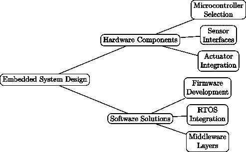

# C++ 嵌入式系统编程：实战技术


## 10. 高级主题与案例研究

- 10.1 物联网（IoT）集成
- 10.2 嵌入式系统中的机器学习
- 10.3 嵌入式系统的边缘计算
- 10.4 案例研究：汽车嵌入式系统
- 10.5 案例研究：可穿戴技术
- 10.6 嵌入式系统的未来趋势

## 引言

嵌入式系统在现代技术格局中无处不在，构成了许多对日常生活和众多行业至关重要的设备和应用的骨柱。作为专为执行特定功能而定制的专用计算系统，它们与通用计算设备区别开来。这种独特特性决定了对其进行编程和开发时需要同样专业的方法。

本书《C++ 嵌入式系统编程：实战技术》旨在让读者对嵌入式系统有基础性的理解，并掌握 `C++` 作为编程语言在该领域的应用。鉴于嵌入式环境通常面临的限制（如内存和处理能力有限），`C++` 提供了许多特性和效率，这些特性特别有益。

本书的章节将引导读者通过一个精心设计的课程，从理解嵌入式系统的基本概念开始，逐步过渡到为嵌入式应用定制的 `C++` 编程细节。读者将深入了解如何在这些系统中导航硬件接口和通信协议。书中还讨论了与实时操作系统（`RTOS`）的集成，为嵌入式应用中任务的运行和管理提供了见解。

此外，本文深入探讨了内存管理等关键方面，由于嵌入式系统的典型限制，那里的优化不仅是建议的，更是要求的。调试和测试是本文涵盖的开发关键元素，提供了确保应用程序健壮且可靠的方法论。

对功率管理技术的关注反映了现实世界对高能效设计的必要性，强调了电池和能量采集解决方案的限制。由于嵌入式系统通常运行在优化是关键环境中，本书提供了在这些条件下实现高性能的有效策略。

在当今互互通的世界里，安全至关重要，本书专门有一章介绍了嵌入式系统面临的独特安全挑战，包括潜在的漏洞和保护措施。

本书以对高级主题和案例研究的讨论结束。通过这些内容，它为新兴技术提供了视角，并展示了汽车系统和可穿戴技术等领域的实际案例，进一步阐明了理论如何转化为实践。

通过本书的章节，读者将对使用 `C++` 进行嵌入式系统编程有全面的理解。书中内容支持学习者培养能力和信心，使其能够在这一不断发展的领域做出有效贡献。

## 核心特性

- **特定功能性**：与执行多任务的个人计算机不同，嵌入式系统专注于特定任务。这种专门化使其在成本、性能和能源效率方面得以优化。
- **资源限制**：嵌入式系统通常在处理能力、内存和存储空间有限的情况下运行，因此需要高效地利用这些资源。
- **可靠性与稳定性**：由于这些系统通常部署在关键应用中，它们的设计具有高度的可靠性和稳定性，通常包含冗余特性和故障保护。

## 嵌入式系统的组件

嵌入式系统的架构由硬件和软件组件精密集成，以满足特定的应用程序需求。主要组件包括：

- **微控制器或微处理器**：大多数嵌入式系统的核心是微控制器或微处理器。嵌入式应用通常偏微控制器，它将处理器、内存和外围接口集成在单个芯片上，便于紧凑性和高效性。处理器执行编写的指令，而内存则存储操作系统、应用程序代码和数据。
- **内存**：嵌入式系统同时利用易失性和非易失性内存。易失内存（`RAM`）用于运行期间的临时存储，而非易失内存（`Flash` 或 `EEPROM`）则存储固件和配置设置。
- **传感器与执行器**：传感器采集环境数据，将物理参数转换为电信号。相反，执行器将电信号转换为动作，影响环境。
- **通信接口**：这些系统通常包含各种接口，如 `UART`、`SPI`、`I2C` 和 `CAN`，用于与其他系统或网络环境通信。
- **电源**：高效的电源管理至关重要。嵌入式系统可能使用电池，需要节能模式和策略来延长运行寿命。

## 嵌入式系统的架构

嵌入式系统可以根据几个因素进行分类：处理需求、复杂性和配置配置。常见类型包括：

- **简单控制循环系统**：这些系统在循环中运行，读取输入、处理数据并调整输出。简单的恒温器表现出这种架构。
- **响应式系统**：设计用于立即响应输入或环境变化。例如汽车安全气囊弹出系统。
- **复杂处理系统**：这些系统需要大量的处理能力，通常集成实时操作系统（`RTOS`）来管理多个任务。现代智能手机就属于此类。

## 嵌入式系统中的软件

嵌入式系统的软件设计高度专业化。它要求对有限资源进行优化，并通常使用 `C` 或 `C++` 等语言开发。嵌入式软件的关键方面包括：

- **固件**：这是嵌入到硬件中的基础软件，用于提供底层控制。它与硬件组件直接交互。
- **实时操作系统（RTOS）**：`RTOS` 为嵌入式系统赋予调度能力，确保在高效率约束下优先考虑关键任务。它们通常层位于固件之上。
- **中间件**：作为操作系统和应用程序软件之间的桥梁，提供通用服务，如数据库、通信管理和驱动程序。
- **应用程序软件**：最高层，根据系统应用的需求提供特定功能或用户界面。

```c
#include <stdio.h>
#include "microcontroller.h"

void setup() {
  // 初始化系统配置
  initializeSerial();    // 初始化 UART 通信
  configureTimer();      // 配置系统定时器
}

void loop() {
  // 主处理循环
  int sensorValue = readSensor();  // 获取传感器数据
  processData(sensorValue);        // 处理数据
  controlActuator(sensorValue);    // 根据处理的数据控制执行器
}

int main() {
  setup();
  while (1) {
    loop();
  }
  return 0;
}
```

此示例演示了嵌入式程序的基本结构，说明了此类系统中必要的初始化和重复处理循环。

## 嵌入式系统实验

嵌入式系统的实验需要实践方法，通常通过开发板和编程环境（如 `Arduino` 和树莓派）来实现。这些平台提供了嵌入式系统的友好介绍，允许小型应用程序的开发和测试。

```python
import RPi.GPIO as GPIO
import time

GPIO.setmode(GPIO.BCM)  # 设置引脚编号模式
GPIO.setup(18, GPIO.OUT)  # 将 GPIO 18 设置为输出

try:
    while True:
        GPIO.output(18, GPIO.HIGH)  # LED 开启
        time.sleep(1)              # 延迟 1 秒
        GPIO.output(18, GPIO.LOW)   # LED 关闭
        time.sleep(1)
except KeyboardInterrupt:
    GPIO.cleanup()  # 键盘中断时清理 GPIO 引脚
```

在这个树莓派的 Python 示例中，通过无限循环实现了对连接到 GPIO 引脚 18 的 LED 的控制，展示了 GPIO 控制和基础计时等基本概念。

## 嵌入式系统的优化

嵌入式系统的限制需要彻底的优化过程，以确保硬件限制内的性能。关键优化策略包括：

- **代码优化**：通过最小化库依赖和使用高效算法来减少代码大小和执行时间。
- **电源优化**：低功耗设计技术，如占空比、动态电压调整和高级睡眠模式，以延长电池寿命。
- **内存优化**：通过编译技术和利用数据结构来高效使用内存，防止过度使用 `RAM` 和 `Flash` 内存。
- **硬件加速**：使用专用硬件组件处理图形渲染或加密等需要大量处理能力的任务，从而释放 `CPU`。

## 嵌入式系统的安全

安全性在嵌入式系统中至关重要，因为这些系统通常被嵌入在关键基础设施中。确保安全涉及：

- **身份验证与授权**：验证用户身份并确保用户允许执行特定操作。
- **数据加密**：使用加密技术在存储和传输期间保护数据。
- **安全启动**：在启动过程中验证系统固件的完整性，以防止恶意代码执行。
- **定期更新**：在系统生命周期内促进固件更新，以修补漏洞并引入安全增强。

## 智能手机

嵌入系统是现代智能手机运行的核心，管理着从电源管理到摄像头处理的各种任务。系统级（`SoC`）技术的集成将 `CPU`、`GPU` 和内存组件相结合，促进了紧凑高效设备的设计。

## 智能家电

智能电视、冰箱和洗衣机等设备配备了嵌入式系统，通过触摸屏和无线连接实现用户交互，进一步提升了用户便利性。

```python
import paho.mqtt.client as mqtt

def on_connect(client, userdata, flags, rc):
    print("Connected with result code " + str(rc))
    client.subscribe("home/lights")

def on_message(client, userdata, msg):
    if msg.payload.decode() == "ON":
        print("Turning lights on")
    elif msg.payload.decode() == "OFF":
        print("Turning lights off")

client = mqtt.Client()
client.on_connect = on_connect
client.on_message = on_message
client.connect("mqtt_broker_address", 1883, 60)
client.loop_forever()
```

这段代码片段模拟了一个订阅到 `home/lights` 主题的简单 IoT 设备。当接收到相应的 MQTT 消息时，它会执行预定义的动作，展示了家庭自动化系统中的典型操作。

## 汽车行业

汽车领域已将嵌入系统视为关键组件，促进了车辆安全、性能和用户体验的进步。重要的应用包括：

### 动机控制单元（ECUs）

`ECUs` 内的嵌入式系统调节燃料喷射、点火计时和其他关键发动机功能，以优化性能和排放。

### 高级辅助系统（ADAS）

这些系统配备了传感器和摄像头，通过提供车道偏警告、自适应巡航和自动刹车等功能增强了车辆安全性。

### 车载信息娱乐（IVI）

`IVI` 利用嵌入式系统提供导航、多媒体和连接服务，提升整体驾驶体验。

```cpp
#include <mcp2515.h>

MCP2515 mcp2515(10); // SPI CS line

void setup(void) {
    Serial.begin(115200);
    mcp2515.reset();
    mcp2515.setBitrate(CAN_500KBPS, MCP_8MHZ); // CAN bus bitrate and MCP frequency settings
    mcp2515.setNormalMode();
}

void loop(void) {
    struct can_frame frame;
    frame.can_id = 0x0A;
    frame.can_dlc = 1;
    frame.data[0] = 0;
    mcp2515.sendMessage(&frame);
    delay(1000);
}
```

上面的 `C++` 示例演示了使用 `MCP2515` 控制器发送基础 CAN 总消息，反映了汽车通信系统中的典型实践。

## 工业自动化

嵌入式系统在工业应用中的集成改变了制造流程，提高了精度、控制和生产力。其角色包括：

### 可编程逻辑控制器（PLCs）

`PLCs` 用于机械和过程的自动化，执行指令序列以有效地管理工业控制系统。

### 机器人

工业机器人内部的嵌入式系统实现了运动控制、路径规划和任务执行，从而优化了制造工作流。

### 传感器网络

传感器网络广泛用于过程监控和控制，提供实时数据采集和分析，确保最佳运行和安全。

```vhdl
library IEEE;
use IEEE.STD_LOGIC_1164.ALL;

entity LED_Controller is
    Port ( CLK : in STD_LOGIC;
           LED : out STD_LOGIC);
end LED_Controller;

architecture Behavioral of LED_Controller is
begin
    process(CLK)
    begin
        if rising_edge(CLK) then
            LED <= not LED; -- Toggles the LED state on each clock edge
        end if;
    end process;
end Behavioral;
```

提供了一个通过 FPGA 控制 LED 的 VHDL 代码段，展示了工业自动化背景下基础数字逻辑的使用。

## 医疗系统

嵌入式系统已成为医疗技术的关键工具，有助于复杂的医疗设备的开发，从而促进患者的诊断、监测和治疗：

### 医疗成像设备

`MRI` 和 `CT` 扫描仪中的嵌入式系统处理复杂的成像计算，提高了图像清晰度并实现了精确诊断。

### 患者监测设备

可穿戴式 `ECG` 监测器等设备持续评估患者健康指标，为医疗专业人员提供关键数据。

### 植入设备

由嵌入技术驱动的`起搏器`和`胰素泵`提供自主、高可靠的维持生命的治疗。

```c
#include <stdio.h>

#define THRESHOLD 150

void checkHeartRate(int bpm) {
    if (bpm > THRESHOLD) {
        printf("Alert: High heart rate detected!\n");
    } else {
        printf("Heart rate is normal.\n");
    }
}

int main(void) {
    int heartRate = 120;
    checkHeartRate(heartRate);
    return 0;
}
```

该 `C` 代码说明了基础的心率监测，强调了医疗应用中常见的阈值警报。

## 电信

在电信领域，嵌入式系统在管理数据流量和安全方面起着至关重要的作用。它们体：

### 网络设备

路由器、调制解调器和交换机依赖嵌入式处理器处理数据路由。

### 基站

蜂网络中的嵌入式系统管理信号处理和频率分配，实现了无缝移动通信。

### 信号处理单元

通信设备中的这些单元执行编码、解码和调制，确保数据完整性。

```c
#include <stdio.h>
#include <stdlib.h>

typedef struct {
    int sourcePort;
    int destPort;
    char data[256];
} NetworkPacket;

void processPacket(NetworkPacket *packet) {
    printf("Processing packet from %d to %d\n", packet->sourcePort, packet->destPort);
}

int main(void) {
    NetworkPacket myPacket = {8080, 80, "Hello, network"};
    processPacket(&myPacket);
    return 0;
}
```

简单的 `C` 示例说明了基础的网络包处理，展示了嵌入式通信设备中典型的数据处理。

## 航空航天与国防

航空航天和国防领域的嵌入式系统支持从导航到武器控制系统的各种功能，要求极高的精确可靠性：

### 航空电子系统

飞机航空电子系统中的嵌入式系统控制着导航、通信和系统监测。

### 无人机与无人飞行器

这些 `UAVs` 和 `drones` 依赖嵌入式系统实现实时飞行控制、稳定和任务执行。

### 防御系统

导弹系统和其他防御机制的引导、监测和通信由嵌入式技术支持。

## 需求收集与规范

开发过程的初始阶段侧重于收集和规范需求。这涉及理解系统的功能性和非功能性需求、约束条件以及环境因素。此阶段的目标包括：

- 定义范围和功能：建立嵌入式系统必须执行的特定功能，这将指导系统的复杂性、组件选择和设计权衡。
- 成本和功率限制：确定财务支出和功耗预算，以指导组件选择和系统设计。
- 性能参数：识别所需的实时性约束、处理能力和接口。
- 环境考虑：了解温度范围、湿度和潜在的电磁干扰等条件，为组件选择和设计考虑提供参考。

```java
public class SystemRequirements {
    public static void main(String[] args) {
        String[] requirements = {
            "Real-time processing capabilities",
            "Low power consumption",
            "Cost under $50",
            "Operating temperature range -40°C to 85°C"
        };
        System.out.println("System Requirements Checklist:");
        for (String r : requirements) {
            System.out.println("- " + r);
        }
    }
}
```

此代码建立了一个简单的清单来验证系统需求，直观地展示了开发过程的初始阶段。

### 系统设计

在需求规范之后，设计阶段将规范转换为实际的、可实施的系统架构。此阶段涉及两个核心部分：


- 硬件设计：选择合适的微控制器、传感器和执行器，并设计 PCB。可以使用`Eagle`或`Altium Designer`等 CAD 工具进行电路设计和板框布局。

- 软件设计：包括选择编程语言（例如`C`、`C++`）、如果所需的实时操作系统，以及连接硬件接口与高层编程的中间件。

一种常用的设计方法是构建表示系统组件及其相互作用的框图，这简化了理解并指导后续的开发阶段。



森林图提供了嵌入式系统概念设计层次的视觉化表示，将考虑因素归类为硬件和软件领域。

## 原型制作

原型制作是连接设计与开发的不可或缺的步骤，能够提供宝贵的见解并实现迭代优化。原型有助于：

- 功能验证：确保设计在指定条件下能够执行其预定功能。

- 交互与集成测试：检查组件如何协同工作，包括接口、数据交换和对协议的遵循。

- 迭代优化：允许根据测试结果进行调整，可能涉及重新选择组件、重新设计电路或重写代码段以实现预期结果。

开发工具和如`Proteus`或`TINA`等仿真软件可以辅助原型制作，为测试和可视化提供预制环境。

```cpp
#include <arduino.h>
const int ledPin = 13; // 内置 LED 引脚号
void setup() {
    pinMode(ledPin, OUTPUT); // 设置引脚为输出
}
void loop() {
    digitalWrite(ledPin, HIGH); // 打开 LED
    delay(500);                // 等待半秒
    digitalWrite(ledPin, LOW);  // 关闭 LED
    delay(500);                // 等待半秒
}
```

给出的 Arduino 代码执行了基础的原型验证，测试了基本的输出功能，这对于在开发早期验证硬件配置至关重要。

## 实现

成功完成原型制作后，将进行全规模实现，将设计转换为完善的产品。关键实现方面包括：

- 硬件制造：使用最终设计生产并组装整个系统，包括定制 PCB 和专用外壳。

- 软件集成：完成软件开发，集成所有模块，并确保与已实现的硬件和谐运行。

- 功能测试：在预期的运行环境中对完全实现的系统进行全面测试，以衡量性能、可靠性和对规范的遵循情况。

利用测试驱动开发（`TDD`）方法可以强制预测且可靠的软件行为，通过定义的测试范式和严格的验证逐步完善系统性能。

```python
def test_temperature_sensor_value():
    """
    模拟系统测试温度传感器行为。
    """
    def read_sensor():
        return 25  # 模拟传感器值
    temperature = read_sensor()
    assert temperature == 25, "Test failed: Unexpected sensor value"
```

提供的 Python 测试用例采用`pytest`框架来确认预期的传感器值，展示了实现阶段传感器验证的准备步骤。

## 验证与确认

验证和确认对于确保系统满足所有预期参数并在预期场景下无故障运行至关重要。验证与确认之间的区别值得注意：

- 验证：侧重于使开发的系统与其设计规范保持一致，通过调试和并行约束检查确保每个组件的行为都符合预期。

- 确认：强调系统在满足预期用用例方面的有效性和正确性。

确认活动通常包括基于仿真的评估和现场测试，确认系统功能符合预期的语境。

```matlab
t = 0:0.01:10; % 时间向量
sensorSignal = sin(t); % 模拟传感器输出
% 确认：系统响应
responseSignal = sensorSignal .* (sensorSignal > 0);
plot(t, responseSignal);
xlabel('Time (seconds)'); 
ylabel('System Response'); 
title('System Validation through Simulation');
```

该 MATLAB 脚本模拟了一个基础确认场景，说明了系统对特定输入条件的响应，突出了验证和确认的常用策略。

## 部署

最后的部署阶段将系统发布到运行环境中以执行其指定任务。部署可能涉及：

- 安装和设置程序：确保正确的设置和配置，可能包括用户培训和故障排除文档。

- 性能监控：通过日志和监控工具持续评估系统性能，确保运行成功并识别潜在的改进点。

- 维护周期：定期更新软件（通过补丁和固件更新）以及必要的硬件组件，维持最佳功能和安全性。

自动化部署流水线可以简化安装和监控过程，促进从开发环境到生产环境的平滑过渡。

```bash
#!/bin/bash
# 嵌入式系统自动化部署脚本
scp firmware.bin user@device:/path/to/sys
ssh user@device 'bash -s' < deploySystem.sh
```

此片段提供了一个自动系统固件部署的基础脚本，展示了远程管理系统安装的实际步骤。

嵌入式系统的演变与技术的飞速发展紧密相连，为各行业开辟了新的领域和机遇。本节将探讨驱动嵌入式系统创新的当前趋势，并结合相关示例和技术阐述预测未来的发展方向。

# 物联网 (IoT) 集成

物联网（IoT）的普及代表着一个重大趋势，嵌入式系统已成为互联设备的骨干。物联网的努力使设备能够通过互联网进行自主通信，从而实现智能数据采集、分析和响应。

受影响的关键领域包括：

- **智慧城市**：支持物联网的嵌入式系统优化了城市基础设施，带来了智能电网技术、智能交通系统和自动化废物管理。这些应用展示了嵌入式系统高效管理资源和改善城市生活的能力。

- **农业**：精准农业利用嵌入式系统进行土壤监测、作物健康评估和自动灌溉，提高了生产力并可持续性。

```python
import paho.mqtt.client as mqtt
import random
def on_connect(client, userdata, flags, rc):
    print("Connected with result code "+str(rc))
    client.subscribe("farm/temperature")
def publish_data():
    temp = random.uniform(10, 30)
    client.publish("farm/temperature", str(temp))
client = mqtt.Client()
client.on_connect = on_connect
client.connect("mqtt_broker_address", 1883, 60)
while True:
    publish_data()
```

该脚本说明了通过 MQTT 进行物联网数据采集，模拟了温度数据的上传，展示了物联网支持嵌入式系统提供的监控功能。

# 边缘计算与 AI 集成

嵌入式系统与边缘计算之间的协同是另一个主导趋势。边缘计算通过在靠近源的地方处理数据降低延迟，这一成就随着 AI 集成嵌入式系统日益突出。

影响包括：

- **实时数据处理**：自动驾驶和安全监控等系统要求通过边缘计算实现瞬时决策。这减少了对中央服务器的依赖，并提升了处理速度。

- **设备端深度学习**：具备 AI 能力的嵌入式系统可以进行复杂的计算，如脸识别或异常检测，促进了医疗和金融等领域的进步。

```python
import tensorflow as tf
from tensorflow import lite
# Load a model
model = tf.keras.models.load_model('my_model.h5')
## Convert to TensorFlow Lite model converter
converter = lite.TFLiteConverter.from_keras_model(model)
tflite_model = converter.convert()
## Save the model.
with open('model.tflite', 'wb') as f:
    f.write(tflite_model)
```

这段代码段强调了边缘 AI 的部署，演示了为了在受限嵌入式设备上执行而进行的 TensorFlow 模型转换，这是边缘计算的核心功能。

## 安全增强

鉴于嵌入式系统在关键应用中日益增加，其漏洞需要更增强的安全措施。趋势包括：

- **嵌入式设计中的网络安全**：在设计阶段解决安全性正成为一项基本需求。这包括加密工具、安全启动机制和定期的固件更新。

- **安全关键系统**：汽车和医疗等行业的嵌入式系统需要严谨的安全验证，以降低因系统故障带来的风险。

```cpp
#include <openssl>
#include <openssl>
void init_security() {
    SSL_load_error_strings();
    OpenSSL_add_ssl_algorithms();
}
SSL_CTX *create_context() {
    const SSL_METHOD *method;
    SSL_CTX *ctx;
    method = TLS_client_method();
    ctx = SSL_CTX_new(method);
    if (!ctx) {
        perror("Unable to create SSL context");
        ERR_print_errors_fp(stderr);
        exit(EXIT_FAILURE);
    }
    return ctx;
}
int main() {
    init_security();
    SSL_CTX *ctx = create_context();
    // Further configuration for secure session...
    SSL_CTX_free(ctx);
    return 0;
}
```

提供的 C 示例概述了如何使用 OpenSSL 初始化安全通信通道，以确保嵌入式系统的数据完整性和安全性。

## 可再生能源与功率效率

对高能源效率的追求与全球向可再生能源的转变相一致。嵌入式系统越来越多地包含了强调最小功耗的特性：

- **能量采集**：利用环境能量源为嵌入式设备供电，从而支持孤立栖息地的环境传感器等远程应用。

- **低功耗设计**：专用的低功耗模式和先进电池技术正成为嵌入式系统寿命的关键，这在可穿戴技术和传感器网络中可见。

```matlab
time = 0:0.01:10; power_consumption = 5*exp(-0.1*time); % Power efficiency model
plot(time, power_consumption); xlabel('Time (seconds)'); ylabel('Power Consumption (Watts)'); title('Embedded System Power Consumption Over Time');
```

该 MATLAB 代码模拟了随时间减少的功耗，代表了嵌入式系统可持续发展中能源效率的改进。

## 开发平台与工具演进

随着嵌入式系统变得日益复杂，促进开发的工具和平台也在演进以适应这些复杂性：

- **快速原型工具**：Arduino 和 Raspberry Pi 等平台，结合先进的集成开发环境 (IDE)，加速了原型制作，通过减少开发开销促进了创新。

- **协作开发环境**：现代 IDE 集成了版本控制和云服务，方便了全球开发团队之间的协作开发和资源共享。

```bash
git clone https://github.com/embedded-system/project.git
cd project
git checkout -b feature/power-optimization
# Make necessary changes
git add .
git commit -m "Enhanced power optimization algorithm"
git push origin feature/power-optimization
```

这些 Git 命令反映了协作和分布式开发环境的管理，展示了版本控制在现代嵌入式系统开发中的作用。

本章涵盖了嵌入式系统开发中基本的 C++ 编程概念。它探索了与嵌入式应用相关的核心语法和语义，同时研究了构建健壮代码至关重要的变量、数据类型和常量。文中讨论了用于有效管理程序流的控制结构，以及函数和模块化设计的重要性。本章还深入探讨了模板和异常等高级 C++ 特性，提供了它们在嵌入式环境中使用的见解。此外，还评估了 C++ 标准库在嵌入式系统中的适用性及其局限性，为该领域的编程实践提供了全面的概述。

# 2.1 基础 C++ 语法与语义

任何编程语言的基础都在于其语法和语义，C++ 也不例外。本节将对这些涉及嵌入式系统的核心元素进行深度分析。对于高效的编程和调试，理解这些方面至关重要，特别是考虑到嵌入式环境相关的限制条件时。

C++ 是一种静态类型、编译型、面向对象的语言，它是对过程化语言 C 的扩展。它平衡了低级和高层语言特性，这使得它适用于嵌入式系统开发等系统级编程。

## 语法

C++ 的语法是指定义语言中被认为结构正确的符号组合规则集。它类似于自然语言的语法，包含了关键字、运算符、标点符号和声明语句等方面。

一个有效的 C++ 程序必须遵守特定的语法细节，否则编译器将无法将程序翻译成机器码。以下是与嵌入式系统相关的 C++ 语法的基本概述。

```cpp
#include <iostream> // 程序的入口
int main() {
    // 将数据输出到标准输出流
    std::cout << "Hello, Embedded World!" << std::endl;
    return 0; // 表示程序成功结束
}
```

`#include <iostream>` 行是一个预处理器指令，它包含了标准输入输出操作所需的输入/输出流库。`main()` 函数是每个 C++ 程序的入口。`std::cout` 语句使用插入运算符 `<<` 将文本打印到控制台，这在嵌入式系统监控输出时也是一种常见的调试做法。然而，在许多嵌入式系统中，`cout` 被重定向到某种形式的串口输出而不是控制台。

在 C++ 中，每条语句都以分号（`;`）结束。变量的作用域和块结构通常在大括号（`{ }`）内，这定义了复合语句或函数的开始和结束。

## 语义

语法处理的是代码的形式，而语义涉及意义；它是语法正确结构背后的效果和逻辑。语义确保了格式正确的程序在编译和执行时能够实现程序员意图所需的操作。

考虑以下代码段：

```cpp
int x = 10; int y = 20; int z = x + y; // z 现在持有值 30
```

在这里，`z = x + y` 的意义在语义上被定义——它指示程序评估右侧的表达式并将结果（`30`）赋值给变量 `z`。

在资源优化和正确性至关重要的嵌入式系统开发中，理解这些语义上的细微差别至关重要。

## 变量声明

C++ 使用变量来存储易于访问和修改的数据。C++ 中的变量必须在使用之前声明，且它们可以是各种类型，例如整数、浮点数、字符等。例如：

```cpp
int temperature = 25; double voltage = 5.0; char unit = 'C';
```

在嵌入式系统中，像 `int`、`short`、`long` 及其无符号变体在内存高效的数据处理中起着关键作用。数据类型的选择直接影响内存占用，考虑到嵌入式系统有限的资源，这是一个至关重要的考虑因素。

## 常量

常量提供了一种在程序中使用固定值的方法。它们有助于增加程序的清晰度并减少因使用“魔数字”可能导致的错误。C++ 允许使用`const`关键字声明常量：

```cpp
const double pi = 3.14159; const int MAX_BUFFER_SIZE = 1024;
```

`const`关键字确保变量在初始赋值后不能被更改，这一特性在嵌入式系统中特别有用，可以保护关键配置和校准值免受意外修改。

## 运算符

C++ 提供了几种类型的运算符，包括算术运算符、关系运算符和逻辑运算符。它们对于在嵌入式程序执行计算和比较至关重要。让我们讨论几个：

- 算术运算符：包括`+`、`-`、`*`、`/`、`%`，允许基本的算术运算。

- 关系运算符：`==`、`!=`、`<`、`>`、`<=`、`>=` 用于比较。

- 逻辑运算符：包括`&&`（逻辑与）、`||`（逻辑或）和`!`（逻辑非），用于形成控制流机制中有用的复杂条件语句。

在恒温器等嵌入式系统背景下考虑逻辑操作：

```cpp
if (temperature > SETPOINT && fanStatus == OFF) {
    fanStatus = ON;
}
```

在这里，编译器评估条件`temperature > SETPOINT && fanStatus == OFF`。如果条件为真，它将改变`fanStatus`变量，激活冷却。

# 控制结构

C++ 采用多种控制结构来规定程序内的执行流。这些包括条件语句（`if`、`switch`）、循环（`for`、`while`、`do-while`）和分支结构（`break`、`continue`、`return`），增加了应用的灵性和控制力。

例如，考虑嵌入式固件内部用于管理传感器数据的循环控制：

```cpp
for (int i = 0; i < sensorCount; ++i) {
    processSensorData(i);
}
```

在这里，`for`循环遍历传感器集合，并对每个调用`processSensorData`。在嵌入式应用中，高效处理控制结构对于满足硬件计时限制确保可靠性至关重要。

# 函数


函数允许将代码组织成可重用的块，提高了清晰度并减少了冗余。`C++` 中的函数具有返回类型、名称、参数列表和函数体：

```cpp
int add(int a, int b) {
    return a + b;
}
```

上述`add`函数接收两个`int`参数并返回它们的和。确保函数短小且只执行单一任务对程序大小和可维护性具有显著益处。

## 命名空间

命名空间有助于将代码组织成逻辑组并防止命名冲突。这在大型项目中至关重要，因为不同的模块或库可能会定义相同名称的实体。

```cpp
namespace hardware {
    int sensorStatus = 0;
    void reset() {
        // 重置硬件组件
    }
}
```

在包含多个组件的嵌入式系统中，命名空间确保局部标识符在与外部或系统级代码集成时不会产生误导或错误。

理解变量、数据类型和常量对于`C++` 的高效编程至关重要，特别是在资源有限且优化至关重要的嵌入式系统领域。本节将深入探讨这些核心概念，阐述它们在嵌入式应用开发中的用法、影响和意义。

## C++ 中的变量

变量是编程中的基础构建模块，作为内存地址标识的存储位置，可以存放数据值。在嵌入式系统中，由于环境限制，高效的内存利用是关键。`C++` 变量通过特定的数据类型、标识符和可选的初始值来定义。

```cpp
int count;          // 声明
count = 10;         // 赋值 
int size = 1024;    // 带初始化声明
```

在上述示例中，`int` 表示数据类型，`count` 和`size`是变量名，`10` 和`1024`是分配给这些变量的整数值。

变量可以根据其作用域和生命周期进行分类：

- **局部变量**：定义在函数或块内部，仅在该函数或块内可访问。
- **全局变量**：定义在所有函数之外，可以从程序中的任何函数访问。
- **静态变量**：在多次调用同一个函数时保持其值不变。

```cpp
int globalStatus = 0;  // 全局变量
void updateStatus() {
    static int callCounter = 0;  // 静态局部变量
    callCounter++;
}
```

在电源管理和资源利用至关重要的嵌入式系统中，有效理解并应用这些变量作用域是极其重要的。

## C++ 中的数据类型

`C++` 提供了丰富的数据类型以适应各种数据处理需求：

- **基本数据类型**：包括整数类型（`int`、`char` 等）、浮点类型（`float`、`double`）和布尔类型（`bool`）。
- **衍生数据类型**：由基本类型组成，包括数组、指针和引用。
- **用户定义数据类型**：包含结构体、联合体枚举，便于定制化的数据组织。

```cpp
char initial = 'A'; 
bool isConnected = true; 
float temperature = 15.5f; 
double preciseVoltage = 3.14159265358979;
```

嵌入式系统通常需要仔细选择数据类型，以在保持数值精度的同时最小化内存占用，特别是对于`ADC`读取、`PWM`设置等操作。

### 整数类型

整数类型表示全整数，可以使用`signed`（有符号）和`unsigned`（无符号）等修饰符更改其存储的值范围：

```cpp
unsigned int frameCount = 4096; 
signed char delta = -1;
```

`unsigned` 类型在嵌入式应用中特别有用，可以利用给定字节大小获得最大的数值范围，例如计数器和索引。

### 浮点类型

浮点类型（`float`、`double`）用于表示带有小数部分的数字。它们对于诸如带有小数点的传感器数据等精度任务至关重要。

对于许多嵌入式系统，单精度（`float`）优于双精度（`double`），因为它占用的内存更小，尽管后者提供了更高的精度。

### 枚举

枚举是用户定义的数据类型，包含一组命名的整数常量。在嵌入式系统中，它们增强了代码的可读性，特别是在状态和配置设置方面：

```cpp
enum DeviceMode { OFF, IDLE, RUNNING }; 
DeviceMode currentMode = IDLE;
```

在这里，与任意整数相比，`DeviceMode` 可以切换设备状态，提高代码清晰度并降低无效状态的风险。

### 结构体和联合体

结构体（`struct`）和联合体（`union`）在嵌入式语文中对于数据分组和资源共享优化非常重要：

```cpp
struct SensorData {
    int id;
    float temperature;
    float humidity;
}; 

union DataPacket {
    long rawData;
    char bytes[4];
};
```

结构体有助于将不同的数据类型组织在单一实体下，而联合体允许在同一内存位置存储多个数据类型，这在低内存条件下是一种成本效益的措施。

### 类型修饰符

`C++` 提供类型修饰符来扩展基本类型，影响变量的范围和大小：

- `signed` 和`unsigned`
- `short` 和`long`

这些修饰符对于嵌入式系统中精确控制内存使用至关重要，通过编译器优化技术实现计算效率。

### 类型转换

类型转换是将变量从一种类型转换为另一种类型的方法。虽然其本身带有风险，但它经常用于安全地处理不同的数据宽度或类型：

```cpp
float voltage = 3.7; 
int roundedVoltage = static_cast<int>(voltage);
```

`static_cast` 确保了转换的显式指令，减少了错误的解释，并在隐式转换仅近似预期结果的地方优化了转换。

## C++ 中的常量

`C++` 中的常量使用`const` 关键字建立。常量提供了不可变性，并作为防止意外更改的保护，这是对于程序配置或运行至关重要的值的特征。

```cpp
const double PI = 3.14159; 
const int MAX_RETRIES = 5;
```

在嵌入式环境中，常见的常量包括操作阈值、校准数据和通信配置。常量有助于确保这些值在程序执行期间保持不变，提高稳定性和可预测性。

`C++` 还提供了`constexpr`，这是一个编译时常量的关键字：

```cpp
constexpr int getSquare(int num) { return num * num; }
```

`constexpr` 值通过允许在编译时评估表达式来提高效率，减少了运行时计算，这在实时系统中是有优势的。

### volatile 关键字

`volatile` 修饰符表示变量的值可能会意外变化，指示编译器避免假设其值不变的优化：

```cpp
volatile int sensorRegister;
```

这在嵌入式系统中特别相关，因为这些变量直接映射到硬件寄存器或由异步事件更改的位置，确保读取值总是准确、实时的且与硬件状态同步的。

## 关键洞察总结

理解`C++` 中的变量、数据类型和常量为嵌入式系统程序员提供了优化限制系统的工具。这些概念的有效应用可以减少内存占用、提高执行速度并增强程序稳定性，这些对于嵌入式系统都是至关重要的。

通过变量，开发者调节数据处理；通过数据类型及其相关属性，他们对内存中数据的物理布局进行细粒控制。常量确保了多个执行路径的一致性和正确性。因此，掌握这些元素有助于构建更好的嵌入式系统。

## 控制结构

控制结构是任何编程语言的基础，提供了引导程序执行流的手段。在`C++` 中，控制结构包括循环、条件语句和分支机制，允许开发者实现动态且灵活的代码路径。在嵌入式系统中，这些结构成为管理有限资源、实时约束和事件驱动架构的关键工具。

### 条件语句

条件语句允许程序根据布尔评估执行不同的代码分支。`C++` 中的主要条件结构是`if`、`if-else`和`switch`语句。

### if 语句

`if` 语句评估一个布尔表达式，如果表达式为真，则执行后续的代码块。这是`C++` 中最简单的决策形式：

```cpp
if (temperature > 100) {
    activateCoolingSystem();
}
```

在嵌入式系统中，`if` 语句频繁监控传感器数据以触发执行器，例如控制温度阈值。

### If-Else 语句

对于更复杂的决策，使用了`if-else`结构，当初始条件评估为假时，提供一条备选路径：

```cpp
if (voltageLevel < 3.0) { powerSavingMode(); } else { normalOperationMode(); }
```

在硬件性能或电源管理决定不同运行模式的场景中，这种分支结构是基础性的。

### If-Elseif-Else 阶梯

当需要评估多个条件时，`if-elseif-else`结构提供了一种高效的方法：

```cpp
if (mode == 1) { startModeOne(); } else if (mode == 2) { startModeTwo(); } else { enterDefaultMode(); }
```

这种阶梯形式在具有多个运行状态的系统（如多功能嵌入式设备）中特别为有效。

### Switch 语句

`switch` 语句是离散值决策的最优选择，与长长的`if-elseif`阶梯相比，它增强了可读性和效率：

```cpp
switch (command) { case START: startDevice(); break; case STOP: stopDevice(); break; default: showError(); break; }
```

嵌入式系统经常利用`switch` 语句进行命令解码，其中枚举常量定义了所有可能的情况。

## 迭代控制：循环

`C++` 中的循环对于重复任务至关重要，从读取传感器阵列到传输数据包。主要的循环结构有`for`、`while`和`do-while`。

### For 循环

`for` 循环适用于遍历固定序列，且迭代次数是预先已知的：

```cpp
for (int i = 0; i < N; ++i) { processChannel(i); }
```

在嵌入式系统中，`for` 循环经常用于`FFT`或卷积等算法，在这些算法中数组访问是可预测的。

### While 循环

`while` 循环在指定条件保持为真时执行代码块。当迭代次数不预先确定时，它具有优势：

```cpp
while (!dataReady()) { wait(); }
```

在嵌入式系统设计中，`while` 循环可能会监控一个指示数据就绪的标志，此时事件驱动条件会发挥作用。

### Do-While 循环

`do-while` 循环确保循环体至少执行一次，并在执行后测试其条件：

```cpp
do { retrieveSensorData(); } while (continueReading());
```

在嵌入式背景下，`do-while` 循环适用于初始设置序列或要求首次通过必须执行的重试机制。

## 分支与控制转移

`C++` 提供了分支机制，可以根据执行需要更改典型的控制流，即`break`、`continue`和`return`。

### Break 语句

`break` 语句退出循环或`switch`控制，对于提前终止至关重要：

```cpp
for (int i = 0; i < MAX_ATTEMPTS; ++i) { if (checkSuccess()) { break; } }
```

在嵌入式软件中，`break` 语句有助于在检测到错误时快速退出循环，节省处理周期。

### Continue 语句

`continue` 语句跳过当前迭代并进入循环的下一次：

```cpp
for (int i = 0; i < bufferSize; ++i) { if (buffer[i] == INVALID) { continue; } process(buffer[i]); }
```

该语句在跳过非本质数据处理时非常有用，可以提高吞吐量。

### Return 语句

`return` 语句停止函数内部执行，并可选地向调用者返回值，作为函数的退出点：

```cpp
int getFactorial(int n) { if (n <= 1) return 1; return n * getFactorial(n - 1); }
```

嵌入式系统中的控制返回通常涉及返回错误代码或状态指示，以封装子系统的结果。

### 组合控制结构

嵌入式系统中控制结构的真正威力在于它们的组合，从而形成复杂的行为。考虑一个需要条件运行模式和使用多个结构构建反馈循环的设备：

```cpp
void controlLoop() {
    while (systemActive) {
        switch (currentMode) {
            case MODE1: if (sensorFailure()) { setErrorState(); break; } executeModeOne(); break;
            case MODE2: executeModeTwo(); break;
            default: safeShutdown(); return;
        }
        updateStatus();
    }
}
```

在这种控制结构集合中，通过结构化的操作流可以看到抢占和敏捷性。循环持续管理不断变化的条件和模式，在运行构造体内部直接处理故障系统。

## 处理实时嵌入式约束

实时系统施加了倾向于确定性执行路径的调度约束。在这种情况下，控制结构的合理应用决定了可预测性和时序：

- **确定性**：`C++` 控制结构为嵌入式过程中的周期性任务或同步操作引导可预测的时间方案。
- **中断与异步信号**：循环条件通常根据异步信号进行调制，其中标志变量（`volatile`）控制着支撑嵌入式响应能力的任务转换。
- **底层操作**：与硬件的直接交互通常使用控制结构来编写中断处理程序，确保实时检测逻辑直接且简洁地响应。

## 健壮性与容错性

良好的控制结构有助于构建能够抵抗错误并易于优雅降级的可靠系统，其中恢复路径或回退路径引导的错误处理器维护着防止意外干扰的护栏：

- **错误检查路径**：在循环中使用条件分支和显式退出策略集成完整性检查，减少崩溃的敏感性。
- **优雅恢复**：通过实现冗余操作，当故障模式将条件恢复到安全或保存状态时，符合关键任务嵌入式解决方案中的现实风险管理。

`C++` 控制结构在被有效利用时，可以将嵌入式系统操作转化为多功能、韧性且高性能的应用程序，通过确定性的工程满足复杂的标准。

## 2.4 函数与模块化

在`C++` 中，函数和模块化是良好代码库的基石，对于开发复杂应用至关重要，特别是嵌入式系统领域。函数允许封装行为，提高重用性和维护性，而模块化则增强了组织性和可扩展性。

### C++ 函数

`C++` 函数是模块化编程的构建块。它们是命名的执行特定任务的语句序列。函数提供了许多优势：允许代码重用、提高可读性并方便调试。

### 定义和调用函数

`C++` 函数通过返回类型、函数名和可选参数列表进行定义。这是一个基础示例：

```cpp
int add(int a, int b) {
    return a + b;
}

int main() {
    int sum = add(5, 3);
    return 0;
}
```

在此示例中，`add` 函数接收两个整数参数并返回它们的和。`main` 函数作为程序的入口，使用参数`5` 和`3`调用`add`并将结果存储在`sum`中。

### 参数传递

`C++` 支持多种参数传递机制：按值、按引用和指针。

- **按值传递**：将实际值复制给函数的参数，这意味着函数内部参数的更改不会影响原始值。

```cpp
void updateValue(int x) {
    x = 10; // 只更新局部副本
}
```

### 引用传递

引用传递：传递原始变量的地址，允许函数修改原始数据。

```cpp
void updateValue(int& x) {
    x = 10; // 更新原始变量
}
```

### 指针传递

指针传递：与引用传递类似，但通过指针实现，在处理数组和动态数据结构时提供了灵活性。

```cpp
void updateValue(int* x) {
    *x = 10; // 更新指针所指向的原始变量
}
```

引用传递在嵌入式系统中特别有用，因为它可以避免拷贝大型数据结构带来的开销，而指针对于动态内存管理和与硬件交互是至关重要的。

## 函数重载

`C++` 允许函数重载，这意味着你可以拥有多个同名但参数列表不同的函数。重载函数可以根据参数类型或参数数量定义不同的行为，增强了灵活性和可用性。

```cpp
int calculateArea(int side) {
    return side * side; // 正方形面积
}
int calculateArea(int length, int width) {
    return length * width; // 矩形面积
}
```

这一特性在嵌入式系统中具有极高价值，可以在不改变函数名的情况下处理不同的通信协议或模式，从而保持接口的一致性。

## 内联函数

内联函数提示编译器在调用处插入函数体，以减少函数调用的开销，这在嵌入式系统中常见的紧凑循环环境中至关重要。然而，内联可能会增加代码体积，即用空间换取速度。

```cpp
inline int multiply(int a, int b) {
    return a * b;
}
```


内联函数是建议性的；如果内联并非最优选择，编译器可能会忽略内联建议。

## 递归函数

递归是指函数通过调用自身以重复模式执行任务。虽然递归功能强大，但由于其消耗栈空间，在嵌入式系统中使用必须谨慎。

```cpp
int factorial(int n) {
    if (n <= 1)
        return 1;
    else
        return n * factorial(n - 1);
}
```

高效的递归解决方案必须确保尾递归条件，或通过备忘录（memoization）管理缓存，以最大限度地减少栈的使用，并针对嵌入式系统的特性进行优化。

## C++ 中的模块化

C++ 中的模块化是将代码划分为不同的块或模块的做法，每个模块代表独立的功能单元。这种分离增强了维护性，降低了复杂性并促进了协作开发。

## 头文件与实现文件

在 C++ 中，模块化通常通过使用头文件（`.h`）和实现文件（`.cpp`）实现。头文件声明函数和类的接口，而实现文件定义这些函数和类如何运行。

```cpp
// sensor.h
void initSensor();
int readSensor();

// sensor.cpp
#include "sensor.h"
void initSensor() {
    // 实现细节
}
int readSensor() {
    // 传感器读取逻辑
    return sensorData;
}
```

这种分离有助于编译过程并帮助管理依赖，这是嵌入式项目中的关键方面，因为一个部分的模块化更新或更改（如升级或更换组件）不应影响其他系统。

## 类与对象

C++ 是一种面向对象的语言，使用类作为蓝图来创建对象。每个对象封装了数据和行为，符合现实世界的实体：

```cpp
class Motor {
private:
    int speed;
public:
    void setSpeed(int s) {
        speed = s;
    }
    int getSpeed() const {
        return speed;
    }
};
Motor fanMotor;
fanMotor.setSpeed(1500);
```

类和对象允许工程师在软件中直接对嵌入式硬件建模，促进了扩展性和重用。

## 命名空间

命名空间提供了一种控制范围和避免命名冲突的方法，允许开发者在命名空间内逻辑地分组函数和类等相关实体。

```cpp
namespace Control {
    void start() {
        // 控制逻辑
    }
}
```

命名空间在大型嵌入式系统中非常有用，可以管理各种功能和库，减少歧义并提高清晰度。

## 模板

C++ 模板支持泛型编程，允许类和函数对任何数据类型操作，而无需为每种类型重写。模板是可重用代码组件的关键特性，例如嵌入式系统中的数据存储和处理库，这些系统中数据类型可能会频繁变化。

```cpp
template <typename T>
T getMax(T a, T b) {
    return (a > b) ? a : b;
}
```

这种泛型编程范式对软件重用和灵活性贡献巨大，对于代码需要跨多个设备族或配置进行扩展的嵌入式系统来说至关重要。

## 嵌入式系统中模块化的优势

在嵌入式系统中，模块化转化为几个实实在在的好处：

- **易于维护**：独立管理的模块便于局部更改，而不影响系统的其他部分。
- **代码重用**：模块通常可以在各种项目中重用，而无需重大修改，加速了开发周期。
- **团队协作**：模块化设计允许不同团队并发开发，促进了分而治之的策略。
- **可测试性**：单个模块更容易独立测试，确保在系统级集成之前具有健壮性。
- **可扩展性**：模块可以独立地完善、扩展或替换，增强了系统对需求演进或进步的适应性。

C++ 函数和模块化在嵌入式系统环境中策略性地部署时，可以带来巨大的优化和运行优势，对于构建解决多方面技术和组织需求的复杂、可靠且高效的解决方案是不可缺的。

## 2.5 高级 C++ 特性

对于追求性能和效率的嵌入式系统程序员，高级 C++ 特性（如模板、异常、Lambda 表达式和智能指针）扩展了语言的表达能力和力量。这些特性实现了复杂的编程技术，为嵌入式开发提供了增强的灵活性、效率和安全性。

## C++ 中的模板

模板是 C++ 的基础元素，允许开发者编写泛型且可重用的代码。它是定义带有未指定类型的函数或类的强大机制，编译器在实例化时解析这些类型。这一特性显著减少了代码冗余，并增加了类型处理的灵活性。

### 函数模板

函数模板允许函数对泛型类型操作，使相同的代码适用于不同的数据类型：

```cpp
template <typename T>
T add(T a, T b) {
    return a + b;
}
int main() {
    int sum = add<int>(5, 10);
    double result = add<double>(2.5, 3.5);
    return 0;
}
```

在此代码段中，模板函数`add`可以针对`int`和`double`类型实例化。对于嵌入式系统，函数模板可以抽象不同的硬件接口（如各种传感器或通信协议），提供统一性。

### 类模板

类模板允许整个类或数据结构参数化：

```cpp
template <typename T>
class Box {
    T content;
public:
    void setContent(T c) { content = c; }
    T getContent() const { return content; }
};
Box<int> intBox;
intBox.setContent(100);
```

类模板在嵌入式应用中至关重要，可以创建通用的数据处理或处理结构（如缓冲区），这些结构可以针对不同数据类型而无需为每种类型重写代码。

## C++ 中的异常处理

异常提供了一种响应运行时错误的系统方法。虽然在资源受限的嵌入式系统中由于开销原因通常会被避免，但在错误恢复至关重要或调试具有挑战性的环境中，异常可以有效增强健壮性。

### Try-Catch 块

C++ 中的异常使用`try`、`catch`和`throw`块引入错误处理逻辑：

```cpp
try {
    int data = fetchData();
    if (data == 0) {
        throw std::runtime_error("Data unavailable");
    }
} catch (const std::exception& e) {
    handleError(e.what());
}
```

这种机制在复杂的嵌入式系统中非常有用，当错误跨越模块边界，或者直接检查返回值非常繁琐时。

### Lambda 表达式

C++ 中的 Lambda 表达式是匿名函数对象，可以捕获其作用域内的变量。它们允许定义简洁且具函数性质的内联函数，符合现代编程范式。

```cpp
auto comparator = [](int a, int b) -> bool {
    return a < b;
};
std::sort(data.begin(), data.end(), comparator);
```

Lambdas 在嵌入式系统中有利于编写短的回调函数、精简的事件处理器或临时函数，而不会用定义污染全局命名空间。

### 智能指针

C++ 中的智能指针是基于模板的指针，确保更安全、更自动的内存管理，这对于避免内存泄漏和悬空指针至关重要，这些在嵌入式系统中可能是有害的。它们封装了原始指针并自动处理资源释放。

- `std::unique_ptr`：为动态分配的对象提供独占所有权。

```cpp
std::unique_ptr<Sensor> sensorPtr(new Sensor());
```

- `std::shared_ptr`：允许多个智能指针拥有资源，并共同管理生命周期。

```cpp
std::shared_ptr<DataBlock> sharedData = std::make_shared<DataBlock>();
```

- `std::weak_ptr`：配合`shared_ptr`使用，通过提供非所有权的“弱”引用来打破引用循环。

```cpp
std::weak_ptr<DataBlock> weakData = sharedData;
```

嵌入式系统中的智能指针有助于确保确定性的资源清理，而不会带来不可接受的内存管理开销。

### 类型特性与元编程

C++ 通过模板和类型特性（Type Traits）支持元编程，允许通过编译时逻辑生成优化且类型安全的代码。这与泛型编程和编译时计算紧密相关。

#### 类型特性

类型特性是 C++ 标准库中的类，在编译时提供有关数据类型的信息，对于泛型编程非常重要。

```cpp
template <typename T>
void process(T value) {
    if (std::is_integral<T>::value) {
        processIntegral(value);
    } else {
        processFloatingPoint(value);
    }
}
```

在嵌入式系统中，类型特性对于根据支持的数据类型或配置优化函数非常有价值，且没有运行时成本。

### 并发特性

现代 C++ 引入了并发支持，这对于多核硬件上的性能导向编程至关重要。这在具有并行化任务的复杂嵌入式应用中变得越来越相关。

- `std::thread`：封装一个执行线程。

```cpp
std::thread sensorThread(readSensorData);
sensorThread.join();
```

- `std::mutex`和`std::lock_guard`：确保对共享资源的独占访问。

```cpp
std::mutex dataMutex;
{
    std::lock_guard<std::mutex> lock(dataMutex);
    // 对共享资源的保护访问
}
```

嵌入式系统利用这些并发特性来处理实时处理需求、同步操作并在约束下优化吞吐量。

### 高级 I/O 与流

C++ 标准库提供了高级输入输出和文件流管理功能，可以适配嵌入式系统的文件处理或与外设交互。

```cpp
std::fstream log("system.log", std::ios::out | std::ios::app);
if (log.is_open()) {
    log << "System initialized" << std::endl;
    log.close();
}
```

流将复杂的 I/O 操作抽象为可管理的 API 调用，在嵌入式应用的数据日志系统或缓冲区管理中非常有效。

### 外部库的使用

利用如`Boost`或与其他嵌入式平台具有交叉兼容性的库，可以为 C++ 程序引入强大的 API 和工具，以满足从数值计算到通信协议的各种专业化需求。

```cpp
#include <boost/tokenizer.hpp>
```

这些库在扩展功能的同时，确保遵循嵌入式系统所需的资源高效设计，因为在这些系统中，外部依赖应该被审慎管理。

### 总结与集成

高级 C++ 特性为开发者提供了健壮的机制和工具，用于构建功能丰富、高效且可维护的嵌入式系统。利用这些高级构造使得开发能够随着复杂性和性能标准的提高而扩展，同时保持对嵌入式系统平台的严苛要求。通过对模板、异常处理、Lambda 表达式、智能指针以及并发和元编程进展的仔细集成，C++ 越来越成为复杂嵌入式系统开发的首选语言，在底层硬件访问与高层抽象及性能优化之间取得了平衡。

## 2.6 C++ 标准库与嵌入式系统

C++ 标准库是一个强大的类和函数集合，提供了基础的数据结构、算法和实用函数。在嵌入式系统编程中，谨慎地利用这些库可以提高效率、加速开发并维持高级抽象。然而，由于嵌入式环境中的资源限制，理解这些库的适用性和局限性至关重要。

### C++ 标准库的核心组件

C++ 标准库是一个广泛的框架，提供各种功能，包括容器、算法、迭代器、字符串、数值工具和文件 I/O。嵌入式系统开发者可以利用这些来管理复杂任务，而无需重复造轮子。

#### 容器

容器是存储对象集合的数据结构。标准库提供了多种选择，每种都针对特定的操作限制和功能需求进行了定制：

- `std::vector`：可以自动调整大小的动态数组。它提供了快速的随机访问，但可能会产生重新分配开销。

```cpp
std::vector<int> sensorData{10, 20, 30};
sensorData.push_back(40);
```

- `std::list`：双向链表，提供了高效的插入和删除，但与`vector`相比访问速度较慢。

```cpp
std::list<std::string> commands;
commands.push_back("INIT");
commands.push_back("START");
```

- `std::deque`：双端队列，允许从两端进行高效的插入和删除。

```cpp
std::deque<char> buffer;
buffer.push_back('A');
buffer.push_front('Z');
```

- `std::map`和`std::unordered_map`：存储键值对的关联容器，对于查找表或状态管理至关重要。

```cpp
std::map<int, std::string> errorCodes;
errorCodes[404] = "Not Found";
```

在嵌入式系统中，选择合适的容器需要平衡内存使用与访问模式以及插入/删除复杂度。

#### 算法

C++ 标准库提供了强大的算法，用于对容器内的数据进行搜索、排序和修改等操作。

- `std::sort`：排序容器中的元素。

```cpp
std::sort(sensorData.begin(), sensorData.end());
```

- `std::find`：查找元素。

```cpp
auto it = std::find(commands.begin(), commands.end(), "START");
```

- `std::transform`：对元素范围应用函数。

```cpp
std::vector<int> doubledData;
std::transform(sensorData.begin(), sensorData.end(), std::back_inserter(doubledData), [](int val) { return val * 2; });
```

高效利用这些算法可以显著缩短开发时间并增强代码清晰度，使其在性能和正确性至关重要的实时系统中具有不可估量的价值。

### 迭代器

迭代器为遍历容器或范围内的元素提供了统一的接口。它们抽象了元素访问和迭代机制的底层细节：

```cpp
for (auto it = sensorData.begin(); it != sensorData.end(); ++it) { process(*it); }
```

迭代器支持多种遍历模式，能够以与高层编程范式一致的方式对数据访问进行精细控制。

### 字符串与文件 I/O

虽然嵌入式系统通常放弃复杂的字符串或文件操作，但 C++ 标准库中的部分功能可能非常有价值：

`std::string`：允许对文本进行操作。嵌入式系统可以将其用于配置解析或调试输出。

```cpp
std::string deviceStatus = "Active";
deviceStatus += " and Ready";
```

**文件 I/O**：通过`std::ifstream`或`std::ofstream`等流进行日志记录，通常重定向到特定的内存或存储设备。

```cpp
std::ofstream logFile("/log.txt");
logFile << "Device initialized" << std::endl;
logFile.close();
```

在嵌入式系统中大量使用这些库组件时，需要考虑内存和处理限制。

### 针对嵌入式环境的适配

嵌入式系统的限制使得完全采用 C++ 标准库变得不切实际。必须进行定制和选择性使用，以便在不过度消耗资源的情况下实现所需的功能。

#### 定制化的库子集

嵌入式系统开发者经常对 C++ 标准库进行定制，以适应其平台的限制，可能会使用与嵌入式系统兼容的 STL 库（例如`glibc`或`libstdc++`），这些旨在最小化内存占用：

```cpp
// 参考用于嵌入式使用的轻量级 STL 实现
#include <stlvector>
#include <stlmap>
```

这些实现可以提供与微控制器和其他低功耗设备资源限制相匹配的强大库子集。

### 内存管理

高效的内存分配方案（如池分配器或区域分配策略）通常与库的使用结合，以确保可预测且低延迟的内存使用：

```cpp
std::vector<int, CustomAllocator<int>> efficientData;
```

使用自定义分配器允许对内存分配和释放过程进行更大的控制，这对于需要确定性行为的系统至关重要。

### 实时限制

一旦库针对内存进行了优化，可能需要进一步调整以满足实时性能要求。这涉及到性能分析，并在必要时将非确定性算法或功能替换为确定性的实时替代方案：

```cpp
// 为了实时效率进行分析和交换的示例
#include "FastRTMap.h"
FastRTMap<int, int> realTimeLookup;
```


### 实际考虑与局限性

尽管 C++ 标准库拥有强大的功能，嵌入式系统程序员必须意识到潜在的开销：

- **编译时与二进制文件大小**：模板功能虽然灵活，但可能导致代码膨胀。减小二进制 `true` 可能需要重新考虑模板的使用或利用编译器优化设置。
- **性能开销**：虽然容器提供了灵活性，但由于动态分配可能会引入延迟，从而影响实时性能。
- **过度抽象**：标准库的抽象层可能会隐藏底层操作，增加调试和计时可预测性的复杂度，而这对于硬件交互至关重要。

对这些方面进行深思考虑将允许开发者明智地将 C++ 强大的语言功能与嵌入式系统的严格限制相结合，在复杂性与效率之间利用最佳平衡。

### 案例研究与现实场景

分析在嵌入式系统中使用 C++ 标准库的实际应用，可以洞察其在现实世界的影响和益处：

- **汽车系统**：使用`std::map`用于任务执行优先级或管理具有快速查找时间的表，揭示了在管理模块化 ECU 事件处理程序方面的实际应用。
- **可穿戴设备**：采用`std::vector`用于具有恒定数据流的高效传感器读取缓冲区，在确保处理连续的同时抽象了缓冲区大小的扩展。

通过整合案例研究，开发者可以学习在实时、资源受限的系统中应用 C++ 标准库组件时克服挑战的策略。

通过利用针对嵌入式环境特定限制进行策略性适配的 C++ 标准库，开发者拥有构建具有可靠性、效率和优雅性的现代软件解决方案的武器库，在不断变化的技术格局中占据优势。这种策略性使用培养了一个健壮的生态系统，使其能够在不牺牲 C++ 提供的强大抽象能力的情况下，自信地应对嵌入式平台开发中的复杂性。

# 第 3 章

## 硬件接口与通信协议

本章探讨了硬件接口和通信协议在嵌入式系统中的核心作用。首先探索了嵌入式硬件架构及其基本组件。随后，区分了模拟信号和数字信号，提供了对其各自应用的见解。重点介绍了常用的通信协议，如`UART`、`SPI`和`I2C`，这些协议促进了嵌入式环境内的交互。此外，本章还了外围接口的设计与实现，并探索了微控制器与传感器接口的技术。最后讨论了串行和并行通信方法，强调了它们在系统设计中的权衡和实际考虑。

## 3.1 理解嵌入式硬件

嵌入式硬件是嵌入式系统的基础层，由各种组件组成，能够开发针对特定应用程序的专用功能。这些组件的架构和选择直接影响系统的性能、效率和可靠性。在本节中，我们检查构成嵌入式硬件的关键元素，并阐明了它们在嵌入式环境限制下的相互作用。

大多数嵌入式系统的核心是微控制器。微控制器是一种用于在嵌入式系统中执行特定任务的紧凑集成电路。它通常在单个芯片上集成了处理器、内存模块（包括`ROM`和`RAM`）以及输入/输出 (`I/O`) 外围设备。微控制器的复杂度各异，从用于基础控制应用的简单单元到能够处理复杂系统所需操作的高级单元。

处理器位于微控制器的核心，执行存储在系统内存中的指令以完成所需任务。它通常遵循精简指令集计算 (`RISC`) 或复杂指令集计算 (`CISC`) 架构。`RISC`处理器以高效和易用而闻名，采用较小的指令集进行快速执行，适用于实时应用。相比之下，`CISC`处理器提供了更广泛指令集，提供了更高的活性，但通常是以牺牲计算速度为代价的。

### 存储模块与时钟

微控制器中的存储模块是至关重要且微妙平衡的组件，为固件和运行数据提供存储。只读存储器（`ROM`）存储运行微器的固件，通常由系统启动和运行必需的嵌入式软件组成。随机访问存储器（`RAM`）用于运行期间的动态存储，允许计算过程中所需的临时数据保留。

嵌入式系统的另一个关键组件是时钟振荡器，它提供用于同步系统内部操作的时钟信号。微控制器利用时钟信号来安排其操作顺序，从而影响指令执行的时机。振荡频率显著影响系统性能和功耗；因此，根据应用需求进行选择至关重要。

### 外部接口与外设

嵌入式硬件通常需要各种外部接口来与其他设备和系统交互。输入输出外设扩展了微控制器的功能，能够适应各种操作，例如读取传感器数据、控制外部执行器或提供用户界面功能。理解这些外设的特性和配置对于充分利用嵌入系统的威力至关重要。

#### 输入外设

输入外设将外部信号转换为微控制器可以理解的形式。对于模拟信号，通常使用模数转换器（`ADC`），将连续电压转换为微控制器处理的离散数字值。`ADC`配置（如`sampling rate`和`resolution`）对信号表示的准确性和细节起着关键作用。

#### 输出外设

相反，输出外设将处理后的信息从系统传送到外部环境。微控制器生成的数字信号可以直接驱动如`LEDs`等组件，或与其他数字系统接口。

#### 实际实现

在许多嵌入式应用中，微控制器与传感器接口需要精确的模拟信号处理。通过使用微控制器管理温度传感器来实现这一实际说明。假设温度传感器提供与环境温度成比例的模拟电压输出。利用`ADC`函数，该电压被离散化并在微控制器内部处理。以下代码段演示了在 AVR 微控制器平台上初始化和读取`ADC`值：

```c
#include <avr>

#define F_CPU 16000000UL

#include <util>

void ADC_init(void) {

    ADMUX = (1<<0);

}
```

这个简单的实现初始化了`ADC`并持续从通道`0`读取值，该通道代表温度传感器。处理这些信息可能涉及使用校准公式将`ADC`的数字输出缩放为人类可读的温度。

#### 电源管理与通信

电源管理在嵌入式硬件中具有极其意义，特别是对于电池供电设备。节能技术被用于在不牺牲性能的情况下延长寿命。现代微控制器包含多种电源模式，允许设计人员根据当前系统需求选择性地启用禁用组件。

嵌入式系统的另一个显著特征是依赖各种通信接口来促进组件之间的信息交换。这些接口对于分布式系统的协作功能至关重要，并在本文的其他章节中进行了讨论。

嵌入式系统开发者经常利用硬件抽象层（`HAL`）来简化与底层硬件组件的接口。`HALs`提供了一致的`API`，抽象了硬件差异以促进移植性并增强跨硬件平台的可维护性。

在嵌入式应用中结合`HAL`的示例如下代码段所示，它演示了数字 I/O 操作的抽象：

```c
typedef enum {

    PIN_LOW,

    PIN_HIGH

} PinState;

void HAL_gpio_init(uint8_t pin, uint8_t mode) {

    DDRx |= (mode << pin); // 设置引脚为输入或输出

}

void HAL_gpio_write(uint8_t pin, PinState state) {

    if(state == PIN_HIGH) {

        PORTx |= (1 << pin);

    } else {

        PORTx &= ~(1 << pin);

    }

}

PinState HAL_gpio_read(uint8_t pin) {

    return ((PINx & (1 << pin)) ? PIN_HIGH : PIN_LOW);

}
```

使用这种抽象，开发者可以通过简单的高层函数调用控制`GPIO`引脚，减少复杂性并促进高效的代码管理。

### 结论

嵌入式硬件组件的选择、集成和编程需要密切关注细节，以满足特定的系统需求。通过全面理解这些组件的复杂性和功能及其最佳配置和使用，嵌入式系统设计人员可以创建针对广泛工业、消费和商业领域定制的高效、可靠且多功能的应用。通过这些基于实践示例和理论知识的嵌入式硬件探索，我们建立了一个坚实的基础，为进一步理解通信协议和接口奠定基础

## 3.2 数字信号与模拟信号

数字信号与模拟信号之间的区分是电子和嵌入系统领域的基础概念。这些信号类型代表了表示和处理信息的不同方法，每种都表现出独特的优势和挑战。在本节中，我们将深入研究嵌入式系统中数字和模拟信号的属性、表示和应用，分析它们在此类系统设计和运行中的作用和影响。

模拟信号本质上是连续的，在指定范围内表现出无限范围的值。这些信号的特征是幅度的平滑变化，反映了温度、声音、光强度和压力等现实世界量的细微差别。模拟信号以与自然现象紧密一致的形式表示数据，使得它们在捕获这些连续变化的应用中至关重要。

模拟信号的表示可以可视化为连续波形，通常由幅度、频率和相位等属性描述。`Amplitude`指信号的强度，`frequency`表示振荡速率，`phase`代表信号在周期开始时的初始角度。模拟正弦信号的数学描述可以表示为：


其中`Vm`是峰值幅度，`f`是频率，`t`是时间，`ϕ`是相位角。

尽管具有自然表示的优势，但模拟信号容易受到噪声和干扰的影响，因为幅度的任何意外偏差都会直接影响信号质量。这种脆弱性使得许多应用中需要稳健的信号过滤和放大策略来提高保真度。

相比之下，数字信号使用离散电平表示信息，通常为两个：零（低）和一（高）。数字信号由于对噪声的抵抗力以及易于处理、存储和通信，在现代电子系统中非常流行。它们只能取有限的离散值，使得数字系统能够精确地处理由二进制逻辑定义的操作。

从模拟信号到数字信号的转换通过模数转换器（`ADC`）实现。`ADCs`通过以固定间隔（由采样率决定）对模拟信号进行采样，并将这些样本量化为离散值（由分辨率决定）来实现模拟信号的离散化。采样率和分辨率的选择直接影响这种数字表示的准确性和保真度。根据奈奎斯特-香农采样定理，采样率必须至少是最大信号频率的两倍，以避免混叠。

为了阐说明，考虑使用`ADC`将模拟音频信号数字化的任务。如果音频信号包含高达 20 kHz（人类听力上限）的分量，则需要 40 kHz 的最低采样率才能实现准确的数字表示。通常做法采用更高的速率，例如紧盘音频中使用的 44.1 kHz，以进一步确保保真度。

下面的 C 代码段演示了在通用微控制器平台上实现`ADC`操作的基本方法，用于采集音频输入：

```c
#include <microcontroller.h>// 实际微控制器头文件的占位符

void ADC_init(void) {

    ADMUX = ((1 << REFS0) | (1 << ADLAR)); // 选择 Vref=AVCC 并左对齐

    ADCSRA = ((1 << ADEN) | (1 << ADPS2) | (1 << ADPS1)); // 使用分频器启用 ADC

}

uint8_t ADC_readChannel(uint8_t channel) {

    ADMUX = (ADMUX & 0xF0) | (channel & 0x0F);

    ADCSRA |= (1 << ADSC); // 开始转换

    while (ADCSRA & (1 << ADSC)); // 等待转换

    return ADCH; // 返回左对齐的 8 位结果

}

int main() {

    ADC_init();

    while (1) {

        uint8_t audioLevel = ADC_readChannel(0); // 从通道 0 读取

        // 对 audioLevel 进行进一步处理

    }

}
```

在此代码中，`ADC_init()`配置了`ADC`系统，`ADC_readChannel()`为指定的通道执行转换，返回音频幅的数字表示。数字表示通常会经过进一步处理，涉及数字信号处理（`DSP`）技术，以增强或修改音频特性。

相反，将数字信号转换为模拟形式通过数模转换器（`DAC`）实现。`DACs`从离散数字值生成连续的电压或电流水平，便于与模拟执行器或系统交互。例如，控制模拟扬声器的振膜位置涉及通过`DAC`将数字音频流数据转换为相应的模拟信号。

嵌入式系统设计人员必须细致地评估信号路径，考虑必要的模拟和数字阶段以获得最佳性能。这需要选择合适的`ADCs`和`DACs`，定义接口并在需要的地方实现`DSP`算法。实现波形合成（该技术在音频表示和其他信号处理任务中有应用）进一步说明了`DACs`的互补用法。考虑以下使用`DAC`进行简单波形合成的实现：

```c
#include <microcontroller.h>// 实际微控制器头文件的占位符

#define WAVEFORM_SIZE 256

uint8_t waveform[WAVEFORM_SIZE];

void DAC_outputWaveform(void) {

    for (uint16_t i = 0; i < WAVEFORM_SIZE; ++i) {

        DAC_output(waveform[i]); // 通过 DAC 输出波形数据的占位符函数

        _delay_ms(1); // 采样之间的延迟

    }

}

int main() {

    // 初始化波形数据（例如正弦波）

    for (uint16_t i = 0; i < WAVEFORM_SIZE; ++i) {

        waveform[i] = 128 + 127 * sin(2 * M_PI * i / WAVEFORM_SIZE);

    }

    while (1) {

        DAC_outputWaveform(); // 持续输出波形

    }

}
```

在此示例中，数字正弦波通过计算每个样本的值并通过`DAC`输出来合成，从而产生连续的模拟信号。该例程可以是生成声音、控制振动设备或其他需要波形驱动的应用的一部分。

数字系统采用各种方法来保护信号完整性并缓解混叠、量化误差和时钟抖动等常见问题。这些技术包括过采样、抖动以及根据应用特定要求使用高精度转换器。

理解数字和模拟信号的属性和应用，使系统开发人员能够对嵌入式系统的信号转换、处理和传输做出明智决策。了解这些信号相互织的本质——它们在捕获、处理和执行系统功能方面相互互补——使设计人员能够优化性能，并充分利用自然模拟环境和数字计算效率。因此，对这些信号的详细理解和创新分配构成了创建复杂、高效且多功能嵌入式应用的基石。

## 3.3 通用通信协议

通信协议定义了嵌入式系统中设备之间传输和接收数据的规则和约定。这些协议在确保数据交换的互操作性、可靠性和效率方面起着至关重要的作用。在许多可用协议中，由于其简单性、健壮性和对各种应用的适用性，某些协议在嵌入式系统领域尤为流行。本节深入探讨了常用的协议，如`UART`（通用异步收发传输器）、`SPI`（串行外设接口）和`I2C`（集成电路总），对其特性、操作、优势和局限性提供全面的理解。

`UART`（通用异步收发传输器）是一种广泛用于异步串口通信的协议。与同步协议不同，`UART`不需要发送器和接收器之间共享时钟信号，为不同频率设备的集成提供了灵活性。相反，它使用起始位和停止位来同步数据传输。

在典型的`UART`通信中，数据由起始位、数据字节（通常为 8 位）、可选的校验位和一个或多个停止位组成帧传输。起始位信号新数据帧的开始，指示接收器准备接收数据。校验位通过允许验证传输数据的计数来实现错误检测。停止位或停止位指示数据帧的结束，确保连续帧之间的正确区分。

在微控制器上实现`UART`通常非常简单，内置硬件支持简化了配置。典型的应用可能涉及设置波特率（传输速率衡量）并配置数据帧结构，如下所示`AVR`微控制器的示例：

```c
#include <avr>

void UART_init(unsigned int baud) {

    unsigned int ubrr = F_CPU/16/baud - 1;

    UBRR0H = (ubrr >> 8);

    UBRR0L = ubrr;

    UCSR0B = (1<<RXEN0) | (1<<TXEN0); // 使能接收和发送

}

void UART_transmit(unsigned char data) {

    while (!(UCSR0A & (1<<UDRE0))); // 等待发送缓冲区为空

    UDR0 = data;

}

unsigned char UART_receive(void) {

    while (!(UCSR0A & (1<<RXC0))); // 等待接收数据

    return UDR0;

}
```

在上述代码中，`UART_init()`配置通信设置，`UART_transmit()`发送数据，`UART_receive()`收集传入数据，演示了`UART`如何高效管理数据传输和接收。

`SPI`（串行外设接口）是一种同步串行通信协议，设计用于嵌入式系统的短距离通信，特别是在高速数据传输至关重要的情况下。`SPI`使用主从架构确定数据传输，其中控制由主设备决定。

`SPI`连接中的核心线条包括`MOSI`（主出从入）、`MISO`（主入从出）、`SCK`（串行时钟）和`CS`（片片选择）。通信过程涉及主设备在`SCK`线上产生时钟信号以实现同步，而数据则通过`MOSI`和`MISO`线传输。`CS`线允许多个从机设备连接到同一条总线上，每次选择一个设备进行通信。

`SPI`传输是全双工的，能够实现同时双向数据传输，这在速度至关重要的情况下是一个显著优势。然而，`SPI`的致命缺点在于其扩展性，因为多个从机设备需要主设备提供额外的片选线，这增加了电路布局的复杂性。

典型的`SPI`通信会话涉及配置时钟极性和相位，以与接口设备的特定要求匹配，这通常称为模式：

```cpp
#include <avr>

void SPI_initMaster(void) {

    DDRB |= (1<<PB3) | (1<<PB5) | (1<<PB2); // 设置 MOSI、SCK 和 SS 为输出

    SPCR = (1<<SPE) | (1<<MSTR) | (1<<SPR0); // 使能 SPI，主模式，分频系数 16

}

void SPI_transmit(unsigned char data) {

    SPDR = data; // 启动传输

    while (!(SPSR & (1<<SPIF))); // 等待传输完成

}

unsigned char SPI_receive(void) {

    SPDR = 0xFF; // 发送虚拟字节以接收数据

    while (!(SPSR & (1<<SPIF))); // 等待接收完成

    return SPDR;

}
```

这段代码片段展示了基础的`SPI`主站设置和操作，促进了主设备与从设备之间的数据交换。

`I2C`（集成电路）是另一种在嵌入式系统中广泛采用的同步协议，用于设备间的通信。与`SPI`不同，`I2C`通过为每个设备分配唯一地址，允许在同一条双线线（数据`SDA`和时钟`SCL`）上连接多个设备，这是通过主从架构实现的。

`I2C`的独特特征是其寻址性，在与大量设备接口时，相比`SPI`它的布线更简单。该总线支持多个主设备，但运行速度限制低于`SPI`能达到的速度，因此适用于对长距离设备灵活性要求且不需要过度使用线路的中等速度应用。

`I2C`通信由主设备生成的起始条件开始，随后是指示目标通信从设备的地址帧。设备会对数据读或写进行确认，以确保数据交换的完整性。

以下是一个在 `AVR`微控制器上进行简单`I2C`通信设置和执行的示例，处理与`EEPROM`设备的数据事务：

```cpp
#include <avr>

#include <util>

void I2C_init(void) {

    TWSR = 0; // 设置分频器

    TWBR = 72; // 设置波特率

}

void I2C_start(void) {

    TWCR = (1<<TWINT) | (1<<TWSTA) | (1<<TWEN); // 发送起始条件

    while (!(TWCR & (1<<TWINT))); // 等待操作完成

}

void I2C_write(unsigned char data) {

    TWDR = data;

    TWCR = (1<<TWINT) | (1<<TWEN); // 发送数据

    while (!(TWCR & (1<<TWINT))); // 等待操作完成

}

void I2C_stop(void) {

    TWCR = (1<<TWINT) | (1<<TWSTO) | (1<<TWEN); // 发送停止条件

}
```

此代码展示了如何执行基本的`I2C`通信，包括初始化、起始条件、数据传输和停止条件，为与各种`I2C`兼容设备交互提供了基础。


```c
TWBR = ((F_CPU / 100000UL) - 16) / 2; // 设置位速率器

TWCR = (1 << TWIE);
```

这段代码初始化了 I2C 总线，启动与 EEPROM 设备的通信，写入数据并结束会话，强调了在基于地址的连接中使用 I2C 的便利性。

仔细考虑每种协议的特征有助于根据应用需求、限制和优先级恰当地采用它们。UART 提供了简单性和易于调试的特性，SPI 在点对点通信的速度和效率方面表现出色，而 I2C 则提供了面向总线的、可扩展的架构。系统设计师利用这些多功能通信协议来协调异构嵌入式组件之间的无缝协作，将单个设备的能力有效整合成一个凝聚的、功能性的整体。

## 3.4 外设接口设计

嵌入式系统中的外设接口设计是一项关键学科，专注于中央处理系统与各种外部组件及设备之间的互连与交互。这些外设可能包括传感器、执行器、显示器、通信模块以及系统功能所需的其他设备。设计这些接口需要对硬件和软件方面都有深入理解，以确保可靠运行、最佳性能和高效的资源利用。

嵌入式系统利用了广泛的外设类型，每种类型都有不同的操作特性和接口要求。常见的外设包括数字输入/输出设备、模拟传感器、通信模块和存储设备。每种类型都需要定制的设计策略，以适应与主微控制器或处理器系统一致的电气和逻辑接口。

开关、LED 和舵服器等数字外设代表了简单的接口设计。微控制器的通用输入/输出（`GPIO`）引脚在通过适当的软件程序管理时，可以直接控制这些设备。交互涉及将 `GPIO` 引脚配置为输入或输出操作，并且对于实时应用，要确保状态变化在定义的周期内发生。

考虑一个将微控制器与 LED 和按钮开关接口的简单设计。当按下开关时，系统点亮 LED，否则关闭。C 语言的示例实现提供了一个直观的演示：

```cpp
#include <avr>
#include <util>

#define SWITCH_PIN PD2
#define LED_PIN PD3

void setup() {
    DDRD &= ~(1 << SWITCH_PIN); // 将 SWITCH_PIN 配置为输入
    DDRD |= (1 << LED_PIN);     // 将 LED_PIN 配置为输出
}

void loop() {
    if (PIND & (1 << SWITCH_PIN)) {
        PORTD |= (1 << LED_PIN);  // 点亮 LED
    } else {
        PORTD &= ~(1 << LED_PIN); // 关闭 LED
    }

    _delay_ms(50); // 简单的去抖
}

int main(void) {
    setup();

    while (1) {
        loop();
    }
}
```

这段代码初始化了微控制器引脚并持续轮询开关状态以控制 LED。此类设计成了嵌入式系统中基础数字外设接口的骨干。

模拟传感器增加了复杂性，需要`ADC`将信号转换为数字域。与模拟外设接口需要理解信号特性，如范围、精度、敏感性和噪声。`ADC` 的选择和配置——采样率、分辨率和参考电压——由这些特性决定，并影响信号转换为数字的保真度。

分析与模拟传感器的接口说明了应用方面的考虑。假设你有一个输出电压与温度成正比的传感器。使用微控制器的`ADC`，你可以将其转换为温度数据。以下代码使用 AVR 微控制器阐述了这一概念：

```cpp
#include <avr>
#include <util>

void ADC_init(void) {
    ADMUX = (1 << REFS);
}
```

在此应用中，`ADC_init()` 配置 `ADC` 进行单端转换，`readADC()` 获取转换值并得出温度。

现代嵌入式系统经常集成显示器等复杂的外设，这需要利用专门协议的接口技术。LCD 或图形显示器使用`I2C`、`SPI`或专用并行信号与微控制器通信。设计接口涉及管理数据格式、时序约束以及特定的命令序列，通常通过驱动库进行抽象。

与 Wi-Fi、蓝牙或以太网等通信模块接口进一步说明了复杂的外设集成。这些模块通常需要复杂的支持，需要全面的驱动开发或利用现有库。通信接口与微控制器资源之间的交互需要考虑处理开销、外设冲突解决、缓冲区管理和错误处理。

下面演示了通过`UART`将微控制器与 ESP8266 Wi-Fi 模块接口的高级示例。这种架构为嵌入式设备引入了远程能力：

```cpp
#include <avr>
#include <util>

void UART_init(unsigned int baud) {
    unsigned int ubrr = F_CPU / 16 / baud - 1;

    UBRR0H = (ubrr >> 8);
    UBRR0L = ubrr;
    UCSR0B = (1 << TXEN0) | (1 << RXEN0);
}
```

本示例准备了让微控制器与`ESP8266`进行串口通信，通过发送`AT`命令配置模块以进行网络操作。

有效的外围接口设计还考虑了电源管理和高效资源利用，这对于电池供电设备至关重要。通过使用`sleep`方法、接口的动态激活以及低功耗组件，可以在不损害功能的情况下延长设备运行时间。

外围接口设计领域体现了多样化的挑战，这取决于周边设备的复杂性需求以及嵌入式平台的可用资源。在这一领域，需要在硬件限制、软件设计和性能需求之间进行精细平衡，实现和谐的集成，从而驱动从消费电子到工业自动化等领域的先进应用。通过深思熟虑的设计方法，结合基础知识并利用`HALs`和中间件等辅助工具，开发者可以构建出高效的外围接口，这是实现协作且有效的嵌入式系统的关键。

## 3.5 微控制器与传感器的接口

微控制器与传感器的接口是嵌入式系统设计的一个方面，使设备能够感知并响应环境。传感器将温度、光、压力和运动等物理现象转换为电信号，由微控制器处理这些信号以执行特定的应用程序操作。本节将详细探讨微控制器与各种类型传感器接口的原理和方法，强调硬件考量、信号调理以及软件编程技术。

接口的复杂性很大程度上取决于传感器的性质：模拟或数字。模拟传感器产生连续的电压输出，需要信号调理和模数转换（`ADC`）以在数字微控制器环境中进行处理。数字传感器以离散的数字格式提供数据，通常带有`I2C`、`SPI`或`UART`等集成通信总线，这简化了交互，但对协议提出了特定要求。

模拟传感器接口通常涉及仔细设计信号调理电路，为`ADC`输入准备好传感器输出。信号调理可以包括放大、滤波和电平偏移过程，以提高信号质量、确保准确性并匹配微控制器的输入范围。在选择和配置`ADCs`时，考虑的因素包括分辨率、采样率和参考电压等影响。

详细来说，假设一个项目涉及将热敏电阻（一种电阻随温度变化的变阻）与微控制器连接。热敏电阻是非线性的，需要像惠斯顿桥或分压器之类的信号调理电路，将电阻变化转换为可测的电压变化。以下 C 代码说明了一个热敏电阻接口，用于读取模拟传感器数据并转换为温度值：

```c
#include <avr>
#include <util>

void ADC_init(void) {
    ADMUX = (1 << REFS);
}
```

在此代码中，`ADC_init()`配置微控制器的`ADC`以读取由热敏电阻形成的分压器两端电压。函数`Thermistor_getTemperature()`使用 Steinhart-Hart 方程计算温度，应用精确模型进行热敏电阻温度电阻转换。

数字传感器本质上更复杂，通过标准接口通信并以数字字传输数据。此类传感器通常包含板载`ADCs`和调理电路，将这些任务从微控制器中卸载，从而通过数字协议直接提供校准的输出。

考虑与如`DS18B20`等数字温度传感器接口。该传感器依赖单总线协议，简化了物理连接，但需要通过软件进行特定的总线定时管理：

```c
#include <avr>
#include <util>

#define DS18B20_PORT PORTB
#define DS18B20_DDR DDRB
#define DS18B20_PIN PINB
#define DS18B20_DQ PB0

void OneWire_reset(void) {
    DS18B20_DDR |= (1 << DS18B20_DQ);       // 设置为输出
    DS18B20_PORT &= ~(1 << DS18B20_DQ);     // 将线拉低
    _delay_us(480);

    DS18B20_DDR &= ~(1 << DS18B20_DQ);      // 设置为输入
    _delay_us(60);                          // 等待存在脉冲
}

uint8_t OneWire_readBit(void) {
    uint8_t bit = 0;

    DS18B20_DDR |= (1 << DS18B20_DQ);       // 设置为输出
    DS18B20_PORT &= ~(1 << DS18B20_DQ);     // 将线拉低
    _delay_us(2);

    DS18B20_DDR &= ~(1 << DS18B20_DQ);      // 设置为输入
    _delay_us(15);

    if (DS18B20_PIN & (1 << DS18B20_DQ)) {
        bit = 1;
    }

    _delay_us(45);
    return bit;
}

uint8_t OneWire_readByte(void) {
    uint8_t byte = 0;

    for (uint8_t i = 0; i < 8; i++) {
        if (OneWire_readBit()) {
            byte |= (1 << i);
        }

        _delay_us(60);
    }

    return byte;
}

int main(void) {
    OneWire_reset();

    // 跳过 ROM 命令
    OneWire_readByte();

    while (1) {
        // 处理温度数据
    }
}
```

串行通信涉及通过单个通道或电线一次传输一个位的数据。其特点是布线简单、尺寸更小、成本更低，并且与并行通信相比能够覆盖更远的距离。然而，其逐位传输的特性可能导致数据传输速率较慢，特别是在需要高吞吐量的应用中。

相反，并行通信通过多个通道或电线同时传输多个位，实现了更快的数据传输，这使得在短距离传输中非常高效。然而，其布线复杂、尺寸较大且成本更高，在长距离传输时会面临信号完整性的挑战。

### 串行协议

在嵌入系统中，各种协议被广泛使用。UART（通用异步收发器）、SPI（串行外接口）、I2C（集成电路总线）和 USB（通用串行总线）都是常见的串行通信协议。

#### UART

UART 是一种异步通信协议，不需要共同的时钟信号。它通过预定义的波特率来同步数据。每个数据包通常包含一个起始位、数据位和一个或多个停止位。

#### SPI

SPI 是一种同步、全工通信协议，通常用于短距离设备间通信。它使用四根线：时钟（SCLK）、主从输出（MOSI）、主从输入（MISO）和片选信号（SS/CS）。

#### I2C

I2C 是一种总线式的、同步通信协议，仅需两根线：时钟线（SCL）和数据线（SDA）。它通过地址来允许主设备与多个从设备进行通信。

#### USB

USB 是一种高速、通用的串行总线，用于连接计算机及其外设。它支持热插拔并具有极高的传输速率。

为了更深层次地理解，让我们考虑实时系统对确定性（determinism）的要求。确定性是指系统在提供相同输入时，能够一致地产生相同输出的能力，而不受其他外部因素（如当前系统负载或其他系统组件状态）的影响。实现确定性本质上是具有挑战性的，因为实时应用具有并发性和动态性，多个任务同时运行并经常与共享资源进行交互。

确定性的实现很大程度上依赖于实时操作系统（RTOS）所采用的调度算法。这些算法根据截止日期、执行时间和重要性等各种标准对任务进行优先级排序，确保具有关键截止日的任务能及时完成。考虑速率单调调度（RMS）和最早截止优先（EDF）算法，这是 RTOS 中广泛使用的两种调度策略。RMS 算法对周期较短的任务优先，只要 CPU 利用率保持低于某一阈值，就能保证周期性任务的可调度性。

```c
#include <stdio.h>
#include <time.h>

#define NUM_TASKS 3

typedef struct {
    int period;
    int execution_time;
    int id;
} Task;

void initialize_tasks(Task tasks[NUM_TASKS]) {
    tasks[0].id = 1;
    tasks[0].period = 3;
    tasks[0].execution_time = 1;

    tasks[1].id = 2;
    tasks[1].period = 5;
    tasks[1].execution_time = 2;

    tasks[2].id = 3;
    tasks[2].period = 7;
    tasks[2].execution_time = 3;
}

void rms_schedule(Task tasks[NUM_TASKS]) {
    int time = 0;

    while (time < 20) {
        // Simulate a schedule for 20 units of time
        for (int i = 0; i < NUM_TASKS; i++) {
            if (time % tasks[i].period == 0) {
                // Task should execute
                printf("Executing Task %d at time %d\n", tasks[i].id, time);
            }
        }

        time++;
    }
}

int main() {
    Task tasks[NUM_TASKS];

    initialize_tasks(tasks);
    rms_schedule(tasks);

    return 0;
}
```

在这个基本的 RMS 调度代码段中，任务用不同的执行周期进行初始化。调度器通过迭代检查当前时间是否能被每个任务的周期整除，以决定任务是否应该执行。这种简单的方法确保了任务根据其周期性要求执行，实现了可预测且确定性的调度，这在实时系统中是至关重要的。

实时系统的另一个关键考虑因素是响应性（responsiveness），它表示系统响应外部事件或条件的速度。这在交互式和基于反馈的系统中特别重要，因为延迟会显著影响性能和用户体验。减少响应时间需要仔细的系统设计，包括优化上下文切换、最小化抢占成本以及确保高效的中断处理机制。

并发性的引入引入了另一层复杂性，因为实时系统通常同时管理多个任务。这需要对共享资源进行有效管理，通常通过同步机制来防止竞态条件并确保数据完整性。传统方法包括信号量、互斥锁（mutexes）和条件变量。成功实现这些机制需要在性能（减少等待时间）和系统稳定性（避免死锁）之间取得平衡。

考虑这样一个示例：一个实时系统管理一组传感器，这些传感器定期获取数据以处理并发送到控制单元。这些任务需要访问共享缓冲区。这种场景需要使用互斥锁来保护操作缓冲器的临界区域代码。

```c
#include <pthread.h>
#include <stdio.h>

#define BUFFER_SIZE 10

int data_buffer[BUFFER_SIZE];
int buffer_index = 0;

pthread_mutex_t buffer_mutex = PTHREAD_MUTEX_INITIALIZER;

void *read_sensor(void *param) {
    while (1) {
        pthread_mutex_lock(&buffer_mutex);

        if (buffer_index < BUFFER_SIZE) {
            data_buffer[buffer_index++] = read_sensor_data();
            printf("Buffer Index: %d\n", buffer_index);
        }

        pthread_mutex_unlock(&buffer_mutex);
        sleep(1); // Simulating sensor read interval
    }

    return NULL;
}
```


上面的代码演示了如何使用互斥锁来确保对数据的互斥访问。每个尝试写入缓冲器的任务都必须先获取锁，以防止数据损坏。然而，设计人员必须意识到同步中的潜在陷阱，例如优先级反转（priority inversion），当一个低优先级任务持有高优先级任务所需的锁时，就会发生这种现象。可以采用如优先级继承（priority inheritance）等解决方案来缓解这一问题，即让低优先级任务临时继承高优先级。

实时系统的可靠性是另一个关键属性，代表了系统随时间持续的准确性。容错设计、冗余和失效保护机制是确保在错误、资源故障或不可预见情况下保持可靠性的关键组件。随着系统复杂性的增加，维护可靠性变得具有挑战性，但不可或缺，特别是在涉及人员安全的情况下。

如果不讨论硬件和软件的交互，对实时系统的概念理解将是不完整的。实时系统通常依赖于特定的硬件，例如带有定时器和看门狗功能的处理器，这些硬件是专为确定性性能而设计的。此外，RTOS 是为了管理实时任务而优化的专用操作系统。它们提供了各种配置选项，允许自定义内核服务，支持实时编程模型，并能够高效地与硬件接口。

使用 RTOS，开发者可以利用内核对调度、内存管理和进程间通信的支持来实现实时应用。RTOS 可靠且高效地提供这些服务的能力，对于维持严格的实时性能至关重要。大多数 RTOS 提供了一系列旨在促进实时任务管理的 API，为开发者提供了根据应用程序需求动态定制系统行为的工具。

嵌入式系统是实时系统的子集，在日常无处不在但往往不被察觉。这些系统作为更大系统的部分嵌入，专注于控制、传感或通信等特定任务。它们在处理能力、能效和功能方面的按需配置使其独特性，结合了定制的硬件和软件以实现优化的实时执行。

## 实时操作系统架构

实时操作系统（RTOS）的架构旨在为实时应用在时序约束内有效运行提供必要的基础支持。RTOS 架构的核心是几个关键组件，它们通过相互协作来确保确定性、管理并发性并优化资源利用。这些组件通常包括调度器、任务管理设施、任务间通信机制、内存管理单元（MMU）、I/O 子系统以及中断处理子系统。每个组件的设计都是为了支持实时性需求，同时对系统的整体效率和可预测性做出贡献。

### 调度器

调度器无疑是 RTOS 中最重要的组件，负责根据预定义的调度策略在任何时刻选择执行哪项任务。在实时环境中，调度策略必须能够处理不同优先级级别和紧迫截止日的任务。常见的 RTOS 调度算法，例如速率单调调度（RMS）和最早截止时间优先算法（EDF），旨在维持可预测性和系统响应能力。

```c
#include <stdio.h>
#include <sched.h>

struct task_t {
    int id;
    int priority;  // 0 (highest) to 99 (lowest)
    // Additional task parameters
};

void set_task_priority(struct task_t *task, int priority) {
    struct sched_param schedParams;
    schedParams.sched_priority = priority;

    if (sched_setscheduler(0, SCHED_FIFO, &schedParams) != 0) {
        perror("Failed to set task priority");
    }
}
```

在这个代码示例中，使用 POSIX 接口为任务分配了实时优先级。这里使用的调度策略 `SCHED_FIFO` 是一种简单的实时调度算法，其中最高优先的任务占用 CPU 直到完成或其主动放弃控制权。对任务进行仔细的优先级划分对于解决优先级冲突和优化 CPU 利用率至关重要。

### 任务管理

RTOS 中的任务管理包括任务创建、删除、挂起和同步等操作。任务状态通常被排队为就绪、运行、阻塞或挂起，有助于调度器决定任务在这些状态之间的转换。此外，RTOS 内核通常提供 API，允许开发者轻松地创建和管理任务。

### 任务间通信

在实时系统中，任务间通信对于协调并发运行的任务执行至关重要。这种通信通过信号量、消息队列、邮箱和事件标志等机制实现。每种机制具有不同的特征，在简单性、速度和粒度之间取得平衡。例如，消息队列允许任务在不考虑同步状态的情况下发送和接收消息，尽管它们需要缓冲区空间。

```c
#include <mqueue.h>
#include <stdio.h>

#define QUEUE_NAME "/rtos_queue"
#define MAX_SIZE 1024

void create_message_queue() {
    mqd_t mq;
    struct mq_attr attr;

    attr.mq_flags = 0;
    attr.mq_maxmsg = 10;
    attr.mq_msgsize = MAX_SIZE;
    attr.mq_curmsgs = 0;

    mq = mq_open(QUEUE_NAME, O_CREAT | O_WRONLY, 0644, &attr);

    if (mq == (mqd_t)-1) {
        perror("Message Queue creation failed");
    }

    mq_close(mq);
}

void send_message(const char *message) {
    mqd_t mq = mq_open(QUEUE_NAME, O_WRONLY);

    if (mq_send(mq, message, MAX_SIZE, 0) == -1) {
        perror("Message send failed");
    }

    mq_close(mq);
}
```

上面的代码说明了如何在 RTOS 环境下使用 POSIX 消息队列创建消息队列。代码实现了创建队列和发送消息的功能，展示了消息传递在实时应用中简单而强大的能力。

### 内存管理

实时系统的内存管理由于执行时间需要可预测性，对细节要求极其细致的关注。RTOS 提供了动态内存分配机制；然而，此类操作在时间上必须是有界的，以防止意外延迟。某些 RTOS 采用固定大小块分配或静态内存管理，以减少碎片问题并促进一致的分配和释放时间。

### I/O 子系统

管理高效的 I/O 子系统的重要性怎么都不强调，特别是因为它涉及到系统与其外部环境之间的数据交换。非确定性的 I/O 处理可能会危及预期的实时运行。通过利用直接内存访问（DMA）等技术，RTOS 可以将数据传输任务从 CPU 中卸载，为关键任务保留处理资源。

### 中断处理

中断处理子系统的响应式设计减轻了处理中断的延迟，这些延迟范围从定时器到期等硬件事件到软件触发的中断不等。中断服务程序（ISR）是 RTOS 快速部署以处理这些事件的集成函数，通常用于调度更高优先级的任务立即执行，确保没有任何重要信号错过其处理窗口。

```c
#include <signal.h>
#include <stdio.h>
#include <stdlib.h>
#include <unistd.h>

void system_timer_handler(int signum) {
    printf("Timer Interrupt: %d\n", signum);
}

void setup_timer() {
    struct sigaction sa;
    struct itimererval timer;

    sa.sa_flags = SA_SIGINFO;
    sa.sa_handler = &system_timer_handler;
    sigaction(SIGALRM, &sa, NULL);

    timer.it_value.tv_sec = 1;
    timer.it_value.tv_usec = 0;
    timer.it_interval.tv_sec = 1;
    timer.it_interval.tv_usec = 0;

    setitimer(ITIMER_REAL, &timer, NULL);
}
```

在上面的示例中，我们演示了如何使用 POSIX API 设置定时器中断。该处理程序在定时器到期时调用，无需频繁轮询系统状态。

## 任务管理与调度

RTOS 中的任务管理涉及创建具有定义定义属性的任务，例如优先级、周期和执行时间。此外，任务会在多个状态之间切换，包括就绪、运行、阻塞或挂起。这些状态由 RTOS 内核管理，内核利用任务控制块（`TCBs`）等数据结构来跟踪每个任务的状态上下文。

```c
#include <stdio.h>
#include <pthread.h>
#include <unistd.h>

#define NUM_TASKS 3

pthread_t tasks[NUM_TASKS];

void *task_function(void *args) {
    int task_id = *((int *)args);

    while (1) {
        printf("Executing Task %d\n", task_id);
        sleep(1); // Simulate task work
    }

    return NULL;
}

void create_tasks() {
    int ids[NUM_TASKS] = {0, 1, 2};

    for (int i = 0; i < NUM_TASKS; i++) {
        if (pthread_create(&tasks[i], NULL, task_function, &ids[i]) != 0) {
            perror("Task creation failed");
        }
    }
}
```

这段代码片段描述了使用 POSIX 线程创建任务的过程。每个任务运行一个函数，通过打印其标识符并睡眠指定时长来模拟执行。在更复杂的 RTOS 环境中，任务创建通常会增加栈内存分配和任务优先级等参数。

在调度方面，RTOS 依赖于各种算法来优先执行任务。常见的调度策略包括：

- **固定优先级调度（FPS）**：每个任务被分配一个固定的优先级；调度器始终选择优先级最高的就绪任务进行执行。速率调调度（`RMS`）是一种广泛使用的 FPS，其中周期较短的任务优先级更高。
- **动态优先级调度（DPS）**：在这种情况下，优先级可以在运行时更改，例如在最早截止日期优先（`EDF`）算法中，截止日期最近的任务具有优先权。
- **轮询调度**：在这种时间分片方法中，任务被赋予固定的时间片，允许所有任务获得平等的执行机会，降低了低优先级任务饥饿的风险。

调度算法的选择影响系统的整体性能、任务响应能力和可预测性。在抢占式和协作式调度之间进行选择是另一个关键因素。抢占式调度允许在高优先级任务可用时中断低优先级任务。相比之下，协作式调度依赖于任务主动放弃控制，简化了实现，但增加了任务响应的复杂性。

```c
#include <stdio.h>
#include <stdlib.h>
#include <pthread.h>
#include <unistd.h>

typedef struct {
    int task_id;
    int execution_time;
} Task;

void execute_task(Task *task) {
    printf("Task %d starts\n", task->task_id);
    usleep(task->execution_time * 1000);
    printf("Task %d ends\n", task->task_id);
}

void *scheduler_function(void *param) {
    Task *tasks = (Task *)param;

    // Example of fixed-priority preemptive scheduling
    for (int i = 0; i < NUM_TASKS; i++) {
        execute_task(&tasks[i]);
    }

    return NULL;
}

int main() {
    pthread_t scheduler;
    Task tasks[NUM_TASKS] = {{1, 50}, {2, 30}, {3, 40}};

    if (pthread_create(&scheduler, NULL, scheduler_function, (void *)tasks) != 0) {
        perror("Scheduler creation failed");
    }

    pthread_join(scheduler, NULL);
    return 0;
}
```

此代码示例了一个基础的抢占式调度机制，任务根据分配的执行时间按优先级顺序执行。每个任务都由调度器处理，调度器控制执行时间线，而不需要手动让任务。

交互任务必须有效地管理依赖关系和共享资源，以避免竞态条件并确保数据一致性。优先级、信号量和互斥等同步机制至关重要。当任务并发执行时，优先级反转等调度异常会阻碍性能，必须予以解决，通常通过优先级继承协议来实现。

RTOS 的可预测性很大程度上取决于能否满足截止日期，截止日期分为硬实时、硬实时和软实时。硬截止日期是不可逾越的，错过它们可能导致系统失败。硬截止日期在过期后会降低任务价值，但不会威胁系统安全；而软截止日期允许延迟交付，仅影响服务质量。

调度性分析在实时系统中至关重要，它能够确定一组任务是否可以在所选策略下调度以满足所有截止日期。分析技术包括最坏执行时间（`WCET`）估计和基于利用率的测试，系统资源使用必须保持在某些阈值以下以验证性能。

```c
#include <stdio.h>
#include <pthread.h>
#include <stdbool.h>

bool power_saving_mode = false;
pthread_mutex_t power_mode_mutex = PTHREAD_MUTEX_INITIALIZER;

void *task_in_power_saving_mode(void *param) {
    while (1) {
        pthread_mutex_lock(&power_mode_mutex);

        if (power_saving_mode) {
            usleep(1000); // Adjust sleep duration for power saving
        }

        pthread_mutex_unlock(&power_mode_mutex);

        // Perform task operations
    }

    return NULL;
}
```

这个示例封装了一种简单的电源管理方法，说明了一个包含节电模式的任务。这种机制根据外部控制暂停任务操作，在不中断任务完成的情况下实现高效的能耗利用。

## 任务间通信与同步

任务间通信与同步是实时操作系统（RTOS）的关键组件，允许多个任务在共享环境中和谐工作，并确保对共享资源的访问是一致的。在并发执行场景下，有效的通信和同步机制对于解决冲突、防止竞态条件以及确保数据完整性至关重要。

任务间通信是指任务之间的数据传输，而同步涉及涉及共享资源或临界区域的任务操作协调。这些通过消息队列、信号量、互斥锁、邮箱、事件标志、管道和共享内存等机制实现。每种机制在复杂度、开销和确定性行为方面都有独特的优势和权衡。

### 消息队列

消息队列为任务间通信提供了一种稳健的机制，允许多个任务以非阻塞或阻塞的方式交换信息。消息被放入队列中并可以按照先进先出（FIFO）的顺序处理，确保了以最小的同步开销对数据进行有序访问和管理。

```c
#include <mqueue.h>
#include <stdio.h>
#include <string.h>

#define QUEUE_NAME "/task_queue"
#define MAX_MESSAGE_SIZE 256

void send_messages() {
    mqd_t mq;
    char message[MAX_MESSAGE_SIZE];

    mq = mq_open(QUEUE_NAME, O_WRONLY);

    if (mq == (mqd_t)-1) {
        perror("Opening message queue failed");
        return;
    }

    snprintf(message, MAX_MESSAGE_SIZE, "Task message %d", 1);

    if (mq_send(mq, message, strlen(message) + 1, 0) == -1) {
        perror("Sending message failed");
    }

    mq_close(mq);
}

void receive_messages() {
    mqd_t mq;
    char message[MAX_MESSAGE_SIZE];

    mq = mq_open(QUEUE_NAME, O_RDONLY);

    if (mq == (mqd_t)-1) {
        perror("Opening message queue failed");
        return;
    }

    if (mq_receive(mq, message, MAX_MESSAGE_SIZE, NULL) >= 0) {
        printf("Received: %s\n", message);
    } else {
        perror("Receiving message failed");
```


此代码演示了通过 POSIX 消息队列发送和接收消息的简单框架。任务可以利用此通信通道发送消息，从而确保解耦，并在产生相互依赖关系时理想地减少同步工作量。

### 信号量

对于简单的同步需求，信号量是很有用的。它们是用于控制访问共享资源的计数器，通过任务对其进行加和和减来同步其操作。二进制信号量只能持有 0 或 1 的值，类似于互斥锁，用于确保对资源的互斥式访问。

```c
#include <semaphore.h>
#include <pthread.h>
#include <stdio.h>
#include <unistd.h>

sem_t resource_lock; 

void *task_function(void *param) { 
    while (1) { 
        sem_wait(&resource_lock);  // Acquire lock 
        printf("Task %ld accessing resource\n", (long)param); 
        sleep(1);  // Simulate resource access 
        sem_post(&resource_lock);  // Release lock 
        sleep(1);  // Simulate task idle period 
    } 
    return NULL; 
} 

int main() { 
    pthread_t tasks[2]; 
    sem_init(&resource_lock, 0, 1);  // Initialized to unlocked state 
    for (long i = 0; i < 2; i++) { 
        pthread_create(&tasks[i], NULL, task_function, (void *)i); 
    } 
    for (int i = 0; i < 2; i++) { 
        pthread_join(tasks[i], NULL); 
    } 
    sem_destroy(&resource_lock); 
    return 0; 
}
```

在这个示例中，信号量有效地管理了资源访问，防止多个任务并发使用该资源。所有任务在接触共享内容之前必须获取信号量，从而维持一致性并防止数据差异。

### 互斥锁和其他机制

当对临界区域需要严格的访问控制时，就会互斥锁（Mutual Exclusion Objects）。与二进制信号量不同，互斥锁带有优先级继承等功能，用以解决优先级反转问题（即高优先级任务等待低优先级任务所持有的资源）。

事件标志提供了一种基于事件的任务同步机制，而邮箱是消息队列的变体，提供了一个发送和接收消息内容指针的直接通道。这些工具对于需要在生产者和消费者任务之间进行轻量级信号或单消息传递的系统特别有益。

共享内存允许任务共享数据结构而无需不断交换消息，从而极大地减少了通信开销。然而，必须设置好设计良好的同步原语，以保证在并发操作的任务之间安全地读写内存内容，而不损坏数据完整性。

### 时钟同步

在精心设计的任务间通信与同步策略中，显然维持全系统范围的时钟同步通常是有益的。这有助于确定事件发生的顺序并准确协调对时间敏感的任务。这种同步通常通过实时钟机制或时间戳功能实现，以最小化时钟漂并保持系统准确性。

通信和同步步骤引入的开销必须被充分理解和管理，以保留应用程序的实时属性。每种机制在复杂性和性能之间都有特定的权衡，开发者必须明智地选择适用于特定调度和资源需求的工具。

任何操作系统（包括 RTOS）中内存管理的一项基础任务都是管理分配和释放。与内存分配可能侧重于灵活性和重用的通用操作系统不同，RTOS 必须确保这些操作在执行时间上是严格限制的。这种可预测性对于避免内存操作导致截止日期违反（deadline violations）的情况至关重要。

RTOS 通常采用几种内存管理策略：

- **固定大小内存块**：将内存划分为固定大小的块，由于每个块的大小都是固定的，这简化了分配和释放。这种方法减少了碎片并确保了常数时间的内存访问，符合实时性约束。
- **静态分配**：任务在编译时而非运行时分配内存，从而减少了动态分配的开销。虽然这限制了活性，但它允许更高程度的可预测性。
- **动态分配**：即使在实时系统中，偶尔也需要动态内存分配。专门的分配器确保操作在可预测的时间范围内执行，并使用诸如首次适应（first-fit）和最佳适应（best-fit）等算法，并结合增强的 RTOS 支持以确保边界延限。

这些方法之间的权衡可以通过 RTOS 如何平衡内存效率和确定性行为来体现。固定大小块分配以增加内部碎片为代价降低了管理复杂性，而动态分配则增加了开销，并需要通过内存压缩或垃圾回收等技术采取措施来防止碎片。

```c
#include <stdio.h>
#include <stdlib.h>

#define BLOCK_SIZE 128
#define NUM_BLOCKS 10

typedef struct {
    int is_free;
    char data[BLOCK_SIZE];
} MemoryBlock;

MemoryBlock memory_pool[NUM_BLOCKS];

void init_memory_pool() {
    for (int i = 0; i < NUM_BLOCKS; i++) {
        memory_pool[i].is_free = 1;
    }
}

void *allocate_memory_block() {
    for (int i = 0; i < NUM_BLOCKS; i++) {
        if (memory_pool[i].is_free) {
            memory_pool[i].is_free = 0;
            return (void *)memory_pool[i].data;
        }
    }
    return NULL;  // No free block available
}

void free_memory_block(void *ptr) {
    for (int i = 0; i < NUM_BLOCKS; i++) {
        if (memory_pool[i].data == ptr) {
            memory_pool[i].is_free = 1;
            return;
        }
    }
}
```

这段代码演示了一个基础的固定块内存管理系统，以常数时间分配和释放块。通过将内存结构化为离散的块，RTOS 确保了访问延迟保持可预测，这是维护确定性系统行为的基础。

内存碎片（包括内部和外部碎片）是实时系统中的关键考虑因素。当分配的内存大于特定任务的需要时，就会产生内部碎片。相反，当空闲内存段的利用率低下，尽管总可用内存大于特定内存请求，时，就会产生外部碎片。RTOS 通常优先考虑内部碎片，因为其具有可预测性，可以通过围绕固定大小块结构化分配来轻松解决。

内存保护是 RTOS 管理的另一个重要方面，确保任务在边界内运行而不干扰其他任务。这对于稳定性和至关重要，通过使用硬件支持的机制（如内存保护单元 MPU）来实现，将应用程序划分为不同的区域。每个区域都有 RTOS 执行的特定访问权限，防止可能导致数据损坏或系统不稳定的越界内存访问。

```c
#include <stdint.h>

#define MPU_REGION_BASE 0x20000000
#define MPU_REGION_SIZE 0x1000

void configure_MPU() {
    // Example configuration for a single MPU region
    // Set region base address and size with specific access permissions
    MPU->RNR = 0;  // Region number
    MPU->RBAR = MPU_REGION_BASE;  // Base address
    MPU->RASR =  // Configure size, attributes, and enable
        (MPU_REGION_SIZE << MPU_RASR_SIZE_Pos) |
        (0x3 << MPU_RASR_AP_Pos) |
        MPU_RASR_ENABLE_Msk;
}
```

此示例指示了基本的 MPU 配置，说明了 RTOS 如何利用硬件能力来强制内存访问策略，防止任务无意中相互干扰。

除了 MPU 之外，健壮的内存管理策略必须包含栈管理。每个任务通常拥有自己的栈空间，这对于函数调用和处理局部变量至关重要。计算正确的栈大小至关重要；尺寸不足会导致栈溢出，而过度分配则会浪费内存。

```c
#define TASK_STACK_SIZE 256

typedef struct {
    uint8_t task_stack[TASK_STACK_SIZE];
    // Task-specific data
} TaskControlBlock;

// Initialize an array of task control blocks
TaskControlBlock tasks[MAX_TASKS];

void execute_task(TaskControlBlock *task) {
    // Use task->task_stack as needed
}
```

这段代码段示例了任务的静态栈分配，RTOS 在栈保护和溢出检测的限制下，确保操作完整性不会因不当使用而损害。

最后，虚拟内存通常是通用操作系统的特征，在 RTOS 中由于增加了不确定性而很少使用。然而，一些高复杂的混合系统可能会引入虚拟内存来模拟更大的空间。

RTOS 中的内存管理体现了硬件限制与应用需求之间的汇。这些系统的设计和运行必须确保对齐，提供满足严格调度和要求的执行性能。随着计算格局的进步，内存管理技术也在演进，整合了更先进的处理优化和复杂的错误处理措施，以应对不断变化的实时应用需求。

## 4.6 流行 RTOS 案例研究

实时操作系统 (RTOS) 领域充满了各种实现，每种都针对特定的应用和行业需求进行了定制。本节介绍了几个流行 RTOS 的案例研究，包括 FreeRTOS、RTEMS 和 VxWorks，探讨它们的架构特点、独特功能和实际应用。理解这些系统为如何利用 RTOS 解决领域的挑战提供了见解。

### FreeRTOS

FreeRTOS 是一种市场领先的开源 RTOS，由于其轻量级架构、易于集成和扩展性而被广泛应用于嵌入式系统。FreeRTOS 最初为微控制器平台设计，已在汽车、工业自动化和物联网设备等多个行业获得广泛关注。

```c
#include "FreeRTOS.h"
#include "task.h" // Task function prototype

void vTaskCode(void *pvParameters);

int main() {
    // 创建具有默认栈大小和优先级的任务
    xTaskCreate(vTaskCode, "Task 1", configMINIMAL_STACK_SIZE, NULL, tskIDLE_PRIORITY + 1, NULL);
    // 启动调度器
    vTaskStartScheduler();
    // 永远不会到达这里，因为调度器现在正在运行
    for (;;) {}
    return 0;
}

void vTaskCode(void *pvParameters) {
    for (;;) {
        // 任务代码在这里
        vTaskDelay(pdMS_TO_TICKS(1000)); // 延迟
    }
}
```

该代码展示了一个基础 FreeRTOS 应用，其中创建并调度了一个单一任务。该任务进入无限循环以执行其核心功能，并使用`vTaskDelay`来管理周期执行而不阻塞其他任务，从而体现了 FreeRTOS 的任务调度能力。

FreeRTOS 的应用范围涵盖了许多现实场景。例如，其高效的任务管理和任务间通信使其成为物联网中传感器数据处理的理想选择。此外，FreeRTOS 生态系统包含了许多库——如现成的 TCP/IP 栈、文件系统和设备驱动——能够丰富应用开发并加速复杂解决方案的部署。

FreeRTOS 的一个显著优势是其通过庞大的社区和详尽文档提供了全面的开发支持，同时还通过 AWS 等公司提供支持和安全更新的商业许可选项。

### RTEMS (多处理器系统实时执行系统)

RTEMS 是一种经过商业支持的开源 RTOS，为需要多处理器处理能力的实时应用提供高性能环境，特别是在航天探测、科学数据采集和电信等领域。

RTEMS 具有极高的可移植性，支持多种处理器架构，包括 ARM、x86 和 PowerPC。它符合 POSIX 标准，为系统交互提供了熟悉的 API，这可以缩短从 Unix 类操作系统过渡而来的开发者的学习曲线。

RTEMS 的核心设计旨在满足严苛的实时需求，例如低延迟和高可靠性。它提供丰富的功能集，包括多线程、通过消息传递和共享内存进行进程间通信 (IPC)、基于优先级的抢占式调度以及高级内存管理，确保了关键部署中的稳健性。

```c
// 简化的 RTEMS 任务示例
#include <rtems.h>

rtems_task Init(rtems_task_argument argument) {
    printf("RTEMS: Hello World\n");
    rtems_task_delete(RTEMS_SELF);
}

#define CONFIGURE_INIT
#include <rtems>

// 配置 RTEMS 初始化任务
#define CONFIGURE_INIT_TASK_TABLE
#define CONFIGURE_RTEMS_INIT_TASKS_TABLE
#include <rtems.h>
```

此示例突出了一个简单的 RTEMS 任务配置，其中`Init`任务打印简单的消息。RTEMS 的配置系统提供了广泛的定制性，允许开发者根据特定需求定制内核功能和任务属性。

RTEMS 的背景源于数十年的卓越工程，在航空航天领域被广泛采用，在 NASA 任务中的应用证明了这一点。RTEMS 提供了星载系统所需的关键任务能力，提供了长期实时可靠性和无与伦比的性能。

### VxWorks

VxWorks 是由 Wind River Systems 设计并开发的领先商业 RTOS。它在各个领域被广泛使用，特别是在工业应用、汽车系统和国防领域，在这些领域容错性和性能至关重要。

VxWorks 提供了健壮的内核架构，能够支持单核和多核处理器。它具有广泛的服务，包括确定性调度、网络协议、文件系统和物联网支持，能够满足复杂应用的全面需求。

VxWorks 的特点是强调模块化，这有利于极高的资源利用效率和性能优化。该 RTOS 提供了一个面向安全的内核，并配备了内存保护、进程隔离和安全启动等设施，为系统提供了防御漏洞的必要防护。

VxWorks 通过其`PROLab`技术实现了可用性和可靠性，该技术用于对嵌入系统进行严格测试和验证，展示了 Wind River 对质量的承诺。系统经过精调，以满足实时确定性操作的最高标准。

以下演示了使用其 API 实现 VxWorks 任务：

```c
// VxWorks 任务示例
#include <tasklib.h>
#include <stdio.h>

void vxTaskFunction() {
    while (1) {
        printf("VxWorks Task Running\n");
        taskDelay(100); // 睡眠一段时间
    }
}

int main() {
    TASK_ID taskId;
    // 任务创建
    taskId = taskSpawn("vxTask", 100, 0, 1024, (FUNCPTR)vxTaskFunction, 0, 0, 0, 0, 0, 0, 0, 0, 0, 0);
    // 主任务循环
    while (1) {
        printf("Main Task\n");
    }
}
```

## 随机存取器 (RAM)

RAM 是嵌入式系统中常用的易失性内存形式。作为一种易失性内存，RAM 需要持续的供电来保留存储的信息，当断电时，其内容将会丢失。RAM 为 CPU 在执行期间活动使用的数据和指令提供临时存储，允许快速的访问和处理。

RAM 的主要优势在于其速度和随机访问能力，使其成为需要频繁读写操作的理想选择。RAM 主要分为分类：`静态随机存储器 (SRAM)` 和 `动态随机存储器 (DRAM)`。

### 静态随机存储器 (SRAM)

只要供电，SRAM 就能以静态形式维持存储的数据，而不需要刷新周期。它每个位都使用由多个晶体管组成的双稳锁存电路，这导致了其密度较低且成本较高。然而，与 DRAM 相比，SRAM 访问速度更快，通常用于缓存内存中。

```c
volatile uint32_t cache[1024];// example use of SRAM in cache implementation

void storeInCache(uint32_t index, uint32_t data) {
    if (index < 1024) {
        cache[index] = data;
    }
}
```


## 动态随机存储器 (DRAM)

DRAM 将数据存储在电容器中，由于电荷泄漏需要定期刷新，这增加了控制电路的复杂性。尽管如此，DRAM 提供的密度高于 SRAM，使其更适合嵌入式系统的主内存。

```c
#define MEM_SIZE 1024

uint8_t mainMemory[MEM_SIZE]; // example of DRAM-like memory buffer

void writeMemory(uint32_t address, uint8_t value) {
    if (address < MEM_SIZE) {
        mainMemory[address] = value;
    }
}
```

## 只读存储器 (ROM)

ROM 是一种非易失性内存，旨在永久存储在设备生命周期内通常不会改变的数据。正如其名称所示，传统的 ROM 在制造后只能读取，不能写入。ROM 用于嵌入式系统，用于存储启动和运行硬件设备的固件或软件。

目前已开发出几种 ROM 的变体，以提供更强的灵活性：

### 可编程只读存储器 (PROM)

PROM 可以在制造后编程一次，使用一种称为 `PROM 编程器` 的特殊设备。编程的数据是永久的，无法更改。

### 可擦除可编程只读存储器 (EPROM)

EPROM 可以被擦除（通常通过紫外线光照射）并重新编程。这一特性允许开发者在开发过程中更新固件。

### 电可擦除可编程只读存储器 (EEPROM)

EEPROM 可以进行电擦除和重写，为数据存储提供了更大的灵活性。它通常用于存储校准和配置数据。

```c
#include <eeprom.h>

uint8_t eepromData = 0b10101010; // example data
EEPROM.write(0x10, eepromData);  // storing data in EEPROM at address 0x10
</eeprom.h>
```

### 闪存

闪存是一种非易失性存储介质，结合了高密度和电可编程的优点，被广泛应用于嵌入式系统。在写和擦操作方面，它比 RAM 慢，但其非易失性使其非常适合代码和关键数据的长期存储。

闪存通常分为两种类型：

#### NOR 闪存

NOR 闪存提供了快速读取速度和完全的随机访问，允许现场执行 (XIP)。它主要用于应用程序中的代码存储。

#### NAND 闪存

NAND 闪存比 NOR 闪存具有更高的密度和更低的位成本，随机访问能力有限。它主要用于多媒体内容等批量存储。

```c
#include <sd.h>

File dataFile = SD.open("temperature.txt", FILE_WRITE);
if (dataFile) {
    dataFile.println("23.5"); // log data to NAND Flash via SD card interface
    dataFile.close();
}
</sd.h>
```

嵌入式系统应用选择合适的内存类型需要仔细考虑几个因素，包括速度、成本、功耗和数据持久性需求。这些因素之间的相互作用显著影响设备的设计和能力。

通过部署 `SRAM` 用于处理速度、`DRAM` 用于容量、`Flash` 用于持久化以及 `EEPROM` 用于灵活性，工程师可以增强针对各种应用的嵌入式系统的性能和可靠性。理解这些内存类型及其相互作用是嵌入式系统设计的基石，能够开发出高效有效的计算解决方案。

## 静态与动态内存分配

内存分配是嵌入式系统编程中的一个核心概念，影响应用程序的性能、效率和资源管理。在静态和动态内存分配策略之间的选择对程序生命周期内内存的利用方式具有重大影响。本节深入探讨了这两种方法，提供了详细的解释、优点、局限性以及它们在嵌入式系统中适用性的指导。

### 静态内存分配

静态内存分配是指在编译时、关联程序执行之前分配内存的过程。在这种方法中，数据结构的大小和生命周期是预定义的（通常在源代码中），导致产生可预测和确定的行为。由于其简单性和极小的运行时开销，静态分配经常被频繁使用。

程序中全局变量和数组的声明展示了静态内存分配：

```c
#define BUFFER_SIZE 256

char buffer[BUFFER_SIZE]; // statically allocated array buffer
static int globalCounter = 0; // statically allocated global variable
```

静态内存分配的主要优势包括：

- **可预测性**：内存的使用量在编译时是确定的，确保了没有意外。
- **速度**：在执行期间不需要调用分配和释放函数，减少了运行时开销。
- **简单性**：实现较简单，且不易出现内存泄漏或分配失败等运行时错误。

尽管有这些优点，静态内存分配也存在一些局限性：

- **固定大小**：必须为最大可能的使用分配内存，如果不需要最大容量，则会浪费资源。
- **缺乏灵活性**：内存需求的变化需要重新编译，缺乏对运行时条件的适应性。

在资源受限的嵌入式系统中，过度使用静态分配会导致效率低下。因此，需要仔细规划以确保有效利用内存，特别是在容量有限的设备上。

### 动态内存分配

相比之下，动态内存分配涉及运行时分配内存。这种方法提供了灵活性，允许程序根据需要请求内存，根据运行时计算进行扩展或缩小。动态分配是由运行时管理的堆内存实现的，与静态分配的性质显著不同。

以下示例演示了使用 `malloc` 函数在 C 语言中进行动态内存分配：

```c
#include <stdlib.h>

void allocateBuffer() {
    int *dynamicBuffer = (int *) malloc(BUFFER_SIZE * sizeof(int));
    if (dynamicBuffer == NULL) {
        // 处理内存分配失败
    }
    // 使用缓冲区进行动态操作
    free(dynamicBuffer); // 不要忘记释放内存
}
```

动态内存分配提供了多种优点：

- **高效利用**：只分配所需的内存，最小化了浪费并最大化了资源利用率。
- **灵活性**：可以适应执行期间不断变化的需求，使得管理变长度的数据结构成为可能。
- **可扩展性**：适用于无法预知数据结构大小的场景，例如取决于大小的输入或输出。

尽管如此，动态内存分配也有显著的局限性，特别是在嵌入式系统中：

- **开销**：管理堆会产生降低性能的开销，包括用于分配、释放和管理的额外 CPU 周期。
- **碎片化**：动态分配和释放会导致内存碎片化，减少有效可用内存，并可能导致分配失败。
- **内存泄漏风险**：未能释放已分配的内存会导致内存泄漏，这会耗尽可用资源并损害系统稳定性。

在使用动态分配时，有效的内存管理策略（例如高层语言中的垃圾回收或 `C` 语言中严谨的手动释放）对于缓解这些问题至关重要。

### 在嵌入式系统中选择静态或动态内存分配

在静态内存分配和动态内存分配之间做决定取决于几个因素：

- **资源限制**：在资源极受限的系统中，由于可预测性和较低的开销，可能倾向于静态分配。
- **应用需求**：需要可变或未知大小数据结构或输入的应用程序可能需要动态分配。
- **性能需求**：对性能至关重要的系统可能更倾向于静态分配，以避免运行时分配延迟。
- **开发与维护**：动态内存管理的复杂性增加了开发和维护负担，使得静态分配对于简单的应用程序更具吸引力。

最佳方法通常涉及混合策略，即使用静态分配处理固定大小且经常访问的数据，并使用动态分配处理更具变动的数据。这种结合利用了两种技术的优点，同时减轻了它们各自的缺点。

总而言之，静态和动态内存分配之间的选择不在于哪种本质上更好，而在于理解并将每种方法的优势和限制与应用的特定需求相结合。因此，明明的分配决策是开发高效、嵌入式系统不可或缺的一部分。

## 内存映射与寻址

理解内存映射和寻址对于嵌入式系统设计至关重要，因为它决定了微控制器如何访问各种外围设备和内存块。内存图概述了系统地址空间的布局，作为处理器与其他组件相互通信的蓝图。本节将深入讨论内存图的概念、常用的寻址方案以及对系统设计和性能的影响。

内存图本质上是一种示意图，显示了处理器的可寻址空间如何在 `RAM`、`ROM`、`I/O` 端口和其他外围设备等区域之间分配。通过为不同的功能定义特定的地址范围，内存图确保了处理器能够组织的访问和控制。

以下示例显示了一个假设的 8 位微控制器的简化内存映射配置：

| 地址范围 | 组件 |
| :--- | :--- |
| `0x0000 - 0x0FFF` | 程序内存 (ROM) |
| `0x1000 - 0x1FFF` | 数据内存 (RAM) |
| `0x2000 - 0x20FF` | I/O 寄存器 |
| `0x2100 - 0x21FF` | 外围寄存器 |

程序内存通常实现为只读内存 (`ROM`) 或 `Flash`，包含处理器的执行代码。它通常位于较低的地址范围（例如从 `0x0000` 开始），因为初始程序的执行发生在这里。这种设计有助于确保微控制器在复位事件后可以轻松访问启动和中断向量。

在许多架构中，程序在开发期间加载到 `Flash` 内存中并保持非易失性，即使在设备掉电时固件也会存储在其中。

```c
#include <avr>

const char message[] PROGMEM = "Embedded Systems"; // 存储在 flash 程序内存
```

数据内存通常由随机访问内存 (`RAM`) 组成，应用程序在程序执行期间动态访问。`RAM` 存储运行时所需的变量、数据结构和栈信息，使其在实时计算中起着关键作用。

`RAM` 地址的分配需要仔细管理以防止溢出或管理不当，通常由处理栈和堆内存分配编译器协助。

```c
#define MAX_LENGTH 64

char userInput[MAX_LENGTH]; // 存储在数据内存中的缓冲区

void readInput(void) {
    scanf("%63s", userInput); // 通过限制防止溢出
}
```

在嵌入式系统中，`I/O` 设备对于与物理环境交互关重要。`I/O` 内存空间遵循不同的协议，通常通过内存映射 I/O 或端口映射 I/O 技术实现。

- **内存映射 I/O**：在内存映射 I/O 中，外围设备的控制寄存器与 `RAM` 和 `ROM` 一起映射到地址空间。访问这些外围设备就像进行普通的内存操作一样。这种方法简化了地址空间管理，但可能会由于总线利用率增加而增加硬件设计。

```c
#define GPIO_PORTA (*((volatile unsigned long *)0x40004000)) // 端口基地址

void setPinHigh(void) {
    GPIO_PORTA = 0x01; // 将第一位置高
}
```

- **端口映射 I/O**：独立的 `I/O` 指令访问端口映射 I/O 设备，这些设备不是内存地址空间的一部分。这种分离减少了总线负载，但由于指令集的不同增加了软件开发的复杂性。

端口映射 I/O 在旧架构中更为常见，与内存映射方法相比，在地址间隔方面存在限制。

寻址模式定义了执行期间如何选择指令的操作数。在嵌入式系统中，多种寻址模式提高了灵活性和功能：

- **立即寻址**：操作数在指令中显式指定，提供快速访问常量值。
- **直接寻址**：在指令中直接指定操作数的地址，允许直接访问内存位置。

```assembly
mov AL, [1234h] // 汇编中直接寻址示例 (x86)
```

- **间接寻址**：操作数的地址存储在寄存器或内存位置，为访问复杂数据结构提供了额外的间接层和灵活性。

```assembly
mov AX, [BX] // 通过 BX 间接访问内存
```

- **索引寻址**：结合基地址和偏移量，适用于访问数组或数据结构中的元素。

```assembly
mov AX, [SI + DI] // 基址和偏移寄存器的组合
```

内存映射规划和寻址需要对硬件架构和软件需求有深入理解，这需要在预定义的约束和自适应配置之间取得平衡。随着嵌入式系统的复杂性不断增加，内存映射的艺术与科学仍然是设计响应迅速且稳健系统的核心。

## 内存管理技术

高效的内存管理是嵌入式系统设计的关键方面，直接影响性能、可靠性和效益。采用多种内存管理技术来优化这些系统内易性内存和非易失性内存的使用。本节将探索关键方法，为在嵌入式应用中实施有效的内存管理策略提供实践指导和示例。

### 栈与堆内存管理

嵌入式系统中的内存管理通常涉及栈内存和堆的使用。理解并优化这些内存段对于维持系统的效率和稳定性至关重要。

**栈内存**：栈是一区域用于静态内存分配的内存区域。它在程序执行期间存储函数参数、局部变量和返回地址。栈的后进先出（LIFO）结构确保通过 `push` 和 `pop` 操作实现快速访问和管理。

栈大小通常是固定的，由系统架构定义或在系统初始化期间设置。适当的栈管理涉及确保调用深度是可预测的，以避免栈溢出导致栈损坏并可能引起系统行为异常。

```c
void exampleFunction() {
    int localVar = 0; // 存储在栈上
}
```

可以实现栈哨（stack canaries）等技术来检测并防止溢出：

```cpp
void initStackCanary() {
    const int CANARY = 0xDEADBEEF;
    // 栈初始化逻辑
}
```

**堆内存**：相比之下，堆支持动态内存分配，通过 C 语言中的 `malloc` 和 `free` 或 C++中的 `new` 和 `delete` 等函数在运行时管理。由于可能的碎片和分配开销，堆管理增加了复杂度，需要策略性地使用以防止内存泄漏和低效。

```c
#include <stdlib.h>

char *dynamicArray = (char *)malloc(10 * sizeof(char));
if (dynamicArray == NULL) {
    // 处理分配失败
}
// 使用 dynamicArray
free(dynamicArray); // 释放分配的内存
```

有效的堆管理涉及仔细的分配以及在使用后立即释放，可能还会利用针对嵌入式系统特定占用和模式定制的自定义内存分配器。

### 内存池

内存池是一种分配策略，其中预分配固定大小的内存块，以减少运行时的分配开销并缓解碎片。这种技术对于执行重复任务或处理可预测对象大小的系统（例如通信系统中的数据包处理）特别有利。

内存池的一种常见实现是通过链表，对池中的空闲块进行控制：

```c
typedef struct Block {
    struct Block *next;
} Block;

Block *freeList;
```

内存池通过减少分配和释放调用的次数，并确保内存开销恒定且可预测，来提高效率。实现自定义内存池涉及初始化一组内存块、管理分配请求并在完成后回收内存：

```c
void *allocateBlock() {
    if (freeList == NULL) {
        return NULL; // 块耗尽
    }
    Block *allocatedBlock = freeList;
    freeList = freeList->next;
    return allocatedBlock;
}
```

### 垃圾回收

在某些高级语言中，垃圾回收（GC）通过回收不再使用的内存来自动实现内存管理，减轻了程序员的负担和错误。虽然由于资源限制，在低级嵌入式应用中并不常见，但在 Java ME 等环境中可以看到垃圾回收。

尽管有优点，垃圾回收会引入开销和延迟，通常会导致不可预测的停顿。对于需要确定性行为的嵌入式系统，实时垃圾回收算法等解决方案是关重要的。

### 内存保护

内存保护策略通过隔离内存区域来保护系统不受意外操作，从而防止错误或恶意行为影响系统完整性。技术包括：

- **内存保护单元（MPU）**：实现分段架构支持，常见于 ARM Cortex-M 处理器，允许为每个段设置权限。
- **虚拟内存**：使用后台存储模拟连续内存分配，启用分页和保护级别等功能，尽管由于延迟增加，这对于实时性受限的嵌入式系统来说并不实际。
- **软件检查**：在代码中加入边界检查和断言可以提供内存安全，尽管是以额外的性能开销为代价的。

### 数据缓存

缓存将频繁访问的数据存储在离处理器近的地方，减少延迟并提高吞吐量。嵌入式系统可能根据应用程序的内存访问模式采用各种缓存策略，包括直接映射、全相联或组关联缓存配置。

有效使用数据缓存涉及确保数据局部性并优化代码以利用缓存行的利用率：

```c
for (int i = 0; i < N; i++) {
    cache[i] = compute(i); // 旨在利用缓存局部性的示例
}
```

在多处理器环境或 DMA 操作中处理缓存工作时，管理缓存一致性和执行缓存失效技术对于确保数据完整性至关重要：

```c
invalidateCache(); // 确保缓存一致性的函数示例
```


### 能量感知内存管理

对于在电池或受限功率预算上运行的嵌入式系统，考虑功耗至关重要。关闭未使用的内存块、利用低功耗睡眠模式和最小化内存刷新率等技术可以显著节省能量。

利用动态电压和频率调整（`DVFS`）可以进一步优化内存子系统的能耗。同样，设计带有非易失性内存组件的数据存储系统可以减轻易失性内存功耗的影响。

### 内存管理技术总结

平衡这些优化的内存管理技术需要对系统的应用需求、资源限制和性能需求有深入理解。细致地设计内存系统可以培养可靠、高效且可扩展的嵌入式应用，推动物联网、汽车、医疗保健和消费电子等领域的创新。

从业者必须权衡速度、效率、复杂性和功耗之间的关系，部署这些技术的组合，以便在特定的嵌入式系统架构和应用中实现预期的性能和可靠性。

# 数据结构优化

利用最合适的数据类型和结构是基础。紧凑的数据类型（例如在值在一个字节内时使用`uint8_t`代替`int`）有助于节省内存。

```c
#include <stdint.h>

uint8_t sensorReading = 255; // 8-位数据已足够
```

更高级的优化可能涉及重构数据布局以最小化对齐间隙、使用位域压缩数据，或利用`tries`或`bloom filters`（布隆过滤器）等专用数据结构来减少内存占用。

# 减少内存开销

以元数据、填充（`padding`）或未使用空间形式存在的系统开销会显著增加内存消耗。诸如内存碎片、相似尺寸分配池化以及移除不必要的全局变量等技术可以减少开销。

## 代码紧缩

仔细的算法选择和代码优化进一步有助于减少内存使用。`inline`函数、循环展开（`loop unrolling`）以及对编译器优化的谨慎使用有助于减少代码大小和执行资源：

```c
#define SQUARE(x) ((x) * (x)) // 宏内联示例

inline int add(int a, int b) {
    return a + b; // 小函数的高效内联
}
```

## 内存重用与回收

内存重用和回收通过确保每个分配的字节在程序生命周期内多次使用，有助于管理内存限制。

## 对象重用

通过设计系统重用对象而不是频繁分配和释放内存，开发者可以减少与动态分配相关的开销。实现对象池和回收程序提供了效率：

```c
typedef struct {
    uint8_t isActive;
    char payload[128];
} Message;

Message messagePool[10]; // 预分配的消息对象

Message* getMessage() {
    for (int i = 0; i < 10; ++i) {
        if (!messagePool[i].isActive) {
            messagePool[i].isActive = 1;
            return &messagePool[i];
        }
    }
    return NULL; // 无可用消息对象
}
```

## 内存回收

引入垃圾收集或手动回收程序以回收未使用的内存，可以防止泄漏并确保可用内在使用长时间运行后不会减少。基于引用计数器的删除或采用简单的标记-清除（`mark-and-sweep`）方法可以显著缓解内存压力。

```c
void releaseMessage(Message* msg) {
    msg->isActive = 0; // 回到池
}
```

## 编译时配置

自定义构建配置允许开发者定制系统操作和大小以满足特定限制。配置可能包括切换功能、选择更小的库或以高效的方式预定义限制：

```c
#define MAX_CONNECTIONS 5

#if MAX_CONNECTIONS > 10
#error "Exceeded connection limit"
#endif
```

编译器指令（例如禁用未使用的代码路径以及利用链接器脚本强制执行严格的内存边界）进一步扩展了在受限内存资产中拟合系统运行的灵活性。

## 利用外部内存

在片上资源不足的情况下，外部内存可以增强系统能力。外部内存的利用——例如利用`EEPROM`或`SD cards`进行扩展存储——通常通过`SPI`、`I2C`或自定义协议等标准化接口实现。

例如，将数据记录到外部`EEPROM`的系统可能会使用以下逻辑：

```c
#include <wire.h>

void writeEEPROM(int deviceAddress, uint16_t memAddress, byte data) {
    Wire.beginTransmission(deviceAddress);
    Wire.write((int)(memAddress >> 8)); // 高位字节
    Wire.write((int)(memAddress & 0xFF)); // 低位字节
    Wire.write(data);
    Wire.endTransmission();
    delay(5);
}
```

# 动态内存缩放

动态管理技术（包括电压频率调整`DVFS`或根据负载动态调整内存缓冲区大小）增加了灵活性。通过牺牲绝对速度换取能量效率和内存使用，可以根据运行需求优化性能。

## RTOS 与内存管理单元 (MMUs)

实时操作系统（`RTOS`）和`MMUs`提供了复杂的内存管理能力。它们有助于任务隔离，提供优先级驱动的分配并调节软件规划，降低了复杂环境中内存相关错误的风险。

在`RTOS`下引入任务特定的堆或内存分区，允许根据任务重要性或生命周期要求对资源进行控制分配：

```c
void vApplicationMallocFailedHook(void) {
    // 处理 RTOS 下分配失败的情况
}
```

# 处理内存限制的结论

解决嵌入式系统的内存限制需要一种综合方法，将严密的设计、高效的编码实践和复杂的管理策略联系起来。整合多种技术的能力很大取决于给定应用场景的具体需求和限制。

在创新与现实之间取得平衡，嵌入式系统设计师不断努力最充分利用可用内存、提升性能、优化功率需求并保持稳健运行，即使在最小的硬件足迹下也是。随着嵌入式系统在各行业不断普及，有效的内存管理仍然是工程这些强大且韧性设备的基石。

## 5.6 非易失性内存的使用

非易失性内存（`NVM`）对于嵌入式系统至关重要，用于存储跨电源周期持久的数据。与`RAM`等易失性内存不同，非易失性内存会在没有电源的情况下保留内容，使其成为存储固件、配置设置和长期数据日志不可或缺。理解并优化非易失性内存的使用可以显著增强嵌入式应用的可靠性和功能。本节探讨了各种类型的非易失内存及其特性、使用场景和最佳实践。

## 非易失性内存的类型

嵌入式系统利用了几种类型的非易失内存，每种都有特定的优点和局限性。`NVM`的选择影响性能、寿命和功耗。

### Flash 闪存

闪存在嵌入式系统中被广泛使用，可以进行电擦除和重编程。闪存提供了高存储密度和耐用性，但与其他内存相比，其写/擦次数有限。两种主要的闪存是`NOR`和`NAND`。

- `NOR Flash`：提供快速读取速度和随机访问，适用于原地执行代码（`XIP`）。
- `NAND Flash`：提供更高的密度和写入速度，通常用于如USB驱动器和SSD等数据存储。

### EEPROM

电可擦除可编程只读存储是字节级数据存储的理想选择，与基于块的闪存不同，它允许单独写入。它可能优用于存储小型配置设置。

```c
#include <eeprom.h>

uint8_t storedValue = 0b11001100;
EEPROM.write(0x10, storedValue); // 在地址0x10向EEPROM写入一个字节
```

### FRAM

`FRAM`结合了`SRAM`的优点和非易失性，提供了快速写入和高耐用性。它用于需要频繁更新和低功耗的应用。

### MRAM

像`FRAM`一样非易失，但具有类似于`DRAM`的属性，允许快速访问速度。`MRAM`并不常见，但在对速度和非易失性至关重要的利基应用中。

## 嵌入式系统中非易失性内存的用途

非易失性内存在嵌入式应用中有多种用途：

- **固件存储**：`NVM`的主要用途是存储系统固件，确保每次系统启动时均可用。固件更新通过闪存进行，允许在部署后进行系统增强或错误修复。

```cpp
void writeFirmwareUpdate(const uint8_t *fwData, size_t size) { // 更新存储在闪存中的固件的示例逻辑
    for (size_t i = 0; i < size; ++i) { // 将新数据写入flash
    }
}
```

### 数据日志

嵌入式应用（如环境传感器）通常会随时间记录测量值以供分析。`Flash`和`EEPROM`通常用于存储日志，并实现缓存策略以优化写入频率。

### 配置与校准数据

在`EEPROM`中存储设备配置和校准数据可以确保系统设置在掉电后恢复，从而缩短初始化时间并保留用户偏好。

### 启动加载程序与安全密钥

引导程序通常作为固件架构的一部分位于受保护的内存段中，为受保护的固件更新提供机制。同样，安全密钥和加密数据可能需要在`NVM`中安全存储。

## 使用非易失性内存的注意事项

将`NVM`集成到嵌入系统中时，必须考虑以下几点：

- **写寿命**：非易失性内存具有有限的擦写次数，因此需要磨损均衡或磨损管理策略来延长寿命。顺序数据组织和写入/擦除操作的均匀分布是常见的方法。
- **数据完整性**：确保存储在`NVM`中的数据完整性至关重要。实施纠错码、校验和（`checksums`）和冗余可以防止因断电或噪声导致的数据损坏。

```cpp
uint16_t computeChecksum(uint8_t *data, size_t len) {
    uint16_t checksum = 0;
    for (size_t i = 0; i < len; i++) {
        checksum ^= data[i];
    }
    return checksum;
}
```

- **延迟**：不同的`NVM`类型提供不同的读写速度。需要快速检索数据的应用应考虑`NOR flash`或`FRAM`，而`NAND flash`适用于空间优先于速度的应用。
- **功耗**：对功率预算严格的应用应仔细分析`NVM`操作的功耗，特别是在电池供电设备中。像`FRAM`这样的低功耗内存技术可能提供极具吸引力的优势。

## 非易失性内存使用的最佳实践

有效管理`NVM`资源涉及采用最佳实践来优化性能和使用寿命：

- **策略性分区**：将`NVM`划分为分配给不同用例的区域（例如：固件、用户数据、配置），以便高效管理更新而不影响无关区域。

```cpp
#define FIRMWARE_START_ADDR 0x0000
#define DATA_LOG_START_ADDR 0x2000
```

- **高效利用存储**：优化数据格式，在适用的情况下利用压缩技术，并采用差异存储以最小化写入次数。
- **频繁备份**：建议使用循环冗余校验（`CRCs`）或纠错码（`ECC`）定期验证数据完整性，特别是对于关键系统数据，以确保在发现差异时能够快速回滚。

```cpp
bool verifyDataIntegrity(uint8_t *data, size_t len, uint16_t expectedChecksum) {
    return computeChecksum(data, len) == expectedChecksum;
}
```

- **定期测试与验证**：在开发期间和部署后，在非易失性内存上持续测试和验证固件更新及数据处理程序，以降低意外故障的风险。

## 非易失性内存使用的结论

嵌入式系统的内存解决方案围绕选择正确的非易失性内存类型展开，考虑到寿命、速度、功耗和成本之间的权衡。随着嵌入式应用复杂性和多功能性的不断增长，非易失性内存技术的进步不断为增强性能和功能开辟新的可能性。

通过对可用技术的深入理解和深思熟虑的集成策略，开发者可以充分挖掘嵌入式设计中非易失性内存的潜力，在当今激烈的竞争领域实现可靠性、能力和效率之间的微妙平衡。

# 第 6 章 嵌入式应用的调试与测试

本章强调了调试和测试对于确保嵌入式应用可靠性和功能性的意义。介绍了各种可用的调试工具和技术，例如在线仿真器和软件调试器，以便高效识别并解决问题。本章概述了调试嵌入式系统时遇到的常见挑战，并提供了克服这些挑战的策略。对测试策略进行了详细探讨，包括单元测试、集成测试和系统测试。本章还讨论了自动化测试框架的作用，并强调了错误处理和容错方法以增强系统健壮性。

## 6.1 调试与测试的重要性

嵌入式应用的开发和部署要求对调试和测试高度关注，以确保其可靠性和运行效率。嵌入式系统的复杂性日益增加，其特征是硬件和软件组件之间复杂的交互，这凸显了稳健的调试和测试机制的不可或缺性。本节通过考察对软件质量、系统性能和用户满意度等方面的影响，阐明了它们在嵌入式应用生命周期中的关键作用。

调试涉及识别、隔离和解决软件程序中的缺陷或异常。在嵌入式系统环境中，由于资源限制、实时操作要求以及与硬件直接交互的限制，调试具有更高的重要性。有效的调试可以大幅缩短开发时间，促进系统优化，增强性能并确保符合严格的行业标准。

另一方面，测试旨在根据预定义的需求和条件验证应用的功能、性能和可靠性。测试的结构化性质涵盖了从单元测试到系统测试的各种方法，以全面评估应用的各个方面。反复参与测试可以尽早发现故障，降低部署失败的风险，并提高系统健壮性。

为了理解调试、测试与软件质量之间错综的关系，理解这些活动如何集成到更广泛的软件开发生命周期（`SDLC`）中至关重要。在`SDLC`的不同阶段，调试和测试不仅有助于减少缺陷，还为持续改进和创新做出贡献。

考虑未对嵌入式系统进行充分调试和测试的后果。如果忽略的软件漏洞导致数据处理错误或系统崩溃，可能会产生严重后果，特别是在汽车控制系统、医疗设备和电信设备等关键应用中。因此，调试和测试对于防止此类故障至关重要，维护了应用的完整性和用户的安全。

此外，调试和测试有助于符合行业标准和认证，这对于获得客户信任和市场认可至关重要。嵌入系统通常需要符合监管指南，这些指南规定了特定级别的可靠性和安全性。详尽的测试不仅确保了合规，还突出了可能改进的领域，从而促进了卓越产品的交付。

为了进行有效的调试，必须使用合适的工具和技术。在位仿真器（`ICE`）和如`GNU Debugger (GDB)`等调试环境在嵌入系统中被广泛使用。前者便于对微控制器的状态进行直接操作和检查，而`GDB`则提供了强大的调试功能，如断点、观察点和内存检查。

一个使用`GDB`的示例调试逻辑表示如下：

```
$ gdb program.elf (gdb) target remote :3333 (gdb) break main (gdb) continue (gdb) print variable_name (gdb) step (gdb) backtrace (gdb) detach (gdb) quit
```

该序列展示了与`GDB`的部分交互，用于在嵌入环境中设置断点、检查变量状态以及跟踪程序流。此类处理对于诊断和纠正在初始测试阶段可能出现的模糊问题至关重要。

调试与测试的共生关系通过测试驱动开发（`TDD`）进一步体现，这种方法在实际代码实现之前定义测试用例。这确保编码人员敏锐地意识到功能需求，并预先处理潜在的缺陷或不足。

测试方法（如黑盒测试和白盒测试）通过分别关注输出验证和内部逻辑验证来补充这一过程。黑盒测试仅根据输入/输出行为评估应用程序，而不考虑内部结构；而白盒测试则检查执行的复杂路径和代码逻辑。

考虑一个计算斐波那契数列函数的简单单元测试示例：

```c
// C function declaration for Fibonacci
int fibonacci(int n) { 
    if (n <= 1) return n; 
    else return fibonacci(n - 1) + fibonacci(n - 2); 
}
```

可以使用`CUnit`等测试框架定义相应的测试用例：

```c
#include <cunit>

// Test function
void testFibonacci(void) { 
    CU_ASSERT(fibonacci(0) == 0); 
    CU_ASSERT(fibonacci(1) == 1); 
    CU_ASSERT(fibonacci(2) == 1); 
    CU_ASSERT(fibonacci(3) == 2); 
    CU_ASSERT(fibonacci(10) == 55); 
}
```


该测试套通过对特定输入断言预期结果，验证了`fibonacci`函数的正确性。此类实践确保了单个单元在集成到更复杂的系统之前按照预期运行。

最终，详尽的调试和测试程序将开发出效率、可靠性以及用户接受度更高的系统。这些实践的战略性实施能够最大限度地减少缺陷，增强代码的可维护性，并增加嵌入式应用的生命周期价值。

在意识到调试和测试的诸多好处后，开发团队培养一种严谨的方法至关重要，将这些活动集成到持续开发和部署流水线中。这种积极立场不仅加速了产品开发，还通过确保将创新、高质量的解决方案推向市场提供持续改进增强了竞争力。

## 6.2 调试工具与技术

调试嵌入系统不仅要求对应用程序和目标硬件有清晰的理解，还需要熟练使用专门的工具和技术。嵌入系统固有的独特限制和复杂性（如处理资源有限、内存限制以及硬件与软件的交互）要求部署智能调试策略。在本节中，我们将探索一系列旨在协助有效调试嵌入式应用程序的工具和技术。我们将深入探讨传统和高级方法，通过示例说明其应用，并强调优化使用的关键考虑因素。

在位仿真器（`ICE`）和调试探针是嵌入系统调试器工具箱中的核心。`ICE`提供了对微控制器状态的完全控制，允许对硬件寄存器和内存进行详细检查、修改和控制。调试探针（如`JTAG`和`SWD (Serial Wire Debug)`）通过提供开发系统与目标硬件之间的连接，实现了最小侵入调试。这些工具对于调试低级硬件集成以及在不干扰系统运行的情况下监控实时行为至关重要。

```
// Example: Initializing a JTAG connection setup_jtag(); 

// Example: Reading from a memory-mapped register using JTAG 

uint32_t value = read_jtag_memory(0xA0050000); 

printf("Register Value: %08X\n", value);
```

此代码段演示了`JTAG`连接并从特定硬件寄存器读取值的假设应用。理解底层处理器架构对于确定准确的寄存器地址及其功能相关性关重要。

软件调试器，特别是基于`GNU Debugger (GDB)`的调试器，为嵌入式开发环境中的源码级调试提供了全面的功能。`GDB`支持断点、观察点，并允许检查调用栈和变量状态。当它与`Eclipse`等集成开发环境（`IDE`）集成时，`GDB`通过为调试任务提供图形界面增强了用户体验。

考虑以下调试嵌入式应用程序的`GDB`交互：

```
// Sample GDB session commands (gdb) target remote localhost:2331 (gdb) file my_embedded_app.elf (gdb) break main (gdb) run (gdb) next (gdb) examine /x $pc (gdb) info registers
```

这些命令强调了远程调试会话的建立，其中嵌入式应用程序被执行、密切监控并分析特定的机器状态。远程`GDB`会话对于在资源受限的嵌入式硬件上部署的应用程序调试具有重要意义。

模拟器提供了一种替代方法，允许开发人员在虚拟硬件环境中调试应用程序。它们具有高可观测性的优势，且不会影响物理系统的完整性。模拟器通常包含外围的精确模型，允许开发人员评估应用程序与模拟硬件的交互。这种技术在物理硬件访问受限或限制的环境中是非常有益的。

对于复杂的嵌入系统，在不干扰系统实时性能的情况下进行调试至关重要。实时跟踪工具（如`SEGGER`的`J-Trace`或`ARM`的`CoreSight`）通过捕获跟踪数据而不停止处理器活动，为系统执行提供深入的洞察。这些工具捕获随时间变化的程序流和数据操作，提供了系统行为的时间视图，这对于诊断性能瓶颈和异常操作至关重要。

动态分析工具（例如用于Linux嵌入式系统内存泄漏检测和性能分析的`Valgrind`）满足了内存管理和系统负载评估至关重要的分析需求。这些工具可以识别与内存相关的问题、未初始变量访问，并帮助评估资源使用的效率，这对于嵌入式应用程序的性能优化至关重要。

```
// Example: Memory leak check using Valgrind

valgrind --leak-check=full ./my_application
```

自动化工具和测试框架通过确保回归测试的系统化管理、维护软件版本之间的一致性以及使复杂bug场景的可复现性，进一步补充了调试工作。采用`Jenkins`或`GitLab CI`的持续集成环境允许开发者在代码部署到生产硬件之前严谨地验证代码更改。

可用的调试挑战、工具和技术的概念图可以在TikZ中如下所示：

``

将这些工具和方法通过智能化的选择并集成到开发工作流中，可以加速问题的识别和解决，增强系统健壮性，并降低部署失败的风险。因此，开发者应该根据项目复杂度、硬件限制和团队经验，评估并规范化调试实践。随着嵌入式系统的演进，调试工具和技术的复杂性将继续在推动技术和维护系统可靠性方面发挥关键作用。

## 6.3 常见调试挑战

由于硬件和软件之间复杂的相互作用，嵌入式系统本质上是复杂的，且通常在严格的实时限制和有限资源下运行。这种复杂性导致开发者在开发生命周期中面临许多调试挑战。通过识别和分析常见的调试挑战，开发者可以制定有效应对这些问题的策略，从而增强系统健壮性和开发效率。本节将探索嵌入式系统中常见的调试挑战，并讨论缓解这些挑战的策略。

嵌入式系统调试的一个突出挑战是由于硬件限制导致系统状态观测性有限。与桌面或服务器环境不同，嵌入式系统通常缺乏全面的调试接口，使得检查内部状态、变量值和执行流变得困难。这种有限的可观测性增加了在故障期间识别问题和理解系统行为的复杂性。

为了克服这一点，开发者可以在系统中集成诊断接口。例如，使用串口输出记录日志可以提供系统行为的洞察，尽管这将以额外的资源消耗和潜在的性能下降为代价：

```
#include <stdio.h>

void log_status(const char *message) {

    printf("LOG: %s\n", message);

}

void perform_task() {

    log_status("Task started");

    // Task implementation

    log_status("Task completed");

}
```

虽然此类日志记录提高了可见性，但考虑到嵌入式环境资源有限的特性，必须谨慎使用。

并发和实时限制是另一个重大挑战。嵌入式系统经常并发处理多个任务，且通常有严格的时间要求。并发处理中的bug（如竞态条件、死锁或错过定时截止日期）会导致系统行为异常，并且以难以复现和诊断而闻名。

实时操作系统（`RTOS`）等工具提供了管理并发的机制，包括任务调度和同步原语。尽管如此，任务交互的复杂性仍需要仔细的设计和彻底的验证。考虑以下使用信号量的示例，以确保对资源进行互斥访问：

```
#include <freertos.h>

#include <semphr.h>

SemaphoreHandle_t xSemaphore;

void task1(void *pvParameters) {

    if (xSemaphoreTake(xSemaphore, (TickType_t)10) == pdTRUE) {

        // Critical section

        xSemaphoreGive(xSemaphore);

    }

}

void task2(void *pvParameters) {

    if (xSemaphoreTake(xSemaphore, (TickType_t)10) == pdTRUE) {

        // Critical section

        xSemaphoreGive(xSemaphore);

    }

}
```

在这里，信号量被用于调节共享资源的访问，从而缓解竞态条件。

在实验室环境下对真实世界交互测试的限制增加了调试的复杂性。嵌入式系统经常与外部设备或在测试期间无法完全复制的环境条件下运行。因此，问题可能在部署后才会出现，使得调试策略尽可能地模拟真实世界变得至关重要。

利用硬件环（`HIL`）仿真可以缓解这一挑战。`HIL`允许模拟外部环境和设备交互，帮助开发者在实际部署之前在控制环境中观察系统响应并诊断潜在问题。

固件更新和配置也面临挑战。如果管理不当，跟踪多个设备上的各种固件版本和配置会导致多种潜在的错误状态。不一致的配置可能源于人工干预，导致难以追踪的系统差异。

自动化更新和配置工具有助于管理多个固件版本和设备配置，确保系统跨之间的一致性，并减少未经授权更改的可能性。

此外，资源限制（如内存和处理能力有限）通常需要高效的代码。低效的内存管理会导致栈溢出、内存泄漏和碎片，这些问题很难被检测和解决。

静态分析工具和动态分析技术有助于在开发过程早期识别内存低效问题。这些工具可以检查代码中潜在的栈使用问题和内存泄漏，这在用C或C++编写的嵌入式系统中特别常见：

```
#include <stdlib.h>

void memory_leak_example() {

    char *buffer = (char *)malloc(256);

    if (buffer != NULL) {

        // No call to free(buffer), resulting in a memory leak

    }

}
```

如`Valgrind`或专用静态分析解决方案可以识别并报告此类问题，提供修复建议。

最后，调试挑战还源于集成问题，即独立测试的组件在集成时可能由于接口差异或交互故障而失败。彻底的集成测试至关重要，但有效隔离并诊断集成故障的根本原因仍然是必不可少的。

通常会将`Unity`或`CppUTest`等单元测试框架与持续集成（`CI`）系统结合使用，执行自动化测试循环。这种方法确保了集成问题能够及时识别，允许开发者在开发早期解决问题。

总结来说，嵌入式系统的调试涉及软硬件系统特有的挑战。通过理解这些挑战的根源并采用适当的工具和策略，开发者可以更高效地解决问题，增强系统可靠性，并确保在真实世界条件下的无缝运行。调试仍然是嵌入式系统开发的关键环节，需要对系统设计、实时交互和资源管理有深入的理解，以确保成功。

## 引言

测试是嵌入式系统开发中的一项基础流程，确保系统满足特定要求并在预定条件下可靠地运行。由于嵌入式系统具有复杂性（其通常集成了硬件和软件组件），测试面临着独特的挑战，并需要周密的规划和执行。在本节中，我们将探索为嵌入式系统定制的各种测试策略，通过详细的示例分析它们的方法论、角色和实际实现。

## 单元测试

单元测试是测试层级结构中的基础策略。它涉及孤立于系统其余部分之外测试单个组件或代码单元，例如`functions`或`classes`。这种局部的检查允许开发者验证单个部分的正确性，确保它们在集成之前按照预期运行。单元测试有助于尽早发现Bug、简化调试过程，并为代码库提供文档。

考虑一个使用Unity测试框架的示例，这是一种广泛用于嵌入式开发的轻量级C测试库：

```
#include "unity.h"

#include "math_utils.h"

void test_Addition(void) {

    TEST_ASSERT_EQUAL(5, add(2, 3));

    TEST_ASSERT_EQUAL(0, add(-1, 1));

}

void test_Subtraction(void) {

    TEST_ASSERT_EQUAL(1, subtract(3, 2));

    TEST_ASSERT_EQUAL(-2, subtract(-1, 1));

}

int main(void) {

    UNITY_BEGIN();

    RUN_TEST(test_Addition);

    RUN_TEST(test_Subtraction);

    return UNITY_END();

}
```

此示例说明了数学运算的简单单元测试，确保了加法和减法函数的正确性。`Unity`框架提供了用于断言宏，便于定义清晰简洁的测试用例。

## 集成测试

集成测试紧随单元测试之后，侧重于集成组件之间的交互。由于嵌入式系统通常由通过软件接口或硬件外围交互的异构子系统组成，集成测试验证了这些交互是否正确且无错误。

该过程可能涉及通过通信协议（如`SPI`、`I2C`或`UART`）测试子系统之间交换的数据。这是一个使用模拟函数（mock functions）进行假设`SPI`通信测试的示例：

```
#include "unity.h"

#include "spi_driver.h"

#include "mock_hardware.h"

void test_SPI_Transmit(void) {

    uint8_t txData = 0xA5;

    mock_SPI_Transmit_Expect(txData);

    uint8_t result = SPI_Transmit(txData);

    TEST_ASSERT(result == SPI_SUCCESS);

}

void test_SPI_Receive(void) {

    uint8_t expectedData = 0x5A;

    mock_SPI_Receive_ExpectAndReturn(expectedData);

    uint8_t rxData = SPI_Receive();

    TEST_ASSERT_EQUAL(expectedData, rxData);

}

int main(void) {

    UNITY_BEGIN();

    RUN_TEST(test_SPI_Transmit);

    RUN_TEST(test_SPI_Receive);

    return UNITY_END();

}
```

在这里，采用了模拟技术（mocking techniques）来模拟硬件层，从而通过代表真实硬件函数的存根（stubs）隔离软件逻辑并进行验证。

## 系统测试

系统测试评估整个嵌入式系统，根据特定要求对其进行评估，确保其符合功能和非功能预期。此测试阶段涵盖了真实场景下的性能、可靠性和合规性检查。在这里开发的测试用例可能涉及通过峰值条件模拟进行压力测试，或针对行业标准的合规性测试。

系统测试通常利用硬件在环（`HIL`）设置来模拟与硬件功能密切相关的环境条件。`HIL`平台仿真传感器输入、执行器和外部信号，而嵌入式系统对这些仿真做出响应。这允许对真实刺激下的系统行为进行全面验证。

## 回归测试

回归测试确保系统在修改或增强后继续正常运行。自动化测试框架通过在每次代码更改时执行预定义的测试套件来促进回归测试。在持续集成环境中，回归测试对于识别近期开发中引入的缺陷关重要。

```
// 用于自动化回归测试的 Jenkins 流水线

pipeline {

    agent any

    stages {

        stage('Build') {

            steps {

                // 编译源代码

                sh 'make all'

            }

        }

        stage('Unit Tests') {

            steps {

                // 运行单元测试

                sh './unit_test_suite'

            }

        }

        stage('Integration Tests') {

            steps {

                // 运行集成测试

                sh './integration_test_suite'

            }

        }

        stage('Deploy and System Test') {

            steps {

                // 部署系统并运行测试

                sh './deploy_system'

                sh './system_test_suite'

            }

        }

    }

}
```

`Unity`框架因其轻量级特性和对资源受限环境而特别受欢迎。它提供了简洁的`API`，允许开发者以极低的开销编写并执行测试。

```
#include "unity.h"

#include "math_operations.h"

void test_Addition(void) {

    TEST_ASSERT_EQUAL(10, add(7, 3));

}

void test_Multiplication(void) {

    TEST_ASSERT_EQUAL(21, multiply(3, 7));

}

int main(void) {

    UNITY_BEGIN();

    RUN_TEST(test_Addition);

    RUN_TEST(test_Multiplication);

    return UNITY_END();

}
```


在此代码段中，`Unity` 促进了简单算术测试的自动化，以精化的方式执行测试套件并报告结果。它与持续集成（CI）系统的集成可以通过对代码正确性进行定期检查，从而大幅提高效率。

`CppUTest` 是另一个著名的框架，提供了如 Mock（模拟）等增强功能，有助于隔离组件以进行更具针对性的测试。Mock 模拟了真实组件的行为，允许开发者通过将真实依赖替换为模拟预期行为的 Mock 对象，从而对单元进行隔离测试。

这是一个利用 `CppUTest` 的 Mock 能力通过 Mock 接口测试嵌入式设备驱动程序与硬件外设交互的示例：

```cpp
#include "CppUTest/TestHarness.h"
#include "CppUTestExt/MockSupport.h"
#include "device_driver.h"

TEST_GROUP(DeviceDriver) {};

TEST(DeviceDriver, ReadFromPeripheral) {
    uint8_t expectedValue = 0xAB;

    // 设置预期 mock 'readPeripheral' 被调用并返回 'expectedValue'
    mock().expectOneCall("readPeripheral").andReturnValue(expectedValue);

    uint8_t actualValue = deviceDriverRead();

    LONGS_EQUAL(expectedValue, actualValue);

    // 检查预期是否满足
    mock().checkExpectations();
    mock().clear();
}
```

`CppUTest` 的可扩展性和严谨的预期验证使其成为嵌入式设备环境中更全面测试场景的理想选择。

随着开发规模的扩大，将自动化测试集成到持续集成（CI）流水线变得至关重要。`Jenkins`、`GitLab CI` 和 `Travis CI` 等 CI 系统实现了代码编译、测试执行和部署过程的自动化，显著减少了集成问题的概率，并对代码更改提供快速反馈。

例如，用于执行 nightly 自动化测试的 `Jenkins` 配置可以使用 `Jenkinsfile` 定义，该文件在流水线脚本中编码了测试序列：

```groovy
// 用于自动化测试流水线的 Jenkinsfile
pipeline {
    agent any
    stages {
        stage('Checkout') {
            steps {
                // 从存储库拉取最新代码
                checkout scm
            }
        }
        stage('Build') {
            steps {
                // 将源代码编译为可执行文件
                sh 'make build'
            }
        }
        stage('Unit Tests') {
            steps {
                // 执行自动化单元测试
                sh './run_unit_tests'
            }
        }
        stage('Integration Tests') {
            steps {
                // 执行集成测试
                sh './run_integration_tests'
            }
        }
        stage('Report') {
            steps {
                // 生成并归档报告
                archiveArtifacts artifacts: '**/test_results'
            }
        }
    }
}
```

```c
#include <stdio.h>

#define SUCCESS 0
#define ERROR_INVALID_PARAM -1
#define ERROR_COMM_FAILURE -2

int sendData(int data) {
    if(data < 0) {
        return ERROR_INVALID_PARAM;
    }
    // Simulate communication success
    int commStatus = communicate(data); // Hypothetical function
    return (commStatus == 0) ? SUCCESS : ERROR_COMM_FAILURE;
}

int main() {
    int result = sendData(-5);
    if(result != SUCCESS) {
        if(result == ERROR_INVALID_PARAM) {
            printf("Invalid parameter passed to sendData.\n");
        } else if(result == ERROR_COMM_FAILURE) {
            printf("Communication failure.\n");
        }
    }
    return 0;
}
```

在此代码中，针对不同的错误场景定义了错误码，并在函数执行后进行检查。这种技术虽然简单，但在大型系统中扩展性较差，因为错误处理逻辑可能会掩盖代码的核心功能。

高级错误处理可以使用异常机制，即错误条件会导致执行流偏离错误对象引导的正常流程。像 C++ 等语言通过 `try-catch` 块提供了结构化的异常处理。然而，缺乏固有的硬件支持和开销可能会阻碍其在资源受限的嵌入式系统的应用。

尽管如此，可以在 C 语言中利用长跳转工具（例如 `setjmp` 和 `longjmp`）自定义类似于异常的机制，为 C 环境中需要复杂错误处理的情况提供了平衡。

```c
#include <stdio.h>
#include <setjmp.h>

jmp_buf buf;

void handler() {
    printf("Exception caught!\n");
    longjmp(buf, 1);
}

void faultyFunction() {
    handler();
}

int main() {
    if (setjmp(buf) == 0) {
        faultyFunction();
    } else {
        printf("Recovered from exception.\n");
    }
    return 0;
}
```

此示例演示了如何在 C 语言中使用 `setjmp` 和 `longjmp` 实现简单的异常处理设置，通过允许函数在发生错误时跳转到恢复点，模拟了 `try-catch` 行为。

除了错误处理，容错性旨在在存在故障时维持系统功能。技术包括冗余策略，如硬件冗余、软件冗余和混合冗余方法。

硬件冗余涉及部署额外的硬件组件作为备援。常用的技术包括双模冗余（DMR）和三模冗余（TMR），其中两个或三个并行组件执行相同的任务。TMR 系统使用多数表决方案来减轻错误，以中间值为输出，假设一个组件可能会失效而不影响整体输出的正确性。

相比之下，软件冗余应用不同的编程技术来维护系统可靠性。这种方法包括热备冗余，即一个组件在后台运行，当活动组件失败时准备接管。软件多样性——运行提供相同不同软件版本——可以通过利用同一问题的独立解决方案来进一步增强容错性。

混合冗余结合了硬件和软件策略以获得最佳弹性，通常用于对可靠性有严格要求的系统，例如航空电子和空间系统。

看门狗定时器是另一种容错机制，它提供了一个安全网，当系统无响应时重置系统。它们对于容易发生死锁或无限循环错误的场景尤为重要，这些错误是连续循环运行的嵌入式应用的特征：

```c
void main_loop() {
    while (1) {
        // 重置看门狗定时器
        kickWatchdogTimer();
        // 系统任务执行
        performSystemTasks();
    }
}
```

配置妥的看门狗定时器会在主循环未能清除定时器时强制系统重启，从而确保持续运行并从瞬态故障中恢复。

此外，错误检测码（如校验位、校验和和循环冗余校验 CRC）提供了检测传输或存储过程中数据损坏的方法。实现错误检测算法使嵌入式系统具备识别并恢复数据完整性问题的能力——这对于通信系统等任务关键应用至关重要。

```c
// Example: 用于数据错误检测的简单校验和计算
uint8_t calculateChecksum(uint8_t* data, size_t length) {
    uint8_t checksum = 0;
    for (size_t i = 0; i < length; ++i) {
        checksum ^= data[i];
    }
    return checksum;
}
```

该函数 `calculateChecksum` 计算基础校验和，有助于验证传输或存储数据的完整性，提供了一种故障检测的基础措施。

为了使有效的错误处理和容错机制落地，嵌入式开发者必须整合这些策略。

## 电池规格
电池的类型、化学体系和容量直接影响嵌入式系统的可用能量。`battery voltage`（电池电压）、`current rating`（额定电流）、`discharge rate`（放电率）和 `cycle life`（循环寿命）等参数影响功率限制的形式以及电源管理系统的整体设计。常见的电池类型包括 `lithium-ion`（锂离子）、`nickel-metal hydride`（镍氢）和碱电池，每种电池具有影响其适用于不同应用的特定特性。

# 系统需求
计算负载、通信协议、外设设备使用以及环境交互决定了嵌入式系统的功耗特征。需要密集计算、持续无线通信或频繁传感器读取的任务通常需要更高的功率，从而加剧功率限制的影响。

## 热限制
由于功耗会导致热量产生，嵌入式系统也受到热限制。过热会对系统的可靠性和性能产生不利影响，因此需要进行仔细的热管理。这意味着需要设计系统在安全温度范围内运行，通常需要降低功率策略来缓解过热。

# 尺寸限制
嵌入式设备的物理尺寸和设计限制了可集成电池的尺寸和容量。这转化为固有的功率限制，决定了系统的运行寿命和能力。

# 监管与安全标准
符合有关电磁干扰 (`EMI`)、安全和能耗的标准可能会施加功率限制，要求遵守全球或当地监管机构规定的功率效率规范。

分析功耗是解决嵌入式系统功率限制的关键方面。准确的功耗分析允许设计人员识别潜在的低效区域并优化系统性能，同时确保符合能量预算限制。

为了进行有效的功耗分析，理解嵌入式系统运行的不同模式至关重要。每种模式（如 `active`（活跃）、`idle`（空闲）或 `sleep`（睡眠））呈现出不同的功率特性，并对总能耗有不同的贡献：

## 活跃模式
此模式代表最高功耗，处理器和外设处于完全运行状态。评估活跃模式下的功率消耗需要仔细关注应用程序的计算和 I/O 需求。

## 空闲模式
在这里，处理器进入低功耗状态，暂停执行而外设活动继续。空闲模式虽然功耗有所降低，但在许多应用程序中仍对总能量预算有显著贡献。

## 睡眠模式
此模式通过关闭非必要的系统组件来大幅降低功率。评估不同睡眠模式提供的转换延迟和节电至关重要，因为它们会影响系统的响应时间和电池寿命。

功耗分析工具提供图形和数值输出，帮助工程师可视化随时间变化的功率使用，有助于识别峰值消耗时期和平均能耗。考虑以下说明嵌入式系统简单功耗分析例的伪代码段：

```cpp
#define ACTIVE_POWER 50  // in mW
#define IDLE_POWER 10    // in mW
#define SLEEP_POWER 1    // in mW

int measureConsumption(int mode) {
    switch (mode) {
        case 0:  // Active mode
            return ACTIVE_POWER * getActiveDuration();
        case 1:  // Idle mode
            return IDLE_POWER * getIdleDuration();
        case 2:  // Sleep mode
            return SLEEP_POWER * getSleepDuration();
        default:
            return 0;
    }
}
```

对功率状态进行持续的记录和分析可以获得对潜在优化领域和效率提升的洞解，无论是通过软件调优、改进任务调度还是硬件增强。

功率建模和仿真对于在实施前预测嵌入式系统的功率需求是必不可少的。这些模型允许设计人员预测不同运行场景下的功率行为，有助于在设计过程早期做出明智决策。

功率模型通常由分析或经验方程组成，描述系统组件的功耗动力学。它们允许在一系列运行条件、配置设置和负载变化进行仿真。简单的模型可能会包含 `clock frequency`（时频率）、`supply voltage`（电压）和 `gate capacitance`（栅电容）等因素来估计处理器功耗，表达式如下：


其中 `P` 是功耗，`C` 是每个时钟周期的有效电容，`V` 是电压，`f` 是频率。在仿真环境中调整这些参数可以帮助预测性能缩放对功率需求的影响。

考虑使用 MATLAB 仿真来可视化频率随时间对功耗的影响。以下是一个计算多个频率设置功耗的示例脚本：

```matlab
C = 0.5;  % Capacitance in microfarads
V = 2;    % Voltage in volts
frequencies = [1e6, 2e6, 4e6];  % Frequencies in Hz
time = 0:0.01:1;  % Time in seconds

for f = frequencies
    P = C * V² * f;  % Power computation
    plot(time, P * ones(size(time)));
    hold on;
end

xlabel('Time (s)');
ylabel('Power Consumption (W)');
title('Power vs. Time for Different Clock Frequencies');
legend('1 MHz', '2 MHz', '4 MHz');
```

通过进行上述仿真，开发者可以评估频率频率调整与功耗之间的关系。这有助于识别平衡性能需求与功率限制的最佳时钟频率。

低功耗嵌入系统的设计依赖于一组原则，旨在保持所需性能水平的同时最大限地减少能量消耗。这些原则适用于硬件和软件设计的各个领域，促进了符合现有功率限制和运行需求的高效架构形成。

对低功耗设计的强调源于延长电池寿命、减少热散逸以及满足环境可持续性目标的必要性。本节将深入探讨低功耗设计的核心原则，审视电路设计、微架构和软件方法论的策略，并提供说明示例以及在嵌入式系统中实现这些概念的实践指导。

## 硬件设计技术

优化硬件设计以实现低功耗需要关注电路级技术，在不牺牲功能的前提下降低功耗。电路设计同时影响动态和静态功耗，因此采取有效应对这些因素的策略至关重要。

1. **晶管尺寸选择**：晶管尺寸的选择直接影响动态和静态功率组件。较小的晶体管可以减少电容负载，从而根据以下公式减少动态功耗消耗：


其中 `α` 是活动因子，`Cload` 是负载电容，`V` 是电源电压，`f` 是频率。然而，较小的晶体管可能会导致漏电流增加，因此尺寸选择需要平衡的方法。

2. **阈值电压缩放**：降低晶体管的阈值电压可以减少整体功率，但可能会增加漏电功率。通过在单个设计中使用多个阈值电压等技术，可以在关键路径和非关键路径之间进行优化。

3. **时钟门控**：该技术涉及禁用临时空闲或未使用的电路部分的时钟信号，有效减少与时钟相关的功耗。这是通过在时钟分配网络中插入门控实现的，确保对时钟的启用和禁用进行精确控制。

```vhdl
entity clock_gate is
    Port ( clk : in Std_Logic;
           enable : in Std_Logic;
           gated_clk : out Std_Logic);
end clock_gate;

architecture Behavioral of clock_gate is
begin
    gated_clk <= clk and enable;
end Behavioral;
```


### 低功耗设计技术

4. **电源门控**：与时钟门控不同，电源门控会断开未使用电路块的电源，大幅减少漏电功率。其成功取决于精心协调的电源域控制以及对关键状态信息的仔细留存。

5. **低 Vt 和零待机功率技术**：利用新材料（如`FinFET`或`FD-SOI`晶体管），它们本身具有较低的亚阈值摆幅，有助于减少泄漏。通过在空闲期间完全关闭电源实现的零待机功率设计进一步实现了这一目标。

## 微架构方法

在微架构层面，策略侧重于优化数据路径、存储元件和处理器配置以实现低功耗设计。这些技术将能量效率扩展到整个架构。

1. **流水线优化**：优化处理器流水线的级数有助于平衡性能目标与功耗效率。减少级数可以最小化时钟元件和级间寄存器功耗，而增加级数可能会分散时钟负载并降低每个阶段的功率。

2. **缓存优化**：实施创新的缓存架构（如多级缓存、组关联设计和路预测）可以提高功率效率。`WAY`预测尝试仅从最可能的缓存路获取数据，减少在冗余访问上浪费的功率。

3. **数据压缩**：数据压缩技术减少了内存与处理器之间传输的数据量，通过减少总线活动和内存访问时间来节省能量。

4. **电压岛方法**：在设计的功能块之间采用多个电源电压允许优化的功率分配，能够在关键区域实现高性能，并在低关键性区域节省功率。

5. **有限状态机（FSM）的低功耗设计**：`FSM`优化涉及最小化状态转换，并通过冗余消除和状态分配优化等技术仅在需要时激活状态元件。

## 软件设计技术

基于软件的低功耗设计原则依赖于智能算法、高效资源管理以及对硬件节电能力的利用。这些原则适用于应用程序、中间件和操作系统层面。

1. **功率感知算法**：算法的选择和设计显著影响计算效率。强调最小化计算复杂度、优化数据处理（例如排序、搜索）以及为按需数据访问定制算法可以节省功率。

2. **动态电压和频率缩放（DVFS）**：软件控制`DVFS`旋钮，根据当前负载需求动态调整处理器的频率和电压。有效的策略设计（集成机器学习或预测模型）可以增强`DVFS`方案的适应性和效率。

3. **高效任务调度**：这涉及调整任务执行顺序和时机以减少空闲期并协调系统睡眠模式。实时优先级调度或动态电压缩放等技术与全面的任务管理策略相结合。

```python
import time

def efficient_task_scheduler(tasks):
    for task in sorted(tasks, key=lambda x: x['deadline']):
        if time.time() < task['deadline']:
            execute_task(task)

tasks = [
    {'name': 'task1', 'deadline': time.time() + 10},
    {'name': 'task2', 'deadline': time.time() + 5}
]

efficient_task_scheduler(tasks)
```

4. **利用硬件加速器**：将特定任务卸载到专为高效执行特殊功能（如图形、加密）而设计的硬件加速器上，可以避免`CPU`的过度使用。

5. **高效内存访问模式**：优化内存访问模式可以最小化延迟并减少内存层次结构消耗的能量。循环展开、分块和集成内存访问控制器等技术是有益的。

6. **组件禁用**：`API`和系统调用允许在不需要时选择性地禁用外设或处理器内核，在不影响功能的情况下节省电量。

## 协作技术

通过整合上述方法，可以实现一种统一的跨学科方法。由硬件和软件工程师组成的团队必须协作，以利用全系统级的功率优化。

1. **设计空间探索**：进行设计空间探索有助于识别硬件和软件方法的最佳组合，以获得所需的性能和低功耗指标。

2. **软硬件交叉优化**：通过理解硬件特性来修改软件可以产生更优的优化。这包括编译器标志与硬件匹配、更精细的循环结构或内存映射优化。

3. **整体分析与测试**：对软件和硬件组件进行持续分析至关重要，有助于早期发现并纠正功率效率问题。在各种严苛条件下进行测试可以验证低功耗设计策略的稳健性。

4. **能量感知操作系统**：注入能量管理模块的操作系统可以根据智能的、以功率为中心的策略动态分配资源并执行组件。

实施低功耗设计需要对理论和实践都有广泛且深入的理解。这些原则基于跨学科的研究开发，旨在适应快速演进的技术和日益增长的功率效率需求。通过采用这些原则，嵌入式系统设计人员可以应对当代挑战，满足对可持续高效计算系统的需求。

## 7.3 动态电源管理

动态电源管理（`DPM`）是优化嵌入式系统功率效率的关键技术。它涉及根据不断变化的负载需求和环境条件，动态调整系统的电源状态和运行参数。通过这种方式，`DPM`能够在保持适用于当前运行环境的性能水平的同时，延长电池寿命、减少热量散，并降低对环境的影响。

`DPM`策略主要通过系统级策略实现，这些策略通过评估系统状态和用户需求，在如何平衡功耗与系统性能之间做出实时决策。本节将探索`DPM`的底层原理、实现方法、挑战和应用。讨论还包括代码示例和实践，突出了`DPM`在嵌入式系统各种场景中的应用。

### 动态电源管理的原理

动态电源管理基于几个核心原理运行，旨在智能地控制系统不同电源状态之间的转换：

- **电源状态定义**：系统的运行可以用不同的电源状态来表征，如活动、空闲、睡眠和关机模式。每个状态都反映了不同的功耗水平和运行能力，指导`DPM`技术中的转换策略。
- **状态转换控制**：`DPM`依赖于定义电源状态之间转换的稳健策略。这些转换必须是高效节能且及时的，避免过度的延迟或功率开销。
- **负载自适应管理**：系统主动监测传入的负载，动态配置资源分配，使功耗与负载需求紧密匹配。
- **用户与上下文感知**：考虑因素包括用户偏好、服务质量保证以及可能影响电源管理决策的环境上下文因素。
- **预测性与响应性策略**：`DPM`同时采用了基于历史数据预测未来负载的预测性模型，以及快速响应负载或环境条件突发变化的响应性策略。

### 实现 DPM 的技术

实现动态电源管理涉及软件框架和硬件支持，这些工具提供了有效控制电源状态的一系列能力：

- **时钟与电源门控（Clock and Power Gating）**：这些技术是`DPM`的核心手段，通过禁用非活动单元的电源供应或时钟信号，针对动态和静态功耗的降低。有效实现需要可靠的状态跟踪，并在需要时快速对门控组件进行重新激活。

```text
module clock_gating (
    input wire clk,
    input wire enable,
    output wire gated_clk
);

assign gated_clk = clk & enable;

endmodule
```

- **动态电压与频率缩放（DVFS）**：通过根据负载调整处理器的电压和频率，`DVFS`通过将功耗与性能需求直接关联，有效地降低功率消耗。实现`DVFS`需要软件层面的协调，以管理评估系统需求的策略。
- **任务调度与迁移**：动态管理与系统调度器集成，在处理单元之间高效分配任务。在低功耗状态下，任务可能会被迁移到功耗较低的核心，以确保在不消耗过多功率的情况下维持功能的连续性。
- **空闲电源管理**：配置系统在空闲期间进入低功耗空闲状态，提供了充足的节约机会。如选择性组件供电和设备级待机模式等技术有助于大幅节约能量。

### DPM 策略的设计

`DPM`的成功很大程度上取决于设计管理电源状态转换的有效策略。这些策略通常按照以下架构构建：

- **策略结构**：策略可以是基于规则、基于模型或机器学习驱动的。基于规则的策略依赖于预定义的阈值和条件，而基于模型的策略采用数学模型来优化决策。机器学习方法利用历史数据来开发自适应策略。
- **状态转换图**：有效的策略设计包括使用形式化有效状态转换的图。状态转换图描定了允许转换的条件，指导着`DPM`机制。
- **数据收集与分析**：策略需要关于系统性能、设备使用、热状况和功耗的数据。对这些数据的持续收集和分析提供了关键的洞察，推动更精确、更有影响力的决策。

```python
class PowerPolicy:
    def __init__(self):
        self.state = "active"
        self.data_log = []

    def evaluate_conditions(self, workload, temperature):
        if workload < 0.3 and temperature < 70:
            return "idle"
        elif workload > 0.8:
            return "active"
        else:
            return "low_power"

    def apply_policy(self, workload, temperature):
        new_state = self.evaluate_conditions(workload, temperature)
        self.state = new_state
        self.data_log.append((new_state, workload, temperature))
```

### DPM 在现实世界中的应用

动态电源管理应用于各种嵌入式系统，每个系统都利用这些技术来满足特定领域的需求：

- **移动设备**：智能手机和平板电脑集成`DPM`以在性能和电池寿命之间取得平衡。技术包括自适应亮度控制、后台应用节流和上下文感知任务执行。
- **物联网（IoT）设备**：`IoT`设备经常在电源访问受限的约束环境中运行。`DPM`允许这些设备高效运行，结合了占空比在活动传感和深度睡眠阶段之间交替。
- **数据中心**：在数据中心内部，`DPM`技术通过负载需求动态调整服务器的电源状态来降低能耗。服务器合并、关闭不常用的设备以及广泛的监控系统都是该背景下`DPM`的示例。
- **可穿戴电子**：通过动态管理功率使用，健身追踪器和智能手表等可穿戴设备可以最大化电池寿命。`DPM`跨传感器调度到依赖活动的性能缩放，确保了持久的功能。
- **汽车系统**：在汽车系统中，`DPM`为信息娱乐和传感器系统整合低功耗模式，采用如`CAN`总线关电模式等技术，在车辆闲置时优化能量利用。

### 挑战与考虑

实现有效的`DPM`涉及应对多个挑战：

- **功率与性能的权衡**：实现理想的功率-性能权衡是复杂的，通常需要迭代设计和测试，以确保系统不会为了节电而牺牲功能。
- **状态转换中的延迟与开销**：电源状态之间的转换会引入延迟并消耗能量，影响系统快速适应负载变化的能力。设计高效的转换机制是至关重要的。
- **热管理**：除了功率之外，热管理也是一项关键考虑因素。`DPM`必须结合热模型并调整策略，以在防止过热的同时优化功率。
- **与现有系统的集成**：将`DPM`引入现有系统需要与现有协议和架构保持兼容性。这可能涉及更新固件、更改组件间的交互，或重新设计接口以实现高效的`DPM`。
- **安全性与可靠性考虑**：随着复杂性的增加，在`DPM`环境下维持安全性和可靠性变得至关重要。必须努力确保`DPM`操作不会破坏系统完整性或引入漏洞。
- **对用户体验的影响**：`DPM`策略应该与用户交互无缝集成，确保用户免受可能无意中影响应用程序响应速度或可用性的电源管理决策的影响。

动态电源管理（`DPM`）代表了追求更可持续、更高效且可靠的嵌入式系统的一项关键进展。平衡影响功率、性能和用户的众多因素，需要对`DPM`策略进行精细的设计和执行。通过理解`DPM`的原理、技术和影响，设计师和工程师可以开发出有效利用其潜力的系统，为现代技术格局提供量身定制的高性能、高能效解决方案。

在延长电池寿命和降低功耗的过程中，睡眠模式和高效唤醒策略的引入在嵌入式系统设计中起着至关重要的作用。睡眠模式的设计旨在通过在不需要完全运行的情况下部分或完全禁用系统组件来最小化功耗，而唤醒策略则决定了系统如何响应刺激或定时事件以恢复活动。

理解如何利用这些低功耗模式并管理向活动状态的转换，对于致力于开发高效嵌入式应用的工程师来说至关重要。睡眠模式从浅层状态（某些功能保持激活）到深层状态（功耗接近零）不等。本节将探索睡眠模式、唤醒策略及其实现，并结合实际示例来演示其用法。

### 理解睡眠模式

睡眠模式代表了一系列功率状态，根据所需的延迟和节电需求通过减少系统功能来节省能量：

- **空闲模式（Idle Mode）**：系统时钟被门控，但处理器状态保持缓存中。此模式允许快速返回活动状态，具有中等节电效果，但对延迟的影响极小。
- **待机模式（Standby Mode）**：除了内存内容外，几乎所有操作都会停止。待机模式用比空闲模式更多的节电效果换取了更大的唤醒延迟。
- **深度睡眠模式（Deep Sleep Mode）**：系统的大部分被关电，仅保留实时时钟维护等基本功能。它导致大量的节电，但唤醒时间显著增加。
- **休眠模式（Hibernate Mode）**：此模式涉及将系统状态保存到非易失性存储器并关闭电源。它确保了最低的功耗，代价是长唤醒延迟。

### 睡眠模式的架构支持

现代处理器和微控制器提供了多种支持睡眠模式的架构特性：

- **系统控制寄存器**：处理器内部的控制寄存器配置电源状态和中断处理，对进入和退出睡眠模式提供精确控制。
- **电源管理单元（PMUs）**：`PMU`负责关电序列和唤醒事件，确保时钟分配的无缝转换和管理。
- **唤醒中断和定时器**：外部事件或内部定时器触发睡眠模式的退出。存在相应的配置来确定唤醒事件的优先级和上下文，帮助快速恢复活动操作。

例如，配置微控制器进入和退出深度睡眠模式可能涉及以下设置序列：

```c
#define WAKEUP_PIN 0x01  // 唤醒触发的引脚

void configureSleepMode() {
    // 启用系统睡眠位
    SCB->SCR |= SCB_SCR_SLEEPDEEP_Msk;

    // 配置唤醒源（例如 GPIO 中断）
    NVIC_EnableIRQ(WAKEUP_PIN);
}

void enterDeepSleep() {
    // 执行进入深度睡眠的指令
    __WFI();  // 等待中断
}

void wakeUpHandler() {
    // 清除唤醒中断标志
    GPIO_ClearFlag(WAKEUP_PIN);

    // 重新初始化外设和系统时钟
}
```

### 唤醒策略

唤醒过程不仅仅是退出低功耗状态。它涉及以最小功率消耗和延迟高效恢复操作：

- **事件驱动唤醒（Event-Driven Wake-Up）**：外部事件（如用户输入或传感器警报）引导从睡眠到活动状态的转换。这些事件通过中断服务程序（`ISRs`）管理，确保只有相关的刺激才会触发唤醒。
- **定时唤醒（Scheduled Wake-Up）**：由内部定时器调的周期性任务可以定期退出睡眠模式，进行常规检查或操作。该策略需要在维持低功耗和执行常规操作之间取得平衡。
- **分级唤醒（Hierarchical Wake-Up）**：具有多个电源域的系统可以部署分级唤醒，选择性地将基本组件切换到活动状态，同时让其他组件保持睡眠状态。
- **预测与自适应唤醒（Predictive and Adaptive Wake-Up）**：使用机器学习模型根据使用模式预测何时进入和退出睡眠模式最高，允许系统自适应管理电源状态，优化性能和能耗。

### 设计考虑与实现

实现有效的睡眠模式和唤醒策略需要理解应用程序的需求和运行背景：

- **延迟与节电的平衡**：设计师必须权衡退出低功耗模式相关的延迟与潜在的节电效果。对延迟有严格要求的应用程序可能会限制深度睡眠模式的使用。
- **状态留存需求**：确保在睡眠周期期间维持关键系统状态和上下文至关重要。选项包括利用非易失性内存，或设计任务在唤醒时重建带状态信息的信息。
- **外设考虑**：支持低功耗状态的外设选择及其与处理器电源管理策略的交互，会影响睡眠模式使用的整体效率。
- **安全性与可靠性**：确保唤醒过程对于恶意输入具有安全性的至关重要，特别是在安全关键型或网络化应用中。

### 代码示例：实现睡眠模式

睡眠模式的实际实现涉及配置电源状态、管理唤醒源以及保证系统的可靠性和健壮性。

以下是一个扩展的代码示例，说明了如何在低功耗微控制器中使用定时和事件驱动唤醒策略管理睡眠模式：

```c
#include <stdio.h>

#define DEEP_SLEEP_MODE 0x02
#define WAKEUP_TIMER 3000  // milliseconds
#define WAKEUP_GPIO_PIN 0x04

volatile int wakeFlag = 0;

void setup() {
    configureSleepMode();
    setupWakeupSources();
}

void main() {
    setup();

    while (1) {
        if (shouldEnterSleepMode()) {
            enterDeepSleep();
        }

        // Perform main loop processing
        performMainLoopOperation();
    }
}

void setupWakeupSources() {
    // Configure timer interrupt
    configureWakeupTimer(WAKEUP_TIMER);

    // Configure GPIO for wake-up
    configureGPIOSource(WAKEUP_GPIO_PIN);
}

void configureSleepMode() {
    // Set sleep mode in power management unit
```


`PMU->CONTROL |= DEEP_SLEEP_MODE;`

```
void enterDeepSleep() {

    // Clear wake-up flag
    wakeFlag = 0;

    // Enter deep sleep mode
    SCB->SCR |= SCB_SCR_SLEEPDEEP_Msk;
    __WFI();
}

void wakeupISR() {

    // Populate sensor data, handles external triggers
    if (isWakeupSourceTimer()) {
        handleTimerWakeup();
    } else if (isWakeupSourceGPIO()) {
        handleGPIOWakeup();
    }

    // Indicate system wakeup
    wakeFlag = 1;
}

void performMainLoopOperation() {

    // Process sensor data
    if (wakeFlag) {
        printf("System Awake, Processing Data\n");
    }

    // Simulate computing tasks
}

// Simulated functions for wake-up checks
int isWakeupSourceTimer() {
    return 1;
}

int isWakeupSourceGPIO() {
    return 0;
}
```

## 应用与用例

睡眠模式和唤醒策略的应用跨越多个领域，每个领域都受益于运行时间的延长和效率的提升：

- **远程传感器设备**：部署在无法到达位置的设备高度依赖进入深度睡眠模式的能力，仅在定期或检测到特定环境触发时唤醒。
- **可穿戴技术**：健身追踪器和健康监测器利用睡眠状态来减少能量消耗，间歇监测生命体征并根据需要处理数据。
- **电池供电 IoT 设备**：IoT 设备利用睡眠模式来节能，在数据传输、接收更新或执行计划维护任务时唤醒。
- **消费电子产品**：家居自动化系统整合睡眠模式以最大化设备可用性，仅在响应用户交互或预设调度时唤醒。

嵌入式系统中睡眠模式和唤醒协议的策略实施，在不影响功能完整性的情况下为优化能源使用提供了机会。通过精确的理解和勤奋的应用，工程师能够开发满足现代能源效率要求的系统，确保在各种用例中稳健性能并延长使用寿命。

## 电池管理系统

电池管理系统（BMS）是充电电池供电嵌入式设备的关键组件。这些系统旨在监控和优化电池的性能、寿命和安全性，确保在各种条件下可靠运行。随着嵌入式系统日益渗透依赖移动或远程安装的领域，精的电池管理系统的重要性日益凸显，有必要对其设计原理、架构和应用进行详细探索。

BMS 的目标是多方面的，涵盖状态监控、热管理、充电控制和故障检测等功能。确保电池在安全范围内运行、最小化退化过程以及最大化能量提取是核心目标。本节将深入探讨电池管理系统的复杂性，对其组件、工作原理以及集成嵌入式应用提供全面的见解。

- **电池监控电路**：这些电路持续测量电压、电流和温度等参数，提供电池实时状态的洞。测量和记录这些参数有助于估计电池的电量状态（`SoC`）和健康状态（`SoH`）。
- **通信接口**：BMS 集成了与外部系统通信的接口，允许为了控制任务、诊断目的或外部计算进行数据交换。
- **保护电路模块 (PCM)**：这些模块实现安全功能，防止过充电、过放电和短路。快速中断确保在检测到不安全条件时立即进行干预。
- **均衡电路**：对于多芯电池包至关重要，均衡电路平衡单芯电压，以防止导致性能下降或潜在危险的单芯不平衡。根据设计限制，采用被动和主动均衡策略。
- **控制器与算法**：嵌入式控制器运行状态估计、单芯均衡和热管理的算法，依靠监控电路的数据来执行决策。
- **热管理系统**：热管理对于维持电池效率和安全性至关重要。传感器和控制单元调节加热或冷却元件，确保保持最佳温度范围。

准确的状态估计对于复杂的 BMS 运行至关重要，直接影响围绕充电定时、负载调整和维护调的决策过程：

- **电量状态（`SoC`）**：`SoC` 将电池的剩余电量量化为总容量的百分比。计算 `SoC` 涉及库仑计数等技术，其中电流随时间的积分反映了利用情况，或使用开路电压（`OCV`）模型。
- **健康状态（`SoH`）**：`SoH` 评估电池与全新同等产品相比存储和交付能量的能力。该指标提供了关于容量衰减或阻抗增加等退化的见解。
- **功能状态（`SoF`）**：`SoF` 评估电池执行特定任务的能力，提供对可靠性和耐用性的预测见解。

复杂的估计算法可以在低功耗微控制器上实现，在不过度消耗电力的情况下促进预测性分析：

```python
class BatteryEstimator:

    def __init__(self):
        self.coulomb_count = 0
        self.nominal_capacity = 1000  # 毫安小时

    def updateCoulombCount(self, current, duration):
        # 根据时间片内消耗的电流更新
        self.coulomb_count += current * duration  # mAh

    def estimateSoC(self):
        # 将电量状态估计为百分比
        return 100 * (1 - self.coulomb_count / self.nominal_capacity)

bms = BatteryEstimator()
bms.updateCoulombCount(3, 0.5)  # 3mA over 0.5h
print("Estimated SoC:", bms.estimateSoC(), "%")
```

单芯均衡确保电池包内部电量的均匀分布，延长寿命并优化性能：

- **被动均衡**：这种更简单、成本效益的方法使用电阻器从电量较高的单芯中消耗能量，直到与其他单芯达到平衡。
- **主动均衡**：主动均衡将电量较高的单芯重新分配到电量较低的单芯。这种方法在充电周期期间最大化容量注入，提高整体电池包效率。
- **基于时间和电压的策略**：均衡可以取决于固定时间间隔，也可以根据检测到的单芯间电压差异进行动态调整。

单芯均衡的实现可能涉及用于主动均衡的 DC-DC 转换器或用于被动方法的简单电阻网络。以下是一个实现被动均衡逻辑的示例代码段：

```cpp
#define NUM_CELLS 4
float cellVoltages[NUM_CELLS] = {4.2, 4.1, 4.0, 3.9};  // 值
float balanceThreshold = 0.05;  // 平衡电压差
float resistorDrainRate = 0.01;  // 假设的秒放电率

void balanceCells() {
    for (int i = 0; i < NUM_CELLS; i++) {
        for (int j = i + 1; j < NUM_CELLS; j++) {
            if (abs(cellVoltages[i] - cellVoltages[j]) > balanceThreshold) {
                if (cellVoltages[i] > cellVoltages[j]) {
                    cellVoltages[i] -= resistorDrainRate;
                } else {
                    cellVoltages[j] -= resistorDrainRate;
                }
            }
        }
    }
}

void loop() {
    balanceCells();
    // 读取电压测量并更新的额外逻辑
}
```

高效的热管理确保电池在理想温度下运行，从而规避风险并增强性能：

- **温度监控**：使用电池包关键点的传感器进行持续监控至关重要。这些传感器检测局部热点并将数据发送到控制系统进行干预。
- **主动冷却与加热**：部署风扇、热交换器或热电冷却器（`TEC`）可以解决过热问题，而加热器则能防止低温环境下的性能下降。
- **防止热控**：严格控制热控（即过热加速反应导致温度进一步升高）对于维持电池完整性至关重要。

自适应管理涉及相关算法，能够根据当前电流、环境条件和系统需求动态改变冷却速率，维持微妙的热平衡。

许多应用关键依赖于可靠的电池管理系统（`BMS`）：

- **电动汽车 (EVs)**：电动汽车需要复杂的 BMS 来管理大规模锂电池，平衡容量利用率并确保快速、可靠的充电。
- **可再生能源系统**：BMS 促进储能与太阳能等可再生能源结合，控制充放循环以管理能量生成的波动性。
- **消费电子产品**：智能手机和笔记本电脑等设备实施 BMS 以最大化运行时间，准确预测电池寿命并优化充电周期。
- **工业物联网与无线传感器网络 (WSNs)**：在物联网应用中，只有通过先进的 BMS 才能实现极维护，确保传感器网络的寿命和效率。

电池管理涵盖了需要整体解决方案的挑战：

- **多电芯包的复杂性**：大规模电池包增加了对精确平衡、监控和管理的需求。高保真测量系统必须能够应对日益增加的复杂性。
- **成本限制**：在低成本设备中负担地集成 BMS 需要创新工程技术，利用可扩展设计和成本效益组件。
- **系统集成**：将 BMS 无缝集成到更大的电子生态系统中需要稳健的接口和互操作性，要求遵循行业标准。
- **环境变异**：适应不同的运行条件增加了 BMS 的复杂性，需要能够处理各种温度范围和使用模式的设计。
- **合规性**：满足有关安全和效率的严格法规增加了复杂性。BMS 需要经过详尽测试、验证和认证。

电池管理系统通过支撑其运行框架，加强了高效率、可靠电子设备的发展。通过精细的状态估计、改进的平衡策略、集成的热管理以及战略性应用，这些系统为满足现代和不断增长的需求尖端技术解决方案奠定了基础。随着电池技术的进步，BMS 的复杂性将持续提升，驱动可持续电源部署的新领域。

## 能量采集技术

能量采集代表了嵌入式系统供电的一种转型方法，特别是那些在离网或远程环境中运行的系统。该技术涉及从周围环境中采集能量并将其转换为电，然后可以直接使用或存储备后使用。鉴于对可持续和自主系统的需求日益增长，能量采集已成为延长无线传感器网络、可穿戴设备寿命并降低维护成本的关键。

能量采集的兴起是由技术进步驱动的，这些允许高效转换各种环境能量，例如太阳能、热能、动能和射频（`RF`）能。本节探讨了能量采集的原理、方法和技术，并通过示例和实际实现探索其与嵌入式系统的集成。

能量采集利用多种环境能量，每种根据可用性和系统需求适用于不同的应用：

- **太阳能**：光伏（`PV`）球将阳光转化为电能，使太阳能成为最丰富、最可靠的来源之一。它对于光照充足的户外应用尤为有效。
- **热能**：热电发生器（`TEGs`）利用温度差通过塞贝克效应产生功率。这种来源在工业过程以及存在大量废热或温度梯度的环境中十分。
- **动能**：压电发生器将机械应力转化为电能，利用振动、人体运动或风等动力源。此类系统应用于各个领域，从为小型设备供电到大规模应用。
- **射频 (RF) 能量**：RF 能量采集从环境无线信号中收集电磁能量。虽然能量密度通常较低，但技术进步使得 RF 采集在超低功率应用中可行。

能量采集系统的架构包含多个用于采集、转换和存储采集能量的组件：

- **能量换能器**：核心元件如 PV 电池、压电材料或热电模块的功能是采集环境能量并转换为电形式。
- **功率调节电路**：这些电路修改并整流来自换能器的输出，达到适用于电子元件的标准。功率调节通常包括 DC-DC 转换器、整流器电压调节器。
- **储能系统**：存储采集的能量对于缓冲功率和应对来源不稳定的状况至关重要。超级电容器或可充电电池等储能设备管理供需平衡。
- **负载管理单元**：监控电路确保以优化方式分配或存储能量，与嵌入式系统集成，根据可用性和设备需求调节功耗。
- **微控制器和 DSP**：这些处理器促进了有关采集能量分配和保护的智能决策，动态调整以优化系统性能。

在这里，可以使用这些组件实现一个采集并管理太阳能的简化能量采集系统，如通过简要配置所示：

```cpp
#define PV_PANEL_VOLTAGE 5
#define BATTERY_CAPACITY 1000  // milliamp-hour

int main() {
    float solarOutput = captureSolarEnergy(PV_PANEL_VOLTAGE);
    float convertedOutput = conditionPower(solarOutput);
    storeEnergy(convertedOutput);
    manageEnergyUsage();
    return 0;
}

float captureSolarEnergy(float panelVoltage) {
    // Simulating PV output as arbitrary function of input
    return panelVoltage * 0.8;  // Example conversion
}

float conditionPower(float rawOutput) {
    // Simple conversion and regulation logic
    return (rawOutput > 4.9 ? 4.9 : rawOutput);  // Limit voltage to max
}

void storeEnergy(float stablePower) {
    // Simulate charging battery
    static float currentCharge = 0;
    if (currentCharge < BATTERY_CAPACITY) {
        currentCharge += stablePower / BATTERY_CAPACITY;
    }
}

void manageEnergyUsage() {
    // Example function to handle energy distribution
    if (isEnergySufficient()) {
        executeMainApplication();
    } else {
        enterLowPowerMode();
    }
}

bool isEnergySufficient() {
    // Example check on energy level
    return true;  // Simplified assumption
}

void executeMainApplication() {
    // Placeholder main task
}

void enterLowPowerMode() {
    // Placeholder for low-power operations
}
```


能量采集具有广泛的应用，为各种场景提供了可持续的电源解决方案：

- **无线传感器网络 (WSNs)**：通过集成能量采集，`WSNs` 可以在无需维护的情况下长时间部署，这对于环境监测、农业和城市基础设施的远程监控至关重要。
- **可穿戴技术**：健康监测器和健身追踪器等设备利用体热和基于运动的采集，确保设备在佩戴者活动期间自然发电，从而最大限度地减少充电需求。
- **智能家居与建筑**：能量采集通过太阳能照射和动力交互驱动远程控制光传感器、恒温器和安全系统等设备，支持了智能环境。
- **汽车系统**：在车辆中，能量采集回收用于冷却系统的废热，或为外围传感器供电，在不影响燃料消耗的情况下提高效率。
- **工业应用**：在制造业中，由压电采集器驱动的传感器从机械振动中收集数据，体现了状态监测中的节约。

能量采集的有效涉及解决几个具有挑战性的方面：

- **间歇性与变异性**：环境能源的性质往往会波动，要求稳健的系统能够适应输入可用性的变化，并确保稳定的电源传输。
- **转换效率**：采集技术必须在低能量密度下最大化效率，确保生成的功率能够满足设备需求，同时证明系统合理的。
- **可扩展性与成本**：在系统可扩展性与经济可行性之间取得平衡，需要精密的工程设计，在预算范围内设计高效的换能器和电源管理电路。
- **与现有系统的集成**：采集系统应与现有基础设施无缝集成，在不破坏现有运行或无需大规模翻新的情况下进行接口连接。
- **环境影响与可持续性**：虽然能量采集支持可持续性，但评估技术生命周期影响、材料来源和设备处置有助于整体生态考量。

创新在能量采集领域蓬勃发展，揭示了先进的方法和应用：

- **混合能源系统**：结合多种能源（如太阳能和热能），通过利用互补的变异模式并根据环境条件优化功率输出来增强可靠性。
- **换能器先进材料**：对纳米材料和有机光伏的研究推动了能量转换效率，为收集环境能量提供了轻量、灵活且高性能的替代方案。
- **能量感知协议**：配备能量感知协议的嵌入式系统优化能量消耗，根据可用和预测能量动态调整任务操作。
- **新兴采集技术**：如摩擦电产生等新方法从摩擦交互中捕能量，导致了可穿戴技术和触摸界面的新颖应用。

能量采集承担着提供持久、自主电源解决方案的承诺与责任。它促进了可持续创新，使嵌入式系统能够在传统电源策略失效的领域转型现实。随着技术的进步，能量采集的进一步见解和进展将为无处不在、环境和谐的嵌入式系统时代铺道路。

# 第 8 章

## 嵌入式系统的优化技术

本章探讨了增强嵌入式系统性能和效率所需的关键优化技术。它识别了优化的特定需求及其对资源使用的影响。读者将学习通过重构和编译器优化最小化代码大小的策略，以及通过算法增强和硬件高效编程提高执行速度的方法。文中还讨论了高效的内存使用，重点关注数据结构的选择和访问模式。本章进一步探索了提升代码性能的编译器优化，并强调了在速度、功耗和其他设计考量之间平衡的重要性。

## 8.1 理解优化需求

嵌入式系统构成了现代技术基础设施的关键组件，无处不在从家用电器到先进工业机械的各种设备中。这类系统的核心在于它们能够在功率、内存和处理能力受限的情况下执行专用任务。本节深入探讨了对为什么优化对嵌入式系统至关重要的理解，以及它是如何显著影响性能和资源利用的。

嵌入式系统中的优化源于在遵守环境限制的同时提高效率的根本需求。资源利用（包括 `CPU`、内存和功耗）必须仔细管理，以确保系统性能符合预期。识别优化需求需要同时理解硬件限制和应用需求。

嵌入式系统需要优化的典型因素是功率限制。许多此类系统依靠电池运行，要求高效的功率使用以延长设备寿命。性能与能量消耗之间的平衡是开发者面临的优化挑战的经典案例。此类系统必须在指定的预算内执行任务，同时保持满意的性能水平。

另一个主要方面是内存限制。嵌入式系统通常拥有有限的内存资源，因此仔细优化内存使用至关重要。内存使用的增加不仅会导致硬件成本影响，还因为访问速度变慢和功耗增加而降低性能。因此，选择合适的数据结构、减少内存分配调用并确保高效的内存访问模式成为至关重要的策略。

处理能力的限制要求编写以性能为导向的代码，以最大限度地利用可用 `CPU` 资源。此类系统必须频繁对实时事件做出快速响应，因此需要通过优化来最小化执行时间。在这里，算法的选择起着至关重要的作用，关键在于选择或适配计算高效且适用于嵌入式系统特定架构的算法。

嵌入式系统还需要满足实时性能要求，这使得理解和优化系统的计时特性变得至关重要。在此类环境中，错过截止日期会导致系统失败，因此实施精确的计时控制和优化以遵守时间约束是必不可少的。

```c
#include <stdio.h>
#include <time.h>

void delay(int number_of_seconds) {
    // Converting time into milli_seconds
    int milli_seconds = 1000 * number_of_seconds;
    // Storing start time
    clock_t start_time = clock();
    // Looping till required time is not achieved
    while (clock() < start_time + milli_seconds)
        ;
}

int main() {
    printf("Starting the delay...\n");
    delay(1);
    printf("Delay over!\n");
    return 0;
}
```

上述代码演示了一个使用粗暴忙等待循环的简单延迟函数。在嵌入式系统中，此类循环可能是次优的，特别是当需要高精度或低功耗时。理解这些因素促使人们采用硬件定时器或实时操作系统功能来获得更高效的计时解决方案。

限制因素对现实世界应用的影响可能是深远的。例如，考虑一个智能传感器网络——每个传感器节点由于其尺寸和能源，在计算能力上存在局限。实现高效的网络协议并优化数据处理算法可以显著延长传感器网络的使用寿命和性能。

优化的需求超出了计算方面，涵盖了整个系统设计，包括电源管理、散热和安全性。嵌入式系统中的安全考量是至关重要的，因为这些设备通常处理敏感数据，但实现重型安全协议的资源又有限。在稳健的安全措施和最小资源消耗之间取得平衡至关重要。

接下来是对根据上下文或环境条件动态更改优化参数的分析。许多现代嵌入式系统可以根据当前状况或用户规范调整其运行，为动态优化提供了可能。例如，系统可能会在空闲期间降低 `CPU` 时钟频率以节省功率，或者缓存某些计算以提高高峰使用期间的响应速度。

参与嵌入式系统设计的利益相关者（从硬件工程师到应用开发人员）必须对系统需求保持整体视角，并不断识别可以在不损害功率效率或热安全等其他关键因素的情况下改进性能的领域。

```c
#include <stdio.h>

typedef enum {
    IDLE,
    ACTIVE,
    SLEEP
} system_state_t;

void performTask() {
    // Simulate task performance
    printf("Performing task...\n");
}

void transitionState(system_state_t* current_state) {
    switch (*current_state) {
        case IDLE:
            *current_state = ACTIVE;
            break;
        case ACTIVE:
            performTask();
            *current_state = SLEEP;
            break;
        case SLEEP:
            // Power-saving actions
            *current_state = IDLE;
            break;
        default:
            *current_state = IDLE;
            break;
    }
}

int main() {
    system_state_t state = IDLE;
    for (int i = 0; i < 10; ++i) {
        transitionState(&state);
    }
    return 0;
}
```

此示例说明了一个简单的嵌入式系统状态机，它根据当前状态调整其行为，根据上下文优化资源使用。此类策略有助于在保持能量效率和性能之间平衡的同时实现动态优化。

优化不应被仅仅视为性能增强手段，而应被视为将效率和稳健性注入系统的必要设计原则。这是一种细微的、应用驱动的需求，要求对系统的运行上下文和效率的理论边界有深入的了解。

开发者在确保系统保持灵活和可扩展性的同时，面临着应对各种约束和依赖关系的复杂性。随着对互联和智能设备的需求增加，优化的总体需求日益增长，增加了嵌入式系统在有限运行参数下执行更复杂任务的压力。

## 8.2 代码大小优化

最小化代码大小是优化嵌入式系统的基本方面，内存通常是有限且昂贵的资源。本节探讨了在不牺牲功能的情况下减少代码大小的技术，重点关注代码重构、编译器优化以及库和数据类型的策略性使用。

嵌入式系统通常部署在内存可用性有严格限制的环境中，需要高效的代码大小管理。紧凑的代码不仅可以节省内存，还能提高加载速度并降低功耗，使其成为优化过程中的关键组成部分。

减少代码大小的任务从对所用开发环境和编译器选项的全面理解开始。许多嵌入式系统的编译器提供了专门为优化大小设计的标志。例如，`GCC` 提供了 `-Os` 标志，旨在通过启用所有不会增加代码大小的 `-O2` 优化技术来减少代码大小。

```
gcc -Os -o optimized_binary source_file.c
```

应仔细考虑编译器优化的使用，因为过度优化可能会导致可读性问题并使调试变得困难。因此，在手动重构和自动化编译器优化之间采用平衡至关重要。

代码重构也是减少代码大小的一种有效方法。这涉及在不改变外部行为的情况下重构现有代码。重构可以消除冗余、减少依赖并将复杂的结构简化为更简单、紧凑的形式。在可能的情况下，可以将内联函数替换为宏，有时会因为开销减少而导致体积减小。

另一种技术涉及确保明智地选择数据类型。代码中使用的数据类型的大小直接影响内存占用。例如，对于 8 位数字，使用 `int` 而不是 `char` 会不必要地增加内存占用。

```c
#include <stdint.h>

void processSensorData(uint8_t sensor_data) {
    // 以 8 位处理数据而非 32 位。
}
```

在这里，当处理能够容纳在 8 位的数据时，使用 `uint8_t` 而不是更大的类型可以减少内存占用，从而节省空间，并在尺寸优化与处理器效率正相关的系统中可能缩短执行时间。

库文件和代码依赖项提供了另一个精简代码大小的机会。使用轻量级或自定义库，而不是通用库，因为后者可能包含你的特定应用程序不需要的功能。从这个角度来看，对依赖项进行静态分析至关重要；能够映射并分析代码依赖的工具将突出多余或低效的代码分支，这些分支随后可以被删除或修改。

重复的代码块也是通过代码复用实现尺寸优化的常见目标。模块化允许不同组件之间共享代码，减少冗余。它涉及识别重复的代码模式，然后将这些模式抽象为函数或模块，以便需要时调用。

结构化编程方法鼓励代码复用和更小的代码库。在解决缺陷和增强质量的同时，结构化编程不鼓励使用复杂的控制结构，这些结构往往会导致臃肿且效率较低的代码结构。

例如，与其在多个条件语句中重复代码，可以使用函数指针或表来替换冗长的 `switch-case` 结构，减少代码的复杂性和大小。

```c
#include <stdio.h>

void operationA() { printf("Operation A\n"); }
void operationB() { printf("Operation B\n"); }
void operationC() { printf("Operation C\n"); }

typedef void (*OperationFunction)();

int main() {
    OperationFunction operations[3] = {operationA, operationB, operationC};
    int input = 1; // 假设从某源接收输入
    if (input >= 0 && input < 3) {
        operations[input]();
    }
    return 0;
}
```

虽然函数指针可以使代码更简洁，但应特别注意保持可读性和可调试性，特别是在较大的项目或团队环境中。

在许多情况下，可以通过使用特定尺寸的优化工具来实现代码大小的缩小。这些工具分析编译后的二进制文件，并尝试通过删除未使用函数、压缩相似指令以及应用复杂的算法变换来对其优化，这些变换可以在不影响功能的情况下有效减小代码大小。

探索编译器列表文件也是值得的，这些文件为编译器生成的代码提供了宝贵的见解。通过比较优化前后的列表文件，开发者可以识别潜在的尺寸减小机会。

优化过程自然地会导致各种权衡。例如，虽然减小代码大小是有益的，但过度最小化可能会损害代码的健壮性或易理解性。此外，激进的优化可能会引入模糊的行为，使进一步的开发和维护变得复杂。

此外，代码优化通常是一个迭代过程，需要测试来确保功能的健壮性。在优化的不同阶段，应该开发并复用严格的测试套件，以确认更改没有引入错误或损害功能。

尺寸优化是嵌入式系统开发生命周期管理中不可或缺的一部分。它不仅要求关注单个应用程序，还需要了解运行在嵌入式平台上的整个软件集合的系统级影响。

最终，代码大小优化是一个涉及战略和战术决策的多方面过程。它将直观的实践与对软件和硬件的细粒度理解相结合，从而提高了效率并保护了关键的系统资源。本节强调了有意识的代码设计、编译器知识和策略性优化在创建高效、高性能嵌入式系统中的重要性。

## 8.3 速度优化策略

提高嵌入式系统的执行速度是一个关键的设计准则，特别是对于需要实时性能或高吞吐量的应用。本节提供了侧重于加速代码执行、利用算法改进以及采用硬件高效编程技术的全面策略。

在嵌入式系统中实现所需的速度，始于对软件算法与硬件架构之间相互作用的深度理解。计算效率通常取决于这两者协同工作以满足应用程序性能需求的良好程度。它涉及对算法的仔细选择和设计，利用硬件指令和架构特性。

一项基本技术是使用高效的算法。算法设计选择会极大影响运行速度。例如，根据数据大小和状态选择优化的排序算法（例如对于大数据集使用 `quicksort`，对于大部分已排序的数据使用 `insertion sort`）可以带来显著的性能提升。

```c
#include <stdio.h>

void insertionSort(int arr[], int n) {
    for (int i = 1; i < n; i++) {
        int key = arr[i];
        int j = i - 1;
        while (j >= 0 && arr[j] > key) {
            arr[j + 1] = arr[j];
            j = j - 1;
        }
        arr[j + 1] = key;
    }
}

int main() {
    int arr[] = {4, 3, 2, 10, 12, 1, 5, 6};
    int n = sizeof(arr) / sizeof(arr[0]);
    insertionSort(arr, n);
    for (int i = 0; i < n; i++) {
        printf("%d ", arr[i]);
    }
    return 0;
}
```

在近排序数据场景中使用此类算法，可以通过减少需要移动的元素数量来优化处理时间。

另一种优化策略涉及数据局部性的增强。通过优化数据存储以提高缓存命中率，应用程序可以显著减少内存访问相关的延迟。将数据结构得缓存友好通常意味着更小、可预测的内存访问，处理器可以高效处理。

循环优化是另一项关键优化策略，包括释放循环展开和融合等变换以减少开销并提高执行速度。循环展开减少了迭代次数，减少了每次迭代的维护开销和检查指令。

```c
#include <stdio.h>

#define SIZE 8

void process(int data[]) {
    for (int i = 0; i < SIZE; i += 4) {
        data[i] *= data[i];
        data[i + 1] *= data[i + 1];
        data[i + 2] *= data[i + 2];
        data[i + 3] *= data[i + 3];
    }
}

int main() {
    int data[SIZE] = {1, 2, 3, 4, 5, 6, 7, 8};
    process(data);
    for (int i = 0; i < SIZE; i++) {
        printf("%d ", data[i]);
    }
    return 0;
}
```


此处循环展开的示例展示了单次通过中直接执行多次循环迭代，减少了循环控制开销。然而，循环展开会导致代码大小增加，应根据内存限制进行仔细权衡。

此外，利用平台特定的硬件特性，如`SIMD`（单指令多数据流）或多线程能力可以进一步提高速度。实现并行处理允许操作同时执行，为计算密集型任务带来更短的执行时间。

将汇编代码集成到高级语言编程中可以提供进一步的速度优化优势。尽管对于大多数高级软件开发而言这已经过时，但`ASM`允许对CPU寄存器和指令进行精确控制，有效地实现了高级语言无法从上实现的优化。

```c
#include <stdio.h>

void computeSum(int a, int b, int *result) {
    asm ("add %1, %0" : "=r" (*result) : "r" (b), "0" (a));
}

int main() {
    int x = 10, y = 20, sum;
    computeSum(x, y, &sum);
    printf("Sum: %d\n", sum);
    return 0;
}
```

通过编译器优化可以实现额外的速度提升，设置合适的标志可以带来显著的性能差异。大多数编译器都提供了性能优化的选项，通过增加编译时间或二进制大小来换取更快的执行速度。这些较轻的优化形式共同改进了执行路径，并使代码与高层机器结构和底层硬件能力保持一致。

性能分析和基准测试对于检测作为性能瓶颈的关键代码段至关重要。仪器工具和性能分析软件可以提供关于何处最耗时的全面见解，将开发者的注意力集中在最需要优化的区域。

在动态执行环境中，即时编译（`JIT`）是一种有效技术，它在运行时翻译代码而非预先编译，通常通过让编译器根据当前的工作负载场景进行优化，从而增强性能。

此外，利用具有高效调度和低延迟的实时操作系统（`RTOS`）可以增强整体系统速度。此类系统的架构旨在提供可预测的执行路径，通常包括对时间敏感的任务管理，这与精细调过的应用程序相得益彰。

识别并应用这些速度优化策略可以产生在性能和响应速度上出色的嵌入式系统。通过将算法效率与对硬件优势和限制的认知相结合，程序员可以打造出速度与可靠性的强大结合。这些策略性的干预使得高效嵌入式系统的开发变得，能够满足现代应用各个领域频繁要求的严苛性能需求。

## 8.4 内存使用优化

在嵌入式系统中，内存使用优化至关重要，因为内存资源通常有限且昂贵。有效的内存管理确保应用程序高效运行，在利用可用资源的同时不超出约束。本节探索了通过选择高效数据结构和采用最佳内存访问模式来优化内存使用的策略。

### 数据结构

内存优化的一个核心方面在于选择适当的数据结构。高效的数据结构可以大幅减少内存消耗并提高应用程序性能。例如，在链表和数组之间进行选择需要根据内存开销和访问模式进行考虑。

数组提供连续内存，为元素提供`O(1)`的访问时间，这对于频繁访问的索引数据非常高效。然而，数组需要预先分配内存，如果未利用`array`的最大尺寸，可能会导致空间浪费。

相比之下，链表提供了动态内存使用，按需要分配节点。这种特性在处理随时间演变的数据集时是有益的。尽管如此，每个节点都带有存储指针的额外内存开销，在资源有限的系统中这会显著增加内存使用。

```c
#include <stdio.h>
#include <stdlib.h>

typedef struct Node {
    int data;
    struct Node* next;
} Node;

Node* createNode(int data) {
    Node* newNode = (Node*)malloc(sizeof(Node));
    if (!newNode) return NULL;
    newNode->data = data;
    newNode->next = NULL;
    return newNode;
}

int main() {
    // 使用一个数组
    int array[5] = {10, 20, 30, 40, 50};

    // 创建一个链表
    Node* head = createNode(10);
    head->next = createNode(20);
    head->next->next = createNode(30);

    // 清理链表内存
    Node* tmp;
    while (head) {
        tmp = head;
        head = head->next;
        free(tmp);
    }

    return 0;
}
```

### 分配策略

当涉及内存分配时，应该根据应用程序的典型使用模式权衡懒性加载或预分配等显式操作。预分配内存可以最小化运行时分配开销和碎片，而懒性加载只在需要时分配资源，从而节省资源。

在嵌入式系统环境中，由于栈内存的大小是固定的，栈与堆分配的决策起着重要作用。栈内存分配更快且具有自动释放功能，适用于临时数据结构；而堆分配是动态的，如果管理不当，可能会导致碎片。因此，使用池显式管理内存或通过管理分配模式来减少碎片成为优化中不可或缺的一部分。

内存优化的进一步策略是数据压缩，特别是在数据存储和传输的情况下。应用无损压缩算法（如游程编码或霍夫曼编码）可以显著减少数据存储所需的内存占用。

### 访问模式与技术

必须考虑内存访问模式，侧重于提高缓存利用率。最佳的内存访问模式至关重要，因为非顺序的内存访问会因为缓存缺失而显著降低性能。此类模式包括通过操作顺序来增强空间和时间局部性，确保数据一旦调入缓存，就能尽可能地重用。

此外，可以使用多种编程技术来优化内存使用。例如，位运算允许在位级对数据进行高效存储和操作，这在压缩、数据编码或基于位图的数据处理中非常有用。

```c
#include <stdio.h>

#define SET_BIT(val, pos) ((val) | (1 << (pos)))
#define CLEAR_BIT(val, pos) ((val) & ~(1 << (pos)))
#define TOGGLE_BIT(val, pos) ((val) ^ (1 << (pos)))
#define CHECK_BIT(val, pos) (((val) & (1 << (pos))) >> (pos))

int main() {
    unsigned char data = 0b00001111;

    // 设置第 7 位
    data = SET_BIT(data, 7);
    printf("设置第 7 位后: %02x\n", data);

    // 清除第 3 位
    data = CLEAR_BIT(data, 3);
    printf("清除第 3 位后: %02x\n", data);

    // 反转第 1 位
    data = TOGGLE_BIT(data, 1);
    printf("反转第 1 位后: %02x\n", data);

    // 检查第 0 位
    printf("检查第 0 位: %d\n", CHECK_BIT(data, 0));

    return 0;
}
```

高效的内存模型需要与有效的编码实践相结合，例如避免内存泄漏，内存泄漏是指不再需要的内存没有被释放，导致资源浪费。使用垃圾回收或细致的人工内存管理程序可以防止此类情况发生，特别是在不支持自动垃圾回收的语言中。

内存池是一种方法，通过创建并管理一组内存资源池，从池中为操作分配内存，从而减少管理动态分配和释放过程所需的时间和处理器开销。这对于操作的可预测性和时间敏感性至关重要的系统中可能特别有利优势。

```c
#include <stdio.h>
#include <stdlib.h>

#define POOL_SIZE 10

typedef struct {
    unsigned char used;
    int data;
} PoolItem;

PoolItem memoryPool[POOL_SIZE];

PoolItem* allocate() {
    for (int i = 0; i < POOL_SIZE; i++) {
        if (!memoryPool[i].used) {
            memoryPool[i].used = 1;
            return &memoryPool[i];
        }
    }
    return NULL; // Pool exhausted
}

void deallocate(PoolItem* item) {
    item->used = 0;
}

int main() {
    PoolItem* p1 = allocate();
    if (p1) p1->data = 42;
    deallocate(p1); // Free the item for reuse
    return 0;
}
```

编译器指令和伪指令（`pragmas`）可以为内存管理提供额外的控制层，例如将变量在缓存行上对齐，从而提高速度和性能。针对不同场景进行仔细的分析和测试，对于准确衡量这些优化的影响至关重要。

采用别名分析（`alias analysis`）和指针分析等技术有助于检测重叠内存区域，这可能导致优化缺陷和使用效率低下。通过避免不必要的数据拷贝并有效管理原地修改，可以实现大幅改进。

最后，性能分析工具和内存分析器在理解内存使用模式、优化分配以及识别内存泄漏或低效内存使用方面具有极价值。这些工具提供的见解可以指导内存优化的精细调整，更容易预测和理解不同负载条件下的内存行为。

内存使用优化是嵌入式系统设计中的一个持久性挑战，要求对软件原理和硬件操作都有深入见解。通过整合这些优化方法，开发者能够更好地构建内存高效的系统，平衡嵌入式计算环境中典型的严格资源限制。

## 8.5 编译器优化

编译器优化在增强嵌入式系统的性能和效率方面起着关重要的作用。通过利用现代编译器提供的功能，开发者可以基于源代码、特定架构特征以及应用优化算法的全面分析来实现优化代码。本节将探索各种编译器优化技术，详细介绍它们的应用及其对嵌入式系统的影响。

编译器优化的核心是将程序转换为更高效的版本，重点关注执行速度、代码大小和资源消耗等各种属性。不同类型的编译器优化可以大致分为局部优化和全局优化，每种都有特定的使用场景和影响。

局部优化适用于代码中受限区域（如基本块或函数）的转换。这些优化包括公共子表达式消除、窥孔优化（`peephole optimization`）、常量折叠和死代码消除。

公共子表达式消除通过存储可重用的结果来识别并消除冗余计算。例如，在表达式`(a * b) + (a * b)`中，乘法运算`a * b`可以计算一次并重用。

```c
int compute(int a, int b, int c) {
    int tmp = a * b; // 公共子表达式
    return tmp + c + tmp; // 重用 tmp
}
```

窥孔优化涉及通过局部最优替换来改进短的指令序列。这种优化主要在代码的中间表示上操作，侧重于不显著影响代码结构的前提下消除冗余。

常量折叠在编译时评估常量表达式，并用计算出的值替换它们以减少运行时计算。这在`int a = 3 * 4;`等表达式中显而可见，编译器可以直接将其翻译为`int a = 12;`。

```c
int main() {
    int x = 5;
    int y = 2 * 3;  // 折叠为 int y = 6;
    return x + y;
}
```

死代码消除移除从不执行或无副作用的代码，从而减小代码大小并提高性能。一个经典案例包括始终计算为假的条件分支。

```c
void unreachableCode() {
    return;
    int x = 25; // 这一行是死代码
}
```

全局优化将其范围扩大到局部分析之外，考虑更广泛的控制流结构，利用函数调用、循环和数据流信息。

内联（`Inlining`）将函数调用替换为函数体，消除了与函数调用相关的开销。然而，过度的内联可能会导致代码增加，需要仔细平衡。

```c
inline int square(int n) {
    return n * n;
}

int main() {
    int x = square(5); // 内联为 int x = 5 * 5;
    return x;
}
```

高级编译器提供了许多优化标志来指导优化过程，通常将相关优化分组以增强性能。例如，GNU编译器集合（`GCC`）提供了多个优化级别，范围从`-O0`（不优化）到`-O3`（最大优化）不等，每个级别都启用一组不同的优化。

在嵌入式系统中，仔细选择编译器标志可以确保优化与应用需求和架构限制一致。较高级别的优化可能会导致代码执行更快，但代价是二进制文件大小增加或由于大量的转换导致可读性降低。

```
gcc -O2 -o optimized_program source.c
gcc -Os -o size_optimized_program source.c
```

在嵌入式系统的设计与优化中，实现冲突目标之间的平衡是一项关键且持续的挑战。嵌入式系统经常受到功率、内存和处理能力等资源的限制，但被期望提供高性能并保持可靠性与成本效益。本节将探讨开发者必须考虑的各种权衡，以及有效平衡这些权衡的策略。

## 性能 vs. 功耗

嵌入式系统中主要的权衡是性能与功耗之间的平衡。高性能系统由于计算量增加和运行频率较高，通常会消耗更多功率。相反，省电模式可能会降低性能，从而影响应用的响应和能力。

动态电压频率调整（`DVFS`）等技术使系统能够根据负载需求调整功耗。通过在低需求期间降低处理器频率和电压，`DVFS`可以减少功率消耗，而在高需求时允许向上扩展，从而优化性能。

```c
void managePower(int currentLoad) {
    if (currentLoad < LOW_THRESHOLD) {
        setLowPowerMode();
    } else if (currentLoad > HIGH_THRESHOLD) {
        setHighPerformanceMode();
    }
}

void setLowPowerMode() {
    // reduce frequency, lower voltage
}

void setHighPerformanceMode() {
    // increase frequency, raise voltage
}
```

## 内存占用 vs. 速度

内存占用优化可能与速度增强产生冲突。选择较小的数据结构可以减少内存占用，但可能以访问时间变慢和数据处理计算增加为代价。相反，循环展开和更大的存储结构可能会提高速度，但会消耗更多内存。

开发者可以在数据存储或传输期间利用压缩技术来节省内存。然而，解压缩需要计算，会影响执行速度。因此，找到一个内存使用和速度都得到优化的平衡点至关重要，这通常通过性能分析和迭代测试来实现。

```c
#include <stdio.h>

void sharedFunctionality() {
    printf("Shared Functionality\n");
}

void moduleA() {
    sharedFunctionality();
    // Additional Module A code
}

void moduleB() {
    sharedFunctionality();
    // Additional Module B code
}

int main() {
    moduleA();
    moduleB();
    return 0;
}
```


## 代码大小 vs. 功能性

在不损害功能的情况下减小代码大小具有挑战性，特别是在受限的环境中。限制功能以节省空间可能会削弱系统的能力。共享复用组件的高度模块化代码可以在提供所需功能的同时优化尺寸。

## 硬件成本 vs. 系统复杂度

硬件的选择极大地影响嵌入式系统的能力。投资于高端微控制器可以增强性能，但会增加成本，可能影响产品定价。相反，选择高效益的硬件可能会增加系统的复杂度，因为开发者必须实现复杂的软件优化以达到预期的性能。

模拟各种硬件配置可以为做出硬件选择提供见解。这涉及通过性能仿真评估成本效益场景，确保任何硬件成本的增加都与效率或能力的显著提升正相关。

## 开发时间 vs. 优化

产品上市时间的压力可能与预期的优化水平发生冲突。快速开发可能意味着需要在维护阶段重新审视优化，而详尽的初始优化可能会延长开发周期，影响市场竞争力。

在嵌入式系统开发中采用敏捷方法论可以促进与灵活时间表对齐的迭代优化，使团队能够渐进地完善系统性能，而不会偏离项目进度。

## 健壮性 vs. 效率

在某些情况下，更简单的算法和技术以牺牲效率为代价提高了健壮性。虽然健壮的系统能更好地抵抗故障，但它们的执行速度可能较慢或需要更多资源。可以通过错误处理、日志和冗余提高代码的健壮性，这会影响效率指标。

平衡这种权衡需要仔细评估故障模式和允许的效率损失，确保在可接受的性能范围内维持健壮运行。

## 相互依赖与系统整体平衡

一个领域的优化工作可能会意外影响另一个领域，导致复杂的相互依赖关系，需要全面的分析。开发者应该进行端到端的系统分析，以理解优化的级联效应。多目标优化策略和工具有助于识别折中点，在不损害特定领域的情况下最大化系统整体性能。

## 应用与现实案例

- **可穿戴设备**：这些系统优先低功耗以延长电池寿命并增加便携性。在应用性能或用户界面复杂度上的轻微牺牲可以有利于节电，这通过激进的睡眠模式或简化处理算法来实现。
- **工业自动化系统**：这些系统要求高可靠性和即时响应。处理能力的增加确保了操作的及时性，特别是在安全关键应用中，尽管这可能需要更好的冷却解决方案以及在主电源故障时集成备份电源。
- **汽车嵌入式系统**：平衡成本和性能至关重要，特别是在竞争激烈的消费汽车市场中。今天的系统利用资源共享架构，为各种功能实现可扩展计算单元，范围从信息娱乐到安全管理。

## 有效权衡管理的策略

- **性能分析与基准测试**：利用详细的性能分析工具收集定量数据，揭示不同优化策略的真实成本和收益。这些数据可以为决策提供依据，确保权衡基于经验证据。
- **可扩展性设计**：构建系统时考虑可扩展性，确保随着需求变化系统可以适应而无需进行大量的重新设计。这对于适应不断变化的需求和延长产品寿命至关重要。
- **仿真与测试**：进行仿真以模拟权衡在不同条件下如何影响系统性能。自动化测试框架可以提供快速的迭代反馈，进一步完善优化工作。
- **跨学科协作**：鼓励硬件、软件和系统工程领域的协作。通过共享见解和专业知识，团队可以应对复杂的权衡关系，并利用不同组件之间的协同效应。

最终，在嵌入式系统设计中平衡权衡不仅需要技术造诣，还需要战略规划、判断和谈判。最终目标仍然是实现一个以最佳效率实现其目标的嵌入式系统，统一地满足一系列设计约束。

## 嵌入式系统安全

本章探讨了确保嵌入式系统安全的关键方面，从评估常见的威胁和漏洞开始。它探索了旨在从源头上降低风险的安全硬件设计原则。文中讨论了加密方法，将其作为保护数据完整性和机密性的重要工具。本章进一步涵盖了身份验证和访问控制措施的实施，以保护敏感操作。它还分析了用于防御未经授权的数据截获的安全通信协议。最后，审视了安全测试和验证方法，以确保对潜在攻击的全面防护。

### 9.1 威胁与漏洞

嵌入式系统在现代技术中无处不在，由于其在医疗保健、汽车、工业控制和消费电子等关键领域的广泛应用，正日益受到安全威胁的关注。本节探索了嵌入式系统特定的安全威胁和漏洞格局，在嵌入式系统架构和功能的基础知识的基础上提供了深入分析。

一个嵌入式系统通常由微控制器或微处理器、内存、软件以及集成到大型电气或机械系统中的各种输入/输出外围组成。与通用计算系统不同，嵌入式系统通常在资源受限的情况下运行，这使得性能、功耗和安全性之间进行权衡成为一项共同挑战。这种固有的局限性经常导致潜在攻击向量的暴露，恶意者可以利用这些向量。

理解嵌入式系统架构中的漏洞需要对硬件和软件组件都有深入认识。硬件漏洞源于设计缺陷、物理保护不足以及对敏感部分的未经授权访问。例如，侧信道攻击利用功耗、电磁发射或时间变化中的无意信息泄露来利用。

在软件方面，嵌入式系统通常运行在轻量级操作系统或裸机设计上，这些系统可能不具备资源丰富的环境中常见的全面安全功能。缓冲区溢出、竞态条件、输入验证不足和身份验证机制均可能成为攻击点。

为了说明，请考虑一个简化的嵌入式系统代码，例如：

```c
#include <stdio.h>
#include <string.h>

void vulnerable_function(char *input) {
    char buffer[10];
    strcpy(buffer, input); // 无边界检查
    printf("Buffer Content: %s\n", buffer);
}

int main() {
    char large_input[50];
    printf("Enter input: ");
    fgets(large_input, 50, stdin);
    vulnerable_function(large_input);
    return 0;
}
```

这段代码展示了一个经典的缓冲区溢出漏洞，其中`strcpy`函数缺乏边界检查。攻击者可以提供超过`buffer`数组大小的输入，可能会覆盖相邻的内存区域并操纵程序的控制流。

有几个记录详尽的威胁针对嵌入式系统。其中最突出的包括：

- **恶意软件感染**：由于更新机制不足以及存储大量安全软件的空间有限，嵌入式系统容易受到恶意软件攻击。受感染的系统可能成为网络入侵的网关，中断操作或提取敏感数据。
- **拒绝服务 (DoS)**：攻击者可以通过向系统发送过量请求或利用其无法高效处理并发的能力来使嵌入式系统瘫痪。例如，工业控制单元可能会被禁用，导致生产流程停止。
- **未经授权的数据访问**：通常由于不安全的数据传输协议，未经授权的访问会导致涉及机密信息的数据泄露。嵌入式系统可能在不受保护的通道上传输数据，使其特别容易被截获。

威胁建模涉及系统地识别和优先考虑潜在威胁，评估它们对嵌入式系统的影响，并确定其发生的概率。这一过程有助于理解风险格局并制定有效的缓解策略。

结构化的威胁建模方法通常采用`STRIDE`框架：

- **身份伪造 (Spoofing)**：用欺骗性实体替代真实的通信。
- **数据篡改 (Tampering)**：对静态数据或传输中的数据进行未经授权的更改。
- **否认 (Repudiation)**：用户否认其行为或对活动的记录。
- **信息泄露 (Information Disclosure)**：向未经授权的实体暴露敏感信息。
- **拒绝服务 (Denial of Service)**：使用户无法使用服务。
- **权限提升 (Elevation of Privilege)**：获得对系统组件的未经授权控制。

| 威胁建模步骤 |
| :--- |
| 识别资产和入口点 |
| 使用 STRIDE 识别威胁 |
| 确定潜在影响 |
| 对待缓解威胁进行优先级排序 |

不处理安全威胁的影响在现实应用中是显著的。考虑汽车行业，嵌入式系统控制着制动和转向等关键功能。臭名昭著的 Jeep Cherokee 黑客事件（研究人员远程操纵汽车控制系统）证明了这些漏洞的潜在严重性。

另一个例子是 Mirai 僵尸网络攻击，它利用了由嵌入式系统驱动的物联网设备的漏洞。通过利用弱的默认凭据，攻击者利用这些系统发起了大规模分布式拒绝服务 (DDoS) 攻击。

解决嵌入式系统漏洞需要一种多方面的方法，整合技术和程序策略：

- **安全开发实践**：通过遵循编程指南强调编写安全代码，防止缓冲区溢出和注入漏洞等已知漏洞。利用静态和动态分析工具在开发阶段检测漏洞。
- **强身份验证和访问控制**：实施稳健的身份验证机制以验证身份并执行严格的访问控制。即使在资源受限的环境中也考虑多因子验证方案以增强安全性。
- **数据加密**：利用加密方法保护数据完整性和机密性，根据操作限制调整算法和密钥管理策略。
- **安全启动和固件更新**：确保嵌入式系统从经过验证的代码启动，并应用固件更新在不损害系统完整性的情况下修复关键漏洞。

嵌入式系统是多样化的，每个系统都有独特的威胁和漏洞特征，需要定制化的安全方法。对特定威胁建立深入理解并持续应用分层防御机制，对于保护这些系统不受不断变化的对手攻击至关重要。

### 9.2 安全硬件设计

安全硬件设计是构建稳健嵌入式系统的不可或缺的一部分，主要因为保护硬件组件为防御各种潜在的网络威胁提供了基础防御层。该过程涉及设计硬件组件以满足机密性、完整性和可用性要求（通常称为 CIA 三要素）。本节深入探讨了设计嵌入式系统安全硬件组件所采用的原则、实践和技术，为有效的实施策略提供了理论框架和实践见解。

设计安全硬件需要遵循几个关键原则，每个原则在整个硬件开发生命周期内指导决策过程。

嵌入式系统安全硬件的设计结合了多种方法论，以确保物理和逻辑上的双重安全。

#### 设计原则

- **最小化（Minimization）**：保持硬件设计尽可能简单有助于减少攻击面。更简单的设计越不容易出现可被攻击者利用的漏洞。这涉及到对功能采用极简主义处理方法，仅关注核心本质功能。
- **隔离（Isolation）**：将关键组件和操作与非关键组件隔离开来增强安全性。通过隔离敏感操作，设计限制了攻击者对整个系统产生影响的能力。采用了如硬件分区或`可信执行环境 (TEEs)`等技术来强制执行隔离。
- **深度防御（Defense-in-depth）**：实施多层安全控制措施，为保护机制提供冗余。这确保了当某一层防御被攻破时，其他层仍能继续提供足够的保护，类似于多级安全架构。
- **最小权限原则（Principle of Least Privilege）**：确保硬件组件仅执行其授权的操作或访问其获得授权的资源。该原则将每个组件的能力限制在其功能严格必需的范围内，从而限制了潜在的滥用。

#### 安全机制

- **可信平台模块（TPM）**：`TPM`是一种专用的微控制器，旨在通过集成加密密钥来保护硬件。它通常用于验证网络中的设备身份、通过加密保护数据并确保系统完整性，作为关键数据凭据的安全保险箱。
- **硬件安全模块（HSM）**：`HSM`用于通过加密保护数据并确保系统完整性。通过物理隔离敏感操作，这种设计限制了攻击者对整个系统产生影响的能力。
- **物理不可克隆函数（PUF）**：`PUF`利用在制造过程中产生的独特特征来提取密钥。通过利用这些独特的物理特性，可以防止克隆和篡改。
- **安全启动（Secure Boot）**：确保只有经过验证的代码被加载。安全启动在启动阶段通过安全检查来防止恶意代码的加载。

#### 实现技术

为了实现安全硬件，嵌入式系统需要多种加密技术，包括：

##### 基于硬件的访问控制
为了实现安全硬件，嵌入式系统需要多种加密技术，包括通过配置的`MPUs`（内存单元）来实现安全防护。以下是加密配置的伪代码示例：

```cpp
void setup_mpu() {
    // 配置内存单元以实现访问控制
    // 设置加密密钥和权限
    AES_set_encrypt_key(key, 128, &aes_key);
    // 执行加密操作
}
```

这种方法通过加密算法来增强安全设计。

##### 侧道攻击缓解
利用技术来应对侧道攻击，例如针对功耗和电磁辐射。

##### 遥测与诊断
集成的诊断能力能够持续监控系统健康，为嵌入式系统提供安全的加密解决方案。

#### 实现中的挑战

虽然安全硬件的设计至关重要，但在实施过程中会面临许多挑战：

- **资源限制**：嵌入式系统通常在严格的计算能力、内存和成本限制下运行。
- **生命周期管理**：加密技术在制造、部署和废弃的所有阶段必须保持安全性。
- **演进的威胁格局**：不断变化的威胁需要具有适应性的加密方法来有效应对。

#### 新趋势与案例研究

研究现实世界的实现方案为安全硬件设计提供了见解：

- **Intel 软件保护扩展（SGX）**：Intel 的`SGX`通过创建隔离的飞地（enclaves）来保护计算。
- **RISC-V 架构与安全扩展**：作为一种开源架构，`RISC-V`集成了针对嵌入式应用的安全扩展。

硬件设计的新趋势指向人工智能与机器学习技术的深度融合。这些进展能够实现实时异常检测，并通过自适应安全措施动态响应威胁。

此代码利用`OpenSSL`库使用指定的密钥对明文块执行`AES`加密。对称密钥属性确保了消息的发送方和接收方都持有并保护该密钥。

#### 非对称密钥加密

非对称密钥加密，也称为公钥加密，使用一对密钥：用于加密的公钥和用于解密的私钥。常见的算法包括`RSA`（Rivest-Shamir-Adleman）和`ECC`（椭圆曲线密码学）。`RSA`通过利用大整数分解的数学困难性提供了稳健的安全性，而`ECC`则以较小的密钥尺寸提供了等量的安全性，从而实现了更快的计算和更低的功耗——这对嵌入式系统非常有益。

典型的`RSA`加密场景如下方的伪代码所示：

```cpp
#include <openssl>
#include <openssl>

RSA *generate_rsa_key() {
    int bits = 2048;
    unsigned long exp = RSA_F4;
    RSA *rsa = RSA_generate_key(bits, exp, NULL, NULL);
    return rsa;
}

void rsa_encrypt(RSA *rsa, const unsigned char *plaintext, unsigned char *ciphertext) {
    RSA_public_encrypt(strlen(plaintext), plaintext, ciphertext, rsa, RSA_PKCS1_PADDING);
}
```

该函数演示了如何使用`OpenSSL`生成`RSA`密钥对并使用公钥加密数据。与对称密钥加密不同，密钥交换机制确保了安全分发，而无需私下共享密钥。然而，非对称加密是计算密集型的，在嵌入式环境中通常需要硬件加速才能实现可行的性能。

#### 密码哈希函数

密码学哈希函数是从变长度输入数据生成固定大小哈希值的算法。它们对于确保数据完整性至关重要，并经常用于数字签名、密码存储和校验和。著名的例子包括`SHA-256`（安全哈希算法）及其变体。

对于嵌入式系统，截断版本或轻量级哈希函数（如`SHA-1`或`BLAKE2`）可以在安全性能之间取得平衡。哈希函数应当能够抵抗原像攻击、碰撞攻击和二原像攻击。

下面展示了使用`SHA-256`哈希的说明性伪代码：

```cpp
#include <openssl>

void compute_sha256(const unsigned char *data, size_t dataLength, unsigned char *hash) {
    SHA256_CTX context;
    SHA256_Init(&context);
    SHA256_Update(&context, data, dataLength);
    SHA256_Final(hash, &context);
}
```


在这里，采用`OpenSSL`库从输入数据生成`SHA-256`哈希，通过为每个输入生成唯一的哈希签名来确保数据完整性。

## 数字签名
数字签名通过验证发送者的身份并确保内容在签名后未被更改，来保证消息或文档的真实性。这一过程将哈希函数与非对称加密相结合，应用签名者的私钥创建签名，并可以使用其公钥进行验证。

数字签名中的关键算法包括`RSA`和数字签名算法（`DSA`）。数字签名的应用在之前的`RSA`示例通过`RSA`方案得到了直观演示，其中通过签名的哈希值代替消息来提供确认和完整性检查。

### 挑战与设计考虑
- **资源限制**：嵌入式系统需要针对低功耗、最小内存占用和减少计算负载而优化的加密算法，同时保持足够的安全水平。
- **安全性与效率的权衡**：更强的加密通常会带来更高的计算成本。根据特定的应用需求和运行环境选择平衡点至关重要。
- **实现安全性**：为了避免实现层面的漏洞（如侧信道攻击，例如计时攻击、差异功耗分析），需要使用安全的库并保护硬件免受意外泄露。
- **密钥管理**：安全地管理和存储加密密钥至关重要，可以缓解与完整性受损、未经的访问或丢失相关的风险。

| 关键挑战与解决方案 |
| :--- |
| 资源限制 |
| 安全性与效率的权衡 |
| 实现安全性 |
| 密钥管理 |

## 嵌入式系统密码学的新趋势
新的加密方法正在出现，以应对嵌入式系统面临的挑战：
- **后量子加密**：随着量子计算的进步，传统的加密方法可能会变得脆弱。基于格的加密算法因其对量子攻击的抵抗力而受到关注。
- **轻量级加密**：专为受限设备设计，如`NIST`正在进行的轻量级加密计划，重点关注低计算开销的安全性。
- **同态加密**：允许在不需要解密的情况下对加密数据进行计算。这种新兴方法增强了嵌入式系统数据处理应用中的隐私安全。
- **区块链集成**：利用共识算法和分布式账本技术来增强数据验证和信任度，这对于`IoT`设备和多代理系统特别相关。

密码学方法对于保护嵌入式系统免受各种威胁至关重要。通过仔细选择和实现适当算法，从业人员可以有效保护嵌入式系统的机密性、完整性和真实性。随着新兴技术重塑加密格局，持续的研究和适应策略将确保这些系统在面对不断变化的挑战时保持韧性。

## 9.4 身份验证与访问控制
身份验证和访问控制对于保护嵌入式系统至关重要。这些机制确保只有授权实体才能与系统交互并访问其资源。随着嵌入式系统成为关键应用的一部分，稳健的身份验证和访问控制策略已变得必要，以缓解未经授权的访问、数据泄露和潜在的安全威胁。

### 身份验证机制
身份验证在授予访问系统资源之前验证实体的身份。在嵌入式系统中，身份验证可以部署在从物理设备到通信协议的不同层，每层根据其限制需要特定的技术。
- **基于密码的身份验证**：密码是最简单且广为人知的身份验证形式。虽然对于通用目的有效，但它们对暴力破解和字典攻击的脆弱性需要额外的保护措施，如加盐（salting）、哈希和强制强密码策略。

以下伪代码演示了如何使用`SHA-256`对密码进行盐哈希处理：

```cpp
#include <openssl>
#include <string.h>

void hash_password(const unsigned char *password, const unsigned char *salt, unsigned char *hashed) {
    unsigned char combined_input[128];
    strcpy(combined_input, password);
    strcat(combined_input, salt);
    SHA256_CTX context;
    SHA256_Init(&context);
    SHA256_Update(&context, combined_input, strlen(combined_input));
    SHA256_Final(hashed, &context);
}
```

该函数在哈希处理之前将盐与密码密码，增强了对查询和彩虹表攻击的抵抗力。

- **生物识别身份验证**：指纹识别、人脸识别和语音识别等生物识别提供了便捷且稳健的身份验证。此类特征的非侵入性和通用性使其适用于嵌入式系统，特别是在消费电子和汽车领域。然而，隐私考虑和潜在的伪造问题必须通过额外的反伪造措施来解决。

### 双因子身份验证 (2FA)
嵌入`2FA`通过结合两个独立的验证步骤来增加安全性，这些步骤通常包括密码和硬件令牌，或发送到受信任设备的一次性代码。这种分层方法显著增强了身份验证机制抵抗未经授权访问尝试的能力。

### 加密认证
利用加密密钥可以增强身份验证的强度。如`TLS`（传输层安全）等协议采用证书和受信任机构对设备进行验证，减少了截持和`MITM`（中间人攻击）的概率。

### 访问控制模型
一旦实体通过验证，执行访问控制策略可以确保资源仅根据预定义的权限进行访问，从而有效防止内部和外部威胁。

### 任意裁权访问控制 (DAC)
用户对自己的数据行使控制，并根据自行授予权限。这种方式以用户为中心且灵活灵活，但容易受到权限提升攻击。

### 强制访问控制 (MAC)
系统根据预定义的策略而非用户裁量来执行安全决策。`MAC`极其严谨，非常适用于高安全性应用，但缺乏灵活性。

### 基于角色的访问控制 (RBAC)
`RBAC`基于将权限分配给角色而非个人，它简化了具有预定义角色集合系统的管理，并高效地扩展到嵌入式环境。

`RBAC`可以以下伪代码说明：

```python
class Role:
    def __init__(self, name, permissions):
        self.name = name
        self.permissions = permissions

class User:
    def __init__(self, username, role):
        self.username = username
        self.role = role

def check_access(user, resource):
    if resource in user.role.permissions:
        return True
    return False

## Example usage
admin_role = Role('admin', ['read', 'write', 'delete'])
user_role = Role('user', ['read'])
admin = User('adminUser', admin_role)
regular_user = User('regUser', user_role)
print(check_access(admin, 'delete'))  # True
print(check_access(regular_user, 'delete'))  # False
```

这段示例代码定义了`Role`并将其与`User`关联，根据角色分配规定访问权限。

## 在嵌入式系统中实现身份验证和访问控制
在嵌入式系统中结合身份验证和访问控制措施面临着特定的挑战，主要是由于资源限制。有效的实施策略对于确保稳健的安全同时不让系统过载至关重要。

### 嵌入式策略引擎
实现轻量级策略引擎来动态评估和执行访问控制规则。这些引擎可以直接驻留在硬件上，允许快速决策。

### 安全元素集成
集成安全元素（如`TPMs`或硬件令牌）以增强超越软件实现的身份验证能力。这些元素可以安全地存储敏感凭据，允许在设备上直接进行加密操作，同时保持身份验证程序的完整性。

### 硬件加速加密
采用硬件加速器以以最小的性能下降支持加密认证。这些优化在处理大量安全交易时（例如在网络化嵌入式应用中）特别有益。

## 身份验证与访问控制的挑战
### 可扩展性
随着系统的增长，管理身份验证凭据和访问控制策略可能会变得困难。高效的凭据管理系统和管理工具可以缓解这种复杂性，确保可扩展的安全部署。

### 延迟与性能
双因子认证或生物识别检查的额外步骤可能会引入延迟，特别是在实时控制系统等对时间敏感的应用中。高效的调度和缓存可以减轻对性能的影响。

### 互操作性与标准化
不同系统之间的兼容性问题可能会阻碍安全通信，并需要开发为嵌入式应用定制的标准化身份验证协议。

## 新兴方法与最佳实践
采用新方法并与既有最佳实践保持齐，对于嵌入式系统身份验证和访问控制解决方案的未来至关重要。

### 去中心化认证
利用区块链进行去中心化验证，提供分布式账本功能以实现防篡的认证。这种方法减轻了对中心化系统单点故障的依赖。

### 机器学习集成
引入机器学习来分析行为模式，实现自适应访问控制决策、异常检测，并减少与传统访问模型相关的误报率。

### 零信任架构
转向零信任方法，该方法假设网络内部和外部都是不可信的。基于持续验证授予访问，无论位置或网络边界如何，都能增强嵌入式安全。

身份验证和访问控制是嵌入式系统安全的基础元素，能够防止未经授权的访问并确保只有合法使用。通过将稳健的身份验证机制与定义良好的访问控制模型相结合，设计者可以保护嵌入式系统不受各种威胁。通过采用新策略和拥抱自适应解决方案，嵌入式系统可以得到安全，以满足当代技术格局中增强连接和普及计算的动态需求。

## 9.5 安全通信协议
安全通信协议对于保护跨嵌入式系统网络传输的数据至关重要。这些协议确保消息的机密性、完整性和真实性，防止未经授权的访问和数据篡改。随着嵌入式系统扩展到互联领域，如`IoT`（物联网）、汽车系统和工业网络，对稳健且可扩展的安全通信协议的需求已日益增加。本节探讨了嵌入式系统中安全通信协议的基础、应用、挑战和实现，为实现安全可靠的通信提供了全面的见解。

安全通信协议利用加密措施在传输期间保护数据。这些协议实施了防止窃听、篡改、截持和消息伪造的方法。核心特性包括：
- **机密性**：加密消息确保只有授权方可以读取传输的数据，防止未经授权的访问。
- **数据完整性**：确保收到的消息与发送的消息匹配，防止未经授权的修改。
- **身份验证**：验证通信双方的身份，以防止冒充攻击。
- **不可否赖性**：提供传输和接收的证明，确保任何一方无法否认其参与。

嵌入式系统中使用了多种安全通信协议，每种针对特定的应用场景进行了优化：

### 传输层安全 (TLS)
`TLS`及其前身`SSL`（安全套接层）是广泛使用的协议，可在计算机网络上提供安全通信。`TLS`确保浏览器和服务器之间的加密、完整性和身份验证，适用于需要在受限网络进行安全`HTTP`通信的嵌入式系统。

### IPsec (网协议安全)
`IPsec`通过在传输期间对`IP`包进行身份验证和加密来提供网络层安全。它对于`VPN`（虚拟专用网络）至关重要，其特点是灵活性，支持多种加密和认证算法。

### MQTT (消息队列遥测传输协议)
在物联网应用中特别流行，`MQTT`是一种用于低带宽、高延迟环境的轻量级消息协议。它支持通过`TLS`进行安全通信，从而增强资源受限嵌入式系统的安全性。

### DTLS (数据报传输层安全协议)
`DTLS`通过在`UDP`上实现`TLS`为基于数据报的应用程序提供安全性。它适用于需要降低延迟并能忍受潜在丢包而不损害安全性的场景。

在嵌入式系统中实现安全通信协议需要在安全性和性能约束之间进行仔细平衡。以下伪代码演示了使用嵌入式友好型`TLS`库（如`mbedTLS`）建立`TLS`连接的示例示例：

```c
#include "mbedtls/ssl.h"
#include "mbedtls/net_sockets.h"
#include "mbedtls/error.h"

void tls_secure_communication(const char *server_name, const char *port) {
    mbedtls_ssl_context ssl;
    mbedtls_ssl_config conf;
    mbedtls_net_context server_fd;
    mbedtls_ssl_init(&ssl);
    mbedtls_ssl_config_init(&conf);
    mbedtls_net_init(&server_fd);

    // Configuration setup
    mbedtls_ssl_set_hostname(&ssl, server_name);
    if ((mbedtls_ssl_config_defaults(&conf,
        MBEDTLS_SSL_IS_CLIENT,
        MBEDTLS_SSL_TRANSPORT_STREAM,
        MBEDTLS_SSL_PRESET_DEFAULT)) != 0) {
        // handle error
    }
    mbedtls_ssl_conf_authmode(&conf, MBEDTLS_SSL_VERIFY_OPTIONAL);
    mbedtls_ssl_setup(&ssl, &conf);

    // Establish connection
    if (mbedtls_net_connect(&server_fd, server_name, port, MBEDTLS_NET_PROTO_TCP) == 0) {
        // TLS handshake
        mbedtls_ssl_set_bio(&ssl, &server_fd, mbedtls_net_send, mbedtls_net_recv, NULL);
        if (mbedtls_ssl_handshake(&ssl) == 0) {
            // Secure communication established
        } else {
            // Handshake failed
        }
    }
    mbedtls_ssl_free(&ssl);
    mbedtls_net_free(&server_fd);
    mbedtls_ssl_config_free(&conf);
}
```

此代码段说明了初始化所需的结构、配置用于安全客户端服务器通信的`SSL`上文，以及处理`TLS`握手过程以建立安全通道。

在嵌入式系统中实现安全通信协议面临若干挑战和考量：
- **资源限制**：处理能力、内存和电池寿命的限制要求采用精简的协议实现，并优化资源利用率，同时不损害安全性。
- **延迟与性能的权衡**：如`TLS`等协议提供了强有的安全保障，但可能会由于加密开销引入延迟。在安全性与实时通信需求之间取得平衡至关重要。
- **互操作性与兼容性**：在不同设备和平台之间确保协议合规性并兼顾旧系统，需要关注互操作性和标准化的实现实践。
- **复杂性与配置**：协议栈的复杂性可能导致配置错误或漏洞。应采用最小化方法，仅保留核心功能。

嵌入式系统和互平台的快速演进正塑造着安全通信协议的发展：
- **CoAP (受限应用协议)**：`CoAP`为物联网应用中的受限设备设计，类似于`HTTP`的网络传输协议，但针对最小通信开销进行了优化。通过`DTLS`实现安全性，允许嵌入式设备使用轻量级消息格式安全地交换信息。
- **量子安全协议**：新兴协议确保在面对潜在量子计算威胁时通信的安全。开发后量子加密标准并过渡到量子安全算法可增强面向未来的安全性。
- **零信任网络**：通过采用零信任架构，要求网络边界内的每次访问请求都需要身份验证和授权。这种整体方法适用于嵌入式系统，以最大限度地减少风险暴露。

嵌入式通信安全的最佳实践包括：
- 使用模糊测试（fuzz testing）等测试框架识别协议漏洞。
- 定期更新协议软件库以修复已知漏洞。
- 实现硬件加速功能，以减轻加密操作的计算负担。
- 使用经过验证的标准化库，以避免自定义实现中固有的安全缺陷。

嵌入式系统严重依赖安全通信协议来保护敏感数据并实现安全交互。通过关注与系统限制相符的协议并跟进不断演变的威胁，设计师可以有效实施安全通信通道，确保嵌入式系统的性能和安全。随着技术进步继续重塑这些领域，将安全性嵌入通信协议中仍然是实现弹性且可靠的嵌入式应用的关键首要任务。

## 9.6 安全测试与验证
安全测试和验证是嵌入式系统开发周期中的关键组成部分，确保安全措施被正确实施并能有效防御潜在威胁。这些过程结合了自动化工具和人工努力，以识别漏洞。鉴于嵌入式系统的复杂性和多样化应用，采取全面的安全测试和验证方法至关重要。

安全测试涉及评估嵌入式系统以识别攻击者可能利用的弱点。该过程涵盖多种测试类型和方法：
- **漏洞评估**：系统性地检查系统是否存在由于代码缺陷、配置错误或环境因素导致的漏洞。静态分析软件等工具可以通过分析代码在不执行程序的情况下检测潜在缺陷。
- **渗透测试**：模拟真实攻击以评估安全防御的有效性并识别可利用的漏洞。伦理黑客利用渗透测试从攻击者的角度提供系统弱性的见解。
- **模糊测试**：向系统输入随机或畸形数据，以发现由于意外或错误输入处理引起的漏洞。模糊测试器自动化这一过程，实现了对潜在输入场景广泛且高效的覆盖。

C语言中模糊测试的示例如下：

```c
#include <stdio.h>
#include <string.h>

void process_input(char *input) {
    char buffer[10];
    if (strlen(input) < 10) {
        strcpy(buffer, input); // 存在溢出风险
    }
    printf("Processed: %s\n", buffer);
}

int main() {
    char fuzz_data[] = "A long malicious input string...";
    process_input(fuzz_data);
    return 0;
}
```


上述代码存在溢出漏洞，可以通过模糊测试向程序提供过大的输入来检测。

- **安全审计**：审查系统的结构、代码和配置，以检查是否符合安全策略和最佳实践。这可以包括代码审查、配置检查和合规性评估。
- **动态分析**：在运行时执行系统以观察行为并识别运行期间出现的安全问题。此过程还包括分析与外部组件及网络的交互。

安全验证位于安全测试之后，以确认安全控制按预期运行，从而为系统满足整体安全需求提供保证。

## 功能验证概述

- **功能验证**：确保安全特性（如身份验证、访问控制、加密和日志记录）在运行环境和各种条件下正常运行。
- **压力测试**：评估系统在极端条件（包括峰值负载）下的性能，以测试安全机制的耐用性和恢复能力。
- **回归测试**：在系统更改或更新后，对之前验证过的功能进行重新测试，以确保安全功能继续正常工作，且没有引入新的漏洞。
- **合规性验证**：验证系统符合特定行业安全标准和法规，例如用于信息安全管理的`ISO/IEC 27001`或用于工业控制系统的`IEC 62443`。

## 嵌入式系统面临的挑战

嵌入式系统由于其运行限制和多样性在测试和验证方面面临着独特的挑战：

- **资源限制**：处理能力和内存的限制限制了直接在嵌入式设备上进行稳健实时测试的能力。测试方案必须在资源消耗与识别安全问题的有效性之间进行仔细平衡。
- **环境限制**：嵌入式系统通常在特定的环境条件下运行，如极端温度或连接受限，这影响了可行安全验证策略的范围和方法。
- **嵌入式系统的异构性**：不同的架构、编程语言和应用场景需要定制的测试方法，这增加了标准化方法论开发的复杂性。
- **复杂的供应链**：确保从硬件组件到软件和中间件的整个供应链的安全，需要全面的验证策略，以考虑源于任何阶段的潜在漏洞。

| 测试中的关键挑战 |
| :--- |
| 资源限制 |
| 环境限制 |
| 异构性 |
| 复杂的供应链 |

## 安全测试的最佳实践

成功的安全测试和验证涉及采用最佳实践并利用适当的工具和框架：

1. **采用 DevSecOps 方法论**：从开发早期阶段将安全测试集成到`DevOps`流水线，培养强调“设计安全”的文化。静态和动态分析器等自动化工具结合持续集成系统有助于执行一致的安全态势。
2. **使用专业的测试框架**：如用于模糊测试的`American Fuzzy Lop (AFL)`、用于网络协议分析的`Wireshark`以及用于内存泄漏检测的`Valgrind`等工具，可以通过识别潜在漏洞和评估安全机制来增强测试过程。
3. **实施威胁建模**：通过创建威胁模型对潜在威胁建立深入理解，能够识别攻击向量并在测试期间对安全工作进行优先级排序。
4. **执行持续安全监控**：采用实时安全监控系统动态捕获并警报可能指示安全问题的活动，为部署的系统提供持续的验证层。
5. **与外部安全审计员合作**：聘请外部专家进行无偏评估，受益于他们在潜在漏洞和行业最佳实践方面的经验和见解。

## 新兴趋势与技术

随着嵌入式系统安全格局的演变，新兴趋势和技术正在重塑测试和验证过程：

- **异常检测的机器学习**：机器学习模型可以通过学习正常运行模式来识别异常行为，为根据偏离预期行为检测潜在安全问题提供了先进工具。
- **基于模型的测试方法**：利用代表系统行为和交互的模型来生成测试用例，以确保全面的测试覆盖，这对于具有复杂依赖关系和交互的环境特别有用。
- **虚拟化环境中的安全验证**：利用虚拟化和仿真技术创建受控环境，在不影响实际部署的情况下测试安全特性。
- **SAST 和 DAST 解决方案的出现**：静态应用安全测试（`SAST`）和动态应用安全测试（`DAST`）服务正在向更复杂的AI增强型解决方案进化，提高了准确性并减少了漏洞检测中的误报率。

在嵌入式系统的开发周期中纳入稳健的安全测试和验证过程对于应对现有和新兴的挑战至关重要。

## 技术实现（示例）

```cpp
#include <zigbee.h>

Zigbee zbe;

void setup() {
    Serial.begin(9600);
    zbe.begin();
    zbe.setPANId(0x1234);
    zbe.setChannel(16);
}

void loop() {
    float sensorValue = analogRead(A0);
    char buffer[10];
    dtostrf(sensorValue, 6, 2, buffer);
    zbe.send(buffer, strlen(buffer));
    delay(1000);
}
```

此外，嵌入式系统需要考虑网络安全，特别是物联网（`IoT`）设备暴露在网上。标准的加密技术，例如用于身份验证的`Public Key Infrastructure (PKI)`和用于保护通信的`AES`加密变得至关重要。在嵌入式控制器的有限处理能力内安全地实现这些技术仍然是一个持续的挑战。针对资源受限环境的轻量级加密算法，如`PRESENT`和`SPECK`可以被有效利用。

数据管理和处理为物联网集成带来了另一层复杂性。嵌入式设备通常运行在产生海量数据的环境中，需要高效的数据聚合、过滤和传输技术。`Edge processing`在数据源（`edge`）处或附近进行初步数据分析，最大限度地减少延迟并减轻中央系统的负载。因此，嵌入式系统必须具备执行轻量级数据处理算法的能力。

一个新兴趋势是利用`Data Distribution Service (DDS)`作为中间件技术，以促进物联网网络中设备之间的实时数据交换。`DDS`提供了`publish/subscribe`模型，增强了扩展性和可靠性。其`Quality of Service (QoS)`策略确保了及时且可靠的数据交换，这在工业自动化和自动车辆等应用中至关重要。

```python
import dds

class SensorDataPublisher:
    def __init__(self, topic):
        self.participant = dds.DomainParticipant()
        self.topic = self.participant.create_topic(topic, dds.TypeSupport())
        self.publisher = self.participant.create_publisher()
        self.writer = self.publisher.create_datawriter(self.topic)

    def publish(self, data):
        self.writer.write(data)

sensor_publisher = SensorDataPublisher("SensorData")
while True:
    data = {"temperature": 22.5, "humidity": 45}
    sensor_publisher.publish(data)
    time.sleep(1)
```

对于计算卸载，云集成是一个重要组成部分。嵌入式设备通常缺乏执行密集型数据分析的计算资源，因此利用云计算计算服务来处理这些任务。有效的云集成策略侧重于优化数据传输率并在传输过程中维护数据完整性。

物联网集成面临若干独特的挑战。连接的可靠性是一个首要问题，特别是在存在潜在信号干扰或波动性的环境中。此外，确保异构系统和平台之间的兼容性需要标准化的基础设施。此外，随着更多设备加入网络，维护系统的可扩展性需要智能资源管理和系统架构。

能源效率是物联网中的一个全局问题，电池寿命限制了设备的功能和持久性。诸如`duty cycling`、`energy harvesting`和`low-power design strategies`等技术被用于延长运行寿命。设计基于设备活动和环境条件的预测建模来智能管理能量消耗的算法，可以进一步提高效率。

**合规性遵守**（Regulatory Compliance）的作用不容忽视，因为物联网设备必须遵守关于数据隐私、电磁发射和安全的严格区域和国际标准。对`General Data Protection Regulation (GDPR)`等标准以及如`Internet Protocol suite (TCP/IP)`协议和确保可靠运行和互操作性的工业标准必须集成到开发周期中。

机器学习算法的整合促进了物联网系统的智能化，通过使系统能够从数据中学习并预测结果来实现自主运行。这种能力可以显著增强实时决策过程，使系统能够动态地适应其运行环境。

将这些先进技术整合到嵌入式物联网系统中需要一种整体的设计方法，不仅涵盖硬件和软件，还包括网络和安全考虑。这种集成视角提升了物联网系统将原始数据转换为可操作智能的能力，从而为智能城市、工业自动化、医疗保健和环境监测等不同领域的当代挑战提供了有意义的解决方案。

这些技术和设计奠的基础确保了稳健高效的物联网框架，随着嵌入式系统的不断演进，它们在连接设备的未来格局中发挥着关键作用。

## 10.2 嵌入式系统中的机器学习

机器学习（`ML`）已成为增强嵌入式系统能力的重要组成，使这些系统能够利用数据驱动的洞察执行复杂任务。应用扩展到各个领域，包括语音识别、图像处理、预测性维护和自主系统。本节探讨了嵌入式环境中机器学习的方法、挑战、算法和实际实现，强调了为了应对此类系统所加限制而所需的适应。

嵌入式系统通常受到资源限制，包括在处理能力、内存和能量供应方面的限制。因此，机器学习的集成必须考虑优化和调整算法以适应这些限制，同时保持效率和可靠性。集成策略包括`model compression`、`efficient data processing`以及`hardware accelerators`的使用。

模型压缩技术如`quantization`、`pruning`和`knowledge distillation`被用于减小模型大小和计算延迟。`Quantization`降低权重和激活的精度，将它们从`32-bit floating points`转换为低位表示（如`8-bit integers`），显著减小模型大小和推理时间。`Pruning`消除了冗余参数，产生需要更少计算资源的稀疏网络。`Knowledge distillation`将知识从大模型（`teacher`）传输到更适合嵌入式实现的较小模型（`student`），且不会大幅损失准确性。

```python
import tensorflow as tf
from tensorflow import keras
import numpy as np

# Load and train the model
model = keras.Sequential([
    keras.layers.Dense(units=128, activation='relu', input_shape=(784,)),
    keras.layers.Dense(units=10, activation='softmax')
])
model.compile(optimizer='adam', loss='sparse_categorical_crossentropy', metrics=['accuracy'])
# Assume x_train and y_train are already defined
model.fit(x_train, y_train, epochs=5)

# Convert model to TensorFlow Lite
converter = tf.lite.TFLiteConverter.from_keras_model(model)
converter.optimizations = [tf.lite.Optimize.DEFAULT]
tflite_model = converter.convert()

# Save the quantized model
with open('model.tflite', 'wb') as f:
    f.write(tflite_model)
```

另一个关键考虑是使用高效的数据处理技术，可以在嵌入式设备上对原始数据进行预处理、过滤和压缩。这种预处理减少了需要传输到中央系统进行分析的数据量，从而节省了带宽和能量。

硬件加速器如`Graphics Processing Units (GPUs)`、`Field Programmable Gate Arrays (FPGAs)`以及自定义的`Application-Specific Integrated Circuits (ASICs)`（如Google的`Tensor Processing Units (TPUs)`）可以极大增强嵌入式系统处理特定机器学习任务的能力。这些组件提供了并行处理能力，并优化了机器学习任务中常见的特定操作，例如矩阵乘法。

边缘机器学习作为一种引人注目的范式正在出现，计算和决策发生在网络边缘，即靠近数据源的地方。这降低了延迟，增强了实时处理能力，并改进了数据隐私。`TinyML`作为边缘机器学习的一个子集，将这些概念扩展到极低功耗和资源限制的设备。诸如`TensorFlow Lite for Microcontrollers`、`Edge Impulse`和`MicroTVM`等框架专为在受限环境中部署机器学习模型而设计。

适用于嵌入式系统的机器学习算法包括决策树、线性模型和简单神经网络等轻量级模型。对于更复杂的任务，可以使用模型压缩技术对卷积神经网络（`CNNs`）和循环神经网络（`RNNs`）进行适配。

决策树和线性模型提供了可解释性，并可以在嵌入式设备上高效实现。当计算成本和内存占用是关键限制因素时，它们适用于二分类和回归等任务。

```python
from sklearn import tree
import numpy as np

# Sample data
X = np.array([[0, 0], [1, 1], [1, 0], [0, 1]])
y = [0, 1, 1, 0]

# Create decision tree classifier
clf = tree.DecisionTreeClassifier()
clf = clf.fit(X, y)

# Predict new data
prediction = clf.predict([[1, 1]])
print("Prediction:", prediction)
```

对于图像和信号处理任务，卷积神经网络（`CNNs`）由于其捕获空间层次结构的能力而经常采用。深度可分离卷积等技术（用于`MobileNet`等模型）对于减少计算负载至关重要，使得`CNNs`在嵌入式平台上变得可行。

循环神经网络（`RNNs`）和长短期记忆网络（`LSTMs`）有助于处理序列数据（如时间序列或自然语言），能够在嵌入式系统上执行预测和分类任务。`GRU`（门控循环单元）提供了`LSTMs`的简化版本，由于计算复杂度较低，可能更适合嵌入式设备。

实现通常依赖于针对嵌入式系统优化的专用库和框架。`TensorFlow Lite`、`OpenCV`和`PyTorch Mobile`是提供在低资源环境中部署机器学习模型的突出框架。这些库提供了适用于嵌入式应用的特定功能，例如针对硬件的优化以及对模型量化和转换的支持。

此外，真实世界的应用必须解决数据隐私和模型安全问题，特别是当部署在开放环境中。联邦学习等技术确保数据留在设备上，仅共享模型更新以提高全局性能，从而保护隐私。安全飞地和可信执行环境（`TEEs`）进一步在推理过程中保护模型免受外部威胁。

机器学习集成到嵌入式系统中有望为这些系统的功能带来重大进展，促进此前被认为不可行的的新应用。然而，早期的规划和战略性的模型调整对于规避嵌入式平台的固有限制至关重要。通过技术的进步和持续创新，嵌入式机器学习的潜力不断扩大，为不同领域提供了日益强大且多用途的解决方案。

# 10.3

## 嵌入式系统的边缘计算

边缘计算日益被认为是嵌入式系统领域的一种变革性方法，它提供了一种在数据源附近处理数据的新方法，从而减少延迟和带宽占用，同时增强了隐私和响应时间。这种架构对于需要实时数据处理和决策的应用特别相关，例如自动驾驶、医疗设备、工业自动化和智能城市。本节详细阐述了边缘计算的原理、支持边缘操作的嵌入式系统架构、挑战和潜在解决方案，同时提供了实际示例和代码插图来具体演示其应用。

边缘计算指的是在数据产生源处或其附近执行数据处理，而不是严重依赖中心化的云基础设施。在嵌入式系统中，这意味着设备不仅配备了与物理世界交互所需的传感器和执行器能力，还配备了能够处理其获取的部分数据的计算资源。

嵌入式系统采用边缘计算的核心目标是实现与物理环境的低延迟交互，最大限度地减少网络基础设施上的数据流量，并赋予单个设备或小型设备网络更大程度的自主性。这使得嵌入式系统能够更加负责且高效地应对环境。

嵌入式系统中边缘计算场景的一个示例是配备了各种传感器（激光雷达、摄像头和雷达）的自动驾驶汽车。这种嵌入式系统必须实时分析传感器数据以避开障碍并做出导航决策，而不依赖于云处理带来的延迟。

嵌入式系统中实现边缘计算的架构由多个层组成，通常采用分层拓扑结构。该架构从物理层开始，包括捕捉原始数据的传感器级嵌入式设备。之上是处理层，微控制器、数字信号处理器（`DSPs`）或单板计算机，用于执行初始数据处理操作。下一级可能包括网关，用于聚合和精炼数据，以便进一步分析或在必要时传输到中心系统。

```python
import cv2

# Initialize the camera capture
cap = cv2.VideoCapture(0)

while True:
    # Capture frame-by-frame
    ret, frame = cap.read()
    if not ret:
        break
    
    # Convert to grayscale
    gray = cv2.cvtColor(frame, cv2.COLOR_BGR2GRAY)
```


# Perform edge detection

```
edges = cv2.Canny(gray, 100, 200)
```

# Display the result

```
cv2.imshow('Edge Detection', edges)
```

# Exit with the 'q' key

```
if cv2.waitKey(1) & 0xFF == ord('q'):
    break
```

### Release capture and close windows

```
cap.release()
cv2.destroyAllWindows()
```

边缘计算允许此类代码在位于数据源的设备（如摄像头）上执行。示例使用边缘检测来实时处理视频帧，这是一项关键任务，可以为机器人等嵌入式应用提供即时控制决策。

然而，嵌入式系统的边缘计算也带来了特定的挑战。这些包括计算和电源资源的限制、异构数据集成的需求、维护边缘的数据安全与隐私以及处理网络连接问题。

一个关键障碍是计算资源的优化。嵌入式边缘设备需要在没有云解决方案计算能力的情况下处理复杂任务。实现能够在微控制器或边缘处理器上高效运行的轻量级算法至关重要。使用并行计算实践和优化算法中的数据路径可以缓解某些资源限制。

功率效率是另一个首要问题。边缘设备必须在受限电源（通常使用电池电源）的情况下执行密集型计算。自适应电压缩放、动态频率调整和感知任务调度等技术对于在不显著牺牲性能的情况下延长设备运行时间至关重要。

边缘数据管理涉及收集、处理和存储来自多样化传感器的异构数据类型，这增加了复杂性。机器学习技术通过提供高效数据处理和异常检测的机制提供了潜在的解决方案，实现了更强大的管理和决策能力。

确保安全性涉及在数据进行边缘处理时对其进行保护，由于其分布式特性和可能暴露的位置，这种过程本质上是脆弱的。在数据采集点和整个生命周期内建立数据安全机制（包括加密、安全启动和可信执行环境（`TEEs`），对于保护信息的完整性和机密性至关重要。

嵌入式系统中边缘计算的实际应用日益利用了为这些环境设计的专用处理器。例如，`NVIDIA Jetson Nano` 和 `Google Coral` 提供了针对边缘 AI 工作负载优化的平台，支持具有高功率效率的实时数据处理。这些平台简化了直接在设备上使用 `TensorFlow Lite` 或 `PyTorch Mobile` 框架部署机器学习模型的过程。

```python
import tensorflow as tf
import numpy as np

# Load the TensorFlow Lite model interpreter
interpreter = tf.lite.Interpreter(model_path="model.tflite")

# Allocate tensor for the interpreter
interpreter.allocate_tensors()

# Get input and output tensors
input_details = interpreter.get_input_details()
output_details = interpreter.get_output_details()

# Prepare input data
input_data = np.array([1.0, 2.0, 3.0], dtype=np.float32)
input_data = np.expand_dims(input_data, axis=0)

# Perform the inference
interpreter.set_tensor(input_details[0]['index'], input_data)
interpreter.invoke()

# Retrieve output data from the inference
output_data = interpreter.get_tensor(output_details[0]['index'])
print("Output:", output_data)
```

此类实现强调了边缘计算在处理通常分配给云基础设施的计算需求方面的多性和稳健性，在不同的应用领域带来了延迟、隐私和运行自主方面的诸多优势。

边缘计算的未来在于硬件平台的进一步微型化和专门化、嵌入式软件框架的演进与优化，以及网络能力的扩展，这些有望嵌入式系统中提供前所未有的计算效率和灵活性。随着这些技术的成熟，边缘将成为计算的一个至关重要的层，通过智能、实时和感知的系统弥合数字世界与物理世界之间的差距。

## 10.4 案例研究：汽车嵌入式系统

汽车嵌入式系统是现代车辆的基础组件，负责从发动机控制等基础操作到自动驾驶和联网车辆系统等高级功能的一系列功能。本节将深入探讨汽车嵌入式系统的架构、功能、设计考量和固有的挑战，并通过探索特定的案例研究来说明它们在增强车辆性能和安全性方面的应用和有效性。

汽车嵌入式系统的架构通常非常复杂，包含了多个电子控制单元（`ECUs`）、传感器和通信网络，并集成在一个协同运行的平台上。此类系统必须在严格的实时限制和变化的环境条件下可预测地运行。汽车电子设备的兴起将传统的机械车辆系统转向了复杂的软件驱动解决方案，提升了性能和用户体验。

如今车辆中一个典型的汽车嵌入式系统示例是发动机控制单元（`ECU`），它能够优化地管理燃料喷射、点火定时和进气等发动机运行参数，从而在最小化排放的同时最大化性能。为了实现这一点，`ECU` 连续从许多传感器（温度计、氧传感器和节气门位置传感器）收集数据，以动态调整发动机参数。

```c
#include <stdio.h>

// Simulated sensor data read function
int read_sensor(const char* sensor_name) {
    if (strcmp(sensor_name, "temperature") == 0) return 90; // Example Celsius
    if (strcmp(sensor_name, "oxygen") == 0) return 12; // Example percentage
    return 0;
}

int main() {
    int temperature = read_sensor("temperature");
    int oxygen_level = read_sensor("oxygen");

    // Simple control logic
    if (temperature > 80 && oxygen_level < 14) {
        printf("Adjusting fuel mixture for optimal performance.\n");
    }
    return 0;
}
```

虽然上述是一个高度简化的示例，但真实的 `ECUs` 依赖于复杂的算法，例如模型预测控制（`MPC`）和基于规则的逻辑，来准确且高效地处理大量的传感器数据。

汽车嵌入式系统的另一个重要方面是面向安全的功能的进步。高级驾驶辅助系统（`ADAS`）以及安全功能，如防锁刹动系统（`ABS`）、电子稳定控制（`ESC`）和自适应巡航（`ACC`），都是增强车辆安全性的嵌入式系统。这些系统依赖实时数据采集和处理能力，以有效地监控并响应动态驾驶状况。

构建在这些系统中的安全机制提供了冗余和故障安全操作。例如，车辆的制动系统涉及多个冗余路径，以确保在主系统故障时制动正常工作。

通信网络（主要是控制器区域网络 `CAN`）驱动了这些系统内的车辆数据交换。`CAN` 是一种稳健的车辆总线标准，允许微控制器和设备在没有主机计算机的情况下相互通信。其他标准如 `FlexRay` 和以太网也越来越多地用于现代数据密集型汽车应用所需要的高带宽应用。

```cpp
#include <iostream>
#include <chrono>
#include <thread>

class CANBus {
public:
    void send_message(const std::string& msg) {
        // Simulating message sending on CAN bus
        std::cout << "Sending on CAN: " << msg << std::endl;
    }

    std::string receive_message() {
        // Simulate message reception
        std::this_thread::sleep_for(std::chrono::milliseconds(100));
        return "Speed Data: 60 km/h";
    }
};

int main() {
    CANBus can;
    // Simulate sending and receiving data
    can.send_message("Engine RPM Data");
    std::cout << can.receive_message() << std::endl;
    return 0;
}
```

自动驾驶的出现代表了汽车嵌入式系统的另一个革命性方面，需要能够在各个子系统之间实现无缝运行和协调的高度集成系统。SAE 自动化等级定义了驾驶自动化的程度，从 0 级（无自动化）到 5 级（全自动）。更高层级需要复杂的计算平台，以整合来自摄像头、雷达和 `LiDAR` 等多个传感器的数据，并进行实时处理以安全且高效的方式做出驾驶决策。

自动驾驶系统（`ADS`）依赖于复杂的感知、决策和执行子系统，通常利用机器学习算法进行目标检测、分类和路径规划。在车载端，高性能框架如 `NVIDIA Drive` 以及云辅助计算，在将海量数据流转化为用于自动决策的洞察方面发挥着至关重要的作用。

随着现代车辆联网性的增强，汽车网络安全已成为一个至关重要的问题。由于互联网连接和空中下载（OTA）更新，潜在的攻击面不断扩大，这需要严格的安全协议来保护车辆系统免受未经授权的入侵，并确保隐私和数据完整性。

为了应对这些挑战，汽车嵌入式系统采用了多层安全架构，利用加密、身份验证和入侵检测系统。设计安全（Security-by-design）原则指导将安全功能集成到车辆系统的开发生命周期中。

功能安全以及对 `ISO 26262` 等标准的遵循也至关重要，它们为设计和验证安全关键汽车系统提供了指南。该标准确保实施符合特定的安全性能水平，通过严格的测试和验证程序有效管理风险。

一个说明这些原则的显著案例研究是特斯拉的嵌入式系统架构。特斯拉车辆配备了中央计算平台，管理从基础操作到高级自动驾驶能力的众多车辆功能。这种统一的方法允许精简的软件更新和集成，赋予了特斯拉车辆随时间推移改进和扩展功能的敏捷性。

此外，特斯拉采用了复杂的传感器融合技术，整合来自声学传感器、摄像头和雷达的数据，以为自动导航构建精确的环境模型。车辆上的嵌入式深度学习模型实时处理这些数据，支持如 `Traffic-Aware Cruise Control`（交通感知巡航）和 `Autosteer`（自动辅助）等功能。

汽车嵌入式系统随着连接、计算能力和传感技术的进步不断演进，挑战了车辆仅仅是交通工具的传统观念，转向复杂的创新平台。理解这些系统的架构复杂性和技术前沿，有助于未来车辆的设计与开发，使其不仅更安全、更高效，而且更能适应不断变化的社会需求和技术格局。

## 10.5 案例研究：可穿戴技术

可穿戴技术是嵌入式系统领域一个蓬勃发展的部门，推动了技术如何无缝融入日常生活的创新。这些设备从智能手表、健身记录到先进的健康监测系统，封装了微型电子设备、精密传感器和无线连接的融合。本节探讨了可穿戴技术的架构、挑战、设计考虑和现实世界的应用，并辅以说明其功能范式的代码示例。

### 可穿戴设备的架构

可穿戴设备的架构通常由几个关键组件组成：微控制器或微处理器、用于数据采集的传感器、连接模块和电源管理系统。这些组件被集成到紧凑且通常符合人体工程学的外形中，设计用于在用户身体附近持续使用。

微处理器或微控制器作为设备的计算核心，协调操作和数据处理。可穿戴技术中的流行选项包括 `ARM Cortex-M` 处理器，它们在性能、功耗效率和对实时操作系统（`RTOS`）的支持之间提供了平衡，使其适用于管理可穿戴设备中至关重要的并发任务。

可穿戴设备中的传感器至关重要，因为它们收集了设备功能运行至关重要的生理和环境数据。常用的传感器包括加速度计、陀螺仪、光学心率监测器和皮电活动传感器。这些传感器提供持续的数据流，因此在受限的硬件平台内需要高效的数据采集和处理算法。

```c
#include <stdio.h>
#include <arm_math.h>

// 模拟加速度计读数
void read_accelerometer(float* x, float* y, float* z) {
    // 用于演示的占位值
    *x = 0.98f;
    *y = -0.02f;
    *z = 0.06f;
}

int main() {
    float accel_x, accel_y, accel_z;
    read_accelerometer(&accel_x, &accel_y, &accel_z);

    // 输出加速度计读数
    printf("Accelerometer: X=%f, Y=%f, Z=%f\n", accel_x, accel_y, accel_z);
    return 0;
}
```

### 连接与电源管理

连接模块促进了可穿戴设备与其他平台（如手机或云服务器）之间的数据传输。`低功耗蓝牙 (BLE)` 和 `Wi-Fi` 等技术之所以流行是因为它们具有低功耗和准确的数据交换能力，这对于能量资源有限的可穿戴设备非常重要。

电源管理是可穿戴技术的另一个关键方面，因为设备必须在有限的电池寿命内维持运行。动态功率缩放、睡眠模式和能量采集等技术通常集成到系统设计中，以优化能源使用。

### 挑战与设计考虑

可穿戴技术面临重大挑战包括维护用户隐私、确保数据准确性、设计人体工程学方案以及克服有限的处理能力。确保隐私和数据安全涉及实施加密协议和安全数据处理实践，特别是当可穿戴设备处理敏感健康信息时。

另一个挑战是准确解释传感器数据，数据可能会受到用户运动或环境因素产生的噪声和伪影的影响。先进的滤波算法和感知计算技术有助于提高数据完整性和相关性。

在功能性与用户舒适度之间平衡驱动了人体工程学设计考虑。设备必须在保持功能和时尚的同时做到互不突兀。利用创新的材料科学和柔性电子设备来实现此类设计，使嵌入式系统能够无缝集成到服装或配饰中。

### 应用

可穿戴技术跨越了广泛的应用，从健身追踪到健康监测及其他。一个显著的应用是个人健身监测，可穿戴设备跟踪步数、卡路里消耗和睡眠模式等指标，为用户的生活习惯提供可操作的洞察。这些洞察通常源于训练好的嵌入式机器学习模型，用于识别指示特定活动或行为的模式。

在健康监测方面，可穿戴设备可以跟踪心率、血氧饱和度和心电图（`ECG`）数据等生命体征。这些设备通过早期发现异常或潜在健康风险来支持预防性医疗。一些先进系统部署机器学习算法来检测暗示房颤等状况的异常。

```python
import numpy as np

# 模拟心率数据处理
def analyze_heart_rate(data):
    average = np.mean(data)
    deviations = np.sqrt(np.mean((data - average) ** 2))
    return average, deviations

heart_rate_data = np.array([75, 76, 80, 72, 78])
avg_heart_rate, heart_rate_stddev = analyze_heart_rate(heart_rate_data)

print(f"Average Heart Rate: {avg_heart_rate}")
print(f"Heart Rate Standard Deviation: {heart_rate_stddev}")
```


智能手表体现了可穿戴技术的多功能特性，除了追踪能力之外，还成了通信接口、支付系统、导航辅助等。它们体现了可穿戴系统中计算与交互范式的融合。

在工业背景下，可穿戴设备支持职业安全与效率，监控环境内危险物质暴露、疲劳程度和人员位置等关键参数。增强现实（AR）可穿戴设备通过在用户视野中叠加上下文信息，进一步增强了人机交互，促进了设备维护或物流作业等任务的完成。

展示可穿戴技术潜力的现实案例是`Apple Watch`。该设备将多种传感器和系统集成到单一的可穿戴形态。它支持实时心率监测、心电图（ECG）记录等功能，通过高效的架构和电源管理策略协调软件与硬件，实现了扩展功能与用户易用交互的结合。

可穿戴技术同步的发展和采用是由微型化、传感器技术和无线连接的突破驱动的，这些突破不断推向实现的边界。随着可穿戴设备的不断演进，其应用范围可能会扩大，在个人健康管理、通信等领域提供更大的变革潜力，凸显了可穿戴技术作为个人和社会进步驱动力的作用。

## 10.6

## 嵌入式系统的未来趋势

在硬件能力、软件复杂性以及集成技术的进步的推动下，嵌入式系统的新兴趋势有望在未来几年重新定义技术格局。本节探索了预期的发展，深入了驱动这些变化的技术创新，并分析了它们对各个领域的潜在影响。通过详细分析和实际示例，本文为嵌入式系统创新的未来方向提供了见解。

一个重要趋势是向更强大、高效的处理技术发展。这种演进的特征是嵌入式系统中多核和异构处理架构的出现。此类架构将通用处理器与专用协处理器或加速器相结合，包括图形处理器（`GPU`）、数字信号处理器（`DSP`）和张量处理器（`TPU`）。这些实现了复杂计算的并发处理，极大地提高了嵌入式系统中计算密集型任务的性能，例如实时信号处理、计算机视觉和机器学习。

边缘计算的日益凸显（包括边缘人工智能`AI`）是另一个影响趋势。`Edge AI`将模型推理从云端移至靠近数据源的地方，降低了延迟并提高了隐私。对联邦学习技术的掌握（在设备上使用本地数据进行模型训练的同时保持机密性）进一步支持了这一趋势。

增强型微控制器平台开始集成内置的神经网络处理能力。例如，`ARM`的`Cortex-M`系列包含了如`Cortex-M55`等解决方案，并配合`Ethos-U55` `microNPU`，能够在微控制器级设备上实现高效的直接AI处理。这种集成对于能量限制和即时数据处理至关重要的应用具有关键意义。

```python
import tensorflow as tf
import numpy as np # Load pre-trained TensorFlow model

converter = tf.lite.TFLiteConverter.from_keras_model(my_model)
tflite_model = converter.convert() # Save the TensorFlow Lite model for deployment

with open('my_model.tflite', 'wb') as f:
    f.write(tflite_model) # Example inference with TensorFlow Lite on a microcontroller

def run_inference_on_device(interpreter, input_data):
    input_index = interpreter.get_input_details()[0]['index']
    output_index = interpreter.get_output_details()[0]['index']
    interpreter.set_tensor(input_index, input_data)
    interpreter.invoke()
    output_data = interpreter.get_tensor(output_index)
    return output_data # Mockup function to illustrate usage

interpreter = tf.lite.Interpreter(model_path='my_model.tflite')
interpreter.allocate_tensors()
sample_input = np.array([1.0, 2.0, 3.0], dtype=np.float32)
result = run_inference_on_device(interpreter, sample_input)
print("Inference Result:", result)
```

此外，嵌入式系统现在利用通信技术的进步，如`5G`和`Wi-Fi 6`，实现了更高带宽和低延迟连接，这对于物联网（`IoT`）至关重要。这种增强的连接促进了海量设备互操作性，支持智能城市、自动驾驶汽车、家居自动化和工业应用中广泛采用`IoT`。例如，车万一切（`V2X`）通信的发展证明了其对自动运输系统安全和效率的潜在影响。

安全仍然是一个长期关注，特别是当嵌入式系统的连接性和复杂性增加时。新兴的安全范式强调安全启动过程、增强的身份验证协议、数据生命周期内所有阶段的加密，以及使用`ARM TrustZone`和`Intel`的`Software Guard Extensions`（`SGX`）等技术的隔离执行环境。这些解决方案确保了嵌入式系统能够应对不断变化的威胁格局的稳健性。

量子计算是一种尚处于婴儿阶段的长期趋势，预计将对加密和处理范产生产生影响。量子处理器提供了解决经典计算机无法处理的问题的能力，这会对嵌入式系统中加密机制的实现产生广泛影响。

另一个令人兴奋的前沿是嵌入式系统与生物电子及合成生物学的日益集成，推动了生物医学设备的创新。例如，神经接口和生物集成传感器的持续完善通过对生理参数进行精确持续的监测，可能会彻底改变医疗。

信息物理系统（`CPS`）代表计算与物理过程的共生集成，是一个日益关注的热点，应用于机器人、自动化等领域。新兴工具和方法有助于`CPS`的设计和验证，将安全关键方面整合到这些系统中，以确保在动态条件下一致可靠的运行。

此外，先进的传感技术不断出现，为嵌入式系统提供高分辨率、多模态的数据采集。`LIDAR`、太赫兹成像和微机电系统（`MEMS`）传感器正在扩展嵌入式应用的能力，实现了环境交互中更精细的粒度。

实现可持续性对于未来的嵌入式系统设计至关重要。行业重点正聚焦于通过能效设计、改进电源管理和鼓励使用可回收材料，创建对环境影响最小的设备。能量采集技术的创新（如压电、热电和光伏技术）为嵌入式系统的可持续持续供电提供了替代方案。

此外，开源硬件和软件生态系统持续促进嵌入式系统领域的创新。诸如`RISC-V`等倡议有助于嵌入式技术开发的民主化，使更广泛的受众能够获得教育和专业支持，并激发了跨行业的协作进步。

# 机器学习与可解释人工智能

机器学习的子领域可解释人工智能（XAI）在使智能系统更具透明度和可解释性方面具有前景，这对于将人工智能嵌入到敏感或安全关键型应用中至关重要。解决XAI挑战将使嵌入式系统能够提供经过可靠验证的可操作见解，从而增强对自动化决策的信任。

## 嵌入式系统的演进

嵌入式系统的轨迹以其适应性和持续演进为特征，受到处理器能力、连接性、人工智能、安全性和可持续性飞跃的驱动。随着这些技术的演进，嵌入式系统跨学科的范围和影响也将不断扩大，为更智能、更集成且响应迅速的技术解决方案铺平道路。持续的研发将释放这些未来趋势的全部潜力，将嵌入式系统的格局变为技术进步与创新的基石。
