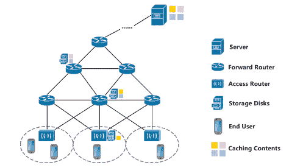
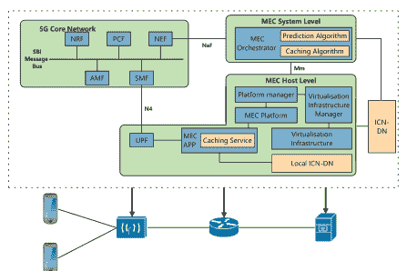
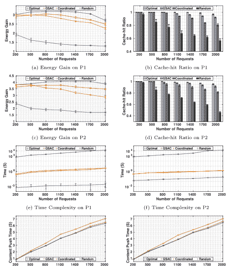
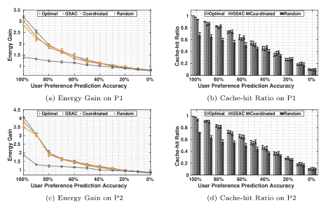

# 多路径路由能源高效主动缓存


# 摘要

The ever-continuing explosive growth of on-demand content distribution has imposed great pressure on mobile/wireless network infrastructures. To ease congestion in the network and to increase perceived user experience, caching of popular content closer to the end-users can play a significant role and as such this issue has received significant attention over the last few years. Additionally, energy saving is treated as a fundamental requirement in the design of next-generation mobile networks. However, there has been little attention to the overlapping area between energy saving and network caching especially when considering multipath routing. To this end, this paper proposes an energy-efficient caching with multipath routing support. The proposed scheme provides a joint anchoring of popular content into a set of potential caching nodes with optimized caching probabilities and routing probabilities for minimizing the total energy consumption of the proposed model also considers different content delivery modes, such as multicast and unicast. Two separated Integer-Linear Programming (ILP) models are formulated for each delivery mode. To tackle the curse of dimensionality we then provide a greedy simulated annealing algorithm, which not only reduces the time complexity but also provides a competitive performance. A wide set of numerical investigations reveal that the proposed scheme reduces the energy consumption up to 75% compared with other widely used caching approaches under the premise of network resource limitation. Sensitivity analysis to different parameters is also meticulously discussed in this paper.

# 1. Introduction

The enormous amount of mobile traffic, which is expected to reach more than 300 exabytes per month in 2026 [1], is creating great challenges in the 5G and beyond mobile network infrastructures. As an evolutionary network architecture, Information-Centric Networking (ICN) is designed to support content distribution and user mobility with in-network caching feature [3]. Compared with other caching approaches, in-network caching can significantly improve network capacity and latency, whose key aspects are related to the following type of questions: “where to cache”, “what to cache”, “cache dimensioning”, and “content delivery” [3]. In this paper, the focus is on the location to anchor popular content and determining an efficient routing path to be employed for caching delivery.

Despite the well-known benefits of mobile/wireless ICN, there are still a number of significant and challenging open-ended topics in this field, such as utilizing multipath routing, security and energy consumption [4]. When addressing energy consumption, it is treated as one of the key pillars in the design of 5G and beyond networks, which is not only important in monetary terms due to energy savings but also for curbing the CO2 emissions [5] and aligning operators with the goals related to the so-called 1.5 °C climate trajectory.1 Recently, 5G has been commercialized in many markets across the world and 6G has already started to attract significant attentions from both academia and industry [6]. Though the vision and requirements of 6G are still under study, there is no doubt that reducing the overall network energy consumption is a significant target for 6G. According to [7], the energy efficiency of 6G is expected to be improved by at least a factor of 10, when compared with 5G networks.

The energy consumption in ICN can be divided into two parts [8–12]: the energy required for content caching and the energy for data transmission. Content replicas can be placed near access routers as a means of reducing transmission costs but with an extra cost paid for being popular content, repeatedly consuming caching hash nodes can be adopted to reduce caching energy. However, the cache placement of an application-specific content, the cache placement and content routing decisions are inherently coupled since the request can only be served from a node that caches the required information. This inherent trade-off raises the following key question: where to cache popular content and how to design an efficient routing path to minimize the total energy consumption while satisfying the network resource limitations. To date, there are a number of prior works on the issues related to location selection for hosting popular content in order to minimize energy consumption as detailed in Section 2. However, most of these works do not take the routing policies into consideration or only adopt the shortest path. It is insufficient to only consider the shortest path routing especially when the network bandwidth is limited.

Inspired by the above discussion, in this article, we jointly consider the caching placement and multipath routing to minimize the total energy consumption and study the following two content delivery models [13]: (1) the service flow can be shared if the users have the same content preference as well as connected access router, which is called *multicast mode*. For example, semi-synchronous requests can be bundled together and served via a single transmission. (2) the service flow cannot be shared and each request is satisfied with an independent (unicast) transmission, i.e. unicast mode. We also consider explicitly the caching memory space and link bandwidth limitations. The main contributions of this work can be summarized as follows.

- An energy-efficient caching scheme is proposed by jointly considering the content placement and multipath routing. The problem is formulated as an optimization model with caching space and link capacity limitations. In particular, two Integer Linear Programming (ILP) models are derived according to the two delivery models.
- Since the proposed ILP models belong to the NP-hard family, we provide a heuristic algorithm named Greedy Simulated Annealing Caching (GSAC). In this approach, we divide the original problem into several sub-problems and employ the simulated annealing to find sub-optimal, albeit competitive, solutions for caching nodes recursively.
- To understand the performance gap among evaluated methods, a wide-set of simulations is performed under different scenarios. More specifically, we evaluate influences from the aspects of the user (in terms of the number of requests, user preference and prediction accuracy) and the network (such as the available bandwidth and caching space and the underlying network topology).

The rest of this paper is organized as follows. Section 2 reviews the existing research on proactive caching. Section 3 formulates the system model. Section 4 provides a simulated annealing-based heuristic algorithm. Section 5 presents an ICN and multi-access edge computing (MEC) integration platform for proposed methods deployment. In the end, Sections 6 and 7 give the numerical investigations and conclusions respectively.

# 2. Related work

This section first reviews some related works on energy-efficient caching in ICN-based networks [8–12]. An ILP model is studied in [8], where the limitation of router caching space and different caching hardware technologies have been taken into account. J. Llorca et al. [9] explicitly consider the temporal and spatial dynamics of user requests and the heterogeneity of network resources. The authors in [10] present a distributed in-network caching scheme in which each content router determines its own caching policy in [10], which is a centralized approach is also provided in the non-cooperative mode. An energy consumption model with propagation delay-awareness is investigated in [11] and a quantized Hopfield neural network is proposed to derive competitive solutions. The relationship between aggregate energy consumption per transmitted bit of information and the average number of hops has been studied in [12].

There are also some researches concentrating on energy-efficient caching in cellular networks [14–18]. The authors in [14] propose a coordinated caching model in eNodeBs for energy saving. A hybrid caching policy for reducing latency and energy consumption is designed in [15] which consists of device local caching, device-to-device (D2D) caching, base station (BS) caching. Except for saving the traditional energy in the above works, energy harvesting technology together with cooperative caching has also received scholarly attention in recent years, such as BS caching in [16,17] and D2D caching in [18]. In particular, the authors in [16] formulate a BS caching problem as a mixed integer linear programming routing problem and then decompose it as two sub-problems, and the work [18] considers the caching performance with storage capacity limit. Unlike [16,18], the study in [17] uses a simulation-based method, instead of an optimization model, to measure the energy efficiency of different BS switching. Apart from the aforementioned scenarios, the dense vehicular network and the unmanned aerial vehicle (UAV) network are considered in paper [19,20] respectively.

Furthermore, a number of studies have investigated the energy-efficient schemes by jointly considering caching, communication, and resource allocations. For instance, the authors in [21] propose a framework combining software defined networking, caching, and computing (SD-NCC) to balance the energy consumption and network resource utilization, which has the potential to support general in-network services. In addition, the problem investigated in [21] is formulated as a mixed-integer nonlinear programming (MINLP) problem and an alternating direction method of multipliers (ADMM)-based algorithm is provided for computational complexity reduction purpose. The inherent lack of user request arrival knowledge case is considered in [22] where caching, transcoding, and backhaul retrieving are jointly optimized. The research in [23] concentrates on the trade-offs between communication, computation and caching and provides a ~optimal solution to the proposed non-linear optimization model. Another joint optimization research can be found in [24], where the user association, resource allocation, and caching deployment are jointly utilized in the fog radio access networks (Fog-RAN) environment.

However, the majority of the aforementioned works do not take the routing policies into consideration [8,10,11,15–20,22,24] or only adopt the shortest path [9,12,4,2,3,23]. Therefore, the designed caching strategies may be inefficient when dealing with the limited network bandwidth scenario. There are also some researches discussing the design of joint caching and routing schemes. For example, a study in [25] formulates a joint caching and multipath routing problem as an ILP problem to maximize the volume of cached-served file requests in the wireless network. Chu et al. [26] jointly consider the cache allocation and routing path to maximize content utilities based on cache partitioning. The delay optimization scenario is also considered in [26]. The authors in [27] investigate the caching and routing problem considering both source routing and nominal shortest path routing to minimize routing cost. To simplify the model, the link bandwidth in [27] is assumed to be abundant. However, none of the above studies [25–27] consider caching placement for energy efficiency purposes. For a more detailed and extensive treatment of the overall state-of-the-art caching and routing policies in ICN, we refer the reader to [28].

We summarized the aforementioned works in Table 1. Motivated by these researches, the caching placement and multipath routing are jointly optimized in this paper to minimize energy consumption. The existing research in [29] is closest to the problem we tackle here. Though [29] considers the energy-efficient caching and routing algorithm in content delivery networks (CDN), here are some main differences between our work and [29]. On the one hand, the caching methods are quite different. For example, we allow replicated caching while [29] considers unique caching that each content is satisfied by exactly one node. On the other hand, our work includes modelling for different delivery modes, i.e. multicast and unicast, while [29] only considers the nominal method of delivery which is the unicast.


| 参考文献 | 场景 | 解决方案 | 节能 | 路由设计 | 交付模式 |
| :--- | :--- | :--- | :--- | :--- | :--- |
| [8] | ICN | ILP & 遗传算法 | ✓ | × | × |
| [9] | ICN | ILP & 局部搜索 | ✓ | 最短路径 | 组播 |
| [10] | ICN | ILP & 博弈论 | ✓ | × | × |
| [11] | ICN | ILP & Hopfield 神经网络 | ✓ | × | × |
| [12] | ICN | 松弛方法 | ✓ | 最短路径 | × |
| [14] | 蜂窝网络 | 优化模型 & 拉格朗日松弛 | ✓ | 最短路径 | × |
| [15] | 蜂窝网络 | 优化模型 | ✓ | × | × |
| [16] | 蜂窝网络 | MILP & 粒子群优化 | ✓ | × | × |
| [17] | 蜂窝网络 | 遗传算法 & 模拟退火 | ✓ | × | × |
| [18] | 蜂窝网络 | 优化模型 & 模拟退火 | ✓ | × | × |
| [19] | 车载网络 | 优化模型 & 对偶分解 | ✓ | × | × |
| [20] | UAV | Lyapunov 优化 | ✓ | 最短路径 | × |
| [21] | SDN/CC | DRL & 优化 | ✓ | × | 单播 |
| [22] | 蜂窝网络 | 随机优化 & Benders 分解 | ✓ | × | × |
| [23] | 树状网络 | MINLP & 空间分支定界 | ✓ | 最短路径 | × |
| [24] | Fog-RAN | 优化模型 & ADMM | ✓ | × | × |
| [25] | SoftNFV | 优化模型 & 随机舍入 | ✓ | 多路径 | 单播 |
| [26] | ICN | 优化模型 | × | 多路径 | × |
| [27] | ICN | 优化模型 | × | 多路径 | 单播 |
| [29] | CDN | ILP & 启发式 | ✓ | 多路径 | 单播 |
| 本文 | ICN&5G | ILP & 模拟退火 | ✓ | 多路径 | 组播 & 单播 |



# 3. 系统模型

## 3.1. 网络模型

The network is modelled as an undirected graph G = (E, L) as shown in Fig. 1, where E represents the set of nodes and L denotes the set of links. Each link l ∈ L is equipped with bandwidth c_l. The nodes are partitioned to access routers (AR) A ⊂ E, forward routers F ⊂ E and servers {0} ∈ E. Additionally, each caching node c ∈ E^C = E\{0} has storage capacity a_c, and can provide both data flow forwarding and content caching services.

网络建模为无向图 G = (E, L)，如图 1 所示，其中 E 表示节点集合，L 表示链路集合。每条链路 l ∈ L 配备带宽 c_l。节点被划分为接入路由器（AR）A ⊂ E、转发路由器 F ⊂ E 和服务器 {0} ∈ E。此外，每个缓存节点 c ∈ E^C = E\{0} 具有存储容量 a_c，并可提供数据流转发和内容缓存服务。

Let N be the set of contents. For each content n ∈ N, the required caching size and transmission bandwidth are represented by s_n and b_n, respectively. Without loss of generality, we assume all contents can be retrieved from backbone servers; in case of a cache miss, the user-requested file is described as x_{n,k}, which is the probability of user k requesting file n. Furthermore, we use x_{k,t} to represent the user k accesses to the network service via AR a_t, which depends on

令 N 为内容集合。对于每个内容 n ∈ N，所需缓存大小和传输带宽分别由 s_n 和 b_n 表示。不失一般性，我们假设所有内容均可从骨干服务器检索；在缓存未命中时，用户请求的文件描述为 x_{n,k}，即用户 k 请求文件 n 的概率。此外，我们使用 x_{k,t} 表示用户 k 通过 AR a_t 访问网络服务，这取决于

2 Here we consider the ICN-based network structure. Thus, the term router in this paper is not the core router in the Internet backbone but the ICN content router [2].

2 此处我们考虑基于 ICN 的网络结构。因此，本文中的路由器一词并非指互联网骨干网中的核心路由器，而是指 ICN 内容路由器 [2]。

the user movement behaviour. For modelling simplification purposes, we assume the user's movement is already known, thus x_{k,t} becomes a binary indicator; otherwise, x_{k,t} is the moving probability and the model for this case is discussed in our previous work [30]. Regarding the user mobility prediction, some commonly-used models include association rule-based model [31], Markov-based model [32,33] and deep neural network-based model [34,35] by mining historical data and extracting user location information. Consequently the aggregated number of request for content n at AR a, x_{n,a}, can be determined by x_{n,a} = \sum_k x_{n,k}. For ease of reference, all used symbols and their meanings are summarized in Table 2.

用户移动行为。为简化建模，我们假设用户的移动已知，因此 x_{k,t} 成为二进制指示器；否则，x_{k,t} 是移动概率，该情况下的模型在我们之前的工作 [30] 中讨论。关于用户移动性预测，一些常用模型包括基于关联规则的模型 [31]、基于马尔可夫的模型 [32,33] 和基于深度神经网络的模型 [34,35]，通过挖掘历史数据和提取用户位置信息。因此，AR a 处内容 n 的聚合请求数 x_{n,a} 可由 x_{n,a} = \sum_k x_{n,k} 确定。为便于参考，所有使用的符号及其含义汇总于表 2。

## 表 2
主要符号汇总。

| Symbol | Description |
| :--- | :--- |
| \(\mathcal{E}^o\) | 缓存候选集合 |
| \(\mathcal{A}\) | 接入路由器（AR）集合，\(A \in \mathcal{E}^o\) |
| {0} | 数据服务器 |
| \(\mathcal{N}\) | 内容集合 |
| \(\mathcal{L}\) | 链路集合，\(\mathcal{L} = \mathcal{E}^o \cup \{0\}\) |
| \(\mathcal{E}\) | 节点集合 |
| \(\mathcal{K}\) | 用户集合 |
| \(\alpha\) | 缓存 1 比特数据的功率效率（瓦特/比特） |
| \(\beta\) | 在 1 跳内传输 1 比特数据的功率成本 |
| \(\mathcal{T}\) | 每比特跳的时间槽 |
| \(s_n\) | 内容 \(n\) 的大小 |
| \(b_n\) | 内容 \(n\) 的带宽需求 |
| \(c_n\) | 缓存节点 \(e\) 的缓存成本 |
| \(c_l\) | 链路 \(l\) 的容量 |
| \(\rho_n\) | 用户 \(k\) 对内容 \(n\) 的偏好 |
| \(\pi_{ns}\) | 用户 \(k\) 与 AR \(a\) 的连接 |
| \(x_{ns}\) | AR \(a\) 处内容 \(n\) 的聚合流行度 |
| \(y_{nps}\) | 指示路径 \(p \in \mathcal{P}_{ns}\) |
| \(N_{nps}\) | 指示链路 \(l\) 是否在路径 \(p \in \mathcal{P}_{ns}\) 中，或不在 |
| \(B_{nps}\) | 指示内容 \(n\) 是否缓存在节点 \(e\) 中，或不在 |

## 3.2. 能耗模型

In this paper, we focus on two types of energy consumption in the caching-enabled network: the caching energy E^C and the communication transmission energy E^T. Therefore, the total energy consumption can be represented by E = E^C + E^T. Similar to [22], the caching energy is a proportional iteration of content size and can be given by,

本文关注缓存启用网络中的两种能耗：缓存能耗 E^C 和通信传输能耗 E^T。因此，总能耗可表示为 E = E^C + E^T。类似于 [22]，缓存能耗与内容大小成正比，可表示为，

E^C = \sum_{n \in \mathcal{N}} \sum_{k \in \mathcal{K}} \alpha x_n \cdot s_n \cdot T, (1)

where \alpha is the power efficiency for caching n-bit of information; s_n is the required caching space for content n; x_n is a binary decision variable with,

其中 \alpha 是缓存 n 比特信息的功率效率；s_n 是内容 n 所需的缓存空间；x_n 是二进制决策变量，其中，

x_{ns} = \begin{cases} 1. & \text{如果内容 } n \text{ 缓存在节点 } e \text{ 中；} \\ 0. & \text{否则。} \end{cases}

T is the time interval normalization factor partitioned in time epochs of equal length and the hosting content in one time period might be totally different from the data in the next time epoch; this is also called as caching refreshing cycle [22] or windowed grouped data aggregation [23]. Without loss of generality, hereafter we focus on optimization procedures in one time epoch.

T 是时间间隔归一化因子，划分为等长的时间时期，一个时期内托管的内容可能与下一时期的数据完全不同；这也称为缓存刷新周期 [22] 或窗口分组数据聚合 [23]。不失一般性，此后我们专注于一个时间时期内的优化过程。

The communication transmission energy consumption is measured by the number of hops the network traffic and can be given by,

通信传输能耗由网络流量的跳数来衡量，可表示为，

E^t = \sum_{n \in \mathcal{N}} \sum_{a \in \mathcal{A}} \sum_{e \in \mathcal{E}^o} \sum_{p \in \mathcal{P}_{ns}} \beta \cdot N_{nps} \cdot s_n \cdot y_{nps}. (2)

where \beta is the energy cost for transmitting 1-bit of information within a single hop; N_{nps} expresses the number of hops on path p ∈ P_{ns} and P_{ns} represents all available paths between AR a and caching node e; notably N_{nps} = 0 if a = e; y_{nps} is a decision variable with

其中 \beta 是在单跳内传输 1 比特信息的能耗成本；N_{nps} 表示路径 p ∈ P_{ns} 上的跳数，P_{ns} 表示 AR a 与缓存节点 e 之间的所有可用路径；值得注意的是，若 a = e，则 N_{nps} = 0；y_{nps} 是决策变量，其中

y_{nps} = \begin{cases} 1, & \text{如果内容 } n \text{ 的传输使用路径 } p \in \mathcal{P}_{ns}；} \\ 0, & \text{否则。} \end{cases}

It is worth noting that we do not take the static energy consumption of network devices into consideration, such as the idle power to support routers and network interfaces. The rational behind this is that in this paper we assume that these devices are being kept in power-on mode to provide various kinds of network services for different requests, instead of only content caching.

值得注意的是，我们未将网络设备的静态能耗考虑在内，例如支持路由器和网络接口的空闲功率。其理由是，在本文中，我们假设这些设备保持通电模式，为不同请求提供各种网络服务，而不仅仅是内容缓存。

## 3.3. 优化模型

In this subsection, we consider two types of content delivery mode, i.e. the multicast and the unicast mode. For modelling simplification purposes, the following optimization models are under the assumption that the user's interested content is already known by request prediction, which indicates p_{kn} becomes a binary indicator to bridge user k and content n. To lay out how the user request can be predicted, we introduce related algorithms from two perspectives. Please note that this brief introduction is not exhaustive since the request prediction is beyond the scope of this paper. From the view of aggregated content popularity prediction, the Zipf model [36], the shot noise model [37], and the stochastic block model [38] are widely used models for the case of static popularity, time-varying popularity, and location-dependent popularity, respectively. Recently, deep learning has become an active method for popularity prediction [39–41]. From the aspect of individual user preference prediction, it can be predicted by collaborative filtering [42] which predicts the histories of the similar user and the similarity among users. The typical collaborative filtering model includes matrix factorization [43], latent Dirichlet allocation [44], and probabilistic latent semantic analysis [45]. The influence of the predicted accuracy on system energy consumption is discussed in Section 6. Moreover, in this paper we focus on delay-insensitive requests, such as non-real-time HTTP video downloading and video on demand services. Therefore, the latency constraint for energy-efficient caching is not considered in the latency models and would be studied as a future work.

在本小节中，我们考虑两种内容传输模式，即组播和单播模式。为简化建模，以下优化模型基于以下假设：用户感兴趣的内容已通过请求预测得知，这表明 p_{kn} 成为连接用户 k 与内容 n 的二进制指示器。为阐明如何预测用户请求，我们从两个角度介绍相关算法。请注意，此简要介绍并非详尽无遗，因为请求预测超出了本文的范围。从聚合内容流行度预测的角度来看，Zipf 模型 [36]、射击噪声模型 [37] 和随机块模型 [38] 分别是静态流行度、时变流行度和位置相关流行度情况下的广泛使用模型。最近，深度学习已成为流行度预测的活跃方法 [39–41]。从单个用户偏好预测的角度来看，可以通过协同过滤 [42] 进行预测，该方法预测相似用户的历史记录和用户之间的相似性。典型的协同过滤模型包括矩阵分解 [43]、潜在狄利克雷分配 [44] 和概率潜在语义分析 [45]。预测精度对系统能耗的影响在第 6 节中讨论。此外，在本文中，我们关注对延迟不敏感的请求，例如非实时 HTTP 视频下载和点播服务。因此，延迟模型中未考虑节能缓存的延迟约束，这将作为未来工作进行研究。

### 3.3.1. 组播模式

The ILP model is formulated as follows:

ILP 模型制定如下：

(P1) \quad \min_{x_{ns}} E (3a)
s.t. \quad \sum_{n \in \mathcal{N}} s_n \cdot x_{ns} \le \forall n, \forall e \in \mathcal{E}^o; (3b)
\sum_{n \in \mathcal{N}} \sum_{a \in \mathcal{A}} \sum_{e \in \mathcal{E}^o} \sum_{p \in \mathcal{P}_{ns}} b_n \cdot B_{nps} \cdot y_{nps} \le \forall l \in \mathcal{L}; (3c)
y_{nps} \le x_{ns}; \forall n \in \mathcal{N}, a \in \mathcal{A}, e \in \mathcal{E}^o, p \in \mathcal{P}_{ns}; (3d)
y_{nps} \le s_{ns}; \forall n \in \mathcal{N}, a \in \mathcal{A}, e \in \mathcal{E}^o, p \in \mathcal{P}_{ns}; (3e)
\lambda_{nu} \sum_{e \in \mathcal{E}^o} \sum_{p \in \mathcal{P}_{ns}} y_{nps} = \lambda_{nu}; \forall n \in \mathcal{N}, a \in \mathcal{A}; (3f)
x_{ns} \in \{0, 1\}, \forall n \in \mathcal{N}, e \in \mathcal{E}^o; (3g)
y_{nps} \in \{0, 1\}, \forall n \in \mathcal{N}, a \in \mathcal{A}, e \in \mathcal{E}^o, p \in \mathcal{P}_{ns}. (3h)

The objective function (3a) aims to minimize the total energy consumption, which is introduced in Section 3.2. Constraint (3b) relates to the storage space used for caching which should not exceed the node capacity. Constraint (3c) satisfies the link bandwidth limitation. We note that B_{nps} is a binary indicator, where B_{nps} = 1 means that the link l is in path p ∈ P_{ns}, and B_{nps} = 0, otherwise. Therefore, \sum_l \sum_p \sum_s B_{nps} \cdot y_{nps} selects all links used for content n delivery. Constraint (3d) limits the source of delivery path should host related contents. Moreover, in constraint (3e) when y_{nps} = 0, y_{nps} is forced to be 0, which means the delivery path to AR a should not be assigned if there is no such requirement in that AR and not in constraint (3f) if \lambda_{nu} \neq 0, \sum_{e \in \mathcal{E}^o} \sum_{p \in \mathcal{P}_{ns}} y_{nps} = 1 guarantees that at least one requirement of AR y_{nps} = 1 locate a delivery path since content n is requested at AR y_{nps}. To locate a delivery path efficiently, it is necessary that when dealing with caching allocation, we only focus on the storage node e ∈ E^o such as constraints (3b) and (3d); however, for the path assignment, we consider both the caching node e ∈ E^o (for cache hitting case) and the core network server (0) (for the cache missing case), like constraint (3c), (3e) and (3f).

目标函数 (3a) 旨在最小化总能耗，如第 3.2 节所述。约束 (3b) 与用于缓存的存储空间有关，不应超过节点容量。约束 (3c) 满足链路带宽限制。我们注意到 B_{nps} 是二进制指示器，其中 B_{nps} = 1 表示链路 l 在路径 p ∈ P_{ns} 中，否则 B_{nps} = 0。因此，\sum_l \sum_p \sum_s B_{nps} \cdot y_{nps} 选择用于内容 n 传输的所有链路。约束 (3d) 限制传输路径的源应托管相关内容。此外，在约束 (3e) 中，当 y_{nps} = 0 时，y_{nps} 被强制为 0，这意味着如果在该 AR 中没有此类要求，则不应分配到 AR a 的传输路径；而在约束 (3f) 中，如果 \lambda_{nu} \neq 0，\sum_{e \in \mathcal{E}^o} \sum_{p \in \mathcal{P}_{ns}} y_{nps} = 1 保证至少有一个 AR y_{nps} = 1 的要求定位到一条传输路径，因为内容 n 在 AR y_{nps} 处被请求。为高效定位传输路径，在处理缓存分配时，有必要仅关注存储节点 e ∈ E^o，如约束 (3b) 和 (3d)；然而，对于路径分配，我们既考虑缓存节点 e ∈ E^o（缓存命中情况），也考虑核心网络服务器 (0)（缓存未命中情况），如约束 (3c)、(3e) 和 (3f)。

### 3.3.2. 单播模式

In the unicast mode of delivery, y_{nps} is no longer binary but an integer decision variable where the value represents the number of flows for content n that traverse path p ∈ P_{ns}. In that case, the proposed ILP model would be as follows,

在单播传输模式中，y_{nps} 不再是二进制变量，而是整数决策变量，其值表示遍历路径 p ∈ P_{ns} 的内容 n 的流量数量。在这种情况下，拟议的 ILP 模型如下，

(P2) \quad \min_{x_{ns}} E (4a)
s.t. \quad y_{nps} \le M \cdot x_{ns}; \forall n \in \mathcal{N}, a \in \mathcal{A}, e \in \mathcal{E}^o, p \in \mathcal{P}_{ns}; (4b)
\sum_{e \in \mathcal{E}^o} \sum_{p \in \mathcal{P}_{ns}} y_{nps} = \lambda_{nu}; \forall n \in \mathcal{N}, a \in \mathcal{A}; (4c)
y_{nps} \in \mathbb{Z}^+, \forall n \in \mathcal{N}, a \in \mathcal{A}, e \in \mathcal{E}^o, p \in \mathcal{P}_{ns}; (4d)
(3b),(3e),(3g).


约束 (4b) 从约束 (3d) 更新而来，M 是一个足够大的数，表示只要该节点托管了所需内容，就可以服务请求。在考虑节点服务能力的场景中，M 应替换为服务速率，即节点在时间周期 T 内可以服务的请求数量，由 (30) 给出。约束 (4c) 替换了约束 (3c) 和 (3d)，其中，AR a 上所有内容 n 的服务流量应与请求数量完全匹配。

关于上述模型的时间复杂度，我们有如下定理：

## Theorem 1. ILP 模型 (P1) 和 (P2) 属于 NP-hard 问题族。

Proof. 对于 (P1)，我们将通过证明模型 (3) 是无容量设施选址（UFL）问题的推广来建立证明，其中 UFL 是一个著名的 NP-hard 问题。假设网络是树拓扑且所有用户请求相同内容，则任意两个节点之间的距离是唯一的。此外，链路容量 x_e 和 y_ea。考虑缓存空间和链路带宽无限的情况，即 w_i = c_j = +\infty，因此，约束 (3b) 和 (3c) 可以松弛。此外，令 \lambda_a \ge 1，\forall a \in A。结果，约束 (3e) 由 (3b) 保证，且 \lambda_a 可以安全地在 (3b) 的两边相除。最终，(P1) 可以重写为如下 UFL 问题：

```
min_{x, y} \sum_{a \in A} s: T_a x_s + \sum_{n \in N} \sum_{a \in A} (b \cdot s - N_n) y_{nae} \quad (5a)
s.t. \quad y_{ae} = x_s, \forall a \in A, e \in e^0; \quad (5b)
\sum_{e \in e^0} y_{ae} = 1, \forall a \in A; \quad (5c)
x_e \in \{0, 1\}, \forall e \in e^0; \quad (5d)
y_{ae} \in \{0, 1\}, \forall a \in A, e \in e^0. \quad (5e)
```

这意味着 (P1) 至少和 UFL 一样困难。因此，我们已证明 (P1) 是 NP-hard 的。

同样，通过设置 \lambda_a = 1 的约束 (4c) 并如上松弛模型 (4)，(P2) 可以转换为 UFL 优化模型，这意味着 (P2) 是 UFL 问题的推广，因此 (P2) 也是 NP-hard 的。\(\square\)

因此，由于维度灾难，当网络实例变大时，在合理时间内求解问题 (P1) 和 (P2) 具有挑战性。为了加速计算时间并提供适合实时操作的决策，我们在下一节中提出了一种贪心模拟退火缓存（GSAC）算法。

# 4. 一种元启发式优化算法

在 GSAC 中，原始优化模型按内容类别分解，这些内容按降序分配，即网络首先服务请求最多的内容。然后，对于每个内容分配，我们采用模拟退火算法将热门内容分配到最合适的节点。

模拟退火（SA）[46] 是一种用于逼近给定函数全局优化的著名优化方法。SA 是基于统计力学概念的退火过程，其灵感来自于物理系统在冷却过程中的行为类比。它可以被视为一种强大的启发式方法，适用于全局优化，且对目标函数的结构无特定假设。与其他进化算法（如遗传算法）相比，SA 能以更快的收敛速度提供具有竞争力的解。SA 的主要结构包含两个嵌套循环，外部循环由温度控制，内部循环由马尔可夫链长度管理。在每个循环中生成一个新解，然后与先前存储的结果进行比较。如果新解的性能优于之前的解，则接受该新解；否则，新解将以某些预定义的概率被接受。迭代继续直到满足停止准则。

关于优化模型 (P1)，每个循环生成的解包括决策变量 x_e 和 y_{ap}（此处我们处理针对特定内容 n 的子问题，因此为简化起见，下标表示中省略了 n）。但是，请注意，关于这两个变量（即 x_e 和 y_{ap}）的决策可能导致不可行的分配。为了恢复可行性，我们将 x_e 设为枢纽变量。然后，一旦 x_e 被分配，y_{ap} 可以按如下方式确定：

```
[y_{ap} = 1, \quad \text{if } \sum_{e \in e^0} x_e = 0 \text{ and } l_a > 0];
[y_{ap} = 1, \quad \text{if } ((a, p) \in l_a, x_e = 1, 1 \leq N_{na}, b \leq c_j, \forall a \in A, \exists e \in e^0, l \in p \in P_a];
[y_{ap} = 0, \quad \text{otherwise.}
```

如果在 RA 中存在请求（即 l_a > 0），但所有缓存节点 e \in e^0 都不托管所需内容（即 \sum_{e \in e^0} x_e = 0），则请求被重定向到骨干服务器（通过最短路径，即 p = 1）。如果在 RA 中存在请求（即 l_a > 0），某些节点托管了内容（即 x_e = 1，\exists e \in e^0），且连接链路 l 保证了传输带宽（即 b > c），则请求由最近的缓存节点（即 e）服务，以缓解网络拥塞。

问题 (P2) 中 y_{ap} 的确定如下：

```
[y_{ap} = \lambda_a, \quad \text{if } \sum_{e \in e^0} x_e = 0 \text{ and } l_a > 0];
[y_{ap} = |c/b|, \quad \text{if } ((a, p) \in l_a, x_e = 1, 1 \leq N_{na}, b \leq c_j, \forall a \in A, \exists e \in e^0, l \in p \in P_a];
[y_{ap} = 0, \quad \text{otherwise.}
```

类似于组播情况，在缓存未命中情况下（即 \sum_{e \in e^0} x_e = 0，\lambda_a > 0），所有请求均在骨干服务器（0）处服务。如果某些节点托管了内容且链路容量足以支持至少一个请求传输，则我们继续根据带宽（即 y_{ap} = |c/b|）分配路由路径，直到所有请求都被分配或没有更多链路可用；否则，路由分配被忽略。

所提 GSAC 框架的细节在算法 1 中描述。涉及四个超参数，如后文所述。L 参数控制第 8 到 20 行的内部循环，而参数 T_0、T_{end} 和 \gamma 管理第 7 到 21 行的外部循环。此外，当前温度 T_m 影响接受概率，即 GSAC 算法的外部循环。在第 2 行，我们通过 Yen’s Algorithm 计算 k-最短路径，其时间复杂度为 O(K|E|^2)，符号 | | 表示集合基数。在本文中，我们考虑 5-最短路径，即 k = 5，并且要求每个 AR a 的路径。因此，第 2 行的时间复杂度变为 O(|A| k |E|^2)。对于模拟退火的每次外部迭代，温度从 T_0 降低到 T_{end}，减少量为 \gamma。假设 I 是外部循环的次数，则在终止时有 \gamma^I = T_{end} / T_0。在大多数情况下，冷却因子 \gamma 在 0 和 1 之间。因此，我们有 I = \lceil \log_\gamma(T_{end}/T_0) \rceil。很明显，内部循环的次数是 L。在每个外部循环中，最坏情况是在确定决策变量 y_{ap} 时枚举 a、e 和 p 的组合。此外，检查 y_{ap} 是否的时间复杂度为 O(|A||P||E|)。请注意，我们需要为每个内容 n \in N^c 分配缓存位置。最终，算法 1 的时间复杂度为 O(|L| \cdot |A||P||E|^N + |A||E|^2)。

超参数的配置取决于问题的范围。在本文中，经过多轮网格搜索并考虑时间复杂度与性能之间的权衡后，最佳配置记录如下：T_0 = 10^6，T_{end} = 10^{-4}，\gamma = 0.9 和 L = 300。

### Algorithm 1: 贪心模拟退火缓存（GSAC）

```
Data: Variables in Table 2; Simulated Annealing Initial Temperature T0; Stopping Temperature Tend; Annealing Parameter γ; Markov-chain Length L
Result: Cache allocation X_{ap} and path delivery y_{ap}
1 Initialize N' = {n | \sum_{a,q,u} > 0} and sort descendingly;
2 Generate {p ∈ Pe} the k-shortest path for each {a, e} pair via Yen's Algorithm;
3 foreach x ∈ N' do
4 Initialize x_e randomly {x_e | 0/1 | x_e ≤ u_e, ∀e ∈ E^0}, T_n = T0,
5 j ← 1;
6 Determine y_{ap} through (6) or (7); // for (P1) or (P2)
7 Set best solution x* ← x, y* ← y_{ap};
8 while T_n ≥ Tend do
9 while j ≤ L do
10 Generate x_e via flipping one bit in x_e randomly;
11 Determine y_{ap} through (6) or (7);
12 if δ ∈ E(x_e, y_{ap}) − E(x_{prev}, y_{ap,prev}) < 0 then
13 Update x_{prev} ← x_e, y_{ap,prev} ← y_{ap};
14 if E(x_e, y_{ap}) − E(x*, y*) < 0 then
15 Update x* ← x_e, y* ← y_{ap};
16 end
17 else
18 Update x_e, y_{ap} ← x_{prev}, y_{ap,prev} with probability exp(−δ/T_n);
19 end
20 j ← j + 1;
21 end
22 T_n = γ × T_n;
23 end
24 x_{ap}, y_{ap} ← x*, y*;
25 Update w_e, c;
26 end
```

# 5. 算法部署

在本节中，我们首先介绍一个在 5G 环境中用于所提缓存方案部署的集成 ICN 和 MEC 平台。然后我们简要描述缓存时间槽期间的工作流程。

## 5.1. 集成框架的架构

集成平台如图 2 所示，基于 [47,48]，由 5G 网络、MEC、ICN 和网络虚拟化技术组成。

与 4G 网络不同，5G 不仅仅是一个网络；它带来了一个全球生态系统，承诺不仅提供海量数据流量和高可靠性的连接，还支持海量通信类型。5G 核心网演进为基于服务的架构（SBA）。如图 2 左上角所示，五个关键网络功能（NF，即网络存储库功能—NRF、策略控制功能—PCF、网络暴露功能—NEF、接入和移动性管理功能—AMF、会话管理功能—SMF）通过基于服务的接口（SBI）消息总线相连。具体而言，NRF 维护 NF 及其配置文件；PCF 控制网络行为；NEF 暴露核心网内外的服务和可用资源；AMF 管理终端设备连接；SMF 主要负责与用户面功能（UPF）的会话上下文。此外，UPF 用于路由和转发缓存内容。

MEC 是指在网络边缘提供计算、缓存和其他各种服务的平台，可以缓解回程拥塞并为 5G 网络实现服务质量（QoS）。图 2 右侧是 MEC 功能实体。MEC 编排器充当外部应用功能，并通过 NEF 接口与 NF 通信，负责维护整个系统。此外，所提缓存策略（即作为用户 QoS 的优化模型）和那些行为及预测算法用于实现预测精度。根据用户请求预测 [36–45] 和 MEC 编排器中的缓存。在缓存决策确定后，内容和传输路径路由策略可以通过 NEF-PCP-SMF-UPF 路由分发。MEC 主机包含 MEC 平台和虚拟化基础设施，为 MEC 应用程序提供计算、存储和网络资源。此外，ICN 缓存服务被视为一种 MEC 应用。本地 ICN 数据网络（ICN-DN）中的可用网络资源信息（如内存空间和链路带宽）由 MEC 主机级别的虚拟化基础设施管理器收集，然后在 MEC 编排器中维护。为了支持缓存服务，MEC 主机可以部署在接入路由器、转发路由器甚至数据服务器上。

## 5.2. 工作流程示例

所提算法可以扩展到各种 ICN 实现，如面向数据的网络架构（DONA）[49]、面向内容的网络（CCN）[50] 和命名数据网络（NDN）[51]。此处我们以 NDN 为例进一步说明工作流程。所提算法的工作流程分为两个阶段：内容部署阶段和流量服务阶段。

内容部署阶段如下：

- Step 1: MEC 编排器从接入路由器收集当前用户行为信息，并从所有缓存节点收集网络可用资源状态（如存储空间和链路带宽）。
- Step 2: MEC 编排器调用预测算法，如用户移动性预测和请求偏好预测，以估计下一个时间槽的用户行为；
- Step 3: 基于预测和可用网络资源，编排器调用所提算法以确定缓存位置和相关路由路径；
- Step 4: 编排器通过广播将路由路径分发到所有路由器，并根据缓存决策从原始数据服务器主动将内容推送到路由器；
- Step 5: 基于接收到的路由路径，路由器通过将路径转换为接口表示来更新转发信息库（FIB），并在内容存储（CS）中缓存相关内容。

内容部署阶段之后，在下一个时间槽中，流量服务过程如下：

- Step 1: 接入路由器接收来自连接终端用户的请求，并记录用于下一个时间槽的估计；
- Step 2: 路由器执行 CS 查找以检查内容是否存储在本地 ICN-DN 中。如果缓存命中，则请求可以在本地服务；否则，




图 2. 5G架构中ICN和MEC平台的描绘。

步骤 3：路由器执行待决利益表（PIT）查找以验证相同内容请求的存在。如果匹配，请求将被挂起，直到从其他路由器检索到内容；否则，

步骤 4：路由器执行FIB查找以查找托管此内容的节点。如果存在匹配的缓存节点，请求将通过FIB记录的接口转发；否则，请求将发送到数据服务器。

**表 3 仿真参数 [23,55]。**

| 参数 | 默认值 | 范围 |
| :--- | :--- | :--- |
| 缓存功率系数 (\(\varsigma\)) | \(2.5 \times 10^{-4}\) W/b | - |
| 传输功率系数 (\(\varrho\)) | \(4 \times 10^{-6}\) J/b | - |
| 内容流行度 (\(\lambda\) (1)) | 1.000 | - |
| 缓存大小 (\(\gamma_s\)) | - | [10,100] MB |
| 内容传输带宽 (\(\kappa_s\)) | - | [10,100] Mbps |
| 可用缓存空间 (\(\gamma_{rs}\)) | 0.5 GB | [0.25,1] GB |
| 可用带宽 (\(\kappa_{rs}\)) | 0.5 Gbps | [0.25,1] Gbps |
| 偏好预测准确度 (\(\rho_{rs}\)) | 100% | [0%,100%] |
| 请求数量 (\(\sum_m \lambda_m\)) | 1100 | [200,2000] |
| 时间槽持续时间 (\(T\)) | 10 s | - |

# 6. 数值调查

## 6.1. 仿真设置

在本节中，我们将所提方案集合得出的缓存分配与此前广为人知的一些技术进行对比，例如随机缓存和协同缓存方案，它们分别在[52]和[14]中介绍过。所提技术集合包括ILP优化模型（本文通过分支定界法将其视为提供最优解，因此在后续图表中，我们使用“Optimal”来表示ILP模型的结果）和GSAC技术。随机缓存可被视为一种运营商易于采用和使用的技术，其中为请求内容随机选择托管节点。基于缓存容量，协同缓存将内容放置在本地或附近的缓存节点，从而平衡数据传输和存储之间的能耗。

实验在一个包含20个缓存节点和52条链路的网络模型中进行，该模型捕捉了移动边缘网络的典型树状配置。为不失一般性，我们假设所有链路具有相同容量，所有缓存节点具有相同内存空间，但实际值会有所变化，以研究带宽与存储（缓存内存容量）之间的权衡。因此，我们研究缓存内存容量与80/20法则之间的权衡，即约80%的用户请求集中在前20%的内容类别上。该法则已广泛应用于包括缓存在内的各个领域[38]。基于此类预测的缓存分配以及预测准确度的影响也进行了讨论。

性能主要通过两个关键指标进行评估：能量增益和缓存命中率。关于能量增益，我们使用所谓的无缓存方法作为基准，本质上意味着我们不在缓存节点上托管任何内容，每个流请求都应传输到核心网络内容服务器。在这种情况下，增益按以下方式计算

\(Gain = \frac{E(\chi_{s_{no\_snap}})}{E(\chi_{s_{snap}})}\)
其中，\(E(\chi_{s_{no\_snap}})\)是应用无缓存策略的能耗，\(E(\chi_{s_{snap}})\)表示使用估计算法（即Optimal、GSAC、协同缓存和随机缓存）的能耗。因此，更大的能量增益表明更好的节能性能。此外，缓存命中率定义为由缓存节点提供服务的内容请求百分比。

此后呈现的所有结果均基于一百个网络场景（即蒙特卡洛仿真）的平均值，并基于此我们分析不同方案的性能。为了对计算时间有所了解，我们指出所有仿真均在64位Windows 10环境下运行的MATLAB R2021b上进行，而机器配备了Intel Core i9-10900K CPU和64 GB RAM。调查中假设的仿真参数在表5中呈现和总结。除非另有说明，\(\kappa_s\)、\(\kappa_{rs}\)、PL\(_{max}\)和\(\sum_m a_m\)的值均设置为默认值。

## 6.2. 请求数量的影响

我们首先研究内容请求数量如何影响所提方案的性能，在此情况下，我们将\(\sum_m a_m\)设置为从200变化到2000。如图3所示，评估内容包括能量增益、缓存命中率、运行每个算法的时间复杂度以及主动将内容推送到缓存节点的时间。此外，每个仿真案例的置信区间已添加到图表中。在图3(a)中，(P1)上的Optimal和GSAC都呈现先上升后保持再下降的趋势，而Random呈下降趋势。随着用户请求的增加，如预期，缓存服务的能耗相应增加，这一趋势与我们使用Optimal方案、GSAC、协同方案还是无缓存方案无关。然而，性能在整体能量增益中起着重要作用：(1) 上升（即正斜率）表示无缓存方案的增长速度快于被评估算法；(2) 平台期（即零斜率）表明无缓存方案和被评估算法具有相似的增长速率；(3) 下降（即负斜率）表示无缓存方案的增长速度慢于被评估算法。

在图3(a)中，当请求数量在200到500之间时，网络拥有足够的资源（即缓存空间和链路带宽）来为最终用户提供服务，Optimal与GSAC都能显著优于无缓存方案来降低能耗。Optimal的能量增益范围为302到317，GSAC方案的能量增益范围为2.93到2.99。超过该状态后，能量增益开始逐渐下降，而能量在500到1400之间，这反映了Optimal曲线能量增益上的平台期。对于GSAC方法，平台期在1100个请求处结束。超过转折点后（即Optimal的1400个请求和GSAC的1100个请求），更多用户流被重定向到核心网络服务器，因此性能更接近无缓存方案。因此，Optimal的能量增益降至2.70，GSAC降至2.50。关于协同缓存，当请求数为200时，其能量增益与Optimal表现相似，然后持续下降，尤其是在800个请求之后。这是可以预期的，因为协同缓存忽略了带宽限制。因此，一旦连接链路拥塞，协同缓存的性能就会下降。

对于随机缓存，观察到仿真中能量增益从1.92逐渐下降到1.29，这表明该方法无法灵活应对不断增加的请求。最后，值得注意的是，图3(a)中的能量增益均高于1，因此所有被评估算法相比无缓存方法都能节省能源。

图3(b)揭示，随着请求数量的增加，缓存命中率持续下降。一般来说，Optimal和GSAC保证大多数请求（仿真中超过90%）可以在缓存节点上得到满足。在2000个请求的情况下，应用协同缓存时，近五分之一的流被重定向到核心网络服务器，而随机缓存的比例几乎是一半。需要注意的是，Optimal和GSAC的比例在分别超过1400个请求和1100个请求后明显下降，这与图3(a)中的转折点相吻合。

如图3(c)和3(d)所示，(P2)上仍然存在类似模式。但是，在(P2)中，Optimal的能量增益在超过500个请求点后继续上升。原因在于，在(P2)中，每个流都独立服务，即使请求的内容本质上是相同的。因此，无缓存算法比在(P1)中消耗更多能量。虽然Optimal的能耗也在增加，但其增长速率与无缓存相似，这反映了当请求数量在800到1700之间时出现平台期。图3(c)报告了GSAC和协同缓存持续下降的性能。与图3(a)中的下降趋势相反，GSAC的能量增益集中在1.00左右，这应是最终表现，而非网络资源限制所致。因为Optimal解保持稳定，这表明存在更好的分配，但GSAC无法找到它。类似于(P1)，随机缓存的增益随着请求数量增加而持续下降。与随机缓存相比，在1100个请求的情况下，Optimal可以节省约75%的能量，这也是仿真中达到的最大性能增益。有趣的是，不同传输模式对能量增益和缓存命中率的实际影响各不相同：一方面，单播模式(P2)产生更多的流量流，使得垂直比较3(a)和3(c)时，其能量增益高于(P1)；另一方面，更多的流会迅速耗尽网络资源，因此3(d)中的缓存命中率低于3(b)。

(P1)和(P2)的运行时间分别在图3(e)和3(f)中进行评估。Optimal解的时间从大约10分钟到4小时不等，而协同缓存和所提启发式算法GSAC分别小于4.5秒和4秒。随机缓存是被评估算法中最快的，需要不到100毫秒。执行主动缓存的时间，即根据四个估计算法将内容从数据服务器推送到缓存候选节点，也分别在3(g)和3(h)中呈现。两个图都揭示，随着用户请求的增长，内容推送时间逐渐增加。与其他算法相比，GSAC方案有更多的缓存项目需要分配。因此，红色曲线的推送时间高于其他曲线。

在图5中，Optimal在(P1)和(P2)问题中都优于其他方法，尽管代价是更高的时间复杂度。启发式算法GSAC能够提供具有竞争力的结果，其次是协同和随机方案。例如，与Optimal分配相比，在(P1)中，当有1100个请求时，GSAC节省了99.9%的运行时间，代价是约6.0%的性能损失。在相同场景下，协同缓存和随机缓存的时间节省比例与GSAC方案相似；但性能下降分别为12.2%和54.9%。

## 6.3. 可用网络容量的影响（以带宽和存储为准）

为了进一步理解带宽与缓存空间之间的潜在权衡，参数$w_c$和$c_l$的值以0.25的采样间隔从0.25变化到1。此设置旨在阐明以下关键问题：当内存空间和链路容量不足以支持所有内容请求时，为了进一步提升性能（即能量增益和缓存命中率），我们应该先增加链路容量还是缓存空间？

在图4中，我们测试了不同算法在(P1)和(P2)上的性能。带标签的等高线分别表示能量增益或缓存命中率。此外，蓝色箭头描绘了梯度，可以被视为指向优化参数化的方向性。在图4(a)中，当带宽和内存都小于0.5时，无论是增加缓存空间还是扩展链路容量，都会导致能量增益增长。但是，一旦链路容量超过0.5 GB，当链路带宽大于内存时，能量增益会增加，如图4(a)所示，箭头指向带宽增加的方向。在某种程度上，扩大缓存内存意味着托管内容的能耗增加。图4(b)也呈现类似趋势，0.5 GB起着分水岭的作用：在0.5 GB之前，带宽和缓存内存都对能量增益有贡献；在0.5 GB之后，带宽主导性能改进。说到(P2)，最优4(i)和GSAC 4(j)的趋势与(P1)相似。图4(c)中引人注目的是，所有箭头都指向带宽增加的方向，这表明扩展链路容量对能量增益改进有显著影响，而缓存空间对能量增益改进的影响可忽略不计。其对缓存内存不敏感的原因是协同缓存忽略了链路带宽限制。换句话说，当链路容量无限时，协同缓存提供最优缓存分配。因此，更大的带宽更接近协同缓存的假设。这一原因也可以解释为什么图4(g)、4(k)和4(c)中的梯度箭头指向右侧。同样，如图4(d)、4(h)和4(p)所示，随机缓存的性能对带宽变化非常敏感，但对缓存内存反应迟钝。对于缓存命中率的其他情况（图4(e)-(f)、4(m)-(n)），缓存空间和链路带宽都起着同等重要的




图 3. 算法性能随请求数量的变化。

在性能改进中发挥重要作用，因为箭头的斜率保持接近 1。

因此，基于上述分析，关于优先扩展缓存内存还是链路容量的问题，答案可分为以下三种情况：(1) 对于 Optimal 和 GSAC 算法，带宽和内存扩展都能带来更好的缓存命中率。然而，提高链路容量可以带来更多的能量收益，尤其是在 (P1) 上内存空间超过 0.5 GB 或 (P2) 上超过 0.75 GB 时；(2) 如果使用协调缓存或随机缓存，则最佳网络策略是优先增加带宽而非缓存，以增加能量减少效益。

## 6.4. 网络拓扑的影响

表 4 研究了不同网络拓扑的影响，同时也说明了每个仿真场景的置信区间。除了之前模拟中使用的标记为 original 的常规树状网络外，我们还采用了严格树结构，即网络中任意两个节点之间只存在一条路径，以及全连接拓扑，它提供了网络中节点间路由的最大多样性。预计随着网络中节点度的增加，所评估算法的能量收益和缓存命中率都能进一步提高，因为提供更多直接连接相当于扩展可用链路带宽，尤其是对于 (P2)。同样清楚地说明，在全连接网络拓扑的情况下，即使使用随机缓存也可以被视为一种适合节能目的的方法。然而请注意，随着连接链路的增加，随机缓存与其他策略之间的性能差距会变小。在全连接网络拓扑中，协调缓存甚至表现不佳。主要原因是，当每两个缓存节点在一跳内连接时，Optimal、GSAC 和 协调缓存 在节省传输能量方面的一个优势变得不那么明显。结果，缓存能量主导了能量收益。

图 4. 带宽与缓存空间之间的权衡。

表 4 算法性能与网络拓扑。

| | | P1 Tree | P1 Original | P1 Full mesh | P2 Tree | P2 Original | P2 Full mesh |
|---|---|---|---|---|---|---|---|
| 节点数 | | 20 | 20 | 20 | 20 | 20 | 20 |
| 链路数 | | 29 | 52 | 200 | 29 | 52 | 200 |
| 能量收益 | Optimal | 2.48 ±0.04 | 3.19 ±0.04 | 5.93 ±0.05 | 3.02 ±0.03 | 4.07 ±0.06 | 6.94 ±0.05 |
| | GSAC | 2.32 ±0.01 | 3.00 ±0.05 | 5.47 ±0.01 | 2.91 ±0.05 | 3.78 ±0.02 | 6.82 ±0.03 |
| | Coordinated | 2.25 ±0.04 | 2.81 ±0.06 | 3.93 ±0.05 | 2.75 ±0.05 | 3.48 ±0.04 | 4.94 ±0.05 |
| | Random | 1.20 ±0.03 | 1.41 ±0.03 | 4.67 ±0.11 | 1.23 ±0.09 | 1.88 ±0.02 | 6.67 ±0.09 |
| 缓存命中率 | Optimal | 0.91 ±0.01 | 1.00 ±0.00 | 1.00 ±0.00 | 0.90 ±0.03 | 0.91 ±0.01 | 1.00 ±0.00 |
| | GSAC | 0.92 ±0.01 | 0.98 ±0.01 | 1.00 ±0.00 | 0.92 ±0.02 | 0.97 ±0.01 | 1.00 ±0.00 |
| | Coordinated | 0.88 ±0.01 | 0.94 ±0.01 | 1.00 ±0.00 | 0.86 ±0.01 | 0.93 ±0.02 | 1.00 ±0.00 |
| | Random | 0.55 ±0.03 | 0.68 ±0.04 | 1.00 ±0.00 | 0.59 ±0.03 | 0.71 ±0.01 | 1.00 ±0.00 |

## 6.5. 预测准确性的影响 (\(\rho_{ls}\))

在之前的评估中，我们在所有用户偏好都被准确预测（即 \(\rho_{ls} = 1\)）的理想条件这一显著假设下，测试了不同方案的性能。随后，我们放宽了这一假设，并进行了一系列广泛的实验，通过将预测准确性从 100% 变化到实际上的 0% 来了解其影响。如图 5(a) 和 5(c) 所示，对于 Optimal、GSAC 和 协调缓存，能量收益从 100% 到 80% 有急剧下降，然后数值稳步下降。同样，当预测准确性显著恶化时，Optimal、GSAC、协调缓存和随机缓存之间的性能差距变得非常小。值得注意的是，对于 (P1)，当预测准确性小于 30% 时（对于 (P2)，阈值为 20%），能量收益小于 1。换句话说，如果用户偏好预测不准确，主动缓存方法不仅不能节省能量，反而会比不缓存消耗更多能量，因为我们为缓存内容支付了额外的能量。这一结果意味着，应将注意力放在有效管理用户内容预测上，以充分利用来自网络和存储规模的收益。在图 5(b) 和 5(d) 中，随着准确性下降，缓存命中率降低。一个有趣的观察是，即使预测准确性降至 0%（例如在非常新的热门内容的情况下），缓存命中率仍高于 0。主要原因是，不准确的预测请求可以重定向到缓存所需内容的其他节点，并且仍计入缓存命中率的计算。



# 7. 结论

为了满足热门按需内容的显著增长，同时实现网络节能运行，我们共同考虑在具有缓存功能的网络节点上锚定热门内容并决定传输路由路径的问题。提出的整数线性规划模型综合了能量消耗、缓存内存、链路带宽、多路径路由以及不同传输模式（即多播和单播）的约束。此外，提出了一种贪婪模拟退火缓存算法，并通过一系列广泛的数值研究评估了所提方案的有效性。例如，我们在不同的网络资源、拓扑、移动模式、用户偏好和缓存大小下测试了所评估算法的性能。结果表明，与其他缓存方案相比，所提算法有潜力将能量消耗降低高达 75%。此外，扩展链路带宽、丰富路径多样性和提高偏好预测准确性对节能有有益影响。为深化这项工作，我们计划考虑与所提框架相结合的 ML/AI 驱动算法，以通过深度学习功能增强模型，从而自主学习最优分配模式。在这种情况下，会出现一些开放性问题，例如用于机器学习决策行动的资源使用历史需要制定一些适当的算法，也应考虑到以提供理论性能保证。这些方面为未来工作扩展我们的贡献开辟了新的研究途径。

# CRediT 作者贡献声明

Yantong Wang: 概念化、方法论、软件、调查、数据整理、撰写—原稿。Vasilis Friderikos: 验证、撰写—审阅与编辑、监督。

# 利益冲突声明

作者声明他们没有已知的可能影响本文所报告工作的竞争性财务利益或个人关系。

# 数据可用性

数据将应要求提供。

# 参考文献

- [1] P. Cornwall, J. Johnston, S. Carson, Ericsson 移动性报告，白皮书，Ericsson，2021。（在线）：https://www.ericsson.com/4ad256/assets/local/mobility-report/documents/2021/ericsson-mobility-report.pdf
- [2] G. Xylomenos, C. Ververidis, V.A. Siris, N. Fotiou, C. Tsilopoulos, V. Vasilakos, K.V. Katsaros, G.C. Polyzos, 信息中心网络研究综述，IEEE Commun. Surv. Tutor. 16 (2) (2014) 1024–1049.
- [3] Y. Wang, V. Friderikos, 边缘计算和信息中数据缓存的深度学习综述，Vol. 7, Multidisciplinary Digital Publishing Institute, 2020, p. 43.
- [4] C. Fang, H. Yao, Z. Wang, W. Wu, X. Jin, F.R. Yu, 移动信息中心网络综述：研究问题与挑战，IEEE Commun. Surv. Tutorials 18 (2016) 2337–2362.
- [5] S. Buzzi, I. Chih-Lin, T.E. Klein, H.V. Poor, C. Yang, A. Zappone, 5G 网络节能技术综述及未来挑战，IEEE J. Sel. Areas Commun. 34 (4) (2016) 697–709.
- [6] 领域 5.1：知识共享与传播，6G 到来之后的超越 5G 网络：架构与新兴技术，IEEE Access 9 (2020) 67512–67547.
- [7] M. Matalo, K. Leppänen, F. Clazzer, A. Munari, 5G 无处不在的无线智能的关键驱动因素和研究挑战，白皮书，5G PPP, 5G Infrastructure Public Private Partnership, 2019. (Online): http://5g-ppp.eu/wp-content/uploads/2014/02/5G-PPP-White-Paper-on-AI.pdf
- [8] N. Choi, K. Guan, D.C. Kilper, G. Atkinson, 内容中心网络中网络内缓存对最优能量消耗的影响，载于：IEEE 国际通信会议 (ICC) 论文集，加拿大渥太华，IEEE, 2012, pp. 2689–2694.
- [9] J. Llorca, A.M. Tulino, K. Guan, J. Esteban, M. Varvello, N. Choi, D.C. Kilper, 用于节能内容传输的动态网络内缓存，载于：IEEE 计算机通信国际会议 (INFOCOM) 论文集，意大利都灵，2013, pp. 245–249.
- [10] C. Fang, F.R. Yu, T. Huang, J. Liu, Y. Liu, 面向绿色内容中心网络的节能分布式网络内缓存方案，Comput. Netw. 78 (2015) 119–134.
- [11] E. Yaacoub, M. Alouini, Key6G：基于量化 Huffman 的能量延迟感知缓存管理，J. Netw. Syst. Manage. (2018) 1–21.
- [12] J. Li, B. Liu, H. Wu, 面向内容中心网络的节能网络内缓存，IEEE Commun. Lett. 17 (1) (2013) 797–800.
- [13] D. Liu, B. Chen, C. Yang, T. Abdelzaher, 边缘缓存：架构、挑战和未来方向综述，IEEE Commun. Mag. 54 (9) (2016) 22–28.
- [14] Y. Xu, Y. Li, Z. Wang, T. Liu, G. Zhang, S. Ci, 无线接入网中最小化能量消耗的协调缓存模型，载于：IEEE 国际通信会议 (ICC) 论文集，澳大利亚悉尼，IEEE, 2014, pp. 2406–2411.
- [15] J. Xu, K. Ota, M. Dong, 5G 触觉互联网节能混合边缘缓存方案，IEEE Trans. Green Commun. Netw. 3 (2) (2019) 483–493.


- [16] H. Zhang, Y. Wang, H. Ji, X. Li, 具有能量收集功能的缓存支持小基站网络休眠机制, IEEE Trans. Green Commun. Netw. 4 (2) (2020) 497-505.
- [17] G. Vallero, M. Derya, S. Meo, W. Joseph, 高能效无线接入网中基站切换与边缘缓存优化, Comput. Commun. 152 (2020) 1-12.
- [18] Y. Meng, Z. Zhang, Y. Huang, 缓存和能量收集支持的D2D蜂窝网络：建模、分析与优化, IEEE Trans. Green Commun. Netw. (2021).
- [19] Y. Zhang, H. Zhang, K. Long, 基于缓存的异构移动网络中能效资源分配：一种均场博弈方法, IEEE Trans. Veh. Technol. 70 (6) (2021) 5275-5285.
- [20] P. Yang, K. Guo, X. Li, T.Q. Quek, X. Cao, C. Liu, 公平且节能的缓存：主动缓存还是私有缓存及缓存支持的UAV网络, IEEE J. Sel. Top. Signal Process. (2021).
- [21] Q. Chen, F.R. Yu, T. Huang, R. Xie, J. Liu, Y. Liu, 软件定义网络、缓存和计算的联合资源分配, IEEE/ACM Trans. Netw. 26 (1) (2018) 274-287.
- [22] Y. Zeng, R. Zhang, T.J. Lim, B. Lim, M. Pan, 基于数据驱动优化的自适应视频流节能主动缓存, IEEE Internet Things J. 7 (6) (2020) 5540-5561.
- [23] F. Jafari, J.I. Li, K.K. Leung, D. Towley, A. Swami, 带缓存的小基站网络中计算卸载的最优能量权衡（Opti-Guarantee）, 收录于：IEEE全球通信会议（GLOBECOM）论文集，阿布扎比，阿联酋，IEEE，2018年，第1-7页.
- [24] X. Liu, H. Zhang, K. Long, A. Nallanathan, V.C. Leung, 雾无线接入网中超密集部署下的节能用户关联与缓存安排, IEEE Trans. Veh. Technol. (2021).
- [25] B. Liu, K. Poularakis, L. Tassiulas, T. Jiang, 任意拓扑可拥塞网络中的联合缓存与路由, IEEE Internet Things J. 6 (2) (2019) 1331 (18) 1-14.
- [26] W. Chu, M. Debbah, J.C. Lai, D. Tooley, Z.-L. Zhang, 网络内缓存服务的联合缓存资源分配与请求路由, Comput. Netw. 131 (2018) 1-14.
- [27] Y. Zeng, R. Zhang, 任意网络拓扑的联合最优路由与缓存, IEEE J. Sel. Areas Commun. 36 (6) (2018) 1258-1275.
- [28] A. Seetharam, 面向信息的网络中的缓存与路由, IEEE Commun. Mag. 56 (3) (2017) 204-209.
- [29] Y. Zeng, R. Zhang, Y. Zeng, P. Patavina, 城域网中节能点播视频传输与分发, IEEE Trans. Green Commun. Netw. 3 (1) (2018) 159-169.
- [30] Y. Wang, G. Zheng, V. Friderikos, 存储容量有限的移动网络中的主动缓存, 收录于：IEEE国际通信会议（ICC），上海，中国，IEEE，2019年，第1-6页.
- [31] P. Rathore, D. Kumar, S. Rajasegaran, M. Palaniswami, J.C. Bendts, 可扩展的轨迹预测框架, IEEE Trans. Ind. Technol. 20 (10) (2021) 1-1.
- [32] L. Yao, Y. Wang, X. Wang, G. Wuovic, 基于社交属性和移动性的车载面向内容网络协作缓存, IEEE Trans. Mob. Comput. 20 (2) (2021) 391-402.
- [33] M. Yan, S. Li, C. Chan, S. Shen, Y. Ye, 基于加权马尔可夫链模型的车载内容分类移动性预测, Sensors 21 (5) (2021) 1740.
- [34] M. Chen, M. Mozaffari, W. Saad, C. Yin, M. Debbah, C.S. Hong, 天空中的缓存：为优化体验质量而主动部署缓存支持无人机, IEEE J. Sel. Areas Commun. 35 (5) (2017) 1046-1061.
- [35] L. Li, Y. Xu, J. Qin, W. Liang, X. Li, W. Chen, Z. Han, 缓存支持D2D网络中内容缓存的深度强化学习方法, IEEE Internet Things J. 7 (1) (2019) 544-557.
- [36] S. Traverso, M. Ahmed, M. Garetto, P. Antoniadis, Web内容流行度预测综述, J. Internet Serv. Appl. 5 (1) (2014) 1-20.
- [37] S. Traverso, M. Ahmed, M. Garetto, P. Giaccone, E. Leonardi, S. Niccolini, T. Saleh, 当今内容缓存中的时间局部性：为何重要及如何建模, ACM SIGCOMM Comput. Commun. Rev. 43 (5) (2013) 5-12.
- [38] G. Paschos, G. Iosifidis, G. Caire, 缓存优化模型与算法, 2019, arXiv预印本 arXiv:1812.11239.
- [39] L. Lei, N. Cheng, Z. Hu, D.W.K. Tuan, 内容流行度未知的移动面向内容网络中的在线主动缓存, IEEE Internet Things J. 6 (3) (2019) 5520-5530.
- [40] C. Zhang, H. Pang, J. Liu, S. Tang, R. Zhang, D. Wang, L. Sun, 基于长短期记忆学习的边缘辅助视频内容智能缓存, IEEE Internet Things J. 8 (11) (2021) 9204-9217.
- [41] S. Li, B. Liu, W. Zhao, 基于强化学习的多服务器NOMA-MEC系统中缓存与计算联合优化, IEEE Access 8 (2020) 112762-112771.
- [42] Y. Shi, J. Lv,ou, A. Hajiaghie, 超越用户-项目矩阵的协同过滤：现状与未来挑战综述, ACM Comput. Surv. 47 (1) (2014) 1-45.
- [43] H. Liu, W. Wang, Y. Zhang, R. Gu, Y. Hao, 基于显式和隐式反馈的用户偏好预测神经矩阵分解推荐, Comput. Commun. 183 (2022) 20-26.
- [44] Y. Kim, K. Shim, TWILITE：基于潜在狄里克莱分配概率模型的Twitter推荐系统, Inf. Syst. 42 (4) (2014) 59-77.
- [45] B. Chen, C. Yang, 基于强化学习的缓存支持D2D通信缓存策略, IEEE Trans. Commun. 66 (12) (2018) 5866-6601.
- [46] R. Horst, P. Pardalos, 全局优化手册，第2卷，Springer，波士顿，马萨诸塞州，2002.
- [47] N. Rajatheva, P. Suthar, A. Chakraborty, S.O. Amin, A. Azgin, G. Wang, RIS部署与3GPP 5G下一代核心架构, 收录于：IEEE 5G世界论坛（5GWF）论文集，硅谷，加利福尼亚州，美国，IEEE，2018年，第26-32页.
- [48] G. Gir, P. Porambage, M. Liyanage, 5G中ICN与MEC的融合：机遇与挑战, IEEE Commun. Stand. Mag. 5 (1) (2020) 54-60.
- [49] S. Dang, O. Amin, B. Shihada, M.-S. Alouini, 6G应该是什么样子？, Nat. Electron. 3 (1) (2020) 20-29.
- [50] I. Stojkoska, 数据驱动及更远的网络架构, 收录于：ACM SIGCOMM计算机通信应用、技术、架构与协议会议论文集，京都，日本，ACM，2007年，第181-192页.
- [51] L. Zhang, A. Afanasyev, J. Burke, V. Jacobson, K. Claffy, P. Crowley, C. Papadopoulos, L. Wang, B. Zhang, 命名数据网络, ACM SIGCOMM Comput. Commun. Rev. 43 (4) (2014) 66-73.
- [52] P. Papadopoulos, 面向信息的网络架构中缓存方法的分类学, 都柏林三一学院面向信息的网络架构技术报告，都柏林三一学院，爱尔兰都柏林，TCD-CS-2015-02，2015.
- [53] M.I.A. Zahid, I. Ahmad, D. Habib, Q.V. Phung, 工业物联网中的内容缓存：安全与能源考量, IEEE Internet Things J. 7 (1) (2019) 491-504.


王言彤（Yantong Wang）于2014年获得中国上海大学物联网工学学士学位，2017年获得中国电子科技大学硕士学位，2022年获得英国伦敦国王学院电信博士学位。他目前担任英国埃塞克斯大学计算机科学与电子工程学院讲师。他的研究兴趣包括面向信息的网络、移动边缘计算、网络优化以及机器学习在电信领域的应用。


瓦西利斯·弗里德里科斯（Vasillis Friderikos）目前是伦敦国王学院电信研究中心的读者（Reader）。他在 IEEE、Elsevier、Springer 等旗舰期刊、国际会议及书籍章节中发表了200多篇研究论文。他曾担任 IEEE 国际通信会议的分会共同主席，以及 IEEE Globecom、IEEE ICC 及其他多个旗舰国际会议的委员会成员。他还曾担任 IEEE Globecom 和 IEEE VTC Spring 2011 上绿色无线通信研讨会的组织委员会成员。他还两次在法国里尔高等电子与数字学院（ISEN）和里尔大学教授面向未来互联网的高级移动性管理协议，分别获得 IEEE ICC 2010 和 WWRF 会议的最佳论文奖。他曾是美国新泽西罗格斯大学 WinLab 的访问研究员，并获得英国电信研究与创新（BT）未来互联网奖。他的研究领域广泛涵盖无线网络、移动计算以及未来互联网的架构方面，这些领域高度重叠。Vasillis 是 IEEE 会员、IET 会员和 INFORMS 电信分会会员。

