# C++ 工程问题求解 国际版 PDF电子书


# 怀念我们的父亲：

Murvin Lee Van Camp，
一位充满爱心和支持的父亲
——Delores

Robert William Huckell，
一位慷慨体贴的人
——Jeanine


## 前言

C++ 编程语言源自 C 编程语言，通过使用类和程序员定义的类型来支持面向对象编程，增加了相关特性。C 语言使其在系统级操作和嵌入式编程中具有吸引力的特性也受到 C++ 的支持，使 C++ 成为目前最强大、最通用的编程语言之一，也是科学家和工程师计算机导论课程的良好选择。本教材旨在介绍使用 C++ 进行工程问题求解，以及 C++ 编程语言的面向对象特性。我们的目标如下：

- 制定一套求解工程问题的统一方法
- 介绍 C++ 的面向对象特性，同时侧重于编程和问题求解的基础知识
- 通过各种工程示例和应用，说明使用 C++ 的问题求解过程
- 提供对 C++ 标准模板库中定义的数据类型、函数和容器类的易于理解的综合介绍

为实现这些目标，第 1 章介绍了在本教材其余部分中始终用于求解工程问题的五步流程。第 2 章介绍 C++ 支持的内置数据类型，并介绍支持标准输入和输出的类、预定义对象和成员函数。第 3–6 章介绍 C++ 用于求解工程问题的基本功能，包括控制结构、数据文件、函数和程序员定义的数据类型。第 7 章和第 8 章介绍数组、向量和 string 类。第 9 章介绍指针的使用、动态内存分配和链式数据结构。第 10 章深入探讨了一些高级主题，包括函数模板、类模板、递归成员函数、继承和虚函数。在所有这些章节中，我们介绍了来自许多不同工程、科学和计算机科学学科的大量示例。这些示例的解答是使用五步流程和标准 C++ 开发的。

### 第三版特点

本教材第三版：

- 向学生介绍三种集成开发环境（IDE）
  - NetBeans
  - MS Visual Studio
- 包含使用全球定位系统（GPS）数据和海啸预警系统数据的新工程应用。
- 包含位运算符的内容。
- 扩展了对控制结构的覆盖。
- 在教材早期作为可选章节部分介绍类和程序员定义的数据类型开发，以提供灵活性。
- 在整个教材中整合类的内容，并提供标准解决方案和基于对象的解决方案的比较。
- 包含更多语句框、程序跟踪和内存快照以及流程图。

学生资源和教师资源中心（IRC）可在 www.pearsoninternationaleditions.com/etter 上在线获取。

### 先修要求

不假设学生有计算机使用经验。数学先修要求是 **大学代数** 和 **三角函数**。当然，如果学生使用过其他计算机语言或软件工具，初始内容可以更快地覆盖。

### 课程结构

本章节中的材料被选用以提供一学期工程和科学计算课程的基础。这些章节包含数学计算、字符数据、控制结构、函数、数组、类和指针等基本主题。具有其他计算机语言背景的学生应该能在一个学期内完成这些材料。可以使用教材中的非可选部分设计一门仅介绍 C++ 的最小课程。（可选部分在目录中用星号标记。）使用教材的三种方式以及推荐的章节部分如下：

- **C++ 简介** 许多大一入门课程除了语言之外，还会向学生介绍几种计算机工具。对于这些课程，我们建议涵盖第 1–8 章的非可选部分。这些材料向学生介绍了 C++ 的基本功能，然后他们将能够使用数学计算、字符数据、控制结构、程序员定义的数据类型、函数和数组编写大量程序。
- **使用 C++ 进行问题求解** 在专门用于教导学生掌握 C++ 语言的学期课程中，我们建议涵盖第 1–10 章的所有非可选部分。这些材料涵盖了 C++ 语言的所有基本概念，包括数学计算、字符数据、控制结构、函数、数组、类、模板和指针。
- **使用 C++ 和数值技术进行问题求解** 高年级学生或已经熟悉其他高级语言的学生将能够非常快速地覆盖本教材中的材料。此外，他们将能够将数值技术材料应用到其他课程中。因此，我们建议这些学生涵盖第 1–10 章的所有部分，包括可选材料。

本教材中的章节设计旨在为教师提供主题排序的灵活性。程序员定义的类型和类的内容贯穿整个教材，从第 2 章开始。然而，类的内容被放在每章末尾的可选部分中。下一页提供了一个依赖图以供说明。


## 依赖图表

第1章 计算与工程问题求解简介

第2章 简单的C++程序

第3章 控制结构：选择

第4章 控制结构：重复

第5章 使用数据文件

第6章 使用函数的模块化编程

第7章 一维数组

第8章 二维数组

第9章 指针简介

第10章 高级主题

## 问题求解方法论

本书强调工程和科学问题求解，这是文本不可或缺的一部分。第1章介绍了使用计算机解决工程问题的五步流程：

- 1. 清晰地陈述问题。
- 2. 描述输入和输出信息，并确定所需的数据类型。
- 3. 手动解决一个简单的示例。
- 4. 开发算法并将其转换为计算机程序。
- 5. 使用各种数据测试解决方案。

为了加强问题求解技能的培养，每次解决完整工程问题时，都会明确标识出这五个步骤中的每一个。此外，自顶向下设计和逐步求精通过使用分解大纲、伪代码和流程图来介绍。

## 工程与科学应用

全书强调融入现实世界的工程和科学示例及问题。这种强调围绕工程挑战主题展开，包括

- 天气、气候和全球变化的预测
- 计算机语音理解
- 图像处理
- 人工智能
- 增强石油和天然气采收
- 仿真

每章开头都有一张照片和对这些挑战中某一方面的讨论，让读者一窥工程师可能工作的一些令人兴奋和有趣的领域。本章稍后，我们将解决一个不仅与介绍性问题相关，而且在其他问题求解中也有应用的问题。

## 标准C++

所介绍的语句和开发的所有程序均采用国际标准化组织和美国国家标准协会（ISO/ANSI）C++标准委员会制定的C++标准。ISO和ANSI共同发布了C++编程语言的第一个国际标准。通过使用标准C++，学生学习编写可移植代码，这些代码可以从一个计算机平台转移到另一个平台。C++编程语言的许多标准功能在文本中进行了讨论。C++标准库的其他组件在附录A中讨论。

### 软件工程概念

工程师和科学家被期望开发和实现用户友好且可重用的计算机解决方案。因此，学习软件工程技术至关重要。程序开发强调可读性和文档化。全书还讨论了与软件工程相关的其他主题，包括软件生命周期、可移植性、维护性、模块化、递归、抽象、可重用性、结构化编程、验证和确认等问题。

### 四种类型的问题

学习任何新技能都需要在不同难度级别进行练习。我们开发了四种类型的练习，贯穿全书以培养问题求解技能。第一组练习是Practice!问题。这些是与刚刚介绍的材料部分相关的简答题。大多数部分后面紧跟着一组Practice!问题，以便学生可以确定自己是否准备好继续下一部分。所有Practice!问题的完整解答都包含在文本末尾。

Modify!问题旨在提供与示例程序以及问题求解应用部分中开发的程序进行实际操作的经验。在这些部分中，我们使用五步流程开发一个完整的C++程序。Modify!问题要求学生使用不同的数据集运行程序，以测试他们对程序工作原理以及工程变量之间关系的理解。这些练习还要求学生对程序进行简单修改，然后运行程序以测试他们的更改。

每章末尾都有一组Exam Practice!问题，每章还包括一组Programming Problems。Exam Practice!问题是与本章所涵盖材料相关的简答题。这些问题帮助学生确定他们对本章所介绍的C++特性理解得如何。Programming Problems是与各种工程应用相关的新问题，难度从非常简单到较长的项目作业不等。每个编程问题都要求学生开发一个完整的C++程序或函数。许多问题的工程数据集包含在教师资源中心（Instructor's Resource Center）中，用于测试。IRC中还提供了所有Exam Practice!问题和Programming Problems的解答。

### 学习与编程辅助工具

语句框、UML图和程序跟踪提供了重要概念的易于访问的视觉说明。页边注释用于帮助读者不仅识别重要概念，还能轻松定位特定主题。此外，页边注释还用于识别编程风格指南和调试信息。风格指南向学生展示如何编写包含良好软件纪律的C++程序；调试部分帮助学生识别常见错误，以便他们可以避免这些错误。编程风格注释用页边注释Style表示，调试注释用错误图标表示。C++的面向对象特性显示OOP图标，以帮助学生在文本早期识别这些特性。每章摘要包含**风格注释摘要**和**调试注释**，以及本章的**关键术语**列表和新语句的**C++语句参考**，以便本书易于作为参考使用。

## 可选数值技术

求解工程问题时常用的数值技术也在章节的可选部分中进行讨论，包括**插值**、**线性建模（回归）**、**根查找**、**数值积分**和**联立方程求解**}{**矩阵**的概念也被介绍，并通过多个示例进行说明。所有这些主题都假设读者仅具备三角学和大学代数背景来介绍。

## 附录

为了进一步增强参考使用价值，附录包括许多重要主题。附录A讨论了C++标准库中的组件。附录B介绍了ASCII字符代码。附录D包含全书使用的参考文献列表。MATLAB参考也作为附录C包含在内，Practice!问题的解答构成了附录E。

## 其他教学资源

所有教师和学生资源均可访问www.pearsoninternationaleditions.com/etter。在这里，学生可以访问本书的所有源代码，教师可以注册受密码保护的教师资源中心。IRC包含文本中使用的所有示例程序、每章末尾所有编程问题的完整解答、测试题库问题，以及用于应用问题的数据文件和一整套讲座PowerPoint幻灯片。

## 致谢

我们要感谢我们杰出的评审团队——科罗拉多矿业学院的Romain Tankelevich；宾夕法尼亚州立大学的John Susteric；波特兰大学的Tanya L. Crenshaw；纽约市立学院的Daniel McCracken；弗吉尼亚理工大学的Deborah L. Pollio；科罗拉多矿业学院的Keith Helldom；波特兰大学的Tammy VanDeGrift；宾夕法尼亚州立大学—贝伦德分校的Melanie Ford；加州州立理工大学的Amar Raheja，感谢他们详细而建设性的评论和宝贵的见解。我们还要感谢我们优秀的编辑团队，包括Tracy Dunkelberger、Stephanie Sellinger和Emma Snider，感谢他们帮助一切按部就班。最后，我们要感谢我们杰出的制作团队，包括Eric Arima、Kayla Smith-Tarbox和Lily Ferguson，感谢他们的洞察力和对细节的关注。出版商要感谢Victor Chakraborty审查国际版内容。


# C++ 工程问题求解 第三版

# 1


# 计算与工程问题求解简介

## CHAPTER OUTLINE

- Objectives
- 1.1 Historical Perspective
- 1.2 Recent Engineering Achievements
- 1.3 Computing Systems
- 1.4 Data Representation and Storage
- 1.5 An Engineering Problem-Solving Methodology
- Summary, Key Terms, Problems

## OBJECTIVES

In this chapter we provide an introduction to computing and engineering problem solving, including:

- a brief history of computing
- a discussion of hardware and software
- a brief engineering achievements
- a discussion of number systems
- a five-step problem-solving methodology

## 1.1 Historical Perspective

In the early 1800s, Charles Babbage, an English mathematician, conceptualized a computer, which he called the Analytical Engine. Designed to process base ten numbers, the Analytical Engine had four parts: an input device, a “storehouse” or storage unit, a processing unit and an output device. The storage unit consisted of an indefinite number of columns of discs. Each disc was inscribed with the 10 decimal digits (0–9), and rotated about a column. The lowest disc on a column represented the one’s position, the next disc the ten’s position, the next the hundred’s position, and so on up the column. By arranging the discs of one column, a decimal number could be displayed.

In 1842, the French engineer and mathematician, Luigi F. Menabrea, published a paper “Sketch of the Analytical Engine Invented by Charles Babbage, Esq, with notes by translator Ada Lovelace”. In his paper, Menabrea described Babbage’s vision of a machine capable of solving any problem using inputs, outputs and programs written on punch cards. As you will see in the following sections of this chapter, the Analytical Engine resembles the digital computers we use today in so far as they have input and output devices, storage units and processing units; however, digital computers represent data in base 2 rather than base ten. Although we no longer

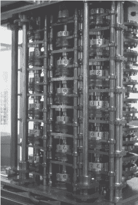

Analytical Engine, Designed by Charles Babbage


Charles Babbage, 1792–1871


Augusta Ada Byron, 1815–1852

program our computers with punch cards, decks of punch cards were being used for computer programs as late as the 1980s.

Babbage was never able to acquire the financial backing to build his machine. As he realized, few people even understood his concept.

> To describe ... the Analytical Engine would require many volumes. I only propose here to indicate a few of its more important functions, and to give to those whose minds are duly prepared for it some information which will remove those vague notions of wonder, and even of its impossibility, with which it is surrounded in the minds of some of the most enlightened.¹

One mind that was duly prepared was that of Augusta Ada Byron. Ada Byron was the daughter of the nineteenth century poet Lord Byron and Anna Isabella Milbanke. Shortly after Ada was born, Milbanke left Lord Byron, believing that he was having an affair with his half-sister and that he was insane. Fearing that Ada would inherit her father's insanity, Milbanke, who was herself an amateur mathematician, prescribed for Ada a heavy dose of mathematics and science instruction. In 1842, Ada wrote the English translation of Menabrea's Sketch of the Analytical Engine from its original French text. Her translation included lengthy and extensive commentary and detailed instructions for numerical computations.

Ada Byron also envisioned the multidisciplinary potential of the Analytical Engine, as she expressed in the following commentary included in her translation:

1 Charles Babbage, Of The Analytical Engine, 1864.

> "Supposing, for instance, that the fundamental relations of pitched sounds in the science of harmony and of musical composition were susceptible of such expression and adaptations, the engine might compose elaborate and scientific pieces of music of any degree of complexity or extent."

According to Babbage,

> "The notes of the Countess of Lovelace extend to about three times the length of the original memoir. Their author has entered fully into almost all the very difficult and abstract questions connected with the subject. These two memoirs taken together furnish, to those who are capable of understanding the reasoning, a complete demonstration.—That the whole of the developments and operations of analysis are now capable of being executed by machinery."

The demonstrations written by Ada Byron are considered by many to be the first “computer program.” The high-level programming language, Ada, developed for embedded systems, was named after Ada Byron Lovelace.

The first computing machine actually built that used the binary number system was developed at Iowa State University between 1939 and 1942 by Professor John Atanasoff and his graduate student Clifford Berry. The ABC (Atanasoff-Berry Computer) weighed 700 pounds and could calculate about one instruction every 15 seconds. The onset of World War II prevented Atanasoff and Berry from completing their application for a patent, but their work was studied by many, and promoted for its potential in aiding the war effort. In 1943, the U.S. government sponsored a research team to develop a computing machine to calculate artillery-firing tables for weapons. The team was led by John Mauchly and J. Presper Eckert.

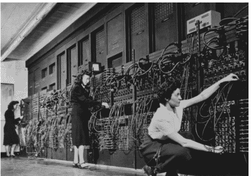

Electronic Numerical Integrator and Calculator (ENIAC)

Their work resulted in the development of the ENIAC (Electronic Numerical Integrator and Calculator). The ENIAC weighed thirty tons and could calculate several hundred operations per second. It was used for research until 1955. Today, processors weigh ounces and are capable of processing trillions of operations per second.

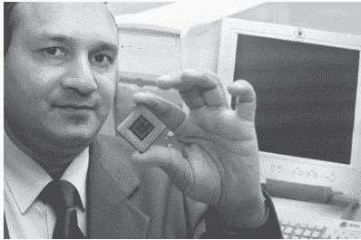

Intel Pentium 4 Processor

## 1.2 Recent Engineering Achievements

The development of the digital computer has facilitated many significant engineering achievements over the past 5 decades. These achievements illustrate the multidisciplinary nature of engineering and demonstrate how engineering has improved our lives and expanded the possibilities for the future. We now briefly discuss a few of these major achievements.

- moon landing
- Mars Global Surveyor
- Mars Orbiter Camera
- High Gain Antenna

Several major achievements relate to the exploration of space. The moon landing, on July 21, 1969, was probably the most complex and ambitious engineering project ever attempted. Major breakthroughs were required in the design of the Apollo spacecraft, the lunar lander, and the three-stage Saturn V rocket. Even the design of the spacesuit was a major engineering project that resulted in a system that included a three-piece suit and backpack, which together weighed 190 pounds. The computer played a key role not only in the designs of the various systems, but it also played a critical role in the communications required during an individual moon flight; a single flight required the coordination of over 450 people in the launch control center and over 7,000 others on 9 ships, in 54 aircraft, and at stations located around the earth.

Exploration of space has motivated recent engineering achievements in the collection of scientific data. The Mars Global Surveyor was a spacecraft that was developed by NASA and launched in 1996 to collect scientific data while in orbit around the planet Mars. The Mars Global Surveyor carried state of the art science instruments including the Mars Orbiter Camera for acquiring images and the High Gain Antenna for sending and receiving data at high rates of speed. The spacecraft made its last communication with earth on


2006年11月2日。您可以在 http://mars.jpl.nasa.gov/mgs/gallery/images.html 查看火星轨道器相机拍摄的图片画廊。火星全球勘测者收集的部分图像表明，液态水在地质学上最近的过去曾渗出到表面，这促使NASA开发并发射火星勘测轨道飞行器，以开始寻找证据，证明水在行星表面持续的时间足够长，足以提供生命栖息地。火星勘测轨道飞行器采用了洛克希德·马丁空间系统公司提供的新型航天器设计。它是第一艘从零开始专为大气制动设计的航天器，大气制动是任务的一个严格阶段，轨道飞行器利用火星大气的摩擦来减速并进入其绕火星的最终轨道。该轨道器于2006年3月10日开始绕火星运行。从2006年3月到11月，航天器通过400多次深入火星大气层顶部来缩小其轨道，以降低速度并抵达其最终近圆轨道，高度为155至196英里。

## 火星勘测轨道飞行器

## CRISM

轨道飞行器上搭载的六项科学仪器之一是火星紧凑型成像光谱仪（CRISM），由马里兰州劳雷尔的约翰斯·霍普金斯大学应用物理实验室设计和制造。CRISM将读取反射阳光中的544种颜色，以检测表面的矿物。其最高分辨率比以往任何一次对火星的观测都要清晰约20倍。高分辨率图像可以识别最可能曾含有水的地点，并确定火星探测漫游车的最佳潜在着陆点。

## 火星探测漫游车

火星探测漫游车的设计目的是在行星表面移动，并详细检查土壤和岩石。

## 应用卫星

航天计划也为应用卫星的发展提供了很大推动力，这些卫星用于提供天气信息、中继通信信号、绘制未勘测地形图，并提供大气成分的环境更新。

## GPS

全球定位系统（GPS）最初是由24颗卫星组成的星座，用于全球广播位置、速度和时间信息。GPS接收机测量信号从GPS卫星传输到接收机所需的时间。利用从四颗卫星接收到的信息，接收机中的微处理器可以确定接收机位置的非常精确的测量值；精度从几米到厘米不等，具体取决于所使用的计算技术。

## 先进复合材料

航空工业是第一个开发和使用先进复合材料的行业，这类材料由可以以一种方式粘合在一起的材料组成，使一种材料增强另一种材料的纤维。先进复合材料的开发旨在为飞机和航天器提供更轻、更强、更耐高温的材料。复合材料现在在制造业和体育用品领域也有额外的市场。例如，下坡滑雪板使用编织凯夫拉纤维层来增加强度并减轻重量，而石墨/环氧高尔夫球杆杆身比传统杆身中的钢材更强更轻。复合材料也用于假肢的人工肢体设计。

## 计算机仿真

先进复合材料的开发借助计算机仿真得以实现。先进复合材料的计算机仿真允许进行可能因尺寸、速度、对健康和安全的危害或实验成本而无法进行的实验。在仿真中，物理现象的数学模型被转换为计算机软件，以指定如何执行计算。通过反复使用不同数据运行软件，对感兴趣现象的理解便会浮现。我们将编写一个程序来模拟一种熔融塑料材料的设计，该材料用于绝缘电子组件中的关键部件，以防止热和机械冲击。

医学、生物工程和计算机科学领域联合开发了**计算机轴向断层扫描（CAT）**扫描仪。该仪器可以使用从物体周围不同角度产生的X射线生成物体的三维图像或二维切片。每个X射线从其角度测量密度，非常复杂的计算机算法结合所有X射线的信息来重建物体内部的清晰图像。CAT扫描常用于识别肿瘤、血栓和脑部异常。美国陆军继续开发坚固、轻便的CAT扫描仪，这些扫描仪可以运送到战斗区域的医疗站。

**激光**是具有相同频率并以可定向和聚焦的窄光束传播的光波。CO2激光器用于在从陶瓷到复合材料的各种材料上钻孔。激光也用于医疗程序，以焊接脱离的视网膜、封闭漏血血管、汽化脑肿瘤并进行精细的内耳手术。称为全息图的三维图像也使用激光生成。

**天气、气候和全球变化的预测**要求我们理解耦合的大气和海洋生物圈系统。这包括理解大气和海洋中的CO2动态、臭氧层耗竭以及由于化学品或能量释放引起的气候变化。这种复杂的相互作用还包括太阳相互作用。来自“日冕洞”（太阳风的排放点）附近太阳风暴的一次大规模喷发可以以每小时超过一百万英里的速度将大量热气体从太阳表面喷向地球表面。这种热气体的喷发用X射线轰击地球，并可能干扰通信并导致电力线路中的电力波动。学习预测天气、气候和全球变化的变化涉及收集大量数据进行研究，并开发可以表示许多变量相互依赖性的新数学模型。我们将在后续章节中分析丹佛国际机场一年期间的天气模式。我们还将使用卫星数据开发一个预测中层大气臭氧混合比的模型，并分析充氦气象气球的高度和速度信息。

**计算机语音理解**可能会彻底改变我们的通信系统，但许多问题已被理解。目前正在使用教会计算机理解相当小词汇集中单词的软件。然而，开发独立于说话人、能够理解大型词汇集和不同语言中单词的系统非常困难。一个人的声音中的细微变化，例如由感冒或压力引起的变化，可能会影响语音识别系统的性能。即使假设计算机可以识别单词，确定其含义也并不简单。许多单词都依赖于上下文，因此无法单独分析。诸如提高声音之类的语调可以将陈述句变成疑问句。尽管在自动语音识别和理解方面仍有许多难题需要解决，但激动人心的应用无处不在。想象一下一个电话系统，它能确定正在说的语言并翻译语音信号，以便每个人都能用自己的母语听到对话。我们将分析实际语音数据来演示单词识别中使用的一些技术。

## 变化的工程环境

21世纪的工程师将在一个需要许多非技术技能和能力的环境中工作。尽管计算机将是大多数工程师的主要计算工具，但计算机在开发额外的非技术能力方面也将很有用。


工程师需要强大的 **沟通技巧** 来进行口头陈述和准备书面材料。计算机提供软件来协助撰写大纲、开发书面材料以及用于演示和技术报告的图表。本章末尾的问题包括书面或口头陈述，以提供练习这些重要技能的机会。

**设计/工艺/制造**路径，即从概念到产品实现一个想法的过程，是工程师必须亲自理解的路径。该过程的每个步骤都在从设计分析、机器控制、机器人装配、质量保证到市场分析等领域使用计算机。文本中有几个问题涉及这些主题。例如，在第5章中，开发了程序来模拟使用多个组件的系统的可靠性。

未来的工程团队将是 **跨学科团队**，正如当今的工程团队是跨学科团队一样。对过去50年工程成就的讨论清楚地表明了这些成就的跨学科性质。应对并最终解决未来挑战的团队也将是跨学科团队。学习在团队中互动并为有效的团队沟通开发组织结构是工程师的一项重要技能。开始培养工程团队技能的一个好方法是组织团队备考。为团队成员分配特定主题，任务是让他们随后为团队复习这些主题，并附带示例和潜在的测试问题。

21世纪的工程师需要了解 **世界市场**。这涉及理解不同的文化、政治制度和商业环境。这些主题以及外语方面的课程有助于提供一些理解，但具有国际经验的交换项目在培养更广阔的世界理解方面提供了宝贵的知识。

工程师是问题解决者，但问题并不总是被仔细地表述。工程师必须能够从问题讨论中提取问题陈述，然后确定与问题相关的重要问题。这不仅涉及发展秩序，还涉及学习关联混乱。这意味着不仅要 **分析** 数据，还要使用许多信息片段来 **综合** 解决方案。想法的整合可以与将问题分解为可管理的部分同样重要。问题解决方案可能不仅涉及对问题的抽象思考，还涉及从问题环境中进行实验学习。

问题解决方案也必须在其 **社会背景** 中予以考虑。在考虑问题的替代解决方案时，应解决环境问题。工程师在提供测试结果、质量验证和设计限制时，也必须意识到 **伦理问题**。伦理问题从来都不容易解决，一些令人兴奋的新技术成就也将带来更多伦理问题。例如，基因组图谱绘制可能会带来伦理、法律和社会影响。允许医生对抗糖尿病的基因治疗是否也应用于增强运动能力？准父母是否应获得关于未出生儿童的身体和心理特征的详细信息？个人应对其遗传密码拥有何种隐私？任何技术进步都会产生非常复杂的问题，因为那些能做大量好事的相同能力，也常常以有害的方式应用。

本文中呈现的材料只是构建21世纪工程师所需的知识、信心和理解的一个步骤。然而，我们热情地开始这一过程，介绍工程师可用的各种计算机系统，并介绍一种将在整本书中使用的问题解决方法，我们将使用C++来实现工程问题的解决方案。

## 1.3 计算机系统

- 计算机系统
- 计算机
- 软件
- 硬件
- 控制单元
- 算术逻辑单元
- 累加器
- 中央处理器

在开始介绍C++之前，简要讨论计算机系统将很有用。一个 **计算机系统** 是一个完整的、可工作的系统。该系统不仅包括计算机，还包括软件和外围设备。一个 **计算机** 是一台设计用于执行由一组称为 **软件** 的指令所指定的操作的机器。计算机 **硬件** 是指系统中具有质量并且可以实际触摸的物理部分。硬件包括计算机和诸如键盘、鼠标、显示器、硬盘、打印机甚至墨盒在内的外围设备。计算机软件是指驻留并在硬件上以电子方式运行的程序，例如编译器、操作系统和应用程序。软件提供人机界面（HCI）并定义计算机将执行的操作。

### 计算机硬件

回顾梅纳布雷对巴贝奇分析机的描述，将其视为一种能够使用输入、输出和写在穿孔卡上的程序来解决任何问题的机器。1946年，约翰·冯·诺依曼提出了如图1.1所示的计算模型，该模型至今仍用于大多数数字计算机的设计。在冯·诺依曼模型中，我们看到一个输入设备、一个输出设备、一个存储单元，以及一台由 **控制单元** 和带有 **累加器** 的 **算术逻辑单元（ALU）** 组成的机器。存储单元存储数据，控制单元控制数据的传输和处理。控制单元检索和解释存储在内存中的指令，从键盘或鼠标等输入设备接受数据，将数据发送到打印机或显示器等指定的输出设备，并将数据存储在存储单元中。

假设我们编写了一个程序来指示计算机将两个值相加并显示结果。控制单元将解释可执行指令并将数据发送到ALU。ALU将执行加法，控制单元将结果发送到输出设备。控制单元和ALU合称为 **中央处理器** 或 **CPU**。ALU中的累加器是一组高速寄存器，用于临时存储值以及算术和逻辑操作的结果。访问存储单元所需的时间远大于ALU执行算术或逻辑操作所需的时间。因此，在ALU内使用寄存器提高了整体操作速度。

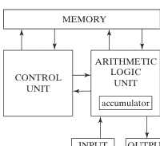

图 1.1 冯·诺依曼计算模型。

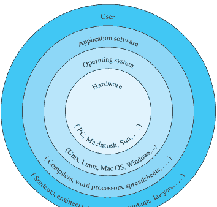

图 1.2 计算机的软件接口。

- **字长**

ALU中每个寄存器的大小对应计算机的 **字长**。常见的字长为16位、32位和64位，具体取决于处理器的设计。请注意，**位** 表示二进制数字，处理器的字长是2的幂次。

- **位**

### 计算机软件

计算机软件包含我们希望计算机执行的指令或命令。有几个重要的软件类别，包括操作系统、软件工具和语言编译器。图1.2说明了这些软件类别与计算机硬件之间的交互。我们现在更详细地讨论每个软件类别。

- **操作系统**

#### 操作系统

一些软件，例如操作系统，通常在购买计算机硬件时随附。操作系统通过提供一个方便且高效的环境，在你（用户）和硬件之间提供一个接口，你可以在该环境中选择和执行系统上的软件。

操作系统还包含一组称为实用程序的程序，允许你执行打印文件、复制文件和列出你已保存到文件系统中的文件等功能。虽然这些实用程序在大多数操作系统中都很常见，但执行命令的环境因操作系统而异。例如，使用UNIX（一种常用于工作站的强大操作系统）或Linux（适用于PC的UNIX）从命令行列出文件的命令是ls。一些操作系统简化了界面


通过使用图标和菜单与操作系统交互；用户友好的图形用户界面（GUI）系统示例包括 Macintosh 环境和 Windows 环境。

由于 C++ 程序可以在许多不同的平台或计算机系统上运行，且特定计算机可以使用不同的操作系统，因此在本课程中讨论你可能使用的各种操作系统是不切实际的。我们假设你的教授会提供你在大学使用可用计算机所需了解的特定操作系统信息。这些信息也包含在操作系统手册中，并通过帮助菜单提供。

### 应用软件

有许多应用程序可用于执行常见应用。例如，Word 和 Pages 等文字处理器是为帮助你创建格式化文档（如简历、通讯和报告）而编写的应用程序。文字处理器具有允许你输入数学公式并检查拼写和语法的功能。文字处理器还提供工具，便于创建带有文本和标题的图表和图形。vi、NotePad 和 WordPad 等文本编辑器用于创建文本文件，例如 C++ 应用程序和数据文件。更高级的文本编辑器（如 emacs）包含编译器，并为开发应用程序提供用户友好的环境。电子表格程序是软件工具，允许你轻松处理可以以行和列网格显示的数据。电子表格最初用于财务和会计应用，但许多科学和工程问题可以使用电子表格轻松解决。大多数电子表格软件包包含绘图功能，因此在分析和显示信息方面尤其有用。Lotus 1-2-3、OpenOffice 和 Excel 是流行的电子表格软件包。

另一类流行的软件工具是数据库管理软件，例如 MySQL 和 Oracle。这些程序允许你高效地存储和检索大量数据。许多 Web 应用程序和搜索引擎以及银行、医院、酒店和航空公司等组织都使用数据库。科学数据库也用于分析大量数据。气象数据是需要大型数据库进行存储和分析的科学数据示例。

计算机辅助设计软件，例如 AutoCAD、Land Development Desktop、Civil 3D 和 Architectural Desktop，允许你设计对象，然后以图形方式操作它们。例如，你可以定义一个对象，然后从不同角度查看它，或观察对象从一个位置旋转到另一个位置。

还有一些非常强大的数学计算软件，例如 MATLAB、Mathematica 和 Maple。这些软件不仅具有非常强大的数学命令，还是提供广泛图表生成功能的图形工具。计算能力与可视化能力的结合使它们成为工程师特别有用的工具。附录 C 包含关于使用 MATLAB 绘制 C++ 程序生成的数据文件中数据的讨论。

如果工程问题可以使用软件工具解决，那么使用软件工具通常比用计算机语言编写程序来解决问题更高效。

然而，许多问题无法使用软件工具解决，或者用于解决问题的计算机系统上可能没有可用的软件工具；因此，我们还需要知道如何使用计算机语言编写程序。软件工具与计算机语言之间的区别变得不那么清晰，因为一些更强大的工具（如 MATLAB 和 Mathematica）除了专用操作外还包含编程语言。

## 计算机语言

计算机语言可以按层次描述。低级语言或机器语言是最原始的语言。机器语言与计算机硬件设计紧密相关。由于计算机设计基于双态技术（具有两种状态的设备，例如开路或闭路电路、开关或关闭开关、正电荷或负电荷），机器语言使用两个符号编写，通常用数字 0 和 1 表示。因此，机器语言也是一种二进制语言，指令写成称为二进制字符串的 0 和 1 序列。由于机器语言与计算机硬件设计紧密相关，例如 Sun 计算机的机器语言与 HP 计算机的机器语言不同。

汇编语言也特定于特定的计算机设计，但其指令使用符号语句而不是二进制编写。汇编语言通常没有非常多种类的语句，因此用汇编语言编写程序可能很乏味。此外，要使用汇编语言，你还必须了解与特定计算机硬件相关的信息。包含微处理器的仪器通常要求程序运行非常快，因此这些程序称为实时程序。这些实时程序通常用汇编语言编写，以利用特定的计算机硬件来更快地执行步骤。高级语言是具有类似英语的命令和指令的计算机语言，包括 C++、C、Fortran、Ada、Java 和 Basic 等语言。用高级语言编写程序当然比用机器语言或汇编语言编写程序更容易。但是，高级语言包含大量命令和用于使用命令的广泛语法（或语法）规则。为了说明软件工具和高级语言所需的语法和标点，我们在表 1.1 中使用多种不同的语言和工具计算指定直径圆的面积。注意这个简单计算中的相似之处和差异。

### 执行计算机程序。

用 C++ 等高级语言编写的程序必须在计算机执行指令之前翻译成机器语言。一种称为编译器的特殊程序用于执行此翻译。因此，要在计算机上编写和执行 C++ 程序，计算机软件必须包含

| 软件 | 示例语句 |
| :--- | :--- |
| C++ | area = 3.141593*(diameter/2)*(diameter/2); |
| C | area = 3.141593*(diameter/2)*(diameter/2); |
| MATLAB | area = pi*(diameter/2).^2; |
| Fortran | area = 3.141593*(diameter/2.0)**2 |
| Ada | area := 3.141593*(diameter/2)**2; |
| Java | area = Math.PI*(Math.pow(diameter/2,2)); |
| Basic | let a = 3.141593*(d/2)*(d/2) |
| Scheme | let area = 3.141593*(d/2)*(d/2) |

a C++ compiler。C++ 编译器适用于从超级计算机到笔记本电脑的整个计算机硬件范围。

### 语法错误

如果编译器在编译过程中检测到任何错误，将打印相应的错误消息。我们必须更正程序语句，然后再次执行编译步骤。此阶段识别的错误称为解析错误或语法错误。例如，如果我们想将名为 sum 的变量中存储的值除以 3，C++ 中的正确表达式是 sum/3。如果我们错误地使用反斜杠编写表达式，例如 sum\3，则存在语法错误，当我们尝试编译程序时，编译器将报告错误消息。编译、更正有语法错误的语句并重新编译的过程通常必须重复多次，然后程序才能无错误地编译。当没有语法错误时，编译器可以成功翻译程序并生成执行原始 C++ 程序指定任务的机器语言程序。C++ 程序称为源文件，机器语言版本称为目标文件。因此，源程序和目标程序指定相同的步骤，但源程序以高级语言指定，目标程序以机器语言指定。

源文件 目标文件

执行 链接 加载 逻辑错误 错误

一旦程序正确编译，还需要额外步骤来准备目标程序以执行。此准备涉及将其他机器语言语句链接到目标程序，然后将程序加载到内存中。经过此链接/加载后，程序步骤由计算机执行。此阶段可能会识别称为执行错误、运行时错误或逻辑错误的新错误；这些错误也称为程序错误。执行错误通常会导致程序终止。例如，程序语句可能尝试引用无效内存位置，这可能会生成执行错误。某些执行错误不会停止程序执行，但会导致计算结果不正确。这些类型的错误可能由程序员在确定解决方案的正确步骤时的错误以及程序处理的数据中的错误引起。当由于程序语句中的错误而发生执行错误时，我们必须更正源程序中的错误，然后从编译步骤重新开始。此过程称为调试，可能非常耗时。即使程序看似正常执行，我们也必须仔细检查答案以确保其正确。计算机将精确按照我们指定的步骤执行，如果我们指定了错误的步骤，计算机将执行这些错误（但在语法上合法）的步骤，从而向我们呈现一个不正确的答案。编译、链接/加载和执行的过程如图 1.3 所示。

### 调试

C++ 编译器通常具有额外功能，为实现和测试 C++ 程序提供用户友好的环境。例如，某些 C++ 环境（如 Microsoft Visual C++）包含文本处理器，以便程序文件可以在同一软件包中生成、编译和执行，而不是使用单独的文字处理器

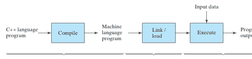

图 1.3 程序编译/链接/执行。


需要使用操作系统命令在字处理器和编译器之间来回传输。许多C++编程环境包含调试器程序，这些程序在识别程序中的错误时很有用。调试器程序允许我们查看程序中不同时间点变量中存储的值，并逐行执行程序。

在介绍C++中的新语句时，我们还将指出与语句相关的常见错误或定位与语句相关的错误的有用技巧。调试辅助工具将在每章末尾总结。

## 1.4 数据表示与存储

回顾一下，分析机存储单元的设计由不确定数量的圆盘列组成，每个圆盘上刻有10个十进制数字（0–9）。通过排列一列中的圆盘，可以存储一个十进制数。

现代数字计算机遵循类似的设计，只是信息以基数2（即二进制）而不是基数10来表示。二进制数系统有两个二进制数字，0和1，因此二进制数字可以在数字计算机中用一个位表示。位在任何给定时间的值可以是0或1。在硬件术语中，如果位的值为0，则称为关闭或低电平；如果值为1，则称为开启或高电平。

二进制数可以作为一系列位存储在内存中，称为一个字。字中最右边的位表示个位，下一位表示二位，再下一位表示四位，最左边的位表示2^(n-1)位，其中n是位数。字中每增加一位，字的大小就会增加2的幂，并使可表示的值范围翻倍。内存中可用的字的数量称为内存空间或地址空间。

图1.4提供了一个内存图，其地址空间为8（2^3），字大小为16（2^4）。地址000处存储的二进制值为0001010110111010₂ = 2781₁₀。需要注意的是，字大小决定了内存中一个字可以存储的值的范围，或者地址空间决定了可以存储的字的数量。理论上的分析机字大小由一列中的圆盘数量定义，内存空间由列的数量定义。

| 地址 | 十六位字 |
|---|---|
| 000 | 0000101011011101 |
| 001 | 0101000010010000 |
| 010 | 0001011010010100 |
| 011 | 0110110100101011 |
| 100 | 0010110100001000 |
| 101 | 0001000000010000 |
| 110 | 0111111111111111 |
| 111 | 0000101010010110 |

图1.4 内存图：地址空间 = 8，字大小 = 16

C++编程语言具有用于表示整数值、浮点值、字符和布尔值的内置数据类型。每个内置数据类型都有以字节为单位的预定大小，其中字节是8位的序列。需要类型声明语句来定义标识符并分配内存。定义标识符时，会指定数据类型并分配所需的字节数用于存储。例如，类型声明语句：

```
int iValue = 2781;
```

定义了一个标识符iValue，它引用内存中存储的整数值的第一个字节。内存中存储的初始值是2781₁₀的二进制表示。下面给出了内存图：

iValue => [00000000 00000000 00001010 11011101]

在编译器和高级编程语言出现之前，程序员需要以二进制形式将指令和数据加载到每个内存位置。如今，我们有软件（编译器、链接器和加载器）为我们执行这些任务。在第2章中，我们将开始讨论C++语句和数据类型，但首先我们将简要讨论数系和低级数据表示，以便更好地理解程序执行时执行的操作。

## 数系

十进制数系统有10个十进制数字（0–9），十进制数中的每个数字都乘以10的幂。我们大多数人都能轻松地进行十进制计数并理解十进制数。例如，当我们读取数字245₁₀时，我们读作二百四十五。我们理解2在百位（10²），4在十位（10¹），5在个位（10⁰）。如果将数字展开如下：

```
2 * 10^2 + 4 * 10^1 + 5 * 10^0
```

我们可以将各项相加200 + 40 + 5，得到245₁₀的值。在以下部分中，我们将讨论三种数系：二进制、八进制和十六进制，这些在研究数字计算机系统时很有用。我们还将开发将数字转换为不同基数的算法。

### 二进制数

数字计算机以二进制形式表示数据。二进制数系统有两个二进制数字，0和1，每个数字都乘以2的幂。如果我们检查图1.4中内存位置0000存储的二进制数0000101011011101₂，并想确定其等效十进制数，我们可以按如下方式展开该数，注意最右边的二进制数字乘以2⁰，最左边的数字乘以2¹⁵。

```
0000101011011101₂ =
0 * 2¹⁵ + 0 * 2¹⁴ + 0 * 2¹³ + 0 * 2¹² + 1 * 2¹¹ + 0 * 2¹⁰ + 1 * 2⁹ + 0 * 2⁸ +
1 * 2⁷ + 1 * 2⁶ + 0 * 2⁵ + 1 * 2⁴ + 1 * 2³ + 1 * 2² + 0 * 2¹ + 1 * 2⁰ =
0 + 0 + 0 + 0 + 2048 + 0 + 512 + 0 + 128 + 64 + 0 + 16 + 8 + 4 + 0 + 1 =
2781₁₀
```

如我们在以下部分将看到的，上述转换算法可以应用于任何基数表示的数字，以获得等效的基数10值。

假设我们有一个想要以基数2表示的十进制数。等效的二进制数将是一系列二进制数字。为了生成这些数字，我们将使用一个转换算法，该算法反复将十进制数除以2，并将每次除法的余数记录为等效二进制数的连续数字。

我们在下面的示例中说明该算法的使用。请注意，第一次除法的余数记录为等效二进制数的**最低有效位（LSD）**，最后一次除法的余数记录为**最高有效位（MSD）**，并且我们一直除到商变为零。

### 示例

```
245₁₀ = ?₂
```

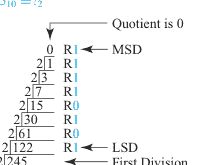

```
245₁₀ = 11110101₂
```

上述转换算法可用于从基数10转换为任何其他基数。其他数系的基数定义除数，如我们在以下部分将看到的。

### 八进制数

八进制（或基数8）数系统有8个八进制数字（0–7）。八进制数对于理解8位字符代码以及在linux/unix平台上设置文件和目录权限很有用。例如，如果我们有一个希望所有人都可读、可写和可执行的文件，可以使用chmod命令按如下方式设置文件权限：

```
chmod 777 aFile
```

aFile的权限将为所有者、组和其他用户设置为7₈，即111₂。如果接下来进行长列表，

```
ls -l
```

我们将看到类似以下的内容：

```
-rwxrwxrwx 1 jeannei jeannei 258 Jun 26 12:27 aFile.
```

上述内容表示所有者、组和其他用户均被授予(r)ead(w)rite(x)ecute权限。如果我们希望仅授予组和其他用户读取状态，可以使用以下命令更改权限：

```
chmod 744 aFile
```

长列表将现在显示以下内容：

```
-rwxr--r- 1 jeannei jeannei 258 Jun 26 12:27 aFile
```

表示所有者拥有rwx权限，组和其他用户拥有读取权限，但没有写入权限和执行权限。数字4₈ = 100₂，因此1授予权限，0拒绝权限。

八进制数中的每个数字都乘以8的幂。要确定八进制数的等效十进制值，可以应用用于确定二进制数十进制值的相同转换算法。请注意，被转换为十进制的数的基数（本例中为8）定义了指数项的基数。

### 示例

```
217₈ = ?₁₀
2 * 8^2 + 1 * 8^1 + 7 * 8^0 =
2 * 64 + 1 * 8 + 7 * 1 =
128 + 8 + 7 =
143₁₀
```

为了说明从基数10转换为任何其他基数的算法，我们将143₁₀转换回基数8。我们使用8作为除数应用该算法。

```
143₁₀ = ?₈
    R2
8 | 8 R1
8 | 17 R7
8 | 143
143₁₀ = 217₈
```

迄今为止，我们已说明了从基数10转换为任何其他基数的算法以及从任何基数转换为基数10的算法，但现在假设我们想将基数8数转换为基数2。一种方法是先将基数8数转换为基数10，然后将等效的基数10数转换为基数8。这种方法是有效的，但由于8是2的幂，8 = 2^3，并且八个八进制数字中的每个都可以使用三个二进制数字以二进制表示，我们可以利用这种关系快速在二进制和八进制之间进行转换，如接下来的两个示例所示。表1.2列出了8个八进制数字的二进制表示，供您参考。

**表1.2 八进制数字的二进制表示**

| 八进制数字 | 二进制表示 |
|---|---|
| 0 | 000 |
| 1 | 001 |
| 2 | 010 |
| 3 | 011 |
| 4 | 100 |
| 5 | 101 |
| 6 | 110 |
| 7 | 111 |


### 示例

143₈ = ?₂

```
1   4   3
↓   ↓   ↓
001 100 011
143₈ = 001100011₂
```

### 示例

000101011011101₂ = ?₈

```
000 101 011 011 101
↘   ↘   ↘   ↘   ↘
0   5   3   3   5
000101011011101₂ = 5335₈
```

### 练习！

将下列各进制为10的数转换为进制为2的数。

- 1. 921₁₀ = ?₂
- 2. 8₁₀ = ?₂
- 3. 100₁₀ = ?₂

将下列各进制为8的数转换为进制为10的数。

- 4. 100₈ = ?₁₀
- 5. 247₈ = ?₁₀
- 6. 16₈ = ?₁₀

将下列各数转换为要求的进制。

- 7. 100₂ = ?₈
- 8. 3716₈ = ?₂
- 9. 110100111₂ = ?₁₀
- 10. 221₆ = ?₈

十六进制数。十六进制（或称进制为16的数制）有16个十六进制数字，（0–9,A–F），十六进制数中的每个数字都乘以16的幂。由字母表示的十六进制数字的十进制值分别为（10,11,12,13,14,15）。

数 2BF₁₆ 是一个十六进制数的示例。应用从任意进制转换为进制10的转换算法，我们可以确定等效的十进制数，如下所示。

```
2BF₁₆ = ?₁₀

2 * 16^2 + F * 16^1 + B * 16^0 =
2 * 256 + 15 * 16 + 11 * 1 =
512 + 240 + 11 =
763₁₀
```

为了说明从进制10转换为任何其他进制的算法，我们将把 763₁₀ 转换回进制16。每次除法的余数是0到F之间的值。

```
763₁₀ = ?₁₆

  0  R2
16|2  R15(F)
16|16  R11(B)
16|16763
      |
Hex Digits
763₁₀ = 2FB₁₆
```

十六是2的幂，16 = 2^4，每个十六进制数字都可以用四个二进制数字表示为二进制。可以利用这种关系快速在二进制和十六进制之间进行转换，如下两个示例所示。表1.3列出了十六进制数字的二进制表示，供您参考。

### 示例

```
7BF₁₆ = ?₂

  7       B       F
  |       |       |
0111   1011   1111

7BF₁₆ = 011110111111₂
```

### 示例

```
10100001101₂ = ?₁₆

  1010   000   1101
   |       |     |
   A       0     D

10100001101₂ = A0D₁₆
```

表1.3 十六进制数字的二进制表示

| 十六进制数字 | 二进制表示 |
|---|---|
| 0 | 0000 |
| 1 | 0001 |
| 2 | 0010 |
| 3 | 0011 |
| 4 | 0100 |
| 5 | 0101 |
| 6 | 0110 |
| 7 | 0111 |
| 8 | 1000 |
| 9 | 1001 |
| A | 1010 |
| B | 1011 |
| C | 1100 |
| D | 1101 |
| E | 1110 |
| F | 1111 |

### 练习！

将下列各进制为10的数转换为进制为16的数。

- 1. 921₁₀ = ?₁₆
- 2. 8₁₀ = ?₁₆
- 3. 100₁₀ = ?₁₆

将下列各进制为16的数转换为进制为10的数。

- 4. 1C0₁₆ = ?₁₀
- 5. 29E₁₆ = ?₁₀
- 6. 16₁₆ = ?₁₀

将下列各数转换为要求的进制。

- 7. 10010011₂ = ?₁₆
- 8. 3A1B₁₆ = ?₂
- 9. 110100111₂ = ?₁₀
- 10. 261₈ = ?₁₆

## 数据类型和存储

当数据在内存中表示时，它被表示为一串比特。比特序列可能表示一条指令、一个数值、一个字符、图像或数字信号的一部分，或其他类型的数据。例如，如果我们观察比特序列 01000110₂，它的十进制值为70。它也是字符F的美国国家标准学会（ANSI）字符代码。

ANSI

数据表示正在成为工程、数学和计算机科学中越来越重要和有趣的领域。随着计算机变得更加强大，可生成和处理的数据量在增加，计算机在生物计算、通信和信号处理等数据密集型应用中的使用，为定义和表示数据带来了新的挑战。在本节中，我们将讨论两种基本数据类型（整数和浮点数）的数字表示。

### 整数数据类型

在上一节中，我们使用了一个算法将进制10转换为进制2。该算法适用于任何进制10的整数，因此理论上我们可以精确地表示所有进制10的整数为进制2。在实践中，我们可能受限于计算系统的字长。整数数据通常使用4字节（即32位）存储在内存中。最左边的位保留用于符号，剩下31位用于数字的大小。

请考虑以下示例，为简单起见使用字长为8。8位中可表示的最大有符号整数为 2^7 - 1 或 127₁₀，如下所示。

```
0 1 1 1 1 1 1 1
```

数字在数字计算机中的表示影响算术和逻辑运算的效率。许多计算机系统像上面所示一样存储正有符号整数，并以2的补码形式存储负有符号整数。以2的补码形式存储负整数可以高效执行算术运算，而无需检查符号位。首先，我们说明如何形成负数的2的补码，然后，我们将说明以2的补码形式存储负数如何简化算术运算。

2的补码形式

二进制数的2的补码是通过对所有位取反并加一形成的。对一位取反意味着将位的值或状态从1切换为0，或从0切换为1。对二进制数的所有位取反会形成该数的1的补码。在1的补码上加一即得到该数的2的补码。使用字长为8，-127₁₀的2的补码如下示例计算。

1的补码

#### 示例 计算 -127₁₀ 的2的补码表示。

要形成负整数的2的补码，我们从无符号值的二进制表示开始。

```
127₁₀ = 01111111₂
```

接下来，我们对位取反以形成1的补码。

```
10000000₂
```

最后，我们加上 1₁₀ = 00000001₂ 以形成2的补码。

```
10000001₂.
```

因此，-127₁₀的2的补码表示为 10000001₂。

请注意当我们将 127₁₀ 加到 -127₁₀ 的2的补码时会发生什么。

| 01111111₂ | 127₁₀ |
| --- | --- |
| + 10000001₂ | -127₁₀ 的2的补码 |
| = 00000000₂ | 加法结果为0 |

表示有符号整数的2的补码形式具有以下属性：将正整数 n 与 n 的2的补码相加，对于所有 n 结果均为零。2的补码表示的另一个重要属性是，二进制0有唯一的表示。

在对以2的补码形式表示的有符号整数进行加法运算时，如果结果为负，则结果将以其2的补码形式表示，如下示例所示。

#### 示例 两个二进制数相加，结果为正。

| 11110110 | 以2的补码表示的 -10₁₀ |
| --- | --- |
| + 00001101 | 13₁₀ |
| = 00000011 | 3₁₀ |

#### 示例 两个二进制数相加，结果为负。

| 00001010 | 10₁₀ |
| --- | --- |
| + 11110011 | 以2的补码表示的 -13₁₀ |
| = 11111101 | 以2的补码表示的 -3 |

### 练习！

求下列整数的2的补码：

- 1. 11001111₂
- 2. -192₁₀
- 3. -45₈

### 浮点数据类型

浮点数（或实数），例如 12.25₁₀，包含一个小数点。小数点左边的数字构成数的整数部分，小数点右边的数字构成数的小数部分。十进制数的小数部分可以通过反复将小数部分乘以2并记录进位位，直到小数部分变为零，来转换为二进制。该算法在以下示例中说明。

#### 示例 将 12.25₁₀ 转换为二进制。

首先，将整数部分 12₁₀ 转换为二进制：

```
12 ÷ 2 = 6 R 0
6 ÷ 2 = 3 R 0
3 ÷ 2 = 1 R 1
1 ÷ 2 = 0 R 1

12₁₀ = 1100₂
```

接下来，我们将通过反复将小数部分乘以2并记录进位位，将小数部分 .25₁₀ 转换为二进制：

```
.25 * 2 = 0.5 C0
.5 * 2 = 1.0 C1
```

.25₁₀ = .01₂

现在将整数部分和小数部分组合起来形成等效的二进制值。因此，12.25₁₀ = 1100.01₂。

要将浮点二进制数 1100.01₂ 转换回十进制，小数点右边的二进制数字乘以2的负幂，如下所示。

```
1100.01₂ =
1 * 2³ + 1 * 2² + 0 * 2¹ + 0 * 2⁰ + 0 * 2⁻¹ + 1 * 2⁻² =
1 * 8 + 1 * 4 + 0 + 0 + 0 * (1/2) + 1 * (1/4) =
8 + 4 + 0 + 0 + 0 + 0.25 =
12.25
```

1100.01₂ = 12.25₁₀

在上面的示例中，我们找到了 12.25₁₀ 的精确二进制表示。不幸的是，许多浮点小数只有近似的二进制表示，如下一个示例所示。

#### 示例 将 12.6₁₀ 转换为二进制。

整数部分 12₁₀ 已证明等于 1100₂。转换小数部分时，我们反复乘以2并记录进位位。

```
.6 * 2 = 1.2 C1
.2 * 2 = 0.4 C0
.4 * 2 = 0.8 C0
.8 * 2 = 1.6 C1
.6 * 2 = 1.2 C1
.2 * 2 = 0.4 C0
.4 * 2 = 0.8 C0
.8 * 2 = 1.6 C1
```


我们可以看到，我们正在重复位模式 1001，并且永远不会达到终止值零。因此，0.6₁₀ 的最佳二进制近似是重复二进制数 0.100110011001...₂。将其扩展到 8 位精度，我们有：

```
1 * 2^-1 + 0 * 2^-2 + 0 * 2^-3 + 1 * 2^-4 + 1 * 2^-5 + 0 * 2^-6 + 0 * 2^-7 + 1 * 2^-8 =
1 * (1/2) + 0 * (1/4) + 0 * (1/8) + 1 * (1/16) + 1 * (1/32) + 0 * (1/64) + 0 * (1/128) + 1 * (1/256) =
0.5 + 0 + 0 + 0.0625 + 0.03125 + 0 + 0 + 0.00390625 =
0.59765625
12.6₁₀ ≈ 1100.10011001₂
```

需要知道的是，浮点小数的二进制表示是近似值，而非相等。这会影响我们在程序中使用和测试浮点值的方式，也会影响数值计算的准确性。

## 1.5 工程问题求解方法论

问题求解不仅是工程课程的关键部分，也是计算机科学、数学、物理和化学课程的关键部分。因此，拥有一致的问题求解方法很重要。如果该方法足够通用，可以应用于所有这些不同领域，那么也很有帮助，这样我们就不必为数学问题学习一种技术，为物理问题学习另一种技术，等等。我们介绍的问题求解过程适用于工程问题，也可以调整以解决其他领域的问题；然而，它确实假设我们正在使用计算机来帮助解决问题。

我们在本文中将使用的问题求解过程或方法论包含五个步骤：

- 1. 清晰地陈述问题。
- 2. 描述问题的输入和输出信息。
- 3. 使用简单的数据集手动（或使用计算器）解决问题。
- 4. 开发解决方案并将其转换为计算机程序。
- 5. 使用各种数据测试解决方案。

我们现在将使用计算平面上两点之间距离的示例来讨论每个步骤。

### 1. 问题陈述

第一步是清晰地陈述问题。给出清晰、简洁的问题陈述以避免任何误解至关重要。对于本示例，问题陈述如下：

计算平面上两点之间的直线距离。

### 2. 输入/输出描述

第二步是描述解决问题所需的信息或数据值，然后确定最终解决方案需要计算的值。这些值中的每一个都将由 C++ 程序中的一个对象表示。这些对象代表问题的输入和输出，统称为输入/输出，或 I/O。对于许多问题，显示输入和输出的图表很有用。此时，程序是一个“抽象”，因为我们没有定义确定输出的步骤；相反，我们只是显示计算所需输出所需的信息。本示例的 I/O 图如下。

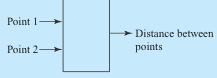

### 3. 手工示例

第三步是使用简单的数据集手动或使用计算器解决问题。这是一个非常重要的步骤，即使对于简单问题也不应跳过。这是你解决问题详细过程的步骤。如果你不能取一组简单的数字并计算输出（无论是手动还是使用计算器），那么你就没有准备好进入下一步；你应该重新阅读问题，并可能查阅参考资料。本特定示例的手工解法如下：

设点 p1 和 p2 具有以下坐标：

```
p1 = (1, 5); p2 = (4, 7)
```

我们想要计算两点之间的距离，它是直角三角形的斜边，如图 1.5 所示。使用勾股定理，我们可以使用以下方程计算距离：

```
distance = \sqrt{(side1)^2 + (side2)^2}
= \sqrt{(4 - 1)^2 + (7 - 5)^2}
= \sqrt{13}
= 3.61
```

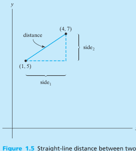

### 4. 算法开发

一旦你能够为简单的数据集解决问题，你就准备好开发问题解决方案的算法，即逐步大纲了。对于像这样的简单问题，算法可以列为依次执行的操作。这个步骤大纲将问题分解为更简单的步骤，如下所示，即计算并打印两点之间距离所需步骤的大纲。

### 分解大纲

- 1. 为两个点赋值。
- 2. 计算由两个点生成的直角三角形的两条边的长度。
- 3. 计算两点之间的距离，它等于三角形斜边的长度。
- 4. 打印两点之间的距离。

然后将此分解大纲转换为 C++ 命令，以便我们可以使用计算机执行计算。从以下解决方案中，您可以看到这些命令与手工示例中使用的步骤非常相似。这些命令的详细信息在第 2 章中解释。

```
/* .................................................... */
/* Program chapter1_1 ............................... */
/* .................................................... */
/* This program computes the ........................ */
/* distance between two points. ..................... */
#include<iostream>//Required for cout
#include<cmath>//Required for sqrt()
using namespace std;
int main()
{
 // Declare and initialize objects.
 double x1=1, y1=5, x2=4, y2=7,
 side1, side2, distance;
 // Compute sides of a right triangle.
 side1 = x2 - x1;
 side2 = y2 - y1;
 distance = sqrt(side1*side1 + side2*side2);
 // Print distance.
 cout << "The distance between the two points is"
 << distance << endl;
 // Exit program.
 return 0;
}
/*-----------------------------------------------------*/
```

### 5. 测试

我们问题求解过程的最后一步是测试解决方案。我们应该首先使用手工示例中的数据来测试解决方案，因为我们已经计算出了解决方案。当执行此解决方案中的 C++ 语句时，计算机显示以下输出：

两点之间的距离是 3.60555

此输出与我们手动计算的值匹配。如果 C++ 解决方案与手工解决方案不匹配，那么我们应该审查两个解决方案以找到错误。一旦解决方案对手工示例有效，我们还应该使用其他数据集对其进行测试，以确保解决方案对其他有效数据集也有效。

本示例中演示的一组步骤用于开发后续章节中“应用问题求解”部分的程序。

## 摘要

介绍了数字计算机发展的简要历史，随后是一系列杰出的近期工程成就，以展示工程应用的多样性以及计算机在工程中的影响。我们还讨论了成为一名成功工程师所需的一些非技术技能。因为大多数工程问题的解决方案都将由计算机实现，我们介绍了计算机系统组件的摘要，从计算机硬件到计算机软件以及学习新术语的重要性。我们还讨论了数制和数据表示，并介绍了

一种五步问题求解方法论，我们将使用它来开发问题的计算机解决方案。这五个步骤如下：

- 1. 清晰地陈述问题。
- 2. 描述问题的输入和输出信息。
- 3. 使用简单的数据集手动（或使用计算器）解决问题。
- 4. 开发算法并将其转换为计算机程序。
- 5. 使用各种数据测试解决方案。

在开发问题解决方案的过程中，本文将贯穿使用此过程。

## 关键术语

- 算法（algorithm）
- 算术逻辑单元（arithmetic logic unit (ALU)）
- 汇编程序（assembler）
- 汇编语言（assembly language）
- 二进制（binary）
- 二进制字符串（binary string）
- 错误（bug）
- 进位位（carry bit）
- 中央处理器（central processing unit (CPU)）
- 编译器（compiler）
- 补数（complement）
- 计算机（computer）
- 数据库管理（database management）
- 调试（debug）
- 调试器（debugger）
- 分解大纲（decomposition outline）
- 电子副本（electronic copy）
- 执行（execution）
- 图形工具（graphics tool）
- 硬件（hardware）
- 高级语言（high-level language）
- I/O 图（I/O diagram）
- 最低有效位（least significant digit）
- 链接/加载（linking/loading）
- 逻辑错误（logic error）
- 机器语言（machine language）
- 内存（memory）
- 微处理器（microprocessor）
- 最高有效位（most significant digit）
- 数制网络（number systems network）
- 目标程序（object program）
- 对象（objects）
- 操作系统（operating system）
- 解析错误（parse error）
- 个人计算机（personal computer (PC)）
- 问题求解过程（problem-solving process）
- 处理器（processor）
- 程序（program）
- 实时程序（real-time program）
- 软件（software）
- 源程序（source program）
- 电子表格（spreadsheet）
- 语法（syntax）
- 文字处理器（word processor）
- 工作站（workstation）


## 练习题

## 考试练习！

## 判断题

请指出以下陈述是正确（T）还是错误（F）。

- 1. 使用ALU内的寄存器可提高操作的整体速度。T F
- 2. 链接和加载是准备目标程序以供执行的步骤。T F
- 3. 累加器是主存储器单元的一部分，用于暂时存储算术和逻辑运算的值和结果。T F
- 4. 计算机程序是算法的实现。T F

## 选择题

请圈出完成每个陈述的最佳答案或每个问题的正确答案的字母。

- 5. 以下哪项不是计算机语言？
  - (a) C++
  - (b) Fortran
  - (c) Unix
  - (d) Java
  - (e) Basic
- 6. ALU中每个寄存器的大小是
  - (a) 取决于计算机的字长。
  - (b) 取决于RAM的容量。
  - (c) 取决于硬盘的存储容量。
  - (d) 始终固定为64位。
- 7. 以下哪项显示了程序执行的正确顺序？
  - (a) 执行、加载、编译、链接。
  - (b) 编译、链接、加载、执行。
  - (c) 链接、加载、编译、执行。
  - (d) 加载、链接、编译、执行。
  - (e) 调试、链接、加载、执行。
- 8. 算法是指
  - (a) 解决特定问题的逐步解决方案。
  - (b) 计算机可以理解的指令集合。
  - (c) 允许我们输入文本材料的代码。
  - (d) 逐步细化。
  - (e) 一组用于推导问题解的数学方程。
- 9. 目标代码是
  - (a) 编译器对源代码进行操作的结果。
  - (b) 从处理器获取信息的过程。
  - (c) 一个计算机程序。
  - (d) 涉及列出解决特定问题所需命令的过程。
  - (e) 链接和加载过程的结果。
- 10. 将以下二进制数转换为八进制。
  - (a) 101010101
  - (b) 100011011011001
  - (c) 11101001101
  - (d) 10001110011
  - (e) 111000000
- 11. 将以下二进制数转换为十六进制。
  - (a) 110011011001
  - (b) 1111000010110100
  - (c) 110101101
  - (d) 1100000000000011
  - (e) 1111111111
- 12. 将以下十进制数转换为八进制。
  - (a) 1292
  - (b) 607
  - (c) 9350
  - (d) 1000010
  - (e) 1111111
- 13. 将以下数字转换为十进制。
  - (a) 11010101₂
  - (b) 476₈
  - (c) 30AF₁₆
  - (d) 4103₅
  - (e) 1111111₆

## 附加题

以下问题结合了一项作业，让你深入了解本章的一个主题，并提供提升书面沟通技巧的机会。（也许你的教授甚至会选取一些书面报告在课堂上进行口头报告。）每份报告应至少包含两个参考文献，因此你需要学习如何使用图书馆计算机查找参考信息。请使用文字处理软件准备你的报告。如果你还不懂如何使用文字处理软件，请向教授寻求指导，或访问你大学的网站查找校园资源链接。

- 14. 就以下杰出工程成就之一撰写一份简短报告：
  - 分析机
  - 全球定位系统
  - 复合材料
  - 应用卫星
  - 火星轨道相机
  - CAD/CAM
  - 光纤
  - CT扫描
  - 查找参考文献的一个良好起点是万维网和你当地的图书馆。

- 15. 就以下工程挑战之一撰写一份简短报告：
  - 天气、气候和全球变化预测
  - 计算机语音理解
  - 人类基因组图谱
  - 改进车辆性能
  - 查找参考文献的一个良好起点是NASA网站：www.nasa.gov

- 16. 就本章列表中未包含的一项杰出工程成就撰写一份简短报告。《科学美国人》的过刊和网络将提供一些最近成就的好点子。


## 工程挑战：车辆性能

涡桨发动机结合了喷气发动机的动力和可靠性以及螺旋桨的效率。涡桨发动机使用燃气涡轮来驱动螺旋桨。其应用一直局限于较小的飞机，因为涡桨发动机在500英里/小时以下的飞行速度时效率最高。然而，对新材料、叶片形状和螺旋桨的工程设计不断提高涡桨发动机的速度和效率以及对该发动机的需求。

# 简单C++程序

### 章节大纲

- 目标
- 2.1 程序结构
- 2.2 常量和变量
- 2.3 C++类
- 2.4 C++运算符
- 2.5 标准输入和输出
- 2.6 使用IDE构建C++解决方案：NetBeans
- 2.7 C++标准库中包含的基本函数
- 2.8 应用问题求解：速度计算
- 2.9 系统限制
- 摘要、关键词、C++语句摘要、风格说明、调试说明、习题

### 目标

在本章中，我们开发包含以下内容的问题求解方案：

- 简单的算术运算
- 来自键盘的用户提供的信息
- 打印在屏幕上的信息
- 程序员定义的数据类型

## 2.1 程序结构

在本节中，我们分析特定C++程序的结构，然后介绍C++程序的一般结构。下面的程序最初在第1章中介绍；它计算并打印两点之间的距离。

```cpp
/* ........................................................... */
/* Program chapter1_1 ........................................ */
/* ........................................................... */
/* This program computes the ............................... */
/* distance between two points. ............................ */
#include <iostream> // Required for cout, endl.
#include <cmath> // Required for sqrt()

using namespace std;

int main()
{
    // Declare and initialize objects.
    double x1(1), y1(5), x2(4), y2(7);
    double side1, side2, distance;

    // Compute sides of a right triangle.
    side1 = x2 - x1;
    side2 = y2 - y1;
    distance = sqrt(side1*side1 + side2*side2);

    // Print distance.
    cout << "The distance between the two points is "
         << distance << endl;

    // Exit program.
    return 0;
}
/*..................................................*/
```

我们现在简要讨论此特定示例中的语句；每个语句将在本章后面的章节中详细讨论。

本程序的前五行包含**注释**，用于为程序命名（chapter1_1）并记录其目的：

```
/*..................................................*/
/*                                                */
/*   Program chapter1_1                           */
/*                                                */
/*   This program computes the                    */
/*   distance between two points.                 */
/*                                                */
```

注释可以以字符/*开始并以字符*/结束用于多行注释，或者可以以字符//开始并在当前行结束处终止用于单行注释。注释可以单独占一行，也可以与语句在同一行；以字符/*开始的注释可以跨越多行。

此处的每个注释都是一个单独的段落，因为每行都以/*开始并以*/结束。虽然注释是可选的，但良好的编程风格要求在整个程序中使用注释以提高可读性并记录计算过程。在文本程序中，我们始终使用初始注释为程序命名并描述程序的一般用途；整个程序中还包含了额外的解释性注释。C++允许注释和语句在行的任何位置开始。


## 预处理器指令

预处理器指令向预处理器提供指令，这些指令在程序编译前执行。最常见的指令在程序中插入其他语句；它包含字符 #include，后跟包含其他语句的文件名。本程序包含以下两个预处理器指令：

```
#include <iostream>
#include <cmath>
```

## iostream cmath

这些指令指定，在程序编译前，文件 iostream 和 cmath 中的语句应替换这两条语句。文件名周围的 < 和 > 字符表示这些文件是随标准 C++ 库包含的；该库包含在随 ANSI C++ 编译器提供的文件中。文件 iostream 包含与本程序中使用的输出语句相关的信息，文件 cmath 包含与本程序中用于计算值的平方根的函数相关的信息。预处理器指令通常包含在描述程序目的的初始注释之后。下一条语句

```
using namespace std;
```

## using 指令

称为 using 指令。using 指令告诉编译器使用命名空间 std 中声明的库名称。命名空间是新 ANSI 标准 C++ 的一部分。一些较旧的编译器不支持命名空间。如果您的编译器不接受 using namespace 语句，则需要省略 using namespace std; 语句，并将预处理器指令中使用的文件名更改为以下内容：

```
#include<iostream.h>
#include<math.h>
```


较旧的编译器对其大多数头文件名使用 .h 扩展名。您会在 C 程序和 C++ 程序中看到包含文件 math.h，因为 math.h 是 C 库头文件的 C 名称。新编译器区分 C 和 C++ 头文件名。math.h 头文件的 C++ 名称是 cmath。一般来说，C 库头文件的 C++ 名称与 C 名称相同，只是做了以下更改：删除 .h，并在文件名开头添加字母 c。本文将使用新的 ANSI 标准 C++ 名称。

## 代码块

每个 C++ 程序都包含恰好一个名为 main 的函数，由一个代码块定义。在 C++ 中，代码块由一组大括号 { } 定义。关键字 int 表示该函数向操作系统返回一个整数值。main 后面的括号是必需的，因为 main 是一个函数。为了轻松识别定义函数体的代码块，我们将大括号单独放在各自的行上。因此，预处理器指令后的两行指定了 main 函数的开始：

```
int main()
{
```

## 声明语句

main 函数包含两种类型的命令：声明和语句。声明定义标识符并分配内存，因此必须位于引用这些标识符的任何语句之前。声明可以给要存储在内存位置中的初始值，也可以不给。以下程序中的声明语句前有一个注释：

```
// Declare and initialize objects.
double x1(1), y1(5), x2(4), y2(7),
       side1, side2, distance;
```

这些声明指定，程序将使用名为 x1、y1、x2、y2、side1、side2 和 distance 的七个对象。术语 double 表示这些对象是 double 类型，double 是内置 C++ 数据类型之一。每个对象将存储一个双精度浮点值；这些对象可以存储非整数值，例如 12.5 和 –0.0005，并具有多位精度。此外，此语句指定 x1 应初始化（赋予初始值）为值 1，y1 应初始化为值 5，x2 应初始化为值 4，y2 应初始化为值 7。side1、side2 和 distance 的初始值未指定，不应假设它们初始化为零。因为声明对于一行来说太长，我们将其分成两行；第二行的缩进表示它是上一行的延续。缩进是风格和可读性问题，不是必需的。分号结束声明语句。

指定示例程序中要执行的操作的语句如下：

```
// Compute sides of a right triangle
side1 = x2 - x1;
side2 = y2 - y1;
distance = sqrt(side1*side1 + side2*side2);
```

```
// Print distance
cout << "The distance between the two points is "
     << distance << endl;
```

这些语句计算由两点形成的直角三角形的两条边的长度（参见图 1.5，第 44 页），然后计算直角三角形斜边的长度。这些赋值语句的语法细节将在本章后面讨论。计算距离后，使用 cout 语句将其打印。此输出语句对于单行来说太长，因此我们将语句分成两行；第二行的缩进再次表示它是上一行的延续。分号结束输出语句。使用了其他注释来解释计算和输出语句。请注意，所有 C++ 语句都必须以分号结束。

要结束程序执行并将控制权返回给操作系统，我们使用 return(0); 语句。

```
// Exit program
return(0);
```

此语句向操作系统返回值零。值零表示执行成功结束。

main 函数的主体随后以单独一行上的右大括号结束，并有另一行注释来标明 main 函数的结束。

- 1. 使用 C++ 编译器自带的编辑器或文字处理器创建一个包含本节讨论的示例程序的文件。* 然后编译并执行该程序。您应该得到以下输出：

     The distance between the two points is 3.61

- 2. 将给定的两点的值更改为坐标 (-1, 6) 和 (2, 4)。使用这些新值运行程序。距离变了吗？请解释。

- 3. 将给定的两点的值更改为表示坐标 (1, 0) 和 (5, 7)。使用计算器检查程序的答案。

- 4. 将给定的两点的值更改为表示相同坐标 (2, 4) 和 (2, 4)。程序是否给出正确答案？

## 2.2 常量和变量

- 常量
- 变量
- 标识符

常量和变量表示我们在程序中使用的对象。字面量 **常量** 是特定值，例如 2、3.1416、-1.5、'a' 或 "hello"，我们使用这些值来形成 C++ 语句。这些对象的值不能更改。**变量** 是分配了名称或 **标识符** 的内存位置。标识符用于引用存储在内存位置中的值。内存位置及其对应标识符的一个有用类比是与个人姓名关联的邮箱；内存位置（或邮箱）可能包含一个

*如果您使用文字处理器生成源文件，请务必将其保存为文本文件。


对象。下面显示了程序 Chapter_1 中以下声明语句后的变量、它们的标识符及其初始值：

```
double x1(1), y1(5), x2(4), y2(7),
side1, side2, distance;

double x1 1.0 double y1 5.0
double x2 4.0 double y2 7.0

double side1 ? double side2 ? double distance ?
```

未赋予初始值的变量的值是未指定的，因此用问号表示；有时这些值被称为垃圾值，因为它们的值是不可预测的。这样的图表显示了对象及其标识符、值和数据类型，称为内存快照。内存快照显示了程序执行过程中指定内存位置的内容。前面的内存快照显示了执行声明语句后的对象及其内容。这些对象被声明为 double 类型，并在内存中使用标准 IEEE 格式表示。为简单起见，我们只显示变量的值和其数据类型，但重要的是要记住，浮点变量的值，即使使用整数常量初始化，也将在内存中使用该整数值的 IEEE 浮点表示形式。

我们经常使用内存快照来显示语句执行前后对象的内容，以展示其效果。选择有效标识符的规则如下：

- 标识符必须以字母字符或下划线字符开头
- 标识符中的字母字符可以是小写或大写字母
- 标识符可以包含数字，但不能作为第一个字符
- 标识符可以是任意长度，但标识符的前 31 个字符必须是唯一的

C++ 区分大小写，这意味着大写字母与小写字母有所区别；因此 Side1、SIDE1 和 side1 表示三个不同的对象。C++ 还包含对 C++ 编译器有特殊含义且不能用作标识符的关键字；关键字的完整列表在表 2.1 中给出。

有效标识符的示例包括 distance、x1、xSum、averageMeasurement 和 initialTime。无效标识符的示例包括 1x（以数字开头）、switch（关键字）、$sum（包含无效字符 $）和 rate%（包含无效字符 %）。

应仔细选择标识符名称，以便它反映对象的内容。如果可能，名称还应指示度量单位。例如，如果对象表示华氏度的温度测量，请使用 tempF 或 degreesF 等标识符。如果对象表示一个角度，请将其命名为 thetaRad 以指示角度以弧度为单位，或 thetaDeg 以指示角度以度为单位。

在任何代码块中包含的声明语句不仅必须包括我们计划在程序中使用的对象的标识符，还必须指定对象的数据类型。C++ 是一种强类型编程语言。这意味着每个

| asm | auto | bool | break |
|---|---|---|---|
| case | catch | char | class |
| const | const_cast | continue | default |
| delete | do | double | dynamic_cast |
| else | enum | explicit | export |
| extern | false | float | for |
| friend | goto | if | inline |
| int | long | mutable | namespace |
| new | operator | private | protected |
| public | register | reinterpret_cast | return |
| short | signed | sizeof | static |
| static_cast | struct | switch | template |
| this | throw | true | try |
| typedef | typeid | typename | union |
| unsigned | using | virtual | void |
| volatile | wchar_t | while | |

标识符必须在语句中使用之前声明。数据类型将在讨论科学计数法后介绍。

## 练习！

确定以下哪些名称是有效标识符。如果名称不是有效标识符，请给出不可接受的原因，并建议一个有效的替代名称。

- 1. density
- 2. area
- 3. Time
- 4. xsum
- 5. x_sum
- 6. Tax-rate
- 7. perimeter
- 8. sec*#2
- 9. degrees_C
- 10. break
- 11. #123
- 12. x$y
- 13. count
- 14. void
- 15. f(x)
- 16. f2
- 17. Final_Value
- 18. w1.1
- 19. reference1
- 20. reference_1
- 21. m/s

## 科学计数法

浮点值是可以表示整数和非整数值的值，例如 2.5、-0.004 和 15.0。用科学计数法表示的浮点值重写为尾数乘以 10 的幂，其中尾数的绝对值大于或等于 1.0 且小于 10.0。例如，在科学计数法中，25.6 写作 2.56 x 10^1，-0.004 写作 -4.0 x 10^-3，1.5 写作 1.5 x 10^0。在指数记数法中，字母 e 用于分隔尾数和 10 的幂的指数。因此，在指数记数法中，25.6 写作 2.56e1，-0.004 写作 -4.0e-3，1.5 写作 1.5e0。

浮点数
科学计数法
指数
记数法

精度 范围

计算机允许用于尾数小数部分的位数决定了 **精度**，允许用于指数的位数决定了 **范围**。因此，具有两位精度和 -8 到 7 的指数范围的值可能包括 \(2.3 \times 10^{23}\)（230,000）和 \(5.9 \times 10^{-8}\)（0.000000059）等值。这种精度和指数范围对于我们在工程问题求解中使用的许多类型的值来说可能不够。例如，从火星到太阳的距离（以英里为单位），具有七位精度，是 141,517,510，即 \(1.4151751 \times 10^8\)；要表示这个值，我们需要至少七位精度和包含整数 8 的指数范围。

## 练习！

在第 1 到 6 题中，用科学计数法表示数值。指定表示每个值所需的精度位数。

- 1. 35.004      2. 0.00042
- 3. -50,000     4. 3.15723
- 5. -0.09997    6. 10,000,028

在第 7 到 12 题中，用浮点记数法表示数值。

- 7. 1.03e-5     8. -1.05e5
- 9. -3.552e6    10. 6.67e-4
- 11. 9.0e-2     12. -2.2e-2

## 数值数据类型

数值数据类型用于指定对象中将包含的数字类型。在 C++ 中，内置数值类型要么是整数，要么是浮点值。下图显示了接下来几个段落中讨论的内置数值数据类型及其说明符：

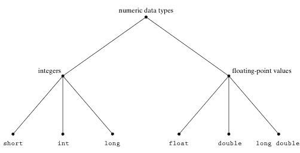

类型说明符
系统相关

有符号整数的 **类型说明符** 是 `short`、`int` 和 `long`，分别对应短整型、整型和长整型。特定的值范围是 **系统相关** 的，这意味着范围可能因系统而异。在本章的最后一个系统中，我们将介绍一个程序，您可以使用它来确定系统上数值数据类型的范围。在许多系统上，短整型数据类型的范围是 –32,768 到 32,767，而整型和长整型通常表示 –2,147,483,648 到 2,147,483,647 的值。（32,767 和 2,147,483,647 等不寻常的限制与二进制整数转换为十进制值有关。）C++ 还允许将 **无符号** 限定符添加到整型说明符中。**无符号** 整数只能表示正值。有符号和无符号整数可以表示相同数量的值，但范围不同。例如，如果 **无符号 short** 的值范围是 0 到 65,535，那么 **short** 整数的值范围是 –32,768 到 32,767；这两种数据类型总共可以表示 65,536 个值。

| 声明： | 类型声明语句定义新标识符并分配内存。在定义标识符时，可以向内存位置分配初始值。还可以指定修饰符。 |
|---|---|
| 语法 | `[modifier] type specifier identifier [= initial value] ; [modifier] type specifier identifier[(initial value)];` |
| 示例 | `double x1, y1(0); int counter=0; const int MIN_SIZE=0; bool error(false); char comma(',');` |

浮点值的类型说明符是 `float`（单精度）、`double`（双精度）和 `long double`（扩展精度）。程序 `chapter1_1` 中的以下语句因此定义了七个对象，它们都包含双精度浮点值：

```
double x1(1), y1(5), x2(4), y2(7),
side1, side2, distance;
```

`float`、`double` 和 `long double` 类型之间的区别在于所表示值的精度（或准确度）和范围。精度和范围是系统相关的。表 2.2 包含 Microsoft Visual C++ 编译器使用的整数和浮点值的精度和范围信息。第 2.9 节中给出的一个程序允许您获取计算机系统的此信息。在大多数系统上，`double` 数据类型存储的十进制精度位数大约是 `float` 数据类型的两倍。此外，`double` 值的指数值范围比 `float` 值更宽。`long double` 值可能具有更高的精度和更宽的指数范围，但这同样取决于系统。像 2.3 这样的浮点常量是 as-


**表 2.2 示例数据类型限制**

| 数据类型 | 详细信息 |
|---|---|
| 整数 | |
| short | 最大值 = 32,767 |
| int | 最大值 = 2,147,483,647 |
| long | 最大值 = 2,147,483,647 |
| 浮点数 | |
| float | 6 位精度<br>最大指数 = 38<br>最大值 = 3.402823e + 38 |
| double | 15 位精度<br>最大指数 = 308<br>最大值 = 1.797693e + 308 |
| long double | 15 位精度<br>最大指数 = 308<br>最大值 = 1.797693e + 308 |

*Microsoft Visual C++ 6.0 编译器。

假定为 double 常量。要指定 `float` 常量或 `long double` 常量，必须在常量后附加字母（或后缀）F 或 L。因此，2.3F 和 2.3L 分别表示 `float` 常量和 `long double` 常量。

### 布尔数据类型

布尔数据类型以数学家乔治·布尔命名，只能表示两个值：**true** 和 **false**。在 C++ 中，值零被解释为 false，任何非零值都被视为 true。还有两个预定义的布尔常量 `true` 和 `false` 可供使用。布尔对象可以使用类型说明符 `bool` 定义。以下示例说明布尔对象和常量的用法：

```
bool error(false), status(true);
cout << error << endl << status;
```

该程序的输出为

0
1

布尔对象在控制程序流程和标记错误条件方面非常有用。

### 字符数据类型

在 C++ 中，字符数据易于处理，但要有效地处理 **字符**，我们需要更多地了解它们在计算机内存中的表示。回顾一下，计算机中存储的所有信息在内部都表示为二进制数字（0 和 1）的序列。每个字符都对应一个 **二进制代码** 值。在以下讨论中，我们假设使用美国国家标准学会 (ANSI) 代码来表示字符。

| 字符 | ANSI 代码 | 整数等效值 |
|---|---|---|
| 换行符，\n | 00001010 | 10 |
| % | 0100101 | 37 |
| 3 | 0110011 | 51 |
| A | 1000001 | 65 |
| a | 1100001 | 97 |
| b | 1100010 | 98 |
| c | 1100011 | 99 |

表 2.3 包含一些字符、它们在 ANSI 中的二进制形式以及与二进制值对应的整数值。字符 "a" 由二进制值 1100001 表示，相当于整数值 97。ANSI 代码中总共可以表示 128 个字符。完整的 ANSI 代码表载于附录 B。


从表 2.3 可以看出，字符数字 '3' 的 ANSI 二进制表示为 0110011，相当于整数值 51 的二进制表示。因此，使用数字的字符表示进行计算所得的结果与使用数字的整数表示进行计算所得的结果不相同。以下程序说明了字符数据的这一特性：

```
/*------------------------------------------------------------*/
/* Program chapter2_1                                         */
/*                                                            */
/* This program prints a char and an int                      */
/*                                                            */
#include <iostream> // Required for cout
using namespace std;
int main()
{
// Declare and initialize objects.
char ch ('3');
int i(3);
// Print both values.
cout << "value of ch: " << ch << " value of i: " << i << endl;
// Assign character to integer
i = ch;
// Print both values.
cout << "value of ch: " << ch << " value of i: " << i << endl;
// Exit program
return(0);
/*
*******************************/
```

该程序的输出为
value of ch: 3 value of i: 3
value of ch: 3 value of i: 51

### 字符串数据

字符串常量是用双引号括起来的字符序列，例如 "sensor"、"F18" 或 "Jane Doe"。字符串变量可以使用 char 类型的数组表示为 C 风格字符串，也可以使用 string 类表示为字符串对象。这两种表示方法将在第 7 章中详细讨论。在本节中，我们简要介绍 string 类。

C++ 编译器没有名为 string 的内置数据类型，但在名为 string 的标准 C++ 库文件中提供了 string 类定义。要使用 string 类，程序必须包含以下预处理器指令：

```
#include <string>
```

以下程序说明了预定义 C++ string 类的用法：

```
/* Program chapter2_2 ------------------------------------------ */
/* */
/* This program prints a greeting */
/* using the string class. */
/* ----------------------------------------------------------- */

#include <iostream> // Required for cout
#include <string> // Required for string
using namespace std;

int main()
{
 // Declare and initialize two string objects.
 string salutation("Hello"), name("Jane Doe");

 // Output greeting.
 cout << salutation << ' ' << name << '!' << endl;

 // Exit program.
 return(0);
}
```

该程序的输出为

Hello Jane Doe!

程序 chapter2_2 的内存快照如下。

```
string salutation("Hello"), name("Jane Doe");
string salutation [ Hello ]
string name [ Jane Doe ]
```

字符串对象 salutation 的大小（或长度）为五。字符串对象 name 的大小为八。字符串对象的大小在执行期间可能会改变。例如，如果添加赋值语句

```
salutation = "Goodbye";
```

到程序 chapter2_2，内存快照将被修改，salutation 的大小将变为七。

```
string salutation Goodbye
```

```
string name Jane Doe
```

### 符号常量

符号常量使用 const 修饰符定义。工程常数，如 $\pi$ 或重力加速度，是符号常量的良好候选项。例如，考虑以下声明语句，为符号常量 PI 赋值：

```
const double PI = acos(-1.0);
```

当 acos 函数在 -1 处求值时，将返回包含 15 位精度的 $\pi$ 近似值。需要使用 $\pi$ 值的语句将使用符号常量 PI，如本语句所示：

```
area = PI*radius*radius;
```

该语句计算圆的面积。

符号常量通常使用大写标识符（如 PI 而不是 pi）定义，以表明它们是符号常量，当然，标识符应选择易于记忆的。一旦标识符使用 const 修饰符声明并初始化，其值在程序中就不能更改。

### 练习！

- 1. 光速，c = 2.99792 x 10^8 m/s
- 2. 电子电荷，e = 1.602177 x 10^-19 C
- 3. 阿伏伽德罗常数，N_A = 6.022 x 10^23 mol^-1
- 4. 重力加速度，g = 9.8 m/s^2
- 5. 重力加速度，g = 32 ft/s^2
- 6. 地球质量，M_E = 5.98 x 10^24 kg
- 7. 月球半径，r = 1.74 x 10^6 m
- 8. 长度单位，UnitLength = 'm'
- 9. 时间单位，UnitTime = 's'

## 2.3 C++ 类

C++ 支持使用类来定义新数据类型，通常称为 **程序员定义的数据类型**。在上一节中，我们研究了使用内置数据类型（包括 `int`、`double` 和 `char`）的示例，并讨论了程序 `chapter2_2` 中的预定义数据类型 `string`。回顾一下，预定义数据类型包含在标准 C++ 库中，想要使用预定义类型的程序必须包含适当的编译器指令。内置数据类型不需要任何包含指令。设计良好的程序员定义的数据类型需要工作来实现，但一旦定义，新数据类型的使用就如同预定义类型一样简单。在本节中，我们将初步了解构建程序员定义的数据类型。

作为构建程序员定义的数据类型的介绍，我们将定义一个表示平面上点的概念的新类型。平面上的点是由 (x, y) 坐标定义的对象。坐标值通常是浮点数，而不是整数，因此我们将使用内置数据类型 `double` 来表示新数据类型实现中的坐标。**程序员定义的数据类型**的定义通常由两部分组成：**类声明**和**类实现**。通常，类声明和类实现写在单独的文件中。约定是将类声明文件命名为 `.h` 扩展名，将类实现文件命名为 `.cpp` 扩展名。想要使用程序员定义类型的应用程序必须在其源代码中包含类声明文件。


### 类声明

类声明以关键字 `class` 开头，后跟指定新类名称的标识符。类声明的主体是一个以分号结束的代码块。声明块包括 **数据成员** 的声明语句和 **类方法** 的声明语句。关键字 `public`、`private` 和 `protected` 用于控制对数据成员和类方法的访问。控制对数据成员和方法的访问是类的一个强大特性，将在后续章节中更详细地讨论。为了说明类声明的语法，我们将从名为 `Point` 的类声明开始。

```
/*-------------------------------------------------------------*/
/* Point class chapter2_3                                      */
/* Filename: Point.h                                           */
/*-------------------------------------------------------------*/
class Point
{
   // Type declaration statements
   // Data members.
   private:
      double xCoord, yCoord; //Class attributes
   public:
   //Declaration statements for class methods
   //Constructors for Point class
   Point(); //default constructor
   Point(double x, double y); //parameterized constructor
};
/*-------------------------------------------------------------*/


请注意，需要使用分号来终止声明块。

类方法定义可对类对象执行的操作。构造函数是一种特殊方法，用于执行类型声明语句的操作。请回顾，我们可以使用类型声明语句来声明和初始化 double 类型的对象，如下所示：

```
double xCoord, yCoord(0.0);

memory snapshot:
double xCoord [?]
double yCoord [0.0]
```

Point 类声明中声明的构造函数为 Point 对象提供类型声明语句，如下所示。

```
Point p1, p2(1.0, 1.0);
memory snapshot:
Point p1 -> [?] double xCoord
            [?] double yCoord
Point p2 -> [1.0] double xCoord
            [1.0] double yCoord
```

## 类实现

要完成 Point 类的定义，我们需要编写类实现文件。类实现文件必须为类声明中声明的每个方法包含一个代码块。每个代码块必须以标题开头，该标题包括类名、作用域解析运算符 (::) 和方法名称。下面给出了我们 Point 类的实现文件。请注意，实现文件包含编译器指令 #include "Point.h"。因为 Point.h 不是 C++ 标准库的一部分，所以使用引号来引用声明文件的名称。

```
/* ....................................................*/
/* Class implementation for Point ....................*/
/* filename: Point.cpp ...............................*/
#include "Point.h" //Required for Point
#include <iostream> //Required for cout
using namespace std;

//Parameterized constructor
Point::Point(double x, double y)
{
    //input parameters x,y
    cout << " Constructing Point object, parameterized: \n" ;
    cout << " input parameters: " << x << " ." << y << endl;
    xCoord = x;
    yCoord = y;
}
//Default constructor
Point::Point()
{
    cout << " Constructing Point object, default: \n" ;
    cout << " initializing to zero" << endl;
    xCoord = 0.0;
    yCoord = 0.0;
}
```

带参数的构造函数以标题 Point::Point(double x, double y) 开头。带参数的构造函数提供用于指定数据成员初始值的参数。带参数的 Point 构造函数提供两个参数 x 和 y，均为 double 类型。在语句块内，这些参数的值将被赋给数据成员。我们以两条 cout 语句开头语句块，用于调试和说明。这些语句将在 Point 类完全设计和实现后删除。在 cout 语句之后，x 的值被赋给 xCoord，y 的值被赋给 yCoord。

默认构造函数以标题 Point::Point() 开头。由于标题中未提供任何参数，语句块将常量 0.0 赋给 xCoord 和 yCoord。请注意，我们本可以选择任何常量作为初始值。下面的程序声明了两个 Point 类型的对象。

```
/**
*---------------------------------------------------*
* Program chapter2_3                                *
*                                                   *
* This program illustrates the use of the           *
* programmer-defined data type Point                *
*                                                   *
*/
```

```
#include <iostream> //Required for cout
#include "Point.h" //Required for Point
using namespace std;

int main()
{
    //Declare and initialize objects.
    cout << " In main, declare p1..." << endl;
    cout << p1;
    cout << " \nIn main, declare p2..." << endl;
    Point p2(1.5, -4.7);
    cout << " \nIn main, declare ORIGIN..." << endl;
    const Point ORIGIN(0.0, 0.0);
    return 0;
}
/*---------------------------------------------------*/
```

该程序的输出如下

```
In main, declare p1...
Constructing Point object, default:
initializing to zero
In main, declare p2...
Constructing Point object, parameterized:
Input parameters: 1.5.-4.7
In main, declare ORIGIN...
Constructing Point object, parameterized:
Input parameters: 0,0
```

随着我们学习 C++ 语言的新特性，将继续为 Point 类添加功能。

| 类定义：程序员定义的类的定义由两部分组成：类声明和类实现。 | |
| :- | :- |
| 语法：类声明 //filename:ClassName.h class className { 访问修饰符：属性声明 访问修饰符：方法声明 }; | 语法：类实现 //filename: className.cpp #include "className.h" 类方法定义 |
| 示例：类声明 //filename: Point.h class Point { private: double xCoord; double yCoord; public: Point(double x, double y) : }; | 示例：类实现 //filename: Point.cpp #include "Point.h" Point::Point (double x, double y) { xCoord = x; yCoord = y; } |
| 用法：#include "Point.h" ... int main() { Point p1(1.5, 2.7); ... | |

## 2.4 C++ 运算符

在程序中执行操作（例如加法、乘法和对象比较）时，我们使用为 C++ 支持的内置数据类型定义的特殊运算符。在本节中，我们将介绍其中几个运算符。

### 赋值运算符

赋值语句使用赋值运算符 = 将结果存储在由标识符命名的内存位置。赋值语句的一般形式是

```
identifier = expression;
```

其中表达式可以是常量、另一个对象或操作的结果。请考虑下面两组声明并为对象 sum、x1、p1 和 ch 赋值的语句：

```
// Set One
double sum(10.5);
int x1(3);
Point p1(1.5, -4.7);
char ch('a');
```

```
// Set Two
double sum;
int x1;
Point p1, p2(1.5, -4.7);
char ch;
```

```
sum = 10.5;
x1 = 3;
p1 = p2;
ch = 'a';
```

执行任意一组语句后，sum 的值为 10.5，x1 的值为 3，p1 的值为 (1.5, -4.7)，ch 的值为 'a'，如下内存快照所示：

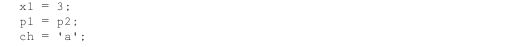

第一组语句在类型声明语句中同时声明并初始化对象；第二组中的赋值语句可在程序中的任何位置使用，因此可用于更改（而非初始化）已声明对象的值。请注意，编译器为 Point 类提供了赋值运算符。赋值运算符将赋值运算符右侧对象的数据成员按位复制到左侧对象的相应数据成员中。

C++ 还允许多重赋值，如下面的语句所示，该语句将零值赋给对象 x、y 和 z：

```
x = y = z = 0;
```

多重赋值将在本节末尾进一步讨论。

赋值语句：赋值语句使用赋值运算符将表达式的值存储在由标识符命名的内存位置。表达式可以是常量、变量或计算结果与标识符数据类型兼容的表达式。

### 语法

```
identifier = expression;
```

### 示例

```
x1 = y1;
counter = 0;
counter = counter + 1;
```

赋值运算符不应与相等性混淆。赋值语句应读作“被赋予……的值”；因此，语句 rate = stateTax 应读作“rate 被赋予 stateTax 的值”。如果 stateTax 包含值 0.06，则语句执行后 rate 也包含值 0.06；stateTax 中的值不变。该语句执行前后的内存快照如下：

| 执行前：| double rate | ? | double stateTax | 0.06 |
| 执行后：| double rate | 0.06 | double stateTax | 0.06 |

如果将值赋给具有不同数据类型的对象，则语句执行期间必须发生转换。有时转换会导致信息丢失。例如，请考虑以下声明和赋值语句：

```
int a;
...
a = 12.8;
```

因为 a 被声明为整数，它无法存储带有非零小数部分的值。因此，在这种情况下，执行赋值语句后的内存快照如下：

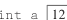

> 请注意，值 12.8 被截断，而不是四舍五入。

要确定数值转换是否正常工作，我们使用以下顺序，从高到低：

- 高：long double
  - double
  - float
  - long integer
  - integer
- 低：short integer


如果将一个值移动到等级更高的数据类型，则不会丢失任何信息；如果将一个值移动到等级更低的数据类型，则可能会丢失信息。因此，将整数移动到 double 可以正常工作，但将 float 移动到整数可能会导致丢失一些信息或产生错误的结果。一般来说，只使用不会导致潜在转换问题的赋值。无符号整数未包含在列表中，因为两个方向都可能发生错误。


## 算术运算符

赋值语句可用于将**算术运算**的结果赋给对象，如下面计算正方形面积的语句所示：

```
areaSquare = side*side;
```

这里使用了运算符 * 来表示乘法。运算符 + 和 - 用于表示加法和减法，运算符 / 用于除法。因此，下面的每条语句都是计算三角形面积的有效计算：

```
areaTriangle = 0.5*base*height;
```

```
areaTriangle = (base*height)/2.0;
```

第二条语句中括号的使用不是必需的，但用于提高可读性。

考虑以下赋值语句：

```
x = x + 1;
```

在代数中，这是无效的，因为一个值不能等于它本身加 1。但是，不应将此赋值语句读作等式；相反，应将其读作 _x 被赋予 x 加 1 的值_。按照这种解释，该语句表示对象 _x_ 中存储的值增加 1。因此，如果在执行此语句之前 _x_ 的值为 5，那么在执行该语句之后 _x_ 的值将为 6。

算术运算

C++ 还包含**取模运算符** %，用于计算两个整数相除的余数。例如，5%2 等于 1，6%3 等于 0，2%7 等于 2。（2/7 的商为 0，余数为 2。）如果 _a_ 和 _b_ 是整数，则表达式 _a_/_b_ 计算整数商，而表达式 _a_%_b_ 计算整数余数。因此，如果 _a_ 等于 9 且 _b_ 等于 4，则 _a_/_b_ 的值为 2，_a_%_b_ 的值为 1。如果在 _a_/_b_ 或 _a_%_b_ 中 _b_ 的值等于零，或者在 _a_%_b_ 中 _a_ 和 _b_ 的整数值之一为负数，则结果取决于系统。

取模运算符

取模运算符在判断一个整数是否是另一个数的倍数时很有用。例如，如果 _a_%2 等于零，则 _a_ 是偶数；否则，_a_ 是奇数。如果 _a_%5 等于零，则 _a_ 是 5 的倍数。我们将在工程解决方案的开发中频繁使用取模运算符。

二元运算符

一元运算符

前面段落中讨论的五个运算符（+、-、*、/、%）是**二元运算符**——作用于两个操作数（值）的运算符。C++ 还包含**一元运算符**——作用于单个操作数的运算符。例如，当加号和减号用于诸如 -_x_ 这样的表达式时，它们可以是一元运算符。

相同类型值的二元运算结果是另一个相同类型的值。例如，如果 _a_ 和 _b_ 是 _double_ 值，则 _a_/_b_ 的结果也是 _double_ 值。同样，如果 _a_ 和 _b_ 是整数，则 _a_/_b_ 的结果也是整数；但是，整数除法有时会产生意外结果，因为整数除法的任何小数部分都会被丢弃；结果是截断结果，而不是四舍五入结果。因此，5/3 计算结果为 1，3/6 计算结果为 0。编译器不为程序员定义的类提供算术运算符，但可以由程序员作为类方法定义。

不同类型值之间的操作是混合操作。在执行操作之前，较低类型的值将转换或提升为较高类型（如在赋值语句中的转换中讨论过），因此操作是使用相同类型的值执行的。例如，如果在整数和浮点数之间指定操作，则在执行操作之前将整数提升为浮点数；结果将是浮点数。

假设我们想要计算一组整数的平均值。如果整数的总和和计数已存储在整数对象 sum 和 count 中，那么以下语句似乎应该正确计算平均值：

```
int sum, count;
double average;
...
average = sum/count;
```

但是，两个整数之间的除法给出整数结果，然后提升为 double 值。因此，如果 sum 是 18，count 是 5，则分配给 average 的值是 3.0，而不是 3.6。为了正确计算此平均值，我们使用强制转换运算符——一个一元运算符，允许我们在下一次计算之前指定值的类型更改。在此示例中，强制转换 (double) 应用于 sum：

```
average = (double)sum/count;
```

在执行除法之前，sum 的值将提升为 double 值。然后除法是 double 值和整数之间的混合操作，因此 count 的值将提升为 double 值；除法的结果是 double 值，并分配给 average。如果 sum 的值是 18，count 的值是 5，则 average 的值现在正确计算为 3.6。强制转换运算符仅影响计算中使用的值；它不会更改对象 sum 中存储的值。

## 练习！

给出以下每组语句计算的值，并绘制内存映射。使用第 2.3 节中提供的 Point 类定义来回答第 5 和第 6 题。

- 1. int a(27), b(6), c;
  ...
  c %= b/a;
- 2. int a(27), b(6);
  double c;
  ...
  c = a / (double)b;
- 3. int a;
  double b(6), c(18.6);
  ...
  a = c/b;
- 4. int b(6);
  double a, c(18.6);
  ...
  a = (int) c/b;
- 5. Point p1, p2(-5.2, 0.0);
- 6. double x(2.0), y(4.3);
  Point p1(x,y);

| 优先级 | 运算符 | 结合性 |
|---|---|---|
| 1 | 括号：( ) | 从内到外 |
| 2 | 一元运算符：+ – (type) | 从右到左 |
| 3 | 二元运算符：* / % | 从左到右 |
| 4 | 二元运算符：+ – | 从左到右 |

## 运算符优先级

算术运算符优先级

在包含多个算术运算符的表达式中，我们需要关注操作执行的顺序。表 2.4 包含**算术运算符的优先级**，它与标准代数优先级相匹配。括号内的操作始终首先求值；如果括号嵌套，则最内层括号内的操作首先求值。一元运算符在二元运算符 `*`、`/` 和 `%` 之前求值；二元加法和减法最后求值。如果表达式中有多个相同优先级的运算符，则对象将按照表 2.4 中指定的特定顺序与运算符分组（或关联）。例如，考虑以下表达式：

```
a*b + b/c*d
```

因为乘法和除法具有相同的优先级，并且结合性（分组操作的顺序）是从左到右，因此该表达式将被求值，就好像它包含以下内容一样：

```
(a*b) + ((b/c)*d)
```

优先级顺序不指定 `a*b` 是否在 `(b/c)*d` 之前求值；这些项的求值顺序取决于系统，但不影响最终值。

算术表达式中的间距是样式问题。有些人喜欢在每个运算符周围加上空格。我们更喜欢仅在二元加法和减法周围加上空格，因为它们最后求值。**选择你偏好的间距样式，但然后始终如一地使用它。**


假设我们想要计算梯形的面积，并且我们已经声明了四个类型为 `double` 的对象：`base`、`height1`、`height2` 和 `area`。再假设对象 `base`、`height1` 和 `height2` 已经有值。正确计算梯形面积的语句是

```
area = 0.5*base*(height1 + height2);
```

假设我们省略了表达式中的括号

```
area = 0.5*base*height1 + height2;
```

该语句将被执行，就好像它是以下语句一样：

```
area = ((0.5*base)*height1) + height2;
```


虽然已经计算出了错误答案，但没有错误消息来提醒我们出现了错误。因此，在将算术表达式转换为 C++ 时，务必非常小心。一般来说，在复杂表达式中使用括号来指示运算顺序，以避免混淆，并确保表达式按所需方式求值。


你可能已经注意到，没有用于计算 x^4 等值的幂运算运算符。执行幂运算的特殊数学函数将在初等数学函数一节中讨论。当然，像 a^2 这样带有整数指数的幂可以通过重复乘法来计算，例如 a*a。

长表达式的求值应拆分为多条语句。例如，考虑以下方程：

f = \frac{x^3 - 2x^2 + x - 6.3}{x^2 + 0.05005x - 3.14}

如果尝试在一条语句中求值该表达式，它会变得太长而难以轻松阅读。

```cpp
f = (x*x*x - 2*x*x + x - 6.3)/(x*x + 0.05005*x - 3.14);
```

我们可以将语句拆分为两行：

```cpp
f = (x*x*x - 2*x*x + x - 6.3)/
    (x*x + 0.05005*x - 3.14);
```

另一种解决方案是分别计算分子和分母：

```cpp
numerator = x*x*x - 2*x*x + x - 6.3;
denominator = x*x + 0.05005*x - 3.14;
f = numerator/denominator;
```

对象 x、numerator、denominator 和 f 必须是浮点对象，才能计算出 f 的正确值。

## 练习！

在第 1 到 3 题中，给出计算指定值的 C++ 语句。假设表达式中的标识符已定义为 double 类型的对象，并且已赋予适当的值。使用以下常量：重力加速度：g = 9.80665 m/s^2。

- 1. 行进距离：
  距离 = x0 + v0t + at^2。

- 2. 绳索中的张力：
  张力 = \frac{m_1 m_2}{m_1 + m_2} * g。

- 3. 管道末端的流体压力：
  P_2 = P_1 + \frac{\rho v (A_1^2 - A_2^2)}{2 A_1^2}。

## 练习！

在第 4 到 6 题中，给出 C++ 语句计算的数学方程。假设已定义以下符号常量，其中 G 的单位为 m^3/(kg * s^2)：

```cpp
const double PI = acos(-1.0);
const double G = 6.67259e-11;
```

- 4. 向心加速度：

```cpp
centripetal = 4*PI*PI*r/(T*T);
```

- 5. 势能：

```cpp
potential_energy = -G*M_E*m/r;
```

- 6. 势能变化：

```cpp
change = G*M_E*m*(1/R_E - 1/(R_E + h));
```

## 溢出和下溢

存储在内存中的值具有广泛的允许值范围。但是，如果计算结果超出允许值的范围，则会发生错误。例如，假设浮点值的指数范围为 -38 到 38。这个范围应该能容纳大多数计算，但表达式的结果可能超出此范围。例如，假设我们执行以下命令：

```cpp
x = 2.5e30;
y = 1.0e30;
z = x*y;
```

x 和 y 的值在允许范围内。但是，z 的值应该是 2.5e60，但该值超出了范围。此错误称为指数溢出，因为算术运算结果的指数太大，无法存储在分配给对象的内存中。指数溢出产生的操作取决于系统。


指数下溢是类似的错误，由算术运算结果的指数太小而无法存储在分配给对象的内存中引起。使用与前一个示例相同的允许范围，通过以下命令会发生指数下溢：

```cpp
x = 2.5e-30;
y = 1.0e30;
z = x/y;
```

同样，x 和 y 的值在允许范围内，但 z 的值应该是 2.5e-60。因为指数小于允许的最小值，所以我们引起了指数下溢。同样，指数下溢产生的操作取决于系统；在某些系统上，带有指数下溢的操作结果会被设置为零。

## 自增和自减运算符

- 自增运算符
- 自减运算符
- 前缀
- 后缀

C++ 语言包含用于递增和递减对象的一元运算符；这些运算符不能与常量或表达式一起使用。自增运算符 ++ 和自减运算符 -- 可以应用于前缀位置（标识符之前），如 ++count，或后缀位置（标识符之后），如 count++。如果自增或自减运算符单独用于语句中，它相当于递增或递减对象的赋值语句。因此，语句

```cpp
y -= 1;
```

等效于语句

```cpp
y = y - 1;
```

如果自增或自减运算符用于表达式中，则必须仔细求值表达式。如果自增或自减运算符位于前缀位置，则先修改标识符，然后在求值表达式其余部分时使用新值。如果自增或自减运算符位于后缀位置，则使用标识符的旧值来求值表达式的其余部分，然后修改标识符。因此，执行

```cpp
w = ++x - y;
```

等效于执行这对语句：

```cpp
x = x + 1;
w = x - y;
```

同样，语句

```cpp
w = x++ - y;
```

等效于这对语句

```cpp
w = x - y;
x = x + 1;
```

执行方程 (2.1) 或方程 (2.2) 时，如果假设 x 的值等于 5 且 y 的值等于 3，则 x 的值增加到 6。但是，执行方程 (2.1) 后，w 的值为 3，而执行方程 (2.2) 后，w 的值为 2。

自增和自减运算符与其他一元运算符具有相同的优先级。如果表达式中有多个一元运算符，它们从右到左结合。使用后缀表示法时，对象的值将在语句结束时递增。递增的确切发生时间取决于系统。因此，从应用后缀运算符到语句结束之间，被修改对象的值不确定。


## 缩写赋值运算符

C++ 允许简单的赋值语句缩写。例如，下面每对语句都包含等效语句：

| 缩写赋值运算符 | 等效语句 |
| --- | --- |
| x += 3; | x = x + 3; |
| sum += x; | sum = sum + x; |
| d /= 4.5; | d = d / 4.5; |
| r %= 2; | r = r % 2; |

实际上，任何形式的语句

```cpp
identifier = identifier operator expression;
```

可以写成形式

```cpp
identifier operator = expression;
```

本节前面，我们使用了以下多重赋值语句：

```cpp
x = y = z = 0;
```

该语句的解释很清楚，但以下语句的解释不那么明显：

```cpp
a = b += c + d;
```

为了正确求值，我们使用表 2.5，它指示赋值运算符最后求值，并且其结合性为从右到左。因此，该语句等效于以下内容：

```cpp
a = (b += (c + d));
```

如果用操作的长形式替换缩写形式，我们有

```cpp
a = (b = b + (c + d));
```

| 优先级 | 运算符 | 结合性 |
| :--- | :--- | :--- |
| 1 | 括号：( ) | 从内到外 |
| 2 | 一元运算符：+ - ++ -- (type) | 从右到左 |
| 3 | 二元运算符：* / % | 从左到右 |
| 4 | 二元运算符：+ - | 从左到右 |
| 5 | 赋值运算符：= += -= *= /= %= | 从右到左 |

```cpp
b = b + (c + d);
a = b;
```

求值此语句是使用优先级和结合性表的良好练习，但一般来说，程序中使用的语句应更具可读性。因此，不建议在多重赋值语句中使用缩写赋值语句。另外，请注意，我们使用的间距约定是在缩写运算符和多重赋值运算符周围插入空格，因为这些运算符在算术运算符之后求值。


## 练习！

执行每条语句后，给出内存快照，假设在执行语句之前 x 等于 2，y 等于 4。另外，假设所有对象都是整数。

- 1. z = x++ * y;
- 2. z = ++x * y;
- 3. x += y;
- 4. y %= x;

## 2.5 标准输入和输出

C++ 使用对象 cin（发音为“see in”）执行标准输入，并使用对象 cout（发音为“see out”）执行标准输出。这些对象定义在标准 C++ 库文件 iostream 中。要在程序中使用其中任何一个对象，必须包含以下预处理器指令：

```cpp
#include <iostream>
```

### cout 对象

流
输出缓冲区

cout 对象定义用于将输出流式传输到标准输出设备。stream 一词暗示程序生成并发送到输出缓冲区的连续字符流。当输出缓冲区填满时，内容将显示在标准输出设备上。在我们的示例中，我们将假设标准输出设备是屏幕。

| 标准输出：C++ 使用 ostream 对象 cout 将表达式的值流式传输到标准输出。cout 定义在头文件 iostream 中。要使用 cout，程序必须包含编译器指令 #include <iostream>。 |
|---|
| 语法 |
| cout << expression << expression; |
| 示例 |
| cout << "The radius is "<< radius << " centimeters\n"; |


运算符 << 用于与 cout 配合，将值输出到屏幕。下面的语句向屏幕输出三个值：

```cpp
cout << "The radius of the circle is "
     << radius << " centimeters\n";
```

每个要输出的值前面都必须加上 << 运算符。在前面的示例中，第一个要输出的值是字符串 "The radius of the circle is "，第二个要输出的值是对象 radius 的值，第三个要输出的值是字符串 " centimeters\n"。字符 (\n) 表示换行符；打印时，换行符会使屏幕换行。下面的示例说明了 cout 的用法：

```cpp
double radius(10), area;
const double PI = acos(-1.0);
cout << "The radius of the circle is: " << radius
     << " centimeters\n"
     << "The area is " << PI*radius*radius
     << " square centimeters\n";
```

这些语句的输出如下：

```
The radius of the circle is: 10 centimeters
The area is 3.14159 square centimeters
```

请注意，radius 的值中不显示小数点，尽管 radius 被声明为 double 类型。虽然这是 C++ 中打印浮点值的默认格式，但我们可以使用流函数和操纵符来覆盖此格式。

## 流对象

标识符 cout 被声明为 ostream 类型的对象，并由编译器定义用于将数据流式传输到标准输出。ostream 类包含方法，也称为成员函数。成员函数在类定义中定义，只能由同一类类型的对象调用。由于 cout 是 ostream 类型的对象，cout 对象可以调用 ostream 类的成员函数来设置与标准输出关联的格式标志的状态。格式标志是 ostream 类的数据成员。当对象调用其成员函数时，使用一种称为点运算符 (.) 的特殊运算符。下面的程序使用 ostream 类的两个成员函数来设置将浮点值流式传输到标准输出所需的格式。setf() 成员函数用于设置显示浮点值的格式，即固定形式或小数形式。成员函数 precision() 用于设置应在小数点右侧显示的有效数字位数。

```cpp
/* .................................................... */
/* Program chapter2_4 ................................. */
/* .................................................... */
/* This program computes area of a circle. ............ */
/* Results are displayed with two digits .............. */
/* to the right of the decimal point. ................. */
#include<iostream> //Required for cout, setf() and precision().
#include<cmath> //Required for acos().
using namespace std;

const double PI = acos(-1.0);

int main()
{
    //Declare and initialize objects.
    double radius(10), area;
    area = PI*radius*radius;

    //Call the setf member function using dot operator.
    cout.setf(ios::fixed); //Fixed form(xx.xx).

    //Call the precision member function using dot operator.
    cout.precision(2); //Display 2 digits to right of decimal.

    cout << "The radius of the circle is: " << radius
         << " centimeters\nThe area is "
         << area << " square centimeters\n";

    //exit program
    return 0;
}
/*--------------------------------------------------------------*/
```

该程序的输出为

The radius of the circle is: 10.00 centimeters
The area is 314.16 square centimeters

当通过调用 setf() 设置格式标志时，该标志将保持设置状态，直到被另一次 setf() 调用更改，或通过流函数 unsetf() 被取消设置（重置为零）。表 2.6 列出了 ios 类中定义的部分格式标志。例如，值 ios::showpoint 指的是 ios 类中定义的标识符 showpoint。当 cout 使用值 ios::showpoint 调用 setf() 时，如下面的语句所示：

```cpp
cout.setf(ios::showpoint);
```

| 标志 | 含义 |
| :--- | :--- |
| ios::showpoint | 显示小数点 |
| ios::fixed | 十进制表示法 |
| ios::scientific | 科学计数法 |
| ios::right | 右对齐打印 |
| ios::left | 左对齐打印 |

与 cout 对象关联的 showpoint 标志的状态被设置为 true，所有流式传输到标准输出的浮点值都将显示小数点。下面的语句

```cpp
cout.unsetf(ios::showpoint);
```

将导致将 showpoint 标志的状态设置回 false（或零），并恢复显示浮点值到标准输出的默认格式。

成员函数 precision() 指定要显示的浮点值的有效数字位数，其行为取决于其他格式标志的状态。例如，当 cout 在将格式标志设置为 fixed 后调用 precision(2) 时，整数参数 2 指定应在小数点右侧显示两位数字，如程序 chapter2_4 所示。如果 cout 在将格式标志设置为 scientific 后调用 precision(2)，则整数参数 2 指定应显示总共两位有效数字。

- 1. 创建一个包含本节讨论的程序 chapter2_4 的文件。运行该程序
  The radius of the circle is: 10.00 centimeters
  The area is 314.16 square centimeters
- 2. 将程序 chapter2_4 中的 setf() 语句替换为语句
  cout.setf(ios::scientific);
  编译并运行修改后的程序。输出发生了什么变化？解释。
- 3. 将程序 chapter2_4 中的 setf() 语句替换为语句
  cout.setf(ios::showpoint);
  编译并运行修改后的程序。输出发生了什么变化？解释。

## 操纵符

在程序 chapter2_4 中，我们使用流函数来控制打印到屏幕的输出格式。格式化输出也可以通过使用操纵符来控制。操纵符是一种预定义对象，可以影响输出流的状态。程序 chapter2_5 说明了使用操纵符而非流函数来控制标准输出流格式的方法。要使用操纵符，程序必须包含头文件 <iomanip>

```cpp
/*
* Program chapter2_5
*
* This program computes area of a circle.
*/
/* Results are displayed with two digits
/* to the right of the decimal point.
/*
#include <iostream> //Required for cout, endl.
#include <iomanip> //Required for setw(). setprecision(), fixed.
#include <cmath> //Required for acos().
using namespace std;

const double PI = acos(-1.0);

int main()
{
//Declare and initialize objects.
double radius(10), area;
area = PI*radius*radius;

cout << fixed << setprecision(2);
cout << "The radius of the circle is: "
<< setw(10) << radius << " centimeters" << endl;
cout << "The area of the circle is: " << setw(10) << area
<< " square centimeters" << endl;

//exit program
return 0;
}
/*...........................................*/
```

该程序的输出为：

The radius of the circle is: 10.00 centimeters
The area of the circle is: 314.16 square centimeters

操纵符 endl 在头文件 <iostream> 中定义，并在程序 chapter2_5 中用于移动到新行的开头。endl 操纵符将换行字符 ('\n') 发送到标准输出，并立即刷新输出缓冲区，而不是等到输出缓冲区已满。当使用 cout 语句打印程序的内存快照以进行调试时，应使用 endl 操纵符（代替 \n）以确保刷新输出缓冲区，并在执行下一条语句之前看到输出。


操纵符 fixed 和 setprecision() 用于设置显示浮点值的形式和精度。请注意，操纵符不是成员函数，因此不使用点运算符来调用。然而，它们对格式标志状态的影响与程序 chapter2_4 中使用的流函数相同。操纵符 setw() 用于指定用于显示发送到输出缓冲区的下一个值的宽度或列数。当需要以表格格式打印结果时，setw() 操纵符非常有用。表 2.7 列出了头文件 iomanip 中定义的几种常用操纵符。要使用这些操纵符，程序必须 #include 文件 <iomanip>。


## TABLE 2.7 常用操纵符

| 操纵符 | 含义 |
| :--- | :--- |
| showpoint | 显示小数点 |
| fixed | 定点记数法 |
| scientific | 科学记数法 |
| setprecision(n) | 将要打印的有效数字位数设置为整数值 n |
| setw(n) | 将打印下一个值的最小列数设置为整数值 n |
| right | 右对齐打印 |
| left | 左对齐打印 |

## 练习！

假设整数对象 sum 包含值 150，双精度对象 average 包含值 12.368，且头文件 iomanip 和 iostream 已包含。显示以下代码段生成的输出。假设每个都是独立的代码段。

- 1. `cout << sum << " " << average;`
- 2. `cout << sum;`
  `cout << average;`
- 3. `cout << sum << endl << average;`
- 4. `cout.precision(2);`
  `cout << setw(10) << average;`
- 5. `cout.setf(ios::showpoint);`
  `cout.precision(3);`
  `cout << sum << ',' << average;`
- 6. `cout.setf(ios::fixed);`
  `cout.setf(ios::showpoint);`
  `cout.precision(3);`
  `cout << sum << ';' << average;`
- 7. `cout << setprecision(2) << sum << endl << average;`
- 8. `cout << fixed << setprecision(3)`
  `<< setw(10) << average << endl << setw(10)`
  `<< sum << endl;`

## cin 对象

cin 对象是 istream 类型的对象，由编译器定义用于从标准输入设备流式输入。在我们的示例中，我们将假设标准输入设备是键盘。

| 标准输入：C++ 使用 istream 对象 cin 从标准输入流式传输数据，并将值存储在由标识符命名的内存位置中。cin 在头文件 iostream 中定义。要使用 cin，程序必须包含编译器指令 #include <iostream>。 |
| --- |
| 语法 |
| cin >> identifier >> identifier >> identifier; |
| 示例 |
| cin >> x >> y >> count; |

输入运算符 >> 用于与 cin 配合，从键盘输入一个值并将其赋给变量。>> 运算符使用空白（空格、制表符、换行符）作为输入流中值的分隔符，因此 >> 运算符会丢弃所有空白。以下语句从键盘输入三个值。

```
cin >> var1 >> var2 >> var3;
```

在上述语句中，键盘上输入的第一个值将赋给变量 var1，第二个值赋给 var2，第三个值赋给 var3。当执行 cin 语句时，程序会等待输入。cout 语句通常位于 cin 语句之前，用于提示用户输入数据。提示是打印在屏幕上的文本，用于向用户描述要从键盘输入的值的顺序和数据类型。

从键盘输入的数据存储在输入缓冲区中，直到按下 < Enter > 键才会实际发送到程序。这允许用户在输入数据时进行退格和更正。


键盘上输入的数值数据应由空白分隔，但空白字符的使用方式无关紧要。>> 运算符将继续丢弃空白，直到它收到语句中每个标识符的值。从键盘输入的值必须与 cin 语句中标识符的数据类型兼容。潜在的输入错误将在第 5 章中讨论。

以下示例说明了 cin 的用法：

```
#include <iostream> //Required for cin
using namespace std;
int main()
{
   double rate, hours;
   int id;
   char code;
// Prompt user for input
cout << "Enter the floating point rate of pay "
     << "and hours worked: ";
cin >> rate >> hours;
cout << "Enter the employee's integer id: ";
cin >> id;
cout << "Enter the tax code (h,r,l): ";
cin >> code;
cout << rate << endl << hours << endl
     << id << endl << code << endl;
return 0;
}
```

如果键盘的输入流包含以下三行输入

```
10.5 40
556
r
```

输入语句中的对象将被赋值，如以下内存快照所示：

| double rate | 10.5 | double hours | 40 |
|---|---|---|---|
| int id | 556 | char code | 'r' |

cout 语句将在屏幕上打印以下输出：

```
10.5
40
556
r
```

>> 运算符丢弃空白，并根据其后标识符的数据类型解释输入值。对于某些需要字符数据的应用程序，丢弃空白可能并不理想。函数 get() 是 istream 类的成员函数，可以由 cin 调用以从输入流中获取单个字符。以下语句

```
char ch;
cin.get(ch);
```

将从键盘读取下一个字符并将其赋给变量 ch。get() 函数不丢弃空白，而是将空白视为有效字符数据，如以下示例所示：

```
char ch1, ch2, ch3;
cout << "Enter three characters: ";
cin.get(ch1);
cin.get(ch2);
cin.get(ch3);
cout << ch1 << ch2 << ch3;
```

如果键盘的输入流包含以下两行

```
a
1
```

对象 ch1、ch2 和 ch3 将被赋值，如以下内存快照所示：
char ch1 'a'   char ch2 '\n'   char ch3 '1'
输出将为
a
1
get() 函数将空白视为有效字符数据；因此，换行符是从键盘输入的，存储在对象 ch2 中，并在 cout 语句中打印到屏幕上。

## 2.6 使用 IDE 构建 C++ 解决方案：NetBeans

### IDE

我们已讨论过 C++ 程序的一般结构，并编写了几个简单的程序来说明数据类型、算术运算符以及输入和输出运算符的使用。在本节中，我们将说明如何使用集成开发环境（IDE）开发 C++ 解决方案。IDE 是一款旨在促进软件解决方案开发的软件包。IDE 包含编辑器、编译器、调试器以及许多用于辅助大型软件解决方案设计和开发的其他工具。与大多数软件包一样，存在学习曲线，需要时间和经验才能成为 IDE 的高效用户。在本节中，我们将使用 NetBeans 为程序 chapter1_1 开发一个 C++ 解决方案。使用 NetBeans 开发 C++ 解决方案将在第 3 中再次介绍，MS Visual C++ Express IDE 将在第 4 中介绍。

### NetBeans

NetBeans IDE 是一个开源项目，为包括 Java、C 和 C++ 在内的多种语言提供开发环境。启动 NetBeans 应用程序时，将出现如下所示的欢迎屏幕：


我们将通过一个简单的示例来说明 NetBeans 中编辑器和编译器的使用。请注意，NetBeans 提供了快速入门教程。我们建议您观看此教程，以学习如何成为 IDE 的更高效用户。

要创建新的 C++ 解决方案，我们必须首先创建一个新的 NetBeans 项目。从 NetBeans 窗口顶部的 **文件** 菜单中选择新建项目...。将出现一个 New Project 屏幕，类似于下图所示。

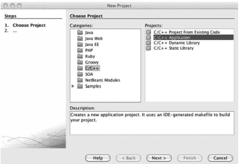

对于这个 C++ 项目，我们将从 **类别：** 菜单中选择 C/C++，然后从 **项目：** 菜单中选择 C/C++ 应用程序，并单击窗口底部的 **下一步 >** 按钮。将出现以下 **项目名称和位置** 窗口。

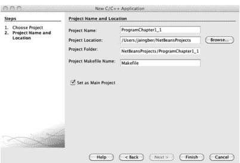

从 **浏览...** 按钮中选择您想要的目录，并将项目命名为 `ProgramChapter1_1`。单击 **完成** 按钮以完成 NetBeans 项目的创建。

请记住，每个 C++ 解决方案都需要一个名为 `main` 的函数。要创建 `main`，我们必须向项目中添加一个新文件。要添加新文件，请从 **文件** 菜单中选择 **新建文件...**。将出现以下 **选择文件类型** 窗口：

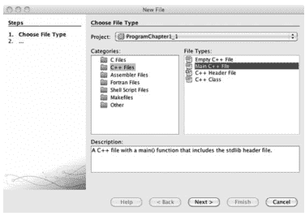

从 **类别：** 菜单中选择 **C++ 文件**，从 **文件类型：** 菜单中选择 **主 C++ 文件**，然后单击屏幕底部的 **下一步 >** 按钮。将出现以下 **名称和位置** 窗口，如下图所示。

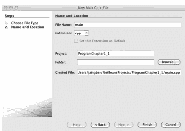


将文件命名为 main，然后单击屏幕底部的 **Finish** 按钮。将在编辑器窗口中创建一个包含以下内容的新文件。

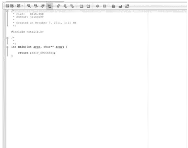

请注意，main() 的标头包含参数 int argc, char** argv。这些可选参数将在后文中讨论。我们将通过添加本文第 44 页程序 chapter1_1 中的语句来修改主程序。修改后的程序如下所示。

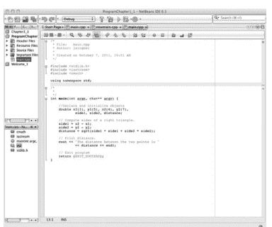

要编译程序，请从 NetBeans 窗口顶部的 **Run** 菜单中选择 **Build Main Project**。将出现如下所示的输出窗口。

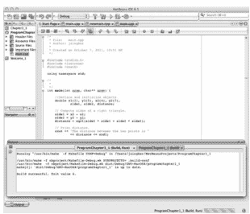

从窗口内容可以看出，构建已成功，因此我们可以尝试执行程序并查看结果。要执行程序，请从 **Run** 菜单中选择 **Run Main Project**。我们的程序将执行，输出将在单独的窗口中显示，如下所示。

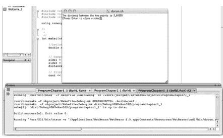

接下来，我们将程序员定义的 Point 类添加到项目中。从 File 菜单中选择 New File...。从 Categories: 菜单中选择 C++ Files，从 File Types: 菜单中选择 C++ Class，然后选择 Next > 按钮，如下图所示。

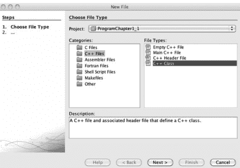

请注意，IDE 同时创建了 point.cpp 文件和 point.h 文件。这两个文件都包含基本构造函数和析构函数，以便于新类的开发。文件 point.h 还包含编译器指令 #ifndef、#define、#endif。这些编译器指令防止文件 point.h 被多次包含，并将在第 10 章中再次讨论。我们将使用编辑器修改文件，添加定义 Point 类声明的语句（见本文第 64 页）和 Point 类实现的语句（见本文第 65 页）。

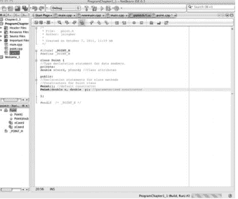

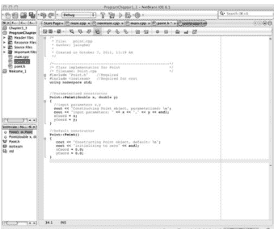

当我们构建并运行此项目时，应该得到与之前相同的输出，因为我们尚未修改 main.cpp。要测试我们程序员定义的 Point 类，我们将把本文第 66 页的以下语句添加到 main.cpp 中，如下所示。

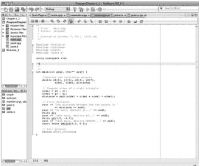

接下来，我们将再次构建并运行项目，得到以下输出。

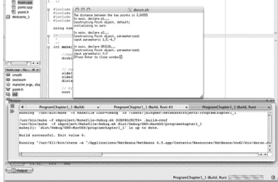

我们在输出窗口中看到，已声明并初始化了三个 Point 对象。

## 修改！

- 1. 将 `main.cpp` 中的 using 指令注释掉（`//#using namespace std;`），并构建项目。保留 using 指令作为注释，纠正所有报告的错误，并构建和运行程序。
- 2. 注释掉 `#include "Point.h"` 指令并构建程序。报告了什么错误？如何纠正这些错误？
- 3. 从 `main.cpp` 中的单个语句删除一个分号并构建项目。报告了什么错误？

## 2.7 C++ 标准库中包含的基本函数

解决工程问题的算术表达式通常需要除加法、减法、乘法和除法之外的计算。例如，许多表达式需要使用对数、指数和三角函数。在本节中，我们讨论标准 C++ 库中可用的预定义数学函数和字符函数。例如，以下语句计算角度 theta 的正弦值，并将结果存储在对象 b 中：

```
b = sin(theta);
```

sin() 函数假设参数 theta 以弧度为单位。如果 theta 包含以度为单位的值，我们将使用单独的语句将度转换为弧度。（回顾 180 度 = pi 弧度。）

```
const double PI = acos(-1.0);
...
theta_rad = theta*PI/180.0;
b = sin(theta_rad);
```

转换也可以在函数引用中指定

```
b = sin(theta*PI/180.0);
```

函数引用（例如 `sin(theta)`）表示一个单一值。函数名后面的括号包含函数的输入，称为 **函数参数**。函数可能不包含参数、包含一个参数或包含多个参数，具体取决于其定义。如果函数包含多个参数，则非常重要，必须按正确顺序列出参数。某些函数还要求参数使用特定单位。例如，三角函数假设参数以弧度为单位。大多数数学函数假设参数为 `double` 值；如果使用不同类型的参数，则在函数执行前将其提升为 `double`。

函数引用也可以是另一个函数引用的参数的一部分。例如，以下语句计算 `x` 的绝对值的对数：

```
b = log(abs(x));
```

当使用一个函数来计算另一个函数的参数时，请务必将每个函数的参数用自己的括号括起来。这种函数嵌套也称为 **函数复合**。

我们现在讨论工程计算中常用的几类函数。其余章节在讨论相关主题时将介绍其他函数。附录 A 也包含有关标准 C++ 库中函数的更多信息。

### 基础数学函数

基础数学函数包括用于执行多种常见计算的函数，例如计算数字的绝对值和数字的平方根。此外，它们还包括一组用于执行舍入的函数。这些函数假设所有参数的类型均为 `double`，并且所有函数都返回 `double`；如果参数不是 `double`，则将使用第 2.2 节中描述的规则进行转换。引用标准 C++ 库中可用的数学函数的程序中应使用以下预处理器指令：

```
#include <cmath>
```

我们现在简要列出这些函数：

| fabs(x) | 该函数计算 x 的绝对值。 |
| sqrt(x) | 该函数计算 x 的平方根，其中 x >= 0。 |
| pow(x,y) | 该函数用于幂运算，计算 x 的 y 次方，即 x^y。如果 x = 0 且 y <= 0，或 x < 0 且 y 不是整数，则会发生错误。 |
| ceil(x) | 该函数将 x 舍入为向无穷大方向的最近整数。例如，ceil(2.01) 等于 3。 |
| floor(x) | 该函数将 x 舍入为向负无穷大方向的最近整数。例如，floor(2.01) 等于 2。 |

- **exp(x)** 该函数计算 $e^x$ 的值，其中 $e$ 是自然对数的底数，约为 2.718282。
- **log(x)** 该函数返回 ln x，即 x 以 $e$ 为底的自然对数。如果 x <= 0，则会发生错误。
- **log10(x)** 该函数返回 log10 x，即 x 以 10 为底的常用对数。如果 x <= 0，则会发生错误。

请记住，负值或零的对数不存在，因此如果对数函数的参数为负值，则会发生执行错误。

### 练习！

计算以下表达式：

- 1. floor(-2.6)
- 2. ceil(-2.6)
- 3. pow(2.0, .3)
- 4. sqrt(floor(10.7))
- 5. abs(-10+2.5)
- 6. floor(ceil(10.8))
- 7. log10(100) + log10(0.001)
- 8. abs(pow(-2.5, 0))

### 三角函数

三角函数也包含在文件 cmath 中，假设所有参数均为 double 类型，并且每个函数都返回 double 值。此外，如前所述，三角函数还假设角度以弧度表示。要将弧度转换为度，或将度转换为弧度，请使用以下转换：

```
const double PI = acos(-1.0);
...
angle_deg = angle_rad*(180/PI);
angle_rad = angle_deg*(PI/180);
```

- **sin(x)** 该函数计算 x 的正弦值，其中 x 以弧度为单位。
- **cos(x)** 该函数计算 x 的余弦值，其中 x 以弧度为单位。
- **tan(x)** 该函数计算 x 的正切值，其中 x 以弧度为单位。
- **asin(x)** 该函数计算 x 的反正弦（或逆正弦），其中 x 必须在范围 [-1, 1] 内。
- **acos(x)** 该函数计算 x 的反余弦（或逆余弦），其中 x 必须在范围 [-1, 1] 内。
- **atan(x)** 该函数返回范围 [0, $\pi$] 内的弧度角。该函数计算 x 的反正切（或逆正切）。
- **atan2(y,x)** 该函数计算 y/x 的反正切或逆正切。该函数返回范围 [-$\pi$, $\pi$] 内的弧度角。

请注意，atan 函数始终返回第一或第四象限的角度，而 atan2 函数返回的角度可以位于任何象限，具体取决于 x 和 y 的符号。因此，在许多应用中，atan2 函数优于 atan 函数。


其他三角函数和反三角函数可以使用以下方程计算 [10]：

sec x = 1/cos x   arcsec x = acos(1/x)
csc x = 1/sin x   arccsc x = asin(1/x)
cot x = 1/tan x   arccot x = acos(x / sqrt(1+x^2))


在使用三角函数的程序中，使用角度而非弧度是一个常见错误。

### 练习！

在第 1 至 3 题中，给出计算指示值的赋值语句，假设对象已声明并赋予适当值。还假设已作出以下声明：

```
const double g = 9.8;
const double PI = acos(-1.0);
```

- 1. 速度计算：
  Velocity = \sqrt{v_0^2 + 2a(x - x_0)}

- 2. 长度收缩：
  Length = \sqrt{1 - (v/c)^2}

- 3. 空心圆柱扇形截面重心到参考平面的距离：
  Center = \frac{38.1972(r^3 - s^3) \sin a}{(r^2 - s^2)a}

在第 4 至 6 题中，给出与赋值语句对应的方程。

- 4. 电气振荡频率：
  frequency = 1/sqrt(2*pi*c*L);

- 5. 抛体射程：
  range = (v0*v0/g) * sin(2*theta);

- 6. 圆盘在斜面底部的速度：
  v = sqrt(2*g*h/(1 + I/(m*pow(r,2))));

## 双曲函数*

双曲函数

双曲函数是自然指数函数 e^x 的函数；反双曲函数是自然对数函数 ln x 的函数。这些函数在专门应用中很有用，例如某些数字滤波器的设计。标准 C++ 库包含若干双曲函数，如下所述。双曲函数包含在标准 C++ 库中，使用这些函数时应使用包含 cmath 信息的预处理指令。

cmath

- `sinh(x)` 该函数计算 x 的双曲正弦，等于 (e^x + e^-x) / 2。
- `cosh(x)` 该函数计算 x 的双曲余弦，等于 (e^x - e^-x) / 2。
- `tanh(x)` 该函数计算 x 的双曲正切，等于 sinh x / cosh x。

可以使用以下关系计算其他双曲函数和反双曲函数 [10]：

- `coth x = cosh x / sinh x`
- `sech x = 1 / cosh x`
- `csch x = 1 / sinh x`
- `asinh x = ln(x + sqrt(x^2 + 1))`
- `acosh x = ln(x + sqrt(x^2 - 1)) (for |x| >= 1)`
- `atanh x = 1/2 ln((1+x)/(1-x)) (for |x| < 1)`
- `atanh x = 1/2 ln((x+1)/(x-1)) (for |x| > 1)`
- `asech x = ln((1 + sqrt(1-x^2))/x) (for 0 < x <= 1)`
- `acsch x = ln(1/x + sqrt(1+x^2)/|x|) (for x != 0)`


许多双曲函数和反三角函数对参数的可接受值范围有限制。如果参数是从键盘输入的，请提醒用户注意范围限制。在下一章中，我们将介绍允许您在程序执行期间确定值是否在适当范围内的 C++ 语句。

### 练习！

给定 x 的值，给出计算以下值的赋值语句（假设 x 的值在计算的适当范围内）。

- 1. coth x
- 2. sech 3 x
- 3. csch 4 x
- 4. acot 6 x
- 5. acosh x
- 6. acsch x

## 字符函数

标准 C++ 库包含许多用于字符数据的预定义函数。这些函数分为两类：一组用于在大写和小写字符之间转换，另一组用于执行字符比较。引用这些字符函数的程序中应使用以下预处理指令：

```
#include <cctype>
```

以下语句将对象 ch 中存储的小写字母转换为大写字符，并将结果存储在字符对象 ch_upper 中：

```
ch_upper = toupper(ch);
```

如果 ch 是小写字母，函数 toupper() 返回相应的大写字母；否则，函数返回 ch。请注意，参数 ch 未做任何更改。

字符比较函数在比较为真时返回非零值；否则返回零。以下语句调用函数 isdigit()。如果 ch 的值是数字（0–9），函数 isdigit() 将返回非零结果；如果 ch 不是数字，则返回值 0（false）：

```
digit = isdigit(ch);
```

这些函数的列表及简要说明见附录 A。

## 2.8 应用问题求解：速度计算

在本节中，我们将进行与车辆性能相关的应用计算。涡轮螺旋桨发动机已使用数十年，它结合了喷气发动机的动力和可靠性以及螺旋桨的效率。与早期的活塞动力螺旋桨发动机相比，这是一项重大改进。然而，其应用仅限于较小的通勤型飞机，因为它不如大型客机使用的涵道喷气发动机快或强大。无导管风扇（UDF）发动机采用了螺旋桨技术的重大进步，缩小了涡轮螺旋桨与涵道喷气发动机之间的性能差距。新材料、叶片形状和更高的转速使得由 UDF 动力的飞机可以以近乎涵道喷气发动机的速度飞行，并且燃油效率更高。UDF 也比传统的涡轮螺旋桨安静得多。

在 UDF 动力飞机的一次试飞中，试飞员将发动机功率设置为 40,000 N（牛），使 20,000 公斤的飞机达到 180 m/s（米/秒）的巡航速度。然后将发动机油门设置为 60,000 N 的功率水平，飞机开始加速。随着飞机速度的增加，空气动力阻力与空速的平方成正比。最终，飞机达到一个新的巡航速度，此时 UDF 发动机的推力刚好被阻力抵消。从重置油门到飞机达到新巡航速度（约 120 秒）期间，用于估计飞机速度和加速度的方程如下：

```
Velocity = 0.00001 * time^3 - 0.00488 * time^2 + 0.75795 * time + 181.3566;
Acceleration = 3 - 0.000062 * velocity^2.
```

这些函数的图如图 2.1 所示。请注意，随着速度接近其新巡航速度，加速度趋近于零。

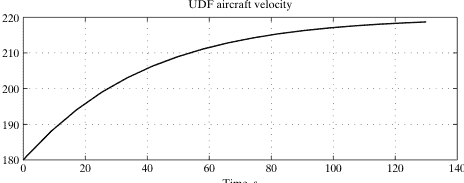

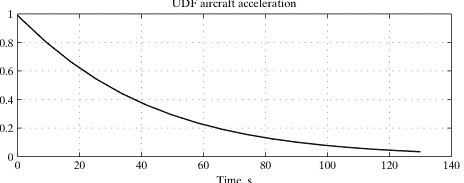

图 2.1 UDF 飞机速度和加速度。

编写一个程序，提示用户输入一个时间值，表示功率增加以来经过的时间（以秒为单位）。计算并打印新时间值处飞机的相应加速度和速度。

### 1. 问题描述

计算功率变化后飞机的新速度和加速度。

### 2. 输入/输出描述

以下图显示程序的输入是一个时间值，程序的输出是新速度和加速度值的一对。可使用内置数据类型 double 来表示这些值。

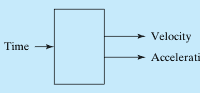

### 3. 手算示例

假设新时间值为 50 秒。使用给定的速度和加速度方程，可以计算这些值：
速度 = 208.3 m/s；
加速度 = 0.31 m/s²。

### 4. 算法开发

算法开发的第一步是将问题求解分解为一组按顺序执行的步骤：

### 分解大纲

- 1. 读取新时间值。
- 2. 计算相应的速度和加速度值。
- 3. 打印新速度和加速度。

由于这是一个非常简单的程序，我们可以直接将分解转换为 C++。


```cpp
/*-----------------------------------------------*/
/* Program chapter2_6                            */
/*                                               */
/* This program estimates new velocity and       */
/* acceleration values for a specified time.     */
/*-----------------------------------------------*/

#include<iostream>    //Required for cin, cout
#include<iomanip>     //Required for setprecision(), setw()
#include<cmath>       //Required for pow()
using namespace std;

int main()
{
   // Declare objects.
   double time, velocity, acceleration;

   // Get time value from the keyboard.
   cout << "Enter new time value in seconds: \n";
   cin >> time;

   // Compute velocity and acceleration.
   velocity = 0.0001*pow(time,3) - 0.0048*pow(time,2)
            + 0.75795*time + 181.3566;
   acceleration = 3 - 0.000062*velocity*velocity;

   // Print velocity and acceleration.
   cout << fixed << setprecision(3);
   cout << "Velocity = " << setw(10)
        << velocity << " m/s" << endl;
   cout << "Acceleration = " << setw(14)
        << acceleration << " m/s^2" << endl;

   // Exit program.
   return 0;
}
/*-----------------------------------------------*/
```

## 5. 测试

我们首先使用手算示例中的数据来测试程序。这会产生以下交互：

```
Enter new time value in seconds:
50
Velocity = 208.304 m/s
Acceleration = 0.310 m/s^2
```

因为计算出的值与手算示例匹配，我们可以接着用其他时间值测试程序。如果值与手算示例不匹配，我们需要确定错误是在手算示例中还是在程序中。

### 修改！

这些问题与本节开发的用于计算速度和加速度值的程序有关。

- 1. 输入不同的时间值，直到找到一个使速度在 210 m/s 到 211 m/s 之间的值。
- 2. 输入不同的时间值，直到找到一个使加速度在 0.5 m/s 到 0.6 m/s 之间的值。
- 3. 修改程序，使输入值以分钟而不是秒输入。请记住，方程仍然假设时间值以秒为单位。
- 4. 修改程序，使输出值以英尺每秒和英尺每秒²打印。（请记住，1 米 = 39.37 英寸。）

## 2.9 系统限制

在第 2.2 节中，我们展示了一个包含 Microsoft Visual C++ 6.0 编译器各种整数类型和浮点类型最大值的表格。要为您的系统打印类似的表格，请使用接下来介绍的程序。请注意，该程序包含三个头文件。`iostream` 头文件是必需的，因为程序使用了 `cout`；`climits` 头文件是必需的，因为它包含有关整数类型范围的信息；`cfloat` 头文件是必需的，因为它包含有关浮点类型范围的信息。附录 A 包含有关系统相关的常数和限制的更多信息。

```cpp
/*--------------------------------------------------------------*/
/* Program chapter2_7 */
/* */
/* This program prints the system limitations. */
/*--------------------------------------------------------------*/
#include<iostream>
#include<climits>
#include<cfloat>
using namespace std;
int main()
{
// Print integer type maxima.
cout << "short maximum: " << sizeof(short) << endl;
cout << "int maximum: " << sizeof(int) << endl;
cout << "long maximum: " << sizeof(long) << endl << endl;
```

```cpp
// Print float precision, range, maximum.
cout << "float precision digits: " << FLT_DIG << endl;
cout << "float maximum exponent: "
<< FLT_MAX_10_EXP << endl;
cout << "float maximum: " << sizeof(float) << endl << endl;

// Print double precision, range, maximum.
cout << "double precision digits: " << DBL_DIG << endl;
cout << "double maximum exponent: "
<< DBL_MAX_10_EXP << endl;
cout << "double maximum: " << sizeof(double) << endl << endl;

// Print long precision, range, maximum.
cout << "long double precision: " << LDBL_DIG << endl;
cout << "long double maximum exponent: "
<< LDBL_MAX_10_EXP << endl;
cout << "long double maximum: " << sizeof(long double) << endl;

// Exit program.
return 0;
}
/*...........................................*/
```

## 摘要

在本章中，我们介绍了编写简单程序以计算和打印新值所需的 C++ 语句。我们还介绍了允许在程序执行时通过键盘输入信息的语句。所介绍的计算包括标准算术运算以及大量可用于执行工程解决方案所需计算类型的函数。

## 关键术语

| 缩写赋值 | 字段宽度 |
| --- | --- |
| ANSI 代码 | 浮点值 |
| 参数 | 垃圾值 |
| 赋值语句 | 双曲函数 |
| 结合性 | 标识符 |
| 二进制代码 | 初始值 |
| 二元运算符 | 关键字 |
| 区分大小写 | 线性插值 |
| 强制类型转换运算符 | 尾数 |
| 字符 | 数学函数 |
| 注释 | 内存快照 |
| 组合 | 取模 |
| 常量 | 多重赋值 |
| 声明 | 对象 |
| 指数记法 | 溢出 |
| 表达式 | 参数 |
| 后缀 | 语句 |
| 优先级 | 符号常量 |
| 精度 | 系统相关 |
| 前缀 | 三角函数 |
| 预处理指令 | 截断 |
| 提示 | 一元运算符 |
| 范围 | 下溢 |
| 科学计数法 | 空白字符 |
| 标准 C++ 库 | |

## C++ 语句摘要

用于从标准 C++ 库的文件中包含信息的预处理指令：

一般形式：

```
#include<filename>
```

示例：

```
#include <iostream>
#include <cmath>
#include <string>
```

### 类型声明语句

一般形式：

```
datatype identifier [.identifier] ;
```

示例：整数的声明：

```
short sum=0;
int year_1, year_2;
long k;
```

浮点值的声明：

```
float height_1, height_2;
double length(10), side1, side2;
long double distance, velocity;
```

字符和字符串的声明：

```
char ch;
string name; //Requires #include<string>
```

### 符号常量声明

一般形式：

```
const datatype identifier = expression;
```

示例：

```
const double PI = acos(-1.0);
const int MAX_SIZE = 100;
```

### 赋值语句

一般形式：

```
identifier = expression;
```

示例：

```
area = 0.5*base*(height_1 + height_2);
```

### 键盘输入语句

一般形式：

```
cin >> identifier [>> identifier];
```

示例：

```
cin >> hours;
cin >> minutes >> seconds;
```

### 来自键盘的字符输入

一般形式：

```
cin.get(identifier);
```

示例：

```
cin.get(ch);
```

### 屏幕输出语句

一般形式：

```
cout << expression [<< expression];
```

示例：

```
cout << "The area is " << area << " square feet. " << endl;
```

### 程序退出语句

一般形式：

```
return integer;
```

示例：

```
return 0;
```

## 注意

- 1. 在整个程序中使用注释以提高可读性并记录其中的步骤。
- 2. 使用空行和缩进来标识程序的结构。
- 3. 尽可能在对象名中使用单位。
- 4. 应为工程常数（如 \(\pi\)）使用符号常量，并且它们应为大写，以便轻松识别。
- 5. 在算术运算符和赋值运算符周围使用一致的间距。
- 6. 在复杂表达式中使用括号以提高可读性。
- 7. 应将长表达式的求解拆分为多个语句。
- 8. 确保在程序输出中将单位与数值一起包含。
- 9. 使用提示向用户描述要从键盘输入的值的信息和单位。

## 调试注意事项

- 1. 请记住，声明和 C++ 语句必须以分号结尾。
- 2. 预处理指令不以分号结尾。
- 3. 如果可能，避免可能导致信息丢失的混合赋值。
- 4. 在长表达式中使用括号，以确保其按预期求值。
- 5. 使用双精度或扩展精度以避免指数溢出或下溢问题。
- 6. 如果用户输入值与 cin 语句中使用的变量的数据类型不匹配，可能会发生错误。
- 7. 确保将运算符 >> 与 cin 一起使用（而不是 <<）。
- 8. 确保将运算符 << 与 cout 一起使用（而不是 >>）。
- 9. 在嵌套函数引用中，每组参数必须在其自己的括号内。
- 10. 请记住，对数函数不能用于负参数值。
- 11. 确保在三角函数中使用弧度角。
- 12. 请记住，许多反三角函数和双曲函数对允许的输入值范围有限制。
- 13. 请记住，字符数字的整数表示与数值数字的整数表示不同。

## 练习题

### 考试练习！

指示以下陈述是正确（T）还是错误（F）

- 1. 预处理指令应始终以分号结尾。T F
- 2. 布尔变量有两个值之一：true 或 false。T F
- 3. 在 C++ 中，变量必须在使用前定义。T F
- 4. 一元运算符的优先级低于二元运算符。T F
- 5. 三角函数的角度应以弧度为单位。T F

指示以下声明语句是否正确。如果语句不正确，请修改它使其成为正确的语句。

- 6. `25 = ageOfStudent;`
- 7. `#include iostream;`


- 8. `cout << a;`
- 9. `unsigned float a;`
- 10. `int i, j, k; // declaring three integers`

- 11. 以下哪项不是 C++ 关键字？
  - (a) class
  - (b) public
  - (c) static
  - (d) while
  - (e) when

- 12. 每个 C++ 可执行程序必须有一个
  - (a) 名为 main 的函数。
  - (b) 一个 cout 语句。
  - (c) 一个 cin 语句。
  - (d) 注释。
  - (e) #include 指令。

- 13. 以下哪项是有效的变量名？
  - (a) 123Greetings
  - (b) a_a
  - (c) !Hello
  - (d) 'a'
  - (e) switch

- 14. 以下哪项不是有效的赋值语句？
  - (a) velocity = 12.6
  - (b) greetings = "Hello World";
  - (c) pi = acos(-1.0);
  - (d) letter = 'a';
  - (e) area = 0.5*b*(h1 + h2);

- 15. 以下哪项是有效的 cin 语句？
  - (a) cin >> seconds >> hours >> minutes;
  - (b) cin >> seconds >> hours >> minutes;
  - (c) cin >> seconds; >> hours; >> minutes;
  - (d) cin << seconds << hours << minutes;
  - (e) cin << seconds << hours << minutes;

执行以下每组语句后，给出相应的内存快照。

- 16. 
    int a1;
        ...
        a1 = 7 + 10 % 3 - 5;
        int a(12), b(3);
        ...
        b = a/b++;

- 17. 
    double m(5.4), n;
    int p(3), q;
    ...
    n = (q = m/p)*2;

给出问题 21 至 23 中语句集生成的输出。

```
18. cout << "Check this \n";
    cout << "There might\n be a trick ";
    cout << " \n somewhere\n";
19. double my_value(17.23891);
    cout << "my_value" << endl;
    cout << scientific << "my_value = " << my_value;
20. int my_value(67890);
    ...
    cout << "my_value = " << fixed << my_value << endl;
```

## 编程问题

### 单位换算。

本组问题涉及将一个单位的值转换为另一个单位。每个程序都应提示用户输入指定单位的值，然后打印转换后的值及其新单位。

- 21. 编写一个程序，将英里转换为千米。（回顾 1 mi = 1.6093440 km。）
- 22. 编写一个程序，将米转换为英里。（回顾 1 mi = 1.6093440 km。）
- 23. 编写一个程序，将磅转换为千克。（回顾 1 kg = 2.205 lb。）
- 24. 编写一个程序，将牛转换为磅。（回顾 1 lb = 4.448 N。）
- 25. 编写一个程序，将华氏度 (TF) 转换为兰氏度 (TR)。（回顾 TF = TR – 459.67 兰氏度。）
- 26. 编写一个程序，将摄氏度 (TC) 转换为兰氏度 (TR)。（回顾 TF = TR – 459.67 兰氏度，且 TF = (9/5) TC + 32 华氏度。）
- 27. 编写一个程序，将开尔文 (TK) 转换为华氏度 (TF)。（回顾 TR = (9/5) TK 且 TF = TR – 459.67 兰氏度。）

### 面积和体积。

这些问题涉及使用用户输入来计算面积或体积。每个程序都应包含提示用户输入所需对象的内容。

- 28. 编写一个程序，计算边长为 a 和 b 的矩形的面积 A。（回顾 A = a * b。）
- 29. 编写一个程序，计算底为 b、高为 h 的三角形的面积 A。（回顾 A = ½ (b * h)。）
- 30. 编写一个程序，计算半径为 r 的圆的面积 A。（回顾 A = πr²。）
- 31. 编写一个程序，计算圆扇区的面积 A，其中 θ 是两半径之间的弧度角。（回顾 A = r²θ/2。）
- 32. 编写一个程序，计算圆扇区的面积 A，其中 d 是两半径之间的角度（度）。（回顾 A = r²θ/2，其中 θ 为弧度。）
- 33. 编写一个程序，计算半轴为 a 和 b 的椭圆的面积 A。（回顾 A = πa * b。）
- 34. 编写一个程序，计算半径为 r 的球体表面积 A。（回顾 A = 4πr²。）
- 35. 编写一个程序，计算半径为 r 的球体的体积 V。（回顾 V = (4/3)πr³。）
- 36. 编写一个程序，计算半径为 r、高为 h 的圆柱体的体积 V。（回顾 V = πr²h。）

**氨基酸分子量。** 蛋白质中的氨基酸由氧、碳、氮、硫和氢原子组成，如表 2.8 所示。各单质元素的分子量如下：

| 元素 | 原子量 |
| :--- | :--- |
| 氧 | 15.9994 |
| 碳 | 12.011 |
| 氮 | 14.00674 |
| 硫 | 32.066 |
| 氢 | 1.00794 |

- 37. 编写一个程序来计算并打印甘氨酸的分子量。
- 38. 编写一个程序来计算并打印谷氨酸和谷氨酰胺的分子量。
- 39. 编写一个程序，提示用户输入氨基酸中五种元素各自的原子数。然后计算并打印该氨基酸的分子量。

| 氨基酸 | O | C | N | S | H |
| :--- | :--- | :--- | :--- | :--- | :--- |
| 丙氨酸 | 2 | 3 | 1 | 0 | 7 |
| 精氨酸 | 2 | 6 | 4 | 0 | 15 |
| 天冬酰胺 | 3 | 4 | 2 | 0 | 8 |
| 天冬氨酸 | 4 | 4 | 1 | 0 | 6 |
| 半胱氨酸 | 2 | 3 | 1 | 1 | 7 |
| 谷氨酸 | 4 | 5 | 1 | 0 | 8 |
| 谷氨酰胺 | 3 | 5 | 2 | 0 | 10 |
| 甘氨酸 | 2 | 2 | 1 | 0 | 5 |
| 组氨酸 | 2 | 6 | 3 | 0 | 10 |
| 异亮氨酸 | 2 | 6 | 1 | 0 | 13 |
| 亮氨酸 | 2 | 6 | 1 | 0 | 13 |
| 赖氨酸 | 2 | 6 | 2 | 0 | 15 |
| 甲硫氨酸 | 2 | 5 | 1 | 1 | 11 |
| 苯丙氨酸 | 2 | 9 | 1 | 0 | 11 |
| 脯氨酸 | 2 | 5 | 1 | 0 | 10 |
| 丝氨酸 | 3 | 3 | 1 | 0 | 7 |
| 苏氨酸 | 3 | 4 | 1 | 0 | 9 |
| 色氨酸 | 2 | 11 | 2 | 0 | 11 |
| 酪氨酸 | 3 | 9 | 1 | 0 | 11 |
| 缬氨酸 | 2 | 5 | 1 | 0 | 11 |

- 40. 编写一个程序，提示用户输入氨基酸中五种元素各自的原子数。然后计算并打印该氨基酸中原子的平均重量。

以 b 为底的对数。要计算 x 以 b 为底的对数，可以使用以下关系

$$ \log_b x = \frac{\log x}{\log b} $$

- 41. 编写一个程序，读取一个正数，然后计算并打印该值以 2 为底的对数。例如，8 以 2 为底的对数是 3，因为 $2^3 = 8$。

- 42. 编写一个程序，读取一个正数，然后计算并打印该值以 8 为底的对数。例如，64 以 8 为底的对数是 2，因为 $8^2 = 64$。


## 工程挑战：全球变化

海水主要是水，其中含有约 3.5% 来自火山喷发和岩石风化的溶解材料（盐类、金属和气体）。盐度最高的海水位于赤道附近的大西洋，那里蒸发量超过降水量。海水的盐度是衡量海水中溶解材料含量的指标。氯约占成分的 55%，而钠约占 30.6%。其余主要成分是硫酸盐（7.7%）、镁（3.7%）、钙（1.2%）和钾（1.1%）。盐度在海洋不同地点有所不同，但通常在 33 到 38 千分比（ppt）之间，即 3.3% 到 3.8%。盐度通常使用测量水电导率的仪器来测量；水中溶解材料越多，导电性越好。本章后面，我们将讨论盐度与冰点之间的关系，然后使用线性插值来确定指定盐度的海水冰点。

# 控制结构：选择

## 章节大纲

- 学习目标
- 3.1 算法开发
- 3.2 结构化程序设计
- 3.3 条件表达式
- 3.4 选择语句：if 语句
- 3.5 数值技术：线性插值
- 3.6 问题求解应用：海水冰点
- 3.7 选择语句：switch 语句
- 3.8 使用 IDE 构建 C++ 解决方案：NetBeans
- 3.9 为程序员定义的数据类型定义运算符
- 摘要、关键词、C++ 语句摘要、风格说明、调试说明、问题

## 学习目标

本章我们将开发包含以下内容的问题求解方案：
求值为真或假的条件表达式
允许在程序中提供替代路径的选择结构
使用流程图和伪代码进行算法开发及算法描述

## 3.1 算法开发

在第 2 章中，我们开发的 C++ 程序非常简单。步骤是顺序的，通常涉及从键盘读取信息、计算新信息，然后打印新信息。在解决工程问题时，大多数解决方案需要更复杂的步骤，因此我们需要扩展问题求解过程中的算法开发部分。

### 自顶向下设计

自顶向下设计以顺序步骤呈现问题求解方案的“全景”描述。然后对问题的这一总体描述进行细化，直到步骤足够详细以转换为语言语句。我们在第 1 章和第 2 章中使用了分解大纲，以


提供问题解决方案的第一个定义。该大纲按顺序步骤编写，可以用图表或逐步大纲的形式展示。对于非常简单的问题，例如下面在第二章中开发的问题，我们可以直接从分解大纲转到 C++ 语句：

### 分解大纲

- 1. 读取新的时间值。
- 2. 计算相应的速度和加速度值。
- 3. 打印新的速度和加速度。

然而，对于大多数问题解决方案，我们需要将分解大纲细化为更详细的描述。这个过程通常被称为分治策略，因为我们不断将问题解决方案分解为越来越小的部分。为了描述这种逐步细化，我们使用伪代码或流程图。

| 基本操作 | 伪代码表示法 | 流程图符号 |
| --- | --- | --- |
| 输入 | read radius | read radius |
| 计算 | Set area to π · radius² | area = π · radius² |
| 输出 | print radius, area | print radius, area |
| 比较 | if radius < 0 then... | is radius < 0 ? |
| 算法开始 | main: | start main |
| 算法结束 | | stop main |

图 3.1 伪代码表示法和流程图符号。

伪代码 流程图

将大纲细化为更详细的步骤可以使用 **伪代码** 或 **流程图**。伪代码使用类似英语的语句来描述算法中的步骤，而流程图使用图表来描述算法中的步骤。大多数算法的基本步骤如图 3.1 所示，并附带伪代码和流程图中的相应表示法。

伪代码和流程图是帮助我们确定解决问题步骤顺序的工具。这两种工具都常用，尽管它们通常不会同时用于同一问题。为了展示这两种工具的示例，一些问题解决方案将使用伪代码，而其他方案将使用流程图；在伪代码和流程图之间的选择通常是个人偏好。有时我们需要经过多个层次的伪代码或流程图来开发复杂的问题解决方案；这就是我们在本节前面提到的逐步细化。分解大纲、伪代码和流程图是解决方案的工作模型，因此不是唯一的。每个参与解决方案的人都会有不同的分解大纲和伪代码或流程图描述，就像不同人开发的 C++ 程序会有些许不同一样，尽管它们解决的是同一个问题。

## 3.2 结构化程序设计

顺序 选择 重复

结构化程序是使用简单控制结构来组织问题解决方案的程序。简单结构通常定义为 **顺序**、**选择** 或 **重复**。顺序结构包含一个接一个执行的步骤；选择结构包含在条件为真时执行的一组步骤和在条件为假时执行的另一组步骤；重复结构包含在条件为真时重复执行的一组步骤。我们现在讨论顺序结构和选择结构，并使用伪代码和流程图给出具体示例。重复将在第 4 章中讨论。

顺序包含一个接一个执行的步骤。第二章开发的所有程序都具有顺序结构。例如，计算带无导管发动机的飞机速度和加速度的程序的伪代码和流程图如图 3.2 所示。

### 伪代码

```
main: read time
set velocity to 10^-4 * time^3 - 0.00488*time^2 +
    0.75795*time + 181.3566
set acceleration to 3 - 0.000662*velocity^2
print velocity and acceleration
```

选择结构包含一个可以计算为真或假的条件。如果条件为真，则执行一组语句；如果条件为假，则执行另一组语句。例如，假设我们已计算出分数的分子和分母的值。在计算除法之前，我们要确保分母不接近零。因此，我们要测试的条件是 "分母接近零"。如果条件为真，则我们要打印一条消息，指示无法计算该值。如果条件为假，这意味着分母不接近零，则我们计算并打印分数的值。在定义此条件时，我们需要定义 "接近零"。对于此示例，我们将假设接近零意味着绝对值小于 0.0001。以下是伪代码描述，该结构的流程图描述如图 3.3 所示。

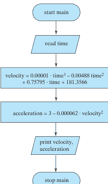

图 3.2 带无导管风扇问题解决方案的流程图和伪代码（来自第 2.8 节）。

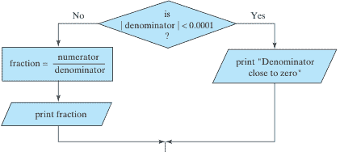

图 3.3 选择结构的流程图。

```
if |denominator| < 0.0001
    print "Denominator close to zero"
else
    set fraction to numerator/denominator
    print fraction
```

请注意，此结构还包含一个顺序结构（计算分数然后打印分数），该结构在条件为假时执行。

在本章的其余部分中，我们将介绍用于执行选择和重复的 C++ 语句，然后开发使用这些结构的示例程序。

## 替代方案的评估

通常有多种方法可以解决同一个问题。在大多数情况下，并不存在单一的最佳解决方案，但有些解决方案比其他方案更好。随着经验的积累，选择一个好的解决方案会变得更容易，我们将在本文中给出有助于良好解决方案的要素示例。例如，良好的解决方案是可读的解决方案；因此，良好的解决方案不一定是最短的解决方案，因为简短的解决方案通常不可读性很高。我们将努力避免那些缩短程序但难以理解的微妙或巧妙的步骤。

在开始开发问题的解决方案时，最好尝试思考几种解决方法。为几种解决方案绘制分解大纲和伪代码或流程图。然后选择你认为最容易转换为 C++ 语句的解决方案。有些算法比其他算法更适合不同的语言，因此你还要选择一个适合 C++ 语言的解决方案。偶尔，还必须考虑解决方案的其他方面，例如执行速度和内存需求。

## 3.3 条件表达式

- 条件
- 关系运算符
- 逻辑运算符
- 求值顺序

由于选择结构和重复结构都使用条件，我们必须在介绍实现选择和重复结构的语句之前讨论条件。条件是一个可以计算为真或假的表达式，它由使用关系运算符组合的表达式组成；条件还可以包含逻辑运算符。在本节中，我们将介绍关系运算符和逻辑运算符，并讨论它们在单个条件中组合时的求值顺序。

### 关系运算符

以下列表显示了可用于在 C++ 中比较两个表达式的关系运算符：

| 关系运算符 | 解释 |
| --- | --- |
| < | 小于 |
| <= | 小于或等于 |
| > | 大于 |
| >= | 大于或等于 |
| == | 等于 |
| != | 不等于 |

关系运算符两侧可以使用空格，但不能使用空格来分隔双字符运算符，例如 ==


示例条件如下：

```
a < b
x+y >= 10.5
fabs(denominator) < 0.0001
```

给定这些条件中标识符的值，我们可以将每个条件计算为真或假。例如，如果 a 等于 5 且 b 等于 8.4，则 a < b 是一个真条件。如果 x 等于 2.3 且 y 等于 4.1，则 x + y >= 10.5 是一个假条件。如果 denominator 等于 20.0025，则 fabs(denominator) < 0.0001 是一个假条件。

> 为了可读性，我们在逻辑表达式中在关系运算符周围使用空格，但在条件中的算术运算符周围不使用空格。

在 C++ 中，真条件被赋值为 1，假条件被赋值为 0。因此，以下语句是有效的：

```
d = b > c;
```

如果 b > c，则 d 被赋值为 1；否则，将 0 赋值给 d。单个值可以用来代替条件。例如，考虑以下语句：

```
if (a)
    ++count;
```

如果 a 的值为零，则假设条件为假；如果 a 的值非零，则假设条件为真。因此，在前面的语句中，如果 a 非零，则 count 的值将递增。

### 逻辑运算符

逻辑运算符也可以在条件中使用。但是，逻辑运算符比较的是条件，而不是表达式。C++ 支持三个逻辑运算符：and、or 和 not。这些逻辑运算符由以下符号表示：

| 逻辑运算 | 符号 |
| --- | --- |
| and | && |
| or | || |
| not | ! |

例如，考虑以下条件：

```
a < b && b < c
```

> 关系运算符的优先级高于逻辑运算符；因此，此条件读作“a 小于 b 且 b 小于 c”。为了使条件更具可读性，我们在逻辑运算符周围插入空格，但在关系运算符周围不插入空格。给定


| A | B | A && B | A || B | !A | !B |
|---|---|---|---|---|---|
| 假 | 假 | 假 | 假 | 真 | 真 |
| 假 | 真 | 假 | 真 | 真 | 假 |
| 真 | 假 | 假 | 真 | 假 | 真 |
| 真 | 真 | 真 | 真 | 假 | 假 |

对 a、b 和 c 的值，我们可以将此条件求值为真或假。例如，如果 a 等于 1，b 等于 5，且 c 等于 8，则条件为真。如果 a 等于 -2，b 等于 9，且 c 等于 2，则条件为假。

如果 A 和 B 是条件，则可以使用逻辑运算符生成新条件 A && B、A || B、!A 和 !B。仅当 A 和 B 都为真时，条件 A && B 才为真。如果 A 或 B 中至少有一个为真，则条件 A || B 为真。! 运算符会更改其前面条件的值。因此，仅当 A 为假时，条件 !A 才为真；仅当 B 为假时，条件 !B 才为真。这些定义在表 3.1 中进行了总结。

表 3.1 为四个条件 A && B、A || B、!A 和 !B 提供了真值表。

真值表根据布尔操作数的真值提供条件的真值。在表 3.1 中，有两个布尔操作数 A 和 B，这些布尔操作数可以表示 2^2 = 4 种唯一的值组合。每增加一个布尔操作数，唯一组合的数量就会翻倍。请考虑条件 A && B || B && C。

该表达式的真值取决于三个布尔操作数 A、B 和 C 的真值，因此存在 2^3 = 8 种唯一组合，如表 3.2 所示。

以下程序演示了如何使用逻辑运算符和关系运算符生成表 3.2 中提供的真值表。

| A | B | C | A && B || B && C |
|---|---|---|---|
| 0 | 0 | 0 | 0 |
| 0 | 0 | 1 | 0 |
| 0 | 1 | 0 | 0 |
| 0 | 1 | 1 | 1 |
| 1 | 0 | 0 | 0 |
| 1 | 0 | 1 | 0 |
| 1 | 1 | 0 | 1 |
| 1 | 1 | 1 | 1 |

```cpp
/*--------------------------------------------------------------*/
/* Program chapter3_1 generates a truth table                   */
/* for the condition:                                           */
/* A && B || B && C                                             */
/*--------------------------------------------------------------*/
#include <iostream>
using namespace std;

int main()
{
   //Declare and initialize objects
   bool A(false), B(false), C(false);

   //Print table header
   cout << " TABLE 3.2\n A\tB\tC\tA && B || B && C"
        << endl;
   cout << "------------------------------------------"
        << endl;

   cout << endl;
   cout << A << '\t' << B << '\t' << C << '\t' << '\t'
        << (A && B || B && C) << endl;

   //Toggle C
   C = !C;
   cout << A << '\t' << B << '\t' << C << '\t' << '\t'
        << (A && B || B && C) << endl;

   //Toggle B and C
   B = !B;
   C = !C;
   cout << A << '\t' << B << '\t' << C << '\t' << '\t'
        << (A && B || B && C) << endl;

   //Toggle C
   C = !C;
   cout << A << '\t' << B << '\t' << C << '\t' << '\t'
        << (A && B || B && C) << endl;

   //Toggle A, B and C
   A = !A;
   B = !B;
   C = !C;
   cout << A << '\t' << B << '\t' << C << '\t' << '\t'
        << (A && B || B && C) << endl;

   //Repeat the pattern for B and C.

   //Toggle C
   C = !C;
   cout << A << '\t' << B << '\t' << C << '\t' << '\t'
        << (A && B || B && C) << endl;

   //Toggle B and C
   B = !B;
   C = !C;
   cout << A << '\t' << B << '\t' << C << '\t' << '\t'
        << (A && B || B && C) << endl;

   //Toggle C
   C = !C;
   cout << A << '\t' << B << '\t' << C << '\t' << '\t'
        << (A && B || B && C) << endl;
   return 0;
}
```

执行包含逻辑运算符的表达式时，C++ 只会对表达式中求值所必需的部分进行求值。这称为**短路求值**。例如，如果 A 为假，则表达式 `A && B` 也为假，无需对 B 求值。同样，如果 A 为真，则表达式 `A || B` 为真，无需对 B 求值。要验证表 3.2 的正确性，必须注意 && 运算符的优先级高于 || 运算符。运算符优先级将在下一节中讨论。

- 1. 修改程序 `chapter3_1` 以生成条件 A&&B&&C 的真值表。
- 2. 修改程序 `chapter3_1` 以生成条件 A||B||C 的真值表。
- 3. 修改程序 `chapter3_1` 以生成条件 A&&B 的真值表。

## 优先级和结合性

条件可以包含多个逻辑运算符，如下所示：`! (b==c || b==5.5)`

优先级从高到低为 !、&&、||，但可以使用括号来更改优先级。在前一个示例中，表达式 b==c 和 b==5.5 会先求值。假设 b 等于 3，c 等于 5。那么这两个表达式都不为真，因此表达式 b==c || b==5.5 为假。接着对假条件应用 ! 运算符，结果得到一个真条件。

条件可以同时包含算术运算符、关系运算符和逻辑运算符。表 3.3 包含条件中元素的优先级和结合性顺序。

| 优先级 | 运算 | 结合性 |
| :--- | :--- | :--- |
| 1 | ( ) | 先内后外 |
| 2 | ++ -- + - ! (type) | 从右到左（单目） |
| 3 | * / % | 从左到右 |
| 4 | + - | 从左到右 |
| 5 | < <= > >= | 从左到右 |
| 6 | == != | 从左到右 |
| 7 | && | 从左到右 |
| 8 | || | 从左到右 |
| 9 | = += -= *= /= %= | 从右到左 |

## 练习！

判断问题 1 到 8 中以下条件是真还是假。假设以下对象已按所示声明并初始化：`a = 5.5 b = 1.5 k = 3`

- 1. a < 10.0 + k
- 2. a + b >= 6.5
- 3. k != a - b
- 4. b - k > a
- 5. !(a == 3 * b)
- 6. -k <= k + 6
- 7. a < 10 && a > 5
- 8. fabs(k) > 3 || k < b - a

## 3.4 选择语句：if 语句

if 语句允许我们测试条件，然后根据条件是真还是假来执行语句。C++ 包含两种形式的 if 语句——简单 if 语句和 if else 语句。C++ 还包含 switch 语句，允许我们测试多个条件，然后根据条件是真还是假来执行语句组。

### 简单 if 语句

if 语句的最简单形式具有以下一般形式：`if ( condition ) statement 1;`

如果条件为真，则执行语句 1；如果条件为假，则跳过语句 1。

> if 语句中的语句会缩进，以便从语句中更容易地可视化程序的结构。

如果希望在条件为真时执行多个语句（或序列结构），则使用**语句块**，即由一组用花括号括起来的语句组成。花括号的位置是风格问题；下面展示了两种常见风格：

```
Style 1
if (condition)
{
    statement 1;
    statement 2;
    ...
    statement n;
}

Style 2
if (condition) {
    statement 1;
    statement 2;
    ...
    statement n;
}
```

在文本解答中，我们采用第一种风格约定；因此，两个花括号各自独占一行。

> 在文本解答中，我们采用第一种风格约定；因此，两个花括号各自独占一行。虽然这会使程序稍长一些，但也更容易注意到是否错误地遗漏了花括号。图 3.4 包含了简单 if 语句的控制流程图，无论条件为真时是执行单条语句还是执行语句块。

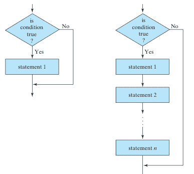

图 3.4 选择语句的流程图。

if 语句：if 语句允许我们测试条件，然后根据条件是真还是假来执行语句。

### 语法：

```
if (condition)
    statement;
[else
    statement;]

if (condition) {
    statement block
} else {
    statement block
}
```

### 示例：

```
#include <iostream>    //Required for cout
using namespace std;
int main()
{
  int a, count(0), sum(0);
  cin >> a;
  if (a < 50)
  {
    ++count;
    sum += a;
  }
  cout << (double) sum/count;
  return 0;
}
```

如果 a 小于 50，则 count 加 1 且 a 加到 sum 中；否则，跳过这两条语句。


if 语句块中的语句可以是任何 C++ 语句，包括另一个 if 语句。这种 if 语句的嵌套在以下示例中说明：

```cpp
if(count < 50)
{
    ++count;
    sum = sum + a;
    if(count < 40)
    {
        ++a;
    }
}
```

如果 count 小于 50，我们将 count 加 1 并将 a 加到 sum 中。此外，如果 count 小于 40，我们还将 a 加 1。如果 count 不小于 50，则跳过所有这些语句。为提高可读性，请缩进每个 if 语句块中的语句。


## if/else 语句

if/else 语句允许我们在条件为真时执行一个语句块，在条件为假时执行另一个语句块。if/else 语句的最简单形式如下：

```cpp
if (condition)
    statement 1;
else
    statement 2;
```

语句 1 和语句 2 可以替换为语句块。语句 1 或语句 2 也可以是空语句，即只是一个分号。如果语句 2 是空语句，那么 if/else 语句可能应该写成简单的 if 语句。有些情况下，将语句 1 设为空语句很方便；然而，这些语句也可以重写为条件反转的简单 if 语句。例如，以下两条语句是等价的：

```cpp
if (a < b)
    ;
else
    ++count;

if (a >= b)
    ++count;
```

考虑以下 if/else 语句：

```cpp
if (d < 30)
    velocity = 0.425 + 0.00175*d+d;
else
    velocity = 0.625 + 0.12*d - 0.0025*d+d;
```

在此示例中，如果距离 d 小于或等于 30，则使用第一个赋值语句计算 velocity；否则，使用第二个赋值语句计算 velocity。此 if/else 语句的流程图如图 3.5 所示。

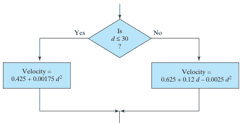

## 图 3.5 if/else 语句的流程图。

if/else 语句的另一个示例是

```cpp
if (fabs(denominator) < 0.0001)
    cout << "Denominator close to zero" << endl;
else
{
    x = numerator/denominator;
    cout << "x = " << x << endl;
}
```

在此示例中，我们检查对象 denominator 的绝对值。如果该值接近零，我们打印一条消息，指示无法执行除法。如果 denominator 的值不接近零，我们计算并打印 x 的值。此语句的流程图已在图 3.3 中显示。

考虑以下嵌套 if/else 语句集：

```cpp
if (x > y)
    if (y < z)
        ++k;
    else
        ++m;
else
    ++j;
```

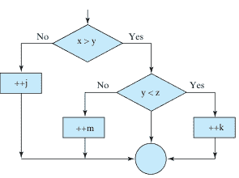

当 x>y 且 y<z 时，k 的值加 1。当 x>y 且 y>=z 时，m 的值加 1。当 x<=y 时，j 的值加 1。通过仔细缩进，此语句易于理解。假设我们现在删除内部 if 语句的 else 部分。如果保持相同的缩进，语句变为以下内容：

```cpp
if (x > y)
    if (y > z)
        ++k;
else
    ++j;
```

看起来 j 在 x <= y 时加 1，但这不正确。C++ 编译器会将 else 语句与块中最近的 if 语句关联。因此，无论使用何种缩进，上述语句都将执行为如下内容：

```cpp
if (x > y)
    if (y > z)
        k++;
    else
        j++;
```

因此，当 x>y 且 y>=z 时，j 加 1。如果我们打算在 x<y 时增加 j，则需要使用花括号将内部语句定义为块：

```cpp
if (x > y)
{
    if (y < z)
        ++k;
}
else
    ++j;
```


为避免在使用 if/else 语句时产生混淆和可能的错误，您应该常规使用花括号来清晰地定义语句块。

C++ 允许使用条件运算符来替代简单的 if/else 语句。这个 C++ 运算符是三元运算符，因为它有三个参数：一个条件、条件为真时要执行的语句、条件为假时要执行的语句。操作通过条件后的问号和两个语句之间的冒号来指示。为说明，以下两条语句是等价的：

```cpp
if (a < b)
    ++count;
else
    c = a + b;

a < b ? ++count : c = a + b;
```

条件运算符（指定为 ?）在赋值运算符之前求值，如果表达式中有多个条件运算符，它们从右到左关联。

在本节中，我们介绍了在选择语句中比较值的若干种方式。比较浮点值时需要注意。如第 2 章中所见，由于二进制和十进制值之间的转换，浮点值有时可能与我们预期的略有不同。例如，本节前面，我们没有将 denominator 与零进行比较，而是使用条件来查看 denominator 的绝对值是否小于一个小值。同样，如果我们想知道 y 是否接近 10.5，应该使用 fabs(y - 10.5) <= 0.0001 这样的条件，而不是 y == 10.5。一般来说，不要将相等运算符与浮点值一起使用。


使用整数的相等运算符（==）时也需要注意。一个常见错误是使用赋值运算符（=）而不是逻辑运算符（==）。考虑以下 C++ 程序：


```cpp
#include <iostream>
using namespace std;

int main()
{
   int x(4), y(5);

   if (x = y)
   {
      cout << x << " is equal to " << y << endl;
   }

   return 0;
}
```

上述程序编译和执行时，编译器或操作系统都没有任何错误消息，程序的输出为：

5 等于 5

此错误是由于在 if 语句的条件中使用赋值运算符而不是相等运算符造成的。将 y 赋给 x，由于 y 不为零（即 y 不为假），赋值语句求值为真，if 语句块中的 cout 语句被执行。如果 y 初始化为 0 而不是 5，则语句块不会被执行。几乎每个程序员都会多次犯这种编程错误，因此，如果程序输出不是您预期的结果，请检查所有打算使用相等运算符的条件。

## 练习！

在问题 1 到 7 中，绘制流程图以执行指示的步骤。然后给出相应的 C++ 语句。假设对象已声明并具有合理的值。

- 1. 如果 time 大于 150，将 time 加 1.0。
- 2. 当 poly 的平方根小于 0.5 时，打印 poly 的值。
- 3. 如果 volt_1 和 volt_2 之间的差值大于 10.0，打印 volt_1 和 volt_2 的值。
- 4. 如果 den 的值小于 0.05，将 result 设为零；否则，将 result 设为 num 除以 den。
- 5. 如果 x 的自然对数大于或等于 3，将 time 设为零并递减 count。
- 6. 如果 dist 小于 50.0 且 time 大于 10.0，将 time 加 2；否则，将 time 加 2.5。
- 7. 如果 dist 大于或等于 100.0，将 time 加 2.0。如果 dist 在 50 和 100 之间，将 time 加 1。否则，将 time 加 0.5。

## 3.5 数值技术：线性插值

从实验或观察物理现象中收集数据是开发问题解决方案的重要步骤。这些数据点通常可以被视为函数 f(x) 点的坐标。我们常希望使用这些数据点来确定 f(x) 对于原始数据集中未包含的 x 值的估计值。例如，假设我们有数据点 (a, f(a)) 和 (c, f(c))。如果我们想要估计 f(b) 的值，其中 a < b < c，我们可以假设一条直线连接 f(a) 和 f(c)，然后使用线性插值来获得 f(b) 的值。如果我们假设点 f(a) 和 f(c) 由一个三次（三阶）多项式连接，我们可以使用三次样条插值方法来获得 f(b) 的值。大多数插值问题可以使用这两种方法之一求解。图 3.6 包含一组六个数据点

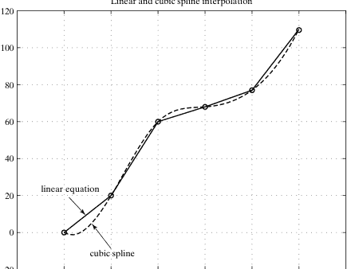

图 3.6 线性和三次样条插值。


\frac{f(a) - f(b)}{b - a} = \frac{f(a) - f(c)}{c - a}

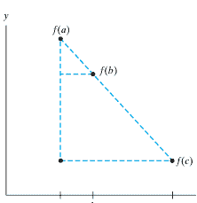

图 3.7 相似三角形。

这些线段已用直线段连接，也已用三次多项式段连接。应当清楚，样本点之间函数的取值取决于我们选择的插值类型。在本节中，我们讨论线性插值。

图 3.7 显示了两个任意数据点 f(a) 和 f(c) 的图像。如果我们假设两点之间的函数可以用一条直线来估计，那么就可以利用由相似三角形推导出的方程，计算任意点 f(b) 的函数值：

f(b) = f(a) + \frac{b - a}{c - a} [f(c) - f(a)] 。

请记住，我们还假设 a < b < c。

为了说明如何使用这个插值方程，假设我们有一组从正在测试的新发动机气缸头中获取的温度测量数据，该发动机可能用于赛车。这些数据在图 3.8 中用连接各点的直线绘制，并如下列出：

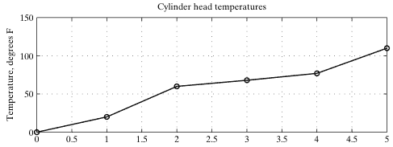

图 3.8 气缸头温度。

| 时间, s | 温度, 华氏度 |
|---|---|
| 0.0 | 0.0 |
| 1.0 | 20.0 |
| 2.0 | 60.0 |
| 3.0 | 68.0 |
| 4.0 | 77.0 |
| 5.0 | 110.0 |

假设我们想要插值出对应 2.6 秒的温度。此时情况如下：

| a | 2.0 | f(a) | 60.0 |
|---|---|---|---|
| b | 2.6 | f(b) | ? |
| c | 3.0 | f(c) | 68.0 |

使用插值公式，我们有

```
f(b) = f(a) + \frac{b-a}{c-a} [f(c) - f(a)]
= 60.0 + \frac{2.6 - 2.0}{3.0 - 2.0} [68.0 - 60.0]
= 64.8.
```

在此示例中，我们使用线性插值来找到与指定时间对应的温度。我们也可以互换温度和时间的角色，使温度在 x 轴上，时间在 y 轴上。在这种情况下，只要我们有一对温度低于和高于指定温度的数据点，就可以使用相同的过程来计算出现指定温度的时间。

### 练习！

- 1. 使用计算器，利用线性插值计算以下时间的温度：
- 0.3, 1.25, 2.36, 4.48

- 2. 使用计算器，利用线性插值计算以下温度对应的时间值：
- 81, 96, 100, 106

- 3. 假设问题 2 要求你计算与 110 华氏度温度对应的时间值。什么使这个问题变得复杂？有多少个时间值对应 110 华氏度？利用线性插值找出每个对应的时间值。（你可能需要参考图 3.10，该图包含了将温度数据放在 x 轴、时间值放在 y 轴上的这些数据图。）

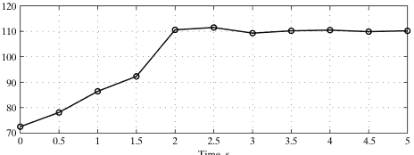

图 3.9 温度值。

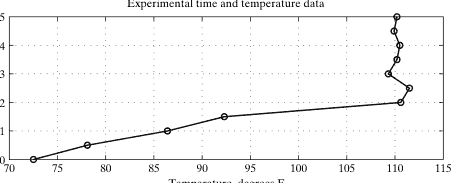

图 3.10 时间值。

## 3.6 应用问题求解：海水冻结温度

在本节中，我们使用线性插值来解决与海水盐度相关的问题。回顾章节开头的讨论，海水的盐度是海水中溶解物质含量的度量。海水盐度因地点而异，但通常在 33 到 38 千分比（ppt）之间，即 3.3% 到 3.8%。

盐度通常使用测量水的电导率的仪器来测量；水中溶解材料越多，导电性越好。在较冷地区，盐度测量尤为重要，因为海水的冻结温度取决于其盐度。下表包含一组盐度测量值和相应的冻结温度；这些值也在图 3.11 中绘制。

| 盐度 (ppt) | 冻结温度 (华氏度) |
|---|---|
| 0 (淡水) | 32 |
| 10 | 31.1 |
| 20 | 30.1 |
| 24.7 | 29.6 |
| 30 | 29.1 |
| 35 | 28.6 |

假设我们想要使用线性插值来确定已测量盐度的水的冻结温度。编写一个程序，允许用户输入两个点的数据以及这两个点之间的盐度值。程序应验证输入的盐度值是否介于两个数据点的盐度值之间。如果输入数据有效，程序应计算相应的冻结温度。如果数据无效，程序应打印错误消息和无效数据。

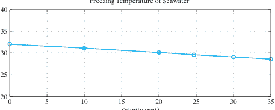

图 3.11 海水冻结温度。

### 1. 问题描述

使用线性插值计算具有指定盐度的水的新冻结温度。

### 2. 输入/输出描述

下图显示，程序的输入包括两个连续点 (a, f(a)) 和 (c, f(c)) 以及新的盐度测量值 b。输出是新的冻结温度。

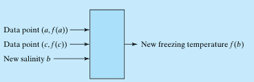

### 3. 手算示例

假设我们想要确定盐度测量值为 33 ppt 的水的冻结温度。从数据中可以看出，该点介于 30 和 35 ppt 之间：

| a | 30 | 29.1 | f(a) |
|---|---|---|---|
| b | 33 | ? | f(b) |
| c | 35 | 28.6 | f(c) |

使用线性方程公式，我们可以计算 f(b)：

```
f(b) = f(a) + (b - a) / (c - a) . (f(c) - f(a))
= 29.1 + 3/5 . (28.6 - 29.1)
= 28.8
```

如预期，该值介于 f(a) 和 f(c) 之间。

### 4. 算法开发

算法开发的第一步是将问题求解分解为一组按顺序执行的步骤：

*分解大纲*

- 1. 读取相邻点的坐标和新的盐度值。
- 2. 验证输入。
- 3. 计算新的冻结温度。
- 4. 打印新的冻结温度。

分解大纲中的第二步需要一个选择结构。如果输入的盐度值不介于两个数据点的盐度值之间，则会打印错误消息，同时打印错误数据，并且程序将终止。下面用流程图描述的改进概述了这些步骤。

流程图中的步骤现在已经足够详细，可以转换为 C++。我们将使用 if 语句来实现选择结构。

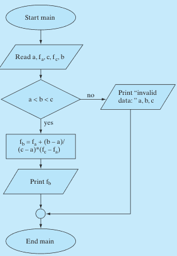

```
/*........................................................................*/
/* Program chapter3_2                                                */
/*                                                                   */
/* This program uses linear interpolation to                         */
/* compute the freezing temperature of seawater.                     */
/*                                                                   */
#include<iostream>    //Required for cin, cout, endl.
#include<iomanip>     //Required for fixed, setprecision()
using namespace std;
int main()
{
   // Declare objects.
   double a, f_a, b, f_b, c, f_c;

   // Prompt and get user input from the keyboard.
   cout << "Use ppt for salinity values." << endl
        << "Use degrees F for temperatures." << endl
        << "Enter first salinity and freezing temperature: \\n";
   cin >> a >> f_a;
   cout << "Enter second salinity and freezing temperature: \\n";
   cin >> c >> f_c;
   cout << "Enter new salinity: \\n";
   cin >> b;
   if ( !(a < b && b < c) )
   {
      cout << "Invalid data: " << a << ",\\n"
           << b << "\",\\"" << c << endl;
   }
   else
   {
      // Use linear interpolation to compute
      // new freezing temperature.
      f_b = f_a + (b-a)/(c-a)*(f_c - f_a);

      // Print new freezing temperature to the screen.
      cout << "New freezing temperature in degrees F: "
           << fixed << setprecision(1) << f_b << endl;
   } // end else

   // Exit program.
   return 0;
}
```

### 5. 测试

我们首先使用手算示例中的数据来测试程序。这会产生以下交互：

使用 ppt 作为盐度单位。
使用华氏度作为温度单位。
输入第一个盐度和冻结温度：
30 29.1
输入第二个盐度和冻结温度：
35 28.6
输入新的盐度：
33
华氏度下的新冻结温度：28.8

计算出的值与手算示例匹配，因此我们可以使用其他时间值来测试程序。如果新系数值与手算示例的结果不匹配，我们就需要确定错误是在手算示例中还是在 C++ 程序中。


## 修改！

- 1. 使用程序确定与以下盐度测量值（单位：ppt）对应的冻结温度：
  3 8.5 19 23.5 26.8 30.5

- 2. 修改程序，使其将新温度转换并以摄氏度打印。（回顾 T_F = 9/5 T_C + 32，其中 T_F 表示华氏温度，T_C 表示摄氏温度。）

- 3. 假设与程序一起使用的数据包含摄氏度数值。程序需要更改吗？请解释。

- 4. 修改程序，使其对盐度进行插值，而不是对新的冻结温度进行插值。（您可以参考图 3.12，该图包含此数据的图表，冻结温度在 x 轴上，盐度在 y 轴上。）

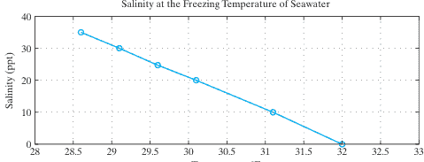

图 3.12 海水冰点时的盐度。

## 3.7 选择语句：switch 语句

switch 语句用于多重选择决策。特别是，它常用于替换嵌套 if/else 语句。在对 switch 语句进行一般性讨论之前，我们先举一个使用嵌套 if/else 语句的简单示例，然后给出一个使用 switch 语句的等效解决方案。

假设我们有一个来自大型机械内部传感器的温度读数。我们希望在控制屏幕上打印一条消息，以向操作员告知温度状态。如果状态代码为 10，则温度过高，应关闭设备；如果状态代码为 11，操作员应每 5 分钟检查一次温度；如果状态代码为 13，操作员应打开循环风扇；对于所有其他状态代码，设备正常运行。可以使用以下嵌套 if/else 语句集打印正确消息：

```
if (code == 10)
{
    cout << "Too hot - turn equipment off." << endl;
}
else
{
    if (code == 11)
    {
        cout << "Caution - recheck in 5 minutes." << endl;
    }
    else
    {
        if (code == 13)
        {
            cout << "Turn on circulating fan." << endl;
        }
        else
        {
            cout << "Normal mode of operation." << endl;
        }
    }
}
```

等效语句是以下 switch 语句：

```
switch (code)
{
    case 10:
        cout << "Too hot - turn equipment off." << endl;
        break;
    case 11:
        cout << "Caution - recheck in 5 minutes." << endl;
        break;
    case 13:
        cout << "Turn on circulating fan." << endl;
        break;
    default:
        cout << "Normal temperature range." << endl;
        break;
}
cout << code << endl;
```

break 语句导致程序执行继续执行 switch 语句之后的语句（本示例中为 cout << code << endl;），从而跳过大括号中其余的语句。

嵌套 if/else 语句并不总是容易转换为 switch 语句。但是，当转换可行时，switch 语句通常更易于阅读。也更容易确定 switch 语句所需的语句分组。

控制表达式
case 结构

switch 语句根据控制表达式选择要执行的语句，该表达式必须是整型或字符型的表达式。在下面给出的一般形式中，case 标签（label_1、label_2、...）确定执行哪些语句，因此在某些语言中，这种结构称为 case 结构。执行的语句是与控制表达式值相等的 case 对应的语句。case 标签必须是唯一常量；如果两个或多个 case 标签具有相同的值，则会发生错误。default 子句用于在没有其他语句被执行时给出要执行的语句；default 子句是可选的。

```
switch (controlling expression)
{
   case label_1:
   statements:
   case label_2:
   statements:
   ...
   default:
   statements;
}
```

switch 结构中的语句通常包含 break 语句。当执行 break 语句时，程序执行跳出 switch 结构，并继续执行 switch 结构之后的语句。如果没有 break 语句，则将执行 case 标签选定的语句之后的所有语句。


虽然 switch 语句中的 default 子句是可选的，但我们建议包含它，以便在没有任何 case 标签等于控制表达式的情况下，明确指定步骤。我们还在 default 子句中使用 break 语句，以强调程序将继续执行 switch 语句之后的语句。

可以将多个 case 标签与同一语句一起使用，如下所示：

```
switch (op_code)
{
   case 'N':
   case 'R':
      cout << "Normal operating range." << endl;
      break;
   case 'M':
      cout << "Maintenance needed." << endl;
      break;
   default:
      cout << "Error in code value." << endl;
      break;
}
```

当多个 case 标签用于同一语句时，求值过程仿佛使用逻辑或运算符连接了这些 case。在此示例中，如果 op_code 等于 'N' 或 op_code 等于 'R'，则执行第一条语句。

## 练习！

将以下嵌套 if/else 语句转换为 switch 语句：

```
if (rank==1 || rank==2)
{
    cout << "Lower division" << endl;
}
else
{
    if (rank==3 || rank==4)
    {
        cout << "Upper division" << endl;
    }
    else
    {
        if (rank==5)
        {
            cout << "Graduate student" << endl;
        }
        else
        {
            cout << "Invalid rank" << endl;
        }
    }
}
```

## 3.8 使用 IDE 构建 C++ 解决方案：NetBeans

在本节中，我们将使用 NetBeans IDE 开发一个 C++ 解决方案。我们的 C++ 程序将执行货币转换。我们的货币转换程序的伪代码如下：

```
Pseudocode
main: read amount in dollars, currency code
    case currency code E
        convert dollars to euros
    case currency code P
        convert dollars to Mexican pesos
    case currency code S
        convert dollars to British pounds sterling
    print equivalent currency
```

伪代码中的步骤足够详细，可以使用 NetBeans IDE 转换为 C++。

### NetBeans

NetBeans 是由 Oracle 公司开发的 IDE，可免费下载。该 IDE 用 Java 编写，可以在任何平台上运行——包括 Windows、Mac OS、Linux 和 Solaris——只要已安装 Java 虚拟机 (JVM)。启动 NetBeans 应用程序时，将显示如下所示的欢迎屏幕：


要创建新的 C++ 解决方案，必须首先创建新项目。从欢迎屏幕中，选择 C/C++ 链接。将出现类似于以下所示的新建项目窗口。

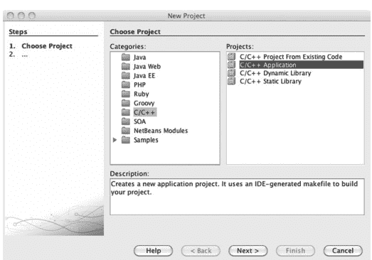

从 **类别** 窗口中选择 C/C++，从 **项目** 窗口中选择 **C/C++ 应用程序**，然后选择 **下一步 >** 按钮。将出现一个新窗口，允许您命名项目并选择目录。项目名称窗口如下所示。

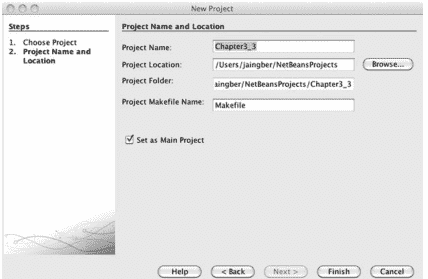

选择您想要的目录并将文件命名为 `chapter3_3`，然后单击 **完成** 按钮以完成 NetBeans 项目的创建。接下来出现的窗口是 **项目** 窗口。**项目** 窗口提供对 NetBeans 提供的项目文件和工具的访问。


要创建 C++ 程序，从左侧窗口选择 Chapter3_3，然后从窗口顶部的 NetBeans 文件菜单中选择新建文件。将出现添加新文件的以下窗口。

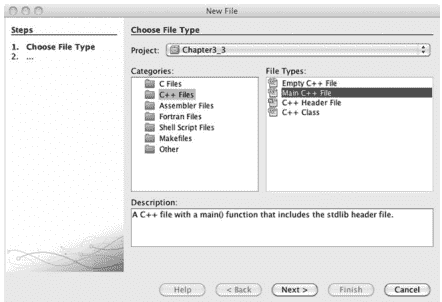

从 Categories 窗口中选择 C++ Files，从 File Types 窗口中选择 Main C++ File。将出现一个新窗口，允许你命名文件并选择目录。新文件名窗口如下所示。

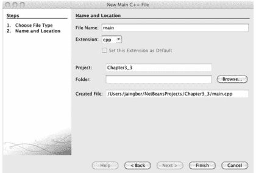

将文件命名为 main 并选择完成。将出现编辑器窗口，如下所示。我们看到一些基本语句已添加到文件 main.cpp 中。

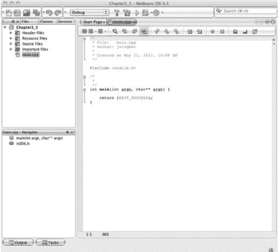

我们将在文件 main.cpp 中编写货币转换器伪代码的 C++ 实现。代码和完成的文件窗口如下所示：

```
/*
 * File:   main.cpp
 * Author: jaingber
 *
 * Created on May 21, 2011, 10:08 AM
 */
```

```cpp
#include <stdlib.h>
#include <iostream>
using namespace std;
```

```cpp
/*********************************************************************
 * Program chapter3_3
 *
 * This program performs currency conversion from dollars to
 * E => euros
 * P => pesos
 * S => pounds sterling
 */
```

```cpp
int main(int argc, char** argv)
{
    double dollars, equivalentCurr;
    char currencyCode;
    const double ECONVERSION(0.7041), PCONVERSION(11.6325),
                 SCONVERSION(0.6144);
```

```cpp
//Prompt user for input
cout << "enter dollar amount" << endl;
cin >> dollars;
cout << "enter currency code:\n"
     << "E => Euros\nP => Mexican Pesos\nS => British Pounds Sterling\n";
cin >> currencyCode;
switch(toupper(currencyCode))
{
    case 'E':
        cout << "converting dollars to euros.\n";
        equivalentCurr = dollars*ECONVERSION;
        break;
    case 'P':
        cout << "converting dollars to pesos.\n";
        equivalentCurr = dollars*PCONVERSION;
        break;
    case 'S':
        cout << "converting dollars to pounds sterling.\n";
        equivalentCurr = dollars*SCONVERSION;
        break;
    default:
        cout << currencyCode << " not supported at this time\n";
        equivalentCurr = dollars;
}
cout << "Equivalent amount: " << equivalentCurr << endl;
return (EXIT_SUCCESS);
}
```

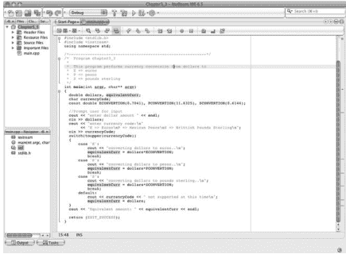

可以通过从 **NetBeans 运行** 菜单中选择 **生成主项目** 来编译此项目。构建窗口如下所示，我们可以看到构建成功。

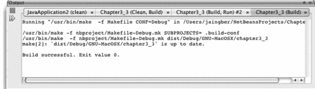

要执行程序，从 **NetBeans 运行** 菜单中选择 **运行主项目**。将出现输出窗口，如下所示。输入所需的美元金额和货币代码，并验证输出。

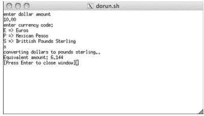

- 1. 查找欧元、墨西哥比索和英镑的当前汇率，并修改程序 `chapter3_3` 中的常量以反映当前值。

- 2. 修改程序 `chapter3_3`，以执行从美元到港元的转换。

- 3. 修改程序 `chapter3_3`，将 `switch` 语句替换为 `if` 语句。

## 3.9 为程序员定义的数据类型定义运算符

我们已经学习了算术运算符和关系运算符，并将这些运算符与内置数据类型一起用于构建条件表达式。但是，这些运算符未为程序员定义的数据类型（如 `Point`）定义。回顾第 2 章，赋值运算符是编译器为程序员定义的类型定义的唯一运算符。只要运算符有合理的定义，就可以为程序员定义的类型定义其他运算符。为程序员定义的类型定义运算符被称为 **运算符重载**。运算符重载为现有运算符提供新定义，并允许程序员定义的类型以与内置类型相同的方式使用运算符。运算符只能为程序员定义的类型重载。你不能为内置类型重载运算符。


在本节中，我们将向在第 2 章中开发的 Point 类添加两个二元运算符。算术运算符 (+) 将添加到 Point 类，并定义为返回平面上两点之间的距离。关系运算符 (==) 也将添加到 Point 类，并定义为仅当两个操作数的所有对应数据成员都相等时返回 true。为了说明运算符重载的语法，我们首先将方法声明添加到 Point 类声明中。

```
/********************************************************************
* Point class chapter3_7                                          *
*                                                                 *
* FileName: Point.h                                               *
*                                                                 *
* class Point                                                     *
*                                                                 *
* // Type declaration statements                                    *
* // Data members.                                                 *
* private:                                                        *
* double xCoord, yCoord; // Class attributes                       *
*                                                                 *
* public:                                                         *
* // Declaration statements for class methods                      *
* // Constructors for Point class                                  *
* Point(); // default constructor                                  *
* Point(double x, double y); // parameterized constructor          *
*                                                                 *
* // Overloaded operators                                          *
* double operator -(const Point& rhs) const;                      *
* bool operator ==(const Point& rhs) const;                       *
* );                                                              *
********************************************************************/
```

请注意，我们在每个运算符声明中两次使用 const 修饰符。使用 const 修饰符可防止重载运算符修改其操作数的数据成员。括号内的 const 修饰符保护右侧操作数的数据成员，而声明末尾的 const 修饰符保护左侧操作数的数据成员。任何尝试从这些方法中修改任一对象的数据成员的行为都将导致编译错误。

为了完成重载运算符的定义，我们必须将这两个方法添加到类实现中。更新后的类实现如下所示。

```
/********************************************************************
* Class implementation for Point                                  *
*                                                                 *
* filename: Point.cpp                                             *
*                                                                 *
* #include "Point.h"       // Required for Point                   *
* #include <iostream>      // Required for cout                    *
* #include <cmath>         // Required for sqrt() and pow()        *
*                                                                 *
* using namespace std;
```

```cpp
/*----------------------------------------------------------*/
/* Parameterized constructor
*/
Point::Point(double x, double y)
{
// input parameters x,y
cout << "Constructing Point object, parameterized: \n";
cout << "Input parameters: " << x << " ," << y << endl;
xCoord = x;
yCoord = y;
}
```

```cpp
/*----------------------------------------------------------*/
/* Default constructor
*/
Point::Point()
{
cout << "Constructing Point object, default: \n";
cout << "initializing to zero" << endl;
xCoord = 0.0;
yCoord = 0.0;
}
```

```cpp
/*----------------------------------------------------------*/
/* This method returns the distance between two
/* points in a plane.
*/
double Point::operator -(const Point& rhs) const
{
double diffX, diffY, distance;
diffX = rhs.xCoord - xCoord; // ((x2-x1)
diffY = rhs.yCoord - yCoord; // ((y2-y1)
distance = sqrt( pow(diffX,2) + pow(diffY,2) );
return distance;
}
```

```cpp
/*----------------------------------------------------------*/
/* This method returns:
/* true if two points are equal
/* false if two points are not equal.
/* equal means that all corresponding data
/* members are equal.
*/
bool Point::operator ==(const Point& rhs) const
{
if(rhs.xCoord == xCoord &&
rhs.yCoord == yCoord )
{
return true;
}
else
{
return false;
}
}
```

我们已完成 Point 类中两个二元运算符的定义。这些新运算符在下面提供的程序 chapter3_3 中进行测试。我们将使用内存


snapshots to illustrate the use of the overloaded operators as we trace the execution of the main program.

```cpp
/*
 * Program chapter3_3
 *
 * This program illustrates the use of the
 * programmer-defined data type Point
 */
#include <iostream> //Required for cout
#include "Point.h" //Required for Point
using namespace std;

int main()
{
 //Declare and initialize objects.
 Point p1;
 Point p2(1.5, -4.7);

 //Test operators
 if(p1 == p2)
 {
 cout << "p1 is equal to p2" << endl;
 }
 else
 cout << "Distance between p1 and p2 is" << p1 - p2
 << endl;

 return 0;
}
/*--------------------------------------------------------------*/
```

memory snapshot:

Point p1:
Point p2(1.5, -4.7);


memory snapshot:
if(p1 == p2):
Point& rhs->

In the expression

```
p1 == p2
```

p1 is the **calling object**. The calling object is the object that calls the method. For overloaded binary operators, the left operand is always the calling object. When the operator ==(const Point& rhs) method is called, we see from the memory snapshot that rhs is defined and references the same object that p2 references. The data type of rhs is the type Point&. The operator (&) is called the reference operator, and rhs is said to reference an object of type Point. The reference operator and calling objects will be discussed in detail in Chapter 6. For now, it is important to note that rhs and p2 will reference the same object.

Class methods have access to the data members of the calling object, by name. Thus, when the statement

```
if(rhs.xCoord == xCoord &&
rhs.yCoord == yCoord )
{
return true;
}
else
{
return false;
}
```

is evaluated, xCoord and yCoord refer to the data members of the calling object, p1, and the conditional expression inside the parentheses reduces to (1.5 == 0.0 && -4.7 == 0.0). This expression is false, so the return statement inside the else block is executed and a value of false is returned to the if statement in main(). Since false is returned to the if statement in main(), the cout statement inside the else block is executed.

memory snapshot:

```
cout << "Distance between p1 and p2 is " << p1 - p2 << endl;
```


The value of distance is returned to the cout statement and printed to standard output. The output from a test run of program chapter3_3 is shown below.

```
Constructing Point object, default:
Initializing to zero
Constructing Point object, parameterized:
input parameters: 1.5, -4.7
Constructing Point object, parameterized:
Input parameters: 0, 0
Distance between p1 and p2 is 4.93356
```

We will continue to develop the Point class as we learn new features of the C++ programming language.

## Practice!

- 1. Create the flowchart for the method `bool Point::operator ==(const Point& rhs) const`
- 2. Write the pseudocode for the method `double Point::operator -(const Point& rhs) const`

## Modify!

- 1. Add the following declaration to program `chapter3_3`:
   `const Point ORIGIN(0.0, 0.0);`
   then modify the program to test for equality between p1 and ORIGIN.
- 2. Add the following assignment statement to program `chapter3_3`:
   `p2 = ORIGIN;`
   and the declaration for ORIGIN from problem 1, then modify the program to test for equality between p2 and ORIGIN.
- 3. Add the following assignment statement to program `chapter3_3`:
   `ORIGIN = p2;`
   What message do you receive when you compile your program?

## SUMMARY

In this chapter, we covered the use of conditions and if statements and switch statements to select the proper statements to be executed. These selection structures are used in most programs.

## Key Terms

- case structure
- condition
- controlling expression
- data file
- decomposition outline
- divide and conquer
- flowchart
- logical operator
- pseudocode
- relational operator
- selection
- sequence
- statement block
- stepwise refinement
- test data
- top-down design
- validation and verification

## C++ Statement Summary

```
if statement:
if (temp > 100)
    cout << "Temperature exceeds limit" << endl;
```

```
if/else statement:
if (d < 30)
    velocity = 4.25 + 0.00175*d;
else
    velocity = 0.65 + 0.12*d - 0.0025*d*d;
```

```
conditional statement:
temp>100 ? cout << "Caution \\n" : cout << "Normal \\n";
```

```
switch statement:
switch (opCode)
{
    case 'P':
    case 'r':
        cout << "Normal Operating range \\n";
        break;
    case 'm':
    case 'M':
        cout << "Maintenance needed \\n";
        break;
    default:
        cout << "Error in code value \\n";
        break;
}
```

```
break statement:
break;
```

## Notes

- 1. Use spaces around the relational operator in a logical expression in a simple condition; use spaces around the logical operator and not around the relational operators in a complicated condition.
- 2. Indent the statements within a statement block or inside a selection structure. If compound statements are nested, indent each nested set of statements from the previous statement.
- 3. Use braces even when they are not required to clearly identify the structure of a complicated statement.
- 4. Use the default case within the switch statement to emphasize the action to take when none of the case labels matches the controlling expression.

## Debugging Notes

- 1. When you discover and correct an error in a program, start the testing step over again. In particular, rerun the program with all the test data sets again.
- 2. Be sure to use the relational operator == instead of = in a condition for equality.
- 3. Put the braces surrounding a block of statements on lines by themselves; this will help you avoid omitting them.
- 4. Do not use the equality operator with floating-point values; instead, test for values "close to" a desired value.
- 5. Recompile your program frequently when correcting syntax errors; correcting one error may remove many error messages.
- 6. Use cout statements to give memory snapshots of the values of key objects when debugging loops. Remember to use the endl manipulator instead of '\n' to ensure that the values are printed immediately after the statement is executed.

## Problems

## Exam Practice!

### True/False Problems

Indicate whether the following statements are true (T) or false (F).

- 1. Relational operators have lower precedence than the assignment operator. T F
- 2. Relational expressions are Boolean expressions, i.e., their value can be either true or false. T F
- 3. Logical operators either join two or more relational expressions or reverse the logic of an expression. T F
- 4. Operators could also be overloaded for built-in data types. T F
- 5. The keyword else is always associated with the closest if statement unless braces are used to define blocks of statements. T F

### Syntax Problems

Identify any syntax errors in the following statements. Assume that the objects have all been defined as integers.

```
6. switch (score)
   {
      case (score < 60):
         cout << "Too low. \n";
         break;
      case (score < 80):
         cout << "You can do better. \n";
         break;
      case score >= 80 && score <= 100):
         cout << "Good Score. Congratulations\n";
         break;
   }
```

### Multiple-Choice Problems

Circle the letter for the best answer to complete each statement or for the correct answer to each question.

- 7. Consider the following statement:
   int x = 9, y = 15;
   What does the statement cout << (x == y); display?
   (a) 1
   (b) 0
   (c) 9
   (d) 15

- 8. If x is 7, y is 11, and z is 18, then which of the following expressions is not true?

(a) z >= x + y;
(b) y != z
(c) !x && y
(d) !( x < (z-y))

- 9. Which of the following is a ternary operator?

(a) .
(b) >=
(c) ?:

- 10. The expression
((!((9-5*3) < 8 && (6/3 > 1)))) is

(a) true.
(b) false.
(c) invalid.
(d) none of the above.

Problems 11 through 13 refer to the following statements:

int x(6), y(9);
cout << "\nFirst increment of x, now x is: " << ++x;
cout << "\nSecond increment of x, now x is: " << x++;
cout << "\nIncrementing y, now y is: " << (y += x++);

- 11. What would be first line of output?

(a) First increment of x, now x is: 7
(b) First increment of x, now x is: 7
(c) First increment of x, now x is: 6
(d) First increment of x, now x is: 8

- 12. What would be second line of output?

(a) Second increment of x, now x is: 7
(b) Second increment of x, now x is: 8
(c) Second increment of x, now x is: 9
(d) Second increment of x, now x is: 6

- 13. What would be third line of output?

(a) Incrementing y, now y is: 17
(b) Incrementing y, now y is: 16
(c) Incrementing y, now y is: 18
(d) Incrementing y, now y is: 10

### Memory Snapshot Problems

Give the corresponding snapshots of memory after the following set of statements is executed:

```
14. int a = 750;
if (a > 0)
    if (a >= 1000)
        a = 0;
    else
        a == 2;
else
    a *= 10;
```

```
15. char ch = '*';
switch(ch)
```


{
case '+':
    cout << "addition\n";
    break;
case '-':
    cout << "subtraction\n";
    break;
case '*':
    cout << "multiplication\n";
    break;
case '/':
    cout << "division\n";
    break;
default:
    cout << "other\n";
}

## 布尔表达式

- 16. 编写一个程序，从标准输入接收三个布尔变量 a、b 和 c 的值，并判断条件
  ! (a&&b&&c) && !(a||b||c)
  的值为真还是假。按以下格式输出：
  条件：
  ! (xx&&xx&&xx) && !(a||b||c)
  为假（如果条件为假）或
  为真（如果条件为真）。

- 17. 编写一个程序，从标准输入接收三个布尔变量 a、b 和 c 的值，并判断条件
  !(a || b) && c
  的值为真还是假。检查输入数据中的错误。按以下格式输出：
  条件：
  !(xx || xx)&&xx
  为假（如果条件为假）或
  为真（如果条件为真）。

这些问题与本节开发的用于生成真值表的程序 chapter3_1 相关。

- 18. 修改此程序以确定条件是否为重言式。（提示：重言式总是为真。如果即使只有一种组合为假，则该条件不是重言式。）

- 19. 修改此程序以确定条件是否为矛盾式。

- 20. 修改此程序以确定条件是否为偶然式。

## 工程挑战：数据收集


气象气球用于从高空大气中收集数据。气球充满氦气，上升到平衡点，此时气球内部氦气与外部空气之间的密度差恰好足以支撑气球的重量。白天，阳光加热气球，使其上升到新的平衡点；傍晚，气球冷却，下降到较低的高度。气球可用于测量气球周围空气的温度、压力、湿度、化学物质浓度或其他特性。气象气球可能只在空中停留几个小时，也可能长达数年收集环境数据。随着氦气泄漏或被释放，气球会落回地球。

# 控制结构：重复

### 章节大纲

- 目标
- 4.1 算法开发
- 4.2 重复结构
- 4.3 应用问题求解：GPS 数据
- 4.4 break 和 continue 语句
- 4.5 构造输入循环
- 4.6 应用问题求解：气象气球
- 4.7 IDE：MS Visual C++
- 摘要、关键术语、C++ 语句摘要、风格说明、调试说明、习题

### 目标

在本章中，我们开发包含以下内容的问题求解方案：

- 允许在条件为真时重复执行一组步骤的重复结构
- 使用流程图和伪代码进行算法开发和循环描述
- 三种常见的输入循环形式

## 4.1 算法开发

在第3章中，我们开发了使用选择结构在程序执行期间提供替代路径的算法。在本章中，我们开发算法并编写使用重复结构的C++程序。重复结构允许我们在条件为真时重复（或循环执行）一组步骤。例如，我们可能想要计算一组对应于时间值 0、1、2、...、10 秒的速度值。我们不希望开发一个顺序结构，其中有一条语句用于计算时间为0时的速度，另一条语句用于计算时间为1时的速度，然后是另一条语句用于计算时间为2时的速度，以此类推。虽然在这种情况下这种结构只需要十一条语句，但如果我们想要在较长时间内计算速度值，它可能需要数百条语句。如果我们使用重复结构，可以开发一个将时间初始化为0的解决方案。然后，只要时间值小于或等于10，我们就计算并打印一个速度值，并将时间值增加1。当时间值大于10时，我们退出该结构。

#### 伪代码和流程图描述

使用重复结构的算法可以用伪代码或流程图来描述。图4.1包含一个重复结构的流程图，该结构将在时间值小于或等于10时计算并打印速度值。每次重复结束时，时间值增加1。该结构的伪代码如下：

```
set time to 0
while time <= 10
   compute velocity
   print velocity
   increment time by 1
```


图4.1 重复结构的流程图。

循环用于实现重复结构。C++包含三种不同的循环结构：while循环、do/while循环和for循环。C++还支持在循环中使用两个附加语句来修改其性能：break语句（我们在switch语句中使用过）和continue语句。在本章的其余部分中，我们将介绍这些循环结构，并开发示例程序来说明每种重复结构的使用。

## 4.2 重复结构

C++中最通用的循环结构是while循环。

#### while 循环

while循环的一般形式如下：

```
while (condition)
statement;
```

| while 语句：while 语句允许程序在指定条件为真时反复执行一组语句。 | |
|---|---|
| 语法： | |
| `while(condition)` | `while(condition)` |
| `statement;` | `{` |
| | `语句块` |
| | `}` |
| 示例： | |
| `while(!isspace(ch))` | `while(x > y)` |
| `{` | `{` |
| `cin.get(ch);` | `++c1;` |
| `}` | `--x;` |
| | `}` |

在执行循环内的语句之前，先对条件进行求值。如果条件为假，则跳过语句块，执行继续于while循环之后的语句。如果条件为真，则执行语句块，并再次对条件求值。这种重复持续进行，直到条件为假，如图4.2的流程图所示。


图4.2 while语句的流程图。

程序 chapter4_1 使用while循环来实现图4.1中的流程图。该程序及其生成的输出如下所示。

```
/******************************
/* Program chapter4_1 */
/* This program computes and prints a velocity */
/* for time values in the range of: 0 <= time <= 10 */
#include<iostream> //required for cout
using namespace std;
int main()
{
 // Declare and initialize objects
 const double V0(0.0); //initial velocity m/s
 const double A(2.537); //constant acceleration m/s*s
 double time, velocity;
 //print heading
 cout << " Time, s\tVelocity, m/s\n" ;
 time = 0;
 while(time <= 10.0)
 {
 velocity = A*time + V0;
 cout << time << "\t\t" << velocity << endl;
 ++time;
 }
 return 0;
}
```

程序输出：

| 时间，s | 速度，m/s |
|---|---|
| 0 | 0 |
| 1 | 2.537 |
| 2 | 5.074 |
| 3 | 7.611 |
| 4 | 10.148 |
| 5 | 12.685 |
| 6 | 15.222 |
| 7 | 17.759 |
| 8 | 20.296 |
| 9 | 22.833 |
| 10 | 25.37 |

构成循环的语句必须修改条件中使用的对象；否则，条件的值将永远不会改变，我们要么永远不会执行

#### 无限循环

循环中的语句，要么永远无法退出循环。如果while循环中的条件始终为真，则会生成一个无限循环。

大多数系统对程序可使用的时间量有定义的限制，并在超过此限制时生成执行错误。其他系统要求用户输入特殊字符序列，例如按住控制键后按字符c（缩写为<ctrl> c）来停止或中止程序的执行。几乎每个人最终都会编写一个无意中包含无限循环的程序，因此请务必了解用于中止系统中程序执行的特殊字符。

这里，我们想提出两条在查找包含循环的程序中的错误时很有用的调试建议。在编译较长的程序时，出现大量编译器错误并不罕见。与其在编译后尝试纠正所有错误，不如在纠正一两个明显的语法错误后重新编译程序。一个错误通常会生成多条错误消息。其中一些错误消息可能描述的并非你程序中的错误，而是因为原始错误使编译器混淆而打印出来的。

第二条调试建议与循环内部的错误有关。当你想要确定循环中的步骤是否按预期工作时，在循环中包含cout语句，以便在每次执行循环时提供关键对象的内存快照。然后，如果存在错误，你将拥有大量所需信息来确定错误的原因。请记住在cout语句中使用endl操纵符，以确保每条调试语句后输出缓冲区都被打印到屏幕上。

以下伪代码和程序使用while循环生成一个角度转弧度的转换表。角度值从0度开始，每次增加10度，一直到360度。

#### 伪代码中的细化

```
main: set degrees to zero
   while degrees <= 360
      convert degrees to radians
      print degrees, radians
      add 10 to degrees
```

#### C++ 程序

```
/*---------------------------------------------------------*/
/* Program chapter4_2                                    */
/*                                                       */
/* This program prints a degree-to-radian table          */
/* using a while loop structure.                         */
/*---------------------------------------------------------*/
#include<iostream> //Required for cout
#include<iomanip> //Required for setw()
using namespace std;
const double PI = 3.141593;


```cpp
int main()
{
// Declare and initialize objects.
int degrees(0);
double radians;

// Set formats.
cout.setf(ios::fixed);
cout.precision(6);

// Print radians and degrees in a loop.
cout << "Degrees to Radians \n";
while (degrees <= 360)
{
radians = degrees*PI/180;
cout << setw(6) << degrees << setw(10) << radians << endl;
degrees += 10;
}

// Exit program.
return 0;
}
/*-----------------------------------------------------*/
```

程序输出的前几行如下：

```
Degrees to Radians
0 0.000000
10 0.174533
20 0.349066
. . .
```

为了进一步说明 while 循环，我们提供了循环前三次迭代的程序跟踪和内存快照。请注意，degrees 的值在 while 循环内部打印，在值增加 10 之前。

## 程序跟踪

```
main()
Step 1: int degrees(0);
Step 2: double radians;
Step 3: while(degrees <= 360)
{
radians = degrees*PI/180;
cout << setw(6) << degrees << setw(10)
<< radians << endl;
degrees += 10;
}
```

| | main() |
|---|---|
| 第 1 步： | 整数 degrees 0 |
| 第 2 步： | double radians ? |
| 第 3 步： | 结束第一次迭代 |
| | 整数 degrees 10 |
| | double radians 0.0 |
| 结束第二次迭代 | 整数 degrees 20 |
| | double radians 0.174533 |
| 结束第三次迭代 | 整数 degrees 30 |
| | double radians 0.349066 |
| ... | |

我们看到，degrees 在类型声明语句中被初始化为零，因此条件 degrees <= 360 在第一次测试时为真，定义 while 循环的语句块被执行。在语句块内部，转换表的第一行被打印，并且 degrees 增加 10。当遇到语句块的末尾时，控制权分支回到条件并第二次进行测试。条件再次为真，语句块被执行，这次 degrees 的值为 10。这种重复继续，直到 degrees 的值达到 370。由于 370 大于 360，条件为假，while 循环终止。while 循环的终止导致控制权分支到语句块之后的第一条语句，在此例中即 return 0; 语句。请注意，图 4.2 流程图中的有向箭头说明了与 while 循环相关的分支。

## do/while 循环

do/while 循环与 while 循环类似，只不过条件在循环末尾而非开头进行测试，如图 4.3 所示。在循环末尾测试条件可确保 do/while 循环至少执行一次；如果条件初始为假，while 循环则根本不会执行。do/while 循环的一般形式如下：

```
do
{
   statements;
} while (condition);
```


图 4.3 do/while 流程图。

| do/while 语句 |
|---|
| do/while 语句允许程序在指定条件为真时重复执行一段语句。do/while 语句中的语句或语句块始终至少执行一次。 |
| **语法：** `do statement; while (condition);` <br> `do { statement block } while(condition);` |
| **示例：** `do cin.get(ch); while (ch != '\n')` <br> `do { v = at + v0; cout << t << " " << v << endl; t += 0.5; } while(t < 10);` |

以下伪代码和程序使用 do/while 循环而非 while 循环来打印度到弧度的转换表：

## 伪代码中的细化

```
main: set degrees to zero
do
    convert degrees to radians
    print degrees, radians
    add 10 to degrees
while degrees <= 360
```

/*--------------------------------------------------------------*/
/* Program chapter4_3                                             */
/*                                                                */
/* This program prints a degree-to-radian table                   */
/* using a do-while loop structure.                               */
/*--------------------------------------------------------------*/

#include<iostream> //Required for cout
#include<iomanip> //Required for setw()

const double PI = 3.141593;

int main()
{
    // Declare and initialize objects.
    int degrees(0);
    double radians;

    // Set formats.
    cout.setf(ios::fixed);
    cout.precision(6);

    // Print degrees and radians in a loop.
    cout << "Degrees to Radians \n";
    do
    {
        radians = degrees*PI/180;
        cout << setw(6) << degrees << setw(10) << radians << endl;
        degrees += 10;
    } while (degrees <= 360);

    // Exit program.
    return 0;
}
/*--------------------------------------------------------------*/

## 练习！

对于第 1 到第 4 题，显示标准输出打印的内容。如果 cout 语句未执行，请说明为什么。

- 1. int count(1);
   while(count < 5)
   {
   ++count;
   }
   cout << count << endl;

- 2. int count(1);
   while(count < 5)
   {
   -count;
   }
   cout << count << endl;

```
3. int count(10);
while(count >= 0)
{
   count -= 2;
}
cout << count << endl;

4. int count(0);
do
{
   count = count + 3;
} while (count > 10);
cout << count << endl;
```

## 修改！

- 1. 将程序 chapter4_1 中的 while 循环替换为 do/while 循环。验证输出是否相同。
- 2. 修改程序 chapter4_1，添加必要的 C++ 语句以提示用户输入初速度和恒定加速度的值。使用这些值来计算并打印速度。
- 3. 修改程序 chapter4_1，添加必要的 C++ 语句以提示用户输入时间的初始值和最终值。使用这些值来计算并打印速度。

## for 循环

许多程序需要基于计数器值的循环，该计数器每次循环增量（或减量）相同。当计数器达到指定值时，我们希望退出循环。这种类型的循环可以用 while 循环实现，但也可以轻松使用 for 循环实现。for 循环的一般形式如下：

```
for (expression_1; expression_2; expression_3)
{
   statements;
}
```

第一个表达式用于初始化循环控制变量，expression_2 指定继续循环重复必须为真的条件，expression_3 指定语句块执行后对循环控制对象的修改。

请注意，expression_1 只执行一次。条件 expression_2 被测试 1 到 (n + 1) 次，expression_3 被执行 0 到 n 次，其中 n 是语句块执行的次数。下面提供了语法框，图 4.4 提供了流程图。


图 4.4 简单 for 语句的流程图。

| for 语句 |
|---|
| `for` 语句允许程序基于计数器的值重复执行一段语句，该计数器每次循环按相同的量修改。 |
| **语法：** `for (initialization; condition; modification) statement;` |
| **示例：** `for (int count=1; count<=10; ++count) sum = sum + count;` <br> `for(int i=counter; i>0; --i) { cin >> degrees; radians = degrees * PI/180; cout << degrees << " " << radians << endl; }` |

例如，如果我们想要执行 10 次循环，变量 k 的值从 1 递增到 10，每次增量为 1，可以使用以下 for 循环结构：
`for (int k=1; k<=10; ++k) { statements; }`

在此示例中，变量 `k` 在第一个表达式中声明并初始化，可以在 `for` 循环的语句块内部引用。

如果我们想要执行一个循环，对象 `n` 的值从 20 递减到 0，每次增量为 -2，可以使用以下循环结构：

```
for (n=20; n>=0; n-=2)
{
    statements;
}
```

在这种形式中，变量 `n` 在第一个表达式中被赋予初始值，但必须在 `for` 语句之前声明。`for` 循环也可以写成以下形式：

```
for (n=20; n>=0; n-=2)
{
    statements;
}
```

两种形式都有效，但 `expression_3` 的缩写形式更常用，因为它更简短。

以下表达式计算 `for` 循环将执行的次数：

floor ( (最终值 - 初始值) / 增量 ) + 1。

如果此值为负，则循环不执行。因此，如果 `for` 语句具有以下结构：

```
for (int k=5; k<=83; k+=4)
{
    statements;
}
```

则它将执行以下次数：

floor ( (83 - 5) / 4 ) + 1 = floor ( 78 / 4 ) + 1 = 20。

`k` 的值将是 5、9、13，依此类推，直到最终值 81。当 `k` 等于 85 时，循环条件不为真，因此循环不会以 85 的值执行。

### 嵌套 for 语句

考虑以下嵌套 `for` 语句集：

```
for(int k=1; k<=3; ++k)
{
    for(int j=0; j<2; ++j)
    {
        ++count;
    }
}
```

外层 `for` 循环将执行三次。每次执行外层 `for` 循环时，内层 `for` 循环将执行两次。因此，变量 `count` 将递增六次。


下面的伪代码和程序使用 for 循环打印前面所示的度数到弧度转换表，该程序之前使用 while 循环，现已修改为使用 for 循环。注意，此问题的 while 循环解决方案的伪代码和 for 循环解决方案的伪代码是相同的。

```
Refinement in Pseudocode
main: set degrees to zero
      while degrees <= 360
         convert degrees to radians
         print degrees, radians
         add 10 to degrees
```

```cpp
/*------------------------------------------------------------*/
/* Program chapter4_4                                         */
/*                                                            */
/* This program prints a degree-to-radian table               */
/* using a for loop structure.                                */
/*------------------------------------------------------------*/

#include<iostream> // Required for setw()
#include<iomanip>  // Required for cout
using namespace std;

const double PI = 3.141593;

int main()
{
   // Declare the objects.
   double radians;

   // Set formats.
   cout.setf(ios::fixed);
   cout.precision(6);

   // Print degrees and radians in a loop.
   cout << "Degrees to Radians \n";
   for (int degrees=0; degrees<=360; degrees+=10)
   {
      radians = degrees*PI/180;
      cout << setw(6) << degrees << setw(10) << radians << endl;
   }

   // Exit program.
   return 0;
}
/*------------------------------------------------------------*/
```

for 循环的初始化表达式和修改表达式可以包含多个语句，如下面的 for 语句所示，它在循环中初始化并更新两个对象：

```cpp
for (int k=1, j=5; k<=10; k++, j++)
{
    sum_1 += k;
    sum_2 += j;
}
```

当使用多个语句时，它们之间用逗号分隔，并从左到右执行。这个逗号运算符在运算符优先级中最后执行。

## 练习！

对于第 1 到第 5 题，确定 for 循环执行的次数。

- 1. `for (int k=3; k<=20; k++)`
  {
  statements;
  }
  
- 2. `for (int k=3; k<=20; ++k)`
  {
  statements;
  }
  
- 3. `for (int count=-2; count<=14; count++)`
  {
  statements;
  }
  
- 4. `for (int k=2; k>=10; k)`
  {
  statements;
  }
  
- 5. `for (int time=10; time>=5; time++)`
  {
  statements;
  }

- 6. 嵌套 for 循环执行后，count 的值是多少？
  
  ```cpp
  int count=0;
  for(int k=1; k<4; k++)
  {
      for(int j=3; j>0; j--)
      {
          count++;
      }
  }
  ```

## 4.3 问题求解应用：GPS

全球定位系统（GPS）最初由 24 颗卫星组成的星座构成，这些卫星向全球广播位置、速度和时间信息。GPS 接收器使用至少四颗卫星接收到的数据，可以确定接收器位置的非常精确的测量值。

要确定 GPS 接收器的位置，使用从卫星广播接收到的时间信息来确定广播的传输时间。**传输时间**（即数据在卫星和接收器之间传输所需的时间）用于计算卫星与接收器之间的距离。该距离称为**伪距**。假设数据以光速传播，伪距 $p$ 定义为：

```cpp
p = (t_r - t_b)c
```

- 其中：
- t_r 是接收数据的时间，
- t_b 是广播数据的时间，
- c 是光速，且
- (t_r - t_b) 是传输时间。

卫星的位置和伪距定义了一个以卫星为中心、半径等于伪距的球体，如图 4.5 所示。


图 4.5 以卫星为中心的球体横截面视图。

GPS 接收器位于该球体表面的某个位置。使用四颗卫星的位置和时间数据，可以通过四个球体表面的交点来确定接收器的位置。[1]

假设已知四颗卫星广播相对于 GPS 接收器的传输时间。编写一个程序，提示用户输入每颗卫星的卫星 ID 代码和传输时间。程序随后应计算并打印每颗卫星的伪距，以及距离 GPS 接收器最近的卫星的 ID 代码。

### 1. 问题描述

给定四颗卫星的卫星 ID 和广播传输时间，计算并打印每颗卫星的伪距。同时打印距离 GPS 接收器最近的卫星的 ID 代码。

### 2. 输入/输出描述

下图显示，程序的输入包括四组连续的数据（卫星 ID 代码、传输时间）。输出是每颗卫星的伪距，随后是距离接收器最近的卫星的 ID。


### 3. 手算示例

假设第一颗卫星的 ID 为 23，相应的传输时间为 0.001 秒；则第一颗卫星的伪距计算为 transit_time*c = 299792 米。

### 4. 算法开发

我们首先开发分解大纲，因为它将解决方案分解为一系列顺序步骤：

*分解大纲*
对于每颗卫星：

- 1. 提示用户输入卫星 ID 和传输时间。
- 2. 输入 ID 和传输时间。
- 3. 计算伪距。
- 4. 确定卫星是否距离接收器最近。
- 5. 打印 ID 和伪距。
- 6. 打印距离接收器最近的卫星的 ID。

步骤 1 到 5 将对四颗卫星各重复一次。这暗示了一个计数循环，即 for 循环。在细化此算法时，我们将特别关注步骤 4。要确定哪颗卫星距离接收器最近，我们必须跟踪已计算的最小伪距。每次计算新的伪距时，我们都会将该值与最小值进行比较。如果新值更小，我们将更新最小值并跟踪相应的卫星编号。我们将使用嵌套在 for 循环中的 if 语句来实现步骤 4 所需的选择结构。算法的细化在以下流程图中描述。

开始 main

提示用户输入 id 和传输时间

i=1
i++
i <= 卫星数量

读取 satID, tTime

pRange = tTime * C

pRange < minPRange

minPRange = pRange
minID = satID

打印 satID, pRange

打印 minID

结束 main

流程图中描述的步骤现在足够详细，可以转换为 C++：

```cpp
/*********************************************************************/
/* Program chapter4_5 */
/* */
/* This program computes and prints the pseudorange for */
/* 4 satellites. It also prints the number of the satellite */
/* that is closest to the receiver. */
/*********************************************************************/
#include<iostream> //Required for cout
#include<cfloat> //required for DBL_MAX
using namespace std;

int main()
{
 //Declare and initialize objects
 const double C(299792458.0); //meters per second
 const int NUMBER_OF_SATELLITES(4);
 int satID, minID;
 double tTime, pRange, minPRange(DBL_MAX);

 //Prompt user for input
cout << "Enter id and transit time for "
<< NUMBER_OF_SATELLITES << " satellites:\n"
<< "Use whitespace to separate the values(is: 25 0.00257)\n"
<< endl;

for(int i=1; i<=NUMBER_OF_SATELLITES; ++i)
{
 cin >> satID >> tTime;
 pRange = tTime*C;

 //Check for closest satellite
if(pRange < minPRange)
{
 minPRange = pRange;
 minID = satID;
}
cout << "Satellite " << satID << " has a pseudorange of "
<< pRange << " m\n" << endl;
}
//Output ID of closest satellite
cout << "\nSatellite " << minID
<< " is closest to GPS receiver." << endl;

return 0;
/*********************************************************************/
```


## 5. 测试

Using the data from the hand example as the input, along with three additional pairs of satellite data, we get the following program output:

```
Enter id and transit time for 4 satellites:
Use whitespace to separate the values(ie: 25 0.00257)
23 0.001
Satellite 23 has a pseudorange of 299792 m
25 0.00257
Satellite 25 has a pseudorange of 770467 m
18 0.00529
Satellite 18 has a pseudorange of 1.5859e+06 m
20 0.00176
Satellite 20 has a pseudorange of 527635 m
Satellite 23 is closest to GPS receiver.
```

The pseudorange calculated for satellite 23 matches our hand example, and is also the closest to the GPS receiver.

## Modify!

These problems relate to the program developed in this section.

- 1. Modify the program to use the transit time instead of the pseudorange to find the satellite that is closest to the receiver.
- 2. Modify the program to find the satellite that is farthest from the receiver.
- 3. Modify the program to handle input from five satellites instead of three.

## 4.4 break and continue Statements

We used the break statement in the previous chapter with the switch statement. The break statement can also be used with any of the loop structures presented in this chapter to immediately exit from the loop in which it is contained. In contrast, the continue statement is used to skip the remaining statements in the current pass or iteration of the loop and then continue with the next iteration of the loop. Thus, in a while loop or a do/while loop the condition is evaluated after the continue statement is executed to determine if the statements in the loop are to be executed again. In a for loop, the loop-control object is modified, and the repetition–continuation condition is evaluated to determine whether the statements in the loop are to be executed again. Both the break and continue statements are useful in exiting either the current iteration or the entire loop, respectively, when error conditions are encountered.

To illustrate the difference between the break and the continue statements, consider the following loop that reads values from the keyboard:

```
sum = 0;
for (int k = 1; k <= 20; ++k)
{
   cin >> x;
   if (x > 10.0)
      break;
   sum += x;
}
cout << "Sum = " << sum << endl;
```

This loop reads up to 20 values from the keyboard. If all 20 values are less than or equal to 10.0, then the statements compute the sum of the values and print the sum. But, if a value is read that is greater than 10.0, then the break statement causes control to break out of the loop, and execute the cout statement. Thus, the sum printed is only the sum of the values up to the value greater than 10.0.

Now, consider this variation of the previous loop:

```
sum = 0;
for (int k = 1; k <= 20; ++k)
{
   cin >> x;
   if (x > 10.0)
      continue;
   sum += x;
}
cout << "Sum = " << sum << endl;
```

In this loop, the sum of all 20 values is printed if all values are less than or equal to 10.0. However, if a value is greater than 10.0, then the continue statement causes control to skip the rest of the statements in that iteration of the loop, and to continue with the next iteration of the loop. Hence, the sum printed is the sum of all values in the 20 values that are less than or equal to 10.

## 4.5 Structuring Input Loops

Loops are often required for reading data from the keyboard or from a data file. Data files will be discussed in Chapter 5. In this section we introduce three common forms of input. We illustrate how each of these loops is implemented when reading data from standard input.

### Counter-Controlled Loops

A counter-controlled loop can be used for reading input data if the number of data values is known before the data are entered. The number of data values to be input is read from the keyboard and stored in a counter: The counter is then used to control the number of iterations of the input loop. A flowchart of this looping structure is given in Figure 4.6.


Figure 4.6 Counter-controlled loop.

This loop is easily implemented using a while loop or a for loop. We use a for loop in the following example to calculate the average of a set of exam scores entered from the keyboard:

```
/*.........................................................*/
/* Program chapter4_6                                    */
/* This programs finds the average of a set of exam scores. */
#include<iostream>//Required for cin, cout
using namespace std;

int main()
{
  // Declare and initialize objects.
  double exam_score, sum(0), average;
  int counter;

  // Prompt user for input.
  cout << "Enter the number of exam scores to be read ";
  cin >> counter;
  cout << "Enter " << counter << " exam scores separated "
       << " by whitespace ";
// Input exam scores using counter-controlled loop.
for(int i=1; i<=counter; ++i)
{
   cin >> exam_score;
   sum = sum + exam_score;
}
// Calculate average exam score.
average = sum/counter;
cout << counter << " students took the exam.\n";
cout << "The exam average is " << average << endl;
// Exit program
return 0;
}
/*--------------------------------------------------------------*/
```

### Sentinel-Controlled Loop

A sentinel-controlled loop can be used to input data if a special data value exists that can be used to indicate the end of data. This value must be a value that cannot occur naturally in the input data. A flowchart of this looping structure is given in Figure 4.7.

We will use a while loop to implement this structure. To calculate the average of a set of exam scores, we can use this loop structure, with a negative value as the sentinel value, as illustrated in the next example.


Figure 4.7 Sentinel-controlled loop.

```
/* Program chapter4_7
* This programs finds the average of a set of exam scores.
*/
#include<iostream>//Required for cin, cout
using namespace std;
int main()
{
    // Declare and initialize objects.
    double exam_score, sum(0), average;
    int count(0);
    // Prompt user for input.
    cout << "Enter exam scores separated by whitespace.\n";
    cout << "Enter a negative value to indicate the end of data. ";
    // Input exam scores using sentinel-controlled loop.
    cin >> exam_score;
    while (exam_score >= 0)
    {
        sum = sum + exam_score;
        ++count;
        cin >> exam_score;
    }
    // Calculate average exam score.
    average = sum / count;
    cout << count << " students took the exam.\n";
    cout << "The exam average is " << average << endl;
    // Exit program
    return 0;
}
/*--------------------------------------------------------------*/
```

### End-Of-Data Loop

The end-of-data loop is the most flexible loop for reading input data. The loop is structured to continue executing the statements inside the loop while new data are available. No prior knowledge of the number of data values is required, and no sentinel value is required. Execution of the loop terminates when the end of data is encountered. Recall that cin is an object of type istream. The eof() function can be called by cin to determine whether the end of data has been encountered. The eof() function is a member of the istream class, and it returns a value of true if the end of data has been encountered by the calling object. A flowchart of this looping structure is given in Figure 4.8. The end-of-data loop is easily implemented using a while loop, as illustrated in the following example, which calculates the average of a set of exam scores, entered from the keyboard:


Figure 4.8 End-of-data loop.

```
/*--------------------------------------------------------------*/
/* Program chapter4_7 */
/* This programs finds the average of a set of exam scores. */
#include<iostream>//Required for cin, cout
using namespace std;

int main()
{
// Declare and initialize objects.
double exam_score, sum(0.0), average;
int count(0);

// Prompt user for input.
cout << "Enter exam scores separated by whitespace. ";
cout << "\nEnter exam scores separated by whitespace. ";

// Input exam scores using end-of-data loop.
cin >> exam_score;
while (!cin.eof())
{
    sum = sum + exam_score;
    ++count;
    cin >> exam_score;
}

// Calculate average exam score.
average = sum/count;
cout << count << " students took the exam.\n";
cout << "The exam average is " << average << endl;

// Exit program
return 0;
}
/*..........................................................................*/
```


在程序 `chapter4_7` 中，第一个输入语句尝试从键盘读取考试分数。如果读取到数据值，`eof()` 函数返回 false，并执行语句块。注意控制 `while` 语句的表达式中使用了 `!` 运算符。`while` 循环中的最后一条语句是另一个输入语句，尝试从键盘读取下一个考试分数。这是结束数据循环的正确结构。`while` 循环将在未到达数据末尾时继续执行。`eof()` 函数在遇到数据末尾后才会返回 true。因此，如果不使用结束数据循环的正确结构，在读取和计数数据时常会出现“差一”错误。当使用标准输入的结束数据循环时，你需要知道你的系统将哪个按键序列识别为数据末尾指示符。许多 Unix 和 Linux 系统将 `<ctrl>d` 按键序列识别为数据末尾指示符。


## 4.6 应用问题求解：天气气球

天气气球用于在大气的不同高度收集温度和压力数据。气球上升是因为气球内氦气的密度小于气球外周围空气的密度。随着气球上升，周围空气变得不那么稠密，因此气球的上升速度减慢，直到达到平衡点。白天，阳光加热气球内被困的氦气，导致氦气膨胀并变得不那么稠密，气球上升得更高。然而，在夜间，气球中的氦气冷却并变得更稠密，导致气球下降到较低的高度。第二天，太阳再次加热氦气，气球上升。随着时间的推移，这一过程生成了一组高度测量值，可以用多项式方程近似。

假设多项式 `alt(t) = -0.12t^4 + 12t^3 - 380t^2 + 4100t + 220`，其中 `t` 的单位为小时，表示天气气球发射后前48小时内的高度或高度（米）。该天气气球每小时米速度的相应多项式模型为 `v(t) = -0.48t^3 + 36t^2 - 760t + 4100`。

打印该天气气球的高度和速度表，单位为米和米每秒。让用户输入开始时间、表格各行之间的时间增量以及结束时间，所有时间值必须小于48小时。除了打印表格外，还要打印峰值高度及其对应的时间。

### 1. 问题描述

使用表示天气气球高度和速度的多项式，打印一个使用米和米每秒为单位的表格。还要找到最大高度（或高度）及其对应的时间。

### 2. 输入/输出描述

下面的I/O图显示了代表表格的起始时间、时间增量和结束时间的用户输入。输出是高度和速度值的表格以及最大高度及其对应的时间。我们可以对输入和输出对象使用内置数据类型 `double`。


### 3. 手工示例

假设起始时间为0小时，时间增量为1小时，结束时间为5小时。为了获得正确的单位，我们需要将每小时米的速度值除以3600，以得到米每秒。使用计算器，我们可以计算出以下值：

| 时间 | 高度 (m) | 速度 (m/s) |
|------|----------|------------|
| 0 | 220.00 | 1.14 |
| 1 | 3951.88 | 0.94 |
| 2 | 6994.08 | 0.76 |
| 3 | 9414.28 | 0.59 |
| 4 | 11277.28 | 0.45 |
| 5 | 12645.00 | 0.32 |

我们还可以确定此表格的最大高度，即12645.00米；它发生在5小时。

### 4. 算法开发

我们首先开发分解大纲，因为它将解决方案分解为一系列顺序步骤。

*分解大纲*

- 1. 获取用户输入以指定表格的时间。
- 2. 生成并打印转换表，并找到最大高度和对应的时间。
- 3. 打印最大高度和对应的时间。

分解大纲中的第二步代表一个循环，我们在其中生成表格，同时跟踪最大高度。在细化此大纲，特别是将步骤2细化为更多细节时，我们需要仔细考虑如何找到最大高度。回顾手工示例。打印表格后，很容易查看并选择最大高度。然而，当计算机计算并打印表格时，它一次并不拥有所有数据；它只拥有表格当前行的信息。因此，为了跟踪最大值，我们需要指定一个单独的对象来存储最大值。每次计算新高度时，我们都会将该值与最大值进行比较。如果新值更大，我们就用这个新值替换最大值。我们还需要跟踪对应的时间。以下伪码中的细化概述了这些新步骤：

```
Refinement in Pseudocode
main: read initial, increment, final values from keyboard
set max_height to zero
set max_time to zero
print table heading
set time to initial
while time <= final
    compute height and velocity
    print height and velocity
    if height > max_height
        set max_height to height
        set max_time to time
    add increment to time
print max_time and max_height
```

伪码中的步骤现在足够详细，可以转换为C++。请注意，我们在cout语句中将速度从每小时米转换为米每秒。

```
/*
* Program chapter4_8
*
* This program prints a table of height and
* velocity values for a weather balloon.
*/
#include <iostream>//Required for cin, cout
#include <iomanip>//Required for setw()
#include <cmath>//Required for pow()
using namespace std;
int main()
{
// Declare and initialize objects.
double initial, increment, final, time, height,
velocity, max_time(0), max_height(0);
int loops;
// Get user input.
cout << "Enter initial value for table (in hours) \n";
cin >> initial;
cout << "Enter increment between lines (in hours) \n";
cin >> increment;
cout << "Enter final value for table (in hours) \n";
cin >> final;

// Print report heading.
cout << "\n\nWeather Balloon Information \n";
cout << "Time Height Velocity \n";
cout << " (hrs) (meters) (meters/s) \n";

// Set formats.
cout.setf(ios::fixed);
cout.precision(2);

// Compute and print report information.
// Determine number of iterations required.
// Use integer index to avoid rounding error.
loops = (int) ((final - initial)/increment );

for (int count=0; count<=loops; ++count)
{
    time = initial + count*increment;
    height = -0.12*pow(time,4) + 12*pow(time,3)
         - 380.0*time*time + 4100*time + 220;
    velocity = -0.48*pow(time,3) + 36*time*time
         - 760*time + 4100;

    cout << setw(10) << time << setw(10) << height
         << setw(10) << velocity/3600 << endl;
    if (height > max_height)
    {
        max_height = height;
        max_time = time;
    }
}

// Print maximum height and corresponding time.
cout << "\nMaximum balloon height was " << setw(8)
     << max_height << " meters \n";

cout << "and it occurred at " << setw(6) << max_time
     << " hours \n";

/* Exit program. */
return 0;
}
/*--------------------------------------*/
```

### 5. 测试

如果我们使用手工示例中的数据，则与程序有以下交互：

```
Enter initial value for table (in hours)
0
Enter increment between lines (in hours)
1
Enter final value for table (in hours)
5
```

| 时间 (小时) | 高度 (米) | 速度 (米/秒) |
|-------------|-----------|--------------|
| 0 | 220.00 | 1.14 |
| 1 | 3951.88 | 0.94 |
| 2 | 6994.08 | 0.76 |
| 3 | 9414.28 | 0.59 |
| 4 | 11277.28 | 0.45 |
| 5 | 12645.00 | 0.32 |

气球最大高度为12645.00米，发生在5.00小时。

图4.9包含气球在48小时期间的高度和速度图。从图中，我们可以看到气球上升或下降的时期。


图4.9 天气气球高度和速度。


## 修改！

这些问题与本节开发的打印气象气球信息表的程序有关。

- 1. 使用此程序生成一个表格，显示气象气球在发射后 4 小时开始，每 10 分钟一次，持续 2 小时的气象气球信息。

- 2. 修改程序以包含一个检查，确保最终时间大于初始时间。如果不是，要求用户重新输入完整的报告信息。

- 3. 本节给出的方程仅针对 0 到 48 小时的时间开发得准确，因此修改程序，向用户打印一条指定 48 小时上限的消息。另外，检查用户输入以确保其保持在适当范围内。如果有任何错误，要求用户重新输入完整的报告信息。

- 4. 如果有两个时间具有相同的最大高度，此程序将打印最大高度出现的第一个时间。修改程序，使其打印最大高度出现的最后一个时间。

## 4.7 使用 IDE 构建 C++ 解决方案：Microsoft Visual C++

在本节中，我们使用 Microsoft Visual C++ 开发一个 C++ 解决方案，以说明嵌套控制结构的使用。我们的程序实现了分治算法来猜测 1 到 20 之间的一个数字。分治算法在每次迭代中通过调整定义范围的高值或低值，将可能猜测的范围除以二。猜测始终是范围的中点。

当数字被猜中或范围中的高值小于低值时，我们的程序终止。如果用户没有正确回答每个问题，将发生第二种情况。我们的猜数算法的伪代码如下：

```
Pseudocode
main: print greeting to user
while (done && high > low)
    guess = (high + low)/2
    print guess
    if guess equals number
        print number of trys required to guess number
        done = true
    else if guess is larger than number
        increment number of trys
        high = guess - 1
    else if guess is smaller than number
        increment number of trys
        low = guess + 1
end while
```

伪代码中的步骤足够详细，可以转换为 C++。我们使用 ceil() 函数和自然对数函数 log() 来预测使用分治算法猜测数字应该需要多少次尝试。

```cpp
/*******************************************************************/
/* Program chapter4_9                                          */
/* This program guesses a number between 1 and 20 inclusive.      */
#include <iostream> //Required for cout, cin
#include <cmath>    //Required for ceil, log
using namespace std;

int main()
{
   // Declare and initialize objects
   int high(20), low(1), guess, count(1), ceiling;
   bool done(false);
   char answer;
   const char YES('Y'), NO('N');

   // Print greeting to user
   ceiling = ( ceil(log((double)high)) ) + 1;
   cout << "Think of a number between " << low << " and " << high
        << " and I will guess it in " << ceiling
        << " or fewer tries. Just answer y(es) or n(o) to my questions.\n"
        << "Are you thinking of a number? " << endl;
   cin >> answer;
   switch(toupper(answer))
   {
   case YES:
      // While number has not been guessed
      while(!done && high >= low)
      {
         guess = (high + low)/2;
         cout << " Are you thinking of " << guess << "? " << endl;
         cin >> answer;
         switch(toupper(answer))
         {
         case YES:
            cout << " I guessed it in " << count << " tries." << endl;
            if(count > ceiling) cout << " Good pick." << endl;
            done = true;
            break;
         case NO:
            //Must guess again.
            ++count;
            cout << " Is " << guess << " larger?" << endl;
            cin >> answer;
            if(toupper(answer) == YES) high = guess - 1;
            else low = guess + 1;
            break; // case NO
         default:
            cout << " Don't support " << answer << endl;
            done = true;
         } //end switch
      } //end while
      break;
   case NO:
      cout << " OK. Goodbye, " << endl;
      break;
   default:
      cout << " Don't support " << answer << endl;
   }
   return 0;
}//end main
```

## Microsoft Visual C++

Visual C++ 是由 Microsoft 开发的用于设计和开发 C 和 C++ 程序解决方案的 IDE。启动 Visual C++ 应用程序时，将出现一个开始页，类似于下图所示：


要创建新项目，请从窗口顶部的 **文件** 菜单中选择 **新建项目 ...**，或从 **最近的项目** 窗口中选择 **创建：项目 ...**。将出现一个新项目屏幕，类似于下图所示。


对于此示例，我们将选择 Win32 控制台应用程序。我们将文件命名为 chapter_4_8，然后单击窗口底部的确定 ... 按钮。将出现一个新的 Win32 应用程序向导窗口，如下图所示。


如果此时选择完成按钮，将创建一个带有预编译头文件的新项目。为简单起见，在此示例中，我们希望创建一个没有添加头文件的空项目，因此我们单击窗口底部的下一步 > 按钮。将出现以下完成屏幕。


从此屏幕中，我们选择控制台应用程序和空项目，然后单击完成按钮。将创建一个名为 chapter4_8 的新空项目，如下图所示，在 chapter4_8 Visual C++ 项目屏幕的左侧窗口中。


要向项目添加新文件，请从窗口顶部的项目菜单中选择添加新项。将出现以下添加新项窗口。


从左侧窗口选择代码，从右侧窗口选择 C++ 文件 (.cpp)。将文件命名为 main，然后单击添加按钮。编辑器窗口将打开。输入程序 chapter4_9 的代码，如下所示。


从生成菜单中选择生成解决方案。如果生成成功，请从调试菜单中选择不带调试启动以执行程序。将出现一个控制台窗口，所有标准 I/O 都可以从此窗口查看。下面的屏幕图像中提供了我们程序运行的结果。数字 7 仅用了三次尝试就被猜中。是否有任何数字需要超过三次尝试才能猜中？


Visual C++ 和 Visual Studio 是功能强大的 IDE，拥有许多有助于大型软件项目开发的工具。如果您将在 Windows 环境中工作，我们建议您查看作为 Microsoft Visual 环境一部分提供的帮助材料和教程。

## 修改！

这些问题与本节开发的程序 chapter4_9 有关。

- 1. 修改程序，将所有 switch 语句替换为 if 语句。

- 2. 修改程序，将 while 循环替换为 do/while 循环。

- 3. 修改程序，使其猜测 1 到 100 之间的一个数字。

## 摘要

在本章中，我们介绍了使用循环重复一组语句的技术。这些循环可以实现为 while 循环、do/while 循环或 for 循环。这些重复结构在大多数程序中都有使用。

## 关键术语

- 计数器控制循环
- 分治
- 结束数据循环
- 流程图
- for 循环
- 迭代
- 循环
- 循环控制变量
- 伪代码
- 重复
- 哨兵控制循环
- while 循环

## C++ 语句摘要

```
while loop:
while (degrees <= 360)
{
    radians = degrees*PI/180;
    cout << degrees << " \t " << radians << endl;
    degrees += 10;
}
```

```
do/while loop:
do
{
    radians = degrees*PI/180;
    cout << degrees << " \t " << radians << endl;
    degrees += 10;
} while (degrees <= 360);
```

```
for loop:
for (int degrees=0; degrees<=360; degrees+=10)
{
    radians = degrees*PI/180;
    cout << degrees << " \t " << radians << endl;
}
```

```
break statement:
break;
```

```
continue statement:
continue;
```

## 注意事项

- 1. 缩进语句块或循环内的语句。如果循环或复合语句嵌套，请将每个嵌套的语句组相对于前一条语句进行缩进。

- 2. 使用大括号标识每个循环的主体；将每个大括号单独放在一行上，以便轻松识别循环的主体。


## 调试笔记

- 1. 使用 `cout` 语句在调试循环时输出关键对象值的内存快照。请记住使用 `endl` 操纵符而不是 `\n`，以确保语句执行后立即打印出值。
- 2. 产生无限循环比你想象的更容易，请务必了解如果程序进入无限循环，在你的系统中中止程序执行所需的特殊字符。

## 问题

### 考试练习！

#### 判断题

指出以下陈述是正确（T）还是错误（F）。

- 1. break 语句用于立即退出循环。T F
- 2. 语句 `while (1) {` 会产生无效操作。T F
- 3. `do-while` 循环至少执行一次。T F
- 4. 可以省略 `for` 循环的三个表达式中的任意一个或全部。T F
- 5. 如果在输入数据之前已知数据值的数量，则使用哨兵控制循环来读取输入数据。T F
- 6. 要调试循环，可以在循环中使用 `cout` 语句来提供对象的内存快照。T F

#### 语法问题

找出以下语句中的任何语法错误。假设所有对象都已定义为整数。

- 7. `for (b = 1; b <= 25; b++)`
- 8. `while (k = 1)`
- 9. 
```
y = 0;
for (x = 0; x <= 20; x++)
{
    do
    {
        cout << x * y << endl;
        y--;
    } while (y <= 10);
    x++;
};
```

#### 选择题

圈出完成每个陈述或回答每个问题的最佳答案的字母。

- 10. 以下语句将完成什么操作？

```
int x = 5;
while (x < 10)
    cout << x << " " << x++;
```

以下哪个陈述是正确的？

- (a) 它将显示语法错误。
- (b) 它将打印：5 6 7 8 9
- (c) 它将打印：5
- (d) 它将是一个无限循环。

- 11. 语句 `for(;;);` 将
- (a) 显示语法错误。
- (b) 生成一个无限循环。
- (c) 是一个无效操作。

- 12. `for` 语句 `for (int k=5; k < 97; k+=5)` 将执行多少次？
- (a) 19
- (b) 20
- (c) 18

- 13. 以下语句将显示多少个 `*` 符号？

```
for(x=0; x<3; x++)
for(int y=0; y<4; y++) cout << "*";
```

- (a) 3
- (b) 4
- (c) 12
- (d) 以上都不是。

问题 14 至 16 参照以下语句：
```
for (int star = 2; star < 10; star += 2)
{
    cout << '* ';
    if (star == 6)
    break;
}
```

- 14. 如果执行这些语句，屏幕上会显示什么？
- (a) *****
- (b) *************
- (c) ***
- (d) **

- 15. 执行这些语句后，变量 `star` 的值是多少？
- (a) 6
- (b) 4
- (c) 8
- (d) 10

- 16. 语句 `cout << '* ';` 执行了多少次？
- (a) 0
- (b) 1
- (c) 2
- (d) 3

### 编程问题

#### 单位换算

问题 19 至 23 生成单位换算表。为表格包含表头和列标题。根据要打印的值选择小数位数。

- 17. 生成从弧度到角度的换算表。弧度列从 0.0 开始，每次增加 $\pi/10$，直到弧度量为 $2\pi$。

- 18. 生成从角度到弧度的换算表。第一行应包含 0 度的值，最后一行应包含 360 度的值。允许用户输入表格中各行之间使用的增量。

- 19. 生成从英寸到厘米的换算表。英寸列从 0.0 开始，每次增加 0.5 英寸。最后一行应包含 20.0 英寸的值。（回顾 1 英寸 = 2.54 厘米。）

- 20. 生成从 mph 到 ft/s 的换算表。mph 列从 0 开始，每次增加 5 mph。最后一行应包含 65 mph 的值。（回顾 1 mph = 5,280 英尺。）

- 21. 生成从 ft/s 到 mph 的换算表。ft/s 列从 0 开始，每次增加 5 ft/s。最后一行应包含 100 ft/s 的值。（回顾 1 英里 = 5,280 英尺。）

#### 货币换算

问题 24 至 27 生成货币换算表。使用标题和列标题。假设以下换算率或查询网络获取当前汇率：

```
1 dollar ($) = 9.02 Mexican pesos
1 yen (Y) = $ 0.01 U.S. dollars
1 dollar ($) = 11.30 South African rand
```

- 22. 生成从比索到美元的换算表。比索列从 5 比索开始，每次增加 5 比索。在表格中打印 25 行。

- 23. 生成从日元到比索的换算表。日元列从 1 Y 开始，每次增加 2 Y。在表格中打印 30 行。

- 24. 生成从日元到南非兰特的换算表。日元列从 100 Y 开始，打印 25 行，最后一行包含 10,000 Y 的值。

- 25. 生成从美元到比索、南非兰特和日元的换算表。列从 $1 开始，每次增加 $1。在表格中打印 50 行。

#### 温度换算

问题 28 至 30 生成温度换算表。使用以下给出华氏度（TF）、摄氏度（TC）、开尔文度（TK）和兰金度（TR）之间关系的公式：

```
TF = TR - 459.67 degrees R
TF = (9/5)TC + 32 degrees F
TR = (9/5)TK
```

- 26. 编写一个程序，生成从 0 华氏度到 100 华氏度的华氏度到摄氏度的换算表。每 5 度变化打印一行。在解决方案中使用 while 循环。

- 27. 编写一个程序，生成从 0 华氏度到 200 华氏度的华氏度到开尔文度的换算表。允许用户输入各行之间的华氏度增量。在解决方案中使用 do/while 循环。

- 28. 编写一个程序，生成从摄氏度到兰金度的换算表。允许用户输入起始温度和各行之间的增量。在表格中打印 25 行。在解决方案中使用 for 循环。

#### 木材再生

木材管理中的一个问题是确定留出多少面积未砍伐，以便被采伐的区域在一定时期内重新造林。假设重新造林以每年已知的速率进行，具体取决于气候和土壤条件。重新造林方程将这种生长表示为立木量和重新造林速率的函数。例如，如果采伐后留下 100 英亩立木，重新造林速率为 0.05，那么第一年结束时将有 100 + 0.05 * 100，即 105 英亩的森林。第二年结束时，森林英亩数为 105 + 0.05 * 105，即 110.25 英亩。

- 29. 假设总共有 14,000 英亩，其中 2,500 英亩未砍伐，重新造林速率为 0.02。打印一个表格，显示每年结束时的森林英亩数，总共 20 年。

- 30. 修改问题 29 中开发的程序，以便用户可以输入用于表格的年数。

- 31. 修改问题 30 中开发的程序，以便用户可以输入英亩数，程序将确定该英亩数完全重新造林所需的年数。

#### 循环

这些问题与第 3 章开发的用于生成真值表的程序 chapter3_1 有关。

- 32. 重写第 3 章开发的程序 chapter 3_1，并使用嵌套 for 循环。

- 33. 修改本章开发的程序 chapter 4_5，将 for 循环替换为 do/while 循环。

- 34. 修改本章开发的程序 chapter 4_5，将 for 循环替换为 while 循环。


## 工程挑战：天气预测

天气卫星为科学家和气象学家提供信息。收集和分析大量数据，并使用历史数据来测试天气预测模型。可以分析数据以识别与全球气候变化相关的因素，例如云和温室气体。例如，了解云如何影响大气中的太阳能分布，可以帮助科学家更好地理解天气模式，并有助于开发天气预测工具和模拟全球气候变化的工具。


# 使用数据文件

## 章节大纲

- 目标
- 5.1 定义文件流
- 5.2 读取数据文件
- 5.3 生成数据文件
- 5.4 问题求解应用：数据过滤器——修改 HTML 文件
- 5.5 错误检查
- 5.6 数值技术：线性建模*
- 5.7 问题求解应用：臭氧测量*
- 小结、关键术语、C++ 语句总结、风格说明、调试说明、习题

## 目标

在本章中，我们开发能够以下列方式解决问题的方案：

- 打开和关闭用于输入和输出的数据文件
- 使用常见循环结构从文件中读取数据
- 检查输入流的状态
- 从输入流错误中恢复
- 应用线性建模的数值技术

## 5.1 定义文件流

工程问题求解通常涉及大量数据。这些数据可以作为输出由进程生成，也可以是程序使用的输入数据。通常，将大量数据打印到屏幕上或从键盘读取大量数据都不可行。在这些情况下，我们通常使用数据文件来存储数据。这些数据文件与我们创建用于存储 C++ 程序的程序文件类似。事实上，C++ 程序文件是 C++ 编译器的输入数据文件，而目标程序是 C++ 编译器的输出文件。在本节中，我们将讨论用于与数据文件交互的 C++ 语句，并给出生成和读取数据文件中信息的示例。

### 流类层次结构

在第 2 章中，我们介绍了标准流对象 cin 和 cout。请回顾，这些类对象由编译器定义，分别对应系统的标准输入设备和标准输出设备。本章及后续章节中将使用的另一个标准流类对象是 cerr。流对象 cerr 由编译器定义，用于将输出流式传输到系统的标准错误输出设备。cerr 是一个无缓冲流，意味着输出将直接流式传输到标准错误。带缓冲的流（如 cout）将数据流式传输到缓冲区，并在缓冲区刷新时显示数据。程序必须包含头文件 iostream 才能使用这些标准流。

在使用数据文件时，必须定义支持读取（<>）和写入（<>）通用属性的新流，并且还支持附加到特定文件的功能。C++ 标准库提供了文件流类以支持文件输入和文件输出。ifstream 类用于定义可以从文件流式传输数据的输入文件流，ofstream 类用于定义可以将输出流式传输到文件的输出文件流。图 5.1 说明了 C++ 流类层次结构的一部分。


### 图 5.1 C++ 流类层次结构。

图 5.1 使用有向箭头指示 ios 继承自 ios_base。istream 和 ostream 均继承自 ios，ifstream 和 ofstream 分别派生自 istream 和 ostream。我们还看到 iostream 同时继承自 istream 和 ostream。这是多重继承的一个示例。

我们将在后续章节中讨论 ifstream 类和 ofstream 类，但首先我们将在程序 Chapter5_1 中说明这些类的用法。要使用 ifstream 和 ofstream 类，程序必须包含头文件 fstream。程序 Chapter5_1 还使用 C++ 标准库函数 exit()。函数 exit() 需要一个整数参数。与 main() 的返回值类似，exit 将其整数参数返回给系统。因此，以下程序中对 exit(1) 的调用将终止程序，并将 1 作为 main() 的返回值返回。

```
/* Program 5_1 */
/* This program reads data pairs from the */
/* the file sensor.dat and writes valid data pairs */
/* to the file checkedSensor.dat. Valid data pairs */
/* may not be negative. Invalid data is written to */
/* standard error(cerr) */
#include<iostream> //Required for cerr
#include<fstream> //Required for ifstream, ofstream
using namespace std;
```

```
int main()
{
//Define file streams for input and output.
ifstream fin("sensor.dat");
ofstream fout("checkedSensor.dat");
```

```
//Check for possible errors.
if(fin.fail())
{
cerr << "could not open input file sensor.dat\n";
exit(1);
}
if(fout.fail())
{
cerr << "could not open output file checkedSensor.dat\n";
exit(1);
}
```

```
//All files are open.
double t, motion;
int count(0);
fin >> t >> motion;
while(!fin.eof())
{
++count;
```

```
//Write valid data to output file.
if(t >= 0 && motion >= 0)
{
fout << t << " " << motion << endl;
}
//Write invalid data to standard error output.
else
{
cerr << "Bad data encountered on line"
<< count << endl
<< t << " " << motion << endl;
}
```

```
//Input next data pair.
fin >> t >> motion;
}//end while
```

```
//close all files.
fin.close();
fout.close();
return 0;
}
```

如果数据文件 `sensor.dat` 包含以下数据，

```
0 45
1 48
2 56
3 -1
4 10
-5 8
-6 -4
6 12
```

在此情况下（即屏幕）显示到标准错误的输出将如下所示：

```
Bad data encountered on line 4
3 -1
Bad data encountered on line 6
-5 8
Bad data encountered on line 7
-6 -4
```

文件 `checkedSensor.dat` 将随后包含以下数据：

```
0 45
1 48
2 56
4 10
6 12
```

### ifstream 类

`ifstream` 类派生自 `istream` 类，因此它继承了 `istream` 类的所有功能，包括输入运算符和成员函数 `eof()` 及 `fail()`。`istream` 类还提供了打开和关闭数据文件所需的其他成员函数。

程序中用于输入的每个数据文件都必须有一个与之关联的 `ifstream` 对象。类型声明语句用于定义 `ifstream` 类型的对象，如下所示：

```
ifstream sensori;
```

定义 `ifstream` 对象后，必须将其与特定文件关联。`ifstream` 类包含一个名为 `open()` 的成员函数。该函数由 `ifstream` 对象调用，并将文件名作为参数传递给该函数。文件名需要是字符串常量或 C 风格字符串对象。因此，以下语句指定 `ifstream` 对象 `sensori` 将与名为 `sensor1.dat` 的文件一起使用，我们将从中读取信息：

```
sensori.open("sensor1.dat");
```

在定义 ifstream 对象时也可以对其进行初始化：

```
ifstream sensori("sensori.dat");
```

在此处，当创建 ifstream 对象 sensori 时，open() 函数会自动调用。

当使用数据文件进行输入时，文件必须存在并包含程序要使用的数据值。如果无法打开文件，将设置错误标志。不会生成错误消息，您的程序将继续执行，但所有从数据文件读取的尝试都将被忽略。因此，在打开文件进行输入时，始终检查文件流对象的状态以确保文件打开成功是一种良好的做法。检查文件流对象状态的一种方法是让对象调用成员函数 fail()。如果数据文件打开失败，fail() 函数将返回 true，如以下示例所示：

```
ifstream sensori;
sensori.open("sensori.dat");
if ( sensori.fail() ) //open failed
{
    cerr << "File sensori.dat could not be opened";
    exit(1); //end execution of the program
}
```

也可以直接检查文件流对象的状态：

```
ifstream sensori("sensori.dat");
if ( !sensori ) //open failed
{
    cerr << "File sensori.dat could not be opened";
    exit(1); //end execution of the program
}
```

为清晰起见，我们通常将使用第一种方法来打开数据文件并检查文件流的状态。流状态将在第 5.5 节中更详细地讨论。

一旦定义了输入文件流并成功附加到数据文件，它就可以像使用 cin 一样使用。如果 sensori.dat 文件中的每一行都包含时间和传感器读数，我们可以使用以下语句读取一行此类信息，并将值存储在对象 t 和 motion 中：

```
sensori >> t >> motion;
```

请注意，我们使用了与 sensori 配合的输入运算符从 sensori.dat 文件中输入数值。如果数据文件包含字符数据，也可以将 get() 函数与 sensori 配合使用。

从数据文件读取信息时，打印几行信息以确保数据读取正确。

### ofstream 类

ofstream 类派生自 ostream 类，因此它继承了 ostream 类的所有功能。ostream 类还提供了打开和关闭数据文件所需的其他成员函数。


类型声明语句用于定义ofstream类型的对象，如下所示

```cpp
ofstream balloon;
```

定义ofstream对象后，必须将其与特定文件关联。ofstream类包含一个名为open()的成员函数。该函数由ofstream对象调用，文件名作为参数传递给该函数。因此，以下语句指定ofstream对象balloon将数据写入名为balloon.dat的文件。

```cpp
balloon.open("balloon.dat");
```

也可以在定义ofstream对象时对其进行初始化，如下所示

```cpp
ofstream balloon("balloon.dat");
```

当ofstream对象调用open()函数时，如果同名文件不存在，则会创建一个指定名称的新文件。如果文件已存在，则将其打开，并用新数据覆盖文件的旧内容。可以通过向open函数添加第二个参数来打开现有文件用于输出，并将新数据追加到现有数据的末尾，如下所示

```cpp
balloon.open("balloon.dat", ios::app);
```

由于ofstream类中定义的open()函数在现有文件不存在时会创建新文件，因此在打开文件进行输出时很少发生错误。出于此原因，在其余示例程序中，我们不会在打开文件后检查ofstream对象的状态。

一旦ofstream对象已定义并与数据文件关联，就可以像使用cout一样使用该ofstream对象。例如，考虑第3章中开发的计算并打印时间、高度和速度数据表的程序。如果我们想修改该程序以生成包含此数据集的数据文件，可以使用与名为balloon.dat的输出文件关联的ofstream对象balloon，使用以下语句：

```cpp
balloon << time << ' ' << height << ' ' << velocity/3600 << endl;
```

使用空格分隔值，endl操纵符在每组三个值写入文件后导致跳转到新行。

close()函数在使用完文件后用于关闭文件；该函数由文件流对象调用。要关闭这些示例语句中使用的两个文件，我们使用以下语句：

```cpp
sensor1.close();
balloon.close();
```

如果在执行return 0语句时文件尚未关闭，则会自动关闭它。调用exit()也会关闭所有文件。

字符串对象常用于指定数据文件的名称，因为我们经常使用同一程序处理不同的数据文件。通常希望在运行时提示用户输入数据文件的名称，并将文件名作为字符串对象存储。然后，该字符串可以由open()函数使用，如以下代码段所示：

```cpp
...
string filename;
cout << "Enter the name of the output file";
cin >> filename;
balloon.open(filename.c_str());
...
```


我们将filename声明为字符串对象，因为这些对象易于处理。但是，open()函数要求以C风格字符串作为参数，因此filename必须调用c_str()函数。c_str()函数是string类的成员函数，它返回一个与调用对象等效的C风格字符串。我们将在本章及后续章节中所有使用文件的示例程序中使用这种语句组合。

## 5.2 读取数据文件

要从数据文件读取信息，我们首先需要知道文件的一些细节。显然，我们必须知道文件名，以便能够打开文件。我们还必须知道文件中存储的值的顺序和数据类型，以便能够正确声明相应的标识符。最后，我们需要知道文件中是否有任何特殊信息，以帮助我们确定文件中包含多少信息。如果在读取完文件中所有数据后尝试执行输入语句，输入对象的值将保持不变。这可能导致程序出现意外结果。为避免这种情况，我们需要知道何时读取完了所有数据。

数据文件通常具有三种常见结构之一。有些文件的生成方式是，文件的第一行包含后续信息的行数（也称为记录）。例如，假设一个包含传感器数据的文件有150组时间和传感器信息。该数据文件可以这样构建：第一行仅包含值150，随后是150行包含传感器数据的行。要读取此文件中的数据，我们使用计数器控制的循环，如第4章中所述。

另一种文件结构使用尾随信号或哨兵信号。这些信号是特殊的数据值，用于指示或标记文件的最后一条记录。例如，使用哨兵信号构建的传感器数据文件将包含150行信息，随后是一行特殊值，例如时间和传感器值为–999.0。这些哨兵信号必须是不会作为常规数据出现的值，以避免混淆。要读取此类文件中的数据，我们使用while循环，如第4章中所述。

第三种数据文件结构不包含指示后续有效数据记录数量的初始行，也不包含尾随信号或哨兵信号。对于此类数据文件，我们使用文件流对象返回的值来帮助确定何时到达文件末尾。要读取此类文件中的数据，我们使用文件末尾循环，如第4章中所述。

我们现在介绍用于读取传感器信息并打印摘要报告的程序，该报告包含传感器读数的数量、平均值、最大值和最小值。下面的程序将使用讨论过的三种常见文件格式中的每一种。

### 指定的记录数量

假设传感器数据文件中的第一条记录包含一个整数，指定后续传感器信息的记录数量。以下每一行都包含一个时间和传感器读数：

```
sensor1.dat
10
0.0 132.5
0.1 147.2
0.2 148.3
0.3 157.3
0.4 163.2
0.5 158.2
0.6 169.3
0.7 148.2
0.8 137.6
0.9 135.9
```

先读取数据点的数量，然后使用该数量来指定读取数据和累积信息的次数，这一过程可以使用变量控制的循环轻松描述。在接下来显示的程序中，第一个实际数据值用于初始化最大值和最小值。如果我们最初将最小值设置为零，而所有传感器值都大于零，那么程序将打印错误的最小传感器读数零。此解决方案的程序如下：


```cpp
/*....................................................................*/
/* Program chapter5_2 ..... */
/* ..... */
/* This program generates a summary report from */
/* a data file that has the number of data points */
/* in the first record. ..... */
/*....................................................................*/
#include <iostream> //Required for cerr, cin, cout.
#include <fstream> //Required for ifstream, ofstream.
#include <string> //Required for string.
using namespace std;
int main()
{
// Declare and initialize objects.
int num_data_pts, k;
double time, motion, sum=0, max, min;
string filename;
ifstream sensor1;
ofstream report;
// Prompt user for name of input file.
cout << "Enter the name of the input file";
cin >> filename;
// Open file and read the number of data points.

sensor1.open(filename.c_str());
if (sensor1.fail())
{
    cerr << "Error opening input file" << filename << endl;
    exit (1);
}
// Open report file.
report.open("sensor1Report.txt");

sensor1 >> num_data_pts;

// Read first data pair and initial max and min.
sensor1 >> time >> motion;
max=min=motion;
sum += motion;

// Read remaining data and compute summary information.
for (k=1; k<num_data_pts; k++)
{
    sensor1 >> time >> motion;
    sum += motion;
    if (motion > max)
    {
        max = motion;
    }
    if (motion < min)
    {
        min = motion;
    }
}

// Set format flags.
report.setf(ios::fixed);
report.setf(ios::showpoint);
report.precision(2);

// Print summary information.
report << "Number of sensor readings: "
       << num_data_pts << endl;
report << "Average reading: "
       << sum/num_data_pts << endl;
report << "Maximum reading: "
       << max << endl;
report << "Minimum reading: "
       << min << endl;

// Close files and exit program.
sensor1.close();
report.close();

return 0;
} /* end main .................................... */


该程序使用 `sensor1.dat` 文件打印的报告如下：

```
Number of sensor readings: 10
Average reading: 149.77
Maximum reading: 169.30
Minimum reading: 132.50
```

## 尾记录或哨兵信号

假设数据文件 `sensor2.dat` 包含与 `sensor1.dat` 文件相同的信息，但不是在文件开头给出有效数据记录的数量，而是在最后一条记录中包含一个尾记录信号。文件最后一行上的时间值将包含一个负值，因此我们知道它不是一行有效信息。数据文件的内容如下：

```
sensor2.dat
0.0 132.5
0.1 147.2
0.2 148.3
0.3 157.3
0.4 163.2
0.5 158.2
0.6 169.3
0.7 148.2
0.8 137.6
0.9 135.9
-99 -99
```

使用 do/while 循环结构可以轻松描述读取并累加信息直到读取尾记录信号的过程，如以下伪代码和程序所示：

```
Pseudocode
main:
    set sum to zero
    set number of points to 0
    read time, motion
    set max to motion
    set min to motion
    do
        add motion to sum
        if motion > max
            set max to motion
        if motion < min
            set min to motion
        increment number of points by 1
        read time, motion
    while time >= 0
    set average to sum/number of data points
    print average, max, min
```

```
/*-------------------------------------------------------------*/
/* Program chapter5_3                                          */
/* This program generates a summary report from
   a data file that has a trailer record with
   negative values. */
/* */
#include <iostream> //Required for cin, cout, cerr
#include <fstream> //Required for ifstream, ofstream
#include <string> //Required for string.
using namespace std;

int main()
{
   // Declare and initialize objects.
   int num_data_pts(0), k;
   double time, motion, sum(0.0), max, min;
   string filename;
   ifstream sensor2;
   ofstream report;

   // Prompt user for name of input file.
   cout << "Enter the name of the input file";
   cin >> filename;

   // Open file and read the first data point.
   sensor2.open(filename.c_str());
   if(sensor2.fail())
   {
      cerr << "Error opening input file\n";
      exit(1);
   }

   // Open report file.
   report.open("sensor2Report.txt");
   sensor2 >> time >> motion;

   // Initialize objects using first data point.
   max = min = motion;

   // Update summary data until trailer record read.
   do
   {
      sum += motion;
      if (motion > max)
         max = motion;
      if (motion < min)
         min = motion;
      num_data_pts++;
      sensor2 >> time >> motion;
   } while (time >= 0);

   // Set format flags.
   report.setf(ios::fixed);
   report.setf(ios::showpoint);
   report.precision(2);

   // Print summary information.
   report << "Number of sensor readings: "
          << num_data_pts << endl
          << "Average reading: "
          << sum/num_data_pts << endl
          << "Maximum reading: "
          << max << endl
          << "Minimum reading: "
          << min << endl;

   // Close files and exit program.
   sensor2.close();
   report.close();

   return 0;
} // end main
//***********************************************************************/
```

该程序使用 sensor2.dat 文件打印的报告与使用 sensor1.dat 文件打印的报告完全相同。

## 文件结束符

每个数据文件的末尾都会自动插入一个特定的系统相关文件结束符指示符。可以使用 eof() 函数来检测数据文件中是否已到达此指示符。如果与文件流对象关联的数据文件中已读取文件结束符指示符，则该函数返回 true。请考虑以下语句：

```
sum = count = 0;
data1 >> x;
while ( !data1.eof() )
{
    ++count;
    sum += x;
    data1 >> x;
}
avg = sum / count;
```

第一个输入语句尝试从与输入文件流对象 data1 关联的数据文件中读取 x 的值。如果读取了数据值，则 eof() 函数返回 0，并执行循环内的语句。while 循环内的最后一条语句是一个输入语句，它尝试从数据文件中读取 x 的下一个值。只要未到达数据文件末尾，while 循环就会继续执行。当文件中没有更多数据且读取了文件结束符指示符时，下一次对 eof() 函数的调用将返回 1，控制将传递给 while


循环之后的语句。这是文件结束循环的正确结构。`eof()` 函数只有在读取文件结束符指示符之后才会返回 true。出于此原因，在输入语句后立即测试文件结束非常重要。

您也可以自动检测文件结束符指示符，如以下语句所示：

```
while ( data1 >> x )
{
    ++count;
    sum += x;
}
```

这个 while 循环使用输入请求返回的值来控制执行。如果从 data1 文件流中读取了数据值，则输入请求返回 true；如果无法从文件流中读取数据值，则返回 false。在我们的示例中，将使用 eof() 函数以提高清晰度。

现在假设数据文件 sensor3.dat 包含与 sensor2.dat 文件相同的信息，但不包括尾记录信号。在以下程序中，我们读取并累加信息，直到到达文件末尾：

```
/*....................................................*/
/* Program chapter5_4                                  */
/*                                                     */
/* This program generates a summary report from        */
/* a data file that does not have a header record      */
/* or a trailer record.                                */
/*                                                     */
#include <iostream> //Required for cin, cout, cerr
#include <fstream> //Required for ifstream, ofstream.
#include <string> //Required for string.
using namespace std;
int main()
{
    // Declare and initialize objects.
    int num_data_pts(0), k;
    double time, motion, sum(0.0), max, min;
    string filename;
    ifstream sensor3;
    ofstream report;
    // Prompt user for name of input file.
    cout << "Enter the name of the input file";
    cin >> filename;
    // Open file and read the first data point.
    sensor3.open(filename.c_str());

    if(sensor3.fail())
    {
        cerr << "Error opening input file\n";
        exit(1);
    }

    // open report file.
    report.open("sensor3Report.txt");

    // While not at the end of the file,
    // read and accumulate information
    sensor3 >> time >> motion; // initial input
    while ( !sensor3.eof() )
    {
        num_data_pts++;
        if (num_data_pts == 1)
        {
            max = min = motion;
        }
        sum += motion;
        if (motion > max)
        {
            max = motion;
        }
        if (motion < min)
        {
            min = motion;
        }
        sensor3 >> time >> motion; // input next
    }

    // Set format flags.
    report.setf(ios::fixed);
    report.setf(ios::showpoint);
    report.precision(2);

    // Print summary information.
    report << "Number of sensor readings: "
        << num_data_pts << endl
        << "Average reading: "
        << sum/num_data_pts << endl
        << "Maximum reading: "
        << max << endl
        << "Minimum reading: "
        << min << endl;

    // Close file and exit program.
    sensor3.close();
    report.close();

    return 0;
} //end main
/*--------------------------------------*/
```

使用 `sensor3.dat` 文件打印的报告与使用 `sensor1.dat` 或 `sensor2.dat` 打印的报告完全相同。

如果数据文件存在并包含预期信息，本节中的程序即可正常工作。如果该程序将常规用于传感器数据，则应包含语句以确保文件结构是预期的结构。另外，如果点数为零，将发生除以零错误。可以通过在打印报告之前将点数与零进行比较来避免除以零错误。

这三种文件结构在工程和科学应用中都很常用。因此，在使用数据文件时，了解使用的是哪种结构非常重要。如果假设错误，您可能会得到错误答案而不是错误消息。有时，确定文件结构的唯一方法是打印文件的前几行和最后几行。

## 修改！

在本章开发的程序 `chapter5_3` 中，循环包含一个条件，用于测试循环是否第一次执行。当条件为真时，`max` 和 `min` 值将初始化为第一个 motion 值。如果这些程序使用的数据文件非常长，执行此选择语句所需的时间可能会变得相当可观。避免此测试的一种方法是在进入循环之前读取第一组数据并初始化对象。此更改可能还需要对程序进行其他更改。

- 1. 修改程序 `chapter5_3`，以便在删除测试循环是否第一次执行的条件后，它仍能正确工作。
- 2. 使用空数据文件运行程序 `chapter5_4`。如果输出有误，请修改程序以纠正错误。

## 5.3 生成数据文件

生成数据文件类似于打印报告；不同之处在于，我们不是将行写入终端屏幕，而是将其写入数据文件。不过，在生成数据文件之前，我们必须决定要使用哪种文件结构。在之前的讨论中，我们介绍了三种最常见的文件结构：包含初始记录的文件（用于给出随后的有效记录数量）、包含尾记录或哨兵记录的文件（用于指示有效数据的结束），以及仅包含有效数据记录且没有特殊开始或结束记录的文件。

所讨论的三种文件结构各有优缺点。带有尾信号的文件使用简单，但必须仔细选择尾信号的值，以确保其不包含可能出现在有效数据中的值。如果数据文件的第一条记录将包含实际数据的行数，那么在开始生成文件之前，我们必须知道文件中将有多少行数据。在执行生成文件的程序之前，确定行数并不总是容易的。最简单的生成文件是仅包含有效信息的文件，文件开头和结尾没有特殊信息。如果文件中的信息将与绘图包一起使用，通常最好使用仅包含有效信息的第三种文件结构。


我们现在介绍一个程序，它是第4章中介绍的程序的修改版，该程序打印了气象气球的时间、高度和速度值表。除了生成在屏幕上显示的信息表外，我们还将时间、高度和速度信息写入数据文件。将此程序与程序chapter4-8进行比较：

```cpp
/*
.................................................. */
/* Program chapter5_5 */
/* */
/* This program generates a file of height and */
/* velocity values for a weather balloon. The */
/* information is also printed in a report. */
/* */
#include <iostream> //Required for cin, cout.
#include <fstream> //Required for ofstream.
#include <iomanip> //Required for setw().
#include <cmath> //Required for pow().
#include <string> //Required for string.
using namespace std;

int main()
{
 // Declare and initialize objects.
 double initial, increment, final, time, height,
 velocity, max_time(0), max_height(0);
 int loops, itime;
 string filename;
 ofstream balloon;

 // Prompt user for name of output file.
 cout << "Enter the name of the output file";
 cin >> filename;

 // Open output file
 balloon.open(filename.c_str());

 // Get user input.
 cout << "Enter initial value for table (in hours) \n";
 cin >> initial;
 cout << "Enter increment between lines (in hours) \n";
 cin >> increment;
 cout << "Enter final value for table (in hours) \n";
 cin >> final;

 // Set format flags for standard output.
 cout.setf(ios::fixed);
 cout.precision(2);

 // Set format flags for file output.
 balloon.setf(ios::fixed);
 balloon.precision(2);

// Print report heading.
cout << "\n\nWeather Balloon Information \n";
cout << "\tTime Height Velocity \n";
cout << "\t(hrs) (meters) (meters/s) \n";

// Determine number of iterations required.
// Use integer index to avoid rounding error.
loops = (int)((final - initial)/increment);
for (itime=0; itime<=loops; itime++)
{
    time = initial + itime*increment;

    height = -0.12*pow(time,4) + 12*pow(time,3)
             - 380*time*time + 4100*time + 220;
    velocity = -0.48*pow(time,3) + 36*time*time
               - 760*time + 4100;

    // Print report information to the screen.
    cout << setw(6) << time << setw(10) << height
         << setw(10) << velocity/3600 << endl;

    // Write report information to a file.
    balloon << setw(6) << time << setw(10) << height
            << setw(10) << velocity/3600 << endl;

    if (height > max_height)
    {
        max_height = height;
        max_time = itime;
    }
}

// Report maximum height and corresponding time.
cout << "\n\nMaximum balloon height was "
     << setw(8) << max_height
     << " meters\nand it occurred at "
     << setw(6) << max_time << endl;

// Close file and exit program.
balloon.close();
return 0;
}
/*---------------------------------------------------*/
```

使用初始时间0小时、增量0.5小时和最终时间48小时，由此程序生成的数据文件的前几行如下：

| 0.00 | 220.00 | 1.14 |
| 0.50 | 2176.49 | 1.04 |
| 1.00 | 3951.88 | 0.94 |
| ... | ... | ... |

该文件采用易于使用诸如MATLAB之类的软件包绘图的形式，如附录C中所述；该特定文件的图在图4.7中在第4章中显示。

- 1. 修改程序chapter_5，使其生成一个文件，其中数据文件的最后一行包含时间、高度和速度的负值。
- 2. 修改程序chapter_5，使其生成一个文件，其中第一行包含一个数字，指定数据文件中随后的有效数据行数。

## 5.4 应用问题求解：数据过滤器——修改HTML文件

数据过滤器

称为数据过滤器的程序常用于读取数据文件中的信息、修改文件内容，并将修改后的数据写入新文件。假设我们在Web上找到了一个包含重要信息的HTML文档，希望将其保存为纯文本，并删除所有超文本标记语言（HTML）命令。HTML命令，也称为标记，具有以下一般形式：

```
<html command>
```

我们可以编写一个C++程序来读取HTML文件并过滤掉所有标记。文件中的文本（去除标记后）将输出到新文件。

## 1. 问题描述

编写一个程序，从HTML文件中删除标记，并将文本保存到新文件。

## 2. 输入/输出描述

以下图显示，程序的输入是一个HTML文件。程序的输出是去除标记后的HTML文件文本。


## 3. 手算示例

对于手算示例，我们将使用一个只有几行的非常小的HTML文件。以下是示例HTML文件：

```
<HTML>
<HEAD>
<META HTTP-EQUIV="Content-Type" CONTENT="text/html;
charset=ISO-8859-1">
<TITLE>HomePage</TITLE>

<META NAME="GENERATOR" CONTENT="Internet Assistant for
Microsoft Word 2.0a">
</HEAD>
<BODY BGCOLOR = "#118187" >
<HR>
<b><font size=4>
J<p>
J. Inger
<br>
Accurate Solutions in Applied Physics, LLC
<br>
Albuquerque, New Mexico
</b></font>
</BODY>
</HTML>
```

去除标记后的文本应为
HomePage
J. Inger
Accurate Solutions in Applied Physics, LLC
Albuquerque, New Mexico

## 4. 算法开发

我们首先开发分解大纲，因为它将解决方案分解为一系列顺序步骤。

### 分解大纲

- 1. 从文件中读取一个字符。
- 2. 确定字符是否是HTML标记的一部分。
- 3. 打印所有不是HTML标记一部分的字符。

分解大纲的第一步涉及一个循环，我们在其中从文件中读取每个字符。退出循环的条件是测试文件结束。我们的程序将有两个不同的状态。在一种状态下，我们将读取文件的文本（不是标记），因此我们将在读取每个字符时将其输出。在另一种状态下，我们将读取标记，因此字符不会被打印。我们将使用bool类型的对象来跟踪我们所处的状态。如果我们处于文本状态，字符'<'将标记标记的开始。如果我们处于标记状态，字符'>'将标记标记的结束。伪代码的细化如下：

## 伪代码细化

```
main: set text_state to true
read character
while not end-of-file
if text_state is true
if character = '<'
set text_state to false
else
print character to file
else
if character = '>'
set text_state to true
read next character
```

伪代码中的步骤现在足够详细，可以转换为C++：

```cpp
/* Program chapter5_6
 * This program reads an html file, and writes the text
 * without the tags to a new file.
 */
#include<iostream> //Required for cin, cout, cerr.
#include<fstream> //Required for ifstream, ofstream.
#include<string> //Required for string.
using namespace std;

int main()
{
// Declare objects.
char character;
bool text_state(TRUE);
string infile, outfile;
ifstream html;
ofstream htmltext;

// Prompt user for name of input file.
cout << "Enter the name of the input file";
cin >> infile;

// Prompt user for name of output file.
cout << "Enter the name of the output file";
cin >> outfile;

// Open files.
html.open(infile.c_str());
if(html.fail())
{
cerr << "Error opening input file\n";
exit(1);
}
htmltext.open(outfile.c_str());

// Read first character from html file.
html.get(character);

while(!html.eof())
{
    // Check state.
    if(text_state)
    {
        if(character == '<')
            text_state=FALSE;    // Beginning of a tag.
                                    // Change States.
        else
            htmltext << character;    // Still text, write to
                                      // the file.
    }
    else
    {
        // Command state, no output required.
        if(character == '>')
            text_state = TRUE;    // End of tag.
                                  // Change States.
    }
    // Read next character from html file.
    html.get(character);
}
html.close();
htmltext.close();
return 0;
}
```

## 5. 测试

使用手算示例中的HTML文件，我们得到以下输出：

HomePage
J. Ingber
Accurate Solutions in Applied Physics, LLC
Albuquerque, New Mexico

这与手算示例的输出一致。

- 1. 修改程序chapter5_6，将if语句替换为switch语句。
- 2. 提供了程序chapter5_6的伪代码。编写相应的流程图。


## 5.5 错误检查

在前面的章节中，我们使用 fail() 函数来测试输入流的状态，以确定在尝试打开文件时是否发生了错误。在尝试从文件或标准输入读取数据时，也可能发生错误。如果输入数据不是输入语句所期望的内容，输入流将被设置为错误状态。

请考虑以下尝试从标准输入读取两个值的语句：

```cpp
int iVar1(0), iVar2(0);
cin >> iVar1 >> iVar2;
cout << iVar1 << " " << iVar2 << endl;
```

由于变量 iVar1 和 iVar2 被声明为 int 类型，从键盘输入的数据必须是两个整数，并用空白符分隔。在 C++ 中，空白符定义为空格、制表符、换行符、换页符和回车符。如果遇到任何其他类型的数据，例如小数点、逗号或空白符以外的任何非数字字符，cin 将被设置为错误状态。

假设在键盘上输入了以下数据：

```
10.20
```

当在行末按下回车键时，数据被存储在标准输入缓冲区中。按下回车键后，标准输入缓冲区及其关联指针的内容如图 5.2 所示。


图 5.2 标准输入缓冲区。

请注意，按下回车键生成的换行符作为单个字符存储在输入缓冲区中。下面显示了尝试从输入缓冲区读取的语句跟踪。

| 语句 | 内存快照 |
| --- | --- |
| `int iVar1(0), iVar2(0);` | `integer iVar1 [0] integer iVar2 [0]` |
| `cin >> iVar1 >> iVar2;` | `integer iVar1 [10] integer iVar2 [0]` |
| `cout << iVar1 << " " << iVar2 << endl;` | |
| 标准输出 | 10 0 |

我们可以看到，字符 1 和 0 从输入缓冲区中提取，转换为整数值 10，并赋给 iVar1。由于逗号无法被解释为整数数据，逗号留在输入缓冲区中。第一次提取后不会发生错误，因为整数值 10 已成功提取并赋给 iVar1。当 >> 运算符尝试为整数变量 iVar2 提取值时，遇到了逗号。由于逗号不是数字字符，也不是空白符，逗号留在输入缓冲区中。未提取任何值，因此未向 iVar2 赋任何值。

由于 iVar2 的提取不成功，iVar2 的值保持不变，cin 现在处于错误状态。接下来执行 cout 语句，屏幕上显示输出 10 0。标准输入缓冲区已按图 5.3 所示进行修改。


当输入流处于错误状态时，程序继续执行，但应用于该流的输入操作将导致空操作，这意味着输入缓冲区不会被修改。

为了访问输入缓冲区并提取值 20，我们必须首先将 cin 重新设置为无错误状态。一旦 cin 处于良好状态，就可以从输入流中提取逗号，然后提取值 20 并将其赋给 iVar2。可以使用 clear() 函数将 cin 设置为无错误状态。在下一节中，我们将说明 clear() 函数以及流类层次结构中定义的用于处理流错误的其他函数的用法。

### 流状态

每个流都有一个关联的状态。流的状态表示为在类 ios_base 中定义的一组变量。这些变量通常称为状态标志。请回顾，流类层次结构中的所有类都继承自 ios_base。因此，每个流都有一组关联的状态标志。状态标志表示布尔状态，可以用值 0 或 1 表示。这些标志可以被设置和测试，以处理潜在错误。

流的状态受应用于流的操作时发生的事件的影响，如表 5.1 所示。请注意，状态标志的名称包含单词 bit。请回顾，位是二进制数字，可以表示值 0 或 1。因此，名称指示标志的布尔性质。

从表 5.1 可以看到，当流首次创建时，goodbit 被初始化为 true，并且只要 eofbit、failbit 和 badbit 保持 false，它就保持 true。当遇到文件末尾时，eofbit 被设置为 true。当尝试打开文件失败、遇到文件末尾或意外数据损坏输入流时，流的 failbit 被设置为 true。这些位的状态决定了关联流的状态。

| 事件 | badbit | failbit | eofbit | goodbit |
| :--- | :--- | :--- | :--- | :--- |
| 流的初始化。 | 0 | 0 | 0 | 1 |
| 打开文件失败。 | 0 | 1 | 0 | 0 |
| 遇到意外数据。 | 0 | 1 | 0 | 0 |
| 遇到文件末尾。 | 0 | 1 | 1 | 0 |

| 函数 | 描述 |
| --- | --- |
| bool bad() | 如果设置了 badbit，则返回 true。 |
| bool eof() | 如果设置了 eofbit，则返回 true。 |
| bool fail() | 如果设置了 failbit，则返回 true。 |
| bool good() | 如果设置了 goodbit，则返回 true。 |
| void clear(iostate flag=goodbit) | 设置状态标志。 |
| iostate rdstate() | 返回状态标志的值。 |

如果流损坏且数据被假设丢失，badbit 将被设置为 true。当输入数据不匹配所需格式时，一些用户定义的类类型和类模板中的输入例程会将 bad 位设置为 true。

流的状态可以使用流类层次结构中定义的函数进行测试和直接修改。这些函数旨在便于错误处理，并且应该在所有依赖正确输入以获得正确结果的程序中使用。表 5.2 提供了流类层次结构中定义的函数的部分列表。

程序 chapter5_7 说明了使用这些函数来处理输入错误。

```cpp
/*
 * Program chapter5_7
 *
 * This program illustrates the use of stream
 * flags and stream functions for detecting
 * and handling input errors.
 */
#include<iostream> //Required for cin, cout, cerr.
#include<fstream> //Required for ifstream, ofstream.
#include<string> //Required for string
#include<iomanip> //Required for setw()
using namespace std;

int main()
{
    //Declare variables.
    ifstream fin;
    ofstream fout;
    int iVar1, count(0);
    string filename;
    char junk;

    //Request name of input file.
    cout << "Enter the name of input file";
    cin >> filename;

    //Open file and check for failure.
    fin.open(filename.c_str());
    while(fin.fail())
    {
    ++count;
    //Open failed. Attempt to recover.
    //rdstate() returns the state of a stream
    //Print the state of the fin stream
    cout << "could not open" << filename
         << "The state of the fin stream is"
         << fin.rdstate() << endl;
    cerr << setw(10) << "badbit: " << setw(10)
         << fin.bad() << endl;
    cerr << setw(10) << "failbit: " << setw(10)
         << fin.fail() << endl;
    cerr << setw(10) << "eofbit: " << setw(10)
         << fin.eof() << endl;
    cerr << setw(10) << "goodbit: " << setw(10)
         << fin.good() << endl;
    cerr << "fin.good() " << endl
         << "********************************" << endl;
    fin.clear(); //reset fin to good state

    //Print the state of fin after clearing.
    //cout << "fin state reset to"
    //     << fin.rdstate() << endl;
    cout << setw(10) << "badbit: " << setw(10)
         << fin.bad() << endl;
    cout << setw(10) << "failbit: " << setw(10)
         << fin.fail() << endl;
    cout << setw(10) << "eofbit: " << setw(10)
         << fin.eof() << endl;
    cout << setw(10) << "goodbit: " << setw(10)
         << fin.good() << endl;
    cout << "fin.good() " << endl
         << "********************************" << endl;
    if(count >= 5)
    {
        cerr << "Failed to open an input file.";
        exit(1);
    }
    cout << "enter the name of a file";
    cin >> filename;
    fin.open(filename.c_str());
}

//File has been successfully opened.
//Get state of fin.
cout << "File " << filename
     << "is open. State of fin is"
     << fin.rdstate() << endl;
//Open file for output.
fout.open("output.dat");

//Print table of values to output file.
//Print heading.
fout << "Count iVar2" << endl;
fout << "--------------------------------" << endl;
```


```cpp
//Read and print data from file
count = 0;//Reset count to zero.
fin >> iVal;
while(!fin.eof())
{
    //Test state of fin.
    if(fin) //if fin is bad
    {
        cerr << "Bad data encountered.\n";
        cerr << "The state of fin is:"
        << fin.rdstate()<< endl;
        cerr << "badbit:"
        << setw(0) << fin.bad() << endl;
        cerr << "failbit:"
        << setw(0) << fin.fail() << endl;
        cerr << "eofbit:"
        << setw(0) << fin.eof() << endl;
        cerr << "goodbit:"
        << setw(0) << fin.good() << endl;
        cerr << "********************" << endl;
        //Reset fin to good state
        fin.clear();
        //Remove bad character from input stream.
        fin.get(junk);
        cerr << "The bad character is:" << junk << endl;
        continue; //Force next iteration of while loop.
    }
    ++count;
    fout << setw(5) << count
    << setw(10) << iVal << endl;
    fin >> iVal;
}
//Print current state of fin to standard output.
cout << "Outside of while, state of fin is:"
<< fin.rdstate() << endl;
cout << setw(10) << "badbit:" <<
setw(10) << fin.bad() << endl;
cout << setw(10) << "failbit:" <<
setw(10) << fin.fail() << endl;
cout << setw(10) << "eofbit:" <<
setw(10) << fin.eof() << endl;
cout << setw(10) << "goodbit:" <<
setw(10) << fin.good() << endl;
cout << "********************" << endl;
fin.close();
fout.close();
return 0;
}
```

A sample run of this program is shown below. First we enter the name of a file that does not exist. When prompted for a new file name we enter the filename test.dat. The file test.dat contains the following data:

```
20 30
5 9
1.5
8 9
- 7 4
```

Sample run:

```
enter the name of input file badfilename
could not open badfilename. The state of the fin stream is 4
badbit: 0
failbit: 1
eofbit: 0
goodbit: 0
****************************************
fin state reset to 0
badbit: 0
failbit: 0
eofbit: 0
goodbit: 1
****************************************
enter the name of a file test.dat
File test.dat is open. State of fin is 0
Bad data encountered.
The state of fin is: 4
badbit: 0
failbit: 1
eofbit: 0
goodbit: 0
****************************************
The bad character is:.
Outside of while, state of fin is: 6
badbit: 0
failbit: 1
eofbit: 1
goodbit: 0
****************************************
```

After running the program, the output file output.dat contains the following data:

| 计数 | iVar2 |
|---|---|
| 1 | 20 |
| 2 | 30 |
| 3 | 5 |
| 4 | 9 |
| 5 | 1 |
| 6 | 1 |
| 7 | 5 |
| 8 | 8 |
| 9 | 9 |
| 10 | -7 |
| 11 | 4 |

## 修改！

- 1. 程序 chapter5_7 在首次尝试失败后允许用户再尝试 5 次以输入有效的输入文件名。修改程序，仅允许用户再尝试 1 次，并使用布尔控制变量代替整数变量 count。
- 2. 通过禁用直接测试 fin 状态的代码块来修改程序 chapter5_7。编译并运行修改后的程序。标准输出显示什么？输出文件中写入了什么？解释结果。注意：可以通过在代码块周围放置注释行来禁用该代码块，以指示编译器将该代码视为注释块。

## 练习！

假设在键盘上输入以下数据行：
1.2.3

执行以下每组语句后，给出相应的内存快照和流状态标志的值：

- 1. int i(0), j(0);
  cin >> i >> j;

- 2. double x(0), y(0);
  cin >> x >> y;

- 3. char ch1, ch2;
  cin >> ch1 >> ch2;

- 4. char ch;
  double x, y;
  cin >> x >> ch >> y;

## 5.6 数值技术：线性建模*

线性建模是指确定一组数据点的最佳拟合直线方程的过程，其目标是最小化直线与数据点之间平方距离之和。（此过程也称为线性回归。）为了理解该过程，我们首先考虑第 2.5 节中介绍的从新发动机气缸头收集的一组温度值。

| 时间, s | 温度, 华氏度 |
|---|---|
| 0 | 0 |
| 1 | 20 |
| 2 | 60 |
| 3 | 68 |
| 4 | 77 |
| 5 | 110 |


图 5.4 用于对一组点进行建模的线性估计。

如果绘制这些数据点，我们会发现它们似乎靠近一条直线。事实上，我们可以通过在图上绘制直线然后计算斜率和 y 截距来确定穿过这些点的直线的良好估计。图 5.4 包含点的图表（横轴为时间，纵轴为温度），以及方程为

$y = 20x.$

为了衡量该线性估计与数据的拟合优度，我们首先确定每个点到线性估计的垂直距离；这些距离如图 5.5 所示。前两个点正好落在直线上，因此 \(d_1\) 和 \(d_2\) 为零。\(d_3\) 的值等于 \(60 - 40\)，即 20；其余距离可以以类似方式计算。如果计算距离之和，一些正值和负值会相互抵消，导致和小于应有的值。为避免此问题，我们可以使用绝对值或平方值；线性回归使用平方值。因此，该线性估计拟合优度的度量是点与线性估计之间平方距离之和。该和易于计算，结果为 573。

如果通过这些点绘制另一条直线，我们可以计算与这条新直线对应的平方和。在两条直线中，最佳拟合由平方距离之和最小的直线提供，即


图 5.5 点与线性估计之间的距离。

**最小二乘** 距离。为了找到平方距离之和最小的直线，我们从一般线性方程开始：

$y = mx + b$

然后，我们编写一个方程来计算给定数据点与该一般方程之间的平方距离之和。使用微积分技术，我们可以分别对 m 和 b 求该方程的导数，并将导数设为零。

以这种方式确定的 m 和 b 值表示平方距离之和最小的直线。在给出 m 和 b 的这些方程之前，我们先定义 **求和符号**。

### 求和符号

本节开头给出的一组数据点可以用点 $(x_1, y_1), (x_2, y_2), \dots, (x_6, y_6)$ 表示。符号 $\sum$ 表示求和，因此 x 坐标之和可以用以下符号表示：

\(\sum_{k=1}^{6} x_k\)

此求和读作“当 k 从 1 到 6 时 $x_k$ 之和”。对于示例数据点，此求和的值为 $(0+1+2+3+4+5)$，即 15。使用示例数据点可以计算的其他求和如下：

\(\sum_{k=1}^{6} y_k = 0 + 20 + 60 + 68 + 77 + 110 = 335,\)
\(\sum_{k=1}^{6} y_k^2 = 0^2 + 20^2 + 60^2 + 68^2 + 77^2 + 110^2 = 26,653,\)
\(\sum_{k=1}^{6} x_k y_k = 0 \times 0 + 1 \times 20 + 2 \times 60 + 3 \times 68 + 4 \times 77 + 5 \times 110 = 1,202.\)

我们现在回到寻找一组点的最佳线性拟合的问题。使用前面基于微积分结果描述的过程，我们发现一组 n 个数据点的最佳线性拟合（在最小二乘意义下）的斜率和 y 截距如下：

\(m = \frac{\sum_{k=1}^{n} x_k \cdot \sum_{k=1}^{n} y_k - n \cdot \sum_{k=1}^{n} x_k y_k}{\left(\sum_{k=1}^{n} x_k\right)^2 - n \cdot \sum_{k=1}^{n} x_k^2}.\) (5.1)

\(b = \frac{\sum_{k=1}^{n} x_k \cdot \sum_{k=1}^{n} x_k y_k - \sum_{k=1}^{n} x_k^2 \cdot \sum_{k=1}^{n} y_k}{\left(\sum_{k=1}^{n} x_k\right)^2 - n \cdot \sum_{k=1}^{n} x_k^2}.\) (5.2)


## 使用线性回归计算的一组点的最佳拟合


### 图 5.6 最小二乘线性回归模型。

对于示例数据集，m 的最优值为 20.83，b 的最优值为 3.76。该组数据点及此最佳拟合线性方程如图 5.6 所示。此最佳拟合的平方和为 356.82，而图 5.5 中直线的平方和为 573。

对近似呈线性关系的一组数据点执行线性回归的一个优势是，我们可以估计或预测没有数据的点。例如，在气缸头温度示例中，假设我们想要估计 3.3 秒时气缸头的温度。使用线性回归计算的方程，我们发现估计温度为

```
y = mx + b
= (20.83)(3.3) + 3.76
= 72.5.
```

使用方程模型，我们可以计算出无法通过线性插值计算的估计值。例如，使用线性模型，我们可以计算 8 秒时的温度估计值，但无法使用线性插值计算 8 秒时的估计值，因为我们没有时间大于 8 秒的数据点。（这将是外推，而非插值。）

同样重要的是要记住，线性模型并不适合所有数据集。因此，在使用线性模型预测新数据点之前，首先确定线性模型是否适合该数据非常重要。第 6 章介绍了衡量一组数据线性模型质量的技术。

在下一节中，我们将开发一个问题求解方案，用于确定从卫星收集的一组传感器数据的最佳拟合，然后使用该模型来估计或预测其他传感器值。

## 5.7 问题求解应用：臭氧测量*

卫星传感器可用于测量多种不同的信息，帮助我们更多地了解大气层，大气层由地球周围的若干层组成 [12]。从地球表面开始，我们知道这些层是对流层，


### 图 5.7 地球周围的大气层。

平流层、中间层、热层和外层，如图 5.7 所示。大气的每一层都可以通过其温度剖面来表征。对流层是大气的内层，高度从两极附近约 5 km 变化到赤道附近约 18 km。大多数云层形成于对流层，温度随高度增加而稳步下降。平流层的特征是在相当大的高度差异下温度相对均匀。它从对流层延伸到地球上方约 50 km（约 31 英里）。漂入平流层的污染物可能在那里停留多年，然后再漂回对流层，在那里它们可以被天气稀释和清除。中间层从地球表面上方约 50 km 延伸到约 85 km（约 53 英里）。在这一层，空气混合得相当容易。中间层之上是热层，它从地球上方约 85 km 延伸到约 140 km（约 87 英里）。在该区域，加热是由于原子氧吸收太阳能造成的。电离层是热层中一个相对密集的带电粒子带。某些类型的通信利用无线电波反射电离层。最后，外层是大气的最高区域。在外层，空气密度极低，以至于向上运动的空气分子更有可能逃逸大气层，而不是撞击另一个分子。

1978 年，一项卫星实验在 NIMBUS 7 宇宙飞船上发射，用于收集中间大气层成分和结构的数据 [13]。仪器和传感器从 1978 年 10 月 25 日收集数据到 1979 年 5 月 28 日，每天向地球返回超过 7,000 组数据。这些数据用于确定平流层和中间层中温度、臭氧、水蒸气、硝酸和二氧化氮的分布。

考虑一个问题：我们收集了一组测量臭氧混合比（单位：百万分之一体积，ppmv）的数据。在小区域内，这些数据近似呈线性关系，因此我们可以使用线性模型来估计没有特定数据的高度处的臭氧。编写一个程序，读取名为 zone1.dat 的数据文件，该文件包含我们希望确定线性模型的区域的高度（km）和相应的臭氧混合比（ppmv）。数据文件仅包含有效数据，因此没有特殊的标题行或尾行。使用上一节介绍的最小二乘法来确定并打印模型。此外，打印起始和结束高度以指示模型准确的区域。

### 1. 问题描述

使用最小二乘法确定一个线性模型，用于估计指定高度处的臭氧混合比。

### 2. 输入/输出描述

下面的 I/O 图显示，数据文件 zone1.dat 是输入，输出是高度范围和线性模型：


### 3. 手算示例

假设数据由以下四个数据点组成：

| 高度 (km) | 臭氧混合比 (ppmv) |
|---|---|
| 20 | 3 |
| 24 | 4 |
| 26 | 5 |
| 28 | 6 |

现在我们需要计算方程 (5.1) 和 (5.2)，为方便起见，这里再次列出：

```
m = \frac{\sum_{k=1}^n x_k \cdot \sum_{k=1}^n y_k - n \cdot \sum_{k=1}^n x_k y_k}{\left(\sum_{k=1}^n x_k\right)^2 - n \cdot \sum_{k=1}^n x_k^2}, \qquad (5.1)
```

```
b = \frac{\sum_{k=1}^n x_k \cdot \sum_{k=1}^n x_k y_k - \sum_{k=1}^n x_k^2 \cdot \sum_{k=1}^n y_k}{\left(\sum_{k=1}^n x_k\right)^2 - n \cdot \sum_{k=1}^n x_k^2}. \qquad (5.2)
```

要使用手算示例数据计算这些方程，我们需要计算以下求和组：

```
\sum_{k=1}^4 x_k = 20 + 24 + 26 + 28 = 98,
\sum_{k=1}^4 y_k = 3 + 4 + 5 + 6 = 18,
\sum_{k=1}^4 x_k y_k = 20 \cdot 3 + 24 \cdot 4 + 26 \cdot 5 + 28 \cdot 6 = 454,
\sum_{k=1}^4 x_k^2 = (20)^2 + (24)^2 + (26)^2 + (28)^2 = 2436.
```

使用这些求和值，我们现在可以计算 $m$ 和 $b$ 的值：

```
m = 0.37;
b = -4.6.
```

### 4. 算法开发

我们首先开发分解大纲，因为它将解决方案划分为一系列顺序步骤。

### 分解大纲

- 1. 读取数据文件值并计算相应的求和和范围。
- 2. 计算斜率和 y 截距。
- 3. 打印高度范围和线性模型。

分解大纲的第一步涉及一个循环，我们在其中从文件读取数据，同时将相应的值添加到计算线性模型所需的求和中。在读取文件时，我们还需要确定数据点的数量。退出循环的条件是测试文件结束，因为没有标题或尾部信息。由于文件结束标志必须在输入语句后立即测试，我们将使用 `while` 循环而不是 `do-while` 循环。`for` 循环不是合适的选择，因为我们不知道文件中包含多少个数据点。因为我们想跟踪高度范围，我们还需要保存第一个和最后一个高度值。分解大纲的步骤 2 和 3 是涉及计算和打印的顺序步骤。因此，伪代码的细化如下：

```
Refinement in Pseudocode
main: set count to zero
    set sumx, sumy, sumxy, sumx2 to zero
    while not at end-of-file
        read x, y
        increment count by 1
        if count = 1
            set first to x
        add x to sumx
        add y to sumy
        add x2 to sumx2
        add xy to sumxy
    set last to x
    compute slope and y intercept
    print first, last, slope, y intercept
```

伪代码中的步骤现在足够详细，可以转换为 C++：

```
/*..........................................................................*/
/*                        Program chapter5_8                            */
/*                                                                      */
/*  This program computes a linear model for a set                      */
/*  of altitude and ozone mixing ratio values.                          */
/*                                                                      */
#include <iostream>      //Required for cin, cout
#include <fstream>       //Required for ifstream
#include <string>        //Required for string
using namespace std;

int main()
{
    // Declare and initialize objects.
    // int count(0);
    double x, y, first, last, sumx(0), sumy(0), sumx2(0),
           sumxy(0), denominator, m, b;
    string filename;
    ifstream zone1;
    cout << "Enter name of input file:";
    cin >> filename;

    // Open input file.
    zone1.open(filename.c_str());
    if(zone1.fail())
    {
        cerr << "Error opening input file\n";
        exit(1);
    }
}


```
// While not at the end of the file.
// read and accumulate information.
zone1 >> x >> y;
while ( !zone1.eof() )
{
    ++count;
    if ( count == 1 )
        first = x;
    sumx += x;
    sumy += y;
    sum2 += x*x;
    sumxy += x*y;
    zone1 >> x >> y;
}
last = x;

// Compute slope and y-intercept.
denominator = sumx*sumx - count*sum2;
m = (sumx*sumy - count*sumxy)/denominator;
b = (sumx*sumxy - sum2*sumy)/denominator;

// Set format flags.
cout.setf( ios::fixed );
cout.precision(2);

// Print summary information.
cout << "Range of altitudes in km: \n";
cout << first << " to " << last << endl << endl;
cout << "Linear model: \n";
cout << "ozone-mix-ratio = " << m << " altitude + " << b << endl;

// Close file and exit program.
zone1.close();
return 0;
}
/*--------------------------------------------------------------*/

## 5. 测试

使用手算示例的数据作为数据文件 zone1.dat 的内容，我们得到以下程序输出：

```
Range of altitudes in km:
20.00 to 28.00

Linear model:
ozone-mix-ratio = 0.37 altitude + -4.60
```

这与手算示例计算出的值一致。范围还表明，本题中使用的测量是在平流层进行的。

### 修改！

本节的问题与开发的程序有关。在某些问题中，您可能需要使用以下关系：

1 km = 0.621 mi

- 1. 向程序中添加语句，以便您可以输入以 km 为单位的高度，然后使用模型估计相应的臭氧混合比。
- 2. 修改问题 1 中的程序，以便它检查您输入的高度是否在该模型适用的范围内。
- 3. 修改问题 2 中的程序，以便您可以输入以英里为单位的高度。（程序应将英里转换为千米。）
- 4. 修改原始程序，使其也打印一个线性模型，以便可用于以英里而非千米为单位的高度。假设数据文件仍然包含以千米为单位的高度。

## 摘要

在本章中，我们介绍了从数据文件读取信息所需的语句，以便可以在程序中使用这些信息。我们还介绍了从程序生成数据文件的语句。数据文件通常用于解决工程问题；因此，这一概念在文本中较早地被介绍，以便我们可以在许多后续问题的解决方案中使用它。我们介绍了一种处理输入数据时可能出现的错误的技术。最后，我们介绍了为一组数据点生成线性模型的概念，并包含了用于确定最小二乘法下最佳拟合的方程。

### 关键术语

- 数据文件
- 数据过滤器
- 文件结束指示符
- 错误条件
- 输入文件流
- 最小二乘法
- 线性建模
- 线性回归
- 输出文件流
- 哨兵信号
- 标准输入缓冲区
- 流类继承
- 流标志
- 流状态
- 求和符号
- 尾随信号

### C++ 语句摘要

文件流对象的声明：

```
ifstream sensor1;
ofstream balloon;
```

文件打开函数：
//filename is a string object
sensor1.open(filename.c_str());
balloon.open(filename.c_str());

文件失败函数：
if (sensor1.fail())

文件输入：
sensor1 >> t >> motion;

文件输出：
balloon << setw(8) << time << setw(8) << height << setw(8) << velocity;

标准错误输出：
cerr << "Error encountered on input";

文件关闭函数：
sensor1.close();
流清除函数
sensor1.clear()
标准错误输出流

### 注释

- 1. 提示用户输入文件名，以便可以在运行时确定。

### 调试注释

- 1. 调试从数据文件读取数据的程序时，应在读取值后立即打印它们，以检查读取信息中的错误。
- 2. 调试读取数据文件的程序时，请确保程序检查文件是否成功打开。
- 3. 为避免输入数据时出现无限循环，请在循环的每次迭代之前检查 istream 对象的错误状态。
- 4. 为避免区分大小写的操作系统出现问题，请使用小写字母的文件名。

## 问题

### 考试练习！

### 判断题

指出以下陈述是正确（T）还是错误（F）。

- 1. 您可以以与屏幕输出相同的方式格式化文件输出。T F
- 2. 当程序尝试打开数据文件进行输入，但未找到文件时，程序将终止。T F
- 3. 程序必须包含头文件 ifstream 才能使用标准流。T F
- 4. 在程序中一次可以打开多个文件。T F
- 5. 文件结束指示符会自动插入每个数据文件的末尾，并且取决于系统。T F

### 选择题

- 6. 当流损坏时，以下哪个流状态标志会被设置为 true？
  - (a) badbit
  - (b) failbit
  - (c) eofbit
  - (d) goodbit
- 7. 当输入流处于错误状态时，以下哪项不正确？
  - (a) 程序继续执行。
  - (b) 程序终止。
  - (c) 输入数据不是输入语句所期望的数据。
  - (d) 以上都不是。

### 内存快照问题

假设在键盘上输入以下一行数据：

```
10.45 7 y
```

给出执行以下每组语句后的相应内存快照和流状态标志的值：

- 8. char choice ('n');
  double time (0.0);
  int semester (1);
  cin >> time >> semester >> choice;
- 9. char choice ('n');
  double time (0.0);
  int semester (1);
  cin >> semester >> time >> choice;
- 10. char choice ('n');
  double time (0.0);
  int semester (1);
  cin >> choice >> time >> semester;
- 11. char choice ('n');
  double time (0.0);
  int semester (1);
  cin >> choice >> semester >> time;

数据过滤器。称为数据过滤器的程序常用于读取数据文件中的信息并分析其内容。在许多情况下，此数据过滤器程序旨在删除可能导致其他从数据文件读取信息的程序出现问题的任何数据错误。下一组程序旨在对数据文件中的信息执行错误检查和数据分析。生成数据文件以测试程序的所有功能。

- 12. 编写一个程序，读取一个应仅包含整数值的数据文件，因此应仅包含数字、加减符号和空白字符。程序应打印文件中找到的任何无效字符，并在最后打印找到的无效字符的计数。
- 13. 编写一个程序，分析已确定仅包含整数值和空白字符的数据文件。程序应打印文件中的行数和整数值的数量（不是整数位数）。
- 14. 编写一个程序，读取仅包含整数的文件，但某些整数包含嵌入的逗号，例如 145,020。程序应将信息复制到新文件中，删除信息中的任何逗号。不要更改文件中每行的值的数量。
- 15. 编写一个程序，读取包含由逗号分隔的整数和浮点值的文件，后面可能或可能没有额外的空白字符。生成一个新文件，其中仅包含由空格分隔的整数和浮点值；删除值之间的所有空白字符，并在值之间插入一个空格。不要更改文件中每行的值的数量。
- 16. 编写一个程序，读取包含会计软件包计算的数据值的文件。虽然文件仅包含数值信息，但值可能包含嵌入的逗号和美元符号，例如 $3,200，并且负值用括号括起来，例如 (200.56)。编写一个程序生成一个新文件，其中包含删除逗号和美元符号后的值，并使用前导负号代替括号。不要更改文件中每行的值的数量。
- 17. 一个非常有用的程序是逐字符比较两个文件，以确定它们是否完全相同。编写一个程序来比较两个文件。程序应打印一条消息，指示文件是否完全相同或是否存在差异。如果文件不同，程序应打印不同的行的行号。
- 18. 开发密码长期以来一直吸引着人们。一种简单的编码方案可以通过将文本文件中的每个字符替换为排序序列中固定位数之外的另一个字符来开发。例如，如果每个字符被替换为字母表中其右侧两个字符，那么字母 a 将被替换为字母 c，字母 b 将被替换为字母 d，依此类推。编写一个程序，读取文件中的文本，然后生成一个包含使用此方案编码的文本的新文件。仅更改字母数字字符。
- 19. 编写一个程序来解码问题 7 中提出的方案。使用问题 7 生成的文件测试程序。

### 探空火箭轨迹。

探空火箭用于探测大气的不同层次，以收集诸如监测大气臭氧水平等信息。除了携带用于在高层大气收集数据的科学仪器外，火箭还在其鼻部携带遥测系统，将数据传输到发射场的接收器。除了科学数据外，火箭本身的性能测量数据也会传输，以供场地安全人员监控，并供工程师日后分析。这些性能数据包括高度、速度和加速度数据。假设这些信息存储在一个文件中，每行包含四个值：时间、高度、速度和加速度。假设单位分别为 s、m、m/s 和 m/s²。


- 20. 假设文件 rocket1.dat 包含一行初始行，指定其后实际数据行的数量。编写一个程序，读取这些数据并确定火箭开始回落到地球的时间。（提示：确定高度开始下降的时间。）

- 21. 火箭的级数可以通过速度增加到某个峰值然后开始下降的次数来确定。编写一个程序，读取这些数据并确定火箭的级数。使用数据文件 rocket2.dat。它包含一个尾行，所有四个值的值均为 –99。

- 22. 修改问题 10 中的程序，使其打印与每级点火相对应的时间。假设点火对应于速度开始增加的点。

- 23. 火箭每一级点火后，加速度最初会增加，然后降至 –9.8 m/s²，即重力引起的向下加速度。找出火箭飞行期间仅由重力引起加速度的时间段。允许这些时间段内的加速度在理论值的 65% 范围内变化。使用数据文件 rocket3.dat，该文件不包含标题行或尾行。

## 缝合线包装。

缝合线是用于在受伤或手术后缝合活体组织的线或纤维。缝合线包装在运送到医院前必须仔细密封，以防止污染物进入包装。密封包装的物体称为密封模。一般来说，密封模由电加热器加热。为了使密封过程成功，密封模保持在既定温度，并必须以预定压力接触包装一段既定时间。密封模与包装接触的时间称为停留时间。假设可接受密封的参数可接受范围如下：

- 温度：150-170 摄氏度
- 压力：60-70 psi
- 停留时间：2-2.5 秒

- 24. 名为 suture.dat 的数据文件包含一周内被拒收的缝合线批次的信息。数据文件中的每一行包含被拒收批次的批号、温度、压力和停留时间。质量控制工程师希望分析这些信息，并需要一份报告，计算因温度被拒收的批次百分比、因压力被拒收的批次百分比以及因停留时间被拒收的批次百分比。某个特定批次可能因多个原因被拒收，并且应计入所有适用的总数中。编写一个程序来计算并打印这三个百分比。

- 25. 修改问题 13 中开发的程序，使其还打印每个拒绝类别中的批次数量以及被拒收的批次总数。（请记住，被拒收的批次在总数中应只出现一次，但可能出现在多个拒绝类别中。）

- 26. 编写一个程序来读取数据文件 suture.dat，并确保信息仅涉及应被拒收的批次。如果任何批次不应出现在数据文件中，请打印包含批次信息的适当消息。

## 木材再生。

木材管理中的一个问题是确定应留下多少面积未砍伐，以便采伐区在一定时期内重新造林。假设重新造林以每年已知的速率进行，具体取决于气候和土壤条件。重新造林方程将这种增长表示为立木量和重新造林速率的函数。例如，如果采伐后留下 100 英亩立木，重新造林速率为 0.05，那么第一年结束时森林面积为 100 + 0.05 * 100，即 105 英亩。第二年结束时，森林面积为 105 + 0.05 * 105，即 110.25 英亩。

- 27. 假设总面积为 14,000 英亩，其中 2,500 英亩未砍伐，重新造林速率为 0.02。打印一个表格，显示 20 年内每年结束时的森林英亩数。

- 28. 修改问题 16 中开发的程序，以便用户可以输入用于表格的年数。

- 29. 修改问题 16 中开发的程序，以便用户可以输入英亩数，程序将确定该英亩数完全重新造林所需的年数。

## 天气模式。

在第 1 章中，我们讨论了国家气象局收集的信息类型。图 1.5 包含了可用天气信息的报告示例。随本文附带的教师光盘中包含的一组数据文件包含了斯台普尔顿国际机场 1991 年 1 月至 12 月期间的天气信息。每个文件包含 1 个月的数据；文件中的每一行包含 32 条信息，顺序如图 1.5 所示。数据已被编辑为完全数值。如果某信息字段包含 T（表示痕量），则数据文件中的相应值为 0.001。共有九种可能的天气类型，由于一天内可能出现多种天气类型，因此使用九个字段来存储此信息。例如，如果发生天气类型 1，则九个字段中的第一个字段将包含 1；否则，它将包含 0。如果发生天气类型 2，则九个字段中的第二个字段将包含 1；否则，它将包含 0。峰值阵风方向已使用以下内容转换为整数：

```
N 1
NE 2
E 3
SE 4
S 5
SW 6
W 7
NW 8
```

数据文件中每行的值由空格分隔，数据文件名为 jan91.dat、feb91.dat 等等。

- 30. 编写一个程序，确定 1991 年 1 月温度属于以下类别的天数：
  - a. 低于 0
  - b. 0–32
  - c. 33–50
  - d. 51–60
  - e. 61–70
  - f. 高于 70

请注意，一天内的温度范围可能属于多个类别。

- 31. 修改问题 19 中开发的程序，使其打印百分比而不是天数。

- 32. 修改问题 19 中开发的程序，使其使用 1991 年 5 月至 8 月期间。

- 33. 编写一个程序，计算 1991 年 11 月有雾天的平均温度。

- 34. 编写一个程序，确定 1991 年 12 月最高温度与最低温度差异最大的日期。打印日期、两个温度以及差值。

## 关键路径分析。

关键路径分析是一种用于确定项目进度的技术。此信息在项目开始前的规划阶段非常重要，也有助于评估部分完成项目的进度。这种分析的一种方法首先将项目划分为顺序事件，然后将每个事件划分为各种任务。虽然必须在下一个事件开始之前完成一个事件，但事件内的各种任务可以同时发生。因此，完成一个事件所需的时间取决于完成其最长任务所需的天数。同样，完成一个项目所需的总时间是完成每个事件所需时间的总和。假设某大型建设项目的关键路径信息已存储在数据文件中。数据文件中的每一行包含事件编号、任务编号和完成任务所需的天数。数据的存储方式是事件 1 的所有任务数据后跟事件 2 的所有任务数据，依此类推。因此，典型的数据集可能如下所示：

| 事件 | 任务 | 天数 |
|---|---|---|
| 1 | 15 | 3 |
| 1 | 27 | 6 |
| 1 | 36 | 4 |
| 2 | 15 | 5 |
| 3 | 18 | 4 |
| 3 | 26 | 1 |
| 4 | 15 | 2 |
| 4 | 26 | 7 |
| 4 | 27 | 7 |
| 5 | 16 | 4 |

- 35. 编写一个程序来读取关键路径信息并打印项目完成时间表，列出每个事件编号、事件内任务的最大天数以及项目完成的总天数。

- 36. 编写一个程序来读取关键路径信息并打印报告，列出所有需要超过五天的任务的事件编号和任务编号。

- 37. 编写一个程序来读取关键路径信息并打印报告，列出每个事件的编号以及事件内任务的数量。


## ENGINEERING CHALLENGE:

Simulation

模拟已被公认为科学的第三范式，前两个范式是实验和理论。在某些情况下，模拟是获取影响工程设计良好决策知识的唯一可用方法。由于实验的规模、实验的成本或进行实验相关的危险，实验可能不可行。在模拟中，物理现象的数学模型被转换为计算机软件，并使用不同的数据集和输入参数进行模拟。运行模拟获得的知识可以降低风险，并提高设计过程的速度和质量。

# MODULAR PROGRAMMING WITH FUNCTIONS

## CHAPTER OUTLINE

- Objectives
- 6.1 Modularity
- 6.2 Programmer-Defined Functions
- 6.3 Parameter Passing
- 6.4 Problem Solving Applied: Calculating a Center of Gravity
- 6.5 Random Numbers
- 6.6 Problem Solving Applied: Instrumentation Reliability
- 6.7 Defining Class Methods
- 6.8 Problem Solving Applied: Design of Composite Materials
- 6.9 Numerical Technique: Roots of Polynomials*
- 6.10 Problem Solving Applied: System Stability*
- 6.11 Numerical Technique: Integration*
- Summary, Key Terms, C++ Statement Summary, Style Notes, Debugging Notes, Problems

## OBJECTIVES

在本章中，我们开发包含以下内容的问题求解方案：

- functions from the standard C++ library
- programmer-defined functions
- functions that generate random numbers
- simulation techniques
- techniques for finding real roots to polynomials
- numerical integration techniques

## 6.1 Modularity

在前面的章节中，我们开发了包含名为main()的单个函数的问题求解方案。当执行问题求解方案时，操作系统从main()中定义的语句块开始执行。因此，每个C++问题求解方案必须包含且只能包含一个名为main()的函数。如果问题求解方案不包含main()函数，或包含多个名为main()的函数，将发生链接错误且不会生成可执行文件。

### modules

问题求解方案可以包含在`main()`中调用的其他函数。这些函数，即**模块**，是定义在`main()`之外的独立语句块，通常用于执行操作或计算值。例如，在`cmath`中定义的函数`sqrt()`计算一个值的平方根，可以被`main()`或任何需要此计算的函数调用，前提是已包含头文件`<cmath>`。

为了在更长、更复杂的问题求解方案中保持简单性和可读性，我们开发使用多个函数而不是编写一个冗长的`main()`函数的方案。通过将解决方案分解为一组模块，我们使每个模块更简单、更易于理解，从而遵循第3章和第4章中介绍的结构化编程基本准则。

开发问题求解方案的过程通常是“分而治之”，如第3章在首次介绍分解大纲时所讨论的那样。分解大纲是一组按顺序执行的步骤，用于解决问题，因此它为选择潜在函数提供了良好的起点。事实上，分解大纲中的每个步骤对应`main()`函数中的一个或多个函数引用，这并不罕见。

将问题求解方案分解为一组模块有许多优点。由于模块有特定目的，它可以与问题求解方案的其余部分分开编写和测试。单个模块比完整的解决方案更小，因此测试它更容易。此外，一旦模块经过仔细测试，就可以在新的问题求解方案中使用而无需重新测试。例如，假设开发了一个用于查找一组值平均值的模块。一旦该模块编写并测试完成，就可以在其他需要计算平均值的程序中使用。这种可重用性在大型软件系统开发中是一个非常重要的问题，因为它可以节省开发时间。事实上，常用模块库（如标准C++库）通常在计算机系统上可用。

### modularity

使用模块（称为**模块化**）通常可以减少程序的总长度，因为许多问题求解方案包含在程序中多次重复的步骤。通过将这些重复步骤放入函数中，步骤可以编写一次，并在每次需要时用单个语句引用。

如果项目被分解为模块，多个程序员可以在同一个项目上工作，因为各个模块可以相互独立地开发和测试。这允许加速开发进度，因为部分工作可以并行进行。

### abstraction

使用为完成特定任务而编写的模块支持**抽象**的概念。模块包含任务的细节，程序员可以引用模块而无需担心这些细节。我们在开发问题求解方案时使用的I/O图是抽象的一个示例。我们指定输入信息和输出信息，而不给出如何确定输出信息的详细信息。类似地，我们可以将模块视为“黑箱”，它们具有指定的输入并计算指定的信息；我们可以使用这些模块来帮助开发解决方案。因此，我们能够在更高的抽象级别上操作以解决问题。例如，标准C++库包含计算值对数的函数。我们可以引用这些函数而无需关心具体细节，例如函数是使用无穷级数近似还是查找表来计算指定的对数。通过使用抽象，我们可以在提高软件质量的同时减少软件开发时间。

总结一下，模块化的一些优点如下：

- A module can be written and tested separately, thus module development can be done in parallel for large projects.
- A module is a small part of the solution, and thus testing it separately is easier.
- A module is written once and tested, then it can be used many times within a problem solution.
- Once a module is tested carefully, it does not need to be retested before it can be used in new problem solutions.
- The use of modules usually reduces the length of a program, making it more readable.
- The use of modules promotes the concept of abstraction that allows the programmer to “hide” the details in modules; this allows us to use modules in a functional sense without being concerned about the specific details.

随着本章的深入，我们将指出模块的其他优点。

### Structure charts module charts

**结构图，或称模块图，**显示程序的模块结构。`main`函数引用其他函数，这些函数本身也可能引用其他函数。图6.1包含本章及接下来两章中“应用问题求解”部分开发的一些程序的结构图。请注意，结构图不指示分解大纲中包含的步骤顺序。结构图显示程序任务分解为模块，并指示哪些模块引用其他模块。因此，分解大纲和结构图都提供了问题求解方案的不同但有用的视图。另外，请注意，结构图不包含从标准C++库引用的模块，因为它们使用非常频繁，并且是C++环境的组成部分。


### driver

当我们开始开发更复杂问题的解决方案时，程序会变得更长。因此，我们在此提供三条调试长程序的建议。首先，有时使用不同的编译器运行程序很有帮助，因为不同的编译器有不同的错误消息；事实上，有些编译器有详细的错误消息，而其他编译器对某些错误提供的信息很少。调试长程序的另一个有用步骤是**在代码的某些部分周围添加注释指示符（/* 和 */）**，以便您可以专注于程序的其他部分。当然，您必须小心不要注释掉影响您想要测试的程序部分所需对象的语句。最后，**单独测试复杂函数**。这通常通过一个称为**驱动程序**的特殊程序来完成，其目的是在您和正在测试的函数之间提供一个简单的接口。通常，该程序将有一个`main()`函数，要求您输入要传递给函数的参数，然后打印函数返回的值。随着我们介绍接下来的几个部分，驱动程序的实用性将变得更加明显。


图 6.1 示例结构图。

## 6.2 程序员定义的函数

程序的执行总是从 main 函数开始。当程序遇到函数名时，会调用（或称作激活）其他函数。这些其他函数必须定义在包含 main 函数的文件中，或在另一个可用文件或文件库中。（如果函数包含在系统库文件中，例如 sqrt 函数，则通常称为库函数；其他函数通常称为程序员编写的，或程序员定义的，函数。）执行完函数中的语句后，程序执行将继续执行调用该函数的语句。

考虑将摄氏度转换为华氏度的简单任务。我们可以编写一个程序员定义的函数来执行此计算，并从任何需要此转换的程序解决方案中调用该函数。我们的转换函数将有一个输入参数，即摄氏度温度，并将返回等效的华氏度温度。为了说明，我们将编写一个程序解决方案，从输入文件读取摄氏度温度，并将华氏度写入输出文件。该程序解决方案将包含两个程序员定义的函数，即用于执行输入和输出的 main() 函数，以及用于执行转换的 CelsiusToFahr() 函数。我们转换程序的结构图和流程图在图 6.2 中提供，随后是我们的解决方案和一个程序跟踪。


图 6.2 温度转换程序的结构图和流程图。

```
#include<iostream> //Required for cin, cerr
#include<fstream> //Required for ifstream, ofstream
#include<string> //Required for string, c_str()
using namespace std;

//Function prototype.
double celsiusToFahr(double celsius); //Programmer defined function.

/*--------------------------------------------------------------*/
/* Program chapter6_1 */
/* This program reads temperatures in degrees Celsius */
/* from an input file, calls a conversion function */
/* and writes converted temperatures to an output file. */
/*--------------------------------------------------------------*/
int main()
{
//Declare variables.
ifstream fin;
ofstream fout;
string filename;
double cels, fahr;

//Open files.
cout << "Enter name of input file\n";
cin >> filename;
fin.open(filename.c_str());
if(fin.fail())
{
cerr << "Could not open the file " << filename << endl;
exit(1);
}
fout.open((filename + "ToFahr").c_str());
fin >> cels;

//while not end of file
while(!fin.eof())
{
//Convert temperature and write to file.
fahr = celsiusToFahr(cels); //Function call.
fout << cels << fahr << endl;
fin >> cels;
}
fin.close();
fout.close();
return 0;
}
/*--------------------------------------------------------------*/
/* This function performs a conversion from */
/* degrees Celsius to degrees Fahrenheit. */
/* Precondition: celsius holds a temperature in degrees Celsius */
/* Postcondition: returns degrees Fahrenheit */
```

```
double celsiusToFahr(double celsius) //Function header.
{
    //Declare local variables.
    double temp;

    //Convert from degrees celsius to degrees Fahrenheit.
    temp = (9.0/5.0)*celsius + 32.0;

    return temp;
}
```

请注意，函数 celsiusToFahr() 不包含输入语句和输出语句，只包含执行温度转换并返回新值所需的语句。输入和输出在 main() 中执行。我们将为程序 chapter6_1 提供一个部分程序跟踪，从语句 fin >> cels; 开始。

### 程序跟踪

| main() | celsiusToFahr (double cels) |
| :--- | :--- |
| 步骤 1: >> cels; | 步骤 2B: double temp; |
| 步骤 2: while (end of file) | 步骤 2C: temp = 9.0/5.0 * cels + 32; |
| 步骤 2A: fahr = celsiusToFahr(cels); | 步骤 2D: return temp; |
| 步骤 2E: fout << fahr; | |
| 步骤 2F: fin >> cels; | |
| 步骤 3: fin.close(); | |
| 步骤 4: fout.close(); | |
| 步骤 5: return 0; | |

### 函数定义

当我们更仔细地查看迄今在文本中定义的函数时，我们会发现函数定义由函数头和随后的语句块组成。函数头定义函数返回的值的类型；前一节示例中 main() 为 int，celsiusToFahr() 为 double。如果函数不返回值，则返回类型为 void。函数名和参数列表跟在返回类型之后。请注意，参数列表可以为空，如我们对 main() 的定义所示。

函数定义的一般形式为

```
Return-type function_name(parameter list)
{
    declarations;
    statements;
}
```

参数列表表示传递给函数的信息；如果没有输入参数，可以省略参数列表。但是，函数名后面必须始终跟一组括号，如定义 int main() 时所做的那样。函数使用的其他对象在定义函数体的语句块中定义。


应选择有助于记录函数目的的函数名。函数内部还应包含注释，以进一步描述函数目的并记录步骤。我们还使用带有破折号的注释行来将程序员定义的函数与 main 函数以及其他程序员定义的函数分开。

所有返回值的函数都必须包含 return 语句。return 语句的一般形式为

```
return expression;
```

表达式指定要返回给引用该函数的语句的值。return 语句中使用的表达式类型应与函数定义中指示的 return_type 匹配，以避免潜在错误。如果有必要，可以使用强制转换运算符（在第 2 章中讨论）来显式指定表达式的类型。void 函数不返回值，因此具有此一般函数头：

```
void function_name(parameter declarations)
```

void 函数中的 return 语句是可选的，且不包含表达式。一般形式为

```
return;
```

| | |
|---|---|
| 函数定义 | 函数定义由函数头和随后的语句块组成。 |
| 语法 | `return-type function_name(parameter list) //function header { declarations; statements; }` |
| 示例 | `int main() { cout << "hello world" << endl; return 0; }`<br>`void drawBlock(ostream& out, int size) { int width, height; for(height=0; height<size; ++height) { for(width=0; width<size; ++width) { out << " *"; } out << endl; } }` |


图 6.3 [-20, 20] 范围内的 Sinc 函数。

函数可以定义在 main 函数之前或之后。请记住，右大括号指定定义函数体的语句块的结束。但是，一个函数必须在另一个函数定义开始之前完全定义；函数定义不能互相嵌套。在我们的程序中，我们首先包含 main 函数，然后按程序中引用它们的顺序包含其他函数。

我们将展示使用程序员定义函数的程序的第二个示例。如图 6.3 所示绘制的 sinc(x) 函数，通常用于许多工程应用中。sinc(x) 最常见的定义如下：

```
f(x) = sinc(x)
= \frac{\sin(x)}{x}.
```

此函数的值易于计算，但 sinc(0) 除外，它给出 0/0 的不定式。在这种情况下，可以使用微积分中的洛必达法则来证明 sinc(0) = 1。

假设我们想要开发一个允许用户输入区间限值 a 和 b 的程序。程序随后应计算并打印 a 和 b 之间（包含两端）均匀间距的 x 值的 21 个 sinc(x) 值。因此，x 的第一个值应为 a。然后应添加一个增量以获得下一个 x 值，以此类推，直到第 21 个值，它应为 b。因此，x 的增量为

```
x_increment = \frac{interval_width}{20} = \frac{b - a}{20}.
```

为 a 和 b 选择值，并让自己相信，使用此增量，并以 a 作为第一个值，第 21 个值将是 b。


由于 sinc(x) 不是标准 C++ 库提供的数学函数之一，我们以两种方式实现此问题的解决方案。在一种方案中，我们在 main 函数中包含执行 sinc(x) 计算的语句；在另一种方案中，我们编写一个程序员定义的函数来计算 sinc(x)，并在每次需要计算时引用该程序员定义的函数。现在介绍这两种方案，以便您可以比较它们：

### 方案 1

```cpp
/*--------------------------------------------------------------*/
/* Program chapter6_2                                           */
/*                                                              */
/* This program prints 21 values of the sinc                    */
/* function in the interval [a,b] using                         */
/* computations within the main function.                       */
/*--------------------------------------------------------------*/

#include <iostream> // Required for cin, cout.
#include <cmath>    // Required for sin().
using namespace std;

int main()
{   // Declare objects.
    double a, b, x_incr, new_x, sinc_x;

    // Get interval endpoints from the user.
    cout << "Enter end points a and b (a<b): \n";
    cin >> a >> b;
    x_incr = (b - a)/20;

    // Set Formats
    cout.setf(ios::fixed);
    cout.precision(6);

    // Compute and print table of sinc(x) values.
    cout << "\nx and sinc(x) \n";
    for (int k=0; k<=20; ++k)
    {   new_x = a + k*x_incr;
        if (fabs(new_x) < 0.0001)
        {   sinc_x = 1.0;
        }
        else
        {   sinc_x = sin(new_x)/new_x;
        }
        cout << new_x << " " << sinc_x << endl;
    }

    // Exit program.
    return 0;
}
/*-------------------------------------------------------------*/
```

### 方案 2

```cpp
/*-------------------------------------------------------------*/
/* Program chapter6_3 ----------------------------------------*/
/* */
/* This program prints 21 values of the sinc                   */
/* function in the interval [a,b] using a                      */
/* programmer-defined function.                              */
/* */

#include <iostream> // Required for cin, cout
#include <cmath> // Required for sin().
using namespace std;

// Function Prototype
// Programmer-defined function.
double sinc(double x);

int main()
{
    // Declare objects
    double a, b, x_incr, new_x;

    // Get interval endpoints from the user.
    cout << "Enter endpoints a and b (a<b): \n";
    cin >> a >> b;
    x_incr = (b - a) / 20;

    // Set Formats
    cout.setf(ios::fixed);
    cout.precision(6);

    // Compute and print table of sinc(x) values.
    cout << " x and sinc(x) \n";
    for (int k = 0; k <= 20; k++)
    {
        new_x = a + k * x_incr;
        cout << new_x << " " << sinc(new_x) << endl;
    }

    // Exit program.
    return 0;
}

/*------------------------------------------*/
/* This function evaluates the sinc function. */

double sinc(double x)
{
    if (fabs(x) < 0.0001)
        return 1.0;
    else
        return sin(x) / x;
}
/*------------------------------------------*/
```

以下输出表示与任一程序可能发生的示例交互：

```
Enter endpoints a and b (a<b):
-5 5
x and sinc(x)
-5.000000 -0.191785
-4.500000 -0.217229
-4.000000 -0.189729
-3.500000 -0.189201
-3.000000 -0.100224
-2.500000 -0.047040
-2.000000 0.239389
-1.500000 0.454649
-1.000000 0.664997
-0.500000 0.958841
-0.500000 0.958851
0.000000 1.000000
0.500000 0.958851
1.000000 0.841471
1.500000 0.664997
2.000000 0.454649
2.500000 0.239389
3.000000 0.047040
3.500000 -0.100224
4.000000 -0.189201
4.500000 -0.217229
5.000000 -0.191785
```

图 6.4 包含针对四个不同区间 [a, b] 计算的 21 个值的图表。程序仅计算 21 个值，因此图表的分辨率受区间大小的影响：较小的区间比较大的区间具有更好的分辨率。请注意，方案 2 的 main 函数更易于阅读，因为它比第一个方案中的 main 函数更短。

方案 2 中的 main 函数和程序 chapter6_1 中的 main 函数都包含一个位于 main 函数之上的函数原型语句。在以下部分中，我们将讨论函数原型，并更仔细地查看引用函数的语句与函数定义本身之间的交互。


图 6.4 四个区间的程序输出。

## 函数原型

程序 chapter6_3 中介绍的方案在 main 函数定义之上包含了以下语句：

```cpp
double sinc(double x);
```

此语句称为 **函数原型**。原型声明 `sinc()` 期望一个 double 类型的参数并返回一个 double 类型的值。编译器现在可以检查对 `sinc()` 的所有未来引用，以确保引用与函数原型兼容。请注意，编译器不需要标识符 x 来检查对 `sinc()` 的未来引用。事实上，以下函数原型语句对于程序 chapter 6_3 也是有效的。

```cpp
double sinc(double);
```

这两个函数原型都向编译器提供相同的信息。我们建议在函数原型中使用标识符，因为标识符有助于记录参数的顺序和定义。


| 函数原型语句：函数原型向编译器提供信息，以便编译器在引用函数时检测潜在错误。 |
|---|
| 语法：返回类型 函数名(参数列表); |
| 示例： |
| **原型：** |
| `double sinc(double x);` |
| **有效引用：** |
| `double y(5);` |
| `cout << sinc(y);` |
| `cout << sinc(1.5);` |
| `cout << sinc(10);` |
| `y = sinc(0.0);` |
| **无效引用：** |
| `sinc("1.5");` |
| `sinc('0');` |
| **错误消息：** |
| 无效字符串参数，期望 double |
| 无效字符参数，期望 double |
| **原型：** |
| `void clearScreen(ostream&);` |
| **有效引用：** |
| `clearScreen(cout);` |
| **无效引用：** |
| `cout<<clearScreen(cout);` |
| **错误消息** |
| std::operator<<(error, clearScreen) 是一个 void 函数 |

函数原型应包含在程序文件的顶部，位于任何语句块之外，以便使文件中定义的所有函数都可以使用函数原型。换句话说，在程序文件顶部（所有语句块之外）包含函数原型，使函数原型具有文件作用域或全局作用域。作用域将在以下部分中更详细地讨论。头文件，例如 <cmath>，包含库文件中函数的函数原型；否则，我们需要在程序中为 log() 和 sqrt() 等函数单独包含原型。

如果程序引用大量程序员定义的函数，则包含所有函数原型语句会变得麻烦。在这些情况下，可以定义一个自定义头文件，其中包含函数原型及任何相关的符号常量。头文件的文件名应以 .h 后缀结尾。然后使用 include 语句引用该文件，文件名周围使用双引号。在本章中，我们将开发一组用于从一组值中计算常见统计量的函数。如果包含相应函数原型的头文件名为 stat_lib.h，则可以使用以下语句将所有原型包含在程序中：

```cpp
#include "stat_lib.h"
```

自定义头文件通常用于随程序员共享的例程一起使用。请注意，自定义头文件是程序员定义的，因此文件名用双引号括起来，而不是 <> 字符。如果自定义头文件不与可执行文件位于同一目录中，则完整路径必须位于文件名之前。

## 6.3 参数传递

函数头定义了引用函数所需的参数；这些参数称为形式参数。任何引用函数的语句都必须提供与参数对应的值；这些值称为实际参数或函数参数。例如，考虑本节前面开发的 sinc 函数。函数头是

```cpp
double sinc(double x)
```

假设 main 函数使用以下语句引用此函数：

```cpp
cout << "\n\n " << sinc(newX) << endl;
```

形式参数是 `x`，函数参数是 `newX`。当在 cout 语句中引用 sinc 函数时，函数参数的值将赋给形式参数 `x`，并执行函数头之后的语句块。sinc() 返回的值将流到标准输出缓冲区，并与 newX 的值一起打印到屏幕上。

需要注意的是，形式参数的值不会赋回给函数参数。我们使用内存快照来说明这些步骤，该快照显示了从函数参数到形式参数的值传递，假设在调用 sinc 函数时 newX 的值为 5.0：


函数参数的值被复制到形式参数后，sinc() 函数中的步骤将被执行。调试函数时，最好使用 cout 语句在函数被引用之前提供函数参数的内存快照，并在函数开头提供形式参数的内存快照。形式参数仅在定义函数体的语句块内定义，不能在块外部引用。因此，形式参数被称为局部参数。


## 按值传递

C++ 编程语言使用按值传递进行参数传递，如 sinc() 函数所示。当进行函数引用时，参数的值被传递给函数，并作为相应形式参数的值进行赋值。一般来说，C++ 函数不能更改函数参数的值。例外情况发生在函数参数是数组（第 8 章讨论）或形式参数被声明为按引用传递时，这将在下一节中讨论。

由于 sinc 函数中的形式参数 x 是按值传递参数，传递给 sinc 函数的有效参数可以是表达式和其他函数调用，如下面的语句所示：

```cpp
cout << sinc(x+2.5) << endl; //argument is expression x+2.5
double y;
cin >> y;
cout << sinc(y) << endl;
z = x*x + sinc(2.0*x); //argument is expression 2.0*x
w = sinc(fabs(y)); //argument is value returned by fabs (y).
```

如果函数有形式参数，则形式参数和函数参数必须在数量、类型和顺序上匹配。形式参数数量与函数参数数量不匹配可以通过引用函数原型由编译器检测出来。


如果函数参数的类型与相应的形式参数不同，则必须将函数参数的值转换为适当的类型；这种转换也称为参数强制转换，可能会导致错误。强制转换是根据第 2 章中给出的讨论进行的，该章讨论了将存储为一种类型的值移动到具有不同类型的对象中。将值转换为更高类型（例如从 float 到 double）通常可以正确工作；将值转换为更低类型（例如从 double 到 int）通常会引入错误。为了说明参数强制转换，请考虑返回两个值中最大值的以下函数：

```cpp
/* ***************************************************** */
/* * This function returns the maximum of two          * */
/* * integer values.                                   * */
/* ***************************************************** */
int theMax(int a, int b)
{
    if (a > b)
    {
        return a;
    }
    else
    {
        return b;
    }
}
```

假设对该函数的引用是 theMax(xSum, ySum)，且 xSum 和 ySum 分别包含值 3 和 8 的整数。那么下面的内存快照显示了在引用 theMax(xSum, ySum) 时，从函数参数到形式参数的值传递：

| 函数参数 | 形式参数 |
|---|---|
| int xSum [3] | int a [3] a 接收 xSum 的值 |
| int ySum [8] | int b [8] b 接收 ySum 的值 |

函数中的语句将随后返回值 8 作为引用 theMax(xSum, ySum) 的值。

现在假设使用 double 对象 t1 和 t2 对函数 theMax() 进行引用。如果 t1 和 t2 分别包含值 2.8 和 4.6，那么在执行引用 theMax(t1,t2) 时会发生以下参数传递：

| 函数参数 | 形式参数 |
|---|---|
| double t1 [2.8] | int a [2] a 接收值 2 |
| double t2 [4.6] | int b [4] b 接收值 4 |

函数中的语句将随后将值 4 返回到包含引用 theMax(t1,t2) 的语句。显然，函数返回了错误的值。然而，问题不在函数中；问题在于函数使用了错误类型的函数参数进行了引用。


如果函数参数顺序不正确，还可能引入其他错误。这些错误可能不会被编译器检测到，并且在检查代码时可能难以发现；因此，请特别注意形式参数和函数参数的顺序匹配。

## 练习！

请考虑以下函数：

```cpp
/** ... */
/* This function counts positive parameters. */
int positive(double a, double b, double c)
{
    int count;
    count = 0;
    if (a >= 0)
    {
        ++count;
    }
    if (b >= 0)
    {
        ++count;
    }
    if (c >= 0)
    {
        ++count;
    }
    return count;
}

/*....................................................*/
```

假设函数通过以下语句引用：

```cpp
x = 25;
total = positive(x, sqrt(x), x-30);
```

- 1. 显示形式参数和函数参数的内存快照。
- 2. `total` 的新值是多少？

## 按引用传递

当形式参数是按值传递参数时，相应函数参数的值不能在函数体内修改。当函数的目的是修改一个或多个函数参数时，相应的形式参数必须接收要修改的参数的 **地址**，而不是值。这种参数传递类型称为按引用传递。

地址

为了说明何时需要使用按引用传递参数，我们开发一个交换（或互换）两个整数变量内容的函数。交换三个值需要三个赋值语句和一个临时整数变量。下面提供了执行交换的语句块和内存快照。

| | 整数 a | 整数 b | 整数 hold |
|---|---|---|---|
| `int hold, a(5), b(10);` | 5 | 10 | ? |
| `hold = a;` | 5 | 10 | 5 |
| `a = b;` | 10 | 10 | 5 |
| `b = hold;` | 10 | 5 | 5 |

在需要频繁交换值的问题解决方案中，例如排序程序，编写一个函数来执行此任务非常方便。请考虑以下函数，它尝试使用按值传递参数交换两个整数参数。

```cpp
/**********************************************************************/
/* Incorrect function that attempts to swap two integer value         */
/* using pass-by-value parameters.                                    */
/**********************************************************************/

void swapIntegers(int a, int b)
{
   // Define temporary variable;
   int hold=0;

   // Swap the values in a and b
   a = b;
   b = hold;

   // Exit void function
   return;
}
```

我们将使用以下驱动程序测试此函数：

```cpp
/**********************************************************************/
/* Driver program to test swapIntegers(int a, int b)                  */
/**********************************************************************/
#include<iostream> // Required for cin, cout.
using namespace std;

// Function prototype
void swapIntegers(int, int);

int main()
{
   // Declare variables.
   int a, b;

   // Get values for a and b.
   cout << "enter two integer values: ";
   cin >> a >> b;

   // Print values of a and b before the swap
   cout << "Before swap:\n a is " << a << " b is " << b << endl;

   // Call swap function and print values
   swapIntegers( a, b );
   cout << "After call to swapIntegers\n a is " << a << " b is "
   << b << endl;

   // Exit main
   return 0;
}
```

我们的驱动程序的示例运行产生以下结果：

```
enter two integer values: 5 10
Before swap:
a is 5 b is 10
After call to swapIntegers
a is 5 b is 10
```


我们看到函数参数未被修改。由于函数 swapIntegers 使用按值传递参数，传递给形式参数的是函数参数的值，而不是地址。形式参数的值被正确交换，但未对函数参数进行任何更改。

在考虑了这个错误的解决方案后，我们发现需要两个按引用传递参数才能正确修改两个相应的函数参数。要指定按引用传递，需要在函数头和函数原型中每个形式参数的数据类型后追加一个 & 符号。这是我们需要做的唯一修改。& 符号指示编译器传递函数参数的地址到相应的形式参数，而不是值。正确的解决方案和程序跟踪如下所示。

```cpp
/********************************************************************
* Correct function to swap two integer value                     *
* using pass-by-reference parameters.                            */
void swapIntegers(int& a, int& b)
{
   //Define temporary variable:
   int hold=a;

   //Swap the values in a and b
   a = b;
   b = hold;

   //exit void function
   return;
}
```

我们将使用以下驱动程序测试此函数：

```cpp
#include<iostream> //Required for cin, cout.
using namespace std;

//Function prototype
void swapIntegers(int&, int&);

int main()
{
   //Declare variables.
   int a, b;
```


```cpp
//Get values for a and b.
cout << "Enter two integer values: ";
cin >> a >> b;

//Print values of a and b before the swap
cout << "Before swap:\n a is " << a << " b is " << b << endl;

//Call swap function and print values
swapIntegers(a,b);
cout << "After call to swapIntegers:\n a is " << a
     << " b is " << b << endl;

//Exit main
return 0;
}
```

我们的驱动程序的示例运行产生以下结果：

Enter two integer values: 5 10
Before swap:
a is 5 b is 10
After call to swapIntegers:
a is 10 b is 5


为进一步说明按引用传递，我们提供了程序执行的跟踪，省略了 cout 语句。请注意，定向箭头用于指示，当使用按引用传递时，形参引用或指向函数实参。

## 程序跟踪

main()
步骤 1: int a, b;
步骤 2: cin >> a >> b;
步骤 3: swapIntegers(a, b);
步骤 8: return 0;

swapIntegers(int a, int b)
步骤 4: integer hold = a;
步骤 5: a = b;
步骤 6: b = hold;
步骤 7: return;

## 内存快照

| 步骤 | main() | swapIntegers(int a, int b) |
|------|--------|----------------------------|
| 步骤 1: | 整数 a ?<br>整数 b ? | |
| 步骤 2: | 整数 a 5<br>整数 b 10 | |
| 步骤 3: | 整数 a [5] <------- [ ] 整数 a<br>整数 b [10] <------ [ ] 整数 b | |
| 步骤 4: | 整数 a [5] <------- [ ] 整数 a<br>整数 b [10] <------ [ ] 整数 b<br>             [5] 整数 hold | |
| 步骤 5: | 整数 a [10] <------ [ ] 整数 a<br>整数 b [10] <------ [ ] 整数 b<br>             [5] 整数 hold | |
| 步骤 6: | 整数 a [10] <------ [ ] 整数 a<br>整数 b [5] <------- [ ] 整数 b<br>             [5] 整数 hold | |
| 步骤 7: | 整数 a [10]<br>整数 b [5]<br>函数变量已释放。 | |
| 步骤 8: | 所有内存已释放。 | |

请记住，函数实参和形参必须在顺序、类型和数量上一致，但名称不必相同。在上面的示例中，我们选择为函数实参和形参使用相同的标识符。这是允许的，因为这些标识符定义在不同的语句块中。然而，重要的是要意识到在 main 函数中定义的 a 和 b 占用的内存位置与在函数头中定义的 a 和 b 不同。与按引用传递参数对应的函数实参必须是变量，因为它们的值可以被修改。常量和表达式不能作为按引用传递参数的实参。

## 修改！

- 1. 修改上一节开发的驱动程序，添加以下函数调用：

```
swapIntegers(10, 5);
```

当您尝试编译和执行程序时，您会看到什么结果？请解释。

## 修改！

2. 修改上一节开发的驱动程序，添加以下函数调用：

```
swapIntegers(a, a * b);
```

当您尝试编译和执行此程序时，您会看到什么结果？请解释。

## 练习！

在第 1–4 题中，考虑对 `swapIntegers` 函数的引用。对于无效引用，解释引用无效的原因。对于有效引用，给出引用前后的内存快照。

- 1. int x=1, y=3;
     ...
     swapIntegers(x,y):

- 2. ...
     swapIntegers(10,5):

- 3. int x=1, y=3;
     ...
     swapIntegers(x, x+y5):

- 4. double x=1.5, y=3.2;
     ...
     swapIntegers(x,y):

- 5. 以下程序输出什么？

```
#include<iostream>
using namespace std;
void fun_ch6(int first, int& second);
int main()
{
    int n1(0), n2(0);
    fun_ch6(n1,n2);
    cout << n1 << endl << n2 << endl;
    return 0;
}
void fun_ch6(int first, int& second)
{
    first++;
    second += 2;
    return;
}
```

## 存储类和作用域

- 作用域
- 存储类
- 局部
- 全局
- 自动存储类
- 外部存储类

在迄今为止介绍的示例程序中，我们在 main 函数和程序员定义的函数内声明了对象，并将函数原型放在 main 函数之前。也可以在 main 函数之前定义对象。这会影响对象的作用域，作用域是指可以引用该对象的程序部分。作用域有时也定义为对象可见或可访问的程序部分。能够确定函数或对象的作用域非常重要。因为对象的作用域与其存储类直接相关，我们还将讨论四种存储类：自动、外部、静态和寄存器。

首先，我们定义局部作用域与全局或文件作用域之间的区别。局部对象在函数内定义，因此包括形参以及函数中声明的任何其他对象。局部对象只能在定义它的函数中访问。局部对象在其函数执行时具有值，但函数完成后其值不会保留。全局对象在 main 函数或其他程序员定义的函数之外定义。全局对象的定义位于所有函数之外，因此可以被程序文件中的任何函数访问。自动存储类用于表示局部对象；这是默认存储类，但也可以在类型说明前使用关键字 auto 来指定。外部存储类用于表示全局对象。

考虑包含以下语句的程序：

```
#include <iostream>
using namespace std;

int count(0);
...
int main()
{
   int x, y, z;
   ...
}
int calc(int a, int b)
{
   int x;
   count += x;
   ...
}
void check(int sum)
{
   count += sum;
   ...
}
```

对象 count 是全局对象，因此可以被函数 calc() 和 check() 引用。对象 x、y 和 z 是局部对象，只能在 main 函数中引用；同样，对象 a、b 和 x 是局部对象，只能在函数 calc() 中引用，sum 是局部对象，只能在函数 check() 中引用。请注意，有两个名为 x 的局部对象——它们是作用域不同的两个不同对象。

分配给全局对象的内存在整个程序运行期间保留。虽然可以从函数引用全局对象，但通常不鼓励使用全局对象。一般来说，更倾向于使用参数向函数传递信息，因为参数在函数原型中很明显，而全局对象在函数原型中不可见。应避免使用非常量全局对象。

函数名也具有外部存储类，因此可以从其他函数引用。任何函数之外的函数原型和 #include 指令也是全局的，因此可供程序中所有其他函数使用；这解释了为什么我们不需要在引用数学函数的每个函数中都包含头文件 cmath。

静态存储类用于指定局部对象的内存应在整个程序执行期间保留。因此，如果在函数中的局部对象在其类型说明前使用关键字 static 赋予静态存储类，则当程序退出定义该对象的函数时，该对象不会丢失其值。静态对象可用于计算函数被调用的次数，因为计数的值会在一次函数调用到下一次调用之间保留。以下程序说明了静态存储类的用法：

```
#include<iostream>
using namespace std;

void ch6_static();

int main()
{
   ch6_static();
   ch6_static();
   ch6_static();
}

void ch6_static()
{
   int x(0);
   static int count(0);
   x++;
   count++;
   cout << x << ", " << count << endl;
   return;
}
```

第一次调用函数 ch6_static() 时，对象 x 和 count 被定义和初始化。由于 count 是静态的并保留其值，在对函数的所有后续调用中都会忽略初始化。该程序的输出如下：

1, 1
1, 2
1, 3

关键字 register 用于对象的类型说明之前，以指定它应放置在寄存器或高速内存位置。访问寄存器比访问内存更快，因此这种存储类用于频繁访问的值。


由于高速内存的可用性有限，可能无法满足请求，对象将被放置在常规内存位置中。

## 6.4 应用问题求解：计算重心

在驾驶飞机之前，有必要了解飞机的重量和重心。如果飞机超载，可能难以或无法产生升力。如果重心超出指定限制，飞机可能难以控制。在本节中，我们将进行计算以确定飞机的总重量和重心。

### 1. 问题描述

根据机组人员数量（最多允许两人）和货物重量（最多允许 5,000 磅），确定飞机的总重量和重心。要计算重心，程序将取每个重量并将其乘以其距飞机机头的距离。这些乘积称为力矩，将它们相加，然后将总和除以总重量，即可得到重心。飞机的空重已知为 9,021 磅，其空重重心距飞机机头 305 英寸。因此，空重力矩为 2,751,405 英寸-磅。飞机最多可容纳 540 加仑燃料。为简化起见，我们假设起飞时油箱是满的，且燃料重量为每加仑 6.7 磅，燃料力矩已知为 1169167.3 英寸-磅。

### 2. 输入/输出描述

I/O 图说明，该程序的输入为机组人员数量（一至两人）和货物重量。输出为飞机总重量和重心的报告。所有数据对象均将使用内置数据类型 `int` 和 `double`。


### 3. 手算示例

假设两名机组人员登机，总货物重量为 100 磅。假设每人平均重量为 160 磅，我们按如下方式计算机组人员力矩：

机组人员数量 * 每人平均重量 * 机组人员至飞机机头的距离。

货物力矩按如下方式计算：

货物重量 * 货舱至飞机机头的距离。

飞机手册给出的距离为：从飞机机头到机组人员座位为 120 英寸，从飞机机头到货舱为 345 英寸。因此，机组人员力矩为

2 * 160 * 120 = 38400 英寸-磅。

货物力矩为

100 * 345 = 34500 英寸-磅。

飞机的总重量为

机组人员重量 + 货物重量 + 燃料重量 + 空机重量，或

320 + 100 + 3618 + 9021 = 13059 磅。

重心为力矩之和除以总重量：

= (38400 + 34500 + 2751405 + 1169167.3) 英寸-磅 / 13059 磅 = 1438172.3 英寸-磅 / 13059 磅 = 305.802 英寸。

### 4. 算法开发

我们首先开发分解大纲，因为它将解决方案划分为一系列顺序步骤：

*分解大纲*

- 1. 读取机组人员数量和货物重量。
- 2. 计算总重量。
- 3. 计算重心。

步骤 1 涉及提示用户输入必要信息。由于机组人员数量和货物量都有限制，因此需要对数据进行错误检查。此步骤适合作为一个函数。步骤 3 需要每个力矩的值。我们将编写带返回值的函数来计算所需的力矩。我们将使用问题描述中假设的值作为全局常量。伪代码的细化如下：

```
Refinement in Pseudocode
main: Get_Data (crew, cargo)
      calculate_total_weight
      calculate_center_of_gravity
      print center_of_gravity, total_weight
```

伪代码中的步骤足够详细，可以转换为 C++：

```cpp
/*------------------------------------------------------------*/
/* Program chapter6_4                                         */
/*                                                            */
/* This program calculates the total weight and               */
/*    center of gravity of an aircraft.                       */
/*------------------------------------------------------------*/
//#include<iostream>   //Required for cin, cout
using namespace std;

//Program Assumptions

const double PERSON_WT(160.0);    //Average weight/person
const double FUEL_MOMENT(1169167.3); //Fuel moment for full tank
const double EMPTY_WT(9021.0);    //Standard empty weight
const double EMPTY_MOMENT(2751405.0); //Standard empty moment
const double FUEL_WT(3618.0);     //Full fuel weight
const double CARGO_DIST(345.0);
const double CREW_DIST(120.0);

//function prototypes

double CargoMoment(double);
double CrewMoment(int);
void GetData(int&, double&);

int main()
{
   //Declare objects.
   int crew;   //number of crew on board (1 or 2)
   double cargo;   //weight of baggage, pounds
   double total_weight, center_of_gravity;

   //Set format flags.
   cout.setf(ios::fixed);
   cout.setf(ios::showpoint);
   cout.precision(1);

   GetData(crew, cargo);

   total_weight = EMPTY_WT + crew*PERSON_WT + cargo
                  + FUEL_WT;

   center_of_gravity = (CargoMoment(cargo) + CrewMoment(crew)
                        + FUEL_MOMENT + EMPTY_MOMENT)/total_weight;

   cout << endl << "The total weight is " << total_weight
        << " pounds. \n"
        << "The center of gravity is " << center_of_gravity
        << " inches from the nose of the plane.\n";

   return(0);
}//end main
/*------------------------------------------------------------*/
double CargoMoment(double weight)
{
    return(CARGO_DIST*weight);
}
/*------------------------------------------------------------*/
double CrewMoment(int crew)
{
    return(CREW_DIST*crew*PERSON_WT);
}
/*------------------------------------------------------------*/
void GetData(int& crew, double& cargo)
{
    cout << "enter number of crew members (Maximum of 2) ";
    cin >> crew;
    while(crew < 0 || crew > 2)
    {
        cout << endl << crew
             << " is an invalid entry\n"
             << "re-enter number of crew. 0 < crew <= 2 ";
        cin >> crew;
    } //end while
    cout << "crew " << crew << " crew members. thank you.\n\n";
    cout << "enter weight of cargo (Maximum of 5000 lbs) ";
    cin >> cargo;
    while(cargo < 0 || cargo > 5000)
    {
        cout << endl << cargo
             << " is an invalid entry"
             << "re-enter cargo weight. 0 < cargo <= 5000\n ";
        cin >> cargo;
    } //end while
    cout << "cargo " << cargo << " pounds of cargo loaded. Thank you.\n\n";
    return;
} //end getdata
/*------------------------------------------------------------*/

### 5. 测试

如果我们使用手算示例中的数据，则与程序的交互如下（总重量和重心与我们手算的结果一致）：

```
enter number of crew members (Maximum of 2) 2
2 crew members, thank you.
enter weight of cargo (Maximum of 5000 lbs) 100
100.0 pounds of cargo loaded. Thank you.

The total weight is 13059.0 pounds.
The center of gravity is 332.3 inches from the nose of the plane.
```

## 修改！

- 1. 修改 `GetData()` 函数，以对错误数据（例如机组人员数量的浮点数据或字符数据）进行错误检查和纠正。测试您的函数。
- 2. 修改程序，添加第二个货舱，该货舱距飞机机头 522 英寸，最大货物重量为 1000 磅。

## 6.5 随机数

随机数

一组**随机数**并非由方程定义；相反，它具有定义其特征的某些特性。这些特性包括最小值和最大值、平均值，以及可能的值是否等可能发生，或者某些值是否比其他值更可能发生。随机数序列可以通过实验生成，例如抛硬币、掷骰子或选择带编号的球。随机数序列也可以使用计算机生成。

许多工程问题在开发解决方案时需要使用随机数。在某些情况下，这些数字用于开发复杂问题的模拟。可以反复运行模拟以分析结果，每次运行都代表一次实验的重复。我们还使用随机数来近似噪声序列。例如，我们在收音机上听到的静电噪声是一种噪声序列。如果我们正在测试一个使用代表无线电信号的输入数据文件的程序，我们可能希望生成噪声并将其添加到语音信号或音乐信号中，以提供更真实的信号。

工程应用通常需要在指定值之间分布的随机数。例如，我们可能希望生成 1 到 500 之间的随机整数，或者生成 5 到 -5 之间的随机浮点值。我们现在将介绍在两个指定值之间生成随机数的讨论。生成的随机数等可能发生；也就是说，如果随机数应该是 1 到 5 之间的整数，那么集合 1、2、3、4、5 中的每个整数都等可能发生。另一种说法是，每个整数在每次运行中发生的概率为 0.20。指定集合中的任何值也称为均匀随机数或均匀分布随机数。

### 整数序列

标准 C++ 库包含一个名为 `rand` 的函数，它生成 0 到 `RAND_MAX` 之间的随机整数，其中 `RAND_MAX` 是在 `cstdlib` 中定义的系统相关整数。（`RAND_MAX` 的常见值为 32,767。）`rand` 函数没有输入参数，并通过表达式 `rand()` 引用。因此，要生成并打印两个随机数的序列，我们可以使用此语句：

```
cout << "random numbers: " << rand() << " " << rand() << endl;
```


每次执行包含此语句的程序时，都会打印相同的两个值，因为 rand 函数在指定序列中生成整数。（由于该序列最终开始重复，它有时被称为伪随机序列，而不是随机序列。）但是，如果我们在同一程序中生成更多随机数，它们将会不同。因此，这对语句生成四个随机数：

```
cout << "random numbers: " << rand() << " " << rand() << endl;
cout << "random numbers: " << rand() << " " << rand() << endl;
```

每次在程序中引用 rand() 函数时，它都会生成一个新值；但是，每次运行程序时，它都会生成相同的值序列。

### 随机数种子

要使程序每次执行时都生成新的随机值序列，我们需要为随机数生成器提供一个新的随机数种子。函数 srand()（来自 <cstdlib>）指定随机数生成器的种子；对于每个种子值，rand() 都会生成一个新的随机数序列。srand() 函数的参数是一个无符号整数，用于初始化序列的计算；种子值不是序列中的第一个值。如果在引用 rand() 函数之前未使用 srand() 函数，计算机假设种子值为 1。因此，如果您指定种子值为 1，您将从 rand() 函数获得与未指定种子值时相同的值序列。

在下一个程序中，用户被要求输入一个种子值，然后程序生成 10 个随机数。每次用户执行程序并输入相同的种子时，都会生成同一组 10 个随机整数；每次输入不同的种子时，都会生成不同的一组 10 个随机整数。rand() 和 srand() 的函数原型语句包含在 <cstdlib> 中。

/*--------------------------------------------------------------*/
/* Program chapter6_5                                          */
/*                                                             */
/* This program generates and prints ten                       */
/* random integers between 1 and RAND_MAX.                     */
/*--------------------------------------------------------------*/

#include <iostream> //Required for cin, cout
#include <cstdlib> // Required for srand(), rand()
using namespace std;

int main()
{
    // Declare objects.
    unsigned int seed;

    // Get seed value from the user.
    cout << "Enter a positive integer seed value: \n";
    cin >> seed;
    srand(seed); //Seed random number generator.

    // Generate and print ten random numbers.
    cout << "\nRandom Numbers: \n";
    for (int k=1; k<=10; ++k)
    {
       cout << rand() << ' ' ; //Print a random number.
    }
    cout << endl;
    // Exit program.
    return 0;
}
/******************************...******************************/

以下是使用 Linux 系统上的 g++ 得到的示例输出：

```
Enter a positive integer seed value:
123
Random Numbers:
128959393 169290103 436085873 748533630 776550279 289139331
807385195 556889022 95168426 1888844001
```

在您的计算机系统上尝试该程序；使用相同的种子生成相同的数字，使用不同的种子生成不同的数字。

由于 rand() 和 srand() 的原型语句包含在 <cstdlib> 中，我们无需在程序中单独包含它们。但是，分析这些原型语句很有教益。由于 rand() 函数返回一个整数且没有输入，其原型语句是

```
int rand();
```

由于 srand() 函数不返回值且有一个无符号整数作为参数，其原型语句是

```
void srand(unsigned int);
```

使用 rand() 函数在指定范围内生成随机整数很简单。例如，假设我们想生成 0 到 7 之间的随机整数。下面的语句首先生成一个介于 0 和 RAND_MAX 之间的随机数，然后使用取模运算符计算随机数与整数 8 的模：

```
x = rand() % 8;
```

取模运算的结果是 rand() 除以 8 后的余数，因此 x 的值可以是 0 到 7 之间的整数值。

假设我们想生成 -25 到 25 之间的随机整数。可能的整数总数为 51，此范围内的单个随机数可以用以下语句计算：

```
y = rand() % 51 - 25;
```

该语句首先生成 0 到 50 之间的值，然后从该值中减去 25，得到 -25 到 25 之间的新值。

我们现在可以编写一个函数，在两个指定整数 a 和 b 之间生成一个整数。该函数首先计算 n，即 a 和 b 之间（包含两端）的所有整数的数量；该值等于 b – a + 1。然后，该函数使用 rand() 函数的取模运算生成 0 到 n - 1 之间的新整数。最后，将下限 a 加到新整数上，得到 a 到 b 之间的值。所有三个步骤都可以合并到函数返回语句的一个表达式中：

/*--------------------------------------------------------------*/
/* This function generates a random integer                     */
/* between specified limits a and b (a<b).                      */
/*--------------------------------------------------------------*/
int rand_int(int a, int b)
{
    return rand()%(b-a+1) + a;
}
/*--------------------------------------------------------------*/

为了说明此函数的用法，下一个程序在用户指定的限制之间生成 10 个随机整数。用户还输入种子以启动序列：

/*--------------------------------------------------------------*/
/* Program chapter6_6                                          */
/* This program generates and prints ten random                 */
/* integers between user-specified limits.                      */
/*--------------------------------------------------------------*/
#include <cstdlib>   //Required for srand(), rand().
#include <iostream>  //Required for cin, cout.
using namespace std;

// Function prototype.
int rand_int(int a, int b);

int main()
{   // Declare objects.
    unsigned int seed;
    int a, b;

    // Get seed value and interval limits.
    cout << "Enter a positive integer seed value: \n";
    cin >> seed;

    //Seed the random number generator.
    srand(seed);
    cout << "Enter integer limits a and b (a<b): \n";
    cin >> a >> b;

    // Generate and print ten random numbers.
    cout << "Random Numbers: \n";
    for (int k=1; k<=10; ++k)
        cout << rand_int(a,b) << "  ";
    cout << endl;
    // Exit program.
    return 0;
}
/*------------------------------------------------------------*
* This function generates a random integer                    *
* between specified limits a and b (a<b).                     *
*------------------------------------------------------------*/
int rand_int(int a, int b)
{
    return rand()%(b-a+1) + a;
}
/*------------------------------------------------------------*/

从此程序生成的一组示例值如下：

```
Enter a positive integer seed value:
13
Enter integer limits a and b (a<b):
-5 5
Random Numbers:
3 1 4 -4 0 0 0 -3 0
```

请记住，生成的值取决于系统；您不应期望从不同的编译器获得同一组随机数。

## 修改！

使用本节开发的程序，使用不同的种子值在以下每个范围内生成几组随机整数。

- 1. 0 到 500
- 2. -10 到 200
- 3. -50 到 10
- 4. -5 到 5

## 浮点序列

在许多工程问题中，我们需要在指定区间 [a, b] 内生成随机浮点值。将 0 到 RAND_MAX 之间的整数转换为 a 到 b 之间的浮点值的计算分为三步。首先，将 rand() 函数的值除以 RAND_MAX，生成 0 到 1 之间的浮点值。然后，将 0 到 1 之间的值乘以 (b - a)（即区间 [a, b] 的宽度），得到 0 到 (b - a) 之间的值。最后，将 0 到 b - a 之间的值加上 a 进行调整，使其落在 a 到 b 之间。这三个步骤合并到以下函数返回语句的表达式中。


```c
/*--------------------------------------------------------------*/
/* This function generates a random */
/* double value between a and b. */
/*--------------------------------------------------------------*/
double rand_float(double a, double b)
{
    return ((double)rand() / RAND_MAX * (b-a) + a);
}
/*--------------------------------------------------------------*/
/* Note that a cast operator was needed to convert the integer rand() to a double value so */
/* that the result of the division would be a double value. */
```

本节前面介绍的程序可以轻松修改，以生成并打印浮点值。此类修改的一组示例值如下：

```
Enter a positive integer seed value:
82
Enter limits a and b (a<b):
-5 5
Random Numbers:
3.64335 - 1.51118 2.9090 2.21546 - 4.37439 - 4.23527
0.709869 - 3.41159 - 4.86308 - 0.958863
```

## 修改！

将生成整数的程序修改为在用户指定范围内生成 10 个随机浮点值的程序。然后，使用不同的种子值，从以下每个范围生成几组数字：

- 1. 0.0 到 1.0
- 2. 0.1 到 1.0
- 3. -5.0 到 -4.5
- 4. -5.1 到 5.1

## 6.6 应用问题求解：仪器可靠性

如果设备可能在发生故障会很危险的情况下使用，或在不易进入的环境中使用，那么对其可靠性进行分析尤其重要。

可根据统计学和概率论的研究，制定分析仪器可靠性的方程，其中可靠性是组件正常工作时间的比例。因此，如果某个组件的可靠性为 0.8，则它应有 80% 的时间正常工作。如果已知各个组件的可靠性，也可以确定组件组合的可靠性。请参考图 6.5 中的图表。在串联设计中，要使信息从点 a 流向点 b，所有三个组件都必须正常工作。在并联设计中，只有三个组件中的一个正常工作，信息才能从点 a 流向点 b。如果已知单个组件的可靠性，则可以通过两种方式确定特定组件组合的可靠性：可以使用概率和统计学的定理和结果来计算解析可靠性，也可以开发计算机模拟来估算可靠性。

### (a) 串联设计。


### (b) 并联设计。


### 图 6.5 串联和并联配置。

考虑图 6.5(a) 中的串联配置。如果 r 是某个组件的可靠性，且所有三个组件具有相同的可靠性，则可以证明串联配置的可靠性为 r^3。因此，如果每个组件的可靠性为 0.8（即组件有 80% 的时间正常工作），则串联配置的解析可靠性为 0.8^3，即 0.512。也就是说，该串联配置应有 51.2% 的时间正常工作。

考虑图 6.5(b) 中的并联配置。要使该配置正常工作，至少有一个组件不能失效。描述并联配置的方程为：

```
R = 1 - \prod_{i=0}^{n} (1 - r_i)
```

其中：
- R 是配置的可靠性
- n 是组件数量
- r_i 是第 i 个组件的可靠性。

如果所有三个组件具有相同的可靠性，则图 6.5(b) 中并联配置的可靠性方程简化为 3r - 3r^2 + r^3。因此，如果每个组件的可靠性为 0.8，则并联配置的解析可靠性为 3(0.8) - 3(0.8)^2 + (0.8)^3，即 0.992。该并联配置应有 99.2% 的时间正常工作。

你的直觉可能也告诉你，并联配置更可靠，因为只有一个组件正常工作，整体配置就能正常运行；而串联配置则要求所有三个组件都正常工作。

我们也可以使用计算机模拟中的随机数来估计这两种设计的可靠性。首先，我们需要模拟单个组件的性能。如果某个组件的可靠性为 0.8，则它有 80% 的时间正常工作。要模拟这种性能，我们可以生成 0 到 1 之间的随机值。如果该值在 0 到 0.8 之间，则可以假设组件正常工作；否则，假设其失效。（我们也可以使用 0 到 0.2 的值表示失效，使用 0.2 到 1.0 的值表示组件正常工作。）要模拟三个组件的串联设计，我们将生成 0 到 1 之间的三个浮点随机数。如果三个数都小于或等于 0.8，则该设计在一次试验中有效；如果任一数大于 0.8，则该设计在一次试验中无效。如果运行数百或数千次试验，我们可以计算整体设计正常工作的时间比例。这种模拟估计是对解析计算可靠性的近似。

要估计组件可靠性为 0.8 的并联设计的可靠性，我们再次生成 0 到 1 之间的三个随机浮点数。如果三个数中有任一数小于或等于 0.8，则该设计在一次试验中有效；如果所有数都大于 0.8，则该设计在一次试验中无效。要估计模拟确定的可靠性，我们将设计有效的试验次数除以所执行的总试验次数。

如前所述，我们可以使用计算机模拟来验证解析结果，因为随着试验次数的增加，模拟可靠性应趋近于解析计算的可靠性。也存在一些情况，即很难对某件仪器的可靠性进行解析计算。在这些情况下，可以使用计算机模拟来提供可靠性的良好估计。

开发一个程序，将图 6.5 中串联和并联配置的解析可靠性与模拟结果进行比较。允许用户输入各个组件的可靠性以及模拟中使用的试验次数。

### 1. 问题描述

比较具有三个组件的串联配置和具有三个组件的并联配置的解析可靠性与模拟可靠性。假设所有组件都具有相同的可靠性。

### 2. 输入/输出描述

I/O 图显示，输入值为组件可靠性、试验次数和用于启动序列的随机数种子。输出包括串联和并联配置的解析可靠性和模拟可靠性。


### 3. 手算示例

对于手算示例，我们使用组件可靠性 0.8 和三次试验。由于每次试验需要三个随机数，假设生成的前九个随机数如下。（这些数是使用种子 6,666 通过 `rand_float` 函数为 0 到 1 之间的值生成的。）

第一组三个随机值为

```
0.939775 0.0422243 0.929037
```

第二组三个随机值为

```
0.817733 0.211689 0.9909
```

第三组三个随机值为

```
0.0377037 0.103508 0.407272
```

从每组三个随机数中，我们可以确定串联配置是否正常工作，以及并联配置是否正常工作。对于第一组和第二组三个随机数，有两个值大于 0.8，因此只有并联配置会正常工作。两种配置都使用第三组随机数正常工作。因此，本节前面计算的解析结果和三次试验的模拟结果如下：

```
Analytical Reliability:
Series: 0.512 Parallel: 0.992
Simulation for 3 Trials
Series: 0.333333 Parallel: 1
```

随着试验次数的增加，模拟结果应趋近于解析结果。如果更改随机数种子，即使只有三次试验，模拟结果也可能发生变化。

### 4. 算法开发

我们首先开发分解大纲，因为它将解决方案划分为一系列顺序步骤。

### 分解大纲

- 1. 读取组件可靠性、试验次数和随机数种子。
- 2. 计算解析可靠性。
- 3. 计算模拟可靠性。
- 4. 打印可靠性比较。

步骤 1 包括提示用户输入必要信息，然后读取它。步骤 2 使用前面给出的方程来计算解析可靠性。由于计算非常简单，我们在 `main` 函数中计算它们。


步骤 3 包含一个循环，用于生成随机数并确定每次试验中配置是否能正常工作。rand_float() 函数用于在循环中计算随机数。在步骤 4 中，我们打印计算结果。该解决方案的结构图如图 6.1 所示。伪代码的细化如下：

### 伪代码细化

```
main: read component reliability, number of trials,
      and random number seed
      compute analytical reliabilities
      set series_success to zero
      set parallel_success to zero
      set k to 1
      while k <= number of trials
          generate three random numbers between 0 and 1
          if each number <= component reliability,
              increment series_success by 1
          if any number <= component reliability,
              increment parallel_success by 1
          increment k by 1
          print analytical reliabilities
          print simulation reliabilities
```

伪代码中的步骤现在已足够详细，可以转换为 C++。我们还在程序中包含了 rand_float() 函数：

```
/*.................................................................*/
/* Program chapter6_7                                      */
/*                                                         */
/* This program estimates the reliability                  */
/* of a series and a parallel configuration                */
/* using a computer simulation.                            */
/*                                                         */
#include <iostream> //Required for cin, cout.
#include <cstdlib> //Required for srand(), rand().
#include <cmath> //Required for pow().
using namespace std;
// Function prototypes
double rand_float(double a, double b);
int main()
{
  // Declare objects.
  unsigned int seed;
  int n;
  double component_reliability, a_series, a_parallel,
         series_success(0), parallel_success(0),
         num1, num2, num3;
  // Get information for the simulation.
  cout << "Enter individual component reliability: \n";
  cin >> component_reliability;
  cout << "Enter number of trials: \n";
  cin >> n;
  cout << "Enter unsigned integer seed: \n";
  cin >> seed;
  srand(seed);
  cout << endl;

  // Compute analytical reliabilities.
  a_series = pow(component_reliability,3);
  a_parallel = 3*component_reliability
   - 3*pow(component_reliability,2)
   + pow(component_reliability,3);

  // Determine simulation reliability estimates.
  for (int k=1; k<=n; k++)
  {
   num1 = rand_float(0,1);
   num2 = rand_float(0,1);
   num3 = rand_float(0,1);
   if (((num1<=component_reliability) &&
   (num2<=component_reliability)) &&
   (num3<=component_reliability))
   {
   series_success++;
   }

   if (((num1<=component_reliability)) ||
   (num2<=component_reliability)) ||
   (num3<=component_reliability))
   {
   parallel_success++;
   }
  }

  // Print results.
  cout << "Analytical Reliability \n";
  cout << "Series: " << a_series << " "
   << "Parallel: " << a_parallel << endl;
  cout << "Simulation Reliability: " << n << " trials \n";
  cout << "Series: " << (double)series_success/n << " Parallel: "
   << (double)parallel_success/n << endl;

  // Exit program.
  return 0;
}

/*********************************************************************/
/* This function generates a random
/* double value between a and b. */
double rand_float(double a, double b)
{
    return ((double)rand()/RAND_MAX)*(b-a) + a;
}
/*----------------------------------------------------------*/
```

## 5. 测试

如果我们使用手算示例中的数据，将有以下交互过程，输出与我们手算的数据一致：

```
Enter individual component reliability:
0.8
Enter number of trials:
3
Enter unsigned integer seed:
6666

Analytical Reliability
Series: 0.512 Parallel: 0.992
Simulation Reliability: 3 trials
Series: 0.333333 Parallel: 1
```

以下是另外两次模拟的结果，表明随着试验次数增加，模拟结果趋近于解析结果：

```
Enter individual component reliability:
0.8
Enter number of trials:
100
Enter unsigned integer seed:
123

Analytical Reliability
Series: 0.512 Parallel: 0.992
Simulation Reliability: 100 trials
Series: 0.54 Parallel: 0.97
Enter individual component reliability:
0.8
Enter number of trials:
1000
Enter unsigned integer seed:
3535

Analytical Reliability
Series: 0.512 Parallel: 0.992
Simulation Reliability: 1000 trials
Series: 0.514 Parallel: 0.995
```

### 修改！

这些问题与本节开发的程序相关，该程序比较解析可靠性和模拟可靠性。

1. 使用本程序计算并比较 10、100、1,000 和 10,000 次试验的模拟结果，假设元件可靠性为 0.85。
2. 使用本程序计算并比较 1,000 次试验的模拟结果，使用五个不同的随机数种子。假设元件可靠性为 0.75。
3. 要使串联可靠性为 0.7，元件可靠性应为多少？（提示：使用解析可靠性方程。）使用本程序验证你的答案。
4. 要使并联可靠性为 0.9，元件可靠性应为多少？在这种情况下，使用解析可靠性方程并不那么容易。如果你的计算器不能求解多项式方程的根，请通过实验使用本程序，直到接近所需的可靠性。
5. 执行所需的代数运算，证明当每个元件的 \( r_c \) 相同时，方程 \( R = 1 - \prod_{c=0}^{3} (1 - r_c) \) 约简为 \( 3r - 3r^2 + r^3 \)。

## 6.7 定义类方法

在第 2 章和第 3 章中，我们开发了一个名为 Point 的部分程序员定义的数据类型，从而得出了以下类声明。

```
/*--------------------------------------------------------------*/
/*  Point class Chapter3_7                                      */
/*  Filename: Point.h                                           */
/*--------------------------------------------------------------*/
class Point
{
   //Type declaration statements
   //Data members.
   private:
   double xCoord, yCoord; //Class attributes

   public:
   //Declaration statements for class methods
   //Constructors for Point class
   Point(); //default constructor
   Point(double x, double y); //parameterized constructor

   //Overloaded operators
   double operator -(const Point& p2) const;
   bool operator ==(const Point& p2) const;
};
/*--------------------------------------------------------------*/
```

Point 类声明中声明的构造函数和重载运算符是 Point 类的方法或成员函数。回顾第 2 章，方法定义了可对类对象执行的操作。我们当前的 Point 类定义拥有一组非常有限的操作。应用程序可以使用两个构造函数方法之一来声明和初始化 Point 对象，但应用程序无法访问 Point 对象的属性。因此，一旦 Point 对象被初始化，其值就无法修改，且私有属性的值无法被应用程序访问。在本节中，我们将定义一组访问器方法和一组修改器方法，为我们的用户定义数据类型 Point 提供更好的公共接口。

### 公共接口

设计良好的数据类型的公共接口提供一组完整且最小的公共方法，并通过封装隐藏数据类型的实现。封装要求将对类属性的直接访问限制在类中定义的成员函数和友元函数内。关键字 friend 将在第 10 章中讨论。封装和良好的公共接口允许高效地维护和扩展数据类型。我们在 Point 类声明中使用了关键字 private 来限制对属性的访问。因此，使用当前的公共接口，应用程序无法访问或修改 Point 对象的值。请考虑下面所示的测试程序：

```
#include <iostream>
#include "Point.h"
using namespace std;
int main()
{
    Point p1;
    cout << p1.xCoord << endl;
    return 0;
}
```

该程序尝试打印 Point 对象 p1 的私有数据成员 xCoord 的值。语法 p1.xCoord 是正确的，但在这种情况下编译器会生成错误消息，因为 xCoord 是私有属性。使用 MacBook Pro 上的 g++ 编译器编译此程序时生成的错误消息如下所示。


```
Ingers-MacBook-Pro:Programs jaingber$ g++ main.cpp Point.cpp
Point.h: In function 'int main()':
Point.h:9: error: 'double Point::xCoord' is private
main.cpp:7: error: within this context
```

良好的公共接口需要一组完整的公共方法来支持类的私有属性。由于我们的 Point 类有两个私有属性，我们将向公共接口添加四个额外方法：两个访问器方法和两个修改器方法。扩展的类声明如下所示。


```
/*
 *      class Chapter6_7
 *      Filename: Point.h
 */
class Point
{
    //Type declaration statements
    //Data members.
    private:
    double xCoord, yCoord; //Class attributes

    public:
    //Declaration statements for class methods
    //Constructors for Point class
    Point(); //default constructor
    Point(double x, double y); //parameterized constructor

    //Overloaded operators
    double operator -(const Point& rhs) const;
    bool operator ==(const Point& rhs) const;

    //Accessor Methods
    double getX() const { return xCoord; }
    double getY() const { return yCoord; }

    //Mutator Methods
    void setX(double newX);
    void setY(double newY);
};
/*..............................................*/

## 访问器方法

访问器方法是带有空参数列表的值返回成员函数。访问器方法的唯一目的是返回属性的值。由于访问器方法小而简单，它们可以在类声明中定义。当前的惯例是将这些方法命名为 get 属性()。请注意，我们在访问器方法的定义中使用 const 修饰符。访问器方法旨在提供对属性的只读访问，使用 const 修饰符强制执行这一点。在 const 方法中任何尝试修改私有属性的行为都会导致编译错误，如我们的测试程序所示。为了说明访问器方法的用法，我们将修改测试程序以使用访问器方法 getX()，打印点的 x 坐标的值。

```
#include <iostream>
#include "Point.h"
using namespace std;
int main()
{
    Point p1(2.3, -7.1);
    cout << p1.getX() << endl;
    return 0;
}
```


## main() 的内存快照

图 6.6 程序跟踪和内存快照。

由于访问器方法 getX() 是公有的，测试程序现在可以无错误编译，并在执行时如下所示将值 2.3 打印到标准输出。图 6.6 提供了程序跟踪和内存快照以供说明。

```
Ingbers-MacBook-Pro:Programs jaingber$ g++ main.cpp Point.cpp
Ingbers-MacBook-Pro:Programs jaingber$ ./a.out
Constructing Point object, parameterized:
Input parameters: 2.3, -7.1
2.3
```

请注意，g++ 编译器将可执行代码写入名为 a.out 的文件。命令 ./a.out 要求操作系统执行当前工作目录（./）中找到的文件 a.out。

## 修改器方法

修改器方法定义为带有一个或多个输入参数的 void 成员函数。修改器方法的唯一目的是改变调用对象的值。输入参数允许应用程序指定要分配给属性的新值。当前的惯例是将这些方法命名为 set 属性()。请注意，我们在修改器方法的原型中不使用 const 修饰符，就像我们对访问器方法所做的那样。我们已在类实现中定义了修改器方法。扩展的类实现如下。

```
/*--------------------------------------------------------------*/
/* Point Class Chapter6_7 */
/* Filename: Point.cpp */
/*#include "Point.h" //Required for Point */
/*#include <iostream> //Required for cout */
/*#include <cmath> //Required for sqrt() and pow() */
using namespace std;

//Parameterized constructor
Point::Point(double x, double y)
{
//input parameters x,y
cout << " Constructing Point object, parameterized: \n" ;
cout << " input parameters: " << x << " , " << y << endl;
xCoord = x;
yCoord = y;
}

//Default constructor
Point::Point()
{
cout << " Constructing Point object. default: \n" ;
cout << " initializing to zero" << endl;
xCoord = 0.0;
yCoord = 0.0;
}

//Distance Formula
double Point::operator -(const Point& rhs) const
{
double t1, t2, d;
t1 = rhs.xCoord - xCoord; //((x2-x1)
t2 = rhs.yCoord - yCoord; //((y2-y1)
d = sqrt( pow(t1,2) + pow(t2,2) );
return d;
}

bool Point::operator ==(const Point& rhs) const
{
if(rhs.xCoord == xCoord &&
rhs.yCoord == yCoord )
{
return true;
}
else
{
return false;
}
}

void Point::setX(double xVal)
{
    xCoord = xVal;
}
void Point::setY(double yVal)
{
    yCoord = yVal;
}
```

类方法可以访问调用对象的所有数据成员。我们在修改器方法 `setX()` 的实现中看到，输入参数 `xVal` 的值被赋给私有属性 `xCoord`。同样，在修改器方法 `setY()` 中，输入参数 `yVal` 的值被赋给私有属性 `yCoord`。

**方法定义：** 方法是类的成员函数。方法的定义由一个头部和随后的语句块组成。头部必须包含类名，后跟作用域解析运算符和方法名。

语法：
```
return-type class-name::method-name([parameter list])[modifier]
{
    //Statement block
}
```

示例：
```
double Point::getX() const
{
    return xCoord;
}

void Point::setX(double newX)
{
    xCoord = newX;
}
```

我们对平面中点的定义并不限制可以合理分配给 x 和 y 坐标的值集合。实数集中的任何值都是合理的，因此修改器方法中不需要对输入参数进行验证。在定义新数据类型时，通常可能存在对一个或多个数据成员可分配值的自然限制。如果我们定义一个新数据类型来表示圆，并将圆定义为平面中的一个点和一个半径，那么将负值分配给半径将是不合理的。为了避免创建无意义的对象，可以在每个修改器方法中在分配新值之前执行测试。如果输入数据不在允许值的范围内，可以在方法中处理错误。因此，修改器方法允许应用程序修改对象的值或状态，同时保持对对象状态的控制。这在减少因意外处理错误数据而可能发生的错误传播方面非常有益。在修改器方法中验证数据的示例在第 10 章中说明。

我们现在将编写一个小型驱动程序来测试 Point 类中的修改器方法。驱动程序生成的输出如下。图 6.7 提供了程序跟踪和内存快照。

```
/*-- Driver program to test Point class
 *  ----------------------------------*/
/*  filename main.cpp
 * */
#include <iostream>
#include "Point.h"
#include <iomanip>
using namespace std;
int main()
{
    Point p1;
    p1.setX(2.3);
    p1.setY(1.5);
    cout << " p1.x is " << p1.getX() << endl;
    cout << " p1.y is " << p1.getY() << endl;
    return 0;
}
```


## main() 的内存快照

| 步骤 | 变量 | 类型 | 值 |
| :--- | :--- | :--- | :--- |
| 步骤 1 | Point p1 | double xCoord | 0.0 |
| | | double yCoord | 0.0 |

| 步骤 | 变量 | 类型 | 值 |
| :--- | :--- | :--- | :--- |
| 步骤 6 | Point p1 | double xCoord | 2.3 |
| | | double yCoord | 0.0 |

| 步骤 | 变量 | 类型 | 值 |
| :--- | :--- | :--- | :--- |
| 步骤 8 | Point p1 | double xCoord | 2.3 |
| | | double yCoord | 1.5 |

图 6.7 驱动程序的程序跟踪和内存快照。

```
Ingbers-MacBook-Pro:Programs jaingber$ g++ main.cpp Point.cpp
Ingbers-MacBook-Pro:Programs jaingber$ ./a.out
Constructing Point object. default:
initializing to zero
p1.x is 2.3
p1.y is 1.5
```

## 练习！

以下问题涉及本节开发的 Point 类。
请考虑下面给出的程序：

```
#include "Point.h"
#include <iostream>
using namespace std;
int main()
{
    Point p1, p2; //line 1
    p1.xCoord = 3; //line 2
    cout << p1.getY(); //line 3
    cout << p1 - p2 << endl; //line 4
    return 0;
}
```

- 1. 该程序能否编译？
- 2. 第 1 行是否是有效语句？解释。
- 3. 第 2 行是否是有效语句？解释。
- 4. 第 3 行是否是有效语句？解释。
- 5. 第 4 行是否是有效语句？解释。
- 6. 向 Point 类添加一个修改器方法，允许应用程序同时修改 x 和 y 坐标。原型是：void setXY(double xVal, double yVal)；


## 6.8 应用问题求解：复合材料设计

先进复合材料的设计是科学和工程许多领域中的一个重要问题。作为其应用的示例，封装材料目前正在被设计用于隔离电子组件中的关键部件，使其免受热和机械冲击。封装材料在外部具有抗渗透韧性，同时在靠近电子组件的内部提供振动阻尼，这一点可能很重要。在此模拟中，我们正在建模两个圆柱体之间空间内含有悬浮氧化铝颗粒的熔融塑料材料。最初，氧化铝颗粒均匀分布。当内圆柱体旋转时，氧化铝颗粒会从内圆柱体迁移到外圆柱体。氧化铝颗粒浓度越高，韧性越好；颗粒越少，振动阻尼效果越好。在此练习中，我们有兴趣确定位于临界半径之外的颗粒百分比，如图 6.8 所示。我们将使用模拟过程中创建的名为 compositeMaterialsSim.dat 的数据文件作为输入文件。


图 6.8 两个圆柱体之间悬浮的颗粒。

## 1. 问题描述

名为 compositeMaterialsSim.dat 的数据文件存储了模拟期间记录的颗粒的 x,y 位置。编写一个 C++ 程序，确定位于用户指定临界半径之外的颗粒百分比。

## 2. 输入/输出描述

该程序的输入是一个名为 compositeMaterialsSim1.dat 的数据文件和临界半径。数据文件的第一行存储外圆柱体的半径，接着是内圆柱体的半径。其余每一行存储一个颗粒的 x 和 y 位置。临界半径可能会变化，由用户从键盘输入。


## 3. 手算示例

我们将使用仅四个颗粒进行手算示例，如下图所示：


此手算示例的数据文件如下：

```
2.0 0.75
0.75 -0.75
1.25 0.75
1.5 -0.5
-1.0 -1.0
```

我们使用的临界半径为 1.25。

如图 6.8 所示，两个圆柱体的中心位于原点。使用距离公式计算原点到数据文件中每个点的距离，我们得到以下结果：

- p1 到原点的距离：1.06066
- p2 到原点的距离：1.45774
- p3 到原点的距离：1.58114
- p4 到原点的距离：1.41421

总共有四个点，其中三个点位于临界半径之外。因此，3/4*100 或 75% 的点位于临界半径之外。

## 4. 算法开发

### 分解大纲

- 1. 初始化用于计算百分比的计数器。
- 2. 从用户和输入文件中输入临界半径和数据。
- 3. 计算每个点到原点的距离。
- 4. 比较距离并递增相应的计数器。
- 5. 打印位于临界半径之外的点的百分比。

步骤 2 涉及读取数据。临界半径只读取一次，输入文件的第一行也是如此。为了从输入文件中读取其余的点数据，我们将使用文件结束循环，因为文件中未指定点的数量。步骤 3 和 4 将在循环内执行。我们将编写一个带返回值的函数来执行步骤 3。步骤 5 在循环外执行，在从输入文件读取完所有数据后进行。

### 伪代码细化

main: 初始化百分比计数器
    读取临界半径
    读取外圆柱体和内圆柱体的半径
    读取 x 和 y
    while 不是文件结束
        递增计数器
        计算到原点的距离
        if 距离大于原点
            递增外部计数器
    打印位于临界半径之外的点的百分比

伪代码中的步骤现在已足够详细，可以转换为 C++。我们将为该应用程序提供两个解决方案。第一个解决方案使用我们程序员定义的 Point 类。第二个解决方案仅使用 C++ 内置数据类型。

### 解决方案 1:

/********************************************************************
/* Program chapter6_8
/*
/* This program calculates the percentage points that lie
/* outside of a critical radius.
/********************************************************************
#include <iostream> //Required for cin, cout
#include <fstream> //Required for file input
#include "Point.h" //Programmer-defined data type
using namespace std;
int main()
{
    //Declare objects
    const Point ORIGIN(0,0);
    Point p;
    int pointCount(0), outside(0);
    double x, y, criticalRad;
    double dist, radiusOuter, radiusInner;

    //open input file
    ifstream fin("compositeMaterialsSim1.dat");
    if(fin.fail())
    {
        cout << "Could not open data file compositeMaterialsSim1.dat"
             << endl;
        exit(1);
    }

    //Input critical radius from user
    cout << "Enter critical radius ";
    cin >> criticalRad;

    //Input radius of outer and inner cylinders
    fin >> radiusOuter >> radiusInner;

    //While not end of file, input point data
    while (fin >> x >> y)
    {
        while(!fin.eof())
        {
            ++pointCount; //increment point count
            p.setX(x);
            p.setY(y);
            dist = p - ORIGIN;
            if(dist > criticalRad)
            {
                ++outside; //increment outside counter
            }
            fin >> x >> y;
        }
    }

    //Print results
    //Pre-Multiply by 100.0 to force floating point arithmetic
    cout << (100.0*outside/pointCount)
         << " % lie outside the critical radius" << endl;
    return 0;
}

### 解决方案 2:

/*---------------------------------------------------------*/
/* Program chapter6_9                                      */
/*                                                         */
/* This program calculates the percentage points that lie  */
/* outside of a critical radius.                           */
/*/

#include <iostream> //Required for cin, cout
#include <fstream> //Required for file input
using namespace std;

//Function Prototypes
double distance(double x1, double y1, double x2, double y2);

int main()
{
    //Declare objects
    int pointCount(0), outside(0);
    //input point data
    double x, y, criticalRad;
    const double xORIGIN(0), yORIGIN(0);
    double dist, radiusOuter, radiusInner;

    //open input file
    ifstream fin("compositeMaterialsSim1.dat");
    if(fin.fail())
    {
        cout << "Could not open data file compositeMaterialsSim1.dat"
             << endl;
        exit(1);
    }

    //Input critical radius from user
    cout << "Enter critical radius ";
    cin >> criticalRad;

    //Input radius of outer and inner cylinders
    fin >> radiusOuter >> radiusInner;

    //While not end of file, input point data
    fin >> x >> y;
    while(!fin.eof())
    {
        ++pointCount; //increment point count
        dist = distance(x, y, xORIGIN, yORIGIN);
        if(dist < criticalRad)
        {
            ++outside; //increment outside counter
        }
        fin >> x >> y;
    }
    //Print results
    //Pre-Multiply by 100.0 to force floating point arithmetic
    cout << (100.0*outside/pointCount)
         << " % lie outside the critical radius" << endl;
    return 0;
}
#include <cmath> //Required for sqrt and pow
double distance(double x1, double y1, double x2, double y2)
{
    double d1, d2, d;
    d1 = x2 - x1;
    d2 = y2 - y1;
    d = sqrt(pow(d1, 2) + pow(d2, 2));
    return d;
}

## 5. 测试

使用手算示例的输入文件，我们从解决方案 1 得到以下输出：

```
Ingers.MacBook-Pro:Programs jaingber$ g++ chapter6_8.cpp
Point.cpp
Ingers.MacBook-Pro:Programs jaingber$ ./a.out
Constructing Point object. parameterized
Input parameters: 0,0
Constructing Point object. default:
Initializing to zero
Enter critical radius 1.25
75% lie outside the critical radius
```

使用相同的输入文件，我们从解决方案 2 得到以下输出：

```
Ingers.MacBook-Pro:Programs jaingber$ g++ chapter6_9.cpp
Ingers.MacBook-Pro:Programs jaingber$ ./a.out
Enter critical radius 1.25
75% lie outside the critical radius
```

### 修改！

- 1. 编写一个带有以下原型的带返回值的函数：
  bool validate(double rad1, double rad2, double criticalRadius);
  如果 rad1 < 临界半径 < rad2，则该函数应返回 true，否则返回 false。在程序 chapter6_8 中使用此函数，以验证用户输入的临界半径是否位于从数据文件读取的内半径和外半径之间。允许用户三次机会输入正确的临界半径值。在三次无效输入后，程序应显示消息并终止。

- 2. 向 Point 类添加一个新方法。新方法的原型为：
  void Point::input(istream& in);
  语句 p.input(fin); 将从输入文件流 fin 输入两个浮点值，并将它们分配给调用对象的 x 和 y 坐标。在程序 chapter6_8 中使用此方法，以替换两条 fin >> x >> y 语句。注意：使用 p.input(fin) 时，无需调用任何 set 方法。


## 6.9 数值技术：多项式的根*

多项式是单个变量的函数，可以用一般形式表示

f(x) = a_0 x^N + a_1 x^{N-1} + a_2 x^{N-2} + \cdots + a_{N-2} x^2 + a_{N-1} x + a_N, (6.1)

其中变量是 x，系数由 a_0, a_1, ..., a_N 表示。多项式的次数等于最大非零指数。因此，三次（三阶）多项式的一般形式为

g(x) = a_0 x^3 + a_1 x^2 + a_2 x + a_3,

三次多项式的一个具体示例是

h(x) = x^3 - 2x^2 + 0.5x - 6.5,

请注意，对于方程中的每一项，系数下标与变量指数之和等于使用方程 (6.1) 表示法中的多项式次数。

### 多项式的根

许多工程问题的解涉及寻找形式为

y = f(x),

方程的根，其中根是使 y 等于零的 x 的值。我们需要寻找方程根的应用示例包括设计机器人臂的控制系统、设计汽车的弹簧和减震器、分析电机的响应以及分析数字滤波器的稳定性。

如果函数 f(x) 是 N 次多项式，则 f(x) 恰好有 N 个根。这些 N 个根可能包含实根或复根，如后面的示例所示。

如果假设多项式的系数（a_0, a_1, ..., a_N）为实数值，则复根总是以复共轭对出现。（回顾，复数可以表示为 \alpha + i\beta，其中 i = \sqrt{-1}。\alpha + i\beta 的复共轭为 \alpha - i\beta。）

如果多项式被分解为线性项，则通过将每一项设为零，可以轻松识别多项式的根。例如，考虑以下方程：

f(x) = x^2 + x - 6
= (x - 2)(x + 3).

如果 f(x) 等于零，则有

(x - 2)(x + 3) = 0

方程的根，即使 f(x) 等于零的 x 值，为 x = 2 和 x = -3。这些根也对应于多项式与 x 轴相交的 x 值，如图 6.9 所示。

如果二次方程（二次多项式）不易分解，我们可以使用求根公式来确定方程的两个根。回顾，对于一般二次方程

y = ax^2 + bx + c,


图 6.9 具有两个实根的多项式。

根可以计算为

\( x_1 = \frac{-b + \sqrt{b^2 - 4ac}}{2a} \)

和

\( x_2 = \frac{-b - \sqrt{b^2 - 4ac}}{2a} \)

因此，对于二次方程 \( f(x) = x^2 + 3x + 3 \)，其根为

\( x_1 = \frac{-3 + \sqrt{-3}}{2} = -1.5 + 0.87\sqrt{-1} \)

和

\( x_2 = \frac{-3 - \sqrt{-3}}{2} = -1.5 - 0.87\sqrt{-1} \)

因为三次多项式是三次，所以它恰好有三个根。如果假设系数为实数，则只有以下四种可能性：

- 三个不同值的实根（不同根）
- 同一值的三个实根（重根）
- 一个不同的实根和两个重实根
- 一个实根和一对复共轭根

说明每种情况的函数示例如下：

\( f_1(x) = (x - 3)(x + 1)(x - 1) = x^3 - 3x^2 - x + 3; \)

\( f_2(x) = (x - 2)^3 = x^3 - 6x^2 + 12x - 8; \)


图 6.10 三次多项式。

$f_1(x) = (x + 4)(x - 2)^2 = x^3 - 12x + 16;$
$f_2(x) = (x + 2)[x - (2 + i)][x - (2 - i)] = x^3 - 2x^2 - 3x + 10.$

图 6.10 包含这些函数的图。再次注意，实根对应于函数与 x 轴相交的点。

确定一次或二次多项式的根相对容易，但确定三次或更高次多项式的根可能很困难。存在多种用于确定多项式根的数值技术。增量搜索、二分法和假位法等技术通过搜索函数符号发生变化的区间来识别实根，因为这表明函数已与 x 轴相交。其他技术，如牛顿-拉夫逊方法，可用于寻找复根。

### 增量搜索技术

增量搜索技术常用于确定区间 $[a, b]$ 内函数的实根。该技术搜索一个子区间 $[a_i, b_i]$，使得函数值在一端为负，在另一端为正。然后我们可以确定该子区间内至少存在一个根。

增量搜索技术有许多变体。我们讨论的方法首先选择一个步长，用于将原始区间细分为一组较小的子区间，如图 6.11 所示。对于每个子区间，我们在两个端点处计算函数值。如果函数值的乘积为负，则该子区间内存在一个根。（负乘积意味着一个函数值为正，而另一个函数值为负；因此，函数必须在区间内与 x 轴相交。）此时，我们可以将根估计为该小线段的中点，如图 6.12(a) 所示。也有可能子区间的一个端点就是根，或非常接近根，如图 6.12(b) 所示。请记住，浮点值不太可能恰好等于零，因此判断端点是否为根的测试应将函数值与一个非常小的数进行比较，而不是与零比较。

同样重要的是要认识到，这种增量搜索技术在某些情况下会失败。例如，假设其中一个子区间内有两个根。在这种情况下，由于端点处的函数值符号相同，它们的乘积为正，算法将跳到下一个子区间。另一个例子是，考虑其中一个子区间内有三个根的情况。在这种情况下，由于端点处的函数值符号不同，根的估计值为子区间的中点。然后我们继续处理下一个子区间，从而错过了其中的另外两个根


## 6.10 应用问题求解：系统稳定性*

系统

稳定系统

术语“系统”常用于表示仪器或设备，其中指定的输入会产生指定的输出或动作。系统示例包括连接到管道支撑的冷却设备、制造设施中使用的机器人臂以及高速“子弹”列车。稳定系统的简单定义如下：如果合理的输入导致合理的输出，则系统是稳定的。例如，考虑机器人臂的控制系统。对系统的合理输入将指定机器人臂应朝对机器人臂有效的方向移动。如果合理的输入导致机器人臂变得反复无常或试图朝无效方向移动，则系统不稳定。系统设计稳定性分析涉及确定系统的动态特性。所涉及的分析类型或函数的讨论超出了本文的范围，但分析的一个组成部分需要确定多项式的根。通常，需要实根和复根，但寻找复根的技术涉及使用多项式的导数，因此在数学上变得更加复杂。因此，我们将此问题的范围缩小到在给定的搜索区间内仅寻找多项式的实根。我们还假设多项式是三次多项式，但开发的解决方案可以轻松扩展以处理更高次数的多项式。

开发一个程序来确定三次多项式的实根。允许用户输入多项式的系数、要搜索的区间以及搜索中使用的子区间步长。

### 1. 问题描述

确定三次多项式的实根。

### 2. 输入/输出描述

I/O 图显示，输入值为多项式系数、区间端点和子区间步长。输出值为在指定区间内识别的根。


## 3. 手算示例

For the hand example, we use the equation
y = 2x - 4.

This function can be described as a cubic polynomial with a0 = 0, a1 = 0, a2 = 2, and a3 = -4. If we set the polynomial to zero, we easily observe that the root is 2. To examine the incremental-search technique, we first use a step size such that the root falls on one of the endpoints of a subinterval, and then we use a step size such that the root does not fall on one of the endpoints of a subinterval. If the root falls on an endpoint, we can easily identify it because the polynomial value will be very close to zero. If the root falls within a subinterval, the product of the function values at the endpoints will be negative, and we then estimate the root to be the midpoint of the interval.

First, consider the interval [1, 3] with a step size of 0.5. The subintervals and the corresponding information derived from them are as follows:

- Subinterval 1: [1.0, 1.5]
  - f(1.0) * f(1.5) = (-2) * (-1) = 2
  - No root in this interval.
- Subinterval 2: [1.5, 2.0]
  - When we evaluate the endpoints, we detect the root at x = 2.0.
- Subinterval 3: [2.0, 2.5]
  - When we evaluate the endpoints, we again detect the root at x = 2.0. Note that we will need to be careful that we do not identify this root twice in the program.
- Subinterval 4: [2.5, 3.0]
  - f(2.5) * f(3.0) = (1) * (2) = 2
  - No root in this interval.

We now consider the interval [1, 3] with a step size of 0.3. The subintervals and the corresponding information derived from them are as follows:

- Subinterval 1: [1.0, 1.3]
  - f(1.0) * f(1.3) = (-2) * (-1.4) = 2.8
  - No root in this interval.
- Subinterval 2: [1.3, 1.6]
  - f(1.3) * f(1.6) = (-1.4) * (-0.8) = 1.12
  - No root in this interval.
- Subinterval 3: [1.6, 1.9]
  - f(1.6) * f(1.9) = (-0.8) * (-0.2) = 1.6
  - No root in this interval.
- Subinterval 4: [1.9, 2.2]
  - f(1.9) * f(2.2) = (-0.2) * (0.4) = -0.08
  - The root in this interval is estimated to occur at the midpoint.
- Subinterval 5: [2.2, 2.5]
  - f(2.2) * f(2.5) = (0.4) * (1.0) = 0.4
  - No root in this interval.
- Subinterval 6: [2.5, 2.8]
  - f(2.5) * f(2.8) = (1.0) * (1.6) = 1.6
  - No root in this interval.
- Subinterval 7: [2.8, 3.1]
  - Note that the right endpoint exceeds the overall endpoint. In the program, we will modify such an interval so that it ends on the original right endpoint.
  - f(2.8) * f(3.0) = (1.6) * (2.0) = 3.2
  - No root in this interval.

## 4. 算法开发

We first develop the decomposition outline because it breaks the solution into a series of sequential steps.

### 分解大纲

- 1. Read polynomial coefficients, interval of interest, and step size.
- 2. Locate roots using subintervals.

Step 1 involves prompting the user to enter the necessary information and then reading it. Step 2 requires a loop to compute the subinterval endpoints and then to determine whether a root occurs on an endpoint or in the subinterval. When a root is located, a corresponding message is printed. There are a number of operations involved in step 2, so we should consider using functions to keep the main function from getting long. Because we need to evaluate the cubic polynomial several places in the program, it is a good candidate for a function. Within each subinterval, we need to search for a root; this search is also a good candidate for a function. The structure chart for this solution was shown in Figure 6.1. The refinement in pseudocode is the following:

```
Refinement in Pseudocode
main: read coefficients, interval endpoints a and b,
      and step size
      compute the number of subintervals, n
      set k to 0
      while k<= n-1
          compute left subinterval endpoint
          compute right subinterval endpoint
          check_roots (left, right, coefficients)
          increment k by 1
      check_roots (b,b,coefficients)

check_roots (left, right, coefficients):
      set f_left to poly(left,coefficients)
      set f_right to poly(right,coefficients)
      if f_left is near zero
          print root at left endpoint
      else
          if f_left * f_right < 0
              return print root at midpoint of subinterval
poly(x,a0,a1,a2,a3);
    return a0*x^3 + a1x^2 + a2x + a3
```

Note in the pseudocode for the check_root() function that we check to see whether the left subinterval endpoint is a root, but we do not check the right subinterval endpoint. This is necessary to avoid identifying the same root twice: when it is a right endpoint for one interval and also when it is a left endpoint for the next subinterval. Because we only check the left endpoints, we need to check the final point in the interval because it never becomes a left endpoint.

The steps in the pseudocode are detailed enough to convert to C++:

```
//*****************************************************************
//  Program chapter6_10
//*
//  This program estimates the real roots of a
//  polynomial function using incremental search.    */
#include<iostream>   //Required for cin, cout
#include<cmath>      //Required for ceil()
using namespace std;
// Function Prototypes
void check_roots(double left, double right, double a0,
                 double a1, double a2, double a3);
double poly(double x, double a0, double a1,
            double a2, double a3);
int main()
{
   // Declare objects and function prototypes.
   int n;
   double a0, a1, a2, a3, a, b, step, left, right;
   // Get user input.
   cout << "Enter coefficients a0, a1, a2, a3: \n";
   cin >> a0 >> a1 >> a2 >> a3;
   cout << "Enter interval limits a, b (a<b): \n";
   cin >> a >> b;
   cout << "Enter step size: \n";
   cin >> step;
   //Check subintervals for roots.
   n = ceil((b - a)/step);
   for (int k=0; k<=n-1; k++)
   {
      left = a + k*step;
      if (k == n-1)
          right = b;
      else
      {
         right = left + step;
      }
      check_roots(left,right,a0,a1,a2,a3);
   }
   check_roots(b,b,a0,a1,a2,a3);
   // Exit program.
   return 0;
}
```

```
/*-----------------------------------------------------------*\
* This function checks a subinterval for a root.              *
\*/
void check_roots(double left, double right, double a0,
                 double a1, double a2, double a3)
{
   // Declare objects and function prototypes.
   double f_left, f_right;

   // Evaluate subinterval endpoints and
   // test for roots.
   f_left = poly(left,a0,a1,a2,a3);
   f_right = poly(right,a0,a1,a2,a3);
   if (fabs(f_left) < 0.1e-04)
   {
      cout << "Root detected at " << left << endl;
   }
   else
   {
      if (fabs(f_right) < 0.1e-04)
      {
      }
      else
      {
         if (f_left*f_right < 0)
         {
            cout << "Root detected at " << (left+right)/2 << endl;
         }
      }
   }
   // Return function.
   return;
}
```

```
/*-----------------------------------------------------------*\
* This function evaluates a cubic polynomial.                 *
\*/
double poly(double x, double a0, double a1, double a2,
            double a3)
{
   return a0*x*x*x + a1*x*x + a2*x + a3;
}
/*-----------------------------------------------------------*\
```

## 5. 测试

If we use the data from the hand example, we have the following interaction with the program (the roots match the ones that we computed by hand):

```
Enter coefficients a0, a1, a2, a3:
0 0 2 -4
Enter interval limits a, b (a<b):
1 3
Enter step size:
0.5
Root detected at 2.000
Enter coefficients a0, a1, a2, a3:
0 0 2 -4
Enter interval limits a, b (a<b):
1 3
Enter step size:
0.3
Root detected at 2.050
```

Use the polynomials given on page 297 to test this program. Use intervals and step sizes so that the roots do not always fall on subinterval endpoints.

## 修改！

- 1. The size of the interval affects the estimate of the root if the root is not on an endpoint of a subinterval. Using the polynomial from the hand example, experiment with several step sizes, including 1.1, 0.75, 0.5, 0.3, and 0.14, for the interval [0.5, 3].
- 2. Using the first cubic polynomial given on page 297, test the program using intervals in which the roots fall on the endpoints of the interval [a, b] entered as input.
- 3. Using the first cubic polynomial given on page 297, find a step size that causes the program to miss some of the roots for an initial interval of [-10, 10]. Explain why the roots were missed by the program. Is this an error in the program?
- 4. Modify the program so that it checks to see whether the right endpoint of a subinterval is a root, instead of checking the left endpoint of a subinterval. Be sure to include a check for the first point of the interval [a, b].
- 5. Modify the program so that it can accept and locate the real roots of a fourth-degree polynomial.
- 6. Use this program to help answer problem 4 of the previous Modify! problems on page 282.


## 牛顿–拉夫逊方法*

牛顿–拉夫逊方法

**牛顿–拉夫逊方法** 是一种流行的根查找技术，依赖于关于方程的信息。它也被称为切线方法，因为它使用的根估计技术。牛顿–拉夫逊方法同时使用函数 $f(x)$ 及其导数 $f'(x)$ 来计算切线的斜率，然后将其用作每个迭代点处曲线的直线近似。切线与 x 轴的交点成为根的下一个估计值，也是计算切线的下一个点。该过程重复进行，直到找到根。由于牛顿–拉夫逊方法在每一步都能对根做出更好的估计，因此与增量搜索技术相比，它通常需要显著更少的迭代次数才能收敛。

使用图 6.13 所示的图形，我们发现牛顿–拉夫逊方法可以用以下一系列步骤来描述。对函数 $f(x)$ 的根做出一个初始猜测 $x_1$。然后使用 $f'(x_1)$ 计算 $x_1$ 处曲线的斜率，并绘制一条过 $f(x_1)$ 且具有该斜率的切线。切线与 x 轴相交的点 $x_2$ 成为根的新估计值。然后该过程重复，使用 $f(x_2)$ 作为绘制过 $f(x_2)$ 的切线的斜率，该切线在 $x_3$ 处与 x 轴相交，以此类推，直到它在 $x_r$ 处收敛于根。

给定当前根估计值 $x_k$，求下一个根估计值 $x_{k+1}$ 的算法是通过注意到 $f(x_k)$ 处切线的斜率可以通过 y 的变化除以 x 的变化来计算得出的：

$$f'(x_k) = \frac{f(x_k) - 0}{x_k - x_{k+1}}.$$

求解该方程得到 $x_{k+1}$，为我们提供了下一个根估计所需的算法：

$$x_{k+1} = x_k - \frac{f(x_k)}{f'(x_k)}.$$

如前所述，牛顿–拉夫逊方法的一个优点是它通常需要更少的迭代次数，因此在计算上比增量搜索方法更高效。此外，当使用复杂对象且初始猜测为复杂值时，它可以用于查找复杂根。该方法也可以推广到多维，用于求解非线性方程组。

该方法也有一些局限性。最重要的局限性与初始猜测有关；如果根的初始猜测不够好，算法可能会完全错过


图 6.13 牛顿–拉夫逊方法。

根，而是找到另一个根，或者根本找不到根。其他问题可能取决于方程本身。在曲线的峰值或拐点处 \(f'(x)\) 为零或接近零的地方，可能导致函数及其导数都为零，并导致该方法在原点处失败。但是，如果根的初始猜测足够接近，通常可以避免这些问题。计算函数的导数可能也不容易，甚至不可能。在这些情况下，可以使用不需要导数的方法，例如割线方法。

为了说明牛顿–拉夫逊方法，我们将编写一个程序来确定多项式 \(p(x)\) 的实根，其中 \(p(x)\) 具有以下形式：

\(y = p(x) = ax_0^3 + a_1x^2 + a_2x + a_3.\)

我们将假设，如果 \(p(x)\) 的绝对值小于 0.001，则已找到一个根。对于测试用例，假设多项式方程为

\(y = p(x) = x^2 + 4x + 3.\)

我们可以使用因式分解来确定该方程的根为 \(x = -1\) 和 \(x = -3\)。牛顿–拉夫逊方法还需要多项式的导数，在此情况下为

\(p'(x) = 2x + 4.\)

我们从一个初始猜测开始，计算函数及其导数的值。容差度量是函数的绝对值。当容差小于 0.001 时，终止该过程；否则，使用先前给出的 $x_{k+1}$ 方程确定根的下一个估计值。

我们现在介绍一个实现牛顿–拉夫逊方法的程序。由于程序简短且直截了当，不需要模块：

```
/*
 * Program chapter6_11
 *
 * This program finds the real roots of a cubic polynomial
 * using the Newton-Raphson method.
 */
#include<iostream> //Required for cin, cout
#include<cmath> //Required for pow()
using namespace std;

int main()
{
 // Declare objects.
 int iterations(0);
 double a0, a1, a2, a3, x, p, dp, tol;

 // Get user input.
 cout << "Enter coefficients a0, a1, a2, a3\n";
 cin >> a0 >> a1 >> a2 >> a3;
 cout << "Enter initial guess for root\n";
 cin >> x;
// Evaluate p at initial guess.
p = a0*pow(x,3) + a1*x*x + a2*x + a3;

// Determine tolerance.
tol = fabs(p);
while(tol > 0.001 && iterations < 100)
{
    // Calculate the derivative.
    dp = 3*a0*x*x + 2*a1*x + a2;

    // Calculate next estimated root.
    x = x - p/dp;

    // Evaluate p at estimated root.
    p = a0*x*x*x + a1*x*x + a2*x + a3;
    tol = fabs(p);
    iterations++;
}
if(tol < 0.001)
{
    cout << "Root is " << x << endl
    << " iterations << " iterations\n";
}
else
    cout << "Did not converge after 100 iterations\n";
return 0;
}
```

以下是该程序的一些示例运行：

```
Enter coefficients a0, a1, a2, a3
0 1 4 3
Enter initial guess for root
0
Root is -0.999695
3 iterations
```

```
Enter coefficients a0, a1, a2, a3
0 1 4 3
Enter initial guess for root
5
Root is -0.999799
5 iterations
```

```
Enter coefficients a0, a1, a2, a3
0 1 4 3
Enter initial guess for root
-4
Root is -3.000305
3 iterations
```

- 1. 使用相同的系数和 –1 的初始猜测运行牛顿–拉夫逊程序。
- 2. 使用相同的系数和 –2 的初始猜测运行牛顿–拉夫逊程序。解释发生了什么。
- 3. 修改牛顿–拉夫逊程序，以允许用户输入用于停止迭代的容差。
- 4. 修改牛顿–拉夫逊程序，以查找五次多项式的根。

## 6.11 数值技术：积分*

积分运算为工程师和科学家提供了关于函数或数据集的重要信息。例如，距离、速度和加速度都通过积分相互关联。速度是加速度的积分，距离是速度的积分。积分主题在微积分课程中有详细介绍，但其基本原理可以简单地用面积来解释。函数在区间上的积分表示函数图像下方的面积。积分可以使用几种不同的技术之一进行数值近似。在本章中，我们将介绍一种使用梯形法则进行数值积分的技术。

梯形法则

### 使用梯形法则进行积分

要使用微积分的分析技术求得函数在区间上的积分，我们必须有一个函数方程。在许多工程和科学应用中，我们有来自函数的数据点或测量值，但没有显式方程。因此，我们需要一种仅使用函数点来数值计算积分的方法。在其他应用中，我们可能有一个定义函数的方程，但难以或不可能解析地确定积分。在这种情况下，我们也希望有一种方法，允许我们计算函数的点或值，然后数值评估积分。本节介绍的技术是一种简单的方法，用于在给定曲线上的点时数值估计曲线下方的面积。该技术使用梯形的面积，因此称为使用梯形法则进行积分。

```
\int_a^b f(x) dx
```

表示从 x = a 到 x = b 的函数 f(x) 下方的面积，如图 6.14 所示。

如果给定了表示曲线的函数，我们可以在感兴趣的区间上按点间隔计算函数值，如图 6.15 所示。请注意，由于 y = f(x)，我们可以将 f(x1) 表示为 y1，f(x2) 表示为 y2，以此类推。


### 图 6.14 曲线下的面积。


### 图 6.15 等间距点。

如果用直线段连接曲线上的点，我们就形成一组梯形，它们的总面积近似于曲线下的面积。曲线上的点越密集，区间内的梯形就越多，因此对积分的近似就越准确。在图 6.16 中，我们使用曲线上的五个点来生成四个梯形，这四个梯形面积之和即为函数在 a 和 b 之间积分的近似值。

梯形的面积等于底乘以两个高（或两边）之和再乘以一半：

Area = 1/2 * base * (height₁ + height₂).


### 图 6.16 四个梯形。

因此，第一个梯形 $A_1$ 的面积是通过点对 $(x_1, y_1)$ 和 $(x_2, y_2)$ 计算得出的：

$A_1 = 1/2 * (x_2 - x_1) * (y_1 + y_2)$.

在本例中，由于曲线上的点沿 x 轴等间距分布，每个梯形的底都是相同的值。我们可以分别计算各个梯形的面积，如下：

- A1 = 1/2 * base * ($y_1$ + $y_2$),
- A2 = 1/2 * base * ($y_2$ + $y_3$),
- A3 = 1/2 * base * ($y_3$ + $y_4$),
- A4 = 1/2 * base * ($y_4$ + $y_5$).

因此，a 和 b 之间的总面积可以由四个梯形的面积之和近似得到：

$$\int_a^b f(x) dx \approx \frac{base}{2} ((y_1 + y_2) + (y_2 + y_3) + (y_3 + y_4) + (y_4 + y_5))$$
$$\approx \frac{base}{2} (y_1 + 2y_2 + 2y_3 + 2y_4 + y_5).$$

一般来说，如果将曲线下的面积分为底相等的 $N$ 个梯形，则面积可以由以下方程近似：

$$\int_a^b f(x) dx \approx \frac{base}{2} \left( y_1 + 2 \sum_{k=2}^N y_k + y_{N+1} \right).$$

该方程称为梯形法则。

使用这种数值技术计算积分时，我们需要记住，曲线上的数据点可能来自不同的来源。如果我们有曲线的方程，C++ 程序可以计算我们用作梯形高度的数据点；在这种情况下，我们可以随意选择数据点是尽可能接近还是尽可能分开。另一种可能性是，这些点是实验收集的数据；在这种情况下，我们有一组表示梯形底值的 x 坐标和表示梯形高度的 y 坐标。我们仍然可以使用梯形面积来估计积分，但不能选择更接近或更远的数据点，因为我们没有可供求值的函数；我们只有可用的数据。如果由数据点确定的梯形底不相等，我们必须分别计算各个梯形的面积，而不是使用假设底相等的方程。

我们将现在展示一个 C++ 程序，用于确定以下方程在两个指定点之间积分的估计值：

$y = f(x)$
$= 4e^{-x}.$

```cpp
/*-------------------------------- Program chapter6_12 ----------------------------------*/
/*                                                                                       */
/*   Program chapter6_12                                                                 */
/*                                                                                       */
/*   This program estimates the area under a given curve                                 */
/*   using trapezoids with equal bases.                                                  */
/*---------------------------------------------------------------------------------------*/
#include<iostream>    //Required for cin, cout
#include<cmath>       //Required for exp()
using namespace std;

// Function prototypes.
double integrate(double a, double b, int n);
double f(double x);

int main()
{
   // Declare objects
   int num_trapezoids;
   double a, b, area;

   // Get input from user.
   cout << "Enter the interval endpoints, a and b\n";
   cin >> a >> b;
   cout << "Enter the number of trapezoids\n";
   cin >> num_trapezoids;

   // Estimate area under the curve of 4e^-x
   area = integrate(a, b, num_trapezoids);

   // Print result.
   cout << "Using " << num_trapezoids
        << " trapezoids, the estimated area is "
        << area << endl;

   return 0;
}
```

```cpp
double integrate(double a, double b, int n)
{
   // Declare objects.
   double sum(0), x, base, area;

   base = (b-a)/n;
   for(int k=2; k<=n; k++)
   {
      x = a + base*(k-1);
      sum = sum + f(x);
   }
   area = 0.5*base*(f(a) + 2*sum + f(b));
   return area;
}
```

```cpp
double f(double x)
{
    return(4*exp(-x));
}
/*-------------------------------------------------------------*/
```

以下是前面程序的一些示例运行：

```
Enter the interval endpoints, a and b
0
1
Enter the number of trapezoids
5
Using 5 trapezoids, the estimated area is 2.536905
--------------------------------------------------------------
Enter the interval endpoints, a and b
0
1
Enter the number of trapezoids
50
Using 50 trapezoids, the estimated area is 2.528567
--------------------------------------------------------------
Enter the interval endpoints, a and b
0
1
Enter the number of trapezoids
100
Using 100 trapezoids, the estimated area is 2.528503
```

如果使用微积分对指定函数在区间 [0, 1] 上进行积分，精确到七位小数的理论答案是 2.528482。

## 摘要

大多数 C++ 程序都能从同时使用库函数和程序员定义的函数中受益。函数使我们能够重用软件并在解决方案中采用抽象，从而缩短开发时间并提高软件质量。开发了大量示例来说明如何使用带返回值的程序员定义函数来解决问题，包括递归函数的示例。还介绍了具体应用，以说明如何生成随机数（整数或浮点值）以及如何实现增量搜索技术和牛顿 - 拉夫逊方法来识别多项式的实根，以及使用梯形法则进行数值积分。

## 关键术语

| 抽象 | 计算机仿真 |
|---|---|
| 访问器方法 | 自定义头文件 |
| 地址运算符 | 封装 |
| 自动存储类 | 外部存储类 |
| 重心 | 函数参数 |
| 参数强制转换 | 形式参数 |
| 复合材料 | 函数 |

- 函数参数
- 函数体
- 函数头
- 函数原型
- 全局作用域
- 增量搜索
- 库函数
- 局部作用域
- 模块化
- 模块
- 模块图
- 矩
- 修改器方法
- 牛顿 - 拉夫逊方法
- 数值积分
- 参数声明
- 按引用传递
- 按值传递
- 公共接口
- 程序员定义的函数
- 随机数
- 随机数种子
- 寄存器类
- 可靠性
- 可重用性
- 根
- 作用域
- 仿真
- 稳定系统
- 静态存储类
- 存储类
- 结构图
- 系统
- 梯形法则

## C++ 语句摘要

### 函数定义：

```
return_type function_name(parameter types)
{
    declarations:
    statements:
}
```

### 方法定义：

```
return_type class_name::function_name(parameter types)
{
    declarations:
    statements:
}
```

### 返回语句：

void 函数：

```
return;
```

### 带返回值的函数：

```
return ( a + b)/2;
```

### 函数原型：

```
double sinc(double x);
double sinc(double);
void check_roots(double left, double right, double a0,
                 double a1, double a2, double a3);
```


## 注释

- 1. 由多个模块组成的程序比一个冗长的主函数更易于阅读和理解。
- 2. 选择能够指示函数用途的函数名。
- 3. 使用特殊行（例如一行破折号）将程序员定义的函数与主函数及其他程序员定义的函数分隔开。
- 4. 为函数使用一致的顺序，例如先放主函数，然后按引用顺序放置其他函数。
- 5. 在原型语句中使用参数标识符，以帮助记录参数的顺序和定义。
- 6. 将函数原型分行列出，以便于识别。
- 7. 使用参数列表而非全局对象向函数传递信息。

## 调试注释

- 1. 如果难以理解编译器的错误消息，尝试在另一个编译器上运行程序以获取不同的错误消息。
- 2. 调试长程序时，在代码的某些部分周围添加注释指示符（ /* 和 */ ），以便您可以专注于程序的其他部分。
- 3. 使用驱动程序单独测试复杂函数。
- 4. 确保函数返回的值与函数返回类型匹配。如有必要，使用强制转换运算符将值转换为适当的类型。
- 5. 函数可以定义在主函数之前或之后，但不能定义在其内部。
- 6. 始终使用函数原型语句以避免参数传递错误。
- 7. 使用 cout 语句在引用函数之前生成函数参数的内存快照，以及在函数开头生成形式参数的内存快照。
- 8. 仔细匹配函数参数的类型、顺序和数量与函数的形式参数。
- 9. 系统相关的限制偶尔会导致问题的递归解决方案出现问题。

## 问题

## 考试练习！

## 判断题

请指示以下陈述是正确（T）还是错误（F）。

- 1. void 函数必须返回零。T F
- 2. 函数头应以分号结束。T F
- 3. 函数原型必须按函数定义中出现的相同顺序列出每个参数的数据类型。T F
- 4. 在按引用调用中，对参数的更改不会影响原始实参。T F
- 5. 类的数据成员（或属性）默认为私有，主函数无法访问。T F
- 6. 类的构造方法不需要与类名相同。T F
- 7. 类的成员函数可以通过类的对象从主函数中调用。T F

## 选择题

圈出每个陈述的最佳答案或每个问题的正确答案的字母。

- 8. 以下哪个函数指定随机数生成器的种子？
  (a) rand()
  (b) seed()
  (c) srand()
  (d) 以上都不是。

- 9. 以下哪项不是存储类？
  (a) static
  (b) global
  (c) register
  (d) external

- 10. 以下哪个是有效的函数原型？
  (a) int SetMax (int x, int y)
  (b) int SetMax (int x, int y) []
  (c) SetMax (int x, int y):
  (d) int SetMax (int, int):

## 程序分析

请使用以下函数回答第 11-14 题：

```cpp
/*--------------------------------------------------------------*/
/* This is a recursive function.                                */
/* The function sum() calls itself                              */
/*--------------------------------------------------------------*/
int sum(int n)
{
   if ( n == 0 )
      return 0;
   else
   {
      return n + sum( n - 1 );
   }
}
/*--------------------------------------------------------------*/
```

- 11. sum(5) 的值是多少？
- 12. sum(10) 的值是多少？
- 13. sum(ceil(sqrt(62.5))) 的值是多少？
     （提示：确定此值不需要计算器。）
- 14. 该函数对所有整数都能正常工作吗？如果不能，它的局限性是什么？

## 内存快照问题

请使用以下类定义回答第 15-17 题。

```cpp
//Class Declaration
class Date
{
private:
//data members
int day, month; //day and month of the date
int year; //year
public:
//constructor functions
Date(); //default constructor
Date(int d, //constructor with 3 parameters
int m,
int y);
};
//Class Implementation
Date::Date()
{
day = 1; month = 1;
year = 2011;
}
Date::Date(int d, int m, int y)
{
day = d;
month = m;
year = y;
}
```

请为以下每组语句提供内存快照。

- 15. Date d1, d2;
- 16. Date d1(5,12,2012), d2;
- 17. Date d1(2, 3, 2016), d2; d2 = d1;

## 编程问题

- 18. 编写一个 void 函数，使用两个嵌套 for 循环和取模（%）运算符，检测并向标准输出打印 1 到 n 之间的完数。回顾一下，如果一个数的所有因数之和等于该数本身，则该数称为完数。例如，数字 6 是完数，因为 6 = 1 + 2 + 3。
- 19. 编写一个 void 函数，使用两个嵌套 for 循环和取模（%）运算符，检测并将 1 到 n 之间的完数打印到指定的输出文件。回顾一下，如果一个数的所有因数之和等于该数本身，则该数称为完数。*提示：* 函数原型为：`perfect(int n, ostream& file);` 且前提是 *file* 已定义。
- 20. 编写一个带返回值的函数，仅打印数据文件中包含的有效整数数据集的数量。文件中的每个数据集都有直角三角形的两条边。该函数应为每个数据集计算斜边，并将其连同数据值一起打印到标准输出。如果文件包含任何无效数据，该函数应返回 0，并向标准错误打印一条消息，指示文件中的数据并非全部都能被读取。提示：使用函数头：int hypotenuse (ifstream& file); 且前提是 file 已定义。
- 21. 编写一个函数，接受一个整数并检查它是否为质数。如果该数是质数，则函数返回 true，否则返回 false。如果一个数只能被 1 和它本身整除，则称为质数。

## 简单模拟

在接下来的问题中，使用本章开发的 randint 和 randfloat 函数开发简单的模拟。

- 22. 编写一个程序来模拟抛掷一枚“公平”的硬币。允许用户输入抛掷次数。打印出正面朝上的次数和反面朝上的次数。正面和反面的百分比分布应该是多少？
- 23. 编写一个程序来模拟抛掷一枚加权硬币，该硬币有 60% 的时间正面朝上。让用户输入抛掷次数。打印出正面朝上的次数和反面朝上的次数。
- 24. 定义一个名为 Coin 的程序员定义数据类型。Coin 只有一个属性，即其面值。将面值表示为 char。'H' => 正面，'T' => 反面。使用 Coin 类为问题 22 和 23 编写解决方案。
- 25. 编写一个程序来模拟掷一个六面“公平”骰子，一面有一个点，另一面有两个点，另一面有三个点，依此类推。允许用户输入掷骰次数。打印出出现一个点的次数、出现两个点的次数，依此类推。掷出点数的百分比分布应该是多少？
- 26. 编写一个程序来模拟掷两个六面“公平”骰子的实验。允许用户输入要模拟的骰子掷掷次数。在模拟中，骰子点数之和等于八的百分比是多少？
- 27. 编写一个程序来模拟使用编号 1 到 10 的球进行的抽奖。假设随机抽取三个球。允许用户输入要模拟的抽奖次数。在模拟中，结果包含三个偶数的百分比是多少？数字 7 出现在三个数字中的百分比是多少？数字 1、2 和 3 出现在模拟中的百分比是多少？

## 组件可靠性

以下问题指定了计算机模拟，用于评估多种组件配置的可靠性。使用本章开发的 randfloat 函数。

- 28. 编写一个程序，使用组件 1 的可靠性为 0.8、组件 2 的可靠性为 0.85、组件 3 的可靠性为 0.95，模拟图 6.17 所示的设计。使用 5,000 次模拟打印可靠性估计值。（该系统的解析可靠性为 0.794。）
- 29. 编写一个程序，使用组件 1 和 2 的可靠性为 0.8、组件 3 和 4 的可靠性为 0.95，模拟图 6.18 所示的设计。使用 5,000 次模拟打印可靠性估计值。（该系统的解析可靠性为 0.9649。）
- 30. 编写一个程序，使用所有组件的可靠性为 0.95，模拟图 6.19 所示的设计。使用 5000 次模拟打印可靠性估计值。（该系统的解析可靠性为 0.99976。）


## 飞行模拟器风速

这一组问题涉及飞行模拟器的风速计算机模拟。假设某一地区的风速可以通过平均值和加到平均值上的阵风值范围来建模。例如，风速可能为每小时10英里，加上表示阵风的噪声（范围从每小时22英里到每小时2英里），如图6.20所示。使用本章开发的函数`randfloat`。


图6.20 模拟风速。

- 31. 编写一个程序，生成名为wind.dat的数据文件，包含1小时的模拟风速。数据文件的每一行应包含以秒为单位的时间和相应的风速。时间应从0秒开始。时间增量应为10秒，数据文件的最后一行应对应3,600秒。程序应提示用户输入平均风速和阵风值的范围。

- 32. 在问题31中，假设我们希望飞行模拟器风数据在每个时间步包含0.5%的遇到小型风暴的可能性。因此，修改问题31的解决方案，使得在遇到风暴时，平均风速在5分钟内增加10 mph。包含三个风暴的示例数据文件图如图6.21所示。


图6.21 带有三个风暴的模拟风速。

- 33. 在问题32中，假设在小型风暴中每个时间步有1%的遇到微下击暴流的可能性。因此，修改问题32的解决方案，使得如果遇到微下击暴流，风速在1分钟内比风暴值增加50 mph。包含风暴中微下击暴流的示例数据文件图如图6.22所示。


图6.22 带有微下击暴流的模拟风速。

- 34. 修改问题32中的程序，使用户输入遇到风暴的可能性。
- 35. 修改问题32中的程序，使用户输入风暴持续的分钟数。
- 36. 修改问题35中的程序，使风暴长度为介于3到5分钟之间的随机数。

## 函数的根

以下问题涉及查找函数的实根：

- 37. 编写一个程序来确定二次方程的实根，假设用户输入二次方程的系数。如果根是复数，打印适当的消息。
- 38. 修改问题37中的程序，使程序在根为复数时也计算根的实部和虚部。
- 39. 编写一个C++函数来计算以下数学函数：

$f(x) = 0.1x^2 - x \ln x.$

假设相应的函数原型是

```cpp
double f(double x);
```

然后修改第6.10节开发的程序，使其搜索这个新函数的根，而不是搜索多项式的根。通过在[1, 2]中搜索这个新函数的根来测试程序。

- 40. 修改第6.10节开发的程序，以在用户指定的区间内找到这个函数的根：

$f(x) = sinc(x).$

使用本章开发的sinc函数。


- 41. 在第6.10节开发的程序中，我们搜索了端点处函数值符号不同的子区间；然后我们将根的位置估计为子区间的中点。根位置的更准确估计通常是穿过函数值的直线与x轴的交点，如图6.23所示。

图6.23 在(a, b)中的直线交点。

利用相似三角形，可以证明交点c可以使用以下方程计算：

$$c = \frac{a * f(b) - b * f(a)}{f(b) - f(a)}$$

修改程序chapter6_10，使用此近似来估计子区间的根。

- 42. 编写可供Newton-Raphson方法程序使用的函数，以计算多项式及其导数。如果多项式及其导数的计算复杂，这些函数将很有用。显示程序中必要的更改。

## 数值积分

以下问题集涉及使用梯形法则进行数值积分。

- 43. 修改程序chapter6_11以估计函数的积分

$$f(x) = 3x - 2x^2.$$

- 44. 修改程序chapter6_11，使其将梯形端点的x和y坐标存储在数据文件中，以便以后绘图。

- 45. 编写一个程序来估计函数的积分，其中函数由存储在文件中的实验数据点集合表示，而不是由方程表示。文件包含一组表示梯形底值的x坐标和表示梯形高度的y坐标。请注意，数据点的数量决定了梯形的数量。对于每一对新的数据点，必须重新计算梯形的底，因为不能假设所有x坐标在区间内都等间距分布。

## 带返回值的函数

- 46. 假设我们有n个不同的对象。有许多不同的顺序可以选择将对象排成一排。事实上，用n个对象可以得到n!个排列，或称排列数。如果我们有n个对象并从中选取k个对象，那么k个对象有n!/(n - k)!种可能的排列。也就是说，从n个不同对象中取k个的不同排列数是n!/(n - k)!。编写一个名为permute的函数，接收n和k的值，然后返回从n个对象中取k个的排列数。（如果我们考虑数字集合1, 2, 3，那么两个数字的不同排列是1, 2，2, 1，1, 3，3, 1，2, 3和3, 2。）假设相应的原型是

```cpp
int permute(int n, int k);
```

- 47. 与排列（问题46）关注顺序不同；组合不关注顺序。因此，给定n个不同的对象，从中取k个只有一种组合，但从n个不同对象中取n个有n!个排列。从n个对象中取k个的组合数等于n!/((k!)*(n-k)!)。编写一个名为combine的函数，接收n和k的值，然后返回从n个对象中取k个的组合数。（如果我们考虑数字集合1, 2, 3，那么两个数字的不同组合是1, 2，1, 3和2, 3。）假设相应的原型是

```cpp
int combine(int n, int k);
```

- 48. 角的余弦可以从以下无穷级数计算：

cos x = 1 - x^2/2! + x^4/4! - x^6/6! + ...

编写一个程序，从键盘读取一个角度x（弧度）。然后，在一个函数中，使用该级数的前五项计算角度的余弦。打印计算出的值以及使用C++库函数计算的余弦值。

- 49. 修改问题48中的程序，使近似使用级数中的项，只要一项的绝对值大于0.0001。另外，打印级数近似中使用的项数。


## 工程挑战：海啸预警系统

2011年3月11日，日本发生8.9级地震（该国有记录以来最大的地震），海啸波浪横跨太平洋数千英里。太平洋海啸预警中心（PTWC）发布预警后，低洼地区被疏散。美国国家海洋和大气管理局（NOAA）发布的这张图片显示了海啸横跨太平洋盆地时的预期波高。预计靠近地震震中处的波高最大。波浪横跨深邃的太平洋时高度会降低，但临近沿海地区时波浪会变高。一般来说，随着波浪能量随距离减小，近岸波高也会降低。PTWC利用地震数据和实时海洋数据计算可能的威胁。潮汐计和DART（深海海啸评估与报告）浮标受到监测，以确定海啸的形成。一旦确认，就会生成海啸预报并发布预警。在本章中，我们使用浮标数据计算20分钟期间的显著波高。


# 一维数组

### 章节大纲

- 目标
- 7.1 数组
- 7.2 问题求解应用：飓风类别
- 7.3 统计测量
- 7.4 问题求解应用：语音信号分析
- 7.5 排序和搜索算法
- 7.6 问题求解应用：海啸预警系统
- 7.7 字符串
- 7.8 string 类
- 7.9 vector 类
- 7.10 问题求解应用：计算概率
- 摘要，关键术语，C++ 语句摘要，风格说明，调试说明，问题

### 目标

在本章中，我们开发包含以下内容的问题求解方案：

- 一维数组和向量
- 程序员定义的用于数据统计分析的模块
- 对数据进行排序和搜索的函数
- 计算事件概率的函数
- 字符串和字符串对象
- 在头文件 cstring 和 string 中定义的函数
- 自定义头文件

## 7.1 数组

在求解工程问题时，能够可视化与问题相关的数据非常重要。有时数据仅由一个数字组成，例如圆的半径。有时数据可能是平面上的一个坐标，可以表示为一对数字，一个数字表示 x 坐标，另一个数字表示 y 坐标。有时我们想处理一组相似的数据值，但不想为每个值赋予单独的名称。例如，假设我们有一组 100 个温度测量值，想要用它们进行多次计算。显然，我们不想为温度测量值使用 100 个不同的名称，因此我们需要一种使用单个标识符来处理一组值的方法。解决此问题的一个方案是使用一种称为**数组**的数据结构。

一维数组可以可视化为按行或列排列的一组值，如下所示：

```
double s[]   | 0.5 | 0.0 | -0.1 | 0.2 | 0.15 | 0.2 |
             s[0] s[1] s[2] s[3] s[4] s[5]
```

```
char v[]   | 'a' | v[0]
           | 'e' | v[1]
           | 'i' | v[2]
           | 'o' | v[3]
           | 'u' | v[4]
```

我们为数组指定类型和标识符，然后使用**偏移量**（也称为索引或下标）来区分数组中的**元素**或值。因此，使用示例数组，s 数组中的第一个值由 s[0] 引用，s 数组中的第二个值由 s[1] 引用，数组 v 中的最后一个值由 v[4] 引用。在 C++ 中，数组标识符保存*第一个元素的地址*，因此偏移量始终从 0 开始并每次加 1。


### 定义和初始化

数组使用声明语句定义。标识符后跟括号中的整数表达式，指定数组中的元素数量。请注意，数组中的所有元素必须具有相同的数据类型。两个示例数组的声明语句如下：

```
double s[6];
char v[5];
```

数组可以使用声明语句初始化，或使用程序语句赋值。要使用声明语句初始化数组，我们使用**初始化列表**。初始化列表是一组按顺序指定并用逗号分隔的值。以下语句定义并初始化示例数组 s 和 v：

```
double s[6]={0.5, 0.0, -0.1, 0.2, 0.15, 0.2};
char v[5] = {'a', 'e', 'i', 'o', 'u'};
```

如果初始化序列短于数组，则其余值初始化为零。因此，以下语句定义一个包含 100 个值的整数数组；每个值也初始化为零：

```
int t[100]={0};
```

如果数组未指定大小但带有初始化列表，则大小定义为序列中值的数量：

```
double s[]={0.5, 0.0, -0.1, 0.2, 0.15, 0.2};
int t[]={0, 1, 2, 3};
```

s 和 t 的内存快照如下：

```
double s [0.5 | 0.0 | -0.1 | 0.2 | 0.15 | 0.2] <-- data values
       [0]   [1]   [2]   [3]   [4]   [5] <-- offsets

int t   [0 | 1 | 2 | 3] <-- data values
       [0] [1] [2] [3] <-- offsets
```


数组的大小必须在声明语句中指定，可以使用括号中的常量或初始化列表。

**数组声明语句：** 一维数组的声明分配一个连续的内存地址块，数组名称保存块中的第一个地址。数组名称和偏移量用于访问单个值，因此每个值的数据类型必须相同。

语法：
`data type identifier[size] [= initialization list];`

示例：
`int data[5]; //allocates consecutive memory for 5 integer values`
`Memory diagram: data [? | ? | ? | ? | ?]`
`Offsets 0 1 2 3 4`

`char vowels[5] = {'a', 'e', 'i', 'o', 'u'}; //allocates and initializes`
`Memory diagram: vowels ['a' | 'e' | 'i' | 'o' | 'u']`
`Offsets 0 1 2 3 4`

`double t[100] = {0.0}; //allocates and initialized all values to 0.0`
`Memory diagram: t [0.0 | 0.0 | ... | 0.0]`
`Offsets 0 1 2 ... 99`

有效引用：
`cout << vowels[0];`
`cout << t[2];`

无效引用：
`cout << vowels[5]; //invalid offset.`
`cout << t[-1]; //invalid offset`

数组声明后也可以赋值。例如，假设我们想用 0.0、0.5、1.0、1.5、...、10.0 的值填充一个 double 数组 g。由于有 21 个不同的值，在初始化列表中列出这些值会很繁琐，但在 for 循环中将值赋给数组非常简单，如程序 chapter7_1 所示。

### 伪代码

```
main: set i to 0
while i<21
    assign i*0.5 to t[i]
    increment i by 1
print heading
set i to 0
while i<21
    print t[i]
    increment i by 1
```

/* Program chapter7_1
 *
 * This program assigns a set of values to a
 * one-dimensional array then prints a list of the array
 * offsets and values to standard output.
 */

```cpp
#include<iostream> //Required for cout.
#include<iomanip> //Required for setw().
using namespace std;

int main()
{
//Declare variables.
double t[21]; //The array.
int i; //The loop index.

//Assign 21 values to array t.
for(i=0; i<21; ++i)
{
t[i] = i*0.5; //i provides offset and value.
}

//Print list of array offsets and values.
//Print heading.
cout << "21 values assigned to t"<< endl
<< "Offset Value" << endl;
//Print list inside for loop.
for(i=0; i<21; ++i)
{
cout << setw(6) << i << setw(10) << t[i] << endl;
}

return 0;
}
```

程序 chapter7_1 的输出如下。

| 偏移量 | 值 |
|--------|-------|
| 0 | 0 |
| 1 | 0.5 |
| 2 | 1 |
| 3 | 1.5 |
| 4 | 2 |
| 5 | 2.5 |
| 6 | 3 |
| 7 | 3.5 |
| 8 | 4 |
| 9 | 4.5 |
| 10 | 5 |
| 11 | 5.5 |
| 12 | 6 |
| 13 | 6.5 |
| 14 | 7 |
| 15 | 7.5 |
| 16 | 8 |
| 17 | 8.5 |
| 18 | 9 |
| 19 | 9.5 |
| 20 | 10 |


重要的是要认识到，最终偏移量值为 20，而非 21。这是因为第一个元素的偏移量是 0 而不是 1，因此最后一个元素的偏移量是 20 而不是 21。指定比最大有效偏移量大 1 的偏移量是常见错误。此错误很难发现，因为编译器不会报告它，并且它访问的是数组声明内存空间之外的内存位置。访问数组边界之外的内存位置可能会产生执行错误，例如"段错误"或"总线错误"。更常见的是，此错误在程序执行期间不会被检测到，但会导致不可预测的程序结果，因为您的程序可能已修改分配给其他用途的内存位置。

数组常用于存储从数据文件读取的信息。例如，假设我们有一个名为 sensor3.dat 的数据文件，其中包含从地震仪收集的十个时间和运动测量值。程序 chapter7_2 说明如何从数据文件读取这些值并将其赋给名为 time 和 motion 的数组。

/* ---------------------------------------------------------- */
/* Program chapter7_2 --------------------------------------- */
/* ---------------------------------------------------------- */
/* This program reads time and motion values from an input file */
/* and assigns the values to the arrays time and motion. */
/* Input values are printed to standard output for verification. */
/* ---------------------------------------------------------- */
/* ---------------------------------------------------------- */
#include<iostream> //required for cout
#include<fstream> //required for ifstream

using namespace std;

int main()
{ // Declare objects.
double time[10], motion[10];
ifstream sensor3("sensor3.dat");


```
// Check for successful open and read data into arrays.
if(!sensor3.fail())
{
    for (int k=0; k<10; ++k)
    {
        sensor3 >> time[k] >> motion[k];
        cout << time[k] << '\t' << motion[k] << endl;
    }
}
else
{
    cout << " Could not open file sensor3.dat..goodbye." << endl;
}
return 0;
}
```

如果数据文件 sensor3.dat 包含以下数据

```
0.0   1
0.1   1
0.2   2.5
0.3   1.7
0.4   2
0.5   2.5
0.6   3.5
0.7   1.5
0.8   1.5
0.9   1
```

则数组 time 和 motion 将包含以下值：

| double time | | double motion |
|---|---|---|
| 0.0 | | 1.0 |
| 0.1 | | 1.0 |
| 0.2 | | 2.5 |
| 0.3 | | 1.7 |
| 0.4 | | 2.0 |
| 0.5 | | 2.5 |
| 0.6 | | 3.5 |
| 0.7 | | 1.5 |
| 0.8 | | 1.5 |
| 0.9 | | 1.0 |

程序 chapter7_2 的输出如下：

```
0   1
0.1   1
0.2   2.5
0.3   1.7
0.4   2
0.5   2.5
0.6   3.5
0.7   1.5
0.8   1.5
0.9   1
```

## 练习！

显示以下各组语句中定义的数组的内容。

- 1. `int x[10]={-5, 4, 3};`
- 2. `char letters[] = {'a', 'b', 'c'};`
- 3. `double z[4];`
  - `...`
  - `z[1] = -5.5;`
  - `z[2] = z[3] = fabs(z[1]);`
- 4. `double time[9];`
  - `...`
  - `for (int k=0; k<=8; k++)`
  - `    time[k] = (k-4)*0.1;`
  - `}`

5. 显示以下程序生成的输出：

```
#include<iostream>
using namespace std;
int main()
{
    int arr[5], i, k;
    for(i=0; i<=5; ++i)
    {
        for(k=1; k<3; ++k)
        {
            arr[i] += k*i;
        }
        cout << "arr[" << i << "] is " << arr[i] << endl;
    }
    return 0;
}
```

## 计算与输出

对数组元素的计算与对简单对象的计算方式相同，但必须使用偏移量来指定单个数组元素。为例示，下一个程序使用 `for` 循环从数据文件中读取指定数量的浮点值，并将这些值赋给数组 `y`。`y` 的声明大小为 100，因此该程序最多允许向 `y` 赋 100 个值，以避免超出数组边界。程序确定数据的平均值并将其存储在 `yAve` 中。然后，统计并打印数组中大于平均值的元素个数。

```
/*-------------------------------- Program chapter7_3 --------------------------------*/
/* Program chapter7_3 */
/*
/* This program reads at most 100 values from a data
/* file and determines the number of values greater
/* than the average.
/*----------------------------------------------------------*/
#include<iostream> //Required for cin, cout, cerr.
#include<fstream> //Required for fstream.
#include<string> //Required for string.
using namespace std;

int main()
{
   // Define maximum array size constant
   const int N = 100;

   // Declare and initialize objects.
   string filename;
   int count=0, numberOfValues;
   double y[N], yAve, sum=0;
   ifstream lab;

   // Prompt user for name of input file
   cout << "Enter name of the input file";
   cin >> filename;

   // Open a data file and read data into an array.
   // Compute a sum of the values.
   lab.open(filename.c_str());
   if (lab.fail())
   {
      cerr << "Error opening input file\n";
      exit(1);
   }

   // File has been opened. */
   /* Read number of data values. */
   lab >>numberOfValues;
   /* Don't exceed the bound of the array.
   if(numberOfValues > N)
   {
      cerr << "Number of data values," << numberOfValues
      << " exceeds maximum array size of " << N << endl
      << N << " values will be read." << endl;
      numberOfValues = N;
   }

   int k;
   for (k=0; k<numberOfValues; ++k)
   {
      lab >> y[k];
      sum += y[k];
   }

// Compute average and count values that
// are greater than the average.
yAve = sum/numberOfValues;
for (int k=0; k<numberOfValues; ++k)
{
   if (y[k] > yAve)
      count++;
}

// Print count.
cout << count << " values greater than the average\n";

// Close file and exit program.
lab.close();
return 0;
/*...........................................*/
```

如果本程序的目的是确定数据文件中数值的平均值，则不需要数组。读取数值的循环可以将每个值读入同一个对象，在读取下一个值之前将其值加到总和中。然而，由于我们需要将每个值与平均值进行比较，以统计大于平均值的元素个数，因此我们选择使用数组来存储这些值，以便可以第二次访问它们。

数组值的打印使用偏移量来指定所需的单个值。例如，以下语句打印前一个示例中数组 y 的第一个值和最后一个值：

```
cout << "first and last array values: \n";
cout << y[0] << " " << y[numberOfValues-1] << endl;
```

以下循环打印 y 的所有 100 个值，每行一个：

```
cout << "y values: \n";
for (int k=0; k<N; ++k)
{
   cout << y[k] << endl;
}
```

请注意，数组中的值必须逐个打印，因为 C++ 通常不支持对数组进行聚合输出操作。在打印像这样大的数组时，我们可能希望在同一行打印多个数字。以下语句使用取模运算符，在每组五个值打印之前换行：

```
cout << "y values: \n";
for (int k=0; k<numberOfValues; ++k)
{
   if (k%5 == 0)
      cout << y[k] << endl;
   else
      cout << y[k] << " ";
}
cout << endl;
```

类似于此处所示的语句也可用于将数组值写入数据文件。例如，以下语句将使用文件流 sensor 将 y[k] 的值打印到数据文件的一行中：

```
sensor << y[k] << endl;
```

由于包含了 endl 操作符，下一个写入文件的值将位于新行。

## 修改！

- 1. 不使用数组重写程序 chapter7_3。提示：计算平均值，然后关闭并重新打开输入文件，统计大于平均值的元素个数。第二次读取文件之前是否需要清除 eofbit？

- 2. 考虑以下程序：

```
#include<iostream>
using namespace std;
int main()
{
    char greeting[] = "HelloWorld";
    int numbers[] = {1,2,3,4,5};
    cout << greeting << endl;
    cout << numbers << endl;
    return 0;
}
```

编译并运行此程序。解释输出。

数组的最大大小，即可以分配给数组的元素数量，在类型声明语句中确定，并且可以在程序后面引用，以避免超出数组边界。如果更改最大大小，则程序中可能有几个地方需要修改。如果使用符号常量来指定数组的声明大小，则更改数组的最大大小将变得简单。然后，要更改最大大小，只需更改符号常量的值。这种风格建议在包含许多模块的程序中，或在多个程序员在同一软件项目上工作的编程环境中尤其重要。以下许多程序说明了使用符号常量来定义数组的最大大小。

表 7.1 给出了包含偏移括号的更新运算优先级顺序。括号和圆括号优先于其他运算符。如果圆括号和括号出现在同一语句中，则它们从左到右结合；如果嵌套，则最内层集合首先求值。

### 表 7.1 运算符优先级

| 优先级 | 运算 | 结合方向 |
|---|---|---|
| 1 | ( ) [ ] | 最内层优先 |
| 2 | ++ -- + - ! (type) | 从右到左（单目） |
| 3 | * / % | 从左到右 |
| 4 | + - | 从左到右 |
| 5 | << >> | 从左到右 |
| 6 | < <= > >= | 从左到右 |
| 7 | == != | 从左到右 |
| 8 | && | 从左到右 |
| 9 | || | 从左到右 |
| 10 | ?: | 从右到左 |
| 10 | = += -= *= /= %= | 从右到左 |
| 11 | , | 从左到右 |

## 练习！

假设数组 `s` 已通过以下语句定义：
`int s[]={3, 8, 15, 21, 30, 41};`
通过手工计算，确定以下各组语句的输出：

```
1. for (int k=0; k<=5; k+=2)
   {
      cout << s[k] << ' ' << s[k+1] << endl;
   }
```

```
2. for (int k=0; k<=5; k++)
   {
      if (s[k]%2 == 0)
         cout << s[k] << ' ';
   }
   cout << endl;
```

## 函数参数

当将数组中的信息传递给函数时，通常使用两个参数；一个参数指定特定的数组，另一个参数指定数组中使用的元素数量。通过指定要使用的数组元素数量，函数变得更加灵活。例如，如果函数指定一个整数数组，则该函数可以与任何整数数组一起使用；指定


元素的数量保证了我们使用正确的大小。另外，数组中使用的元素数量可能每次都会不同。例如，数组可能使用从数据文件读取的元素；此时元素的数量取决于程序运行时使用的特定数据文件。不过，在这些示例中，数组必须声明为最大大小，然后实际使用的元素数量可以小于或等于该最大大小。

请参考下面提供的程序 chapter7_4，它从数据文件读取一个数组，然后引用一个函数来确定数组中的最大值。对象 npts 用于计算从数据文件读取并存储在数组中的实际值的数量；npts 的值可以小于或等于数组的定义大小，即 100。我们必须小心不要向数组分配超过 100 个值，并且还必须准确计算分配给数组的实际值的数量。该函数有两个形式参数，即数组的名称和数组中的实际点数，如函数原型语句所示。程序 chapter7_4 的流程图如图 7.1 所示。


图 7.1

```cpp
/*-------------------------------------------------------------*/
/* Program chapter7_4                                          */
/*                                                             */
/* This program reads values from a data file and              */
/* calls a function to determine the maximum value             */
/* with a function.                                            */
/*-------------------------------------------------------------*/
#include<iostream> //Required for cin, cerr.
#include<fstream> //Required for ifstream.
#include<string> //Required for string.
using namespace std;

// Define function prototypes.
double maxval (const double x[], int n);

int main()
{
   // Declare objects.
   const int N = 100;
   int npts=0;
   double y[N], temp;
   string filename;
   ifstream lab;

   // Prompt user for file name and open data file.
   cout << " Enter the name of the data file:";
   cin >> filename;
   lab.open(filename.c_str());
   if(lab.fail())
   {
      cerr << "Error opening input file\n";
      exit(1);
   }

   // Read a data value from the file.
   lab >> temp;

   // While there is room in the array and
   // and end of file was not encountered,
   // assign the value to the array and
   // input the next value.
   while (npts < N && !lab.eof() )
   {
      y[npts] = temp; // Assign data value to array.
      ++npts; // Increment npts.
      lab >> temp; // Input next value.
   }

   // Find and print the maximum value.
   cout << "Maximum value: " << maxval(y,npts) << endl;

// Close file and exit program.
lab.close();

return 0;
}
/*--------------------------------------------------------------*
 * This function returns the maximum
 * value in the array x with n elements.                        *
 *--------------------------------------------------------------*/
double maxval (const double x[], int n)
{
    // Declare local objects.
    double maxVal;

    // Determine maximum value in the array.
    maxVal = x[0];
    for (int k=1; k<n; ++k)
    {
        if (x[k] > maxVal)
            maxVal = x[k];
    }

    // Return maximum value.
    return maxVal;
}
/*--------------------------------------------------------------*/
```

程序 chapter7_4 的程序跟踪和内存快照如图 7.2 所示。函数 maxval() 的单独程序跟踪和内存快照如图 7.3 所示。

将数组用作参数与将简单对象用作参数之间存在非常显著的差异。当简单对象用作参数时，默认始终是按值传递。当数组用作参数时，始终是按引用传递。请回顾，按引用传递意味着将参数的内存地址（而不是值）传递给形式参数。当数组用作参数时，将第一个元素的地址传递给函数。函数使用此地址，以及整数偏移量，来引用原始数组中的值，如图 7.2 和图 7.3 所示。在函数中对数组所做的任何更改都直接作用于数组参数。因为函数直接访问数组参数，我们必须非常小心，不要在函数中意外更改数组中的值。当然，可能有时我们希望更改数组中的值，如本章后面的示例中所示。

由于我们希望确保 maxval 函数不会更改数组参数中的值，我们在函数原型和函数头中使用 const 修饰符。这将防止函数向数组分配新值。任何尝试向数组 x 中的元素赋值的操作都会导致编译错误。

main() 内存快照
初始：
const int N 100       double y      0 1 2 3 4 99
                              ? ? ? ? ? ... ?
int npts 0            double temp 7

步骤 1：lab >> temp;              temp 1,2

步骤 2：while(npts < N && !lab.eof())
第 1 次迭代 npts 0   第 2 次迭代 npts 1   第 3 次迭代 npts 2   第 4 次迭代 npts 3

步骤 2A：y[npts] = temp;
y 1,2,?,?,?       y 1,2,4,?,?,?     y 1,2,4,3,?,?,?     y 1,2,4,3,3,?,?,?
步骤 2B：++npts;  npts 1            npts 2            npts 3            npts 4
步骤 2C：lab >> temp; temp 4,1      temp 3,-7         temp 2,8          temp 2,8 eof

步骤 2 完成后：main() maxval(const double x[], int n)
npts 4
y 1,2,4,3,3,7,2,8,?,? - ?
步骤 3：cout << "Maximum Value: " << maxval(y,npts) << endl;
步骤 4：return 0;
x 4 n

### 图 7.2

maxval(const double x[], int n) 内存快照
main() maxval(const double x[], int n)
初始：npts 4 4 n maxVal
y 0 1 2 3 4 99
y 1,2,4,3,-3,7,-2,8,?,? - ?
步骤 1：maxVal = x[0]; 1,2 maxVal
步骤 2：for(int k=1; k<n; ++k) int k
步骤 3：for；第 1 次迭代 k 1 true 第 2 次迭代 k 2 true 第 3 次迭代 k 3 true 第 4 次迭代 k 4 false
步骤 3A：if(x[k]>maxVal); true false false
步骤 3A1：maxVal = x[k]; 4,1 maxVal
步骤 3B：++k; k 2 k 3 k 4
步骤 4：return maxVal;

### 图 7.3

## 练习！

假设定义了以下对象：

```cpp
int k=6;
double data[]={1.5, 3.2, -6.1, 9.8, 8.7, 5.2};
```

给出引用本节中 maxval 函数的以下表达式的值：

- 1. maxval(data,6);
- 2. maxval(data,5);
- 3. maxval(data,k-3);
- 4. maxval(data,k%5);

## 7.2 应用问题求解：飓风类别

飓风是伴有非常强风和大雨的热带风暴。（在西北太平洋，它们被称为台风；在印度洋，则称为气旋。）这些热带风暴或气旋是低压系统，通常在夏季和初秋形成。巨大的旋转气团在卫星图像上很容易看到，并且由于可能对人口稠密地区造成损害，这些风暴受到密切跟踪。如果风暴中的风速在每小时 38 到 74 英里之间，则称为热带风暴；如果风速超过每小时 74 英里，则该风暴为热带气旋或飓风。萨菲尔-辛普森等级根据风速定义了飓风强度的类别。在本节中，我们将更详细地定义萨菲尔-辛普森等级，然后开发一个程序，读取包含当前风暴及其峰值风速的数据文件。然后，根据风速，我们打印一份报告，其中包含足够强以被归类为飓风的风暴的信息。

飓风强度的萨菲尔-辛普森等级用于根据风暴如果袭击人口稠密地区可能造成的损害程度来分类飓风。五个类别的主要特征如下：

| 类别 | 描述 |
| --- | --- |
| 1 类 | 风速 74–95 英里/小时，风暴潮 4–5 英尺，对财产造成轻微损害 |
| 2 类 | 风速 96–110 英里/小时，风暴潮 6–8 英尺，对财产造成中度损害 |
| 3 类 | 风速 111–130 英里/小时，风暴潮 9–12 英尺，对财产造成严重损害 |
| 4 类 | 风速 131–155 英里/小时，风暴潮 13–18 英尺，对财产造成极端损害 |
| 5 类 | 风速超过 155 英里/小时，风暴潮大于 18 英尺，对财产造成灾难性损害 |


Table 7.2 包含 1950 年至 2002 年期间袭击美国的十二场最强飓风列表。（你会发现，使用互联网获取这些飓风的更多细节很有趣。）

| Hurricane | Year | Category |
|---|---|---|
| Hazel | 1954 | 4 |
| Audrey | 1957 | 4 |
| Donna | 1960 | 4 |
| Carla | 1961 | 4 |
| Camille | 1969 | 5 |
| Celia | 1970 | 3 |
| Frederic | 1979 | 3 |
| Allen | 1980 | 3 |
| Gloria | 1985 | 3 |
| Hugo | 1989 | 4 |
| Andrew | 1992 | 5 |
| Opal | 1995 | 3 |

每年都有超过 100 场具有飓风潜力的风暴。编写一个程序，读取包含当前风暴信息的数据文件，该信息包括识别号和迄今在风暴中测得的最高风速（英里/小时，mph）。程序应打印所有风速足以构成飓风的风暴列表。除了识别号（整数）外，还应打印峰值风速和相应的飓风强度等级。此外，在风速最大的飓风识别号后打印一个星号。

### 1. 问题描述

使用包含当前风暴信息的数据文件，确定哪些风暴是飓风。

### 2. 输入/输出描述

I/O 图显示数据文件作为输入，飓风信息作为输出。


### 3. 手算示例

假设数据文件包含以下五组数据：

| Identification | Peak Wind |
|---|---|
| 142 | 38 |
| 153 | 135 |
| 162 | 59 |
| 177 | 76 |
| 181 | 63 |

相应的输出将是以下报告：

| Storms that Qualify as Hurricanes |
|---|
| Identification | Peak Wind (mph) | Category |
|---|---|---|
| 153* | 135 | 4 |
| 177 | 76 | 1 |

请记住，星号标识风速最大的风暴。

### 4. 算法开发

我们首先开发分解大纲，因为它将解决方案划分为一系列顺序步骤。要打印飓风风暴的信息，我们不需要数组。我们可以在读取文件时直接完成，因为飓风状态仅取决于风速。但是，由于我们还需要使用星号来标识峰值风速的风暴，因此需要将所有信息存储在数组中。在确定最大值后，我们可以再次遍历数据，打印飓风信息，并在最大风速处加上星号。

#### 分解大纲

- 1. 将风暴数据读入数组，并确定最大风速。
- 2. 计算强度等级并打印飓风风暴的信息，在最大值处加上星号。

我们将确定强度等级的步骤放入一个函数中。

#### 伪代码细化

```
main: if file cannot be opened
          print error message
else
          read data into arrays, and determine max speed, npts
          set k to 0
          while k < npts-1
            if mph[k] > 74
              if mph[k] = max speed
                print id[k], *, mph[k], category(mph[k])
              else
                print id[k], mph[k], category(mph[k])
            add 1 to k

category(mph):
    category = 1;
    if mph ≥ 96
        category = 2
    if mph ≥ 111
        category = 3
    if mph ≥ 131
        category = 4
    if mph ≥ 155
        category = 5
```

伪代码中的步骤现在足够详细，可以转换为 C++。

```cpp
/*
* Program chapter7_5
*/
/* This program reads storm values from a data file */
#include<iostream> //Required for cin, cout, cerr.
#include<fstream> //Required for fin.
using namespace std;
//Function Prototypes.
double category(double speed);
int main()
{
    //Declare and initialize variables.
    const int MAX_SIZE = 500;
    int k(0), npts, id[MAX_SIZE];
    double mph[MAX_SIZE], max(0);
    ifstream fin("storm1.txt");
    if(fin.fail())
    {
        cerr << "Could not open file storm1.txt" << endl;
        exit(1);
    }
    //Read data and determine maximum mph.
    fin >> id[k] >> mph[k];
    while(!fin.fail())
    {
        if(mph[k] > max)
            max = mph[k];
        ++k;
        fin >> id[k] >> mph[k];
    } //end while
    npts = k;

    //Print hurricane report.
    if(max >= 74)
    {
        cout << "Storms that Qualify as Hurricanes \n"
        << "Identification\t Peak Wind(mph)\t Category\n";
    }
    else
    {
        cout << "No hurricanes in the file \n";
    }
    for(k=0; k<npts; ++k)
    {
        if(mph[k] >= 74)
        {
            if(mph[k] == max)
            {
                cout << "\n" << id[k] << "\t" << mph[k] << "\t"
                << category(mph[k]) << endl;
            }
            else
            {
                cout << "\t" << id[k] << "\t" << mph[k] << "\t"
                << category(mph[k]) << endl;
            }
        } //end if k
    } //end for
    fin.close();
    return 0;
}
/******************************************************************/
/* This function determines the hurricane intensity */
/* category. */

double category(double speed)
{
    //Declare variables.
    int intensity(1);

    //Determine category.
    if(speed >= 155)
    {
        intensity=5;
    }
    else if(speed >= 131)
    {
        intensity = 4;
    }
    else if(speed >= 111)
    {
        intensity = 3;
    }
    else if(speed >= 96)
    {
        intensity = 2;
    }
    return intensity;
}
/*...........................................*/
```

### 5. 测试

我们从包含手算示例的文件开始测试，这会产生以下交互：

| Identification | Peak Wind (mph) | Category |
|---|---|---|
| 153* | 135 | 4 |
| 177 | 76 | 1 |

#### 修改！

这些问题与本节开发的打印飓风强度报告的程序相关。

- 1. 修改程序，使其仅打印风速最大的飓风的信息。
- 2. 修改程序，使其还打印数据文件中的风暴数量。
- 3. 修改程序，使其还打印数据文件中的飓风数量。
- 4. 修改程序，使其在报告末尾打印每个等级的飓风数量。
- 5. 修改程序，使其生成一个新数据文件，包含每个飓风及其强度的信息。

## 7.3 统计测量

分析工程实验收集的数据是评估实验的重要部分。这种分析范围从对数据的简单计算（例如计算平均值）到更复杂的分析。许多使用数据的计算或测量都是**统计测量**，因为它们具有从一组数据到另一组数据会变化的统计特性。例如，60 度的正弦值是一个精确值，每次计算都相同，但我们汽车每加仑行驶的英里数是一种统计测量，因为它会因温度、行驶速度、道路类型以及身处山区还是沙漠等参数而有所不同。

### 简单分析

在评估一组实验数据时，我们通常计算最大值、最小值、**平均值**或**中位数**。在本节中，我们开发可以使用数组作为输入来计算这些值的函数。这些函数（存储在文件 `stat_lib.cpp` 中）将在我们稍后开发的许多程序以及章节末尾问题的解决方案中很有用。需要注意的是，这些函数假设数组中至少有一个值。这些函数还假设数组包含 `double` 值。

#### 最大值、最小值。

前一节介绍了确定数组中最大值的函数；这里介绍了确定最小值的类似函数：

```cpp
/*-------------------------------------------------------------*/
/* This function returns the minimum                           */
/* value in an array x with n elements.                        */
/*-------------------------------------------------------------*/

double minval(const double x[], int n)
{
   // Declare objects.
   double min_x;

   // Determine minimum value in the array.
   min_x = x[0];
   for (int k=1; k<n-1; ++k)
   {
      if (x[k] < min_x)
         min_x = x[k];
   }

   // Return minimum value.
   return min_x;
}
/*-------------------------------------------------------------*/
```


## 平均值。

希腊符号 \(\mu\) 用于表示平均值或均值，如下所示的等式，该等式使用求和符号：

\(\mu = \frac{\sum_{k=0}^{n-1} x_k}{n}\)

其中

\(\sum_{k=0}^{n-1} x_k = x_0 + x_1 + x_2 + \cdots + x_{n-1}.\)

该函数计算 n 个值的 double 数组的平均值：

```
/*...........................................*/
/* This function returns the average or    */
/* mean value of an array with n elements. */
/*...........................................*/

double mean(const double x[], int n)
{
   // Declare and initialize objects.
   double sum(0);

   // Determine mean value.
   for (int k=0; k<n; ++k)
   {
      sum += x[k];
   }

   // Return mean value.
   return sum/n;
}
/*...........................................*/

请注意，对象 sum 在声明时已初始化为零。也可以通过赋值语句将其初始化为零。无论哪种情况，当引用该函数时，sum 的值都会初始化为零。

## 中位数。

**中位数** 是一组值中间的值，假设这些值已排序。如果值的数量为奇数，则中位数是中间的值；如果值的数量为偶数，则中位数是两个中间位置的值的平均值。例如，值 1、6、18、39、86 的中位数是中间值，即 18；值 1、6、18、39、86、91 的中位数是两个中间值的平均值，即 (18 + 39)/2，或 28.5。假设一组已排序的值存储在数组中，且 n 包含数组中的值的数量。如果 n 为奇数，则中间值的偏移量可由 floor(n/2) 表示，例如 floor(5/2) 为 2。如果 n 为偶数，则两个中间值的偏移量可由 floor(n/2) - 1 和 floor(n/2) 表示，分别为 2 和 3。下一个函数确定存储在数组中的一组值的中位数。我们假设这些值已排序（升序或降序）。如果数组未排序，可以从中位数函数引用本章后面开发的函数来对值进行排序。

/*-------------------------------------------------------------*/
/* This function returns the median                            */
/*                                                             */
/* value in an array x with n elements                         */
/*                                                             */
/* The values in x are assumed to be ordered.                  */
/*-------------------------------------------------------------*/
double median(const double x[], int n)
{
   // Declare objects.
   double median_x;
   int k;

   // Determine median value.
   k = floor(n/2);
   if (n%2 != 0)
      median_x = x[k];
   else
      median_x = (x[k-1] + x[k])/2;

   // Return median value.
   return median_x;
}
/*-------------------------------------------------------------*/

请手动执行此函数，使用本讨论中给出的两组数据值。

## 方差和标准差

方差是一组数据最重要的统计量之一。在给出方差的数学定义之前，培养直观理解很有用。考虑图 7.4 中绘制的数组 `data1` 和 `data2` 的值。如果我们试图在每个图中绘制一条穿过值中间的水平线，这条线大约位于 3.0 处。

因此，两个数组的平均值或均值均约为 3.0。然而，两个数组中的数据明显具有某些区别特征。`data2` 中的值离均值更远，或偏离均值更多。一组值的**方差**定义为离均值的平均平方偏差；**标准差**定义为方差的平方根。因此，`data2` 中值的方差和标准差大于 `data1` 中值的方差和标准差。直观地说，方差（或标准差）越大，值围绕均值波动越远。

从数学上讲，方差用 \(\sigma^2\) 表示，其中 \(\sigma\) 是希腊字母 sigma。一组数据值（假设存储在数组 \(x\) 中）的方差可使用以下等式计算：

```
\(\sigma^2 = \frac{\sum_{k=0}^{n-1}(x_k - \mu)^2}{n-1}.\) (7.1)
```

这个等式乍一看有点令人生畏，但仔细观察就会变得简单得多。术语 \(x_k - \mu\) 是 \(x_k\) 与均值之间的差，即 \(x_k\) 的偏差


图 7.4 随机序列。

样本方差
总体方差

来自均值。这个值被平方，因此我们始终得到正值。然后我们将所有数据点的平方偏差相加。这个和除以 n - 1，近似于平均值。方差的定义有两种形式：样本方差的分母是 n - 1，总体方差的分母是 n。大多数工程应用使用样本方差，如等式 (7.1) 所示。因此，等式 (7.1) 计算数据相对于均值的平均平方偏差。标准差定义为方差的平方根：

\(\sigma = \sqrt{\sigma^2}.\) (7.2)

方差和标准差在分析工程数据时都常用，因此我们提供计算这两个值的函数。请注意，计算标准差的函数引用方差函数，而方差函数引用平均值函数；因此，这些函数必须包含适当的函数原型语句。还要注意，数组中必须至少有两个值，否则方差函数将尝试执行除以零的操作。

/* ---------------------------------------------------------- */
/*  This function returns the variance                        */
/*  of an array with n elements.                              */
/* ---------------------------------------------------------- */

// Function prototype.
double mean(const double x[], int n);

double variance(const double x[], int n) // Function header.
{
    // Declare objects.
    double sum(0), mu;

    // Determine variance.
    mu = mean(x,n);
    for (int k=0; k<n; ++k)
    {
        sum += (x[k] - mu)*(x[k] - mu);
    }

    // Return variance.
    return sum/(n-1);
}
```

```
/* This function returns the standard deviation
 * of an array with n elements.
 */
```

```
// Declare function prototypes.
double variance(const double x[], int n);

double std_dev(const double x[], int n) // Function header.
{
    // Return standard deviation.
    return sqrt(variance(x,n));
}
```

```
/* ---------------------------------------------------------------------- */
```

## 练习！

假设数组 x 使用以下语句定义和初始化：

```
double x[]={2.5, 5.5, 6.0, 6.25, 9.0};
```

请手动计算以下函数引用返回的值：

- 1. maxval(x,5)
- 2. median(x,5)
- 3. variance(x,5)
- 4. std_dev(x,5)
- 5. minval(x,4)
- 6. median(x,4)

## 自定义头文件

前面各节开发的函数在解决工程问题时经常使用。为了方便使用，我们生成一个包含这些函数原型的自定义头文件。然后，不必在 main 函数中编写所有函数原型，可以使用预处理器指令来包含自定义头文件。

名为 stat_lib.h 的自定义头文件包含以下函数原型：

```
double maxval(const double x[], int n);
double minval(const double x[], int n);
double mean(const double x[], int n);
double median(const double x[], int n);
double variance(const double x[], int n);
double std_dev(const double x[], int n);
```

在 main 函数中包含这些内容的语句是

```
#include "stat_lib.h"
```

下一节的程序中说明了此自定义头文件的用法。

除了使用 include 语句访问自定义头文件外，程序还必须能够访问包含统计函数的文件 stat_lib.cpp。提供此访问的具体细节取决于平台，可能涉及将文件名添加到执行编译和链接/加载操作的操作系统命令中。

## 7.4 应用问题求解：语音信号分析

语音信号是一种声学信号，可以通过麦克风转换为电信号。然后，电信号可以转换为一系列表示电信号值幅度的数字。这些数字可以存储在数据文件中，以便使用计算机程序分析语音信号。假设我们有兴趣分析“zero”、“one”、“two”、...、“nine”这些词的语音信号。此分析的目标是开发从包含未知数字发音的数据文件中识别正确数字的方法。

图 7.5 包含数字 “zero” 发音的图。像这样复杂信号的分析通常从计算一些统计量开始。


图 7.5 单词 zero 的发音。


在上一节中讨论过。与语音信号一起使用的其他测量值包括平均幅度，即平均绝对值，其计算方法如下所示，其中 n 为数据值的数量：

平均幅度 = \(\frac{\sum_{k=0}^{n-1} |x_k|}{n}\). (7.3)

语音分析中使用的另一种指标是信号的平均功率，即平均平方值：

平均功率 = \(\frac{\sum_{k=0}^{n-1} x_k^2}{n}\). (7.4)

语音信号中的零交叉次数也是一种有用的统计测量值。该值是语音信号从负值变为正值或从正值变为负值的次数：从非零值变为零值不算作零交叉。

编写一个程序，从名为 zero.dat 的数据文件中读取语音信号。该文件包含表示单词“zero”的一次发音的值。文件的每一行包含一个单一值，表示麦克风在 0.0002 秒的时间增量内进行的测量，因此 5000 个测量值代表 1 秒的数据。该数据文件仅包含有效数据，没有标题或尾行；文件中最多包含 2,500 个值。从文件中计算并打印以下统计测量值：均值、标准差、方差、平均功率、平均幅度和零交叉次数。

## 1. 问题描述

计算语音发音的以下统计测量值：均值、标准差、方差、平均功率、平均幅度和零交叉次数。

## 2. 输入/输出描述

I/O 图显示数据文件作为输入，统计测量值作为输出。


## 3. 手算示例

对于手算示例，假设文件包含以下值：

```
2.5 8.2 -1.1 -0.2 1.5
```

使用计算器，我们可以计算以下值：

均值 = \(\mu = \frac{(2.5 + 8.2 - 1.1 - 0.2 + 1.5)}{5}\)
\(\approx 2.18\);
方差 = \([(2.5 - \mu)^2 + (8.2 - \mu)^2 + (-1.1 - \mu)^2\)
\(+ (-0.2 - \mu)^2 + (1.5 - \mu)^2]/4\)
\(\approx 13.307\);
标准差 = \(\sqrt{13.307}\)
\(\approx 3.648\);
平均功率 = \(\frac{(2.5)^2 + (8.2)^2 + (-1.1)^2 + (-0.2)^2 + (1.5)^2}{5}\)
\(\approx 15.398\);
平均幅度 = \(\frac{|2.5| + |8.2| + |-1.1| + |-0.2| + |1.5|}{5}\)
\(\approx 2.7\);

零交叉次数 = 2。

## 4. 算法开发

我们首先开发分解大纲，因为它将解决方案分为一系列顺序步骤。

分解大纲

- 1. 将语音信号读入数组。
- 2. 计算并打印统计测量值。

步骤 1 涉及读取数据文件并确定数据点的数量。步骤 2 涉及计算和打印统计测量值，在可能时使用已开发的函数。主函数和所需的其他统计函数的伪代码细化如下所示；结构图在图 5.1 中显示，以说明一个引用多个程序员定义函数的主函数示例。

伪代码细化

```
main: read speech signal from data file and
determine the number of points. n
compute and print mean
compute and print standard deviation
compute and print variance
compute and print average power
compute and print average magnitude
compute and print zero crossings
Additional Functions
ave_power(x: n):
  set sum to zero
  set k to zero
  while k < n
    add x[k]^2 to sum
    increment k by 1
  return sum/n
ave_magn(x: n):
  set sum to zero
  set k to zero
  while k <= n - 1
    add | x[k] | to sum
    increment k by 1
  return sum/n
crossings(x: n):
  set count to zero
  set k to zero
  while k <= n-2
    if x[k]*x[k + 1] < 0
      increment count by 1
  return count
```

请注意，对于 n 个数据点的集合，潜在的零交叉次数为 n - 1 次，因为每个交叉由一对值确定。因此，最后测试的值对将位于偏移量 n - 2 和 n - 1 处。伪代码中的步骤足够详细，可以转换为 C++：

```
/*
 * Program chapter7_6
 *
 * This program computes a set of statistical
 * measurements from a speech signal.
 */
#include<iostream> //Required for cin, cout.
#include<fstream> //Required for ifstream.
#include<string> //Required for string
#include<cmath> //Required for abs()
#include "stat_lib.h" /*Required for mean(), variance(), std_dev()
using namespace std;

// Declare function prototypes and define constants.
double ave_power(double x[], int n);
double ave_magn(double x[], int n);
int crossings(double x[], int n);

int main()
{
    // Declare objects.
    const int MAXIMUM = 2500;
    int npts(0);
    double speech[MAXIMUM];
    string filename;
    ifstream file_1;

    // Prompt user for file name and
    // open file.
    cout << " Enter filename ";
    cin >> filename;
    file_1.open(filename.c_str());
    if( file_1.fail() )
    {
        cout << " error opening file " << filename
             << endl;
        return 0;
    }

    // Read information from a data file.
    while (npts <= MAXIMUM-1 && file_1 >> speech[npts])
        npts++;
    // end while

    // Compute and print statistics.
    cout << "Digit Statistics:\n";
    cout << "\tmean: " << mean(speech,npts) << endl;
    cout << "\tstandard deviation: "
         << std_dev(speech,npts) << endl;
    cout << "\tvariance: " << variance(speech,npts)
         << endl;
    cout << "\taverage power: " << ave_power(speech,npts)
         << endl;
    cout << "\taverage magnitude: "
         << ave_magn(speech,npts) << endl;
    cout << "\tzero crossings: " << crossings(speech,npts)
         << endl;

    // Close file and exit program.
    file_1.close();
    return 0;
}
/*--------------------------------------------------------------*/
/* This function returns the average power */
```

```
/* of an array x with n elements. */
double ave_power(double x[], int n)
{
    // Declare and initialize objects.
    double sum(0);

    // Determine average power.
    for (int k=0; k<=n-1; ++k)
        sum += x[k]*x[k];

    // Return average power.
    return sum/n;
}
```

```
/**...................................................*/
/* This function returns the average magnitude */
/* of an array x with n values. */
*/
double ave_magn(double x[], int n)
{
    // Declare and initialize objects.
    double sum(0);

    // Determine average magnitude.
    for (int k=0; k<=n-1; ++k)
        sum += abs(x[k]);

    // Return average magnitude.
    return sum/n;
}
```

```
/**...................................................*/
/* This function returns a count of the number */
/* of zero crossings in an array x with n values. */
*/
int crossings(double x[], int n)
{
    // Declare and initialize objects.
    int count(0);

    // Determine number of zero crossings.
    for (int k=0; k<=n-2; ++k)
    {
        if (x[k]*x[k+1] < 0)
            count++;
    }
    // Return number of zero crossings.
    return count;
}
/*******************************************************/
```

## 5. 测试

此程序需要访问上一节开发的 stat_lib.h 头文件和 stat_lib.cpp 文件。使用文件 zero.dat 为发音“zero”计算出了以下值：

```
Digit Statistics:
mean: 0.002931
standard deviation: 0.121763
variance: 0.014826
average power: 0.014820
average magnitude: 0.089753
zero crossings: 106
```

## 修改！

- 1. 使用教师资源光盘上提供的文件 two_a.dat、two_b.dat 和 two_c.dat 运行此程序。这些发音均为单词“two”，但由不同的人说出。
- 2. 比较三个文件的问题 1 程序输出。输出说明了在设计与说话人无关的语音识别系统时存在的一些困难。

## 7.5 排序和搜索算法

### 排序

对一组数据值进行排序是在分析数据时常规使用的另一种操作。有许多完整的教材介绍了各种不同的排序算法。存在如此多排序算法的原因之一是，不存在一种“最佳”排序算法。如果数据已经接近正确顺序，某些算法速度更快，但如果顺序是随机的或接近相反顺序，这些算法可能效率非常低。因此，要为特定应用选择最佳排序算法，通常需要了解原始数据的顺序情况。与其试图对排序算法进行完整讨论，不如在本文中介绍两种算法。我们鼓励你参考其他教材，以获得更完整的排序算法讨论。在本节中，我们介绍了一种选择排序，它易于理解，也易于在函数中编码。


## 选择排序

选择排序算法首先找到最小值的位置，并将最小值与数组中第一个位置的值交换。然后，算法从第二个元素开始查找最小值，并将该最小值与第二个元素交换。此过程持续到倒数第二个元素，该元素与最后一个元素进行比较；如果顺序不正确，则交换值。此时，整个数组的值现在按升序排列。此过程在以下重新排序数组的序列中得到说明：

原始顺序：

```
[5] [3] [12] [8] [1] [9]
```

将最小值与第一个位置的值交换：

```
[1] [3] [12] [8] [5] [9]
```

将下一个最小值与第二个位置的值交换：

```
[1] [3] [12] [8] [5] [9]
```

将下一个最小值与第三个位置的值交换：

```
[1] [3] [5] [8] [12] [9]
```

将下一个最小值与第四个位置的值交换：

```
[1] [3] [5] [8] [12] [9]
```

将下一个最小值与第五个位置的值交换：

```
[1] [3] [5] [8] [9] [12]
```

数组值现在按升序排列：

```
[1] [3] [5] [8] [9] [12]
```

以下示例中的步骤很短，但使用本示例中的数据逐步执行此函数仍然是个好主意。跟踪循环中下标 k、m 和 j 的变化。另外，请注意交换两个对象中的值需要三个步骤（而不是两个）。因为该函数不返回值，所以其返回类型为 void。

```
/*.........................................*/
/*  This function sorts an array with n elements   */
/*  into ascending order.                          */
/*.........................................*/
void sort(double x[], int n)
{
    // Declare objects.
    int m;
    double hold;

    // Implement selection sort algorithm.
    for (int k=0; k<=n-2; ++k)
    {
        // Find position of smallest value in array
        // beginning at k
        m = k;
        for (int j=k+1; j<=n-1; ++j)
        {
            if (x[j] < x[m])
                m = j;
        }
        // Exchange smallest value with value at k
        hold = x[m];
        x[m] = x[k];
        x[k] = hold;
    }
    // Void return.
    return;
}
/*--------------------------------------------------*/
```

要将此函数更改为将数组排序为降序值，内部循环应查找最大值而不是最小值。

应使用以下函数原型语句来引用此排序函数：

```
void sort(double x[], int n);
```

还要注意，此函数会修改原始数组。要保留原始顺序，应在执行此函数之前将数组复制到另一个数组中；然后数据既可按原始顺序使用，也可按排序后的顺序使用。

- 修改！
  1. 编写一个 main 函数，初始化一个数组，引用此排序函数，然后按新顺序打印数组值。
  2. 修改 sort 函数，使其按降序而不是升序对值进行排序。使用问题 2 中编写的程序测试该函数。

## 查找算法

与数组一起执行的另一种非常常见的操作是在数组中查找特定值。我们可能想知道某个特定值是否在数组中，它在数组中出现多少次，或者它首次在数组中出现在哪里。所有这些形式的查找都确定一个单一值，因此是函数的良好候选。接下来，我们将开发几个用于查找数组的函数；然后，当您需要在程序中执行查找时，可能可以使用其中一个函数，对函数进行很少或无需修改。

查找算法分为两组：用于查找无序列表的算法和用于查找有序列表的算法。

### 无序列表

我们首先考虑查找无序列表；因此，我们假设元素不一定按升序数字顺序或任何可能有助于我们查找数组的其他顺序排序。查找无序数组的算法只是简单的 **顺序查找**：检查第一个元素，检查第二个元素，依此类推。我们可以实现此函数的几种方式。我们可以将函数开发为整数函数，返回数组中所需值的位置，如果所需值不在数组中，则返回 -1。我们可以将函数开发为整数函数，返回元素在数组中出现的次数。我们还可以将函数开发为 `boolean` 函数，如果元素在数组中则返回 `true` (1)，如果元素不在数组中则返回 `false` (0)。所有这些想法都代表有效的函数，我们可以想到会使用每种形式的程序。这里我们展示一个函数，该函数返回无序数组中所需值的位置，如果未找到该值，则返回 -1。

```
int search(const int A[], int n, int value)
/* This function returns the position of value in array A. */
/* Returns -1 if value is not found in A. */
/* Function assumes array A is unordered. */
{
    int index = 0;
    while (index < n && A[index] != value)
        ++index;
    if(index < n && A[index] == value)
        return(index);
    else
        return(-1);
}
```

### 有序列表

我们现在考虑查找有序或排序后的值列表。考虑以下有序值列表，并假设我们正在查找值 25：

- -7
- 2
- 14
- 38
- 52
- 77
- 105

一旦我们到达值 38，就知道 25 不在列表中，因为我们知道列表按升序数字顺序排列。因此，我们不必像对无序列表那样搜索整个列表；我们只需要搜索到我们要查找的值应该出现的位置之后。如果列表按升序排列，我们搜索直到列表中的当前值大于我们要查找的值；如果列表按降序排列，我们搜索直到当前值小于我们要查找的值。我们现在展示一个在有序列表上执行顺序查找的函数。该函数返回有序数组中所需值的位置，如果未找到该值，则返回 -1：

### 有序列表上的顺序查找

```
int search(const int A[], int n, int value)
{
    int index(0);
    while (index < n && A[index] < value)
    {
        ++index;
    }
    if(index < n && A[index] == value)
        return(index);
    else
        return(-1);
}
```

### 二分查找

另一种流行且更高效的在有序列表上查找的算法是二分查找。二分查找算法有时被称为分治算法，因为它从列表中间开始，并确定要查找的值是在列表的上半部分还是下半部分。如果值属于列表的上半部分，算法检查上半部分的中间并重复，在每次迭代中将搜索空间分为一半，直到找到该值或确定该值不在列表中。以下是实现二分查找的函数：

```
int bSearch(const int list[], int n, int value)
{
    int top(0), bottom(n-1), mid;

    while(top<=bottom)
    {
        // Determine mid point of list.
        mid = (top + bottom)/2;

        // Value is found.
        if(list[mid] == value)
            return mid;

        // Look for value in top half of list.
        else if(list[mid] > value)
            bottom=mid-1;

        // Look for value in bottom half of list.
        else
            top=mid+1;
    }
    // Value was not found in the list.
    return -1;
}
```

1. 将有序列表上的顺序查找修改为返回指定值在有序列表中出现的次数。

2. 修改二分查找函数，使其能够正确搜索按降序而不是升序排序的列表。编写一个主程序来测试您的函数。

## 7.6 应用问题求解：海啸预警系统

海啸是在发生大规模水位移后出现的一系列水波。水下爆炸（如火山和地震）有可能位移大量水体，导致淹没低洼地区的海啸。太平洋海啸预警中心（PTWC）使用地震数据和实时海洋数据来计算可能的威胁，并在检测到海啸时发布警报。从潮汐计和浮标收集的海洋数据受到监控，以确定海啸的形成。美国国家海洋和大气管理局（NOAA）国家数据浮标中心（NDBC）开发和维护一个数据收集浮标和沿海站点网络。生成包含最近 45 天记录数据的实时数据文件。对这些文件中的原始数据进行采样和分析，以生成海洋数据，包括风向、风速、显著波高、平均波周期和主波周期。为了支持此网络和其他数据收集项目，NDBC 雇佣了各种专业人员，包括工程师、气象学家、海洋学家和计算机科学家。

在此应用中，我们使用记录的数据来计算 20 分钟采样期间的显著波高（WVHT）。显著波高以米为单位，定义为 20 分钟期间记录的所有波高中最高三分之一的平均值。


采样周期。编写一个程序，读取包含20分钟采样周期内波高测量值的数据文件，然后计算WVHT。程序应打印WVHT以及20分钟采样周期的开始时间和结束时间。数据文件由一个标题行和随后的20行数据组成。标题行的格式如下：

```
#YY MM DD HH MM WH(m)
```

数据文件中随后的每一行包含时间和波高测量值，格式如下：

```
year(int) month(int) day(int) hour(int) minute(int) wave height(double)
```


### 1. 问题描述

计算20分钟采样周期内的显著波高（WVHT）。

### 2. 输入/输出描述

I/O图显示数据文件作为输入，WVHT和时间信息作为输出。

### 3. 手算示例

假设数据文件JulySample.dat包含以下数据：

| #YY | MM | DD | HH | MM | WH(m) |
|---|---|---|---|---|---|
| 2011 | 07 | 11 | 03 | 28 | 1.23 |
| 2011 | 07 | 11 | 03 | 29 | 1.27 |
| 2011 | 07 | 11 | 03 | 30 | 1.29 |
| 2011 | 07 | 11 | 03 | 31 | 1.51 |
| 2011 | 07 | 11 | 03 | 32 | 1.72 |
| 2011 | 07 | 11 | 03 | 33 | 1.85 |
| 2011 | 07 | 11 | 03 | 34 | 2.01 |
| 2011 | 07 | 11 | 03 | 35 | 2.12 |
| 2011 | 07 | 11 | 03 | 36 | 1.92 |
| 2011 | 07 | 11 | 03 | 37 | 1.71 |
| 2011 | 07 | 11 | 03 | 38 | 1.32 |
| 2011 | 07 | 11 | 03 | 39 | 1.26 |
| 2011 | 07 | 11 | 03 | 40 | 1.21 |
| 2011 | 07 | 11 | 03 | 41 | 1.02 |
| 2011 | 07 | 11 | 03 | 42 | 1.12 |
| 2011 | 07 | 11 | 03 | 43 | 1.24 |
| 2011 | 07 | 11 | 03 | 44 | 1.27 |
| 2011 | 07 | 11 | 03 | 45 | 1.29 |
| 2011 | 07 | 11 | 03 | 46 | 1.33 |
| 2011 | 07 | 11 | 03 | 47 | 1.73 |

通过观察可知，前6个最大值为：
2.12 2.01 1.92 1.85 1.73 1.72

相应的输出如下：
开始时间：
2011 7 11 3 28
结束时间：
2011 7 11 3 47
WVHT为1.89167

### 4. 算法开发

我们首先开发分解大纲，因为它将解决方案划分为一系列顺序步骤。要找到显著波高，必须取记录波高中最高三分之一的平均值。我们的输入文件包含20个波高测量值，因此我们将计算最高20/3（即6）个波高的平均值。由于数据文件按时间而非波高排序，我们的方法是读取数据并将波高存储在数组中。在读取数据的同时，我们将按降序存储波高数据。这种排序技术称为插入排序。读取所有数据后，我们将取有序数组中前六个值的平均值。

插入排序

### 分解大纲

- 1. 读取标题行和第一行数据。
- 2. 打印开始时间。
- 3. 将波高数据读入数组并按降序排序。
- 4. 计算WVHT。
- 5. 打印结束时间和WVHT。

我们将计算WVHT的步骤放入一个函数中。

### 伪代码细化

```
main: if file cannot be opened
      print error message
      exit
```

```
read header and first line of data
print starting time
```

```
//insertion sort
set i to 1
while(i < 20)
    read next line of data
    set pos to 0
    while pos < i and wave height < array[pos]
        increment pos by 1
    if pos equal to i assign wave height to end of array
        array[i] = wave height
    else insert wave height to maintain order
        set k to i
        while k > pos move values down to make room
            array[k] = array[k-1]
            decrement k by one
        array[pos] = wave height
    increment i by 1
//end insertion sort
calculate WVHT
print ending time and WVHT
```

```
WVHT(array, count)
    set i and sum to 0
    while i < count
        add array[i] to sum
        increment i by 1
    return sum/count
```

伪代码中的步骤现在已经足够详细，可以转换为C++。

```
/* Program chapter7_7
*
* This program inputs wave height data from an
* input file then calculates the significant wave
* height (WVHT).
*/
```

```
#include<iostream> //Required for cin, cout, cerr.
#include<fstream> //Required for ifstream.
#include<string> //Required for getline().
#include<iomanip> //Required for setw()
using namespace std;
```

```
//Function Prototypes
double average(double[], int);

int main()
{
    //Declare and initialize objects
    const int SAMPLE_SIZE = 20;
    double waveHeights[SAMPLE_SIZE], WVHT, newVal;
    int year, month, day, hour, minute;
    string filename, header;
    ifstream fin;
```

```
//Get filename and open file
cout << " Enter name of input file: ";
cin >> filename;
fin.open(filename.c_str());
if(fin.fail())
{
    cerr << " Could not open the file " << filename
         << " Goodbye." << endl;
    exit(1);
}
//Read header from input file
getline(fin,header);
//Read first line of input data
int i = 0;
fin >> year >> month >> day >> hour;
fin >> minute >> waveHeights[i];
//Echo header
cout << header << endl;
//Print starting date and time.
cout << " Starting time: " << endl << year
     << setw(3) << month << setw(3) << day
     << setw(3) << hour << setw(3) << minute << endl;
//Read remaining lines of input
//Order wavelength in descending order
int pos;
for(int i=1; i<SAMPLE_SIZE; ++i)
{
    fin >> year >> month >> day >> hour
        >> minute >> newVal;
    //Find ordered position
    pos = 0; //start at top
    while(pos < i && newVal < waveHeights[pos])
    {
        ++pos;
    }
    if(pos == i)
    {
        //newVal belongs at end of array
        waveHeights[i] = newVal;
    }
    else
    {
        //Insert newVal at midpoint in array
        //Move values down to make room
        for(int k=i; k>pos; --k)
        {
            waveHeights[k] = waveHeights[k-1];
        }
    }
    waveHeights[pos] = newVal;
} //end for
```

```
//Calculate the WVHT
//WVHT is defined as the average of the
//the highest one-third of all wave heights.
//Average top 1/3 of array elements.
int top3rd = SAMPLE_SIZE/3;
WVHT = average(waveHeights, top3rd);
//Print ending date and time.
cout << " ending time: " << endl << year
     << setw(3) << month << setw(3) << day
     << setw(3) << hour << setw(3) << minute << endl;
cout << " WVHT is " << WVHT << endl;
fin.close();
return 0;
}
```

```
/*-------------------------------------------------------------*/
/* This function returns the average of the first size */
/* elements in array                                     */
double average(double array[], int size)
{
    double sum = 0.0;
    for(int i=0; i<size; ++i)
        sum += array[i];
    sum = sum/size;
    return sum;
}
/*-------------------------------------------------------------*/
```

### 5. 测试

我们使用手算示例中使用的文件开始测试，得到以下输出：

```
Enter name of input file: JulySample.dat
#YY MM DD HH MM WH(m)
Starting time:
2011 7 11 3 28
ending time:
2011 7 11 3 47
WVHT is 1.89167
```

### 修改！

这些问题与本节开发的用于计算WVHT的程序相关。

- 1. 修改程序，使其读取所有波高数据并将其存储在无序数组中，然后调用本章开发的函数`void sort(double x[], int n);`在计算WVHT之前对数据进行排序。

- 2. 修改程序，使其支持200个样本量，而不是20个。

- 3. 修改程序，以不对数组值进行排序的方式计算WVHT。提示：在新数组中读取并存储前“top3rd”个值，然后将每个附加值与新数组中的最小值进行比较。

## 7.7 字符串

字符数组是单个元素作为字符存储的数组。字符串可以使用字符数组来表示，其中最后一个数组元素是空字符\0，其ASCII整数值为零。这种字符串表示称为C风格字符串，因为它起源于C编程语言，并且仍然受C++支持。

字符串也可以使用第2章中引入的string类类型来表示。string类将在6.9节中讨论。

### C风格字符串定义和输入/输出

字符串常量用双引号括起来，如"sensor1.dat"、""和"15762"。字符串对象可以使用字符串常量或字符常量来定义和初始化，如下列语句所示：

```
// Define string objects using string constants.
char filename1[15] = "sensor1.txt";
char filename2[] = "zero.txt";

// Define string object using character constants.
char filename3[] = { 's', 'e', 'n', 's', 'o', 'r', '1', '.', 't', 'x', 't', '\0' };
```

上述每条语句都定义了一个C风格字符串对象，如以下内存快照所示：


char filename[] = "sensor1.txt\0\0\0\0\0";
char filename2[] = "zero.txt\0";
char filename3[] = "speech.txt\0";


请注意，空字符占用数组的一个元素。

以下语句使用输入运算符从键盘读取两个字符串，并使用输出运算符将字符串打印到屏幕上：

```
// Declare objects
char unit_length[10], unit_time[10];
...
// Read data into string.
cin >> unit_length >> unit_time;
cout << unit_length << ' ' << unit_time << endl;
...
```

假设在键盘上输入了以下数据：

inch second

输入将输入一个字符串并将空字符分配到字符串末尾，如以下内存快照所示：

```
char unit_length[] = "inch\0?????";
char unit_time[] = "second\0???";
```


但是，输入运算符不会对数组的最大大小进行任何检查。如果输入数据的字符数多于字符数组的最大大小，输入运算符将分配超出数组边界的值，并会发生错误。

请记住，输入运算符会忽略所有空白字符。如果希望将空白字符作为字符串的一部分，可以使用函数 getline() 来读取字符串，如下一个示例所示，该示例从 ASCII 图像文件的标题中读取注释行并在屏幕上打印注释行。我们的示例使用 peek() 函数查看输入流中的下一个字符。函数 peek() 是 istream 类的成员函数，可以由任何 istream 对象调用。函数 peek() 返回输入流中下一个字符的值，但不会从输入流中删除该字符：

```
... Declare objects
ifstream image("Io.ppm");
char comment_line[100];
...
// Read and print a comment line from a data file.
// Comment lines begin with a #.
```

```
while(image.peek() == '#')
{
    image.getline(comment_line, 100);
    cout << comment_line << endl;
}
...
```

函数 getline() 是 istream 类的成员函数，可以由任何输入流对象调用。第一个参数是字符数组的名称。第二个参数是数组的最大长度。getline() 函数将读取并存储字符，直到遇到换行符或读取了 maximum_length 个字符。该函数将把空字符作为字符串的最后一个字符。如果遇到换行符，getline() 函数将读取并丢弃该字符。可以将第三个参数与 getline() 一起使用，以指定除换行符以外的字符来标示输入的结束。

## 练习！

假设从键盘输入了以下文本：
The mice. Sniff and Scurry.
had only simple brains.

显示以下程序段生成的输出（假设每个段都使用整个输入流）：

- 1. char cstring1[10], cstring2[] = "Cheese";
   cin >> cstring1;
   cout << cstring1 << ' ' << cstring2 << endl;
   
- 2. char cstring1[10], cstring2[] = "Cheese";
   cin.getline(cstring1, 10);
   cout << cstring1 << cstring2 << endl;
   
- 3. char cstring1[50], cstring2[50];
   cin.getline(cstring1, 50);
   cin.getline(cstring2, 50);
   cout << cstring1 << cstring2 << endl;

## 字符串函数

标准 C++ 库包含用于处理 C 风格字符串的众多函数，例如下面列出的函数。必须包含头文件 cstring，这些函数才能在程序中使用：

- strlen(s) // Returns the length of the string s.
- strcpy(s,t) // Copies string t to string s.
- strcat(s,t) // Concatenates string t to the end of string s.
- strcmp(s,t) // Compares ASCII values of string s to string t
             // in an character-by-character comparison.
             // Returns a negative value if s<t.
             // Returns zero if s is equal to t.
             // Returns a positive value if s>t.

cstring 库文件中包含的函数完整列表可在附录 A 中找到。为了说明这些函数的用法，我们现在举一个简单的例子：

```
/*
 * Program chapter7_8
 *
 * This program illustrates the use of several
 * C style string functions.
 */
#include<iostream> //Required for cout
#include<cstring> //Required for strlen(), strcmp(), strcpy()
                 // strcat().

int main()
{
 // Declare and initialize objects.
 char strg1[]="Engineering Problem Solving: ";
 char strg2[]="Object Based Approach", strg3[75] = "";

 // Print the length of each string.
 cout << "String lengths: " << strlen(strg1) << ' '
      << strlen(strg2) << ' ' << strlen(strg3) << endl;

 // Swap strings if strg1 is larger than strg2
 if(strcmp(strg1,strg2) > 0)
 {
   strcpy(strg3,strg2);
   strcpy(strg2,strg1);
   strcpy(strg1,strg3);
 }

 // Combine two strings into one.
 strcpy(strg3,strg1);
 strcat(strg3,strg2);
 cout << "strg3: " << strg3 << endl;
 cout << "strg3 length: " << strlen(strg3) << endl;

 return 0;
}
/*------------------------------------------------------------*/
```

该程序的输出如下：

```
String lengths: 29 21 0
strg3: Engineering Problem Solving: Object Based Approach
strg3 length: 50
```

## 7.8 string 类

string 类提供了 C 风格字符串的面向对象替代方案。以下是 string 类中包含的一些常用成员函数：

size()       // Returns the length of the calling string.
empty()      // Returns true if the calling string
             // contains no characters.
             // Returns false otherwise.
substr(int start, int len) // Returns the substring of length len.
             // Beginning at start of the calling string.
c_str()      // Returns the equivalent C-style string.

string 类中重载了众多运算符以支持使用字符串对象。赋值运算符以及关系运算符 <、>、<=、>=、== 和运算符 +、+= 都可以与字符串对象一起使用。二元运算符 + 连接两个字符串，二元运算符 += 将一个字符串追加到另一个字符串的末尾。为了说明这些运算符和函数中的一些用法，我们将重写 program7_8，添加一些额外语句并使用 string 类而不是 C 风格字符串（请记住，必须包含头文件 string 才能使用 string 类）：

```
/*-------------------------------- Program chapter7_9 --------------------------------*/
/* This program illustrates the use of several */
/* operators and functions supported by the string class. */
/*----------------------------------------------------------*/
#include<iostream> //Required for cout
#include <string> //Required for string, size()
int main()
{
 // Declare and initialize string objects.
 string strg1 = "Engineering Problem Solving:";
 string strg2 = "Object Based Approach", strg3;
 // Print the length of each string.
 cout << " String lengths: " << strg1.size() << " " << strg2.size() << " " << strg3.size() << endl;
 // Swap strings if strg1 is larger than strg2
 if(strg1 > strg2)
 {
 strg3 = strg2;
 strg2 = strg1;
 strg1 = strg3;
 }
 // Appending a string.
 strg2 += " Using C++";
 // Concatenate two strings.
 strg3 = strg1 + strg2;
```

```
cout << "strg3: " << strg3 << endl;
cout << "strg3 length: " << strg3.size() << endl;
return 0;
}
/********************************************************/
```

该程序的输出如下：

```
String lengths: 29 21 0
strg3: Engineering Problem Solving: Object Based Approach Using C++
strg3 length: 60
```

## 修改！

- 1. 修改 sort() 函数，使其按字母顺序对字符串数组进行排序。使用 string 类。编写一个程序来测试该函数。
- 2. 修改 bSearch() 函数，使其搜索有序字符串列表。使用 string 类。编写一个程序来测试该函数。

## 7.9 vector 类

vector 类是 C++ 标准模板库（STL）中包含的预定义类型，为数组概念提供了泛型实现。使用 vector 类实现数组有几个优势。使用数组时，必须小心不要超出数组边界，并且还必须跟踪数组的实际大小。vector 类包含一个返回 vector 大小的方法、一个返回 vector 容量的方法，以及一个可以动态增加或减少 vector 对象容量的方法，这意味着容量可以在程序执行期间更改。

vector 的容量是已分配的内存量，而 vector 的大小是正在使用的元素数量的计数。由于 vector 的动态特性，这两个数字不总是相同。表 7.3 列出了 vector 类中定义的一些常用方法。这些方法由 vector 类型的对象调用，因此方法描述指的是方法对调用对象的影响。

您会注意到，其中两个方法返回迭代器。迭代器和指针将在第 9 章中讨论。

可以如下在类型声明语句中定义 vector 类的实例：

```
vector<char> v1; //Define vector of type char, capacity 0.
vector<int> v2(10); //Define v2 with capacity for 10 integers.
vector<string> v3(n); //Define v3 with capacity for n strings.
vector<double> v4(n,1.0); //Initialize each element to 1.0.
```

容量


| 方法名 | 方法描述 |
| :--- | :--- |
| back() | 返回最后一个元素的值。 |
| begin() | 返回指向第一个元素的迭代器。 |
| capacity() | 返回容量。 |
| empty() | 如果大小为零则返回 true，否则返回 false。 |
| end() | 返回指向最后一个元素之后位置的迭代器。 |
| erase() | 删除元素。 |
| insert() | 插入元素。 |
| pop_back() | 删除最后一个元素。 |
| push_back() | 在末尾添加元素。 |
| resize() | 更改容量。 |
| size() | 返回大小。 |

请注意用于指定每个 vector 将存储的数据类型的语法。必须使用 vector<data type>，因为 vector 是作为类模板定义的。STL 中定义的模板通过实现类型的概念而不指定将存储的特定数据类型来支持泛型编程。例如，vector 或数组的概念是一个存储顺序数据块的容器。可以非常高效地在 vector 的末尾添加或删除数据，并且 vector 像数组一样，使用偏移量支持数据的随机访问。由于这些概念与数据无关，因此定义了 vector 的模板，当使用特定类型声明 vector 时，编译器会生成模板的具体实例。

```
/*-------------------------------------------------------------*/
/* Program chapter7_10                                         */
/*-------------------------------------------------------------*/
#include<iostream>    //Required for cout
#include<vector>      //Required for vector
using namespace std;
int main()
{
   //Declare and initialize objects.
   vector<int> v(5);
   //Print the capacity and the size.
   cout << "Capacity: " << v.capacity() << " Size: " << v.size()
        << endl;

// Assign values to v.
// for(int i=0; i<v.capacity(); i++)
// {
//     v[i] = i; //Random access
// }

// Print the capacity and the size.
cout << "Capacity: " << v.capacity() << " Size: " << v.size()
<< endl;

// Add additional data to the end of v
v.push_back(10);
v.push_back(20);

// Print the capacity and the size.
cout << "Capacity: " << v.capacity() << " Size: " << v.size()
<< endl;

}
return 0;
} /* ... */
```

该程序示例运行的输出如下：

Capacity: 5 Size: 5
Capacity: 5 Size: 5
Capacity: 10 Size: 7

有关 STL 的完整和最新信息，请访问网站：

http://www.sgi.com/tech/stl/table_of_contents.html

- 在 return 语句之前，添加语句以打印 vector v 中的每个元素，每行一个值。
- 将 Program chapter7_10 中的语句
  // Add additional data to the end of v
  v.push_back(10);
  v.push_back(20);
  替换为使用偏移量而不是 push_back() 方法将相同值赋给 v 末尾的语句。你的程序能正确运行吗？请解释。

## 参数传递

当 `vector` 在函数定义中作为形式参数时，默认是按值传递。如果我们希望修改 `vector` 参数的值，则必须指定按引用传递，如下面的程序所示。

```
/*..........................................*/
/* Program chapter7_11 */
/* This program inputs a collection of points and */
/* finds the Point that is closest to the origin */
/* */
#include <iostream> //Required for cin, cout, cerr.
#include <fstream> //Required for ifstream.
#include <string> //Required for string.
#include <vector> //Required for vector.
#include "Point.h" //Required for Point.
using namespace std;

// Function prototypes.
void readFile(istream& in,
              vector<Point>& v); //Pass by reference
Point closeToOrigin(vector<Point> v); //Pass by value.

int main()
{
   //Declare objects.
   Point p;
   string filename;
   ifstream file1;

   //Prompt user for file name and
   //open file.
   cout << "Enter filename ";
   cin >> filename;
   file1.open(filename.c_str());
   if (file1.fail())
   {
      cerr << "error opening file " << filename << endl;
      exit(1);
   }

   //Build Point vector
   vector<Point> v;
   readFile(file1, v);

   //Find point closest to origin
   p = closeToOrigin(v);
   cout << "(" << p.getX() << ", " << p.getY() << ")"
        << " is closest to the origin." << endl;
   return 0;
}
```

```
/*******************************************************************/
void readPointFile(istream& in,
                   vector<Point>& v)
{
    int npts;
    // Read number of data points.
    in >> npts;
    v.resize(npts);
    Point p;
    // Read Points and store in vector.
    // Points are formatted as x,y
    double x,y;
    char comma;
    for (int i=0; i<npts; ++i)
    {
        in >> x >> comma >> y;
        p.setX(x);
        p.setY(y);
        v[i] = p;
    }
}/*******************************************************************/
```

```
/* This function returns the point */
/* closest to the origin */
/*******************************************************************/
Point closeToOrigin(vector<Point> v)
{
    Point p1, origin(0.0,0.0);
    int closest=0; //offset of closest.
    for(int i=1; i<v.size(); ++i)
    {
        if(v[i]-origin < v[closest]-origin)
            closest = i;
    }
    return v[closest];
}/*******************************************************************/
```

该程序示例运行生成了以下输出：

Enter filename pointdata.txt
(1.00,-0.50) is closest to the origin.

C++ STL 中定义的类由头文件 algorithm 中定义的一组顶层函数支持。这些函数执行排序、搜索和其他常见任务。使用 algorithm 中定义的函数可以节省问题求解的开发时间并提高解决方案的效率。在下一节中，我们将开发一个使用 algorithm 中定义的 random_shuffle() 函数的问题求解方案。

### 修改！

- 1. 通过添加 print(ostream&) const 方法来修改 Point 类。当使用 p.print(cout); 语句引用时，输出应与程序 7_11 生成的输出相同；即，(X, Y)。

## 7.10 应用问题求解：计算概率

概率理论在工程中有许多应用，包括第 6 章中讨论的仪器可靠性、结构分析和风险管理。风险管理是一个包括风险识别、分析、沟通和处理的过程。在工程中，风险定义为：

> 风险 = (事件发生的概率) * (每次事件的损失)。

在本节中，我们将使用从集合论研究中开发的公式来计算事件的概率，并编写一个模拟来测试我们的结果。

实验和模拟是科学和工程中的主要范式。模拟使用可以转换为软件的数学模型，以更好地理解实验结果。许多物理实验在重复执行时不会产生完全相同的结果。这类实验被称为非确定性或概率性实验。例如，如果实验是从一副洗好的 52 张扑克牌中抽取一张牌，并且你进行两次实验，结果可能会不同。但是，从随机牌组中连续抽取两次的结果可能相同。

在两次单独抽牌中抽到同一张牌的不太可能的事件中，除了如果你碰巧下注反对该事件发生而导致的财务损失之外，不会发生重大损失。工程师设计结构和新技术以改善我们的生活质量。当不太可能的事件确实发生时，损失可能是灾难性的。因此，在风险分析中，正确确定事件概率的能力至关重要。

在概率理论中，一个数 p(E)，称为事件 E 的概率，被分配给一个事件。数字 p(E) 是事件 E 发生的可能性。假设我们从一副洗好的 52 张牌中抽取两张牌，我们有兴趣知道两张牌都是国王的概率。在这种情况下，事件 E 是从一副 52 张的牌中抽取 2 张国王的事件。为了估计事件的概率，我们可以进行概率性


从一副牌中抽取 2 张卡片的实验重复 $n$ 次，并统计事件 $E$ 发生的次数 $n_E$。分数 $n_E/n$ 是衡量 $E$ 发生可能性的指标。我们的直觉告诉我们，如果进行两次该实验（$n=2$），$n_E$ 最可能为零。然而，如果进行一万次该实验（$n=10,000$），$n_E$ 最可能大于零。因此，$P(E)$ 表示一个数，即 $n_E/n$，当 $n$ 变得非常大时。

要估计从一副 52 张的牌中抽取 2 张 K 的概率，我们可以手动进行 $n$ 次实验并统计事件发生的次数，也可以编写模拟程序进行 $n$ 次实验并报告结果。无论哪种情况，我们都在统计概率实验的结果，且结果会有所不同。概率论使用基于集合论的公式来计数结果并计算概率。

假设我们有一个包含 $n$ 个元素的集合 $S$，并且选择 $r$ 使得 $1 <= r <= n$。可以证明，$S$ 中元素每次取 $r$ 个的组合数为：

$$
\frac{n!}{r!(n-r)!}
$$

请注意，$S$ 每次取 $r$ 个的组合数仅取决于 $r$ 和 $n$，而不取决于 $S$。这个数称为每次从 $n$ 个对象中取 $r$ 个的**组合**，或 **$n$ 选 $r$**，写作：

$$
{}_nC_r = \frac{n!}{r!(n-r)!}
$$

我们可以将实验的结果和事件的发生视为集合。由实验的所有结果组成的集合称为实验的**样本空间**，由表示事件发生的所有结果组成的集合称为**事件空间**。请注意，事件空间是样本空间的子集。回顾一下，集合是唯一元素的明确定义的集合，元素列出的顺序不重要。如果我们假设实验的所有结果都等可能发生，这通常是正确的但难以证明，那么：

$$
P(E) = \frac{\text{size of the event space}}{\text{size of the sample space}}
$$

我们现在计算从一副 52 张的牌中抽取 2 张 K 的概率。实验是从一副 52 张的牌中抽取 2 张卡片；因此，样本空间的大小是数字：

$$
{}_{52}C_2 = \frac{52!}{2!(52-2)!} = \frac{52(51)(50!)}{2!(50!)} = \frac{52(51)}{2} = 1326
$$

事件是从一副恰好包含 4 张 K 的牌中抽取 2 张 K；因此，事件空间的大小是数字：

$$
{}_4C_2 = \frac{4!}{2!(4-2)!} = \frac{4(3)(2!)}{2!(2!)} = \frac{4(3)}{2} = 6
$$

从一副 52 张的牌中抽取 2 张 K 的概率是 $\frac{6}{1326} = 0.00452489$。因为我们的事件空间大小为 6，我们列出集合中的元素以作说明。

```
event space =
{(King of Spades, King of Hearts), (King of Spades, King of Diamonds),
(King of Spades, King of Clubs), (King of Hearts, King of Diamonds),
(King of Hearts, King of Clubs), (King of Diamonds, King of Clubs)}
```

如前所述，我们可以使用计算机模拟来验证我们的分析结果。随着实验次数的增加，模拟概率应趋近于解析计算的概率。

开发一个程序，将事件的解析概率与模拟结果进行比较。对于此程序，事件是从一副 52 张的牌中抽取 2 张卡片，其中每张卡片都是红色的且每张卡片的面值都小于 10。允许用户输入模拟中使用的实验次数。

## 1. 问题描述

比较从一副洗好的 52 张牌中抽取 2 张卡片的解析概率和模拟概率，其中每张抽取的卡片都是红色的且面值小于 10。

## 2. 输入/输出描述

I/O 图显示，输入值是模拟中要进行的实验次数。输出是解析概率和模拟结果。


## 3. 手算示例

对于手算示例，我们将通过确定事件空间的大小，然后将该数字除以样本空间的大小来计算解析结果。在一副 52 张的牌中，有 8 张面值小于 10 的红桃和 8 张面值小于 10 的方块，总共 16 张面值小于 10 的红牌。因此，事件空间的大小是：

$$
{}_{16}C_2 = \frac{16!}{2!(16-2)!} = \frac{16(15)}{2!} = 120
$$

如前所述，样本空间为 1,326；因此，抽取 2 张红牌且每张面值都小于 10 的概率是 120/1326 = 0.09049774。

要手动进行该实验，我们需要：

- 洗牌。
- 从牌组中抽取 2 张卡片。
- 查看结果。
- 如果两张卡片都是红色的且两张卡片的面值都小于 10，则我们记录该事件，并将抽取的 2 张卡片放回牌组。

我们重复该实验 $n$ 次，然后将记录的事件数除以 $n$。如果你有一副牌，请进行 10 次该实验。你的结果是什么？即使进行 10 次该实验也很繁琐，我们必须小心保持准确的计数。因此，计算机模拟是可取的。

为了支持我们的模拟，我们将开发一个 Card 类和一个 CardDeck 类。我们的 Card 类需要两个属性：一个用于花色，一个用于面值或等级。当我们抽取一张 Card 时，我们需要“查看结果”，因此我们将包含两个访问器方法。我们还将包含一个方法，以以下格式显示一张卡片：

```
Ace of Spades if the rank is 14 and the suit is 'S', or
10 of Diamonds if the rank is 10 and the suit is 'D',
and so on.
```

我们的类中不包含修改器，因为卡片的概念是不可变的，意味着一旦创建，其值就不能更改。

我们的 CardDeck 类需要两个属性：一个向量用于存储牌组中的 52 张卡片，第二个向量用于保存我们从牌组中抽取的卡片。CardDeck 的功能需要一个洗牌方法和一个从 CardDeck 中抽取 Card 的方法。洗牌方法将负责替换从牌组中抽取的卡片，并将使用 <algorithm> 中定义的 random_shuffle() 方法来执行洗牌。

Card 和 CardDeck 的类图如图 7.6 所示。请注意连接两个类图的实心菱形连接器。该连接器表示类组合。我们说 CardDeck "has-a" Card。52 的标记指定 CardDeck 恰好有 52 个 Card 对象。类组合和 UML 类图将在第 10 章中更详细地讨论。类定义如下。

## 类定义：

### Card.h

```
/************************************************************** */
/* We use the following compiler directives to avoid */
/* including the Card.h file multiple times. */
/* */
/* It is a good idea to always use these directives */
/* in custom header files. */
/* */
#ifndef CARD_H
#define CARD_H
/* Card Class declaration */
/* filename: Card.h */
/* */
#include<iostream> //Required for ostream
using namespace std;

class Card {
public:
//Constructors
Card(); //Default
Card(char aSuit, int aRank);//parameterized
//Accessors
int getRank() const;
char getSuit() const;
//Formatted Display Method
//Example: if char is 'S' and rank is 11
//output will be:
//Jack of Spades
void displayCard(ostream& outStream) const;
private:
char suit;
int rank;
};
#endif //end compiler directive ifndef
/*-----------------------------------------------------*/
Card.cpp
/*-----------------------------------------------------*/
/* Card class implementation */
/* filename: Card.cpp */
/*-----------------------------------------------------*/
#include "Card.h" //Required for Card
#include <cctype> //Required for toupper()
#include <string> //Required for string
#include<iostream> //required for ostream
using namespace std;
//Constructors.
Card::Card():rank(2), suit('S')
{
}
Card::Card(char ch, int i): rank(i)
{
suit=toupper(ch);
}
//Accessor Methods
int Card::getRank() const
{
return rank;
}
char Card::getSuit() const
{
return suit;
}
```


```cpp
//Formatted display method
void Card::displayCard(ostream& out) const
{
   string suitString;
   //Establish suit string
   //Constructors and mutators guarantee uppercase suit
   switch(suit){
   case 'S':
      suitString = "Spades";
      break;
   case 'H':
      suitString = "Hearts";
      break;
   case 'D':
      suitString = "Diamonds";
      break;
   case 'C':
      suitString = "Clubs";
      break;
   default:
      suitString = "Invalid Suit";
   } //end switch suit

   if(rank >= 2 && rank <= 11)
   {
      //output the rank and suit string
      out << rank << " of " << suitString;
   } //end if
   else
   {
      //Establish rank string(Ace, King, Queen, or Jack)
      switch(rank){
      case 11:
         out << "JACK of " << suitString;
         break;
      case 12:
         out << "QUEEN of " << suitString;
         break;
      case 13:
         out << "KING of " << suitString;
         break;
      case 14:
         out << "ACE of " << suitString;
         break;
      } //end switch rank
   } //end else
   return;
} //end Display

/*-----------------------------------------------*/
```

## CardDeck.h

```cpp
/*
 * CardDeck.h
 */
#ifndef CARDDECK_H
#define CARDDECK_H
/*
 * CardDeck class declaration
 */
/* filename: CardDeck.h */
#include "Card.h" //Required for Card
#include <vector> //Required for vector
using namespace std;

class CardDeck {
public:
    CardDeck();
    void shuffleDeck();
    Card draw();
private:
    vector<Card> theDeck;
    vector<Card> deltCards;
};
#endif
```

## CardDeck.cpp

```cpp
/*
 * CardDeck implementation
 */
/* filename: CardDeck.cpp */
#include "CardDeck.h"
#include <ctime> //Required for time()
#include <algorithm> //Required for random_shuffle()
using namespace std;

CardDeck::CardDeck()
{
    /* 13 cards in each suit.
     * 52 new cards.
     */
    for(int i = 2; i < 15; ++i)
    {
        theDeck.push_back(Card('S', i));
        theDeck.push_back(Card('H', i));
        theDeck.push_back(Card('D', i));
        theDeck.push_back(Card('C', i));
    }
    srand(time(NULL)); //Must seed RNG 1 time!
}

Card CardDeck::draw()
{
/* Draw and return one card. */
if(theDeck.empty())
{
exit(1);
}
Card aCard = theDeck.back(); //Draw card.
theDeck.pop_back(); //Remove card.

//Retain card for shuffle.
deltCards.push_back(aCard);
return(aCard);
}

void CardDeck::shuffleDeck()
{
/* Replace drawn cards
for(int i=0; i<deltCards.size(); ++i)
{
theDeck.push_back(deltCards[i]);
}
//Clear the vector.
deltCards.resize(0);

//Use the top level function from algorithm.
random_shuffle(theDeck.begin(), theDeck.end());
}
/***********************************************************************/
```

## 4. 算法开发

我们首先制定分解大纲。

### 分解大纲

- 1. 读取实验次数。
- 2. 读取分析概率。
- 3. 运行模拟。
- 4. 打印概率比较。

步骤1涉及提示用户输入实验次数。步骤2涉及提示用户输入分析结果。步骤3需要一个循环来执行n次实验。在步骤4中，我们打印结果比较。下面给出了我们算法的流程图。

```
begin
input n
input PE
i = 0
++ i
i < n
shuffleDeck()
draw()
draw()
Event occurred?
++ ECount
display cards
output results
end
```

我们的流程图提供了足够的细节来开发问题的解决方案。

```cpp
/*--------------------------------------------------------------*/
/* Program chapter7_12                                          */
/*                                                              */
/* This program runs a simulation to calculate                  */
/* the probability of drawing 2 red cards, each                 */
/* with a face value less than 10, from a                       */
/* shuffled deck of 52 cards. The results are                   */
/* then compared to analytical results.                         */
/*--------------------------------------------------------------*/
#include<iostream> //Required for cout.
#include "Card.h" //Required for Card.
#include "CardDeck.h" //Required for CardDeck.
using namespace std;

int main()
{
   //Declare objects.
   CardDeck theDeck;
   Card card1, card2;
   double pE(0), eventCounter(0);
   int n(0);
   bool isRed;

   cout << "Enter the analytical result ";
   cin >> pE;
   cout << "Enter number of experiments to run ";
   cin >> n;

   for(int i=0; i<n; ++i)
   {
      theDeck.shuffleDeck();
      card1 = theDeck.draw();
      card2 = theDeck.draw();

      //Check if the event occured.
      if( (card1.getSuit() == 'H' || card1.getSuit() == 'D')
         &&(card2.getSuit() == 'H' || card2.getSuit() == 'D'))
      {
         isRed = true;
      }
      else
      {
         isRed = false;
      }
      if( isRed && (card1.getRank() < 10 && card2.getRank() < 10) )
      {
         ++eventCounter;
         cout << "Event " << eventCounter << endl;
         card1.displayCard(cout);
         cout << " ";
         card2.displayCard(cout);
         cout << endl;
      }//end if
   }//end for
   cout << "Analytical results: " << pE << endl
   << " Simulated results: " << eventCounter << '/' << n
   << " = " << eventCounter/n << endl;
   return 0;
}
/*---------------------------...*/
```

## 5. 测试

我们将用少量实验测试我们的解决方案两次，以便查看结果并确保我们正确计数事件。

### 模拟 1

```
Enter the analytical result 0.0904977
Enter number of experiments to run 97
Event 1
4 of Diamonds 8 of Diamonds
Event 2
5 of Diamonds 2 of Hearts
Event 3
3 of Hearts 2 of Hearts
Event 4
4 of Diamonds 7 of Hearts
Event 5
7 of Hearts 8 of Hearts
Event 6
5 of Hearts 2 of Diamonds
Event 7
8 of Diamonds 4 of Hearts
Event 8
9 of Hearts 8 of Diamonds
Event 9
4 of Diamonds 9 of Hearts
Analytical results: 0.0904977
Simulated results: 9/97 = 0.0927835
```

### 模拟 2

```
Enter the analytical result 0.0904977
Enter number of experiments to run 97
Event 1
6 of Hearts 4 of Hearts
Event 2
8 of Hearts 5 of Hearts
Event 3
8 of Diamonds 2 of Hearts
Event 4
6 of Hearts 5 of Diamonds
Event 5
3 of Diamonds 8 of Hearts
Event 6
3 of Diamonds 3 of Hearts
Event 7
3 of Hearts 4 of Hearts
Analytical results: 0.0904977
Simulated results: 7/97 = 0.0721649
```

要对较大的n运行模拟，我们将注释掉打印语句以加快执行速度。

```
Simulation 3
Enter the analytical result 0.0904977
Enter number of experiments to run 101371
Analytical results: 0.0904977
Simulated results: 9171/101371 = 0.0904697
```

```
Simulation 4
Enter the analytical result 0.0904977
Enter number of experiments to run 101371
Analytical results: 0.0904977
Simulated results: 9101/101371 = 0.0897791
```

```
Simulation 5
Enter the analytical result 0.0904977
Enter number of experiments to run 1111111
Analytical results: 0.0904977
Simulated results: 100368/1111111 = 0.0903312
```

## 修改！

以下练习要求修改程序chapter7_12，但不需要修改Card或CardDeck。

- 1. 修改程序chapter7_12以计算抽取2张牌面卡的概率。
- 2. 修改程序chapter7_12以计算抽取5张黑牌的概率。
- 3. 修改程序chapter7_12以计算抽取4张A的概率。

## 关键术语

- 字母数字字符
- 数组
- 二分查找
- 事件空间
- C风格字符串
- 字符串
- 幅值
- 均值
- 中位数
- 空字符
- 偏移量
- 一维数组
- 样本空间
- 选择排序算法
- 顺序查找
- 排序
- 标准差
- 统计度量
- 字符串类
- 下标
- 方差
- 向量类
- 空白字符
- 零交叉

## C++ 语句摘要

包含C风格字符串头文件
`#include<cstring>`
包含字符串类头文件
`#include<string>`
包含向量类头文件
`#include<vector>`
数组和向量声明：
```
int a[5], b[]={2, 3, -1};
char vowels[]={'a', 'e', 'i', 'o', 'u'};
string words[100];
vector<double> time;
```

## 笔记

- 1. 标识符`i`通常用作一维数组的下标。
- 2. 使用符号常量声明数组大小，以便于修改。

## 调试笔记

- 1. 仅在需要将所有数据保留在内存中时才使用数组。
- 2. 如果C风格字符串末尾打印出意外字符，字符串中可能缺少空字符。
- 3. 引用数组元素时，小心不要超过最大偏移量。
- 4. 数组必须声明为足以存储最大值数量的大小，或更大。
- 5. 因为函数中的数组引用始终是按引用传递，请小心不要在函数中意外更改数组中的值。


## 问题

### 考试练习！

#### 判断题

指示以下陈述是正确（T）还是错误（F）。

- 1. 数组标识符保存第一个元素的地址，因此偏移量始终从 1 开始并按 1 递增。T F

- 2. vector 类的 push_back() 方法将一个值存储在 vector 的最后一个元素中。T F

- 3. 二分查找算法顺序搜索数组，将每个元素与搜索值进行比较。T F

- 4. 字符串对象不需要像 strcmp() 这样的函数，因为你可以在字符串对象上使用关系运算符。T F

- 5. 初始化列表是一组按顺序指定并用分号分隔的值。T F

#### 选择题

- 6. 数组名表示
  (a) 数组第一个元素的内存位置。
  (b) 数组第一个元素的下标。
  (c) 数组第一个元素的偏移量。
  (d) 以上都不是。

- 7. 关于 UML，以下哪项不正确？
  (a) 它是用于建模面向对象概念的表示法。
  (b) 它用于开发类图。
  (c) 它是一种标准建模语言。
  (d) 它仅用于 C++。

- 8. 语句：vector<int> marks (25, 100);
  (a) 有语法错误。
  (b) 定义一个包含 25 个整数的 vector marks，每个初始化为 100。
  (c) 定义一个包含 100 个整数的 vector marks，每个初始化为 25。
  (d) 定义一个包含两个整数元素的 vector marks。

#### 内存快照问题

执行以下每组语句后，给出相应的内存快照。使用 ? 表示未初始化的数组元素。

- 9.
  ```
  double temp[] = { 78.5, 67.2, 48.6, 77.2, 56.8 } ;
  int IntVal[5];
  for (int c = 0; c < 5; c++)
  IntVal[c] = temp[c];
  ```

- 10.
  ```
  string greetings = "Hello";
  char message[] = "Hello", name[] = { 'J', 'o', 'h', 'n' };
  ```

### 程序输出

问题 11-13 参照以下语句：

```
string strng1 = "abc", strng2 = "ABC", strng3 = "123";
```

- 11. 以下语句的输出是什么？

  ```
  cout << strng3.size() << endl;
  ```

- 12. 以下语句的输出是什么？

  ```
  cout << ((strng1==strng2)?strng1:strng2) << endl;
  ```

- 13. 以下语句的输出是什么？

  ```
  strng1 += strng2;
  cout << strng1 << endl;
  ```

### 编程练习

#### 线性插值

以下问题涉及存储在文件 tunnel.dat 中的风洞测试数据。该文件包含一组数据，每行包含一个飞行路径角（以度为单位）及其对应的升力系数。飞行路径角将按升序排列。

- 14. 编写一个程序，读取风洞测试数据，然后允许用户输入一个飞行路径角。如果该角度在数据集范围内，程序应使用线性插值计算相应的升力系数。（您可能需要参考第 2.5 节中关于线性插值的部分。）

- 15. 修改问题 14 中的程序，使其在读取值后向用户打印一条消息，给出数据文件中涵盖的角度范围。

- 16. 编写一个可用于验证飞行路径角是否按升序排列的函数。如果角度未按顺序排列，该函数应返回 0；如果已按顺序排列，则返回 1。假设相应的函数原型为

  ```
  int ordered(double x[], int num_pts);
  ```

- 17. 编写一个函数，接收两个一维数组，分别对应飞行路径角和相应的升力系数。该函数应将飞行路径角排序为升序，同时保持飞行路径角与相应升力系数之间的对应关系。假设相应的函数原型为

  ```
  void reorder(double& x, double& y);
  ```

- 18. 修改问题 14 中开发的程序，使其使用问题 16 中开发的函数来确定数据是否按所需顺序排列。如果不是，则使用问题 17 中开发的函数对其重新排序。

#### 噪声信号

在工程仿真中，我们常常希望生成一组具有指定均值和方差的浮点数序列。本章开发的函数允许我们生成 a 和 b 之间的数字，但不允许指定均值和方差。利用概率结果，可以推导出均匀随机序列的极限与其理论均值 $\mu$ 和方差 $\sigma^2$ 之间的以下关系：
\[\sigma^2 = \frac{(b-a)^2}{12}, \quad \mu = \frac{(a+b)}{2} .\]

- 19. 编写一个程序，使用第 5 章开发的 rand_float 函数生成 4 到 10 之间的随机浮点数序列。然后将计算出的均值和方差与计算出的理论值进行比较。随着使用的随机数越来越多，计算值和理论值应该越来越接近。

- 20. 编写一个程序，使用第 5 章开发的 rand_float 函数生成两个 500 个点的序列。每个序列的均值应为 4，但一个序列的方差应为 0.5，另一个序列的方差应为 2。检查计算出的均值并与理论均值进行比较。（提示：使用前两个方程写出两个含两个未知数的方程。然后手动求解未知数。）

- 21. 编写一个程序，使用第 5 章开发的 rand_float 函数生成两个 500 个点的序列。每个序列的方差应相同，均为 3.0，但一个序列的均值应为 0.0，另一个序列的均值应为 -4.0。比较均值和方差的理论值和计算值。（提示：使用前两个方程写出两个含两个未知数的方程。然后手动求解未知数。）

- 22. 编写一个名为 rand_mv 的函数，生成一个具有指定均值和方差的随机浮点值，均值和方差作为函数的输入参数。假设相应的函数原型为

  ```
  double rand_mv(double mean, double var);
  ```

  使用第 5 章开发的 rand_float 函数。

#### 密码学

密码学这门科学几个世纪以来一直吸引着许多人。一些最简单的代码涉及用另一个字符或一组字符替换一个字符或一组字符。为了轻松解码这些消息，解码者需要显示替换字符的“密钥”。近年来，计算机已被非常成功地用于解码许多最初被认为无法破解的代码。接下来的一组问题考虑简单的代码及其解码方案。生成文件以测试程序。

- 23. 在不知晓编码方案的情况下解码简单代码的一个步骤是统计每个字符出现的次数。然后，知道英语中最常见的字母是 ‘e’，将编码消息中出现最频繁的字母替换为 ‘e’。然后根据编码消息中字符出现的次数以及英语中字符的已知出现次数进行类似替换。这种解码通常能提供足够多的正确替换，从而可以确定错误的替换。对于此问题，编写一个程序，读取数据文件并确定文件中每个字符出现的次数。然后，打印字符及其出现次数。如果某个字符未出现，则不打印它。（提示：使用数组根据字符的 ASCII 码存储字符出现次数。）

- **24.** 另一种简单的代码以文本形式编码消息，真实消息由每个单词的首字母表示。单词之间没有空格，但解码后的字符串可以轻松地由人分隔为单词。编写一个程序，读取数据文件并确定由单词首字母序列存储的秘密消息。（提示：将每个单词的首字母存储在字符串中。）

- **25.** 假设问题 24 中的真实秘密消息存储在每个单词的第二个字母中。编写一个程序，读取数据文件并确定文件中存储的秘密消息。

- **26.** 假设问题 24 中的真实秘密消息由单词首字母在排序序列中向右三个字符的位置处的字符表示。编写一个程序，读取数据文件并使用此解码方案确定文件中存储的秘密消息。

- **27.** 编写一个程序，使用包含 26 个字符的名为 **密钥** 的字符数组对数据文件中的文本进行编码。该密钥从键盘读取；第一个字母包含要替换数据文件中字母 **a** 的字符，第二个字母包含要替换字母 **b** 的字符，以此类推。假设所有标点符号都替换为空格。检查以确保编码过程中密钥不会将两个不同的字符映射到同一个字符。

- **28.** 编写一个程序，解码程序 27 的输出文件。假设此程序从键盘读取相同的整数密钥，并在解码步骤中使用它。请注意，您将无法恢复标点字符。

**（回文是一个单词（noon）、句子（Draw a level award）或数字（18781），正读反读都一样。（注意，在判断单词、句子或数字是否为回文时，忽略空白字符。）**

- **29.** 编写一个程序，从标准输入读取一行文本并判断该行文本是否为回文。

- **30.** 编写一个程序，从数据文件读取文本。程序应读取数据文件中的每一行（读取直到遇到文件结束），打印每一行，并打印一条消息指示该行是否为回文。

#### 计算概率

- **31.** 向 `CardDeck` 类添加一个名为 `randomDraw()` 的方法。该方法应从牌组的随机位置抽取一张牌并返回。使用此方法模拟从洗好的牌组中抽取两张人物牌的概率。

- **32.** 向 `CardDeck` 类添加一个名为 `isEmpty()` 的方法。如果牌组为空，该方法应返回 true，否则返回 false。编写一个驱动程序来测试新方法。


## 程序员定义的数据类型。

- 33. 编写一个程序，使用 Card 和 CardDeck 类发一手 13 张牌，并根据手中牌面牌的数量计算手牌的点数。假设 A 价值 4 分，K 价值 3 分，Q 价值 2 分，J 价值 1 分。因此，如果手中持有 2 张 A、1 张 K 和 3 张 J，则手牌点数为 14。程序应显示发出的手牌及其点数。

- 34. 编写一个模拟程序，估计从 52 张牌的牌组中抽到一手不含牌面牌的 13 张牌的概率。

- 35. 编写一个模拟程序，估计抽到一手包含 2 张 K 和 1 张 A 的 5 张牌的概率。

- 36. 编写一个模拟程序，估计抽到一手包含 2 对的 5 张牌的概率。

- 37. 定义一个类以实现矩形的概念。你的类应包含两个私有数据成员：length、width。包括一整套访问器、修改器、构造函数以及用于以下目的的其他方法：
  - 计算矩形的面积
  - 计算矩形的周长
  - 计算对角线

- 38. 定义一个类以实现复数的概念。该类应包含两个私有数据成员：real 和 imaginary。包括一整套访问器、修改器、构造函数以及用于以下目的的其他方法：
  - 加减两个复数（重载 + 和 – 运算符）
  - 乘两个复数（重载 * 运算符）
  - 显示一个复数

- 39. 定义一个类来表示日期。你的类应包含三个数据成员：month、day 和 year。包括一整套访问器、修改器、构造函数以及用于以下目的的其他函数：
  - 按 月/日/年 格式打印日期（10/1/1999）
  - 按 月 日, 年 格式打印日期（十月 1 日, 1999 年）

- 40. 定义一个类来表示军用格式的时间。你的类应包含三个私有数据成员：hours、minutes 和 seconds。军用时间范围从 00:00:00（凌晨 12 点）到 23:59:59（晚上 11:59:59）。包括一整套访问器、修改器、构造函数以及用于以下目的的其他方法：
  - 按 12 小时制格式打印时间
  - 计算两个时间之间的差值（重载 - 运算符）

## 海啸预警系统

波陡度是波高(WH)与波长(WL)的比率，是波浪稳定性的指标。当波陡度超过 1/7 时，波浪变得不稳定并开始破碎。假设存在一个带有以下标题的数据文件：

```
#YY MM DD HH MM WH(m) WL(m)
```

数据文件中每个后续行包含时间和波高测量值，格式如下：

```
year(int) month(int) day(int) hour(int) minute(int) wave height(double)
wave length(double)
```

- 41. 编写一个程序，根据上述格式的输入文件计算平均波陡度。程序还应确定并打印波陡度超过平均值的时间百分比。输入文件长度可任意。

- 42. 编写一个程序，根据上述格式的输入文件生成报告。程序应计算并报告数据文件中每个条目的波陡度，并在波陡度超过 1/7 时发出警告消息。然后，程序应打印所测波浪中最高 50% 的波高、波长和波陡度摘要。输入文件长度可任意。


## 工程挑战：地形导航

火星探测漫游者的设计目的是在火星表面移动并详细检查土壤和岩石。自动导航系统使用漫游者的一对立体相机拍摄附近地形的照片。拍摄立体图像后，漫游者软件会自动生成 3D 地形图。然后根据岩石或台阶的高度和密度、过度倾斜以及地形的粗糙度来确定可通行性和安全性。在漫游者选择通往编程地理目标的最短、最安全路径之前，会考虑几十条可能的路径。漫游者从一个地方移动到另一个地方，进行现场地质调查。机械臂能够像带有肘部和手腕的人类手臂一样移动，并可以将仪器直接放置在感兴趣的岩石和土壤目标上。在本章中，我们将分析地形图中的高程数据，以确定地形中峰值的数量和位置。

# 二维数组

## 章节大纲

- 目标
- 8.1 二维数组
- 8.2 应用问题求解：地形导航
- 8.3 二维数组与 `vector` 类
- 8.4 矩阵
- 8.5 数值技术：同时方程组的求解
- 8.6 应用问题求解：电路分析
- 8.7 高维数组
- 总结、关键术语、C++ 语句摘要、风格说明、调试说明、习题

## 目标

在本章中，我们将开发包含以下内容的问题求解方案：

- 矩阵计算
- 从数据文件输入
- 计算求和和平均值的函数
- 求解同时方程组的技术
- 用于实现二维数组概念的向量

## 8.1 二维数组

可视化为行或列的一组数据值可以轻松用一维数组表示。但是，在许多示例中，可视化一组数据的最佳方式是使用网格或数据表。

假设我们想要显示一个在四天内每八小时记录一次的温度值表。这些值可以按以下数组显示，该数组有四行（对应天数）和三列（对应 24 小时内记录的温度次数）：

| | 列 0 | 列 1 | 列 2 |
| --- | --- | --- | --- |
| 行 0 | 50 | 70 | 60 |
| 行 1 | 48 | 78 | 62 |
| 行 2 | 51 | 69 | 60 |
| 行 3 | 52 | 78 | 63 |

在 C++ 中，网格或数据表由二维数组表示。二维数组中的每个元素都使用标识符后跟两个偏移量（行偏移量和列偏移量）来引用。行和列的偏移值都从 0 开始，每个偏移量都有自己的一组方括号。因此，假设前一个数组的标识符为 temp，我们可以看到位置 temp[2][1] 的值为 69。数组引用中的常见错误包括使用括号而不是方括号，例如 temp(2)(3)，或只使用一组方括号或括号，例如 temp[2,3] 或 temp(2,3)。


二维数组中的所有值必须具有相同的数据类型。数组不能有一列整数后跟一列浮点数，以此类推。

## 声明和初始化

要声明二维数组，我们在声明语句中指定行数和列数，行数在前。行数和列数都放在方括号中，如下面的声明语句所示：

```
int temp[4][3];
```

temp 的声明语句会分配一个足够大的连续内存块，可容纳 12 个整数值。


二维数组可以使用声明语句和初始化列表进行初始化，如下所示：

```
int temp[4][3] = {50, 70, 60, 48, 75, 62, 51, 69, 60, 52, 78, 63};
```

请注意，我们在初始化列表中按行列出了值，因为这是 C++ 编译器将值分配给内存的顺序。

下一个声明语句说明了在初始化列表中使用块来明确定义要分配给二维数组每一行的值。本示例中分配给 temp 的值与上面相同。

```
int temp[4][3] = {{50, 70, 60}, {48, 75, 62}, {51, 69, 60}, {52, 78, 63}};
```

如果类型声明语句中提供的初始化列表比数组短，则数组中其余的值将初始化为零。例如，下面的声明语句：

```
int t2[7][4] = {{50, 70, 60}, {48, 75, 62}, {51, 69, 60}, {52, 78, 63}};
```

这将导致值被分配给 t2 的左上角，如下所示。

| 50 | 70 | 60 | 0 |
| --- | --- | --- | --- |
| 48 | 75 | 62 | 0 |
| 51 | 69 | 60 | 0 |
| 52 | 78 | 63 | 0 |
| 0 | 0 | 0 | 0 |
| 0 | 0 | 0 | 0 |
| 0 | 0 | 0 | 0 |

因此，使用块允许我们初始化二维数组的指定子集。


二维数组可以声明为空行大小，但需要初始化列表。数据值的数量或列表中的块数决定行大小。因此，以下两个类型声明语句也将正确定义数组 temp：

```
int temp[][3] = {{50, 70, 60}, {48, 75, 62}, {51, 69, 60}, {52, 78, 63}};
```

```
int temp[][3] = {{50, 70, 60, 48, 75, 62, 51, 69, 60, 52, 78, 63}};
```

行大小是声明二维数组时唯一可以为空的维度。将列大小留空会导致编译错误。


| 二维数组：声明二维数组需要行大小和列大小。将分配一个连续的 (行大小) * (列大小) 内存地址块，数组名保存块中的第一个地址。访问数组中的值需要数组名后跟行偏移和列偏移。 | | | | |
|---|---|---|---|---|
| 语法： | | | | |
| data type identifier[row size][column size] [= initialization list]; | | | | |
| 示例： | | | | |
| int data[2][5]; //为 10 个整数值分配连续内存。 | | | | |
| data 的内存快照： | | | | |
| int data: | | | | |
| ? | ? | ? | ? | ? |
| ? | ? | ? | ? | ? |
| double t[2][2] = {{3.0, 5.0}, {2.1, 7.2}}; //分配并初始化 | | | | |
| t 的内存快照： | | | | |
| double t: | | | | |
| 3.0 | 5.0 | | | |
| 2.1 | 7.2 | | | |
| 有效引用： | | | | |
| cout << data[0][0] ; | | | | |
| 无效引用： | | | | |
| cout << t[2][2] ; //无效偏移。 | | | | |

## 练习！

显示以下每个语句中定义的数组的内存快照。

- 1. int a[3][2] = {{1}, {2}, {3}};
- 2. int b[3][3] = {1,2,3,4,5,6};
- 3. int c[][4] = {{1,2,3,4}, {0,3,0,6}, {8,3,-6,-1}};
- 4. int d[][4] = {1,2,3,0,3,0,6,3,-6,-1};

数组也可以用程序语句赋值。对于二维数组，通常需要两个嵌套的 for 循环来初始化数组；i 和 j 常用作偏移量。以下语句定义并初始化一个数组，使每一行包含行号：

```
// Declare objects.
int t[5][4];
...
// Assign values to array.
for (int i=0; i<5; ++i)
{
    for (int j=0; j<4; ++j)
        t[i][j] = i;
}
```

下面提供了数组 t 的内存快照：

| 偏移量 | 0 | 1 | 2 | 3 | 4 | 5 | 6 | 7 | 8 | 9 | 10 | 11 | 12 | 13 | 14 | 15 | 16 | 17 | 18 | 19 |
| :--- | :--- | :--- | :--- | :--- | :--- | :--- | :--- | :--- | :--- | :--- | :--- | :--- | :--- | :--- | :--- | :--- | :--- | :--- | :--- |
| int t | 0 | 0 | 0 | 0 | 1 | 1 | 1 | 1 | 1 | 2 | 2 | 2 | 2 | 3 | 3 | 3 | 3 | 4 | 4 | 4 | 4 |

以行列形式显示：

| | 0 | 1 | 2 | 3 |
| :--- | :--- | :--- | :--- | :--- |
| int t | 1 | 1 | 1 | 1 |
| | 2 | 2 | 2 | 2 |
| | 3 | 3 | 3 | 3 |
| | 4 | 4 | 4 | 4 |

二维数组也可以赋值为从数据文件读取的值。在以下程序中，我们从名为 engine.dat 的数据文件中读取温度值。数据文件的第一行包含两个整数。第一个整数指定发动机数量（行大小），第二个整数指定试验次数（列大小）。数据文件的其余行包含（行大小）个温度值，这些值将被读取并存储在数组中。符号常量 NROWS 和 NCOLS 用于表示行数和列数。当行数和列数指定为符号常量时，更改数组大小更容易；否则，更改需要修改多个语句。

```
/*
* Program chapter8_1
* This program reads and stores temperature values
* for multiple trials from the input file engine.dat.
*/
#include<iostream> //Required for cerr, cout
#include<fstream> //Required for ifstream
using namespace std;
int main()
{
// Declare objects.
int numEngines, numTrials;
ifstream datal;

//Open input file.
datal.open("engine.dat");
if (datal.fail())
{
cerr << "could not open engine.dat";
exit(1);
}

//Input row and column size
datal >> numEngines >> numTrials;

//Declare constants for array declaration
const int NROWS(numEngines);
const int NCOLS(numTrials);
double temps[NROWS][NCOLS];

//Read temperature data and store in array.
for (int i=0; i<NROWS; ++i)
{
for (int j=0; j<NCOLS; ++j)
datal >> temps[i][j];
}
datal.close();

//Echo input
cout << numEngines << ' ' << numTrials << endl;
for (int i=0; i<NROWS; ++i)
{
for (int j=0; j<NCOLS; ++j)
cout << temps[i][j] << '\t';
cout << endl; //end of ith row
}
return 0;
}
```

下面提供了程序 chapter8_1 第一次迭代的程序跟踪和内存快照：

```
engine.dat
3 3
335.6 339.4 421.7
299.6 332.4 340.5
320.1 329.8 339.3
```

| 步骤 | 代码 | 内存 |
| :--- | :--- | :--- |
| 标题 | `main()` | `内存快照` |
| 步骤 1 | `datal >> rows >> cols;` | `int rows [3]` `int cols [3]` |
| 步骤 2 | `const int NROWS (rows);` | `int NROWS [3]` |
| 步骤 3 | `const int NCOLS (cols);` | `int NCOLS [3]` |
| 步骤 4 | `double temps [NROWS] [NCOLS];` | `double temps` 网格，包含 `?` |
| 步骤 5 / 5A | `for (int i=0;<br>i<NROWS; true (i=0) ...` | `int i [0]` |
| 步骤 6 / 6A / 6B | `for (int j=0;<br>j<NCOLS) true (j=0)<br>datal>>temps [i] [j];` | `int j [0]<br>true (j=1)<br>true (j=2)` |
| 步骤 6C | `++j;` | 包含值的网格（部分初始化） |
| 步骤 5B | `++i)` | `i [1]` |
| 步骤 7a | `datal.close();` | |
| ... | | |

程序 chapter8_1 生成的输出如下：

```
3 3
335.6 339.4 421.7
299.6 332.4 340.5
320.1 329.8 339.3
```

## 练习！

显示以下每组语句中定义的数组的内存快照。使用问号表示未初始化的元素。

- 1. int d[3][1] = {{1}, {4}, {6}};
- 2. int g[6][2] = {{5, 2}, {-2, 3}};

## 练习！

```
3. double h[4][4]={{0,0,0}};
4. int p[3][3]={{0,0,0}};
   ...
   for (int k=0; k<3; ++k)
   {
     p[k][k] = 1;
   }
5. int g[5][5];
   ...
   for (int i=0; i<5; ++i)
   {
     for (int j=0; j<4; ++j)
     {
       g[1][j] = 1 + j;
     }
   }
6. int g[5][5];
   ...
   for (int i=0; i<=4; ++i)
   {
     for (int j=0; j<=4; ++j)
     {
       g[1][j] = pow(-1.0,j);
     }
   }
```

## 计算和输出

使用二维数组进行计算和输出时，引用数组元素必须始终指定两个偏移量。为了说明，请考虑下一个程序，它读取一个包含电厂10周期间电力输出的数据文件。数据文件的每一行包含七个值，表示一周的每日电力输出。数据存储在二维数组中，然后打印一份报告，给出该期间第一天的平均电力、第二天的平均电力，依此类推：

```
/*....................................................*/
/*      Program chapter8_2                          */
/*                                                  */
/*      This program computes power averages        */
/*      over a 10-week period.                      */
#include<iostream> //Required for cin, cout, cerr
#include<fstream> //Required for ifstream
#include<string> //Required for string
using namespace std;
int main()
{
// Declare objects.
const int NROWS = 10;
const int NCOLS = 7;
double power[NROWS][NCOLS], col_sum;
string filename;
ifstream datal;
// Open file and read data into array.
cout << "Enter name of input file.\n";
cin >> filename;
datal.open(filename.c_str());
if(datal.fail())
{
cerr << "Error opening data file\n";
exit(1);
}
// Set format flags.
cout.setf(ios::fixed);
cout.setf(ios::showpoint);
cout.precision(1);
for (int i=0; i<NROWS; ++i)
{
for (int j=0; j<NCOLS; ++j)
{
datal >> power[i][j];
}
}
// Compute and print daily averages.
for (int j=0; j<NCOLS; ++j)
{
col_sum = 0;
for (int i=0; i<NROWS; ++i)
{
col_sum += power[i][j];
}
cout << "Day" << j+1 << ": Average = " << col_sum/NROWS << endl;
}
// Close file and exit program.
datal.close();
return 0;
}
/*--------------------------------------------------------------*/


请注意，每日平均值是通过将每一列相加，然后用列总和除以行数（也就是周数）来计算的。然后使用列号来计算天号。该程序的示例输出如下：

```
Day 1: Average = 238.4
Day 2: Average = 199.5
Day 3: Average = 274.8
Day 4: Average = 239.1
Day 5: Average = 277.0
Day 6: Average = 305.8
Day 7: Average = 276.1
```

将二维数组中的信息写入数据文件，与将一维数组中的信息写入数据文件类似。在两种情况下，都必须使用换行符来指定值何时开始新行。以下语句将一组距离测量值写入名为 dist.txt 的数据文件，每行五个值：

```
// Declare objects.
double dist[20][5];
ofstream datal;
// Write information from the array to a file.
datal.open("dist.txt");
for (int i=0; i<20; ++i)
{
    for (int j=0; j<5; ++j)
    datal << dist[i][j] << ' ';
    datal << endl;
}
```


输出语句中 dist[i][j] 值后打印的空格是必要的，以便值之间用空格分隔。

## 练习！

假设数组 g 有以下声明：

```
int g[3][3]={{0,0,0},{1,1,1},{2,2,2}};
```

执行以下每组语句后，给出 sum 的值。

- 1.
  ```
  sum = 0;
  for (int i=0; i<3; ++i)
  {
    for (int j=0; j<3; ++j)
    {
    sum += g[i][j];
    }
  }
  ```

- 2.
  ```
  sum = 1;
  for (int i=1; i<3; i++)
  {
    for (int j=0; j<3; j++)
    {
    sum *= g[i][j];
    }
  }
  ```

- 3.
  ```
  sum = 0;
  for (int j=0; j<3; ++j)
  {
    sum -= g[2][j];
  }
  ```

- 4.
  ```
  sum = 0;
  for (int i=0; i<3; ++i)
  {
    sum += g[i][1];
  }
  ```

### 函数参数

当数组用作函数参数时，默认是按引用传递，而不是按值传递。如第7章所述，这意味着函数中的数组参数引用原始数组，而不是数组的副本。因此，我们必须小心，在不打算进行更改时不要更改原始数组中的值。

当使用一维数组作为函数参数时，函数只需要数组中第一个元素的地址，该地址由数组名指定。当使用二维数组作为函数参数时，函数还需要关于数组声明列大小的信息。通常，函数头和函数原型需要给出二维数组的声明列大小。为了说明，假设我们需要编写一个程序来计算包含四行四列的数组中元素的总和。计算此总和需要两个嵌套循环，因此如果我们将计算总和的步骤放入一个函数中，程序会更易读。然后程序可以用一条语句引用该函数，如下所示：

```
#include <iostream>    //Required for cout
using namespace std;
const int NROWS=4, NCOLS=4;

// Function prototypes.
int sum(int x[][NCOLS]);
...
int main()
{
   // Declare objects.
   int a[NROWS][NCOLS];
   ...
   // Reference function to compute array sum.
   cout << "Array sum = " << sum(a) << endl;

```

如果我们需要在程序的多个地方重新计算数组总和，该函数会更加有效。如果有几个不同的数组，我们可以使用同一个函数来计算它们的总和：

```
#include <iostream>    //Required for cout
using namespace std;
const int NROWS=4, NCOLS=4;

// Function prototypes.
int sum(int x[][NCOLS]);
...
int main()
{
   // Declare objects.
   int a[NROWS][NCOLS], b[NROWS][NCOLS];
   ...
   // Reference function to compute array sums.
   cout << "Sum of a = " << sum(a) << endl;
   cout << "Sum of b = " << sum(b) << endl;

```

我们现在呈现这些语句中引用的函数：

```
/*...................................................................*/
/* This function returns the sum of the values in                   */
/*   an array with NROWS rows and NCOLS columns.                    */
/* PreCondition: Array X has NROWS and NCOLS.                       */
/* PostCondition: Sum of integer Values is returned.                */
int sum(int x[][NCOLS])
{
   // Declare and initialize local objects.
   int total(0);

// Compute a sum of the array values.
for (int i=0; i<NROWS; ++i)
{
    for (int j=0; j<NCOLS; ++j)
    {
        total += x[i][j];
    }
}
// Return sum of array values.
return total;
}
/*...........................................*/
```

在下一个示例中，我们开发一个函数来计算数组中元素的部分和。假设要求求和的元素位于数组左上角的一个 **子数组** 中。函数的参数包括原始数组以及子数组中的行数和列数。函数原型是

```
// Function prototype
int partial_sum(int x[][ NCOLS ], int m, int n );
```

因此，如果我们想对数组 a 中阴影区域显示的元素求和，将使用引用 partial_sum(a,2,3)；

| 2 | 3 | -1 | 9 |
|---|---|---|---|
| 0 | -3 | 5 | 7 |
| 2 | 6 | 3 | 2 |
| -2 | 10 | 4 | 6 |

此引用应计算从左上角开始、包含两行三列的子数组中元素的总和；函数应返回值 6。该函数如下：

```
/*...........................................*/
/* This function returns the sum of the values */
/* in a subarray of an array with a declared */
/* NCOLS column size of NCOLS. */
int partialSum(int x[][ NCOLS ], int m, int n )
{
    // Declare and initialize local objects.
    int total(0);
    // Compute a sum of subarray values.
    for (int i=0; i<m; ++i)
    {
        for (int j=0; j<n; ++j)
        {
            total += x[i][j];
        }
    }
    // Return sum of subarray values.
    return total;
}
/*
```

只要符号常量 NCOLS 在函数作用域内，此函数可用于各种大小的二维数组。


## 练习！

假设以下语句来自 main 函数：

```
int a[4][4] = {{2, 3, -1, 9}, {0, -3, 5, 7},
        {2, 6, 3, 2}, {-2, 10, 4, 6}};
```

手动确定本节开发的 partialSum 函数的以下引用的值。

- 1. partialSum(a,1,4);
- 2. partialSum(a,1,1);
- 3. partialSum(a,4,2);
- 4. partialSum(a,2,4);

作为最后一个示例，我们将通过添加两个新函数来修改程序 chapter8_1。假设我们想确定数据文件 engine.dat 中每次试验的平均发动机温度，然后报告每次试验中哪些发动机的温度低于平均温度。由于每次试验存储为数组中的一列，我们将编写一个函数来返回双精度型二维数组中指定列的平均值。我们还将编写一个函数从输入文件读取数据并将值存储在双精度型二维数组中。修改后的程序和函数定义如下。

```
/*
* Program chapter8_3
*
* This program reads and stores temperature values
* for multiple trials from the input file engine.dat.
* then determines which engines performed below the
* average trial temperature.
*/
#include<iostream> //Required for cerr, cout
#include<fstream> //Required for ifstream
using namespace std;

//Declare constants and Function Prototypes
const int MAXCOLSIZE(50);
const int MAXROWSIZE(50);
double columnAvg(const double a[] [MAXCOLSIZE],
                 int colNum, int rows);
void input2D(istream& in, double a[] [MAXCOLSIZE],
             int rows, int cols);

int main()
{
    //Declare objects.
    ifstream datal;
    double temps[MAXROWSIZE][MAXCOLSIZE];
    double avgTemp;

    //Open input file.
    datal.open("engine.dat");
    if(datal.fail())
    {
        cerr << "could not open engine.dat";
        exit(1);
    }
    //Input row and column size
    datal >> numEngines >> numTrials;

    //Read temperature data and store in array.
    input2D(datal, temps, numEngines, numTrials);

    datal.close();
    //Generate Report
    for(int i=0; i<numTrials; i++)
    {
        //Calculate average engine temperature for each trial.
        avgTemp = columnAvg(temps, i, numEngines);

        //Generate Report
        cout << "\nTrial "<<(i+1)<<"\tAverage Engine Temperature "
             << avgTemp << endl;
        cout << "========================================================\n";
        for(int j=0; j<numEngines; j++)
        {
            if(temps[j][i] < avgTemp)
            {
                cout << "Engine " << (j+1)
                     << " performed below the average temp." << endl;
            }
        }
    }
    return 0;
}//end main
/*---------------------------------------------*/


```
/*--------------------------------------------------------------*/
/* This function reads data from an input stream and            */
/* assigns the data to the 2D array, arr.                       */
/* Pre-conditions:                                              */
/*   The istream in has been defined.                           */
/*   The integer cols is <= MAXCOLSIZE                          */
/*   The integer rows is <= MAXROWSIZE                          */
/* Post-conditions:                                             */
/*   rows-cols values are assigned to the array. arr            */
/*--------------------------------------------------------------*/
void input2D(istream& in, double arr[][MAXCOLSIZE],
             int rows, int cols)
{
   for (int i=0; i<rows; ++i)
   {
      for (int j=0; j<cols; ++j)
         in >> arr[i][j];
   }
}
/*--------------------------------------------------------------*/
```

```
/*--------------------------------------------------------------*/
/* This function returns the average of a column in the array   */
/* arr. The integer colNum specifies the column number.         */
/* Pre-conditions:                                              */
/*   The array arr has rowSize rows of valid data               */
/*   The integer colNum is < MAXCOLSIZE                         */
/*--------------------------------------------------------------*/
double columnAvg(const double arr[][MAXCOLSIZE], int colNum,
                 int rowSize)
{
   //Declare and initialize local variables
   double avg = 0.0;

   //Sum all values in column colNum
   for(int i=0; i<rowSize; ++i)
      avg += arr[i][colNum];

   //Return the average
   return(avg/rowSize);
}
/*--------------------------------------------------------------*/
```

注意，我们在函数 input2D() 的初始注释块中包含了前置条件和后置条件。前置条件描述在调用函数时被假定为真的条件。如果前置条件不为真，则无法保证函数能正确执行。后置条件描述函数执行期间对形式参数所做的更改。函数 columnAvg() 没有后置条件，因为该函数不会修改形式参数。在编写旨在多个应用程序中使用的函数时，包含前置条件和后置条件始终是一种良好的做法。

程序 chapter8_3 生成的输出如下：

```
Trial 1 Average Engine Temperature 319.35
Engine 2 performed below the average temp.
Trial 2 Average Engine Temperature 340.75
Engine 1 performed below the average temp.
Engine 2 performed below the average temp.
Engine 3 performed below the average temp.
Trial 3 Average Engine Temperature 375.85
Engine 2 performed below the average temp.
Engine 3 performed below the average temp.
```

- 1. 修改程序 chapter8_2 以使用函数 input2D() 和 columnAvg()。不要修改函数定义。
- 2. 修改程序 chapter8_3 以报告每次试验中温度高于平均温度的发动机。
- 3. 修改程序 chapter8_3 以报告每次试验中温度低于平均温度的发动机的温度。

## 8.2 应用问题求解：地形导航

地形导航是机器人航天器设计中的关键组成部分。机器人航天器是指没有人类乘员的航天器。这些航天器可以在陆地上行驶，例如火星探测漫游者，也可以在陆地上方运行，例如火星勘测轨道飞行器。机器人航天器包含大量机载计算机，用于存储其运行区域的地形信息。通过随时知道自身位置（或许借助全球定位系统 [GPS] 接收器），车辆可以选择最佳路径到达指定地点。如果目的地发生变化，车辆可以参考其内部地图来重新规划路径。

指导这些车辆的计算机软件必须在各种地貌和拓扑结构上进行测试。大面积土地网格的高程信息可在计算机数据库中获得。衡量土地网格相对于地形导航的“难度”的一种方法是确定网格中的峰值数量，峰值是指四周高程均低于该点的点。对于本题，我们假设下图中显示的四个位置的值与网格位置 [m][n] 相邻，用于判断网格位置 [m][n] 的值是否为峰值：

| grid[m-1][n-1] | grid[m-1][n] | grid[m-1][n+1] |
|---|---|---|
| grid[m][n-1] | grid[m][n] | grid[m][n+1] |
| | grid[m+1][n] | |

编写一个程序，从名为 grid1.dat 的数据文件中读取高程数据，然后打印峰值的数量及其位置。假设数据文件的第一行包含网格的行数和列数。随后按行顺序给出高程值。网格的最大尺寸为 25 行乘 25 列。

### 1. 问题描述

确定并打印高程网格中峰值的数量及其位置。

### 2. 输入/输出说明

I/O 图显示，输入是包含高程数据的文件，输出是峰值位置的列表。


### 3. 手算示例

假设以下数据表示一个沿边有六个点、沿顶有七个点的网格的高程。数据中的峰值已加下划线：

```
5039 5127 5238 5259 5248 5310 5299
5150 5392 5410 5401 5320 5820 5321
5290 5560 5490 5421 5530 5831 5210
5110 5429 5430 5411 5459 5630 5319
4920 5129 4921 5821 4722 4921 5129
5023 5192 4822 4872 4949 4824 4245
```

要指定峰值的位置，我们需要为数据分配寻址方案。由于我们将使用 C++ 实现解决方案，因此选择其二维数组偏移表示法。因此，我们假设左上角是位置 [0][0]，向下移动时行号每次加 1，向右移动时列号每次加 1。这些峰值出现在位置 [2][11]、[2][5] 和 [4][3]。

要确定峰值，我们将潜在峰值与其四个相邻点进行比较。如果四个相邻点都小于潜在峰值，则该潜在峰值是真实峰值。请注意，数组或网格边缘上的点不能是潜在峰值，因为我们不具备这些点四周的高程信息。

### 4. 算法开发

我们首先开发分解大纲，因为它将解决方案划分为一系列顺序步骤：

### 分解大纲

- 1. 将地形数据读入数组。
- 2. 确定并打印峰值的位置。

步骤 1 包括读取数据文件并将信息存储在二维数组中。步骤 2 是一个循环，用于评估所有潜在峰值，如果确定它们是真实峰值，则打印它们的位置。我们将编写一个布尔函数来确定某个位置是否为峰值。

### 伪代码细化

```
main: read nrows and ncols from the data file
    read the terrain data into an array
    set i to 1
    while i < nrows - 1:
        set j to 1
        while j < ncols - 1:
            if (ispeak(grid,i,j))
                print peak location
                increment j by 1
            increment i by 1
peak:
    if ((grid[i-1][j]<grid[i][j]) &&
        (grid[i+1][j]<grid[i][j]) &&
        (grid[i][j-1]<grid[i][j]) &&
        (grid[i][j+1]<grid[i][j]))
        return true;
    else
        return false;
```

伪代码中的步骤现在已经足够详细，可以转换为 C++ 了：

```
/* ---------------------------------------------------------- * /
* Program chapter8_4                                      * /
*                                                         * /
* This program determines the locations of                * /
* peaks in an elevation grid of data.                     * /
#### include <iostream> //Required for cin, cout
#### include <fstream> //Required for ifstream
```


```cpp
#include <string> //Required for string
using namespace std;

// Function prototypes.
bool isPeak(const double grid[][N], int r, int c);

int main()
{
    // Declare objects.
    int const N = 25;
    int nrows, ncols;
    double elevation[N][N];
    string filename;
    ifstream file;

    // Prompt user for file name and open file for input.
    cout << "Enter the name of the input file.\n";
    cin >> filename;
    file.open(filename.c_str());
    if(file.fail())
    {
        cerr << "Error opening input file\n";
        exit(1);
    }
    file >> nrows >> ncols;
    if(nrows > N || ncols > N)
    {
        cerr << "Grid is too large, adjust program.";
        exit(1);
    }

    // Read information from data file into array.
    for (int i=0; i<nrows-1; ++i)
    {
        for (int j=0; j<ncols; ++j)
        {
            file >> elevation[i][j];
        }
    }

    // Determine and print peak locations.
    cout << "Top left point defined as row 0, column 0\n";
    for (int i=1; i<nrows-1; ++i)
    {
        for (int j=1; j<ncols-1; ++j)
        {
            if(isPeak(elevation, i, j))
            {
                cout << "Peak at row: " << i
                     << " column: " << j << endl;
            }
        }
    }

    // close file
    file.close();
    // Exit program.
    return 0;
}
bool isPeak(const double grid[][N], int i, int j)
{
    if ((grid[i-1][j]<grid[i][j]) &&
        (grid[i+1][j]<grid[i][j]) &&
        (grid[i][j-1]<grid[i][j]) &&
        (grid[i][j+1]<grid[i][j]))
        return true;
    else
        return false;
}
/******************************/
```

## 5. 测试

以下输出是使用与手动示例对应的数据文件打印的（回想一下，此文件必须包含指定高程数据行数和列数的特殊第一行）：

```
Top Left point defined as row 0, column 0
Peak at row: 2 column: 1
Peak at row: 2 column: 5
Peak at row: 4 column: 3
```

### 修改！

- 1. 打印网格中峰值的数量。
- 2. 打印山谷的位置而不是峰值。假设山谷是高程低于四周四个相邻高程的点。编写一个名为 isValley 的布尔函数，由你的程序调用。
- 3. 查找并打印高程数据中最高点和最低点的位置和高程。编写一个名为 extremes 的函数，由你的程序调用。
- 4. 假设垂直和水平方向上点之间的距离为 100 英尺，给出峰值相对于网格左下角的英尺位置。
- 5. 修改函数 isPeak()，在判断峰值时使用所有八个相邻点，而不仅仅是四个相邻点。
- 6. 为函数 isPeak() 添加前置条件。

## 8.3 二维数组和 vector 类

vector 类可用于实现二维数组的概念。与内置数组相比，使用 vector 类具有优势。它允许在类型声明语句中使用变量来定义向量所需的行数和列数，从而消除了对符号常量的需求。vector 类还包含一组有用的方法，可动态确定和修改向量的大小和容量。要定义二维向量，我们定义指定类型的向量的向量，如下面的类型声明语句所示：

```
vector< vector<double> > arr(3,4); // 3 rows, 4 columns
vector< vector<int> > table(nRows, nCols); // nRows, nCols
vector< vector<char> > tags; //capacity is 0
```

请注意，每个类型声明语句中最后两个 > 字符之间有空格。成功编译需要此空格。


> 二维向量声明：vector 类可用于实现二维数组的概念。要使用 vector 类，程序必须包含编译器指令 #include <vector>。
> 语法：
> vector<vector<type specifier>> identifier[size,size];
> 需要空格
> 示例：
> vector<vector<double>> temp(rows,cols);
> vector<vector<int>> table(10,4);
> vector<vector<char>> tags;
> vector<vector<Point>> image(height,width);

为了说明如何使用 vector 类实现二维数组，我们将编写一个与第 8_3 章类似的程序，然后比较这两个程序。以下程序调用函数 input2DVec() 从文件 engine.dat 读取数据并将其赋值给向量，然后调用函数 columnAvgVec() 计算向量中每一列的平均值。

```
/* Program chapter8_5
* 此程序说明如何使用 vector
* 类实现二维数组。 */
#include<iostream> //Required for cout
#include<fstream> //Required for ifstream
#include<vector> //Required for vector
using namespace std;
```

//函数原型
void input2DVec(istream& in,vector<vector<double>>&arr);
double columnAvgVec(vector<vector<double>> arr,int cNum);

```
int main()
{
    //Open input file
    ifstream fin("engine.dat");
    if(fin.fail())
    {
        cerr << "Could not open file engine.dat" << endl;
        exit(1);
    }
    //File open successful, declare objects
    int rows, cols;
    double colAvg;
    fin >> rows >> cols;
    //Define vector of vectors of type double
    vector< vector<double> > temps(rows,cols);
    //Call function to input data
    input2DVec(fin,temps);
    //Print the average value for each column
    for(int j=0; j<cols; ++j)
    {
        cout << "The average value of column " << j << " is "
        << columnAvgVec(temps,j) << endl;
    }
    return 0;
}
```

/*-----------------------------------------------------*/
/* 此函数从输入流读取数据，                           */
/* 并将数据分配给二维向量 arr。                       */
/* 前置条件：                                         */
/*  istream 已定义。                                  */
/*  istream 源包含足够数据。                          */
/* 后置条件：                                         */
/*  向量 arr 已填充                                   */
/*....................................................*/

/* 此函数返回列 colNum 的平均值 */
double columnAvgVec(vector<vector<double>> &arr, int colNum)
{
    //Declare and initialize local objects.
    double avg = 0.0;
    int r = arr.size();
    //Sum all values in column colNum
    for(int t=0; t<r; ++t)
    {
        avg += arr[t][colNum];
    }
    //Return the average
    return (avg/r);
/*....................................................*/
}

回想一下，数据文件 engine.dat 包含以下数据：

```
4 3
335.6 339.4 421.7
299.6 332.4 340.5
320.1 329.8 339.3
322.1 361.4 401.9
```

程序 chapter8_4 生成的输出如下：

```
The average value of column 0 is 319.35
The average value of column 1 is 340.75
The average value of column 2 is 375.85
```

首先，我们将比较数组 temps 的类型声明语句。

```
double temps [MAXROWSIZE] [MAXCOLSIZE];
vector< vector<double> > temps(rows, cols) ;
```

我们看到，程序 chapter8_3 使用符号常量来定义数组 temps。程序 chapter8_5 不需要符号常量。行数和列数从数据文件中读取，并直接用于定义二维向量 temps。

## 函数参数

将向量作为参数传递给函数时，默认是按值传递。如果函数旨在修改向量参数的内容，则需要按引用传递。函数 input2DVec() 从输入流读取数据值，并将值赋给向量 arr。在程序 chapter8_5 中调用此函数时，向量 temps 作为参数传递给函数。我们希望分配给形式参数 arr 的值也分配给参数 temps；因此需要按引用传递。我们现在将比较两个输入函数的函数原型。

```
void input2D(istream& in, double a[][MAXCOLSIZE], int, int);
void input2DVec(istream& in, vector<vector<double>> &arr);
```

请注意，形式参数 arr 使用了 "&"，而形式参数 a 没有。回想一下，在 C++ 中，数组始终是按引用传递的。还要注意，函数 input2D() 需要两个额外的形式参数。由于 vector 类包含返回向量大小的方法，因此我们不需要向函数 input2DVec() 传递额外信息。该函数将通过调用方法 vector::size() 从向量参数获取此信息，如函数定义所示。

```
double columnAvg(const double a[][MAXCOLSIZE], int colNum,
int rows);
double columnAvgVec(vector<vector<double>> &arr, int cNum);
```

请注意，const 修饰符用于形式参数 a 以防止修改参数，但不用于形式参数 arr，因为向量对象的默认传递方式是按值传递。

回想一下，按值传递会创建参数的副本。在程序 chapter8_5 中，向量的大小较小，因此创建参数副本不需要太多额外空间或时间。但是，如果我们处理的是大型向量，则传递向量地址并使用 const 修饰符防止修改会更高效，如下所示：

```
double columnAvgV2(const vector<vector<double>> &arr,
int cNum);
```

如果使用上述原型，则不需要更改程序 chapter8_5 中的函数调用。但是，必须修改函数头以与函数原型一致。

## 练习！

为以下每个代码段编写内存快照：

- 1. int r(3), c(5);
   vector<vector<char>> tags(r,c);
- 2. vector<vector<int>> series(4,4);


- 3. 编写一个函数，查找并返回二维 `vector` 中指定列的最大值。包括前置条件和后置条件。使用以下函数原型：

```cpp
double maxColumnVal(vector<vector<double>> v,
                    int colNum);
```

- 4. 编写一个函数，查找并返回二维 `vector` 中指定行的最小值。包括前置条件和后置条件。使用以下函数原型：

```cpp
double minColumnVal(const vector<vector<double>> &
                    v, int rowNum);
```

## 8.4 矩阵

**矩阵**是按行和列排列在矩形网格中的一组数字，如下面这个四行三列的矩阵所示，其大小也指定为 $4 \times 3$：


请注意，矩阵内的值写在方括号内。

在数学符号中，矩阵通常用大写粗体字母命名。要引用矩阵中的单个元素，使用行号和列号，行号和列号都从值 1 开始。在正式的数学符号中，大写名称指整个矩阵，带下标的小写名称指特定元素。因此，使用矩阵 **A** 时，$a_{2,3}$ 的值为 -2。如果矩阵的行数和列数相同，则它是**方阵**。

可以使用二维数组来存储矩阵，但将矩阵符号中的方程转换为 C++ 语句时必须小心，因为下标存在差异。矩阵符号假设行号和列号从值 1 开始，而 C++ 语句假设二维数组的行偏移和列偏移从值 0 开始。

矩阵运算在工程解决方案中经常使用，因此我们现在介绍常见的矩阵运算。包括执行某些运算的 C++ 语句；本章末尾的问题涉及开发其余运算的 C++ 语句。

### 行列式

矩阵的**行列式**是从矩阵元素中计算得出的一个值。行列式在工程中有多种应用，包括计算逆矩阵和求解联立方程组。对于 $2 \times 2$ 矩阵 $A$，行列式定义为


因此，对于以下矩阵，A 的行列式等于 8：

A = \left[ \begin{array}{cc} 1 & 3 \\ -1 & 5 \end{array} \right] .

对于 3 x 3 矩阵 A，行列式定义为以下内容：

|A| = a_{1,1}a_{2,2}a_{3,3} + a_{1,2}a_{2,3}a_{3,1} + a_{1,3}a_{2,1}a_{3,2} - a_{3,1}a_{2,2}a_{1,3} - a_{3,2}a_{2,3}a_{1,1} - a_{3,3}a_{2,1}a_{1,2}.

如果 A 是矩阵

A = \left[ \begin{array}{ccc} 1 & 3 & 0 \\ -1 & 5 & 2 \\ 1 & 2 & 1 \end{array} \right] .

那么 |A| 等于 5 + 6 + 0 - 0 - 4 - (-3)，即 10。

存储矩阵的数组 a 如下：

| | 列 0 | 列 1 | 列 2 |
|---|---|---|---|
| 行 0 | 1 | 3 | 0 |
| 行 1 | -1 | 5 | 2 |
| 行 2 | 1 | 2 | 1 |

计算 a 的行列式的方程如下：

```
determinant =
a[0][0] * a[1][1] * a[2][2] + a[0][1] * a[1][2] * a[2][0] + a[0][2]
* a[1][0] * a[2][1] - a[2][0] * a[1][1] * a[0][2] - a[2][1] * a[1][2]
* a[0][0] - a[2][2] * a[1][0] * a[0][1]
= 5 + 6 + 0 - 0 - 4 - (-3)
= 10
```

重要的是要注意，矩阵中使用的下标从 1 开始，而数组中使用的偏移量从 0 开始。

计算行数和列数超过三个的矩阵的行列式需要更复杂的过程。此过程在本章末尾的问题中讨论。

### 转置

矩阵的转置是一个新矩阵，其中原矩阵的行是新矩阵的列。我们在矩阵名称后使用上标 T 来表示转置。例如，考虑以下矩阵及其转置：

B = \left[ \begin{array}{ccc} 2 & 5 & 1 \\ 3 & 3 & 8 \\ 4 & 5 & 21 \\ 16 & 13 & 0 \end{array} \right] , B^T = \left[ \begin{array}{cccc} 2 & 3 & 4 & 16 \\ 5 & 3 & 5 & 13 \\ 1 & 8 & 21 & 0 \end{array} \right] .

如果考虑几个元素，我们会发现位置 (3, 1) 的值现在移动到了位置 (1, 3)，位置 (4, 2) 的值现在移动到了位置 (2, 4)。实际上，我们互换了行偏移和列偏移，因此将位置 (i, j) 的值移动到位置 (j, i)。还要注意，除非原矩阵是方阵（即行数和列数相同的矩阵），否则转置的大小与原矩阵的大小不同。

我们现在开发一个生成矩阵转置的函数。函数的形式参数必须包括表示原矩阵和将包含原矩阵转置的矩阵的二维数组。为了使该函数具有一定的灵活性，我们假设已定义指定原矩阵行数和列数的符号常量；这些符号常量是 NROWS 和 NCOLS。请注意，该函数不返回值；因此，返回类型为 void。还要注意，使用此函数的程序中必须定义符号常量 NROWS 和 NCOLS：

```
/*---------------------------------------------------------*/
/* This function generates a matrix transpose.             */
/*                                                         */
/* NROWS and NCOLS are symbolic constants                  */
/* that must be defined in the calling program.            */
/*---------------------------------------------------------*/
void transpose(int b[][NCOLS], int bt[][NROWS])
{
    // Declare objects.

    // Transfer values to the transpose matrix.
    for (int i=0; i<=NROWS-1; ++i)
    {
        for (int j=0; j<=NCOLS-1; ++j)
        {
            bt[j][i] = b[i][j];
        }
    }

    // Void return.
    return;
}
/*---------------------------------------------------------*/
```

### 矩阵加法和减法

两个矩阵的加法（或减法）是通过相加（或相减）矩阵中对应位置的元素来执行的。因此，相加（或相减）的矩阵必须大小相同；操作的结果是另一个大小相同的矩阵。考虑以下矩阵：

A = [2 5 1; 0 3 -1]。   B = [1 0 2; -1 4 -2]。

以下是几个矩阵的和与差：

A + B = \(\begin{bmatrix} 3 & 5 & 3 \\ -1 & 7 & -3 \end{bmatrix}\)，A - B = \(\begin{bmatrix} 1 & 5 & -1 \\ 1 & -1 & 1 \end{bmatrix}\)。

B - A = \(\begin{bmatrix} -1 & -5 & 1 \\ -1 & 1 & -1 \end{bmatrix}\)。

### 矩阵乘法

矩阵乘法不是通过相乘两个矩阵的对应元素来计算的。两个矩阵 \(A\) 和 \(B\) 的乘积 \(C\) 中位置 \(c_{i,j}\) 的值是第一个矩阵的第 \(i\) 行与第二个矩阵的第 \(j\) 列的乘积：

\(c_{i,j} = \sum_{k=1}^{n} a_{i,k} b_{k,j}\)。

第 \(i\) 行与第 \(j\) 列的乘积要求第 \(i\) 行和第 \(j\) 列具有相同数量的元素。因此，第一个矩阵（\(A\)）每行的元素数量必须与第二个矩阵（\(B\)）列中的元素数量相同。因此，如果 \(A\) 和 \(B\) 都有五行五列，则它们的乘积有五行五列。此外，对于这些矩阵，我们可以计算 \(AB\) 和 \(BA\)，但通常它们不相等。

如果 \(A\) 有两行三列，\(B\) 有三行三列，则乘积 \(AB\) 将有两行三列。为了说明，请考虑以下矩阵：

\(A = \begin{bmatrix} 2 & 5 & 1 \\ 0 & 3 & -1 \end{bmatrix}\)，\(B = \begin{bmatrix} 1 & 0 & 2 \\ -1 & 4 & -2 \\ 5 & 2 & 1 \end{bmatrix}\)。

乘积 \(C = AB\) 中的第一个元素是

\(c_{1,1} = \sum_{k=1}^{3} a_{1,k} b_{k,1}\)
\(= a_{1,1}b_{1,1} + a_{1,2}b_{2,1} + a_{1,3}b_{3,1}\)
\(= 2(1) + 5(-1) + 1(5)\)
\(= 2\)。

同样，我们可以计算 \(A\) 和 \(B\) 乘积中其余的元素：

\(AB = C = \begin{bmatrix} 2 & 22 & -5 \\ -8 & 10 & -7 \end{bmatrix}\)。

在此示例中，我们无法计算 \(BA\)，因为 \(B\) 每行的元素数量不等于 \(A\) 每列的元素数量。

判断矩阵乘积是否存在的简单方法是将两个矩阵的大小并排写出。如果两个内部数字相同，则乘积存在；乘积的大小由两个外部数字确定。为了说明，在前一个示例中，


A 的大小是 2 x 3，B 的大小是 3 x 3。因此，如果我们想要计算 AB，我们将大小并排写出：

2 x 3   3 x 3

两个内部数字都是 3，因此 AB 存在，其大小由两个外部数字决定，即 2 x 3。如果我们想要计算 BA，我们同样将大小并排写出：

3 x 3   2 x 3

两个内部数字不相同，因此 BA 不存在。

我们现在介绍一个计算乘积 C = AB 的函数。在这个函数中，数组的大小均为 N x N，其中 N 是一个符号常量：

```
/*.....................................................*/
/* This function performs a matrix multiplication     */
/* of two NxN matrices using sums of products.        */
/* N is a symbolic constant that must be defined      */
/* within the scope of the function.                  */
/*.....................................................*/
void matrixMult(int a[][N], int b[][N], int c[][N])
{
    // Compute sums of products.
    for (int i=0; i<N; i++)
    {
        for (int j=0; j<N; ++j)
        {
            c[i][j] = 0;
            for (int k=0; k<N; ++k)
            {
                c[i][j] += a[i][k] * b[k][j];
            }
        }
    }
    // Void return.
    return;
}
/*.....................................................*/
```

## 练习！

使用下面给出的矩阵 A、B 和 C，手动计算这些问题中的表达式。如果表达式可以计算，则使用本节开发的函数编写程序来测试你的答案。这些函数可在教师资源光盘的文件 matrix.cpp 中找到。

## 练习！

A = [ 2 1 ; 0 -1 ; 3 0 ]，B = [ -2 2 ; -1 5 ] 。
C = [ 3 2 ; -1 -2 ; 0 2 ]

- 1. |B|
- 2. C^T + A^T
- 3. A + B
- 4. AB
- 5. BA
- 6. B(C^T)
- 7. (CB)C^T

本章末尾的问题使用本节讨论的矩阵运算，并定义了其他矩阵运算。

## 8.5 数值技术：同时方程组的求解

### 高斯消元法求解同时线性方程组

在工程问题中，求解同时方程组的需求非常普遍。求解方程组的方法有多种，每种方法都有其优缺点。在本节中，我们介绍了用高斯消元法求解一组同时线性方程的方法；这些方程被称为线性方程，因为方程中只包含一次项（度为 1），例如 x、y 和 z。然而，在介绍该技术的细节之前，我们首先介绍一组方程求解的图形解释。

### 图形解释

含有两个变量的线性方程，例如 2x - y = 3，定义一条直线，通常写成 y = mx + b 的形式，其中 m 表示直线的斜率，b 表示 y 截距。因此，2x - y = 3 也可以写成 y = 2x - 3。如果我们有两个线性方程，它们可以表示两条在单一点相交的不同直线；可以表示两条永不相交的平行直线；或者可以表示同一条直线；这些可能性如图 8.1 所示。


图 8.1 两条直线。

表示两条相交直线的方程可以轻松识别，因为它们的斜率不同，例如 y = 2x - 3 和 y = -x + 3。表示两条平行直线的方程斜率相同，但 y 截距不同，例如 y = 2x - 3 和 y = 2x + 1。表示同一条直线的方程斜率和 y 截距相同，例如 y = 2x - 3 和 y = 6x - 9。

如果一个线性方程包含三个变量 x、y 和 z，那么它表示三维空间中的一个平面。如果我们有两个含三个变量的方程，它们可以表示两条在一条直线上相交的平面；可以表示两个平行平面；或者可以表示同一个平面；这些可能性如图 8.2 所示。如果我们有三个含三个变量的方程，三个平面可以在单一点相交；可以在一个平面上相交；可以没有公共交点；或者可以表示同一个平面。如果三个方程定义三个不同的平面，则存在的可能性示例如图 8.3 所示。这些思想可以扩展到三个以上的变量，尽管可视化相应的情况更加困难。


图 8.2 两个平面。

我们称由含三个以上变量的方程定义的点集为超平面。一般来说，我们考虑一组含 n 个未知数的 m 个线性方程，其中每个方程定义一个与方程组中其他超平面不相同的超平面。如果 m < n，则方程组欠定，不存在唯一解。如果 m = n，则当没有方程表示平行超平面时，将存在唯一解。如果 m > n，则方程组超定，不存在唯一解。一组方程也称为方程组。具有唯一解的方程组称为非奇异方程组，没有唯一解的方程组称为奇异方程组。

作为具体示例，考虑以下方程组：

```
3x + 2y - z = 10,
-x + 3y + 2z = 5,
x - y - z = -1,
```

这组方程的解是点 (-2, 5, -6)。将这些值代入每个方程中，以确认该点是方程组的解。

上一节关于矩阵的材料对于开发本节介绍的解法不是必需的。但是，如果你学习过该材料，会发现观察线性方程组可以用矩阵乘法表示很有趣。为了说明，让我们使用以下矩阵来表示前面方程中的信息：

```
A = [ 2  2 -1
     -1  3  2
      1 -1 -1 ], X = [ x
                       y
                       z ], B = [ 10
                                   5
                                  -1 ]。
```


图 8.3 三个不同的平面。

然后，使用矩阵乘法，我们发现方程组可以写成如下形式

AX = B。

进行乘法运算，你会发现这个矩阵方程得出了原来的方程组。

在许多工程问题中，我们关心是否存在方程组的公共解。如果公共解存在，则我们希望确定它。在本节的下一部分，我们介绍了用高斯消元法求解一组同时线性方程的技术。

### 高斯消元法

在介绍高斯消元法的一般描述之前，我们使用前面给出的方程组通过一个具体示例来说明该技术：

- 3x + 2y - z = 10（第一个方程）
- -x + 3y + 2z = 5（第二个方程）
- x - y - z = -1（第三个方程）

消元

第一步是消元步骤，即从每个后续方程中消去第一个变量。这种消元是通过将第一个方程的缩放形式加到其他每个方程中来实现的。第二个方程中涉及第一个变量 x 的项是 -x。因此，如果我们将第一个方程乘以 1/3 并加到方程 2，我们将得到一个新方程，其中 x 变量已被消去：

```
-x + 3y + 2z = 5   (第二个方程)
 x + 2/3 y - 1/3 z = 10/3   (第一个方程乘以 1/3)
-----------------------------------------------------
 0x + 11/3 y + 5/3 z = 25/3   (和)。
```

修改后的方程组如下

- 3x + 2y - z = 10
- 0x + 11/3 y + 5/3 z = 25/3
- x - y - z = -1

我们现在使用类似的过程从第三个方程中消去第一个变量：

```
x - y - z = -1   (第三个方程),
-x + 2/3 y + 1/3 z = -10/3   (第一个方程乘以 -1/3),
-----------------------------------------------------
0x - 5/3 y - 2/3 z = -13/3   (和)。
```


修改后的方程组如下

```
3x + 2y - z = 10,
0x + \frac{11}{3}y + \frac{5}{3}z = \frac{25}{3},
0x - \frac{5}{3}y - \frac{2}{3}z = -\frac{13}{3}.
```

我们现在已消去除了第一个方程外所有方程中的第一个变量。

下一步是消去除了第一个和第二个方程外所有方程中的第二个变量，方法是将方程与第二个方程的缩放形式相加：

```
0x - \frac{5}{3}y - \frac{2}{3}z = -\frac{13}{3} \quad \text{(third equation)},
0x + \frac{5}{3}y + \frac{25}{33}z = \frac{125}{33} \quad \left(\text{second equation times } \frac{5}{11}\right),
\underline{0x + 0y + \frac{3}{33}z = -\frac{18}{33}} \quad \text{(sum)}.
```

修改后的方程组如下

```
3x + 2y - z = 10,
0x + \frac{11}{3}y + \frac{5}{3}z = \frac{25}{3},
0x + 0y + \frac{3}{33}z = -\frac{18}{33}.
```

因为第三个方程之后没有方程，算法的这部分已完成。

我们现在执行回代以求解方程组。最后一个方程只有一个变量，因此我们可以将方程乘以一个选定的缩放因子，使该变量的系数等于1。因此，我们将最后一个方程乘以 \frac{33}{3}，即11，得到

```
0x + 0y + z = -6.
```

将z的值代入倒数第二个方程，得到

```
0x + \frac{11}{3}y + \frac{5}{3}(-6) = \frac{25}{3}.
```

将方程化简，使所有常数项都在右边，得到

```
0x + \frac{11}{3}y = \frac{55}{3}.
```

这个方程只有一个变量，因此我们现在将其乘以一个选定的缩放因子，使新系数等于1：

```
0x + y = 5.
```

我们回到下一个方程，即本例中的最后一个方程：

```
3x + 2y - z = 10.
```

代入已确定的值，得到

```
3x + 2(5) - (-6) = 10,
```

或

```
3x = -6
```

因此，x的值为-2。

高斯消元法因此分为两部分：消元和回代。首先，修改方程，使得第k个变量在第k个方程之后的所有方程中被消去。然后，从最后一个方程开始，计算最后一个变量的值。接下来，使用该值和倒数第二个方程，计算倒数第二个变量的值。这种回代持续进行，直到确定所有变量的值。如果某个变量的所有系数都为零或非常接近零，则该系统是**病态条件**或没有唯一解。

病态条件
选主元

一种称为**选主元**的过程可以应用于提高高斯消元法的精度。行选主元涉及在执行高斯消元之前重新排序行，列选主元涉及在执行该过程之前重新排序列。完全选主元涉及重新排序行和列。这些过程在章末的问题中讨论。

## 练习！

使用高斯消元数值技术求解下列一组联立线性方程组的解：

- 1. -2x + y = -3
   x + y = 3

- 2. 3x + 5y + 2z = 8
   2x + 3y - z = 1
   x - 2y - 3z = -1

## 8.6 应用问题求解：电路分析

电路分析通常涉及求解一组联立方程。这些方程通常使用描述进入和离开节点电流的电流方程，或描述电路中网格回路电压的电压方程来推导。例如，考虑图8.4所示的电路。描述三个回路电压的方程如下：


图8.4 带有两个电压源的电路。

-V_1 + R_1 i_1 + R_2(i_1 - i_2) = 0,
R_2(i_2 - i_1) + R_3 i_2 + R_4(i_2 - i_3) = 0,
R_4(i_3 - i_2) + R_5 i_3 + V_2 = 0.

如果假设电阻值（$R_1, R_2, R_3, R_4,$ 和 $R_5$）和电压源值（$V_1$ 和 $V_2$）已知，则方程组中的未知数为网格电流（$i_1, i_2,$ 和 $i_3$）。然后我们可以将方程组重新排列为以下形式：

$(R_1 + R_2)i_1 - R_2 i_2 + 0i_3 = V_1,$
$-R_2 i_1 + (R_2 + R_3 + R_4)i_2 - R_4 i_3 = 0,$
$0i_1 - R_4 i_2 + (R_4 + R_5)i_3 = -V_2.$

编写一个程序，允许用户输入五个电阻的值和两个电压源的值，并将这些值存储在二维数组中。然后程序应计算三个网格电流。

### 1. 问题描述

计算图8.4所示电路中的三个网格电流。

### 2. 输入/输出说明

I/O图显示电阻值和电压值为输入值。三个网格电流为输出值。


### 3. 手算示例

使用电阻值和电压值，可以根据问题定义中的这组重新排列的方程定义一个三元方程组：

(R_1 + R_2)i_1 - R_2i_2 + i_3 = V_1,
-R_2i_1 + (R_2 + R_3 + R_4)i_2 - R_4i_3 = 0,
0i_1 - R_4i_2 + (R_4 + R_5)i_3 = -V_2.

例如，假设每个电阻值为1欧姆，两个电压源均为5伏特。那么相应的方程组如下：

2i_1 - i_2 + i_3 = 5,
-i_1 + 3i_2 - i_3 = 0,
0i_1 - i_2 + 2i_3 = -5.

一旦确定了方程组，解法遵循前一节手算示例中所示的步骤。对于这组方程，解为 i_1 = 2.5，i_2 = 0，i_3 = -2.5。

### 4. 算法开发

我们首先开发分解大纲，因为它将解法分解为一系列顺序步骤：

*分解大纲*

- 1. 读取电阻值和电压值。
- 2. 指定方程组的系数。
- 3. 执行高斯消元法以确定电流。
- 4. 打印电流。

在步骤1中，我们读取指定电路值所需的信息，在步骤2中，我们使用这些信息来指定方程组的系数。然后，在步骤3中，我们开发消元和回代步骤的详细信息。为了保持主函数简洁易读，消元和回代都使用了函数。此解法的结构图在图[?]中使用。

联立方程的系数存储在二维数组中；解存储在一维数组中。变量index指示在消元函数中正在消去哪个变量；该变量范围从0到n-1，以匹配C++中的下标。

由于必须指定详细的下标，高斯消元算法用伪代码描述起来比较困难。请结合手算示例通读此伪代码，以确保您对下标处理感到熟悉。

### 伪代码细化

```
main: read resistor values and voltage values
    specify array coefficients. a[i][j]
    set index to zero
    while index <= n - 2
        eliminate(a,n,index)
        increment index by 1
    back.substitute(a,n,soln)
    print current values
eliminate(a,index):
    set row to index + 1
    while row <= n-1
        set scale.factor to -a[row][index] / a[index][index]
        set a[row][index] to zero

        set col to index + 1
        while col <= n
            add a[index][col] . scale.factor
                to a[row][col]
            increment col by 1
        increment row by 1
back.substitute(a,n,soln):
    set soln[n-1] to a[n-1][n] / a[n-1][n-1]
    set row to n-2
    while row >= 0
        set col to n-1
        while col >= row + 1
            subtract soln[col] . a[row][col]
                from a[row][n]
            subtract 1 from col
        set soln[row] to a[row][n] / a[row][row]
        subtract 1 from row
```

一旦我们熟悉伪代码，将其转换为C++就相对简单了：

```
/* ...........................................*/
/* Program chapter8_6                        */
/*                                           */
/* This program uses Gauss elimination to    */
/* determine the mesh currents for a circuit. */
/*                                           */

#include <iostream>    //Required for cin, cout
using namespace std;

// Define global constant for number of unknowns.
const int N = 3;


```cpp
// Declare function prototypes.
void eliminate(double a[][N+1], int n, int index);
void back_substitute(double a[][N+1],
int n, double soln[N]);
```

```cpp
int main()
{
// Declare objects.
double r1, r2, r3, r4, r5, v1, v2;
double a[N][N+1], soln[N];
```

```cpp
// Get user input.
cout << "Enter resistor values in ohms: \n"
<< "(R1, R2, R3, R4, R5) \n";
cin >> r1 >> r2 >> r3 >> r4 >> r5;
cout << "Enter voltage values: \n"
<< "(V1, V2) \n";
cin >> v1 >> v2;
```

```cpp
// Specify equation coefficients.
a[0][0] = r1 + r2;
a[0][1] = a[1][0] = -r2;
a[0][2] = a[2][0] = a[1][3] = 0;
a[1][1] = r2 + r3 + r4;
a[1][2] = a[2][1] = -r4;
a[2][2] = r4 + r5;
a[0][3] = v1;
a[2][3] = -v2;
```

```cpp
// Perform elimination step.
for (int index=0; index<N-1; index++)
{
eliminate(a,N,index);
}
```

```cpp
// Perform back substitution step.
back_substitute(a,N,soln);
```

```cpp
// Print solution.
cout << "\nSolution: \n";
for (int i=0; i<N; ++i)
{
cout << "Mesh Current " << i+1 << ": " << soln[i] << endl;
}
```

```cpp
// Exit program.
return 0;
}
```

```cpp
/***********************************************************************/
/* This function performs the elimination step. */
```

```cpp
void eliminate(double a[][N+1], int n, int index)
{
    // Declare objects.
    double scale_factor;

    // Eliminate object from equations.
    for (int row = index+1; row < n; ++row)
    {
        scale_factor = -a[row][index] / a[index][index];
        a[row][index] = 0;
        for (int col=index+1; col<=n; ++col)
        {
            a[row][col] += a[index][col] * scale_factor;
        }
    }

    // Void return.
    return;
}
```

```cpp
/*--------------------------------------------------*/
/* This function performs the back substitution. */
/*--------------------------------------------------*/
void back_substitute(double a[][N+1], int n,
                     double soln[])
{
    // Perform back substitution in each equation.
    soln[n-1] = a[n-1][n] / a[n-1][n-1];
    for (int row=n-2; row>=0; --row)
    {
        for (int col=n-1; col>=row+1; --col)
        {
            a[row][n] -= soln[col] * a[row][col];
        }
        soln[row] = a[row][n] / a[row][row];
    }

    // Void return.
    return;
}
/*--------------------------------------------------*/
```

要处理更大的方程组，必须更改符号常量 N；高斯消元的步骤不需要任何修改。使用手算示例中的数据进行程序交互如下：

```
Enter resistor values in ohms:
(R1, R2, R3, R4, R5)
1 1 1 1 1
Enter voltage values in volts:
(V1, V2)
5 5
```

```
Solution:
Mesh Current 1: 2.5
Mesh Current 2: 0
Mesh Current 3: -2.5
```

程序假设方程组有解，这意味着没有任何方程表示相同的方程或平行方程。可以通过添加额外的语句或函数来修改程序以检查这些条件。

## 修改！

使用本节开发的程序回答以下问题：

- 1. 如果所有五个电阻都是 5 欧姆，两个电压源都是 10 伏特，确定网电流。
- 2. 使用本节讨论的矩阵乘法验证问题 1 中的答案。（本问题假设您已学习前一节关于矩阵和向量的内容。）
- 3. 如果电阻值为 2、8、6、6 和 4 欧姆，电压源值为 40 和 20 伏特，确定网电流。
- 4. 通过将答案代回原始三个方程组来验证问题 3 中的答案。

## 8.7 高维数组

C++ 允许定义超过两个维度的数组。例如，以下语句定义了一个三维数组：

```
int b[3][4][2];
```

指定特定元素所需的三个偏移量，如果将数组放置在三维空间的原点，则分别对应 x、y、z 坐标，如图 8.5 所示。因此，阴影位置对应 b[2][0][1]。

大多数需要数组的工程问题可以使用一维或二维数组求解。但是，偶尔会出现适合使用高维数组的问题。这类问题通常涉及由多个参数指定的数据；此外，这些参数要么是连续整数，要么是可以轻松转换为连续参数的参数。例如，假设从大型化学反应室地板上采集了一组温度测量数据。此外，这组温度是在化学反应过程中按指定时间间隔采集的。在这种情况下，我们可以选择使用三维数组，第一个偏移量表示特定时间，另外两个偏移量表示地板内的位置。偏移量需要从零开始以符合 C++ 偏移量的要求。然后，偏移量 [3][2][5] 将指定在第四个时间值以及温度网格中位置 [2][5] 处采集的值。


图 8.5 三维数组。

超过三个偏移量的数组很少使用，因为它们难以可视化。但是，可以开发一种简单的方法来可视化超过三个偏移量的数组。首先，将三维数组视为一栋大楼。大楼有楼层，每层都有矩形房间网格。假设每个房间可以包含一个值：表示大楼的三维数组使用三个偏移量来指定一个房间；第一个偏移量是楼层号，另外两个偏移量指定指定楼层上房间的行号和列号。

四维数组是一排大楼，如图 8.6 所示。第一个偏移量指定大楼，其余三个偏移量指定大楼内的房间。


图 8.6 四维数组。

五维数组是一组大楼，如图 8.7 所示。前两个偏移量指定街区内的大楼，其余三个偏移量指定大楼内的房间。


图 8.7 五维数组。

这个类比可以继续延伸，比如街区的一排、由街区组成的城市、城市群、由城市组成的州，等等。虽然我们已经向您展示了如何可视化高维数组，但我们也想提醒您注意使用高阶数组。高阶数组与偏移量相关的开销很大；不仅需要额外的偏移量，而且每次想要处理数组中的一组值时，都需要额外的循环。一般来说，高阶数组还会使程序的调试和维护变得复杂。因此，只有当高阶数组能简化问题的整体可视化及其求解步骤时，才应使用它们。

## 摘要

数组是一种常用的数据结构，用于存储程序中分析的工程数据。如果数据最好由表格或信息网格表示，则使用二维数组。本章开发了许多示例，以说明二维数组的定义、初始化、计算以及输入和输出，以及二维数组作为函数参数的用法。还介绍了用于求解一组同时线性方程的高斯消元技术，并开发了一个 C++ 程序来实现该技术。向量类在一个示例中用于模拟二维数组。

## 关键术语

- 列偏移量
- 声明列大小
- 行列式
- 高斯消元
- 超平面
- 病态
- 内积
- 矩阵
- 矩阵乘法
- 非奇异
- 选主元
- 后置条件
- 前置条件
- 行偏移量
- 联立线性方程
- 方阵
- 子数组
- 方程组
- 转置
- 二维数组
- 二维向量


## C++ 语句总结

二维数组声明：

```
double x[10][5];
```

## 注意事项

- 1. 使用符号常量声明数组的大小，以便于修改。
- 2. 在文档中，将二维数组描述为带有行和列的网格。
- 3. 对象 i 和 j 常用作二维数组的偏移量。
- 4. 在函数定义中包含前置条件和后置条件。

## 调试注意事项

- 1. 数组的声明列大小必须在形式参数列表和函数原型中指定。
- 2. 引用多维数组中的元素时，小心不要超过最大偏移量值。
- 3. 引用多维数组元素时，请务必将每个偏移量放在其自己的方括号中。
- 4. 将矩阵表示法转换为 C++ 时，请记住矩阵中的第一行和第一列是用数字 1 而不是 0 来引用的。
- 5. 多维矩阵会使程序逻辑复杂化，只有在必要时才应使用。
- 6. 声明二维向量时，请记住类型声明语句中最后两个 >> 字符之间的空格是必需的。

## 问题

### 考试练习！

执行以下每组语句后，给出相应的内存快照。使用 ? 表示未初始化的数组元素。

- 1. int x[5][6];
  ...
  for(int r=0; r<=5; ++r)
  for(int c=0; c<6; ++c)
  x[r][c] = r * c;
- 2. int x[3][4];
  for(int r=0; r<3; ++r)
  for(int c=0; c<4; ++c)
  x[r][c] = c;

## 程序输出

问题 3 和 4 引用以下语句：

```
int sum, k, i, j;
int x[4][4] = {{3,2,5,7}, {4,6,0,1}, {5,3,7,8}, {2,1,9,3}};
```

3. 执行以下语句后，给出 sum 中的值。

```
sum = x[0][0];
for(int i = 0; i<3; ++i)
   sum += x[i][i];
```

4. 执行以下语句后，给出 sum 中的值。

```
sum = 0;
for(int i=1; i<=3; ++i)
   for(int j=0; j<=3; ++j)
      if(x[i][j] > x[i-1][j])
         sum++;
```

5. 执行以下语句后，给出 size 中的值。

```
vector<vector<double>> power(7, 15);
int size = power.size();
```

6. 执行以下语句后，给出 size 的值。

```
vector<vector<int>> power(7, 15);
int size = power[0].size();
```

## 选择题

7. 执行以下类型声明语句后，将赋给 A[1][2] 的值是多少？int A[3][3] = {3,5,7,2,1,5,4,6,9};

- (a) 2
- (b) 3
- (c) 4
- (d) 5
- (e) 6

8. 执行以下类型声明语句后，将赋给数组 B[2][2] 的值是多少？int B[3][3] = {{1,2,3},{4,5,6,7,8,9}};

- (a) 0
- (b) 2
- (c) 4
- (d) 6
- (e) B[2][2] 的值未定义。

9. 以下哪个是返回 int 类型二维数组第 n 行中最大值的函数的正确原型？

- (a) void fun(int [][], int n, int largest);
- (b) int fun(const int a[n][COLSIZE]);
- (c) int fun(const int a[][COLSIZE], int n);
- (d) int fun(const int n[][COLSIZE], int n);
- (e) void fun(const int [][COLSIZE], int n);

10. 以下哪个是将整数值 n 从 int 类型二维数组的每个元素中减去的函数的正确原型？

- (a) void fun(int [][], int n);
- (b) int fun(const int a[][COLMAX], int n);
- (c) void fun(const int a[][n], int COLSIZE);
- (d) void fun(int a[][COLSIZE], int n);
- (e) int fun(const int [][], int n);

## 编程练习

### 发电厂数据。

数据文件 power1.dat 包含 10 周期间内发电厂的兆瓦输出量。每行数据包含 7 个浮点数，表示 1 周的数据。在开发以下程序时，使用符号常量 NROWS 和 NCOLS 表示用于存储数据的数组的行数和列数。

- 11. 编写一个程序，计算并打印该期间的平均功率输出。还要打印高于平均功率输出的天数。

- 12. 编写一个程序，打印出现最小功率输出的星期几。如果有多天出现最小功率输出，请打印这些天中每一天的信息。

- 13. 编写一个函数，计算具有 NROWS 行和 NCOLS 列的二维数组中指定列的平均值。参数应为浮点数组和所需的列。假设相应的函数原型是

```
double col_ave(double x[][NCOLS], int col);
```

- 14. 编写一个函数，计算并返回 double 类型二维向量中的平均值。假设相应的函数原型是

```
double avgVec(const vector<vector<double>> &ax);
```

- 15. 编写一个程序，打印一份报告，列出一周中第一天的平均功率输出，然后是第二天，以此类推。按以下格式打印信息：

```
Day x: Average Power Output in Megawatts: xxxx.xx
```

- 16. 编写一个函数，计算具有 NROWS 行和 NCOLS 列的二维数组中指定行的平均值。参数应为浮点数组和所需的行。假设相应的函数原型是

```
double row_ave(double x[][NCOLS], int row);
```

- 17. 编写一个程序，打印一份报告，列出第一周、第二周等的平均功率输出。按以下格式打印信息：

```
Week x: Average Power Output in Megawatts: xxxx.xx
```

- 18. 编写一个程序，计算并打印发电厂输出数据的均值和方差。

### 温度分布。

如图 8.8 所示，带有恒定（或等温）边温的薄金属板的温度分布可以使用二维网格进行建模。通常，指定网格中的点数，以及四个边的恒定温度。内部点的温度通常初始化为零，但它们会根据周围的温度而变化。假设内部点的温度可以计算为四个相邻温度的平均值；图 8.8 中阴影的点表示网格中标记为 x 的点的相邻温度。每次内部点的温度发生变化时，其相邻点的温度也会发生变化。这些变化将持续进行，直到达到热平衡且所有温度都保持不变。

- 19. 编写一个程序，对六行八列的网格中的这种温度分布进行建模。允许用户输入四个边的温度。使用一个网格来存储温度。因此，当一个点被更新时，其新值用于更新下一个点。继续更新点，逐行移动，直到所有更新的温度差都小于用户输入的容差值。使用 `vector` 类来实现网格。

- 20. 修改问题 19 生成的程序，使更新按列进行。使用不同的容差值比较两个程序的平衡值。对于较小的容差值，平衡值应非常接近。

- 21. 修改问题 19 中的程序，使其使用两个网格，并使程序可以仿佛所有更新同时发生一样执行更新。因此，所有温度都使用一组网格值进行更新。需要两个网格，以便所有旧温度都可用于计算每个新温度。


- 22. 修改问题 19 中的程序，使用数组而不是 vector 类来实现网格。

### 高斯消元法。

高斯消元技术的准确性可以通过一种称为主元消去的过程来提高。要执行行主元消去，我们首先重新排序方程，使第一个系数绝对值最大的方程成为第一个方程。然后，我们从跟在第一个方程之后的方程中消去第一个未知数。然后，从第二个方程开始，我们重新排序方程，使第二个方程对第二个未知数具有最大系数（绝对值）。然后，我们从第二个方程之后的所有方程中消去第二个未知数。其余未知数的过程类似。假设符号常量 N 包含方程的数量。

- 23. 以第 8.4 节开发的程序为指导，开发一个接收大小为 N 乘以 N+1 的 double 数组的函数。第二个参数是大小为 N + 1 的 double 数组 soln。该函数应求解数组 a 表示的方程组，并将解返回在数组 soln 中。假设相应的函数原型是

```
void gauss(double a[][N+1], double soln[N+1]);
```

- 24. 编写一个函数，接收一个二维数组和一个指定感兴趣系数 j 的主元值。然后，该函数应从第 j 个方程开始重新排序所有方程，使第 j 个方程在第 j 位置上具有最大系数（绝对值）。假设该函数可以将数组大小引用为 N 乘以 N+1，且相应的函数原型是

```
void pivot_r(double a[][N+1], int j);
```

- 25. 修改为问题 23 开发的函数，以便在消去每个变量之前执行行主元消去。使用问题 24 中开发的函数。

- 26. 列主元消去的执行方式与行主元消去类似，通过交换列使最大系数（绝对值）位于感兴趣的位置。交换列时，重要的是要跟踪对象顺序的变化。编写一个函数来执行列主元消去。包括指定对象顺序变化的参数。假设相应的函数原型是

```
void pivot_c(double a[][N+1], int j, int reorder k[N]);
```

- 27. 修改为问题 23 开发的函数，以便在消去每个对象之前执行列主元消去。使用问题 26 中开发的函数。

- 28. 修改为问题 23 开发的函数，以便在消去每个对象之前执行行主元消去和列主元消去。使用问题 24 和 26 中开发的函数。


行列式。以下问题定义方阵的余因子和余子式；使用它们来计算行列式。

29. 矩阵 A 中元素 a(i, j) 的余子式是删除给定元素 a(i, j) 所在行和列后得到的矩阵的行列式。因此，如果原始矩阵有四行四列，则余子式是三行三列矩阵的行列式。编写一个函数来计算四行四列方阵的余子式。输入参数应为矩阵 A 和 i、j 的值。假设相应的函数原型是

```
double minor(double a[][4], int i, int j);
```

30. 矩阵 A 的余因子 A(i, j) 是 a(i, j) 的余子式与因子 (-1)^(i+j) 的乘积。编写一个函数来计算四行四列方阵的余因子。参数应为矩阵 A 和 i、j 的值。你可能需要引用问题 29 中的函数。假设相应的函数原型是

```
double cofactor(double a[][4], int i, int j);
```

方阵 A 的行列式可以按以下方式计算：(a) 选择任意一列。(b) 将列中的每个元素乘以其余因子。(c) 将步骤 (b) 中得到的乘积相加。

31. 编写一个函数 det_c，使用此技术计算四行四列方阵的行列式。你可能需要引用问题 30 中开发的函数。假设相应的函数原型是

```
double det_c(double a[][4]);
```

32. 方阵 A 的行列式可以按以下方式计算：(a) 选择任意一行。(b) 将行中的每个元素乘以其余因子。(c) 将步骤 (b) 中得到的乘积相加。

33. 编写一个函数 det_r，使用此技术计算四行四列方阵的行列式。你可能需要引用问题 32 中开发的函数。假设相应的函数原型是：

```
double det_r(double a[][4]);
```

34. 编写一个函数来查找二维向量的转置。假设相应的函数原型是：

```
void transpose(const vector<vector<int>> &b, vector<vector<int>> &bT);
```

35. 编写一个函数来执行矩阵乘法。假设相应的函数原型是：

```
void matrixMult(const vector<vector<int>> &a,
                       const vector<vector<int>> &b,
                       vector<vector<int>> &c);
```

## 工程挑战：天气模式

赤道沿线的正常海面温度在太平洋西部较暖，在太平洋东部较冷。在一种反复出现的现象中，暖流导致太平洋东部（沿加利福尼亚、墨西哥和南美洲西海岸）的海水温度升高多达 18° F。这种现象常发生在圣诞节附近，因此通常称为 El Niño。（在西班牙语中，El Niño 意为男孩。）一种逆向现象也会发生，即太平洋西部的海水温度变冷，这被称为 La Niña。（在西班牙语中，La Niña 意为女孩。）这些条件与暖流和东西向大气压力变化之间的南方涛动有关。ENSO（El Niño-南方涛动）指数是一个指标，它由多个变量计算得出，包括大气压力、风和海水温度。当 ENSO 指数为正时，海水温度代表 El Niño 条件；当 ENSO 指数为负时，海水温度代表 La Niña 条件。指数越大，温度与正常值的偏差越大。在本章中，我们开发一个程序，读取一组 ENSO 指数，并确定 El Niño 时期。

# 指针简介

### 章节大纲

- 目标
- 9.1 地址和指针
- 9.2 指向数组元素的指针
- 9.3 问题求解应用：El Niño-南方涛动数据
- 9.4 动态内存分配
- 9.5 问题求解应用：地震事件检测
- 9.6 使用 new 和 delete 时的常见错误
- 9.7 链式数据结构
- 9.8 C++ 标准模板库
- 9.9 问题求解应用：文本文件的一致性索引
- 摘要、关键术语、C++ 语句摘要、风格说明、调试说明、问题

### 目标

在本章中，我们开发包含以下内容的问题解决方案：

- 地址和指针
- 指向数组的指针
- 动态内存分配
- 与字符串一起使用的指针
- new 和 delete
- 链式数据结构
- 来自 C++ 标准模板库 (STL) 的类
- 迭代器

## 9.1 地址和指针

当执行 C++ 程序时，内存位置会分配给程序中使用的对象。这些内存位置中的每一个都有一个正整数地址，用于唯一定义该位置。当对象被赋值时，该值存储在相应的内存位置中。对象的值可以被程序中的语句使用，也可以被程序中的语句更改。用于对象的特定地址在每次执行程序时确定，并且可能在不同执行之间有所不同。有时，将内存分配与一组邮政信箱的分配进行比较很有帮助。如果邮局有编号从 1 到 100 的 100 个信箱，那么编号对应内存地址。每个信箱分配给一个人，使用该人的姓名；这个姓名对应分配给内存位置的标识符。信箱的内容对应内存位置中的值；这个值可以被检查，也可以被更改：

| 邮政信箱编号 | 个人姓名 | 内容 |
| :--- | :--- | :--- |
| 78 | 约翰·鲁伊兹 | 公用事业账单 |
| 内存地址 | 标识符 | 内容 |
| 0xbffff8d8 | x | 105 |

这个类比并不完全有效，因为两个人可能有相同的姓名，但两个标识符不能完全相同。此外，信箱可能是空的，或者可能包含多个项目，而内存位置始终包含单个值。

### 地址运算符

地址运算符 在 C++ 中，可以使用地址运算符 & 来引用对象的地址。该运算符在第 6 章中与按引用传递一起介绍。回想一下，当地址运算符附加到函数原型和函数头中形式参数的数据类型时，在调用函数时，形式参数接收相应参数的地址。为了说明使用地址运算符获取对象内存地址的方法，请考虑以下程序：

```
/*-------------------------------------------*/
/* Program chapter9_1 */
/* */
/* This program demonstrates the relationship */
/* between objects and addresses. */
/*-------------------------------------------*/

#include <iostream> //Required for cout
using namespace std;
int main()
{
// Declare and initialize objects.
int a(1), b(2);

// Print the contents and addresses of a and b.
cout << "a= " << a << " address of a = " << &a << endl;
cout << "b= " << b << " address of b = " << &b << endl;
return 0;
}
/*-------------------------------------------*/
```

此程序的示例输出如下：

```
a = 1; address of a = 0xbffff8d8
b = 2; address of b = 0xbffff8d4
```

以下内存快照显示了执行 cout 语句时两个内存位置的内容。此内存快照还显示了每个变量的内存地址。

```
int a [0xbffff8d8] [1]
int b [0xbffff8d4] [2]
```

我们通常不会在这些图中指示内存地址，因为使用的地址取决于系统，并且每次运行程序时都会更改。

在下一个示例中，它是前一个程序的修改版本，对象 a 和 b 没有给出初始值：

```
/*
* Program chapter9_2
*
* This program demonstrates the relationship
* between objects and addresses.
*
*/
#include <iostream>//Required for cout
using namespace std;
int main()
{
// Declare and initialize objects.
int a, b;
//
// Print the contents and addresses of a and b.
cout << "a= " << a << " address of a = " << &a << endl;
cout << "b= " << b << " address of b = " << &b << endl;

return 0;
}
/*..............................................*/
```

此程序的示例输出如下：

```
a = -1073743608; address of a = 0xbffff8e8
b = 1073784016; address of b = 0xbffff8e4
```

执行 cout 语句时的内存快照显示内存位置的内容为问号，因为变量未初始化。但是，已为变量分配了内存，因此每个变量的内存地址已确定。

```
int a [0xbffff8e8] [?]
int b [0xbffff8e4] [?]
```

虽然我们看到变量中有值，即使我们在程序中没有赋值，也不应该对这些值做任何假设。这个示例说明了确保程序在使用对象的值于其他语句之前先初始化该对象的重要性。


## 修改！

- 1. 在你用于课堂作业的计算机上运行程序 chapter9_1 两次。你的计算机使用的是相同的地址还是不同的地址？与你的同学比较结果。

- 2. 运行本节介绍的程序 chapter9_2。分配给 a 和 b 的位置中存储了什么值？程序每次执行时这些值都会改变吗？

## 指针赋值

- 指针
- 基类型
- 解引用 间接寻址

C++ 语言允许我们将内存位置的地址存储在一种称为 **指针** 的特殊对象类型中。定义指针时，还必须定义它将指向的对象类型。指针将指向的对象类型称为指针的 **基类型**。指针的基类型决定了被指向对象将如何被解释。因此，定义为指向整数对象的指针不能也用于指向浮点对象。下面的语句声明了两个整数对象和一个指向整数对象的指针。请注意，星号用于指示该对象是一个指针；这个星号也称为 **解引用** 或 **间接寻址** 运算符：

```cpp
int a, b, *ptr;
```

该语句指定应将内存地址分配给三个对象——两个整数对象和一个指向整数对象的指针。该语句未指定 a、b 和 *ptr 的初始值。因此，此声明后的内存快照显示所有对象的初始内容均未指定；图表使用箭头和问号来指示 ptr 是一个指针，以及 ptr 指向的内容尚未指定：


若要指定 ptr 应指向对象 a，可以使用将 a 的地址存储在 ptr 中的赋值语句：

```cpp
int a, b, *ptr;
ptr = &a;
```

也可以在声明语句中初始化 ptr：

```cpp
int a, b, *ptr=&a;
```

无论哪种情况，声明后的内存快照如下：


请注意，只要指定了 ptr 指向的对象，就不需要显示 ptr 的内容。

考虑以下语句集：

```cpp
// Declare and initialize objects.
int a(5), b(9), *ptr(&a);
...
// Assign the value pointed to by ptr to b.
b = *ptr;
```

最后一条语句读作“b 被赋予 ptr 中包含的地址处的值”，或“b 被赋予 ptr 所指向的值”。执行赋值语句前的内存快照如下：

```
int* ptr [ ]
  |
int a   [5]   int b [9]
```

执行赋值语句后的内存快照如下：

```
int* ptr [ ]
  |
int a   [5]   int b [5]
```

因此，b 被赋予 ptr 所指向的值。现在考虑以下语句集：

```cpp
// Declare and initialize objects.
// int a=5, b=9, *ptr=&a;
...
// Assign the value of b to the object
// pointed to by ptr.
*ptr = b;
```

这组语句中的赋值语句读作“ptr 所指向的内容被赋予 b 的值”。执行赋值语句前的内存快照如下：

```
int* ptr [ ]
  |
int a   [5]   int b [9]
```

执行赋值语句后的内存快照如下：

```
int* ptr [ ]
  |
int a   [9]   int b [9]
```

因此，ptr 所指向的值被赋予 b 中的值。

指针类型的声明：指针类型使用类型声明语句和指针运算符 (*) 声明。指针类型可以使用地址运算符 (&) 初始化。

语法：指针的声明
type *identifier[=&identifier];

示例：声明两个指向 int 的指针
int *iPtr, *jPtr;

示例：声明并初始化一个指向 int 的指针
int a=5;
int *aPtr = &a;

我们现在扩展程序 chapter9_1 以演示对象、地址和指针之间的关系。考虑以下程序：

```cpp
/*-----------------------------------------------------*/
/* Program chapter9_3 */
/* */
/* This program demonstrates the relationship */
/* between objects, addresses, and pointers. */
/*-----------------------------------------------------*/
#include <iostream> //Required for cout
using namespace std;
int main()
{
// Declare and initialize objects.
int a(1), b(2), *ptr(&a);

// Print addresses and contents of all objects.
cout << "a = " << a << "; address of a = " << &a << endl;
cout << "b = " << b << "; address of b = " << &b << endl;
cout << "ptr = " << ptr << "; address of ptr = " << &ptr << endl;
cout << "ptr points to the value " << *ptr << endl;
return 0;
}
/*-----------------------------------------------------*/
```

该程序的示例输出如下：

```
a = 1; address of a 0xbffff8d8
b = 2; address of b 0xbffff8d4
ptr = 0xbffff8d8; address of ptr 0xbffff8d0
ptr points to the value 1
```

请注意，指向 a 的指针的值与 a 的地址相同。

## 练习！

执行每组语句后，给出内存快照。

- 1. int a(1), b(2), *ptr;
   ptr = &b;

- 2. int a(1), b(2), *ptr=&b;
   a = *ptr;

- 3. int a(1), b(2), c(5), *ptr=&c;
   b = *ptr;
   *ptr = a;

- 4. int a(1), b(2), c(5), *ptr;
   ptr = &c;
   c = b;
   a = *ptr;

## 指针运算

可对指针（或地址）执行的操作仅限于以下几项：

- 指针可以赋值给同类型的另一个指针
- 可以向指针添加或减去一个整数值
- 指针可以赋值为整数零或与其比较，或者等价地，赋值为符号常量 NULL 或与其比较，NULL 在 <iostream> 中定义

此外，指向同一数组元素的指针可以相减或比较，作为访问数组元素的一种手段。

指针一次只能指向一个位置，但多个指针可以指向同一位置，如下一个示例所示。执行以下语句后，ptr_1 和 ptr_2 都将指向同一个对象：

```cpp
// Declare and initialize objects.
int x(-5), y(8), *ptr_1, *ptr_2;
...
// Assign both pointers to x.
ptr_1 = &x;
ptr_2 = ptr_1;
```

执行这些语句后的内存快照是


我们现在使用这些对象展示几条无效语句，以说明使用指针时可能出现的一些常见错误：

```cpp
&y = ptr_1; // invalid statement: attempts
// to change the address of y

ptr_1 = y; // invalid statement: attempts
// to change ptr_1 to a
// nonaddress value

*ptr_1 = ptr_2; // invalid statement: attempts
// to assign an address to an
// integer object

ptr_1 = *ptr_2; // invalid statement: attempts
// to assign a
// nonaddress value to ptr_1
```

建议作为一项有教益的练习，尝试绘制这些无效语句的内存快照；在每条语句中，我们都试图将对象值存储在指针中，或者试图将指针存储在对象中。为了帮助避免这些错误，请为指针使用能清楚指示标识符与指针相关联的标识符名称。

定义简单对象时，不应对分配给对象的内存位置之间的关系做任何假设。例如，如果声明语句定义了两个整数 a 和 b，不应假设这些值在内存中是相邻的；也不应假设哪个值先出现在内存中。简单对象的内存分配取决于系统。但是，数组的内存分配保证是一组连续的内存位置。因此，如果数组 x 包含五个整数，则 x[1] 的内存位置将紧随 x[0] 的内存位置之后，x[2] 的内存位置将紧随 x[1] 的内存位置之后，以此类推。因此，如果 ptr_x 是指向整数的指针，可以使用以下语句将其初始化为指向整数 x[0]：

```cpp
ptr_x = &x[0];
```

语句
```cpp
ptr_x = x;
```
是等价的，因为标识符 x 保存了 x 中第一个元素的地址。要将指针移动到 x[1]，可以将 ptr_x 加 1，这会使其指向 x[0] 之后的值，也可以将 ptr_x 赋值为 x[1] 的地址。因此，以下任何语句都会导致当前指向 x[0] 的 ptr_x 改为指向 x[1]：

```cpp
++ptr_x; // increment ptr_x to point to the
// next value in memory

ptr_x++; // increment ptr_x to point to the
// next value in memory
```


```
ptr_x = ptr_x + 1; // increment ptr_x to point to
// the next value in memory
```

```
ptr_x += 1; // increment ptr_x to point to
// the next value in memory
```

```
ptr_x = &x[1]; // ptr_x is assigned the
// address of x[1]
```

同样，语句

```
ptr_x += k;
```

引用的是执行该语句之前 ptr_x 所指向的值之后第 k 个值的地址。这些都是将整数加到指针上的示例。同样，也可以从指针中减去整数。第 9.2 节将此讨论扩展到一维数组。

当将整数值加到指针上或从指针中减去整数值时，假设该整数指的是在执行加法或减法之前，指针所引用的值之后的值的数量。例如，语句

```
ptr++;
```

表示应修改 ptr，使其指向内存中的下一个值，即 ptr 递增之前 ptr 所指向的值之后的那个值。由于不同类型的值需要不同的内存量，添加到 ptr 的实际整数值取决于指针的基类型。double 类型的值比整数需要更多的内存，因此指向 double 的指针的地址增量将大于指向 int 的指针的地址增量。例如，如果系统中 int 的大小为四个字节，double 的大小为八个字节，则连续整数的内存地址可能是 0xbfff18e4 和 0xbfff18e8，连续 double 类型值的内存地址可能是 0xbfff18f4 和 0xbfff18fc。在这种情况下，指向 int 的指针的地址增量会向地址添加 4，指向 double 的指针的地址增量会向地址添加 8。幸运的是，当我们将整数加到指针上或从指针中减去整数时，编译器会为我们确定正确的地址增量。

指针操作可以与其他操作一起包含在语句中，因此重要的是要确保操作的优先级指定正确。地址运算符是一元运算，因此它在二元运算之前执行；如果语句中有多个一元运算，它们也从右到左执行。这些优先级规则在表 9.1 中总结。请记住，括号始终可以用于更改操作的优先级。


> 指针错误可能导致难以调试的问题。更糟糕的是，指针错误通常会导致程序在看似正常工作的情况下给出错误结果。许多指针错误是由在使用前未初始化的指针引起的。因此，在程序开始时初始化所有指针是一个好习惯。如果指针最初未分配给内存位置，则为其赋 NULL 值。赋 NULL 值的指针不指向任何内存位置。你可以在包含类似 (NULL == ptr_1) 条件的 if 语句中，确定名为 ptr_1 的指针在程序中的某个点是否已分配给内存位置。

| 优先级 | 操作 | 结合性 |
| :--- | :--- | :--- |
| 1 | ( ) [ ] | 从内向外 |
| 2 | ++ -- + - ! (type) & * | 从右到左（一元） |
| 3 | * / % | 从左到右 |
| 4 | + - | 从左到右 |
| 5 | < <= > >= | 从左到右 |
| 6 | == != | 从左到右 |
| 7 | && | 从左到右 |
| 8 | || | 从左到右 |
| 9 | ?: | 从右到左 |
| 10 | = += -= *= /= %= | 从右到左 |
| 11 | , | 从左到右 |

## 练习！

对于以下每个问题，给出执行问题语句后包含所有对象的内存快照。尽可能包含大量信息。使用问号表示未初始化的内存位置。

- 1. double x(15.6), y(10.2), *ptr_1(&y), *ptr_2(&x);
   *ptr_1 = *ptr_2 + x;

- 2. int w(10), x(2), *ptr_2(&x);
   *ptr_2 = *w;

- 3. int x[5]={2,4,6,8,3};
   int *ptr_1=NULL, *ptr_2=NULL, *ptr_3=NULL;
   ptr_3 = &x[0];
   ptr_1 = ptr_2 = ptr_3 + 2;

- 4. int w[4], *first_ptr(NULL), *last_ptr(NULL);
   first_ptr = w;
   last_ptr = first_ptr + 3;

## 9.2 指向数组元素的指针

数组及其处理在第 7 章和第 8 章中已详细介绍，使用偏移量来指定单个数组元素。指针也可以用来指定单个数组元素。使用指针和地址的数组引用几乎总是比使用偏移量的引用更快；因此，如果关注速度，通常更倾向于使用数组的指针引用。如本节所述，对数组值的指针引用基于这样的知识：数组值的内存分配始终是顺序的。


### 一维数组

考虑以下声明，它定义并初始化了一个带有浮点值的一维数组：

```
double x[6]={1.5, 2.2, 4.3, 7.5, 9.1, 10.5};
```

执行该语句后的内存快照如下：

| double x[0] | 1.5 |
|---|---|
| double x[1] | 2.2 |
| double x[2] | 4.3 |
| double x[3] | 7.5 |
| double x[4] | 9.1 |
| double x[5] | 10.5 |

使用标准数组引用法引用数组 x 时，引用 x[0] 指向数组中的第一个元素，引用 x[1] 指向数组中的第二个元素，引用 x[k] 指向数组中的第 (k+1) 个元素。也可以使用指针生成对数组的类似引用。假定指针 ptr 已定义为指向 double 的指针，并通过以下语句初始化：

```
ptr = &x[0];
```

数组中第一个元素的地址随后存储在指针 ptr 中。因此，引用 *ptr 指向 x[0]，引用 *(ptr+1) 指向 x[1]，引用 *(ptr+k) 指向 x[k]。引用 *(ptr+k) 中的 k 是相对于数组第一个元素的偏移量。

以下语句使用数组表示法和 for 循环计算数组 x 中值的总和：

```
// Declare and initialize objects.
double x[6], sum=0.0;
...
// Sum the values in the array x.
for (int k=0; k<5; ++k)
   sum += x[k];
```

使用指针而非数组表示法的等效语句集如下：

```
// Declare and initialize objects.
double x[6], sum=0.0; *ptr = &x[0];
...
// Sum the values in the array x.
for (int k=0; k<5; ++k)
{
   sum += *(ptr+k);
}
```

请注意，引用 *(ptr+k) 需要括号以按正确顺序执行操作；k 被加到 ptr 中的地址上，然后使用间接运算符来引用 ptr+k 所指向的值。引用 *ptr+k 将被计算为 (*ptr)+k，因为一元运算符的优先级高于二元运算符。

在第 7 章关于数组的讨论中，我们看到数组名是第一个元素的地址。因此，数组名也可以用作指针来引用数组中的元素。例如，以下两个语句是等价的：

```
ptr = &x[0];
ptr = x;
```

同样，引用 *(ptr+k) 也等价于 *(x+k)。因此，求和数组 x 的语句可以简化为以下内容：

```
// Declare and initialize objects.
double x[6], sum(0);
...
// Sum the values in the array x.
for (int k=0; k<=5; ++k)
{
    sum += *(x+k);
}
```

此示例说明了将数组名用作地址的用法。数组名可以在大多数语句中代替指针使用，但不能用于赋值语句的左侧，因为其值不能更改。

### 练习！

假定数组 g 通过以下语句定义：

```
int g[] = { 2, 4, 5, 8, 10, 32, 78 };
int *ptr1(g), *ptr2(&g[3]);
```

给出一个内存快照，包括数组值。同时指示相对于数组初始值的偏移量。使用这些信息，给出以下引用的值。

- 1. *g
- 2. *(g+1)
- 3. *g+1
- 4. *(g+5)
- 5. *ptr1
- 6. *ptr2
- 7. *(ptr1 + 1)
- 8. *(ptr2 + 2)


## 字符串

回顾第7章，字符数组是各个元素作为字符存储的数组。C风格字符串是字符数组，其中最后一个数组元素是空字符。字符串在许多工程应用中被使用，包括密码学和模式识别。通过指向字符串的指针来操作字符串通常很方便。在第6章中介绍的头文件cstring中的许多字符函数，需要将指向字符串的指针作为参数，并且许多返回指向字符串的指针。在本节中，我们将查看使用指针引用C风格字符串所需的语法。

头文件cstring中包含的函数之一是名为strstr()的函数。函数strstr(ps, pt)将指向字符串s的指针和指向字符串t的指针作为参数，并返回字符串t在字符串s中起始位置的指针。如果t在s中不出现，则返回NULL指针。我们将在下一个示例中使用此函数。

假设我们想统计一个字符串在另一个字符串中出现的次数。例如，假设我们想统计字符串“bb”在字符串“abcfgwdbbibw”中出现的次数。strstr()函数将返回“bb”在“abcfgwdbbibw”中第一次出现位置的指针，或者如果未找到“bb”，则返回NULL指针。在本示例中，strstr()函数将返回“bb”第一次出现位置的开头指针，如下所示：

```
"abcfgwdbbibw"
```

要查找字符串“bb”的下一次出现，我们需要搜索字符串中“bb”出现位置之后的部分。strstr()函数将随后返回字符串新部分中“bb”第一次出现位置的开头指针，如下所示：

```
"bcfgwdbbibw"
```

我们重复此过程，直到strstr()函数返回NULL值。实现此过程的完整程序如下：

```
/* .................................................... */
/* Program chapter9_4 ............................... */
/* .................................................... */
/* This program counts and prints the number of */
/* times one string appears within another string. */
/* .................................................... */
#include <iostream> //Required for cout
#include <cstring> //Required for strstr
using namespace std;

int main()
{ // Declare and initialize objects.
    int count(0);
    char strg1[] = "abcfgwdbbibw", strg2[] = "bb";
    char *ptr1(strg1), *ptr2(strg2);

// Count number of occurrences of strg2 in strg1.
// While function strstr does not return NULL
// increment count and move ptr1 to next section
// of strg1.
while ((ptr1=strstr(ptr1,ptr2)) != NULL)
{
    count++;
    ptr1++;
}
// Print the number of occurrences.
cout << "Count: " << count << endl;
return 0;
/*-------------------------------------------------------------*/
```

此程序的输出为：

Count: 2

## 作为函数参数的指针

当指针作为参数传递给函数时，指针可以按值传递或按引用传递。如果指针按值传递，则可以使用指针修改其指向的对象，但函数不能修改指针参数的值。

如果指针按引用传递，则可以使用指针修改其指向的对象，并且也可以修改指针参数的值。

考虑以下程序，它调用一个函数将字符串转换为大写：

```
/*-------------------------------------------------------------*/
/* Program chapter9_5                                          */
/*                                                             */
/* This program converts a string to all upper case.           */
/*                                                             */
/*-------------------------------------------------------------*/
#include <iostream> //Required for cout
#include <cctype>   //Required for toupper()
using namespace std;
//Function prototypes
void stringupper(char*);
int main()
{
    // Declare and initialize objects.
    char strg1[] = "abbfgwdhbbw";
    char *ptr_str1(strg1);
    // Ouput string before and after call to function.
    cout << ptr_str1 << endl;
stringupper(ptr_str1);
cout << ptr_str1 << endl;
return 0;
/********************************************************************
* *
* *
* This function converts each character in
* the string pointed to by ptr_strg to upper case.
* *
********************************************************************/
void stringupper(char* ptr_strg)
{
// While not end of string (while character is not null).
while(*ptr_strg)
{
// Convert character to upper case
*ptr_strg = toupper(*ptr_strg);
// Move pointer to next character
ptr_strg++;
}
}
/********************************************************************
*/
```

在此示例中，指针ptr_str1被传递给函数stringupper()，ptr_str1所指向的字符串被转换为大写。形式参数ptr_strg在函数中递增以遍历字符串，但由于使用按值传递，main中的实参没有任何更改。此程序的输出为

abbcfgwdibbw
ABCCFGWDBIBBW

下一个程序修改了程序9_5中的函数，以使用按引用传递而不是按值传递：

```
/********************************************************************
* Program chapter9_6 *
* *
* This program converts a string to all upper case. *
* *
********************************************************************/
#include <iostream> //Required for cout
#include <cctype> //Required for toupper
using namespace std;
//Function prototypes
void stringupper(char*&);
int main()
{
// Declare and initialize objects.
char strg1[] = "abbcfgwdibbw";
char *ptr_strg1 = strg1;
// Output string before and after call to function.
cout << ptr_strg1 << endl;
stringupper(ptr_strg1);
cout << ptr_strg1 << endl;
return 0;
/* ----------------------------------------------------------- */
/*
/* This function converts each character in the string
/* pointed to by ptr_strg1 to upper case.
/*
void stringupper(char *&ptr_strg1)
{
// While not end of string.
while(*ptr_strg1)
{
    // Convert character to upper case
    *ptr_strg1 = toupper(*ptr_strg1);
    // Move pointer to next character
    ptr_strg1++;
}
/* ----------------------------------------------------------- */
```


> 注意函数原型和函数头中运算符的顺序。按引用传递指针时，地址运算符必须跟在解引用运算符之后。

在此版本的程序中，字符串被转换为大写，与程序Chapter9_6中的情况相同。但是，在此版本中，由于使用按引用传递，函数中递增形式参数会更改main中的实参。在调用函数stringupper()之后，指针ptr_strg1指向字符串末尾的空字符。因此，大写字符串不会被打印。此程序的示例输出为

abcfgwdbibbw

在两个示例中，函数stringupper()都能够修改形式参数所指向的字符串。

有时，将指针作为参数传递给函数，并确保函数不会意外修改所指向的对象是可取的。我们可以在函数原型和函数头中使用const修饰符来保护被指向的对象，如下一个示例所示。此示例中不包含函数stringupper()的定义：

```
/* ----------------------------------------------------------- */
/*
/* Program chapter9_7
/*
/* This program counts the number of times a specified
/* letter appears in an upper case string.
/*
#include <iostream> //Required for cout
#include <cctype> //Required for toupper()
using namespace std;

//Function prototypes.
void stringupper(char*);
int countchar(const char*, char);

int main()
{
    // Declare and Initialize objects.
    char strg1[] = "aBcFgGwdIbbW";
    char *ptr_strg1 = strg1, ch='B';

    // Convert string to upper case.
    stringupper(ptr_strg1);

    cout << "The letter " << ch << " appears "
         << countchar(ptr_strg1, ch) << " times in the string "
         << ptr_strg1 << endl;

    return 0;
}

/**
* *********************************************************************
* *
* * This function counts the number of times the character ch *
* * appears in the string pointed to by ptr_strg. *
* *
* *********************************************************************
*/

int countchar(const char* ptr_strg, char ch)
{
    // Declare and initialize local objects.
    int cnt(0);

    // While not end of string.
    while(*ptr_strg)
    {
        // Look for ch and increment cnt.
        if( *ptr_strg == ch)
            cnt++;

        // Move pointer to next character
        ptr_strg++;
    }
    return cnt;
}
```

此程序生成以下输出：

The letter B appears 5 times in the string ABCBCFGWDIBIBW


函数 countchar() 不能修改 ptr_str 所指向的对象。例如，如果我们在 if 语句中犯常见错误，即使用赋值运算符而非相等运算符，如下所示


```
if ( ptr_str == ch );
```

编译器会将其标记为错误。

const 修饰符也可用于定义指针的类型声明语句中，如下所示：

```
const char *cptr = "abcfgwdbbw";
```

指向常量的指针

在上述语句中，cptr 被定义为指向常量的指针。需要注意的是，指针 cptr 本身不是常量，但 cptr 所指向的内容被视为常量。因此，可以重新赋值给 cptr，但不能使用 cptr 来修改对象。以下代码段演示了 const 修饰符的这种用法：

```cpp
// Declare and initialize objects.
int x(5), y(10), *ptr1(&x);
const int *cptr(&y);

// Print values.
cout << *ptr1 << ',' << *cptr << endl;
cout << x << ' ' << y << endl;

// Increment x.
(*ptr1)++;

// Print values.
cout << *ptr1 << ',' << *cptr << endl;
cout << x << ' ' << y << endl;

// Reassign both pointers.
ptr1 = &y;
cptr = &x;

// Increment y.
(*ptr1)++;

// Print values.
cout << *ptr1 << ',' << *cptr << endl;
cout << x << ' ' << y << endl;
```

此代码段生成的输出如下：

```
5,10
5 10
6,10
6 10
11,6
6 11
```

## 常量指针

常量指针可在类型声明语句中声明，如语句 `char *const cptr = "A standard message.";` 所示。
使用此语法，`cptr` 的值不能重新赋值，但 `cptr` 所指向的对象可以被修改。

## 练习！

假设对象已通过以下语句定义：

```
int i(5), j(10);
int *iptr(&i);
const int *cptr(&j);
int *const jptr(&j);
```

判断以下语句是否有效。

- 1. cptr == jptr;
- 2. jptr == cptr;
- 3. *cptr == *jptr;
- 4. *cptr = *jptr;
- 5. *jptr == *cptr;
- 6. iptr == cptr;

## 9.3 应用：问题求解：厄尔尼诺-南方涛动数据

在本章开头的讨论中，我们讨论了海面温度。特别是，赤道沿线的正常海面温度在太平洋西部较暖，在太平洋东部较冷。在一种周期性现象中，暖流导致太平洋东部（沿加利福尼亚州、墨西哥和南美洲西海岸）的海水温度升高多达 18° F。这种现象常发生在圣诞节附近，因此常被称为厄尔尼诺。（在西班牙语中，El Niño 意为男孩。）还会发生一种逆向现象，即太平洋西部的海水温度变冷，这被称为拉尼娜。（在西班牙语中，La Niña 意为女孩。）这些状况与暖流和东西向大气压力变化之间的南方涛动相关。ENSO（厄尔尼诺-南方涛动）指数是一种根据多个变量（包括大气压力、风和海水温度）计算得出的指标。当 ENSO 指数为正时，海水温度代表厄尔尼诺状况；当 ENSO 指数为负时，海水温度代表拉尼娜状况。指数越大，温度与正常值的偏差越大。编写一个程序，读取包含一段时间内年份、季度和 ENSO 指数的数据文件。程序应确定并打印厄尔尼诺状况最强的年份和季度。

### 1. 问题陈述

确定厄尔尼诺状况最强的年份和季度。

### 2. 输入/输出描述

I/O 图显示数据文件作为输入，年份和季度作为输出。


### 3. 手算示例

假设数据文件包含以下数据：

| 年份 | 季度 | ENSO 指数 |
|------|---------|------------|
| 1990 | 1 | 0.6 |
| 1991 | 1 | 0.2 |
| 1992 | 1 | 1.1 |
| 1993 | 1 | 0.5 |
| 1994 | 1 | 0.1 |
| 1995 | 1 | 1.2 |
| 1996 | 1 | -0.3 |
| 1997 | 1 | -0.1 |
| 1998 | 1 | 2.2 |
| 1999 | 1 | -0.7 |
| 2000 | 1 | -1.1 |

此时的输出将是以下报告：

```
Maximum El Nino Conditions in Data file
Year: 1998, Quarter: 1
```

### 4. 算法开发

我们首先开发分解大纲，因为它将解决方案划分为一组按顺序执行的步骤。

分解大纲

- 1. 将 ENSO 数据读入数组并确定最大正指数。
- 2. 打印与最大强度对应的年份和季度。

伪代码细化如下。

### 伪代码细化

```
main: if file cannot be opened
print error message
else
read data and determine maximum intensity
print the year and quarter that go with maximum intensity
```

伪代码中的步骤现在足够详细，可以转换为 C++。

```
/*
* Program chapter 9_2
*
* This program reads a data file of ENSO index values and
* determines the maximum El Nino condition in the file.
*/
#include <iostream> //Required for cout
#include <fstream> //Required for ifstream

const int MAX_SIZE = 1000;

using namespace std;

int main()
{
//Declare variables
int k=0, year[MAX_SIZE], qtr[MAX_SIZE], maxK=0;
double index[MAX_SIZE];
ifstream fin("ENSO1.txt");
if (fin.fail())
{
 cerr << "Could not open file ENSO1.txt" << endl;
 exit(1);
}
fin >> year[k] >> qtr[k] >> index[k];
while(fin)
{
 if(index[k] > index[maxK])
 maxK = k;
 k++;
 fin >> year[k] >> qtr[k] >> index[k];
}//end while

/* Print data for maximum El Nino condition. */
cout << "Maximum El Nino conditions in Data File \n";
cout << "Year: " << year[maxK] << " Quarter: "
<< qtr[maxK] << endl;
return 0;
}
/*............................................................*/
```

### 5. 测试

使用手算示例中的数据运行程序的输出如下：

Maximum El Nino conditions in Data File
Year: 1998 Quarter: 1

- 1. 修改程序以查找并打印最大拉尼娜状况。
- 2. 修改程序以查找最接近零的状况。这些状况最接近正常状况。
- 3. 修改程序，使其打印所有具有厄尔尼诺状况的年份和季度。
- 4. 修改程序，使其统计具有厄尔尼诺状况的年份数量和具有拉尼娜状况的年份数量。打印这两个值。
- 5. 修改程序，使其计算并打印具有厄尔尼诺状况的年份的平均强度。

## 9.4 动态内存分配

动态内存分配允许程序在程序执行期间为对象分配内存，而不是在编译程序时确定内存需求。当程序使用的数组大小无法在程序执行前确定时，这一点非常重要；如果没有动态内存分配，程序就必须指定数组的预期最大大小。对于内存有限的系统，如果所有数组都必须指定为预期的最大大小，则可能没有足够的内存来运行程序。动态内存从称为程序堆的可用内存区域分配。动态内存使用 new 运算符在堆上分配，并使用 delete 运算符返回到堆。

## new 运算符

动态内存分配使用关键字 new 来指定，后跟类型说明符以指示要分配的对象的数据类型。new 运算符返回内存中新对象的地址。要为类型 int 的单个对象分配内存，可以使用以下任意一组语句：

```
// Example 1
// Dynamically allocate memory for one integer object.
// No initial value is given to the object.
int *ptr;
ptr = new int;
```

```
// Example 2
// Dynamically allocate memory for one integer object.
// Give an initial value of -1 to the object.
int *ptr;
ptr = new int(-1);
```

在上述两个示例中，new 运算符返回一个值，该值被赋给指针。如果堆上有可用内存，指针将包含分配内存的地址。在第一个示例中，未为新分配的内存分配初始值，如图 9.1 所示。在第二个示例中，-1 被指定为初始值并赋给新分配的内存，如图 9.2 所示。

由于堆是有限的，因此新内存请求始终存在无法满足的可能性。如果堆上没有足够的内存来满足内存请求，通常 new 运算符会抛出名为 bad_alloc 的异常。此异常将终止程序的执行。C++ 支持一种机制，允许程序检测异常并从潜在错误中恢复。这种机制称为异常处理。异常处理不在本文的讨论范围内。


### 图 9.1 堆图。示例 1。


## 动态分配数组

动态内存分配在解决需要大型数组的工程问题时非常有用。假设我们想要动态分配一块内存来存储包含 npts 元素的 double 数组。（在此示例中，我们为 npts 赋予一个小值以作说明，但更常见的是它会是一个大值，由程序中的其他语句计算得出，或从键盘或数据文件读取。）以下语句指定所需的分配：

```
// Declare objects.
int npts = 10;
double *dptr;
...
// Dynamically allocate memory.
dptr = new double[npts];
```

如图 9.3 所示，在堆上分配了一块连续内存来容纳 10 个 double 类型的对象。指针 dptr 被赋予数组中第一个元素的内存地址。对数组的引用可以使用指针表示法，例如 *(dptr+2)。对数组的引用也可以使用标准数组表示法，例如 dptr[2]。

当使用 new 动态分配对象时，为对象指定的数据类型可以是任何内置数据类型或任何程序员定义的类类型。

## delete 运算符

当程序使用完通过 new 动态分配的内存后，可以使用 delete 运算符将内存返回给堆，即释放内存。以下程序说明了 new 和 delete 运算符的使用：


图 9.3 堆上分配的内存块。

```cpp
/*--------------------------------- Program chapter9_9 ----------------------------------*/
/* This program illustrates the use of operators new and delete.                         */
/*---------------------------------------------------------------------------------------*/
#include<iostream> //Required for cout
using namespace std;

int main()
{
   // Declare objects.
   int *ptr, npts(10);
   double *darr_ptr;

   // Dynamically allocate one integer object.
   ptr = new int(-1);

   // Dynamically allocate array of type double.
   darr_ptr = new double[npts];

   // Assign what is pointed to by ptr to all elements of dynamic array.
   for(int i=0; i<npts; ++i)
      darr_ptr[i] = *ptr;

   // Print all values in dynamic array.
   for(int i=0; i<npts-1; ++i)
   {
      cout << darr_ptr[i] << ' ';
   }
   cout << endl;

   // Return memory to free-store.
   delete ptr;
   delete [] darr_ptr;
   return 0;
}
/* ... */
```

该程序的输出如下：

```
-1 -1 -1 -1 -1 -1 -1 -1 -1
```


> 释放数组时，`delete` 运算符需要空方括号。如果省略方括号，程序可能无法继续正确执行。

## 9.5 应用问题求解：地震事件检测

一种称为地震仪的特殊传感器用于收集地球运动信息。这些地震仪可用于被动环境，在该环境中，它们记录地球的运动，包括地震和潮汐运动。通过使用多个地震仪的数据分析地震产生的地面运动，可以确定地震的震中和地震强度。地震强度通常使用里氏震级来测量，这是一个以美国地震学家 C. F. Richter 命名的 1 到 10 的等级。

编写一个程序，从名为 `seismic.dat` 的数据文件中读取一组地震仪数据。文件的第一行包含两个值：文件中随后的地震仪数据读数数量，以及连续测量之间的时间间隔（秒）。根据地震数据文件中的地震仪数据读数数量动态分配数组内存。时间间隔是一个浮点值，我们假设所有测量之间都使用相同的时间间隔。读取并存储数据测量值后，程序应使用功率比识别可能的地震，也称为地震事件。在指定的时间点，该比率是短时功率测量值除以长时功率测量值的商。如果比率大于给定阈值，则可能在该时间点发生了事件。给定数据测量中的指定点时，短时功率是使用该点加上紧随其后的少量点的测量值的平均功率，即平均平方值。长时功率是使用该点加上紧随其后的较多点的测量值的平均功率。（用于计算的一组点有时称为数据窗口。）阈值通常大于 1，以避免在常数数据中检测事件，因为如果数据值都相同，短时功率等于长时功率。假设短时功率和长时功率的测量数量从键盘读取。将阈值设置为 1.5。

### 1. 问题陈述

使用来自数据文件的一组地震仪测量值确定可能地震事件的位置。

### 2. 输入/输出描述

该程序的输入是名为 seismic.dat 的数据文件，以及用于短时功率和长时功率的测量数量。输出是一份报告，给出潜在地震事件的时间。


### 3. 手算示例

假设数据文件包含以下数据，其中包括后续点数（11）和点之间的时间间隔（0.01），随后是对应于 x0, x1, ... x10 序列的 11 个值：

```
11 0.01
1 1 2 1 1 1 1 5 4 2 1 1 1
```

如果短时功率测量使用两个样本，长时功率测量使用五个测量值，那么我们可以从最右侧点开始在窗口中计算功率比：

```
1 2 1 1 1 5 4 2 1 1 1
short window
long window
```

```
Point x4: Short-time power = (1 + 1)/2 = 1
Long-time power = (1 + 1 + 1 + 4 + 1)/5 = 1.6
Ratio = 1/1.6 = 0.63
```

```
1 2 1 1 1 5 4 2 1 1 1
short window
long window
```

```
Point x5: Short-time power = (25 + 1)/2 = 13
Long-time power = (25 + 1 + 1 + 1 + 4)/5 = 6.4
Ratio = 13/6.4 = 2.03
```

```
1 2 1 1 1 5 4 2 1 1 1
short window
long window
```

```
Point x6: Short-time power = (16 + 25)/2 = 20.5
Long-time power = (16 + 25 + 1 + 1 + 1)/5 = 8.8
Ratio = 20.5/8.8 = 2.33
```

```
1 2 1 1 1 5 4 2 1 1 1
short window
long window
```

```
Point x7: Short-time power = (4 + 16)/2 = 10
Long-time power = (4 + 16 + 25 + 1 + 1)/5 = 9.4
Ratio = 10/9.4 = 1.06
```

```
1 2 1 1 1 5 4 2 1 1 1
short window
long window
```

```
Point x8: Short-time power = (1 + 4)/2 = 2.5
Long-time power = (1 + 4 + 16 + 25 + 1)/5 = 9.4
Ratio = 2.5/9.4 = 0.27
```

```
1 2 1 1 1 5 4 2 1 1 1
short window
long window
```

```
Point x9:  Short-time power = (1 + 1)/2 = 1
Long-time power = (1 + 1 + 4 + 16 + 25)/5 = 9.4
Ratio = 1/9.4 = 0.11
```

```
1 2 1 1 1 5 4 2 1 1 1
short window
long window
```

```
Point x10:  Short-time power = (1 + 1)/2 = 1
Long-time power = (1 + 1 + 1 + 4 + 16)/5 = 4.6
Ratio = 1/4.6 = 0.22
```

使用之前计算的比率，可能的地震事件发生在点 x5 和 x6。因为点之间的时间间隔是 0.01 秒，对应于地震事件的时间是 0.05 秒和 0.06 秒。（我们假设文件中的第一个点发生在 0.0 秒。）

### 4. 算法开发

我们首先开发分解大纲，因为它将解决方案划分为一系列顺序步骤。

### 分解大纲

- 1. 读取数据标题并分配内存。
- 2. 从数据文件读取地震数据，并从键盘读取功率测量数量。
- 3. 计算功率比并打印可能的地震事件时间。

步骤 3 涉及计算功率比并将其与阈值比较，以确定是否发生了可能的事件。因为我们需要为每个可能的事件位置计算两个功率测量值，我们将功率测量实现为一个函数。现在可以为主函数和功率函数开发伪代码细化：

### 伪代码细化

```
main: set threshold to 1.5
   read npts and time-interval
   allocate memory for sensor array
```


将值读入传感器数组
从键盘读取 short-window 和 long-window
将 k 设置为 long-window - 1
while k <= npts - 1
    将 short-power 设置为 power(sensor, short-window, k)
    将 long-power 设置为 power(sensor, long-window, k)
    将 ratio 设置为 short-power / long-power
    如果 ratio > threshold
        打印 k * time-interval
    将 k 增加 1
power(x, length, n):
    将 xsquare 设置为零
    将 k 设置为 0
    while k <= n - 1
        将 x[length - k] * x[length - k] 加到 xsquare
    返回 xsquare / length

我们现在准备将伪代码转换为 C++：

```
/*
* ----------------------------------------------------------*/
/*
* Program chapter9_10
*
* This program reads a seismic data file and then
* determines the times of possible seismic events.
* Dynamic memory allocation is used.
*/
#include <fstream>//Required for ifstream
#include <string>//Required for string
#include <cmath>//Required for pow()
using namespace std;
// Set threshold.
const double THRESHOLD = 1.5;
// Function prototypes.
double power_w(double arr[], int length, int n);
int main()
{
    // Declare objects.
    int k, npts, short_window, long_window;
    double time_incr, *sensor, short_power, long_power,
           ratio;
    string filename;
    ifstream fin;
    // Prompt user for file name and open file for input.
    cout << "Enter name of input file\n";
    cin >> filename;
    fin.open(filename.c_str());
    if(fin.fail())
    {
        cerr << "error opening input file" << endl;
    }
    else
    // Read data header and allocate memory.
    // fin >> npts >> time_incr;
    sensor = new double[npts];
    // Program continues if no exception is thrown.
    cout << "Memory allocated." << endl;
    // Read data into an array.
    for (k=0; k<npts; ++k)
        fin >> sensor[k];
    // Read window sizes from the keyboard.
    cout << "Enter number of points for short-window: \n";
    cin >> short_window;
    cout << "Enter number of points for long-window: \n";
    cin >> long_window;
    // Compute power ratios and search for events.
    for (k=long_window-1; k<npts; ++k)
    {
        short_power = power_w(sensor, k, short_window);
        long_power = power_w(sensor, k, long_window);
        ratio = short_power/long_power;
        if (ratio > THRESHOLD)
        cout << "Possible event at " << time_incr*k
            << " seconds \n";
    }
    // Return memory to free-store, close file, and exit program.
    delete [] sensor;
    fin.close();
}
return 0;
}
/******************************/
/*
/* This function computes the average power in a
/* specified window of a double array.
/* double power_w(double arr[], int length, int n)
{
    // Declare and initialize objects.
    double xsquare(0);
    // Compute sum of values squared in the array x.
    for (int k=0; k<n; ++k)
    {
        xsquare += pow(arr[length-k],2);
    }
/* Return the average squared value. */
return xsquare/n;
}
*-------------------------------------------------------------------*/
```

## 5. 测试

使用手册示例中的数据文件运行程序的输出如下：

```
Memory allocated.
Enter number of points for short-window:
2
Enter number of points for long-window:
5
Possible event at 0.05 seconds
Possible event at 0.06 seconds
```

### 修改！

修改事件检测程序，以包含以下新功能：

- 1. 允许用户输入阈值。检查该值以确保其为大于 1 的正值。
- 2. 打印程序检测到的事件数量。（假设时间连续的事件都属于同一事件。因此，对于手册示例，检测到了一个事件。）
- 3. 使用 vector 类而不是数组，从而无需使用 new 和 delete。

## 9.6 使用 new 和 delete 时的常见错误

动态分配的内存应在不再需要时始终返回到堆中，以便内存可用于另一次动态分配。这需要小心跟踪指向该内存空间的所有指针。在将 delete 运算符与指针一起用于将内存返回到堆后，该指针将指向无效内存空间，或者（取决于编译器）可能保留已删除内存的内存地址。在任何一种情况下，在将指针分配给新的有效地址之前，都不应再次引用该指针。

使用指针和动态内存分配时容易出错，而且这些错误很难找到。以下是一些更常见的错误：

- 在使用 `delete` 运算符将内存返回到堆后，引用指向动态分配内存的指针。
- 未在不再使用内存时将其返回到堆中。这通常称为内存泄漏。
- 将 `delete` 运算符与未使用 `new` 运算符动态分配的内存相关联的指针一起使用。
- 使用 `delete` 释放动态分配的数组时省略方括号。

为了避免与动态数组内存分配相关的许多错误，我们建议使用 `vector` 类。

### 练习！

假设指针 `iptr`、`jptr` 和 `arr_ptr` 已通过以下语句定义：

```
int *iptr, *jptr, *arr_ptr;
iptr = new int(10);
arr_ptr = new int[5];
```

绘制内存分配图，并显示以下每组语句生成的输出行（或行）。我们建议您在系统上编译并运行每个示例，以确定生成的输出。

- 1. `jptr == iptr;`
   `cout << *iptr << ' ' << *jptr << endl;`
   `cout << iptr << ' ' << jptr << endl;`
   `delete iptr;`
   `cout << iptr << ' ' << jptr << endl;`

- 2. `cout << arr_ptr << endl;`
   `for(int i=0; i<4; ++i)`
   `   arr_ptr[i] = i;`
   `for(int i=0; i<4; ++i)`
   `   cout << *(arr_ptr)++ << ' ';`
   `cout << endl << arr_ptr << endl;`
   `for(int i=0; i<4; ++i)`
   `   cout << arr_ptr[i] << ' ';`

- 3. `for(int i=0; i<4; ++i)`
   `   arr_ptr[1] = 1;`
   `jptr = &arr_ptr[2];`
   `cout << arr_ptr << ' ' << jptr << endl;`
   `cout << *arr_ptr << ' ' << *jptr << endl;`
   `delete [] arr_ptr;`
   `cout << arr_ptr << ' ' << jptr << ' ' << *jptr << endl;`

## 9.7 链式数据结构

使用数组和向量等数据结构时，我们使用的是连续内存块。由于每次访问都是从起始地址开始的固定偏移量，因此访问数组或向量的单个元素很容易。但是，除非元素是最后一个元素，否则插入或删除元素并不容易。在除最后一个位置以外的任何位置插入或删除元素，需要将插入或删除元素下方的所有元素复制到新的内存位置。这效率很低，尤其是在处理大量数据时。

**链式数据结构**，如**链表**、**栈**和**队列**，旨在实现高效的插入和删除。内存会在程序执行过程中根据需要分配和删除，并使用指针来链接元素，因为元素不构成连续内存块。使用指针链接元素可以实现高效的插入和删除；只需重新分配链接，无需复制元素。但是，链式结构中访问元素的效率低于数组访问，因为每次访问都必须**遍历**该结构。要遍历链式数据结构，必须从结构中的第一个元素开始，沿着链接访问后续元素，直到到达要访问的元素。

### 链表

**链表**是由指针链接的一组元素组织而成的数据结构。单个元素由数据和指向下一个元素的指针组成。我们通常假设元素中存储的数据具有一定顺序（例如升序），并且我们可能希望从这个有序列表中插入新元素或删除元素。

图 9.4 展示了一个包含四个元素的链表，其中包含有序信息 10、14、21、35。一个单独的指针（我们将其标记为 **head**）指向链表中的第一个元素。

要访问链表中的数据，我们使用 **head** 指针来引用第一个元素中的信息（本示例中包含值 10 的元素）。然后，由于第一个元素包含指向下一个元素（包含值 14 的元素）的指针，我们可以使用此信息移动到第二个元素。同样，我们使用第二个元素中的指针移动到第三个元素。链表中的最后一个元素将包含指针值 **NULL**，以指示我们已到达列表中的最后一个元素。我们在图表中使用符号 $\Omega$ 来表示 **NULL** 值。


图 9.4 链表。


图 9.5 在第一个元素之前插入（需要更新头指针）。


图 9.6 在两个元素之间插入。


图 9.7 在最后一个元素之后插入。

要将一个值插入链表，我们必须遍历链表以找到插入位置。我们从链表的 *头* 开始，使用当前元素中的指针从一个元素移动到另一个元素，直到找到所需的插入位置。插入位置可以是四个地方之一：在第一个元素之前、在两个元素之间、在最后一个元素之后，或在空链表中。图 9.5 至 9.8 概述了每种情况，假设我们对前三种情况都使用图 9.4 中给出的链表。

要从链表中删除一个值，我们必须遍历链表以找到要删除的元素。我们从链表的头部开始，使用当前元素中的指针从一个元素移动到另一个元素。如果找到了要删除的元素，它可以是第一个元素、两个其他元素之间的元素，或最后一个元素。图 9.9 至 9.11 概述了这三种情况中的每一种。对于每种情况，我们都从图 9.4 中给出的链表开始。


图 9.8 在空链表中插入（需要更新头指针）。


图 9.9 删除第一个元素（需要更新头指针）。


图 9.10 删除两个元素之间的元素。


图 9.11 删除最后一个元素。

## 栈

栈被称为后进先出（LIFO）数据结构。你只能从栈顶插入（push）和删除（pop）元素。因此，从栈中删除的元素始终是最后添加的元素。栈在编译器设计以及在程序中解析函数调用流程方面至关重要。例如，每次调用函数时，都会将返回地址添加到栈中。每条返回语句都引用最后添加到栈中的地址。图 9.12 说明了栈的行为。

## 队列

队列被称为先进先出（FIFO）数据结构。你只能将元素添加（push）到队列的末尾，并仅从队列的前端删除（pop）元素。因此，从队列中删除的元素始终是首先添加到队列中的元素。队列在计算机工程和计算机科学应用中是有用的数据结构。例如，操作系统使用队列来处理作业请求。作业请求（例如打印机请求）在队列中等待处理。队列前端的作业请求首先被处理。图 9.13 说明了队列的行为。


图 9.12 栈的行为。


图 9.13 队列的行为。

## 实践！

- 1. 编写栈类的实现，如下面的类声明所示：

```cpp
class stack
{
    int* a;
    int sizeOfStack;
public:
    stack();
    void push(int);    //add value to top of stack
    int pop();         //remove top element
    int top();         //return value of top element
    int isempty();     //element is not removed
};
```

- 2. 将你的栈类修改为 double 类型的栈。
- 3. 将你的栈类修改为 point 类型的栈。

## 9.8 C++ 标准模板库

编写程序员定义的函数来插入和删除链式数据结构中的元素需要仔细的内存管理和指针重新分配，如在第 10 章中提供的用于实现二叉树概念的程序员定义类型的开发所示。但是，作为实现自己的数据结构库的替代方案，您可以选择使用 C++ STL 中定义的容器类。容器类是一个类，例如 vector 类，旨在保存对象。SGI 网站（http://www.sgi.com/tech/stl/）是完整和最新文档的良好来源。我们的第一个示例将说明 list 类的用法。

### list 类

要使用 list 类，必须包含编译器指令 #include<list>。定义新列表时，必须指定列表中对象的数据类型。以下类型声明语句定义了一个名为 alist 的空整数列表：

```
list<int> alist;
```

要有系统地从列表中插入和删除元素，我们必须能够遍历列表。list 类提供了一种特殊的指针类型，称为迭代器，以支持访问列表中的连续元素。迭代器基本上是指向列表中元素的指针。我们可以使用以下语句定义一个名为 iter 的迭代器来访问我们整数列表中的元素：

```
list<int>::iterator iter;
```

list 类包含许多成员函数来支持列表结构，包括用于从列表中插入和删除元素的函数。表 9.2 列出了 list 类的几个常用成员函数。

| 成员函数 | 描述 |
|---|---|
| begin() | 返回指向列表中第一个元素的迭代器。 |
| end() | 返回指向列表中最后一个元素之后位置的迭代器。 |
| empty() | 如果列表为空，则返回 true；否则返回 false。 |
| insert(iterator, value) | 在迭代器指定的位置插入值。 |
| remove(value) | 从列表中删除值的所有实例。 |
| sort() | 将元素按升序排列。 |

以下程序说明了这些函数中的几个的用法：

```
/*..........................................................*/
/* Program chapter9_10 */
/*
* This programs creates a list of data entered from
* standard input.
* The list is sorted and printed to standard output.
*/
#include<iostream>//Required for cout, cin
#include<list>//Required for list, begin(), end(), insert(), sort()
using namespace std;

int main()
{
    // Declare objects.
    list<int> alist;
    list<int>::iterator iter;
    int ivalue;

    // Set iter to beginning of alist.
    iter = alist.begin();

    cout << "enter integer values, 's' to stop\n";

    // While valid data, read value and insert into list.
    while(cin >> ivalue)
    {
        alist.insert(iter, ivalue);
        ++iter;
    }

    // Sort the list in ascending order.
    alist.sort();

    // Print the list to standard output.
    cout << "Sorted list: \n";
    for(iter=alist.begin(); iter!=alist.end(); ++iter)
    {
        cout << *iter << endl;
    }
    return 0;
}
```

如果从键盘输入数据 35 18 21 14 10 2 s，程序将生成以下输出：

```
Enter integer values, 's' to stop
Sorted List:
2
10
14
18
21
35
```

语句

```
++iter;
```

不执行标准指针运算，而是重新将 iter 指向列表中的下一个元素。


### stack 类

C++ STL 包含 stack 类，它提供了栈的基于对象的实现。要使用 stack 类，必须包含编译器指令 #include<stack>。

定义栈时，必须指定栈中对象的数据类型。以下类型声明语句定义了一个名为 astack 的空整数栈：

```
stack<int> astack;
```

| 函数 | 描述 |
|---|---|
| empty() | 如果栈为空，则返回 true；否则返回 false。 |
| pop() | 从栈中删除顶部元素。不返回值。 |
| push(value) | 将值添加到栈顶。 |
| size() | 返回栈中元素的数量。 |
| top() | 返回栈中第一个元素的值。该元素不会从栈中删除。 |

表 9.3 列出了 stack 类的成员函数。以下程序说明了这些函数中的几个的用法：

```
/*
* Program chapter9_11
*
* This programs creates a stack of data entered from
* standard input.
* The Stack is printed to standard output.
*/
```


#include<iostream>//Required for cout, cin
#include<stack>//Required for stack, push(), top(), empty()
using namespace std;
int main()
{
    // Declare objects.
    stack<int> astack;
    int ivalue;
    cout << " enter integer values. 's' to stop\n";
    // While valid data, read value and add to stack.
    while(cin >> ivalue)
    {
        astack.push(ivalue);
    }
    // Print values to standard output.
    cout << " Elements from the stack: \n";
    while(!astack.empty())
    {
        // Access the top element.
        cout << astack.top() << endl;
        // Remove top element from the stack.
        astack.pop();
    }
    return 0;
}

如果从键盘输入数据 35 18 21 14 s，程序将生成以下输出：

```
Enter integer values. 's' to stop
Elements from the stack:
14
21
18
35
```

请注意，元素的顺序已被颠倒。

## 队列类

C++ STL 包含 `queue` 类，它提供了基于对象的队列实现。要使用 `queue` 类，必须包含编译器指令 `#include<queue>`。定义队列时，必须指定队列中元素的数据类型。以下语句定义了一个名为 aqueue 的空整数队列：

```
queue<int> aqueue;
```

| 成员函数 | 描述 |
|---|---|
| empty() | 如果队列为空则返回 true，否则返回 false。 |
| pop() | 从队列中移除前端元素。不返回值。 |
| push(value) | 将值添加到队列前端。 |
| size() | 返回队列中元素的数量。 |
| top() | 返回队列前端元素的值。该元素不会从队列中移除。 |

表 9.4 列出了队列类的一些成员函数。以下程序说明了这些函数中几个的用法：

```
/*------------------------------------------------------------*/
/* Program chapter9_12 */
/* */
/* This programs creates a queue of data entered from */
/* standard input. */
/* The queue is printed to standard output. */
/*------------------------------------------------------------*/
#include<iostream>//Required for cout, cin
#include<queue>//Required for queue, push(), empty(), top()
using namespace std;
int main()
{
// Declare objects.
queue<int> aqueue;
int ivalue;
cout << "enter integer values. 's' to stop\n";
// While valid data, read value and add to back of queue.
while(cin >> ivalue)
{
aqueue.push(ivalue);
}
// Print values to standard output.
cout << "Elements in the queue: \n";
while(!aqueue.empty())
{
// Access element at the front of the queue.
cout << aqueue.top() << endl;

// Remove element from the front of the queue.
aqueue.pop();
}
return 0;
}
```

如果从键盘输入数据 35 18 21 14 s，程序将生成以下输出：

```
Enter integer values. 's' to stop
Elements in the queue:
35
18
21
14
```

## 9.9 应用问题求解：文本文件的词汇索引

文本文件的词汇索引是文本文件中唯一单词的字母列表。以下是前一句的词汇索引：

- a
- an
- alphabetical
- concordance
- file
- in
- is
- list
- of
- text
- the
- unique
- words

编写一个程序，提示用户输入输入文本文件和输出文件的名称。构建文件的词汇索引，并将词汇索引打印到输出文件中。

### 1. 问题描述

构建文本文件的词汇索引。将词汇索引以及文本文件中唯一单词的计数写入输出文件。

### 2. 输入/输出描述

以下图显示程序的输入是一个文本文件，输出是文本文件的词汇索引及唯一单词的计数。我们将使用 list 类来定义一个列表，列表中的每个元素类型为 string。


### 3. 手动示例

假设我们的文本文件仅包含以下文本：

```
A concordance of a text file is an alphabetical list of
the unique words in the text file.
```

我们的程序将生成以下输出文件：

```
a
are
13
distinct
words
in
the
text
file:
an
alphabetical
concordance
file
in
is
list
of
text
the
unique
words
```

### 4. 算法开发

我们首先开发分解大纲，将解决方案分解为一系列顺序步骤：

分解大纲

- 1. 打开输入和输出文件。
- 2. 从输入文件读取一个单词。
- 3. 如果单词不在列表中，则插入该单词。
- 4. 对唯一单词列表进行字母排序。
- 5. 将列表的大小和内容写入输出文件。

分解大纲中的步骤 2 涉及一个循环，该循环一次读取文本文件的一个字符，直到遇到非字母字符。非字母字符将标志着单词的结束。除了用作单词之间的分隔符外，所有非字母字符都将被忽略。所有字母字符都将转换为小写。我们将使用一个函数来执行此任务。步骤 3 要求如果单词不在列表中，则插入该单词。我们将使用一个利用列表类成员函数的函数。步骤 4 涉及按升序对列表进行排序。我们将使用通用 sort() 函数。由于列表可能很长，步骤 5 将每行打印三个单词。我们将使用一个函数来执行此任务。伪代码中的细化如下：

### 伪代码中的细化

```
main: open input file
      get_word(istream,string)
      while(string size in not 0)
        insert_word(list,string)
        get_word(string)
      sort(list)
      print size of list
      display_list(ostream,list)
get_word(istream,string):
      clear string
      read a character
      while(not end of file and character is not alpha)
        read next character
      while(not end of file and character is an alpha)
        append lower case character to string
        input next character
insert_word(list, string)
      if(string is not in list)
        insert string
display_list(ostream,list)
      set counter to 0
      while(not end of list)
        print list element
        increment counter
        if(counter mod 3 is zero)
          print newline
```

伪代码中的步骤现在已足够详细，可以转换为 C++ 代码：

/*...................................................................*/
/* Program chapter9_13                                          */
/* This program builds a concordance of a text file.            */
/*                                                              */
#include <fstream>//Required for ifstream, ofstream
#include <string>//Required for string
#include <cctype>//Required for isalpha(), tolower()
#include <iomanip>//Required for setw()
#include <list>//Required for list, sort(), begin(), end()
#include <algorithm>//Required for find()
using namespace std;

// Function prototypes.
void get_word(ifstream& in_stream, string& w);
void insert_word(string word, list<string>& wordlist);
void display_list(ostream& out_stream, list <string> wordlist);

int main()
{
    // Declare objects.
    ifstream in_stream;
    ofstream out_stream;

    string infile, outfile;//filenames
    string word; // string to hold current word

    // Prompt for filenames and open files
    cout << "Enter the input file name ";
    cin >> infile;
    cout << "Enter the output file name ";
    cin >> outfile;

    in_stream.open(infile.c_str());
    if(in_stream.fail())
    {
        cout << "Fail to open file " << infile << endl;
    }
    else
    {
        out_stream.open(outfile.c_str());
        list <string> wordlist;
        list<string>::iterator iter;
        get_word(in_stream, word); // get a word

        // While non-empty word was returned
        while(word.size())
        {
            insert_word(word, wordlist);
            get_word(in_stream, word); // get a word
        }

        wordlist.sort();
        out_stream << "There were " << wordlist.size()
                   << " distinct words. \n";
        out_stream << "\nHere is the ordered list of words\n";
        display_list(out_stream,wordlist);
    }//end else

    return 0;
/*--------------------------------------------------------------*/
```


```cpp
/*-----------------------------------------------------------*/
/* This function will insert word into wordlist */
/* if word is not found in wordlist. */
/*-----------------------------------------------------------*/
void insert_word(string word, list<string>& wordlist)
{
    list<string>::iterator iter;
    iter = find(wordlist.begin(), wordlist.end(), word);
    if (iter == wordlist.end()) {
    // Word is not in list. Insert word.
    wordlist.insert(iter, word);
    }
}

/*-----------------------------------------------------------*/
/* This function returns the next word from the input stream. */
/* All non-alpha characters are treated as delimiters. */
/* The function will ignore all leading non-alpha characters. */
/* then read and store the following alpha characters */
/* until it reaches the next non alpha character. */
/*-----------------------------------------------------------*/
void get_word(istream& in_stream, string& w)
{
    char ch;
    w = ""; //clear word
    in_stream.get(ch);
    while ( !isalpha(ch) && !in_stream.eof() ) // skip non-alpha
        in_stream.get(ch);
    while ( isalpha(ch) && !in_stream.eof() ) // read and store alpha
    {
        ch = tolower(ch);
        w += ch;
        in_stream.get(ch);
    }
}

/*-----------------------------------------------------------*/
/* This function outputs the list of words to an output stream. */
/* Three words per column are printed. */
/*-----------------------------------------------------------*/
void display_list(ostream& out_stream, list<string> wordlist)
{
    int columns(3), counter(0);
    list<string>::iterator iter;
    out_stream << setiosflags(ios::left);

    // Position iter at beginning of list.
    iter = wordlist.begin();
    while(iter != wordlist.end())
    {
        out_stream << setw(20) << (*iter).c_str();
        iter++;
        counter++;
        if(counter%columns == 0)
        {
            out_stream << endl;
        }
    }
}
```

## 5. 测试

如果我们使用手册示例中的文本，将向数据文件写入以下信息：

```
There are 13 distinct words in the text file:
a       an      alphabetical
concordance   file    in
is      list    of
text    the     unique
words
```

## 摘要

本章中，我们探讨了对象中存储的值、分配给对象的标识符以及用于存储对象值的内存位置地址之间的关系。定义了一种新的指针数据类型，可用于保存另一个对象的地址。举例演示了如何使用指针引用数组元素和字符串。定义了动态内存分配过程。考察了 new 和 delete 运算符，并将 vector 类重新审视为动态内存分配的替代方案。讨论了链表、栈和队列等数据结构，并举例使用了 list、stack 和 queue 类。

## 关键术语

| 地址 | 间接寻址 |
| --- | --- |
| 地址运算符 | 链式数据结构 |
| 容器 | 列表 |
| 释放 | 指针 |
| 解引用 | 队列 |
| 动态数据结构 | 栈 |
| 动态内存分配 | |

## C++ 语句摘要

指针声明：

一般形式：

data type *identifier [,*identifier];

示例：

int *ptr_1;
double a, *ptr_2=&a;

动态内存分配：

一般形式：

pointer_object = new datatype;

示例：

ptr = new double;

动态内存释放：

一般形式：

delete pointer_object;

动态数组内存分配：

arr_ptr = new double[100];

动态数组释放：

一般形式：

delete [] pointer_object;

- 注释
  1. 为指针选择标识符，明确指示这些标识符与指针对象相关联。
  2. 如果指针最初未分配给内存位置，则赋予其 NULL 值，以指示它尚未被分配。

- 调试注释
  1. 确保程序在其他语句中使用对象的值之前先初始化该对象。
  2. 确保指针对象在用于引用值之前已初始化。
  3. 函数中与指针参数对应的实际参数必须是地址或指针。

## 习题

### 考试练习！

### 判断题

指示以下陈述是正确（T）还是错误（F）。

- 1. 地址运算符返回变量的内存地址。T F
- 2. 使用间接运算符，可以使用指针间接访问和操作其指向的变量的值。T F
- 3. 向指针添加值 n 会导致从基地址跳转 n*size 单位的地址。T F
- 4. new 和 delete 运算符分别在编译时创建和删除内存空间。T F

### 选择题

圈出每个陈述的最佳答案或每个问题的正确答案的字母。

- 5. 以后进先出方式存储和检索项目的数据结构称为
  - (a) 栈。
  - (b) 队列。
  - (c) 链表。
  - (d) 迭代器。

- 6. 以先进先出方式存储和检索项目的数据结构称为
  - (a) 栈。
  - (b) 队列。
  - (c) 链表。
  - (d) 迭代器。

- 7. 由指针链接的一组元素组织起来的数据结构称为
  - (a) 栈。
  - (b) 队列。
  - (c) 链表。
  - (d) 迭代器。

- 8. 假设你已使用 new 运算符创建了一个动态分配的整数数组 iptr = new int[100];
  应使用哪条语句来释放此内存？
  - (a) delete iptr;
  - (b) delete new iptr;
  - (c) delete iptr[];
  - (d) delete [] iptr;

### 内存快照问题

9. 执行以下语句组后，给出相应的内存快照：

```
int numbers[] = {10, 20, 30, 40, 50};
int number, *iptr;
iptr = numbers;
number = *iptr;
```

假设 numbers 的地址是 10，number 的地址是 30。（即，数组 numbers 存储在内存位置 10，变量 number 存储在内存位置 30。）

问题 10-13 参照以下语句：

```
char string1[] = "Twenty Thousand Leagues Under the Sea";
char * ctrl1, *ctrl2;
ctrl2 = string1 + strlen(string1);
ctrl1 = strstr(string1, "Leagues");
for (; ctrl2 >= string1; ctrl2--)
cout << *ctrl2;
```

- 10. 语句 cout << string1 将显示什么？
- 11. 语句 cout << ctrl1 将显示什么？
- 12. for 循环之前 *ctrl2 的值是多少？
- 13. for 循环中语句 cout << *ctrl2; 将显示什么？

向量函数。这些问题开发用于操作向量内值的函数。

- 14. 编写使用向量迭代器显示向量中所有存储值的代码。假设你的程序有以下定义语句：

```
vector<int> set;
vector<int>::iterator iter;
```

- 15. 编写一个函数，创建大小为 n 的向量，随机打乱向量中的值并显示这些值。假设函数原型语句是

```
void shuffle(vector <double> &x, int n);
```

- 16. 编写一个计算向量平方和的函数。假设函数原型语句是

```
double v_sum_of_squares(vector<double> vect);
```

- 17. 编写一个用绝对值替换向量中值的函数。假设函数原型语句是

```
void v_abs(vector<int>&x);
```

字符函数：模式识别。工程的许多领域使用在信号中搜索特定信息模式的问题解决方案。问题 17–24 为此目的开发了一组函数。

- 18. 编写一个函数，接收指向字符串的指针和一个字符。该函数应返回字符在字符串中出现的次数。假设函数具有原型语句

```
int charcnt(char *ptr, char c);
```

- 19. 编写一个函数，接收指向字符串的指针并返回字符串中出现的重复字符数。例如，字符串“Mississippi”有三个重复字符。不计算字符串中的重复空格。如果一个字符出现超过两次，它仍应只计为一个重复字符；因此，“missssss”只有一个重复字符。假设函数具有原型语句

```
int repeat(char *ptr);
```

- 20. 重写问题 19 中的函数，使每对字符计为一次重复。因此，字符串“missssss”将有四个重复字符。假设函数具有原型语句

```
int repeat2(char *ptr);
```

- 21. 编写一个函数，接收两个字符串的指针并返回第二个字符串在第一个字符串中出现的次数。不允许出现重叠。因此，字符串“110101”只包含一个“101”的出现。假设函数具有原型语句

```
int overlap(char *ptr1, char *ptr2);
```

- 22. 重写问题 21 中的函数，以允许第二个字符串在第一个字符串中出现的重叠。因此，字符串“110101”包含两个“101”的出现。假设函数具有原型语句

```
int overlap(char *ptr1, char *ptr2);
```

- 23. 使用 string 类而不是 C 风格字符串重写问题 19 中的函数。假设函数具有原型语句

```
int repeat(string);
```

- 24. 使用 string 类而不是 C 风格字符串重写问题 20 中的函数。假设函数具有原型语句

```
int repeat2(string);
```

- 25. 使用 string 类而不是 C 风格字符串重写问题 21 中的函数。假设函数具有原型语句

```
int pattern(string, string);
```


- 26. 修改第 9_13 章的程序，将所有单词插入列表，然后调用成员函数 unique() 删除重复单词。
- 27. 修改第 9_13 章的程序，统计文本文件中每个唯一单词出现的次数。
- 28. 编写一个函数，将值 v 赋给数组 x 的前 n 个元素。使用原型：

```
void assignV(double *x, int n, double v);
```

- 29. 编写一个函数，将随机值赋给数组 x 的前 n 个元素。使用原型：

```
void assignRandom(double *x, int n);
```


## 工程挑战：
人工智能

人工智能（AI）是一个引人入胜的科学领域，专注于创造具有“思考”能力的智能机器。机器人技术、认知科学、语言、计算和感知觉等领域的研究推动了智能机器的创建。如今，已有软件能够与人类客户进行对话、击败世界级国际象棋选手，并协助疾病诊断。虚拟宠物可以“学习”其环境并响应其主人。当今存在的智能软件仅仅是未来的一个预示。

# 高级主题

## 章节大纲

- 目标
- 10.1 泛型编程
- 10.2 数据抽象
- 10.3 问题求解应用：彩色图像处理
- 10.4 递归
- 10.5 类模板
- 10.6 继承
- 10.7 虚方法
- 10.8 问题求解应用：迭代囚徒困境
- 摘要、关键术语、C++ 语句摘要、样式说明、调试说明和问题

## 目标

在本章中，我们开发包含以下内容的问题求解方案：

- 函数模板
- 重载运算符
- 图像处理示例
- 递归成员函数
- 类模板
- 类层次结构
- 迭代囚徒困境游戏的实现

## 10.1 泛型编程

泛型编程是一种使用一组参数而非特定类型来支持算法或类型实现的编程形式。C++ 编程语言通过使用模板来支持泛型编程。模板是泛型算法或泛型类型的正式定义，编译器在使用特定类型引用时可以对其实例化。能够一次定义概念，并让编译器自动为多种不同类型实现该概念，节省了问题求解方案的开发和测试时间。

在前几章中，我们开发了使用 C++ 标准库中预定义模板的问题求解方案，包括 vector <type> 和 random_shuffle()。在本章中，我们将通过编写一组函数模板来对各种数据集执行统计度量，并编写一个类模板来实现二叉树概念，以说明程序员定义模板的用法。


使用模板定义算法和类型是 C++ 编程语言的一个强大特性，但也存在一些局限性。并非所有编译器、链接器和调试器都很好地支持模板。因此，使用模板可能导致更难以编译和调试的代码，以及可移植性较差的代码。


为了最大限度地减少调试模板所花费的时间，最好先为特定类型开发一个可工作的函数或类版本。在可工作版本经过彻底测试和调试后，可以定义模板，并将模板与可工作版本进行测试以比较结果和性能。为了可移植性并消除一些潜在的链接器错误，我们将在问题求解方案中使用 #include 语句来包含定义模板的源文件，从而消除链接到目标文件的需要。

## 函数模板

函数模板在函数定义中使用参数，而非数据类型。当使用特定类型的实参引用函数模板时，编译器会生成模板的一个实例，并用函数实参的特定类型替换该参数。因此，函数模板只需编写一次，编译器会根据需要实例化模板的多个版本。

在第 7 章中，我们编写了一组函数来对一组数据执行统计度量。每个函数都假设数据位于类型为 double 的数组中。在本节中，我们将开发一组函数模板来执行统计度量，然后将这些模板与第 7 章开发的函数进行测试。我们将从函数 minval() 开始。minval() 的定义（摘自第 7 章）如下所示：

```
```cpp
/*
* This function returns the minimum
* value in an array x with n elements.
*/
double minval(const double x[], int n)
{
// Declare objects.
double min_x;

// Determine minimum value in the array.
min_x = x[0];
for (int k=1; k<n; ++k)
{
if (x[k] < min_x)
min_x = x[k];
}

// Return minimum value.
return min_x;
}
/*---------------------------*/
```
```

函数 minval() 返回类型为 double 的数组中找到的最小值。查找数组中最小值的算法与数组的数据类型无关，因此 minval() 是函数模板的一个很好候选。

函数模板的定义以形式为 template<typename identifier> 的表达式开始。

此表达式中的标识符为参数化类型提供名称，该标识符在函数定义中用于替代特定类型。名为 minVal() 的函数模板定义如下所示：

```
/*
 ************************************************************/
/* Function returns the minimum value in an */
/* array of type Dtype and size n. */
/*
************************************************************/
template <typename Dtype>
Dtype minVal(const Dtype x[], int n)
{
// Declare objects.
Dtype minX;
// Determine minimum value in the array.
minX = x[0];
for (int k=1; k<n; ++k)
{
if (x[k] < minX)
minX = x[k];
}
// Return minimum value.
return minX;
}
/*
************************************************************/
```

请注意，定义 minVal() 的语句块与定义函数模板 minVal() 的语句块之间的唯一区别在于，minVal() 中的数据类型 double 已被参数 Dtype 替换。此函数模板的原型如下：

```
template <typename Dtype>
Dtype minVal(const Dtype x[], int n);
```

### 函数模板：函数模板是参数化函数定义。

```
Syntax:
template<typename identifier1 [,typename identifier2,...] >
return-type function name(parameter list)
{
//Statement block
}
```

```
Example:
template<typename Dtype>
void swapTwo(Dtype& a, Dtype& b)
{
Dtype temp = a;
a = b;
b = temp;
}
```

```
Prototype:
template<typename Dtype>
void swapTwo(Dtype& a, Dtype& b);
```


关键字 `template` 后跟用 <> 符号括起来的参数列表，必须位于函数模板定义和函数模板原型之前。在参数列表中，关键字 `typename` 位于列表中的每个标识符之前，指示该标识符表示数据类型。模板参数列表必须至少包含一个参数。如果使用多个参数，则它们用逗号分隔，如下所示：

```
template <typename T1, typename T2, typename T3>
```

以下程序四次调用函数模板 `minVal()`，以查找类型为 `int`、`char`、`double` 和 `string` 的数组中的最小值。

```
/*--------------------------------------------------------------*
| Program chapter10_1                                          |
|                                                              |
| This program demonstrates the use of the function            |
| template minVal.                                             |
*--------------------------------------------------------------*/
#include<iostream> //Required for cout.
#include<string> //Required for string.
using namespace std;
//Function Prototype
template <typename Dtype>
Dtype minVal(const Dtype x[], int n);
int main()
{
 //Declare objects.
 const int SIZE = 10;
 char ch[SIZE] = {'h','e','l','l','o',' ','w','o','r','l','d'};
 int idat[SIZE] = {5,2,7,8,2,5,9,8,1,9};
 double ddat[SIZE] = { -2.1,4.3,0.0,9.3,0.4,-4.2};
 string sdat[SIZE] = {"this","short","the","list","of","strings"};
 //Print smallest value in each array.
 cout << "\nSmallest value in ch array."
 << "\n" << minVal(ch,SIZE) << endl; // Char
 cout << "\nSmallest integer in idat is "
 << minVal(idat,SIZE) << endl; // int
 cout << "\nSmallest double in ddat is "
 << minVal(ddat,6) << endl; // double
 cout << "\nSmallest string in sdat is "
 << minVal(sdat,6) << endl; // string
 return 0;
}
/*--------------------------------------------------------------*/


示例运行的输出如下：

```
smallest char in ch is: d
smallest integer in iDat is: 1
smallest double in dDat is: -4.2
smallest string in sDat is: list
```

函数模板 minVal() 使用两个运算符 < 和 == 来查找数组中的最小值。因此，minVal() 可以用于任何定义了这些运算符的数据类型。运算符 = 默认针对所有类型定义，但运算符 < 并非如此。例如，如果我们尝试对 Card 类型的数组调用 minVal()，结果将是一长串编译器错误，因为我们在 Card 类定义中没有重载此运算符。

如果我们能定义一张卡片小于另一张卡片的含义，可以向 Card 类添加一个布尔方法来重载 < 运算符。为新类型重载 < 运算符时，对于该类型的所有对象，应始终满足：如果 c1 < c2 且 c2 < c3，则 c1 < c3。这对所有关系运算符均成立。运算符重载将在下一节中讨论。


## 修改！

问题 1–4 涉及第 7 章中定义的函数。

- 1. 为以下函数编写函数模板：
   `double mean(const double x[], int n);`
   使用至少 2 种数据类型测试你的模板。

- 2. 为以下函数编写函数模板：
   `double median(const double x[], int n);`
   使用至少 2 种数据类型测试你的模板。

- 3. 为以下函数编写函数模板：
   `double variance(const double x[], int n);`
   使用至少 2 种数据类型测试你的模板。

- 4. 为以下函数编写函数模板：
   `double std_dev(const double x[], int n);`
   使用至少 2 种数据类型测试你的模板。

## 10.2 数据抽象

在实际应用中，处理那些不是内置或预定义数据类型的概念非常常见。实际应用的问题解决方案通常需要多名程序员分别处理解决方案的不同方面。在这种情况下，采用面向对象的方法来设计和实现解决方案是可取的。定义新类型来表示概念，可以确保所有程序员都使用该概念的相同物理定义并遵循相同的操作规则，从而减少错误潜力并提高生产力。程序员定义的类型也可以用作构建块，以定义更复杂的概念。

C++ 编程语言通过使用程序员定义的类型（即数据抽象）来支持面向对象编程。C++ 支持使用类来定义新类型，这些类型可以像内置类型一样轻松使用，并获得几乎与内置类型一样多的编译器支持。设计良好的类型提供良好的公共接口，并通过封装隐藏类型的实现。封装要求将对类型数据成员的直接访问限制在类方法中。请回顾，程序员定义的 Point 类使用关键字 private 来限制对数据成员的访问。封装和良好的公共接口允许高效地维护和扩展类型，而无需更改依赖于使用该类型的应用程序。

C++ 支持运算符重载，以允许程序员定义的类型像预定义类型一样轻松使用。我们在第 3 章中首次介绍了运算符重载，在那里我们定义了运算符 Point::operator-() 来计算平面上两点之间的距离。在本节中，我们将更详细地探讨运算符重载，并介绍使用关键字 friend 来重载输入和输出运算符 << 和 >>。

## 运算符重载

运算符重载允许程序员定义的类型重新定义现有运算符的行为，但有一些限制。C++ 中的所有预定义运算符（四个除外）都可以重载。不可能定义新运算符，例如用于幂运算的 **。无法重载的四个预定义运算符列于表 10.1 中。

C++ 中的运算符具有定义其用法的语法。一元运算符（如 ++x）需要一个操作数，二元运算符（如 x + y）需要两个操作数。在 C++ 中重载运算符时，必须遵守定义运算符的语法。因此，重载二元运算符时必须提供两个操作数，重载一元运算符时必须提供一个操作数。为了说明运算符重载，我们将开发一种新类型来实现像素的概念。

| 运算符 | 描述 |
| --- | --- |
| :: | 作用域解析运算符 |
| . | 点运算符 |
| .* | 指向成员运算符 |
| ?: | 条件运算符 |

## Pixel 类

数字图像可以表示为图像元素的集合。图像元素是一个小的矩形区域，也称为像素。在彩色图像中，每个像素代表一个红、绿、蓝三元组。通常，三元组中的每个值范围从 0 到 255，其中 0 表示像素中不存在该原色，255 表示该原色的最大量。因此，显示白色的像素的值为 (255,255,255)，而黑色像素的值为 (0,0,0)。

可以通过操纵表示图像的像素来修改数字图像。例如，我们可以通过将每个像素乘以大于 1 的小正值来统一亮化图像，使每个像素更接近白色。我们可以通过将每个像素乘以小于 1 的正值来统一暗化图像，使每个像素更接近黑色。

当我们将像素乘以一个值时，我们希望将像素的三个颜色值（即红色值、绿色值和蓝色值）都乘以相同的量，并且希望使用乘法 * 运算符在一次乘法中完成此操作。因此，在定义像素类时，我们将重载乘法运算符。

我们可以对数字图像执行的另一种修改称为平滑。要平滑图像，我们用周围像素的平均值替换每个像素。我们选择包含的周围像素数量称为邻域。邻域的大小决定平滑程度：邻域越大，平滑效果越显著。例如，我们可以通过将每个像素（图像边界上的像素除外）替换为四个周围像素的平均值来统一平滑图像：上方的像素、下方的像素、右侧的像素和左侧的像素。要计算平均值，我们需要求和像素值并除以像素数量。当我们求和两个像素时，我们希望相加两个像素的红色值、绿色值和蓝色值。当我们将像素除以一个值时，我们希望将红色值、绿色值和蓝色值都除以相同的值。因此，我们将重载加法运算符和除法运算符。

我们已将像素的属性标识为红、绿、蓝三元组，并定义了修改像素值所需的三个算术运算（加法、乘法和除法）。Pixel 类的声明如下所示。我们将使用下面提供的类声明来实现 Pixel 类。

```
/*--------------------------------------------------------------*/
/* Pixel class declaration. */
/* File name: Pixel.h */
/* This class implements the concept of a pixel */
/*#include <iostream> //Required for istream, ostream*/
using namespace std;
class Pixel
{
public:
//Constructors
Pixel(); //Default
Pixel(unsigned); //Gray scale
Pixel(unsigned,unsigned,unsigned); //Full color range

//Overloaded operators.
//Addition.
Pixel operator+(const Pixel& p) const;
//Multiplication of a Pixel by a floating point value.
Pixel operator*(double v) const;
//Division of a Pixel by an integer value.
Pixel operator/(unsigned v) const;
//Input operator.
friend istream& operator>>(istream& in, Pixel& p);
//Output operator.
friend ostream& operator<<(ostream& out, const Pixel& p);
private:
unsigned int red, green, blue;
};
/*...........................................*/
```

类声明包括一组构造函数、算术运算符 +、* 和 / 以及运算符 << 和 >> 的原型。关键字 friend 用于输入和输出运算符的原型中。友元函数不是成员函数；但是，关键字 friend 为该函数提供访问友元类的私有和受保护数据成员的权限。这违反了封装准则，但允许以与内置类型相同的方式使用程序员定义的类型。运算符重载和友元函数将在后续章节中讨论。

## 算术运算符

我们的 Pixel 类声明包括以下原型：

```
Pixel operator+(Pixel p) const;
Pixel operator*(double v) const;
Pixel operator/(unsigned v) const;
```

每个原型都指定返回类型为 Pixel，表明每个方法将返回 Pixel 类型的值，并且每个方法都有一个形式参数。在每个方法中，形式参数是按值传递的参数，这防止了对参数的修改。关键字 const 防止对调用对象的修改。

## + 运算符

方法 Pixel operator+(Pixel p) const 具有一个 Pixel 类型的形式参数。由于此方法是 Pixel 类的成员，它将由 Pixel 对象调用。调用对象将为 + 运算符提供第一个操作数，而参数将提供第二个操作数。重载的加法运算符的实现如下所示。

```
/* Addition (+) operator...........................*/
/* File name: Pixel.cpp                           */
/*...............................................*/
#include "Pixel.h"
Pixel Pixel::operator+(Pixel p) const
{
    Pixel temp;


```
temp.red = red + p.red;
temp.green = green + p.green;
temp.blue = blue + p.blue;
return temp;
}
/*--------------------------------------------------------------*/
```

我们可以如下所示调用 + 运算符：

```
Pixel p1, p2(100,200,100), p3(10,20,30);
p1 = p2 + p3; //function call
cout << p1;
...
```

在语句

```
p1 = p2 + p3;
```

p2 是调用对象，p3 是参数。当调用 + 运算符时，形参 p 接收参数 p3 的值。该方法引用调用对象的私有数据成员（red、green 和 blue）以及形参的私有成员（p.red、p.green 和 p.blue）。该函数还引用局部对象 temp 的私有数据成员（temp.red、temp.green 和 temp.blue）。函数定义中的三个赋值语句

```
temp.red = red + p.red;
temp.green = green + p.green;
temp.blue = blue + p.blue;
```

将函数参数与调用对象相加的结果赋给局部对象 temp。temp 的值被返回并赋给 Pixel 对象 p1。当将 p1 打印到屏幕时生成的输出是

```
110 220 130
```

这些语句的程序跟踪见图 10.1。

## * 运算符

函数 `Pixel operator*(double v) const` 具有一个 double 类型的形参。调用对象将为 * 运算符提供第一个操作数，函数参数将提供第二个操作数。函数定义如下：

```
/*--------------------------------------------------------------*/
/* Multiplication (*) operator. */
/* File name: Pixel.cpp */
/*--------------------------------------------------------------*/
Pixel Pixel::operator*(double v) const
{
Pixel temp;
temp.red = red*v;
temp.green = green*v;
temp.blue = blue*v;
return temp;
}
/*--------------------------------------------------------------*/
```

| main() | 内存快照 |
| :--- | :--- |
| 步骤 1: p1 = p2 + p3; | Pixel p1: 0 无符号整型 red, 0 无符号整型 green, 0 无符号整型 blue<br>Pixel p2: 100 无符号整型 red, 200 无符号整型 green, 100 无符号整型 blue<br>Pixel p3: 10 无符号整型 red, 20 无符号整型 green, 30 无符号整型 blue |
| operator+(Pixel p) | |
| 步骤 2: Pixel temp; | Pixel p: 10 无符号整型 red, 20 无符号整型 green, 30 无符号整型 blue<br>Pixel temp: 0 无符号整型 red, 0 无符号整型 green, 0 无符号整型 blue |
| 步骤 3: temp.red = red + p.red | Pixel temp: 110 无符号整型 red, 0 无符号整型 green, 0 无符号整型 blue |
| 步骤 4: temp.green = green + p.green | Pixel temp: 110 无符号整型 red, 220 无符号整型 green, 0 无符号整型 blue |
| 步骤 5: temp.blue = blue + p.blue | Pixel temp: 110 无符号整型 red, 220 无符号整型 green, 130 无符号整型 blue |
| 步骤 6: return temp; | Pixel p1: 110 无符号整型 red, 220 无符号整型 green, 130 无符号整型 blue<br>Pixel p2: 100 无符号整型 red, 200 无符号整型 green, 100 无符号整型 blue<br>Pixel p3: 10 无符号整型 red, 20 无符号整型 green, 30 无符号整型 blue |

图 10.1 程序跟踪。

我们可以如下调用 operator* 函数：

```
Pixel p1, p2(100,200,100);
double factor(1.2);
p1 = p2*factor;
cout << p1;
...
```

在此示例中，p2 是调用对象，factor 是函数参数。当调用函数 operator* 时，形参 v 接收 factor 的值。局部对象 temp 被赋值为调用对象的每个数据成员与浮点值 v 相乘的结果。temp 的值被返回并赋给 Pixel 对象 p1。当将 p1 打印到屏幕时生成的输出是

```
120 240 120
```

图 10.2 提供了一个程序跟踪，以说明信息的传递。

请注意，此函数不定义两个像素的乘法，而是定义一个像素与 double 的乘法。如果我们想定义两个像素的乘法，可以在 `Pixel` 类定义中包含以下原型的函数：

```
Pixel operator*(Pixel p) const;
```

## / 运算符

函数 `Pixel operator/(int v) const` 具有一个 `int` 类型的形参。调用对象将为 `/` 运算符提供第一个操作数，函数参数将提供第二个操作数。函数定义如下：

```
/* ------------------------------------------------------- */
/* Division () operator.                                   */
/* File name: Pixel.cpp                                    */
/* ------------------------------------------------------- */
Pixel Pixel::operator/(int v) const
{
    Pixel temp;
    temp.red = red/v;
    temp.green = green/v;
    temp.blue = blue/v;
    return temp;
}
/* ------------------------------------------------------- */
```

我们可以如下所示调用此函数：

```
Pixel p1, p2(100,200,100);
p1 = p2/2;
cout << p1;
...
```

在此示例中，p2 是调用对象，整数 2 是函数参数。当调用函数时，形参 v 接收参数的值。局部对象 temp 被赋值为将调用对象除以整数值的结果。temp 的值被返回并赋给 Pixel 对象 p1。当将 p1 打印到屏幕时生成的输出是

```
50 100 50
```

请注意，此函数不定义两个 Pixel 的除法，而是定义一个 Pixel 除以 int 的除法。如果我们想定义两个像素的除法，可以在 Pixel 类定义中包含以下原型的函数：

```
Pixel operator/(Pixel p) const;
```

以上定义的重载运算符函数是 `Pixel` 类的成员函数。因此，每个函数必须由 `Pixel` 对象调用。这在使用这些运算符时造成了一种限制；第一个操作数必须是 Pixel 对象。考虑使用 `+` 运算符的以下代码段：


```
Pixel p1, p2(100,200,100), p3(10,20,30);
p1 = p2 + p3; // Valid.
p1 = p2 + 100; // Valid.
p1 = 100 + p2; // Invalid!
```

第一个赋值语句

```
p1 = p2 + p3; // Valid.
```

是有效的，因为 + 运算符的两个操作数都是 Pixel 对象。第二个赋值语句

```
p1 = p2 + 100; // Valid.
```

也是有效的，因为第一个操作数（即调用对象）是 Pixel 对象。第二个操作数是整数，而不是 Pixel。但是，由于我们的 Pixel 类包含一个带有一个整数参数的构造函数，因此该构造函数用于将整数 100 提升为值为 (100,100,100) 的 Pixel 对象，函数调用成功。第三条语句

```
p1 = 100 + p2; // Invalid!
```

无效，因为第一个操作数（即调用对象）是整数对象，而不是 Pixel 对象。该语句将在编译时生成错误。可以通过将运算符定义为友元函数而不是成员函数来消除此限制。

## 练习！

假设以下原型已添加到 Pixel 类声明中。为以下每个方法编写函数定义。

- 1. Pixel operator/(Pixel p1); //将一个像素除以另一个像素
- 2. bool operator==(Pixel p1); //如果 p1 与调用对象等价，则返回 true

## 友元函数

友元函数不是成员函数；但是，友元函数确实可以访问其所在类的私有数据成员。要将函数声明为友元函数，类声明中的函数原型必须以关键字 friend 开头。由于友元函数不是成员函数，因此该函数不受 public 或 private 关键字的影响。在我们的 Pixel 类中，我们将友元函数包含在 public 部分中，与其他运算符函数一起。

如果我们想将 + 运算符定义为友元函数而不是成员函数，原型将是：

```
friend Pixel operator+(Pixel p1, Pixel p2);
```


请注意，此函数原型需要两个形式参数。因为友元函数不是成员函数，所以没有调用对象。相反，我们必须在函数原型和函数头中将两个操作数都作为形式参数包含在内。以下代码段说明了此函数的用法：

```
Pixel p1, p2(100, 200, 100), p3(10, 20, 30);
p1 = p2 + p3; // Valid.
p1 = p2 + 100; // Valid.
p1 = 100 + p2; // Valid!
```

第三个赋值语句

```
p1 = 100 + p2; // Valid!
```

现在是一个有效语句。整数 100 为 + 函数提供第一个参数，p2 提供第二个参数。由于函数期望 Pixel 对象作为参数，因此使用构造函数将整数 100 提升为 Pixel 对象 (100,100,100)，函数调用成功。该函数的定义如下：

```
/* ........................................................ */
/* Addition (+) operator as friend function. */
/* File name: Pixel.cpp */
/* ........................................................ */
Pixel operator+(Pixel p1, Pixel p2)
{
    Pixel temp;
    temp.red = p1.red + p2.red;
    temp.green = p1.green + p2.green;
    temp.blue = p1.blue + p2.blue;
    return temp;
}
/* ........................................................ */
```


请注意，关键字 friend 未包含在函数定义中。friend 状态只能在类声明中授予。将此函数定义与成员函数定义进行比较。由于此函数不是成员函数，因此没有调用对象，成员函数定义中对 red、green 和 blue 的引用已在友元函数定义中替换为对 p1.red、p1.green 和 p1.blue 的引用。

## 练习！

假设以下函数原型已添加到 Pixel 类声明中。为每个函数编写函数定义。

- 1. friend Pixel operator*(Pixel p1, Pixel p2);
- 2. friend Pixel operator/(Pixel p1, Pixel p2);
- 3. friend Pixel operator-(Pixel p1, Pixel p2);

## << 运算符

我们的 Pixel 类声明包含一个重载 << 运算符的函数。该函数的原型如下：

```
friend ostream& operator<<(ostream& out, const Pixel& p);
```

此函数定义为带有两个形式参数的友元函数，并且函数返回 ostream 引用。返回 ostream 引用支持链式调用。因此，我们可以在单个输出语句中输出多个表达式，如以下语句所示：

```
cout << p1 << ', ' << p2 << endl;
```

<< 运算符不能定义为 pixel 类的成员函数，因为函数的第一个参数必须是 ostream 引用。但是，该函数需要访问 Pixel 参数的私有数据成员，因此我们将其声明为 Pixel 类的友元函数。为了效率，我们选择将第二个形式参数设为 const 引用传递，而不是值传递。这允许传递引用，但防止修改引用所指向的参数。函数定义如下：

```
/*
 * Output << operator.
 *
 * File name: Pixel.cpp
 *
 */
ostream& operator<<(ostream& out, const Pixel& p)
{
    out << p.red << ',';
    out << p.green << ',';
    out << p.blue;
    return out;
}
/* ---------------------------------------------------------- */
```

函数必须返回 ostream 引用，因此需要语句 return out;。

我们的函数输出 Pixel p 的 red、green 和 blue 值，以空格分隔。我们可以按以下方式使用该函数：

```
Pixel p1, p2(100, 200, 100);
cout << "P1: " << p1 << " P2: " << p2 << endl;
...
```

屏幕上打印的输出为

```
P1: 0 0 0 P2: 100 200 100
```

我们也可以使用我们的 << 函数将输出发送到文件。请回顾，ofstream 类派生自 ostream 类。因此，所有 ostream 操作也可以应用于 ofstream 对象。以下代码段使用我们的 << 函数向文件 pixel.dat 写入数据。

```
...
Pixel p1, p2(255);
ofstream outfile("pixel.dat");
outfile << "P1: " << p1 << " P2: " << p2 << endl;
...
```


写入文件 pixel.dat 的输出为

```
P1: 0 0 0 P2: 255 255 255
```

请注意，我们的 << 函数在 Pixel 值之后不输出换行符。这允许我们在同一行上输出多个 Pixel 值，并且与为内置数据类型定义的输出运算符的性能一致。

## >> 运算符

我们的 Pixel 类声明包含一个重载 >> 运算符的函数。该函数的原型如下：

```
friend istream& operator>>(istream& in, Pixel& p);
```

此函数定义为带有两个形式参数的友元函数，并且函数返回 istream 引用。>> 运算符不能定义为 Pixel 类的成员函数，因为第一个参数必须是 istream 引用。但是，该函数需要访问 pixel 参数的私有数据成员，因此我们已将该函数声明为 Pixel 类的友元函数。

由于该函数定义用于输入 Pixel 值，因此函数必须修改由形式参数 p 引用的对象。因此，此形式参数必须是引用传递。函数定义如下：

```
/*
 * Input (>>) operator.
 * File name: Pixel.cpp
 */
istream& operator>>(istream& in, Pixel& p)
{
    in >> p.red >> p.green >> p.blue;
    return in;
}
/*----------------------------------------------------------*/
```

此函数必须返回 istream 引用。

重载 >> 运算符与重载 << 运算符类似，只不过输入时遇到错误的潜在可能性更大。该函数尝试输入三个整数值，以分配给 p 的 red、green 和 blue 数据成员。该函数在输入流中查找三个由空格分隔的整数值。输入流中的任何意外字符（例如逗号或冒号）都会使 istream 进入失败状态。

如果我们的 Pixel 类要求输入特定格式，则我们的 >> 函数需要检查所需格式。如果未遇到所需格式，则函数需要将 istream 置于失败状态。为举例说明，假设输入 Pixel 值的格式要求整数值用冒号分隔，如下所示：

```
100:150:100
```

我们的函数可以修改为检查此格式，如果格式不正确，则将 istream 置于失败状态：

```
/*
 * Input (>>) operator.
 *
 * Expected Pixel format is 100;150;100
 *
 * File name: Pixel.cpp
 *
 */
istream& operator>>(istream& in, Pixel& p)
{
    // Declare local objects.
    char ch;

    // Input integer value for red data member.
    in >> p.red;

    // Input colon. If colon not encountered.
    // set error state and return.
    in >> ch;
    if(ch != ':')
    {
        in.setstate(ios::failbit);
        return in;
    }

    // Input integer value for green data member.
    in >> p.green;

    // Input colon. If colon not encountered.
    // set error state and return.
    in >> ch;
    if(ch != ':')
    {
        in.setstate(ios::failbit);
        return in;
    }

    // Input integer value for blue data member.
    in >> p.blue;

    return in;
}
/*--------------------------------------------------------------*/
```

在此函数定义中，函数 `setstate()` 用于将 `istream` 置于失败状态。函数 `setstate()` 是 `istream` 类的成员函数。在语句

```
in.setstate(ios::failbit);
```

由 `in` 引用的 `istream` 对象调用 `setstate` 函数，并将 `failbit` 设置为 true。

使用 Pixel 类时的另一个潜在错误是将大于 255 的值赋给一个或多个数据成员。潜在溢出错误的处理将在下一节中讨论。

## 验证对象

请回顾，我们将像素定义为 red、green 和 blue 三元组，其中三元组中的每个值范围为 0 到 255。Pixel 类包含三个类型为 unsigned int 的数据成员（red、green 和 blue）。数据类型 unsigned int 防止出现负值，但不能防止值超过最大值 255。请考虑使用 Pixel 类的以下示例：

```
/* Program chapter10_2 ---------------------------------------*/
/* Driver program for testing Pixel class */
#include "Pixel.h" //Required for Pixel
#include <iostream> //Required for cout
using namespace std;
int main()
{
    //Test constructors
    Pixel defaultP;
    Pixel grayP(100);
    Pixel redP(255, 0, 0);
    //Test output operator
    cout << "Default pixel: " << defaultP << endl;
    cout << "Gray pixel: " << grayP << endl;
    cout << "Red pixel: " << redP << endl;
    //Test arithmetic operators
    defaultP = grayP + redP;
    cout << "After addition, defaultP: " << defaultP << endl;
    return 0;
}
```

该程序的示例运行如下：

```
Ingbers-MacBook-Pro:Programs jaingber$ g++ main.cpp Pixel.cpp
Ingbers-MacBook-Pro:Programs jaingber$ ./a.out
Default pixel: 0 0 0
Gray pixel: 100 100 100
Red pixel: 255 0 0
After addition. defaultP: 355 100 100
```

我们可以看到 defaultP 的 red 值已超过最大值 255。如果 Pixel 对象的任何数据成员超过最大值，则在使用 Pixel 类修改图像时可能会出现意外结果。为处理此情况，我们将遵循前一节中讨论的 istream 类模型。Pixel


类将维护一个溢出标志，并在检测到溢出时在溢出标志中设置相应的位。使用 Pixel 类的应用程序负责检查溢出标志的状态。将提供公共方法以允许访问溢出标志，并将提供一个私有验证方法来帮助维护其状态。验证方法将由 Pixel 类的所有修改器方法调用。

扩展的 Pixel 类声明如下：

```cpp
/*
* ************************************************************************/
/* Pixel class declaration. */
/* File name: pixel.h */
/* This class implements the concept of a pixel */
*/
#ifndef PIXEL_H
#define PIXEL_H
#include <iostream> //Required for istream, ostream
using namespace std;
class Pixel
{
public:
static const unsigned int MAXVAL = 255;
//Constructors
Pixel(); //Default
Pixel(unsigned ); //Gray scale
Pixel(unsigned,unsigned,unsigned); //Full color range
//Overloaded operators.
Pixel operator+(const Pixel& p) const;
Pixel operator*(double v) const;
Pixel operator/(unsigned v) const;
//IO Operators.
friend istream& operator >>(istream& in, Pixel& p);
friend ostream& operator <<(ostream& out, const Pixel& p);
bool overflow() const; //check overflow state
void reset(); //reset overflow state
private:
unsigned int red, green, blue;
unsigned short overflowFlag;
static const unsigned short RMASK = 4;
static const unsigned short GMASK = 2;
static const unsigned short BMASK = 1;
static const unsigned short CHECK = 7;
void validate(); //set overflow bits
};
```

请注意，我们已向 Pixel 类添加了五个静态常量。公共常量 MAXVAL 设置为 255，是公共接口的一部分。四个私有位掩码常量在各种 `class` 方法中被引用，并被赋予整数值 1、2、4 和 7。回顾一下，8 位中的二进制值 1 可以表示为 00000001；二进制 2 为 00000010；二进制 4 为 00000100；二进制 8 为 00001000。这些常量用作 **位掩码** 来设置和检查 `overflowFlag` 的状态。位掩码是与位运算符一起使用的整数数据，用于在单个位运算中操作位。扩展的 `Pixel` 类的实现如下：

```cpp
#include "Pixel.h"
/* ----------------------------------------------------------- */
/* Pixel class implementation.                                 */
/* File name: Pixel.cpp                                        */
/* Addition (+) operator.                                      */
Pixel Pixel::operator+(const Pixel& p) const
{
    Pixel temp;
    temp.red = red + p.red;
    temp.green = green + p.green;
    temp.blue = blue + p.blue;
    temp.validate();
    return temp;
}
/* ----------------------------------------------------------- */
/* Multiplication (*) operator.                                */
Pixel Pixel::operator*(double v) const
{
    Pixel temp;
    temp.red = red*v;
    temp.green = green*v;
    temp.blue = blue*v;
    temp.validate();
    return temp;
}
/* ----------------------------------------------------------- */
/* Division (/) operator.                                      */
Pixel Pixel::operator/(unsigned int v) const
{
    Pixel temp;
    temp.red = red/v;
    temp.green = green/v;
    temp.blue = blue/v;
    temp.validate();
    return temp;
}
/* ----------------------------------------------------------- */
ostream& operator<<(ostream& out, const Pixel& p)
{
    out << p.red << ' ';
    out << p.green << ' ';
    out << p.blue;
    return out;
}
/*...........................................*/
```

```cpp
istream& operator>>(istream& in, Pixel& p)
{
    in >> p.red >> p.green >> p.blue;
    p.validate();
    return in;
}
/*...........................................*/
```

```cpp
Pixel::Pixel()
{
    //Black
    red=green=blue=0;
    return;
}
/*...........................................*/
```

```cpp
Pixel::Pixel(unsigned int value)
{
    //Gray scale
    red=green=blue=value;
    validate();
    return;
}
/*...........................................*/
```

```cpp
Pixel::Pixel(unsigned int r,unsigned int g,unsigned int b)
{
    //Full color range
    red=r;
    green=g;
    blue=b;
    validate();
    return;
}
/*...........................................*/
```

```cpp
bool Pixel::overflow() const
{
    return (overflowFlag & CHECK);
}
/*...........................................*/
```

```cpp
void Pixel::reset()
{
    if(red > MAXVAL) red = MAXVAL;
    if(green > MAXVAL) green = MAXVAL;
    if(blue > MAXVAL) blue = MAXVAL;
    overflowFlag = 0;
}
```

```cpp
/*---- Pixel::validate() -----------------------*/
void Pixel::validate()
{
    if(red > MAXVAL) overflowFlag = overflowFlag|RMASK;
    if(green > MAXVAL) overflowFlag = overflowFlag|GMASK;
    if(blue > MAXVAL) overflowFlag = overflowFlag|BMASK;
}
```


请注意，私有修改器方法 `void Pixel::validate()` 使用位运算符 `|` 来设置 `overflowFlag` 的状态。方法 `validate()` 必须由 `Pixel` 类的所有修改器方法调用，以保证 `overflowFlag` 的正确状态。公共访问器方法 `bool Pixel::overflow()` 使用位运算符 `&` 来返回 `overflowFlag` 的状态。我们将更详细地查看这两种方法，并讨论位运算符。

## 位运算符

位运算符对其操作数的每个位执行操作。C++ 支持三个二进制位运算符：按位或 (`|`)、按位与 (`&`) 和按位异或 (`^`)，以及一个一元按位非运算符(`~`)。这些运算符的操作数限定为整型，例如 `int` 或 `char`。表 10.2 提供了位运算符的真值表。

| A | B | ~A | A\|B | A^B | A&B |
|---|---|---|---|---|---|
| 0001 | 0001 | 1110 | 0001 | 0000 | 0001 |
| 0010 | 0010 | 1101 | 0010 | 0000 | 0010 |
| 0011 | 0100 | 1100 | 0111 | 0111 | 0000 |
| 0100 | 0111 | 1011 | 0111 | 0011 | 0100 |

为了说明位运算符的用法，假设已定义一个 `Pixel` 对象并具有以下值：

```
Pixel p1   278   unsigned red
           298   unsigned green
           150   unsigned blue
           0     unsigned short overflowFlag
```

语句 `p1.validate();` 会产生以下程序跟踪和内存快照：

| Validate() | 内存快照 |
|---|---|
| **步骤 1:** `if (red > MAXVAL)`<br>`overflowFlag = overflowFlag | RMASK;` | Pixel p1<br>278 无符号 red<br>298 无符号 green<br>150 无符号 blue<br>4 无符号短整型 overflowFlag |
| **步骤 2:** `if (green > MAXVAL)`<br>`overflowFlag = overflowFlag | GMASK;` | Pixel p1<br>278 无符号 red<br>298 无符号 green<br>150 无符号 blue<br>6 无符号短整型 overflowFlag |
| **步骤 3:** `if (blue > MAXVAL)`<br>`overflowFlag = overflowFlag | BMASK;` | |

在步骤 1 中，当对操作数 overflowFlag (00000000) 和 RMASK (00000100) 执行按位或运算时，结果为 4，如下所示：

```
00000000  overflowFlag
00000100  RMASK
----------
00000100  result of bitwise or
```

运算结果被赋值给 overflowFlag，从而替换之前的值。在步骤 2 中，当对操作数 overflowFlag (00000100) 和 GMASK (00000010) 执行按位或运算时，结果为 6，如下所示：

```
00000100  overflowFlag
00000010  GMASK
----------
00000110  result of bitwise or
```

overflowFlag 的结果值表明数据成员 red 中存在溢出，数据成员 green 中存在溢出，而数据成员 blue 中不存在溢出。因此，语句 p1.overflow() 将返回布尔值 true，如下所示：

```
00000100  overflowFlag
00000111  CHECK
----------
00000110  result of bitwise and
```

我们将编写一个小型驱动程序来测试 Pixel 类的新方法。

```cpp
/*---- program chapter10_3 ----------------------------*/
/* Program program10_3                                 */
/* Driver program to test overflow state of Pixel      */

#include "Pixel.h"
#include <iostream>
using namespace std;

int main()
{
    //Declare objects
    Pixel defaultP;
    Pixel grayP(100);
    Pixel redP(255,255,0);

    //Create overflow in red
    defaultP = grayP + redP;
    cout << defaultP << endl;
    if (defaultP.overflow())
    {
        defaultP.reset();
    }
    cout << defaultP << endl;

    return 0;
}
```

示例运行的输出如下：

```
Ingbers-MacBook-Pro:Programs jaingber$ g++ main.cpp Pixel.cpp
Ingbers-MacBook-Pro:Programs jaingber$ ./a.out
355 100 100
255 100 100
```

我们可以看到表达式 defaultP.overflow() 返回了 true 值，表明已检测到溢出，并且已执行语句 defaultP.reset()，将 defaultP 的值重置为有效状态。

## 修改！

- 1. 向 Pixel 类添加以下方法：

```cpp
bool checkRed() const;
bool checkGreen() const;
bool checkBlue() const;
```

每个方法都应检查调用对象的 overflowFlag，如果在指定数据成员中发生溢出则返回 true，否则返回 false。


## 修改！

- 2. 向 Pixel 类添加以下方法：

```
void resetRed();
void resetGreen();
void resetBlue();
```

每个方法都应将调用对象的指定数据成员设置为 MAXVAL，并重置 overflowFlag 的相应位。

- 3. 修改输出函数

```
friend ostream& operator<<(ostream& out, const Pixel& p)
```

使像素值使用冒号而不是空格来分隔红、绿和蓝值。

- 4. 修改输入函数

```
/*\n * Input >> operator. Expected pixel format is 100:150:100.\n */\nfriend istream& operator>>(istream& in, Pixel& p)
```

以处理错误格式，通过提醒用户并请求新输入。（提示：参考第 5 章讨论的错误处理。）

## 10.3 应用问题求解：彩色图像处理

以下是由伽利略号飞船拍摄的木星卫星 Io 的图片：


该图像是在 nasa.gov 主页搜索 Io 图像后下载的。

### 位图

该图像使用 unix 实用程序 xv 转换为 ASCII 文件格式。以下是从 ASCII 文件中提取的底层像素值样本，称为位图：

```
43 56 100 147 160 204 148 160 208 147 159 207 146 158 210
149 161 213 146 159 212 145 158 211 143 158 213 143 158 213
143 159 211 143 159 211 142 160 210 142 160 210 142 160 208
140 161 208 136 158 208 135 158 208 136 156 207 138 155 207
139 155 207 140 153 206 142 151 206 142 151 206 148 155 210
149 156 211 148 157 212 148 159 213 147 158 212 143 159 211
142 158 210 141 156 211 142 154 212 142 152 213 141 151 212
140 150 211 139 149 210 139 149 210 140 150 211 140 150 211
142 152 213 142 152 213 143 153 214 144 154 215 144 154 215
143 153 214 142 152 213 142 152 211 145 154 211 144 153 208
143 152 207 143 152 207 144 153 208 145 154 209 147 156 211
148 157 212 146 155 210 147 156 211 148 157 212 148 157 212
149 158 213 150 159 214 151 160 215 151 161 214 152 162 215
152 162 213 152 162 213 152 162 213 152 162 213 152 162 213
```

### ppm 文件格式

位图中的第一个像素由三元组 43 56 100 表示。位图的每一行包含五个像素值。完整图像作为 ASCII 文件存储，使用 ppm 文件格式。ppm 文件包含必须保留的标头，以便查看或转换图像。标头包含“魔数”（ppm 文件为 P3）、可能的注释行（注释行在第 1 列以 # 开头）、图像的宽度和高度以及最大颜色值。该图像的标头为

```
P3
#### CREATOR: XV Version 3.10a Rev: 12/29/94
259 256
255
```

图像修改后，ASCII 文件可以使用 xv 实用程序查看，或转换回 jpg 或 gif 文件以在其他平台上查看。Io 的“平滑”图像如下所示：


编写一个程序，从 ASCII ppm 文件输入图像并对图像执行平滑操作。平滑后的图像写入新的 ppm 文件。

## 1. 问题描述

通过对图像执行平滑过程来修改彩色数字图像。

## 2. 输入/输出描述

该程序的输入是图像文件 io.ppm 中的数据。输出是修改后的图像。我们必须先读取标头信息以确定图像的大小。然后可以使用标头中的信息分配内存并输入像素值。


## 3. 手算示例

要对图像执行平滑过程，我们将取当前像素和四个相邻像素的平均值；即左侧像素、上方像素、右侧像素和下方像素。在执行计算时，我们将用平滑后的像素值替换原始像素值。对于我们的手算示例，我们将确定 io 图像中一个像素的平滑值。

### 原始图像：

```
143 159 211 142 160 210 142 160 210
136 158 208 135 158 208 136 156 207
140 153 206 142 151 206 142 151 206
```

当前像素的红色值为 135，绿色值为 158，蓝色值为 208。该像素的平滑值计算如下：

```
red value -> (135 + 136 + 142 +136 +142)/5 = 138
green value -> (158 +158 + 160 + 156 +151)/5 = 156
blue value -> (208 + 208 + 210 + 207 + 206)/5 = 207
```

### 修改后的图像：

```
143 159 211 142 160 210 142 160 210
136 158 208 138 156 207 136 156 207
140 153 206 142 151 206 142 151 206
```

此过程对图像中的每个内部像素重复。边界上的像素缺少上述四个相邻像素中的一个（角像素缺少两个），在本应用程序中不会被修改。

## 4. 算法开发

我们首先开发分解大纲，因为它将解决方案分解为一系列顺序步骤。

### 分解大纲

- (1) 读取标头信息。
- (2) 将标头信息写入新文件。
- (3) 读取像素值。
- (4) 对每个内部像素执行平滑处理。
- (5) 将平滑后的像素值写入新文件。

步骤 1 和 2 涉及从数据文件读取标头信息，并通过将其写入新文件来保留此信息。我们将编写一个函数来执行此任务。步骤 3 要求将像素值读入二维数组。数组大小取决于标头中的信息，因此我们将使用 vector 类来定义二维数组类型 pixel。步骤 4 涉及对图像执行平滑修改。我们将编写第二个函数来执行此任务。为了轻松存储和修改图像中的像素元素，我们将使用在第 10.02 节中开发的 pixel 类。现在可以开发伪代码的细化：

### 伪代码细化

```
main():
    open data files
    read_header(fin, fout, width, height, max_color)
    read image
    smooth(image,width, height)
    write image
read_header(fin, fout, width, height, max_color):
    read magic_num
    while(next_ch == '#')
        read comment_line
        write comment_line to new file
    read width, height, max_color
    write width, height, max_color
smooth(image, width, height):
    set i to 0
    set j to 0
    while(i<height)
        while(j<width)
            image[i][j] = (image[i][j] + image[i][j-1] + image[i-1][j]
                + image[i][j+1] + image[i+1][j])/5
```

我们现在准备将伪代码转换为 C++：

```
/*
* Program chapter10_4
*
* This program reads an ASCII digital image and perform a
* smoothing operation on the image. The smoothed image
* is written to a new file.
*/

#include "Pixel.h"
#include <fstream>//Required for ifstream, ofstream
#include <string>//Required for string
#include <vector>//Required for vector
using namespace std;

//Function prototypes.
void read_header(istream& fin, ostream& fout,
    int& width, int& height, int& max);
void smooth(vector <vector<Pixel> >& , int w, int h);

int main()
{
    // Declare objects.
    int height, width, max, i, j;
    string filename;
    ifstream fin;
    ofstream fout;

    // Prompt user for file name and open file for input.
    cout << "Enter name of input file ";
    cin >> filename;
    fin.open(filename.c_str());
    if(fin.fail())
    {
        cerr << "Error opening input file\n";
    }
    else
    {
    // Open new file for output.
    filename = "smoothed." + filename;
    fout.open(filename.c_str());

    // Read and write header information.
    read_header(fin,fout, width, height, max);

// Declare image array.
vector< vector<Pixel> > image(height, width);

// Read the image.
for(i=0; i<height; i++)
    for(j=0; j<width; j++)
    {
        fin >> image[i][j];
    }

// Smooth the image.
smooth(image, width, height);

// Write modified image to new file.
for(i=0; i<height; i++)
    for(j=0; j<width; j++)
    {
        fout << image[i][j] << ' ';
        if((j+1)%5 == 0) fout<<endl;
    }

// Exit program.
return 0;
}

void read_header(istream& fin, ostream& fout, int& width,
                 int& height, int& max)
{
    char header[100];
    char ch;

    // Get magic number.
    fin.getline(header, 100);

    // Write magic number.
    fout << header << endl;

    // Get all comment lines and write to new file.
    fin >> ch;
    while(ch == '#')
    {
        fin.getline(header, 100);
        fout << ch << header << endl;
        cout << ch << header << endl;
        fin >> ch;
    }

    fin.putback(ch);

    // Input width and height of image.
    fin >> width >> height;
    fout << width << ' ' << height << endl;

    // Input maximum color value.
```


```
fin >> max;
cout << max << endl;
fout << max << endl;
return;
}

void smooth(vector< vector<Pixel> > &image, int w, int h)
{
for(int i=1; i<h-1; i++)
for(int j=1; j<w-1; j++)
image[i][j] = (image[i][j] + image[i+1][j] + image[i-1][j]
+ image[i][j+1] + image[i][j-1])/5;
}
```

## 5. 测试

下面是 Io 的平滑图像及其原图，用于说明效果：


- 1. 修改程序 chapter10_4 中的 smooth 函数，在求平均值时包含八个相邻像素，而不是四个。
- 2. 修改程序 chapter10_4 中的 smooth 函数，将边界上的像素（包括角点）也纳入平滑过程。注意不要引用图像范围之外的像素。

## 10.4 递归

递归是解决某些类问题的强大工具，在这类问题中，解可以定义为一个相似但更小的问题，然后该更小的问题又可以定义为一个相似但更小的问题。将问题重新定义为更小问题的过程持续进行，直到更小的问题具有唯一解，然后用该唯一解来确定整体解。

支持递归的编程语言允许函数引用或调用自身。引用自身的函数称为**递归函数**。要递归地解决问题，函数的编写方式是：每次函数调用自身时，都将问题减少为一个相似但更小的问题。函数继续调用自身，直到最终将问题的一小部分的唯一解返回给自身。这个唯一解沿调用链向上传递，从而确定整体解。

每次递归函数调用自身时，关于该函数实例的信息都存储在称为**栈**的内存部分中。回顾第 9 章，栈是一种先进后出（FILO）数据结构。对递归函数的每次连续调用都会将信息压入栈中。对递归函数的每次连续 `return` 都会将信息弹出栈中。由于栈的大小有限，递归函数调用自身的次数存在系统相关的限制，但如果递归函数编写正确，这些限制通常不会造成困难。

递归函数需要两个代码块：

- 1. 定义终止条件（或返回点）的代码块，在该点返回问题较小版本的唯一解。
- 2. 将问题减少为问题相似但更小版本的递归代码块。

为了说明递归，我们将首先开发一个计算阶乘函数的递归算法。

### 阶乘函数

回顾 n!（读作 n 阶乘）的定义如下：

```
n! = (n)(n - 1)(n - 2)...(1)
```

其中 n 是非负整数，且按定义 0! = 1。该问题的递归定义如下：

```
f(n) = n! = {
  1       : n = 0
  n * f(n - 1) : n > 1
}
```

递归定义为本例提供了终止条件（f(0) = 1）和递归代码块的归约语句（f(n) = n * f(n - 1)）。归约语句将求解 f(n) 的问题归约为求解 f(n - 1) 的问题，并将结果乘以 n。

为了说明，我们将手动计算 5!，步骤如下：

- 5! = 5 * 4!
- 4! = 4 * 3!
- 3! = 3 * 2!
- 2! = 2 * 1!
- 1! = 1 * 0!
- 0! = 1

因此，我们用一个涉及更小阶乘的乘积定义了阶乘。更小的阶乘会不断被重新定义，直到达到 0!。我们在最后一个方程中代入 0! 的唯一解，然后开始沿方程列表向上回溯，代入阶乘的值：

- 1! = 1 * 1
- 2! = 2 * 1! = 2
- 3! = 3 * 2! = 6
- 4! = 4 * 3! = 24
- 5! = 5 * 4! = 120

我们现在已经开发出计算阶乘的递归算法。

我们展示了一个带有递归函数的程序来计算阶乘函数。阶乘值会迅速变得很大，因此我们对阶乘值使用长整数。请注意，main() 中的函数调用看起来与非递归函数的调用相同。

```
/*
 * Program chapter10_5
 *
 * This program calls a recursive function to
 * compute a factorial.
 */
#include <iostream> //Required for cout
using namespace std;

// Function prototypes.
long factorialR(int n);

int main()
{
   // Declare objects
   int n;

   // Get user input.
   cout << "Enter positive integer: \n";
   cin >> n;

   // Compute and print factorials.
   cout << "Recursive: " << n << "! = " << factorialR(n) << endl;

// Exit program.
return 0;
}
//**********************************************************************
/* This function computes a factorial recursively. */
long factorialR(int n)
{
   /* Recursive reference until n is equal to 0. */
   if (n == 0) //Solution is known
      return 1; //Return unique solution.
   return n*factorialR(n - 1); //Reduce the problem
}
//**********************************************************************
```

终止条件 n == 0 防止递归例程变成无限循环。递归代码块调用自身，参数不断减 1，直到参数达到零。

对于较大的 n 值，n! 的值可能超过长整数。在这种情况下，计算应使用 double 值进行。关于 n! 的一个有趣近似也在章末问题中讨论。

程序 chapter10_5 的程序跟踪见图 10.3。

### 斐波那契数列

斐波那契数列是一串数字 f0, f1, f2, f3, ...，其中前两个值（f0 和 f1）等于 1，每个后续数字是前两个数字之和。因此，斐波那契数列的前几个值为

1 1 2 3 5 8 13 21 34 ...

该数列最早描述于 1202 年，其应用范围从生物学到电气工程。例如，斐波那契数列常用于研究兔子种群增长。

计算斐波那契数列中第 k 个值的函数是递归函数的良好候选，因为数列中的每个新值都是由前两个值计算得出的，如下面的递归定义所示：

```
f(n) = {
  1       n = 0, n = 1
  f(n - 1) + f(n - 2)   n > 1
}
```

接下来，我们提供一个计算斐波那契数列第 k 项的递归函数定义。

```
//**********************************************************************
/*
/* This function computes the kth Fibonacci
/* number using a recursive algorithm.
*/
```

| main() | 内存快照 |
| :--- | :--- |
| 步骤 1: int n; 步骤 2: cin >> n; 步骤 3: cout << ... << factorialR(n); | int n ? |
| | int n 4 |
| factorialR(n) | |
| 步骤 4: return n*factorialR(3) | int n 4<br>栈 4*factorialR(3) |
| factorialR(3) | |
| 步骤 5: return 3*factorialR(2) | int n 3<br>栈 3*factorialR(2) |
| factorialR(2) | |
| 步骤 6: return 2*factorialR(1) | int n 2<br>栈 2*factorialR(1) |
| factorialR(1) | |
| 步骤 7: return n*factorialR(0) | int n 1<br>栈 1*factorialR(0) |
| factorialR(0) | |
| 步骤 8: return 1 | (factorialR(0) 返回 1<br>factorialR(1) 返回 1*1<br>factorialR(2) 返回 2*1<br>factorialR(3) 返回 3*2<br>factorialR(4) 返回 4*6) |

图 10.3 程序跟踪。

```cpp
int fibonacciR(int k)
{
    // Declare objects.
    int term = 1;

    // Compute kth Fibonacci number recursively
    if (k <= 1)
        return term; // Unique solution.
    return fibonacciR(k-1) + fibonacciR(k-2); // Reduce.
}
/*--------------------------------------------------------------*/
```

在递归函数中，条件 k <= 1 防止函数进入无限循环。

- 1. 使用程序 chapter10_3 计算 1!、2! 等值，直到达到长整数的限制。当 k! 的值超过系统限制时，会出现什么类型的错误消息？
- 2. 修改 chapter10_3，使其使用 double 值而不是整数来计算阶乘。解释为什么精度位数决定了使用 double 值可以正确计算的 k! 的最大值。在您的系统上，使用 double 值可以正确计算的 k! 的最大值是多少？
- 3. 编写一个 main 函数来测试斐波那契函数。在您的系统上，使用整数可以正确计算的最大斐波那契值是多少？

## BinaryTree 类

在本节中，我们将实现一个新的程序员定义类型来表示二叉树的概念。我们的实现将包括使用类组合，并定义几个递归方法。在第 10.5 节中，我们将使用 BinaryTree 类来开发一个类模板。

- 根节点
- 左子节点
- 右子节点
- 叶子节点

二叉树是一种动态的链式数据结构，表示从单个根延伸的一组节点。二叉树的根引用第一个节点。二叉树中的每个节点包含一个数据值和最多两个指向其他节点的链接。指向其他节点的链接称为左子节点和右子节点。左子节点是左子树的根，右子节点是右子树的根。如果节点的左子节点和右子节点都为 null，则该节点称为叶子节点。图 10.4 提供了一个包含五个节点的二叉树图。

图 10.4 说明了一个包含五个节点的二叉树。树的根引用第一个节点，该节点的值为 7。第一个节点有一个左子节点，引用值为 14 的节点，还有一个右子节点，引用值为 21 的节点。值为 14 的节点有一个左子节点，引用一个叶子节点，还有一个右子节点，引用一个叶子节点。请注意，每个节点的左子节点和右子节点都是较小子树的根。

在开发新类型时，我们需要同时考虑类型的物理描述以及类型公共接口支持的操作。二叉树的物理描述暗示了一个根，其中 root 是指向节点的指针。对二叉树执行的三个基本操作是插入节点、打印节点值以及通过删除所有节点来清空树。图 10.5 提供了最小 BinaryTree 的类图。

请注意，图 10.5 中的类图使用名为 Node 的数据类型，并重载了方法 print()、insert() 和 clear()。二叉树的结构本质上是递归的，因为二叉树中的每个节点都是较小子树的第一个节点。因此，对二叉树执行的基本操作是使用递归实现的。私有方法是递归方法，由非递归公共方法调用。在开发实现节点概念的新类型后，我们将更详细地讨论这一点。


图 10.4 含有 5 个节点的二叉树。

## Node 类

由于没有内置类型来表示节点，我们将定义一个新类型来实现节点的概念。二叉树中的节点是定义为数据值、左子节点和右子节点的一种类型。这三个属性是可变的，因此我们将提供一个公共接口，包括三个访问器方法和三个修改器方法。Node 类的类图如图 10.6 所示。

图 10.6 中的类图指定了 Node 数据值的整数类型。请注意，对二叉树执行的操作与每个节点中存储的数据值类型无关。因此，Node 是类模板的一个很好候选者，其中数据值的类型是参数化类型。通用节点类型的类模板将在实现和测试特定数据的 Node 类之后开发。

| BinaryTree |
|---|
| - node* root |
| - void insert(node*, int) |
| - void print (ostream&, node*) const |
| - void clear (node*) |
| + void insert (int) |
| + void print (ostream&) const |
| + void clear() |
| + BinaryTree() |

图 10.5 UML BinaryTree 类图。

| Node |
|---|
| - int data |
| - Node* left |
| - Node* right |
| + Node() |
| + Node(int) |
| + int getData() |
| + Node* getLeft() |
| + Node* getRight() |
| + int getData() |
| + void setLeft(Node*) |
| + void setRight(Node*) |
| + void setData(int) |

图 10.6 UML Node 类图。

下面提供了图 10.6 中描述的 Node 类的实现。请注意预处理器指令 #ifndef、#define 和 #endif 的使用。这些指令应在所有头文件中使用，以防止头文件被包含多次。例如，如果在编译期间头文件 Node.h 被多个文件包含，编译器将生成类似下面所示的错误消息。


```
error: redefinition of 'class Node'
```

此错误是因为编译器正在尝试第二次定义 Node 类。预处理器指令 #ifndef 读作“如果未定义”，后跟一个按惯例全大写并反映头文件名称的标识符。第一次包含头文件时，预处理器指令 #ifndef 返回 true，因为大写标识符尚未定义。因为 #ifndef 返回 true，所以 #ifndef 和 #endif 之间的所有内容都会被处理，包括预处理器指令 #define NODE_H，它定义了标识符 NODE_H。下次包含头文件时，指令 #ifdef NODE_H 返回 false；因此 #ifndef 和 #endif 之间的所有内容都被忽略，从而避免了 Node 类的多重定义。

```
/*...............................................................*/
/* class declaration for node:                                 */
/* filename node.h                                             */
/*...............................................................*/

#ifndef NODE_H
#define NODE_H
class Node
{
  //Private attributes
  private:
    int data;
    Node *left;
    Node *right;

  //Public interface.
  public:
    Node();             //Default constructor
    Node(int);          //Parameterized constructor

    //Accessors
    Node* getLeft() const;
    Node* getRight() const;
    int getData() const;

    //Mutators
    void setLeft(Node*);
    void setRight(Node*);
    void setData(int v);
  };
#endif
```

```
/*...............................................................*/
/* Class implementation for node                               */
/* filename node.cpp                                           */
/*...............................................................*/

#include "node.h" //Required for Node.
using namespace std;

//Constructors.
Node::Node() : data(0), left(0), right(0)
{
}
```

```
Node::Node(int v) : data(v), left(0), right(0)
{
}
//Accessors
Node* Node::getLeft() const
{
    return left;
}
Node* Node::getRight() const
{
    return right;
}
int Node::getData() const
{
    return data;
}
```

```
//Mutators
void Node::setLeft(Node* l)
{
    left = l;
}
void Node::setRight(Node* r)
{
    right = r;
}
void Node::setData(int v)
{
    data = v;
}
/* ... */
```

要测试 Node 类，我们将编写一个驱动程序，至少调用每个方法一次，并在每个方法调用后打印属性的状态。

```
/*
* Program chapter10_6 ........................
* This program tests the node class
* filename: nodeTest.cpp
*/
```

```
#include <iostream> //Required for cout.
#include "node.h" //Required for Node.
using namespace std;

int main() {
    Node n1, n3; //Test default constructor.
    Node n2(4); //Test parameterized constructor.

    //Test accessor methods.
    cout << "Value of n1 after default construction: "
         << endl << n1.getData() << " ," << n1.getLeft() << ","
         << n1.getRight() << endl;
```

```
cout << "Value of n2 after parameterized construction: "
<< endl << n2.getData() << " , " << n2.getLeft() << " , "
<< n2.getRight() << endl;
//Test mutator methods.
n1.setData(13);
n1.setLeft(n2);
n1.setRight(n3);
cout << "Value of n1 after modification: " << endl
<< n1.getData() << " , " << n1.getLeft() << " , "
<< n1.getRight() << endl;
cout << "Value of n2 after modification: " << endl
<< n2.getData() << " , " << n2.getLeft() << " , "
<< n2.getRight() << endl;
cout << "Value of n3 after modification: " << endl
<< n3.getData() << " , " << n3.getLeft() << " , "
<< n3.getRight() << endl;
return 0;
}
/*-------------------------------*/
```

我们的测试程序的一次示例运行生成了以下输出：

```
Value of n1 after default construction:
0 , 0 , 0
Value of n2 after parameterized construction:
4 , 0 , 0
Value of n1 after modification:
13 , 0xbffffaf0 , 0xbffffae4
Value of n2 after modification:
4 , 0 , 0
Value of n3 after modification:
0 , 0 , 0
```

## 练习！

使用本节开发的 Node 类来回答以下问题。请考虑下面给出的程序：

```
#include <iostream>
#include "node.h"
using namespace std;
int main()
{
Node n1, n2(5);
cout << n1.getRight() << endl; //Line 1
cout << n2.getLeft() << endl; //Line 2
cout << n2.getData() << endl; //Line 3
n1.setLeft(&n2);
cout << n1.getLeft() << ' ' << n1.getRight()
     << ' ' << n1.getData() << endl; //Line 4
return 0;
}
```

- 1. 显示第 1 行生成的输出。
- 2. 显示第 2 行生成的输出。
- 3. 显示第 3 行生成的输出。
- 4. 显示第 4 行生成的输出。

## 递归成员函数

为了继续按照图 10.5 所示开发我们的 BinaryTree 类，我们必须考虑如何在树中排列节点以及如何遍历二叉树。二叉树可以是有序的或无序的。无序二叉树假设定义树的节点的数据值没有强加任何顺序。有序二叉树对树的节点强加一种顺序。

### 二叉搜索树

二叉搜索树是有序二叉树的一个示例。二叉搜索树定义为这样的二叉树：

- 1. 每个节点都有一个值，
- 2. 节点的左子树仅包含值小于该节点值的节点，
- 3. 节点的右子树仅包含值大于或等于该节点值的节点。

含有六个节点的二叉搜索树如图 10.7 所示。

由于二叉搜索树可以快速遍历和修改，因此它是存储大量有序数据的流行数据结构。请注意，在图 10.7 的图中，从树根到树中每个其他节点都有一条唯一路径。还请注意，节点的每个右子节点和每个左子节点都是较小子树的根。这两个特性允许开发高效的树遍历递归算法。

### 树遍历

遍历树是指以系统的方式访问树结构中的每个节点，且恰好访问一次。遍历算法按节点访问的顺序分类。例如，如果我们希望 print() 方法打印图 10.7 所示二叉搜索树中存储的有序数据，我们将对树进行中序遍历，在访问节点时打印其值。树的中序遍历递归算法如下所示：


图 10.7 含有 6 个节点的二叉搜索树。

```
inOrder traverse:
if(root == null)
    return
inOrder traverse left child
visit node
inOrder traverse right child
```

该算法从二叉树的根节点开始，对每个连续节点的左子节点递归调用自身，直到遇到空值。当最终找到一个左子节点为空的节点时，该节点会被“访问”，算法会对该节点的右子节点递归调用自身。条件 root == null 是终止条件，每次递归调用都将问题缩小为遍历一棵更小的子树。对图 10.7 中的树应用中序遍历，并在访问每个节点时打印它，将产生以下输出：8 10 14 19 22 27。

为在正确位置插入新节点以维护二叉搜索树的顺序而设计的算法，从树的根节点开始。如果树为空，则将新节点插入为树中的第一个节点。如果树不为空，则将新节点的值与第一个节点的值进行比较。如果新节点的值小于根节点的值，则算法对左子节点递归调用自身，否则算法对右子节点递归调用自身。递归算法如下所示：

```
insert( node* root, int value ):
if(root == null)
    root = new node(value)
    return
else
if( value < root->value)
    insert(root->left child,value)
else
    insert(root->right child,value)
```


图 10.8 插入新节点后的二叉搜索树。

如果将值 17 插入图 10.7 中的二叉搜索树，则生成的树将如图 10.8 所示。

接下来描述清除树的算法。

```
clear(node* root):

if(root == null)
    return
else
    clear(root->left)
    clear(root->right)
    delete root
```

现在可以根据图 10.5 中的描述完成 BinaryTree 类的定义了。

```
/*................................................................*/
/* Binary tree declaration                                     */
/* filename: binaryTree.h                                      */
/*................................................................*/

#include "node.h" //Required for node.
#include <iostream> //Required for ostream.
using namespace std;

class BinaryTree {
public:
    //Default constructor.
    BinaryTree();
    
    //public. non recursive print and insert
    void print(ostream& out) const;
    void insert(int value);
    void clear();
private:
//private recursive overloaded print and insert
void print(ostream& out, node* rt) const;
void insert(node*& rt, int value);
void clear(node* rt);

//private attribute
Node* root;
};
/*................................................................*/
```

请注意，在 BinaryTree 类的声明中，......... print()、insert() 和 clear() 都是重载的。这些方法的公共版本不是递归的。这些方法的私有版本是递归的，并且每个都有一个类型为 Node* 的形式参数。

这些方法的公共版本必须由 BinaryTree 对象调用，因此树的根节点由调用对象提供。这些方法的私有版本会对调用对象的右子树和左子树递归调用自身，以遍历树。因此，形式参数 rt 的值在每次后续调用中都不同，必须作为参数传递以支持这些方法的递归特性。最小 BinaryTree 类的定义如下所示：

```
/*...............................................................*/
/* Binary tree implementation                                  */
/* Filename: binaryTree.cpp                                    */
/*...............................................................*/

#include "BTree.h"    //Required for BinaryTree.
#include <iostream>   //Required for ostream.
using namespace std;

//Constructor
BinaryTree::BinaryTree():root(0)
{
}

//print: Public method
void BinaryTree::print(ostream& os) const
{
    if(root == NULL)
    {
        cout << "tree is empty ";
        return;
    }
    else
        print(os, root); //call private print()
}

//print: Private recursive method
void BinaryTree::print(ostream& os, node* theRoot) const
{
    if(theRoot == NULL)
        return;
    else
    {
        print(os, theRoot->getLeft());
        os << theRoot->getData() << " ";
        print(os, theRoot->getRight());
    }
}

//insert: public method
void BinaryTree::insert(int value)
{
    if(root == NULL)
        root = new node(value);
    else
        insert(root,value); //call private insert
}

//insert: private method
void BinaryTree::insert(node* root, int val)
{
    if(val < root->getData())
    {
        //Traverse the left subtree
        if(root->getLeft() == NULL)
        {
            //insert new node here.
            root->setLeft(new node(val));
        }
        else
        {
            //recursive call to traverse left subtree
            insert(root->getLeft(),val);
        }
    }
    else
    {
        //Traverse the right subtree
        if(root->getRight() == NULL)
        {
            //insert new node here
            root->setRight(new node(val));
        }
        else
        {
            //recursive call to traverse right subtree
            insert(root->getRight(),val);
        }
    }
}//end insert

//clear: Public method
void BinaryTree::clear()
{
    if(root == NULL)
        return;
    else
    {
        clear(root); //call private clear()
        root = 0; //tree is empty
    }
}//end clear

//clear: private, recursive method
void BinaryTree::clear(node* theRoot)
{
    if(theRoot == NULL)
        return;
    else
    {
        clear(theRoot->getLeft());
        clear(theRoot->getRight());
        delete theRoot;
    }
}//end clear
```

/*--------------------------------------------------------------*/

以下程序测试 BinaryTree 类。

/*--------------------------------------------------------------*/

/* 文件名：testBTree
   ... */

#include<iostream> //Required for cout.
#include "BinaryTree.h" //Required for BinaryTree.
using namespace std;

int main()
{
    BinaryTree bt; //Test default constructor
    bt.insert(2); //Test insert on empty tree.
    bt.insert(10); //Test insert to right subtree.
    bt.insert(-2); //Test insert to left subtree.
    bt.print(cout); //Test print method.
    bt.clear(); //Test clear method.
    bt.print(cout);
    return 0;
}

我们测试程序的示例运行输出如下所示：

```
-2 2 10
tree is empty
```

现在已经编写并测试了一个可用的 BinaryTree 版本，我们将编写一个类模板来表示通用二叉树，并针对可用版本对其进行测试。

## 10.5 类模板

类模板的声明必须以如下形式的表达式开头：
`template < typename identifier >`
以下是表示二叉树节点的类模板声明示例：

```
```cpp
/* .................... class declaration for node template .................... */
/* .................... filename: nodeTemplate.h .................... */

#ifndef TNODE_H
#define TNODE_H

template < typename T >
class Node
{
   // Private attributes
   private:
      T data;
      Node *left;
      Node *right;

   // Public interface.
   public:
      Node(); // Default constructor
      Node(T); // Parameterized constructor

      // Accessors
      Node * getLeft() const;
      Node * getRight() const;
      T getData() const;

      // Mutators
      void setLeft(Node *);
      void setRight(Node *);
      void setData(T v);
};

#endif
/* .................... */
```
```

请注意，标识符 T 在类模板声明中替换了 int。此类模板的实现如下所示。

```
```cpp
/* .................... Class implementation for Node template .................... */
/* .................... filename: nodeTemplate.cpp .................... */

#include "nodeTemplate.h" // Required for Node.
using namespace std;
```
```


```cpp
//Constructors.
template<typename T>
Node<T>::Node() : data(0), left(0), right(0)
{
}
template<typename T>
Node<T>::Node(T v):data(v), left(0), right(0)
{
}
```

```cpp
//Accessors
template<typename T>
Node<T>* Node<T>::getLeft() const
{
    return left;
}
template<typename T>
Node<T>* Node<T>::getRight() const
{
    return right;
}
template<typename T>
T Node<T>::getData() const
{
    return data;
}
```

```cpp
//Mutators
template<typename T>
void Node<T>::setLeft(Node<T>* l)
{
    left=l;
}
template<typename T>
void Node<T>::setRight(Node<T>* r)
{
    right=r;
}
template<typename T>
void Node<T>::setData(T v)
{
    data=v;
}
/**......................................................*/
```

请注意，类实现要求每个方法都定义为方法模板。

BinaryTree 的类模板定义如下：

```cpp
/**......................................................*/
/* Binary tree declaration                             */
/* filename: binaryTreeTemplate.h                      */
```

```cpp
#include "nodeTemplate.h" //Required for node.
#include "nodeTemplate.cpp" //Required for node implementation.
#include <iostream> //Required for ostream.
using namespace std;

template<typename T>
class BinaryTree {
public:
//Default constructor.
BinaryTree();

//public, non recursive print and insert
void print(ostream& out) const;
void insert(T value);
void clear();

private:
//private recursive overloaded print and insert
void print(ostream& out, Node<T>* rt) const;
void insert(Node<T>*& rt, T value);
void clear(Node<T>* rt);

//private attribute
Node<T>* root;
};
```

```cpp
//--------------------------------------------------------------*/
// Binary tree implementation
//--------------------------------------------------------------*/
// filename: binaryTreeTemplate.cpp
*/
```

```cpp
#include "binaryTreeTemplate.h" //Required for BinaryTree.
#include <iostream> //Required for ostream.
using namespace std;

//Constructor
template<typename T>
BinaryTree<T>::BinaryTree():root(0)
{
}

//clear: Public method
template<typename T>
void BinaryTree<T>::clear()
{
if(root == NULL)
{
return;
}
else
{
```

```cpp
clear(root); //call private clear()
root = 0; //tree is empty
}
}//end clear
```

```cpp
//clear: private, recursive method
template<typename T>
void BinaryTree<T>::clear(Node<T>* theRoot)
{
if(theRoot == NULL)
return;
else
{
clear(theRoot->getLeft());
clear(theRoot->getRight());
delete theRoot;
}
}//end clear
```

```cpp
//print: Public method
template<typename T>
void BinaryTree<T>::print(ostream& os) const
{
if(root == NULL)
{
cout << "tree is empty ";
return;
}
else
print(os, root); //call private print()
}//end print
```

```cpp
//print: private, recursive method
template<typename T>
void BinaryTree<T>::print(ostream& os, Node<T>* theRoot) const
{
if(theRoot == NULL)
return;
else
{
print(os, theRoot->getLeft());
os << theRoot->getData() << ' ';
print(os, theRoot->getRight());
}
}//end print
```

```cpp
//insert: public method
template<typename T>
void BinaryTree<T>::insert(T value)
{
if(root == NULL)
```

```cpp
root = new Node<T>(value);
else
insert(root, value); //call private insert
}//end insert

//insert private method
template <typename T>
void BinaryTree<T>::insert(Node<T>* root, T val){
if(val < root->getData())
{
//Traverse the left subtree
if(root->getLeft() == NULL)
{
//insert new node here.
root->setLeft(new Node<T>(val));
}
else
{
//recursive call to traverse left subtree
insert(root->getLeft(), val);
}
}
else
{
//Traverse the right subtree
if(root->getRight() == NULL)
{
//insert new node here
root->setRight(new Node<T>(val));
}
else
{
//recursive call to traverse right subtree
insert(root->getRight(), val);
}
}
}//end insert
/*--------------------------------------------------------------*/
```

通过程序员定义的类模板进行泛型编程是 C++ 编程语言的一个强大特性，但所需语法可能有点繁琐。类模板应始终从特定类实现的工作版本开发。


以下程序测试我们的类模板：

```cpp
/*--------------------------------------------------------------*/
/* filename: testBTree.cpp */
/*--------------------------------------------------------------*/
#include <iostream> //Required for cout.
#include "BinaryTreeTemplate.cpp" //Required for BinaryTree.
using namespace std;
```

```cpp
int main(){
BinaryTree<int> bt; //Test default constructor
bt.insert(2); //Test insert on empty tree.
bt.insert(10); //Test insert to right subtree.
bt.insert(-2); //Test insert to left subtree.
bt.print(cout); //Test print method.
bt.clear(); // Test clear method.
bt.print(cout);
return 0;
}
```

测试程序的示例运行产生了以下输出：

```
-2 2 10
tree is empty
```

输出与特定定义的测试输出匹配。

### 修改！

- 1. 添加一个名为 printPreOrder(ostream&) 的公共方法和一个名为 printPreOrder(ostream&, Node*) 的私有递归方法，用于执行树的先序打印。递归先序算法如下：

```
preOrder traverse:
if(root == null)
return
visit node
preOrder traverse left child
preOrder traverse right child
```

对图 10.8 中的树进行先序打印将产生以下输出：14 10 8 22 19 17 27。

- 2. 添加一个名为 printPostOrder(ostream&) 的公共方法和一个名为 printPostOrder(ostream&, Node*) 的私有递归方法，用于执行树的后序打印。递归后序算法如下：

```
postOrder traverse:
if(root == null)
return
postOrder traverse left child
postOrder traverse right child
visit node
```

对图 10.8 中的树进行后序打印将产生以下输出：8 10 17 19 27 22 14。

## 10.6 继承

在本节中，我们将介绍 C++ 编程语言的特性，这些特性通过使用继承和虚方法支持多态性。多态性是为同一个名称赋予多种含义的能力。这是面向对象编程中的一个重要概念，因为它允许将多种不同类型的对象赋给单一类型的对象。因此，单一类型名称可以有多种含义。

继承提供了一种从现有类类型定义新类类型的机制。现有类型称为基类型，新类型称为派生类型。派生类型从基类型派生并继承基类型的属性。派生类型的对象与其基类型的对象兼容，因此基类型的对象可以赋予许多不同派生类型的值。

除了支持多态性，继承还通过继承类类型属性和方法来最大限度地重用代码。为了说明 C++ 中继承的实现，我们将开发一个 Rectangle 类和一个 Square 类，如图 10.9 所示。请注意，UML 使用开放箭头来指示继承。继承仅在箭头方向上建模 is-a 关系。重要的是要记住，正方形 is-a 矩形，但矩形不一定是正方形。

### Rectangle 类

矩形可以由宽度、高度和原点来描述。因此，类声明将需要三个私有属性以及支持这些属性的修改器和访问器方法。我们还包括一个 print 方法、一个将矩形移动到平面新位置的方法，以及一个确定矩形面积的方法。move 方法是一个修改器方法，因为它将修改调用对象的原点。计算矩形面积的方法不应修改调用对象的属性，因此我们在定义面积方法时将使用 const 修饰符。Rectangle 类的类声明如下：


图 10.9 UML 类层次结构。


/*--------------------------------------------------------------*/
/* Class declaration for Rectangle.                             */
/*                                                              */
/* filename: rectangle.h                                        */
/*--------------------------------------------------------------*/
/*--------------------------------------------------------------*/
#include "Point.h"   //Required for Point
class Rectangle
{
   private:
   // Declaration of data members;
   double width, height;
   Point origin;

   public:
   // Public interface
   // Default constructor
   Rectangle();
   // Parameterized constructor
   Rectangle(double w, double h, double x, double y);
   // Accessor methods.
   double getWidth() const;
   double getHeight() const;
   Point getOrigin() const;

   //Mutator methods.
   void setWidth(double w);
   void setHeight(double h);
   void setOrigin(Point p);

   //Additional operations
   void move(double dx, double dy);
   double area() const;
   void print(ostream&) const;
};
/*--------------------------------------------------------------*/

/*--------------------------------------------------------------*/
/* Class Implementation for Rectangle.                          */
/*                                                              */
/* filename: Rectangle.cpp                                      */
/*--------------------------------------------------------------*/
/*--------------------------------------------------------------*/
#include "Rectangle.h"   //Required for Rectangle
Rectangle::Rectangle():origin(0,0)
{
   cout << "Constructing Rectangle() ..." << this << endl;
   width=height=1;
}
Rectangle::Rectangle(double w, double h,
                     double x, double y):origin(x,y)
{
   cout << "Constructing Rectangle(parameter list)..."
        << this << endl;
width=w;
height=h;
}
void Rectangle::print(ostream& out) const
{
out << "Width: " << getWidth() << " Height: " << getHeight();
out << "\nOrigin at: (" << this->getOrigin().getX()
<< ", " << this->getOrigin().getY() << ")";
}
double Rectangle::getWidth() const
{
return width;
}
double Rectangle::getHeight() const
{
return height;
}
Point Rectangle::getOrigin() const
{
return origin;
}
double Rectangle::area() const
{
return width*height;
}
void Rectangle::setWidth(double w)
{
width = w;
}
void Rectangle::setHeight(double h)
{
height = h;
}
void Rectangle::setOrigin(Point p)
{
origin = p;
}
void Rectangle::move(double dx, double dy)
{
origin.setX( origin.getX() + dx);
origin.setY( origin.getY() + dy);
}
}/* ... */

请注意 Rectangle 类构造函数定义中使用的语法。回顾一下，构造函数负责初始化数据成员。如果数据成员是一个类对象（如使用类组合时），则在初始化列表中初始化类属性，比在构造函数体中为属性赋值更高效。初始化列表需要用冒号将方法头与初始化列表分开。两个构造函数中属性 origin 的初始化都将导致调用 Point 类的参数化构造函数。在 Rectangle 类中使用初始化列表不是必须的，但它确实能提高效率。当类具有非静态 const 属性或引用属性时，需要使用初始化列表。

### 构造函数

构造函数是用于构建类实例的方法。构造函数与其所属类的名称相同，且没有返回值。

语法：
class-name::class-name(parameter list)[:initialization list]
{
	//Statement block
}

示例：
Point::Point(double x, double y)
{
	xCoord = x;
	yCoord = y;
}
Rectangle::Rectangle():origin(1.0, 1.0)
{
	width = height = 1.0;
}
有效引用：
Point p(1.5, 2.7);
Rectangle r;

在 Rectangle 构造函数体中，我们在 cout 语句中使用 C++ 关键字 this 来打印正在构造的对象的地址。关键字 this 标识指向类对象的指针。this 指针始终在成员函数中定义，用于保存调用对象的地址。构造函数的调用对象是正在构造的对象。请注意，this 指针也在 Rectangle::print() 中用于显式调用 getOrigin() 方法。

## Square 类

正方形是四边相等的矩形。因为正方形是矩形，所以 Rectangle 的公共接口应适用于所有 Rectangle 对象，即使那些恰好是正方形的矩形也是如此。如果我们想定义一个新类来实现正方形的概念，则可以使用继承从 Rectangle 继承属性和方法，并添加新的公共方法来支持 Square 的特定概念。Square 的类声明如下：

#ifndef SQUARE_H
#define SQUARE_H
/*--------------------------------------------------------------*
| * Class Declaration for Square * |
| * filename Square.h * |
*/

#include "Rectangle.h"
using namespace std;

class Square : public Rectangle
{
    public:
    //Constructors
    Square();
    Square(const Point& p, double s);
    double getSide() const;
    void setSide(double);
};

/******************************************************************/
#endif

请注意类声明的第一行：
class Square : public Rectangle
public 关键字指定 Square 将继承 Rectangle 的所有公共和受保护成员。但是，派生类不会从其基类继承构造函数，因此必须为每个派生类定义新的构造函数。
为派生类定义的构造函数始终会调用其基类的构造函数。基类的默认构造函数将在派生构造函数执行开始时隐式调用，或者派生构造函数可以显式调用其基类的参数化构造函数。当派生类构造函数对其基类的参数化构造函数进行显式调用时，该显式调用必须是默认构造函数中的第一条可执行语句。
Square 的实现如下：

/******************************************************************/
/* Class implementation for Square */
/* filename: Square.cpp */
/******************************************************************/
#include "Square.h"
//Constructors
Square::Square()
{
//Rectangle constructor called implicitly.
cout << "Constructing Square()... " << this
<< endl;
}
Square::Square(const Point& p, double s):Rectangle(s, s,
p.getX(),
p.getY())
{
//Parameterized constructor explicitly called in parameter list.
cout << "Constructing Square( Point, double)... " << this
<< endl;
}


```cpp
double Square::getSide() const
{
   return getWidth();
}

void Square::setSide(double s)
{
   setWidth(s);
   setHeight(s);
}
/* ... */
```

我们将首先查看 Square 的默认构造函数。由于 Square 类没有其他需要初始化的属性，只需调用 Rectangle 类的默认构造函数即可。对默认构造函数的调用是隐式完成的，因此定义 Square 默认构造函数的块中唯一的语句是一条打印语句，用于跟踪运行时对象的构造。该打印语句输出 this 的值。this 是 C++ 中的关键字，定义用于保存调用对象的地址。因此，该打印语句将打印正在构造的对象的地址。类似的打印语句已添加到 Rectangle 类的默认构造函数中，以作示例。

Square 的参数化构造函数在初始化列表中显式调用 Rectangle 类的参数化构造函数。我们在 Square 类和 Rectangle 类的参数化构造函数中都添加了一条打印语句，以跟踪对象的构造。

getSide() 和 setSide() 方法使用 Rectangle 类的公共接口来访问 Rectangle 的私有属性。我们本可以通过将这些属性设为 protected 而非 private 来允许 Square 继承 Rectangle 的属性，但这将是一个糟糕的设计决策。如果派生类按名称引用其基类的属性，则派生类将依赖于其基类的实现。派生类应使用其基类的公共接口，以避免高度依赖于其基类的实现。

下面给出了一个测试 Square 类的程序：

```cpp
/* ...................................................*/
/* Program chapter10_7                              */
/* filename: testSquare.cpp                         */
/* This program tests the Square class.             */
#include <iostream>
#include "Square.h"
using namespace std;

int main()
{
   //Test constructors.
   Point p1(5,4);
   Square s1, s2(p1, 4);

   /* Test print()
      inherited from Rectangle.                   */
   cout << "*Square s2 has: " << endl;
```

s2.print(cout);
cout << endl;
//Test getSide().
cout << "Length of side of s2 is "
     << s2.getSide() << endl;
//Test area method from Rectangle
cout << " Area of s2 is "
     << s2.area() << endl;
cout << "*****************************\n";
//Test setSide()
s1.setSide(3.2);
//Test print()
cout << " Square s1 has: " << endl;
s1.print(cout);
cout << endl;
}
return 0;
}/*...........................................*/

程序 chapter10_7 的示例运行输出如下：

```
Constructing Rectangle() ...0xbffffb68
Constructing Square()... 0xbffffb68
Constructing Rectangle(parameter list)...0xbffffb88
Constructing Square( Point, double)... 0xbffffb88
Square s2 has:
Width: 4 Height: 4
Origin: (5,4)
Length of side of s2 is 4
Area of s2 is 16
*****************************
Square s1 has:
Width: 3.2 Height: 3.2
Origin at: (0,0)
```

Program chapter10_7 的输出跟踪了 Square s1 和 s2 的构造过程。s1 由默认构造函数定义，地址为 0xbffffb68。s2 由参数化构造函数定义，地址为 0xbffffb88。从输出中可以看到，在构造 Square 之前先构造了 Rectangle。这是可以理解的，因为 Square 派生自 Rectangle。

## Cube 类

立方体是正方形的三维表示。这种关系表明，可以从 Square 派生出一种新类型来实现立方体的概念。一种用于


图 10.10 立方体的 UML 图。

计算立方体体积的方法将添加到派生类中，我们将重载 << 运算符以打印立方体的值而不是矩形。Cube 的类图在图 10.10 中给出。

Cube 的定义如下：

```
#ifndef CUBE_H
#define CUBE_H
/* ...................................................*/
/* Class declaration for Cube */
/* filename: Cube.h */
/* */
#include "Square.h" //Required for Square
#include "Point.h" //Required for Point
#include <iostream> //Required for ostream
class Cube : public Square
{
public:
Cube();
Cube(const Point& p, double);
double volume();
void print(ostream& out) const;
};
#endif
```

```
/** Class implementation for Cube ........................*/
/* */
/* filename: cube.cpp */
```

#include "Cube.h" //Required for Cube
#include <cmath> //Required for pow()

Cube::Cube() : Square()
{
    cout << "Constructing Cube()..."
         << this << endl;
}

Cube::Cube(const Point& p, double s):Square(p,s)
{
    cout << "Constructing Cube(Point, double)..."
         << this << endl;
}

double Cube::volume()
{
    return pow(getSide(), 3);
}

void Cube::print(ostream& out) const
{
    Rectangle r;
    r = *this; // A cube is a rectangle.

    //Print the depth
    out << "Depth: " << this->getSide() << " ";

    //Call Rectangle << to finish the job.
    Rectangle::print(out);
}
/*---------------------------------------------*/

接下来提供了一个用于测试 Cube 类的程序。

```
/*---------------------------------------------*/
/* Program chapter10_8 */
/* filename: testCube.cpp */
/* This program tests the Cube class */
/*---------------------------------------------*/
#include<iostream>//Required for cout
#include "Point.h"//Required for Point
#include "Cube.h"//Required for Cube
using namespace std;

int main()
{
    Point p1(4,2);

    //Test constructors.
    Cube c1, c2(p1, 3);
```

//Test << operator
cout << "c1 : ";
c1.print(cout);
cout << endl;
cout << "c2 : " ;
c2.print(cout);
cout << endl;

//Test volume.
cout << " Volume of a c2 is " << c2.volume()
<< endl;
return 0;
}
```

```
/******************************************************************/
```

Program chapter10_8 在示例运行中生成了以下输出：

```
Constructing Rectangle() ...0xbffffb68
Constructing Square() ...0xbffffb68
Constructing Cube() ...0xbffffb68
Constructing Rectangle(parameter list)...0xbffffb88
Constructing Square(Point, double) ...0xbffffb88
Constructing Cube(Point, double)...0xbffffb88
c1: Depth: 1 Width: 1 Height: 1
c2: Depth: 3 Width: 3 Height: 3
Origin at: (4,2)
Volume of a c2 is 27
```

我们再次看到，在构建派生类型对象时，构造函数被调用的顺序。

## 10.7 虚方法

Rectangle、Square 和 Cube 类中定义的所有方法默认都是非虚方法。当调用非虚方法时，执行的方法是由调用对象的静态类类型定义的方法。请考虑以下示例：

```
Point p1(2, 1);
Cube c1(p1,4);
Rectangle r1(1, 3.5, 4.5);
r1 = c1;
r1.print(cout);
...
```

在上面的示例中，r1 被赋予 c1 的值。这是有效的，因为 Cube 是一种 Rectangle。但是，当 r1 调用 print 方法时，它调用的是 Rectangle 中定义的 print 方法，而不是 Cube，因为 r1 的静态类类型是 Rectangle。上面代码段的输出如下：

```
Constructing Rectangle(parameter list)...0xbffffb68
Constructing Square( Point, double)... 0xbffffb68
Constructing Cube(Point, double)...0xbffffb68
Constructing Rectangle(parameter list)...0xbffffb88
Width: 4 Height: 4
Origin at: (2,1)
```

如果将方法定义为虚方法，并且使用对象的指针或引用而不是静态定义的对象，则 C++ 支持动态绑定。动态绑定是指在运行时将对象绑定到特定类型。请考虑以下使用对象指针的示例：

```
///Define an array of pointers to Rectangles
Rectangle* rPtrs[4];

//Define 2 Cubes and 2 Squares.
Point p1(2,1); Point p2;
Cube c1(p1,4);
Cube c2(p1,5);
Square s1, s2(p2,5.5);

rPtrs[0] = &c1;
rPtrs[1] = &c2;
rPtrs[2] = &s1;
rPtrs[3] = &s2;

for(int i=0; i<4; ++i)
{
   rPtrs[i]->print(cout);
   cout << endl;
}
...
```

数组 rPtrs 保存指向 Rectangle 的指针，但这些指针引用的是 Cube 和 Square。由于 Rectangle 中定义的 print 方法是非虚方法，因此 Rectangle 类中定义的 print 方法将被调用四次，如上面代码段生成的输出所示：

```
Constructing Rectangle(parameter list)... 0xbffffb20
Constructing Square( Point, double)... 0xbffffb20
Constructing Cube(Point, double)...0xbffffb20
Constructing Rectangle(parameter list)... 0xbffffb40
Constructing Square( Point, double)... 0xbffffb40
Constructing Cube(Point, double)...0xbffffb40
Constructing Rectangle() ... 0xbffffb60
Constructing Square()... 0xbffffb60
Constructing Rectangle(parameter list)...0xbffffb80
Constructing Square( Point, double)...0xbffffb80
Width: 4 Height: 4
Origin at: (2,1)
Origin at: (2,1)
Width: 1 Height: 1
Origin at: (0,0)
Width: 5 Height: 5
Origin at: (0,0)
```

当将 virtual 关键字应用于 print 方法原型时，如：

```
virtual void print(ostream&) const;
```

上面的代码段生成以下输出：

```
Constructing Rectangle(parameter list)... 0xbffffb10
Constructing Square( Point, double)... 0xbffffb10
Constructing Cube(Point, double)...0xbffffb10
Constructing Rectangle(parameter list)... 0xbffffb34
Constructing Square( Point, double)... 0xbffffb34
Constructing Cube(Point, double)...0xbffffb34
Constructing Rectangle()... 0xbffffb58
Constructing Square()... 0xbffffb58
Constructing Square(parameter list)... 0xbffffb7c
Constructing Cube( Point, double)... 0xbffffb7c
Depth: 4 Width: 4 Height: 4
Origin at: (2,1)
Depth: 5 Width: 5 Height: 5
Origin at: (2,1)
Width: 1 Height: 1
Origin at: (0,0)
Width: 5 Height: 5
Origin at: (0,0)
```

请注意，立方体和正方形是使用与数组 rPtrs 中指针的动态类型相对应的方法版本打印的。无需更改 Square 或 Cube。在 C++ 中，动态绑定仅通过使用虚方法以及指针或引用来支持。


## 练习！

假设 Rectangle 类中定义的 print() 函数是一个虚函数。给定以下声明语句：

```
Point p1(1,2), p2;
Cube *cptr, c1(p1,4);
Square *sptr, s1(p2,5);
Rectangle *rptr, r1(2,2,7,9);
```

显示以下代码段生成的输出：使用本节中定义的 Cube 类和 Square 类。


## 练习！

显示以下代码段生成的输出：使用本节中定义的 Cube 类和 Square 类。

- 1. cptr = &c1;
  c1.print(cout);
  cptr->print(cout);

- 2. r1 = c1;
  r1.print(cout);

- 3. sptr = &s1;
  r1 = s1;
  rptr = sptr;
  r1.print(cout);
  cout << endl;
  rptr->print(cout);

## 10.8 问题求解应用：囚徒困境的迭代

囚徒困境的迭代（IPD）是博弈论中一个流行的游戏。囚徒困境游戏的传统形式有两名玩家。每名玩家必须在两种可能的行动中选择其一：背叛或合作。你的行动与对手行动的组合决定了一种回报，通常表示为分数。

“囚徒困境”这一名称源于以下情境。两名囚犯因轻微罪行正在服刑。然而，两人都被怀疑犯下了一桩远为严重的罪行。警察私下分别找到每名囚犯，提出同样的交易。每人面临以下两种选择：

- 1. 指控另一名囚犯（即，相对于另一名囚犯的背叛），从而获得假释

- 2. 不指控另一名囚犯（即，相对于另一名囚犯的合作），从而继续为轻微罪行服刑。

在此示例中，每名嫌疑人只有一种行动和一种回报。如果双方都合作，各自继续服完剩余的刑期。如果双方都背叛，各自获得假释；然而，每人随后会因更严重的罪行被定罪，并必须服一段新的、更长的监禁刑期。如果一方背叛而另一方合作，背叛者将被释放，而合作者将在监狱中度过大量时光。在这种情况下你会怎么做？你希望你的狱友怎么做？如果他或她在犯罪中牵连你，你未来会如何对待他或她？这一情境是许多领域（包括政治学、生物学和经济学）中有趣研究的基础。

在 IPD 游戏的实现中，你将与对手进行多次交互，而非仅一次，因此得名“囚徒困境的迭代”。游戏中你的第一步行动（合作或背叛）将在不知对手将如何行动的情况下做出。然而，在随后的所有行动中，你可以根据对手上一次的行动来决定是合作还是背叛。策略也因此变得有趣。

你将与对手竞争，同时也将与其他与你和你的对手对弈的玩家竞争。游戏的目标是在给定的行动次数内积累尽可能多的分数。囚徒困境的回报表如下：

### IPD 回报表

| | 合作 | 背叛 |
|---|---|---|
| 合作 | 3,3 | 0,5 |
| 背叛 | 5,0 | 1,1 |

仔细查看表格，你会发现，当对手合作而你背叛时，回报最高。然而，如果双方都合作，每名玩家获得的回报都会高于双方都背叛的情况。

如果游戏只包含一次行动，那么你可以认为，在第一步就背叛是理性的，因为这样能让你赢得游戏的机会最大，而你也不会再遇到对手。然而，由于你将多次遇到对手，且对手了解你的行为，如果你试图与对手建立合作关系，你积累分数的机会可能更大。制定合作策略，同时保护自己免受背叛者的伤害，这正是使这款游戏成为一个有趣的行为模型和一项具有挑战性的编程作业的原因。网络是获取 IPD 信息的良好来源。良好的策略会融入 AI 算法，试图学习对手的策略并优化自己的策略。一种非常简单且有效的策略被称为“以牙还牙”。采用这种策略时，你的下一步行动始终是对手上一次的行动。“以牙还牙”是我们将要开发的策略之一。

要在 C++ 中实现囚徒困境的迭代游戏，我们将定义一个 player 类作为基类。player 类的虚成员函数将定义游戏的进行方式。然而，各个玩家的实际行动将由从 player 类派生的类来定义。派生类将重写 player 类中定义的函数。基类 Player 的定义如下

```
/*
 * The Player class declaration.
 *
 * File Player.h
 */

#ifndef PLAYER_H
#define PLAYER_H

#include <iostream>

class Player
{
public:
  // Constructor
  Player();

  // Accessor Function
  virtual int get_score() const;

  // Print player's name.
  virtual void print_name();

  // Print name of the player's algorithm.
  virtual void print_algorithm();

// Player's first move.
virtual bool play();

// Player's subsequent moves.
virtual bool play(bool opponents_last_play);

// Cumulative score.
virtual void accumulate(int);
protected:
    int score;
};

#endif
```

```
/*
 * The Player class implementation.
 * This implements the always cooperate strategy.
 * File Player.cpp
 */

#include "Player.h"

// Constructor
Player::Player() : score(0)
{
}

// Accessor function
int Player::get_score() const
{
    return score;
}

// Print player's name.
void Player::print_name()
{
    cout << "Base Class Player";
}

// Print name of the player's algorithm.
void Player::print_algorithm()
{
    cout << "Always Cooperate\n";
}

// Implement player's first move.
bool Player::play()
{
    return true;
}

// Implements player's subsequent moves.
bool Player::play(bool opponents_last_play)
{
    return true;
}

// Keep a cumulative score.
void Player::accumulate(int s)
{
    score+=s;
}
```

### 1. 问题描述

编写一个程序，为两名玩家实现囚徒困境的迭代。使用 `player` 类作为基类，派生一个新的 `class` 来实现“以牙还牙”策略。让该策略与 `player` 类的默认策略对弈。

### 2. 输入/输出说明

该程序的输入是游戏的迭代次数。输出是每名玩家的总分和游戏的获胜者。


### 3. 手算示例

如果两名玩家在每次博弈中都合作，且游戏运行 10 次迭代，则每名玩家的得分将为 30。程序将输出以下结果：

Player1 与 Player 2 各得 30 分，平局。

### 4. 算法开发

我们首先制定分解大纲，将问题分解为一系列步骤：

### 分解大纲

- (1) 为每名玩家定义一个玩家对象，并设置游戏。
- (2) 输入迭代次数。
- (3) 玩家 1 进行第一步行动。
- (4) 玩家 2 进行第一步行动。
- (5) 确定回报。
- (6) 进行指定次数迭代的额外行动和回报。
- (7) 报告得分。

步骤 1 要求每名玩家制定游戏策略，并定义一个从基类 player 派生的类来实现其策略。随后定义每个玩家类的对象，游戏会对玩家进行报告。我们将编写一个函数来设置游戏。步骤 2-6 构成了游戏的核心。我们将编写一个函数，以所需的迭代次数执行这些步骤。我们还将编写一个函数来确定每步行动的回报。该函数将在步骤 5 和 6 中使用。步骤 7 报告最终得分。这也将在一个函数中完成。我们现在将用伪代码进行细化：

### 伪代码细化:

```
main():
setup(player*, player*)
play_game(player1*, player2*)
report(player1*, player2*)
end main
play_game(player* player1, player* player2):
input number of iterations.
pmove = player1->play()
p2move = player2->play()
player1->accumulate(payoff(p1move, p2move))
player2->accumulate(payoff(p2move, p1move))
for(count =1, count < iterations; count++)
p1save = pmove
pmove = player1->play(p2move)
p2move = player2->play(p1save)
player1->accumulate(payoff(p1move, p2move))
player2->accumulate(payoff(p2move, p1move))
end play_game
payoff(p1move, p2move):
if(p1move)
if(p2move)
return 3
else
return 0
else
if(p2move)
return 5
else
return 1
end payoff
report(player* player1, player* player2):
if(player1->score > player2->score)
output player 1 wins
elseif(player1->score < player2->score)
output player 2 wins
else
output tie
end report
```


我们的主函数调用三个函数来实现游戏。每个函数都有类型为 player* 的形式参数。由于 player 类在其类声明中使用了关键字 virtual，形式参数引用的动态对象将调用由对象的动态数据类型定义的覆盖函数，因此游戏可以正确支持多个玩家。我们现在准备将伪代码转换为 C++ 代码：

```
/* * Program chapter10_9 -----------------------*/
/* Program chapter10_9 */
/* This program implements a version of the Iterated
Prisoner's Dilemma */
#include <iostream>
using namespace std;

#include "player.h" //base class player
#include "TitforTat.h" //TitforTat player

//Function prototypes
void setup(player*, player*);
void play_game(player*, player*);
void report(player*, player*);
int payoff(bool move, bool opponent_move);

int main()
{
// Declare objects.
player p1;
TitforTat p2;
player* ptr1 = &p1;
player* ptr2 = &p2;

// Notify players.
setup(ptr1, ptr2);
play_game(ptr1, ptr2);
cout << endl;
report(ptr1, ptr2);

return 0;
}
void setup(player* p1, player* p2)
{
// Announce players.
p1->print_name();
cout << " is playing ";
p2->print_algorithm();
cout << endl;
p2->print_name();
cout << " is playing ";
p2->print_algorithm();
cout << endl;
}

int payoff(bool move, bool opponent_move)
{
    if (move)
    {
        if (opponent_move)
        {
            return 3; // Both cooperate.
        }
        else
        {
            return 0; // I cooperate, opponent defects.
        }
    }
    else
    {
        if (opponent_move)
        {
            return 5; // I defect, opponent cooperates.
        }
        else
        {
            return 1; // Both defect.
        }
    }
}
/* Play a single game of the iterated
 * prisoner's dilemma between two players.
 */
void play_game(player* p1, player* p2)
{
    // Declare objects.
    int max_iterations;
    bool p1_move, p2_move, old_p1_move;
    cout << "Enter the number of iterations for the game: ";
    cin >> max_iterations;

    p1_move = p1->play(); // get the first move.
    p2_move = p2->play(); // get the first move.
    for (int i = 1; i < max_iterations; i++)
    {
        old_p1_move = p1_move;
        p1_move = p1->play(p2_move); // get the next move
        p2_move = p2->play(old_p1_move); // get the next move

        // Update the scores for this round of play.
        p1->accumulate(payoff(p1_move, p2_move));
        p2->accumulate(payoff(p2_move, p1_move));
    }
}

void report(player *p1, player *p2)
{
    if (p1->get_score() > p2->get_score()) // Player 1 won.
    {
        p1->print_name();
        cout << " (" << p1->get_score() << ") beat ";
        p2->print_name();
        cout << " (" << p2->get_score() << ").\n";
    }
    else if (p2->get_score() > p1->get_score()) // Player 2 won.
    {
        p2->print_name();
        cout << " (" << p2->get_score() << ") beat ";
        p1->print_name();
        cout << " (" << p1->get_score() << ").\n";
    }
    else // The players tied.
    {
        p1->print_name();
        cout << " and ";
        p2->print_name();
        cout << " tied at " << p1->get_score() << " each.\n";
    }
}
```

TitforTat 类派生自 player 类。TitforTat 类的完整定义如下

```
#ifndef TITFOR_TAT_H
#define TITFOR_TAT_H

#include "player.h"
//--------------------------------------------------------------*/
/*
 * This implements the Tit for Tat strategy.
 *
 * filename TitforTat.h
 */
class TitforTat : public player
{
public:
    // Print player's name.
    void print_name();

    // Print name of the player's algorithm.
    void print_algorithm();

    // Implement player's first move.
    bool play();

// Implements player's subsequent moves.
bool play(bool opponents_last_play);
};
#endif
```

```
/* This implements the Tit for Tat strategy with initial defect. */
#include <iostream>
using namespace std;
#include "TitforTat.h"
void TitforTat::print_name()
{
    cout << "Jeanine ";
}
// Print name of the player's algorithm.
void TitforTat::print_algorithm()
{
    cout << "Tit for Tat";
}
// Implement player's first move.
bool TitforTat::play()
{
    return false;
}
// Implements player's subsequent moves.
bool TitforTat::play(bool opponents_last_play)
{
    return opponents_last_play;
}
```

## 5. 测试

程序的示例运行如下，Jeanine 扮演基类玩家：

基类玩家正在执行“总是合作”。
Jeanine 正在执行“以牙还牙”。
请输入游戏的迭代次数：10
Jeanine (32) 击败了基类玩家 (27)。

分数差异是由第一步产生的，此时玩家 Jeanine 背叛而基类玩家合作。在其余的步骤中，两名玩家都进行了合作。

## 修改！

定义一个派生自基类的玩家类，以实现“总是背叛”算法。

- 1. 运行程序 chapter10_9，让“总是背叛”对战“总是合作”。25 次迭代后的结果是什么？
- 2. 运行程序 chapter10_9，让“总是背叛”对战“以牙还牙”。25 次迭代后的结果是什么？
- 3. 从 player 类声明中删除关键字 virtual。运行程序 chapter10_9。输出是什么？

## 摘要

在 C++ 中，类机制支持基于对象的编程。类用于定义新的抽象数据类型，运算符重载允许这些新数据类型为现有的内置运算符提供定义。友元函数和运算符重载为这些新数据类型的轻松、便捷使用提供了便利。继承和虚函数的使用构成了大型程序面向对象设计的基础。这些高级主题的应用通过开发一个 Pixel 类以及从 Rectangle 类派生的两个新类来说明。继承和虚函数的威力在一个实现囚徒困境的程序中得到了演示。

## 关键术语

| 基类 | 运算符重载 |
| :--- | :--- |
| 二叉树 | 像素 |
| 派生类 | 多态 |
| 动态绑定 | 受保护的 |
| 泛型编程 | 公有继承 |
| 图像处理 | this 指针 |
| 继承 | 树遍历 |
| 迭代囚徒困境 | 虚函数 |

## C++ 语句摘要

重载 + 运算符的成员函数原型：

```
return data type operator +(data type);
```

示例：

```
Pixel operator +(Pixel) const;
```

重载 + 运算符的友元函数原型：

```
friend return data type operator +(data type, data type);
```

示例：

```
friend Pixel operator +(Pixel, Pixel);
```

### 重载 << 运算符的友元函数原型：

```
friend ostream& operator <<(ostream&, data type);
```

示例：

```
friend ostream& operator <<(ostream&, Pixel);
```

### 重载 >> 运算符的友元函数原型：

```
friend istream& operator >>(istream&, data type&);
```

示例：

```
friend istream& operator >>(istream&, Pixel&);
```

### 公有继承的类定义

```
class classname : public base class name
```

示例：

```
class square : public rectangle
{
public:
...
protected:
...
};
```

### 虚函数的规范

原型：virtual 返回数据类型 函数名（参数列表）；

```
Example:
virtual void print(ostream&);
class Templates expression
template <typename identifier>
```

## 注释

- 1. 使用基类的构造函数和成员函数为继承的数据成员赋值。

## 调试注释

- 1. 重载 << 运算符的函数必须返回一个 ostream 引用。
- 2. 重载 >> 运算符的函数必须返回一个 istream 引用。
- 3. 派生类必须包含一组构造函数。
- 4. 派生类不从其基类继承构造函数。

## 问题

## 考试练习！

## 判断题

请指出以下每项是正确（T）还是错误（F）。

- 1. 基类的私有成员对派生类不可访问。T F
- 2. 当创建派生类对象时，不会调用基类的构造函数。T F
- 3. this 指针是一个内置指针，始终指向进行函数调用的类的实例。T F
- 4. 指向基类的指针不能被赋值为派生类对象的地址。T F
- 5. 一个独立函数、另一个类的成员，甚至整个类都可以被声明为某个类的友元，并将能够访问该类的所有成员。

## 选择题

- 6. 关于面向对象编程中友元概念，以下哪项不正确？
- a. 尽管友元函数的原型出现在类定义中，但友元不是类的成员函数。
- b. 友元声明可以放在类定义中的任何位置。
- c. 友元关系是对称的，即如果类 A 被声明为类 B 的友元，那么类 B 自动成为类 A 的友元。
- d. 友元关系不具有传递性，即如果类 A 是类 B 的友元，且类 B 是类 C 的友元，则不能推断类 A 是类 C 的友元。

- 7. 关于类的静态成员，以下哪项不正确？
- a. 类的静态成员函数没有 this 指针。
- b. 类的静态数据成员由该类的所有实例共享。
- c. 静态成员具有类作用域，可以声明为 public、private 或 protected。
- d. 当该类不存在任何对象时，类的静态成员仍然可以存在，并且可以通过在数据成员名称前加上类名和二元作用域解析运算符 (::) 来访问。
- e. 类的静态成员函数可以访问其非静态数据成员。

## 编程问题

- 8. 向 BinaryTree 类添加一个递归方法，返回树中叶子节点的数量。
- 9. 编写一个程序，使用 BinaryTree 类对从数据文件读取的一组数据进行排序。你的程序应该打开数据文件，读取数据并将其存储在树中，然后使用 InOrder 打印方法打印数据。
- 10. 从网络下载一张图像，并实现一个函数通过将每隔一个像素设置为黑色来对图像进行“抖动”处理。不允许出现垂直黑线。
- 11. 下载一张图像，并实现图像淡化函数。


- 12. 从网络下载一张图像，并实现一个函数来执行你自己的创意修改。

- 13. 定义一个有理数类。有理数是由两个整数组成并指示除法的数，如 1/2、2/3、4/5。有理数使用两个整数对象定义：分子和分母。重载 << 和 >> 运算符以及算术运算符，以执行以下操作：

  a/b + c/d = (a*d + b*c) / (b*d)（加法）
  a/b - c/d = (a*d - b*c) / (b*d)（减法）
  (a/b) * (c/d) = (a*c)/(b*d)（乘法）
  (a/b) / (c/d) = (a*d) / (c*b)（除法）

- 14. 战争（WAR）游戏是一个两人简单的纸牌游戏。每位玩家获得一副52张的牌。每副牌都被洗牌并面朝下放在玩家面前。然后游戏以一系列回合进行。在每个回合中，两名玩家从自己的牌堆中抽出顶部的牌并面朝上放置。拥有最高等级牌的玩家赢得两张牌。如果两张牌等级相同，则发生战争。在战争的情况下，两名玩家各自从牌堆中抽出五张牌并面朝下放置。抽出第七张牌并翻面朝上。拥有最高等级牌的玩家赢得所有已出的牌。如果两张牌等级相同，则发生战争。传统游戏在一名玩家出完牌时结束，但你可以通过在所有52张牌各玩一次后结束游戏来简化游戏。最后拥有最多牌的玩家获胜。编写一个程序来模拟战争游戏，使用第8章开发的卡牌类。

- 15. 为高科技自动售货机编写一个模拟程序。在为机器建立初始状态后（即待售物品、它们的成本和初始库存数量），用户可以与模拟程序进行交互式对话。在此对话中，用户可以查看机器的当前状态、向机器存入金钱（美分）、购买机器中的物品、获得物品以及应找回的零钱，并执行硬币退回功能以取回所有存入的钱。为简单起见，假设自动售货机恰好有九种待售物品。物品可以使用三个对象定义：
  - 字符串，表示物品的名称
  - 物品的成本（美分）
  - 初始可供出售的物品数量

  以下数据可用于建立机器的初始状态：

| 物品 | 成本 | 数量 |
|------|------|------|
| Tortilla_Chips | 60 | 3 |
| Pretzels | 60 | 10 |
| Popcorn | 60 | 5 |
| Cheese_Crackers | 40 | 2 |
| Creme_Cookies | 65 | 1 |
| Mint_Gum | 25 | 5 |
| Chocolate_Bar | 55 | 3 |
| Licorice | 85 | 9 |
| Fruit_Chews | 55 | 7 |

  从概念上讲，物品可以组织为如下的3乘3矩阵：

```
A1 A2 A3
B1 B2 B3
C1 C2 C3
```

  定义两个类，一个物品类和一个机器类，以实现此模拟。

- 16. 修改程序 chapter10_9 以允许超过两名玩家进行 IPD 游戏。这可以被视为 IPD 锦标赛，其中每个玩家与其他每个玩家进行 IPD 游戏。在此情况下，你可能希望你的策略因对手而异。获胜者是在锦标赛中累积最多积分的玩家。

- 17. 修改 IPD 锦标赛程序以允许玩家在锦标赛中多次相遇。在此游戏中，你可以通过“记住”对手的策略来改进你的策略，以便下次相遇时使用。

- 18. 定义一个 Image 类。Image 具有一个二维像素数组以及支持图像平滑和亮度调整的成员函数。

# 附录 A C++ 标准库

本附录对 C++ 标准库中众多头文件中的几个头文件所定义的信息进行了简要讨论。这些简要讨论并非旨在提供使用函数所需的所有细节，而是提供足够的信息，以便你可以确定函数是否可能在特定应用中有用；然后你可以从网络上获取更多细节。一个良好的网络资源是 http://www.cplusplus.com/ref/。

### <cassert>

```
<cassert>
```

头文件 <cassert> 提供了 assert 函数的定义，可用于在测试程序时提供诊断信息。这种系统相关的诊断信息存储在标准错误文件中，可在程序完成后访问。

### <cctype>

```
<cctype>
```

头文件 <cctype> 定义了用于测试和转换字符的几个函数。函数原型语句和相应的讨论使用以下定义：

| 术语 | 定义 |
|---|---|
| 数字 | 字符 0123456789 之一 |
| 十六进制数字 | 一个数字或字符 ABCDEFabcdef 之一 |
| 大写字母 | 字符 ABCDEFGHIJKLMNOPQRSTUVWXYZ 之一 |
| 小写字母 | 字符 abcdefghijklmnopqrstuvwxyz 之一 |
| 字母字符 | 一个大写字母或一个小写字母 |
| 字母数字字符 | 一个数字或一个字母字符 |
| 标点字符 | 字符 " !#%&'()*+, -./:;<=>?@[\]^_{|}~ 之一 |
| 图形字符 | 一个字母数字字符或一个标点字符 |
| 可打印字符 | 一个图形字符或空格字符 |
| 运动控制字符 | 控制字符之一：换页（FF）、换行（NL）、回车（CR）、水平制表（HT）、垂直制表（VT） |
| 空白 | 空格字符或运动控制字符之一 |
| 控制字符 | 运动控制字符之一，或响铃（BEL）或退格（BS） |

我们现在列出每个函数原型，并为相应的函数给出简要定义：

```
int isalnum(int c);
returns a nonzero (true) value if and only if the input character is a digit or an uppercase or lowercase letter
```

```
int isalpha(int c);
returns a nonzero (true) value if and only if the input character is an uppercase or lowercase letter
```

- int iscntrl(int c);
  仅当输入字符是控制字符之一时，返回非零（真）值

- int isdigit(int c);
  仅当输入字符是数字时，返回非零（真）值

- int isgraph(int c);
  仅当输入字符是图形字符时，返回非零（真）值

- int islower(int c);
  仅当输入字符是小写字母时，返回非零（真）值

- int isprint(int c);
  仅当输入字符是可打印字符时，返回非零（真）值

- int ispunct(int c);
  仅当输入字符是标点字符时，返回非零（真）值

- int isspace(int c);
  仅当输入字符是空白字符时，返回非零（真）值

- int isupper(int c);
  仅当输入字符是大写字符时，返回非零（真）值

- int isxdigit(int c);
  仅当输入字符是十六进制字符时，返回非零（真）值

- int tolower(int c);
  将大写字母转换为小写字母

- int toupper(int c);
  将小写字母转换为大写字母

### <climits>

头文件 <climits> 提供了几个宏，用于给出整数值的各种限制和特性。这些宏及其定义如下：

- int CHAR_BIT;
  最小非位值的位数

- int CHAR_MIN;
  int CHAR_MAX;
  类型 char 的最小值和最大值

- int INT_MIN;
  int INT_MAX;
  类型 int 的最小值和最大值

- int LONG_MIN;
  int LONG_MAX;
  类型 long int 的最小值和最大值

- int MB_LEN_MAX;
  多字节字符中的最大字节数

- int SCHAR_MIN;
  int SCHAR_MAX;
  类型 signed char 的最小值和最大值

- int SHRT_MIN;
  int SHRT_MAX;
  类型 short int 的最小值和最大值

- int UCHAR_MAX;
  类型 unsigned char 的最大值

- int UINT_MAX;
  类型 unsigned int 的最大值

- int ULONG_MAX;
  类型 unsigned long int 的最大值

- int USHRT_MAX;
  类型 unsigned short int 的最大值

### <cmath>

头文件 <cmath> 定义了许多对科学编程有用的函数。

- double acos(double x);
  计算 x 的反余弦或逆余弦，其中 x 必须在范围 [-1, 1] 内；返回范围 [0, π] 内的弧度角

- double asin(double x);
  计算 x 的反正弦或逆正弦，其中 x 必须在范围 [-1, 1] 内；返回范围 [-π/2, π/2] 内的弧度角

- double atan(double x);
  计算 x 的反正切或逆正切；返回范围 [-π/2, π/2] 内的弧度角

- double atan2(double y, double x);
  计算 y/x 的反正切或逆正切，返回范围 [-π, π] 内的弧度角

- int ceil(double x);
  将 x 舍入到最接近的整数，方向趋向于 ∞（无穷大）

- double cos(double x);
  计算 x 的余弦，其中 x 以弧度为单位

- double cosh(double x);
  计算 x 的双曲余弦，等于 (e^x + e^-x)/2

- double exp(double x);
  计算 e^x 的值，其中 e 是自然对数的底数，约为 2.718282

- double fabs(double x);
  计算 x 的绝对值

- int floor(double x);
  将 x 舍入到最接近的整数，方向趋向于 -∞（负无穷大）


- `double log(double x);` 计算 ln x，即 x 以 e 为底的自然对数；如果 x <= 0 则发生错误
- `double log10(double x);` 计算 log10 x，即 x 以 10 为底的常用对数；如果 x <= 0 则发生错误
- `double pow(double x, double y);` 计算 x 的 y 次幂，即 x^y；如果 x = 0 且 y <= 0，或者 x < 0 且 y 不是整数，则发生错误
- `double sin(double x);` 计算 x 的正弦值，其中 x 为弧度
- `double sinh(double x);` 计算 x 的双曲正弦值，等于 (e^x - e^-x)/2
- `double sqrt(double x);` 计算 x 的平方根，其中 x >= 0
- `double tan(double x);` 计算 x 的正切值，其中 x 为弧度
- `double tanh(double x);` 计算 x 的双曲正切值，等于 sinh x / cosh x

头文件 `<cstdlib>` 定义了未包含在其他任何头文件中的类型、宏和函数。类型 `div_t` 和 `ldiv_t` 是用于存储商和余数的结构。宏如下：

- NULL
- 二进制零的整数值
- EXIT_FAILURE
- EXIT_SUCCESS
- 分别用于向主机返回不成功或成功终止状态的积分表达式
- RAND_MAX
- 返回 RAND 函数最大值的积分表达式
- MB_CUR_MAX
- 值为多字节字符最大字节数的正整数表达式

工程应用中最可能使用的函数如下，附带函数原型声明和简要描述：

- `void abort(void);` 导致程序异常终止
- `int abs(int k);`
- `long int labs(long int k);` 计算整数 k 的绝对值
- `int atexit(void (*func)(void));` 注册由 func 指向的函数，在正常程序终止时无参数调用
- `double atof(const char *s);`
- `int atoi(const char *s);`
- `long int atol(const char *s);`
- `double strtod(const char *s, char **endptr);`
- `long int strtol(const char *s, char **endptr, int base);`
- `unsigned long int strtoul(const char *s, char **endptr, int base);`
  将 s 指向的字符串的初始部分转换为数值表示
- `void* bsearch(const void *key, const void *base, size_t n, int (*compar)(const void *, const void *));`
  在 n 个对象的数组中搜索 key 指向的值
- `void* calloc(size_t n, size_t size);`
  为 n 个对象（每个大小为 size）的数组分配空间
- `div_t div(int numerator, int denom);`
- `ldiv_t ldiv(long int numer, long int denom);`
  计算 numer 除以 denom 的商和余数
- `void exit(int status);`
  导致正常程序终止
- `void free(void *ptr);`
  释放 ptr 指向的空间
- `void* malloc(size_t size);`
  为大小为 size 的对象分配空间
- `void* qsort(void *base, size_t nmemb, size_t size, int (*compar)(const void *, const void *));`
  将 n 个对象排序为升序
- `int rand(void);`
  返回 0 到 RAND_MAX 范围内的伪随机整数
- `void* realloc(void *ptr, size_t size);`
  更改 ptr 指向的对象的大小
- `void srand(unsigned int seed);`
  使用种子初始化来自 RAND 函数的新值序列

## <cstring>

头文件 <cstring> 定义了类型 size_t（无符号整数）和宏 NULL（值为二进制零）。此外，该头文件还定义了一系列用于处理字符串的函数。

- `void* memchr(const void *s, int c, size_t n);`
  返回 s 指向的对象的前 n 个字符中 c 首次出现的位置的指针
- `int memcmp(const void *s1, const void *s2, size_t n);`
  返回大于、等于或小于零的整数，具体取决于 s1 指向的字符串分别是大于、等于还是小于 s2 指向的字符串
- `void* memcpy(void *s, const void *t, size_t n);` 将 t 指向的对象中的 n 个字符复制到 s 指向的对象中
- `void* memmove(void *s, const void *t, size_t n);` 使用临时区域，将 t 指向的对象中的 n 个字符复制到 s 指向的对象中
- `void* memset(void *s, int c, size_t n);` 将 c 的值复制到 s 指向的对象的前 n 个字符中
- `char* strcat(char *s, const char *t);` 将 t 指向的字符串连接到 s 指向的字符串末尾；返回指向 s 指向的字符串的指针
- `char* strchr(const char *s, int c);` 返回 s 指向的字符串中字符 c 首次出现的位置的指针
- `int strcmp(const char *s, const char *t);` 对字符串 s 和字符串 t 进行逐元素比较；根据 s 指向的字符串分别是大于、等于还是小于 t 指向的字符串，返回大于、等于或小于零的整数
- `int strcoll(const char *s, const char *t);` 根据 s 指向的字符串分别是大于、等于还是小于 t 指向的字符串，返回大于、等于或小于零的整数
- `char* strcpy(char *s, const char *t);` 将 t 指向的字符串复制到 s 指向的字符串；返回指向 s 指向的字符串的指针
- `size_t strcspn(const char *s, const char *t);` 返回 s 指向的字符串的初始段长度，该初始段完全由不在 t 指向的字符串中的字符组成
- `size_t strlen(const char *s);` 返回 s 指向的字符串的长度
- `char* strncat(char *s, const char *t, size_t n);` 最多将字符串 t 的 n 个字符连接到字符串 s；返回指向 s 指向的字符串的指针
- `int strncmp(const char *s, const char *t, size_t n);` 最多对字符串 s 和字符串 t 的 n 个字符进行逐元素比较；根据 s 指向的字符串分别是大于、等于还是小于 t 指向的字符串，返回大于、等于或小于零的整数
- `char* strncpy(char *s, const char *t, size_t n);` 最多从 t 指向的字符串复制 n 个字符到 s 指向的字符串；如果 t 的字符少于 s，则 s 用空字符填充；返回指向 s 的指针
- `char* strpbrk(const char *s, const char *t);` 返回 s 指向的字符串中 t 指向的字符串的任意字符首次出现的位置的指针
- `char* strrchr(const char *s, int c);` 返回 s 指向的字符串中字符 c 最后一次出现的位置的指针
- `size_t strspn(const char *s, const char *t);` 返回 s 指向的字符串的初始段长度，该初始段完全由 t 指向的字符串中的字符组成
- `char* strstr(const char *s, const char *t);` 返回 t 指向的字符串在 s 指向的字符串中起始位置的指针

## <ctime>

头文件 <ctime> 定义了两个宏、四种类型和若干函数，用于表示和操作日历时间和本地时间。类型 clock_t 和 time_t 是能够表示时间的算术类型，结构 tm 包含拆分为秒（tm_sec）、分钟（tm_min）、小时（tm_hour）、日期（tm_mday）、自一月以来的月份（tm_mon）、自 1900 年以来的年份（tm_year）、自周日以来的天数（tm_wday）、自 1 月 1 日以来的天数（tm_yday）以及夏令时标志（tm_isdst）的日历时间；结构中值的顺序取决于系统。相关宏如下：

- CLOCKS_PER_SEC
  clock 函数返回值的每秒数
- NULL
  表示二进制零的整数

随后是函数原型及其相关计算的简要描述：

- `char* asctime(const struct tm *timeptr);`
  返回指向包含转换后时间的字符串的指针
- `clock_t clock(void);`
  返回当前处理器时间
- `char* ctime(const time_t *time);`
  返回指向包含转换后时间的字符串的指针
- `double difftime(time_t time1, time_t time0);`
  计算两个日历时间之间的差值
- `struct tm *gmtime(const time_t *timer);`
  返回指向以协调世界时表示的时间的指针
- `struct tm *localtime(const time_t *timer);`
  返回指向从日历时间转换而来的时间的指针
- `time_t mktime(struct tm *timeptr);`
  将分解的时间转换为日历时间值
- `time_t time(time_t *timer);`
  返回当前日历时间
- `size_t strftime(char *s, size_t maxsize, const char *format, const struct tm *timeptr);`
  将时间转换为格式化的多字节字符序列


<iostream>

头文件 `<iostream>` 包含许多用于标准输入和输出的函数。我们现在以最通用的形式列出其中几个：

### istream 函数：

- `istream& operator >>`
  输入（提取）操作

- `int gcount();`
  返回上一次输入操作提取的字符数

- `int get(char ch);`
  从输入流中提取一个字符

- `getline(char_string var, int max, [char delimiter]);`
  读取 max-1 个字符或直到找到分隔符。\n 是默认分隔符

- `ignore();`
  从输入流中提取并丢弃一个字符

- `char peek();`
  返回输入流中下一个字符的值
  将字符保留在输入流中（不提取）

- `putback(ch);`
  将最后一个字符放回输入流

### ostream 函数：

- `ostream& operator<<`
  输出（插入）运算符

- `flush()`
  刷新输出缓冲区

- `put(ch char);`
  将字符放入输出流

# 附录 B ASCII 字符代码

下表包含 128 个 ASCII 字符及其等效整数值和二进制值。对应整数 1 到 31 的字符对计算机系统具有特殊意义。例如，字符 BEL 由整数 7 表示，并会导致键盘上的蜂鸣器响起。

字符从低到高的顺序是排序序列，具有几个有趣的特征。请注意，数字小于大写字母，大写字母小于小写字母。还要注意，特殊字符并未组合在一起。有些在数字之前，有些在数字之后，有些在大写和小写字符之间。

| 字符 | 整数等效值 | 二进制等效值 |
| :--- | :--- | :--- |
| NUL (空二进制) | 0 | 0000000 |
| SOH (报文头) | 1 | 0000001 |
| STX (文本开始) | 2 | 0000010 |
| ETX (文本结束) | 3 | 0000011 |
| EOT (传输结束) | 4 | 0000100 |
| ENQ (询问) | 5 | 0000101 |
| ACK (确认) | 6 | 0000110 |
| BEL (铃声) | 7 | 0000111 |
| BS (退格) | 8 | 0001000 |
| HT (水平制表) | 9 | 0001001 |
| LF (换行或新行) | 10 | 0001010 |
| VT (垂直制表) | 11 | 0001011 |
| FF (换页) | 12 | 0001100 |
| CR (回车) | 13 | 0001101 |
| SO (移出) | 14 | 0001110 |
| SI (移入) | 15 | 0001111 |
| DLE (数据链路转义) | 16 | 0010000 |
| DC1 (设备控制 1) | 17 | 0010001 |
| DC2 (设备控制 2) | 18 | 0010010 |
| DC3 (设备控制 3) | 19 | 0010011 |
| DC4 (设备控制 4-停止) | 20 | 0010100 |
| NAK (否定确认) | 21 | 0010101 |
| SYN (同步) | 22 | 0010110 |
| ETB (文本块结束) | 23 | 0010111 |
| CAN (取消) | 24 | 0011000 |
| EM (介质结束) | 25 | 0011001 |
| SUB (替换) | 26 | 0011010 |
| ESC (转义) | 27 | 0011011 |
| FS (文件分隔符) | 28 | 0011100 |
| GS (组分隔符) | 29 | 0011101 |
| RS (记录分隔符) | 30 | 0011110 |
| US (单元分隔符) | 31 | 0011111 |
| SP (空格) | 32 | 0100000 |
| ! | 33 | 0100001 |
| " | 34 | 0100010 |
| # | 35 | 0100011 |
| $ | 36 | 0100100 |
| % | 37 | 0100101 |
| & | 38 | 0100110 |
| ' (右单引号) | 39 | 0100111 |
| ( | 40 | 0101000 |
| ) | 41 | 0101001 |
| * | 42 | 0101010 |
| + | 43 | 0101011 |
| , (逗号) | 44 | 0101100 |
| - (连字符) | 45 | 0101101 |
| . (句点) | 46 | 0101110 |
| / | 47 | 0101111 |
| 0 | 48 | 0110000 |
| 1 | 49 | 0110001 |
| 2 | 50 | 0110010 |
| 3 | 51 | 0110011 |
| 4 | 52 | 0110100 |
| 5 | 53 | 0110101 |
| 6 | 54 | 0110110 |
| 7 | 55 | 0110111 |
| 8 | 56 | 0111000 |
| 9 | 57 | 0111001 |
| : | 58 | 0111010 |
| ; | 59 | 0111011 |
| < | 60 | 0111100 |
| = | 61 | 0111101 |
| > | 62 | 0111110 |
| ? | 63 | 0111111 |
| @ | 64 | 1000000 |
| A | 65 | 1000001 |
| B | 66 | 1000010 |
| C | 67 | 1000011 |
| D | 68 | 1000100 |
| E | 69 | 1000101 |
| F | 70 | 1000110 |
| G | 71 | 1000111 |
| H | 72 | 1001000 |
| I | 73 | 1001001 |
| J | 74 | 1001010 |
| K | 75 | 1001011 |
| L | 76 | 1001100 |
| M | 77 | 1001101 |
| N | 78 | 1001110 |
| O | 79 | 1001111 |
| P | 80 | 1010000 |
| Q | 81 | 1010001 |
| R | 82 | 1010010 |
| S | 83 | 1010011 |
| T | 84 | 1010100 |
| U | 85 | 1010101 |
| V | 86 | 1010110 |
| W | 87 | 1010111 |
| X | 88 | 1011000 |
| Y | 89 | 1011001 |
| Z | 90 | 1011010 |
| [ | 91 | 1011011 |
| \ | 92 | 1011100 |
| ] | 93 | 1011101 |
| ^ (插入符号) | 94 | 1011110 |
| _ (下划线) | 95 | 1011111 |
| ` (左单引号) | 96 | 1100000 |
| a | 97 | 1100001 |
| b | 98 | 1100010 |
| c | 99 | 1100011 |
| d | 100 | 1100100 |
| e | 101 | 1100101 |
| f | 102 | 1100110 |
| g | 103 | 1100111 |
| h | 104 | 1101000 |
| i | 105 | 1101001 |
| j | 106 | 1101010 |
| k | 107 | 1101011 |
| l | 108 | 1101100 |
| m | 109 | 1101101 |
| n | 110 | 1101110 |
| o | 111 | 1101111 |
| p | 112 | 1110000 |
| q | 113 | 1110001 |
| r | 114 | 1110010 |
| s | 115 | 1110011 |
| t | 116 | 1110100 |
| u | 117 | 1110101 |
| v | 118 | 1110110 |
| w | 119 | 1110111 |
| x | 120 | 1111000 |
| y | 121 | 1111001 |
| z | 122 | 1111010 |
| { | 123 | 1111011 |
| \| | 124 | 1111100 |
| } | 125 | 1111101 |
| ~ | 126 | 1111110 |
| DEL (删除/擦除) | 127 | 1111111 |

# 附录 C 使用 MATLAB 绘制 ASCII 文件中的数据

要理解工程问题及其工程解决方案，能够可视化涉及的数值信息非常重要。因此，能够轻松从数据文件中获取简单的 x-y 图是解决工程问题的重要能力。

在本附录中，我们介绍了一个简单的 C++ 程序，用于生成数据文件，然后展示如何使用 MATLAB 获取数据的图。我们选择 MATLAB（MATrix LABoratory）来生成本附录和文本章节中的图，因为它是一个极其强大的交互式数值计算、数据分析和图形软件环境。关于生成不同类型的图以及可以在图中指定的其他选项的详细讨论，载于 D. M. Etter 所著、Prentice Hall 出版、1993 年的《使用 MATLAB 解决工程问题》第 7 章。

在以下示例中，我们使用 C++ 程序生成 ASCII（美国信息交换标准代码）数据文件，然后使用 MATLAB 绘制信息。ASCII 数据文件也可以使用文字处理器生成，然后可以使用相同的步骤使用 MATLAB 绘制信息。如果数据文件是使用文字处理器生成的，则需要选择保存文件的选项，使其作为文本文件而不是文字处理器文件保存。

以下程序生成一个包含 100 行信息的数据文件。每行包含阻尼正弦函数方程对应的时间和函数值，即，

$f(t) = e^{-t} \sin(2\pi t)$，

其中 $t = 0.0, 0.1, 0.2, ..., 9.9$ 秒。

### 生成数据文件的 C++ 程序

```
/* ---------------------------------------------------------- */
/* Program app_c -------------------------------------------- */
/* This program generates a data file of values ------------- */
/* from a damped sine function. ----------------------------- */

#include<iostream>
#include <fstream>
#include <cmath>
using namespace std;
const double PI = 3.141593;

int main()
{
    /* Define objects. */
    double t, f;
    ifstream dsin;

    /* Generate data file. */
    dsin.open("dsin.dat");
    for (int k=1; k<=100; k++)
    {
        t = 0.1*(k-1);
        f = exp(-t)*sin(2*PI*t);
        dsin << t << f << endl;
    }

    /* Close data file and exit program. */
    dsin.close();
    return 0;
}
/*--------------------------------------------------------------*/
```

### C++ 程序生成的 ASCII 数据文件

此程序生成的数据文件是一个 ASCII 文件，每行包含两个数字。前几行信息和最后一行信息为

```
0.0 0.000
0.1 0.532
0.2 0.779
...
9.9 0.000
```

### 使用 MATLAB 生成图

要使用 MATLAB 生成此信息的图，只需要两条语句。第一条语句将文件加载到 MATLAB 工作区，第二条语句生成 xy 图：

```
>>load dsin.dat
>>plot(dsin(:,1),dsin(:,2))
```

这些步骤生成图 C.1 所示的图。由于在图中标记信息很重要，我们还可以添加语句为图添加标题、标记轴并添加背景网格：

```
>>load dsin.dat
>>plot(dsin(:,1),dsin(:,2)),
>>title('Damped Sine Function'),
>>xlabel('Time, s'), ylabel('f(t)'), grid
```

添加这些标签后的图显示于图 C.2。


图 C.1 阻尼正弦函数图。


图 C.2 增强的阻尼正弦函数图。

[1] "1964–1989 年 10 项杰出成就。" 美国工程院，华盛顿特区，1989 年。

[2] Eiter, D. M. 面向工程师和科学家的结构化 FORTRAN 77，第 4 版。Benjamin/Cummings，红木城，加利福尼亚州，1993 年。

[3] "联邦高性能计算计划。" 总统办公厅，科学与技术政策办公室，华盛顿特区，1989 年 9 月 8 日。

[4] D'Antona, G., 和 O. Bordonna. "面向 21 世纪的工程教育。" IEEE 声学、语音和信号处理国际会议，1994 年 4 月。

[5] Fairley, R. 软件工程概念。McGraw-Hill，纽约，1985 年。

[6] Eiter, D. M. 使用 MATLAB 进行工程问题求解。Prentice Hall，恩格尔伍德克利夫斯，新泽西州，1993 年。

[7] Plauger, P. J. 标准 C 库。Prentice Hall，恩格尔伍德克利夫斯，新泽西州，1992 年。

[8] Jones, E. R., 和 R. L. Childers. 当代大学物理。Addison-Wesley，雷丁，马萨诸塞州，1990 年。

[9] Eiter, D. M. 面向工程师和科学家的带数值方法的 FORTRAN 77。Benjamin/Cummings，红木城，加利福尼亚州，1992 年。

[10] Spanier, Jerome 和 Keith B. Oldham. 函数图谱。Hemisphere Publishing Corporation，1987 年。

[11] Edwards Jr., C. H., 和 D. E. Penney. 微积分与解析几何，第 3 版。Prentice Hall，恩格尔伍德克利夫斯，新泽西州，1990 年。

[12] Master, G. M. 环境工程与科学导论。Prentice Hall，恩格尔伍德克利夫斯，新泽西州，1991 年。

[13] Gille, J. C., 和 J. M. Russell III. "平流层红外边缘监测仪：实验描述、性能与结果。" 地球物理学研究杂志，第 89 卷，第 D4 期，第 5125–5140 页，1984 年 6 月 30 日。

[14] Ross, Sheldon M. 应用概率导论。Richard, Academic Wesley，雷丁，马萨诸塞州，1992 年。

[15] Richardson, M. 大学代数，第 3 版。Prentice Hall，恩格尔伍德克利夫斯，新泽西州，1966 年。

[16] Kahaner, D., Cleve Moler, 和 Stephen Nash. 数值方法与软件。Prentice Hall，恩格尔伍德克利夫斯，新泽西州，1989 年。

[17] Ralston, Anthony 和 Edwin D. Reilly (编). 计算机科学百科全书，第 3 版。Van Nostrand Reinhold 出版公司，纽约，纽约州，1993 年。

[18] Kreyszig, E. 高级工程数学。John Wiley & Sons，纽约，1979 年。

[19] Wirth, Niklaus. 算法 + 数据结构 = 程序。Prentice Hall，恩格尔伍德克利夫斯，新泽西州，1976 年。

[20] Stroustrup, Bjarne. C++ 程序设计语言。Addison Wesley，1997 年。

[21] Wampler, Bruce E. 面向对象编程精髓：Java 与 UML。Addison Wesley，2002 年。

[22] Kolman, Busby, Ross. 离散数学结构。Prentice Hall，2000 年。

[23] www.wikipedia.com

## 第 1 章

### 练习！第 36 页

- 1. 921₁₀ = 1110011001₂
- 2. 8₁₀ = 1000₂
- 3. 100₁₀ = 1100100₂
- 4. 100₈ = 64₁₀
- 5. 247₈ = 167₁₀
- 6. 16₈ = 14₁₀
- 7. 100₂ = 4₈
- 8. 3716₈ = 0111110001110₂
- 9. 110100111₂ = 423₁₀
- 10. 221₆ = 125₈

### 练习！第 38 页

- 1. 921₁₀ = 399₁₆
- 2. 8₁₀ = 8₁₆
- 3. 100₁₀ = 64₁₆
- 4. 1C0₁₆ = 448₁₀
- 5. 29E₁₆ = 670₁₀
- 6. 16₆ = 22₁₀
- 7. 10010011₂ = 93₁₆
- 8. 3A1B₁₆ = 0011101000011011₂
- 9. 110100111₂ = 423₁₀
- 10. 261₈ = B1₁₆

## 第 2 章

### 练习！第 40 页

- 1. 00110001
- 2. 00000010
- 3. 10111011

### 练习！第 57 页

- 1. 有效
- 2. 有效
- 3. 有效
- 4. 有效
- 5. 有效
- 6. 无效，(特殊字符 -)
- 7. 有效
- 8. 无效，(特殊字符 *)
- 9. 有效
- 10. 无效，(关键字)
- 11. 无效，(特殊字符 #)
- 12. 无效，(特殊字符 $)
- 13. 有效
- 14. 无效，(关键字)
- 15. 无效，(特殊字符 ( 和 ))
- 16. 有效
- 17. 有效
- 18. 无效，(特殊字符 .)
- 19. 有效
- 20. 有效
- 21. 无效，(特殊字符 /)

### 练习！第 58 页

- 1. 3.5004 × 10¹ 4 位数字
- 2. 4.2 × 10⁻⁴ 1 位数字
- 3. -5.0 × 10⁴ 0 位数字
- 4. 3.15723 × 10⁰ 5 位数字
- 5. -9.997 × 10⁻² 3 位数字
- 6. 1.0000028 × 10⁷ 7 位数字
- 7. 0.0000103
- 8. -1050000
- 9. -3552000
- 10. 0.000667
- 11. 0.09
- 12. -0.022

### 练习！第 63 页

- 1. const double LightSpeed = 2.99792e08;
- 2. const double ChargeE = 1.602177e-19;
- 3. const double N_A = 6.022e23;
- 4. const double G_mss = 9.8;
- 5. const double G_ftss = 32;
- 6. const double EarthMass = 5.98e24;
- 7. const double MoonRadius = 1.74e6;
- 8. const char UnitLength = 'm';
- 9. const char UnitTime = 's';

### 练习！第 71 页

- 1. 6
- 2. 4.5
- 3. 3.1 是计算值，3 被赋给整数 a
- 4. 3.0 是计算值
- 5. pl->
  [0.0]
  [0.0]
- 6. x->
  [2.0]
  [4.3]
  y->
  [2.0]
  [4.3]
  pl->
  [4.3]

### 练习！第 73 页

```
const double G_mss = 9.80665;
```

- 1. distance = x + v*t + a*t*t;
- 2. tension = (2*m1*m2)/(m1 + m2)*G_mss;
- 3. p2 = p1 + (p+v*(a2-a2 - a1*a1))/(2*a1*a1);
- 4. centripetal = 4*pi*r;
- 5. potential energy = -GMm/r
- 6. change = GMm(1/R1 - 1/R2)

### 练习！第 77 页

- 1. z [8] x [3] y [4]
- 2. z [12] x [3] y [4]
- 3. x [6] y [4] z [?]
- 4. y [0] x [2] z [?]

### 练习！第 82 页

- 1. 输出：
  150
  12.368
- 2. 输出：
  15012.368
- 3. 输出：
  150
  12.368
- 4. 输出：
  150
  12
- 5. 输出：
  150,12.4
- 6. 输出：
  150,12.368
- 7. 输出：
  150
  12
- 8. 输出：
  ___12.368
  ___150

### 练习！第 94 页

- 1. -3
- 2. -2
- 3. 0.125
- 4. 3.16228
- 5. 25
- 6. 11
- 7. -1
- 8. -32

### 练习！第 95 页

- 1. velocity = sqrt(pow(v,2) + 2*a*(x - x0));
- 2. length = pow(len - pow(v/c,2),1.0/k);
- 3. center = (38.1972*(pow(r,3) - pow(s,3))*sin(a))/((pow(r,2) - pow(s,2))*a);
- 4. Frequency = \frac{1}{\sqrt{2*\pi*c}}
- 5. Range = \frac{v^2}{g} * sin(2\theta)
- 6. V = \sqrt{\frac{2gh}{1+\frac{I}{mr^2}}}

### 练习！第 97 页

- 1. cothX = cosh(x)/sinh(x);
- 2. sechX = 1.0/cosh(x);
- 3. cschX = 1.0/sinh(x);
- 4. acothX = 0.5*log((1 + 1/x)/(1 - 1/x));
- 5. acoshX = log(x + sqrt(pow(x,2)-1));
- 6. acschX = log(1/x + sqrt(1 + pow(x,2))/fabs(x));

## 第 3 章

- 5. 真
- 6. 真
- 7. 真
- 8. 假

### 练习！第 120 页

- 1. 真
- 2. 真
- 3. 真
- 4. 假

### 练习！第 126 页

- 1. if(time > 15.0)
     ++time;
- 2. if(sqrt(poly) < 0.5)
     cout << poly;
- 3. if((abs(volt1 - volt2)) > 10.0)
     cout << volt1 << ' ' << volt2;
- 4. if(den < 0.05)
     {
         result=0;
     }
     else
     {
         result = num/den;
     }
- 5. if(log(x) >= 3)
     {
         time=0;
         count--;
     }
- 6. if(dist < 50.0 && time > 10.0)
     {
         time+=2;
     }
     else
     {
         time+=2.5;
     }
- 7. if(dist >= 100.0)
     {
         time+=2;
     }
     else if(dist >=50)
     {
         time++;
     }
     else
     {
         time+=0.5;
     }

### 练习！第 129 页

- 1. 75.92 89.35 111.25 109.92
- 2. 0.69 1.6 1.71 1.87
- 3. 可以从图 25 中看出，有五个时间值对应 110 度。这些值可计算如下：1.71 2.84 3.39 4.42 5.33

### 练习！第 138 页

```
switch(rank)
{
case 1:
case 2:
    cout << "Lower division" << endl;
    break;
case 3:
case 4:
    cout << "Upper division" << endl;
    break;
case 5:
    cout << "Graduate student" << endl;
    break;
default:
    cout << "Invalid rank" << endl;
}
```

### 练习！第 149 页

- 1.


- 2. 伪代码：
设置 diffX 为 r.xCoord - xCoord
设置 diffY 为 r.yCoord - yCoord
设置 distance 为 \sqrt{diffX^2 + diffY^2}
返回 distance

## 第 4 章

### 练习！第 163 页

- 1. 5
- 2. 无限循环
- 3. -2
- 4. 3

### 练习！第 168 页

- 1. 18
- 2. 18
- 3. 17
- 4. 0
- 5. 无限循环
- 6. 15

## 第 5 章

### 练习！第 224 页

- 1. i [] j [] badbit:0 failbit:1 eofbit:0 goodbit:0
- 2. x [] y [] badbit:0 failbit:1 eofbit:0 goodbit:0
- 3. ch1 [] ch2 [] badbit:0 failbit:0 eofbit:0 goodbit:1
- 4. x [] ch [] y 2.3 badbit:0 failbit:0 eofbit:0 goodbit:1

## 第 6 章

### 练习！第 257 页

- 1. 

| 形式参数 | a | b | c |
|---|---|---|---|
| | 25 | 5 | -5 |
| 函数参数 | x | sqrt(x) | x=-30 |
| | 25 | 5 | -5 |

- 2. total = 2


## 练习！第 263 页

- 1. 有效，之前：x [ ] y [3] 之后：x [3] y [1]
- 2. 无效：不能将常量传递给引用参数
- 3. 无效：不能将表达式 (y + 5) 传递给引用参数
- 4. 错误：在你的系统上测试此代码。
- 5. 输出：0 2

## 练习！第 289 页

- 1. 否。
- 2. 是。Point 类已定义默认构造函数。
- 3. 否。xCoord 是私有的。
- 4. 是。getY() 是公共方法。
- 5. 是。Point 类已重载减法运算符，并返回 p1 和 p2 之间的距离。
- 6. 方法实现：

```
void Point::setXY(double xVal, double yVal)
{
    xCoord = xVal;
    yCoord = yVal;
}
```

## 第 7 章

## 练习！第 331 页

- 1. x [ -5 | 4 | 3 | 0 | 0 | 0 | 0 | 0 | 0 | 0 ]
- 2. letters [ a | b | c ]
- 3. z [ ? | -5.5 | 5.5 | 5.5 ]
- 4. time [ -0.4 | -0.3 | -0.2 | -0.1 | 0 | 0.1 | 0.2 | 0.3 | 0.4 ]
- 5. arr[0] 是 0
  arr[1] 是 3
  arr[2] 是 6
  arr[3] 是 9
  arr[4] 是 12

## 练习！第 335 页

- 1. 输出：
  3 8
  15 21
  30 41
- 2. 输出：
  8 30

## 练习！第 340 页

- 1. 9.8
- 2. 9.8
- 3. 3.2
- 4. 1.5

## 练习！第 350 页

- 1. 9.0
- 2. 6.0
- 3. 5.36
- 4. 2.32
- 5. 2.5
- 6. 5.75

## 练习！第 370 页

- 1. 奶酪
- 2. 老鼠，奶酪
- 3. 老鼠 Sniff 和 Scurry 只有简单的大脑。

## 第 8 章

## 练习！第 401 页

- 1.
  | 1 | 0 | |
  | 2 | 0 | a |
  | 3 | 0 | |

  | 1 | 2 | 3 | |
  |---|---|---|---|
  | 4 | 5 | 6 | b |
  | 0 | 0 | 0 | |

  | 1 | 1 | 2 | 3 | 4 |
  |---|---|---|---|---|
  | 0 | 3 | 0 | 6 | c |
  | 8 | 3 | -6 | -1 | 1 |

  | 1 | 2 | 3 | 0 | |
  |---|---|---|---|---|
  | 3 | 0 | 6 | 3 | d |
  | -6 | -1 | 0 | 0 | |

## 练习！第 404 页

| 1 |
|---|
| 4 |
| 6 |

| 5 | 2 |
|---|---|
| -2 | 3 |
| 0 | 0 |
| 0 | 0 |
| 0 | 0 |
| 0 | 0 |

| 0 | 0 | 0 | 0 |
|---|---|---|---|
| 0 | 0 | 0 | 0 |
| 0 | 0 | 0 | 0 |
| 0 | 0 | 0 | 0 |

| 1 | 0 | 0 |
|---|---|---|
| 0 | 1 | 0 |
| 0 | 0 | 1 |

| 0 | 1 | 2 | 3 | 0 |
|---|---|---|---|---|
| 1 | 2 | 3 | 4 | 0 |
| 2 | 3 | 4 | 5 | 0 |
| 3 | 4 | 5 | 6 | 0 |
| 4 | 5 | 6 | 7 | 0 |

| 1 | -1 | 1 | -1 | 1 |
|---|---|---|---|---|
| 1 | -1 | 1 | -1 | 1 |
| 1 | -1 | 1 | -1 | 1 |
| 1 | -1 | 1 | -1 | 1 |
| 1 | -1 | 1 | -1 | 1 |

## 练习！第 407 页

- 1. 9
- 2. 4
- 3. -6
- 4. 3

## 练习！第 411 页

- 1. 13
- 2. 2
- 3. 18
- 4. 22

## 练习！第 422 页

- 1. r [ ] c [ ]


- 2. 系列


```
double maxColumnVal(vector<vector<double> > v, int colNum)
{
//Preconditions: The vector v has at least colNum+1
// rows of data
double largeVal = v[0][0];
int rowSize = v.size();
for(int i=0; i<rowSize; ++i)
{
if(v[i][colNum] > largeVal)
largeVal = v[i][colNum];
}
return largeVal;
}
```

```
double maxRowVal(vector<vector<double> > v, int rowNum)
{
//Preconditions: The vector v has at least rowNum+1
// rows of data
double smallVal = v[0][0];
int colSize = v[rowNum].size();
for(int i=0; i<colSize; ++i)
{
    if(v[rowNum][i] < smallVal)
    {
        smallVal = v[rowNum][i];
    }
}
return smallVal;
}
```

## 练习！第 427 页

- 1. - 8
- 2.
  | -5 | -1 | 3 |
  | 3 | -3 | 2 |
- 3.
  | -5 | 9 |
  | 1 | -5 |
  | -6 | 6 |
- 4.
  | -2 | -2 | 4 |
  | 7 | -9 | 10 |
- 5.
  | 8 | -24 | 32 |
  | -12 | 20 | -24 |
  | 14 | -18 | 20 |

## 练习！第 434 页

- 1. x = 2, y = 1
- 2. x = 3, y = -1, z = 2

## 第 9 章

## 练习！第 457 页

- 1. a [1]
     b [2]
     ptr ↑
- 2. a [2]
     b [2]
     ptr ↑
- 3. a [1]
     b [5]
     c [1]
     ptr [↑]
- 4. a [2]
     b [2]
     c [2]
     ptr [↑]

## 练习！第 460 页

- 1. x [15.6]
     ptr_2 [↑]
     y [31.2]
     ptr_1 [↑]
- 2. x [-8]
     ptr_2 [↑]
     w [10]
- 3. ptr_2 [↓]
     x [2 4 4 6 8 3]
     ptr_3 [↑] [→] [↓]
- 4. w [? ? ? ? ?]
     first_ptr [ ] [ ] last_ptr

## 练习！第 462 页

- g[0] [2] [ ] ptr1
- g[1] [4]
- g[2] [5]
- g[3] [8] [ ] ptr2
- g[4] [10]
- g[5] [32]
- g[6] [78]

- 1. 2
- 2. 4
- 3. 3
- 4. 32
- 5. 2
- 6. 8
- 7. 4
- 8. 32

## 练习！第 469 页

- 1. 有效
- 2. 无效（jptr 是 const）
- 3. 无效（不能使用 cptr 修改对象）
- 4. 无效（不能使用 cptr 修改对象）
- 5. 有效
- 6. 有效

## 练习！第 483 页

```
iptr -> [ 10 ]
arr_ptr -> [ ? ? ? ? ? ]
iptr -> [ ? ]
```

- 1. 10 10
     两个十六进制地址
     两个垃圾值

- 2. 十六进制地址
     0 1 2 3
     十六进制地址加 16（假设 4 字节整数）
     ???? 解释你的输出。

- 3. 两个十六进制地址
     0 2
     两个十六进制地址？解释。

## 练习！第 517 页

```
1. pixel pixel::operator/(pixel p1)
{
    pixel temp;
    temp.red = red/p1.red;
    temp.green = green/p1.green;
    temp.blue = blue/p1.blue;
    return temp;
}
```

```
2. bool pixel::operator==(pixel p1)
{
    if (red==p1.red &&
        green==p1.green &&
        blue==p1.blue )
        return true;
    return false;
}
```

## 练习！第 518 页

```
1. pixel operator*(pixel p1, pixel p2)
{
    pixel temp;
    temp.red = p1.red*p2.red;
    temp.green = p1.green*p2.green;
    temp.blue = p1.blue*p2.blue;
    return temp;
}
```

```
2. pixel operator/(pixel p1, pixel p2)
{
    pixel temp;
    temp.red = p1.red/p2.red;
    temp.green = p1.green/p2.green;
    temp.blue = p1.blue/p2.blue;
    return temp;
}
```

```
3. pixel operator-(pixel p1, pixel p2)
{
    pixel temp;
    temp.red = p1.red-p2.red;
    temp.green = p1.green-p2.green;
    temp.blue = p1.blue-p2.blue;
    return temp;
}
```

## 练习！第 545 页

- 1. 0
- 2. 0
- 3. 5
- 4. 0xbffff7b4, 0, 0

## 练习！第 569 页

- 1. 固定点位于：(1,2)
     宽度：4
     高度：4
     深度：4
     固定点位于：(1,2)
     宽度：4
     高度：4
     深度：4
- 2. 固定点位于：(1,2)
     宽度：4
     高度：4
- 3. 固定点位于：(0,0)
     宽度：5
     高度：5
     固定点位于：(0,0)
     宽度：5
     高度：5

## 索引

- A
- 缩写赋值运算符，76–77
- ABC（阿塔纳索夫-贝里计算机），22
- 抽象，242，313。另请参阅 数据抽象
- 访问器方法，284–285
- 累加器，27
- acos (x)，94
- acosh (x)，96
- 实际参数，255。另请参阅 函数参数
- Ada，22
- 加法赋值，425–426
- 地址，258
  - 指针和，451–452
  - 空间，32
- 地址运算符，452–454
- 高级复合材料设计，24，290–295
- 数组上的聚合输出操作，333
- 机翼
  - 重心计算，266–270
  - 涡轮螺旋桨，50，97
  - 导风扇问题，97–98，113，114
- 算法，44
- 算法开发
  - 高级复合材料设计，292–295
  - 评估替代方案，115
  - 卡片堆问题，38–39
  - 重心计算，267–269
  - 彩色图像处理，532–535
  - 文本文件汇编，494–498
  - 数据验证，346–348
  - ENSO 数据，470–472
  - 海水冻结温度，132–134
  - GPS，170–172
  - hist 文件修改，215–217
  - 图像处理库，342–345
  - 仪器可靠性，278–281
  - IPD，573–578
  - 臭氧测量，230–232
  - 作为解决问题的方法论
    - 步骤，44–45
    - 三次多项式的实根，302–304
  - 重复结构，155–156
  - 地震事件检测，479–482
  - 选择结构，111–113
  - 语音信号分析，353–357
  - 平面上两点之间的直线距离，44–45
  - 地形数据，116–418
  - 自顶向下设计，111–313
  - 海啸预警系统，364–367
  - 速度计算，99–100
  - 水气球问题，180–182
- ALU（算术逻辑单元），27–28
- 美国国家标准学会 (ANSI)，39，60–61
- 分析机，19–21，27，32
- 层次分析法，26
- 与，逻辑，116
- ANSI。另请参阅 美国国家标准学会
- 应用程序，24
- 应用程序工具包，24
- 建筑桌面，29
- 参数。另请参阅 函数参数
- 算术逻辑单元 (ALU)，27–28
- 算术运算符，70–71
  - Float 类，74–76
  - 浮点数，120
  - 过程，72–76，120
- 数组。另请参阅 一维数组；二维数组
  - 定义，326，442
  - 动态分配，474–476
  - 声明，460–469
  - 元素，440–442
  - 高维，440–442
  - 最大大小，334
  - 子数组，410–411
- ascii(x)，94
- ascii(x)，94
- asin(x)，94
- asin(x)，96
- 汇编语言，30
- 赋值运算符，68–70，76–77
- 结合性，68，69
- 结合性，72，76，119–120
- atan(x, y)，94
- atan2(x, y)，94
- 阿塔纳索夫-贝里计算机 (ABC)，22
- atan(x)，96
- 阿塔纳索夫，John，22
- ENSO 数据，450，469–472
- 全球气候变化，196
- 地球周围的层，228
- 火星人，24
- NOAA，324，362
- 臭氧测量，227–233
- 气象气球，154，179–184，212–214
- 天气模式，450
- 天气模式，25，196
- AutoCAD，29
- AutoCAD 存储类，264
- 平均值，347
- B
- 巴贝奇，Charles，19，20，21，22
- back()，374
- 回代，433
- badbit，219，220
- 基类，32，33，34，35，36，37，38
- 基类，19，32，34，35，39
- 基类型，454，558
- begin()，374
- 二进制 ANSI 表示，39，60–61
- 二进制对数，60
- 二进制语言，30
- 二进制数，33–34
- 二元运算符，70
- 二分查找，361–362
- 二叉树，546–548
- 二叉树，546–548，548–551
- 二叉树，548–551
- 位，28
- 位，530
- 位掩码，524
- 位运算符，526–529
- 空白，113，113
- 块，53
- 主体，220
- 布尔数据类型，60
- bool eof()，220
- bool fail()，220
- bool good()，220
- bool operator!，400
- 括号，400，239，400
- break 语句，136，173–174
- 更明亮的图像，511
- 位，324
- 浏览 DART，324
- 总线错误，329
- Byron，Ada，21–22
- 字节，32


### C

- calc( ), 264

- 调用对象, 148

- 能力, 373

- capacity( ), 374

- 卡片牌组概率计算程序, 378-390

- 进位位, 40

- 大小写位, 56

- 选择结构, 137

- 强制类型转换运算符, 71, 248

- CAT（计算机轴向断层扫描）, 25

- ceil( ), 185

- ceil(x), 93

- ceilIsToFloor( ), 245, 246, 247, 248

- 摄氏度转华氏度转换器, 245-247

- 重心计算, 266-270

- 中央处理器（CPU）, 27

- cerr, 198

- cfloat, 101

- 字符数组, 60-62

- 字符函数, 97

- 字符串, 368-371, 463-464

- check( ), 264

- checknum( ), 303

- checkrange( ), 197-198

- Civil 19D, 29-85

- 类声明, 64-65

- 类定义, 67

- 类, 64-67

- 类, 64-67

- 类实现, 64, 65-67

- 类方法。另请参阅 方法

- 类模板, 552-557

- clc, 102

- 气候变化, 196

- 气候预测, 25

- 高潮, 102

- close( ), 106

- clc, 96, 228

- clcah, 53, 96

- 参数强制转换, 256

- 彩色图像处理, 529-535

- 列偏移, 400

- 列向量, 408

- 注释运算符, 168

- 带破折号的注释行, 248

- 注释, 52, 104

- 注释技巧, 26

- 火星紧凑型成像光谱仪（CRISM）, 24

- 编译器, 30-31

- 补码函数, 39-40

- 补码运算符, 296

- 复合材料。另请参阅 高级复合材料

- 函数复合, 93

- compositeMaterialsSim.dat, 290

- 计算机, 19-27

- 计算机辅助设计软件, 29

- 计算机辅助工程, 27-28

- 计算机轴向断层扫描（CAT）, 25

- 计算机语音理解, 25

- 计算机语言, 30

- 计算机语言, 27, 313

- 计算系统, 27

- 文本文件一致性, 493-498

- 条件表达式, 115-120

- 条件语句, 125, 510

- 常量, 115

- 常量指针, 469

- 常量, 55-63

- 常量修饰符, 145, 284, 285, 338, 378, 422, 468

- 构造函数, 65, 561

- 容器类, 488

- continue 语句, 173-174

- 控制表达式, 137

- 控制结构。另请参阅 重复结构; 选择结构; 序列结构

- 控制单元, 27

- cos(x), 99

- cos(x), 96

- cosh(x), 96

- 计数器控制循环, 174-176

- cout 对象, 66, 77-78, 197-198, 256

- CPU, 468

- CPU 利用率报告单元, 27

- CRISM（火星紧凑型侦察成像光谱仪）, 24

- cstr( ), 96

- C++ 标准模板库, 53, 62, 64, 77-92, 93, 488-493。另请参见 函数

- cstdlib, 270, 271, 272

- cstring 库, 371

- cstring, 371

- C 风格字符串, 62, 368-370

- Cube 类, 564-567

- 三次多项式实根, 244, 308-309

- 三次样条插值, 127

- 货币转换程序, 138-144

- 自定义头文件, 351

- 气缸盖温度, 128, 224

### D

- 图像变暗, 511

- DART（海啸深海评估与报告）浮标, 324

- 数据抽象, 510-529

- 数据分析, 26

- 数据库管理程序, 29

- 数据文件, 197-239

- 数据文件, 214-217

- 数据格式, 464

- 数据表示, 32-42

- 数据存储, 32-42

- 数据类型, 39-42
  - 限制, 66
  - 尾数, 58-60
  - 程序员定义, 64, 145, 488, 510, 512, 540

- 死锁, 476, 498

- 调试, 53-54。另请参见 特定声明

- 声明的列大小, 408

- 分解大纲
  - 高级工程材料设计, 292
  - 卡片牌组概率计算程序, 386
  - 重心计算, 267-269
  - 质心计算, 494-495
  - 电路分析, 436
  - ENSO 数据, 470-471
  - 海水冰点, 132
  - GPS, 170
  - 飓风分类, 215
  - 飓风类别, 342
  - 仪器可靠性, 278-279
  - IPD, 573-574
  - 海洋测量, 230
  - 三次多项式根, 302
  - 地震事件检测, 479
  - 语音信号分析, 353
  - 平面上两点间的直线距离, 44
  - 地形分析, 411
  - 自顶向下设计与, 112
  - 海啸预警系统, 364
  - 速度计算, 99-100
  - 波长, 80

- 十进制运算符, 75

- 深海海啸评估与报告（DART）浮标, 324

- 默认情况, 137

- 默认构造函数, 454

- 角度转弧度转换器, 159-161, 162-164, 167

- delete 运算符, 474-476, 482-484, 486

- 导数, 454, 466

- 派生工艺/制造路径, 26

- 行列式, 423-424

- dist. 文本, 407

- 分布函数策略, 112, 185

- 除以零, 211

- 点运算符( ), 78, 79, 81, 510

- 双引号, 62, 255, 368

- do/while 循环, 161-164, 206

- 驱动程序, 288–289

- 驱动程序, 243

- 动态分配数组, 474–476

- 动态内存分配, 568

- 动态内存分配, 472–476

### E

- 地震, 324, 362, 476

- 电路分析, 434–440

- 电子数值积分计算机（ENIAC）, 23

- 基础数学函数, 93–94

- 元素, 326

- 高斯消元法, 442, 428, 432–434

- 消元步骤, 432

- 厄尔尼诺–南方涛动（ENSO）数据, 450, 469–472

- 空语句, 374

- 空字符串, 123

- 封装, 283, 290, 312, 510

- end(), 374

- endl 操作, 81, 159, 202

- 文件结束循环, 177–179

- 文件结束循环, 203, 208–211

- engine.dat, 402, 411, 419, 421

- 工程成就, 23–26

- 工程挑战, 24

- 工程数据, 504
  - 海水盐度, 110
  - 模拟, 240
  - 地形导航, 398
  - 海啸预警系统, 324
  - 隧道施工, 50
  - 气象气球数据采集, 154
  - 天气模式, 450
  - 天气预报, 196

- 工程问题求解, 42–45
  - 算法开发：分解大纲；示例：输入/输出描述；示例：输出：测试

- ENIAC（电子数值积分计算机）, 23

- ENSO 数据。另请参阅 厄尔尼诺–南方涛动数据

- eof() 函数, 179, 200, 208

- 相等运算符, 126

- 等于, 115

- 方程形式, 430

- euler(), 374

- 错误检查, 218–224

- new/delete 运算符错误, 482–484

- 错误状态, 218

- 伦理问题, 26

- 替代方案评估, 115

- 求值顺序, 115

- 事件空间, 379

- 考试示例, 175–176

- 异常处理, 473

- 执行, 31

- 执行时间, 31

- exit(), 205

- 外层大气, 228

- exp(x), 93

- 实验, 240, 378

- 指数记数法, 57–58

- 指数运算符, 74–75

- 指数溢出, 74–75

- 表达式, 68, 69, 70, 72

- 外部存储类, 264

### F

- fabs(x), 93

- 阶乘函数, 536–538

- fail(), 200, 201

- failbit, 219

- 斐波那契数列, 538–540

- FIFO（先进先出）数据结构, 486

- 文件作用域, 255

- 文件流, 197–203

- FILO（先进后出）数据结构, 510

- 先进先出（FIFO）数据结构, 486

- 先进后出（FILO）数据结构, 536

- 五个标志, 356

- 浮点数组, 441–442

- 浮点数, 40–42, 57, 126

- 浮点序列, 274–275

- floor(x), 93

- 流程图, 113
  - 卡片概率计算程序, 387
  - 华氏度转摄氏度程序, 387
  - 转换器, 146
  - do/while, 162
  - 文件结束结构, 178
  - 海水冰点, 133
  - GPS, 171
  - if/else 语句, 124
  - 还款结构, 156
  - 选择语句, 121
  - 选择结构, 114
  - 哨兵控制循环, 176
  - for 语句, 165
  - 系统, 112
  - 感应风扇问题解决方案, 114
  - while 语句, 158
  - for 循环, 164–168

- 形参, 255, 256

- 格式标志, 79

- 四维数组, 441

- 海水冰点, 131–135

- 友元函数, 517–520

- 友元函数。另请参见 特定函数
  - 字符, 97
  - 复合, 93
  - 定义, 248–254
  - 基础, 93–94
  - 阶乘, 536–538
  - 头, 248
  - 双曲, 96–97
  - 库, 245
  - 模, 96–97
  - 带模算术, 231–233
  - 名称, 248
  - 参数列表, 248
  - 参数传递, 255–266
  - 数组传递, 244–255
  - 递归, 536
  - 软件复用与, 313
  - 标准 C++ 库, 92–93
  - 字符串, 370–374
  - strlen(), 94–95
  - 三角, 93

- 函数参数, 93
  - 强制转换, 256
  - 定义, 255
  - 一维数组, 335–340
  - 传递数组, 464–469
  - 二维数组, 408–414
  - 向量类, 422

- 函数原型, 254–255

- 函数模板, 505–509

### G

- 垃圾值, 56

- 高斯消元法, 244, 428, 432–434

- 生成数据文件, 211–214

- 泛型数据类型, 505–509

- get(), 84, 85, 270

- getData(), 270

- getline(), 369, 370

- getX(), 284, 289

- 全局常量, 110

- 全球气候变化, 196

- 全局对象, 264, 265

- 全球定位系统。另请参阅 GPS

- 全局源, 255, 264

- 全球变暖, 223

- GPS（全球定位系统）, 24, 169–173, 414

- 图形解释，同时线性方程, 428–432

- 图形用户界面（GUI）系统, 29

- 图形工具, 29

- 大于, 115

- 大于或等于, 115

- 温室气体, 196


grid1.dat, 415

图形用户界面 (GUI) 系统, 29

## H

示例
- 高级复合材料设计, 291
- 纸牌概率计算程序, 381-386
- 重心计算, 266-267
- 彩色图像处理, 531-532
- 复合材料, 445
- 电路分析, 436
- ENSO 数据, 470
- 海水冰点, 132
- GPS, 170
- 图像修改, 214-215
- 飓风类别, 342
- 仪器可靠性, 278
- IPD, 573
- 臭氧层消耗, 229-230
- 作为问题求解方法学步骤, 43-44
- 三次多项式实根, 301-302
- 地震活动检测, 477-479
- 语音信号分析, 352-353
- 平面上两点间直线距离, 43-44
- 地形导航, 415-416
- 海啸预警系统,
- 速度比较, 99
- 气象气球, 180

硬件。参见计算机硬件

堆, 472, 473, 474

Hello World, 88

十六进制数, 36-38

.h 扩展名, 53

高阶函数数组, 440-442

高增益天线, 23

高级语言, 30

html 文件修改, 214-217

飓风类别, 340-345

双曲函数, 96-97

超平面, 430

## I

标识符, 32-33, 554

IDEs (集成开发环境)
- 定义, 85
- Microsoft Visual C++, 184-190
- NetBeans, 138-144

if-else 语句, 120, 123-127, 135

if 语句, 120-127

ifstream 类, 198, 200-201

病态系统, 434

图像, 511

图像处理, 529-535

#include, 53, 506

增量搜索技术, 298-300

缩进运算符, 75

自变量, 104, 121

间接运算符, 454, 462

无限循环, 159

无穷, 558-567

初始条件
- 数组, 326-327
- C 风格设置, 368-370
- 二维数组, 400-405

初始化列表, 326, 400

已初始化, 54, 569, 66

输入数据
- 按列, 546

输入函数, 414, 422

Input2DV(), 413, 414, 422

Input2DVect(), 419, 420, 422

输入循环, 174-179

输入运算符, 83, 200, 201, 309, 512

输入/输出 (I/O)
- 数据和正材料防护设计, 290
- 纸牌概率计算程序, 330
- 重心计算, 266
- 彩色图像处理, 531
- 文本文件一致性, 494
- 电路分析, 435
- ENSO 数据, 470
- 海水冰点, 132
- GPS, 170
- html 文件修改, 214
- 直方图类别, 341
- 仪器可靠性, 277
- IPD, 573
- 臭氧测量, 229
- 作为问题求解方法学步骤, 43-44
- 三次多项式实根, 300
- 地震事件检测, 477
- 语音信号分析, 352
- 地形导航, 415
- 海啸预警系统, 363
- 速度比较, 99
- 气象气球, 179-180

insert(), 374

插入排序, 364

仪器可靠性, 244, 275-282

int, 53

整数数据类型, 30-40

整数序列, 270-274

集成开发环境。参见 IDEs

积分, 309-313

跨学科工程团队, 26

I/O 描述。参见输入/输出描述

参见图像处理, 529-535

图像, 80, 81

los_hands, 219

iostat_rderate(), 220

iostream, 53, 101

IPD。参见囚徒困境的迭代形式

迭代, 83, 84

迭代囚徒困境 (IPD), 570-579

迭代, 173

iVar1, 218, 219

iVar2, 218, 219

## J

日本地震, 324

Java, 30, 138

Java 虚拟机, 138

木星卫星, 529

## K

关键字, 57

## L

Land Development Desktop, 29

计算机语言, 30

拉尼娜, 450, 469

激光器, 25

后进先出 (LIFO) 数据结构, 486

叶子节点, 540

最低有效位 (LSD), 34

最小二乘法, 226

最小二乘线性回归模型, 227

左子节点, 540

小于, 115

小于或等于, 115

库函数, 245

LIFO (后进先出) 数据结构, 486

线性方程组求解, 428-434

线性插值, 137-139

线性建模, 224-227

线性回归, 224

链式数据结构, 484-488

链表, 484-486

链表, 31

Linux, 28, 34, 138, 179, 272

list 类, 488-490

加载, 31

局部参数, 256

对数, 264

log(), 185

log(x), 94

log10(x), 94

逻辑运算符, 116-119, 120

逻辑错误, 31

长程序调试, 243

循环控制变量, 164

循环
- for, 164-168
- 计数器控制, 174-176
- 定义, 156
- do...while, 161-164, 206
- 无限, 177-179
- 文件结束, 203, 208-211
- 错误, 159
- 无限, 159
- 输入, 174-179
- 哨兵控制, 176-177
- 变量控制, 204
- while, 157-161

LSD (最低有效位), 34

## M

机器语言, 30

main( ), 53, 87, 241, 278

操纵符, 80-82

尾数, 57, 58

Math 类, 28

数学探测漫游者, 24, 398, 414

火星全球勘测者, 23

火星轨道器相机, 23, 24

火星侦察轨道器, 24, 414

数学, 29

数学计算软件, 29-30

数学函数, 93-94

MATLAB, 29

max, 428

最大化, 424

数组最大大小, 334

最大值, 346

maxval( ), 330

平均值, 346

中位数, 547-548

成员函数, 78

内存
- 泄漏, 483
- 映射, 71, 146
- 关闭, 56
- 空间, 32
- 在冯·诺依曼计算模型中, 27

元浏览器, 17, 21, 27

中间层, 225

方法, 64-65
- 访问器, 284-285
- 定义, 282-289
- 修改器, 285-289
- 向量类, 374
- 虚函数, 558, 567-570

微处理器, 24, 30

Microsoft Visual C++, 184-190

最小值, 346

min( ), 506, 507, 508, 509

混合运算, 71

模块化, 241-244

带函数的模块化编程, 241-253

模块, 242-243

模块, 242

取模运算符, 70

登月, 23

最高有效位 (MSD), 34

鼠标事件, 467

多重继承, 76-77

多重继承, 198

矩阵乘法, 426-428

修改器方法, 285-289

MySQL, 29

## N

国家数据浮标中心 (NDBC), 362

国家海洋和大气管理局 (NOAA), 324, 362

nchoosek, 379

NCLab (http://www.411.com/445)

NDBC (国家数据浮标中心), 362

邻域, 511

嵌套
- if/else 语句, 124-125
- for 循环, 123
- for 语句, 166-167

NetBeans, 85-92, 138-144

换行, 78

new 运算符, 472-474, 482-484

牛顿-拉夫逊方法, 306-309

NIMBUS 23 航天器, 228

NOAA (国家海洋和大气管理局), 324, 362

节点, 324

节点类, 541-546

非确定性实验, 378

非奇异方程组, 430

非, 逻辑运算符, 116

记事本, 485

注释, 115

NRows, 402, 409, 425, 445

NULL, 457, 463

空字符, 368, 369, 370, 391, 463, 466

数字
- 复数, 296
- 数制, 33-38
- 随机数, 270-275

猜数字程序, 184-186

数值技术
- 二分法, 127-130
- 线性建模, 224-227
- 多项式根, 296-300
- 方程组求解, 428-434

数值数据类型, 58-60

## O

对象管理组 (OMG), 378

目标程序, 31

八进制数, 34-36

偏移量, 326, 329

ofstream 类, 198, 201-203

OMG (对象管理组), 378

反码形式, 39-40

一维数组, 325-397
- 纸牌概率计算程序, 378-391
- 属性, 368-371
- 计算, 331-355
- 声明语句, 326-327
- 定义, 326
- 函数参数, 335-340
- 初始化类别, 340-345
- 初始化, 326-327
- 最大大小, 334
- 输出, 335-336
- 输入, 331-355
- 指针, 461-462
- 搜索算法, 359-360
- 排序算法, 357-362
- 语音信号分析, 351-357
- 统计, 346-351
- 统计, 346-351
- 海啸预警系统, 362-368
- 二维数组, 399
- 向量类, 373-378

open( ), 200, 201, 202

操作系统, 28-29

运算符, 519-520

运算符, 520-522。另参见特定运算符

运算符
- 运算符重载, 145, 510
- 运算符优先级
- 算术运算符, 72-74, 76, 120
- 赋值运算符, 76
- 结合性与, 119-120
- 逻辑运算符, 120
- 关系运算符, 335
- 数学数组, 335
- 指针, 460
- 关系运算符, 120

或, 逻辑运算符, 116

Oracle, 29

有序列表, 火星, 23, 24

有序列表, 360-361

ostream, 718, 198, 201

输出
- 缓冲区, 77
- 二维数组, 331-335
- 二维数组, 405-408

溢出, 74-75

运算符重载, 145, 510

臭氧测量, 227-233

## P

太平洋海啸预警中心 (PTWC), 324, 364

平行线, 395

并串联配置, 276

参数化构造函数, 66

参数列表, 248

参数, 256-266
- 函数, 255-266
- 向量类, 376-378

参数, 66, 87, 88
- 效应器, 256, 256
- 局部, 256

括号, 73, 248, 400

解析错误, 31

引用传递, 256, 258-262, 422

值传递, 465-466, 520

值传递, 256-258, 422, 465

峰值查找程序。参见地形导航

peek(), 369

计步器, 511, 511

主元消去, 434

像素, 511, 522

像素类, 511-529

像素运算符 (double v)

像素运算符 (double v)

像素运算符 (int v)
- const, 515-516

像素运算符(Pixel p)
- const, 512-513

高级复合材料设计, 292

算术, 92(-) 对应 145-146

声明, 64-582-283

驱动程序, 64-288-283

实现文件, 65-67

关系运算符 (==)

for, 145-146

UML, 446-447, 377-378

指针, 451-503
- 算术, 457-460
- 赋值, 454-457
- 文本文件一致性, 493-498
- 指向常量, 486
- C++ String 类, 484
- C++ String 模板库, 488-493
- 定义, 454
- 动态内存分配, 472-476
- FISO, 469-472
- 作为函数参数, 464-469
- 链式数据结构, 484-488
- 地震事件检测, 476-482

指向成员运算符, 510

指针: pop_back(), 149, 510

多项式类, 558

多项式根, 296-305

pop_back(), 374

总体方差, 349

后条件, 413-414

后缀, 75

pow(x, y), 93

ppm 文件格式, 530

优先级, 82

运算符优先级 (参见运算符优先级), 78, 80

precision(), 78, 80

前条件, 413-414

前缀, 75

预处理器指令, 53, 62, 77, 93, 96, 97

概率性实验, 378

概率计算程序, 378-390

事件 E 的概率, 379

应用问题求解, 45
- 高级复合材料设计, 290-292
- 纸牌概率计算程序, 378-390
- 重心计算, 266-270
- 彩色图像处理, 529-535
- 电路分析, 434-440
- 海水冰点, 434-440
- GPS 131-135
- HTML 文件规范, 214-217
- 飓风类别, 340-345
- 仪器可靠性, 275-282
- IPD, 570-579
- 臭氧层, 227-233
- 三次方程实根, 303-305
- 地震事件检测, 476-482
- 语音信号分析, 351-357
- 地形导航, 414-416
- 湍流计算, 362-368
- 速度计算, 97-101
- 气象气球, 179-184

问题求解过程。参见工程问题求解方法学

问题错误, 31

程序编译, 43

程序编译、链接和执行, 31

程序员定义的类, 数据类型, 64, 145, 488, 510, 512, 540

程序员定义的函数, 244-255

程序结构, 51-55

提示符, 83

伪代码, 64, 512, 562

伪代码, 113
- 高级复合材料设计, 292
- 重心感应, 267
- 彩色图像处理, 532-533
- 文本文件一致性, 495
- 货币转换程序, 138
- do/while 循环, 206
- do/while 语句, 162-163
- 电路分析, 437
- ENSO 数据, 471
- html 文件修改, 216
- 飓风类别, 342-343
- 仪器可靠性, 279
- IPD, 574-575
- 记号, 112
- 猜数字程序, 184
- 一维数组, 328
- 开源软件, 231
- 三次多项式实根, 302
- 重复结构, 156
- 地震事件检测, 479-480
- 用于地震结构, 113-114
- 用于选择结构, 533-534
- for 语句, 167
- 地形导航, 416
- 海啸预警系统, 364-365
- 用于水下载具, 181-182
- 气象气球, 181-182
- while 循环, 181-182

伪代码, 169

PTWC (中心), 324, 364

公共接口, 283-284

push_back(), 374

## Q

二次方程, 296, 297, 321

queue 类, 491-493

队列, 486-487

引号, 61, 62, 255, 368

## R

rand(), 270-273

rand_float(), 274, 278, 279, 394

RAND_MAX, 273

随机数生成器, 270-275

随机数种子, 271

random_shuffle(), 378, 381, 505

范围, 58, 169

读取数据文件, 203-211

实时多项式, 244, 300-305

实时程序, 30

火星侦察轨道器, 24, 414

直角坐标, 558-561

递归, 353-551

递归函数, 536

红绿蓝三元组, 511, 522

register, 265

关系运算符, 115, 145-146

关系, 仪器, 244, 275-282

重复结构, 113, 155-195。另参见循环结构

resize(), 374


- `return (0);` 语句, 54
- return 语句, 248
- 右子节点, 540
- 风险管理, 378
- 根, 26, 398, 414, 504
- 根, 540
- 根查找技术,
  - 牛顿-拉夫逊, 306-309
- 三次多项式的根, 244, 300-305
- 行偏移, 400
- 运行时错误, 31

## S

- 萨菲尔-辛普森等级, 340
- 盐度, 参见 海水
- 样本
  - 自相关, 379
- 样本方差, 349
- 卫星传感器, 227-228
- 科学计数法, 57-58, 240
- 科学可视化, 24, 378
- 分隔符字符, (,), 65
- 分隔符, 287, 510
- 搜索算法, 359-360
- 海水盐度, 110, 131-135
- abs(S), 300
- 分段, 完全, 329
- 地震事件检测, 476-482
- 选择排序, 358-359
- 选择语句, 111-153, 另参见
  - if 语句;
  - while 语句, if
- 分号, 65
- sensor.dat, 200, 201, 206, 208, 211
- sensor1.dat, 206, 208, 209, 211
- sensor2.dat, 209, 211, 330
- 哨兵控制循环, 176-177
- 哨兵信号, 203, 206-208
- 序列结构, 113
- 串联和并联, 460, 581
- set()
  - 配置, 276
- set(), 78, 79
- setprecision(), 430
- setprecision(), 81
- setw(), 81
- setx(), 287
- 短路, 119
- 相似变量, 128
- 简单分析, 统计测量, 346-348
- 简单 C++ 程序, 51-109
- 模拟, 24, 240, 277, 378
- 同时线性方程求解, 428-434
- sin(), 92-93
- sin(x), 249-250
- 单引号, 61
- sinh(x), 96

- size(), 374
- 图像平滑, 511
- 快照, 内存, 56
- 社会背景, 26
- 软件, 299
  - 比较, 30
- 太阳能分布, 196
- 解, 26
- 排序算法, 357-362
- 斯皮尔曼, 31
- 航天器
  - EO 图像, 529
  - NIMBUS 23, 228
  - 机器人技术, 398, 414
- 间距, 310, 314
- 间距约定, 72, 77, 116, 419
- 指定记录数程序, 204-206
- 语音谱分析, 244, 351-357
- 电子表格程序, 29
- sqrt(), 242
- sqrt(x), 93
- Square 类, 561-564
- 斯皮尔曼, 323
- stand(), 271, 272, 273
- 标准系统, 300
- stack 类, 490-491
- 栈, 486, 536
- 标准误差, 348-350
- 标准误差, 198
- 标准输入和输出, 77-85
- 标准输出缓冲区, 218, 219
- 状态, 219
- 语句块, 121
- 语句, 53-54
- 静态存储类, 265
- 静态存储类, 346-351
- stat.h, 551
- 逐步求精, 112, 113, 另参见
  - 流程图; 伪代码
- 存储类, 264-265
- 平面上两点间的直线距离, 43-51, 55-55
- 平流层, 228
- 流, 77
- 流类函数, 220
- 流对象, 78-80
- set(), 219-224
- 流状态标志, 219
- string 类, 62, 203, 371-373
- 字符串连接, 372
- 字符串常量, 62-63
- 字符串函数, 370-371
- string 对象, 62-63, 372
- 强类型, 56
- strstr(), 463
- 结构, 243, 244
- 结构化程序设计, 113-115, 另参见
  - 重复结构;
  - 选择结构; 序列
  - 结构

- 子数组, 410-411
- 子区间分析, 299, 301
- 减法, 矩阵, 425-426
- 求和, 226
- summary(), 260, 261, 262, 263
- switch 语句, 120, 135-138
- 符号常量, 63, 334
- 语法, 30
- 语法错误, 31
- 综合解, 26
- 系统
  - 已定义, 300
  - 依赖, 59
  - 病态, 430
  - 局限性, 101-102
  - 稳定, 300
- 系统稳定性程序, 500-505

## T

- tan(x), 94
- tanh(x), 96
- 模板, 表, 399
- 温度, 参见 气候模板; 函数模板
- 地形图, 19-39, 398
- 地形导航, 398, 414-418
- 测试
  - 先进复合材料设计, 295
  - 卡片牌组概率计算程序, 389-390
  - 重心计算程序, 269
  - 彩色红外摄影, 355
  - 文本文件一致性, 498
  - ENSO 数据, 472
  - 海水冰点, 134
  - GPS, 173
  - 飓风改变, 217
  - 飓风类别, 345
  - 仪器可靠性, 281
  - IPD, 579
  - 臭氧测量, 232
  - 作为问题求解方法学步骤, 45
  - 三次多项式的实根, 305
  - 地震事件检测, 482
  - 光速, 357
  - 平面上两点间的直线距离, 45
  - 地形导航, 418
  - 海啸预警系统, 367
  - 速度计算, 100-101
  - 气象气球, 182-183
- 文本编辑器, 29
- 理论, 240
- 热平流层, 228
- this 指针, 501

- 3-D 地形图, 398
- 三维数组, 400-441
- 抛出异常, 473
- 潮汐计, 324
- 自顶向下设计, 111-113
- toupper(), 97
- 尾随信号, 203, 206-208
- 过境时间, 424
- try 语句, 424-425
- 梯形法则, 309-313
- 遍历, 484
- 树遍历, 546
- 三角形, 484
- 三对角函数, 94-95
- 迭代, 169
- 三球体, 228
- 截断结果, 71
- 真值表, 117
- 海啸, 563
- 隧道
  - 操作系统, 324, 362-368
- 涡桨飞机, 50, 97
- 2 的补码形式, 39-40
- 二维数组, 399-449
  - 计算, 405-408
  - 声明, 400-405
  - 电路分析, 434-440
  - 函数参数, 408-414
  - 初始化, 400-405
  - 魔方阵, 423-428
  - 一维数组 v., 399
  - 输出, 405-408
  - 同时方程求解, 424-434
  - 子数组, 410-411
  - 地形导航, 414-418
  - vector 类, 419-423
  - 二维向量, 419, 421, 423

- 类型声明语句, 32
- 类型说明符, 59

## U

- UML (统一建模语言), 377-378
- UnaryMinus 类, 542
- 一元运算符
  - Node 类, 542
  - Rectangle 类, 558
  - Square 类, 558
- 一元运算符, 70
- UnaryMinus 类, 70
- 无方向洪水填充问题, 97-98, 113, 114
- 统一建模语言。参见 UML
- UNIX, 28, 134, 179, 530
- 无序列表, 360
- 无符号 int, 170
- using 指令, 53
- using namespace std, 53

## V

- 验证对象, 525-526
- 变量控制循环, 204
- 变量, 55-63
  - 声明, 55-60
- Vector 类, 350
  - 一维数组, 373-378
  - 二维数组, 419-423
  - 二维向量, 419, 421, 423
- 速度计算, 97-101
- vi, 29
- 虚方法, 558, 567-570

- Visual C++, 184-190
- void clear(iostate flag_goodbit), 220
- 冯·诺依曼, John, 27

## W

- 波高 (WVHT), 362, 363, 364, 365, 366, 367, 568
- 气象气球, 154, 179-184, 212-214
- 天气模式, 450
- 气象站, 25, 196
- while 循环, 157-161
- 空白, 55, 83, 84, 85, 218
- Win32 控制台应用程序, 187
- 字, 32
- WordPad, 29
- 文字处理, 29
- 字长, 28
- 单词, 28, 28
- 世界市场, 26
- WVHT (波高), 362, 363, 364, 365, 366, 367, 568

## X

- xv 实用程序, 530

## Z

- 零, 发音, 351
- zero.dat, 352, 357
- zone1.dat, 228, 229, 232

