# C 工程问题求解：国际版


## 常用 C 函数

### 基础数学函数（第 66 页）

```
ceil(x) exp(x) fabs(x) floor(x)
log(x) log10(x) pow(x,y) sqrt(x)
```

### 三角函数（第 67 页）

```
acos(x) asin(x) atan(x) atan2(y,x)
cos(x) sin(x) tan(x)
```

### 字符函数（第 71 页）

```
isalnum(c) isalpha(c) iscntrl(c)
isdigit(c) isgraph(c) islower(c)
isprint(c) ispunct(c) isspace(c)
isupper(c) isxdigit(c) tolower(c)
toupper(c)
```

### 字符串函数（第 309-310 页）

```
strcat(s,t) strchr(s,c) strcmp(s,t)
strcpy(s,t) strcspn(s,t) strlen(s)
strncat(s,t,n) strncmp(s,t,n) strncpy(s,t,n)
strpbrk(s,t) strrchr(s,c) strspn(s,t)
strstr(s,t)
```

## 运算符优先级

| 优先级 | 运算符 | 结合性 | 教材页码 |
|---|---|---|---|
| 1 | ( ) [ ] | 从内向外 | 第 45, 47, 208 页 |
| 2 | ++ -- - + ! * (type) & * | 单目，从右向左 | 第 45, 46, 49, 56, 286 页 |
| 3 | * / % | 从左向右 | 第 45 页 |
| 4 | + - | 从左向右 | 第 45 页 |
| 5 | < <= > >= | 从左向右 | 第 92 页 |
| 6 | == != | 从左向右 | 第 92 页 |
| 7 | && | 从左向右 | 第 93 页 |
| 8 | || | 从左向右 | 第 93 页 |
| 9 | ?: | 从右向左 | 第 98 页 |
| 10 | = += -= *= /= %= | 从右向左 | 第 50 页 |
| 11 | , | 从左向右 | 第 96 页 |

本页故意留空

纪念我最亲爱的母亲，
Muerladene Janice Van Camp

## 前言

工程师使用计算机解决各种问题，范围从求解简单函数到求解非线性方程组。因此，C 语言已成为许多工程师和科学家的首选语言，不仅因为它拥有强大的命令和数据结构，还因为它可以轻松用于系统级操作。由于 C 语言是新工程师在工作中可能遇到的语言，因此它是向工程师介绍计算的良好选择。因此，本教材编写旨在介绍工程问题求解，并具有以下目标：

- 为解决工程问题开发一致的方法论；
- 介绍 C 语言的基本功能，C 语言是许多执业工程师和科学家的首选语言；以及
- 通过各种有趣的工程示例和应用，用 C 语言说明问题求解过程。

为实现这些目标，第 1 章介绍了一个五步流程，该流程在本书其余部分中用于一致地解决工程问题。第 2 至 7 章介绍了用于解决工程问题的 C 语言基本功能。第 8 章是使用 C++ 进行面向对象编程的介绍。面向对象编程在许多工程和科学领域日益流行，并且可能在工作中遇到。在所有这些章节中，我们介绍了来自许多不同工程和科学学科的大量示例。这些示例的解决方案是使用五步流程和 ANSI C（第 8 章中为 ANSI C++）开发的，这些是由美国国家标准协会制定的标准。

## 第四版的更改

- 本版的新主题是犯罪现场调查（CSI）。了解犯罪现场调查背后的技术不仅非常有趣，而且还提供了许多我们可以开发 C 程序解决方案的问题。
- 第 1.2 节已重写，以包含对云计算和内核等当前话题的讨论。
- 新增了一张四色插页，以定义犯罪现场调查的一个重要领域——生物识别技术。生物识别技术是用于描述可用于识别个人的身体或行为特征的术语。插页包括对指纹、面部识别、虹膜识别、DNA 和语音识别的讨论。
- 每章都以一张照片和关于犯罪现场调查中使用的技术的相关讨论开始。然后，在第 1 章之后的每章中，都添加了一个相关的应用部分，因此除了学习 C 语言的所有关键特性外，您还将了解法医人类学、面部识别和监控视频、虹膜识别、语音分析和语音识别、DNA 分析、指纹识别和手部识别。在这些应用部分，我们开发了与犯罪现场技术相关的问题的 C 解决方案。


- 每个新应用程序都添加了新的 Modify! 问题。
- 第8章中关于C++的材料已更新，以反映新的C++标准。

## 先决条件

不假设读者有计算机使用经验。数学先决条件是大学代数和三角函数。当然，如果学生使用过其他计算机语言或软件工具，初始材料可以更快地学完。

## 课程结构

本章节中的材料被选用以提供工程计算一学期课程的基础。这些章节包含数学计算、字符数据、控制结构、函数、数组、指针和结构体等基本主题。具有其他计算机语言背景的学生应该能在不到一个学期的时间内完成这些材料。可以使用教材中的非可选部分设计一门仅提供C语言入门的最小课程。（可选部分在目录中有标注。）使用教材的方式有三种，以及推荐的章节部分：

- C语言入门。许多新生课程除了教授一门语言之外，还会介绍几种计算机工具。对于这些课程，我们建议学习第1至第5章的非可选部分。这些材料向学生介绍了C语言的基本功能，他们将能够使用数学计算、字符数据、控制结构、函数和数组编写大型程序。

- 使用C语言进行问题求解。在专门用于教导学生掌握C语言的学期课程中，我们建议学习第1至第7章的所有非可选部分。这些材料涵盖了C语言的所有基本概念，包括数学计算、字符数据、控制结构、函数、数组、指针和结构体。

- 使用C语言和数值技术进行问题求解。教材中包含若干章节，涵盖常见的数值技术，例如线性插值、线性建模、多项式求根以及联立方程求解。将这些内容与C语言章节结合，为可能需要在课程作业中使用数值技术的学生提供了强大的组合。这种覆盖范围将包括第1至第7章的所有章节。

许多学生可能有兴趣阅读C++中一些额外的面向对象特性。我们建议学生在阅读第8章之前，先学习第1至第7章的所有非可选部分。

## 问题求解方法论

本书强调工程和科学问题求解，这是文本的组成部分。第1章介绍了使用计算机解决工程问题的五步流程。这个五步问题求解流程由本书作者在其学术生涯早期开发，并已被成千上万曾在她的课堂上或使用过她其中一本教材的学生成功采用。这一成功流程也已被许多其他作者采用。这五个步骤是：

- 1. 清晰地陈述问题。
- 2. 描述输入和输出信息。
- 3. 手工求解一个简单示例。
- 4. 制定算法并将其转换为计算机程序。
- 5. 使用各种数据测试解决方案。

为了加强问题求解技能的培养，每次求解完整工程问题时，都会明确标识这五个步骤中的每一个。此外，自顶向下设计和逐步求精是通过使用分解大纲、伪代码和流程图来介绍的。

## 工程和科学应用

在全书中，强调融入现实世界的工程和科学示例及问题。用于说明这类广泛工程应用的一些示例包括

- 海水盐度
- 速度计算
- 氨基酸分子量
- 风洞
- 海浪相互作用
- 臭氧测量
- 探空火箭轨迹
- 缝合线包装
- 木材再生
- 关键路径分析
- 气象气球
- 冰山追踪
- 仪器可靠性
- 系统稳定性
- 元件可靠性
- 飞行模拟器风速
- 飓风类别
- 分子量
- 语音信号分析
- 地形导航
- 电路分析
- 电厂数据
- 密码学
- 温度分布
- 厄尔尼诺-南方涛动
- 地震事件检测
- 海啸分析
- 地表风向

此外，每章开头都会讨论新主题的某个方面。本章稍后，我们将求解一个与犯罪现场调查背后技术的介绍性讨论相关的问题。这些问题涉及以下应用：

- 法医人类学
- 人脸识别和监控视频
- 虹膜识别
- 语音分析
- DNA分析
- 指纹识别
- 手部识别

## ANSI C

所介绍的语句和开发的所有程序均采用美国国家标准学会制定的C标准。通过使用ANSI C，学生学习编写可在不同计算机系统之间迁移的可移植代码。

## 软件工程概念

工程师和科学家被期望开发和实现用户友好且可重用的计算机解决方案。学习软件工程技术对于成功开发这些计算机解决方案至关重要。程序开发强调可读性和文档。全书还讨论了与软件工程问题相关的其他主题，包括软件生命周期、可移植性、维护性、模块化、递归、抽象、可重用性、结构化编程、验证和确认等问题。

## 四种类型的问题

学习任何新技能都需要在多个难度级别进行练习。全书使用四种类型的练习来培养问题求解技能。第一组练习是Practice!问题。这些是与刚刚呈现的材料部分相关的简答问题。大部分部分后面紧跟一组Practice!问题，以便学生可以确定自己是否准备好继续学习下一部分。所有Practice!问题的完整解答都包含在文本末尾。Modify!问题旨在提供对“问题求解应用”部分中开发的程序的实践经验。在这些部分中，我们使用五步流程开发一个完整的C程序。Modify!问题要求学生使用不同的数据集运行程序，以测试他们对程序工作原理以及工程变量之间关系的理解。这些练习还要求学生对程序进行简单修改，然后运行程序来测试他们的更改。部分Modify!问题的精选解答包含在文本末尾。

每章末尾有两组问题。简答问题包括判断题、选择题、匹配题、语法题、填空题、内存快照题、程序输出题和程序片段分析题。所有简答问题的完整解答都包含在文本末尾。

每章（第1章除外）的最后一组问题是编程问题。这些是与各种工程应用相关的新问题。难度级别从非常直接到较长的项目作业不等。每个问题都要求学生开发一个完整的C程序或函数。编程问题的精选解答包含在文本末尾。编程问题的完整解答可供教师使用。

## 学习和编程辅助

页边注释用于帮助读者不仅识别重要概念，还能轻松定位特定主题。此外，页边注释还用于标识编程风格指南和调试信息。风格指南向学生展示如何编写融合良好软件纪律的C程序；调试注释帮助学生识别常见错误，以便他们可以避免这些错误。编程风格注释通过页边注释标识，调试注释通过错误图标标识。每章摘要包含风格注释和调试注释的摘要，以及本章的关键术语列表和新语句的C语句摘要，以使本书更易于作为参考使用。这些关键术语及其定义的合并列表包含在文本末尾的术语表中。此外，前封面内侧包含常用函数和优先级表；后封面内侧包含大多数C语句的示例。


## 可选数值技术

文本中还讨论了求解工程问题中常用的数值技术，包括插值、线性建模（回归）、求根和联立方程求解。矩阵概念也被介绍，并通过多个示例进行说明。所有这些主题的呈现都假设读者仅具备三角函数和大学代数背景。

## MATLAB与可视化

与问题及其解决方案相关的信息的可视化是理解并培养成为创造性工程师所需直觉的关键组成部分。因此，我们在全书中包含了许多数据图表，以说明解决特定问题所需信息之间的关系。所有图表均


generated using MATLAB，一个用于数值计算、数据分析和可视化的强大环境。我们还附录了一个部分，展示如何从存储在文本文件中的数据生成简单的图表；该文本文件可以用文字处理器生成，也可以由 C 程序生成。

## 附录

为了进一步增强参考用途，附录包含若干重要主题。附录 A 讨论了 ANSI C 标准库中的组件。附录 B 介绍了 ASCII 字符代码。附录 C 展示了如何使用 MATLAB 从 ASCII 文件绘制数据；这使学生能够使用他们的 C 程序生成 ASCII 文件，并使用 MATLAB 绘制数值。

## 非技术技能

二十一世纪的工程师除了在工程课程中学习的技术技能外，还需要许多技能和能力。在第 1 章中，我们简要讨论了一些对工程师至关重要的非技术技能。具体来说，我们讨论了发展口头和书面沟通技能、理解从构思到产品的设计/工艺/制造路径、在跨学科团队中工作、理解世界市场、综合与分析的重要性，以及工程解决方案中伦理和其他社会问题的重要性。虽然本文主要致力于教授问题求解技能和 C 语言，但我们已尝试将这些其他非技术主题融入文本中的许多问题和讨论之中。

## 其他资源

所有教师和学生资源均可通过 www.pearsonhighered.com/etter 访问。在这里，学生可以访问本书的学生数据文件，教师可以注册受密码保护的教师资源中心。IRC 包含每章末尾所有编程项目的完整解答，以及一整套 PowerPoint 讲义幻灯片。

## 致谢

许多人对本文作出了重大贡献。学生始终是判断“什么有效”和“什么无效”的最佳评判者。我感谢那些在开始使用本文时从未使用过计算机的学生、已经掌握另一种语言的本科生，以及希望使用 C 语言进行研究分析的研究生的反馈。这些学生的评论和建议大大改进了本文。

建设性但尖锐的审阅对改进文本至关重要。提供这种关键指导的众多审阅者包括 Murali Naranayan（堪萨斯州立大学）、Kyle Shires（亚利桑那州立大学）、Amelia Regan（加州大学欧文分校）、Hyeong-Ah Choi（乔治华盛顿大学）、George Friedman（伊利诺伊大学香槟分校）、D. Dandapani（科罗拉多大学科罗拉多斯普林斯分校）、Karl Mathias（奥本大学）、William Kolfe（维拉诺瓦大学）、Paul Heinemann（宾夕法尼亚州立大学）、A. S. Hodel（奥本大学）、Armando Barreto（佛罗里达国际大学）、Arnold Robbins（佐治亚技术学院计算机学院）、Avelino Gonzalez（中佛罗里达大学）、Thomas Walker（弗吉尼亚理工学院和州立大学）、Christopher Skelly（Insight Resource Inc.）、Betty Barr（休斯顿大学）、John Cordero（南加州大学）、A. R. Marurudarajan（加州理工学院波莫纳分校）、Lawrence Genalo（爱荷华州立大学）、Karen Davis（辛辛那提大学）、Petros Ghersus（通用汽车学院）、Leon Levine（加州大学洛杉矶分校）、Harry Tyler（密苏里大学哥伦比亚分校）、Caleb Drake（伊利诺伊大学芝加哥分校）、John Miller（密歇根大学迪尔伯恩分校）、Elden Heiden（新墨西哥州立大学）、Joe Hootman（北达科他大学）、Nazieh Botros（南伊利诺伊大学）、Mark C. Petzold（圣克劳德州立大学）、Ali Saman Tosun（德克萨斯大学圣安东尼奥分校）、Turgay Korkmaz（德克萨斯大学圣安东尼奥分校）、Billie Goldstein（坦普尔大学）、Mark S. Hutchencuther（加州理工州立大学）、Frank Friedman（坦普尔大学）和 Harold Mitchell Jr.（休斯顿大学）。

皮尔森教育公司的杰出团队一直是我合作撰写本书时的愉快伙伴。他们包括 Marcia Horton、Tracy (Dunkelberger) Johnson、Emma Snider、Kayla Smith-Tarbox 和 Eric Arima。我要感谢 Jeanine Inger（新墨西哥大学）作为第二版合著者所做的贡献；她的许多贡献仍保留在第四版中。

DELORES M. ETTER 南卫理公会大学电气工程系 达拉斯，得克萨斯州

此页故意留空

## 使用 C 语言进行工程问题求解


# 第一章


## 犯罪现场调查

我们都熟悉犯罪现场调查，无论是来自电影、书籍还是电视节目。然而，你可能不了解犯罪现场调查中许多方面背后的技术。了解这项技术不仅非常有趣，而且它还提供了一个主题，我们将在学习C语言的过程中贯穿全文。从第2章开始，我们在每一章中介绍犯罪现场调查的一个方面，并解释其背后的技术。然后，我们提出与犯罪现场调查该方面相关的问题，并使用C语言程序解决该问题。与犯罪现场调查相关的其他信息包含在四页彩色插页中，该插页定义了生物识别技术，并举例说明生物识别及相关技术如何用于识别人员。

## 工程问题求解

### 章节大纲

- 1.1 21世纪的工程
- 1.2 计算机系统：硬件与软件
- 1.3 工程问题求解方法论摘要、关键术语、习题

### 本章目标

在本章中，我们将向你介绍近期杰出的工程成就、不断变化的工程环境以及成功适应该环境所需的非技术技能，包括硬件和软件两方面的计算机系统，以及我们将在全文中使用的五步问题求解技术。

## 1.1 21世纪的工程

工程师利用包括计算机科学、数学、物理学、生物学和化学在内的学科的科学原理来解决现实世界的问题。正是这种学科的多样性以及现实问题的挑战，使工程变得如此有趣且如此有回报。在本节中，我们将介绍近年来的一些杰出工程成就。我们还将考虑二十一世纪工程师所需的一些非技术技能和能力。

### 近期工程成就

自20世纪50年代末计算机问世以来，已发生许多重要的工程成就。1989年，美国国家工程院选出了其认为在过去25年中最重要的10项工程成就。这些成就说明了工程的多学科性质，并展示了工程如何改善我们的生活、扩展未来的可能性，同时提供各种有趣且具有挑战性的职业。我们现在简要讨论这10项成就。

10项工程成就

**微处理器**的开发，一种比邮票还小的微型计算机，是过去55年来最重要的工程成就之一。微处理器被用于电子设备、家用电器、玩具和游戏，以及汽车、飞机和航天飞机，因为它们提供了强大而廉价的计算能力。微处理器还为计算器和智能手机提供了内部计算能力。

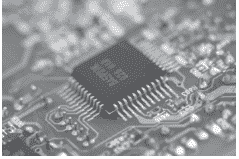

微处理器

前10项成就中有几项与太空探索有关。**登月**可能是有史以来尝试过的最复杂、最雄心勃勃的工程项目。阿波罗飞船、月球登陆舱和三级土星五号火箭的设计都需要重大突破。连宇航服的设计也是一项重大工程项目，其结果是一个包括三件式套装和背包的系统，两者总重190磅。计算机不仅在各种系统的设计中发挥了关键作用，而且在单次月球飞行所需的通信中也发挥了关键作用。单次飞行需要协调发射控制中心的450多人，以及九艘船、54架飞机和地球各地站点上的7000多人。


登月

### 应用卫星

太空计划也为**应用卫星**的发展提供了很大推动力，这些卫星用于提供天气信息、中继通信信号、绘制未勘测地形图，并提供大气成分的环境更新。全球定位系统（GPS）是由24颗卫星组成的星座，向全球广播位置、速度和时间信息。GPS接收机测量信号从GPS卫星传输到接收机所需的时间。使用从四颗卫星接收到的信息，接收机中的微处理器可以确定接收机位置的非常精确的测量值；其精度从几米到厘米不等，具体取决于所使用的计算技术。

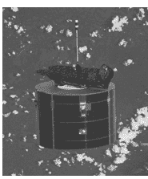

卫星

### 计算机辅助设计与制造

另一项顶级工程成就认可了**计算机辅助设计与制造**（CAD/CAM）的贡献。CAD/CAM通过提高许多类型制造过程的速度和效率，催生了一场新的工业革命。CAD允许使用计算机进行设计，然后生成最终原理图、零件清单和计算机仿真结果。CAM使用设计结果来控制机械或工业机器人来制造、组装和移动部件。

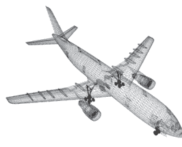

计算机辅助设计

巨型喷气客机源于1969年开始执行任务的美国空军C-5A货运飞机。巨型喷气客机的大部分成功归功于高涵道比涵道扇喷气发动机，它使它们能够以比以前的喷气发动机更少的燃料和更低的噪音飞行更远。发动机核心像纯涡喷发动机一样运行，压缩机叶片将空气吸入发动机的燃烧室。高温膨胀气体将发动机向前推进，同时带动涡轮旋转，涡轮驱动压缩机和发动机前部的大型风扇。旋转的风扇提供了发动机绝大部分的推力。


巨型喷气客机

航空工业也是第一个开发和使用先进复合材料的行业，这些材料由可以以一种方式粘合在一起的材料组成，使一种材料增强另一种材料的纤维。先进复合材料的开发旨在为飞机和航天器提供更轻、更强、更耐温的材料。复合材料现在在体育用品领域也有了新市场。例如，高山滑雪板使用编织凯夫拉纤维层来增加强度并减轻重量，石墨和环氧树脂制成的高尔夫球杆杆身比传统杆身中的钢材更强更轻。复合材料还用于人工假肢的设计。

医学、生物工程和计算机科学领域联手开发了CAT（计算机轴向断层扫描）扫描仪。这种仪器可以使用从物体周围不同角度产生的X射线生成物体的三维图像或二维切片。每条X射线从其角度测量密度，复杂的计算机算法结合所有X射线的信息来重建物体内部的清晰图像。CAT扫描常规用于识别肿瘤、血栓和脑部异常。


### 先进复合材料

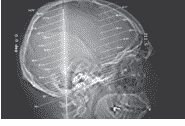

### CAT扫描

### 基因工程

**基因工程。**结合遗传学家和工程师的工作，已产生许多新产品，从胰岛素到生长激素，再到抗感染蔬菜。基因工程产品是通过将一种生物体中产生有价值物质的基因剪接到另一种会自我复制并随之复制外源基因的生物体中来生产的。第一个商业化的基因工程产品是人胰岛素，其商品名为Humulin。目前的工作正在研究使用经过基因改造的微生物来清理有毒废物并降解农药。


## 基因工程

## 激光

**激光**是频率相同、以可定向和聚焦的窄光束传播的光波。CO2 激光器用于在从陶瓷到复合材料的各种材料上钻孔。激光也用于医疗程序，以焊接脱离的视网膜、封闭渗漏的血管、汽化脑肿瘤并进行精细的内耳手术。三维图像（称为全息图）也使用激光生成。

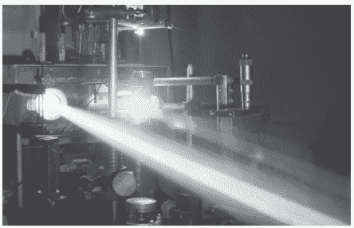

## 激光

## 光纤

光纤通信使用**光纤**，一种比人类头发还细的透明玻璃丝。这种光纤能承载的信息量比无线电波或铜质电话线中的电波更多，并且不会产生会

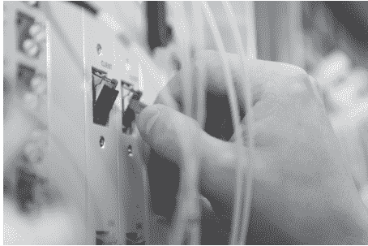

光纤

对通信线路造成干扰的电磁波。跨洋光纤电缆在大陆之间提供通信信道。光纤还用于医疗仪器，以允许外科医生将光线引入人体进行检查和激光手术。

## 改变的工程环境

二十一世纪的工程师工作在一个需要许多非技术技能和能力的环境中 [2]。尽管计算机将是大多数工程师的主要计算工具，但计算机也有助于培养额外的非技术能力。

### 沟通技能

工程师需要强大的沟通技能，既用于口头报告，也用于准备书面材料。计算机提供软件来协助撰写大纲和开发材料，例如用于演示和技术报告的图表。本章末尾的问题包括书面和口头报告，以提供这些重要技能的练习。

### 设计/工艺/制造路径

设计/工艺/制造路径，即从概念到产品实现想法的过程，是工程师必须亲自了解的路径。计算机用于该过程的每个步骤，从设计分析、机器控制、机器人装配、质量保证到市场分析。文本中的几个问题与这些主题相关。例如，在第 4 章中，开发程序来模拟使用多个组件的系统的可靠性。

### 跨学科团队

未来的工程团队将是跨学科团队，就像当今的工程团队是跨学科团队一样。对过去 25 年中前 10 项工程成就的讨论清楚地表明了这些成就的跨学科性质。学习在团队中互动并为有效的团队沟通开发组织结构对工程师很重要。开始培养工程团队技能的好方法是组织团队来准备考试。为团队成员分配特定主题；然后让他们为团队审查这些主题，并附带示例和潜在的测试问题。

工程师需要了解世界市场。这涉及了解不同的文化、政治制度和商业环境。这些主题和外语的课程有助于提供一些理解，但具有国际经验的交换项目在培养更广阔的世界理解方面提供了宝贵的知识。

工程师是问题解决者，但问题并不总是被仔细制定。工程师必须能够从问题讨论中提取问题陈述，然后确定重要问题。这不仅涉及发展秩序，还涉及学习关联混乱。这不仅意味着分析数据，还意味着使用许多信息片段综合解决方案。想法的整合可以像将问题分解为可管理的片段一样重要。问题解决方案可能不仅涉及对问题的抽象思考，还涉及从问题环境中进行实验学习。

问题解决方案也必须在其社会背景下加以考虑。在考虑的问题的替代解决方案中，应解决环境问题。工程师在提供测试结果、质量验证和设计限制时，也必须意识到伦理问题。伦理问题从来都不容易解决，一些令人兴奋的新技术成就也将带来更多伦理问题。例如，基因组图谱绘制可能会带来伦理、法律和社会影响。允许医生对抗糖尿病的基因治疗是否也应用于增强运动能力？准父母是否应该获得关于未出生儿童的身体和心理特征的详细信息？个人对其遗传代码应拥有何种隐私？任何技术进步都会产生非常复杂的问题，因为那些能做大量好事的能力，也常常可以以有害的方式应用。

本文中呈现的材料只是建立工程师所需的知识、信心和理解的一个步骤。我们首先介绍工程师可用的各种计算机系统，并介绍一种问题解决方法，该方法将在本文中贯穿始终，我们将使用 C 语言来解决工程问题。

## 1.2 计算机系统：硬件和软件

在开始讨论 C 语言之前，简要讨论计算是有用的，尤其是对于那些没有太多计算机经验的人。计算机是一种设计用于执行由一组称为程序的指令指定的操作的机器。计算机硬件是指计算机设备，例如笔记本电脑、拇指驱动器、键盘、平面显示器或打印机。计算机软件是指描述我们希望计算机执行的步骤的程序。这可以是我们编写的软件，也可以是我们下载或购买的程序，例如计算机游戏。我们的计算机硬件/软件可以是自包含的，如笔记本电脑。计算机还可以通过计算机网络以及通过访问互联网来访问硬件和软件。事实上，云计算通过远程网络提供对硬件、软件和大型数据集的访问。

### 计算机硬件

所有计算机都有如图 1.1 所示的共同内部组织。处理器是控制计算机所有其他部分的部分。它接受输入值（来自键盘或数据文件等设备）并将其存储在内存中。它还解释计算机程序中的指令

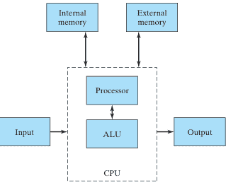

### 图 1.1 计算机的内部组织。

- 算术逻辑单元 (ALU)
- 内存
- 中央处理单元
- 微处理器
- 硬拷贝
- 电子拷贝
- 软拷贝
- 智能手机

如果我们想要相加两个值，处理器将从内存中检索值并将其发送到算术逻辑单元 (ALU)。ALU 执行加法，然后处理器将结果存储在内存中。处理单元和 ALU 共同使用由只读存储器 (ROM) 和随机存取存储器 (RAM) 组成的内部内存；数据也可以存储在外部存储设备中，例如外部驱动器或拇指驱动器。处理器和 ALU 合称为中央处理单元 (CPU)。微处理器是包含在单个集成电路芯片中的 CPU，该芯片在远小于邮票的区域内包含数百万个组件。

如今许多廉价打印机使用喷墨技术打印彩色副本和黑白副本。我们还可以将信息存储在各种数字存储设备中，包括 CD 和 DVD。打印的信息副本称为硬拷贝，数字信息副本称为电子拷贝或软拷贝。如今许多打印机还可以执行其他功能，例如复印、传真和扫描。

计算机有各种尺寸、形状和形式。事实上，我们今天的大多数手机都包含 CPU 并存储可以执行的程序。智能手机还包含图形处理单元、大量 RAM，并且正在趋向于多核（或多处理器）、低功耗 CPU。今天许多家庭都有个人计算机，用于各种应用，包括电子邮件、财务预算和游戏；这些计算机通常是带有独立显示器和键盘的台式计算机。笔记本电脑将所有硬件都集成在小占地面积中，因此非常方便。对一些人来说，平板电脑（如 iPad）和智能手机甚至正在取代台式机和笔记本电脑的使用。

### 计算机软件

计算机软件包含我们希望计算机执行的指令或命令。有几个重要的软件类别，包括操作系统、软件工具、桌面应用程序和语言编译器。图 1.2 说明了这些软件类别与计算机硬件之间的交互。我们现在更详细地讨论每个软件类别。


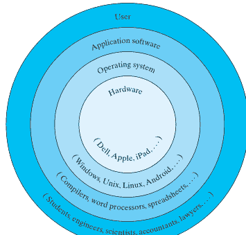

图 1.2 计算机的软件界面。

### 操作系统

一些软件，例如操作系统，通常在购买计算机硬件时随附。 **操作系统** 在你（用户）和硬件之间提供一个接口，通过提供一个方便且高效的接口，你可以在其中选择和执行系统上的软件应用程序。操作系统中管理硬件与软件应用程序之间接口的组件称为 **内核**。桌面操作系统的示例包括 Windows、Mac OS、Unix 和 Linux。智能手机的操作系统包括 Android（Linux 的一个变体）和 iOS（Unix 的一个变体）。操作系统还包含一组称为 **实用程序** 的程序，允许你执行诸如打印文件、将文件从一个文件夹复制到另一个文件夹以及列出文件夹中的文件等功能。当今大多数操作系统通过图标和菜单简化了这些实用程序的使用。

### 软件工具

软件工具是为执行常见操作而编写的程序。例如，诸如 Microsoft Word 之类的 **文字处理器** 是允许你输入和格式化文本的程序。它们允许你将互联网上的信息下载到文件中，并允许你输入数学方程式。它们还可以检查你的语法和拼写。大多数文字处理器允许你生成包含图形、包含图像且可以双栏打印的文档。这些功能允许你从笔记本电脑执行 **桌面出版**。诸如 Microsoft Excel 之类的 **电子表格程序** 是软件工具，允许你轻松处理可以以行和列网格形式显示的数据。电子表格最初是为财务和会计应用而开发的，但许多科学和工程问题也可以使用电子表格轻松解决。大多数电子表格软件包包含绘图功能，因此它们在分析和以图表显示信息方面特别有用。 **数据库管理工具** 允许你分析并从大型数据集中“挖掘”信息。

- 数据库管理工具
- 数学计算工具

软件工具的另一个重要类别是 **数学计算工具**。此类别包括 MATLAB、Mathematica 和 Maple。这些工具不仅拥有非常强大的数学命令，还是提供广泛图表生成功能的图形工具。计算能力与可视化能力的这种结合使它们成为工程师特别有用的工具。

如果可以使用软件工具解决工程问题，那么使用软件工具通常比用计算机语言编写程序更高效。软件工具与计算机语言之间的区别变得不那么清晰，因为一些功能更强大的软件工具除了具有专用操作外，还包含自己的语言。（事实上，许多人会将 MATLAB 称为一种编程语言。）

- 机器语言
- 二进制
- 位

### 计算机语言

计算机语言可以按代际来描述。第一代计算机语言（1GL）是机器语言。 **机器语言** 与计算机硬件设计紧密相关，通常由由 0 和 1 组成的 **二进制** 字符串编写（也称为 **位**）。因此，机器语言也称为二进制语言。

### 汇编语言

汇编语言也特定于特定的计算机设计，但其指令是用符号语句而不是二进制编写的。汇编语言通常没有许多语句；因此，用汇编语言编写程序可能很乏味。此外，使用汇编语言还必须拥有与特定硬件相关的信息。包含微处理器的仪器通常要求程序运行非常快；因此，这些程序称为 **实时程序**。这些实时程序通常用汇编语言编写，以利用特定的计算机硬件来更快地执行步骤。汇编语言是第二代语言（2GL）。

### 实时程序

### 高级语言

**高级语言**，或第三代语言（3GL），使用类似英语的命令。这些语言包括 C、C++、C# 和 Java。用高级语言编写程序当然比用机器语言或汇编语言编写程序更容易。但是，高级语言包含大量命令以及用于使用这些命令的广泛 **语法**（或语法）规则集。

C 是一种通用语言，它从两种语言 BCPL 和 B 演变而来，这两种语言在20世纪60年代末在贝尔实验室开发。1972年，Dennis Ritchie 在贝尔实验室开发并实现了第一个 C 编译器。该语言因与硬件无关而成为系统开发中非常流行的语言。由于其在工业界和学术界的流行，显然需要为其制定一个标准定义。美国国家标准学会（ANSI）的一个委员会于1983年成立，以提供 C 的与机器无关且无歧义的定义。1989年，**ANSI C** 标准获批；该语言在本文中有所描述。

### ANSI C

AT&T 贝尔实验室的 Bjarne Stroustrup 在20世纪80年代初开发了 C++。虽然 C++ 是 C 的超集，但由于其扩展的面向对象特性，它实际上应被视为一种新语言。Java 是一种纯面向对象语言，由于其易用性，特别适用于开发基于互联网的应用程序以及通过网络通信的设备。

C 仍然是许多工程师和科学家的首选语言，因为它拥有强大的命令和数据结构，并且可以轻松用于操作系统操作。一旦你学会了 C，转向 C++ 和 Java 就容易得多。因此，我们的目标是通过使用大量实际的现实世界示例来涵盖该语言的最重要特性，在 C 语言中建立坚实的基础。

为了结束我们对不同代际语言的讨论，第四代语言（4GL）倾向于类似于人类语言（或自然语言），并且通常是领域特定的，例如在数据库开发中。第五代语言（5GL）围绕约束而不是算法设计，主要存在于人工智能（AI）研究中。

- 编译器
- 错误
- 编译器错误
- 调试
- 源程序
- 目标程序
- 执行
- 逻辑错误

**执行计算机程序。** 用 C 之类的高级语言编写的程序必须在计算机执行指令之前翻译成机器语言。使用一种称为编译器的特殊程序来执行此翻译。因此，为了编写和执行 C 程序，我们必须有一个 C 编译器。C 编译器作为单独的软件包提供，用于特定的操作系统。如果编译器在编译过程中检测到任何错误（通常称为 bug），将打印相应的错误消息。我们必须更正程序语句，然后再次执行编译步骤。此阶段识别的错误称为编译器错误或编译时错误。例如，如果我们想将名为 sum 的变量中存储的值除以 3，C 中的正确表达式是 sum/3；如果我们错误地使用反斜杠编写表达式，如 sum\3，我们将得到一个编译器错误。编译、更正语句（或调试）和重新编译的过程通常会重复多次，直到程序在没有编译器错误的情况下编译通过。当没有编译器错误时，编译器会生成一个机器语言程序，该程序执行原始 C 程序指定的步骤。原始 C 程序称为源程序，机器语言版本称为目标程序。因此，源程序和目标程序指定相同的步骤；但是，源程序用高级语言编写，而目标程序以机器语言指定。一旦程序正确编译，还需要额外的步骤来准备目标程序以执行。此准备工作涉及将其他机器语言语句链接到目标程序，然后将程序加载到内存中。经过此链接/加载后，程序步骤由计算机执行。此阶段可能会识别出称为执行错误、运行时错误或逻辑错误的新错误；它们也称为程序错误。执行错误通常会导致程序终止。例如，程序语句可能尝试执行除以零的操作，这会生成一个执行错误。有些执行错误不会停止程序执行，但会导致计算出错误的结果。这些类型的错误可能由程序员在确定解决方案的正确步骤时出现的错误以及程序处理的数据中的错误引起。当由于程序语句中的错误而发生执行错误时，我们必须更正源程序中的错误，然后再次从编译步骤开始。即使程序看起来执行正常，我们也必须仔细检查答案，以确保它们是正确的。计算机将精确按照我们指定的步骤执行，如果我们指定了错误的步骤，计算机将执行这些错误（但在语法上合法）的步骤，从而向我们展示一个错误的答案。


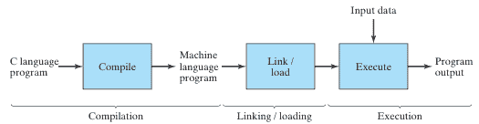

图 1.3 程序编译/链接/执行。

**汇编器** 编译、链接/加载和执行的过程如图 1.3 所示。将汇编语言程序转换为二进制的过程由汇编器程序执行，相应的过程为汇编、链接/加载和执行。

**软件生命周期。** 计算机解决问题的成本可以从硬件成本和软件成本两方面来估算。当今计算机解决方案中的大部分成本在于软件成本，因此，人们对理解软件解决方案的开发给予了高度关注。

**软件生命周期** 软件项目的开发通常遵循明确的步骤或周期，这些步骤或周期统称为软件生命周期。这些步骤通常包括项目定义、详细规格说明、编码和模块测试、集成测试以及维护。（这些步骤将在后续章节中详细说明。）软件维护是软件系统成本的重要组成部分。这种维护包括为软件添加增强功能、修复软件使用过程中发现的错误，以及使软件能够与新的硬件和软件协同工作。提供维护的难易程度与解决方案的原始定义和规格说明直接相关，因为这些步骤为项目的其余部分奠定了基础。下一节中我们介绍的问题求解过程强调在开始编码或测试之前，需要仔细定义和指定解决方案。

**软件原型** 一种在时间和成本上都成功降低软件开发成本的技术是开发软件原型。与其等到软件系统开发完成后再让用户使用，不如在生命周期早期开发系统的原型。该原型不具备最终软件所需的所有功能，但它允许用户在生命周期早期使用它，并对规格说明进行所需的修改。在生命周期早期进行更改既节省成本又节省时间。软件原型使用 MATLAB 等软件工具开发，然后最终系统使用另一种语言开发，这种情况并不罕见。

作为工程师，您很可能需要修改或为使用软件工具或高级语言开发的现有软件添加额外功能。如果现有软件结构良好且可读，并且伴随软件的文档是最新且编写清晰的，这些修改将简单得多。出于这些原因，我们强调培养良好的习惯，使程序更具可读性和自文档性。

## 1.3 工程问题求解方法论

问题求解是工程课程以及计算机科学、数学、物理学和化学课程的关键部分。因此，拥有一种一致的问题求解方法非常重要。如果该方法足够通用，可以应用于所有这些不同领域，那也很有帮助，这样我们就不必为数学问题学习一种技术，为物理问题学习另一种技术，等等。我们介绍的**问题求解过程**适用于工程问题，也可以定制以解决其他领域的问题；然而，它假设我们使用计算机来帮助解决问题。

我们将在本文中贯穿始终使用的问题求解过程或方法论包含五个步骤：

- 1. 清晰地陈述问题。
- 2. 描述输入和输出信息。
- 3. 对一组简单的数据手写问题（或使用计算器）。
- 4. 开发解决方案并将其转换为计算机程序。
- 5. 使用各种数据测试解决方案。

我们现在将通过计算平面上两点之间距离的示例来讨论每个步骤。

### 1. 问题陈述

第一步是清晰地陈述问题。给出清晰、简洁的问题陈述以避免任何误解至关重要。对于本示例，问题陈述如下：
计算平面上两点之间的直线距离。

### 2. 输入/输出描述

第二步是仔细描述用于解决问题的给定信息，然后确定要计算的值。这些项目代表问题的输入和输出，统称为输入/输出（I/O）。对于许多问题，显示输入和输出的图表很有用。此时，程序是一种“抽象”，因为我们没有定义确定输出的步骤；相反，我们只是显示用于计算输出的信息。本示例的**I/O 图**如下：

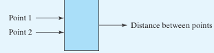

问题求解过程

I/O 图

### 3. 手算示例

第三步是使用一组简单的数据手动或使用计算器解决问题。这是一个非常重要的步骤，即使对于简单问题也不应跳过。这是您解决问题细节的步骤。如果您不能取一组简单的数字并计算输出（无论是手动还是使用计算器），那么您就无法进入下一步；您应该再次阅读问题，并可能查阅参考资料。本特定示例的手算解决方案如下：

设点 $p_1$ 和 $p_2$ 具有以下坐标：

```
$p_1 = (1, 5); p_2 = (4, 7).$
```

我们想要计算两点之间的距离，它是直角三角形的斜边，如图 1.4 所示。使用勾股定理，我们可以使用以下方程计算距离：

```
distance = \(\sqrt{(side_1)^2 + (side_2)^2}\)
\(= \sqrt{(4 - 1)^2 + (7 - 5)^2}\)
\(= \sqrt{13}\)
\(= 3.61.\)
```

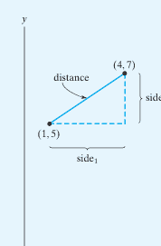

图 1.4 两点之间的直线距离。

### 4. 算法开发

### 算法

一旦您能够为一组简单的数据解决问题，您就准备好开发算法，即问题解决方案的逐步大纲。对于像本示例这样的简单问题，算法可以列为依次执行的操作。步骤大纲将问题分解为更简单的步骤，如下所示，列出了计算并打印两点之间距离所需的步骤：

### 分解大纲

- 1. 为两个点赋值。
- 2. 计算由两个点生成的直角三角形的两条边的长度。
- 3. 计算两点之间的距离，它等于三角形斜边的长度。
- 4. 打印两点之间的距离。

### 分解大纲

然后将此分解大纲转换为 C 命令，以便我们可以使用计算机执行计算。从以下解决方案中，您可以看到这些命令与手算示例中使用的步骤非常相似。这些命令的详细信息在第二章中解释。

```
/*-----------------------------------------------------*/
/* Program chapter1_1                                  */
/*                                                     */
/* This program computes the                           */
/* distance between two points.                        */
#include <stdio.h>
#include <math.h>

int main(void)
{
   /* Declare and initialize variables.  */
   double x1=1, y1=5, x2=4, y2=7;
   double side1, side2, distance;

   /* Compute sides of a right triangle.  */
   side1 = x2 - x1;
   side2 = y2 - y1;
   distance = sqrt(side1*side1 + side2*side2);

   /* Print distance.  */
   printf("The distance between the two points is "
          "%5.2f \n",distance);

   /* Exit program.  */
   return 0;
}
/*-----------------------------------------------------*/


### 5. 测试

我们解决问题过程的最后一步是测试解决方案。我们应该首先使用手算示例中的数据来测试解决方案，因为我们已经计算出了解决方案。当执行此解决方案中的 C 语句时，计算机会显示以下输出：

```
The distance between the two points is 3.61
```

此输出与我们手算计算出的值一致。如果 C 解决方案与手算解决方案不匹配，那么我们应该审查两种解决方案以找出错误。一旦解决方案对手算示例有效，我们还应该使用其他数据集进行测试，以确保解决方案对其他有效数据集也有效。

本示例中演示的步骤用于开发后续章节中“应用问题求解”部分的程序。


我们介绍了一系列杰出的近期工程成就，以展示工程应用的多样性。我们还讨论了成为一名成功工程师所需的一些非技术技能。由于大多数工程问题将由计算机解决，我们还介绍了计算机系统组件的摘要，从计算机硬件到计算机软件。我们还介绍了一种五步问题求解方法论，我们将使用它来开发解决问题的计算机方案。这五个步骤如下：

- 1. 清晰地陈述问题。
- 2. 描述输入和输出信息。
- 3. 对一组简单数据手算（或使用计算器）解决问题。
- 4. 开发算法并将其转换为计算机程序。
- 5. 使用各种数据测试解决方案。

在整个文本中，我们将在开发问题解决方案时使用此过程。

最后，我们向您介绍了本版的主题——犯罪现场调查背后的技术。

## 关键术语

| 算法 | 计算机 |
| --- | --- |
| ANSI C | 数据库管理工具 |
| 算术逻辑单元 (ALU) | 调试 |
| 汇编器 | 调试器 |
| 汇编语言 | 分解大纲 |
| 二进制 | 桌面出版 |
| 位 | 电子副本 |
| 错误 | 执行 |
| 中央处理器 (CPU) | 硬件 |
| 云计算 | 高级语言 |
| 编译器 | I/O 图 |
| 编译器错误 | 内核 |

- 链接/加载
- 逻辑错误
- 机器语言
- 内存
- 微处理器
- 网络
- 目标程序
- 操作系统
- 个人计算机 (PC)
- 问题求解过程
- 处理器
- 程序
- 实时程序
- 软件
- 软件生命周期
- 软件维护
- 软件原型
- 软件工具
- 源程序
- 电子表格
- 语法
- 实用程序
- 字处理器

## 问题

### 简答问题

### 判断题

指示以下陈述是正确 (T) 还是错误 (F)：

- 1. CPU 由 ALU、内存和处理器组成。T F
- 2. 链接/加载是为目标程序执行做准备的步骤。T F
- 3. 算法逐步描述问题的解决方案，而计算机程序一步解决问题。T F
- 4. 计算机程序是算法的实现。T F
- 5. 实用程序将 C 转换为二进制。T F
- 6. 微处理器是非常小的处理器。T F
- 7. 数据可以通过 ALU 在内部内存和外部内存之间通信。T F
- 8. 电子表格可用于以图形方式操作对象。T F
- 9. 计算机辅助设计仅用于设计微型计算机。T F
- 10. 字处理器允许我们输入和编辑文本。T F
- 11. 数学软件工具在计算和可视化方面都非常强大。T F
- 12. 要纠正逻辑错误，我们只重复执行步骤。T F
- 13. 编译步骤识别程序中的所有错误。T F
- 14. 算法给出了解决问题的步骤。T F
- 15. 计算机程序是解决问题的一组指令。T F
- 16. 如果程序对一组数据有效，则该程序已完全测试。T F
- 17. 内核是一块硬件。T F
- 18. C 是最早开发的高级语言之一。T F
- 19. 软件维护是当今软件系统成本中微不足道的一部分。T F
- 20. 用机器语言编写的程序可以表示为二进制字符串。T F

### 选择题

圈出完成每个陈述的最佳答案的字母：

- 21. 指令和数据存储在
- (a) 算术逻辑单元 (ALU)。
- (b) 控制单元 (处理器)。
- (c) 中央处理器 (CPU)。
- (d) 内存。
- (e) 键盘。

- 22. 操作系统是
- (a) 由用户设计的软件。
- (b) 用户与硬件之间方便高效的接口。
- (c) 允许我们执行常见操作的实用程序集合。
- (d) 一组软件工具。

- 23. 源代码是
- (a) 编译器操作的结果。
- (b) 从处理器获取信息的过程。
- (c) 用计算机语言编写的解决特定问题的一组指令。
- (d) 存储在计算机内存中的数据。
- (e) 通过键盘输入的值。

- 24. 目标代码是
- (a) 编译器对源代码进行操作的结果。
- (b) 从处理器获取信息的过程。
- (c) 一个计算机程序。
- (d) 涉及列出解决特定问题所需命令的过程。
- (e) 链接/加载过程的结果。

- 25. 算法是指
- (a) 解决特定问题的逐步解决方案。
- (b) 计算机可以理解的一组指令。
- (c) 允许我们输入文本材料的代码。
- (d) 逐步细化。
- (e) 一组用于推导问题解决方案的数学方程。

- 26. 硬拷贝是
- (a) 存储在硬盘上的信息。
- (b) 打印在纸上的信息。
- (c) 显示在屏幕上的信息。
- (d) 一个计算机程序。
- (e) 以上全部。

- 27. 计算机硬件包括
- (a) 键盘。
- (b) 打印机。
- (c) 磁盘驱动器。
- (d) 终端屏幕。
- (e) 以上全部。

- 28. 软件示例是
- (a) 打印机。
- (b) 屏幕。
- (c) 计算机代码。
- (d) 以上全部。
- (e) 高级语言。

- 29. 高级语言是
- (a) 适合实时编程。
- (b) 第二代计算机语言。
- (c) 称为自然语言。
- (d) 用类似英语的单词编写。

- 30. 源程序和目标程序之间的区别是
- (a) 源程序可能包含一些错误，而目标程序不包含任何错误。
- (b) 源程序是原始代码，而目标程序是修改后的代码。
- (c) 源程序以高级语言指定，而目标程序以机器语言指定。
- (d) 目标程序也是源程序。
- (e) 源程序可以执行，而目标程序不能执行。

- 31. 解决问题时的起点是
- (a) 开发算法。
- (b) 编写程序。
- (c) 编译源程序。
- (d) 链接到目标程序。

- 32. 手算示例是指
- (a) 用手做算术。
- (b) 使用一组简单数据详细计算问题的解决方案。
- (c) 列出问题解决方案的大纲。
- (d) 展开解决方案的大纲。
- (e) 使用计算器逐步测试算法。

- 33. 计算机程序是
- (a) 包含输入和输出设备的组件集合。
- (b) 解决问题所需的一组指令列表。
- (c) 一组由计算机执行并以计算机可以理解的语言编写的指令。
- (d) 解决问题的逐步过程。
- (e) 将问题分解为更简单步骤的大纲。

### 匹配题

从以下列表中为每个定义选择正确的术语：

| 算法 | 语法 |
| --- | --- |
| ANSI C | 硬件 |
| 算术逻辑单元 (ALU) | 输入设备 |
| 中央处理器 (CPU) | 逻辑错误 |
| 云计算 | 机器语言 |
| 编译 | 内存 |
| 调试 | 微处理器 |


- 自然语言
- 网络
- 操作系统
- 输出设备
- 程序
- 软件生命周期
- 软件维护
- 电子表格
- 语法
- 系统软件
- 文字处理器

- 34. 一组告诉计算机该做什么的指令
- 35. 计算机的一部分机械装置
- 36. 计算机的大脑
- 37. 用于显示程序结果的设备
- 38. 编译器和其他帮助运行计算机的程序
- 39. 解决问题的步骤
- 40. 将C程序转换为机器语言的过程
- 41. 一种专为处理存储在网格或表格中的数据而设计的软件工具
- 42. 定义程序中可使用的标点和单词的规则
- 43. 用户与硬件之间的接口
- 44. 计算机中执行数学计算的部分
- 45. 从程序中删除错误的过程
- 46. 程序执行期间发现的错误
- 47. 美国国家标准学会批准的C语言特定定义
- 48. 包含在单个集成电路芯片中的中央处理器
- 49. 远程访问大量信息的技术
- 50. 程序的二进制表示

## 附加问题

以下问题结合了一项作业，让你深入了解本章中的某个主题，并提供提升书面沟通技巧的机会。（也许你的教授甚至会选取一些书面报告在课堂上进行口头报告。）每份报告应至少包含两个参考文献。使用文字处理器软件准备你的报告。如果你还不懂如何使用文字处理器，请向教授寻求指导，了解如何查找手册或研讨会，以学习使用你大学计算机系统上可用的文字处理器之一。

- 51. 写一篇关于以下杰出工程成就之一的简短报告：
  - 月球登陆
  - 微处理器
  - CAT扫描
  - 大型喷气客机
  - 光纤
  - 应用卫星
  - CAD/CAM
  - 复合材料
  - 激光器
  - 基因工程产品

- 52. 写一篇简短报告，讨论你认为与这十项杰出工程成就之一相关的伦理问题。提出该问题可能被看待的几种潜在方式。

# 第二章


## 犯罪现场调查：法医人类学

法医人类学是一门结合物理和生物人类学知识与身份及死亡情况调查的研究领域。法医人类学家通常处理骨骼遗骸，但也可能处理分解、烧毁或部分遗骸。他们的工作可能基于单根骨头，也可能涉及来自飞机失事、爆炸或自然灾害造成的大规模伤亡事件中的许多骨骼。例如，世界贸易中心恐怖袭击造成2,016人死亡；仅找到289具完整遗体。另一起大规模伤亡事件是由2011年乔普林龙卷风造成，该龙卷风穿过密苏里州乔普林时宽度超过一英里，造成162人死亡。法医人类学家通常与法医牙科专家（牙科专家）、放射学家、指纹专家和执法人员合作，以识别遗骸并提供与死亡情况相关的线索。本章后面，我们将讨论特定骨骼长度与个人身高之间的关系。然后，我们将开发一个C程序，根据股骨（髋关节和膝关节之间的腿骨）和肱骨（连接肩部和肘部的骨骼）的长度来估计人的身高。

## 简单C程序

### 本章大纲

- 2.1 程序结构
- 2.2 常量和变量
- 2.3 赋值语句
- 2.4 标准输入和输出
- 2.5 问题求解应用：根据骨骼长度估计身高
- 2.6 数值技术：线性插值
- 2.7 问题求解应用：海水冰点
- 2.8 数学函数
- 2.9 字符函数
- 2.10 问题求解应用：速度计算
- 2.11 系统局限性
- 摘要、关键术语、C语句摘要、风格说明、调试说明、习题

### 学习目标

在本章中，我们开发包含以下内容的问题解决方案：

- 简单的算术计算，
- 从键盘获取的用户提供的信息，
- 在屏幕上打印的信息，以及
- 线性插值技术。

## 2.1 程序结构

在本节中，我们分析特定C程序的结构，然后介绍C程序的一般结构。下面的程序最初在第1章中介绍；它计算并打印两点之间的距离。

```
/* -------------------------------------------------- */
/* Program chapter1_1 */
/*                                                    */
/* This program computes the                          */
/* distance between two points.                       */
/*                                                    */
#include <stdio.h>
#include <math.h>

int main(void)
{
/* Declare and initialize variables. */
double x1=1, y1=5, x2=4, y2=7,
       side_1, side_2, distance;
/* Compute sides of a right triangle. */
side_1 = x2 - x1;
side_2 = y2 - y1;
distance = sqrt(side_1*side_1 + side_2*side_2);
/* Print distance. */
printf("The distance between the two points is "
       "%.2f \n",distance);
/* Exit program. */
return 0;
}
/*____________________________________*/
```

我们现在简要讨论此特定示例中的语句；每个语句将在本章后面的章节中详细讨论。

此程序的前五行包含**注释**，用于为程序命名（chapter1_1）并记录其目的：

```
/*
/* Program chapter1_1
/*
/* This program computes the
/* distance between two points.
/*
```

注释以字符/*开始，以字符*/结束。注释可以独占一行，也可以与命令在同一行；注释还可以跨越多行。这些注释行中的每一行都是单独的注释，因为每行都以/*开始并以*/结束。虽然注释是可选的，但良好的风格要求在整个程序中使用注释，以提高其可读性并记录计算过程。在本教材的程序中，我们始终使用初始注释为程序命名并描述程序的一般用途；程序中还包含其他解释性注释。ANSI C允许注释和语句在行中的任何位置开始；我们将程序的初始注释放在第一列。

**预处理器指令**提供在程序编译前执行的指令。最常见的指令在程序中插入其他语句；它包含语句#include，后跟包含其他语句的文件名。此程序包含以下两个预处理器指令：

```
#include <stdio.h>
#include <math.h>
```

这些指令指定，在程序编译前，应将文件stdio.h和math.h中的语句包含在替换这两条语句的位置。文件名周围的<和>字符表示这些文件与**标准C库**一起包含；该库包含在随ANSI C编译器提供的文件中。stdio.h文件包含与此程序中使用的输出语句相关的信息，math.h文件包含与此程序中用于计算值平方根的函数相关的信息。这些文件名上的.h扩展名指定它们是头文件；有关头文件的更多信息将在本章后面和第4章中介绍。预处理器指令通常包含在描述程序目的的初始注释之后。

每个C程序都包含一组称为主函数的语句。关键字int表示该函数向操作系统返回一个整数值。关键字void表示该函数不从操作系统接收任何信息。函数体由大括号{ }括起来。为了轻松识别函数体，我们将这些大括号单独放在行上。因此，预处理器指令后的两行指定主函数的开始：

```
int main(void)
{
```

主函数包含两种类型的命令：声明和语句。声明定义语句将使用的内存位置，因此必须位于语句之前。声明可以赋予初始值以存储在内存位置中，也可以不赋予。此程序中，一条注释位于声明语句之前：

```
/* Declare and initialize variables. */
double x1=1, y1=5, x2=4, y2=7,
side_1, side_2, distance;
```

这些声明指定程序将使用名为x1、y1、x2、y2、side_1、side_2和distance的七个变量。术语double表示变量将存储双精度浮点值；这些变量可以存储诸如12.5和-0.0005的值，具有多位精度。此外，此语句指定x1应初始化（赋予初始值）为值1，y1应初始化为值5，x2应初始化为值4，y2应初始化为值7。side_1、side_2和distance的初始值未指定，不应假设它们初始化为零。由于声明太长无法放在一行上，我们将其分成两行；第二行的缩进表示它是上一行的延续。缩进是风格和可读性的问题。这不是必需的。

声明
初始值


示例程序中指定要执行的操作的语句如下：

语句

```
/* Compute sides of a right triangle. */
side_1 = x2 - x1;
side_2 = y2 - y1;
distance = sqrt(side_1*side_1 + side_2*side_2);
```

```
/* Print distance. */
printf("The distance between the two points is "
"%.2f \n", distance);
```

这些语句计算由两点形成的直角三角形的两条直角边的长度（参见图1.4），然后计算直角三角形斜边的长度。这些语句的语法细节将在本章后面讨论。计算距离后，使用printf语句将其打印。此输出语句太长，无法放在一行上，因此我们将语句分成两行；第二行的缩进再次表示它是上一行的延续。还使用了其他注释来解释计算和输出语句。另外，请注意，声明和语句都必须以分号结尾。


要结束程序的执行并将控制权返回给操作系统，我们使用 return 0; 语句：

```
/* Exit program. */
return 0;
```

该语句向操作系统返回值 0。值为零表示执行成功结束。

main 函数的主体随后以独占一行的右花括号以及另一行注释来标记 main 函数的结束：

```
/*--------------------------------------*/
```


请注意，我们在程序中还包含了空行（也称为空白字符），以分隔不同的组件。这些空行使程序更易读、更易于修改。main 函数中的声明和语句已缩进，以显示程序的结构。这种间距提供了一致的风格，并使我们的程序更易于阅读。

现在我们已仔细审查了第 1 章中的 C 程序，可以将其结构与 C 程序的一般形式进行比较：

```
preprocessing directives
int main(void)
{
 declarations;
 statements;
}
```

这种结构在本章及后续章节开发的程序中很明显。

## 修改！

- 1. 创建一个包含本节讨论的示例程序的文件。使用 C 编译器自带的编辑器或文字处理器。* 然后编译并运行该程序。你应得到以下输出：The distance between the two points is 3.61
- 2. 将给定的两点坐标更改为 (–1, 6) 和 (2, 4)。使用这些新值运行程序。距离发生了变化吗？请解释。
- 3. 将给定的两点坐标更改为 (1, 0) 和 (5, 7)。使用计算器检查程序的答案。
- 4. 将给定的两点坐标更改为 (2, 4) 和 (2, 4)。程序给出的答案是否正确？

*如果你使用文字处理器生成文件，请确保将其另存为文本文件。

## 2.2 常量和变量

常量和变量表示我们在程序中使用的值。**常量**是特定值，例如 2、3.1416、-1.5、'a' 或 "hello"，我们将其包含在 C 语句中；**变量**是分配了名称或**标识符**的内存位置。标识符用于引用存储在内存位置中的值。内存位置及其对应标识符的一个有用类比是与个人姓名关联的邮箱；内存位置（或邮箱）随后包含一个值。以下图表显示了程序 Chapter1_1 中以下声明语句后的变量、其标识符及其初始值：

```
double x1=1, y1=5, x2=4, y2=7,
side_1, side_2, distance;
```

| x1 | 1 | y1 | 5 | x2 | 4 |
|---|---|---|---|---|---|
| y2 | 7 | side_1 | ? | side_2 | ? |
| distance | ? | | | | |

未赋予初始值的变量的值未指定，因此用问号表示；这些值有时被称为**垃圾值**，因为它们是前一个程序中的值。显示变量及其标识符和值的图表称为**内存快照**，因为它显示了程序执行过程中特定点内存位置的内容。前面的内存快照显示了声明语句指定的变量及其内容。我们经常使用内存快照来显示语句执行前后变量的内容，以展示其效果。

选择有效标识符的规则如下：

- 标识符必须以字母字符或下划线字符 (_) 开头；
- 标识符中的字母字符可以是小写或大写字母；
- 标识符可以包含数字，但不能作为第一个字符；且
- 标识符可以是任意长度，但标识符的前 31 个字符必须唯一。

C 语言**区分大小写**，因此大写字母与小写字母不同；因此，Total、TOTAL 和 total 代表三个不同的变量。另外，请注意，变量 distance_in_miles_from_earth_to_mars 将不会与 distance_in_miles_from_earth_to_venus 区分开来，因为它们的前 31 个字符相同。C 还包括对 C 编译器具有特殊含义且不能用作标识符的**关键字**；关键字的完整列表在表 2.1 中给出。

有效标识符的示例包括 distance、x1_x_1、average_measurement 和 initial_time。无效标识符的示例包括 1x（以数字开头）、switch（是关键字）、$sum（包含无效字符 $）和 rate%（包含无效字符 %）。

| auto | double | int | struct |
| :--- | :--- | :--- | :--- |
| break | else | long | switch |
| case | enum | register | typedef |
| char | extern | return | union |
| const | float | short | unsigned |
| continue | for | signed | void |
| default | goto | sizeof | volatile |
| do | if | static | while |

应仔细选择标识符名称，以便它反映变量的内容。如果可能，名称还应指示测量单位。例如，如果变量表示华氏度的温度测量值，请使用 Temp_F 或 degrees_F 之类的标识符。如果变量表示角度，请将其命名为 theta_ad_rad 以指示角度以弧度测量，或 theta_deg 以指示角度以度数测量。

main 函数开头（以及我们编写的其他 C 函数开头）的声明不仅必须包括我们计划在程序中使用的所有变量的标识符，还必须指定将存储在变量中的值的类型。这些数据类型将在讨论科学计数法后介绍。

## 实践！

确定以下哪些名称是有效标识符。如果名称不是有效标识符，请说明不可接受的原因，并建议一个有效的替代名称。

- 1. density
- 2. area
- 3. Time
- 4. xsum
- 5. x_sum
- 6. tax-rate
- 7. perimeter
- 8. sec&2
- 9. degrees_C
- 10. break
- 11. #123
- 12. x&y
- 13. count
- 14. void
- 15. f(x)
- 16. f2
- 17. Final_Value
- 18. w1.1
- 19. reference1
- 20. reference_1
- 21. m/s

## 科学计数法

### 浮点科学计数法

### 指数记法

浮点值是可以表示整数和非整数值的值，例如 2.5、-0.004 和 15.0。以科学计数法表示的浮点值重写为尾数乘以 10 的幂，其中尾数的绝对值大于或等于 1.0 且小于 10.0。例如，在科学计数法中，25.6 写作 2.56 x 10^1，-0.004 写作 -4.0 x 10^-2，1.5 写作 1.5 x 10^0。在指数记法中，字母 e 用于分隔尾数和 10 的幂的指数。因此，在指数记法中，25.6 写作 2.56e1，-0.004 写作 -4.0e-3，1.5 写作 1.5e0。

计算机允许用于尾数小数部分的位数决定精度，允许用于指数的位数决定范围。因此，精度为两位且指数范围为 -8 到 7 的值可能包括 2.33 × 10^5（233,000）和 5.92 × 10^-8（0.0000000592）之类的值。这种精度和指数范围对于我们在工程问题求解中使用的许多类型的值来说是不够的。例如，从火星到太阳的距离为 141,517,510 英里或 1.4151751 × 10^8；要表示此值，我们需要至少七位精度以及包含整数 8 的指数范围。

## 实践！

- 在第 1 至 6 题中，用科学计数法表示数值。
- 1. 35.004
- 2. 0.00042
- 3. -50.000
- 4. 3.15723
- 5. -0.0999
- 6. 10,000,002.8

- 在第 7 至 12 题中，用浮点记法表示数值。
- 7. 1.03e-5
- 8. -1.05e5
- 9. -3.552e6
- 10. 6.67e-4
- 11. 9.0e-2
- 12. -2.2e-2

## 数值数据类型

数值数据类型用于指定变量中将包含的数字类型。在 C 语言中，数值要么是整数，要么是浮点值。以下图表显示了接下来几个段落中讨论的数值数据类型：

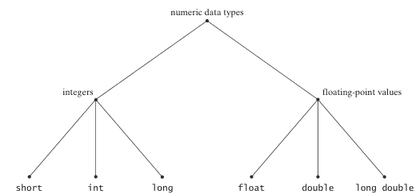


## 类型说明符

### 系统相关

有符号整数的类型说明符为 short、int 和 long，分别对应短整型、整型和长整型。具体的取值范围取决于系统，这意味着范围可能因系统而异。在本章的最后一节，我们将介绍一个程序，你可以使用它来确定系统中数值数据类型的取值范围。在许多系统中，短整型和整型数据类型的范围为 -32,768 到 32,767，而长整型通常表示 -2,147,483,648 到 2,147,483,647 的值。（32,767 和 2,147,483,647 等不寻常的限制与二进制值转换为十进制值有关。）C 还允许将无符号限定符添加到整数说明符中，其中无符号整数仅表示正值。有符号和无符号整数可以表示相同数量的值，但范围不同。例如，如果无符号短整型的取值范围为 0 到 65,535，则短整型的取值范围为 -32,768 到 32,767；两个变量都可以表示总共 65,536 个值。

浮点值的类型说明符为 float（单精度）、double（双精度）和 long double（扩展精度）。程序 chapter1_1 中的以下语句定义了七个变量，它们都包含双精度浮点值：

```
double x1=1, y1=5, x2=4, y2=7,
side_1, side_2, distance;
```

float、double 和 long double 类型之间的区别在于所表示值的精度（或准确性）和范围。精度和范围取决于系统。表 2.2 包含 Microsoft Visual C++ 编译器用于整数和浮点值的精度和范围信息，该编译器可用于运行 C 程序以及 C++ 程序。（C++ 是 C 的扩展。）第 2.10 节中给出的一个程序允许你为计算机系统获取此信息。在大多数系统中，double 数据类型存储的十进制数字精度大约是 float 数据类型的两倍。

表 2.2 示例数据类型限制*

| | 整数 |
|---|---|
| short | 最大值 = 32,767 |
| int | 最大值 = 2,147,483,647 |
| long | 最大值 = 2,147,483,647 |
| | 浮点数 |
| float | 6 位精度<br>最大指数 38<br>最大值 3.402823e+38 |
| double | 15 位精度<br>最大指数 308<br>最大值 1.797693e+308 |
| long double | 15 位精度<br>最大指数 308<br>最大值 1.797693e+308 |

*Microsoft Visual C++ 2010 Express 编译器。

此外，double 值的指数值范围比 float 值更宽。long double 值可能具有更高的精度和更宽的指数范围，但这同样取决于系统。浮点常量（如 2.3）默认被视为 double 常量。要指定 float 常量或 long double 常量，必须在常量后附加字母（或后缀）F 或 L。因此，2.3F 和 2.3L 分别表示 float 常量和 long double 常量。

## 字符数据

- 字符
- 二进制代码
- ASCII
- EBCDIC

字符数据是工程编程问题中需要表示和操作的重要信息类型。为了处理字符，我们需要更多地了解它们在计算机内存中的表示。回顾一下，计算机中存储的所有信息在内部都表示为二进制数字（0 和 1）的序列。每个字符都对应一个二进制代码值。最常用的二进制代码是 ASCII（美国信息交换标准代码）和 EBCDIC（扩展二进制编码十进制交换代码）。在以下讨论中，我们假设使用 ASCII 代码来表示字符。表 2.3 包含一些字符、它们在 ASCII 中的二进制形式以及与二进制值对应的整数值。字符 'a' 由二进制值 1100001 表示，相当于整数值 97。ASCII 代码总共可以表示 128 个字符。完整的 ASCII 代码表在附录 B 中给出。

字符数据可以由常量或变量表示。字符常量用单引号括起来，例如 'A'、'b' 和 '3'。将要包含字符的变量定义为整数或字符数据类型。字符的类型说明符是 char。

一旦字符作为二进制值存储在内存中，该二进制值就可以被解释为字符或整数。因此，当我们定义用于存储字符的变量时，可以将其定义为字符变量以存储 ASCII 值，或定义为整数变量以存储整数等效值。但是，需要注意的是，字符数字的二进制 ASCII 表示不等于整数数字的二进制表示。从表 2.3 中可以看到，字符数字 3 的 ASCII 二进制表示为 0110011，相当于整数值 51 的二进制表示。因此，使用数字的字符表示进行计算所得的结果，与使用数字的整数表示进行计算所得的结果不相同。以下程序说明了字符数据的用法。程序的详细内容将在本章后面讨论。


## 表 2.3 ASCII 代码示例

| 字符 | ASCII 代码 | 整数等效值 |
|---|---|---|
| 换行符，\n | 0001010 | 10 |
| % | 0100101 | 37 |
| 3 | 0110011 | 51 |
| A | 1000001 | 65 |
| a | 1100001 | 97 |
| b | 1100010 | 98 |
| c | 1100011 | 99 |

```
/*
 * Program chapter2_1
 *
 *
 * This program prints two values
 * as characters and integers.
 */
#include <stdio.h>

int main(void)
{
    /* Declare and initialize variables. */
    char ch='a';
    int i=97;

    /* Print both values as characters. */
    printf("value of ch: %c; value of i: %c \n",ch,i);

    /* Print both values as integers. */
    printf("value of ch: %i; value of i: %i \n",ch,i);

    /* Exit program. */
    return 0;
}
/*--------------------------------------------------*/
```

该程序的输出为

```
value of ch: a; value of i: a
value of ch: 97; value of i: 97
```

## 符号常量

符号常量是通过预处理指令定义的，该指令将标识符分配给常量。该指令可以出现在 C 程序的任何位置；编译器将用常量值替换指令之后的所有语句中出现的每个指令标识符。工程常数（如 $\pi$ 或 g（重力加速度））是符号常量的良好候选者。例如，考虑以下预处理指令，将值 3.141593 分配给变量 PI。


```
#define PI 3.141593
```

需要使用 $\pi$ 值的语句将使用符号常量标识符 PI 而不是 3.141593，如下面计算圆面积的语句所示：

```
area = PI*radius*radius;
```


符号常量通常使用大写标识符定义（如 PI 而不是 pi），以表明它们是符号常量，当然，标识符应选择易于记忆的。最后，一个指令中只能定义一个符号常量；如果需要多个符号常量，则需要单独的指令。请注意，预处理指令（包括 `#define` 语句）不以分号结尾。


在下一节中，我们将讨论允许我们向变量赋值的 C 语句。这些赋值语句可用于向变量赋常量值，但我们将在后面看到，使用符号常量通常有一些特殊优势。


## 练习！

- 1. 光速，c = 2.99792 × 10^8 m/s
- 2. 电子电荷，e = 1.602177 × 10^-19 C
- 3. 阿伏伽德罗常数，N_A = 6.022 × 10^23 mol^-1
- 4. 重力加速度，g = 9.8 m/s^2
- 5. 重力加速度，g = 32 ft/s^2
- 6. 地球质量，M_E = 5.98 × 10^24 kg
- 7. 月球半径，r = 1.74 × 10^6 m
- 8. 长度单位，Unit_Length = 'm'
- 9. 时间单位，Unit_Time = 's'

## 2.3 赋值语句

赋值语句 赋值语句用于给标识符赋值。赋值语句的一般形式如下

```
identifier = expression;
```

表达式可以是常量、另一个变量或运算结果。请考虑下面两组声明并为变量 sum、x1 和 ch 赋值的语句：

```
double sum=10.5;
int x1=3;
char ch='a';

double sum;
int x1;
char ch;
...
sum = 10.5;
x1 = 3;
ch = 'a';
```

执行任意一组语句后，sum 的值为 10.5，x1 的值为 3，ch 的值为 'a'，如下图所示的内存快照：

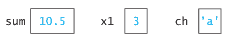

在前面的示例中，左侧的语句同时定义并初始化变量；右侧的赋值语句可在程序中的任何位置使用，因此可用于更改（而非初始化）变量中的值。

C 语言也允许多重赋值，如下面的语句所示，该语句将变量 x、y 和 z 各赋值为零：

```
x = y = z = 0;
```

多重赋值将在本节末尾进一步讨论。

我们还可以使用赋值语句将一个变量的值赋给另一个变量：

```
rate = state_tax;
```

等号应读作“被赋予……的值”；因此，该语句意为“rate 被赋予 state_tax 的值”。如果 state_tax 包含值 0.06，则执行该语句后 rate 也包含值 0.06；state_tax 中的值不变。因此，执行该语句前后的内存快照如下：

| | rate | state_tax |
| :--- | :--- | :--- |
| 执行前： | 7 | 0.06 |
| 执行后： | 0.06 | 0.06 |

如果将一个值赋给具有不同数据类型的变量，则语句执行期间必须进行转换。有时转换会导致信息丢失。例如，请考虑下面的声明和赋值语句：

```
int a;
...
a = 12.8;
```

因为 a 被定义为整数，它无法存储带有非零小数部分的值。因此，在这种情况下，执行赋值语句后的内存快照如下：

| a | 12 |
|---|---|

要确定数值转换是否能正常工作，我们使用以下顺序（从高到低）：

- 高：long double
- double
- float
- 长整型
- 整型
- 低：短整型

如果将值移动到顺序更高的数据类型，则不会丢失信息；如果将值移动到顺序更低的数据类型，则可能会丢失信息。因此，将整数移动到 double 可以正常工作，但将 float 移动到整数可能会导致部分信息丢失或结果不正确。一般来说，仅使用不会引起潜在转换问题的赋值。（无符号整数未包含在列表中，因为两个方向都可能发生错误。）

## 算术运算符

赋值语句可用于将算术运算的结果赋给变量，如计算正方形面积的语句所示：

```
area_square = side*side;
```

其中 * 用于表示乘法。符号 + 和 – 分别用于表示加法和减法，符号 / 用于表示除法。因此，下面每条语句都是计算三角形面积的有效计算：

```
area_triangle = 0.5*base*height;
area_triangle = (base*height)/2;
```

第二条语句中使用括号不是必需的，但用于提高可读性。

请考虑以下赋值语句：

```
x = x + 1;
```

在代数中，该语句无效，因为一个值不能等于其本身加 1。但是，不应将此赋值语句读作等式；而应将其读作“x 被赋予 x 加 1 的值”。根据这种解释，该语句表示变量 x 中存储的值递增 1。因此，如果在执行该语句前 x 的值为 5，则执行后 x 的值将为 6。

C 语言还包含取模运算符（%），用于计算两个整数相除的余数。例如，5%2 等于 1，6%3 等于 0，2%7 等于 2。（2/7 的商为 0，余数为 2。）如果 a 和 b 是整数，则表达式 a/b 计算整数商，而表达式 a%b 计算整数余数。因此，如果 a 等于 9 且 b 等于 4，则 a/b 的值为 2，a%b 的值为 1。如果 a/b 或 a%b 中 b 的值为 0，则会发生执行错误，因为计算机无法执行除以零的操作。如果 a 和 b 中的任一整数变量为负数，则 a%b 的结果取决于系统。

取模运算符在判断一个整数是否是另一个数的倍数时很有用。例如，如果 a%2 等于 0，则 a 是偶数；否则，a 是奇数。如果 a%5 等于 0，则 a 是 5 的倍数。我们将在工程解决方案的开发中频繁使用取模运算符。

前面段落中讨论的五个运算符（+、–、*、/、%）是二元运算符——即对两个值进行操作的运算符。C 语言还包含一元运算符——即对单个值进行操作的运算符。例如，当加号和减号用于 -x 这样的表达式时，它们可以是一元运算符。

同类型值的二元运算结果也是同类型的另一个值。例如，如果 a 和 b 是 double 值，则 a/b 的结果也是 double 值。同样，如果 a 和 b 是整数，则 a/b 的结果也是整数；但是，整数除法有时会产生意外结果，因为整数除法的任何小数部分都会被舍去；因此，结果是截断结果，而不是四舍五入结果。因此，5/3 等于 1，3/6 等于 0。

不同类型值之间的运算是混合运算。在执行运算之前，较低类型的值会转换或提升为较高类型（如赋值语句中的转换所讨论），因此运算是在同类型值上执行的。例如，如果在 int 和 float 之间指定运算，则在执行运算前将 int 转换为 float；结果将是 float。

假设我们想计算一组整数的平均值。如果整数的总和和计数已存储在整数变量 sum 和 count 中，那么下面的语句似乎应该能正确计算平均值：

```
int sum, count;
...
float average;
...
average = sum/count;
```

但是，两个整数之间的除法会给出整数结果，然后将其转换为 float 值。因此，如果 sum 是 18，count 是 5，则 average 的值为 3.0，而不是 3.6。为了正确计算此和，我们使用强制转换运算符——一种一元运算符，允许我们在下一次计算前指定值的类型更改。在此示例中，强制转换 (float) 应用于 sum：

```
average = (float)sum/count;
```

在执行除法之前，sum 的值会转换为 float 值。然后除法成为 float 值与整数之间的混合运算，因此 count 的值会转换为 float 值；除法结果随后是存储在 average 中的 float 值。如果 sum 的值为 18 且 count 的值为 5，则 average 的值现在正确计算为 3.6。请注意，强制转换运算符仅影响计算中使用的值；它不会更改变量 sum 中存储的值。

## 练习！

- 请给出以下各组语句计算出的值：
- 1. int a=27, b=6, c;
   ...
   c = b%a;
- 2. int a=27, b=6;
   float c;
   ...
   c = a/(float)b;
- 3. int a;
   float b=6, c=18.6;
   ...
   a = c/b;
- 4. int b=6;
   float a, c=18.6;
   ...
   a = (int)c/b;

## 运算符优先级

在包含多个算术运算符的表达式中，我们需要关注运算执行的顺序。表 2.4 包含算术运算符的优先级，这与标准代数优先级一致。括号内的运算始终首先求值；如果括号嵌套，则最内层括号内的运算首先求值。一元运算符在二元运算 *、/ 和 % 之前求值；二元加法和减法最后求值。如果表达式中有多个相同优先级的运算符，则变量或常量将按照表 2.4 指定的特定顺序与运算符分组（或结合）。例如，请考虑以下表达式：

```
a*b + b/c*d
```


| 优先级 | 运算符 | 结合性 |
|---|---|---|
| 1 | 括号: ( ) | 从内向外 |
| 2 | 一元运算符: + - (类型) | 从右到左 |
| 3 | 二元运算符: * / % | 从左到右 |
| 4 | 二元运算符: + - | 从左到右 |

由于乘法和除法具有相同的优先级，并且结合性（对运算进行分组的顺序）是从左到右，因此该表达式将被求值，就好像它包含了以下内容：

```
(a*b) + ((b/c)*d)
```

优先级顺序不指定 a*b 是否在 (b/c)*d 之前求值；这些项的求值顺序取决于系统（但不影响最终值）。

算术表达式内的间距是一个样式问题。有些人喜欢在每个运算符周围加空格。我们更喜欢只在二元加法和减法周围加空格，因为它们最后求值。选择你偏好的间距样式，但之后要始终如一地使用。

假设我们想要计算梯形的面积，并且已经声明了四个 double 变量：base、height_1、height_2 和 area。再假设变量 base、height_1 和 height_2 已经有值。正确计算梯形面积的语句是

```
area = 0.5*base*(height_1 + height_2);
```

假设我们在表达式中省略了括号：

```
area = 0.5*base*height_1 + height_2;
```

该语句将被执行，就好像它是这个语句：

```
area = ((0.5*base)*height_1) + height_2;
```

请注意，虽然已经计算出了错误答案，但没有错误消息来提醒我们出错了。因此，在将表达式转换为 C 时，务必非常小心。一般来说，在复杂表达式中使用括号来指示运算顺序；这将避免混淆，并确保表达式按预期方式求值。

你可能已经注意到，没有用于计算 x^4 等值的幂运算运算符。本章后面将讨论一种特殊的数学函数来执行幂运算。当然，带有整数指数的幂运算，例如 a^2，可以通过重复乘法来计算。

长表达式的求值应分解为多个语句。例如，考虑以下方程：

```
f = \frac{x^3 - 2x^2 + x - 6.3}{x^2 + 0.05005x - 3.14}
```

如果我们尝试在一个语句中求值该表达式，它会变得太长而难以轻松阅读：

```
f = (x*x*x - 2*x*x + x - 6.3)/(x*x + 0.05005*x - 3.14);
```

我们可以将语句分成两行：

```
f = (x*x*x - 2*x*x + x - 6.3)/
(x*x + 0.05005*x - 3.14);
```

另一个解决方案是分别计算分子和分母：

```
numerator = x*x*x - 2*x*x + x - 6.3;
denominator = x*x + 0.05005*x - 3.14;
f = numerator/denominator;
```

变量 x、numerator、denominator 和 f 必须是浮点变量，才能计算出 f 的正确值。

## 练习！

在第 1 到 3 题中，给出计算指示值的 C 语句。假设表达式中的标识符已定义为 double 变量，并且已赋予适当的值。使用以下常量：

重力加速度：g = 9.80665 m/s^2

- 1. 行进距离：距离 = x₀ + v₀t + ½at²。
- 2. 绳索张力：张力 = (2m₁m₂ / (m₁ + m₂)) × g。
- 3. 管道末端的流体压力：P₂ = P₁ + (ρv²(A₂² - A₁²)) / (2A₁²)。

在第 4 到 6 题中，给出 C 语句计算的数学方程。假设已定义以下符号常量，其中 G 的单位为 m³/(kg · s²)：

```
#define PI 3.141593
#define G 6.67259e-11
```

- 4. 向心加速度：centripetal = 4*PI*PI*r/(T*T);
- 5. 势能：potential_energy = -G*M_E*m/r;
- 6. 势能变化：change = G*M_E*m*(1/R_E - 1/(R_E + h));

## 溢出和下溢

计算机中存储的值具有广泛的允许范围。但是，如果计算结果超出允许范围，就会发生错误。例如，假设浮点值的指数范围是 -38 到 38。这个范围应该能容纳大多数计算，但表达式的结果可能超出此范围。例如，假设我们执行以下命令：

```
x = 2.5e30;
y = 1.0e30;
z = x*y;
```

x 和 y 的值在允许范围内。但是，z 的值应该是 2.5e60，但此值超出范围。此错误称为指数 **溢出**，因为算术运算结果的指数太大，无法存储在分配给变量的内存中。指数溢出产生的操作取决于系统。


指数 **下溢** 是一种类似的错误，当算术运算结果的指数太小，无法存储在分配给变量的内存中时会发生。使用与前一个示例相同的允许范围，通过以下命令会出现指数下溢：

```
x = 2.5e-30;
y = 1.0e30;
z = x/y;
```

同样，x 和 y 的值在允许范围内，但 z 的值应该是 2.5e-60。因为指数小于允许的最小值，所以我们导致了指数下溢。同样，指数下溢产生的操作取决于系统；在某些系统上，带有指数下溢的操作结果会被设置为零。


## 自增和自减运算符

C 语言包含用于递增和递减变量的一元运算符；这些运算符不能与常量或表达式一起使用。递增运算符 ++ 和递减运算符 -- 可以应用于 **前缀** 位置（标识符之前），如 ++count，或 **后缀** 位置（标识符之后），如 count++。如果单独使用递增或递减运算符，它相当于一个递增或递减变量的赋值语句。因此，语句

```
y--;
```

等效于语句

```
y = y - 1;
```

如果在表达式中使用递增或递减运算符，则必须仔细求值表达式。如果递增或递减运算符位于前缀位置，则先修改标识符，然后在求值表达式的其余部分时使用新值。如果递增或递减运算符位于后缀位置，则使用标识符的旧值来求值表达式的其余部分，然后修改标识符。因此，语句的执行

```
w = ++x - y; (2.1)
```

等效于执行这对语句：

```
x = x + 1;
w = x - y;
```

同样，语句

```
w = x++ - y;
```

等效于这对语句：

```
w = x - y;
x = x + 1;
```

在执行方程 (2.1) 或 (2.2) 时，如果假设 x 的值等于 5，y 的值等于 3，那么 x 的值将增加到 6。但是，执行方程 (2.1) 后，w 的值为 3；而执行方程 (2.2) 后，w 的值为 2。

递增和递减运算符与其他一元运算符具有相同的优先级。如果表达式中有多个一元运算符，它们从右到左结合。

## 缩写赋值运算符

C 允许缩写简单的赋值语句。例如，每对语句都包含等效语句：

```
x = x + 3;
x += 3;
```

```
sum = sum + x;
sum += x;
```

```
d = d / 4.5;
d /= 4.5;
```

```
r = r%2;
r %= 2;
```

事实上，任何形式的语句

```
identifier = identifier operator expression;
```

可以写成这种形式：

```
identifier operator = expression;
```

缩写赋值语句通常被使用，因为它们更短。

在本节前面，我们使用了以下多重赋值语句：

```
x = y = z = 0;
```

该语句的解释很清楚，但以下语句的解释不那么明显：

```
a = b += c + d;
```

为了正确求值，我们使用表 2.5，它表明赋值运算符最后求值，并且它们的结合性是从右到左。因此，该语句等效于以下内容：

```
a = (b += (c + d));
```


## 表 2.5 算术运算符和赋值运算符的优先级

| 优先级 | 运算符 | 结合性 |
| :--- | :--- | :--- |
| 1 | 括号：( ) | 从内向外 |
| 2 | 单目运算符：+ - ++ -- (type) | 从右向左 |
| 3 | 二目运算符：* / % | 从左向右 |
| 4 | 二目运算符：+ - | 从左向右 |
| 5 | 赋值运算符：= += -= *= /= %= | 从右向左 |

If we replace the abbreviated forms with the longer forms of the operations, we have

```
a = (b = b + (c + d));
or
b = b + (c + d);
a = b;
```

Evaluating this statement was good practice with the precedence/associativity table, but statements used in a program should be more readable. Therefore, using abbreviated assignment statements in a multiple-assignment statement is not recommended. Also, note that the spacing convention that we use inserts spaces around abbreviated operators and multiple-assignment operators because these operators are evaluated after the arithmetic operators.


## 练习！

Give a memory snapshot after each statement is executed, assuming that x is equal to 2 and that y is equal to 4 before the statement is executed. Also, assume that all the variables are integers.

- 1. z = x++*y;
- 2. z = ++x*y;
- 3. x += y;
- 4. y %= x;

## 2.4 标准输入和输出

We have discussed statements for declaring variables and then using the variables to compute new values. We now present a statement that allows us to print these new values. In addition, we also discuss a statement that allows us to enter values from the keyboard when the program is executed. To use either of these statements in a program, we must include the following preprocessor directive:

```
#include <stdio.h>
```

This directive gives the compiler the information that it needs to check references to the input/output functions in the Standard C library.

### printf 函数

The printf function allows us to print values and explanatory text to the screen. For example, consider the following statement that prints the value of a double variable named angle along with the corresponding units:

```
printf("Angle = %f radians \n",angle);
```

This printf statement contains two arguments: a control string and an identifier to specify the value to be printed. A control string is enclosed in double quotation marks, and can contain text, conversion specifiers, or both. A conversion specifier describes the format to use in printing the value of a variable. In the previous example, the control string specifies that the characters Angle = are to be printed. The next group of characters (%f) represents a conversion specifier that indicates that a value is to be printed next, which will then be followed by the characters radians. The next combination of characters (\n) represents a new line indicator; it causes a skip to a new line on the screen after the information has been printed. The second argument in the printf statement is a variable angle; it is matched to the conversion specifier in the control string. Thus, the value in angle is printed according to the specification %f, which will be explained later. If the value of angle is 2.84, then the output generated by the previous statement is

```
Angle = 2.840000 radians
```

Now that we have analyzed a simple statement and its corresponding output, we are ready to take a closer look at the conversion specifiers.

To select a conversion specifier for a value to be printed, first select the correct type of specifier as indicated in Table 2.6. For example, to print a short or an int, use an %i (integer) or %d (decimal) specifier (either specifier gives the same results). To print a long, use an %li or %ld specifier. To print a float or a double, use an %f (floating-point form),

表 2.6 输出语句的转换说明符

| 变量类型 | 输出类型 | 说明符 |
|---|---|---|
| short, int | int | %i, %d |
| int | short | %hi, %hd |
| long | long | %li, %ld |
| int | unsigned int | %u |
| int | unsigned short | %hu |
| long | unsigned long | %lu |
| float, double | float | %f, %e, %E, %g, %G |
| long double | long double | %Lf, %Le, %LE, %Lg, %LG |
| char | char | %c |

%e (exponential form, as in 2.3e+02), or %E (exponential form, as in 2.3E+02). The %g (general specifier prints the value using an %f or %e specifier, depending on the size of the value); the %G specifier is the same as the %g, except that it prints the value using an %f or %E specifier.

After selecting the correct specifier, additional information can be added. A minimum field width can be specified, along with an optional precision that controls the number of characters printed. The field width and the precision can be used together or separately. If the value of precision is omitted, a default of 6 is used for the %f specifier. The decimal portion of a value is rounded to the specified precision; thus, the value 14.51678 will be printed as 14.52 if a %.2f specification is used. The specification %5i indicates that a short or an int is to be printed with a minimum field width of 5. The field width will be increased if necessary to print the corresponding value. If the field width specifies more positions than are needed for the value, the value is right justified, which means that the extra positions are filled with blanks on the left of the value. To left justify a value, a minus sign is inserted before the field width, as in %-8i. If a plus sign is inserted before the field width, as in %+6f, a sign will always be printed with the value.

The following list shows several conversion specifiers and the resulting output fields for a given value; the character _ is used to indicate the location of blanks within the field. In these examples, assume that the corresponding integer value is –145:

| 说明符 | 打印的值 |
|---|---|
| %i | -145 |
| %4d | -145 |
| %3i | -145 |
| %6i | -145 |
| %6i | bb-145 |
| %-6i | -145bb |

The next list shows several conversion specifiers and the resulting output fields for the double value 157.8926:

| 说明符 | 打印的值 |
|---|---|
| %f | 157.892600 |
| %6.2f | 157.89 |
| %+8.2f | +157.89 |
| %.5f | 157.89260 |
| %e | 1.578926e+02 |
| %.3E | 1.579E+02 |
| %g | 157.893 |

Note the rounding that occurred with the last two specifiers.

If a control argument contains three conversion specifiers, then three corresponding identifiers or expressions would need to follow the control string, as in this statement:

```
printf("Results: x = %5.2f, y = %5.2f, z = %5.2f \n",
	x,y,z+3);
```

An example output from this statement is

```
Results: x = 4.52, y = 0.15, z = -1.34
```

Note that the last conversion specifier matches to an arithmetic expression instead of a simple variable.

### 转义字符

The backslash (\\) is called an escape character when it is used in a control string. The compiler combines it with the character that follows it and then attaches a special meaning to the combination of characters. For example, we have already seen that \n represents a skip to a new line. In addition, the sequence \\ is used to insert a single backslash in a control string, and the sequence \" will insert a double quote in a control string. Thus, the output of the statement

```
printf("\"The End.\"\n");
```

is a line containing

> "结束。"

The other escape sequences recognized by C are as follows:

| 序列 | 表示的字符 |
|---|---|
| \a | 警报（铃声）字符 |
| \b | 退格 |
| \f | 换页 |
| \n | 换行 |
| \r | 回车 |
| \t | 水平制表符 |
| \v | 垂直制表符 |
| \\ | 反斜杠 |
| \? | 问号 |
| \' | 单引号 |
| \" | 双引号 |

If a printf statement is long, you should split it into two lines. In general, long lines should be split at a point that preserves readability. However, to split text that is contained in quotation marks, you should split the text into two separate pieces of text, each in its own set of quotation marks. The following statements show several different ways to correctly separate a statement.

```
printf("The distance between the points is %.2f \n",
distance);
```

```
printf("The distance between the points is "
" %.2f \n",distance);
```

```
printf("The distance between the "
"points is %.2f \n",distance);
```


Conversion specifiers can be used to make the output of your program readable and usable. For engineering values, it is also very important to include the corresponding units in the output along with the numerical values.

Although the purpose of the printf function is to print information, it also returns a value that represents the number of characters printed.


## 实践！

假设整型变量 sum 包含值 65，双精度变量 average 包含值 12.368，字符型变量 ch 包含值 'b'。显示以下语句生成的输出行（或多行）（使用 \n 表示空格）：

- 1. printf("Sum = %5i; Average = %7.1f \n", sum, average);
- 2. printf("Sum = %4i \n Average = %6.4f \n", sum, average);
- 3. printf("Sum and Average \n%\n %6.1f \n", sum, average);
- 4. printf("Character is %c; Sum is %c \n", ch, sum);
- 5. printf("Character is %i; Sum is %i \n", ch, sum);
- 6. printf("%7.2f is the average; \n", average);
   printf("%8d is the sum \n", sum);
- 7. printf("%7.2f is the average: ", average);
   printf("%8d is the sum \n", sum);

## scanf 函数

scanf 函数允许你在程序执行时从键盘输入值。例如，假设一个程序计算在指定时间过去后新增森林面积的英亩数。如果经过的时间是程序中的常量，我们就必须更改常量的值，然后重新编译和重新执行程序，才能获得不同时间段的输出。或者，如果我们使用 scanf 函数读取时间段，就不需要重新编译程序；我们只需重新执行它，并从键盘输入所需的时间段。

scanf 函数的第一个参数是控制字符串，用于指定要从键盘输入值的变量的类型。类型说明符如表 2.7 所示；因此，例如，整型变量的说明符为 %i 或 %d；说明符

| 变量类型 | 格式说明符 |
|---|---|
| | 整型值 |
| int | %i, %d |
| short | %hi, %hd |
| long int | %li, %ld |
| unsigned int | %u |
| unsigned short | %hu |
| unsigned long | %lu |
| | 浮点型值 |
| float | %f, %e, %E, %g, %G |
| double | %lf, %le, %lE, %lg, %lG |
| long double | %Lf, %Le, %LE, %Lg, %LG |
| | 字符型值 |
| char | %c |

对于 float 变量，说明符为 %f、%e 和 %g；对于 double 变量，说明符为 %lf、%le 和 %lg。使用正确的说明符非常重要。例如，如果使用 %i 说明符读取 double 变量的值，将会发生错误。scanf 函数的其余参数是与控制字符串中的说明符对应的内存位置。这些内存位置由地址运算符 & 指示。该运算符是一个一元运算符，用于确定与其关联的标识符的内存地址。因此，如果要通过键盘输入的值是一个整数，并要存储在变量 year 中，我们可以使用以下语句读取该值：

```
scanf("%i",&year);
```

地址运算符的优先级与其他一元运算符相同；如果同一语句中有多个一元运算符，它们从右到左结合。scanf 语句中常见的错误是为标识符省略地址运算符。

如果我们希望从键盘读取多个值，可以使用如下语句：

```
scanf("%i %c",&distance,&unit_length);
```

执行此语句时，程序将从键盘读取两个值，并将它们转换为一个整型值和一个字符型值。这些值必须至少用一个空格分隔；它们可以在同一行上，也可以在不同行上。为了提示程序用户输入这些值，scanf 语句通常前面有一个 printf 语句，用于描述用户应从键盘输入的信息：

```
printf("Enter the distance and the units (m for meters, f for " "feet): \n");
```

```
scanf("%i %c",&distance,&unit_length);
```

printf 语句的控制字符串以换行符说明符结尾，因此用户输入的值将出现在提示文本之后的行（或多行）上。因此，在执行前面的语句并且用户响应提示后，屏幕上的信息示例为

Enter the distance and the units (m for meters, f for feet): 10 m

如果用户输入的字符无法成功转换为 scanf 语句中转换说明符指示的值的类型，结果取决于系统。这些转换错误包括为整型值输入 14.2 这样的值、在大值中包含逗号以及忘记用空格分隔值。虽然 scanf 函数的主要目的是从键盘读取输入，但它还返回一个等于成功转换次数的值。该值在后续章节的程序中使用。

## 2.5 应用问题求解：根据骨骼长度估计身高

在本节中，我们使用本章介绍的新语句来解决与法医人类学相关的问题。还记得章节开头的讨论，骨骼遗骸可用于确定一个人身份的信息。我们现在考虑根据骨骼长度估计成年人的身高。

成年骨骼通常包含 206 块骨骼，从最长的骨骼（股骨，髋关节和膝关节之间的腿骨）到中耳中最小的骨骼（锤骨、砧骨和镫骨）。仅手部就包含 54 块骨骼。常用于估计身高的骨骼包括股骨、胫骨（连接膝盖和脚踝的两块骨骼中较大的一块）和肱骨（连接肩膀和手肘）。骨骼由韧带、肌腱、肌肉和软骨支撑，它们共同为心脏、肺和大脑等身体器官提供保护。骨骼约占体重的三分之一。

股骨是人体中最长的骨骼。其长度可用于估计人的身高；身高也可通过肱骨来估计。有多种不同的方程可用于根据骨骼长度估计成年人的身高。这些方程通常是通过对已知身高人群的骨骼进行大量测量，然后找到数据的最小二乘线性模型得出的。（此技术在下一章中详细描述。）许多此类方程专门针对男性或女性得出。我们将用于此问题的方程如下，其中骨骼长度以英寸为单位：

- 根据股骨长度估计身高：
  - 女性身高 = 股骨长度 × 1.94 + 28.7
  - 男性身高 = 股骨长度 × 1.88 + 32
- 根据肱骨长度估计身高：
  - 女性身高 = 肱骨长度 × 2.8 + 28.2
  - 男性身高 = 肱骨长度 × 2.9 + 27.9

编写一个 C 程序，提示用户输入同一人的股骨长度和肱骨长度。程序将根据每根骨骼分别计算男性和女性的身高，并打印这些值。

### I. 问题描述

根据股骨长度和肱骨长度估计人的身高。

### 2. 输入/输出描述

下图显示，程序的输入是两根骨骼的长度，输出是根据每个输入确定的身高。因为我们不知道骨骼来自男性还是女性，因此我们将计算两种身高估计值。

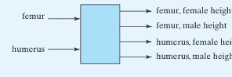

### 3. 手算示例

假设股骨长度为 15 英寸，肱骨长度为 12 英寸。那么身高估计值为：

femur_height_female = femur_length × 1.94 + 28.7 = 57.8 in = 4.82 ft = 4 ft 9.8 in
femur_height_male = femur_length × 1.88 + 32 = 60.2 in = 5.02 ft = 5 ft 0.24 in
humerus_height_female = humerus_length × 2.8 + 28.2 = 61.8 in = 5.15 ft = 5 ft 1.8 in
humerus_height_male = humerus_length × 2.9 + 27.9 = 62.7 in = 5.23 ft = 5 ft 2.76 in

### 4. 算法开发

算法开发的第一步是将问题求解分解为一组按顺序执行的步骤。

### 分解大纲

- 1. 读取股骨和肱骨的长度。
- 2. 计算身高估计值。
- 3. 打印身高估计值。

该程序结构简单，因此可以直接将分解转换为 C 语言。

```
/*
 * Program chapter2_2
 *
 * This program estimates a person's height from the length
 * of the femur and from the length of the humerus.
 */
#include <stdio.h>
#include <math.h>

int main(void)
{
   /* Declare variables.  */
   double femur, femur_ht_f, femur_ht_m, humerus, humerus_ht_f,
          humerus_ht_m;

   /* Get user input from the keyboard.  */
   printf("Enter Values in Inches. \n");
   printf("Enter femur length:  \n");
   scanf("%lf",&femur);
   printf("Enter humerus length:  \n");
   scanf("%lf",&humerus);

   /* Compute height estimates.  */
   femur_ht_f = femur*1.94 + 28.7;
   femur_ht_m = femur*1.88 + 32;
   humerus_ht_f = humerus*2.8 + 28.2;
   humerus_ht_m = humerus*2.9 + 27.9;
```


```c
/* Print height estimates. */
printf("\nHeight Estimates in Inches \n");
printf("Femur Female Estimate: %5.1f \n",femur_ht_f);
printf("Femur Male Estimate: %5.1f \n",femur_ht_m);
printf("Humerus Female Estimate: %5.1f \n",humerus_ht_f);
printf("Humerus Male Estimate: %5.1f \n",humerus_ht_m);

/* Exit program. */
return 0;
}
********************************************************************/
```

## 5. 测试

我们首先使用手算示例中的数据来测试程序。这会产生以下交互：

请以英寸输入数值。
请输入股骨长度：
15
请输入肱骨长度：
12

英寸身高估计
股骨女性估计值: 57.8
股骨男性估计值: 60.2
肱骨女性估计值: 61.8
肱骨男性估计值: 62.7

计算出的值与手算示例一致，因此我们可以使用其他长度来测试程序。如果计算出的值与手算示例的结果不匹配，我们就需要确定错误是在手算示例中还是在 C 程序中。

## 修改！

这些问题与本节开发的用于根据骨骼长度计算身高估计值的程序有关。

- 1. 修改程序，使其将输出值从英寸转换为英尺。输入仍以英寸输入。输出使用单个值，例如 6.5 英尺。
- 2. 修改程序，使其提示用户以英尺输入数值。程序随后需要在进行计算前将英尺数值转换为厘米。输出也将以英尺打印输出身高，例如 6.5 英尺。
- 3. 修改程序，使其以英寸读取输入值，然后使用英尺和英寸估计输出身高。（注意，您正在为每个身高估计值打印两个输出值。）
- 4. 修改程序，使其以英尺和英寸读取输入值，然后使用英尺和英寸估计输出身高。（注意，您正在为每根骨骼读取两个输入值，并为每个身高估计值打印两个输出值。）
- 5. 修改程序，使其以厘米读取骨骼数值并以厘米输出身高估计值。（请回顾 1 英寸 = 2.54 厘米。）

## 2.6 数值技术：线性插值

从实验或观察物理现象中收集数据是开发问题解决方案的重要步骤。这些数据点通常可以被视为函数 f(x) 上点的坐标。我们常希望使用这些数据点来确定函数 f(x) 在原始数据集未包含的 x 值处的估计值。例如，假设我们有数据点 (a, f(a)) 和 (c, f(c))。如果我们想要估计 f(b) 的值，其中 a < b < c，我们可以假设一条直线连接 f(a) 和 f(c)，然后使用线性插值来获得 f(b) 的值。如果我们假设点 f(a) 和 f(c) 由一个三次（三次多项式）多项式连接，我们可以使用三次样条插值法来获得 f(b) 的值。大多数插值问题可以使用这两种方法之一来解决。图 2.1 包含一组六个数据点，它们已被直线段连接，也已被三次多项式段连接。应该清楚，样本点之间函数的值取决于我们选择的插值类型。在本节中，我们讨论线性插值。

- 修改！

- 编写一个短程序，该程序可以修改以包含以下错误。您的系统对每个错误的响应如何？
- 1. 除以零
- 2. 输入转换错误：
  - 对于 %i 说明符，输入 1,245 而不是 1245。
- 3. 输入转换错误：
  - 对整数变量的输入使用 %f。
- 4. 输入转换错误：
  - 对双精度变量的输入使用 %f。
- 5. 指数溢出错误：
  - 使用本节相关讨论中的示例语句。
- 6. 指数下溢错误：
  - 使用本节相关讨论中的示例语句。

图 2.2 显示了一个带有两个任意数据点 f(a) 和 f(c) 的图。如果我们假设两点之间的函数可以用直线估计，我们可以使用由相似三角形推导出的方程来计算任意点 f(b) 处的函数值：

$f(b) = f(a) + \frac{b - a}{c - a}[f(c) - f(a)]$

请回顾，我们还假设 a < b < c。

为了说明使用此插值方程，假设我们有一组从正在测试以供赛车可能使用的新发动机气缸盖中获取的温度测量值。这些数据在图 2.3 中用连接点的直线绘制，也列于此：

| 时间, s | 温度, °F |
|---|---|
| 0.0 | 0.0 |
| 1.0 | 20.0 |
| 2.0 | 60.0 |
| 3.0 | 68.0 |
| 4.0 | 77.0 |
| 5.0 | 110.0 |

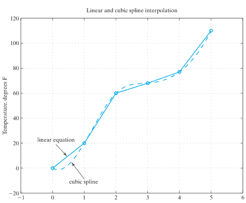

图 2.1 线性和三次样条插值。

\frac{f(a) - f(b)}{b - a} = \frac{f(a) - f(c)}{c - a}

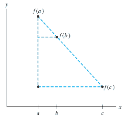

图 2.2 相似三角形。

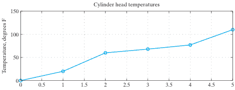

图 2.3 气缸盖温度。

假设我们想要插值一个温度以对应 2.6 秒的值。我们则有以下情况：

| a | 2.0 | 60.0 | f(a) |
|---|---|---|---|
| b | 2.6 | ? | f(b) |
| c | 3.0 | 68.0 | f(c) |

使用插值公式，我们有

```
f(b) = f(a) + \frac{b - a}{c - a} [f(c) - f(a)]
= 60.0 + \frac{0.6}{1.0} (8.0)
= 64.8.
```

在此示例中，我们使用线性插值来找到与指定时间对应的温度。我们也可以互换温度和时间的角色，以便将温度绘制在 x 轴上，时间绘制在 y 轴上。在这种情况下，我们可以使用相同的过程来计算特定温度发生的时间，假设我们有一对低于和高于指定温度的数据点。

## 练习！

假设我们有以下一组数据点，这些点也在图 2.4 中绘制：

| 时间, s | 温度, °F |
| --- | --- |
| 0.0 | 72.5 |
| 0.5 | 78.1 |
| 1.0 | 86.4 |
| 1.5 | 92.3 |
| 2.0 | 110.6 |
| 2.5 | 111.5 |
| 3.0 | 109.3 |

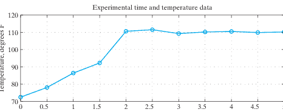

图 2.4 温度值。

| 时间, s | 温度, °F |
| --- | --- |
| 3.5 | 110.2 |
| 4.0 | 110.5 |
| 4.5 | 109.9 |
| 5.0 | 110.2 |

- 1. 使用计算器使用线性插值计算以下时间的温度：
  - 0.3, 1.25, 2.36, 4.48。
- 2. 使用计算器使用线性插值计算对应以下温度的时间值：
  - 81, 96, 100, 106。
- 3. 假设问题 2 要求您计算与温度 110°F 对应的时间值。什么使这个问题变得复杂？有多少个时间值对应温度 110°F？使用线性插值找出每个对应的时间值。（您可能希望参考图 2.5，该图包含将温度数据放在 x 轴上、时间值放在 y 轴上的这些数据的图表。）

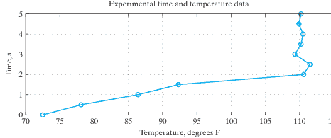

图 2.5 时间值。

## 2.7 应用问题解决：海水冻结温度

### 盐度

在本节中，我们将使用本章介绍的新语句以及线性插值来解决与海水盐度相关的问题。

海水的盐度是衡量海水中溶解物质含量的指标。海水主要是水，其中含有约 3.5% 来自火山喷发和岩石风化的溶解物质（盐、金属和气体）。海水的盐度是衡量海水中溶解物质含量的指标。氯代表海水成分的约 55%，而钠代表约 30.6%。其余的主要成分是硫酸盐（7.7%）、镁（3.7%）、钙（1.2%）和钾（1.1%）。盐度在海洋的不同地点有所不同，但通常在 33 到 38 千分比（ppt）的范围内，即 3.3% 到 3.8% 的百分比。

盐度通常使用测量水电导率的仪器来测量；水中溶解物质越多，其导电性越好。盐度测量在较冷地区尤其重要，因为海水冻结的温度取决于其盐度。盐度越高，海水冻结的温度越低。下表 [7] 包含一组盐度测量值和相应的冻结温度：

| 盐度 (ppt) | 冻结温度 (°F) |
|---|---|
| 0 (淡水) | 32 |
| 10 | 31.1 |
| 20 | 30.1 |
| 24.7 | 29.6 |
| 30 | 29.1 |
| 35 | 28.6 |


## 海水的冻结温度

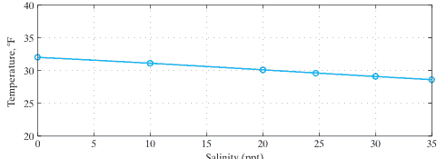

图 2.6 海水的冻结温度。

前面的值也绘制在图 2.6 中。假设我们想使用线性插值来确定我们已测量盐度的水的冻结温度。编写一个程序，允许用户输入两个点的数据以及这两个点之间的盐度测量值。然后程序应计算相应的冻结温度。

### I. 问题描述

使用线性插值计算具有指定盐度的水的新冻结温度。

### 2. 输入/输出描述

以下图表显示，程序的输入包括两个连续点 (a, f(a)) 和 (c, f(c)) 以及新的盐度测量值 b，而输出是新的冻结温度：

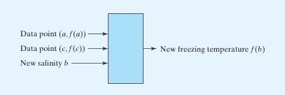

### 3. 手算示例

假设我们想确定盐度测量值为 33 ppt 的水的冻结温度。从数据中，我们看到该点介于 30 和 35 ppt 之间：

| a | 30 | 29.1 | f(a) |
|---|---|---|---|
| b | 33 | ? | f(b) |
| c | 35 | 28.6 | f(c) |

使用线性方程公式，我们可以计算 f(b)：

```
f(b) = f(a) + (b - a)/(c - a) · (f(c) - f(a))
= 29.1 + 3/5 · (28.6 - 29.1)
= 28.8.
```

如预期，该值介于 f(a) 和 f(c) 之间。

### 4. 算法开发

算法开发的第一步是将问题的解决方案分解为一组按顺序执行的步骤：

#### 分解大纲

- 1. 读取相邻点的坐标和新的盐度值。
- 2. 计算新的冻结温度。
- 3. 打印新的冻结温度。

该程序结构简单，因此可以直接将分解转换为 C 语言。

```c
/*--------------------------------------------------------------*/
/* Program chapter2_3                                         */
/*                                                            */
/* This program uses linear interpolation to                  */
/* compute the freezing temperature of seawater.              */
/*--------------------------------------------------------------*/
#include <stdio.h>
#include <math.h>

int main(void)
{
    /* Declare variables.    */
    double a, f_a, b, f_b, c, f_c;

    /* Get user input from the keyboard.    */
    printf("Use ppt for salinity values. \n");
    printf("Use degrees F for temperatures. \n");
    printf("Enter first salinity and freezing temperature: \n");
    scanf("%f %lf", &a, &f_a);
    printf("Enter second salinity and freezing temperature: \n");
    scanf("%f %lf", &c, &f_c);
    printf("Enter new salinity: \n");
    scanf("%f", &b);

/* Use linear interpolation to compute */
/* new freezing temperature. */
/* f_b = f_a + (b-a)/(c-a)*(f_c - f_a); */
/* Print new freezing temperature. */
/* printf("New freezing temperature in degrees F: %4.1f \n",f_b); */
/* Exit program. */
/* return 0; */
/*--------------------------------------------------*/
```

### 5. 测试

我们首先使用手算示例中的数据测试程序。这会生成以下交互：

```
Use ppt for salinity values.
Use degrees F for temperatures.
Enter first salinity and freezing temperature:
30 29.1
Enter second salinity and freezing temperature:
35 28.6
Enter new salinity:
33
New freezing temperature in degrees F: 28.8
```

计算出的值与手算示例匹配，因此我们可以使用其他值测试程序。如果新系数值与手算示例的结果不匹配，我们则需要确定错误是在手算示例中还是在 C 程序中。

为了使线性插值正常工作，新的盐度测量值必须介于我们输入的第一个和第二个值之间。对于本程序，我们假设保持这种关系。在下一章中，我们将学习如何使用新的 C 命令来确保新的盐度测量值介于第一个和第二个测量值之间。

### 修改！

- 1. 使用该程序确定以下盐度测量值（单位：ppt）对应的冻结温度：3 8.5 19 23.5 26.8 30.5
- 2. 修改程序，使其将新温度转换并以摄氏度打印。（回顾 T_F = 9/5 T_C + 32，当 T_F 表示华氏温度，T_C 表示摄氏温度时。）
- 3. 假设与程序一起使用的数据包含摄氏度值。程序需要更改吗？请解释。
- 4. 修改程序，使其对盐度进行插值，而不是对新的冻结温度进行插值。（您可能需要参考图 2.7，该图包含此数据的图表，冻结温度在 x 轴上，盐度在 y 轴上。）

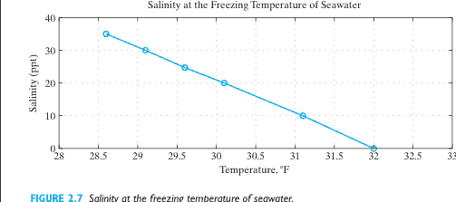

## 2.8 数学函数

求解工程问题的算术表达式通常需要除加法、减法、乘法和除法以外的计算。例如，许多表达式需要使用幂运算、对数、指数和三角函数。在本节中，我们讨论标准 C 库中可用的数学函数。引用数学函数的程序中应使用以下预处理器指令：

```c
#include <math.h>
```

该指令指定在编译器转换对标准 C 库中数学函数的引用时，向程序添加信息以帮助编译器。

在讨论与函数相关的规则之前，我们先举一个具体示例。以下语句计算角度 theta 的正弦值，并将结果存储在变量 b 中：

```c
b = sin(theta);
```

sin 函数假设参数以弧度为单位。如果变量 theta 包含度数值，我们可以使用单独的语句将度数转换为弧度。（回顾 180° = π 弧度。）以下语句具有说明性：

```c
#define PI 3.141593
...
theta_rad = theta*PI/180;
b = sin(theta_rad);
```

转换也可以在函数引用中指定：

```c
b = sin(theta*PI/180);
```

使用单独的语句进行转换通常更可取，因为它更易于理解。

函数引用（例如 sin(theta)）表示一个单一值。函数名后面的括号包含函数的输入，称为参数或实参。函数可能不包含参数、包含一个参数或包含多个参数，具体取决于其定义。如果函数包含多个参数，则非常重要，必须按正确顺序列出参数。某些函数还要求参数使用特定单位。例如，三角函数假设参数以弧度为单位。大多数数学函数假设参数为 double 类型；如果使用不同类型的参数，则在执行函数前将其转换为 double。

函数引用也可以是另一个函数引用的参数的一部分。例如，以下语句计算 x 的绝对值的对数：

```c
b = log(fabs(x));
```

当一个函数用于计算另一个函数的参数时，请务必将每个函数的参数用自己的括号括起来。这种函数嵌套也称为函数复合。

我们现在讨论工程计算中常用的几类函数。在讨论相关主题的过程中，其他函数将在其余章节中介绍。常用函数表包含在封面内侧。附录 A 还包含有关标准 C 库中函数的更多信息。


### 基础数学函数

基础数学函数包括执行多种常见计算的函数，例如计算数字的绝对值和数字的平方根。此外，它们还包括一组用于执行舍入的函数。这些函数假设所有参数的类型均为 double，并且所有函数都返回 double 值；如果参数不是 double，则将使用第 2.3 节中描述的规则进行转换。我们现在列出这些函数及其简要描述：

- `fabs(x)` 此函数计算 x 的绝对值。
- `sqrt(x)` 此函数计算 x 的平方根，其中 x ≥ 0。
- `pow(x,y)` 此函数用于幂运算，计算 x 的 y 次幂，即 x^y。如果 x = 0 且 y ≤ 0，或 x < 0 且 y 不是整数，则会发生错误。
- `ceil(x)` 此函数将 x 舍入到趋向 ∞（无穷大）的最近整数。例如，ceil(2.01) 等于 3。
- `floor(x)` 此函数将 x 舍入到趋向 −∞（负无穷大）的最近整数。例如，floor(2.01) 等于 2。
- `exp(x)` 此函数计算 e^x 的值，其中 e 是自然对数的底数，约为 2.718282。
- `log(x)` 此函数返回 ln x，即以 e 为底的 x 的自然对数。如果 x ≤ 0，则会发生错误。
- `log10(x)` 此函数返回 log10 x，即以 10 为底的 x 的常用对数。如果 x ≤ 0，则会发生错误。


请记住，负值或零的对数不存在，因此如果对数函数的参数为负值，则会发生执行错误。

你可能会发现有用的另一个数学函数是 abs 函数。该函数计算整数的绝对值，并返回整数值。包含该函数相关信息的头文件是 stdlib.h，引用该函数的程序中应包含该头文件。

## 练习！

- 求值以下表达式：
- 1. floor(-2.6)
- 2. ceil(-2.6)
- 3. pow(2, -3)
- 4. sqrt(floor(10.7))
- 5. fabs(-10.2 * 5)
- 6. floor(ceil(10.8))
- 7. log10(100) + log10(0.001)
- 8. fabs(pow(-2, 5))

## 三角函数

三角函数

三角函数假设所有参数均为 double 类型，并且返回值也为 double 类型。此外，如前所述，三角函数还假设角度以弧度表示。要将弧度转换为角度，或将角度转换为弧度，请使用以下语句：

```
#define PI 3.141593
...
angle_deg = angle_rad * (180 / PI);
angle_rad = angle_deg * (PI / 180);
```

三角函数包含在标准 C 库中，使用这些函数时应包含引用 math.h 信息的预处理指令。以下是这些函数的简要摘要：

| sin(x) | 该函数计算 x 的正弦值，其中 x 以弧度表示。 |
| --- | --- |
| cos(x) | 该函数计算 x 的余弦值，其中 x 以弧度表示。 |
| tan(x) | 该函数计算 x 的正切值，其中 x 以弧度表示。 |
| asin(x) | 该函数计算 x 的反正弦或逆正弦值，其中 x 必须在范围 [-1, 1] 内。该函数返回范围 [-π/2, π/2] 内的弧度角度。 |
| acos(x) | 该函数计算 x 的反余弦或逆余弦值，其中 x 必须在范围 [-1, 1] 内。该函数返回范围 [0, π] 内的弧度角度。 |
| atan(x) | 该函数计算 x 的反正切或逆正切值。该函数返回范围 [-π/2, π/2] 内的弧度角度。 |
| atan2(y, x) | 该函数计算 y/x 值的反正切或逆正切值。该函数返回范围 [-π, π] 内的弧度角度。 |

请注意，atan 函数始终返回第一或第四象限的角度，而 atan2 函数返回的角度可以位于任何象限，具体取决于 x 和 y 的符号。因此，在许多应用程序中，atan2 函数优于 atan 函数。

其他三角函数和反三角函数可以使用以下方程计算：

sec x = 1 / cos x \qquad asec x = acos ( 1 / x )
csc x = 1 / sin x \qquad acsc x = asin ( 1 / x )
cot x = 1 / tan x \qquad acot x = acos ( x / \sqrt{1 + x^2} )

在使用三角函数的程序中，使用角度而不是弧度是一个常见错误。

## 练习！

在问题 1 到 3 中，给出计算指示值的赋值语句，假设变量已声明并赋予适当值。还假设已作出以下声明：

```
#define g 9.8
#define PI 3.141593
```

- 1. 速度计算：
- 速度 = \sqrt{v_0^2 + 2a(x - x_0)}.

- 2. 长度收缩：
- 长度 = k \sqrt{1 - (v/c)^2}.

- 3. 中空圆柱扇形重心距参考平面的距离：
- 重心 = \frac{38.1972(r^2 - s^2)\sin a}{(r^2 - s^2) \cdot a}.

在问题 4 到 6 中，给出与赋值语句对应的方程。

- 4. 电气振荡频率：
- frequency = 1/sqrt(2*pi*c/L);

- 5. 抛体射程：
- range = (v0*v0/g)*sin(2*theta);

- 6. 斜坡底部圆盘的速度：
- v = sqrt(2*g*h/(1 + I/(m*pow(r,2))));

## 双曲函数*

双曲函数是自然指数函数 e^x 的函数；反双曲函数是自然对数函数 ln x 的函数。这些函数在专用应用中很有用，例如某些类型数字滤波器的设计。C 包含多个双曲函数，如以下描述所示：

- sinh(x) 该函数计算 x 的双曲正弦值，等于 (e^x - e^-x) / 2。
- cosh(x) 该函数计算 x 的双曲余弦值，等于 (e^x + e^-x) / 2。
- tanh(x) 该函数计算 x 的双曲正切值，等于 sinh x / cosh x。

其他双曲函数和反双曲函数可以使用以下关系计算：

- coth x = cosh x / sinh x (for x != 0).
- sech x = 1 / cosh x.
- csch x = 1 / sinh x.
- asinh x = ln(x + sqrt(x^2 + 1)).
- acosh x = ln(x + sqrt(x^2 - 1)) (for x >= 1).
- atanh x = 1/2 ln((1+x)/(1-x)) (for |x| < 1).
- acoth x = 1/2 ln((x+1)/(x-1)) (for |x| > 1).
- asech x = ln((1 + sqrt(1-x^2))/x) (for 0 < x <= 1).
- acsch x = ln(1/x + sqrt(1+x^2)/|x|) (for x != 0).

许多双曲函数和反三角函数对参数的可接受值范围有限制。如果参数是从键盘输入的，请提醒用户注意范围限制。在下一章中，我们将介绍允许你在程序中确定值是否在适当范围内的 C 语句。


## 练习！

给定 x 的值，给出计算以下值的赋值语句。（假设 x 的值在计算所需的适当取值范围内。）

- 1. coth x
- 2. sec x
- 3. csc x
- 4. acoth x
- 5. acosh x
- 6. acsc x

## 2.9 字符函数

有许多可用于字符数据的函数。有些函数专为字符输入和输出设计，有些用于在大写和小写字符之间转换，有些用于执行字符比较。在本节中，我们将讨论这些字符函数。

### 字符输入/输出

虽然可以使用 printf 和 scanf 函数配合 %c 说明符打印和读取字符，但 C 还包含用于读取和打印字符的特殊函数。getchar 函数从键盘读取下一个字符并返回该字符的整数值；putchar 函数将字符打印到计算机屏幕。

putchar 函数接受一个整数参数并返回一个整数值。执行 putchar 函数会将与整数参数对应的字符写入计算机屏幕。如果连续多次引用 putchar 函数，字符将在同一行上依次打印，直到打印换行符。因此，以下语句会将字符 ab 打印在同一行上，然后将字符 c 打印在下一行：

```
putchar('a');
putchar('b');
putchar('\n');
putchar('\t');
```

相同的信息可以使用与字符对应的整数值打印（参见表 2.3）：

```
putchar(97);
putchar(98);
putchar(10);
putchar(99);
```

getchar 函数从键盘读取下一个字符并返回该字符的整数值。如果连续多次引用 getchar 函数，字符处理将持续进行，直到接收到 EOF。EOF 是在 stdio.h 中定义为符号常量的特殊值。回顾一下，使用 char 数据类型定义的变量只能表示 128 个 ASCII 字符。EOF 的值不在此范围内。因为整数变量可以表示 128 个以上的值，所以我们使用 int 类型而不是 char 类型来接收 getchar 函数返回的值，以便我们可以存储 EOF 并检测数据的结束。以下语句会从键盘读取一个字符并在新行上打印它：

```
int c;
...
putchar('\n');
c = getchar();
putchar(c);
putchar('\n');
```

EOF 的实际值取决于系统。EOF 字符通常由 control-z 字符表示。control-z 通过按住 control (ctrl) 键，然后在 control 键仍按下时按 z 键从键盘输入。这种字符组合通常写作 ^z (control-z)，但与按 ^ 键再按 z 键不同。EOF 的用法将在第 3 章中更详细地讨论。

### 字符比较

字符函数

标准 C 库包含用于字符的其他函数。这些字符函数分为两类；一组函数用于在大写和小写字符之间转换，另一组用于执行字符比较。引用这些字符函数的程序中应使用以下预处理指令：

```
#include <ctype.h>
```

以下语句将变量 ch 中存储的小写字母转换为大写字符，并将结果存储在字符变量 upper 中：

```
upper = toupper(ch);
```

如果 ch 是小写字母，函数 toupper 返回相应的大写字母；否则，函数返回 ch。请注意，变量 ch 未做任何更改。

每个字符函数都需要一个整数参数，并且每个函数都返回一个整数值。字符比较函数在比较为真时返回非零值；否则，它们返回零。我们现在列出这些函数及简要说明：

| tolower(ch) | 如果 ch 是大写字母，该函数返回相应的小写字母；否则，它返回 ch。 |
| --- | --- |
| toupper(ch) | 如果 ch 是小写字母，该函数返回相应的大写字母；否则，它返回 ch。 |
| isdigit(ch) | 如果 ch 是十进制数字，该函数返回非零值；否则，它返回零。 |
| islower(ch) | 如果 ch 是小写字母，该函数返回非零值；否则，它返回零。 |
| isupper(ch) | 如果 ch 是大写字母，该函数返回非零值；否则，它返回零。 |
| isalpha(ch) | 如果 ch 是大写字母或小写字母，该函数返回非零值；否则，它返回零。 |
| isalnum(ch) | 如果 ch 是字母字符或数字，该函数返回非零值；否则，它返回零。 |


### 控制字符

iscntrl(ch) 如果 ch 是控制字符，则该函数返回非零值；否则，返回零。（控制字符的整数代码为 0 到 21，以及 127。）
isgraph(ch) 如果 ch 是可打印字符（与不可打印字符相对，例如控制字符或制表符），则该函数返回非零值；否则，返回零。（可打印字符的整数代码从 32 到 126。）
isprint(ch) 如果 ch 是可打印字符（包括空格），则该函数返回非零值；否则，返回零。
ispunct(ch) 如果 ch 是可打印字符（空格、字母或数字除外），则该函数返回非零值；否则，返回零。
isspace(ch) 如果 ch 是空格、换页符、换行符、回车符、水平制表符或垂直制表符（这些字符也称为空白字符），则该函数返回非零值；否则，函数返回零。
isxdigit(ch) 如果 ch 是十六进制数字（即十进制数字或字母 A 到 F（或 a 到 f）），则该函数返回非零值；否则，返回零。

### 练习！

- 显示以下语句生成的输出行（或多行）：
- 1. `putchar('x');`
- 2. `putchar(65);`
- 3. `putchar(tolower(65));`
- 4. `putchar('\n');`
   `putchar(97);`
   `putchar('\c');`
   `putchar('\n');`
   `putchar(toupper('c'));`

## 2.10 应用问题求解：速度计算

开放转子喷气发动机是一种有前景的推进技术，具有许多潜在好处。例如，测试计划显示燃油消耗显著降低。然而，也存在技术挑战。例如，商用发动机产生的噪音有严格限制，因为机场通常靠近居民区，因此可能需要额外的降噪。在测试转为实际飞行测试之前，会在风洞中对缩比模型和全尺寸发动机进行测试。（本章末尾包含与风洞分析相关的问题。）

在开放转子飞机的试飞期间，试飞员将发动机功率设置为 40,000 牛，这使得 20,000 千克的飞机达到 180 m/s（米/秒）的巡航速度。随后，发动机油门设置为 60,000 牛的功率水平，飞机开始加速。随着飞机速度的增加，空气动力阻力与空速的平方成正比增加。最终，飞机达到一个新的巡航速度，此时发动机的推力恰好被阻力抵消。从重置油门到飞机达到新巡航速度（约 120 秒）期间，用于估计飞机速度和加速度的方程如下：

```
Velocity = 0.00001 time^3 - 0.00488 time^2
           + 0.75795 time + 181.3566,

Acceleration = 3 - 0.000062 velocity^2.
```

这些函数的图示如图 2.8 所示。请注意，随着速度接近其新巡航速度，加速度趋近于零。

编写一个程序，提示用户输入一个表示功率级别提高后经过的时间值（以秒为单位）。计算并打印新时间值下飞机的相应加速度和速度。

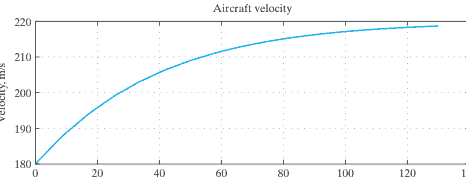

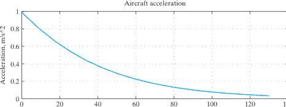

图 2.8 飞机速度和加速度。

### 1. 问题陈述

计算功率级别变化后飞机的新速度和加速度。

### 2. 输入/输出描述

下图显示程序的输入是一个时间值，程序的输出是新速度和加速度值的一对：

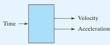

### 3. 手算示例

假设新的时间值为 50 秒。使用给定的速度和加速度方程，我们可以计算这些值：

速度 = 208.3 m/s,
加速度 = 0.31 m/s².

### 4. 算法开发

算法开发的第一步是将问题求解分解为一组按顺序执行的步骤：

### 分解大纲

- 1. 读取新的时间值。
- 2. 计算相应的速度和加速度值。
- 3. 打印新的速度和加速度。

由于此程序是一个非常简单的程序，我们可以直接将分解转换为 C 语言：

```
/*---------------------------------------------------------*/
/* Program chapter_2_4                                     */
/*                                                         */
/* This program estimates new velocity and                 */
/* acceleration values for a specified time.               */
/*---------------------------------------------------------*/
#include <stdio.h>
#include <math.h>

int main(void)
{
    /* Declare variables. */
    double time, velocity, acceleration;

    /* Get time value from the keyboard. */
    printf("Enter new time value in seconds: \n");
    scanf("%f",&time);
    /* Compute velocity and acceleration. */
    velocity = 0.00001*pow(time,3) - 0.00488*pow(time,2)
    + 0.75795*time + 181.3566;
    acceleration = 3 - 0.000062*velocity*velocity;
    /* Print velocity and acceleration. */
    printf("Velocity = %8.3f m/s \n",velocity);
    printf("Acceleration = %8.3f m/s^2 \n",acceleration);
    /* Exit program. */
    return 0;
}
/*---------------------------------------------*/
```

### 5. 测试

我们首先使用手算示例中的数据测试程序。这将生成以下交互：

```
Enter new time value in seconds:
50
Velocity = 208.304 m/s
Acceleration = 0.310 m/s^2
```

因为计算出的值与手算示例匹配，我们可以用其他时间值测试程序。如果值与手算示例不匹配，我们需要确定错误是在手算示例中还是在程序中。

### 修改！

这些问题与本节开发的用于计算速度和加速度值的程序相关。

- 1. 输入不同的时间值，直到找到一个使速度在 210 到 211 m/s 之间的值。
- 2. 输入不同的时间值，直到找到一个使加速度在 0.5 m/s^2 到 0.6 m/s^2 之间的值。
- 3. 修改程序，使输入值以分钟而不是秒输入。请记住，方程仍然假设时间值以秒为单位。
- 4. 修改程序，使输出值以英尺每秒和英尺每秒^2 打印。（回顾 1 米 = 39.37 英寸。）

## 2.11 系统限制

在第 2.2 节中，我们展示了一个包含 Microsoft Visual C++ 2010 Express 编译器的各种整数类型最大值和浮点值的表格。要为您的系统打印类似的表格，请使用以下程序。请注意，该程序包含三个头文件。stdio.h 头文件是必需的，因为程序引用输出函数；limits.h 头文件是必需的，因为它包含有关整数类型范围的信息；float.h 头文件是必需的，因为它包含有关浮点类型范围的信息。附录 A 包含有关系统相关的常数和限制的更多信息。

```
/*--------------------------------------------------*/
/* Program chapter2_5 */
/* */
/* This program prints the system limitations. */
/*--------------------------------------------------*/

#include <stdio.h>
#include <limits.h>
#include <float.h>

int main(void)
{
    /* Print integer type maximums. */
    printf("short integer maximum: %i \n",SHRT_MAX);
    printf("int maximum: %i \n",INT_MAX);
    printf("long maximum: %li \n",LONG_MAX);

    /* Print float precision, range, maximum. */
    printf("float precision digits: %i \n",FLT_DIG);
    printf("float maximum exponent: %i \n", FLT_MAX_10_EXP);
    printf("float maximum: %e \n",FLT_MAX);

    /* Print double precision, range, maximum. */
    printf("double precision digits: %i \n",DBL_DIG);
    printf("double maximum exponent: %i \n", DBL_MAX_10_EXP);
    printf("double maximum: %e \n",DBL_MAX);

    /* Print long precision, range, maximum. */
    printf("long double precision digits: %i \n",LDBL_DIG);
    printf("long double maximum exponent: %i \n", LDBL_MAX_10_EXP);
    printf("long double maximum: %Le \n",LDBL_MAX);

    /* Exit program. */
    return 0;
}
/*--------------------------------------------------*/
```


## 修改！

运行此程序后，更改转换说明符，以便以下值以全精度打印，而不是默认的六位精度：

- 1. float 最大值，
- 2. double 最大值，
- 3. long double 最大值。

## 摘要

本章介绍了编写简单程序所需的 C 语句，这些程序可以计算并打印新值。我们还介绍了允许在程序执行时通过键盘输入信息的语句。所介绍的计算包括标准算术运算以及大量可用于执行工程解决方案所需计算类型的函数。我们还包含了使用线性插值的讨论和示例程序。

## 关键术语

- 缩写赋值
- 地址运算符
- 参数
- ASCII 码
- 赋值语句
- 结合性
- 二进制代码
- 二元运算符
- 区分大小写
- 强制类型转换运算符
- 字符
- 字符函数
- 注释
- 组成
- 常量
- 控制字符
- 控制字符串
- 转换说明符
- 声明
- EBCDIC 码
- EOF 字符
- 转义字符
- 指数表示法
- 表达式
- 字段宽度
- 浮点值
- 垃圾值
- 双曲函数
- 标识符
- 初始值
- 关键字
- 左对齐
- 线性插值
- 数学函数
- 内存快照
- 混合运算
- 取模
- 多重赋值
- 溢出
- 参数
- 后缀
- 优先级
- 精度
- 前缀
- 预处理指令
- 提示符
- 右对齐
- 科学计数法
- 标准 C 库语句
- 符号常量
- 系统相关
- 三角函数
- 截断
- 类型说明符
- 一元运算符
- 下溢
- 变量

## C 语句摘要

用于从标准 C 库文件中包含信息的预处理指令：

```
#include <stdio.h>
#include <math.h>
#include <ctype.h>
```

用于定义符号常量的预处理指令：

```
#define PI 3.141593
```

整数声明：

```
short sum=0;
int year_1, year_2;
long k;
```

浮点值声明：

```
float height_1, height_2;
double length=10, side1, side2;
long double distance, velocity;
```

赋值语句：

```
area = 0.5*base*(height_1 + height_2);
```

键盘输入语句：

```
scanf("%i",&year);
```

屏幕输出语句：

```
printf("The area is %f square feet. \n",area);
```

程序退出语句：

```
return 0;
```

从键盘读取字符的指令：

```
c = getchar();
```

向屏幕打印字符的指令：

```
putchar(c);
```

## 注释

- 1. 在整个程序中使用注释，以提高可读性并记录其中的步骤。
- 2. 使用空行和缩进来标识程序的结构。
- 3. 尽可能在变量名中使用单位。
- 4. 应对工程常数（如 π）使用符号常量，并且应将其大写，以便轻松识别。
- 5. 在算术运算符和赋值运算符周围使用一致的间距。
- 6. 在复杂表达式中使用括号以提高可读性。
- 7. 应将长表达式的求值分解为多个语句。
- 8. 确保在程序输出中将单位与数值一起包含。
- 9. 使用提示符向用户描述从键盘输入的值的信息和单位。

## 调试注释

- 1. 请记住，声明和 C 语句必须以分号结尾。
- 2. 预处理指令不以分号结尾。
- 3. 如果可能，避免可能导致信息丢失的赋值。
- 4. 在长表达式中使用括号，以确保其按预期求值。
- 5. 使用双精度或扩展精度以避免指数溢出或下溢问题。
- 6. 确保说明符与 scanf 语句中的变量类型匹配。
- 7. 如果用户输入值无法正确转换为 scanf 语句中说明符的变量类型，可能会发生错误。
- 8. 不要忘记在 scanf 语句中对标识符使用地址运算符。
- 9. 请记住，符号常量定义不以分号结尾。
- 10. 在嵌套函数引用中，每组参数必须在其自己的括号内。
- 11. 请记住，对数函数不能与负数参数一起使用。
- 12. 确保在三角函数中使用弧度制角度。
- 13. 请记住，许多反三角函数和双曲函数对允许的输入值范围有限制。
- 14. 请记住，字符数字的整数表示与数值数字的整数表示不同。
- 15. 将 getchar 函数返回的值存储在整数变量中，以便可以存储 EOF 字符。

## 问题

### 简答题

#### 判断题

指示以下陈述是正确 (T) 还是错误 (F)：

- 1. 程序的执行从 main 函数开始。T F
- 2. C 不区分大小写。T F
- 3. 声明可以放在程序中的任何位置。T F
- 4. 语句和声明必须以分号结尾。T F
- 5. 整数除法的结果是四舍五入的结果。T F

#### 语法题

指示以下声明语句是否正确。如果语句不正确，请修改它使其成为正确的语句：

- 6. int i, j, k,
- 7. float f1=11, f2=202.00;
- 8. DOUBLE D1, D2, D3;
- 9. float a1=a2;
- 10. int n, m_m;

#### 选择题

圈出最佳答案的字母以完成陈述或回答问题：

- 11. 以下哪项不是 C 关键字？
  (a) const
  (b) goto
  (c) static
  (d) when
  (e) unsigned

- 12. 在声明中，类型说明符和变量名之间由什么分隔？
  (a) 句点。(b) 空格。
  (c) 等号。(d) 分号。
  (e) 以上都不是。

- 13. 以下哪项声明可以正确定义 x、y 和 z 为 double 变量？
  (a) double x, y, z;
  (b) long double x, y, z;
  (c) double x, y, z;
  (d) double x=y=z;
  (e) double X, Y, Z;

- 14. 在 C 中，二元运算符 % 用于计算
  (a) 整数除法。
  (b) 浮点除法。
  (c) 整数除法的余数。
  (d) 浮点除法的余数。
  (e) 以上都不是。

- 15. 以下哪项赋值产生零值？
  (a) result = 9%3 - 1;
  (b) result = 8%3 - 1;
  (c) result = 2 - 5%2;
  (d) result = 2 - 6%2;
  (e) result = 2 - 8%3;

#### 内存快照题

执行以下每组语句后，给出相应的内存快照：

```
16. int x1;
...
x1 = 3 + 4%5 - 5;
```

```
17. double a=3.8, x;
int n=2, y;
...
x = (y / a/n)*2;
```

#### 程序输出题

以下每组语句生成的输出如下：

```
18. float value_1=5.78263;
...
printf( "value_1 = %5.3f", value_1 );
```

```
19. double value_4=66.45832;
...
printf( "value_4 = %10.2e", value_4 );
```

```
20. int value_5=7750;
...
printf( "value_5 = % + 6d", value_5 );
```

### 编程题

转换。这一组问题涉及将一个单位中的值转换为另一个单位中的值。每个程序都应提示用户输入指定单位中的值，然后打印转换后的值及其新单位。

- 21. 编写一个程序将英里转换为千米。（回顾 1 mi = 1.6093440 km。）
- 22. 编写一个程序将米转换为英里。（回顾 1 mi = 1.6093440 km。）
- 23. 编写一个程序将磅转换为千克。（回顾 1 kg = 2.205 lb。）
- 24. 编写一个程序将牛转换为磅。（回顾 1 lb = 4.448 N。）
- 25. 编写一个程序将华氏度 (TF) 转换为兰氏度 (TR)。（回顾 TF = TR – 459.67°R。）
- 26. 编写一个程序将摄氏度 (TC) 转换为兰氏度 (TR)。（回顾 TF = TR – 459.67°R 且 TF = (9/5) TC + 32°F。）
- 27. 编写一个程序将开尔文度 (TK) 转换为华氏度 (TF)。（回顾 TR = (9/5) TK 且 TF = TR – 459.67°R。）

面积和体积。这些问题涉及使用用户输入来计算面积或体积。每个程序都应包含提示用户输入所需变量的内容。

- 28. 编写一个程序计算边长为 a 和 b 的矩形的面积。（回顾 A = a x b。）
- 29. 编写一个程序计算底为 b、高为 h 的三角形的面积。（回顾 A = 1/2(b x h)。）
- 30. 编写一个程序计算半径为 r 的圆的面积。（回顾 A = πr²。）
- 31. 编写一个程序计算圆扇形的面积，其中 θ 是两个半径之间的弧度角。（回顾 A = r²θ/2，其中 θ 为弧度。）
- 32. 编写一个程序计算圆扇形的面积，其中 d 是两个半径之间的角度（度）。（回顾 A = r²θ/2，其中 θ 为弧度。）
- 33. 编写一个程序计算半轴为 a 和 b 的椭圆的面积。（回顾 A = πa x b。）


- 34. 编写一个程序来计算半径为 r 的球体的表面积。（回顾 A = 4πr²）

- 35. 编写一个程序来计算半径为 r 的球体的体积。（回顾 V = (4/3)πr³）

- 36. 编写一个程序来计算半径为 r 且高为 h 的圆柱体的体积。（回顾 V = πr²h。）

## 氨基酸分子量。

蛋白质中的氨基酸由氧、碳、氮、硫和氢原子组成，如表 2.8 所示。各单独元素的原子量如下：

| 元素 | 原子量 |
|---|---|
| 氧 | 15.9994 |
| 碳 | 12.011 |
| 氮 | 14.00674 |
| 硫 | 32.066 |
| 氢 | 1.00794 |

## 表 2.8 氨基酸分子量

| 氨基酸 | O | C | N | S | H |
|---|---|---|---|---|---|
| 丙氨酸 | 2 | 3 | 1 | 0 | 7 |
| 精氨酸 | 2 | 6 | 4 | 0 | 15 |
| 天冬酰胺 | 3 | 4 | 2 | 0 | 8 |
| 天冬氨酸 | 4 | 4 | 1 | 0 | 6 |
| 半胱氨酸 | 2 | 3 | 1 | 1 | 7 |
| 谷氨酸 | 4 | 5 | 1 | 0 | 8 |
| 谷氨酰胺 | 3 | 5 | 2 | 0 | 10 |
| 甘氨酸 | 2 | 2 | 1 | 0 | 5 |
| 组氨酸 | 2 | 6 | 3 | 0 | 10 |
| 异亮氨酸 | 2 | 6 | 1 | 0 | 13 |
| 亮氨酸 | 2 | 6 | 1 | 0 | 13 |
| 赖氨酸 | 2 | 6 | 2 | 0 | 15 |
| 甲硫氨酸 | 2 | 5 | 1 | 1 | 11 |
| 苯丙氨酸 | 2 | 9 | 1 | 0 | 11 |
| 脯氨酸 | 2 | 5 | 1 | 0 | 10 |
| 丝氨酸 | 3 | 3 | 1 | 0 | 7 |
| 苏氨酸 | 3 | 4 | 1 | 0 | 9 |
| 色氨酸 | 2 | 11 | 2 | 0 | 11 |
| 酪氨酸 | 3 | 9 | 1 | 0 | 11 |
| 缬氨酸 | 2 | 5 | 1 | 0 | 11 |

- 37. 编写一个程序来计算并打印甘氨酸的分子量。

- 38. 编写一个程序来计算并打印谷氨酸和谷氨酰胺的分子量。

- 39. 编写一个程序，提示用户输入氨基酸中五种元素各自的原子数。然后计算并打印该氨基酸的分子量。

- 40. 编写一个程序，提示用户输入氨基酸中五种元素各自的原子数。然后计算并打印该氨基酸中原子的平均重量。

## 以 b 为底的对数。

要计算 x 以 b 为底的对数，可以使用以下关系：

log_b x = log_e x / log_e b

- 41. 编写一个程序，读取一个正数，然后计算并打印该值以 2 为底的对数。例如，8 以 2 为底的对数是 3，因为 2^3 = 8。

- 42. 编写一个程序，读取一个正数，然后计算并打印该值以 8 为底的对数。例如，64 以 8 为底的对数是 2，因为 8^2 = 64。

## 风洞。

风洞是一种用于产生不同风速（或马赫数，即风速除以声速）的测试舱。精确的飞机比例模型可以安装在测试舱的力测量支架上，然后可以在许多不同的风速和角度下对模型上的力进行测量。在长期风洞测试结束时，已收集了许多组数据，可用于确定新飞机在各种运行速度和位置下的升力系数、阻力及其他空气动力学性能特征。风洞测试收集的数据如图 2.9 所示，并列于下表中：

| 飞行路径角（度） | 升力系数 |
|---|---|
| -4 | -0.182 |
| -2 | -0.056 |
| 0 | 0.097 |
| 2 | 0.238 |
| 4 | 0.421 |
| 6 | 0.479 |
| 8 | 0.654 |
| 10 | 0.792 |
| 12 | 0.924 |
| 14 | 1.035 |
| 15 | 1.076 |
| 16 | 1.103 |
| 17 | 1.120 |
| 18 | 1.121 |
| 19 | 1.121 |
| 20 | 1.099 |
| 21 | 1.059 |

- 43. 假设我们希望使用线性插值来确定 -4 度到 21 度之间其他飞行路径角的升力系数。编写一个程序，允许用户输入两个点的数据以及这两个点之间的飞行路径角。然后程序应计算相应的升力系数。

- 44. 修改问题 43 中开发的程序，使其以弧度打印新角度。输入范围也应以弧度给出。（回顾 180 度 = \(\pi\) 弧度。）

- 45. 修改问题 43 中开发的程序，使其对新角度进行插值，而不是对新系数进行插值。因此，用户将输入两个点的数据以及这两个点之间的升力系数。然后程序应计算相应的角度（以度为单位）。

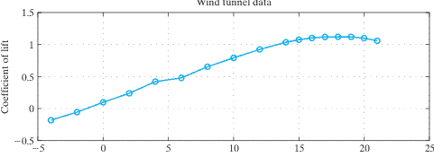

图 2.9 风洞数据。

# 第三章


## 犯罪现场调查：人脸识别与监控视频

人脸识别是一种常用技术，用于从图像或从监控视频中提取的单帧（也是图像）中识别个人。单独使用时，人脸识别不如指纹识别准确。因此，人脸识别通常与另一种生物识别技术或另一种安全措施结合使用，以进入安全区域。例如，安全系统可能会使用人脸图像从主数据库中选择三个最可能匹配的人脸，并将这些人脸呈现给安全警卫。然后，安全警卫决定请求进入的人是否有权访问。目前，许多商业应用都使用人脸识别。Google 的 Picasa 数字图像组织器使用人脸识别来搜索一组图像，查找与指定图像匹配的人脸。其他使用人脸识别的应用包括 Apple 的 iPhoto（照片组织器）、Sony 的 Picture Motion Browser（为相同人脸的图像打标签）以及 Facebook。人脸识别也已被用于侦破犯罪和识别恐怖分子。它曾被用来帮助利用机场监控视频识别部分 9/11 恐怖分子。人脸识别还被用于 2005 年伦敦地铁爆炸案的嫌疑人识别。2001 年 1 月，在佛罗里达州坦帕湾的超级碗 XXXV 上，人脸识别与监控摄像头一起使用，作为系统测试来识别有犯罪记录的人；19 名有轻微犯罪背景的人可能被识别出来。本章后面，我们将讨论一种人脸识别算法的细节，然后开发一个 C 程序来比较两张人脸的信息，以确定它们是否可能是同一个人。

## 控制结构与数据文件

### 章节大纲

- 3.1 算法开发
- 3.2 条件表达式
- 3.3 选择语句
- 3.4 问题求解应用：人脸识别
- 3.5 循环结构
- 3.6 问题求解应用：波相互作用
- 3.7 数据文件
- 3.8 数值技术：线性建模*
- 3.9 问题求解应用：臭氧测量*
- 摘要、关键词、C 语句总结、
- 风格笔记、调试笔记、习题

### 目标

本章将开发包含以下内容的问题求解方案：
- 选择结构，允许在程序中提供替代路径，
- 重复结构，允许在条件为真时重复执行一组步骤，
- 从数据文件读取信息和向数据文件写入信息，以及
- 线性建模技术。

## 3.1 算法开发

在第 2 章中，我们开发的 C 程序非常简单。步骤是顺序的，通常涉及从键盘读取信息、计算新信息，然后打印新信息。在解决工程问题时，大多数解决方案需要更复杂的步骤，因此我们需要扩展问题求解过程中的算法开发部分。

### 自顶向下设计

自顶向下设计以顺序步骤呈现问题求解方案的“全景”描述。然后对问题的这一总体描述进行细化，直到步骤足够详细，可以转换为语言语句。

### 分解大纲

我们在第 1 章和第 2 章中使用了分解大纲来提供问题求解方案的第一个定义。该大纲以顺序步骤编写，可以显示为图表或逐步大纲。对于非常简单的问题，例如在第 2 章中开发的问题，我们可以直接从分解大纲转到 C 语句：

- 1. 读取新值。
- 2. 计算相应的速度和加速度值。
- 3. 打印新的速度和加速度。

但是，对于大多数问题求解方案，我们需要将分解大纲细化为更详细的描述。此过程通常称为分治策略，因为我们不断将问题求解方案分解为越来越小的部分。为了描述这种逐步细化，我们使用伪代码或流程图。

使用伪代码和流程图进行细化。将大纲细化为更详细的步骤可以使用伪代码或流程图。伪代码使用类似英语的语句来描述算法中的步骤，而流程图使用图表来描述算法中的步骤。大多数算法的基本步骤如图 3.1 所示，并附有伪代码和流程图中的相应符号。

伪代码和流程图是帮助我们确定解决问题步骤顺序的工具。这两种工具都常用，尽管它们通常不会同时用于同一个问题。为了同时展示这两种工具的示例，某些问题求解方案将使用伪代码，而其他方案将使用流程图；伪代码与流程图之间的选择通常是个人偏好。有时我们需要经历多个层次的伪代码或流程图来开发复杂的问题求解方案；这就是我们之前讨论过的逐步细化。分解大纲、伪代码和流程图是解决方案的工作模型，因此不是唯一的。每个参与解决方案的人都会有不同的分解大纲和伪代码或流程图描述，就像不同人开发的 C 程序会有所不同，尽管它们解决相同的问题。

### 结构化程序设计

结构化程序是使用简单的控制结构来组织问题求解方案的程序。简单结构通常定义为顺序、选择或重复。顺序结构包含一个接一个执行的步骤；选择结构包含在条件为真时执行的一组步骤，以及在条件为假时执行的另一组步骤；重复结构包含在条件为真时重复执行的一组步骤。我们现在讨论这些简单结构中的每一个，并使用伪代码和流程图给出具体示例。

顺序。顺序包含一个接一个执行的步骤。第 2 章中开发的所有程序都具有顺序结构。例如，执行线性插值的程序的伪代码如下：

```
Refinement in Pseudocode
main:
    read f, a
    read c, f, c
    read b
    set f_b to f_a + b - a
                c - a   (f_c - f_a)
    print f_b
```


| 基本操作 | 伪代码表示法 | 流程图符号 |
|---|---|---|
| 输入 | read radius | read radius |
| 计算 | set area to \(\pi \cdot \text{radius}^2\) | area = \(\pi \cdot \text{radius}^2\) |
| 输出 | print radius, area | print radius, area |
| 比较 | if radius < 0 then ... | is radius < 0 ? |
| 算法开始 | main: | start main |
| 算法结束 | | stop main |

图 3.1 伪代码表示法和流程图符号。

计算带开转子发动机的飞机速度和加速度的程序的流程图如图 3.2 所示。

选择。选择结构包含一个条件，该条件可被评估为真或假。如果条件为真，则执行一组语句；如果条件为假，则执行另一组语句。例如，假设我们已计算出分数的分子和分母的值。在进行除法运算之前，我们希望确保分母不接近零。因此，我们要测试的条件是“分母接近零”。如果条件为真，则我们希望打印一条消息，指示我们无法计算该值。如果条件为假，这意味着分母不接近零，则我们计算并打印分数的值。在定义此条件时，我们需要定义“接近零”。对于此示例，我们将假设“接近零”意味着绝对值小于 0.0001。伪代码描述如下：

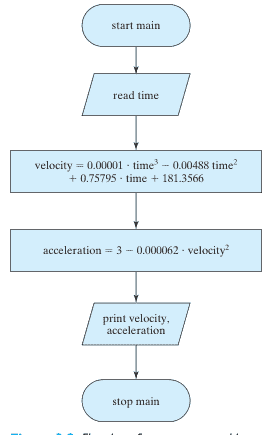

图 3.2 开转子问题求解的流程图，来自第 2.10 节。

```
if |denominator| < 0.0001
   print "Denominator close to zero"
else
   set fraction to numerator/denominator
   print fraction
```

该结构的流程图描述如图 3.3 所示。请注意，该结构还包含一个序列结构（例如，计算分数然后打印分数），该结构在条件为假时执行。我们将在本章后面介绍更多选择结构的变体。

重复。重复结构允许我们在条件为真时重复（或循环）一组步骤。例如，我们可能希望计算一组速度值，这些值对应于 0、1、2、...、10 秒的时间值。我们不希望开发一个顺序结构，其中有一条语句用于计算时间为 0 时的速度，然后另一条语句用于计算时间为 1 时的速度，然后另一条语句用于计算时间为 2 时的速度，以此类推。虽然在这种情况下该结构只需要 11 条语句，但如果我们希望在较长一段时间内计算速度值，则可能需要数百条语句。如果我们使用重复结构，我们可以开发一个解决方案，其中我们将时间初始化为 0。然后，只要时间值小于或等于 10，我们就计算并打印一个速度值，并将时间值增加 1。当时间值大于 10 时，我们退出该结构。图 3.4 包含此重复结构的流程图，伪代码如下：

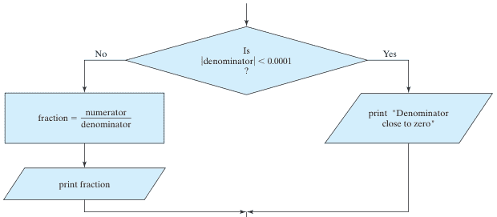

图 3.3 选择结构的流程图。

```
set time to 0
while time <= 10
    compute velocity
    print velocity
    increment time by 1
```

在本章的其余部分中，我们将介绍用于执行选择和重复的 C 语句，然后开发使用这些结构的示例程序。

## 替代方案的评估

通常有多种方法来解决同一个问题。在大多数情况下，并不存在单一的最佳解决方案，尽管有些解决方案比其他方案更好。随着经验的积累，选择一个好的解决方案会变得更容易。在本教材中，我们将介绍有助于形成良好解决方案的要素。例如，一个好的解决方案是可读的；因此，它不一定是最短的解决方案，因为简短的解决方案通常不可读性很高。我们将努力避免那些缩短程序但难以理解的微妙或巧妙的步骤。

在开始为问题开发解决方案时，最好尝试思考几种解决方法。为几种解决方案绘制分解大纲和伪代码或流程图。然后选择你认为最容易转换为 C 语句的解决方案。某些算法比其他算法更适合不同的语言，因此你还希望选择一个适合 C 语言的解决方案。偶尔，还必须考虑解决方案的其他方面，例如执行速度和内存需求。

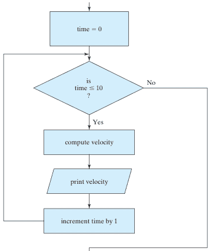

图 3.4 重复结构的流程图。

## 错误条件

### 错误条件

在开发算法时，我们通常假设输入数据是正确的。但是，在实际应用中，输入数据中经常存在错误。因此，测试输入数据中可能发生并会导致程序运行不正确的错误可能很重要。

在计算新值时，也可能出现可能导致问题的条件。例如，假设我们正在执行一个计算，其中除法运算的分母值结果为零。假设高度计算的结果为负数。这些是程序运行时可能发生的错误条件的示例（与算法中的错误是分开的）。

本章介绍的一些语句可以在程序本身中检查某些错误条件。但是，如果我们检查每一种可能的错误条件，我们的程序会变得很长，并且大部分语句都在检查错误条件。因此，我们如何决定在程序中检查哪些错误条件？有时，问题描述中会包含可能发生的错误条件的信息，以及检测到这些错误时应采取的响应。但是，通常不会提及错误条件。在这些情况下，我们建议你根据问题描述开发算法，然后生成可能出现的潜在错误条件列表。如果可能，请与将使用该程序的人员或团队讨论这些问题。否则，包括似乎能捕获最常见错误类型的错误检查，然后随程序附带书面文档。此文档应描述你的程序将捕获的错误条件以及不会捕获的错误条件。

一旦你决定将哪些错误条件纳入算法，你仍然需要决定如果发生其中一种错误条件时该怎么做。通常有两种可能性——你可以退出程序，或者尝试纠正错误并继续运行程序。无论哪种情况，你可能都应该打印一条错误消息，描述发生的错误条件以及你正在采取的操作。确保错误消息提供尽可能多的信息。不要打印 "输入数据中发生错误"，而是打印诸如 "温度超出范围"、"时间值为负" 或 "压力超过安全限制" 之类的消息。

### 数据文件

在本章中，我们将讨论如何读写数据文件，这些文件（类似于程序文件）包含其他程序使用的信息。有时会编写称为数据过滤器的程序来检查数据文件中的信息是否存在错误条件。然后，使用数据文件的程序不需要检查相同的错误条件。

## 测试数据的生成

### 测试数据

测试数据的生成是开发问题解决方案的非常重要的一部分。测试数据应包括用于测试程序中检查的每个错误条件的数据。测试数据还应测试程序中的每条路径。随着程序变长，生成测试数据以完全测试程序变得非常困难。整个课程和书籍都基于这一验证和确认主题。

### 验证和确认

我们现在就生成测试数据集提出一些建议。首先，使用手算示例中的数据。如果这些数据无法正常工作，那我们开局就不理想！一旦程序对这些数据能正确运行，就开始使用覆盖不同值范围的测试数据。如果数据应该在某些范围内，请务必使用测试边界条件或限制的测试数据。一旦程序似乎对有效数据能正常工作，就开始加入错误条件，看看程序是否能正确处理它们。一般来说，使用许多小数据集而不是一个大数据集来测试程序。

如果在测试程序时发现错误，请返回到算法开发步骤。更正分解大纲和伪代码或流程图中的错误，然后更正 C 程序。当你对程序进行重大更改时，应该完全重新测试程序。有时更改会影响我们未预料到的程序部分。如果我们保留所用测试集的日志以便重复它们，那么这种重新测试会更容易。


### 程序走查

最后，我们想提到一种称为程序走查的技术，该技术在工业界开发大型程序时经常使用。在程序走查中，为复杂问题开发了算法的人员将他们的解决方案展示给一小群了解该问题但未参与算法开发的人员。开发算法的人员与分析算法的人员之间的交互通常会导致识别算法中的潜在问题，并为软件编码后生成潜在的测试数据。结果是，最终程序能更早完成，并且对其准确性更有信心。在解决更复杂的问题时，你可以尝试与班上的其他学生进行简单的程序走查。


## 3.2 条件表达式

因为选择结构和重复结构都使用条件，所以在介绍实现选择结构和重复结构的语句之前，我们必须先讨论条件。条件是一个可以求值为真或假的表达式，它由使用关系运算符组合的表达式构成；条件还可以包含逻辑运算符。在本节中，我们将介绍关系运算符和逻辑运算符，并讨论它们在单个条件中组合时的求值顺序。

### 关系运算符

C 中可用于比较两个表达式的关系运算符如下表所示：

| 关系运算符 | 含义 |
| :--- | :--- |
| < | 小于 |
| <= | 小于或等于 |
| > | 大于 |
| >= | 大于或等于 |
| == | 等于 |
| != | 不等于 |

关系运算符两侧可以使用空格，但不能使用空格分隔双字符运算符，例如 ==。

条件示例如下：

```
a < b
x+y >= 10.5
fabs(denominator) < 0.0001
```

鉴于这些条件中标识符的值，我们可以将每个条件求值为真或假。例如，如果 a 等于 5，b 等于 8.4，则 a<b 为真条件。如果 x 等于 2.3，y 等于 4.1，则 x+y >= 10.5 为假条件。如果 denominator 等于 -0.0025，则 fabs(denominator) < 0.0001 为假条件。请注意，我们在逻辑表达式中在关系运算符周围使用空格，但在条件中的算术运算符周围不使用空格。

> 我们在逻辑表达式中在关系运算符周围使用空格，但在条件中的算术运算符周围不使用空格。

在 C 中，真条件被赋值为 1，假条件被赋值为 0。因此，以下语句是有效的：

```
d = b>c;
```

如果 b>c，则 d 的值为 1；否则，d 的值为 0。可以使用单个值代替条件。例如，考虑以下语句：

```
if (a)
    count++;
```

如果条件值为零，则假定条件为假；如果值非零，则假定条件为真。因此，在前面的语句中，如果 a 非零，则 count 的值将递增。

### 逻辑运算符

逻辑运算符也可以在条件中使用。但是，逻辑运算符比较的是条件，而不是表达式。C 支持三个 *逻辑运算符*：与、或和非。这些逻辑运算符由以下符号表示：

| 逻辑运算符 | 符号 |
|---|---|
| 与 | && |
| 或 | || |
| 非 | ! |

例如，考虑以下条件：

```
a<b && b<c
```


关系运算符的优先级高于逻辑运算符；因此，此条件读作 "a 小于 b，且 b 小于 c"。为了使逻辑语句更易读，我们在逻辑运算符周围插入空格，但在关系运算符周围不插入空格。

鉴于 a、b 和 c 的值，我们可以将此条件求值为真或假。例如，如果 a 等于 1，b 等于 5，c 等于 8，则条件为真。如果 a 等于 -2，b 等于 9，c 等于 2，则条件为假。

如果 A 和 B 是条件，则可以使用逻辑运算符生成新条件 A && B、A || B、!A 和 !B。仅当 A 和 B 都为真时，条件 A && B 才为真。如果 A 或 B 中至少有一个为真，则条件 A || B 为真。! 运算符更改其所用条件的值。因此，仅当 A 为假时，条件 !A 才为真；仅当 B 为假时，条件 !B 才为真。这些定义在表 3.1 中总结。

执行带有逻辑运算符的表达式时，C 只会对表达式中必要的部分进行求值。例如，如果 A 为假，则表达式 A && B 也为假，无需求值 B。同样，如果 A 为真，则表达式 A || B 为真，无需求值 B。

### 优先级和结合性

条件可以包含多个逻辑运算符，如下所示：

```
! (b==c || b==5.5)
```


优先级从高到低为 !、&& 和 ||，但可以使用括号更改优先级。在前面的示例中，表达式 b==c 和 b==5.5 先求值。假设 b 等于 3，c 等于 5。那么两个表达式都不为真，因此表达式 b==c || b==5.5 为假。然后我们将 ! 运算符应用于假条件，结果为真条件。不能使用空格分隔 || 或 && 中的字符。一个常见错误是在逻辑表达式中使用 = 而不是 ==。

| A | B | A && B | A || B | !A | !B |
|---|---|---|---|---|---|
| 假 | 假 | 假 | 假 | 真 | 真 |
| 假 | 真 | 假 | 真 | 真 | 假 |
| 真 | 假 | 假 | 真 | 假 | 真 |
| 真 | 真 | 真 | 真 | 假 | 假 |

### 表 3.2 算术、关系和逻辑运算符的优先级

| 优先级 | 运算 | 结合性 |
| :--- | :--- | :--- |
| 1 | ( ) | 先内后外 |
| 2 | ++ -- + - ! (type) | 从右到左（单目） |
| 3 | * / % | 从左到右 |
| 4 | + - | 从左到右 |
| 5 | < <= > >= | 从左到右 |
| 6 | == != | 从左到右 |
| 7 | && | 从左到右 |
| 8 | || | 从左到右 |
| 9 | = += -= *= /= %= | 从右到左 |

条件可以同时包含算术运算符、关系运算符和逻辑运算符。表 3.2 包含条件中元素的优先级和结合性顺序。

### 练习！

判断问题 1 到 8 中以下条件是真还是假。假设以下变量已声明并赋予这些值：

```
a = 5.5   b = 1.5   k = -3
```

- 1. a < 10.0+k
- 2. !(a == 3*b)
- 3. a+b >= 6.5
- 4. -k <= k+6
- 5. k != a-b
- 6. a<10 && a>5
- 7. b-k > a
- 8. fabs(k)>3 || k<b-a

## 3.3 选择语句

if 语句允许我们测试条件，然后根据条件是真还是假执行语句。C 包含两种形式的 if 语句——简单 if 语句和 if/else 语句。C 还包含 switch 语句，允许我们测试多个条件，然后根据条件是真还是假执行语句组。

### 简单 if 语句

if 语句的最简单形式具有以下一般形式：

```
if (condition) statement 1;
```

如果条件为真，则执行语句 1；如果条件为假，则跳过语句 1。if 语句中的语句会缩进，以便从语句中更容易地可视化程序结构。


### 复合语句

如果希望在条件为真时执行多个语句（或序列结构），我们使用 **复合语句**（或块），它由一组用大括号括起来的语句组成。大括号的位置是一种风格问题；下面展示了两种常见风格：

```
Style 1
if (condition)
{
statement 1;
statement 2;
...
statement n;
}

Style 2
if (condition) {
statement 1;
statement 2;
...
statement n;
}
```


在文本解答中，我们使用第一种风格约定；因此，两个大括号各自独占一行。虽然这会使程序稍长，但也更容易注意到是否错误地遗漏了大括号。图 3.5 包含了简单 `if` 语句的控制流程图，无论条件为真时是执行一个语句还是多个语句。

`if` 语句的具体示例如下：

```
if (a < 50)
{
++count;
sum += a;
}
```

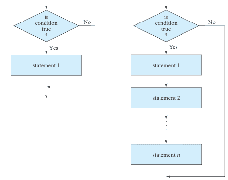

图 3.5 选择语句的流程图。


如果 a 小于 50，则 count 加 1 且 a 加到 sum 中；否则，跳过这两条语句。

if 语句也可以嵌套；以下示例在 if 语句中包含了一个 if 语句：

```
if (a < 50)
{
    ++count;
    sum += a;
    if (b > a)
        b = 0;
}
```


如果 a 小于 50，我们将 count 加 1 并把 a 加到 sum 中。此外，如果 b 大于 a，我们还将 b 设为零。如果 a 不小于 50，我们跳过所有这些语句。嵌套时，请务必缩进每个 if 语句中的语句。

## if/else 语句

if/else 语句允许我们在条件为真时执行一组语句，在条件为假时执行另一组语句。if/else 语句的最简单形式如下：

```
if (condition)
    statement 1;
else
    statement 2;
```

语句 1 和语句 2 也可以被复合语句替换。语句 1 或语句 2 也可以是空语句，即仅一个分号。如果语句 2 是空语句，那么 if/else 语句可能应写成简单的 if 语句。有些情况下，将语句 1 用作空语句很方便；不过，这些语句也可以重写为条件相反的简单 if 语句。例如，以下两条语句是等价的：

```
if (a < b)
    ;
else
    count++;
```

```
if (a >= b)
    count++;
```

考虑这个 if/else 语句：

```
if (d <= 30)
    velocity = 0.425 + 0.00175*d*d;
else
    velocity = 0.625 + 0.12*d - 0.0025*d*d;
```

在此示例中，如果距离 d 小于或等于 30，则使用第一个赋值语句计算 velocity；否则，使用第二个赋值语句计算 velocity。此 if/else 语句的流程图如图 3.6 所示。

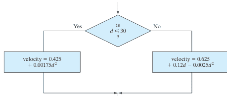

图 3.6 if/else 语句的流程图。

if/else 语句的另一个示例如下：

```
if (fabs(denominator) < 0.0001)
    printf("Denominator close to zero");
else
{
    x = numerator/denominator;
    printf("x = %f \n",x);
}
```

在此示例中，我们检查变量 denominator 的绝对值。如果该值接近零，我们打印一条消息，指示无法执行除法。如果 denominator 的值不接近零，我们计算并打印 x 的值。此语句的流程图已在图 3.3 中显示。

考虑以下嵌套 if/else 语句集：

```
if (x > y)
    if (y < z)
        k++;
    else
        m++;
else
    j++;
```

当 x > y 且 y < z 时，k 的值加 1。当 x > y 且 y >= z 时，m 的值加 1。当 x <= y 时，j 的值加 1。通过仔细缩进，该语句易于理解。假设我们现在删除内部 if 语句的 else 部分。如果保持相同的缩进，语句变为以下内容：

```
if (x > y)
    if (y < z)
        k++;
else
    j++;
```

看似当 x <= y 时 j 会加 1，但这并不正确。C 编译器会将 else 语句与块中最近的 if 语句关联。因此，无论使用何种缩进，前面的语句都将执行，仿佛它是以下内容：

```
if (x > y)
    if (y < z)
        k++;
    else
        j++;
```

因此，当 x > y 且 y >= z 时，j 会加 1。如果我们打算在 x <= y 时让 j 加 1，则需要使用大括号将内部语句定义为一个块：

```
if (x > y)
{
    if (y < z)
        k++;
}
else
    j++;
```


## 条件运算符

为了避免在使用嵌套 if/else 语句时产生混淆和可能的错误，您应该常规使用大括号来清晰定义在一起的语句块。

C 允许使用条件运算符来替代简单的 if/else 语句。这个条件运算符是一个三元运算符，因为它有三个参数——一个条件、条件为真时要执行的语句、条件为假时要执行的语句。该操作在条件后用问号表示，并在两个语句之间用冒号表示。为了说明，以下两条语句是等价的：

```
if (a < b)
    count++;
else
    c = a + b;
```

```
a < b ? count++ : c = a + b;
```

条件运算符（指定为 ?:）在赋值运算符之前求值，如果表达式中有多个条件运算符，它们从右到左关联。

在本节中，我们介绍了在选择语句中比较值的多种方法。比较浮点值时需要谨慎。如第 2 章所见，由于二进制和十进制值之间的转换，浮点值有时可能与我们预期的略有不同。例如，本节前面，我们没有将 denominator 与零进行比较，而是使用条件来检查 denominator 的绝对值是否小于一个小值。同样，如果我们想知道 y 是否接近 10.5，应该使用 fabs(y-10.5) <= 0.0001 这样的条件，而不是 y == 10.5。一般来说，不要将相等运算符与浮点值一起使用。


## 练习！

在第 1 到第 7 题中，绘制流程图以执行指示的步骤。然后给出相应的 C 语句。假设变量已声明并具有合理的值。

- 1. 如果 time 大于 15.0，则将 time 加 1.0。
- 2. 当 poly 的平方根小于 0.5 时，打印 poly 的值。
- 3. 如果 volt_1 和 volt_2 之间的差值大于 10.0，则打印 volt_1 和 volt_2 的值。
- 4. 如果 den 的值小于 0.05，则将 result 设为零；否则，将 result 设为 num 除以 den。
- 5. 如果 x 的自然对数大于或等于 3，则将 time 设为零并将 count 减 1。
- 6. 如果 dist 小于 50.0 且 time 大于 10.0，则将 time 加 2；否则，将 time 加 2.5。
- 7. 如果 dist 大于或等于 100.0，则将 time 加 2.0。如果 dist 在 50 和 100 之间，则将 time 加 1。否则，将 time 加 0.5。

## switch 语句

switch 语句用于多重选择决策。特别是，它常用于替换嵌套 if/else 语句。在对 switch 语句进行一般讨论之前，我们先展示一个使用嵌套 if/else 语句的简单示例，然后展示一个使用 switch 语句的等效解决方案。

假设我们有一个来自大型机械内部传感器的温度读数。我们想在控制屏幕上打印一条消息，以向操作员告知温度状态。如果状态代码是 10，温度过高，应关闭设备；如果状态代码是 11，操作员应每 5 分钟检查一次温度；如果状态代码是 13，操作员应打开循环风扇；对于所有其他状态代码，设备正常运行。可以使用以下嵌套 if/else 语句集打印正确的消息：

```
if (code == 10)
    printf("Too hot - turn equipment off \n");
else
{
    if (code == 11)
        printf("Caution - recheck in 5 minutes \n");
    else
    {
        if (code == 13)
            printf("Turn on circulating fan \n");
        else
            printf("Normal mode of operation \n");
    }
}
```

等效语句是以下 switch 语句：

```
switch (code)
{
    case 10:
        printf("Too hot - turn equipment off \n");
        break;
    case 11:
        printf("Caution - recheck in 5 minutes \n");
        break;
    case 13:
        printf("Turn on circulating fan \n");
        break;
    default:
        printf("Normal temperature range \n");
        break;
}
```

break 语句导致程序执行继续执行 switch 语句之后的语句（语句 1），从而跳过大括号中其余的语句。

嵌套 if/else 语句并不总是容易转换为 switch 语句。但是，当转换可行时，switch 语句通常更易读。也更容易确定 switch 语句所需的标点。事实上，如果 if/else 语句中的标点不正确，编译器可能不会按预期执行语句。

switch 语句基于控制表达式选择要执行的语句，该表达式必须是整型或字符型表达式。在以下一般形式中，case 标签（label_1、label_2 等）确定执行哪些语句，因此在某些语言中，这种结构称为 case 结构。执行的语句是与标签等于控制表达式的 case 对应的语句。case 标签必须是唯一常量；如果两个或多个 case 标签具有相同的值，则会发生错误。default 标签提供在没有其他语句被执行时要执行的语句；default 标签是可选的。代码如下：

```
switch (controlling expression)
{
    case label_1:
        statements;
    case label_2:
        statements;
    ...
    default:
        statements;
}
```

switch 结构中的语句通常包含 break 语句。当执行 break 语句时，程序执行跳出 switch 结构，并继续执行 switch 结构之后的语句。如果没有 break 语句，程序将执行 case 标签选定的语句之后的所有语句。

- 控制表达式
- case 标签
- case 结构
- default 标签


虽然 switch 语句中的 default 子句是可选的，但我们建议将其包含在内，以便在没有任何 case 标签等于控制表达式的情况下，明确指定步骤。我们还在 default 子句中使用 break 语句，以强调程序将继续执行 switch 语句之后的语句。

将多个 case 标签与同一语句一起使用是有效的，如下所示：

```
switch (op_code)
{
    case 'N': case 'R':
        printf("Normal operating range \n");
        break;
    case 'M':
        printf("Maintenance needed \n");
        break;
    default:
        printf("Error in code value \n");
        break;
}
```

当多个 case 标签用于同一语句时，求值操作仿佛是用逻辑运算符 || 连接了这些 case。在本示例中，如果 op_code 等于 'N' 或 op_code 等于 'R'，则执行第一条语句。

## 练习！

将以下嵌套 if/else 语句转换为 switch 语句：

```
if (rank==1 || rank==2)
    printf("Lower division \n");
else
{
    if (rank==3 || rank==4)
        printf("Upper division \n");
    else
    {
        if (rank==5)
            printf("Graduate student \n");
        else
            printf("Invalid rank \n");
    }
}
```

## 3.4 问题求解应用：人脸识别

在本节中，我们将使用本章介绍的新语句来解决与人脸识别相关的问题。

比较人脸的一种技术是使用人脸上关键点之间距离的比率，如图 3.7 所示。这些比率可能包括眼睛之间的距离除以鼻子和下巴之间的距离。由于这些测量值是比率，它们

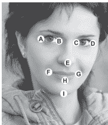

图 3.7 人脸识别的关键点。

它们可以从不同尺寸的图像中计算得出，对于同一张人脸仍应相似。计算这些测量值的计算机程序必须能够在图像中定位人脸，然后还要定位人脸上的眼睛和其他关键点。如果图像中的头部朝向不同，还会面临额外的挑战。

对于本问题，假设我们有三张人看着相机的人像图像。我们希望确定两张图像是否可能是同一个人。我们将使用的技术是比较眼睛外缘之间的距离与下巴尖和鼻子尖之间距离的比率。编写一个 C 程序，读取每张人脸的两个距离，计算比率，然后确定哪两张图像的比率最接近。

### 1. 问题描述

给定三张人脸的信息，使用比率来确定最相似的两张人脸。

### 2. 输入/输出描述

下图显示，程序的输入是三张不同图像中眼睛外缘之间的距离以及下巴尖和鼻子尖之间的距离。输出是基于这些距离比率最相似的两张图像的图像编号。

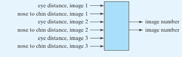

### 3. 手算示例

假设从三张图像中测得的以下距离（单位：cm）：

| | 图像 1 | 图像 2 | 图像 3 |
|---|---|---|---|
| 眼睛外缘距离 | 5.7 | 6.0 | 6.0 |
| 鼻子到下巴距离 | 5.3 | 5.0 | 5.6 |

然后我们可以计算每张图像中眼睛外缘距离与鼻子到下巴距离的比率：

```
ratio_1 = 5.7/5.3 = 1.08
ratio_2 = 6.0/5.0 = 1.20
ratio_3 = 6.0/5.6 = 1.07
```

然后我们计算每对比率之间的差值，使用绝对值使每个差值均为正数：

```
diff_1_2 = |ratio_1 - ratio_2| = |1.08 - 1.20| = 0.12
diff_1_3 = |ratio_1 - ratio_3| = |1.08 - 1.07| = 0.01
diff_2_3 = |ratio_2 - ratio_3| = |1.20 - 1.07| = 0.13
```

差值最小的那一对则确定了基于这两个距离最相似的两张图像。在此示例中，图像 1 和图像 3 最接近。请注意，这些差值都有可能很大，因此三个差值中最小的那个可能仍不能代表良好的匹配。使用距离的商业人脸识别系统会使用大量距离来提高其准确性。

### 4. 算法开发

算法开发的第一步是将问题的解决方案分解为一组按顺序执行的步骤。

### 分解大纲

- 1. 读取每张图像的距离。
- 2. 计算每张图像的比率。
- 3. 计算每对比率之间的差值。
- 4. 找到最小差值。
- 5. 打印对应的图像编号作为最佳匹配。

该程序结构简单，因此可以直接将分解转换为 C 语言。

```
//* ---------------------------------------------------------- */
//* Program chapter3_1 */
//* */
//* This program selects the two images that are most similar */
//* using the distance between the eyes and the distance */
//* between the nose and the chin.
```

```
#include <stdio.h>
#include <math.h>

int main(void)
{
    /* Declare variables. */
    double eyes_1, eyes_2, eyes_3, nose_chin_1, nose_chin_2,
           nose_chin_3, ratio_1, ratio_2, ratio_3, diff_1_2,
           diff_2_3, diff_1_3;

    /* Get user input from the keyboard. */
    printf("Enter values in cm. \n");
    printf("Enter eye distance and nose-chin distance for image 1: \n");
    scanf("%lf %lf", &eyes_1, &nose_chin_1);
    printf("Enter eye distance and nose-chin distance for image 2: \n");
    scanf("%lf %lf", &eyes_2, &nose_chin_2);
    printf("Enter eye distance and nose-chin distance for image 3: \n");
    scanf("%lf %lf", &eyes_3, &nose_chin_3);

    /* Compute ratios. */
    ratio_1 = eyes_1 / nose_chin_1;
    ratio_2 = eyes_2 / nose_chin_2;
    ratio_3 = eyes_3 / nose_chin_3;

    /* Compute differences. */
    diff_1_2 = fabs(ratio_1 - ratio_2);
    diff_1_3 = fabs(ratio_1 - ratio_3);
    diff_2_3 = fabs(ratio_2 - ratio_3);

    /* Find minimum difference and print image numbers. */
    if ((diff_1_2 <= diff_1_3) && (diff_1_2 <= diff_2_3))
        printf("Best match is between images 1 and 2 \n");
    if ((diff_1_3 < diff_1_2) && (diff_1_3 <= diff_2_3))
        printf("Best match is between images 1 and 3 \n");
    if ((diff_2_3 < diff_1_3) && (diff_2_3 < diff_1_2))
        printf("Best match is between images 2 and 3 \n");

    /* Exit program. */
    return 0;
}
/*--------------------------------------------------------------*/
```

### 5. 测试

我们首先使用手算示例中的数据来测试程序。这会产生以下交互：

```
Enter values in cm.
Enter eye distance and nose-chin distance for image 1:
5.7 5.3
Enter eye distance and nose-chin distance for image 2:
6.0 5.0
Enter eye distance and nose-chin distance for image 3:
6.0 5.6
Best match is between images 1 and 3
```

答案与手算示例匹配，因此我们可以使用其他长度来测试程序。打印三位不同朋友的图像，看看你是否能预测哪一对对于这个非常简单的人脸识别系统来说是最佳匹配。使用同一个人的两张不同图像和第三个人的信息运行程序，看看这种技术是否会选择来自同一个人的两张图像。

## 修改！

本节的这些问题与本节开发的用于从三张图像中找到最佳匹配对的程序相关。

- 1. 修改程序，使其也打印出所有三个差值。这能提供关于匹配质量的额外信息；如果差值较小，则匹配质量越好。
- 2. 如果两个比率具有相同的最小值，输出会是什么？如果三个比率都相同，输出会是什么？生成数据以使这些情况发生，并检查你的答案。
- 3. 修改程序，在解决方案中使用嵌套 if 语句，而不是三个独立的 if 语句。使用此解决方案，问题 2 的答案会改变吗？
- 4. 修改程序，打印最不同的两张图像的图像编号。
- 5. 修改程序，打印四张图像之间的最佳匹配。（请注意，这会导致程序变长，因为有四张图像时存在六种可能性。在第 5 章中，我们将学习更多 C 语言功能，使我们能够处理此类情况而无需增加代码行数。）

## 3.5 循环结构

循环用于实现重复结构。C 包含三种不同的循环结构——while 循环、do/while 循环和 for 循环。此外，C 允许我们在循环中使用两个额外语句来修改其性能——break 语句（我们在 switch 语句中使用过）和 continue 语句。


在介绍这些循环结构之前，我们想先介绍两个在查找包含循环的程序中的错误时很有用的调试建议。在编译较长的程序时，出现大量编译器错误并不罕见。与其分别查找每个错误，不如在修正几个明显的语法错误后重新编译程序。一个错误通常会生成多条错误消息。其中一些错误消息可能描述的并非你程序中的错误，而是因为原始错误让编译器感到困惑而打印出来的。


第二个调试建议与循环内部的错误有关。当你想确定循环中的步骤是否按预期工作时，在循环中包含 printf 语句，以便在每次执行循环时提供关键变量的内存快照。然后，如果存在错误，你将拥有确定错误原因所需的大部分信息。


## while 循环

while 循环的一般形式如下：

```
while (condition)
{
    statements;
}
```

在执行循环内的语句之前，会先对条件进行求值。如果条件为假，则跳过循环语句，执行继续于 while 循环之后的语句。如果条件为真，则执行循环语句，并再次对条件求值。如果它仍然为真，则再次执行语句，并再次对条件求值。这种重复持续进行，直到条件为假。循环内的语句必须修改条件中使用的变量；否则，条件的值将永远不会改变，我们要么永远不会执行循环中的语句，要么永远无法退出循环。如果 while 循环中的条件始终为真，则会生成一个无限循环。大多数系统对程序可使用的时间有系统定义的限制，超过此限制时会生成执行错误。其他系统要求用户输入一组特殊字符，例如按住控制键后再按字符 c（缩写为 ^c）来停止或中止程序的执行。

### 无限循环


几乎每个人最终都会编写一个无意中包含无限循环的程序，因此请务必了解用于中止你系统上程序执行的特殊字符。

以下伪代码和程序使用 while 循环生成一个角度转弧度的转换表（注意角度值从 0° 开始，每次递增 10°，一直到 360°）：

### 伪代码中的逐步细化

```
main: set degrees to zero
       while degrees <= 360
           convert degrees to radians
           print degrees, radians
           add 10 to degrees
```

/*
 * Program chapter3_2
 *
 * This program prints a degree-to-radian table
 * using a while loop structure.
 */
#include <stdio.h>
#define PI 3.141593

int main(void)
{
    /* Declare and initialize variables. */
    int degrees=0;
    double radians;

    /* Print Radians and degrees in a loop. */
    printf("Degrees to Radians \n");
    while (degrees <= 360)
    {
        radians = degrees*PI/180;
        printf("%6i %9.6f \n",degrees,radians);
        degrees += 10;
    }

    /* Exit program. */
    return 0;
}
/*--------------------------------------------------*/

程序输出的前几行如下：

```
Degrees to Radians
  0 0.000000
 10 0.174533
 20 0.349066
 . . .
```

## do/while 循环

do/while 循环与 while 循环类似，只不过条件是在循环结束时而不是在循环开始时进行测试。在循环结束时测试条件可确保 do/while 循环至少执行一次；如果条件最初为假，while 循环可能根本不会执行。do/while 循环的一般形式如下：

```
do
{
   statements;
} while (condition);
```

以下伪代码和程序使用 do/while 循环而不是 while 循环来打印角度转弧度转换表：

### 伪代码中的逐步细化

```
main: set degrees to zero
   do
      convert degrees to radians
      print degrees, radians
      add 10 to degrees
   while degrees <= 360
```

/*---------------------------------------------------------*/
/* Program chapter3_3                                     */
/*                                                        */
/* This program prints a degree-to-radian table           */
/* using a do-while loop structure.                       */
/*---------------------------------------------------------*/
#include <stdio.h>
#define PI 3.141593

int main(void)
{
   /* Declare and initialize variables. */
   int degrees=0;
   double radians;

   /* Print radians and degrees in a loop. */
   printf("Degrees to Radians \n");
   do
   {
      radians = degrees*PI/180;
      printf("%6i %9.6f \n",degrees,radians);
      degrees += 10;
   } while (degrees <= 360);

   /* Exit program. */
   return 0;
}
/*---------------------------------------------------------*/

## for 循环

许多程序需要基于变量值的循环，该变量在每次循环中以相同的量递增（或递减）。当变量达到指定值时，我们希望退出循环。这种类型的循环可以用 while 循环实现，但也可以轻松地用 for 循环实现。for 循环的一般形式如下：

```
for (expression_1; expression_2; expression_3)
{
   statements;
}
```

expression_1 用于初始化 **循环控制变量**，expression_2 指定继续循环重复应为真的条件，expression_3 指定对循环控制变量的修改。

例如，如果我们想执行 10 次循环，变量 k 的值从 1 以 1 的增量变化到 10，可以使用以下 **for** 循环结构：

```
for (k=1; k<=10; k++)
{
 statements;
}
```

### 使用一致的大括号位置。

如果我们想执行一个循环，变量 n 的值从 20 以 -2 的增量变化到 0，可以使用此循环结构：

```
for (n=20; n>=0; n-=2)
{
 statements;
}
```

**for** 循环也可以写成这种形式：

```
for (n=20; n>=0; n-=2)
{
 statements;
}
```

两种形式都有效，但缩写形式更常用，因为它更简短。

以下表达式计算 **for** 循环将执行的次数：

\(\text{floor}\left(\frac{\text{final value} - \text{initial value}}{\text{increment}}\right) + 1.\)

如果该值为负，则不会执行循环。因此，如果 **for** 语句具有以下结构

```
for (k=5; k<=83; k+=4)
{
 statements;
}
```

它将执行以下次数：

\(\text{floor}\left(\frac{83 - 5}{4}\right) + 1 = \text{floor}\left(\frac{78}{4}\right) + 1 = 20.\)

k 的值将是 5，然后是 9，然后是 13，依此类推，直到最终值 81。当 k 等于 85 时，循环条件不为真，因此不会使用值 85 执行循环。

考虑以下嵌套 **for** 语句集：

```
for (k=1; k<=3; k++)
 for (j=0; j<=1; j++)
  count++;
```

外层 for 循环将执行 3 次。每次执行外层 for 循环时，内层 for 循环将执行两次。因此，变量 count 将递增 6 次。

以下伪代码和程序打印之前用 while 循环显示的角度转弧度转换表，现已修改为使用 for 循环（注意，此问题的 while 循环解决方案的伪代码和 for 循环解决方案的伪代码是相同的）：

### 伪代码中的逐步细化

```
main: set degrees to zero
      while degrees <= 360
         convert degrees to radians
         print degrees, radians
         add 10 to degrees
```

/*
* Program chapter3_4
*
* This program prints a degree-to-radian table
* using a for loop structure.
*/
#include <stdio.h>
#define PI 3.141593

int main(void)
{
   /* Declare variables. */
   int degrees;
   double radians;

   /* Print radians and degrees in a loop. */
   printf("Degrees to Radians \n");
   for (degrees=0; degrees<=360; degrees+=10)
   {
      radians = degrees*PI/180;
      printf("%6i %9.6f \n",degrees,radians);
   }

   /* Exit program. */
   return 0;
}
/*--------------------------------------------------*/

请注意，degrees 的值不需要在声明中初始化，因为它在 for 循环语句中初始化。

for 循环中的初始化和修改表达式可以包含多个语句，如下所示的语句在循环中初始化并更新两个变量：

```
for (k=1, j=5; k<=10; k++, j++)
{
   sum_1 += k;
   sum_2 += j;
}
```


当使用多个语句时，它们由逗号分隔，并从左到右执行。此逗号运算符在运算符优先级中最后执行。

## 练习！

- 1. for (k=3; k<=20; k++)
   ```
   {
   statements;
   }
   ```

- 2. for (k=3; k<=20; ++k)
   ```
   {
   statements;
   }
   ```

- 3. for (count=-2; count<=14; count++)
   ```
   {
   statements;
   }
   ```

- 4. for (k=2; k>=-10; k--)
   ```
   {
   statements;
   }
   ```

- 5. for (time=10; time>=5; time++)
   ```
   {
   statements;
   }
   ```

- 6. 嵌套 for 循环执行后，count 的值是多少？
   ```
   int k, j, count=0;
   for (k=-1; k<=3; k++)
   for (j=3; j>=-1; j--)
   count++;
   ```

## break 和 continue 语句

我们在之前的部分中将 break 语句与 switch 语句一起使用。break 语句也可以与本节介绍的任何循环结构一起使用，以立即退出其所在的循环。相比之下，continue 语句用于跳过循环当前遍历（或迭代）中的其余语句，然后继续进行循环的下一次迭代。因此，在 while 循环或 do/while 循环中，在执行 continue 语句后会对条件进行求值，以确定循环中的语句是否要再次执行。在 for 循环中，会先修改循环控制变量，然后对重复继续条件进行求值，以确定循环中的语句是否要再次执行。当遇到错误条件时，break 和 continue 语句都有助于退出当前迭代或整个循环。

为了说明 break 和 continue 语句之间的区别，请考虑以下从键盘读取值的循环：

```
sum = 0;
for (k=1; k<=20; k++)
{
    scanf("%lf",&x);
    if (x > 10.0)
        break;
    sum += x;
}
printf("Sum = %f \n",sum);
```

此循环从键盘最多读取 20 个值。如果所有 20 个值都小于或等于 10.0，则语句将计算这些值的和并打印和。但是，如果某个值大于 10.0，则 break 语句会导致控制权跳出循环并执行 printf 语句。因此，打印的和仅是小于 10.0 的值的和，不包括大于 10.0 的值。

现在，请考虑前一个循环的变体：

```
sum = 0;
for (k=1; k<=20; k++)
{
    scanf("%lf",&x);
    if (x > 10.0)
        continue;
    sum += x;
}
printf("Sum = %f \n",sum);
```

在此循环中，如果所有值都小于或等于 10.0，则将打印所有 20 个值的和。但是，如果某个值大于 10.0，则 continue 语句会导致控制权跳过该次迭代中循环的其余语句，并继续进行下一次迭代。因此，打印的和是这 20 个值中所有小于或等于 10.0 的值的和。

## 3.6 应用问题求解：波相互作用

### 海况

海况（通常称为海况）是根据风速和相应的波浪来定义的。如表 3.3 所示，海况定义为 0 到 12，涵盖高达 70 英里/小时（飓风速度）及以上的风速。例如，在海况 1 中，有微风（每小时 1 到 3 英里）和水面上的小涟漪。在海况 4 中，有和风（13 到 18 英里/小时之间），海面有小浪和众多白浪。在海况 6 中，有大风（25 到 31 英里/小时之间），大浪已经形成，白浪遍布，空中有海浪飞沫。

### 波长

如本章开头所讨论，一个简单的单独波浪有波峰（高点）和波谷（低点）。波峰与波谷之间的垂直距离是波高，从波峰到波峰的水平距离是波长。深水波出现在水深大于波长一半的地方，通常由海洋表面的风产生。水深不影响深水波的速度。浅水波出现在海洋深度小于波长 1/20 的地方，包括潮汐波。浅水波的速度由水深决定——水深越大，波速越高。过渡波（水深在波长一半到波长 1/20 之间的波）的速度由波长和水深决定。随着波浪与海底摩擦导致速度降低，波高增加。当水深是波高的 1.3 倍时，波浪会在海岸上破碎。

在海洋中，波浪由许多来源产生，并从许多方向汇合。单个波浪的相互作用创建了一组具有不同波峰和波谷的复杂波浪。如果一次考虑两个波浪，组合可以是建设性干涉，即波峰同时出现，波谷同时出现，因此结果具有更高的波峰和更低的波谷。如果一个波浪的波峰与另一个波浪的波谷同时出现，则组合是破坏性干涉，因为总和可以抵消高低。在混合干涉中，两个波浪具有不同的长度和高度；因此，总和更复杂，因为它可以包含建设性干涉和破坏性干涉的成分。

为了研究两个波浪的干涉模式，我们现在开发一个程序，允许用户输入两个不同波浪的波周期和波高。然后程序将确定并打印两个波浪的波长，并计算最大波高（假设两个波浪之间没有相位移）。在开发解决方案之前，我们首先需要讨论正弦波。我们将使用这些正弦波来建模波浪，并从周期计算波浪的波长。

回顾一下，正弦函数是角度的函数，其值在 +1 和 -1 之间变化，周期为 2π，如图 3.8 所示。**正弦曲线**是正弦函数的一种形式，它表示为时间的函数，而不是角度的函数——例如，

```
s(t) = A sin(2πft + φ)
```

其中 A 是振幅，
f 是频率（以每秒周期数或赫兹为单位），
φ 是相位移（以弧度为单位）。

正弦曲线的周期为 1/f 秒。

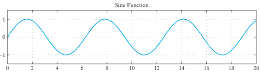

**图 3.8** 正弦函数图。

考虑以下三个函数：

\(s_1(t) = 3 \sin(2\pi t),\)
\(s_2(t) = 5 \sin(0.4\pi t), \text{ 和}\)
\(s_3(t) = 5 \sin(\pi t).\)

函数 \(s_1\) 的振幅为 3，函数 \(s_2\) 和 \(s_3\) 的振幅为 5。函数 \(s_1\) 的频率为 1 Hz，因此周期为 1 s；函数 \(s_2\) 的频率为 0.2 Hz，因此周期为 5 s；函数 \(s_3\) 的频率为 0.5 Hz，因此周期为 2 s。三个函数的相位移均为零。图 3.9 包含这三个正弦曲线的图。

一个我们不会证明但分析波浪相互作用时很有用的属性是，两个正弦曲线的和也是一个周期信号，其周期等于两个单独正弦曲线周期的最小公倍数（LCM）。因此，如果两个波浪的周期为 3 和 6 s，则组合正弦曲线的周期为 6。如果两个周期为 3 s 和 5 s，则组合信号的周期为 15 s。如果两个周期为 \(\frac{2}{3}\) s 和 \(\frac{1}{3}\) s，则组合信号的周期为 1 s。如果两个周期为 \(\frac{2}{3}\) s 和 2 s，则组合信号的周期为 6 s。开发一个确定两个数最小公倍数的算法并非易事。由于我们希望专注于波浪相互作用的特性，我们将假设输入到程序中的波周期为整数（以秒为单位）。在此假设下，最小公倍数可以证明小于或等于两个整数的乘积。因此，如果我们使用乘积作为组合波的周期，我们知道最大周期将在这个周期内。图 3.10 包含图 3.9 中每对正弦曲线的和。请注意，\(s_1 + s_2\) 的周期为 5（1 和 5 的最小公倍数），\(s_2 + s_3\) 的周期为 10（5 和 2 的最小公倍数），\(s_1 + s_3\) 的周期为 2（1 和 2 的最小公倍数）。

我们现在需要考虑波长与波周期之间的关系。对于深水中的波浪 [5]，该关系为

\(L = 5.13 T^2,\)

其中 \(T\) 以秒为单位，\(L\) 以英尺为单位。该关系不适用于浅水波。我们现在拥有描述本节开头提出的问题的解决方案所需的所有要素。

编写一个程序，允许用户输入两个波浪的周期和波高，其中周期（以秒为单位）为整数，波高以英尺为单位。程序应计算并打印每个波浪的波长。它还应计算两个波浪之和在等于两个单独周期乘积的周期内的 200 个点。然后，它应找到这 200 个点之和的最大值，并将其作为组合波浪最大波高的估计值打印出来，假设两个波浪之间的相位差为零。

表 3.3 海况编号

| 编号 | 描述 | 风速 (mph) | 海面外观 |
|---|---|---|---|
| 0 | 平静 | 无 | 像镜子一样 |
| 1 | 轻风 | 1-3 | 涟漪 |
| 2 | 和风 | 4-7 | 小波纹 |
| 3 | 轻柔微风 | 8-12 | 散布的白浪 |
| 4 | 中度微风 | 13-18 | 小浪 |
| 5 | 新鲜微风 | 19-24 | 许多白浪 |
| 6 | 大风 | 25-31 | 大浪 |
| 7 | 近大风 | 32-38 | 破碎波浪的白色泡沫 |
| 8 | 大风 | 39-46 | 中等高度的波浪 |
| 9 | 强大风 | 47-54 | 高浪 |
| 10 | 暴风雨 | 55-63 | 非常高的波浪 |
| 11 | 猛烈风暴 | 64-72 | 异常高的波浪 |
| 12 | 飓风 | >73 | 覆盖着泡沫和飞沫 |

来源：Harold V. Thurman 和 Elizabeth A. Burton，《海洋学导论》，第 9 版。Prentice-Hall，新泽西州上鞍河，2001年。


## 三个正弦波

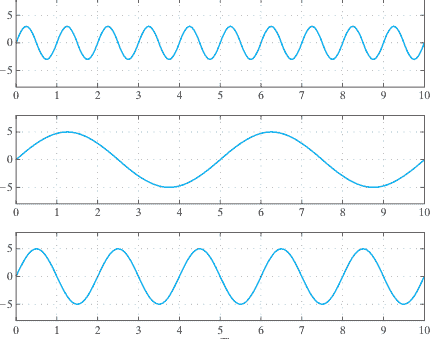

图 3.9 三个正弦波图。

## 正弦波之和

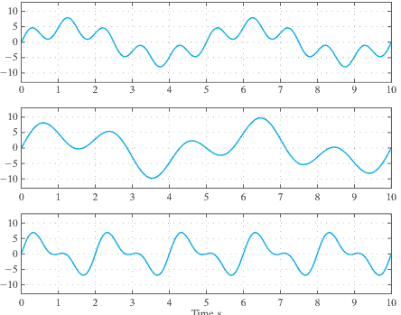

图 3.10 成对正弦波之和图。

## 1. 问题描述

确定两个波的波长以及两个波组合后的最大可能波高。

## 2. 输入/输出描述

下图显示程序的输入为每个波的周期和波高。输出为两个波各自的波长以及两个波组合后的最大波高。

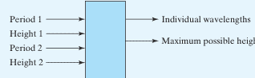

## 3. 手算示例

假设我们已测得两个波的波周期和波高（波峰与波谷之间的距离）：

| | 周期 (s) | 波高 (ft) |
|---|---|---|
| 波 1 | 4 | 0.5 |
| 波 2 | 10 | 1.0 |

我们首先使用本节前面给出的公式分别计算每个波的波长：

波长 1 = 5.13 T₁² = 82.08 英尺，且
波长 2 = 5.13 T₂² = 513 英尺。

对于合成波周期，我们使用两个波周期的乘积，即 40 秒。因此，200 个点之间的时间增量为 40/200，即 0.2 秒。在手算示例中使用 10 个点（而非 200 个），我们得到以下信息：

| t | w₁(t) | w₂(t) | w₁(t) + w₂(t) |
|---|---|---|---|
| 0 | 0 | 0 | 0 |
| 0.2000 | 0.0773 | 0.0627 | 0.1399 |
| 0.4000 | 0.1469 | 0.1243 | 0.2713 |
| 0.6000 | 0.2023 | 0.1841 | 0.3863 |
| 0.8000 | 0.2378 | 0.2409 | 0.4786 |
| 1.0000 | 0.2500 | 0.2939 | 0.5439 |
| 1.2000 | 0.2378 | 0.3423 | 0.5800 |
| 1.4000 | 0.2023 | 0.3853 | 0.5875 |
| 1.6000 | 0.1469 | 0.4222 | 0.5691 |
| 1.8000 | 0.0773 | 0.4524 | 0.5297 |

合成波的最大高度（在前 10 个点中）为 2(0.5875) 英尺，即 1.175 英尺。

## 4. 算法开发

算法开发的第一步是将问题求解分解为一组按顺序执行的步骤：

### 分解大纲

- 1. 读取要合成的两个波的周期和波高。
- 2. 计算并打印各个波的波长。
- 3. 计算两个波之和的 200 个值并确定最大值。
- 4. 打印最大值。

分解大纲中的第三步涉及一个循环，我们在其中计算新合成波的 200 个值。在循环之前，我们需要计算用于分析的合成波周期。由于我们假设波周期为整数，可以使用这些周期的乘积作为两个波之和的周期。（实际周期可能更小。）我们需要仔细考虑如何找到最大波高。回顾手算示例。表格打印出来后，很容易读取并选择最大高度。但是，当程序计算两个波的值并将它们相加时，它一次并不拥有所有数据；它只拥有当前循环遍历中值的信息。因此，为了跟踪最大值，我们必须指定一个单独的变量来存储最大值。每次计算新的波高时，我们都会将该值与最大值进行比较。如果新值更大，则用这个新值替换最大值。因此，伪代码的细化如下：

```
Refinement in Pseudocode
main: read the period and wave height for wave 1
read the period and wave height for wave 2
compute and print the wavelength for each wave
set new period to the product of the wave periods
set time increment to new period/200
set wavemax to 0
set time to 0
set steps to 0
while steps < 199
set sum to wave 1 + wave 2
if sum > wavemax
set wavemax to sum
add 1 to steps
print wavemax
```

伪代码中的步骤现在已足够详细，可以转换为 C 语言：

```c
// ---------------------------------------------------------------//
// Program chapter3_5 //
// //
// This program determines the maximum height //
// of a wave that is the sum of two specified waves. //
// ---------------------------------------------------------------//
#include <stdio.h>
#include <math.h>
#define PI 3.141593

int main(void)
{
    /* Declare variables. */
    int k;
    double A1, A2, freq1, freq2, height1, height2, length1, length2;
    double T1, T2, w1, w2, sum, new_period, new_height, time_incr, t;
    double maxwave=0;

    /* Get user input from the keyboard. */
    printf("Enter integer wave period (s) and wave height (ft) \n");
    printf("For wave 1: \n");
    scanf("%lf %lf",&T1,&height1);
    printf("Enter integer wave period (s) and wave height (ft) \n");
    printf("For wave 2: \n");
    scanf("%lf %lf",&T2,&height2);

    /* Determine and print wavelengths. */
    length1 = 5.13*T1*T1;
    length2 = 5.13*T2*T2;
    printf("(Wavelengths (in ft) are: %.2f %.2f \n",length1,length2);

    /* Determine period of combined waves. */
    new_period = T1*T2;

    /* Compute 200 points of the combined waves over the 
    * period specified, then find the maximum height. */
    time_incr = new_period/200;
    A1 = height1/2;
    A2 = height2/2;
    freq1 = 1/T1;
    freq2 = 1/T2;
    for (k=0; k<=199; k++)
    {
        t = k*time_incr;
        w1 = A1*sin(2*PI*freq1*t);
        w2 = A2*sin(2*PI*freq2*t);
        sum = w1 + w2;
        if (sum > maxwave)
            maxwave = sum;
    }
    new_height = maxwave*2;

    /* Print new wave maximum. */
    printf("Maximum combined wave height is %.2f ft \n",new_height);

    /* Exit program. */
    return 0;
}
/*--------------------------------------------------*/
```

## 5. 测试

要使用手算示例的数据测试程序，我们需要修改程序，使其只计算十个点。因此，我们将 for 循环的第一行替换为这一行：

```
for (k=0; k<=9; k++)
```

这会生成以下交互：

```
Enter integer wave period (s) and wave height (ft)
for wave 1:
4 0.5
Enter integer wave period (s) and wave height (ft)
for wave 2:
10 1
Wavelengths (in ft) are: 82.08 513.00
Maximum combined wave height is 1.18 ft
```

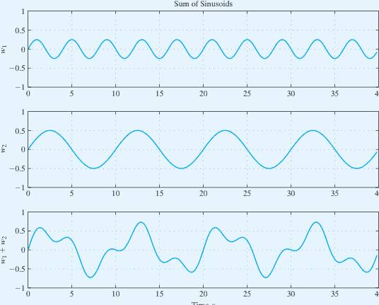

图 3.11 合成波图。

计算值与手算示例相符，因此我们可以接着测试程序。首先，我们必须更改 for 语句，使其再次指定程序应完成两百次循环。该程序的输出为

```
Enter integer wave period (s) and wave height (ft)
for wave 1:
4 0.5
Enter integer wave period (s) and wave height (ft)
for wave 2:
10 1
Wavelengths (in ft) are: 82.08 513.00
Maximum combined wave height is 1.46 ft
```

图 3.11 包含本示例中的两个波及其和。

## 修改！

- 这些问题与本节开发的用于计算最大波高的程序相关。
- 1. 修改程序，使其能找出合成波的最大波峰和最小波谷。
- 2. 修改程序，使其还允许用户输入一个时间，然后程序计算并打印该时间的合成波高。
- 3. 修改程序，使其允许用户指定在给定时间段内用于确定最大合成波高的计算点数。这是否会对答案产生任何影响？请解释。
- 4. 修改程序，使其允许用户指定两个波之间的相位移。该相位移应作为第二个波的相位移；第一个波的相位移仍应为零。尝试不同的相位移，看它们是否改变最大可能波高。
- 5. 修改程序，使其使用米和秒作为单位，而不是英尺和秒。请记住相应地修改计算波长的程序。

## 3.7 数据文件

工程问题求解通常涉及大量数据。这些数据可以是程序生成的输出数据，也可以是程序使用的输入数据。通常，将大量数据打印到屏幕上或从键盘读取大量数据是不可行的。在这些情况下，我们通常使用数据文件来存储数据。这些数据文件类似于我们用来存储 C 程序的程序文件。事实上，C 程序文件是 C 编译器的输入数据文件，而目标程序是 C 编译器的输出文件。在本节中，我们将讨论用于与数据文件交互的 C 语句，并给出生成和读取数据文件中信息的示例。


调试程序时，程序会从数据文件读取信息，将从文件中读取的信息回显（或打印）出来，以确保数据读取正确。如果数据值全为零，或者是一些不寻常的数字，可能是程序找不到文件，因为文件位于程序无法访问的目录中。解决方案是将文件移动到程序可以访问的目录，或者更改一些操作系统参数，以便程序能够找到文件。


在接下来的示例中，我们使用包含传感器数据的数据文件。为进行此讨论，我们假设传感器是一个地震仪。地震仪通常埋在地表附近，记录地球运动。这些传感器非常灵敏，可以记录潮汐运动，即使它们可能位于距离海洋数百英里的地方。地震仪数据从全球各地的传感器收集，并通过卫星发送到中心位置进行收集和分析。通过研究这种运动，科学家和工程师将来可能能够从地震仪数据预测地震。

## I/O 语句

程序中使用的每个数据文件都必须有一个与之关联的文件指针。如果程序使用两个文件，则每个文件都需要一个不同的文件指针。文件指针通过 FILE 声明定义，如下所示：

```
FILE *sensor1;
```

FILE 数据类型在头文件 stdio.h 中定义，因此单词 FILE 大写以与头文件中的定义匹配。标识符前的星号指定该标识符是一个指针。后续章节包含更多关于指针的信息；在本节中，我们仅介绍使用文件指针所需的语句。

定义文件指针后，必须将其与特定文件关联。fopen 函数获取将文件指针分配给特定文件所需的信息。该函数的两个参数是文件名和一个指示文件状态的字符（也称为文件打开模式）；文件名和字符都需要用双引号括起来。如果我们要使用程序从文件读取信息，文件打开模式为 r（读取）。如果我们要使用程序向文件写入信息，文件打开模式为 w（写入）。因此，以下语句指定文件指针 sensor 将与名为 sensor1.txt 的文件一起使用，我们将从中读取信息：

```
sensor = fopen("sensor1.txt","r");
```

如果无法打开数据文件，fopen 返回 NULL 值。（NULL 是在 <stdio.h> 中定义的符号常量，其值为字符零。）程序可能无法打开数据文件的一个常见原因是程序找不到该文件。


因此，为确保我们的程序能找到数据文件，最好检查 fopen 返回的值，以确保文件已成功打开。以下语句打开由 file1 引用的文件；如果未成功找到文件，则打印错误消息并跳过 if 语句的其余部分：

```
file1 = fopen(FILENAME,"r");
if (file1 == NULL)
    printf("Error opening input file \n");
else
{
    ...
}
```

确保程序能找到数据文件的一种方法是将数据文件存储在与程序文件相同的文件夹中。

一旦指定了输入文件及其指针，我们就可以像从键盘读取信息一样从文件中读取信息。但是，我们不使用 `scanf` 函数，而是使用 `fscanf` 函数。如果 `sensor1.txt` 文件中的每一行都包含一个时间和传感器读数，我们可以读取一行此信息，并使用以下语句将值存储在变量 `t` 和 `motion` 中：

```
fscanf(sensor, "%f %f", &t, &motion);
```

请注意，`scanf` 函数和 `fscanf` 函数之间的区别在于，`fscanf` 函数的第一个参数是文件指针。除此之外，两条语句相同。`scanf` 语句将从键盘接收的字符转换为值，而 `fscanf` 语句将从数据文件行中接收的字符转换为值。

如果文件是输出文件，我们可以使用 `fprintf` 函数将信息写入文件。`fprintf` 语句的第一个参数是文件指针，其余参数定义变量以及相应值在文件中以何种形式写入。例如，考虑本章前面开发的计算两个波之和的程序。如果我们想修改此程序，使其生成包含此数据集的数据文件，可以使用指针 `waves`，并通过以下语句将其与名为 `waves1.txt` 的输出文件关联：

```
FILE *waves;
...
waves = fopen("waves1.txt", "w");
```

然后，在计算信息时，可以使用以下语句将其写入文件：

```
fprintf(waves, "%f %f %f %f\n", t, w1, w2, sum);
```

换行符会导致在每组四个值写入文件后跳转到新行。

`fclose` 函数用于在使用完文件后关闭文件；函数参数是文件指针。要关闭这些示例语句中使用的两个文件，我们使用以下语句：

```
fclose(sensor);
fclose(waves);
```

关闭输入文件和关闭输出文件之间没有区别。如果在执行 `return` 语句时文件尚未关闭，它将自动关闭。

预处理指令常用于指定数据文件名，因为我们经常将同一程序与不同的数据文件一起使用。修改预处理指令比在语句中搜索 `fopen` 函数更容易。以下代码显示了一个预处理指令和相应的 `fopen` 函数示例：

```
#define FILENAME "sensor1.txt"
...
sensor = fopen(FILENAME, "r");
```

在本教材的其余部分，所有使用文件的示例程序中都使用这种语句组合。

## 读取数据文件

要从数据文件读取信息，我们首先需要知道文件的一些细节。显然，我们必须知道文件名，以便可以使用 fopen 语句将文件与其指针关联。我们还必须知道文件中存储的值的顺序和数据类型，以便可以正确声明相应的标识符。最后，我们需要知道文件中是否有任何特殊信息，以便帮助确定文件的长度。如果在读取完文件中所有数据后尝试执行 fscanf 语句，将发生错误。为避免错误，我们需要知道何时读取完了所有数据。

数据文件通常具有三种常见结构之一。有些文件的生成方式是文件的第一行包含后续信息的行数（也称为记录）。例如，假设一个包含传感器数据的文件有 150 组时间和传感器信息。该数据文件可以构建为第一行仅包含值 150，随后是 150 行包含传感器数据。要从该文件读取数据，我们读取文件第一行中的值，然后使用 for 循环读取其余信息。这种循环也称为计数器控制循环。

尾信号 哨兵信号

另一种文件结构使用尾信号或哨兵信号。这些信号是用于指示或标记文件最后一条记录的特殊数据值。例如，使用哨兵信号构建的传感器数据文件将包含 150 行信息，后跟一行特殊值，例如时间和传感器值为 -999.0。为避免混淆，这些哨兵信号必须是不会作为常规数据出现的值。要读取此类文件的数据，我们使用 while 循环，条件是只要数据值不是哨兵信号即为真。这种循环也称为哨兵控制循环。

第三种数据文件结构不包含指示后续有效数据记录数量的初始行，也不包含尾信号或哨兵信号。对于此类数据文件，我们使用 fscanf 函数返回的值来帮助确定何时到达文件末尾。要读取此类文件的数据，我们使用 while 循环，条件是只要未到达文件末尾即为真。


由于某些操作系统区分大小写，我们将在文件名中全部使用小写字母以避免任何潜在问题。程序使用的数据文件经常更改，因此如果文件名易于定位和更改会很有帮助。因此，使用预处理指令定义文件名；否则，文件名将嵌入程序中且无法轻松更改。


我们现在介绍用于读取传感器信息并打印摘要报告的程序，该报告包含传感器读数的数量、平均值、最大值和最小值。接下来的程序中将使用讨论过的三种常见文件格式中的每一种。

## 指定的记录数。

假设传感器数据文件中的第一条记录包含一个整数，指定后续传感器信息的记录数量。以下每一行都包含文件 sensor1.txt 中的时间和传感器读数：

```
10
0.0 132.5
0.1 147.2
0.2 148.3
0.3 157.3
```


| | |
|---|---|
| 0.4 | 163.2 |
| 0.5 | 158.2 |
| 0.6 | 169.3 |
| 0.7 | 148.2 |
| 0.8 | 137.6 |
| 0.9 | 135.9 |

首先读取数据点的数量，然后使用该数量来指定读取数据和累积信息的次数，这一过程可以使用变量控制的循环轻松描述。在以下伪代码和程序中，第一个实际数据值用于初始化最小值和最大值。如果我们最初将最小值设置为零，且所有传感器值都大于零，则程序将打印最小传感器读数的错误值零。

此解决方案的伪代码和程序如下：

### 伪代码细化

```
main: set sum to zero
    if file cannot be opened
        print error message
    else
        read number of data points
        set k to 1
        while k <= number of data points
            read time, motion
            if k = 1
                set max to motion
                set min to motion
            add motion to sum
            if motion > max
                set max to motion
            if motion < min
                set min to motion
            increment k by 1
        set average to sum/number of data points
        print average, max, min
```

```
/**
 * Program chapter3_6
 *
 * This program generates a summary report from
 * a data file that has the number of data points
 * in the first record.
 */
#include <stdio.h>
#define FILENAME "sensor1.txt"

int main(void)
{
    /* Declare and initialize variables. */
    int num_data_pts, k;
    double time, motion, sum=0, max, min;
    FILE *sensor;

    /* Open file and read the number of data points. */
    sensor = fopen(FILENAME,"r");
    if (sensor == NULL)
        printf("Error opening input file. \n");
    else
    {
        fscanf(sensor,"%d",&num_data_pts);

        /* Read data and compute summary information. */
        for (k=1; k<=num_data_pts; k++)
        {
            fscanf(sensor,"%lf %lf",&time,&motion);
            if (k == 1)
                max = min = motion;
            sum += motion;
            if (motion > max)
                max = motion;
            if (motion < min)
                min = motion;
        }
    }

    /* Print summary information. */
    printf("Number of sensor readings: %d \n",
        num_data_pts);
    printf("Average reading:        %.2f \n",
        sum/num_data_pts);
    printf("Maximum reading:        %.2f \n",max);
    printf("Minimum reading:        %.2f \n",min);

    /* Close file and exit program. */
    fclose(sensor);
    return 0;
}
```

该程序使用 sensor1.txt 文件将打印以下报告：

传感器读数数量:    10
平均读数:          149.77
最大读数:          169.30
最小读数:          132.50

### 尾记录或哨兵信号。

假设数据文件 sensor2.txt 包含与 sensor1.txt 文件相同的信息，但文件开头不给出有效数据记录的数量，而是在最后一条记录中包含一个尾信号。文件最后一行上的时间值将包含一个负值，因此我们知道这不是一行有效信息。尾行上必须包含第二个数字，因为读取每行的语句期望两个值；否则，将发生错误。名为 sensor2.txt 的数据文件的内容如下：

```
0.0 132.5
0.1 147.2
0.2 148.3
0.3 157.3
0.4 163.2
0.5 158.2
0.6 169.3
0.7 148.2
0.8 137.6
0.9 135.9
-99 -99
```

读取并累积信息直到读取尾信号的过程，可以使用 do/while 循环结构轻松描述，如以下伪代码和程序所示：

### 伪代码细化

```
main: set sum to zero
    set number of points to 0
    if file cannot be opened
        print error message
    else
        read time, motion
        set max to motion
        set min to motion
        do
            add motion to sum
            if motion > max
                set max to motion
            if motion < min
                set min to motion
            increment number of points by 1
            read time, motion
        while time >= 0
        set average to sum/number of data points
        print average, max, min
```

/*-------------------------------------------------------------*/
/* Program chapter3_7                                          */
/*                                                             */
/* This program generates a summary report from                */
/* a data file that has a trailer record with                  */
/* negative values.                                            */
/*-------------------------------------------------------------*/
#include <stdio.h>
#define FILENAME "sensor2.txt"
int main(void)
{
    /* Declare and initialize variables.  */
    int num_data_pts=0;
    double time, motion, sum=0, max, min;
    FILE *sensor;
    /* Open file and read the first data point.  */
    sensor = fopen(FILENAME,"r");
    if (sensor == NULL)
        printf("Error opening input file. \n");
    else
    {
        fscanf(sensor,"%lf %lf",&time,&motion);
        /* Initialize variables using first data point.  */
        max = min = motion;
        /* Update summary data until trailer record read.  */
        do
        {
            sum += motion;
            if (motion > max)
                max = motion;
            if (motion < min)
                min = motion;
            num_data_pts++;
            fscanf(sensor,"%lf %lf",&time,&motion);
        } while (time > 0);
        /* Print summary information.  */
        printf("Number of sensor readings: %d \n",
            num_data_pts);
        printf("Average reading: %.2f \n",
            sum/num_data_pts);
        printf("Maximum reading: %.2f \n",max);
        printf("Minimum reading: %.2f \n",min);
        /* Close file.  */
        fclose(sensor);
    }
    /* Exit program.  */
    return 0;
}
/*-------------------------------------------------------------*/

该程序使用 sensor2.txt 文件打印的报告与使用 sensor1.txt 文件打印的报告完全相同。

### 文件结束指示器

## 文件结束。

每个数据文件的末尾都插入了一个特殊的文件结束指示器；标准 C 库中的 feof 函数可用于检测在数据文件中何时到达了此指示器。fscanf 函数也可用于检测文件中何时读取了数据文件的末尾。请回顾，fscanf 函数每次执行时都会返回成功读取的值的数量。因此，如果该函数返回的值与其应读取的值的数量不同，则表示已到达数据文件的末尾，或数据文件中的信息存在错误。如果数据文件中的信息有效，则可以使用 fscanf 函数来确定何时到达数据文件的末尾。请考虑以下语句：

```
while ((fscanf(data, "%lf", &x)) == 1)
{
    count++;
    sum += x;
}
ave = sum/count;
```

fscanf 函数尝试从数据文件中读取 x 的一个值。如果读取了一个值，则该函数返回值 1，并执行循环内的语句。如果到达数据文件的末尾，则没有更多数据；因此，该函数不返回值 1，控制权传递给 while 循环之后的语句。

我们现在假设数据文件 sensor3.txt 包含与 sensor2.txt 文件相同的信息，但不包括尾信号。在以下伪代码和程序中，我们读取并累积信息直到到达数据文件的末尾：

### 伪代码细化

```
main: set sum to zero
    set number of points to 0
    if file cannot be opened
        print error message
    else
        while not at the end of the file
            read time, motion
            add 1 to the number of points
            if k = 1
                set max to motion
                set min to motion
            add motion to sum
            if motion > max
                set max to motion
            if motion < min
                set min to motion
        set average to sum/number of data points
        print average, max, min
```


```c
/*
 * Program chapter3_8
 *
 * This program generates a summary report from
 * a data file that does not have a header record
 * or a trailer record.
 */
#include <stdio.h>
#define FILENAME "sensor3.txt"
int main(void)
{
    /* Declare and initialize variables. */
    int num_data_pts=0;
    double time, motion, sum=0, max, min;
    FILE *sensor;
    /* Open file. */
    sensor = fopen(FILENAME,"r");
    if (sensor == NULL)
        printf("Error opening input file. \n");
    else
    {
        /* While not at the end of the file, */
        /* read and accumulate information. */
        while ((fscanf(sensor,"%lf %lf",&time,&motion)) == 2)
        {
            num_data_pts++;
            /* Initialize variables using first data point. */
            if (num_data_pts == 1)
            {
                max = min = motion;
            }
            /* Update summary data. */
            sum += motion;
            if (motion > max)
                max = motion;
            if (motion < min)
                min = motion;
        }
        /* Print summary information. */
        printf("Number of sensor readings: %d \n",
            num_data_pts);
        printf("Average reading: %.2f \n",
            sum/num_data_pts);
        printf("Maximum reading: %.2f \n",max);
        printf("Minimum reading: %.2f \n",min);
        /* Close file. */
        fclose(sensor);
    }
    /* Exit program. */
    return 0;
}
/*-----------------------------------------------*/
```

使用 sensor3.txt 文件打印的报告与使用 sensor1.dat 或 sensor2.txt 打印的报告完全相同。

这三种文件结构在工程和科学应用中都很常用。因此，在处理数据文件时，了解所使用的结构类型非常重要。如果假设错误，您可能会得到错误的答案而不是错误消息。有时，确定文件结构的唯一方法是打印文件的前几行和最后几行。

## 修改！

在本章开发的两个程序中，循环包含一个条件，用于测试循环第一次执行时的情况。当条件为真时，max 和 min 值被初始化为第一个 motion 值。如果与这些程序一起使用的数据文件很长，执行此语句所需的时间可能很长。避免此测试的一种方法是在进入循环之前读取第一组数据并初始化变量。此更改可能还需要对程序进行其他更改。

- 1. 修改程序 chapter3_5，删除测试循环第一次执行时的条件。
- 2. 修改程序 chapter3_7，删除测试循环第一次执行时的条件。

## 生成数据文件

生成数据文件类似于打印报告；不过，我们不是将行写入终端屏幕，而是将其写入数据文件。在生成数据文件之前，我们必须决定要使用哪种文件结构。在前面的讨论中，我们介绍了三种最常见的文件结构——带有给出后续有效记录数量的初始记录的文件、带有尾记录或哨兵记录以指示有效数据结束的文件，以及仅包含有效数据记录且没有特殊开始或结束记录的文件。

所讨论的三种文件结构各有优缺点。如果数据文件中的初始记录包含实际数据的行数，那么在生成文件之前，我们必须知道文件中将包含多少行数据。确定这个数字可能并不总是容易。带有尾信号的文件使用简单，但为尾信号选择值时必须小心，以免其包含可能出现在有效数据中的值。最简单的生成文件是仅包含有效信息的文件，文件开头或结尾没有特殊信息。如果文件中的信息将与绘图软件包一起使用，通常最好使用这种第三种文件结构，它仅包含有效信息。

我们现在提出对本章前面介绍的程序进行修改。之前的程序确定了两个波的波长，然后计算了当相位角为零时两个波之和的最大波高。在此程序中，我们还将两个单独波以及两个波之和的时间和波幅写入数据文件。将此程序与第 3.6 节中的程序进行比较。

```c
/*
 * Program chapter3_9
 *
 * This program determines the maximum height
 * of a wave that is the sum of two specified waves.
 */
#include <stdio.h>
#include <math.h>
#define PI 3.141593
#define FILENAME "waves1.txt"
int main(void)
{
    /* Declare variables. */
    int k;
    double A1, A2, freq1, freq2, height1, height2, length1, length2;
    double T1, T2, w1, w2, sum, new_period, new_height, time_incr, t;
    double maxwave=0;
    FILE *waves;
    /* Open output file. */
    waves = fopen(FILENAME,"w");
    /* Get user input from the keyboard. */
    printf("Enter integer wave period (s) and wave height (ft) \n");
    printf("For wave 1: \n");
    scanf("%lf %lf",&T1,&height1);
    printf("Enter integer wave period (s) and wave height (ft) \n");
    printf("For wave 2: \n");
    scanf("%lf %lf",&T2,&height2);
    /* Determine and print wavelengths. */
    length1 = 5.13*T1*T1;
    length2 = 5.13*T2*T2;
    printf("Wavelengths (in ft) are: %.2f %.2f \n",length1,length2);
    /* Determine period of combined waves. */
    new_period = T1*T2;
    /* Compute 200 points of the combined waves over the
    time period specified, and find the maximum height. */
    time_incr = new_period/200;
    A1 = height1/2;
    A2 = height2/2;
    freq1 = 1/T1;
    freq2 = 1/T2;
    for (k=0; k<=199; k++)
    {
        t = k*time_incr;
        w1 = A1*sin(2*PI*freq1*t);
        w2 = A2*sin(2*PI*freq2*t);
        sum = w1 + w2;
        fprintf(waves,"%.4f %.4f %.4f %.4f \n",t,w1,w2,sum);
        if (sum > maxwave)
        maxwave = sum;
    }
    new_height = maxwave*2;
    /* Print new wave maximum.     */
    printf("Maximum combined wave height is %.2f ft \n",new_height);
    /* Close file and exit program.  */
    fclose(waves);
    return 0;
}
/*-----------------------------------------------*/
```

使用本示例的输入值由此程序生成的数据文件的前几行如下所示：

| 0.0000 | 0.0000 | 0.0000 | 0.0000 |
|---|---|---|---|
| 0.2000 | 0.0773 | 0.0627 | 0.1399 |
| 0.4000 | 0.1469 | 0.1243 | 0.2713 |
| 0.6000 | 0.2023 | 0.1841 | 0.3863 |

此文件采用一种可以使用 MATLAB 等软件包轻松绘图的形式（在附录 C 中讨论）；此特定文件的图表已在图 3.11 中显示。

## 修改！

- 1. 修改程序 chapter3_8，使其生成一个文件，其中数据文件的最后一行包含所有四个值的负值。
- 2. 修改程序 chapter3_8，使其生成一个文件，其中第一行包含一个数字，指定数据文件中后续有效数据行的数量。

## 3.8 数值技术：线性建模*

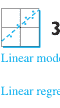

线性建模是确定与一组数据点最佳拟合的线性方程的过程的名称，其目标是最小化直线与数据点之间平方距离之和。（此过程也称为线性回归。）为了理解此过程，我们首先考虑在第 2.6 节中介绍的从新发动机气缸盖收集的一组温度值：

| 时间，s | 温度，°F |
|---|---|
| 0.0 | 0.0 |
| 1.0 | 20.0 |
| 2.0 | 60.0 |
| 3.0 | 68.0 |
| 4.0 | 77.0 |
| 5.0 | 110.0 |

如果我们绘制这些数据点，会发现它们似乎接近一条直线。事实上，我们可以通过在图表上绘制这些点，然后计算斜率和 y 截距来确定穿过这些点的直线的良好估计。图 3.12 包含点的图表（x 轴为时间，y 轴为温度）以及带有以下方程的直线：

```
y = 20x.
```

要衡量此线性估计与数据的拟合质量，我们首先确定每个点到线性估计的垂直距离；这些距离在图 3.13 中显示。前两个点正好落在直线上，因此 d1 和 d2 为零。d3 的值等于 60.0 - 40.0，即 20.0；其余距离可以以类似方式计算。如果计算距离之和，一些正值和负值会相互抵消，从而得到一个比应有值更小的和。为了避免此问题，我们可以添加绝对值或平方值；线性回归使用平方值。因此，此线性估计拟合质量的度量是点与线性估计之间平方距离之和。此和可以轻松计算；它是 573。

如果我们穿过这些点绘制另一条直线，可以计算与这条新直线对应的平方和。在两条直线中，平方距离之和较小的直线提供更好的拟合。要找到平方距离之和最小的直线，我们从一般线性方程开始：

```
y = mx + b.
```

然后，我们编写一个方程来计算给定数据点与此一般方程之间平方距离之和。使用微积分技术，我们可以计算该方程关于 m 和 b 的导数，并将导数设为零。以这种方式确定的 m 和 b 值代表平方距离之和最小（即最小二乘距离）的直线。在给出 m 和 b 的这些方程之前，我们先定义求和符号。

### 最小二乘求和符号

本节开头给出的一组数据点可以用点 (x1, y1)、(x2, y2)、...、(x6, y6) 表示。符号 Σ 表示求和；因此，x 坐标之和可以用以下符号表示：

```
\sum_{k=1}^6 x_k.
```

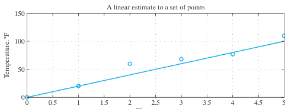

图 3.12 用于模拟一组点的线性估计。


此求和读作 *当 k 从 1 变到 6 时，$x_k$ 的和*。示例数据点的此求和值为 (0 + 1 + 2 + 3 + 4 + 5)，即 15。可使用示例数据点计算的其他求和如下：

\(\sum_{k=1}^6 y_k = 0 + 20 + 60 + 68 + 77 + 110 = 335,\)

\(\sum_{k=1}^6 y_k^2 = 0^2 + 20^2 + 60^2 + 68^2 + 77^2 + 110^2 = 26,653,\)

\(\sum_{k=1}^6 x_k y_k = 0 \cdot 0 + 1 \cdot 20 + 2 \cdot 60 + 3 \cdot 68 + 4 \cdot 77 + 5 \cdot 110 = 1,202.\)

我们现在回到寻找一组点的最佳线性拟合的问题。使用基于微积分结果的前面过程，我们发现，以最小二乘意义下对一组 n 个数据点的最佳线性拟合的斜率和 y 截距如下：

\(m = \frac{\sum_{k=1}^n x_k \cdot \sum_{k=1}^n y_k - n \cdot \sum_{k=1}^n x_k y_k}{(\sum_{k=1}^n x_k)^2 - n \cdot \sum_{k=1}^n x_k^2},\) (3.1)

\(b = \frac{\sum_{k=1}^n x_k \cdot \sum_{k=1}^n x_k y_k - \sum_{k=1}^n x_k^2 \cdot \sum_{k=1}^n y_k}{(\sum_{k=1}^n x_k)^2 - n \cdot \sum_{k=1}^n x_k^2}.\) (3.2)

对于示例数据集，_m_ 的最优值为 20.83，_b_ 的最优值为 3.76。数据点集和此最佳线性拟合方程如图 3.14 所示。此最佳拟合的平方和为 356.82，而图 3.13 中直线的平方和为 573。

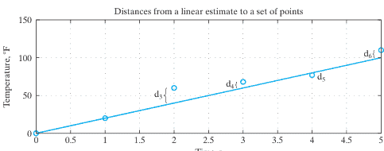

**图 3.13** 点与线性估计之间的距离。

## 使用线性回归计算的一组点的最佳拟合

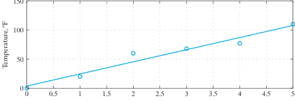

**图 3.14** 最小二乘线性回归模型。

对近似线性的一组数据点执行线性回归的一个优点是，我们可以随后估计或预测我们没有数据的点。例如，在气缸头温度示例中，假设我们想要估计 3.3 秒时气缸头的温度。通过使用线性回归计算出的方程，估计温度为

```
y = mx + b
= (20.83)(3.3) + 3.76
= 72.5.
```

有了方程模型，我们可以计算出使用线性插值无法计算的估计值。例如，使用线性模型，我们可以计算 8 秒时的温度估计值，但我们无法使用线性插值计算 8 秒时的估计值，因为我们没有时间大于 8 秒的点。（这将是外推，而不是插值。）

同样重要的是要记住，线性模型并不适合所有数据集。因此，在使用线性模型预测新数据点之前，首先确定线性模型是否适合数据非常重要。

在下一节中，我们将开发一个问题求解方案，以确定从卫星收集的一组传感器数据的最佳拟合，然后使用该模型来估计或预测其他传感器值。

## 3.9 应用问题求解：臭氧测量*

卫星传感器可用于测量许多不同的信息，帮助我们更多地了解大气层，大气层由地球周围的多个层组成。从地球表面开始，各层为对流层、平流层、中间层、热层和外层，如图 3.15 所示。大气的每一层都可由其温度剖面来表征。对流层是大气的内层，高度从两极约 5 km 到赤道约 18 km 不等。大多数云层形成于对流层，在那里温度随高度增加而稳步下降。平流层的特点是，在相当大的高度差异下温度相对均匀。它从对流层延伸到地球上方约 50 km（约 31 英里）。漂移到平流层的污染物可能在那里停留多年，然后才漂移回对流层，在那里它们可以被天气稀释和清除。中间层从 50 km 延伸到地球表面上方约 85 km（约 53 英里）。在这一层中，空气混合得相当容易。中间层之上是热层，它从 85 km 延伸到地球上方约 140 km（约 87 英里）。该区域通过原子氧吸收太阳能而被加热。电离层是热层中一个相对致密的带电粒子带。某些类型的通信利用无线电波离电离层的反射。最后，外层是大气层的最高区域。在外层中，空气密度如此之低，以至于向上移动的空气分子更有可能逃逸大气层，而不是击中另一个分子。

考虑一组以百万分之一体积（ppmv）为单位测量臭氧混合比的数据。在小区域内，这些数据近似线性，因此我们可以使用线性模型来估计我们没有特定数据的高度处的臭氧。编写一个程序，读取名为 zone1.txt 的数据文件，该文件包含我们希望确定线性模型的区域的高度（千米）和相应的臭氧混合比（百万分之一体积）。数据文件仅包含有效数据，因此没有特殊的标题行或尾行。使用前一节介绍的最小二乘法来确定并打印模型。此外，打印起始和结束高度以指示模型准确的区域。

### 1. 问题描述

使用最小二乘法确定用于在指定高度估计臭氧混合比的线性模型。

### 2. 输入/输出描述

以下 I/O 图显示，输入是数据文件 zone1.txt，输出是高度范围和线性模型：

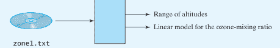

### 3. 手算示例

假设数据由以下表格中的四个数据点组成。

| 高度 (km) | 臭氧混合比 (ppmv) |
|---|---|
| 20 | 3 |
| 24 | 4 |
| 26 | 5 |
| 28 | 6 |

我们现在需要计算方程 (3.1) 和 (3.2)，为了方便，这里再次列出：

```
m = \frac{\sum_{k=1}^n x_k \cdot \sum_{k=1}^n y_k - n \cdot \sum_{k=1}^n x_k y_k}{(\sum_{k=1}^n x_k)^2 - n \cdot \sum_{k=1}^n x_k^2},

b = \frac{\sum_{k=1}^n x_k \cdot \sum_{k=1}^n x_k y_k - \sum_{k=1}^n x_k^2 \cdot \sum_{k=1}^n y_k}{(\sum_{k=1}^n x_k)^2 - n \cdot \sum_{k=1}^n x_k^2}.
```

要使用手算示例中的数据计算这些方程，我们需要计算以下求和组：

\(\sum_{k=1}^4 x_k = 20 + 24 + 26 + 28 = 98,\)

\(\sum_{k=1}^4 y_k = 3 + 4 + 5 + 6 = 18,\)

\(\sum_{k=1}^4 x_k^2 = (20)^2 + (24)^2 + (26)^2 + (28)^2 = 2436,\)

\(\sum_{k=1}^4 x_k y_k = 20 \cdot 3 + 24 \cdot 4 + 26 \cdot 5 + 28 \cdot 6 = 454.\)

使用这些求和，我们现在可以计算 \(m\) 和 \(b\) 的值：

\(m = 0.37, \quad b = -4.6.\)

### 4. 算法开发

我们首先开发分解大纲。

### 分解大纲

- 1. 读取数据文件值并计算相应的求和和范围。
- 2. 计算斜率和 y 截距。
- 3. 打印高度范围和线性模型。

分解大纲的第一步涉及一个循环，我们在其中从文件读取数据，同时将相应的值添加到计算线性模型所需的求和中。在读取文件时，我们还需要确定数据点的数量。退出循环的条件是测试文件末尾，因为没有标题或尾部信息。因为我们想跟踪高度范围，我们还需要保存第一个高度值和最后一个高度值。因此，伪代码的细化如下：

```
Refinement in Pseudocode
Main: set count to zero
    set sumx, sumy, sumxy, sumx2 to zero
    if file cannot be opened
        print error message
    else
        while not at the end of the file
            read x, y
            increment count by 1
            if count = 1
                set first to x
            add x to sumx
            add y to sumy
            add x^2 to sumx2
            add x*y to sumxy
        set last to x
        compute slope and y intercept
        print first, last, slope, y intercept
```


```
/*
------------------------------------------------------*/
/* Program chapter3_10 */
/* */
/* This program computes a linear model for a set */
/* of altitude and ozone mixing ratio values. */
/* */
#include <stdio.h>
#define FILENAME "zone1.txt"

int main(void)
{
    /* Declare and initialize variables. */
    int count=0;
    double x, y, first, last, sumx=0, sumy=0, sumx2=0,
    sumxy=0, denominator, m, b;
    FILE *zone;

    /* Open input file. */
    zone = fopen(FILENAME,"r");
    if (zone == NULL)
    printf("Error opening input file. \n");
    else
    {
    /* While not at the end of the file. */
    /* read and accumulate information. */
    while ((fscanf(zone,"%lf %lf",&x,&y)) == 2)
    {
    ++count;
    if (count == 1)
    first = x;
    sumx += x;
    sumy += y;
    sumx2 += x*x;
    sumxy += x*y;
    }
    last = x;

    /* Compute slope and y-intercept. */
    denominator = sumx*sumx - count*sumx2;
    m = (sumx*sumy - count*sumxy)/denominator;
    b = (sumx*sumxy - sumx2*sumy)/denominator;
}

/* Print summary information. */
printf("Range of altitudes in km: \n");
printf("%.2f to %.2f \n\n",first,last);
printf("Linear model: \n");
printf("%.2f altitude + %.2f \n",
m,b);
/* Close file. */
fclose(zone);
/* Exit program. */
return 0;
}
/*------------------------------------------*/
```

## 5. 测试

使用手算示例中的数据作为数据文件 zone1.txt 的内容，我们得到以下程序输出：

```
Range of altitudes in km:
20.00 to 28.00
Linear model:
ozone-mix-ratio = 0.37 altitude + -4.60
This matches the values computed from the hand example.
```

## 修改！

这些问题与本节开发的程序有关。在某些问题中，您可能需要使用以下关系：1 km = 0.621 mi。

- 1. 向程序中添加语句，以便允许您输入以千米为单位的高度。程序应使用该模型估计相应的臭氧混合比。
- 2. 修改问题 1 中的程序，以便它检查您输入的高度，以确定其是否适用于此模型。
- 3. 修改问题 2 中的程序，以便它允许您以英里为单位输入高度。（程序应将英里转换为千米。）
- 4. 修改原始程序，使其也打印一个线性模型，以便可用于以英里而非千米为单位的高度。假设数据文件中仍包含以千米为单位的高度。

本章介绍了使用条件和 if 语句来选择要执行的适当语句。我们还介绍了在循环中重复执行一组语句的技术。这些循环可以实现为 while 循环或 for 循环。选择结构和重复结构在大多数程序中都有应用。此外，我们包含了从数据文件读取信息所需的语句，以便在程序中使用这些信息。我们还介绍了从程序生成数据文件的语句。数据文件常用于解决工程问题；因此，本概念在文本中较早地被介绍，以便我们可以在许多后续问题的解决方案中使用它。最后，我们介绍了为一组数据点生成线性模型的概念，并包含了用于确定最小二乘法下最佳拟合直线的方程。

## 关键术语

- case 标签
- case 结构
- 复合语句
- 条件
- 条件运算符
- 控制表达式
- 数据文件
- default 标签
- 分治法
- 空语句
- 文件结束指示符
- 错误条件
- 文件打开模式
- 文件指针
- 流程图
- for 循环
- 迭代
- 最小二乘法
- 线性建模
- 线性回归
- 逻辑运算符
- 循环
- 循环控制变量
- 程序走查
- 伪代码
- 关系运算符
- 重复
- 选择
- 序列
- 哨兵信号
- 逐步求精
- 结构化程序
- 求和符号
- 测试数据
- 自顶向下设计
- 尾随信号
- 验证与确认
- while 循环

## C 语句摘要

文件指针声明：

```
FILE *sensor;
```

### if 语句

```
if (temp > 100)
    printf("Temperature exceeds limit \n");
```

```
temp > 100 ? printf("Caution \n"): printf("Normal \n");
```

### if/else 语句

```
if (d <= 30)
    velocity = 4.25 + 0.00175*d*d;
else
    velocity = 0.65 + 0.12*d - 0.0025*d*d;
```

### switch 语句

```
switch (op_code)
{
case 'n': case 'r':
    printf("Normal operating range \n");
    break;
case 'm':
    printf("Maintenance needed \n");
    break;
default:
    printf("Error in code value \n");
    break;
}
```

### while 循环

```
while (degrees <= 360)
{
    radians = degrees*PI/180;
    printf("%6.0f %9.6f \n",degrees,radians);
    degrees += 10;
}
```

### do/while 循环

```
do
{
    radians = degrees*PI/180;
    printf("%6.0f %9.6f \n",degrees,radians);
    degrees += 10;
} while (degrees <= 360);
```

### for 循环

```
for (degrees=0; degrees<=360; degrees+=10)
{
    radians = degrees*PI/180;
    printf("%6.0f %9.6f \n",degrees,radians);
}
```

### break 语句

```
break;
```

### continue 语句

```
continue;
```

### 文件打开函数

```
sensor = fopen("sensor1.txt", "r");
waves = fopen(FILENAME,"w");
```

文件输入函数：
fscanf(sensor, "%f %f %f", &t, &motion);

文件输出函数：
fprintf(waves, "%.2f %.2f %.2f %.2f \n", t, w1, w2, sum);

文件关闭函数：
fclose(sensor);


## 注意事项

- 1. 在简单条件的逻辑表达式中，关系运算符两侧使用空格；在复杂条件中，逻辑运算符两侧使用空格，而关系运算符两侧不使用空格。
- 2. 缩进复合语句或循环内的语句。如果循环或复合语句嵌套，则从前一语句缩进每个嵌套的语句集。
- 3. 即使不需要，也要使用花括号来清晰地标识复杂语句的结构。
- 4. 在 switch 语句中使用 default 分支，以强调当没有任何 case 标签与控制表达式匹配时应采取的操作。
- 5. 将每个花括号单独放在一行上，以便轻松识别循环体。
- 6. 使用预处理器指令定义文件名，以便可以轻松更改。


## 调试注意事项

- 1. 当您发现并更正程序中的错误时，请重新开始测试步骤。特别是，使用所有测试数据集重新运行程序。
- 2. 在等价条件中，请务必使用关系运算符 == 而不是 =。
- 3. 将围绕语句块的花括号各自单独放在一行上；这将帮助您避免遗漏它们。
- 4. 不要将相等运算符与浮点数值一起使用；而是测试值是否“接近”所需值。
- 5. 更正语法错误时，请频繁重新编译程序；更正一个错误可能会消除许多错误消息。
- 6. 调试循环时，使用 printf 语句提供关键变量值的内存快照。
- 7. 请确保您了解在系统中程序进入无限循环时中止其执行所需的特殊字符。产生无限循环比您想象的更容易。
- 8. 调试从数据文件读取数据的程序时，请在读取值后立即打印它们。这将帮助您检查读取信息中的错误。
- 9. 调试读取数据文件的程序时，请确保您的程序可以访问包含数据文件的目录。
- 10. 为避免与不区分大小写的操作系统出现问题，请使用小写字母的文件名。

## 习题

### 简答题

### 判断题

请指示以下陈述是正确 (T) 还是错误 (F)：

- 1. 如果条件的值为零，则该条件被求值为假。T F
- 2. 如果条件的值既不是零也不是 1，则它是无效条件。T F
- 3. 表达式 a == 2 用于确定 a 的值是否等于 2，而表达式 a = 2 将值 2 赋给变量 a。T F
- 4. 逻辑运算符 && 和 || 具有相同的优先级。T F
- 5. 保留字 else 始终与最近的 if 语句相关联，除非使用花括号定义语句块。T F
- 6. 要调试循环，可以在循环中使用 printf 语句来提供变量的内存快照。T F

### 语法题

找出以下语句中的任何语法错误（假设所有变量均已定义为整数）：

- 7. for (b=1, b<=25, b++)
- 8. while (k=1)
- 9. 
```
switch (sqrt(x))
{
case 1:
printf("Too low. \n");
break;
case 2:
printf("Correct range. \n");
break;
case 3:
printf("Too high. \n");
break;
}
```

### 选择题

圈出完成每个陈述或回答每个问题的最佳答案的字母。

- 10. 考虑以下语句：
  int i=100, j=0;
  以下哪些陈述是正确的？
  (a) i<3
  (b) (!j<1)
  (c) (1>0) || (j>50)
  (d) (j<1) && (i<=10)


11. 如果 a1 为真且 a2 为假，则以下哪些表达式为真？
(a) a1 && a2
(b) a1 || a2
(c) !(a1 || a2)
(d) !a1 && a2

12. 以下哪些是一元运算符？
(a) !
(b) |
(c) &&

13. 表达式 ( !( (3-4%3) < 5 && (6/4 >3)) ) 的值为
(a) 真。
(b) 假。
(c) 无效。
(d) 以上皆非。

问题 14-16 参照以下语句：

```c
int sum=0, count;
...
for (count=0; count<=4; count++)
sum += count;
printf("sum = %d \n",sum);
```

14. 屏幕上会显示什么？
(a) sum = 1 (b) sum = 6
(c) sum = 10 (d) 错误消息

15. for 循环执行后 count 的值是多少？
(a) 0 (b) 4
(c) 5 (d) 一个不可预测的整数

16. 循环内部的语句执行了多少次？
(a) 0 (b) 4
(c) 5 (d) 6

## 内存快照问题

执行以下语句后，给出相应的内存快照。

17.

```c
int a = 750;
...
if (a>0)
if (a >= 1000)
a = 0;
else
if (a < 500)
a *= 2;
else
a *= 10;
else
a += 3;
```

## 编程问题

### 单位换算

以下问题生成单位换算表。为表格添加表头和列标题。根据要打印的值选择小数位数。

- 18. 生成从弧度到角度的换算表。弧度列从 0.0 开始，每次增加 π/10，直到弧度值为 2π。

- 19. 生成从角度到弧度的换算表。第一行应包含 0° 的值，最后一行应包含 360° 的值。允许用户输入表格中各行之间的增量。

- 20. 生成从英寸到厘米的换算表。英寸列从 0.0 开始，每次增加 0.5 in。最后一行应包含 20.0 in 的值。（回顾 1 in = 2.54 cm。）

- 21. 生成从英里/小时到英尺/秒的换算表。mph 列从 0 开始，每次增加 5 mph。最后一行应包含 65 mph 的值。（回顾 1 mi = 5280 ft。）

- 22. 生成从英尺/秒到英里/小时的换算表。ft/s 列从 0 开始，每次增加 5 ft/s。最后一行应包含 100 ft/s 的值。（回顾 1 mi = 5280 ft。）

### 货币换算

以下问题生成货币换算表。使用标题和列标题。假设以下换算率：

| 货币 | 换算率 |
|------|--------|
| 1 美元 ($) | 0.737938 欧元 (欧洲) |
| 1 日元 (Y) | $0.013005 |
| 1 美元 ($) | 0.632293 英镑 (£) (英国) |

- 23. 生成从欧元到美元的换算表。欧元列从 5 欧元开始，每次增加 5 欧元。在表格中打印 25 行。

- 24. 生成从英镑 (£) 到美元的换算表。英镑列从 1 £ 开始，每次增加 2 £。在表格中打印 30 行。

- 25. 生成从日元到英镑的换算表。日元列从 100 Y 开始，打印 25 行，最后一行包含 10,000 Y 的值。

- 26. 生成从美元到欧元、日元和英镑的换算表。列从 $1 开始，每次增加 $1。在表格中打印 50 行。

### 温度换算

以下问题生成温度换算表。使用以下给出华氏温度 ($T_F$)、摄氏温度 ($T_C$) 和兰氏温度 ($T_R$) 之间关系的公式：

```
$T_F = T_R - 459.67^\circ \text{R}$
$T_F = (9/5)T_C + 32^\circ \text{F}$
$T_R = (9/5)T_K$
```

- 27. 编写一个程序，生成从 0°F 到 100°F 的华氏到摄氏换算表。每变化 5° 打印一行。在解答中使用 while 循环。

- 28. 编写一个程序，生成从 0°F 到 200°F 的华氏到开尔文换算表。允许用户输入各行之间的华氏度增量。在解答中使用 do while 循环。

- 29. 编写一个程序，生成从摄氏到兰氏的换算表。允许用户输入起始温度和各行之间的增量。在表格中打印 25 行。在解答中使用 for 循环。

### 探空火箭轨迹

探空火箭用于探测大气的不同层次以收集信息（例如用于监测大气臭氧水平的信息）。除了携带用于在高层大气收集数据的科学仪器外，火箭还携带遥测系统，将科学数据传输到发射场的接收器。火箭本身的性能测量数据也会被传输，以便由靶场安全人员监测，并随后由工程师分析。这些性能数据包括高度、速度和加速度数据。假设这些信息存储在一个文件中，每行包含四个值——时间、高度、速度和加速度。假设单位分别为秒、米、米/秒和米/秒$^2$。

- 30. 假设文件 rocket1.txt 包含一个初始行，其中包含随后的实际数据行数。编写一个程序读取这些数据并确定火箭开始回落到地球的时间。（提示：确定高度开始下降的时间。）

- 31. 火箭的级数可以通过速度增加到某个峰值然后开始下降的次数来确定。编写一个程序读取这些数据并确定火箭的级数。使用数据文件 rocket2.txt。它包含一个尾行，所有四个值的值均为 -99。

- 32. 修改问题 31 中的程序，使其打印与每级点火相对应的时间。假设点火对应于速度开始增加的点。

- 33. 火箭每级点火后，加速度最初会增加，然后降至 -9.8 m/s$^2$，即重力引起的向下加速度。找出火箭飞行中仅由重力引起加速度的时间段。对于这些时间段，允许加速度在理论值的 65% 范围内变化。使用数据文件 rocket3.txt，该文件不包含标题行或尾行。

### 缝合线包装

缝合线是用于在受伤或手术后缝合活体组织的线或纤维。缝合线包装在运送到医院前必须仔细密封，以防止污染物进入包装。密封包装的物体称为密封模。通常，密封模由电加热器加热。为了使密封过程成功，密封模保持在既定温度，并必须以预定压力接触包装既定的时间段。密封模与包装接触的时间段称为停留时间。假设可接受密封的参数可接受范围如下：

- 温度：150–170°C
- 压力：60–70 psi
- 停留时间：2–2.5 s

- 34. 名为 `suture1.txt` 的数据文件包含一周内被拒收的缝合线批次的信息。数据文件中的每行包含被拒收批次的批号、温度、压力和停留时间。质量控制工程师必须分析这些信息，并需要一份报告，计算因温度被拒收的批次百分比、因压力被拒收的批次百分比以及因停留时间被拒收的批次百分比。特定批次可能因多个原因被拒收，并应在所有适用的总数中计算。编写一个程序来计算并打印这三个百分比。

- 35. 修改问题 34 中开发的程序，使其还打印每个拒收类别中的批次数量和被拒收批次的总数。（请记住，被拒收的批次在总数中只应出现一次，但可能出现在多个拒收类别中。）

- 36. 编写一个程序读取数据文件 `suture1.txt`，并确保信息仅涉及应被拒收的批次。如果任何批次不应出现在数据文件中，请打印包含批次信息的适当消息。

### 木材再生

木材管理中的一个问题是确定应留下多少面积未砍伐，以便采伐区在一定时间内重新造林。假设重新造林以每年已知的速率进行，具体取决于气候和土壤条件。重新造林方程将这种增长表示为立木量和重新造林速率的函数。例如，如果采伐后留下 100 英亩，且重新造林速率为 0.05，则第一年末的森林面积为 100 + (0.05 * 100)，即 105 英亩。第二年末的森林面积为 105 + (0.05 * 105)，即 110.25 英亩。

- 37. 假设该区域总面积为 14,000 英亩，其中 2500 英亩未砍伐，重新造林速率为 0.02。打印一张表格，显示每年末的森林英亩数，总共 20 年。

- 38. 修改问题 37 中开发的程序，以便用户可以输入表格使用的年数。


39. 修改问题 37 中开发的程序，使用户可以输入英亩数，程序将确定这些英亩完全重新造林所需的年数。

## 关键路径分析

关键路径分析是一种用于确定项目时间进度的技术。这些信息在项目开始前的规划阶段非常重要，同时也有助于评估部分完成项目的进度。这种分析方法首先将项目划分为一系列事件，然后将每个事件划分为各种任务。虽然必须在下一个事件开始之前完成一个事件，但事件内的各种任务可以同时进行。因此，完成一个事件所需的时间取决于完成其最长任务所需的天数。同样，完成一个项目所需的总时间是完成每个事件所需时间的总和。

假设某大型建设项目的关键路径信息已存储在数据文件中。数据文件的每一行包含一个事件编号、一个任务编号和完成任务所需的天数。数据的存储方式是：第一个事件的所有任务数据后跟第二个事件的所有任务数据，依此类推。典型的数据集如下表所示。

| 事件 | 任务 | 天数 |
| :--- | :--- | :--- |
| 1 | 15 | 3 |
| 1 | 27 | 6 |
| 1 | 36 | 4 |
| 2 | 15 | 5 |
| 3 | 18 | 4 |
| 3 | 26 | 1 |
| 4 | 15 | 2 |
| 4 | 26 | 7 |
| 4 | 27 | 7 |
| 5 | 16 | 4 |

40. 编写一个程序，读取关键路径信息并打印项目完成时间表，列出每个事件编号、事件内任务的最大天数以及项目完成的总天数。

41. 编写一个程序，读取关键路径信息并打印报告，列出所有耗时超过五天的任务的事件编号和任务编号。

42. 编写一个程序，读取关键路径信息并打印报告，列出每个事件的编号及事件内任务的数量。

## 气象气球

气象气球用于收集大气中不同高度的温度和压力数据。气球上升是因为气球内部氦气的密度小于气球外部周围空气的密度。随着气球上升，周围空气变得不那么密集，因此气球的上升速度减慢，直到达到平衡点。白天，阳光加热气球内部被困的氦气，导致氦气膨胀并变得不那么密集；因此，气球会升得更高。然而，夜间，气球中的氦气冷却并变得更加密集；因此，气球会下降到较低的高度。第二天，太阳再次加热氦气，气球上升。随着时间的推移，这一过程生成了一组高度测量值，可以用多项式方程近似。假设以下多项式表示气象气球发射后前48小时内的高度（以米为单位）：

```
alt(t) = -0.12t^4 + 12t^3 - 380t^2 + 4100t + 220,
```

其中t的单位为小时。气象气球速度（米/小时）的相应多项式模型为

```
v(t) = -0.48t^3 + 36t^2 - 760t + 4100.
```

图3.16包含了气球在48小时内的高度和速度图。从图中，我们可以看到气球上升或下降的时间段。

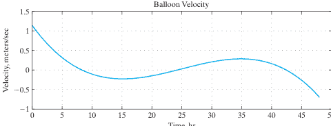

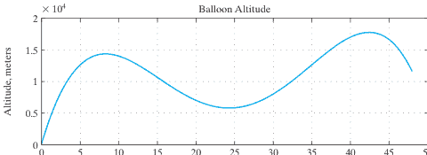

图3.16 气象气球的速度和高度数据。

43. 编写一个程序，以米和米/秒为单位打印该气象气球的高度和速度表。让用户输入开始时间、表格各行之间的时间增量以及结束时间，所有时间值必须小于48小时。使用该程序生成一个表格，显示气球发射后4小时开始，在2小时期间内每10分钟一次的气象气球信息。

44. 修改问题 43中的程序，使其还打印峰值高度及其对应的时间。

45. 修改问题 43中的程序，使其检查结束时间是否大于开始时间。如果不是，要求用户重新输入完整的报告信息。

46. 前面的方程仅在0到48小时的时间范围内准确，因此修改问题 43生成的程序，使其向用户打印一条消息，指定48小时的上限。同时，检查用户输入以确保其保持在适当范围内。如果有错误，要求用户重新输入完整的报告信息。

47. 修改问题 43中的程序，使其将时间、高度和速度信息存储在名为balloon1.txt的数据文件中。


## 犯罪现场调查：虹膜识别

虹膜识别基于匹配虹膜（眼睛中环形的有色部分）中的图案。虹膜识别使用红外（IR）摄像机拍摄眼球图像来执行。IR图像是黑白的，因此颜色信息不是图像的一部分。然而，IR图像可以捕捉非常深棕色眼睛中的图案——这是可见光图像无法实现的。由于虹膜具有复杂的结构，虹膜识别是最准确的生物识别技术之一。虹膜中的图案或条纹是在婴儿尚在母体内时，由于膜撕裂形成的。你的左虹膜与右虹膜非常不同，同卵双胞胎的虹膜也不同。虹膜也是少数不会随着人年龄增长而改变的生物识别特征之一。例如，面部会随时间变化，骨骼会随着儿童成长为成人而改变。虹膜识别在许多电影中展示过，但技术并不总是被准确表现。例如，大多数虹膜识别系统包含“活体”检测。这意味着它们包括测试以确定眼球是否属于活人。这些活体测试可以包括检查眼球的抖动等。所有眼睛都有非常少量的抖动，如果发现一只眼睛没有抖动，那么它就不是活眼球。另一种活体测试可以通过改变采集系统的光照来进行。这种变化应该导致瞳孔大小改变；如果没有，那么同样，它不是活眼球。因此，挖出眼球来欺骗虹膜识别系统——就像在《少数派报告》电影中所做的那样——在现实中行不通！

# 使用函数的模块化编程

- 4.1 模块化
- 4.2 程序员定义的函数
- 4.3 应用问题求解：计算虹膜边界
- 4.4 应用问题求解：冰山追踪
- 4.5 随机数
- 4.6 应用问题求解：仪器可靠性
- 4.7 数值技术：多项式的根*
- 4.8 应用问题求解：系统稳定性*
- 4.9 宏*
- 4.10 递归*
- 摘要、关键术语、C语句摘要、风格注释、调试注释、问题

## 目标

在本章中，我们开发包含以下内容的问题解决方案：
- 标准C库中的模块。
- 程序员定义的模块，
- 生成随机数的函数，
- 宏函数，
- 递归函数，以及
- 查找多项式实根的技术。

## 4.1 模块化

C程序的执行从main函数中的语句开始。程序还可以包含其他函数，并可以引用另一个文件或库中的函数。这些函数或模块是通常执行操作或计算值的语句集合。例如，printf函数在终端屏幕上打印一行信息，sqrt函数计算一个值的平方根。

为了在更长、更复杂的问题解决方案中保持简单性和可读性，我们开发使用main函数和其他函数的程序，而不是使用一个冗长的main函数。通过将解决方案分解为一组模块，每个模块更易于理解，从而遵循第3章中介绍的结构化编程的基本准则。

函数 模块

风格

*可选部分。


开发问题解决方案的过程通常是“分而治之”，如第3章在首次讨论分解大纲时所讨论的那样。分解大纲是一组按顺序执行的步骤，用于解决问题，因此它为选择潜在函数提供了良好的起点。事实上，分解大纲中的每个步骤对应主函数中的一个或多个函数引用，这并不罕见。

### 可重用性

将问题解决方案分解为一组模块有许多优点。因为模块有特定的目的，它可以与问题解决方案的其余部分分别编写和测试。单个模块比完整的解决方案更小，因此测试它更容易。此外，一旦模块经过仔细测试，就可以在新的问题解决方案中使用而无需重新测试。例如，假设开发了一个模块来查找一组值的平均值。一旦该模块编写并测试完成，就可以在其他需要计算平均值的程序中使用。这种可重用性在大型软件系统的开发中是一个非常重要的问题，因为它可以节省开发时间。事实上，常用模块库（例如标准C库）通常在计算机系统上可用。

### 模块化

使用模块（称为模块化）通常可以减少程序的总长度，因为许多问题解决方案包含在程序中多次重复的步骤。通过将这些重复的步骤封装在函数中，每次需要时都可以用一条语句引用这些步骤。

如果项目被分解为模块，多个程序员可以在同一个项目上工作，因为各个模块可以相互独立地开发和测试。这允许加快开发进度，因为部分工作可以并行进行。

### 抽象

使用为完成特定任务而编写的模块支持抽象的概念。模块包含任务的细节，我们可以引用模块而无需担心这些细节。我们在开发问题解决方案时使用的I/O图是抽象的一个示例——我们指定输入信息和输出信息，而不给出确定输出信息的细节。类似地，我们可以将模块视为“黑盒”，它们具有指定的输入并计算指定的信息；我们可以使用这些模块来帮助开发解决方案。因此，我们能够在更高的抽象级别上操作以解决问题。例如，标准C库包含计算值对数的函数。我们可以引用这些函数而无需关心具体细节，例如函数是使用无穷级数近似还是查找表来计算指定的对数。通过使用抽象，我们可以在缩短软件开发时间的同时提高其质量。

总而言之，在问题解决方案中使用模块有几个优点：

- 模块可以与解决方案的其他部分分别编写和测试，因此对于大型项目，模块开发可以并行进行。
- 模块是解决方案的一小部分，因此单独测试它更容易。
- 一旦模块经过仔细测试，在用于新的问题解决方案之前就不需要重新测试。
- 使用模块通常可以减少程序的长度，使其更易读。
- 使用模块促进抽象概念，使我们能够将细节“隐藏”在模块中；这使我们能够以功能方式使用模块而无需关心具体细节。

随着本章的深入，还将指出模块的其他优点。

结构图（或称模块图）显示程序的模块结构。主函数引用其他函数，这些函数本身也可能引用其他函数。图4.1包含本章和下一章“应用问题求解”部分中开发的程序的一些结构图。请注意，结构图不指示分解大纲中包含的步骤顺序。结构图显示程序任务分解为模块，并指示哪些模块引用其他模块。因此，分解大纲和结构图都提供了问题解决方案的不同但有用的视图。另外，请注意，结构图不包含从标准C库引用的模块，因为它们使用非常频繁，并且是C环境的组成部分。

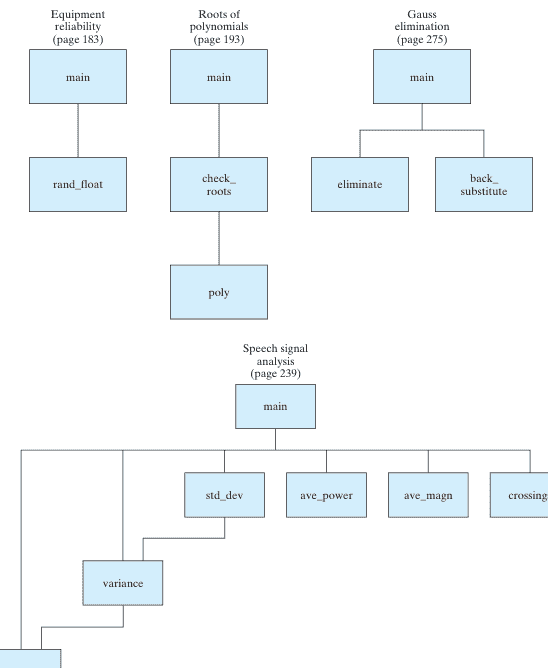

图4.1 结构图示例。

当我们开始开发更复杂问题的解决方案时，程序会变得更长。因此，以下三个步骤将帮助我们调试更长的程序。首先，使用不同的编译器运行程序可能会有所帮助，因为不同的编译器有不同的错误消息；事实上，有些编译器有详细的错误消息，而另一些编译器对某些错误提供的信息很少。调试长程序的另一个有用步骤是在代码的某些部分周围添加注释指示符（/* 和 */），以便您可以专注于程序的其他部分。当然，您必须小心；不要注释掉影响您想要测试的程序部分需要的变量的语句。最后，单独测试复杂的函数。这通常是通过一个称为驱动程序的特殊程序来完成的，其目的是在您和正在测试的函数之间提供一个简单的接口。通常，该程序会要求您输入要传递给函数的参数，然后打印函数返回的值。随着我们介绍接下来的几个部分，驱动程序的实用性将变得更加明显。


- 驱动程序

## 4.2 程序员定义的函数

程序的执行总是从主函数开始。当程序遇到函数名时，会调用（或称作调用）其他函数。这些其他函数必须定义在包含主函数的文件中，或在另一个可用文件或文件库中。（如果函数包含在系统库文件中，例如排序函数，则通常称为库函数；其他函数通常称为程序员编写的函数或程序员定义的函数。）执行函数中的语句后，程序将继续执行调用该函数的语句。

- 调用
- 库函数
- 程序员定义的函数

### 函数示例

sinc(x)函数（如图4.2所示）在许多工程应用中被广泛使用。sinc(x)最常见的定义如下：

```
f(x) = sinc(x)
= \frac{\sin(\pi x)}{\pi x}
```

（sinc(x)函数也偶尔定义为sin(x)/x。该函数的值可以轻松计算，除了sinc(0)，它给出0/0的不定式。在这种情况下，可以使用微积分中的洛必达法则来证明sinc(0) = 1。）

假设我们想要开发一个允许用户输入区间限值a和b的程序。然后，程序应计算并打印a和b之间（包含两端）等间距x的21个sinc(x)值。因此，x的第一个值应为a。然后应添加一个增量以获得下一个x值，依此类推，直到第二十一个值，即b。因此，x的增量为

```
x\_increment = \frac{\text{interval width}}{20} = \frac{b - a}{20}
```

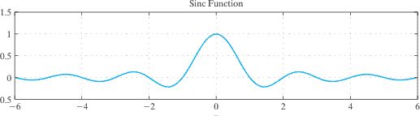

图4.2 [-20, 20]中的sinc函数。

为a和b选择值，并让自己相信，使用这个增量并以a作为第一个值时，第二十一个值将是b。

因为sinc(x)不是标准C库提供的数学函数的一部分，我们以两种方式实现此问题解决方案。在一种解决方案中，我们在主函数中包含执行sinc(x)计算的语句；在另一种解决方案中，我们编写一个程序员定义的函数来计算sinc(x)，然后在每次需要计算时引用该程序员定义的函数。现在介绍这两种解决方案，以便您可以比较它们。

### 解决方案1

```
/*
 * ----------------------------------------------------------- */
/*
 * Program chapter4_1                                                */
/*
 * This program prints 21 values of the sinc                         */
/* function in the interval [a,b] using                              */
/* computations within the main function.                            */
/*
#include <stdio.h>
#include <math.h>
#define PI 3.141593

int main(void)
{
    /* Declare variables. */
    int k;
    double a, b, x_incr, new_x, sinc_x;

    /* Get interval endpoints from the user. */
    printf("Enter endpoints a and b (a<b): \n");
    scanf("%lf %lf", &a, &b);
    x_incr = (b - a)/20;

    /* Compute and print table of sinc(x) values. */
    printf("x and sinc(x) \n");


```c
for (k=0; k<=20; k++)
{
    new_x = a + k*x_incr;
    if (fabs(new_x) < 0.0001)
        sinc_x = 1.0;
    else
        sinc_x = sin(PI*new_x)/(PI*new_x);
    printf("%f %f \n",new_x,sinc_x);
}
/* Exit program. */
return 0;
}
/* -------------------------------------------------- */
```

## 解决方案 2

```c
/*
Program chapter4_2
*/
/*
This program prints 21 values of the sinc function
using a programmer-defined function.
*/
#include <stdio.h>
#include <math.h>
#define PI 3.141593

int main(void)
{
    /* Declare variables. */
    int k;
    double a, b, x_incr, new_x;
    double sinc(double x);

    /* Get interval endpoints from the user. */
    printf("Enter endpoints a and b (a<b): \n");
    scanf("%lf %lf",&a,&b);
    x_incr = (b - a)/20;

    /* Compute and print table of sinc(x) values. */
    printf("x and sinc(x) \n");
    for (k=0; k<=20; k++)
    {
        new_x = a + k*x_incr;
        printf("%f %f \n",new_x,sinc(new_x));
    }

    /* Exit program. */
    return 0;
}
```

```
/*
* This function evaluates the sinc function.
*/
double sinc(double x)
{
    if (fabs(x) < 0.0001)
        return 1.0;
    else
        return sin(PI*x)/(PI*x);
}
/*-----------------------------------------------------------*/
```

以下输出表示与任一程序可能发生的交互示例：

```
Enter endpoints a and b (a<b):
-2 2
x and sinc(x)
-2.000000 0.000000
-1.800000 -0.103943
-1.600000 -0.189207
-1.400000 -0.216236
-1.200000 -0.155915
-1.000000 0.000000
-0.800000 0.233872
-0.600000 0.504551
-0.400000 0.756827
-0.200000 0.935489
0.000000 1.000000
0.200000 0.935489
0.400000 0.756827
0.600000 0.504551
0.800000 0.233872
1.000000 0.000000
1.200000 -0.155915
1.400000 -0.216236
1.600000 -0.189207
1.800000 -0.103943
2.000000 0.000000
```

图 4.3 包含针对四个不同区间 [a, b] 计算的 21 个值的图表。该程序仅计算 21 个值，因此图表的分辨率受区间大小的影响——较小的区间比较大的区间具有更好的分辨率。请注意，解决方案 2 的 main 函数更易于阅读，因为它比第一个解决方案中的 main 函数更短。既然您已有带程序员定义函数的程序示例，我们现在对函数中的语句进行更一般性的讨论。

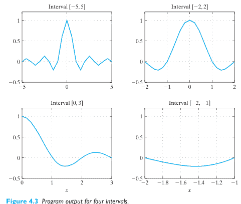

## 函数定义

函数由定义语句后跟声明和语句组成。定义语句的第一部分定义函数计算的值的类型（在我们的示例中为 double）；如果函数不计算值，则类型为 void。函数名和参数列表紧跟在 return_type 之后。因此，函数的一般形式为

```
return_type function_name (parameter_declarations)
{
    declarations;
    statements;
}
```

参数声明表示传递给函数的信息；如果没有输入参数（也称为实参），则参数声明应为 void。函数使用的其他变量在声明中定义。函数内的声明和语句用大括号括起来。函数名应选择为有助于记录函数目的的名称。函数内还应包含注释，以进一步描述函数的目的并记录步骤。我们还使用带破折号的注释行，将程序员定义的函数与 main 函数以及其他程序员定义的函数分开。

所有函数都应包含 return 语句，其一般形式如下：

```
return expression;
```

表达式指定要返回给引用函数的语句的值。表达式类型应与函数定义中指示的 return_type 匹配，以避免潜在错误。如有必要，可使用强制转换运算符（在第 2 章中讨论）来显式指定表达式的类型。void 函数不返回值，因此具有以下一般定义语句：


```
void function_name(parameter declarations)
```

void 函数中的 return 语句不包含表达式，形式如下：

```
return;
```

函数可以在 main 函数之前或之后定义。（请记住，右大括号指定 main 函数的结束。）但是，一个函数必须在另一个函数开始之前完全定义；函数定义不能互相嵌套。在我们的程序中，我们首先包含 main 函数，然后按程序中引用它们的顺序包含其他函数。


我们现在更仔细地查看引用函数的语句与函数本身之间的交互。

## 函数原型

程序 chapter4_2 中的 main 函数在其声明中包含了以下语句：

函数原型

```
double sinc(double x);
```

该语句是一个 **函数原型** 语句。它通知编译器，main 函数将引用名为 sinc 的函数，sinc 函数期望一个 double 参数，并且 sinc 函数返回一个 double 值。标识符 x 不作为变量定义；它仅用于指示 sinc 函数期望将一个值作为参数。事实上，在函数原型语句中仅包含参数类型是有效的：

```
double sinc(double);
```

这两个原型语句向编译器提供相同的信息。我们建议在原型语句中使用参数标识符，因为标识符有助于记录参数的顺序和定义。


函数原型可以包含在预处理器指令中，或者因为函数原型定义了函数返回的值的类型，它也可以与其他变量声明一起包含。例如，程序 chapter4_2 的声明如下

```
/* Declare variables and function prototypes. */
int k;
double a, b, x_incr, new_x;
double sinc(double x);
```

这些语句也可以写成以下形式：

```c
/* Declare variables and function prototypes. */
int k;
double a, b, x_incr, new_x, sinc(double x);
```

在我们的程序中，我们将函数原型列在单独的声明语句中，以便更容易识别它们。


**应为程序中引用的所有函数包含函数原型语句。** 头文件，例如 `stdio.h` 和 `math.h`，包含标准 C 库中许多函数的原型语句；否则，我们需要在程序中为 `printf` 和 `sqrt` 等函数单独包含原型语句。如果程序员定义的函数引用其他程序员定义的函数，则还需要额外的原型语句。


如果程序引用大量程序员定义的函数，则包含所有函数原型语句会变得麻烦。在这种情况下，可以定义一个自定义头文件，其中包含函数原型及任何相关的符号常量。头文件的文件名应以 `.h` 后缀结尾。然后使用带有双引号的 `#include` 语句引用该文件。在第 5 章，我们开发了一组用于从一组值计算常见统计量的函数。如果包含相应函数原型的头文件名为 `stat_lib.h`，则可以通过以下语句将所有原型包含在程序中：

```c
#include "stat_lib.h"
```

自定义头文件通常用于随程序员共享的例程一起使用。

## 参数列表

- 形式参数
- 实际参数

函数的定义语句定义函数所需的参数；这些称为 **形式参数**。引用函数的任何语句都必须包含与参数对应的值；这些称为 **实际参数**。例如，考虑本节前面开发的 `sinc` 函数。该函数的定义语句是

```c
double sinc(double x)
```

以及 `main` 程序中引用该函数的语句是

```c
printf("%f %f \n",new_x,sinc(new_x));
```

因此，变量 `x` 是形式参数，变量 `new_x` 是实际参数。当执行 `printf` 语句中对 `sinc` 函数的引用时，实际参数中的值被复制到形式参数，并使用 `x` 中的新值执行 `sinc` 函数中的步骤。然后打印 `sinc` 函数返回的值。需要注意的是，函数完成后，形式参数中的值不会移回实际参数。我们通过一个内存快照来说明这些步骤，该快照显示了从实际参数到形式参数的值传递，假设 `new_x` 的值为 5.0：


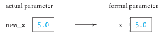

实际参数的值被复制到形式参数后，sinc 函数中的步骤将被执行。调试函数时，最好使用 printf 语句提供函数被引用前实际参数的内存快照，以及函数开头形式参数的内存快照。

对 sinc 函数的有效引用还可以包括表达式或其他函数引用，如下所示对 sinc 函数的示例引用：

```
printf("%f \n",sinc(x+2.5));
scanf("%f",&y);
printf("%f \n",sinc(y));
z = x*x + sinc(2*x);
w = sinc(fabs(y));
```

在所有这些示例引用中，形式参数仍然是 x，但实际参数是 x+2.5、y、2*x 或 fabs(y)，具体取决于所选的引用。

如果函数有多个参数，则形式参数和实际参数必须在数量、类型和顺序上匹配。编译器可以使用函数原型语句检测形式参数数量与实际参数数量之间的不匹配。如果实际参数的类型与相应的形式参数不同，则实际参数的值将转换为适当的类型；这种转换也称为参数强制转换，可能会导致错误，也可能不会。强制转换按照第 2 章中给出的讨论进行，该章讨论了将存储为一种类型的值移动到不同类型的变量中。将值转换为更高类型（例如从 float 到 double）通常可以正确工作；将值转换为更低类型（例如从 float 到 int）通常会引入错误。

### 参数强制转换

为了说明参数强制转换，请考虑返回两个值中最大值的以下函数：

```
/*-------------------------------------------------------------*/
/* This function returns the maximum of two                    */
/* integer values.                                             */
/*-------------------------------------------------------------*/
int max(int a,int b)
{
  if (a > b)
    return a;
  else
    return b;
}
/*-------------------------------------------------------------*/
```

假设对该函数的引用为 max(x_sum, y_sum)，且 x_sum 和 y_sum 分别是包含值 3 和 8 的整数。那么，以下内存快照显示了在引用 max(x_sum, y_sum) 时，从实际参数到形式参数的值传递：

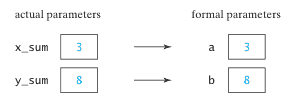

函数中的语句将随后将值 8 作为引用 max(x_sum, y_sum) 的值返回。

现在假设使用 float 变量 t_1 和 t_2 对函数 max 进行引用。如果 t_1 和 t_2 包含值 2.8 和 4.6，则在执行引用 max(t_1, t_2) 时会发生以下参数传递：


函数中的语句将随后将值 4 返回到包含引用 max(t_1, t_2) 的语句。显然，函数返回了错误的值。但是，问题不在函数中；问题在于该函数使用了错误类型的实际参数进行引用。

如果实际参数顺序错误，还可能引入其他错误。这些错误可能不会被编译器检测到，并且可能难以定位；因此，请特别注意形式参数和实际参数的顺序匹配。

sinc 示例中的函数引用是按值调用（call-by-value），或称值引用（reference-by-value）。进行函数引用时，实际参数的值将传递给函数，并用作相应形式参数的值。通常，C 函数不能更改实际参数的值。例外情况发生在实际参数是数组（第 5 章讨论）或指针（第 6 章讨论）时；这些例外会生成按引用调用（call-by-reference）或按地址引用（reference-by-address），将在后面的章节中讨论。


| 按值调用（Call-by-value） | 值引用（Reference-by value） |
|---|---|
| 按引用调用（Call-by-reference） | 地址引用（Reference-by-address） |

### 作用域

## 存储类和作用域

在迄今为止介绍的示例程序中，我们已在 main 函数和程序员定义的函数中声明了变量。在 main 函数之前定义变量也是有效的。因此，能够确定函数或变量的作用域非常重要，作用域是指可以引用函数或变量的程序部分；作用域有时也定义为程序中

## 练习！

请考虑以下函数：

```
/*--------------------------------------------------------------*/
/* This function counts positive parameters.                    */
/*--------------------------------------------------------------*/
int positive(double a,double b,double c)
{
   int count;

   count = 0;
   if (a >= 0)
      count++;
   if (b > 0)
      count++;
   if (c > 0)
      count++;

   return count;
}
/*--------------------------------------------------------------*/
```

假设该函数通过以下语句引用：

```
x = 25;
total = positive(x,sqrt(x),x-30);
```

- 1. 显示实际参数和形式参数的内存快照。
- 2. total 的新值是多少？

- 存储类
- 局部变量
- 全局变量
- 自动存储类
- 外部存储类

其中函数或变量可见或可访问。由于变量的作用域与其存储类直接相关，我们还将讨论四种存储类——自动、外部、静态和寄存器。首先，我们定义局部变量和全局变量之间的区别。局部变量在函数内定义，因此包括形式参数和函数中声明的任何其他变量。局部变量只能在定义它的函数中访问。局部变量在其函数执行时有值，但函数完成后其值不会保留。全局变量在 main 函数或其他程序员定义的函数之外定义。全局变量的定义在所有函数之外，因此程序中的任何函数都可以访问它。但是，要引用全局变量，某些编译器要求函数内的声明在类型说明符之前包含关键字 extern，以告诉计算机在函数外部查找该变量。自动存储类用于表示局部变量；这是默认存储类，但也可以在类型说明符之前使用关键字 auto 来指定。外部存储类用于表示全局变量；extern 说明符必须在函数内使用，在全局变量的原始定义中是可选的。

请考虑包含以下语句的程序：

```
#include <stdio.h>
int count=0;
...
int main(void)
{
 int x, y, z;
 ...
}
int calc(int a,int b)
{
 int x;
 extern int count;
 ...
}
void check(int sum)
{
 extern int count;
 ...
}
```

变量 count 是一个全局变量，可以被函数 calc 和 check 引用。变量 x、y 和 z 是局部变量，只能在主程序中引用；同样，变量 a、b 和 x 是局部变量，只能在函数 calc 中引用，而 sum 是局部变量，只能在函数 check 中引用。请注意，有两个局部变量 x——它们是作用域不同的两个不同变量。


分配给外部变量的内存在整个程序运行期间保留。虽然可以使用适当的声明从函数引用外部变量，但通常不鼓励使用全局变量。通常，参数更适合用于向函数传递信息，因为参数在函数原型中很明显，而外部变量在函数原型中不可见。应尽可能避免使用全局变量。

函数名也具有外部存储类，因此可以从其他函数引用。包含在任何函数之外的函数原型也是外部引用，因此可用于程序中的所有其他函数；这解释了为什么我们不需要在每个引用数学函数的函数中都包含 math.h。但是，函数原型中的参数变量仅在函数原型语句中已知。

静态存储类用于指定局部变量的内存应在整个程序执行期间保留。因此，如果在函数中的局部变量在其类型说明之前使用关键字 static 赋予静态存储类，则当程序退出定义该变量的函数时，该变量不会丢失其值。静态变量可用于计算函数被调用的次数，因为计数的值会在一次函数调用到另一次函数调用之间保留。

关键字 register 用于变量的类型说明符之前，以指定该变量应放置在寄存器中，而不是内存位置。访问寄存器比访问内存更快，因此此存储类用于频繁访问的值。由于可用寄存器的数量取决于系统，并且内存访问所需的时间正在稳步减少，因此这种存储类很少使用。


## 练习！

使用第 4.6 节第 183 页上的程序，提供以下信息（您无需理解程序即可确定所需信息）：

- 1. 列出外部标识符。
- 2. 列出局部变量并标识其作用域。

使用第 4.8 节第 193 页上的程序，提供以下信息（您无需理解程序即可确定所需信息）：

- 3. 列出外部标识符。
- 4. 列出局部变量并标识其作用域。

## 4.3 应用问题求解：计算虹膜边界

在本节中，我们将使用本章介绍的新语句来解决与虹膜识别相关的问题。大多数虹膜识别技术首先从分割操作开始。该操作识别虹膜/瞳孔边界以及虹膜与巩膜（或眼白）之间的边界，如图 4.4 所示。这在视觉上对我们来说是一个容易完成的步骤，但使用计算机算法自动执行分割是一个非常复杂的过程。对于某些分析，会使用手动分割程序，用户在屏幕上看到一张眼睛图像，然后用户在瞳孔边界上点击三个点，在虹膜与巩膜之间的边界上点击三个点。有了三个点，计算机可以计算圆的方程。因此，我们可以计算形成虹膜边界的圆的方程。有了这些信息，我们可以提取虹膜并继续虹膜识别过程。

本节将解决的问题是：给定平面上的三个点，然后计算经过这些点的圆的方程。我们还将计算圆心的位置。有多种方法可以从圆上的三个点求出圆的方程。我们使用的方法基于求过点 P1 和 P2 的直线方程，以及过点 P2 和 P3 的直线方程。如果我们假设


图 4.4 标记了虹膜边界的眼睛图像。


图 4.5 圆上点与圆心之间的关系。

如果这两条直线不平行，那么垂直于这两条线段（P1P2 和 P2P3）且经过线段中点的直线相交于圆心。（参见图 4.5）。我们不会详细介绍这些方程的推导过程，但互联网上有许多推导过程可供参考。我们现在介绍计算直线 P1P2 和 P2P3 方程以及计算垂直于这些线段并经过其中点的直线方程所需的方程。然后我们介绍求这些垂直线交点的方程；该点也是由三个原始点表示的圆的圆心。一旦有了圆心点，我们就可以利用圆上的点来计算半径。以下是此函数所需的方程，假设 P1、P2 和 P3 的坐标分别为 (x1, y1)、(x2, y2) 和 (x3, y3)：

- 直线 P1P2 的斜率：

  \( m_{12} = \frac{y_2 - y_1}{x_2 - x_1} \) (4.1)

- 直线 P2P3 的斜率：

  \( m_{23} = \frac{y_3 - y_2}{x_3 - x_2} \) (4.2)

- 直线 P1P2 的方程：

  \( y_{12} = m_{12}(x - x_1) + y_1 \) (4.3)

- 直线 P2P3 的方程：

  \( y_{23} = m_{23}(x - x_2) + y_2 \) (4.4)

- 垂直于直线 P1P2 且平分线段的直线方程：

  \( y_{p12} = -\frac{1}{m_{12}} \left( x - \frac{x_1 + x_2}{2} \right) + \left( \frac{y_1 + y_2}{2} \right) \) (4.5)

- 垂直于直线 P2P3 且平分线段的直线方程：

  \( y_{p23} = -\frac{1}{m_{23}} \left( x - \frac{x_2 + x_3}{2} \right) + \left( \frac{y_2 + y_3}{2} \right) \) (4.6)

- 圆心 x 坐标的方程：

```
x_c = \frac{m_{12}m_{23}(y_1 - y_3) + m_{23}(x_1 + x_2) - m_{12}(x_2 + x_3)}{2(m_{23} - m_{12})}
```

- 圆心 y 坐标的方程：

```
y_c = -\frac{1}{m_{12}} \left( x_c - \frac{x_1 + x_2}{2} \right) + \left( \frac{y_1 + y_2}{2} \right)
```

- 圆的半径方程：

```
r = \sqrt{(x_1 - x_c)^2 + (y_1 - y_c)^2}
```

我们现在准备用 C 语言开发解决方案。

### 1. 问题描述

给定平面上的三个点，确定包含这三个点的圆的圆心坐标和半径。

### 2. 输入/输出描述

下图显示，程序的输入是三个点的 x、y 坐标。输出是圆心坐标和圆的半径。


### 3. 手算示例

使用本节前面提供的方程，我们现在计算相应圆的圆心和半径。假设我们从圆上的以下三个点开始：

```
P_1 = (-1, -1)
P_2 = (1, 1)
P_3 = (3, -1)
```

使用方程 (4.1) 和 (4.2)，我们可以计算直线 P1P2 和 P2P3 的斜率 m12 和 m23：

```
m_{12} = 2/2 = 1
m_{23} = -2/2 = -1
```

使用方程 (4.3) 和 (4.4)，我们可以计算直线 P1P2 和 P2P3 的方程：

```
y12 = x
y23 = -x + 2
```

使用方程 (4.5) 和 (4.6)，我们可以计算垂直于 P1P2 和 P2P3 且平分线段的直线方程：

```
yp12 = -x
yp23 = x - 2
```

使用方程 (4.7) 和 (4.8)，我们可以计算圆心坐标：

```
xc = 1
yc = -1
```

使用方程 (4.9)，我们可以计算圆的半径：

```
r = 2
```

因此，圆的方程为：

```
(x - 1)² + (y + 1)² = 4
```

（回顾，圆心坐标为 (xc, yc)、半径为 r 的圆的方程为：

```
(x - xc)² + (y - yc)² = r²
```

其中圆心坐标为 (xc, yc)，半径为 r。

当我们将点 P1、P2 和 P3 的坐标代入此方程时，我们可以确认这些点在圆上。

### 4. 算法开发

由于计算圆心坐标需要求解多个方程，因此这是一个适合封装为函数的候选项。如果我们回顾手算示例，会发现大多数方程都在计算求解圆心 x 坐标所需的中间值。让我们将这些计算放入一个函数中，这样主程序就会更短，也更容易理解。我们现在为主程序和函数制定分解大纲。

#### 主程序分解大纲：

- 1. 读取三个点的坐标。
- 2. 使用函数确定圆心的 x 坐标。
- 3. 计算圆心的 y 坐标。
- 4. 计算圆的半径。
- 5. 打印圆心坐标和半径。

#### 函数分解大纲（假设三个点的坐标作为输入参数传递给函数，函数的输出是圆心的 x 坐标）：

- 1. 计算连接三个点的两条直线的方程。
- 2. 计算垂直于连接三个点的直线且平分线段的两条直线的方程。
- 3. 计算圆心的 x 坐标。

主程序和函数的结构都很简单，因此我们可以直接将分解转换为 C 语言代码。

```
/*
 * Program chapter4_3
 *
 * This program reads the coordinates of three points and then
 * references a function to determine the coordinates of the
 * center of a circle through the points and the radius of the
 * circle.
 */
#include <stdio.h>
#include <math.h>

int main(void)
{ /* Declare variables. */
    double x1, x2, x3, y1, y2, y3, m12, xc, yc, r;
    double circle_x_coord(double x1,double y1,double x2,double y2,
                          double x3,double y3);

    /* Get user input from the keyboard. */
    printf("Enter x and y coordinates for first point: \n");
    scanf("%lf %lf",&x1,&y1);
    printf("Enter x and y coordinates for second point: \n");
    scanf("%lf %lf",&x2,&y2);
    printf("Enter x and y coordinates for third point: \n");
    scanf("%lf %lf",&x3,&y3);

    /* Use a function to determine the x coordinate of the center. */
    xc = circle_x_coord(x1,y1,x2,y2,x3,y3);

    /* Compute the y coordinate of the center. */
    m12 = (y2 - y1)/(x2 - x1);
    yc = -(1/m12)*(xc - (x1 + x2)/2) + (y1 + y2)/2;

    /* Compute the radius of the circle. */
    r = sqrt((x1 - xc)*(x1 - xc) + (y1 - yc)*(y1 - yc));

    /* Print circle parameters. */
    printf("\nCenter of Circle: (%f,%f)\n",xc,yc);
    printf("Radius of Circle: %.1f \n",r);
```


/* Exit program. */
return 0;
}
/*-------------------------------------------------------------*/
/* This function computes the x coordinate of the center of a  */
/* circle given three points on the circle.                    */
/*-------------------------------------------------------------*/
double circle_xcoord(double x1,double y1,double x2,double y2,
                     double x3,double y3)
{
  /* Declare variables.                                        */
  double m12, m23, xc_num, xc_den, xc;
  /* Compute slopes of the two lines between points.           */
  m12 = (y2 - y1)/(x2 - x1);
  m23 = (y3 - y2)/(x3 - x2);
  /* Compute the x coordinate of the center of the circle.     */
  xc_num = m12*m23*(y1 - y3) + m23*(x1 + x2) - m12*(x2 + x3);
  xc_den = 2*(m23 - m12);
  xc = xc_num/xc_den;
  /* Return the x coordinate of the center.                    */
  return xc;
}
/*-------------------------------------------------------------*/

## 5. 测试

我们首先使用手算示例中的数据测试程序。这会生成以下交互：

```
Enter x and y coordinates for first point:
-1 -1
Enter x and y coordinates for second point:
1 1
Enter x and y coordinates for third point:
3 -1
Center of Circle: (1.0,-1.0)
Radius of Circle: 2.0
```

答案与手算示例匹配，因此我们可以使用更多点来测试程序。

## 修改！

这些问题与本节开发的用于根据圆上三个点求圆心和半径的程序有关。

- 1. 修改程序，使其也打印圆的方程。
- 2. 如果任一条直线是垂直的，则对应的斜率为无穷大。判断是否发生这种情况，并在退出程序前打印错误消息。
- 3. 如果直线 P1P2 是垂直的，则交换 P2 与 P3 的值。然后检查这是否现在得出两条非垂直直线。如果是，继续处理。
- 4. 如果直线 P2P3 是垂直的，则交换 P2 与 P1 的值。然后检查这是否现在得出两条非垂直直线。如果是，继续处理。
- 5. 综合上述问题 3 和 4 的解决方案。除非三个点都在同一条垂直线上，否则此解决方案现在可以正常工作，但这表明点存在错误，因为三个点不可能都在同一个圆上。

## 4.4 应用问题求解：冰山追踪

大型冰山由卫星追踪，其位置使用纬度和经度指定。能够确定冰山与附近船舶之间的距离非常重要。在本节中，我们将开发一个程序，在给定两个物体的纬度和经度时确定它们之间的距离。在开发程序之前，我们需要简要讨论纬度和经度，并开发出使用纬度和经度确定两点之间距离的方程。

- 大圆
- 本初子午线
- 赤道
- 纬度
- 经度
- 全球定位系统

假设地球由半径为 3960 英里的球体表示。然后我们可以用由纬度和经度测量确定的网格来定义地球表面上的位置。要理解这些测量，我们首先需要回顾大圆的定义——大圆是球体与通过球体中心的平面相交形成的圆。如果平面不通过球体中心，则它将是一个周长较小的圆，因此不是大圆。本初子午线是一条南北向的大圆，它经过格林威治（伦敦郊外）和北极点。赤道是一条东西向的大圆，它与北极点和南极点等距。因此，我们可以定义一个直角坐标系，使原点为地球中心，z 轴从地球中心经过北极点，x 轴从地球中心经过本初子午线与赤道的交点（参见图 4.6）。纬度是角距离，以度为单位，从赤道向北或向南延伸（如 25°N）；经度是角距离，以度为单位，从本初子午线向西或向东延伸（如 120°W）。

全球定位系统（GPS）最初是为军事用途开发的，它利用环绕地球运行的 24 颗卫星来精确定位地表上的位置。每颗卫星广播一个编码无线电信号，指示时间和卫星在地球上方 11,000 英里处的确切位置。卫星配备了原子钟，其精度在 70,000 年内误差不超过一秒。GPS 接收器接收卫星信号并测量信号发送与接收之间的时间。通过比较至少三颗卫星的信号，接收器可以确定其位置的纬度、经度和高度。


球面上两点之间的最短距离位于包含这两点的大圆弧上。如果我们知道从地球中心指向定义该弧的两点的两个向量之间的角度，就可以将距离估计为地球周长的比例。例如，假设从地球中心出发的两个向量之间的角度为 45°。那么该角度是 45/360，即一整圈的 1/8。因此，两点之间的距离是地球周长的 1/8（π 乘以直径），即 3,110 英里。

计算以纬度和经度指定的两点之间最短距离的最佳方法是通过一系列坐标变换。回顾一下，直角坐标系中一点 P 的球面坐标 (ρ, ϕ, θ) 表示连接该点与原点的向量的长度 ρ（rho）、正 z 轴与该向量之间的角度 ϕ（phi），以及 x 轴与该向量在 xy 平面上的投影之间的角度 θ（theta）（参见图 4.7）。然后我们将球面坐标转换为直角坐标 (x, y, z)。最后，一个简单的三角方程计算直角坐标中两点（或向量）之间的角度。一旦我们知道两点之间的角度，就可以使用前一段描述的技术来求出两点之间的距离。

我们需要使用将纬度和经度与球面坐标关联起来的方程、将球面坐标转换为直角坐标的方程，以及计算两个向量之间角度的方程。图 4.7 有助于将符号与以下方程联系起来：


- 纬度/经度与球面坐标：\(\alpha = 90^\circ - \phi, \beta = 360^\circ - \theta\)
- 球面坐标与直角坐标：\(x = \rho \sin \phi \cos \theta, y = \rho \sin \phi \sin \theta, z = \rho \cos \theta\)
- 两个向量 \(\mathbf{a}\) 和 \(\mathbf{b}\) 之间的角度 \(\gamma\)：\(\cos \gamma = \mathbf{a} \cdot \mathbf{b} / (|\mathbf{a}||\mathbf{b}|)\)
  - 其中 \(\mathbf{a} \cdot \mathbf{b}\) 是 \(\mathbf{a}\) 和 \(\mathbf{b}\) 的点积，\(|\mathbf{a}|\) 是向量 \(\mathbf{a}\) 的长度。
- 直角坐标中两个向量 \((x_a, y_a, z_a)\) 和 \((x_b, y_b, z_b)\) 的点积：\(\mathbf{a} \cdot \mathbf{b} = x_a x_b + y_a y_b + z_a z_b\)
- 直角坐标中向量 \((x_a, y_a, z_a)\) 的长度：\(|\mathbf{a}| = \sqrt{(x_a^2 + y_a^2 + z_a^2)}\)
- 大圆距离：距离 \(= (\gamma/(2\pi))(\text{地球周长}) = (\gamma/(2\pi))(\pi \cdot 2 \text{ 半径}) = \gamma \cdot 3960\)。

请密切关注这些方程中的角度单位。除非另有说明，否则假设角度以弧度为单位。（回顾一下，以度为单位的角度可以通过乘以系数 \(\pi/180\) 转换为弧度。）

编写一个程序，提示用户输入北半球两个点的纬度和经度坐标。然后计算并打印两点之间的最短距离。

### 1. 问题描述

计算北半球两点之间的最短距离。

### 2. 输入/输出描述

对于此程序，输入是北半球两个点的纬度和经度。输出是两点之间的最短距离，如下图所示。


## 3. 手算示例

对于手算示例，我们将计算纽约和伦敦之间的大圆距离。纽约的纬度和经度分别为北纬 40.75° 和西经 74°，伦敦的纬度和经度分别为北纬 51.5° 和西经 0°。

纽约的球面坐标为
φ = (90 − 40.75)° = 49.25(π/180) = 0.8596
θ = (360 − 74)° = 286(π/180) = 4.9916
ρ = 3960.

纽约的直角坐标（保留两位小数）为
x = ρ sin φ cos θ = 826.90
y = ρ sin φ sin θ = −2883.74
z = ρ cos θ = 2584.93.

同样，伦敦的直角坐标可计算为
x = 2465.16, y = 0, z = 3099.13.

两个向量之间夹角的余弦等于两个向量的点积除以它们长度的乘积，即 0.6408。使用反余弦函数，γ 可确定为 0.875 弧度。最后，纽约和伦敦之间的距离为
0.875 · 3960 = 3466 英里。

## 4. 算法开发

要开发算法，我们必须首先将问题的解分解为一组按顺序执行的步骤，如下所示：

### 分解大纲

- 1. 读取两个位置的纬度和经度。
- 2. 计算两个位置之间的距离。
- 3. 打印计算出的距离。

完成手算示例后，将分解转换为伪代码非常简单。由于其他程序也可能需要确定由纬度和经度指定的两点之间的距离，我们将使用函数来开发这些计算。

### 伪代码细化

```
main: read latitude and longitude for the two points
    compute great circle distance using a function, gc_distance
    print distance
gc_distance(lat1N,long1W,lat2N,long2W):
    convert latitude and longitude to spherical coordinates
    convert spherical coordinates to rectangular coordinates
    compute the angle between the two vectors
    compute the great circle distance for the arc between the two vectors
```

伪代码中的步骤现在足够详细，可以转换为 C 语言：

```c
/*-----------------------------------------*/
/* Program chapter4_4 */
/* */
/* This program determines the distance between two points */
/* that are specified with latitude and longitude values */
/* that are in the Northern Hemisphere. */
/*-----------------------------------------*/
#include <stdio.h>
#include <math.h>
#define PI 3.141593
int main(void)
{
 /* Declare variables and function prototype. */
 double lat1, long1, lat2, long2;
 double gc_distance(double lat1,double long1,
 double lat2,double long2);
 /* Get locations of two points. */
 printf("Enter latitude north and longitude west ");
 printf("for location 1: \n");
 scanf("%lf %lf",&lat1,&long1);
 printf("Enter latitude north and longitude west ");
 printf("for location 2: \n");
 scanf("%lf %lf",&lat2,&long2);
 /* Print great circle distance. */
 printf("Great Circle Distance: %f miles \n",
 gc_distance(lat1,long1,lat2,long2));
 /* Exit program. */
 return 0;
}
```

```c
/*-----------------------------------------*/
/* This function computes the distance between two */
/* points using great circle distances. */
/*-----------------------------------------*/
double gc_distance(double lat1,double long1,
double lat2,double long2)
{
 /* Declare variables. */
 double rho, phi, theta, gamma, dot, dist1, dist2,
 x1, y1, z1, x2, y2, z2;
 /* Convert latitude and longitude to rectangular coordinates. */
 rho = 3960;
 phi = (90 - lat1)*(PI/180.0);
 theta = (360 - long1)*(PI/180.0);
 x1 = rho*sin(phi)*cos(theta);
 y1 = rho*sin(phi)*sin(theta);
 z1 = rho*cos(phi);
 phi = (90 - lat2)*(PI/180.0);
 theta = (360 - long2)*(PI/180.0);
 x2 = rho*sin(phi)*cos(theta);
 y2 = rho*sin(phi)*sin(theta);
 z2 = rho*cos(phi);
/* Compute angle between vectors. */
 dot = x1*x2 + y1*y2 + z1*z2;
 dist1 = sqrt(x1*x1 + y1*y1 + z1*z1);
 dist2 = sqrt(x2*x2 + y2*y2 + z2*z2);
 gamma = acos(dot/(dist1*dist2));
 /* Compute and return great circle distance. */
 return gamma*rho;
}
/*--------------------------------------*/
```

## 5. 测试

我们从手算示例开始测试，它给出了以下交互：

```
Enter latitude north and longitude west for location 1:
40.75 74
Enter latitude north and longitude west for location 2:
51.5 0
Great Circle Distance: 3466 miles
```

## 修改！

这些问题与前面的程序有关，该程序计算北半球两点之间的大圆距离。

- 1. 编写一个函数，计算两个向量之间的夹角（以弧度为单位）。使用以下原型语句：
   double angle(double x1, double y1, double z1,
                double x2, double y2, double z2)
- 2. 修改本节开发的程序，使其使用问题 1 中的函数。
- 3. 修改程序，以允许用户输入北半球或南半球的纬度。程序应提示用户输入纬度值；然后提示用户输入 N 或 S 以指定半球。如果纬度在南半球，则将值的符号更改为负数以给出北纬参考。请注意，您不需要更改 gc_distance 函数——但您需要对南半球参考进行调整（以便计算从北半球参考开始）。
- 4. 修改程序，以允许用户输入西经或东经的经度。程序应提示用户输入经度值；然后提示用户输入 W 或 E 以指定半球。如果经度是东经参考，则用 360 减去该数字以给出西经参考。请注意，您不需要更改 gc_distance 函数——但您需要对东经参考进行调整（以便计算从西经参考开始）。
- 5. 修改程序，使其结合问题 3 和 4 的修改。因此，用户可以输入带有北纬或南纬参考的纬度，以及带有西经或东经参考的经度。同样，该函数不需要修改。

## 4.5 随机数

一组随机数不是由方程定义的；相反，它具有定义它的某些特征。这些特征包括最小值和最大值以及平均值。它们还指示可能的值是否等可能发生，或者某些值是否比其他值更可能发生。随机数序列可以通过实验生成，例如抛硬币、掷骰子或选择编号球。随机数序列也可以使用计算机生成。

许多工程问题在解决方案的开发中需要使用随机数。在某些情况下，这些数字用于开发复杂问题的模拟。模拟可以反复运行以分析结果；每次重复代表一次实验的重复。我们还使用随机数来近似噪声序列。例如，我们在收音机上听到的静电噪声是一个噪声序列。如果我们的测试程序使用代表无线电信号的输入数据文件，我们可能希望生成噪声并将其添加到语音信号或音乐信号中，以提供更真实的信号。

工程应用程序通常需要在指定值之间分布随机数。例如，我们可能希望生成 1 到 500 之间的随机整数，或者我们可能希望生成 5 和 -5 之间的随机浮点值。我们现在介绍在两个指定值之间生成随机数的讨论。生成的随机数是等可能发生的；也就是说，如果随机数应该是 1 到 5 之间的整数，那么集合 {1, 2, 3, 4, 5} 中的每个整数都是等可能发生的。另一种说法是，每个整数大约应该有 20% 的时间出现。任何值在指定集合中都是等可能出现的随机数也称为均匀随机数，或均匀分布随机数。

### 整数序列

标准 C 库包含一个名为 rand 的函数，它生成 0 到 RAND_MAX 之间的随机整数，其中 RAND_MAX 是在 stdlib.h 中定义的系统相关整数。（RAND_MAX 的常见值为 32,767。）rand 函数没有输入参数，并由表达式 rand() 引用。因此，要生成并打印两个随机数的序列，我们可以使用此语句：

```
printf("random numbers: %i %i \n", rand(), rand());
```

每次执行包含此语句的程序时，都会打印相同的两个值，因为 rand 函数生成指定序列中的整数。（由于此序列最终开始重复，它有时被称为伪随机序列，而不是


of a random sequence.) However, if we generate additional random numbers in the same program, they will be different. Thus, this pair of statements generates four random numbers:

```
printf("random numbers: %i %i \n",rand(), rand());
printf("random numbers: %i %i \n",rand(), rand());
```

Each time that the rand function is referenced in a program, it generates a new value; however, each time that the program is run, it generates the same sequence of values.

### 随机数种子

In order to cause a program to generate a new sequence of random numbers each time that it is executed, we need to give a new random-number seed to the random-number generator. The function srand (from stdlib.h) specifies the seed for the random-number generator; for each seed value, a new sequence of random numbers is generated by rand. The argument of the srand function is an unsigned integer that is used in computations that initialize the sequence; the seed value is not the first value in the sequence. If an srand function is not used before the rand function is referenced, the computer assumes that the seed value is 1. Therefore, if you specify a seed value of 1, you will get the same sequence of values from the rand function that you will get without specifying a seed value.

In the next program, the user is asked to enter a seed value, and then the program generates 10 random numbers. Each time the user executes the program and enters the same seed, the same set of 10 random integers is generated. Each time a different seed is entered, a different set of 10 random integers is generated. The function prototype statements for rand and srand are included in stdlib.h. Here is the program:

```
/*-------------------------------------------------------------*/
/* Program chapter4_5                                          */
/*                                                             */
/* This program generates and prints ten                       */
/* random integers between 1 and RAND_MAX.                     */
/*-------------------------------------------------------------*/
#include <stdio.h>
#include <stdlib.h>

int main(void)
{
   /* Declare variables. */
   unsigned int seed;
   int k;

   /* Get seed value from the user. */
   printf("%s","Enter a positive integer seed value: \n");
   scanf("%u",&seed);
   srand(seed);

   /* Generate and print ten random numbers. */
   printf("%s","Random Numbers: \n");
   for ( k = 1; k <= 10; k++ )
   {
      printf("%10i ",rand());
      printf("%s","\n");
   }

   /* Exit program. */
   return 0;
}
/*-------------------------------------------------------------*/
```

A sample output follows, using the Microsoft Visual C++ 2010 Express compiler:

```
Enter a positive integer seed value:
123
Random Numbers:
440 19053 23075 13104 32363 3265 30749 32678 9760 28064
```

Experiment with the program on your computer system; use the same seed to generate the same numbers, and use different seeds to generate different numbers.

Because the prototype statements for rand and srand are included in stdlib.h, we do not need to include them separately in a program. However, it is instructive to analyze these prototype statements. Because the rand function returns an integer and has no input, its prototype statement is

```
int rand(void);
```

Because the srand function returns no value and has an unsigned integer as an argument, its prototype statement is

```
void srand(unsigned int);
```

Generating random integers over a specified range is simple with the rand function. For example, suppose that we want to generate random integers between 0 and 7. The following statement first generates a random number that is between 0 and RAND_MAX; then it uses the modulus operator to compute the modulus of the random number and the integer 8:

```
x = rand()%8;
```

The result of the modulus operation is the remainder after rand() is divided by 8, so the value of x can assume integer values between 0 and 7.

Suppose that we want to generate a random integer between -25 and 25. The total number of possible integers is 51, and a single random number in this range can be computed with this statement:

```
y = rand()%51 - 25;
```

This statement first generates a value between 0 and 50. Then it subtracts 25 from the value, yielding a new value between -25 and 25.

We can now write a function that generates an integer between two specified integers, a and b; The function first computes n, which is the number of all integers between a and b, inclusive; this value is equal to b - a + 1. The function then uses the modulus operation with the rand function to generate a new integer between 0 and n - 1. Finally, the lower limit, a, is added to the new integer to give a value between a and b. All three steps can be combined in one expression in the return statement in the function:

```
/*-------------------------------------------------------------*/
/* This function generates a random integer                    */
/* between specified limits a and b (a<b).                     */
/*-------------------------------------------------------------*/
int rand_int(int a,int b)
{
   return rand()%(b-a+1) + a;
}
/*-------------------------------------------------------------*/
```

To illustrate the use of this function, the following program generates and prints 10 random integers between user-specified limits (the user also enters the seed to initiate the sequence):

```
/*
 * Program chapter4_6
 *
 * This program generates and prints ten random
 * integers between user-specified limits.
 */
#include <stdio.h>
#include <stdlib.h>
int main(void)
{
    /* Declare variables and function prototype. */
    unsigned int seed;
    int a, b, k;
    int rand_int(int a,int b);
    /* Get seed value and interval limits. */
    printf("Enter a positive integer seed value: \n");
    scanf("%u",&seed);
    srand(seed);
    printf("Enter integer limits a and b (a<b): \n");
    scanf("%i %i",&a,&b);
    /* Generate and print ten random numbers. */
    printf("Random Numbers: \n");
    for (k=1; k<=10; k++)
        printf("%4i",rand_int(a,b));
    printf("\n");
    /* Exit program. */
    return 0;
}
/*------------------------------------------*/
/* This function generates a random integer
/* between specified limits a and b (a<b). */
int rand_int(int a,int b)
{
    return rand()%(b-a+1) + a;
}
/*------------------------------------------*/
```

A sample set of values generated from this program is as follows:

```
Enter a positive integer seed value:
13
Enter integer limits a and b (a<b):
-5 5
Random Numbers:
-1 3 1 4 -2 -3 5 0 -2 4
```

Remember that the values generated are system dependent; you should not expect to get this same set of random numbers from a different compiler.

## MODIFY!

Using different seed values, modify the preceding program to generate several sets of random integers in each of the following ranges:

- 1. 0 through 500
- 2. -10 through 200
- 3. -50 through -10
- 4. -5 through 5

## 浮点序列

In many engineering problems, we need to generate random floating-point values in a specified interval [a, b). The computation has to convert an integer between 0 and RAND_MAX to a floating-point value between a and b in three steps. The value from the rand function is first divided by RAND_MAX to generate a floating-point value between 0 and 1. The value between 0 and 1 is then multiplied by (b - a) (the width of the interval [a, b)) to give a value between 0 and (b - a). The value between 0 and (b - a) is then added to a to adjust it so that it will be between a and b. These three steps are combined in the expression on the return statement in the following function:

```
/*--------------------------------------------------------------*/
/* This function generates a random                             */
/* double value between a and b.                                */
/*--------------------------------------------------------------*/
double rand_float(double a,double b)
{
    return ((double)rand()/RAND_MAX)*(b-a) + a;
}
/*--------------------------------------------------------------*/
```

Note that a cast operator was needed to convert the integer rand() to a double value so that the result of the division would be a double value.

The program presented earlier in this section can be easily modified to generate and print floating-point values. A sample set of values from such a modification is shown in the following sequence:

```
Enter a positive integer seed value:
82
Enter limits a and b (a<b):
-5 5
Random Numbers:
-4.906613 -3.671834 -1.478164 -2.086093 -4.181494 -3.135624
-4.559923 1.599628 1.382031 0.490280
```


## 修改！

修改生成整数的程序，使其在用户指定的范围内生成10个随机浮点值。然后，使用不同的种子值，从以下每个范围生成几组数字：

- 1. 0.0 到 1.0
- 2. -0.1 到 1.0
- 3. -5.0 到 -4.5
- 4. 5.1 到 5.1

## 4.6 应用问题求解：仪器可靠性

### 可靠性

仪器可靠性分析方程可从统计学和概率学的研究中发展出来，其中*可靠性*是组件正常工作的时间比例。因此，如果一个组件的可靠性为0.8，那么它应有80%的时间正常工作。如果已知各个组件的可靠性，也可以确定组件组合的可靠性。请参考图4.8中的图表。在串行设计中，为了使信息从点*a*流向点*b*，所有三个组件都必须正常工作。在并行设计中，只有三个组件中的一个正常工作，信息才能从点*a*流向点*b*。如果我们知道单个组件的可靠性，那么特定组件组合的可靠性可以通过两种方式确定：一种是使用概率和统计学的定理和结果来计算解析可靠性，另一种是开发计算机模拟来估计可靠性。


图4.8 串行和并行配置。

考虑图4.8(a)中的串行配置。如果r是组件的可靠性，且所有三个组件具有相同的可靠性，则可以证明串行配置的可靠性为r^3。因此，如果每个组件的可靠性为0.8（即组件有80%的时间正常工作），那么串行配置的解析可靠性为(0.8)^3，即0.512。因此，该串行配置应有51.2%的时间正常工作。

考虑图4.8(b)中的并行配置。如果r是组件的可靠性，且所有三个组件具有相同的可靠性，则可以证明并行配置的可靠性为3r - 3r^2 + r^3。因此，如果每个组件的可靠性为0.8，那么并行配置的解析可靠性为3(0.8) - 3(0.8)^2 + (0.8)^3，即0.992。该并行配置应有99.2%的时间正常工作。你的直觉可能告诉你，并行配置更可靠，因为只要有一个组件正常工作，整体配置就能正常运行；而串行配置则要求所有三个组件都必须正常工作才能正常运行。

### 计算机模拟

我们也可以使用计算机模拟中的随机数来估计这两种设计的可靠性。首先，我们需要模拟单个组件的性能。如果组件的可靠性为0.8，那么它有80%的时间正常工作。为了模拟这种性能，我们可以生成0到1之间的随机值。如果该值在0到0.8之间，我们可以假设组件正常工作；否则，它失败。（我们也可以使用0到0.2表示失败，0.2到1.0表示组件正常工作。）要模拟三个组件的串行设计，我们将生成0到1之间的三个浮点随机数。如果所有三个数都小于或等于0.8，则该设计在一次试验中有效；如果任一数大于0.8，则该设计在一次试验中无效。如果运行数百或数千次试验，我们可以计算整体设计正常工作的时间比例。这种模拟估计是对解析计算可靠性的近似。

要估计组件可靠性为0.8的并行设计的可靠性，我们再次生成0到1之间的三个随机浮点数。如果三个数中有任意一个小于或等于0.8，则该设计在一次试验中有效；如果所有数都大于0.8，则该设计在一次试验中无效。要估计模拟确定的可靠性，我们用设计有效的试验次数除以所执行的总试验次数。

如前所述，我们可以使用计算机模拟来验证解析结果，因为随着试验次数增加，模拟可靠性应趋近于解析计算的可靠性。也存在一些情况，即在解析上很难计算某件仪器的可靠性。在这些情况下，可以使用计算机模拟来提供可靠性的良好估计。

开发一个程序，将图4.8中串行和并行配置的解析可靠性与模拟结果进行比较。允许用户输入单个组件的可靠性以及模拟中使用的试验次数。

### 1. 问题描述

比较三个组件的串行配置和三个组件的并行配置的解析可靠性与模拟可靠性。假设所有组件都具有相同的可靠性。

### 2. 输入/输出描述

I/O图显示，输入值为组件可靠性、试验次数以及用于启动序列的随机数种子。输出包括串行和并行配置的解析可靠性和模拟可靠性。


### 3. 手算示例

对于手算示例，我们使用组件可靠性0.8和三次试验。由于每次试验需要三个随机数，假设生成的前九个随机数如下（它们是使用种子47通过rand_float函数为0到1之间的值生成的）。

```
First set of three random values:
0.05860 0.652303 0.271187
Second set of three random values:
0.589007 0.064699 0.992248
Third set of three random values:
0.719565 0.786615 0.001923
```

从每组三个随机数中，我们可以确定串行配置是否正常工作以及并行配置是否正常工作。对于第一组三个随机数，所有值都小于0.8；因此串行和并行配置都能正常工作。第二组数字中的一个值大于0.8，因此只有并行配置能正常工作。第三组随机数下两种配置都能正常工作。因此，三次试验的解析结果（如前所述已计算）和模拟结果如下：

```
Analytical Reliability:
Series: 0.512 Parallel: 0.992
Simulation for 3 Trials
Series: 0.667 Parallel: 1.000
```

随着试验次数增加，模拟结果应趋近于解析结果。如果更改随机数种子，即使只有三次试验，模拟结果也可能发生变化。

### 4. 算法开发

我们首先开发分解大纲，因为它将解决方案分为一系列顺序步骤：

### 分解大纲

- 1. 读取组件可靠性、试验次数和随机数种子。
- 2. 计算解析可靠性。
- 3. 计算模拟可靠性。
- 4. 打印可靠性比较。

步骤1提示用户输入必要信息并读取它。步骤2使用前面给出的方程来计算解析可靠性。由于计算很简单，我们在主函数中计算它们。步骤3涉及一个循环，用于生成随机数并确定每次试验中配置是否正常工作。rand_float函数用于在循环中计算随机数。在步骤4中，我们打印计算结果。该解决方案的结构图已在图4.1中显示。伪代码的细化如下：

### 伪代码细化

```
main: read component reliability, number of trials, and random number seed compute analytical reliabilities set series_success to zero set parallel_success to zero set k to 1 while k <= number of trials generate three random numbers between 0 and 1 if each number <= component reliability, increment series_success by 1 If any number <= component reliability, increment parallel_success by 1 increment k by 1 print analytical reliabilities print simulation reliabilities
```

伪代码中的步骤现在足够详细，可以转换为C语言。我们还在程序中包含了rand_float函数：

```
/*
/* Program chapter4_7
/*
/* This program estimates the reliability of a series and
/* a parallel configuration using a computer simulation.
*/
```


```c
#include <stdio.h>
#include <stdlib.h>
#include <math.h>

int main(void)
{
    /* Declare variables and function prototypes. */
    unsigned int seed;
    int n, k;
    double component_reliability, a_series, a_parallel,
           series_success=0, parallel_success=0,
           num1, num2, num3;
    double rand_float(double a,double b);

    /* Get information for the simulation. */
    printf("Enter individual component reliability: \n");
    scanf("%lf",&component_reliability);
    printf("Enter number of trials: \n");
    scanf("%d",&n);
    printf("Enter unsigned integer seed: \n");
    scanf("%u",&seed);
    srand(seed);
    printf("\n");

    /* Compute analytical reliabilities. */
    a_series = pow(component_reliability,3);
    a_parallel = 3*component_reliability
               - 3*pow(component_reliability,2)
               + pow(component_reliability,3);

    /* Determine simulation reliability estimates. */
    for (k=1; k<=n; k++)
    {
        num1 = rand_float(0,1);
        num2 = rand_float(0,1);
        num3 = rand_float(0,1);
        if (((num1<=component_reliability) &&
             (num2<=component_reliability)) &&
             (num3<=component_reliability))
            series_success++;
        if (((num1<=component_reliability) ||
             (num2<=component_reliability)) ||
             (num3<=component_reliability))
            parallel_success++;
    }

    /* Print results. */
    printf("Analytical reliability \n");
    printf("Series: %.3f Parallel: %.3f \n",
           a_series,a_parallel);
    printf("Simulation Reliability, %i trials \n",n);
    printf("Series: %.3f Parallel: %.3f \n",
           (double)series_success/n,
           (double)parallel_success/n);
}
/* Exit program. */
return 0;
/**
* This function generates a random
* double value between a and b (a<b).
*/
double rand_float(double a,double b)
{
    return ((double)rand()/RAND_MAX)*(b-a) + a;
}
```

## 5. 测试

如果我们使用手算示例中的数据，则会有以下交互，其中输出与我们手算的数据匹配：

```
Enter individual component reliability:
0.8
Enter number of trials:
3
Enter unsigned integer seed:
47
Analytical Reliability
Series: 0.512 Parallel: 0.992
Simulation Reliability, 3 trials
Series: 0.667 Parallel: 1.000
```

以下是另外两次模拟的结果，表明随着试验次数的增加，模拟结果趋近于解析结果：

```
Enter individual component reliability:
0.8
Enter number of trials:
100
Enter unsigned integer seed:
123
Analytical Reliability
Series: 0.512 Parallel: 0.992
Simulation Reliability, 100 trials
Series: 0.470 Parallel: 1.000
```

```
Enter individual component reliability:
0.8
Enter number of trials:
1000
Enter unsigned integer seed:
3535
Analytical Reliability
Series: 0.512 Parallel: 0.992
Simulation Reliability, 1000 trials
Series: 0.530 Parallel: 0.990
```

## 修改！

- 1. 使用本程序计算并比较 10、100、1000 和 10000 次试验的模拟结果，假设元件可靠性为 0.85。
- 2. 使用本程序计算并比较 1000 次试验的模拟结果，使用五个不同的随机数种子。假设元件可靠性为 0.75。
- 3. 要使串联可靠性为 0.7，需要的元件可靠性是多少？（提示：使用解析可靠性方程。）使用本程序验证你的答案。
- 4. 要使并联可靠性为 0.9，需要的元件可靠性是多少？在这种情况下，使用解析可靠性方程并不那么容易。如果你的计算器不能求解多项式方程的根，请尝试使用本程序，直到接近所需的可靠性。


## 4.7 数值技术：多项式的根*

多项式是单变量函数，可以用以下一般形式表示：

```
f(x) = a_0 x^N + a_1 x^{N-1} + a_2 x^{N-2} + \cdots + a_{N-2} x^2 + a_{N-1} x + a_N, \quad (4.10)
```

其中变量为 x，系数由 $a_0, a_1, ... a_N$ 表示。多项式的次数等于最大非零指数。因此，三次（次数为 3）多项式的一般形式为

```
g(x) = a_0 x^3 + a_1 x^2 + a_2 x + a_3,
```

三次多项式的一个具体示例是

```
h(x) = x^3 - 2x^2 + 0.5x - 6.5.
```

请注意，对于方程中的每一项，系数下标与变量指数之和等于多项式次数，采用方程 (4.10) 中的记法。

### 多项式的根

许多工程问题的解涉及求解如下形式方程的根：

```
y = f(x),
```

其中根是使 y 等于零的 x 的值。需要求解方程根的应用示例包括设计机械臂的控制系统、设计汽车的弹簧和减震器、分析电机的响应以及分析数字滤波器的稳定性。

如果函数 f(x) 是次数为 N 的多项式，则 f(x) 恰好有 N 个根。这些 N 个根可能包含实根或复根，如下示例所示。如果假设多项式的系数 $(a_0, a_1, ..., a_n)$ 为实数，则复根总是以复共轭对出现。（回顾一下，复数可以表示为 $a + ib$，其中 $i = \sqrt{-1}$。$a + ib$ 的复共轭是 $a - ib$。）

如果多项式被分解为线性项，则通过将每一项设为零，可以轻松识别多项式的根。例如，考虑以下方程：

```
$f(x) = x^2 + x - 6$
$= (x - 2)(x + 3).$
```

如果 $f(x)$ 等于零，则有以下等式：

```
$(x - 2)(x + 3) = 0.$
```

方程的根，即使 $f(x)$ 等于零的 $x$ 值，分别为 $x = 2$ 和 $x = -3$。这些根也对应多项式与 x 轴相交的 $x$ 值，如图 4.9 所示。

如果二次方程（二次多项式）不易分解，我们可以使用求根公式来确定方程的两个根。回顾一下，对于一般二次方程

```
$y = ax^2 + bx + c,$
```

根可以按以下方式计算：

```
$x_1 = \frac{-b + \sqrt{b^2 - 4ac}}{2a},$

$x_2 = \frac{-b - \sqrt{b^2 - 4ac}}{2a}.$
```

因此，对于二次方程

```
$f(x) = x^2 + 3x + 3,$
```

根为

```
$x_1 = \frac{-3 + \sqrt{-3}}{2} = -1.5 + 0.87\sqrt{-1},$
```


图 4.9 具有两个实根的多项式。

以及

$$x_2 = \frac{-3 - \sqrt{-3}}{2} = -1.5 - 0.87\sqrt{-1}.$$

因为三次多项式的次数为 3，所以它恰好有三个根。如果假设系数为实数，则只有以下四种可能性：

- 3 个不同值的实根（互异根）
- 3 个相同值的实根（重根）
- 2 个相同值的实根（双重根）和 1 个不同值的实根，或
- 1 个实根和一对复共轭根。

说明每种情况的函数示例如下：

$$f_1(x) = (x - 3)(x + 1)(x - 1) = x^3 - 3x^2 + x + 3,$$
$$f_2(x) = (x - 2)^3 = x^3 - 6x^2 + 12x - 8,$$
$$f_3(x) = (x + 4)(x - 2)^2 = x^3 - 12x + 16,$$
$$f_4(x) = (x + 2)[x - (2 + i)][x - (2 - i)] = x^3 - 2x^2 - 3x + 10.$$

图 4.10 包含这些函数的图像。请再次注意，实根对应函数与 x 轴相交的点。

确定一次或二次多项式的根相对容易，但确定三次及更高次多项式的根可能比较困难。存在多种用于确定多项式根的数值技术。增量搜索、二分法和假位法等技术通过查找函数符号改变的区间来识别实根，因为这表明函数已穿过 x 轴。其他技术，如牛顿-拉夫森方法，可用于查找复根。

## 增量搜索技术

增量搜索

增量搜索技术常用于确定区间 [a, b] 内函数的实根。该技术搜索一个子区间 [a_k, b_k]，使得函数值在一端为负、另一端为正。我们可以确定该子区间内至少存在一个根。

增量搜索技术有许多变体。我们讨论的这种技术首先选择一个步长，用于将原始区间细分为一组较小的子区间，如图 4.11 所示。对于每个子区间，我们在两个端点处计算函数值。

如果函数值的乘积为负，则该子区间内存在一个根。（负乘积意味着一个函数值为正，而另一个函数值为


为负；因此，函数必须在该区间内穿过x轴。此时，我们可以将根估计为该小线段的中点，如图4.12(a)所示。也有可能某个子区间端点本身就是一个根，或者非常接近一个根，如图4.12(b)所示。请记住，浮点值不太可能恰好等于零，因此判断端点是否为根的测试应将函数值与一个非常小的数进行比较，而不是与零比较。


同样重要的是要认识到，这种增量搜索技术在某些情况下会失效。例如，假设某个子区间内有两个根。在这种情况下，由于端点处的函数值符号相同，它们的乘积为正，算法将跳到下一个子区间。另一个例子是，考虑某个子区间内有三个根的情况。在这种情况下，由于端点处的函数值符号不同，根的估计值为子区间的中点。然后我们继续处理下一个子区间，从而错过了前一个子区间中的其他两个根。这些例子用来说明增量搜索技术存在一些缺陷，尽管一般来说，它工作得相当不错。如果我们需要性能特性更好的技术，应该探索其他求根方法。

## 4.8 应用问题求解：系统稳定性*

系统
稳定系统
“系统”一词常用于表示仪器或设备，其中指定的输入会产生指定的输出或动作。系统的示例包括连接到管道支撑的冷却设备、制造设施中使用的机械臂以及高速“子弹”列车。稳定系统的一个简单定义如下：如果合理的输入导致合理的输出，则系统是稳定的。例如，考虑机械臂的控制系统。对系统的合理输入将指定机械臂应朝其有效方向移动。如果合理的输入导致机械臂变得不稳定或试图朝无效方向移动，则系统不稳定。系统设计稳定性分析涉及确定系统的动态特性。所涉及的分析类型或函数的讨论超出了本文的范围，但分析的一个组成部分需要确定多项式的根。通常，需要实根和复根，但寻找复根的技术涉及使用多项式的导数，因此在数学上更为复杂。因此，我们将此问题的范围缩小为：在给定的搜索区间内仅寻找多项式的实根。我们还假设多项式是三次多项式，但该解法可以轻松扩展以处理更高次数的多项式。

开发一个程序来确定三次多项式的实根。允许用户输入多项式的系数、要搜索的区间以及搜索中使用的子区间步长。

### 1. 问题描述

确定三次多项式的实根。

### 2. 输入/输出描述

I/O图显示，输入值为多项式系数、区间端点和子区间步长，而输出值为在指定区间内识别出的根：


### 3. 手算示例

对于手算示例，我们使用方程

y = 2x - 4.

该函数可以描述为一个三次多项式，其中a0 = 0，a1 = 0，a2 = 2，a3 = -4。如果将多项式设为零，我们很容易观察到根等于2。为了考察增量搜索技术，我们首先使用一个步长，使根落在某个子区间的端点上；然后使用一个步长，使根不落在任何子区间的端点上。如果根落在端点上，我们可以轻松识别它，因为多项式值将非常接近零。如果根落在子区间内，端点处的函数值乘积将为负，我们随后将根估计为区间的中点。

首先，考虑区间[1, 3]，步长为0.5。子区间及其推导出的相应信息如下：

- 子区间 1: [1.0, 1.5]
  f(1.0) · f(1.5) = (-2) · (-1) = 2
  该区间内无根。

- 子区间 2: [1.5, 2.0]
  当我们计算端点时，检测到x = 2.0处的根。

- 子区间 3: [2.0, 2.5]
  当我们计算端点时，再次检测到x = 2.0处的根。请注意，我们需要小心，不要在程序中两次识别此根。

- 子区间 4: [2.5, 3.0]
  f(2.5) · f(3.0) = (1) · (2) = 2
  该区间内无根。

我们现在考虑区间[1, 3]，步长为0.3。子区间及其推导出的相应信息如下：

- 子区间 1: [1.0, 1.3]
  f(1.0) · f(1.3) = (-2) · (-1.4) = 2.8
  该区间内无根。

- 子区间 2: [1.3, 1.6]
  f(1.3) · f(1.6) = (-1.4) · (-0.8) = 1.12
  该区间内无根。

- 子区间 3: [1.6, 1.9]
  f(1.6) · f(1.9) = (-0.8) · (-0.2) = 1.6
  该区间内无根。

- 子区间 4: [1.9, 2.2]
  f(1.9) · f(2.2) = (-0.2) · (0.4) = -0.08
  该区间内的根估计出现在中点处：
  x = (1.9 + 2.2) / 2 = 2.05。

- 子区间 5: [2.2, 2.5]
  f(2.2) · f(2.5) = (0.4) · (1.0) = 0.4
  该区间内无根。

- 子区间 6: [2.5, 2.8]
  f(2.5) · f(2.8) = (1.0) · (1.6) = 1.6
  该区间内无根。

- 子区间 7: [2.8, 3.1]
  请注意，右端点超过了总端点。在程序中，我们将修改此类区间，使其结束于原始右端点。
  f(2.8) · f(3.0) = (1.6) · (2.0) = 3.2
  该区间内无根。

### 4. 算法开发

我们首先开发分解大纲，因为它将解决方案分解为一系列顺序步骤：

### 分解大纲

- 1. 读取多项式系数、感兴趣的区间和步长。
- 2. 使用子区间定位根。

步骤1包括提示用户输入必要信息，然后读取它。步骤2需要一个循环来计算子区间端点，然后确定根是出现在端点上还是在子区间内。定位根后，将打印相应的消息。步骤2涉及许多操作，因此我们应该考虑使用函数，以避免主函数过长。因为我们需要在程序的多个位置计算三次多项式，所以它是一个很好的函数候选。在每个子区间内，我们需要搜索根；此搜索也是一个很好的函数候选。此解决方案的结构图如图4.1所示。伪代码的细化如下：

```
Refinement in Pseudocode
main: read coefficients, interval endpoints a and b,
      and step size
      compute the number of subintervals, n
      set k to 0
      while k <= n-1
        compute left subinterval endpoint
        compute right subinterval endpoint
        check_roots (left, right, coefficients)
        increment k by 1
      check_roots (b,b,coefficients)
check_roots (left, right, coefficients):
  set f_left to poly(left,coefficients)
  set f_right to poly(right,coefficients)
  if f_left is near zero
    print root at left endpoint
  else
    if f_left * f_right < 0
      print root at midpoint of subinterval
  return
poly(x,a0,a1,a2,a3):
return ax^3 + a1x^2 + a2x + a3
```

请注意，在check_roots函数的伪代码中，我们检查左子区间端点是否为根，但不检查右子区间端点。这是必要的，以避免两次识别同一个根——第一次，它是一个区间的右端点；第二次，它是下一个子区间的左端点。因为我们只检查左端点，所以我们需要检查区间中的最终点，因为它永远不会成为左端点。

伪代码中的步骤足够详细，可以转换为C语言：

```
/* ------------------------------------------ */
/* Program chapter4_8 */
/* */
/* This program estimates the real roots of a */
/* polynomial function using incremental search. */
/* */
#include <stdio.h>
#include <math.h>
int main(void)
{


```c
/* Declare variables and function prototype. */
int n, k;
double a0, a1, a2, a3, a, b, step, left, right;
void check_roots(double left,double right,double a0,
double a1,double a2,double a3);
/* Get user input. */
printf("Enter coefficients a0, a1, a2, a3: \n");
scanf("%f %f %f %f",&a0,&a1,&a2,&a3);
printf("Enter interval limits a, b (a<b): \n");
scanf("%f %f",&a,&b);
printf("Enter step size: \n");
scanf("%f",&step);
/* Check subintervals for roots. */
n = ceil((b - a)/step);
for (k=0; k<n-1; k++)
{
left = a + k*step;
if (k == n-1)
right = b;
else
right = left + step;
check_roots(left,right,a0,a1,a2,a3);
}
/* Exit program. */
return 0;
}
/* --------------------------------------------- */
/* This function checks a subinterval for a root. */
void check_roots(double left,double right,double a0,
double a1,double a2,double a3)
{
/* Declare variables and function prototype. */
double f_left, f_right;
double poly(double x,double a0,double a1,
double a2,double a3);
/* Evaluate subinterval endpoints and test for roots. */
f_left = poly(left,a0,a1,a2,a3);
f_right = poly(right,a0,a1,a2,a3);
if (fabs(f_left) < 0.1e-04)
printf("Root detected at %.3f \n",left);
else
if (fabs(f_right) < 0.1e-04)
;
else
{
if (f_left*f_right < 0)
printf("Root detected at %.3f \n",(left+right)/2);
return;
}
/* --------------------------------------------- */
/* This function evaluates a cubic polynomial. */
double poly(double x,double a0,double a1,double a2,double a3)
{
    return a0*x*x*x + a1*x*x + a2*x + a3;
}
/*--------------------------------------------------*/
```

## 5. 测试

如果使用手算示例中的数据，我们与程序的交互如下。根与我们手算出的根一致：

```
Enter coefficients a0, a1, a2, a3:
0 0 2 -4
Enter interval limits a, b (a<b):
1 3
Enter step size:
0.5
Root detected at 2.000

Enter coefficients a0, a1, a2, a3:
0 0 2 -4
Enter interval limits a, b (a<b):
1 3
Enter step size:
0.3
Root detected at 2.050
```

使用第 188 页给出的多项式来测试此程序。使用区间和步长，使得根不总是落在子区间端点上。

### 修改！

- 1. 如果根不在子区间端点上，区间的大小会影响根的估计值。使用手算示例中的多项式和区间 [0.5, 3]，尝试多个步长，包括 1.1、0.75、0.5、0.3 和 0.14。
- 2. 使用第 188 页给出的第一个三次多项式，使用根落在输入区间 [a, b] 端点上的区间来测试程序。
- 3. 使用第 188 页给出的第一个三次多项式，找到一个步长，使得程序在初始区间 [-10, 10] 上遗漏一些根。解释为什么程序会遗漏这些根。这是程序中的错误吗？
- 4. 修改程序，使其能够接受并定位四次多项式的实根。
- 5. 使用此程序帮助回答第 186 页上一组问题中的第 4 题。

## 4.9 宏*

在编译程序之前，预处理器会执行预处理指令指定的任何操作，例如包含头文件或对常量进行符号定义。还可以通过称为 **宏** 的预处理指令来指定简单操作，其一般形式如下：

```
#define macro_name(parameters) macro_text
```

macro_text 会替换程序中对 macro_name 的引用。如果宏没有参数，那么它本质上是一个符号常量。如果宏有参数，那么它可以表示一个简单函数。如果宏的描述超过一行，则必须在每一行（最后一行除外）的末尾使用反斜杠（ \ ）来指示该行在下一行继续。

使用宏而不是函数的一个优点是，宏不需要在单独的模块中定义；因此，编译和链接/加载过程被简化，执行时间也被缩短。在预处理期间，对宏的每个引用都会被宏文本替换。

为了说明，请考虑下面这个将华氏温度转换为摄氏温度的简单程序：

```
/*
 * Program chapter4_9
 *
 * This program converts a temperature in
 * Fahrenheit to Centigrade.
 */

#include <stdio.h>
#define degrees_C(x) (((x) - 32)*(5.0/9.0))

int main(void)
{
 /* Declare variables. */
 double temp;

 /* Get temperature in Fahrenheit. */
 printf("Enter temperature in degrees Fahrenheit: \n");
 scanf("%lf",&temp);

 /* Convert and print temperature in Centigrade. */
 printf("%f degrees Centigrade \n",degrees_C(temp));

 /* Exit program. */
 return 0;
}
/*--------------------------------------------------*/
```

当编译程序中的 printf 语句时，宏文本会替换宏引用，得到如下内容：

```
printf("%f degrees Centigrade \n",((temp) - 32)*(5.0/9.0)));
```

执行此语句时，temp 中的值会在打印前正确地从华氏温度转换为摄氏温度。

在宏定义中，为每个单独的参数和完整的 macro_text 加上括号非常重要，这样当宏以表达式作为实际参数引用时，宏才能正确工作。为了说明，请考虑这些将摄氏温度转换为华氏温度的宏：

```
#define degrees1_F(x) ((x)*(9.0/5.0) + 32)
#define degrees2_F(x) x*(9.0/5.0) + 32
```

当这些宏以变量作为实际参数使用时，它们都能正确工作。例如，下面的语句

```
max_temp1 = degrees1_F(temp);
max_temp2 = degrees2_F(temp);
```

会被正确编译为以下等价计算：

```
max_temp1 = ((temp)*(9.0/5.0) + 32);
max_temp2 = temp*(9.0/5.0) + 32;
```

但是，下面的语句

```
max_temp1 = degrees1_F(temp+10);
max_temp2 = degrees2_F(temp+10);
```

会被编译为以下语句，这些语句得出的值不相同：

```
max_temp1 = ((temp+10)*(9.0/5.0) + 32);
max_temp2 = (temp+10)*(9.0/5.0) + 32;
```

因此，宏参数和 macro_text 周围的括号是确保正确计算所必需的。

下面的宏计算具有指定底和高的三角形的面积，如图 4.13 所示：

```
#define area_tri(base,height) (0.5*(base)*(height))
```

请注意，宏定义中每个参数和完整的 macro_text 周围都包含括号。


图 4.13 三角形。

## 练习！

给出计算以下值的宏，并为每个宏给出一个引用它的语句示例：

- 1. 正方形的面积：
A = side².

- 2. 矩形的面积：
A = side1 x side2.

- 3. 平行四边形的面积：
A = base x height.

- 4. 梯形的面积：
A = 1/2 base x (height1 + height2).


- 5. 球体的体积：
V = 4/3 π x radius³.


- 6. 金字塔的体积：
V = 1/3 x 底面积 x 高.


- 7. 直圆锥的体积：
V = 1/3 π × radius³ × height.


- 8. 立方体的体积：
V = side³.


- 9. 长方体的体积：
V = length × width × height.


## 4.10 递归*

递归函数

调用自身（或自身调用）的函数是 **递归函数**。递归是解决某些类问题的强大工具，这类问题的解可以定义为一个类似但更小的问题，而该更小的问题又可以定义为一个类似但更小的问题。将问题重新定义为更小的问题的过程会持续下去，直到更小的问题具有唯一解，然后用该解来确定整体解。递归函数在不断将问题重新定义为越来越小的问题时，其自身调用次数存在系统相关的限制，但这些限制通常不会造成困难。


*可选章节。


## 阶乘计算

递归的一个简单示例可以通过**阶乘**计算来展示。回顾一下，k!（读作 k 阶乘）定义为

```
k! = (k)(k - 1)(k - 2) ... (3)(2)(1),
```

其中 k 是非负整数，且 0! = 1。因此，

```
5! = 5 * 4 * 3 * 2 * 1 = 120,
```

我们也可以使用以下步骤计算 5!：

```
5! = 5 * 4!
4! = 4 * 3!
3! = 3 * 2!
2! = 2 * 1!
1! = 1 * 0!
0! = 1.
```

因此，我们定义了一个涉及较小阶乘的乘积形式的阶乘。较小的阶乘不断被重新定义，直到达到 0!。我们在最后一个方程中代入 0! 的值，然后开始沿方程列表向上回溯，代入阶乘的值：

```
1! = 1 * 1
2! = 2 * 1! = 2
3! = 3 * 2! = 6
4! = 4 * 3! = 24
5! = 5 * 4! = 120.
```

我们现在已经开发出计算阶乘的递归算法。

我们展示了一个包含两个函数的程序来计算阶乘。第一个函数是非递归（迭代）函数，第二个是递归函数。阶乘值增长非常快，因此我们对阶乘值使用长整型。请注意，两个函数在主函数中的引用方式相似：

```
/*-------------------------------------------------*/
/* Program chapter4_10                             */
/*                                                 */
/* This program compares a recursive function and  */
/* a nonrecursive function for computing factorials. */
/*                                                 */
#include <stdio.h>
int main(void)
{
   /* Declare variables and function prototypes. */
   int n;
   long factorial(int k);
   long factorial_r(int k);
   /* Get user input. */
   printf("Enter positive integer: \n");
   scanf("%i", &n);
   /* Compute and print factorials. */
   printf("Nonrecursive: %i! = %li \n",n,factorial(n));
   printf("Recursive: %i! = %li \n",n,factorial_r(n));
   /* Exit program. */
   return 0;
}
```

```
/*--------------------------------------------------------------*/
/* This function computes a factorial with a loop. */
long factorial(int k)
{
/* Declare variables. */
int j;
long term;
/* Compute factorial with multiplication. */
term = 1;
for (j=2; j<=k; j++)
term *= j;
/* Return factorial value. */
return term;
}
```

```
/*--------------------------------------------------------------*/
/* This function computes a factorial recursively. */
long factorial_r(int k)
{
/* Use recursive reference until k=0. */
if (k == 0)
return 1;
else
return k*factorial_r(k-1);
}
```

条件 k == 0 防止递归例程变成无限循环；该例程递归调用自身，参数不断减 1，直到参数达到零。

对于较大的 k 值，k! 的值可能超过长整型。在这些情况下，计算应使用 double 或 long double 值进行。对 k! 的一个有趣近似也在章末问题中讨论。

## 斐波那契数列

一个**斐波那契数列**是一组数字 \(\{f_0, f_1, f_2, f_3, \dots\}\)，其中前两个值（\(f_0\) 和 \(f_1\)）等于 1，每个后续数字是前两个数字之和。因此，斐波那契数列的前几个值是

1 1 2 3 5 8 13 21 34 ...

该数列最早于 1202 年被描述，其应用范围从生物学到电气工程。例如，斐波那契数列常用于研究兔子种群增长。

计算斐波那契数列中第 \(k\) 个值的函数是递归函数的一个很好候选，因为数列中的每个新值都是由前两个值计算得出。以下函数实现了计算斐波那契数的非递归和递归算法：

```
/*
-----------------------------------------------
Program chapter4_11
-----------------------------------------------
*/
/*
* This program compares a recursive function and a
* nonrecursive function for computing Fibonacci numbers.
*/
#include <stdio.h>
int main(void)
{
   /* Declare variables and function prototypes. */
   int n;
   int fibonacci(int k);
   int fibonacci_r(int k);

   /* Get user input. */
   printf("Enter positive integer: \n");
   scanf("%i",&n);

   /* Compute and print factorials. */
   printf("Nonrecursive: Fibonacci number = %li \n",
          fibonacci(n));
   printf("Recursive: Fibonacci number = %li \n",
          fibonacci_r(n));

   /* Exit program. */
   return 0;
}
/*
-----------------------------------------------
* This function computes the kth Fibonacci
* number using a nonrecursive algorithm.
*/
int fibonacci(int k)
{
   /* Declare variables. */
   int term, prev1, prev2, n;
   /* Compute kth Fibonacci number with a loop. */
   term = 1;
   if (k > 1)
   {
       prev1 = prev2 = 1;
       for (n=2; n<=k; n++)
       {
           term = prev1 + prev2;
           prev2 = prev1;
           prev1 = term;
       }
   }
   /* Return kth Fibonacci number. */
   return term;
}
```

```
/* This function computes the kth Fibonacci
* number using a recursive algorithm.
*/
int fibonacci_r(int k)
{
    /* Declare variables. */
    int term;
    /* Compute kth Fibonacci number recursively until k=1. */
    term = 1;
    if (k > 1)
        term = fibonacci_r(k-1) + fibonacci_r(k-2);
    /* Return kth Fibonacci number. */
    return term;
}
```

在递归函数中，条件 k > 1 防止函数进入无限循环。

## 修改！

- 1. 使用程序 chapter4_12 计算 1!、2! 等值，直到达到长整型的限制。当 k! 的值超过系统限制时，会出现什么样的错误消息？
- 2. 修改 Chapter4_12，使其使用 double 值而不是整数来计算阶乘。解释为什么精度位数决定了可以使用 double 值正确计算的 k! 的最大值。在你的系统上，可以使用 double 值计算的 k! 的最大值是多少？

大多数 C 程序都受益于同时使用库函数和程序员定义的函数。函数允许我们重用软件并在解决方案中采用抽象，从而减少开发时间并提高软件质量。已开发了大量示例来说明使用程序员定义的函数来解决问题，包括宏和递归函数的示例。还介绍了特定应用，以说明生成随机数（整数或浮点值）以及实现增量搜索技术以识别多项式的实根。

## 关键术语

- 抽象 局部变量
- 实际参数 宏
- 自动类 模块化
- 按引用调用 模块
- 按值调用 模块图
- 参数强制转换 程序员定义的函数
- 计算机模拟 伪随机
- 驱动程序 随机数
- 外部类 随机数种子
- 阶乘 递归
- 斐波那契数列 寄存器类
- 形式参数 可重用性
- 函数 根
- 函数原型 作用域
- 全局变量 静态类
- 增量搜索 存储类
- 调用 结构图
- 库函数

## C 语句摘要

```
Function definition:
return_type function_name(parameter types)
{
    declarations;
    statements;
}

Return statement:
return;
return (a + b)/2;

Function prototype:
double sinc(double x);
double sinc(double);
void check_roots(double left,double right,double a0,
    double a1,double a2,double a3)

Macro:
#define degrees_C(x) (((x) - 32)*(5.0/9.0))
```

## 注意事项

- 1. 由多个模块组成的程序比一个长主函数更易于阅读和理解。
- 2. 选择函数名称以指示函数的用途。
- 3. 使用特殊行（如一行破折号）将程序员定义的函数与主函数和其他程序员定义的函数分开。
- 4. 对函数使用一致的顺序。例如，先放置主函数，然后按引用顺序放置其他函数。
- 5. 在原型语句中使用参数标识符，以帮助记录参数的顺序和定义。
- 6. 将函数原型列在单独的行上，以便于识别。
- 7. 使用参数列表而不是外部变量向函数传递信息。

## 调试注意事项

- 1. 如果难以理解编译器的错误消息，请尝试在另一个编译器上运行程序以获取不同的错误消息。
- 2. 调试长程序时，在代码的某些部分周围添加注释指示符（/* 和 */），以便专注于程序的其他部分。
- 3. 使用驱动程序单独测试复杂函数。
- 4. 确保函数返回的值与函数返回类型匹配。如有必要，使用强制转换运算符将值转换为适当的类型。
- 5. 函数可以在主函数之前或之后定义，但不能在其内部定义。
- 6. 始终使用函数原型语句以避免参数传递错误。
- 7. 使用打印语句在引用函数之前生成实际参数的内存快照，以及在函数开始时生成形式参数的内存快照。
- 8. 仔细匹配实际参数的类型、顺序和数量与函数的形式参数。
- 9. 在宏定义中，每个参数和整个主体都应用自己的括号括起来。
- 10. 系统相关的限制偶尔会导致问题的递归解决方案出现问题。

## 问题

### 简答问题

### 判断题

指示以下陈述是正确（T）还是错误（F）：

- 1. 函数体包含在花括号中。T F
- 2. 参数列表（或实参列表）包含函数使用的所有变量。T F
- 3. 在按值调用中，函数不能更改实际参数的值。T F
- 4. 静态变量在函数内部声明，但它在一次调用到另一次调用之间保留其值。T F


## 选择题

圈出每个陈述的最佳答案或每个问题的正确答案的字母。

- 5. 以下哪项是有效的函数定义语句？
  - (a) function cube(double x)
  - (b) double cube(double x)
  - (c) double cube(x)
  - (d) cube(double x)

- 6. 在函数调用中，实际参数由以下哪项分隔？
  - (a) 逗号。
  - (b) 分号。
  - (c) 冒号。
  - (d) 空格。

- 7. 标识符已知（或可用）的语句范围的定义是
  - (a) 全局。
  - (b) 局部。
  - (c) 静态。
  - (d) 作用域。

## 程序分析

使用以下函数解决问题 8–11：

```c
/* ---------------------------------------------------------- */
/* This function returns 0 or 1.                              */
/* ---------------------------------------------------------- */
int fives(int n)
{
   /* Compute result to return.     */
   if ((n%5) == 0)
      return 1;
   else
      return 0;
}
/* ---------------------------------------------------------- */
```

- 8. fives(15) 的值是多少；

- 9. fives(26) 的值是多少；

- 10. fives(ceil(sqrt(62.5))) 的值是多少；
  (提示：确定此值不需要计算器。)

- 11. 此函数对所有整数都能正常工作吗？如果不能，其局限性是什么？

## 编程问题

### 简单模拟

在以下问题中，使用函数 rand_int 和 rand_float 开发简单的模拟：

- 12. 编写一个程序来模拟抛一枚“公平”的硬币。允许用户输入抛掷次数。打印出正面和反面的次数。正面和反面的百分比分布应该是多少？

- 13. 编写一个程序来模拟抛一枚加权硬币，该硬币有 60% 的时间正面朝上。允许用户输入抛掷次数。打印出正面和反面的次数。

- 14. 编写一个程序来模拟掷一个六面“公平”骰子，一面有一个点，另一面有两个点，另一面有三个点，依此类推。允许用户输入掷骰次数。打印出出现一个点的次数、出现两个点的次数，依此类推。掷出点数的百分比分布应该是多少？

- 15. 编写一个程序来模拟掷两个六面“公平”骰子的实验。允许用户输入要模拟的掷骰次数。在模拟中，骰子点数之和等于 8 的百分比是多少？

- 16. 编写一个程序来模拟使用编号 1 到 10 的球进行的抽奖。假设随机抽取三个球。允许用户输入要模拟的抽奖次数。在模拟中，结果包含三个偶数的百分比是多少？三个数字中包含数字 7 的百分比是多少？三个数字中包含数字 1、2 和 3 的百分比是多少？

### 组件可靠性

以下问题指定了计算机模拟，以评估多种组件配置的可靠性。使用本章开发的函数 `rand_float`。

- 17. 编写一个程序，使用组件 1 的可靠性 0.8、组件 2 的可靠性 0.85 和组件 3 的可靠性 0.95 来模拟图 4.14 所示的设计。使用 5,000 次模拟打印可靠性估计值。（该系统的解析可靠性为 0.794。）

- 18. 编写一个程序，使用组件 1 和 2 的可靠性 0.8 以及组件 3 和 4 的可靠性 0.95 来模拟图 4.15 所示的设计。使用 5,000 次模拟打印可靠性估计值。（该系统的解析可靠性为 0.9649。）

- 19. 编写一个程序，使用所有组件的可靠性 0.95 来模拟图 4.16 所示的设计。使用 5000 次模拟打印可靠性估计值。（该系统的解析可靠性为 0.99976。）


图 4.14 配置 1。


### 飞行模拟器风速

这一组问题涉及飞行模拟器的风速计算机模拟。假设特定区域的风速可以使用平均值和添加到平均值的阵风值范围来建模。例如，风速可能为每小时 10 英里，并带有代表阵风的附加噪声，范围从 -2 英里/小时到 2 英里/小时，如图 4.17 所示。使用本章开发的函数 rand_float。

- 20. 编写一个程序，生成名为 wind1.dat 的数据文件，包含 1 小时的模拟风速。数据文件的每一行应包含以秒为单位的时间和相应的风速。时间应从 0 秒开始。时间增量应为 10 秒，数据文件的最后一行应对应 3600 秒。应提示用户输入平均风速和阵风值的范围。

- 21. 重做问题 20，但假设我们希望飞行模拟器风速数据在每个时间步有 0.5% 的概率遇到小型风暴。因此，修改问题 20 的解决方案，使得在遇到风暴时，平均风速在 5 分钟内增加 10 英里/小时。包含三个风暴的示例数据文件图表如图 4.18 所示。


图 4.17 模拟风速。


图 4.18 带有三个风暴的模拟风速。

- 22. 重做问题 21，但假设在小型风暴的每个时间步有 1% 的概率遇到微下击暴流。因此，修改问题 21 的解决方案，使得如果遇到微下击暴流，风速在 1 分钟内比风暴值增加 50 英里/小时。风暴中包含微下击暴流的示例数据文件图表如图 4.19 所示。


图 4.19 带有微下击暴流的模拟风速。

- 23. 修改问题 21 中的程序，使用户输入遇到风暴的概率。

- 24. 修改问题 21 中的程序，使用户输入风暴持续的分钟数。

- 25. 修改问题 21 中的程序，使风暴持续时间是介于 3 到 5 分钟之间的随机数。

## 函数的根

以下问题涉及查找函数的实根：

- 26. 编写一个程序来确定二次方程的实根，假设用户输入二次方程的系数。如果根是复数，打印一条适当的消息。

- 27. 修改问题 26，使程序在根为复数时也计算根的实部和虚部。

- 28. 编写一个 C 函数来计算数学函数
  f(x) = 0.1x^2 - x ln x。

  假设相应的函数原型为

  ```c
  double f(double x);
  ```

  然后修改第 4.8 节开发的程序，使其搜索此新函数的根，而不是搜索多项式的根。通过为该新函数在 [1, 2] 中搜索根来测试程序。

- 29. 修改第 4.8 节开发的程序，以在用户指定的区间内查找此函数的根：f(x) = sinc(x)。使用本章开发的 sinc 函数。

- 30. 在第 4.8 节开发的程序中，我们搜索了端点处函数值符号不同的子区间；然后我们将根的位置估计为子区间的中点。根位置的更准确估计通常是通过函数值的直线与 x 轴的交点，如图 4.20 所示。利用相似三角形，可以证明交点 c 可以使用方程 c = (a * f(b) - b * f(a)) / (f(b) - f(a)) 计算。

  修改程序 chapter4_7，使用此近似来估计子区间的根。


图 4.20 (a,b) 中的直线交点。


**阶乘。** 下面这组问题与计算阶乘有关。如果你没有学习过递归部分，请阅读第200-201页的材料以了解阶乘的定义，然后复习计算阶乘的非递归函数。

31. 对于较大的 $n$ 值，计算阶乘 $n!$ 的一个方便近似是由斯特林公式给出的

$$n! = \sqrt{2\pi n} \left(\frac{n}{e}\right)^n$$

其中 $e$ 是自然对数的底数，约为 2.718282。编写一个整数函数来计算这个阶乘近似值。假设相应的原型是

```
int n_fact(int n);
```

## 排列

32. 假设我们有 $n$ 个不同的对象。我们可以选择许多不同的顺序将对象排成一排。事实上，用 $n$ 个对象可以得到 $n!$ 种排列，即**排列**。如果我们有 $n$ 个对象，并从中选择 $k$ 个对象，那么 $k$ 个对象就有 $n!/(n - k)!$ 种可能的排列。也就是说，从 $n$ 个不同对象中每次取 $k$ 个的不同排列数是 $n!/(n - k)!$。编写一个名为 `permute` 的函数，接收 $n$ 和 $k$ 的值，然后返回从 $n$ 个对象中每次取 $k$ 个的排列数。（如果我们考虑数字集合 $\{1, 2, 3\}$，两个数字的不同排列是 $\{1, 2\}$、$\{2, 1\}$、$\{1, 3\}$、$\{3, 1\}$、$\{2, 3\}$ 和 $\{3, 2\}$。）假设相应的原型是

```
int permute(int n, int k);
```

## 组合

33. 与排列（问题32）关注顺序不同，组合不关注顺序。因此，给定 $n$ 个不同的对象，从 $n$ 个对象中每次取 $n$ 个只有一种组合，但从 $n$ 个不同对象中每次取 $n$ 个有 $n!$ 种排列。从 $n$ 个对象中每次取 $k$ 个的**组合**数等于 $n!/((k!)(n - k)!)$。编写一个名为 `combine` 的函数，接收 $n$ 和 $k$ 的值，然后返回从 $n$ 个对象中每次取 $k$ 个的组合数。（如果我们考虑数字集合 $\{1, 2, 3\}$，两个数字的不同组合是 $\{1, 2\}$、$\{1, 3\}$ 和 $\{2, 3\}$。）假设相应的原型是

```
int combine(int n, int k);
```

34. 一个角的余弦可以通过以下无穷级数计算：

$$\cos x = 1 - \frac{x^2}{2!} + \frac{x^4}{4!} - \frac{x^6}{6!} + \cdots$$

编写一个程序，从键盘读取一个角度 $x$（弧度）。然后，在一个函数中，使用该级数的前五项计算角度的余弦。打印计算出的值以及使用C库函数计算出的余弦值。

35. 修改问题34中的程序，使近似值使用级数中的项，只要某一项的绝对值大于0.0001。打印级数近似中使用的项数。


## 犯罪现场调查：语音分析与语音识别

在第1章关于生物特征的四色插页中，我们讨论了将语音识别作为生物特征的使用。我们还指出，说话人识别（通过语音信号识别人）是一个非常具有挑战性的问题。一些挑战与可能导致声音变化的因素有关。例如，当你感冒时，你的声音会不同；当你情绪激动或压力大时，你的声音也会不同。目前的研究已经足够先进，商业系统中存在一些语音识别的示例（识别语音中的单词，但不是说话者是谁）。一种新的第五代战斗机，联合攻击战斗机，正在设计中，具有特殊的语音识别功能。在飞行前的初始检查中，飞行员将加载其语音特征，然后在任务期间，飞行员将能够口头向机载计算机请求信息。语音分析既是商业系统也是犯罪现场调查中非常常见的一部分。例如，语音分析可以包括分析音频信号以减少信号中的噪声。它还可以隔离背景声音，如警笛或飞机噪音，以试图确定信号收集的位置。如果有大量语音数据需要分析，可以编写自动化例程来执行许多操作，例如将语音信号转换为文本、确定正在说的语言、确定说话者是男性还是女性，甚至识别语音中的地区方言。在本章中，我们将开发一个C程序来执行一些常见的语音分析例程。

# 数组与矩阵

### 章节大纲

- 5.1 一维数组
- 5.2 应用问题求解：飓风类别
- 5.3 应用问题求解：分子量
- 5.4 统计量
- 5.5 应用问题求解：语音信号分析
- 5.6 排序算法
- 5.7 查找算法
- 5.8 二维数组
- 5.9 应用问题求解：地形导航
- 5.10 矩阵与向量*
- 5.11 数值技术：同时方程组的求解*
- 5.12 应用问题求解：电路分析*
- 5.13 高维数组*
- 摘要、关键术语、C语句摘要、风格说明、调试说明、问题

### 目标

在本章中，我们开发包含以下内容的问题求解方案：

- 一维数组。
- 用于数据统计分析的程序员定义模块，
- 对信息进行排序和查找的函数，
- 二维数组，
- 向量和矩阵计算，以及
- 求解同时方程组的技术。

## 5.1 一维数组

在求解工程问题时，能够可视化与问题相关的数据非常重要。有时数据仅由一个数字组成，例如圆的半径。在其他时候，数据可能是平面中的一个坐标，可以表示为一对数字，一个数字表示x坐标，另一个数字表示y坐标。还有时候，我们想要处理一组相似的数据值，但不想给每个值一个单独的名称。例如，假设我们有一组100个温度测量值，我们想要用它们进行多次计算。

*可选章节。

### 数组

### 一维数组

显然，我们不想为温度测量值使用100个不同的名称，因此我们需要一种使用单个标识符来处理一组值的方法。解决这个问题的一个方案是使用一种称为**数组**的数据结构。**一维数组**可以可视化为一排或一列排列的值列表，如下所示：

| 5 | 0 | -1 | 2 | 15 | 2 |
|---|---|---|---|---|---|
| s[0] | s[1] | s[2] | s[3] | s[4] | s[5] |

| t[0] | 0.0 |
|---|---|
| t[1] | 0.1 |
| t[2] | 0.2 |
| t[3] | 0.3 |

| 'a' | 'e' | 'i' | 'o' | 'u' |
|---|---|---|---|---|
| v[0] | v[1] | v[2] | v[3] | v[4] |


### 元素与下标

我们为数组分配一个标识符，然后使用**下标**来区分数组中的**元素**或值。在C语言中，下标始终从0开始并以1递增。因此，使用示例数组，`s`数组中的第一个值由 `s[0]` 引用，`t`数组中的第三个值由 `t[2]` 引用，数组 `v` 中的最后一个值由 `v[4]` 引用。

数组便于存储和处理大量数据，因此在不需要时也倾向于在算法中使用它们。数组比简单变量更复杂，因此会使程序更长、更难调试。因此，只有在需要将完整的数据集放在内存中时才使用数组。

### 定义与初始化

数组使用声明语句定义。标识符后跟一个括号中的整数表达式，用于指定数组中的元素数量。请注意，数组中的所有元素必须是相同的数据类型。三个示例数组的声明语句如下：

```
int s[6];
char v[5];
double t[4];
```

数组可以使用声明语句或程序语句进行初始化。要使用声明语句初始化数组，值以逗号分隔并用大括号括起来的序列指定。要定义和初始化示例数组 `s`、`v` 和 `t`，请使用以下语句：

```
int s[6]={5,0,-1,2,15,2};
char v[5]={'a','e','i','o','u'};
double t[4]={0.0,0.1,0.2,0.3};
```

如果初始化序列短于数组，则其余值初始化为零。因此，如果我们想要定义一个包含100个值的整数数组，并且每个值也初始化为零，我们将使用以下语句：

```
int s[100]={0};
```


如果在指定数组时未指定大小，但指定了初始化序列，则大小定义为等于序列中的值的数量，如下所示：

```cpp
int s[]={5,0,-1,2,15,2};
double t[]={0.0,0.1,0.2,0.3};
```

数组的大小必须在声明语句中通过使用方括号内的常量或花括号内的初始化序列来指定。

数组也可以用程序语句进行初始化。例如，假设我们想要用值 0.0、0.5、1.0、1.5、...、10.0 填充一个 double 类型的数组 g。由于有 21 个值，在声明语句中列出这些值会很繁琐。因此，我们使用以下语句来定义和初始化此数组：

```cpp
/* Declare variables. */
int k;
double g[21];

...

/* Initialize the array g. */
for (k=0; k<20; k++)
    g[k] = k*0.5;
```

重要的是要认识到，此 for 语句中的条件必须指定最终下标值为 20，而不是 21，因为数组元素是 g[0] 到 g[20]。指定比最大有效下标多一个值的下标是常见的错误，此错误很难找到，因为它访问了数组外部的值。访问数组外部的值可能会产生执行错误，例如 "segmentation fault" 或 "bus error"。更常见的是，此错误在程序执行期间不会被检测到，但会导致不可预测的程序结果，因为您的程序修改了数组外部的内存位置。要小心不要超过数组下标。在我们的程序中，我们在 for 循环中选择专门使用最终值的条件，以提醒自己仔细编写条件以避免错误。因此，在此示例中，我们使用条件 k<20 而不是 k<21，尽管两者都能正常工作。另外，我们通常将 k 用作一维数组的下标。

数组常用于存储从数据文件读取的信息。例如，假设我们有一个名为 sensor3.txt 的数据文件，其中包含从地震仪收集的 10 个时间和运动测量值。要将这些值读入名为 time 和 motion 的数组，我们可以使用以下语句：

```cpp
/* Declare variables. */
int k;
double time[10], motion[10];
FILE *sensor;

...

/* Open file and read data into arrays. */
sensor = fopen("sensor3.txt","r");
for (k=0; k<9; k++)
    fscanf(sensor,"%lf %lf",&time[k],&motion[k]);
```

## 练习！

显示以下各组语句中定义的数组的内容：

- 1. int x[10]={-5,4,3};
- 2. char letters[]={'a','b','c'};
- 3. double z[4];
  ...
  z[1] = -5.5;
  z[2] = z[3] = fabs(z[1]);
- 4. int k;
  double time[9];
  ...
  for (k=0; k<8; k++)
  time[k] = (k-4)*0.1;

## 计算与输出

对数组元素的计算与对简单变量的计算方式相同，但必须使用下标来指定单个数组元素。为例示，以下程序从数据文件读取包含 100 个浮点值的数组 y，确定数组的平均值，然后将其存储在 y_ave 中。然后，程序将确定数组 y 中大于平均值的值的数量，对其进行计数并打印计数。如果此程序的目的是确定数据文件中值的平均值，则不需要数组。读取值的循环可以将每个值读入同一个变量，并在读取下一个值之前将其值加到总和中。但是，因为我们需要将每个值与平均值进行比较，以计算大于平均值的值的数量，所以需要数组来再次访问每个值。

```cpp
/*-----------------------------------------------*/
/* Program chapter5_1                            */
/*                                               */
/* This program reads 100 values from a data file and */
/* determines the number of values greater than the average. */
/*                                               */

#include <stdio.h>
#define N 100
#define FILENAME "lab1.txt"

int main(void)
{
   /* Declare and initialize variables.  */
   int k, count=0;
   double y[N], y_ave, sum=0;
   FILE *lab;

/* Open file, read data into an array, */
/* and compute a sum of the values. */
lab = fopen(FILENAME,"r");
if (lab == NULL)
printf("Error opening input file. \n");
else
{
/* Input and process data. */
for (k=0; k<=N-1; k++)
{
fscanf(lab,"%f",&y[k]);
sum += y[k];
}
/* Compute average and count values that */
/* are greater than the average. */
y_ave = sum/N;
for (k=0; k<=N-1; k++)
if (y[k] > y_ave)
count++;
/* Print count and close file. */
printf("%d values greater than the average \n",count);
fclose(lab);
}
/* Exit program. */
return 0;
}
/* ... */
```

打印数组值时使用下标来指定所需的单个值。例如，要打印前一个示例中数组 y 的第一个值和最后一个值，我们将使用以下语句：

```cpp
printf("first and last array values: \n");
printf("%f %f \n",y[0],y[N-1]);
```

要打印 y 的所有 100 个值，每行一个，我们使用以下循环：

```cpp
printf("y values: \n");
for (k=0; k<=N-1; k++)
printf("%f \n",y[k]);
```

在打印大型数组（如本例）时，我们可能希望在同一行上打印多个数字。要在打印每组五个值之前跳到新行，我们将使用以下语句：

```cpp
printf("y values: \n");
for (k=0; k<=N-1; k++)
    if (k%5 == 0)
        printf("\n %f ", y[k]);
    else
        printf("%f ", y[k]);
printf("\n");
```

类似的语句也可用于将数组值写入数据文件。例如，要使用文件指针 sensor 将 y[k] 的值打印到数据文件的一行上，我们使用以下语句：

```cpp
fprintf(sensor, "%f \n", y[k]);
```

由于包含了换行符指示符，下一个写入文件的值将位于新行上。

数组中的元素数量用于数组声明，并用于循环中以访问数组中的元素。如果元素数量发生更改，则程序中有几个位置需要修改。如果使用符号常量来指定数组的大小，则更改数组大小会简化。要更改大小，只需更改预处理器指令。这种编码建议在包含许多模块的程序中，或在多个程序员正在同一软件项目上工作的编程环境中尤其重要。以下许多程序说明了使用符号常量来定义数组大小。

表 5.1 给出了包含下标括号的更新优先级顺序。括号和圆括号在其他运算符之前结合。如果圆括号和括号在同一语句中，则从左到右结合；如果它们是嵌套的，则最内层集首先求值。

## 练习！

假设变量 k 和数组 s 已使用以下语句定义：

```cpp
int k, s[]={3,8,15,21,30,41};
```

使用手动计算，确定以下各组语句的输出：

- 1. for (k=0; k<=5; k+=2)
    printf("%d %d \n", s[k], s[k+1]);

- 2. for (k=0; k<=5; k++)
    if (s[k]%2 == 0)
        printf("%d ", s[k]);
    printf("\n");

## 函数参数

当将数组中的信息传递给函数时，通常使用两个参数；一个参数指定特定数组，另一个参数指定数组中使用的元素数量。通过指定数组的元素数量，函数变得更加灵活。例如，如果函数指定一个整数数组，则该函数可以与任何整数数组一起使用；指定元素数量的参数确保我们使用正确的大小。另外，数组中使用的元素数量可能会不同时间而异。例如，数组可能使用从数据文件读取的元素；the


## 表 5.1 运算符优先级

| 优先级 | 操作 | 结合性 |
| :--- | :--- | :--- |
| 1 | ( ) [ ] | 从内向外 |
| 2 | ++ -- + - ! (type) | 从右到左（单目） |
| 3 | * / % | 从左到右 |
| 4 | + - | 从左到右 |
| 5 | < <= > >= | 从左到右 |
| 6 | == != | 从左到右 |
| 7 | && | 从左到右 |
| 8 | || | 从左到右 |
| 9 | ?: | 从右到左 |
| 10 | = += -= *= /= %= | 从右到左 |
| 11 | , | 从左到右 |

元素的数量随后取决于程序运行时使用的特定数据文件。在这些示例中，数组必须声明为最大大小，然后实际使用的元素数量可以小于或等于该最大大小。

下一个程序从数据文件读取数组，然后引用函数来确定数组中的最大值。变量 npts 用于指定数组中的值的数量；npts 的值可以小于或等于数组的定义大小，即 100。函数有两个参数——数组的名称和数组中的点数，如函数原型语句所示。


该程序假设文件中不会有超过 100 个值；否则，该程序将无法正确工作。数组必须指定为大于或等于要读入其中的最大值的数量。

程序 chapter5_2 的目的是说明将数组用作函数参数的用法。如果此程序的目的是演示文件中数据值的最大值，则不需要数组；最大值可以在读取数据值时确定。

```c
/*---------------------------------------------*/
/* Program chapter5_2 */
/* */
/* This program reads values from a data file and */
/* determines the maximum value with a function. */
/* */
#include <stdio.h>
#define N 100
#define FILENAME "lab2.txt"
int main(void)
{
 /* Declare variables and function prototype. */
 int k=0, npts;
 double y[N];
 FILE *lab;
 double max(double x[],int n);

/* Open file, read data into an array. */
lab = fopen(FILENAME,"r");
if (lab == NULL)
{
printf("Error opening input file. \n");
}
else
{
while ((fscanf(lab,"%lf",&y[k])) == 1)
k++;
npts = k;
/* Find and print the maximum value. */
printf("Maximum value: %f \n",max(y,npts));
/* Close file and exit program. */
fclose(lab);
/* Exit program. */
return 0;
}
```

/*--------------------------------------------------------------*/
/* This function returns the maximum value in an array x */
/* with n elements. */
/*--------------------------------------------------------------*/
double max(double x[], int n)
{
/* Declare variables. */
int k;
double max_x;
/* Determine maximum value in the array. */
max_x = x[0];
for (k=1; k<=n-1; k++)
{
if (x[k] > max_x)
max_x = x[k];
}
/* Return maximum value. */
return max_x;
}
/*--------------------------------------------------------------*/

- 按值调用
- 按址调用


使用简单值作为函数参数与使用数组作为参数之间存在非常显著的差异。当简单值用作参数时，值作为形式参数传递给函数，因此原始变量的值不能更改；这是按值引用。当数组用作参数时，数组的内存地址而不是数组中的整个值集被传递给函数。因此，函数引用原始数组中的值；这是按址引用。因为函数访问原始数组值，我们必须非常小心，不要在函数中意外更改数组中的值。当然，可能有时我们希望更改数组中的值，如本章后面的示例所示。

## 练习！

假设我们已定义以下变量：

```c
int k=6;
double data[]={1,5,3.2,-6.1,9,8,8,7,5,2};
```

使用本节介绍的 max 函数，给出以下每个表达式的值：

1. max(data, 6);
2. max(data, 5);
3. max(data, k-3);
4. max(data, k%5);

## 5.2 应用问题求解：飓风类别

飓风是伴有强风和大雨的热带风暴。（在西北太平洋称为台风，在印度洋称为气旋。）这些热带风暴或气旋是低压系统，通常在夏季和初秋形成。巨大的旋转气团在卫星图像上清晰可见，并且由于对人口稠密地区的潜在破坏，这些风暴受到密切追踪。如果风暴的风速在每小时 38 到 74 英里之间，则称为热带风暴；如果风速超过每小时 74 英里，则风暴为热带气旋或飓风。萨菲尔-辛普森等级根据风速定义飓风强度的类别。在本节中，我们将更详细地定义萨菲尔-辛普森等级，然后开发一个程序，读取包含当前风暴及其峰值风速的数据文件。最后，我们将分析风速，并打印一份报告，其中包含足够强以被归类为飓风的风暴的信息。

萨菲尔-辛普森飓风强度等级用于根据风暴若袭击人口稠密地区可能造成的破坏程度来分类飓风。五个类别的主要特征如下：

- 1 类
  - 风速 74 至 95 英里/小时
  - 风暴潮 4 至 5 英尺
  - 对财产造成轻微破坏

- 2 类
  - 风速 96 至 110 英里/小时
  - 风暴潮 6 至 8 英尺
  - 对财产造成中度破坏

- 3 类
  - 风速 111 至 130 英里/小时
  - 风暴潮 9 至 12 英尺
  - 对财产造成严重破坏

- 4 类
  - 风速 131 至 155 英里/小时
  - 风暴潮 13 至 18 英尺
  - 对财产造成极端破坏

## 表 5.2 1950–2002 年美国强飓风列表

| 飓风 | 年份 | 类别 |
|---|---|---|
| Hazel | 1954 | 4 |
| Audrey | 1957 | 4 |
| Donna | 1960 | 4 |
| Carla | 1961 | 4 |
| Camille | 1969 | 5 |
| Celia | 1970 | 3 |
| Frederic | 1979 | 3 |
| Allen | 1980 | 3 |
| Gloria | 1985 | 3 |
| Hugo | 1989 | 4 |
| Andrew | 1992 | 5 |
| Opal | 1995 | 3 |

- 5 类
  - 风速超过 155 英里/小时
  - 风暴潮大于 18 英尺
  - 对财产造成灾难性破坏

表 5.2 包含 1950 至 2002 年袭击美国的 12 场最强飓风列表。

美国有史以来最具破坏性的飓风是 2005 年 8 月的飓风 Katrina。风速超过 125 英里/小时，但风并不是飓风最具破坏性的部分。暴雨导致新奥尔良附近的庞恰尔特雷恩湖泛滥，多个堤坝决堤。新奥尔良超过 80% 的地区被淹没，超过 1800 人丧生。

每年有超过 100 场有发展成飓风潜力的风暴。编写一个程序，读取包含当前风暴信息的数据文件；假设数据文件由识别号和风暴测得的最高风速（英里/小时）组成。程序应打印所有风速足以将其归类为飓风的风暴列表。除了识别号（整数）外，还应打印峰值风速和相应的飓风强度类别。此外，在风速最大的飓风的识别号后打印一个星号。

### 1. 问题描述

使用包含当前风暴信息的数据文件，确定哪些风暴是飓风。

### 2. 输入/输出描述

I/O 图显示数据文件作为输入，飓风信息作为输出。


## 3. 手动示例

假设数据文件包含以下五组数据：

| 识别 | 峰值风速 |
|---|---|
| 142 | 38 |
| 153 | 135 |
| 162 | 59 |
| 177 | 76 |
| 181 | 63 |

我们的程序应生成以下报告：

### 有资格成为飓风的风暴

| 识别 | 峰值风速 (mph) | 类别 |
|---|---|---|
| 153* | 135 | 4 |
| 177 | 76 | 1 |

请记住，星号标识风速最大的风暴。

## 4. 算法开发

我们首先开发分解大纲，因为它将解决方案分为一系列顺序步骤。要打印飓风风暴的信息，我们不需要数组。我们在读取文件时可以确定这些信息，因为飓风状态仅取决于风速。但是，由于我们需要使用星号来指示峰值风速的风暴，我们需要将所有信息存储在数组中。在确定最大风速后，我们可以再次遍历数据，并在正确的行上打印带有星号的飓风信息。

### 分解大纲

- 1. 将风暴数据读入数组，并确定最大风速。
- 2. 计算强度类别并打印飓风风暴的信息；在最大值处放置星号。

我们将确定强度类别的步骤放入一个函数中：

### 伪代码细化

```
main: if file cannot be opened
        print error message
else
    read data into arrays, and determine max speed, npts
    set k to 0
    while k < npts-1
        if mph[k] > 74
            if mph[k] = max speed
                print id[k], *, mph[k], category(mph[k])
            else
                print id[k], mph[k], category(mph[k])
    add 1 to k
```

```
category(mph):
    category = 1;
    if mph >= 96
        category = 2
    if mph >= 111
        category = 3
    if mph >= 131
        category = 4
    if mph >= 155
        category = 5
```

伪代码中的步骤现在足够详细，可以转换为 C 语言：

```c
/*-------------------------------------------------------------*/
/*
 * Program chapter5_3
 *
 * This program reads storm values from a data file
 * and prints a hurricane report.
 */
#include <stdio.h>
#define N 500
#define FILENAME "storms1.txt"

int main(void)
{
    /* Declare and initialize variables. */
    int k=0, npts, id[N];
    double mph[N], max=0;
    FILE *storms;
    int category(double speed);

    /* Open file, read data into an array,
     * and determine maximum wind speed. */
    storms = fopen(FILENAME,"r");
    if (storms == NULL)
        printf("Error opening input file.\n");
    else
    {
        /* Read data and determine maximum mph. */
        while ((fscanf(storms,"%d %lf",&id[k],&mph[k])) == 2)
        {
            if (mph[k] > max)
                max = mph[k];
            k++;
        }
        npts = k;

        /* Print hurricane report. */
        if (max >= 74)
        {
            printf("Storms that Qualify as Hurricanes \n");
            printf("Identification Peak Wind (mph) Category \n");
        }
        else
            printf("No hurricanes in the file \n");
        for (k=0; k<npts-1; k++)
            if (mph[k] >= 74)
                if (mph[k] == max)
                    printf("%d* %d %d \n", id[k], mph[k], category(mph[k]));
                else
                    printf("%d %d %d \n", id[k], mph[k], category(mph[k]));

        /* Close file. */
        fclose(storms);
    }

    /* Exit program. */
    return 0;
}
/*------------------------------------------------------------*/
/* This function determines the hurricane intensity
/* category. */
int category(double speed)
{
/* Declare variables. */
int intensity=1;
/* Determine category. */
if (speed >= 96)
    intensity = 2;
if (speed >= 111)
    intensity = 3;
if (speed >= 131)
    intensity = 4;
if (speed >= 155)
    intensity = 5;
/* Return intensity. */
return intensity;
}
/*------------------------------------------------------------*/
```

## 5. 测试

我们将使用包含手动示例的文件测试我们的程序。这将产生以下交互：

```
Storms that Qualify as Hurricanes
Identification   Peak Wind (mph)   Category
153*             135               4
177              76                1
```

## 修改！

这些问题与前面的打印飓风强度报告的程序有关。

- 1. 修改程序，使其仅打印风速最大的飓风的信息。
- 2. 修改程序，使其还打印数据文件中的风暴数量。
- 3. 修改程序，使其还打印数据文件中的飓风数量。
- 4. 修改程序，使其打印每个类别中的飓风数量。

## 5.3 应用问题求解：分子量

化学反应在许多科学和工程系统中发挥着重要作用。理解和控制化学反应使石油工程师能够提高处理石油和天然气资源所需炼油厂的效率。了解在强磁场影响下处于极高温度的完全电离气体的行为和反应，将是发展受控核聚变的重要一步。在基因工程中，鉴定 DNA 中的氨基酸是开发合成新产品技术的关键步骤。

从化学式计算分子量是任何涉及化学反应的应用中的常见任务。编写一个程序，从键盘读取化学式，然后计算相应的分子量。我们假设该程序将用于处理蛋白质中氨基酸的基因工程实验室。氨基酸仅含有氧 (O)、碳 (C)、氮 (N)、硫 (S) 和氢 (H) 原子。例如，丙氨酸的化学式为 O2C3NH7；因此，丙氨酸含有两个氧原子、三个碳原子、一个氮原子和七个氢原子。(表 5.3 包含氨基酸中的原子。) 程序的输入是一组指定化学式的字符。有效字符是 O、C、N、S 和 H 的缩写，我们将允许这些字符为大写或小写。每个元素后面还可以跟一位或两位数字，用于指定元素的原子数量。因此，丙氨酸的输入字符可以是 O2C3NH7 或 o2c3nh7。如果元素不是五个指定元素之一，或者公式以数字开头，则会发生错误。使用以下分子量：

| 氧 | 15.9994 | 硫 | 32.066 |
| 碳 | 12.011 | 氢 | 1.00794 |
| 氮 | 14.00674 | | |

### 表 5.3 氨基酸分子量

| 氨基酸 | O | C | N | S | H |
|---|---|---|---|---|---|
| 丙氨酸 | 2 | 3 | 1 | 0 | 7 |
| 精氨酸 | 2 | 6 | 4 | 0 | 15 |
| 天冬酰胺 | 3 | 4 | 2 | 0 | 8 |
| 天冬氨酸 | 4 | 4 | 1 | 0 | 6 |
| 半胱氨酸 | 2 | 3 | 1 | 1 | 7 |
| 谷氨酸 | 4 | 5 | 1 | 0 | 8 |
| 谷氨酰胺 | 3 | 5 | 2 | 0 | 10 |
| 甘氨酸 | 2 | 2 | 1 | 0 | 5 |
| 组氨酸 | 2 | 6 | 3 | 0 | 10 |
| 异亮氨酸 | 2 | 6 | 1 | 0 | 13 |
| 亮氨酸 | 2 | 6 | 1 | 0 | 13 |
| 赖氨酸 | 2 | 6 | 2 | 0 | 15 |
| 甲硫氨酸 | 2 | 5 | 1 | 1 | 11 |
| 苯丙氨酸 | 2 | 9 | 0 | 1 | 11 |
| 脯氨酸 | 2 | 5 | 1 | 0 | 10 |
| 丝氨酸 | 3 | 3 | 1 | 0 | 7 |
| 苏氨酸 | 3 | 4 | 1 | 0 | 9 |
| 色氨酸 | 2 | 11 | 2 | 0 | 11 |
| 酪氨酸 | 3 | 9 | 1 | 0 | 11 |
| 缬氨酸 | 2 | 5 | 1 | 0 | 11 |

### 1. 问题描述

计算氨基酸化学式的分子量。

### 2. 输入/输出描述

程序的输入是从键盘输入的化学式，输出是在计算机屏幕上显示的相应分子量。


### 3. 手动示例

如果输入是丙氨酸的化学式 O2C3NH7，则相应输出应按以下方式计算：

两个氧原子：
2 · 15.9994 = 31.9988

三个碳原子：
3 · 12.011 = 36.033

一个氮原子：
1 · 14.00674 = 14.00674

七个氢原子：
7 · 1.00794 = 7.05558

总分子量为 89.09412。

### 4. 算法开发

我们首先开发分解大纲，因为它将解决方案分解为一系列顺序步骤：

### 分解大纲

- 1. 读取化学式。
- 2. 计算分子量。
- 3. 打印分子量。

步骤 1 涉及从键盘读取字符并将其存储在整数数组中。步骤 2 涉及检查字符（也称为解析），首先确定每个元素，然后确定每个元素的原子数量。由于此比较需要多个步骤，我们将在一个函数中实现此计算。在主函数中，我们将单个原子量乘以相应的原子数量；然后将值加到总计中。请注意，我们需要将原子数量从字符数字转换为数值，以便进行乘法运算。由于数字在排序序列中是连续的，数字的数值等价物可以通过从中减去值 ‘0’ 来获得。

步骤 3 涉及打印最终分子量。在此步骤中，如果输入字符无法正确分析，我们还将打印错误消息。现在可以为主函数和 atomic_wt 函数开发伪代码细化：

### 伪代码细化

```
main: print message to the user
      set k to 0
      while more characters
          read formula[k]
          increment k by 1
      set k to 0
      while more characters
          convert current character to uppercase
          determine atomic weight
          determine if digits follow
          compute weight and add to total
      print molecular weight
```

解析


伪代码中的步骤现在已经足够详细，可以转换为 C 语言了。

```c
/*
 * Program chapter5_4
 *
 * This program computes the molecular weight of an amino
 * acid from its chemical formula.
 */
#include <stdio.h>
#include <ctype.h>
#define NEWLINE '\n'

int main(void)
{
    /* Declare variables and function prototypes. */
    int k=0, formula[20], n, current=0, done=0, d1, d2;
    double error=0, weight, total=0;
    double atomic_wt(int atom);

    /* Read chemical formula from keyboard. */
    printf("Enter chemical formula for amino acid: \n");
    while ((formula[k]=getchar()) != NEWLINE)
        k++;
    n = k;

    /* Identify individual elements and add weights. */
    while (current < (n-1) && done==0)
    {
        if (isalpha(formula[current]))
        {
            formula[current] = toupper(formula[current]);
            weight = atomic_wt(formula[current]);
            if (weight == 0)
                done = 1;
            else
            {
                if (current < n-1)
                    d1 = isdigit(formula[current+1]);
                else
                    d1 = 0;
                if (d1 && current<(n-2))
                    d2 = isdigit(formula[current+2]);
                else
                    d2 = 0;
                if (d1 && d2)
                {
                    weight *= ((formula[current+1]-'0')*10 +
                    (formula[current+2]-'0'));
                    current += 3;
                }
                else
                {
                    if (d1)
                    {
                        weight *= (formula[current+1]-'0');
                        current += 2;
                    }
                    else
                        current++;
                }
                total += weight;
            }
        }
        else
            done = 1;
    }
    /* Print formula and weight. */
    printf("Formula: ");
    for (k=0; k<=n; k++)
        putchar(formula[k]);
    printf("\n");
    if (done == 0)
        printf("Molecular Weight: %f \n",total);
    else
        printf("Error in formula. \n");
    /* Exit program. */
    return 0;
}
/*--------------------------------------------------*/
/*
 * This function returns the molecular weight of an element
 * in an amino acid.
 */
double atomic_wt(int atom)
{
    /* Declare and initialize variables. */
    int k=0, element[5]={'H', 'C', 'N', 'O', 'S'};
    double m_wt[5]={1.00794, 12.011, 14.00674,
    15.9994, 32.066}, weight;
    /* Search for element. */
    while (k<5 && element[k]!=atom)
        k++;
    /* Return corresponding atomic weight. */
    if (k < 5)
        weight = m_wt[k];
    else
        weight = 0;
    return weight;
}
/*--------------------------------------------------*/
```

## 5. 测试

使用手算示例中的数据，程序的输出如下：

```
Enter chemical formula for amino acid:
O2C3NH7
Molecular Weight: 89.094116
```

## 修改！

这些问题与本节开发的用于计算氨基酸分子量的程序有关。

- 1. 使用一种含有一种元素原子数超过九个的氨基酸来测试程序。
- 2. 允许用户计算多个氨基酸的分子量。当输入句号时，程序应停止。（务必告诉用户在完成时输入句号。）

## 5.4 统计测量

分析从工程实验中收集的数据是评价实验的重要部分。这种分析范围从对数据的简单计算（例如计算平均值）到更复杂的分析。使用数据的许多计算或测量都是统计测量，因为它们具有从一组数据到另一组数据会变化的统计特性。例如，60°的正弦是一个精确值，每次计算都得到相同的值，但我们汽车每加仑行驶的英里数是一种统计测量，因为它取决于温度、行驶速度、道路类型以及我们是在山区还是沙漠等参数。

### 简单分析

在评价一组实验数据时，我们通常会计算最大值、最小值、平均值和中位数。在本节中，我们开发了可以使用数组作为输入来计算这些值的函数。这些函数（存储在文件 stat_lib.c 中）将在我们后面开发的许多程序以及章节末尾问题的解决方案中很有用。但是，需要注意的是，这些函数假设数组中至少有一个值。

最大值和最小值。前一节介绍了确定数组中最大值的函数；可以编写类似的函数来确定最小值。这两个函数都假设数组包含 double 类型的值；可以通过简单的更改将这些函数转换为指定整数值。

平均值。希腊字母 $\mu$（mu）用于表示平均值或均值。使用求和符号的方程如下：

\(\mu = \frac{\sum_{k=0}^{n-1} x_k}{n}, \quad (5.1)\)

其中 \(\sum_{k=0}^{n-1} x_k = x_0 + x_1 + x_2 + \cdots + x_{n-1}\)。

一组值的平均值始终是浮点值，即使所有数据值都是整数。要计算 n 个值的 double 数组的平均值，我们将使用以下函数：

```c
/*-----------------------------------------------------*/
/* This function returns the average or mean value of   */
/* array x with n elements.                            */
/*-----------------------------------------------------*/
double mean(double x[], int npts)
{
    /* Declare and initialize variables. */
    int k;
    double sum=0;

    /* Determine mean value. */
    for (k=0; k<npts-1; k++)
        sum += x[k];

    /* Return mean value. */
    return sum/npts;
}
/*-----------------------------------------------------*/
```

请注意，变量 sum 在声明语句中被初始化为零。也可以使用赋值语句将其初始化为零。无论哪种情况，当引用函数时，sum 的值都会被初始化为零。

中位数。中位数是一组值中间的值，假设这些值已排序。如果值的数量是奇数，则中位数是中间的值；如果值的数量是偶数，则中位数是两个中间位置值的平均值。例如，值 {1.6, 18, 39, 86} 的中位数是中间值，即 18；值 {1.6, 18, 39, 86, 91} 的中位数是两个中间值的平均值，即 (18 + 39)/2，或 28.5。假设一组已排序的值存储在数组中，并且 n 包含数组中值的数量。如果 n 是奇数，则中间值的下标可以用 floor(n/2) 表示，例如 floor(5/2) 为 2。如果 n 是偶数，则两个中间值的下标可以用 floor(n/2)-1 和 floor(n/2) 表示，例如 floor(6/2)-1 和 floor(6/2)，分别为 2 和 3。

以下函数确定存储在数组中的一组值的中位数。我们假设这些值已排序（升序或降序）。如果数组未排序，可以从中位数函数引用本章后面开发的函数来对值进行排序。

```c
/*---------------------------------------------------------------*/
/* This function returns the median value in the sorted        */
/* array x with npts elements.                                 */
/*---------------------------------------------------------------*/
double median(double x[], int npts)
{
    /* Declare variables.    */
    int k;
    double median_x;

    /* Determine median value.    */
    k = floor(npts/2);
    if (npts % 2 != 0)
        median_x = x[k];
    else
        median_x = (x[k-1] + x[k])/2;
    /* Return median value.    */
    return median_x;
}
/*---------------------------------------------------------------*/
```

使用本讨论中给出的两组数据值手动执行此函数。

### 方差和标准差

方差
标准差

对于一组数据，最重要的统计测量之一是方差。在给出方差的数学定义之前，我们应该先建立直观的理解。考虑数组 data1 和 data2 的值，它们在图 5.1 中绘制。如果我们试图在每个图中绘制一条穿过值中间的水平线，这条线将大约在 3.0 处。因此，两个数组都有大约相同的平均值或均值 3.0。然而，两个数组中的数据明显有一些区别特征。data2 中的值偏离均值更多，或从均值偏离更远。一组值的方差定义为偏离均值的平均平方差；标准差定义为方差的平方根。因此，data2 中值的方差和标准差大于 data1 中值的方差和标准差。直观地说，方差（或标准差）越大，值围绕均值的波动就越远。

在数学上，方差用 \(\sigma^2\) 表示，其中 \(\sigma\) 是希腊字母 sigma。一组数据值（我们假设存储在数组 x 中）的方差可以使用以下方程计算：


这个方程乍看之下有点令人生畏，但如果你仔细观察，它就会变得简单得多。术语 \(x_k - \mu\) 是 \(x_k\) 与均值之间的差，即 \(x_k\) 从均值的偏差。


图 5.1 随机序列。

均值。这个值被平方，因此我们总是得到正值。然后我们将所有数据点的平方偏差相加。这个和除以 n - 1，近似为平均值。方差的定义有两种形式。样本方差的分母是 n - 1，总体方差的分母是 n。大多数工程应用使用样本方差，如方程 (5.2) 所示。因此，方程 (5.2) 计算数据相对于均值的平均平方偏差。标准差定义为方差的平方根：

```
\sigma = \sqrt{\sigma^2}.
```

方差和标准差在分析工程数据时都很常用，因此我们提供计算这两个值的函数。请注意，计算标准差的函数引用方差函数，而方差函数引用均值函数；因此，这些函数必须包含适当的函数原型语句。另外，请注意数组中必须至少有两个值，否则方差函数会尝试除以零。以下是这两个函数：

```cpp
/*-------------------------------------------------*/
/* This function returns the variance of an array x */
/* with npts elements.                             */
/*-------------------------------------------------*/
double variance(double x[],int npts)
{
	/* Declare variables and function prototypes. */
	int k;
	double sum=0, mu;
	double mean(double x[],int npts);

	/* Determine variance. */
	mu = mean(x,npts);
	for (k=0; k<npts-1; k++)
		sum += (x[k] - mu)*(x[k] - mu);

	/* Return variance */
	return sum/(npts-1);
}
```

```cpp
/*----------------------------------------------*/
/* This function returns the standard deviation of an array x */
/* with npts elements.                        */
/*----------------------------------------------*/
double std_dev(double x[],int npts)
{
	/* Declare function prototypes. */
	double variance(double x[],int npts);

	/* Return standard deviation */
	return sqrt(variance(x,npts));
}
/*----------------------------------------------*/
```

## 自定义头文件

本节开发的函数在解决工程问题时经常使用。为了方便使用，我们生成一个包含这些函数原型语句的自定义头文件。然后，我们可以使用预处理器指令来包含自定义头文件，而不是在主函数中包含所有原型语句。

名为 stat_lib.h 的自定义头文件包含以下函数原型语句：

```cpp
double max(double x[],int n);
double min(double x[],int n);
double mean(double x[],int n);
double median(double x[],int n);
double variance(double x[],int n);
double std_dev(double x[],int n);
```

在主函数中包含这些函数原型语句的语句是

```cpp
#include "stat_lib.h"
```

下一节将说明此自定义头文件的用法。

除了使用 include 语句访问自定义头文件外，程序还必须能够访问包含统计函数的文件 stat_lib.c。提供此访问的具体细节取决于系统，可能涉及将文件名添加到执行编译和链接/加载操作的操作系统命令中。

## 练习！

假设数组 x 已使用以下语句定义并初始化：
double x[]={2.5,5.5,6.0,6.25,9.0};

使用手算，计算以下函数引用返回的值：

- 1. max(x,5)
- 2. median(x,5)
- 3. variance(x,5)
- 4. std_dev(x,5)
- 5. min(x,4)
- 6. median(x,4)

## 5.5 应用问题求解：语音信号分析

语音信号是一种声学信号，可以通过麦克风转换为电信号。然后可以将电信号转换为一系列表示电信号幅值的数字。这些数字可以存储在数据文件中，以便使用计算机程序分析语音信号。假设我们有兴趣分析“zero”、“one”、“two”……“nine”这些词的语音信号。此分析的目标是开发从包含未知数字发音的数据文件中识别正确数字的方法。

### 发音

图 5.2 包含数字“zero”的发音图。对这类复杂信号的分析通常从计算上一节讨论的一些统计量开始。与语音信号一起使用的其他测量包括平均幅值（或平均绝对值），计算公式为

### 幅值

平均幅值 = \(\frac{\sum_{k=0}^{n-1} |x_k|}{n}\) (5.4)

其中 n 是数据值的数量。

### 功率

语音分析中使用的另一种指标是信号的平均**功率**，即平均平方值：

平均功率 = \(\frac{\sum_{k=0}^{n-1} x_k^2}{n}\) (5.5)

### 过零点

语音信号中的**过零点**数量也是一种有用的统计量。该值是语音信号从负值变为正值或从正值变为负值的次数。从非零值到零值的转换不算作过零点。


图 5.2 单词“zero”的发音。

编写一个程序，从名为 zero1.txt 的数据文件中读取语音信号。该文件包含表示“zero”一词发音的值。文件的每一行包含一个值，表示麦克风在 0.000125 秒的时间增量内进行的测量，因此 8000 个测量值代表 1 秒的数据。数据文件仅包含有效数据，没有标题或尾行；文件中最多包含 2500 个值。从文件中计算并打印以下统计量：均值、标准差、方差、平均功率、平均幅值和过零点数量。

### 1. 问题描述

计算语音发音的以下统计量：均值、标准差、方差、平均功率、平均幅值和过零点数量。

### 2. 输入/输出描述

I/O 图显示数据文件作为输入，统计量作为输出。


### 3. 手算示例

对于手算示例，假设文件包含以下值：

2.5 8.2 -1.1 -0.2 1.5

使用计算器，我们可以计算以下值：

均值 = \(\mu = \frac{(2.5 + 8.2 - 1.1 - 0.2 + 1.5)}{5}\)
= 2.18

方差 = \((2.5 - \mu)^2 + (8.2 - \mu)^2 + (-1.1 - \mu)^2 + (-0.2 - \mu)^2 + (1.5 - \mu)^2 / 4\)
= 13.307

标准差 = \(\sqrt{13.307}\)
= 3.648

平均功率 = \(\frac{[(2.5)^2 + (8.2)^2 + (-1.1)^2 + (-0.2)^2 + (1.5)^2]}{5}\)
= 15.398

平均幅值 = \(\frac{(|2.5| + |8.2| + |-1.1| + |-0.2| + |1.5|)}{5}\)
= 2.7

过零点数量 = 2。

### 4. 算法开发

我们首先开发分解大纲，因为它将解决方案分为一系列顺序步骤：

### 分解大纲

- 1. 将语音信号读入数组。
- 2. 计算并打印统计量。

步骤 1 涉及读取数据文件并确定数据点的数量。步骤 2 涉及计算和打印统计量；尽可能使用已开发的函数。图 4.1 所示的结构图说明了一个引用多个程序员定义函数的主函数示例。主函数和必要的其他统计函数的伪代码细化如下：

### 伪代码细化

```
main: read speech signal from data file and
       determine the number of points, npts
       compute and print mean
       compute and print standard deviation
       compute and print variance
```


```
compute and print average power
compute and print average magnitude
compute and print zero crossings

Additional functions

ave_power(x, npts):
  set sum to zero
  set k to zero
  while k < npts - 1
    add x[k]^2 to sum
    increment k by 1
  return sum/npts

ave_magn(x, npts):
  set sum to zero
  set k to zero
  while k < npts - 1
    add |x[k]| to sum
    increment k by 1
  return sum/npts

crossings(x, npts):
  set count to zero
  set k to zero
  while k < npts - 2
    if x[k] * x[k + 1] < 0
      increment count by 1
    increment k by 1
  return count
```

```
/*----------------------------------------------------------*/
/*
/* Program chapter5_5
/*
/* This program computes a set of statistical measurements
/* from a speech signal.
*/

#include <stdio.h>
#include <math.h>
#include "stat_lib.h"
#define MAXIMUM 2500
#define FILENAME "zero1.txt"

int main(void)
{
  /* Declare variables and function prototypes.  */
  int k=0, npts;
  double speech[MAXIMUM];
  FILE *file_in;
  double ave_power(double x[],int npts);
  double ave_magn(double x[],int npts);
  int crossings(double x[],int npts);

  /* Read information from a data file. */
  file_in = fopen(FILENAME,"r");
  if (file_in == NULL)
  printf ("Error opening input file. \n");
  else
  {
  while ((fscanf(file_in,"%lf",&speech[k])) == 1)
  k++;
  npts = k;
  /* Compute and print statistics. */
  printf("speech statistics \n");
  printf(" mean: %f \n",mean(speech,npts));
  printf(" standard deviation: %f \n",
  std_dev(speech,npts));
  printf(" variance: %f \n",variance(speech,npts));
  printf(" average power: %f \n",
  ave_power(speech,npts));
  printf(" average magnitude: %f \n",
  ave_magn(speech,npts));
  printf(" zero crossings: %d \n",
  crossings(speech,npts));
  /* Close file and exit program. */
  fclose(file_in);
  /* Exit program. */
  return 0;
}
/*--------------------------------------------------*/
/* This function returns the average power of an array x */
/* with npts elements. */
double ave_power(double x[],int npts)
{
/* Declare and initialize variables. */
int k;
double sum=0;
/* Determine average power. */
for (k=0; k<npts-1; k++)
sum += x[k]*x[k];
/* Return average power. */
return sum/npts;
}
/*--------------------------------------------------*/
/* This function returns the average magnitude of an array x */
/* with npts elements. */
double ave_magn(double x[],int npts)
{
 /* Declare and initialize variables. */
 int k;
 double sum=0;

 /* Determine average power. */
 for (k=0; k<=npts-1; k++)
 sum += fabs(x[k]);

 /* Return average magnitude. */
 return sum/npts;
}

/* This function returns a count of the number of zero
crossings in an array x with npts values. */
int crossings(double x[],int npts)
{
 /* Declare and initialize variables. */
 int count=0, k;

 /* Determine number of zero crossings. */
 for (k=0; k<=npts-2; k++)
 if (x[k]*x[k+1] < 0)
 count++;

 /* Return number of zero crossings. */
 return count;
}
```

请注意，对于 n 个数据点的集合，潜在的零交叉数为 n-1 次交叉，因为每次交叉由一对值决定。因此，最后测试的值对的下标将为 n-2 和 n-1。

## 5. 测试

该程序需要访问上一节开发的 stat_lib.h 头文件和 stat_lib.c 文件。使用文件 zero1.txt 对发音“zero”计算出了以下数值：

语音统计
平均值: -0.000208
标准差: 0.077035
方差: 0.00534
平均功率: 0.005932
平均幅值: 0.060567
零交叉数: 124

## 修改

大多数计算机都有用于连接麦克风的端口。请向您的指导教师或实验室助理寻求帮助，使用互联网上广泛可用的工具来采集语音信号，以便与本节开发的程序配合使用。为单词“zero”采集三个单独的语音文件。另外，为其他数字单词“one”、“two”和“three”采集单独的语音文件。

- 1. 在您为单词“zero”采集的所有三个文件上运行此程序。注意来自同一说话者的不同信号之间的统计数据可能会有显著差异。
- 2. 在单词“one”、“two”和“three”的文件上运行此程序。这些不同单词的统计数据应比同一单词的统计数据变化更大。
- 3. 在处理语音信号时，我们通常会计算平均值，然后从文件中的每个值中减去该平均值，使得得到的值集具有零均值。向此程序添加该功能，以便其余统计数据使用零均值信号进行计算。
- 4. 修改此程序，在输出中添加一行，打印文件中的数据点数量。
- 5. 修改此程序，在输出中添加一行，打印数据文件中的最大值。

## 5.6 排序算法

对一组数据值进行排序是分析数据时常用的另一种操作。有大量专著介绍了许多不同的排序算法。排序算法如此之多的原因之一是不存在一种“最佳”排序算法。如果数据已经接近正确顺序，某些算法会更快，但如果顺序是随机的或接近逆序，这些算法可能效率非常低。因此，为了为特定应用选择最佳排序算法，您通常需要知道原始数据的顺序的一些信息。与其试图对排序算法进行完整讨论，不如介绍两种算法。在本节中，我们介绍一种选择排序，它易于理解，也易于在函数中编码。在第 6 章中，我们介绍一种快速排序函数，它使用递归算法对一组值进行排序；该算法在第 6 章中介绍，因为它需要该章中介绍的材料。

选择排序算法首先找到最小值，并将其与数组中第一个位置的值交换。然后，算法从第二个元素开始找到最小值，并将此最小值与第二个元素交换。此过程持续进行，直到倒数第二个元素，该元素与最后一个元素进行比较；如果顺序错误，则交换这两个值。此时，整个数组将按升序排列。以下序列说明了此过程：


将最小值与第一个位置的值交换：


将下一个最小值与第二个位置的值交换：

| 1 | 3 | 12 | 8 | 5 | 9 |
|---|---|---|---|---|---|

将下一个最小值与第三个位置的值交换：

| 1 | 3 | 5 | 8 | 12 | 9 |
|---|---|---|---|---|---|

将下一个最小值与第四个位置的值交换：

| 1 | 3 | 5 | 8 | 12 | 9 |
|---|---|---|---|---|---|

将下一个最小值与第五个位置的值交换：

| 1 | 3 | 5 | 8 | 9 | 12 |
|---|---|---|---|---|---|

数组值现在按升序排列：

| 1 | 3 | 5 | 8 | 9 | 12 |
|---|---|---|---|---|---|

下一个函数的步骤很短，但使用本示例中的数据逐步执行此函数仍然是个好主意。跟踪循环中下标 k、m 和 j 的变化。另外，请注意，交换两个变量的值需要三个步骤（而不是两个）。由于该函数不返回值，其返回类型为 void。以下是该函数：

```
/*
 * This function sorts an array x with npts values into
 * ascending order.
 */
void sort(int x[], int npts)
{
    /* Declare variables. */
    int k, j, m;
    double hold;

    /* Implement selection sort algorithm. */
    for (k=0; k<npts-2; k++)
    {
        /* Exchange minimum with next array value. */
        m = k;
        for (j=k+1; j<=npts-1; j++)
            if (x[j] < x[m])
                m = j;
        hold = x[m];
        x[m] = x[k];
        x[k] = hold;
    }
    /* Void return. */
    return;
}
/*----------------------------------------------------------------------*/


要将此函数改为对数组进行降序排序，内层循环应搜索最大值而不是最小值。引用此排序函数时应使用的函数原型语句是

```
void sort(int x[], int npts);
```

还需要注意的是，此函数会修改原始数组。为保持原始顺序，应在执行此函数前将数组复制到另一个数组中。这样，数据既可按原始顺序使用，也可按排序后的顺序使用。

代码中字符的排序（如 ASCII），从低到高，称为排序序列。将 ASCII 字符按升序排序将得到字母顺序。

## MODIFY!

- 1. 编写一个主函数，初始化一个数组，引用此排序函数，然后按新顺序打印数组值。
- 2. 修改排序函数，使其按降序而非升序对值进行排序。使用问题 1 中编写的程序测试该函数。

## 5.7 搜索算法

对数组执行的另一种非常常见的操作是在数组中搜索特定值。我们可能想知道某个特定值是否在数组中，它在数组中出现多少次，或者它首次出现在数组中的哪个位置。这些搜索都确定一个单一值，因此非常适合作为函数。在本节中，我们将开发多个用于搜索数组的函数；然后，当我们需要在程序中执行搜索时，可能可以对这些函数中的某一个进行很少或无需修改地直接使用。

搜索算法分为两类：用于搜索无序列表的算法和用于搜索有序列表的算法。

### 无序列表

我们首先考虑搜索无序列表；因此，我们假设元素不一定按升序数值顺序（或任何可能有助于我们搜索数组的其他顺序）排列。搜索无序数组的算法只是一个简单的顺序搜索：它会检查第一个元素，检查第二个元素，依此类推。我们有几种方式来实现此函数。我们可以将其开发为一个整型函数，要么返回所需值在数组中的位置，要么在所需值不在数组中时返回 -1。我们可以将其开发为一个整型函数，返回元素在数组中出现的次数。我们还可以将其开发为一个逻辑函数，如果元素在数组中则返回真 (1)，如果元素不在数组中则返回假 (0)。所有这些想法都代表有效的函数，我们可以想到会使用这些形式的程序。我们开发了一个函数，它要么返回无序数组中所需值的位置，要么在未找到该值时返回 -1：

```
/*
 * This function searches for a value in an unordered list.
 * If it finds the value, it returns the index of the item
 * in the list (0 for first position, 1 for second position,
 * and so on). If it does not find the value, the function
 * returns the value -1.
 */
/*------------------------------------------------------------*/
```

```
int search1(int x[],int npts,int value)
{
 /* Declare variables. */
 int k=0, index=-1;

 /* Search for value. */
 while (k<=npts-1 && x[k]!=value)
   k++;
 if (k != npts)
   index = k;

 /* Return index. */
 return index;
}
/*------------------------------------------------------------*/
```

### 有序列表

我们现在考虑搜索有序或已排序的值列表。假设我们有一个有序值列表，并且正在搜索值 25：

- -7
- 2
- 14
- 38
- 52
- 77
- 105

一旦我们到达值 38，就会知道 25 不在列表中，因为我们知道列表按升序数值顺序排列。因此，我们不必像处理无序列表那样搜索整个列表；我们只需要搜索所需值应该出现的位置。如果列表按升序排列，我们搜索直到当前值大于所需值；如果列表按降序排列，我们搜索直到当前值小于所需值。下一个函数对有序列表执行顺序搜索。该函数要么返回有序数组中所需值的位置，要么在未找到该值时返回 -1：

```
/*
 * This function searches for a value in an ordered
 * (ascending) list. If it finds the value, it returns
 * the index of the item in the list (0 for first position,
 * 1 for second position, and so on). If it does not find
 * the value, the function returns the value -1. */
```

```
int search2(int x[], int npts, int value)
{
    /* Declare variables. */
    int k=0, index=-1;

    /* Search for value. */
    while ((k<=npts-1 && x[k]<value))
        k++;
    if (k <= npts-1)
        if (x[k] == value)
            index = k;

    /* Return index value. */
    return index;
}
/*______________________________________________*/
```

### 二分查找

另一种流行且更高效的搜索有序列表的算法是一种称为 **二分查找** 的技术。在此技术中，我们首先检查数组的中间位置，并确定所需值是在数组的前半部分还是后半部分。如果它在前半部分，我们接着检查前半部分的中间位置，并确定所需值是在数组的前四分之一还是后四分之一。将数组分割成越来越小的片段的过程将持续下去，直到我们找到该元素或找到它应该所在的位置。由于此技术不断将搜索区域对半分割，因此称为二分查找。

我们可以使用下一页上的图表，以有序值列表 (-7, 2, 14, 38, 52, 77, 105) 来说明二分查找算法。假设我们正在搜索值 25。使用变量 `first` 存储数组中第一个值的下标，并使用变量 `last` 存储数组中最后一个值的下标。通过将 `first` 与 `last` 相加并除以 2 来计算中间位置的下标。（这应作为整数除法执行。）由于数组包含七个值，`first` 将包含值 0，`last` 将包含值 6；middle 将被计算为 3。因此，我们将下标为 3 的值与所需值进行比较。由于 38 大于 25，我们可以将搜索范围缩小到数组的上半部分。变量 `first` 仍然包含 0，我们将 `last` 的值更改为中间位置上方的位置，即 2。我们现在将该部分数组对半分割并计算中点，即 (0 + 2)/2，或 1。下标为 1 的值是 2，它小于 25，因此我们可以将搜索范围缩小到数组的第二个四分之一部分。变量 `first` 的值现在变为中间位置之后的第一个位置的下标，即 2，而 `last` 的值也是 2。当 `first` 和 `last` 相同时，我们就确定了值应该所在的位置。因此，我们要么找到了该值，要么确定它不在数组中。在此示例中，下标为 2 的值是 14，因此值 25 不在数组中。但是，当数组中的元素个数为偶数时，如果所需值不在列表中，`first` 的位置可能大于 `last`。


我们现在展示一个实现二分查找算法的函数。

```
/*
 * This function searches for a value in an ordered
 * (ascending) list using a binary search algorithm.
 * If it finds the value, the function returns the index of the
 * item in the list (0 for first position, 1 for second
 * position, and so on). If it does not find the value,
 * the function returns the value -1.
 */
int search3(double x[],int npts,int value)
{
    /* Declare variables. */
    int done=0, top=0, bottom, mid;
    int index=-1;

    /* Search for value. */
    bottom = npts-1;
    while ((top<=bottom && done==0))
    {
        /* Determine middle. */
        mid = (top + bottom)/2;

        /* Check value in middle. */
        if (x[mid] == value)
            done = 1;
        else
        /* Is value in top or bottom half? */
        if (x[mid] > value)
            bottom = mid - 1;
        else
            top = mid + 1;
    }
}


/* Determine index value. */
if (done == 1)
    index = mid;
/* Return index value. */
return index;
}
/*------------------------------------------*/

## 修改！

- 1. Modify either of the sequential search functions to search an array of characters. Write a driver to test your function.
- 2. Modify the sequential search on an ordered list to return a count of the number of times a specified value occurred in an ordered list.
- 3. Modify the binary search function so that it correctly searches a list that is in descending order instead of ascending order. Write a driver to test your function.

## 5.8 二维数组

A set of data values that is visualized as a row or column is easily represented by a one-dimensional array. However, there are many examples in which the best way to visualize a set of data is with a grid or a table of data, which has both rows and columns. An array with four rows and three columns is shown in the following diagram:


In C, a grid or table of data is represented with a two-dimensional array. Each element in a two-dimensional array is referenced using an identifier followed by two subscripts—a row subscript and a column subscript. The subscript values for both rows and columns begin with 0, and each subscript has its own set of brackets. Thus, assuming that the previous array has an identifier x, the value in position x[2][1] is 6. Common errors in array references include using parentheses instead of brackets, as in X(2)(3), or using only one set of brackets or parentheses, as in X[2,3] or X(2,3).


We can also visualize this grid or table of data as a one-dimensional array, where each element is also an array. Thus, the array in the previous diagram can be interpreted as a one-dimensional array with four elements, each of which is a one-dimensional array with three elements:


By using this representation, the notation x[2][1] can be interpreted as referring to position [1] within the one-dimensional array represented by x[2]; thus, the value of x[2][1] is 6. In general, we prefer to discuss two-dimensional arrays in terms of a grid with rows and columns, as opposed to an array of arrays.

All values in an array must have the same type. An array cannot have a column of integers followed by a column of floating-point numbers, and so on.

## Definition and Initialization

To define a two-dimensional array, we specify the number of rows and the number of columns in the declaration statement. The row number is written first. Both the row number and the column number are in brackets, as shown in this statement:

```
int x[4][3];
```

A two-dimensional array can be initialized with a declaration statement. The values are specified in a sequence separated by commas, and each row is contained in braces. An additional set of braces is included around the complete set of values, as shown in the following statement:

```
int x[4][3]={{2, 3, -1}, {0, -3, 5}, {2, 6, 3}, {-2, 10, 4}};
```

If the initializing sequence is shorter than the array, then the rest of the values are initialized to zero. If the array is specified with the first subscript empty, but with an initialization sequence, the size is determined by the sequence. Thus, the array x can also be defined with the following statement:

```
int x[][3]={{2, 3, -1}, {0, -3, 5}, {2, 6, 3}, {-2, 10, 4}};
```

Arrays can also be initialized with program statements. For two-dimensional arrays, two nested for loops are usually required to initialize an array; i and j are commonly used as subscripts. To define and initialize an array such that each row contains the row number, use the following statements:

```
/* Declare variables. */
int i, j, t[5][4];
...
/* Initialize array. */
for (i=0; i<4; i++)
    for (j=0; j<3; j++)
        t[i][j] = i;
```

After these statements are executed, the values in the array t are as follows:

| 0 | 0 | 0 | 0 |
|---|---|---|---|
| 1 | 1 | 1 | 1 |
| 2 | 2 | 2 | 2 |
| 3 | 3 | 3 | 3 |
| 4 | 4 | 4 | 4 |

Two-dimensional arrays can also be initialized with values read from a data file. In the next set of statements, we assume that a data file contains 50 temperature values that we read and store in the array. Symbolic constants NROWS and NCOLS are used to represent the number of rows and columns. Changing the size of an array is easier to do when the numbers of rows and columns are specified as symbolic constants; otherwise, the change requires modifications to several statements. Here are the statements.

```
#define NROWS 10
#define NCOLS 5
#define FILENAME "engine1.txt"
...
/* Declare variables. */
int i, j;
double temps[NROWS][NCOLS];
FILE *sensor;
...
/* Open file and read data into array. */
sensor = fopen(FILENAME,"r");
for (i=0; i<NROWS-1; i++)
    for (j=0; j<NCOLS-1; j++)
        fscanf(sensor,"%lf",&temps[i][j]);
```

## 练习！

Show the contents of the arrays defined in each set of statements. Use a question mark to indicate an element that has not been initialized.

- 1. int d[3][1]={{1}, {4}, {6}};
- 2. int g[6][2]={{5,2}, {-2,3}};
- 3. float h[4][4]={{0,0}};
- 4. int k, p[3][3]={{0,0,0}};
   ...
   for (k=0; k<2; k++)
       p[k][k] = 1;
- 5. int i, j, g[5][5];
   ...
   for (i=0; i<4; i++)
       for (j=0; j<4; j++)
           g[i][j] = i + j;
- 6. int i, j, g[5][5];
   ...
   for (i=0; i<4; i++)
       for (j=0; j<4; j++)
           g[i][j] = pow(-1,i+j);

## Computations and Output

Computations and output with two-dimensional arrays must always specify two subscripts when referencing an array element. To illustrate, consider a program that reads a data file containing power output for an electrical plant for an 8-week period. Each line of the data file contains seven values representing the daily power output for a week. The data are stored in a two-dimensional array. Then a report provides the average power for the first day of the week during the period, the average power for the second day of the week during the period, and so on. Here is the program:

```
/*---------------------------------------------*/
/* Program chapter5_6 */
/* */
/* This program computes power averages over ten weeks. */
/* */
#include <stdio.h>
#define NROWS 8
#define NCOLS 7
#define FILENAME "power1.txt"
int main(void)
{
    /* Declare variables. */
    int i, j;
    int power[NROWS][NCOLS], col_sum;
    FILE *file_in;

/* Read information from a data file. */
file_in = fopen(FILENAME,"r");
if (file_in == NULL)
printf("Error opening input file. \n");
else
{
for (i=0; i<=NROWS-1; i++)
for (j=0; j<NCOLS-1; j++)
fscanf(file_in,"%d",&power[i][j]);
/* Compute and print daily averages. */
for (j=0; j<=NCOLS-1; j++)
{
col_sum = 0;
for (i=0; i<=NROWS-1; i++)
col_sum += power[i][j];
printf("Day %d Average: %.2f \n",
j+1,(double)col_sum/NROWS)
}
/* Close file. */
fclose(file_in);
}
/* Exit program. */
return 0;
}/*--------------------------------------------------------------*/
```

Note that the daily averages are computed by adding each column and then dividing the column sum by the number of rows (which is also the number of weeks). The column number is then used to compute the day number. A sample output from this program is as follows:

```
Day 1: Average = 253.75
Day 2: Average = 191.50
Day 3: Average = 278.38
Day 4: Average = 188.63
Day 5: Average = 273.13
Day 6: Average = 321.38
Day 7: Average = 282.50
```

Writing information from a two-dimensional array to a data file is similar to writing information from a one-dimensional array. In both cases, a newline indicator must be used to specify when the values are to begin a new line. To write a set of distance measurements to a data file named dist1.txt with five values per line, use the following statements:

```
/* Declare variables. */
int i, j;
double dist[20][5];
```


FILE *file_out;
...
/* Write information from the array to a file. */
file_out = fopen("dist1.txt","w");
for (i=0; i<=19; i++)
{
    for (j=0; j<4; j++)
    fprintf(file_out,"%f ",dist[i][j]);
    fprintf(file_out,"\n");
}

fprintf 语句中转换说明符后面的空格是必需的，以便使值之间用空格分隔。

### 练习！

假设数组 g 有以下声明：
int i, j, g[3][3]={{0,0,0},{1,1,1},{2,2,2}}；
给出每组语句执行后 sum 的值。

- 1. sum = 0;
   for (i=0; i<2; i++)
   for (j=0; j<=2; j++)
   sum += g[i][j];

- 2. sum = 1;
   for (i=1; i<2; i++)
   for (j=0; j<=1; j++)
   sum *= g[i][j];

- 3. sum = 0;
   for (j=0; j<2; j++)
   sum -= g[2][j];

- 4. sum = 0;
   for (i=0; i<2; i++)
   sum += g[i][1];

### 函数参数

当数组用作函数参数时，引用是按地址传递而不是按值传递。在第 5.1 节（讨论了一维数组）中，我们了解到函数中的数组引用指的是原始数组，而不是数组的副本。因此，我们必须小心，不要无意中更改原始数组中的值。当然，按地址传递引用的一个优点是，除了从函数调用返回值之外，我们还可以更改数组中的值。

当使用一维数组作为函数参数时，函数只需要数组的地址，该地址由数组名指定；当使用二维数组作为函数参数时，函数还需要关于数组大小的信息。一般来说，函数声明和原型语句应提供关于二维数组大小的完整信息。为了说明，假设我们需要编写一个程序来计算包含四行四列的数组中元素的和。计算此和需要两个嵌套循环；因此，如果我们使用一个函数来包含计算和的步骤，程序会更易读。然后程序可以用一条语句引用该函数，如下所示：

```c
/* Declare variables and function prototypes. */
int a[4][4];
int sum(int x[4][4]);
...
/* Use function to compute array sum. */
printf("Array sum = %i \n",sum(a));
```

如果我们需要在程序的多个地方重新计算数组和，该函数会更加有效。当然，如果有几个大小相同的不同数组，我们可以使用同一个函数来计算它们的和，如下所示：

```c
/* Declare variables and function prototypes. */
int a[4][4], b[4][4];
int sum(int x[4][4]);
...
/* Use function to compute array sums. */
printf("Sum of a = %i \n",sum(a));
printf("Sum of b = %i \n",sum(b));
```

我们现在展示这些语句中引用的函数：

```c
/*------------------------------------------*/
/* This function returns the sum of the values in an array */
/* with four rows and four columns. */
/*------------------------------------------*/
int sum(int x[4][4])
{
    /* Declare and initialize variables. */
    int i, j, total=0;
    /* Compute a sum of the array values. */
    for (i=0; i<3; i++)
        for (j=0; j<3; j++)
            total += x[i][j];
    /* Return sum of array values. */
    return total;
}
/*------------------------------------------*/
```

在此示例中，我们在函数定义和原型中包含了行数和列数。C 允许我们省略第一个下标大小，因此我们可以用以下语句替换函数定义和原型：

```c
/* Declare variables and function prototypes. */
int sum(int x[][4]);
```

出于文档目的，我们更喜欢在形式参数列表和函数原型中同时列出数组的行大小和列大小。

在最后一个示例中，我们开发了一个计算数组中元素部分和的函数。假设要求求和的元素位于数组左上角的子数组中。函数的参数包括原始数组以及子数组中的行数和列数。函数原型为

```c
/* function prototype */
int partial_sum(int x[4][4], int r, int c);
```

因此，如果我们想求和下列数组 a 中阴影区域显示的元素，将使用引用 partial_sum(a,2,3)

| 2 | 3 | -1 | 9 |
|---|---|---|---|
| 0 | -3 | 5 | 7 |
| 2 | 6 | 3 | 2 |
| -2 | 10 | 4 | 6 |

此引用随后应计算从左上角开始、包含两行三列的子数组中元素的和。函数应返回值 6。该函数如下：

```c
/* This function returns the sum of the values in a
/* subarray of an array with four rows and four columns. */
int partial_sum(int x[4][4],int r,int c)
{
   /* Declare and initialize variables. */
   int i, j, total=0;

   /* Compute a sum of the subarray values. */
   for (i=0; i<=r-1; i++)
      for (j=0; j<=c-1; j++)
         total += x[i][j];

   /* Return sum of subarray values. */
   return total;
}
```

使用一维数组时，我们不必在函数中指定数组的大小；相反，我们在函数定义中包含一个参数，用于给出数组中的值的数量。因此，该函数可以用于不同大小的数组。例如，在第 4.2 节中，我们开发了一个计算一维数组平均值的函数。要使用该函数计算包含 10 个元素的数组 a 的平均值（均值），引用将是 mean(a,10)。如果我们想计算包含 50 个元素的数组 y 的平均值，我们使用引用 mean(y, 50)。要编写一个可用于各种大小二维数组的函数，有必要使用指针作为函数参数；此技术在第 6 章中讨论。

### 练习！

假设主函数包含以下语句：
int a[4][4]={{2,3,-1,9},{0,-3,5,7},
{2,6,3,2},{-2,10,4,6}};

使用手动计算确定本节开发的 partial_sum 函数的这些引用的值：

- 1. partial_sum(a,1,4);
- 2. partial_sum(a,1,1);
- 3. partial_sum(a,4,2);
- 4. partial_sum(a,2,4);

接下来的四个节包含使用二维数组的示例。第 5.9 节包含与地形导航相关的应用；第 5.10 节使用二维数组表示矩阵；第 5.11 节和第 5.12 节讨论并开发了使用二维数组存储方程系数的同时方程组求解方案。

## 5.9 应用问题求解：地形导航

地形导航是无人驾驶航空器（UAV）设计中的关键组件。机器人或汽车等车辆可以在陆地上行驶；而无人机或飞机等车辆可以在陆地上方飞行。UAV 系统包含一台载机计算机，其中存储了其将要运行区域的地形信息。因为它随时知道自己在哪里（通常使用全球定位系统（GPS）接收器），车辆可以选择最佳路径到达指定地点。如果目的地改变，车辆可以参考其内部地图并重新计算新路径。

指导这些车辆的计算机软件必须在各种地貌和拓扑结构上进行测试。大面积土地网格的高程信息可在计算机数据库中获得。衡量土地网格相对于地形导航的“难度”的一种方法是确定网格中的峰值数量，其中峰值是四周海拔较低的点。对于此问题，我们想确定网格位置 [m][n] 中的值是否为峰值。假设所示四个位置的值与网格位置 [m][n] 相邻：


编写一个程序，从名为 grid1.txt 的数据文件中读取高程数据，然后打印峰值的数量及其位置。假设数据文件的第一行包含网格信息的行数和列数。这些值之后是按行顺序排列的高程值。网格的最大尺寸为 25 行乘 25 列。

### 1. 问题描述

确定并打印高程网格中峰值的数量及其位置。

### 2. 输入/输出描述

I/O 图显示，输入是包含高程数据的文件，输出是峰值位置的列表。


### 3. 手算示例

假设以下数据表示一个网格的高程，该网格沿边有六个点，沿顶部有七个点（峰值已加下划线）：

| 5039 | 5127 | 5238 | 5259 | 5248 | 5310 | 5299 |
| 5150 | 5392 | 5410 | 5401 | 5320 | 5820 | 5321 |
| 5290 | 5560 | 5490 | 5421 | 5530 | 5831 | 5210 |
| 5110 | 5429 | 5430 | 5411 | 5459 | 5630 | 5319 |
| 4920 | 5129 | 4921 | 5821 | 4722 | 4921 | 5129 |
| 5023 | 5129 | 4822 | 4872 | 4794 | 4862 | 4245 |

要指定峰值的位置，我们需要为数据分配寻址方案。因为我们将用 C 语言实现此解决方案，所以选择其二维数组下标表示法。因此，我们假设左上角是位置 [0][0]，向下移动时行号增加 1，向右移动时列号增加 1。这些峰值出现在位置 [2][1]、[2][5] 和 [4][3]。

要确定峰值，我们将潜在峰值与其四个邻近点进行比较。如果四个邻近点都小于潜在峰值，则该潜在峰值是真实峰值。请注意，数组或网格边缘上的点不能是潜在峰值，因为我们没有这些点四周的高程信息。

### 4. 算法开发

首先，我们开发分解大纲，因为它将解决方案分为一系列顺序步骤。

### 分解大纲

- 1. 将地形数据读入数组。
- 2. 确定并打印峰值的位置。

步骤 1 涉及读取数据文件并将信息存储在二维数组中。步骤 2 是一个循环，用于评估所有潜在峰值，如果确定它们是真实峰值，则打印它们的位置。没有明显的其他函数候选者，因此我们仅使用 main 函数用伪代码开发细化：

### 伪代码细化

```
main: read nrows and ncols from the data file
      read the terrain data into an array called elevation
      set i to 1
      while i <= nrows - 2
        set j to 1
        while j <= ncols - 2
          if elevation[i][j] > its four neighbors
            print peak location
          increment j by 1
        increment i by 1
```

伪代码中的步骤现在足够详细，可以转换为 C 语言：

```
/*-------------------------------------------------------------*/
/*
Program chapter5_7
*/
/*
This program determines the locations of peaks in an
grid of elevation data.
*/
#include <stdio.h>
#define N 25
#define FILENAME "grid1.txt"
int main(void)
{
  /* Declare variables. */
  int nrows, ncols, i, j;
  double elevation[N][N];
  FILE *grid;
  /* Read information from a data file. */
  grid = fopen(FILENAME,"r");
  if (grid == NULL)
    printf("Error opening input file\n");
  else
  {
    fscanf(grid,"%d %d",&nrows,&ncols);
    for (i=0; i<=nrows-1; i++)
      for (j=0; j<=ncols-1; j++)
        fscanf(grid,"%lf",&elevation[i][j]);
/* Determine and print peak locations. */
printf("Top left point defined as row 0, column 0\n");
for (i=1; i<nrows-2; i++){
    for (j=1; j<ncols-2; j++){
        if ((elevation[i-1][j-1] < elevation[i][j]) &&
            (elevation[i+1][j-1] < elevation[i][j]) &&
            (elevation[i][j-1] < elevation[i][j]) &&
            (elevation[i][j+1] < elevation[i][j]))
            printf("Peak at row: %d column: %d\n", i, j);
    }
}
/* Close file. */
fclose(grid);

/* Exit program. */
return 0;
}
/******************************************************************/
```

### 5. 测试

以下输出是使用与手算示例对应的数据文件打印的：

Top left point defined as row 0, column 0
Peak at row: 2 column: 1
Peak at row: 2 column: 5
Peak at row: 4 column: 3

请记住，此文件必须包含一行特殊的第一行，用于指定高程数据中的行数和列数。

### 修改练习！

- 1. 打印网格中峰值的数量。
- 2. 打印山谷的位置而不是峰值。假设山谷是高程低于四周四个高程的点。
- 3. 查找并打印高程数据中最高点和最低点的位置及高程。
- 4. 假设垂直和水平方向上点之间的距离为 100 英尺，给出从网格左下角算起的峰值位置（英尺）。
- 5. 使用所有八个邻近点，而不是仅四个邻近点，来确定峰值。

## 5.10 矩阵和向量*

矩阵是按行和列排列在矩形网格中的一组数字。考虑一个有四行三列的矩阵；该矩阵的大小也指定为 4 × 3，如下所示：

| -1 | 0 | 0 |
| 1 | 1 | 0 |
| 1 | -2 | 3 |
| 0 | 2 | 1 |

请注意，矩阵内的值写在大括号内。只有一行的矩阵称为**行向量**，只有一列的矩阵称为**列向量**。术语**向量**本身不区分行向量和列向量。

在数学符号中，矩阵通常用大写粗体字母命名。要引用矩阵中的单个元素，使用行号和列号，行号和列号都从值 1 开始。在正式的数学符号中，大写名称指整个矩阵，带下标的小写名称指特定元素。因此，使用矩阵 A 时，a32 的值为 -2。如果矩阵的行数和列数相同，则它是**方阵**。

可以使用二维数组存储矩阵，但由于下标的差异，我们在将矩阵符号中的方程翻译成 C 语句时必须小心。矩阵符号假设行号和列号从值 1 开始，而 C 语句假设二维数组的行号和列号从值 0 开始。虽然向量可以存储为只有一行或一列的二维数组，但向量更常被存储为一维数组；因此，它们通常不区分行向量或列向量。

矩阵运算常用于工程问题求解，因此我们现在介绍矩阵和向量的常见运算。我们将包括执行某些运算的 C 语句；本章末尾的问题涉及开发其余运算的 C 语句。

### 点积

**点积**是从两个大小相同的向量计算出的一个数。该值是向量中对应位置的值的乘积之和，如下面的求和公式所示，假设向量 **A** 和 **B** 中有 n 个元素：

```
Dot product = A · B = \sum_{k=1}^{n} a_k b_k.
```

为例，假设 A 和 B 是以下向量：

```
A = [4 -1 3]   B = [-2 5 2].
```

点积则为

```
A · B = 4 · (-2) + (-1) · 5 + 3 · 2
= (-8) + (-5) + 6
= -7.
```

点积也称为**内积**。

*可选章节。


在 C 语言中，我们可以使用一个函数来计算两个一维向量的点积：

```c
/*--------------------------------------------------------------*/
/* This function returns the dot product of two vectors.        */
/*--------------------------------------------------------------*/
double dot_product(double a[], double b[], int n)
{
    /* Declare and initialize variables. */
    int k;
    double sum=0;

    /* Compute dot product.        */
    for (k=0; k<=n-1; k++)
        sum += a[k]*b[k];

    /* Return dot product.         */
    return sum;
}
/*--------------------------------------------------------------*/
```

请注意，为了适应 C 程序，方程中的下标从 1 到 n 已更改为 0 到 n - 1。

## 行列式

矩阵的**行列式**是从矩阵元素中计算出的一个值。行列式在工程中有多种应用，包括计算逆矩阵和求解联立方程组。对于 2 × 2 矩阵 **A**，行列式定义如下：

**A** 的行列式 = |**A**| = a<sub>1,1</sub>a<sub>2,2</sub> - a<sub>2,1</sub>a<sub>1,2</sub>。

因此，对于以下矩阵，**A** 的行列式等于 8：

**A** = \(\begin{bmatrix} 1 & 3 \\ -1 & 5 \end{bmatrix}\)。

对于 3 × 3 矩阵 **A**，行列式定义如下：

|**A**| = a<sub>1,1</sub>a<sub>2,2</sub>a<sub>3,3</sub> + a<sub>1,2</sub>a<sub>2,3</sub>a<sub>3,1</sub> + a<sub>1,3</sub>a<sub>2,1</sub>a<sub>3,2</sub> - a<sub>3,1</sub>a<sub>2,2</sub>a<sub>1,3</sub> - a<sub>3,2</sub>a<sub>2,3</sub>a<sub>1,1</sub> - a<sub>3,3</sub>a<sub>2,1</sub>a<sub>1,2</sub>.

如果 **A** 是矩阵

**A** = \(\begin{bmatrix} 1 & 3 & 0 \\ -1 & 5 & 2 \\ 1 & 2 & 1 \end{bmatrix}\)。

那么 |**A**| 等于 5 + 6 + 0 - 0 - 4 - (-3)，即 10。

对于行数和列数超过三的矩阵，计算行列式需要更复杂的过程。此过程将在本章末尾的问题中讨论。

## 转置

矩阵的**转置**是一个新矩阵，其中原矩阵的行成为新矩阵的列。我们在矩阵名称后使用上标 $T$ 来表示转置。例如，考虑以下矩阵及其转置：


如果我们考虑几个元素，会发现位置 (3, 1) 的值现在移动到了位置 (1, 3)，位置 (4, 2) 的值现在移动到了位置 (2, 4)。实际上，我们互换了行和列下标，因此将位置 $(i, j)$ 的值移动到位置 $(j, i)$。另外，请注意转置矩阵的大小与原矩阵的大小不同（除非原矩阵是方阵）。

我们现在开发一个生成矩阵转置的函数。函数的形式参数必须包括表示原矩阵和将包含原矩阵转置的矩阵的二维数组。为了使该函数具有一定的灵活性，我们假设已定义指定原矩阵行数和列数的符号常量。这些符号常量为 NROWS 和 NCOLS。因为使用符号常量等同于使用其赋予的值，我们可以在数组定义和原型语句中使用 NROWS 和 NCOLS。请注意，该函数不返回值；因此，返回类型为 void。另外请注意，使用此函数的程序中必须定义符号常量 NROWS 和 NCOLS：

```c
/*-------------------------------------------------------------*/
/* This function generates a matrix transpose. NROWS and */
/* NCOLS are symbolic constants that must be declared */
/* in the calling program. */
/*-------------------------------------------------------------*/
void transpose(int b[NROWS][NCOLS], int bt[NCOLS][NROWS])
{
    /* Declare variables. */
    int i, j;

    /* Transfer values to the transpose matrix. */
    for (i= 0; i<NROWS-1; i++)
    for (j=0; j<=NCOLS-1; j++)
    bt[j][i] = b[i][j];

    /* Void return. */
    return;
}
/*-------------------------------------------------------------*/
```

## 矩阵加法和减法

两个矩阵的加法（或减法）是通过对矩阵中对应位置的元素进行加法（或减法）来执行的。因此，被加（或减）的矩阵必须大小相同；运算结果是另一个大小相同的矩阵。

考虑以下矩阵：

```
A = [2 5 1; 0 3 -1], B = [1 0 2; -1 4 -2]
```

以下是几个矩阵和与差：

```
A + B = [3 5 3; -1 7 -3], A - B = [1 5 -1; 1 -1 1],
B - A = [-1 -5 1; -1 1 -1]
```

## 矩阵乘法

矩阵乘法

矩阵乘法不是通过将两个矩阵的对应元素相乘来计算的。两个矩阵 A 和 B 的乘积 C 中位置 $c_{i,j}$ 的值是第一个矩阵的第 $i$ 行与第二个矩阵的第 $j$ 列的点积，如下面的求和公式所示：

```
c_{i,j} = \sum_{k=1}^{n} a_{i,k} b_{k,j}
```

由于点积要求向量具有相同数量的元素，第一个矩阵（A）每行的元素数量必须与第二个矩阵（B）每列的元素数量相同。因此，如果 A 和 B 都有五行五列，则它们的乘积有五行五列。此外，对于这些矩阵，我们可以计算 AB 和 BA，但通常它们不相等。

如果 A 有两行三列，B 有三行三列，则乘积 AB 将有两行三列。为了说明，请考虑以下矩阵：

```
A = [2 5 1; 0 3 -1], B = [1 0 2; -1 4 -2; 5 2 1]
```

乘积 C = AB 中的第一个元素是

```
C_{1,1} = \sum_{k=1}^{3} a_{1,k} b_{k,1}
= a_{1,1}b_{1,1} + a_{1,2}b_{2,1} + a_{1,3}b_{3,1}
= 2 \cdot 1 + 5 \cdot (-1) + 1 \cdot 5
= 2.
```

同样，我们可以计算 A 和 B 乘积中的其余元素：

AB = C = \(\begin{bmatrix} 2 & 22 & -5 \\ -8 & 10 & -7 \end{bmatrix}\)

在此示例中，我们无法计算 BA，因为 B 每行的元素数量与 A 每列的元素数量不同。

判断矩阵乘积是否存在的简单方法是将两个矩阵的大小并排写出。如果两个内部数字相同，则乘积存在；两个外部数字决定乘积的大小。为了说明，在前一个示例中，A 的大小是 2 x 3，B 的大小是 3 x 3。因此，如果我们想计算 AB，我们将大小并排写出：


两个内部数字都是 3，因此 AB 存在，其大小由两个外部数字 2 x 3 决定。如果我们想计算 BA，我们再次将大小并排写出：


两个内部数字不同，因此 BA 不存在。

我们现在介绍一个计算乘积 C = AB 的函数。在此函数中，数组的大小均为 N x N，其中 N 是一个符号常量：

```c
/*-----------------------------------------------*/
/* This function performs a matrix multiplication of   */
/* NxN matrices using sums of products. N is a symbolic */
/* constant that must be defined in the calling program. */
/*-----------------------------------------------*/
void matrix_mult(int a[N][N], int b[N][N], int c[N][N])
{
    /* Declare variables. */
    int i, j, k;

    /* Compute sums of products. */
    for (i=0; i<=N-1; i++)
        for (j=0; j<=N-1; j++)
        {
            c[i][j] = 0;
            for (k=0; k<=N-1; k++)
                c[i][j] += a[i][k]*b[k][j];
        }

    /* Void return. */
    return;
}
/*-----------------------------------------------*/
```

## 练习！

使用手算计算这些问题中的表达式。然后编写程序，使用本节开发的函数来测试你的答案。使用以下矩阵和向量：

\(\mathbf{A} = \begin{bmatrix} 2 & 1 \\ 0 & -1 \\ 3 & 0 \end{bmatrix}, \quad \mathbf{B} = \begin{bmatrix} -2 & 2 \\ -1 & 5 \end{bmatrix},\)

\(\mathbf{C} = \begin{bmatrix} 3 & 2 \\ -1 & -2 \\ 0 & 2 \end{bmatrix}, \quad \mathbf{D} = [1 \quad 2]\)

- 1. \(\mathbf{D} \cdot \mathbf{D}\).
- 2. \(|\mathbf{B}|\).
- 3. \(\mathbf{C}^T + \mathbf{A}^T\).
- 4. \(\mathbf{DB}\).
- 5. \(\mathbf{B}(\mathbf{C}^T)\).
- 6. \((\mathbf{CB})\mathbf{D}^T\).

本章末尾的问题使用本节讨论的矩阵运算；它们还定义了其他矩阵运算。

## 5.11 数值技术：联立方程求解*

### 联立线性方程

求解联立方程组的需求在工程问题中经常出现。存在多种求解方程组的方法，每种方法都有其优缺点。在本节中，我们介绍了解决一组**联立线性方程**的高斯消元法。这些方程被称为线性方程，因为方程中仅包含线性（一次）项，例如 x、y 和 z。然而，在介绍此技术的细节之前，我们首先介绍一组方程求解的图形解释。

### 图形解释

含有两个变量的线性方程（例如 2x - y = 3）定义一条直线，通常写成 y = mx + b 的形式，其中 m 表示直线的斜率，b 表示 y 截距。因此，2x - y = 3 也可以写成 y = 2x - 3。如果我们有两个线性方程，它们可以表示两条在单一点相交的不同直线；可以表示两条永不相交的平行直线；或者可以表示同一条直线；这些可能性如图 5.3 所示。表示两条相交直线的方程可以轻松识别，因为它们的斜率不同，如 y = 2x - 3 和 y = -x + 3。表示两条平行直线的方程具有相同的斜率但不同的 y 截距，如 y = 2x - 3 和 y = 2x + 1。表示同一条直线的方程具有相同的斜率和 y 截距，如 y = 2x - 3 和 3y = 6x - 9。


图 5.3 两条直线。

如果一个线性方程包含三个变量 x、y 和 z，那么它表示三维空间中的一个平面。如果我们有两个包含三个变量的方程，它们可以表示两条直线相交的两个平面，可以表示两个平行平面，也可以表示同一个平面；这些可能性如图 5.4 所示。如果我们有三个包含三个变量的方程，三个平面可以在一个点相交，可以在一个平面上相交，可以没有公共交点，也可以表示同一个平面。如果三个方程定义三个不同的平面，存在的可能性示例如图 5.5 所示。


- 超平面
- 方程组
- 非奇异

这些思想可以扩展到三个以上的变量，尽管可视化相应的情况更加困难。我们称由包含三个以上变量的方程定义的点集为超平面。一般来说，我们考虑一组包含 n 个未知数的 m 个线性方程，其中每个方程定义一个超平面，该超平面与方程组中另一个超平面不相同。如果 m < n，则该方程组欠定，且不存在唯一解。如果 m = n，则当没有方程表示平行超平面时，将存在唯一解。如果 m > n，则该方程组超定，且不存在唯一解。一组方程也称为方程组。具有唯一解的方程组称为非奇异方程组，没有唯一解的方程组称为奇异方程组。

作为具体示例，考虑以下方程组：

```
3x + 2y - z = 10,
-x + 3y + 2z = 5,
x - y - z = -1.
```

这组方程的解是点 (-2, -5, -6)。将这些值代入每个方程中，以确认该点是该方程组的解。

本节所介绍的解法开发不需要矩阵材料。但是，如果你学习过该材料，会发现有趣的是，一个方程组


图 5.5 三个不同的平面。


图 5.5（续）

可以用矩阵乘法来表示。为了说明，让我们使用以下矩阵来表示前面方程中的信息：

$$ \mathbf{A} = \begin{bmatrix} 3 & 2 & -1 \\ -1 & 3 & 2 \\ 1 & -1 & -1 \end{bmatrix}, \mathbf{X} = \begin{bmatrix} x \\ y \\ z \end{bmatrix}, \mathbf{B} = \begin{bmatrix} 10 \\ 5 \\ -1 \end{bmatrix} $$

然后，使用矩阵乘法，方程组可以写成如下形式：

$$ \mathbf{AX} = \mathbf{B} $$

进行乘法运算，你会发现这个矩阵方程得出了原来的方程组。

在许多工程问题中，我们希望确定方程组是否存在公共解。如果存在公共解，则我们希望找到它。在本节的下一部分，我们将介绍用于求解一组联立线性方程的高斯消元法。

## 高斯消元法

在介绍 **高斯消元法** 技术的一般描述之前，我们使用前面介绍过的方程组，通过一个具体示例来说明该技术：

3x + 2y - z = 10（第一个方程），
-x + 3y + 2z = 5（第二个方程），
x - y - z = -1（第三个方程）。

第一步是 **消元** 步骤，即从每个跟在第一个方程之后的方程中消去第一个变量。这种消元是通过将第一个方程的缩放形式加到其他每个方程中来实现的。第二个方程中涉及变量 x 的项是 -x。因此，如果我们将第一个方程乘以 1/3 并加到第二个方程中，我们将得到一个新方程，其中 x 变量已被消去：

-x + 3y + 2z = 5（第二个方程），
x + 2/3 y - 1/3 z = 10/3（第一个方程乘以 1/3），
0x + 11/3 y + 5/3 z = 25/3（和）。

修改后的方程组如下：

3x + 2y - z = 10，
0x + 11/3 y + 5/3 z = 25/3，
x - y - z = -1。

我们现在使用类似的过程从第三个方程中消去第一个变量：

x - y - z = -1（第三个方程），
-x - 2/3 y + 1/3 z = -10/3（第一个方程乘以 -1/3），
0x - 5/3 y - 2/3 z = -13/3（和）。

修改后的方程组如下：

3x + 2y - z = 10，
0x + 11/3 y + 5/3 z = 25/3，
0x - 5/3 y - 2/3 z = -13/3。

我们现在已经从除了第一个方程之外的所有方程中消去了第一个变量。

下一步是从除了第一个和第二个方程之外的所有方程中消去第二个变量。因此，我们将把方程加到第二个方程的缩放形式上：

0x - \frac{5}{3}y - \frac{2}{3}z = -\frac{13}{3} \quad \text{(第三个方程)},
0x + \frac{5}{3}y + \frac{25}{33}z = \frac{125}{33} \quad \left(\text{第二个方程乘以 } \frac{5}{11}\right),
0x + 0y + \frac{3}{33}z = -\frac{18}{33} \quad \text{(和)}。

修改后的方程组如下：

3x + 2y - z = 10，
0x + \frac{11}{3}y + \frac{5}{3}z = \frac{25}{3},
0x + 0y + \frac{3}{33}z = -\frac{18}{33}.

因为第三个方程后面没有方程，所以算法的这部分已完成。

### 回代

我们现在进行回代以确定方程的解。最后一个方程只有一个变量，因此我们可以将方程乘以一个选定的缩放因子，使变量的系数等于 1。因此，我们将最后一个方程乘以 \frac{33}{3}，即 11，得到

0x + 0y + z = -6.

将 z 的这个值代入倒数第二个方程，得到

0x + \frac{11}{3}y + \frac{5}{3}(-6) = \frac{25}{3}.

将方程化简，使所有常数项都在右边，我们得到

0x + \frac{11}{3}y = \frac{55}{3}.

这个方程只有一个变量，因此我们现在将其乘以一个选定的缩放因子，使新系数等于 1：

0x + y = 5.

我们回到下一个方程，即本示例中的最后一个方程：

3x + 2y - z = 10.

代入已经确定的值，我们得到

3x + 2(5) - (-6) = 10，

或

3x = -6.

因此，x 的值是 -2。

高斯消元法因此有两部分：消元和回代。首先，对方程进行修改，使得在第 k 个方程之后的所有方程中都消去了第 k 个变量。然后，从最后一个方程开始，我们计算最后一个变量的值。使用这个值和倒数第二个方程，我们计算倒数第二个变量的值。这种回代一直持续到我们确定了所有变量的值。如果一个变量的所有系数都是零或非常接近零，则该系统病态，或者没有唯一解。

一种称为主元消去的过程可以应用于提高高斯消元法的精度。行主元消去涉及在执行高斯消元之前重新排序行，列主元消去涉及重新排序行和列。这些过程在本章末尾的问题中讨论。

## 练习！

使用高斯消元数值技术求解以下一组联立线性方程的解：

- 1. -2x + y = -3
   x + y = 3.

- 2. 3x + 5y + 2z = 8
   2x + 3y - z = 1
   x - 2y - 3z = -1.

## 5.12 应用问题求解：电路分析*

电路分析通常涉及求解一组联立方程的解。这些方程通常使用描述进入和离开节点的电流的电流方程，或描述电路中网格回路电压的电压方程来推导。例如，考虑图 5.6 所示的电路。三个回路周围的电压可以用以下方程描述：

```
-V1 + R1 i1 + R2(i1 - i2) = 0,
R2(i2 - i1) + R3 i2 + R4(i2 - i3) = 0,
R4(i3 - i2) + R5 i3 + V2 = 0.
```


图 5.6 带有两个电压源的电路。

*可选章节。


如果我们假设电阻 \(R_1, R_2, R_3, R_4, \text{和 } R_5\) 和电压源 \(V_1 \text{和 } V_2\) 的值已知，那么网电流 \(i_1, i_2, \text{和 } i_3\) 是未知的。然后我们可以按照如下方式重新排列方程组：

\((R_1 + R_2)i_1 - R_2 i_2 + 0 i_3 = V_1\),
\(-R_2 i_1 + (R_2 + R_3 + R_4)i_2 - R_4 i_3 = 0\),
\(0 i_1 - R_4 i_2 + (R_4 + R_5)i_3 = -V_2\).

编写一个程序，允许用户输入五个电阻的值和两个电压源的值。然后程序应计算三个网电流。

## 1. 问题描述

计算图 5.6 所示电路中的三个网电流。

## 2. 输入/输出描述

I/O 图显示，电阻值和电压值是输入值。三个网电流是输出值。


## 3. 手算示例

通过使用电阻值和电压值，可以使用问题定义中重新排列的这组方程定义一个三元方程组：

\((R_1 + R_2)i_1 - R_2 i_2 + 0 i_3 = V_1\),
\(-R_2 i_1 + (R_2 + R_3 + R_4)i_2 - R_4 i_3 = 0\),
\(0 i_1 - R_4 i_2 + (R_4 + R_5)i_3 = -V_2\).

例如，假设每个电阻值为 1 欧姆，并假设两个电压源均为 5 伏特。那么，相应的方程组如下：

\(2i_1 - i_2 + 0 i_3 = 5\),
\(-i_1 + 3i_2 - i_3 = 0\),
\(0 i_1 - i_2 + 2i_3 = -5\).

一旦确定了方程组，解法遵循前一节手算示例中所示的步骤。对于这组方程，解为 \(i_1 = 2.5, i_2 = 0, \text{和 } i_3 = -2.5\)。

## 4. 算法开发

我们首先开发分解大纲，因为它将解法分解为一系列顺序步骤：

### 分解大纲

- 1. 读取电阻值和电压值。
- 2. 指定方程组的系数。
- 3. 执行高斯消元法以确定电流。
- 4. 打印电流。

步骤 1 读取指定电路值所需的信息。步骤 2 使用此信息指定方程组的系数。步骤 3 开发消元和回代步骤的详细信息。为了保持主函数简洁易读，消元和回代都使用了函数。该解法的结构图已在图 4.1 中使用。

联立方程的系数存储在二维数组中；解存储在一维数组中。变量 index 指示在消元函数中正在消除哪个变量；该变量范围从 0 到 n - 1，以匹配 C 中的下标。

由于必须指定详细的下标，高斯消元算法在伪代码中难以描述。请结合手算示例逐一过遍此伪代码，以确保您对下标处理感到熟悉：

### 伪代码细化

```
main:
 read resistor values and voltage values
 specify array coefficients, a[i][j]
 set index to zero
 while index <= n - 2
   eliminate(a,n,index)
   increment index by 1
 back_substitution(a,n,soln)
 print current values
eliminate(a,n,index):
 set row to index + 1
 while row <= n - 1
   set scale_factor to -a[row][index] / a[index][index]
   set a[row][index] to zero
   set col to index + 1
   while col <= n
     add a[index][col] * scale_factor
     to a[row][col]
     increment col by 1
   increment row by 1
back_substitute(a,n,soln):
    set soln[n - 1] to   a[n-1][n]
                           -----------
                           a[n-1][n-1]
    set row to n - 2
    while row >= 0
        set col to n - 1
        while col >= row + 1
            subtract soln[col] * a[row][col]
            from a[row][n]
        subtract 1 from col
        set soln[row] to   a[row][n]
                           -----------
                           a[row][row]
        subtract 1 from row
```

一旦我们熟悉伪代码，将其转换为 C 语言就相对简单了。

```c
//--------------------------------------------------------------//
//  Program chapter5_8                                          //
//                                                              //
//  This program uses Gauss elimination to determine the      //
//  mesh currents for a circuit.                                //
//                                                              //
```

```c
#include <stdio.h>
#define N 3    /* number of unknown currents */
```

```c
int main(void)
{
    /* Declare variables and function prototypes. */
    int index;
    double r1, r2, r3, r4, r5, v1, v2, a[N][N+1], soln[N];
    void eliminate(double a[N][N+1], int n, int index);
    void back_substitute(double a[N][N+1], int n,
                         double soln[N]);

    /* Get user input. */
    printf("Enter resistor values in ohms: \n");
    scanf("%lf %lf %lf %lf %lf\n", &r1,&r2,&r3,&r4,&r5);
    printf("Enter voltage values in volts: \n");
    scanf("%f %f",&v1,&v2);

    /* Specify equation coefficients. */
    a[0][0] = r1 + r2;
    a[0][1] = a[1][0] = -r2;
    a[0][2] = a[2][0] = a[1][3] = 0;
    a[1][1] = r2 + r3 + r4;
    a[1][2] = a[2][1] = -r4;
    a[2][2] = r4 + r5;
    a[0][3] = v1;
    a[2][3] = -v2;

    /* Perform elimination step. */
    for (index=0; index<=N-2; index++)
        eliminate(a,N,index);
    /* Perform back substitution step. */
    back_substitute(a,N,soln);
    /* Print solution. */
    printf("Solution:\n");
    for (index=0; index<=N-1; index++)
        printf("Mesh Current %d: %f \n",index+1,soln[index]);
    /* Exit program. */
    return 0;
}
```

```c
/*-----------------------------------------------------------*/
/* This function performs the elimination step. */
/*-----------------------------------------------------------*/
void eliminate(double a[N][N+1],int n,int index)
{
/* Declare variables. */
int row, col;
double scale_factor;
/* Eliminate variable from equations. */
for (row=index+1; row<=n-1; row++)
{
    scale_factor = -a[row][index]/a[index][index];
    a[row][index] = 0;
    for (col=index+1; col<=n; col++)
    a[row][col] += a[index][col]*scale_factor;
}
/* Void return. */
return;
}
```

```c
/*-----------------------------------------------------------*/
/* This function performs the back substitution. */
/*-----------------------------------------------------------*/
void back_substitute(double a[N][N+1],int n,
double soln[N])
{
/* Declare variables. */
int row, col;
/* Perform back substitution in each equation. */
soln[n-1] = a[n-1][n]/a[n-1][n-1];
for (row=n-2; row>=0; row--)
{
    for (col=n-1; col>=row+1; col--)
    a[row][n] -= soln[col]*a[row][col];
    soln[row] = a[row][n]/a[row][row];
}
/* Void return. */
return;
}
/*-----------------------------------------------------------*/
```

为了处理更大的方程组，必须更改符号常量 N；高斯消元的步骤不需要任何修改。

## 5. 测试

使用手算示例中的数据进行的程序交互如下：

```
Enter resistor values in ohms:
(R1, R2, R3, R4, R5)
1 1 1 1 1
Enter voltage values in volts:
(V1, V2)
5 5
Solution:
Mesh Current 1: 2.500000
Mesh Current 2: 0.000000
Mesh Current 3: -2.500000
```

该程序假设方程组有解，这意味着没有任何方程表示相同的方程或平行方程。我们可以通过添加额外的语句或函数来修改此程序以检查这些条件。

## 修改！

- 1. 如果所有五个电阻均为 5 欧姆且两个电压源均为 10 伏特，确定网电流。
- 2. 使用本节讨论的矩阵乘法验证问题 1 中的答案。（本问题假设您已学习前一节关于矩阵和向量的内容。）
- 3. 如果电阻值为 2、8、6、6 和 4 欧姆，电压源值为 40 和 20 伏特，确定网电流。
- 4. 通过将答案代回原始三元方程组来验证问题 3 的答案。

## 5.13 高维数组*

C 允许定义具有两个以上下标的数组。例如，此语句定义一个 **三维数组**：

```c
int b[3][4][2];
```

指定特定元素所需的三个下标，如果将数组放置在三维空间的原点，将分别对应 x、y 和 z 坐标，如图 5.7 所示。因此，阴影位置对应 b[2][0][1]。

*可选部分.


图 5.7 三维数组。

大多数需要使用数组的工程问题都可以使用一维数组或二维数组来解决。但是，偶尔也会出现适合使用高维数组的问题。这类问题通常涉及由多个参数指定的数据；此外，这些参数要么是连续的整数，要么是可以轻松转换为连续参数的参数。例如，假设一组代表温度测量值的数据是从大型化学反应室的地板上采集的。此外，这组温度是在化学反应期间按指定的时间间隔采集的。在这种情况下，我们可以选择使用三维数组，使用第一个下标表示特定时间，另外两个下标表示地板内的位置。下标需要从零开始，以匹配 C 下标的要求。下标 [3] [2] [5] 将指定在第四个时间值以及温度网格中位置 [2] [5] 处采集的值。

超过三个下标的数组很少使用，因为它们难以可视化。但是，可以开发一种简单的方法来可视化超过三个下标的数组。首先，想象一个三维数组是一栋大楼。大楼有楼层，每层楼也有一个矩形房间网格。假设每个房间可以包含一个值。表示大楼的三维数组使用三个下标来指定一个房间；第一个下标是楼层号，另外两个下标指定指定楼层上房间的行号和列号。

### 四维数组

四维数组是一排大楼，如图 5.8 所示。第一个下标指定大楼，其余三个下标指定大楼内的房间。


图 5.8 四维数组。


图 5.9 五维数组。

### 五维数组

五维数组是一组大楼，如图 5.9 所示。前两个下标指定街区中的大楼，其余三个下标指定大楼内的房间。


这个类比可以继续：一排街区，然后是一座由街区组成的城市，然后是一组城市，然后是一个由城市组成的州，以此类推。虽然我们向您展示了如何可视化高维数组，但我们也想提醒您谨慎使用它们。高阶数组与下标访问相关的开销很大；不仅需要额外的下标，而且每次您想处理数组中的一组值时，都需要额外的循环。一般来说，高阶数组还会使程序的调试和维护变得复杂。因此，只有当高阶数组能简化问题的整体可视化及其解决步骤时，才应使用它们。

## 总结

数组是一种常用的数据结构，用于存储程序中分析的工程数据。如果数据最好用信息列表表示，则使用一维数组；如果数据最好用表格或信息网格表示，则使用二维数组。本章开发了许多示例，用于说明数组定义、数组初始化、数组计算、数组输入和输出以及作为函数参数的数组。开发了一组统计函数，用于计算统计信息以分析或排序一维数组。还介绍了用于求解线性方程组的高斯消元法，并开发了一个 C 程序来实现该技术。

## 关键术语

| 数组 | 高斯消元法 |
|---|---|
| 二分查找 | 超平面 |
| 按地址传递 | 病态 |
| 排序序列 | 内积 |
| 行列式 | 大小 |
| 点积 | 矩阵 |
| 元素 | 矩阵乘法 |

- 均值
- 中位数
- 非奇异
- 一维数组
- 语法分析
- 幂
- 选择排序算法
- 顺序查找
- 线性方程组
- 排序
- 方阵
- 标准差
- 下标
- 方程组
- 转置
- 二维数组
- 方差
- 向量
- 零交叉

## C 语句总结

数组声明：

```
int a[5], b[]={2, 3, -1};
char vowels[]={'a', 'e', 'i', 'o', 'u'};
double x[10][5];
```

## 说明

- 1. 变量 k 常用作一维数组的下标。
- 2. 使用符号常量声明数组的大小，以便于修改。
- 3. 在文档中，将二维数组描述为带有行和列的网格。
- 4. 变量 i 和 j 常用作二维数组的下标。
- 5. 在形式参数列表和函数原型语句中同时列出数组的行大小和列大小。

## 调试说明

- 1. 只有在需要将所有数据保留在内存中时才使用数组。
- 2. 引用数组中的元素时，小心不要超过最大下标值。
- 3. 在 for 循环中选择条件，专门使用与最大下标值的相等性；这有助于避免下标范围错误。
- 4. 数组必须声明为大于或等于要存储在其中的最大值的数量。
- 5. 因为函数中的数组引用是按地址传递的引用，请小心不要无意中更改函数中数组中的值。
- 6. 引用多维数组中的元素时，请确保将每个下标括在自己的括号中。
- 7. 将矩阵表示法转换为 C 时，请记住矩阵中的第一行和第一列是用下标 1 而不是 0 引用的。
- 8. 多维矩阵会使程序逻辑复杂化，只有在必要时才应使用它们。

## 简答题

## 判断题

请指示以下陈述是正确 (T) 还是错误 (F)：

- 1. 如果初始化序列短于数组，则其余值将初始化为零。

- 2. 如果在没有大小但带有初始化序列的情况下定义数组，则数组大小是任意的。

- 3. 当下标或索引的值大于数组的最大有效下标时，将始终导致执行错误。

- 4. 如果不带下标指定数组标识符，则将打印数组的所有值。

## 选择题

- 5. 数组是
  (a) 一组具有共同变量名且具有相同数据类型的值。
  (b) 存储在相邻内存位置的不同数据类型元素的集合。
  (c) 包含多个相同数据类型值的变量。
  (d) 内存中保存多个相同数据类型值的位置。

- 6. 数组中的单个元素通过指定来寻址
  (a) 数组名和元素编号。
  (b) 数组名。
  (c) 数组内的元素编号，后跟数组名。
  (d) 数组中的元素编号。

- 7. 下标标识数组中特定元素的 ____。
  (a) 位置
  (b) 值
  (c) 范围
  (d) 名称

- 8. 以下代码将 ____：
  sum = 0;
  for (row=0; row<N_ROW; row++)
      sum += table[row][2];
  (a) 求第 2 行的值的和。
  (b) 求第 2 列的值的和。
  (c) 求第 N_ROW 行的值的和。
  (d) 以上都不是。

## 内存快照问题

执行以下每组语句后，给出相应的内存快照（使用问号表示未初始化的数组元素）：

- 9. int k, t[5];
  ...
  t[0] = 5;
  for (k=0; k<=3; k++)
      t[k+1] = t[k] + 3;


10. int r, c, x[4][5];
...
for (r=0; r<=3; r++)
for (c=0; c<=4; c++)
x[r][c] = r + c;

## 程序输出

问题 11 和 12 涉及以下语句：

```c
int sum, k, i, j;
int x[4][4]={{1,2,3,4},{5,6,7,8},{9,8,7,3},{2,1,7,1}};
```

- 11. 执行以下语句后，sum 中的值是多少：
  ```c
  sum = x[0][0];
  for (k=1; k<3; k++)
      sum += x[k][k];
  ```

- 12. 执行以下语句后，sum 中的值是多少：
  ```c
  sum = 0;
  for (i=1; i<3; i++)
      for (j=0; j<=3; j++)
          if (x[i][j] > x[i-1][j])
              sum++;
  ```

## 编程问题

### 线性插值

以下问题涉及配套网站上提供的风洞试验数据。文件中每行包含一个飞行路径角（以度为单位）及其对应的升力系数。飞行路径角将按升序排列。

- 13. 编写一个程序，读取风洞试验数据，然后允许用户输入一个飞行路径角。如果该角度在数据集范围内，程序应使用线性插值计算相应的升力系数。（您可能需要参考第 2.5 节中关于线性插值的部分。）

- 14. 修改问题 13 中的程序，使其向用户打印一条消息。该消息应给出读取值后数据文件中涵盖的角度范围。

- 15. 编写一个可用于验证飞行路径角是否按升序排列的函数。如果角度未按顺序排列，该函数应返回 0；如果已按顺序排列，则返回 1。假设相应的函数原型为

  ```c
  int ordered(double x[], int num_pts);
  ```

- 16. 编写一个函数，接收两个一维数组，分别对应飞行路径角及其升力系数。该函数应将飞行路径角排序为升序，同时保持飞行路径角与其升力系数之间的对应关系。假设相应的函数原型为

  ```c
  void reorder(double x[], double y[], int num_pts);
  ```

- 17. 修改问题 14 中开发的程序，使其使用问题 15 中开发的函数来确定数据是否按所需顺序排列。如果不是，则使用问题 16 中开发的函数对其重新排序。

### 噪声信号

在工程仿真中，我们常常希望生成一组具有指定均值和方差的浮点数序列。第 4 章开发的函数允许我们在 a 和 b 之间生成数字，但不允许我们指定均值和方差。通过利用概率结果，我们可以推导出均匀随机序列的极限与其理论均值 \(\mu\) 和方差 \(\sigma^2\) 之间的关系：

\[
\sigma^2 = \frac{(b-a)^2}{12}, \quad \mu = \frac{a+b}{2}.
\]

- 18. 编写一个程序，使用第 4 章开发的 rand_float 函数生成 4 到 10 之间的随机浮点数序列。然后将计算出的均值和方差与理论值进行比较。随着使用的随机数越来越多，计算值和理论值应越来越接近。

- 19. 编写一个程序，使用第 4 章开发的 rand_float 函数生成两个包含 500 个点的序列。每个序列的理论均值应为 4，但一个序列的方差应为 0.5，另一个序列的方差应为 2。检查计算出的均值并将其与理论均值进行比较。（提示：使用前两个方程写出两个含两个未知数的方程。然后手动求解未知数。）

- 20. 编写一个程序，使用第 4 章开发的 rand_float 函数生成两个包含 500 个点的序列。每个序列的方差应相同，均为 3.0，但一个序列的均值应为 0.0，另一个序列的均值应为 -4.0。比较均值和方差的理论值与计算值。（提示：使用前两个方程写出两个含两个未知数的方程。然后手动求解未知数。）

- 21. 编写一个名为 rand_mv 的函数，生成一个具有指定均值和方差的随机浮点值，均值和方差作为函数的输入参数。假设相应的函数原型为

  ```c
  double rand_mv(double mean,double var);
  ```

  使用第 4 章开发的 rand_float 函数。

### 电厂数据

数据文件 power1.dat 包含 8 周内电厂的输出功率（兆瓦）。每行数据包含 7 个整数，表示 1 周的数据。在开发以下程序时，使用符号常量 NROWS 和 NCOLS 表示用于存储数据的数组的行数和列数。（生成一个文件来测试这些问题。）

- 22. 编写一个程序，计算并打印这段时间内的平均功率输出。同时打印高于平均功率输出的天数。

- 23. 编写一个程序，打印出现最小功率输出的星期几和第几周。如果有多天出现最小功率输出，则打印每一天的信息。

- 24. 编写一个函数，计算具有 NROWS 行和 NCOLS 列的二维数组中指定列的平均值。参数应为整数数组和所需的列。假设相应的函数原型为

  ```c
  double col_ave(int [NROWS][NCOLS], int col);
  ```

- 25. 编写一个程序，使用问题 24 中编写的函数打印一份报告，列出一周中第一天的平均功率输出，然后是第二天，以此类推。按以下格式打印信息：

  Day x: Average Power Output in Megawatts: xxxx.xx

- 26. 编写一个函数，计算具有 NROWS 行和 NCOLS 列的二维数组中指定行的平均值。参数应为整数数组和所需的行。假设相应的函数原型为

  ```c
  double row_ave(int x[NROWS][NCOLS], int row);
  ```

- 27. 编写一个程序，使用问题 26 中编写的函数打印一份报告，列出第一周的平均功率输出，然后是第二周，以此类推。按以下格式打印信息：

  Week x: Average Power Output in Megawatts: xxxx.xx

- 28. 编写一个程序，计算并打印电厂输出数据的均值和方差。

### 密码学

密码学这门科学几个世纪以来一直吸引着许多人。一些最简单的代码涉及用另一个字符或一组字符来替换一个字符或一组字符。为了轻松解码这些消息，解码者需要显示替换字符的“密钥”。近年来，计算机已被非常成功地用于解码许多最初被认为无法破解的代码。下一组问题探讨简单代码及其解码方案。生成文件来测试程序。

- 29. 可以通过将每个字符替换为排序序列中固定位置之外的另一个字符来开发一种简单代码。例如，如果每个字符都替换为右侧两个字符的字符，那么字母“a”将被替换为字母“c”，字母“b”将被替换为字母“d”，以此类推。编写一个程序，读取文件中的文本，然后使用此方案生成一个包含编码文本的新文件。不要更改换行字符或 EOF 字符。

- 30. 编写一个程序来解码问题 29 中提出的方案。使用问题 29 生成的文件测试程序。

- 31. 在不知晓编码方案的情况下解码简单代码（如问题 29 所述）的一个步骤是统计每个字符出现的次数。然后，知道英语中最常见的字母是“e”，将编码消息中出现最频繁的字母替换为“e”。然后根据编码消息中字符的出现次数和英语中字符的已知出现次数进行类似替换。这种解码通常能提供足够多的正确替换，从而可以确定错误的替换。对于此问题，编写一个程序，读取数据文件并确定文件中每个字符出现的次数。然后，打印字符及其出现次数。如果某个字符未出现，则不打印。（提示：使用数组存储字符的出现次数，基于其 ASCII 码。）

- 32. 另一种简单代码在文本中编码消息，真实消息由每个单词的第一个字母表示。单词之间没有空格，但解码后的字符串可以轻松由人分隔为单词。编写一个程序，读取数据文件并确定由单词首字母序列存储的秘密消息。

- 33. 假设问题 32 中的真实秘密消息存储在每个单词的第二个字母中。编写一个程序，读取数据文件并确定文件中存储的秘密消息。

- 34. 假设问题 32 中的真实秘密消息由单词首字母在排序序列中向右三个字符的字符表示。编写一个程序，读取数据文件并使用此解码方案确定文件中存储的秘密消息。

- 35. 编写一个程序，使用名为 key 的整数数组对数据文件中的文本进行编码，该数组包含 26 个字符。此密钥从键盘读取；第一个字母包含要替换数据文件中字母 a 的字符，第二个字母包含字母


也就是说，替换数据文件中的字母 b，以此类推。假设所有标点符号都替换为空格。检查以确保在编码过程中密钥不会将两个不同的字符映射到同一个字符。

- 36. 编写一个程序，解码问题 35 输出的文件。假设相同的整数密钥由该程序从键盘读取，并用于解码步骤。请注意，你将无法恢复标点字符。

## 温度分布。

薄金属板各边保持恒温（或等温）时的温度分布可以使用二维网格建模，如图 5.10 所示。通常，指定网格中的点数，以及四边的恒温。内部点的温度通常初始化为零，但会根据周围温度变化。假设内部点的温度可以计算为四个相邻温度的平均值；图 5.10 中阴影的点表示网格中标记为 x 的点的平均温度。每次内部点的温度变化时，其相邻点的温度也会变化。这些变化会持续进行，直到达到热平衡且所有温度都保持不变。

- 37. 编写一个程序，对六行八列的网格建立此温度分布模型。允许用户输入四边的温度。使用一个数组存储温度。因此，当一个点被更新时，其新值用于更新下一个点。继续更新点，逐行遍历，直到所有条目的温度差都小于用户输入的容差值。

- 38. 修改问题 37 生成的程序，使更新按列进行。使用不同的容差值比较两个程序的平衡值。对于较小的容差值，平衡值应非常接近。

- 39. 修改问题 37 中的程序，使其使用两个数组，并使程序可以仿佛所有更新同时发生一样执行更新。因此，所有温度都使用一组数组值进行更新。需要两个数组，以便所有旧温度都可用于计算每个新温度。

## 高斯消元法。

高斯消元技术的准确性可以通过一种称为主元消去的过程来提高。要执行行主元消去，我们首先重新排序方程，使第一个系数绝对值最大的方程成为第一个方程。然后，从紧随第一个方程之后的方程中消去第一个变量。接着，从第二个方程开始，我们重新排序方程，使第二个方程对第二个变量具有最大的系数（绝对值）。然后，从第二个方程之后的所有方程中消去第二个变量。


图 5.10 金属板中的温度网格。

该过程对其余变量也类似进行。假设符号常量 N 包含方程的数量。

- 40. 以第 5.1.2 节开发的程序为指导，开发一个函数，该函数接收大小为 N×N 的双精度数组 a。第二个参数是大小为 N 的双精度数组 soln。该函数应求解数组 a 表示的方程组，并将解返回在数组 soln 中。假设相应的函数原型为

```
void gauss(double a[N][N+1],double soln[N]);
```

- 41. 编写一个函数，接收一个二维数组和一个主元值，该值指定感兴趣的系数 j。然后，该函数应从第 j 个方程开始重新排序所有方程，使第 j 个方程在第 j 位置上具有最大的系数（绝对值）。假设该函数可以将数组大小引用为 N×(N+1)，且相应的函数原型为

```
void pivot_r(double a[N][N+1],int j);
```

- 42. 修改为问题 40 开发的函数，使在消去每个变量之前执行行主元消去。使用问题 41 中开发的函数。

- 43. 列主元消去与行主元消去类似：通过交换列，使最大的系数（绝对值）位于感兴趣的位置。交换列时，重要的是要跟踪变量顺序的变化。编写一个函数来执行列主元消去。包括用于指定变量顺序变化的参数。假设相应的函数原型为

```
void pivot_c(double a[N][N+1],int j,int reorder_k[N]);
```

- 44. 修改为问题 40 开发的函数，使在消去每个变量之前执行列主元消去。使用问题 43 中开发的函数。

- 45. 修改为问题 40 开发的函数，使在消去每个变量之前同时执行行主元消去和列主元消去。使用问题 41 和 43 中开发的函数。

## 行列式。

以下问题定义了方阵的余子式和代数余子式，并使用它们来计算行列式。

- 46. 矩阵 A 中元素 a_ij 的余子式是通过删除给定元素 a_ij 所属的行和列所得到的矩阵的行列式。因此，如果原始矩阵有四行四列，则余子式是具有三行三列的矩阵的行列式。编写一个函数来计算四行四列方阵的余子式。输入参数应为矩阵 A 以及 i 和 j 的值。假设相应的函数原型为

```
double minor(double a[4][4],int i,int j);
```

- 47. 矩阵 A 中元素 a_ij 的代数余子式 A_ij 是 a_ij 的余子式与因子 (-1)^(i+j) 的乘积。编写一个函数来计算四行四列方阵的代数余子式。参数应为矩阵 A 以及 i 和 j 的值。你可能需要引用问题 46 中的函数。假设相应的函数原型为：

```
double cofactor(double a[4][4],int i,int j);
```

- 48. 方阵 A 的行列式可以按以下方式计算：
(a) 选择任意一列。
(b) 将列中的每个元素乘以其代数余子式。
(c) 将步骤 (b) 中得到的乘积相加。
编写一个函数 det_c，使用此技术计算四行四列方阵的行列式。你可能需要引用问题 47 中开发的函数。假设相应的函数原型为

```
double det_c(double a[4][4]);
```

- 49. 方阵 A 的行列式可以按以下方式计算：
(a) 选择任意一行。
(b) 将行中的每个元素乘以其代数余子式。
(c) 将步骤 (b) 中得到的乘积相加。
编写一个函数 det_r，使用此技术计算四行四列方阵的行列式。你可能需要引用问题 47 中开发的函数。假设相应的函数原型为

```
double det_r(double a[4][4]);
```

## 归一化技术。

有多种方法可以对一组值进行归一化或缩放。一种常见的归一化技术将值缩放，使最小值变为 0，最大值变为 1，其他值相应缩放。例如，使用此归一化，我们可以归一化以下数组中的值：

| 数组值 | 归一化后的数组值 |
|---|---|
| -2 | 0.0 |
| -1 | 0.25 |
| 2 | 1.0 |
| 0 | 0.5 |

计算数组中值 x_k 的归一化值的公式为

归一化 \( x_k = \frac{x_k - \min_x}{\max_x - \min_x} \)

其中 min_x 和 max_x 分别表示数组 x 中的最小值和最大值。如果在此公式中将 x_k 替换为最小值，则分子为零，因此最小值的归一化值为零。如果将 x_k 替换为最大值，则分子和分母为相同的值，因此最大值的归一化值为 1.0。

- 50. 编写一个函数，其参数为一个一维双精度数组和数组中的值的个数。使用所介绍的技术归一化数组中的值。假设相应的函数原型为

```
void norm_1D(double x[], int num_pts);
```

- 51. 编写一个函数，其参数为一个二维双精度数组。使用所介绍的技术归一化数组中的值。假设符号常量 NROWS 和 NCOLS 指定数组的大小，并且这些常量对函数可用。假设相应的函数原型为

```
void norm_2D(double x[NROWS][NCOLS]);
```


## 犯罪现场调查：DNA 分析

嫌疑人的 DNA 与从犯罪现场收集的 DNA 样本匹配，被视为非常有力的证据。FBI 有一个名为 CODIS（Combined DNA Index System，组合 DNA 索引系统）的数据库，包含超过九百万个 DNA 特征档案。这些特征档案包含给定 DNA 片段的核苷酸序列。DNA 核苷酸要么是腺嘌呤（A），要么是胞嘧啶（C），要么是鸟嘌呤（G），要么是胸腺嘧啶（T）。因此，DNA 特征档案是一个由表示核苷酸顺序的字母组成的字符串，例如 AAACGTACAGGT。虽然 99.9% 的人类 DNA 序列在每个人身上都是相同的，但仍然有足够的差异来进行 DNA 匹配。未知 DNA 字符串与数据库中 DNA 字符串之间的 DNA 匹配，基于两个字符串之间若干短字符串（称为短串联重复序列，或 STRs）的匹配。当开发出能够自动确定给定 DNA 片段核苷酸序列的 DNA 测序机器时，法医 DNA 成为执法部门可行的工具。这些仪器使用激光分析连接到核苷酸上的荧光染料发出的光信号。DNA 匹配（也称为基因指纹）于 1984 年由英国遗传学家亚历克·约翰·杰弗里斯爵士开发，他开发了当今 DNA 匹配的基础技术。在本章中，我们将开发一个 C 程序，在较大的字符串中查找较小的 DNA 字符串。

# 使用指针进行编程

### 本章大纲

- 6.1 地址和指针
- 6.2 指向数组元素的指针
- 6.3 应用问题求解：厄尔尼诺–南方涛动数据
- 6.4 函数引用中的指针
- 6.5 应用问题求解：地震事件检测
- 6.6 字符串
- 6.7 应用问题求解：DNA 测序
- 6.8 动态内存分配*
- 6.9 快速排序算法*
- 小结、关键术语、C 语句摘要、风格注释、调试注释、习题

### 学习目标

在本章中，我们开发包含以下内容的问题求解方案：

- 指向变量的指针；
- 指向数组的指针；
- 函数引用中的指针；
- 与字符串一起使用的指针；
- 和
- 动态内存分配。

## 6.1 地址和指针

当 C 程序执行时，内存位置会分配给程序中使用的变量。每个内存位置都有一个唯一标识该位置的正整数地址。当给变量赋值时，该值存储在相应的内存位置中。变量的值可以被程序中的语句使用，也可以被程序中的语句更改。变量使用的具体地址在每次执行程序时确定，不同执行之间可能会有所不同。

有时，将内存分配比作一组邮政信箱的分配很有帮助。如果邮局有编号从 1 到 100 的 100 个邮箱，那么邮箱编号对应内存地址。每个邮箱分配给一个人，使用该人的姓名；这个姓名对应分配给内存位置的标识符。邮箱的内容对应内存位置中的值；这个值可以被检查，也可以被更改。

| 邮政信箱编号 | 个人姓名 | 内容 |
|---|---|---|
| 78 | John Ruiz | 目录 |
| 内存地址 | 标识符 | 内容 |
| 66572 | x | 105 |

这个类比并不完全成立，因为两个人可能有相同的姓名，但两个标识符不能完全相同。此外，邮箱可能是空的，或者包含若干物品，而内存位置始终包含单个值。

### 地址运算符

在 C 中，可以使用**地址运算符 &**来引用变量的地址。该运算符在第 2 章中与 scanf 语句一起介绍。例如，从键盘读取浮点值并将其存储在变量 x 中的语句如下：

```
scanf("%f", &x);
```

该语句指定从键盘读取的值将存储在 &x 指定的地址，即 x 的地址。

为了说明使用地址运算符获取变量内存地址的方法，请考虑以下程序：

```
/*
 * Program chapter6_1
 *
 * This program demonstrates the relationship between
 * variables and addresses.
 */
#include <stdio.h>

int main(void)
{
   /* Declare and initialize variables.  */
   int a=1, b=2;

   /* Print the contents and addresses of a and b.  */
   printf("a = %d;  address of a = %u\n",a,&a);
   printf("b = %d;  address of b = %u\n",b,&b);

   /* Exit program.  */
   return 0;
}
```

请注意，地址是用用于打印无符号整数的 %u 说明符打印的。该程序的示例输出如下：

```
a = 1;  address of a = 1245052
b = 2;  address of b = 1245048
```

以下内存快照显示了执行 printf 语句时两个内存位置中的值：


我们通常不会在这些图中指示内存地址，因为使用的地址取决于系统。

我们可以修改程序，使变量 a 和 b 不赋初始值。此修改在以下程序中所示：

```
/*--------------------------------------------------------------*/
/* Program chapter6_2                                         */
/*                                                            */
/* This program demonstrates the relationship between         */
/* variables and addresses.                                   */
/*--------------------------------------------------------------*/
#include <stdio.h>
int main(void)
{
    /* Declare and initialize variables.    */
    int a, b;
    /* Print the contents and addresses of a and b.    */
    printf("a = %d;  address of a = %u\n",a,&a);
    printf("b = %d;  address of b = %u\n",b,&b);
    /* Exit program.    */
    return 0;
}
/*--------------------------------------------------------------*/
```

执行 printf 语句时的内存快照应在变量内容中显示问号，因为值未定义：


该程序的示例输出如下：

```
a = -858993460;  address of a = 1245052
b = -858993460;  address of b = 1245048
```

虽然我们看到变量中有值（尽管我们在程序中没有赋值），但不应对这些值做任何假设。这个例子说明了确保程序在其他语句中使用变量值之前先初始化变量的重要性。


### 修改！

1. 在用于课堂作业的计算机上两次运行程序 chapter6_1。您的计算机使用了相同的地址还是不同的地址？将结果与同学的结果进行比较。

2. 运行本节介绍的程序 chapter6_2。分配给 a 和 b 的位置中有什么值？如果这些值为零，您的编译器可能会自动将零值赋给未定义的变量。这不是 ANSI 标准，您不应假设未定义的变量会有零值。值会随着程序的每次执行而改变吗？

### 指针赋值

C 语言允许我们将内存位置的地址存储在一种称为指针的特殊类型变量中。定义指针时，还必须定义它将指向的变量类型。因此，定义为指向整数变量的指针不能也用于指向浮点变量。

考虑定义两个整数变量和一个指向整数值的指针的语句。C 使用星号指示变量是指针；这个星号也称为解引用或间接运算符。该语句可以写成如下形式：

```
int a, b, *ptr;
```

该语句指定应将内存地址分配给三个变量——两个整数变量和一个指向整数变量的指针。该语句未指定 a 和 b 的初始值，也未指定应存储在 ptr 中的地址。因此，此声明后的内存快照指示所有变量的初始内容均未指定；图表使用箭头指示 ptr 是指针变量：


要指定 ptr 应指向变量 a，可以使用将 a 的地址存储在 ptr 中的赋值语句：

```
int a, b, *ptr;
ptr = &a;
```

此赋值也可以在声明语句中进行：

```
int a, b, *ptr=&a;
```

无论哪种情况，声明后的内存快照如下：


请注意，只要指定了 ptr 指向的变量，就不需要显示 ptr 的内容。

考虑以下语句集：

```
/* Declare and initialize variables. */
int a=5, b=9, *ptr=&a;
...
/* Assign the value pointed to by ptr to b. */
b = *ptr;
```

最后一条语句读作“b 被赋予 ptr 中包含的地址处的值”或“b 被赋予 ptr 指向的值”。执行声明语句后的内存快照如下：


赋值语句执行后的内存快照如下：


因此，b 被赋予 ptr 所指向的值。

现在考虑以下语句集：

```
/* Declare and initialize variables. */
int a=5, b=9, *ptr=&a;
...
/* Assign the value of b to the variable */
/* to which ptr points. */
*ptr = b;
```

赋值语句执行前的内存快照如下：


赋值语句执行后的内存快照如下：


因此，ptr 所指向的值被赋予 b 中的值。

我们现在扩展程序 chapter6_1 以演示变量、地址和指针之间的关系。考虑以下程序：

```
/*----------------------------------------------------------*/
/* Program chapter6_3 */
/* */
/* This program demonstrates the relationship between */
/* variables, addresses, and pointers. */
/*----------------------------------------------------------*/
#include <stdio.h>
int main(void)
{
/* Declare and initialize variables. */
int a=1, b=2, *ptr=&a;
/* Print the variable and pointer contents. */
printf("a = %d; address of a = %u\n",a,&a);
printf("b = %d; address of b = %u\n",b,&b);
printf("ptr = %u; address of ptr = %u\n",ptr,&ptr);
printf("ptr points to the value %d \n",*ptr);

/* Exit program. */
return 0;
}
/*---------------------------------------------------*/
```

该程序的示例输出如下：

```
a = 1; address of a = 1245052
b = 2; address of b = 1245048
ptr = 1245052; address of ptr = 1245044
ptr points to the value 1
```

请注意，指向 a 的指针的值与 a 的地址相同。

## 练习！

给出执行以下每组语句后的内存快照：

- 1. int a=1, b=2, *ptr;
   ...
   ptr = &b;
- 2. int a=1, b=2, *ptr=&b;
   ...
   a = *ptr;
- 3. int a=1, b=2, c=5, *ptr=&c;
   ...
   b = *ptr;
   *ptr = a;
- 4. int a=1, b=2, c=5, *ptr;
   ...
   ptr = &c;
   c = b;
   a = *ptr;

指针在第 3 章中用于访问数据文件。请记住，指向文件的指针（称为文件描述符）是使用 FILE 声明定义的，如

```
FILE *sensor;
```

其中 FILE 数据类型在 <stdio.h> 中定义。指针使用 fopen 语句与特定文件关联，如下所示：

```
sensor = fopen("sensor1.txt","r");
```

该语句还表明 sensor1.txt 是一个输入文件，因为我们将从中读取信息，如参数 "r" 所指定。指针再次与 fscanf 语句一起使用，以指向我们要从中读取数据的文件：

```
fscanf(sensor,"%f %f",&t,&motion);
```

文件指针在 fscanf 函数中是必要的，因为我们可能在同一程序中从多个文件读取信息。指针变量以类似的方式与输出文件和 fprintf 函数一起使用。

## 地址运算

可以对指针（或地址）执行的操作仅限于以下内容：

- 指针可以赋值给同一类型的另一个指针；
- 整数值可以加到指针上或从指针上减去；
- 指针可以赋值为整数零或与之比较，也可以与符号常量 NULL 赋值或比较，NULL 在 <stdio.h> 中定义；以及
- 指向同一数组元素的指针可以相减或比较，作为访问数组元素的一种手段。

指针只能指向一个位置，但多个指针可以指向同一位置。执行以下语句后，ptr_1 和 ptr_2 都指向同一个变量：

```
/* Declare and initialize variables. */
int x=-5, y=8, *ptr_1, *ptr_2;
...
/* Assign both pointers to x. */
ptr_1 = &x;
ptr_2 = ptr_1;
```

执行这些语句后的内存快照如下：


为了说明使用指针时可能出现的一些常见错误，我们现在展示使用这些变量的几条无效语句：

```
&y = ptr_1;         /* invalid statement - attempts
                     to change the address of y */
ptr_1 = y;          /* invalid statement - attempts
                     to change ptr_1 to a
                     nonaddress value */
*ptr_1 = ptr_2;     /* invalid statement - attempts
                     to move an address to an
                     integer variable */
ptr_1 = *ptr_2; /* invalid statement - attempts */
/* to change ptr_1 to a */
/* nonaddress value */
/*
```

尝试绘制这些无效语句的内存快照是有益的；在每条语句中，我们都试图将变量值存储在指针中，或者试图将指针存储在变量中。为了帮助避免这些错误，请为指针使用能清楚指示标识符与指针相关联的标识符名称。

定义简单变量时，不应对分配给变量的内存位置之间的关系做任何假设。例如，如果声明语句定义了两个整数 a 和 b，不应假设这些值在内存中是相邻的；也不应对哪个值先出现在内存中做任何假设。简单变量的内存分配取决于系统。但是，数组的内存分配保证是一组连续的内存位置。因此，如果数组 x 包含五个整数，则 x[1] 的内存位置将紧随 x[0] 的内存位置之后，x[2] 的内存位置将紧随 x[1] 的内存位置之后，以此类推。因此，如果 ptr_x 是指向整数的指针，可以使用以下语句将其初始化为指向整数 x[0]：

```
ptr_x = &x[0];
```

要将指针移动到 x[1]，可以将 ptr_x 加 1，这会使其指向 x[0] 之后的值，或者可以将 x[1] 的地址赋给 ptr_x。因此，可以仅使用以下语句将当前指向 x[0] 的 ptr_x 更改为指向 x[1]：

- 1. `++ptr_x; /* increment ptr_x to point to the */ /* next value in memory */`
- 2. `ptr_x++; /* increment ptr_x to point to the */ /* next value in memory */`
- 3. `ptr_x += 1; /* increment ptr_x to point to */ /* the next value in memory */`
- 4. `ptr_x = &x[1]; /* ptr_x is assigned the */ /* address of x[1] */`

同样，语句 `ptr_x += k;` 指的是 ptr_x 在执行该语句之前所指向的值之后第 k 个值的地址。这些都是将整数加到指针上的示例。同样，整数也可以从指针中减去。第 6.2 节将此讨论扩展到一维数组和多维数组。

当整数值加到指针上或从指针上减去时，我们假设该整数指的是执行加法或减法之前指针引用的值之后的值的数量。例如，语句 `ptr++;` 表示应修改 ptr，使其指向内存中的下一个值，即 ptr 在递增之前引用的值之后的值。因为不同

## 表 6.1 运算符优先级

| 优先级 | 操作 | 结合性 |
| :--- | :--- | :--- |
| 1 | () [] | 先最内层 |
| 2 | ++ -- + - ! (type) & * | 从右到左（单目） |
| 3 | * / % | 从左到右 |
| 4 | + - | 从左到右 |
| 5 | < <= > >= | 从左到右 |
| 6 | == != | 从左到右 |
| 7 | && | 从左到右 |
| 8 | || | 从左到右 |
| 9 | ?: | 从右到左 |
| 10 | = += -= *= /= %= | 从右到左 |
| 11 | , | 从左到右 |

不同类型的值需要不同的内存量，添加到 ptr 的实际值取决于变量类型。浮点值比短整型需要更多的内存，因此浮点值的地址增量将大于短整型的地址增量。例如，连续短整型的内存地址可能是 45530 和 45532，连续浮点值的内存地址可能是 50200 和 50204。幸运的是，当我们向指针添加整数或从指针减去整数时，编译器将确定正确的内存地址。

指针操作可以与其他操作一起包含在语句中，因此确保正确指定运算符优先级很重要。地址运算符是一元运算，因此在二元运算之前执行。一元运算也从右到左执行。这些优先级规则在表 6.1 中总结。请记住，括号始终可以用于更改操作的优先级。


指针错误可能导致难以调试的问题。更糟糕的是，指针错误常常导致程序看似正常运行却给出错误结果。许多指针错误是由在使用前未初始化的指针引起的。因此，在程序开始时初始化所有指针是一个好习惯。如果指针最初未分配给内存位置，则给它一个 NULL 值以指示该指针未分配给内存位置。要确定名为 ptr_1 的指针在程序中的某个点是否已分配给内存位置，请使用包含类似 (ptr_1 == NULL) 条件的 if 语句。在继续学习第 6.2 节之前，请先完成下一页的练习题。


## 6.2 指向数组元素的指针

在第 5 章中，我们广泛介绍了数组和数组处理，使用下标来指定单个数组元素。指针也可以用来指定单个数组元素。使用指针和地址的数组引用几乎总是比使用下标的引用更快；因此，如果速度是一个问题，通常更倾向于使用数组的指针引用。如第 6.1 节所讨论的，对数组值的指针引用基于这样一个知识：数组值的内存分配始终是顺序的。


## 实践！

对于每个问题，给出执行问题语句后包含变量和指针引用的内存快照。尽可能包含尽多的信息。使用问号表示尚未初始化的内存位置。

- 1. 
   ```
   double x=15.6, y=10.2, *ptr_1=&y, *ptr_2=&x;
   ...
   *ptr_1 = *ptr_2 + x;
   ```

- 2. 
   ```
   int w=10, x=2, *ptr_2=&x;
   ...
   *ptr_2 = - w;
   ```

- 3. 
   ```
   int x[5]={2,4,6,8,3};
   int *ptr_1=NULL, *ptr_2=NULL, *ptr_3=NULL;
   ...
   ptr_3 = &x[0];
   ptr_1 = ptr_2 = ptr_3 + 2;
   ```

- 4. 
   ```
   int w[4], *first_ptr=NULL, *last_ptr=NULL;
   ...
   first_ptr = &w[0];
   last_ptr = first_ptr + 3;
   ```

## 一维数组

考虑以下声明，它定义并初始化了一个带有浮点值的一维数组：

```
double x[6]={1.5,2.2,4.4,3.7,5.9,10.5};
```

执行此语句后的内存快照如下：

| x[0] | 1.5 |
| x[1] | 2.2 |
| x[2] | 4.4 |
| x[3] | 3.7 |
| x[4] | 5.9 |
| x[5] | 10.5 |

引用 x[0] 指向数组中的第一个元素，引用 x[1] 指向数组中的第二个元素，引用 x[k] 指向数组中的第 k + 1 个元素。类似的引用可以用指针生成。假定已定义指针 ptr 以引用 double 值，并用以下语句进行初始化：

```
ptr = &x[0];
```

数组中第一个元素的地址随后存储在指针中。因此，引用 *ptr 指向 x[0]，引用 *(ptr+1) 指向 x[1]，引用 *(ptr+k) 指向 x[k]。

引用 `*(ptr+k)` 中的 _k_ 值通常被称为数组起始元素的**偏移量**。以下图表显示了本示例中数组的内存分配，并添加了偏移量：

| | | 偏移量 |
|---|---|---|
| x[0] | 1.5 | 0 |
| x[1] | 2.2 | 1 |
| x[2] | 4.4 | 2 |
| x[3] | 3.7 | 3 |
| x[4] | 5.9 | 4 |
| x[5] | 10.5 | 5 |

我们可以使用下标和 for 循环计算数组 x 中值的总和：

```
/* Declare and initialize variables. */
int k;
double x[6], sum=0;
...
/* Sum the values in the array x. */
for (k=0; k<=5; k++)
   sum += x[k];
```

使用指针而不是下标的等效语句集如下：

```
/* Declare and initialize variables. */
int k;
double x[6], sum=0, *ptr=&x[0];
...
/* Sum the values in the array x. */
for (k=0; k<=5; k++)
   sum += *(ptr+k);
```

请注意，引用 `*(ptr+k)` 需要括号以按正确顺序执行操作，k 被添加到 ptr 中的地址，然后间接运算符引用 ptr+k 所指向的值。引用 `*ptr+k` 无法正确工作，因为它会被计算为 `(*ptr)+k`，因为一元运算符的优先级高于二元运算符。

在第 5 章关于数组的讨论中，我们看到将数组名用作函数参数会将数组第一个元素的地址传递给关联过程。数组名也可用于在其他语句中表示数组第一个元素的地址。例如，以下两个语句是等价的：

```
ptr = &x[0];
ptr = x;
```

同样，引用 `*(ptr+k)` 也等价于 `*(x+k)`。因此，求和数组 x 的语句可以简化为：

```
/* Declare and initialize variables. */
int k;
double x[6], sum=0;
...
/* Sum the values in the array x. */
for (k=0; k<=5; k++)
    sum += *(x+k);
```

此示例说明了将数组名用作地址的用法。在大多数语句中，数组名可以替换指针，但不能用于赋值语句的左侧，因为其值不可更改。

## 实践！

假定数组 g 由以下语句定义：

```
int g[]={2,4,5,8,10,32,78};
int *ptr1=&g[0], *ptr2=&g[3];
```

绘制内存分配图，包括数组值。同时指示从数组初始值开始的偏移量。利用此信息，给出以下引用的值：

- 1. *g
- 2. *(g+1)
- 3. *g+1
- 4. *(g+5)
- 5. *ptr1
- 6. *ptr2
- 7. *(ptr1+1)
- 8. *(ptr2+2)

## 二维数组

二维数组按行顺序存储在连续内存位置中，我们将在数组定义、数组图和相应的内存分配映射中展示这一点。请注意，内存分配映射还显示了从数组初始值开始的偏移量：

数组定义：int s[2][3] = {{2,4,6},{1,5,3}};


| | | |
|---|---|---|
| s[0][0] | 2 | 0 |
| s[0][1] | 4 | 1 |
| s[0][2] | 6 | 2 |
| s[1][0] | 1 | 3 |
| s[1][1] | 5 | 4 |
| s[1][2] | 3 | 5 |

## 实践！

为以下每个数组绘制内存分配，并指示存储在各位置的值。使用问号表示尚未赋初始值的位置。同时指示每个数组元素相对于初始数组值的偏移量。

- 1. int d[4][2]={{1,6}};
- 2. int g[3][4]={{5,2,-2,3},{1,2,3,4}};
- 3. float h[3][3]={{0}};

指针可用于使用数组初始元素的偏移量来引用二维数组中的元素。如果指针 ptr 已初始化为指向 s[0][0]，则引用 *(ptr+k) 访问偏移量为 k 的数组元素。为举例说明，假设我们想要计算具有两行三列的数组 s 中元素的总和。以下语句比较了使用下标的解决方案和使用指针间接引用的解决方案：

### 解决方案 1

```
/* Declare and initialize variables. */
int s[2][3], rows=2, cols=3, i, j, sum=0;
...
/* Sum the values in the array s. */
for (i=0; i<=rows-1; i++)
    for (j=0; j<=cols-1; j++)
        sum += s[i][j];
```

### 解决方案 2

```
/* Declare and initialize variables. */
int s[2][3], s_count=6, k, sum=0, *ptr=&s[0][0];
...
/* Sum the values in the array s. */
for (k=0; k<=s_count-1; k++)
    sum += *(ptr+k);
```

两种解决方案都正确计算了数组元素的总和。请注意，第一个解决方案需要嵌套循环，因为既需要行下标也需要列下标。然而，第二个解决方案只需要一个单循环来指定相对于初始数组值的偏移量。同样有趣的是观察到，两种解决方案都按跨行的顺序添加元素。解决方案 1 可以修改为按向下跨列的顺序添加元素；这可以通过互换两个 for 循环来实现。

## 实践！

假定整数数组 x 由以下语句定义：

```
int x[2][4]={{1,8,7,6},{2,4,-1,0}}, *xptr=&x[0][0];
```

绘制内存分配图，并给出以下各引用所指示的值：

- 1. *xptr
- 2. *(xptr+2)
- 3. *xptr + 2
- 4. *(xptr+1) + *(xptr+3)

要将引用 s[i][j] 转换为指针 sptr 的偏移量（该指针已初始化为 &s[0][0]），必须知道数组中的列数。如果假设 scols 包含用于 s 内存分配的列数，则行 i 和列 j 中的值的偏移量等于 i*scols + j。为证明此偏移公式的有效性，请考虑包含偏移量的数组 s 的内存分配：

| 内存分配： | | 偏移量 |
|---|---|---|
| s[0][0] | 2 | 0 |
| s[0][1] | 4 | 1 |
| s[0][2] | 6 | 2 |
| s[1][0] | 1 | 3 |
| s[1][1] | 5 | 4 |
| s[1][2] | 3 | 5 |

假设我们希望将引用 s[0][1] 转换为数组初始值的偏移量。根据公式，偏移量应为 0*scols + 1，即 1；相应的引用是 *(sptr+1)。同样，由于此数组有三列，引用 s[1][2] 的偏移量为 1*scols + 2，即 5；相应的引用是 *(sptr+5)。可以开发类似公式，将更高维数组引用转换为第一个数组值的偏移量。

在 C 语言中，二维数组也可视为一维数组，其每个元素又是另一个一维数组。例如，具有两行三列的数组 s 可视为一维数组（具有两个元素），每个元素又是另一个一维数组（具有三个元素）。因此，引用 s[1][0] 等价于 *s[1]，因为 s[1] 表示第 1 行中第一个元素的地址。同样，*(s[0]+4) 引用位置 s[1][1] 中的值。为提高可读性，当我们想要使用间接引用来访问二维数组时，通常使用带偏移量的指针，而不是使用带偏移量的一维引用。

## 实践！

假定数组 a 已定义为包含四行六列。还假定已从数据文件将值读入数组。使用带偏移量的指针执行以下操作：

- 1. 求第二行值的总和。
- 2. 求第三列值的总和。
- 3. 求前三行值中的最大值。
- 4. 求最后四列值中的最小值。


## 6.3 应用问题求解：厄尔尼诺–南方涛动数据

沿赤道，正常海面温度在太平洋西侧较暖，在太平洋东侧较冷。在一种周期性现象中，暖流导致太平洋东侧（沿加利福尼亚州、墨西哥和南美洲西海岸）的海水温度升高多达 18°F。这种现象常发生在圣诞节附近；因此，它常被称为厄尔尼诺。（在西班牙语中，el niño 意为男孩。）一种逆现象也会发生，即太平洋西侧的海水温度变冷；这被称为拉尼ña。（在西班牙语中，la niña 意为女孩。）这些条件与暖流和东西向大气压力变化之间的南方涛动相关。厄尔尼诺–南方涛动（ENSO）指数是一个指标，它由多个变量计算得出，包括大气压力、风和海水温度。当 ENSO 指数为正时，海水温度代表厄尔尼诺条件；当 ENSO 指数为负时，海水温度代表拉尼ña 条件。指数越大，温度偏离正常值越多。编写一个程序，读取包含年份、季度和该时期 ENSO 指数的数据文件。程序应确定并打印厄尔尼诺条件最强的年份和季度。

### 1. 问题描述

确定厄尔尼诺条件最强的年份和季度。

### 2. 输入/输出描述

I/O 图显示数据文件作为输入，年份和季度作为输出。


### 3. 手算示例

假设数据文件包含以下数据：

| 年份 | 季度 | ENSO 指数 |
|---|---|---|
| 1990 | 1 | 0.6 |
| 1991 | 1 | 0.2 |
| 1992 | 1 | 1.1 |
| 1993 | 1 | 0.5 |
| 1994 | 1 | 0.1 |
| 1995 | 1 | 1.2 |
| 1996 | 1 | -0.3 |
| 1997 | 1 | -0.1 |
| 1998 | 1 | 2.2 |
| 1999 | 1 | -0.7 |
| 2000 | 1 | -1.1 |

相应的输出将是以下报告：

数据文件中最大厄尔尼诺条件
年份：1998，季度：1

### 4. 算法开发

我们首先开发分解大纲，因为它将解决方案划分为一组顺序步骤。

#### 分解大纲

- 1. 将 ENSO 数据读入数组并确定最大正指数。
- 2. 打印与最大强度匹配的年份和季度。

伪代码中的细化如下：

```
Refinement in Pseudocode
main: if file cannot be opened
    print error message
else
    read data and determine maximum intensity
    print the year and quarter that go with maximum intensity
```

伪代码中的步骤现在足够详细，可以转换为 C 语言。

```
/*----------------------------------------------------------*/
/* Program chapter6_4 */
/* */
/* This program reads a data file of ENSO index values and */
/* determines the maximum El Niño condition in the file. */
/* */
#include <stdio.h>
#define FILENAME "ENSO1.txt"
#define MAX_SIZE 1000
int main(void)
{
    /* Declare variables and function prototypes. */
    /* int k=0, year[MAX_SIZE], qtr[MAX_SIZE], max_k=0;
    double index[MAX_SIZE];
    FILE *enso;
/* Read sensor data file. */
enso = fopen(FILENAME,"r");
if (enso == NULL)
    printf("Error opening input file. \n");
else
{
    while (fscanf(enso,"%d %d %lf",
        year,k,qtr+k,index+k)==3)
    {
        if (*(index+k) > *(index+max_k))
            max_k = k;
        k++;
    }
}
/* Print data for maximum El Niño condition. */
printf("Maximum El Niño Conditions in Data File \n");
printf("Year: %d, Quarter: %d \n",
    *(year+max_k), *(qtr+max_k));
/* Close file. */
fclose(enso);
}
/* Exit program. */
return 0;
}
/*--------------------------------------------------*/
```

### 5. 测试

使用手算示例中的数据，程序的输出如下：

数据文件中最大厄尔尼诺条件
年份：1998，季度：1

### 修改！

- 1. 修改程序以查找并打印最大拉尼ña 条件。
- 2. 修改程序以查找最接近零的条件。这些将是最接近正常的条件。
- 3. 修改程序，使其打印所有具有厄尔尼诺条件的年份和季度。

## 6.4 函数引用中的指针

在 C 语言中，大多数函数引用都是按值引用。因此，实际参数的值被复制到形式参数中。函数中的所有计算都使用形式参数，因此实际参数不能在函数中被更改。这一规则的一个例外在第四章中介绍过；当数组名作为函数引用中的参数使用时，数组的地址被传递给函数，对数组值的所有引用都使用实际数组位置。因此，函数内的语句可以修改数组中的值。其他例外可以通过将指针作为函数参数来实现。

为了说明将指针作为函数参数的用法，我们开发一个交换两个内存位置内容的函数。回顾一下，切换两个位置中的值需要三条语句；正确的语句和相应的内存快照如下：


在切换多个值的问题解决方案中，访问一个函数来执行切换将很方便。考虑以下函数，它试图使用简单变量参数（按值调用）来执行切换：

```
/*-----------------------------------------*/
/* Incorrect function to switch values in two variables. */
/*-----------------------------------------*/
void switch1(int a, int b)
{
    /* Declare variables. */
    int hold;

    /* Switch values in a and b. */
    hold = a;
    a = b;
    b = hold;

    /* Void return. */
    return;
}
/*-----------------------------------------*/
```

假设以下语句引用此函数：
switch1(x, y);

如果 x 和 y 包含值 5 和 -2，那么在函数执行开始时，从实际参数到形式参数的值传递如下：

| 实际参数 | | 形式参数 |
|---|---|---|
| x | 5 | → | a | 5 |
| y | -2 | → | b | -2 |

函数执行后，实际参数和形式参数的值如下：

| 实际参数 | | 形式参数 |
|---|---|---|
| x | 5 | → | a | -2 |
| y | -2 | → | b | 5 |

由于此函数使用按值引用，传递给形式参数的是实际参数的值（而不是地址）。值已在形式参数中切换，但这些值未传回实际参数。

在考虑这个错误解决方案后，我们现在准备开发一个使用指针切换两个简单变量内容的函数。该函数有两个参数，分别是我们要切换的两个变量的指针。此函数的原型语句如下：

```
void switch2( int *a, int *b);
```

因此，该函数不返回值，其两个参数是指向整数的指针。正确的函数将如下所示：

```
/*--------------------------------------------------------------*/
/* Correct function to switch values in two variables.          */
/*--------------------------------------------------------------*/
void switch2(int *a,int *b)
{
    /* Declare variables. */
    int hold;

    /* Switch values in a and b. */
    hold = *a;
    *a = *b;
    *b = hold;

    /* Void return. */
    return;
}
/*--------------------------------------------------------------*/
```

如果 x 和 y 是简单变量，那么对此函数的有效调用是
switch2(&x, &y);

如果 ptr_1 指向变量 x，ptr_2 指向变量 y，那么可以使用此引用切换 x 和 y 中的值：
switch2(ptr_1,ptr_2);

元素 x[i] 和 x[j] 也可以通过以下语句切换：
switch2(&x[i],&x[j]);
switch2(x+i,x+j);
但不能通过以下语句：
switch2(x[i],x[j]); /* invalid statement */


> 对应于指针参数的实际参数必须是地址或指针。

### 练习！

考虑对 switch2 函数的引用。对于无效引用，解释引用为何无效。对于有效引用，给出引用前后的内存快照。

- 1. float x=1.5, y=3.0, *ptr_x=&x, *ptr_y=&y;
   ...
   switch2(ptr_x,ptr_y);
- 2. int f2, g=7, *ptr_f=&f, *ptr_g=&g;
   ...
   switch2(ptr_f,ptr_g);
- 3. int f2, g=7, *ptr_f=&f, *ptr_g=&g;
   ...
   switch2(*ptr_f,*ptr_g);
- 4. int f2, g=7, *ptr_f=&f, *ptr_g=&g;
   ...
   switch2(&ptr_f,&ptr_g);
- 5. int f2, g=7, *ptr_f=&f, *ptr_g=&g;
   ...
   switch2(&f,&g);
- 6. int f2, g=7, *ptr_f=&f, *ptr_g=&g;
   ...
   switch2(f,g);


## 6.5 应用问题求解：地震事件检测

- 地震仪
- 里氏震级
- 地震事件
- 短时功率
- 长时功率
- 阈值
- 数据窗口

名为**地震仪**的特殊传感器用于收集地球运动信息。这些地震仪可用于被动环境，在该环境中，它们记录地球的运动，包括地震和潮汐运动。通过使用多个地震仪的数据来分析地震引起的地面运动，可以确定地震的震中和地震强度。强度通常使用**里氏震级**来测量，这是一个从1到10的等级，以美国地震学家C. F. Richter的名字命名。

编写一个程序，从名为 `seismic1.txt` 的数据文件中读取一组地震仪数据。文件的第一行包含两个值——文件中随后的地震仪数据读数的数量，以及连续测量之间发生的时间间隔（以秒为单位）。这个时间间隔是一个浮点值，我们假设所有测量之间都有相同的时间间隔。在读取并存储数据测量值后，程序应使用功率比来识别可能的地震，也称为**地震事件**。在特定时间点，该比率是**短时功率**测量值除以**长时功率**测量值的商。如果比率大于给定的**阈值**，则可能在该时间点发生了事件。给定数据测量中的特定点时，短时功率是使用指定点加上紧邻指定点之前的少量点的测量值的平均功率，即平均平方值。长时功率是使用指定点加上紧邻指定点之前的较多点的测量值的平均功率。（用于计算的一组点有时称为**数据窗口**。）阈值通常大于1，以避免在恒定数据中检测事件，因为如果数据值都相同，短时功率等于长时功率。假设短时功率和长时功率的测量数量从键盘读取。将阈值设置为1.5。

### 1. 问题描述

使用来自数据文件的一组地震仪测量值来确定可能地震事件的位置。

### 2. 输入/输出描述

输入是名为 `seismic1.txt` 的数据文件以及用于短时功率和长时功率的测量数量。输出是一份给出潜在地震事件时间的报告。


### 3. 手算示例

假设数据文件包含以下数据，其中包括随后的点数（11）和点之间的时间间隔（0.01），随后是对应于序列值 x0, x1, ... x10 的 11 个值：

```
11 0.01
1 2 1 1 1 5 4 2 1 1 1
```

如果短时功率测量使用两个样本，长时功率测量使用五个测量值，那么我们可以从窗口中最右侧的点开始计算功率比：

```
1   2   1   [1   1]   5   4   2   1   1   1
short window
long window
```

点 x4：短时功率 = (1 + 1)/2 = 1，长时功率 = (1 + 1 + 1 + 4 + 1)/5 = 1.6，比率 = 1/1.6 = 0.63。

```
1   2   1   1   [1   5]   4   2   1   1   1
short window
long window
```

点 x5：短时功率 = (25 + 1)/2 = 13，长时功率 = (25 + 1 + 1 + 1 + 4)/5 = 6.4，比率 = 13/6.4 = 2.03。

```
1   2   1   1   1   [5   4]   2   1   1   1
short window
long window
```

点 x6：短时功率 = (16 + 25)/2 = 20.5，长时功率 = (16 + 25 + 1 + 1 + 1)/5 = 8.8，比率 = 20.5/8.8 = 2.33。

```
1   2   1   1   1   5   [4   2]   1   1   1
short window
long window
```

点 x7：短时功率 = (4 + 16)/2 = 10，长时功率 = (4 + 16 + 25 + 1 + 1)/5 = 9.4，比率 = 10/9.4 = 1.06。

```
1 2 1 1 1 5 4 2 1 1 1
          short window
long window
```

点 x8：短时功率 = (1 + 4)/2 = 2.5。
长时功率 = (1 + 25 + 16 + 4 + 1)/5 = 9.4，
比率 = 2.5/9.4 = 0.27。

```
1 2 1 1 1 5 4 2 1 1 1
              short window
long window
```

点 x9：短时功率 = (1 + 1)/2 = 1，
长时功率 = (1 + 1 + 4 + 16 + 25)/5 = 9.4，
比率 = 1/9.4 = 0.11。

```
1 2 1 1 1 5 4 2 1 1 1
                    short window
long window
```

点 x10：短时功率 = (1 + 1)/2 = 1，
长时功率 = (1 + 1 + 1 + 4 + 16)/5 = 4.6，
比率 = 1/4.6 = 0.22。

使用先前计算的比率，可能的地震事件发生在点 x5 和 x6。由于点之间的时间间隔为0.01秒，与地震事件对应的时间为0.05秒和0.06秒。（我们假设文件中的第一个点发生在0.0秒。）

### 4. 算法开发

我们首先开发分解大纲，因为它将解决方案分为一系列顺序步骤：

### 分解大纲

- 1. 从数据文件读取地震数据，并从键盘读取功率测量数量。
- 2. 计算功率比并打印可能的地震事件时间。

步骤1涉及读取数据文件并将信息存储在数组中。由于我们不知道数组的确切大小，需要在数组定义中指定最大大小。我们将从键盘读取功率计算的测量数量。步骤2涉及计算功率比并将其与阈值进行比较，以确定是否发生了可能的事件。由于我们需要为每个可能的事件位置计算两个功率测量值，我们将功率测量实现为一个函数。现在可以开发主函数和功率函数的伪代码细化：

```
Refinement in Pseudocode
main:
    set threshold to 1.5
    read npts and time-interval
    read the values into sensor array
    read short-window, long-window from keyboard
    set k to long-window - 1
    while k <= npts-1
        set short-power to power(sensor,short-window,k)
        set long-power to power(sensor,long-window,k)
        set ratio to short-power/long-power
        if ratio > threshold
            print k : time-interval
        increment k by 1
power(x,length,n):
    set xsquare to zero
    set k to n
    while k >= n-length+1
        add x[k] * x[k] to xsquare
    return xsquare/length
```

我们现在准备将伪代码转换为C。

```
/*----------------------------------------------------------*/
/* Program chapter6_5                                      */
/*                                                          */
/* This program reads a seismic data file and then          */
/* determines the times of possible seismic events.         */
/*----------------------------------------------------------*/
#include <stdio.h>
#define FILENAME "seismic1.txt"
#define MAX_SIZE 1000
#define THRESHOLD 1.5
int main(void)
{
    /* Declare variables and function prototypes. */
    int k, npts, short_window, long_window;
    double sensor[MAX_SIZE], time_incr, short_power,
           long_power, ratio;
    FILE *file_ptr;
    double power_w(double *ptr, int n);
    /* Read sensor data file. */
    file_ptr = fopen(FILENAME,"r");
    if (file_ptr == NULL)
        printf("Error opening input file. \n");
    else
    {
        fscanf(file_ptr,"%d %lf",&npts,&time_incr);
        if (npts > MAX_SIZE)
            printf("Data file too large for array. \n");
        else
        {
            /* Read data into an array. */
            for (k=0; k<npts-1; k++)
                fscanf(file_ptr,"%lf",&sensor[k]);

            /* Read window sizes from the keyboard. */
            printf("Enter number of points for short window: \n");
            scanf("%d",&short_window);
            printf("Enter number of points for long window: \n");
            scanf("%d",&long_window);

            /* Compute power ratios and search for events. */
            for (k=long_window-1; k<npts-1; k++)
            {
                short_power = power_w(&sensor[k],short_window);
                long_power = power_w(&sensor[k],long_window);
                ratio = short_power/long_power;
                if (ratio > THRESHOLD)
                    printf("Possible event at %f seconds \n",
                           time_incr*k);
            }
            /* Close file. */
            fclose(file_ptr);
        }
    }
    /* Exit program. */
    return 0;
}

/*--------------------------------------------------------------*/
/* This function computes the average power in a specified */
/* window of a double array. */
/*--------------------------------------------------------------*/
double power_w(double *ptr, int n)
{
    /* Declare and initialize variables. */
    int k;
    double xsquare=0;

    /* Compute sum of values squared in the array x. */
    for (k=0; k<=n-1; k++)
        xsquare += *(ptr+k)*(*(ptr+k));

    /* Return the average squared value. */
    return xsquare/n;
}


## 5. 测试

```
The program's output, using the data file from the hand example, is as follows:
Enter number of points for short-window:
2
Enter number of points for long-window:
5
Possible event at 0.050000 seconds
Possible event at 0.060000 seconds
```

### 修改！

- 1. 允许用户输入阈值。检查该值以确保其为大于 1 的正值。
- 2. 打印程序检测到的事件数量。（假设具有连续时间的事件都属于同一事件。因此，对于手动示例，检测到了一个事件。）

## 6.6 字符串

字符数组被定义为单个元素以字符形式存储的数组。**字符串**是字符数组，其最后一个数组元素为空字符 '\0'，其 ASCII 整数等效值为零。本节将重点介绍字符串。

### 字符串定义与输入/输出

字符串常量用双引号括起来，如 "sensor1.txt"、"r" 和 "15762"。字符串数组可以使用字符串常量或字符常量进行初始化，如下等价语句所示：

```
char filename[12] = "sensor1.txt";
char filename[] = "sensor1.txt";
char filename[] = {'s','e','n','s','o','r','1','.',
't','x','t','\0'};
```

要从键盘读取一行并将其存储为字符串，我们使用以下语句：

```
/* Declare variables. */
int k=0, nchars;
char line[50];
...
/* Read characters into string until newline is read. */
while ((line[k]=getchar()) != '\n')
k++;
line[k] = '\0';
nchars = k + 1;
```

可使用类似的语句从数据文件的一行读取字符串。要打印该字符串中的值，我们可以使用以下语句：

```
for (k=0; k<nchars-2; k++)
    putchar(line[k]);
putchar('\n');
```

请注意，我们没有打印最后一个字符 line[nchars-1]，因为它是空字符；但是，我们确实打印了一个换行字符，以便打印的信息与任何剩余输出分行显示。我们也可以使用 %s 说明符打印字符串；该说明符不打印空字符。因此，可以使用以下语句打印字符串 line：

```
printf("String: %s \n",line);
```

如果使用 %s 说明符打印的字符串不是以空字符结尾的，则将打印字符串后面的字符，直到遇到空字符为止。

### 字符串函数

首先，我们介绍一个使用字符串参数的程序员定义函数，然后介绍一组使用字符串的库函数。考虑一个确定字符串参数长度的程序员定义函数，其中字符串长度定义为直到（但不包括）空字符之前的字符数。该函数的原型如下：

```
/*--------------------------------------------------*/
/* This function determines the length of a string. */
/*--------------------------------------------------*/
int strg_len_1(char s[])
{
    /* Declare variables. */
    int k=0;
    /* Count characters. */
    while (s[k] != '\0')
        k++;
    /* Return string length. */
    return k;
}
/*--------------------------------------------------*/
```

标准 C 库包含许多用于处理字符串的函数。在讨论这些函数及其参数时，假设 s 和 t 为字符串。变量 n 为 size_t 类型，即无符号整数；c 是转换为字符的整数。请注意，其中一些函数返回指向字符串的指针。这些函数的原型语句包含在头文件 string.h 中。

- strlen(s) 该函数返回字符串 s 的长度。
- strcpy(s,t) 该函数将字符串 t 复制到字符串 s。该函数返回指向 s 的指针。
- strncpy(s,t,n) 该函数从字符串 t 向字符串 s 最多复制 n 个字符。如果 t 的字符数少于 s，则 s 将用空字符填充。该函数返回指向 s 的指针。
- strcat(s,t) 该函数将字符串 t 连接到字符串 s 的末尾。因此，字符串 s 将包含 s 的字符后跟 t 的字符；t 的第一个字符会覆盖 s 末尾的空字符。该函数返回指向 s 的指针。
- strncat(s,t,n) 该函数将字符串 t 的最多 n 个字符连接到字符串 s。如果 t 的字符数超过 n，则仅将 t 的前 n 个字符连接到 s。t 的初始字符会覆盖 s 末尾的空字符；空字符会添加到 s 的新末尾。该函数返回指向 s 的指针。
- strcmp(s,t) 该函数将字符串 s 与字符串 t 进行逐元素比较，从 s[0] 和 t[0] 开始。如果 s<t，则返回负值；如果 s 等于 t，则返回零；如果 s>t，则返回正值。
- strncmp(s,t,n) 该函数将字符串 s 的最多 n 个字符与字符串 t 进行逐元素比较，从 s[0] 和 t[0] 开始。如果 s<t，则返回负值；如果 s 等于 t，则返回零；如果 s>t，则返回正值。
- strchr(s,c) 该函数返回字符 c 在字符串 s 中首次出现的位置的指针。如果字符不在 s 中出现，则返回 NULL 指针。
- strrchr(s,c) 该函数返回字符 c 在字符串 s 中最后一次出现的位置的指针。如果字符不在 s 中出现，则返回 NULL 指针。
- strstr(s,t) 该函数返回字符串 t 在字符串 s 中起始位置的指针。如果 t 不在 s 中出现，则返回 NULL 指针。
- strspn(s,t) 该函数返回字符串 s 中完全由字符串 t 中的字符组成的初始字符数。
- strcspn(s,t) 该函数返回字符串 s 中完全不包含字符串 t 中字符的初始字符数。
- strpbrk(s,t) 该函数返回字符串 t 中任何字符在字符串 s 中首次出现的位置的指针。如果 t 中的字符都不在 s 中出现，则返回 NULL 指针。

为了说明其中几个函数的用法，我们现在给出一个简单示例：

```
/*-------------------------------------------*/
/*
 * Program chapter6_6
 */
/*
 * This program illustrates the use of string functions.
 */
#include <stdio.h>
#include <string.h>

int main(void)
{
    /* Declare and initialize variables. */
    char strg1[]="Engineering Problem Solving: ";
    char strg2[]="Fundamental Concepts", strg3[50];
    /* print the length of strings. */
    printf("String lengths: %d %d \n",
    strlen(strg1),strlen(strg2));

    /* Combine two strings into one. */
    strcpy(strg3,strg1);
    strcat(strg3,strg2);
    printf("strg3: %s \n",strg3);
    printf("strg3 length: %d \n",strlen(strg3));

    /* Exit program. */
    return 0;
}
/*--------------------------------------------------*/
```

该程序的输出如下：

```
String lengths: 29 20
strg3: Engineering Problem Solving: Fundamental Concepts
strg3 length: 49
```

字符串在许多工程应用中被使用，包括密码学和模式识别。通过指向字符串的指针来操作字符串通常很方便。先前讨论的许多字符串函数需要字符指针作为参数，并且许多函数返回字符指针。现在，我们将探讨使用指针引用字符串所需的语法。

本节前面，我们编写了一个使用 while 循环中下标的程序员定义函数来确定字符串长度。我们现在将使用指针重写此函数：

```
/* ------------------------------------------------- */
/* This function determines the length of a string */
/* using a pointer with a while loop. */
int strg_len_2(char *s)
{
/* Declare variables. */
int count=0;
/* Count characters. */
while (*s != '\0')
{
count++;
s++;
}
/* Return string length. */
return count;
}
/*--------------------------------------------------*/


前面的函数会统计字符串中每个字符，直到找到空字符为止。标准C库中包含一个名为strlen的函数，它返回字符串的长度；因此，使用strlen函数比自己编写更可取。标准C库中包含的另一个函数是名为strstr的函数。函数strstr(s, t)以指向字符串s的指针和指向字符串t的指针作为参数，并返回字符串t在字符串s中开始位置的指针。如果t在s中不出现，则返回NULL指针。我们将在下一节中使用此函数。

## 6.7 应用问题求解：DNA测序

在本节中，我们将使用本章介绍的新语句来解决与DNA测序相关的问题。回顾本章开头的讨论，DNA图谱是一个由代表核苷酸顺序的字母组成的字符串，例如AAACGTACAGGT。未知DNA字符串与数据库中DNA字符串之间的DNA匹配，基于两个字符串之间短字符串（称为短串联重复序列，或STRs）的若干个匹配。

在本节中，我们将统计较长字符串中较短字符串出现的次数，并打印这些匹配的相对位置。前面关于字符串函数的讨论为该解决方案提供了基础。


### 1. 问题描述

给定一个长字符串和一个短字符串，找出短字符串在长字符串中出现的次数，并打印每次出现的起始位置。

### 2. 输入/输出描述

下图显示，程序的输入是一个长字符串和一个短字符串。输出是短字符串在第一个字符串中出现的位置以及出现次数的计数。


### 3. 手算示例

假设长字符串为AAAACTGACATTGGACCTACTTTGACT，短字符串为ACT。较短字符串有三次出现，分别出现在位置3、18和24。

### 4. 算法开发

该解决方案将使用前一节讨论过的字符串函数strstr。该函数将返回短字符串在较长字符串中第一次出现位置的指针，如果未找到短字符串，则返回NULL指针。为了找到较短字符串的下一次出现，我们需要搜索紧随较短字符串第一次出现位置之后的字符串部分。strstr函数将返回较长字符串新部分中较短字符串第一次出现位置的指针。我们重复此过程，直到strstr函数返回NULL值。

### 分解大纲

- 1. 初始化一个长字符串和一个短字符串。
- 2. 计算并打印较短字符串在较长字符串中出现的位置和次数。

步骤2涉及一个循环，我们继续计数出现次数，直到到达较长字符串的末尾。现在可以伪代码的细化如下：

```
Refinement in Pseudocode
main: initialize a long character string and a short character string
    set count to zero
    set ptr1 to the beginning of the long string
    set ptr2 to the beginning of the short string
    while not at the end of the long string
        if short string is in remaining long string
            increment count by 1
            print location
            increment pointer to long string
    print count
```

我们现在准备将伪代码转换为C语言。

```
/*----------------------------------------------------------*/
/* Program chapter6_7 */
/* */
/* This program initializes a long character string and a short */
/* character string. It then prints the locations of the short */
/* string in the Long string. It also prints the number of */
/* occurrences of the short string in the Long string. */
/*----------------------------------------------------------*/

#include <stdio.h>
#include <string.h>

int main(void)
{
    /* Declare and initialize variables. */
    int count=0;
    char long_str[]="AAACTGACATTGGACTACTTTGACT",
    short_str[]="ACT";
    char *ptr1=long_str, *ptr2=short_str;

/* Count the number of occurrences of short_str in long_str. */
/* While the function strstr does not return NULL, increment */
/* count and move ptr1 to next character of the long string. */
while ((ptr1=strstr(ptr1,ptr2)) != NULL)
{
    printf("location %i \n",ptr1-long_str+1);
    count++;
    ptr1++;
}

/* Print number of occurrences. */
printf("number of occurrences: %i \n",count);

/* Exit program. */
return 0;
}
/*----------------------------------------------------------*/
```

### 5. 测试

我们首先使用手算示例中的数据测试程序。这会生成以下交互：

```
location 3
location 18
location 24
number of occurrences: 3
```

答案与手算示例匹配，因此我们现在可以用其他数据点测试程序。

### 修改！

这些问题与本节开发的用于在较长字符串中查找较短字符串的程序有关。

- 1. 修改程序，使其打印长字符串和短字符串。
- 2. 修改程序，允许用户输入长字符串和短字符串。
- 3. 修改程序，使长字符串从数据文件读取，短字符串由用户输入。
- 4. 修改程序，使其适用于小写或大写字符。
- 5. 修改程序，以确保短字符串的长度小于长字符串的长度。

## 6.8 动态内存分配*

动态内存分配允许我们在程序执行时分配内存，而不是在程序编译时分配。当程序使用的数组大小直到程序执行时才确定时，这一点尤其重要；如果没有动态内存分配，程序就必须指定数组预期的最大大小。对于内存有限的系统，如果所有数组都必须指定到预期的最大大小，则可能没有足够的内存来运行程序。

动态内存分配使用malloc函数或calloc函数来指定，它们分别执行“内存分配”或“清零分配”。这两个函数都保留一组连续的内存位置；此外，calloc将内存位置初始化为二进制零。malloc函数的参数是所需的内存字节数，其中字节是包含8位的内存单位。calloc函数的参数是所需的内存位置数量和每个内存位置的字节数。我们现在给出这些函数的原型语句（包含在头文件 <stdlib.h> 中），然后对这些函数的参数和返回值进行进一步说明：

```
void *malloc(size_t m);
void *calloc(size_t n, size_t size);
```

由于存储特定数据类型（例如int）的值所用的字节数取决于系统，因此使用一个名为sizeof的特殊运算符来确定特定数据类型所需的字节数。表达式sizeof(int)表示存储整数所用的字节数，sizeof(double)表示存储double值所用的字节数。sizeof运算符计算一个无符号整数，它是size_t类型的值，其中size_t类型取决于系统，但通常是无符号int或无符号long。因此，要为200个整数请求内存，可以使用以下任意一组语句：

```
num_pts = 200;
int *p;
p = (int *)malloc(num_pts*sizeof(int));
```

```
num_pts = 200;
int *p;
p = (int *)calloc(num_pts, sizeof(int));
```

这两个函数都将一个值返回给指针。如果内存可用，指针将包含内存地址；如果无法分配，指针将包含NULL值。这些函数返回的指针称为void指针，因为它不指定要存储在内存分配中的变量类型。因此，应使用强制转换运算符配合函数返回的指针值，以将其强制转换为适当的指针类型。

*可选章节。


为说明问题，假设我们希望动态分配内存来存储名为 x 的双精度数组，该数组包含 npts 个元素。（在本示例中，我们为 npts 赋予了一个值，但它也可以由其他语句计算得出，或从键盘或数据文件中读取。）要指定所需的分配，我们可以使用以下任意一组语句：

```
Solution 1
/* Declare variables. */
int npts = 500;
double *x;
...
/* Dynamically allocate memory. */
x = (double *)malloc(npts*sizeof(double));
```

```
Solution 2
/* Declare variables. */
int npts = 500;
double *x;
...
/* Dynamically allocate memory. */
x = (double *)calloc(npts,sizeof(double));
```

如果使用 calloc 函数，则内存值也将初始化为零。无论采用哪种方案，我们都应将 x 的值与常量 NULL 进行比较。这可以确保已分配内存，如下面的语句所示：

```
if (x == NULL)
    printf("Memory requested not available. \n");
```

确定内存已分配后，对数组 x（例如 x[k]）的引用在程序中是有效的。

要释放已动态分配的内存，请使用 free 函数，其原型如下：

```
void free(void *ptr);
```

因此，分配给数组 x 的内存通过以下语句释放：free(x)；

通常，当不再需要动态分配的内存时，应将其释放。然后它即可用于另一次动态分配。

realloc 函数可用于更改由 calloc、malloc 或先前执行的 realloc 函数请求的内存大小。其原型语句为

```
void *realloc(void *ptr,size_t size);
```

如果 ptr 包含 NULL 值，则该函数的操作类似于 malloc 函数。如果 ptr 包含程序中先前由 calloc、malloc 或已执行的 realloc 函数返回的值，则相应内存分配的大小将更改为请求的新大小。如果新大小更大，则新分配空间中的值不确定。如果新大小更小，则新大小中的值保持不变。如果无法分配额外空间，则原始空间保持不变，函数返回 NULL 值。

通过使用动态内存分配和动态内存释放，可以设计程序在执行期间随时以最少的保留内存运行。在同时运行多个程序的系统上，使用动态内存分配和动态内存释放可能允许更多程序同时运行。

下一个程序允许您确定在执行期间可以动态分配的最大连续内存量。可用的最大内存量通常取决于系统上的其他用户和存储在系统上的其他软件；因此，您在不同系统和不同时间运行程序时可能会得到不同的结果。程序如下：

```
/*------------------------------------------*/
/* Program chapter6_8                         */
/*                                          */
/* This program determines the maximum contiguous */
/* memory allocation that can be reserved during a */
/* specific program execution.                */
/*                                          */
#include <stdio.h>
#include <stdlib.h>
#define UNIT 1000000

int main(void)
{
    /* Declare and initialize variables.     */
    int k=1, *ptr;

    /* Find maximum amount of contiguous memory */
    /* available in units of millions of integers. */
    ptr = (int *)malloc(UNIT*sizeof(int));
    while (ptr != NULL)
    {
        free(ptr);
        k++;
        ptr = (int *)malloc(k*UNIT*sizeof(int));
    }

    /* Print maximum amount of memory available. */
    printf("Maximum contiguous memory available: \n");
    printf("%d integers \n",(k-1)*UNIT);

    /* Exit program.     */
    return 0;
}
/*------------------------------------------*/
```

在个人计算机上运行此程序的典型输出如下：

最大可用连续内存：
31000000 个整数

## 修改！

修改程序 chapter6_8，使其确定以下数据类型可以存储的连续值的千位数：

- 1. 长整型，2. 双精度浮点型，和 3. 长双精度浮点型。

在上一节中，我们开发了一个程序，该程序从数据文件读取一组地震数据，并确定数据中可能的地震事件位置。该程序使用符号常量 MAX_SIZE 来分配数组以存储数据。如果数据文件中的点数超过 MAX_SIZE，则程序会显示错误消息并终止。在以下内容中，我们展示了使用动态内存分配的语句，因此在编译程序时不必分配最大数组大小（相反，数组内存根据地震数据文件的大小动态分配）：

```
/*
 * Program chapter6_5mod
 *
 * This program reads a seismic data file and then
 * determines the times of possible seismic events.
 * Dynamic memory allocation is used.
 */
#include <stdio.h>
#define FILENAME "seismic1.txt"
#define THRESHOLD 1.5

int main(void)
{
    /* Declare variables and function prototypes. */
    int k, npts, short_window, long_window;
    double sensor, time_incr, short_power,
           long_power, ratio;

    FILE *file_ptr;
    double power_w(double *ptr,int n);

    /* Read data header and allocate memory. */
    file_ptr = fopen(FILENAME,"r");
    if (file_ptr == NULL)
        printf("Error opening input file. \n");
    else
    {
        fscanf(file_ptr,"%d %lf",&npts,&time_incr);
        sensor = (double *)malloc(npts*sizeof(double));
        if (sensor == NULL)
            printf("Not enough memory available. \n");
        else
            (no changes in the remainder of program chapter6_5 on page 312)
}
```

## 6.9 快速排序算法*

### 快速排序

### 基准值

在本节中，快速排序算法通过一个递归函数（参见第 4.8 节）实现，该函数使用指针作为函数参数。

快速排序算法选择一个值，称为基准值，然后将其余值分为两组——一组包含小于基准值的值，另一组包含大于基准值的值。出于我们的目的，我们将列表中的第一个元素选为基准值，但列表的中点也常被用作基准值。完成此分离后，确定基准值在列表中的正确位置；它位于两组值之间。由于两组中的值不一定按正确顺序排列，我们取较小值组并选择一个新的基准值。该组被分为两个新的值组——一组小于新基准值，另一组大于新基准值。此过程持续进行，直到我们最终得到一个不包含任何值、包含一个值或包含两个值的较小值组。如果该组包含两个值，则在必要时交换它们的顺序，然后原始小于原始基准值的值组即为有序。我们用原始大于原始基准值的值组重复此过程。当这些值排序完成后，整个列表即为有序。该算法可以递归描述，因为每个步骤都定义为与较小值组的类似过程，并且当值组包含两个或更少值时会遇到停止点。下面是一个手动示例：

```
Original list:
4   10   3   6   -1   0   2   5
Separate into groups of values smaller and larger than the pivot value:
[3  -1   0   2]   4   [10   6   5]
Separate each remaining group into groups of values smaller and larger than the pivot value of each group:
[-1   0   2]   3   4   [6   5]   10
Separate each remaining group into groups of values smaller and larger than the pivot of each group:
-1   [0   2]   3   4   5   6   10
Separate each remaining group into groups of values smaller and larger than the pivot of each group:
-1   0   2   3   4   5   6   10
```

我们介绍的快速排序算法实现引用了一个名为 separate 的附加函数。该函数交换其接收的数组中的值，使基准值正确定位于 break_pt 引用的位置。所有小于基准值的值都在数组左侧（如果我们将数组可视化为一行），所有大于基准值的值都在右侧。然后，使用一条语句递归调用 quicksort 函数，该语句指定从 x[0] 开始的总共 break_pt 个值应被排序：

```
quicksort(x, break_pt);
```


快速排序函数也通过一条语句递归调用，该语句指定从 x[break_pt+1] 开始的总共 n-break_pt-1 个值应被排序：

```
quicksort(&x[break_pt+1], n-break_pt-1);
```

请注意，实际参数使用 &x[break_pt+1]，即对 x[break_pt+1] 地址的引用。此地址引用是必要的，因为使用 x[break_pt+1] 会产生按值调用，而非按引用调用。快速排序函数和 separate 函数使用在第 6.2 节中开发的 switch2 函数。由于快速排序算法是一个复杂的算法，一个好的开始方法是使用手动示例，并利用该数据逐步执行这些语句。

/*---------------------------------------------*/
/* Program chapter6_9 */
/* */
/* This program tests the quicksort function. */
/*---------------------------------------------*/
#include <stdio.h>

int main(void)
{
/* Declare and initialize variables. */
int x[8]={4,10,3,6,-1,0,2,6}, npts=8, k;
void quicksort(int w[],int n);
int separate(int y[],int m);
void switch2(int *a,int *b);

/* Sort and print the array. */
printf("Before: ");
for (k=0; k<7; k++)
printf("%d ",x[k]);
printf("\n");
quicksort(x,npts);
printf("After: ");
for (k=0; k<7; k++)
printf("%d ",x[k]);
printf("\n");

/* Exit program. */
return 0;
}

/*---------------------------------------------*/
/* This function implements a quicksort algorithm. */
/*---------------------------------------------*/
void quicksort(int w[],int n)
{
/* Declare variables and function prototypes. */
int break_pt;
int separate(int y[],int m);
void switch2(int *a,int *b);

/* If only two elements, order them correctly. */
if (n == 2)
{
    if (w[0] > w[1])
        switch2(&w[0],&w[1]);
}
else
/* If more than two elements, separate into those */
/* greater than and those less than a breakpoint. */
if (n > 2)
{
    break_pt = separate(w,n);
    quicksort(w,break_pt);
    quicksort(&w[break_pt+1],n-break_pt-1);
}
/* Void return. */
return;
}

/*------------------------------------------------------*/
/* This function reorders the array such that y[0] is   */
/* correctly positioned and the values less than it are */
/* to the right and the values greater are to the left. */
int separate(int y[],int m)
{
    /* Declare variables and function prototypes. */
    int k1=1, k2=1, count=0, pivot;
    void switch2(int *a,int *b);

    /* Separate values into two groups. */
    pivot = y[0];
    while (k1<m && k2<m)
    {
        while ((k1<m) && (y[k1]>pivot))
            k1++;
        while ((k2<m) && (y[k2]<pivot))
            k2++;
        if ((k1<m) && (k2<m))
        {
            switch2(&y[k1],&y[k2]);
            count++;
        }
    }
}

/* Put pivot value in correct position. */
if (count > 0)
    switch2(&y[0],&y[count]);
else
{
    k1 = 0;
    while (((k1<m-1) && (y[k1]>y[k1+1])))
    {
        switch2(&y[k1],&y[k1+1]);
        k1++;
    }
    count = k1;
}
/* Return count. */
return count;
}
/*--------------------------------------------------*/
/* Correct function to switch values in two variables. */
/*--------------------------------------------------*/
void switch2(int *a,int *b)
{
    /* Declare variables. */
    int hold;
    /* Switch values in a and b. */
    hold = *a;
    *a = *b;
    *b = hold;
    /* void return. */
    return;
}
/*--------------------------------------------------*/

本章的重点是指针与其所指向变量之间的关系。示例展示了如何定义指针以及如何初始化它们。列出了可用于指针的有效操作类型，并更新了运算符的优先级关系，以包含地址运算符和间接运算符。给出了指针用作函数参数以及在数组引用中的示例。我们还介绍了一组用于处理字符串的函数；其中许多函数将指针用作函数参数。最后，我们介绍了允许使用指针进行动态内存分配的 C 语句。


## 关键术语

- 地址
- 地址运算符
- 字节
- 字符串
- 连接
- 解引用
- 动态内存分配
- 间接
- NULL 字符
- 偏移量
- 指针
- 空指针

## C 语句摘要

指针声明：

```
int *ptr1;
double a, *ptr_2=&a;
```

动态内存分配：

```
x = (double *)malloc(npts*sizeof(double));
x = (double *)calloc(npts,sizeof(double));
```

## 注释

- 1. 为指针选择标识符，这些标识符应清楚地表明它们与指针变量相关联。
- 2. 如果指针最初未分配给内存位置，则赋予其 NULL 值，以指示它尚未被分配。

## 调试注释

- 1. 确保程序在其他语句中使用变量的值之前先初始化该变量。
- 2. 确保指针变量在用于引用值之前先被初始化。
- 3. 函数中与指针参数对应的实际参数必须是地址或指针。

## 问题

### 简答问题

### 判断题

指示以下陈述是正确 (T) 还是错误 (F)。

- 1. 地址运算符和间接运算符都是一元运算符。T F
- 2. 指针提供了一种访问特定数据项值的间接方式。T F
- 3. 在指针指向变量之前，必须始终先声明并初始化该变量。T F
- 4. 分配给动态内存空间的内存位置在程序编译时确定。T F

### 选择题

圈出完成每个陈述或每个问题正确答案的最佳选项字母。

- 5. 内存中的一个位置
- (a) 每当声明变量时都会保留。
- (b) 当变量在程序中使用时保留。
- (c) 可以同时保存多个不同的值。
- (d) 一旦被赋值，就不能再次使用。

- 6. 指针变量
- (a) 包含存储在内存位置中的数据。
- (b) 包含内存位置的地址。
- (c) 可用于输入语句，但不可用于输出语句。
- (d) 可以在输入和输出语句中更改为不同的值。

- 7. 如何将指针 a 引用的变量的值赋给变量名 name？
- (a) a = &name;
- (b) name = &a;
- (c) a = *name;
- (d) name = *a;

- 8. 假设 a 和 b 是指向整数的指针，且 a 指向变量 name。选择最能描述语句 b = a; 效果的句子：
- (a) name 的值被复制到 b。
- (b) a 中存储的内存地址被复制到 b。
- (c) b 中存储的内存地址被复制到 a。
- (d) 指针 a 现在指向另一个变量。

### 内存快照问题

- 9. 假设 name 的地址是 10，x 的地址是 14（即 name 存储在内存位置 10，x 存储在内存位置 14），执行以下语句集后，给出相应的内存快照：
- float name, x=20.5;
- float *a = &x;
- ...
- name = *a;

### 程序分析

问题 10-13 参照以下语句：

```
int i1, i2;
int *p1, *p2;
...
i1 = 5;
p1 = &i1;
i2 = *p1/2 + 10;
p2 = p1;
```

- 10. i1 的值是多少？
- 11. i2 的值是多少？
- 12. p1 的值是多少？
- 13. p2 的值是多少？

## 编程问题

### 通用函数

当我们希望从函数返回多个值时，指针常被用作函数参数。在以下每个问题中，编写指示的函数，然后开发一个 main 函数来测试该函数。

- 14. 编写一个函数，将圆的半径、直径和面积从英寸和平方英寸单位转换为英尺和平方英尺单位。假设相应的函数原型语句为

```
void convert_ft(double *r,double *d,double *a);
```

其中 r、d 和 a 分别是半径、直径和面积变量的指针。

- 15. 编写一个函数，重新排序三个整数变量中的值，使值按升序排列。假设相应的函数原型语句为

```
void reorder(int *a,int *b,int *c);
```

其中 a、b 和 c 分别是三个变量的指针。

- 16. 编写一个函数，从一维整数数组中确定最大值和最小值。假设相应的函数原型语句为

```
void ranges(int x[],int npts,int *max_ptr, int *min_ptr);
```

其中 npts 包含数组 x 中的值的数量，max_ptr 和 min_ptr 是指向用于存储数组中最大值和最小值的变量的指针。

- 17. 编写一个函数，返回一维整数数组的 double 类型平均值，同时确定数组中大于平均值的值的数量。假设相应的函数原型语句为

```
double average(int x[], int npts, int *gtr);
```

其中 npts 包含数组 x 中的值的数量，gtr 是指向存储 x 中大于平均值的值的数量的变量的指针。

- 18. 编写一个函数，返回整数数组中正值、零值和负值的数量。假设相应的函数原型语句为

```
void signs(int x[], int npts, int *npos, int *nzero, int *nneg);
```

其中 npts 包含数组 x 中的值的数量，npos、nzero 和 nneg 是指向用于存储数组中正值、零值和负值数量的变量的指针。

### 向量函数

向量是一组可以用一维数组表示的数值。这些问题开发用于操作向量中值的函数。然后请求对函数的引用，以展示如何使用函数来操作向量中的值组，而不是操作完整的集合中的


向量中的值。在函数中使用指针引用而不是下标。假设数组中的第一个位置是引用零下标的位置。

- 19. 编写一个函数，用零填充向量。假设函数原型语句为
  void zeros(int x[], int n);
  其中 x 是带有 n 个元素的一维数组。给出一个引用，用于将数组 a 中位置 20 到 25 填充为零的函数。

- 20. 编写一个函数，用一填充向量。假设函数原型语句为
  void ones(int x[], int n);
  其中 x 是带有 n 个元素的一维数组。给出一个引用，用于将数组 y 中位置 5 到 k 填充为一的函数。

- 21. 编写一个函数，计算向量的和。假设函数原型语句为
  int v_sum(int x[], int n);
  其中 x 是带有 n 个元素的一维数组。给出一个引用，用于计算数组 y 中最后 10 个值的和的函数，数组 y 有 npts 个元素。

- 22. 编写一个函数，反转向量中值的顺序。假设函数原型语句为
  void v_rev(int x[], int n);
  其中 x 是带有 n 个元素的一维数组。给出一个引用，用于反转数组 z 中位置 5 到 20 的值的函数。

- 23. 编写一个函数，用数组值的绝对值替换数组中的值。假设函数原型语句为
  void v_abs(int x[], int n);
  其中 x 是带有 n 个元素的一维数组。给出一个引用，用于将数组 t 的所有值（前五个值除外）替换为其绝对值的函数，数组 t 有 npts 个元素。

### 字符函数。

工程的许多领域使用在信号中搜索特定信息模式的问题解决方案。以下问题为此目的开发了一组函数。

- 24. 编写一个函数，接收指向字符串的指针和一个字符。该函数应返回字符在字符串中出现的次数。假设该函数具有以下原型语句：
  int charcnt(char *ptr, char c);

- 25. 编写一个函数，接收指向字符串的指针并返回字符串中出现的重复字符的数量。例如，字符串 "Mississippi" 有三个重复字符。不要计算字符串中的重复空格。如果一个字符出现超过两次，它仍应只计为一个重复字符；因此，"hisssss" 只有一个重复字符。假设该函数具有以下原型语句：
  int repeat(char *ptr);

- 26. 重写问题 25 中的函数，使每对字符都计为一次重复。因此，字符串 "hisssss" 将有四个重复字符。假设该函数具有以下原型语句：
  int repeat2(char *ptr);

- 27. 编写一个函数，接收指向两个字符串的指针，并返回第二个字符串在第一个字符串中出现的次数。不允许出现重叠。因此，字符串 "110101" 只包含一个 "101" 的出现。假设该函数具有以下原型语句：
  int pattern(char *ptr1, char *ptr2);

- 28. 重写问题 27 中的函数，使第一个字符串中第二个字符串出现的重叠是允许的。因此，字符串 "110101" 包含两个 "101" 的出现。假设该函数具有以下原型语句：
  int overlap(char *ptr1, char *ptr2);

### 表格函数。

以下问题开发了一组函数，用于从二维数组或数据表中计算值。在函数中使用指针引用而不是下标引用。

- 29. 编写一个函数，计算包含 10 行 8 列值的表格中第 i 行的和。假设函数原型语句如下：
  double row_sum(double table[10][8], int i);

- 30. 编写一个函数，计算包含 10 行 8 列值的表格中第 j 列的和。假设函数原型语句如下：
  double col_sum(double table[10][8], int j);


## 犯罪现场调查：指纹识别

指纹是最古老的生物识别形式。最早关于从指纹识别人员的参考文献可以追溯到 17 世纪意大利博洛尼亚大学。在 19 世纪末，许多英国研究人员认识到指尖上的涡旋和图案在识别人员方面的潜力，他们的工作促成了全球指纹数据库系统。AFIS，即 FBI 的自动指纹识别系统，包含超过 2 亿个数字指纹。全国各地的执法人员都可以访问此数据库。在伊拉克执行关键任务的士兵能够收集嫌疑恐怖分子/罪犯的指纹，通过卫星连接将指纹无线发送到西弗吉尼亚州的 AFIS 数据库，并在不到 15 分钟内获得潜在匹配的报告。指纹信息可以来自单个手指（通常是食指），也可以是“十指印”，即来自所有 10 个手指的印记。“拍印”是同时采集的多个指纹的集合。潜在指纹是从犯罪现场恢复且仅包含部分指纹的指纹；这些指纹通常需要化学方法或替代光源才能恢复。指纹匹配是通过将脊线的整体结构与环形、涡形和拱形类别进行匹配来完成的。如果整体结构匹配，则将在指纹的个别点上进行匹配，这些点称为细节点。这些细节点包括脊线分叉、脊线终点和脊线岛。在第 7.3 节中，我们将开发一个 C 函数来帮助分析指纹。

# 结构体编程

### 章节大纲

- 7.1 结构体
- 7.2 在函数中使用结构体
- 7.3 应用问题求解：指纹分析
- 7.4 结构体数组
- 7.5 应用问题求解：海啸分析
- 7.6 动态数据结构
- 摘要、关键术语、C 语句摘要、风格注释、调试注释、问题

### 目标

在本章中，我们开发包含以下内容的问题解决方案：
- 主函数中的结构体；
- 函数中的结构体；
- 结构体数组；以及
- 动态数据结构。

## 7.1 结构体

在求解工程问题时，通常需要处理大量数据。在第 5 章中，我们使用数组来提供一种存储和操作大型数据集的便捷方式。但数组仅在所有数据均为同一类型时才有效。在许多情况下，表示对象或一组信息的数据具有多种数据类型。例如，回顾第 5 章，飓风会被命名，并按其风力强度分类。因此，为了表示飓风，我们可能会包括飓风的名称、发生年份及其强度类别。字符串可表示名称，整数可表示年份和强度。结构体定义一组数据，但数据的各个部分不必为同一类型。因此，可以定义一个结构体来表示飓风，如下所示：

```
struct hurricane
{
   char name[10];
   int year, category;
};
```

现在，我们可以定义 struct hurricane 类型的变量，甚至数组。每个变量或数组元素将包含三个数据值——一个字符串和两个整数。

结构体通常被称为聚合数据类型，因为它们允许将多个数据值收集到单个数据类型中。结构体内的各个数据值称为数据成员，每个数据成员都有一个名称。在我们之前的示例中，数据成员的名称是


数据成员是 name、year 和 category。引用数据成员时，使用结构变量名后跟一个句点（称为**结构成员运算符**）和数据成员名。请注意引用结构中的值与引用数组中的值之间的区别：数组中的值是通过数组名和下标引用的。

## 定义和初始化

在程序中使用结构之前，必须先定义结构。关键字 `struct` 用于定义结构的名称（也称为结构**标记**）以及包含在结构中的数据成员。定义结构后，可以使用声明语句定义结构变量。考虑前面表示飓风的变量的定义。结构的名称是 `hurricane`。三个数据成员是 name、year 和 category。请注意，结构定义后面需要加分号。

定义结构的语句可以出现在 `main` 函数之前，但它们通常存储在头文件中。重要的是要注意，这些语句不会保留任何内存——它们只定义结构。要定义此结构类型的变量，我们在程序的声明部分使用以下语句：

```
struct hurricane h1;
```

前面的语句定义了一个名为 h1 的变量，它有三个数据成员；如下图所示：

| h1 | ? | name |
|---|---|---|
| | ? | year |
| | ? | category |

声明语句为三个数据成员分配内存，但未赋予初始值；因此，它们的值是未知的。

结构的数据成员可以在声明语句中初始化，也可以使用程序语句初始化。要使用声明语句初始化结构，值以逗号分隔并用花括号括起来的序列指定。以下声明语句定义并初始化示例结构 h1：

```
struct hurricane h1={"Camille", 1969, 5};
```

h1 的数据成员现在已初始化：

| h1 | "Camille" | name |
|---|---|---|
| | 1969 | year |
| | 5 | category |

要使用程序语句初始化结构 h1，可以使用如下语句：

```
h1.name = "Camille";
h1.year = 1969;
h1.category = 5;
```

因此，要引用单个数据成员，我们使用结构变量名和用句点分隔的数据成员名。

## 练习！

考虑以下结构：

```
struct hurricane
{
 char name[10];
 int year, category;
 };
```

显示每组语句中定义的结构的数据成员的内容。

- 1. struct hurricane h1={"Andrew",1969,5};
- 2. struct hurricane h2;
- 3. struct hurricane h3;
- ...
- h3.name = "Hugo";

## 输入和输出

可以使用 scanf 或 fscanf 语句将值读入结构的数据成员，并使用 printf 或 fprintf 打印数据成员的值。必须使用结构成员运算符来指定单个数据成员。在下一个程序中，一组飓风的信息从名为 storms2.txt 的文件中读取，并将信息打印到屏幕上。


```
/*
 * Program chapter7_1
 *
 * This program reads the information for a hurricane
 * from a data file and then prints it.
 */
#include <stdio.h>
#define FILENAME "storms2.txt"
/* Define structure to represent a hurricane. */
struct hurricane
{
 char name[10];
 int year, category;
};
int main(void)
{
 /* Declare variables. */
 struct hurricane h1;
 FILE *storms;
/* Read and print information from the file. */
storms = fopen(FILENAME,"r");
if (storms == NULL)
   printf("Error opening data file. \n");
else
{
   while (fscanf(storms,"%s %d %d",h1.name,&h1.year,
                  &h1.category) == 3)
   {
      printf("Hurricane: %s \n",h1.name);
      printf("Year: %d, Category: %d \n",h1.year,
             h1.category);
   }
   fclose(storms);
}
/* Exit program. */
return 0;
}
/*------------------------------------------*/
```

请注意，fscanf 语句中飓风名称的引用是 h1.name 而不是 &h1.name。由于 name 是字符串，变量名表示地址或指针。

假设此程序的示例运行包含第 222 页表 5.2 中的信息。前几行将如下所示：

Hurricane: Hazel
Year: 1954, Category: 4
Hurricane: Audrey
Year: 1957, Category: 4

## 练习！

假设结构变量 h1 和 h2 已使用以下语句定义：

```
struct hurricane
{
   char name[10];
   int year, category;
};

int main(void)
{
   /* Declare variables. */
   struct hurricane h1={"Audrey",1957,4};
   struct hurricane h2={"Frederic",1979,3};
```

显示以下每组语句的输出。

- 1. printf("%s\n%s \n", h2.name, h1.name);
- 2. printf("Category %d hurricane: %s \n", h1.category, h1.name);

## 计算

我们已经看到，结构成员运算符 (.) 与结构变量名一起用于访问结构的单个数据成员。当不带结构成员运算符使用结构变量名时，它指的是整个结构。赋值运算符可以用于同类型的结构变量，将整个结构赋值给另一个结构，如下列语句所示：

```
struct hurricane
{
   char name[10];
   int year, category;
};

int main(void)
{
   /* Declare variables. */
   struct hurricane h1={"Audrey",1957,4}, h2;

   ...
   h2 = h1;
```

但是，关系运算符不能应用于整个结构。要比较一个结构与另一个结构，必须比较单个数据成员。

为了说明结构的计算，请考虑一个程序，该程序读取包含飓风信息的文件 storms2.txt，然后打印所有 5 类飓风的名称。

```
/* -------------------------------------------------- */
/*      Program chapter7_2                            */
/*                                                      */
/*      This program reads hurricane information from a data */
/*      file and then prints the names of category 5 hurricanes. */
/*                                                      */

#include <stdio.h>
#define FILENAME "storms2.txt"

/* Define structure to represent a hurricane. */
struct hurricane
{
   char name[10];
   int year, category;
};

int main(void)
{
   /* Declare variables. */
   struct hurricane h1;
   FILE *storms;
/* Read and print information from the file. */
storms = fopen(FILENAME,"r");
if (storms == NULL)
    printf("Error opening data file. \n");
else
{
    printf("Category 5 Hurricanes: \n");
    while (fscanf(storms,"%s %d %d",h1.name,&h1.year,
        &h1.category) == 3)
    if (h1.category == 5)
        printf("%s \n",h1.name);
    fclose(storms);
}
/* Exit program. */
return 0;
}
/*____________________________________________*/
```

## 7.2 结构与函数的使用

结构可以用作函数的参数，函数也可以返回结构。我们将分别考虑这两种情况。

## 结构作为函数参数

整个结构可以作为参数传递给函数。当结构用作函数参数时，它是按值传递。当进行函数调用时，实际参数的每个数据成员的值将传递给函数，并用作形参对应数据成员的值。因此，更改形参的值不会更改相应的实际参数。我们已修改了前一节中的程序。在本章中，飓风的信息将从函数中打印。

```
/*---------------------------------------------*/
/* Program chapter7_3                            */
/*                                             */
/* This program reads the information for a hurricane */
/* from a data file and then prints it, using a function. */
/*                                             */
#include <stdio.h>
#define FILENAME "storms2.txt"
/* Define structure to represent a hurricane. */
struct hurricane
{
    char name[10];
    int year, category;
};
int main(void)
{
    /* Declare variables and function prototype. */
    struct hurricane h1;
    FILE *storms;
    void print_hurricane(struct hurricane h);
```


/* Read and print information from the file. */
storms = fopen(FILENAME,"r");
if (storms == NULL)
    printf("Error opening data file. \n");
else
{
    while (fscanf(storms,"%s %d %d",h1.name,&h1.year,
        &h1.category) == 3)
    print_hurricane(h1);
}
fclose (storms);
/* Exit program. */
return 0;
}

/*-----------------------------------------------------*/
/* This function prints the hurricane information.     */
/*-----------------------------------------------------*/
void print_hurricane(struct hurricane h)
{
    printf("Hurricane: %s \n",h.name);
    printf("Year: %d, Category: %d \n",h.year,h.category);
    return;
}
/*-----------------------------------------------------*/

当编写用于修改结构体中数据成员值的函数时，必须使用指向结构体的指针作为函数参数。这样可以让函数直接访问结构体的数据成员。当通过指向结构体的指针访问数据成员时，使用指针运算符（->）而不是结构体成员运算符。此技术在第 7.6 节中演示，我们将在其中介绍动态数据结构。

## 返回结构体的函数

函数可以定义为返回结构体类型的值。函数被调用后，整个结构体将返回给调用函数。为举例说明，我们介绍一个与海啸相关的新结构体。假设我们正在处理与海啸相关的信息。该信息包括海啸的日期（月、日、年）、最大高度（英尺）、死亡人数和地点。月、日、年和死亡人数由整数表示，浮点数表示最大高度，地点由字符串表示。因此，表示该信息的结构体可以定义如下：

```
struct tsunami
{
    int mo, da, yr, fatalities;
    double max_height;
    char location[20];
};
```

我们现在介绍一个从键盘读取信息、将其保存在结构体中，然后将信息返回给主函数的函数。假设前面的结构体在主函数中定义，并且函数原型通过以下语句定义：

```
struct tsunami get_info(void);
```

我们将使用一个与用户交互以获取信息，然后以结构体形式返回该信息的函数。代码如下：

```
/*----------------------------------------------------------*/
/* This function gets information from the user to enter    */
/* into a tsunami structure.                                */
/*----------------------------------------------------------*/
struct tsunami get_info(void)
{
    /* Declare variables.    */
    struct tsunami t1;

    printf("Enter information for tsunami in following order: \n\n");
    printf("Enter month, day, year, number of deaths: \n");
    scanf("%d %d %d",&t1.mo,&t1.da,&t1.yr,&t1.fatalities);
    printf("Enter location (<20 characters, no spaces): \n");
    scanf("%s",t1.location);
    return(t1);
}
/*----------------------------------------------------------*/

- 修改！
- 1. 编写一个函数，读取结构体类型 hurricane 变量的用户信息。
- 2. 编写一个函数，打印结构体类型 tsunami 变量的海啸信息。

## 7.3 应用问题求解：指纹分析

在本节中，我们将使用本章介绍的新语句来解决与指纹分析相关的问题。指纹可分为三类：环纹、涡纹和弓纹。大约 60% 至 65% 的所有指纹是环纹；大约 30% 至 35% 是涡纹，大约 5% 是弓纹。为了减少数据库中需要与未知指纹匹配的指纹数量，我们可以消除与不同类别手指的匹配。例如，不需要将涡纹指纹与弓纹指纹进行匹配。事实上，已经开发出一些技术，可以查看所有 10 个手指的类别，并立即从比较中排除数据库的大部分。这些技术大致基于亨利技术，这是进行指纹识别的早期方法之一。

假设我们将要实现的技术会为带有 10 个手指的指纹记录分配一个数字。我们将根据每个指尖是否为涡纹来为其分配一个数字。指尖将标识为 R（代表右手）或 L（代表左手）。此外，第二个字母将手指标识为 t（拇指）、i（食指）、m（中指）、r（无名指）和 p（小指）。每个指尖的值分配如下：

- 如果 Rt 或 Ri 是涡纹，其值为 16。
- 如果 Rm 或 Ri 是涡纹，其值为 8。
- 如果 Rp 或 Lt 是涡纹，其值为 4。
- 如果 Li 或 Lm 是涡纹，其值为 2。

所有其他值均为零。

我们现在计算以下分数：

```
overall category = (Ri + Rr + Lt + Lm + Lp + 1)/
(Rt + Rm + Rp + Li + Lr + 1)
```

请注意，此类别不能为 0，且分母不能为 0。计算出此类别后，将其与指纹一起存储在记录中。一旦计算出未知指纹的类别，数据库中就有一小部分类别可能匹配。因此，查找匹配项只需比较几千个指纹，而无需比较数百万个指纹。此搜索将比较未知指纹的细节特征点与总体类别值接近未知指纹总体类别值的指纹的细节特征点。

在本节中，我们将开发一个 C 函数，该函数接收存储在结构体中的指纹信息集。我们将计算指纹的总体类别并将其存储在结构体中。因此，此函数可用于为未知指纹分配总体类别编号，也可用于循环中计算数据库中指纹的总体类别编号。


### 1. 问题描述

编写一个函数，用于计算指纹的总体类别编号。

### 2. 输入/输出描述

以下图显示，程序的输入是 10 个指纹的类别。输出是根据此信息计算出的总体类别。


### 3. 手算示例

假设十指指纹中的涡纹出现在右拇指、右无名指和左中指。各个手指的值均为 0，以下情况除外：

- Rt = 16
- Rr = 8
- Lm = 2

如果我们随后计算总体类别，则得到：

overall category = (8 + 2 + 1)/(16 + 1) = 11/17 = 0.65

### 4. 算法开发

我们首先开发分解大纲，因为它将解决方案划分为一组顺序步骤。

### 函数的分解大纲

1. 从函数输入获取指纹数据。
2. 根据指纹信息计算总体类别。
3. 将总体类别存储在指纹结构体中。

我们还需要开发一个可用于测试此函数的程序。测试程序的分解大纲如下：

### 测试程序的分解大纲

1. 从用户处读取指纹信息。
2. 使用函数计算总体类别。
3. 打印总体类别。

这些算法很简单，因此我们可以直接从分解大纲转到 C 代码。

```
/*----------------------------------------------------------*/
/* Program chapter7_4                                     */
/*                                                        */
/* This program stores fingerprint information in a structure. */
/* It then references a function to compute the overall category.*/

#include <stdio.h>

/* Define a structure for the fingerprint information.    */
/* The order for fingertips is right hand, thumb to pinky,  */
/* and left hand, thumb to pinky. The codes are L for loops, */
/* W for whorls, and A for arches.                          */
struct fingerprint
{
    int ID_number;
    double overall_category;
    char fingertip[10];
};

int main(void)
{
    /* Declare and initialize variables.                   */
    struct fingerprint new_print;
    double compute_category(struct fingerprint f);


```c
/* Specify information for the new fingerprint. */
new_print.ID_number = 2491009;
new_print.overall_category = 0;
new_print.fingertip[0] = 'W';
new_print.fingertip[1] = 'L';
new_print.fingertip[2] = 'L';
new_print.fingertip[3] = 'W';
new_print.fingertip[4] = 'A';
new_print.fingertip[5] = 'L';
new_print.fingertip[6] = 'L';
new_print.fingertip[7] = 'W';
new_print.fingertip[8] = 'A';
new_print.fingertip[9] = 'L';

/* Reference function to compute overall category. */
new_print.overall_category = compute_category(new_print);

/* Print overall category computed by the function.
printf("Fingerprint Analysis for ID: %i \n",
new_print.ID_number);
printf("Overall Category: %.2f \n",new_print.overall_category); */

/* Exit program. */
return 0;
}
```

```c
/*------------------------------------------------------------*/
/* This function computes the overall category
for a fingerprint. */
/*------------------------------------------------------------*/
double compute_category(struct fingerprint f)
{
/* Declare and initialize variables. */
/* double Rt=0, Ri=0, Rm=0, Rr=0, Rp=0, Lt=0, Li=0, Lm=0, Lr=0,
Lp=0, num, den; */

/* Set values based on whorls. */
if (f.fingertip[0] == 'W')
Rt = 16;
if (f.fingertip[1] == 'W')
Ri = 16;
if (f.fingertip[2] == 'W')
Rm = 8;
if (f.fingertip[3] == 'W')
Rr = 8;
if (f.fingertip[4] == 'W')
Rp = 4;
if (f.fingertip[5] == 'W')
Lt = 4;
if (f.fingertip[6] == 'W')
Li = 2;
if (f.fingertip[7] == 'W')
Lm = 2;

/* Compute the numerator and denominator for overall category. */
num = Ri + Rr + Lt + Lm + Lp + 1;
den = Rt + Rm + Rp + Li + Lr + 1;
return num/den;
}
/*--------------------------------------------------------------*/
```

请注意，我们从结构体中打印了总体类别，只是为了确保该值已存回结构体。

## 5. 测试

测试程序已将指尖类别初始化为与手部示例相匹配的值。程序的输出如下：
Fingerprint Analysis for ID Number 24910049
Overall Category: 0.65
答案与手部示例匹配，因此我们现在可以通过更改测试程序中的值来用其他数据测试程序。

## 修改！

这些问题与本节开发的程序有关。

- 1. 修改程序，使其还能统计并打印手部的涡纹数量。
- 2. 修改程序，使其还能统计并打印手部的弓纹数量。
- 3. 修改程序，使其还能统计并打印手部的环纹数量。
- 4. 修改程序，使其结合问题 1、2 和 3，从而打印指尖三个不同类别的数量。
- 5. 修改问题 4 中的程序，使其打印指尖三个不同类别的百分比。

## 7.4 结构体数组

在工程应用中，将信息存储在数组中以供分析通常很方便。但是，数组只能包含单一类型的信息，例如整数数组或字符串数组。如果我们需要使用数组来存储包含不同类型值的信息，则可以使用结构体数组。例如，如果我们想存储飓风信息数组，可以使用飓风结构体类型的数组；如果我们需要存储海啸信息数组，可以使用海啸结构体类型的数组。我们可以编写一条语句来定义一个包含 25 个元素的数组，每个元素的类型都是飓风（我们也将在此处重复飓风结构体类型的定义）：

```c
struct hurricane
{
    char name[10];
    int year, category;
};
...
struct hurricane h[25];
```

数组中的每个元素都是一个包含三个变量的结构体，如下图所示：

| h[0] | ? | ? | ? |
| --- | --- | --- | --- |
| h[1] | ? | ? | ? |
| - | ... | ... | ... |
| h[24] | ? | ? | ? |

要访问数组中结构体的单个数据成员，必须指定数组名、下标和数据成员名。例如，我们将为数组 h 中的第一个飓风赋值：

```c
h[0].name = "Camille";
h[0].year = 1969;
h[0].category = 5;
```

要访问数组中的整个结构体，必须指定数组名和下标。例如，我们可以调用第 7.1 节中定义的输出函数。我们将使用此语句打印数组中的第一个飓风：

```c
print_hurricane(h[0]);
```

输出将为：

```
Hurricane: Camille
Year: 1969, Category: 5
```

我们现在将介绍一个程序，该程序从数据文件中读取一组飓风的信息到数组中。该程序确定数组中的最大类别，然后打印所有具有最大类别的飓风的名称。很明显，我们在读取数据文件时无法打印这些信息。在审查完文件中的所有信息之前，我们不会知道最大类别。到那时，我们必须再次遍历文件以打印具有最大类别的飓风的信息。

```c
/*
 * Program chapter7_5
 *
 * This program reads hurricane information from a data
 * file and then prints the names of all hurricanes that
 * have the maximum category in the file.
 */
#include <stdio.h>
#define FILENAME "storms2.txt"
/* Define structure to represent a hurricane. */
struct hurricane
{
    char name[10];
    int year, category;
};
int main(void)
{
    /* Declare variables and function prototype. */
    int max_category=0, k=0, npts;
    struct hurricane h[100];
    FILE *storms;
    void print_hurricane(struct hurricane h);
    /* Read and print information from the file. */
    storms = fopen(FILENAME,"r");
    if (storms == NULL)
    printf("Error opening data file. \n");
    else
    {
    printf("Hurricanes with Maximum Category \n");
    while (fscanf(storms, "%s %d %d",h[k].name,&h[k].year,
    &h[k].category) == 3)
    {
    if (h[k].category > max_category)
    max_category = h[k].category;
    k++;
    }
    npts = k;
    for (k=0; k<npts-1; k++)
    if (h[k].category == max_category)
    print_hurricane(h[k]);
    fclose(storms);
    }
    /* Exit program */
    return 0;
}
```

```c
/*--------------------------------------------------------------*/
/* This function prints the hurricane information. */
/*--------------------------------------------------------------*/
void print_hurricane(struct hurricane h)
{
printf("Hurricane: %s \n",h.name);
printf("Year: %d, Category: %d \n",h.year,h.category);
return;
}
/*--------------------------------------------------------------*/
```

## 7.5 应用问题求解：海啸分析

海啸是一种巨大的破坏性波浪。这些大波通常由海床的突然变化引起——这些变化由地震、水下火山喷发和水下滑坡引起。在浅水中，这些波浪的速度可超过每小时 125 英里；在深水中，它们的速度可超过每小时 400 英里。沿智利、秘鲁海岸，海啸记录可追溯到几百年前。例如，在 1562 年 10 月 28 日，智利发生的一场地震引发了一场高达 52 英尺的波浪。

有记录的较大海啸包括 1899 年 9 月 10 日在阿拉斯加湾发生的一次海啸。这次海啸是由地震和滑坡引起的，产生了一道高达 197 英尺的波浪。1964 年 3 月 28 日，再次在阿拉斯加湾，一场地震引发了高达 230 英尺的海啸。更近期的是，1994 年 6 月 3 日，印度尼西亚东爪哇发生的一场地震引发了高达 197 英尺的海啸。1998 年 7 月 17 日，巴布亚新几内亚发生的一场地震带来了一道高达 49 英尺的海啸；这显然不是最大的海啸之一，但造成了超过 2200 人死亡。2011 年 3 月 11 日，日本海岸外发生一场里氏 9.0 级地震，引发了一道高度超过 130 英尺的海啸。该海啸还造成了超过 13000 人死亡。

我们现在要开发一个程序，读取包含 1990 年代大型海啸信息的文件（参见表 7.1），并打印一份报告，识别波高最大（以英尺为单位）的海啸、平均波高，以及所有波高高于平均值的海啸的位置。

| 日期 | 地点 | 最大波高 (m) | 死亡人数 |
| :--- | :--- | :--- | :--- |
| 1992 年 9 月 2 日 | 尼加拉瓜 | 10 | 170 |
| 1992 年 12 月 2 日 | 弗洛雷斯岛 | 26 | 1,000* |
| 1993 年 7 月 12 日 | 日本奥克什里岛 | 31 | 239 |
| 1994 年 6 月 3 日 | 东爪哇 | 14 | 238 |
| 1994 年 11 月 14 日 | 民都洛岛 | 7 | 49 |
| 1995 年 10 月 9 日 | 墨西哥哈利斯科州 | 11 | 1 |
| 1996 年 1 月 1 日 | 索拉威西岛 | 3.4 | 9 |
| 1996 年 2 月 17 日 | 伊里安查亚 | 7.7 | 161 |
| 1996 年 2 月 21 日 | 秘鲁 | 5 | 12 |
| 1998 年 7 月 17 日 | 巴布亚新几内亚 | 15 | 2,200* |
* 这是死亡人数的估计值。


## 1. 问题描述

打印一份报告，给出数据文件 waves2.txt 中海啸的最大波高。包括平均波高（英尺）以及所有波高高于平均值的海啸的位置。

## 2. 输入/输出描述

I/O 图显示数据文件作为输入，报告信息作为输出。


## 3. 手动示例

假设数据文件包含表 7.1 中的信息，则最大波高为 31 米。将所有波高相加，并除以 10，以计算平均波高；此计算得出的值需要转换为英尺。（回顾一下，1 米等于 3.28 英尺。）我们可以按以下报告打印此信息，以及波高大于平均值的海啸的位置：

```
Summary Information for Tsunamis
Maximum Wave Height (in feet): 101.68
Average Wave Height (in feet): 42.67
Tsunamis with greater than the average height:
Flores_Island
Okushiri_Japan
Eastern_Java
Papua_New_Guinea
```

在数据文件中，我们已将字符串中的空格替换为下划线，以便它们被读取为单个字符串。

## 4. 算法开发

我们首先开发分解大纲，因为它将解决方案分解为一组顺序步骤。

### 分解大纲

- 1. 将海啸数据读入数组并确定最大波高和平均波高。
- 2. 打印最大波高和平均波高。
- 3. 打印波高高于平均值的位置。

伪代码细化

```
main: if file cannot be opened
        print error message
else
        read data and determine maximum height and average height
        print the maximum height and average height
        print all locations with heights greater than the average
```

伪代码中的步骤现在足够详细，可以转换为 C 语言。

```
/*
 * --------------------------------------------------------------- */
/*
 * Program chapter7_6 */
/*
 * This program reads tsunami information from a data
 * file and then prints the maximum wave height, the average
 * wave height, and the location of all tsunamis with
 * greater-than-average wave heights. */
/*
 * Include <stdio.h> */
#include <stdio.h>
/* Define FILENAME "waves2.txt" */
/* Define structure to represent a tsunami. */
struct tsunami
{
    int mo, da, yr, fatalities;
    double max_height;
    char location[20];
};
int main(void)
{
    /* Declare variables. */
    int k=0, npts;
    double max=0, sum=0, ave;
    struct tsunami t[100];
    FILE *waves;
    /* Read and print information from the file. */
    waves = fopen(FILENAME,"r");
    if (waves == NULL)
        printf("Error opening data file. \n");
    else
    {
        while (fscanf(waves,"%d %d %d %d %lf %s",&t[k].mo,&t[k].da,
        &t[k].yr,&t[k].fatalities,&t[k].max_height,
        t[k].location) == 6)
        {
            sum = sum + t[k].max_height;
            if (t[k].max_height > max)
                max = t[k].max_height;
            k++;
        }
    }
    npts = k;
    ave = sum/npts;
    printf("Summary Information for Tsunamis \n");
    printf("Maximum Wave Height (in feet): %.2f \n",max*3.28);
    printf("Average Wave Height (in feet): %.2f \n",ave*3.28);
    printf("Tsunamis with greater than average heights: \n");
    for (k=0; k<npts-1; k++)
        if (t[k].max_height > ave)
            printf("%s \n",t[k].location);
    fclose(waves);
}
/* Exit program. */
return 0;
/*--------------------------------------------------------------*/
```

## 5. 测试

使用手动示例中的数据运行程序的输出如下：

```
Summary Information for Tsunamis
Maximum Wave Height (in feet): 101.68
Average Wave Height (in feet): 42.67
Tsunamis with greater than average heights:
Flores_Island
Okushiri_Japan
Eastern_Java
Papua_New_Guinea
```

## 修改！

这些问题与本节开发的用于分析海啸数据的程序有关。

- 1. 修改程序，以查找并打印与最大波高同年的文件中的海啸数量。
- 2. 修改程序，以查找并打印死亡人数最多的海啸的日期。
- 3. 修改程序，以查找并打印死亡人数超过 100 人的所有海啸的位置。
- 4. 修改程序，以统计发生在 7 月的海啸数量。
- 5. 修改程序，以打印秘鲁的海啸数量。假设位置可能还包括秘鲁的城市，因此您需要在字符串中搜索子字符串 "Peru"。

## 7.6 动态数据结构*

静态数据结构（例如数组）在程序执行期间具有固定大小。回顾第 5 章，数组的大小必须使用常量来声明。在声明语句中定义数组时，会分配一块连续的内存，数组元素通过数组名（首元素地址）和下标（相对于首元素的偏移量）来引用。静态数据结构要求程序员了解所用数据集的大小，以便分配足够但不浪费的内存，并且必须小心不要超过数据结构的最大大小。动态数据结构是在程序执行期间可以增长和缩小的数据结构。内存根据需要分配和释放，并使用指针来连接数据，因为数据不一定存储在连续的内存空间中。

动态数据结构

### 链表节点

我们将使用链表来说明动态数据结构的用法。链表是由指针连接的一组节点组织而成的。节点由数据（可能是一个或多个变量的集合）和指向下一个节点的指针组成。我们通常假设节点中存储的数据有一定顺序，例如升序，并且我们可能希望从这个有序列表中插入新节点或删除旧节点。思考链表的最简单方法是想象一小组节点（每个节点包含一些信息）通过指针链接在一起。图 7.1 显示了一个包含四个节点的链表，包含有序信息 10、14、21 和 35。一个单独的指针（我们将其称为 head）指向链表中的第一个节点。

头

要访问此链表，我们使用指针 head 来引用第一个节点（包含值 10 的节点）中的信息。然后，由于第一个节点包含指向下一个节点（包含值 14 的节点）的指针，我们可以移动到第二个节点。同样，我们使用第二个节点中的指针移动到第三个节点（包含值 21 的节点）。链表中的最后一个节点将包含 NULL 指针值，以指示我们位于列表的最后一个节点。我们将在图表中使用符号 Ω 来表示列表的末尾。（Omega，Ω，是希腊字母表中的最后一个字母。）

在 C 语言中实现链表时，您可以开始看到所需的步骤。链表的每个节点都是一个结构。在我们的示例中，该结构将包含一个整数值和一个指向下一个节点的指针。每个节点的内存在需要时使用动态内存分配语句之一进行分配。最后一个节点中的指针是一个 NULL 指针。

要在链表中插入一个值，我们需要找到插入位置。我们使用指向第一个节点的指针来访问列表中的第一个数据值。如果数据值小于要插入的值，我们使用当前节点中的指针移动到列表中的下一个数据值。


图 7.1 链表。

我们假设，如果要插入的数据值已经在列表中，则应打印一条消息，但不插入重复的数据值。（取决于应用程序，插入重复的数据值可能是有效的。）所需的插入位置可能有四种——第一个节点之前、两个节点之间、最后一个节点之后或空列表中。我们必须仔细处理每种情况，以确保指针已正确更新。图 7.2 至 7.5 概述了每种情况，假设我们为前三种情况中的每一种都从图 7.1 给出的链表开始。


要从链表中删除一个值，我们需要找到要删除的节点。我们再次使用指向列表头部的指针来访问列表中的第一个数据值。然后我们使用当前节点中的指针从一个节点移动到另一个节点。如果我们到达的数据值大于要删除的值，我们将打印一条消息，表明要删除的值不在列表中。要删除的节点可以是第一个节点、两个其他节点之间的节点，或者最后一个节点。我们必须小心处理每种情况，以确保指针得到正确更新。图 7.6 到 7.8 概述了这三种情况中的每一种。对于每种情况，我们都从图 7.2 给出的链表开始。请注意，这些删除后有一些节点（和数据值）无法再被访问。例如，在图 7.6 中，我们无法再访问值 10；在图 7.7 中，我们无法再访问值 21；在图 7.8 中，我们无法再访问值 35。另外，请注意，如果列表只包含一个节点，删除第一个节点可能会导致空列表。

## 空列表

我们现在将开发一组四个函数来创建和维护链表。第一个函数用于判断链表是否为空列表，第二个函数用于打印链表的内容，第三个函数用于在正确的有序位置插入节点，第四个函数用于删除节点。链表中的每个节点将由以下结构表示：

```
struct node
{
 int data;
 struct node *link;
 };
```


结构 node 有两个数据成员：一个用于存储数据值的整数和一个指向链表中下一个节点的指针。用于判断列表是否为空的函数具有以下原型：

```
int empty(struct node *head);
```

函数 empty 检查链表的头部，如果链表为空则返回值 1，否则返回值 0。该函数将由其余三个函数使用。

```
/******************************************************************/
/* This function returns a value of one if the linked list   */
/* is empty.                                                 */
/******************************************************************/
int empty(struct node *head)
{
   /* Declare variables. */
   int k=0;

   /* Determine if the list is empty. */
   if (head == NULL)
      k = 1;

   /* Return integer. */
   return k;
}
/******************************************************************/
```

打印列表的函数原型为

```
void print_list(struct node *head);
```

print_list 函数从列表的开始处开始，打印每个节点的数据值，直到到达列表末尾。该函数中 if 语句的条件引用了 empty 函数：

```
if (empty(head))
   ...
```

请记住，如果条件是数值，则值零被视为“假”，非零值被视为“真”。因此，如果列表为空，函数返回值 1，因此为“真”；否则，函数返回值零，条件则为“假”。

```
/******************************************************************/
/* This function prints a linked list.                          */
/******************************************************************/
void print_list(struct node *head)
{
   /* Declare variables. */
   struct node *next;

   /* Print linked list. */
   if (empty(head))
       printf("Empty List \n");
   else
   {
       printf("List Values: \n");
       next = head;
       while (next->link != NULL)
       {
           printf("%d \n",next->data);
           next = next->link;
       }
       printf("%d \n",next->data);
   }
   /* Void return. */
   return;
}
```

insert 函数从列表的头部开始，并在列表的正确位置插入新节点。如果新数据值已在列表中，将打印一条消息且不会插入新节点。请记住，链表的头部是指向列表中第一个节点的指针。当指针用作函数参数时，它是按值引用。由于在第一个节点之前插入节点或在空列表中插入节点时需要更新头指针，因此我们必须传递指向头指针的指针，使其成为按地址引用。这样我们就可以在函数内部根据需要更新头指针。请仔细查看语法。

```
/* This function inserts a new node in a linked list. */
void insert(struct node **ptr_to_head, struct node *nw)
{
    /* Declare variables and function prototypes. */
    struct node **next;
    /* Check for insert to empty list. */
    if (empty(*ptr_to_head))
        *ptr_to_head = nw;
    else
    {
        /* Traverse list to find location for insert. */
        next = ptr_to_head;
        while ((*next)->data < nw->data && (*next)->link != NULL)
            next = &(*next)->link;
        /* Check for duplicate data. */
        if ((*next)->data == nw->data)
            printf("Node already in list.\n");
        else
        {
            /* Check for insert after last node. */
            if ((*next)->data < nw->data)
                (*next)->link = nw;
            else
            {
                nw->link = *next;
                *next = nw;
            }
        }
    }
    /* Void return. */
    return;
}
/**********************************************************************/
```

删除节点的函数原型为：

```
void remove(struct node **ptr_to_head, int old);
```

该函数从列表的头部开始，查找数据值为 old 的节点。如果在列表中未找到 old，将打印一条消息。如果找到 old，则删除该节点并释放内存。由于每当删除列表中的第一个节点时都必须更新头指针，因此我们必须传递指向列表头部的指针。（我们没有使用 delete 这个名称，因为许多编译器将其视为保留字。）

```
/**********************************************************************/
/* This function deletes a node from a linked list. */
void remove(struct node **ptr_to_head, int old)
{
    /* Declare variables and function prototypes. */
    struct node *next, *last, *hold, *head;
    /* Check for delete to empty list. */
    head = *ptr_to_head;
    if (empty(head))
        printf("Empty list. \n");
    else
    {
        /* Check for deletion of first node. */
        if (head->data == old)
        {
            /* Delete first node. */
            hold = head;
            *ptr_to_head = head->link;
            free(hold);
        }
        else
        {
            /* Traverse list to find old node. */
            next = head->link;
            last = head;

            while ((next->data < old) && (next->link != NULL))
            {
                last = next;
                next = next->link;
            }
            /* Delete node if found. */
            if (next->data == old)
            {
                hold = last;
                last->link = next->link;
                free(hold);
            }
            else
                printf("Value %d not in list. \n", old);
        }
    }
    /* Void return. */
    return;
}
/* ---------------------------------------------------------- */
```

我们现在将展示一个 main 函数来测试这些函数。在每次调用 insert 和 remove 后都会调用 print_list 函数，以验证函数是否正常工作。

```
/* ---------------------------------------------------------- */
/* Program chapter_7_7 */
/* ---------------------------------------------------------- */
/* This program tests the functions to insert and delete */
/* items in a linked list. */
/* ---------------------------------------------------------- */
#include <stdio.h>
#include <stdlib.h>

/* Define structure to represent a node in a linked list. */
struct node
{
int data;
struct node *link;
};

int main(void)
{
/* Declare variables and function prototypes. */
int k=0, old, value;
struct node *head, *next, *previous, *nw, *pptr_to_head=&head;
void insert(struct node **pptr_to_head, struct node *nw);
void remove(struct node **pptr_to_head, int n);
int empty(struct node *head);
void print_list(struct node *head);

/* Generate and print a linked list with five nodes. */
head = (struct node *)malloc(sizeof(struct node));
next = head;
```


```c
for (k=1; k<=5; k++)
{
    next->data = k*5;
    next->link = (struct node *)malloc(sizeof(struct node));
    previous = next;
    next = next->link;
}
previous->link = NULL;
print_list(head);
/* Allow user to insert or delete nodes in the list. */
while (k != 2)
{
    printf("Enter 0 to delete node, 1 to add node, 2 to quit. \n");
    scanf("%d",&k);
    if (k == 0)
    {
        printf("Enter data value to delete: \n");
        scanf("%d",&old);
        remove(ptr_to_head,old);
        print_list(head);
    }
    else
    if (k == 1)
    {
        printf("Enter data value to add: \n");
        scanf("%d",&value);
        nw = (struct node *)malloc(sizeof(struct node));
        nw->data = value;
        nw->link = NULL;
        insert(ptr_to_head,nw);
        print_list(head);
    }
}
/* Exit program. */
return 0;
}
/*------------------------------------------------------*/
```

A sample run of this program generates the following output:

```
List Values:
5
10
15
20
25
Enter 0 to delete node, 1 to add node, 2 to quit.
1
Enter data value to delete:
16
List Values:
5
10
15
16
20
25
Enter 0 to delete node, 1 to add node, 2 to quit.
0
Enter data value to delete:
10
List Values:
5
15
16
20
25
```

## 其他动态数据结构

我们将介绍五种非常强大的其他链式数据结构。虽然每种数据结构都可以作为单独章节的主题，但我们将在本节中介绍它们，以说明可以用链表开发的一些特殊结构。

### 循环链表

循环链表。当链表中的最后一个节点指向列表中的第一个节点时，就会生成循环链表，如图 7.9 所示。请注意，循环链表不使用 NULL 常量，因为列表实际上没有结束。但是，在空循环链表中，指针 first 将包含 NULL 常量。

在循环链表中插入和删除与在普通链表中插入和删除非常相似。我们需要小心正确处理指针 first，因为它指向列表的开头，并且还决定了我们何时已经沿着链接返回到开头。


图 7.9 循环链表。

操作系统是非常复杂的程序，有许多适合循环链表的应用。例如，假设操作系统中的某个程序正在跟踪系统上的交互用户。每次有新用户登录系统时，用户会被添加到列表中；每次用户退出系统时，用户会从列表中删除。这个列表有顺序，因为新用户会被添加到末尾。运行交互式程序时，计算机执行第一个用户程序中的若干步骤，然后执行下一个用户程序中的若干步骤，依此类推，直到回到第一个程序。然后它一遍又一遍地继续，形成一个圆圈。因此，关于系统上用户数量以及系统将遍历他们的顺序的信息是循环链表的理想应用。这种类型的循环链表有时被称为循环轮转数据结构。

### 双向链表

在链表中，每个节点中的指针用于指向下一个节点。有些应用希望将数据链接在一起，以便我们可以在列表中向前或向后移动；这种类型的列表称为**双向链表**。图 7.10 包含同时具有前向链接和后向链接的链表。

双向链表

虽然在链表中能够双向移动显然有优势，但操作此类列表的例程会变得更长。例如，每次插入都需要更改两个前向链接和两个后向链接。我们还必须确保列表中第一个节点的后向链接包含 NULL 常量，以及列表中最后一个节点的前向链接。

当我们希望在每次插入或删除时都不必返回列表开头就能插入或删除项目时，双向链表很有用。例如，假设我们刚刚在列表的第十个项目处插入了一个新数据值。如果我们现在希望插入另一个项目，那么，与其从列表开头开始，不如将新项目与我们当前正在访问的列表中的项目进行比较。如果新项目应该排在我们正在访问的项目之前，我们可以使用后向链接在列表中向后遍历，直到找到新插入的合适位置。如果新项目应该排在我们正在访问的项目之后，我们可以使用前向链接继续遍历列表，直到找到新插入的合适位置。这种类型的插入在某些情况下可能非常高效。


图 7.10 双向链表。

### 栈

栈是最常用的动态数据结构之一。它通常用桶来描述，如图 7.11 所示。将项目添加到栈类似于将其放入桶中。栈顶的项目始终是最后添加的项目。因此，当我们从栈中删除项目时，它是栈顶项目，也就是我们添加的最后一个项目。这种数据结构称为 LIFO（后进先出）结构。将项目添加到栈的函数称为 push 函数，从栈中删除项目的函数称为 pop 函数。图 7.12 说明了在添加（push 函数）和删除（pop 函数）项目时栈的内容。从图中可以清楚地看出，栈是一种动态数据结构。因此，它可以使用链式结构实现，如图 7.13 所示。

处理 push 和 pop 函数的例程必须跟踪栈中节点之间的链接以及栈顶和栈底。栈顶是下一次插入的位置。因此，如果栈顶和栈底指向同一位置，则栈必须为空。

栈被广泛应用于各种应用程序中。例如，如果我们想按逆序打印一组值，可以按常规顺序访问这些值并将每个项目放入栈中。当我们到达值的末尾时，就开始从栈中删除它们。由于添加到栈中的最后一个项目是第一个被删除的项目，我们以添加的逆序从栈中删除项目。还有许多应用程序需要暂时保存值，然后先检索最近存储的值。编译器在分析程序语句中的语法并将其转换为机器语言或汇编语言时，经常需要这种类型的存储。

### 队列

称为队列（发音为 “cue”）的数据结构应该非常熟悉，尽管你可能没有意识到这种结构有一个名称。每次你排队时，无论是在杂货店、录像店还是快餐店，你都在排队。队列是一种数据结构，项目在一端添加，从另一端删除，如图 7.14 所示。队列也称为 FIFO（先进先出）结构。

队列通常用于操作系统中，以跟踪等待某些计算机资源的用户。例如，假设计算机网络有一台彩色打印机。如果多个用户同时尝试打印报告，操作系统通常会将用户“排队”，以便报告按请求顺序逐个打印。

处理队列数据结构的函数必须能够处理在队列一端插入和从另一端删除的步骤。因此，我们需要队列前端和后端的指针（有时分别称为头和尾）。显然，我们还需要能够检测空队列。队列内部的链接与普通链表类似，但我们只能在一端插入并从另一端删除。图 7.15 显示了如何使用链接和指针来实现队列。


### 图 7.12 入栈和出栈操作。


### 图 7.13 使用链表实现栈。

## 二叉树。

我们介绍的最后一种动态数据结构是二叉树。二叉树是一种以单个节点开始的数据结构，该节点通常称为树的根。该节点有一个左分支和一个右分支。每个分支上的节点也有一个左分支和一个右分支。二叉树的整体结构如图 7.16 所示。

二叉树在某些类型的搜索中特别有用。例如，假设树中存储的数据是有序的，较小的值始终在左侧，而


较大的值始终在右侧。因此，确定特定值是否在列表中的算法非常高效。我们首先将根与要搜索的值进行比较。比较结果立即确定必须搜索树的哪一半。在正确一半的第一个分支上的比较将搜索范围缩小到树的四分之一，以此类推。此过程可使用图 7.17 进行说明。假设我们想确定数字 189 是否包含在树中。我们从根节点开始。由于 189 大于 157，我们知道必须搜索右分支。第一个右

分支包含值 208，该值大于数字 189。因此，我们在值 208 处选择左分支。分支值 179 表示分支的结束，我们现在知道值 189 不在树中。如果我们想将其插入树中，我们现在处于执行插入的正确位置。

搜索树以及在树中添加和删除节点的例程需要使用根位置和左右链接。使用链式数据结构实现树可以如图 7.18 所示进行。

## 摘要

结构提供了一种方便的方式来定义一组数据值，这些值可以是相同数据类型，也可以不是。多个示例说明了结构在 C 程序中的使用方式。介绍了动态数据结构，并提出了一种实现链表的算法。还讨论了其他动态结构，包括循环链表、双向链表、队列、栈和树。

## 关键术语

- 二叉树
- 循环链表
- 数据成员
- 双向链表
- 动态数据结构
- 空列表
- FIFO 结构
- 头
- LIFO 结构
- 链表
- 节点
- 指针运算符
- 队列
- 栈
- 结构
- 结构成员运算符
- 标记

## C 语句摘要

结构定义：

```c
struct tsunami
{
    int mo, da, yr, fatalities;
    double max_height;
    char location[20];
};
```

```c
struct node
{
 int data;
 struct node *link;
};
```

结构声明：

```c
struct tsunami t1;
struct node n1, n2={2,NULL};
```

访问成员：

```c
t1.mo = 10;
n1.link = &n2;
```

结构数组：

```c
struct tsunami t2[100];
```


## 注意

- 1. 结构定义通常包含在 main 之外的 .h 文件中。


## 调试笔记

- 1. 结构定义不分配内存。要分配内存，必须在定义结构后声明变量。
- 2. 结构成员运算符必须与结构变量名一起使用，以引用单个数据成员。
- 3. 不带结构成员运算符的结构变量名指整个结构。
- 4. 关系运算符不能用于整个结构。

## 习题

### 简答题

### 判断题

指示以下语句是正确 (T) 还是错误 (F)。

- 1. 结构可以具有不同数据类型的数据成员。T F
- 2. 引用结构的数据成员时，使用结构名后跟括号和偏移量。T F
- 3. 要打印结构 r1 的所有四个数据成员的值，请使用以下语句：T F

```c
printf("The values of r1 are: %f %f %f %f \n",r1);
```

- 4. 结构成员运算符与结构名一起用于引用结构的数据成员。T F
- 5. 指针运算符与指向结构的指针一起用于访问结构的数据成员。T F

### 选择题

使用以下结构定义来回答第 6 至 10 题：

```c
struct computer
{
    char manufacturer[10];
    double price;
    int speed;
};
struct computer pc1, pc2;
```

- 6. 为结构 pc1 输入值的正确函数头是
  (a) void get_pc(computer pc1);
  (b) void get_pc(struct computer pc1);
  (c) void get_pc(struct computer *pc1);
  (d) void get_pc(struct *pc1);
  (e) void get_pc(computer *pc1);

- 7. 打印结构 pc1 值的正确函数头是
  (a) void print_pc(computer pc1);
  (b) void print_pc(struct computer pc1);
  (c) void print_pc(struct computer.pc1);
  (d) void print_pc(struct *pc1);

- 8. 将值 800 分配给结构 pc1 中数据成员 price 的正确语句是
  (a) struct price = 800;
  (b) struct computer.price = 800;
  (c) struct pc1->price = 800;
  (d) pc1.price = 800;
  (e) pc1->price = 800;

- 9. 定义指向结构 pc1 的指针的正确语句集是
  (a) struct computer pc1, *ptr_pc1;
     ...
     pc1 = ptr_pc1;
  (b) struct computer pc1, *ptr_pc1;
     ...
     ptr_pc1 = pc1;
  (c) struct computer pc1, *ptr_pc1;
     ...
     ptr_pc1 = &pc1;
  (d) struct computer pc1, *ptr_pc1;
     ...
     ptr_pc1 = *pc1;

### 内存快照问题

使用以下结构定义来回答第 10 至 13 题：

```c
struct date
{
int month, day, year;
};
```

为结构 start_date 和 end_date 提供相应的内存快照；假设每条语句都基于前面的语句。

```c
struct date start_date, end_date;
```

- 10. struct date start_date, end_date;
- 11. start_date.month = 9;
- 12. start_date.year = 2005;
    end_date.year = start_date.year + 3;
- 13. if (end_date.month < 7)
    end_date.day = 1;
    else
    end_date.day = 30;

### 编程题

### 飓风。

在本章中，我们定义了一个可用于表示飓风信息的结构。

```c
struct hurricane
{
char name[20];
int year, category;
};
```

这些问题引用文件 storms2.txt，该文件包含 1950 年至 2002 年期间美国最强飓风的信息。注意，文件中的信息按年份排序：

- 14. 编写一个程序来读取 storms2.txt 中的信息。使用前面的结构并打印这些飓风的平均类别报告。使用类似于以下的输出格式：

```
Hurricane Summary for Strongest Hurricanes in 1950–2002
Average Category: xx.x
```

注：解决此问题不需要数组。

- 15. 编写一个程序来读取 storms2.txt 中的信息。使用前面的结构并打印每个类别中的飓风数量。使用类似于以下的输出格式：

```
Hurricane Summary for Strongest Hurricanes in 1950–2002
Category Hurricanes
1 x
2 x
3 x
```

注：解决此问题不需要数组。

- 16. 编写一个程序来读取 storms2.txt 中的信息。使用前面的结构并打印发生在 1960 年至 1969 年之间的飓风信息。使用类似于以下的输出格式：
Strongest Hurricanes between 1960 and 1969
Name Year Category
注：解决此问题不需要数组。

- 17. 编写一个程序来读取 storms2.txt 中的信息。使用前面的结构并打印发生在用户输入的两个年份之间的飓风信息。使用类似于以下的输出格式：
Hurricane Summary for Strongest Hurricanes between x and x
Name Year Category
注：解决此问题不需要数组。

- 18. 编写一个程序来读取 storms2.txt 中的信息。使用前面的结构并打印飓风信息，先打印 5 类飓风的信息，然后打印 4 类飓风的信息，以此类推。
Strongest Hurricanes between 1950 and 2002
Category Number of Hurricanes
不要对文件中的信息进行排序，而是将其读入数组，然后对数组进行多次遍历。

- 19. 编写一个程序来读取 storms2.txt 中的信息。使用前面的结构并按字母顺序打印飓风名称：
Strongest Hurricanes between 1950 and 2002
Hurricane Name
你可能希望回顾关于对数组中数据进行排序的章节（第 5 章）。

- 20. 编写一个程序来读取 storms2.txt 中的信息。使用前面的结构并按字母顺序打印飓风名称，以及其他信息：
Strongest Hurricanes between 1950 and 2002
Hurricane Year Category
提示：首先解决第 19 题中提出的问题。然后修改程序，以便每次在飓风名称数组中切换值时，也在年份数组和类别数组中进行相同的切换。

**海啸。** 在本章中，我们定义了一个可用于表示海啸信息的结构：

```c
struct tsunami
{
    int mo, da, yr, fatalities;
    double max_height;
    char location[20];
};
```


21. 编写一个程序来读取 waves2.txt 中的信息。使用前面的结构，打印文件中每年海啸数量的报告。使用类似于以下的输出格式：
20世纪90年代大型海啸信息
年份 海啸数量
xxxx xx
注意：解决此问题不需要数组。

22. 编写一个程序来读取 waves2.txt 中的信息。使用前面的结构，打印文件中每年死亡人数总数的报告。使用类似于以下的输出格式：
20世纪90年代大型海啸信息
年份 死亡人数
xxxx xx
注意：解决此问题不需要数组。

23. 编写一个程序来读取 waves2.txt 中的信息。使用前面的结构，打印每年海啸地点的报告。使用类似于以下的输出格式：
20世纪90年代大型海啸信息
年份和地点
1992
尼加拉瓜
弗洛雷斯岛
1993
...
注意：解决此问题不需要数组。

24. 编写一个程序来读取 waves1.txt 中的信息。使用前面的结构，然后从键盘读取一个年份。然后打印该年份所有海啸的信息。使用类似于以下的输出格式：
20世纪90年代大型海啸信息
日期 地点 最大波高(m) 死亡人数
注意：解决此问题不需要数组。

25. 编写一个程序来读取 waves1.txt 中的信息。使用前面的结构，打印海啸数量最多的年份的报告。使用类似于以下的输出格式：
20世纪90年代大型海啸信息
年份 xxxx 拥有最多数量的 xxx 个海啸。
注意：解决此问题不需要数组。


## 犯罪现场调查：手部识别

手部识别系统通常用于访问控制。例如，迪士尼世界使用手部识别来让持有季票的人入园。许多运动健身房使用手部识别代替刷卡入场。这些系统允许在不需要高安全性的应用程序中进行大流量使用。手部识别是这些应用的良好生物特征，因为测量可以非常快速地完成，且计算不复杂。然而，在需要非常准确识别的应用中，手部识别通常不单独使用，因为其准确性不如指纹或虹膜识别。使用手部识别时，你将手滑入一个带有销钉的结构中，销钉位于手指之间并固定手部。系统测量手指的长度、宽度和高度，以及手指关节之间的距离。事实上，大多数手部识别系统总共进行近100次测量。使用这些测量值，系统可以将你手部的测量值与主数据库中存储的信息进行比较。如果你手部的测量值与数据库中某只手的测量值足够接近，系统将授予你访问权限。如果没有足够接近的匹配，你可能需要出示身份证明才能获得访问权限。在第8.5节中，我们将开发一个C函数，以帮助分析手部识别系统中从手部获取的测量值。

# C++ 简介

### 章节大纲

- 8.1 面向对象编程
- 8.2 C++ 程序结构
- 8.3 输入和输出
- 8.4 C++ 程序示例
- 8.5 问题求解应用：手部识别
- 8.6 问题求解应用：地表风向
- 8.7 类
- 8.8 数值技术：复数根
- 摘要、关键术语、C++ 语句摘要、风格说明、调试说明、习题

### 学习目标

在本章中，我们开发包含以下内容的问题求解方案：

- 用于标准输入和输出的 C++ 语言对象；
- C++ 用户定义的类。
- 用于文件输入和输出的 C++ 语言对象；以及

## 8.1 面向对象编程

AT&T 贝尔实验室的 Bjarne Stroustrup 在20世纪80年代初开发了 C++。C++ 本质上是带有支持面向对象编程的附加功能的 C。C++ 支持所有 C 运算符和控制结构，以及函数的定义和使用。C++ 语言是 C 的超集，因此大多数 C 程序可以使用 C++ 编译器编译。然而，反之则不然：C 编译器不会识别 C++ 的额外面向对象功能。面向对象编程要求我们改变对待要解决问题的思维方式。在着手设计面向对象程序来解决问题时，我们首先识别问题中的关键元素。我们识别定义这些元素的内容，以及这些元素将在程序中如何被创建、修改和使用。由于我们识别的元素通常与现有数据类型不匹配，我们选择定义自己的数据类型。在 C++ 中，新数据类型使用类来定义。面向对象编程的特征是使用类、对象、多态性和继承。类是程序员定义的数据类型，包括数据和操作数据的函数。对象是定义的类类型的变量，通常称为类的实例。对象调用为其类定义的函数。这些函数称为成员函数，它们操作调用对象的数据成员。**多态性** 是赋予同一名称多种含义的能力。函数重载是 C++ 中多态性的一个示例。同一函数名可以有多个定义。在运行时，系统可以确定调用哪个函数定义。**继承** 允许一个类从现有类继承属性。新类（称为**子类**或**派生类**）继承现有类（称为**父类**或**基类**）的所有数据和函数，并可能拥有自己的额外数据成员或成员函数。继承是面向对象设计的关键概念，但继承的讨论超出了本章的范围。

## 8.2 C++ 程序结构

在本节中，我们通过说明 C++ 程序和 C 程序基本结构之间的一些差异，开始讨论 C++。我们将使用第1章第18页介绍的程序作为示例；它计算并打印两点之间的距离。该程序转换为 C++ 后如下所示：

```
// ----------------------------------------------------------
// Program chapter8_1
//
// This program computes the distance between two points.
#include <iostream>
#include <cmath>
using namespace std;
int main(void)
{
   // Declare and initialize variables.
   double x1=1, y1=5, x2=4, y2=7,
          side1, side2, distance;
   // Compute sides of a right triangle.
   side1 = x2 - x1;
   side2 = y2 - y1;
   distance = sqrt(side1*side1 + side2*side2);
   // Print distance.
   cout.setf(ios::fixed);
   cout.precision(2);
   cout << "The distance between the two points is "
        << distance << endl;
   // Exit program.
   return 0;
}
// ----------------------------------------------------------
```

C++ 有许多新的头文件。头文件 iostream 用于标准输入和输出，将在下一节中讨论。

多行注释可以用 /* 和 */ 括起来。C++ 还将双斜杠 (//) 识别为单行注释的分隔符。// 分隔符可以用于行中的任何位置。在程序行中，// 右侧的所有内容都被视为注释。

## 8.3 输入和输出

C++ 使用预定义对象 cin（发音 see-in）执行标准输入，并使用预定义对象 cout（发音 see-out）执行标准输出。这些对象在头文件 iostream 中定义。在程序中使用这些对象之一时，必须包含以下预处理指令：

```
#include <iostream>
```

此指令包含 ostream 和 istream 类定义，以及使用 cin 和 cout 对象所需的其他信息。请注意，cout 是 ostream 类的对象，cin 是 istream 类的对象。

数学库的预处理指令是：

```
#include <cmath>
```

另一条指令告诉编译器使用命名空间 std 中声明的库文件名，它应与其他预处理指令一起使用：

```
using namespace std;
```

### cout 对象

cout 对象定义用于将输出流式传输到标准输出设备。单词 stream 暗示由程序生成并发送到输出设备的连续字符流。流插入运算符 (<<) 与 cout（或任何 ostream 对象）一起使用。任何值的组合都可以发送到输出设备。在我们的示例中，我们将假设标准输出设备是屏幕。以下语句向屏幕输出四个值：

```
cout << "The radius of the circle is " << radius << " centimeters"
     << endl;
```

要输出的每个值前面都必须有 << 运算符。在前面的示例中，要输出的第一个值是字符串 "The radius of the circle is"，第二个值是变量 radius 的值，第三个值是字符串 " centimeters"，第四个值是预定义的 ostream 操作符 endl。由于 endl 将换行符插入输出流，因此会打印该行。

以下示例可以说明 cout 的另一种用法：

```
double radius=10, area;
const double PI=3.141579;
...
cout << "The radius of the circle is: " << radius << " centimeters"
     << endl
     << "The area is " << PI*radius*radius << " square centimeters"
     << endl;
```

在此示例中，我们使用修饰符 const 为 PI 声明一个命名常量。这些语句的输出是

```
The radius of the circle is: 10 centimeters
The area is 314.158 square centimeters
```

请注意，radius 的值中没有显示小数点，尽管 radius 被声明为 double 类型。你可以在 C++ 中使用流函数和操作符来控制输出格式。


## 流函数

请回顾，cout 是 ostream 类的一个对象。流函数是 ostream 类的成员函数，可以由 ostream 对象调用。当对象调用成员函数时，使用一个称为点运算符 (.) 的特殊运算符。在本示例中，我们将向您展示一些可用于格式化输出的流函数和格式标志。setf 函数用于设置格式标志。precision 函数与 ios::fixed 一起使用时，指定小数点右侧打印的位数。当 precision 函数在未设置 ios::fixed 的情况下使用时，它指定要显示的有效数字位数。表 8.1 列出了几个更常用的格式标志。

```
double radius = 10, area;
const double PI=3.141579;
//set format flags
cout.setf(ios::fixed); // setf function is called by cout
cout.setf(ios::showpoint);
cout.precision(2); //set precision
...
cout << "The radius of the circle is: " << radius << " centimeters"
<< endl
<< "The area is " << PI*radius*radius << " square centimeters"
<< endl;
```

这些语句的输出如下：
圆的半径为：10.00 厘米
面积为 314.16 平方厘米

### 练习！

假设整型变量 sum 包含值 150，双精度变量 average 包含值 12.368。显示以下代码段生成的输出：

- 1. cout << sum << average;
   cout << sum;
- 2. cout << average;
- 3. cout << sum << endl << average;
- 4. cout.precision(2);
   cout << sum << endl << average;
- 5. cout.setf(ios::showpoint);
   cout.precision(3);
   cout << sum << '.' << average;
- 6. cout.setf(ios::fixed);
   cout.setf(ios::showpoint);
   cout.precision(3);
   cout << sum << ', ' << average;

| 标志 | 含义 |
| :--- | :--- |
| ios::showpoint | 显示小数点 |
| ios::fixed | 十进制表示法 |
| ios::scientific | 科学计数法 |
| ios::right | 右对齐打印 |
| ios::left | 左对齐打印 |

## cin 对象

cin 对象定义用于从标准输入设备流式输入。在我们的示例中，我们将假设标准输入设备是键盘。流提取运算符 (>>) 与 cin（或任何 istream 对象）一起用于输入值并将值赋给变量。>> 运算符会丢弃所有空白字符（即空格、制表符和换行符）。以下语句从键盘输入三个值：

```
cin >> var1 >> var2 >> var3;
```

cin 语句等待输入。在前面的示例中，键盘上输入的第一个值将赋给变量 var1，第二个值赋给 var2，第三个值赋给 var3。直到按下回车键才会读取输入。这允许退格和更正错误。从键盘输入的值必须用空白字符分隔，但空白字符的多少无关紧要。cin 语句将继续丢弃空白字符，直到它收到语句中每个变量的值。输入的值应与 cin 语句中变量的数据类型兼容。

以下示例说明了 cin 的用法：

```
int id;
double rate, hours;
char code;
...
cin >> rate >> hours >> id >> code;
cout << rate << endl << hours << endl << id << endl
     << code << endl;
```

假设键盘的输入流包含以下两行输入：

```
10.5 40
556 r
```

然后输入语句中的变量将被赋予以下值：

| rate | 10.5 |
| hours | 40 |
| id | 556 |
| code | 'r' |

cout 语句将向屏幕打印以下输出：

```
10.5
40
556
r
```

cin 不需要说明符。>> 运算符根据其后变量的数据类型解释输入值。>> 运算符也会丢弃所有空白字符。对于某些需要字符数据的应用程序，丢弃空白字符可能并不可取。成员函数 get 可与 istream 对象一起用于从输入流中获取单个字符。语句

```
char ch;
cin.get(ch);
```

将从键盘读取下一个字符并将该字符赋给变量 ch。get 函数不会丢弃空白字符；它将空白字符视为有效的字符数据。

## 定义文件流

我们一直使用 cin 从键盘读取输入，并使用 cout 向屏幕打印输出。如果我们想从文件读取值或将信息打印到文件，必须定义一个文件流对象并将该对象与文件关联。

C++ 提供了两个文件流类：一个用于文件输入，一个用于文件输出。ifstream 类用于定义从文件流式输入的对象，ofstream 类用于定义向文件流式输出的对象。ifstream 类和 ofstream 类定义在头文件 fstream 中。声明语句用于定义 ifstream 和 ofstream 对象，如以下语句所示：

```
ifstream indata; //defines indata as an input file stream object
ofstream outdata; //defines outdata as an output file stream object
```

定义文件流对象后，必须将其与特定文件关联。成员函数 open 由文件流对象调用，并将文件名作为参数传递。因此，以下语句分别将数据文件与对象 indata 和 outdata 关联：

```
indata.open("sensor1.txt"); //opens the file sensor1 for input
outdata.open("plot1.txt"); //opens the file plot1 for output
```

现在对象 indata 和 outdata 已定义，并且每个对象都已与数据文件关联，它们可以像 cin 和 cout 一样用于输入和输出。如果假设数据文件 sensor1 包含一些实验数据值，我们可以使用以下语句从文件中读取一个值：

```
indata >> x;
```

我们可以使用以下语句将 x 的值、x 的自然对数和 e^x 写入输出文件 plot1.txt：

```
outdata << x << " " << log(x) << " " << exp(x) << endl;
```

打印空白字符以分隔值。

函数 close 用于在使用完文件后关闭文件。文件流对象调用该函数。要关闭本示例中使用的两个文件，我们使用以下语句：
indata.close();
outdata.close();

打开用于输入的数据文件时，验证 open 函数是否成功始终是个好主意。如果 open 函数无法打开文件，不会生成错误消息，但所有从文件读取的尝试都会失败。成员函数 fail 可用于确定 open 函数是否成功。成员函数 eof 可用于确定何时遇到文件末尾。这些函数的用法将在下一节中说明。

## 8.4 C++ 程序示例

了解 C 和 C++ 之间差异的最佳方法之一是比较两个解决相同问题的程序——一个用 C 编写，另一个用 C++ 编写。在本节中，我们将展示几个 C++ 程序，它们解决了本文前面解决过的相同问题。我们将包含 C 程序的页码，以便轻松比较两个程序。在这些程序中，大部分差异将体现在输入和输出语句中。

### 简单计算

在第 2.10 节中，我们开发了一个程序，用于计算功率电平变化后飞机的新速度和加速度。将第 69 页开发的 C 程序与以下 C++ 程序进行比较：

```
//-------------------------------------------
// Program chapter8_2
//
// This program estimates new velocity and acceleration
// values for a specified time.

#include <iostream>
#include <cmath>
using namespace std;

int main(void)
{
    // Declare variables.
    double time, velocity, acceleration;

    // Get time value from the keyboard.
    cout << "Enter new time value in seconds: " << endl;
    cin >> time;

    // Compute velocity and acceleration.
    velocity = 0.00001*pow(time,3) - 0.00488*pow(time,2)
             + 0.75795*time + 181.3566;
    acceleration = 3 - 0.000062*velocity*velocity;


```
// Print velocity and acceleration.
cout.setf(ios::fixed);
cout.precision(3);
cout << "Velocity = " << velocity << " m/s" << endl;
cout << "Acceleration = " << acceleration << " m/s^2" << endl;
// Exit program.
return 0;
}
//--------------------------------
```

## 循环

在第3.5节中，我们开发了一个将角度转换为弧度的程序。将第106页开发的C程序与以下C++程序进行比较：

```
//--------------------------------
// Program chapter8_3
//
// This program prints a degree-to-radian table using a
// for loop structure.
#include <iostream>
using namespace std;
int main(void)
{
   // Declare constants and variables.
   const double PI=3.141593;
   int degrees;
   double radians;
   // Print radians and degrees in a loop.
   cout.setf(ios::fixed);
   cout.precision(6);
   cout << "Degrees to Radians" << endl;
   for (degrees=0; degrees<=360; degrees+=10)
   {
      radians = degrees*PI/180;
      cout << degrees << " " << radians << endl;
   }
   // Exit program.
   return 0;
}
//--------------------------------
```

## 函数、一维数组和数据文件

在第5.1节中，我们开发了一个从数据文件读取最多100个值并确定最大值的程序。确定数组中最大值的步骤是使用函数执行的。将第219页开发的C程序与以下C++程序进行比较：

```
// ----------------------------------------
// Program chapter8_4
//
// This program reads values from a data file and determines
// the maximum value with a function.
#include <iostream>
#include <fstream>
using namespace std;
#define FILENAME "lab2.txt"
int main(void)
{
    // Declare variables and function prototype.
    const int N=100;
    int k=0, npts=N;
    double y[N];
    double max(double x[], int n);
    ifstream lab;
    // Open file, read data into an array.
    lab.open(FILENAME);
    if (lab.fail())
        cout << "Error opening input file." << endl;
    else
    {
        while (!lab.eof())
        {
            lab >> y[k];
            k++;
        }
        npts = k;
        // Find and print the maximum value.
        cout << "Maximum value: "
             << max(y,npts) << endl;
        // Close file and exit program.
        lab.close();
    }
    // Exit program.
    return 0;
}
// ----------------------------------------
// This function returns the maximum value in an array x
// with n elements.
double max(double x[], int n)
{
    // Declare variables.
    int k;
    double max_x;

// Determine maximum value in the array.
max_x = x[0];
for (k=1; k<=n-1; k++)
if (x[k] > max_x)
max_x = x[k];
// Return maximum value.
return max_x;
}
//----------------------------------------------
```

## 8.5 应用问题求解：手部识别

在本节中，我们将使用本章介绍的新C++语句来解决与手部识别相关的问题。为简化起见，我们将只使用五个测量值：右手五个手指的长度。编写一个函数，其输入来自未知手和数据库中的一条记录。该函数应计算对应手指之间差值绝对值的总和。这个总和代表两只手之间的距离。识别程序将使用此函数将未知手与数据库中的每只手进行比较，然后选择数据库中最接近未知手的那只手。如果这个差值小于指定的阈值，则未知身份被识别为与数据库匹配，并允许访问。还将开发一个程序来测试此函数。

### 1. 问题描述

编写一个函数，用于计算两只手测量值之间的总距离。

### 2. 输入/输出描述

下图显示，函数的输入是未知手的5个手指长度和数据库记录中的5个手指长度。输出是总距离测量值。


### 3. 手部示例

假设这些距离（单位：cm）如下：

| 手指 | 未知手 | 数据库条目 | [差值] |
| :--- | :--- | :--- | :--- |
| 拇指 | 5.4 | 6.2 | 0.8 |
| 食指 | 7.2 | 7.0 | 0.2 |
| 中指 | 7.9 | 8.0 | 0.1 |
| 无名指 | 7.4 | 7.4 | 0.0 |
| 小指 | 5.1 | 5.8 | 0.7 |

差值之和为1.8。

### 4. 算法开发

我们首先开发分解大纲，因为它将解决方案分解为一组顺序步骤。

### 函数的分解大纲

- 1. 从函数输入获取手指数据。
- 2. 计算总距离值。
- 3. 返回总距离值。

我们还需要开发一个可用于测试此函数的程序。测试程序的分解大纲如下：

### 测试程序的分解大纲

- 1. 指定未知手和数据库条目的手指长度。
- 2. 使用函数计算距离测量值。
- 3. 打印距离测量值。

这些是简单的算法，因此我们可以直接从分解大纲编写C++代码。

```
// ----------------------------------------
// Program chapter8_5
//
// This program computes and prints the distance between two hand
// measurements.
#include <iostream>
#include <cmath>
using namespace std;

int main(void)
{
    // Declare and initialize variables.
    double unknown[5] = {5.4, 7.2, 7.9, 7.4, 5.1},
           known[5] = {6.2, 7.0, 8.0, 7.4, 5.8};
    double distance(double hand_1[5], double hand_2[5]);

    // Compute and print distance.
    cout << "Distance: " << distance(unknown, known) << endl;

    // Exit program.
    return 0;
}
//---------------------------------------------
// This function computes the distance between two hand measurements.
double distance(double hand_1[5], double hand_2[5])
{
    // Declare variables.
    int k;
    double sum = 0;

    // Compute sum of absolute value differences.
    for (k = 0; k <= 4; k++)
        sum = sum + fabs(hand_1[k] - hand_2[k]);

    // Return distance value.
    return sum;
}
//---------------------------------------------
```

### 5. 测试

测试程序已将未知手和已知手的测量值初始化为与手部示例中的值匹配。程序的输出如下：

距离：1.8

答案与手部示例匹配，因此我们现在可以通过更改测试程序中的值来用其他数据测试程序。使用班上同学的手部测量值来解决这个问题会很好。然后从一名学生那里获取新的测量值，并将距离测量值与整个班级进行比较，看看最小距离是否应该是匹配的那个。另外，在函数中使用手部测量值的顺序是否重要？不重要，但试着交换顺序来让自己相信。如果距离测量值只是一个总和，而不是绝对值，会怎样？

### 修改！

这些问题与本节开发的用于比较手部测量值的程序有关。

- 1. 修改程序，使其从键盘读取未知测量值。
- 2. 修改程序，使其从数据文件读取已知测量值，并包含一个循环，将未知值与文件中的所有测量值进行比较。
- 3. 修改问题2中的程序，使其同时打印最小距离测量值。
- 4. 修改问题3中的程序，使其打印具有最小距离的条目编号，例如“已知条目4匹配最好。”
- 5. 修改问题4中的程序，使其打印所有具有最小距离的条目。

## 8.6 应用问题求解：地表风向

地表风驱动海洋中的地表洋流，而水密度驱动深层洋流。地表风可以通过卫星测量，并且它们倾向于遵循全球的主要风带。在北半球，信风通常从东北吹向西南；在南半球，信风通常从东南吹向西北。（这些风被称为信风，是因为海洋航运路径是由它们决定的。）信风与赤道之间的边界通常被称为“赤道平静带”，因为有时风很小。对于帆船来说，由于通过该区域的速度缓慢，这个区域可能特别令人沮丧。在本节中，我们将开发一个程序，读取包含海洋某区域地表风向的文件。我们的程序将确定风吹的主要方向，并且程序还将计算文件中向该方向吹的点的百分比。

图8.1包含一个显示罗盘上八个方向的图表。假设一个数据文件包含一组方向，对应于海洋网格上的一组点。在本示例中，假设网格为5点乘5点，每行信息存储在名为wind1.txt的数据文件的单独行中。风向已按表8.2所示进行编码。


图8.1 罗盘方向。


| 方向 | 代码 |
|---|---|
| 北 (N) | 1 |
| 东北 (NE) | 2 |
| 东 (E) | 3 |
| 东南 (SE) | 4 |
| 南 (S) | 5 |
| 西南 (SW) | 6 |
| 西 (W) | 7 |
| 西北 (NW) | 8 |

## 1. 问题描述

读取海洋网格的一组风向。确定并打印风的主导方向以及从该方向吹来的点数。

## 2. 输入/输出描述

I/O 图显示数据文件作为输入，报告信息作为输出。


## 3. 手算示例

假设网格包含以下信息：

```
4   4   5   5   4
3   4   4   4   5
4   5   4   4   4
4   4   4   4   4
4   4   4   4   5
```

值 4 在 25 次中出现 19 次，即 76% 的时间。因此，程序的输出应如下所示：

风有 76% 的时间来自东南方向。

## 4. 算法开发

首先，我们开发分解大纲，因为它将解决方案分解为一组顺序步骤。

### 分解大纲

- 1. 将风向数据读入数组，并确定具有最大值的方向。
- 2. 计算并打印风从该方向吹来的时间百分比。

### 伪代码细化

```
main: if file cannot be opened
    print error message
else
    read data and determine grid points for each direction
    determine the direction with maximum points
    compute and print the direction with maximum points
```

伪代码中的步骤现在足够详细，可以转换为 C++：

```cpp
// Program chapter8_6
//
// This program reads wind direction information from a data
// file and then determines the direction with the most points.
// The percentage of points with the maximum direction is computed
// and printed.

#include <iostream>
#include <fstream>
using namespace std;

int main(void)
{
    /* Declare variables. */
    int r, c, k, maxk=0;
    int grid[5][5], category[8]={0,0,0,0,0,0,0,0};
    double perc;
    char* direction[8]={"N", "NE", "E", "SE", "S ",
    "SW", "W ", "NW"};

    ifstream winds;
    /* Read and print information from the file. */
    winds.open("winds1.txt");
    if (winds.fail())
    cout << "Error opening input file." << endl;
    else
    {
    for (r=0; r<4; r++)
    winds >> grid[r][0] >> grid[r][1] >> grid[r][2]
    >> grid[r][3] >> grid[r][4];

    // Determine sums for the direction categories.
    for (r=0; r<=4; r++)
       for (c=0; c<=4; c++)
       {
          k = grid[r][c];
          category[k]++;
       }

    // Determine category with maximum sum.
    for (k=0; k<=7; k++)
       if (category[k] > category[maxk])
          maxk = k;

    // Print report.
    cout.setf(ios::fixed);
    cout.precision(1);
    perc = (double)category[maxk]/25*100;
    cout << "The wind is blowing from the "
         << direction[maxk-1]
         << perc << "% of the time." << endl;

    // Close file.
    winds.close();
}

// Exit program.
return 0;
}
//-----------------------------------------------
```

## 5. 测试

使用手算示例中的数据，程序的输出应如下所示：

风有 76% 的时间来自东南方向。

## 修改！

这些问题与本节开发的确定主导风向的程序有关。

- 1. 修改程序以打印每个类别中的值的数量，使用方向表示法（例如 SE）。
- 2. 修改程序，如果存在多个具有相同最大值数量的方向，则打印多个输出行。
- 3. 修改程序，如果罗盘的四个象限都有风，则打印消息“可能的气旋或飓风”。
- 4. 修改程序，以便打印一个网格来展示风向。例如，如果风来自西，则可以打印字符 '>'，如果风来自东，则打印 '<'。为所有八个风向选择字符。
- 5. 修改程序，以便从数据文件的第一行读取网格大小（行数和列数）。假设最大为 100 行乘 100 列。

## 8.7 类

在 C++ 中，类是面向对象编程的基础构建块。类与结构类似，不同之处在于类设计为包含函数成员以及数据成员。设计良好的类可以像预定义数据类型一样易于使用。类的实例称为对象。我们在本章的前面部分已经使用过预定义的类和对象。例如，我们使用 cin 对象和 cout 对象执行标准输入和输出操作。这些对象也被称为函数，包括 precision 和 setf。在本节中，我们将讨论程序员定义的类。

### 定义类数据类型

- 类声明
- 类实现
- 数据成员

类定义包含两部分：类声明和类实现。我们将分别讨论每个部分。

在类声明中，使用关键字 class 指定类的名称。类声明的主体由数据成员的类型声明语句和函数成员的函数原型组成。假设我们想要定义一个数据类型来表示用直角坐标表示的数据点；因此，该数据类型由 x 坐标和 y 坐标表示，如图 8.2 所示。在设计类类型时，我们需要考虑表示新数据类型所需的数据成员，以及我们希望为该数据类型定义的操作。

类设计也在类声明中描述。类设计包括用于实现所需操作的函数成员。考虑我们为 xy_coordinate 类提供的类声明，它由两个数据成员组成以定义点，以及两个成员函数来操作坐标以确定半径 r 和角度 theta，如图 8.2 所示。我们将在本节稍后向 xy_coordinate 类的设计添加更多成员函数。类声明通常存储在头文件中，如以下代码所示：

```cpp
//-----------------------------------------------
// Class declaration (version 1)
//
// These statements define a class for xy-coordinates.
// This declaration is stored in xy_coordinate.h.
#include <iostream>
#include <cmath>
class xy_coordinate
{
   // Declare function prototypes for public members.
   public:
      void input();
      void print();
      double radius();
      double angle();
   private:
      // Declare private data members.
      double x, y;
};
//-----------------------------------------------
```

- 公共成员
- 私有成员
- 作用域解析运算符


xy_coordinate 类有两个数据成员和四个函数成员。关键字 public 和 private 用于控制对类成员的访问。指定为公共成员的成员可以在用户程序的任何位置引用。指定为私有成员的成员只能由 xy_coordinate 类的成员函数引用。我们建议将所有数据成员指定为私有，以遵循面向对象设计原则。这种受限访问称为信息隐藏。如果对类的数据表示进行修改，只需修改成员函数；无需更改用户程序。任何私有成员函数只能由其他成员函数调用。这些私有成员函数通常称为辅助函数，因为它们旨在帮助其他成员函数。

类实现包含所有类函数定义。在定义成员函数时，函数定义中使用作用域解析运算符 (::)。该运算符放置在类名和函数名之间，以指定该函数是类的成员。在编写成员函数定义时，首先指定函数返回的值的类型。类名、作用域解析运算符、函数名和参数列表将随之而来。回想一下，所有成员函数都可以直接访问数据成员，因此数据成员不出现在参数列表中。辅助函数也可以直接由成员函数调用。类实现也可以存储在单独的文件中。现在介绍 xy_coordinate 类的实现。请注意，函数 angle 是用于计算四象限角度编写的。


```cpp
//-------------------------------------------
// Class implementation (version 1)
//
// These statements define implementation of an
// xy_coordinate class. They are stored in xy-coordinate.h.
//
// This function reads the xy coordinates from the keyboard.
void xy_coordinate::input()
{
    cin >> x >> y;
}
// This function prints the xy coordinates to the screen.
void xy_coordinate::print()
{
    cout << "(" << x << "," << y << ")" << "\n";
}
// This function computes the radius.
double xy_coordinate::radius()
{
    return sqrt(x*x + y*y);
}
// This function computes the angle in radians.
double xy_coordinate::angle()
{
    // Compute angle of polar form.
    double z, pi=3.141593;
    if (x > 0)
        z = atan(y/x);
    if (x<0 && y>0)
        z = atan(y/x) + pi;
    if (x<0 && y<0)
        z = atan(y/x) - pi;
    if (x==0 && y>0)
        z = atan(y/x) - pi;
    if (x==0 && y==0)
        z = 0;
    return z;
}
//-------------------------------------------
```

我们现在展示一个用于测试这种新数据类型的程序。

```cpp
//-------------------------------------------
// Program chapter8_7
//
// This program demonstrates the use of
// the xy_coordinate class and its functions.
#include <iostream>
#include <cmath>
#include "xy_coordinate.h"
using namespace std;

int main(void)
{
// Declare and initialize variables.
xy_coordinate pt1;

// Read input point.
cout << "Enter x and y coordinates: " << endl;
pt1.input();

// Print coordinate in xy form and polar form.
cout.setf(ios::fixed);
cout.precision(2);
cout << "Coordinate in xy form: " << endl;
pt1.print();
cout << "Coordinate in polar form: " << endl;
cout << "magnitude: " << pt1.radius() << endl;
cout << "phase (in degrees): " << pt1.angle()*180/3.141593 << endl;

// Exit program.
return 0;
}
//---------------------------------------------
```

要执行此程序，您需要确保 xy_coordinate 头文件和 xy_coordinate 实现文件对编译器可访问，同时程序文件也可访问。组件的这种分离使我们能够为程序员定义的类构建自己的库。这些库可以像标准库（例如 iostream）一样被许多应用程序使用。应用程序必须包含声明文件并链接到实现文件。使用这些文件，我们现在可以测试程序。以下是程序的示例输出：

```
Enter x and y coordinates:
4 4
Coordinate in xy form:
(4.00,4.00)
Coordinate in polar form:
magnitude: 5.66
phase (in degrees): 45.00
```

## 构造函数

当我们定义一个变量时，我们通常希望为变量赋予初始值，如 `double sum=0;`。

如果我们在定义变量时没有初始化它，则该变量在被赋予有效数据之前保持未知值。构造函数是特殊的成员函数，在声明该类的对象时会自动调用。构造函数用于初始化正在定义的对象的数据成员。在设计类时，应提供一整套构造函数。构造函数具有三个独特属性：

- 当声明该类的对象时，会自动调用构造函数；
- 构造函数的名称是类的名称；
- 构造函数没有关联的返回值，且它不是 void 函数。

为了说明，我们定义两个构造函数来初始化类成员。一个函数将 x 和 y 初始化为零；另一个函数将 x 和 y 初始化为声明语句中的值。以下代码中的两个声明是公共声明列表中的第一个：

```cpp
//-----------------------------------------------
// Class declaration (version 2)
//
// These statements define a class for xy-coordinates.
// Assume that this declaration is stored in xy_coordinate.h.
// The update is the addition of two constructor functions.

#include <iostream>
#include <cmath>
using namespace std;

class xy_coordinate
{
    // Declare two constructor functions and six function
    // prototypes for public members.
    public:
        xy_coordinate();
        xy_coordinate(double a, double b);
        void input();
        void print();
        double radius();
        double angle();

    // Declare private data members.
    private:
        double x, y;
};
//-----------------------------------------------
```

默认构造函数在声明中定义对象时自动调用，如下所示：

`xy_coordinate pt1;`

因此 pt1 是 xy-coordinate 类的对象。对象 pt1 的数据成员被初始化为默认构造函数 xy-coordinate() 分配的值。带参数的构造函数在声明语句中定义对象时自动调用，如下所示：

`xy_coordinate pt2(3,4);`

对象 pt2 的数据成员将通过构造函数 xy-coordinate(double a, double b) 使用参数列表中传递的值进行初始化。因此，x 被赋值为 3，y 被赋值为 4。

构造函数是程序员定义的函数。以下是应添加到类实现文件中的构造函数：

```cpp
//--------------------------------------------------------------
// This constructor function initializes x and y to zero.
xy_coordinate::xy_coordinate()
{
    x = 0;
    y = 0;
}
//--------------------------------------------------------------
// This constructor function initializes x and y to parameters.
xy_coordinate::xy_coordinate(double a, double b)
{
    x = a;
    y = b;
}
//--------------------------------------------------------------
```

## 类运算符

赋值运算符定义用于同一类类型的对象。如果 pt1 和 pt2 都是 xy_coordinate 对象，则此语句是有效的：

`pt1 = pt2;`

对象 pt1 的每个数据成员都被赋予对象 pt2 对应数据成员的值。但是，C++ 算术运算符和关系运算符不能自动用于程序员定义的类类型。此比较无效：

`if (pt1 == pt2) (invalid comparison)`

类定义可以包含一组用于类对象的运算符。

## 重载

重载运算符的能力是 C++ 的一个强大功能。重载运算符允许程序员定义的数据类型像任何预定义数据类型一样易于使用。例如，考虑 C++ 中定义的算术运算符。这些运算符定义为对所有预定义数据类型进行操作。但是，它们未定义用于程序员定义的数据类型的对象。在设计类数据类型时，可以包含一组作用于类对象的算术运算符。运算符以与成员函数相同的方式包含在类定义中，只是使用关键字 operator。其后跟函数名，函数名是预定义 C++ 运算符之一。只能重载预定义运算符。例如，您不能定义新运算符 ** 来执行幂运算，因为该运算符不是 C++ 中的预定义运算符之一。在下一节中，我们将说明在复数类定义中使用重载运算符，该类包含算术运算符（即 +、-、*、/）。

## 8.8 数值技术：复数根

复数对于解决科学和工程中的许多问题是必需的，特别是在物理学和电气工程中。因此，在 C++ 中定义复数类通常非常有用。（某些编译器已添加复数类，但由于它不是标准的一部分，您不会发现它始终可用。）回顾一下，复数的形式为 a + bi，其中 i 是 √-1，a 和 b 是实数。因此，数的实部分由 a 表示，虚部分由 b 表示。表示复数的一种明显方法是使用一对实值。因此，复数表示与前一节中的 xy-坐标表示非常相似。事实上，如果我们只将 x 轴重新标记为实轴，将 y 轴重新标记为虚轴，我们将获得复数值的表示，如图 8.3 所示。

要从键盘输入复数，我们输入两个值；因此，输入函数本质上与 xy-坐标相同。复数的输出不同，因为我们希望包含对 i 的引用。例如，由数字对 (3, 5) 表示的复数值可以打印为 3+5i。如果虚部分为负，则我们更希望输出为 3−2i 而不是 3+−2i。此偏好在打印复数的成员函数定义中处理。

当在两个复数值之间执行算术运算时，结果也是复数值。复数算术规则不像整数或实数的规则那样熟悉。表 8.3 列出了两个复数之间基本运算的结果。

我们经常提到复数的幅值和相位。这些分别是图 8.3 中所示的 r 和 θ 值。这些与 xy-坐标的幅值和相位完全相同，因此我们将能够使用类似的定义。


图 8.3 复数的图形表示。


| 操作 | 结果 |
|---|---|
| c1 + c2 | (a1 + a2) + (b1 + b2)i |
| c1 - c2 | (a1 - a2) + (b1 - b2)i |
| c1 * c2 | (a1a2 - b1b2) + (a1b2 + a2b1)i |
| c1 / c2 | (a1a2 + b1b2)/(a2^2 + b2^2) + (a2b1 - a1b2)i/(a2^2 + b2^2) |
| (c1 = a1 + b1i, c2 = a2 + b2i) | |

## 复数类定义

我们现在为复数开发类声明和类实现。然后，在本节的最后部分，我们开发一个程序来计算并打印二次方程的复数根。

在类声明中，我们需要包含复数实部和虚部的私有成员。在公有成员中，我们包含一个从键盘输入复数的函数和一个在屏幕上打印复数的函数。此外，我们需要包含成员函数来定义算术运算符。生成的类声明和类实现如下代码所示。

请仔细审查这些语句以观察步骤。然而，这只是 C++ 的入门介绍，因此我们只展示了这些示例所需的细节。我们并未试图让你完全理解类声明和实现。

类声明和实现：

```cpp
// Class declaration
//
// These statements define a class for complex numbers.
// This declaration is stored in complex.h.

#include <iostream>
#include <cmath>
using namespace std;

class complex
{
// Declare function prototypes for public members.
public:
complex();
complex(double a, double b);
void print();
void input();
double magn(complex);
double angle(complex);
complex operator+(complex);
complex operator-(complex);
complex operator*(complex);
complex operator/(complex);

// Declare private members.
private:
    double real, imag;
};

// ----------------------------------------------------------
// Class implementation
// These statements define implementation of a complex class.
// This function is the default constructor to initialize a
// complex number that is not given a value.
complex::complex()
{
    real = 0;
    imag = 0;
}

// This function is the constructor to initialize a complex
// number to a specified value.
complex::complex(double a, double b)
{
    real = a;
    imag = b;
}

// This function prints a complex number.
void complex::print()
{
    if (imag > 0)
        cout << real << "+" << imag << "i" << endl;
    else
    {
        if (imag == 0)
            cout << real << endl;
        else
            cout << real << imag << "i" << endl;
    }
}

// This function reads two values for a complex number.
void complex::input()
{
    cin >> real >> imag;
}

// This function defines the sum of complex numbers.
complex complex::operator+(complex c)
{
    // Definition of complex addition.
    complex temp;
    temp.real = c.real + real;
    temp.imag = c.imag + imag;
    return temp;
}
```

```cpp
// This function defines the difference of complex numbers.
complex complex::operator-(complex c)
{
 // Definition of complex subtraction.
 complex temp;
 temp.real = real - c.real;
 temp.imag = imag - c.imag;
 return temp;
}
```

```cpp
// This function defines the product of complex numbers.
complex complex::operator*(complex c)
{
 // Definition of complex multiplication.
 complex temp;
 temp.real = (real*c.real - imag*c.imag);
 temp.imag = (imag*c.real + real*c.imag);
 return temp;
}
```

```cpp
// This function defines the quotient of complex numbers.
complex complex::operator/(complex c)
{
 // Definition of complex division.
 complex temp;
 temp.real = (real*c.real + imag*c.imag)/
 (pow(c.real,2) + pow(c.imag,2));
 temp.imag = (imag*c.real - real*c.imag)/
 (pow(c.real,2) + pow(c.imag,2));
 return temp;
}
```

我们现在展示一个简单示例来测试我们开发的复数类的一些特性：在构建自己的类时，编写每个成员函数后立即进行测试。一次性调试完整的类定义可能会很困难。

```cpp
// Program chapter8_8
//
// This program demonstrates the use of
// the complex number class and its operations.
#include <iostream>
#include "complex"
using namespace std;
int main(void)
{
 // Declare and initialize variables.
 complex c1(4,1), c2(-3,-2), c3;

// Print initial values.
cout << "c1:";
c1.print();
cout << " c2:";
c2.print();
cout << " c3:";
c3.print();

// Compute and print new values.
c3 = c1 + c2;
cout << "c1+c2 = ";
c3.print();
c3 = c1 - c2;
cout << "c1-c2 = ";
c3.print();
c3 = c1*c2;
cout << "c1*c2 = ";
c3.print();
c3 = c1/c2;
cout << "c1/c2 = ";
c3.print();

// Exit program.
return 0;
}
```

该程序的输出如下：

```
c1: 4+1i
c2: -3-2i
c3: 0
c1+c2 = 1-1i
c1-c2 = 7+3i
c1*c2 = -10-11i
c1/c2 = -1.07692+0.384615i
```

## 二次方程的复数根

具有实系数的二次方程的一般形式为

$ax^2 + bx + c = 0.$

该方程有两个根，可以使用以下方程计算：

```
root_1 = \frac{-b + \sqrt{b^2 - 4ac}}{2a}

root_2 = \frac{-b - \sqrt{b^2 - 4ac}}{2a}
```

平方根符号下的项 $b^2 - 4ac$ 称为判别式。如果判别式大于或等于零，则两个根为实数值，可以表示如下：

```
root_1 = -\frac{b}{2a} + \frac{\sqrt{\text{discriminant}}}{2a}
root_2 = -\frac{b}{2a} - \frac{\sqrt{\text{discriminant}}}{2a}
```

如果判别式小于零，则两个根为复数值，可以表示如下：

```
root_1 = -\frac{b}{2a} + \frac{\sqrt{-\text{discriminant}}}{2a} i
root_2 = -\frac{b}{2a} - \frac{\sqrt{-\text{discriminant}}}{2a} i
```

我们现在展示一个程序，它从键盘读取二次方程的 a、b 和 c 的值。然后程序确定并打印两个根。如果根是实数，则以实数值形式出现。如果根是复数，则以复数值形式打印。代码如下：

```cpp
//------------------------------------------
// Program chapter8_9
//
// This program computes and prints the roots of a quadratic
// equation. It uses the user-defined complex class.
#include <iostream>
#include <cmath>
#include "complex"
using namespace std;

int main(void)
{
   // Declare and initialize variables.
   double a, b, c, term1, disc;
   complex root1, root2;

   // Read values for a, b, c from the keyboard.
   cout << "Enter real values a, b, c:" << endl;
   cin >> a >> b >> c;

// Compute roots of quadratic equation.
term1 = -b/(2*a);
disc = b*b - 4*a*c;
if (disc >= 0)
{
    root1.real = term1 + sqrt(disc)/(2*a);
    root2.real = term1 - sqrt(disc)/(2*a);
}
else
{
    root1.real = term1;
    root1.imag = sqrt(-disc)/(2*a);
    root2.real = term1;
    root2.imag = -sqrt(-disc)/(2*a);
}

// Print roots.
cout << "Roots: " << endl;
root1.print();
root2.print();

// Exit program.
return 0;
}
//----------------------------------------
```

以下是与此程序的两个示例交互：

```
Enter real values a, b, c:
1 -3 -4
Roots:
4
-1
```

```
Enter real values for a, b, c:
1 0 4
Roots:
0+2i
0-2i
```

## 修改

这些问题涉及本节开发的复数类以及计算二次方程根的程序。

- 1. 使用会产生重根的方程测试该程序。它能正确处理这种情况吗？
- 2. 修改程序，使其还打印以下短语之一："实数根"、"重根" 或 "复数根"。
- 3. 修改程序，使其为根打印两位小数。

## 摘要

C++ 语言是 C 的超集。我们介绍了 C++ 程序的结构，并展示了执行标准 I/O 和文件 I/O 所需的 C++ 语句。面向对象编程的特征是使用类和对象。类是程序员定义的数据类型，它结合了数据成员和函数成员。对象是类的实例。对象调用成员函数来操作数据成员。本章开发了示例，以说明使用 xy 坐标和复数的类定义及类计算。

## 关键术语

- 类
- 类声明
- 类实现
- 构造函数
- 数据成员
- 默认构造函数
- 点运算符
- 提取运算符
- 格式标志
- 继承
- 插入运算符
- 成员函数
- 对象
- 面向对象编程
- 重载
- 多态
- 私有成员
- 公有成员
- 作用域解析运算符
- 流
- 空白字符

## C++ 语句摘要

用于包含标准 I/O 和文件 I/O 信息的预处理器指令：

```cpp
#include <iostream>
#include <fstream>
using namespace std;
```

单行注释：

```cpp
//program chapter8-1
```

键盘输入语句：

```cpp
cin >> data;
```


屏幕输出语句：

```
cout << data;
```

类声明：

```
class class_name
{
public:
function prototypes;
private:
declarations;
function prototypes;
};
```

成员函数定义：

```
return_type class_name::function_name(parameter list)
{
declarations;
statements;
}
```

声明一个对象（类的实例）：

```
xy_coordinate pt1;
```

初始化一个对象：

```
xy_coordinate pt2(3,4);
```


## 注释

- 1. 类的所有数据成员都应指定为 private。

- 2. 设计良好的类应具有一个或多个构造函数。


## 调试注释

- 1. 在编写每个成员函数定义时进行测试。在测试前编写完整的类实现会使调试变得非常困难。

## 习题

### 简答题

### 判断题

请判断以下陈述是正确（T）还是错误（F）。

- 1. 对象是类的实例。T F
- 2. cin 对象从标准输入向程序流式传输输入。T F
- 3. 重载函数名是多态性的一个示例。T F
- 4. 类的所有数据成员必须是相同的数据类型。T F
- 5. 成员函数使用点运算符调用。T F
- 6. 点运算符是成员函数定义的一部分，是必需的。T F
- 7. 对象是类的成员函数。T F
- 8. 成员函数可以访问所有私有数据成员。T F
- 9. 构造函数是成员函数。T F
- 10. 构造函数不可重载。T F

### 选择题

请圈出能最好地完成每个陈述或回答每个问题的字母。

- 11. 哪个 C++ 语句可以正确地将两个整型变量 a 和 b 的值打印到标准输出？
- (a) cout << a, b;
- (b) cout >> a, b;
- (c) cout << a << b;
- (d) cout >> a >> b;
- (e) cout (a, b);

- 12. 哪个 C++ 语句可以正确地从标准输入输入两个值并将其赋给变量 a 和 b？
- (a) cin << a, b;
- (b) cin >> a, b;
- (c) cin >> a >> b;
- (d) cin << a << d;
- (e) cin(a, b);

- 13. 用于初始化类数据成员的函数称为
- (a) 访问函数。
- (b) 构造函数。
- (c) 对象函数。
- (d) 类函数。
- (e) 以上都不是。

### 编程题

- 14. 定义一个表示日期的类。日期使用三个整型变量定义：月、日和年。包括成员函数定义以
- • 输入一个日期；
- • 以 month/day/year 格式打印日期（10/1/1999）；
- • 以 month day, year 格式打印日期（October 1, 1999）；
- • 初始化一个日期对象。

- 15. 定义一个表示时间的类。时间使用三个整型变量定义：小时、分钟和秒。时间以军用时间存储。军用时间表示范围从 00:00:00（凌晨 12 点）到 23:59:59（晚上 11:59:59）。包括以下函数：
- • 输入一个时间；
- • 以 12 小时格式打印时间；
- • 计算两个时间之间的差值；
- • 初始化一个时间对象。

- 16. 定义一个有理数类。有理数是由两个整数组成并指示除法的数，例如 1/2、2/3 和 4/5。有理数使用两个整型变量定义：分子和分母。包括执行以下操作的函数：

```
a/b + c/d = (a·d + b·c) / (b·d) (addition)
a/b - c/d = (a·d - b·c) / (b·d) (subtraction)
(a/b) · (c/d) = (a·c)/(b·d) (multiplication)
(a/b) / (c/d) = (a·d) / (c·b) (division)
```

本页故意留空

## 附录 A

### ANSI C 标准库

虽然已有整本专著讨论 ANSI C 标准库，但本附录的意图仅是简要介绍 ANSI C 标准库中每个头文件所定义的信息。本讨论并非旨在提供使用函数所需的所有细节，而是为您提供足够的信息，以便您判断这些函数是否可能在特定应用中有用；随后您可以从其他参考资料中获取更多细节。以下内容假设您熟悉各种数据类型，包括指针和字符串。

```
<assert.h>
```

头文件 <assert.h> 定义了 assert 函数，该函数在测试程序时提供诊断信息。与系统相关的诊断信息存储在标准错误文件中，程序完成后可以访问该文件。

```
<ctype.h>
```

头文件 <ctype.h> 定义了多个用于测试和转换字符的函数。（另见第 2 章。）函数原型语句及相应讨论使用以下定义：

- 数字 字符 0123456789 之一
- 十六进制数字 一个数字或字符 ABCDEFabcdef 之一
- 大写字母 字符 ABCDEFGHIJKLMNOPQRSTUVWXYZ 之一
- 小写字母 字符 abcdefghijklmnopqrstuvwxyz 之一
- 字母字符 大写字母或小写字母
- 字母数字字符 一个数字或一个字母字符
- 标点字符 字符 !"#$&'()*+,-./:;<=>?@[\]^_`{|}~ 之一
- 图形字符 一个字母数字字符或一个标点字符
- 可打印字符 一个图形字符或空格字符
- 运动控制字符 控制字符 FF（换页）、NL（换行）、CR（回车）、HT（水平制表）和 VT（垂直制表）之一
- 空白 空格字符或运动控制字符之一
- 控制字符 运动控制字符之一，或 BEL（响铃）或 BS（退格）

我们现在列出每个函数原型，并简要定义相应的函数：

```
int isalnum(int c);
returns a nonzero (true) value if and only if the input character is a digit or an uppercase or a lowercase letter
int isalpha(int c);
returns a nonzero (true) value if and only if the input character is an uppercase or a lowercase letter
int iscntrl(int c);
returns a nonzero (true) value if and only if the input character is one of the control characters
int isdigit(int c);
returns a nonzero (true) value if and only if the input character is a digit
```

```
int isgraph(int c);
returns a nonzero (true) value if and only if the input character is a graph character
int islower(int c);
returns a nonzero (true) value if and only if the input character is a lowercase letter
int isprint(int c);
returns a nonzero (true) value if and only if the input character is a printing character
int ispunct(int c);
returns a nonzero (true) value if and only if the input character is a punctuation character
int isspace(int c);
returns a nonzero (true) value if and only if the input character is a white-space character
int isupper(int c);
returns a nonzero (true) value if and only if the input character is an uppercase character
int isxdigit(int c);
returns a nonzero (true) value if and only if the input character is a hexadecimal character
int tolower(int c);
converts an uppercase letter to a lowercase letter
int toupper(int c);
converts a lowercase letter to an uppercase letter
```

```
<errno.h>
```

头文件 `<errno.h>` 提供宏 EDOM 和 ERANGE 以及外部函数 errno 的定义。EDOM 和 ERANGE 是具有非零值的与系统相关的整数常量。errno 函数的用途是报告错误条件，其使用与系统相关。

```
<float.h>
```

头文件 `<float.h>` 提供多个宏，用于给出与浮点值相关的各种限制和特性，其中归一化的浮点值已以指数表示法表示，尾数大于或等于 1 且小于 10。宏及其相应定义如下：

```
int FLT_ROUNDS;
specifies the rounding mode for floating-point addition
int FLT_RADIX;
radix of the exponent representation for floating-point values
int FLT_MANT_DIG;
int DBL_MANT_DIG;
int LDBL_MANT_DIG;
number of radix base digits in the normalized mantissa for a float, double, or long double value
int FLT_DIG;
int DBL_DIG;
int LDBL_DIG;
number of decimal digits in the normalized mantissa for a float, double, or long double value
int FLT_MIN_EXP;
int DBL_MIN_EXP;
int LDBL_MIN_EXP;
integer used to determine the minimum radix exponent for a normalized value for a float, double, or long double value
```


```
int FLT_MIN_10_EXP;
int DBL_MIN_10_EXP;
int LDBL_MIN_10_EXP;
integer used to determine the minimum exponent for a base-10 normalized value for a
float, double, or long double value
int FLT_MAX_EXP;
int DBL_MAX_EXP;
int LDBL_MAX_EXP;
integer used to determine the maximum exponent for the radix base for a normalized
value for a float, double, or long double value
int FLT_MAX_10_EXP;
int DBL_MAX_10_EXP;
int LDBL_MAX_10_EXP;
integer used to determine the maximum exponent for a base-10 normalized value for a
float, double, or long double value
float FLT_MIN;
double DBL_MIN;
long double LDBL_MIN;
minimum representable value for a float, double, or long double value
float FLT_MAX;
double DBL_MAX;
long double LDBL_MAX;
maximum representable value for a float, double, or long double value
float FLT_EPSILON;
double DBL_EPSILON;
long double LDBL_EPSILON;
difference between 1 and the smallest value greater than 1 for a float, double, or
long double value
```

## <limits.h>

头文件 <limits.h> 提供多个宏，用于给出与整数值相关的各种限制和特性。这些宏及其定义如下：

```
int CHAR_BIT;
number of bits for the smallest nonbit value
int CHAR_MIN;
int CHAR_MAX;
minimum and maximum values for type char
int INT_MIN;
int INT_MAX;
minimum and maximum values for type int
int LONG_MIN;
int LONG_MAX;
minimum and maximum values for type long int
int MB_LEN_MAX;
maximum number of bytes in a multibyte character
int SCHAR_MIN;
int SCHAR_MAX;
minimum and maximum values for type signed char
int SHRT_MIN;
int SHRT_MAX;
// minimum and maximum values for type short int
int UCHAR_MAX;
// maximum values for type unsigned char
int UINT_MAX;
// maximum value for type unsigned int
int ULONG_MAX;
// maximum value for type unsigned long int
int USHRT_MAX;
// maximum value for type unsigned short int
```

## <locale.h>

头文件 <locale.h> 定义了两个函数、一个类型和多个与数值格式化相关的宏。这些信息允许以解决国际化问题的方式格式化数值；包含与货币格式化和时间相关的信息。

## <math.h>

头文件 <math.h> 定义了执行工程计算时常需要的函数。这些函数（如第 2 章中详细所述）如下：

```
double acos(double x);
computes the arccosine, or inverse cosine, of x, where x must be in the range [-1, 1];
returns an angle in radians in the range [0, π]
double asin(double x);
computes the arcsine, or inverse sine, of x, where x must be in the range [-1, 1]; returns an angle in radians in the range [-π/2, π/2]
double atan(double x);
computes the arctangent, or inverse tangent, of x; returns an angle in radians in the range [-π/2, π/2]
double atan2(double y, double x);
computes the arctangent, or inverse tangent, of the value y/x; returns an angle in radians in the range [-π, π]
int ceil(double x);
rounds x to the nearest integer toward ∞ (infinity)
double cos(double x);
computes the cosine of x, where x is in radians
double cosh(double x);
computes the hyperbolic cosine of x, which is equal to (e^x + e^-x)/2
double exp(double x);
computes the value of e^x, where e is the base for natural logarithms, or approximately 2.718282
double fabs(double x);
computes the absolute value of x
int floor(double x);
rounds x to the nearest integer toward -∞ (negative infinity)
double log(double x);
computes ln x, the natural logarithm of x (to the base e); errors occur if x ≤ 0
double log10(double x);
computes log10 x, the common logarithm of x (to the base 10); errors occur if x <= 0
double pow(double x, double y);
computes the value of x to the yth power, or x^y; errors occur if x = 0 and y <= 0, or if x < 0 and y is not an integer
double sin(double x);
computes the sine of x; where x is in radians
double sinh(double x);
computes the hyperbolic sine of x, which is equal to (e^x - e^-x)/2
double sqrt(double x);
computes the square root of x, where x >= 0
double tan(double x);
computes the tangent of x, where x is in radians
double tanh(double x);
computes the hyperbolic tangent of x, which is equal to (sinh x)/(cosh x)
```

## <setjmp.h>

头文件 <setjmp.h> 包含一个宏、一个函数和一个类型声明，用于绕过正常的函数调用和返回过程。这些操作通常不推荐使用，因此此处不予讨论。

## <signal.h>

头文件 <signal.h> 包含一个类型定义、两个函数和多个宏，用于处理各种信号，这些信号是在程序执行期间可能报告的条件，通常被视为致命错误。由于信号处理不可移植，因此此处不讨论此头文件中的信息。通常，系统提供的默认处理足以处理信号。

## <stdarg.h>

头文件 <stdarg.h> 包含一个类型定义和三个宏，用于处理允许可变数量参数的函数。虽然此功能非常强大，但在工程应用中不常用。

## <stddef.h>

头文件 <stddef.h> 包含基本上互不相关的类型定义和宏。这些类型和宏在工程应用中不常用，因此此处不予讨论。

## <stdio.h>

头文件 <stdio.h> 定义了执行输入和输出所需的类型、宏和函数。在新定义的类型中，类型 FILE 是工程应用中最有用的一种，因为它与数据文件配合使用。许多输入/输出函数在第 2 章和第 3 章中讨论；这里总结了这三个函数和几个其他函数：

```
void clearerr(FILE *stream);
clears the end-of-file and error indicators for the stream pointed to by stream
int fclose(FILE *stream);
closes the file associated with the file pointer

int feof(FILE *stream);
tests the end-of-file indicator for the stream pointed to by stream

int ferror(FILE *stream);
tests the error indicator for the stream pointed to by stream

int fflush(FILE *stream);
causes unwritten data for the stream to be written to the file

int fgetc(FILE *stream);
returns the integer equivalent of the next character in the stream

int fgetpos(FILE *stream, fpos_t *pos);
returns the current value of the file position indicator for the stream pointed to by
stream in the object pointed to by pos

char *fgets(char *s, int n, FILE *stream);
reads into the array pointed to by s at most one less than the number of characters
specified by n from the stream pointed to by stream

FILE *fopen(const char *filename, const char *mode);
opens the file whose name is a string pointed to by filename

int fprintf(FILE *stream, const char *format, ...);
writes the output to the stream pointed to by stream, using the format specified and
the values that follow the format reference; returns the number of characters printed

int fputc(int c, FILE *stream);
writes the character specified by c to the output stream pointed to by stream

int fputs(const char *s, FILE *stream);
writes the string pointed to by s to the stream pointed to by stream; does not write
the terminating null character

size_t fread(void *ptr, size_t size, size_t nmemb,
FILE *stream);
reads into the array pointed to by ptr up to nmemb elements whose size is specified by
size from the stream pointed to by stream

FILE *freopen(const char *filename, const char *mode, FILE *stream);
opens the file whose name is a string pointed to by filename

int fscanf(FILE *stream, const char *format, ...);
reads input from the stream pointed to by stream, using the format specified and the
addresses that follow the format reference; returns the number of input values assigned

int fseek(FILE *stream, long int offset, int whence);
sets the file position indicator for the stream pointed to by stream

int fsetpos(FILE *stream, const fpos_t *pos);
sets the file position indicator for the stream pointed to by stream according to the
value of the object pointed to by pos

long int ftell(FILE *stream);
returns the current value of the file position indicator for the stream pointed to by
stream

size_t fwrite(const void *ptr, size_t size, size_t nmemb,
FILE *stream);
writes from the array pointed to by ptr up to nmemb elements whose size is specified
by size to the stream pointed to by stream

int getc(FILE *stream);
returns the integer equivalent of the next character in the stream

int getchar(void);
returns the integer equivalent of the next character from the standard input stream
```


- `char *gets(char *s);`
  从输入流中读取字符到 s 指向的数组，直到遇到换行符或文件结束符；换行符在数组中被替换为空字符

- `void perror(const char *s);`
  将整数表达式 errno 中的错误号映射为错误消息

- `int fprintf(FILE *stream, const char *format, ...);`
  使用指定的格式和格式引用后跟的值，将输出写入标准输出流；返回打印的字符数

- `int putc(int c, FILE *stream);`
  将 c 指定的字符写入 stream 指向的输出流

- `int putchar(int c);`
  将 c 指定的字符写入标准输出流

- `int puts(const char *s);`
  将 s 指向的字符串写入标准输出流，并在输出中用换行符替换空字符

- `int remove(const char *filename);`
  删除 filename 指向的文件的可访问性

- `int rename(const char *old, const char *new);`
  将原先由 old 指向的文件更改为由 new 指向的文件

- `void rewind(FILE *stream);`
  将 stream 指向的流的文件位置指示符设置为文件开头

- `int scanf(const char *format, ...);`
  使用指定的格式和格式引用后跟的地址，从标准输入流读取输入；返回分配的输入值的数量

- `void setbuf(FILE *stream, char *buf);`
  设置与 stream 指向的流一起使用的缓冲区类型

- `int setvbuf(FILE *stream, char *buf, int mode, size_t size);`
  设置与 stream 指向的流一起使用的缓冲区类型

- `int sprintf(char *s, const char *format, ...);`
  使用指定的格式和格式引用后跟的值，将输出写入 s 指向的数组；在写入的字符末尾追加一个空字符；返回打印的字符数，不包括空字符

- `int sscanf(const char *s, const char *format, ...);`
  使用指定的格式和格式引用后跟的地址，从 s 指向的字符串读取输入；返回分配的输入值的数量

- `FILE *tmpfile(void);`
  创建一个临时二进制文件，在关闭时自动删除

- `char *tmpnam(char *s);`
  生成一个字符串，该字符串是有效的文件名，且与任何现有文件的名称都不同

- `int ungetc(int c, FILE *stream);`
  将 c 指定的字符推回到 stream 指向的输入流

- `int vfprintf(FILE *stream, const char *format, va_list arg);`
  使用指定的格式和可变参数列表中包含的值，将输出写入 stream 指向的流；返回打印的字符数

- `int vprintf(const char *format, va_list arg);`
  使用指定的格式和可变参数列表中包含的值，将输出写入标准输出流；返回打印的字符数

- `int vsprintf(char *s, const char *format, va_list arg);`
  使用指定的格式和可变参数列表中包含的值，将输出写入 s 指向的数组；在写入的字符末尾追加一个空字符；返回打印的字符数，不包括空字符

## <stdlib.h>

头文件 `<stdlib.h>` 定义了不适合其他任何头文件的类型、宏和函数。类型 `div_t` 和 `ldiv_t` 是用于存储商和余数的结构。宏如下：

- `NULL`
  二进制零的整数值

- `EXIT_FAILURE`
- `EXIT_SUCCESS`
  分别用于向主机返回不成功或成功终止状态的整数表达式

- `RAND_MAX`
  返回 RAND 函数最大值的整数表达式

- `MB_CUR_MAX`
  其值为多字节字符中最大字节数的正整数表达式

接下来列出了工程应用中最可能使用的函数，附带函数原型语句和简要描述（其中许多函数在第 3 章和第 6 章中讨论）：

- `void abort(void);`
  导致程序异常终止

- `int abs(int k);`
  计算整数 k 的绝对值

- `long int labs(long int k);`
  计算整数 k 的绝对值

- `int atexit(void (*func)(void));`
  注册由 func 指向的函数，在正常程序终止时无参数调用

- `double atof(const char *s);`
- `int atoi(const char *s);`
- `long int atol(const char *s);`
- `double strtod(const char *s, char **endptr);`
- `long int strtol(const char *s, char **endptr, int base);`
- `unsigned long int strtoul(const char *s, char **endptr, int base);`
  将 s 指向的字符串的初始部分转换为数值表示

- `void *bsearch(const void *key, const void *base, size_t n, size_t size, int(*compar)(const void *, const void *));`
  在 n 个对象的数组中搜索 key 指向的值

- `void *calloc(size_t n, size_t size);`
  为 n 个对象（每个大小为 size）分配数组空间

- `div_t div(int numer, int denom);`
- `ldiv_t ldiv(long int numer, long int denom);`
  计算 numer 除以 denom 的商和余数

- `void exit(int status);`
  导致正常程序终止

- `void free(void *ptr);`
  释放 ptr 指向的空间

- `void *malloc(size_t size);`
  为大小为 size 的对象分配空间

- `void qsort(void *base, size_t nmemb, size_t size, int (*compar)(const void *, const void *));`
  将 n 个对象排序为升序

- `int rand(void);`
  返回 0 到 RAND_MAX 范围内的伪随机整数

- `void *realloc(void *ptr, size_t size);`
  更改 ptr 指向的对象的大小

- `void srand(unsigned int seed);`
  使用种子 seed 从 RAND 函数初始化新的值序列

## <string.h>

头文件 `<string.h>` 定义了类型 `size_t`（无符号整数）和宏 `NULL`（值为二进制零）。此外，该头文件还定义了以下用于处理字符串的函数（这些函数也在第 6 章中讨论）：

- `void *memchr(const void *s, int c, size_t n);`
  返回指向 s 指向的对象的前 n 个字符中首次出现 c 的位置的指针

- `int memcmp(const void *s, const void *t, size_t n);`
  根据 s 指向的字符串分别大于、等于或小于 t 指向的字符串，返回大于、等于或小于零的整数

- `void *memcpy(void *s, const void *t, size_t n);`
  将 t 指向的对象中的 n 个字符复制到 s 指向的对象中

- `void *memmove(void *s, const void *t, size_t n);`
  使用临时数组，将 t 指向的对象中的 n 个字符复制到 s 指向的对象中

- `void *memset(void *s, int c, size_t n);`
  将 c 的值复制到 s 指向的对象的前 n 个字符中

- `char *strcat(char *s, const char *t);`
  将 t 指向的字符串连接到 s 指向的字符串末尾；返回指向 s 指向的字符串的指针

- `char *strchr(const char *s, int c);`
  返回指向 s 指向的字符串中字符 c 首次出现位置的指针

- `int strcmp(const char *s, const char *t);`
  逐元素比较字符串 s 和字符串 t；根据 s 指向的字符串分别大于、等于或小于 t 指向的字符串，返回大于、等于或小于零的整数

- `int strcoll(const char *s, const char *t);`
  根据 s 指向的字符串分别大于、等于或小于 t 指向的字符串，返回大于、等于或小于零的整数

- `char *strcpy(char *s, const char *t);`
  将 t 指向的字符串复制到 s 指向的字符串；返回指向 s 指向的字符串的指针

- `size_t strcspn(const char *s, const char *t);`
  返回 s 指向的字符串中完全由不在 t 指向的字符串中的字符组成的初始字符数

- `size_t strlen(const char *s);`
  返回 s 指向的字符串的长度

- `char *strncat(char *s, const char *t, size_t n);`
  最多将字符串 t 的 n 个字符连接到字符串 s；返回指向字符串 s 的指针

- `int strncmp(const char *s, const char *t, size_t n);`
  逐元素比较字符串 s 和字符串 t 的最多 n 个字符；根据 s 指向的字符串分别大于、等于或小于 t 指向的字符串，返回大于、等于或小于零的整数

- `char *strncpy(char *s, const char *t, size_t n);`
  从 t 指向的字符串复制最多 n 个字符到 s 指向的字符串；如果 t 的字符少于 s，则 s 用空字符填充；返回指向 s 的指针

- `char *strpbrk(const char *s, const char *t);`
  返回指向 s 指向的字符串中首次出现 t 指向的字符串中任意字符的位置的指针

- `char *strrchr(const char *s, int c);`
  返回指向 s 指向的字符串中字符 c 最后一次出现位置的指针

- `size_t strspn(const char *s, const char *t);`
  返回 s 指向的字符串中完全由 t 指向的字符串中的字符组成的初始字符数

- `char *strstr(const char *s, const char *t);`
  返回指向 t 指向的字符串在 s 指向的字符串中起始位置的指针

## <time.h>

头文件 `<time.h>` 定义了两个宏、四种类型和若干函数，用于表示和操作日历时间和本地时间。类型 `clock_t` 和 `time_t` 是能够表示时间的算术类型，结构 `tm` 包含分解为秒（`tm_sec`）、分钟（`tm_min`）、小时（`tm_hour`）、月份中的日期（`tm_mday`）、自一月以来的月份（`tm_mon`）、自 1900 年以来的年份（`tm_year`）、自周日以来的天数（`tm_wday`）、自 1 月 1 日以来的天数（`tm_yday`）以及夏令时标志（`tm_isdst`）的日历时间；结构中值的顺序取决于系统。相关宏

- `CLOCKS_PER_SEC`
  clock 函数返回的值每秒的数量

- `NULL`
  表示二进制零的整数


char *asctime(const struct tm *timeptr);
返回指向包含转换后时间的字符串的指针

clock_t clock(void);
返回当前处理器时间

char *ctime(const time_t *timer);
返回指向包含转换后时间的字符串的指针

double difftime(time_t time1, time_t time0);
计算两个日历时间之间的差值

struct tm *gmtime(const time_t *timer);
返回指向以协调世界时表示的时间的指针

struct tm *localtime(const time_t *timer);
返回指向从日历时间转换而来的时间的指针

time_t mktime(struct tm *timeptr);
将结构体中的时间值转换为日历时间值

time_t time(time_t *timer);
返回当前日历时间

size_t strftime(char *s, size_t maxsize, const char *format,
const struct tm *timeptr);
将时间转换为格式化的多字节字符序列

## 附录 B

### ASCII 字符代码

下表列出了 128 个 ASCII 字符及其对应的整数值和二进制值。对应整数 1 到 31 的字符对计算机系统具有特殊意义。例如，字符 BEL 由整数 7 表示，并会导致键盘上的蜂鸣器响起。

字符从低到高的顺序即为排序序列，并具有几个有趣的特性。请注意，数字小于大写字母，大写字母小于小写字母。还请注意，特殊字符并未归为一组——有些在数字之前，有些在数字之后，有些在大写和小写字符之间。下表是：

| 字符 | 十进制 | 二进制 |
|---|---|---|
| NUL (空字符/二进制零) | 0 | 0000000 |
| SOH (报文头) | 1 | 0000001 |
| STX (文本开始) | 2 | 0000010 |
| ETX (文本结束) | 3 | 0000011 |
| EOT (传输结束) | 4 | 0000100 |
| ENQ (查询) | 5 | 0000101 |
| ACK (确认) | 6 | 0000110 |
| BEL (铃声) | 7 | 0000111 |
| BS (退格) | 8 | 0001000 |
| HT (水平制表) | 9 | 0001001 |
| LF (换行或新行) | 10 | 0001010 |
| VT (垂直制表) | 11 | 0001011 |
| FF (换页) | 12 | 0001100 |
| CR (回车) | 13 | 0001101 |
| SO (移出) | 14 | 0001110 |
| SI (移入) | 15 | 0001111 |
| DLE (数据链路转义) | 16 | 0010000 |
| DC1 (设备控制 1) | 17 | 0010001 |
| DC2 (设备控制 2) | 18 | 0010010 |
| DC3 (设备控制 3) | 19 | 0010011 |
| DC4 (设备控制 4-停止) | 20 | 0010100 |
| NAK (否定确认) | 21 | 0010101 |
| SYN (同步) | 22 | 0010110 |
| ETB (文本块结束) | 23 | 0010111 |
| CAN (取消) | 24 | 0011000 |
| EM (介质结束) | 25 | 0011001 |
| SUB (替换) | 26 | 0011010 |
| ESC (转义) | 27 | 0011011 |
| FS (文件分隔符) | 28 | 0011100 |
| GS (组分隔符) | 29 | 0011101 |
| RS (记录分隔符) | 30 | 0011110 |
| US (单元分隔符) | 31 | 0011111 |
| SP (空格) | 32 | 0100000 |
| ! (感叹号) | 33 | 0100001 |
| " (双引号) | 34 | 0100010 |
| # (井号) | 35 | 0100011 |
| $ (美元符号) | 36 | 0100100 |
| % (百分号) | 37 | 0100101 |
| & (和号) | 38 | 0100110 |
| ' (右单引号/结束单引号) | 39 | 0100111 |
| ( (左括号) | 40 | 0101000 |
| ) (右括号) | 41 | 0101001 |
| * (星号) | 42 | 0101010 |
| + (加号) | 43 | 0101011 |
| , (逗号) | 44 | 0101100 |
| - (连字符) | 45 | 0101101 |
| . (句点/句号) | 46 | 0101110 |
| / (斜杠) | 47 | 0101111 |
| 0 | 48 | 0110000 |
| 1 | 49 | 0110001 |
| 2 | 50 | 0110010 |
| 3 | 51 | 0110011 |
| 4 | 52 | 0110100 |
| 5 | 53 | 0110101 |
| 6 | 54 | 0110110 |
| 7 | 55 | 0110111 |
| 8 | 56 | 0111000 |
| 9 | 57 | 0111001 |
| : (冒号) | 58 | 0111010 |
| ; (分号) | 59 | 0111011 |
| < (小于号) | 60 | 0111100 |
| = (等号) | 61 | 0111101 |
| > (大于号) | 62 | 0111110 |
| ? (问号) | 63 | 0111111 |
| @ (at 符号) | 64 | 1000000 |
| A | 65 | 1000001 |
| B | 66 | 1000010 |
| C | 67 | 1000011 |
| D | 68 | 1000100 |
| E | 69 | 1000101 |
| F | 70 | 1000110 |
| G | 71 | 1000111 |
| H | 72 | 1001000 |
| I | 73 | 1001001 |
| J | 74 | 1001010 |
| K | 75 | 1001011 |
| L | 76 | 1001100 |
| M | 77 | 1001101 |
| N | 78 | 1001110 |
| O | 79 | 1001111 |
| P | 80 | 1010000 |
| Q | 81 | 1010001 |
| R | 82 | 1010010 |
| S | 83 | 1010011 |
| T | 84 | 1010100 |
| U | 85 | 1010101 |
| V | 86 | 1010110 |
| W | 87 | 1010111 |
| X | 88 | 1011000 |
| Y | 89 | 1011001 |
| Z | 90 | 1011010 |
| [ (左方括号) | 91 | 1011011 |
| \ (反斜杠) | 92 | 1011100 |
| ] (右方括号) | 93 | 1011101 |
| ^ (插入符/抑扬符) | 94 | 1011110 |
| _ (下划线) | 95 | 1011111 |
| ` (左单引号/开始单引号) | 96 | 1100000 |
| a | 97 | 1100001 |
| b | 98 | 1100010 |
| c | 99 | 1100011 |
| d | 100 | 1100100 |
| e | 101 | 1100101 |
| f | 102 | 1100110 |
| g | 103 | 1100111 |
| h | 104 | 1101000 |
| i | 105 | 1101001 |
| j | 106 | 1101010 |
| k | 107 | 1101011 |
| l | 108 | 1101100 |
| m | 109 | 1101101 |
| n | 110 | 1101110 |
| o | 111 | 1101111 |
| p | 112 | 1110000 |
| q | 113 | 1110001 |
| r | 114 | 1110010 |
| s | 115 | 1110011 |
| t | 116 | 1110100 |
| u | 117 | 1110101 |
| v | 118 | 1110110 |
| w | 119 | 1110111 |
| x | 120 | 1111000 |
| y | 121 | 1111001 |
| z | 122 | 1111010 |
| { (左花括号) | 123 | 1111011 |
| \| (竖线) | 124 | 1111100 |
| } (右花括号) | 125 | 1111101 |
| ~ (波浪号) | 126 | 1111110 |
| DEL (删除/擦除) | 127 | 1111111 |

## 附录 C

### 使用 MATLAB 从文本文件绘制数据

要理解工程问题及其工程解决方案，能够可视化涉及的数值信息非常重要。因此，能够轻松从数据文件中获得简单的 x-y 图在解决工程问题中很重要。

在本附录中，我们介绍了一个生成数据文件的简单 C 程序，然后展示如何使用 MATLAB 获取数据的图。我们选择 MATLAB（MATrix LABoratory）来生成本附录和正文章节中的图，因为它是一个极其强大的交互式数值计算、数据分析和图形软件环境。

在接下来的示例中，我们使用 C 程序生成文本文件，并使用 MATLAB 绘制信息。文本文件也可以通过文字处理器生成，然后可以使用相同的步骤使用 MATLAB 绘制信息。如果数据文件是通过文字处理器生成的，则需要选择保存文件的选项，使其作为文本文件而不是文字处理器文件保存。

接下来显示的程序生成一个包含 100 行信息的数据文件。每行包含来自阻尼正弦函数的相应时间函数值

$f(t) = e^{-t} \sin(2\pi t)$

其中 $t = 0.0, 0.1, 0.2, \dots, 9.9$ 秒。打开数据文件、向其中写入信息并关闭它的语句在第 3 章中讨论。

## 生成数据文件的 C 程序

```
/*
 * Program chapterc_1
 *
 * This program generates a data file of values from a
 * damped sine function.
 */
#include <stdio.h>
#include <math.h>
#define PI 3.141593
#define FILENAME "dsine.txt"

int main(void)
{
    /* Declare variables. */
    int k;
    double t, f;
    FILE *data_out;

    /* Generate data file. */
    data_out = fopen(FILENAME, "w");
    for (k=1; k<=100; k++)
    {
        t = 0.1*(k-1);
        f = exp(-t)*sin(2*PI*t);
        fprintf(data_out,"%1f %3f \n",t,f);
    }
    /* Close data file and exit program. */
    fclose(data_out);
    return 0;
}
```

## C 程序生成的文本数据文件

示例程序生成的数据文件每行包含两个数字。前几行信息和最后一行信息如下：

```
0.0 0.000
0.1 0.532
0.2 0.779
...
9.9 0.000
```

## 使用 MATLAB 生成图

要使用 MATLAB 生成此信息的图，只需要两条语句。在执行以下语句之前，将文件存储在 MATLAB 工作目录（文件夹）中。第一条语句将文件加载到 MATLAB 工作区，第二条语句生成 xy 图：

```
>>load dsine.txt
>>plot(dsine(:,1),dsine(:,2))
```

生成的图如图 C.1 所示。

由于在图中标记信息很重要，我们也可以添加语句来给图加上标题、标记坐标轴并添加背景网格：

```
>>load dsine.txt
>>plot(dsine(:,1),dsine(:,2)),
>>title('Damped Sine Function'),
>>xlabel('Time, s'),ylabel('f(t)'),grid
```

添加这些标签后的图如图 C.2 所示。这些语句还假设数据文件存储在 MATLAB 工作目录中。


图 C.1 阻尼正弦函数图。


图 C.2 增强的阻尼正弦函数图。

## 练习题完整解答

### 第 2.2 节，第 30 页

- 1. 有效
- 2. 有效
- 3. 有效
- 4. 有效
- 5. 有效
- 6. 无效字符 (-)，替换 tax_rate
- 7. 有效
- 8. 无效字符 (^), 替换 sec_sqrd
- 9. 有效
- 10. 无效，关键字，替换 break_1
- 11. 无效字符 (#)，替换 num_123
- 12. 无效字符 (&)，替换 x_and_y
- 13. 有效
- 14. 无效，关键字，替换 void_term
- 15. 无效字符 ((),)，替换 fx
- 16. 有效
- 17. 有效
- 18. 无效字符 (,)，替换 w1_1
- 19. 有效
- 20. 有效
- 21. 无效字符 (/)，替换 m_per_s

### 第 2.2 节，第 31 页

- 1. 3.5004 x 10^1
- 2. 4.2 x 10^-4
- 3. -5.0 x 10^4
- 4. 3.15723 x 10^0
- 5. -9.99 x 10^-2
- 6. 1.00000028 x 10^7
- 7. 0.0000103
- 8. -105,000
- 9. -3,552,000
- 10. 0.000667
- 11. 0.0902
- 12. -0.022

### 第 2.2 节，第 35 页

- 1. #define LIGHT_SPEED 2.99792e08
- 2. #define CHARGE_E 1.602177e-19
- 3. #define N_A 6.022e23
- 4. #define G_MASS 9.8
- 5. #define G_FTSS 32
- 6. #define MASS 5.98e24
- 7. #define MOON_RADIUS 1.74e06
- 8. #define UNIT_LENGTH 'm'
- 9. #define UNIT_TIME 's'

### 第 2.3 节，第 38 页

- 1. 6
- 2. 4.5
- 3. 3
- 4. 3.0

### 第 2.3 节，第 40 页

- 1. distance = x0 + v0*t + 0.5*a**t*t;
- 2. tension = (2*m1*m2*g)/(m1 + m2);
- 3. P2 = P1 + rho*v^2*v^2*(A2^2 - A1*A2)/(2*A1*A1);
- 4. centripetal = \frac{4\pi^2 r}{T^2}
- 5. potential energy = \frac{G M_E m}{r}
- 6. change = G M_E m (\frac{1}{R_E} - \frac{1}{R_E + h})

### 第 2.3 节，第 43 页

- 1. x [ 3 ] y [ 4 ] z [ 8 ]
- 2. x [ 3 ] y [ 4 ] z [ 12 ]
- 3. x [ 6 ] y [ 4 ]
- 4. x [ 2 ] y [ 0 ]

### 第 2.4 节，第 47 页

- 1. 和 = 65；平均值 = 12.4
- 2. 和 = 65
   平均值 = 12.3680
- 3. 和和平均值

   65 12.4
- 4. 字符是 b；和是 A
- 5. 字符是 98；和是 65
- 6. 12.37 是平均值；
     65 是和
- 7. 12.37 是平均值；65 是平均值；65 是和

### 第 2.6 节，第 55 页

- 1. 75.86° 89.35° 111.25° 109.92°
- 2. 0.67 1.60 1.71 1.87
- 3. 可以从图 2.5 中看出，有五个时间点对应 110°。这些值可计算如下：
   1.98 2.84 3.39 4.42 4.67

### 第 2.8 节，第 62 页

- 1. -3 2. -2 3. 0.125 4. 3.16
- 5. 25 6. 11 7. -1 8. 32

### 第 2.8 节，第 63 页

- 1. velocity = sqrt(pow(v0,2) + 2*a*(x - x0));
- 2. length = k*sqrt(1 - pow(v/c,2));
- 3. center = 38.1972*(r*r*r - s*s*s)*sin(a)/((r*r - s*s)*a);
- 4. frequency = \frac{1}{\sqrt{\frac{2\pi c}{L}}}
- 5. range = \frac{v_0^2}{g} sin2\theta
- 6. v = \sqrt{\frac{2gh}{1 + \frac{I}{mr^2}}}

### 第 2.8 节，第 65 页

- 1. cothx = cosh(x)/sinh(x);
- 2. secx = 1/cos(x);
- 3. cscx = 1/sin(x);
- 4. acothx = 0.5*log((x + 1)/(x - 1));
- 5. acoshx = log(x + sqrt(x*x - 1));
- 6. acsx = asin(1/x);

### 第 2.9 节，第 67 页

- 1. x
- 2. A
- 3. a
- 4.
   ac
   C

### 第 3.2 节，第 90 页

- 1. 真 2. 真 3. 真 4. 真
- 5. 真 6. 真 7. 假 8. 假

### 第 3.3 节，第 95 页

- 1. if (time > 15)
     time += 1;
- 2. if (sqrt(poly) < 0.5)
     printf("poly = %f \\n",poly);
- 3. if (abs(volt_1-volt_2) > 10)
     printf("volt_1: %f, volt_2: %f \\n",volt_1,volt_2);
- 4. if (den < 0.05)
     result = 0;
     else
     result = num/den;
- 5. if (log(x) >= 3)
     {
     time = 0;
     count--;
     }
- 6. if (dist<50.0 && time>10)
     time += 2;
     else
     time += 2.5;
- 7. if (dist >= 100)
     time += 2;
     else
     if (dist > 50)
     time += 1;
     else
     time += 0.5;

### 第 3.3 节，第 97 页

```
1. switch (rank)
{
    case 1: case 2:
        printf("Lower division \\n");
        break;
    case 3: case 4:
        printf("Upper division \\n");
        break;
    case 5:
        printf("Graduate student \\n");
        break;
    default:
        printf("Invalid rank \\n");
        break;
}
```

### 第 3.5 节，第 107 页

- 1. 18 2. 18 3. 17
- 4. 9 5. 无限循环 6. 15

### 第 4.2 节，第 161 页

| 实际参数 | 形式参数 |
|---|---|
| x [25] → | a [25] |
| sqrt(x) [5] → | b [5] |
| x-30 [-5] → | c [-5] |

- 2. 2

### 第 4.2 节，第 163 页

- 1. 外部标识符：无
- 2. 局部变量和作用域：
   main 函数：
   seed, n, k, component_reliability, a_series,
   a_parallel, series_success, parallel_success,
   num1, num2, num3, rand_float
   rand_float 原型声明：
   a, b
   rand_float 函数：
   a, b
- 3. 外部标识符：无
- 4. 局部变量和作用域：
   main 函数：
   n, k, a0, a1, a2, a3, a, b, step, left, right
   check_roots 原型声明：
   left, right, a0, a1, a2, a3
   check_roots 函数：
   left, right, a0, a1, a2, a3, f_left, f_right
   poly 原型声明：
   x, a0, a1, a2, a3
   poly 函数：
   x, a0, a1, a2, a3

### 第 4.9 节，第 198 页

- 1. #define area_sq(side) ((side)*(side))
   printf("area: %f \n",area_sq(side1));
- 2. #define area_rect(side1,side2) ((side1)*(side2))
   sum = area_rect(side1,sideb) + area_rect(sidec,sided);
- 3. #define area_par(base,height) ((base)*(height))
   area1 = area_par(b,hl);
- 4. #define area_trap(base,height1,height2)
   (0.5*(base)*((height1)+(height2)))
   area += area_trap(base,left,right);
- 5. #define vol_sph(radius) (4.0/3.0*3.14159*pow((radius),3))
   printf("volume: %f \n",vol_sph(5.5);
- 6. #define vol_pyr(area,height) ((1.0/3.0)*(area)*(height))
   vol1 = vol_pyr(0.5*baseb*baseht,pyhrt);
- 7. #define vol_cone(radius,height)
   (1.0/3.0*3.141593*pow((radius),3)*(height))
   vol2 = vol_cone(diameter/2,ht);
- 8. #define vol_cube(side) ((side)*(side)*(side))
   vol3 = vol_cube(sqrt(base,area));
- 9. #define vol_par(length,width,height)
   ((length)*(width)*(height))
   vol14 = vol_par(side1,side1,side1);

### 第 5.1 节，第 216 页

- 1. | -5 | 4 | 3 | 0 | 0 | 0 | 0 | 0 | 0 | 0 |
- 2. | 'a' | 'b' | 'c' |
- 3. | ? | -5.5 | 5.5 | 5.5 |
- 4. | -0.4 | -0.3 | -0.2 | -0.1 | 0 | 0.1 | 0.2 | 0.3 | 0.4 |

### 第 5.1 节，第 218 页

- 1. 3 8
   15 21
   30 41
- 2. 8 30

### 第 5.1 节，第 221 页

- 1. 9.8 2. 9.8 3. 3.2 4. 1.5

### 第 5.4 节，第 236 页

- 1. 9 2. 6 3. 5.36 4. 2.32
- 5. 2.5 6. 5.75

### 第 5.8 节，第 251 页

- 1.
  | 1 |
  | 4 |
  | 6 |
- 2.
  | 5 | 2 |
  | -2 | 3 |
  | 0 | 0 |
  | 0 | 0 |
  | 0 | 0 |
  | 0 | 0 |

| 0 | 0 | 0 | 0 | 0 |
|---|---|---|---|---|
| 0 | 0 | 0 | 0 | 0 |
| 0 | 0 | 0 | 0 | 0 |
| 0 | 0 | 0 | 0 | 0 |

| 1 | 0 | 0 |
|---|---|---|
| 0 | 1 | 0 |
| 0 | 0 | 1 |

| 0 | 1 | 2 | 3 | 4 |
|---|---|---|---|---|
| 1 | 2 | 3 | 4 | 5 |
| 2 | 3 | 4 | 5 | 6 |
| 3 | 4 | 5 | 6 | 7 |
| 4 | 5 | 6 | 7 | 8 |

| 1 | -1 | 1 | -1 | 1 |
|---|---|---|---|---|
| 1 | -1 | 1 | -1 | 1 |
| 1 | -1 | 1 | -1 | 1 |
| 1 | -1 | 1 | -1 | 1 |
| 1 | -1 | 1 | -1 | 1 |

### 第 5.8 节，第 253 页

- 1. 9
- 2. 4
- 3. -6
- 4. 3

### 第 5.8 节，第 256 页

- 1. 13
- 2. 2
- 3. 18
- 4. 22

### 第 5.10 节，第 265 页

- 1. 5
- 2. -8
- 3. | -8 | -1 | 3 |
   |---|---|---|
   | 3 | -3 | 2 |
- 4. [-4 12]
- 5. [[-2 -2 4], [7 -9 10]]
- 6. [[24], [-20], [18]]

### 第 5.11 节，第 272 页

- 1. x = 2, y = 1
- 2. x = 3, y = -1, z = 2

### 第 6.1 节，第 294 页

- 1. a [1] b [2]
- 2. a [2] b [2]
- 3. a [1] b [5] c [1]
- 4. a [2] b [2] c [2]

### 第 6.2 节，第 298 页

- 1. x [15.6] y [31.2]
- 2. w [10] x [-8]
- 3. x [2 4 6 8 3]
- 4. first_ptr last_ptr

### 第 6.2 节，第 300 页

| | | 偏移量 |
|---|---|---|
| g[0] | 2 | 0 |
| g[1] | 4 | 1 |
| g[2] | 5 | 2 |
| g[3] | 8 | 3 |
| g[4] | 10 | 4 |
| g[5] | 32 | 5 |
| g[6] | 78 | 6 |

- 1. 2
- 2. 4
- 3. 3
- 4. 32
- 5. 2
- 6. 8
- 7. 4
- 8. 32

### 第 6.2 节，第 301 页

- 1.
  | | | 偏移量 |
  |---|---|---|
  | d[0][0] | 1 | 0 |
  | d[0][1] | 6 | 1 |
  | d[1][0] | 0 | 2 |
  | d[1][1] | 0 | 3 |
  | d[2][0] | 0 | 4 |
  | d[2][1] | 0 | 5 |
  | d[3][0] | 0 | 6 |
  | d[3][1] | 0 | 7 |

- 2.
  | | | 偏移量 |
  |---|---|---|
  | g[0][0] | 5 | 0 |
  | g[0][1] | 2 | 1 |
  | g[0][2] | -2 | 2 |
  | g[0][3] | 3 | 3 |
  | g[1][0] | 1 | 4 |
  | g[1][1] | 2 | 5 |
  | g[1][2] | 3 | 6 |
  | g[1][3] | 4 | 7 |
  | g[2][0] | 0 | 8 |
  | g[2][1] | 0 | 9 |
  | g[2][2] | 0 | 10 |
  | g[2][3] | 0 | 11 |


| | | 偏移量 |
|---|---|---|
| h[0][0] | 0 | 0 |
| h[0][1] | 0 | 1 |
| h[0][2] | 0 | 2 |
| h[1][0] | 0 | 3 |
| h[1][1] | 0 | 4 |
| h[1][2] | 0 | 5 |
| h[2][0] | 0 | 6 |
| h[2][1] | 0 | 7 |
| h[2][2] | 0 | 8 |

### 第6.2节，第301页

| | | 偏移量 |
|---|---|---|
| x[0][0] | 1 | 0 |
| x[0][1] | 8 | 1 |
| x[0][2] | 7 | 2 |
| x[0][3] | 6 | 3 |
| x[1][0] | 2 | 4 |
| x[1][1] | 4 | 5 |
| x[1][2] | -1 | 6 |
| x[1][3] | 0 | 7 |

- 1. 1
- 2. 7
- 3. 3
- 4. 14

### 第6.2节，第302页

```
1. int a[4][6], sum=0, *ptr=&a[1][0];
   ...
   for (k=0; k<5; k++)
   sum += *(ptr+k);
```

```
2. int a[4][6], sum=0, *ptr=&a[0][2];
   ...
   for (k=0; k<=3; k++)
   sum += *(ptr+k*6);
```

```
3. int a[4][6], *ptr=&a[0][0];
   ...
   max = a[0][0];
   for (k=0; k<17; k++)
   if (max < *(ptr+k))
   max = *(ptr+k);
```

### 第6.4节，第308页

- 1. 无效，参数不是指向整数的指针
- 2. ptr_f ptr_g
  - f [7]   g [2]
- 3. 无效，参数不是指针
- 4. 无效，参数不是指向 f 和 g 的指针
- 5. ptr_f ptr_g
  - f [7]   g [2]
- 6. 无效，参数不是指针

### 第7.1节，第337页

- 1. h1 [安德鲁, 1969, 5]
- 2. h2 [?, ?, ?]
- 3. h3 [雨果, ?, ?]

### 第7.1节，第338页

- 1. Audrey
- 2. Frederic
- 3. 4级飓风：奥黛丽

### 第8.3节，第376页

- 1. 15012.368
- 2. 15012.368
- 3. 150 12.368
- 4. 150 12
- 5. 150,12.4
- 6. 150,12.368

### 第2.4节，第52页

```
/*---------------------------------------*/
/* Program chapter2_mod                  */
/*                                       */
/* This program includes a division by zero */
/* to determine the system response.     */
/*---------------------------------------*/
#include <stdio.h>
int main(void)
{
    /* Declare and initialize variables. */
    double a=5, b=0, c;
    /* Execute a division by zero.       */
    c = a/b;
    /* Print the value of c.             */
    printf("c = %f \n",c);
    /* Exit program.                     */
    return 0;
}
/*---------------------------------------*/
```

### 第4.5节，第180页

```
/*---------------------------------------*/
/* Program chapter4_5mod                 */
/*                                       */
/* This program generates and prints ten random */
/* floating-point values between user-entered limits. */
/*---------------------------------------*/
#include <stdio.h>
#include <stdlib.h>
int main(void)
{
    /* Declare variables and function prototypes. */
    unsigned int seed;
    int k;
    double a, b;
    double rand_float(double a, double b);
    /* Get seed value and interval limits. */
    printf("Enter a positive integer seed value: \n");
    scanf("%u",&seed);
srand(seed);
printf("Enter limits a and b (a<b): \n");
scanf("%f %f",&a,&b);

/* Generate and print ten random numbers.  */
printf("Random Numbers: \n");
for (k=1; k<=10; k++)
    printf("%f ",rand_float(a,b));

/* Exit program.  */
return 0;
}
/*--------------------------------------------------*/
/* (No changes in the rand_float function from page 179.) */
/*--------------------------------------------------*/
```

### 第5.6节，第244页

- 1. /*--------------------------------------------------*/
  /* Program chapter5_mod
  /*
  /* This program initializes an array and then uses
  /* the selection sort to reorder it.
  /*--------------------------------------------------*/

```
#include <stdio.h>
int main(void)
{
/* Declare variables and function prototypes.  */
int k;
double x[10]={4.8,-2,-16,19,6,-4,0,20,3};
void sort(double x[], int n);
/* Print original order.  */
printf("Original Order \n");
for (k=0; k<=9; k++)
    printf("%5.1f ",x[k]);
printf("\n");
/* Sort values.  */
sort(x,10);
/* Print new order.  */
printf("New Order \n");
for (k=0; k<=9; k++)
    printf("%5.1f ",x[k]);
printf("\n");
/* Exit program.  */
return 0;
}
/*--------------------------------------------------*/
/* (No changes in the sort function from page 243.) */
/*--------------------------------------------------*/
```

## 章节末简答题完整解答

## 第1章

- 1. 错
- 2. 对
- 3. 错
- 4. 对
- 5. 错
- 6. 错
- 7. 错
- 8. 错
- 9. 错
- 10. 对
- 11. 对
- 12. 错
- 13. 错
- 14. 对
- 15. 对
- 16. 错
- 17. 错
- 18. 错
- 19. 错
- 20. 对
- 21. (d)
- 22. (b)
- 23. (c)
- 24. (a)
- 25. (a)
- 26. (b)
- 27. (e)
- 28. (c)
- 29. (d)
- 30. (c)
- 31. (a)
- 32. (b)
- 33. (c)
- 34. 程序
- 35. 硬件
- 36. 中央处理器
- 37. 输出设备
- 38. 系统软件
- 39. 算法
- 40. 编译
- 41. 电子表格
- 42. 语法
- 43. 操作系统
- 44. 算术逻辑单元
- 45. 调试
- 46. 逻辑错误
- 47. ANSI C
- 48. 微处理器
- 49. 超级计算机
- 50. 机器语言

## 第2章

- 1. 对
- 2. 错
- 3. 错
- 4. 对
- 5. 错
- 6. 错误
  int i, j, k;
- 7. 正确
- 8. 错误
  double D1, D2, D3;
- 9. 错误
  float a1, a2;
- 10. 正确
- 11. (d)
- 12. (b)
- 13. (c)
- 14. (c)
- 15. (c)
- 16. x1 = 2
- 17. a = 3.8
  - x = 2.8
  - n = 2
- 18. value_1=5.783
- 19. value_4= 6.65e01
- 20. value_5= +7750

## 第3章

- 1. 对
- 2. 错
- 3. 对
- 4. 错
- 5. 对
- 6. 对
- 7. 错误；逗号应为分号
- 8. 错误；应为 k==1
- 9. 错误；控制表达式必须是整数
- 10. (c)
- 11. (b)
- 12. (a)
- 13. (a)
- 14. (c)
- 15. (c)
- 16. (c)
- 17. a = 7500

## 第4章

- 1. 对
- 2. 错
- 3. 对
- 4. 对
- 5. (b)
- 6. (a)
- 7. (d)
- 8. 1
- 9. 0
- 10. 0
- 11. 如果输入的整数为负数，结果取决于系统。因此，该函数应仅用于正整数。

## 第5章

- 1. 对
- 2. 错
- 3. 错
- 4. 错
- 5. (a)
- 6. (a)
- 7. (a)
- 8. (b)
- 9. k [4]
  - t [5 8 11 14 17]
- 10. r [4] c [5]

| x | 0 | 1 | 2 | 3 | 4 |
|---|---|---|---|---|---|
|   | 1 | 2 | 3 | 4 | 5 |
|   | 2 | 3 | 4 | 5 | 6 |
|   | 3 | 4 | 5 | 6 | 7 |

- 11. 15
- 12. 6

## 第6章

- 1. 对
- 2. 对
- 3. 错
- 4. 错
- 5. (a)
- 6. (b)
- 7. (d)
- 8. (b)
- 9. name [20.5]
  x [20.5]
  a [14]
- 10. 5
- 11. 12
- 12. 5
- 13. 5

## 第7章

- 1. 对
- 2. 错
- 3. 错
- 4. 对
- 5. 对
- 6. (b)
- 7. (b)
- 8. (d)
- 9. (c)
- 10. start_date
  ? 月
  ? 日
  ? 年
  end_date
  ? 月
  ? 日
  ? 年
- 12. start_date
  9 月
  ? 日
  2005 年
  end_date
  12 月
  ? 日
  2008 年
- 11. start_date
  9 月
  ? 日
  ? 年
  end_date
  12 月
  ? 日
  ? 年
- 13. start_date
  9 月
  ? 日
  2005 年
  end_date
  12 月
  30 日
  2008 年

## 第8章

- 1. 对
- 2. 对
- 3. 对
- 4. 错
- 5. 对
- 6. 对
- 7. 错
- 8. 对
- 9. 对
- 10. 错
- 11. (c)
- 12. (c)
- 13. (b)

## 第2章

```
/*-------------------------------------------*/
/* Program chapter2_prob39                   */
/*                                           */
/* This program computes the molecular weight */
/* for an amino acid.                        */
/*-------------------------------------------*/
#include <stdio.h>
#define O 15.9994
#define C 12.011
#define N 14.00674
#define S 32.066
#define H 1.00794

int main(void)
{
   /* Declare variables. */
   int num_o, num_c, num_n, num_s, num_h;
   double weight;

   /* Prompt the user for numbers of atoms. */
   printf("Enter number of oxygen atoms: \n");
   scanf("%f",&num_o);
   printf("Enter number of carbon atoms: \n");
   scanf("%f",&num_c);
   printf("Enter number of nitrogen atoms: \n");
   scanf("%f",&num_n);
   printf("Enter number of sulfur atoms: \n");
   scanf("%f",&num_s);
   printf("Enter number of hydrogen atoms: \n");
   scanf("%f",&num_h);

   /* Compute molecular weight. */
   weight = O*num_o + C*num_c + N*num_n +
            S*num_s + H*num_h;

   /* Print the molecular weight. */
   printf("amino acid molecular weight = %.5f \n",
          weight);

   /* Exit program. */
   return 0;
}
/*-------------------------------------------*/


## 第 3 章

```c
/*
 * Program chapter3_prob37
 *
 * This program prints a table showing the
 * number of acres of land reforested at the
 * end of each year, for 20 years.
 */
#include <stdio.h>
#define UNCUT 2500
#define RATE 0.02

int main(void)
{
    /* Declare variables. */
    int year;
    double old_forest=UNCUT, new_forest;

    /* Print report. */
    printf("Reforestation Summary \n");
    printf("Year   Total Acres Forested \n");
    for (year=1; year<=20; year++)
    {
        new_forest = old_forest*RATE;
        old_forest += new_forest;
        printf("%4i   %10.2f \n",year,old_forest);
    }

    /* Exit program. */
    return 0;
}
/*---------------------------------------------*/
```

## 第 4 章

```c
/*
 * Program chapter4_prob14
 *
 * This program simulates rolling two six-sided
 * dice and computes the percentage of time that
 * the sum of the dots on the dice equals 8.
 */
#include <stdio.h>
#include <stdlib.h>

int main(void)
{
    /* Declare variables and function prototypes.     */
    unsigned int seed;
    int rolls, k, die_1, die_2, sum=0;
    int rand_int(int a, int b);

    /* Get seed value. */
    printf("Enter a positive integer seed value: \n");
    scanf("%u", &seed);
    srand(seed);

    /* Prompt user for number of rolls. */
    printf("Enter number of rolls of dice: \n");
    scanf("%u", &rolls);

    /* Simulate rolls of the dice. */
    for (k=1; k<=rolls; k++)
    {
	die_1 = rand_int(1,6);
	die_2 = rand_int(1,6);
	if (die_1+die_2 == 8)
		sum++;
    }

    /* Compute and print percentage
    * of rolls with a sum of 8. */
    printf("Number of rolls: %i \n",rolls);
    printf("Percent with sum of eight: %.2f \n",
	sum*100.0/rolls);

    /* Exit program. */
    return 0;
}

/*--------------------------------------*/
/* (Include function rand_int from page 177.) */
/*--------------------------------------*/
```

## 第 6 章

```c
/*
* Function chapter6_prob18
*/
/*
* This function determines the number of positive,
* negative, and zero values in an array.
*/
void signs(int x[], int npts, int *npos,
           int *nzero, int *nneg)
{
    /* Declare variables. */
    int k;

    /* Set sums to zero. */
    *npos = *nzero = *nneg = 0;

    /* Update corresponding sums. */
    for (k=0; k<=npts-1; k++)
    {
        if (x[k] < 0)
            *nneg += 1;
        else
            if (x[k] > 0)
                *npos += 1;
            else
                *nzero += 1;
    }

    /* Void return. */
    return;
}
/*-----------------------------------------------*/
```

## 术语表

**缩写赋值** 使用缩短格式的赋值语句

**抽象** 程序员可以使用模块来完成特定任务而无需了解模块内步骤细节的概念

**实际参数** 调用函数时与形式参数对应的值

**地址** 唯一定义内存位置的正整数

**地址运算符** 确定标识符内存地址的单目运算符

**算法** 解决问题的逐步大纲

**ANSI C** 美国国家标准学会标准，为 C 语言提供与系统无关且无歧义的定义

**参数** 函数的输入

**算术逻辑单元 (ALU)** 计算机中执行算术和逻辑运算的部分

**数组** 允许一组值使用通用名称表示并通过下标区分的数据结构

**ASCII** 美国信息交换标准代码

**汇编器** 将汇编语言程序转换为二进制的程序

**汇编语言** 使用类似英语语句编写且特定于某种 CPU 类型的语言

**赋值语句** 将值赋给标识符的语句

**结合性** 表达式中的运算按照此属性进行分组的特性

**自动类** 用于表示局部变量的类

**二进制** 两种状态，通常由 0 和 1 表示

**二进制代码** 由 0 和 1 组成的代码

**二元运算符** 对两个值进行操作的运算符，例如加法

**二分查找** 每次比较都将待查找值数量减半的搜索算法

**二叉树** 节点具有左分支和右分支的链表

**位** 二进制数字，0 或 1

**错误** 程序中的错误

**字节** 包含 8 位或二进制数字的内存单位

**按地址调用** 使用实际参数的地址作为对应形式参数地址的函数引用

**按引用调用** 使用实际参数的地址作为对应形式参数地址的函数引用

**按值调用** 将实际参数的值传递给对应形式参数的函数引用

**分支标签** 用于控制分支结构的表达式

**区分大小写** 小写和大写字母被视为不同字符的属性

**分支结构** 根据控制表达式的值执行语句组的结构

**强制类型转换运算符** 在下一次计算前指定值类型更改的单目运算符

**中央处理器 (CPU)** 处理器和算术逻辑单元的组合

**字符** 表示不限于数值的信息的数据类型

**字符函数** 具有字符参数或返回字符值的函数

**字符串** 以空字符结尾的字符数组

**循环链表** 最后一个节点的链接指向列表中第一个节点的链表

**类** 由数据和函数组成的抽象数据类型

**类声明** 声明类名、数据成员和函数成员的 C++ 语句

**类实现** 为类的所有函数成员提供完整函数定义的 C++ 语句

**云计算** 远程访问大量信息的技术

**参数强制转换** 在使用值进行计算前将值的类型转换为另一种类型的过程

**排序序列** 特定代码中字符的排序，从低到高

**注释** 程序中不是指令但用于记录程序步骤的语句

**编译器** 将高级语言程序翻译成机器语言的程序

**编译错误** 在程序编译期间识别出的错误

**组合** 函数嵌套

**复合语句** 用大括号括起来的一组语句

**计算机** 设计用于执行由一组称为程序的指令所指定操作的机器

**计算机模拟** 通常使用随机数来模拟事件的计算机程序

**连接** 将两端首尾相连

**条件** 可求值为真或假的表达式

**条件运算符** 具有三个参数的三元运算符：条件、条件为真时执行的语句、条件为假时执行的语句

**常量** 程序执行期间不变的值，例如 3.141593

**构造函数** 类的成员函数，用于自动初始化类对象

**控制字符** 以下字符之一：FF（换页）、NL（换行）、CR（回车）、HT（水平制表）、VT（垂直制表）、BEL（响铃）、BS（退格）

**控制字符串** 输出语句中指定输出行格式的字符串

**控制表达式** switch 语句中使用的表达式

**转换说明符** 描述打印值时使用格式的说明符

**数据文件** 包含可由程序访问或生成的数据的文件

**数据成员** 与结构体关联的变量

**数据库管理工具** 用于操作和从大量数据中检索信息的软件工具

**调试** 识别并从程序中删除错误或缺陷

**调试器** 协助识别和从程序中删除错误或缺陷的程序

**声明** 定义要存储在内存中的变量的语句

**分解大纲** 解决问题所需一般步骤的大纲

**默认构造函数** 定义对象但未初始化时调用的构造函数

**默认标签** switch 语句中用于指示如果没有其他语句被执行时要执行的语句的标签


## 术语表

- **解引用** 一个引用存储在指针中的地址所包含的值的操作

- **桌面出版** 使用功能强大的文字处理器和高质量打印机制作外观专业的文档

- **行列式** 从矩阵元素中计算出的特定值

- **分治法** 通过将大问题分解为较小问题来求解大问题的策略

- **点运算符** 对象调用成员函数时使用的运算符

- **点积** 两个向量中对应位置的值的乘积之和

- **双向链表** 每个节点包含前向链接和后向链接的链表

- **驱动程序** 旨在为测试函数提供简单接口的程序

- **动态数据结构** 在添加数据时通过使用动态内存分配来增长大小的数据结构

- **动态内存分配** 允许程序员在程序执行期间指定内存分配的技术

- **EBCDIC** 扩展二进制编码十进制交换码

- **电子副本** 存储在计算机中或以计算机可读形式（例如 CD）存在的信息

- **元素** 数组中的一个值

- **空列表** 指向第一个节点的指针包含 NULL 字符的列表

- **空语句** 在 if 结构中用于表示无操作的分号

- **文件结束指示符** 文件末尾的特殊字符，用于指示已到达文件末尾

- **EOF 字符** 指示文本流结束的特殊字符

- **错误条件** 在程序所需执行过程中不应发生的条件

- **转义字符** 用于控制字符串中的反斜杠 (\)

- **执行** 执行程序所描述步骤的过程

- **指数记数法** 科学计数法中使用字母 e 将尾数与指数分开的记数法，例如 3.1e02

- **表达式** 由常量、变量和运算符组成的可求值为单个值的一组项

- **外部类** 用于表示作用域为整个程序的全局变量的类

- **提取运算符** 与 cout 对象一起使用的字符 <<

- **阶乘** 正整数的一个函数，等于该整数与其与 1 之间所有整数的乘积

- **斐波那契数列** 以值 1,1 开头，之后每个值均为前两个值之和的数列

- **字段宽度** 用于控制打印值所需最小位置数的指定值

- **FIFO 结构** 队列的另一种称谓，即先进先出结构

- **文件打开模式** 指示数据文件状态的字符

- **文件指针** 与数据文件关联的指针变量

- **浮点值** 可以表示整数和非整数值的值

- **流程图** 用于描述算法步骤的图表

- **for 循环** 执行指定次数的循环

- **形式参数** 在函数定义中用于表示输入值的标识符

- **格式标志** 在 C++ 中用于格式化输出的标志

- **函数** 向调用语句返回最多一个值的模块

- **函数原型** 标识调用函数所需信息的语句

- **垃圾值** 在内存位置中直到被初始化之前都存在的来自先前程序的值

- **高斯消元法** 用于求解一组联立方程解的数值技术

- **全局变量** 在 main 函数或其他程序员定义的函数之外定义的变量

- **硬件** 计算机设备，例如键盘、鼠标和硬盘

- **头指针** 指向链表中第一个节点的指针

- **高级语言** 具有类似英语命令且不特定于特定类型 CPU 的语言

- **双曲函数** 自然对数函数或自然指数函数的函数

- **超平面** 由多于三个变量的方程所表示的空间

- **I/O 图** 定义程序输入和输出信息的简单框图

- **标识符** 用于引用存储在内存位置中的值的名称

- **病态** 缺乏唯一解（用于描述方程组）

- **增量搜索** 用于估计函数根的数值技术

- **间接寻址** 引用存储在指针中的地址所包含的值的操作

- **继承** 类从现有类继承属性的能力

- **初始值** 首次赋给变量的值（通常包含在声明语句中）

- **内积** 点积

- **插入运算符** 与 cin 对象一起使用的字符 >>

- **调用** 调用或引用函数（或模块）

- **迭代** 循环的一次遍历

- **内核** 操作系统中管理硬件与软件应用程序之间接口的组件

- **关键字** 对 C 编译器具有特殊含义的单词

- **最小二乘法** 使模型与给定函数或给定数据点之间的差值的平方最小化的技术

- **左对齐** 值左侧没有空格的对齐方式

- **库函数** 包含在随编译器提供的文件中的函数

- **LIFO 结构** 栈的另一种称谓，即后进先出结构

- **线性插值** 假设函数值落在直线上两点之间的数值估计技术

- **线性建模** 用直线对一组数据值进行建模

- **线性回归** 用于确定最佳拟合一组数据值的直线方程的数值技术

- **链表** 每个数据成员包含指向下一个数据成员的信息的数据结构

- **链接/加载** 为执行准备目标程序的过程

- **局部变量** 作用域为其定义所在函数的变量

- **逻辑错误** 用于解决问题的步骤逻辑中的错误

- **逻辑运算符** 用于比较条件的运算符

- **循环** 一组重复执行的语句

- **循环控制变量** 用于控制 for 循环的变量

- **机器语言** 指令以二进制字符串形式编写的语言

- **宏** 可用于定义简单函数的预处理指令

- **模** 绝对值

- **数学函数** 计算常见函数值（例如 x 的平方根）的函数

- **矩阵** 按行和列排列在矩形网格中的一组数字

- **矩阵乘法** 两个矩阵之间确定新矩阵的运算

- **平均值** 一组值的平均值

- **中位数** 如果值的数量为奇数，则为排序后值组中的中间值；否则，为两个中间值的平均值

- **成员函数** 与类关联的函数

- **内存** 计算机中存储信息的部分

- **内存快照** 显示程序执行过程中指定点处内存位置内容的图表

- **微处理器** 包含在单个集成电路芯片（比邮票还小）中的 CPU

- **混合运算** 不同类型值之间的运算

- **模块化** 将问题的解决方案分解为一组模块的过程所产生的结果

- **模块** 一组执行操作或计算值的语句，从功能角度可视为一个单元

- **模块图** 显示程序模块结构的图表

- **取模运算** 一个整数除以另一个整数计算余数的运算

- **多重赋值** 允许多个变量被赋值的语句

- **网络** 计算机互连，以便共享资源和信息

- **节点** 由数据加指向另一个节点的指针组成的结构

- **非奇异** 具有一个唯一解的方程组的特征

- **NULL 字符** 值为二进制零的常量

- **对象** 类的实例

- **目标程序** 机器语言程序

- **面向对象编程** 以使用类为特征的编程方法

- **偏移量** 给出数组内存分配中从第一个元素开始的位置数的整数值

- **一维数组** 可视化为一行或一列排列的值列表的数据结构

- **操作系统** 在用户和硬件之间提供接口的软件

- **溢出** 算术运算结果太大无法存储在分配给它的内存中时引起的错误

- **重载** 根据使用的数据类型为运算符赋予不同含义

- **参数** 函数的输入；也称为实参

- **解析** 检查数组或字符串中的单个字符

- **个人计算机 (PC)** 围绕微处理器芯片设计的小型、廉价计算机

- **指针** 包含另一个变量内存地址的变量

- **指针运算符** 通过指向结构来访问数据成员时，用于替代结构成员运算符的运算符

- **多态** 为同一个名称赋予多种含义的能力


- **后缀** 标识符之后的位置

- **幂** 一组值的平均平方值

- **优先级** 表达式中运算被求值的顺序

- **精度** 科学计数法中数值尾数指定的小数位数

- **前缀** 标识符之前的位置

- **预处理器指令** 向编译器提供指令的语句

- **私有成员** 仅可由其他成员函数引用的类成员函数

- **问题求解过程** 应对新问题的方法论

- **处理器** 控制计算机所有其他部分的部件

- **程序** 描述计算机要执行的操作的指令集

- **程序演练** 一种技术，旨在将为解决复杂问题而设计的算法或程序详细展示给新人员群体，以获取他们的反馈和建议

- **程序员定义的函数** 由程序员编写的函数

- **提示** 程序打印的消息，指示应输入信息

- **伪代码** 用于描述算法步骤的一组类英语语句

- **公有成员** 在用户程序中任何位置都可引用的类成员函数

- **队列** 节点在一端添加、从另一端移除的数据结构；也称为先进先出（FIFO）结构

- **随机数** 由统计特性而非方程定义的数

- **随机数种子** 用于初始化随机序列的值

- **实时程序** 通常用汇编语言编写以便快速执行的程序

- **递归** 使用调用自身的过程来实现问题求解的方法论

- **寄存器类** 用于表示需要频繁访问的变量的类

- **关系运算符** 用于比较两个表达式的运算符

- **重复** 包含一组步骤的控制结构，只要条件为真，这些步骤就会重复

- **可重用性** 以可用于多种问题解决方案的模块开发软件的过程的结果

- **右对齐** 值右侧没有空格的对齐方式

- **根** 使 f(X) 等于零的 X 值

- **科学计数法** 将数值表示为尾数乘以 10 的幂的计数法，例如 3.1 x 10^2

- **作用域** 可以引用函数或变量的程序部分

- **作用域解析运算符** 用于类名和函数名之间的符号 ::，用于指定函数是类的成员

- **选择** 包含一组步骤（条件为真时执行）和另一组步骤（条件为假时执行）的控制结构

- **选择排序算法** 一种对数组进行多次遍历，将最小值与指定位置的值交换的排序算法

- **顺序** 由按顺序执行的步骤组成的控制结构

- **顺序查找** 从列表的第一个值开始，按顺序查找指定值的查找算法

- **哨兵信号** 包含在数据文件末尾以指示已到达文件末尾的值

- **联立一次方程** 具有一个公共解的一组一次方程

- **软件** 描述我们希望计算机执行的步骤的程序集

- **软件生命周期** 大型软件项目开发的各个阶段

- **软件维护** 为现有软件添加增强功能、修复软件中发现的错误以及使软件能够与新硬件和软件协同工作所需的工作

- **软件原型** 不具备最终系统所有功能，但拥有大部分用户界面以便用户评估的软件包

- **软件工具** 为执行常见有用操作（如生成报告或图表）而编写的程序

- **排序** 将一组值按升序或降序排列的技术

- **源程序** 高级语言编写的程序

- **电子表格** 用于处理可以以行和列网格形式显示的信息的软件工具

- **方阵** 行数与列数相同的矩阵

- **栈** 最后添加到列表的项目是第一个从列表中移除的项目的链表；也称为后进先出（LIFO）结构

- **标准 C 库** 可从 C 程序访问的常量和函数库

- **标准差** 方差的平方根

- **语句** 程序中的注释或指令

- **静态类** 指定变量分配的内存应在程序整个执行期间保留的标识符

- **逐步求精** 将问题的解分解为越来越小的一系列步骤的过程

- **存储类** 决定变量作用域的标识符

- **流** 字符序列

- **结构** 可以是相同数据类型或不同数据类型的变量集合

- **结构图** 显示程序模块结构的图表

- **结构成员运算符** 用于分隔结构变量名和数据成员名的句点

- **结构化程序** 使用简单控制结构来组织问题求解的程序

- **下标** 用于区分数组元素的整数

- **求和符号** 用于描述一组值之和的数学符号

- **符号常量** 由预处理器指令分配标识符的常量

- **语法** 语言的语法规则

- **系统相关** 某个功能可能无法在所有计算机系统上使用的属性

- **方程组** 具有一个公共解的一组方程

- **标记** 与已定义结构关联的名称

- **测试数据** 旨在测试程序正确性的数据

- **自顶向下设计** 从问题求解的总体“全景”描述开始，然后对求解进行细化的设计方法论

- **尾随信号** 包含在数据文件末尾以指示已到达文件末尾的值

- **转置** 从另一个矩阵生成的矩阵，原矩阵的行构成新矩阵的列

- **三角函数** 从三角函数或反三角函数计算值的函数

- **截断** 丢弃值的小数部分

- **二维数组** 可以将其可视化为以行和列显示的值的表格或网格的数据结构

- **类型说明符** 区分 C 可以存储数值的各种形式的术语

- **一元运算符** 对单个值进行操作的运算符（例如，取负）

- **下溢** 算术运算结果太小而无法存储在分配给它的内存中时引起的错误

- **实用程序** 用于执行常见功能（例如将文件从硬盘复制到 CD）的程序

- **验证与确认** 旨在验证程序是否正确执行其目标以及这些目标是否解决手头问题的两个过程

- **变量** 赋予名称且内容在程序执行期间可能会或不会改变的内存位置

- **方差** 一组值相对于其均值的平均平方偏差

- **向量** 由一行或一列组成的矩阵

- **空指针** 函数返回的、未指定指针所指向变量类型的指针

- **while 循环** 只要条件为真就会执行的循环

- **空白字符** 空格字符或以下字符之一：FF（换页符）、NL（换行符）、CR（回车符）、HT（水平制表符）、VT（垂直制表符）

- **文字处理器** 用于输入和格式化文本的软件工具，该文本可用于报告或计算机程序

- **零交叉** 函数与 x 轴相交的点


- () 括号, 37; 强制转换运算符, 38
- [] 下标括号, 214
- {} 花括号, 27
- <> 库头文件指示符, 26
- /* 开始注释, 26
- */ 结束注释, 26
- ++ 自增, 41
- -- 自减, 41
- + 一元正号, 37; 二元加法, 37
- - 一元负号, 37; 二元减法, 37
- ! 一元非, 89
- & 地址运算符, 48, 290
- * 解引用运算符, 292; 乘法运算符, 37
- / 除法运算符, 37
- \ 反斜杠, 46
- % 取模运算符, 37; 转换说明符, 44, 47
- < 小于, 88
- <= 小于或等于, 88
- > 大于, 88
- >= 大于或等于, 88
- == 等于, 88
- != 不等于, 88
- && 逻辑与, 89
- || 逻辑或, 89
- ?: 条件运算符, 94
- = 等于, 36, 37
- += 缩写加法, 42
- -= 缩写减法, 42
- *= 缩写乘法, 42
- /= 缩写除法, 42
- %= 缩写取模, 37
- >> 提取运算符, 377
- << 插入运算符, 375
- // 注释, 374
- , 逗号运算符, 107
- ; 分号, 27, 92
- . 点运算符, 376

- \a 警报或铃声字符, 46
- \b 退格字符, 46
- \f 换页符, 46
- \n 换行符, 46
- \r 回车符, 46
- \t 水平制表符, 46
- \v 垂直制表符, 46
- \\ 反斜杠字符, 46
- \? 问号, 46
- \' 单引号, 46
- \" 双引号, 46
- #define 指令, 34
- #include 指令, 26
- 1GL, 13
- 2GL, 13
- 3GL, 13
- 4GL, 14
- 5GL, 14

### A

- 缩写赋值, 42
- 缩写运算符, 42
- 中止, 102
- abs 函数, 61
- Abs 函数, 66
- 绝对值, 66
- 抽象, 150
- acos 函数, 62
- 实参, 158
- 加法运算符, 37
- 地址, 263
  - 符号, 37
- 地址, 289
- 算术运算符, 295
- 运算符, 48, 290
- 先进复合材料, 6
- 航空航天工程示例, 78, 143, 208, 282
- 算法, 18
  - 搜索, 244
  - 排序, 242
- 内存分配, 11, 321
- 字母数字字符, 407
- 替代方案, 85

- ALU, 11
- 氨基酸, 77
- 美国国家标准学会 (ANSI), 16
- C 标准库, 13, 407
- 美国信息交换标准代码 (ASCII), 41, 418
- 分析, 10
- ANSI C, 13
- 标准库, 13, 407
- 应用卫星, 5
- 阿波罗飞船, 4
- 面积, 76, 191, 192
- 参数, 61
- 算术浮点数, 30
  - 整数, 30
  - 混合, 37
- 运算, 36
- 运算符, 37
- 运算符优先级, 38, 39
- 指针, 295
- 数组:
  - 声明, 214, 249
  - 元素, 214
  - 五维数组, 279
  - 四维数组, 278
  - 函数参数, 218
  - 高维数组, 277
  - 初始化, 214
  - 一维, 213
  - 存储顺序, 300
  - 下标, 214
  - 三维, 277
  - 二维, 248, 300
- ASCII 代码, 33
- 表, 418
- asin 函数, 62
- 汇编器, 15
- 汇编语言, 13
- assert.h 标准头文件, 407
- 赋值
  - 缩写, 42
  - 多重, 35
  - 运算符, 35
  - 语句, 35
- 结合性, 39
- atan 函数, 62
- atan2 函数, 62
- 原子量, 77
  - 元素, 226
- 大气层, 131, 132
- 自减, 41
- 自增, 41
- auto 存储类说明符, 161
- 自动存储类, 161
- 平均值, 232

### B

- B 语言, 13
- 回代, 271
- 反斜杠字符, 46
- BCPL 语言, 13
- 最佳匹配, 129
- 二进制
  - 代码, 33
  - 语言, 13
  - 运算符, 37
  - 搜索, 246
  - 树, 364
- 生物医学工程
  - 示例, 144
- 位图, 4色插页
- 位, 13
- 空行, 28
- 语句块, 91
- break 语句, 96, 107
- 错误, 14
- 字节, 321

### C

- C
  - 语言, 13, 14
  - 程序结构, 28
- C++
  - 语言, 13, 14
  - 程序结构, 374
- CAD/CAM, 5
- 调用
  - 按地址, 160, 220
  - 按引用, 160
  - 按值, 160, 220
- calloc 函数, 321

- 情况
  - 标签, 96
  - 区分大小写, 29
  - 结构, 96
- 强制转换运算符, 38
- CAT 扫描, 6
- ceil 函数, 61
- 中央处理器 (CPU), 11
- char 数据类型, 34
- 字符
  - 比较, 33, 66
  - 常量, 33
  - 数据, 33
  - 函数, 66
  - 输入/输出, 65
  - 字符串, 314
  - 变量, 33
- 化学工程
  - 示例, 143, 226, 285
- cin 对象, 377
- 循环链表, 361
- 类, 373, 389
  - 声明, 389
  - 实现, 389
- 云计算, 10
- 代码
  - ASCII, 33
  - 二进制, 33
  - EBCDIC, 33
- 参数强制转换, 159
- 强制转换, 286
- 排序序列, 244
- 列
  - 打印, 272, 286
  - 指针, 260
  - 向量, 260
- 组合, 211
- 逗号运算符, 107
- 注释, 26
- 沟通技巧, 9
- 编译, 14
- 编译器
  - 错误, 14
- 复数
  - 类, 396
  - 数据, 396
- 复合材料, 6
- 组成, 61
- 复合语句, 91
- 计算机
  - 辅助设计 (CAD), 5, 13
  - 辅助制造 (CAM), 5
  - 工程示例, 206, 284, 332
  - 硬件, 10
  - 语言, 13
  - 组织, 11
  - 模拟, 181
  - 软件, 10, 11
- 计算机轴向断层扫描 (CAT), 6
- 连接, 316
- 条件, 83
- 条件
  - 表达式, 88
  - 运算符, 94
- 常量, 29
- 构造函数, 392
  - 默认, 393
- continue 语句, 107
- 控制
  - 字符, 67
  - 字符串, 44
  - 结构, 82
- 控制表达式, 96
- 转换
  - 输入说明符, 47
  - 输出说明符, 44
- cosh 函数, 62
- sinh 函数, 64
- 计数控制循环, 104
- 计数器对象, 375
- CPU, 11
- 犯罪
  - 现场调查, 4色插页 2, 24, 48, 97, 163, 236, 318, 342, 382
- 关键路径分析, 145
- 密码学, 284
- ctype.h 标准头文件, 73, 407
- 三次样条插值, 52
- 货币转换, 142
- 自定义头文件, 235

### D

- 数据
  - 文件, 87, 116
  - 成员, 335, 389
  - 类型, 31
  - 窗口, 309
- 数据库管理, 13
- 调试, 14
- 调试, 14
- 调试笔记, 27
- 声明, 27
- 分解
  - 大纲, 18, 82
- 自减运算符, 41
- 默认
  - 构造函数, 393
- #define 指令, 34
- 析构函数, 34
- 标签, 96
- 解引用运算符, 292
- 设计/工艺/制造
  - 路径, 9
- 桌面出版, 12
- 行列式, 261, 286
- 指令, 34
- 分治法, 82
- 除法
  - 除以零, 14
- DNA 分析, 288, 318
- do 语句, 103
- do/while 循环, 103
- 点
  - 运算符, 376
  - 点积, 260
- double
  - 数据类型, 27, 32
  - 极限, 32
- 双精度, 32
- 双向链表, 362
- 驱动程序, 152
- 动态
  - 数据结构, 353
  - 内存分配, 321

### E

- EBCDIC, 33
- 厄尔尼诺, 303
- 厄尔尼诺-南方涛动 (ENSO), 303
- 电气工程示例, 272, 282, 283
- 电子副本, 11
- 元素, 214
- 空
  - 列表, 355
  - 语句, 92
- 文件结束指示符, 124

- endl, 375
- 工程
  - 成就, 3
- 问题求解
  - 方法论, 16
- ENSO, 303
- 环境工程
  - 示例, 131, 144, 145, 309
- EOF
  - 字符, 65
- 错误条件, 86
- errno.h 标准头文件, 408
- 赤道, 169
- 转义
  - 字符, 46
  - 序列, 46
- 执行, 14
- 外层大气, 132
- exp 函数, 61
- 指数
  - 溢出, 41
  - 下溢, 41
- 指数记数法, 30
- 乘幂, 61
- 表达式, 35
- 扩展二进制编码十进制交换代码 (EBCDIC), 33
- extern 存储类说明符, 161
- 外部存储类, 161
- 提取运算符, 377
- 外推法, 131

### F

- fabs 函数, 61
- 人脸识别, 80, 97
- 阶乘, 200, 211
- fclose 函数, 118
- 斐波那契数列, 202
- 字段宽度, 45
- FIFO, 363
- 第五代语言 (5GL), 14
- 文件
  - 关闭, 118
  - 头文件, 27, 235
  - 输入, 117, 119
  - 打开模式, 117
  - 输出, 126
  - 读取, 117
  - 指针, 117
  - 流, 378
  - 写入, 126
- FILE 数据类型, 117
- 指纹识别, 334, 342
- 先进先出 (FIFO), 363
- 五维数组, 279
- 飞行模拟器, 208
- float
  - 数据类型, 31, 32
  - 极限, 32
- float.h 标准头文件, 71, 408
- 浮点数
  - 转换为整数, 36
  - 声明, 32
  - 极限, 32
  - 数, 30
  - 溢出, 41
  - 精度, 31
  - 下溢, 41
  - 值, 31
- floor 函数, 61
- 流程图, 82
- fopen 函数, 117
- for 循环, 104
- 法医人类学, 24, 48
- 林业, 144
- 形参, 158
- 格式标志, 376
- 格式化
  - 数组, 278
- 第四代语言 (4GL), 14
- fprintf 函数, 118
- free 函数, 321
- fscanf 函数, 118
- fstream.h 头文件, 378
- 函数
  - 参数, 61
  - 初等数学, 61
  - 双曲, 64
  - 库, 61
  - 宏, 196
  - 参数, 61
  - 程序员定义, 152
  - 原型, 157
  - 递归, 199
  - 字符串, 315
  - 三角, 62


## G

- 垃圾值, 29
- 高斯消元法, 270, 285
- 一般形式, 28
- 一般结构
  - C程序, 28
  - C++程序, 34
- 计算机语言代际, 14, 15
- 遗传工程, 7
  - 示例, 77
- get函数, 378
- getchar函数, 66
- 全球定位系统 (GPS), 5, 169, 256
- 全局变量, 161
- 术语表, 446
- GPS, 5, 169, 256
- 图形字符, 407
- 图形工具, 13
- 大圆, 169

## H

- 手部识别, 372, 382
- 硬拷贝, 11
- 硬件, 10
- 头, 353
- 头文件, 27, 235, 407
  - assert.h, 407
  - ctype.h, 235
  - 自定义, 273, 407
  - ctype.h, 73, 407
  - complex.h, 397
  - errno.h, 408
  - float.h, 71, 408
  - limits.h, 71, 408
  - locale.h, 410
  - math.h, 60, 410
  - setjmp.h, 411
  - signal.h, 411
  - stdlib.h, 235
  - stdarg.h, 411
  - stddef.h, 411
  - stdio.h, 26, 43, 411
  - stdlib.h, 61, 414
  - string.h, 315, 415
  - time.h, 416
  - xy_coordinate.h, 389
- 辅助函数, 390
- 十六进制数字, 67
- 高级语言, 13
- 高维数组, 277
- 飓风, 221, 369
- 双曲函数, 64
- 超平面, 267

## I

- I/O图, 16
- 冰山, 169
- 标识符, 29
- if语句, 90
- if/else语句, 92
- ifstream类, 378
- 病态条件, 272
- include语句, 26
- 自增运算符, 41
- 增量搜索, 188
- 间接运算符, 292
- 无限循环, 102
- 信息隐藏, 390
- 继承, 374
- 初始值, 27
- 内积, 260
- 输入语句, 47
- 输入/输出 (I/O), 16
- 插入运算符, 375
- 仪器可靠性, 180
- int数据类型, 31, 32
- 整数, 31
  - 声明, 32
  - 限制, 32
- 学科交叉团队, 9
- 干涉图样, 109
- 间隔, 10
- 反双曲函数, 65
- 反三角函数, 62
- 调用, 152
- 电离层, 132
- ios::fixed, 376, 377
- ios::left, 377
- ios::right, 377
- ios::scientific, 377
- ios::showpoint, 376, 377
- iostream.h头文件, 363
- 虹膜识别, 148, 163
- isalnum函数, 66
- isalpha函数, 66
- iscntrl函数, 67
- isdigit函数, 66
- isgraph函数, 67
- islower函数, 66
- isprint函数, 67
- ispunct函数, 67
- isspace函数, 67
- isupper类, 375
- isupper函数, 66
- isxdigit函数, 67
- 迭代, 107

## J

- Java, 13, 14
- 巨型喷气客机, 6

## K

- 内核, 12
- 关键字, 29, 30
  - input, 73

## L

- 拉尼娜, 303
- 语言, 13
  - 汇编语言, 13
  - 二进制, 13
  - 计算机语言, 13
  - 高级语言, 13
  - 代, 13
  - 自然语言, 14
  - 机器语言, 13
- 激光器, 8
- 后进先出 (LIFO), 363
- 纬度, 169
- 最小公倍数, 110
- 最小二乘法, 129
- 左对齐, 45
- LIFO, 363
- 库函数, 152
- limits.h标准头文件, 409
- 线性方程, 129
- 线性插值, 52, 53, 282
- 线性建模, 128
- 线性回归, 128
- 线性联立方程, 265
- 链表, 353
- 链接加载, 14, 15
- 局部变量, 161
- locale.h标准头文件, 410
- log函数, 61
- log10函数, 61
- 对数, 61, 78
- 逻辑错误, 14
- 逻辑表达式, 88
- 逻辑运算符, 89
  - and, 89
  - or, 89
  - 优先级, 89
- long数据类型, 31
- long限制, 32
- 长时功率, 309
- long double数据类型, 31
- 经度, 169
- 循环, 84
  - 控制变量, 105
  - 结构, 101
- 小写, 67

## M

- 机器语言, 13
- 宏, 196
- main函数, 27, 149
- 幅值, 236
- malloc函数, 321
- 尾数, 30
- 制造工程
  - 示例, 145, 180, 207
- 数学函数, 60
- math.h标准头文件, 26, 60, 410
- 数学工具, 13
- MATLAB, 13, 421
- 矩阵, 260
  - 加法, 263
  - 乘法, 263
  - 方阵, 260
  - 减法, 263
  - 转置, 262
- 最大值, 232
- 均值, 232
- 机械工程
  - 示例, 67, 190, 256
- 中位数, 232
- 成员函数, 374
- 内存, 11
  - 地址, 289
  - 分配, 11, 321
  - RAM, 11
  - ROM, 11
  - 快照, 29
- 中间层, 132
- 微处理器, 4, 11
- 最小值, 232
- 余子式, 286
- 混合运算, 37
- 模块化, 150
- 模块, 149
  - 图表, 151
- 模, 37
  - 运算符, 37
- 分子量, 226
- 登月, 4
- 运动控制字符, 407
- 多重赋值, 42
- 乘法
  - 矩阵, 263
  - 符号, 37

## N

- 国家工程院, 3
- 自然语言, 14
- 嵌套if/else语句, 93
- 网络, 10
- 换行符, 44
- 节点, 353
- 噪声信号, 282
- 非奇异, 267
- 归一化技术, 287
- NULL, 117, 295

## O

- 对象, 373
  - 声明, 389
  - 初始化, 390
  - 程序, 14
- 面向对象编程, 373
- 海洋工程示例, 56, 108, 169, 221, 303, 349, 369, 370
- 偏移量, 299
- ofstream类, 378
- 一维数组, 213
- open函数, 378
- 开放转子发动机, 67
- 操作系统, 12
- 运算符
  - 缩写赋值, 42
  - 地址, 48, 290
  - 算术, 36
  - 二元, 37
  - 强制类型转换, 38
  - 逗号, 107
  - 条件, 94
  - 自减, 41
  - 解引用, 292
  - 自增, 41
  - 间接, 292
  - 逻辑, 89
  - 重载, 394
  - 优先级, 38, 39, 297
  - 关系, 88
  - sizeof, 321
  - 一元, 37
- 光纤, 8
- 有序列表, 245
- ostream类, 375
- 输出语句, 44
- 溢出, 41
- 重载, 394
- 臭氧测量, 131

## P

- 参数, 61
  - 实参, 158
  - 形参, 158
  - 参数表, 158
- 语法分析, 228
- 排列, 211
- 个人计算机 (PC), 11
- 主元值, 325
- 主元消去, 272
  - 列, 272, 286
  - 行, 272, 285
- 绘图数据, 421
- 指针, 292
  - 文件, 117
  - 运算符, 341
  - void指针, 321
- 多态性, 374
- 多项式, 186
  - 根, 186
- 后缀, 41
- pow函数, 61
- 功率
  - 长时, 309
  - 短时, 309
- 电厂数据, 283
- 优先级
  - 表, 39, 43, 90, 219, 297
- 精度, 45
- precision函数, 376
- 前缀, 41
- 预处理指令, 26
- 本初子午线, 169
- printf函数, 27, 44
- 可打印字符, 71
- 运算符优先级, 38, 39
- 私有成员, 390
- 应用问题求解, 48, 56, 67, 97, 108, 131, 163, 169, 180, 190, 221, 226, 236, 256, 272, 303, 309, 318, 342, 349, 382, 385
- 问题求解方法学, 16
- 问题求解过程, 16
- 处理器, 10
- 程序, 10
  - 编译, 14
  - 执行, 14
  - 结构, 25
  - 走查, 87
- 程序定义类, 373, 389
- 程序定义函数, 152
- 程序定义结构, 335
- 程序员定义函数, 152
- 提示符, 48
- 原型, 157
- 伪代码, 82
- 伪随机数, 175
- 公有成员, 390
- 标点字符, 407
- putchar函数, 65

## Q

- 一元二次方程, 399
- 队列, 363
- 快速排序算法, 325

## R

- RAM, 11
- rand函数, 175
- RAND_MAX, 179
- 随机存取存储器 (RAM), 11
- 随机数, 175
  - 种子, 176
- 范围, 32
- 只读存储器 (ROM), 11
- 实根, 186
- 实时程序, 13
- realloc函数, 321
- 直角坐标, 170
- 递归, 199
- 递归函数, 199
- 引用
  - 按地址传递, 220
  - 按值传递, 220
- 细化
  - 在流程图中, 82
  - 在伪代码中, 82
- 寄存器存储类, 162
- 关系运算符, 88
  - 优先级, 89
- 可靠性, 180, 207
- 重复结构, 82, 84
- return语句, 28
- 可重用性, 150
- 里氏震级, 309
- 右对齐, 45
- ROM, 11
- 根, 186, 209
  - 多项式, 186
- 根查找技术, 188
- 四舍五入, 61
- 行向量, 260
- 运行时错误, 14

## S

- 萨菲尔-辛普森飓风等级, 221
- 盐度, 56
- 卫星, 5
- scanf函数, 47
- 科学计数法, 30
- 作用域, 160
- 作用域解析运算符, 390
- 屏幕输出, 47
- 海况, 108, 109
- 海面温度, 303
- 海水成分, 56
- 海水冰点, 56
- 搜索算法, 244
  - 二分, 246
  - 顺序, 244
- 地震事件, 309
  - 检测, 309
- 地震仪, 309
- 选择排序, 242
- 选择语句, 90
- 选择结构, 82, 83
- 哨兵控制循环, 119
- 哨兵信号, 119
- 转义序列, 46
- 顺序结构, 82
- 顺序搜索, 244
- setf函数, 376
- setjmp.h标准头文件, 411
- short数据类型, 31, 32
- short限制, 32
- 短时功率, 309
- signal.h标准头文件, 411
- 模拟, 181, 206, 208
- 线性联立方程, 265
  - 图形解释, 265
- 正弦函数, 62
- 双曲正弦函数, 64
- 正弦波, 109
- sizeof运算符, 321
- 软件, 11
- 社会背景, 10
- 软拷贝, 11
- 软件, 10, 11
  - 生命周期, 15
  - 维护, 15
  - 原型, 15
  - 工具, 12
- 解答
  - 章末习题, 438, 442
  - 修改！习题, 436
  - 练习！习题, 424
  - 简答题, 438
  - 编程题, 442
- 排序算法, 242
- 探空火箭, 143
- 源程序, 14
- 语音分析, 212


Spherical coordinates, 170
Spreadsheet, 12
srand function, 176
sqrt function, 61
Square matrix, 260
Stable system, 190
Stack, 363
Standard
- C library, 26, 407
- deviation, 233
- I/O, 26
Statement, 27
Static Storage class, 162
Statistical measurements, 231
stdarg.h standard header file, 411
stddef.h standard header file, 411
stdio.h standard header file, 26, 43, 411
stdlib.h standard header file, 61, 414
Stepwise refinement, 82
Storage class
- automatic, 161
- external, 161
- register, 162
- static, 162
strcat function, 316
strchr function, 316
strcmp function, 316
strcpy function, 315
strcspn function, 316
Stream, 375
strerror function, 132
String
- string.h standard header file, 415
strlen function, 315
strncat function, 316
strncmp function, 316
strncpy function, 315
strpbrk function, 316
strrchr function, 316
strspn function, 316
strstr function, 316
strtod function, 336
Structure
- chart, 151
- declaration, 336
- member operator, 336
Structured program, 82
Subscript, 214
Subtraction
- matrix, 263
- symbol, 37
Summation notation, 129
Surface winds, 385
Surge packaging, 144
switch statement, 95
Symbolic constant, 34
Syntax, 13
Synthesis, 10
System
- dependent, 32
- of equations, 267
- limitations, 71
T
Tag, 336
tan function, 62
tanh function, 64
Temperature
- conversion, 76
- distribution, 285
Terrain navigation, 256
Test data, 87
Thermosphere, 132
Three-dimensional array, 277
Threshold, 309
Timber management, 144
time.h standard header file, 416
tolower function, 66
Top-down design, 81
toupper function, 66
Trailer signal, 119
Trajectory, 143
Transpose, 262
Trigonometric function, 62
Troposphere, 131
Truncate, 37
Tsunami, 349, 370
Two-dimensional array, 248, 300
Type specifier, 32
U
Unary operator, 37
Underflow, 41
Uniform random number, 175
Unit conversion, 77, 142
Unmanned aerial vehicle (UAV), 256
Unordered list, 244
unsigned qualifier, 32
Uppercase, 67
Using directive, 375
Utility, 12
Utterance, 236
V
Validation, 87
Variable
- automatic, 161
- external, 161
- global, 161
- local, 161
- scope, 160
- static, 162
Variance, 233
Velocity computation, 67
Vector
- column, 260
- row, 260
Verification, 87
void
- data type, 27
- function, 27, 157
- pointer, 321
Volumes, 77
W
Wave characteristics, 108
Wavelength, 108
Weather balloon, 145
while loop, 102
White space, 67, 377
Wind
- direction, 385
- tunnel, 78
Word processor, 12
World marketplace, 10
Z
Zero crossings, 236

## 典型程序结构

```
preprocessing directives
main(void)
{
 declarations;
 statements;
}
```

## 典型函数结构

```
return_type function_name(parameter types)
{
 declarations;
 statements;
}
```

## 选定的 C 语句摘要

Preprocessor Directive (Text pages 34, 42)
#include <stdio.h>
#define PI 3.141593

Declarations (Text pages 35, 37, 41, 117, 157, 208, 243)
int year_l, z[5], b[]={2,3,-1}, *ptr_l;
double length[10], x[10][5];
char c, c1='*';
FILE *sensor1;
double sinc(double);
void check_roots(double left, double right);

Input statements (Text pages 55, 118)
scanf("%i",&year);
fscanf(sensor1,"%f %lf",&t,&motion);

Output statements (Text pages 52, 118)
printf("The area is %f square feet. \n",area);
fprintf(file1,"%f %f \n",time,height);

If statement (Text pages 94, 96)
if (d <= 30)
velocity = 4.25 + 0.00175*d*d;
else
velocity = 0.65 + 0.12*d - 0.0025*d*d;

While loop (Text page 102)
while (degrees <= 360)
{
...
}

For loop (Text page 104)
for (degrees=0; degrees<=360; degrees+=10)
{
...
}

Do/while loop (Text page 103)
do
{
...
} while (degrees <= 360);

## 犯罪现场调查

The goal of this text is to teach you how to solve problems using the C computer language. To make the problems more interesting, we are using a theme of Crime Scene Investigation, or CSI. In this insert, we will discuss some of the technology behind crime scene investigation. In addition, at the beginning of each chapter, we present a short discussion that addresses some aspect of crime scene analysis. Then, later in the chapter, we solve a related problem using the C computer language.


### 用于识别人员的生物特征识别

Identifying people involved in a crime is an important part of crime scene investigation. These people may be the victims, the suspects, or the witnesses. Biometrics is a term used to describe the physical or behavioral characteristics that can be used to identify a person. Common biometrics are fingerprints and face images. Most biometric identification can be done automatically by a computer, or it can be done by people trained in making identifications. Iris recognition is another commonly used biometric, but it is only done automatically.

All biometric identification systems have two processes: enrollment and identification. In the enrollment process, an individual's biometric (such as a fingerprint) is collected and stored in a master database. In the identification process, an individual's fingerprint is collected, and it is then compared to all the fingerprints in the master database. If there is a close enough match, then the system will identify the individual as one that is in the database.

### 常见的生物特征识别

You are probably familiar with some of the most common biometrics—fingerprint, face, iris, DNA, and speech. For these five common biometrics, we now point out some of the characteristics of the biometric that make it unique enough to identify someone, and we discuss the current state of the technology to collect the biometric and to automatically do the identification. As you would expect, some biometrics are much more accurate than others.

#### 指纹

Fingerprints are the oldest method of identification. Today's automatic fingerprint identification system (AFIS) that is used by the FBI is based on the Henry classification system. This system classifies a fingerprint first as one of several types such as a whorl, arch, or loop. After a fingerprint has been classified with one of these categories, a number of minutiae points are then identified. Minutiae points are details within the fingerprint, such as a fingerprint ridge bifurcation (or split) or an island that is part of a ridge that is not connected to other ridges. These minutiae points are then used to do the actual identification of an individual. The more minutiae points that match in a fingerprint from a crime scene to a suspect, the higher the likelihood that the suspect is identified. (In Chapter 7, we present more information on fingerprints, and we develop a C program to solve a problem involving identification using all ten fingerprints.)


#### 面部识别

Face recognition is another commonly used technique to identify an individual from an image or from a single frame (or image) taken from a surveillance video. One common technique is to use the ratio of distances between key points on a face. These ratios might include the distance between the eyes divided by the distance between the nose and the chin. Since these measurements are ratios, they can be computed from images of different sizes. The computer programs that compute these measurements must be able to locate a face in an image, and then also locate the eyes and other key points on the face. Face recognition is not as accurate as fingerprint recognition. Many face recognition systems select the top three matches to an unknown from their master database, and then a person decides if the unknown face is one of the three matches. This process is often used when there is a security guard to review the faces selected by the automatic face recognition system. (In Chapter 3, we present more information on face recognition, and we develop a C program to solve a problem that computes and compares ratios determined from measurements of the face.)


#### 虹膜识别

Iris recognition is one of the most accurate biometrics. Commercial iris recognition systems use an infrared camera to collect an image of the eye because an infrared image is not affected by color. (Digital camera images do not work well with iris recognition because the patterns in the iris of a dark brown eye are not clearly visible.) The infrared image is a black and white image that clearly shows the patterns in the iris. Iris recognition is often used for entry into secured areas. It is also being used in India to develop a database of all Indian citizens as part of the ongoing census collection. In the final Indian database, more than 1 billion images will be stored in a master database. (In Chapter 4, we present more information on iris recognition, and we develop a C program to solve a problem involving the identification of the boundary between the pupil and the iris.)

#### DNA

DNA is the most accurate biometric, but it typically requires a number of days to obtain the information regarding a potential match. DNA (deoxyribonucleic acid) is the genetic material found in cells. This genetic information is contained in genes that are double-helix strands composed of base pairs (adenine bonded with thymine or cytosine bonded with guanine) arranged in a step-like manner with phosphate groups along the side. These base pairs can occur in any order and represent the hereditary information in the gene. The number of base pairs in human DNA has been estimated to be around 3 billion. Matching long strings of these double-helix strands in two samples of DNA provides the most accurate biometric comparison. (In Chapter 6, we present more information on DNA, and we develop a C program to match segments of DNA.)


## 语音识别

语音也是一种生物特征。你的语音受你的声带、嘴巴、舌头、牙齿、鼻腔以及其他解剖部位的影响。因此，它也可用于识别一个人。然而，我们知道人们可以训练自己听起来像别人，因此使用语音识别进行确定身份是一个复杂的过程。它需要收集某人多个语音样本，然后开发其语音模型。这可以非常准确地完成，但需要投入大量精力。进行语音识别（确定说的是什么词）比进行说话人识别（确定是谁在说这些词）要容易得多。例如，Apple 的新 iPhone 4S 有一个名为 "Siri" 的语音命令功能。该功能允许用户使用口头命令创建日历约会、询问路线和发送消息。（在第 5 章中，我们将介绍更多关于语音处理的信息，并开发一个 C 程序来解决涉及语音分析的问题。）


## 其他生物特征

还有许多其他生物特征可用于准确识别某人。在第 2 章中，我们介绍了利用骨骼进行法医鉴定的信息，并开发了一个 C 程序来解决从骨骼估计身高的问题。在第 8 章中，我们介绍了手部识别的信息，并开发了一个基于手部多项测量进行识别的程序。还有许多其他生物特征。例如，步态是一种生物特征。你有多少次看到前面有人走路，仅凭走路方式就知道是谁？步态既是生理生物特征也是行为生物特征，因为它在一定程度上基于身体的物理结构，但也可以通过人为故意改变走路方式来改变。笔迹是另一种主要属于行为特征的生物特征。你的笔迹笔画是多年书写形成的模式，要想欺骗经过训练的笔迹分析专家非常困难。

