# C++ 工程问题求解


## 前言

C++ 编程语言源于 C 编程语言，通过使用类和程序员定义的类型来支持面向对象编程，增加了新特性。C++ 也支持 C 编程语言中使其对系统级操作和嵌入式编程具有吸引力的特性，使 C++ 成为目前最强大、最通用的编程语言之一，也是科学家和工程师计算机导论课程的良好选择。本教材旨在介绍使用 C++ 进行工程问题求解，以及 C++ 编程语言的面向对象特性。我们的目标如下：

- 制定一致的工程问题求解方法论
- 介绍 C++ 的面向对象特性，同时侧重于编程和问题求解的基础知识
- 通过各种工程示例和应用，说明使用 C++ 的问题求解过程
- 提供易于理解的、集成的 C++ 标准模板库中定义的数据类型、函数和容器类介绍

为实现这些目标，第 1 章介绍了在本书其余部分中用于解决工程问题的一致五步流程。第 2 章介绍了 C++ 支持的内置数据类型，并介绍了支持标准输入和输出的类、预定义对象和成员函数。第 3-6 章介绍了 C++ 用于解决工程问题的基本功能，包括控制结构、数据文件、函数和程序员定义的数据类型。第 7 章和第 8 章介绍了数组、向量和 string 类。第 9 章介绍了指针的使用、动态内存分配和链式数据结构。第 10 章深入探讨了一些高级主题，包括函数模板、类模板、递归成员函数、继承和虚函数。在所有这些章节中，我们介绍了来自许多不同工程、科学和计算机科学学科的大量示例。这些示例的解决方案是使用五步流程和标准 C++ 开发的。

## 第四版特色

本教材第四版：

- 向学生介绍 C++11 的特性，包括基于范围的 for 语句。向学生介绍多种 IDE，包括
  - NetBeans
  - MS Visual Studio
  - Xcode
- 包含使用植被图和天气数据的新工程应用。
- 包含二进制文件输入和输出的内容。
- 扩展了向量和程序员定义的数据类型的覆盖范围。
- 在文本早期扩展了类的覆盖范围，作为可选章节部分，以提供灵活性。
- 所有“练习和修改”部分均已编号，以提高清晰度。
- 包含更多语句框、内存快照、结构图和流程图。

学生资源和教师资源中心（IRC）可在线访问：www.pearsonhighered.com/es-resources

## 先修要求

不假设有计算机使用经验。数学先修要求是大学代数和三角函数。当然，如果学生使用过其他计算机语言或软件工具，初始材料可以更快地学完。

## 课程结构

本章中的材料被选为工程和科学计算一学期课程的基础。这些章节包含数学计算、字符数据、控制结构、函数、数组、类和指针等基本主题。具有其他计算机语言背景的学生应该能在一个学期内完成这些材料。可以使用教材中的非可选部分设计一门仅介绍 C++ 的最小课程。（可选部分在目录中用星号标记。）使用教材的三种方式以及推荐的章节部分如下：

- **C++简介** 许多大一入门课程除了语言之外，还会向学生介绍几种计算机工具。对于这些课程，我们建议涵盖第 1-8 章的非可选部分。这些材料向学生介绍了 C++ 的基本功能，然后他们将能够使用数学计算、字符数据、控制结构、程序员定义的数据类型、函数和数组编写大量程序。

- **使用 C++ 进行问题求解** 在专门用于教导学生掌握 C++ 语言的学期课程中，我们建议涵盖第 1-10 章的大部分章节。这些材料涵盖了 C++ 语言的所有基本概念，包括数学计算、字符数据、控制结构、函数、数组、类、模板和指针。涵盖数值技术的章节可根据需要布置。

- **使用 C++ 和数值技术进行问题求解** 高年级学生或已经熟悉其他高级语言的学生将能够非常快速地学完本教材中的材料。此外，他们还将能够将数值技术材料应用到其他课程中。因此，我们建议这些学生学习第 1-10 章的所有章节。

本教材中的章节设计旨在让教师在主题排序上具有灵活性。程序员定义的类型和类的内容贯穿全书，从第 2 章开始。下一页提供了一个依赖图以供说明。


## 依赖图

### 第 1 章
计算与工程问题求解简介

### 第 2 章
简单 C++ 程序

### 第 3 章
控制结构：选择

### 第 4 章
控制结构：重复

### 第 5 章
使用数据文件

### 第 6 章
使用函数的模块化编程

### 第 7 章
一维数组

### 第 8 章
二维数组

### 第 9 章
指针简介

### 第 10 章
高级主题

## 问题求解方法论

本书强调工程和科学问题求解，这是文本的组成部分。第 1 章介绍了使用计算机解决工程问题的五步流程。步骤如下：

- 1. 清晰地陈述问题。
- 2. 描述输入和输出信息，并确定所需的数据类型。
- 3. 手工求解一个简单示例。
- 4. 开发算法并将其转换为计算机程序。
- 5. 使用各种数据测试解决方案。

为了加强问题求解技能的培养，每次求解完整工程问题时，都会明确标识这五个步骤中的每一个。此外，还通过分解大纲、伪代码和流程图介绍了自顶向下设计和逐步求精。

## 工程与科学应用

全书强调融入真实世界的工程和科学示例及问题。这种强调围绕工程挑战主题展开，包括：

- 理解天气模式、气候和全球变化
- 计算机语音理解
- 图像处理
- 人工智能
- 增强石油和天然气采收
- 仿真

每章开头都配有一张照片，并讨论这些挑战中的某一方面，让读者一窥工程师可能工作的一些令人兴奋和感兴趣的领域。章节稍后，我们将解决一个不仅与介绍性问题相关，而且在其他问题求解中也有应用的问题。

## 标准 C++

所介绍的语句和开发的所有程序均采用国际标准化组织（ISO）制定的 C++ 标准。通过使用标准 C++，学生学习编写可在不同计算机平台之间移植的可移植代码。文本中讨论了 C++ 编程语言的许多标准功能。附录 A 中讨论了 C++ 标准库的其他组件。

## 软件工程概念

工程师和科学家被期望开发和实现用户友好且**可重用**的计算机解决方案。因此，学习软件工程技术至关重要。程序开发中强调**可读性**和**文档化**。文本中还讨论了与软件工程相关的其他主题，包括**软件生命周期**、**可移植性**、**维护性**、**模块化**、**递归**、**抽象**、**可重用性**、结构化编程、验证和确认等问题。

## 四种类型的问题

学习任何新技能都需要在不同难度级别进行练习。我们开发了四种类型的练习，贯穿全书以培养问题求解技能。第一种类型是**练习**问题。这些带编号的练习是简答题，与刚刚介绍的材料部分相关。大部分部分后面紧跟一组**练习**问题，以帮助学生确定自己是否准备好继续下一部分。所有**练习**问题的完整解答都包含在书末。

**修改**问题旨在提供与示例程序以及**应用问题求解**部分中开发的程序进行实际操作的经验。在这些部分中，我们使用五步流程开发一个完整的 C++ 程序。**修改**问题要求学生使用不同的数据集运行程序，以测试他们对程序工作原理以及工程变量之间关系的理解。这些练习还要求学生对程序进行简单修改，然后运行程序来测试他们的更改。

每章末尾都有一组**考试练习！**问题，每章还包含一组**编程问题**。**考试练习！**问题是与章节中涵盖的材料相关的简答题。这些问题帮助学生确定自己对章节中介绍的 C++ 特性理解得如何。**编程问题**是与各种工程应用相关的新问题，难度从非常简单到较长的项目作业不等。每个**编程问题**都要求学生开发一个完整的 C++ 程序或函数。许多问题的工程数据集包含在教师资源中心（IRC）中，用于测试。IRC 中还提供了所有**考试练习！**问题和**编程问题**的解答。

## 学习与编程辅助

语句框、内存快照和程序跟踪提供了重要概念的直观可视化说明。**页边注释**用于帮助读者不仅识别重要概念，还能轻松定位特定主题。此外，页边注释还用于识别编程风格指南和调试信息。**风格指南**向学生展示如何编写包含良好软件纪律的 C++ 程序；**调试**部分帮助学生识别常见错误，以便他们可以避免这些错误。编程风格注释通过页边注释**样式**指示，调试注释通过**错误**图标指示。C++ 的面向对象特性显示 OOP 图标，以帮助学生尽早识别这些特性。每章摘要包含风格注释和调试注释的摘要，以及本章关键术语列表和新语句的 C++ 语句参考，以便本书易于作为参考使用。

## 数值技术

求解工程问题时常用的数值技术也予以介绍，包括插值、线性建模（回归）、根求解、数值积分和联立方程求解。还介绍了矩阵概念，并通过多个示例进行说明。所有这些主题的介绍都仅假设读者具备三角学和大学代数背景。

## 附录

为了进一步增强参考价值，附录包含若干重要主题。附录 A 讨论了 C++ 标准库中的组件。附录 B 介绍了 ASCII 字符代码。附录 D 包含全书使用的参考文献列表。MATLAB 参考也作为附录 C 包含在内，练习问题的解答构成了附录 E。

## 其他资源

所有教师和学生资源均可在 www.pearsonhighered.com/es-resources 上访问。在这里，学生可以访问本书的所有源代码，教师可以注册受密码保护的教师资源中心。IRC 包含文本中使用的所有示例程序、每章末尾所有编程问题的完整解答、试题库问题以及用于应用问题的数据文件，以及一整套讲课 PowerPoint 幻灯片。

## 致谢

我们要感谢我们杰出的审稿人团队——包伟宇，佛罗里达国际大学；大卫·费因斯坦，南阿拉巴马大学；梅兰妮·福特，宾夕法尼亚州立大学；梁宏，田纳西州立大学；贝弗利·杰格，东北大学；莫妮卡·马利尼，北弗吉尼亚社区学院；杰森·怀特，曼彻斯特社区学院，感谢他们详细且富有建设性的评论和宝贵建议。我们还要感谢我们优秀的编辑团队，包括特蕾西·约翰逊、克里斯蒂·阿拉鲁和凯尔西·洛恩斯，感谢他们帮助保持一切按计划进行。最后，我们要感谢我们杰出的制作团队，包括卡罗尔·斯奈德、格雷格·达勒斯、苏迪普·辛哈和桑奇塔·辛哈，感谢他们的专业工作和对细节的关注。


## 使用 C++ 进行工程问题求解
第四版

## 天气、气候与全球变化预测


要预测天气、气候和全球变化，我们必须了解大气和海洋之间的复杂相互作用。这些相互作用受许多因素影响，包括温度、风、洋流、降水、土壤湿度、积雪覆盖、冰川、极地海冰以及地球大气中臭氧对紫外线辐射的吸收。由先进的超高分辨率辐射计（AVHRR）拍摄的地球卫星图像显示了东太平洋的一次厄尔尼诺事件。厄尔尼诺是海-气系统的一种涨落，影响着全世界的天气。

NOAA/科学图片来源

（最低于正常值）通过蓝色和黄色到红色（最高于正常值）。厄尔尼诺以红色边框的紫色显示。陆地为黑色并用红色勾勒。厄尔尼诺是沿赤道横跨太平洋向东移动的红色区域。


Ilene MacDonald/Alamy 供稿照片

气象学家监控显示屏以提供天气预报，如德克萨斯州奥斯汀一家电视新闻站气象室的照片所示。


Warren Faidley/RF Corbis Value/Alamy 供稿照片

计算机化天气图说明了利用技术以可视化方式显示卫星数据以进行天气追踪的用途。

## 计算机化语音和语音识别

计算机化语音识别是将语音信号转换为单词序列的过程。语音识别已成功应用于手机语音拨号和自动应答系统。计算机化语音识别是识别说话人是谁的过程，与识别所说内容不同。语音识别算法分析语音的声学特征。这些声学特征反映了说话人嘴和喉咙的物理大小和形状，以及诸如语调和音高等习得的语音模式。声学语音信号可以转换为电信号，这些信号可以被分析，并可视化，如几种语音模式的计算机生成图像所示。此图像中的语音模式是锯齿状的白色波形。

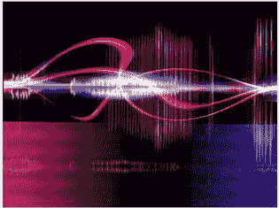

Mehau Kulyk/科学图片来源


Mehau Kulyk/科学图片来源

- 语音识别被归类为行为生物特征。生物特征是基于一种或多种内在的物理或行为特征来识别个人的方法研究。复杂的算法将语音模式转换为个人声音的独特数字表示，例如带有电路图案背景上的人耳和人嘴照片。


Mehau Kulyk/科学图片来源

人耳和人嘴以及多种语音模式的计算机生成图像代表了语音识别和语音合成所需的技术。

## 太空探索

1969年7月21日的登月或许是美国历史上最复杂、最雄心勃勃的工程项目。阿波罗11号于1969年7月16日发射，是首次载人登月任务。阿波罗11号宇航员尼尔·A·阿姆斯特朗于7月21日在月球上迈出了第一步，他在月球表面尘土中的脚印被拍摄下来。


NASA/科学图片来源


太空探索推动了科学数据采集领域的近期工程成就。火星探测漫游车设计用于在行星表面移动，并详细检查土壤和岩石。火星探测漫游车任务是NASA火星探索计划的一部分，这是对红色星球进行机器人探索的长期努力。该任务科学目标的首要任务是搜索并表征大量保存着火星过去水活动线索的岩石和土壤。航天器瞄准火星两侧的地点，这些地点过去似乎受到液态水的影响。

喷气推进实验室/NASA

在有效载荷危险服务设施中，技术人员重新打开火星探测漫游车2的着陆器花瓣，以便进入航天器的一个电路。

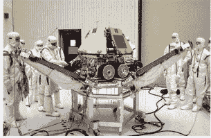

喷气推进实验室/NASA

## 计算机仿真

计算机仿真已成为科学的第三范式，在物理实验不可行时推动知识进步。计算机仿真在先进复合材料设计中的应用是一项令人兴奋的应用，惠及科学和工程的许多领域，包括制造、结构力学、材料科学和医学科学。熔融塑料材料可以被工程化以具有适合特定应用的特性，如自愈塑料照片所示。红色圆圈是从自愈塑料中释放的微囊。塑料受损会破裂微囊，从而释放出可修复损伤的流体。这种塑料由伊利诺伊大学的一个团队设计，并应用于航天器和外科植入物材料的设计。


Scott White/UIUC/科学图片来源


Wladimir Bulgar/科学图片库/科学图片来源

- 计算机仿真在车辆设计和性能领域产生了重大影响。仿真可以预测车辆在特定条件下的响应，而不会有损坏车辆的风险，如SR-71侦察机在五度攻角下的激波模式仿真所示。

- 这张空气动力学跑车的计算机图形说明了计算机仿真在车辆设计中的应用。

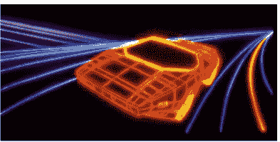

Ramon Santos/科学图片来源

## 第 1 章


来源：艾姆斯研究中心/NASA

## 计算机与工程问题求解导论

### 章节大纲

- 目标
- 1.1 历史视角
- 1.2 近期工程成就
- 1.3 计算机系统
- 1.4 数据表示与存储
- 1.5 工程问题求解方法论
- 总结、关键术语、习题

### 目标

在本章中，我们介绍计算机与工程问题求解，包括：

- 计算机简史
- 近期工程成就
- 硬件与软件讨论
- 数制讨论
- 五步问题求解方法论

### 1.1 历史视角

在19世纪初，英国数学家查尔斯·巴贝奇构想了一台计算机，他称其为**分析机**。分析机设计用于处理十进制数，有四个部分：输入设备、“仓库”或存储单元、处理单元和输出设备。存储单元由不定数量的圆盘列组成。每个圆盘上刻有10个十进制数字（0-9），并围绕一列旋转。列上最低的圆盘代表个位，下一个圆盘代表十位，再下一个代表百位，依此类推向上。通过排列一列中的圆盘，可以显示一个十进制数。

1842年，法国工程师和数学家路易吉·F·梅纳布雷发表了一篇论文《查尔斯·巴贝奇先生发明的分析机概要，附有译者艾达·洛夫莱斯的注释》。在他的论文中，梅纳布雷描述了巴贝奇关于一种机器的愿景，该机器可以使用打孔卡上编写的输入、输出和程序来解决任何问题。如您将在本章后续部分看到的，分析机与我们今天使用的数字计算机相似，因为它们都有输入和输出设备、存储单元和处理单元；然而，数字计算机使用二进制而非十进制表示数据。虽然我们不再

分析机


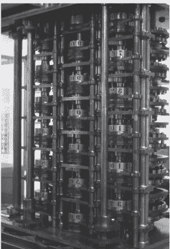

分析机，查尔斯·巴贝奇设计

来源：亚当·哈特-戴维斯/科学图片社

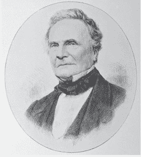

查尔斯·巴贝奇，1792–1871

来源：杰里米·伯吉斯博士/科学图片社


奥古斯塔·艾达·拜伦，1815–1852
来源：希尔顿档案/盖蒂图片社

用穿孔卡为我们的计算机编程，穿孔卡组直到20世纪80年代仍被用于计算机程序。

巴贝奇从未能够获得建造其机器所需的资金支持。正如他所认识到的，几乎没有人理解他的概念。

> 描述……分析机需要许多卷书。我在此仅提出说明其几个更重要的功能，并为那些心智已做好充分准备的人提供一些信息，这些信息将消除那些笼统的惊奇观念，甚至是其不可能性的观念，这些观念在一些最开明的人心中萦绕。¹

一个心智已做好充分准备的人就是奥古斯塔·艾达·拜伦。艾达·拜伦是十九世纪诗人拜伦勋爵和安娜·伊莎贝拉·米尔班克的女儿。艾达出生后不久，米尔班克离开了拜伦勋爵，认为他正与其同父异母的姐妹有染并且精神失常。担心艾达会继承其父亲的精神失常，米尔班克本人是一名业余数学家，为艾达规定了大量的数学和科学教育。1842年，艾达从原始法文文本撰写了梅纳布雷《分析机概要》的英文翻译。她的翻译包括冗长而详尽的评论以及数值计算的详细指令。

艾达·拜伦还设想了分析机的多学科潜力，如她在翻译中包含的以下评论所表达的：

¹ 查尔斯·巴贝奇，《论分析机》，1864年。

“例如，假设和声学及音乐创作科学中音高声音的基本关系可以进行这种表达和改编，那么该机器可以创作任何复杂程度或长度的精巧而科学的音乐作品。”²

根据巴贝奇，

“洛夫莱斯伯爵夫人的注释大约是原始回忆录长度的三倍。其作者充分深入地探讨了与该主题相关的几乎所有非常困难和抽象的问题。这两篇回忆录合在一起，为那些能够理解推理的人提供了一个完整的证明——即分析的全部发展和运算现在都能够由机器来执行。”³

艾达·拜伦撰写的演示被许多人视为第一个“计算机程序”。面向嵌入式系统开发的高级编程语言Ada，以艾达·拜伦·洛夫莱斯的名字命名。

² 奥古斯塔·艾达·拜伦，《注释A》，1843年。
³ 查尔斯·巴贝奇，《论分析机》，1864年。

第一台实际建造并使用二进制数系统的计算机是由约翰·阿塔纳索夫教授及其研究生克利福德·贝里在1939年至1942年间于艾奥瓦州立大学开发的。ABC（阿塔纳索夫-贝里计算机）重达700磅，每15秒大约能计算一条指令。第二次世界大战的爆发阻止了阿塔纳索夫和贝里完成他们的专利申请，但他们的工作被许多人研究，并因其在支持战争方面的潜力而得到推广。1943年，美国政府资助一个研究团队开发一台计算机，用于计算武器的炮术射表。该团队由约翰·莫奇利和J·珀斯珀·埃克特领导。他们的工作促成了ENIAC（电子数值积分计算机）的开发。ENIAC重达三十吨，每秒能进行几百次运算。它一直用于研究直到1955年。如今，处理器重量仅为盎司级，且能够每秒处理万亿次运算。


电子数值积分计算机（ENIAC）

来源：科学图片社

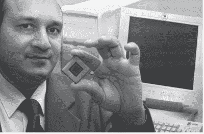

英特尔奔腾4处理器
来源：高塔姆·辛格/美联社图片社

### 1.2 近期工程成就

数字计算机的发展在过去50年中促成了许多重要的工程成就。这些成就体现了工程的多学科性质，并展示了工程如何改善了我们的生活并扩展了未来的可能性。我们现在简要讨论其中几项主要成就。

### 月球登陆

几项主要成就与太空探索有关。1969年7月21日的月球登陆，可能是有史以来尝试过的最复杂、最雄心勃勃的工程项目。阿波罗飞船、月球登陆舱和三级土星五号火箭的设计都需要重大突破。连宇航服的设计也是一项重大工程项目，其结果是一个包括三件式套装和背包的系统，两者总重190磅。计算机不仅在各种系统的设计中发挥了关键作用，而且在单次月球飞行所需的通信中也起到了至关重要的作用；一次飞行需要协调发射控制中心的450多人，以及9艘船、54架飞机和地球各地站点上的7000多人。

### 火星全球勘测者

太空探索推动了近期在科学数据收集方面的工程成就。火星全球勘测者是一艘由NASA开发并于1996年发射的航天器，用于在环绕火星运行期间收集科学数据。火星全球勘测者搭载了最先进的科学仪器，包括：

- **火星轨道器相机**
- **高增益天线**

火星轨道器相机用于获取图像，高增益天线用于以高速率发送和接收数据。该航天器于2006年11月2日与地球进行了最后一次通信。您可以在 http://mars.jpl.nasa.gov/mgs/gallery/images.html 上查看火星轨道器相机获取的图片画廊。

### 火星勘测轨道飞行器

火星全球勘测者收集的一些图像表明，液态水在地质上最近的过去曾渗出到地表，这促使NASA开发并发射火星勘测轨道飞行器，以开始寻找证据，证明水在行星表面持续的时间足够长，足以提供生命栖息地。火星勘测轨道飞行器采用了罗克希德·马丁空间系统公司提供的新型航天器设计。它是第一艘从头开始专为大气制动设计的航天器，大气制动是任务的一个严格阶段，轨道飞行器利用火星大气层的摩擦来减速并进入其绕火星的最终轨道。该轨道飞行器于2006年3月10日开始绕火星运行。从2006年3月到11月，航天器通过400多次深入火星大气层顶部来缩小其轨道，以降低速度并到达其最终近圆轨道，高度为155至196英里。

### CRISM（火星紧凑型成像光谱仪）

轨道飞行器上的六种科学仪器之一是火星紧凑型成像光谱仪（CRISM），由马里兰州劳雷尔的约翰斯·霍普金斯大学应用物理实验室设计和制造。CRISM将读取反射阳光中的544种颜色，以检测地表矿物。其最高分辨率比以往对火星的任何观测都要清晰约20倍。高分辨率图像可以识别最可能曾含有水的地点，并确定火星探测漫游车的最佳潜在着陆点。火星探测漫游车的设计目的是在行星表面移动，并详细检查土壤和岩石。

### 火星探测漫游车

### 应用卫星

太空计划还为应用卫星的发展提供了很大推动力，这些卫星用于提供天气信息、中继通信信号、绘制未勘测地形图，并提供关于大气成分的环境更新。

### 全球定位系统（GPS）

全球定位系统（GPS）最初是由24颗卫星组成的星座，向全球广播位置、速度和时间信息。GPS接收机测量信号从GPS卫星传输到接收机所需的时间。利用从四颗卫星接收到的信息，接收机中的微处理器可以确定接收机位置的非常精确的测量值；精度从几米到厘米不等，具体取决于所使用的计算技术。

### 先进复合材料

航空工业是第一个开发和使用先进复合材料的行业，这类材料由能够以一种方式结合在一起的材料组成，即一种材料增强另一种材料的纤维。先进复合材料的开发旨在为飞机和航天器提供更轻、更强、更耐高温的材料。如今，复合材料在制造业和体育用品领域也有额外的市场。例如，下坡滑雪板使用编织凯夫拉纤维层来增加强度并减轻重量，石墨/环氧高尔夫球杆杆身比传统杆身中的钢材更强更轻。复合材料还用于人工假肢的设计。

### 计算机仿真

先进复合材料的开发借助计算机仿真得以辅助。对先进复合材料的计算机仿真允许进行一些可能因尺寸、速度、对健康和安全的危害或实验成本而无法进行的实验。在仿真中，物理现象的数学模型被转换为指定计算如何执行的计算机软件。通过反复使用不同数据运行软件，就会出现对感兴趣现象的分析。我们将编写一个程序来模拟一种熔融塑料材料的设计，该材料用于绝缘电子组件中的关键部件，以防止热和机械冲击。


医学、生物工程和计算机科学领域联合开发了计算机轴向断层扫描（CAT）扫描仪。该仪器可以利用从物体不同角度产生的X射线，生成物体的三维图像或二维切片。每个X射线从其角度测量密度，非常复杂的计算机算法结合所有X射线的信息，重建物体内部的清晰图像。CAT扫描常规用于识别肿瘤、血栓和脑部异常。美国陆军继续开发坚固、轻便的CAT扫描仪，这些扫描仪可以运送到战斗区域的医疗站。

激光是频率相同且以可定向和聚焦的窄光束传播的光波。CO2激光器用于在从陶瓷到复合材料的各种材料上钻孔。激光也用于医疗程序，以焊接脱离的视网膜、封闭渗漏的血管、汽化脑肿瘤并进行精细的内耳手术。称为全息图的三维图像也使用激光生成。

预测天气、气候和全球变化需要我们理解耦合的大气和海洋生物圈系统。这包括理解大气和海洋中的CO2动态、臭氧层消耗以及由于化学品或能量释放引起的气候学变化。这种复杂的相互作用还包括太阳相互作用。来自“日冕洞”（太阳风的排放点）附近太阳风暴的大规模喷发可以以每小时超过一百万英里的速度，将大量热气体从太阳表面喷射向地球表面。这种热气体喷射会用X射线轰击地球，并可能干扰通信并导致电力线路中的电力波动。学习预测天气、气候和全球变化的变化涉及收集大量数据进行研究，并开发能够表示许多变量相互依赖性的新数学模型。我们将在后续章节中分析丹佛国际机场一年期间的天气模式。我们还将使用卫星数据开发一个预测中层大气臭氧混合比的模型，并分析充气气象气球的高度和速度信息。

计算机语音理解可能会彻底改变我们的通信系统，但许多问题已得到理解。目前正在使用能够教会计算机理解相当小词汇集中单词的软件。然而，要开发说话人独立且能够理解大型词汇集和不同语言中单词的系统非常困难。声音中的细微变化，例如由感冒或压力引起的变化，可能会影响语音识别系统的性能。即使假设计算机可以识别单词，确定其含义也并不简单。许多单词都依赖于上下文，因此无法单独分析。诸如提高声音之类的语调可以将陈述句变成疑问句。尽管在自动语音识别和理解方面仍有许多难题需要解决，但令人兴奋的应用无处不在。想象一个电话系统，它能确定正在说的语言并翻译语音信号，以便每个人都能用自己的母语听到对话。我们将分析实际语音数据，以展示单词识别中使用的一些技术。

## 工程环境的变化

21世纪的工程师将在一个需要许多非技术技能和能力的环境中工作。尽管计算机将是大多数工程师的主要计算工具，但计算机在培养额外的非技术能力方面也将很有用。

### 沟通技能

工程师需要强大的**沟通技能**来进行口头陈述和准备书面材料。计算机提供软件来协助撰写大纲，并为演示和技术报告开发书面材料和图表。本章末尾的问题包括书面或口头陈述，以提供这些重要技能的练习。

### 设计/工艺/制造

**设计/工艺/制造**路径（即将一个想法从概念转化为产品的过程）是工程师必须亲身理解的过程。该过程的每个步骤都在设计分析、机器控制、机器人装配、质量保证和市场分析等领域使用计算机。文本中有几个问题与这些主题相关。例如，在第5章中，开发了程序来模拟使用多个组件的系统的可靠性。

### 跨学科团队

未来的工程团队将是**跨学科团队**，正如当今的工程团队是跨学科团队一样。对过去50年工程成就的讨论清楚地表明了这些成就的跨学科性质。应对并最终解决未来挑战的团队也将是跨学科团队。学习在团队中互动并为有效的团队沟通开发组织结构，是工程师的一项重要技能。开始培养工程团队技能的一个好方法是组织团队备考。为团队成员分配特定主题，要求他们为团队复习这些主题，并附带示例和潜在的测试问题。

### 世界市场

21世纪的工程师需要理解**世界市场**。这涉及理解不同的文化、政治制度和商业环境。这些主题和外语的课程有助于提供一些理解，但具有国际经验的交换项目在培养更广阔的世界理解方面提供了宝贵的知识。

### 分析与综合

工程师是问题解决者，但问题并不总是被仔细制定。工程师必须能够从问题讨论中提取问题陈述，然后确定与问题相关的重要问题。这不仅涉及建立秩序，还涉及学习关联混乱。这意味着不仅要**分析**数据，还要利用许多信息片段来**综合**解决方案。思想的整合可以与将问题分解为可管理的部分同样重要。问题的解决方案可能不仅涉及对问题的抽象思考，还涉及从问题环境中进行实验性学习。

### 社会背景

问题的解决方案也必须在其**社会背景**下加以考虑。在考虑问题的替代解决方案时，应解决环境问题。工程师在提供测试结果、质量验证和设计限制时，也必须意识到**伦理问题**。伦理问题从来都不容易解决，一些令人兴奋的新技术成就也将带来更多伦理问题。例如，基因组图谱绘制可能会带来伦理、法律和社会影响。允许医生对抗糖尿病的基因疗法是否也应用于增强运动能力？准父母是否应获得关于未出生儿童身体和心理特征的详细信息？个人应对其遗传密码拥有何种隐私？任何技术进步都会产生非常复杂的问题，因为那些能够做大量好事的能力，往往也可以以有害的方式应用。

### 伦理问题

本文中呈现的材料只是建立21世纪工程师所需的知识、信心和理解的一个步骤。然而，我们热情地开始这一过程，介绍工程师可用的各种计算机系统，并介绍一种问题解决方法论，该方法论将在整本书中使用，我们将使用C++来实现工程问题的解决方案。


### 1.3 计算机系统

在开始介绍 C++ 之前，简要讨论计算机系统将很有用。计算机系统是一个完整且可正常工作的系统。该系统不仅包括计算机，还包括软件和外围设备。计算机是一种设计用于执行由一组称为软件的指令所指定操作的机器。计算机硬件是指系统中具有质量且可以实际触摸的物理部件。硬件包括计算机以及键盘、鼠标、显示器、硬盘、打印机甚至墨盒等外围设备。计算机软件是指驻留并在硬件上以电子方式运行的程序，例如编译器、操作系统和应用程序。软件提供人机界面（HCI）并定义计算机将执行的操作。

### 计算机硬件

回顾梅纳布雷对巴贝奇分析机的描述，将其视为一种能够使用打孔卡上编写的输入、输出和程序来解决任何问题的机器。1946 年，约翰·冯·诺依曼提出了如图 1.1 所示的计算模型，该模型至今仍用于大多数数字计算机的设计。在冯·诺依曼模型中，我们看到输入设备、输出设备、存储单元，以及由控制单元和带有累加器的算术逻辑单元（ALU）组成的机器。存储单元存储数据，控制单元控制数据的传输和处理。控制单元检索并解释存储在内存中的指令，接受来自键盘或鼠标等输入设备的数据，将数据发送到打印机或显示器等指定输出设备，并将数据存储在存储单元中。

假设我们编写了一个程序来指示计算机将两个值相加并显示结果。控制单元将解释可执行指令并将数据发送到 ALU。ALU 将执行加法，控制单元将把结果发送到输出设备。控制单元和 ALU 合称为中央处理器或 CPU。ALU 中的累加器是一组高速寄存器，用于临时存储值以及算术和逻辑运算的结果。与 ALU 执行算术或逻辑运算所需的时间相比，访问存储单元所需的时间要长得多。因此，在 ALU 内部使用寄存器可以提高操作的整体速度。ALU 中每个寄存器的大小对应于计算机的**字长**。常见的字长为 16 位、32 位和 64 位，具体取决于处理器的设计。请注意，**位**表示二进制数字，处理器的字长是 2 的幂。

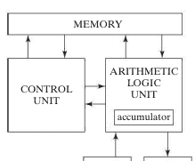

图 1.1 冯·诺依曼计算模型。

### 计算机软件

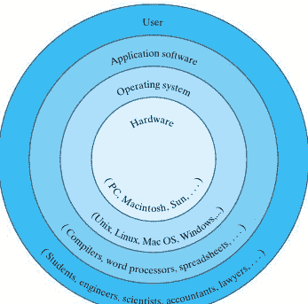

图 1.2 计算机的软件界面。

计算机软件包含我们希望计算机执行的指令或命令。软件有几个重要类别，包括操作系统、软件工具和语言编译器。图 1.2 说明了这些软件类别与计算机硬件之间的交互。我们现在更详细地讨论每个软件类别。

**操作系统。** 某些软件（例如操作系统）通常在购买计算机硬件时随附。操作系统通过提供一个方便且高效的环境，在你（用户）和硬件之间提供一个接口，你可以在该环境中选择并执行系统上的软件。

操作系统还包含一组称为实用程序的程序，允许你执行打印文件、复制文件和列出已保存到文件系统中的文件等功能。虽然这些实用程序在大多数操作系统中都很常见，但执行命令的环境因操作系统而异。例如，在 UNIX（一种常用于工作站的强大操作系统）或 Linux（适用于 PC 的 UNIX）的命令行中，列出文件的命令是 ls。一些操作系统通过使用图标和菜单来简化与操作系统的交互；用户友好的图形用户界面（GUI）系统示例包括 Macintosh 环境和 Windows 环境。

由于 C++ 程序可以在许多不同的平台或计算机系统上运行，并且特定计算机可以使用不同的操作系统，因此在本课程中讨论你可能使用的各种操作系统是不切实际的。我们假设你的教授会提供你需要了解的特定操作系统信息，以便使用大学提供的计算机；这些信息也包含在操作系统手册中，并通过帮助菜单提供。

**应用软件。** 有大量应用程序可用于执行常见操作。例如，Word 和 Pages 等文字处理器是为帮助你创建格式化文档（如简历、通讯和报告）而编写的应用程序。文字处理器具有允许你输入数学公式并检查拼写和语法的功能。文字处理器还提供工具，以便在文本和标题中创建图表和图形。vi 和 Emacs 等文本编辑器用于创建文本文件（例如 C++ 应用程序和数据文件），可能包含编译器以及用于开发应用程序的用户友好环境。

电子表格程序是软件工具，允许你轻松处理可以在行和列网格中显示的数据。电子表格最初用于财务和会计应用，但许多科学和工程问题可以使用电子表格轻松解决。大多数电子表格软件包包含绘图功能，因此在分析和显示信息方面尤其有用。Lotus 1-2-3、OpenOffice 和 Excel 是流行的电子表格软件包。

另一类流行的软件工具是数据库管理软件，例如 MySQL 和 Oracle。这些程序允许你高效地存储和检索大量数据。许多 Web 应用程序和搜索引擎以及银行、医院、酒店和航空公司等组织都使用数据库。科学数据库也用于分析大量数据。气象数据是需要大型数据库进行存储和分析的科学数据示例。

计算机辅助设计软件，例如 AutoCAD、SOLIDWORKS、Civil 3D 和 Architectural Desktop，允许你定义对象，然后以图形方式操作它们。例如，你可以定义一个对象，然后从不同角度查看它，或观察对象从一个位置旋转到另一个位置的过程。

还有一些非常强大的数学计算软件，例如 MATLAB、Mathematica 和 Maple。这些工具不仅拥有非常强大的数学命令，还是提供广泛图表生成功能的图形工具。计算能力与可视化能力的结合使它们成为工程师特别有用的工具。附录 C 讨论了使用 MATLAB 绘制由 C++ 程序生成的数据文件中的数据。

如果工程问题可以使用软件工具解决，那么使用软件工具通常比用计算机语言编写程序来解决问题更高效。然而，许多问题无法使用软件工具解决，或者用于解决问题的计算机系统上可能没有可用的软件工具；因此，我们也需要知道如何使用计算机语言编写程序。软件工具与计算机语言之间的区别变得不再那么清晰，因为一些更强大的工具，诸如

如MATLAB和Mathematica一样，除了专门操作外，还包含一种编程语言。

### 计算机语言

计算机语言可以按层级描述。低级语言或机器语言是最原始的语言。机器语言与计算机硬件设计紧密相关。由于计算机设计基于两态技术（具有两种状态的设备，例如开路或闭路电路、开启或关闭开关、正电荷或负电荷），机器语言使用两种符号编写，通常用数字0和1表示。因此，机器语言也是一种二进制语言，指令以0和1的序列形式编写，称为二进制字符串。由于机器语言与计算机硬件设计紧密相关，例如，Sun计算机的机器语言与HP计算机的机器语言不同。

汇编语言与特定的计算机设计相关联，但其指令使用符号语句而非二进制编写。汇编语言通常没有非常多种类的语句，因此用汇编语言编写程序可能会很乏味。此外，要使用汇编语言，还必须了解与特定计算机硬件相关的信息。包含微处理器的仪器通常要求程序运行非常快，因此这些程序称为实时程序。这些实时程序通常用汇编语言编写，以利用特定的计算机硬件更快地执行步骤。

高级语言是具有类似英语的命令和指令的计算机语言，包括C++、C、Fortran、Ada、Java和Basic等语言。用高级语言编写程序当然比用机器语言或汇编语言编写程序更容易。然而，高级语言包含大量命令以及用于使用命令的广泛语法（或语法）规则。为了说明软件工具和高级语言所需的语法和标点，我们在表1.1中使用几种不同的语言和工具来计算给定直径的圆的面积。请注意这个简单计算中的相似之处和差异。

### 执行计算机程序

用C++等高级语言编写的程序必须在计算机执行指令之前翻译成机器语言。一种称为编译器的特殊程序用于执行此翻译。因此，要在计算机上编写和执行C++程序，计算机的软件必须包含

| 软件 | 示例语句 |
| :--- | :--- |
| C++ | area = 3.141593*(diameter/2)*(diameter/2); |
| C | area = 3.141593*(diameter/2)*(diameter/2); |
| MATLAB | area = pi*((diameter/2).^2); |
| Fortran | area = 3.141593*(diameter/2.0)**2 |
| Ada | area := 3.141593*(diameter/2.0)**2; |
| Java | area = Math.PI*Math.pow(diameter/2.0); |
| Basic | let a = 3.141593*(d/2)^(d/2) |
| Scheme | let area = 3.141593*(d/2)^(d/2) |

C++编译器。C++编译器适用于从超级计算机到笔记本电脑的整个计算机硬件范围。

### 语法错误

如果编译器在编译过程中检测到任何错误，将打印相应的错误消息。我们必须更正程序语句，然后再次执行编译步骤。此阶段识别的错误称为解析错误或语法错误。例如，如果我们想要将名为sum的变量中存储的值除以3，C++中的正确表达式是sum/3。如果我们错误地使用反斜杠编写表达式，例如sum\3，则会发生语法错误，并且当我们尝试编译程序时，编译器会报告错误消息。编译、更正有语法错误的语句并重新编译的过程通常必须重复多次，然后程序才能无错误地编译。当没有语法错误时，编译器可以成功翻译程序，并生成执行原始C++程序指定步骤的机器语言程序。C++程序称为源文件，机器语言版本称为目标文件。因此，源程序和目标程序指定相同的步骤，但源程序使用高级语言指定，而目标程序使用机器语言指定。

源文件 目标文件

程序正确编译后，还需要额外步骤来准备目标程序以供执行。此准备工作涉及将其他机器语言语句链接到目标程序，然后将程序加载到内存中。经过此链接/加载后，计算机执行程序步骤。此阶段可能会识别出称为执行错误、运行时错误或逻辑错误的新错误；这些错误也称为程序错误（bug）。执行错误通常会导致程序终止。例如，程序语句可能尝试引用无效内存位置，这可能会生成执行错误。某些执行错误不会停止程序执行，但会导致计算出错误的结果。这些类型的错误可能由程序员在确定解决方案的正确步骤时出错，以及程序处理的数据出错引起。当执行错误是由于程序语句中的错误引起时，我们必须更正源程序中的错误，然后从编译步骤重新开始。此过程称为调试，可能非常耗时。即使程序看起来执行正常，我们也必须仔细检查答案以确保其正确。计算机将精确按照我们指定的步骤执行，如果我们指定了错误的步骤，计算机将执行这些错误（但在语法上合法）的步骤，从而向我们呈现一个错误的答案。编译、链接/加载和执行的过程如图1.3所示。

执行 链接 加载 逻辑错误 程序错误

### 调试

C++编译器通常具有额外功能，可为实现和测试C++程序提供用户友好的环境。例如，某些C++环境（如Microsoft Visual C++）包含文本处理器，以便程序文件可以生成、编译、

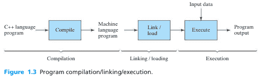

和执行在同一软件包中，而不是使用单独的字处理器，后者需要使用操作系统命令在字处理器和编译器之间来回传输。许多C++编程环境包含调试器程序，这些程序有助于识别程序中的错误。调试器程序允许我们查看程序不同点中变量存储的值，并逐行单步执行程序。

在介绍C++中的新语句时，我们还将指出与语句相关的常见错误或查找与语句相关错误的有用技术。调试辅助功能将在每章末尾进行总结。

### 1.4 数据表示与存储

回顾一下，分析机存储单元的设计由任意数量的圆盘列组成，每个圆盘上刻有10个十进制数字（0–9）。通过排列一列中的圆盘，可以存储一个十进制数。

现代数字计算机遵循类似的设计，只不过信息以基数2（即二进制）而非基数10表示。二进制数系统只有两个二进制数字，0和1，因此二进制数字在数字计算机中可以用一位表示。给定时刻位的值可以是0或1。在硬件术语中，如果位的值为0，则称为关断或低电平；如果值为1，则称为开通或高电平。

二进制数可以作为一组位存储在内存中，称为一个字。字中最右边的位表示个位，下一位表示二位，再下一位表示四位，最左边的位表示2^(n-1)位，其中n是位数。字中每增加一位，字长就会增加2的幂次，并使可表示的值范围翻倍。内存中可用的字数称为内存空间或地址空间。

图1.4提供了一个内存图，其地址空间为8（2^3），字长为16（2^4）。地址000处存储的二进制值为000010110111011₂ = 278₁₀。需要注意的是，字长决定一个字中可以存储的值的范围，而地址空间决定可以存储的字数。理论上的分析机字长由一列中的圆盘数量定义，内存空间由列的数量定义。

C++编程语言具有用于表示整数值、浮点值、字符和布尔数据类型的内置数据类型。每个内置数据类型都有以字节为单位的预定大小，其中字节是8位的序列。类型声明语句

| 地址 | 十六位字 |
| :--- | :--- |
| 000 | 0000101011011101 |
| 001 | 0101100010010000 |
| 010 | 0001011010010100 |
| 011 | 0111011010011011 |
| 100 | 0000000000000000 |
| 101 | 0001000011001000 |
| 110 | 0111111111111111 |
| 111 | 0001011010010110 |

图1.4 内存图：地址空间 = 8，字长 = 16。


语句用于定义标识符并分配内存。当定义标识符时，会指定数据类型，并为存储分配所需的字节数。例如，类型声明语句：

```
int iValue = 2781;
```

定义一个标识符 iValue，它引用内存中存储的整数值的第一个字节。内存中存储的初始值是 2781₁₀ 的二进制表示。下面给出了内存图：

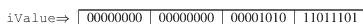

在编译器和高级编程语言出现之前，程序员需要以二进制形式将指令和数据加载到每个内存位置。如今，我们有软件（编译器、链接器和加载器）为我们执行这些任务。在第 2 章中，我们将开始讨论 C++ 语句和数据类型，但首先我们将简要讨论数制和低级数据表示，以便更好地理解程序执行时执行的操作。

## 数制

十进制数制有 10 个十进制数字（0–9），十进制数中的每个数字都乘以 10 的幂。我们大多数人很容易进行十进制计数并理解十进制数。例如，当我们读取数字 245₁₀ 时，我们读作“二百四十五”。我们理解 2 在百位（10^2），4 在十位（10^1），5 在个位（10^0）。如果将数字展开如下：

```
2 * 10^2 + 4 * 10^1 + 5 * 10^0
```

我们可以相加 200 + 40 + 5 等项，得到 245₁₀ 的值。在以下部分中，我们将讨论三种数制：二进制、八进制和十六进制，它们在研究数字计算机系统时很有用。我们还将开发将数字转换为不同进制的算法。

## 二进制数

数字计算机以二进制形式表示数据。二进制数制有两个二进制数字，0 和 1，每个数字都乘以 2 的幂。如果我们检查存储在图 1.4 中内存位置 000 的二进制数 0000101011011101₂，并想确定等效的十进制数，我们可以按如下方式展开该数，注意最右侧的二进制数字乘以 2^0，最左侧的数字乘以 2^15。

```
0000101011011101₂ =
```

```
0 * 2^15 + 0 * 2^14 + 0 * 2^13 + 0 * 2^12 + 1 * 2^11 + 0 * 2^10 + 1 * 2^9 + 0 * 2^8 +
1 * 2^7 + 1 * 2^6 + 0 * 2^5 + 1 * 2^4 + 1 * 2^3 + 1 * 2^2 + 0 * 2^1 + 1 * 2^0 =
```

```
0 + 0 + 0 + 0 + 2048 + 0 + 512 + 0 + 128 + 64 + 0 + 16 + 8 + 4 + 0 + 1 =
2781₁₀
```

如我们将在以下部分中看到，上述转换算法可以应用于任何进制表示的数字，以获得等效的十进制值。

假设我们有一个十进制数，希望将其表示为二进制。等效的二进制数将是一串二进制数字。为了生成这些数字，我们将使用一个转换算法，该算法反复将十进制数除以 2，并将每次除法的余数记录为等效二进制数的连续数字。

最低有效位 最高有效位

我们在下面的示例中说明该算法的使用。请注意，第一次除法的余数记录为等效二进制数的最低有效位（LSD），最后一次除法的余数记录为最高有效位（MSD），并且我们一直除直到商变为零。

### 示例

```
245₁₀ = ?₂
      Quotient is 0
      |
      0 R1 <- MSD
      2|7 R1
      2|3 R1
      2|7 R1
      2|15 R0
      2|30 R1
      2|61 R0
      2|122 R1
      2|245 <- LSD
      First Division
```

245₁₀ = 11110101₂

上述转换算法可用于将十进制转换为任何其他进制。其他数制的进制定义除数，如我们将在以下部分中看到。

## 八进制数

八进制，或基 8，数制有 8 个八进制数字（0-7）。八进制数对于理解 8 位字符代码以及在 linux/unix 平台上设置文件和目录权限很有用。例如，如果我们有一个文件，希望所有人都可以读取、写入和执行，我们可以使用 chmod 命令设置文件权限，如下所示：

```
chmod 777 aFile
```

aFile 的权限将设置为所有者、组和其他用户的 7₈，即 111₂。如果接下来进行长列表，

```
ls -l
```

我们将看到类似以下的内容：

```
-rwxrwxrwx 1 jeannei jeannei 258 Jun 26 12:27 aFile.
```

上述内容表示，(r)ead/(w)rite/(x)ecute 权限已授予所有者、组和其他用户。如果我们希望仅授予组和其他用户读取状态，我们可以使用以下命令更改权限：

```
chmod 744 aFile
```

长列表将现在显示以下内容：

```
-rwxr-xr- 1 jeannei jeannei 258 Jun 26 12:27 aFile
```

表示所有者具有 rwx 权限，组和其他用户具有读取权限，但没有写入权限和执行权限。数字 4₈ = 100₂，因此 1 授予权限，0 拒绝权限。

八进制数中的每个数字都乘以 8 的幂。要确定八进制数的等效十进制值，我们可以应用用于确定二进制数十进制值的相同转换算法。请注意，转换为十进制的数的进制（本例中为 8）定义了指数项的进制。

### 示例

```
217₈ = ?₁₀
2 * 8^2 + 1 * 8^1 + 7 * 8^0 =
2 * 64 + 1 * 8 + 7 * 1 =
128 + 8 + 7 =
143₁₀
```

为了说明将十进制转换为任何其他进制的算法，我们将把 143₁₀ 转换回八进制。我们使用 8 作为除数应用该算法。

```
143₁₀ = ?₈
0 R2
8 | 17 R1
8 | 143 R7
8 | 117
143₁₀ = 217₈
```

迄今为止，我们已经说明了将十进制转换为任何其他进制的算法，以及将任何进制转换为十进制的算法，但现在假设我们想将八进制数转换为二进制。一种方法是先将八进制数转换为十进制，然后将等效的十进制数转换为八进制。这种方法是有效的，但由于 8 是 2 的幂，8 = 2^3，并且每个八进制数字都可以用三个二进制数字表示，我们可以利用这种关系快速在二进制和八进制之间进行转换，如下两个示例所示。表 1.2 列出了 8 个八进制数字的二进制表示，供您参考。

| 八进制数字 | 二进制表示 |
| :--- | :--- |
| 0 | 000 |
| 1 | 001 |
| 2 | 010 |
| 3 | 011 |
| 4 | 100 |
| 5 | 101 |
| 6 | 110 |
| 7 | 111 |

### 示例

```
143₈ = ?₂
1   4   3
↓   ↓   ↓
001 100 011
143₈ = 001100011₂
```

### 示例

```
000101011011101₂ = ?₈
000 101 011 011 101
↓   ↓   ↓   ↓   ↓
0   5   3   3   5
000101011011101₂ = 5335₈
```

## 练习 1.1

- 将以下每个十进制数转换为二进制：
- 1. 921₁₀ = ?₂
- 2. 8₁₀ = ?₂
- 3. 100₁₀ = ?₂

- 将以下每个八进制数转换为十进制：
- 4. 100₈ = ?₁₀
- 5. 247₈ = ?₁₀
- 6. 16₈ = ?₁₀

- 将以下每个数字转换为请求的进制：
- 7. 100₂ = ?₈
- 8. 376₈ = ?₂
- 9. 110100111₂ = ?₁₀
- 10. 221₆ = ?₈

## 十六进制数

十六进制，或基 16，数制有 16 个十六进制数字（0–9–A–F），十六进制数中的每个数字都乘以 16 的幂。

由字母表示的十六进制数字的十进制值分别为（10,11,12,13,14,15）。

数字 2FB₁₆ 是一个十六进制数的示例。应用将任何进制转换为十进制的转换算法，我们可以确定等效的十进制数，如下所示。

```
2FB₁₆ = ?₁₀

2 * 16^2 + F * 16^1 + B * 16^0 =
2 * 256 + 15 * 16 + 11 * 1 =
512 + 240 + 11 =
763₁₀
```

为了说明将十进制转换为任何其他进制的算法，我们将把 763₁₀ 转换回十六进制。每次除法的余数是 0 到 F 之间的值。

```
763₁₀ = ?₁₆

   0 R2
16/2 R15(F)
16/47 R11(B)
16/763
     Hex Digits
763₁₀ = 2FB₁₆
```

十六是 2 的幂，16 = 2^4，每个十六进制数字都可以用四个二进制数字表示。这种关系可以用于快速在二进制和十六进制之间进行转换，如下两个示例所示。表 1.3 列出了十六进制数字的二进制表示，供您参考。

### 示例

```
7FB₁₆ = ?₂

7       B       F
0111   1011   1111

7FB₁₆ = 011110111111₂
```

### 示例

```
10100001101₂ = ?₁₆

   1010   0001   1101
   A      0      D

101000001101₂ = A0D₁₆
```


| 十六进制数字 | 二进制表示 |
|---|---|
| 0 | 0000 |
| 1 | 0001 |
| 2 | 0010 |
| 3 | 0011 |
| 4 | 0100 |
| 5 | 0101 |
| 6 | 0110 |
| 7 | 0111 |
| 8 | 1000 |
| 9 | 1001 |
| A | 1010 |
| B | 1011 |
| C | 1100 |
| D | 1101 |
| E | 1110 |
| F | 1111 |

### 练习 1.2

将以下各个十进制数转换为十六进制：

- 1. 921₁₀ = ?₁₆
- 2. 8₁₀ = ?₁₆
- 3. 100₁₀ = ?₁₆

将以下各个十六进制数转换为十进制：

- 4. 1C0₁₆ = ?₁₀
- 5. 29E₁₆ = ?₁₀
- 6. 16₁₆ = ?₁₀

将以下各个数字转换为所请求的进制：

- 7. 10010011₂ = ?₁₆
- 8. 3A1B₁₆ = ?₂
- 9. 110100111₂ = ?₁₀
- 10. 261₈ = ?₁₀

## 数据类型与存储

当数据在内存中表示时，它被表示为一串比特。比特序列可能表示一条指令、一个数值、一个字符、图像或数字信号的一部分，或其他某种类型的数据。例如，如果我们观察比特序列 01000110₂，它的十进制值为 70。它也是字符 F 的美国国家标准协会（ANSI）字符代码。

数据表示正在成为工程、数学和计算机科学中一个日益重要且有趣的领域。随着计算机变得更加强大，可生成和处理的数据量不断增加，计算机在生物计算、通信和信号处理等数据密集型应用中的使用，为定义和表示数据带来了新的挑战。在本节中，我们将讨论两种基本数据类型（整数和浮点数）的数字表示。

### 整数数据类型

在上一节中，我们使用了一个从十进制转换为二进制的算法。该算法适用于任何十进制整数，因此理论上我们可以精确地表示所有十进制整数的二进制形式。在实践中，我们可能受限于计算系统的字长。整数数据通常使用 4 字节（即 32 位）存储在内存中。最左侧的位保留用于符号，剩下 31 位用于数值的大小。

为简单起见，请考虑以下使用 8 位字长的示例。8 位中可表示的最大有符号整数是 2^7 - 1 或 127₁₀，如下所示。

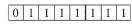

数字计算机中数据的表示方式影响算术和逻辑运算的效率。许多计算机系统像上面所示一样存储正有符号整数，并以补码形式存储负有符号整数。以补码形式存储负整数可以高效执行算术运算，而无需检查符号位。首先，我们将说明如何形成负数的补码，然后说明以补码形式存储负数如何简化算术运算。

二进制数的补码是通过取所有位的反并加 1 形成的。取一位的反意味着将位的值或状态从 1 切换到 0，或从 0 切换到 1。对二进制数的所有位取反形成该数的反码。在反码上加 1 得到该数的补码。使用 8 位字长，-127₁₀ 的补码计算如下示例所示。

### 示例 计算 -127₁₀ 的补码表示。

要形成负整数的补码，我们从无符号值的二进制表示开始。

```
127₁₀ = 01111111₂.
```

接下来，我们取所有位的反以形成反码。

```
10000000₂.
```

最后，我们加上 1₁₀ = 00000001₂ 以形成补码。

10000001。

因此，-127₁₀ 的补码表示为 10000001。

请注意当我们将 127₁₀ 加到 -127₁₀ 的补码时会发生什么。

| 01111111₂ | 127₁₀ |
| --- | --- |
| + 10000001₂ | -127₁₀ 的补码 |
| = 00000000₂ | 加法结果为 0 |

用于表示有符号整数的补码形式具有这样一个特性：将正整数 n 与 n 的补码相加，对于所有 n 结果均为零。补码表示的另一个重要特性是二进制 0 具有唯一的表示。

对以补码形式表示的有符号整数进行加法运算时，如果结果为负，则结果将以其补码形式表示，如以下示例所示。

### 示例 两个二进制数相加，结果为正。

| 11110110 | -10₁₀ 的补码表示 |
| --- | --- |
| + 00001010 | 13₁₀ |
| = 00000001 | 3₁₀ |

### 示例 两个二进制数相加，结果为负。

| 00001010 | 10₁₀ |
| --- | --- |
| + 11110011 | -13₁₀ 的补码表示 |
| = 11111101 | -3 的补码表示 |

### 练习 1.3

求以下整数的补码：

- 1. 11001111₂
- 2. -192₁₀
- 3. -45₈

### 浮点数据类型

浮点数（或实数），例如 12.25₁₀，包含一个小数点。小数点左侧的数字构成数的整数部分，小数点右侧的数字构成数的小数部分。十进制数的小数部分可以通过反复将小数部分乘以 2 并记录进位位，直到小数部分变为零，来转换为二进制。此算法在以下示例中说明。

### 示例 将 12.25₁₀ 转换为二进制。

首先，将整数部分 12₁₀ 转换为二进制：

```
0 R1
2 | R1
2 | 3 R0
2 | 6 R0
2 | 12
12|12
```

12₁₀ = 1100₂

接下来，我们将通过反复将小数部分乘以 2 并记录进位位，来将小数部分 .25₁₀ 转换为二进制：

```
.25 * 2 = 0.5 C0
.5 * 2 = 1.0 C1
.25₁₀ = .01₂
```

现在将整数部分和小数部分组合以形成等效的二进制值。因此，12.25₁₀ 的值为 1100.01₂。

要将浮点二进制数 1100.01₂ 转换回十进制，小数点右侧的二进制数字乘以 2 的负幂，如下所示。

```
1100.01₂ =
1 * 2^3 + 1 * 2^2 + 0 * 2^1 + 0 * 2^0 + 0 * 2^-1 + 1 * 2^-2 =
1 * 8 + 1 * 4 + 0 * 2 + 0 * 1 + 0 * (1/2) + 1 * (1/4) =
8 + 4 + 0 + 0 + 0 + 0.25 =
12.25 =
1100.01₂ = 12.25₁₀
```

在上述示例中，我们找到了 12.25₁₀ 的精确二进制表示。不幸的是，许多浮点小数只有近似的二进制表示，如下一个示例所示。

### 示例 将 12.6₁₀ 转换为二进制。

整数部分 12₁₀ 已证明等于 1100₂。转换小数部分时，我们反复乘以 2 并记录进位位。

```
.6 * 2 = 1.2 C1
.2 * 2 = 0.4 C0
.4 * 2 = 0.8 C0
.8 * 2 = 1.6 C0
.6 * 2 = 1.2 C1
.2 * 2 = 0.4 C0
.4 * 2 = 0.8 C0
.8 * 2 = 1.6 C1
```

我们可以看到，我们正在重复位模式 1001，并且永远不会达到终止值零。因此，0.6₁₀ 的最佳二进制近似值是循环二进制数 0.10011001001...₂。将其扩展到八位精度，我们有：

```
1 * 2^-1 + 0 * 2^-2 + 0 * 2^-3 + 1 * 2^-4 + 1 * 2^-5 + 0 * 2^-6 + 0 * 2^-7 + 1 * 2^-8 =
1 * (1/2) + 0 * (1/4) + 0 * (1/8) + 1 * (1/16) + 1 * (1/32) + 0 * (1/64) + 0 * (1/128) + 1 * (1/256) =
0.5 + 0 + 0 + 0.0625 + 0.03125 + 0 + 0 + 0.00390625 =
0.59765625 =
12.6₁₀ ≈ 1100.10011001₂
```

重要的是要知道，浮点小数的二进制表示是近似值，而非相等。这影响了我们在程序中使用和测试浮点值的方式，也影响了数值计算的准确性。

### 1.5 工程问题求解方法论

问题求解不仅是工程课程的关键部分，也是计算机科学、数学、物理和化学课程的关键部分。因此，拥有一种一致的问题求解方法很重要。如果该方法足够通用，可以应用于所有这些不同领域，那么也很有帮助，这样我们就不必为数学问题学习一种技术，为物理问题学习另一种技术，等等。我们介绍的问题求解过程适用于工程问题，也可以调整以解决其他领域的问题；然而，它确实假设我们正在使用计算机来帮助解决问题。

在本教材中，我们将使用的问题求解过程或方法论包含五个步骤：

- 1. 清晰地陈述问题。
- 2. 描述问题的输入和输出信息。
- 3. 手工（或使用计算器）对一组简单数据求解问题。
- 4. 开发解决方案并将其转换为计算机程序。
- 5. 使用各种数据测试解决方案。

我们现在通过计算平面上两点之间距离的示例来讨论每个步骤。

### 1. 问题陈述

第一步是清晰地陈述问题。给出清晰、简洁的问题陈述以避免任何误解非常重要。对于本示例，问题陈述如下：

计算平面上两点之间的直线距离。


## 2. 输入/输出描述

第二步是描述解决问题所需的信息或数据值，然后确定最终解决方案需要计算的值。这些值中的每一个都将在 C++ 程序中由一个对象表示。这些对象代表问题的输入和输出，统称为输入/输出，或 I/O。对于许多问题，显示输入和输出的图表很有用。此时，程序是一个“抽象”，因为我们不是在定义确定输出的步骤；相反，我们只是显示计算所需输出所需的信息。本示例的 I/O 图如下：

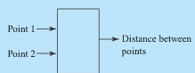

## 3. 手算示例

第三步是使用一组简单数据，手动或使用计算器解决问题。这是一个非常重要的步骤，即使对于简单问题也不应跳过。这是你解决问题细节的步骤。如果你无法取一组简单的数字并计算输出（无论是手动还是使用计算器），那么你就没有准备好进入下一步；你应该重新阅读问题，并可能查阅参考资料。本特定示例的手算解法如下：

设点 p1 和 p2 具有以下坐标：

```
p1 = (1, 5); p2 = (4, 7)
```

我们想要计算两点之间的距离，即直角三角形的斜边，如图 1.5 所示。使用勾股定理，我们可以使用以下方程计算距离：

```
distance = \sqrt{(side_1)^2 + (side_2)^2}
= \sqrt{(4 - 1)^2 + (7 - 5)^2}
= \sqrt{13}
= 3.61
```

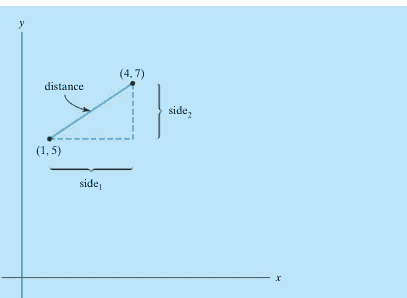

图 1.5 两点之间的直线距离。

## 4. 算法开发

一旦你能够对一组简单数据解决问题，你就准备好开发算法，即问题解决方案的逐步大纲。对于像这样的简单问题，算法可以列为一个接一个执行的操作。步骤大纲将问题分解为更简单的步骤，如下所示，即计算并打印两点之间距离所需步骤的大纲。

### 分解大纲

- 1. 为两个点赋值。
- 2. 计算由两个点生成的直角三角形的两条边的长度。
- 3. 计算两点之间的距离，即三角形斜边的长度。
- 4. 打印两点之间的距离。

然后将此分解大纲转换为 C++ 命令，以便我们可以使用计算机执行计算。从以下解决方案中，你可以看到这些命令与手算示例中使用的步骤非常相似。这些命令的详细信息在第 2 章中解释。

```
/*
------------------------------------------------------------*/
/*
Program chapter1_1         */
/*                         */
/* This program computes the */
/* distance between two points. */
/*/
```

```
#include <iostream>//Required for cout
#include <cmath>//Required for sqrt()
using namespace std;
int main()
{
    // Declare and initialize objects.
    double x1(1), y1(5), x2(4), y2(7),
           side1, side2, distance;
    // Compute sides of a right triangle.
    side1 = x2 - x1;
    side2 = y2 - y1;
    distance = sqrt(side1*side1 + side2*side2);
    // Print distance.
    cout << "The distance between the two points is"
         << distance << endl;
    // Exit program.
    return 0;
}
/******************************************************************/
```

## 5. 测试

我们问题求解过程的最后一步是测试解决方案。我们应该首先使用手算示例中的数据测试解决方案，因为我们已经计算出了解决方案。当执行此解决方案中的 C++ 语句时，计算机显示以下输出：

两点之间的距离是 3.60555

此输出与我们手动计算的值匹配。如果 C++ 解决方案与手算解决方案不匹配，那么我们应该审查两个解决方案以找到错误。一旦解决方案对手算示例有效，我们还应该使用其他数据集对其进行测试，以确保解决方案适用于其他有效的数据集。

本示例中演示的一组步骤用于开发后续章节中“应用问题求解”部分的程序。

## 摘要

介绍了数字计算机发展的简要历史，随后是一组杰出的近期工程成就，以展示工程应用的多样性以及计算机在工程中的影响。我们还讨论了成为一名成功工程师所需的一些非技术技能。因为大多数工程问题的解决方案都将由计算机实现，我们介绍了计算机系统的组件摘要，从计算机硬件到计算机软件以及学习新术语的重要性。我们还讨论了数制和数据表示，并介绍了我们将用于开发问题计算机解决方案的五步问题求解方法论。这五个步骤如下：

- 1. 清晰地陈述问题。
- 2. 描述问题的输入和输出信息。
- 3. 对一组简单数据，手工（或使用计算器）解决问题。
- 4. 开发算法并将其转换为计算机程序。
- 5. 使用各种数据测试解决方案。

在我们开发问题解决方案的过程中，本文将贯彻使用此过程。

## 关键术语

| 算法 | 链接/加载 |
| 算术逻辑单元 (ALU) | 逻辑错误 |
| 汇编器 | 机器语言 |
| 汇编语言 | 内存 |
| 二进制 | 微处理器 |
| 二进制字符串 | 最高有效位 |
| 错误 | 数制网络 |
| 进位位 | 目标程序 |
| 中央处理器 (CPU) | 对象 |
| 编译器 | 操作系统 |
| 补码 | 解析错误 |
| 计算机 | 个人计算机 (PC) |
| 数据库管理 | 问题求解过程 |
| 调试 | 处理器 |
| 调试器 | 程序 |
| 分解大纲 | 实时程序 |
| 电子副本 | 软件 |
| 执行 | 源程序 |
| 图形工具 | 电子表格 |
| 硬件 | 语法 |
| 高级语言 | 文字处理器 |
| I/O 图 | 工作站 |
| 最低有效位 | |

## 问题

## 考试练习！

### 判断题

请指示以下陈述是正确 (T) 还是错误 (F)。

- 1. CPU 由 ALU、内存和处理器组成。
- 2. 链接和加载是准备目标程序以执行的步骤。
- 3. 算法逐步描述问题解决方案，而计算机程序一步解决问题。
- 4. 计算机程序是算法的实现。

### 选择题

圈出完成每个陈述或回答每个问题的最佳答案字母。

- 5. 指令和数据存储在
  - (a) 算术逻辑单元 (ALU)。
  - (b) 控制单元 (处理器)。
  - (c) 中央处理器 (CPU)。
  - (d) 内存。
  - (e) 键盘。
- 6. 操作系统是
  - (a) 用户设计的软件。
  - (b) 用户与硬件之间方便高效的接口。
  - (c) 允许我们执行常见操作的实用程序集合。
  - (d) 一组软件工具。
- 7. 源代码是
  - (a) 编译器操作的结果。
  - (b) 从处理器获取信息的过程。
  - (c) 解决特定问题的计算机语言指令集合。
  - (d) 存储在计算机内存中的数据。
  - (e) 通过键盘输入的值。
- 8. 算法是指
  - (a) 解决特定问题的逐步方案。
  - (b) 计算机可以理解的指令集合。
  - (c) 允许我们输入文本材料的代码。
  - (d) 逐步细化。
  - (e) 推导问题解决方案的一组数学方程。
- 9. 目标代码是
  - (a) 编译器对源代码进行操作的结果。
  - (b) 从处理器获取信息的过程。
  - (c) 计算机程序。
  - (d) 涉及列出解决特定问题所需命令的过程。
  - (e) 链接和加载过程的结果。


- 10. 将以下二进制数转换为八进制：
  - (a) 110110101
  - (b) 111101001101111
  - (c) 1010111001
  - (d) 1000000001
  - (e) 111111111

- 11. 将以下二进制数转换为十六进制：
  - (a) 100010101011
  - (b) 1110011111110101
  - (c) 1010111001
  - (d) 1000000000000001
  - (e) 111111111111

- 12. 将以下十进制数转换为八进制：
  - (a) 1292
  - (b) 607
  - (c) 9350
  - (d) 1000010
  - (e) 1111111

- 13. 将以下数字转换为十进制：
  - (a) 11010101₂
  - (b) 4762₈
  - (c) 304AF₁₆
  - (d) 4103₅
  - (e) 1111111₆

## 附加问题

以下问题结合了一项作业，你将通过该作业深入了解本章中的某个主题，并有机会提升书面沟通技巧。（也许你的教授甚至会选取一些书面报告在课堂上进行口头报告。）每份报告应至少包含两个参考文献，因此你需要学习如何使用图书馆计算机来查找参考信息。请使用文字处理软件准备报告。如果你还不熟悉文字处理软件的使用，请向教授寻求指导，或访问大学网站查找校园资源链接。

- 14. 就以下某一项杰出的工程成就撰写一份简短报告：
  - 分析机
  - 全球定位系统
  - 复合材料
  - 应用卫星
  - 火星轨道相机
  - CAD/CAM
  - 光纤
  - CAT 扫描

  查找参考文献的良好起点是万维网和当地图书馆。

- 15. 就以下某一项工程挑战撰写一份简短报告：
  - 天气、气候和全球变化的预测
  - 计算机语音理解
  - 人类基因组图谱
  - 改进车辆性能

  查找参考文献的良好起点是 NASA 网站：www.nasa.gov

- 16. 就本章列表中未包含的一项杰出工程成就撰写一份简短报告。《科学美国人》的过刊和网络将提供一些最近成就的好主意。


来源：Yuyangc/Shutterstock

## 工程挑战：车辆性能

涡轮螺旋桨发动机结合了喷气发动机的动力和可靠性以及螺旋桨的效率。涡轮螺旋桨发动机使用燃气涡轮来驱动螺旋桨。其应用一直局限于较小的飞机，因为涡轮螺旋桨发动机在飞行速度低于 500 英里/小时时效率最高。然而，新材料、叶片形状和螺旋桨的工程设计继续提高涡轮螺旋桨发动机的速度和效率以及对该发动机的需求。

## 简单 C++ 程序

### 章节大纲

- 目标
- 2.1 程序结构
- 2.2 常量和变量
- 2.3 C++ 类
- 2.4 使用 IDE 构建 C++ 解决方案：Xcode
- 2.5 C++ 运算符
- 2.6 标准输入和输出
- 2.7 使用 IDE 构建 C++ 解决方案：NetBeans
- 2.8 C++ 标准库中包含的基本函数
- 2.9 应用问题求解：速度计算
- 2.10 系统限制
- 摘要、关键词、C++ 语句摘要、风格注释、调试注释、问题

### 目标

在本章中，我们开发包含以下内容的问题求解方案：

- 简单的算术计算
- 从键盘获取的用户提供的信息
- 在屏幕上打印的信息
- 程序员定义的数据类型

### 2.1 程序结构

在本节中，我们分析特定 C++ 程序的结构，然后介绍 C++ 程序的一般结构。以下程序最初在第 1 章中介绍；它计算并打印两点之间的距离。

```cpp
/*-------------------------------------------------------------*/
/*
 Program chapter1_1
*/
/*
 This program computes the
 distance between two points.
*/
```

```cpp
#include <iostream> // Required for cout, endl.
#include <cmath> // Required for sqrt()

using namespace std;

int main()
{
 // Declare and initialize objects.
 double x1(1), y1(5), x2(4), y2(7),
 side1, side2, distance;

 // Compute sides of a right triangle.
 side1 = x2 - x1;
 side2 = y2 - y1;
 distance = sqrt(side1*side1 + side2*side2);

 // Print distance.
 cout << "The distance between the two points is "
 << distance << endl;

 // Exit program.
 return 0;
}
/*------------------------------------------*/
```

我们现在简要讨论此特定示例中的语句；每个语句将在本章后面的章节中详细讨论。

此程序的前五行包含 **注释**，为程序命名（chapter1_1）并记录其用途：

```cpp
/*------------------------------------------*/
/* Program chapter1_1
/*
/* This program computes the
/* distance between two points.
/*
/*------------------------------------------*/
```

注释可以以字符 /* 开始并以字符 */ 结束，或者，对于单行注释，可以以字符 // 开始并在当前行末尾终止。注释可以独占一行，也可以与命令在同一行；以字符 /* 开头的注释可以跨越多行。

此处的每个注释行都是一个单独的注释，因为每行都以 /* 开头并以 */ 结尾。虽然注释是可选的，但良好的风格要求在整个程序中使用注释以提高可读性并记录计算过程。在文本程序中，我们始终使用初始注释为程序命名并描述程序的一般用途；程序中还包含其他解释性注释。C++ 允许注释和语句在行中的任何位置开始。

**预处理器指令** 向预处理器提供在程序编译前执行的指令。最常见的指令在程序中插入其他语句；它包含字符 #include，后跟包含其他语句的文件名。此程序包含以下两个预处理器指令：

```cpp
#include <iostream>
#include <cmath>
```

这些指令指定，在程序编译前，应将文件 iostream 和 cmath 中的语句插入到这两条语句的位置。文件名周围的 < 和 > 字符表示这些文件随标准 C++ 库一起包含；此库包含在随 C++ 编译器提供的文件中。文件 iostream 包含与此程序中使用的输出语句相关的信息，文件 cmath 包含与此程序中用于计算值的平方根的函数相关的信息。预处理器指令通常包含在描述程序用途的初始注释之后。下一条语句 using namespace std; 称为 using 指令。using 指令告诉编译器使用命名空间 std 中声明的库文件名。

每个 C++ 程序都包含且仅包含一个名为 main 的函数，由 **代码块** 定义。在 C++ 中，代码块由一组花括号 { } 定义。关键字 int 表示该函数向操作系统返回一个整数值。main 后面的括号是必需的，因为 main 是一个函数。为了轻松识别定义函数体的代码块，我们将花括号单独放在行上。因此，预处理器指令后的两行指定 main 函数的开始：

```cpp
int main()
{
```

main 函数包含两种类型的命令：**声明** 和 **语句**。声明定义标识符并分配内存，因此必须在任何引用这些标识符的语句之前。声明可以给要存储在内存位置中的初始值，也可以不给。以下程序中的声明语句前有一个注释：

```cpp
// Declare and initialize objects.
double x1(1), y1(5), x2(4), y2(7),
    side1, side2, distance;
```

这些声明指定程序将使用名为 x1、y1、x2、y2、side1、side2 和 distance 的七个对象。术语 double 表示这些对象的类型为 double，这是内置的 C++ 数据类型之一。每个对象将存储双精度浮点值；这些对象可以存储非整数值，例如 12.5 和 -0.0005，并具有多位精度。此外，此语句指定 x1 应 **初始化**（赋予初始值）为值 1，y1 应初始化为值 5，x2 应初始化为值 4，y2 应初始化为值 7。side1、side2 和 distance 的初始值未指定，不应假设它们初始化为零。由于声明太长无法放在一行上，我们将其分为两行；第二行的缩进表示它是上一行的延续。**缩进是风格和可读性的问题，不是必需的。** 分号结束声明语句。


示例程序中指定要执行的操作的语句如下：

```
// Compute sides of a right triangle
side1 = x2 - x1;
side2 = y2 - y1;
distance = sqrt(side1*side1 + side2*side2);

// Print distance
cout << "The distance between the two points is "
     << distance << endl;
```

这些语句计算由两点形成的直角三角形的两条直角边的长度（参见第 28 页的图 1.5），然后计算直角三角形斜边的长度。这些赋值语句的语法细节将在本章后面讨论。计算出距离后，使用 cout 语句将其打印。此输出语句太长，无法放在一行上，因此我们将语句分为两行；第二行的缩进再次表示它是上一行的延续。分号结束输出语句。还使用了其他注释来解释计算和输出语句。请注意，所有 C++ 语句都必须以分号结尾。

要结束程序执行并将控制权返回给操作系统，我们使用 return (0); 语句。

```
// Exit program
return (0);
```

该语句向操作系统返回值零。值零表示执行成功结束。

main 函数体随后以单独一行上的右花括号结束，并加上另一行注释来标记 main 函数的结束。

```
}/*---------------------------------------------------*/
```

请注意，我们在程序中包含了空行（也称为空白）以分隔不同的组件。这些空行使程序更易读且更易于修改。main 函数中的语句进行了缩进，以显示程序的结构。这种间距提供了一致的风格，并使我们的程序更易读。

既然我们已仔细检查了第 1 章中的 C++ 程序，可以将其结构与 C++ 程序的一般形式进行比较：

```
preprocessing directives

int main()
{
    declarations;
    statements;
}
```

这种结构在本章及后续章节开发的程序中都明显。

## 修改 2.1

- 1. 使用 C++ 编译器自带的编辑器或文字处理器创建一个包含本节讨论的示例程序的文件。然后编译并运行该程序。你应该得到以下输出：
- 两点之间的距离是：3.61
- 
- 2. 将给定的两点的值更改为坐标 (-1, 6) 和 (2, 4)。使用这些新值运行程序。距离变了吗？请解释。
- 
- 3. 将给定的两点的值更改为表示坐标 (1, 0) 和 (5, 7)。使用计算器检查程序的答案。
- 
- 4. 将给定的两点的值更改为表示相同的坐标 (2, 4) 和 (2, 4)。程序给出正确答案吗？

### 2.2 常量和变量

- 常量
- 变量
- 标识符

常量和变量表示我们在程序中使用的对象。字面量**常量**是特定值，例如 2、3.1416、-1.5、'a' 或 "hello"，我们使用这些值来形成 C++ 语句。这些对象的值不能更改。**变量**是分配了名称或**标识符**的内存位置。标识符用于引用存储在内存位置中的值。内存位置及其对应标识符的一个有用类比是与个人姓名关联的邮箱；内存位置（或邮箱）可能包含一个对象。以下显示了程序 Chapter1_1 中下述声明语句之后的变量、它们的标识符及其初始值：

```
double x1(1), y1(5), x2(4), y2(7),
side1, side2, distance;
```

| double x1 | 1.0 | double y1 | 5.0 |
| --- | --- | --- | --- |
| double x2 | 4.0 | double y2 | 7.0 |
| double side1 | ? | double side2 | ? |
| double distance | ? | | |

- 垃圾值
- 内存快照

未赋予初始值的变量的值未指定，因此用问号表示；这些值有时被称为**垃圾值**，因为它们的值不可预测。这种显示对象及其标识符、值和数据类型的图称为**内存快照**。内存快照显示程序执行过程中指定点处内存位置的内容。前面的内存快照显示了执行声明语句后的对象及其内容。这些对象被声明为 **double** 类型，并将使用标准 IEEE 格式在内存中表示。为简化起见，我们只显示变量的值及其数据类型，但请记住，浮点变量的值（即使使用整数常量初始化）也将使用整数值的 IEEE 浮点表示在内存中表示。

*如果使用文字处理器生成源文件，请务必将其保存为文本文件。*

| alignas | alignof | and | and_eq | asm |
| :--- | :--- | :--- | :--- | :--- |
| auto | bitand | bitor | bool | break |
| case | catch | char | char16_t | char32_t |
| class | compl | const | constexpr | const_cast |
| continue | decltype | default | delete | do |
| double | dynamic_cast | else | enum | explicit |
| extern | false | float | for | friend |
| goto | if | inline | int | long |
| mutable | namespace | new | noexcept | not |
| not_eq | nullptr | operator | or | or_eq |
| private | protected | public | register | reinterpret_cast |
| return | short | signed | sizeof | static |
| static_assert | static_cast | struct | switch | template |
| this | thread_local | throw | true | try |
| typedef | typedef | typename | union | unsigned |
| using | virtual | void | volatile | wchar_t |
| while | xor | xor_eq | | |

我们经常使用内存快照来显示语句执行前后对象的内容，以展示其效果。选择有效标识符的规则如下：

- 标识符必须以字母字符或下划线字符开头
- 标识符中的字母字符可以是小写或大写字母
- 标识符可以包含数字，但不能作为第一个字符
- 标识符可以是任意长度，但标识符的前 31 个字符必须是唯一的

C++ 区分大小写，这意味着大写字母与小写字母有所区别；因此 Side1、SIDE1 和 side1 表示三个不同的对象。C++ 还包含对 C++ 编译器具有特殊含义且不能用作标识符的关键字；关键字的完整列表在表 2.1 中给出。

有效标识符的示例包括 distance、x1、xSum、averageMeasurement 和 initialTime。无效标识符的示例包括 1x（以数字开头）、switch（关键字）、$sum（包含无效字符 $）和 rate%（包含无效字符 %）。

应仔细选择标识符名称，以便尽可能反映对象的内容；如果可能，名称还应指示度量单位。例如，如果对象表示华氏度的温度测量，请使用 tempF 或 degreesF 等标识符。如果对象表示角度，请将其命名为 thetaRad 以指示角度以弧度测量，或 thetaDeg 以指示角度以度测量。


任何代码块中包含的声明语句不仅必须包括我们计划在程序中使用的对象的标识符，还必须指定对象的数据类型。C++ 是一种强类型编程语言。这意味着每个标识符必须在用于语句之前先声明。数据类型将在讨论科学计数法后介绍。

### 练习 2.1

确定以下哪些名称是有效标识符。如果名称不是有效标识符，请给出不可接受的原因，并建议一个有效的替代名称。

- 1. density
- 2. area
- 3. Time
- 4. xsum
- 5. x_sum
- 6. tax-rate
- 7. perimeter
- 8. sec**2
- 9. degrees_C
- 10. break
- 11. #123
- 12. x$y
- 13. count
- 14. void
- 15. f(x)
- 16. f2
- 17. Final_Value
- 18. w1.1
- 19. reference1
- 20. reference_1
- 21. m/s

### 科学计数法

浮点值是可以表示整数和非整数值的值，例如 2.5、-0.004 和 15.0。用科学计数法表示的浮点值被重写为尾数乘以 10 的幂，其中尾数的绝对值大于或等于 1.0 且小于 10.0。例如，在科学计数法中，25.6 写为 2.56 x 10^1，-0.004 写为 -4.0 x 10^-3，1.5 写为 1.5 x 10^0。在指数记数法中，字母 e 用于分隔尾数和 10 的幂的指数。因此，在指数记数法中，25.6 写为 2.56e1，-0.004 写为 -4.0e-3，1.5 写为 1.5e0。

计算机允许用于尾数小数部分的位数决定精度，允许用于指数的位数决定范围。因此，精度为两位且指数范围为 -8 到 7 的值可能包括 2.3 x 10^2（230,000）和 5.9 x 10^-8（0.000000059）等值。这种精度和指数范围对于我们在工程问题求解中使用的许多类型的值来说是不够的。例如，从火星到太阳的距离（以英里为单位），精度为七位，是 141,517,510，即 1.4151751 x 10^8；要表示此值，我们需要至少七位精度和包含整数 8 的指数范围。

### 练习 2.2

在第 1 到 6 题中，用科学计数法表示数值。指定表示每个值所需的精度位数。

- 1. 35.004
- 2. 0.00042
- 3. -50,000
- 4. 3.15723
- 5. -0.09997
- 6. 10,000.028


## 练习 2.2 续

在第 7 至 12 题中，将数值表示为浮点记数法。

- 7. 1.03e-5
- 8. -1.05e5
- 9. -3.552e6
- 10. 6.67e-4
- 11. 9.0e-2
- 12. -2.2e-2

## 数值数据类型

数值数据类型用于指定对象中将包含的数字类型。在 C++ 中，内置数值类型要么是整数，要么是浮点值。以下图表显示了接下来几个段落中讨论的内置数值数据类型及其说明符：

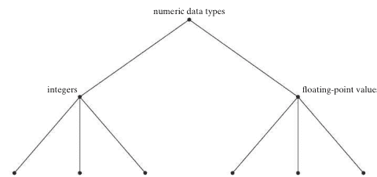

类型说明符 取决于系统

有符号整数的类型说明符是 short、int 和 long，分别对应短整型、整型和长整型。数值的具体范围取决于系统，这意味着范围可能因系统而异。在本章最后一节，我们将介绍一个程序，你可以用它来确定系统上数值数据类型的范围。在许多系统中，短整型数据类型的范围是 –32,768 到 32,767，而整型和长整型通常表示 –2,147,483,648 到 2,147,483,647 之间的值。（32,767 和 2,147,483,647 等不寻常的限制与二进制值转换为十进制值有关。）

C++ 还允许向整数说明符添加 unsigned 限定符。无符号整数只能表示正值。有符号整数和无符号整数可以表示相同数量的值，但范围不同。例如，如果 unsigned short 的取值范围是 0 到 65,535，那么 short integer 的取值范围是 –32,768 到 32,767；这两种数据类型总共可以表示 65,536 个值。

浮点值的类型说明符是 float（单精度）、double（双精度）和 long double（扩展精度）。程序 chapter1_1 中的以下声明语句定义了七个对象，它们都包含双精度浮点值：

```
double x1(1), y1(5), x2(4), y2(7),
side1, side2, distance;
```

声明语句定义标识符，并将标识符与特定数据类型关联。在声明标识符时，可以为其指定初始值。如果指定了初始值，则该值定义标识符的初始值。

### 语句框 2.1 声明

声明语句定义新标识符并分配内存。在定义标识符时，可以将初始值分配给内存位置。也可以指定修饰符。使用 const 修饰符时，需要初始值。

### 语法

```
[modifier] type specifier identifier [(initial value)];
[modifier] type specifier identifier [= initial value];
[modifier] type specifier identifier{(initial value)};
```

### 示例

```
double y1(0), x1;
int counter = 0, n(0);
const int MIN_SIZE=0;
bool error(false);
char comma(',');
```

初始化对象有多种表示法可用。表示法 double y1(0); 是 C++11 中的新表示法，也是推荐的表示法。表示法 int counter = 0; 用于 C 和 C++，在旧代码中经常出现。表示法 int n(0); 在现有 C++ 代码中也经常使用。在本教材的大多数示例中，我们将使用新的 C++11 表示法。

float、double 和 long double 类型之间的区别在于所表示值的精度（或准确性）和范围。精度和范围取决于系统。表 2.2 包含 Microsoft Visual C++ 编译器使用的整数和浮点值的精度和范围信息。第 2.10 节中给出的一个程序允许你获取计算机系统的此信息。在大多数系统中，double 数据类型存储的十进制精度位数大约是 float 数据类型的两倍。此外，double 值的指数值范围比 float 值更宽。long double 值可能具有更高的精度和更宽的指数范围，但这同样取决于系统。像 2.3 这样的浮点常数被假定为 double 常数。要指定 float 常数或 long double 常数，必须在常数后附加字母（或后缀）F 或 L。因此，2.3F 和 2.3L 分别表示 float 常数和 long double 常数。

| 数据类型 | 范围 |
|---|---|
| short | 最大值 = 32,767 |
| int | 最大值 = 2,147,483,647 |
| long | 最大值 = 2,147,483,647 |
| float | 6 位精度<br>最大指数 = 38<br>最大值 = 3.402823e + 38 |
| double | 15 位精度<br>最大指数 = 308<br>最大值 = 1.797693e + 308 |
| long double | 15 位精度<br>最大指数 = 308<br>最大值 = 1.797693e + 308 |

## 布尔数据类型

布尔数据类型以数学家 George Boole 命名，只能表示两个值：true 和 false。在 C++ 中，值零被解释为 false，任何非零值都被视为 true。还有两个预定义的布尔常量 true 和 false 可供使用。可以使用类型说明符 bool 定义布尔对象。以下示例说明了布尔对象和常量的用法：

```
bool error(false), status(true);
cout << error << endl << status;
```

该程序的输出是

```
0
1
```

布尔对象在控制程序流程和标记错误条件方面非常有用。

## 字符数据类型

在 C++ 中，字符数据易于处理，但要有效地处理字符，我们需要更多地了解它们在计算机内存中的表示。请记住，计算机中存储的所有信息在内部都表示为二进制数字（0 和 1）的序列。每个字符对应一个二进制代码值。在接下来的讨论中，我们假设使用美国信息交换标准代码（ASCII）来表示字符。表 2.3 包含一些字符、它们在 ASCII 中的二进制形式以及与二进制值对应的整数值。字符 'a' 由二进制值 1100001 表示，相当于整数值 97。ASCII 代码总共可以表示 128 个字符。完整的 ASCII 代码表载于附录 B。

| 字符 | ASCII 代码 | 整数等价值 |
|---|---|---|
| newline, \n | 0001010 | 10 |
| % | 0100101 | 37 |
| 3 | 0110011 | 51 |
| A | 1000001 | 65 |
| a | 1100001 | 97 |
| b | 1100010 | 98 |
| c | 1100011 | 99 |


字符常量用单引号括起来，如 'A'、'b' 和 '3'。字符对象的类型说明符是 char。一旦字符作为二进制值存储在内存中，该二进制值就可以被解释为字符或整数，如表 2.3 所示。重要的是要注意，字符数字的二进制 ASCII 表示不等于整数数字的二进制表示。

从表 2.3 可以看出，字符数字 '3' 的 ASCII 二进制表示是 0110011，相当于整数值 51 的二进制表示。因此，使用数字的字符表示进行计算所得的结果，与使用数字的整数表示进行计算所得的结果不同。以下程序说明了字符数据的这一特性：

```
/*
* Program chapter2_1
* This program prints a char and an int
*/
#include<iostream> // Required for cout
using namespace std;

int main()
{
    // Declare and initialize objects.
    char ch('3');
    int i(3);

    // Print both values.
    cout << "value of ch: " << ch << " value of i: " << i << endl;

    // Assign character to integer
    i = ch;

    // Print both values.
    cout << "value of ch: " << ch << " value of i: " << i << endl;

    // Exit program
    return(0);
}
/*------------------------------------------------------------*/


该程序的输出为

```
value of ch: 3; value of i: 3
value of ch: 3; value of i: 51
```

## 字符串数据

字符串
C 风格字符串
string 对象

字符串常量是由双引号括起来的字符序列，例如 "sensor"、"F18" 或 "Jane Doe"。字符串变量可以使用 char 类型的数组表示为 C 风格字符串，也可以使用 string 类表示为 string 对象。这两种表示方法将在第 7 章中详细讨论。在本节中，我们将简要介绍 string 类。

C++ 编译器没有名为 string 的内置数据类型，但标准 C++ 库文件 string 中提供了 string 类定义。要使用 string 类，程序必须包含以下预处理指令：

```
#include<string>
```

以下程序说明了预定义 C++ string 类的用法：

```
/*-------------------------------------------*/
/* Program chapter2_2                         */
/*                                           */
/* This program prints a greeting            */
/* using the string class.                   */
/*-------------------------------------------*/

#include <iostream>   // Required for cout
#include <string>     // Required for string
using namespace std;

int main()
{
    // Declare and initialize two string objects.
    string salutation("Hello"), name("Jane Doe");

    // Output greeting.
    cout << salutation << ' ' << name << '!' << endl;

    // Exit program.
    return(0);
}
```

该程序的输出为

```
Hello Jane Doe!
```

程序 chapter2_2 的内存快照如下。

```
string salutation("Hello"), name("Jane Doe");
string salutation   Hello
string name         Jane Doe
```

string 对象 salutation 的大小（或长度）为 5。string 对象 name 的大小为 8。string 对象的大小在执行期间可能会发生变化。例如，如果添加赋值语句

```
salutation = "Goodbye";
```

到程序 chapter2_2 中，内存快照将被修改，salutation 的大小将变为 7。

```
string salutation Goodbye
```

```
string name Jane Doe
```

## 符号常量

符号常量使用 const 修饰符定义。工程常数（如 pi 或重力加速度）是符号常量的良好候选项。例如，考虑以下用于为符号常量 PI 赋值的声明语句：

```
const double PI = acos(-1.0);
```

acos 函数在 -1 处求值时，将返回包含 15 位精度的 pi 近似值。需要使用 pi 值的语句将使用符号常量 PI，如下面的语句所示：

```
area = PI*radius*radius;
```

该语句用于计算圆的面积。

符号常量通常使用大写标识符（例如 PI 而不是 pi）定义，以表明它们是符号常量，当然，标识符应选择为易于记忆的。一旦标识符使用 const 修饰符声明并初始化，其值在程序中就不能更改。

## auto 类型说明符

C++11 关键字 auto 支持在不指定数据类型的情况下声明对象，只要提供初始化器即可。初始化器的数据类型定义了标识符的数据类型。使用关键字 auto 时，建议使用 = 表示法进行初始化。考虑以下类型声明语句：

```
auto x1 = 0;        //x1 is type integer
auto comma = ',',   //comma is type char
auto y1 = 0.5;      //y1 is type double
auto count{0};      //count is type initializer_list<int>
```

关键字 auto 充当初始化器数据类型的占位符。在 auto count{0}; 的情况下，初始化器 {0} 被解释为整数类型的初始化列表，而不是整数。对内置类型进行简单声明时使用 auto 没有优势，但随着数据类型变得更加复杂且难以确定，它可能很有用。

## 练习 2.3

为以下常数定义符号常量所需的声明语句：

- 1. 光速，c = 2.99792 x 10^8 m/s
- 2. 电子电荷，e = 1.602177 x 10^-19 C
- 3. 阿伏伽德罗常数，N_A = 6.022 x 10^23 mol^-1
- 4. 重力加速度，g = 9.8 m/s^2
- 5. 重力加速度，g = 32 ft/s^2
- 6. 地球质量，M_E = 5.98 x 10^24 kg
- 7. 月球半径，r = 1.74 x 10^6 m
- 8. 长度单位，UnitLength = 'm'
- 9. 时间单位，UnitTime = 's'

### 2.3 C++ 类

C++ 支持使用类来定义新数据类型，通常称为程序员定义的数据类型。程序员定义的数据类型对于定义模拟现实世界对象的新数据类型很有用。在上一节中，我们查看了使用 int、double 和 char 等内置数据类型的示例，并讨论了预定义数据类型 string。假设我们正在开发一个操作平面上点的应用程序。没有用于定义点的内置数据类型，但我们可以使用 C++ 关键字 class 定义一个新数据类型来模拟点。在本节中，我们将介绍定义 C++ 类的基本语法，并定义一个新数据类型来模拟平面上的点。

平面上的点是由 (x, y) 坐标定义的对象。坐标是物理属性，可以用数据表示。在本示例中，我们将使用内置数据类型 double 来表示 (x, y) 坐标的值。除了点的物理属性外，我们还需要考虑要对点执行哪些操作。当然，我们必须能够创建新点。我们可能还希望移动现有点、确定两个现有点之间的距离或打印现有点的坐标。物理属性和操作在 C++ 类中为新数据类型定义。

C++ 类的定义由两部分组成：类声明和类实现。通常，类声明和类实现包含在单独的文件中。惯例是将类声明文件命名为 .h 扩展名，将类实现文件命名为 .cpp 扩展名。

## 类声明

类声明以关键字 class 开头，后跟指定新类名称的标识符和类声明体的

- 数据成员
- 成员函数
- 类方法

类声明是一个以分号结束的代码块。此代码块包括类物理属性的声明语句（通常称为数据成员）以及定义所需操作的声明语句（通常称为成员函数或类方法）。关键字 public、private 和 protected 用于控制对数据成员和类方法的访问。控制对数据成员和方法的访问是类的一个强大功能，将在后续章节中更详细地讨论。为了说明类声明的语法，我们先编写名为 Point 的新类的初始声明。请参阅以下给出的类声明。

```
/*
 * Point class
 * Initial Declaration
 * Filename: Point.h
 */
class Point
{
    // Type declaration statements
    // for data members.
    private:
    double xCoord, yCoord; //Class attributes

    public:
    //Declaration statements for class methods
    //Constructors for Point class
    Point(); //default constructor
    Point(double x, double y); //parameterized constructor
};
/*------------------------------------------------*/
```


请注意，需要用分号来终止声明块。

类声明的前四行是注释，其中包含源文件的名称。在下一行中，标识符 Point 以及定义类声明体的代码块跟在关键字 class 之后。重要的是要注意，需要用分号来终止声明块。在声明块中，声明数据成员和方法。数据成员 xCoord 和 yCoord 在关键字 private 下声明，以限制对这些数据成员的访问。类方法在关键字 public 下声明，以允许访问这些方法。请注意，初始声明中仅列出了两个公共方法。列出的第一个方法是默认构造函数 Point()。第二个方法是参数化构造函数 Point(double x, double y)。构造函数是一种特殊方法，用于执行类型声明语句的操作，因此构造函数的名称始终与类名相同。构造函数允许应用程序创建新类型的对象。Point 类的默认构造函数仅包含类名和一组括号。Point 类的参数化构造函数在括号内包含一组参数。这些参数允许应用程序指定要

- 默认构造函数
- 参数化构造函数
- 构造函数


在声明Point对象时分配给其数据成员。在文本的其余部分中，我们将继续为Point类添加补充说明。

请回顾，类型声明语句定义新标识符、分配内存，并可为新内存位置赋予初始值。鉴于Point类声明中提供的构造函数，类型声明语句可用于声明Point类型的对象，如下所示。

```
Point p1; //Default constructor is called
Point p2(1.0, 1.0); //Parameterized constructor is called

memory snapshot:

Point p1 -> [?]double xCoord
            [?]double yCoord

Point p2 -> [1.0]double xCoord
            [1.0]double yCoord
```

## 类实现

要完成Point类的定义，我们需要编写类实现。类实现文件必须为类声明中声明的每个方法包含一段代码。每段代码必须以一个标题开头，该标题包括类名、作用域解析运算符(::)和方法名。下面给出了我们Point类的实现文件。请注意，实现文件包含编译器指令#include "Point.h"。由于Point.h不是C++标准库的一部分，因此使用引号括起来声明文件的名称。

```
/*-------------------------------------------*/
/* Class implementation for initial Point class declaration */
/* filename: Point.cpp */
#include "Point.h" //Required
#include <iostream> //Required for cout
using namespace std;

//Default constructor
Point::Point()
{
   cout << "Constructing Point object, default: \n";
   cout << "Initializing to zero" << endl;
   xCoord = 0.0;
   yCoord = 0.0;
}

//Parameterized constructor
Point::Point(double x, double y)
{
   //input parameters x,y
   cout << "Constructing Point object, parameterized: \n";
   cout << "Input parameters: " << x << ", " << y << endl;
   xCoord = x;
   yCoord = y;
}
```

默认构造函数以标题`Point::Point()`开头。在定义默认构造函数的代码块中，值0.0被赋给数据成员`xCoord`和`yCoord`。这确保了所有使用默认构造函数声明的`Point`对象都将具有初始值0.0。

参数化构造函数以标题`Point::Point(double x, double y)`开头。在定义参数化构造函数的代码块中，参数`x`被赋给数据成员`xCoord`，参数`y`被赋给数据成员`yCoord`。这确保了所有使用参数化构造函数声明的Point对象都将具有由类型声明语句中的值指定的初始值。


在我们`Point`类的实现中，我们在每个构造函数中都包含了`cout`语句。`cout`语句对于跟踪执行和调试很有用，并且在方法完全测试后可以被注释掉。


程序`chapter2_3`说明了程序员定义的数据类型`Point`的用法。请注意，编译器指令`#include "Point.h"`已包含在程序`chapter2_3`中。想要使用程序员定义类型的应用程序必须在其源代码中包含`class`声明文件。

```
/*-------------------------------- Program chapter2_3 ----------------------------------*/
/* Program 2.3 */
/* */
/* This program illustrates the use of the */
/* programmer-defined data type Point */
/* */

#include <iostream> //Required for cout
#include "Point.h" //Required for Point
using namespace std;

int main()
{
 //Declare and initialize objects.
 cout << "In main, declare p1..." << endl;
 Point p1;
 cout << "In main, declare p2..." << endl;
 Point p2(1.5, -4.7);
 cout << "In main, declare ORIGIN..." << endl;
 const Point ORIGIN(0.0, 0.0);

 return 0;
}
/*-----------------------------------------------------------*/

memory snapshot:
Point p1 -> | 0.0 | double xCoord
          | 0.0 | double yCoord
Point p2 -> [1.5] double xCoord
       [-4.7] double yCoord
const Point ORIGIN [0.0] double xCoord
             [0.0] double yCoord
```

程序chapter2_3的输出如下：

```
In main, declare p1...
Constructing Point object, default:
Initializing to zero
In main, declare p2...
Constructing Point object, parameterized:
Input parameters: 1.5, -4.7
In main, declare ORIGIN...
Constructing Point object, parameterized:
Input parameters: 0, 0
```

## 语句框 2.2

类定义：程序员定义的类的定义由两部分组成：类声明和类实现。

```
Syntax: Class Declaration
class ClassName
{
 access modifier:
 declaration of attributes
 access modifier:
 declaration of methods
};
```

```
Syntax: Class Implementation
#include "className.h"
definitions of class methods
```

```
Example: class Declaration
class Point
{
 private:
 double xCoord;
 double yCoord;
 public:
 Point(double x, double y);
};
Usage:
#include "Point.h"
int main()
{
 Point p1(1.5, 2.7);
```

```
Example: class Implementation
#include "Point.h"
Point::Point(double x, double y)
{
 xCoord = x;
 yCoord = y;
}
```

## 修改 2.2

这些问题与本节开发的程序chapter2_3有关。

- 1. 将以下cout语句添加到文件Point.cpp中每个构造函数的末尾。

  cout << "(" << xCoord << "," << yCoord << ")" << endl;

  编译并执行修改后的代码。此修改如何更改输出？

- 2. 在文件Point.cpp中，通过将分配给数据成员的值更改为-1.0来修改默认构造函数。编译并执行代码。此修改如何更改输出？

- 3. 在文件Point.cpp中，通过注释掉默认构造函数中的两个赋值语句来修改默认构造函数。编译并执行代码。此修改如何更改输出？

- 4. 在文件Point.h中，通过删除终止类声明体的分号来修改类声明。尝试编译或构建代码。报告了什么错误消息？

### 2.4 使用IDE构建C++解决方案：Xcode

### 集成开发环境（IDE）

### Xcode

我们已讨论了C++程序的一般结构，并编写了几个小程序来说明数据类型的用法。在本节中，我们将说明如何使用集成开发环境（IDE）开发C++解决方案。IDE是一套旨在促进软件解决方案开发的软件包。IDE包括编辑器、编译器、调试器以及许多其他工具，以帮助设计和开发大型软件解决方案。有多种平台可用的优秀IDE。在本节中，我们将使用IDE Xcode为程序chapter2_3开发C++解决方案。

## Xcode

Xcode IDE由Apple开发，用于开发运行在Mac、iPad和iPhone上的应用程序。Xcode可免费下载。您可以在https://developer.apple.com/上找到更多有关Xcode的信息。启动Xcode应用程序时，将出现如下所示的欢迎窗口。

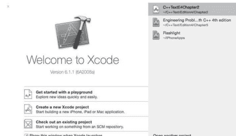

## 欢迎窗口

来源：版权所有 © Apple Inc.

从欢迎窗口的左侧，我们将选择Create a new Xcode project。这将弹出如下所示的新建项目窗口。

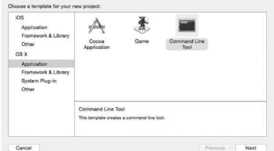

## 新建项目窗口

我们将从新建项目窗口的左侧选择Application，从窗口右侧选择Command Line Tool，然后单击Next。将出现如下所示的选项窗口，用于指定项目选项。

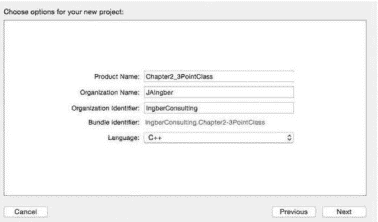

## 选项窗口

请注意，我们选择了C++作为语言。单击Next后，将出现一个保存窗口，允许您选择保存项目的位置。

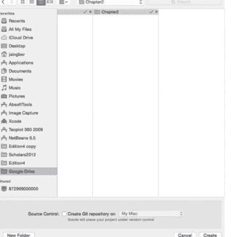

## 保存窗口

我们在Google Drive上选择了一个名为Chapter 2的文件夹。做出选择后，单击Create。将出现如下所示的新窗口。这是开发我们C++解决方案的主窗口。


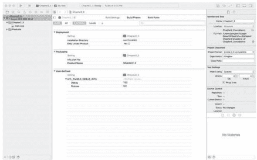

## 主窗口

主窗口中有大量信息，本节暂不讨论。在本示例中，我们将注意力集中在主窗口的左侧。请注意，系统已为我们创建了一个名为 Chapter_3 的文件夹以及 main.cpp 文件。我们可以通过选择 main.cpp 来查看和编辑其内容。所选文件的内容将显示在 Xcode 提供的文本编辑器窗口中，如下所示。

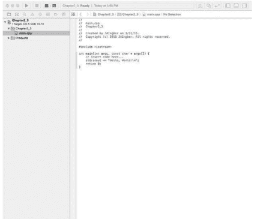

## 主窗口：已选中 main.cpp

我们可以看到 `main.cpp` 包含注释、编译器指令以及用于定义 `int main(int argc, const char * argv[])` 的代码块。参数 `argc` 和 `argv[]` 在本示例中未使用，将在后文中讨论。在 `main.cpp` 的函数体中，字符串 "Hello, World!" 被打印到标准输出，并返回值为零。

要编译并运行此程序，请从 Xcode 窗口顶部的 **产品** 菜单中选择 **运行**。程序将首先成功编译（或构建），然后执行。标准输出将流式传输到主窗口右下角的控制台，如下所示。

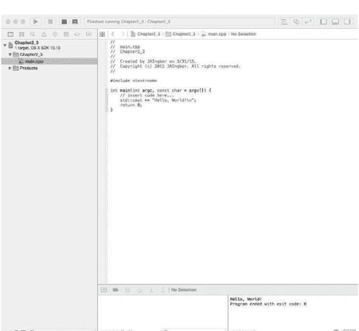

主窗口：控制台输出

我们现在已使用 Xcode 成功编译并执行了第一个 C++ 程序。接下来，我们将向当前项目添加 `Point` 类。要向项目添加新文件，请从 Xcode 窗口顶部的 **文件** 菜单中选择 **新建 > 文件...**。这将启动一个模板窗口，如下所示。在模板窗口左侧选择 **源文件**，在窗口右侧选择 **C++ 文件**，然后单击 **下一步**。

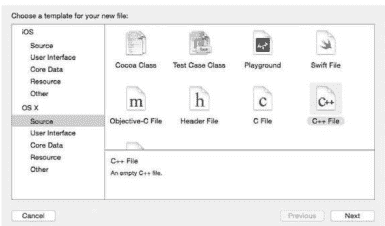

## 模板窗口

这将启动一个选项窗口。该选项窗口询问我们是否也要创建头文件。


## Point 选项窗口

请回顾，我们的 Point 类定义有一个实现文件 Point.cpp 和一个声明文件 Point.h。Point.cpp 是源文件，Point.h 是头文件，因此，是的，我们希望 Xcode 创建一个源文件和一个头文件，两者都命名为 Point。单击下一步，然后从保存窗口中选择一个目录并单击创建。现在，两个新文件 Point.cpp 和 Point.h 已添加到项目中，如下所示，位于主窗口左侧。

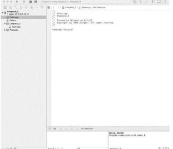

## 主窗口：已选中 Point.cpp

将 C++ 语句添加到 Point.cpp，如第 2.3 节中提供。然后，选择 Point.h 并添加第 2.3 节中提供的 Point.h 的 C++ 语句。最后，选择 main.cpp 并添加程序 chapter_2_3 中的必要语句。完成后，我们的项目文件应如主窗口接下来三个视图中所示的文件一样。

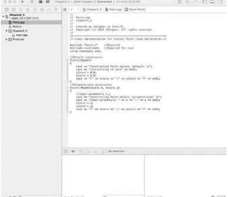

## 主窗口：已选中修改后的 Point.cpp

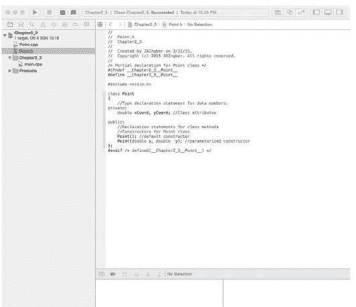

主窗口：已选中 Point.h

请注意，文件 Point.h 包含 3 个新的编译器指令：#ifndef、#define、#endif。这些编译器指令确保数据类型 Point 仅定义一次。

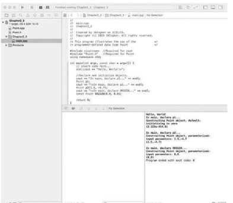

主窗口：已选中修改后的 main.cpp

从 Xcode 窗口顶部的 **产品** 菜单中选择 **运行**。您的输出应如主窗口右下角控制台窗口中的输出所示。

## 修改 2.3

以下问题涉及本节开发的程序 chapter_2_3。

- 1. 添加一个新的类型声明语句，声明一个初始值为 (-1,0) 的新 Point p3。运行程序并解释结果。
- 2. 添加一个新的类型声明语句，定义一个 x 值为 1.5、y 值为 3.6 的新 Point。运行程序并解释结果。
- 3. 将以下赋值语句添加到程序中，放在 return 语句上方：
  `p1 = ORIGIN;`
  运行程序并解释结果。
- 4. 将以下赋值语句添加到程序中，放在 return 语句上方：
  `ORIGIN = p1;`
  运行程序并解释结果。

### 2.5 C++ 运算符

要在程序中执行操作（例如对象的加法、乘法和比较），我们使用为 C++ 支持的内置数据类型定义的特殊运算符。在本节中，我们将介绍其中几个运算符。

### 赋值运算符

赋值语句使用赋值运算符 = 将结果存储在由标识符命名的内存位置中。赋值语句的一般形式为
identifier = expression;

其中表达式可以是常量、另一个对象或操作的结果。请考虑以下两组声明并为对象 sum、x1、p1 和 ch 赋值的语句：

```cpp
// Set One
double sum;
int x1[3];
Point p1(1.5, -4.7);
char ch('a');
```

```cpp
// Set Two
double sum;
int x1;
Point p1, p2(1.5, -4.7);
char ch;

sum = 10.5;
x1 = 3;
p1 = p2;
ch = 'a';
```

执行任一组语句后，sum 的值为 10.5，x1 的值为 3，p1 的值为 (1.5, -4.7)，ch 的值为 'a'，如下内存快照所示：


Set One 中的语句在类型声明语句中同时声明并初始化对象；Set Two 中的赋值语句可在程序的任何位置使用，因此可用于更改（而非初始化）已声明对象的值。请注意，编译器为 Point 类提供了赋值运算符。赋值运算符将赋值运算符右侧对象的数据成员按位复制到左侧对象的相应数据成员中。

C++ 也允许多重赋值，如以下语句，它将值零分配给对象 x、y 和 z 中的每一个：

```cpp
x = y = z = 0;
```

多重赋值将在本节末尾进一步讨论。

| 语句框 2.3 |
|---|
| **赋值语句：** 赋值语句使用赋值运算符将表达式的值存储在由标识符命名的内存位置中。表达式可以是常量、变量或求值为与标识符数据类型兼容的类型的表达式。 |
| **语法** |
| `identifier = expression;` |
| **示例** |
| `x1 = y1;` |
| `counter = 0;` |
| `counter = counter + 1;` |

赋值运算符不应与相等性混淆。赋值语句应读作“被赋予……的值”；因此，语句 rate = stateTax 应读作“rate 被赋予 stateTax 的值”。如果 stateTax 包含值 0.06，则在该语句执行后，rate 也包含值 0.06；stateTax 中的值未更改。该语句执行前后的内存快照如下：

| 之前： | double rate ? | double stateTax 0.06 |
| 之后： | double rate 0.06 | double stateTax 0.06 |

如果我们向具有不同数据类型的对象赋值，则在执行语句期间必须发生转换。有时转换可能导致信息丢失。例如，请考虑以下声明和赋值语句：

```cpp
int a;
...
a = 12.8;
```

因为 a 被声明为整数，它无法存储非零小数部分的值。因此，在此情况下，执行赋值语句后的内存快照如下：

```
int a [ 12 ]
```

> 请注意，值 12.8 被截断，而不是四舍五入。

要确定数值转换是否正常工作，我们使用以下顺序（从高到低）：

- high: long double
- double
- float
- long integer
- integer
- low: short integer

如果将值移动到顺序中较高的数据类型，则不会丢失信息；如果将值移动到顺序中较低的数据类型，则可能丢失信息。因此，将整数移动到 double 可以正常工作，但将 float 移动到整数可能导致信息丢失或结果不正确。一般来说，仅使用不会导致潜在转换问题的赋值。无符号整数未包含在列表中，因为两个方向都可能发生错误。

> 一般来说，仅使用不会导致潜在转换问题的赋值。无符号整数未包含在列表中，因为两个方向都可能发生错误。

### 算术运算符

赋值语句可用于将算术运算的结果赋值给对象，如计算正方形面积的语句所示：

```cpp
areaSquare = side*side;
```

这里运算符 * 用于表示乘法。运算符 + 和 − 用于表示加法和减法，运算符 / 用于除法。因此，以下每个语句都是计算三角形面积的有效计算：

```cpp
areaTriangle = 0.5*base*height;
```

```cpp
areaTriangle = (base*height) / 2.0;
```


第二条语句中括号的使用不是必须的，但为了可读性而使用。请考虑以下赋值语句：

```
x = x + 1 ;
```

在代数中，这是无效的，因为一个值不能等于它本身加 1。但是，这个赋值语句不应被读作等式；相反，它应被读作 x 被赋值为 x 加 1 的值。按照这种解释，该语句表示存储在对象 x 中的值增加 1。因此，如果在执行此语句之前 x 的值为 5，那么执行该语句后 x 的值将为 6。

C++ 还包含一个取模运算符 %，用于计算两个整数相除的余数。例如，5%2 等于 1，6%3 等于 0，2%7 等于 2。（2/7 的商为 0，余数为 2。）如果 a 和 b 是整数，那么表达式 a/b 计算整数商，而表达式 a%b 计算整数余数。因此，如果 a 等于 9 且 b 等于 4，则 a/b 的值为 2，a%b 的值为 1。如果在 a/b 或 a%b 中 b 的值等于零，或者在 a%b 中 a 和 b 中的任何一个整数值为负数，则结果取决于系统。

取模运算符在确定一个整数是否是另一个数的倍数时很有用。例如，如果 a%2 等于零，那么 a 是偶数；否则，a 是奇数。如果 a%5 等于零，那么 a 是 5 的倍数。我们将在工程解决方案的开发中频繁使用取模运算符。

前面段落中讨论的五个运算符（+、-、*、/、%）是二元运算符——作用于两个操作数（值）的运算符。C++ 还包括一元运算符——作用于单个操作数的运算符。例如，当加号和减号用于诸如 -x 这样的表达式时，它们可以是一元运算符。

相同类型值的二元运算结果是另一个相同类型的值。例如，如果 a 和 b 是 double 值，那么 a/b 的结果也是 double 值。同样，如果 a 和 b 是整数，那么 a/b 的结果也是整数；但是，整数除法有时会产生意外结果，因为整数除法的任何小数部分都会被舍弃；结果是截断结果，而不是四舍五入结果。因此，5/3 计算结果为 1，3/6 计算结果为 0。编译器不为程序员定义的类提供算术运算符，但可以由程序员作为类方法定义。

不同类型值之间的运算是混合运算。在执行运算之前，较低类型的值将转换或提升到较高类型（如在赋值语句中的转换中讨论过），因此运算是使用相同类型的值执行的。例如，如果在整数和浮点数之间指定运算，则在执行运算之前将整数提升为浮点数；结果将是浮点数。

假设我们想要计算一组整数的平均值。如果整数的总和和计数已存储在整数对象 sum 和 count 中，那么以下语句似乎应该能正确计算平均值：

```
int sum, count;
double average;
...
average = sum/count;
```

但是，两个整数之间的除法给出整数结果，然后将其提升为 double 值。因此，如果 sum 是 18，count 是 5，那么赋给 average 的值是 3.0，而不是 3.6。为了正确计算此平均值，我们使用强制类型转换运算符——一个一元运算符，允许我们在下一次计算之前指定值的类型更改。在此示例中，强制类型转换 (double) 应用于 sum：

```
average = (double) sum/count;
```

在执行除法之前，sum 的值将提升为 double 值。除法随后是在 double 值和整数之间的混合运算，因此 count 的值将提升为 double 值；除法的结果随后是 double 值，并赋给 average。如果 sum 的值是 18，count 的值是 5，那么 average 的值现在正确计算为 3.6。强制类型转换运算符仅影响计算中使用的值；它不会更改存储在对象 sum 中的值。

## 练习 2.4

给出以下各组语句计算的值，并绘制内存映射。使用第 2.3 节中提供的 Point 类定义来回答第 5 和第 6 题。

- 1. int a[27], b[6], c;
   ...
   c = b*a;

- 2. int a[27], b[6];
   double c;
   ...
   c = a/(double)b;

- 3. int a;
   double b[6], c[18][6];
   ...
   a = c/b;

- 4. int b[6];
   double a, c[18][6];
   ...
   a = (int) c/b;

- 5. Point p1, p2(-5.2, 0.0);

- 6. double x=2.0, y=4.3;
   Point p1(x,y);

## 运算符优先级

### 算术运算符优先级

在包含多个算术运算符的表达式中，我们需要关注运算执行的顺序。表 2.4 包含算术运算符的优先级，这与标准代数优先级一致。括号内的运算始终首先求值；如果括号是嵌套的，则最内层括号内的运算首先求值。一元运算符在二元运算符 *、/ 和 % 之前求值；二元加法和减法最后求值。如果表达式中有多个相同优先级的运算符，则对象将按照表 2.4 中指定的特定顺序与运算符分组（或关联）。例如，考虑以下表达式：

```
a*b + b/c*d
```

因为乘法和除法具有相同的优先级，并且结合性（分组运算的顺序）是从左到右，因此该表达式将被求值，就好像它包含以下内容一样：

```
(a*b) + ((b/c)*d)
```

优先级顺序不指定 a*b 是否在 (b/c) *d 之前求值；这些项的求值顺序取决于系统，但不影响最终值。

| 优先级 | 运算符 | 结合性 |
|---|---|---|
| 1 | 括号：( ) | 最内层优先 |
| 2 | 一元运算符：+ - (type) | 从右到左 |
| 3 | 二元运算符：* / % | 从左到右 |
| 4 | 二元运算符：+ - | 从左到右 |

算术表达式中的间距是一个样式问题。有些人喜欢在每个运算符周围加上空格。我们更喜欢仅在二元加法和减法周围加上空格，因为它们最后求值。选择您喜欢的间距样式，但随后要始终如一地使用。


假设我们想要计算梯形的面积，并且已经声明了四个 double 类型的对象：base、height1、height2 和 area。再假设对象 base、height1 和 height2 已经有值。正确计算梯形面积的语句是

```
area = 0.5*base*(height1 + height2);
```

假设我们省略了表达式中的括号

```
area = 0.5*base*height1 + height2;
```

该语句将被执行，就好像它是以下语句一样：

```
area = ((0.5*base)*height1) + height2;
```

虽然计算出了错误答案，但没有错误消息来提醒我们出错。因此，在将算术表达式转换为 C++ 时，务必非常小心。一般来说，在复杂表达式中使用括号来指示运算顺序，以避免混淆，并确保表达式按所需方式求值。


您可能已经注意到，没有用于计算诸如 x^a 这样的值的幂运算运算符。执行幂运算的特殊数学函数将在初等数学函数部分讨论。当然，诸如 a^2 这样的整数指数幂运算可以通过重复乘法计算，例如 a*a。

长表达式的求值应分解为多个语句。例如，考虑以下方程：

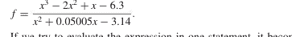

如果我们尝试在一个语句中求值表达式，它会变得太长而难以轻松阅读：

```
f = (x*x*x - 2*x*x + x - 6.3) / (x*x + 0.05005*x - 3.14);
```

我们可以将语句分为两行：

```
f = (x*x*x - 2*x*x + x - 6.3) /
(x*x + 0.05005*x - 3.14);


另一种解决方案是分别计算分子和分母：

```
numerator = x*x*x - 2*x*x + x - 6.3;
denominator = x*x + 0.05005*x - 3.14;
f = numerator/denominator;
```

对象 x、numerator、denominator 和 f 必须是浮点型对象，才能计算出 f 的正确值。

## 练习 2.5

在问题 1 到 3 中，给出计算指定值的 C++ 语句。假设表达式中的标识符已定义为 double 类型的对象，并已赋予适当的值。使用以下常量：重力加速度：g = 9.80665 m/s²

- 1. 行进距离：
- 距离 = x₀ + v₀t + at².

- 2. 绳子中的拉力：
- 拉力 = (2m₁m₂ / (m₁ + m₂)) * g.

- 3. 管道末端的流体压力：
- P₂ = P₁ + (rho * v * (A₁² - A₂²)) / (2 * A₁²).

在问题 4 到 6 中，给出 C++ 语句计算的数学方程。假定已定义以下符号常量，其中 G 的单位为 m³/(kg * s²)：

```
const double PI = acos(-1.0);
const double G = 6.67259e-11;
```

- 4. 向心加速度：
- centripetal = 4*PI*PI*r/(T*T);

- 5. 势能：
- potential_energy = -G*M_E*m/r;

- 6. 势能变化：
- change = G*M_E*m*(1/R_E - 1/(R_E + h));

## 溢出和下溢

存储在内存中的值具有广泛的允许值范围。但是，如果计算结果超出允许值范围，则会发生错误。例如，假设浮点值的指数范围为 -38 到 38。此范围应能容纳大多数计算，但表达式的结果可能超出此范围。例如，假设我们执行以下命令：

```
x = 2.5e30;
y = 1.0e30;
z = x*y;
```

x 和 y 的值在允许范围内。但是，z 的值应为 2.5e60，但该值超出范围。此错误称为指数溢出，因为算术运算结果的指数太大，无法存储在分配给对象的内存中。指数溢出产生的操作取决于系统。

指数下溢是类似的错误，由算术运算结果的指数太小，无法存储在分配给对象的内存中引起。使用与前面示例相同的允许范围，通过以下命令会出现指数下溢：

```
x = 2.5e-30;
y = 1.0e30;
z = x/y;
```

同样，x 和 y 的值在允许范围内，但 z 的值应为 2.5e-60。因为指数小于允许的最小值，所以我们引起了指数下溢。同样，指数下溢产生的操作取决于系统；在某些系统中，指数下溢操作的结果被设置为零。

## 自增和自减运算符

- 自增运算符
- 自减运算符
- 前置
- 后置

C++ 语言包含用于递增和递减对象的一元运算符；这些运算符可用于常量或表达式。自增运算符 ++ 和自减运算符 -- 可以以前置位置（标识符之前）应用，如 ++count，或以后置位置（标识符之后）应用，如 count++。如果自增或自减运算符单独用于语句中，则它相当于递增或递减对象的赋值语句。因此，语句

```
y--;
```

等价于语句

```
y = y - 1;
```

如果自增或自减运算符用于表达式中，则必须仔细求值表达式。如果自增或自减运算符位于前置位置，则先修改标识符，然后使用新值求值表达式的其余部分。如果自增或自减运算符位于后置位置，则使用标识符的旧值求值表达式的其余部分，然后修改标识符。因此，执行

```
w = ++x - y;   (2.1)
```

等价于执行这对语句：

```
x = x + 1;
w = x - y;
```

同样，语句

```
w = x++ - y;
```

等价于这对语句

```
w = x - y;
x = x + 1;
```

执行方程 (2.1) 或方程 (2.2) 时，如果假设 x 的值等于 5，y 的值等于 3，则 x 的值增加到 6。但是，执行方程 (2.1) 后，w 的值为 3，而执行方程 (2.2) 后，w 的值为 2。

自增和自减运算符与其他一元运算符具有相同的优先级。如果表达式中有多个一元运算符，它们从右到左结合。使用后置表示法时，对象的值将在语句结束时递增。递增发生的确切时间取决于系统。出于此原因，从应用后置运算符到语句结束的点，被修改对象的值不确定。


## 缩写赋值运算符

C++ 允许简单的赋值语句缩写。例如，以下每对语句都包含等价语句：

| 缩写赋值运算符 | 等价语句 |
| :--- | :--- |
| `x += 3;` | `x = x + 3;` |
| `sum += x;` | `sum = sum + x;` |
| `d /= 4.5;` | `d = d / 4.5;` |
| `r %= 2;` | `r = r % 2;` |

事实上，任何形式的语句

```
identifier = identifier operator expression;
```

可以写成形式

```
identifier operator = expression;
```

在本节前面，我们使用了以下多重赋值语句：

```
x = y = z = 0;
```

此语句的解释很明确，但以下语句的解释不那么明显：

```
a = b += c + d;
```

多重赋值

| 优先级 | 运算符 | 结合性 |
| :--- | :--- | :--- |
| 1 | 括号：( ) | 从内到外 |
| 2 | 一元运算符：-- ++ + - (类型) | 从右到左 |
| 3 | 二元运算符：* / % | 从左到右 |
| 4 | 二元运算符：+ - | 从左到右 |
| 5 | 赋值运算符：= += -= *= /= %= | 从右到左 |

为了正确求值，我们使用表 2.5，它表明赋值运算符最后求值，且其结合性为从右到左。因此，该语句等价于以下内容：

```
a = (b += (c + d));
```

如果用操作的较长形式替换缩写形式，则有

```
a = (b = b + (c + d));
```

或

```
b = b + (c + d);
a = b;
```

求值此语句是使用优先级和结合性表的良好练习，但一般来说，程序中使用的语句应更具可读性。因此，不建议在多重赋值语句中使用缩写赋值语句。另外，请注意，我们使用的间距约定在缩写运算符和多重赋值运算符周围插入空格，因为这些运算符在算术运算符之后求值。


## 练习 2.6

执行每条语句后给出内存快照，假设在执行语句前 x 等于 2，y 等于 4。还假设所有对象都是整数。

- 1. z = x++ * y;
- 2. z = ++x * y;
- 3. x += y;
- 4. y %= x;

### 2.6 标准输入和输出

C++ 使用对象 `cin`（发音为 "see in"）执行标准输入，并使用对象 `cout`（发音为 "see out"）执行标准输出。这些对象在标准 C++ 库文件 `iostream` 中定义。要在程序中使用其中任何一个对象，必须包含以下预处理器指令：

```
#include <iostream>
```

### cout 对象

`cout` 对象定义用于向标准输出设备流式传输输出。单词 stream 暗示由程序生成并发送到输出缓冲区的连续字符流。当输出缓冲区填满时，内容将显示在标准输出设备上。在我们的示例中，我们将假设标准输出设备是屏幕。

| 语句框 2.4 |
| :--- |
| **标准输出：** C++ 使用 `ostream` 对象 `cout` 将表达式的值流式传输到标准输出。`cout` 在头文件 `iostream` 中定义。要使用 `cout`，程序必须包含编译器指令 `#include <iostream>`。 |
| **语法** |
| `cout << expression << expression;` |
| **示例** |
| `cout << "The radius is " << radius << ",\n centimeters\n";` |

运算符 `<<` 与 `cout` 一起用于向屏幕输出值。以下语句向屏幕输出三个值：

```
cout << "The radius of the circle is "
<< radius << " centimeters\n";
```

每个要输出的值前面都必须有 `<<` 运算符。在前面的示例中，第一个要输出的值是字符串常量 "The radius of the circle is "，第二个要输出的值是对象 `radius` 的值，第三个要输出的值是字符串 " centimeters\n"。字符 `\n` 表示 **换行** 字符；打印时，换行字符会使屏幕移至新行。以下示例说明了 `cout` 的用法：

```
double radius[10], area;
const double PI = acos(-1.0);
cout << "The radius of the circle is: " << radius
<< " centimeters\n"
<< "The area is " << PI*radius*radius
<< " square centimeters\n";


这些语句的输出是：

圆的半径是：10 厘米
面积是 3.14159 平方厘米

请注意，radius 的值中不显示小数点，尽管 radius 被声明为 double 类型。虽然这是 C++ 中打印浮点值的默认格式，但我们可以使用流函数和操纵符来覆盖此格式。

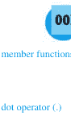

## 流对象

标识符 cout 被声明为 ostream 类型的对象，并由编译器定义用于将数据流式传输到标准输出。ostream 类包含方法，也称为成员函数。成员函数在类定义内定义，只能由同一类类型的对象调用。由于 cout 是 ostream 类型的对象，cout 对象可以调用 ostream 类的成员函数来设置与标准输出关联的格式标志的状态。格式标志是 ostream 类的数据成员。当对象调用其成员函数之一时，会使用一种称为点运算符 (.) 的特殊运算符。以下程序使用 ostream 类的两个成员函数来设置将浮点值流式传输到标准输出所需的格式。setf() 成员函数用于设置显示浮点值的格式为固定形式，即小数形式。成员函数 precision() 用于设置应显示在小数点右侧的有效数字位数。

```
/*------------------------------------------*/
/* Program chapter2_4 */
/* */
/* This program computes area of a circle. */
/* Results are displayed with two digits */
/* to the right of the decimal point. */
/*------------------------------------------*/
#include<iostream> //Required for cout, setf() and precision().
#include<cmath> //Required for acos().
using namespace std;

const double PI = acos(-1.0);

int main()
{
//Declare and initialize objects.
double radius(10), area;
area = PI*radius*radius;
//Call the setf member function using dot operator.
cout.setf(ios::fixed); //Fixed form(xx.xx).

//Call the precision member function using dot operator.
cout.precision(2); //Display 2 digits to right of decimal.
```

```
cout << "The radius of the circle is: " << radius
<< " centimeters\nThe area is "
<< area << " square centimeters\n";
//exit program
return 0;
}
/*---------------------------------------------------------------*/
```

该程序的输出是

圆的半径是：10.00 厘米
面积是 314.16 平方厘米

当通过调用 setf() 设置格式标志时，该标志将保持设置状态，直到被另一次调用 setf() 更改，或通过调用流函数 unsetf() 取消设置（重置为零）。表 2.6 列出了 ios 类中定义的部分格式标志。例如，值 ios::showpoint 指的是 ios 类中定义的标识符 showpoint。当 cout 使用值 ios::showpoint 调用 setf() 时，如语句所示

```
cout.setf(ios::showpoint);
```

与 cout 对象关联的 showpoint 标志的状态将被设置为 true，所有流式传输到标准输出的浮点值都将显示小数点。语句

```
cout.unsetf(ios::showpoint);
```

将导致将 showpoint 标志的状态设置回 false（或零），并恢复显示浮点值到标准输出的默认格式。

成员函数 precision() 指定要显示的浮点值的有效数字位数，其行为取决于其他格式标志的状态。例如，当 cout 在将格式标志状态设置为 fixed 后调用 precision(2) 时，整数参数 2 指定应在小数点右侧显示两位数字，如程序 chapter2_4 所示。如果 cout 在将格式标志状态设置为 scientific 后调用 precision(2)，则整数参数 2 指定总共应显示两位有效数字。

| 标志 | 含义 |
| :--- | :--- |
| ios::showpoint | 显示小数点 |
| ios::fixed | 十进制表示法 |
| ios::scientific | 科学计数法 |
| ios::right | 右对齐打印 |
| ios::left | 左对齐打印 |

## 修改 2.4

- 1. 创建一个包含本节讨论的程序 chapter2_4 的文件。运行该程序

  圆的半径是：10.00 厘米
  面积是 314.16 平方厘米

- 2. 将程序 chapter2_4 中的 setf() 语句替换为语句
  cout.setf(ios::scientific);

  编译并运行修改后的程序。输出发生了什么变化？请解释。

- 3. 将程序 chapter2_4 中的 setf() 语句替换为语句
  cout.setf(ios::showpoint);

  编译并运行修改后的程序。输出发生了什么变化？请解释。

## 操纵符

在程序 chapter2_4 中，我们使用流函数来控制打印到屏幕的输出格式。输出格式也可以通过使用操纵符来控制。操纵符是一种预定义对象，可以影响输出流的状态。程序 chapter2_5 说明了使用操纵符而不是流函数来控制标准输出流格式的方法。要使用操纵符，程序必须包含头文件 <iomanip>

```
/*------------------------------------------------------------*
 * Program chapter2_5                                         *
 *                                                            *
 * This program computes area of a circle.                    *
 * Results are displayed with two digits                      *
 * to the right of the decimal point.                         *
 *------------------------------------------------------------*/

#include <iostream> //Required for cout, endl.
#include <iomanip> //Required for setw() setprecision(), fixed.
#include <cmath> //Required for acos().
using namespace std;

const double PI = acos(-1.0);

int main()
{
   //Declare and initialize objects,
   //double radius(10), area;
   area = PI*radius*radius;
```

```
cout << fixed << setprecision(2);
cout << "The radius of the circle is: "
<< setw(10) << radius << " centimeters" << endl;
cout << "The area of the circle is: " << setw(10) << area
<< " square centimeters" << endl;

//exit program
return 0;
}
/*-------------------------------------------------------------*/
```

该程序的输出是：

```
The radius of the circle is: 10.00 centimeters
The area of the circle is: 314.16 square centimeters
```


操纵符 endl 定义在头文件 <iostream> 中，并在程序 Chapter2_5 中用于移动到新行的开头。endl 操纵符将换行符 ("\n") 发送到标准输出，并立即刷新输出缓冲区，而不是等到输出缓冲区已满。当使用 cout 语句打印程序的内存快照以进行调试时，应使用 endl 操纵符（代替 "\n"）以确保刷新输出缓冲区，并且在下一条语句执行之前看到输出。

操纵符 fixed 和 setprecision() 用于设置显示浮点值的形式和精度。请注意，操纵符不是成员函数，因此不使用点运算符来调用它们。但是，它们对格式标志状态的影响与程序 chapter2_4 中使用的流函数相同。操纵符 setw() 用于指定用于显示发送到输出缓冲区的下一个值的宽度或列数。当结果需要以表格格式打印时，setw() 操纵符很有用。表 2.7 列出了头文件 iomanip 中定义的几种常用操纵符。要使用这些操纵符，程序必须 #include 文件 <iomanip>。

| 操纵符 | 含义 |
| :--- | :--- |
| showpoint | 显示小数点 |
| fixed | 十进制表示法 |
| scientific | 科学计数法 |
| setprecision(n) | 设置要打印的有效数字位数为整数值 n |
| setw(n) | 设置打印下一个值的最小列数为整数值 n |
| right | 右对齐打印 |
| left | 左对齐打印 |


## 练习 2.7

假设整数对象 sum 包含值 150，双精度对象 average 包含值 12.368，并且已包含头文件 iomanip 和 iostream。显示以下代码段生成的输出。假设每个都是独立的代码段。

- 1. cout << sum << " " << average;
- 2. cout << sum;
  cout << average;
- 3. cout << sum << endl << average;
- 4. cout.precision(2);
  cout << sum << endl << average;
- 5. cout.setf(ios::showpoint);
  cout.precision(3);
  cout << sum << ' ' << average;
- 6. cout.setf(ios::fixed);
  cout.setf(ios::showpoint);
  cout.precision(3);
  cout << sum << ' ' << average;
- 7. cout << setprecision(2) << sum << endl << average;
- 8. cout << fixed << setprecision(3)
  << setw(10) << average << endl << setw(10)
  << sum << endl;

## cin 对象

cin 对象是 istream 类型的对象，由编译器定义用于从标准输入设备流式输入。在我们的示例中，我们将假设标准输入设备是键盘。

| 语句框 2.5 |
|---|
| **标准输入：** C++ 使用 `istream` 对象 `cin` 从标准输入流式传输数据，并将值存储在由标识符命名的内存位置中。`cin` 在头文件 `iostream` 中定义。要使用 `cin`，程序必须包含编译器指令 `#include <iostream>`。 |
| **语法** |
| `cin >> identifier >> identifier >> identifier;` |
| **示例** |
| `cin >> x >> y >> count;` |

输入运算符 >> 用于与 cin 配合，从键盘输入一个值并将其赋给变量。>> 运算符使用空白（空格、制表符、换行符）作为输入流中值的分隔符，因此 >> 运算符会丢弃所有空白。以下语句从键盘输入三个值：

```
cin >> var1 >> var2 >> var3;
```

在上述语句中，键盘上输入的第一个值将赋给变量 var1，第二个值赋给 var2，第三个值赋给 var3。当执行 cin 语句时，程序会等待输入。cout 语句通常位于 cin 语句之前，用于提示用户输入数据。提示是打印到屏幕上的文本，用于向用户描述要从键盘输入的值的顺序和数据类型。

从键盘输入的数据存储在输入缓冲区中，直到按下 < Enter > 键才会实际发送到程序。这允许用户在输入数据时回退并进行更正。


在键盘上输入的数值数据应由空白分隔，但使用的空白字符数量无关紧要。>> 运算符将继续丢弃空白，直到它收到语句中每个标识符的值。从键盘输入的值必须与 cin 语句中标识符的数据类型兼容。潜在的输入错误将在第 5 章中讨论。

以下示例说明了 cin 的用法。

```
#include <iostream>       //Required for cin
using namespace std;
int main()
{
    double rate, hours;
    int id;
    char code;

    // Prompt user for input
    cout << "Enter the floating point rate of pay "
         << "and hours worked: ";
    cin >> rate >> hours;
    cout << "Enter the employee's integer id: ";
    cin >> id;
    cout << "Enter the tax code (h,r,l): ";
    cin >> code;
    cout << rate << endl << hours << endl
         << id << endl << code << endl;
    return 0;
}
```

如果来自键盘的输入流包含以下三行输入

```
10.5 40
556
r
```

输入语句中的对象将被赋值，如下面的内存快照所示：

| double rate | 10.5 | double hours | 40 |
|---|---|---|---|
| int id | 556 | char code | 'r' |

cout 语句将在屏幕上打印以下输出：

10.5
40
556
r

>> 运算符丢弃空白，并根据其后标识符的数据类型解释输入值。对于某些需要字符数据的应用程序，丢弃空白可能不可取。函数 get() 是 istream 类的成员函数，可以由 cin 调用以从输入流中获取单个字符。语句

```
char ch;
cin.get(ch);
```

将从键盘读取下一个字符并将其赋给变量 ch。get() 函数不丢弃空白，而是将空白视为有效的字符数据，如以下示例所示：

```
char ch1, ch2, ch3;
cout << "Enter three characters: ";
cin.get(ch1);
cin.get(ch2);
cin.get(ch3);
cout << ch1 << ch2 << ch3;
```

如果来自键盘的输入流包含以下两行

a
1

对象 ch1、ch2 和 ch3 将被赋值，如下面的内存快照所示：

| char ch1 | 'a' | char ch2 | '\n' | char ch3 | '1' |
|---|---|---|---|---|---|

输出将是

a
1

get() 函数将空白视为有效的字符数据；因此，换行符从键盘输入，存储在对象 ch2 中，并在 cout 语句中打印到屏幕上。

### 2.7 使用 IDE NetBeans 构建 C++ 解决方案

在本节中，我们将说明如何使用集成开发环境 NetBeans 开发 C++ 解决方案。本章前面介绍了 Xcode，MS Visual C++ Express 将在第 4 章中介绍。与大多数软件包一样，存在学习曲线，需要时间和经验才能成为 IDE 的高效用户。但是，一旦你精通所选的 IDE，当需要时学习新软件包就会变得更容易。

### NetBeans

NetBeans IDE 是一个开源项目，为包括 Java、C 和 C++ 在内的多种语言提供开发环境。启动 NetBeans 应用程序时，将出现如下所示的欢迎屏幕：


我们将通过一个简单示例来说明 NetBeans 中编辑器和编译器的使用。请注意，NetBeans 提供了快速入门教程。我们建议你查看此教程，以学习如何成为 IDE 的更高效用户。

要创建新的 C++ 解决方案，我们必须先创建新的 NetBeans 项目。从 NetBeans 窗口顶部的“文件”菜单中选择“新建项目...”。将出现“新建项目”屏幕，类似于下面所示。

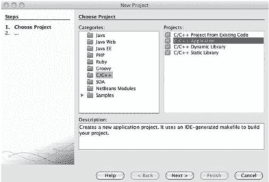

对于此 C++ 项目，我们将从“类别：”菜单中选择 C/C++，然后从“项目：”菜单中选择 C/C++ 应用程序，并单击窗口底部的“下一步 >”按钮。将出现以下“项目名称和位置”窗口。

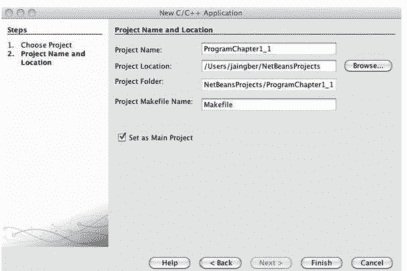

从“浏览...”按钮中选择所需的目录，并将项目命名为 ProgramChapter1_1。单击“完成”按钮以完成 NetBeans 项目的创建。

请记住，每个 C++ 解决方案都需要一个名为 main 的函数。要创建 main，我们必须向项目添加新文件。要添加新文件，从“文件”菜单中选择“新建文件...”。将出现以下“选择文件类型”窗口。

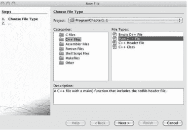

从“类别：”菜单中选择 C++ 文件，从“文件类型：”菜单中选择“主 C++ 文件”，然后单击屏幕底部的“下一步 >”按钮。将出现“名称和位置”窗口，如下所示。

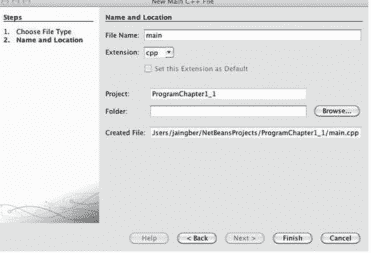

将文件命名为 main，并单击屏幕底部的“完成”按钮。将在编辑器窗口中创建一个带有以下内容的新文件。

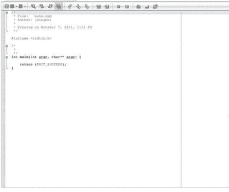

请注意，main() 的标题具有参数 int argc, char** argv。这些可选参数将在本文后面讨论。我们将通过添加本文第 28 页的程序 chapter1_1 中的语句来修改主程序。修改后的程序如下所示。

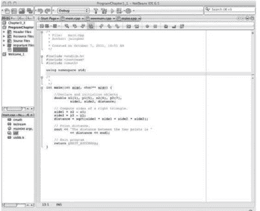

要编译程序，从 NetBeans 窗口顶部的“运行”菜单中选择“生成主项目”。将出现如下所示的输出窗口。


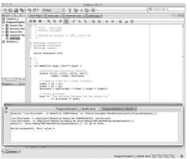

从窗口内容可以看出，构建已成功，因此我们可以尝试执行程序并查看结果。要执行程序，从 Run 菜单中选择 Run Main Project。我们的程序将执行，输出将在单独的窗口中显示，如下所示。

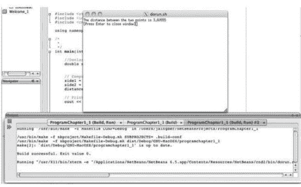

接下来，我们将把程序员定义的 Point 类添加到项目中。从 File 菜单中选择 New File...。从 Categories: 菜单中选择 C++ Files，从 File Types: 菜单中选择 C++ Class，然后选择 Next > 按钮，如下图所示。

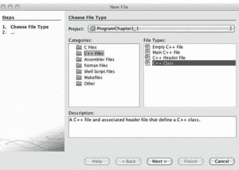

请注意，IDE 同时创建了 point.cpp 文件和 point.h 文件。这两个文件都包含基本构造函数和析构函数，以便于新类的开发。point.h 文件还包含编译器指令 #ifndef、#define、#endif。这些编译器指令可防止 point.h 文件被多次包含，并将在第 10 章中再次讨论。我们将使用编辑器修改这些文件，添加定义 Point 类声明的语句（该声明见本文第 49 页）以及 Point 类实现的语句（该实现见本文第 50 页）。

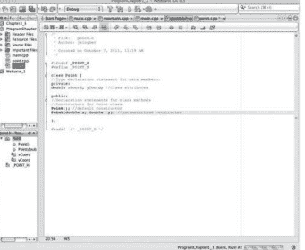

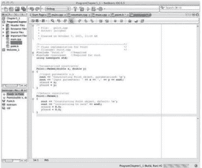

当我们构建并运行此项目时，应得到与之前相同的输出，因为我们尚未修改 main.cpp。为了测试我们程序员定义的 Point 类，我们将把本文第 50 页的以下语句添加到 main.cpp 中，如下所示。

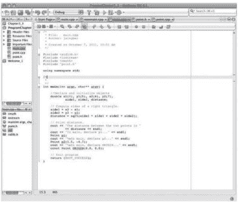

接下来，我们将再次构建并运行项目，得到以下输出。

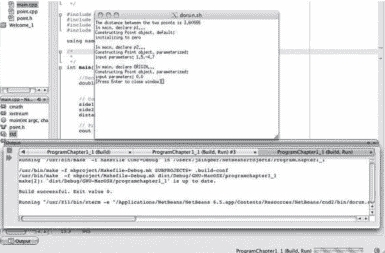

我们在输出窗口中看到，已声明并初始化了三个 Point 对象。

## 修改 2.5

这些问题与本节开发的用于演示 NetBeans 使用的项目 ProgramChapter1_1 有关。

- 1. 注释掉 main.cpp 中的 using 指令（//using namespace std;），并构建项目。保留 using 指令为注释，纠正所有报告的错误，并构建和运行程序。
- 2. 注释掉 #include "Point.h" 指令并构建项目。报告了哪些错误？如何纠正这些错误？
- 3. 从 main.cpp 中的单个语句删除一个分号并构建项目。报告了哪些错误？

### 2.8 C++ 标准库中包含的基本函数

解决工程问题的算术表达式通常需要除加法、减法、乘法和除法之外的计算。例如，许多表达式需要使用对数、指数和三角函数。在本节中，我们讨论标准 C++ 库中可用的预定义数学函数和字符函数。例如，以下语句计算角度 theta 的正弦值，并将结果存储在对象 b 中：

```
b = sin(theta);
```

sin() 函数假设参数 theta 为弧度。如果 theta 包含角度值，我们使用单独的语句将角度转换为弧度。（回顾 180 度 = π 弧度。）

```
const double PI = acos(-1.0);
...
theta_rad = theta*PI/180.0;
b = sin(theta_rad);
```

转换也可以在函数引用中指定

```
b = sin(theta*PI/180.0);
```

### 函数参数

函数引用（例如 sin(theta)）表示一个单一值。函数名后面的括号包含传递给函数的输入，这些输入称为 **函数参数**。函数可能不包含参数、包含一个参数或包含多个参数，具体取决于其定义。如果函数包含多个参数，则按正确顺序列出参数非常重要。某些函数还要求参数使用特定单位。例如，三角函数假设参数为弧度。大多数数学函数假设参数为 **double** 类型值；如果使用不同类型的参数，则在函数执行前将其提升为 **double**。

函数引用也可以是另一个函数引用的参数的一部分。例如，以下语句计算 x 的绝对值的对数：

```
b = log(abs(x));
```

### 函数的组合

当使用一个函数来计算另一个函数的参数时，请确保将每个函数的参数放在各自的括号内。这种函数嵌套也称为 **函数的组合**。

我们现在讨论工程计算中常用的几类函数。其余章节在讨论相关主题时将介绍其他函数。附录 A 也包含有关标准 C++ 库中函数的更多信息。

### 基本数学函数

基本数学函数包括用于执行多种常见计算的函数，例如计算数字的绝对值和数字的平方根。此外，它们还包括一组用于执行舍入的函数。这些函数假设所有参数的类型均为 **double**，并且所有函数都返回 **double**；如果参数不是 **double**，则将使用第 2.2 节中描述的规则进行转换。引用标准 C++ 库中可用的数学函数的程序中应使用以下预处理器指令：

```
#include <math>
```

我们现在简要列出这些函数：

| 函数 | 描述 |
| :--- | :--- |
| fabs(x) | 该函数计算 x 的绝对值。 |
| sqrt(x) | 该函数计算 x 的平方根，其中 x >= 0。 |
| pow(x,y) | 该函数用于幂运算，计算 x 的 y 次方，即 x^y。如果 x = 0 且 y <= 0，或 x < 0 且 y 不是整数，则会发生错误。 |
| ceil(x) | 该函数将 x 舍入为向无穷大方向的最接近整数。例如，ceil(2.01) 等于 3。 |
| floor(x) | 该函数将 x 舍入为向负无穷大方向的最接近整数。例如，floor(2.01) 等于 2。 |

- exp(x)：该函数计算 e^x 的值，其中 e 是自然对数的底数，约为 2.718282。
- log(x)：该函数返回 ln x，即以 e 为底的 x 的自然对数。如果 x <= 0，则会发生错误。
- log10(x)：该函数返回 log10 x，即以 10 为底的 x 的常用对数。如果 x <= 0，则会发生错误。

请记住，负值或零的对数不存在，因此如果对数函数的参数为负值，将发生执行错误。

### 练习 2.8

计算以下表达式：

- 1. floor(-2.6)
- 2. ceil(-2.6)
- 3. pow(2.0, -3)
- 4. sqrt(floor(10.7))
- 5. abs(-10^2.5)
- 6. floor(ceil(10.8))
- 7. log10(100) + log10(0.001)
- 8. abs(pow(-2, 5.0))

三角函数

### 三角函数

三角函数也包含在文件 cmath 中，假设所有参数均为 double 类型，并且每个函数都返回 double 值。此外，如前所述，三角函数还假设角度以弧度表示。要将弧度转换为角度，或将角度转换为弧度，请使用以下转换：

```
const double PI = acos(-1.0);
...
angle_deg = angle_rad * (180/PI);
angle_rad = angle_deg * (PI/180);
```

- sin(x)：该函数计算 x 的正弦值，其中 x 为弧度。
- cos(x)：该函数计算 x 的余弦值，其中 x 为弧度。
- tan(x)：该函数计算 x 的正切值，其中 x 为弧度。
- asin(x)：该函数计算 x 的反正弦（或逆正弦）值，其中 x 必须在范围 [-1, 1] 内。该函数返回范围 [-pi/2, pi/2] 内的弧度角。
- acos(x)：该函数计算 x 的反余弦（或逆余弦）值，其中 x 必须在范围 [-1, 1] 内。该函数返回范围 [0, pi] 内的弧度角。
- atan(x)：该函数计算 x 的反正切（或逆正切）值。该函数返回范围 [-pi/2, pi/2] 内的弧度角。
- atan2(y,x)：该函数计算 y/x 值的反正切或逆正切。该函数返回范围 [-pi, pi] 内的弧度角。

请注意，atan 函数始终返回第一或第四象限的角度，而 atan2 函数返回的角度可以位于任何象限，具体取决于 x 和 y 的符号。因此，在许多应用中，atan2 函数优于 atan 函数。


其他三角函数和反三角函数可以使用以下方程计算 [10]：

sec x = 1/cos x   arcsec x = acos(1/x)
csc x = 1/sin x   arccsc x = asin(1/x)
cot x = 1/tan x   arccot x = acos( x / sqrt(1+x^2) )


在三角函数程序中，使用角度而不是弧度是一个常见错误。

## 练习 2.9

在问题 1 到 3 中，给出计算指示值的赋值语句，假设对象已声明并赋予适当值。还假设已做出以下声明：

```
const double g = 9.8;
const double PI = acos(-1.0);
```

- 1. 速度计算：

  Velocity = \sqrt{v_0^2 + 2a(x - x_0)}

- 2. 长度收缩：

  Length = \sqrt{1 - (v/c)^2}

- 3. 中空圆柱扇形区域重心到参考平面的距离：

  Center = \frac{38.1972(r^3 - s^3) \sin a}{(r^2 - s^2)a}

在问题 4 到 6 中，给出与赋值语句对应的方程。

- 4. 电气振荡频率：

  frequency = 1/sqrt(2*pi*C/L);

- 5. 抛体射程：

  range = (v0*v0/g) * sin(2*theta);

- 6. 圆盘在斜面底部的速度：

  v = sqrt(2*g*h / (1 + I/(m*pow(r,2))));

## 双曲函数

### 双曲函数

双曲函数是自然指数函数 e^x 的函数；反双曲函数是自然对数函数 ln x 的函数。这些函数在专门应用中很有用，例如某些数字滤波器的设计。标准 C++ 库包含若干双曲函数，如下所述。双曲函数包含在标准 C++ 库中，使用这些函数时应使用包含 cmath 信息的预处理器指令。

cmath

- sinh(x)
  该函数计算 x 的双曲正弦，等于
  \frac{e^x + e^{-x}}{2}。

- cosh(x)
  该函数计算 x 的双曲余弦，等于
  \frac{e^x - e^{-x}}{2}。

- tanh(x)
  该函数计算 x 的双曲正切，等于
  \frac{\sinh x}{\cosh x}。

可以使用以下关系计算其他双曲函数和反双曲函数 [10]：

- coth x = \frac{\cosh x}{\sinh x}.
- sech x = \frac{1}{\cosh x}.
- csch x = \frac{1}{\sinh x}.
- asinh x = \ln(x + \sqrt{x^2 + 1}).
- acosh x = \ln(x + \sqrt{x^2 - 1})（当 |x| \ge 1 时）.
- atanh x = \frac{1}{2} \ln(\frac{1+x}{1-x})（当 |x| < 1 时）.
- atanh x = \frac{1}{2} \ln(\frac{x+1}{x-1})（当 |x| > 1 时）.
- asech x = \ln( \frac{1 + \sqrt{1 - x^2}}{x} )（当 0 < x \le 1 时）.
- acsch x = \ln( \frac{1}{x} + \frac{\sqrt{1 + x^2}}{|x|} )（当 x \ne 0 时）.

许多双曲函数和反三角函数对参数的可接受值范围有限制。如果参数是从键盘输入的，请提醒用户注意范围限制。在下一章中，我们将介绍允许您在程序执行期间确定值是否在适当范围内的 C++ 语句。

## 练习 2.10

给定 x 的值，给出计算以下值的赋值语句（假设 x 的值在计算的适当值范围内）。
- 1. coth x
- 2. sech^3 x
- 3. csch^4 x
- 4. acot^6 x
- 5. acosh x
- 6. acsch x

## 字符函数

标准 C++ 库包含许多用于字符数据的预定义函数。这些函数分为两类：一组用于在大写和小写字符之间转换，另一组用于执行字符比较。引用这些字符函数的程序中应使用以下预处理器指令：

```
#include <cctype>
```

以下语句将对象 ch 中存储的小写字母转换为大写字符，并将结果存储在字符对象 ch_upper 中：

```
ch_upper = toupper(ch);
```

如果 ch 是小写字母，函数 toupper() 返回相应的大写字母；否则，函数返回 ch。请注意，参数 ch 未做任何更改。

如果比较为真，字符比较函数返回非零值；否则返回零。以下语句调用函数 isdigit()。如果 ch 的值是数字（0–9），函数 isdigit() 将返回非零结果；如果 ch 不是数字，则返回值 0（false）。

```
digit = isdigit(ch);
```

这些函数的列表及简要说明见附录 A。

### 2.9 应用问题求解：速度计算

在本节中，我们将进行与车辆性能相关的应用计算。涡桨发动机已使用数十年，它结合了喷气发动机的动力和可靠性以及螺旋桨的效率。与早期的活塞动力螺旋桨发动机相比，它是重大改进。然而，其应用仅限于较小的通勤型飞机，因为它不如大型客机使用的涵道喷气发动机快或强大。无导管风扇（UDF）发动机采用了螺旋桨技术的重大进步，缩小了涡桨与涵道喷气发动机之间的性能差距。新材料、叶片形状和更高的旋转速度使动力UDF的飞机能够以接近涵道喷气发动机的速度飞行，并且燃油效率更高。UDF 也比常规涡桨安静得多。

在动力UDF飞机的试飞中，试飞员将发动机功率设置为 40,000 N（牛顿），使 20,000 公斤的飞机达到 180 m/s（米/秒）的巡航速度。然后将发动机油门设置为 60,000 N 的功率水平，飞机开始加速。随着飞机速度的增加，空气动力阻力与空速的平方成正比。最终，飞机达到新的巡航速度，此时 UDF 发动机的推力刚好被阻力抵消。从重置油门到飞机达到新巡航速度（约 120 秒）期间，用于估计飞机速度和加速度的方程如下：

```
Velocity = 0.00001 * time^3 - 0.00488 * time^2 + 0.75795 * time + 181.3566;
```

```
Acceleration = 3 - 0.000062 * velocity^2.
```

这些函数的图如图 2.1 所示。请注意，随着速度接近新的巡航速度，加速度趋近于零。

编写一个程序，提示用户输入一个时间值，表示功率增加以来经过的时间（以秒为单位）。计算并打印新时间值下飞机的相应加速度和速度。

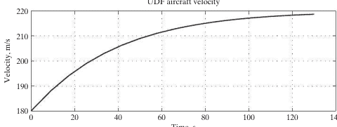

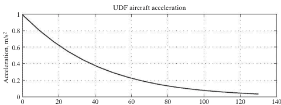

图 2.1 UDF 飞机速度和加速度。

### 1. 问题描述

计算功率变化后飞机的新速度和加速度。

### 2. 输入/输出描述

以下图显示程序的输入是一个时间值，程序的输出是新速度和加速度值的一对。内置数据类型 double 可用于表示这些值。

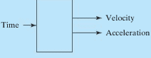

### 3. 手算示例

假设新时间值为 50 秒。使用给定的速度和加速度方程，我们可以计算这些值：

- 速度 = 208.3 m/s；
- 加速度 = 0.31 m/s^2。

### 4. 算法开发

算法开发的第一步是将问题求解分解为一组按顺序执行的步骤：

*分解大纲*

- 1. 读取新时间值。
- 2. 计算相应的速度和加速度值。
- 3. 打印新速度和加速度。

由于此程序非常简单，我们可以直接将分解转换为 C++。

```cpp
/*--------------------------------------------*/
/* Program chapter2_6                         */
/*                                            */
/* This program estimates new velocity and    */
/* acceleration values for a specified time.  */
/*                                            */
/*--------------------------------------------*/

#include<iostream>   //Required for cin,cout
#include<iomanip>  //Required for setprecision(), setw()
#include<cmath>      //Required for pow()
using namespace std;
```


## 5. 测试

我们首先使用手算示例中的数据来测试程序。这会产生以下交互：

```
Enter new time value in seconds:
50
Velocity = 208.304 m/s
Acceleration = 0.310 m·s⁻²
```

因为计算出的值与手算示例匹配，我们可以接着用其他时间值来测试程序。如果计算出的值与手算示例不匹配，我们需要确定错误是在手算示例中还是在程序中。

## 修改 2.6

这些问题与本节开发的用于计算速度和加速度值的程序有关。

- 1. 输入不同的时间值，直到找到一个使速度在 210 m/s 到 211 m/s 之间的值。
- 2. 输入不同的时间值，直到找到一个使加速度在 0.5 m/s 到 0.6 m/s 之间的值。
- 3. 修改程序，使输入值以分钟而不是秒输入。请记住，方程仍将假设时间值以秒为单位。
- 4. 修改程序，使输出值以英尺每秒和英尺每秒平方打印。（回顾 1 米 = 39.37 英寸。）

### 2.10 系统限制

在第 2.2 节中，我们展示了一个包含 Microsoft Visual C++ 6.0 编译器各种整数类型和浮点类型最大值的表格。要为您的系统打印类似的表格，请使用接下来介绍的程序。请注意，该程序包含三个头文件。iostream 头文件是必需的，因为程序使用 cout；climits 头文件是必需的，因为它包含与整数类型范围相关的信息；cfloat 头文件是必需的，因为它包含与浮点类型范围相关的信息。附录 A 包含有关系统相关的常数和限制的更多信息。

```cpp
/*------------------------------------------------------------*/
/* Program chapter2_7                                         */
/*                                                            */
/* This program prints the system limitations.                */
/*                                                            */
/*------------------------------------------------------------*/
#include<iostream>
#include<climits>
#include<cfloat>
using namespace std;
int main()
{
  // Print integer type maxima.
  cout << "short maximum: " << sizeof(short) << endl;
  cout << "int maximum: " << sizeof(int) << endl;
  cout << "long maximum: " << sizeof(long) << endl << endl;

  // Print float precision, range, maximum.
  cout << "float precision digits: " << FLT_DIG << endl;
  cout << "float maximum exponent: " << FLT_MAX_10_EXP << endl;
  cout << "float maximum: " << sizeof(float) << endl << endl;

  // Print double precision, range, maximum.
  cout << "double precision digits: " << DBL_DIG << endl;
  cout << "double maximum exponent: " << DBL_MAX_10_EXP << endl;
  cout << "double maximum: " << sizeof(double) << endl << endl;

// Print long precision, range, maximum.
cout << "long double precision: " << LDBL_DIG << endl;
cout << "long double maximum exponent: " << LDBL_MAX_10_EXP << endl;
cout << "long double maximum: " << sizeof(long double) << endl;
// Exit program.
return 0;
}
/*---------------------------------------*/
```

## 摘要

在本章中，我们介绍了编写简单程序以计算和打印新值所需的 C++ 语句。我们还介绍了允许在程序执行时通过键盘输入信息的语句。所介绍的计算包括标准算术运算以及大量可用于执行工程解决方案所需计算类型的函数。

## 关键术语

- 缩写赋值
- ASCII 代码参数
- 赋值语句
- 结合性
- auto
- 二进制代码
- 二元运算符
- 区分大小写
- 强制类型转换运算符
- 字符
- 类声明
- 类实现
- 类方法
- 注释
- 组合
- 常量
- 构造函数
- 数据成员
- 声明
- 默认构造函数
- 指数表示法
- 表达式
- 字段宽度
- 浮点值
- 垃圾值
- 双曲函数
- 标识符
- 初始值
- 关键字
- 线性插值
- 尾数
- 数学函数
- 成员函数
- 内存快照
- 方法
- 取模
- 多重赋值
- 对象
- 溢出
- 参数
- 参数化构造函数
- 后缀
- 优先级
- 精度
- 前缀
- 预处理器指令
- 程序员定义的数据类型
- 提示符
- 范围
- 科学计数法
- 标准 C++ 库
- 语句
- 符号常量
- 系统相关
- 三角函数
- 截断
- 类型说明符
- 一元运算符
- 下溢
- 空白字符

## C++ 语句摘要

用于从标准 C++ 库的文件中包含信息的预处理器指令：

一般形式：

```
#include<filename>
```

示例：

```
#include <iostream>
#include <cmath>
#include <string>
```

### 类型声明语句

一般形式：

```
datatype identifier [,identifier];
```

示例：整数的声明：

```
short sum(0);
int year_1, year_2;
long k;
```

浮点值的声明：

```
float height_1, height_2;
double length(10), side1, side2;
long double distance, velocity;
```

使用关键字 auto 的声明：

```
auto i = 0;   //i is declared as an int
auto r = 0.5; //r is declared as a double
```

字符和字符串的声明：

```
char ch;
string name; //Requires #include<string>
```

### 符号常量声明

一般形式：

```
const datatype identifier = expression;
```

示例：

```
const double PI = acos(-1.0);
const int MAX_SIZE = 100;
```

### 赋值语句

一般形式：

```
identifier = expression;
```

### 示例

```
area = 0.5*base*(height_1 + height_2);
```

### 键盘输入语句

一般形式：

```
cin >> identifier [>> identifier];
```

### 示例

```
cin >> hours;
cin >> minutes >> seconds;
```

### 来自键盘的字符输入

一般形式：

```
cin.get(identifier);
```

### 示例

```
cin.get(ch);
```

### 屏幕输出语句

一般形式：

```
cout << expression [<< expression];
```

### 示例

```
cout << "The area is " << area << " square feet. " << endl;
```

### 程序退出语句

一般形式：

```
return integer;
```

### 示例

```
return 0;
```

### 注意事项

- 1. 在整个程序中使用注释以提高可读性并记录其中的步骤。
- 2. 使用空行和缩进来标识程序的结构。
- 3. 尽可能在对象名称中使用单位。
- 4. 应为工程常数（如 \(\pi\)）使用符号常量，并且它们应为大写，以便轻松识别。
- 5. 在算术运算符和赋值运算符周围使用一致的间距。
- 6. 在复杂表达式中使用括号以提高可读性。
- 7. 长表达式的求值应分解为多个语句。
- 8. 确保在程序输出中将单位与数值一起包含。
- 9. 使用提示向用户描述要从键盘输入的值的信息和单位。

### 注意事项

- 1. 请记住，声明和 C++ 语句必须以分号结尾。使用关键字 auto 时，使用 = 符号进行初始化。


- 2. 预处理器指令不以分号结尾。想要使用程序员定义类型的应用程序必须包含类声明文件。
- 3. 如果可能，避免可能导致信息丢失的混合赋值。
- 4. 在长表达式中使用括号，以确保其按预期求值。
- 5. 使用双精度或扩展精度以避免指数溢出或下溢问题。
- 6. 如果用户输入值与 cin 语句中使用的变量的数据类型不匹配，可能会发生错误。
- 7. 请务必将运算符 >> 与 cin 一起使用（而不是 <<）。
- 8. 请务必将运算符 << 与 cout 一起使用（而不是 >>）。cout 语句对于跟踪执行很有用。
- 9. 在嵌套函数引用中，每组参数必须各自放在一组括号内。
- 10. 请记住，对数函数不能用于负数参数。
- 11. 请务必将三角函数中的角度使用弧度。
- 12. 请记住，许多反三角函数和双曲函数对允许的输入值范围有限制。
- 13. 请记住，字符数字的整数表示与数值数字的整数表示不相同。

## 问题

## 考试练习！

请指出以下陈述是正确（T）还是错误（F）

- 1. 程序的执行从 main 函数开始。T F
- 2. C++ 不区分大小写。T F
- 3. 声明可以放在程序中的任何位置。T F
- 4. 语句和声明必须以分号结尾。T F
- 5. 整数除法的结果是四舍五入的结果。T F

请指出以下声明语句是否正确。如果语句不正确，请修改它使其成为正确的语句。

- 6. int i, j, k,
- 7. float f1(11), f2(202.00);
- 8. DOUBLE D1, D2, D3;
- 9. float a1(a2);
- 10. int n, m_m;

以下哪项不是 C++ 关键字？

- (a) const
- (b) goto
- (c) static
- (d) when
- (e) unsigned

12. 在类型声明语句中，类型说明符和对象名称之间由什么分隔？
- (a) 句号。
- (b) 空格。
- (c) 等号。
- (d) 分号。
- (e) 以上都不是。

13. 以下哪项声明可以正确地将 x、y 和 z 定义为 double 对象？
- (a) double x, y, z;
- (b) long double x,y,z
- (c) double x==y==z;
- (d) double X, y, Z

14. 在 C++ 中，二元运算符 % 用于计算
- (a) 整数除法。
- (b) 浮点除法。
- (c) 整数除法的余数。
- (d) 浮点除法的余数。
- (e) 以上都不是。

15. 以下哪项赋值产生的值为零？
- (a) result = 983 - 1;
- (b) result = 83 - 1;
- (c) result = 2 - 52;
- (d) result = 2 - 62;
- (e) result = 2 - 83;

执行以下每组语句后，给出相应的内存快照：

16.
```
int x1;
...
x1 = 3 + 4%5 - 5;
int x(1), z(5);
...
z = z++/x;
```

17.
```
double a(3.8), x;
int n(2), y;
...
x = (y=a/n)*2;
```

给出问题 21 到 23 中语句集生成的输出。

18.
```
float value_1(5.78263);
...
cout << "value_1 = " << value_1;
```

19.
```
double value_4(66.45832);
...
cout << scientific << "value_4 = " << value_4;
```

20.
```
int value_5(7750);
...
cout << "value_5 = " << fixed << value_5 << endl;
```

## 编程问题

### 单位换算

这一组问题涉及将一个单位中的值转换为另一个单位。每个程序都应提示用户输入指定单位的值，然后打印转换后的值及其新单位。

- 21. 编写一个程序将英里转换为千米。（回顾 1 mi = 1.6093440 km。）
- 22. 编写一个程序将米转换为英里。（回顾 1 mi = 1.6093440 km。）
- 23. 编写一个程序将磅转换为千克。（回顾 1 kg = 2.205 lb。）
- 24. 编写一个程序将牛转换为磅。（回顾 1 lb = 4.448 N。）
- 25. 编写一个程序将华氏度（TF）转换为兰氏度（TR）。（回顾 TF = TR - 459.67 兰氏度。）
- 26. 编写一个程序将摄氏度（TC）转换为兰氏度（TR）。（回顾 TF = TR - 459.67 兰氏度，且 TF = (9/5) TC + 32 华氏度。）
- 27. 编写一个程序将开尔文度（TK）转换为华氏度（TF）。（回顾 TR = (9/5) TK 且 TF = TR - 459.67 兰氏度。）

### 面积和体积

这些问题涉及使用用户输入计算面积或体积。每个程序都应包含提示用户输入所需对象的内容。

- 28. 编写一个程序计算边长为 a 和 b 的矩形的面积 A。（回顾 A = a * b。）
- 29. 编写一个程序计算底为 b、高为 h 的三角形的面积 A。（回顾 A = 1/2 (b * h)。）
- 30. 编写一个程序计算半径为 r 的圆的面积 A。（回顾 A = πr^2。）
- 31. 编写一个程序计算圆扇形的面积 A，其中 θ 是两个半径之间的弧度角。（回顾 A = r^2θ/2。）
- 32. 编写一个程序计算圆扇形的面积 A，其中 θ 是两个半径之间的角度（度）。（回顾 A = r^2θ/2，其中 θ 为弧度。）
- 33. 编写一个程序计算半轴为 a 和 b 的椭圆的面积 A。（回顾 A = πa * b。）
- 34. 编写一个程序计算半径为 r 的球体表面积 A。（回顾 A = 4πr^2。）
- 35. 编写一个程序计算半径为 r 的球体的体积 V。（回顾 V = (4/3)πr^3。）
- 36. 编写一个程序计算半径为 r、高为 h 的圆柱体的体积 V。（回顾 V = πr^2h。）

### 氨基酸分子量

蛋白质中的氨基酸由氧、碳、氮、硫和氢原子组成，如表 2.8 所示。各单独元素的分子量如下：

| 元素 | 原子量 |
|---|---|
| 氧 | 15.9994 |
| 碳 | 12.011 |
| 氮 | 14.00674 |
| 硫 | 32.066 |
| 氢 | 1.00794 |

- 37. 编写一个程序计算并打印甘氨酸的分子量。
- 38. 编写一个程序计算并打印谷氨酸和谷氨酰胺的分子量。
- 39. 编写一个程序，提示用户输入氨基酸中五种元素各自的原子数。然后计算并打印该氨基酸的分子量。
- 40. 编写一个程序，提示用户输入氨基酸中五种元素各自的原子数。然后计算并打印该氨基酸中原子的平均重量。

## 表 2.8 氨基酸分子

| 氨基酸 | O | C | N | S | H |
|---|---|---|---|---|---|
| 丙氨酸 | 2 | 3 | 1 | 0 | 7 |
| 精氨酸 | 2 | 6 | 4 | 0 | 15 |
| 天冬酰胺 | 3 | 4 | 2 | 0 | 8 |
| 天冬氨酸 | 4 | 4 | 1 | 0 | 6 |
| 半胱氨酸 | 2 | 3 | 1 | 1 | 7 |
| 谷氨酸 | 4 | 5 | 1 | 0 | 8 |
| 谷氨酰胺 | 3 | 5 | 2 | 0 | 10 |
| 甘氨酸 | 2 | 2 | 1 | 0 | 5 |
| 组氨酸 | 2 | 6 | 3 | 0 | 10 |
| 异亮氨酸 | 2 | 6 | 1 | 0 | 13 |
| 亮氨酸 | 2 | 6 | 1 | 0 | 13 |
| 赖氨酸 | 2 | 6 | 2 | 0 | 15 |
| 甲硫氨酸 | 2 | 5 | 1 | 1 | 11 |
| 苯丙氨酸 | 2 | 9 | 1 | 0 | 11 |
| 脯氨酸 | 2 | 5 | 1 | 0 | 10 |
| 丝氨酸 | 3 | 3 | 1 | 0 | 7 |
| 苏氨酸 | 3 | 4 | 1 | 0 | 9 |
| 色氨酸 | 2 | 11 | 2 | 0 | 11 |
| 酪氨酸 | 3 | 9 | 1 | 0 | 11 |
| 缬氨酸 | 2 | 5 | 1 | 0 | 11 |

以 b 为底的对数。要计算 x 以 b 为底的对数，可以使用以下关系

$$\log_b x = \frac{\log_2 x}{\log_2 b}$$

- 41. 编写一个程序读取一个正数，然后计算并打印该值以 2 为底的对数。例如，8 以 2 为底的对数是 3，因为 $2^3 = 8$。

- 42. 编写一个程序读取一个正数，然后计算并打印该值以 8 为底的对数。例如，64 以 8 为底的对数是 2，因为 $8^2 = 64$。

## 工程挑战：全球变化


来源：Justin Hofman/Alamy Stock Photo

海水主要是水，其中含有约 3.5% 的溶解物质（盐、金属和气体），这些物质来自火山喷发和岩石风化。盐度最高的海水位于赤道附近的大西洋，那里蒸发量超过降水量。海水的盐度是衡量海水中溶解物质含量的指标。氯占成分的约 55%，而钠约占 30.6%。其余主要成分是硫酸盐（7.7%）、镁（3.7%）、钙（1.2%）和钾（1.1%）。盐度在海洋不同地点有所不同，但通常在 33 到 38 千分比（ppt）之间，即 3.3% 到 3.8%。盐度通常使用测量水电导率的仪器来测量；水中溶解物质越多，导电性越好。本章后面将讨论盐度与冰点之间的关系，然后使用线性插值来确定指定盐度的海水冰点。


## 控制结构：选择

## 章节大纲

- 学习目标
- 3.1 算法开发
- 3.2 结构化程序设计
- 3.3 条件表达式
- 3.4 选择语句：if 语句
- 3.5 数值技术：线性插值
- 3.6 问题求解应用：海水冻结温度
- 3.7 选择语句：switch 语句
- 3.8 使用 IDE 构建 C++ 解决方案：NetBeans
- 3.9 为程序员定义的数据类型定义运算符
- 小结、关键术语、C++ 语句摘要、风格说明、调试说明、习题

## 学习目标

在本章中，我们将开发包含以下内容的问题求解方案：

- 计算结果为真或假的条件表达式
- 允许我们在程序中提供备选路径的选择语句
- 算法开发以及使用流程图和伪代码描述算法

### 3.1 算法开发

在第 2 章中，我们开发的 C++ 程序非常简单。步骤是顺序的，通常涉及从键盘读取信息、计算新信息，然后打印新信息。在求解工程问题时，大多数解决方案需要更复杂的步骤，因此我们需要扩展问题求解过程中的算法开发部分。

### 自顶向下设计

自顶向下设计以顺序步骤呈现问题求解方案的“全景”描述。然后对问题的整体描述进行细化，直到步骤足够详细以转换为语言语句。我们在第 1 章和第 2 章中使用了分解大纲来提供问题求解方案的第一个定义。该大纲以顺序步骤编写，可以以图表或逐步大纲的形式展示。对于非常简单的问题，例如下面在第 2 章中开发的问题，我们可以直接从分解大纲转到 C++ 语句：

### 分解大纲

- 1. 读取新的时间值。
- 2. 计算相应的速度和加速度值。
- 3. 打印新的速度和加速度。

然而，对于大多数问题求解方案，我们需要将分解大纲细化为更详细的描述。这个过程通常被称为 **分治** 策略，因为我们不断将问题求解方案分解为越来越小的部分。为了描述这种逐步细化，我们使用伪代码或流程图。

| 基本操作 | 伪代码表示法 | 流程图符号 |
|---|---|---|
| 输入 | 读取半径 | 读取半径 |
| 计算 | 将面积设为 π · 半径² | 面积 = π · 半径² |
| 输出 | 打印半径，面积 | 打印半径，面积 |
| 比较 | 如果半径 < 0 则... | 半径 < 0？ |
| 算法开始 | main: | 开始 main |
| 算法结束 | | 停止 main |

图 3.1 伪代码表示法和流程图符号。

将大纲细化为更详细的步骤可以使用伪代码或流程图。伪代码使用类似英语的语句来描述算法中的步骤，而流程图使用图表来描述算法中的步骤。大多数算法的基本步骤如图 3.1 所示，并附带了伪代码和流程图中的相应表示法。

伪代码和流程图是帮助我们确定求解问题步骤顺序的工具。这两种工具都常用，尽管通常不会同时用于同一个问题。为了展示这两种工具的示例，有些问题求解方案将使用伪代码，而其他方案将使用流程图；伪代码和流程图之间的选择通常是个人偏好。有时我们需要经过多个层次的伪代码或流程图来开发复杂的问题求解方案；这就是我们在本节前面提到的逐步细化。分解大纲、伪代码和流程图是解决方案的工作模型，因此不是唯一的。每个参与解决方案的人都会有不同的分解大纲和伪代码或流程图描述，就像不同人开发的 C++ 程序会有些许不同，尽管它们解决的是同一个问题。

### 3.2 结构化程序设计

结构化程序是使用简单控制结构来组织问题求解方案的程序。简单结构通常定义为顺序、选择或重复。顺序结构包含一个接一个执行的步骤，选择结构包含在条件为真时执行的一组步骤和在条件为假时执行的另一组步骤；重复结构包含在条件为真时重复执行的一组步骤。我们现在讨论顺序结构和选择结构，并使用伪代码和流程图给出具体示例。重复将在第 4 章中讨论。

顺序包含一个接一个执行的步骤。第 2 章中开发的所有程序都具有顺序结构。例如，计算无导管发动机飞机速度和加速度的程序的伪代码和流程图如图 3.2 所示。

### 伪代码

```
main: read time
set velocity to 10^-6 * time^3 - 0.00488*time^2 +
    0.75795*time + 181.3566
set acceleration to 3 - 0.000662*velocity^2
print velocity and acceleration
```

如果选择结构包含一个可计算为真或假的条件。如果条件为真，则执行一组语句；如果条件为假，则执行另一组语句。例如，假设我们已经计算了分数的分子和分母的值。在计算除法之前，我们想确保分母不接近零。因此，我们要测试的条件是“分母接近零”。如果条件为真，则我们想打印一条消息，指示我们无法计算该值。如果条件为假，这意味着分母不接近零，则我们计算并打印分数的值。在定义此条件时，我们需要定义“接近零”。对于此示例，我们将假设接近零意味着

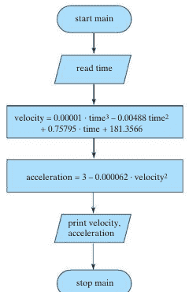

图 3.2 第 2.9 节无导管风扇问题求解方案的流程图和伪代码。

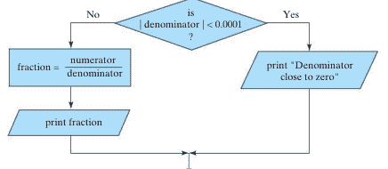

图 3.3 选择结构的流程图。

即绝对值小于 0.0001。以下是伪代码描述，该结构的流程图描述如图 3.3 所示。

```
if |denominator| < 0.0001
    print "Denominator close to zero"
else
    set fraction to numerator/denominator
    print fraction
```

请注意，此结构还包含一个顺序结构（计算分数然后打印分数），该结构在条件为假时执行。

在本章的其余部分中，我们将介绍用于执行选择和重复的 C++ 语句，然后开发使用这些结构的示例程序。

### 备选方案评估

通常有多种方法来解决同一个问题。在大多数情况下，并没有单一的最佳解决方案，但有些解决方案比其他方案更好。随着经验的积累，选择一个好的解决方案会变得更容易，我们将在本文中给出有助于良好解决方案的要素示例。例如，好的解决方案是可读的；因此，好的解决方案不一定是最短的解决方案，因为简短的解决方案通常不可读性很高。我们将努力避免那些缩短程序但难以理解的微妙或巧妙的步骤。

在开始开发问题求解方案时，尝试思考几种解决方法是个好主意。为几种解决方案绘制分解大纲和伪代码或流程图。然后选择你认为最容易转换为 C++ 语句的解决方案。有些算法比其他算法更适合不同的语言，因此你还要选择一个与 C++ 语言匹配良好的解决方案。偶尔，还必须考虑解决方案的其他方面，例如执行速度和内存需求。

### 3.3 条件表达式

- 条件
- 关系运算符
- 逻辑运算符
- 求值顺序

因为选择结构和重复结构都使用 **条件**，所以我们必须在介绍实现选择和重复结构的语句之前讨论条件。条件是一个可计算为真或假的表达式，它由使用 **关系运算符** 组合的表达式组成；条件还可以包含 **逻辑运算符**。在本节中，我们将介绍关系运算符和逻辑运算符，并讨论当它们组合在单个条件中时的 **求值顺序**。

### 关系运算符

以下列表显示了可用于在 C++ 中比较两个表达式的关系运算符。请注意，C++11 提供了关键字 `not_eq` 作为 `!=` 运算符的替代。

| 关系运算符 | 解释 |
| :--- | :--- |
| `<` | 小于 |
| `<=` | 小于或等于 |
| `>` | 大于 |
| `>=` | 大于或等于 |
| `==` | 等于 |
| `!= (not_eq)` | 不等于 |

关系运算符两侧可以使用空格，但不能使用空格分隔双字符运算符，例如 `==`。


示例条件如下：

```
a not_eq b
x > y >= 10.5
fabs(denominator) < 0.0001
```

给定这些条件中标识符的值，我们可以将每个条件求值为真或假。例如，如果 a 等于 5 且 b 等于 8.4，那么 a not_eq b 是一个真条件。如果 x 等于 2.3 且 y 等于 4.1，那么 x > y >= 10.5 是一个假条件。如果 denominator 等于 20.0025，那么 fabs(denominator) < 0.0001 是一个假条件。

为了可读性，我们在逻辑表达式的关系运算符周围使用空格，但在条件的算术运算符周围不使用空格。

在 C++ 中，真条件被赋值为 1，假条件被赋值为 0。因此，以下语句是有效的：

```
d = b > c;
```

如果 b > c，则 d 被赋值为 1；否则，向 d 赋值为 0。单个值可以用来代替条件。例如，考虑以下语句：

```
if (a)
    ++count;
```

如果 a 的值为零，则假定条件为假；如果 a 的值非零，则假定条件为真。因此，在前面的语句中，如果 a 非零，则 count 的值将被递增。

## 逻辑运算符

逻辑运算符也可以在条件中使用。但是，逻辑运算符比较的是条件，而不是表达式。C++ 支持三个逻辑运算符：and、or 和 not。这些逻辑运算符由以下符号和关键字表示：

| 逻辑运算 | 符号 | C++ 关键字 |
|---|---|---|
| and | && | and |
| or | || | or |
| not | ! | not |

例如，考虑以下条件：

```
a < b && b < c
```

关系运算符的优先级高于逻辑运算符；因此，此条件读作 "a 小于 b，且 b 小于 c"。为了使条件更具可读性，我们在逻辑运算符周围插入空格，但在关系运算符周围不插入空格。给定

| A | B | A && B | A || B | !A | !B |
|---|---|---|---|---|---|
| 假 | 假 | 假 | 假 | 真 | 真 |
| 假 | 真 | 假 | 真 | 真 | 假 |
| 真 | 假 | 假 | 真 | 假 | 真 |
| 真 | 真 | 真 | 真 | 假 | 假 |

a、b 和 c 的值，我们可以将此条件求值为真或假。例如，如果 a 等于 1，b 等于 5，且 c 等于 8，则条件为真。如果 a 等于 -2，b 等于 9，且 c 等于 2，则条件为假。

如果 A 和 B 是条件，则可以使用逻辑运算符生成新条件 A && B、A || B 和 !B。条件 A && B 仅在 A 和 B 都为真时才为真。条件 A || B 在 A 或 B 中任一为真时为真。运算符 ! 会更改其前面条件的值。因此，条件 !A 仅在 A 为假时才为真，条件 !B 仅在 B 为假时才为真。这些定义在表 3.1 中总结。

表 3.1 为以下四个条件提供了真值表：

```
A && B, A || B, !A, and !B.
```

真值表根据布尔操作数的真值提供条件的真值。在表 3.1 中，有两个布尔操作数 A 和 B，这些布尔操作数可以表示 2^2 = 4 个唯一组合的值。每个额外的布尔操作数会使唯一组合的数量翻倍。考虑条件

```
A && B || B && C.
```

此表达式的真值取决于三个布尔操作数 A、B 和 C 的真值，因此有 2^3 = 8 个唯一组合，如表 3.2 所示。

以下程序说明了使用逻辑和关系运算符生成表 3.2 中提供的真值表。

| A | B | C | A && B || B && C |
|---|---|---|---|
| 0 | 0 | 0 | 0 |
| 0 | 0 | 1 | 0 |
| 0 | 1 | 0 | 0 |
| 0 | 1 | 1 | 1 |
| 1 | 0 | 0 | 0 |
| 1 | 0 | 1 | 0 |
| 1 | 1 | 0 | 1 |
| 1 | 1 | 1 | 1 |

```
/*--------------------------------------------------------------*/
/* Program chapter3_1 generates a truth table                     */
/* for the condition:                                             */
/* A && B || B && C                                               */
/*--------------------------------------------------------------*/

#include<iostream>
using namespace std;

int main()
{
   //Declare and initialize objects
   bool A(false), B(false), C(false);

   //Print table header
   cout << " TABLE 3.2\n A\tB\tC\tA && B || B && C"
        << endl;
   cout << "--------------------------------------------------------------"
        << endl;
   cout << endl;
   cout << A << '\t' << B << '\t' << C << '\t'
        << (A && B || B && C) << endl;

   //Toggle C
   C = !C;
   cout << A << '\t' << B << '\t' << C << '\t'
        << (A && B || B && C) << endl;

   //Toggle B and C
   B = !B;
   C = !C;
   cout << A << '\t' << B << '\t' << C << '\t'
        << (A && B || B && C) << endl;

   //Toggle C
   C = !C;
   cout << A << '\t' << B << '\t' << C << '\t'
        << (A && B || B && C) << endl;

   //Toggle A, B and C
   A = !A;
   B = !B;
   C = !C;
   cout << A << '\t' << B << '\t' << C << '\t'
        << (A && B || B && C) << endl;

   //Repeat the pattern for B and C..

   //Toggle C
   C = !C;
   cout << A << '\t' << B << '\t' << C << '\t'
        << (A && B || B && C) << endl;

   //Toggle B and C
   B = !B;
   C = !C;
   cout << A << '\t' << B << '\t' << C << '\t'
        << (A && B || B && C) << endl;

   //Toggle C
   C = !C;
   cout << A << '\t' << B << '\t' << C << '\t'
        << (A && B || B && C) << endl;
   return 0;
}
```

短路求值

执行带有逻辑运算符的表达式时，C++ 只会对表达式进行必要的求值以确定其结果。这称为短路求值。例如，如果 A 为假，则表达式

```
A && B
```

也为假，无需求值 B。同样，如果 A 为真，则表达式

```
A || B
```

为真，无需求值 B。为了验证表 3.2 的正确性，您必须意识到 && 运算符的优先级高于 || 运算符。运算符的优先级将在下一节中讨论。

## 修改 3.1

- 1. 修改程序 chapter3_1 以生成条件 A&&B&&C 的真值表。
- 2. 修改程序 chapter3_1 以生成条件 A||B||C 的真值表。
- 3. 修改程序 chapter3_1 以生成条件 A&&&B 的真值表。
- 4. 修改程序 chapter3_1，将逻辑运算符替换为 C++11 关键字。

## 优先级和结合性

条件可以包含多个逻辑运算符，如下所示：

```
! (b==c || b==5.5)
```

层次结构从高到低为 !、&&、||，但可以使用括号更改层次结构。在前面的示例中，表达式 b==c 和 b==5.5 首先被求值。假设 b 等于 3 且 c 等于 5。那么两个表达式都不为真，因此表达式 b==c || b==5.5 为假。然后我们将 ! 运算符应用于假条件，这会产生一个真条件。

条件可以同时包含算术运算符、关系运算符和逻辑运算符。表 3.3 包含条件中元素的优先级和结合性顺序。

| 优先级 | 运算 | 结合性 |
| :--- | :--- | :--- |
| 1 | () | 从内到外 |
| 2 | ++ -- + - ! (type) | 从右到左（单目） |
| 3 | * / % | 从左到右 |
| 4 | + - | 从左到右 |
| 5 | < <= > >= | 从左到右 |
| 6 | == != | 从左到右 |
| 7 | && | 从左到右 |
| 8 | || | 从左到右 |
| 9 | = += -= *= /= %= | 从右到左 |

## 练习 3.1

确定问题 1 到 8 中以下条件是真还是假。假设以下对象已按所示声明和初始化：

a = 5.5   b = 1.5   k = 3

- 1. a < 10.0 + k
- 2. a + b >= 6.5
- 3. k != a - b
- 4. b - k > a
- 5. !(a == 3 * b)
- 6. -k <= k + 6
- 7. a < 10 && a > 5
- 8. fabs(k) > 3 || k < b - a
- 9. a + b not_eq 6.5
- 10. a < 0 and b < 0
- 11. a < 0 not_eq b < 0

### 3.4 选择语句：if 语句

if 语句允许我们测试条件，然后根据条件是真还是假执行语句。C++ 包含两种形式的 if 语句——简单 if 语句和 if else 语句。C++ 还包含 switch 语句，允许我们测试多个条件，然后根据条件是真还是假执行语句组。

### 简单 if 语句

if 语句的最简单形式具有以下一般形式：

```
if ( condition )
    statement 1;
```

如果条件为真，则执行语句 1；如果条件为假，则跳过语句 1。


if 语句中的语句被缩进，以便从语句中更容易地可视化程序的结构。

当条件为真时，如果我们希望执行多条语句（或一个序列结构），则使用由一组用大括号括起来的语句组成的语句块。大括号的位置是一种风格问题；下面展示了两种常见的风格：

```
Style 1
if (condition)
{
   statement 1;
   statement 2;
   ...
   statement n;
}

Style 2
if (condition) {
   statement 1;
   statement 2;
   ...
   statement n;
}
```

在文本解答中，我们采用第一种风格约定；因此，两个大括号各自独占一行。虽然这会使程序稍长一些，但也更容易注意到是否错误地遗漏了大括号。图 3.4 包含了带有简单 if 语句的控制流程图，这些 if 语句要么执行一条语句，要么在条件为真时执行一个语句块。

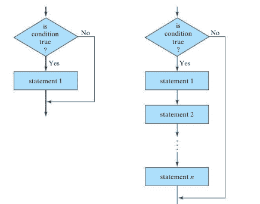

图 3.4 选择语句的流程图。

## 语句框 3.1

if 语句：if 语句允许我们测试条件，然后根据条件是真还是假来执行语句。

语法：
```
if (condition)       if (condition)
statement;           {
[else                statement block
statement;]          }
                   [else
                   {
                   statement block
                   }]
```

示例：
```
if (error != x > 0)      if (x > y)
{                        {
  sum += x;              ++c1;
  ++count;               --x;
}                        }
                   else if (x < y)
                   {
                     +c2;
                     --y;
                   }
                   else
                   {
                     +c0;
                   }
```

下面是一个 if 语句的具体示例：

```cpp
#include<iostream>   //Required for cout
using namespace std;
int main()
{
  int a, count(0), sum(0);
  cin >> a;
  if (a > 50)
  {
    ++count;
    sum += a;
  }
  cout << (double)sum/count;
  return 0;
}
```

如果 a 小于 50，则 count 加 1 且 a 加到 sum 中；否则，跳过这两条语句。

## if 语句的嵌套

if 语句块内的语句可以是任何 C++ 语句，包括另一个 if 语句。下面的示例说明了 if 语句的嵌套：

```cpp
if (count < 50)
{
    ++count;
    sum = sum + a;
    if (count < 40)
        ++a;
}
```

如果 count 小于 50，我们将 count 加 1 并将 a 加到 sum 中。此外，如果 count 小于 40，我们还将 a 加 1。如果 count 不小于 50，则跳过所有这些语句。为了可读性，请缩进每个 if 语句块中的语句。

## 样式

## if/else 语句

if/else 语句允许我们在条件为真时执行一个语句块，在条件为假时执行另一个语句块。if/else 语句的最简单形式如下：

```cpp
if (condition)
    statement 1;
else
    statement 2;
```

## 空语句

语句 1 和语句 2 可以被语句块替换。语句 1 或语句 2 也可以是空语句，即仅一个分号。如果语句 2 是空语句，那么 if/else 语句可能应该写成简单的 if 语句。在某些情况下，为语句 1 使用空语句很方便；然而，这些语句也可以重写为条件相反的简单 if 语句。例如，下面两条语句是等价的：

| if (a < b) | if (a >= b) |
|------------|-------------|
| ; | ++count; |
| else | |
| ++count; | |

考虑这个 if/else 语句：

```cpp
if (d < 30)
    velocity = 0.425 + 0.00175*d*d;
else
    velocity = 0.625 + 0.12*d - 0.0025*d*d;
```

在此示例中，如果距离 d 小于或等于 30，则使用第一个赋值语句计算 velocity；否则，使用第二个赋值语句计算 velocity。此 if/else 语句的流程图如图 3.5 所示。

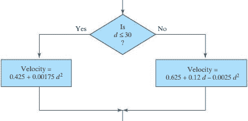

图 3.5 if/else 语句的流程图。

if/else 语句的另一个示例是

```cpp
if (fabs(denominator) < 0.0001)
    cout << "Denominator close to zero" << endl;
else
{
    x = numerator/denominator;
    cout << "x = " << x << endl;
}
```

在此示例中，我们检查对象 denominator 的绝对值。如果该值接近零，我们将打印一条消息，指示无法执行除法。如果 denominator 的值不接近零，我们将计算并打印 x 的值。此考虑的流程图已在图 3.3 中显示。

考虑以下嵌套 if/else 语句集：

```cpp
if (x > y)
    if (y < z)
        ++k;
    else
        ++m;
else
    ++j;
```

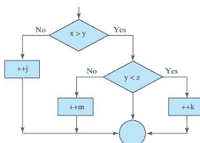

当 x>y 且 y<z 时，k 的值加 1；当 x>y 且 y>=z 时，m 的值加 1；当 x<=y 时，j 的值加 1。通过仔细缩进，该语句易于理解。假设我们现在删除内部 if 语句的 else 部分。如果保持相同的缩进，语句将变为以下内容：

```cpp
if (x > y)
    if (y < z)
        ++k;
else
    ++j;
```

乍一看，j 会在 x <= y 时加 1，但这不正确。C++ 编译器会将 else 语句与块中最近的 if 语句关联。因此，无论使用何种缩进，前面的语句都将执行为如果它是以下内容：

```cpp
if (x > y)
    if (y < z)
        k++;
else
    j++;
```

因此，当 x>y 且 y>=z 时，j 的值加 1。如果我们打算在 x<=y 时增加 j，则需要使用大括号将内部语句定义为一个块：

```cpp
if (x > y)
{
    if (y < z)
        ++k;
}
else
    ++j;
```

为了避免使用 if/else 语句时产生混淆和可能的错误，您应该常规使用大括号来清晰地定义语句块。

C++ 允许使用条件运算符来代替简单的 if/else 语句。这个 C++ 运算符是一个三元运算符，因为它有三个参数：一个条件、条件为真时要执行的语句、以及条件为假时要执行的语句。该操作在条件后用问号表示，并在两个语句之间用冒号表示。为了说明，下面两条语句是等价的：

```
if (a<b)
    ++count;
else
    c = a + b;

a<b ? ++count : c = a + b;
```

条件运算符（指定为 ?）在赋值运算符之前求值，如果表达式中有多个条件运算符，它们从右到左关联。

在本节中，我们介绍了在选择语句中比较值的多种方法。比较浮点值时需要注意。如第 2 章所见，由于二进制和十进制值之间的转换，浮点值有时可能与我们预期的略有不同。例如，本节前面，我们没有将 denominator 与零进行比较，而是使用了一个条件来检查 denominator 的绝对值是否小于一个小值。同样，如果我们想知道 y 是否接近 10.5，应该使用 fabs(y - 10.5) <= 0.0001 这样的条件，而不是 y == 10.5。一般来说，不要将相等运算符与浮点值一起使用。


使用整数的相等运算符 (==) 时，还需要注意第二点。一个常见的错误是使用赋值运算符 (=) 而不是逻辑运算符 (==)。考虑以下 C++ 程序：

```cpp
#include<iostream>
using namespace std;
int main()
{
int x(4), y(5);
if(x = y)
{
cout << x << " is equal to " << y << endl;
}
return 0;
}
```

上面的程序编译和执行时，编译器或操作系统都没有任何错误消息，程序的输出为：

5 等于 5

此错误是由于在 if 语句中使用赋值运算符而不是相等运算符来形成条件而导致的。将 y 赋值给 x，并且由于 y 不为零（即 y 不为假），赋值语句求值为 true，因此 if 语句块内的 cout 语句被执行。如果 y 初始化为 0 而不是 5，则不会执行该语句块。几乎每个程序员都会多次犯这种编程错误，因此，如果您的程序输出不是您预期的结果，请检查所有打算使用相等运算符的条件。

## 练习 3.2

在第 1 到第 7 题中，绘制流程图以执行指示的步骤。然后给出相应的 C++ 语句。假设对象已声明并具有合理的值。

- 1. 如果 time 大于 15.0，则将 time 增加 1.0。
- 2. 当 poly 的平方根小于 0.5 时，打印 poly 的值。
- 3. 如果 volt_1 和 volt_2 之间的差值大于 10.0，则打印 volt_1 和 volt_2 的值。
- 4. 如果 den 的值小于 0.05，则将 result 设置为零；否则，将 result 设置为 num 除以 den。
- 5. 如果 x 的自然对数大于或等于 3，则将 time 设置为零并递减 count。


- 6. 如果 dist 小于 50.0 且 time 大于 10.0，则将 time 增加 2；否则，将 time 增加 2.5。
- 7. 如果 dist 大于或等于 100.0，则将 time 增加 2.0。如果 dist 在 50 和 100 之间，则将 time 增加 1。否则，将 time 增加 0.5。

### 3.5 数值技术：线性插值

从实验或观察物理现象中收集数据是开发问题解决方案的重要步骤。这些数据点通常可以被视为函数 f(x) 上点的坐标。我们常希望利用这些数据点，来估算原始数据集中未包含的 x 值对应的函数 f(x)。例如，假设我们有数据点 (a, f(a)) 和 (c, f(c))。如果我们想要估算 f(b) 的值，其中 a < b < c，可以假设一条直线连接 f(a) 和 f(c)，然后使用线性插值来获取 f(b) 的值。如果我们假设点 f(a) 和 f(c) 由一个三次（三阶）多项式连接，可以使用三次样条插值法来获取 f(b) 的值。大多数插值问题可以使用这两种方法之一来解决。图 3.6 包含一组六个数据点，这些点已

\frac{f(a) - f(b)}{b - a} = \frac{f(a) - f(c)}{c - a}

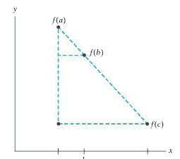

图 3.7 相似三角形。

已用直线段连接，也已用三次多项式段连接。应当清楚，样本点之间函数的值取决于我们选择的插值类型。在本节中，我们讨论线性插值。

图 3.7 显示了一个带有两个任意数据点 f(a) 和 f(c) 的图。如果我们假设两点之间的函数可以用一条直线来估算，则可以使用由相似三角形推导出的方程，计算任意点 f(b) 的函数值：

f(b) = f(a) + \frac{b - a}{c - a} [f(c) - f(a)].

请记住，我们也假设 a < b < c。

为了说明使用此插值方程，假设我们有一组从正在测试的新发动机气缸头中取得的温度测量值，该发动机可能用于赛车。这些数据在图 3.8 中以连接各点的直线形式绘制，并在此列出：


图 3.8 气缸头温度。

| 时间，秒 | 温度，华氏度 |
|---|---|
| 0.0 | 0.0 |
| 1.0 | 20.0 |
| 2.0 | 60.0 |
| 3.0 | 68.0 |
| 4.0 | 77.0 |
| 5.0 | 110.0 |

假设我们想要插值一个温度，以对应 2.6 秒的值。我们则有以下情况：

| a | 2.0 | f(a) | 60.0 |
|---|---|---|---|
| b | 2.6 | f(b) | ? |
| c | 3.0 | f(c) | 68.0 |

使用插值公式，我们有

```
f(b) = f(a) + \frac{b - a}{c - a} [f(c) - f(a)]
= 60.0 + \frac{2.6 - 2.0}{3.0 - 2.0} [68.0 - 60.0]
= 64.8.
```

在此示例中，我们使用线性插值来找到与指定时间对应的温度。我们也可以互换温度和时间的角色，使温度在 x 轴上，时间在 y 轴上。在此情况下，我们可以使用相同的过程来计算出现指定温度的时间，假设我们有一对低于和高于指定温度的数据点。

## 练习 3.3

假设我们有以下一组数据点，这些点也在图 3.9 中绘制：

| 时间 (秒) | 温度 (华氏度) |
|---|---|
| 0.0 | 72.5 |
| 0.5 | 78.1 |
| 1.0 | 86.4 |
| 1.5 | 92.3 |
| 2.0 | 110.6 |
| 2.5 | 111.5 |
| 3.0 | 109.3 |
| 3.5 | 110.2 |
| 4.0 | 110.5 |
| 4.5 | 109.9 |
| 5.0 | 110.2 |

## 练习 3.3 续

- 1. 使用计算器，利用线性插值计算以下时间的温度：
- 0.3, 1.25, 2.36, 4.48

- 2. 使用计算器，利用线性插值计算对应以下温度的时间值：
- 81, 96, 100, 106

- 3. 假设问题 2 要求你计算对应 110 华氏度温度的时间值。什么使这个问题变得复杂？有多少个时间值对应 110 华氏度？使用线性插值找出每个对应的时间值。（你可能希望参考图 3.10，它包含了将这些数据绘制为温度数据在 x 轴、时间值在 y 轴的图。）


图 3.9 温度值。


图 3.10 时间值。

### 3.6 应用问题求解：海水冰点

在本节中，我们使用线性插值来解决与海水盐度相关的问题。回顾章节开头的讨论，海水的盐度是衡量海水中溶解物质含量的指标。海洋中不同地点的盐度各不相同，但通常在 33 到 38 千分比（ppt）范围内，即 3.3% 到 3.8%。

盐度通常使用测量水的电导率的仪器来测量；水中溶解材料越多，导电性越好。在较冷地区，盐度测量尤其重要，因为海水的冻结温度取决于其盐度。盐度越高，海水冻结的温度越低。下表包含一组盐度测量值和相应的冻结温度；这些值也在图 3.11 中绘制。

| 盐度 (ppt) | 冻结温度 (华氏度) |
| :--- | :--- |
| 0 (淡水) | 32 |
| 10 | 31.1 |
| 20 | 30.1 |
| 24.7 | 29.6 |
| 30 | 29.1 |
| 35 | 28.6 |

假设我们希望使用线性插值来确定已测量盐度的水的冻结温度。编写一个程序，允许用户输入两个点的数据以及这两个点之间的盐度值。程序应验证输入的盐度值是否介于两个数据点的盐度值之间。如果输入数据有效，程序应计算相应的冻结温度。如果数据无效，程序应打印错误消息和无效数据。


图 3.11 海水冻结温度。

### 1. 问题陈述

使用线性插值计算具有指定盐度的水的新冻结温度。

### 2. 输入/输出描述

下图显示，程序的输入包括两个连续点 (a, f(a)) 和 (c, f(c)) 以及新的盐度测量值 b。输出是新的冻结温度。


### 3. 手算示例

假设我们想要确定盐度测量值为 33 ppt 的水的冻结温度。从数据中，我们看到该点介于 30 和 35 ppt 之间：

| a | 30 | 29.1 | f(a) |
|---|---|---|---|
| b | 33 | ? | f(b) |
| c | 35 | 28.6 | f(c) |

使用线性方程公式，我们可以计算 f(b)：

```
f(b) = f(a) + (b-a) / (c-a) . (f(c) - f(a))
= 29.1 + 3/5 . (28.6 - 29.1)
= 28.8
```

如预期，该值介于 f(a) 和 f(c) 之间。

### 4. 算法开发

算法开发的第一步是将问题解决方案分解为一组按顺序执行的步骤：

*分解大纲*

- 1. 读取相邻点的坐标和新的盐度值。
- 2. 验证输入。
- 3. 计算新的冻结温度。
- 4. 打印新的冻结温度。


分解大纲的第二步需要一个选择结构。如果输入的盐度值不在两个数据点的盐度值之间，将打印错误消息，连同错误数据，并终止程序。

下面用流程图描述的改进概述了这些步骤。

流程图中的步骤现在足够详细，可以转换为 C++。我们将使用 if 语句来实现选择结构。


/*---------------------------------------------*/
/* Program chapter3_2                          */
/*                                             */
/* This program uses linear interpolation to   */
/* compute the freezing temperature of seawater. */
/*                                             */
#include<iostream> //Required for cin, cout, endl.
#include<iomanip> //Required for fixed, setprecision()
using namespace std;

int main()
{
   // Declare objects.
   double a, f_a, b, f_b, c, f_c;

   // Prompt and get user input from the keyboard.
   cout << "Use ppt for salinity values." << endl
        << "Use degrees F for temperatures." << endl
        << "Enter first salinity and freezing temperature: \n";
   cin >> a >> f_a;
   cout << "Enter second salinity and freezing temperature: \n";
   cin >> c >> f_c;
   cout << "Enter new salinity: \n";
   cin >> b;

   if ( !(a < b && b < c) )
   {
      cout << "Invalid data: " << a << " < "
           << b << " < " << c << endl;
   }
   else
   {
      // Use linear interpolation to compute
      // new freezing temperature.
      f_b = f_a + (b-a)/(c-a)*(f_c - f_a);

      // Print new freezing temperature to the screen.
      cout << "New freezing temperature in degrees F: "
           << fixed << setprecision(1) << f_b << endl;
   } // end else

   // Exit program.
   return 0;
}
```

## 5. 测试

我们首先使用手算示例中的数据来测试程序。这会产生以下交互：

```
Use ppt for salinity values.
Use degrees F for temperatures.
Enter first salinity and freezing temperature:
30 29.1
Enter second salinity and freezing temperature:
35 28.6
Enter new salinity:
33
New freezing temperature in degrees F: 28.8
```

计算出的值与手算示例匹配，因此我们可以用其他时间值来测试程序。如果新系数值与手算示例的结果不匹配，我们就需要确定错误是在手算示例中还是在 C++ 程序中。

## 修改 3.2

这些问题与本节开发的用于线性插值计算新冰点的程序有关。

- 1. 使用该程序确定以下盐度测量值（ppt）对应的冻结温度：

  3   8.5   1.9   23.5   26.8   30.5

- 2. 修改程序，使其将新温度转换并以摄氏度打印。（回顾 T_F = 9/5 T_C + 32，其中 T_F 表示华氏温度，T_C 表示摄氏温度。）

- 3. 假设与程序一起使用的数据包含摄氏度数值。程序需要更改吗？请解释。

- 4. 修改程序，使其对盐度进行插值，而不是对新冻结温度进行插值。（你可能需要参考图 3.12，该图包含此数据的图表，横轴为冻结温度，纵轴为盐度。）


图 3.12 海水冻结温度时的盐度。


图 3.13 温度传感器状态输出的流程图。

### 3.7 选择语句：switch 语句

switch 语句用于多重选择决策。特别是，它常用于替换嵌套 if/else 语句。在对 switch 语句进行一般性讨论之前，我们先展示一个使用嵌套 if/else 语句的简单示例，然后展示一个使用 switch 语句的等效解决方案。

假设我们有一个来自大型机械内部传感器的温度读数。我们希望在控制屏幕上打印一条消息，以告知操作员温度状态。如果状态代码为 10，温度过高，应关闭设备；如果状态代码为 11，操作员应每 5 分钟检查一次温度；如果状态代码为 13，操作员应打开循环风扇；对于所有其他状态代码，设备正常运行。该控制结构的流程图见图 3.13。

图 3.13 中的流程图可以使用以下嵌套 if/else 语句集合来实现：

```
if(code == 10)
{
    cout << "Too hot - turn equipment off." << endl;
}
else
{
    if(code == 11)
    {
        cout << "Caution - recheck in 5 minutes." << endl;
    }
    else
    {
        if(code == 13)
        {
            cout << "Turn on circulating fan." << endl;
        }
        else
        {
            cout << "Normal mode of operation." << endl;
        }
    }
}
```

等效语句是以下 switch 语句：

```
switch(code)
{
    case 10:
        cout << "Too hot - turn equipment off." << endl;
        break;
    case 11:
        cout << "Caution - recheck in 5 minutes." << endl;
        break;
    case 13:
        cout << "Turn on circulating fan." << endl;
        break;
    default:
        cout << "Normal temperature range." << endl;
        break;
}
cout << code << endl;
```

break 语句导致程序执行继续执行 switch 语句之后的语句（本示例中为 cout << code << endl;），从而跳过大括号中其余的语句。

嵌套 if/else 语句并不总是容易转换为 switch 语句。但是，当转换可行时，switch 语句通常更易于阅读。也更容易确定 switch 语句所需的语句分组。

控制表达式

case 结构

switch 语句根据控制表达式选择要执行的语句，该控制表达式必须是整型或字符型表达式。在语句框 3.2 提供的一般形式中，case 标签（label_1、label_2、...）决定执行哪些语句，因此在某些语言中，这种结构称为 case 结构。执行的语句是与标签等于控制表达式的 case 对应的语句。case 标签必须是唯一常量；如果两个或多个 case 标签具有相同的值，则会发生错误。default 子句用于在没有其他语句执行时提供要执行的语句；default 子句是可选的。

## 语句框 3.2

switch 语句：switch 语句允许我们测试整型或字符型的控制表达式，然后执行所有与标签等于控制表达式的 case 对应的语句。

### 语法

```
switch(controlling expression)
{
   case label1:
      statement;
      statement;
   case label2:
      statement;
      statement;
      [default: statement;]
      statement;
}
```

### 示例：

```
switch(errorCode)
{
   case CODE_1:
      cout << ERRORSTRING_1 << endl;
      break;
   case CODE_2:
      cout << ERRORSTRING_2 << endl;
      break;
   default:
      cout << "errorCode " << errorCode << " not found" << endl;
      break;
}
```


switch 结构中的语句通常包含 break 语句。当执行 break 语句时，程序执行跳出 switch 结构，并继续执行 switch 结构之后的语句。如果没有 break 语句，则将执行 case 标签选中的语句之后的所有语句。

虽然 switch 语句中的 default case 是可选的，但我们建议包含它，以便在没有任何 case 标签等于控制表达式的情况下明确指定步骤。我们还在 default case 中使用 break 语句，以强调程序将继续执行 switch 语句之后的语句。

使用多个 case 标签对应同一语句是有效的，例如

```
switch(op_code)
{
   case 'N':
   case 'R':
}
```


cout << "Normal operating range." << endl;
break;
case 'M':
cout << "Maintenance needed." << endl;
break;
default:
cout << "Error in code value." << endl;
break;
}

当多个 case 标签用于同一语句时，求值过程仿佛使用逻辑或运算符连接了这些 case。在此示例中，如果 op_code 等于 'N' 或 op_code 等于 'R'，则执行第一条语句。

## 实践 3.4

将以下嵌套 if/else 语句转换为 switch 语句：

```
if(rank==1 || rank==2)
{
cout << "Lower division" << endl;
}
else
{
if(rank==3 || rank==4)
{
cout << "Upper division" << endl;
}
else
{
if(rank==5)
{
cout << "Graduate student" << endl;
}
else
{
cout << "Invalid rank" << endl;
}
}
}
}
```

### 3.8 使用 IDE 构建 C++ 解决方案：NetBeans

在本节中，我们将使用 NetBeans IDE 开发一个 C++ 解决方案。我们的 C++ 程序将执行货币转换。我们的货币转换程序的伪代码如下：

```
Pseudocode
main: read amount in dollars, currency code
    case currency code E
        convert dollars to euros
    case currency code P
        convert dollars to Mexican pesos
    case currency code S
        convert dollars to British pounds sterling
    print equivalent currency
```

伪代码中的步骤足够详细，可以使用 NetBeans IDE 转换为 C++。

### NetBeans

NetBeans 是由 Oracle Corporation 开发的 IDE，可免费下载。该 IDE 使用 Java 编写，只要安装了 Java 虚拟机 (JVM)，即可在任何平台上运行，包括 Windows、Mac OS、Linux 和 Solaris。启动 NetBeans 应用程序时，将出现如下所示的欢迎屏幕：


要创建新的 C++ 解决方案，必须先创建新项目。从欢迎屏幕中，选择 C/C++ 链接。将出现类似于下图所示的“新建项目”窗口。


从 **类别** 窗口中选择 C/C++，从 **项目** 窗口中选择 **C/C++ 应用程序**，然后选择 **下一步 >** 按钮。将出现一个新窗口，允许您命名项目并选择目录。项目名称窗口如下所示。


选择您想要的目录并将文件命名为 chapter3_3，然后单击 **完成** 按钮以完成 NetBeans 项目的创建。接下来出现的窗口是 **项目** 窗口。**项目** 窗口提供对 NetBeans 提供的项目文件和工具的访问。


要创建 C++ 程序，从左侧窗口中选择 Chapter_3_3，然后从窗口顶部的 NetBeans 文件菜单中选择新建文件。将出现以下添加新文件的窗口：


从 **类别** 窗口中选择 C++ 文件，从 **文件类型** 窗口中选择 Main C++ 文件。将出现一个新窗口，允许您命名文件并选择目录。新文件名窗口如下所示。


将文件命名为 main 并选择完成。将出现编辑器窗口，如下所示。我们可以看到一些基本语句已添加到文件 main.cpp 中。


我们现在将在文件 main.cpp 中编写货币转换器伪代码的 C++ 实现。代码和完成的文件窗口如下所示：

```
/*
 * File:   main.cpp
 * Author: jaingber
 *
 * Created on May 21, 2011, 10:08 AM
 */

#include <stdlib.h>
#include <iostream>
using namespace std;

/*---------------------------------------------------------*/
/* Program chapter3_3
 *
 * This program performs currency conversion from dollars to
 * E => euros
 * P => pesos
 * S => pounds sterling
 */
int main(int argc, char** argv)
{
    double dollars, equivalentCurr;
    char currencyCode;
    const double ECONVERSION(0.7041), PCONVERSION(11.6325),
                 SCONVERSION(0.6144);

    //Prompt user for input
    cout << "Enter dollar amount" << endl;
    cin >> dollars;
    cout << "Enter currency code:\n"
         << "E => Euros\nP => Mexican Pesos\nS => British Pounds"
         << " Sterling:\n";
    cin >> currencyCode;

    switch(toupper(currencyCode))
    {
        case 'E':
            cout << "Converting dollars to euros...\n";
            equivalentCurr = dollars*ECONVERSION;
            break;
        case 'P':
            cout << "Converting dollars to pesos...\n";
            equivalentCurr = dollars*PCONVERSION;
            break;
        case 'S':
            cout << "Converting dollars to pounds sterling...\n";
            equivalentCurr = dollars*SCONVERSION;
            break;
        default:
            cout << currencyCode << " not supported at this time\n" ;
            equivalentCurr = dollars;
    }
cout << "Equivalent amount: "<< equivalentCurr << endl;
return (EXIT_SUCCESS);
}
```


可以通过从 **NetBeans 运行** 菜单中选择 **生成主项目** 来编译此项目。生成窗口如下所示，我们可以看到生成成功。


要执行程序，请从 **NetBeans 运行** 菜单中选择 **运行主项目**。将出现输出窗口，如下所示。输入所需的美元金额和货币代码，并验证输出。


- **修改 3.3**
- 1. 查找欧元、墨西哥比索和英镑的当前汇率，并修改程序 chapter_3 中的常量以反映当前值。
- 2. 修改程序 chapter_3，以执行从美元到港元的转换。
- 3. 通过将 switch 语句替换为 if 语句来修改程序 chapter_3。

### 3.9 为程序员定义的数据类型定义运算符

我们已研究过算术运算符和关系运算符，并将这些运算符与内置数据类型一起用于构建条件表达式。但是，这些运算符未为程序员定义的数据类型（如 Point）定义。回顾第 2 章，赋值运算符是编译器为程序员定义的类型定义的唯一运算符。只要运算符有合理的定义，就可以为程序员定义的类型定义其他运算符。为程序员定义的类型定义运算符称为运算符重载。运算符重载为现有运算符提供新定义，并允许程序员定义的类型以与内置类型相同的方式使用运算符。运算符只能为程序员定义的类型重载。不能为内置类型重载运算符。


在本节中，我们将向在第 2 章开发的 Point 类添加两个二元运算符。算术运算符 (-) 将添加到 Point 类，并定义为返回平面上两点之间的距离。关系运算符 (==) 也将添加到 Point 类，并定义为当且仅当两个操作数的所有对应数据成员相等时返回 true。为了说明运算符重载的语法，我们首先向 Point 类声明中添加方法声明。

```
/**-------------------------------------------------------------**/
/* Point class
/* Filename: Point.h
/* class Point
{
 //Type declaration statements
 //Data members.
 private:
 double xCoord, yCoord; //Class attributes
 public:
 //Declaration statements for class methods
 //Constructors for Point class
 Point(); //default constructor
 Point(double x, double y); //parameterized constructor
 //Overloaded operators
 double operator -(const Point& rhs) const;
 bool operator ==(const Point& rhs) const;
};
/**-------------------------------------------------------------**/
```

请注意，我们在每个运算符声明中两次使用 const 修饰符。使用 const 修饰符可防止重载运算符修改其操作数的数据成员。括号内的 const 修饰符保护右侧操作数的数据成员，而声明末尾的 const 修饰符保护左侧操作数的数据成员。任何尝试从这些方法内部修改任一对象的数据成员的操作都会导致编译错误。

要完成重载运算符的定义，必须将这两个方法添加到类实现中。更新后的类实现如下。

```
/**-------------------------------------------------------------**/
/* Class implementation for Point
/* filename: Point.cpp
/* #include "Point.h" //Required for Point
 #include <iostream> //Required for cout
 #include <cmath> //Required for sqrt() and pow()
 using namespace std;
/*-------------------------------------------------------------**/
/* Parameterized constructor
Point::Point(double x, double y)
{
//input parameters x,y
cout << "Constructing Point object, parameterized: \n";
cout << "Input parameters: " << x << ", " << y << endl;
xCoord = x;
yCoord = y;
}


```cpp
/* --------------------------------------- */
/* Default constructor */
/* Point::Point() */
{
    cout << "Constructing Point object, default: \n";
    cout << " initializing to zero" << endl;
    xCoord = 0.0;
    yCoord = 0.0;
}
/* --------------------------------------- */
```

```cpp
/* --------------------------------------- */
/* This method returns the distance between two */
/* points in a plane. */
/* --------------------------------------- */
double Point::operator- (const Point& rhs) const
{
    double diffX, diffY, distance;
    diffX = rhs.xCoord - xCoord; // (x2-x1)
    diffY = rhs.yCoord - yCoord; // (y2-y1)
    distance = sqrt( pow(diffX,2) + pow(diffY, 2) );
    return distance;
}
/* --------------------------------------- */
```

```cpp
/* --------------------------------------- */
/* This method returns: */
/* true if two points are equal */
/* false if two points are not equal. */
/* * means that all corresponding data */
/* members are equal. */
/* --------------------------------------- */
bool Point::operator==(const Point& rhs) const
{
    if(rhs.xCoord == xCoord &&
       rhs.yCoord == yCoord )
    {
        return true;
    }
    else
    {
        return false;
    }
}
```

我们已完成 Point 类中两个二元运算符的定义。这些新运算符在下面提供的程序 chapter3_3 中进行了测试。在跟踪主程序执行过程中，我们将使用内存快照来说明重载运算符的使用。

```cpp
/* --------------------------------------- */
/* Program chapter3_3 */
/* */
/* This program illustrates the use of the */
/* programmer-defined data type Point */
/* --------------------------------------- */
```

```cpp
#include <iostream> //Required for cout
#include "Point.h" //Required for Point
using namespace std;

int main()
{
    //Declare and initialize objects.
    Point p1;
    Point p2(1.5, -4.7);

    //Test operators
    if( p1 == p2)
    {
        cout << "p1 is equal to p2" << endl;
    }
    else
    {
        cout << "Distance between p1 and p2 is" << p1 - p2
            << endl;
    }

    return 0;
}
/*--------------------------------------*/
```


在表达式
p1 == p2

中，p1 是调用对象。调用对象是调用方法的对象。对于重载的二元运算符，左操作数始终是调用对象。当调用 operator == (const Point& rhs) 方法时，从内存快照中可以看到，rhs 已定义并引用与 p2 相同的对象。rhs 的数据类型为 Point。运算符 (&) 称为引用运算符，rhs 被认为引用类型为 Point 的对象。引用运算符和调用对象将在第 6 章中详细讨论。目前，重要的是要注意 rhs 和 p2 引用相同的对象。

类方法可以通过名称访问调用对象的数据成员。因此，在求值语句

```cpp
if(rhs.xCoord == xCoord &&
   rhs.yCoord == yCoord )
{
   return true;
}
else
{
   return false;
}
```

时，xCoord 和 yCoord 指的是调用对象 p1 的数据成员，括号内的条件表达式简化为 (1.5 == 0.0 && -4.7 == 0.0)。该表达式为 false，因此执行 else 块内的 return 语句，并向 main() 中的 if 语句返回 false 值。由于 false 被返回到 main() 中的 if 语句，因此执行 else 块内的 cout 语句。

内存快照：

```cpp
cout << "Distance between p1 and p2 is " << p1 - p2
     << endl;
```


distance 的值被返回到 cout 语句并打印到标准输出。程序 chapter_3_3 测试运行的输出如下。

```
Constructing Point object, default:
Initializing to zero
Constructing Point object, parameterized:
input parameters: 1.5, -4.7
Constructing Point object, parameterized:
input parameters: 0,0
Distance between p1 and p2 is 4.93356
```

随着我们学习 C++ 编程语言的新特性，将继续开发 Point 类。

## 实践 3.5

- 1. 为方法 `bool Point::operator ==(const Point& rhs) const` 创建流程图
- 2. 为方法 `double Point::operator -(const Point& rhs) const` 编写伪代码

## 修改 3.4

- 1. 向程序 chapter3_3 添加以下声明：
  - `const Point ORIGIN(0.0, 0.0);`
  然后修改程序以测试 p1 与 ORIGIN 之间的相等性。
- 2. 向程序 chapter3_3 添加以下赋值语句：
  - `p2 = ORIGIN;`
  以及问题 1 中的 ORIGIN 声明，然后修改程序以测试 p2 与 ORIGIN 之间的相等性。
- 3. 向程序 chapter3_3 添加以下赋值语句：
  - `ORIGIN = p2;`
  编译程序时你会收到什么消息？

## 摘要

在本章中，我们介绍了使用条件、if 语句和 switch 语句来选择要执行的适当语句。这些选择结构在大多数程序中都有使用。

## 关键术语

- case 结构
- 条件
- 控制表达式
- 数据文件
- 分解大纲
- 分治法
- 流程图
- 逻辑运算符
- 伪代码
- 关系运算符
- 选择
- 序列
- 语句块
- 逐步细化
- 测试数据
- 自顶向下设计
- 验证与确认

## C++ 语句摘要

```cpp
if statement:
if (temp > 100)
    cout << "Temperature exceeds limit" << endl;
```

```cpp
if/else statement:
if (d <= 30)
    velocity = 4.25 + 0.00175*d+d;
else
    velocity = 0.65 + 0.12*d - 0.0025*d+d;
```

```cpp
conditional statement:
temp>100 ? cout << "Caution \n" : cout << "Normal \n";
```

```cpp
switch statement:
switch (opCode)
{
    case 'n':
    case 'r':
        cout << "Normal Operating range \n";
        break;
    case 'm':
        cout << "Maintenance needed \n";
        break;
    default:
        cout << "Error in code value \n";
        break;
}
```

```cpp
break statement:
break;
```

## 注释

- 1. 在简单条件的逻辑表达式中，关系运算符两侧使用空格；在复杂条件中，逻辑运算符两侧使用空格，而关系运算符两侧不使用空格。
- 2. 缩进语句块内或选择结构内的语句。如果复合语句嵌套，则将每个嵌套语句组相对于前一条语句进行缩进。
- 3. 即使不需要，也要使用花括号以清晰地标识复杂语句的结构。
- 4. 在 switch 语句中使用 default 分支，以强调当没有任何 case 标签与控制表达式匹配时应采取的操作。

## 注释

- 1. 当你发现并纠正程序中的错误时，要重新开始测试步骤。特别是，使用所有测试数据集再次运行程序。
- 2. 在相等性条件中，请务必使用关系运算符 == 而不是 =。
- 3. 将围绕语句块的花括号单独放在各自的行上；这将帮助你避免遗漏它们。
- 4. 不要将相等运算符与浮点数值一起使用；相反，应测试“接近”所需值的值。
- 5. 在纠正语法错误时，要频繁重新编译程序；纠正一个错误可能会消除许多错误消息。
- 6. 调试循环时，使用 `cout` 语句输出关键对象值的内存快照。请记住使用 `endl` 操纵符而不是 ‘\n’，以确保语句执行后立即打印这些值。

## 问题

## 考试练习！

### 判断题

请指示以下陈述是正确 (T) 还是错误 (F)。

- 1. 如果条件的值为零，则该条件被求值为 false。T F
- 2. 如果条件的值既不是零也不是 1，则它是无效条件。T F
- 3. 表达式 `a == 2` 用于确定 `a` 的值是否等于 2，而表达式 `a = 2` 将值 2 赋给对象 `a`。T F
- 4. 逻辑运算符 `&&` 和 `||` 具有相同的优先级。T F
- 5. 关键字 `else` 始终与最近的 `if` 语句关联，除非使用花括号定义语句块。T F

### 语法问题

识别以下语句中的任何语法错误。假设所有对象都已定义为整数。

- 6. `switch (sqrt (x))`
  ```cpp
  {
      case 1:
          cout << "Too low. \n";
          break;
      case 2:
          cout << "Correct range. \n";
          break;
      case 3:
          cout << "Too high. \n";
          break;
  }
  ```

### 选择题

圈出完成每个陈述或回答每个问题的最佳答案的字母。

- 7. 考虑以下语句：
  `int i=100, j=0;`


以下哪些陈述是正确的？
- (a) i<3
- (b) !(j<1)
- (c) (i>0) || (j>50)
- (d) (j<i) && (i <= 10)
- (e) i>0 and i < 50
- (f) not(i > j)
- (g) i not_eq j or i > j

8. 如果 a1 为真且 a2 为假，则以下哪些表达式为真？
- (a) a1 && a2
- (b) a1 || a2
- (c) !(a1 || a2)
- (d) !a1 && a2

9. 以下哪些是一元运算符？
- (a) !
- (b) ||
- (c) &&
- (d) not
- (e) not_eq

10. 表达式
(! ((3-4<3) < 5 && (6/4 > 3))) 的值为
- (a) 真。
- (b) 假。
- (c) 无效。
- (d) 以上都不是。

问题 11 至 13 参照以下语句：

```
int sum = 0, count = 4;
if(sum <= count)
  sum += count;
cout << "sum = " << sum << endl;
```

- 11. 如果执行这些语句，屏幕上会显示什么？
- (a) sum = 0
- (b) sum = 4
- (c) sum = 8
- (d) 无输出

- 12. 执行这些语句后 count 的值是多少？
- (a) 0
- (b) 4
- (c) 5
- (d) 一个不可预测的整数

- 13. 语句 sum += count; 执行了多少次？
- (a) 0
- (b) 1
- (c) 2
- (d) 4

## 内存快照问题

执行以下语句组后，给出相应的内存快照：

```
14. int n1 = 0, count = 0;
if(n1 > 0)
{
++count;
}
else if(n1 < 0)
{
--count;
}
count = count + 2;
```

```
15. int n1 = -1, count = 0;
if(n1 > 0)
{
++count;
}
else if(n1 < 0)
{
--count;
}
count = count + 2;
```

```
16. int mon = 1;
switch(mon)
{
case 1:
ch = 'J';
break;
case 2:
ch = 'F';
break;
}
```

```
17. int mon = 1;
switch(mon)
{
case 1:
ch = 'J';
case 2:
ch = 'F';
break;
}
```

```
18. int n1 = 0, count = 0;
if(n1 > 0)
{
++count;
}
else
--count;
```

执行以下语句组后，给出相应的内存快照：

```
19. int a = 750;
if(a > 0)
    if(a >= 1000)
        a = 0;
    else
        a *= 2;
else
    a = 10;
```

```
20. char ch = '*'; 
switch(ch)
{
    case '+':
        cout << "addition\n";
        break;
    case '-':
        cout << "subtraction\n";
        break;
    case '*':
        cout << "multiplication\n";
        break;
    case '/':
        cout << "division\n";
        break;
    default:
        cout << "other\n";
}
```

## 布尔表达式

- 21. 编写一个程序，从标准输入接收三个布尔变量 a、b 和 c 的值，并确定条件
! (a&&b&&c) && !(a||b||c)
的值为真还是假。按以下格式输出：
条件：
! (xxxx&&xxx) && !(a||b||c)
如果条件为假，则输出 is false；如果条件为真，则输出 is true。

- 22. 编写一个程序，从标准输入接收三个布尔变量 a、b 和 c 的值，并确定条件
!(a || b) && c
的值为真还是假。检查输入数据中的错误。按以下格式输出：
条件：
!(xx||xx)&&xx
如果条件为假，则输出 is false；如果条件为真，则输出 is true。

这些问题与本节开发的用于生成真值表的程序 chapter3_1 有关。

- 23. 修改此程序以确定条件是否为重言式。（提示：重言式始终为真。如果任一组合为假，则该条件不是重言式。）

- 24. 修改此程序以确定条件是否为矛盾式。

- 25. 修改此程序以确定条件是否为偶言式。

## 编程问题

### 结构化编程，if 语句。

为以下每个问题创建流程图和 C++ 解决方案。每个解决方案中，main.cpp 中只能使用一条 return 0; 语句。

- 26. 编写一个程序，提示用户输入一个数字，然后向标准输出打印该数字以及一条消息，说明该数字是小于零还是大于零。以下是在 MacBook-Pro 上的示例编译和运行：

MacBook-Pro:Chapter3 jaingber$ g++ Program1.cpp
MacBook-Pro:Chapter3 jaingber$ ./a.out
Enter a value: 9
You entered 9
9 is greater than zero.
MacBook-Pro:Chapter3 jaingber$ ./a.out
Enter a value: -2
You entered -2
-2 is less than zero.
MacBook-Pro:Chapter3 jaingber$ ./a.out
Enter a value: 0.5
You entered 0.5
0.5 is greater than zero.
MacBook-Pro:Chapter3 jaingber$ ./a.out
Enter a value: 1.60217e-19
You entered 1.60218e-19
1.60218e-19 is greater than zero.

- 27. 编写一个程序，提示用户输入两个数字，然后向标准输出打印这两个数字，如果第一个数字大于第二个数字，则打印两个数字的差。使用多个值测试您的程序，包括第一个数字为 3.141593、第二个数字为 3.1415926 的情况。对输出进行注释。

- 28. 编写一个程序，提示用户输入两个数字，然后打印输入值以及两个输入值中较小的值。

- 29. 编写一个程序，提示用户输入三个数字，然后打印最大数字的值。

- 30. 编写一个程序，提示用户输入两个整数，如果第一个数能被第二个数整除，则打印 true。

- 31. 编写一个程序，提示用户输入两个字符，然后按字母顺序打印这些字符。

- 32. 编写一个程序，提示用户输入三个字符，然后按字母顺序打印这些字符。

### 结构化编程，switch 语句。

为以下每个问题创建流程图和 C++ 解决方案：

- 33. 编写一个程序，输入一个字符并判断它是否是大写元音字母（A、E、I、O、U）。

- 34. 编写一个程序，输入两个数字和一个表示四个算术运算符之一（+、-、*、/）的字符。打印输入值，后跟运算结果；如果字符不是定义的运算符之一，则打印错误消息。以下是在 MacBook-Pro 上的两个示例运行输出：

```
MacBook-Pro:Chapter3 jaingber$ ./a.out
Enter first number 2
You entered 2
Enter second number 3
You entered 3
Enter desired operation: (*.+-/.) /
You entered /
2 / 3 = 0.666667
MacBook-Pro:Chapter3 jaingber$ ./a.out
Enter first number 2
You entered 2
Enter second number 3
You entered 3
Enter desired operation: (*. +, - / ) %
You entered %
invalid operator..
```

- 35. 编写一个程序，输入月份（1 到 10 之间的整数，包含 1 和 10），并打印相应的月份名称。（1=>一月，2=>二月，等等。）

- 36. 编写一个程序，输入日期（1 到 7 之间的整数，包含 1 和 7），并打印相应的星期。（1=>星期日，2=>星期一，等等。）

- 37. 编写一个程序，提示用户以 xx/xx 格式输入日期，例如 10/01。程序将输入日期并打印季节。例如，输入 10/01 将输出：输入的日期是 10 月 1 日。季节是秋季。如果日期无效，则打印错误消息。在程序解决方案的注释部分中说明任何假设。

### 气候控制。

气候控制对于人类的舒适、健康和安全依赖于对温度、体感温度和相对湿度等值的准确测量和计算。

- 38. 编写一个 C++ 程序，使用公式 HI = 0.5 * (T + 61.0 + ((T-68.0)*1.2) + (RH*0.094)) 计算体感温度（HI），其中 RH 是百分比形式的相对湿度，T 是华氏温度。程序应提示用户输入温度和相对湿度，并打印体感温度。如果计算出的体感温度高于 80 度，程序应使用以下公式重新计算体感温度：HI = -42.379 + 2.04901523 * T + 10.14333127 * RH - 0.22475541 * T * RH - 0.00683783 * T * T - 0.05481717 * RH * RH + 0.00122874 * T * T * RH + 0.00085282 * T * RH * RH - 0.00000199 * T * T * RH * RH 并打印第二个结果。

- 39. 编写一个 C++ 程序来计算风寒指数并报告冻伤时间。使用以下公式：Twc = 35.74 + 0.6215 * Ta - 35.75 * V^0.16 + 0.4275 * Ta * V^0.16，其中 Twc 是基于华氏温标的风寒指数，Ta 是以 °F 为单位的空气温度，V 是以 mph 为单位的风速。提示用户输入所需值并打印 Twc。如果 Twc 的值低于 -19，报告冻伤时间为 30 分钟或更少。如果值低于 -48，报告冻伤时间为 5 分钟或更少。

- 40. 修改问题 38 中的程序，根据体感温度 HI 的值打印与热相关的健康障碍的可能性。访问网站：www.nws.noaa.gov/om/heat/heat_index.shtml 获取信息。

## 点类

- 41. 判断三条线段是否可以构成三角形。如果任意两条线段之和大于第三条，则三条线段可以构成三角形。

- 42. 判断给定点是否位于定义的矩形内。

- 43. 判断给定点是否位于定义的三角形内。


来源：Peter Calamai/Toronto/Newscom

## 工程挑战：数据收集

气象气球用于从高空大气层收集数据。气球充满氦气，上升到平衡点，此时气球内部氦气与外部空气的密度差恰好足以支撑气球的重量。白天，太阳加热气球，使其上升到新的平衡点；傍晚，气球冷却，下降到较低高度。气球可用于测量气球周围空气的温度、压力、湿度、化学物质浓度或其他特性。气象气球可能只在空中停留几小时，也可能长达数年，用于收集环境数据。当氦气泄漏或被释放时，气球会落回地球。

## 控制结构：重复

### 章节大纲

- 目标
- 4.1 算法开发
- 4.2 重复结构
- 4.3 问题求解应用：GPS 数据
- 4.4 break 和 continue 语句
- 4.5 输入循环的结构化
- 4.6 问题求解应用：气象气球
- 4.7 使用 IDE 构建 C++ 解决方案：Microsoft Visual C++
- 小结、关键术语、C++ 语句摘要、风格注释、调试注释、习题

### 目标

在本章中，我们开发包含以下内容的问题求解方案：

- 重复结构，允许在条件为真时重复执行一组步骤
- 使用流程图和伪代码进行算法开发及循环描述
- 三种常见的输入循环形式

### 4.1 算法开发

在第 3 章中，我们开发了使用选择结构在程序执行期间提供替代路径的算法。在本章中，我们开发算法并编写使用重复结构的 C++ 程序。重复结构允许我们在条件为真时重复（或循环执行）一组步骤。例如，我们可能想要计算一组速度值，这些值分别对应 0、1、2、...、10 秒的时间值。我们不希望开发一个顺序结构，其中有一条语句用于计算时间值为 0 时的速度，另一条语句用于计算时间为 1 时的速度，然后是另一条语句用于计算时间为 2 时的速度，以此类推。虽然在这种情况下这种结构只需要十一条语句，但如果我们想要在较长时间内计算速度值，可能需要数百条语句。如果我们使用重复结构，可以开发一个将时间初始化为 0 的解决方案。然后，只要时间值小于或等于 10，我们就计算并打印一个速度值，并将时间值增加 1。当时间值大于 10 时，我们退出循环。

### 伪代码和流程图描述

使用重复结构的算法可以用伪代码或流程图来描述。图 4.1 包含了一个重复结构的流程图，该结构将在时间值小于或等于 10 时计算并打印速度值。每次重复结束时，时间值增加 1。该结构的伪代码如下所示：

```
set time to 0
while time <= 10
    compute velocity
    print velocity
    increment time by 1
```


图 4.1 重复结构的流程图。

循环用于实现重复结构。C++ 包含三种不同的循环结构：while 循环、do/while 循环和 for 循环。C++ 还支持在循环中使用两个附加语句来修改其性能：break 语句（我们之前与 switch 语句一起使用过）和 continue 语句。在本章的其余部分中，我们将介绍这些循环结构，并开发示例程序来说明每种重复结构的使用。

### 4.2 重复结构

C++ 中最通用的循环结构是 while 循环。

### while 循环

while 循环的一般形式如下：

```
while(condition)
statement;
```

语句框 4.1  
while 语句：while 语句允许程序在指定条件为真时反复执行一段语句块。

语法：
while(condition) statement; while(condition)
{ statement block }

示例：
while(!isspace(ch)) while(x > y)
{ { ++cl;
cin.get(ch); --x;
} }

在执行循环内的语句之前，先对条件进行求值。如果条件为假，则跳过语句块，执行继续于 while 循环之后的语句。如果条件为真，则执行语句块，并再次对条件求值。这种重复持续进行，直到条件为假，如图 4.2 的流程图所示。


图 4.2 while 语句的流程图。

程序 chapter4_1 使用 while 循环来实现图 4.1 中的流程图。该程序及其生成的输出如下所示。

```
/*******************************/
/* Program chapter4_1 */
/* This program computes and prints a velocity */
/* for time values in the range of: 0 <= time <= 10 */
/* */
#include<iostream> //required for cout
using namespace std;

int main()
{
// Declare and initialize objects
const double V0(0.0); //initial velocity m/s
const double A(2.537); //constant acceleration m/s^2
double time, velocity;

//print heading
cout << " Time, s\t\tVelocity, m/s\n";

time = 0;
while(time <= 10.0)
{
velocity = A*time + V0;
cout << time << "\t\t" << velocity << endl;
++time;
}

return 0;
}
```

### 程序输出：

| 时间，s | 速度，m/s |
|---|---|
| 0 | 0 |
| 1 | 2.537 |
| 2 | 5.074 |
| 3 | 7.611 |
| 4 | 10.148 |
| 5 | 12.685 |
| 6 | 15.222 |
| 7 | 17.759 |
| 8 | 20.296 |
| 9 | 22.833 |
| 10 | 25.37 |

构成循环的语句必须修改条件中使用的对象；否则，条件的值将永远不会改变，我们要么永远不会执行循环中的语句，要么永远无法退出循环。如果 while 循环中的条件始终为真，则会生成一个无限循环。

大多数系统对程序可使用的时间量有定义的限制，超过该限制时会生成执行错误。其他系统要求用户输入特殊字符序列，例如按住控制键后按字符 c（缩写为 <ctrl> c）来停止或中止程序的执行。几乎每个人最终都会编写一个无意中包含无限循环的程序，因此请务必了解用于中止系统中程序执行的特殊字符。

在此，我们想介绍两条在查找包含循环的程序中的错误时很有用的调试建议。编译较长的程序时，出现大量编译器错误并不罕见。与其在编译后尝试纠正所有错误，不如在纠正一两个明显的语法错误后重新编译程序。一个错误通常会生成多条错误消息。其中一些错误消息可能描述的并非你程序中的错误，而是因为原始错误让编译器感到困惑而打印出来的。


第二条调试建议与循环内部的错误有关。当你想要确定循环中的步骤是否按预期工作时，请在循环中包含 `cout` 语句，以便在每次执行循环时提供关键对象的内存快照。然后，如果存在错误，你将拥有确定错误原因所需的大部分信息。请记住在 `cout` 语句中使用 `endl` 操作符，以确保在每条调试语句后将输出缓冲区打印到屏幕上。


以下伪代码和程序使用 while 循环生成一个角度转弧度的转换表。角度值从 0 度开始，每次增加 10 度，一直到 360 度。

### 伪代码中的细化

```
main: set degrees to zero
    while degrees <= 360
        convert degrees to radians
        print degrees, radians
        add 10 to degrees
```

### C++ 程序

```
/**
 * Program chapter4_2
 *
 * This program prints a degree-to-radian table
 * using a while loop structure.
 *
 */

#include<iostream> //Required for cout
#include<iomanip> //Required for setw()
using namespace std;

const double PI = 3.141593;
int main()
```


{
   // Declare and initialize objects.
   int degrees;
   double radians;

   // Set formats.
   cout.setf(ios::fixed);
   cout.precision(6);

   // Print radians and degrees in a loop.
   cout << "Degrees to Radians \n";
   while(degrees <= 360)
   {
      radians = degrees*PI/180;
      cout << setw(6) << degrees << setw(10) << radians << endl;
      degrees += 10;
   }

   // Exit program.
   return 0;
}
/**********************************************************************/

程序输出的前几行如下：

```
Degrees to Radians
0   0.000000
10  0.174533
20  0.349066
.   ...
```

为了进一步说明 while 循环，我们提供了循环前三次迭代的程序跟踪和内存快照。请注意，degrees 的值在 while 循环内部打印，在值加 10 之前。

## 程序跟踪

```
main()
Step 1: int degrees(0);
Step 2: double radians;
Step 3: while(degrees <= 360)
{
   radians = degrees*PI/180;
   cout << setw(6) << degrees << setw(10)
   << radians << endl;
   degrees += 10;
}
```

## 内存快照

### main()

| 步骤 | 变量 | 值 |
| :--- | :--- | :--- |
| 步骤 1: | 整数 degrees | 0 |
| 步骤 2: | 双精度 radians | ? |
| 步骤 3: | 第一次迭代结束 | |
| | 整数 degrees | 10 |
| | 双精度 radians | 0.0 |
| 第二次迭代结束 | 整数 degrees | 20 |
| | 双精度 radians | 0.174533 |
| 第三次迭代结束 | 整数 degrees | 30 |
| | 双精度 radians | 0.349066 |
| ... | ... | ... |

我们看到，degrees 在类型声明语句中被初始化为零，因此条件 degrees <= 360 在第一次测试时为真，定义 while 循环的语句块被执行。在语句块内部，转换表的第一行被打印，并且 degrees 加 10。当遇到语句块的末尾时，控制权分支回到条件并再次测试。条件再次为真，语句块被执行，这次 degrees 的值为 10。这种重复持续到 degrees 的值达到 370。由于 370 大于 360，条件为假，while 循环终止。while 循环的终止导致控制权分支到语句块之后的第一条语句，在此例中为 return 0; 语句。请注意，图 4.2 流程图中的有向箭头说明了与 while 循环相关的分支。

## do/while 循环

do/while 循环与 while 循环类似，只不过条件在循环末尾而非开头处测试，如图 4.3 所示。在循环末尾测试条件可确保 do/while 循环至少执行一次；如果条件初始为假，while 循环根本不会执行。do/while 循环的一般形式如下：

```
do
{
 statements;
} while(condition);
```


图 4.3 do/while 循环的流程图。

## 语句框 4.2

do/while 语句：do/while 语句允许程序在指定条件为真时反复执行一段语句。do/while 语句中的语句或语句块始终至少执行一次。

```
do
  statement;
while(condition);

do
{
  statement block
} while(condition);
```

```
do
  cin.get(ch);
while(ch != '\n');

do
{
  v = a*t + v0;
  cout << t << " " << v << endl;
  t += 0.5;
} while(t<10);
```

以下伪代码和程序使用 do/while 循环而非 while 循环来打印角度到弧度的转换表：

## 伪代码中的细化

```
main: set degrees to zero
  do
    convert degrees to radians
    print degrees, radians
    add 10 to degrees
  while degrees < 360
```

/*--------------------------------------------------------------*/
/* Program chapter4_3                                           */
/*                                                              */
/* This program prints a degree-to-radian table                 */
/* using a do-while loop structure.                             */
/*                                                              */
/*--------------------------------------------------------------*/
#include<iostream>   //Required for cout
#include<iomanip>    //Required for setw()

const double PI(3.141593);

int main()
{
   // Declare and initialize objects.
   int degrees(0);
   double radians;

   // Set formats.
   cout.setf(ios::fixed);
   cout.precision(6);

   // Print degrees and radians in a loop.
   cout << "Degrees to Radians \n";
   do
   {
      radians = degrees*PI/180;
      cout << setw(6) << degrees << setw(10) << radians << endl;
      degrees += 10;
   } while (degrees <= 360);

   // Exit program.
   return 0;
}
/*--------------------------------------------------------------*/

## 练习 4.1

对于第 1 至 6 题，显示标准输出中打印的内容。如果 cout 语句未执行，请说明原因。

- 1. int count(1);
     while (count < 5)
     {
     ++count;
     }
     cout << count << endl;
   
- 2. int count(1);
     while (count < 5)
     {
     --count;
     }
     cout << count << endl;

## 练习 4.1 续

- 3. int count(10);
   while(count > 0)
   {
    count -= 2;
   }
   cout << count << endl;
   
- 4. int count(0);
   do
   {
    count = count+3;
   } while(count > 10);
   cout << count << endl;
   
- 5. const int MAX(2);
   int count(0);
   bool flag(true);
   while(flag)
   {
    ++count;
    cout << count << endl;
    if(count > MAX) flag = false;
   }
   
- 6. int count(0);
   do
   {
    cout << count << endl;
    ++count;
   } while(count <= 0);

## 修改 4.1

- 1. 将程序 chapter4_1 中的 while 循环替换为 do/while 循环。验证输出是否相同。
   
- 2. 修改程序 chapter4_1，添加必要的 C++ 语句以提示用户输入初速度和恒定加速度的值。使用这些值来计算并打印速度。
   
- 3. 修改程序 chapter4_1，添加必要的 C++ 语句以提示用户输入时间的初始值和最终值。使用这些值来计算并打印速度。

## for 循环

许多程序需要基于计数器值的循环，该计数器每次循环增量（或减量）相同。当计数器达到指定值时，我们希望退出循环。这种类型的循环可以实现为 while 循环，但也可以轻松使用 for 循环实现。for 循环的一般形式如下：

```
for(expression_1; expression_2; expression_3)
{
 statements;
}
```

第一个表达式用于初始化循环控制变量，expression_2 指定继续循环重复必须为真的条件，expression_3 指定语句块执行后对循环控制对象进行的修改。

请注意，expression_1 只执行一次。条件 expression_2 被测试 1 到 (n + 1) 次，expression_3 被执行 0 到 n 次，其中 n 是语句块执行的次数。语法框如下，流程图见图 4.4。


## 语句框 4.3

for 语句：for 语句允许程序基于计数器值反复执行一段语句，该计数器每次循环按相同量修改。

```
Syntax:
for(initialization; condition; modification)
    statement;

for(initialization; condition; modification)
{
    statement block
}
```

```
Example:
for(int count(1); count<=10; ++count)
    sum = sum + count;

for(int i(counter); i>0; --i)
{
    cin >> degrees;
    radians = degrees * PI/180;
    cout << degrees << " "
         << radians << endl;
}
```


例如，如果我们想要执行一个循环10次，变量k的值从1以增量1增加到10，我们可以使用以下`for`循环结构：

```cpp
for (int k(1); k<=10; ++k)
{
    statements;
}
```

在此示例中，变量k在第一个表达式中被声明和初始化，并可以在for循环的语句块中被引用。

如果我们想要执行一个循环，对象n的值从20以增量-2减少到0，我们可以使用这个循环结构：

```cpp
for (int n(20); n>=0; n-=2)
{
    statements;
}
```

在这种形式中，变量n在第一个表达式中被赋予初始值，但必须在for语句之前被声明。for循环也可以写成如下形式：

```cpp
for (int n(20); n>=0; n=n-2)
{
    statements;
}
```

两种形式都是有效的，但表达式3的缩写形式更常用，因为它更短。

以下表达式计算for循环将被执行的次数：

向下取整 \(\left( \frac{\text{最终值} - \text{初始值}}{\text{增量}} \right) + 1\) 。

如果此值为负数，则循环不执行。因此，如果for语句具有如下结构

```cpp
for (int k(5); k<=83; k+=4)
{
    statements;
}
```

则它将被执行以下次数：

向下取整 \(\left( \frac{83 - 5}{4} \right) + 1 = \text{向下取整} \left( \frac{78}{4} \right) + 1 = 20\) 。

k的值将为5、9、13，依此类推，直到最终值81。当k等于85时，循环条件不为真，因此循环不会以85的值执行。考虑以下嵌套for语句集：

```cpp
for(int k(1); k<=3; ++k)
{
    for(int j(0); j<2; ++j)
    {
        ++count;
    }
}
```

外层for循环将执行三次。每次执行外层for循环时，内层for循环将执行两次。因此，变量count将被递增六次。

以下伪代码和程序打印之前用while循环显示的度到弧度转换表，现已修改为使用for循环。请注意，此问题的while循环解决方案的伪代码和for循环解决方案的伪代码是相同的。

```
Refinement in Pseudocode
main: set degrees to zero
      while degrees <= 360
          convert degrees to radians
          print degrees, radians
          add 10 to degrees
```

```cpp
/*-------------------------------------------------------------*/
/* Program chapter4_4                                          */
/*                                                             */
/* This program prints a degree-to-radian table                */
/* using a for loop structure.                                 */
/*-------------------------------------------------------------*/
#include<iostream> // Required for setw()
#include<iomanip> // Required for cout
using namespace std;
const double PI(3.141593);

int main()
{
    double radians, conversionFactor(PI/180.0);
    // Set formats.
    cout.setf(ios::fixed);
    cout.precision(6);
    // Print degrees and radians in a loop.
    cout << "Degrees to Radians\n";
    for(int degrees(0); degrees<=90; degrees+=10)
    {
        radians = degrees*conversionFactor;
        cout << setw(6) << degrees << setw(10) << radians << endl;
    }
    return 0;
}
```

程序chapter4_4的前几行输出如下：

```
Degrees to Radians
0 0.000000
10 0.174533
20 0.349066
```

为了进一步说明for循环，我们提供了循环前三次迭代的程序跟踪和内存快照。

### 程序跟踪

```
main()
Step 1: double radians;
Step 2: double conversionFactor(PI/180.0);
Step 3: for (int degrees(0);
if (degrees <= 90)
{
radians = degrees*conversionFactor;
cout << setw(6) << degrees << setw(10)
<< radians << endl;
degrees += 10;
}
)
```

| | | |
|---|---|---|
| 内存快照 | main() | |
| 步骤1 | double radians | ? |
| 步骤2 | double conversionFactor | 0.017453 |
| 步骤3 | integer degrees | 0 |
| 第一次迭代结束 | double radians | 0.0 |
| | integer degrees | 10 |
| 第二次迭代结束 | double radians | 0.17453 |
| | integer degrees | 20 |
| 第三次迭代结束 | double radians | 0.349066 |
| | integer degrees | 30 |

`for`循环中的初始化和修改表达式可以包含多个语句，如下所示的`for`语句在循环中初始化和更新两个对象：

```cpp
for (int k=1, j=5; k<=10; k++, j++)
{
    sum_1 += k;
    sum_2 += j;
}
```

当使用多个语句时，它们由逗号分隔，并从左到右执行。这个**逗号运算符**在运算符优先级中最后执行。

## 练习4.2

对于问题1到5，确定`for`循环执行的次数。

- 1. `for (int k=3; k<=20; k++)`
  ```
  {
  statements;
  }
  ```

- 2. `for (int k=3; k<=20; ++k)`
  ```
  {
  statements;
  }
  ```

- 3. `for (int count=-2; count<=14; count++)`
  ```
  {
  statements;
  }
  ```

- 4. `for (int k(2); k>=10; k)`
  ```
  {
  statements;
  }
  ```

- 5. `for (int time=10; time>=5; time++)`
  ```
  {
  statements;
  }
  ```

- 6. 嵌套`for`循环执行后，`count`的值是多少？
  ```
  int count(0);
  for (int k=-1; k<4; k++)
  {
      for (int j=3; j>0; j--)
      {
          count++;
      }
  }
  ```

### 4.3 应用问题求解：GPS

全球定位系统（GPS）最初由24颗卫星组成的星座构成，向全球广播位置、速度和时间信息。GPS接收机使用至少四颗卫星接收到的数据，可以确定接收机位置的非常精确的测量值。

传输时间

为了确定GPS接收机的位置，使用从卫星广播接收到的时间信息来确定广播的传输时间。**传输时间**，即数据在卫星和接收机之间传输所需的时间，用于计算卫星和接收机之间的距离。该距离称为**伪距**。假设数据以光速传输，伪距$p$定义为：

$P = (t_r - t_b)C$

其中：
$t_r$ 是数据接收的时间，
$t_b$ 是数据广播的时间，
c 是光速，
($t_r - t_b$) 是传输时间。

卫星的位置和伪距定义了一个以卫星为中心、半径等于伪距的球体，如图4.5所示。


图4.5 以卫星为中心的球体横截面视图。

GPS接收机位于该球体表面的某个位置。使用四颗卫星的位置和时间数据，可以通过四个球体表面的交点来确定接收机的位置。[1]

假设已知四颗卫星广播相对于GPS接收机的传输时间。编写一个程序，提示用户输入每颗卫星的卫星ID代码和传输时间。程序随后应计算并打印每颗卫星的伪距以及最接近GPS接收机的卫星的ID代码。

### 1. 问题描述

给定四颗卫星的卫星ID和广播的传输时间，计算并打印每颗卫星的伪距。同时打印最接近GPS接收机的卫星的ID代码。

[1] 文章“三边测量”于http://en.wikipedia.org/wiki/Trilateration提供了确定球面交点的数学推导。

### 2. 输入/输出描述

以下图显示，程序的输入包括四组连续的数据对（卫星ID代码，传输时间）。输出是每颗卫星的伪距，随后是最接近接收机的卫星的ID。


### 3. 手算示例

假设第一颗卫星的ID为23，相应的传输时间为0.001秒；则第一颗卫星的伪距计算为 transit_time*c = 299792 米。

### 4. 算法开发

我们首先开发分解大纲，因为它将解决方案分解为一系列顺序步骤：

- 分解大纲
- 对于每颗卫星：
- 1. 提示用户输入卫星ID和传输时间。
- 2. 输入ID和传输时间。
- 3. 计算伪距。
- 4. 确定卫星是否最接近接收机。
- 5. 打印ID和伪距。
- 6. 打印最接近接收机的卫星的ID。

步骤1到5将针对四颗卫星的每一颗重复。这暗示了一个计数循环，即for循环。在细化此算法时，我们将特别关注步骤4。为了确定哪颗卫星最接近接收机，我们必须跟踪已计算的最小伪距。每次计算新的伪距时，我们将把该值与最小值进行比较。如果新值更小，我们将更新最小值并跟踪相应的卫星编号。我们将使用嵌套在for循环中的if语句，以实现步骤4所需的选择结构。算法的细化在以下流程图中描述。


```
Start main

Prompt user for ID and transit time

i=1
++i
i <= num satellites

Read satID, tTime

pRange = tTime*C

pRange < minPRange

minPRange = pRange
minID = satID

Print satID, pRange

Print minID

End main
```

```cpp
/********************************************************************
 * Program chapter4_5
 *
 * This program computes and prints the pseudorange for
 * 4 satellites. It also prints the number of the satellite
 * that is closest to the receiver.
 */
#include<iostream> //Required for cout
#include<cfloat> //Required for DBL_MAX
using namespace std;

int main()
{
 //Declare and initialize objects
 const double C(299792458.0); //meters per second
 const int NUMBER_OF_SATELLITES(4);
 int satID, minID;
 double tTime, pRange, minPRange(DBL_MAX);

//Prompt user for input
 cout << "Enter id and transit time for "
      << NUMBER_OF_SATELLITES << " satellites:\n"
      << "Use whitespace to separate the values(i.e., 25 0.00257)\n"
      << endl;

for(int i=1; i<=NUMBER_OF_SATELLITES; ++i)
{
 cin >> satID >> tTime;
 pRange = tTime*C;

//Check for closest satellite
 if(pRange < minPRange)
 {
 minPRange = pRange;
 minID = satID;
 }
 cout << "Satellite " << satID << " has a pseudorange of "
      << pRange << " m\n" << endl;
 }

//Output ID of closest satellite
 cout << "\nSatellite " << minID
      << " is closest to GPS receiver." << endl;

return 0;
}/********************************************************************/
```

## 5. 测试

使用手算示例中的数据作为输入，再加上三组额外的卫星数据，我们得到如下程序输出：

```
Enter ID and transit time for 4 satellites:
Use whitespace to separate the values(i.e., 25 0.00257)
23 0.001
Satellite 23 has a pseudorange of 299792 m
25 0.00257
Satellite 25 has a pseudorange of 770467 m
18 0.00529
Satellite 18 has a pseudorange of 1.5859e+06 m
20 0.00176
Satellite 20 has a pseudorange of 527635 m
Satellite 23 is closest to GPS receiver.
```

卫星 23 计算出的伪距与我们的手算示例一致，并且也是距离 GPS 接收器最近的卫星。

### 修改 4.2

这些问题与本节开发的程序有关。

- 1. 修改程序，使用传输时间而不是伪距来找到距离接收器最近的卫星。
- 2. 修改程序，找到距离接收器最远的卫星。
- 3. 修改程序，以处理五颗卫星的输入而不是三颗。

### 4.4 break 和 continue 语句

我们在上一章中将 break 语句与 switch 语句一起使用。break 语句也可以与本章介绍的任何循环结构一起使用，以立即退出其所在的循环。相比之下，continue 语句用于跳过循环当前遍历或迭代中的其余语句，然后继续执行循环的下一次迭代。因此，在 while 循环或 do/while 循环中，条件在 continue 语句执行后被求值，以确定循环中的语句是否要再次执行。在 for 循环中，循环控制对象被修改，并求值重复-继续条件，以确定循环中的语句是否要再次执行。当遇到错误条件时，break 和 continue 语句都很有用，分别用于退出当前迭代或整个循环。

为了说明 break 和 continue 语句之间的区别，请考虑以下从键盘读取值的循环：

```
sum = 0;
for(int k=1; k<=20; ++k)
{
    cin >> x;
    if (x > 10.0)
        break;
    sum += k;
}
cout << "Sum = " << sum << endl;
```

这个循环从键盘读取最多 20 个值。如果所有 20 个值都小于或等于 10.0，那么语句将计算这些值的和并打印和。但是，如果读取到大于 10.0 的值，那么 break 语句会导致控制权跳出循环，并执行 cout 语句。因此，打印的和仅是大于 10.0 的值之前的值的和。

现在，请考虑前一个循环的变体：

```
sum = 0;
for(int k=1; k<=20; ++k)
{
    cin >> x;
    if (x > 10.0)
        continue;
    sum += k;
}
cout << "Sum = " << sum << endl;
```

在这个循环中，如果所有 20 个值都小于或等于 10.0，则打印所有 20 个值的和。但是，如果某个值大于 10.0，那么 continue 语句会导致控制权跳过该次循环迭代中的其余语句，并继续执行循环的下一次迭代。因此，打印的和是 20 个值中所有小于或等于 10 的值的和。

### 4.5 构造输入循环

循环通常用于从键盘或数据文件读取数据。数据文件将在第 5 章中讨论。在本节中，我们介绍三种常见的输入形式。我们说明从标准输入读取数据时如何实现每种循环。


图 4.6 计数器控制循环。

### 计数器控制循环

如果在输入数据之前已知数据值的数量，则可以使用计数器控制循环来读取输入数据。要输入的数据值的数量从键盘读取并存储在计数器中。然后使用计数器来控制输入循环的迭代次数。这种循环结构的流程图如图 4.6 所示。

这个循环可以使用 while 循环或 for 循环轻松实现。我们在下面的示例中使用 for 循环来计算从键盘输入的一组考试成绩的平均值：

```cpp
/**
 * Program chapter4_6
 * This programs finds the average of a set of exam scores. */
#include<iostream> //Required for cin, cout
using namespace std;

int main()
{ // Declare and initialize objects.
 double exam_score, sum(0), average;
 int counter;

 // Prompt user for input.
 cout << " Enter the number of exam scores to be read ";
 cin >> counter;
 cout << "Enter " << counter << " exam scores separated " << " by whitespace ";
 // Input exam scores using counter-controlled loop.
 for (int i = 1; i <= counter; ++i) {
     cin >> exam_score;
     sum = sum + exam_score;
 }
 // Calculate average exam score.
 average = sum/counter;
 cout << counter << " students took the exam.\n";
 cout << "The exam average is " << average << endl;
 // Exit program
 return 0;
}
/*--------------------------------------------------------------*/
```

### 哨兵控制循环

如果存在一个特殊的数据值可用于指示数据的结束，则可以使用哨兵控制循环来输入数据。这个值必须是输入数据中不可能自然出现的值。这种循环结构的流程图如图 4.7 所示。


图 4.7 哨兵控制循环。

我们将使用 while 循环来实现这种结构。要计算一组考试成绩的平均值，我们可以使用这种循环结构，并使用负值作为哨兵值，如下一个示例所示。

```cpp
/*------------------------------------------------------------*/
/* Program chapter4_7                                         */
/* This programs finds the average of a set of exam scores.   */
/*                                                            */
#include<iostream> //Required for cin, cout
using namespace std;

int main()
{
   // Declare and initialize objects.
   double exam_score, sum(0), average;
   int count(0);

   // Prompt user for input.
   cout << "Enter exam scores separated by whitespace.\n";
   cout << "Enter a negative value to indicate the end of data. ";

   // Input exam scores using sentinel-controlled loop.
   cin >> exam_score;
   while(exam_score >= 0)
   {
      sum = sum + exam_score;
      ++count;
      cin >> exam_score;
   }

   // Calculate average exam score.
   average = sum/count;
   cout << count << " students took the exam.\n";
   cout << "The exam average is " << average << endl;

   // Exit program
   return 0;
}
/*------------------------------------------------------------*/
```

### 结束数据循环

结束数据循环是读取输入数据最灵活的循环。该循环的结构是在有新数据可用时继续执行循环内的语句。不需要事先知道数据值的数量，也不需要哨兵值。当遇到数据结束时，循环执行终止。回顾 cin 是 istream 类型的对象。可以调用 cin 的 eof() 函数来确定是否已遇到数据结束。eof() 函数是 istream 类的成员，如果调用对象已遇到数据结束，则它返回 true 值。A


图 4.8 数据结束循环。

该循环结构的流程图如图 4.8 所示。数据结束循环可以使用 while 循环轻松实现，如下例所示，该示例计算从键盘输入的一组考试成绩的平均值：

```cpp
/* Program chapter4_7 */
/* This program finds the average of a set of exam scores. */
#include<iostream>//Required for cin, cout
using namespace std;
int main()
{
    // Declare and initialize objects.
    double exam_score, sum(0), average;
    int count(0);
    // Prompt user for input.
    cout << "Enter exam scores separated by whitespace. ";
    // Input exam scores using end-of-data loop.
    cin >> exam_score;
    while (!cin.eof())
    {
        sum = sum + exam_score;
        ++count;
        cin >> exam_score;
    }
// Calculate average exam score.
average = sum/count;
cout << count << " students took the exam.\n";
cout << "The exam average is " << average << endl;

// Exit program
return 0;
}
/******************************************************************/
```

在程序 chapter4_7 中，第一条输入语句尝试从键盘读取一个考试成绩。如果读取到数据值，eof() 函数返回 false，并执行语句块。注意在控制 while 语句的表达式中使用 ! 运算符。while 循环中的最后一条语句是另一条输入语句，它尝试从键盘读取下一个考试成绩。这是数据结束循环的正确结构。while 循环将在未到达数据末尾时继续执行。eof() 函数在遇到数据末尾后才会返回 true。因此，如果不使用数据结束循环的正确结构，在读取和计数数据时常会出现“差一”错误。在使用标准输入的数据结束循环时，需要知道系统将哪个按键序列识别为数据结束指示符。许多 Unix 和 Linux 系统将 <ctrl>d 按键序列识别为数据结束指示符。

### 4.6 应用问题求解：气象气球

气象气球用于在大气不同高度收集温度和气压数据。气球上升是因为气球内氦气的密度小于气球外周围空气的密度。随着气球上升，周围空气变得不那么密集，因此气球的上升速度减慢，直到达到平衡点。白天，阳光加热气球内被困的氦气，导致氦气膨胀并变得不那么密集，气球上升得更高。然而，在夜间，气球内的氦气冷却并变得更密集，导致气球下降到较低高度。第二天，太阳再次加热氦气，气球上升。随着时间的推移，这一过程生成一组高度测量值，可以用多项式方程近似。

假设多项式 alt(t) = -0.12t^4 + 12t^3 - 380t^2 + 4100t + 220，其中 t 的单位为小时，表示气象气球发射后前 48 小时内的高度（以米为单位）。气象气球的相应速度多项式模型（以米每小时为单位）为 v(t) = -0.48t^3 + 36t^2 - 760t + 4100。

打印该气象气球的高度和速度表，单位为米和米每秒。让用户输入开始时间、表格各行之间的时间增量以及结束时间，所有时间值必须小于 48 小时。除了打印表格外，还要打印峰值高度及其对应的时间。

### 1. 问题描述

使用表示气象气球高度和速度的多项式，打印一个使用米和米每秒为单位的表格。还要找出最大高度及其对应的时间。

### 2. 输入/输出描述

以下 I/O 图显示了表示表格的起始时间、时间增量和结束时间的用户输入。输出是高度和速度值的表格以及最大高度及其对应的时间。我们可以对输入和输出对象使用内置数据类型 double。


### 3. 手算示例

假设起始时间为 0 小时，时间增量为 1 小时，结束时间为 5 小时。为了获得正确的单位，我们需要将米每小时的速度值除以 3600 以得到米每秒。使用计算器，我们可以计算出以下值：

| 时间 | 高度 (m) | 速度 (m/s) |
|------|--------------|----------------|
| 0 | 220.00 | 1.14 |
| 1 | 3,951.88 | 0.94 |
| 2 | 6,994.08 | 0.76 |
| 3 | 9,414.28 | 0.59 |
| 4 | 11,277.28 | 0.45 |
| 5 | 12,645.00 | 0.32 |

我们也可以确定此表格的最大高度，即 12,645.00 米；它发生在 5 小时时。

### 4. 算法开发

我们首先开发分解大纲，因为它将解决方案分解为一系列顺序步骤。

### 分解大纲

- 1. 获取用户输入以指定表格的时间。
- 2. 生成并打印转换表，并找出最大高度及其对应的时间。
- 3. 打印最大高度及其对应的时间。

分解大纲中的第二步表示一个循环，在该循环中我们生成表格，同时跟踪最大高度。在细化此大纲（特别是步骤 2）以更详细地描述时，我们需要仔细考虑如何找到最大高度。回顾手算示例。打印表格后，很容易查看并选择最大高度。然而，当计算机计算并打印表格时，它一次并不拥有所有数据；它只拥有表格当前行的信息。因此，为了跟踪最大值，我们需要指定一个单独的对象来存储最大值。每次计算出新高度时，我们都会将该值与最大值进行比较。如果新值更大，则用此新值替换最大值。我们还需要跟踪对应的时间。以下伪码细化概述了这些新步骤：

```
Refinement in Pseudocode
main: read initial, increment, final values from keyboard
    set max_height to zero
    set max_time to zero
    print table heading
    set time to initial
    while time <= final
        compute height and velocity
        print height and velocity
        if height > max_height
            set max_height to height
            set max_time to time
        add increment to time
    print max_time and max_height
```

伪码中的步骤现在足够详细，可以转换为 C++。请注意，我们在 cout 语句中将速度从米每小时转换为米每秒。

```cpp
/*-------------------------------------------------------------*/
/* Program chapter4_8                                          */
/*                                                             */
/* This program prints a table of height and                   */
/* velocity values for a weather balloon.                      */
/*-------------------------------------------------------------*/
#include <iostream>//Required for cin, cout
#include <iomanip>//Required for setw()
#include <cmath>//Required for pow()
using namespace std;

int main()
{
   // Declare and initialize objects.
   // double initial, increment, final, time, height,
   //        velocity, max_time(0), max_height(0);
   int loops;

   // Get user input.
   cout << "Enter initial value for table (in hours) \n";
   cin >> initial;
   cout << "Enter increment between lines (in hours) \n";
   cin >> increment;
   cout << "Enter final value for table (in hours) \n";
   cin >> final;

   // Print report heading.
   cout << "\n\nWeather Balloon Information \n";
   cout << "   Time      Height      Velocity \n";
   cout << "   (hrs)     (meters)    (meters/s) \n";

   // Set formats.
   cout.setf(ios::fixed);
   cout.precision(2);

   // Compute and print report information.
   // Determine number of iterations required.
   // Use integer index to avoid rounding error.
   loops = (int) ( (final - initial)/increment );

   for(int count=0; count<=loops; ++count)
   {
      time = initial + count*increment;
      height = -0.12*pow(time,4) + 12*pow(time,3)
               - 380*time*time + 4100*time + 220;
      velocity = -0.48*pow(time,3) + 36*time*time
               - 760*time + 4100;

      cout << setw(6) << time << setw(10) << height
           << setw(10) << velocity/3600 << endl;
      if (height > max_height)
```


```
{
    max_height = height;
    max_time = time;
    }
}
// Print maximum height and corresponding time.
cout << "\nMaximum balloon height was " << setw(8)
     << max_height << " meters \n";
cout << "and it occurred at " << setw(6) << max_time
     << " hours \n";
/* Exit program. */
return 0;
}
/*---------------------------------------------*/
```

## 5. 测试

如果我们使用手动示例中的数据，则与程序有以下交互：

```
Enter initial value for table (in hours)
0
Enter increment between lines (in hours)
1
Enter final value for table (in hours)
5
```

### 气象气球信息

| 时间 (小时) | 高度 (米) | 速度 (米/秒) |
|---|---|---|
| 0 | 220.00 | 1.14 |
| 1 | 3951.88 | 0.94 |
| 2 | 6994.08 | 0.76 |
| 3 | 9414.28 | 0.59 |
| 4 | 11277.28 | 0.45 |
| 5 | 12645.00 | 0.32 |

气球最大高度为 12645.00 米，出现在 5.00 小时。

图 4.9 包含气球在 48 小时期间的高度和速度图。从图中，我们可以看到气球上升或下降的时期。


## 修改 4.3

这些问题与本节开发的打印气象气球信息表的程序有关。

- 1. 使用此程序生成一个表格，显示气象气球在发射后 4 小时开始，每 10 分钟持续 2 小时的信息。
- 2. 修改程序以包含检查，确保最终时间大于初始时间。如果不是，要求用户重新输入完整的报告信息。
- 3. 本节给出的方程仅针对 0 到 48 小时的时间开发以确保准确，因此请修改程序以向用户打印一条消息，指定 48 小时的上限。还要检查用户输入，确保其保持在适当范围内。如果有任何错误，要求用户重新输入完整的报告信息。
- 4. 如果有两个时间具有相同的最大高度，此程序将打印最大高度首次出现的时间。修改程序，使其打印最大高度最后出现的时间。

## 4.7 使用 IDE 构建 C++ 解决方案：Microsoft Visual C++

在本节中，我们使用 Microsoft Visual C++ 开发一个 C++ 解决方案，以说明嵌套控制结构的使用。我们的程序实现了分治算法来猜测 1 到 20 之间的数字。分治算法在每次迭代时通过调整定义范围的高值或低值，将可能猜测的范围分为两半。猜测始终是范围的中点。

当数字被猜中或范围中的高值小于低值时，我们的程序终止。如果用户没有正确回答每个问题，将发生第二种情况。我们的猜数字算法的伪代码如下：

```
Pseudocode
main: print greeting to user
while ((!done && high > low)
   guess = (high + low)/2
   print guess
   if guess equals number
      print number of trys required to guess number
      done = true
   else if guess is larger than number
      increment number of tries
      high = guess - 1
   else if guess is smaller than number
      increment number of tries
      low = guess + 1
end while
```

伪代码中的步骤足够详细，可以转换为 C++。我们使用 ceil() 函数和自然对数函数 log() 来预测使用分治算法猜测数字应该需要多少次尝试。

```
/***********************************************************/
/* Program chapter4_9                                      */
/* This program guesses a number between 1 and 20 inclusive. */
/***********************************************************/
#include<iostream>    //Required for cout, cin
#include<cmath>       //Required for ceil, log
using namespace std;
int main()
{
```

```
// Declare and initialize objects
int high(20), low(1), guess, count(1), ceiling;
bool done(false);
char answer;
const char YES('Y'), NO('N');

// Print greeting to user
ceiling = ( ceil(log( (double)high ) ) + 1 );
cout << "Think of a number between " << low << " and " << high
     << " and I will guess it in\n" << ceiling << " or fewer tries.  Just answer y(es) or n(o) to my questions.\n"
     << "Are you thinking of a number? " << endl;
cin >> answer;
switch(toupper(answer))
{
   case YES:
   // While number has not been guessed
   while(!done && high >= low)
   {
      guess = ( high + low)/2;
      cout << "Are you thinking of " << guess << '?' << endl;
      cin >> answer;
      switch(toupper(answer))
      {
         case YES:
            cout << "I guessed it in " << count << " tries." << endl;
            if(count > ceiling) cout << " Good pick." << endl;
            done = true;
            break;
         case NO:
            //Must guess again.
            ++count;
            cout << "Is " << guess << " larger?" << endl;
            cin >> answer;
            if(toupper(answer) == YES) high = guess - 1;
            else low = guess + 1;
            break; //case NO
         default:
            cout << "Don't support " << answer << endl;
            done = true;
         } //end switch
   } //end while
   break;
   case NO:
      cout << " OK. Goodbye. " << endl;
      break;
   default:
      cout << "Don't support " << answer << endl;
   }
   return 0;
}//end main
```

## Microsoft Visual C++

Visual C++ 是微软开发的用于设计和开发 C 和 C++ 程序解决方案的 IDE。启动 Visual C++ 应用程序时，将出现一个开始页，类似于下图所示：


来源：Microsoft® Visual Studio ®。

要创建新项目，请从窗口顶部的“文件”菜单中选择“新建项目 ...”，或从“最近的项目”窗口中选择“创建: 项目 ...”。将出现一个新项目屏幕，类似于下图所示。


对于本示例，我们将选择 Win32 控制台应用程序。我们将文件命名为 chapter4_8，并单击窗口底部的“确定 ...”按钮。将出现一个新的 Win32 应用程序向导窗口，如下图所示。


如果此时选择“完成”按钮，将创建带有预编译头的新项目。为简单起见，在本示例中，我们想要创建一个没有添加头文件的空项目，因此单击窗口底部的“下一步 >”按钮。将出现以下“完成”屏幕。


从此屏幕中，我们选择“控制台应用程序”和“空项目”，然后单击“完成”按钮。将创建一个名为 chapter4_8 的新空项目，如下图所示，在 chapter4_8 Visual C++ 项目屏幕的左窗口中。


要向项目添加新文件，请从窗口顶部的“项目”菜单中选择“添加新项”。将出现以下“添加新项”窗口：


从左窗口选择“代码”，从右窗口选择“C++ 文件 (.cpp)”。将文件命名为 main，然后单击“添加”按钮。编辑器窗口将打开。输入程序 chapter4_9 的代码，如下图所示。


从“生成”菜单中选择“生成解决方案”。如果生成成功，请从“调试”菜单中选择“启动但不调试”以执行程序。将出现一个控制台窗口，所有标准输入/输出都可以从此窗口查看。下面的屏幕图像中提供了我们程序运行的结果。数字 7 仅用了三次尝试就被猜中。是否有任何数字需要超过三次尝试才能猜中？


Visual C++ 和 Visual Studio 是功能强大的集成开发环境（IDE），拥有许多有助于大型软件项目开发的工具。如果您将在 Windows 环境下工作，我们建议您查阅作为 Microsoft Visual 环境一部分提供的帮助材料和教程。

## 修改 4.4

这些问题与本节开发的程序 chapter4_9 有关。

- 1. 通过将所有 switch 语句替换为 if 语句来修改程序。
- 2. 通过将 while 循环替换为 do/while 循环来修改程序。
- 3. 通过让程序猜测 1 到 100 之间的一个数字来修改程序。

## 摘要

在本章中，我们介绍了使用循环重复执行语句集的技术。这些循环可以实现为 while 循环、do/while 循环或 for 循环。这些重复结构在大多数程序中都有使用。

## Key Terms

| 由计数器控制的循环 | 循环 |
| --- | --- |
| 分治法 | 循环控制变量 |
| 结束数据循环 | 伪代码 |
| 流程图 | 重复 |
| for 循环 | 由哨兵控制的循环 |
| 迭代 | while 循环 |

## C++ 语句摘要

### while 循环：

```
while(degrees <= 360)
{
    radians = degrees*PI/180;
    cout << degrees << '\t' << radians << endl;
    degrees += 10;
}
```

### do/while 循环：

```
do
{
    radians = degrees*PI/180;
    cout << degrees << '\t' << radians << endl;
    degrees += 10;
} while (degrees <= 360);
```

### for 循环：

```
for(int degrees=0; degrees<=360; degrees+=10)
{
    radians = degrees*PI/180;
    cout << degrees << '\t' << radians << endl;
}
```

### break 语句：

```
break;
```

### continue 语句：

```
continue;
```

## 注释

- 1. 缩进语句块或循环内的语句。如果循环或复合语句嵌套，请将每个嵌套的语句集相对于前一条语句进行缩进。
- 2. 使用花括号标识每个循环的主体；将每个花括号单独放在一行上，以便轻松识别循环的主体。

## 注释

- 1. 调试循环时，使用 cout 语句提供关键对象值的内存快照。请记住使用 endl 操作符而不是 '\n'，以确保语句执行后立即打印值。
- 2. 产生无限循环比你想象的更容易；请确保你知道在程序进入无限循环时，中止系统上程序执行所需的特殊字符。

## 问题

## 考试练习！

## 判断题

请指示以下陈述是正确 (T) 还是错误 (F)。

- 1. break 语句用于立即退出循环。T F
- 2. continue 语句强制执行循环的下一次迭代。T F
- 3. 哨兵控制循环中需要 break 语句。T F
- 4. 结束数据循环可以使用 while 循环轻松实现。T F
- 5. 由计数器控制的循环通常用于计算从标准输入接收的数据行数。T F
- 6. 要调试循环，可以在循环中使用 cout 语句来提供对象的内存快照。T F

## 语法问题

找出以下语句中的任何语法错误。假设所有对象都已定义为整数。

- 7. for (b=1, b<=25, b++)

```
for (b=1, b<=25, b++)
```

- 8. while ( k =1)

```
while ( k =1)
```

- 9. int count(0);
do
{
cout << count << endl;
++count;
); while(count < 10)

```
int count(0);
do
{
cout << count << endl;
++count;
); while(count < 10)
```

## 选择题

圈出完成每个陈述或回答每个问题的最佳答案的字母。

- 10. 考虑以下语句：
  int i=100, j=0;
  以下哪些陈述是正确的？
  (a) i<3
  (b) ! (j<1)
  (c) (i>0) || (j>50)
  (d) (j<1) && (i <= 10)

- 11. 如果 a1 为真且 a2 为假，则以下哪些表达式为真？
  (a) a1 && a2
  (b) a1 || a2
  (c) !(a1 || a2)
  (d) !a1 && a2

- 12. 以下哪些是一元运算符？
  (a) !
  (b) ||
  (c) &&

- 13. 表达式
  !( (3-4<8) < 5 && (6/4 > 3) ) 是
  (a) 真。
  (b) 假。
  (c) 无效。
  (d) 以上都不是。

问题 14 至 16 参照以下语句：

```
int sum(0), count;
for(count=0; count<=4; count++)
   sum += count;
cout << "sum = " << sum << endl;
```

- 14. 如果执行这些语句，屏幕上会显示什么？
  (a) sum = 1
  (b) sum = 6
  (c) sum = 10
  (d) 四行输出
  (e) 错误消息

- 15. for 循环执行后 count 的值是多少？
  (a) 0
  (b) 4
  (c) 5
  (d) 一个不可预测的整数

- 16. for 循环执行多少次？
  (a) 0
  (b) 4
  (c) 5
  (d) 6

## 编程问题

### 单位换算。

问题 19 至 23 生成单位换算表。为表格包括表头和列标题。根据要打印的值选择小数位数。

- 17. 生成从弧度到角度的换算表。弧度列从 0.0 开始，以 \(\pi/10\) 递增，直到弧度量为 \(2\pi\)。
- 18. 生成从角度到弧度的换算表。第一行应包含 0 度的值，最后一行应包含 360 度的值。允许用户输入表格行之间使用的增量。
- 19. 生成从英寸到厘米的换算表。英寸列从 0.0 开始，每次递增 0.5 英寸。最后一行应包含 20.0 英寸的值。（回顾 1 英寸 = 2.54 厘米。）
- 20. 生成从 mph 到 ft/s 的换算表。mph 列从 0 开始，每次递增 5 mph。最后一行应包含 65 mph 的值。（回顾 1 英里 = 5,280 英尺。）
- 21. 生成从 ft/s 到 mph 的换算表。ft/s 列从 0 开始，每次递增 5 ft/s。最后一行应包含 100 ft/s 的值。（回顾 1 英里 = 5,280 英尺。）

### 货币换算。

问题 24 至 27 生成货币换算表。使用标题和列标题。假设以下换算率或查询网络获取当前汇率：

```
1 dollar ($) = 9.02 Mexican pesos
1 yen (Y) = $ 0.01 U.S. dollars
1 dollar ($) = 11.30 South African rand
```

- 22. 生成从比索到美元的换算表。比索列从 5 比索开始，每次递增 5 比索。在表格中打印 25 行。
- 23. 生成从日元到比索的换算表。日元列从 1 Y 开始，每次递增 2 Y。在表格中打印 30 行。
- 24. 生成从日元到南非兰特的换算表。日元列从 100 Y 开始，打印 25 行，最后一行包含 10,000 Y 的值。
- 25. 生成从美元到比索、南非兰特和日元的换算表。列从 $1 开始，每次递增 $1。在表格中打印 50 行。

### 温度换算。

问题 28 至 30 生成温度换算表。使用以下给出华氏度 (TF)、摄氏度 (TC)、开尔文 (TK) 和兰氏度 (TR) 之间关系的方程：

```
TF = TR - 459.67 degrees R
TF = (9/5)TC + 32 degrees F
TR = (9/5)TK
```

- 26. 编写一个程序，生成从 0 华氏度到 100 华氏度的华氏度到摄氏度换算表。每变化 5 度打印一行。在解决方案中使用 while 循环。
- 27. 编写一个程序，生成从 0 华氏度到 200 华氏度的华氏度到开尔文换算表。允许用户输入行之间的华氏度增量。在解决方案中使用 do/while 循环。
- 28. 编写一个程序，生成从摄氏度到兰氏度的换算表。允许用户输入起始温度和行之间的增量。在表格中打印 25 行。在解决方案中使用 for 循环。

### 木材再生。

木材管理中的一个问题是确定应留出多少面积未砍伐，以便采伐区在一定时期内重新造林。假设重新造林以每年已知的速率进行，具体取决于气候和土壤条件。重新造林方程将这种增长表示为立木量和重新造林速率的函数。例如，如果采伐后留下 100 英亩且重新造林速率为 0.05，那么第一年结束时将有 100 + 0.05 * 100，即 105 英亩的森林。第二年结束时，森林英亩数为 105 + 0.05 * 105，即 110.25 英亩。

- 29. 假设总共有 14,000 英亩，其中 2,500 英亩未砍伐，重新造林速率为 0.02。打印一个表格，显示每年结束时的森林英亩数，总共 20 年。
- 30. 修改问题 31 中开发的程序，以便用户可以输入用于表格的年数。
- 31. 修改问题 31 中开发的程序，以便用户可以输入英亩数，程序将确定该英亩数完全重新造林所需的年数。


## 循环

这些问题与在第 3 章中开发的用于生成真值表的程序 `chapter_3_1` 有关。

- 32. 重写在第 3 章中开发的程序 `chapter_3_1`，并使用嵌套 `for` 循环。
- 33. 修改在本章中开发的程序 `chapter_4_5`，将 `for` 循环替换为 `do/while` 循环。
- 34. 修改在本章中开发的程序 `chapter_4_5`，将 `for` 循环替换为 `while` 循环。


来源：NASA/Science Source

## 工程挑战：天气预测

天气卫星为科学家和气象学家提供信息。会收集和分析大量数据，并使用历史数据来测试天气预测模型。可以分析数据以识别与全球气候变化相关的因素，例如云和温室气体。例如，了解云如何影响大气中的太阳能分布，可以帮助科学家更好地理解天气模式，并有助于开发用于天气预测和模拟全球气候变化的工具。

## 使用数据文件

## 章节大纲

- 目标
- 5.1 定义文件流
- 5.2 读取数据文件
- 5.3 生成数据文件
- 5.4 问题求解应用：数据过滤器——修改 HTML 文件
- 5.5 错误检查
- 5.6 数值技术：线性建模
- 5.7 问题求解应用：臭氧测量
- 5.8 使用 IDE 构建 C++ 解决方案：Xcode-天气模式
- 摘要、关键术语、C++ 语句摘要、样式说明、调试说明、问题

## 目标

在本章中，我们开发的问题求解方案将：

- 打开和关闭用于输入和输出的数据文件
- 使用常见的循环结构从文件中读取数据
- 检查输入流的状态
- 从输入流错误中恢复
- 应用线性建模的数值技术

### 5.1 定义文件流

工程问题求解方案通常涉及大量数据。这些数据可以由程序作为输出生成，也可以是程序使用的输入数据。通常既不现实将大量数据打印到屏幕上，也不现实从键盘读取大量数据。在这些情况下，我们通常使用数据文件来存储数据。这些数据文件与我们用于存储 C++ 程序的程序文件类似。事实上，C++ 程序文件是 C++ 编译器的输入数据文件，而目标程序是 C++ 编译器的输出文件。在本节中，我们将讨论与数据文件交互的 C++ 语句，并给出生成和读取数据文件中信息的示例。

### 流类层次结构

在第 2 章中，我们介绍了标准流对象 cin 和 cout。请回顾，这些类对象由编译器定义，分别对应系统的标准输入设备和标准输出设备。我们将在本章及后续章节中使用的另一个标准流类对象是 **cerr**。流对象 **cerr** 由编译器定义，用于将输出流式传输到系统的 **标准错误** 设备。**cerr** 是一个无缓冲流，这意味着输出将直接流式传输到标准错误。带缓冲的流，例如 **cout**，将数据流式传输到缓冲区，并在缓冲区刷新时显示数据。程序必须包含头文件 `iostream` 才能使用这些标准流。

在使用数据文件时，必须定义新流，这些流不仅支持读取 (>>) 和写入 (<<) 的一般属性，还支持附加到特定文件的功能。C++ 标准库提供了 **文件流类** 来支持文件输入和文件输出。`ifstream` 类用于定义可以从文件流式传输数据的输入文件流，而 `ofstream` 类用于定义可以将输出流式传输到文件的输出文件流。图 5.1 说明了 C++ 流类层次结构的一部分。


图 5.1 使用有向箭头指示 `ios` 继承自 `ios_base`。`istream` 和 `ostream` 均继承自 `ios`，而 `ifstream` 和 `ofstream` 分别派生自 `istream` 和 `ostream`。我们还看到 `iostream` 同时继承自 `istream` 和 `ostream`。这是 **多重继承** 的一个示例。我们将在后续章节中讨论 `ifstream` 类和 `ofstream` 类，但首先我们将在程序 Chapter5_1 中说明这些类的用法。要使用 `ifstream` 和 `ofstream` 类，程序必须包含头文件 `fstream`。程序 Chapter5_1 还使用 C++ 标准库函数 `exit()`。函数 `exit()` 需要一个整数参数。与 `main()` 的返回值类似，`exit()` 将其整数参数返回给系统。因此，以下程序中对 `exit(1)` 的调用将终止程序，并将 1 作为 `main()` 的返回值返回。

```cpp
/* Program 5_1                                                        */
/*                                                                    */
/* This program reads data pairs from the */
/* file sensor.txt and writes valid data pairs */
/* to the file checkedSensor.txt. Valid data pairs */
/* may not be negative. Invalid data is written to */
/* standard error (cerr). */
/*
#include <iostream> //Required for cerr
#include <fstream> //Required for ifstream, ofstream
using namespace std;

int main()
{
//Define file streams for input and output.
ifstream fin("sensor.txt");
ofstream fout("checkedSensor.txt");

//Check for possible errors.
if(fin.fail())
{
cerr << "could not open input file sensor.txt\n";
exit(1);
}
if(fout.fail())
{
cerr << "could not open output file checkedSensor.txt\n";
exit(1);
}

//All files are open.
double t, motion;
int count(0);
fin >> t >> motion;
while(!fin.eof())
{
++count;

//Write valid data to output file.
if(t >= 0 && motion >= 0)
{
fout << t << " " << motion << endl;
}
//Write invalid data to standard error output.
else
{
cerr << "Bad data encountered on line"
<< count << endl
<< t << " " << motion << endl;
}

//Input next data pair.
fin >> t >> motion;
}//end while
//close all files.
fin.close();
fout.close();
return 0;
}
```

如果数据文件 sensor.txt 包含以下数据，

| 0 | 45 |
|---|---|
| 1 | 48 |
| 2 | 56 |
| 3 | -1 |
| 4 | 10 |
| -5 | 8 |
| -6 | -4 |
| 6 | 12 |

显示到标准错误（在此情况下为屏幕）的输出将如下所示：

```
Bad data encountered on line 4
3 -1
Bad data encountered on line 6
-5 8
Bad data encountered on line 7
-6 -4
```

数据文件 checkedSensor.txt 将随后包含以下数据：

| 0 | 45 |
|---|---|
| 1 | 48 |
| 2 | 56 |
| 4 | 10 |
| 6 | 12 |

### ifstream 类

ifstream 类派生自 istream 类，因此它继承了 istream 类的所有功能，包括输入运算符和成员函数 eof() 和 fail()。ifstream 类中还提供了打开和关闭数据文件所需的其他成员函数。

程序中用于输入的每个数据文件都必须有一个与之关联的 ifstream 对象。使用类型声明语句来定义 ifstream 类型的对象，如下所示：

```cpp
ifstream sensor1;
```

定义 ifstream 对象后，必须将其与特定文件关联。

ifstream 类包含一个名为 open() 的成员函数。该函数由 ifstream 对象调用，并将文件名作为参数传递给该函数。因此，以下语句指定 ifstream 对象 sensor1 将用于名为 sensor1.txt 的文件，我们将从中读取信息：

```cpp
sensor1.open("sensor1.txt");
```

也可以在定义 ifstream 对象时对其进行初始化：

```cpp
ifstream sensor1("sensor1.txt");
```

在此，当创建 ifstream 对象 sensor1 时，会自动调用 open() 函数。

当指定用于输入的数据文件时，该文件必须存在并包含程序将使用的数据值。如果无法打开文件，将设置错误标志。不会生成错误消息，程序将继续执行，但所有从数据文件读取的尝试都将被忽略。因此，在打开用于输入的文件时，检查文件流对象的状态以确保文件打开成功始终是良好的做法。检查文件流对象状态的一种方法是让对象调用成员函数 fail()。如果数据文件打开失败，fail() 函数返回 true，如以下示例所示：

```cpp
ifstream sensor1;
sensor1.open("sensor1.txt");
if ( sensor1.fail() ) //open failed
{
   cerr << "File sensor1.txt could not be opened";
   exit(1); //end execution of the program
}
```

也可以直接检查文件流对象的状态：

```cpp
ifstream sensor1("sensor1.txt");
if ( !sensor1 ) //open failed
{
   cerr << "File sensor1.txt could not be opened";
   exit(1); //end execution of the program
}
```

为了清晰起见，我们通常使用第一种方法打开数据文件并检查文件流的状态。流状态将在第 5.5 节中更详细地讨论。

在打开用于输出的数据文件时，必须提供完整的文件名，包括文件的扩展名和路径。如果找不到文件，文件流将处于错误状态。下面提供的代码段使用 string 类型的变量和 do while 循环，允许用户输入完整的文件名，验证文件打开是否成功，并在打开不成功时可能进行恢复。图 5.2 提供了该代码段的流程图。

```cpp
/* This code segment attempts to open a data file for input. */
/* The file name is input by the user. */
/* */
//Define file stream for input
ifstream fin;

//Define variables for opening input file
char ch;
string filename;
```


```
//Get name of input file from the user
cout << "Input complete file name: " << endl;
cin >> filename;
//Attempt to open input file
fin.open(filename);
if(fin.fail())
{
    do
    {
        cerr << "Error opening input file " << filename << endl;
        cerr << "Would you like to enter a new filename? "
             << " Enter y for yes ";
        cin >> ch;
        //if the response is not yes, exit
        if(toupper(ch) != 'Y')
        {
            exit(1);
        }
        else
        {
            cerr << "Input complete file name " << endl;
            cin >> filename;
            fin.clear(); //clear current error state
            //Attempt to open input file
            fin.open(filename);
        }
    } while (fin.fail());
}
//end if
cout << filename << " has been successfully opened..." << endl;
```

Once an input file stream has been defined and successfully attached to a data file, it can be used in the same way that cin is used. Given the example above, if each line in the input file attached to fin after a successful open contains two numeric values, we can read one line of input and store the values in the variables x and y with the following statement:

```
fin >> x >> y;
```

If the input file contains character data, fin can use the get() function with a character variable as shown in the following statement:

```
fin.get(ch);
```

Note that we can read the entire file by placing the above statement inside a while (!fin.eof()) loop.


When reading information from a data file, print a few lines of the information to be sure that the data are being read correctly.


Figure 5.2 Open a data file for input.

## ofstream 类

The ofstream class is derived from the ostream class, thus it inherits all of the functionality of the ostream class. Additional member functions required to open and close data files are also provided in the ostream class.

A type declaration statement is used to define an object of type ofstream, as in

```
ofstream balloon;
```

After an ofstream object is defined, it must be associated with a specific file. The ofstream class includes a member function named open(). This function is called by the ofstream object and a file name is passed as an argument to this function. Thus, the following statement specifies that the ofstream object balloon will write data to a file named balloon.dat:

```
balloon.open("balloon.dat");
```

It is also possible to initialize an ofstream object at the time it is defined, as in

```
ofstream balloon("balloon.dat");
```

When an ofstream object calls the open() function, a new file with the specified name is created if a file by that name does not already exist. If the file already exists, it is opened and the old contents of the file are overwritten by the new data. It is possible to open an existing file for output and append new data to the end of the existing data by adding a second argument to the open function, as in

```
balloon.open("balloon.dat", ios::app);
```

Because the open() function defined in the ofstream class creates a new file if an existing file does not already exist, it is rare to have an error occur when opening a file for output. For this reason we will not check the state of an ofstream object after opening a file in the remainder of our example programs.

Once an ofstream object has been defined and associated with a data file, the ofstream object can be used in the same way that cout is used. As an example, consider the program developed in Chapter 3 that computed and printed a table of time, altitude, and velocity data. If we wanted to modify this program so that it generated a data file containing this set of data, we could use the ofstream object balloon that has been associated with an output file named balloon.dat using these statements:

```
balloon << time << " " << altitude << " " << velocity/3600 << endl;
```

A blank space is used to separate the values, and the endl manipulator causes a skip to a new line after each group of three values is written to the file.

The close() function is used to close a file after we are finished with it; the function is called a file stream object. To close the two files used in these example statements, we use the following statements:

```
sensor1.close();
balloon.close();
```

If a file has not been closed when the return 0 statement is executed, it will be closed automatically. A call to exit() will also close all files.

A string object is often used to specify the name of a data file because we frequently use the same program with different data files. It is often desirable to prompt the user to enter the name of a data file at run time and store the name of the file as a string object. This string can then be used by the open() function as illustrated in the following code segment:

```
...
string filename;
cout << "enter the name of the output file";
cin >> filename;
balloon.open(filename);
...
```

We declared filename to be a string object, since these are easy to work with. Note: In older compilers, the open() function requires a C-style string as an argument, so filename must call the function c_str(). The function c_str() is a member function of the string class, and it returns a C-style string that is equivalent to the calling object.

## Modify 5.1

These problems relate to program chapter5_1 and the flowchart in Figure 5.2 developed in this section.

- 1. Modify program chapter5_1 to read 5 data pairs from standard input. Replace the while (!fin.eof()) loop with a for loop.
- 2. Write a complete C++ program to implement the flowchart in Figure 5.2.
- 3. Modify the flowchart in Figure 5.2 to read every character from the input file after a successful open, and print the characters to standard output. Write a C++ program to implement the modified flowchart and test your program on the sensor.txt data file described on page 184.
- 4. Modify the Program in problem 3 by using fin >> ch; instead of fin.get(ch); How does this affect your output?
- 5. Modify the Program in problem 3 to write the output to a file named Chapter5Output.txt.
- 6. Modify the flowchart in Figure 5.2 to limit the number of unsuccessful tries to three. After three unsuccessful attempts to open a data file, the program should exit. Write a complete C++ program to implement the flowchart.

### 5.2 Reading Data Files

To read information from a data file, we must first know some details about the file. Obviously, we must know the file name so that we can open the file. We must also know the order and data type of the values stored in the file so that we can declare corresponding identifiers correctly. Finally, we need to know if there is any special information in the file to help us determine how much information is in the file. If we attempt to execute an input statement after we have read all the data in the file, the value of the input object will remain unchanged. This may cause unexpected results in our program. To avoid this situation, we need to know when we have read all the data.

Data files generally have one of three common structures. Some files have been generated such that the first line in the file contains the number of lines (also called records) with information that follow. For example, suppose that a file containing sensor data has 150 sets of time and sensor information. The data file could be constructed so that the first line contains only the value 150, and that line then would be followed by 150 lines containing the sensor data. To read the data from this file, we use a counter-controlled loop, as discussed in Chapter 4.

trailer signal

Another form of file structure uses a trailer signal or sentinel signal. These signals are special data values that are used to indicate or signal the last record of a file. For example, the sensor data file constructed with a sentinel signal would contain the 150 lines of information followed by a line with special values, such as -999.0 for the time and sensor value. These sentinel signals must be values that could not appear as regular data in order to avoid confusion. To read data from this type of file, we use a while loop, as discussed in Chapter 4.


第三种数据结构不包含一个指示后续有效数据记录数量的初始行，也不包含尾记录或哨兵信号。对于这种类型的数据文件，我们使用文件流对象返回的值来帮助确定何时到达文件末尾。要从这种类型的文件读取数据，我们使用一个**文件末尾循环**，如第4章所述。

### 文件末尾循环

我们现在介绍用于读取传感器信息并打印摘要报告的程序，该报告包含传感器读数的数量、平均值、最大值和最小值。以下程序中将使用讨论过的三种常见文件格式。

## 指定的记录数量

假设传感器数据文件中的第一条记录包含一个整数，用于指定后续传感器信息记录的数量。以下每一行都包含一个时间和传感器读数：

```
sensor1.txt
10
0.0 132.5
0.1 147.2
0.2 148.3
0.3 157.3
0.4 163.2
0.5 158.2
0.6 169.3
0.7 148.2
0.8 137.6
0.9 135.9
```

首先读取数据点数量，然后使用该数量来指定读取数据和累积信息的次数，这一过程可以使用变量控制的循环轻松描述。在接下来显示的程序中，第一个实际数据值用于初始化最大值和最小值。如果我们最初将最小值设置为零，且所有传感器值都大于零，那么程序将为最小传感器读数打印错误的零值。此解决方案的程序如下：


```
/*
* Program chapter5_2
*
* This program generates a summary report from
* a data file that has the number of data points
* in the first record.
*/
#include <iostream> //Required for cerr, cin, cout.
#include <fstream> //Required for ifstream, ofstream.
#include <string> //Required for string.
using namespace std;
int main()
{
    // Declare and initialize objects.
    int num_data_pts, k;
    double time, motion, sum=0, max, min;
    string filename;
    ifstream sensor1;
    ofstream report;

    // Prompt user for name of input file.
    cout << "Enter the name of the input file";
    cin >> filename;

    // Open file and read the number of data points.
    sensor1.open(filename);
    if ( sensor1.fail() )
    {
        cerr << "Error opening input file" << filename << endl;
        exit (1);
    }

    // Open report file.
    report.open("sensorReport.txt");

    sensor1 >> num_data_pts;

    // Read first data pair and initial max and min.
    sensor1 >> time >> motion;
    max=min=motion;
    sum += motion;

    // Read remaining data and compute summary information.
    for (k=1; k<num_data_pts; k++)
    {
        sensor1 >> time >> motion;
        sum += motion;
        if (motion > max)
        {
            max = motion;
        }
        if (motion < min)
        {
            min = motion;
        }
    }

    // Set format flags.
    report.setf(ios::fixed);
    report.setf(ios::showpoint);
    report.precision(2);

    // Print summary information.
    report << "Number of sensor readings: "
           << num_data_pts << endl;
    report << "Average reading: "
           << sum / num_data_pts << endl;
    report << "Maximum reading: "
           << max << endl;
    report << "Minimum reading: "
           << min << endl;

    // Close files and exit program.
    sensor1.close();
    report.close();

    return 0;
} //end main
/*--------------------------------------------------------------*/
```

该程序使用 sensor1.txt 文件打印的报告如下：

传感器读数数量: 10
平均读数: 149.77
最大读数: 169.30
最小读数: 132.50

## 尾记录或哨兵信号

假设数据文件 sensor2.txt 包含与 sensor1.txt 相同的信息，但文件开头不给出有效数据记录的数量，而是在最后一条记录中包含一个尾信号。文件最后一行上的时间值将包含一个负值，以便我们知道这不是一行有效信息。数据文件的内容如下：

```
sensor2.txt
0.0 132.5
0.1 147.2
0.2 148.3
0.3 157.3
0.4 163.2
0.5 158.2
0.6 169.3
0.7 148.2
0.8 137.6
0.9 135.9
-99 -99
```

读取并累积信息直到读取尾信号的过程可以使用 do/while 循环结构轻松描述，如以下伪代码和程序所示：

```
Pseudocode
main: set sum to zero
      set number of points to 0
      read time, motion
      set max to motion
      set min to motion
      do
          add motion to sum
          if motion > max
              set max to motion
          if motion < min
              set min to motion
          increment number of points by 1
          read time, motion
      while time > 0
      set average to sum/number of data points
      print average, max, min
```

```
/*---------------------------------------------------------*/
/* Program chapter5_3                                      */
/*                                                         */
/* This program generates a summary report from            */
/* a data file that has a trailer record with              */
/* negative values.                                        */
/*---------------------------------------------------------*/
#include <iostream> //Required for cin, cout, cerr
#include <fstream> //Required for ifstream, ofstream
#include <string> //Required for string.
using namespace std;

int main()
{
    // Declare and initialize objects.
    int num_data_pts(0), k;
    double time, motion, sum(0), max, min;
    string filename;
    ifstream sensor2;
    ofstream report;

    // Prompt user for name of input file.
    cout << "Enter the name of the input file";
    cin >> filename;

    // Open file and read the first data point.
    sensor2.open(filename);
    if(sensor2.fail())
    {
        cerr << "Error opening input file\n";
        exit(1);
    }

    // Open report file.
    report.open("sensor2Report.txt");
    sensor2 >> time >> motion;

    // Initialize objects using first data point.
    max = min = motion;

    // Update summary data until trailer record read.
    do
    {
       sum += motion;
       if (motion > max)
       {
          max = motion;
       }
       if (motion < min)
       {
          min = motion;
       }
       num_data_pts++;
       sensor2 >> time >> motion;
    } while (time >= 0);

    // Set format flags.
    report.setf(ios::fixed);
    report.setf(ios::showpoint);
    report.precision(2);

    // Print summary information.
    report << "Number of sensor readings: "
           << num_data_pts << endl
           << "Average reading: "
           << sum/num_data_pts << endl
           << "Maximum reading: "
           << max << endl
           << "Minimum reading: "
           << min << endl;

    // Close files and exit program.
    sensor2.close();
    report.close();

    return 0;
} //end main
/*--------------------------------------------------*/
```

该程序使用 sensor2.txt 文件打印的报告与使用 sensor1.txt 文件打印的报告完全相同。

## 文件末尾

每个数据文件的末尾都会自动插入一个特定的系统相关文件末尾指示符。可以使用 eof() 函数来检测数据文件中是否已到达此指示符。如果与文件流对象关联的数据文件中已读取文件末尾指示符，则该函数返回 true 值。请考虑以下语句：

```
sum = count = 0;
data1 >> x;
while ( !data1.eof() )
{
    ++count;
    sum += x;
    data1 >> x;
}
avg = sum / count;
```

第一个输入语句尝试从与输入文件流对象 data1 关联的数据文件读取 x 的值。如果读取了一个数据值，eof() 函数返回 0，并执行循环内的语句。while 循环内的最后一条语句是一个输入语句，尝试从数据文件读取 x 的下一个值。只要未到达数据文件末尾，while 循环将继续执行。当文件中没有更多数据且读取了文件末尾指示符时，下一次对 eof() 函数的调用将返回 1，控制将传递给 while 循环后面的语句。这是文件末尾循环的正确结构。eof() 函数在读取文件末尾指示符后才会返回 true 值。因此，在输入语句后立即测试文件末尾非常重要。

你也可以自动检测文件末尾指示符，如以下语句所示：

```
while ( data1 >> x )
{
    ++count;
    sum += x;
}
```

这个 while 循环使用输入请求返回的值来控制执行。如果从 data1 文件流读取了一个数据值，输入请求将返回 true 值；如果无法从文件流读取数据值，则返回 false 值。在我们的示例中，为了清晰起见，将使用 eof() 函数。

我们现在假设数据文件 sensor3.txt 包含与 sensor2.txt 相同的信息，但不包括尾信号。在以下程序中，我们读取并累积信息，直到到达数据文件末尾：

```
/*-------------------------------------------------------*/
/*
Program chapter5_4
*/
/*
This program generates a summary report from
a data file that does not have a header record
or a trailer record.
*/
#include <iostream> //Required for cin, cout, cerr
#include <fstream> //Required for ifstream, ofstream.
#include <string> //Required for string.
using namespace std;
int main()
{
// Declare and initialize objects.
int num_data_pts(0), k;
double time, motion(0), sum(0), max, min;
string filename;
```


ifstream sensor3;
ofstream report;

// Prompt user for name of input file.
cout << "Enter the name of the input file";
cin >> filename;

// Open file and read the first data point.
sensor3.open(filename);
if (sensor3.fail())
{
    cerr << "Error opening input file\n";
    exit(1);
}

// open report file.
report.open("sensor3Report.txt");

// While not at the end of the file,
// read and accumulate information
sensor3 >> time >> motion; // initial input
while ( !sensor3.eof() )
{
    num_data_pts++;
    if (num_data_pts == 1)
    {
        max = min = motion;
    }
    sum += motion;
    if (motion > max)
    {
        max = motion;
    }
    if (motion < min)
    {
        min = motion;
    }
    sensor3 >> time >> motion; // input next
}

// Set format flags.
report.setf(ios::fixed);
report.setf(ios::showpoint);
report.precision(2);

// Print summary information.
report << "Number of sensor readings: "
       << num_data_pts << endl
       << "Average reading: "
       << sum/num_data_pts << endl
       << "Maximum reading: "
       << max << endl
       << "Minimum reading: "
       << min << endl;
// Close file and exit program.
sensor3.close();
report.close();
return 0;
} //end main
/*--------------------------------------------------------------*/

使用 sensor3.txt 文件打印的报告与使用 sensor1.txt 或 sensor2.txt 打印的报告完全相同。

本节中的程序在数据文件存在且包含预期信息时可正常工作。如果该程序将常规用于传感器数据，则应包含语句以确保文件结构为预期结构。此外，如果点数为零，将发生除以零错误。可以通过在打印报告前将点数与零进行比较来避免除以零错误。

这三种文件结构在工程和科学应用中都很常用。因此，在处理数据文件时，了解使用的是哪种结构非常重要。如果假设错误，可能会得到错误答案而不是错误消息。有时，确定文件结构的唯一方法是打印文件的前几行和最后几行。

## 修改 5.2

在本章开发的程序 chapter5_3 中，循环包含一个条件，用于测试循环是否第一次执行。当条件为真时，max 和 min 值被初始化为第一个 motion 值。如果与这些程序一起使用的数据文件非常长，执行此选择语句所需的时间可能会变得相当可观。避免此测试的一种方法是在进入循环之前读取第一组数据并初始化对象。此更改可能还需要对程序进行其他更改。

- 1. 修改程序 chapter5_3，以便在移除测试循环是否第一次执行的条件后，它仍能正确工作。
- 
- 2. 使用空数据文件运行程序 chapter5_4。如果输出有误，请修改程序以纠正错误。

### 5.3 生成数据文件

生成数据文件类似于打印报告；不同之处在于，我们不是将行写入终端屏幕，而是将其写入数据文件。但在生成数据文件之前，我们必须决定要使用哪种文件结构。在前面的讨论中，我们介绍了三种最常见的文件结构：带有给出后续有效记录数量的初始记录的文件、带有尾记录或哨兵记录以指示有效数据结束的文件，以及仅包含有效数据记录且没有特殊开始或结束记录的文件。

所讨论的三种文件结构各有优缺点。带有尾信号的文件使用简单，但为尾信号选择值时必须小心，以免其包含可能出现在有效数据中的值。如果数据文件中的第一条记录将包含实际数据的行数，那么在开始生成文件之前，我们必须知道文件中将有多少行数据。在执行生成文件的程序之前，确定行数可能并不总是容易。最简单的生成文件是仅包含有效信息、文件开头和结尾没有特殊信息的文件。如果文件中的信息将与绘图包一起使用，通常最好使用仅包含有效信息的第三种文件结构。

我们现在介绍一个程序，它是第4章中介绍的打印气象气球时间、高度和速度值表格的程序的修改版。除了生成在屏幕上显示的信息表格外，我们还将时间、高度和速度信息写入数据文件。将此程序与程序 chapter4-8 进行比较：

/**--------------------------------*/
/* Program chapter5_5 */
/* */
/* This program generates a file of height and */
/* velocity values for a weather balloon. The */
/* information is also printed in a report. */
/* */

#include <iostream> //Required for cin, cout.
#include <fstream> //Required for ofstream.
#include <iomanip> //Required for setw().
#include <cmath> //Required for pow().
#include <string> //Required for string.
using namespace std;

int main()
{
    // Declare and initialize objects.
    double initial, increment, final, time, height,
    velocity, max_time(0), max_height(0);
    int loops, itime;
    string filename;
    ofstream balloon;

    // Prompt user for name of output file.
    cout << "Enter the name of the output file";
    cin >> filename;

    // Open output file
    balloon.open(filename);

    // Get user input.
    cout << "Enter initial value for table (in hours) \n";
    cin >> initial;
    cout << "Enter increment between lines (in hours) \n";
    cin >> increment;
    cout << "Enter final value for table (in hours) \n";
    cin >> final;

    // Set format flags for standard output.
    cout.setf(ios::fixed);
    cout.precision(2);

    // Set format flags for file output.
    balloon.setf(ios::fixed);
    balloon.precision(2);

    // Print report heading.
    cout << "\n\nWeather Balloon Information \n";
    cout << "Time Height Velocity \n";
    cout << " (hrs) (meters) (meters/s) \n";

    // Determine number of iterations required.
    // Use integer index to avoid rounding error.
    loops = (int)((final - initial)/increment);
    for (itime=0; itime<=loops; itime++)
    {
        time = initial + itime*increment;
        height = -0.12*pow(time,4) + 12*pow(time,3)
        - 380*time*time + 4100*time + 220;
        velocity = -0.48*pow(time,3) + 36*time*time
        - 760*time + 4100;

        // Print report information to the screen.
        cout << setw(6) << time << setw(10) << height
        << setw(10) << velocity/3600 << endl;

        // Write report information to a file.
        balloon << setw(6) << time << setw(10) << height
        << setw(10) << velocity/3600 << endl;

        if (height > max_height)
        {
        max_height = height;
        max_time = itime;
        }
    }

    // Report maximum height and corresponding time.
    cout << "\n\nMaximum balloon height was "
    << setw(8) << max_height
    << " meters\nand it occurred at "
    << setw(6) << max_time << endl;

    // Close file and exit program.
    balloon.close();
    return 0;
}
/*-------------------------------------------------------------*/

使用本程序生成的数据文件的前几行如下（初始时间为0小时，增量为0.5小时，最终时间为48小时）：

0.00 220.00 1.14
0.50 2176.49 1.04
1.00 3951.88 0.94
...

该文件采用易于使用诸如 MATLAB 之类的包进行绘图的形式（如附录 C 中所述）；第 4 章中的图 4.9 显示了此特定文件的图表。

## 修改 5.3

- 1. 修改程序 chapter5_5，使其生成一个文件，其中数据文件的最后一行包含时间、高度和速度的负值。
- 2. 修改程序 chapter5_5，使其生成一个文件，其中第一行包含一个数字，指定数据文件中后续有效数据行的数量。

### 5.4 应用问题求解：数据过滤器——修改 HTML 文件

数据过滤器

称为数据过滤器的程序常用于读取数据文件中的信息、修改文件内容，并将修改后的数据写入新文件。假设我们在网上找到了一个包含重要信息的 HTML 文档，希望将其保存为纯文本，并删除所有超文本标记语言（HTML）命令。HTML 命令（也称为标记）具有以下一般形式：

<html command>

我们可以编写一个 C++ 程序来读取 HTML 文件并过滤掉所有标记。文件中的文本（去除标记后）将输出到新文件。

### 1. 问题描述

编写一个程序，从 HTML 文件中删除标记，并将文本保存到新文件。

### 2. 输入/输出描述

下图显示，程序的输入是一个 HTML 文件。程序的输出是去除标记后的 HTML 文件文本。


## 3. 手动示例

在手动示例中，我们将使用一个只有几行的非常小的 HTML 文件。以下是示例 HTML 文件：

```
<HTML>
<HEAD>
<META HTTP-EQUIV="Content-Type" CONTENT="text/html;
charset=ISO-8859-1">
<TITLE>HomePage</TITLE>
<META NAME="GENERATOR" CONTENT="Internet Assistant for
Microsoft Word 2.04z">
</HEAD>
<BODY BGCOLOR = "#118187" >
<HR>
<><Font size=4>
<P>
J. Ingber
<br>
Accurate Solutions in Applied Physics, LLC
<br>
Albuquerque, New Mexico
</b></<Font>
</BODY>
</HTML>
```

去除标签后的文本应为：

主页
J. Ingber
应用物理精准解决方案有限公司
阿尔伯克基，新墨西哥州

## 4. 算法开发

我们首先开发分解大纲，因为它将解决方案分解为一系列顺序步骤。

### 分解大纲

- 1. 从文件中读取一个字符。
- 2. 确定字符是否是 HTML 标签的一部分。
- 3. 打印所有不是 HTML 标签一部分的字符。

分解大纲的第一步涉及一个循环，我们在其中从文件读取每个字符。退出循环的条件是测试文件结束。我们的程序将有两种不同的状态。在一种状态下，我们将读取文件的文本（非标签），因此在读取每个字符时将其输出。在另一种状态下，我们将读取标签，因此字符不会被打印。我们将使用 `bool` 类型的对象来跟踪当前所处的状态。如果处于文本状态，字符 `<` 将标记标签的开始。如果处于标签状态，字符 `>` 将标记标签的结束。伪代码的细化如下：

```
Refinement in Pseudocode
main: set text_state to true
read character
while not end-of-file
if text_state is true
if character = '<'
set text_state to false
else
print character to file
else
if character = '>'
set text_state to true
read next character
```

伪代码中的步骤现在已经足够详细，可以转换为 C++：

```
/*-----------------------------------------------------------*/
/* Program chapter5_6 */
/* This program reads an html file, and writes the text */
/* without the tags to a new file. */
/*-----------------------------------------------------------*/
#include<iostream> //Required for cin, cout, cerr.
#include<fstream> //Required for ifstream, ofstream.
#include<string> //Required for string.
using namespace std;
int main()
{
// Declare objects.
char character;
bool text_state(TRUE);
string infile, outfile;
ifstream html;
ofstream htmltext;

// Prompt user for name of input file.
cout << "enter the name of the input file";
cin >> infile;
// Prompt user for name of output file.
cout << "enter the name of the output file";
cin >> outfile;
// Open files.
html.open(infile);
if(html.fail())
{
    cerr << "Error opening input file\n";
    exit(1);
}
htmltext.open(outfile);
// Read first character from html file.
html.get(character);
while(!html.eof())
{
// Check state.
if(text_state)
{
    if(character == '<') // Beginning of a tag,
        text_state=FALSE; // Change States.
    else
        htmltext << character; // Still text, write to
    // the file.
}
else
{
// Command state, no output required.
if(character == '>') // End of tag,
    text_state = TRUE; // Change States.
}
// Read next character from html file.
html.get(character);
}
html.close();
htmltext.close();
return 0;
}
```

## 5. 测试

使用手动示例中的 HTML 文件，我们得到以下输出：

```
HomePage
J. Ingber
Accurate Solutions in Applied Physics, LLC
Albuquerque, New Mexico
```

这与手动示例的输出一致。

### 修改 5.4

- 1. 通过将 if 语句替换为 switch 语句来修改程序 chapter5_6。
- 2. 已提供程序 chapter5_6 的伪代码。编写相应的流程图。

### 5.5 错误检查

在前面的章节中，我们使用 fail() 函数来测试输入流的状态，以确定在尝试打开文件时是否发生了错误。在尝试从文件或标准输入读取数据时也可能发生错误。如果输入数据不是输入语句所期望的内容，输入流将被设置为错误状态。

考虑以下尝试从标准输入读取两个值的语句：

```
int iVar1(0), iVar2(0);
cin >> iVar1 >> iVar2;
cout << iVar1 << " " << iVar2 << endl;
```

由于变量 iVar1 和 iVar2 被声明为 int 类型，从键盘输入的数据必须是两个由空白字符分隔的整数。在 C++ 中，空白字符定义为空格、制表符、换行符、换页符和回车符。如果遇到其他类型的数据，例如小数点、逗号或除空白字符外的任何非数字字符，cin 将被设置为错误状态。

假设在键盘上输入了以下数据：

```
10,20
```

当按行末的回车键时，数据将存储在标准输入缓冲区中。按下回车键后，标准输入缓冲区及其关联指针的内容如图 5.3 所示：

```
1 0 , 2 0 \n
```

图 5.3 标准输入缓冲区。

请注意，按回车键生成的换行符作为单个字符存储在输入缓冲区中。下面显示了尝试从输入缓冲区读取的语句跟踪。

| 语句 | 内存快照 |
|---|---|
| `int iVar1(0), iVar2(0);` | `integer iVar1 0 integer iVar2 0` |
| `cin >> iVar1 >> iVar2;` | `integer iVar1 10 integer iVar2 0` |
| `cout << iVar1 << " " << iVar2 << endl;` | |
| **标准输出** | `10 0` |

我们可以看到，字符 1 和 0 从输入缓冲区中提取，转换为整数值 10，并赋给 iVar1。由于逗号无法解释为整数数据，逗号留在输入缓冲区中。第一次提取后不会发生错误，因为整数值 10 已成功提取并赋给 iVar1。当 >> 运算符尝试为整数变量 iVar2 提取值时，会遇到逗号。由于逗号不是数字字符，也不是空白字符，逗号留在输入缓冲区中。未提取任何值，因此未向 iVar2 赋值。由于 iVar2 的提取不成功，iVar2 的值保持不变，cin 现在处于错误状态。接下来执行 cout 语句，屏幕上显示输出 10 0。标准输入缓冲区已按图 5.4 所示进行修改。

```
, 2 0 \n
```

图 5.4 标准输入缓冲区。


当输入流处于错误状态时，程序将继续执行，但应用于该流的输入操作将导致空操作，这意味着输入缓冲区不会被修改。

为了访问输入缓冲区并提取值 20，我们必须首先将 cin 设置回无错误状态。一旦 cin 处于良好状态，就可以从输入流中提取逗号，然后提取值 20 并将其赋给 iVar2。可以使用 clear() 函数将 cin 设置为无错误状态。我们将在下一节中说明 clear() 函数的用法，以及流类层次结构中为处理流错误而定义的其他函数。

| 事件 | badbit | failbit | eofbit | goodbit |
|---|---|---|---|---|
| 流的初始化。 | 0 | 0 | 0 | 1 |
| 打开文件失败。 | 0 | 1 | 0 | 0 |
| 遇到意外数据。 | 0 | 1 | 0 | 0 |
| 遇到文件结束。 | 0 | 1 | 1 | 0 |

### 流状态

每个流都有一个关联的状态。流的状态由类 ios_base 中定义的一组变量表示。这些变量通常称为状态标志。回顾，流类层次结构中的所有类都继承自 ios_base。因此，每个流都有一组关联的状态标志。状态标志指示一个布尔状态，可以用 0 或 1 表示。可以设置和测试这些标志以处理潜在错误。

流的状态受应用于流时发生的事件影响，如表 5.1 所示。请注意，状态标志的名称包含单词 bit。回顾，位是二进制数字，可以表示 0 或 1。因此，名称指示标志的布尔性质。

从表 5.1 可以看到，当流首次创建时，goodbit 被初始化为 true，并且只要 eofbit、failbit 和 badbit 保持 false，它就会保持 true。当遇到文件结束时，eofbit 设置为 true。当尝试打开文件失败、遇到文件结束或意外数据损坏输入流时，流的 failbit 设置为 true。这些位的状态决定了关联流的状态。

如果流损坏且数据被假设丢失，badbit 将设置为 true。当输入数据不匹配所需格式时，一些用户定义的类类型和类模板中的输入例程会将 bad 位设置为 true。

可以使用流类层次结构中定义的函数来测试和直接修改流的状态。这些函数旨在便于错误处理，并且应该在所有依赖正确输入以获得正确结果的程序中使用。表 5.2 提供了流类层次结构中定义的函数的部分列表。

| 函数 | 描述 |
|---|---|
| bool bad() | 如果设置了 badbit，则返回 true。 |
| bool eof() | 如果设置了 eofbit，则返回 true。 |
| bool fail() | 如果设置了 failbit，则返回 true。 |
| bool good() | 如果设置了 goodbit，则返回 true。 |
| void clear(iostate flag=goodbit) | 设置状态标志。 |
| iostate rdstate() | 返回状态标志的值。 |

程序 chapter5_7 说明了使用这些函数来处理输入错误。


```cpp
/*-------------------------------------------*/
/* Program chapter5_7                        */
/* This program illustrates the use of stream */
/* flags and stream functions for detecting */
/* and handling input errors.                */
/*-------------------------------------------*/
#include <iostream> //Required for cin, cout, cerr.
#include <fstream> //Required for ifstream, ofstream.
#include <string> //Required for string
#include <iomanip> //Required for setw()
using namespace std;

int main()
{
//Declare variables.
ifstream fin;
ofstream fout;
int iVar1, count(0);
string filename;
char junk;

//Request name of input file.
cout << "Enter the name of input file";
cin >> filename;

//Open file and check for failure.
fin.open(filename);
while(fin.fail())
{
    ++count;

    //Open failed. Attempt to recover.
    //rdstate() returns the istate of a stream
    //Print the state of the fin stream
    cout << "could not open" << filename << ". The state of the fin stream is"
         << fin.rdstate() << endl;
    cerr << setw(10) << "badbit: " << setw(10)
         << fin.bad() << endl;
    cerr << setw(10) << "eofbit: " << setw(10)
         << fin.eof() << endl;
    cerr << setw(10) << "failbit: " << setw(10)
         << fin.fail() << endl;
    cerr << setw(10) << "goodbit: " << setw(10)
         << fin.good() << endl;
    cerr << fin.good() << endl;
    cerr << "***************" << endl;

    fin.clear(); //reset fin to good state

    //Print the state of fin after clearing.
    cout << "fin state reset to" << fin.rdstate() << endl;
    cout << setw(10) << "badbit:" << setw(10)
         << fin.bad() << endl;
    cout << setw(10) << "failbit:" << setw(10)
         << fin.fail() << endl;
    cout << setw(10) << "eofbit:" << setw(10)
         << fin.eof() << endl;
    cout << setw(10) << "goodbit:" << setw(10)
         << fin.good() << endl;
    cout << "*************************" << endl;
    if (count > 5)
    {
        cerr << "Failed to open an input file.";
        exit(1);
    }
    cout << "enter the name of a file";
    cin >> filename;
    fin.open(filename);
}

//File has been successfully opened.
//Get state of fin.
cout << "File: " << filename
     << " is open. State of fin is"
     << fin.rdstate() << endl;

//Open file for output.
fout.open("output.txt");
//Print table of values to output file.
//Print heading.
fout << "Count iVar2" << endl;
fout << "_____________________" << endl;

//Read and print data from file
count = 0; //Reset count to zero.
fin >> iVar1;
while (!fin.eof())
{
    //Test state of fin.
    if (!fin) //if fin is bad
    {
        cerr << "Bad data encountered.\n";
        cerr << "The state of fin is:"
             << fin.rdstate() << endl;
        cerr << setw(10) << "badbit:"
             << setw(10) << fin.bad() << endl;
        cerr << setw(10) << "failbit:"
             << setw(10) << fin.fail() << endl;
        cerr << setw(10) << "eofbit:"
             << setw(10) << fin.eof() << endl;
        cerr << setw(10) << "goodbit:"
             << setw(10) << fin.good() << endl;
        cerr << "***************" << endl;
        //Reset fin to good state
        fin.clear();
        //Remove bad character from input stream.
        fin.get(junk);
        cerr << "The bad character is: " << junk << endl;
        continue; //Force next iteration of while loop.
    }
    ++count;
    fout << setw(5) << count
         << setw(10) << iVar1 << endl;
    fin >> iVar1;
}
//Print current state of fin to standard output.
cout << "Outside of while, state of fin is:"
     << fin.rdstate() << endl;
cout << setw(10) << "badbit:" <<
     setw(10) << fin.bad() << endl;
cout << setw(10) << "failbit:"
     << setw(10) << fin.fail() << endl;
cout << setw(10) << "eofbit:"
     << setw(10) << fin.eof() << endl;
cout << setw(10) << "goodbit:"
     << setw(10) << fin.good() << endl;
cout << "*************************" << endl;
fin.close();
fout.close();
return 0;
}
```

本程序的一个运行示例如下。首先，我们输入一个不存在的文件名。在提示输入新文件名时，我们输入文件名 test.txt。文件 test.txt 包含以下数据：

```
20 30
5 9
1, 5
8 9
-7 4
```

## 示例运行：

```
enter the name of input file badfilename
could not open badfilename. The state of the fin stream is 4
badbit: 0
failbit: 1
eofbit: 0
goodbit: 0
*************************
fin state reset to 0
badbit: 0
failbit: 0
eofbit: 0
goodbit: 1
********************************
enter the name of a file test.txt
File test.txt is open. State of fin is 0
Bad data encountered.
The state of fin is: 4
badbit: 0
failbit: 1
eofbit: 0
goodbit: 0
********************************
The bad character is: ,
Outside of while, state of fin is: 6
badbit: 0
failbit: 1
eofbit: 1
goodbit: 0
********************************
```

运行程序后，输出文件 output.txt 包含以下数据：

| 计数 | iVar2 |
|---|---|
| 1 | 20 |
| 2 | 30 |
| 3 | 5 |
| 4 | 9 |
| 5 | 1 |
| 6 | 1 |
| 7 | 5 |
| 8 | 8 |
| 9 | 9 |
| 10 | -7 |
| 11 | 4 |

## 修改 5.5

- 1. 程序 chapter5_7 在首次尝试失败后允许用户再尝试 5 次以输入有效的输入文件名。修改程序，仅允许用户再尝试 1 次，并使用布尔控制变量代替整数变量 count。
- 2. 通过禁用直接测试 fin 状态的代码块来修改程序 chapter5_7。编译并运行修改后的程序。显示什么？输出文件中写入了什么？解释结果。注意：可以通过在代码块周围放置注释行来禁用代码块，以指示编译器将该代码视为注释块。

## 练习 5.1

假设在键盘上输入以下数据行：

```
1, 2, .3
```

执行以下每组语句后，给出相应的内存快照和流状态标志的值：

- 1.
  ```
  int i (0), j (0);
  cin >> i >> j;
  ```

- 2.
  ```
  double x(0), y(0);
  cin >> x >> y;
  ```

- 3.
  ```
  char ch1, ch2;
  cin >> ch1 >> ch2;
  ```

- 4.
  ```
  char ch;
  double x, y;
  cin >> x >> ch >> y;
  ```

### 5.6 数值技术：线性建模

线性回归

线性建模是指确定一组数据点的最佳拟合直线方程的过程，其目标是最小化直线与数据点之间平方距离之和。（此过程也称为 **线性回归**。）要理解该过程，我们首先考虑在第 2.5 节中介绍的、从新发动机气缸头收集的一组温度值。

| 时间, s | 温度, 华氏度 |
|---|---|
| 0 | 0 |
| 1 | 20 |
| 2 | 60 |
| 3 | 68 |
| 4 | 77 |
| 5 | 110 |

如果我们绘制这些数据点，会发现它们似乎靠近一条直线。事实上，我们可以通过在图上绘制这些点并计算斜率和 y 截距来确定一条穿过这些点的直线的良好估计。图 5.5 包含这些点的图（横轴为时间，纵轴为温度），以及方程为

```
y = 20x.
```

为了衡量该线性估计对数据的拟合优度，我们首先确定每个点到线性估计的垂直距离；这些距离如图 5.6 所示。


图 5.5 用于对一组点进行建模的线性估计。

前两个点正好落在直线上，因此 d1 和 d2 为零。d3 的值等于 60 - 40，即 20；其余距离可以以类似方式计算。如果计算距离之和，一些正值和负值会相互抵消，导致和小于应有的值。为避免此问题，我们可以使用绝对值或平方值；线性回归使用平方值。因此，该线性估计拟合优度的度量是点与线性估计之间平方距离之和。该和易于计算，结果为 573。

如果我们穿过这些点绘制另一条直线，可以计算与这条新直线对应的平方和。在两条直线中，平方距离之和较小（即最小二乘距离）的直线提供最佳拟合。要找到平方距离之和最小的直线，我们从一般线性方程开始：

y = mx + b


图 5.6 点与线性估计之间的距离。


我们接着写出一个方程，用于计算给定数据点与该一般方程之间的平方距离之和。利用微积分技术，我们可以计算该方程关于 m 和 b 的导数，并将导数设为零。以这种方式确定的 m 和 b 的值代表平方距离之和最小的直线。在给出 m 和 b 的这些方程之前，我们先定义求和符号。

本节开头给出的数据点集可以用点 (x1, y1)、(x2, y2)、...、(x6, y6) 表示。符号 Σ 表示求和，因此 x 坐标之和可以用以下表示法表示：


该求和读作“k 从 1 到 6 的 xk 之和”。对于示例数据点，该求和的值为 (0 + 1 + 2 + 3 + 4 + 5)，即 15。使用示例数据点可以计算的其他求和如下：


我们现在回到寻找一组点的最佳线性拟合的问题。使用前面描述的基于微积分结果的过程，我们发现，一组 n 个数据点的最佳线性拟合（在最小二乘意义下）的斜率和 y 截距如下：


## 使用线性回归计算的一组点的最佳拟合


图 5.7 最小二乘线性回归模型。

对于示例数据集，m 的最优值为 20.83，b 的最优值为 3.76。数据点集和这条最佳拟合线性方程如图 5.7 所示。该最佳拟合的平方和为 356.82，而图 5.6 中直线的平方和为 573。

对近似呈线性关系的一组数据点进行线性回归的一个优势是，我们可以估计或预测没有数据的点。例如，在气缸头温度示例中，假设我们想要估计 3.3 秒时气缸头的温度。通过使用线性回归计算出的方程，我们发现估计温度为

```
y = mx + b
= (20.83)(3.3) + 3.76
= 72.5.
```

有了方程模型，我们可以计算出无法通过线性插值计算的估计值。例如，使用线性模型，我们可以计算 8 秒时的温度估计值，但无法使用线性插值计算 8 秒时的估计值，因为我们没有时间大于 8 秒的点。（这将是外推，而非插值。）

还要记住，线性模型并不适合所有数据集。因此，在使用线性模型预测新数据点之前，首先确定线性模型是否适合该数据非常重要。第 6 章介绍了衡量一组数据线性模型质量的技术。

在下一节中，我们将开发一个问题部分，用于确定从卫星收集的一组传感器数据的最佳拟合，然后使用该模型来估计或预测其他传感器值。

### 5.7 问题求解应用：臭氧测量

卫星传感器可用于测量多种不同的信息，帮助我们更多地了解大气层，大气层由地球周围的若干层组成 [12]。从地球表面开始，我们知道这些层是对流层、平流层、


图 5.8 地球周围的大气层。

中间层、热层和外层，如图 5.8 所示。大气层的每一层都可以通过其温度剖面来表征。对流层是大气层的内层，高度从两极附近约 5 km 到赤道附近 18 km 不等。大多数云层形成于对流层，温度随高度增加而稳步下降。平流层的特点是高度差异较大时温度相对均匀。它从对流层延伸到地球上方约 50 km（约 31 英里）。漂入平流层的污染物可能在那里停留多年，然后再漂回对流层，在那里可以被天气稀释和清除。中间层从地球表面上方约 50 km 延伸到约 85 km（约 53 英里）。在这一层，空气混合得相当容易。中间层之上是热层，它从地球上方约 85 km 延伸到约 140 km（约 87 英里）。在这个区域，加热是由于原子氧吸收太阳能引起的。电离层是热层内一个相对密集的带电粒子带。某些类型的通信利用无线电波反射电离层。最后，外层是大气层的最高区域。在外层，空气密度极低，以至于向上移动的空气分子更有可能逃离大气层，而不是撞击另一个分子。

1978 年，一项卫星实验在 NIMBUS 7 航天器上发射，用于收集中间大气层的成分和结构数据 [13]。仪器和传感器从 1978 年 10 月 25 日到 1979 年 5 月 28 日收集数据，每天向地球返回超过 7,000 组数据。这些数据用于确定平流层和中间层中温度、臭氧、水蒸气、硝酸和二氧化氮的分布。考虑一个问题：我们已收集一组测量臭氧混合比（单位：百万分之一体积，ppmv）的数据。在小区域内，这些数据近似呈线性，因此我们可以使用线性模型来估计没有特定数据的高度处的臭氧。编写一个程序，读取名为 ozone1.dat 的数据文件，该文件包含我们希望确定线性模型的区域的高度（km）和相应的臭氧混合比（ppmv）。数据文件仅包含有效数据，因此没有特殊的标题行或尾行。使用前一节介绍的最小二乘法来确定并打印模型。此外，打印起始和结束高度以指示模型准确的区域。

## 1. 问题描述

使用最小二乘法确定用于估计指定高度处臭氧混合比的线性模型。

## 2. 输入/输出描述

以下 I/O 图显示数据文件 ozone1.dat 为输入，输出为高度范围和线性模型：


## 3. 手算示例

假设数据由以下四个数据点组成：

| 高度 (km) | 臭氧混合比 (ppmv) |
|---|---|
| 20 | 3 |
| 24 | 4 |
| 26 | 5 |
| 28 | 6 |

我们现在需要计算方程 (5.1) 和 (5.2)，为方便起见，这里再次列出：

```
m = \frac{\sum_{k=1}^n x_k \cdot \sum_{k=1}^n y_k - n \sum_{k=1}^n x_k y_k}{\left(\sum_{k=1}^n x_k\right)^2 - n \sum_{k=1}^n x_k^2}, \qquad (5.1)
```

\( b = \frac{\sum_{k=1}^n x_k \cdot \sum_{k=1}^n x_k y_k - \sum_{k=1}^n x_k^2 \cdot \sum_{k=1}^n y_k}{(\sum_{k=1}^n x_k)^2 - n \cdot \sum_{k=1}^n x_k^2} \)

要使用手算示例数据计算这些方程，我们需要计算以下求和组：

\(\sum_{k=1}^4 x_k = 20 + 24 + 26 + 28 = 98,\)

\(\sum_{k=1}^4 y_k = 3 + 4 + 5 + 6 = 18,\)

\(\sum_{k=1}^4 x_k y_k = 20 \cdot 3 + 24 \cdot 4 + 26 \cdot 5 + 28 \cdot 6 = 454,\)

\(\sum_{k=1}^4 x_k^2 = (20)^2 + (24)^2 + (26)^2 + (28)^2 = 2436.\)

利用这些求和，我们现在可以计算 _m_ 和 _b_ 的值：

_m_ = 0.37;
_b_ = -4.6。

## 4. 算法开发

我们首先开发分解大纲，因为它将解决方案分解为一系列顺序步骤。

### 分解大纲

- 1. 读取数据文件值并计算相应的求和和范围。
- 2. 计算斜率和 y 截距。
- 3. 打印高度范围和线性模型。


分解大纲的第一步涉及一个循环，我们在其中从文件读取数据，同时将相应的值添加到计算线性模型所需的求和中。我们在读取文件时还需要确定数据点的数量。退出循环的条件将是对文件结束的测试，因为没有标头或尾随信息。由于文件结束标志必须在输入语句后立即测试，我们将使用 while 循环而不是 do-while 循环。for 循环不是合适的选择，因为我们不知道文件中包含多少个数据点。因为我们想跟踪高度范围，我们还需要保存第一个和最后一个高度值。分解大纲的步骤 2 和 3 是涉及计算和打印的顺序步骤。因此，伪代码的细化如下：

```
Refinement in Pseudocode
main: set count to zero
      set sumx, sumy, sumxy, sumx2 to zero
      while not at end-of-file
         read x, y
         increment count by 1
         if count = 1
            set first to x
            add x to sumx
            add y to sumy
            add x2 to sumx2
            add xy to sumxy
      set last to x
      compute slope and y intercept
      print first, last, slope, y intercept
```

伪代码中的步骤现在足够详细，可以转换为 C++：

```
/***************************************************************/
/* Program chapter5_8                                          */
/*                                                             */
/* This program computes a linear model for a set              */
/* of altitude and ozone mixing ratio values.                  */
/*                                                             */
#include <iostream> //Required for cin, cout
#include <fstream> //Required for ifstream
#include <string> //Required for string
using namespace std;

int main()
{
   // Declare and initialize objects.
   int count(0);
   double x, y, first, last, sumx(0), sumy(0), sumx2(0),
          sumxy(0), denominator, m, b;
   string filename;

   ifstream zone1;
   cout << "Enter name of input file:";
   cin >> filename;

   // Open input file.
   zone1.open(filename);
   if (zone1.fail())
   {
       cerr << "Error opening input file\n";
       exit(1);
   }

   // While not at the end of the file,
   // read and accumulate information.
   zone1 >> x >> y;
   while ( !zone1.eof() )
   {
       ++count;
       if (count == 1)
           first = x;
       sumx += x;
       sumy += y;
       sumx2 += x*x;
       sumy2 += y*y;
       zone1 >> x >> y;
   }
   last = x;

   // Compute slope and y-intercept.
   denominator = sumx*sumx - count*sumx2;
   m = (sumx*sumy - count*sumxy)/denominator;
   b = (sumx*sumxy - sumx2*sumy)/denominator;

   // Set format flags
   cout.setf(ios::fixed);
   cout.precision(2);

   // Print summary information.
   cout << "Range of altitudes in km: \n";
   cout << "First " << first << " to " << last << endl << endl;
   cout << "Linear model: \n";
   cout << "ozone-mix-ratio = " << m << " altitude + "
        << b << endl;

   // Close file and exit program.
   zone1.close();
   return 0;
}
/*---------------------------------------------------------------*/
```

## 5. 测试

使用手算示例的数据作为数据文件 zone1.dat 的内容，我们得到以下程序输出：

```
Range of altitudes in km:
20.00 to 28.00

linear model:
ozone-mix-ratio = 0.37 altitude + -4.60
```

这与手算示例计算出的值相匹配。该范围还表明，本问题中使用的测量是在平流层进行的。

### 修改 5.6

这些问题与本节开发的程序有关。在某些问题中，您可能需要使用以下关系：

1 km = 0.621 mi

- 1. 向程序添加语句，以便您可以输入以 km 为单位的高度，然后使用模型估计相应的臭氧混合比。
- 2. 修改问题 1 中的程序，以便它检查您输入的高度是否在该模型适用的范围内。
- 3. 修改问题 2 中的程序，以便它允许您以英里为单位输入高度。（程序应将英里转换为千米。）
- 4. 修改原始程序，使其也打印一个线性模型，以便它可以与以英里而非千米为单位的高度一起使用。假设数据文件仍然包含以千米为单位的高度。

### 5.8 使用 IDE 构建 C++ 解决方案：Xcode-天气模式

国家气象服务是国家海洋和大气管理局（NOAA）的一个组成部分。其使命是提供天气、水和气候数据、预报和警报，以保护生命和财产并促进国家经济。有关国家气象服务的更多信息，请访问其网站 www.weather.gov。

来自该网站的示例气候数据报告如下。请注意，降水列中的 T 表示痕量降水。

站点：ALAMOSA CO
月份：五月
年份：2015
纬度：37 27 N
经度：105 52 W

华氏温度 降水：

| 日期 | 最高 | 最低 | 平均 | 水量 | 雪量 |
|-----|-----|-----|-----|-------|------|
| 1 | 74 | 39 | 57 | 0.00 | 0.0 |
| 2 | 71 | 32 | 52 | 0.02 | 0.0 |
| 3 | 68 | 32 | 50 | 0.00 | 0.0 |
| 4 | 64 | 33 | 49 | T | 0.0 |
| 5 | 53 | 42 | 48 | 0.30 | 0.0 |
| 6 | 64 | 34 | 52 | T | 0.0 |
| 7 | 64 | 34 | 49 | T | 0.0 |
| 8 | 68 | 35 | 52 | 0.00 | 0.0 |
| 9 | 56 | 35 | 46 | 0.03 | T |
| 10 | 56 | 33 | 45 | T | 0.0 |
| 11 | 62 | 28 | 45 | T | 0.0 |
| 12 | 70 | 40 | 55 | T | 0.0 |
| 13 | 64 | 38 | 51 | 0.00 | 0.0 |
| 14 | 67 | 33 | 50 | 0.00 | 0.0 |
| 15 | 56 | 35 | 46 | 0.07 | 0.0 |
| 16 | 55 | 30 | 43 | 0.02 | 0.0 |
| 17 | 66 | 26 | 46 | T | 0.0 |
| 18 | 68 | 32 | 50 | 0.07 | 0.0 |
| 19 | 60 | 37 | 49 | 0.89 | 0.0 |
| 20 | 67 | 30 | 49 | 0.00 | 0.0 |
| 21 | 66 | 41 | 54 | T | 0.0 |
| 22 | 65 | 36 | 51 | 0.03 | 0.0 |
| 23 | 63 | 37 | 50 | 0.00 | 0.0 |
| 24 | 52 | 36 | 44 | 0.16 | 0.0 |
| 25 | 63 | 31 | 47 | 0.00 | 0.0 |
| 26 | 67 | 32 | 50 | 0.01 | 0.0 |
| 27 | 71 | 35 | 54 | 0.00 | 0.0 |
| 28 | 65 | 28 | 46 | T | 0.0 |
| 29 | 68 | 32 | 50 | 0.07 | 0.0 |
| 30 | 61 | 36 | 49 | 0.89 | 0.0 |
| 31 | 67 | 32 | 49 | 0.00 | 0.0 |

为此练习，我们将使用 Xcode IDE 编写一个 C++ 解决方案，以确定 2015 年 5 月平均温度高于 50 华氏度的天数。该程序将读取并打印前 5 个标题行到输出文件，然后是平均温度高于 50 华氏度的天数。我们的解决方案流程图如下：

开始

输入文件名

打开失败？

退出

i = 0
i < 5
i++

1

输入一个字符

文件结束
且
"n"

打印字符

输入一个字符

文件结束？

退出

打印换行符

1

输入一个字符

非文件结束 且 不是数字

文件结束？

退出

输入下一个字符

将数字退回

输入气候数据

文件结束？

打印计数

结束

平均温度 > 50？

递增计数

输入气候数据

我们的流程图足够详细，可以转换为 C++ 语句。启动 Xcode 后，我们在新建项目窗口中创建一个新项目，如下所示：


### 新建项目窗口

从新建项目窗口选择“下一步”并为项目提供名称后，Xcode 将创建一个包含名为 main.cpp 的文件的新项目。我们将选择此文件并添加实现流程图所需的 C++ 语句。完整的 C++ 解决方案如下主窗口所示：


### 主窗口

如第 2.4 章所述，我们可以通过从 Xcode 菜单栏的 Product 菜单中选择 Build 来编译程序。为了成功运行程序，我们必须提供一个用于输入的数据文件，因此接下来我们将向项目添加一个数据文件。从 Xcode 的 File 菜单中，选择 New > File...，然后选择 Other 和 Empty，如下所示的新建文件窗口所示：


### 新建文件窗口

从新建文件窗口选择“下一步”并为数据文件提供名称后，将向项目添加一个新的空文件。然后我们可以选择该文件并插入我们的示例数据集。完成的数据文件如下项目窗口所示。请注意，数据文件的名称是 WeatherData.txt。


### 项目窗口


构建成功后，我们从 Xcode 的 Product 菜单中选择 Run。当程序提示输入输入文件名时，我们必须提供完整路径以及文件名。请注意，在上述项目窗口中，窗口左侧已选中数据文件 WeatherData。数据在中心窗口中显示，窗口右侧有关于项目的信息，包括所选文件的完整路径。在处理输入文件时，此窗口非常有用。如果此窗口不可见，请从 Xcode 的 View->Utilities 菜单中选择 Show File Inspector。从 File Inspector 窗口中，复制完整路径名，并在程序提示输入输入文件名时将其粘贴到控制台窗口中。下面的控制台窗口显示了程序的成功运行。


控制台窗口

## 修改 5.7

- 1. 修改程序 chapter5_9，将输出写入名为 daysAbove50 的文件。
- 2. 修改程序 chapter5_9，允许用户在程序开始时至少尝试四次输入有效的文件名，然后再退出程序。
- 3. 修改程序 chapter5_9，确定有可测降水的天数。（不包括只有痕迹量的天次。）

## 摘要

在本章中，我们介绍了从数据文件读取信息所需的语句，以便在程序中使用这些信息。我们还介绍了从程序生成数据文件的语句。数据文件常用于解决工程问题；因此，本概念在文本中较早介绍，以便我们可以在许多后续问题求解中使用它。我们介绍了一种处理输入数据时可能出现的错误的技术。最后，我们介绍了为一组数据点生成线性模型的概念，并包含了用最小二乘法确定最佳拟合的方程。

## 关键术语

- 数据文件
- 数据过滤器
- 文件结束指示符
- 错误条件
- 输入文件流
- 最小二乘法
- 线性建模
- 线性回归
- 输出文件流
- 哨兵信号
- 标准输入缓冲区
- 流类继承
- 流标志
- 流状态
- 求和符号
- 尾随信号

## C++ 语句摘要

文件流对象的声明：

```
ifstream sensor1;
ofstream balloon;
```

文件打开函数：

```
//filename is a string object
sensor1.open(filename);
balloon.open(filename);
```

文件失败函数：

```
if(sensor1.fail())
```

文件输入：

```
sensor1 >> t >> motion;
```

文件输出：

```
balloon << setw(8) << time << setw(8) << height << setw(8) << velocity;
```

标准错误输出：

```
cerr << "Error encountered on input";
```

文件关闭函数：

```
sensor1.close();
```

流清除函数

```
sensor1.clear()
```

## 注释

- 1. 提示用户输入文件名，以便在运行时确定它们。


## 注释


- 1. 调试从数据文件读取数据的程序时，应在读取值后立即打印它们，以检查读取信息中的错误。
- 2. 调试读取数据文件的程序时，请确保程序检查文件是否成功打开。
- 3. 为避免输入数据时出现无限循环，请在每次循环迭代之前检查 istream 对象的错误状态。
- 4. 为避免区分大小写的操作系统出现问题，请使用小写字母的文件名。

## 问题

## 考试练习！

### 判断题

请指出以下陈述是正确（T）还是错误（F）。

- 1. cin、cout 和 cerr 是 C++ 关键字。T F
- 2. 当程序尝试打开数据文件进行输入，但未找到文件时，程序将终止。T F
- 3. while 循环的语句块至少会执行一次。T F
- 4. for 循环的语句块至少会执行一次。T F
- 5. 如果在尝试从标准输入读取整数值时遇到逗号，程序将终止。T F

### 选择题

- 6. 遇到文件结束时，以下哪个流状态标志会被设置为 true？
  - (a) badbit
  - (b) failbit
  - (c) eofbit
  - (d) goodbit

- 7. 当输入流处于错误状态时，程序将
  - (a) 终止。
  - (b) 继续正常执行。
  - (c) 继续执行，但应用于流的输入操作将导致空操作。
  - (d) 向 cerr 发送警告消息并继续正常执行。

### 内存快照问题

假设在键盘上输入以下一行数据：

```
1 5 2 a,b
```

执行以下每组语句后，给出相应的内存快照和流状态标志的值：

- 8. int i(0), j(0);
     double x, y;
     char ch1, ch2;
     cin >> x >> y >> ch1 >> ch2;

- 9. int i(0), j(0);
     double x, y;
     char ch1, ch2;
     cin >> x >> i >> j >> ch1 >> ch2;

- 10. int i(0), j(0);
      double x, y;
      char ch1, ch2;
      cin >> i >> j >> ch1 >> ch2;

- 11. int i(0), j(0);
      double x, y;
      char ch1, ch2;
      cin >> i >> j >> x >> ch1 >> ch2;

## 数据过滤器。

称为数据过滤器的程序常用于读取数据文件中的信息，然后分析其内容。在许多情况下，此数据过滤器程序旨在删除可能导致其他从数据文件读取信息的程序出现问题的任何数据错误。下一组程序旨在对数据文件中的信息执行错误检查和数据分析。生成数据文件以测试程序的所有功能。

- 12. 编写一个程序，读取一个应仅包含整数值的数据文件，因此该文件应仅包含数字、加号或减号以及空白字符。程序应打印文件中找到的任何无效字符，并在最后打印找到的无效字符的计数。

- 13. 编写一个程序，分析已确定仅包含整数值和空白字符的数据文件。程序应打印文件中的行数和整数值的数量（不包括整数位数）。

- 14. 编写一个程序，读取仅包含整数的文件，但其中一些整数包含嵌入的逗号，例如 145,020。程序应将信息复制到新文件中，并从信息中删除任何逗号。不要更改文件中每行的值的数量。

- 15. 编写一个程序，读取包含由逗号分隔的整数和浮点值的文件，这些值后面可能跟有额外的空白字符，也可能没有。生成一个新文件，其中仅包含由空格分隔的整数和浮点值；删除值之间的所有空白字符，并在值之间插入一个空格。不要更改文件中每行的值的数量。

- 16. 编写一个程序，读取包含会计软件包计算的数据值的文件。虽然文件仅包含数值信息，但这些值可能包含嵌入的逗号和美元符号，例如 $3,200，且负值用括号括起来，例如 (200.56)。编写一个程序，生成一个新文件，其中包含删除逗号和美元符号后的值，并使用前导负号代替括号。不要更改文件中每行的值的数量。

- 17. 一个非常有用的程序是逐字符比较两个文件，以确定它们是否完全相同。编写一个程序来比较两个文件。程序应打印一条消息，指示文件完全相同或存在差异。如果文件不同，程序应打印不相同的行的行号。

- 18. 开发密码长期以来一直吸引着人们。一种简单的编码方案可以通过将文本文件中的每个字符替换为排序序列中固定位置之外的另一个字符来开发。例如，如果每个字符被替换为字母表中其右侧两个字符的字符，那么字母 a 将被替换为字母 c，字母 b 将被替换为字母 d，依此类推。编写一个程序，读取文件中的文本，然后生成一个新文件，其中包含使用此方案编码的文本。仅更改字母数字字符。

- 19. 编写一个程序来解码问题 18 中提出的方案。使用问题 18 生成的文件测试该程序。

## 探空火箭轨迹。

探空火箭用于探测大气层的不同层次，以收集诸如监测大气臭氧水平等信息。除了携带用于在高层大气中收集数据的科学仪器外，火箭还在其鼻锥中携带遥测系统，将数据传输到发射场的接收器。除了科学数据外，火箭本身的性能测量数据也会传输，以供靶场安全人员监测，并供工程师日后分析。这些性能数据包括高度、速度和加速度数据。假设这些信息存储在一个文件中，每行包含四个值：时间、高度、速度和加速度。假设单位分别为 s、m、m/s 和 m/s^2。

- 20. 假设文件 rocket1.txt 包含一行初始行，指定其后实际数据行的数量。编写一个程序，读取这些数据并确定火箭开始落回地球的时间。（提示：确定高度开始下降的时间。）

- 21. 火箭的级数可以通过速度增加到某个峰值然后开始下降的次数来确定。编写一个程序，读取这些数据并确定火箭的级数。使用数据文件 rocket2.txt。它包含一个尾行，所有四个值的值均为 -99。

- 22. 修改问题 10 中的程序，使其打印与每个级别点火相对应的时间。假设点火对应于速度开始增加的点。

- 23. 火箭的每个级别点火后，加速度最初会增加，然后降至 -9.8 m/s^2，这是重力引起的向下加速度。找出火箭飞行中仅由重力引起加速度的时间段。对于这些时间段，允许加速度在理论值的 65% 范围内变化。使用数据文件 rocket3.txt，该文件不包含标题行或尾行。

## 缝合线包装。

缝合线是用于在受伤或手术后缝合活体组织的线或纤维。缝合线包装在运送到医院之前必须仔细密封，以防止污染物进入包装。密封包装的物体


被称为封口模。通常，封口模使用电加热器加热。为了使封口过程成功，封口模保持在既定温度，并必须以预定压力与包装接触既定的时间段。封口模与包装接触的这段时间称为停留时间。假设可接受密封的参数可接受范围如下：

| 温度： | 150-170 摄氏度 |
|---|---|
| 压力： | 60-70 psi |
| 停留时间： | 2-2.5 秒 |

- 24. 名为 suture.txt 的数据文件包含一周内被拒收的缝合线批次的信息。数据文件中的每一行包含被拒收批次的批号、温度、压力和停留时间。质量控制工程师希望分析这些信息，并需要一份报告，计算因温度被拒收的批次百分比、因压力被拒收的批次百分比以及因停留时间被拒收的批次百分比。某个特定批次可能因多个原因被拒收，并且应计入所有适用的总数中。编写一个程序来计算并打印这三个百分比。

- 25. 修改问题 13 中开发的程序，使其还打印每个拒绝类别中的批次数量以及被拒收的批次总数。（请记住，被拒收的批次在总数中应只出现一次，但可能出现在多个拒绝类别中。）

- 26. 编写一个程序来读取数据文件 suture.txt，并确保信息仅涉及应被拒收的批次。如果有任何批次不应出现在数据文件中，请打印包含批次信息的适当消息。

## 木材再生。

木材管理中的一个问题是确定应留下多少面积未砍伐，以便采伐区在一定时期内重新造林。假设重新造林以每年已知的速率进行，具体取决于气候和土壤条件。重新造林方程将这种增长表示为立木量和重新造林速率的函数。例如，如果采伐后留下 100 英亩立木，且重新造林速率为 0.05，那么第一年结束时森林面积为 100 + 0.05 * 100，即 105 英亩。第二年结束时，森林面积为 105 + 0.05 * 105，即 110.25 英亩。

- 27. 假设总面积为 14,000 英亩，其中 2,500 英亩未砍伐，重新造林速率为 0.02。打印一个表格，显示 20 年内每年结束时的森林面积。

- 28. 修改问题 16 中开发的程序，以便用户可以输入用于表格的年数。

- 29. 修改问题 16 中开发的程序，以便用户可以输入英亩数，程序将确定该面积完全森林化所需的年数。

## 天气模式。

接下来的 5 个问题涉及第 5.8 节中开发的数据文件和程序。

- 30. 修改程序 chapter5_9 以确定以下类别中温度的天数（以华氏度为单位）：
  - a. 低于 0
  - b. 0–32
  - c. 33–75
  - d. 高于 75
  - e. 将报告写入标准输出。

- 31. 修改程序 chapter5_9 以确定仅有痕量降水的天数。

- 32. 修改程序 chapter5_9 以打印有可测降水天数的平均温度。（不包括仅有痕量降水的天数。）

- 33. 修改程序 chapter5_9 以确定 2015 年 5 月中最高温度和最低温度差异最大的一天。打印日期、两个温度以及差值。

- 34. 修改程序 chapter5_9，删除所有对 exit(1) 的调用。修改后的程序应用适当消息和提示替换每个对 exit(1) 的调用，询问用户是希望继续使用新数据文件还是退出。修改后的程序应继续无错误执行，直到输入有效文件名或用户请求退出程序。

## 关键路径分析。

关键路径分析是一种用于确定项目进度的技术。此信息在项目开始前的规划阶段非常重要，也有助于评估部分完成项目的进度。这种分析的一种方法首先将项目划分为顺序事件，然后将每个事件划分为各种任务。虽然必须在下一个事件开始之前完成一个事件，但事件内的各种任务可以同时发生。因此，完成一个事件所需的时间取决于完成其最长任务所需的天数。同样，完成项目所需的总时间是完成每个事件所需时间的总和。假设某大型建设项目的关键路径信息已存储在数据文件中。数据文件中的每一行包含事件编号、任务编号和完成任务所需的天数。数据的存储方式是事件 1 的所有任务数据后跟事件 2 的所有任务数据，依此类推。因此，典型的数据集可能如下所示：

| 事件 | 任务 | 天数 |
|---|---|---|
| 1 | 15 | 3 |
| 1 | 27 | 6 |
| 1 | 36 | 4 |
| 2 | 15 | 5 |
| 3 | 18 | 4 |
| 3 | 26 | 1 |
| 4 | 15 | 2 |
| 4 | 26 | 7 |
| 4 | 27 | 7 |
| 5 | 16 | 4 |

- 35. 编写一个程序来读取关键路径信息并打印项目完成时间表，列出每个事件编号、事件内任务的最大天数以及项目完成的总天数。

- 36. 编写一个程序来读取关键路径信息并打印报告，列出所有所需天数超过五天的任务的事件编号和任务编号。

- 37. 编写一个程序来读取关键路径信息并打印报告，列出每个事件的编号以及事件内任务的数量。


来源：NASA/Science Source

## 工程挑战：仿真

仿真已被公认为科学的第三范式，前两个范式是实验和理论。在某些情况下，仿真是获取影响工程设计良好决策知识的唯一可用方法。由于实验的规模、实验的成本或进行实验相关的危险，实验可能不可行。在仿真中，物理现象的数学模型被转换为计算机软件，并使用不同的数据集和输入参数进行仿真。运行仿真获得的知识可以降低风险，并提高设计过程的速度和质量。

## 使用函数的模块化编程

## 章节大纲

- 6.1 目标
- 6.2 模块化
- 6.3 程序员定义的函数
- 6.4 参数传递
- 6.4 应用问题求解：计算重心
- 6.5 随机数
- 6.6 应用问题求解：仪器可靠性
- 6.7 定义类方法
- 6.8 应用问题求解：复合材料设计
- 6.9 数值技术：多项式根
- 6.10 应用问题求解：系统稳定性
- 6.11 数值技术：积分
- 摘要、关键术语、C++ 语句摘要、风格注释、调试注释、问题

## 目标

- 在本章中，我们开发包含以下内容的问题解决方案：
  - 标准 C++ 库中的函数
  - 程序员定义的函数
  - 生成随机数的函数
  - 仿真技术
  - 查找多项式实根的技术
  - 数值积分技术

### 6.1 模块化

在前面的章节中，我们开发了包含名为 `main()` 的单个函数的问题解决方案。执行问题解决方案时，操作系统从 `main` 中定义的语句块开始执行。因此，每个 C++ 问题解决方案必须包含一个且仅一个名为 `main()` 的函数。如果问题解决方案不包含 `main()` 函数，或包含多个名为 `main()` 的函数，将发生链接错误且不会生成可执行文件。


问题求解方案可以包含在 main() 中调用的其他函数。这些函数，或称模块，是定义在 main() 之外的独立语句块，通常用于执行某个操作或计算某个值。例如，在 cmath 中定义的函数 sqrt() 计算一个值的平方根，可以被 main() 或任何需要此计算的函数调用，前提是已包含头文件 <cmath>。

为了在更长、更复杂的问题求解方案中保持简洁性和可读性，我们开发使用多个函数的方案，而不是编写一个冗长的 main() 函数。通过将方案分解为一组模块，我们使每个模块更简单、更易于理解，从而遵循在第 3 章和第 4 章中介绍的结构化编程基本准则。

开发问题求解方案的过程通常是一种“分治法”，如第 3 章在首次介绍分解大纲时所讨论的那样。分解大纲是一组按顺序执行的步骤，用于求解问题，因此它为选择潜在函数提供了良好的起点。事实上，分解大纲中的每个步骤对应 main() 函数中的一个或多个函数引用，这并不罕见。

将问题求解方案分解为一组模块有许多优点。因为模块有特定目的，它可以与问题求解方案的其余部分分别编写和测试。单个模块比完整方案更小，因此测试它更容易。此外，一旦模块经过仔细测试，它可以在新的问题求解方案中使用而无需重新测试。例如，假设开发了一个用于查找一组值平均值的模块。一旦该模块编写并测试完成，它可以用于其他需要计算平均值的程序中。这种可重用性在大型软件系统的开发中是一个非常重要的问题，因为它可以节省开发时间。事实上，常用模块库（如标准 C++ 库）通常在计算机系统上可用。

使用模块（称为模块化）通常可以减少程序的总长度，因为许多问题求解方案包含在程序中多处重复的步骤。通过将这些重复步骤放入函数中，可以编写一次，并在每次需要时用单个语句引用它们。

如果项目被分解为模块，多个程序员可以在同一个项目上工作，因为各个模块可以相互独立地开发和测试。这使得开发进度可以加快，因为部分工作可以并行进行。

使用编写用于完成特定任务的模块支持抽象概念。模块包含任务的细节，程序员可以引用模块而无需担心这些细节。我们在开发问题求解方案时使用的 I/O 图是抽象的一个示例。我们指定输入信息和输出信息，而不给出如何确定输出信息的细节。类似地，我们可以将模块视为“黑箱”，它们具有指定的输入并计算指定信息；我们可以使用这些模块来帮助开发方案。因此，我们能够在更高的抽象级别上运行以求解问题。例如，标准 C++ 库包含计算值对数的函数。我们可以引用这些函数而无需关心具体细节，例如函数是使用无穷级近似还是查找表来计算指定的对数。通过使用抽象，我们可以在提高软件质量的同时减少开发时间。

总结一下，模块化的一些优点如下：

- 模块可以分别编写和测试，因此大型项目的模块开发可以并行进行。
- 模块是方案的一小部分，因此分别测试它更容易。
- 模块编写一次并测试后，可以在问题求解方案中多次使用。
- 一旦模块经过仔细测试，在用于新的问题求解方案之前就不需要重新测试。
- 使用模块通常可以减少程序长度，使其更易读。
- 使用模块促进抽象概念，允许程序员在模块中“隐藏”细节；这使我们可以在功能意义上使用模块，而无需关心具体细节。

随着本章的深入，还将指出模块的其他好处。

**结构图**，或**模块图**，显示程序的模块结构。`main` 函数引用其他函数，这些函数本身也可能引用其他函数。图 6.1 包含本章和接下来两章中“问题求解应用”部分开发的一些程序的结构图。请注意，结构图不指示分解大纲中包含的步骤顺序。结构图显示程序任务分解为模块，并指示哪些模块引用其他模块。因此，分解大纲和结构图都提供了问题求解方案的不同但有用的视图。还要注意，结构图不包含从标准 C++ 库引用的模块，因为它们使用非常频繁，并且是 C++ 环境的组成部分。

结构图 模块图。


当我们开始开发更复杂问题的求解方案时，程序会变得更长。因此，我们在此提供三条调试长程序的建议。首先，有时使用不同的编译器运行程序很有帮助，因为不同的编译器有不同的错误消息；事实上，有些编译器有详细的错误消息，而另一些则对某些错误提供的信息很少。调试长程序的另一个有用步骤是在代码的某些部分周围添加注释指示符（`/*` 和 `*/`），以便您可以专注于程序的其他部分。当然，您必须小心，不要注释掉影响您想要测试的程序部分需要的对象的语句。最后，单独测试复杂函数。这通常是通过一个称为 **驱动程序** 的特殊程序来完成的，其目的是在您和正在测试的函数之间提供一个简单的接口。通常，该程序将有一个 `main()` 函数，要求您输入要传递给函数的参数，然后打印函数返回的值。随着我们介绍接下来的几个部分，驱动程序的实用性将变得更加明显。

驱动程序

### 6.2 程序员定义的函数

程序的执行总是从 `main` 函数开始。当程序遇到函数名时，会调用或激活其他函数。这些其他函数


图 6.1 示例结构图。

库函数
程序员定义的函数

必须定义在包含 main 函数的文件中，或在另一个可用文件或文件库中。（如果函数包含在系统库文件中，例如 sqrt 函数，则通常称为库函数；其他函数通常称为程序员编写的或程序员定义的函数。）执行函数中的语句后，程序执行继续执行调用该函数的语句。

考虑将摄氏度转换为华氏度的简单任务。我们可以编写一个程序员定义的函数来执行此计算，并从任何需要此转换的程序求解方案中调用该函数。我们的转换函数将有一个输入参数，即摄氏度温度，并将返回等效的华氏度温度。为了说明，我们将编写一个程序求解方案，它从输入文件读取摄氏度温度，并将华氏度写入输出文件。该


程序解决方案将包含两个程序员定义的函数，函数 main() 用于执行输入和输出，函数 CelsiusToFahr() 用于执行转换。我们转换程序的结构图和流程图如图 6.2 所示，随后是我们的解决方案和一个程序跟踪。


图 6.2 温度转换程序的结构图和流程图。

```cpp
#include<iostream> //Required for cin, cerr
#include<fstream> //Required for ifstream, ofstream
#include<string> //Required for string, c_str()
using namespace std;

//Function prototype.
double CelsiusToFahr(double celsius); //Programmer defined function.
```

```cpp
/**
 * Program chapter6_1
 *
 * This program reads temperatures in degrees Celsius
 * from an input file, calls a conversion function
 * and writes converted temperatures to an output file.
 */
```

```cpp
int main()
{
 //Declare variables.
 ifstream fin;
 ofstream fout;
 string filename;
 double cels, fahr;

 //Open files.
 cout << "Enter name of input file\n";
 cin >> filename;
 fin.open(filename);
 if(fin.fail())
 {
 cerr << "Could not open the file " << filename << endl;
 exit(1);
 }

 fout.open((filename + "ToFahr"));
 fin >> cels;

 //while not end of file
 while(!fin.eof())
 {
 //Convert temperature and write to file.
 fahr = CelsiusToFahr(cels); //Function call.
 fout << fahr << endl;
 fin >> cels;
 }

 fin.close();
 fout.close();

 return 0;
}
```

```cpp
/**
 * This function performs a conversion from
 * degrees Celsius to degrees Fahrenheit.
 *
 * Precondition: celsius holds a temperature in degrees Celsius
 * Postcondition: returns degrees Fahrenheit
 */
```

```cpp
double CelsiusToFahr(double celsius) //Function header.
{
//Declare local variables.
double temp;
//Convert from degrees Celsius to degrees Fahrenheit.
temp = (9.0/5.0)*celsius + 32.0;
return temp;
}
```

请注意，函数 CelsiusToFahr() 不包含输入语句和输出语句，只包含执行温度转换并返回新值所需的语句。输入和输出在 main() 中执行。我们将现在为程序 chapter6_1 提供一个部分程序跟踪，从 fin >> cels; 语句开始。

## 程序跟踪


## 函数定义

- 函数头
- 参数列表
- 函数体

当我们更仔细地查看迄今在文本中定义的函数时，我们会发现，函数定义由一个 **函数头** 后跟一个语句块组成。函数头定义函数返回的值的类型：前一节示例中 int main() 和 CelsiusToFahr() 的 double。如果函数不返回值，则返回类型为 void。函数名和 **参数列表** 紧跟在返回类型之后。请注意，参数列表可以为空，如我们对 main() 的定义所示。函数定义的一般形式是

```
return_type function_name(parameter list)
{
declarations;
statements;
}
```

参数列表表示传递给函数的信息；如果没有输入参数，可以省略参数列表。但是，函数名后面必须始终跟一组括号，如定义 int main() 时所做的那样。函数使用的其他对象在定义 **函数体** 的语句块中定义。


应选择有助于记录函数目的的函数名。还应在函数内包含注释，以进一步描述函数目的并记录步骤。我们还使用带有破折号的注释行，将程序员定义的函数与 main 函数以及其他程序员定义的函数分开。

所有返回值的函数都必须包含 return 语句。return 语句的一般形式是 return expression;


该表达式指定要返回到引用函数的语句的值。return 语句中使用的表达式类型应与函数定义中指示的 return_type 匹配，以避免潜在错误。如有必要，可以使用强制转换运算符（在第 2 章中讨论）来显式指定表达式的类型。void 函数不返回值，因此具有此一般函数头：void function_name(parameter declarations)

void 函数中的 return 语句是可选的，并且不包含表达式。一般形式是 return;

| 语句框 6.1 |
|---|
| 函数定义：函数定义由函数头后跟一个语句块组成。 |
| 语法： |
| return-type function name(parameter list) //函数头 |
| { |
| //语句块 |
| } |
| 示例： |
| int main() |
| { |
| cout << "hello world" << endl; |
| return 0; |
| } |
| void drawBlock(ostream& out, int size) |
| { |
| int width, height; |
| for (height=0; height<size; ++height) |
| { |
| for (width=0; width<size; ++width) |
| { |
| out << "*"; |
| } |
| out << endl; |
| } |
| } |


## 图 6.3 [-20, 20] 范围内的 sinc 函数。

函数可以在 main 函数之前或之后定义。请记住，右花括号指定定义函数体的语句块的结束。但是，一个函数必须在另一个函数定义开始之前完全定义；函数定义不能相互嵌套。在我们的程序中，我们首先包含 main 函数，然后按程序中引用的顺序包含其他函数。

我们将现在展示使用程序员定义函数的程序的第二个示例。如图 6.3 所示绘制的 sinc(x) 函数通常用于许多工程应用。sinc(x) 最常见的定义如下：

```
f(x) = sinc(x)
= sin(x) / x
```

该函数的值可以轻松计算，但 sinc(0) 除外，它给出了 0/0 的不定式。在这种情况下，可以使用微积分中的洛必达法则来证明 sinc(0) = 1。

假设我们要开发一个允许用户输入区间端点 a 和 b 的程序。然后，程序应计算并打印 a 和 b 之间（包含两端）均匀间距的 21 个 sinc(x) 值。因此，x 的第一个值应为 a。然后应添加一个增量以获得下一个 x 值，依此类推，直到第 21 个值，即 b。因此，x 的增量为

```
x_increment = interval_width / 20 = (b - a) / 20
```

为 a 和 b 选择值，并使自己相信，使用此增量，并以 a 作为第一个值，第 21 个值将是 b。

由于 sinc(x) 不是标准 C++ 库提供的数学函数的一部分，我们以两种方式实现此问题的解决方案。在一种解决方案中，我们在 main 函数中包含执行 sinc(x) 计算的语句；在另一种解决方案中，我们编写一个程序员定义的函数来计算 sinc(x)，然后在每次需要计算时引用该程序员定义的函数。现在我们展示这两种解决方案，以便您可以比较它们：

## 解决方案 1

```
/*
 * Program chapter6_2
 *
 * This program prints 21 values of the sinc
 * function in the interval [a,b] using
 * computations within the main function.
 *
 */
#include<iostream> //Required for cin, cout.
#include<cmath> //Required for sin().
using namespace std;

int main()
{
 // Declare objects.
 double a, b, x_incr, new_x, sinc_x;

 // Get interval endpoints from the user.
 cout << "Enter end points a and b (a<b): \n";
 cin >> a >> b;
 x_incr = (b - a)/20;

 // Set Formats
 cout.setf(ios::fixed);
 cout.precision(6);

 // Compute and print table of sinc(x) values.
 cout << " x and sinc(x) \n";
 for (int k=0; k<=20; ++k)
 {
 new_x = a + k*x_incr;
 if (fabs(new_x) < 0.0001)
 sinc_x = 1.0;
 else
 sinc_x = sin(new_x)/new_x;
 }


cout << new_x << " " << sinc_x << endl;
}

// Exit program.
return 0;
}
/*-------------------------------------------------------------*/

## 方案 2

```
/*-------------------------------------------------------------*/
/* Program chapter6_3 */
/* */
/* This program prints 21 values of the sinc */
/* function in the interval [a,b] using a */
/* programmer-defined function. */
/*-------------------------------------------------------------*/
```

```cpp
#include<iostream> //Required for cin, cout
#include<cmath> //Required for sin().
using namespace std;

//Function Prototype
//Programmer-defined function.
double sinc(double x);

int main()
{
 // Declare objects
 double a, b, x_incr, new_x;

// Get interval endpoints from the user.
cout << "Enter endpoints a and b (a<b): \n";
cin >> a >> b;
x_incr = (b-a)/20;

// Set Formats
cout.setf(ios::fixed);
cout.precision(6);

// Compute and print table of sinc(x) values.
cout << "x and sinc(x) \n";
for (int k=0; k<=20; k++)
{
 new_x = a + k*x_incr;
 cout << new_x << " " << sinc(new_x) << endl;
}

// Exit program.
return 0;
}

/********************************************************************
/* This function evaluates the sinc function. */
/********************************************************************

double sinc(double x)
{
if (fabs(x) < 0.0001)
{
return 1.0;
}
else
{
return sin(x)/x;
}
}
/********************************************************************
```

以下输出表示使用任一程序时可能出现的示例交互：

```
Enter endpoints a and b (a<b):
-5 5
x and sinc(x)
-5.000000 -0.191785
-4.500000 -0.217229
-4.000000 -0.189201
-3.500000 -0.100224
-3.000000 -0.047040
-2.500000 0.239389
-2.000000 0.454649
-1.500000 0.664997
-1.000000 0.841471
-0.500000 0.958851
0.000000 1.000000
0.500000 0.958851
1.000000 0.841471
1.500000 0.664997
2.000000 0.454649
2.500000 0.239389
3.000000 0.047040
3.500000 -0.100224
4.000000 -0.189201
4.500000 -0.217229
5.000000 -0.191785
```


图 6.4 四个区间的程序输出。

图 6.4 包含针对四个不同区间 [a, b] 计算的 21 个值的图表。程序仅计算 21 个值，因此图表的分辨率受区间大小的影响：较小的区间分辨率优于较大的区间。请注意，方案 2 的 main 函数更易于阅读，因为它比第一个解决方案中的 main 函数更短。

方案 2 的 main 函数和程序 chapter6_1 的 main 函数都包含一个置于 main 函数之上的函数原型语句。在以下部分中，我们将讨论函数原型，并更仔细地查看引用函数的语句与函数定义本身之间的交互。

## 函数原型

程序 chapter6_3 中提出的解决方案在 main 函数定义之上包含了以下语句：

```cpp
double sinc(double x);
```

此语句称为函数原型。原型声明 sinc() 期望一个 double 类型的参数并返回一个 double 类型的值。编译器现在可以

检查对 sinc() 的所有未来引用，以确保引用与函数原型兼容。请注意，编译器不需要标识符 x 来检查对 sinc() 的未来引用。事实上，以下函数原型语句对程序 chapter 6_3 也是有效的。

```cpp
double sinc(double);
```

这两个函数原型向编译器提供相同的信息。我们建议在函数原型中使用标识符，因为标识符有助于记录参数的顺序和定义。

> **语句框 6.2**
> 函数原型语句：函数原型向编译器提供信息，以便编译器在引用函数时检测潜在错误。
> 
> 语法：
> return-type function name(parameter list);
> 
> 示例：
> 原型：
> double sinc(double x);
> 有效引用：
> double y(-5);
> cout << sinc(y);
> cout << sinc(1.5);
> cout << sinc(10);
> y = sinc(0.0);
> 无效引用：
> sinc("1.5 *");
> sinc(10');
> 错误消息：
> 无效字符串参数，期望 double
> 无效字符参数，期望 double
> 
> 原型：
> void clearScreen(ostream&);
> 有效引用：
> clearScreen(cout);
> 无效引用：
> cout << clearScreen(cout);
> 错误消息
> std::operator<< 错误，clearScreen() 是 void 函数

函数原型应包含在程序文件的顶部，位于任何语句块之外，以便使文件中定义的所有函数都可用函数原型。换句话说，在程序文件顶部（所有语句块之外）包含函数原型，使函数原型具有文件作用域或全局作用域。作用域将在以下部分中更详细地讨论。头文件（如 cmath）包含头文件中函数的函数原型；否则，我们需要在程序中为 log() 和 sqrt() 等函数单独包含原型。

如果程序引用大量程序员定义的函数，则包含所有函数原型语句会变得麻烦。在这些情况下，可以定义一个自定义头

文件作用域
全局作用域
自定义头文件

文件，该文件包含函数原型及任何相关的符号常量。头文件的文件名应以 .h 后缀结尾。然后使用包含语句引用该文件，文件名用双引号括起来。在本章中，我们开发了一组用于从一组值中计算常见统计量的函数。如果包含相应函数原型的头文件名为 stat_lib.h，则可以使用以下语句将所有原型包含在程序中：

```cpp
#include "stat_lib.h"
```

自定义头文件通常用于伴随程序员共享的例程。请注意，自定义头文件是程序员定义的，因此文件名用双引号括起来，而不是 <> 字符。如果自定义头文件不与可执行文件位于同一目录中，则完整路径必须位于文件名之前。

## 修改 6.1

以下问题涉及第 6.2 节中提供的解决方案。

- 1. 修改程序 chapter6_1，以允许用户有 3 次机会输入有效输入文件的名称。
- 2. 修改程序 chapter6_1，以将摄氏度转换为开尔文。编写一个新函数来执行转换。函数原型为：double CelsiusToKelvin(double Celsius);
- 3. 修改语句框 6.1 中的函数 drawBox()。新函数应绘制一个矩形。新函数原型为：void drawRectangle(ostream&, int, int);
- 4. 修改语句框 6.1 中的函数 drawBlock()。新函数应绘制一个带有指定底边的金字塔。新函数原型为：void drawPyramid(ostream&, int);
- 5. 修改程序 chapter6_3 以打印第三列数据。第三列应显示归一化 sinc 函数的值，定义为 sin(πx)/(πx)。编写一个函数来计算归一化 sinc 函数。

### 6.3 参数传递

函数头定义引用函数所需的参数；这些参数称为形式参数。引用函数的任何语句都必须提供与参数对应的值；这些值称为实际参数或函数实参。例如，考虑本节前面开发的 sinc 函数。函数头为

```cpp
double sinc(double x)
```

假设 main 函数使用以下语句引用此函数：

```cpp
cout << newx << " " << sinc(newx) << endl;
```

形式参数是 x，函数实参是 newX。在 cout 语句中引用 sinc 函数时，函数实参的值将赋给形式参数 x，并执行函数头之后的语句块。sinc() 返回的值将流式传输到标准输出缓冲区，并与 newX 的值一起打印到屏幕上。

需要注意的是，形式参数的值不会赋回给函数实参。我们通过内存快照来说明这些步骤，该快照显示了从函数实参到形式参数的值传递，假设在调用 sinc 函数时 newX 的值为 5.0：

| main() | sinc(double x) |
| --- | --- |
| 函数实参 | 形式参数 |
| double newX [5.0] | double x [5.0] |

将函数实参中的值复制到形式参数后，将执行 sinc() 函数中的步骤。调试函数时，最好使用 cout 语句在引用函数之前提供函数实参的内存快照，并在函数开头提供形式参数的内存快照。形式参数仅在定义函数体的语句块内定义，不能在块外部引用。因此，形式参数称为局部参数。

### 按值传递

C++ 编程语言对参数传递使用按值传递，如 sinc() 函数所示。进行函数引用时，实参的值将传递给函数并赋给相应的形式参数。一般来说，C++ 函数不能更改函数实参的值。例外情况发生在函数实参为数组（第 8 章讨论）或形式参数声明为按引用传递时（将在下一节讨论）。

由于 sinc 函数中的形式参数 x 是按值传递参数，因此 sinc 函数的有效实参可以是表达式和其他函数调用，如以下语句所示：

```cpp
cout << sinc(x+2.5) << endl; //argument is expression x+2.5
double y;
cin >> y;
cout << sinc(y) << endl;
z = x*x + sinc(2.0*x); //argument is expression 2.0*x
w = sinc(fabs(y)); //argument is value returned by fabs(y).
```

如果函数有形式参数，则形式参数和函数实参必须在数量、类型和顺序上匹配。编译器可以通过参考函数原型来检测形式参数数量与函数实参数量之间的不匹配。如果函数实参的类型与相应的形式参数不同，则函数实参的值可能转换为适当的类型；这种转换也称为实参强制转换，可能导致错误。强制转换按照第 2 章中给出的讨论进行，该章讨论了将存储为一种类型的值移动到


一个具有不同类型的对象。将值转换为更高类型（例如从 float 到 double）通常可以正确工作；将值转换为更低类型（例如从 double 到 int）通常会引入错误。为了说明参数的强制转换，请考虑以下返回两个值中最大值的函数：

```
/*-------------------------------------------*/
/* This function returns the maximum of two */
/* integer values.                            */
/*-------------------------------------------*/
int theMax(int a, int b)
{
   if (a > b)
   {
      return a;
   }
   else
   {
      return b;
   }
}
/*-------------------------------------------*/
```

假设对该函数的引用为 theMax(xSum, ySum)，且 xSum 和 ySum 分别包含值 3 和 8 的整数。然后，以下内存快照显示在引用 theMax(xSum, ySum) 时，从函数参数向形式参数传递值的过程：

| 函数参数 | 形式参数 |
|---|---|
| int xSum [3] | int a [3] a 接收 xSum 的值 |
| int ySum [8] | int b [8] b 接收 ySum 的值 |

函数中的语句将随后将值 8 作为引用 theMax(xSum, ySum) 的值返回。

现在假设使用 double 对象 t1 和 t2 对函数 theMax() 进行引用。如果 t1 和 t2 分别包含值 2.8 和 4.6，则在执行引用 theMax(t1, t2) 时会发生以下参数传递：

| 函数参数 | 形式参数 |
|---|---|
| double t1 [2.8] | int a [2] a 接收值 2 |
| double t2 [4.6] | int b [4] b 接收值 4 |

函数中的语句将随后将值 4 返回给包含引用 theMax(t1, t2) 的语句。显然，函数返回了错误的值。然而，问题不在函数中；问题在于该函数使用了错误类型的函数参数进行了引用。

如果函数参数顺序不正确，还可能引入其他错误。这些错误可能不会被编译器检测到，并且在检查代码时可能难以发现；因此，请特别注意形式参数和函数参数的顺序匹配。

## 实践 6.1

考虑以下函数：

```
/* ---------------------------------------------------------- */
/* This function counts positive parameters.                  */
/* ---------------------------------------------------------- */

int positive(double a, double b, double c)
{
   int count;
   count = 0;
   if (a >= 0)
   {
      ++count;
   }
   if (b >= 0)
   {
      ++count;
   }
   if (c >= 0)
   {
      ++count;
   }
   return count;
}
/* ---------------------------------------------------------- */
```

假设该函数通过以下语句引用：

```
x = 25;
total = positive(x, sqrt(x), x-30);
```

- 1. 显示形式参数和函数参数的内存快照。
- 2. total 的新值是多少？

## 按引用传递

地址

当形式参数是按值传递参数时，相应函数参数的值不能在函数体内修改。当函数的目的是修改一个或多个函数参数时，相应的形式参数必须接收要修改的参数的地址，而不是值。这种参数传递类型称为按引用传递。

为了说明何时需要使用按引用传递参数，我们开发一个交换（或互换）两个整数变量内容的函数。三个赋值语句

```
{
   int hold, a(5), b(10);
   hold = a;
   a = b;
   b = hold;
}
```

以及一个临时整数变量是交换两个值所必需的。下面提供了执行交换的语句块和一个内存快照。

| 整数 a | 整数 b | 整数 hold |
|---|---|---|
| 5 | 10 | ? |
| 5 | 10 | 5 |
| 10 | 10 | 5 |
| 10 | 5 | 5 |

在需要频繁交换值的问题解决方案中，例如排序程序，编写一个函数来执行此任务非常方便。考虑以下函数，它尝试使用按值传递参数交换两个整数参数。

```
/******************************************************************/
/* Incorrect function that attempts to swap two integer value     */
/* using pass-by-value parameters.                                */
void swapIntegers(int a, int b)
{
   //Define temporary variable;
   int hold=a;

   //Swap the values in a and b
   a = b;
   b = hold;

   //exit void function
   return;
}
```

我们将使用以下驱动程序测试此函数：

```
/******************************************************************/
/* Driver program to test swapIntegers(int a, int b)              */
#include<iostream>//Required for cin, cout.
using namespace std;

//Function prototype
void swapIntegers(int, int);

int main()
{
   //Declare variables.
   int a, b;

   //Get values for a and b.
   cout << "Enter two integer values: ";
   cin >> a >> b;

   //Print values of a and b before the swap
   cout << "Before swap:\n a is " << a << " b is " << b << endl;
   //Call swap function and print values
   swapIntegers(a, b);
   cout << "After call to swapIntegers:\n a is " << a << " b is " << b << endl;
   //Exit main
   return 0;
}
```

我们的驱动程序的示例运行产生以下结果：

```
Enter two integer values: 5 10
Before swap:
a is 5 b is 10
After call to swapIntegers
a is 5 b is 10
```

| | main() | swapIntegers |
|---|---|---|
| a | 5 | 5 |
| b | 10 | 10 |

我们可以看到函数参数未被修改。由于函数 swapIntegers 使用按值传递参数，传递给形式参数的是函数参数的值，而不是地址。形式参数的值被正确交换，但未对函数参数进行任何更改。

在考虑了这个错误解决方案后，我们发现需要两个按引用传递参数才能正确修改两个相应的函数参数。要指定按引用传递，需要在函数头和函数原型中每个形式参数的数据类型后追加一个和号（&）。这是我们需要做的唯一修改。和号指示编译器将函数参数的地址，而不是值，传递给相应的形式参数。下面提供了正确的解决方案和程序跟踪。

```
/*******************************************************************/
/* Correct function to swap two integer value */
/* using pass-by-reference parameters. */
void swapIntegers(int& a, int& b)
{
   //Define temporary variable;
   int hold = a;

   //Swap the values in a and b
   a = b;
   b = hold;

   //exit void function
   return;
}
```

我们将使用以下驱动程序测试此函数：

```
#include<iostream> //Required for cin, cout.
using namespace std;

//Function prototype
void swapIntegers(int&, int&);
int main()
{
    //Declare variables.
    int a, b;

    //Get values for a and b.
    cout << "Enter two integer values: ";
    cin >> a >> b;

    //Print values of a and b before the swap
    cout << "Before swap:\n a is " << a << " b is " << b << endl;

    //Call swap function and print values
    swapIntegers(a,b);
    cout << "After call to swapIntegers\na is " << a
         << " b is " << b << endl;

    //Exit main
    return 0;
}
```

我们的驱动程序的示例运行产生以下结果：

```
Enter two integer values: 5 10
Before swap:
a is 5 b is 10
After call to swapIntegers
a is 10 b is 5
```


为了进一步说明按引用传递，我们提供了程序执行的跟踪。省略了 cout 语句。请注意，使用定向箭头来指示在使用按引用传递时，形式参数引用或指向函数参数。

### 程序跟踪


| 步骤 | main() | swapIntegers(int a, int b) |
| :--- | :--- | :--- |
| 步骤 1: | 整数 a ?<br>整数 b ? | |
| 步骤 2: | 整数 a 5<br>整数 b 10 | |
| 步骤 3: | 整数 a 5<br>整数 b 10 | 整数 a [ ]<br>整数 b [ ] |
| 步骤 4: | 整数 a 5<br>整数 b 10 | 整数 hold [ 5 ] |
| 步骤 5: | 整数 a 10<br>整数 b 10 | 整数 a [ ]<br>整数 b [ ] |
| 步骤 6: | 整数 a 10<br>整数 b 5 | 整数 a [ ]<br>整数 b [ ] |
| 步骤 7: | 整数 a 10<br>整数 b 5 | 函数变量已释放。 |
| 步骤 8: | 所有内存已释放。 | |

请回顾，函数实参和形参必须在顺序、类型和数量上一致，但名称不必相同。在上面的示例中，我们选择为函数实参和形参使用相同的标识符。这是允许的，因为这些标识符定义在不同的语句块中。但是，重要的是要意识到在 main 函数中定义的 a 和 b 占用的内存位置与在函数头中定义的 a 和 b 不同。对应于按引用传递参数的函数实参必须是变量，因为它们的值可以被修改。常量和表达式不能作为参数传递给按引用传递的参数。

## 修改 6.2

- 1. 修改上一节开发的驱动程序，添加以下函数调用：
  - swapIntegers(10, 5);
  - 当您尝试编译和执行程序时，会看到什么结果？
  - 解释。

- 2. 修改上一节开发的驱动程序，添加以下函数调用：
  - swapIntegers(a, a * b);
  - 当您尝试编译和执行此程序时，会看到什么结果？
  - 解释。

## 练习 6.2

在问题 1–4 中，考虑对 swapIntegers 函数的引用。对于无效引用，解释为什么该引用无效。对于有效引用，给出引用前后的内存快照。

- 1. int x=1, y=3;
  - ...
  - swapIntegers(x,y);

- 2. ...
  - swapIntegers(10, 5);

- 3. int x=1, y=3;
  - ...
  - swapIntegers(x, y+5);

- 4. double x=1.5, y=3.2;
  - ...
  - swapIntegers(x, y);

- 5. 以下程序输出什么？

```
#include<iostream>
using namespace std;

void fun_ch6(int first, int& second);

int main()
{
    int n1(0), n2(0);
    fun_ch6(n1,n2);
    cout << n1 << endl << n2 << endl;
    return 0;
}
```

## 练习 6.2 继续

```
void fun_ch6(int first, int second)
{
    first++;
    second += 2;
    return;
}
```

## 存储类和作用域

在迄今介绍的示例程序中，我们已在 main 函数和程序员定义的函数内声明对象，并将函数原型放在 main 函数之前。也可以在 main 函数之前定义对象。这会影响对象的作用域，作用域是指可以引用该对象的程序部分。作用域有时也定义为对象可见或可访问的程序部分。能够确定函数或对象的作用域非常重要。因为对象的作用域与其存储类直接相关，我们还将讨论四种存储类：自动、外部、静态和寄存器。

- 作用域
- 存储类
- 局部 全局
- 自动存储类
- 外部存储类

首先，我们定义局部作用域和全局或文件作用域之间的区别。局部对象在函数内定义，因此包括形参和函数中声明的任何其他对象。局部对象只能在定义它的函数中访问。局部对象在其函数执行时具有值，但函数完成后其值不会保留。全局对象在 main 函数或其他程序员定义的函数之外定义。全局对象的定义在所有函数之外，因此可以被程序文件中的任何函数访问。自动存储类用于表示局部对象；这是默认存储类，但也可以在类型定义前使用关键字 auto 来指定。外部存储类用于表示全局对象。

考虑包含以下语句的程序：

```
#include <iostream>
using namespace std;

int count(0);
...
int main()
{
    int x, y, z;
    ...
}

int calc(int a, int b)
{
    int x;
    count += x;
    ...
}

void check(int sum)
{
    count += sum;
    ...
}
```

对象 count 是全局的，因此可以被函数 calc() 和 check() 引用。对象 x、y 和 z 是局部对象，只能在 main 函数中引用；同样，对象 a、b 和 x 是局部对象，只能在函数 calc() 中引用，sum 是局部对象，只能在函数 check() 中引用。请注意，有两个名为 x 的局部对象——它们是两个不同的对象，作用域不同。

分配给全局对象的内存在整个程序运行期间保留。虽然可以从函数引用全局对象，但通常不鼓励使用全局对象。一般来说，参数更适合用于向函数传递信息，因为参数在函数原型中很明显，而全局对象在函数原型中不可见。应避免使用非常量全局对象。


函数名称也具有外部存储类，因此可以从其他函数引用。任何函数之外的函数原型和 #include 指令也是全局的，因此可用于程序中的所有其他函数；这解释了为什么我们不需要在引用数学函数的每个函数中都包含头文件 cmath。

静态存储类用于指定局部对象的内存应在整个程序执行期间保留。因此，如果函数中的局部对象在其类型说明前使用关键字 static 被赋予静态存储类，则当程序退出定义该对象的函数时，该对象不会丢失其值。静态对象可用于计算函数被调用的次数，因为计数的值会在一次函数调用到另一次调用之间保留。以下程序说明了静态存储类的使用：

```
#include<iostream>
using namespace std;

void ch6_static();

int main()
{
    ch6_static();
    ch6_static();
    ch6_static();
}

void ch6_static()
{
    int x(0);
    static int count(0);
    x++;
    count++;
    cout << x << ' ' << count;
    return;
}
```

第一次调用函数 ch6_static() 时，对象 x 和 count 被定义和初始化。由于 count 是静态的并保留其值，因此在后续对该函数的所有调用中都会忽略初始化。该程序的输出如下：

```
1 1
1 2
1 3
```

关键字 register 用于对象的类型说明之前，以指定该对象应放置在寄存器或高速内存位置中。访问寄存器比访问内存更快，因此这种存储类用于频繁访问的值。由于高速内存的可用性有限，可能无法满足该请求，对象将被放置在常规内存位置中。

### 6.4 应用问题求解：计算重心

### 1. 问题描述

根据机组人员数量（最多允许两人）和货物重量（最多允许 5,000 磅），确定飞机的总重量和重心。要计算重心，程序将取每个重量并将其乘以其距飞机机头的距离。这些称为力矩的乘积相加，然后将总和除以总重量以得到重心。飞机的空重已知为 9,021 磅，其空重心距飞机机头 305 英寸。因此，空力矩为 2,751,405 英寸-磅。飞机最多可容纳 540 加仑的燃料。为简化起见，我们假设起飞时油箱是满的，且燃料重量为每加仑 6.7 磅，燃料力矩已知为 1,169,167.3 英寸-磅。

### 2. 输入/输出描述

I/O 图说明，该程序的输入是机组人员数量（一到两人）和货物重量。输出是飞机总重量和重心的报告。所有数据对象都将使用内置数据类型 int 和 double。


## 3. 手算示例

假设两名机组人员登机，总货物重量为100磅。假设每人平均重量为160磅，机组力矩计算如下：

机组人数 * 每人平均重量 * 机组人员到机头的距离。

货物力矩计算如下：

货物重量 * 货舱到机头的距离。

飞机手册给出的从机头到机组座位的距离为120英寸，从机头到货舱的距离为345英寸。因此，机组力矩为

2 * 160 * 120 = 38400 英寸-磅。

货物力矩为

100 * 345 = 34500 英寸-磅。

飞机总重量为

机组重量 + 货物重量 + 燃油重量 + 空机重量，即

320 + 100 + 3618 + 9021 = 13059 磅。

重心等于力矩之和除以总重量：

= (38400 + 34500 + 2751405 + 1169167.3) 英寸-磅 / 13059 磅
= 1438172.3 英寸-磅 / 13059 磅 = 305.802 英寸。

## 4. 算法开发

我们首先开发分解大纲，因为它将解决方案分解为一系列顺序步骤：

### 分解大纲

- 1. 读取机组人数和货物重量。
- 2. 计算总重量。
- 3. 计算重心。

步骤1涉及提示用户输入必要信息。由于机组人数和货物数量有限制，需要对数据进行错误检查。此步骤适合作为一个函数。步骤3需要每个力矩的值。我们将编写带返回值的函数来计算所需的力矩。我们将使用问题陈述中假设的值作为全局常量。伪代码的细化如下：

### 伪代码细化

```
main: Get_Data(crew, cargo)
    calculate total weight
    calculate center_of_gravity
    print center_of_gravity, total_weight
```

伪代码中的步骤足够详细，可以转换为C++：

```cpp
/*
 * Program chapter6_4
 * This program calculates the total weight and
 * center of gravity of an aircraft.
 * */
#include<iostream> //Required for cin, cout
using namespace std;
//Program Assumptions
const double PERSON_WT(160.0); //Average weight/person
const double FUEL_MOMENT(1169167.3); //Fuel moment for full tank
const double EMPTY_WT(9021.0); //Standard empty weight
const double EMPTY_MOMENT(2751405.0); //Standard empty moment
const double FUEL_WT(3618.0); //Full fuel weight
const double CARGO_DIST(345.0);
const double CREW_DIST(120.0);
//function prototypes
double CargoMoment(double);
double CrewMoment(int);
void GetData(int&, double&);
int main()
{
//Declare objects.
int crew; //number of crew on board (1 or 2)
double cargo; //weight of baggage, pounds
double total_weight, center_of_gravity;
//Set format flags.
cout.setf(ios::fixed);
cout.setf(ios::showpoint);
cout.precision(1);

GetData(crew, cargo);

total_weight = EMPTY_WT + crew*PERSON_WT + cargo
             + FUEL_WT;

center_of_gravity = (CargoMoment(cargo) + CrewMoment(crew)
                   + FUEL_MOMENT + EMPTY_MOMENT)/total_weight;

cout << endl << "The total weight is " << total_weight
     << " pounds.\n"
     << "The center of gravity is " << center_of_gravity
     << " inches from the nose of the plane.\n";
return(0);
}//end main
/*-----------------------------------------------------------*/
double CargoMoment(double weight)
{
    return(CARGO_DIST*weight);
}//end CargoMoment
/*-----------------------------------------------------------*/
double CrewMoment(int crew)
{
    return(CREW_DIST*crew*PERSON_WT);
}//end CrewMoment
/*-----------------------------------------------------------*/
void GetData(int& crew, double& cargo)
{
    cout << "enter number of crew members (Maximum of 2) ";
    cin >> crew;
    while(crew < 0 || crew > 2)
    {
        cout << endl << crew
             << " is an invalid entry\n"
             << "re-enter number of crew, 0 < crew <= 2 ";
        cin >> crew;
    }//end while
    cout << crew << " crew members, thank you.\n\n";
    cout << "enter weight of cargo (Maximum of 5000 lbs) ";
    cin >> cargo;
    while(cargo < 0 || cargo > 5000)
    {
        cout << endl << cargo
             << " is an invalid entry"
             << "re-enter cargo weight, 0 < cargo <= 5000\n ";
        cin >> cargo;
    }//end while
    cout << cargo << " pounds of cargo loaded. Thank you.\n\n";
    return;
}//end getdata
/*-----------------------------------------------------------*/
```

## 5. 测试

如果使用手算示例中的数据，与程序的交互如下（总重量和重心与手算结果一致）：

```
enter number of crew members (Maximum of 2) 2
2 crew members, thank you.
enter weight of cargo (Maximum of 5000 lbs) 100
100.0 pounds of cargo loaded. Thank you.
The total weight is 13059.0 pounds.
The center of gravity is 332.3 inches from the nose of the plane.
```

## 修改 6.3

- 1. 修改GetData()函数，以对错误数据（如机组人数的浮点数据或字符数据）进行错误检查和纠正。测试你的函数。
- 2. 修改程序，增加第二个货舱，距机头522英寸，最大货物重量为1000磅。

### 6.5 随机数

随机数

随机数序列不是由方程定义的；相反，它具有定义它的某些特征。这些特征包括最小值和最大值、平均值，以及可能的值是否等可能发生，或者某些值是否比其他值更可能发生。随机数序列可以通过实验生成，例如抛硬币、掷骰子或选择编号球。随机数序列也可以使用计算机生成。

许多工程问题在开发解决方案时需要使用随机数。在某些情况下，这些数字用于开发复杂问题的模拟。模拟可以反复运行以分析结果，每次运行都代表一次实验的重复。我们还使用随机数来近似噪声序列。例如，我们在收音机上听到的静电噪声是一个噪声序列。如果我们正在测试一个使用代表无线电信号的输入数据文件的程序，我们可能希望生成噪声并将其添加到语音信号或音乐信号中，以提供更真实的信号。

工程应用通常需要在指定值之间分布随机数。例如，我们可能希望生成1到500之间的随机整数，或者生成5到-5之间的随机浮点值。我们现在介绍在两个指定值之间生成随机数的讨论。生成的随机数等可能发生；也就是说，如果随机数应该是1到5之间的整数，那么集合1、2、3、4、5中的每个整数都等可能发生。另一种说法是，每个整数在每次运行中发生的概率为0.20。指定集合中的任何值也称为均匀随机数或均匀分布随机数。

### 整数序列

标准C++库包含一个名为`rand`的函数，它生成0到`RAND_MAX`之间的随机整数，其中`RAND_MAX`是在`cstdlib`中定义的系统相关整数。（`RAND_MAX`的常见值为32,767。）`rand`函数没有输入参数，通过表达式`rand()`引用。因此，要生成并打印两个随机数的序列，我们可以使用此语句：

```cpp
cout << "random numbers: " << rand() << " " << rand() << endl;
```

每次执行包含此语句的程序时，都会打印相同的两个值，因为`rand`函数按指定序列生成整数。（由于该序列最终开始重复，它有时被称为伪随机序列而非随机序列。）但是，如果在同一程序中生成更多随机数，它们将不同。因此，这对语句生成四个随机数：

```cpp
cout << "random numbers: " << rand() << " " << rand() << endl;
cout << "random numbers: " << rand() << " " << rand() << endl;
```

每次在程序中引用`rand()`函数时，它都会生成一个新值；但是，每次运行程序时，它都会生成相同的值序列。

为了使程序每次执行时都生成新的随机值序列，我们需要为随机数生成器提供一个新的随机数种子。函数`srand()`（来自`cstdlib`）指定随机数生成器的种子；对于每个种子值，`rand()`都会生成一个新的随机数序列。`srand()`函数的参数是一个无符号整数，用于初始化序列的计算；种子值不是序列中的第一个值。如果在引用`rand()`函数之前未使用`srand()`函数，计算机假设种子值为1。因此，如果您指定种子值为1，您将从`rand()`函数获得与未指定种子值时相同的值序列。

在下一个程序中，用户被要求输入一个种子值，然后程序生成10个随机数。每次用户执行程序并输入相同的种子时，都会生成相同的10个随机整数集合；每次输入不同的种子时，都会生成不同的10个随机整数集合。`rand()`和`srand()`的函数原型语句包含在`cstdlib`中。

```cpp
/*------------------------------------------*/
/* Program chapter6_5                     */
/*                                        */
/* This program generates and prints ten  */
/* random integers between 1 and RAND_MAX. */
/*------------------------------------------*/

#include <iostream> //Required for cin, cout
#include <cstdlib> //Required for srand(), rand(),
using namespace std;
```


```cpp
int main()
{
   // Declare objects.
   unsigned int seed;

   // Get seed value from the user.
   cout << "Enter a positive integer seed value: \n";
   cin >> seed;
   srand(seed); // Seed random number generator.

   // Generate and print ten random numbers.
   cout << "Random Numbers: \n";
   for (int k = 1; k <= 10; ++k)
   {
      cout << rand() << ' '; //Print a random number.
   }

   cout << endl;
   // Exit program.
   return 0;
}
/*--------------------------------------------------------------*/
```

以下是使用 Linux 系统上的 g++ 得到的示例输出：

```
Enter a positive integer seed value:
123
Random Numbers:
128959393 169290103 436085873 748533630 776550279 289139331
807385195 556889022 95168426 188844001
```

在你的计算机系统上尝试该程序；使用相同的种子生成相同的数字，使用不同的种子生成不同的数字。

因为 rand() 和 srand() 的原型语句包含在 cstdlib 中，我们不需要在程序中单独包含它们。然而，分析这些原型语句是有益的。因为 rand() 函数返回一个整数且没有输入，其原型语句是

```
int rand();
```

因为 srand() 函数不返回值且有一个无符号整数作为参数，其原型语句是

```
void srand(unsigned int);
```

使用 rand() 函数在指定范围内生成随机整数很简单。例如，假设我们想生成 0 到 7 之间的随机整数。下面的语句首先生成一个介于 0 和 RAND_MAX 之间的随机数，然后使用取模运算符计算随机数与整数 8 的模：

```
x = rand() % 8;
```

取模运算的结果是 rand() 除以 8 后的余数，因此 x 的值可以是 0 到 7 之间的整数。

假设我们想生成 -25 到 25 之间的随机数。可能的整数总数为 51，该范围内的单个随机数可以用以下语句计算：

```
y = rand() % 51 - 25;
```

该语句首先生成 0 到 50 之间的值，然后从该值中减去 25，得到 -25 到 25 之间的新值。

我们现在可以编写一个函数，在两个指定整数 a 和 b 之间生成一个整数。该函数首先计算 n，即 a 和 b 之间（包含两端）的所有整数的数量；该值等于 b - a + 1。然后，该函数使用 rand() 函数的取模运算生成 0 到 n - 1 之间的新整数。最后，将下限 a 加到新整数上，得到 a 到 b 之间的值。所有三个步骤都可以合并到函数返回语句的一个表达式中：

```
/**
 * This function generates a random integer
 * between specified limits a and b (a<b).
 */
int rand_int(int a, int b)
{
    return rand() % (b-a+1) + a;
}
/**
```

为了说明该函数的用法，下一个程序生成并打印用户指定范围内的 10 个随机整数。用户还输入种子以启动序列：

```
/**
 * Program chapter6_6
 *
 * This program generates and prints ten random
 * integers between user-specified limits.
 */
#include <cstdlib> //Required for srand(), rand().
#include <iostream> //Required for cin, cout.
using namespace std;

// Function prototype.
int rand_int(int a, int b);

int main()
{
    // Declare objects.
    unsigned int seed;
    int a, b;

    // Get seed value and interval limits.
    cout << "Enter a positive integer seed value: \n";
    cin >> seed;
//Seed the random number generator.
srand(seed);
cout << "Enter integer limits a and b (a<b): \n";
cin >> a >> b;

// Generate and print ten random numbers.
cout << "Random Numbers: \n";
for (int k=1; k<=10; ++k)
{
    cout << rand_int(a,b) << ' ';
}
cout << endl;

// Exit program.
return 0;
}
```

```
/********************************************************************
/* This function generates a random integer
/* between specified limits a and b (a<b).
*/
```

```
int rand_int(int a, int b)
{
    return rand()%(b-a+1) + a;
}
```

```
/********************************************************************/
```

该程序生成的一组示例值如下：

```
Enter a positive integer seed value:
13
Enter integer limits a and b (a<b):
-5 5
Random Numbers:
3 1 4 -4 0 0 0 -3 0
```

请记住，生成的值取决于系统；你不应期望从不同的编译器中得到同一组随机数。

## 修改 6.4

使用本节开发的程序，使用不同的种子值在以下每个范围内生成几组随机整数。

- 1. 0 到 500
- 2. -10 到 200
- 3. -50 到 -10
- 4. -5 到 5

## 浮点序列

在许多工程问题中，我们需要在指定区间 [a, b] 内生成随机浮点值。将 0 到 RAND_MAX 之间的整数转换为 a 到 b 之间的浮点值的计算分为三步。首先，将 rand() 函数的值除以 RAND_MAX，生成 0 到 1 之间的浮点值。然后，将 0 到 1 之间的值乘以 (b - a)，即区间 [a, b] 的宽度，得到 0 到 (b - a) 之间的值。最后，将 0 到 b - a 之间的值加上 a 进行调整，使其落在 a 到 b 之间。这三个步骤合并在以下函数返回语句的表达式中。

```
/*------------------------------------------------------------*/
/* This function generates a random                           */
/*   double value between a and b.                            */
/*------------------------------------------------------------*/

double rand_float(double a, double b)
{
  return ((double)rand() / RAND_MAX) * (b-a) + a;
}
/*------------------------------------------------------------*/
```

请注意，需要一个强制类型转换运算符来将整数 rand() 转换为 double 值，以便除法的结果是 double 值。

本节前面介绍的程序可以轻松修改以生成和打印浮点值。此类修改的一组示例值如下：

```
Enter a positive integer seed value:
82
Enter limits a and b (a<b):
-5 5
Random Numbers:
3.64335 -1.51118 2.2090 2.21546 -4.37439 -4.23527
0.709869 -3.41159 -4.86308 -0.958863
```

## 修改 6.5

修改生成整数的程序，使其生成用户指定范围内的 10 个随机浮点值。然后，使用不同的种子值从以下每个范围生成几组数字：

- 1. 0.0 到 1.0
- 2. 0.1 到 1.0
- 3. -5.0 到 -4.5
- 4. -5.1 到 5.1

### 6.6 应用问题求解：仪器可靠性

如果设备将在故障会导致危险的情况或不易进入的环境中使用，则对其可靠性进行分析尤为重要。

可从统计学和概率论的研究中发展出分析仪器可靠性的方程，其中可靠性是组件正常工作时间的比例。因此，如果一个组件的可靠性为 0.8，则它应有 80% 的时间正常工作。如果已知各个组件的可靠性，也可以确定组件组合的可靠性。请考虑图 6.5 中的图表。在串行设计中，要使信息从点 a 流向点 b，所有三个组件都必须正常工作。在并行设计中，只有三个组件中的一个正常工作，信息才能从点 a 流向点 b。如果我们知道单个组件的可靠性，则可以通过两种方式确定特定组件组合的可靠性：可以使用概率和统计学的定理和结果计算解析可靠性，也可以开发计算机模拟来估计可靠性。

考虑图 6.5(a) 的串行配置。如果 r 是组件的可靠性且所有三个组件具有相同的可靠性，则可以证明串行配置的可靠性为 r^3。因此，如果每个组件的可靠性为 0.8（意味着组件有 80% 的时间正常工作），则串行配置的解析可靠性为 0.8^3，即 0.512。也就是说，此串行配置应有 51.2% 的时间正常工作。


图 6.5 串行和并行配置。


考虑图 6.5(b) 中的并行配置。为了使该配置正常工作，至少有一个组件不能失效。描述并行配置的方程是：

```
R = 1 - \prod_{i=0}^{n} (1 - r_i)
```

- where:
- R 是配置的可靠性
- n 是组件的数量
- r_i 是第 i 个组件的可靠性。

如果所有三个组件具有相同的可靠性，那么图 6.5(b) 中并行配置的可靠性方程简化为 3r - 3r^2 + r^3。因此，如果每个组件的可靠性为 0.8，那么并行配置的解析可靠性为 3(0.8) - 3(0.8)^2 + (0.8)^3，即 0.992。并行配置应有 99.2% 的时间正常工作。

你的直觉可能也告诉你，并行配置更可靠，因为只有一个组件需要正常工作，整体配置才能正常运行；而串行配置则需要所有三个组件都正常工作才能正常运行。

我们也可以使用计算机模拟中的随机数来估计这两种设计的可靠性。首先，我们需要模拟单个组件的性能。如果组件的可靠性为 0.8，那么它有 80% 的时间正常工作。要模拟这种性能，我们可以生成 0 到 1 之间的随机值。如果该值在 0 到 0.8 之间，我们假设组件正常工作；否则，我们假设它失效了。（我们也可以使用 0 到 0.2 的值表示失效，使用 0.2 到 1.0 的值表示组件正常工作。）要模拟三个组件的串行设计，我们将生成 0 到 1 之间的三个浮点随机数。如果这三个数都小于或等于 0.8，则该设计在一次试验中正常工作；如果任一数大于 0.8，则该设计在一次试验中不正常工作。如果我们运行数百或数千次试验，可以计算整体配置正常工作的比例。这种模拟估计是对解析计算可靠性的近似。

要估计组件可靠性为 0.8 的并行设计的可靠性，我们再次生成 0 到 1 之间的三个随机浮点数。如果这三个数中任一小于或等于 0.8，则该设计在一次试验中正常工作；如果所有数都大于 0.8，则该设计在一次试验中不正常工作。要估计模拟确定的可靠性，我们用设计正常工作的试验次数除以执行的总试验次数。

如前所述，我们可以使用计算机模拟来验证解析结果，因为随着试验次数的增加，模拟可靠性应趋近于解析计算的可靠性。还有一些情况，解析计算仪器的可靠性非常困难。在这些情况下，可以使用计算机模拟来提供可靠性的良好估计。

开发一个程序，将图 6.5 中串行和并行配置的解析可靠性与模拟结果进行比较。允许用户输入各个组件的可靠性以及模拟中使用的试验次数。

## 1. 问题描述

比较三个组件的串行配置和三个组件的并行配置的解析可靠性与模拟可靠性。假设所有组件都具有相同的可靠性。

## 2. 输入/输出描述

I/O 图显示，输入值为组件可靠性、试验次数和用于启动序列的随机数种子。输出包括串行和并行配置的解析可靠性和模拟可靠性。

```
Component reliability -------> [Box] -------> Analytical reliability
Number of trials --------------> [Box] --------------> Simulation reliability
Random seed -------------------> [Box]
```

## 3. 手算示例

对于手算示例，我们使用组件可靠性 0.8 和三次试验。由于每次试验需要三个随机数，假设生成的前九个随机数如下。（这些数是使用种子 6,666 通过 rand_float 函数为 0 到 1 之间的值生成的。）

第一组三个随机值是

```
0.939775 0.0422243 0.929037
```

第二组随机值是

```
0.817733 0.211689 0.9909
```

第三组三个随机值是

```
0.0377037 0.103508 0.407272
```

从每组三个随机数中，我们可以确定串行配置是否正常工作以及并行配置是否正常工作。对于第一组和第二组三个随机数，两个值大于 0.8，因此只有并行配置会正常工作。两种配置都使用第三组随机数正常工作。因此，本节前面计算的解析结果和三次试验的模拟结果如下：

| | 串行 | 并行 |
|---|---|---|
| 解析可靠性 | 0.512 | 0.992 |
| 3 次试验的模拟 | 0.333333 | 1 |

随着试验次数的增加，模拟结果应趋近于解析结果。如果更改随机数种子，模拟结果也可能改变，即使只有三次试验。

## 4. 算法开发

我们首先开发分解大纲，因为它将解决方案分为一系列顺序步骤。

### 分解大纲

- 1. 读取组件可靠性、试验次数和随机数种子。
- 2. 计算解析可靠性。
- 3. 计算模拟可靠性。
- 4. 打印可靠性比较。

步骤 1 包括提示用户输入必要信息，然后读取它。步骤 2 使用前面给出的方程计算解析可靠性。由于计算很简单，我们在主函数中计算它们。步骤 3 涉及一个循环，用于生成随机数并确定每次试验中配置是否正常工作。rand_float() 函数用于在循环中计算随机数。在步骤 4 中，我们打印计算结果。此解决方案的结构图已在图 6.1 中显示。伪代码的细化如下：

### 伪代码细化

```
main: Read component reliability, number of trials,
and random number seed
compute analytical reliabilities
set series_success to zero
set parallel_success to zero
set k to 1
while k <= number of trials
generate three random numbers between 0 and 1
if each number < component reliability,
increment series_success by 1
if any number == component reliability,
increment parallel_success by 1
increment k by 1
print analytical reliabilities
print simulation reliabilities
```

伪代码中的步骤现在足够详细，可以转换为 C++。我们还在程序中包含 rand_float() 函数：

/*------------------------------------------*/
/* Program chapter6_7 */
/* */
/* This program estimates the reliability */
/* of a series and a parallel configuration */
/* using a computer simulation. */
/*------------------------------------------*/

```cpp
#include <iostream> //Required for cin, cout.
#include <cstdlib> //Required for srand(), rand().
#include <cmath> //Required for pow().
using namespace std;

// Function prototypes
double rand_float(double a, double b);

int main()
{
    // Declare objects.
    unsigned int seed;
    int n;
    double component_reliability, a_series, a_parallel,
           series_success(0), parallel_success(0),
           num1, num2, num3;

    // Get information for the simulation.
    cout << "Enter individual component reliability: \n";
    cin >> component_reliability;
    cout << "Enter number of trials: \n";
    cin >> n;
    cout << "Enter unsigned integer seed: \n";
    cin >> seed;
    srand(seed);
    cout << endl;

    // Compute analytical reliabilities.
    a_series = pow(component_reliability, 3);
    a_parallel = 3*component_reliability
               - 3*pow(component_reliability, 2)
               + pow(component_reliability, 3);

    // Determine simulation reliability estimates.
    for (int k=1; k<=n; k++)
    {
        num1 = rand_float(0,1);
        num2 = rand_float(0,1);
        num3 = rand_float(0,1);
        if ((num1<component_reliability) &&
            (num2<component_reliability) &&
            (num3<component_reliability))
        {
            series_success++;
        }
    }
}
```


```cpp
if ((num1<=component_reliability) ||
   (num2<=component_reliability) ||
   (num3<=component_reliability))
{
   parallel_success++;
}
}

// Print results.
cout << "Analytical Reliability \n";
cout << "Series: " << a_series << " ";
cout << "Parallel: " << a_parallel << endl;
cout << "Simulation Reliability, " << n << " trials \n";
cout << "Series: " << (double)series_success/n << " Parallel: "
     << (double)parallel_success/n << endl;

// Exit program.
return 0;
}
/**********************************************************************/
/*
 * This function generates a random
 * double value between a and b.
 */
double rand_float(double a, double b)
{
   return ((double)rand() / RAND_MAX * (b-a) + a);
}
/**********************************************************************/
```

## 5. 测试

如果我们使用手算示例中的数据，将有如下交互，输出与我们手算的数据一致：

输入各个组件的可靠性：
0.8
输入试验次数：
3
输入无符号整数种子：
6666

解析可靠性
串联：0.512 并联：0.992
仿真可靠性，3 次试验
串联：0.333333 并联：1

以下是另外两次仿真的结果，表明随着试验次数增加，仿真结果趋近于解析结果：

```
Enter individual component reliability:
0.8
Enter number of trials:
100
Enter unsigned integer seed:
123

Analytical Reliability
Series: 0.512 Parallel: 0.992
Simulation Reliability, 100 trials
Series: 0.54 Parallel: 0.97
Enter individual component reliability:
0.8
Enter number of trials:
1000
Enter unsigned integer seed:
3535

Analytical Reliability
Series: 0.512 Parallel: 0.992
Simulation Reliability, 1000 trials
Series: 0.514 Parallel: 0.995
```

## 修改 6.6

这些问题与本节开发的程序有关，该程序比较了解析可靠性和仿真可靠性。

- 1. 使用此程序计算并比较 10、100、1,000 和 10,000 次试验的仿真结果，假设组件可靠性为 0.85。
- 2. 使用此程序计算并比较 1,000 次试验的仿真结果，使用五个不同的随机数种子。假设组件可靠性为 0.75。
- 3. 需要多少组件可靠性才能使串联可靠性为 0.7？（提示：使用解析可靠性方程。）使用此程序验证你的答案。
- 4. 需要多少组件可靠性才能使并联可靠性为 0.9？在这种情况下，使用解析可靠性方程不那么容易。如果你的计算器不能求解多项式方程的根，就通过程序实验，直到接近所需的可靠性。
- 5. 进行必要的代数运算，证明当每个组件的 r_c 相同时，方程 R = 1 - \prod_{c=0}^{3} (1-r_c) 简化为 3r - 3r^2 + r^3。

### 6.7 定义类方法

在第 2 章和第 3 章中，我们开发了一个名为 Point 的部分程序员定义的数据类型，得出了以下类声明。

```
/*--------------------------------------------------------------*/
/* Point class Chapter3_7                                        */
/* Filename: Point.h                                             */
/*                                                               */
class Point
{
   //Type declaration statements
   //Data members.
   private:
   double xCoord, yCoord; //Class attributes

   public:
   //Declaration statements for class methods
   //Constructors for Point class
   Point(); //default constructor
   Point(double x, double y); //parameterized constructor

   //Overloaded operators
   double operator -(const Point& p2) const;
   bool operator ==(const Point& p2) const;
};
/*--------------------------------------------------------------*/
```

Point 类声明中声明的构造函数和重载运算符是 Point 类的方法或成员函数。回顾第 2 章，方法定义了可以对类对象执行的操作。我们 Point 类的当前定义具有一组非常有限的操作。应用程序可以使用两个构造函数方法之一来声明和初始化 Point 对象，但应用程序无法访问 Point 对象的属性。因此，一旦 Point 对象被初始化，其值就无法修改，私有属性的值也无法被应用程序访问。在本节中，我们将定义一组访问器方法和一组修改器方法，为我们的用户定义数据类型 Point 提供更好的公共接口。

### 公共接口

设计良好的数据类型的公共接口提供一组完整且最小的公共方法，并通过封装隐藏数据类型的实现。封装要求将对类属性的直接访问限制在类中定义的成员函数和友元函数。关键字 friend 将在第 10 章中讨论。封装和良好的公共接口允许高效地维护和扩展数据类型。我们在 Point 类声明中使用了关键字 private 来限制对属性的访问。因此，使用当前的公共接口，应用程序无法访问或修改 Point 对象的值。请考虑下面所示的测试程序：

```
#include <iostream>
#include "Point.h"
using namespace std;

int main()
{
   Point p1;
   cout << p1.xCoord << endl;
   return 0;
}
```


此程序尝试打印 Point 对象 p1 的私有数据成员 xCoord 的值。语法 p1.xCoord 是正确的，但在这种情况下编译器会生成错误消息，因为 xCoord 是私有属性。使用 MacBook Pro 上的 g++ 编译器编译此程序时生成的错误消息如下所示。

```
Ingers-MacBook-Pro:Programs jaingers$ g++ main.cpp Point.cpp
Point.h: In function 'int main()':
Point.h:9: error: 'double Point::xCoord' is private
main.cpp:7: error: within this context
```

良好的公共接口需要一组完整的公共方法来支持类的私有属性。由于我们的 Point 类有两个私有属性，我们将向公共接口添加四个额外方法：两个访问器方法和两个修改器方法。扩展的类声明如下所示。

```
/*******************************/
/* Point class Chapter6_7 */
/* Filename: Point.h */
/* class Point
{
//Type declaration statements
//Data members.
private:
   double xCoord, yCoord; //Class attributes
public:
//Declaration statements for class methods
//Constructors for Point class
Point(); //default constructor
Point(double x, double y); //parameterized constructor

//Overloaded operators
double operator - (const Point& rhs) const;
bool operator == (const Point& rhs) const;

//Accessor Methods Definition
double getX() const {return xCoord;}
double getY() const {return yCoord;}
//Mutator Methods
void setX(double newX) ;
void setY(double newY) ;
);
/*--------------------------------------------------------------*/
```

### 访问器方法

访问器方法是具有空参数列表的值返回成员函数。访问器方法的唯一目的是返回属性的值。由于访问器方法小而简单，它们可以在类声明中定义。当前的命名约定是将这些方法命名为 get Attribute()。请注意，我们在访问器方法的定义中使用 const 修饰符。访问器方法旨在提供对属性的只读访问，使用 const 修饰符强制执行这一点。任何在 const 方法中修改私有属性的尝试都会导致编译错误，如我们的测试程序所示。为了说明访问器方法的用法，我们将修改测试程序以使用访问器方法 getX()，打印点的 x 坐标值。

```
#include <iostream>
#include "Point.h"
using namespace std;
int main()
{
    Point p1(2.3, -7.1);
    cout << p1.getX() << endl;
    return 0;
}
```

由于访问器方法 getX() 是公共的，测试程序现在可以无错误编译，并在执行时如下所示将值 2.3 打印到标准输出。图 6.6 提供了程序跟踪和内存快照以供说明。

```
Ingers-MacBook-Pro:Programs jaingers$ g++ main.cpp Point.cpp
Ingers-MacBook-Pro:Programs jaingers$ ./a.out
Constructing Point object, parameterized:
input parameters: 2.3,-7.1
2.3
```

请注意，g++ 编译器将可执行代码写入名为 a.out 的文件。命令 ./a.out 要求操作系统执行当前工作目录 (./) 中的文件 a.out。

### 修改器方法

修改器方法定义为带有一个或多个输入参数的 void 成员函数。修改器方法的唯一目的是突变或更改调用对象的值。输入参数允许应用程序指定要分配给属性的新值。当前的命名约定是将这些方法命名为 set Attribute()。请注意，我们在修改器方法的原型中不使用 const 修饰符，就像我们对访问器方法所做的那样。


main()
步骤1: Point p1 (2.3, -7.1)
步骤6: cout << p1.getX() << endl;
步骤8: return 0;

Point::Point(double x, double y)
步骤2: cout << "Constructing Point object, parameterized: \n";
步骤3: cout << "Input parameters: " << x << ", " << y << endl;
步骤4: xCoord = x;
步骤5: yCoord = y;

Point::getX()
步骤7: return xCoord;

内存快照：main()
步骤 1: Point p1
2.3 double xCoord
-7.1 double yCoord

图 6.6 程序跟踪和内存快照。

methods. 我们在类实现中定义了修改器方法。扩展的类实现如下。

```
/********************************************************************************/
/* Point Class Chapter6_7 */
/* filename: Point.cpp */
/* #include "Point.h" //Required for Point */
/* #include <iostream> //Required for cout */
/* #include <cmath> //Required for sqrt() and pow() */
using namespace std;

//Parameterized constructor
Point::Point(double x, double y)
{
//input parameters x,y
cout << " Constructing Point object, parameterized: \n";
cout << " Input parameters: " << x << ", " << y << endl;
xCoord = x;
yCoord = y;
}

//Default constructor
Point::Point()
{
cout << " Constructing Point object, default: \n";
cout << " initializing to zero" << endl;
xCoord = 0.0;
yCoord = 0.0;
}
```

//Distance Formula
double Point::operator -(const Point& rhs) const
{
 double t1, t2, d;
 t1 = rhs.xCoord - xCoord; // (x2-x1)
 t2 = rhs.yCoord - yCoord; // (y2-y1)
 d = sqrt( pow(t1,2) + pow(t2,2) );
 return d;
}
bool Point::operator ==(const Point& rhs) const
{
 if(rhs.xCoord == xCoord &&
    rhs.yCoord == yCoord )
    return true;
 else
    return false;
}
void Point::setX(double xVal)
{
 xCoord = xVal;
}
void Point::setY(double yVal)
{
 yCoord = yVal;
}

类方法可以访问调用对象的所有数据成员。我们在修改器方法 setX() 的实现中看到，输入参数 xVal 的值被赋给私有属性 xCoord。同样，在修改器方法 setY() 中，输入参数 yVal 的值被赋给私有属性 yCoord。

**语句框 6.3**

**方法定义：** 方法是类的成员函数。方法的定义由一个头部和随后的语句块组成。头部必须包含类名，后跟作用域解析运算符和方法名。

**语法：**
```
return-type class-name::method-name([parameter list])[modifier]
{
 //Statement block
 }
```

示例：
```
double Point::getX() const
{
    return xCoord;
}
void Point::setX(double newX)
{
    xCoord = newX;
}
```

我们对平面上点的定义并不限制可以合理分配给 x 和 y 坐标的值集合。实数集中的任何值都是合理的，因此在修改器方法中不需要对输入参数进行验证。在定义新数据类型时，通常可能存在对可以分配给一个或多个数据成员的值的自然限制。如果我们定义一个表示圆的新数据类型，并将圆定义为平面上的一个点和一个半径，那么给半径分配负值是不合理的。为了避免创建无意义的对象，可以在每个修改器方法中在分配新值之前执行测试。如果输入数据不在允许值的范围内，可以在方法内处理错误。因此，修改器方法允许应用程序修改对象的值或状态，同时保持对对象状态的控制。这在减少因意外处理错误数据而可能发生的错误传播方面非常有益。在修改器方法中验证数据的示例在第 10 章中说明。

我们将编写一个小型驱动程序来测试 Point 类中的修改器方法。驱动程序生成的输出如下。图 6.7 提供了程序跟踪和内存快照。

```
/*
 * Driver program to test Point class
 *
 * filename main.cpp
 */
#include "Point.h"
#include <iostream>
using namespace std;

int main()
{
    Point p1;
    p1.setX(2.3);
    p1.setY(1.5);
    cout << " p1.x is " << p1.getX() << endl;
    cout << " p1.y is " << p1.getY() << endl;
    return 0;
}
```

```
Ingbers-MacBook-Pro: Programs jaingber$ g++ main.cpp Point.cpp
Ingbers-MacBook-Pro: Programs jaingber$ ./a.out
Constructing Point object, default:
initializing to zero
p1.x is 2.3
p1.y is 1.5
```

main()
步骤1: Point p1;
步骤6: p1.setX(2.3);
步骤8: p1.setY(1.5);
步骤10: cout << "p1.x is " << p1.getX() << endl;
步骤12: cout << "p1.y is " << p1.getY() << endl;
步骤14: return 0;

Point::Point()
步骤2: cout << "Constructing Point object, default: \n";
步骤3: cout << "Initializing to zero" << endl;
步骤4: xCoord = 0.0;
步骤5: yCoord = 0.0;

Point::setX(double xVal)
步骤7: xCoord = xVal;

Point::setY(double yVal)
步骤9: yCoord = yVal;

Point::getX()
步骤11: return xCoord;

Point::getY()
步骤13: return yCoord;

内存快照：main()

步骤 1:
| Point p1 | 0.0 | double xCoord |
|---|---|---|
| | 0.0 | double yCoord |

步骤 6:
| Point p1 | 2.3 | double xCoord |
|---|---|---|
| | 0.0 | double yCoord |

步骤 8:
| Point p1 | 2.3 | double xCoord |
|---|---|---|
| | 1.5 | double yCoord |

图 6.7 驱动程序的程序跟踪和内存快照。

## 练习 6.3

以下问题涉及本节开发的 Point 类。请考虑下面给出的程序：

```
#include "Point.h"
#include <iostream>
using namespace std;
```

### 练习 6.3 续

```
int main()
{
    Point p1, p2; //line 1
    p1.xCoord = 3; //line 2
    cout << p1.getY(); //line 3
    cout << p1 - p2 << endl; //line 4
    return 0;
}
```

- 1. 该程序能否编译？
- 2. 第 1 行是否是有效语句？解释。
- 3. 第 2 行是否是有效语句？解释。
- 4. 第 3 行是否是有效语句？解释。
- 5. 第 4 行是否是有效语句？解释。
- 6. 向 Point 类添加一个修改器方法，允许应用程序同时修改 x 和 y 坐标。原型是：void setXY(double xVal, double yVal);

### 6.8 应用问题求解：复合材料设计

先进复合材料的设计是科学和工程许多领域中的重要问题。作为其应用的示例，封装材料目前正在被工程化，以绝缘电子组件中的关键部件免受热和机械冲击。封装材料在外部具有抗渗透韧性，同时在靠近电子组件的内部提供振动阻尼可能很重要。在此模拟中，我们正在建模两个圆柱之间空间中包含悬浮氧化铝颗粒的熔融塑料材料。最初，氧化铝颗粒均匀分布。当内圆柱旋转时，氧化铝颗粒从内圆柱迁移到外圆柱。氧化铝颗粒浓度越高，韧性越好；颗粒越少，振动阻尼效果越好。在此练习中，我们有兴趣确定位于临界半径之外的颗粒百分比，如图 6.8 所示。我们将使用在模拟过程中创建的名为 compositeMaterialsSim1.dat 的数据文件作为输入文件。


图 6.8 两个圆柱之间悬浮的颗粒。

### 1. 问题描述

一个名为 compositeMaterialsSim1.dat 的数据文件保存了模拟过程中记录的颗粒的 x,y 位置。编写一个 C++ 程序，确定位于用户指定临界半径之外的颗粒百分比。

### 2. 输入/输出描述

该程序的输入是一个名为 compositeMaterialsSim1.dat 的数据文件和临界半径。数据文件的第一行保存外圆柱的半径，接着是内圆柱的半径。每一行其余行保存一个颗粒的 x 和 y 位置。临界半径可能会变化，并由用户从键盘输入。


### 3. 手算示例

我们将使用仅四个颗粒进行手算示例，如下图所示：


本手动示例的数据文件为

| 2.0 | 0.75 |
| 0.75 | -0.75 |
| 1.25 | 0.75 |
| 1.5 | -0.5 |
| -1.0 | -1.0 |

并且我们使用的临界半径为 1.25。

我们在图 6.8 中看到两个圆柱的中心位于原点。使用距离公式计算原点到数据文件中每个点的距离，得到以下结果：

- p1 到原点的距离：1.06066
- p2 到原点的距离：1.45774
- p3 到原点的距离：1.58114
- p4 到原点的距离：1.41421

总共有四个点，其中三个点位于临界半径之外。因此，3/4*100 或 75% 的点位于临界半径之外。

## 4. 算法开发

### 分解大纲

- 1. 初始化用于计算百分比的计数器。
- 2. 从用户和输入文件中输入临界半径和数据。
- 3. 计算每个点到原点的距离。
- 4. 比较距离并递增相应的计数器。
- 5. 打印位于临界半径之外的点的百分比。

步骤 2 涉及读取数据。临界半径只读取一次，输入文件的第一行也是如此。为了从输入文件中读取其余点数据，我们将使用文件结束循环，因为文件中未指定点的数量。步骤 3 和 4 将在循环内执行。我们将编写一个带返回值的函数来执行步骤 3。步骤 5 在循环外执行，在从输入文件读取所有数据之后。

### 伪代码细化

```
main: Initialize counters for percentage
      Read critical radius
      Read radius of outer cylinder and inner cylinder
      Read x and y
      while not end-of-file
          increment point counter
          calculate distance from origin
          if distance is greater than origin
              increment outside counter
Print percentage of points outside critical radius
```

伪代码中的步骤现在足够详细，可以转换为 C++。我们将为这个应用程序提供两个解决方案。第一个解决方案使用我们程序员定义的 Point 类。第二个解决方案仅使用内置的 C++ 数据类型。

### 解决方案 1:

```
/*
--------------------------------------------------*/
/* Program chapter6_8                             */
/*                                                */
/* This program calculates the percentage points that lie */
/* outside of a critical radius.                  */
/*                                                */
#include <iostream> //Required for cin, cout
#include <fstream> //Required for file input
#include "Point.h" //Programmer-defined data type
using namespace std;

int main()
{
//Declare objects
const Point ORIGIN(0,0);

Point p;
int pointCount(0), outside(0);
double x,y,criticalRad;
double dist, radiusOuter, radiusInner;

//open input file
ifstream fin("compositeMaterialsSim1.dat");
if(fin.fail())
{
    cout << "Could not open data file compositeMaterialsSim1.dat"
         << endl;
    exit(1);
}

//Input critical radius from user
cout << "Enter critical radius ";
cin >> criticalRad;

//Input radius of outer and inner cylinders
fin >> radiusOuter >> radiusInner;

//While not end of file, input point data
fin >> x >> y;
while(!fin.eof())
{
    ++pointCount; //increment point count
    p.setX(x);
    p.setY(y);
    dist = p - ORIGIN;
    if(dist > criticalRad)
    {
        ++outside; //increment outside counter
    }
    fin >> x >> y;
}
//Print results
//Pre-Multiply by 100.0 to force floating point arithmetic
cout << (100.0*outside/pointCount)
     << "% lie outside the critical radius" << endl;
return 0;
}
```

### 解决方案 2:

```
/*---------------------------------------------------*/
/* Program chapter6_9                                */
/*                                                   */
/* This program calculates the percentage points that lie */
/* outside of a critical radius.                     */
/*---------------------------------------------------*/
#include <iostream> //Required for cin, cout
#include <fstream> //Required for file input
using namespace std;
//Function Prototypes
double distance(double x1, double y1, double x2, double y2);
int main()
{
//Declare objects
int pointCount(0), outside(0);
double x,y,criticalRad;
const double xORIGIN(0), yORIGIN(0);
double dist, radiusOuter, radiusInner;
//open input file
ifstream fin("compositeMaterialsSim1.dat");
if(fin.fail())
{
    cout << "Could not open data file compositeMaterialsSim1.dat"
         << endl;
    exit(1);
}
//Input critical radius from user
cout << "Enter critical radius ";
cin >> criticalRad;

//Input radius of outer and inner cylinders
fin >> radiusOuter >> radiusInner;

//While not end of file, input point data
fin >> x >> y;
while(!fin.eof())
{
    ++pointCount; //increment point count
    dist = distance(x,y,xORIGIN, yORIGIN);
    if(dist > criticalRad)
    {
        ++outside; //increment outside counter
    }
    fin >> x >> y;
}
//Print results
//Pre-Multiply by 100.0 to force floating point arithmetic
cout << (100.0*outside/pointCount)
    << "% lie outside the critical radius" << endl;
    return 0;
}

#include <cmath> //Required for sqrt and pow
double distance(double x1, double y1, double x2, double y2)
{
    double d1, d2, d;
    d1 = x2-x1;
    d2 = y2-y1;
    d = sqrt( pow(d1,2) + pow(d2,2) );
    return d;
}
```

## 5. 测试

使用手动示例的输入文件，我们从解决方案 1 中得到以下输出：

```
Ingbers-MacBook-Pro:Programs jaingber$ g++ chapter6_8.cpp
Point.cpp
Ingbers-MacBook-Pro:Programs jaingber$ ./a.out
Constructing Point object, parameterized:
input parameters: 0,0
Constructing Point object, default:
Initializing to zero
Enter critical radius 1.25
75% lie outside the critical radius
```

使用相同的输入文件，我们从解决方案 2 中得到以下输出：

```
Ingbers-MacBook-Pro:Programs jaingber$ g++ chapter6_9.cpp
Ingbers-MacBook-Pro:Programs jaingber$ ./a.out
Enter critical radius 1.25
75% lie outside the critical radius
```

### 修改 6.7

- 1. 编写一个带有以下原型的带返回值函数：

  bool validate(double rad1, double rad2, double criticalRadius);

  该函数应在 rad1 < 临界半径 < rad2 时返回 true，否则返回 false。在程序 chapter6_8 中使用此函数，以验证用户输入的临界半径是否介于从数据文件读取的内半径和外半径之间。允许用户三次尝试输入正确的临界半径值。在三次无效输入后，您的程序应显示一条消息并终止。

- 2. 向 Point 类添加一个新方法。新方法的原型为：

  void Point::input(istream& in);

  语句：p.input(fin) 将从输入文件流 fin 输入两个浮点值，并将它们分配给调用对象的 x 和 y 坐标。在程序 chapter6_8 中使用此方法来替换两个 fin >> x >> y 语句。注意：当您使用 p.input(fin) 时，不需要调用任何 set 方法。

### 6.9 数值技术：多项式根

多项式是单个对象的函数，可以用一般形式表示

f(x) = a_0 x^N + a_1 x^{N-1} + a_2 x^{N-2} + ... + a_{N-2}x^2 + a_{N-1}x + a_N, (6.1)

其中对象是 x，系数由 a_0, a_1, ..., a_N 表示。多项式的次数等于最大非零指数。因此，三次（三阶）多项式的一般形式为

g(x) = a_0 x^3 + a_1 x^2 + a_2 x + a_3,

三次多项式的一个具体示例是

h(x) = x^3 - 2x^2 + 0.5x - 6.5.

请注意，对于方程中的每一项，系数下标与对象指数之和等于使用方程 (6.1) 表示法中的多项式次数。

### 多项式根

许多工程问题的解涉及查找形式为方程的根

y = f(x),

其中根是 y 等于零时的 x 值。我们需要查找方程根的应用示例包括设计机器人臂的控制系统，


设计汽车的弹簧和减震器，分析电机的响应，以及分析数字滤波器的稳定性。

如果函数 f(x) 是 N 次多项式，则 f(x) 恰好有 N 个根。这些 N 个根可能包含实根或复根，如后面的示例所示。如果我们假设多项式的系数 (a0, a1, ..., aN) 为实数值，则复根总是以复共轭对出现。（回顾一下，复数可以表示为 α + iβ，其中 i = √−1。α + iβ 的复共轭是 α − iβ。）

如果多项式被分解为一次项，通过将每一项设为零，就可以轻松识别多项式的根。例如，考虑以下方程：

```
f(x) = x^2 + x - 6
= (x - 2)(x + 3).
```

如果 f(x) 等于零，则有

```
(x - 2)(x + 3) = 0.
```

方程的根，即 f(x) 等于零时的 x 值，则为 x = 2 和 x = -3。这些根也对应于多项式与 x 轴相交的 x 值，如图 6.9 所示。

如果二次方程（二次多项式）不容易分解，我们可以使用求根公式来确定方程的两个根。回顾一下，对于一般二次方程

```
y = ax^2 + bx + c,
```

根可以计算为

```
x_1 = \frac{-b + \sqrt{b^2 - 4ac}}{2a}
```

和

```
x_2 = \frac{-b - \sqrt{b^2 - 4ac}}{2a}.
```


图 6.9 具有两个实根的多项式。

因此，对于二次方程

```
f(x) = x^2 + 3x + 3,
```

根为

```
x_1 = \frac{-3 + \sqrt{-3}}{2} = -1.5 + 0.87\sqrt{-1}
```

和

```
x_2 = \frac{-3 - \sqrt{-3}}{2} = -1.5 - 0.87\sqrt{-1}.
```

因为三次多项式是三次，所以它恰好有三个根。如果我们假设系数为实数，则只有以下四种可能：

- 不同值的三个实根（互异根）
- 相同值的三个实根（重根）
- 一个互异实根和两个重实根
- 一个实根和一对复共轭根

说明每种情况的函数示例如下：

```
f_1(x) = (x - 3)(x + 1)(x - 1)
= x^3 - 3x^2 - x + 3;
f_2(x) = (x - 2)^3
= x^3 - 6x^2 + 12x - 8;
f_3(x) = (x + 4)(x - 2)^2
= x^3 - 12x + 16;
f_4(x) = (x + 2)[x - (2 + i)][x - (2 - i)]
= x^3 - 2x^2 - 3x + 10.
```

图 6.10 包含这些函数的图。再次注意，实根对应于函数与 x 轴相交的点。

确定一次或二次多项式的根相对容易，但确定三次或更高次多项式的根可能比较困难。存在多种用于确定多项式根的数值技术。增量搜索、二分法和假位法等技术通过搜索函数符号发生变化的区间来识别实根，因为这表明函数已与 x 轴相交。其他技术，如牛顿-拉夫逊法，可用于寻找复根。

## 增量搜索技术

增量搜索 增量搜索技术通常用于确定区间 [a, b] 内函数的实根。该技术搜索一个子区间 [a_k, b_k]，使得函数值


图 6.10 三次多项式。


图 6.11 增量搜索。

一端为负，另一端为正。然后我们可以确定，这个子区间内至少有一个根。

增量搜索技术有许多变体。我们讨论的这种技术首先选择一个步长，用于将原始区间细分为一组较小的子区间，如图 6.11 所示。对于每个子区间，我们在两个端点处计算函数值。如果函数值的乘积为负，则该子区间内存在一个根。（负乘积意味着一个函数值为正，而


另一个函数值为负；因此，函数必须在区间内与 x 轴相交。）此时，我们可以将根估计为该小线段的中点，如图 6.12(a) 所示。也有可能子区间的某个端点本身就是一个根，或者非常接近一个根，如图 6.12(b) 所示。请记住，浮点值不太可能恰好等于零，因此判断端点是否为根的测试应将函数值与一个非常小的数进行比较，而不是与零比较。

同样重要的是要认识到，这种增量搜索技术在某些情况下会失败。例如，假设某个子区间内有两个根。在这种情况下，由于端点处的函数值符号相同，它们的乘积为正，算法将跳到下一个子区间。另一个例子是，考虑某个子区间内有三个根的情况。在这种情况下，由于端点处的函数值符号不同，根的估计值为子区间的中点。然后我们继续处理下一个子区间，从而错过了前一个子区间中的其他两个根。这些例子用来说明增量搜索技术存在一些缺陷，尽管一般来说，它工作得相当不错。如果需要一种性能更好的技术，应调查其他根查找方法 [16]。

### 6.10 应用问题求解：系统稳定性

系统

稳定系统

术语“system”常用于表示仪器或设备，其中指定的输入会产生指定的输出或动作。系统示例包括连接到管道支撑的冷却设备、制造设施中的机器人手臂以及高速“子弹”列车。稳定系统的一个简单定义如下：如果合理的输入导致合理的输出，则系统是稳定的。例如，考虑机器人手臂的控制系统。对系统的合理输入将指定手臂应朝机器人手臂有效的方向移动。如果合理的输入导致手臂变得不稳定或试图朝无效方向移动，则系统不稳定。系统设计稳定性分析涉及确定系统的动态特性。所涉及的分析类型或函数的讨论超出了本文的范围，但分析的一个组成部分需要确定多项式的根。通常，需要实根和复根，但寻找复根的技术涉及使用多项式的导数，因此它们在数学上变得更加

复杂。因此，我们将此问题的范围缩小到在给定的搜索区间内仅查找多项式的实根。我们还假设多项式是三次多项式，但开发的解决方案可以轻松扩展以处理更高次的多项式。

开发一个程序来确定三次多项式的实根。允许用户输入多项式的系数、要搜索的区间以及搜索中使用的子区间步长。

### 1. 问题描述

确定三次多项式的实根。

### 2. 输入/输出描述

I/O 图显示，输入值为多项式系数、区间端点和子区间步长。输出值为在指定区间内识别的根。


### 3. 手算示例

对于手算示例，我们使用方程

```
y = 2x - 4.
```

该函数可以描述为一个三次多项式，其中 a0 = 0、a1 = 0、a2 = 2 和 a3 = -4。如果将多项式设为零，我们很容易观察到根是 2。为了考察增量搜索技术，我们首先使用一个步长，使根落在子区间的一个端点上，然后使用一个步长，使根不落在子区间的任何一个端点上。如果根落在端点上，我们可以轻松识别它，因为多项式值将非常接近于零。如果根落在子区间内，则端点处的函数值乘积为负，我们随后将根估计为区间的中点。

首先，考虑区间 [1, 3]，步长为 0.5。子区间及其派生的相应信息如下：

```
Subinterval 1: [1.0, 1.5]
f(1.0) * f(1.5) = (-2) * (-1) = 2
No root in this interval.
```

```
Subinterval 2: [1.5, 2.0]
When we evaluate the endpoints, we detect the root
at x = 2.0.
```


### 子区间 3: [2.0, 2.5]
当我们计算端点时，我们再次检测到 x = 2.0 处的根。请注意，我们需要小心不要在程序中两次识别此根。

### 子区间 4: [2.5, 3.0]
f(2.5) * f(3.0) = (1) * (2) = 2
此区间内无根。

我们现在考虑步长为 0.3 的区间 [1,3]。子区间及其推导出的相应信息如下：

### 子区间 1: [1.0, 1.3]
f(1.0) * f(1.3) = (-2) * (-1.4) = 2.8
此区间内无根。

### 子区间 2: [1.3, 1.6]
f(1.3) * f(1.6) = (-1.4) * (-0.8) = 1.12
此区间内无根。

### 子区间 3: [1.6, 1.9]
f(1.6) * f(1.9) = (-0.8) * (-0.2) = 1.6
此区间内无根。

### 子区间 4: [1.9, 2.2]
f(1.9) * f(2.2) = (-0.2) * (0.4) = -0.08
此区间内的根估计发生在中点处。

### 子区间 5: [2.2, 2.5]
f(2.2) * f(2.5) = (0.4) * (1.0) = 0.4
此区间内无根。

### 子区间 6: [2.5, 2.8]
f(2.5) * f(2.8) = (1.0) * (1.6) = 1.6
此区间内无根。

### 子区间 7: [2.8, 3.1]
请注意，右端点超过了总端点。在程序中，我们将修改此类区间，使其在原始右端点处结束。
f(2.8) * f(3.0) = (1.6) * (2.0) = 3.2
此区间内无根。

## 4. 算法开发

我们首先开发分解大纲，因为它将解决方案分解为一系列顺序步骤。

### 分解大纲

- 1. 读取多项式系数、感兴趣的区间和步长。
- 2. 使用子区间定位根。

步骤 1 包括提示用户输入必要信息，然后读取它。步骤 2 需要一个循环来计算子区间端点，然后确定根是否出现在端点上或在子区间内。当定位到根时，会打印相应的消息。步骤 2 涉及许多操作，因此我们应该考虑使用函数，以避免主函数过长。因为我们需要在程序的多个地方计算三次多项式，所以它是一个很好的函数候选。在每个子区间内，我们需要搜索根，此搜索也是一个很好的函数候选。此解决方案的结构图如图 6.1 所示。伪代码的细化如下：

### 伪代码细化

```
main: read coefficients, interval endpoints a and b,
and step size
compute the number of subintervals, n
set k to 0
while k < n-1
compute left subinterval endpoint
compute right subinterval endpoint
check_roots (left, right, coefficients)
increment k by 1
check_roots (a,b,coefficients)
```

```
check_roots (left, right, coefficients);
set f_left to poly(left,coefficients)
set f_right to poly(right,coefficients)
if f_left is near zero
print root at left endpoint
else
if f_left * f_right < 0
print root at midpoint of subinterval
return
```

```
poly(x,a0,a1,a2,a3) :
return a0*x^3 + a1*x^2 + a2*x + a3
```

请注意，在 check_root() 函数的伪代码中，我们检查左子区间端点是否为根，但不检查右子区间端点。这是必要的，以避免两次识别同一个根：当它是一个区间的右端点，同时也是下一个子区间的左端点时。因为我们只检查左端点，所以我们需要检查区间中的最终点，因为它永远不会成为左端点。

伪代码中的步骤足够详细，可以转换为 C++：

```cpp
/*----------------------------------------*/
/*
/* Program chapter6_10
/*
/* This program estimates the real roots of a
/* polynomial function using incremental search.
*/

#include<iostream> //Required for cin, cout
#include<cmath> //Required for ceil()
using namespace std;

// Function Prototypes
void check_roots(double left, double right, double a0,
                 double a1, double a2, double a3);
double poly(double x, double a0, double a1,
            double a2, double a3);

int main()
{
   // Declare objects and function prototypes.
   int n;
   double a0, a1, a2, a3, a, b, step, left, right;

   // Get user input.
   cout << "Enter coefficients a0, a1, a2, a3: \n";
   cin >> a0 >> a1 >> a2 >> a3;
   cout << "Enter interval limits a, b (a<b): \n";
   cin >> a >> b;
   cout << "Enter step size: \n";
   cin >> step;

   // Check subintervals for roots.
   n = ceil((b - a)/step);
   for (int k=0; k<=n-1; k++)
   {
      left = a + k*step;
      if (k == n-1)
      {
         right = b;
      }
      else
      {
         right = left + step;
      }
      check_roots(left,right,a0,a1,a2,a3);
   }
   check_roots(b,b,a0,a1,a2,a3);

   // Exit program.
   return 0;
}
/*---------------------------------------------*/
/* * This function checks a subinterval for a root. * */
void check_roots(double left, double right, double a0,
                 double a1, double a2, double a3)
{
   // Declare objects and function prototypes.
   double f_left, f_right;

   // Evaluate subinterval endpoints and
   // test for roots.
   f_left = poly(left,a0,a1,a2,a3);
   f_right = poly(right,a0,a1,a2,a3);
   if (fabs(f_left) < 0.1e-04)
   {
   cout << "Root detected at " << left << endl;
   }
   else
   {
   if (fabs(f_right) < 0.1e-04)
   ;
   else
   if (f_left*f_right < 0)
   {
   cout << "Root detected at " << (left+right)/2 << endl;
   }
   }
   // Exit function.
   return 0;
}

/*------------------------------------------------------------*/
/* This function evaluates a cubic polynomial.                */
/*------------------------------------------------------------*/
double poly(double x, double a0, double a1, double a2,
            double a3)
{
return a0*x*x*x + a1*x*x + a2*x + a3;
/*------------------------------------------------------------*/
```

## 5. 测试

如果我们使用手算示例的数据，则与程序有以下交互（根与我们手算的根匹配）：

```
Enter coefficients a0, a1, a2, a3:
0 0 2 -4
Enter interval limits a, b (a<b) :
1 3
```

```
Enter step size:
0.5
Root detected at 2.000
Enter coefficients a0, a1, a2, a3:
0 0 2 -4
Enter interval limits a, b (a<b) :
1 3
Enter step size:
0.3
Root detected at 2.050
```

使用第 309 页给出的多项式来测试此程序。使用区间和步长，使根不总是落在子区间端点上。

## 修改 6.8

- 1. 如果根不在子区间端点上，区间大小会影响根的估计。使用手算示例中的多项式，尝试几种步长，包括 1.1、0.75、0.5、0.3 和 0.14，用于区间 [0.5, 3]。

- 2. 使用第 310 页给出的第一个三次多项式，使用根落在输入区间 [a, b] 端点上的区间来测试程序。

- 3. 使用第 310 页给出的第一个三次多项式，找到一个步长，使程序在初始区间 [-10, 10] 中遗漏一些根。解释程序为何遗漏了这些根。这是程序中的错误吗？

- 4. 修改程序，使其检查子区间的右端点是否为根，而不是检查子区间的左端点。确保包括对区间 [a, b] 第一个点的检查。

- 5. 修改程序，使其可以接受并定位四次多项式的实根。

- 6. 使用此程序帮助回答第 294 页修改 6.6 问题中的问题 4。

## Newton–Raphson 法

Newton–Raphson 法是一种流行的根查找技术，依赖于关于方程的信息。它也被称为切线法，这是由于其所采用的根估计技术。Newton–Raphson 法同时使用函数 f(x) 及其导数 f'(x) 来计算切线的斜率，然后将其用作每个迭代点处曲线的直线近似。切线与 x 轴的交点变为


### 图 6.13 牛顿–拉夫森方法.

下一次对根的估计以及计算切线的下一点。该过程重复进行，直到找到根。由于牛顿–拉夫森方法在每一步都能对根做出更好的估计，因此与增量搜索技术相比，它通常需要显著更少的迭代次数才能收敛。

使用图 6.13 所示的图形，我们发现牛顿–拉夫森方法可以用以下一系列步骤来描述。对函数 f(x) 的根做出一个初始猜测 x1。然后使用 f'(xk) 计算 xk 处曲线的斜率，并以该斜率通过 f(xk) 画一条切线。切线与 x 轴的交点 x2 成为根的新估计。然后该过程重复，使用 f(x2) 作为通过 f(x2) 画出的切线的斜率，该切线在 x3 处与 x 轴相交，以此类推，直到在 xr 处收敛于根。

给定当前根的估计值 xk，求下一次根的估计值 xk+1 的算法是通过注意到 f(xk) 处切线的斜率可以通过 y 的变化量除以 x 的变化量来计算得出的：

```
f'(x_k) = \frac{f(x_k) - 0}{x_k - x_{k+1}}
```

求解该方程得到 xk+1，即为下一次根估计所需的算法：

```
x_{k+1} = x_k - \frac{f(x_k)}{f'(x_k)}
```

如前所述，牛顿–拉夫森方法的一个优点是它通常需要更少的迭代次数，因此在计算上比增量搜索方法更高效。此外，当使用复杂对象且初始猜测为复数值时，它还可用于查找复根。该方法也可推广到多维，用于求解非线性方程组。

该方法也存在一些局限性。最重要的局限性与初始猜测有关；如果对根的初始猜测不够好，算法可能会完全错过根，而是找到另一个根或根本找不到根。其他问题可能取决于方程本身。曲线峰值或拐点处 f(x) 为零或接近零的位置，可能导致函数及其导数都为零，从而导致该方法在原点处失败。如果对根的初始猜测足够接近，通常可以避免这两个问题。计算函数的导数也可能不容易甚至不可能。在这些情况下，可以使用不需要导数的方法，如割线法。

为了说明牛顿-拉夫森方法，我们将编写一个程序来确定多项式 p(x) 的实根，其中 p(x) 具有以下形式：

y = p(x)
= a0 x^3 + a1 x^2 + a2 x + a3.

我们将假设，如果 p(x) 的绝对值小于 0.001，则已找到根。作为测试用例，假设多项式方程为

y = p(x)
= x^2 + 4x + 3.

我们可以使用因式分解来确定该方程的根为 x = -1 和 x = -3。牛顿-拉夫森方法还需要多项式的导数，在此例中为

p'(x) = 2x + 4.

我们从一个初始猜测开始，计算函数及其导数的值。容差度量为函数的绝对值。当容差小于 0.001 时，过程终止；否则，使用先前给出的 x_i+1 方程确定根的下一次估计值。

我们现在介绍一个实现牛顿-拉夫森方法的程序。由于程序简短且直截了当，不需要模块：

```
/*
* Program chapter6_11
*
* This program finds the real roots of a cubic polynomial
* using the Newton-Raphson method.
*/
#include<iostream> //Required for cin, cout
#include<cmath> //Required for pow()
using namespace std;

int main()
{
// Declare objects.
int iterations(0);
double a0, a1, a2, a3, x, p, dp, tol;

// Get user input.
cout << "Enter coefficients a0, a1, a2, a3\n";
cin >> a0 >> a1 >> a2 >> a3;
cout << "Enter initial guess for root\n";
cin >> x;

// Evaluate p at initial guess.
p = a0*pow(x,3) + a1*pow(x,2) + a2*x + a3;

// Determine tolerance.
tol = fabs(p);
while(tol > 0.001 && iterations < 100)
{
    // Calculate the derivative.
    dp = 3*a0*pow(x,2) + 2*a1*x + a2;

    // Calculate next estimated root.
    x = x - p/dp;
    // Evaluate p at estimated root.
    p = a0*pow(x,3) + a1*pow(x,2) + a2*x + a3;
    tol = fabs(p);
    iterations++;
}
if(tol < 0.001)
{
    cout << "Root is " << x << endl
         << iterations << " iterations" << endl;
}
else
    cout << "Did not converge after 100 iterations\n";
return 0;
}
```

以下是程序的一些示例运行：

```
Enter coefficients a0, a1, a2, a3
0 1 4 3
Enter initial guess for root
0
Root is -0.999695
3 iterations
```

```
Enter coefficients a0, a1, a2, a3
0 1 4 3
Enter initial guess for root
5
Root is -0.999799
5 iterations
```

```
Enter coefficients a0, a1, a2, a3
0 1 4 3
Enter initial guess for root
-4
Root is -3.000305
3 iterations
```

### 修改 6.9

- 1. 使用相同的系数和 –1 作为初始猜测运行牛顿–拉夫森程序。
- 2. 使用相同的系数和 –2 作为初始猜测运行牛顿–拉夫森程序。解释发生了什么。
- 3. 修改牛顿–拉夫森程序，以允许用户输入用于停止迭代的容差。
- 4. 修改牛顿–拉夫森程序，以查找五次多项式的根。

### 6.11 数值技术：积分

积分运算为工程师和科学家提供关于函数或数据集的重要信息。例如，距离、速度和加速度都通过积分相互关联。速度是加速度的积分，距离是速度的积分。积分主题在微积分课程中有详细讲解，但其基本原理可以简单地用面积来解释。函数在一个区间上的积分表示该函数图像下方的面积。积分可以使用几种不同的技术之一进行数值近似。在本章中，我们将介绍一种使用梯形法则进行数值积分的技术。

梯形法则

### 使用梯形法则进行积分

要使用微积分的分析技术来获得函数在区间上的积分，我们必须有一个函数的方程。在许多工程和科学应用中，我们有函数的数据点或测量值，但没有显式方程。因此，我们需要一种只需要函数点即可数值计算积分的方法。在其他应用中，我们可能有一个定义函数的方程，但难以或不可能解析地确定积分。在这种情况下，我们也希望有一种方法，允许我们计算函数的点或值，然后数值地评估积分。本节介绍的技术是一种简单的方法，给定曲线上的点来数值估计曲线下的面积。该技术使用梯形的面积，因此称为使用梯形法则的积分。

函数 f(x) 从 a 到 b 的积分表示为


它表示从 x = a 到 x = b 的函数 f(x) 下方的面积，如图 6.14 所示。


### 图 6.14 曲线下的面积.


### 图 6.15 等间距区间.

如果给定表示曲线的函数，我们可以在感兴趣区间上沿等间距点处计算函数值，如图 6.15 所示。注意，由于 y = f(x)，我们可以将 f(x1) 表示为 y1，f(x2) 表示为 y2，以此类推。

如果用直线段连接曲线上的点，我们就形成一组梯形，其合并面积近似于曲线下的面积。曲线上的点越密集，区间内的梯形就越多，因此对积分的近似就越准确。在图 6.16 中，我们使用曲线上的五个点生成四个梯形，四个梯形面积之和即为函数在 a 和 b 之间积分的近似值。

梯形的面积是底乘以两个高（或两边）之和的一半：

Area = 1/2 * base * (height1 + height2).


因此，第一个梯形的面积 \(A_1\) 使用点对 \((x_1, y_1)\) 和 \((x_2, y_2)\) 计算得出。

\(A_1 = 1/2 * (x_2 - x_1) * (y_1 + y_2)\).

在本例中，由于曲线上的点在 x 轴上等间距分布，每个梯形的底都是相同的值。我们可以按如下方式计算各个梯形的面积：

- \(A_1 = 1/2 * base * (y_1 + y_2),\)
- \(A_2 = 1/2 * base * (y_2 + y_3),\)
- \(A_3 = 1/2 * base * (y_3 + y_4),\)
- \(A_4 = 1/2 * base * (y_4 + y_5).\)

因此，\(a\) 和 \(b\) 之间的总面积可以由四个梯形面积之和近似得到：

\(\int_a^b f(x) dx \approx \frac{base}{2} ((y_1 + y_2) + (y_2 + y_3) + (y_3 + y_4) + (y_4 + y_5))\)
\(\approx \frac{base}{2} (y_1 + 2y_2 + 2y_3 + 2y_4 + y_5).\)

一般来说，如果将曲线下的面积分为底相等的 \(N\) 个梯形，则面积可由以下方程近似：

\(\int_a^b f(x) dx \approx \frac{base}{2} \left( y_1 + 2 \sum_{k=2}^N y_k + y_{N+1} \right).\)

该方程称为梯形法则。

使用这种数值技术计算积分时，我们需要记住，曲线上的数据点可能来自不同来源。如果我们有曲线的方程，C++ 程序可以计算我们用作梯形高度的数据点；在这种情况下，我们可以选择数据点尽可能紧密或尽可能分开。另一种可能性是，这些点是实验收集的数据；在这种情况下，我们有一组表示梯形底值的 x 坐标和表示梯形高度的 y 坐标。我们仍然可以使用梯形面积来估计积分，但不能选择更紧密或更分开的数据点，因为我们没有可供求值的函数；我们只有可用的数据可供使用。如果由数据点确定的梯形底不相等，则必须分别相加梯形面积，而不是使用假设底相等的方程。

我们将介绍一个 C++ 程序，用于确定以下方程在两个指定点之间积分的估计值：

y = f(x)
= 4e⁻ˣ.

/*--------------------------------------------------------------*/
/* 程序 chapter6_12                                             */
/*                                                              */
/* 该程序估计给定曲线下的面积                                   */
/* 使用底相等的梯形。                                           */
/*--------------------------------------------------------------*/

#include<iostream> //Required for cin, cout
#include<cmath> //Required for exp()
using namespace std;

// Function prototypes.
double integrate(double a, double b, int n);
double f(double x);

int main()
{
 // Declare objects
 int num_trapezoids;
 double a, b, area;

 // Get input from user.
 cout << "Enter the interval endpoints, a and b\n";
 cin >> a >> b;
 cout << "Enter the number of trapezoids\n";
 cin >> num_trapezoids;

 // Estimate area under the curve of 4e⁻ˣ
 area = integrate(a, b, num_trapezoids);

 // Print result.
 cout << "Using " << num_trapezoids
 << " trapezoids, the estimated area is "
 << area << endl;

 return 0;
}
/*--------------------------------------------------------------*/
/*------------------------------------------------------------*/
double integrate(double a, double b, int n)
{
    // Declare objects.
    double sum = 0, x, base, area;

    base = (b-a)/n;
    for (int k=2; k<=n; k++)
    {
        x = a + base*(k-1);
        sum = sum + f(x);
    }

    area = 0.5*base*(f(a) + 2*sum + f(b));
    return area;
}

double f(double x)
{
    return(4*exp(-x));
}
/*------------------------------------------------------------*/

以下是前面程序的一些示例运行：

```
Enter the interval endpoints, a and b
0 1
Enter the number of trapezoids
5
Using 5 trapezoids, the estimated area is 2.536905
```

```
Enter the interval endpoints, a and b
0 1
Enter the number of trapezoids
50
Using 50 trapezoids, the estimated area is 2.528567
```

```
Enter the interval endpoints, a and b
0 1
Enter the number of trapezoids
100
Using 100 trapezoids, the estimated area is 2.528503
```

如果使用微积分在区间 [0, 1] 上对指定函数进行积分，精确到七位小数的理论答案是 2.528482。

## 摘要

大多数 C++ 程序都能从同时使用库函数和程序员定义的函数中受益。函数允许我们重用软件并在解决方案中采用抽象，从而减少开发时间并提高软件质量。开发了大量示例来说明如何使用带返回值的程序员定义函数来解决问题，包括递归函数的示例。还介绍了具体应用，以说明如何生成随机数（整数或浮点值）以及如何实现增量搜索技术和牛顿-拉夫逊方法来识别多项式的实根，以及使用梯形法则进行数值积分。

## 关键术语

- abstraction
- accessor methods
- address operator
- automatic storage class
- center of gravity
- coercion of arguments
- composite materials
- computer simulation
- custom header file
- encapsulation
- external storage class
- function argument
- formal parameter
- function
- function argument
- function body
- function header
- function prototype
- global scope
- incremental search
- library function
- local scope
- modularity
- module
- module chart
- moment
- mutator methods
- Newton-Raphson method
- numerical integration
- parameter declarations
- pass by reference
- pass by value
- public interface
- programmer-defined function
- random number
- random number seed
- register class
- reliability
- re-usability
- root
- scope
- simulation
- stable system
- static storage class
- storage class
- structure chart
- system
- trapezoidal rule

## C++ 语句摘要

函数定义：

```
return_type function_name(parameter types)
{
    declarations;
    statements;
}
```

方法定义：

```
return_type class_name::function_name(parameter types)
{
    declarations;
    statements;
}
```

返回语句：

```
void function:
return;
```

带返回值的函数：

```
return (a + b) / 2;
```

函数原型：

```
double sinc(double x);
double sinc(double);
void check_roots(double left, double right, double a0,
       double a1, double a2, double a3);
```


## 注释

- 1. 由多个模块组成的程序比一个冗长的 main 函数更易于阅读和理解。
- 2. 选择能够指示函数用途的函数名。
- 3. 使用特殊行（例如一行破折号）将程序员定义的函数与 main 函数及其他程序员定义的函数分隔开。
- 4. 对函数使用一致的顺序，例如先放 main 函数，然后按引用顺序放置其他函数。
- 5. 在原型语句中使用参数标识符，以帮助记录参数的顺序和定义。
- 6. 将函数原型分行列出，以便于识别。
- 7. 使用参数列表而不是全局对象向函数传递信息。


## 注释

- 1. 如果难以理解编译器的错误消息，请尝试在另一个编译器上运行程序以获取不同的错误消息。
- 2. 调试长程序时，在代码的某些部分周围添加注释指示符（/* 和 */），以便专注于程序的其他部分。
- 3. 使用驱动程序单独测试复杂的函数。
- 4. 确保函数返回的值与函数返回类型匹配。如有必要，使用强制转换运算符将值转换为适当的类型。
- 5. 函数可以定义在 main 函数之前或之后，但不能定义在其内部。
- 6. 始终使用函数原型语句以避免参数传递错误。
- 7. 使用 cout 语句在引用函数之前生成函数参数的内存快照，以及在函数开头生成形式参数的内存快照。
- 8. 仔细匹配函数参数的类型、顺序和数量与函数的形式参数。
- 9. 系统相关的限制偶尔会导致递归解决方案出现问题。
- 10. 应用程序不能直接访问类的私有数据成员。


## 问题

## 考试练习！

## 判断题

指示以下陈述是正确（T）还是错误（F）。

- 1. 函数体包含在花括号中。T F
- 2. 参数列表（或实参列表）包含函数使用的所有对象。T F
- 3. 在按值调用中，函数不能更改函数参数的值。T F
- 4. 静态对象在函数内部声明，但它在一次函数调用到下一次函数调用之间保留其值。T F
- 5. 类的所有数据成员（或属性）必须是相同的数据类型。T F
- 6. 成员函数（或方法）可以访问调用对象的私有数据成员。T F
- 7. 修改器方法可以更改调用对象的状态。T F

## 选择题

圈出完成每个陈述或回答每个问题的最佳答案的字母。

- 8. 以下哪项是有效的函数定义语句？
  - (a) function cube (double x)
  - (b) double cube (double x)
  - (c) double cube (x)
  - (d) cube (double x)
- 9. 在函数调用中，函数参数由以下哪项分隔？
  - (a) 逗号。
  - (b) 分号。
  - (c) 冒号。
  - (d) 空格。
- 10. 标识符已知（或可用）的语句范围的定义是其
  - (a) 全局。
  - (b) 局部。
  - (c) 静态。
  - (d) 作用域。

## 程序分析

对于第11–14题，使用以下函数：

```
/*
* This function returns 0 or 1.
*
int fives (int n)
{
   // Declare objects.
   int result;
// Compute result to return.
if ( (n%5) == 0 )
    return 1;
else
    return 0;
}
/*--------------------------------------------------------------*/
```

- 11. fives(15) 的值是多少；
- 12. fives(26) 的值是多少；
- 13. fives(ceil(sqrt(62.5))) 的值是多少；
  - (提示：你不需要计算器来确定此值。)
- 14. 该函数对所有整数都能正常工作吗？如果不能，它的局限性是什么？

## 内存快照问题

使用以下类定义来回答第15–17题。

```
// Class Declaration
class UnitVector
{
private:
    //data members
    double x, y; //vector anchor point
    double orientation; //vector orientation
public:
    //Constructor functions
    UnitVector(); //default constructor
    UnitVector(double x_val, // constructor with 3 parameters
               double y_val,
               double o);
};
//Class implementation
UnitVector::UnitVector()
{
    x = y = 1;
    orientation = 3.1415;
}

UnitVector::UnitVector(double x_val, double y_val, double o)
{
    x = x_val;
    y = y_val;
    orientation = o;
}
```

为以下每组语句提供内存快照。

- 15. UnitVector v1, v2;
- 16. UnitVector v1(0.0,0), v2;
- 17. UnitVector v1(2.1, 3.0, 1.6), v2 = v1;

## 编程问题

- 18. 编写一个void函数，使用两个嵌套的`for`循环和取模（%）运算符来检测并向标准输出打印前`n`个质数。回顾一下，质数是只能被1和其自身整除的数。提示：函数原型是：`primeGen(int n)`；
- 19. 编写一个void函数，使用两个嵌套的`for`循环和取模（%）运算符来检测并向指定输出文件打印前`n`个质数。回顾一下，质数是只能被1和其自身整除的数。提示：函数原型是：`primeGen(int n, ostream& file)`；前提是`file`已定义。
- 20. 编写一个有返回值的函数，打印数据文件中包含的有效整数值的数量。如果文件中包含任何无法读取为整数的数据，该函数应返回在遇到错误数据之前成功读取的整数数量，并向标准错误打印一条消息，指示文件中并非所有数据都能被读取。提示：使用函数头：`int countInts (ifstream file)`；前提是`file`已定义。
- 21. 编写一个void函数，打印文件流的状态标志`badbit`、`failbit`、`eofbit`和`goodbit`的值。文件流作为输入参数。

## 简单模拟

在以下问题中，使用本章开发的函数`randint`和`randomfloat`来开发简单的模拟。

- 22. 编写一个程序来模拟抛掷一枚“公平”的硬币。允许用户输入抛掷次数。打印出现正面的次数和出现反面的次数。正面和反面的百分比分布应该是多少？
- 23. 编写一个程序来模拟抛掷一枚加权硬币，该硬币有60%的时间正面朝上。让用户输入抛掷次数。打印出现正面的次数和出现反面的次数。
- 24. 定义一个名为Coin的程序员定义数据类型。Coin只有一个属性，即其面值。将面值表示为char：'H' => 正面，'T' => 反面。使用Coin类来编写第22和23题的解决方案。
- 25. 编写一个程序来模拟掷一个六面“公平”的骰子，一面有一个点，另一面有两点，另一面有三点，依此类推。允许用户输入掷骰子的次数。打印出现一点的次数、出现两点的次数，依此类推。掷出的点数的百分比分布应该是多少？
- 26. 编写一个程序来模拟掷两个六面“公平”骰子的实验。允许用户输入要模拟的骰子掷掷次数。在模拟中，骰子点数之和等于八的时间百分比是多少？


- 27. 编写一个程序来模拟使用1到10号球的抽奖。假设随机抽取三个球。允许用户输入要模拟的抽奖次数。在模拟中，结果包含三个偶数的时间百分比是多少？数字7出现在三个数字中的时间百分比是多少？数字1、2和3出现在模拟中的时间百分比是多少？

## 组件可靠性

以下问题指定了计算机模拟，以评估多种组件配置的可靠性。使用本章开发的函数`randfloat`。

- 28. 编写一个程序，使用组件1的可靠性0.8、组件2的可靠性0.85和组件3的可靠性0.95来模拟图6.17所示的设计。使用5000次模拟打印可靠性估计值。（该系统的解析可靠性为0.794。）
- 29. 编写一个程序，使用组件1和2的可靠性0.8、组件3和4的可靠性0.95来模拟图6.18所示的设计。使用5000次模拟打印可靠性估计值。（该系统的解析可靠性为0.9649。）


- 30. 编写一个程序，使用所有组件的可靠性0.95来模拟图6.19所示的设计。使用5000次模拟打印可靠性估计值。（该系统的解析可靠性为0.99976。）


## 飞行模拟器风速

这一组问题与飞行模拟器的风速计算机模拟有关。假设特定区域的风速可以通过使用平均值和添加到平均值的阵风值范围来建模。例如，风速可能是每小时10英里，带有代表阵风的附加噪声，范围从每小时22英里到每小时2英里，如图6.20所示。使用本章开发的函数`randfloat`。

- 31. 编写一个程序，生成一个名为wind.dat的数据文件，其中包含1小时的模拟风速。数据文件的每一行应包含以秒为单位的时间和相应的风速。时间应从0秒开始。时间增量应为10秒，数据文件的最后一行应对应3600秒。应提示用户输入平均风速和阵风值的范围。


图 6.21 三场风暴的模拟风速。

32. 在问题 31 中，假设我们希望飞行模拟器风数据在每个时间步包含遇到小风暴的 0.5% 可能性。因此，修改问题 31 的解决方案，使得在遇到风暴时，平均风速在 5 分钟内增加 10 mph。包含三场风暴的示例数据文件图表如图 6.21 所示。

33. 在问题 32 中，假设在小风暴中每个时间步遇到微下击暴流的可能性为 1%。因此，修改问题 32 的解决方案，使得如果遇到微下击暴流，风速在 1 分钟内比风暴数值增加 50 mph。包含风暴中微下击暴流的示例数据文件图表如图 6.22 所示。

34. 修改问题 32 中的程序，使用户输入遇到风暴的可能性。

35. 修改问题 32 中的程序，使用户输入风暴持续的分钟数。

36. 修改问题 35 中的程序，使得风暴的长度是介于 3 到 5 分钟之间的随机数。


图 6.22 带有微下击暴流的模拟风速。

## 函数的根

以下问题涉及寻找函数的实根：

37. 编写一个程序来确定一元二次方程的实根，假设用户输入一元二次方程的系数。如果根是复数，则打印适当的消息。

38. 修改问题 37 中的程序，使得如果根是复数，程序也计算根的实部和虚部。

39. 编写一个 C++ 函数来计算以下数学函数：

$f(x) = 0.1x^2 - x \ln x.$

假设相应的函数原型为

`double f(double x);`

然后修改第 6.10 节开发的程序，使其搜索此新函数的根，而不是搜索多项式的根。通过在 [1, 2] 中为该新函数搜索根来测试程序。

40. 修改第 6.10 节开发的程序，以在用户指定的区间内找到此函数的根：

$f(x) = sinc(x).$

使用本章开发的 `sinc` 函数。

41. 在第 6.10 节开发的程序中，我们搜索了端点处函数值符号不同的子区间；然后我们将根的位置估计为子区间的中点。根位置的更准确估计通常是穿过函数值的直线与 x 轴的交点，如图 6.23 所示。

利用相似三角形，可以证明交点 c 可以使用以下方程计算：

$c = \frac{a * f(b) - b * f(a)}{f(b) - f(a)}.$


图 6.23 (a, b) 中的直线交点。

使用此近似法修改程序 chapter6_10 以估计子区间的根。

42. 编写可供 Newton–Raphson 法程序用来计算多项式及其导数的函数。如果多项式及其导数的计算复杂，这些函数将很有用。显示程序中必要的更改。

## 数值积分

以下问题集涉及使用梯形法则进行数值积分。

43. 修改程序 chapter6_11 以估计函数

f(x) = 3x - 2x^2.

的积分。

44. 修改程序 chapter6_11，使其将梯形端点的 x 坐标和 y 坐标存储在数据文件中，以便以后绘图。

45. 编写一个程序来估计函数的积分，其中函数由存储在文件中的一组实验数据点表示，而不是由方程表示。文件包含一组表示梯形底值的 x 坐标和表示梯形高度的 y 坐标。请注意，数据点的数量决定梯形的数量。对于每一对新数据点，必须重新计算梯形的底，因为不能假设所有 x 坐标在区间内均匀分布。

## 带返回值的函数

46. 假设我们有 n 个不同的对象。我们可以选择许多不同的顺序将对象排成一排。事实上，用 n 个对象可以得到 n! 种排列，或称排列数。如果我们有 n 个对象并从中选取 k 个，那么 k 个对象有 n!/(n - k)! 种可能的排列。也就是说，从 n 个不同对象中每次取 k 个的不同排列数为 n!/(n - k)!。编写一个名为 permute 的函数，接收 n 和 k 的值，然后返回从 n 个对象中每次取 k 个的排列数。（如果我们考虑数字集合 1, 2, 3，那么两个数字的不同排列为 1, 2，2, 1，1, 3，3, 1，2, 3 和 3, 2。）假设相应的原型为

int permute(int n, int k);

47. 与排列（问题 46）关注顺序不同，组合不关注顺序。因此，给定 n 个不同的对象，从 n 个对象中每次取 k 个只有一种组合，但从 n 个不同对象中每次取 n 个有 n! 种排列。从 n 个对象中每次取 k 个的组合数等于 n!/(k!(n - k)!)。编写一个名为 combine 的函数，接收 n 和 k 的值，然后返回从 n 个对象中每次取 k 个的组合数。（如果我们考虑数字集合 1, 2, 3，那么两个数字的不同组合为 1, 2，1, 3 和 2, 3。）假设相应的原型为

int combine(int n, int k);

48. 角的余弦可以根据以下无穷级数计算：

cos x = 1 - x^2/2! + x^4/4! - x^6/6! + ...

编写一个程序，从键盘读取角度 x（弧度）。然后，在一个函数中，使用该级数的前五项计算角度的余弦。打印计算出的值以及使用 C++ 库函数计算的余弦值。

49. 修改问题 48 中的程序，使得近似使用级数中的项，只要某一项的绝对值大于 0.0001。同时，打印级数近似中使用的项数。


来源：NOAA

## 工程挑战：海啸预警系统

日本发生里氏 8.9 级地震（该国有记录以来最大的地震）后，海啸波横跨太平洋数千英里。当太平洋海啸预警中心（PTWC）发布预警时，低洼地区被疏散。这张由美国国家海洋和大气管理局（NOAA）于 2011 年 3 月 11 日发布的图像显示了海啸横跨太平洋盆地时的预期波高。预计靠近地震震中处的波高最大。波浪在深太平洋中传播时高度会降低，但接近沿海地区时波浪会变高。一般来说，随着波浪能量随距离减小，近岸高度也会降低。PTWC 使用地震数据和实时海洋数据来计算可能的威胁。潮汐计和 DART（深海海啸评估与报告）浮标受到监测，以确定海啸的形成。一旦确认，就会生成海啸预报并发布预警。在本章中，我们使用浮标数据计算 20 分钟期间的显著波高。

## 一维数组

### 章节大纲

- 目标
- 7.1 数组
- 7.2 应用问题求解：飓风类别
- 7.3 统计量
- 7.4 应用问题求解：语音信号分析
- 7.5 排序和搜索算法
- 7.6 应用问题求解：海啸预警系统
- 7.7 字符串
- 7.8 string 类
- 7.9 使用 IDE 构建 C++ 解决方案：Xcode-植被图
- 7.10 vector 类
- 7.11 应用问题求解：计算概率
- 摘要、关键术语、C++ 语句摘要、风格说明、调试说明、问题

### 目标

在本章中，我们开发包含以下内容的问题解决方案：

- 一维数组和向量
- 用于数据统计分析的程序员定义模块
- 对数据进行排序和搜索的函数
- 计算事件概率的函数

- 字符串和字符串对象
- 在头文件 cstring 和 string 中定义的函数
- 自定义头文件
- 基于范围的 for 语句

### 7.1 数组

在求解工程问题时，能够可视化与问题相关的数据非常重要。有时数据仅由一个单一数字组成，例如圆的半径。其他时候，数据可能是平面上的一个坐标，可以表示为一对数字，一个数字表示 x 坐标，另一个数字表示 y 坐标。还有时候，我们想要处理一组相似的数据值，但不想为每个值赋予单独的名称。例如，假设我们有


一组100个温度测量值，我们希望使用它们来执行多个计算。显然，我们不想为温度测量值使用100个不同的名称，因此我们需要一种使用单个标识符来处理一组值的方法。解决这个问题的一个方案是使用一种称为数组的数据结构。

## 一维数组

一维数组可以可视化为按行或列排列的一组值列表，如下所示：

```
double s[6] = {0.5, 0.0, -0.1, 0.2, 0.15, 0.2};
[s[0] s[1] s[2] s[3] s[4] s[5]]

char v[5] = {'a', 'e', 'i', 'o', 'u'};
[v[0] v[1] v[2] v[3] v[4]]
```

## 元素偏移量

我们为数组分配类型和标识符，然后使用偏移量（也称为索引或下标）来区分数组中的元素或值。因此，使用示例数组，s数组中的第一个值由s[0]引用，s数组中的第二个值由s[1]引用，数组v中的最后一个值由v[4]引用。在C++中，数组标识符保存第一个元素的地址，因此偏移量始终从0开始并以1递增。


## 定义和初始化

数组使用声明语句定义。标识符后跟括号中的整数表达式，用于指定数组中的元素数量。请注意，数组中的所有元素必须是相同的数据类型。两个示例数组的声明语句如下：

```
double s[6];
char v[5];
```

## 初始化列表

数组可以使用声明语句进行初始化，或使用程序语句赋值。要使用声明语句初始化数组，我们使用初始化列表。初始化列表是按顺序指定并用逗号分隔的一组值。以下语句定义并初始化示例数组s和v：

```
double s[6]={0.5, 0.0, -0.1, 0.2, 0.15, 0.2};
char v[5]={'a', 'e', 'i', 'o', 'u'};
```

如果初始化序列短于数组，则其余值初始化为零。因此，以下语句定义一个包含100个值的整数数组；每个值也初始化为零：

```
int t[100]={0};
```

如果指定数组时没有大小但有初始化列表，则大小定义为序列中值的数量：

```
double s[]={0.5, 0.0, -0.1, 0.2, 0.15, 0.2};
int t[]={0, 1, 2, 3};
```

s和t的内存快照如下：

```
double s   0.5  0.0  -0.1  0.2  0.15  0.2  <-- data values
               [0]  [1]  [2]  [3]  [4]  [5]  <-- offsets
int t      0   1   2   3   <-- data values
               [0][1][2][3]   <-- offsets
```

数组的大小必须在声明语句中指定，可以使用括号中的常量或通过初始化列表。


## 语句框 7.1

数组声明语句：一维数组的声明分配一个连续的内存地址块，数组名称保存块中的第一个地址。使用数组名称和偏移量来访问单个值，因此每个值的数据类型必须相同。

```
Syntax:
data type identifier[size] [= initialization list];
```

```
Example:
int data[5]; //allocates consecutive memory for 5 integer values
Memory diagram: data [?][?][?][?][?]
Offsets: 0 1 2 3 4

char vowels[5] = {'a', 'e', 'i', 'o', 'u'}; //allocates and
initializes
Memory diagram: vowels ['a'|'e'|'i'|'o'|'u']
Offsets: 0 1 2 3 4

double t[100] = {0.0}; //allocates and initialized all values to 0.0
Memory diagram: t [0|0|0|0|...|0]
Offsets: 0 1 2 ... 99
```

```
Valid References:
cout << vowels[0];
cout << t[2];
```

```
Invalid References:
cout << vowels[5]; //invalid offset.
cout << t[-1]; //invalid offset
```

数组也可以在声明后赋值。例如，假设我们想用0.0、0.5、1.0、1.5、...、10.0的值填充一个double数组t。由于有21个不同的值，在初始化列表中列出这些值会很繁琐，但在for循环中将值赋给数组非常简单，如程序chapter7_1所示。

## 伪代码

```
main: set i to 0
while i<21
assign i*0.5 to t[i]
increment i by 1
print heading
set i to 0
while i<21
print t[i]
increment i by 1
```

```
/********************************************************************
/* Program chapter7_1
/*
/* This program assigns a set of values to a
/* one-dimensional array, then prints a list of the array
/* offsets and values to standard output.
/* ********************************************************************/
```

```
#include<iostream> //Required for cout.
#include<iomanip> //Required for setw().
using namespace std;
int main()
{
//Declare variables.
double t[21]; //The array.
int i; //The loop index.
//Assign 21 value to array t.
for(i = 0; i<21; ++i)
{
t[i] = i*0.5; //i provides offset and value.
}
//Print list of array offsets and values.
//Print heading.
cout << "21 values assigned to t"<< endl
<< "Offset Value" << endl;
//Print list inside for loop.
for(i = 0; i<21; ++i)
{
cout << setw(6) << i << setw(10) << t[i] << endl;
}
return 0;
}
```

程序chapter7_1的输出如下。

| 偏移量 | 值 |
|--------|-------|
| 0 | 0 |
| 1 | 0.5 |
| 2 | 1 |
| 3 | 1.5 |
| 4 | 2 |
| 5 | 2.5 |
| 6 | 3 |
| 7 | 3.5 |
| 8 | 4 |
| 9 | 4.5 |
| 10 | 5 |
| 11 | 5.5 |
| 12 | 6 |
| 13 | 6.5 |
| 14 | 7 |
| 15 | 7.5 |
| 16 | 8 |
| 17 | 8.5 |
| 18 | 9 |
| 19 | 9.5 |
| 20 | 10 |

重要的是要认识到，最终偏移量值是20，而不是21。这是因为第一个元素的偏移量是0，而不是1，因此最后一个元素的偏移量是20，而不是21。指定比最大有效偏移量大1的偏移量是一个常见错误。此错误很难找到，因为编译器不会报告它，并且它访问数组声明内存空间之外的内存位置。访问数组边界之外的内存位置可能会产生执行错误，例如“段错误”或“总线错误”。更常见的是，此错误在程序执行期间不会被检测到，但会导致不可预测的程序结果，因为您的程序可能已修改分配给其他用途的内存位置。


数组常用于存储从数据文件读取的信息。例如，假设我们有一个名为sensor3.dat的数据文件，其中包含从地震仪收集的十个时间和运动测量值。程序chapter7_2说明如何从数据文件读取这些值并将其分配给名为time和motion的数组。

```
/*-----------------------------------------------*/
/* Program chapter7_2 */
/* */
/* This program reads time and motion values from an input file */
/* and assigns the values to the arrays time and motion. */
/* Input values are printed to standard output for verification. */
/*------------------------------------------------*/
#include<iostream> //Required for cout
#include<fstream> //Required for ifstream

using namespace std;

int main()
{
// Declare objects.
double time[10], motion[10];
ifstream sensor3("sensor3.dat");

// Check for successful open and read data into arrays.
if (!sensor3.fail())
{
    for(int k=0; k<10; ++k)
    {
        sensor3 >> time[k] >> motion[k];
        cout << time[k] << '\t' << motion[k] << endl;
    }
}
else
{
    cout << "Could not open file sensor3.dat. Goodbye." << endl;
}
return 0;
}
```

如果数据文件sensor3.dat包含以下数据：

```
0.0   1
0.1   1
0.2   2.5
0.3   1.7
0.4   2
0.5   2.5
0.6   3.5
0.7   1.5
0.8   1.5
0.9   1
```

那么数组time和motion将包含以下值：

| double time | double motion |
| :--- | :--- |
| 0.0 | 1.0 |
| 0.1 | 1.0 |
| 0.2 | 2.5 |
| 0.3 | 1.7 |
| 0.4 | 2.0 |
| 0.5 | 2.5 |
| 0.6 | 3.5 |
| 0.7 | 1.5 |
| 0.8 | 1.5 |
| 0.9 | 1.0 |

程序chapter7_2的输出如下：

```
0   1
0.1 1
0.2 2.5
0.3 1.7
0.4 2
0.5 2.5
```


| 0.6 | 3.5 |
| --- | --- |
| 0.7 | 1.5 |
| 0.8 | 1.5 |
| 0.9 | 1 |

## 练习 7.1

显示以下各组语句中定义的数组的内容：

- 1. `int x[10]={-5, 4, 3};`
- 2. `char letters[] = {'a', 'b', 'c'};`
- 3. `double z[5];`
  ...
  `z[1] = -5.5;`
  `z[2] = z[3] = fabs(z[1]);`
- 4. `double time[9];`
  ...
  `for (int k=0; k<8; k++)`
  {
  `time[k] = (k-4)*0.1;`
  }

- 5. 显示以下程序生成的输出：
  ```
  #include<iostream>
  using namespace std;
  int main()
  {
   int arr[5], i, k;
   for(i=0; i<5; ++i)
   {
    for(k=1; k<3; ++k)
    {
     arr[i] += k*1;
    }
    cout << "arr[" << i << "] is " << arr[i] << endl;
   }
   return 0;
  }
  ```

## 基于范围的 for 语句

C++11 支持基于范围的 for 语句，用于遍历一组数据或数据集合。基于范围的 for 的一般形式如下：

```
for(declaration: range)
{
 statements;
 }
```

声明用于声明与指定范围中包含的数据相同类型的变量。该变量将依次取范围中的每个值，从开始到结束。

### 语句框 7.2
**基于范围的 for 语句：** 基于范围的 for 语句遍历一组数据。

**语法：**
`for(declaration:range)`
`statement;`
`{`
`statement block`
`}`

**示例：**
`double time[5] = {0.0,0.1,0.2,0.3,0.4};`
`for(double t:time)`
`cout << t << endl;`
`for(double& t:time)`
`cin >> t;`

`string aString("Salutations:");`
`for(char ch:aString)`
`{`
`    if(ispunct(ch))`
`        ++punctCount;`
`}`

范围可以是数组、字符串或 C++ 标准模板库中的任何容器。声明变量可以定义为获取范围中数据的值或对范围中数据的引用。程序 chapter7_3 说明了基于范围的 for 语句的用法。

```
/* * --------------------------------------------------------------*/
/* * Program chapter7_3 */
/* * This program reads time and motion data from a file */
/* * then finds maximum motion and time of occurrence. */
/* */
#include<iostream> //Required for cout
#include<fstream> //Required for ifstream
using namespace std;
int main()
{
// Declare objects.
double time[10], motion[10];
ifstream sensor3("sensor3.dat");
// Check for successful open and read data into arrays.
if(!sensor3.fail())
{
    for(int k=0; k<10; ++k)
    {
        sensor3 >> time[k] >> motion[k];
        cout << time[k] << '\t' << motion[k] << endl;
    }
    //find max motion and time of occurrence
    int count(0);
    double maxMotion, timeOfMax;
    //initialize maxMotion;
    maxMotion = motion[0];
    for(double m:motion)
    {
        if(m > maxMotion)
        {
            maxMotion = m;
            timeOfMax = time[count];
        }
        ++count;
    }
    cout << "Maximum motion of " << maxMotion
         << " occurred at time " << timeOfMax << endl;
}
else
{
    cout << " Could not open file sensor3.dat..goodbye." << endl;
}
return 0;
}
```

如果数据文件 sensor3.dat 包含以下数据

| 0.0 | 1 |
| --- | --- |
| 0.1 | 1 |
| 0.2 | 2.5 |
| 0.3 | 1.7 |
| 0.4 | 2 |
| 0.5 | 2.5 |
| 0.6 | 3.5 |
| 0.7 | 1.5 |
| 0.8 | 1.5 |
| 0.9 | 1 |

程序 chapter7_3 的输出如下：

| 0 | 1 |
| --- | --- |
| 0.1 | 1 |
| 0.2 | 2.5 |
| 0.3 | 1.7 |
| 0.4 | 2 |
| 0.5 | 2.5 |
| 0.6 | 3.5 |
| 0.7 | 1.5 |
| 0.8 | 1.5 |
| 0.9 | 1 |

最大运动量为 3.5，发生在时间 0.6。

## 计算与输出

对数组元素的计算与对简单对象的计算方式相同，但必须使用偏移量来指定单个数组元素。为说明这一点，下一个程序使用 `for` 循环从数据文件中读取指定数量的浮点值，并将值赋给数组 y。y 的声明大小为 100，因此程序最多允许向 y 分配 100 个值，以避免超出数组边界。程序确定数据的平均值并将其存储在 yAve 中。然后，统计并打印数组中大于平均值的值的数量。

```
/*
 * Program chapter7_4
 *
 * This program reads at most 100 values from a data
 * file and determines the number of values greater
 * than the average.
 */
#include<iostream> //Required for cin, cout, cerr.
#include<fstream> //Required for ifstream.
#include<string> //Required for string.
using namespace std;

int main()
{
 // Define maximum array size constant
 const int N = 100;

 // Declare and initialize objects.
 // stream filename:
 int count=0, numberofValues;
 string filename;
 double y[N], yAve, sum=0;
 ifstream lab;

 // Prompt user for name of input file
 cout << "Enter name of the input file";
 cin >> filename;

 // Open data file and read data into an array.
 // Compute a sum of the values.
 lab.open(filename);
 if(lab.fail())
 {
 cerr << "Error opening input file\n";
 exit(1);
 }

 /* File has been opened. */
 /* Read number of data values. */
 lab >> numberOfValues;
 // Don't exceed the bound of the array.
 if(numberOfValues > N)
 {
     cerr << "Number of data values, " << numberOfValues
          << " exceeds maximum array size of " << N << endl
          << N << " values will be read." << endl;
     numberOfValues = N;
 }
 int k;
 for(k=0; k<numberOfValues; ++k)
 {
     lab >> y[k];
     sum += y[k];
 }
 // Compute average and count values that
 // are greater than the average.
 yAve = sum/numberOfValues;
 for(k=0; k<numberOfValues; ++k)
 {
     if(y[k] > yAve)
         count++;
 }
 // Print count.
 cout << count << " values greater than the average \n";
 // Close file and exit program.
 lab.close();
 return 0;
}
```

如果此程序的目的是确定数据文件中值的平均值，则不需要数组。读取值的循环可以将每个值读入同一个对象，在读取下一个值之前将其值加到总和中。然而，因为我们需要将每个值与平均值进行比较，以统计大于平均值的值的数量，所以我们选择使用数组来存储值，以便可以第二次访问它们。

打印数组值时使用偏移量来指定所需的单个值。例如，以下语句打印前一个示例中数组 y 的第一个值和最后一个值：

```
cout << "first and last array values: \n";
cout << y[0] << " " << y[numberOfValues-1] << endl;
```

以下循环打印 y 的所有 100 个值，每行一个：

```
cout << "y values: \n";
for(int k=0; k<N; ++k)
{
 cout << y[k] << endl;
}
```

请注意，数组中的值必须逐个打印，因为 C++ 通常不支持对数组进行聚合输出操作。在打印像这样的大数组时，我们可能希望在同一行打印几个数字。以下语句使用取模运算符在每组五个值打印之前换行：

```
cout << "y values: \n";
for (int k=0; k<numberOfValues; ++k)
{
 if (k%5 == 0)
 cout << y[k] << endl;
 else
 cout << y[k] << " ";
}
cout << endl;
```

类似于此处说明的语句也可用于将数组值写入数据文件。例如，以下语句将使用文件流 sensor 将 y[k] 的值打印到数据文件的一行中：

```
sensor << y[k] << endl;
```

由于包含了 endl 操纵符，写入文件的下一个值将在新行上。

## 修改 7.1

- 1. 不使用数组重写程序 chapter7_4。提示：计算平均值，然后关闭并重新打开输入文件，统计大于平均值的值的数量。在第二次读取文件之前，是否需要清除 eofbit？

- 2. 考虑以下程序：

  ```
  #include<iostream>
  using namespace std;
  int main()
  {
   char greeting[] = "HelloWorld";
   int numbers[] = {1,2,3,4,5};
   cout << greeting << endl;
   cout << numbers << endl;
   return 0;
  }
  ```

  编译并运行此程序。解释输出。


## 修改 7.1

3. 考虑下面提供的主程序。

```cpp
#include<iostream>
using namespace std;
int main()
{
    char greeting[15] = "HelloWorld";
    int numbers[10] = {1,2,3,4,5};
    cout << greeting << endl;
    for(char ch: greeting) cout << ch << endl;
    for(int n: numbers) cout << n << endl;
    return 0;
}
```

显示并解释该程序的输出。

### 数组的最大大小


数组的最大大小，即可以分配给数组的元素数量，在类型声明语句中确定，并可在程序中稍后引用，以避免超出数组的边界。如果最大大小发生更改，则程序中可能有几个地方需要修改。如果使用符号常量来指定数组的声明大小，则更改数组的最大大小将变得简单。然后，要更改最大大小，只需更改符号常量的值。这种风格建议在包含许多模块的程序中或在多个程序员正在从事同一软件项目的编程环境中尤其重要。以下许多程序说明了使用符号常量来定义数组的最大大小。

表 7.1 给出了包含偏移括号的更新优先级顺序。括号和圆括号在其他运算符之前结合。如果圆括号和括号在同一语句中，则它们从左到右结合；如果它们嵌套，则最内层集合首先求值。

| 优先级 | 运算符 | 结合性 |
| :--- | :--- | :--- |
| 1 | ( ) [ ] | 从内到外 |
| 2 | ++ -- + - ! (type) | 从右到左（单目） |
| 3 | * / % | 从左到右 |
| 4 | + - | 从左到右 |
| 5 | < <= > >= | 从左到右 |
| 6 | == != | 从左到右 |
| 7 | && | 从左到右 |
| 8 | || | 从左到右 |
| 9 | ?: | 从右到左 |
| 10 | = += -= *= /= %= | 从右到左 |
| 11 | , | 从左到右 |

## 练习 7.2

假设数组 s 已通过以下语句定义：

```cpp
int s[]={3, 8, 15, 21, 30, 41};
```

通过手工计算，确定以下每组语句的输出：

- 1. 
  ```cpp
  for(int k=0; k<5; k+=2)
  {
  cout << s[k] << ' ' << s[k+1] << endl;
  }
  ```
- 2. 
  ```cpp
  for(int k=0; k<5; k++)
  {
  if (s[k]%2 == 0)
  cout << s[k] << ' ';
  }
  cout << endl;
  ```
- 3. 
  ```cpp
  for(int k: s) cout << k << " ";
  ```
- 4. 
  ```cpp
  for(int& k: s) cout << k << " ";
  ```

## 函数参数

当数组中的信息传递给函数时，通常使用两个参数；一个参数指定特定的数组，另一个参数指定数组中使用的元素数量。通过指定要使用的数组元素数量，函数变得更加灵活。例如，如果函数指定整型数组，则该函数可以与任何整型数组一起使用；指定元素数量的参数确保我们使用正确的大小。此外，数组中使用的元素数量可能每次不同。例如，数组可能使用从数据文件读取的元素；元素数量则取决于程序运行时使用的特定数据文件。不过，在这些示例中，数组必须声明为最大大小，然后实际使用的元素数量可以小于或等于该最大大小。

考虑下面提供的程序 chapter7_4，它从数据文件读取数组并引用函数来确定数组中的最大值。对象 npts 用于计算从数据文件读取并存储在数组中的实际值的数量；npts 的值可以小于或等于数组的定义大小，即 100。我们必须小心不要向数组分配超过 100 个值，并且还必须准确计算分配给数组的实际值的数量。该函数有两个形式参数，即数组的名称和数组中的实际点数，如函数原型语句所示。程序 chapter7_4 的流程图如图 7.1 所示。

## 图 7.1

```cpp
/*--------------------------------Program chapter7_5--------------------------------*/
/* Program chapter7_5 */
/* */
/* This program reads values from a data file and */
/* calls a function to determine the maximum value */
/* with a function. */
/********************************************************/
#include<iostream> //Required for cin, cerr.
#include<fstream> //Required for ifstream.
#include<string> //Required for string.
using namespace std;
// Define function prototypes.
double maxval(const double x[], int n);
int main()
{ // Declare objects.
    const int N = 100;
    int npts=0;
    double y[N], temp;
    string filename;
    ifstream lab;

    // Prompt user for file name and open data file.
    cout << "Enter the name of the data file:";
    cin >> filename;
    lab.open(filename);
    if(lab.fail())
    {
        cerr << "Error opening input file\n";
        exit(1);
    }
    // Read a data value from the file.
    lab >> temp;

    // While there is room in the array and
    // end of file was not encountered,
    // assign the value to the array and
    // input the next value.
    while(npts < N && !lab.eof() )
    {
        y[npts] = temp; // Assign data value to array.
        ++npts; // Increment npts.
        lab >> temp; // Input next value
    }

    // Find and print the maximum value.
    cout << "Maximum value: " << maxval(y,npts) << endl;

    // Close file and exit program.
    lab.close();

    return 0;
}

/*-------------------------------------------------
* This function returns the maximum
* value in the array x with n elements.
*/

double maxval(const double x[], int n)
{
    // Declare local objects.
    double maxVal;

    // Determine maximum value in the array.
    maxVal = x[0];
    for(int k=1; k<n; ++k)
    {
        if (x[k] > maxVal)
        {
            maxVal = x[k];
        }
    }
    // Return maximum value.
    return maxVal;
}
/*--------------------------------------------------------------*/
```

程序 chapter7_5 的程序跟踪和内存快照如图 7.2 所示。函数 maxval( ) 的单独程序跟踪和内存快照如图 7.3 所示。

将数组用作参数与将简单对象用作参数之间存在非常显著的差异。当简单对象用作参数时，默认始终是按值传递。当数组用作参数时，始终是按引用传递。回想一下，按引用传递意味着传递给形式参数的是参数的内存地址，而不是值。当数组用作参数时，第一个元素的地址被传递给函数。函数使用此地址，以及整数偏移量，来引用原始数组中的值，如图 7.2 和图 7.3 所示。在函数中对数组所做的任何更改都直接对数组参数进行。因为函数直接访问数组参数，我们必须非常小心，不要

| main() | 内存快照 |
| :--- | :--- |
| 初始： | const int N 100 double y 0 1 2 3 4 99 ...<br>int npts double temp ... |
| 步骤 1: lab >> temp; | temp 1.2 |
| 步骤 2: while(npts < N && !lab.eof()) | 第 1 次迭代<br>第 2 次迭代<br>第 3 次迭代<br>第 4 次迭代 |
| | npts[0]<br>npts[1]<br>npts[2]<br>npts[3] |
| 步骤 2A: y[npts] = temp; | y[0]...<br>y[1]...<br>... |
| 步骤 2B: ++npts; | npts[1]<br>npts[2]<br>... |
| 步骤 2C: lab >> temp; | temp 4.1<br>temp -3.7<br>... |
| 步骤 2 完成后： | main()<br>npts[4] |
| | maxval(const double x[], int n) |
| 步骤 3: cout << ... | y[1.2 4.1 ...] |
| 步骤 4: return 0; | x 4 n |

| maxval(const double x[], int n) | 内存快照 |
| :--- | :--- |
| 初始： | main()<br>npts 4<br>0 1 2 3 4 99<br>y [1.2, 4.1, 3.2, -6.1, ...] |
| | maxval(const double x[], int n)<br>4 n 7 maxVal<br>x |
| 步骤 1: maxVal = x[0]; | 1.2 maxVal<br>1 int k |
| 步骤 2: for(int k=1; | |
| 步骤 3: k<n; | 第 1 次迭代 k true<br>第 2 次迭代 k true<br>第 3 次迭代 k true<br>第 4 次迭代 k true |
| 步骤 3A: if(x[k] > maxVal) | true<br>false<br>false<br>false |
| 步骤 3A: maxVal = x[k]; | 4.1 maxVal |
| 步骤 3B: k++; | k 2<br>k 3<br>k 4 |
| 步骤 4: return maxVal; | |

## 图 7.3

以意外更改函数中数组中的值。当然，可能有时我们希望更改数组中的值，如本章后面的示例中所示。

由于我们希望确保 maxval 函数不会更改数组参数中的值，我们在函数原型和函数头中使用 const 修饰符。这将防止函数向数组分配新值。任何尝试向数组 x 中的元素分配值的操作都会导致编译错误。

## 练习 7.3

假定以下对象已定义：

```cpp
int k=6;
double data[]={1.5, 3.2, -6.1, 9.8, 8.7, 5.2};
```

给出引用本节中 maxval 函数的以下表达式的值：

- 1. maxval(data,6);
- 2. maxval(data,5);
- 3. maxval(data,k-3);
- 4. maxval(data,k%5);


### 7.2 应用问题求解：飓风类别

飓风是伴有极强风力和暴雨的热带风暴。（在西北太平洋，它们被称为台风；在印度洋，则称为气旋。）这些热带风暴，或气旋，是通常在夏季和初秋形成的低压系统。巨大的旋转气团在卫星图像上清晰可见，由于这些风暴可能对人口稠密地区造成损害，因此会被仔细追踪。如果风暴中的风速在每小时 38 至 74 英里之间，则称为热带风暴；如果风速超过每小时 74 英里，则该风暴为热带气旋，即飓风。萨菲尔-辛普森等级根据风速定义了飓风强度的类别。在本节中，我们将更详细地定义萨菲尔-辛普森等级，然后开发一个程序，读取包含当前风暴及其峰值风速的数据文件。然后，根据风速，我们打印一份报告，其中包含足够强以被归类为飓风的风暴信息。

飓风强度的萨菲尔-辛普森等级用于根据风暴若袭击人口稠密地区可能造成的损害程度来分类飓风。以下是五个类别的主要特征：

- 1 类
  - 风速：74–95 英里/小时
  - 风暴潮：4–5 英尺
  - 对财产造成轻微损害

- 2 类
  - 风速：96–110 英里/小时
  - 风暴潮：6–8 英尺
  - 对财产造成中度损害

- 3 类
  - 风速：111–130 英里/小时
  - 风暴潮：9–12 英尺
  - 对财产造成严重损害

- 4 类
  - 风速：131–155 英里/小时
  - 风暴潮：13–18 英尺
  - 对财产造成极端损害

- 5 类
  - 风速：超过 155 英里/小时
  - 风暴潮：大于 18 英尺
  - 对财产造成灾难性损害

表 7.2 列出了 1950 年至 2002 年期间袭击美国的十二场最强飓风。（你会发现，使用互联网获取这些飓风的更多细节很有趣。）

| 飓风 | 年份 | 类别 |
|---|---|---|
| Hazel | 1954 | 4 |
| Audrey | 1957 | 4 |
| Donna | 1960 | 4 |
| Carla | 1961 | 4 |
| Camille | 1969 | 5 |
| Celia | 1970 | 3 |
| Frederic | 1979 | 3 |
| Allen | 1980 | 3 |
| Gloria | 1985 | 3 |
| Hugo | 1989 | 4 |
| Andrew | 1992 | 5 |
| Opal | 1995 | 3 |

每年都有超过 100 场具有成为飓风潜力的风暴。编写一个程序，读取包含当前风暴信息的数据文件，该信息包括识别编号和迄今在风暴中测得的最高风速（以英里每小时，或 mph 为单位）。程序应打印所有风速足够高、足以被归类为飓风的风暴列表。除了识别编号（整数）外，还应打印峰值风速和相应的飓风强度类别。此外，在风速最大的飓风的识别编号后打印一个星号。

### 1. 问题陈述

使用包含当前风暴信息的数据文件，确定哪些风暴是飓风。

### 2. 输入/输出描述

I/O 图显示数据文件作为输入，飓风信息作为输出。


### 3. 手算示例

假设数据文件包含以下五组数据：

| 识别编号 | 峰值风速 |
|---|---|
| 142 | 38 |
| 153 | 135 |
| 162 | 135 |
| 177 | 59 |
| 181 | 63 |

相应的输出将是以下报告：

### 符合飓风条件的风暴

| 识别编号 | 峰值风速 (mph) | 类别 |
|---|---|---|
| 153* | 135 | 4 |
| 177 | 76 | 1 |

请记住，星号标识风速最大的风暴。

### 4. 算法开发

我们首先开发分解大纲，因为它将解决方案划分为一系列顺序步骤。要打印飓风风暴的信息，我们不需要数组。我们可以在读取文件时直接完成，因为飓风状态仅取决于风速。然而，由于我们还需要使用星号来标识峰值风速的风暴，因此需要将所有信息存储在数组中。在确定最大值后，我们可以再次遍历数据，打印飓风信息，并为最大风速添加星号。

### 分解大纲

- 1. 将风暴数据读入数组，并确定最大风速。
- 2. 计算强度类别，并打印飓风风暴的信息，在最大值处添加星号。

我们将确定强度类别的步骤放入一个函数中。

### 伪代码细化

```
main: if file cannot be opened
    print error message
else
    read data into arrays, and determine max speed, npts
    set k to 0
    while k <= npts-1
        if mph[k] > 74
            if mph[k] = max speed
                print id[k], *, mph[k], category(mph[k])
            else
                print id[k], mph[k], category(mph[k])
                add 1 to k
category(mph) :
    category = 1;
    if mph >= 96
    category = 2
    if mph >= 111
    category = 3
    if mph >= 131
    category = 4
    if mph >= 155
    category = 5
```

```cpp
/*
**
** Program chapter7_6
**
** This program reads storm values from a data file
**
*/

#include<iostream> //Required for cin, cout, cerr.
#include<fstream> //Required for fin.
using namespace std;

//Function Prototypes.
double category(double speed);

int main()
{
 //Declare and initialize variables.
 //const int MAX_SIZE = 500;
 int k(0), npts, id[MAX_SIZE];
 double mph[MAX_SIZE], max(0);
 ifstream fin("storm1.txt");
 if(fin.fail())
 {
 cerr << "Could not open file storm1.txt" << endl;
 exit(1);
 }
 //Read data and determine maximum mph.
 fin >> id[k] >> mph[k];
 while(!fin.fail())
 {
 if (mph[k] > max)
 max = mph[k];
 }
 ++k;
 fin >> id[k] >> mph[k];
 //end while
 npts = k;

//Print hurricane report.
if(max > 74)
{
    cout << "Storms that Qualify as Hurricanes \n"
         << "Identification\t Peak Wind(mph)\t Category\n";
}
else
{
    cout << "No hurricanes in the file \n";
}
for(k=0; k<npts; ++k)
{
    if(mph[k] >= 74)
    {
        if(mph[k] == max)
        {
            cout << "\t" << id[k] << "*" << "\t\t" << mph[k] << "\t\t"
                 << category(mph[k]) << endl;
        }
        else
        {
            cout << "\t" << id[k] << "\t\t" << mph[k] << "\t\t"
                 << category(mph[k]) << endl;
        }
    }
} //end if k
//end for
fin.close();
return 0;
}

/*------------------------------------------------------------*/
/* This function determines the hurricane intensity           */
/* category.                                                  */
double category(double speed)
{
    //Declare variables.
    int intensity(1);

    //Determine Category.
    if(speed >= 155)
    {
        intensity = 5;
    }
    else if(speed >= 131)
    {
        intensity = 4;
    }
    else if(speed >= 111)
    {
        intensity = 3;
    }
    else if(speed >= 96)
    {
        intensity = 2;
    }
    return intensity;
}
/*-----------------------------------------------------*/
```

### 5. 测试

我们使用包含手算示例的文件开始测试，得到以下交互：

| 识别编号 | 峰值风速 (mph) | 类别 |
| :--- | :--- | :--- |
| 153* | 135 | 4 |
| 177 | 76 | 1 |

### 修改 7.2

这些问题与本节开发的用于打印飓风强度报告的程序有关。

- 1. 修改程序，使其仅打印风速最大的飓风的信息。
- 2. 修改程序，使其同时打印数据文件中的风暴数量。
- 3. 修改程序，使其同时打印数据文件中的飓风数量。
- 4. 修改程序，使其在报告末尾打印每个类别的飓风数量。
- 5. 修改程序，使其生成一个新数据文件，包含每个飓风的信息及其强度。


### 7.3 统计测量

分析从工程实验中收集的数据是评估实验的重要部分。这种分析范围从对数据的简单计算（例如计算平均值）到更复杂的分析。许多使用数据的计算或测量都是**统计测量**，因为它们具有从一组数据到另一组数据会变化的统计特性。例如，60 度的正弦值是一个精确值，每次计算都得到相同的结果，但我们汽车的每加仑英里数是一个统计测量，因为它会因温度、行驶速度、道路类型以及身处山区还是沙漠等参数而有所不同。

### 简单分析

在评估一组实验数据时，我们通常会计算最大值、最小值、**均值**（或平均值）和**中位数**。在本节中，我们将开发可用于计算这些值的函数，以数组作为输入。这些函数（存储在文件 `stat_lib.cpp` 中）将在本文后面开发的许多程序以及章末问题的解决方案中很有用。需要注意的是，这些函数假设数组中至少有一个值。这些函数还假设数组包含 `double` 类型的值。

### 最大值、最小值

前一节介绍了用于确定数组中最大值的函数；此处介绍了用于确定最小值的类似函数：

```cpp
/*------------------------------------------------------------*/
/*  This function returns the minimum                         */
/*                                                            */
/*  value in an array x with n elements.                      */
/*------------------------------------------------------------*/
double minval(const double x[], int n)
{
   // Declare objects.
   double min_x;

   // Determine minimum value in the array.
   min_x = x[0];
   for (int k=1; k<n; ++k)
   {
      if (x[k] < min_x)
         min_x = x[k];
   }

   // Return minimum value.
   return min_x;
}
/*------------------------------------------------------------*/
```

### 平均值

希腊符号 \(\mu\) 用于表示平均值或均值，如以下使用求和符号的方程所示：

\(\mu = \frac{\sum_{k=0}^{n-1} x_k}{n}\)

其中

\(\sum_{k=0}^{n-1} x_k = x_0 + x_1 + x_2 + \cdots + x_{n-1}.\)

此函数计算包含 \(n\) 个值的 double 数组的平均值：

```cpp
/*-------------------------------------------------------------*/
/* This function returns the average or                        */
/* mean value of an array with n elements.                     */
/*-------------------------------------------------------------*/
double mean(const double x[], int n)
{
   // Declare and initialize objects.
   double sum(0);

   // Determine mean value.
   for (int k=0; k<n; ++k)
   {
      sum += x[k];
   }

   // Return mean value.
   return sum/n;
}
/*-------------------------------------------------------------*/
```

请注意，对象 sum 在声明语句中被初始化为零。也可以使用赋值语句将其初始化为零。无论哪种情况，当函数被引用时，sum 的值都会被初始化为零。

### 中位数

中位数是一组值中间的值，假设这些值已排序。如果值的数量为奇数，则中位数是中间的值；如果值的数量为偶数，则中位数是两个中间位置值的平均值。例如，值 1、6、18、39、86 的中位数是中间值，即 18；值 1、6、18、39、86、91 的中位数是两个中间值的平均值，即 (18+39)/2，或 28.5。假设一组已排序的值存储在数组中，且 n 包含数组中的值的数量。如果 n 为奇数，则中间值的偏移量可以用 floor(n/2) 表示，例如 floor(5/2)，结果为 2。如果 n 为偶数，则两个中间值的偏移量可以用 floor(n/2) - 1 和 floor(n/2) 表示，例如 floor(6/2) - 1 和 floor(6/2)，结果为 2 和 3。下一个函数确定存储在数组中的一组值的中位数。我们假设这些值已排序（升序或降序均可）。如果数组未排序，可以从中位数函数引用本章后面开发的函数来对值进行排序。

```cpp
/*------------------------------------------------------------*/
/*  This function returns the median                          */
/*  value in an array x with n elements                       */
/*  The values in x are assumed to be ordered.                */
/*------------------------------------------------------------*/
double median(const double x[], int n)
{
   // Declare objects.
   double median_x;
   int k;

   // Determine median value.
   k = floor(n/2);
   if (n%2 == 0)
      median_x = x[k];
   else
      median_x = (x[k-1] + x[k])/2;

   // Return median value.
   return median_x;
}
/*------------------------------------------------------------*/
```

使用本讨论中给出的两组数据值，手动逐步执行此函数。

### 方差和标准差

对于一组数据，最重要的统计测量之一是方差。在给出方差的数学定义之前，培养直观理解很有用。考虑图 7.4 中绘制的数组 data1 和 data2 的值。如果我们试图在每个图表的值中间画一条水平线，这条线大约位于 3.0 处。

方差
标准差

因此，两个数组的平均值或均值均约为 3.0。然而，两个数组中的数据明显具有某些区别特征。data2 中的值与均值的差异更大，即偏离均值更远。一组值的方差定义为相对于均值的平均平方偏差；标准差定义为方差的平方根。因此，data2 中值的方差和标准差大于 data1 中值的方差和标准差。直观地讲，方差（或标准差）越大，值围绕均值的波动就越大。

在数学上，方差用 \(\sigma^2\) 表示，其中 \(\sigma\) 是希腊字母西格玛。一组数据值（假设存储在数组 x 中）的方差可以使用以下方程计算：

\(\sigma^2 = \frac{\sum_{k=0}^{n-1}(x_k - \mu)^2}{n-1}.\) (7.1)

这个方程乍看之下有点令人生畏，但仔细观察后会变得简单得多。术语 \(x_k - \mu\) 是 \(x_k\) 与均值之间的差值，即 \(x_k\)


图 7.4 随机序列。

相对于均值的偏差。此值被平方，因此我们始终得到正值。然后将所有数据点的平方偏差相加。此和除以 $n - 1$，这近似于平均值。方差的定义有两种形式：样本方差的分母为 $n - 1$，总体方差的分母为 $n$。大多数工程应用使用样本方差，如方程 (7.1) 所示。因此，方程 (7.1) 计算数据相对于均值的平均平方偏差。标准差定义为方差的平方根：

\(\sigma = \sqrt{\sigma^2}\)。

方差和标准差在分析工程数据时都很常用，因此我们提供计算这两个值的函数。请注意，计算标准差的函数引用方差函数，而方差函数引用均值函数；因此，这些函数必须包含适当的函数原型语句。还要注意，数组中必须至少有两个值，否则方差函数将尝试执行除以零的操作。

```cpp
/*
 * This function returns the variance
 * of an array with n elements.
 */
```


```
// Function prototype.
double mean(const double x[], int n);

double variance(const double x[], int n) // Function header.
{
    // Declare objects.
    double sum(0), mu;

    // Determine variance.
    mu = mean(x, n);
    for (int k=0; k<n; ++k)
    {
        sum += (x[k] - mu)*(x[k] - mu);
    }

    // Return variance.
    return sum/(n-1);
}
```

```
/**
 * This function returns the standard deviation
 * of an array with n elements.
 *
 */
// Declare function prototypes.
double variance(const double x[], int n);

double std_dev(const double x[], int n) // Function header.
{
    // Return standard deviation.
    return sqrt(variance(x,n));
}
```

## 练习 7.4

假设数组 x 是用以下语句定义并初始化的：

```
double x[]={2.5, 5.5, 6.0, 6.25, 9.0};
```

手动计算以下函数调用返回的值：

- 1. maxval(x,5)
- 2. median(x,5)
- 3. variance(x,5)
- 4. std_dev(x,5)
- 5. minval(x,4)
- 6. median(x,4)

## 自定义头文件

前几节开发的函数在解决工程问题时经常被使用。为了方便使用，我们生成一个包含这些函数原型的自定义头文件。然后，不必在主函数中编写所有函数原型，可以使用预处理器指令来包含自定义头文件。

名为 stat_lib.h 的自定义头文件包含以下函数原型：

```
double maxval(const double x[], int n);
double minval(const double x[], int n);
double mean(const double x[], int n);
double median(const double x[], int n);
double variance(const double x[], int n);
double std_dev(const double x[], int n);
```

在主函数中包含这些内容的语句是

```
#include "stat_lib.h"
```

下一节中的程序说明了此自定义头文件的用法。

除了通过包含语句访问自定义头文件外，程序还必须能够访问包含统计函数的文件 stat_lib.cpp。提供此访问的具体细节取决于平台，可能涉及将文件名添加到执行编译和链接/加载操作的操作系统命令中。

### 7.4 应用问题求解：语音信号分析

语音信号是一种声学信号，可以通过麦克风转换为电信号。然后可以将电信号转换为一系列表示电信号幅值的数字。这些数字可以存储在数据文件中，以便使用计算机程序分析语音信号。假设我们有兴趣分析单词 "zero," "one," "two," ... "nine" 的语音信号。此分析的目标是开发方法，从包含未知数字发音的数据文件中识别正确的数字。

图 7.5 包含数字 "zero" 的一次发音图。对像这样复杂的信号的分析通常从计算一些统计测量值开始


图 7.5 单词 "zero" 的发音。

讨论的前一节中的测量值。用于语音信号的其他测量值包括平均幅值，即平均绝对值，其计算方法如下，其中 n 是数据值的数量：

```
Average magnitude = \frac{\sum_{k=0}^{n-1} |x_k|}{n} . (7.3)
```

语音分析中使用的另一种指标是信号的平均功率，即平均平方值：

```
Average power = \frac{\sum_{k=0}^{n-1} x_k^2}{n} . (7.4)
```

语音信号中的零交叉次数也是一种有用的统计测量值。此值是语音信号从负值过渡到正值或从正值过渡到负值的次数：从非零值过渡到零值不算作零交叉。

编写一个程序，从名为 zero.dat 的数据文件中读取语音信号。该文件包含表示单词 "zero" 的一次发音的值。文件的每一行包含一个表示从麦克风获取的测量值，时间增量为 0.0002 秒，因此 5,000 次测量表示 1 秒的数据。数据文件仅包含有效数据，没有标题或尾行；文件中最多包含 2,500 个值。从文件中计算并打印以下统计测量值：均值、标准差、方差、平均功率、平均幅值和零交叉次数。

### 1. 问题描述

计算语音发音的以下统计测量值：均值、标准差、方差、平均功率、平均幅值和零交叉次数。

### 2. 输入/输出描述

I/O 图显示数据文件作为输入，统计测量值作为输出。


### 3. 手算示例

对于手算示例，假设文件包含以下值：

```
2.5 8.2 -1.1 -0.2 1.5
```

使用计算器，我们可以计算以下值：

均值 = \(\mu = \frac{(2.5 + 8.2 - 1.1 - 0.2 + 1.5)}{5} = 2.18;\)

方差 = \([(2.5 - \mu)^2 + (8.2 - \mu)^2 + (-1.1 - \mu)^2 + (-0.2 - \mu)^2 + (1.5 - \mu)^2]/4 = 13.307;\)

标准差 = \(\sqrt{13.307} = 3.648;\)

平均功率 = \(\frac{[(2.5)^2 + (8.2)^2 + (-1.1)^2 + (-0.2)^2 + (1.5)^2]}{5} = 15.398;\)

平均幅值 = \(\frac{(|2.5| + |8.2| + |-1.1| + |-0.2| + |1.5|)}{5} = 2.7;\)

零交叉次数 = 2.

### 4. 算法开发

我们首先开发分解大纲，因为它将解决方案分为一系列顺序步骤。

### 分解大纲

- 1. 将语音信号读入数组。
- 2. 计算并打印统计测量值。

步骤 1 涉及读取数据文件并确定数据点的数量。步骤 2 涉及计算和打印统计测量值，在可能的情况下使用已开发的函数。主函数和所需的其他统计函数的伪代码细化如下所示；结构图在图 5.1 中显示，以说明引用多个程序员定义函数的主函数示例。

### 伪代码细化

```
main: read speech signal from data file and
determine the number of points, n
compute and print mean
compute and print standard deviation
compute and print variance
compute and print average power
compute and print average magnitude
compute and print zero crossings
Additional Functions
ave_power(x, n):
set sum to zero
set k to zero
while k <= n - 1
add x[k]^2 to sum
increment k by 1
return sum/n
ave_magn(x, n):
set sum to zero
set k to zero
while k <= n - 1
add | x[k] | to sum
increment k by 1
return sum/n
crossings(x, n):
set count to zero
set k to zero
while k <= n-2
if x[k]*x[k + 1] < 0
increment count by 1
return count
```

请注意，n 个数据点的潜在零交叉数为 n - 1 次交叉，因为每次交叉由一对值确定。因此，最后测试的值对将位于偏移量 n - 2 和 n - 1。伪代码中的步骤足够详细，可以转换为 C++：

```
/**
*-----------------------------------------------------------*
* Program chapter7_7                                      *
*                                                           *
* This program computes a set of statistical                *
* measurements from a speech signal.                        *
*                                                           *
#include<iostream> //Required for cin, cout.
#include<fstream> //Required for ifstream.
#include<string> //Required for string
#include<cmath> //Required for abs()
#include "stat_lib.h" //Required for mean(), variance(), std_dev()
using namespace std;
// Declare function prototypes and define constants.
double ave_power(double x[], int n);
double ave_magn(double x[], int n);
```


```cpp
int crossings(double x[], int n);
int main()
{
    // Declare objects.
    const int MAXIMUM = 2500;
    int npts(0);
    double speech[MAXIMUM];
    string filename;
    ifstream file_1;

    // Prompt user for file name and
    // open file.
    cout << "Enter filename ";
    cin >> filename;
    file_1.open(filename);
    if (file_1.fail() )
    {
        cout << "error opening file " << filename
             << endl;
        return 0;
    }

    // Read information from a data file.
    while (npts <= MAXIMUM-1 && file_1 >> speech[npts])
    {
        npts++;
    } // end while

    // Compute and print statistics.
    cout << "Digit Statistics \n";
    cout << "Mean:       " << mean(speech,npts) << endl;
    cout << "Standard deviation: " << std_dev(speech,npts) << endl;
    cout << "Variance:   " << variance(speech,npts)
         << endl;
    cout << "Average power: " << ave_power(speech,npts)
         << endl;
    cout << "Average magnitude: " << ave_magn(speech,npts) << endl;
    cout << "Zero crossings: " << crossings(speech,npts)
         << endl;

    // Close file and exit program.
    file_1.close();
    return 0;
}
```

/*------------------------------------------------------------*/
/*
 * This function returns the average power
 * of an array x with n elements.
 */
double ave_power(double x[], int n)
{
  // Declare and initialize objects.
  double sum(0);

  // Determine average power.
  for (int k=0; k<n; ++k)
  {
    sum += x[k]*x[k];
  }

  // Return average power.
  return sum/n;
}

/*------------------------------------------------------------*/
/*
 * This function returns the average magnitude
 * of an array x with n values.
 */
double ave_magn(double x[], int n)
{
  // Declare and initialize objects.
  double sum(0);

  // Determine average magnitude.
  for (int k=0; k<n; ++k)
  {
    sum += abs(x[k]);
  }

  // Return average magnitude.
  return sum/n;
}

/*------------------------------------------------------------*/
/*
 * This function returns a count of the number
 * of zero crossings in an array x with n values.
 */
int crossings(double x[], int n)
{
  // Declare and initialize objects.
  int count(0);

  // Determine number of zero crossings.
  for (int k=0; k<(n-1); ++k)
  {
    if (x[k]*x[k+1] < 0)
      count++;
  }

  // Return number of zero crossings.
  return count;
}
/*--------------------------------------------------------------*/

## 5. 测试

本程序需要访问前一节开发的 stat_lib.h 头文件和 stat_lib.cpp 文件。以下数值是使用文件 zero.dat 对语音“零”计算得出的：

数字统计
均值: 0.002931
标准差: 0.121763
方差: 0.01482
平均功率: 0.014820
平均幅值: 0.089753
过零点数: 106

- 1. 使用教师资源中心提供的文件 two_a.dat、two_b.dat 和 two_c.dat 运行此程序。这些语音均为单词“二”，但由不同的人说出。
- 2. 比较三个文件在问题 1 中的程序输出。输出说明了在设计与说话人无关的语音识别系统时存在的一些困难。

## 7.5 排序与搜索算法

对一组数据值进行排序是分析数据时常用的另一种操作。有许多专著介绍了不同的排序算法。排序算法之所以如此之多，是因为不存在一种“最佳”的排序算法。如果数据已经接近正确顺序，某些算法会更快，但如果顺序是随机的或接近逆序，这些算法可能效率非常低。因此，为特定应用选择最佳排序算法时，通常需要了解原始数据的顺序情况。与其试图在此进行完整的排序算法讨论，不如在本教材中介绍两种算法。我们鼓励你参考其他文献以获取更完整的排序算法讨论。在本节中，我们将介绍一种易于理解且易于在函数中编码的选择排序。

### 选择排序

选择排序

选择排序算法首先找到最小值的位置，并将最小值与第一个位置的值交换。然后，算法从第二个元素开始查找最小值，并将该最小值与第二个元素交换。此过程持续到倒数第二个元素，该元素与最后一个元素比较；如果顺序错误，则交换这两个值。此时，整个数组的值现在按升序排列。以下重新排序数组的序列说明了此过程：

原始顺序：

| 5 | 3 | 12 | 8 | 1 | 9 |
|---|---|---|---|---|---|

将最小值与第一个位置的值交换：

| 1 | 3 | 12 | 8 | 5 | 9 |
|---|---|---|---|---|---|

将下一个最小值与第二个位置的值交换：

| 1 | 3 | 12 | 8 | 5 | 9 |
|---|---|---|---|---|---|

将下一个最小值与第三个位置的值交换：

| 1 | 3 | 5 | 8 | 12 | 9 |
|---|---|---|---|---|---|

将下一个最小值与第四个位置的值交换：

| 1 | 3 | 5 | 8 | 12 | 9 |
|---|---|---|---|---|---|

将下一个最小值与第五个位置的值交换：

| 1 | 3 | 5 | 8 | 9 | 12 |
|---|---|---|---|---|---|

数组值现在按升序排列：

| 1 | 3 | 5 | 8 | 9 | 12 |
|---|---|---|---|---|---|

以下函数的步骤简短，但使用本示例中的数据逐一执行此函数仍是个好主意。跟踪循环中下标 k、m 和 j 的变化。另外，请注意交换两个对象的值需要三个步骤（而不是两个）。由于该函数不返回值，其返回类型为 void。

```cpp
/** ------------------------------------------------------
 * This function sorts an array with n elements
 * into ascending order.
 * ------------------------------------------------------ */
void sort(double x[], int n)
{
   // Declare objects.
   int m;
   double hold;

   // Implement selection sort algorithm.
   for (int k=0; k<n-2; ++k)
   {
       // Find position of smallest value in array
       // beginning at k
       m = k;
       for (int j=k+1; j<n-1; ++j)
       {
           if (x[j] < x[m])
               m = j;
       }
       // Exchange smallest value with value at k
       hold = x[m];
       x[m] = x[k];
       x[k] = hold;
   }

   // Void return.
   return;
}
/*--------------------------------------*/
```

要将此函数更改为将数组按降序排序的函数，内层循环应查找最大值而不是最小值。

引用此排序函数时应使用的函数原型语句是

```cpp
void sort(double x[], int n);
```

还需要注意的是，此函数会修改原始数组。为保留原始顺序，应在执行此函数之前将数组复制到另一个数组中；这样数据既可按原始顺序使用，也可按排序后的顺序使用。

### 修改 7.4

- 1. 编写一个 main 函数，初始化一个数组，引用此排序函数，然后按新顺序打印数组值。
- 2. 修改 sort 函数，使其按降序而非升序对值进行排序。使用问题 2 中编写的程序测试该函数。

### 搜索算法

与数组一起执行的另一种非常常见的操作是在数组中搜索特定值。我们可能想知道某个特定值是否在数组中，它在数组中出现了多少次，或者它首次出现在数组中的哪个位置。所有这些搜索形式都确定一个单一值，因此是函数的良好候选者。接下来，我们将开发几个用于搜索数组的函数；然后，当你需要在程序中执行搜索时，可能可以对这些函数进行很少或无需修改即可直接使用。


搜索算法分为两类：用于搜索无序列表的算法和用于搜索有序列表的算法。

## 无序列表

我们首先考虑在无序列表中进行搜索；因此，我们假设元素不一定按升序数值顺序或任何可能有助于我们搜索数组的其他顺序排列。搜索无序数组的算法只是简单的顺序搜索：检查第一个元素，检查第二个元素，依此类推。我们有几种方法可以实现这个函数。我们可以将函数开发为整数函数，返回数组中所需值的位置，如果所需值不在数组中则返回值 -1。我们可以将函数开发为整数函数，返回元素在数组中出现的次数。我们还可以将函数开发为布尔函数，如果元素在数组中则返回 true (1)，如果元素不在数组中则返回 false (0)。所有这些想法都代表有效的函数，我们可以想到会使用每种形式的程序。这里我们展示一个函数，它返回无序数组中所需值的位置，如果未找到该值则返回 -1。

```
int search(const int A[], int n, int value)
/* This function returns the position of value in array A. */
/* Returns -1 if value is not found in A. */
/* Function assumes array A is unordered. */
{
    int index(0);
    while(index < n && A[index]!=value)
    {
        ++index;
    }
    if(index < n && A[index] == value)
        return(index);
    else
        return(-1);
}
```

## 有序列表

我们现在考虑搜索有序或排序的值列表。考虑以下有序值列表，并假设我们正在搜索值 25：

- -7
- 2
- 14
- 38
- 52
- 77
- 105

一旦我们到达值 38，就知道 25 不在列表中，因为我们知道列表按升序数值顺序排列。因此，我们不必像对无序列表那样搜索整个列表；我们只需要搜索超过我们要查找的值应该出现的位置即可。如果列表按升序排列，我们搜索直到列表中的当前值大于我们要搜索的值；如果列表按降序排列，我们搜索直到当前值小于我们要查找的值。我们现在展示一个在有序列表上执行顺序搜索的函数。该函数返回有序数组中所需值的位置，如果未找到该值则返回 -1：

### 有序列表上的顺序搜索

```
/*---------------------------------------------*\
\* This function returns the position of value in array A. *\
\* Returns -1 if value is not found in A. *\
\* Function assumes: *\
\* the array A has n elements in ascending order. *\
\*/
int search(const int A[], int n, int value)
{
    int index(0);
    while(index < n && A[index] < value)
    {
        ++index;
    }
    if(index < n && A[index] == value)
        return(index);
    else
        return(-1);
}
/*---------------------------------------------*\*/
```

### 二分查找

搜索有序列表的另一种流行且更高效的算法是二分查找。二分查找算法有时被称为分治算法，因为它从列表中间开始，并确定要搜索的值是在列表的上半部分还是下半部分。如果该值属于列表的上半部分，算法会检查上半部分的中间并重复此过程，在每次迭代中将搜索空间分为两半，直到找到该值或确定该值不在列表中。以下是实现二分查找的函数：

```
/*---------------------------------------------*\
\* This function returns the position of value in array list. *\
\* Returns a value of -1 if value is not found in list. *\
\* Function assumes: *\
\* the array list has n elements in ascending order. *\
\*/
int bsearch(const int list[], int n, int value)
{
    int top(0), bottom(n-1), mid;
    while(top<=bottom)
    {
        // Determine mid point of list.
        mid = (top + bottom)/2;
        // Value is found.
        if(list[mid] == value)
            return mid;
        // Look for value in top half of list.
        else if(list[mid] > value)
            bottom=mid-1;
        // Look for value in bottom half of list.
        else
            top=mid+1;
    }
    // Value was not found in the list.
    return -1;
}
```

## 修改 7.5

- 1. 修改有序列表上的顺序搜索，使其返回指定值在有序列表中出现次数的计数。
- 2. 修改二分查找函数，使其能够正确搜索按降序而非升序排列的列表。编写一个主程序来测试您的函数。

### 7.6 应用问题求解：海啸预警系统

海啸是发生在大量水位移动后的一系列水波。水下爆炸，如火山和地震，有可能位移大量水体，导致淹没低洼地区的海啸。太平洋海啸预警中心（PTWC）使用地震数据和实时海洋数据来计算可能的威胁，并在检测到海啸时发布警告。从潮汐计和浮标收集的海洋数据受到监测，以确定海啸的形成。美国国家海洋和大气管理局（NOAA）国家数据浮标中心（NDBC）开发和维护一个数据收集浮标和沿海站点网络。生成包含最近45天记录数据的实时数据文件。从这些文件中对原始数据进行采样和分析，以生成海洋数据，包括风向、风速、显著波高、平均波周期和主导波周期。为了支持该网络和其他数据收集项目，NDBC雇佣了各种专业人员，包括工程师、气象学家、海洋学家和计算机科学家。

在此应用中，我们使用记录的数据来计算20分钟采样期间的显著波高（WVHT）。显著波高以米为单位，定义为20分钟采样期间记录的所有波高中最高三分之一的平均值。编写一个程序，读取包含20分钟采样期间波高测量值的数据文件，然后计算WVHT。程序应打印WVHT以及20分钟采样期间的开始时间和结束时间。数据文件由一个标题行和随后的20行数据组成。标题行的格式如下：

```
#YY MM DD HH MM WH(m)
```

数据文件中的每个后续行包含时间和波高测量值，格式如下：

```
year(int) month(int) day(int) hour(int) minute(int) wave height(double)
```

### 1. 问题描述

计算20分钟采样期间的显著波高（WVHT）。

### 2. 输入/输出描述

I/O图显示数据文件作为输入，WVHT和时间信息作为输出。


### 3. 手算示例

假设数据文件 JulySample.dat 包含以下数据：

| #YY | MM | DD | HH | MM | WH(m) |
|---|---|---|---|---|---|
| 2011 | 07 | 11 | 03 | 28 | 1.23 |
| 2011 | 07 | 11 | 03 | 29 | 1.27 |
| 2011 | 07 | 11 | 03 | 30 | 1.29 |
| 2011 | 07 | 11 | 03 | 31 | 1.51 |
| 2011 | 07 | 11 | 03 | 32 | 1.72 |
| 2011 | 07 | 11 | 03 | 33 | 1.85 |
| 2011 | 07 | 11 | 03 | 34 | 2.01 |
| 2011 | 07 | 11 | 03 | 35 | 2.12 |
| 2011 | 07 | 11 | 03 | 36 | 1.92 |
| 2011 | 07 | 11 | 03 | 37 | 1.71 |
| 2011 | 07 | 11 | 03 | 38 | 1.32 |
| 2011 | 07 | 11 | 03 | 39 | 1.26 |
| 2011 | 07 | 11 | 03 | 40 | 1.21 |
| 2011 | 07 | 11 | 03 | 41 | 1.02 |
| 2011 | 07 | 11 | 03 | 42 | 1.12 |
| 2011 | 07 | 11 | 03 | 43 | 1.24 |
| 2011 | 07 | 11 | 03 | 44 | 1.27 |
| 2011 | 07 | 11 | 03 | 45 | 1.29 |
| 2011 | 07 | 11 | 03 | 46 | 1.33 |
| 2011 | 07 | 11 | 03 | 47 | 1.73 |

通过观察，我们发现前6个值为：
2.12 2.01 1.92 1.85 1.73 1.72
相应的输出如下：
开始时间：
2011 7 11 3 28
结束时间：
2011 7 11 3 47
WVHT 为 1.89167

### 4. 算法开发

我们首先开发分解大纲，因为它将解决方案分为一系列顺序步骤。要找到显著波高，我们必须取记录波高中最高三分之一的平均值。我们的输入文件包含20个波测量值，因此我们将计算最高 20/3，即6个波高的平均值。由于数据文件按时间而非波高排序，我们的方法是读取数据并将波高存储在数组中。我们在读取数据时按降序存储波高数据。这种排序技术称为插入排序。读取所有数据后，我们将取有序数组中前六个值的平均值。

### 分解大纲

- 1. 读取标题行和第一行数据。
- 2. 打印开始时间。
- 3. 将波高数据读入数组并按降序排序。
- 4. 计算 WVHT。
- 5. 打印结束时间和 WVHT。

我们将计算 WVHT 的步骤放入一个函数中。

### 伪代码细化

```
main: if file cannot be opened
          print error message
          exit
          read header and first line of data
          print starting time
```


```
insertion sort
set i to 1
while(i < 20)
  read next line of data
  set pos to 0
  while pos < i and wave height < array[pos]
    increment pos by 1
  if pos equal to i assign wave height to end of array
    array[i] = wave height
  else insert wave height to maintain order
    set k to i
    while k > pos move values down to make room
      array[k] = array[k-1]
      decrement k by one
    array[k] = wave height
  increment i by 1
end insertion sort
calculate WVHT
print WVHT
print ending time and WVHT
```

```
WVHT(array, count)
set i and sum to 0
while i < count
  add array[i] to sum
  increment i by 1
return sum/count
```

伪代码的步骤现在已经足够详细，可以转换为 C++ 了。

```cpp
/*
 * Program chapter7_8
 *
 * This program inputs wave height data from an
 * input file then calculates the significant wave
 * height (WVHT).
 */
#include<iostream> //Required for cin, cout, cerr.
#include<fstream> //Required for ifstream.
#include<string> //Required for getline().
#include<cmath> //Required for setw().
using namespace std;
//Function Prototypes
double average(double[], int);
int main()
{
  //Declare and initialize objects
  const int SAMPLE_SIZE = 20;
  double waveHeights[SAMPLE_SIZE], WVHT, newVal;
  int year, month, day, hour, minute;
  string filename, header;
  ifstream fin;

//Get filename and open file
cout << " Enter name of input file: ";
cin >> filename;
fin.open(filename);
if(fin.fail())
{
    cerr << " Could not open the file " << filename
         << " Goodbye." << endl;
    exit(1);
}
//Read header from input file
getline(fin,header);

//Read first line of input data
int i = 0;
fin >> year >> month >> day >> hour
    >> minute >> waveHeights[i];
//Echo header
cout << header << endl;
//Print starting date and time.
cout << " Starting time: " << endl << year
     << setw(3) << month << setw(3) << day
     << setw(3) << hour << setw(3) << minute << endl;
//Read remaining lines of input
//Order waveHeight in descending order
int pos;
for(i=1; i<SAMPLE_SIZE; ++i)
{
    fin >> year >> month >> day >> hour
        >> minute >> newVal;
    //find ordered position
    pos = 0; //start at top
    while(pos < i && newVal < waveHeights[pos])
    {
        ++pos;
    }
    if(pos == i)
    {
        //newVal belongs at end of array
        waveHeights[i] = newVal;
    }
    else
    {
        //Insert newVal at midpoint in array
        //Move values down to make room
        for(int k=i; k>pos; --k)
        {
            waveHeights[k] = waveHeights[k-1];
        }
        //Assign new value to array
        waveHeights[pos] = newVal;
    }
}
//end for

//Calculate the WVHT
//WVHT is defined as the average of the
// the highest one-third of all wave heights.
//Average top 1/3 of array elements.
int top3rd = SAMPLE_SIZE/3;
WVHT = average(waveHeights, top3rd);

//Print ending date and time.
cout << " ending time: " << endl << year
     << setw(3) << month << setw(3) << day
     << setw(3) << hour << setw(3) << minute << endl;
cout << " WVHT is " << WVHT << endl;

fin.close();
return 0;
}
/******************************************************************/
/* This function returns the average of the first size */
/* elements in array */
/******************************************************************/
double average(double array[], int size)
{
    double sum = 0.0;
    for(int i=0; i<size; ++i)
        sum += array[i];

    sum = sum/size;
    return sum;
}
/******************************************************************/
```

## 5. 测试

我们使用手算示例中使用的文件开始测试，输出如下：

```
Enter name of input file: JulySample.dat
#YY MM DD HH MM WH W(m)
Starting time:
2011 7 11 3 28
ending time:
2011 7 11 3 47
WVHT is 1.89167
```

## 修改 7.6

这些问题与本节开发的用于计算 WVHT 的程序有关。

- 1. 修改程序，使其读取所有波高数据并将其存储在无序数组中，然后调用本章开发的函数 `void sort(double x[], int n);` 对数据进行排序，再计算 WVHT。
- 2. 修改程序，使样本大小为 200 而不是 20。
- 3. 修改程序，在不对数值数组进行排序的情况下计算 WVHT。
- 提示：读取并存储前 "top3rd" 个值到新数组中，然后将每个额外值与新数组中的最小值进行比较。

### 7.7 字符串

字符串

C 风格字符串

字符数组是单个元素作为字符存储的数组。**字符串**可以使用字符数组来表示，其中最后一个数组元素是空字符 `\0`，其 ASCII 整数值等于零。这种字符串表示方法称为 **C 风格字符串**，因为它起源于 C 编程语言，并且仍然受到 C++ 的支持。

字符串也可以使用第 2 章介绍的 `string` 类类型来表示。`string` 类将在第 7.8 节中讨论。

### C 风格字符串定义和 I/O

字符串常量用双引号括起来，如 "sensor1.txt"、"r" 和 "15762"。字符串对象可以使用字符串常量或字符常量来定义和初始化，如下面的语句所示：

```cpp
// Define string objects using string constants.
char filename1[5] = "sensor1.txt";
char filename2[] = "zero.txt";

// Define string object using character constants.
char filename3[] = {'s','e','n','s','o','r','1','.','t','x','t','\0'};
```

前面的每条语句都定义了一个 C 风格字符串对象，如下面的内存快照所示：

| 数组 | 内容 |
|------|------|
| char filename1[] | s e n s o r 1 . t x t \0 \0 \0 \0 |
| char filename2[] | z e r o . t x t \0 |
| char filename3[] | s e n s o r 1 . t x t \0 |


请注意，空字符占用数组的一个元素。

下面的语句使用输入运算符从键盘读取两个字符串，并使用输出运算符将字符串打印到屏幕上：

```cpp
// Declare objects.
char unit_length[10], unit_time[10];
...
// Read data into string.
cin >> unit_length >> unit_time;
cout << unit_length << " " << unit_time << endl;
...
```

假设在键盘上输入了以下数据：

inch second

输入运算符将输入一个字符串，并将空字符赋给字符串末尾，如下面的内存快照所示：

| 数组 | 内容 |
|------|------|
| char unit_length[] | i n c h \0 ? ? ? ? ? |
| char unit_time[] | s e c o n d \0 ? ? ? |


但是，输入运算符不会对数组的最大大小进行任何检查。如果输入数据的字符数超过字符数组的最大大小，输入运算符将读取数组边界之外的值，并会发生错误。

请记住，输入运算符会忽略所有空白字符。如果希望将空白作为字符串的一部分，可以使用函数 `getline()` 来读取字符串，如下一个示例所示，该示例从 ASCII 图像文件的标题中读取注释行并将注释行打印到屏幕上。我们的示例使用 `peek()` 函数来查看输入流中的下一个字符。函数 `peek()` 是 istream 类的成员函数，可以由任何 istream 对象调用。函数 `peek()` 返回输入流中下一个字符的值，但不会从输入流中删除该字符：

```cpp
...
// Declare objects
ifstream image("Io.ppm");
char comment_line[100];
...
// Read and print a comment line from a data file.
// Comment lines begin with a #.
```

```cpp
while (image.peek() == '#')
{
    image.getline(comment_line, 100);
    cout << comment_line << endl;
}
...
```

函数 `getline()` 是 istream 类的成员函数，可以由任何输入流对象调用。第一个参数是字符数组的名称。第二个参数是数组的最大长度。`getline()` 函数将读取并存储字符，直到遇到换行符或已读取 maximum_length 个字符。该函数将把空字符作为字符串中的最后一个字符。如果遇到换行符，`getline()` 函数将读取并丢弃该字符。可以使用 `getline()` 的第三个参数来指定除换行符以外的字符来表示输入的结束。

## 实践 7.5

假设从键盘输入了以下文本：

```
The mice, Sniff and Scurry,
had only simple brains.
```

显示以下程序段生成的输出（假设每个段都使用整个输入流）：

- 1.
   ```
   char cstring1[10], cstring2[] = "Cheese";
   cin >> cstring1;
   cout << cstring1 << " ' ' << cstring2 << endl;
   ```

- 2.
   ```
   char cstring1[10], cstring2[] = "Cheese";
   cin.getline(cstring1, 10);
   cout << cstring1 << " ' ' << cstring2 << endl;
   ```

- 3.
   ```
   char cstring1[50], cstring2[50];
   cin.getline(cstring1, 50);
   cin.getline(cstring2, 50);
   cout << cstring1 << cstring2 << endl;
   ```

## 字符串函数

标准 C++ 库包含用于处理 C 风格字符串的众多函数，如下列所示。要在程序中使用这些函数，必须包含头文件 cstring：

- strlen(s) // 返回字符串 s 的长度。
- strcpy(s,t) // 将字符串 t 复制到字符串 s。
- strcat(s,t) // 将字符串 t 连接到字符串 s 的末尾。
- strcmp(s,t) // 按字符比较字符串 s 和字符串 t 的 ASCII 值。
  // 如果 s<t，则返回负值。
  // 如果 s 等于 t，则返回零。
  // 如果 s>t，则返回正值。


cstring 库文件中包含的函数完整列表可在附录 A 中找到。为了说明这些函数的用法，我们现在举一个简单的例子：

```
/*-------------------------------------------*/
/* Program chapter7_9                         */
/*                                            */
/* This program illustrates the use of several */
/* C style string functions.                  */
/*-------------------------------------------*/

#include<iostream> //Required for cout
#include<cstring> //Required for strlen(), strcmp(), strcpy()
// strcat();

int main()
{
   // Declare and initialize objects.
   char strg1[]="Engineering Problem Solving: ";
   char strg2[]="With C++11", strg3[75] = "";

   // Print the length of each string.
   cout << "String lengths: " << strlen(strg1) << " "
        << strlen(strg2) << " " << strlen(strg3) << endl;

   // Swap strings if strg1 is larger than strg2
   if (strcmp(strg1,strg2) > 0)
   {
      strcpy(strg3,strg2);
      strcpy(strg2,strg1);
      strcpy(strg1,strg3);
   }

   // Combine two strings into one.
   strcpy(strg3,strg1);
   strcat(strg3,strg2);
   cout << "strg3: " << strg3 << endl;
   cout << "strg3 length: " << strlen(strg3) << endl;
   return 0;
}
/*-------------------------------------------*/
```

该程序的输出如下：

String lengths: 29 10 0
strg3: Engineering Problem Solving: with C++11
strg3 length: 39

### 7.8 string 类

string 类提供了一种面向对象的 C 风格字符串替代方案。string 类中包含的几个常用成员函数如下：

| 函数 | 描述 |
| :--- | :--- |
| `size()` | // 返回调用字符串的长度。 |
| `empty()` | // 如果调用字符串不包含任何字符，则返回 true。 |
| `substr(int start, int len)` | // 返回从调用字符串的 start 处开始、长度为 len 的子字符串。 |
| `c_str()` | // 返回等效的 C 风格字符串。 |

string 类重载了众多运算符以支持字符串对象的使用。赋值运算符以及关系运算符 <、>、<=、>=、== 和运算符 +、+= 都可以用于字符串对象。二元运算符 + 用于连接两个字符串，二元运算符 += 用于将一个字符串追加到另一个字符串的末尾。为了说明这些运算符和函数中的一些用法，我们将重写程序 7.8，添加一些额外语句，并使用 string 类而非 C 风格字符串（请记住，要使用 string 类必须包含头文件 <string>）：

```
/*------------------------------------------------------------*/
/* Program chapter7_10 */
/* This program illustrates the use of several */
/* operators and functions supported by the string class. */
/*------------------------------------------------------------*/

#include<iostream> //Required for cout
#include<string> //Required for string, size()

int main()
{
    // Declare and initialize string objects.
    string strg1 = "Engineering Problem Solving: ";
    string strg2 = "with C++11", strg3;

    // Print the length of each string.
    cout << "String lengths: " << strg1.size() << " "
         << strg2.size() << " " << strg3.size() << endl;

    // Swap strings if strg1 is larger than strg2
    if(strg1 > strg2)
    {
        strg3 = strg2;
        strg2 = strg1;
        strg1 = strg3;
    }

    // Append a string.
    strg2 += " Using C++";

    // Concatenate two strings.
    strg3 = strg1 + strg2;
    cout << "strg3: " << strg3 << endl;
    cout << "strg3 length: " << strg3.size() << endl;
    return 0;
}
/*---------------------------------------------*/
```

该程序的输出如下：

```
String lengths: 29 10 0
strg3: Engineering Problem Solving: Object Based Approach Using C++
strg3 length: 39
```

- 1. 修改 `sort()` 函数，使其按字母顺序对字符串数组进行排序。使用 `string` 类。编写一个程序来测试该函数。
- 2. 修改 `bSearch()` 函数，使其在有序字符串列表中进行搜索。使用 `string` 类。编写一个程序来测试该函数。

### 7.9 使用 IDE 构建 C++ 解决方案：Xcode 植被图

### 植被图

植被图显示了定义地理区域内植物生命的分布。植被图可以通过检查陆地反射的不同波长的光，从卫星图像中构建而成。这些地图对于监测森林健康状况和植物分布的全球变化非常有用。植被图还可以记录地理区域内特定植物的植被样本，例如濒危物种、已知能吸引蜜蜂的物种或对碳循环有显著影响的物种。在本节中，我们将使用 Xcode 开发一个 C++ 解决方案来分析植被图。该图由在科罗拉多州某地区采集的五种对蜜蜂友好的野花植被样本构成。每个植被样本包括以下内容：

- 地理位置，定义为
  - 纬度（十进制度数）
  - 经度（十进制度数）
  - 海拔（米）
- 蓝亚麻（*Linum lewisii*）的数量
- 科罗拉多耧斗菜（*Aquilegia coerulea var. coerulea*）的数量
- 笔石（*Penstemon glaber*）的数量
- 高山向日葵（*Hymenoxys grandiflora*）的数量
- 雪百合（*Erythronium grandiflorum*）的数量

### 每个植被图包括：

- 站点代码（字符串）
- 日期（字符串）
- 样本半径大小（英里）
- 每种植物的名称（字符串）
- 植被样本数量（整数）
- 植被样本数据（每行一个样本）

植被图的示例数据如下：

```
SC-DC
7/10/2014
0.5
BLUEFLAX
COLUMBINE
PENSTEMON
ALPINE-SUNFLOWER
AVALANCE-LILY
4
39.4642 -106.0490 3058 120 27 103 51 75
39.7607 -105.0141 1596 73 17 92 40 32
38.8339 -104.8214 1831 103 14 43 45 29
39.5792 -105.9347 3487 131 20 76 49 38
```

我们的 C++ 解决方案将输入植被图中的所有数据，并生成关于低于平均水平的植被样本的报告。

从手动示例中可以看出，平均耧斗菜种群数量为 (27+17+14+20)/4，即 19.5。第二个植被样本的耧斗菜种群数量为 17。该样本低于平均水平 (1 - 17/19.5)*100，即 12.8%。完整报告如下。

```
SC-DC
7/10/2014
Samples taken within a 0.5 mile radius
Below average plant samples occurred in the following geographical locations:
Lat:39.7607
Long:-105.014
Elevation:1596
BLUEFLAX: 31.6159% below average
COLUMBINE: 12.8205% below average
ALPINE-SUN: 13.5135% below average
AVALANCE-LILY: 26.4368% below average
```

```
Lat: 38.8339
Long:-104.821
Elevation:1831
BLUEFLAX: 3.51288% below average
COLUMBINE: 28.2051% below average
PENSTEMON: 45.2229% below average
ALPINE-SUN: 2.7027% below average
AVALANCE-LILY: 33.3333% below average

Lat: 39.5792
Long:-105.935
Elevation:3487
PENSTEMON: 3.18471% below average
AVALANCE-LILY: 12.6437% below average
```

对于此解决方案，我们将使用 C++ 类定义一个新数据类型来表示植被样本。植被样本具有纬度、经度以及每种植物品种的整数植株计数。公共用户界面需要一个构造函数、一组访问器方法和一个输入方法。我们新数据类型的统一建模语言（UML）类图如图 7.6 所示。

### 统一建模语言


图 7.6 VegetationSample 的 UML 类图。

UML 类图有助于说明关系并显示数据成员和方法的可访问性。类图的顶部显示类名称。数据成员及其可访问性列在图表的中间部分。类方法及其可访问性列在图表的底部。请注意，– 符号表示私有可访问性，+ 符号表示公有可访问性。VegetationSample 的类声明如下。


```cpp
#include <iostream>
using namespace std;
/***********************************************************************/
/* VegetationSample Class Declaration */
class VegetationSample
{
private:
//Data members
   static const int MAXPLANTS = 5;
   double latitude, longitude, elevation;
   int plantCounts[MAXPLANTS];
public:
//Methods to support public interface
   //Default Constructor
   VegetationSample();
   //Accessor Methods
   int getNumberOfPlants() const {return MAXPLANTS;}
   double getLatitude() const {return latitude;}
   double getLongitude() const {return longitude;}
   double getElevation() const {return elevation;}
   int getPlantCount(int p) const {return plantCounts[p];}
   //Mutator Methods
   void inputSampleData(istream& in);
};
/***********************************************************************/
```

请注意，静态常量 MAXPLANTS 用于声明整数数组 plantCounts 的大小。要更改数组的大小，只需更改此常量。提供了访问器方法来访问私有数据成员的值，包括常量 MAXPLANTS。

类实现包括其余方法的定义，如下所示。

```cpp
#include "VegetationSample.h"
//Default Constructor
VegetationSample::VegetationSample()
{ //Initial all plant counts
   for(int i=0; i<MAXPLANTS; ++i)
      plantCounts[i]=0;
   latitude = 0.0;
   longitude = 0.0;
   elevation = 0.0;
}
void VegetationSample::inputSampleData(istream& in)
{
    in >> latitude >> longitude >> elevation;
    for(int i = 0; i < MAXPLANTS; ++i)
        in >> plantCounts[i];
}
```

VegetationSample 具有足够的功能，可在我们的解决方案中使用。该解决方案需要完成多项任务。我们必须打开数据文件、输入标题、输入样本数据、计算平均值，并报告植物数量低于平均水平的位置。我们解决方案的结构图如图 7.7 所示。


以下为 main 引用的四个模块提供了伪代码。其余三个模块表示在 VegetationMap 中定义的方法。

```
getHeader: input stationCode, sampleDate, sampleRadius
for i = 0, numberOfPlants
    input plantName[i]
getData: input numberOfSamples
if (numberOfSamples > MAX) exit
for i = 0, numberOfSamples
    input sampleData[i]
```

```
calculateAverages:
for i = 0, numberOfSamples
    for j = 0, numberOfPlants
        sum[j] = sum[j] + sampleData[i].getPlantCount(j)
for j = 0, numberOfPlants
    average[j] = sum[j] / numberOfPlants;
reportBelowAverage:
for i = 0, numberOfSamples
    first = true
    for j = 0, numberOfPlants
        if (sampleData[i].getPlantCount(j) < average[j])
            if (first is true)
                print latitude, longitude, elevation
                first = false
            print plant name
            print (1 - plantCount[j] / average[j]) * 100
```

我们的结构图和伪代码提供了足够的细节来开发 C++ 解决方案。在 Xcode 中，从主 Xcode 窗口左上角的 File 菜单中选择 New->Project... 来创建新项目。对于此解决方案，我们将在 OS X 下选择 Application 和 Command Line Tool，如下面的新项目窗口所示。


新项目窗口

选择 Next，在下一个窗口中提供名称和位置，然后创建新项目。

回顾第 2.4 节，Xcode 为新应用程序创建 main.cpp。我们将从项目窗口左侧选择 main.cpp，在编辑器中显示其内容，如下所示。


项目窗口

现在，我们可以开始构建解决方案。首先，我们将定义新数据类型 VegetationSample。这需要创建两个新文件：一个用于类声明的 .h 文件和一个用于类实现的 .cpp 文件。从 Xcode File 菜单中，选择 New > File...。选择 Source 和 C++ File，然后选择 Next，如下面的新文件窗口所示。


新文件窗口

将文件命名为 VegetationSample，并在选项窗口中选择 Also create a header file 复选框，如下所示。


选项窗口

选择 Next，然后保存新文件。我们可以看到两个新文件已添加到项目中。我们将处理的第一个文件是类声明 VegetationSample.h。我们选择该文件在编辑器中显示，并添加本节开发的 C++ 语句来定义我们的 VegetationSample 类，如下面的类声明窗口所示。


类声明窗口

接下来，我们将选择 VegetationSample.cpp 并添加类实现代码，如类实现窗口所示。

## 类实现窗口

此时，在 main.cpp 中创建 VegetationSample 的实例并测试 VegetationSample 类中的所有方法是个好主意。一旦所有方法都经过测试并正常工作，新数据类型即可用于最终解决方案。

我们解决方案的结构图包含 main 引用的四个函数。

如第 7.3 节所述，创建一个名为 Functions.h 的自定义头文件用于函数原型，以及一个单独的 .cpp 文件用于函数定义。为此，从 Xcode File 菜单中选择 New > File...。选择 C++ Source file 并勾选 Also create a header file 复选框，然后选择 Next，就像我们定义 VegetationMap.h 和 VegetationMap.cpp 时所做的那样。两个文件 Functions.h 和 Functions.cpp 将被添加到项目中。选择 Functions.h 并添加所需的函数头，然后选择 Functions.cpp 并添加实现每个函数伪代码所需的语句。完成的文件如下三个窗口所示。


## 函数头


## 函数定义


## 函数定义（续）

现在，我们已准备好测试每个函数并构建最终解决方案。选择 main.cpp，包含文件 Functions.h 和 VegetationMap.h，并定义输入和输出变量。必须为测试创建一个输入文件。为此，从 Xcode File 菜单中选择 New->File...。选择 Other 和 Empty，如下面的新文件窗口所示。


新输入文件窗口

选择 Next，然后命名并保存文件。一个空文件将被添加到您的项目中。我们将文件命名为 VegetationMap，并添加示例数据以完成文件，如下面的输入文件窗口所示。


输入文件窗口

要测试我们的第一个函数，我们选择 main.cpp，添加所需的声明语句，并添加打开输入文件和测试函数 getHeader() 所需的代码，如下面的主文件窗口所示。


## 测试 getHeader 窗口

实用工具窗口需要在右侧可见，以显示实用工具文件的完整路径。实用工具窗口的显示由菜单栏右上角的图标控制。从 Xcode Product 菜单中选择 Run。如果构建成功，程序将提示输入输入文件的名称。选择输入文件，并复制实用工具窗口中提供的完整路径。将其粘贴到标准输入窗口并按回车，如下所示。


## 输入文件名窗口

Run 命令的结果如下所示。


Run 命令结果

从输出中可以看出，`getHeader()` 正常工作。我们将测试其余三个函数留作练习。最终解决方案在接下来的两个窗口中提供。请注意，您的项目文件可能需要存储在主目录中，而不是云中，才能成功打开输入文件。


## 最终解决方案：main.cpp


## 最终输出

```
SC-DC
7/10/2014
Samples taken within a 0.5 mile radius
Below average plant samples occurred in the following
geographical locations:
Lat: 39.7607
Long: -105.014
Elevation: 1596
BLUEFLAX: 31.6159% below average
COLUMBINE: 12.8205% below average
ALPINE-SUNFLOWER: 13.5135% below average
AVALANCHE-LILY: 26.4368% below average

Lat: 38.8339
Long: -104.821
Elevation: 1831
BLUEFLAX: 3.51288% below average
COLUMBINE: 28.2051% below average
PENSTEMON: 45.2229% below average
ALPINE-SUNFLOWER: 2.7027% below average
AVALANCHE-LILY: 33.3333% below average

Lat: 39.5792
Long: -105.935
Elevation: 3487
PENSTEMON: 3.18471% below average
AVALANCHE-LILY: 12.6437% below average
```

## 修改 7.8

以下练习引用在第 7.9 节中开发的 C++ 解决方案：

- 1. 向 VegetationSample 类添加以下修改器方法：
  //修改器方法
  void setLatitude(double lat);
  void setLongitude(double lon);
  void setElevation(double ele);
  void setPlantCount(int, int);

- 2. 当前的 getLatitude() 和 getLongitude() 方法以十进制单位（十进制度）返回纬度和经度。纬度和经度也可以用度、分、秒表示。例如，十进制坐标 39.5792, -105.9347 可以表示为度、分、秒：39° 34' 45", -105° 56' 5"。向 VegetationSample 类添加以下两个方法；
  getLatitudeDegrees();
  getLongitudeDegrees();

- 3. 修改程序 chapter7_10，以允许用户在退出 main 之前尝试输入输入文件名三次。

- 4. VegetationSample 类以十进制单位（十进制度）定义纬度和经度。纬度和经度也可以用度、分、秒表示。例如，十进制坐标 (39.5792, -105.9347) 可以表示为度、分、秒：(39° 34' 45", -105° 56' 5")。向文件 Functions.cpp 添加一个新函数。新函数将执行从十进制度转换为度、分、秒的任务。函数原型如下。
  void getDegMinSec(double decimal, int& d, int& m, int& s);

- 5. 向文件 Functions.cpp 添加一个新函数。新函数将执行从标准输入读取输入文件名并打开输入文件的任务。函数原型如下。修改 main.cpp 以正确使用此函数。如果 openInputfile() 返回 false，main() 应退出。

```
bool openInputfile(ifstream& in, string filename);
// This function returns:
// true if filename open request is successful
// false otherwise
```

### 7.10 vector 类

vector 类是 C++ 标准模板库（STL）中包含的预定义类型，为数组概念提供了泛型实现。使用 vector 类实现数组具有多项优势。使用数组时，必须小心不要越界，并且还必须跟踪数组的实际大小。vector 类包含一个返回 vector 大小的方法、一个返回 vector 容量的方法，以及一个可以动态增加或减少 vector 对象容量的方法，这意味着容量可以在程序执行期间更改。

vector 的容量是已分配的内存量，而 vector 的大小是当前正在使用的元素计数。由于 vector 具有动态特性，这两个数字不总是相同。表 7.3 列出了 vector 类中定义的几种常用方法。这些方法由 vector 类型的对象调用，因此方法描述指的是该方法对调用对象的影响。

你会注意到，其中两个方法返回迭代器。迭代器和指针将在第 9 章中讨论。

| 方法名 | 方法描述 |
| :--- | :--- |
| back() | 返回最后一个元素的值。 |
| begin() | 返回指向第一个元素的迭代器。 |
| capacity() | 返回容量。 |
| empty() | 如果大小为零，则返回 true；否则返回 false。 |
| end() | 返回指向最后一个元素之后位置的迭代器。 |
| erase() | 删除元素。 |
| insert() | 插入元素。 |
| pop_back() | 删除最后一个元素。 |
| push_back() | 在末尾添加元素。 |
| resize() | 更改容量。 |
| size() | 返回大小。 |

可以如下所示，在类型声明语句中定义 `vector` 类的实例：

```
vector<char> v1;        //Define vector of type char, capacity 0.
vector<int> v2(10);     //Define v2 with capacity for 10 integers.
vector<string> v3(n);   //Define v3 with capacity for n strings.
vector<double> v4(n,1.0); //Initialize each element to 1.0.
```

注意用于指定每个 vector 将存储的数据类型的语法。使用

```
vector<data type>
```

是必需的，因为 `vector` 被定义为类模板。STL 中定义的模板通过实现类型概念而无需指定将存储的特定数据类型来支持泛型编程。例如，`vector`（或数组）的概念是一个存储连续数据块的容器。数据可以非常高效地添加到 vector 末尾或从中删除，并且 vector 像数组一样，使用偏移量支持随机访问数据。由于这些概念与数据无关，因此定义了 `vector` 的模板，编译器在使用特定类型声明 `vector` 时生成模板的具体实例。

以下示例说明了 `vector` 类的用法以及 `vector` 的大小与容量之间的区别。请注意，必须包含头文件 `vector`。

```
/*--------------------------------------------------------------*/
/* Program chapter7_11                                          */
/*--------------------------------------------------------------*/
#include<iostream>    //Required for cout
#include <vector>     //Required for vector
using namespace std;

int main()
{
//Declare and initialize objects.
vector<int> v(5);

//Print the capacity and the size.
cout << "Capacity: " << v.capacity() << " Size: " << v.size()
     << endl;

//Assign values to v.
for(int i=0; i<v.capacity(); i++)
{
    v[i] = i;
}

//Print the capacity and the size.
cout << "Capacity: " << v.capacity() << " Size: " << v.size()
<< endl;
//Add additional data to the end of v
v.push_back(10);
v.push_back(20);
//Print the capacity and the size.
cout << "Capacity: " << v.capacity() << " Size: " << v.size()
<< endl;
return 0;
}/*--------------------------------------------------------------*/
```

该程序示例运行的输出如下：

```
Capacity: 5 Size: 5
Capacity: 5 Size: 5
Capacity: 10 Size: 7
```

有关 STL 的完整和最新信息，请访问网站：

http://www.sgi.com/tech/stl/table_of_contents.html

## 修改 7.9

- 1. 通过在 return 语句之前添加一个基于范围的 for 语句，修改程序 chapter7_11，以每行打印 vector v 中的每个元素，每行一个值。

- 2. 通过替换以下语句修改程序 chapter7_11：
     //向 v 末尾添加其他数据
     v.push_back(10);
     v.push_back(20);
     改为使用偏移量而不是 push_back() 方法向 v 末尾分配相同值的语句。你的程序能正确运行吗？请解释。

- 3. 修改在第 7.9 节中开发的 VegetationSample 类，将数组替换为 vector。

## 参数传递

当 vector 作为函数定义中的形参时，默认是按值传递。如果希望修改 vector 参数的值，必须指定按引用传递，如下面的程序所示。


```cpp
/*-------------------------------------------------*/
/* Program chapter7_12                             */
/* This program inputs a collection of points and  */
/* finds the Point that is closest to the origin   */
/*                                                 */
/* #include<iostream> //Required for cin, cout, cerr. */
/* #include<fstream> //Required for ifstream.       */
/* #include<string>   //Required for string.        */
/* #include<vector>   //Required for vector.        */
/* #include "Point.h" //Required for Point.         */
/* using namespace std;                            */
/*                                                 */
/* // Function prototypes.                         */
/* void readPointFile(istream& in,                  */
/*                    vector<Point>& v); //Pass by reference */
/* Point closeToOrigin(vector<Point> v); //Pass by value.   */
/*                                                 */
/* int main()                                      */
/* {                                               */
/*    //Declare objects.                           */
/*    Point p;                                     */
/*    string filename;                             */
/*    ifstream file1;                              */
/                                                 */
/*    //Prompt user for file name and              */
/*    //open file.                                 */
/*    cout << "Enter filename ";                   */
/*    cin >> filename;                             */
/*    file1.open(filename);                        */
/*    if ( file1.fail() )                          */
/*    {                                            */
/*       cerr << "Error opening file " << filename << endl; */
/*       exit(1);                                  */
/*    }                                            */
/                                                 */
/*    //Build Point vector                         */
/*    vector<Point> v;                             */
/*    readPointFile(file1, v);                     */
/                                                 */
/*    //Find point closest to origin               */
/*    p = closeToOrigin(v);                        */
/                                                 */
/*    cout << "(" << p.getX() << "," << p.getY() << ")"  */
/*         << " is closest to the origin." << endl; */
/*    return 0;                                    */
/                                                 */
/*-------------------------------------------------*/
```

```cpp
/*--------------------------------------------------------------*/
void readPointFile(istream& in,
                   vector<Point>& v)
{
    int npts;
    // Read number of data points.
    in >> npts;
    v.resize(npts);
    Point p;

    // Read Points and store in vector.
    // Points are formatted as x,y whitespace
    double x,y;
    char comma;
    for (Point aPoint:v)
    {
        in >> x >> comma >> y;
        p.setX(x);
        p.setY(y);
        aPoint = p;
    }
}
/*--------------------------------------------------------------*/
```

/**
* This function returns the point
* closest to the origin
*/
Point closestToOrigin(vector<Point> v)
{
    Point p1, origin(0.0,0.0);
    int closest=0; //offset of closest.
    for(int i=1; i<v.size(); ++i)
    {
        if(v[i]-origin < v[closest]-origin)
        {
            closest = i;
        }
    }
    return v[closest];
}
/**--------------------------------------------------------------*/

本程序的一次示例运行生成了以下输出：

```
Enter filename pointdata.txt
(1.00,-0.50) is closest to the origin.
```

C++ 标准模板库（STL）中定义的类由头文件 algorithm 中定义的一组顶层函数支持。这些函数执行排序、搜索和其他常见任务。在问题求解的开发中使用 algorithm 中定义的函数可以节省时间并提高解决方案的效率。在下一节中，我们将开发一个使用 algorithm 中定义的 random_shuffle() 函数的问题求解方案。

## 修改 7.10

- 1. 通过添加 print(ostream& const) 方法来修改 Point 类。当使用 p.print(cout); 语句引用时，输出应与程序 7.12 生成的输出相同；即，(X, Y)。
- 2. 将函数 ReadPointFile() 中的语句 in >> x >> comma >> y; 替换为对函数 int ValidateInput(istream& in, double x, double y) 的调用。返回值 0 表示输入不成功，且 x 和 y 未定义。编写函数定义，并使用有效数据和无效数据测试该函数。

### 7.11 应用问题求解：计算概率

概率论在工程领域有许多应用，包括第 6 章中讨论的仪器可靠性、结构分析和风险管理。风险管理是一个包括风险识别、分析、沟通和处理的过程。在工程中，风险定义为：

> 风险 =（事件发生的概率）*（每次事件的损失）。

在本节中，我们将使用从集合论研究中发展出的公式来计算事件的概率，并编写一个模拟来测试我们的结果。

实验和模拟是科学和工程中的主要范式。模拟使用可以转换为软件的数学模型，以更好地理解实验结果。许多物理实验在重复进行时不会产生完全相同的结果。这类实验被称为非确定性实验或概率实验。例如，如果实验是从一副洗好的 52 张扑克牌中抽取一张牌，并且你进行两次实验，结果可能会不同。但是，从随机牌组中连续抽取两次的结果也有可能相同。

在两次单独抽牌中抽到同一张牌的不太可能的事件中，除了如果你碰巧下注反对该事件发生而导致的财务损失外，不会发生重大损失。工程师设计结构和新技术以改善我们的生活质量。当不太可能的事件确实发生时，损失可能是灾难性的。因此，在风险分析中，正确确定事件概率的能力至关重要。

在概率论中，一个数 p(E)，称为事件 E 的概率，被分配给一个事件。数字 p(E) 是事件 E 发生的可能性。假设我们从一副洗好的 52 张牌中抽取两张牌，并且我们有兴趣知道两张牌都是国王的概率。在这种情况下，事件 E 是从一副 52 张的牌中抽取 2 张国王的事件。为了估计事件的概率，我们可以进行 n 次从一副牌中抽取 2 张牌的概率实验，并计算事件 E 发生的次数 n_E。分数 \(n_E/n\) 是 \(E\) 发生可能性的一个度量。我们的直觉告诉我们，如果我们进行两次实验（\(n=2\)），\(n_E\) 最有可能为零。但是，如果我们进行一万次实验（\(n=10,000\)），\(n_E\) 最有可能大于零。因此，\(p(E)\) 表示一个数，\(n_E/n\)，当 \(n\) 变得非常大时。

为了估计从一副 52 张的牌中抽取 2 张国王的概率，我们可以手动进行 \(n\) 次实验并计算事件发生的次数，或者我们可以编写一个模拟来进行 \(n\) 次实验并报告结果。无论哪种情况，我们都在计算概率实验的结果，结果会有所不同。概率论使用基于集合论的公式来计算结果和计算概率。

假设我们有一个集合 \(S\)，包含 \(n\) 个元素，并且我们选择 \(r\) 使得 \(1 \le r \le n\)。可以证明，\(S\) 元素的组合数，每次取 \(r\) 个，是：

\(\frac{n!}{r!(n-r)!}\)

n 选 r

请注意，\(S\) 的组合数，每次取 \(r\) 个，仅取决于 \(r\) 和 \(n\)，而不取决于 \(S\)。这个数字称为 **\(n\) 个对象每次取 \(r\) 个的组合**，或 **\(n\) 选 \(r\)**，并写作：

\(nCr = \frac{n!}{r!(n-r)!}\)

我们可以将实验的结果和事件的发生视为形成集合。由实验的所有结果组成的集合称为实验的 **样本空间**，由表示事件发生的所有结果组成的集合称为 **事件空间**。请注意，事件空间是样本空间的子集。回顾一下，集合是唯一元素的明确定义的集合，元素列出的顺序不重要。如果我们假设实验的所有结果都等可能发生，这通常是正确的但难以证明，那么：

样本空间

事件空间

\(p(E) = \frac{\text{事件空间的大小}}{\text{样本空间的大小}}.\)

我们现在将计算从一副 52 张的牌中抽取 2 张国王的概率。实验是从一副 52 张的牌中抽取 2 张牌；因此，样本空间的大小是数字：

\(_{52}C_2 = \frac{52!}{2!(52-2)!} = \frac{52(51)(50!)}{2(50!)} = \frac{52(51)}{2} = 1326\)

事件是从一副恰好包含 4 张国王的牌中抽取 2 张国王；因此，事件空间的大小是数字：

\(_{4}C_2 = \frac{4!}{2!(4-2)!} = \frac{4(3)(2!)}{2(2!)} = \frac{4(3)}{2} = 6\)

从一副 52 张的牌中抽取 2 张国王的概率是 \(\frac{6}{1326} = 0.00452489\)。因为我们的事件空间大小是 6，我们列出集合中的元素以供说明。


事件空间 =
```
{(King of Spades, King of Hearts), (King of Spades, King of Diamonds),
(King of Spades, King of Clubs), (King of Hearts, King of Diamonds),
(King of Hearts, King of Clubs), (King of Diamonds, King of Clubs)}
```

如前面的讨论所示，我们可以使用计算机模拟来验证我们的分析结果。随着实验次数的增加，模拟概率应趋近于解析计算的概率。

开发一个程序，将事件的解析概率与模拟结果进行比较。对于此程序，该事件是从一副52张的牌中抽取2张牌，其中每张牌都是红色的，且每张牌的面值都小于10。允许用户输入模拟中使用的实验次数。

## 1. 问题描述

比较从一副洗好的52张牌中抽取2张牌的解析概率和模拟概率，其中每张抽到的牌都是红色的，且面值小于10。

## 2. 输入/输出描述

I/O图显示，输入值是模拟中要进行的实验次数。输出是解析概率和模拟结果。


## 3. 手算示例

对于手算示例，我们将通过确定事件空间的大小，然后将该数字除以样本空间的大小来计算解析结果。在一副52张的牌中，有8张面值小于10的红桃和8张面值小于10的方块，总共16张面值小于10的红牌。因此，事件空间的大小为：

```
_{16}C_{2} = \frac{16!}{2!(16 - 2)!} = \frac{16(15)(14!)}{2!(14!)} = 120
```

本节前面计算过的样本空间为1,326；因此，抽取2张红牌且每张牌面值都小于10的概率为 \(\frac{120}{1326} = 0.09049774\)。

要手动进行此实验，我们需要：

- 洗牌。
- 从牌堆中抽取2张牌。
- 查看结果。
- 如果两张牌都是红色的且两张牌的面值都小于10，则我们记录该事件，并将抽取的2张牌放回牌堆。

我们重复此实验 \(n\) 次，然后将记录的事件次数除以 \(n\)。如果你有一副牌，请进行此实验10次。你的结果如何？即使进行 \(n\) 次此实验也很乏味，我们必须小心保持准确的计数。因此，计算机模拟是可取的。

为了支持我们的模拟，我们将开发一个Card类和一个CardDeck类。我们的Card类需要两个属性：一个用于花色，一个用于面值或等级。当我们抽取一张Card时，我们需要“查看结果”，因此我们将包含两个访问器方法。我们还将包含一个以以下格式显示卡片的方法：

```
Ace of Spades if the rank is 14 and the suit is 'S', or
10 of Diamonds if the rank is 10 and the suit is 'D',
and so on.
```

我们的类中不包含修改器，因为卡片的概念是不可变的，这意味着一旦创建，其值就不能更改。

我们的CardDeck类需要两个属性：一个用于存储牌堆中52张牌的向量，另一个用于保存从牌堆中抽取的牌。CardDeck的功能需要一个洗牌方法和一个从CardDeck中抽取Card的方法。洗牌方法负责将从牌堆中抽取的牌放回，并将使用<algorithm>中定义的random_shuffle()方法来执行洗牌。

Card和CardDeck的类图如图7.8所示。注意连接两个类图的实心菱形连接器。该连接器表示类组合。我们说CardDeck“has-a”Card。52的标记指定CardDeck恰好有52个Card对象。类组合和UML类图将在第10章中更详细地讨论。类定义如下。


图7.8 UML类图。

### 类定义：

#### Card.h

```
/*-----------------------------------------------*/
/* We use the following compiler directives to avoid */
/* including the Card.h file multiple times. */
/*-----------------------------------------------*/
/* It is a good idea to always use these directives */
/* in custom header files. */
/*-----------------------------------------------*/
#ifndef CARD_H
#define CARD_H

/* Card Class declaration */
/* filename: Card.h */
/*-----------------------------------------------*/
#include <iostream> // Required for ostream
using namespace std;

class Card
{
public:
    // constructors
    Card(); // Default
    Card(char aSuit, int aRank); // parameterized

    // Accessors
    int getRank() const;
    char getSuit() const;

    // Formatted Display Method
    // Example: if char is 'S' and rank is 11
    // output will be:
    // Jack of Spades
    void displayCard(ostream& outStream) const;

private:
    char suit;
    int rank;
};

#endif // end compiler directive ifndef
```

#### Card.cpp

```
/*----------------------------------------------------------------------------*/
/* Card class implementation */
/* filename: Card.cpp */
/*----------------------------------------------------------------------------*/

#include "Card.h" // Required for Card
#include <cctype> // Required for toupper()
#include <string> // Required for string
#include <iostream> // Required for ostream
using namespace std;

// Constructors.
Card::Card(int rank = 2, char suit = 'S')
{
}

Card::Card(char ch, int i) : rank(i)
{
    suit = toupper(ch);
}

// Accessor Methods
int Card::getRank() const
{
    return rank;
}

char Card::getSuit() const
{
    return suit;
}

// Formatted display method
void Card::displayCard(ostream& out) const
{
    string suitString;
    // Establish suit string
    // Constructors and mutators guarantee uppercase suit
    switch (suit)
    {
    case 'S':
        suitString = "Spades";
        break;
    case 'H':
        suitString = "Hearts";
        break;
    case 'D':
        suitString = "Diamonds";
        break;
    case 'C':
        suitString = "Clubs";
        break;
    default:
        suitString = "Invalid Suit";
    } // end switch suit

    if (rank >= 2 && rank <= 10)
    { // output the rank and suit string
        out << rank << " of " << suitString;
    } // end if
    else
    { // Establish rank string (Ace, King, Queen, or Jack)
        switch (rank)
        {
        case 11:
            out << "Jack of " << suitString;
            break;
        case 12:
            out << "Queen of " << suitString;
            break;
        case 13:
            out << "King of " << suitString;
            break;
        case 14:
            out << "Ace of " << suitString;
            break;
        } // end switch rank
    } // end else

    return;
} // end Display
```

#### CardDeck.h

```
/*------------------------------------------------------------*/
#ifndef CARDDECK_H
#define CARDDECK_H
/* CardDeck class declaration */
/* filename: CardDeck.h */
#include "Card.h" // Required for Card
#include <vector> // Required for vector
using namespace std;

class CardDeck {
public:
    CardDeck();
    void shuffleDeck();
    Card draw();
private:
    vector<Card> theDeck;
    vector<Card> dealtCards;
};
#endif
/*------------------------------------------------------------*/
```

#### CardDeck.cpp

```
/*------------------------------------------------------------*/
/* CardDeck implementation */
/* filename: CardDeck.cpp */
/*------------------------------------------------------------*/

#include "CardDeck.h"
#include <ctime> // Required for time()
#include <algorithm> // Required for random_shuffle()
using namespace std;

CardDeck::CardDeck()
{
    /* 13 cards in each suit. */
    /* 52 new cards. */
    for (int i = 2; i < 15; ++i)
    {
        theDeck.push_back(Card('S', i));
        theDeck.push_back(Card('H', i));
        theDeck.push_back(Card('D', i));
        theDeck.push_back(Card('C', i));
    }
    srand(time(NULL)); // Must seed RNG 1 time!
}

Card CardDeck::draw()
{
    /* Draw and return one card. */
    if (theDeck.empty())
    {
        exit(1);
    }
    Card aCard = theDeck.back(); // Draw card.
    theDeck.pop_back(); // Remove card.

    // Retain card for shuffle.
    dealtCards.push_back(aCard);
    return aCard;
}

void CardDeck::shuffleDeck()
{
    /* Replace drawn cards */
    for (int i = 0; i < dealtCards.size(); ++i)
    {
        theDeck.push_back(dealtCards[i]);
    }
    // Clear the vector.
    dealtCards.resize(0);

    // Use the top level function from algorithm.
    random_shuffle(theDeck.begin(), theDeck.end());
}
```

## 4. 算法开发

我们首先开发分解大纲。

### 分解大纲

- 1. 读取实验次数。
- 2. 读取解析概率。
- 3. 运行模拟。
- 4. 打印概率比较。

步骤1涉及提示用户输入实验次数。步骤2涉及提示用户输入解析结果。步骤3需要一个循环来进行n次实验。在步骤4中，我们打印结果比较。下面给出了我们算法的流程图。


我们的流程图提供了足够的细节来开发问题的解决方案。

```
/*-------------------------------------------*/
/* Program chapter7_13 */
/* This program runs a simulation to calculate */
/* the probability of drawing 2 red cards, each */
/* with a face value less than 10, from a */
/* shuffled deck of 52 cards. The results are */
/* then compared to analytical results. */
#include<iostream> //Required for cout.
#include "Card.h" //Required for Card.
#include "CardDeck.h" //Required for CardDeck.
using namespace std;

int main()
{
 //Declare objects.
 CardDeck theDeck;
 Card card1, card2;
 double pE, eventCounter = 0;
 int n;
 bool isRed;

 cout << "Enter the analytical result ";
 cin >> pE;
 cout << "Enter number of experiments to run ";
 cin >> n;

 for(int i=0; i<n; ++i)
 {
 theDeck.shuffleDeck();
 card1 = theDeck.draw();
 card2 = theDeck.draw();

 //Check if the event occurred.
 if ( (card1.getSuit() == 'H' || card1.getSuit() == 'D')
 && (card2.getSuit() == 'H' || card2.getSuit() == 'D'))
 {
 isRed = true;
 }
 else
 {
 isRed = false;
 }
 if( isRed && (card1.getRank() < 10 && card2.getRank() < 10) )
 {
 ++eventCounter;
 cout << "Event " << eventCounter << endl;
 card1.displayCard(cout);
 cout << " ";
 card2.displayCard(cout);
 cout << endl;
 }//End if
 }//End for
 cout << "Analytical results: " << pE << endl
 << "Simulated results: " << eventCounter << '/' << n
 << " = " << eventCounter/n << endl;
 return 0;
 }
/*--------------------------------------------------------------*/
```

## 5. 测试

我们将使用少量实验对解决方案进行两次测试，以便查看结果并确保我们正确计数了事件。

### 模拟 1

```
Enter the analytical result 0.0904977
Enter number of experiments to run 97
Event 1
4 of Diamonds 8 of Diamonds
Event 2
5 of Diamonds 2 of Hearts
Event 3
3 of Hearts 2 of Hearts
Event 4
4 of Diamonds 7 of Hearts
Event 5
7 of Hearts 8 of Hearts
Event 6
5 of Hearts 2 of Diamonds
Event 7
8 of Diamonds 4 of Hearts
Event 8
9 of Hearts 8 of Diamonds
Event 9
4 of Diamonds 9 of Hearts
Analytical results: 0.0904977
Simulated results: 9/97 = 0.0927835
```

### 模拟 2

```
Enter the analytical result 0.0904977
Enter number of experiments to run 97
Event 1
6 of Hearts 4 of Hearts
Event 2
8 of Hearts 5 of Hearts
Event 3
8 of Diamonds 2 of Hearts
Event 4
6 of Hearts 5 of Diamonds
Event 5
3 of Diamonds 8 of Hearts
Event 6
4 of Diamonds 3 of Hearts
Event 7
3 of Hearts 4 of Hearts
Analytical results: 0.0904977
Simulated results: 7/97 = 0.0721649
```

为了对较大的 n 值运行模拟，我们将注释掉打印语句以加快执行速度。

### 模拟 3

```
Enter the analytical result 0.0904977
Enter number of experiments to run 101371
Analytical results: 0.0904977
Simulated results: 9171/101371 = 0.0904697
```

### 模拟 4

```
Enter the analytical result 0.0904977
Enter number of experiments to run 101371
Analytical results: 0.0904977
Simulated results: 9101/101371 = 0.0897791
```

### 模拟 5

```
Enter the analytical result 0.0904977
Enter number of experiments to run 1111111
Analytical results: 0.0904977
Simulated results: 100368/1111111 = 0.0903312
```

### 修改 7.11

以下练习需要修改程序 chapter7_13，但无需修改 Card 或 CardDeck。

- 1. 修改程序 chapter7_13 以计算抽取 2 张牌面卡片的概率。
- 2. 修改程序 chapter7_13 以计算抽取 5 张黑色卡片的概率。
- 3. 修改程序 chapter7_13 以计算抽取 4 张 A 牌的概率。

## 总结

### 关键术语

- 字母数字字符
- 空字符
- 字符串类
- 数组
- 偏移量
- 下标
- 二分查找
- 一维数组
- 统一建模语言 (UML)
- 事件空间
- 样本空间
- 方差
- C 风格字符串
- 选择排序算法
- 向量类
- 字符串
- 顺序查找
- 空白字符
- 大小
- 排序
- 零交叉
- 均值
- 标准差
- 中位数
- 统计量

### C++ 语句摘要

```
Include C-style string header file
#include<cstring>
Include string class header file
#include<string>
Include vector class header file
#include<vector>
Range-based for Statement
for(declaration:range)
statement;
Array and vector declaration:
int a[5], b[]={2, 3, -1};
char vowels[]={'a', 'e', 'i', 'o', 'u'};
string words[100];
vector<double> time;
```

### 注意事项

- 1. 标识符 i 常用作一维数组的下标。
- 2. 使用符号常量来声明数组的大小，以便于修改。

### 注意事项

- 1. 仅在需要将所有数据保留在内存中时才使用数组。
- 2. 如果在 C 风格字符串末尾打印出意外字符，则字符串中可能缺少空字符。
- 3. 引用数组元素时，小心不要超过最大偏移量值。
- 4. 数组必须声明为大于或等于要存储在其中的最大值数量的大小。
- 5. 因为函数中的数组引用始终是按引用传递，请小心不要意外更改函数中数组的值。

## 习题

### 考试练习！

#### 判断题

请指出以下陈述是正确 (T) 还是错误 (F)。

- 1. 如果初始化序列短于数组，则其余值初始化为零。T F
- 2. 如果在没有大小但带有初始化序列的情况下定义数组，则数组大小是任意的。T F
- 3. 当下标或偏移量的值大于数组的最大有效偏移量时，将始终导致执行错误。T F
- 4. 如果不带偏移量指定数组标识符，则将打印数组的所有值。T F
- 5. 在 ASCII 中，字符串 "Smith" 小于字符串 "Johnson"。T F

#### 选择题

- 6. 数组是
- (a) 一组具有共同对象名且数据类型相同的值。
- (b) 存储在相邻内存位置的不同数据类型元素的集合。
- (c) 包含多个相同数据类型值的对象。
- (d) 内存中存储多个相同数据类型值的位置。
- 7. 数组中的单个元素通过指定来寻址
- (a) 数组名和元素的偏移量。
- (b) 数组名。
- (c) 数组中元素的偏移量，后跟数组名。
- (d) 数组中元素的偏移量。
- 8. 偏移量标识数组中特定元素的 __________。
- (a) 位置
- (b) 值
- (c) 范围
- (d) 名称

#### 内存快照问题

执行以下每组语句后，给出相应的内存快照。使用 ? 表示未初始化的数组元素。

```
9. int t[5];
...
t[0] = 5;
for (int k=0; k<4; k++)
t[k+1] = t[k] + 3;
10. char s[] = "Hello", t[] = {'a', 'e', 'i', 'o', 'u'}, name[10];
strcpy(name, "Sue");
```

### 程序输出

问题 11-13 参照以下语句：

```
string strng1 = "k", strng2 = "265", strng3 = "xyz";
```

- 11. 以下语句的输出是什么？

```
cout << strng1.size() << endl;
```

- 12. 以下语句的输出是什么？

```
strng1 = strng2;
cout << strng1 << endl;
```

- 13. 以下语句的输出是什么？

```
strng1 += strng2;
cout << strng1 << endl;
```

问题 14-16 参照以下语句：

```
double x[] = { 2, 4, 6, 8, 10, 12 }, sum = 0;
```

- 14. 以下语句的输出是什么？

```
for (double k : x)
{
   cout << k << " ";
}
```

- 15. 以下语句的输出是什么？

```
for (double k : x)
   sum += k;
cout << sum << endl;
```

- 16. 以下语句的输出是什么？

```
for (double k : x)
{
   cout << k << " ";
   --k;
   cout << k << endl;
}
```

## 编程练习

### 线性插值。

以下问题引用存储在文件 tunnel.dat 中的风洞测试数据。文件包含一组数据，每行包含飞行路径角（以度为单位）及其对应的升力系数。飞行路径角将按升序排列。

- 17. 编写一个程序，读取风洞测试数据，然后允许用户输入飞行路径角。如果角度在数据集范围内，程序应使用线性插值计算相应的升力系数。（您可能需要参考第 5.6 节中的线性建模部分。）


18. 修改问题 17 中的程序，使其在读取数值后，向用户打印一条消息，说明数据文件中涵盖的角度范围。

19. 编写一个函数，用于验证飞行路径角是否按升序排列。如果角度未按顺序排列，该函数应返回 0；如果已按顺序排列，则返回 1。假设相应的函数原型为

```
int ordered(double x[], int num_pts);
```

20. 编写一个函数，接收两个一维数组，分别对应飞行路径角和相应的升力系数。该函数应将飞行路径角排序为升序，同时保持飞行路径角与相应升力系数之间的对应关系。假设相应的函数原型为

```
void reorder(double x[], double y[]);
```

21. 修改问题 17 中开发的程序，使其使用问题 19 中开发的函数来确定数据是否按所需顺序排列。如果不是，则使用问题 20 中开发的函数对其重新排序。

## 噪声信号

在工程仿真中，我们常常希望生成一组具有指定均值和方差的浮点数序列。本章开发的函数允许我们生成 $a$ 到 $b$ 之间的数，但不允许指定均值和方差。利用概率论的结果，可以推导出均匀随机序列的极限与其理论均值 $\mu$ 和方差 $\sigma^2$ 之间的以下关系：$\sigma^2 = \frac{(b-a)^2}{12}, \quad \mu = \frac{(a+b)}{2}.$

22. 编写一个程序，使用第 5 章开发的 rand_float 函数生成 4 到 10 之间的随机浮点数序列。然后将计算出的均值和方差与计算出的理论值进行比较。随着使用的随机数越来越多，计算值和理论值应越来越接近。

23. 编写一个程序，使用第 5 章开发的 rand_float 函数生成两个各包含 500 个点的序列。每个序列的理论均值应为 4，但一个序列的方差应为 0.5，另一个序列的方差应为 2。检查计算出的均值并与理论均值进行比较。（提示：利用前两个方程写出两个含两个未知数的方程组，然后手动求解未知数。）

24. 编写一个程序，使用第 5 章开发的 rand_float 函数生成两个各包含 500 个点的序列。每个序列的方差均为 3.0，但一个序列的均值应为 0.0，另一个序列的均值应为 -4.0。比较均值和方差的理论值与计算值。（提示：利用前两个方程写出两个含两个未知数的方程组，然后手动求解未知数。）

25. 编写一个名为 rand_mv 的函数，生成具有指定均值和方差的随机浮点数值，均值和方差作为函数的输入参数。假设相应的函数原型为

```
double rand_mv(double mean, double var);
```

使用第 5 章开发的 rand_float 函数。

## 密码学

密码学。开发密码的科学几个世纪以来一直吸引着许多人。一些最简单的密码涉及将一个字符或一组字符替换为另一个字符或一组字符。为了轻松解码这些消息，解码者需要显示替换字符的“密钥”。近年来，计算机已被非常成功地用于解码许多最初被认为无法破解的密码。下一组问题探讨简单的密码及其解码方案。为程序生成文件。

26. 在不知晓编码方案的情况下解码简单密码的一个步骤是统计每个字符出现的次数。然后，知道英语中最常见的字母是 ‘e’，将编码消息中出现最频繁的字母替换为 ‘e’。随后，根据编码消息中字符出现的次数以及英语中字符的已知出现次数，进行类似的替换。这种解码通常能提供足够多的正确替换，从而可以确定错误的替换。对于本题，编写一个程序，读取数据文件并确定文件中每个字符出现的次数。然后，打印字符及其出现次数。如果某个字符未出现，则不打印。（提示：使用数组根据字符的 ASCII 码存储字符出现次数。）

27. 另一种简单的密码以文本形式编码消息，真实消息由每个单词的首字母表示。单词之间没有空格，但解码后的字符串可以轻松地由人分隔为单词。编写一个程序，读取数据文件并确定由单词首字母序列存储的秘密消息。（提示：将每个单词的首字母存储在字符串中。）

28. 假设问题 27 中的真实秘密消息存储在每个单词的第二个字母中。编写一个程序，读取数据文件并确定文件中存储的秘密消息。

29. 假设问题 27 中的真实秘密消息由单词首字母在排序序列中向右偏移三个字符的字符表示。编写一个程序，读取数据文件并使用此解码方案确定文件中存储的秘密消息。

30. 编写一个程序，使用名为 key 的字符数组对数据文件中的文本进行编码，该数组包含 26 个字符。该密钥从键盘读取，第一个字母包含要替换数据文件中字母 a 的字符，第二个字母包含要替换字母 b 的字符，以此类推。假设所有标点符号均替换为空格。检查以确保在编码过程中密钥不会将两个不同的字符映射到同一个字符。

31. 编写一个程序，解码问题 30 输出的文件。假设该程序从键盘读取相同的整数密钥，并在解码步骤中使用它。请注意，您将无法恢复标点符号。（回文是一个单词（noon）、句子（Draw a level award）或数字（18781），正读和反读都相同。（注意，在判断单词、句子或数字是否为回文时，忽略空白字符。））

32. 编写一个程序，从标准输入读取一行文本，并判断该行文本是否为回文。

33. 编写一个程序，从数据文件读取文本。程序应读取数据文件中的每一行（读取行直到遇到文件结束），打印每一行，并打印一条消息，指示该行是否为回文。

## 计算概率

34. 向 CardDeck 类添加一个名为 randomDraw() 的方法。该方法应从牌组中随机位置抽取一张牌并返回。使用此方法模拟从洗好的牌组中抽到两张人物牌的概率。

35. 向 CardDeck 类添加一个名为 isEmpty() 的方法。如果牌组为空，该方法应返回 true，否则返回 false。编写一个驱动程序来测试新方法。

36. 编写一个程序，使用 Card 和 CardDeck 类发一手 13 张牌，并根据手中人物牌的数量计算手牌的点数。假设 A 价值 4 分，K 价值 3 分，Q 价值 2 分，J 价值 1 分。因此，如果手牌持有 2 张 A、1 张 K 和 3 张 J，则手牌点数为 14。程序应显示发出的手牌及其点数。

37. 编写一个模拟程序，估计从 52 张牌的牌组中抽到一手不含人物牌的 13 张牌的概率。

38. 编写一个模拟程序，估计抽到一手包含 2 张 K 和 1 张 A 的 5 张牌的概率。

39. 编写一个模拟程序，估计抽到一手包含 2 对的 5 张牌的概率。

## 程序员定义的数据类型

40. 定义一个类来实现线段的概念。您的类应有两个私有数据成员：length、fixedPoint。包括一整套访问器、修改器、构造函数以及以下附加方法：

- 打印线段的位置和长度
- 移动（平移）线段
- 调整线段大小

绘制 UML 类图并编写一个驱动程序来测试您的类。

41. 定义一个类来实现圆的概念。您的类应有两个私有数据成员：radius、centerPoint。包括一整套访问器、修改器、构造函数以及以下附加方法：

- 打印圆的位置和半径
- 移动（平移）圆
- 调整圆的大小

绘制 UML 类图并编写一个驱动程序来测试您的类。

42. 定义一个类来表示日期。您的类应有三个数据成员：month、day 和 year。包括一整套访问器、修改器、构造函数以及以下附加函数：

- 按 month/day/year 格式打印日期（10/1/1999）
- 按 month day, year 格式打印日期（October 1, 1999）

绘制 UML 类图并编写一个驱动程序来测试您的类。


- 43. 定义一个表示军用时间的类。你的类应有三个私有数据成员：小时、分钟和秒。军用时间范围从 00:00:00（凌晨 12 点）到 23:59:59（晚上 11:59:59）。包括一套完整的访问器、修改器、构造函数和其他方法，用于：
- * 以十二小时制打印时间
- * 计算两个时间之间的差值（重载 - 运算符）

## 海啸预警系统

波陡度是波高（WH）与波长（WL）的比率，是波浪稳定性的指标。当波陡度超过 1/7 比率时，波浪变得不稳定并开始破碎。假设存在一个带有以下标头的数据文件：

```
#YY MM DD HH MM WH(m) WL(m)
```

数据文件中的每个后续行包含时间和波高测量值，格式如下：

```
year(int) month(int) day(int) hour(int) minute(int) wave height(double) wave length(double)
```

- 44. 编写一个程序，根据上述格式的输入文件计算平均波陡度。程序还应确定并打印波陡度超过平均值的时间百分比。输入文件可以是任意长度。

- 45. 编写一个程序，根据上述格式的输入文件生成报告。程序应计算并报告数据文件中每个条目的波陡度，并在波陡度超过 1/7 比率时发出警告消息。然后，程序应打印所测最高 50% 波浪的波高、波长和波陡度摘要。输入文件可以是任意长度。

## 植被图

以下问题涉及第 7.9 节中开发的 C++ 解决方案：

- 46. 通过将一维数组替换为 C++ `vector` 来修改 `VegetationSample` 类。

- 47. 生成一份报告，列出低于平均值至少 20% 的植物品种的位置和名称。

- 48. 向 `VegetationMap` 添加第二个构造函数以指定植物数量。原型是：
- `VegetationSample(int);`
- 您可以使用 C++ `vector` 或数组来存储植物计数。


来源：喷气推进实验室/NASA

## 工程挑战：地形导航

火星探测漫游者设计用于在火星表面移动并详细检查土壤和岩石。自动导航系统使用漫游者的一对立体相机之一拍摄附近地形的照片。拍摄立体图像后，漫游者软件会自动生成 3-D 地形图。然后根据岩石或台阶的高度和密度、过度倾斜以及地形的粗糙度来确定可通行性和安全性。在漫游者选择朝编程地理目标的最短、最安全路径之前，会考虑几十条可能的路径。漫游者从一个地方移动到另一个地方，进行现场地质调查。机械臂能够以与人类手臂（带有肘部和手腕）非常相似的方式移动，并可以将仪器直接放置在感兴趣的岩石和土壤目标上。在本章中，我们将分析地形图中的高程数据，以确定地形内峰值的数量和位置。

## 二维数组

### 章节大纲

- 目标
- 8.1 二维数组
- 8.2 应用问题求解：地形导航
- 8.3 二维数组和 `vector` 类
- 8.4 矩阵
- 8.5 数值技术：联立方程组求解
- 8.6 应用问题求解：电路分析
- 8.7 高维数组
- 摘要、关键术语、C++ 语句摘要、风格说明、调试说明、问题

### 目标

在本章中，我们开发包含以下内容的问题求解方案：
- 矩阵计算
- 从数据文件输入
- 计算和与平均值的函数
- 求解联立方程组的技术
- 用于实现二维数组概念的向量

### 8.1 二维数组

将一组数据值可视化为行或列，可以很容易地用一维数组表示。但是，在许多示例中，可视化一组数据的最佳方式是使用网格或数据表。

假设我们想显示一个在四天内每八小时记录一次的温度值表。这些值可以如下数组所示，该数组有四行（对应天数）和三列（对应 24 小时期间记录的温度数量）：

```
row 0 --> 50 70 60
row 1 --> 48 78 62
row 2 --> 51 69 60
row 3 --> 52 78 63
         col 0 col 1 col 2
```

行偏移量
列偏移量


在 C++ 中，网格或数据表由二维数组表示。二维数组中的每个元素都使用标识符后跟两个偏移量（行偏移量和列偏移量）来引用。行和列的偏移值都从 0 开始；每个偏移量都有自己的一组括号。因此，假设前一个数组的标识符为 temp，我们可以看到位置 temp[2][1] 的值为 69。数组引用中的常见错误包括使用圆括号而不是方括号，如 temp(2)(3)，或仅使用一组方括号或圆括号，如 temp[2,3] 或 temp[2,3]。

二维数组中的所有值必须具有相同的数据类型。数组不能有一列整数后跟一列浮点数，等等。

### 声明和初始化

要声明二维数组，我们在声明语句中指定行数和列数，行数在前。行数和列数都在括号中，如以下声明语句所示：

```
int temp[4][3];
```

temp 的声明语句会分配一个足够大的连续内存块，可容纳 12 个整数值。

初始化列表

二维数组可以使用声明语句和初始化列表进行初始化，如：

```
int temp[4][3] = {50, 70, 60, 48, 75, 62, 51, 69, 60, 52, 78, 63};
```

请注意，我们在初始化列表中按行列出了值，因为这是 C++ 编译器将值分配给内存的顺序。

下一个声明语句说明了在初始化列表中使用块来显式定义要分配给二维数组每一行的值。本示例中分配给 temp 的值与上面相同。

```
int temp[4][3] = {{50, 70, 60}, {48, 75, 62},
       {51, 69, 60}, {52, 78, 63}};
```

如果类型声明语句中提供的初始化列表比数组短，则数组中其余值将初始化为零。例如，以下声明语句：

```
int t2[7][4] = {{50, 70, 60}, {48, 75, 62},
       {51, 69, 60}, {52, 78, 63}};
```

这将导致值被分配给 t2 的左上角，如下所示。

| 50 | 70 | 60 | 0 |
| --- | --- | --- | --- |
| 48 | 75 | 62 | 0 |
| 51 | 69 | 60 | 0 |
| 52 | 78 | 63 | 0 |
| 0 | 0 | 0 | 0 |
| 0 | 0 | 0 | 0 |
| 0 | 0 | 0 | 0 |

因此，使用块允许我们初始化二维数组的指定子集。

二维数组可以声明为空行大小，但需要初始化列表。列表中的数据值数量或块数量决定行大小。因此，以下两个类型声明语句也将正确定义数组 temp：

```
int temp[][3] = {{50, 70, 60}, {48, 75, 62}, {51, 69, 60},
                     {52, 78, 63}};
```

```
int temp[][3] = {{50, 70, 60, 48, 75, 62, 51, 69, 60, 52, 78, 63}};
```

在声明二维数组时，行大小是唯一可以为空的维度。留空列大小会导致编译错误。


### 语句框 8.1

二维数组：声明二维数组需要行大小和列大小。将分配一个 (行大小) * (列大小) 的连续内存地址块，数组名保存块中的第一个地址。访问数组中的值需要数组名后跟行偏移量和列偏移量。

```
data type identifier[row size][column size] [= initialization list];
```

示例：

```
int data[2][5]; //allocates consecutive memory for 10 integer values.
```

data 的内存快照：

| ? | ? | ? | ? | ? |
| ? | ? | ? | ? | ? |

int data：

```
double t[2][2] = {{3.0, 5.0}, {2.1, 7.2}}; //allocates and initializes
```

t 的内存快照：

| 3.0 | 5.0 |
| 2.1 | 7.2 |

double t：

有效引用：
cout << data[0][0];

无效引用：
cout << t[2][2]; //无效偏移量。

### 练习 8.1

显示以下各语句定义的数组的内存快照：

- 1. int a[3][2] = {{1}, {2}, {3}};
- 2. int b[3][3] = {1,2,3,4,5,6};
- 3. int c[][4] = {{1,2,3,4}, {0,3,0,6}, {8,3,-6,-1}};
- 4. int d[][4] = {1,2,3,0,3,0,6,3,-6,-1};


数组也可以通过程序语句赋值。对于二维数组，通常需要两个嵌套的 for 循环来初始化数组；i 和 j 常用作偏移量。以下语句定义并初始化一个数组，使每一行包含行号：

```cpp
// Declare objects.
int t[5][4];
...
// Assign values to array.
for (int i=0; i<5; ++i)
{
   for (int j=0; j<4; ++j)
      t[i][j] = i;
}
```

数组 t 的内存快照如下：

| 偏移量 | 0 | 1 | 2 | 3 | 4 | 5 | 6 | 7 | 8 | 9 | 10 | 11 | 12 | 13 | 14 | 15 | 16 | 17 | 18 | 19 |
|---|---|---|---|---|---|---|---|---|---|---|---|---|---|---|---|---|---|---|---|---|
| int t | 0 | 0 | 0 | 0 | 1 | 1 | 1 | 1 | 2 | 2 | 2 | 2 | 3 | 3 | 3 | 3 | 4 | 4 | 4 | 4 |

按行列形式显示：

| | 0 | 0 | 0 | 0 |
|---|---|---|---|---|
| 1 | 1 | 1 | 1 |
| 2 | 2 | 2 | 2 |
| 3 | 3 | 3 | 3 |
| 4 | 4 | 4 | 4 |

二维数组也可以从数据文件读取值进行赋值。在以下程序中，我们从名为 engine.dat 的数据文件中读取温度值。数据文件的第一行包含两个整数。第一个整数指定发动机的数量（行大小），第二个整数指定试验的数量（列大小）。数据文件中剩余的行包含 (行大小) * (列大小) 个温度值，这些值将被读取并存储在数组中。使用符号常量 NROWS 和 NCOLS 来表示行数和列数。当行数和列数指定为符号常量时，更改数组大小更容易；否则，更改需要修改多个语句。

```cpp
/*-------------------------------------------------------------*/
/* Program chapter8_1                                          */
/* This program reads and stores temperature values            */
/* for multiple trials from the input file engine.dat.         */
/*-------------------------------------------------------------*/
#include<iostream> //Required for cerr, cout
#include<fstream> //Required for ifstream
using namespace std;
```

```cpp
int main()
{
// Declare objects.
int numEngines, numTrials;
ifstream dataIn;

//Open input file.
dataIn.open("engine.dat");
if (dataIn.fail())
{
cerr << "could not open engine.dat";
exit(1);
}

//Input row and column size
dataIn >> numEngines >> numTrials;

//Declare constants for array declaration
const int NROWS(numEngines);
const int NCOLS(numTrials);
double temps[NROWS][NCOLS];

//Read temperature data and store in array.
for (int i=0; i<NROWS; ++i)
{
for (int j=0; j<NCOLS; ++j)
dataIn >> temps[i][j];
}

dataIn.close();

//Echo input
cout << numEngines << ' ' << numTrials << endl;
for (int i=0; i<NROWS; ++i)
{
for (int j=0; j<NCOLS; ++j)
{
cout << temps[i][j] << '\t';
} cout << endl; //end of ith row
}

return 0;
}
```

/*--------------------------------------
*--------------------------------------*/

程序 chapter8_1 第一次迭代的程序跟踪和内存快照如下：

engine.dat.

```
3 3
335.6 339.4 421.7
299.6 332.4 340.5
320.1 329.8 339.3
```

| main() | 内存快照 |
|---|---|
| 步骤 1: `dataIn >> rows >> cols;` | `int rows [3]` `int cols [3]` |
| 步骤 2: `const int NROWS (rows);` | `int NROWS [3]` |
| 步骤 3: `const int NCOLS (cols);` | `int NCOLS [3]` |
| 步骤 4: `double temps [NROWS] [NCOLS];` | `double temps`（带 `?` 的网格） |
| 步骤 5: `for (int i=0;` | `int i [0]` |
| 步骤 5A: `i < NROWS; true (i=0) . . .` | |
| 步骤 6: `for (int j=0;` | `int j [0]` |
| 步骤 6A: `j < NCOLS) true (j=0)` | `true (j=1)` `true (j=2)` |
| 步骤 6B: `dataIn >> temps [i] [j];` | |
| 步骤 6C: `++j;` | 数组填充网格：`335.6`、`335.6 339.4`、`335.6 339.4 421.7` |
| 步骤 5B: `++i;` | `i [1]` |
| 步骤 7: `dataIn.close();` | |

程序 chapter8_1 生成的输出如下：

```
3, 3
335.6 339.4 421.7
299.6 332.4 340.5
320.1 329.8 339.3
```

## 练习 8.2

显示以下各组语句中定义的数组的内存快照。使用问号表示未初始化的元素。

- 1. `int d[3][1] = {{1}, {4}, {6}};`
- 2. `int g[6][2] = {{5, 2}, {-2, 3}};`

## 练习 8.2（续）

- 3. `double h[4][4] = {{0,0}};`
- 4. `int p[3][3] = {{0,0,0}};`
  ...
  ```cpp
  for (int k=0; k<3; ++k)
  {
    p[k][k] = 1;
  }
  ```
- 5. `int g[5][5];`
  ...
  ```cpp
  for (int i=0; i<5; ++i)
  {
    for (int j=0; j<4; ++j)
    {
      g[i][j] = i + j;
    }
  }
  ```
- 6. `int g[5][5];`
  ...
  ```cpp
  for (int i=0; i<4; ++i)
  {
    for (int j=0; j<4; ++j)
    {
      g[i][j] = pow(-1.0, j);
    }
  }
  ```

## 计算与输出

使用二维数组进行计算和输出时，引用数组元素必须始终指定两个偏移量。为了说明，请考虑下一个程序，它读取包含电厂 10 周期间电力输出的数据文件。数据文件的每一行包含七个值，表示一周的每日电力输出。数据存储在二维数组中，然后打印一份报告，给出该期间每周第一天的平均电力、每周第二天的平均电力，依此类推：

```cpp
/*--------------------------------------------------------------*/
/* Program chapter8_2                                         */
/*                                                            */
/* This program computes power averages                       */
/* over a 10-week period.                                     */
/*--------------------------------------------------------------*/
```

```cpp
#include<iostream> //Required for cin, cout, cerr
#include<fstream> //Required for ifstream
#include<string> //Required for string
using namespace std;
int main()
{
	// Declare objects.
	const int NROWS(10);
	const int NCOLS(7);
	double power[NROWS][NCOLS], col_sum;
	string filename;
	ifstream dataIn;
	// Open file and read data into array.
	cout << "Enter name of input file.\n";
	cin >> filename;
	dataIn.open(filename);
	if (dataIn.fail())
	{
		cerr << "Error opening data file\n";
		exit(1);
	}
	// Set format flags.
	cout.setf(ios::fixed);
	cout.setf(ios::showpoint);
	cout.precision(1);
	for (int i=0; i<NROWS; ++i)
	{
		for (int j=0; j<NCOLS; ++j)
			dataIn >> power[i][j];
	}
	// Compute and print daily averages.
	for (int j=0; j<NCOLS; ++j)
	{
		col_sum = 0;
		for (int i=0; i<NROWS; ++i)
			col_sum += power[i][j];
		cout << "Day" << j+1 << ": Average = " << col_sum/NROWS << endl;
	}
	// Close file and exit program.
	dataIn.close();
	return 0;
}
/*---------------------------------------------------------------*/
```

请注意，每日平均值是通过将每一列相加，然后将列和除以行数（也是周数）来计算的。然后使用列号来计算天数。该程序的示例输出如下：

```
Day 1: Average = 238.4
Day 2: Average = 199.5
Day 3: Average = 274.8
Day 4: Average = 239.1
Day 5: Average = 277.0
Day 6: Average = 305.8
Day 7: Average = 276.1
```

将二维数组中的信息写入数据文件与将一维数组中的信息写入数据文件类似。在两种情况下，都必须使用换行符来指定值何时开始新行。以下语句将一组距离测量值写入名为 dist.txt 的数据文件，每行五个值：

```cpp
// Declare events.
double dist[20][5];
ofstream data1;
...
// Write information from the array to a file.
data1.open("dist.txt");
for (int i=0; i<20; ++i)
{
   for (int j=0; j<5; ++j)
      data1 << dist[i][j] << ' ';
   data1 << endl;
}
```

输出语句中 dist[i][j] 值后打印的空格是必要的，以便值之间用空格分隔。


## 练习 8.3

假设数组 g 的以下声明：

```cpp
int g[3][3]={{0,0,0},{1,1,1},{2,2,2}};
```

执行以下各组语句后，给出 sum 的值：

- 1. `int sum = 0;`

```cpp
for (int i=0; i<3; ++i)
{
   for (int v:g[i])
   {
       sum += v;
   }
}
```


## 练习 8.3 续

```
2. int sum[1];
   for (int i=1; i<3; i++)
   {
       for (int j=0; j<1; j++)
       {
           sum *= g[i][j];
       }
   }
```

```
3. int sum = 0;
   for (int j=0; j<3; ++j)
   {
       sum -= g[2][j];
   }
```

```
4. int sum = 0;
   for (int i=0; i<3; ++i)
   {
       sum += g[1][1];
   }
```

## 函数参数

当数组用作函数参数时，默认是按引用传递，而不是按值传递。如第 7 章所讨论，这意味着函数中的数组参数引用的是原始数组，而不是数组的副本。因此，我们必须小心，在不打算进行更改时不要更改原始数组中的值。

当使用一维数组作为函数参数时，函数只需要数组中第一个元素的地址，该地址由数组名指定。当使用二维数组作为函数参数时，函数还需要关于数组声明列大小的信息。一般来说，函数头和函数原型需要给出二维数组的声明列大小。为了说明，假设我们需要编写一个程序来计算包含四行四列的数组中元素的和。计算此和需要两个嵌套循环，因此如果我们将计算和的步骤放在一个函数中，程序会更易读。然后程序可以用一条语句引用该函数，如下所示：


```
#include <iostream> //Required for cout
using namespace std;
const int NROWS(4), NCOLS(4);
// Function prototypes.
int sum(int x[][NCOLS]);
...
int main()
{
    // Declare objects.
    int a[NROWS][NCOLS];
    ...
    // Reference function to compute array sum.
    cout << "Array sum = " << sum(a) << endl;
```

如果我们需要在程序的多个地方重新计算数组和，该函数会更加有效。如果有几个不同的数组，我们可以使用同一个函数来计算它们的和：

```
#include <iostream> //Required for cout
using namespace std;
const int NROWS(4), NCOLS(4);
// Function prototypes.
int sum(int x[][NCOLS]);
...
int main()
{
    // Declare objects.
    int a[NROWS][NCOLS], b[NROWS][NCOLS];
    ...
    // Reference function to compute array sums.
    cout << "Sum of a = " << sum(a) << endl;
    cout << "Sum of b = " << sum(b) << endl;
```

我们现在展示这些语句中引用的函数：

```
/*--------------------------------------------------------------*/
/* This function returns the sum of the values in             */
/*   an array with NROWS rows and NCOLS columns.              */
/* PreCondition: Array X has NROWS and NCOLS.                 */
/* PostCondition: Sum of integer Values is returned.          */
/*--------------------------------------------------------------*/
int sum(int x[][NCOLS])
{
    // Declare and initialize local objects.
    int total(0);
    // Compute a sum of the array values.
    for (int i=0; i<NROWS; ++i)
    {
        for (int j=0; j<NCOLS; ++j)
        {
            total += x[i][j];
        }
    }
    // Return sum of array values.
    return total;
}
/*-----------------------------------------------------*/
```

在下一个示例中，我们开发一个计算数组中元素部分和的函数。要求求和的元素被假定位于数组左上角的一个**子数组**中。函数的参数包括原始数组以及子数组中的行数和列数。函数原型是

```
// Function prototype
int partial_sum( int x[][NCOLS], int m, int n );
```

因此，如果我们想求和数组 a 中阴影区域显示的元素，我们将使用引用

```
partial_sum(a, 2, 3);
```

| 2 | 3 | -1 | 9 |
|---|---|---|---|
| 0 | -3 | 5 | 7 |
| 2 | 6 | 3 | 2 |
| -2 | 10 | 4 | 6 |

此引用应计算从左上角开始、包含两行三列的子数组中元素的和；函数应返回值 6。该函数如下：

```
/*-----------------------------------------------------*/
/* This function returns the sum of the values       */
/* in a subarray of an array with a declared         */
/* NCOLS column size of NCOLS.                       */
int partialSum( int x[][NCOLS], int m, int n )
{
   // Declare and initialize local objects.
   int total( 0 ); // Compute a sum of subarray values.
   for ( int i = 0; i < m; ++i )
   {
      for ( int j = 0; j < n; ++j)
      {
         total += x[ i ][ j ];
      }
   }
   // Return sum of subarray values.
   return total;
}
/*--------------------------------------------------*/
```


只要符号常量 NCOLS 在函数作用域内，此函数可用于各种大小的二维数组。

## 练习 8.4

假设以下语句来自 main 函数：

```
int a[4][4] = {{2, 3, -1, 9}, {0, -3, 5, 7},
       {2, 6, 3, 2}, {-2, 10, 4, 6}};
```

手动确定本节开发的 partialSum 函数的以下引用的值：

- 1. partialSum(a,1,4);
- 2. partialSum(a,1,1);
- 3. partialSum(a,4,2);
- 4. partialSum(a,2,4,4);

作为最后一个示例，我们将通过添加两个新函数来修改程序 chapter8_1。假设我们想确定数据文件 engine.dat 中每次试验的平均发动机温度，然后报告每次试验中哪些发动机的温度低于平均温度。由于每次试验存储为数组中的一列，我们将编写一个函数来返回双精度型二维数组中指定列的平均值。我们还将编写一个函数从输入文件读取数据并将值存储在双精度型二维数组中。修改后的程序和函数定义如下。

```
/*--------------------------------------------------*/
/* Program chapter8_3 */
/* This program reads and stores temperature values */
/* for multiple trials from the input file engine.dat, */
/* then determines which engines performed below the */
/* average trial temperature. */
/*--------------------------------------------------*/
#include<iostream> //Required for cerr, cout
#include<fstream> //Required for ifstream
using namespace std;
```

```
//Declare constants and Function Prototypes
const int MAXCOLSIZE(50);
const int MAXROWSIZE(50);
double columnAvg(const double a[][MAXCOLSIZE],
                 int colNum, int rows);
void input2D(istream& in, double a[][MAXCOLSIZE],
             int rows, int cols);
int main()
{
   //Declare objects.
   int numEngines, numTrials;
   ifstream datal;
   double temps[MAXROWSIZE][MAXCOLSIZE];
   double avgTemp;

   //Open input file.
   datal.open("engine.dat");
   if(datal.fail())
   {
      cerr << "could not open engine.dat";
      exit(1);
   }

   //Input row and column size
   datal >> numEngines >> numTrials;

   //Read temperature data and store in array.
   input2D(datal, temps, numEngines, numTrials);

   datal.close();
   //Generate Report
   for(int i=0; i<numTrials; ++i)
   {
      //Calculate average engine temperature for each trial.
      avgTemp = columnAvg(temps, i, numEngines);

      //Generate Report
      cout << "\nTrial "<<(i+1)<<"\tAverage Engine Temperature "
           << avgTemp << endl;
      cout << "---------------------------------------------------\n";
      for(int j=0; j<numEngines; ++j)
      {
         if(temps[j][i] < avgTemp)
         {
            cout << "Engine " << (j+1)
                 << " performed below the average temp." << endl;
         }
      }
   }
   return 0;
}
/* end main -------------------------------------------------------------- */
```

```
/*-----------------------------------------------*/
/* This function reads data from an input stream and */
/* assigns the data to the 2D array, arr. */
/* Pre-conditions: */
/* The input stream in has been defined. */
/* The integer cols is < MAXCOLSIZE */
/* The integer rows is <= MAXROWSIZE */
/* Post-conditions: */
/* rows*cols values are assigned to the array, arr */
/*-----------------------------------------------*/
void input2D(istream& in, double arr[][MAXCOLSIZE],
             int rows, int cols)
{
   for (int i=0; i<rows; ++i)
   {
      for (int j=0; j<cols; ++j)
      {
         in >> arr[i][j];
      }
   }
}
/*-----------------------------------------------*/
```

```
/*-----------------------------------------------*/
/* This function returns the average of a column in the array */
/* arr. The integer colNum specifies the column number. */
/* Pre-conditions: */
/* The array arr has rowSize rows of valid data */
/* The integer colNum is < MAXCOLSIZE */
/*-----------------------------------------------*/
double columnAvg(const double arr[][MAXCOLSIZE], int colNum,
                 int rowSize)
{
   //Declare and initialize local variables
   double avg (0.0);

   //Sum all values in column colNum
   for(int i=0; i<rowSize; ++i)
   {
      avg += arr[i][colNum];
   }

   //Return the average
   return(avg/rowSize);
}
/*-----------------------------------------------*/
```

前置条件
后置条件

请注意，我们已在函数 input2D() 的初始注释块中包含了前置条件和后置条件。前置条件描述在调用函数时被假定为真的条件。如果前置条件不为真，则无法保证


该函数将正确执行。后条件描述了函数执行期间对形式参数所做的更改。函数 columnAvg() 没有后条件，因为该函数不会修改形式参数。在编写旨在多个应用程序中使用的函数时，始终包含前条件和后条件是一种良好的做法。

程序 chapter8_3 生成的输出如下：

```
Trial 1 Average Engine Temperature 319.35
----------------------------------------
Engine 2 performed below the average temp.

Trial 2 Average Engine Temperature 340.75
----------------------------------------
Engine 1 performed below the average temp.
Engine 2 performed below the average temp.
Engine 3 performed below the average temp.

Trial 3 Average Engine Temperature 375.85
----------------------------------------
Engine 2 performed below the average temp.
Engine 3 performed below the average temp.
```

- 1. 修改程序 chapter8_2 以使用函数 input2D() 和 columnBreakAvg()。不要修改函数定义。
- 2. 修改程序 chapter8_3 以报告每次试验中温度高于平均温度的发动机。
- 3. 修改程序 chapter8_3 以报告每次试验中温度低于平均温度的发动机的温度。

### 8.2 应用问题求解：地形导航

地形导航是机器人航天器设计中的关键组成部分。机器人航天器是指没有人类乘员的航天器。这些航天器可以在陆地上行驶，例如火星探测漫游者，也可以在陆地上方运行，例如火星勘测轨道飞行器。机器人航天器包含许多机载计算机，用于存储其运行区域的地形信息。通过随时知道自身位置（也许借助全球定位系统 [GPS] 接收器），车辆可以选择最佳路径到达指定地点。如果目的地发生变化，车辆可以参考其内部地图重新计算新路径。

引导这些车辆的计算机软件必须在各种地貌和拓扑结构上进行测试。大面积土地网格的高程信息可在计算机数据库中获得。衡量土地网格相对于地形导航的“难度”的一种方法是确定网格中的峰值数量，峰值是指四周海拔较低的点。对于此问题，我们假设下图中显示的四个位置的值是相对于网格位置 [m][n] 相邻的值，用于确定网格位置 [m][n] 中的值是否为峰值：

| | grid[m-1][n] | |
|---|---|---|
| grid[m][n-1] | grid[m][n] | grid[m][n+1] |
| | grid[m+1][n] | |

编写一个程序，从名为 grid1.dat 的数据文件中读取高程数据，然后打印峰值的数量及其位置。假设数据文件的第一行包含网格的行数和列数。随后按行顺序给出高程值。网格的最大尺寸为 25 行乘 25 列。

## 1. 问题陈述

确定并打印高程网格中峰值的数量及其位置。

## 2. 输入/输出描述

I/O 图显示输入是包含高程数据的文件，输出是峰值位置的列表。


## 3. 手算示例

假设以下数据表示一个网格的高程，该网格沿边有六个点，沿顶部有七个点。数据中的峰值已加下划线：

```
5039 5127 5238 5259 5248 5310 5299
5150 5392 5410 5401 5320 5820 5321
5290 5560 5490 5421 5530 5831 5210
5110 5429 5430 5411 5459 5630 5319
4920 5129 4921 5821 4722 4921 5129
5023 5129 4822 4872 4794 4862 4245
```

要指定峰值的位置，我们需要为数据分配寻址方案。因为我们将在 C++ 中实现此解决方案，所以选择其二维数组偏移表示法。因此，我们假设左上角是位置 [0][0]，向下移动时行号增加 1，向右移动时列号增加 1。这些峰值出现在位置 [2][1]、[2][5] 和 [4][3]。

要确定峰值，我们将潜在峰值与其四个相邻点进行比较。如果所有四个相邻点都小于潜在峰值，则该潜在峰值是真实峰值。请注意，数组或网格边缘上的点不能是潜在峰值，因为我们没有这些点四周的高程信息。

## 4. 算法开发

我们首先开发分解大纲，因为它将解决方案分为一系列顺序步骤：

### 分解大纲

- 1. 将地形数据读入数组。
- 2. 确定并打印峰值的位置。

步骤 1 涉及读取数据文件并将信息存储在二维数组中。步骤 2 是一个循环，用于评估所有潜在峰值，如果确定它们是真实峰值，则打印它们的位置。我们将编写一个布尔函数来确定某个位置是否为峰值。

```
main: read nrows and ncols from the data file
read the terrain data into an array
set i to 1
while i < nrows - 1;
set j to 1
while j < ncols - 1;
if (ispeak(grid,i,j))
print peak location
increment j by 1
increment i by 1
peak:
if ((grid[i-1][j]<grid[i][j]) &&
(grid[i+1][j]<grid[i][j]) &&
(grid[i][j-1]<grid[i][j]) &&
(grid[i][j+1]<grid[i][j]))
return true;
else
return false;
```

伪代码中的步骤现在足够详细，可以转换为 C++：

```cpp
/*----------------------------------------------------------*/
/* Program chapter8_4 */
/* */
/* This program determines the locations of */
/* peaks in an elevation grid of data. */
/*----------------------------------------------------------*/
#include <iostream> //Required for cin, cout
#include <fstream> //Required for ifstream
#include <string> //Required for string
using namespace std;
// Function prototypes.
bool isPeak(const double grid[][N], int r, int c);
int main()
{
   // Declare objects.
   int const N (25);
   int nrows, ncols;
   double elevation[N][N];
   string filename;
   ifstream filein;

   // Prompt user for file name and open file for input.
   cout << "Enter the name of the input file.\n";
   cin >> filename;
   filein.open(filename);
   if(filein.fail())
   {
      cerr << "Error opening input file\n";
      exit(1);
   }
   filein >> nrows >> ncols;
   if(nrows > N || ncols > N)
   {
      cerr << "Grid is too large, adjust program.";
      exit(1);
   }

   // Read information from data file into array.
   for (int i=0; i<nrows; ++i)
   {
      for (int j=0; j<ncols; ++j)
         filein >> elevation[i][j];
   }

   // Determine and print peak locations.
   cout << "Top left point defined as row 0, column 0 \n";
   for (int i=1; i<nrows-1; ++i)
   {
      for (int j=1; j<ncols-1; ++j)
      {
         if(isPeak(elevation, i, j))
         {
            cout << "Peak at row: " << i
                 << " column: " << j << endl;
         }
      }
   }

   // close file
   filein.close();
   // Exit program.
   return 0;
}

bool isPeak(const double grid[][N], int i, int j)
{
    if ((grid[i-1][j]<grid[i][j]) &&
        (grid[i+1][j]<grid[i][j]) &&
        (grid[i][j-1]<grid[i][j]) &&
        (grid[i][j+1]<grid[i][j]))
        return true;
    else
        return false;
}
/*---------------------------------------------*/
```

## 5. 测试

使用与手算示例对应的数据文件打印了以下输出（请记住，该文件必须包含指定高程数据行数和列数的特殊第一行）：

```
Top Left point defined as row 0, column 0
Peak at row: 2 column: 1
Peak at row: 2 column: 5
Peak at row: 4 column: 3
```

## 修改 8.2

- 1. 打印网格中峰值的数量。
- 2. 打印山谷的位置而不是峰值。假设山谷是海拔低于四周四个海拔的点。编写一个名为 isValley 的布尔函数，由你的程序调用。
- 3. 查找并打印高程数据中最高点和最低点的位置和海拔。编写一个名为 extremes 的函数，由你的程序调用。
- 4. 假设垂直和水平方向上点之间的距离为 100 英尺，给出从网格左下角起算的峰值位置（英尺）。
- 5. 修改函数 isPeak()，以在确定峰值时使用所有八个相邻点，而不仅仅是四个相邻点。
- 6. 为函数 isPeak() 添加前条件。


### 8.3 二维数组和 vector 类

vector 类可用于实现二维数组的概念，并且相比内置数组具有诸多优势。vector 类允许使用变量来定义所需的行数和列数，从而消除了对符号常量的需求。vector 类还包含一组有用的方法，用于动态确定和修改 vector 的大小和容量。

要定义二维 vector，我们定义一个指定数据类型的 vector 的 vector。二维 vector 的行大小可以在声明语句中指定，但这是可选的，如下面所示的类型声明语句所示。

```
vector<vector<double>> arr; //rowSize and colSize are 0
vector<vector<double>> arr(10); //rowSize is 10, colSize is 0
```

注意每个类型声明语句中最后两个 > > 字符之间的空格。在旧编译器中，成功编译需要这个空格。在 C++11 中不需要这个空格。


| 语句框 8.2 |
| :--- |
| **二维 vector 声明：** vector 类可用于实现二维数组的概念。要使用 vector 类，程序必须包含编译器指令 `#include<vector>`。 |
| **语法：** `vector<vector<type specifier> > identifier[rowSize];` |
| **示例：** `vector<vector<char>> tags;`<br>`vector<vector<Point>> image(height);` |

二维 vector 的列大小可以使用 resize() 方法为每一行定义，如下面的示例程序所示。

```
#include<iostream>
#include <vector>
using namespace std;

int main()
{
 int rowSize(10), colSize(25);

 vector< vector<int> > table(rowSize);
 for(int i=0; i<table.size(); ++i) table[i].resize(colSize);

 cout << "rowSize is " << table.size() << endl;
 cout << "colSize is " << table[0].size() << endl;
 cout << "capacity is " << table.capacity() << endl;
 cout << "row capacity is " << table[0].capacity() << endl;
 return 0;
}
```

### 程序输出：

rowSize is 10
colSize is 25
capacity is 10
row capacity is 25

在上面的示例中，二维 vector 的每一行都定义为具有相同的列大小，这与表格和矩阵的常见情况一致。然而，二维 vector 的列大小可以因行而异，这与二维数组不同。

为了说明使用 vector 类实现二维数组，我们将编写一个与程序 chapter8_3 类似的程序；然后我们将比较这两个程序。下面的程序调用函数 input2DVec() 从文件 engine.dat 读取数据并将其分配给一个 vector，然后调用函数 columnAvgVec() 计算 vector 中每一列的平均值。

```
/*------------------------------------------*/
/* Program chapter8_5                         */
/*                                          */
/* This program illustrates the use of the vector */
/* class to implement a two-dimensional array.  */
/*                                          */
#include <iostream>   //Required for cout
#include <fstream>    //Required for ifstream
#include <vector>     //Required for vector
using namespace std;

//Function Prototypes
void input2DVec(ifstream& in, vector<vector<double> >&arr);
double columnAvgVec(vector<vector<double> >arr,int cNum);

int main()
{
   //Open input file
   ifstream fin("engine.dat");
   if(fin.fail())
   {
      cerr << "Could not open file engine.dat" << endl;
      exit(1);
   }
   //File open successful, declare objects
   int rows, cols;
   double colAvg;
   fin >> rows >> cols;

   //Define vector of vectors of type double
   vector<vector<double> > temps(rows);
   for(int i=0; i<temps.size(); ++i)
      temps[i].resize(cols);

   //Call function to input data
   input2DVec(fin,temps);

   //Print the average value for each column
   for(int j=0; j<cols; ++j)
   {
       cout << "The average value of column " << j << " is "
            << columnAvgVec(temps,j) << endl;
   }
   return 0;
}

/*---------------------------------------------------------------*/
/* This function reads data from an input stream and             */
/* assigns the data to the 2D vector, arr.                       */
/* Pre-conditions:                                             */
/*     The istream has been defined.                            */
/*     istream source has sufficient data.                      */
/* Post-conditions:                                             */
/*     The vector arr is filled                                 */
/* void input2DVec(istream&in,vector<vector<double> >&arr)      */
{
//Declare and initialize local objects
double val;
int rows = arr.size();    // row size
int cols = arr[0].size(); // all rows have same col size

//Fill the array
for (int i=0; i<rows; ++i)
{
    for (int j=0; j<cols; ++j)
    {
        in >> arr[i][j];
    }
}
}

/*---------------------------------------------------------------*/
/* This function returns the average of column colNum           */
/* double columnAvgVec(vector<vector<double> >&arr, int colNum) */
{
//Declare and initialize local objects.
double avg = 0.0;
int r = arr.size();
//Sum all values in column colNum
for(int i=0; i<r; ++i)
{
    avg += arr[i][colNum];
}
//Return the average
return (avg / r);
}/*--------------------------------------------------*/
```

回想一下，数据文件 engine.dat 包含以下数据：

```
4 3
335.6 339.4 421.7
299.6 332.4 340.5
320.1 329.8 339.3
322.1 361.4 401.9
```

程序 chapter8_5 生成的输出如下：

```
The average value of column 0 is 319.35
The average value of column 1 is 340.75
The average value of column 2 is 375.85
```

首先，我们将比较变量 temps 的类型声明语句，然后我们将比较函数原型。数组 temps 的类型声明语句如下所示。

```
double temps[MAXROWSIZE][MAXCOLSIZE];
```

我们看到程序 chapter8_3 使用符号常量来定义数组 temps。程序 chapter8_5 不需要符号常量。行大小和列大小从数据文件中读取，并直接用于定义二维 vector temps。

## 函数参数

当将 vector 作为参数传递给函数时，默认是按值传递。如果函数旨在修改 vector 参数的内容，则需要按引用传递。函数 input2DVec() 从输入流读取数据值并将值分配给 vector arr。在程序 chapter 5 中调用此函数时，vector temps 作为参数传递给函数。我们希望分配给形式参数 arr 的值也分配给参数 temps；因此需要按引用传递。我们现在将比较两个输入函数的函数原型。

```
void input2D(istream& in, double a[][MAXCOLSIZE], int, int);
void input2DVec(istream& in, vector<vector<double> > &arr);
```

请注意，形式参数 arr 使用了“&”，但形式参数 a 没有。回想一下，在 C++ 中数组始终按引用传递。还请注意，函数 input2D() 需要两个额外的形式参数。由于 vector 类包含返回 vector 大小的方法，因此我们不需要向函数 input2DVec() 传递额外信息。该函数将通过调用方法 vector::size() 从 vector 参数中获取此信息，如函数定义所示。

最后，我们将比较两个计算列平均值的函数的函数原型。

```
double columnAvg(const double a[][MAXCOLSIZE], int colNum,
 int rows);
```

```
double columnAvgVec(vector<vector<double>> &arr, int cNum);
```

请注意，const 修饰符用于形式参数 a 以防止修改参数，但不用于形式参数 arr，因为按值传递是 vector 对象的默认方式。

回想一下，按值传递会创建参数的副本。在程序 chapter8_5 中，vector 的大小较小，因此创建参数副本不需要太多额外空间或时间。然而，如果我们正在处理大型 vector，则传递 vector 的地址并使用 const 修饰符防止修改会更高效，如下所示：

```
double columnAvgV2(const vector<vector<double>> &arr,
 int cNum);
```

如果使用上述原型，程序 chapter8_5 中的函数调用不需要更改。但是，函数头必须修改以与函数原型一致。

## 练习 8.5

为问题 1 到 3 中的每个代码段编写内存快照。

- 1. int r(3), c(5);
   vector<vector<char>> tags(r);
   for (int i=0; i<tags.size(); ++i) tags[i].resize(c);

- 2. vector<vector<int>> series(4);
   for (int i=0; i<series.size(); ++i) series[i].resize(4);

- 3. vector<vector<int>> ragged(10);
   for (int i=0; i<ragged.size(); ++i) ragged[i].resize(i);

- 4. 编写一个函数，查找并返回二维 vector 中指定列的最大值。包括前置条件和后置条件。使用以下函数原型：
   double maxColumnVal(const vector<vector<double>> v,
    int colNum);

- 5. 编写一个函数，查找并返回二维 vector 中指定行的最小值。包括前置条件和后置条件。使用以下函数原型：
   double minColumnVal(const vector<vector<double>> &v,
    int rowNum);


### 8.4 矩阵

矩阵是按行和列排列在矩形网格中的一组数字，如下面所示的四行三列矩阵，其大小也指定为 4 x 3：


请注意，矩阵内的值写在方括号内。

在数学符号中，矩阵通常用大写粗体字母命名。要引用矩阵中的单个元素，使用行号和列号，行号和列号都从值 1 开始。在正式的数学符号中，大写名称指整个矩阵，带下标的小写名称指特定元素。因此，使用矩阵 A 时，$a_{3,2}$ 的值为 -2。如果矩阵的行数和列数相同，则它是方阵。

可以使用二维数组来存储矩阵，但将矩阵符号中的方程转换为 C++ 语句时必须小心，因为下标存在差异。矩阵符号假设行号和列号从值 1 开始，而 C++ 语句假设二维数组的行偏移和列偏移从值 0 开始。

矩阵运算在工程问题求解中经常使用，因此我们现在介绍常见的矩阵运算。包含执行某些运算的 C++ 语句；本章末尾的问题涉及为其余运算开发 C++ 语句。

## 行列式

矩阵的行列式是从矩阵元素中计算出的一个值。行列式在工程中有多种应用，包括计算逆矩阵和求解联立方程组。对于 2 x 2 矩阵 A，行列式定义为


因此，对于以下矩阵，A 的行列式等于 8：


对于 3 x 3 矩阵 A，行列式定义为以下内容：


如果 A 是矩阵


则 |A| 等于 5 + 6 + 0 - 0 - 4 - (-3)，即 10。

存储矩阵的数组 a 如下：

| 行 0 | 1 | 3 | 0 |
| --- | --- | --- | --- |
| 行 1 | -1 | 5 | 2 |
| 行 2 | 1 | 2 | 1 |
| 列 0 | 列 1 | 列 2 | |

计算 a 的行列式的方程是：

```
determinant =
a[0][0] * a[1][2] + a[0][1] * a[1][2] * a[2][0] + a[0][2]
* a[1][0] * a[2][1] - a[2][0] * a[1][1] * a[0][2] - a[2][1] * a[1][2]
* a[0][0] - a[2][2] * a[1][0] * a[0][1]
= 5 * 6 + 0 - 0 - 4 - (-3)
= 10
```

重要的是要注意，矩阵中使用的下标从 1 开始，而数组中使用的偏移量从 0 开始。

计算超过三行三列的矩阵行列式需要更复杂的过程。此过程将在本章末尾的问题中讨论。

## 转置

矩阵的转置是一个新矩阵，其中原始矩阵的行是新矩阵的列。我们在矩阵名称后使用上标 T 来表示转置。例如，考虑以下矩阵及其转置：

B = [2 5 1; 7 3 8; 4 5 21; 16 13 0], B^T = [2 7 4 16; 5 3 5 13; 1 8 21 0]

如果考虑几个元素，我们会发现位置 (3, 1) 的值现在移动到了位置 (1, 3)，位置 (4, 2) 的值现在移动到了位置 (2, 4)。实际上，我们互换了行和列偏移，因此将位置 (i, j) 的值移动到位置 (j, i)。还要注意，除非原始矩阵是方阵（即行数和列数相同的矩阵），否则转置的大小与原始矩阵的大小不同。

我们现在开发一个生成矩阵转置的函数。函数的形式参数必须包括表示原始矩阵和将包含原始矩阵转置的矩阵的二维数组。为了使此函数具有一定的灵活性，我们假设已定义指定原始矩阵行数和列数的符号常量；这些符号常量是 NROWS 和 NCOLS。请注意，该函数不返回值；因此，返回类型为 void。还要注意，使用此函数的程序中必须定义符号常量 NROWS 和 NCOLS：

```
/*-------------------------------------------------------------*/
/* This function generates a matrix transpose.                 */
/* NROWS and NCOLS are symbolic constants                      */
/* that must be defined in the calling program.                */
/*-------------------------------------------------------------*/
void transpose(int b[][NCOLS], int bt[][NROWS])
{
    // Declare objects.

    // Transfer values to the transpose matrix.
    for (int i = 0; i < NROWS - 1; ++i)
    {
        for (int j = 0; j < NCOLS - 1; ++j)
        {
            bt[j][i] = b[i][j];
        }
    }

    // Void return.
    return;
}
/*-------------------------------------------------------------*/

## 矩阵加法和减法

两个矩阵的加法（或减法）是通过相加（或相减）矩阵中对应位置的元素来执行的。因此，相加（或相减）的矩阵必须大小相同；运算结果是另一个大小相同的矩阵。考虑以下矩阵：

A = [2 5 1; 0 3 -1], B = [-1 0 2; -1 4 -2].

下面是几个矩阵和与差：

A + B = [3 5 3; -1 7 -3], A - B = [1 5 -1; 1 -1 1],
B - A = [-1 -5 1; -1 1 -1].

## 矩阵乘法

矩阵乘法

**矩阵乘法**不是通过相乘两个矩阵中对应元素来计算的。两个矩阵 A 和 B 的乘积 C 中位置 \(c_{i,j}\) 的值是第一个矩阵的第 i 行与第二个矩阵的第 j 列的乘积：

\(c_{i,j} = \sum_{k=1}^{n} a_{i,k} b_{k,j}\).

第 i 行和第 j 列的乘积要求第 i 行和第 j 列具有相同数量的元素。因此，第一个矩阵（A）的每行元素数量必须与第二个矩阵（$B$）的列元素数量相同。因此，如果 $A$ 和 $B$ 都有五行五列，则它们的乘积有五行五列。此外，对于这些矩阵，我们可以计算 $AB$ 和 $BA$，但通常它们不相等。

如果 $A$ 有两行三列，$B$ 有三行三列，则乘积 $AB$ 将有两行三列。为了说明，请考虑以下矩阵：

$A = \begin{bmatrix} 2 & 5 & 1 \\ 0 & 3 & -1 \end{bmatrix}, B = \begin{bmatrix} 1 & 0 & 2 \\ -1 & 4 & -2 \\ 5 & 2 & 1 \end{bmatrix}$

乘积 $C = AB$ 中的第一个元素是

$c_{1,1} = \sum_{k=1}^3 a_{1,k}b_{k,1} = a_{1,1}b_{1,1} + a_{1,2}b_{2,1} + a_{1,3}b_{3,1} = (2)(1) + 5(-1) + 1(5) = 2.$

同样，我们可以计算 $A$ 和 $B$ 乘积中的其余元素：

$AB = C = \begin{bmatrix} 2 & 22 & -5 \\ -8 & 10 & -7 \end{bmatrix}$

在此示例中，我们无法计算矩阵乘积 $BA$，因为 $B$ 每行的元素数量不等于 $A$ 每列的元素数量。

判断矩阵乘积是否存在的简单方法是将两个矩阵的大小并排写出。如果两个内部数字相同，则乘积存在；乘积的大小由两个外部数字确定。为了说明，在前一个示例中，$A$ 的大小是 $2 \times 3$，$B$ 的大小是 $3 \times 3$。因此，如果我们想计算 $AB$，我们将大小并排写出：

- $2 \times 3 \quad 3 \times 3$

两个内部数字都是 3，因此 $AB$ 存在，其大小由两个外部数字确定，即 $2 \times 3$。如果我们想再次计算 $BA$，我们将大小并排写出：

- $3 \times 3 \quad 2 \times 3$

两个内部数字不相同，因此 $BA$ 不存在。

我们现在介绍一个计算乘积 $C = AB$ 的函数。在此函数中，数组的大小均为 $N \times N$，其中 $N$ 是一个符号常量：

```
/*--------------------------------------*/
/* This function performs a matrix multiplication */
/* of two NxN matrices using sums of products. */
/* N is a symbolic constant that must be defined */
/* within the scope of the function. */
```


## 练习 8.6

使用下面给出的矩阵 A、B 和 C，手动计算这些问题中的表达式。如果可以计算该表达式，则使用本节开发的函数编写程序来测试你的答案。这些函数可在教师资源中心的文件 matrix.cpp 中找到。

A = [ 2  1 ] , B = [ -2  2 ]
    [ 0 -1 ]     [ -1  5 ]
    [ 3  0 ]

C = [ 3  2 ]
    [ -1 -2 ]
    [ 0  0 ]

- 1. |B|
- 2. C^T + A^T
- 3. A + B
- 4. AB
- 5. BA
- 6. B(C^T)
- 7. (BC)C^T

本章末尾的问题使用本节讨论的矩阵运算，并定义了其他矩阵运算。

### 8.5 数值技术：同时方程求解

### 高斯消元法求解同时线性方程

在工程问题中，求解同时方程组的需求经常出现。求解方程组的方法有多种，每种方法都有其优缺点。在本节中，我们介绍了解决一组同时线性方程的高斯消元法；这些方程被称为线性方程，因为方程中只包含线性（一次）项，例如 x、y 和 z。但是，在介绍这种技术的细节之前，我们首先介绍一组方程解的图形解释。

### 图形解释

含有两个变量的线性方程，例如 2x - y = 3，定义一条直线，通常写成 y = mx + b 的形式，其中 m 表示直线的斜率，b 表示 y 截距。因此，2x - y = 3 也可以写成 y = 2x - 3。如果我们有两个线性方程，它们可以表示在单一点相交的两条不同直线；它们可以表示永不相交的两条平行直线，或者它们可以表示同一条直线；这些可能性如图 8.1 所示。

表示两条相交直线的方程可以轻松识别，因为它们的斜率不同，例如 y = 2x - 3 和 y = -x + 3。表示两条平行直线的方程具有相同的斜率，但不同的 y 截距，例如 y = 2x - 3 和 y = 2x + 1。表示同一条直线的方程具有相同的斜率和 y 截距，例如 y = 2x - 3 和 3y = 6x - 9。

如果一个线性方程包含三个变量 x、y 和 z，那么它表示三维空间中的一个平面。如果我们有含有三个变量的两个方程，它们可以表示沿直线相交的两个平面，可以表示两个平行平面，或者可以表示同一个平面；这些可能性如图 8.2 所示。如果我们有含有三个变量的三个方程，三个平面可以在单一点相交，可以在一个平面上相交，可以没有公共交点，或者可以表示同一个平面。如果三个方程定义三个不同的平面，则存在的可能性示例如图 8.3 所示。这些思想可以扩展到三个以上的变量，尽管可视化相应的情况更加困难。

### 超平面

我们称由含有三个以上变量的方程定义的点集为超平面。一般来说，我们考虑一组含有 n 个未知数的 m 个线性方程，其中每个方程定义一个与方程组中其他超平面不相同的超平面。如果 m < n，则系统是欠指定的，且不存在唯一解。如果 m = n，且没有方程表示平行超平面，则将存在唯一解。如果 m > n，则系统是过指定的，且不存在唯一解。一组方程也称为方程组。具有唯一解的系统称为非奇异方程组，而没有唯一解的系统称为奇异方程组。

方程组 非奇异

作为具体示例，考虑以下方程组：

```
3x + 2y - z = 10,
-x + 3y + 2z = 5,
x - y - z = -1.
```


图 8.1 两条直线。

这个方程组的解是点 (-2, 5, -6)。将这些值代入每个方程以确认该点是方程组的解。

本节所提出解法的开发不需要前一节中关于矩阵的材料。但是，如果你学习过该材料，会发现观察到一组线性方程可以用矩阵乘法表示是很有趣的。为了说明，让我们使用以下矩阵表示前面方程中的信息：

$$ A = \begin{bmatrix} 3 & 2 & -1 \\ -1 & 3 & 2 \\ 1 & -1 & -1 \end{bmatrix}, \quad X = \begin{bmatrix} x \\ y \\ z \end{bmatrix}, \quad B = \begin{bmatrix} 10 \\ 5 \\ -1 \end{bmatrix} . $$


图 8.2 两个平面。

然后，使用矩阵乘法，我们发现方程组可以写成如下形式

AX = B。

进行乘法运算以使自己相信这个矩阵方程得出了原来的方程组。

在许多工程问题中，我们有兴趣确定方程组是否存在公共解。如果公共解存在，那么我们想确定它。在本节的下一部分，我们介绍了解决一组同时线性方程的高斯消元技术。

### 高斯消元法

在介绍高斯消元技术的一般描述之前，我们使用前面提出的一组方程通过具体示例来说明该技术：

- 3x + 2y - z = 10（第一个方程），
- -x + 3y + 2z = 5（第二个方程），
- x - y - z = -1（第三个方程）。

### 消元

第一步是消元步骤，即从每个跟在第一个方程后面的方程中消去第一个变量。这种消元通过将第一个方程的缩放形式加到每个其他方程来实现。第二个方程中涉及第一个变量 x 的项是 -x。因此，如果我们将第一个方程乘以 1/3 并将其加到方程 2，我们将得到一个新方程，其中 x 变量已被消去：

```
-x + 3y + 2z = 5   (second equation)
x + 2/3 y - 1/3 z = 10   (first equation times 1/3)
-------------------------------------------
0x + 11/3 y + 5/3 z = 25/3   (sum).
```

修改后的方程组如下：

```
3x + 2y - z = 10,
0x + 11/3 y + 5/3 z = 25/3,
x - y - z = -1.
```

我们现在使用类似的过程从第三个方程中消去第一个变量：

```
x - y - z = -1   (third equation),
-x - 2/3 y + 1/3 z = -10/3   (first equation times -1/3),
-------------------------------------------
0x - 5/3 y - 2/3 z = -13/3   (sum).
```

修改后的方程组如下：

```
3x + 2y - z = 10,
11/3 y + 5/3 z = 25/3,
0x - 5/3 y - 2/3 z = -13/3.
```

我们现在已经消去了除了第一个方程之外所有方程中的第一个变量。

下一步是通过将方程加到第二个方程的缩放形式来消去除了第一个和第二个方程之外所有方程中的第二个变量：

```
0x - 5/3 y - 2/3 z = -13/3   (third equation),
0x + 5/3 y + 25/3 z = 125/33   (second equation times 5/11),
-------------------------------------------
0x + 0y + 3/33 z = 18/33   (sum).
```


图 8.3 三个不同的平面。


修正后的方程组如下

3x + 2y - z = 10,
0x + 11/3 y + 5/3 z = 25/3,
0x + 0y + 3/33 z = -18/33.

由于第三个方程之后没有方程，算法的这部分已完成。

我们现在执行 **回代** 以确定方程组的解。最后一个方程只有一个变量，因此我们可以将方程乘以一个选定的缩放因子，使该变量的系数等于 1。因此，我们将最后一个方程乘以 33/3，即 11，得到

0x + 0y + z = -6.

将此 z 值代入倒数第二个方程，得到

0x + 11/3 y + 5/3(-6) = 25/3.

将方程化简，使所有常数项都在右边，得到

0x + 11/3 y = 55/3.

此方程只有一个变量，因此我们现在将其乘以一个选定的缩放因子，使新系数等于 1：

0x + y = 5.

我们回到下一个方程，即本示例中的最后一个方程：

3x + 2y - z = 10.

代入已确定的值，得到

3x + 2(5) - (-6) = 10,

或

3x = -6

因此，x 的值为 -2。

高斯消元法因此分为两部分：消元和回代。首先，对方程组进行修改，使得第 k 个变量在第 k 个方程之后的所有方程中被消去。然后，从最后一个方程开始，计算最后一个变量的值。接下来，使用此值和倒数第二个方程，计算倒数第二个变量的值。此回代过程持续进行，直到确定所有变量的值。如果某个变量的所有系数都是零或非常接近零，则该系统是 **病态条件** 的，或者没有唯一解。

可以应用一种称为 **主元选取** 的过程来提高高斯消元的精度。行主元选取涉及在执行高斯消元之前重新排序行，列主元选取涉及在执行该过程之前重新排序列。完全主元选取涉及同时重新排序行和列。这些过程在本章末尾的问题中讨论。

## 练习 8.7

使用高斯消元数值技术求解下列线性方程组：

- 1. -2x + y = -3
   x + y = 3

- 2. 3x + 3y + 2z = 8
   2x + 3y - z = 1
   x - 2y - 3z = -1

### 8.6 应用问题求解：电路分析

电路分析通常涉及求解一组联立方程。这些方程通常使用描述进入和离开节点电流的电流方程，或描述电路中网格回路电压的电压方程推导而来。例如，考虑图 8.4 所示的电路。描述三个回路电压的方程如下：

- -V_1 + R_1 i_1 + R_2(i_1 - i_2) = 0,
- R_2(i_2 - i_1) + R_3 i_2 + R_4(i_2 - i_3) = 0.
- R_4(i_3 - i_2) + R_5 i_3 + V_2 = 0.

如果假设电阻（R_1、R_2、R_3、R_4 和 R_5）和电压源（V_1 和 V_2）的值已知，则方程组中的未知数为网格电流（i_1、i_2 和 i_3）。然后可以将方程组重新排列为以下形式：

- (R_1 + R_2)i_1 - R_2 i_2 + 0i_3 = V_1,
- -R_2 i_1 + (R_2 + R_3 + R_4)i_2 - R_4 i_3 = 0,
- 0i_1 - R_4 i_2 + (R_4 + R_5)i_3 = -V_2.


图 8.4 带有两个电压源的电路。

编写一个程序，允许用户输入五个电阻的值和两个电压源的值，并将这些值存储在二维数组中。然后程序应计算三个网格电流。

### 1. 问题描述

计算图 8.4 所示电路中的三个网格电流。

### 2. 输入/输出描述

I/O 图显示，电阻值和电压值为输入值。三个网格电流为输出值。


### 3. 手算示例

使用电阻值和电压值，可以根据问题定义中的重新排列方程组定义一个三元方程组：

```
(R1 + R2)i1 - R2i2 + 0i3 = V1,
-R2i1 + (R2 + R3 + R4)i2 - R4i3 = 0,
0i1 - R4i2 + (R4 + R5)i3 = -V2.
```

例如，假设每个电阻值为 1 欧姆，两个电压源均为 5 伏特。则相应的方程组如下：

```
2i1 - i2 + 0i3 = 5,
-i1 + 3i2 - i3 = 0,
0i1 - i2 + 2i3 = -5.
```

一旦确定方程组，解法将遵循前一节手算示例中所示的步骤。对于这组方程，解为 i1 = 2.5、i2 = 0 和 i3 = -2.5。

### 4. 算法开发

我们首先开发分解大纲，因为它将解法分解为一系列顺序步骤：

### 分解大纲

- 1. 读取电阻值和电压值。
- 2. 指定方程组的系数。
- 3. 执行高斯消元以确定电流。
- 4. 打印电流。

在第 1 步中，我们读取指定电路值所需的信息；在第 2 步中，我们使用这些信息来指定方程组的系数。然后，在第 3 步中，我们开发消元和回代步骤的详细内容。为保持主函数简洁易读，消元和回代均使用函数实现。此解法的结构图已在图 6.1 中使用。

联立方程的系数存储在二维数组中；解存储在一维数组中。变量 index 指示在消元函数中正在消去哪个变量；该变量范围从 0 到 n - 1，以匹配 C++ 中的下标。

由于必须指定详细的下标，高斯消元算法用伪代码描述起来比较困难。请结合手算示例逐一查看此伪代码，以确保您对下标处理感到熟悉。

```
Refinement in Pseudocode
main: read resistor values and voltage values
      specify array coefficients, a[i][j]
      set index to zero
      while index <= n - 2
            eliminate (a,n,index)
            increment index by 1
      back_substitute(a,n,soln)
      print current values
eliminate (a,n,index):
      set row to index + 1
      while row <= n-1
            set scale_factor to -a[row][index]
                                  -----------
                                  a[index][index]
            set a[row][index] to zero
            set col to index + 1
            while col <= n
                  add a[index][col] * scale_factor
                  to a[row][col]
                  increment col by 1
            increment row by 1
```

```
back_substitute(a,n,soln):
    set soln[n-1] to a[n-1][n] / a[n-1][n-1]
    set row to n-2
    while row >= 0
        set col to n-1
        while col >= row + 1
            subtract soln[col] * a[row][col] from a[row][n]
            subtract 1 from col
        set soln[row] to a[row][n] / a[row][row]
        subtract 1 from row
```

一旦对伪代码感到熟悉，将其转换为 C++ 就相对简单了：

```
/*---------------------------------------------*\
|*                                             *|
|*   Program chapter8_6                        *|
|*                                             *|
|*   This program uses Gauss elimination to    *|
|*   determine the mesh currents for a circuit. *|
\*---------------------------------------------*/

#include <iostream>    //Required for cin, cout
using namespace std;

// Define global constant for number of unknowns.
const int N = 3;

// Declare function prototypes.
void eliminate(double a[][N+1], int n, int index);
void back_substitute(double a[][N+1], int n, double soln[N]);

int main()
{
   // Declare objects.
   double r1, r2, r3, r4, r5, v1, v2,
          a[N][N+1], soln[N];
   // Get user input.
   cout << "Enter resistor values in ohms: \n"
        << "(R1, R2, R3, R4, R5) \n";
   cin >> r1 >> r2 >> r3 >> r4 >> r5;
   cout << "Enter voltage values in volts: \n"
        << "(V1, V2) \n";
   cin >> v1 >> v2;

   // Specify equation coefficients.
   a[0][0] = r1 + r2;
   a[0][1] = a[1][0] = -r2;


```
a[0][2] = a[2][0] = a[1][3] = 0;
a[1][1] = r2 + r3 + r4;
a[1][2] = a[2][1] = -r4;
a[2][2] = r4 + r5;
a[0][3] = v1;
a[2][3] = -v2;
```

```
// Perform elimination step.
for (int index=0; index<N-1; index++)
{
    eliminate(a,N,index);
}
```

```
// Perform back substitution step.
back_substitute(a,N,soln);
```

```
// Print solution.
cout << "\nSolution: \n";
for (int i=0; i<N; ++i)
{
    cout << "Mesh Current " << i+1 << ": " << soln[i] << endl;
}
```

```
// Exit program.
return 0;
}
```

```
/*--------------------------------------------------------------*/
/* This function performs the elimination step. */
/*--------------------------------------------------------------*/
```

```
void eliminate(double a[][N+1], int n, int index)
{
    // Declare objects.
    double scale_factor;

    // Eliminate object from equations.
    for (int row=index+1; row<n; ++row)
    {
        scale_factor = -a[row][index]/a[index][index];
        a[row][index] = 0;
        for (int col=index+1; col<=n; ++col)
        {
            a[row][col] += a[index][col]*scale_factor;
        }
    }

    // Void return.
    return;
}
```

```
/*--------------------------------------------------------------*/
/* This function performs the back substitution. */
/*--------------------------------------------------------------*/
```

```
void back_substitute(double a[][N+1], int n,
                     double soln[])
{
// // Perform back substitution in each equation.
soln[n-1] = a[n-1][n]/a[n-1][n-1];
for (int row=n-2; row>=0; --row)
{
    for (int col=n-1; col>=row+1; --col)
    {
        a[row][n] -= soln[col]*a[row][col];
    }
    soln[row] = a[row][n]/a[row][row];
}
// // Void return.
return;
}
/********/
```

要处理更大的方程组，必须更改符号常量 N；高斯消元的步骤不需要任何修改。使用手算示例中的数据进行程序交互如下：

```
Enter resistor values in ohms:
(R1, R2, R3, R4, R5)
1 1 1 1 1
Enter voltage values in volts:
(V1, V2)
5 5
Solution:
Mesh Current 1: 2.5
Mesh Current 2: 0
Mesh Current 3: -2.5
```

程序假设方程组有解，这意味着没有任何方程表示相同的方程或平行方程。可以通过添加额外的语句或函数来修改程序以检查这些条件。

## 修改 8.3

- 1. 如果所有五个电阻都是 5 欧姆，两个电压源都是 10 伏特，确定网电流。
- 2. 使用本节讨论的矩阵乘法验证问题 1 中的答案。（本问题假设你已学习前一节关于矩阵和向量的内容。）
- 3. 如果电阻值分别为 2、8、6、6 和 4 欧姆，电压源值为 40 和 20 伏特，确定网电流。
- 4. 通过将答案代回原始三个方程组来验证问题 3 的答案。

### 8.7 高维数组

C++ 允许定义超过两个维度的数组。例如，以下语句定义了一个三维数组：

```
int b[3][4][2];
```

指定特定元素所需的三个偏移量，如果将数组放置在三维空间的原点，则分别对应 x、y 和 z 坐标，如图 8.5 所示。因此，阴影位置对应 b[2][0][1]。


图 8.5 三维数组。


地板内的位置。偏移量需要从零开始以符合 C++ 偏移量的要求。然后，偏移量 [3][1][2][5] 将指定第四个时间值和温度网格中位置 [2][5] 处的值。

超过三个偏移量的数组很少使用，因为它们难以可视化。但是，可以开发一种简单的方法来可视化超过三个偏移量的数组。首先，将三维数组视为一栋大楼。大楼有楼层，每层楼有一个矩形房间网格。假设每个房间可以包含一个值。代表大楼的三维数组使用三个偏移量来指定一个房间；第一个偏移量是楼层号，其他两个偏移量指定指定楼层上房间的行号和列号。

四维数组是一排大楼，如图 8.6 所示。第一个偏移量指定大楼，其余三个偏移量指定大楼内的房间。

五维数组是一组大楼，如图 8.7 所示。前两个偏移量指定组内的大楼，其余三个偏移量指定大楼内的房间。

这个类比可以继续延伸，比如一组街区、一个由街区组成的城市、一组城市、一个由城市组成的州，等等。虽然我们向您展示了如何可视化高维数组，但我们也想提醒您注意使用高阶数组。高阶数组与偏移量相关的开销很大；不仅需要额外的偏移量，而且每次您想处理数组中的一组值时，都需要额外的循环。一般来说，高阶数组还会使程序的调试和维护变得复杂。因此，只有当高阶数组能简化问题的整体可视化及其解决步骤时，才应使用它们。


## 摘要

数组是一种常用的数据结构，用于存储程序中分析的工程数据。如果数据最好由表格或信息网格表示，则使用二维数组。本章开发了许多示例，以说明二维数组的定义、初始化、计算以及输入和输出，以及二维数组作为函数参数的用法。还介绍了用于求解同时线性方程组的高斯消元技术，并开发了一个 C++ 程序来实现该技术。`vector` 类在一个示例中用于模拟二维数组。

## 关键术语

- column offset
- declared column size
- determinant
- Gauss elimination
- hyperplane
- ill conditioned
- inner product
- matrix
- matrix multiplication
- nonsingular
- pivoting
- post-conditions
- pre-conditions
- row offset
- simultaneous linear equations
- square matrix
- subarray
- system of equations
- transpose
- two-dimensional array
- two-dimensional vector

## C++ 语句摘要

二维数组声明：

```
double x[10][5];
```

二维 `vector` 声明：

```
vector<vector<double>> x(rowSize);
for (int i=0; i<x.size(); ++i)
  x[i].resize(colSize);
```

## 注意事项

- 1. 使用符号常量声明数组的大小，以便于修改。
- 2. 在文档中，将二维数组描述为带有行和列的网格。
- 3. 对象 i 和 j 常用作二维数组的偏移量。
- 4. 在函数定义中包含前置条件和后置条件。

## 注意事项

- 1. 数组的声明列大小必须在形式参数列表和函数原型中指定。
- 2. 引用多维数组中的元素时，要小心不要超过最大偏移量值。
- 3. 引用多维数组的元素时，请确保将每个偏移量括在自己的方括号中。


## 问题

## 考试练习！

执行以下每组语句后，给出相应的内存快照。使用 ? 表示未初始化的数组元素。

- 1. int x[4][5];
     ...
     for (int r=0; r<3; ++r)
     for (int c=0; c<4; ++c)
     x[r][c] = r + c;

- 2. int x[4][5];
     for (int c=0; c<=4; ++c)
     for (int r=0; r<=3; ++r)
     x[r][c] = r;

## 程序输出

问题 3 和 4 引用以下语句：
int sum, k, i, j;
int x[4][4] = {{1,2,3,4}, {5,6,7,8}, {9,8,7,3}, {2,1,7,1}};

- 3. 执行以下语句后，给出 sum 中的值：
     sum = x[0][0];
     for (int k=1; k<=3; ++k)
     sum += x[k][k];

- 4. 执行以下语句后，给出 sum 中的值：
     sum = 0;
     for (int i=1; i<=3; ++i)
     for (int j=0; j<=3; ++j)
     if (x[i][j] > x[1-1][j])
     sum++;

- 5. 执行以下语句后，给出 size 中的值：
     vector<vector<double>> power(5);
     int size = power.size();

- 6. 执行以下语句后，给出 size 的值：
     vector<vector<int>> power(5);
     int size = power[0].size();

## 选择题

- 7. 执行以下类型声明语句后，将赋给 A[1][2] 的值是多少？int A[3][3] = {1, 2, 3, 4, 5, 6, 7, 8, 9};
   (a) 2
   (b) 3
   (c) 4
   (d) 5
   (e) 6

- 8. 执行以下类型声明语句后，将赋给数组 B[2][2] 的值是多少？int B[3][3] = {{1, 2}, {3, 4}, {5, 6}};
   (a) 0
   (b) 2
   (c) 4
   (d) 6
   (e) B[2][2] 的值未定义。

- 9. 以下哪个是返回二维 int 型数组第 n 行中最大值的函数的正确原型？
   (a) void fun(int [][], int n, int largest);
   (b) int fun(const int a[][COLSIZE]);
   (c) int fun(const int a[][COLSIZE], int n);
   (d) int fun(const int n[][COLSIZE], int n);
   (e) void fun(const int [][], COLSIZE, int n);

- 10. 以下哪个是从二维 int 型数组的每个元素中减去整数值 n 的函数的正确原型？
    (a) void fun(int [][], int n);
    (b) int fun(const int a[][COLMAX], int n);
    (c) void fun(const int a[][NCOLS], int COLSIZE);
    (d) void fun(int a[][COLSIZE], int n);
    (e) int fun(const int [][], int n);

## 编程练习

### 发电厂数据。

数据文件 power1.dat 包含一个发电厂在 10 周期间的兆瓦输出。每行数据包含 7 个浮点数，表示 1 周的数据。在开发以下程序时，使用符号常量 NROWS 和 NCOLS 表示用于存储数据的数组的行数和列数。

- 11. 编写一个程序，计算并打印该期间的平均功率输出。同时打印功率输出高于平均值的天数。

- 12. 编写一个程序，打印发生最小功率输出的星期几和第几周。如果有多天出现最小功率输出，则打印每一天的相关信息。

- 13. 编写一个函数，计算具有 NROWS 行和 NCOLS 列的二维数组中指定列的平均值。参数应为浮点数组和所需的列。假设相应的函数原型为

```
double col_ave(double x[][NCOLS], int col);
```

- 14. 编写一个函数，计算并返回类型为 double 的二维向量中的平均值。假设相应的函数原型是 `double avgVec(const vector<vector<double> > &x);`

- 15. 编写一个程序，打印一份报告，列出一周中第一天的平均功率输出，然后是第二天，依此类推。按以下格式打印信息：
Day x: Average Power Output in Megawatts: xxxx.xx

- 16. 编写一个函数，计算具有 NROWS 行和 NCOLS 列的二维数组中指定行的平均值。参数应为浮点数组和所需的行。假设相应的函数原型是 `double row_ave(double x[][NCOLS], int row);`

- 17. 编写一个程序，打印一份报告，列出第一周、第二周等的平均功率输出。按以下格式打印信息：
Week x: Average Power Output in Megawatts: xxxx.xx

- 18. 编写一个程序，计算并打印发电厂输出数据的均值和方差。

### 温度分布。

薄金属板各边保持恒温（或等温）时的温度分布可以使用二维网格建模，如图 8.8 所示。通常，网格中的点数以及四边的恒温都是给定的。内部点的温度通常初始化为零，但会根据周围温度变化。假设内部点的温度可以计算为四个相邻温度的平均值；图 8.8 中阴影点代表网格中标记为 x 的点的相邻温度。每次内部点的温度发生变化时，其相邻点的温度也会变化。这些变化会持续进行，直到达到热平衡且所有温度都保持不变。


图 8.8 金属板中的温度网格。

- 19. 编写一个程序，对六行八列的网格中的这种温度分布进行建模。允许用户输入四边的温度。使用一个网格来存储温度。因此，当一个点被更新时，其新值将用于更新下一个点。继续按行更新点，直到所有更新的温度差都小于用户输入的容差值。使用 `vector` 类来实现网格。

- 20. 修改问题 19 中生成的程序，使更新按列进行。使用不同的容差值比较两个程序的平衡值。对于较小的容差值，平衡值应非常接近。

- 21. 修改问题 19 中的程序，使其使用两个网格，并使程序能够仿佛所有更新同时发生一样执行更新。因此，所有温度都使用一组网格值进行更新。需要两个网格，以便在计算每个新温度时，所有旧温度都可用。

- 22. 修改问题 19 中的程序，使用数组而不是 `vector` 类来实现网格。

### 高斯消元法。

高斯消元技术的准确性可以通过称为主元消去的过程来提高。要执行行主元消去，我们首先重新排序方程，使第一个系数绝对值最大的方程成为第一个方程。然后，从紧随第一个方程之后的方程中消去第一个未知数。接着，从第二个方程开始，我们重新排序方程，使第二个方程对第二个未知数具有最大的系数（绝对值）。然后，从第二个方程之后的所有方程中消去第二个未知数。其余未知数的过程类似。假设符号常量 `N` 包含方程的数量。

- 23. 使用第 8.4 节中开发的程序作为指南，开发一个接收大小为 `N` 乘 `N+1` 的 `double` 数组 `a` 的函数。第二个参数是大小为 `N+1` 的 `double` 数组 `sol`。该函数应求解由数组 `a` 表示的方程组，并将解返回在数组 `sol` 中。假设相应的函数原型为

```
void gauss(double a[][N+1], double sol[N+1]);
```

- 24. 编写一个函数，接收一个二维数组和一个指定感兴趣系数 `j` 的主元值。然后，该函数应从第 `j` 个方程开始重新排序所有方程，使第 `j` 个方程在第 `j` 位置上具有最大的系数（绝对值）。假设该函数可以接收大小为 `N` 乘 `N + 1` 的数组，且相应的函数原型为

```
void pivot_r(double a[][N+1], int j);
```

- 25. 修改为问题 23 开发的函数，使在消去每个变量之前执行行主元消去。使用问题 24 中开发的函数。

- 26. 列主元消去以类似于行主元消去的方式进行，通过交换列使最大的系数（绝对值）位于感兴趣的位置。交换列时，重要的是要跟踪这些变化


按对象顺序。编写一个函数以执行列主元消去。包括用于指定对象顺序变化的参数。假设相应的函数原型为

```
void pivot_c(double a[][N+1], int j, int reorder k[N]);
```

27. 修改为问题 23 开发的函数，以便在消去每个对象之前执行列主元消去。使用问题 26 中开发的函数。

28. 修改为问题 23 开发的函数，以便在消去每个对象之前同时执行行主元消去和列主元消去。使用问题 24 和 26 中开发的函数。

## 行列式。

以下问题定义方阵的余子式和代数余子式；使用它们来计算行列式。

29. 矩阵 *A* 中元素 *a(i, j)* 的**余子式**是删除给定元素 *a(i, j)* 所在行和列后得到的矩阵的行列式。因此，如果原始矩阵有四行四列，则余子式是具有三行三列的矩阵的行列式。编写一个函数来计算四行四列方阵的余子式。输入参数应为矩阵 *A* 以及 *i* 和 *j* 的值。假设相应的函数原型为

```
double minor(double a[][4], int i, int j);
```

30. 矩阵 *A* 的**代数余子式** *A(i, j)* 是 *a(i, j)* 的余子式与因子 (-1)<sup>i+j</sup> 的乘积。编写一个函数来计算四行四列方阵的代数余子式。参数应为矩阵 *A* 以及 *i* 和 *j* 的值。你可能需要引用问题 29 中的函数。假设相应的函数原型为

```
double cofactor(double a[][4], int i, int j);
```

- 方阵 A 的行列式可以通过以下方式计算：
  - (a) 选择任意一列。
  - (b) 将列中的每个元素乘以其代数余子式。
  - (c) 将步骤 (b) 中得到的乘积相加。

31. 编写一个函数 det_c，使用此技术计算四行四列方阵的行列式。你可能需要引用问题 30 中开发的函数。假设相应的函数原型为

```
double det_c(double a[][4]);
```

32. 方阵 *A* 的行列式可以通过以下方式计算：

- (a) 选择任意一行。
- (b) 将行中的每个元素乘以其代数余子式。
- (c) 将步骤 (b) 中得到的乘积相加。

33. 编写一个函数 det_r，使用此技术计算四行四列方阵的行列式。你可能需要引用问题 32 中开发的函数。假设相应的函数原型为：

```
double det_r(double a[][4]);
```

34. 编写一个函数来查找二维向量的转置。假设相应的函数原型为：

```
void transpose(const vector<vector<int> > &b, vector<vector<int> > &bT);
```

35. 编写一个函数来执行矩阵乘法。假设相应的函数原型为：

```
void matrixMult(const vector<vector<int> > &a, const vector<vector<int> > &b, vector<vector<int> > &c);
```


来源：NOAA

## 工程挑战：天气模式

赤道沿线的正常海表温度在太平洋西部较暖，在太平洋东部较冷。在一种反复出现的现象中，暖流导致太平洋东部（沿加利福尼亚州、墨西哥和南美洲西海岸）的海表温度升高多达 18°F。这种现象常发生在圣诞节附近，因此被称为 El Niño。（在西班牙语中，El Niño 意为男孩。）一种逆现象也会发生，即太平洋西部的温度变得更冷，这被称为 La Niña。（在西班牙语中，La Niña 意为女孩。）这些条件与暖流和东西向大气压力变化之间的南方涛动有关。ENSO（El Niño–南方涛动）指数是一个指标，它是根据多个变量计算得出的，包括大气压力、风和海表温度。当 ENSO 指数为正时，海表温度代表 El Niño 条件；当 ENSO 指数为负时，海表温度代表 La Niña 条件。指数越大，温度与正常值的偏差越大。在本章中，我们将开发一个程序，读取一组 ENSO 指数，并确定 El Niño 时期。

## 指针简介

### 章节大纲

- 目标
- 9.1 地址和指针
- 9.2 指向数组元素的指针
- 9.3 问题求解应用：El Niño-南方涛动数据
- 9.4 动态内存分配
- 9.5 问题求解应用：地震事件检测
- 9.6 使用 new 和 delete 时的常见错误
- 9.7 链式数据结构
- 9.8 C++ 标准模板库
- 9.9 问题求解应用：文本文件的词汇索引
- 总结、关键术语、C++ 语句总结、风格注释、调试注释、习题

### 目标

在本章中，我们将开发包含以下内容的问题求解方案：

- 地址和指针
- 指向数组的指针
- 动态内存分配
- 字符串指针
- new 和 delete
- 链式数据结构
- C++ 标准模板库 (STL) 中的类
- 迭代器

### 9.1 地址和指针

当 C++ 程序执行时，会为程序中使用的对象分配内存位置。这些内存位置中的每一个都有一个正整数地址，用于唯一定义该位置。当对象被赋值时，该值存储在相应的内存位置中。对象的值可以被程序中的语句使用，也可以被程序中的语句更改。对象使用的特定地址在每次执行程序时确定，并且可能在不同执行之间有所不同。

有时，将内存分配与一组邮政信箱的分配进行比较很有帮助。如果邮局有编号从 1 到 100 的 100 个信箱，那么信箱号对应内存地址。每个信箱分配给一个人，使用该人的姓名；这个姓名对应分配给内存位置的标识符。信箱的内容对应内存位置中的值；可以检查，并且可以更改：

| 邮政信箱号 | 个人姓名 | 内容 |
| --- | --- | --- |
| 78 | John Ruiz | 公用事业账单 |
| 内存地址 | 标识符 | 内容 |
| 0xbffff8d8 | x | 105 |

这个类比并不完全有效，因为两个人可能有相同的姓名，但两个标识符不能完全相同。此外，邮箱可能是空的，或者可能包含多个物品，而内存位置始终包含一个单一值。

### 地址运算符

在 C++ 中，可以使用地址运算符 & 来引用对象的地址。该运算符在第 6 章中与按引用传递一起介绍。回想一下，当地址运算符附加到函数原型和函数头中形式参数的数据类型时，在调用函数时，形式参数接收相应参数的地址。为了说明使用地址运算符获取对象内存地址的方法，请考虑以下程序：

```
/*--------------------------------------------------------------*/
/* Program chapter9_1 */
/* */
/* This program demonstrates the relationship */
/* between objects and addresses. */
/*--------------------------------------------------------------*/
#include <iostream> //Required for cout
using namespace std;
int main()
{
// Declare and initialize objects.
int a[1], b[2];

// Print the contents and addresses of a and b.
cout << "\na = " << a << "; address of a = " << &a << endl;
cout << "\nb = " << b << "; address of b = " << &b << endl;

return 0;
}
/*--------------------------------------------------------------*/
```

该程序的示例输出如下：

a = 1; address of a = 0xbffff8d8
b = 2; address of b = 0xbffff8d4


以下内存快照显示了执行 cout 语句时两个内存位置的内容。此内存快照还显示了每个变量的内存地址。

```
int a [0xbfff8d8] [1]
int b [0xbfff8d4] [2]
```

我们通常不会在这些图中指示内存地址，因为使用的地址取决于系统，并且每次运行程序时都会更改。

在下一个示例中，该示例是对前一个程序的修改，对象 a 和 b 没有给出初始值：

```
/**
 * Program chapter9_2
 *
 * This program demonstrates the relationship
 * between objects and addresses.
 */
#include <iostream>//Required for cout
using namespace std;
int main()
{
   // Declare and initialize objects.
   // int a, b;

   // Print the contents and addresses of a and b.
   cout << "a= " << a << " address of a = " << &a << endl;
   cout << "b= " << b << " address of b = " << &b << endl;

   return 0;
}
```

该程序的示例输出如下：

```
a = -1073743608; address of a = 0xbffff8e8
b = 1073784016; address of b = 0xbffff8e4
```

执行 cout 语句时的内存快照显示内存位置的内容为问号，因为变量未初始化。但是，已为变量分配了内存，因此每个变量的内存地址已确定。

```
int a [0xbfff8e8] [?]
int b [0xbfff8e4] [?]
```

虽然我们看到变量中有值，即使我们在程序中没有赋值，也不应该对这些值做任何假设。此示例说明了确保程序在使用对象的值于程序中其他语句之前先初始化该对象的重要性。

- 1. 在用于课堂作业的计算机上运行程序 chapter9_1 两次。您的计算机使用的是相同的地址还是不同的地址？与同学比较结果。
- 2. 运行本节中介绍的程序 chapter9_2。分配给 a 和 b 的位置中有什么值？这些值在程序的一次执行到另一次执行之间会变化吗？

## 指针赋值

指针

C++ 语言允许我们将内存位置的地址存储在一种称为指针的特殊对象类型中。定义指针时，还必须定义它将指向的对象类型。指针将指向的对象类型称为指针的基类型。指针的基类型决定了被指向对象将如何被解释。因此，定义为指向整数对象的指针不能也用于指向浮点对象。以下语句声明了两个整数对象和一个指向整数对象的指针。请注意，星号用于指示该对象是指针；此星号也称为解引用或间接运算符：

基类型

解引用 间接

```
int a, b, *ptr;
```

此语句指定应将内存地址分配给三个对象——两个整数对象和一个指向整数对象的指针。该语句未指定 a、b 和 ptr 的初始值。因此，此声明后的内存快照指示所有对象的初始内容均未指定。图表使用箭头和问号来指示 ptr 是指针，并且 ptr 指向的内容未指定：

```
int a [?]
int b [?]
int* ptr [?] ->
```

要指定 ptr 应指向对象 a，我们可以使用将 a 的地址存储在 ptr 中的赋值语句：

```
int a, b, *ptr;
ptr = &a;
```

也可以在声明语句中初始化 ptr：

```
int a, b, *ptr=&a;
```

无论哪种情况，声明后的内存快照如下：

```
int* ptr [box]
int a [?]   int b [?]
```

请注意，只要指定了 ptr 指向的对象，就无需显示 ptr 的内容。

考虑以下语句组：

```
// Declare and initialize objects.
int a, b, *ptr(&a);
...
// Assign the value pointed to by ptr to b.
b = *ptr;
```

最后一条语句读作“b 被赋予 ptr 中包含的地址上的值”，或“b 被赋予 ptr 指向的值”。执行赋值语句之前的内存快照如下：

```
int* ptr [ ]
     |
int a [5]   int b [9]
```

执行赋值语句后的内存快照如下：

```
int* ptr [ ]
     |
int a [5]   int b [5]
```

因此，b 被赋予 ptr 指向的值。现在考虑以下语句组：

```
// Declare and initialize objects.
int a, b, *ptr(&a);
...
// Assign the value of b to the object
// pointed to by ptr.
*ptr = b;
```

此语句组中的赋值语句读作“ptr 指向的内容被赋予 b 的值”。执行赋值语句之前的内存快照如下：

```
int* ptr [ ]
     |
int a [5]   int b [9]
```

执行赋值语句后的内存快照如下：

```
int* ptr [ ]
     |
int a [9]   int b [9]
```

因此，ptr 指向的值被赋予 b 中的值。

## 语句框 9.1 指针类型声明：指针类型使用类型声明语句和指针运算符（*）声明。指针类型可以使用地址运算符（&）初始化。

语法：指针声明
type * identifier[=&identifier];

示例：声明两个指向 int 的指针
int *iPtr, *jPtr;

示例：声明并初始化指向 int 的指针
int a;
int *aPtr = &a;

我们现在扩展程序 chapter9_1 以演示对象、地址和指针之间的关系。考虑以下程序：

```
/*
 * Program chapter9_3
 *
 * This program demonstrates the relationship
 * between objects, addresses, and pointers.
 */

#include <iostream> //Required for cout
using namespace std;
int main()
{
    // Declare and initialize objects.
    int a, b, *ptr(&a);

    // Print address and contents of all objects.
    cout << "a = " << a << "; address of a = " << &a << endl;
    cout << "b = " << b << "; address of b = " << &b << endl;
    cout << "ptr = " << ptr << "; address of ptr = " << &ptr << endl;
    cout << "*ptr points to the value " << *ptr << endl;

    return 0;
}
/*--------------------------------------*/
```

该程序的示例输出如下：

```
a = 1; address of a = 0xbffffff8d
b = 2; address of b = 0xbffffff84
ptr = 0xbffffff8d; address of ptr = 0xbffffff80
ptr points to the value 1
```

请注意，指向 a 的指针的值与 a 的地址相同。

## 练习 9.1

执行以下每组语句后，给出内存快照。

- 1. int a, b, *ptr;
   ptr = &b;
   
- 2. int a, b, *ptr=&b;
   a = *ptr;
   
- 3. int a, b, c, *ptr=&c;
   b = *ptr;
   *ptr = a;
   
- 4. int a, b, c, *ptr;
   ptr = &c;
   c = b;
   a = *ptr;

## 指针算术

可以对指针（或地址）执行的操作仅限于以下内容：

- 指针可以赋值给同类型的另一个指针
- 整数值可以加到指针上或从指针中减去
- 指针可以赋值给字面量 `nullptr` 或与其进行比较

此外，指向同一数组元素的指针可以相减或比较，作为访问数组中元素的一种手段。

指针一次只能指向一个位置，但多个指针可以指向同一位置，如下一个示例所示。执行以下语句后，`ptr_1` 和 `ptr_2` 都指向同一个对象：

```
// Declare and initialize objects.
int x(-5), y(8), *ptr_1, *ptr_2;
...
// Assign both pointers to x.
ptr_1 = &x;
ptr_2 = ptr_1;
```

执行这些语句后的内存快照是


我们现在展示使用这些对象的几条无效语句，以说明使用指针时可能出现的一些常见错误：

```
&y = ptr_1; // invalid statement: attempts
// to change the address of y

ptr_1 = y; // invalid statement: attempts
// to change ptr_1 to a
// nonaddress value

*ptr_1 = ptr_2; // invalid statement: attempts
// to assign an address to an
// integer object

ptr_1 = *ptr_2; // invalid statement: attempts
// to assign a
// nonaddress value to ptr_1
```

作为一项有教益的练习，建议尝试绘制这些无效语句的内存快照；在每条语句中，我们都在尝试将对象值存储在指针中，或者尝试将指针存储在对象中。为了帮助避免这些错误，请为指针使用能清楚指示标识符与指针相关联的标识符名称。


定义简单对象时，不应对分配给对象的内存位置之间的关系做任何假设。例如，如果声明语句定义了两个整数 a 和 b，不应假设这些值在内存中是相邻的；也不应对哪个值先出现在内存中做出假设。简单对象的内存分配取决于系统。但是，数组的内存分配保证是一组连续的内存位置。因此，如果数组 x 包含五个整数，那么 x[1] 的内存位置将紧随 x[0] 的内存位置之后，x[2] 的内存位置将紧随 x[1] 的内存位置之后，依此类推。因此，如果 ptr_x 是指向整数的指针，可以使用以下语句将其初始化为指向整数 x[0]：

```
ptr_x = x;
```

这等价，因为标识符 x 保存了 x 中第一个元素的地址。要将指针移动到 x[1]，可以将 ptr_x 加 1，这会使其指向 x[0] 之后的值，或者可以将 x[1] 的地址赋给 ptr_x。因此，以下任何语句都会导致当前指向 x[0] 的 ptr_x 改为指向 x[1]：

```
++ptr_x; // increment ptr_x to point to the
// next value in memory

ptr_x++; // increment ptr_x to point to the
// next value in memory
```

```
ptr_x = ptr_x + 1; // increment ptr_x to point to
// the next value in memory

ptr_x += 1; // increment ptr_x to point to
// the next value in memory

ptr_x = 1[x]; // ptr_x is assigned the
// address of x[1]
```

同样，语句

ptr_x += k;

引用的是在执行此语句之前 ptr_x 所指向的值之后第 k 个值的地址。这些都是将整数加到指针上的示例。同样，也可以从指针中减去整数。第 9.2 节将针对一维数组扩展此讨论。

当将整数值加到指针或从指针减去整数值时，假设该整数指的是在执行加法或减法之前指针所引用的值之后的值的数量。例如，语句

ptr++;

表示应修改 ptr，使其指向内存中的下一个值，即 ptr 在递增之前所指向的值之后的值。因为不同类型的值需要不同的内存量，所以加到 ptr 上的实际整数值取决于指针的基类型。double 类型的值比整数需要更多的内存，因此指向 double 的指针的地址增量将大于指向 int 的指针的地址增量。例如，如果系统中 int 的大小为四个字节，double 的大小为八个字节，则连续整数的内存地址可能是 0xbff118e4 和 0xbff118e8，连续 double 类型值的内存地址可能是 0xbff118f4 和 0xbff118fc。在这种情况下，指向 int 的指针的地址增量会向地址添加 4，指向 double 的指针的地址增量会向地址添加 8。幸运的是，当我们将整数加到指针或从指针减去整数时，编译器会为我们确定正确的地址增量。

指针操作可以包含在与其他运算符一起的语句中，因此确保操作的优先级指定正确非常重要。地址运算符是一元运算，因此在二元操作之前执行；如果语句中有多个一元操作，也从右到左执行。这些优先级规则在表 9.1 中总结。请记住，括号始终可以用于更改操作的优先级。

指针错误可能导致难以调试的问题。更糟糕的是，指针错误常常会导致程序在看似正常工作的情况下给出错误结果。许多指针错误是由在使用前未初始化的指针引起的。因此，在程序开始时初始化所有指针是一个好习惯。如果指针最初不指向任何内存位置，请将其赋值为 nullptr。被赋予地址的指针具有非零值，而被赋予 nullptr 的指针具有零值，因此可以使用包含类似 (ptr_1) 条件的 if 语句来确定名为 ptr_1 的指针在程序中的某个时刻是否已被分配给内存位置。

| 优先级 | 操作 | 结合性 |
|---|---|---|
| 1 | ( ) [ ] | 从内向外 |
| 2 | ++ -- + - ! (type) & * | 从右到左（一元） |
| 3 | * / % | 从左到右 |
| 4 | + - | 从左到右 |
| 5 | < <= > >= | 从左到右 |
| 6 | == != | 从左到右 |
| 7 | && | 从左到右 |
| 8 | || | 从左到右 |
| 9 | ?: | 从右到左 |
| 10 | = += -= *= /= %= | 从右到左 |
| 11 | , | 从左到右 |

## 练习 9.2

对于以下每个问题，给出执行问题语句后包含所有对象的内存快照。尽可能包含尽多的信息。使用问号表示未初始化的内存位置。

- 1. `double x(15.6), y(10.2), *ptr_1(&y), *ptr_2(&x); *ptr_1 = *ptr_2 + x;`
- 2. `int w[10], x[2], *ptr_2(&x); *ptr_2 = w;`
- 3. `int count; int *iPtr(nullptr), *cPtr(&count); if(iPtr) ++count; if(cPtr) count += 2;`
- 4. `int w[4], *first_ptr (nullptr), *last_ptr (nullptr); first_ptr = w; last_ptr = first_ptr + 3;`

### 9.2 指向数组元素的指针

数组及其处理在第 7 章和第 8 章中已详细介绍，使用偏移量来指定单个数组元素。指针也可用于指定单个数组元素，使用指针和地址几乎总是比使用偏移量的引用更快；因此，如果速度是关注点，通常更倾向于使用数组的指针引用。如本节所述，对数组值的指针引用基于这样一个知识：数组值的内存分配始终是顺序的。


### 一维数组

考虑以下定义并用浮点值初始化一维数组的声明：

```
double x[6]={1.5, 2.2, 4.3, 7.5, 9.1, 10.5};
```

执行此语句后的内存快照如下：

| 变量 | 值 |
| :--- | :--- |
| double x[0] | 1.5 |
| double x[1] | 2.2 |
| double x[2] | 4.3 |
| double x[3] | 7.5 |
| double x[4] | 9.1 |
| double x[5] | 10.5 |

在使用标准数组表示法引用数组 x 时，引用 x[0] 指向数组中的第一个元素。引用 x[1] 指向数组中的第二个元素，引用 x[k] 指向数组中的第 (k+1) 个元素。也可以使用指针生成对数组的类似引用。假设指针 ptr 已定义为指向 double 的指针，并使用以下语句初始化：

```
ptr = &x[0];
```

然后将数组中第一个元素的地址存储在指针 ptr 中。因此，引用 *ptr 指向 x[0]，引用 *(ptr+1) 指向 x[1]，引用 *(ptr+k) 指向 x[k]。引用 *(ptr+k) 中的 k 是从 ptr 所指向的第一个元素开始的偏移量。

以下语句使用数组表示法和 for 循环计算数组 x 中值的总和：

```
// Declare and initialize objects.
double x[6], sum(0);
...
// Sum the values in the array x.
for (int k=0; k<5; ++k)
{
   sum += x[k];
}
```

使用指针而不是数组表示法的等效语句集如下：

```
// Declare and initialize objects.
double x[6], sum(0), *ptr(&x[0]);
...
// Sum the values in the array x.
for (int k=0; k<5; ++k)
{
   sum += *(ptr+k);
}
```


请注意，引用 *(ptr+k) 需要使用括号以按正确顺序执行运算；k 被加到 ptr 中的地址上，然后使用间接运算符来引用 *ptr+k 所指向的值。引用 *ptr+k 将被计算为 *(ptr+k)，因为一元运算符的优先级高于二元运算符。

在第 7 章关于数组的讨论中，我们看到数组名是第一个元素的地址。因此，以下两条语句是等价的：

```
ptr = &x[0];
ptr = x;
```

同样，引用 *(ptr+k) 也等价于 *(x+k)。因此，对数组 x 求和的语句可以简化为以下内容：

```
// Declare and initialize objects.
double x[6], sum = 0;
...
// Sum the values in the array x.
for (int k=0; k<=5; ++k)
{
   sum += *(x+k);
}
```

此示例说明了将数组名用作地址的用法。数组名可以在大多数语句中代替指针使用，但不能用于赋值语句的左侧，因为其值不能更改。

## 练习 9.3

假设数组 g 通过以下语句定义：

```
int g[] = {2, 4, 5, 8, 10, 32, 78};
int *ptr1(g), *ptr2(&g[3]);
```

给出一个内存快照（包括数组值。同时指明相对于数组初始值的偏移值。使用此信息，给出以下引用的值：

- 1. *g
- 2. *(g+1)
- 3. *g+1
- 4. *(g+5)
- 5. *ptr1
- 6. *ptr2
- 7. *(ptr1 + 1)
- 8. *(ptr2 + 2)

## 字符串

回顾第 7 章，字符数组是各个元素以字符形式存储的数组。C 风格字符串是最后一个元素为空字符的字符数组。字符串在许多工程应用中被使用，包括密码学和模式识别。通过指向字符串的指针来操作字符串通常很方便。第 6 章介绍的头文件 cstring 中的许多字符函数都需要将字符串指针作为参数，并且许多函数返回字符串指针。在本节中，我们将探讨使用指针引用 C 风格字符串所需的语法。

头文件 cstring 中包含的函数之一是名为 strstr() 的函数。函数 strstr(ps,pt) 以指向字符串 s 的指针和指向字符串 t 的指针作为参数，并返回字符串 t 在字符串 s 中起始位置的指针。如果 t 在 s 中未出现，则返回空指针。我们将在下一个示例中使用此函数。

假设我们想统计一个字符串在另一个字符串中出现的次数。例如，假设我们想统计字符串 "bb" 在字符串 "abcfgwdibbw" 中出现的次数。strstr() 函数将返回 "bb" 在 "abcfgwdibbw" 中首次出现位置的指针，如果未找到 "bb"，则返回空指针。在此示例中，strstr() 函数将返回指向 "bb" 首次出现位置开头的指针，如下所示：


要查找字符串 "bb" 的下一次出现，我们需要搜索紧随 "bb" 首次出现位置之后的字符串部分。然后 strstr() 函数将返回字符串新部分中 "bb" 首次出现位置开头的指针，如下所示：


我们重复此过程，直到 strstr() 函数返回空值。实现此过程的完整程序如下：

```
/*------------------------------------------------------------*/
/* Program chapter9_4                                         */
/*                                                            */
/* This program counts and prints the number of               */
/* times one string appears within another string.            */
/*                                                            */
#include <iostream> //Required for cout
#include <cstring> //Required for strstr
using namespace std;

int main()
{
// Declare and initialize objects.
int count = 0;
char strg1[] = "abcfgwdibbw", strg2[] = "bb";
char *ptr1(strg1), *ptr2(strg2);
```

```
// Count number of occurrences of strg2 in strg1.
// While function strstr does not return a null pointer
// increment count and move ptr1 to next section
// of strg1.
while ((ptr1 = strstr(ptr1, ptr2)) != nullptr)
{
    count++;
    ptr1++;
}
// Print the number of occurrences.
cout << "Count: " << count << endl;
return 0;
/*--------------------------------------------------*/
```

此程序的输出为：
count: 2

## 作为函数参数的指针

当指针作为参数传递给函数时，指针可以按值传递或按引用传递。如果指针按值传递，则可以使用该指针修改其指向的对象，但函数不能修改指针的值。如果指针按引用传递，则可以使用该指针修改其指向的对象，并且也可以修改指针的值。

考虑以下程序，它调用一个函数将字符串转换为大写：

```
/*--------------------------------------------------*/
/* Program chapter9_5 */
/* */
/* This program converts a string to all uppercase. */
/* */
/* Include <iostream> //Required for cout */
/* Include <cctype> //Required for toupper() */
using namespace std;
// Function prototypes
void stringupper(char*);

int main()
{
    // Declare and initialize objects.
    char strg1[] = "aBcFgWdHbIbw";
    char *ptr_strg1(strg1);

    // Ouput string before and after call to function.
    cout << ptr_strg1 << endl;
```

```
stringupper(ptr_strg1);
cout << ptr_strg1 << endl;

return 0;
/***********************************************************************/
/*
/*
/* This function converts each character in
/* the string pointed to by ptr_strg to uppercase.
/*
void stringupper(char* ptr_strg)
{
    // While not end of string (while character is not null).
    while(*ptr_strg)
    {
        // Convert character to uppercase
        *ptr_strg = toupper(*ptr_strg);

        // Mover pointer to next character
        ptr_strg++;
    }
/***********************************************************************/
```

在此示例中，指针 ptr_strg1 被传递给函数 stringupper()，ptr_strg1 指向的字符串被转换为大写。形式参数 ptr_strg 在函数中被递增以遍历字符串，但 main 中的实参未发生任何更改，因为 ptr_strg1 是按值传递的。此程序的输出为

abbcfgwdibbw
ABCBCFGWDIBBW

下一个程序将程序 9_5 中的函数修改为使用按引用传递而不是按值传递：

```
/***********************************************************************/
/* Program chapter9_6
/*
/* This program converts a string to all uppercase.
/*
#include <iostream> //Required for cout
#include <ctype> //Required for toupper
using namespace std;

//Function prototypes
void stringupper(char*&);

int main()
{
    // Declare and initialize objects.
    char strg1[] = "abbcfgwdibbw";
    char *ptr_strg1 = strg1;
```

```
// Ouput string before and after call to function.
cout << ptr_strg1 << endl;
stringupper (ptr_strg1);
cout << ptr_strg1 << endl;
return 0;
}
/* -------------------------------------------------------------------*/
/*                                                                     */
/*                                                                     */
/*    This function converts each character in the string              */
/*    pointed to by ptr_strg to uppercase.                             */
/*                                                                     */
/*-------------------------------------------------------------------*/
void stringupper(char*& ptr_strg)
{
    // While not end of string.
    while(*ptr_strg)
    {
        // Convert character to uppercase
        /*ptr_strg = toupper(*ptr_strg);*/

        // Mover pointer to next character
        ptr_strg++;
    }
/*-------------------------------------------------------------------*/
```

> 请注意函数原型和函数头中运算符的顺序。按引用传递指针时，地址运算符必须跟在解引用运算符之后。

在此版本的程序中，字符串与程序 chapter9_6 中一样被转换为大写。但是，在此版本中，函数中递增形式参数会更改 main 中的实参，因为使用了按引用传递。在调用函数 stringupper() 之后，指针 ptr_strg1 指向字符串末尾的空字符。因此，大写字符串不会被打印。此程序的示例输出为

```
abbcfgwdbbibw
```

在两个示例中，函数 stringupper() 都能够修改形式参数所指向的字符串。

有时，将指针作为参数传递给函数，并确保函数不会意外修改被指向的对象是可取的。我们可以在函数原型和函数头中使用 const 修饰符来保护被指向的对象，如下一个示例所示。此示例中未包含函数 stringupper() 的定义：

```
/* -------------------------------------------------------------------*/
/*                                                                     */
/*    Program chapter9_7                                             */
/*                                                                     */
/*    This program counts the number of times a specified             */
/*    letter appears in an uppercase string.                          */
/*                                                                     */
/*-------------------------------------------------------------------*/


```cpp
#include <iostream> //Required for cout
#include <cctype> //Required for toupper()
using namespace std;
//Function prototypes.
void stringupper(char*);
int countchar(const char*, char);
int main()
{
   // Declare and initialize objects.
   char strg1[] = "abbcfgwdibbw";
   char *ptr_strg1 = strg1, ch='B';
// Convert string to uppercase.
stringupper(ptr_strg1);
cout << "The letter " << ch << " appears "
     << countchar(ptr_strg1, ch) << " times in the string "
     << ptr_strg1 << endl;
return 0;
}
```

/**
*----------------------------------------------------------------------*/
/*
*
* This function counts the number of times the character ch *
* appears in the string pointed to by ptr_strg.              *
*                                                          *
*/
int countchar(const char * ptr_strg, char ch)
{
   // Declare and initialize local objects.
   int cnt(0);
// While not end of string.
while(*ptr_strg)
{
   // Look for ch and increment cnt.
   if( *ptr_strg == ch)
      cnt++;
// Move pointer to next character
   ptr_strg++;
}
   return cnt;
}
/**----------------------------------------------------------------------*/

该程序生成以下输出：

字母 B 在字符串 ABCCFGWDBIBBW 中出现 5 次

函数 countchar() 不能修改 ptr_str 所指向的对象。例如，如果我们在 if 语句中犯了常见错误，即使用赋值运算符而不是相等运算符，如下所示：

```
if ( *ptr_str == ch );
```

编译器会将其标记为错误。

const 修饰符也可用于定义指针的类型声明语句中，如下面的语句所示：

```
const char *cptr = "abbcfqwdbibbw";
```

*指向常量的指针*

在上述语句中，cptr 被定义为指向常量的指针。需要注意的是，指针 cptr 本身不是常量，但 cptr 所指向的内容被视为常量。因此，可以重新赋值给 cptr，但不能使用 cptr 来修改对象。以下代码段说明了 const 修饰符的这种用法：

```
// Declare and initialize objects.
int x(5), y(10), *ptr1(&x);
const int *cptr(&y);

// Print values.
cout << *ptr1 <<',' << *cptr << endl;
cout << x << ', ' << y << endl;

// Increment x.
(*ptr1)++;

// Print values.
cout << *ptr1 <<',' << *cptr << endl;
cout << x << ', ' << y << endl;

// Reassign both pointers.
ptr1 = &y;
cptr = &x;

// Increment y.
(*ptr1)++;

// Print values.
cout << *ptr1 <<',' << *cptr << endl;
cout << x << ', ' << y << endl;
```

此代码段生成的输出如下所示：

5,10
5,10
6,10
6,10
11,6
6,11

*常量指针*

常量指针可以在类型声明语句中声明，如语句 `char *const cptr = "A standard message.";` 所示。使用此语法，`cptr` 的值不能被重新赋值，但 `cptr` 所指向的对象可以被修改。

## 练习 9.4

假设对象已通过以下语句定义：
`int i[5], j[10];`
`int *iptr[6];`
`const int *cptr[6];`
`int *const jptr[6];`
确定以下语句是有效还是无效。

- 1. `cptr = jptr;`
- 2. `jptr = cptr;`
- 3. `*cptr = *jptr;`
- 4. `*cptr = *jptr;`
- 5. `*jptr = *cptr;`
- 6. `iptr = cptr;`

### 9.3 应用问题求解：厄尔尼诺-南方涛动数据

在章节开头的讨论中，我们讨论了海面温度。特别是，赤道沿线的正常海面温度在太平洋西部较暖，在太平洋东部较冷。在一种周期性现象中，暖流导致太平洋东部（沿加利福尼亚州、墨西哥和南美洲西海岸）的海水温度升高多达 18°F。这种现象常发生在圣诞节附近，因此常被称为厄尔尼诺。（在西班牙语中，El Niño 意为男孩。）一种逆向现象也会发生，即太平洋西部的海水温度变得更冷，这被称为拉尼娜。（在西班牙语中，La Niña 意为女孩。）这些条件与暖流和东西向大气压力变化之间的南方涛动相关。ENSO（厄尔尼诺-南方涛动）指数是一个指标，它由多个变量计算得出，包括大气压力、风和海水温度。当 ENSO 指数为正时，海水温度代表厄尔尼诺条件；当 ENSO 指数为负时，海水温度代表拉尼娜条件。指数越大，温度与正常值的偏差越大。编写一个程序，读取包含一段时间内年份、季度和 ENSO 指数的数据文件。程序应确定并打印具有最强厄尔尼诺条件的年份和季度。

### 1. 问题描述

确定具有最强厄尔尼诺条件的年份和季度。

### 2. 输入/输出描述

I/O 图显示数据文件作为输入，年份和季度作为输出。


### 3. 手动示例

假设数据文件包含以下数据：

| 年份 | 季度 | ENSO 指数 |
|------|---------|------------|
| 1990 | 1 | 0.6 |
| 1991 | 1 | 0.2 |
| 1992 | 1 | 1.1 |
| 1993 | 1 | 0.5 |
| 1994 | 1 | 0.1 |
| 1995 | 1 | 1.2 |
| 1996 | 1 | -0.3 |
| 1997 | 1 | -0.1 |
| 1998 | 1 | 2.2 |
| 1999 | 1 | -0.7 |
| 2000 | 1 | -1.1 |

相应的输出将是以下报告：

```
Maximum El Nino Conditions in Data file
Year: 1998, Quarter: 1
```

### 4. 算法开发

我们首先开发分解大纲，因为它将解决方案分解为一组顺序步骤。

*分解大纲*

- 1. 将 ENSO 数据读入数组并确定最大正指数。

- 2. 打印与最大强度对应的年份和季度。

伪代码的细化如下：

### 伪代码细化

```
main: if file cannot be opened
   print error message

else
   read data and determine maximum intensity
   print the year and quarter that go with maximum intensity
```

伪代码中的步骤现在足够详细，可以转换为 C++。

```
/*
/* Program chapter 9.2
/* This program reads a data file of ENSO index values and
/* determines the maximum El Nino condition in the file.
/* ------------------------------------------------------------------*/
#include<iostream> //Required for cout
#include<fstream> //Required for ifstream

const int MAX_SIZE(1000);

using namespace std;

int main()
{
//Declare variables
int k(0), year[MAX_SIZE], qtr[MAX_SIZE], maxK(0);
double index[MAX_SIZE];
ifstream fin("ENSO1.txt");
if(fin.fail())
{
   cerr <<"Could not open file ENSO1.txt" <<endl;
   exit(1);
}
fin >> *year, *qtr, *index;
while(fin)
{
   if(*(index+k) > *(index+maxK))
      maxK = k;
   k++;
}
fin >> *(year+k) >> *(qtr+k) >> *(index+k);
//end while

/* Print data for maximum El Nino condition.
cout << "Maximum El Nino conditions in Data File \n";
cout << "Year: " << *(year+maxK) << " Quarter:"
     << *(qtr+maxK) << endl;
return 0;
}
/*------------------------------------------------------------*/
```

### 5. 测试

使用手动示例数据的程序输出如下：

```
Maximum El Nino conditions in Data File
Year: 1998 Quarter: 1
```

## 修改 9.2

- 1. 修改程序以查找并打印最大拉尼娜条件。
- 2. 修改程序以查找最接近零的条件。这些将是最接近正常条件的条件。
- 3. 修改程序，以便打印所有具有厄尔尼诺条件的年份和季度。
- 4. 修改程序，以便统计具有厄尔尼诺条件的年份数量和具有拉尼娜条件的年份数量。打印这两个值。
- 5. 修改程序，以便计算并打印具有厄尔尼诺条件的年份的平均强度。

### 9.4 动态内存分配

动态内存分配允许程序在程序执行期间为对象分配内存，而不是在编译程序时确定内存需求。当程序使用的数组大小无法在程序执行前确定时，这一点非常重要；如果没有动态内存分配，程序就必须指定数组预期的最大大小。对于内存有限的系统，如果所有数组都必须指定为预期的最大大小，可能没有足够的内存来运行程序。动态内存从称为程序堆的可用内存区域分配。动态内存使用 new 运算符在堆上分配，并使用 delete 运算符返回到堆。

堆

### new 运算符

动态内存分配使用关键字 new 指定，后跟类型说明符以指示要分配的对象的数据类型。new 运算符返回所分配对象的地址


内存中的新对象。要为类型 int 的单个对象分配内存，可以使用以下任意一组语句：

```cpp
// Example 1
// Dynamically allocate memory for one integer object.
// No initial value is given to the object.
int *ptr;
ptr = new int;
```

```cpp
// Example 2
// Dynamically allocate memory for one integer object.
// Give an initial value of -1 to the object.
int *ptr;
ptr = new int(-1);
```

在前面两个示例中，new 运算符返回一个值，该值被赋给指针。如果堆上有可用内存，指针将包含已分配内存的地址。在第一个示例中，未为新分配的内存分配初始值，如图 9.1 所示。在第二个示例中，指定了值 -1 作为初始值，并将其赋给新分配的内存，如图 9.2 所示。

由于堆是有限的，因此新内存请求可能无法得到满足。如果堆上没有足够的内存来满足内存请求，通常情况下，new 运算符会抛出名为 bad_alloc 的异常。此异常将终止程序的执行。C++ 支持一种机制，允许程序检测异常并从潜在错误中恢复。这种机制称为异常处理。本文不涉及异常处理。


图 9.1 堆图。示例 1。


图 9.2 堆图。示例 2。

## 动态分配的数组

动态内存分配在解决需要大型数组的工程问题时非常有用。假设我们想要动态分配一块内存来存储包含 npts 个元素的 double 数组。（在此示例中，我们为 npts 赋予一个小值以作说明，但更常见的是它是一个大值，由程序中的其他语句计算得出，或从键盘或数据文件读取。）以下语句指定所需的分配：

```cpp
// Declare objects.
int npts = 10;
double *dptr;
...
// Dynamically allocate memory.
dptr = new double[npts];
```

如图 9.3 所示，在堆上分配一块连续内存来容纳 10 个 double 类型的对象。指针 dptr 被赋予数组中第一个元素的内存地址。可以使用指针表示法引用数组，例如 *(dptr+2)。也可以使用标准数组表示法引用数组，例如 dptr[2]。

使用 new 动态分配对象时，为对象指定的数据类型可以是任何内置数据类型或任何程序员定义的类类型。

## delete 运算符

当程序使用完通过 new 动态分配的内存后，可以使用 delete 运算符将内存返回给堆，即释放内存。以下程序说明了 new 和 delete 运算符的使用：


图 9.3 在堆上分配的内存块。

```cpp
/*-------------------------------- Program chapter9_9 --------------------------------*/
/* Program chapter9_9 */
/* This program illustrates the use of operators new and delete. */
/* */
#include <iostream> //Required for cout
using namespace std;

int main()
{
// Declare objects.
int *ptr, npts(10);
double *darr_ptr;

// Dynamically allocate one integer object.
ptr = new int(-1);

// Dynamically allocate array of type double.
darr_ptr = new double[npts];

// Assign what is pointed to by ptr to all elements of dynamic array.
for(int i=0; i<npts; ++i)
{
    darr_ptr[i] = *ptr;
}

// Print all values in dynamic array.
for(int i=0; i<npts-1; ++i)
{
    cout << darr_ptr[i] << ' ';
}
cout << endl;
}

// Return memory to free-store.
delete ptr;
delete[] darr_ptr;
return 0;
}
*********************************************************************************/
```

该程序的输出如下：

-1 -1 -1 -1 -1 -1 -1 -1 -1 -1


> 释放数组时，delete 运算符需要空方括号。如果省略方括号，程序可能无法继续正确执行。

### 9.5 应用问题求解：地震事件检测

使用称为地震仪的特殊传感器来收集地球运动信息。这些地震仪可以在被动环境中使用，记录地球的运动，包括地震和潮汐运动。通过使用多个地震仪的数据分析地震的地面运动，可以确定地震的震中和强度。地震强度通常使用里氏震级来测量，这是一个以美国地震学家 C. F. Richter 命名的 1 到 10 的等级。

编写一个程序，从名为 seismic.dat 的数据文件中读取一组地震仪数据。文件的第一行包含两个值：文件中随后的地震仪数据读数的数量，以及连续测量之间发生的时间间隔（以秒为单位）。数组内存根据地震数据文件中的地震仪数据读数数量动态分配。时间间隔是一个浮点值，我们假设所有测量之间都有相同的时间间隔。读取并存储数据测量值后，程序应使用功率比识别可能的地震，也称为地震事件。在特定时间点，该比率是短时功率测量值除以长时功率测量值的商。如果比率大于给定阈值，则在该时间点可能发生了事件。给定数据测量中的特定点时，短时功率是使用指定点加上紧邻指定点之前的少量点的测量值的平均功率，即平均平方值。长时功率是使用指定点加上紧邻指定点之前的较多点的测量值的平均功率。（用于计算的点集有时称为数据窗口。）阈值通常大于 1，以避免在恒定数据中检测事件，因为如果数据值全部相同，短时功率等于长时功率。假设短时功率和长时功率的测量数量从键盘读取。将阈值设置为 1.5。

### 1. 问题描述

使用数据文件中的一组地震仪测量值确定可能地震事件的位置。

### 2. 输入/输出描述

该程序的输入是名为 seismic.dat 的数据文件，以及用于短时功率和长时功率的测量数量。输出是一份报告，给出潜在地震事件的时间。


### 3. 手算示例

假设数据文件包含以下数据，其中包括随后的点数（11）和点之间的时间间隔（0.01），随后是对应于值序列 x0, x1, ... x10 的 11 个值：

```
11 0.01
1 2 1 1 1 5 4 2 1 1 1
```

如果短时功率测量使用两个样本，长时功率测量使用五个测量值，那么我们可以从窗口中最右侧的点开始计算功率比：

```
1 2 1 1 1 5 4 2 1 1 1
```

```
short window
_______
long window
```

点 x4：短时功率 = (1 + 1)/2 = 1

长时功率 = (1 + 1 + 1 + 4 + 1 )/5 = 1.6

比率 = 1/1.6 = 0.63

```
1 2 1 1 1 5 4 2 1 1 1
             _______
short window
long window
```

点 x5：短时功率 = (25 + 1)/2 = 13

长时功率 = (25 + 1 + 1 + 1 + 4)/5 = 6.4

比率 = 13/6.4 = 2.03

```
1 2 1 1 1 5 4 2 1 1 1
short window
long window
```

点 x6：短时功率 = (16 + 25)/2 = 20.5

长时功率 = (16 + 25 + 1 + 1 + 1)/5 = 8.8

比率 = 20.5/8.8 = 2.33

```
1 2 1 1 1 5 4 2 1 1 1
short window
long window
```

点 x7：短时功率 = (4 + 16)/2 = 10

长时功率 = (4 + 16 + 25 + 1 + 1)/5 = 9.4

比率 = 10/9.4 = 1.06

```
1 2 1 1 1 5 4 2 1 1 1
short window
long window
```

点 x8：短时功率 = (1 + 4)/2 = 2.5

长时功率 = (1 + 4 + 16 + 25 + 1)/5 = 9.4

比率 = 2.5/9.4 = 0.27

```
1 2 1 1 1 5 4 2 1 1 1
short window
long window
```


点 x9：短时功率 = (1 + 1)/2 = 1
长时功率 = (1 + 1 + 4 + 16 + 25)/5 = 9.4
比值 = 1/9.4 = 0.11
1 2 1 1 1 5 4 2 1 1
短时窗口
长时窗口
点 x10：短时功率 = (1 + 1)/2 = 1
长时功率 = (1 + 1 + 1 + 4 + 16)/5 = 4.6
比值 = 1/4.6 = 0.22

利用之前计算的比值，在点 x5 和 x6 处可能发生了地震事件。由于点之间的时间间隔为 0.01 秒，与地震事件对应的时间为 0.05 秒和 0.06 秒。（我们假设文件中的第一个点发生在 0.0 秒。）

## 4. 算法开发

我们首先开发分解大纲，因为它将解决方案划分为一系列顺序步骤。

### 分解大纲

- 1. 读取数据头并分配内存。
- 2. 从数据文件读取地震数据，并从键盘读取功率测量点数。
- 3. 计算功率比值并打印可能的地震事件时间。

步骤 3 涉及计算功率比值并将其与阈值进行比较，以确定是否发生了可能的事件。由于我们需要为每个可能的事件位置计算两个功率测量值，因此我们将功率测量实现为一个函数。现在可以开发主函数和功率函数的伪代码细化了：

### 伪代码细化

```
main: set threshold to 1.5
read npts and time-interval
allocate memory for sensor array
read the values into sensor array
read short-window, long-window from keyboard
set k to long-window - 1
while k < npts
    set short-power to power(sensor, short-window, k)
    set long-power to power(sensor, long-window, k)
    set ratio to short-power / long-power
    if ratio > threshold
        print k * time-interval
    increment k by 1
power(x, length, n):
    set xsquare to zero
    set k to 0
    while k < n
        add x[length - k] * x[length - k] to xsquare
    return xsquare / length
```

我们现在准备将伪代码转换为 C++：

```
/*
* Program chapter9_10
*
* This program reads a seismic data file and then
* determines the times of possible seismic events.
* Dynamic memory allocation is used.
*/
#include <fstream>//Required for ifstream
#include <string> //Required for string
#include <cmath> //Required for pow()
using namespace std;

// Set threshold.
const double THRESHOLD = 1.5;

// Function prototypes.
double power_w(double arr[], int length, int n);
int main()
{
    // Declare objects.
    int k, npts, short_window, long_window;
    double time_incr, *sensor, short_power, long_power,
        ratio;
    string filename;
    ifstream fin;

    // Prompt user for file name and open file for input.
    cout << " Enter name of input file\n";
    cin >> filename;
    fin.open(filename);

    if (fin.fail())
    {
        cerr << "error opening input file" << endl;
    }
    else
    // Read data header and allocate memory.
    fin >> npts >> time_incr;
    sensor = new double[npts];

    // Program continues if no exception is thrown.
    cout << "Memory allocated." << endl;

    // Read data into an array.
    for (k = 0; k < npts; ++k)
        fin >> sensor[k];

    // Read window sizes from the keyboard.
    cout << "Enter number of points for short-window: \n";
    cin >> short_window;
    cout << "Enter number of points for long-window: \n";
    cin >> long_window;

    // Compute power ratios and search for events.
    for (k = long_window - 1; k < npts; ++k)
    {
        short_power = power_w(sensor, k, short_window);
        long_power = power_w(sensor, k, long_window);
        ratio = short_power / long_power;
        if (ratio > THRESHOLD)
            cout << "Possible event at " << time_incr * k
                 << " seconds \n";
    }

    // Return memory to free-store, close file, and exit program.
    delete [] sensor;
    fin.close();

    return 0;
}

/**
*-------------------------------------------------------------*/
/*
* This function computes the average power in a
* specified window of a double array.
*/
double power_w(double arr[], int length, int n)
{
    // Declare and initialize objects.
    double xsquare = 0;

    // Compute sum of values squared in the array x.
    for (int k = 0; k < n; ++k)
    {
        xsquare += pow(arr[length - k], 2);
    }
    /* Return the average squared value. */
    return xsquare / n;
}
/*---------------------------------------*/
```

## 5. 测试

使用手算示例的数据文件运行程序的输出如下：

```
Memory allocated.
Enter number of points for short-window:
2
Enter number of points for long-window:
5
Possible event at 0.05 seconds
Possible event at 0.06 seconds
```

### 修改 9.3

修改事件检测程序以包含以下新功能：

- 1. 允许用户输入阈值。检查该值以确保它是大于 1 的正值。
- 2. 打印程序检测到的事件数量。（假设时间连续的事件都属于同一事件。因此，对于手算示例，检测到了一个事件。）
- 3. 使用 vector 类而不是数组，从而无需使用 new 和 delete。

### 9.6 使用 new 和 delete 时的常见错误

一旦动态分配的内存不再需要，就应始终将其返回到堆中，以便内存可用于另一次动态分配。这需要小心跟踪指向该内存空间的所有指针。在将 delete 运算符与指针一起用于将内存返回到堆后，该指针将指向无效的内存空间，或者，取决于编译器，它可能保留已删除内存的内存地址。在任何一种情况下，在指针被赋予新的有效地址之前，不应再次引用该指针。

使用指针和动态内存分配时容易出错，且这些错误难以查找。以下是一些更常见的错误：

- 在使用 `delete` 运算符将内存返回到堆后，引用指向动态分配内存的指针。
- 在内存不再使用时未将其返回到堆中。这通常被称为内存泄漏。
- 将 `delete` 运算符与未引用使用 `new` 运算符动态分配的内存的指针一起使用。
- 使用 `delete` 释放动态分配的数组时省略方括号。

为了避免与动态分配数组内存相关的许多错误，我们建议使用 `vector` 类。

## 练习 9.5

假设指针 `iptr`、`jptr` 和 `arr_ptr` 已通过以下语句定义：

```cpp
int *iptr, *jptr, *arr_ptr;
iptr = new int(10);
arr_ptr = new int[5];
```

绘制内存分配图，并显示以下每组语句生成的输出行（或行）。我们建议您对每个示例进行编程并运行，以确定在您的系统上生成的输出。

- 1.
  ```cpp
  jptr = iptr;
  cout << *iptr << ' ' << *jptr << endl;
  cout << iptr << ' ' << jptr << endl;
  delete iptr;
  cout << iptr << ' ' << jptr << endl;
  ```

- 2.
  ```cpp
  cout << arr_ptr << endl;
  for (int i = 0; i < 4; ++i)
      arr_ptr[i] = i;
  for (int i = 0; i < 4; ++i)
      cout << *arr_ptr++ << ' ';
  cout << endl << arr_ptr << endl;
  for (int i = 0; i < 4; ++i)
      cout << arr_ptr[i] << ' ';
  ```

### 练习 9.5 续

- 3.
  ```cpp
  for (int i = 0; i < 4; ++i)
      arr_ptr[i] = i;
  jptr = &arr_ptr[2];
  cout << arr_ptr << ' ' << jptr << endl;
  cout << *arr_ptr << ' ' << *jptr << endl;
  delete [] arr_ptr;
  cout << arr_ptr << ' ' << jptr << ' ' << *jptr << endl;
  ```

### 9.7 链式数据结构

当我们使用数组和向量等数据结构时，我们正在处理一个连续的内存块。访问数组或向量的单个元素很容易，因为每次访问都是从起始地址的固定偏移量。但是，除非该元素是最后一个元素，否则插入或删除元素并不容易。在除最后一个位置以外的任何位置插入或删除元素，需要将插入或删除元素下方的所有元素复制到新的内存位置。这非常低效，尤其是在处理非常大量的数据时。

链式数据结构，如链表、栈和队列，旨在实现高效的插入和删除。程序执行期间根据需要分配和删除内存，并使用指针链接元素，因为元素不形成连续的内存块。使用指针链接元素允许高效地插入和删除元素；链接需要重新分配，但不需要复制元素。但是，访问链式结构中的元素比数组访问效率低，因为我们必须为每次访问遍历结构。要遍历链式数据结构，我们必须从结构中的第一个元素开始，沿着链接访问后续元素，直到到达要访问的元素。

- 遍历

### 链表

- 链表

链表是一种由指针链接的一组元素组织起来的数据结构。单个元素由数据和指向下一个元素的指针组成。我们通常假设元素中存储的数据有一定顺序，例如升序，并且我们可能希望从这个有序列表中插入新元素或删除元素。

图 9.4 说明了一个包含四个元素的链表，包含有序信息 10、14、21、35。一个单独的指针（我们将其标记为 head）指向链表中的第一个元素。

要访问链表中的数据，我们使用 head 指针来引用第一个元素中的信息（本示例中包含值 10 的元素）。然后，由于第一个元素包含指向下一个元素（包含值 14 的元素）的指针，我们可以使用此信息移动到第二个元素。同样，我们使用第二个元素中的指针移动到第三个元素。链表中的最后一个元素将包含指针值 nullptr，以指示我们已到达列表中的最后一个元素。我们在图表中使用符号 $\Omega$ 来表示 nullptr 值。


要将值插入链表，必须遍历链表以找到插入位置。我们从链表头部开始，使用当前元素中的指针从一个元素移动到另一个元素，直到找到所需的插入位置。插入位置可以是四个地方之一：第一个元素之前、两个元素之间、最后一个元素之后，或空链表中。图 9.5 至 9.8 概述了每种情况，假设对于前三种情况，我们都从图 9.4 给出的链表开始。

要从链表中删除值，必须遍历链表以找到要删除的元素。我们从链表头部开始，使用当前元素中的指针从一个元素移动到另一个元素。如果找到要删除的元素，它可以是第一个元素、两个其他元素之间的元素，或最后一个元素。图 9.9 至 9.11 概述了这三种情况中的每一种。对于每种情况，我们都从图 9.4 给出的链表开始。


图 9.8 在空列表中插入（需要更新头指针）。


图 9.9 删除第一个元素（需要更新头指针）。


图 9.10 删除两个元素之间的元素。


图 9.11 删除最后一个元素。

## 栈

栈是一种后进先出（LIFO）数据结构。你只能从栈顶插入（push）和删除（pop）元素。因此，从栈中删除的元素始终是最后添加的元素。栈在编译器设计以及解析程序中函数调用流程方面至关重要。例如，每次调用函数时，返回地址都会被添加到栈中。每条返回语句都引用最后添加到栈中的地址。图 9.12 说明了栈的行为。

## 队列

队列是一种先进先出（FIFO）数据结构。你只能将元素添加（push）到队列的末尾，并只能从队列的前端删除（pop）元素。因此，从队列中删除的元素始终是首先添加到队列中的元素。队列在计算机工程和计算机科学应用中是有用的数据结构。例如，操作系统使用队列来处理作业请求。作业请求（例如打印机请求）在队列中等待处理。队列前端的作业请求首先被处理。图 9.13 说明了队列的行为。


图 9.12 栈的行为。


图 9.13 队列的行为。

## 练习 9.6

- 1. 编写栈类的实现，如以下类声明所示：

```
class stack
{
    int* a;
    int sizeOfStack;
    public:
    stack();
    void push(int); //add value to top of stack
    int pop(); //remove top element
    int top(); //return value of top element
    //element is not removed
    int isempty();
};
```

## 练习 9.6 续

- 2. 将你的栈类修改为 double 类型的栈。
- 3. 将你的栈类修改为 point 类型的栈。

### 9.8 C++ 标准模板库

编写程序员定义的函数来插入和删除链式数据结构中的元素需要仔细的内存管理和指针重新分配，如在第 10 章中提供的用于实现二叉树概念的程序员定义类型的开发所示。但是，作为实现你自己的数据结构库的替代方案，你可以选择使用 C++ STL 中定义的容器类。容器是一个类，例如 vector 类，旨在保存对象。SGI 网站（www.sgi.com/tech/stl/）是完整和最新文档的良好来源。我们的第一个示例将说明 list 类的用法。

### list 类

要使用 list 类，必须包含编译器指令 #include<list>。在定义新列表时，必须指定列表中对象的数据类型。以下类型声明语句定义了一个名为 alist 的空整数列表：

```
list<int> alist;
```

要系统地插入和删除列表中的元素，必须能够遍历列表。list 类提供了一种特殊的指针类型，称为迭代器，以支持访问列表中的连续元素。迭代器基本上是指向列表中元素的指针。我们可以定义一个名为 iter 的迭代器，使用以下语句访问我们整数列表中的元素：

```
list<int>::iterator iter;
```

list 类包含许多成员函数来支持列表结构，包括用于插入和删除列表中元素的函数。表 9.2 列出了 list 类的几个常用成员函数。

| 函数 | 描述 |
|---|---|
| begin() | 返回指向列表中第一个元素的迭代器。 |
| end() | 返回指向列表中最后一个元素之后位置的迭代器。 |
| empty() | 如果列表为空，则返回 true，否则返回 false。 |
| insert(iterator, value) | 在迭代器指定的位置插入值。 |
| remove(value) | 从列表中删除值的所有实例。 |
| sort() | 将元素按升序排列。 |

以下程序说明了这些函数中几个的用法：

```
/*------------------------------------------------------------*/
/* Program chapter9_10 */
/* */
/* This programs creates a list of data entered from */
/* standard input. */
/* The list is sorted and printed to standard output. */
/*------------------------------------------------------------*/

#include<iostream>//Required for cout, cin
#include<list> //Required for list, begin(), end(), insert(), sort()
using namespace std;

int main()
{
    // Declare objects.
    list<int> alist;
    list<int>::iterator iter;
    int ivalue;

    // Set iter to beginning of alist.
    iter = alist.begin();

    cout << "enter integer values, 's' to stop\n";

    // While valid data, read value and insert into list.
    while(cin >> ivalue)
    {
        alist.insert(iter, ivalue);
        ++iter;
    }

    // Sort list in ascending order.
    alist.sort();

    // Print list to standard output using a range-based for.
    cout << "Sorted list: \n";
    for(int i:alist)
    {
        cout << i << endl;
    }
    return 0;
}
```

如果从键盘输入数据 35 18 21 14 10 2 s，程序将生成以下输出：

```
Enter integer values, 's' to stop
Sorted List:
2
10
14
18
21
35
```

语句

```
++iter;
```

不执行标准指针算术，而是将 iter 重新分配以指向列表中的下一个元素。

### 栈类

C++ STL 包含栈类，它提供了基于对象的栈实现。要使用栈类，必须包含编译器指令 #include<stack>。

定义栈时，必须指定栈中对象的数据类型。以下类型声明语句定义了一个名为 astack 的空整数栈：

```
stack<int> astack;
```

| 成员函数 | 描述 |
|---|---|
| empty() | 如果栈为空，则返回 true，否则返回 false。 |
| pop() | 从栈中删除顶部元素。不返回值。 |
| push(value) | 将值添加到栈顶。 |
| size() | 返回栈中元素的数量。 |
| top() | 返回栈中第一个元素的值。该元素不会从栈中删除。 |

表 9.3 列出了栈类的成员函数。以下程序说明了这些函数中几个的用法：

/*********************************************************************/
/* Program chapter9_11 */
/* */
/* This programs creates a stack of data entered from */
/* standard input. */
/* The stack is printed to standard output. */
/* */
/*********************************************************************/


```cpp
#include<iostream>//Required for cout, cin
#include<stack> //Required for stack, push(), top(), empty()
using namespace std;
int main()
{
// Declare objects.
stack<int> astack;
int ivalue;
cout << "enter integer values, 's' to stop\n";
// While valid data, read value and add to stack.
while(cin >> ivalue)
{
astack.push(ivalue);
}
// Print values to standard output.
cout << "Elements from the stack: \n";
while(!astack.empty())
{
// Access the top element.
cout << astack.top() << endl;
// Remove top element from the stack.
astack.pop();
}
return 0;
}
```

如果从键盘输入以下数据：

35 18 21 14 s

程序将生成以下输出：

```
Enter integer values, 's' to stop
Elements from the stack:
14
21
18
35
```

请注意，元素的顺序已被颠倒。

## 队列类

C++ STL 包含 queue 类，该类提供基于对象的队列实现。要使用 queue 类，必须包含编译器指令 #include<queue>。定义队列时，必须指定队列中元素的数据类型。以下语句定义一个名为 aqueue 的空整数队列：

```
queue<int> aqueue;
```

| empty() | 如果队列为空则返回 true，否则返回 false。 |
|---|---|
| pop() | 从队列中移除前端元素。不返回值。 |
| push(value) | 将值添加到队列前端。 |
| size() | 返回队列中元素的数量。 |
| top() | 返回队列前端元素的值。该元素不会从队列中移除。 |

表 9.4 列出了 queue 类的一些成员函数。以下程序说明了这些函数中几个的用法：

```
/*
* Program chapter9_12
*
* This programs creates a queue of data entered from
* standard input.
* The queue is printed to standard output.
*/
#include<iostream>//Required for cout, cin
#include<queue> //Required for queue, push(), empty(), top()
using namespace std;
int main()
{
// Declare objects.
queue<int> aqueue;
int ivalue;
cout << "enter integer values, 's' to stop\n";
// While valid data, read value and add to back of queue.
while(cin >> ivalue)
{
aqueue.push(ivalue);
}
// Print values to standard output.
cout << "Elements in the queue: \n";
while(!queue.empty())
{
// Access element at the front of the queue.
cout << queue.top() << endl;

// Remove element from the front of the queue.
queue.pop();
}
return 0;
}
```

如果从键盘输入以下数据：

35 18 21 14 s

程序将生成以下输出：

```
Enter integer values, 's' to stop
Elements in the queue:
35
18
21
14
```

### 9.9 应用问题求解：文本文件的词汇索引

文本文件的词汇索引是文本文件中唯一单词的字母顺序列表。以下是前一句的词汇索引：

```
a
an
alphabetical
concordance
file
in
is
is
list
of
text
the
unique
words
```

编写一个程序，提示用户输入输入文本文件和输出文件的名称。构建文件的词汇索引，并将词汇索引打印到输出文件中。

### 1. 问题描述

构建文本文件的词汇索引。将词汇索引以及文本文件中唯一单词的数量写入输出文件。

### 2. 输入/输出描述

以下图显示，程序的输入是一个文本文件，输出是该文本文件的词汇索引及唯一单词的数量。我们将使用 list 类来定义一个列表，列表中的每个元素都是 string 类型。


### 3. 手动示例

假设我们的文本文件仅包含以下文本：

文本文件的词汇索引是文本文件中唯一单词的字母顺序列表。

我们的程序将生成以下输出文件：

```
a
are
13 distinct words in the text file;
an
alphabetical
concordance
file
in
is
list
of
text
the
unique
words
```

### 4. 算法开发

我们首先开发分解大纲，以将解决方案分解为一系列顺序步骤：

分解大纲

- 1. 打开输入和输出文件。
- 2. 从输入文件中读取一个单词。
- 3. 如果单词不在列表中，则插入该单词。
- 4. 对唯一单词列表进行字母排序。
- 5. 将列表的大小和内容写入输出文件。

分解大纲中的步骤 2 涉及一个循环，该循环一次读取文本文件的一个字符，直到遇到非字母字符。非字母字符将标志着单词的结束。除了用作单词之间的分隔符外，所有非字母字符都将被忽略。所有字母字符都将转换为小写。我们将使用一个函数来执行此任务。步骤 3 要求如果单词不在列表中，则插入该单词。我们将使用一个利用 list 类成员函数的函数。步骤 4 涉及按升序对列表进行排序。我们将使用通用 sort() 函数。由于列表可能很长，步骤 5 将每行打印三个单词。我们将使用一个函数来执行此任务。伪代码中的细化如下：

### 伪代码中的细化

```
main: open input file
    get_word(istream,string)
    while(string size is not 0)
        insert_word(list,string)
        get_word(string)
    sort(list)
    print size of list
    display_list(ostream,list)
get_word(istream,string) :
    clear string
    read a character
    while(not end of file and character is not alpha)
        read next character
    while(not end of file and character is an alpha)
        append lowercase character to string
        input next character
insert_word(list, string)
    if(string is not in list)
        insert string
display_list(ostream,list)
    set counter to 0
    while(not end of list)
        print list element
        increment counter
        if(counter mod 3 is zero)
            print newline
```

伪代码中的步骤现在足够详细，可以转换为 C++ 代码：

```
/*
 * Program chapter9_13
 * This program builds a concordance of a text file.
 */
#include <fstream> //Required for ifstream, ofstream
#include <string> //Required for string
#include <cctype> //Required for isalpha(), tolower()
#include <iomanip> //Required for setw()
#include <list> //Required for list, sort(), begin(), end()
#include <algorithm>//Required for find()
using namespace std;

// Function prototypes.
void get_word(istream& in_stream, string& w);
void insert_word(string word, list<string>& wordlist);
void display_list(ostream& out_stream, list <string> wordlist);

int main()
{
 // Declare objects.
 ifstream in_stream;
 ofstream out_stream;

 string infile, outfile;//filenames
 string word; // string to hold current word

 // Prompt for filenames and open files
 cout << "Enter the input file name ";
 cin >> infile;
 cout << "Enter the output file name ";
 cin >> outfile;

 in_stream.open(infile);
 if(in_stream.fail())
 {
 cout << "Fail to open file " << infile << endl;
 }
 else
 {
 out_stream.open(outfile);
 list <string> wordlist;
 list <string>::iterator iter;
 get_word(in_stream, word); // get a word

 // While non-empty word was returned
 while(word.size())
 {
 insert_word(word, wordlist);
 get_word(in_stream, word); // get a word
 }
 wordlist.sort();
 out_stream << "There were " << wordlist.size()
 << " distinct words. \n";
 out_stream << "\nHere is the ordered list of words\n";
 display_list(out_stream,wordlist);
 }
 //end else
 return 0;
}//end main

/*-----------------------------------------------------*/
/* This function will insert word into wordlist
/* if word is not found in wordlist.
/*-----------------------------------------------------*/
void insert_word(string word, list<string> &wordlist)
{
    list<string>::iterator iter;

    iter = find(wordlist.begin(), wordlist.end(), word);

    if( iter == wordlist.end() )
    {   // Word is not in list. Insert word.
        wordlist.insert(iter, word);
    }
}
/*-----------------------------------------------------*/
/* This function returns the next word from the input stream. */
/* All nonalpha characters are treated as delimiters.       */
/* The function will ignore all leading nonalpha characters, */
/* then read and store the following alpha characters       */
/* until it reaches the next non alpha character.           */
/*-----------------------------------------------------*/
void get_word(istream& in_stream, string& w)
{
    char ch;
    w = "";       //clear word

    in_stream.get(ch);
    while( !isalpha(ch) && !in_stream.eof() ) // skip nonalpha
        in_stream.get(ch);

    while( isalpha(ch) && !in_stream.eof() ) // read and store alpha
    {
        ch = tolower(ch);
        w += ch;
        in_stream.get(ch);
    }
}
/*-----------------------------------------------------*/
/* This function outputs the list of words to an output stream. */
/* Three words per column are printed.                        */
/*-----------------------------------------------------*/
void display_list(ostream& out_stream, list<string> wordlist)
{
    int columns(3), counter(0);
    list<string>::iterator iter;
    out_stream << setiosflags(ios::left);
```


```
// Position iter at beginning of list.
iter = wordlist.begin();
while(iter != wordlist.end())
{
    out_stream << setw(20) << (*iter);
    iter++;
    counter++;
    if(counter%columns == 0)
    {
        out_stream << endl;
    }
}
```

## 5. 测试

如果我们使用手册示例中的文本，将以下信息写入数据文件：

文本文件中有 13 个不同的单词；
一个一致性表 一个按字母顺序的
一致性表文件在
是 ... 的列表
文本 唯一的
单词

## 摘要

在本章中，我们探讨了对象中存储的值、分配给对象的标识符以及用于存储对象值的内存位置的地址之间的关系。定义了一种新的指针数据类型，可用于保存另一个对象的地址。举例演示了如何使用指针引用数组元素和字符串。定义了动态内存分配的过程。考察了 new 和 delete 运算符，并将 vector 类重新审视为动态内存分配的替代方案。讨论了包括链表、栈和队列在内的数据结构，并举例使用了 list、stack 和 queue 类。

## 关键术语

- 地址间接寻址
- 地址运算符
- 链式数据结构
- 容器
- 列表
- 释放
- 指针
- 解引用
- 队列
- 动态数据结构
- 栈
- 动态内存分配

## C++ 语句摘要

指针声明：

一般形式：

数据类型 *标识符 [,*标识符];

示例：

int *ptr_1;
double a, *ptr_2=&a;

动态内存分配：

一般形式：

指针对象 = new 数据类型;

示例：

ptr = new double;

动态内存释放：

一般形式：

delete 指针对象;

动态数组内存分配：

arr_ptr = new double[100];

动态数组释放：

一般形式：

delete []指针对象;

- 注意
- 1. 为指针选择的标识符应清楚地指示该标识符与指针对象相关联。
- 2. 如果指针最初未分配给内存位置，则将其赋为字面值 nullptr，以指示它不指向任何对象。

- 注意
- 1. 确保程序在其他语句中使用对象的值之前对其进行初始化。
- 2. 确保指针对象在用于引用值之前已初始化。
- 3. 函数中与指针参数对应的实际参数必须是地址或指针。

## 问题

### 考试练习！

### 判断题

指示以下语句是正确 (T) 还是错误 (F)。

- 1. 地址运算符和间接运算符都是一元运算符。T F
- 2. 指针提供了一种访问特定数据项值的间接方式。T F
- 3. 在指针指向对象之前，必须始终先声明并初始化该对象。T F
- 4. 分配给动态内存空间的内存位置在程序编译时确定。T F

### 选择题

圈出每个语句的最佳答案或每个问题的正确答案字母。

- 5. 内存中的一个位置
- (a) 每次声明对象时都会保留。
- (b) 当对象在程序中使用时保留。
- (c) 可以同时保存多个不同的值。
- (d) 一旦被赋值，就不能重复使用。

- 6. 指针对象
- (a) 包含存储在内存位置的数据。
- (b) 包含内存位置的地址。
- (c) 可用于输入语句，但不能用于输出语句。
- (d) 可以在输入和输出语句中更改为不同的值。

- 7. 如何将指针 a 引用的对象的值赋给对象 name？
- (a) a = *name;
- (b) name = &a;
- (c) a = *name;
- (d) name = *a;

- 8. 假设 a 和 b 是指向整数的指针，且 a 指向对象 name。
- 语句的效果是什么
- b = a;
- (a) name 的值被复制到 b。
- (b) a 中存储的内存地址被复制到 b。
- (c) b 中存储的内存地址被复制到 a。
- (d) 指针 a 现在指向另一个对象。

### 内存快照问题

9. 执行以下语句组后，给出相应的内存快照：

```
double name, x(20.5);
double *a = &x;
name = *a;
```

假设 name 的地址是 10，x 的地址是 14。（即，name 存储在内存位置 10，x 存储在内存位置 14。）问题 10–13 引用以下语句：

```
int i1, i2;
int *p1, *p2;
i1 = 5;
p1 = &i1;
p2 = *p1/2 + 10;
p2 = p1;
```

- 10. i1 的值是多少？
- 11. i2 的值是多少？
- 12. *p1 的值是多少？
- 13. *p2 的值是多少？

### 向量函数。这些问题开发用于操作向量中值的函数。

14. 编写一个函数，创建大小为 n 的向量，每个元素都赋值为 v。假设函数原型语句是

```
void assign_n(vector <double> &x, int n, double v);
```

15. 编写一个函数，创建一个包含 n 个介于 a 和 b 之间的随机数的向量。假设函数原型语句是

```
void assign_random(vector <int> &x, int n, int a, int b);
```

16. 编写一个计算向量之和的函数。假设函数原型语句是

```
int v_sum(vector<int> x);
```

17. 编写一个函数，用向量中值的绝对值替换这些值。假设函数原型语句是

```
void v_abs(vector<int>&x);
```

### 字符函数：模式识别。

工程的许多领域使用在信号中搜索特定信息模式的问题解决方案。问题 17–24 开发了一组用于此目的的函数。

- 18. 编写一个函数，接收一个指向字符串的指针和一个字符。该函数应返回字符在字符串中出现的次数。假设函数具有以下原型语句

int charcnt(char *ptr, char c);

- 19. 编写一个函数，接收一个指向字符串的指针并返回字符串中出现的重复字符的数量。例如，字符串“Mississippi”有三个重复字符。不要计算字符串中的重复空格。如果一个字符出现超过两次，它仍应只计为一个重复字符；因此，“hisssss”只有一个重复字符。假设函数具有以下原型语句

int repeat(char *ptr);

- 20. 重写问题 19 中的函数，使每对字符都计为一次重复。因此，字符串“hisssss”将有四个重复字符。假设函数具有以下原型语句

int repeat2(char *ptr);

- 21. 编写一个函数，接收两个字符串的指针，并返回第二个字符串在第一个字符串中出现的次数。不允许出现重叠。因此，字符串“110101”只包含一个“101”的出现。假设函数具有以下原型语句

int overlap(char *ptr1, char *ptr2);

- 22. 重写问题 21 中的函数，允许第二个字符串在第一个字符串中出现的重叠。因此，字符串“110101”包含两个“101”的出现。假设函数具有以下原型语句

int overlap(char *ptr1, char *ptr2);

- 23. 使用 string 类而不是 C 风格字符串重写问题 19 中的函数。假设函数具有以下原型语句

int repeat(string);

- 24. 使用 string 类而不是 C 风格字符串重写问题 20 中的函数。假设函数具有以下原型语句

int repeat2(string);

- 25. 使用 string 类而不是 C 风格字符串重写问题 21 中的函数。假设函数具有以下原型语句

int pattern(string, string);


- 26. 修改程序章节 9_13，将所有单词插入列表，然后调用成员函数 unique() 删除重复单词。

- 27. 修改程序章节 9_13，统计文本文件中每个唯一单词出现的次数。

- 28. 编写一个函数，将值 v 赋给数组 x 的前 n 个元素。使用原型：

```
void assignV(double *x, int n, double v);
```

- 29. 编写一个函数，将随机值赋给数组 x 的前 n 个元素。使用原型：

```
void assignRandom(double *x, int n );
```


来源：Garry Gay/Alamy 素材图片

## 工程挑战：人工智能

人工智能（AI）是一个引人入胜的科学领域，专注于创建具有“思考”能力的智能机器。机器人技术、认知科学、语言、计算和感知觉等领域的研究推动了智能机器的创建。如今，已有软件可以与人类客户进行对话、击败世界级国际象棋选手，并协助疾病诊断。有虚拟宠物可供使用，它们会“了解”环境并响应主人。当今存在的智能软件只是未来的一个预示。

## 高级主题

### 章节大纲

- 目标
- 10.1 数据抽象
- 10.2 使用 IDE 构建 C++ 解决方案：Xcode 图像文件
- 10.3 二进制文件输入和输出
- 10.4 应用问题求解：彩色图像处理
- 10.5 递归
- 10.6 泛型编程
- 10.7 继承
- 10.8 virtual 方法
- 10.9 应用问题求解：迭代囚徒困境
- 摘要、关键术语、C++ 语句摘要、风格说明、调试说明、问题

### 目标

在本章中，我们开发包含以下内容的问题求解方案：

- 二进制数据文件
- 重载运算符
- 图像处理示例
- 递归成员函数
- 模板
- 类层次结构
- 迭代囚徒困境游戏的实现

### 10.1 数据抽象

在现实世界的应用中，处理那些不可用作内置或预定义数据类型的概念非常常见。现实世界应用的问题求解方案需要多个程序员分别处理解决方案的不同方面。在这种情况下，对解决方案的设计和实施采用面向对象的方法是可取的。定义新类型来表示概念，可确保所有程序员都使用该概念的相同物理定义并遵循相同的操作规则，从而减少错误的可能性并提高生产力。程序员定义的类型也可用作构建块，以定义更复杂的概念。

C++ 编程语言通过使用程序员定义的类型（即 **数据抽象**）来支持面向对象编程。C++ 支持使用类来定义新类型，这些类型可以像内置类型一样易于使用，并获得与内置类型几乎相同的编译器支持。设计良好的类型提供良好的公共接口，并通过 **封装** 隐藏类型的封装实现。封装要求将对类型数据成员的直接访问限制为类方法。请记住，程序员定义的 `Point` 类使用关键字 `private` 来限制对数据成员的访问。封装和良好的公共接口允许高效地维护和扩展类型，而无需更改依赖于使用该类型的应用程序。

C++ 支持运算符重载，以允许程序员定义的类型像预定义类型一样易于使用。我们在第三章中首次介绍了运算符重载，在那里我们定义了运算符 `Point::operator-()` 来计算平面上两点之间的距离。在本节中，我们将更详细地介绍运算符重载，并介绍使用关键字 `friend` 来重载输入和输出运算符 `<<` 和 `>>`。

## 重载运算符

运算符重载允许程序员定义的类型在某些限制下重新定义现有运算符的行为。C++ 中的所有预定义运算符（四个除外）都可以重载。不可能定义新运算符，例如用于幂运算的 `**`。无法重载的四个预定义运算符列于表 10.1 中。


C++ 中的运算符具有定义其用法的语法。一元运算符（如 `++x`）需要一个操作数，二元运算符（如 `x + y`）需要两个操作数。在 C++ 中重载运算符时，必须遵守定义运算符的语法。因此，重载二元运算符时必须提供两个操作数，重载一元运算符时必须提供一个操作数。为了说明运算符重载，我们将开发一种新数据类型来实现像素的概念。

### Pixel 类

- 图像元素
- 像素
- 红、绿、蓝三元组
- 变亮
- 变暗

数字图像可以表示为 **图像元素** 的集合。图像元素是一个小矩形区域，也称为 **像素**。对于彩色图像，每个像素表示一个 **红**、**绿** 和 **蓝三元组**。通常，三元组中的每个值范围为 0 到 255，其中 0 表示像素中不存在该原色，255 表示该原色的最大量。因此，显示白色的像素值为 (255,255,255)，黑色像素值为 (0,0,0)。

可以通过操纵表示图像的像素来修改数字图像。例如，可以通过将每个像素乘以大于 1 的小正值来统一 **变亮** 图像，使每个像素更接近白色。可以通过将每个像素乘以小于 1 的正值来统一 **变暗** 图像，使每个像素更接近黑色。

| 运算符 | 描述 |
| :--- | :--- |
| :: | 作用域分辨率运算符 |
| . | 点运算符 |
| .* | 指向成员运算符 |
| ?: | 条件运算符 |

当我们将像素乘以一个值时，我们希望将像素的三个颜色值（即红色值、绿色值和蓝色值）都乘以相同的量，并且希望使用乘法 * 运算符在单次乘法中完成此操作。因此，在定义 Pixel 类时，我们将重载乘法运算符。

平滑

邻域

另一种可以对数字图像进行的修改称为平滑。要平滑图像，我们将每个像素替换为周围像素的平均值。我们选择包含的周围像素数量称为邻域。邻域的大小决定平滑程度：邻域越大，平滑效果越显著。例如，可以通过将图像边界上的像素以外的每个像素替换为四个周围像素的平均值来统一平滑图像：上方像素、下方像素、右侧像素和左侧像素。要计算平均值，需要对像素值求和并除以像素数量。当对两个像素求和时，我们希望将两个像素的红色值、绿色值和蓝色值相加。当将像素除以一个值时，我们希望将红色值、绿色值和蓝色值除以相同的值。因此，我们将重载加法运算符和除法运算符。

我们已将像素的属性标识为红、绿、蓝三元组，并定义了修改像素值所需的三个算术运算（加法、乘法和除法）。我们将使用以下提供的类声明实现 Pixel 类。

```
/**-------------------------------------------------------------**/
/* Pixel class declaration.                                      */
/* File name: Pixel.h                                            */
/* This class implements the concept of a pixel                  */
/*                                                               */
#include <iostream> //Required for istream, ostream
using namespace std;
class Pixel
{
   public:
      //Constructors
      Pixel(); //Default
      Pixel(unsigned ); //Gray scale
      Pixel(unsigned,unsigned,unsigned ); //Full color range
      //Overloaded operators.
      //Addition.
      Pixel operator+(const Pixel& p) const;
      //Multiplication of a Pixel by a floating point value.
      Pixel operator*(double v) const;
      //Division of a Pixel by an integer value.
      Pixel operator/(unsigned v) const;
      //Input operator.
      friend istream& operator >> (istream& in, Pixel& p);
```


```
//Output operator.
friend ostream& operator <<(ostream& out, const Pixel& p);

private:
    unsigned int red, green, blue;
};
/**
```

类声明包括一组构造函数；算术运算符 +、-、* 和 /；以及运算符 << 和 >> 的原型。关键字 friend 用于输入和输出运算符的原型中。友元函数不是成员函数；但是，关键字 friend 使该函数能够访问友元类的私有和受保护数据成员。这违反了封装的准则，但允许程序员定义的类型以与内置类型相同的方式使用。运算符重载和友元函数将在后续章节中讨论。

## 算术运算符

我们的 Pixel 类声明包括以下原型：

```
Pixel operator+(const Pixel& p) const;
Pixel operator+(double v) const;
Pixel operator/(unsigned v) const;
```

每个原型都指定返回类型为 Pixel，表明每个方法将返回 Pixel 类型的值，并且每个方法都有一个形式参数。参数列表后的关键字 const 防止修改调用对象。

### + 运算符

方法 Pixel operator+(Pixel p) const 具有一个 Pixel 类型的形式参数。由于此方法是 Pixel 类的成员，它将由 Pixel 对象调用。调用对象将为 + 运算符提供第一个操作数，而参数将提供第二个操作数。重载的加法运算符的实现如下所示。

```
/**
-----------------------------------------------------------*/
/* Addition (+) operator.                                  */
/* File name: Pixel.cpp                                    */
/*-----------------------------------------------------------*/
Pixel Pixel::operator+(const Pixel& p) const
{
    Pixel temp;
    temp.red = red + p.red;
    temp.green = green + p.green;
    temp.blue = blue + p.blue;
    return temp;
}
/*-----------------------------------------------------------*/
```

我们可以如下调用 + 运算符：

```
Pixel p1, p2(100,200,100), p3(10,20,30);
p1 = p2 + p3; //function call
cout << p1;
...
```

在语句

```
p1 = p2 + p3;
```

中，p2 是调用对象，p3 是参数。当调用 + 运算符时，形式参数 p 接收参数 p3 的值。该方法引用调用对象的私有数据成员（red、green 和 blue）以及形式参数的私有成员（p.red、p.green 和 p.blue）。该函数还引用局部对象 temp 的私有数据成员（temp.red、temp.green 和 temp.blue）。函数定义中的三个赋值语句

```
temp.red = red + p.red;
temp.green = green + p.green;
temp.blue = blue + p.blue;
```

将函数参数与调用对象相加的结果赋给局部对象 temp。temp 的值被返回并赋给 Pixel p1。将 p1 打印到屏幕时生成的输出是

110 220 130

这些语句的程序跟踪见图 10.1。

### * 运算符

函数 Pixel operator*(double v) const 具有一个 double 类型的形式参数。调用对象将为 * 运算符提供第一个操作数，而函数参数将提供第二个操作数。函数定义如下：

```
/* -------------------------------------------------------------- */
/* Multiplication (*) operator. */
/* File name: Pixel.cpp */
/* Pixel Pixel::operator*(double v) const
{
    Pixel temp;
    temp.red = red*v;
    temp.green = green*v;
    temp.blue = blue*v;
    return temp;
}
/* -------------------------------------------------------------- */
```

| main() | 内存快照 | | |
|---|---|---|---|
| 步骤 1: p1 = p2 + p3; | Pixel p1: 0 个 unsigned int red, 0 个 int green, 0 个 unsigned int blue | Pixel p2: 100 个 unsigned int red, 200 个 int green, 100 个 unsigned int blue | Pixel p3: 10 个 unsigned int red, 20 个 int green, 30 个 unsigned int blue |
| operator+(Pixel p) | | | |
| 步骤 2: Pixel temp; | Pixel temp: 10 个 unsigned int red, 20 个 int green, 30 个 unsigned int blue | Pixel temp: 0 个 unsigned int red, 0 个 int green, 0 个 unsigned int blue | |
| 步骤 3: temp.red = red + p.red; | Pixel temp: 110 个 unsigned int red, 0 个 int green, 0 个 unsigned int blue | | |
| 步骤 4: temp.green = green + p.green; | Pixel temp: 110 个 unsigned int red, 220 个 int green, 0 个 unsigned int blue | | |
| 步骤 5: temp.blue = blue + p.blue; | Pixel temp: 110 个 unsigned int red, 220 个 int green, 130 个 unsigned int blue | | |
| 步骤 6: return temp; | Pixel p1: 110 个 unsigned int red, 220 个 int green, 130 个 unsigned int blue | Pixel p2: 100 个 unsigned int red, 200 个 int green, 100 个 unsigned int blue | Pixel p3: 10 个 unsigned int red, 20 个 int green, 30 个 unsigned int blue |

## 图 10.1 程序跟踪。

我们可以如下调用 operator* 函数：

```
Pixel p1, p2(100, 200, 100);
double factor{1.2};
p1 = p2*factor;
cout << p1;
...
```

| main() | 内存快照 | |
|---|---|---|
| 步骤 1: Pixel p1, p2(100, 200, 100); | Pixel p1 0 个 unsigned int red 0 个 unsigned int green 0 个 unsigned int blue | Pixel p2 100 个 unsigned int red 200 个 unsigned int green 100 个 unsigned int blue |
| 步骤 2: double factor(1.2); | double factor 1.2 | |
| 步骤 3: p1 = p2*factor; | | |
| operator*(double v) | | |
| 步骤 4: Pixel temp; | Pixel temp 0 个 unsigned int red 0 个 unsigned int green 0 个 unsigned int blue | double v 1.2 |
| 步骤 5: temp.red = red*v; 步骤 6: temp.green = green*v; 步骤 7: temp.blue = blue*v; | Pixel temp 120 个 unsigned int red 240 个 unsigned int green 120 个 unsigned int blue | |
| 步骤 8: return temp; | | |
| | Pixel p1 120 个 unsigned int red 240 个 unsigned int green 120 个 unsigned int blue | Pixel p2 100 个 unsigned int red 200 个 unsigned int green 100 个 unsigned int blue |

## 图 10.2 程序跟踪。

在此示例中，p2 是调用对象，factor 是函数参数。当调用函数 operator* 时，形式参数 v 接收 factor 的值。局部对象 temp 被赋予调用对象的每个数据成员与浮点值 v 相乘的结果。temp 的值被返回并赋给 Pixel p1。将 p1 打印到屏幕时生成的输出是

```
120 240 120
```

图 10.2 提供了程序跟踪以说明信息的传递。请注意，此函数不定义两个像素的乘法，而是定义 Pixel 与 double 的乘法。如果我们想定义两个像素的乘法，


我们可以在 Pixel 类定义中包含具有以下原型的函数：

```
Pixel operator*(Pixel p) const;
```

### / 运算符

函数 Pixel operator/(int v) const 具有一个 int 类型的形式参数。调用对象将为 / 运算符提供第一个操作数，而函数参数将提供第二个操作数。函数定义如下：

```
/********************************************************************
/ * Division (/) operator.                                          *
/ *                                                                  *
/ * File name: Pixel.cpp                                             *
/ *                                                                  *
/********************************************************************/
Pixel Pixel::operator/(unsigned v) const
{
   Pixel temp;
   temp.red = red/v;
   temp.green = green/v;
   temp.blue = blue/v;
   return temp;
}
/********************************************************************/
```

我们可以如下调用此函数：

```
Pixel p1, p2(100, 200, 100);
p1 = p2/2;
cout << p1;
...
```

在此示例中，p2 是调用对象，整数 2 是函数参数。当调用函数时，形式参数 v 接收参数的值。局部对象 temp 被赋予调用对象除以整数值的结果。temp 的值被返回并赋给 Pixel p1。将 p1 打印到屏幕时生成的输出是

```
50 100 50
```

请注意，此函数不定义两个像素的除法，而是定义 Pixel 除以 int 的除法。如果我们想定义两个像素的除法，可以在 Pixel 类定义中包含具有以下原型的函数：

```
Pixel operator/(Pixel p) const;
```


上面定义的重载运算符函数是 pixel 类的成员函数。因此，每个函数必须由 Pixel 对象调用。这在使用这些运算符时创建了一个限制；第一个操作数必须是 Pixel 对象。考虑使用 + 运算符的以下代码段：


Pixel p1, p2(100, 200, 100), p3(10, 20, 30);
p1 = p2 + p3; // Valid.
p1 = p2 + 100; // Valid.
p1 = 100 + p2; // Invalid!

第一个赋值语句

```
p1 = p2 + p3; // Valid.
```

是有效的，因为 + 运算符的两个操作数都是 Pixel 对象。第二个赋值语句

```
p1 = p2 + 100; // Valid.
```

也是有效的，因为第一个操作数，即调用对象，是一个 Pixel 对象。第二个操作数是一个整数，而不是 Pixel。但是，由于我们的 Pixel 类包含一个带有一个整数参数的构造函数，该构造函数用于将整数 100 提升为值为 (100,100,100) 的 Pixel 对象，函数调用成功。第三个语句

```
p1 = 100 + p2; // Invalid!
```

是无效的，因为第一个操作数，即调用对象，是一个整数对象，而不是 Pixel 对象。该语句将在编译时生成错误。通过将运算符定义为友元函数而不是成员函数，可以消除此限制。

## 练习 10.1

- 假设以下原型已添加到 Pixel 类声明中。
- 为以下每个方法编写函数定义。

- 1. Pixel operator/(Pixel p1); // divide a pixel by a pixel
- 2. bool operator==(Pixel p1); // return true if p1 is
  // equivalent to calling object

## 友元函数

友元函数不是成员函数；但是，友元函数确实可以访问其所在类的私有数据成员。要将函数声明为友元函数，类声明中的函数原型必须以关键字 friend 开头。由于友元函数不是成员函数，该函数不受 public 或 private 关键字的影响。在我们的 Pixel 类中，我们将友元函数与其他运算符函数一起放在 public 部分。

如果我们想将 + 运算符定义为友元函数而不是成员函数，原型将是：

```
friend Pixel operator+(Pixel p1, Pixel p2);
```

请注意，此函数原型需要两个形式参数。由于友元函数不是成员函数，因此没有调用对象。相反，我们必须在函数原型和函数头中将两个操作数都作为形式参数包含在内。以下代码段说明了此函数的用法：

```
Pixel p1, p2(100,200,100), p3(10,20,30);
p1 = p2 + p3; // Valid.
p1 = p2 + 100; // Valid.
p1 = 100 + p2; // Valid!
```

第三个赋值语句

```
p1 = 100 + p2; // Valid!
```

现在是一个有效语句。整数 100 提供 + 函数的第一个参数，p2 提供第二个参数。由于函数期望 Pixel 对象作为参数，因此使用构造函数将整数 100 提升为 Pixel 对象 (100,100,100)，函数调用成功。函数定义如下：

```
/*---------------------------------------------*/
/* Addition (+) operator as friend function.   */
/* File name: Pixel.cpp                        */
/************************************************/
Pixel operator+(Pixel p1, Pixel p2)
{
    Pixel temp;
    temp.red = p1.red + p2.red;
    temp.green = p1.green + p2.green;
    temp.blue = p1.blue + p2.blue;
    return temp;
}
/*---------------------------------------------*/
```


请注意，函数定义中不包含关键字 friend。友元状态只能在类声明中授予。将此函数定义与成员函数定义进行比较。由于此函数不是成员函数，因此没有调用对象，成员函数定义中对 red、green 和 blue 的引用已在友元函数的定义中替换为对 p1.red、p1.green 和 p1.blue 的引用。

## 练习 10.2

假设以下函数原型已添加到 Pixel 类声明中。为每个函数编写函数定义。

- 1. friend Pixel operator*(Pixel p1, Pixel p2);
- 2. friend Pixel operator/(Pixel p1, Pixel p2);
- 3. friend Pixel operator-(Pixel p1, Pixel p2);

## << 运算符

我们的 Pixel 类声明包括一个重载 << 运算符的函数。该函数具有以下原型：

```
friend ostream& operator<<(ostream& out, const Pixel& p);
```

该函数定义为带有两个形式参数的友元函数，并返回一个 ostream 引用。返回 ostream 引用支持链式调用。因此，我们可以在单个输出语句中输出多个表达式，如以下语句所示：

```
cout << p1 << ', ' << p2 << endl;
```

<< 运算符不能定义为 Pixel 类的成员函数，因为函数的第一个参数必须是一个 ostream 引用。但是，该函数需要访问 Pixel 参数的私有数据成员，因此我们将其声明为 Pixel 类的友元函数。为了效率，我们选择将第二个形式参数设为 const 引用传递而不是值传递。这允许传递引用，但防止修改引用所指向的参数。函数定义如下：

```
/*------------------------------------------------------------*/
/* Output << operator.                                        */
/* File name: Pixel.cpp                                       */
/*------------------------------------------------------------*/
ostream& operator<<(ostream& out, const Pixel& p)
{
   out << p.red << ' ';
   out << p.green << ' ';
   out << p.blue;
   return out;
}
/*------------------------------------------------------------*/
```


> 该函数必须返回一个 ostream 引用，因此需要语句
> return out;
> 。

我们的函数输出 Pixel p 的 red、green 和 blue 值，用空格分隔。我们可以按以下方式使用该函数：

```
Pixel p1, p2(100, 200, 100);
cout << "P1: " << p1 << " P2: " << p2 << endl;
...
```

屏幕上打印的输出是

```
P1: 0 0 0 P2: 100 200 100
```

我们也可以使用我们的 << 函数将输出发送到文件。请回顾，ofstream 类派生自 ostream 类。因此，所有 ostream 操作也可以应用于 ofstream 对象。以下代码段使用我们的 << 函数写入文件 Pixel.dat。

```
...
Pixel p1, p2(255);
ofstream outfile("Pixel.dat");
outfile << "P1: " << p1 << " P2: " << p2 << endl;
...
```

写入文件 Pixel.dat 的输出是

```
P1: 0 0 0 P2: 255 255 255
```

> 请注意，我们的 << 函数在 Pixel 值之后不输出换行符。这允许我们在同一行上输出多个 Pixel 值，并且与为内置数据类型定义的输出运算符的行为一致。

## >> 运算符

我们的 Pixel 类声明包括一个重载 >> 运算符的函数。该函数具有以下原型：

```
friend istream& operator>>(istream& in, Pixel& p);
```

该函数定义为带有两个形式参数的友元函数，并返回一个 istream 引用。>> 运算符不能定义为 Pixel 类的成员函数，因为第一个参数必须是一个 istream 引用。但是，该函数需要访问 Pixel 参数的私有数据成员，因此我们已将该函数声明为 Pixel 类的友元函数。

由于该函数定义用于输入一个 Pixel 值，因此该函数必须修改形式参数 p 所引用的对象。因此，此形式参数必须是引用传递。函数定义如下：

```
/*-----------------------------------------------------------*
| Input (>>) operator.                                      |
| File name: Pixel.cpp                                      |
*-----------------------------------------------------------*/
istream& operator>>(istream& in, Pixel& p)
{
    in >> p.red >> p.green >> p.blue;
    return in;
}
/*-----------------------------------------------------------*/
```

> 此函数必须返回一个 istream 引用。

重载 >> 运算符与重载 << 运算符类似，只是输入时遇到错误的可能性更大。该函数尝试输入三个整数值，以分配给 p 的 red、green 和 blue 数据成员。该函数查找输入流中的三个整数值，用空格分隔。输入流中的任何意外字符，如逗号或冒号，都会将 istream 置于失败状态。

如果我们的 Pixel 类要求输入特定格式，我们的 >> 函数将需要检查所需格式。如果未遇到所需格式，该函数将需要将 istream 置于失败状态。为了说明，假设输入 Pixel 值的格式要求整数值用冒号分隔，如

```
100:150:100
```

我们的函数可以修改为检查此格式，如果格式不正确，则将 istream 置于失败状态：


```cpp
/**
 * Input (>>) operator.
 * Expected Pixel format is 100:150:100
 * File name: Pixel.cpp
 */
istream& operator>>(istream& in, Pixel& p)
{
    // Declare local objects.
    char ch;

    // Input integer value for red data member.
    in >> p.red;

    // Input colon. If colon not encountered,
    // set error state and return.
    in >> ch;
    if (ch != ':')
    {
        in.setstate(ios::failbit);
        return in;
    }

    // Input integer value for green data member.
    in >> p.green;

    // Input colon. If colon not encountered,
    // set error state and return.
    in >> ch;
    if (ch != ':')
    {
        in.setstate(ios::failbit);
        return in;
    }

    // Input integer value for blue data member.
    in >> p.blue;

    return in;
}
/**********************************************************************/
```

在这个函数定义中，函数 setstate() 用于将 istream 置于失败状态。函数 setstate() 是 istream 类的成员函数。在语句

```
in.setstate(ios::failbit);
```

中，由 in 引用的 istream 对象调用 setstate 函数，并将 failbit 设置为 true。

使用 `Pixel` 类时的另一个潜在错误是将大于 255 的值赋给一个或多个数据成员。潜在溢出错误的处理将在下一节中讨论。

## 验证对象

回顾，我们将像素定义为红、绿、蓝三元组，其中三元组中的每个值范围为 0 到 255。`Pixel` 类包含三个类型为 unsigned int 的数据成员（red、green 和 blue）。数据类型 unsigned int 防止出现负值，但不能防止值超过最大值 255。请考虑使用 `Pixel` 类的以下示例：

```cpp
/*
 * Program chapter10_1
 *
 * Driver program for testing Pixel class
 *
 * #include "Pixel.h" //Required for Pixel
 * #include <iostream> //Required for cout
using namespace std;
int main()
{
 //Test constructors
 Pixel defaultP;
 Pixel grayP(100);
 Pixel redP(255,0,0);

//Test output operator
cout << "Default pixel: " << defaultP << endl;
cout << "Gray pixel: " << grayP << endl;
cout << "Red pixel: " << redP << endl;

//Test arithmetic operators
//Addition
defaultP = grayP + redP;
cout << "After addition, defaultP: " << defaultP << endl;

return 0;
}
```

此程序的示例运行如下：

```
Ingbers-MacBook-Pro:Programs jaingber$ g++ main.cpp Pixel.cpp
Ingbers-MacBook-Pro:Programs jaingber$ ./a.out
Default pixel: 0 0 0
Gray pixel: 100 100 100
Red pixel: 255 0 0
After addition, defaultP: 355 100 100
```

我们看到 `defaultP` 的红色值已超过最大值 255。如果 `Pixel` 对象的任何数据成员超过最大值，处理图像时可能会出现意外结果。为处理这种情况，我们将遵循前一节中讨论的 `istream` 类模型。`Pixel` 类将维护一个溢出标志，并在每次检测到溢出时设置溢出标志中的相应位。使用 `Pixel` 类的应用程序负责检查溢出标志的状态。将提供公共方法以允许访问溢出标志，并将提供一个 `private` 验证方法来帮助维护其状态。验证方法将由 `Pixel` 类的所有修改方法调用。下面提供了扩展的 `Pixel` 类声明：

```cpp
/*---------------------------------------*/
/* Pixel class declaration.              */
/* File name: Pixel.h                    */
/* This class implements the concept of a pixel */
/*---------------------------------------*/
#ifndef PIXEL_H
#define PIXEL_H

#include <iostream> //Required for istream, ostream
using namespace std;

class Pixel
{
public:
    static const unsigned int MAXVAL = 255;

    //Constructors
    Pixel(); //Default
    Pixel(unsigned); //Gray scale
    Pixel(unsigned,unsigned,unsigned); //Full color range

    //Overloaded operators.
    Pixel operator+(const Pixel& p) const;
    Pixel operator*(double v) const;
    Pixel operator*(unsigned v) const;

    //IO Operators.
    friend istream& operator>>(istream& in, Pixel& p);
    friend ostream& operator<<(ostream& out, const Pixel& p);

    bool overflow() const; //check overflow state
    void reset(); //reset overflow state

private:
    unsigned int red, green, blue;
    unsigned short overflowFlag;

    static const unsigned short RMASK = 4;
    static const unsigned short GMASK = 2;
    static const unsigned short BMASK = 1;
    static const unsigned short CHECK = 7;
    static const unsigned MAXVAL = 255;

    void validate(); //set overflow bits
};
```

请注意，我们已向 `Pixel` 类添加了五个 `static` 常量。公共常量 `MAXVAL` 设置为 255，是公共接口的一部分。四个私有位掩码常量在各种类方法中被引用，并被赋予整数值 1、2、4 和 7。回顾，8 位中的二进制值 1 可表示为 00000001；二进制 2 为 00000010；二进制 4 为 00000100；二进制 8 为 00001000。这些常量用作位掩码，用于设置和检查 overflowFlag 的状态。位掩码是与位运算符一起使用的整数数据，用于在单个位操作中操作位。下面提供了扩展 Pixel 类的实现：

```cpp
#include "Pixel.h"
/*
 * Pixel class implementation.
 * File name: Pixel.cpp.
 * Addition (+) operator.
 */
Pixel Pixel::operator+(const Pixel& p) const
{
    Pixel temp;
    temp.red = red + p.red;
    temp.green = green + p.green;
    temp.blue = blue + p.blue;
    temp.validate();
    return temp;
}
```

```cpp
/*
 * Multiplication (*) operator.
 */
Pixel Pixel::operator*(double v) const
{
    Pixel temp;
    temp.red = red*v;
    temp.green = green*v;
    temp.blue = blue*v;
    temp.validate();
    return temp;
}
```

```cpp
/*
 * Division (/) operator.
 */
Pixel Pixel::operator/(unsigned int v) const
{
    Pixel temp;
    temp.red = red/v;
    temp.green = green/v;
    temp.blue = blue/v;
    temp.validate();
    return temp;
}
```

```cpp
/*
 * operator<<(ostream& out, const Pixel& p)
 */
ostream& operator<<(ostream& out, const Pixel& p)
{
    out << p.red << ' ';
    out << p.green << ' ';
    out << p.blue;
    return out;
}
```

```cpp
istream& operator>>(istream& in, Pixel& p)
{
 in >> p.red >> p.green >> p.blue;
 p.validate();
 return in;
}
```

```cpp
Pixel::Pixel()
{
 //Black
 red=green=blue=0;
 return;
}
```

```cpp
Pixel::Pixel(unsigned int value)
{
 //Gray scale
 red=green=blue=value;
 validate();
 return;
}
```

```cpp
Pixel::Pixel(unsigned int r, unsigned int g, unsigned int b)
{
 //Full color range
 red=r;
 green=g;
 blue=b;
 validate();
 return;
}
```

```cpp
bool Pixel::overflow() const
{
 return (overflowFlag&CHECK);
}
```

```cpp
void Pixel::reset()
{
 if(red > MAXVAL) red = MAXVAL;
 if(green > MAXVAL) green = MAXVAL;
 if(blue > MAXVAL) blue = MAXVAL;
 overflowFlag = 0;
}
```

```cpp
/*---------------------------------------*/
void Pixel::validate()
{
    if(red > MAXVAL) overflowFlag = overflowFlag|RMASK;
    if(green > MAXVAL) overflowFlag = overflowFlag|GMASK;
    if(blue > MAXVAL) overflowFlag = overflowFlag|BMASK;
}
```

请注意，私有修改方法 `void Pixel::validate()` 使用位运算符 `|` 来设置 `overflowFlag` 的状态。方法 `validate()` 必须由 `Pixel` 类的所有修改方法调用，以保证 `overflowFlag` 的正确状态。公共访问方法 `bool Pixel::overflow()` 使用位运算符 `&` 来返回 `overflowFlag` 的状态。我们将更详细地查看这两种方法，并讨论位运算符。

## 位运算符

位运算符对其操作数的每个位执行操作。C++ 支持三个二进制位运算符：按位或 (`|`)、按位与 (`&`) 和按位异或 (`^`)，以及一元按位非运算符 (`~`)。这些运算符的操作数限制为整型，例如 `int` 或 `char`。表 10.2 提供了位运算符的真值表。

| A | B | ~A | A\|B | A^B | A&B |
|---|---|---|---|---|---|
| 0001 | 0001 | 1110 | 0001 | 0000 | 0001 |
| 0010 | 0010 | 1101 | 0010 | 0000 | 0010 |
| 0011 | 0100 | 1100 | 0111 | 0111 | 0000 |
| 0100 | 0111 | 1011 | 0111 | 0011 | 0100 |

为说明位运算符的用法，假设已定义一个 `Pixel` 对象并具有以下值：

| Pixel pl | |
|---|---|
| 278 | 无符号 red |
| 298 | 无符号 green |
| 150 | 无符号 blue |
| 0 | 无符号短整型 overflowFlag |

语句 `pl.validate();` 会产生以下程序跟踪和内存快照：


| Validate() | 内存快照 | Pixel p1 | 值 | 类型 |
| :--- | :--- | :--- | :--- | :--- |
| 步骤 1: if (red > MAXVAL) overflowFlag = overflowFlag | RMASK; | Pixel p1 | 278 | 无符号 red |
| | | | 298 | 无符号 green |
| | | | 150 | 无符号 blue |
| | | | 4 | 无符号短整型 overflowFlag |
| 步骤 2: if (green > MAXVAL) overflowFlag = overflowFlag | GMASK; | Pixel p1 | 278 | 无符号 red |
| | | | 298 | 无符号 green |
| | | | 150 | 无符号 blue |
| | | | 6 | 无符号短整型 overflowFlag |
| 步骤 3: if (blue > MAXVAL) overflowFlag = overflowFlag | BMASK; | | | |

在步骤 1 中，对操作数 overflowFlag (00000000) 和 RMASK (00000100) 执行按位或运算时，结果为 4，如下所示：

```
00000000  overflowFlag
00000100  RMASK
----------
00000100  result of bitwise or
```

该操作的结果被赋给 overflowFlag，从而替换之前的值。在步骤 2 中，对操作数 overflowFlag (00000100) 和 GMASK (00000010) 执行按位或运算时，结果为 6，如下所示：

```
00000100  overflowFlag
00000010  GMASK
----------
00000110  result of bitwise or
```

overflowFlag 的结果值表明数据成员 red 发生溢出，数据成员 green 发生溢出，而数据成员 blue 未发生溢出。因此，语句 pixel1.overflow() 将返回布尔值 true，如下所示：

```
00000110  overflowFlag
00000111  CHECK
----------
00000110  result of bitwise and
```

我们现在将编写一个小型驱动程序来测试 Pixel 类的新方法。

```
/*---------------------------------------*/
/* Program chapter10_2 */
/* Driver program to test overflow state of Pixel */

#include "Pixel.h"
#include <iostream>
using namespace std;
int main()
{
    //Declare objects
    Pixel defaultP;
    Pixel grayP(100);
    Pixel redP(255,255,0);

    //Create overflow in red
    defaultP = grayP + redP;
    cout << defaultP << endl;
    if(defaultP.overflow() )
    {
        defaultP.reset();
    }
    cout << defaultP << endl;
    return 0;
}
```

示例运行的输出如下：

```
Ingers-MacBook-Pro:Programs jaingber$ g++ main.cpp Pixel.cpp
Ingers-MacBook-Pro:Programs jaingber$ ./a.out
355 100 100
255 100 100
```

我们可以看到表达式 defaultP.overflow() 返回了 true 值，表明已检测到溢出，并且已执行语句 defaultP.reset();，将 defaultP 的值重置为有效状态。

## 修改 10.1

- 1. 向 Pixel 类添加以下方法：

```
bool checkRed() const;
bool checkGreen() const;
bool checkBlue() const;
```

每个方法都应检查调用对象的 overflowFlag，如果在指定数据成员中发生溢出则返回 true，否则返回 false。

## 修改 10.1

- 2. 向 `Pixel` 类添加以下方法：

```cpp
void resetRed();
void resetGreen();
void resetBlue();
```

每个方法都应将调用对象的指定数据成员设置为 `MAXVAL`，并重置 `overflowFlag` 的相应位。

- 3. 修改输出函数

`friend ostream& operator<<(ostream& out, const Pixel& p)`

使 `Pixel` 的值使用冒号而不是空格来分隔红、绿、蓝值。

- 4. 修改输入函数

```
/*
 * Input >> operator. Expected pixel format is 100:150:100*
 */
friend istream& operator>>(istream& in, Pixel& p)
```

以处理不正确的格式，通过向用户发出警告并请求新输入。(*提示：* 请参阅第 5 章中讨论的错误处理。)

### 10.2 使用 IDE 构建 C++ 解决方案：Xcode 图像文件

数字图像可以存储在多种文件格式中，处理矢量图形时包括 CGM 和 SVG 格式，处理栅格图形时包括 JPEG、GIF、TIFF 和 PPM 格式。有大量软件包可用于查看、转换和修改数字图像。

栅格图形常用于在 Internet 上存储数字图像。栅格图像定义为图像元素（或像素）的矩形网格。该网格称为位图或像素图。位图的大小由以像素为单位的宽度和高度定义。对于彩色图像，每个像素表示一个定义为红、绿、蓝三元组 (R, G, B) 的颜色值。R、G 和 B 的值范围从零到图像文件中指定的最大颜色值。

PPM（可移植像素图）格式是为表示栅格图像而开发的一组文件格式之一。图 10.3 中提供的 PPM 图像由 C++ 程序生成。C++ 程序生成的输出文件名为 `YellowCircle.ppm` 和 `YellowBox.ppm`。PPM 文件需要一个标头，必须保留该标头才能查看或转换图像。标头包含“魔数”（PPM 文件为 P3）、可能的注释行（注释行以 # 开头并以换行符结尾）、图像的宽度和高度以及最大颜色值。


图 10.3 ASCII PPM 图像文件。(a) YellowCircle.ppm；(b) YellowBox.ppm。

可以使用文本编辑器（如 TextEdit、Emacs 或 vi）将 PPM 文件视为 ASCII 文本文件。YellowBox.ppm 的一个非常小版本的标头信息和图像数据如图 10.4 所示。

图像文件的前五行保存标头数据。魔数 P3 将文件标识为 PPM 文件。注释行以 # 开头，在此示例中，注释提供了图像文件的名称。接下来的两个整数（此示例中为 8 和 8）提供图像的宽度和高度，下一个整数 255 定义最大颜色值。随后是图像数据。图像数据由一个 8×8 的像素值网格组成。第一个像素由三元组 255 0 0 表示，即红色。第四行第四列的像素值由三元组 255 255 0 表示，即黄色。

编写一个 C++ 解决方案，创建一个红色框内居中的黄色框 PPM 图像。使用上一节开发的 Pixel 类作为网格中元素的数据类型。

```
P3
#YellowBox.ppm
8
8
255
255 0 0 255 0 0 255 0 0 255 0 0 255 0 0 255 0 0 255 0 0 255 0 0
255 0 0 255 0 0 255 0 0 255 0 0 255 0 0 255 0 0 255 0 0 255 0 0
255 0 0 255 0 0 255 0 0 255 0 0 255 0 0 255 0 0 255 0 0 255 0 0
255 0 255 0 0 255 255 0 255 255 0 255 255 0 255 255 0 255 0 0 255 0 0
255 0 0 255 0 0 255 255 0 255 255 0 255 255 0 255 255 0 255 0 0 255 0 0
255 0 255 0 0 255 255 0 255 255 0 255 255 0 255 255 0 255 0 0 255 0 0
255 0 0 255 0 0 255 0 0 255 0 0 255 0 0 255 0 0 255 0 0 255 0 0
255 0 0 255 0 0 255 0 0 255 0 0 255 0 0 255 0 0 255 0 0 255 0 0
```

网格。图像创建后，可以使用可用的 PPM 文件查看器查看。我们将使用 ToyViewer 查看我们的图像。ToyViewer 可在 Internet 上免费下载。

我们解决方案的算法非常简单。我们将定义一个类型为 Pixel 的二维向量来表示网格。根据像素的位置，网格中的每个像素将被分配红色 (255 0 0) 或黄色 (255 255 0) 颜色。如果像素在“框内”，则将其分配黄色颜色值，否则将其分配红色颜色值。例如，当像素的行位置大于 (height*0.25) 且小于 (height*0.75)，并且像素的列位置大于 (width*0.25) 且小于 (width*0.75) 时，该像素可被视为在框内。我们解决方案的伪代码如下：

```
main: open output file
prompt user to input width and height of desired image
createImage()
writeImage()

createImage():
for i=0,h
for j=0,w
if(inside box) image[i][j] = yellow
else image[i][j] = red

writeImage():
writeHeader()
for i=0,h
for j=0,w
write image[i][j]
if(tenth value) write a new line

writeHeader():
write P3:
write "**filename
write w,h,maximum color value
```

伪代码中的步骤足够详细，可以转换为 C++。我们将使用 Xcode 构建我们的解决方案。

```
int main(int argc, const char * argv[])
{
//Declare objects.
int width, height;
string filename;
filename = "YellowBox.ppm";

//Build an image using 2D vector of Pixels
vector< vector< Pixel >> box;

cout << "enter width and height of image: ";
cin >> width >> height;
```


```cpp
//Create Yellow box
createYellowBox(box,width,height);

//Write image to file
writeImage(box, filename);
cout << "Goodbye. " << endl;
return 0;
}

void createYellowBox(vector<vector<Pixel>> &image, int w, int h)
{
    cout << " inside createYellowBox" << endl;
    const Pixel RED(maxPixelVal,0,0);
    const Pixel YELLOW(maxPixelVal,maxPixelVal,0);
    const double P25(0.25), P75(0.75);

    image.resize(h);
    for(int i=0; i<h; ++i)
    {
        image[i].resize(w);
        for(int j=0; j<w; ++j)
        {
            if((i > h*P25&&i < h*P75)&&(j > w*P25&&j < w*P75))
                image[i][j] = YELLOW;
            else
                image[i][j] = RED;
        }
    }
}

void writeImage(vector<vector<Pixel>> &image, string filename)
{
    ofstream fout;
    fout.open(filename);
    const int TEN(10); //write 10 pixels per line
    if(fout.fail())
    {
        cout << "error opening output file" << endl;
        exit(1);
    }

    int h,w;
    h = (int)image.size();
    w = (int)image[0].size();
    writeHeader(fout,h,w,filename);

    for(int i=0; i<h; ++i)
    {
        for(int j=0;j<w; ++j)
        {
            fout << image[i][j] << " ";
            if((j+1)%TEN == 0) fout << endl;
        }
    }
    fout.close();
}
void writeHeader(ofstream& out, int h, int w, string comment)
{
    out << magicNumber << endl;
    // MagicNumber defined in header file
    out << comment << endl;
    out << h << " " << w << endl;
    out << maxPixelVal << endl;
    // maxPixelVal defined in header file
}
```

## Xcode

在 Xcode 中，通过选择主 Xcode 窗口左上角“文件”菜单中的“新建 -> 项目...”来创建新项目。对于本解决方案，我们将在 OS X 下选择“应用程序”，并选择命令行工具，如下图所示的新建项目窗口。


新建项目窗口

选择“下一步”以创建并保存新项目。将文件 Pixel.cpp 和 Pixel.h 添加到项目中，并插入第 10.1 节中定义的 Pixel 类声明和定义的代码。请记住，您可以通过从 Xcode“文件”菜单中选择“新建 -> 文件...”，然后选择“源文件”和“C++ 文件”来向项目添加新源文件，如下图所示的新建文件窗口。


新建文件窗口

选择“下一步”以选择文件选项。


将文件命名为 Pixel，并选择“同时创建头文件”，然后选择“下一步”以创建并保存文件。向 main.cpp 添加语句以测试 Pixel 类的每个函数。测试完 Pixel 类后，重复该过程向项目添加名为 imageFunctions.cpp 的新源文件。测试完所有函数后，编写 main.cpp 的最终版本。以下三张截图显示了文件 main.cpp、ImageFunctions.h 和 Pixel.h 的内容：


从主 Xcode 窗口的“视图”菜单中选择“调试区域 > 激活控制台”，然后从主 Xcode 窗口中央的“产品”菜单中选择“运行”。程序执行时，在控制台窗口中输入所需的宽度和高度，然后按回车。以下截图显示了我们的解决方案成功运行后控制台窗口的内容：


## 控制台窗口

文件 YellowBox.ppm 的前十行如图 10.5 所示。如果您难以找到用于查看的输出文件，可以修改 main.cpp 中的最后一条 cout 语句，并添加一个系统命令来打印当前工作目录，如下所示：

```cpp
cout << "Image written to " << system("pwd") << " " << filename
<< "\nGoodbye." << endl;
```

```cpp
P3
#YellowBox.ppm
200 200
255
255 0 0 255 0 0 255 0 0 255 0 0 255 0 0 255 0 0 255 0 0 255 0 0 255 0
255 0 0 255 0 0 255 0 0 255 0 0 255 0 0 255 0 0 255 0 0 255 0 0 255 0
255 0 0 255 0 0 255 0 0 255 0 0 255 0 0 255 0 0 255 0 0 255 0 0 255 0
255 0 0 255 0 0 255 0 0 255 0 0 255 0 0 255 0 0 255 0 0 255 0 0 255 0
255 0 0 255 0 0 255 0 0 255 0 0 255 0 0 255 0 0 255 0 0 255 0 0 255 0
255 0 0 255 0 0 255 0 0 255 0 0 255 0 0 255 0 0 255 0 0 255 0 0 255 0
255 0 0 255 0 0 255 0 0 255 0 0 255 0 0 255 0 0 255 0 0 255 0 0 255 0
255 0 0 255 0 0 255 0 0 255 0 0 255 0 0 255 0 0 255 0 0 255 0 0 255 0
255 0 0 255 0 0 255 0 0 255 0 0 255 0 0 255 0 0 255 0 0 255 0 0 255 0
```

图 10.5 YellowBox.ppm 的前十行

我们将使用 ToyViewer 查看图像。从 ToyViewer 菜单中选择“文件 -> 打开...”，然后选择文件 YellowBox.ppm 并选择“打开”。


要将图像另存为 JPEG 或 GIF，请从 ToyViewer“文件”菜单中选择“导出”。

## 修改 10.2

这些问题与本节开发的解决方案相关。

- 1. 为以下函数编写定义并将其添加到您的解决方案中：
  
  void createYellowCircle(vector<vector<Pixel>> &image,
  int w, int h);

- 2. 修改函数 createYellowBox() 以在随机颜色背景内创建随机颜色方框。将新函数命名为 createRandomBox()，并将其添加到文件 ImageFunctions.cpp 中。

- 3. 编写第 10.1 节中定义的平滑函数的定义，并将其应用于 YellowBox.ppm 中的图像。使用以下原型：
  
  void smoothImage(vector<vector<Pixel>> &image,
  int w, int h);

- 4. 修改函数
  
  void writeImage(vector<vector<Pixel>> &image, string filename)
  通过添加 const 修饰符来防止对图像向量进行更改。通过在白色背景内创建蓝色方框来测试您修改后的函数。

### 10.3 二进制文件输入和输出

**大数据**

工程问题求解通常需要处理大量数据。数据可以代表从简单文本、图像、语音样本、天气图到社交媒体共享的任何内容。**大数据**是一个术语，指那些大得复杂到难以轻易定义的数据集。大数据可以来自各种设备，并且以非常大的量和非常高的速度到达。全球范围内，数据科学的新研究领域和新的职业机会正在涌现，以利用从大数据中可以获取的信息。

**二进制文件**

在本文前面的章节中，我们开发了用于打开数据文件进行输入和输出的 C++ 解决方案。迄今为止，我们的解决方案一直使用美国信息交换标准代码（ASCII）文本文件。ASCII 是第 2 章中简要讨论的七位字符代码。ASCII 文本文件的每个字节都被解释为一个 ASCII 字符。ASCII 文本文件可以使用基本文本编辑器创建、查看和编辑。ASCII 文本文件适合存储文本文件和源代码，但不适合高效存储大量数据。对于大型数据集，更倾向于使用**二进制文件**。二进制文件以压缩格式存储数据，查看每个字节的所有八位。二进制文件不易被人类读取，也无法使用基本文本编辑器查看和编辑。但是，大量数据可以以二进制格式更高效地存储，并且由于二进制数据不被解释为格式化数据，因此可以以更快的速度访问。

考虑在第 10.2 节中创建的、宽度和高度均为 200 的 ASCII 文本文件 YellowBox.ppm。文件 YellowBox.ppm 的大小为 343,632 字节。我们可以通过从 **ToyViewer** 菜单中选择 **导出**，然后从 **另存为** 菜单中选择一种文件格式，将图像保存为二进制文件。从 **另存为** 菜单中选择文件格式 JPEG 将创建新文件 **YellowBox.jpg**。新文件 **YellowBox.jpg** 的大小为 5,615 字节。在本节中，我们将讨论与二进制数据文件交互所需的 C++ 语句，并给出从二进制文件读取和处理信息的示例。

### 打开二进制文件

C++ 标准库提供了文件流类以支持文件输入和输出。成员函数 **open()** 用于将数据文件与文件流对象关联。请回顾，**ifstream** 和 **ofstream** 类都派生自 **ios_base** 类，如图 5.1 所示。**ios_base** 类包含一个名为 **binary** 的成员常量，用于在将数据文件与流对象关联时指定二进制模式。**binary** 模式取决于系统，但通常意味着数据将作为字符序列存储在文件中，且没有预期格式。以下语句定义输入和输出文件流对象，并将这些流对象与二进制文件关联。

```cpp
ifstream binaryInstream;
binaryInstream.open("YellowBox.jpg", ios::binary);
if (binaryInstream.fail()) exit(1);
```

```cpp
ofstream binaryOutstream("modifiedImage.bin", ios::binary);
```

如上述语句所示，**ios::binary** 模式可以作为参数提供给成员函数 **open()**，或提供给 **istream** 或 **ostream** 对象的构造函数。

二进制文件中的数据是未格式化的，这意味着空格不被用作字节之间的分隔符，因此输入运算符 (**>>**) 不能用于从二进制文件中提取数据。**istream** 类定义了一个名为 **read()** 的成员函数，用于从二进制文件读取数据，**ostream** 类定义了一个名为 **write()** 的成员函数，用于向二进制文件写入数据。**istream** 和 **ostream** 中定义的其他成员函数列于附录 A 中。

### 读取和写入二进制文件

**istream** 类定义了一个具有以下原型的成员函数，用于从二进制文件读取未格式化数据：

```cpp
istream& read(char* data, streamsize n);
```

输入参数 **data** 是将存储字符数据的内存范围的起始地址，**n** 是一个整数值，指定要从输入流中提取的字符数。从输入流中读取字符，直到提取了 **n** 个字符或遇到文件末尾。

**ostream** 类定义了一个具有以下原型的成员函数，用于向二进制文件写入未格式化数据：

```cpp
ostream& write(const char* data, streamsize n);
```

输入参数 **data** 是字符数据源的起始地址，**n** 是一个整数值，指定要从源中流式传输的字符数。以下示例从二进制文件 **YellowBox.jpg** 读取字符，并将二进制数据写入文件 **binaryOutput.bin**。


```cpp
/*-----------------------------------------*/
/* Program chapter10_3                     */
/* This program demonstrates binary file I/O */
/*-----------------------------------------*/

#include <iostream>    //Required for cout
#include <fstream>     //Required for ifstream
using namespace std;

const int MAXLEN(100);

int main()
{
   //Define file filestream
   ifstream fin("YellowBox.jpg", ios::binary);
   ofstream fout("BinaryOutput.bin", ios::binary);

   //Define character array for storing input
   char bData[MAXLEN];
   int count(0);

   //Read and write MAXLEN characters
   fin.read(bData,MAXLEN);
   fout.write(bData,MAXLEN);

   cout << fin.gcount() << " characters read..."
        << endl;

   //Read and write MAXLEN characters
   for(char ch : bData)
   {
      fin.read(&ch,1);   //read one byte...
      fout.write(&ch,1);
      ++count;
   }
   cout << count << " byte(s) read" << endl;
   cout << fin.gcount() << " character(s) read"
        << endl;
   fin.close();
   fout.close();
   return 0;
}
```

函数 read() 的第一次调用从输入文件 YellowBox.jpg 中提取前 100 个字符。变量 bData 是 char 类型的数组，因此数组名提供了第一个元素的地址。调用函数 write() 将 bData 中的字符流式传输到文件 BinaryOutput.bin。成员函数 read() 的第二次调用位于基于范围的 for 语句中。基于范围的 for 语句将执行 100 次，每次迭代读取 1 个字符。变量 ch 是一个 char 类型的单个变量，因此需要地址运算符将 ch 的地址传递给 read() 和 write() 函数。成员函数 gcount() 返回最近一次 read() 调用成功提取的字符数。程序 chapter10_3 的示例运行输出如下。

```
100 characters were read...
100 byte(s) read
1 character(s) read
```

## 修改 10.3

这些问题涉及本节开发的程序 chapter10_3。

- 1. 修改程序，提示用户输入要用作输入的二进制文件名，并验证是否成功打开。
- 2. 修改程序，将输入数据写入输出文件和标准输出。屏幕上会显示什么？
- 3. 修改程序，读取输入文件中的每个字符并将每个字符写入输出文件。执行后比较两个文件的大小。
- 4. 运行程序，并将 ASCII 文件 YellowBox.ppm 指定为输入文件。将字符写入标准输出和文件。屏幕上会显示什么？

## 10.4 应用问题求解：彩色图像处理

以下是冥王星的照片，拍摄于 2015 年 7 月 13 日，由 NASA 新视野号飞船上的远程勘察成像仪 (LORRI) 拍摄。


来源：JHUAPL/SwRI/NASA

此图像从 nasa.gov 图片库下载为 JPEG，并使用 ToyViewer 保存为名为 Pluto.ppm 的 PPM 文件。在 ToyViewer 中将图像保存为 PPM 文件，请选择 Export-> Save As PNM，然后选择 ppm 扩展名并选择 Save。当我们使用文本编辑器查看此 PPM 文件时，会看到以下头信息，且没有可查看的像素数据。

```
P6
# 
1042 1042 255
```

请记住，PPM 文件包含必须保留的头信息才能查看图像。头信息包含魔数、可选注释以及图像的宽度、高度和最大颜色值。在第 10.2 节中，我们创建了一个名为 YellowBox.ppm 的 ASCII PPM 文件，查看时需要魔数 P3。用于查看文件 Pluto.ppm 的魔数是 P6。P6 表示像素数据在头信息之后以压缩二进制格式存储。头信息以 ASCII 十进制值提供宽度、高度和最大颜色。像素数据以压缩二进制格式存储，每个像素三个字节，且没有空白字符。编写一个 C++ 解决方案，将带有魔数 P6 的二进制 PPM 图像转换为带有魔数 P3 的 ASCII PPM 图像。通过执行第 10.1 节讨论的平滑操作来修改转换后的图像。

### 1. 问题描述

将 PPM 图像文件中的二进制像素数据转换为十进制值。通过执行第 10.1 节讨论的平滑操作来修改图像。

## 2. 输入/输出描述

该程序的输入是二进制图像文件 Pluto.ppm。输出是修改后的图像，写入文件 PlutoP3Smoothed.ppm。必须以二进制模式打开输入文件。成功打开文件后，我们将读取并转换头信息，然后使用宽度和高度值输入并转换像素数据。在转换后的图像上执行平滑操作后，我们将平滑后的图像输出到文件 PlutoP3Smoothed.ppm 以供查看。


## 3. 手算示例

Pluto.ppm 中的头信息作为字符数据读取，并使用标准 C++ 库 cstdlib 中定义的函数 atoi() 转换为十进制。函数原型是 int atoi(const char *s); 对于我们的手算示例，我们将从文件 Pluto.ppm 输入并转换宽度的值。宽度的值一次输入一个字符。当输入字符是数字时，将其存储在数组中。当遇到空白字符时，将空字符添加到数组中以终止字符串，如下面给出的内存快照所示：

| '1' | '0' | '4' | '2' | '\0' |
|---|---|---|---|---|
| [0] | [1] | [2] | [3] | [4] |

下面所示的函数调用将字符串 width 转换为整数值 1042，并将结果赋给变量 w：

```
w = atoi(width);
```

调用 atoi() 后变量 w 的内存快照如下：

```
int w = 1042;
```

要转换像素数据，我们将一次读取一个字节的数据，并将每个未格式化的字符转换为无符号整数。我们将分两步执行此转换。首先，将未格式化的字符转换为无符号字符，以便字符的所有 8 位都用作数据。然后，将无符号字符转换为无符号整数，并将其存储为 (R, G, B) 三元组中的一个颜色值。请记住，像素由 (R, G, B) 三元组定义，三元组中的每个颜色值都是零到最大颜色之间的无符号整数。

## 4. 算法开发

我们首先开发分解大纲，因为它将解决方案分解为一系列顺序步骤。

### 分解大纲

- 1. 打开输入和输出文件
- 2. 读取并转换二进制 PPM 图像。
- 3. 对 PPM 图像执行平滑操作。
- 4. 将平滑后的图像写入新文件。

步骤 1 需要以输入方式打开二进制文件并验证打开是否成功。我们将编写一个函数来执行此任务。步骤 2 需要读取定义图像宽度、高度和最大颜色的头信息。我们将编写一个函数来执行此任务。我们将编写一个单独的函数来读取并转换二进制像素数据。转换后的图像将写入文件并保存在二维数组中。数组的大小取决于头信息中的信息，因此在读取头信息后将使用 vector 类来定义我们的网格。步骤 3 对图像执行平滑操作。我们将编写一个函数来执行此任务。步骤 4 要求将修改后的图像写入新的 PPM 文件。我们将编写一个函数来执行此任务。为了建模像素，我们将使用在第 10.1 节中开发的 Pixel 类。下面提供了结构图和伪代码：


## 第 10.4 节结构图伪代码：

```
main():
    openIOFiles()
    convertP6ToP3()
    smoothImage()
    writeP3Image()

openIOFiles(ifstream& fin, ofstream& fout,
            char inputFilename[]):
    open .ppm binary file for input
    verify successful open
    generate new filename for output file
    open .ppm file for output
```


```
convertP6ToP3(fin, fout, image, imageInfo) :
  read_header(fin, fout, imageInfo)
  readAndWriteImageData(fin, fout, image, width, height);
```

```
smooth(image, width, height):
  set i to 1
  set j to 1
  while(i<height-1)
    while(j<width-1)
      image[i][j] = (image[i][j-1] + image[i-1][j]
        + image[i][j+1] + image[i+1][j])/4
```

```
writeP3Image(ofstream& out, vector<vector<Pixel> > &image, char comment[], int maxColor):
  writeHeader()
  for all rows
    for all columns
      write image[row][col]
```

```
readAndWriteImageData(ifstream& fin, ofstream& fout,
  vector<vector<Pixel> > &image,
  int w, int h):
  allocate w rows of memory for image
  for all w
    allocate h columns
    for all h
      read red byte
      read green byte
      read blue byte
      convert bytes to unsigned int
      image[i][j]=Pixel(red,green,blue)
```

```
writeHeader(ofstream& fout, char magicNumber[],
  char comment[], int w, int h,
  int maxPixelVal):
  output magicNumber
  output comment
  output w h maxPixelVal
```

```
read_header(fin, fout, imageInfo) :
  read magic_num
  if(magic number is not P6) exit(1)
  get next line of header
  do
    {
      if(next_ch == '#')
        save comment line
        get next line of header
      else
        look for digits
        if digits found
          save decimal value
          increment info count
        else
          get next line of header
    while(!fin.eof() && infoCount<3)
}
```

我们现在准备好编写 C++ 解决方案了。我们将创建一个名为 imageFunctions.h 的头文件，用于包含语句、函数原型和定义的常量。第二个名为 imageFunctions.cpp 的文件将用于函数定义，一个名为 main.cpp 的文件将用于主程序。所有文件如下：

```
//file imageFunctions.h
#ifndef IMAGEFUNCTIONS
#define IMAGEFUNCTIONS

#include <cstdlib>
#include "Pixel.h"
#include <iostream>
#include <fstream>
#include <vector>

//Declared constants
const int MAXWIDTH(5); //max digits allowed for width
const int MAXLEN(100); //char array size
const char newline('\n');
const char nullChar('\0');

//Function prototypes
void openIOFiles(ifstream& fin, ofstream& fout,
                 char filename[]);
void convertP6toP3(ifstream& bin, ofstream& out,
                   vector<vector<Pixel> > &image,
                   int info[]);
void readAndWriteImageData(ifstream& fin, ofstream& fout,
                           vector<vector<Pixel> > &image,
                           int w, int h);
void readHeader(ifstream& fin, ofstream& fout,
                int imageInfo[]);
void writeP3Image(ofstream& out,
                  vector<vector<Pixel> > &image,
                  char comment[], int maxColor);
```

/**-------------------------------------------------------------*/
/** filename main.cpp                                           */
/** Program chapter10_4                                         */
/**                                                             */
/** This program converts a PPM file from a P6 format           */
/** to a P3 format.  A smoothing operation is performed         */
/** on the converted image and the smoothed image               */
/** is written to a new file.                                   */
/**-------------------------------------------------------------*/
#include "ImageFunctions.h"
using namespace std;

int main()
{
   //Define objects
   char filename[MAXLEN];
   ifstream fin;
   ofstream fout,sout;
   int imageInfo[3];             //w,h,maxColor
   vector< vector<Pixel> > image;//pixel grid
   char comment[MAXLEN] = "#";

   //Open files
   openIOFiles(fin,fout,filename);

   //Convert binary file
   convertP6toP3(fin, fout, image, imageInfo);

   //Perform smoothing operation on image
   smooth(image);

   //Generate a meaningful filename and comment
   //Terminate input file name at .
   char * loc = strchr(filename,'.');
   *loc = '\0';

   //Add extension to name
   strcat(filename,"P3Smoothed.ppm");

   //Open file for output
   sout.open(filename);

   //Create a comment for the smoothed image
   strcat(comment,filename);
   writeP3Image(sout, image, comment, imageInfo[2]);
   cout << "P3 Image written to "<< filename << "\nGoodbye." << endl;
   //close all files
   fout.close();
   sout.close();
   fin.close();
   return 0;
}
```

```
//filename imageFunctions.cpp
void openIOFiles(ifstream& fin, ofstream& fout, char
                 inputFilename[])
{
   //Define filestreams
   char outputFilename[MAXLEN];
   int i;
   //Prompt user for input file
   cout << "Enter file name ";
   cin >> inputFilename;
   //Open .ppm binary file for input
   fin.open(inputFilename, ios::binary);
   if(!fin)
   {
      cout << "Can not open input file: goodbye";
      exit(1);
   }
   //Generate meaningful output filename
   strcpy(outputFilename,inputFilename);
   //Terminate output filename at .
   char * loc = strchr(outputFilename,'.');
   *loc = '\0';
   //Add extension to name
   strcat(outputFilename,"P3.ppm");
   //Open .ppm ascii file for output
   fout.open(outputFilename);
}

if(!fout)
{
    cout << "can not open output file: goodbye";
    exit(1);
}
}

void convertP6toP3(ifstream& bin, ofstream& out,
                   vector<vector<Pixel> > &image, int info[])
{
    readHeader(bin,out, info);
    int width=info[0], height=info[1];
    readAndWriteImageData(bin,out,image,width,height);
}

void smooth(vector< vector<Pixel> > &image)
{
    int h = image.size();
    int w = image[0].size();

    Pixel sum;
    for(int i=1; i<(h-1); i++)
    for(int j=1; j<(w-1); j++)
    {
        sum = image[i+1][j] + image[i-1][j]
            + image[i][j+1] + image[i][j-1];
        sum = sum/4;
        image[i][j] = sum;
    }
}

void writeP3Image(ofstream& out, vector<vector<Pixel> > &image,
                  char comment[], int maxColor)
{
    int h,w,pCount;
    char magicNumber[3] = "P3";
    w = (int)image.size();
    h = (int)image[0].size();
    writeHeader(out,magicNumber,comment,w,h,maxColor);
    for(int i=0; i<h; ++i)
    {
        for(int j=0; j<w; ++j)
        {
            out << image[i][j];
            ++pCount;
            if (pCount == 10)
            {
               out << newline;
               pCount = 0;
            }
            else
               out << ' ';
        }
    }
}

void readAndWriteImageData(ifstream& fin, ofstream& fout,
                           vector<vector<Pixel> > &image,
                           int w, int h)
{
   //Read and write image data
   //Define input variables
   int charCnt=0;
   char colorByte;
   unsigned char aChar;
   unsigned int triple[3]; //red, green, blue

   //Allocate memory
   image.resize(h); //allocate h rows
   for (int i = 0; i < h; i++)
   {
      image[i].resize(w); //for each row, allocate w columns
      for (int j = 0; j < w; ++j)
      {
         for(int k=0; k<3; ++k)
         {
            //read one byte
            fin.read(&colorByte, 1);
            //convert to unsigned char
            aChar = (unsigned char)colorByte;
            //save as unsigned int
            triple[k] = (unsigned int)aChar;
            //write as int
            fout << triple[k] << ' ';
         }
         //end for k
         image[i][j].setPixel(triple[0],triple[1],triple[2]);
         //CR printed ever 32 pixels
         ++charCnt;
         if (charCnt == 32)
         {
            fout << newline;
            charCnt=0;
         }
      }
   }
}

void readHeader(ifstream& fin, ofstream& fout, int imageInfo[])
{
    //Define and initialize input variables
    char bData[MAXLEN]={0},magicNumber[MAXWIDTH],
    comment[MAXLEN]={'#'};
    int bIndex=0, charCount=0, infoCount=0;
    char ch, aNumber[MAXWIDTH];
    //Input first line of text header(magic number)
    //If the magic number is not P6, exit program
    fin.getline(magicNumber,3);
    if (strcmp(magicNumber, "P6") != 0)
    {
    cout << "Unexpected file format\n";
    exit(1);
    }
    //Clear bData array and reset bIndex
    //Input next line of text header
    strcpy(bData, "");
    bIndex=0;
    fin.getline(bData,MAXLEN);
    do
    {
    //is this the beginning of a comment
    ch = bData[bIndex];
    if(ch == '#')
    {
    //Comment has been read.
    //Get all characters until a newline is found
    charCount=0;
    while(ch != newline && charCount < MAXLEN)
    {
    comment[charCount] = ch;
    ++bIndex;
    ++charCount;
    }
    }
    if(charCount == MAXLEN && ch != newline)
    {
    cout << "Comment exceeded maximum length of "
    << MAXLEN << endl;
    exit(1);
    }


```
//Get the next line of data
strcpy(bData, "");
bIndex = 0;
fin.getline(bData, MAXLEN);
}
else
{
    //This is not a comment
    //parse bData for image information
    charCount = 0;
    //look past whitespace
    while( bIndex < MAXLEN && isspace(bData[bIndex]) )
    {
        ++bIndex;
    }
    //may be the beginning of a decimal value..
    while( bIndex < MAXLEN && isdigit(bData[bIndex]) )
    {
        aNumber[charCount] = bData[bIndex];
        ++bIndex;
        ++charCount;
        if(charCount == MAXWIDTH)
        {
            cerr << "Maximum width of " << MAXWIDTH
                 << " digits was exceeded.." << endl;
            exit(1);
        }
    }
    //end while
    //look at size of aNumber...
    if(charCount > 0)
    {
        //we have image information, terminate string
        aNumber[charCount] = nullChar;
        //convert from ascii to integer
        imageInfo[infoCount] = atoi(aNumber);
        ++infoCount;
        //verify input
        switch(infoCount)
        {
            case 1:
                cout<<"a width of "<<imageInfo[infoCount-1]
                    <<" has been read." << endl;
                break;
            case 2:
                cout<<"a height of "<<imageInfo[infoCount-1]
                    <<" has been read." << endl;
                break;
            case 3:
                cout<<"a maximum color of "<< imageInfo[infoCount-1]
                    <<" has been read."<<endl;
                break;
        }
    }
else if(infoCount < 3)
{
    //aNumber has 0 digits and infoCount is < 3
    //We need more image information
    //Get next line of data and parse for image information
    strcpy(bData," ");
    bIndex = 0;
    fin.getline(bData,MAXLEN);
    //end else if
}//end else parse
while(infoCount<3 && !fin.eof());
if(infoCount < 3)
{
    cerr <<"Image information could not found"<< endl;
    exit(1);
}
//We have all of the information
//Write header to ascii file
strcpy(magicNumber,"P3");
strcat(comment," Converted from P6 to P3 by ConvertP6ToP3");
writeHeader(fout, magicNumber, comment, imageInfo[0],
            imageInfo[1], imageInfo[2]);
}
void writeHeader(ofstream& fout, char magicNumber[],
                 char comment[], int w, int h,
                 int maxPixelVal)
{
    //Write image information to output file
    fout << magicNumber << endl;
    fout << comment << newline;
    fout << w << ' ' << h << ' ' << maxPixelVal << newline;
}//end file imageFunctions.cpp
```

## 5. 测试

以下是我们解决方案的测试。我们程序的输出，以及平滑前后的冥王星图像，如下所示：

```
INGBER-MLT-1$ g++ main.cpp Pixel.cpp imageFunctions.cpp
INGBER-MLT-1$ ./a.out
enter file name Pluto.ppm
a width of 1024 has been read.
a height of 1042 has been read.
a maximum color of 255 has been read.
P3 Image written to PlutoP3Smoothed.ppm
Goodbye.
```


## 修改 10.4

- 1. 编写一个函数 `brightenImage()` 来如第 10.1 节所述亮化图像。提示用户输入一个用于亮化的小正整数值。
- 2. 编写一个函数，通过将每个像素的红色值设置为最大像素值来修改图像。
- 3. 从网络下载一张新图像。转换、亮化和平滑该图像。

### 10.5 递归

递归是解决某些类问题的强大工具，这类问题的解可以定义为一个类似但更小的问题，然后该更小的问题又可以定义为一个类似但更小的问题。将问题重新定义为更小的问题的过程持续进行，直到更小的问题具有一个唯一解，然后用该唯一解来确定整体解。

支持递归的编程语言允许函数引用或调用自身。引用自身的函数称为**递归函数**。要递归地解决问题，函数的编写方式是：每次递归函数调用自身时，都将问题减少为一个类似但更小的问题。函数继续调用自身，直到最终将小问题的一部分的唯一解返回给自身。这个唯一解沿调用链向上传递，从而确定整体解。

每次递归函数调用自身时，关于该函数实例的信息都存储在称为**堆栈**的内存部分中。回顾第 9 章，堆栈是一种先进后出（FILO）数据结构。对递归函数的每次连续调用都将信息压入堆栈。每次连续返回都会从堆栈中弹出信息。

由于堆栈大小有限，递归函数调用自身的次数存在系统相关的限制，但如果递归函数编写正确，这些限制通常不会造成困难。

递归函数需要两个代码块：

- 1. 定义终止条件或返回点的代码块，在该点返回问题较小版本的唯一解，
- 2. 将问题减少为类似但更小版本的递归代码块。

为了说明递归，我们将首先开发一个计算阶乘函数的递归算法。

### 阶乘函数

回顾一下，n!（读作 n 阶乘）定义如下：n! = n(n-1)(n-2)...(1)

其中 n 是非负整数，且按定义 0! = 1。该问题的递归定义如下：

```
f(n) = n! = \begin{cases} 1 & : n = 0 \\ n * f(n - 1) & : n > 1 \end{cases}
```

该递归定义提供了终止条件（本例中为 f(0) = 1）和递归代码块的归约语句（f(n) = n * f(n - 1)）。归约语句将求解 f(n) 的问题归约为求解 f(n - 1) 的问题，并将结果乘以 n。

为了说明，我们将使用以下步骤手动计算 5!：

```
5! = 5 * 4!
4! = 4 * 3!
3! = 3 * 2!
2! = 2 * 1!
1! = 1 * 0!
0! = 1
```

因此，我们用涉及更小阶乘的乘积定义了阶乘。更小的阶乘不断被重新定义，直到我们达到 0!。我们在最后一个方程中代入 0! 的唯一解，然后开始沿方程列表向上回溯，代入阶乘的值：

```
1! = 1 * 1
2! = 2 * 1! = 2
3! = 3 * 2! = 6
4! = 4 * 3! = 24
5! = 5 * 4! = 120
```

我们现在已经开发出计算阶乘的递归算法。

我们提供一个带有递归函数的程序来计算阶乘。阶乘值会迅速变得很大，因此我们对阶乘值使用长整型。请注意，main() 中的函数调用看起来与非递归函数的调用相同。

```
/*-----------------------------------------------------------*/
/* Program chapter10_5                                       */
/*                                                           */
/* This program calls a recursive function to                */
/* compute a factorial.                                      */
/*-----------------------------------------------------------*/
#include <iostream> //Required for cout
using namespace std;

// Function prototypes.
long factorialR(int n);

int main()
{
   // Declare objects
   int n;

   // Get user input.
   cout << "Enter positive integer: \\n";
   cin >> n;

   // Compute and print factorials.
   cout << "Recursive: " << n << "! = " << factorialR(n) << endl;

   // Exit program.
   return 0;
}
/*-----------------------------------------------------------*/
/* This function computes a factorial recursively.           */
/*-----------------------------------------------------------*/
long factorialR(int n)
{
   /* Recursive reference until n is equal to 0.              */
   if (n == 0) //Solution is known
   {
      return 1; //Return unique solution.
   }
   return n*factorialR(n - 1); //Reduce the problem
}
/*-----------------------------------------------------------*/
```

终止条件 n == 0 防止递归例程变成无限循环。递归代码块以一个不断减 1 的参数调用自身，直到参数达到零。


| main() | 内存快照 |
| :--- | :--- |
| 步骤 1: int n;<br>步骤 2: cin >> n;<br>步骤 3: cout << ... << factorialR(n); | int n<br>int n 4 |
| factorialR(n) | |
| 步骤 4: return n*factorialR(3) | int n 4<br>stack 4*factorialR(3) |
| factorialR(3) | |
| 步骤 5: return 3*factorialR(2) | int n 3<br>stack 3*factorialR(2) |
| factorialR(2) | |
| 步骤 6: return 2*factorialR(1) | int n 2<br>stack 2*factorialR(1) |
| factorialR(1) | |
| 步骤 7: return n*factorialR(0) | int n 1<br>stack 1*factorialR(0) |
| factorialR(0) | |
| 步骤 8: return 1 | factorialR(0) returns 1<br>factorialR(1) returns 1*1<br>factorialR(2) returns 2*1<br>factorialR(3) returns 3*2<br>factorialR(4) returns 4*6 |

图 10.6 程序跟踪。

对于较大的 n 值，n! 的值甚至可能超过 long 整型。在这些情况下，计算应使用 double 值进行。关于 n! 的一个有趣近似也在章末问题中讨论。

程序 chapter10_5 的程序跟踪如图 10.6 所示。

## 斐波那契序列

斐波那契序列是一串数字 f0, f1, f2, f3, ...，其中前两个值（f0 和 f1）等于 1，之后的每个数都是前两个数之和。因此，斐波那契序列的前几个值是

1 1 2 3 5 8 13 21 34 ...

该序列最早描述于 1202 年，其应用范围从生物学到电气工程。例如，斐波那契序列常用于研究兔子种群增长。

计算斐波那契序列中第 k 个值的函数是递归函数的一个很好候选，因为序列中的每个新值都是由前两个值计算得出的，如以下递归定义所示：

\(f(n) = \begin{cases} 1 & n=0, n=1 \\ f(n-1) + f(n-2) & n > 1 \end{cases}\)

接下来，我们提供一个递归函数定义来计算斐波那契序列中的第 k 项。

```
/*-------------------------------------------------------------*/
/*                                                             */
/*   This function computes the kth Fibonacci                  */
/*   number using a recursive algorithm.                       */
/*                                                             */
/*-------------------------------------------------------------*/
int fibonacciR(int k)
{
   // Declare objects.
   int term = 1;

   // Compute kth Fibonacci number recursively
   if (k <= 1)
   {
      return term; //Unique solution.
   }
   return fibonacciR(k-1) + fibonacciR(k-2); //Reduce.
}
/*-------------------------------------------------------------*/
```

在递归函数中，条件 k <= 1 防止函数进入无限循环。

## 修改 10.5

- 1. 使用程序 chapter10_5 计算 1!、2! 等值，直到达到 long 整型的限制。当 k! 的值超过系统限制时，发生了什么类型的错误消息？
- 2. 修改 chapter10_5，使其使用 double 值而非整数来计算阶乘。解释为什么精度位数决定了可以使用 double 值正确计算的 k! 的最大值。在你的系统上，可以使用 double 值计算的 k! 的最大值是多少？
- 3. 编写一个 main 函数来测试斐波那契函数。在你的系统上，使用整数可以正确计算的最大斐波那契值是多少？

## BinaryTree 类

在本节中，我们将实现一个新的程序员定义类型来表示二叉树的概念。我们的实现将包括使用类组合，以及定义几个递归方法。在第 10.7 节中，我们将使用 BinaryTree 类来开发一个类模板。

- 根
- 左子节点
- 右子节点
- 叶子节点

二叉树是一种动态的、链式的数据结构，表示从单个根延伸出的一组节点。二叉树的根引用第一个节点。二叉树中的每个节点由一个数据值和最多两个指向其他节点的链接组成。指向其他节点的链接称为左子节点和右子节点。左子节点是左子树的根，右子节点是右子树的根。如果一个节点的左子节点和右子节点都为 null，则该节点称为叶子节点。一个包含五个节点的二叉树图如图 10.7 所示。


图 10.7 包含 5 个节点的二叉树。

图 10.7 说明了一个包含五个节点的二叉树。树的根引用第一个节点，该节点的值为 7。第一个节点有一个左子节点，引用值为 14 的节点，还有一个右子节点，引用值为 21 的节点。值为 14 的节点有一个左子节点，引用一个叶子节点，还有一个右子节点，引用一个叶子节点。请注意，每个节点的左子节点和右子节点都是较小子树的根。在开发新类型时，我们需要同时考虑类型的物理描述以及类型公共接口支持的操作。二叉树的物理描述暗示了一个根，其中 root 是指向节点的指针。对二叉树执行的三个基本操作是插入节点、打印节点值以及通过删除所有节点来清空树。一个最小 BinaryTree 的类图如图 10.8 所示。

| BinaryTree |
| --- |
| - Node* root |
| - void insert (Node*, int) |
| - void print (ostream&, Node*) const |
| - void clear (Node*) |
| + void insert (int) |
| + void print (ostream&) const |
| + void clear() |
| + BinaryTree() |


图 10.8 UML BinaryTree 类图。

请注意，图 10.8 中的类图使用名为 Node 的数据类型，并重载了方法 print()、insert() 和 clear()。二叉树的结构本质上是递归的，因为二叉树中的每个子节点都是较小子树的第一个节点。因此，对二叉树执行的基本操作是使用递归实现的。私有方法是递归方法，它们由非递归的公共方法调用。与重载运算符一样，重载方法需要唯一的函数签名。函数签名由函数名以及形式参数的数量、类型和顺序定义。两个 insert 方法的签名在形式参数的数据类型上有所不同。其他两个重载方法的签名在形式参数的数量上有所不同。函数的返回类型不被视为函数签名的一部分。

### Node 类

由于没有内置类型来表示节点，我们将定义一个新类型来实现节点的概念。二叉树中的节点是定义为数据值、左子节点和右子节点的一种类型。这三个属性是可变的，因此我们将提供一个公共接口，包括三个访问器方法和三个修改器方法。Node 类的类图如图 10.9 所示。

| Node |
| :--- |
| - int data |
| - Node* left |
| - Node* right |
| + Node() |
| + Node(int) |
| + Node(int, left()) |
| + Node* getLeft() |
| + int getData() |
| + void setLeft(Node*) |
| + void setRight(Node*) |
| + void setData(int) |

图 10.9 UML Node 类图。

图 10.9 中的类图为 Node 的数据值指定了整数类型。请注意，对二叉树执行的操作与每个节点中存储的数据值类型无关。因此，Node 是类模板的一个很好候选，其中数据值的类型是参数化类型。在实现和测试特定于数据的 Node 类之后，将开发一个通用节点类型的类模板。

图 10.9 中描述的 Node 类实现如下所示。请注意使用预处理器指令 #ifndef、#define 和 #endif。这些指令应在所有头文件中使用，以防止头文件被包含多次。例如，如果头文件 Node.h 在编译期间被多个文件包含，编译器将生成类似下面所示的错误消息。


error: redefinition of 'class Node'

此错误是因为编译器正在尝试第二次定义 Node 类。预处理器指令 #ifndef 被读作“如果未定义”，后面跟着一个按惯例全大写并反映头文件名称的标识符。头文件第一次被包含时，预处理器指令 #ifndef 返回 true，因为大写标识符尚未被定义。因为 #ifndef 返回 true，所以 #ifdef 和 #endif 之间的所有内容都会被处理，包括预处理器指令 #define NODE_H，它定义了标识符 NODE_H。下次包含头文件时，指令 #ifdef NODE_H 返回 false；因此 #ifdef 和 #endif 之间的所有内容都被忽略，从而避免了 Node 类的多重包含。

```
/************************************************************/
/* class declaration for node: */
/* filename Node.h */
/* */
#ifndef NODE_H
#define NODE_H
class Node
{
// //Private attributes
private:
int data;
Node *left;
Node *right;


```cpp
//Public interface.
public:
    Node(); //Default constructor
    Node(int); //Parameterized constructor

    //Accessors
    Node* getLeft() const;
    Node* getRight() const;
    int getData() const;

    //Mutators
    void setLeft(Node*);
    void setRight(Node*);
    void setData(int v);
};

#endif
/*--------------------------------------------------------------*/
/* Class implementation for node                                */
/* filename: Node.cpp                                           */
/*--------------------------------------------------------------*/

#include "Node.h" //Required for Node.
using namespace std;

//Constructors.
Node::Node() : data(0), left(NULL), right(NULL)
{
}

Node::Node(int v):data(v), left(NULL), right(NULL)
{
}

//Accessors
Node* Node::getLeft() const
{
    return left;
}

Node* Node::getRight() const
{
    return right;
}

int Node::getData() const
{
    return data;
}

//Mutators
void Node::setLeft(Node* l)
{
    left=l;
}

void Node::setRight(Node* r)
{
    right=r;
}
void Node::setData(int v)
{
    data=v;
}
/*---------------------------------------------*/
```

要测试 Node 类，我们将编写一个驱动程序，至少调用一次每个方法，并在每个方法调用后打印属性的状态。

```cpp
/*---------------------------------------------*/
/* Program chapter10_6                         */
/* This program tests the node class           */
/* filename: nodeTest.cpp                      */
/*---------------------------------------------*/
#include<iostream>    //Required for cout.
#include "Node.h"     //Required for Node.
using namespace std;

int main()
{
    Node n1,n3;    //Test default constructor.
    Node n2(4);    //Test parameterized constructor.

    //Test accessor methods.
    cout << "Value of n1 after default construction: "
         << endl << " n1.getData() " << n1.getData() << ","
         << " n1.getRight() " << n1.getRight() << endl;
    cout << "Value of n2 after parameterized construction: "
         << endl << " n2.getData() " << n2.getData() << ","
         << " n2.getRight() " << n2.getRight() << endl;

    //Test mutator methods.
    n1.setData(13);
    n1.setLeft(n2);
    n1.setRight(n3);
    cout << "Value of n1 after modification: " << endl
         << " n1.getData() " << n1.getData() << ","
         << " n1.getLeft() " << n1.getLeft() << endl;
    cout << "Value of n2 after modification: " << endl
         << " n2.getData() " << n2.getData() << ","
         << " n2.getRight() " << n2.getRight() << endl;
    cout << "Value of n3 after modification: " << endl
         << " n3.getData() " << n3.getData() << ","
         << " n3.getRight() " << n3.getRight() << endl;
    return 0;
}
/*---------------------------------------------*/
```

我们的测试程序的一次示例运行生成了以下输出：

```
Value of n1 after default construction:
0,0,0
Value of n2 after parameterized construction:
4,0,0
Value of n1 after modification:
13,0xbffffaf0,0xbffffa4
Value of n2 after modification:
4,0,0
Value of n3 after modification:
0,0,0
```

## 练习 10.3

使用本节开发的 Node 类来回答以下问题。请考虑下面给出的程序：

```cpp
#include<iostream>
#include "Node.h"
using namespace std;
int main()
{
    Node n1, n2(5);
    cout << n1.getRight() << endl; //Line 1
    cout << n2.getLeft() << endl; //Line 2
    cout << n2.getData() << endl; //Line 3
    n1.setLeft(&n2);
    cout << n1.getLeft() << ' ' << n1.getRight()
    << ' ' << n1.getData() << endl; //Line 4
    return 0;
}
```

- 1. 显示第 1 行生成的输出。
- 2. 显示第 2 行生成的输出。
- 3. 显示第 3 行生成的输出。
- 4. 显示第 4 行生成的输出。

## 递归成员函数

要继续如图 10.8 所示开发我们的 BinaryTree 类，我们必须考虑如何在树中排列节点以及如何遍历二叉树。二叉树可以是有序的或无序的。无序二叉树假设定义树的节点的数据值上没有强加任何顺序。有序二叉树对树的节点强加一个顺序。


图 10.10 含有 6 个节点的二叉搜索树。

### 二叉搜索树

二叉搜索树是有序二叉树的一个示例。二叉搜索树定义为满足以下条件的二叉树：

- 1. 每个节点都有一个值，
- 2. 节点的左子树仅包含值小于该节点值的节点，
- 3. 节点的右子树仅包含值大于或等于该节点值的节点。

含有六个节点的二叉搜索树如图 10.10 所示。

由于二叉搜索树的遍历和修改速度快，因此它是存储大量有序数据的流行数据结构。请注意，在图 10.10 的图中，从树根到树中每个其他节点都有一条唯一的路径。还要注意，每个节点的右子节点和左子节点都是较小子树的根。这两个特性使得可以开发高效的递归算法来遍历树。

### 树遍历

遍历树是指以系统的方式访问树结构中的每个节点，且每个节点仅访问一次的过程。遍历算法按节点访问的顺序分类。例如，如果我们想要使用 print() 方法打印图 10.10 所示二叉搜索树中存储的有序数据，我们将对树进行中序遍历，并在访问节点时打印该节点的值。树的中序遍历递归算法如下：

```
inOrder traverse:
if(root == null)
    return
inOrder traverse left child
visit node
inOrder traverse right child
```

该算法从二叉树的根开始，并对每个连续节点的左子节点递归调用自身，直到遇到空值。当最终找到一个左子节点为空的节点时，该节点被“访问”，并且算法对该节点的右子节点递归调用自身。条件 root == null 是终止条件，每次递归调用都将问题减少为遍历较小的子树。对图 10.10 中的树应用中序遍历，并在访问每个节点时选取它，将产生以下输出：8 10 14 19 22 27。

将新节点插入正确位置以维护二叉搜索树顺序的算法从树的根开始。如果树为空，则将新节点插入为树中的第一个节点。如果根不为空，则将新节点的值与第一个节点的值进行比较。如果新节点的值小于根节点，则算法对左子节点递归调用自身，否则算法对右子节点递归调用自身。递归算法如下：

```
insert(Node* root, int value):
if(root == null)
root = new Node(value)
return
else
if(value < root->value)
insert(root->left,value)
else
insert(root->right,value)
```

如果将值 17 插入图 10.10 中的二叉搜索树，则生成的树将如图 10.11 所示。


图 10.11 插入新节点后的二叉搜索树。

接下来描述清除树的算法。

```
clear(Node* root):
if(root == null)
    return
else
    clear(root->left)
    clear(root->right)
    delete root
```

我们现在可以完成如图 10.8 所述的 BinaryTree 类的定义。

```cpp
/*------------------------------------------*/
/* Binary tree declaration */
/* filename: BinaryTree.h */
/*------------------------------------------*/

#include "Node.h" //Required for node.
#include <iostream> //Required for ostream.
using namespace std;

class BinaryTree {
public:
//Default constructor.
BinaryTree();

//public, non recursive print and insert
void print(ostream& out) const;
void insert(int value);
void clear();

private:
//private recursive overloaded print and insert
void print(ostream& out, Node* rt) const;
void insert(Node* rt, int value);
void clear(Node* rt);

//private attribute
Node* root;
};
/*------------------------------------------*/
```

请注意，在 BinaryTree 类的声明中，方法 print()、insert() 和 clear() 都被重载。这些方法的公共版本不是递归的。这些方法的私有版本是递归的，并且每个都有一个类型为 Node* 的形式参数。

这些方法的公共版本必须由 BinaryTree 对象调用，因此树的根由调用对象提供。这些方法的私有版本对调用对象的右子树和左子树递归调用自身，以遍历树。因此，形式参数 rt 的值在每次后续调用中都不同，并且必须


作为参数传递以支持这些方法的递归特性。最小 BinaryTree 类的定义如下：

```
/*--------------------------------------------------------------*/
/* Binary tree implementation                                    */
/* filename: BinaryTree.cpp                                      */
/*--------------------------------------------------------------*/

#include "BinaryTree.h"   //Required for BinaryTree.
#include <iostream>       //Required for ostream.
using namespace std;

//Constructor
BinaryTree::BinaryTree() : root(0)
{
}

//print: Public method
void BinaryTree::print(ostream& os) const
{
   if(root == nullptr)
   {
      cout << " tree is empty ";
      return;
   }
   else
      print(os, root);   //call private print()
}

//print: private, recursive method
void BinaryTree::print(ostream& os, Node* theRoot) const
{
   if(theRoot == nullptr)
      return;
   else
   {
      print(os, theRoot->getLeft());
      os << theRoot->getData() << ' ';
      print(os, theRoot->getRight());
   }
}

//insert: public method
void BinaryTree::insert(int value)
{
   if(root == nullptr)
      root = new Node(value);
   else
      insert(root, value);   //call private insert
}

//insert: private method
void BinaryTree::insert(Node* root, int val) {
    if (val < root->getData())
    {
        //Traverse the left subtree
        if(root->getLeft() == nullptr)
        {
            //insert new node here.
            root->setLeft(new Node(val));
        }
        else
        {
            //recursive call to traverse left subtree
            insert(root->getLeft(), val);
        }
    }
    else
    {
        //Traverse the right subtree
        if(root->getRight() == nullptr)
        {
            //insert new node here
            root->setRight(new Node(val));
        }
        else
        {
            //recursive call to traverse right subtree
            insert(root->getRight(), val);
        }
    }
}//end insert

//clear: Public method
void BinaryTree::clear()
{
    if(root == nullptr)
        return;
    else
    {
        clear(root); //call private clear()
        root = 0;    //tree is empty
    }
}//end clear

//clear: private, recursive method
void BinaryTree::clear(Node* theRoot)
{
    if(theRoot == nullptr)
        return;
    else
    {
        clear(theRoot->getLeft());
        clear(theRoot->getRight());
        delete theRoot;
    }
}//end clear
```

以下程序对 BinaryTree 类进行测试：

```
/**---------------------------------------------------*/
/* filename: testBTree.cpp */
/*---------------------------------------------------*/
#include<iostream>
#include "BinaryTree.h" //Required for BinaryTree.
using namespace std;

int main()
{
   BinaryTree bt; //Test default constructor
   bt.insert(2); //Test insert on empty tree.
   bt.insert(10); //Test insert to right subtree.
   bt.insert(-2); //Test insert to left subtree.
   bt.print(cout); //Test print method.
   bt.clear();
   bt.print(cout); //Test clear method.
   
   return 0;
}
```

我们测试程序的示例运行输出如下：

-2 2 10 树为空

### 10.6 泛型编程

### 模板

泛型编程是一种编程形式，它支持使用一组参数而非特定类型来实现算法或类型。C++ 编程语言通过使用 **模板** 来支持泛型编程。*模板* 是泛型算法或泛型类型的正式定义，当使用特定类型引用时，可以由编译器实现或实例化。一次定义概念，并让编译器自动为多种不同类型实现该概念的能力，节省了问题求解的开发和测试时间。

在前面的章节中，我们开发了使用 C++ 标准库中预定义模板的问题求解方案，包括 `vector<type>` 和 `random_shuffle()`。在本章中，我们将通过编写一组用于对各种数据集执行统计度量的函数模板，以及一个类 `template` 来实现二叉树的概念，来说明程序员定义模板的用法。

使用模板定义算法和类型是 C++ 编程语言的一个强大特性，但也存在一些局限性。并非所有编译器、链接器和调试器都对模板提供良好支持。因此，使用模板可能导致代码更难以编译和调试，并且代码的可移植性较差。


为了最大限度地减少调试模板所花费的时间，最好先为特定类型开发一个可用的函数或类版本。在可用版本经过彻底测试和调试后，可以定义模板。可以将模板与可用版本进行测试，以比较结果和性能。为了可移植性并消除一些潜在的链接器错误，我们将在问题求解方案中使用 #include 语句来包含定义模板的源文件，从而消除链接到目标文件的需要。


### 函数模板

函数模板在函数定义中使用参数，而不是数据类型。当使用特定类型的实参引用函数模板时，编译器会生成模板的一个实例，并用函数实参的特定类型替换该参数。因此，函数模板只需编写一次，编译器会根据需要实例化模板的多个版本。

在第 7 章中，我们编写了一组用于对一组数据执行统计度量的函数。每个函数都假设数据位于 double 类型的数组中。在本节中，我们将开发一组用于执行统计度量的函数模板，然后用第 7 章开发的函数来测试这些模板。我们将从 minval() 函数开始。minval() 的定义（摘自第 7 章）如下：

```
/*------------------------------------------------------------*/
/* This function returns the minimum                          */
/* value in an array x with n elements.                       */
/*------------------------------------------------------------*/
double minval(const double x[], int n)
{
// Declare objects.
double min_x;

// Determine minimum value in the array.
min_x = x[0];
for (int k=1; k<n; ++k)
{
if (x[k] < min_x)
min_x = x[k];
}

// Return minimum value.
return min_x;
}
/*------------------------------------------------------------*/
```

minval() 函数返回 double 类型数组中找到的最小值。查找数组中最小值的算法与数组的数据类型无关，因此 minval() 是函数模板的一个很好候选。

函数模板的定义以如下形式的表达式开始：

```
template <typename identifier>
```

该表达式中的标识符为参数化类型提供名称，该标识符在函数定义中用于替代特定类型。名为 minVal() 的函数模板定义如下：

```
/*------------------------------------------*/
/* Function returns the minimum value in an */
/* array of type Dtype and size n.          */
/*------------------------------------------*/

template <typename Dtype>
Dtype minVal(const Dtype x[], int n)
{

// Declare objects.
Dtype minX;

// Determine minimum value in the array.
minX = x[0];

for (int k=1; k<n; ++k)
{
   if (x[k] < minX)
      minX = x[k];
}

// Return minimum value.
return minX;
}
/*------------------------------------------*/
```

请注意，定义 minVal() 的语句块与定义函数模板 minVal() 的语句块之间的唯一区别在于，minVal() 中的数据类型 double 已被参数 Dtype 替换。该函数模板的原型如下：

```
template <typename Dtype>
Dtype minVal(const Dtype x[], int n);
```

| 语句框 10.1 |
|---|
| 函数模板：函数模板是参数化函数定义。 |
| 语法： |
| template <typename 标识符1 [, typename 标识符2,... ] > |
|   返回类型 函数名(参数列表) |
|   { |
|   //语句块 |
|   } |


示例：
```
template<typename Dtype>
void swapTwo(Dtype& a, Dtype& b)
{
    Dtype temp = a;
    a = b;
    b = temp;
}

Prototype:
template<typename Dtype>
void swapTwo(Dtype& a, Dtype& b);
```

关键字 template，后跟用 <> 符号括起来的参数列表，必须位于函数模板定义和函数模板原型之前。在参数列表中，关键字 typename 位于列表中的每个标识符之前，表示该标识符代表一种数据类型。模板参数列表必须至少包含一个参数。如果使用多个参数，它们之间用逗号分隔，如下所示：

```
template <typename T1, typename T2, typename T3>
```

以下程序四次调用函数模板 minVal()，以查找 int、char、double 和 string 类型数组中的最小值。

/*********************************************************************/
/* Program chapter10_7 */
/* This program demonstrates the use of the function */
/* template minVal. */
/*********************************************************************/
#include<iostream> //Required for cout.
#include<string> //Required for string.
using namespace std;
//Function Prototype:
template <typename Dtype>
Dtype minVal(const Dtype x[], int n);
int main()
{
//Declare objects.
const int SIZE = 10;
char cInt[SIZE] = {'h','e','l','l','o',' ','w','o','r','l','d'};
int iDat[SIZE] = {5,2,7,8,2,5,9,8,1,9};
double dDat[SIZE] = {-2.1,4.3,0.0,9.3,0.4,-4.2};
string sDat[SIZE] = {"this","short","the","list","of","strings"};
//Print smallest value in each array.
cout << "smallest value in each array."
<< endl << minVal(cInt,SIZE) << endl; // Char
cout << "smallest integer in iDat is "
<< minVal(iDat, SIZE) << endl; // int
cout << "smallest double in dDat is "
<< minVal(dDat, 6) << endl; // double
cout << "smallest string in sDat is: "
<< minVal(sDat, 6) << endl; // string

return 0;
/*--------------------------------------------------------------*/
```

示例运行的输出如下：
smallest char in ch is: d
smallest integer in iDat is: 1
smallest double in dDat is: -4.2
smallest string in sDat is: list

函数模板 minVal() 使用两个运算符，< 和 =，来查找数组 x 中的最小值。因此，minVal() 可以用于任何定义了这些运算符的数据类型。运算符 = 默认针对所有类型定义，但运算符 < 并非如此。例如，如果尝试对类型 Card 的数组调用 minVal()，结果将是一长串编译器错误，因为我们在 Card 类定义中未重载该运算符。

如果能定义一张卡片小于另一张卡片的含义，我们可以向 Card 类添加一个布尔方法来重载 < 运算符。为新类型重载 < 运算符时，对于该类型的所有对象，应始终满足：如果 c1 < c2 且 c2 < c3，则 c1 < c3。这对所有关系运算符都成立。


## 实践 10.4

问题 1-4 参照第 7.1 节中定义的函数。

- 1. 为以下函数编写一个函数模板：

```
double mean(const double x[], int n);
```

用至少 2 种数据类型测试你的模板。

- 2. 为以下函数编写一个函数模板：

```
double median(const double x[], int n);
```

用至少 2 种数据类型测试你的模板。

- 3. 为以下函数编写一个函数模板：

```
double variance(const double x[], int n);
```

用至少 2 种数据类型测试你的模板。

## 实践 10.4（续）

4. 为以下函数编写一个函数模板：

```
double std_dev(const double x[], int n);
```

用至少 2 种数据类型测试你的模板。

## 类模板

在第 10.5 节中，我们开发了一个 BinaryTree 类的可工作版本。我们将使用此类来开发一个表示通用二叉树的类模板，并与可工作版本进行测试。

类模板的声明必须以如下形式的表达式开头：

```
template < typename identifier >
```

如下所示，这是表示二叉树节点的类模板声明示例：

/**
 * class declaration for Node template:
 * filename nodeTemplate.h
 */

#ifndef TNODE_H
#define TNODE_H

template<typename T>
class Node
{
    //Private attributes
    private:
        T data;
        Node *left;
        Node *right;

    //Public interface.
    public:
        Node(); //Default constructor
        Node(T); //Parameterized constructor

        //Accessors
        Node* getLeft() const;
        Node* getRight() const;
        T getData() const;

        //Mutators
        void setLeft(Node*);
        void setRight(Node*);
        void setData(T v);
};
#endif
/***********************************************************************/

请注意，标识符 T 在类模板声明中替换了 int。此类模板的实现如下。

/***********************************************************************/
/* Class implementation for Node template */
/* filename: nodeTemplate.cpp */
/*
#include "nodeTemplate.h" //Required for Node.
using namespace std;

//Constructors.
template<typename T>
Node<T>::Node() : data(0), left(nullptr), right(nullptr)
{
}
template<typename T>
Node<T>::Node(T v):data(v), left(nullptr), right(nullptr)
}

//Accessors
template<typename T>
Node<T>* Node<T>::getLeft() const
{
return left;
}
template<typename T>
Node<T>* Node<T>::getRight() const
{
return right;
}
template<typename T>
T Node<T>::getData() const
{
return data;
}
}

//Mutators
template<typename T>
void Node<T>::setLeft(Node<T>* l)
{
    left=l;
}

template<typename T>
void Node<T>::setRight(Node<T>* r)
{
    right=r;
}

template<typename T>
void Node<T>::setData(T v)
{
    data=v;
}
/******************************************************************/

请注意，类实现要求每个方法都定义为方法模板。

BinaryTree 的类模板定义如下：

/******************************************************************/
/* Binary tree declaration
/* filename: binaryTreeTemplate.h
/*
/******************************************************************/

#include "nodeTemplate.h" //Required for node.
#include "nodeTemplate.cpp" //Required for node implementation.
#include <iostream> //Required for ostream.
using namespace std;

template<typename T>
class BinaryTree {
public:
//Default constructor.
BinaryTree();

//public, non recursive print and insert
void print(ostream& out) const;
void insert(T value);
void clear();

private:
//private recursive overloaded print and insert
void print(ostream& out, Node<T>* rt) const;
void insert(Node<T>*& rt, T value);
void clear(Node<T>* rt);

//private attribute
Node<T>* root;
/*------------------------------------------------------------*
 *                        *
 *  Binary tree implementation                            *
 *  Filename: binaryTreeTemplate.cpp                        *
 *                        *
 *------------------------------------------------------------*/
#include "binaryTreeTemplate.h" //Required for BinaryTree.
#include <iostream>    //Required for ostream.
using namespace std;

//Constructor
template<typename T>
BinaryTree<T>::BinaryTree():root(0)
{
}

//clear: Public method
template<typename T>
void BinaryTree<T>::clear()
{
    if(root == nullptr)
    {
        return;
    }
    else
    {
        clear(root);    //call private clear()
        root = nullptr;    //tree is empty
    } //end clear
}

//clear: private, recursive method
template<typename T>
void BinaryTree<T>::clear(Node<T>* theRoot)
{
    if(theRoot == nullptr)
        return;
    else
    {
        clear(theRoot->getLeft());
        clear(theRoot->getRight());
        delete theRoot;
    } //end clear
}

//print: Public method
template<typename T>
void BinaryTree<T>::print(ostream& os) const
{


if(root == nullptr)
{
cout << "tree is empty ";
return;
}
else
print(os, root); //call private print()
}//end print

//print: private, recursive method
template<typename T>
void BinaryTree<T>::print(ostream& os, Node<T>* theRoot) const
{
if(theRoot == nullptr)
return;
else
print(os, theRoot->getLeft());
os << theRoot->getData() << ' ';
print(os, theRoot->getRight());
}//end print

//insert: public method
template<typename T>
void BinaryTree<T>::insert(T value)
{
if(root == nullptr)
root = new Node<T>(value);
else
insert(root, value); //call private insert
}//end insert

//insert: private method
template<typename T>
void BinaryTree<T>::insert(Node<T>* root, T val) {
{
if(val < root->getData())
{
//Traverse the left subtree
if(root->getLeft() == nullptr)
//insert new node here.
root->setLeft(new Node<T>(val));
}
else
{
//recursive call to traverse left subtree
insert(root->getLeft(), val);
}
}
else
{
   //Traverse the right subtree
   if(root->getRight() == nullptr)
   {
      //insert new node here
      root->setRight(new Node<T>(val));
   }
   else
   {
      //recursive call to traverse right subtree
      insert(root->getRight(),val);
   }
}}//end insert
/*-------------------------------------------------------------*\

通过程序员定义的类模板进行泛型编程是 C++ 编程语言的一项强大功能，但所需语法可能有点繁琐。类模板应始终从特定类实现的可工作版本开发。


以下程序测试我们的类模板：

```
/*-------------------------------------------------------------*\
 /* filename: testBTree
  *\*/
```

```
#include<iostream>
#include "binaryTreeTemplate.cpp" //Required for BinaryTree.
using namespace std;

int main(){
   BinaryTree<int> bt; //Test default constructor.
   bt.insert(2); //Test insert on empty tree.
   bt.insert(10); //Test insert to right subtree.
   bt.insert(-2); //Test insert to left subtree.
   bt.print(cout); //Test print method.
   bt.clear(); //Test clear method.
   bt.print(cout);

   return 0;
}
```

测试程序的示例运行产生了以下输出：

```
-2 2 10 tree is empty
```

输出与特定定义的测试输出匹配。

## 修改 10.6

- 添加一个名为 printPreOrder(ostream&) 的公共方法和一个名为 printPreOrder(ostream&, Node*) 的私有递归方法，以执行树的先序打印。递归先序算法如下：

```
preOrder traverse:
if(root == null)
    return
visit node
preOrder traverse left child
preOrder traverse right child
```

对图 10.11 中的树进行先序打印将产生以下输出：14 10 8 22 19 17 27。

- 添加一个名为 printPostOrder(ostream&) 的公共方法和一个名为 printPostOrder(ostream&, Node*) 的私有递归方法，以执行树的后序打印。递归后序算法如下：

```
postOrder traverse:
if(root == null)
    return
postOrder traverse left child
postOrder traverse right child
visit node
```

对图 10.11 中的树进行后序打印将产生以下输出：8 10 17 19 27 22 14。

### 10.7 继承

在本节中，我们将介绍 C++ 编程语言的特性，这些特性通过使用继承和虚方法来支持多态性。多态性是为同一名称赋予含义的能力。这是面向对象编程中的一个重要概念，因为它允许将多种不同类型的对象赋给单一类型的对象。因此，单一类型名称可以有多个含义。

继承提供了一种从现有类定义新类的机制。现有类型称为基类型，新类型称为派生类型。派生类型从基类型派生并继承基类型的属性。派生类型的对象与其基类型的对象兼容，因此基类型的对象可以被赋予许多不同派生类型的值。


图 10.12 UML 类层次图。

除了支持多态性之外，继承还通过继承类类型属性和方法来最大限度地重用代码。为了说明 C++ 中继承的实现，我们将开发一个 Rectangle 类和一个 Square 类，如图 10.12 所示。请注意，UML 使用开放箭头来指示继承。继承仅在箭头方向上建模 is-a 关系。重要的是要记住，正方形是矩形，但矩形不一定是正方形。

## Rectangle 类

矩形可以由宽度、高度和原点来描述。因此，类声明将需要三个私有属性，以及支持这些属性的修改方法和访问方法。我们还包括一个打印方法、一个将矩形移动到平面新位置的方法，以及一个确定矩形面积的方法。move 方法是修改方法，因为它将修改调用对象的原点。计算矩形面积的方法不应修改调用对象的属性，因此在定义 area 方法时我们将使用 const 修饰符。Rectangle 的类声明如下：

```
/**
 * Class declaration for Rectangle.
 *
 * filename: Rectangle.h
 */
#include "Point.h" //Required for Point

class Rectangle
{
private:
    // Declaration of data members;
    double width, height;
    Point origin;

public:
    // Public interface
    // Default constructor
```

```
Rectangle();
// Parameterized constructor
Rectangle(double w, double h, double x, double y);
// Accessor methods.
double getWidth() const;
double getHeight() const;
Point getOrigin() const;

//Mutator methods.
void setWidth(double w);
void setHeight(double h);
void setOrigin(Point p);
//Additional operations
void move(double dx, double dy);
double area() const;
void print(ostream&) const;

};
/******************************************************************/
```

```
/******************************************************************/
/* Class Implementation for Rectangle.        */
/*                                            */
/* filename: Rectangle.cpp                    */
/*                                            */
#include "Rectangle.h" //Required for Rectangle

Rectangle::Rectangle():origin(0,0)
{
    cout << "Constructing Rectangle()..." << this << endl;
    width=1;
}

Rectangle::Rectangle(double w, double h,
                     double x, double y):origin(x, y)
{
    cout << "Constructing Rectangle(parameter list)..."
         << this << endl;
    width=w;
    height=h;
}

void Rectangle::print(ostream& out) const
{
    out << "Width: " << getWidth() << " Height: " << getHeight();
    out << "\nOrigin at: (" << this->getOrigin().getX()
        << ", " << this->getOrigin().getY() << ")";
}

double Rectangle::getWidth() const
{
    return width;
}

double Rectangle::getHeight() const
```

```
{
   return height;
}
Point Rectangle::getOrigin() const
{
   return origin;
}
double Rectangle::area() const
{
   return width*height;
}
void Rectangle::setWidth(double w)
{
   width = w;
}
void Rectangle::setHeight(double h)
{
   height = h;
}
void Rectangle::setOrigin(Point p)
{
   origin = p;
}
void Rectangle::move(double dx, double dy)
{
   origin.setX( origin.getX() + dx );
   origin.setY( origin.getY() + dy );
}
}/*--------------------------------------*/
```

注意 `Rectangle` 类构造函数定义中使用的语法。回顾一下，构造函数负责初始化数据成员。如果数据成员是类对象（如使用类组合时），则在初始化列表中初始化 `class` 属性比在构造函数体中为属性赋值更高效。初始化列表需要用冒号将方法头与初始化列表分开。两个构造函数中属性 `origin` 的初始化都将导致调用 `Point` 类的参数化构造函数。在 `Rectangle` 类中使用初始化列表不是必需的，但它确实提高了效率。当类具有非静态 `const` 属性或引用属性时，需要使用初始化列表。


| 语句框 10.3 |
|---|
| 构造函数：构造函数是构建 `class` 实例的方法。构造函数与其所属的 `class` 同名，且没有返回值。 |
| 语法：class-name::class-name([参数列表])[:初始化列表] { //语句块 } |


```
Examples:
Point::Point(double x, double y)
{
    xCoord = x;
    yCoord = y;
}
Rectangle::Rectangle() : origin(1.0, 1.0)
{
    width = height = 1.0;
}
Valid References:
Point p (1.5, 2.7);
Rectangle r;
```

在 Rectangle 构造函数的函数体中，我们使用 C++ 关键字 `this` 在 `cout` 语句中打印正在构造的对象的地址。关键字 `this` 标识指向 `class` 对象的指针。`this` 指针始终在成员函数中定义，用于保存调用对象的地址。构造函数的调用对象是正在构造的对象。请注意，`this` 指针也用于 `Rectangle::print()` 中以显式调用 `getOrigin()` 方法。

## Square 类

正方形是具有四条相等边的矩形。因为正方形是矩形，所以 `Rectangle` 的 `public` 接口应适用于所有 `Rectangle` 对象，即使那些恰好是正方形的矩形也是如此。如果我们想定义一个新类来实现正方形的概念，则可以使用继承从 `Rectangle` 继承属性和方法，并添加新的公共方法来支持 `Square` 的特定概念。`Square` 的类声明如下：

```
#ifndef SQUARE_H
#define SQUARE_H
/* ----------------------------------------------------------
/* Class Declaration for Square */
/* filename Square.h */
/* */

#include "Rectangle.h"
using namespace std;

class Square : public Rectangle
{
public:
    //Constructors
    Square();
    Square(const Point&, double s);
    double getSide() const;
    void setSide(double);
};
/* ---------------------------------------------------------- */
#endif
```

## 注意类声明的第一行：

```
class Square : public Rectangle
```

`: public` 指定 Square 将继承 Rectangle 的所有 public 和 protected 成员。但是，派生类不会从其基类继承构造函数，因此必须为每个派生类定义新的构造函数。

为派生类定义的构造函数始终会调用其基类的一个构造函数。基类的默认构造函数将在派生构造函数执行开始时隐式调用，或者派生构造函数可以显式调用其基类的参数化构造函数。当派生类构造函数对其基类的参数化构造函数进行显式调用时，该显式调用必须是默认构造函数中的第一条可执行语句。


Square 的实现如下：

```
/*--------------------------------------------------------------*/
/* Class implementation for Square                             */
/* filename: Square.cpp                                        */
/*--------------------------------------------------------------*/

#include "Square.h"

//Constructors
Square::Square()
{
    //Rectangle constructor called implicitly.
    cout << "Construction Square(). " << this
         << endl;
}

Square::Square(const Point& p, double s):Rectangle(s, s,
                                           p.getX(),
                                           p.getY())
{
    //Parameterized constructor explicitly called in parameter list.
    cout << "Constructing Square( Point, double). " << this
         << endl;
}

double Square::getSide() const
{
    return getWidth();
}

void Square::setSide(double s)
{
    setWidth(s);
    setHeight(s);
}
/*--------------------------------------------------------------*/
```

我们首先来看 Square 的默认构造函数。由于 Square 类没有其他需要初始化的属性，只需调用 Rectangle 类的默认构造函数即可。对默认构造函数的调用是隐式完成的，因此定义 Square 默认构造函数的块中唯一的语句是一条打印语句，用于跟踪运行时对象的构造。该打印语句输出 this 的值。this 是 C++ 中的关键字，定义用于保存调用对象的地址。因此，该打印语句将打印正在构造的对象的地址。一个类似的打印语句已添加到 Rectangle 类的默认构造函数中，以供说明。

Square 的参数化构造函数在初始化列表中显式调用 Rectangle 类的参数化构造函数。我们已在 Square 类和 Rectangle 类的参数化构造函数中添加了打印语句，以跟踪对象的构造。

getSide() 和 setSide() 方法使用 Rectangle 类的公共接口来访问 Rectangle 的私有属性。我们本可以通过将这些属性设为 protected 而非 private 来允许 Square 继承 Rectangle 的属性，但这将是一个糟糕的设计决策。如果派生类按名称引用其基类的属性，则派生类将依赖于其基类的实现。派生类应使用其基类的公共接口，以避免高度依赖于其基类的实现。


下面给出了一个用于测试 Square 类的程序：

```
/*-------------------------------------------*/
/* Program chapter10_8                         */
/* filename: testSquare.cpp                    */
/* This program tests the Square class.        */
#include <iostream>
#include "Square.h"
using namespace std;

int main()
{
//Test constructors.
Point p1(5,4);
Square s1, s2(p1, 4);

/* Test print()                                */
/* inherited from Rectangle.                   */
cout << "Square s2 has: " << endl;
s2.print(cout);
cout << endl;

//Test getSide().
cout << "Length of side of s2 is "
<< s2.getSide() << endl;

//Test area method from Rectangle
cout << "Area of s2 is "
<< s2.area() << endl;

cout << "*****************************\n";
/* Test setSide() */
s1.setSide(3.2);

//Test print()
cout << "Square s1 has: " << endl;
s1.print(cout);
cout << endl;
return 0;
}
/*--------------------------------------------------*/
```

程序 chapter10_8 示例运行的输出如下：

```
Constructing Rectangle() ...0xbffff68
Construction Square()...0xbffff68
Constructing Rectangle( parameter list )...0xbffff88
Constructing Square( Point, double )...0xbffff88
Square s2 has:
Width: 4 Height: 4
Origin at: (5,4)
Length of side of s2 is 4
Area of s2 is 16
******************************
Square s1 has:
Width: 3.2 Height: 3.2
Origin at: (0,0)
```

程序 chapter10_8 的输出跟踪了 Square s1 和 s2 的构造。s1 由默认构造函数定义，地址为 0xbffff68。s2 由参数化构造函数定义，地址为 0xbffff88。从输出中可以看到，在构造 Square 之前先构造了 Rectangle。这是可以理解的，因为 Square 派生自 Rectangle。

## Cube 类

立方体是正方形的三维表示。这种关系表明，可以从 Square 派生出一种新类型来实现立方体的概念。将向派生类添加一个计算立方体体积的方法，并且我们将重载 << 运算符来打印立方体的值，而不是矩形。Cube 的类图如图 10.13 所示。

Cube 的定义如下：

```
#ifndef CUBE_H
#define CUBE_H
/*--------------------------------------------------------------*
| * Class declaration for Cube                                  *|
| * filename: Cube.h                                            *|
*--------------------------------------------------------------*/
#include "Square.h" //Required for Square
#include "Point.h" //Required for Point
#include <iostream> //Required for ostream

class Cube : public Square
{
```


图 10.13 Cube 的 UML 图。

```
public:
   Cube();
   Cube(const Point& p, double);
   double volume();
   void print(ostream&) const;
};
#endif
/*----------------------------------------------------------*/
/* Class implementation for Cube */
/* filename: Cube.cpp */
/*----------------------------------------------------------*/
#include "Cube.h" //Required for Cube
#include <cmath> //Required for pow()
Cube::Cube() : Square()
{
   cout << "Constructing Cube()..."
        << this << endl;
}
Cube::Cube(const Point& p, double s) : Square(p, s)
{
   cout << "Constructing Cube(Point, double)..."
        << this << endl;
}
double Cube::volume()
{
   return pow(getSide(), 3);
}


void Cube::print(ostream& out) const
{
    Rectangle r;
    r = *this; //A cube is a rectangle.

    //Print the depth
    out << "Depth: " << this->getSide() << " ";

    //Call Rectangle << to finish the job.
    Rectangle::print(out);
}
/*************************************************************/

接下来提供了一个用于测试 Cube 类的程序。

/*************************************************************/
/* Program chapter10_9

 * filename: testCube.cpp
 * This program tests the Cube class
 */

#include <iostream>//Required for cout
#include "Point.h"//Required for Point
#include "Cube.h" //Required for Cube
using namespace std;

int main()
{
    Point p1(4, 2);

    //Test constructors.
    Cube c1, c2(p1, 3);

    //Test << operator.
    cout << "c1: ";
    c1.print(cout);
    cout << endl;

    cout << "c2: ";
    c2.print(cout);
    cout << endl;

    //Test volume.
    cout << "Volume of a c2 is " << c2.volume()
         << endl;
    return 0;
}
/*************************************************************/

程序 chapter10_9 在示例运行中生成了以下输出：

```
Constructing Rectangle() ... 0xbffff68
Constructing Square()... 0xbffff68
Constructing Cube()...0xbffffb68
Constructing Rectangle(parameter list)...0xbffffb88
Constructing Square(Point, double)...0xbffffb88
Constructing Cube(Point, double)...0xbffffb88
c1: Depth: 1 Width: 1 Height: 1
Origin at: (0, 0)
c2: Depth: 3 Width: 3 Height: 3
Origin at: (4, 2)
Volume of a c2 is 27
```

我们再次看到了在构建派生类型对象时调用构造函数的顺序。

### 10.8 虚方法

Rectangle、Square 和 Cube 类中定义的所有方法默认都是非虚方法。当调用非虚方法时，执行的方法是由调用对象的静态类类型定义的方法。请考虑以下示例：

```
...
Point p1(2,1);
Cube c1(p1,4);
Rectangle rl(1, 3, 5, 4, 5);
rl = c1;
rl.print(cout);
...
```

在上面的示例中，rl 被赋予 c1 的值。这是有效的，因为 Cube 是一种 Rectangle。但是，当 rl 调用 print 方法时，它调用的是 Rectangle 中定义的 print 方法，而不是 Cube，因为 rl 的静态类类型是 Rectangle。上面代码段的输出如下：

```
Constructing Rectangle(parameter list)...0xbffffb68
Constructing Square(Point, double)...0xbffffb68
Constructing Cube(Point, double)...0xbffffb68
Constructing Rectangle(parameter list)...0xbffffb88
Width: 4 Height: 4
Origin at: (2,1)
```

如果将方法定义为虚方法，并且使用对象的指针或引用而不是静态定义的对象，那么 C++ 支持动态绑定。动态绑定是指对象在运行时绑定到特定类型。使用对象指针的动态绑定：

动态绑定

```
...
//Define an array of pointers to Rectangles
Rectangle* rPtrs[4];
...
//Define 2 Cubes and 2 Squares.
Point p1(2,1), p2;
Cube c1(p1,4);
Cube c2(p1,5);
Square s1, s2(p2,5);

rPtrs[0] = &c1;
rPtrs[1] = &c2;
rPtrs[2] = &s1;
rPtrs[3] = &s2;

for(int i=0; i<4; ++i)
{
    rPtrs[i]->print(cout);
    cout << endl;
}
...
```

数组 rPtrs 持有指向 Rectangle 的指针，但这些指针引用的是 Cube 和 Square。由于 Rectangle 中定义的 print 方法是非虚方法，因此 Rectangle 类中定义的 print 方法将被调用四次，如上面代码段生成的输出所示：

```
Constructing Rectangle(parameter list)...0xbfffb20
Constructing Square(Point, double)...0xbfffb20
Constructing Cube(Point, double)...0xbfffb20
Constructing Rectangle(parameter list)...0xbfffb40
Constructing Square(Point, double)...0xbfffb40
Constructing Cube(Point, double)...0xbfffb40
Constructing Rectangle()...0xbfffb60
Constructing Square()...0xbfffb60
Constructing Rectangle(parameter list)...0xbfffb80
Constructing Square(Point, double)...0xbfffb80
Width: 4 Height: 4
Origin: (2, 1)
Width: 5 Height: 5
Origin: (2, 1)
Width: 1 Height: 1
Origin: (0, 0)
Width: 5 Height: 5
Origin at: (0, 0)
```

当将 virtual 关键字应用于 print 方法原型时，如：

```
virtual void print(ostream& out) const;
```

上面的代码段生成以下输出：

```
Constructing Rectangle(parameter list)...0xbfffb10
Constructing Square(Point, double)...0xbfffb10
Constructing Cube(Point, double)...0xbfffb10
Constructing Rectangle(parameter list)...0xbfffb34
Constructing Square(Point, double)... 0xbfffb34
Constructing Cube(Point, double)... 0xbfffb34
Constructing Rectangle()... 0xbfff5b8
Constructing Square()... 0xbfff5b8
Constructing Rectangle(parameter list)... 0xbfff7c
Constructing Square(Point, double)... 0xbfff7c
Depth: 4 Width: 4 Height: 4
Origin at: (2,1)
Depth: 5 Width: 5 Height: 5
Origin at: (2,1)
Width: 1 Height: 1
Origin at: (0,0)
Width: 5 Height: 5
Origin at: (0,0)
```


请注意，立方体和正方形是使用与数组 rPtrs 中指针的动态类型相对应的方法版本打印的。无需更改 Square 或 Cube。在 C++ 中，动态绑定仅通过使用虚方法以及指针或引用来支持。

## 练习 10.5

假设 Rectangle 类中定义的 print() 方法是一个虚方法。给定以下声明语句：

```
Point p1(1, 2), p2;
Cube *cPtr, c1(p1, 4);
Square *sptr, s1(p2, 5);
Rectangle *rptr, r1(2, 2, 7, 7, 9);
```

显示以下代码段生成的输出：使用本节中定义的 Cube 类和 Square 类。

- 1. cPtr = &c1;
   c1.print(cout);
   cPtr->print(cout);
- 2. r1 = c1;
   r1.print(cout);
- 3. sptr = &s1;
   r1 = sptr;
   rptr = &r1;
   r1.print(cout);
   cout << endl;
   rptr->print(cout);

### 10.9 应用问题求解：重复囚徒困境

重复囚徒困境（IPD）是博弈论中的一个流行游戏。囚徒困境游戏的传统形式有两名玩家。每个玩家必须在两种可能的行动之间做出选择：背叛或合作。你的行动和对手的行动的组合决定了一种回报，通常表示为分数。

“囚徒困境”这一名称源于以下情形：两名囚犯因轻微罪行正在服刑。然而，两人都被怀疑犯下了一桩更严重的罪行。警察私下分别找到每名囚犯，提出同样的交易。每人面临以下选择：

- 1. 举报另一名囚犯（即，相对于另一名囚犯的背叛），从而获得假释
- 2. 不举报另一名囚犯（即，相对于另一名囚犯的合作），从而继续为轻微罪行服刑

在这个例子中，每名嫌疑人只有一种行动和一种回报。如果双方都合作，每人继续服完剩余的刑期。如果双方都背叛，每人都会获得假释；然而，每人随后会因更严重的罪行被定罪，并必须服一段新的、更长的监禁刑期。如果一方背叛而另一方合作，背叛者将被释放，而合作者将在监狱中度过大量时间。你会在这种情况下怎么做？你希望你的同囚犯怎么做？如果他或她在犯罪中牵连你，你未来会如何对待他或她？这种情形是许多领域（包括政治学、生物学和经济学）中有趣研究的基础。

在 IPD 游戏的实现中，你将与对手进行多次交互，而不仅仅是一次，因此得名 *重复* 囚徒困境。你在游戏中的第一步行动（合作或背叛）将在不知对手将如何行动的情况下做出。然而，在所有后续行动中，你可以根据对手的上一步行动来决定是合作还是背叛。策略变得有趣的地方就在于此。

你将与对手竞争，同时也将与其他与你和你的对手对弈的玩家竞争。游戏的目标是在给定的步数内积累最大数量的分数。囚徒困境的回报表如下：

## IPD 回报表

| | 合作 | 背叛 |
| :--- | :--- | :--- |
| 合作 | 3,3 | 0,5 |
| 背叛 | 5,0 | 1,1 |

如果你仔细查看表格，你会注意到最高回报发生在对手合作而你背叛的情况。然而，如果双方都合作，每个玩家获得的回报都会高于双方都背叛的情况。

如果游戏只包含一步，那么你可以争辩说在第一步背叛是理性的，以给自己最好的获胜机会，因为你不会再遇到对手。然而，由于你将多次遇到对手


有时，当你的对手了解你的行为时，如果你试图与对手建立合作关系，你可能有更好的机会积累分数。制定合作策略，同时保护自己免受背叛者的侵害，正是这款游戏成为一个有趣的行为模型和一项具有挑战性的编程作业的原因。Web 是了解囚徒困境（IPD）信息的良好来源。优秀的策略会融入 AI 算法，这些算法试图学习对手的策略并优化自己的策略。一种非常简单且有效的策略被称为“以牙还牙”。采用这种策略，你的下一步行动始终是对手上一步的行动。“以牙还牙”是我们将要开发的策略之一。

要在 C++ 中实现迭代囚徒困境游戏，我们将定义一个玩家类作为基类。玩家类的虚成员函数将定义游戏的进行方式。然而，单个玩家的实际移动将由从玩家类派生的类定义。派生类将覆盖玩家类中定义的函数。基类 Player 的定义如下。

```cpp
/**
 *--------------------------------------------------------------*
 * The Player class declaration.                                *
 *--------------------------------------------------------------*
 */
#ifndef PLAYER_H
#define PLAYER_H
#include <iostream>
class Player
{
public:
   // Constructor
   Player();
   // Accessor Function
   virtual int get_score() const;
   // Print player's name.
   virtual void print_name();
   // Print name of the player's algorithm.
   virtual void print_algorithm();
   // Player's first move.
   virtual bool play();
   // Player's subsequent moves.
   virtual bool play(bool opponents_last_play);
   // Cumulative score.
   virtual void accumulate(int);
protected:
   int score;
};
#endif
```

```cpp
/*------------------------------------------------------------*/
/*                                                            */
/*    The Player class implementation.                        */
/*    This implements the always cooperate strategy.          */
/*    File Player.cpp                                         */
/*                                                            */
/*------------------------------------------------------------*/
#include "Player.h"

// Constructor
Player::Player() : score(0)
{
}

// Accessor function
int Player::get_score() const
{
    return score;
}

// Print player's name.
void Player::print_name()
{
    cout << "Base Class Player";
}

// Print name of the player's algorithm.
void Player::print_algorithm()
{
    cout << "Always Cooperate\n";
}

// Implement player's first move.
bool Player::play()
{
    return true;
}

// Implements player's subsequent moves.
bool Player::play(bool opponents_last_play)
{
    return true;
}

// Keep a cumulative score.
void Player::accumulate(int s)
{
    score += s;
}
```

## 1. 问题描述

编写一个程序来实现两名玩家的迭代囚徒困境。使用 `Player` 类作为基类，派生一个新类来实现“以牙还牙”策略。让该策略与 `Player` 类的默认策略对抗。

## 2. 输入/输出描述

该程序的输入是游戏中的迭代次数。输出是每位玩家的总分和游戏的获胜者。


## 3. 手算示例

如果两名玩家在每次博弈中都合作，且游戏运行 10 次迭代，则每位玩家的得分将为 30。程序将输出以下结果：

玩家 1 和玩家 2 平局，各得 30 分。

## 4. 算法开发

我们首先制定分解大纲，将问题分解为一系列步骤：

### 分解大纲

- (1) 为每位玩家定义一个玩家对象，并设置游戏。
- (2) 输入迭代次数。
- (3) 玩家 1 进行第一步移动。
- (4) 玩家 2 进行第一步移动。
- (5) 确定回报。
- (6) 进行指定次数迭代的额外移动和回报。
- (7) 报告得分。

步骤 1 要求每位玩家为游戏制定策略，并定义一个从基类 `Player` 派生的类来实现其策略。然后定义每个 `Player` 类的对象，游戏将对玩家进行报告。我们将编写一个函数来设置游戏。步骤 2–6 构成了游戏的核心。我们将编写一个函数来执行这些步骤，进行所需次数的迭代。我们还将编写一个函数来确定每次移动的回报。该函数将在步骤 5 和 6 中使用。步骤 7 报告最终得分。这也将在一个函数中完成。我们现在将用伪代码开发细化过程：

### 伪代码细化：

```
main():
    setup(player*, player*)
    play_game(player1*, player2*)
    report(player1*, player2*)
end main

play_game(player* player1, player* player2):
    input number of iterations.
    p1move = player1->play()
    p2move = player2->play()
    player1->accumulate(payoff(p1move, p2move))
    player2->accumulate(payoff(p2move, p1move))
    for(count =1, count < iterations, count++)
        p1save = p1move
        p1move = player1->play(p2move)
        p2move = player2->play(p1save)
        player1->accumulate(payoff(p1move, p2move))
        player2->accumulate(payoff(p2move, p1move))
    end play_game

payoff(p1move, p2move):
    if(p1move)
        if(p2move)
            return 3
        else
            return 0
    else
        if(p2move)
            return 5
        else
            return 1
    end payoff

report(player* player1, player* player2):
    if(player1->score > player2->score)
        output player 1 wins
    else if(player1->score < player2->score)
        output player 2 wins
    else
        output tie
    end report
```

我们的 main 函数调用三个函数来实现游戏。每个函数的形式参数类型为 player*。由于 Player 类在其类声明中使用了关键字 virtual，形式参数引用的动态对象将调用由对象动态数据类型定义的覆盖函数，因此游戏将对多个玩家正常工作。我们现在准备将伪代码转换为 C++ 代码：

```cpp
/*-------------------------------------------------------------*/
/* Program chapter10_9                                         */
/* This program implements a version of the Iterated           */
/* Prisoner's dilemma                                          */
#include <iostream>
using namespace std;

#include "Player.h"       // base class player
#include "TitforTat.h"    // TitforTat player

//Function prototypes
void setup(Player*, Player*);
void play_Game(Player*, Player*);
void report(Player*, Player*);
int payoff(bool move, bool opponent_move);

int main()
{
   // Declare objects.
   Player p1;
   TitforTat p2;
   Player* ptr1 = &p1;
   Player* ptr2 = &p2;

   // Notify players.
   setup(ptr1, ptr2);
   play_game(ptr1, ptr2);
   cout << endl;
   report(ptr1, ptr2);

   return 0;
}

void setup(Player* p1, Player* p2)
{
   // Announce players.
   p1->print_name();
   cout << " is playing ";
   p1->print_algorithm();
   cout << endl;
   p2->print_name();
   cout << " is playing ";
   p2->print_algorithm();
   cout << endl;
}

int payoff(bool move, bool opponent_move)
{
    if (move)
    {
        if (opponent_move)
        {
            return 3; // Both cooperate.
        }
        else
        {
            return 0; // I cooperate, opponent defects.
        }
    }
    else
    {
        if (opponent_move)
        {
            return 5; // I defect, opponent cooperates.
        }
        else
        {
            return 1; // Both defect.
        }
    }
}
/* Play a single game of the iterated
* prisoner's dilemma between two players.
*/
void play_game(Player* p1, Player* p2)
{
    // Declare objects.
    int max_iterations;
    bool p1_move, p2_move, old_p1_move;
    cout << "Enter the number of iterations for the game: ";
    cin >> max_iterations;
    p1_move = p1->play(); // get the first move.
    p2_move = p2->play(); // get the first move.
    p1->accumulate(payoff(p1_move, p2_move));
    p2->accumulate(payoff(p2_move, p1_move));
    for(int i=1; i<max_iterations; i++)
    {
        old_p1_move = p1_move;
        p1_move = p1->play(p2_move); // get the next move
        p2_move = p2->play(old_p1_move); // get the next move


```
// Update the scores for this round of play.
p1->accumulate(payoff(p1_move, p2_move));
p2->accumulate(payoff(p2_move, p1_move));
}

void report(Player *p1, Player *p2)
{
    if (p1->get_score() > p2->get_score()) // Player 1 won.
    {
        p1->print_name();
        cout << " (" << p1->get_score() << ") beat ";
        p2->print_name();
        cout << " (" << p2->get_score() << ")\n";
    }
    else if (p2->get_score() > p1->get_score()) // Player 2 won.
    {
        p2->print_name();
        cout << " (" << p2->get_score() << ") beat ";
        p1->print_name();
        cout << " (" << p1->get_score() << ")\n";
    }
    else // The players tied.
    {
        p1->print_name();
        cout << " and ";
        p2->print_name();
        cout << " tied at " << p1->get_score() << " each.\n";
    }
}
```

The class TitforTat is derived from the Player class. The complete definition of the TitforTat class is

```
#ifndef TITFORTAT_H
#define TITFORTAT_H

#include "Player.h"
/*--------------------------------------------------------------*/
/*
/* This implements the Tit for Tat strategy.
/*
/* filename TitforTat.h
/* --------------------------------------------------------------*/
class TitforTat : public Player
{
public:

    // Print player's name.
    void print_name();

    // Print name of the player's algorithm.
    void print_algorithm();

// Implement player's first move.
bool play() ;

// Implements player's subsequent moves.
bool play(bool opponents_last_play) ;
};
#endif
```

/* This implements the Tit for Tat strategy with initial defect. */
#include <iostream>
using namespace std;

#include "TitforTat.h"

void TitforTat::print_name()
{
    cout << "Jeanine ";
}

// Print name of the player's algorithm.
void TitforTat::print_algorithm()
{
    cout << "Tit for Tat";
}

// Implement player's first move.
bool TitforTat::play()
{
    return false;
}

// Implements player's subsequent moves.
bool TitforTat::play(bool opponents_last_play)
{
    return opponents_last_play;
}

## 5. 测试

A sample run of the program is as follows, with Jeanine playing the base class player:

Base Class Player is playing Always Cooperate.

Jeanine is playing Tit for Tat.

Enter the number of iterations for the game: 10

Jeanine (32) beat Base Class Player (27).

The difference in the score is the result of the first move, when player Jeanine defected and Base Class Player cooperated. On the remaining plays, both players cooperated.

## 修改 10.7

Define a Player class, derived from the base class, to implement an always-defect algorithm.

- 1. Run program chapter10_9 playing always defect against always cooperate. What are the results after 25 iterations?
- 2. Run program chapter10_9 playing always defect against tit for tat. What are the results after 25 iterations?
- 3. Remove the keyword virtual from the Player class declaration. Run program chapter10_9. What is the output?

## 总结

In C++, the class mechanism supports object-based programming. Classes are used to define new abstract data types, and overloading of operators allows these new data types to provide definitions for the existing, built-in operators. Friend functions and overloading of operators provide for easy, convenient use of these new data types. The use of inheritance and virtual functions form the basis for object-oriented design of large programs. The utilization of these advanced topics are illustrated with the development of a Pixel class and the development of two new classes derived from the Rectangle class. The power of inheritance and virtual functions is demonstrated in a program to implement the iterated prisoner's dilemma.

## 关键术语

- base class
- Big data
- Binary files
- binary tree
- derived class
- dynamic binding
- function signature
- generic programming
- image processing
- inheritance
- iterated prisoner's dilemma
- overloading operators
- pixel
- polymorphism
- protected
- public inheritance
- this pointer
- tree traversal
- virtual function

## C++ 语句摘要

Prototype for member function of overloaded + operator:

```
return data type operator +(data type);
```

Example:

```
Pixel operator +(Pixel) const;
```

Prototype for friend function of overloaded + operator:

```
friend return data type operator +(data type, data type);
```

Example:
friend Pixel operator +(Pixel, Pixel);

Prototype for friend function of overloaded << operator:
friend ostream& operator <<(ostream&, data type);

Example:
friend ostream& operator <<(ostream&, Pixel);

Prototype for friend function of overloaded >> operator:
friend istream& operator >>(istream&, data type&);

Example:
friend istream& operator >>(istream&, Pixel&);

Function prototypes for reading and writing binary data:
read(char* data, streamsize n);
write(char* data, streamsize n);

Opening binary files using ios::binary mode:
Example:
open(filename, ios::binary);

Class definition for public inheritance
class classname : public base class name

Example:
class Square : public Rectangle
{
public:
...
protected:
...
};

Specification of virtual methods
Prototype: virtual return data type function name (parameter list);
Example:
virtual void print(ostream&);

class Templates expression
Example:
template <typename identifier>

## 注释

- 1. Use constructors and member functions of the base class to assign values to inherited data members.

## 注释

- 1. Function to overload << operator must return an ostream reference.
- 2. Function to overload >> operator must return an istream reference.
- 3. Derived class must include a set of constructor functions.
- 4. Derived classes do not inherit constructor functions from their base class.

## 习题

## 考试练习！

True or False Indicate whether each of the following is true (T) or false (F).

- 1. A derived class inherits the constructor functions of the base class. T F
- 2. Overloaded functions must have unique function signatures. T F
- 3. The function signature of an overloaded function must be unique. T F
- 4. A virtual function is called based on the dynamic data type of the calling object. T F
- 5. A friend function of a class has access to all of the public, protected, and private members of the class. T F

## 选择题

- 6. Assume that the following function prototype is provided in the declaration of a class named Myclass:

  friend void input(istream&, Myclass&);

  Which of the following is a valid function header for this prototype?
- a. friend void input(istream& in, Myclass C)
- b. friend void Myclass::input(istream& in, Myclass C)
- c. Myclass::input(istream& in, Myclass C)
- d. void input(istream& in, Myclass)
- e. Myclass::friend input(istream& in)

- 7. Assume that the following function prototype is provided in the declaration of a class named Myclass:

  virtual void input(istream&);

  Which of the following is a valid function header for this prototype?
- a. virtual void input(istream& in)
- b. virtual void Myclass::input(istream& in)
- c. void Myclass::input(istream& in)
- d. void input(istream& in)
- e. void Myclass::virtual input(istream& in)

## 编程题

- 8. Add a recursive method to the BinaryTree class that returns a count of the number of leaf nodes in the tree.

- 9. Write a program that uses the BinaryTree class to order a set of data read from a data file. Your program should open a data file, read the data and store it in your tree, then print the data using the inOrder print method.

- 10. Download an image from the Web and implement a function to “dither” the image by setting every other pixel to black. Do not allow vertical black lines to appear.

- 11. Download an image, and implement the function to fade an image.

- 12. Download an image from the Web and implement a function to perform your own creative modification.

- 13. Define a rational number class. A rational number is a number composed of two integers with division indicated, as in 1/2, 2/3, 4/5. A rational number is defined using two integer objects; numerator and denominator. Overload the << and >> operators and arithmetic operators to perform the following operations:

```
a/b + c/d = (a*d + b*c) / (b*d) (addition)
a/b - c/d = (a*d - b*c) / (b*d) (subtraction)
(a/b) * (c/d) = (a*c) / (b*d) (multiplication)
(a/b) / (c/d) = (a*d) / (c*b) (division)
```

- 14. The game of WAR is a simple card game for two players. Each player receives a deck of 52 cards. Each deck is shuffled and placed face down in front of the player. Play then proceeds as a series of rounds. During each round, both players draw the top card from their deck and place it face up. The player with the highest-ranking card wins both cards. If the two cards have the same rank, there is WAR. In the case of WAR, both players draw six cards from their deck and place them face down. A seventh card is drawn and turned face up. The player with the highest-ranking card wins all the cards that have been played. If the two cards have the same rank, there is WAR. The traditional game ends when one player runs out of cards, but you may wish to simplify the game by ending the game when all 52 cards have been played once. The player with the most cards at the end then wins the game. Write a program to simulate the game of WAR, using Card class developed in Chapter 8.

- 15. Write a simulation for a high-tech vending machine. After an initial state is established for the machine (i.e., the items for sale, their costs, and the initial inventory counts), the user can have an interactive dialog with the simulation. In this dialog, the user can view the current state of the machine, deposit money (cents) into the machine, purchase an item in the machine, get the item and any change due in return, and execute a coin return function to get back all deposited money. For simplicity, assume that the vending machine has exactly nine types of item for sale. An item can be defined using three objects: string represent the name of the item The cost (in cents) of the item The quantity of the item initially available for sale The following data can be used to establish the initial state of the machine:

| 物品 | 成本（美分） | 数量 |
|------|--------------|----------|
| Tortilla_Chips | 60 | 3 |
| Pretzels | 60 | 10 |
| Popcorn | 60 | 5 |


- Cheese_Crackers 40 2
- Creme_Cookies 65 1
- Mint_Gum 25 5
- Chocolate_Bar 55 3
- Licorice 85 9
- Fruit_Chews 55 7

概念上，这些项目可以组织成如下的 3 乘 3 矩阵：

```
A1 A2 A3
B1 B2 B3
C1 C2 C3
```

定义两个类，一个是项目类，一个是机器类，以实现此模拟。

- 16. 修改程序 chapter10_9，以允许超过两名玩家进行 IPD 对弈。这可以被视为一场 IPD 锦标赛，其中每位玩家与其他每位玩家进行 IPD 对弈。在此情况下，你可能希望针对不同对手调整策略。获胜者是锦标赛期间累积得分最多的玩家。

- 17. 修改 IPD 锦标赛程序，以允许玩家在锦标赛期间多次相遇。在此游戏中，你可以通过“记住”对手的策略以备下次相遇来改进你的策略。

- 18. 定义一个 Image 类。Image 类具有一个二维像素数组、头信息，以及用于支持 I/O 和图像修改的成员函数。

## 附录 A C++ 标准库

本附录对 C++ 标准库中众多头文件中定义的部分信息进行了简要讨论。这些简要讨论并非旨在提供使用函数所需的所有细节，而是提供足够的信息，以便你判断这些函数是否可能在特定应用中有用；随后，你可以从网络上获取更多详细信息。一个良好的 Web 资源是 http://www.cplusplus.com/ref/。

```
<cassert>
```

头文件 <cassert> 提供了 assert 函数的定义，可用于在测试程序时提供诊断信息。这种与系统相关的诊断信息存储在标准错误文件中，可在程序完成后访问。

```
<cctype>
```

头文件 <cctype> 定义了若干用于测试和转换字符的函数。函数原型语句及相应讨论使用以下定义：

| 术语 | 定义 |
| --- | --- |
| digit | 字符 0123456789 之一 |
| hexadecimal digit | 数字或字符 ABCDEFabcdef 之一 |
| uppercase letter | 字符 ABCDEFGHIJKLMNOPQRSTUVWXYZ 之一 |
| lowercase letter | 字符 abcdefghijklmnopqrstuvwxyz 之一 |
| alphabetic character | 大写或小写字母 |
| alphanumeric character | 数字或字母字符 |
| punctuation character | 字符 !"#$%&'()*+,-./:;<=>?@[\\]^_`{|}~ 之一 |
| graph character | 字母数字字符或标点字符 |
| print character | 图形字符或空格字符 |
| motion control character | 控制字符之一：换页 (FF)、换行 (NL)、回车 (CR)、水平制表 (HT)、垂直制表 (VT) |
| whitespace control character | 空格字符或运动控制字符之一 |
| control character | 运动控制字符之一、铃声 (BEL) 或退格 (BS) |

我们现在列出每个函数原型，并对相应函数给出简要定义：

```
int isalnum(int c);
returns a nonzero (true) value if and only if the input character is a digit or an uppercase or lowercase letter

int isalpha(int c);
returns a nonzero (true) value if and only if the input character is an uppercase or lowercase letter
```

int iscntrl(int c);
仅当输入字符是控制字符之一时，返回非零（真）值

int isdigit(int c);
仅当输入字符是数字时，返回非零（真）值

int isgraph(int c);
仅当输入字符是图形字符时，返回非零（真）值

int islower(int c);
仅当输入字符是小写字母时，返回非零（真）值

int isprint(int c);
仅当输入字符是可打印字符时，返回非零（真）值

int ispunct(int c);
仅当输入字符是标点字符时，返回非零（真）值

int isspace(int c);
仅当输入字符是空白字符时，返回非零（真）值

int isupper(int c);
仅当输入字符是大写字符时，返回非零（真）值

int isxdigit(int c);
仅当输入字符是十六进制字符时，返回非零（真）值

int tolower(int c);
将大写字母转换为小写字母

int toupper(int c);
将小写字母转换为大写字母

```
<climits>
```

头文件 <climits> 提供了若干宏，用于给出整数值的各种限制和特性。这些宏及其定义如下：

int CHAR_BIT;
最小非位值的位数

int CHAR_MIN;
int CHAR_MAX;
char 类型的最小值和最大值

int INT_MIN;
int INT_MAX;
int 类型的最小值和最大值

int LONG_MIN;
int LONG_MAX;
long int 类型的最小值和最大值

- int MB_LEN_MAX;
- 多字节字符中的最大字节数
- int SCHAR_MIN;
- int SCHAR_MAX;
- int CHAR_MIN;
- signed char 类型的最小值和最大值
- int CHAR_MAX;
- int SHRT_MIN;
- int SHRT_MAX;
- short int 类型的最小值和最大值
- int UCHAR_MAX;
- unsigned char 类型的最大值
- int UINT_MAX;
- unsigned int 类型的最大值
- int ULONG_MAX;
- unsigned long int 类型的最大值
- int USHRT_MAX;
- unsigned short int 类型的最大值

```
<cmath>
```

头文件 <cmath> 为科学编程定义了许多有用的函数。

- `double acos(double x);`
- 计算 x 的反余弦或逆余弦，其中 x 必须在范围 [–1, 1] 内；返回范围 [0, π] 内的弧度角
- `double asin(double x);`
- 计算 x 的反正弦或逆正弦，其中 x 必须在范围 [–1, 1] 内；返回范围 [–π/2, π/2] 内的弧度角
- `double atan(double x);`
- 计算 x 的反正切或逆正切；返回范围 [–π/2, π/2] 内的弧度角
- `double atan2(double y, double x);`
- 计算 y/x 的反正切或逆正切；返回范围 [–π, π] 内的弧度角
- `int ceil(double x);`
- 将 x 舍入为向 ∞（无穷大）方向的最近整数
- `double cos(double x);`
- 计算 x 的余弦，其中 x 为弧度
- `double cosh(double x);`
- 计算 x 的双曲余弦，等于 e^x + e^-x / 2
- `double exp(double x);`
- 计算 e^x 的值，其中 e 是自然对数的底，约为 2.718282
- `double fabs(double x);`
- 计算 x 的绝对值
- `int floor(double x);`
- 将 x 舍入为向 –∞（负无穷大）方向的最近整数

- `double log(double x);` 计算以 e 为底的 x 的自然对数；如果 x <= 0，则发生错误
- `double log10(double x);` 计算 log10x，即以 10 为底的 x 的常用对数；如果 x <= 0，则发生错误
- `double pow(double x, double y);` 计算 x 的 y 次幂，即 x^y；如果 x = 0 且 y <= 0，或 x < 0 且 y 不是整数，则发生错误
- `double sin(double x);` 计算 x 的正弦，其中 x 为弧度
- `double sinh(double x);` 计算 x 的双曲正弦，等于 (e^x - e^-x) / 2
- `double sqrt(double x);` 计算 x 的平方根，其中 x >= 0
- `double tan(double x);` 计算 x 的正切，其中 x 为弧度
- `double tanh(double x);` 计算 x 的双曲正切，等于 sinh x / cosh x

```
<cstdlib>
```

头文件 <cstdlib> 定义了未归入其他任何头文件的类型、宏和函数。类型 div_t 和 ldiv_t 是用于存储商和余数的结构。宏如下：

- `NULL` 二进制零的整数值
- `EXIT_FAILURE`
- `EXIT_SUCCESS`
- 分别用于向主机返回不成功或成功终止状态的整数表达式
- `RAND_MAX` 返回 RAND 函数最大值的整数表达式
- `MB_CUR_MAX` 其值为多字节字符中最大字节数的正整数表达式

工程应用中最可能使用的函数如下，附有函数原型语句和简要描述：

- `void abort(void);` 导致程序异常终止
- `int abs(int k);`
- `long int labs(long int k);` 计算整数 k 的绝对值
- `int atexit(void (*func)(void));` 注册由 func 指向的函数，在正常程序终止时不带参数调用


double atof(const char *s);
int atoi(const char *s);
long int atol(const char *s);
double strtod(const char *s, char **endptr);
long int strtol(const char *s, char **endptr, int base);
unsigned long int strtoul(const char *s, char **endptr, int base);
将由 s 指向的字符串的初始部分转换为数值表示。

void* bsearch(const void *key, const void *base, size_t n, size_t size, int(*compar)(const void *, const void *));
在 n 个对象的数组中搜索 key 指向的值。

void* calloc(size_t n, size_t size);
为 n 个对象分配空间，每个对象的大小为 size。

div_t div(int numer, int denom);
ldiv_t ldiv(long int numer, long int denom);
计算 numer 除以 denom 的商和余数。

void exit(int status);
导致正常程序终止。

void free(void *ptr);
释放 ptr 指向的空间。

void* malloc(size_t size);
为大小为 size 的对象分配空间。

void qsort(void *base, size_t nmemb, size_t size, int(*compar)(const void *, const void *));
将 n 个对象排序为升序。

int rand(void);
返回 0 到 RAND_MAX 范围内的伪随机整数。

void* realloc(void *ptr, size_t size);
更改 ptr 指向的对象的大小。

void srand(unsigned int seed);
使用种子初始化来自 RAND 函数的新值序列。

## <cstring>

头文件 <cstring> 定义了类型 size_t（无符号整数）和宏 NULL（值为二进制零）。此外，该头文件还定义了一系列用于处理字符串的函数。

void* memchr(const void *s, int c, size_t n);
返回 s 指向的对象的前 n 个字符中 c 首次出现的位置的指针。

int memcmp(const void *s1, const void *s2, size_t n);
根据 s 指向的字符串与 t 指向的字符串的比较结果（大于、等于或小于），返回相应的大于、等于或小于零的整数。

void* memcpy(void *s, const void *t, size_t n);
将 t 指向的对象中的 n 个字符复制到 s 指向的对象中。

void* memmove(void *s, const void *t, size_t n);
使用临时区域，将 t 指向的对象中的 n 个字符复制到 s 指向的对象中。

void* memset(void *s, int c, size_t n);
将 c 的值复制到 s 指向的对象的前 n 个字符中。

char* strcat(char *s, const char *t);
将 t 指向的字符串连接到 s 指向的字符串的末尾；返回指向 s 指向的字符串的指针。

char* strchr(const char *s, int c);
返回 s 指向的字符串中字符 c 首次出现的位置的指针。

int strcmp(const char *s, const char *t);
按元素逐个比较字符串 s 和字符串 t；根据 s 指向的字符串与 t 指向的字符串分别是大于、等于还是小于，返回大于、等于或小于零的整数。

int strcoll(const char *s, const char *t);
根据 s 指向的字符串与 t 指向的字符串分别是大于、等于还是小于，返回大于、等于或小于零的整数。

char* strcpy(char *s, const char *t);
将 t 指向的字符串复制到 s 指向的字符串；返回指向 s 指向的字符串的指针。

size_t strcspn(const char *s, const char *t);
返回 s 指向的字符串中完全不包含 t 指向的字符串中的字符的初始片段的长度。

size_t strlen(const char *s);
返回 s 指向的字符串的长度。

char* strncat(char *s, const char *t, size_t n);
最多将字符串 t 的 n 个字符连接到字符串 s；返回指向 s 指向的字符串的指针。

int strncmp(const char *s, const char *t, size_t n);
按元素逐个比较字符串 s 和字符串 t 的最多 n 个字符；根据 s 指向的字符串与 t 指向的字符串分别是大于、等于还是小于，返回大于、等于或小于零的整数。

char* strncpy(char *s, const char *t, size_t n);
从 t 指向的字符串复制最多 n 个字符到 s 指向的字符串；如果 t 的字符数少于 n，则 s 将用空字符填充；返回指向 s 的指针。

char* strpbrk(const char *s, const char *t);
返回 s 指向的字符串中 t 指向的字符串的任意字符首次出现的位置的指针。

char* strrchr(const char *s, int c);
返回 s 指向的字符串中字符 c 最后一次出现的位置的指针。

size_t strspn(const char *s, const char *t);
返回 s 指向的字符串中完全包含在 t 指向的字符串中的字符的初始片段的长度。

char* strstr(const char *s, const char *t);
返回 t 指向的字符串在 s 指向的字符串中首次出现的位置的指针。

## <ctime>

头文件 <ctime> 定义了两个宏、四种类型和若干函数，用于表示和操作日历时间和本地时间。类型 clock_t 和 time_t 是能够表示时间的算术类型，结构 tm 包含拆分为秒（tm_sec）、分钟（tm_min）、小时（tm_hour）、月中的天数（tm_mday）、自一月以来的月份（tm_mon）、自 1900 年以来的年份（tm_year）、自周日以来的天数（tm_wday）、自 1 月 1 日以来的天数（tm_yday）以及夏令时标志（tm_isdst）的日历时间；结构中值的顺序取决于系统。相关宏如下：

CLOCKS_PER_SEC
clock 函数返回的值每秒的数量。

NULL
表示二进制零的整数。

随后列出函数原型及其相关计算的简要描述：

char* asctime(const struct tm *timeptr);
返回指向包含转换后时间的字符串的指针。

clock_t clock(void);
返回当前处理器时间。

char* ctime(const time_t *timer);
返回指向包含转换后时间的字符串的指针。

double difftime(time_t time1, time_t time0);
计算两个日历时间之间的差值。

struct tm *gmtime(const time_t *timer);
返回指向以协调世界时表示的时间的指针。

struct tm *localtime(const time_t *timer);
返回指向从日历时间转换而来的时间的指针。

time_t mktime(struct tm *timeptr);
将拆分后的时间转换为日历时间值。

time_t time(time_t *timer);
返回当前日历时间。

size_t strftime(char *s, size_t maxsize, const char *format, const struct tm *timeptr);
将时间转换为格式化的多字节字符序列。

## <iostream>

头文件 <iostream> 包含许多用于标准输入和输出的函数。我们现在以最通用的形式列出其中几个：

### istream 函数：

- `istream& operator >>`
  输入（提取）操作

- `int gcount();`
  返回上一次输入操作提取的字符数。

- `int get(char ch);`
  从输入流中提取一个字符。

- `getline(char_string var, int max, [char delimiter]);`
  读取 max-1 个字符，或直到找到分隔符。\n 是默认分隔符。

- `ignore();`
  从输入流中提取并丢弃一个字符。

- `char peek();`
  返回输入流中下一个字符的值。
  将字符保留在输入流中（不提取）。

- `putback(ch);`
  将最后一个字符放回输入流。

### ostream 函数：

- `ostream& operator<<`
  输出（插入）运算符

- `flush();`
  刷新输出缓冲区。

- `put(ch char);`
  将字符放入输出流。

## 附录 B ASCII 字符代码

下表包含 128 个 ASCII 字符及其等效整数值和二进制值。与整数 1 到 31 对应的字符对计算机系统具有特殊意义。例如，字符 BEL 由整数 7 表示，并导致键盘上的蜂鸣器响起。

字符从低到高的顺序是排序序列，并具有几个有趣的特征。请注意，数字小于大写字母，且大写字母小于小写字母。还要注意，特殊字符并未归组在一起。有些在数字之前，有些在数字之后，有些在大写字母和小写字母之间。

| 字符 | 整数等效值 | 二进制等效值 |
| :--- | :--- | :--- |
| NUL (二进制零) | 0 | 00000000 |
| SOH (报头开始) | 1 | 00000001 |
| STX (文本开始) | 2 | 00000010 |
| ETX (文本结束) | 3 | 00000011 |
| EOT (传输结束) | 4 | 00000100 |
| ENQ (查询) | 5 | 00000101 |
| ACK (确认) | 6 | 00000110 |
| BEL (铃声) | 7 | 00000111 |
| BS (退格) | 8 | 00001000 |
| HT (水平制表) | 9 | 00001001 |
| LF (换行或新行) | 10 | 00001010 |
| VT (垂直制表) | 11 | 00001011 |
| FF (换页) | 12 | 00001100 |
| CR (回车) | 13 | 00001101 |
| SO (移出) | 14 | 00001110 |
| SI (移入) | 15 | 00001111 |
| DLE (数据链路转义) | 16 | 00010000 |
| DC1 (设备控制 1) | 17 | 00010001 |
| DC2 (设备控制 2) | 18 | 00010010 |
| DC3 (设备控制 3) | 19 | 00010011 |
| DC4 (设备控制 4-停止) | 20 | 00010100 |
| NAK (否定确认) | 21 | 00010101 |
| SYN (同步) | 22 | 00010110 |
| ETB (文本块结束) | 23 | 00010111 |
| CAN (取消) | 24 | 00011000 |
| EM (介质结束) | 25 | 00011001 |
| SUB (替换) | 26 | 00011010 |
| | | (继续) |


| 字符 | 整数等效值 | 二进制等效值 |
|---|---|---|
| ESC (转义) | 27 | 0011011 |
| FS (文件分隔符) | 28 | 0011100 |
| GS (组分隔符) | 29 | 0011101 |
| RS (记录分隔符) | 30 | 0011110 |
| US (单元分隔符) | 31 | 0011111 |
| SP (空格) | 32 | 0100000 |
| ! | 33 | 0100001 |
| " | 34 | 0100010 |
| # | 35 | 0100011 |
| $ | 36 | 0100100 |
| % | 37 | 0100101 |
| & | 38 | 0100110 |
| ' (右单引号) | 39 | 0100111 |
| ( | 40 | 0101000 |
| ) | 41 | 0101001 |
| * | 42 | 0101010 |
| + | 43 | 0101011 |
| , (逗号) | 44 | 0101100 |
| - (连字符) | 45 | 0101101 |
| . (句点) | 46 | 0101110 |
| / | 47 | 0101111 |
| 0 | 48 | 0110000 |
| 1 | 49 | 0110001 |
| 2 | 50 | 0110010 |
| 3 | 51 | 0110011 |
| 4 | 52 | 0110100 |
| 5 | 53 | 0110101 |
| 6 | 54 | 0110110 |
| 7 | 55 | 0110111 |
| 8 | 56 | 0111000 |
| 9 | 57 | 0111001 |
| : | 58 | 0111010 |
| ; | 59 | 0111011 |
| < | 60 | 0111100 |
| = | 61 | 0111101 |
| > | 62 | 0111110 |
| ? | 63 | 0111111 |
| @ | 64 | 1000000 |
| A | 65 | 1000001 |
| B | 66 | 1000010 |
| C | 67 | 1000011 |
| D | 68 | 1000100 |
| E | 69 | 1000101 |
| F | 70 | 1000110 |
| G | 71 | 1000111 |
| H | 72 | 1001000 |
| I | 73 | 1001001 |
| J | 74 | 1001010 |
| K | 75 | 1001011 |
| L | 76 | 1001100 |
| M | 77 | 1001101 |
| N | 78 | 1001110 |
| O | 79 | 1001111 |
| P | 80 | 1010000 |
| Q | 81 | 1010001 |
| R | 82 | 1010010 |
| S | 83 | 1010011 |
| T | 84 | 1010100 |
| U | 85 | 1010101 |
| V | 86 | 1010110 |
| W | 87 | 1010111 |
| X | 88 | 1011000 |
| Y | 89 | 1011001 |
| Z | 90 | 1011010 |
| [ | 91 | 1011011 |
| \ | 92 | 1011100 |
| ] | 93 | 1011101 |
| ^ (插入符号) | 94 | 1011110 |
| _ (下划线) | 95 | 1011111 |
| ` | 96 | 1100000 |
| ' (左单引号) | 97 | 1100001 |
| a | 97 | 1100001 |
| b | 98 | 1100010 |
| c | 99 | 1100011 |
| d | 100 | 1100100 |
| e | 101 | 1100101 |
| f | 102 | 1100110 |
| g | 103 | 1100111 |
| h | 104 | 1101000 |
| i | 105 | 1101001 |
| j | 106 | 1101010 |
| k | 107 | 1101011 |
| l | 108 | 1101100 |
| m | 109 | 1101101 |
| n | 110 | 1101110 |
| o | 111 | 1101111 |
| p | 112 | 1110000 |
| q | 113 | 1110001 |
| r | 114 | 1110010 |
| s | 115 | 1110011 |
| t | 116 | 1110100 |
| u | 117 | 1110101 |
| v | 118 | 1110110 |
| w | 119 | 1110111 |
| x | 120 | 1111000 |
| y | 121 | 1111001 |
| z | 122 | 1111010 |
| { | 123 | 1111011 |
| \| | 124 | 1111100 |
| } | 125 | 1111101 |
| ~ | 126 | 1111110 |
| DEL (删除/擦除) | 127 | 1111111 |

## 附录 C 使用 MATLAB 绘制 ASCII 文件中的数据

要理解工程问题及其工程解决方案，能够可视化所涉及的数值信息非常重要。因此，能够轻松从数据文件中获取简单的 x-y 图是解决工程问题的重要能力。

在本附录中，我们介绍了一个生成数据文件的简单 C++ 程序，然后展示如何使用 MATLAB 获取数据的图。我们选择 MATLAB（矩阵实验室）来生成本附录和正文章节中的图，因为它是交互式数值计算、数据分析和图形的极其强大的软件环境。关于生成不同类型的图以及可在图中指定的其他选项的详细讨论，载于 _使用 MATLAB 进行工程问题求解_，D. M. Etter 著，Prentice Hall，1993 年出版，第 7 章。

在以下示例中，我们使用 C++ 程序生成一个 ASCII（美国信息交换标准代码）数据文件，然后使用 MATLAB 绘制信息。ASCII 数据文件也可以使用文字处理器生成，然后可以使用相同的步骤使用 MATLAB 绘制信息。如果使用文字处理器生成数据文件，则重要的是选择保存文件的选项，使其作为文本文件而不是文字处理器文件保存。

以下程序生成一个包含 100 行信息的数据文件。每行包含阻尼正弦函数方程对应的时间和函数值，即，

$f(t) = e^{-t} \sin(2\pi t)$，

其中 $t = 0.0, 0.1, 0.2, \dots, 9.9$ 秒。

### 生成数据文件的 C++ 程序

```
/* -------------------------------------------------- */
/* Program app_c                                      */
/*                                                    */
/* This program generates a data file of values       */
/* from a damped sine function.                       */
/* -------------------------------------------------- */

#include<iostream>
#include <fstream>
#include <cmath>
using namespace std;
const double PI = 3.141593;

int main()
{
   /* Define objects.  */
   double t, f;
   ifstream dsin;

   /* Generate data file.  */
   dsin.open("dsine.dat");
   for (int k1=0; k1<100; k1++)
   {
      t = 0.1*(k1-1);
      f = exp(-t)*sin(2*PI*t);
      dsin << t << f << endl;
   }

   /* Close data file and exit program.  */
   dsin.close();
   return 0;
}
/*******************************/
```

### C++ 程序生成的 ASCII 数据文件

此程序生成的数据文件是一个 ASCII 文件，每行包含两个数字。前几行信息和最后一行信息为

```
0.0   0.000
0.1   0.532
0.2   0.779
...
9.9   0.000
```

### 使用 MATLAB 生成图

要使用 MATLAB 生成此信息的图，只需要两条语句。第一条语句将文件加载到 MATLAB 工作区，第二条语句生成 xy 图：

```
>>load dsine.dat
>>plot(dsine(:,1),dsine(:,2))
```

这些步骤生成图 C.1 所示的图。

由于在图中标记信息很重要，我们还可以添加语句为图添加标题、标记坐标轴并添加背景网格：

```
>>load dsine.dat
>>plot(dsine(:,1),dsine(:,2)),
>>title('Damped Sine Function'),
>>xlabel('Time, s'), ylabel('f(t)'), grid
```

带有这些标签的图如图 C.2 所示。


图 C.1 阻尼正弦函数图。


图 C.2 增强的阻尼正弦函数图。

## 附录 D 参考文献

- [1] “10 项杰出成就，1964–1989。” 美国国家工程院，华盛顿特区，1989
- [2] Etter, D. M. 面向工程师和科学家的结构化 FORTRAN 77，第 4 版。Benjamin/Cummings，加州红木城，1993。
- [3] “联邦高性能计算计划：总统行政办公室，科学技术政策办公室，” 华盛顿特区，1989 年 9 月 8 日。
- [4] Etter, D. M., 和 J. Bordogna. “21 世纪的工程教育。” IEEE 声学、语音和信号处理国际会议，1994 年 4 月。
- [5] Fairley, R. 软件工程概念。McGraw-Hill，纽约，1985。
- [6] Etter, D. M. 使用 MATLAB 进行工程问题求解。Prentice Hall，新泽西州恩格尔伍德克利夫斯，1993。
- [7] Plauger, P. J. 标准 C 库。Prentice Hall，新泽西州恩格尔伍德克利夫斯，1992。
- [8] Jones, E. R., 和 R. L. Childers. 当代大学物理。Addison-Wesley，马萨诸塞州雷丁，1990。
- [9] Etter, D. M. 面向工程师和科学家的带数值方法的 FORTRAN 77。Benjamin/Cummings，加州红木城，1992。
- [10] Spanier, Jerome 和 Keith B. Oldham. 函数图谱。Hemisphere Publishing Corporation，1987。
- [11] Edwards, Jr., C. H., 和 D. E. Penney. 微积分与解析几何。第 3 版。Prentice Hall，新泽西州恩格尔伍德克利夫斯，1990。
- [12] Master, G. M. 环境工程与科学导论。Prentice Hall，新泽西州恩格尔伍德克利夫斯，1991。
- [13] Gille, J. C., 和 J. M. Russell, III. “平流层边缘红外监测仪：实验描述、性能与结果。” 地球物理研究杂志，第 89 卷，第 D4 期，第 5125–5140 页，1984 年 6 月 30 日。
- [14] Roberts, Richard A. 应用概率导论。Addison-Wesley，马萨诸塞州雷丁，1992。
- [15] Richardson, M. 大学代数。第 3 版。Prentice Hall，新泽西州恩格尔伍德克利夫斯，1966。
- [16] Kahaner, D., Cleve Moler, 和 Stephen Nash. 数值方法与软件。Prentice Hall，新泽西州恩格尔伍德克利夫斯，1989。
- [17] Ralston, Anthony 和 Edwin D. Reilly, 编. 计算机科学百科全书。第 3 版。Van Nostrand Reinhold 出版公司，纽约，纽约，1993。
- [18] Kreyszig, E. 高级工程数学。John Wiley & Sons，纽约，1979。
- [19] Wirth, Niklaus. 算法 + 数据结构 = 程序。Prentice Hall，新泽西州恩格尔伍德克利夫斯，1976。
- [20] Stroustrup, Bjarne. C++ 程序设计语言。Addison Wesley，1997。
- [21] Wampler, Bruce E. 面向对象编程精髓：Java 与 UML。Addison Wesley，2002。
- [22] Kolman, Busby, Ross. 离散数学结构。Prentice Hall，2000。
- [23] www.wikipedia.com


## 附录 E ■ 练习！解答

## 第 1 章

### 练习 1.1 第 20 页

- 1. 921₁₀ = 1110011001₂
- 2. 8₁₀ = 1000₂
- 3. 100₁₀ = 1100100₂
- 4. 100₈ = 64₁₀
- 5. 247₈ = 167₁₀
- 6. 16₈ = 14₁₀
- 7. 100₂ = 4₈
- 8. 3716₈ = 011111001110₂
- 9. 110100111₂ = 423₁₀
- 10. 221₆ = 125₈

### 练习 1.2 第 22 页

- 1. 921₁₀ = 399₁₆
- 2. 8₁₀ = 8₁₆
- 3. 100₁₀ = 64₁₆
- 4. 1C0₁₆ = 448₁₀
- 5. 29E₁₆ = 670₁₀
- 6. 16₆ = 22₁₀
- 7. 10010011₂ = 93₁₆
- 8. 3A1B₁₆ = 00111011000010111₂
- 9. 110100111₂ = 423₁₀
- 10. 261₈ = B1₁₆

### 练习 1.3 第 24 页

- 1. 00110001
- 2. 00000010
- 3. 10111011

## 第 2 章

### 练习 2.1 第 41 页

- 1. 有效
- 2. 有效
- 3. 有效
- 4. 有效
- 5. 有效
- 6. 无效（特殊字符 -）
- 7. 有效
- 8. 无效（特殊字符 *）
- 9. 有效
- 10. 无效（关键字）
- 11. 无效（特殊字符 #）
- 12. 无效（特殊字符 $）
- 13. 有效
- 14. 无效（关键字）
- 15. 无效（特殊字符 (and)）
- 16. 有效
- 17. 有效
- 18. 无效（特殊字符 .）
- 19. 有效
- 20. 有效
- 21. 无效（特殊字符 /）

### 练习 2.2 第 41 页

- 1. 3.5004 x 10^1 ... 4 位数字
- 2. 4.2 x 10^-4 ... 1 位数字
- 3. -5.0 x 10^4 ... 0 位数字
- 4. 3.15723 x 10^0 ... 5 位数字
- 5. -9.997 x 10^-2 ... 3 位数字
- 6. 1.0000028 x 10^7 ... 7 位数字
- 7. 0.0000103
- 8. -105000
- 9. -3552000
- 10. 0.0006667
- 11. 0.09
- 12. -0.022

### 练习 2.3 第 48 页

- 1. const double LightSpeed = 2.99792e08;
- 2. const double ChargeE = 1.602177e-19;
- 3. const double N_A = 6.022e23;
- 4. const double G__mass = 9.8;
- 5. const double G__ftss = 32;
- 6. const double EarthMass = 5.98e24;
- 7. const double MoonRadius = 1.74e6;
- 8. const char UnitLength = 'm';
- 9. const char UnitTime = 's';

### 练习 2.4 第 65 页

- 1. 6
- 2. 4.5
- 3. 3.1 是计算值，3 被赋给整数 a
- 4. 3.0 是计算值
- 5. p1-> [0.0 / 0.0]

### 练习 2.5 第 67 页

```
const double G_mss = 9.80665;
1. distance = x + v*t + a*t*t;
2. tension = (2*m1*m2) / (m1 + m2) * G_mss;
3. p2 = p1 + (p+v*(a2*a2 - a1*a1)) / (2*a1*a1);
4. centripetal = 4*pi*r;
5. potential energy = -GMm/r
6. change = GMm(1/R0 - 1/(R0+h))
```

### 练习 2.6 第 70 页

| 1. z | 8 | x | 3 | y | 4 |
| 2. z | 12 | x | 3 | y | 4 |
| 3. x | 6 | y | 4 | z | ? |
| 4. y | 0 | x | 2 | z | ? |

### 练习 2.7 第 76 页

- 1. 输出：
  150
  12.368

- 2. 输出：
  15012.368

- 3. 输出：
  150
  12.368

- 4. 输出：
  150
  12

- 5. 输出：
  150,12.4

- 6. 输出：
  150,12.368

- 7. 输出：
  150
  12

- 8. 输出：
  -------
  12.368
  -------
  150

### 练习 2.8 第 88 页

- 1. -3
- 2. -2
- 3. 0.125
- 4. 3.16228
- 5. 25
- 6. 11
- 7. -1
- 8. -32

### 练习 2.9 第 89 页

- 1. velocity = sqrt(pow(v0,2) + 2*a*(x - x0));
- 2. length = pow(len - pow(vc,2),1.0/k);
- 3. center = (38.1972*(pow(r,3) - pow(s,3))*sin(a))/((pow(r,2) - pow(s,2))*a);
- 4. Frequency = \frac{1}{\sqrt{2*pi*k}}
- 5. Range = \frac{v_0^2}{g} * sin(2\theta)
- 6. V = \sqrt{\frac{2gh}{1 + v^2/r^2}}

### 练习 2.10 第 91 页

- 1. cothX = cosh(x)/sinh(x);
- 2. sechX = 1.0/cosh(x);
- 3. cschX = 1.0/sinh(x);

```
4. acothX = 0.5*log((1 + 1/x)/(1 - 1/x));
5. acoshX = log(x + sqrt(pow(x,2)-1));
6. acschX = log(1/x + sqrt(1 + pow(x,2))/(fabs(x)));
```

## 第 3 章

### 练习 3.1 第 114 页

- 1. 真
- 2. 真
- 3. 真
- 4. 假
- 5. 真
- 6. 真
- 7. 真
- 8. 假
- 9. 真
- 10. 假
- 11. 假

### 练习 3.2 第 120 页

- 1. if(time > 15.0)
     ++time;
- 2. if(sqrt(poly) < 0.5)
     cout << poly;
- 3. if(abs(volt1 - volt2) > 10.0)
     cout << volt1 << ' ' << volt2;
- 4. if(den < 0.05)
     {
     result=0;
     }
     else
     result = num/den;
- 5. if(log(x) >= 3)
     {
     time=0;
     count--;
     }

```
6. if(dist < 50.0 && time > 10.0)
{
    time+=2;
}
else
{
    time+=2.5;
}
```

```
7. if(dist >= 100.0)
{
    time+=2;
}
else if(dist >=50)
{
    time++;
}
else
{
    time+=0.5;
}
```

### 练习 3.3 第 123 页

- 1. 75.92 89.35 111.25 109.92

- 2. 0.69 1.6 1.71 1.87

- 3. 对应 110 度的有五个时间值，如图 2.5 所示。这些值可计算如下：1.71 2.84 3.39 4.42 5.33

### 练习 3.4 第 133 页

```
switch(rank)
{
    case 1:
    case 2:
        cout << "Lower division" << endl;
        break;
    case 3:
    case 4:
        cout << "Upper division" << endl;
        break;
    case 5:
        cout << "Graduate student" << endl;
        break;
    default:
        cout << "Invalid rank" << endl;
}
```

### 练习 3.5 第 145 页


```
2. Pseudocode:
Set diffX to rhs.xCoord - xCoord
Set diffY to rhs.yCoord - yCoord
Set distance to \sqrt{diffX^2 + diffY^2}
Return distance
```

## 第 4 章

### 练习 4.1 第 163 页

- 1. 5
- 2. 无限循环
- 3. -2
- 4. 3

### 练习 4.2 第 169 页

- 1. 18
- 2. 18
- 3. 17
- 4. 0
- 5. 无限循环
- 6. 15

## 第 5 章

### 练习 5.1 第 229 页

- 1. i [ ] j [ ] badbit:0 failbit:1 eofbit:0 goodbit:0
- 2. x [ ] y [ ] badbit:0 failbit:1 eofbit:0 goodbit:0
- 3. ch1 [ ] ch2 [ ] badbit:0 failbit:0 eofbit:0 goodbit:1
- 4. x [ ] ch [ ] y 2.3 badbit:0 failbit:0 eofbit:0 goodbit:1

## 第 6 章

### 练习 6.1 第 270 页

| 形式参数 | a | b | c |
|---|---|---|---|
| | 25 | 5 | -5 |
| 函数参数 | x | sqrt(x) | x-30 |
| | 25 | 5 | -5 |

- 2. total = 2

### 练习 6.2 第 275 页

- 1. 有效
  之前：x [ ] y [ ]
  之后：x [ ] y [ ]
- 2. 无效：不能将常量传递给引用参数
- 3. 无效：不能将表达式 (y + 5) 传递给引用参数
- 4. 错误：在您的系统上测试此代码。
- 5. 输出：
  0
  2

### 练习 6.3 第 301 页

- 1. 不。
- 2. 是。Point 类已定义默认构造函数。
- 3. 不。xCoord 是私有成员。
- 4. 是。getY() 是公共方法。
- 5. 是。Point 类已重载减法运算符，并返回 p1 与 p2 之间的距离。

```
6. Method Implementation:

void Point::setXY(double xVal, double yVal)
{
    xCoord = xVal;
    yCoord = yVal;
}
```

## 第 7 章

### 练习 7.1 第 345 页

- 1. x [-5 4 3 0 0 0 0 0 0 0]
- 2. letters [a b c]
- 3. z [? -5.5 5.5 5.5]
- 4. time [-0.4 -0.3 -0.2 -0.1 0 0.1 0.2 0.3 0.4]
- 5. arr[0] is 0
  arr[1] is 3
  arr[2] is 6
  arr[3] is 9
  arr[4] is 12

### 练习 7.2 第 352 页

- 1. 输出：
  3
  8
  15 21
  30 41

- 2. 输出：
  8
  30

- 3. 输出
  3 8 15 21 30 41

- 4. 输出
  3 8 15 21 30 41

### 练习 7.3 第 356 页

- 1. 9.8
- 2. 9.8
- 3. 3.2
- 4. 1.5

### 练习 7.4 第 367 页

- 1. 9.0
- 2. 6.0
- 3. 5.36
- 4. 2.32
- 5. 2.5
- 6. 5.75

### 练习 7.5 第 387 页

- 1. 奶酪
- 2. 老鼠，奶酪
- 3. 老鼠 Sniff 和 Scurry 只有简单的大脑。

## 第 8 章

### 练习 8.1 第 433 页

- 1.
  1 0
  2 0
  3 0   a

- 2.
  1 2 3
  4 5 6   b
  0 0 0

- 3.
  1 2 3 4
  0 3 0 6   c
  8 3 -6 -1

- 4.
  1 2 3 0
  3 0 6 3   d
  -6 -1 0 0

### 练习 8.2 第 436 页

- 1.
  1
  4
  6

| 5 | 2 |
|---|---|
| -2 | 3 |
| 0 | 0 |
| 0 | 0 |
| 0 | 0 |
| 0 | 0 |

| 0 | 0 | 0 | 0 |
|---|---|---|---|
| 0 | 0 | 0 | 0 |
| 0 | 0 | 0 | 0 |
| 0 | 0 | 0 | 0 |
| 0 | 0 | 0 | 0 |
| 0 | 0 | 0 | 0 |

| 1 | 0 | 0 |
|---|---|---|
| 0 | 1 | 0 |
| 0 | 0 | 1 |

| 0 | 1 | 2 | 3 | 0 |
|---|---|---|---|---|
| 1 | 2 | 3 | 4 | 0 |
| 2 | 3 | 4 | 5 | 0 |
| 3 | 4 | 5 | 6 | 0 |
| 4 | 5 | 6 | 7 | 0 |

| 1 | -1 | 1 | -1 | 1 |
|---|---|---|---|---|
| 1 | -1 | 1 | -1 | 1 |
| 1 | -1 | 1 | -1 | 1 |
| 1 | -1 | 1 | -1 | 1 |
| 1 | -1 | 1 | -1 | 1 |

### 练习 8.3 第 439 页

- 1. 9
- 2. 4
- 3. -6
- 4. 3

### 练习 8.4 第 443 页

- 1. 13
- 2. 2
- 3. 18
- 4. 22


### 练习 8.5 第 455 页

- 1. r [3] c [5]
   标签
   ? ? ? ?
   ? ? ? ?
   ? ? ? ?
   ? ? ? ?
   ? ? ? ?

- 2. 系列
   ? ? ? ?
   ? ? ? ?
   ? ? ? ?
   ? ? ? ?
   ? ? ? ?

- 3.
  0
  0 0
  0 0 0
  0 0 0 0
  0 0 0 0 0 0
  0 0 0 0 0 0 0
  0 0 0 0 0 0 0 0
  0 0 0 0 0 0 0 0 0
  0 0 0 0 0 0 0 0 0 0

```
double maxColumnVal(vector<vector<double>> v, int colNum)
{
//Preconditions: The vector v has at least colNum+1
// columns of data
double largeVal = v[0][0];
int rowSize = v.size();
for(int i=0; i<rowSize; ++i)
{
if(v[i][colNum] > largeVal)
largeVal = v[i][colNum];
}
return largeVal;
}
```

```
double maxRowVal(vector<vector<double>> v, int rowNum)
{
//Preconditions: The vector v has at least rowNum+1
// rows of data
double smallVal = v[0][0];
int colSize = v[rowNum].size();
for(int i=0; i<colSize; ++i)
{
if(v[rowNum][i] < smallVal)
smallVal = v[rowNum][i];
}
return smallVal;
}
```

### 练习 8.6 第 460 页

- 1. -8

- 2.
  | 5 | -1 | 3 |
  | 3 | -3 | 2 |

- 3.
  | -5 | 9 |
  | 1 | -5 |
  | -6 | 6 |

- 4.
  | -2 | -2 | 4 |
  | 7 | -9 | 10 |

- 5.
  | 8 | -24 | 32 |
  | -12 | 20 | -24 |
  | 14 | -18 | 20 |

### 练习 8.7 第 467 页

- 1. x = 2, y = 1
- 2. x = 3, y = -1, z = 2

## 第 9 章

### 练习 9.1 第 489 页

- 1. a [1]
     b [2]
     prt ↑ [1]

- 2. a [2]
     b [2]
     prt ↑ [1]

- 3. a [1]
     b [5]
     c [1]
     prt ↑ ↑

- 4. a [2]
   b [2]
   c [2]
   prt [1]

### 练习 9.2 第 492 页

- 1. x [15.6]
  prt_2
  y [31.2]
  prt_1

- 2. x [-8]
  prt_2
  w [10]

- 3. ptr_2
  x [2 4 4 6 8 3]
  ptr_3 ptr_1

- 4. w [? ? ? ? ?]
  first_ptr last_ptr

### 练习 9.3 第 494 页

| 索引 | 值 | 指针 |
|---|---|---|
| g[0] | 2 | ptr1 |
| g[1] | 4 | |
| g[2] | 5 | |
| g[3] | 8 | ptr2 |
| g[4] | 10 | |
| g[5] | 32 | |
| g[6] | 78 | |

- 1. 2
- 2. 4
- 3. 3
- 4. 32
- 5. 2
- 6. 8
- 7. 4
- 8. 32

### 练习 9.4 第 501 页

- 1. 有效
- 2. 无效 (jptr 是 const)
- 3. 无效 (不能使用 cptr 修改对象)
- 4. 无效 (不能使用 cptr 修改对象)
- 5. 有效
- 6. 有效

### 练习 9.5 第 515 页

```
iptr -> [ 10 ]
arr_ptr -> [ ? ? ? ? ? ]
jptr -> [ ? ]
```

- 1. 10 10
     两个十六进制地址
     两个垃圾值

- 2. 十六进制地址
     0 1 2 3
     十六进制地址加 16 (假设 4 字节整数)
     ???? 解释你的输出。

- 3. 两个十六进制地址
     0 2
     两个十六进制地址？解释。

## 第 10 章

### 练习 10.1 第 545 页

```
1. pixel pixel::operator/(pixel p1)
{
    pixel temp;
    temp.red = red/pl.red;
    temp.green = green/pl.green;
    temp.blue = blue/pl.blue;
    return temp;
}
```

```
2. bool pixel::operator==(pixel p1)
{
    if ( red==p1.red &&
         green==p1.green &&
         blue==p1.blue )
        return true;
    return false;
}
```

### 练习 10.2 第 546 页

- 1. pixel operator*(pixel p1, pixel p2)
   {
       pixel temp;
       temp.red = p1.red*p2.red;
       temp.green = p1.green*p2.green;
       temp.blue = p1.blue*p2.blue;
       return temp;
   }

- 2. pixel operator/(pixel p1, pixel p2)
   {
       pixel temp;
       temp.red = p1.red/p2.red;
       temp.green = p1.green/p2.green;
       temp.blue = p1.blue/p2.blue;
       return temp;
   }

- 3. pixel operator-(pixel p1, pixel p2)
   {
       pixel temp;
       temp.red = p1.red-p2.red;
       temp.green = p1.green-p2.green;
       temp.blue = p1.blue-p2.blue;
       return temp;
   }

### 练习 10.3 第 592 页

- 1. 0
- 2. 0
- 3. 5
- 4. 0xbfbff74, 0, 0

### 练习 10.4 第 602 页

```
1. template <typename Dtype>
Dtype mean(const Dtype x[], int n)
{
    Dtype sum = 0;
    //Determine mean value.
    for (int k=0; k<n; ++k)
        sum += x[k];
    // Return mean value.
    return sum/n;
}
```

```
2. template <typename Dtype>
Dtype median(const Dtype x[], int n)
{
    // Declare objects.
    Dtype median_x;
    int k;
    // Determine median value.
    k = floor (n/2);
    if (n%2 != 0)
        median_x = x[k];
    else
        median_x = (x[k-1] + x[k])/2;
    // Return median value.
    return median_x;
}
```

```
3. template <typename Dtype>
Dtype variance(const Dtype x[], int n)
{
    // Declare objects.
    Dtype sum(0), mu;
    // Determine variance.
    mu = mean(x,n);
    for (int k=0; k<n; ++k)
    {
        sum += (x[k] - mu)*(x[k] - mu);
    }
    // Return variance.
    return sum/(n-1);
}
```

```
4. template <typename Dtype>
Dtype std_dev(const Dtype x[], int n)
{
    // Return standard deviation.
    return sqrt(variance(x,n));
}
```

### 练习 10.5 第 621 页

- 1. 固定点位于: (1,2)
   宽度: 4
   高度: 4
   深度: 4
   固定点位于: (1,2)
   宽度: 4
   高度: 4
   深度: 4

- 2. 固定点位于: (1,2)
   宽度: 4
   高度: 4

- 3. 固定点位于: (0,0)
   宽度: 5
   高度: 5
   固定点位于: (0,0)
   宽度: 5
   高度: 5

## 索引

- # A
- 缩写赋值运算符, 69–70
- ABC (阿塔纳索夫-贝里计算机), 6
- 绝对值, 254
- 访问器方法, 296, 297
- 累加器, 11
- acos (x), 90
- acosh (x), 89
- acosf (x), 90
- acosl (x), 89
- 实参, 267, 另请参阅 函数参数
- Ada (高级编程语言), 6
- 奥古斯塔·艾达·拜伦, 5–6
- 矩阵加法, 458
- 地址, 270
- 取地址运算符 (&), 483–484
- 空格, 16
- 地址运算符与 &–484–485, 498
- 先进复合材料设计, 8, 302–307
- 数组上的聚合输出操作, 350
- 航空交通可控性, 536
- 飞机
  - 重心计算, 278–282
  - 涡扇发动机, 34, 91
  - 未检测到的风扇问题, 91–92, 108
- 算法
  - 先进复合材料设计, 304–307
  - 备选方案评估, 109
  - 卡牌概率计算程序, 418–421
  - 重心计算, 279–281
  - 混沌动力学, 371–581
  - 文本文件汇总, 526–530
  - 电路分析, 468–470
  - ENSO 数据, 502–504
  - 海水有限元结构, 126–128
  - GPS, 171–173
  - hist 文件修改, 219–221
  - 飓风类别, 359–362
  - 仪器可靠性, 291–293
  - IPD, 625–630
  - 测量, 235–237
  - 作为问题解决方法学的步骤, 28–29
  - 三次多项式的实根, 314–317
  - 重复结构, 155–156
  - 地震事件检测, 105–513
  - 简单 if 语句, 105–113
  - 语音信号分析, 370–374
  - 地形导航, 448–450
  - 自顶向下设计, 105–107
  - 海啸预警系统, 381–384
  - 速度计算, 34–35
  - 气象气球, 181–183
- ALU (算术逻辑单元), 11
- 美国国家标准学会 (ANSI), 23, 44–45
- 分析机, 3–7, 16
- 数据分析, 10
- ANSI (美国国家标准学会), 23, 44–45
- 应用软件, 8
- 应用软件, 13–14
- 建筑桌面, 17
- 计算机体系结构 (ALU), 11
- 算术运算符, 63–64
  - 优先级, 65–67, 70, 114
- 数组
  - 定义, 340
  - 动态分配, 506
  - 指向元素的指针, 486–492
  - 五维, 474
  - 四维, 474
  - 高维, 473–474
  - 矩阵大小 (473x474)
  - 一维 (参见 一维数组)
  - 子数组, 442–443
  - 三维, 473
  - 二维 (参见 二维数组)
- 人工智能 (AI), 536
- ASCII
  - 字符代码, 644–647
  - 文件，MATLAB 生成图表, 647–650
- asinh (x), 90
- asin (x), 90
- asinf (x), 80
- 汇编语言, 14
- 汇编运算符, 61–63, 69–70
- 赋值语句, 61, 62
- 约翰·阿塔纳索夫, 113–114
- 阿塔纳索夫-贝里计算机 (ABC), 6
- atanh (x), 90
- atan (x), 88
- atan2 (y, x), 88
- 大气
  - DART, 338
  - ENSO 数据, 501–504
  - ENSO 指数, 482
  - 全球气候变化, 198
  - 分层地球, 233
  - Martin, 8
  - NOAA, 338
  - 臭氧测量, 232–238


- 大气层（续）
- 气象气球，154，180–185，216–218
- 天气模式，482
- 天气预报，9，198
- AutoCAD，13
- 自动存储类，276
- auto 类型说明符，47
- 平均值，364

## B
- 巴贝奇，查尔斯，3–5，6
- back()，405
- 回代法，466
- badbit，224
- 二进制，19
- 基类，19，20，21
- 基类型，486，609
- begin()，405
- 贝里，克利福德，6
- 大数据，566
- 二进制 ASCII 表示，23，44–45
- 二进制文件
  - 定义，566
  - input()，566–569
  - output()，567
  - 读取/写入，567–569
- 二进制语言，14
- 二进制数，17–18
- 二进制运算，64
- 二分查找，378–379
- 二叉搜索树，503–505
- 二进制字符串，14
- BinaryTree 类，587–598
- 位，12
- 位运算符，522
- 位，12
- 位运算符，554–556
- 块，109
- 空白，109
- 代码块，37
- bool bad()，224
- bool eof()，224
- bool fail()，224
- bool good()，224
- 大括号，119，261，432
- break 语句，342
- break，131，174–175
- 图像变亮，538
- 错误，15
- 总线错误，343
- 字节，16

## C
- cal()，277
- 调用对象，143
- 容量，405
- capacity()，405
- 扑克牌概率计算程序，410–422
- 进位位，24
- 区分大小写，40
- C++ 参考，[31]
- <cassert>，头文件，636
- 强制类型转换运算符，64–65
- CAT（计算机轴向断层扫描），9
- <cctype>，头文件，636–637
- cell [x]，87，186
- 摄氏度，257
- 摄氏度-华氏度转换器，258–259
- 重心计算，278–282
- 中央处理器（CPU），11
- <cerrno>，20
- <cfloat>，头文件类型，44–46
- 字符函数，91
- 字符串，385–388，495–496
- check()，277
- check_root()，315
- 子类，76–199，200–223
- Civil 3D，17
- 类声明，48–50
- 类定义，52
- 类，48–53
- 类层次结构，48，50–52
- 类方法，49
- 类模板，603–608
- clear()，223
- 气候变化，198
- 攀爬，9
- <climits>，头文件，637–638
- close()，206
- 云，198，233
- cmath，37，88，90，638–639
- 命令行参数，268
- 感兴趣的颜色，569–582
- 列偏移，432
- 声明的列大小，440
- 列，68，169
- 逗号运算符，56
- 沟通技巧，10
- 火星紧凑型成像光谱仪（CRISM），8
- 编译器，14–15
- 复数，299
- 复根函数，87
- 计算机辅助设计软件，13
- 计算机硬件，11–12
- 计算机轴向断层扫描（CAT），9
- 计算机语音理解，9
- 计算机语言，14
- 计算机，11–16
  - 硬件，11–12
  - 软件，11，12–16
- 计算机仿真，8
- 计算机软件，11–16
- 计算机系统，12–16
- 文件连接，525–530
- 条件表达式，109–114
- 条件运算符，119
- 条件语句，109
- 常量，39–501
- 常量，39–47
- const 修饰符，296，356，455，498，500
- 构造函数，49–50，612
- continue 语句，174–175
- 控制执行，131
- 转换
  - 重复，155–192
  - 选择，105–145
- 控制单元，11
- cos(x)，80
- 成本，88
- cot(x)，90
- 计数器控制循环，176–177
- cout 对象，51，71–72，75，199–200，268
- C++ 程序，35–96
- cstdlib，35–39
- ctime，500
- CPU（中央处理器），11
- CRISM（火星紧凑型成像光谱仪），90
- cmath，80
- C++ 标准模板库，86–87，520–525，636–643
- cstddef，283，638，640–649
- c_str()，206
- ctime 头文件，640–642
- C 风格字符串，385–388
- C 风格字符串，46
- Cube 类，616–619
- 三次多项式插值，612，312–318
- 三次多项式插值，121
- 货币转换程序，133–139
- 自定义头文件，266–267，368
- 气缸盖温度，122

## D
- 图像变暗，538
- DART（深海海啸评估与报告）浮标，338
- 数据抽象，537–556
- 数据库软件，13
- 数据文件，199–214
  - 追加，215–218
  - 读取，207–215
  - 流，199–206
- 数据过滤器，218–222
- 数据成员，49
- 数据输出，16–26
- 数据存储，16–26
- 数据类型，23–26
  - 布尔型，44
  - 字符型，44–46
  - 浮点型，44
  - 整型，42–44
  - 数值型，定义，48，140–144，520
- 调试，387，537
- 声明，15
  - 声明的列大小，440
  - 分解大纲
    - 高级复合材料设计，304
    - 扑克牌概率计算程序，418
    - 重心计算，579–580
    - cmath 头文件，571–572
    - 索引程序文件，526–527
    - 电路分析，469
    - ENSO 数据，502
    - 海水冰点，126
    - GPS，171
    - 湿度修正，220
    - 飓风等级，359
    - 仪器可靠性，291
    - IPD，625–626
    - 臭氧测量，235–236
    - 随机数多项式，314–315
    - 地震事件检测，511
    - 语音信号分析，370
    - 平面上两点间直线距离，28
    - 地形导航，448
    - 三角函数，106
    - 海啸预警系统，381
    - 速度计算，93–94
    - 气象气球，182
- 自减运算符，68–69
- 深海海啸评估与报告（DART）浮标，338
- 默认构造函数，131
- 默认构造函数，49
- 角度-弧度转换器，159–160，162–163，167–168
- delete 运算符，508，504–515
- 派生类，486–498
- 派生类型，609
- 设计/工艺/制造路径，10
- 矩阵行列式，456–457
- Dijkstra 算法策略，106
- 点运算符 (.)，72
- 双引号，385
- do/while 循环，161–164，210–211
- 驱动程序，255
- 驱动器粘结，391
- 动态内存分配，504–508

## E
- 埃克特，J. Presper，6
- 电路分析，467–472
- 电子数值积分计算机（ENIAC），6–7
- 初等函数，87–88
- 元素，340
- 高斯消元法，461，463–467
- 厄尔尼诺-南方涛动（ENSO）数据，482，501–504
- 厄尔尼诺，13
- 空语句，117
- 空语句，405
- 封装，295，538
- end()，405
- 数据结束，159
- 数据结束循环，178–180
- 文件结束循环，208，212–215
- 工程成就，7–10
- 工程挑战
  - 人工智能，536
  - 全球变化，85
  - 温室气体，252
  - 地形导航，430
  - 海啸预警系统，338
  - 涡桨，34
  - 气象气球数据采集，154
  - 天气预报，482
  - 天气预报，198
- 工程问题求解方法论，26–29
- ENIAC（电子数值积分计算机），6–7
- ENSO（厄尔尼诺/南方涛动）数据，482，501–504
- eq() 函数，178，180，212
- 相等运算符，120
- Error()
- erase()，405
- 错误检查，222–228
- new/delete 运算符错误，514–515
- 错误状态，222
- 转义序列，10
- 求值顺序，109
- 事件空间，411
- 异常处理，505
- 执行，15
- Exit()，15
- exit()，200，206
- 外逸层，233
- 幂运算，252
- 指数表示法，41
- 表达式，68
- exp(x)，88
- 外部存储类，276

## F
- fabs(x)，87
- 学院，583–585
- failbit，224
- fail() 函数，203
- 斐波那契数列，585–586
- FIFO（先进先出）数据结构，518
- 文件作用域，266，276
- FIFO（先进先出）数据结构，583
- FILO（先进后出）数据结构，583
- 先进后出（FILO）数据结构，583
- 五维数组，474
- fixed 操纵符，75
- 浮点运算，120
- floor()，287
- 流程图，87
  - 扑克牌问题计算，107
  - 海水冰点，127
  - GPS，172
  - if/else 语句，118
  - 重复结构，156
  - 选择结构，115
  - 哨兵控制循环，177
  - for 语句，165
  - 符号，106
  - 统一风扇问题解决方案，108
  - while 循环，157
- for 循环，64–169
- 基于范围，345–348
- 形式参数，267，268
- 格式标志，73
- 四维数组，474
- 指向海水结构的指针，125–129
- 友元函数，545–546
- 函数参数，87
  - 强制转换，268
  - 定义，267
  - 默认参数，352–356
  - 作指针，496–501
  - 二维数组，440–446，454–455
- 函数
  - 函数体，259
  - 调用，91
  - 组合，87
  - 定义，259–265
  - 初等数学，87–88
  - 阶乘，583–585
  - 头，266
  - 双曲线，90–91
  - 与模块化编程（参见 带函数的模块化编程）
  - 参数列表，259
  - 参数传递，267–274
  - 原型，265–267
  - 递归，582
  - C++ 标准库，86–87
  - 字符串，387–388
  - 三角函数，88–89
- 函数模板，599–602

## G
- 垃圾值，39
- 高斯消元法，461，463–467
- 等比级数，596–602
- get()，78–79，205
- getline()，386，387
- getx()，297
- 全球变化，9
- 全球气候变化，198
- 全局对象，276
- 全球定位系统（GPS），226
- GPS（全球定位系统），8，170–174，446
- 同时线性方程的图形解释，461–463
- 图形用户界面（GUI），13
- 大于等于运算符，109
- 温室气体，198
- GUI（图形用户界面），13


## H

### Hand example
- 高级复合材料设计，303-304
- 纸牌概率计算程序，412-418
- 重心计算，279
- 彩色图像处理，570
- 文本文件汇编，526
- 电路分析，468
- ENSO 数据，502
- 海水温度预测，126
- GPS，171
- HTML 文件修改，218-219
- 飓风类别，358-359
- 仪器可靠性，290
- IPD，625
- 测量，234
- 作为问题解决方法学步骤，27
- 三次多项式的实根，313
- 地震事件检测，509
- 语音信号分析，369
- 语音信号分析，447
- 平面上两点间的直线距离，27-28
- 海啸预警系统，380
- 海啸预警系统，380
- 气象气球，181
- 气象气球，181

### Heap, 504
- 堆排序数字，20-22
- 高维数组，473-474
- 高增益天线，7
- 高级语言，14
- 飓风类别，357-362
- 双曲函数，90-91
- 超平面，461

## I

### IDE, see Integrated Development Environment
IDE，参见集成开发环境
### Identifiers, 16-17, 39, 266
标识符，16-17, 39, 266
### if/else statements, 114, 117-121, 129
if/else 语句，114, 117-121, 129
### if statement, 114-117
if 语句，114-117
### ifstream class, 200, 202-205
ifstream 类，200, 202-205
### Ill conditioned system, 466
病态系统，466
### Image processing, 569-582
图像处理，569-582
### #include, 37, 399
#include，37, 399
### Incremental-search technique, 310-312
增量搜索技术，310-312
### Incrementing operator, 68-69
自增运算符，68-69
### Indenting, 38, 115
缩进，38, 115
### Indirection operator, 486, 494
间接运算符，486, 494
### Infinite loop, 158
无限循环，158
### Inheritance, 609-619
继承，609-619
### initialization, 340-341
初始化，340-341
- arrays, 340-341
- 数组，340-341
- two-dimensional arrays, 432-436
- 二维数组，432-436
### Initializing lists, 340, 432
初始化列表，340, 432
### Initialized variables, 43
已初始化变量，43
### Initializing, 39, 43
初始化，39, 43
### In order traversal, 593
中序遍历，593
### Input loops, 175-180
输入循环，175-180
### Input operator, 77, 386
输入运算符，77, 386
### Input/output (I/O) description
输入/输出（I/O）描述
- advanced composite materials design, 303
- 高级复合材料设计，303
- card deck probabilities calculation program, 412
- 纸牌概率计算程序，412
- center of gravity calculation, 279
- 重心计算，279
- color image processing, 570
- 彩色图像处理，570
- concordance of text file, 526
- 文本文件汇编，526
- electrical circuit analysis, 468
- 电路分析，468
- ENSO data, 502
- ENSO 数据，502
- forecasting temperature of seawater, 126
- 海水温度预测，126
- GPS, 171
- GPS，171
- html file modification, 218-219
- HTML 文件修改，218-219
- hurricane categories, 358
- 飓风类别，358
- instrumentation reliability, 290
- 仪器可靠性，290
- IPD, 625
- IPD，625
- measurements, 234
- 测量，234
- as problem-solving methodology step, 27
- 作为问题解决方法学步骤，27
- real roots of cubic polynomial, 313
- 三次多项式的实根，313
- seismic event detection, 509
- 地震事件检测，509
- speech signal analysis, 369
- 语音信号分析，369
- speech signal analysis, 447
- 语音信号分析，447
- straight-line distance between two points in plane, 27-28
- 平面上两点间的直线距离，27-28
- tsunami warning systems, 380
- 海啸预警系统，380
- tsunami warning systems, 380
- 海啸预警系统，380
- weather balloons, 181
- 气象气球，181
- weather balloons, 181
- 气象气球，181
- insert(), 405
- insert()，405
- Insertion sort, 381
- 插入排序，381
- Instrumentation reliability, 288-294
- 仪器可靠性，288-294
- int, 37
- int，37
- Integer data type, 23-24
- 整数数据类型，23-24
- Integer sequence, 283-286
- 整数序列，283-286
### Integrated Development Environment (IDE)
集成开发环境（IDE）
- defined, 53
- 定义，53
- Microsoft Visual C++, 186-192
- Microsoft Visual C++，186-192
- NetBeans, 79-86, 133-139
- NetBeans，79-86, 133-139
- Xcode (see Xcode IDE)
- Xcode（参见 Xcode IDE）
- Interactive mode, 52-56
- 交互模式，52-56
- Interdisciplinary teams, 10
- 跨学科团队，10
- ionosphere, 74, 75
- 电离层，74, 75
- Ionosphere, 233
- 电离层，233
- los_sphere class, 567
- los_sphere 类，567
- los_sphere data, 567
- los_sphere 数据，567
- iostream, 37, 643
- iostream，37, 643
- istream, 76, 78, 567, 643
- istream，76, 78, 567, 643
- istream read<char* data, streamsize n>, 567
- istream read<char* data, streamsize n>，567
- Iterated prisoner's dilemma (IPD), 622-630
- 囚徒困境迭代（IPD），622-630
- Iteration, loop, 174
- 迭代，循环，174

## J

- Japan earthquake, 338
- 日本地震，338
- Java, 133-134
- Java，133-134
- Java Virtual Machine (JVM), 134
- Java 虚拟机（JVM），134

## K

- Keywords, 40
- 关键字，40

## L

- Land Development Desktop, 13
- 土地开发桌面，13
- Languages, computer, 14
- 计算机语言，14
- La Niña, 482, 501
- 拉尼娜，482, 501
- Lasers, 9
- 激光器，9
- Least-squares fit (LIFO) data structure, 518
- 最小二乘拟合（LIFO）数据结构，518
- Left, 587
- 左，587
- Least significant digit (LSD), 18
- 最低有效位（LSD），18
- Least-squares, 230
- 最小二乘，230
- Left child, 587
- 左子节点，587
- Less than operator, 109
- 小于运算符，109
- Less than or equal to operator, 109
- 小于等于运算符，109
- Library functions, 256
- 库函数，256
- LIFO (last-in-first-out) data structure, 518
- LIFO（后进先出）数据结构，518
- Linear equation solution, simultaneous, 461–467
- 线性方程组求解，461–467
- Linear interpolation, 121–124
- 线性插值，121–124
- Linear modeling, 229–232
- 线性建模，229–232
- Linear regression, 229–232
- 线性回归，229–232
- Linked data structures, 516–520
- 链式数据结构，516–520
- Linked lists, 516–518
- 链表，516–518
- Linking, 15
- 链接，15
- Linux, 12, 18
- Linux，12, 18
- Lists, 520–522
- 列表，520–522
- Loading, 15
- 加载，15
- Local parameters, 268
- 局部参数，268
- Local scope, 276
- 局部作用域，276
- Logical operators, 109, 110–113, 114
- 逻辑运算符，109, 110–113, 114
- log, 15
- log，15
- log(x), 88, 186
- log(x)，88, 186
- log10(x), 88
- log10(x)，88
- Log programs, debugging, 255
- 日志程序，调试，255
- Loop-control variable, 164
- 循环控制变量，164
### Loop
循环
- for, 164–169
- for，164–169
- counter-controlled, 176–177
- 计数器控制，176–177
- defined, 156
- 定义，156
- do/while, 161–164, 210–211
- do/while，161–164, 210–211
- end-of-file, 178–180
- 文件结束，178–180
- end-of-file, 212–215
- 文件结束，212–215
- errors, 159, 208–210
- 错误，159, 208–210
- infinite, 158
- 无限，158
- input, 175–180
- 输入，175–180
- iteration, 174
- 迭代，174
- nested, 177–178
- 嵌套，177–178
- while, 157–161
- while，157–161
- LSD (least significant digit), 18
- LSD（最低有效位），18

## M

- Machine language, 14
- 机器语言，14
- main(), 37, 71, 200, 253, 259
- main()，37, 71, 200, 253, 259
- Manipulators, 74–75
- 操纵符，74–75
- Mantissa, 41
- 尾数，41
- Maple, 13
- Maple，13
- Mars Exploration Rovers, 8, 430, 446
- 火星探测漫游车，8, 430, 446
- Mars Global Surveyor, 7
- 火星全球勘测者，7
- Mars Polar Lander, 7, 8
- 火星极地着陆者，7, 8
- Mars Reconnaissance Orbiter, 8
- 火星勘测轨道飞行器，8
- Mathematics, 13
- 数学，13
- Mathematical computation software, 13
- 数学计算软件，13
- MATLAB, 13, 646–650
- MATLAB，13, 646–650
### Matrix
矩阵
- addition, 458–460
- 加法，458–460
- determinant, 458
- 行列式，458
- multiplication, 458–460
- 乘法，458–460
- subtraction, 458
- 减法，458
- successor, 457–458
- 后继，457–458
- Mauchly, John, 457–458
- Mauchly, John，457–458
- Maximum size of array, 351
- 数组最大大小，351
- Maximum value, 363
- 最大值，363
- maxval(), 353, 356
- maxval()，353, 356
- Mean value, 363
- 平均值，363
- Median, 363, 364–365
- 中位数，363, 364–365
- Median functions, 40, 72
- 中位数函数，40, 72
### Memory
内存
- leak, 515
- 泄漏，515
- snapshot, 39
- 快照，39
- size, 16
- 大小，16
- Menabrea computing model, 11
- Menabrea 计算模型，11
- Menabrea, Luigi F., 3, 11
- Menabrea, Luigi F.，3, 11
- Mesosphere, 233
- 中间层，233
### Methods
方法
- abs(), 296, 297
- abs()，296, 297
- defining, 295–301
- 定义，295–301
- mutator, 297–301
- 修改器，297–301
- virtual, 619–621
- 虚方法，619–621
- Microsoft Visual C++, 186–192
- Microsoft Visual C++，186–192
- min(), 363
- min()，363
- minval(), 599, 600, 602
- minval()，599, 600, 602
- Mixed operator, 64, 600
- 混合运算符，64, 600
- Modularity, 253–256
- 模块化，253–256
- Modular programming, with functions, 253–326
- 带函数的模块化编程，253–326
### modularity
模块化
- Modules, 253–256
- 模块，253–256
- Modules, 253–255
- 模块，253–255
- Modules, 254
- 模块，254
- Modulus operator, 64
- 取模运算符，64
- Moon landing, 7
- 登月，7
- Most significant digit (MSD), 18
- 最高有效位（MSD），18
- Multidimensional array, 69
- 多维数组，69
- Multiple inheritance, 200
- 多重继承，200
- Multiplication, matrix, 458–460
- 矩阵乘法，458–460
- Mutator methods, 297–301
- 修改器方法，297–301
- MySQL, 13
- MySQL，13

## N

- National Data Buoy Center (NDBC), 379
- 国家数据浮标中心（NDBC），379
- National Oceanic and Atmospheric Administration (NOAA), 337, 379
- 国家海洋和大气管理局（NOAA），337, 379
- n choose 4, 411
- n 选 4，411
- MOLCS (symbolic constants), 434, 443, 457
- MOLCS（符号常量），434, 443, 457
- NOLCS (National Data Buoy Center), 379
- NOLCS（国家数据浮标中心），379
- Neighbor, 539
- 邻居，539
### Nested
嵌套
- if/else statements, 118–119
- if/else 语句，118–119
- if statements, 117
- if 语句，117
- for statements, 136–137
- for 语句，136–137
- while statements, 133–137
- while 语句，133–137
- Newline character, 71
- 换行符，71
- new operator, 504–506, 514–515
- new 运算符，504–506, 514–515
- Newton-Raphson method, 318–321
- 牛顿-拉夫逊方法，318–321
- Newton-Raphson, 233
- 牛顿-拉夫逊，233
- NOAA (National Oceanic and Atmospheric Administration), 337, 379
- NOAA（国家海洋和大气管理局），337, 379
- Node, 587
- 节点，587
- Node class, 588–592
- 节点类，588–592
- Nondeterministic experiment, 410
- 非确定性实验，410
- Nonsingular system of equations, 461
- 非奇异方程组，461
- Nonzero (sinc function), 267
- 非零（sinc 函数），267
- Not (logical operator), 110
- 非（逻辑运算符），110
- NotePad, 13
- NotePad，13
- Not equal to operator, 109
- 不等于运算符，109
- NROMs (symbolic constants), 434, 457
- NROMs（符号常量），434, 457
- Null character, 386, 495
- 空字符，386, 495
### Number
数字
- complex, 309
- 复数，309
- random, 282-286
- 随机数，282-286
- systems, 17-22
- 数制，17-22
### Numerical techniques
数值技术
- integration, 322-326
- 积分，322-326
- bisection method, 124-126
- 二分法，124-126
- linear modeling, 229-232
- 线性建模，229-232
- polynomial roots, 308-312
- 多项式根，308-312
- simultaneous equations solution, 461-467
- 联立方程组求解，461-467
- Numeric data types, 42-44
- 数值数据类型，42-44

## O

- Object file, 15
- 目标文件，15
- Octal numbers, 18-20
- 八进制数，18-20
- Offsets, 340, 343
- 偏移量，340, 343
- ofstream class, 200, 205-206
- ofstream 类，200, 205-206
### One-dimensional arrays, 339-402
一维数组，339-402
- declaration statements, 339-402
- 声明语句，339-402
- computations with, 352-388
- 一维数组计算，352-388
- declaration statements, 340-341
- 声明语句，340-341
- defined, 340
- 定义，340
- function arguments, 352-356
- 函数参数，352-356
- function return values, 357-362
- 函数返回值，357-362
- initialization, 340-341
- 初始化，340-341
- operator precedence, 351
- 运算符优先级，351
- output, 348-352
- 输出，348-352
- pointers to, 493-494
- 指向一维数组的指针，493-494
- postfix, 342
- 后缀，342
- range-based for statement, 345-348
- 基于范围的 for 语句，345-348
- search algorithms, 376-379
- 搜索算法，376-379
- sorting algorithms, 374-376
- 排序算法，374-376
- speech signal analysis, 368-374
- 语音信号分析，368-374
- statistical measurements, 363-368
- 统计测量，363-368
- two-dimensional vs., 363-431
- 与二维数组对比，363-431
- vector class, 405-410
- vector 类，405-410
- 1's complement form, 23-24
- 1 的补码形式，23-24
- open(), 200, 202, 203, 205-206, 367
- open()，200, 202, 203, 205-206, 367
- Opening files, 200-203
- 打开文件，200-203
- < operator, 513-547
- < 运算符，513-547
- <> operator, 548-550
- <> 运算符，548-550
- Operator overloading, 140, 538
- 运算符重载，140, 538
### Operator precedence
运算符优先级
- arithmetic operators, 65-67, 70, 114
- 算术运算符，65-67, 70, 114
- assignment operators, 70
- 赋值运算符，70
- associativity and, 113-114
- 结合性与，113-114
- logical operators, 114
- 逻辑运算符，114
- one-dimensional arrays, 351
- 一维数组，351
- pointers, 492
- 指针，492
- relational operators, 114
- 关系运算符，114
- Operators, 61-70, see also specific operators
- 运算符，61-70，另见特定运算符
- Or (logical operator), 110
- 或（逻辑运算符），110
- Oracle, 13
- Oracle，13
- Ordered lists, 377-379
- 有序列表，377-379
- ostream, 72, 567, 643
- ostream，72, 567, 643
- ostream write(char* data, streamsize n), 567
- ostream write(char* data, streamsize n)，567
### Output
输出
- buffer, 71
- 缓冲区，71
- one-dimensional arrays, 348-352
- 一维数组，348-352
- two-dimensional arrays, 437-439
- 二维数组，437-439
- Overflow, 68
- 溢出，68
- Overloading operators, 538
- 运算符重载，538
- Ozone measurements, 232-238
- 臭氧测量，232-238

## P

- Pacific Tsunami Warning Center (PTWC), 337, 379
- 太平洋海啸预警中心（PTWC），337, 379
- Parallel configuration, 288
- 并行配置，288
- Parameterized constructor, 49
- 参数化构造函数，49
- Parameters, 259
- 参数，259
### Parameter passing
参数传递
- functions, 267-274
- 函数，267-274
- vector class, 407-410
- vector 类，407-410
- Parenthes, 82
- 括号，82
- errors, 267
- 错误，267
- formal, 267, 268
- 形式参数，267, 268
- local, 268
- 局部参数，268
- Parentheses, 66, 432
- 括号，66, 432
- Parse errors, 15
- 解析错误，15
- Pass by reference, 268, 270-274, 484, 497, 548
- 按引用传递，268, 270-274, 484, 497, 548
- Pass by value, 268-270, 497
- 按值传递，268-270, 497
- peek(), 386
- peek()，386
- Picture elements, 538
- 图像元素，538
- Pivoting, 466
- 选主元，466
### Pixel class
像素类
- Pixel, 556
- 像素，556
- Pixel operator+ (Pixel p) const, 540-541
- Pixel operator+ (Pixel p) const，540-541
- Pixel operator* (double v) const, 541-544
- Pixel operator* (double v) const，541-544
- Pixel operator/ (int v) const, 544-545
- Pixel operator/ (int v) const，544-545
### Polygon class
多边形类
- declaration, 49-50, 295
- 声明，49-50, 295
- driver program, 301
- 驱动程序，301
- implementation file for, 50-52
- 实现文件，50-52
### Pointers, 483-530
指针，483-530
- address, 490-492
- 地址，490-492
- assignment, 486-488
- 赋值，486-488
- concordance of text file, 525-530
- 文本文件汇编，525-530
- to constant, 500
- 指向常量，500
- C++ Standard Template Library, 520-525
- C++ 标准模板库，520-525
- defined, 486
- 定义，486
- dynamic memory allocation, 504-508
- 动态内存分配，504-508
- as function arguments, 496-501
- 作为函数参数，496-501
- linked data structures, 516-520
- 链式数据结构，516-520
- sentinel event detection, 508-514
- 哨兵事件检测，508-514
- Polynomial roots, 308-312
- 多项式根，308-312
- pop_back(), 405
- pop_back()，405
- Population variance, 366
- 总体方差，366
- Post-conditions, 445, 446
- 后置条件，445, 446
- Postfix, 69
- 后缀，69
- ppn(x, y), 87
- ppn(x, y)，87
- PPM (Portable Pixel Map) image file, 557-558, 569-570
- PPM（可移植像素图）图像文件，557-558, 569-570
- Precision, 41
- 精度，41
- precision(), 72, 73
- precision()，72, 73


- 前置条件, 445–446
- 天气、气候、全球变化预测, 9
- 压力, 69
- 预处理器指令, 37, 46, 71, 91
- printf 关键字, 49, 540
- private 关键字, 49, 540
- 概率实验, 410
- 事件概率, 4, 410
- 应用问题求解
    - 工程材料设计, 302–307
    - 重心计算, 278–282
    - 图像处理, 569–582
    - 电路分析, 467–472
    - 海水未来温度, 125–129
- GPS, 170–174
- 飓风类别, 357–362
- 仪器可靠性, 288–294
- IPD, 622–630
- 臭氧测量, 232–238
- 三次多项式实根, 312–318
- 地震事件检测, 508–514
- 语音信号分析, 368–374
- 地形导航, 446–450
- 龙卷风预警系统, 379–384
- 下落物体速度, 39–55
- 气象气球, 180–185
- 问题描述, 27, 181
- 程序错误, 15
- 程序员定义的数据类型, 48, 520, 537, 587
- 编程, 104–140
- 程序输出, 104–140
- 程序结构, 256–267
- 程序语法, 35–39
- 提示符, 77
- protected 关键字, 49, 540
- 伪代码, 265–267
- 伪距, 107
    - 先进复合材料设计, 304–305
    - 重心计算, 280
    - 图像处理, 572–574
    - 文本文件质心, 329
    - 货币转换, 133
    - do/while 语句, 162–163, 210–211
    - 电路分析, 469
    - ENSO 数据, 305
    - HTML 文件验证, 220–221
    - 仪器类别, 359–360
    - 仪器可靠性, 291
    - IPD, 626
    - for 循环, 167
    - 记号, 106
    - 一维数组, 342
    - 臭氧测量, 236–237
    - 三次多项式实根, 315
    - 重复结构, 156
    - 地震事件检测, 511–512
    - for 选择结构, 164
    - 语音信号分析, 370–371
    - 地形导航, 448
    - 海啸预警系统, 381–382
    - 无向扇形问题求解的 for, 108
    - 下落物体速度, 482–484
    - while 循环, 159
- 伪距, 170
- PTWC (太平洋海啸警报中心), 337, 379
- 公共接口, 295–297
- public 关键字, 49
- push_back(), 405

## Q

- 二次方程, 309, 310
- queue 类, 523–525
- 队列, 518–519
- 引号, 45, 385

## R

- rand(), 283, 284, 285, 287
- rand_float(), 290, 291
- RAND_MAX, 283, 284, 287
- 随机数, 282–286
- 随机数种子, 283
- random_shuffle(), 598
- 范围, 41
- 基于范围的 for 语句, 345–348
- read(), 567, 568
- 读取
    - 库文件, 567–569
    - 文本文件, 207–215
- 三次多项式实根, 312–318
- 实时程序, 14
- Rectangle 类, 610–613
- 递归, 582–598
- 红、绿、蓝切片, 538, 550
- register, 278
- 关系运算符, 109, 114
- 可靠性，仪器, 288–294
- 关系运算符, 107, 155–192, 另请参阅 循环
- resize(), 405
- return 语句, 260, 285, 287
- return (0) 语句, 38
- 右子节点, 587
- 右移, 446, 536
- 根, 587
- 根查找技术，Newton-Raphson, 318–321
- 三次多项式根, 312–318
- 行偏移, 432
- 运行时错误, 15

## S

- 地震事件检测, 508–514
- 选择排序算法, 375–376
- 选择语句, 114, 117–121, 129
    - if/else 语句, 114–117
    - if 语句, 114–117
    - switch 语句, 129–132
- 选择结构, 105–145, 107
- 哨兵控制循环, 177–178
- 哨兵值, 121–212
- 序列结构, 107
- 顺序查找, 377–378
- 串联配置, 288
- setf(), 72, 73
- setf(ios::fixed()), 75
- setw(), 75
- setx(), 299
- 短路求值, 113
- 简单分析统计量, 363–365
- 单纯形算法, 522
- 线性方程组求解, 461–467
- sin(), 86–87, 88
- sin(x), 261–262, 265–268
- 单精度, 45
- 单引号, 90
- sin(), 90
- size(), 405
- size(), 405
- 图像平滑, 539
- 快照，内存, 39
- 社会背景, 10
- 软件开发, 198
- 排序算法, 374–376, 另请参阅 特定算法
- 源文件, 15
- 航天器
    - 机器人技术, 430, 446
- 空格, 323
- 间距约定, 66, 110
- 指定记录数程序, 208–210
- 语音信号分析, 368–374
- 电子表格，程序, 13
- sqrt(), 254
- sqrt(), 87
- Square 类, 613–616
- 方阵, 456
- srand(), 283, 284
- Stack 类, 521
- 栈, 522–523
- 栈, 518, 582
- 标准差, 365–367
- 标准误, 200
- 标准输入和输出, 71–79
- 标准输入缓冲区, 222–223
- 标准输出缓冲区, 222–223
- 状态, 224
- 语句块, 115
- 语句, 37–38
    - 选择, 114–120 (另请参阅 特定语句)
    - 语句, 277
- 统计量, 363–368
- std 命名空间, 37
- 逐步求精, 106
- 存储类, 276–277
- 平面上两点间直线距离, 27–29
- 平流层, 233
- 流, 71
- 流对象, 72–73
- 流状态, 224–228
- 流, 46, 224
- string 类, 36, 388–390
- 字符串常量, 46
- 字符串数据, 46–47
- 字符串函数, 387–388
- 字符串对象, 46–47, 498
- 字符串流, 498
- 强类型, 41
- strtok(), 495
- 结构图, 255
- 结构化程序设计, 107–109
- Student 类, 443–443
- 子区间分析, 312
- 减法，矩阵, 458
- 求和记号, 231
- swapIntegers(), 272, 273, 274
- swap(), 114, 129–132
- 符号常量, 47, 351
- 语法, 14
- 语法错误, 15
- 解决方案综合, 10
- 系统
    - 已定义, 312
    - 依赖, 43
    - 局限性, 95–96
- 方程组, 461
- 系统稳定性程序, 312–318

## T

- tanh(x), 90
- tan(x), 88
- 3-D 地形图, 430
- 地形导航, 430, 446–450
- 教学
    - 先进复合材料设计, 307
    - 纸牌概率计算程序, 421–422
    - 重心计算, 282
    - 大学成绩计算, 581–582
    - 文本文件连接, 530
    - ENSO 数据, 504
    - 海水冻结温度, 128
    - GPS, 174
    - HTML 文件修改, 222
    - 人力资源类别, 362
    - 仪器可靠性, 293–294
    - IPD, 630
    - 臭氧测量, 239
    - 作为问题求解方法学步骤, 29
    - 三次多项式根, 317–318
    - 地震事件检测, 514
    - 语音信号分析, 374
    - 平面上两点间直线距离, 29
    - 地形导航, 430
    - 轨迹, 435
    - 传输, 384
    - 速度计算, 94
    - 气象气球, 184–185
- 文本编辑器, 13
- 理论, 252
- this 指针, 613
- 三维数组, 473
- 3-D 雨量计地图, 430
- 抛出异常, 505
- 潮汐计, 338
- 自顶向下设计, 105-107
- toupper(), 97
- 变换, 210-212
- 过境时间, 170
- 转置，矩阵, 457-458
- 梯形法则, 322-326
- 遍历, 516
- 真值表, 593
- 三角函数, 88-89
- 对流层, 233
- 截断结果, 64
- 真值表, 111
- 重试, 64
- 涡轮增压器, 337, 379-384
- 涡轮螺旋桨, 34
- 二维数组, 431-474
    - 计算, 437-439
    - 声明, 432-436
    - 初始化, 440-446, 454-455
    - 初始化, 432-436
    - 与一维数组相比, 431
    - 输出, 437-439
    - 联立方程求解, 461-467
    - 求和, 442-443
    - 与向量, 451-455
- 2 的补码形式, 23-24
- 类型声明语句, 16
- 类型说明符, 43

## U

- UML (统一建模语言) 类, 392
- Cube 类, 617
- Node 类, 589
- Rectangle 类, 610
- Square 类, 610
- 一元运算符, 64
- 未定义, 68
- 无向扇形问题, 91-92, 108
- 统一建模语言 (UML) 类, 392
- UNIX, 12, 18
- 无序列表, 377
- 无符号整数, 63
- using 指令, 37

## V

- 验证对象, 550-554
- 变量, 39-47
- 方差, 365-367
- vector 类
    - 一维数组, 405-410
    - 随机访问, 407-410
    - 与二维数组, 451-455
- 植被图，Xcode IDE, 390-404
- 速度计算, 91-95
- vi, 11
- 虚方法, 619-621
- Visual C++, 186-192
- void clear (istate flag = goodbit), 224
- void 函数, 260
- 约翰·冯·诺依曼, 11

## W

- 波高 (WVHT), 379-380
- 气象气球, 154, 180-185, 216-218
- 天气模式, 482
- while 预测, 9, 198
- while 循环, 157-161
- 漩涡, 38, 77, 222
- 字, 16
- WordPad, 13
- 文字处理器, 13
- 自动换行, 12
- 世界市场, 10
- write(), 567, 568
- 写入，二进制文件, 567-569
- WVHT (波高), 379-380

## X

- Xcode IDE, 53-54
    - 图像文件, 557-565
    - 主窗口, 56-58
    - 新建项目窗口, 54-55
    - 选项窗口, 55
    - 保存窗口, 55
    - 方案窗口, 56
    - 模板窗口, 58
    - 植被图, 390-404
    - 天气模式, 238-244
    - 欢迎窗口, 54

