# 安全可靠软件系统工程 (Artech House 信息安全与隐私)

献给 Judy, David, Nicole, Elisabeth, Evan 和 Jolie，

祝愿后代拥有一个更安全、更可靠的世界

## 作者简介

## 索引

## 前言

> 鼠类和人类，最周密的计划，也往往事与愿违……——罗伯特·伯斯，《致鼠》

这本书的最初概念产生于大约 3 到 4 年前。然而，它与最终呈现出来的完全大不相同。在过去的十年里，我大部分时间都在致力于应用安全，特别是软件保障。几年前，我有幸在金融服务技术财团（FSTC）的支持下，担任银行和金融领域软件保障倡议的技术负责人。该项目的第一阶段提供了来自独立软件供应商（ISV）、信息安全工具和服务提供商、行业和专业协会、学术界以及许多领先金融机构的思想领者的见解。我们汇集了一系列先进实践，旨在通过行业赞助的测试，利用“最佳”方法来确保软件质量。这项工作为 BITS 出版的《软件保障框架》[1] 提供了大量的研究支持。

软件保障倡议的最终目标是根据最初研究中选定的方法、工具和服务，为金融业建立一个先进的测试设施。遗憾的是，2008 年的金融危机中断了这一进程。各种合并和重组相继发生，导致人们将注意力转向了其他紧迫的问题。

金融服务业和其他关键基础设施部门仍然迫切需要此类实验室，以确保常用软件符合约定的安全标准。其他人（如乔尔·布伦纳 [2]）也支持这种概念，将其视为某种类消费者的自主测试服务。但谁来支持并资助这样的努力呢？

也许一个有趣的指标是此类测试实验室的范例，例如中国电信巨头华为，他们在英国建立了一个网络安全评估中心。正如《经济学人》[3] 报道，该中心的目的是向潜在的英国客户确保华为的产品和服务：该公司的技术不仅可以被那些想要它的客户信任（且仅如此），而且华为的产品不会被网络犯罪分子、恐怖分子或外国间谍成功攻破。

我最初的理念是涵盖软件保障，特别强调需求、背景等，但对于开发安全关键型和安全关键型软件系统之间的差异，以及如何将这些不同领域结合起来，提到相对较少。是什么导致我如此强调软件系统的安全与安全工程？我意识到，软件安全与安全领域的专业人士之间互动极少，而且通常不熟悉其他工程师的知识体系和标准。这一观点得到了个人经验的支持，也源于我的观察：大多数涵盖某一领域的书籍和文章对另一个领域几乎未曾提及。当我第一次与一家构建安全关键型软件系统的小政府承包商合作时，我意识到了文化和方法上的差异。他们的方法与我在金融服务整个 IT 职业生涯使用的方法截然不同。对于每种系统，编程与测试的比例似乎是反的：安全关键型信息系统接受的测试远少于安全关键型控制系统所经历的广泛验证和确认过程。

其他许多因素也开始指向，需要编写一本书来帮助安全软件工程师理解系统安全（Safety），反之亦然。然而，最有影响力的事件是在 2010 年于马萨诸塞州沃尔特姆姆举行的 IEEE 国际国土安全技术会议上的一次偶然对话，当时彼特·古特加德斯（Peter Gutgards）和亚伦·特米尼（Aaron Termin）正在介绍他们的主题“安全关键型对比安全关键型软件”。彼特·古特加德斯和我讨论了该主题，我从谈话中获得的感悟是，人们对关键软件系统的安全与安全结合方面的关注太少了。这些系统（包括所谓的网络物理系统）正迅速成为现代经济未来的关键。在我们眼前，一些软件系统正在被开发，它们将复杂的 Web 应用程序与传统的工业控制系统融合。这种网络物理系统提供了两个世界中最好和最坏的部分。例如，远程监控和控制电力的能力创造了许多新功能（如确定和报告异常活动或服务中断），但它们也将电力暴露在黑客的恶意破坏意图之下。

今天，智能电网以及类似的水务和天然气配给系统的安全性正在被讨论，它是政府和私营部门共同关注的焦点。然而，在讨论之外，实际采取的措施极其不足。这是一个“通往地狱之路由善意铺就”的案例吗？似乎在原则上这种需求，但缺乏领域专家知识以及协调协作流程阻碍了实现。我们尚未建立安全专业人士与安全工程师之间的桥梁来充分协调工作。安全与安全隔离之间的文化差异和目标使得他们互不互动，也不理解对方的需求。

看到领域和文献中缺乏互动，我决定软件工程领域需要启动对话，以减少并消除信息安全专业人士与软件安全工程师之间沟通的缺失。

布伦纳 [2] 描述了美国军如何（这值得他们赞扬）通过建立参谋长制度，找到了一种确保不同专家的努力在国防部内部保持协调一致的方法。正如布伦纳所说：

> 联合组织付出了巨大的回报，但要让其运作是一场斗争。克服军种级别的忠诚需要时间……《1986 年戈德沃特-尼科尔斯法案》是美国政府历史上最重要的组织改革之一……

如果军队能做到，那么政府其他部门和私营部门在协调努力以确保关键软件系统既安全又可靠方面或许也可以做到。现在需要解决方案来克服软件开发过程及其产生的软件系统中的安全、可靠和其他缺陷。

改进保障流程和建立测试的原始方向仍然非常重要，并需要尽快解决。然而，我选择通过这本书专注于缩小软件安全与安全工程领域之间巨大的鸿沟。无疑其他人以后会回到我的软件保障主题。现在，我将关注我认为是今天软件工程世界最迫切的需求之一——安全与安全工程师在创建复杂系统系统（特别是网络物理系统）时的协作。

虽然我在软件系统安全领域涵盖了许多概念，但这项工作不应被视为终点。它提供了一个起点，你可以从这里审视书中讨论的更复杂的话题。你自己在扩展所读内容方面的努力可能是具有挑战性的——但也是令人兴奋的。你将获得回报，因为你正在学习这无疑是最关键领域之一的知识。祝你的努力顺利。

## 脚注

+ [1] BITS Division of the Financial Services Roundtable, Software Assurance Framework, January 2012. Available at http://www.bits.org/publications/security/BITSSwareAssurance0112.pdf. Accessed August 26, 2012.

+ [2] Brenner, J., *America the Vulnerable: Inside the New Threat Matrix of Digital Espionage, Crime, and Warfare*, New York: Penguin Press, 2011.

+ [3] "Briefing Huawei: The Company that Spooked the World," *The Economist*, August 4–10, 2012, pp.19–23.

## 前言

计算机安全曾是一门随意的、甚至是礼貌的学科。在商业和政府领域，人们通过一些小贴士来实践：例如“不要用你的名字作为密码”；发布的政策规定：“请告知安全团队任何任何面向互联网的服务器”；以及现成产品：“根据我们的扫描，您的系统没有恶意软件。”

遗憾的是，这种平静的时代早已一去不返。从系统管理员、软件工程师到普通用户，所有技术从业人员都理解，针对组织资产的恶意威胁是真实存在的。地球上几乎每一个主要机构都遭受过高级持续性威胁（APT）、分布式拒绝服务（DDOS）威胁或二者兼有——其影响往往是致命的。安全关键性问题同样激烈，会对组织造成严重后果。

沃伦·阿克塞尔（Warren Axel）的新书是对安全与可靠性领域的一项重要贡献——为任何以某种方式参与信息和资产保护的人士提供了至关重要的信息。虽然他的书侧针对的是软件工程生命周期，但其中的许多安全和可靠性观点可以扩展并推演到更通用的范围内。书中的讨论和示例具有实用性，并为对短期利益感兴趣的专业人士提供了深刻的见解。

鉴于近期许多公共问题，关于保护公共数据和知识产权的材料特别有用。它对风险以及风险与安全关键性系统之间关系的强调，在当前的全球环境下也特别具有性。

关于计算机安全及系统安全相关主题的新作似乎定期出现，甚至每天都有。但很少作品是由像我这位能干作者这样拥有经验和知识的人创作，他是我的老朋友。他的背景和专业知识是独特的。

我很高兴他花时间分享部分关于保护资产的知识。

如果你已经购买了这本书，请务必翻页开始阅读。然而，如果您是在网上浏览这些页面（或在书店），我强烈建议您将这本书加入购物车。它值得一读。

爱德华·G·阿莫索（Edward G. Amoroso）

AT&T 首席安全官兼高级副总裁

+ 1. 爱德华·G·阿莫索博士负责信息安全的所有领域，包括 AT&T 广泛全球网络和通信的规划、设计、开发、实施和运营支持。Ed Amoroso 是斯蒂文斯理工学院的计算机科学兼职教授，拥有计算机科学博士和硕士学位。他是参议院小组委员会关于网络安全主题的常见专家发言。

# 1

## 引言

范式转移正在进行，最近的许多趋势指向了安全与软件工程的融合，或者至少是软件工程思想的涌入。

——Ross J. Anderson，剑桥大学，《加密系统为何失效》，1993 [1]

虽然大多数人都能理解安全和可靠性的基本概念，——Debra S. Hermann，《软件安全与可靠性》[2]

## 前言

尽管安全和可靠性软件工程师、信息和物理安全专业人士，以及参与创建和部署安全可靠软件的人员付出了英雄般的努力，但软件系统仍然屈服于蓄意和意外攻击，无法完全避免对人类生命和环境造成完全恶意的或无意的损害。

原因之一可能是在应用安全、软件系统安全、软件保证及相关领域缺乏深入知识和广泛经验的主题专家。尽管如此，我们仍必须自问，为什么我们在构建、运行和维护安全可靠软件密集型系统方面做得不够好？毕竟，关于构建、部署、运行和维护安全关键性和安全关键的软件密集型系统，有大量的知识，其中很大一部分将在书中讨论。

这些问题并不在于专家缺乏知识或能力；而是与关键要素的缺失有关——其中最重要的一就是不同利益相关者之间的沟通——而这对于确保软件系统并使其安全是必须的。研究人员的建议（特别是与信息安全和系统安全相关的建议）通常上是尝试性和规范性的，在现实世界中是徒用无力的。在某些情况下，这是由于那些主张采取行动提高软件系统安全性能的人缺乏权威和权力。在其他情况下，研究人员对某些技术的应用不切实际，推荐的活动对于普通的开发商店来说可能太困难或太昂贵。

还存在一种令人麻木且往往具有误导性的词汇，它源于创建安全可靠……的艺术

## 安全可靠的软件系统工程

工程师们。关于软件安全的书籍很少提到软件可靠性（Safety），反之亦然；就好像双方对对方所在领域的软件工程同行的者的进展完全一无所知。本书试图弥合安全专业人员与物理安全专业人员之间的鸿沟。这种方法承认，所谓的网络物理系统会随着时间的推移而演变，随着它们的演变，对既理解安全又理解可靠性的人才进行相互关联的需求将会增加。

全书的前半部分（第 2 至第 5 章）探讨了系统工程的历史和演变，涵盖了软件系统以及这些系统的安全与可靠属性。下一部分（第 6 和第 7 章）讨论了风险问题和指标，这是评估和管理通用系统、特别是安全可靠的软件系统的基础。在接下来的章节中（第 8、9 和 10 章），我们描述了用于系统开发的流程，特别强调安全和软件系统。第 11 章讨论了经济和行为因素如何影响利益相关者参与支持安全可靠特性和属性的程度。

附录 A 列出并解释了 OWASP、SANS 等机构提出的编程弱点和错误。附录 B 比较了 ISO/IEC 12207 和 CMMI DEV 过程区域。附录 C 提供了安全关键系统的清单，附录 D 为可靠关键系统提供了类似的清单。后两组清单有两个目的：第一个是帮助软件工程师确保他们已经考虑了与其专业领域（即安全或可靠性）相关的完整但并非完全的问题集；第二个目的是让软件安全工程师了解哪些因素构成了安全系统，并帮助软件可靠工程师确定哪些问题对于构建和运行安全关键系统很重要。

## 致谢

虽然我在整个职业生涯中一直与计算机打交道，但我对应用程序安全的兴趣源于 20 世纪 90 年代在 Pershing LLC 与 Tom Whitman 的讨论，当时我是那里首席信息安全官。Tom 是软件开发生命周期中包含安全的倡导者，并强烈支持我在生命周期过程中引入安全角色的努力。在当时，当软件开发经历其一系列阶段时，很少有安全专业人员关注内置安全。此外，该领域的专家也寥寥无几。然而，我很幸运让 Ken Wyk 培训了 Pershing 的一些软件开发人员，教他们如何使用安全方法设计和编写程序。我们还与 Cigital 的 Gary McGraw 博士进行了讨论，他被认为是该领域的顶尖领导者之一。

2009–2010 年，我领导了金融服务技术联盟会（FSTC）的软件保障倡议（SAI）项目，该联盟现在是 BITSFS Roundtable 的一部分。这让我有机会与 Daniel Schitzer 博士和 Roger Lang 合作。项目团队成员包括金融机构、专业协会、软件供应商、安全服务提供商和学术界的代表。SAI 项目的目的是汇总金融公司在应用程序安全方面的先进实践。团队成员包括各自专业领域的先驱，每个人都从他们精彩的演讲中受益。我要感谢参与者极大丰富了我对该主题的个人知识。最终目标是建立一个行业软件测试中心（尽管行业完全没有准备好建立实验室，但为小组而非单个公司进行测试和认证软件产品以节省成本的方法仍然有效，且在 Joel Brenner 最近的新书 [3] 中有所提到）。

Jennifer L. Bayuk 博士是斯蒂文理工学院网络安全的项目主任，她曾是一家大型金融服务公司的著名信息安全高管，她向我介绍了斯蒂文理工学院教授的前沿软件工程。。

感谢 Decilog Inc. 的员工，特别是 Neal 和 Scott Marchesano、Bruce Hennessy 和 Jeff Valentino，他们让我学习了许多关于可靠关键、软件密集型控制系统的开发和测试。此外，我非常感谢 Artech House 的编辑 Deidre Byrne、Samantha Ronan 和 Judy Stone，在我最终交付手稿之前，他们一直施加压力。我真的认为如果没有他们的支持和督促，我无法完成任务。此外，我的匿名审稿员在指出遗漏和错误方面提供了非常有帮助，并给出了一些非常有用的建议。

最后，我想感谢我的家人，我特别的妻子 Judy，她在我写这本书期间忍受了这么多。这确实干扰了我们想要一起做的许多事情。遗憾的是，这似乎是大多数作者及其家人必须付出的代价。

## 脚注

- [1] 参见 http://web.cs.wpi.edu/~guttman/cs559_website/wcf.pdf，最后访问于 2012 年 7 月 23 日。

- [2] Herrmann, D. S., Software Safety and Reliability, Los Alamitos, CA: IEEE Computer Society, 1999.

- [3] Brenner, J., America the Vulnerable: Inside the New Threat Matrix of Digital Espionage, Crime, and Warfare, New York: Penguin Press, 2011.

# 2

## 系统工程

没有什么比开启一种新事物[或创建一个新系统]更难执行、成功率更令人怀疑、或处理起来更危险的。因为对于改革者来说，所有从旧秩序中获利的人都是他的敌人，而所有想从新秩序中获利的人中只有不情不热的支持者；这种不不热部分源于对对手的恐惧（因为法律对他们有利），部分源于人类对任何新事物的怀疑——他们不相信任何东西——马基雅·马基雅维利，《君主》，1513年

> 你必须由想法驱动，而不是经验。最好的想法才能获胜。 斯蒂夫·乔布斯，苹果创始人

令人惊讶的是，尽管系统工程在过去的 70 多年里变得如此稳健有效，但构建和部署安全、可靠且可靠软件系统仍然如此匮乏。这并不是软件工程的基础原理特别缺乏，而是显然软件工程尚未获得所需的关注和支持，以使对安全可靠系统的追求成为一个受尊敬的独立领域。通过引入更成熟的系统工程学科的结构和流程，我们可以将系统工程的经验和成熟实践应用于不成熟的安全可靠软件工程艺术中。我们可能缺乏传统流程所需的跳跃性思维。在本书中，我们试图为失效的方法提供一些见解，并提出创新的避免、威慑和修复方法。

## 安全可靠系统工程

## 引言

在进入软件工程的迷宫并进入安全与可靠领域（针对软件系统）之前，我们将首先涉足更通用的系统工程，该领域迄今为止更成熟且更有信誉。

## 初步观察

在本章后部分，我们将使用一个特定的术语层级，以便在全文中使用更有意义的定义。

我们还将发现，越是钻研特定的字符细节，我们似乎对良好的知识基础、健全实践以及有效的支持与理解就越少。这从图 2.1 中相反的箭头可以看出。

通用系统工程是一个历史悠久、备受认可的领域，许多研究人员和从业者拥有丰富的标准、流程和程序。然而，当我们沿着层级向下演变为软件和硬件系统工程时，我们开始听到关于系统工程的精髓是否已转移到特定系统工程中的抱怨。许多直言不讳的人认为，当前的系统工程领域缺乏此类技术领域应具备的信誉、纪律和有效性。

顶尖的软件开发公司在整个软件开发生命周期中显示出高水平的精细化、结构化控制，有些公司甚至实现了最高水平的能力成熟度。或许最为人知的过程改进方法示例是由卡内基·梅隆大学软件工程研究所引入的能力成熟模型集成（CMMI）过程。在他们的网站上提供了大量的资源 [1]。有趣的是，尽管软件工程研究所在过去的二十多年里开发并支持了 CMMI 过程，但该方法不仅限于软件开发过程，还扩展到了设计、采购、安全、风险和过程管理等领域。国际系统安全工程协会（ISSEA）[2]实际上开发了系统安全工程能力成熟度模型（SSE-CMM-ISO/IEC 21827）[3]。然而，从 ISSEA 网站来看，该组织似乎已不再活跃。这表明人们对开发安全软件系统的兴趣和支持程度较低。

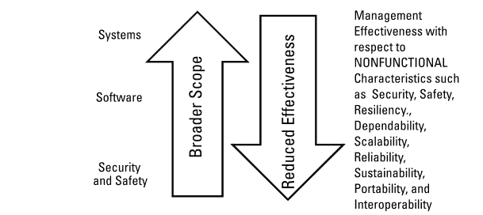

图 2.1 管理有效性与范围的关系。

然而，尽管这些过程可能满足认证所需的高能力标准，但产出的软件质量仍可能存在缺陷。例如，软件可能运行不正常（即未满足所有陈述的功能需求），并且可能无法满足安全、韧性、扩展性等非功能性需求。


如果我们进一步下钻一层，关注软件系统的安全和可靠方面，会发生什么？安全关键软件系统通常构建得更健壮；也就是说，它们比安全关键软件系统更可靠、更有韧性。这是可以理解的，因为这往往关乎人类生命。然而，即使是安全关键系统并不总是能达到最高标准，特别是在其安全属性方面。在过去的 15 年左右，已经开发了大量关于将安全性构建到软件中的工作，但与安全需求作为软件系统不可或缺的一部分相比，其接受度仍然很低。这并不是说没有在安全实践方面表现卓越的前瞻性组织。其中一些组织的成就得到了广泛宣传，例如在《构建安全能力成熟度模型》（BSIMM）报告中，该报告根据一系列属性记录了参与调查的公司的安全态势 [4]。

如图 2.1 所示，我们看到通常情况下，当我们进入这些范围有限的领域时，安全且可靠的软件系统工程的某些方面（如互操作性和可移植性）所受关注的程度会随之减少。

我们所看到的本质上是一个自上而下的过程，随着我们接近更专业、更详细的领域，信息变得越来越混乱、越来越难以理解。通过阅读大量关于系统工程、软件工程及相关领域的出版物并参加许多会议和研讨会，我们看到通常情况下，系统工程师很少关注系统工程；软件工程师似乎既忽略了从系统工程中获取的指导，也忽略了软件系统的非功能方面（如安全、可靠性和韧性）。在这样的自上而下的层级结构下，软件系统整体安全性、可靠性和韧性的显著改进机会很小。事实上，我们似乎正在朝着相反的方向发展。

尽管许多大学（如卡内基·梅隆大学软件工程学院、史蒂文理工学院）提供了优秀的软件工程课程，但该领域仍然缺乏服务。例如，《软件保障课程》[5] 说明了在该领域取得的一些重大进展。遗憾的是，这些学术计划才开始解决知识方面的巨大缺陷。

## 系统工程

对于需要做什么，我们所看到的答案似乎是显而易见的：我们需要确保非功能能力的支持者（如安全专业人员）从开始到整个系统开发生命周期都参与进来。挑战不在于应该做什么（这已经确定），而在于如何实现。在时间管理、成本节省、竞争优势、预算限制、复杂功能等因素的共同作用下，安全且可靠的系统不太可能自发发生变化。需要对那些改变方法的人提供激励，并对那些不遵守方法的人设置惩罚，以实现安全且可靠的系统工程。

## 定义的缺陷

解决达到系统工程熟练程度问题的重大障碍在于语言的模糊性，特别是对于系统工程、软件工程、安全工程和可靠工程等术语定义的松散。在 [6] 中，Allman 很有见地地描述了这种模糊性的原因：

> 我们的自然语言通常是模糊的；但在现实生活中我们可以轻松处理这些模糊性。然而，在技术世界中，这种模糊性允许多种解释，可能会导致灾难性的错误。

语言缺乏精确性是一个巨大的障碍。我们需要定义术语，以确保所有人朝着同一个目标努力。

## 工程系统

软件安全工程与软件安全工程这两个学科之间，解决问题的方法存在巨大差异。

我们将进一步调查这些差距，并提出一些方法和活动来解决并弥补这些差距。我们将提供指导，遵循更具结构性的系统工程流程，来设计、构建、测试、运行和退役安全且可靠的软件密集型系统。此外，我们还将建议如何将许多分离且独立的“孤岛”部门整合到一个更具协作性的环境中，使每个方都能从他人那里学习，从而产生更高效、更有效的运行模式以及更易接受的结果，正如文献 [8] 所述。

## 什么是系统？

为了给系统工程得出一个可行的定义，我们必须首先开发并描述一种结构，将系统工程与很大程度上属于其范围的各种组件和子组件联系起来。我们将从图 2.2 所示的组件中，选择与本书具有特殊相关的组件。然而，我们需要始终记住剩余的组件和子组件，因为它们为进一步的讨论提供了适当的背景。

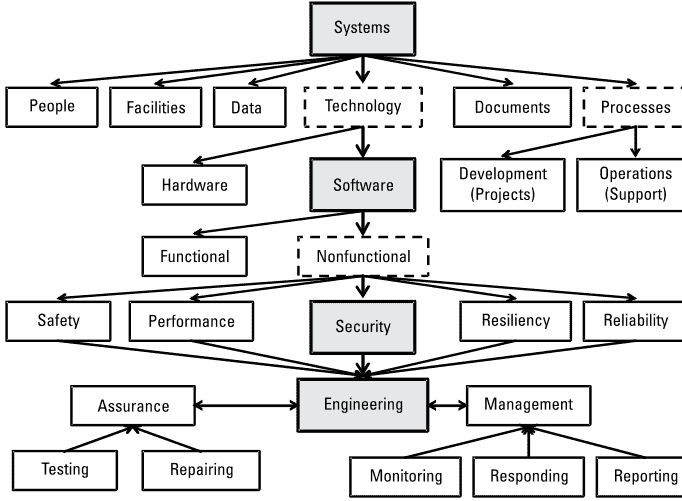

图 2.2 系统工程的结构与层次。

## 构建安全且可靠的软件系统

组件和子组件的层次和关系（如图 2.2 所示）提供了一系列术语以及相应的定义。图顶部有一个标记为“系统”（systems）的框，底部是另一个标记为“工程”（engineering）的框。

首先，让我们分别考察系统和工程的定义，然后将它们结合。

IEEE 610.12-1990 标准（已被 IEEE/ISO/IEC 24765-2010 [9] 取替）将系统定义为：

- 一组组织起来以实现特定功能或一组功能的组件集合。

Christensen 和 Thayer [10] 对上述定义进行了某种修订，得出了以下定义：

系统是相互相关或关联实体的集合，它们负责完成……一个或多个特定目标。

在美国国防部（DoD）的文本 [11] 中，该定义变为：

系统是由人员、产品和过程组成的集成复合体，提供了满足既定需求或目标的能力。

在比较上述每个定义时，主要区别在于目标是满足单一需求、功能或目标，还是满足其中的多个。IEEE 的定义兼顾了这两者。然而，DoD 的定义也有其价值，因为它将组件列为人员、产品和过程。

在图 2.2 中，第二行的框代表构成系统的六个元素，其中前三个与 DoD 的定义对应。这些元素包括以下领域：技术（或产品）——如硬件和软件；开发、运行；设施；数据；文档。

随着我们沿着图 2.2 向下移动，接下来的两行列出了元素的特征。为了清晰起见，我们只展示了那些特定感兴趣的项目。然而，需要注意的是，每个元素都可以被拆分，而且这些拆分与其他感兴趣的领域相关；为了简化演示，图中未显示这些内容。作为一个简单的例子，“数据”类别可以被拆分为结构化数据和非结构化数据。我们特别关注的是技术系统，在该类别中，我们关注软件，尽管我们将触及其他元素，如人员（或人为因素）以及开发和运行等过程。

软件进一步分为功能性特征和非功能性特征。这是划分软件特征的常用方法。然而，正如我们随后所示，这种刻画导致了软件系统测试方式上的巨大差距。在任何情况下，通常的非功能性软件特征如下：

- 安全性（Security）；

- 安全性（Safety）；

- 性能；

- 可靠性；

- 合规性；

正如本书标题所示，我们的重点将放在前两个类别，即软件系统的安全（Safety）和安全（Security）。

安全关键型与安全关键型软件系统之间的区别将在第 4 章进行更详细的检查。在此，我们介绍了 Boehm [12] 引入的定义，如下：

- 安全关键型软件：软件不能伤害世界。

- 安全关键型软件：世界不能伤害世界。

也就是说，被判定为安全关键型的软件系统绝不能对人类生命或环境构成危害。这是一种向外的视角。

另一方面，安全关键型软件系统是向内的，其程度体现在有必要保护软件以及任何敏感数据（如非个人信息和知识产权）免受外部或内部人员或计算机应用程序攻击的误用、损坏或破坏。

正如我们在整书中看到的，正是软件安全工程师与安全工程师之间这种观点的差异导致了重大的软件系统工程问题，特别是当需要将安全关键型和安全关键型软件密集型系统结合到被美国政府机构日益称为“网络物理系统”（cyber-physical systems）的内容时。

在图 2.2 的底部附近，我们展示了一个“工程”框。工程可以定义为：

……对科学原理的创造性应用，用于设计或开发结构、机器、装置或制造工艺，或单独或组合使用这些内容；或在充分了解设计的情况下构造或运行这些内容；或预测它们在特定运行条件下的行为；这一切都涉及预期的功能、运行经济以及对生命和财产的安全 [13]。

在图 2.2 的底部，我们包含了与工程相关的活动，即保证和管理。保证包含测试和修复。与工程相关的管理活动包括监控、分析、报告和响应。

正如读者看到的，图 2.2 中的某些框是由实线构的，而另一些由虚线界定。当我们使用层次结构指定特定组合时，将跳过虚线框。因此，我们得到了“软件安全工程”这一术语，而不是“技术非功能工程”。

## 解构系统工程

工程领域显然拥有一段非常且且光明的历史，可以追溯到数千年前，并延续至今。毫无疑问，埃及金字塔、英国石石、复活节岛像、玛雅金字塔和其他奇迹建筑都是工程上的壮举。这些项目是否遵循了我们现在认为的系统工程方法？这些纪念碑的建造者可能采用了某种组织结构和管理流程来实现他们的成就。考古学家在这些纪念碑工程师使用的文件中发现了高度复杂的数学、建筑和施工方法。然而，这些过程并没有以正式的方式遵循我们现在称为系统工程的具体原则，尽管为了完成这些伟大作品使用了许多组件。

在现代，系统工程学科的特定术语仅共同使用了大约70年，尽管不同的文献将该术语的创造归于不同的实体和时间。Christensen 和 Thayer [10] 引用了 Alberts [14] 的观点，后者认为该术语是由宾州立大学的某 H. C. Hitch 在1956年提出的 [15]。

INCOSE 网站声称系统工程是由贝尔电话实验室的研究人员在20 世纪40 年代提出的 [16]。INCOSE 文档 [7] 提供了一个追溯到火箭开发的时间线。

……20世纪20年代由罗伯特·史蒂芬森公司制造的机车，并包含一个在1937年分析过英国防空系统的英国团队。INCOSE 的时间线还包含了1939年至1945年期间的贝尔实验室，这与上述主张一致。INCOSE 将系统分析的发明归功于1956年的美国兰德公司，这似乎与 Christensen 和 Thayer 的主张（关于起源者）有所不同。然而，双方都认为该团队起源于1956年。鉴于文献中的差异，对于我们的目的来说，表述为我们现在所知的系统工程和系统分析起源于20世纪中期，并在该世纪后半叶演变是足够的。

广泛的共识是，系统工程学科在20世纪40年代和50年代的驱动力来自于管理涉及系统之系统的大型复杂项目的需求，在这些项目中，部分总和的属性往往大于各个部分的属性 [17]。开发系统工程的大部分动力来自美国国防部 [11] 和美国国家航空航天局（NASA）[9] 的要求。因此，在讨论系统工程的属性时，我们将重点参考这些和其他美国政府机构的作品，以及专业协会的出版物，例如 IEEE（电气电子工程师学会）[9] 和 INCOSE（国际系统工程协会）[7]。

今天，有许多研究人员和从业者为自己是系统工程师的一员感到自豪。像 INCOSE 和 IEEE 这样备受推崇并产生令人瞩目的出版列表和其他价值资源的专业组织正随着领域的演变应运生并兴盛。

然而，如上所示，软件工程师看待系统工程的方式与系统工程师更广泛地将系统工程整合到其实践方式之间似乎存在差距。这将在接下来的章节中讨论。并不是软件开发人员不遵循等同系统工程指南的结构化实践——大多数情况下他们是遵循——特别是在国防部，正如 [11] 所述，那里演变出了精确且详细的软件开发实践。并不是采用系统工程的正式流程在被认为是相关但独立的领域（涉及软件、安全和防护）中不被普遍接受。例如，系统开发生命周期（SDLC）确实被许多现代软件开发公司热烈地采用，但通常不会被较小、成熟度较低的组织所接受，因为它引入了巨大的开销。

## 18 工程安全可靠的软件系统

看到“系统”、“软件”和“工程”这些词的如此多组合，令人困惑。系统工程、软件工程、软件系统工程和系统软件工程之间的精确区别是什么？某些差异可能看起来是显而易见的，但另一些则不然。当系统被聚合成软件系统系统时，应该使用什么术语来描述这些复杂得多的系统组合特征？这些组合经常表现出超出其单个组件的行为。安全关键系统（safety-critical）与安全关键系统（security-critical）的结合（例如目前所谓的智能电网）会产生的问题远超单个系统的触及范围。

为了掌握这些问题，请使用图2.3 表格中的元素来辅助解释定义以及组件之间的关系。例如，我们在表格的第一行看到“系统工程”和“软件系统工程”，第二行看到“软件工程”，如果我们调换第三行的第2列和第4列，就会得到“系统软件工程”，它的意义与“软件系统工程”完全不同。系统软件工程涉及软件系统的工程化。软件系统工程是指将系统工程实践应用于所有类型的软件密集型产品。系统软件是位于应用软件层之下并执行许多支持应用程序的管理功能的软件类别。

| 安全/可靠 | 软件 | 安全/防护 | 系统 | 工程 |
| :--- | :--- | :--- | :--- | :--- |
| | | | | 工程 |
| | 软件 | | | 工程 |
| | 软件 | | 系统 | 工程 |
| | | 安全/防护 | 系统 | 工程 |
| 安全/可靠 | 软件 | 安全/防护 | 系统 | 工程 |
| 安全/可靠 | 软件 | | | 工程 |
| 安全/可靠 | 软件 | 安全/防护 | 系统 | 工程 |
| | 软件 | 安全/防护 | 系统 | 工程 |
| 安全/可靠 | 软件 | 安全/防护 | 系统 | 工程 |

**图 2.3** 术语及术语组合。

它包括操作系统和实用程序，如排序算法。

有些人可能认为像上述提到的并在图2.3所示的那样，通过拆分表头来区分这些差异，但正如建议的那样，混淆且模糊的术语不可避免地会导致误解，甚至更糟的。当研究人员和从业者在搜索相关信息时，因为对同一事物使用部分或完全不同的名称，导致搜索不完整，或者更不准确且具有误导性，从而错过了整个适用工作，就会出现这种情况。我们已经讨论过软件工程师通常不认为自己是工程师，反之亦然，但这仅仅是表面问题。随着深入研究，我们发现这种高层次的认知会导致对如今常见的开发和实现的复杂系统遗漏重要需求的问题。

## 什么是系统工程？

此时，我们将处理定义系统工程这一看似的任务。这个术语有很多定义，每个定义都与其他略有不同，有时差异很小；在其他情况下，差异是巨大的。

一个被广泛引用的系统工程定义是 DoD 文 [11] 中的：

> ... 一种跨学科的管理过程，用于演进和验证满足需求的平衡系统。

该定义的一个重要方面是系统工程是一个涉及多种专业学科的过程。该过程的唯一目标是创建满足系统。作者并不反对这一定义，但会对流程在现实世界中的实施提出质疑。例如，必要的学科是否包含在相应的阶段？将被断言没有。客户的需求是否被充分识别？会被声称用户只表达了他们个人意识到的或直接影响他们的需求，而遗漏了他们不知道或不在乎的需求。

另一个系统工程的定义是：

一个跨学科的工程领域，专注于复杂工程项目如何在生命周期内设计和管理 [19]

还有另一个定义 [10,8页] 是：

科学、工程和管理技能的实际应用，将用户需求转换为最满足需求的配置描述。

显然，这些定义表明了一个从识别用户需求开始并以一个或多个满足系统结束的生命周期过程。系统工程的的成功取决于组织设计和开发流程，并在之间存在适当的管理和控制功能。在下一节中，我们将检查流程的各个阶段，并描述系统创建环境的一些有效控制。

## 系统工程与系统工程管理过程

如上所述，系统工程的先驱参与了大型政府（或公共部门）太空探索和军事系统计划。因此，我们最初重点放在这些来源，然后看系统工程（SE）方法如何被其他人采用，特别是在非政府或私人部门。

Christensen 和 Thayer [10] 列出了以下系统工程功能：

- 问题定义是确定关于产品预期、需求和限制的客户需求。

## 工程系统

- **方案分析**是对满足需求和约束的选项进行分析，并选择最优解决方案。

- **过程规划**是对主要技术任务进行优先级排序，确定每项任务所需的工作量，并确定潜在的风险风险。

- **过程控制**是为技术活动建立控制方法，包括进度测量、中间产品评审，以及在必要时启动纠正措施。

- **产品评估**是通过测试、演示、分析和检查来确定质量和数量。

这些生命周期功能普遍贯穿于系统工程项目及其子组件之中。后者处理的是如安全性和性能等属性。然而，这非常令人困惑，因为不同类型的项目在活动阶段的侧重点和所用术语上各不相同，特别是在将国防部（DoD）的术语与其他术语进行比较时，这往往会导致更多混乱。

简单来说，需求是获取的并通过构成项目的一系列活动转化为某种系统形式。尽职调查表明，在系统发布之前，需要对其进行彻底测试以确保其符合原始需求。这听起来很简单，但正如我们将看到的，如果它真的简单，那么就会有通用的标准，而且只要遵守这些标准，预计系统将每次都能完美符合其需求。显然，我们并没有看到这样的结果，这是因为由于资源和资金限制、交付时间以及尽可能完成工作的能力限制，总是存在权衡。一个项目是三个要素之间的权衡，但在同一个项目中是不可能同时优化这三者的。关于项目管理三角形，从业业者会将其总结为：快速、廉价——三选其二 [21]！这种限制的一个例外似乎是资金资金充足的政府合同，在这种合同中，成本超支和延迟是常有的且似乎是可以接受的，尽管其原因可能在于治理模型，即那些技术知识匮乏但有明确政治议程的政治家负责对项目管理的监督。

讽刺的是，工程系统及其迄今为止最严谨的方法论源于军事和航天计划（这两者都是政府资助的），然而这些项目似乎经常面临时间和资金的超支，并且往往缺乏需求文档中指定的关键特性。这种情况在学术界似乎也相当常见，在学术界，产品本身往往是从高质量期刊发表的受认可的研究论文和出版物中获得的潜在声誉和荣誉。这并不是说私营部门在总体上做得更好，但在有有效管理和治理的地方，大型复杂项目确实能够按时完成、预算内失败并表现出高水平。

尽管如此，私营部门可以从研究机构为政府创建的方法中学习到很多，只要实施了有效的治理和强大的项目管理。因此，我们将继续描述来自工程小组出版物的系统工程管理，例如电气电子工程师学会（IEEE）计算机学会美国国防部（DoD）的倡议。

## 国防部文本

关于国防部，《系统工程基础》（Systems Engineering Fundamentals）最详尽、完整的描述可能是国防部系统管理学院 [6] 于 2001 年编写并出版的，可以在网上供大家阅读。

对于像我这样信息技术和安全职业生涯一直身处私营部门的人来说，国防部方法的术语和侧重点可能显得非常陌生。管理过程被认为是高度规程化的，几乎没有变化。正如本章开头史蒂夫·乔布（Steve Jobs）的引言所示，这极大地抑制了创新。当然，考虑到为军事开发的系统类型，人们可能最不想看到的就是无节制的创造力，尽管这仍然是前沿商业系统企业的标志。

正如书中后将讨论的，军事与商业系统工程之间这种方法的二元对立贯穿系统的许多其他方面。特别是，军事系统（直到最近）一直将安全、可靠性和可预测的操作置于优先级，而商业系统通常喜欢加强安全性（尽管车辆控制系统侧重于安全）。然而展望未来，安全性的性（特别是对于网络中心系统）正在所有努力领域得到认可和考虑。

## 另一个观察结果

在撰写这本书时，作者发现，关于非政府（尤其是非军事）系统和软件工程的书籍和文章中对国防部标准和实践的引用极度匮乏，这令人着迷。这似乎整个与军事及其他政府系统和软件工程相关的知识体系都被排除在这些面向普通读者的出版物的考虑之外。至少可以说，这是一种遗憾，因为这种知识的传递将有助于所有相关方。

## 关于系统工程的更多内容


继续讨论不同公共部门和私营部门实体之间方法差异的话题，我们将简要观察系统工程管理方法的侧重点如何区分不同群体，以及这种侧重点的差异一方面被认为符合其传统职责范围内系统的类型，另一方面又阻碍了每个群体从其他群体的知识和技能中受益。专业组织（如 `INCOSE`）做出了可信的尝试来涵盖所有并鼓励更广泛的参与；而许多其他群体仍然相当孤立。

因此，建议读者深入更广泛的知识体系，以从这些不幸未能充分交流的各个孤岛中发展出的智慧中获益。你可能会发现的某些差异与政府实体创建的更先进的治理模型，以及输入的需求和产出的验证有关。这并不是否定关注这些重要领域，但私营部门似乎无法负担起这种耗费时间和金钱努力的奢侈。尽管有这一缺点，简要了解国防部的方法并比较各种组件应该是很有益的。

## 系统工程过程 (SEP)

国防部文档 [11] 将 `SEP` 描述为“……全面的、迭代的递归的问题解决过程，自上而下的方式应用于集成团队。”这里的一个重要点是使用了“自上而下”这一术语，指向了明确层级结构的存在。虽然企业世界在很大程度上也有明确的组织结构，但内部通常有更大的协作空间。事实上，在富有创造力的系统和软件开发中，特别是初创公司，设计人员和开发者在解决问题时被赋予了很大的自由。当然，这种环境对于武器系统等领域可能具有积极和负面的特征，且可能无效。较大、更成熟的私立机构通常有许多正式流程和管理，与军事相比可能更具活性。

在开发系统需求时，政府（特别是军事）拥有明确的用户群，直接投入较少，尽管他们可能会在后期参与测试并提供反馈。虽然国防部文档提到了客户，但最终接收方对结果系统是否满意并不有选择权。

也就是说，通常的竞争市场（尽管存在于军事合同招标中）在选择系统特性和功能方面并不一定适用。拥有自由选择权和没有选择权的客户之间的差异对系统设计的影响是一个真实案例。一家高度结构金融机构的信息技术部门（亚洲和美国交易员都在那里）根据从部分交易员那里获取的最小需求集设计开发了交易系统。系统安装后，该金融机构要求交易员无论系统是否满足其需求都必须使用。而通常认为自己是独立创业者的美国交易员拒绝使用该系统。很明显，每个国家交易员之间的文化差异对系统的设计以及是否被接受有很大影响。

## 工程系统

- 应如何使用各种系统组件？
- 系统在执行任务时必须达到多高的有效性和效率？
- 系统将投入使用多久？
- 预计系统将在哪些环境中有效运行？

美国国防部系统工程手册（`DoD SEF`）[11] 列出了以下系统需求：

- 客户需求是指系统在任务目标、环境、约束以及有效性与适用性衡量标准方面的预期。
- 功能需求是必须完成的必要任务、行动或活动。
- 性能需求是指在数量、质量、及时性和就绪性方面，任务或功能必须执行的程度。
- 设计需求是产品（如硬件、软件）的“按此构建”需求，以及过程的“如何执行”需求。
- 派生需求是从更高级别的需求中推导出或转换而来的。
- 分配需求是通过将高级需求分解为若干个低级需求建立的。

值得注意的是，上述需求列表并未明确提及安全性或安全防护。后这些因素——结合韧性和互操作性等特征——如果被考虑的话，可能会被包含在性能需求中。尽管如此，这些非功能性需求的缺失并不意外，因为系统工程领域更广泛的出版物也倾向于忽略它们。通常只有当例如，出现此类领域相关的杂志和期刊特刊，或者系统工程、电气工程或其他工程分支专注于软件、安全防护和安全（以及专门涵盖软件、安全防护和安全工程的相关主题的书籍）时，更广泛工程出版物的读者才能更多地了解这些主题。

## 总结与结论

在本章中，我们解决了关于系统和系统工程定义的一些某些困惑，并讨论了系统工程过程中出现的一些问题。读者可以查阅一些系统工程的优秀指南和手册，其中一些（如本章引用的 `DoD` 和 `NASA` 文档）在公共领域内免费提供，以学习更多关于该主题特定方面的知识。

本章的主要要点应当是认识到各种政府和非政府参与者之间、以及不同子类别（如与安全防护和安全相关的类别）之间存在共享不足。

后续章节的目标是鼓励目前交流不充分的多样群体参与，并实现所有领域某种程度的一致性。

## 尾注

- [1] 可访问 `http://www.sei.cmu.edu/cmmi/`，最后访问时间为 2012年7月8日。
- [2] 可访问 `http://www.issea.org`，最后访问时间为 2012年7月8日。
- [3] 可访问 `http://www-sse-cmm.org/issa/issaap`。访问时间为2013年7月8日。
- [4] 可访问 `http://bsimm.com`，最后访问时间为 2012年7月8日。
- [5] 可访问 `http://www.cert.org/mswa/`，访问时间为2012年7月8日。
- [6] Allman, E., “The Robustness Principle Reconsidered,” Communications of the ACM, Vol. 55, No. 8, 2011, pp. 40-44.
- [7] Haskins, C. (ed.), *Engineering Handbook: A Guide for System Life Cycle Processes and Activities*, San Diego, CA: International Council on Systems Engineering (`INCOSE`), 2011.
- [8] Axelrod, C. W., “Applying Lessons from Safety-Critical Systems to Security-Critical Software,” 2011 IEEE LIS (Long Island Systems, Applications and Technology) Conference, Farmingdale, NY, May 2011, published on the IEEE Explore website.
- [9] IEEE/ISO/IEC.Standard 24765:2010.Systems and Software Engineering—Vocabulary., 可访问。
- [10] Christensen, M., and R. H., *The Project Manager’s Guide to Software*, Los Alamitos: IEEE Computer Society, 2002.
- [11] United States Department of Defense (`DoD`), *Systems Engineering*, Fort Worth: Defense Acquisition, 2001.
- [12] Boehm, B., *Characteristics of Software*, New York: North-Holland Company, 1978.

## 工程系统

- [13] 关于工程的定义可见 `http://en.wikipedia.org/Engineering`，最后访问时间为 2012年7月8日。
- [14] Alberts, H. C., *System Engineering*, Fort Bliss, VA: Department of Defense Management, 1988.
- [15], H. C., *System Engineering Course*, 软件实践可见于 Wiley 网站 `http://media.wiley.com/product_data/excerpt/96/0769519.pdf` [5]。
- [16] “A Brief History of Systems Engineering,”可见 `www.incose.org/mediarelations/briefhistory.aspx`，访问时间2012年7月8日。
- [17] 系统系统在 `INCOSE` 文档中定义为其系统元素本身也是系统；这些系统通常是大型、异构的分布式系统。
- [18] National Aeronautics and Space Administration (`NASA`), *Systems Engineering Handbook*, `NASA/SP-2007-6105 Rev 1`, Washington, DC: `NASA`, 2007. 可访问 `http://www.tgsc.utexas.edu/challenge/PDF/NASA-SystemsEngHandbook.pdf`，访问时间2012年7月8日。
- [19] 关于系统工程的定义可见 `http://en.wikipedia.org/Systems_engineering`，访问时间2012年7月8日。
- [20] 可访问 `http://en.wikipedia.org/wiki/Voluntary_sector`，最后访问时间为 2012年7月8日。
- [21] 关于项目三角形的概述，参见 `http://en.wikipedia.org/wiki/Project_triangle`，最后访问时间为 2012年7月8日。

## 3

## 工程软件系统

> 软件工程仍然是一个矛盾体 [1]
>
> —John Pescatore, Gartner Inc.
>
> 原本设想的软件工程尚不存在 [2]
>
> —David Lorge Parnas, Middle Road Software

## 引言

软件与消费者、客户和组织获取的大多数其他产品和服务不同。可以说，它更像燃料而不是燃料，因为所有包含软件的系统都需要注入软件才能运行。然而，与燃料不同，软件不会随着使用而耗尽。应用软件也与燃料不同，它是你（即用户）通常与之交互的产品，而不是像燃料那样在背景中被激活的东西。然而，与燃料不同，软件不是自给自足的。它需要运行的环境。没有环境，它将毫无用处。如果你获得了一个包含软件的磁盘，或者通过通信链接下载了软件，该软件必须运行在一个包含特定设备（或硬件）、如计算机处理器、存储设备和通信网络，以及（对于应用程序）软件系统和实用程序的系统中，如果没有必要的应用程序软件，这些本身并不具备任何终端用户功能。

软件产品及其处理的数据的其他特性对安全性、安全、韧性和类似的非功能软件系统属性有深远影响。之一是软件可以以很低的增量成本复制并被随意利用（尽管这样做通常会取消任何许可条款和保证，而且往往在未检测到更改或攻击的情况下发生，且执行者不需要与原始软件处于同一物理位置，只要他们有连接或访问软件和数据的手段即可。软件的另一个特征是，客户通常是许可而非拥有商业现货（`COTS`）软件（这与由制造商或其设计者拥有的自产软件相反），因此人们受限于对 `COTS` 软件进行修改和转售结果产品时能做的操作。这一规则的例外是开源软件，它不属于任何人，由社区维护。然而，开源许可协议有其必须考虑的特殊之处，如 [3] 所示。

因此，解释某些在机械、土木、电气工程和建筑等领域感到舒适的工程师不愿参与和处理软件及其相关问题的迟疑，似乎是合理的，这是由于上述描述的软件独特特性造成的。正如 [4] 中提到的，传统主义者可能更习惯于物理世界（而非虚拟世界），尽管他们可能使用个人电脑进行社交网络、电子表格计算和文字处理等目的。然而，后者的参与与将工业级软件整合到他们正在工程的实际系统中并不是一回事。通过对软件及其影响进行短视关注，系统工程师在设计和构建系统以及在将他们的传统物理系统与日益无处的世界进行接口时，可能会忽略软件方面的考量。

另一方面，如今的软件工程师往往没有通过基础培训（大学或商业软件编程培训计划）直接接受过软件工程领域的训练，也缺乏在开发工作坊的实职经验，且在用于特定平台和基础设施的供应商产品中偶会有特定的庆祝活动。

这并不是说正式的项目管理方法在软件开发项目中并不常见。它们在大型软件制造实体中尤为流行。在本章中，我们展示了文献中描述的此类方法的几个编写良好的示例。事实上，系统工程项目管理的方法和实践在软件开发阶段已经存在了几十年。然而，仅仅认可和实践项目管理并不等同于遵循系统工程方法的哲学和实践。系统工程中具有的结构和严谨性，在军事系统、航空电子、航天计划等软件的开发中，比在非关键商业系统中更为普遍。然而，某些关键领域（如金融服务）确实使用了正式技术来确保其运行的计算机系统的功能正确性，通过这些系统每天处理着数万亿美元。

# 大辩论

有许多个人，例如 John Pescatore 和 David Large Pearson（如上所述），他们认为软件系统工程领域普遍未能吸收系统工程的严谨实践以及纪律性的流程和程序。这种观点由于媒体频繁报道针对软件系统的成功攻击，以及许多防御者无法有效保护系统免受此类攻击，而得到了加强。这在很大程度上是一个试图将软件系统工程系统化的的问题。相反，在这一尝试中已经投入了大量的研究和实践努力。正如本书所示，这很大程度上是因为从事工作的人在知识、背景、经验、能力和目标上存在差异。软件在很大程度上仍然是一门科学，而今天开发复杂软件系统的自由从业者对于实现工作的特定需求具有特定的广度或兴趣。另一方面，大多数具有安全、防护、隐私、可靠性、性能和韧性背景的人对应用软件和软件开发过程并无良好的掌握；他们甚至似乎无法向开发者，特别是向为这些软件系统服务的开发者、用户、经理和客户解释他们的需求。

尽管如此，尽管许多软件系统的创建者对系统工程和其他工程学科的正式方法表现出明显的蔑视，但人们似乎越来越多地意识到需要在软件系统中构建诸如安全性（即机密性、完整性和可用性）、安全性、生存性、互操作性、可移植性、可持续性和韧性等属性。这种对非功能需求重视程度增加的理由是显而易见的：在开发生命周期越早考虑这些因素（并发现错误或遗漏），包含这些区域的成本就越低。确保将这些非功能因素的预期水平整合到软件系统中的尝试似乎还没有足够的动力来克服近期报告的攻击激增，特别是如果有人认为更正式的方法与软件质量的提高之间存在关系，而这正是本书的核心断言。尽管许多研究人员和从业者努力将安全、防护和韧性包含在软件系统开发周期流程中，这种可利用和被利用的漏洞的增长仍在持续，这表明我们需要既新的又改进的系统工程方法。

## 工程化安全可靠的软件系统

当下的激烈辩论围绕着软件工程是否、或未来是否会被接受为一门工程学科。然而，仍然存在一个问题，即人们是否可以将软件工程归类或标记为工程是否真的重要。我们必须询问特定的定义暗示了哪些方法上的差异，以及这些差异是否具有实质性。

## 一些观察

正如上一章一样，我们将使用图 2.2 中所示术语层次来辅助定义软件工程，并证明使用首选术语“软件系统工程”的合理性。

正如图 2.2 所示，当我们从系统工程转向软件（以及硬件）系统工程时，面临着关于系统工程的本质是否已传给软件系统工程的抱怨。许多直言不讳的人指责目前软件工程领域缺乏系统工程中常见的纪性和有效性。顶级的软件开发工作坊在整个系统开发生命周期过程中显示出高水平的结构和控制，实现了非常高的能力成熟。然而，流程可能符合高标准，但开发的软件质量偶尔会出现缺陷，因为软件通常运行不正常（即无法满足所有需求），或者缺乏整体化设计的软件本应具有的安全性、韧性和可扩展性等。一个特别关注的问题是，为一个平台设计并传输到另一个平台的软件可能无法与第二个环境完全兼容，由于主要的测试工作已集中在运行主平台的软件上。

通常情况下，当我们深入范围更局限的领域时，安全可靠系统工程的某些属性会减少。这本质上是一个自上而下的过程，随着我们进入更专业的领域，信息会变得更加混乱和模糊。因此，我们观察到系统工程师可能对软件工程的关注较少。反过来，软件工程师可能忽略（或更有可能是极少关注）软件系统的所谓的非功能方面。讽刺的是，非功能需求对系统工程师来说往往比对软件工程师更重要，因为前者可能会采取更广泛、更整体的

## 软件系统工程 33

这是对软件所属系统的视角。如果采用自顶向下的层级结构，软件系统的整体安全性、可靠、韧性和性能获得大幅改进的机会微乎其微。事实上，我们似乎往往在朝着相反方向努力，直到某些限制因素或昂贵的事件迫使工程社区关注某个特定属性时，该属性才会变得异常显眼。

关于需要做什么问题的答案是显而易见的——我们需要让非功能能力的守护者和赞助者从决策过程开始就参与进来，并贯穿软件系统设计、开发、实施和运行的全生命周期。非功能稳健性的倡导者需要获得高层充分且可见的支持和授权，以便他们才能在使命中发挥作用。如果管理层对安全等方面仅付口头功夫，那么在某个特定属性发生高影响故障并引发对管理层有效性及其控制环境能力的质疑之前，永远不会对该属性给予适当的关注。当然，到那时，大部分损害已经造成了。

挑战不在于“应该做什么”，而在于“如何实现”。在现实中，我们面临着上市时间、成本削减、竞争优势、预算限制、复杂功能以及其他紧迫因素的压力，这些因素与实现安全和更安全的软件系统目标背道而驰。在这种环境下，所需的变更和改进不太可能自然发生。需要对方法上的重大转变以及对非功能属性的投资提供特定且直接的激励措施。或者，对于那些不遵守管理层指令、不改变方法并将非功能属性纳入软件系统开发生命周期的人，也应该有惩罚。

## 理由

如前所述，个人对各种主题的方法往往受其术语定义的影响。因此，在本章中，我们将审查软件和软件工程的定义——或者更准确地说，是软件系统工程的定义。事实证明，这些定义的广泛用法本身已经导致了实现所有竞争属性之间最佳平衡的“需求”与“现状”之间存在巨大的鸿沟。

## 后续

我们将进一步研究这些差异，并提出一些特定的方法和活动来弥补这些差距，并希望缩小或消除它们。我们将为在安全可靠的软件系统的设计、构建、测试、部署、运行和退役过程中遵循更具结构性的系统工程流程提供指导。此外，我们将建议如何将真正独立的“孤岛”整合到更具协作性的氛围中，使彼此能够相互学习，从而达成一种更高效、更有效的协作模式。仅仅建议对组织、行业、国家或全球经济有益的做法是不够的。这种规范性的诉求很少具有说服力，也无法提供（如果有的话）实现预期行动所需的实际指导。在这里，我们将论证在生命周期早期引入非功能属性的益处，其论点将引起非技术高层管理人员、政策法律制定者、审计师和执行者的共鸣。事实证明，本书书中提出的建议不仅在技术和工程上可行，还能提供丰硕的投资回报。

## 理解软件系统工程

某些人认为软件工程存在缺陷的原因之一，是因为该术语过于通用，研究人员和从业者对其缺乏良好的理解。人们可能会轻易地假设，“工程”一词仅仅意味着将工程学原理和方法应用于软件开发生命周期（`SDLC`）。然而，软件工程的意义远不止于软件制造过程。它还涉及在各种平台和基础设施上安装软件，并将软件产品集成到现有环境以及系统之系统之中。


# 解构软件系统工程

我们将花费一些时间和空间，试图从困扰软件工程及其相关领域的众多误解和误读中，梳理出可行的含义。

## 软件系统工程

首先，当我们谈论软件工程时，我们可能指的是比纯独立计算机程序更广泛的产品的设计、开发、制造和运行。我们应该使用“软件系统工程”这一术语，因为软件程序（无论是用户应用程序、实用程序还是系统软件）都不是孤立运行的。软件程序存在于更广泛的系统中，并且通常能够在特定平台和特定基础设施内运行。软件只是由硬件、通信网络、人员和流程组成的整体系统的组件之一；但即使是直观的“软件系统工程”术语仍然具有某种模糊性。我们是指软件系统的工程，还是应用于软件开发的系统工程方法？或者我们是否应该更明确地将该表达扩展为“应用于软件密集型系统的软件工程方法”？

虽然读者可能认为这种区分过于具体且太苛刻，但它将证明，当今的许多软件问题（涉及确保软件系统的安全、可靠、韧性、互操作性等）实际上源于术语定义上缺乏严谨性。定义软件的许多特征并不是一个容易的过程，这种练习也不能保证所有突出的问题都能得到解决。然而，我们将证明，该领域的某些定义往往存在冲突，这些冲突导致研究人员和从业者经常偏离重点。因此，我们将尝试通过尽可能明确地定义我们的术语来阐明最晦涩的领域。

## 什么是软件？

在讨论软件工程的意义之前，我们需要定义“软件”。简单来说，软件由计算机程序代码组成，这些通常用高级语言编写，如 `C`、`C++` 和 `Java`。软件所包含的最终源代码通过解释或编译转换为计算机可以理解的代码。解释器在每次运行软件时都会将源代码转换为机器可读的代码，而编译器则产生机器可读的对象代码只需一次，仅在源代码发生变化时才重新编译。编译程序通常更高效，特别是当软件更改较少时。当效率至关重要时，可能会直接用机器语言编写代码并优化软件对系统资源的需求。

## 什么是软件系统？

软件有许多类型，例如用户应用程序、系统软件、嵌入式软件和固件。在这里，定义泛滥，且使用往往非常随意，导致了混乱、错误和遗漏。在图 3.1 中，我们看到了典型的传统软件结构，应用程序运行在系统软件上，而系统软件运行在硬件上。图显示了不同类型的软件层。在公众眼中，软件等同于用户应用程序或“App”。此类软件通常由应用程序开发者创建，他们可能对底层平台和基础设施了解较少，并通过标准的应用程序编程接口（`API`）与后者关联，从而无需担心系统的内部结构。这样做的好处是将高技术系统软件的开发引导给这些领域具有专门知识的人。

然而，在进一步讨论之前，让我们定义各种形式的软件并将其与软件架构联系起来，如图 3.2 所示。

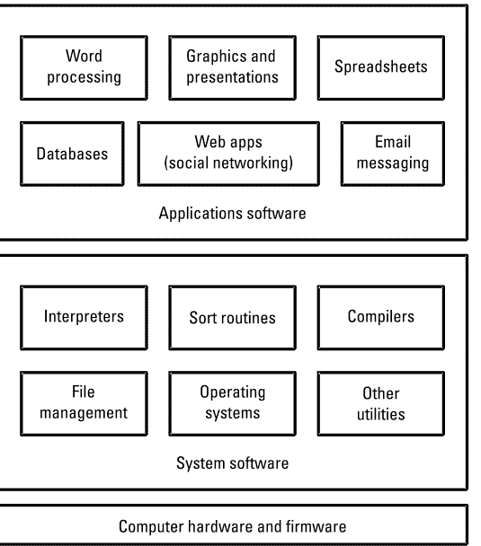

## 工程软件系统

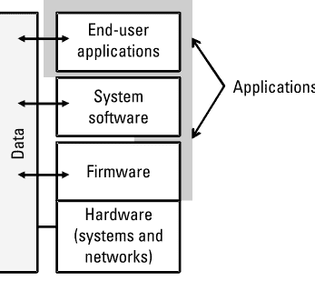

“软件”和“计算机程序”这两个术语通常被认为是同义词，大多数人并不会纠结于所使用的具体定义。然而，随着软件越来越多地嵌入到计算机化设备（或硬件）中，区分软件的各种实现形式变得越来越困难。在某种意义上，如果定义过于具体，可能会对人的系统理解产生不利。当我们考虑到软件对于创建计算机硬件至关重要时（这些硬件由晶体管、其他电子元件以及组合成集成电路的电路组成），这一点尤为真实。物理单元是通过计算机控制的、软件驱动的机床，从金属、塑料、陶瓷以及日益复杂的复合材料中刻制出来的。随着 3D 打印的出现，物理组件正在通过软件系统创建，这在技术上已经超越了用于雕刻物理组件的软件控制机床，尽管其能够创建的组件类型仍然有限。因此，随着软件渗透到我们物理生活和信息生活的几乎每一个方面，再将软件区分为独立创建已不再合适。某些软件实际上会生成其他软件，并能够创建物理对象（如 3D 打印）。软件是我们日常生活中使用的日益增加系统中一个快速增长的部分。

有趣的是，软件工程书籍和文章中对软件的引用往往是泛而谈的，作者假设我们都知道软件是什么。例如，Braude 和 Bernstein [5] 指出，“软件工程的目标……是创建软件系统……”，而没有明确说明他们所说的“软件”是什么意思。当然，人们通常可以根据其在全书中的用法推断出他们赋予该术语的含义，但这等同于提供特定的定义。同样，根据 Christensen 和 Thayer [6] 的观点，“许多现代产品中的主导技术是软件……[它]通常提供凝聚性、控制和功能，使产品能够为客户提供解决方案。”

在某种程度上，我们对软件是什么可能有一种直观的感觉，这可能是正确的。然而，在本书中我们采取了不同的观点，认为正如 Allman 在 [7] 中指出的，通过省略软件的定义，研究人员正在制造模糊并鼓励误解。软件是复杂且动态的——为了处理创建、实施、操作和处置安全可靠的软件系统所面临的问题——我们需要给出精确但又灵活的定义。

首先，让我们重复一些关于应用和系统软件的常用定义。除另说明外，以下定义均来自 Open Projects 网站 [8]。软件的定义如下：

> 软件是一个通用术语，指组织良好的计算机数据和指令集合，分为两大大类：提供计算机基本非特定任务功能的系统软件，以及用户用于完成此类任务的应用程序软件。

上述定义引发了一个关于软件和数据是否应该合并在一起还是分开处理的问题。本文认为软件和数据是相互分离的实体，它们在软件系统中扮演着不同的角色，尽管人们可以将代码数据编码到应用程序中——这种做法最好避免，因为数据的更改可能需要修改软件、进行单元测试和集成测试以及重新编译，这些都是非常耗时且带有一定风险的。如果改为更改数据表中的条目，其实现起来通常要简单得多，尽管可能仍需根据数据的变化对系统进行测试。

软件既具有功能属性也有非功能属性，我们在检查安全和可靠工程时将讨论这一点。另一方面，数据与软件相关，也可以与软件独立，当数据发生变化时，通常不需要修改软件，尽管重新排列相同的数据或将数据转换为不同的文件或数据库系统无疑需要更改软件。在图 3.2 中，我们显示数据与软件是分开的。我们还说明了——虽然几乎所有的终端用户软件程序通常被认为是应用程序——因为它们执行的是任务而不是控制硬件或设备，但系统软件和固件也可以执行终端用户任务，例如排序数据的实用程序。因此，根据我们的定义，系统软件和固件的子集可以被认为是应用程序。在对比应用相关软件和系统相关软件时，这种区分变得尤为重要。

根据 Open Projects 网站 [9]，我们对系统软件的定义如下：

> 系统软件负责控制、集成和管理各个硬件组件。系统软件包括操作系统、文件管理器、格式化器等基础工具，用于将内存数据传输到磁盘。

首先，我们应该注意到，在某些情况下，作者将其称为固件工程或系统工程。虽然系统工程似乎是首选术语，但我们在书中稍将使用固件来作为硬件来实现的术语。固件通常用于表示各种电子设备的固定、通常较小的程序或数据结构。

根据 Open Projects 网站 [10]，我们对应用程序的定义如下：

> 应用程序是用于在计算机系统中完成特定任务。它可能由单个程序组成，如图像查看器；一组紧密工作的程序（通常称为包）以完成任务，如电子表格；一个较大的程序集合，如 Microsoft Office，包含文字处理器、电子表格、数据库；或者是一个数据库管理系统。

Open Projects 对软件的另一条评论是：

> 软件是用编程语言和相关工具创建的，可能有多种形式：如解释器的单程序；包含编辑器、调试器的套件（通常称为集成开发环境）。

这意味着软件工具经常用于创建应用程序和系统软件。软件也日益用于设计和创建硬件，特别是集成电路。因此，正如 Villason [11] 所述，有必要检查创建硬件软件的安全完整性。

然而，在深入研究硬件之前，我们需要理解固件的含义（如图 3.2 所示）。一种定义如下 [12]：

- 固件通常表示控制各种电子设备的固定、通常较小的程序或数据结构。包含固件的设备示例从终端用户产品遥控器、计算机部件和设备（硬盘、键盘）一直到科学仪器和工业机器人。此外，更复杂的消费设备，如手机、数字相机，包含固件以实现设备的基本运行以及实现高级功能。

有趣的是，上述固件的定义包含了计算机程序和数据。某些人将固件限制为一旦刻入芯片就无法更改的代码和数据。例如，某些人将固件定义为刻在只读存储器中的不可更改软件；IEEE 软件工程术语标准词 [13] 提供的定义如下：

- 硬件设备与作为只读软件的指令和数据的结合。

然而，如今由于廉价易失性存储设备的可用，许多固件可以轻松更新。例如，许多数字相机制造商提供固件，可以从制造商网站下载并安装到相应的相机上（应用于医疗设备、科学仪器、工业控制系统和机器人），这开启了危险的破坏可能性。我们再次注意到，“数据”类别被包含在 IEEE 定义中。对于固件来说，这是一个更合理的定义，与应用程序不同，因为固件更新可能会同时修改功能和数据。

Wikipedia 进一步确认，“固件和软件之间没有严格的界限，因为两者都是相当松散的描述性术语。然而，固件一术语最初是为了与无需更换硬件组件即可更改的高级软件进行对比而提出的。”

固件通常涉及非常基础的底层操作，如果没有这些操作，设备将完全无法运行。固件也是一个相对术语，因为大多数嵌入式设备包含多个层级的固件。

还有观点认为：“虽然高层固件（软件）通常被存储为更改的配置，但低层固件则可以被视为实际硬件。”

这带来了一个困境，因为开发者对底层硬件平台了解之甚少甚至完全不了解——为了履行自己的职责，他们并不需要这些知识。然而，2011 年 11 月的《IEEE 计算机》杂志强调，软件设计人员有需要与硬件工程师合作 [14]。这是因为（特别是对于百亿级系统，即每秒能够处理 $10^{18}$ 次操作的计算机和其他大规模系统），硬件在控制方面正面临限制。为了继续扩大此类系统的规模，需要更强大的应用程序和软件效率。这需要以往所未水平的合作与协作。虽然小容量系统的压力没有那么大，但云计算在处理能力和存储容量方面的大幅增加，以至于廉价电力（仅由水电发电站提供）的可用性已成为决定云计算数据中心位置的主要因素。显然，人们对整体视角的需求增加，需要不同专业领域的专家协同设计和开发基于软件的系统。

现在，让我们看看 Open Projects 对硬件的定义 [15]：

> 硬件是一个涵盖计算机所有物理部分的综合术语，它区别于其包含或操作的数据，以及为硬件完成任务提供指令的软件。硬件与软件之间的界限略显模糊——固件是“内建”于硬件中的软件，但无论何种，此类固件通常都是计算机程序员和计算机工程师的范畴，而不是计算机用户需要关心的问题。

认为终端用户不应关心软件-固件-硬件混合的断言是值得怀疑的，因为这种混合的细节不仅影响计算机和网络性能，还影响系统的可用性、安全性、韧性等。如果终端用户在面对软件-固件-硬件混合的选择时，他们可能会选择与硬件和软件工程师青睐的不同的配置。这些问题通常在需求阶段解决，需求阶段是开发生命周期中提出用户需求、将其与技术能力相匹配，并通过谈判以实现特性与技术之间最佳平衡的阶段。需求阶段显然是软件系统工程中最关键的一步。

## 工程安全可靠的软件系统

这一切非常令人困惑，在很大程度上，可以归咎于某些研究人员对软件工程缺乏信心。理解软件系统工程的问题通常源于缺乏准确的定义。软件不是一个无形状的团块，而是一个涵盖软件、固件和硬件的能力频谱。这些专业领域将越来越多地需要相互交流。希望硬件系统工程相对严谨的结构能够借鉴到软件系统中，以造所有利益相关者的福。

## 控制软件系统是不同的吗？

我们现在将稍微转而讨论一个问题：管理信息系统的软件与工业控制系统的软件在我们的处理方式的方法上是否存在差异。

正如我们稍后讨论的那样，许多信息系统的开发者和用户（直到最近）对安全的关注远大于那些设计和开发控制系统的人。高完整性工业控制系统需要用于管理电厂、石油炼油厂、飞机、武器等。从历史上看，这些控制系统与其他系统和公共网络隔离开，它们之间相互独立，且与业务信息系统独立。它们也倾向于位于光谱中的硬件-固件端，而不是信息系统。然而，控制系统正越来越多地联网，并与信息系统和网络连接，这使得控制系统面临更大的网络安全风险。此类系统的新术语是*信息物理系统*（cyber-physical systems）。

在早期，自动化控制系统可以被认为与信息系统分开，控制系统侧重于安全性，而对安全性很少或关注。然而，随着两种类型组合成系统 [16]，这种区别变得越来越不再恰，导致了许多新的漏洞领域。表 3.1 分别说明了这些关注领域与信息系统、控制系统以及组合系统的相关性。

## 什么是软件系统工程？

在否定了软件系统工程作为一个独立领域的客观性后，我们现在尝试定义软件工程和软件系统工程，仿佛它们是可以被合法化的——而它们确实是可以合法化的。正如图 2.2 中的分级图所示，软件被认为是技术的一个子组件，其他组件是固件、硬件和网络。人们也可以说软件参与并在某些情况下致力于固件和设备的创建和运行，设备可以是系统、网络等。

根本问题在于，软件并不是孤立运行的。任何软件只运行在一个特定的语境或有限的环境中。该语境包含了硬件、人和流程。

终端用户应用程序依赖于软件平台，以及其他应用程序和系统组件。应用程序的设计是为了运行在特定的平台和基础设施（硬件、网络等）组合上，其安全态势高度依赖于其所运行环境的安全性。例如，为 iPhone 构建的应用程序可能也运行在 Android 手机上，但其安全性在很大程度上取决于特定手机在任何时刻的安全性程度。

我们应该摒弃不严谨的术语，如软件保障、软件工程和安全软件工程。我们需要使用诸如“软件系统保障”、“软件系统工程”和“安全软件系统工程”等术语，这些术语要具体得多且更有意义。

## 软件系统工程过程

软件及相关系统的工程过程至少已经建立了四五十年的历史。在软件开发生命周期方面，随后的几十年里变化竟然如此之小，这确实令人惊讶。

Braude 和 Bernstein [15] 以及 Lewallen [17] 都对软件过程给出了有趣的历史，指出了每种方法的优缺点。这些方法及其优缺点总结在表 3.2 中。

我们还展示了各种方法的大致起源年份。这些日期由所引用的各种来源提供；它们仅作为参考。尽管如此，这一时间顺序解释了为什么某些作者忽略了某些方法，因为即使这些方法已经开发出来，它们可能尚未发表。

## 软件开发过程中的步骤

在某种程度上，所有方法都包含了瀑布法的基本步骤，这些步骤包含了表 3.3 所示的步骤。

Royce 因在文章 [18] 中首次形式化了瀑布法而闻名。虽然 Royce 提出了一个线性模型，但那仅用于说明目的。他后来在论文 [18] 中提出了一个迭代模型，但许多人仍然不不恰当地采用了线性模型。关于 Royce 本身并不提倡线性模型而是支持迭代模型这一点，在 [19] 中有更详细的讨论。

SSDLC（安全软件开发生命周期）的阶段如表 3.3 第一列所示在大型机时代是常见的，那个时代的计算机系统与开发人员和操作员是隔离的，只有通过网络连接极少数（如果有的话）远程用户。软件开发和实现过程遵循相当一致的结构化路线，并遵循标准的系统工程实践和程序。系统分析师获取用户需求，分析输入，并产生软件系统设计或规范。然后，这些设计和规范由程序员进行开发和测试，在质量保证领域进行测试，并移交给生产部门。当时只有少数可用平台，即 IBM、数字设备公司 (DEC)、数据通用 (DG) 以及像 Control Data 等少数专用系统。IBM 拥有几个操作系统，UNIX 操作系统的变体通常用于微型计算机。维护通常由开发人员/程序员执行，增强功能则需要系统分析师更新需求并经过与原始开发过程相同的步骤。与系统需求和设计相关的文档通常由系统分析师提供，程序员被赋予生成其所编写代码文档的责任，以便他们能够更容易地维护和升级系统。操作手册和用户手册也由最接近这一方面的系统分析师编写的。

由于早期的处理部门既局限又孤立，安全性通常通过物理方法实现；这是因为用户往往受到物理距离邻近的限制。因此，对物理位置进行安全保护，然后在大型机计算机上实施访问管理系统，比现在要可行得多。较小的部门（通常以运行 Unix 操作系统的微型计算机形式存在）可以从物理上进行保护。然而，对于大型机来说，基于软件的访问控制并不常见。

在表 3.2 列出的某些方法中，过程按顺序处理每个步骤；在另一些方法中，存在从一个到另一个的反馈；还有整个过程的迭代。此外，个人方法倾向于强调某些压力而淡化其他压力。偏好通常取决于特定利益相关者的角色和职责。因此，开发者可能更倾向于淡化文档的敏捷方法，而支持人员则会青睐一种能产生特定且详尽文档的方法。

引用的文本对各种方法进行了更详尽的描述，并对哪种方法最适用于给定情况提供了指导。例如，如果项目较小且封闭，人们可能偏于瀑布法而避开螺旋法。

## 软件工程与安全系统

### 各种软件开发过程的优缺点

| 方法年份 | 起源* | 主要优点 | 主要缺点 |
| :--- | :--- | :--- | :--- |
| 1970 瀑布法 | | 易于使用<br>拥有丰富的项目经理<br>易于管理<br>阶段逐一处理并完成<br>产生可运行的软件<br>有于资源分配<br>缺乏并行活动<br>资源利用效率相对较低<br>风险和不确定性高，特别是需求可能变化时 | 需要从一开始就知道完整需求（在生命周期期间调整范围会导致项目失败）<br>许多问题直到产生可运行软件的后期才被发现<br>适用于较小项目 |


# 表 3.3

## SSDLC 阶段

| Royce [18] (1970) | Christensen [6] (2001) | Braude [5] (2011) |
| --- | --- | --- |
| 系统需求 | 需求 | 需求 |
| 软件需求 | — | — |
| 分析 | — | — |
| 程序设计 | 设计 | 设计 |
| 编码 | 代码和单元测试 | 实现 |
| 测试 | 测试与集成 | 测试 |
| 运行 | 运行与维护 | 维护 |

SSDLC = 系统开发生命周期。

## 遗漏或缺乏关注

对软件系统工程各种来源的研究表明，所有方法中可能存在相当重要的遗漏。这些遗漏可能是导致许多持续性软件问题的原因。我们在下文中提到这些缺陷并在后续章节中对其进行阐述。

## 非功能性需求

特别有趣的是，软件系统的某些所谓的非功能性属性在软件工程出版物中被系统地忽视了。这些需求包括性能、安全、防护、可靠性、恢复性等，被称为“非功能性”，因为它们通常不包含在用户指定的软件功能需求中。它们被认为是其他专业领域的职责，例如系统和网络容量规划师、信息安全专业人员、软件安全工程师、灾难恢复和业务连续性规划师等。不幸的是，这种认为非功能性需求属于他人领域的态度导致了没有人承担责任的情况。

虽然这些非功能性需求始终是任何实质性软件系统的属性，但普通应用开发者对这些非功能领域并不特别熟悉，因此忽略了它们。为了将非功能性需求包含进来，项目经理必须在软件系统开发生命周期的各个阶段显式地考虑这些特性。否则，非功能性需求将往往被忽视——有时会忽略到挽救项目为时已晚 [20]。

## 测试非功能性属性

Braude 和 Bernstein [5] 指出，瀑布模型的一个主要局限性是测试阶段位于周期的末尾；因此，本可以通过中间测试确定的错误只有在软件完成后才能被发现。他们还确认，只有在项目完成时，“诸如定时、性能、存储等主要问题才能被发现……”。有趣的是，在他们的问题列表中既没有提到安全，也没有提到防护。

Braude 和 Bernstein [5] 似乎暗示，Royce [18] 提出的原始模型是单向的，事实上 Royce 特别指出该过程在紧邻的步骤之间应该是迭代的。Braude 和 Bernstein [5] 认为，从实践上说，“……连续阶段之间的迭代模型是不可避免的。”如前提到的，关于美国和欧洲军方等采用的简单瀑布模型的持续争议，源于对这些适配器的缺乏理解。显然，Royce 并不主张简单模型，而是强调在过程模型中包含交互和迭代方面的必要性。

## 验证与确认

并不清楚“验证与确认”一词何时首次引入的，尽管有迹象表明 Barry Boehm 在 1981 年左右是该术语的早期使用者。软件的所谓“测试”通常涉及以下活动：

- 单元测试；
- 集成测试；
- 回归测试；
- 用户验收测试。

这些活动基本上都与功能测试有关，旨在确保软件在孤立运行、与系统其它组件组合连接、以及在最可能的整体生产环境中运行时运行成功，并且所开发的功能是用户社区可以的。其他领域，如技术支持、用户支持和运行，通常以较小程度包含在这些测试活动中，以确定系统满足他们的特定需求。负责非功能领域的人（如性能、恢复性、防护（程度较低）和安全）可能会被排除在系统开发生命周期之外，直到最后阶段，此时软件基本完成并准备投入生产。此时，进行现场更改要么为时已晚，要么极其昂贵。通常认为，与从生命周期早期阶段构建安全性相比，在系统完成后实现安全性的成本要高几个数量级。

另一方面，验证与确认对测试和质量保证功能采取整体观点。

这些术语的 IEEE 定义以及 [5] 中包含的澄清注释如下：

- **验证（Verification）**：评估系统或组件的过程，以确定给定开发阶段的产物是否满足该阶段开始时施加的条件。（例如，软件设计是否足以实现之前指定的需求？代码是否正确地实现了设计？）
- **确认（Validation）**：在开发过程中或开发结束时评估系统或组件的过程，以确定其是否满足指定的需求。（换句话说，实现的系统是否满足了指定的用户需求？）

这些定义在 [5] 中被总结如下：

- **验证**：确保每个产物都按照其规范构建。（主要是检查和审查：“我们是在正确地做产品吗？”）
- **确认**：检查每个完成的产物是否满足其规范。（主要是测试：“我们是在做正确的产品吗？”）

这些定义在某种类似于效率（efficiency）和有效性（effectiveness）的定义；效率被定义为做正确或适当的事（类似于验证），而有效性被定义为做正确或适当的事（类似于确认）。

实际上，这里说的是验证确定了生成的系统或组件是否代表需求（由设计该系统或组件的软件工程师指定），无论这些需求是否准确反映了用户群体希望从系统中获得的内容。另一方面，确认确定了是否真的满足了用户需求。如果这些测试中的任何一个显示系统不代表系统规范或用户预期，则必须确定这种差异是由于将需求转换为系统规范以及系统或组件的设计开发不当，还是由于误解了用户对系统或组件的预期。这种差异如图 3.3 所示。

图 3.4 所示的 V 模型捕捉了瀑布模型的所有阶段，并包含了与验证和确认过程一致的评审和测试。然而，它在僵化和缺乏活性方面与瀑布模型具有相同的问题。

效率与有效性（分别对应验证和确认）之间的差异也可以通过能力成熟模型集成（CMMI）过程等方法说明。虽然 CMMI 可以证明组织是否具有有效的软件开发过程、程序和场所，但它不能确保开发了正确的软件，尽管事实是软件是根据每一步都进行监控和测量的高度结构化过程开发的。

人们可能认为——如果一个软件产品被制造

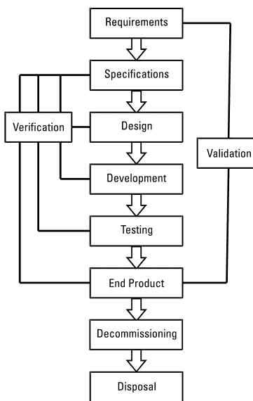

## 构建安全可靠的软件系统

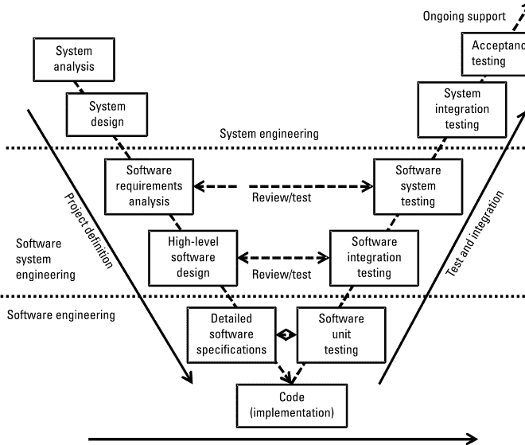

图 3.4 开发生命周期过程的 V 模型。

采用公认的良好实践——此类软件可能也能满足用户需求。然而，事实并非如此。事实上，即使是最复杂的流程也往往会漏掉整类测试，而且应用程序在设计时往往不具备生成关键安全数据。

## 创建必要的功能性与非功能性数据

人们有一种普遍倾向，即利用现成数据来创建指标，以管理和控制软件中包含什么、不包含什么，以及软件是如何创建的。在衡量软件功能时，这一假设可能不如衡量安全和其他非功能性需求时那么准确。在 [21] 中，Axelrod 采取了相对极端的观点，指出：

……在安全指标方面，可测量性和实用性是冲突的。

这种关系在表 3.4 中所示，我们展示了所测量信息的价值或实用性与创建此类数据的难度和成本之间的关系。

有时可以非常廉价地收集到非常有用的信息，但这不是普遍规律。大多数情况下，易获取的数据和易于计算的指标对决策者来说价值较小。易获取的指标指出了通用缺陷或漏洞，但在寻找问题根源方面往往用处不大。偶尔，现成数据可以解决问题，但即使如此，在进行完全取证分析之前，可能仍需要补充辅助信息。因此，如果你丢失了网络连接，可能很容易解释，例如路由器被拔掉了。然而，如果网络连接丢失是由于恶意软件，那么除非你已经有了有效的监控和报告系统，否则你可能无法检测出中断真实原因。

在另一个极端，你可能会投入资金建立复杂的检测系统（无论是内置还是附加的），以获取关于究竟是什么导致了特定问题的信息。在这种情况下，会考虑到入侵检测和防御系统，特别是如果它们具有检测恶意行为的能力。从软件的角度来看，这可以通过开发过程中向应用程序和系统软件中加入数据创建、记录和报告的需求来实现。

表 3.4 展示了这样一个观点：与按时间规定但可能需要更多努力和开销来产生和分析的数据相比，易获取的信息对决策的用途可能较小。此外，还存在投入大量资金和精力创建非常无用数据的风险；仔细思考数据需求并由专家进行评审是非常关键的，以避免在产生有用信息较少的方法上浪费资金。

尽可能产生更多信息（即使是有用的信息）并不总是符合成本效益的，因为这将受到投资回报递减的影响。通常有一个临界点，在此点之前对安全和防护工具的投资是值得的，在此点之后则不值得。

## 表 3.4

## 数据的可测量性与实用性对比

| 易于/廉价测量 | 困难/昂贵测量 |
|---|---|
| **高度实用** | 理想情况，但发生较罕见 | 通常如此，结果可能产生实质性收益 |
| **无用** | 低效率，但发生概率较高 | 浪费的指标收集计划，投入大量支出和精力后几乎没有显著成效 |

由于在软件开发生命周期（SSDLC）的早期引入数据生成器和收集器的成本，远低于在软件已制造和测试后作为事后补救添加的成本，因此，生成和收集相关数据的成本效益分析，在数据生成器和收集器内置时产生的结果与在系统完成后添加的结果截然不同。我们在图 3.5 中展示了这种关系，即在开发生命周期的所有阶段完全整合数据生成、收集、分析和报告，与在系统基本完成后再补上任何可能的方案进行对比。

在图 3.5 中，我们展示了随着生命周期的推移，整合数据生成和收集功能的各种成本和价值。图表表明，潜在成本和价值的范围随着生命周期步骤的增加而扩大，因为对于成本是多少以及从增加的功能中可能获得收益具有更大的不确定性。在这个示例中，平均净值显示在 SSDLC 的后期从正变为负。我们发现，在某个点，包含此类数据创建能力不再是有利的，因为它们的成本将超过其能带来的收益，这意味着你不得不承担无法监控某些活动的风险和成本。然而，图表也显示，如果如果在需求阶段或其后不久考虑并纳入数据创建和监控，成本将较低，而能够包含大量数据生成、记录和报告能力带来的收益将远超过成本。

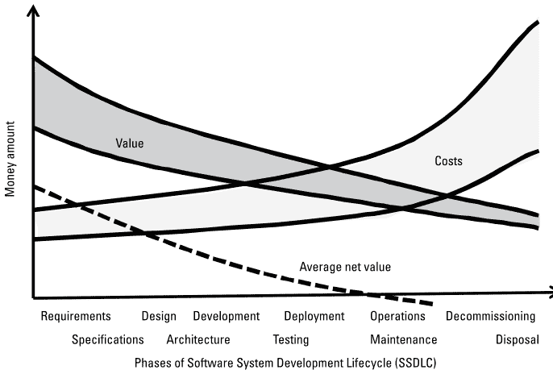

**图 3.5** SSDLC 各阶段的可测量性成本和指标价值。

虽然这个特定示例表明，在某个点追溯数据创建能力是不值得的，但在某些情况下，监控行为的价值可能高到即使在系统已经投入生产后添加这些功能可能仍然是有益的。安全、防护以及许多其他非功能性属性也是如此。也就是说，可能存在一个阶段，整合安全功能不再具有成本效益，在这种情况下必须承担风险。

显而易见的结论是，通过早期整合数据生成、收集和分析，可以产生较低的相对成本，因此可以证明更多数据生成和收集的价值是合理的。然而，如果等待太久，构建这些功能就不再具有成本效益，之前的可用收益也将丧失。

# 弹性与可用性

软件的一个经常无法获得应有关注的特性是弹性。导致这种缺乏关注的原因可能有很多，但其中一个显然是因为提供弹性的方法有很多，且其中许多方法超出了普通软件工程师的关注范围。跨学科和跨文化的因素在构建安全可靠软件系统的许多方面都起着重要作用，但可能没有比弹性领域更多的。需要跨软件、平台、基础设施和设施进行优化，而很少有人拥有处理所有方面的知识和经验。因此，有必要建立由各种学科组成的团队，以获得所需的覆盖范围。

关于弹性的主要问题在于它是多层面的。某些实现弹性的方法是软件设计固有的，另一些与运行软件的平台以及支持平台的基础设施有关。还有一些涉及现场和异地的物理冗余。

再次，问题在于弹性是否被作为需求并纳入软件规范中。如果没有，那么提供冗余的成本可能会远高于在系统开发、测试和部署之后忽略它的成本。这也可以通过图 3.5 中的图表表示，尽管底层逻辑相当不同。在弹性的情况下，有很多选择（软件、固件、平台、基础设施）以实现足够的韧性，其中一些与应用软件有关，但许多可以在软件外部处理。然而在数据创建方面，情况并非如此。

## 退役

在软件系统开发生命周期过程中，很少有方法能够触及软件的停止使用和退役问题。尽管商业软件提供了定期的更新。

然而，在某个时刻，由于功能缺失、缺乏支持、需要与更新的软件和服务建立接口等原因，替换过时的软件产品是不可避免的。随之产生的问题是如何处理这些过时的软件及其随附的数据。由于隐私和盗版问题，以及对敏感数据在处置时存在安全的担忧，这个问题在最近引起了更多关注。在某些情况下，数据已与应用程序集成在一起，要将它们分离出来进行销毁和处置是不可行的。软件系统的退役和处置需要在生命周期的早期就将其纳入考量，以确保这些活动能够被考虑到。

## 总结与结论

在本章中，我们探讨了构成软件系统工程的内容，一些人认为它是现代信息技术和自动化控制系统缺陷的主要来源。事实证明这是一项非同易举的任务。正如所证明，围绕软件工程的许多批评是合理的，并且可以归因于术语定义的缺陷以及对范围和完整性的混淆。通过提供更具体的定义和形式化结构，我们试图澄清软件系统工程领域的内涵和范围。

另一个需要考虑的主要领域与传统软件开发生命周期中的差距有关，特别是它们在范围、测试、韧性、退役、处置等方面的差距。这些差距在很大程度上可以被认为是软件漏洞和其他弱点的根源。在本章中开发的许多理念将在后续章节中得到扩展。

## 工程化软件系统

## 尾注

- [1] Pascatore, J., “No Policy Ever Protected a Customer, and Lots of Don’t Even Limit Business Risk,” *Gartner Blog* 2011年7月22日，见 http://blogs.gartner.com/john_pascatore/2011/07/22/no-insurance-policy-protected-a-customer-and-lots-of-them-dont-even-limit-business-risk/
- [2] Parnas, D. J., “Software Engineering—Missing in Action: A Personal Perspective,” *Computer*, 第44卷，第10期，2011年，第54–58页。
- [3] Axelrod, C., “Does FOSS Pay? Weighing the Security Risks and Benefits of Open Source Software,” *ISSA Journal*, 2006年7月，第6–12页。
- [4] Davis, M., “Will Software Engineering Ever Be Engineering?” *Communications of the ACM*, 第54卷，第11期，2011年，第32–33页。
- [5] Braude, E. J. and M. E. Bernstein. *Software Engineering: Modern Approaches, Second Edition*, Hoboken, NJ: John Wiley & Sons, 2011.
- [6] Christensen, M. J. and R. H. Thayer. *The Project Manager’s Guide to Software Engineering’s Best Practices*, Los Alamitos, CA: IEEE Computer Society, 2001.
- [7] Allman, E., “The Robustness Principle Reconsiders,” *Communications of the ACM*, 第54卷，第8期，2011年，第40–45页。
- [8] *软件*（software）的定义，2012年7月11日访问于 http://www.openprojects.org/software-definition.htm。
- [9] *系统软件*（systems software）的定义，2012年7月11日访问于 http://www.openprojects.org/software-definition.htm。
- [10] *应用软件*（application software）的定义，2012年7月11日访问于 http://www.openprojects.org/software-definition.htm。
- [11] Villenor, J., “The Hacker in Your Hardware: The Next Security Threat,” *Scientific American*, 第303卷，第2期，2010年8月。
- [12] *固件*（firmware）的定义，2012年7月11日访问于 http://en.wikipedia.org/wiki/Firmware。
- [13] IEEE软件工程术语标准词，STD 610.2-1990。


- [14] Shaft, J. D. Quillen, and C. Janssen, “Rethinking Hardware-Software Codesign for Exascale Systems,” *Computer*, 第44卷，第11期，2011年11月，第22–30页。

- [15] *硬件*（hardware）的定义，2012年7月11日访问于 `http://www.openprojects.org/hardware-definition.htm`。

- [16] 近年来，研究人员一直在使用“系统系统”（systems of systems）这一术语，人们对其有多种定义。正如 M. W. Maier 在其文章《Architecting Principles for Systems-of-Systems》（2011年12月18日访问于 `http://www.infoced.com/open/PAPERS/systems.htm`）中所述：“系统系统应通过其组件的独立性、演化特性、涌现行为以及将组件交互仅限于信息交换的地理范围，与大型单体系统区分来。”

- [17] Lewallen, R., “软件开发周期模型”，“2005年。见 `http://codebutter.com/raymondlewall/2005/07/13/software-development-cycle/models/`。

- [18] Royce, W., “大型系统的管理”，“IEEE WESCON，1970年。重印于 `http://www.cs.umd.edu/class/spring2003/cmsc83p/waterfall.pdf`。

- [19] `http://tarmo.fi/blog/2005/09/don’t-draw-diagram-of-wrong-`

- [20] 作者熟悉一个由聪明但缺乏经验的软件工程师设计的系统，他们专注于图形用户界面（GUI）而忽略了其他系统特性。在投入多年努力和可能高达8.8亿美元（具体金额从未公布）之后，将新系统与“绿色屏幕”遗留系统进行对比。旧系统在3秒内做出响应，而新系统需要30秒。在尝试改进性能无果后，新系统被放弃了，最终被完全不同的系统取代。

- [21] Axelrod, C. W. “安全指标中的价值与不确定性计算，”ISACA Journal，第6卷，2008年。

- [22] 例如，当微软决定停止支持 Windows NT 4.0 时，未在警告期升级软件的客户中发生了骚动。特别担心安全漏洞出现后无法得到解决。微软同意让客户加入专门的安全补丁的扩展支持服务。最初，该服务费用昂贵；微软可能会对此收费。

# 4 工程安全可靠系统，第一部分

> 安全工程是为了构建在恶意、错误或意外情况下保持可靠的系统。
>
> ——Ross J. Anderson，剑桥大学

## 引言

在构建、运行和退役安全可靠系统（特别是基于计算机的软件密集型系统）时，从业人员经常借鉴来自系统工程以及安全工程领域的方法和实践。在本章中，我们从更通用的系统视角来看安全可靠系统的工程。这比想象的要困难，因为最近发表的很多虽然以软件为导向，但并未充分讨论这些系统的特定安全和安全属性。

关于软件考虑占据主导地位的断是合理的，因为几乎所有复杂的现代系统在某种程度上都包含了软件组件。然而，为了清晰起见，我们推迟了对安全可靠软件密集型系统工程的考虑。在本章中，我们将重点关注通用系统的安全和可靠考量，在引入软件维度使一切变得变得更加具体和复杂之前。

## 方法论

正如第3章建议的那样，将“软件工程”一词扩展为“软件系统工程”，是为了说明软件产品仅运行在特定的语文中，安全工程和可靠工程也需要更清晰地识别和定义，以明确安全与可靠在应用于系统工程（系统可能包含也可能不包含计算机）时的具体含义。在本章中，我们将深入探讨安全工程和可靠工程的特定领域。在随后的章节中，我们将安全与可靠与软件密集型系统联系起来。

现在，我们将通过与第2章和第3章类似的定义过程，来阐明安全工程和可靠工程的含义。由此，我们为确定如何将这些概念应用于软件系统奠定了基础，我们将在第5章中这样做。正如在前面的章节中强调的那样，精确地定义这些术语是更好理解的关键，并有助于阐明我们在这一领域发现的模糊思维。许多著名的研究人员和作者并没有费精力去区分安全工程和可靠工程，或者他们可能没有意识到两者之间存在差异。他们似乎也不不在意在安全、可靠与其他描述符（如可靠性）之间做出任何特定的区别。这使得跨学科的比较变得相当困难。我们试图通过分离这些术语并分别检查每一个，然后将其自身与其他术语结合起来，来克服这种困惑和缺乏精确性的问题。

## 安全与可靠

在关于安全工程的主书中，Anderson [1] 确实涵盖了人们可能与软件系统相关的安全工程的每一个可以想象的话题。然而，他对安全和可靠概念的区分并不特别清晰。这并不罕见，许多作者交叉使用“安全”和“可靠”这两个词。在这里，我们将仔细区分这两个术语。在关注安全的人与专攻可靠的人之间（无论是指通用系统还是软件密集型系统），在知识和交流方面存在巨大差距，因此独立地处理这些学科仍然是合适的。希望安全工程和可靠工程领域、作者和从业者之间的分离会随着时间的推移而减少，因为参与者将被要求同时解决安全和可靠问题 [2]。

正如 Axelrod [3] 所讨论的，日益需要识别那些经常被隔离开的安全与可靠的“孤岛”。正如 Carter [4] 所述，将安全和可靠专业人员聚集在一起并在系统开发、测试、运行和退役生命周期的每个阶段进行协作也是重要的。这尤为紧迫，因为我们越来越多的安全关键型和安全关键型系统正连接在一起形成“系统系统”。所谓的“智能电网”日益与公共网络（特别是互联网）相连，这就是当前的案例 [5]。管理层和技术人员显而易见的困惑和缺乏理解强调了区分与安全和可靠相关的专业知识的重要性，以及正如 Carter [4] 建议的那样，获得极大增加的跨文化合作。

安全关键型系统与安全关键型系统之间存在一个简单但有意义的区别，这通常适用于第2章（第15页）中提供的软件系统。Boehm 的原始定义在 Barnes [6] 中被重复引用。我们将定义泛化为：

- 可靠（Safety）——[系统] 不得伤害世界，
- 安全（Security）——世界不能伤害系统。

这种观点的差异在图4.1中通过图表形式分别说明了安全关键型、安全关键型以及结合的安全/安全关键型系统。

简而言之，可靠系统的目标是“抑制”，而安全关键型系统的对应重点是“保护”。这种目标上的差异导致了在确保系统可靠的标准与用于确保安全的标准相比，产生了不同且有时冲突的标准。

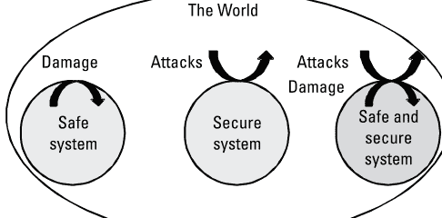

图4.1 可靠与安全。

## 构建可靠且安全的软件系统

安全和可靠在某种程度上存在重叠，例如对系统完整性的需求，但正是这种观点的差异导致了系统设计和实现的分歧。这种分歧对于必须既安全又可靠的组合系统带来了高得多的风险。

另一个视角源于 Firesmith 在 [7] 中描述的可靠、安全和生存性（survivability）之间的差异。Firesmith 声称，这三个方面有许多相似之处，他的定义如下：

- 可靠（Safety）。对意外伤害进行预防、检测和做出反应的程度。
- 安全（Security）。对恶意伤害进行预防、检测和做出反应的程度。
- 生存性（Survivability）。对意外和恶意伤害进行预防、检测和反应的程度。

Firesmith 进一步说，“可靠很大程度上关于保护有价值的资产（特别是人）免受意外伤害”，而“安全很大程度上关于保护有价值的资产（敏感数据）免受攻击伤害”，而“生存性则是关于保护有价值的资产（基本服务）免受意外和攻击的伤害”。

作者更倾向于使用 Barnes 方法 [6] 来区分可靠和安全，因为对于那些负责保护包含在信息系统内部或通过信息系统访问的数据资产、或防止控制系统伤害外部世界的人来说，事故的来源是意外的还是故意的且恶意的，在所采取的行动上通常没有区别。在这两种情况下，调查人员都需要确定事故的根源，并采取行动防止未来发生相同或类似的事件从内部或外部造成损害。然而，如果一起事故是故意活动的结果，对其的响应可能会不同，因为可能会引入执法部门进行追求。在后一种情况下，不太可能启动正式程序。

个人的责任以及指责的公平性往往是一个问题。通常，如果安全违规或可靠故障被发现是无意的，则会对负责系统安全/或运行的人采取行动，尽管他们可能处于无法防止事故的位置。根源可能是需求、设计或实施或运行方面的缺陷。然而，寻找一个替罪羊来追究责任和惩罚似乎是人性的。

可以认为，生存性更多地关于损坏或破坏后的恢复性和韧性，而长期生存性则涉及组织重建损坏或破坏的操作的能力，以便实体能够以事故前的水平运行。

关于区分安全和可靠系统的另一种观点来自 Barbacci [8]，他与 Firesmith 属于同一机构，即卡内基隆大学著名的软件工程学院。这两位研究人员都在2003年写作。

Barbacci 将可靠和安全区分如下：

- 可靠性（dependability）关注故障的发生，其定义为外部后果（未提供服务）……可靠性（safety）关注事故或意外的发生，其定义为外部后果（发生了事故）。

## 开发关键系统的四种方法

Rushby [9] 提出了开发关键系统的四种传统方法，即：

### 1. 可靠性方法（Dependability Approach）

### 2. 安全工程方法

### 3. 安全系统方法

### 4. 实时系统方法

详细研究这四种开发关键系统的方法是非常值得的，因为它们介绍了本书书中后续关于软件系统工程的某些关键方面。

## 可靠性方法

Rushby [9] 认为，“可靠性”（dependability）一词试图让研究人员避免使用其他术语，例如“可靠性”（reliability），后者已具有特定的技术内涵。他声称，可靠性一词可以包含容错、可靠性、正确性、安全性、生存性和安全性。Rushby 似乎认为安全性和安全性是系统可靠性特别重要的因素，因为它们是他开发关键系统的四种方法中两个关注的重点。

引用 Laprie [10] 的话，Rushby 断言，一个可靠的系统在某些服务质量方面（如正确性和交付的连续性）是可信赖的。可靠性方法本身倾向于强调可靠性和容错性，而不是安全或安全性。

在书中，我们特别关注系统（尤其是软件密集型系统）的安全性和安全性，而不会过多考虑可靠性和容错。然而，这并不是说可靠性和韧性在安全可靠的软件系统的开发和运行中至关重要。它们确实非常重要。

在表 4.1 中，我们展示了不同的研究人员涉及哪些可靠性组件。

回到可靠性方法的描述，应该注意 Rushby 表示，“系统偏离其所需的服务被[视为]一种故障” [9]，其含义是可靠的系统不会故障。然而，故障存在一系列从轻微到灾难性的范围，其后果可能大于从系统中获得的益处。故障被认为是“一种系统外部行为的属性” [9]。

故障的原因被称为“缺陷”（faults），包括以下内容：

- 设计和实现中的错误；
- 组件故障；
- 操作不当；
- 环境异常。

## 安全且可靠的系统工程，第一部分

表 4.1

不同研究人员定义的可靠性组件

| 组件 | Anderson [1] | Barbacci [8] | Rushby [9] | Laprie [10] |
| --- | --- | --- | --- | --- |
| 安全 (Security) | 是 | — | 是 | — |
| 安全性 (Safety) | 是 | — | 是 | — |
| 正确性 (Correctness) | — | — | 是 | 是 |
| 交付连续性 (Continuity of delivery) | — | 是 | — | 是 |
| 可靠性 (Reliability) | 是 | — | 是 | — |
| 容错性 (Fault tolerance) | 是 | 是 | 是 | — |
| 生存性 (Survivability) | — | — | 是 | — |
| 服务质量 (Quality of service) | — | — | — | 是 |

根据 Rushby 的说法，如果系统能够检测并纠正由于缺陷导致系统损坏而产生的潜在错误，它就是容错的。

## 安全工程方法

Rushby [9] 表示，安全工程师区分了可靠性（reliability）和安全性（safety），并指出可靠性涉及“故障的发生率”，而安全性则与“……事故（mishaps）的发生”有关。事故被定义为可能导致“死亡、伤害、财产、财产损失或环境危害”的意外事件。这再次引发了一个问题：由计划事件引起的故障是否不应该被包含在故障之中？它应该被包含进去。

Leves [11] 建议从事软件安全的人员采用并遵循系统安全工程的一些实践和技术，重点关注后果而非可能导致负面后果的需求。在随后的章节中，我们将批判性地检查需求在定义安全和安全性需求方面的作用。这是因为许多发生的故障和成功的攻击可能是由于正确地表示了不充分的需求。Rushby 断言，可靠性方法在“没有正常服务的安全替代方案”的情况下工作效果最好，并以飞机飞行控制系统举例；而安全工程方法适用于可能发生极度不理想事件（如意外释放武器）的情况。

Rushby 对危害、损害、危险、严重程度和风险定义如下：

- 危害 (Hazard)：可能导致事故的条件；
- 损害 (Damage)：事故中损失的衡量标准；
- 危险 (Danger)：危害导致事故的概率；
- 危害的严重程度 (Severity of a hazard)：可能导致的最坏情况的损害；
- 风险 (Risk)：危害严重性和危险性的结合。

Rushby 继续描述了危害分析，他认为这是系统安全工程中使用的主要工具。这些以及上述术语似乎特定于安全工程，但在更通用的安全风险分析领域，它们有相应的对应概念，如表 4.2 所示。

根据 Rushby 的说法，危害分析包括以下步骤：

1. 识别潜在危害（从微小到灾难性不等）。
2. 系统探索，即确定导致事故的条件如何产生或可能产生（反向推理和“假设”分析）。
3. 通过修改系统和操作程序、引入安全特性和/或培训来处理不可接受的风险。

Rushby 主张，设计生命周期的每个阶段都应该要求危害分析，并给出了初步子系统、系统和操作等示例。以下方法常用于危害分析：

- 危害与可操作分析 (HAZOPs)
- 故障树分析 (FTA)；
- 失模式和影响分析 (FMEA)。

Leves 和 Harvey [11] 在 1983 年建议在软件中使用这些技术，特别是软件故障树分析 (SFTA)；SFTA 技术于 20 世纪 60 年为了避免任务发射而开发。

Rushby 表示，软件运行的整个系统上下文必须被视为安全工程方法，因为软件本身可能无法揭示系统级的事故。Rushby 断言，不仅软件错误会导致整个系统的故障，系统的其他活动也可能导致软件失效。

Rushby 的文章进一步描述了系统工程实现机制，涉及锁定（lockins）、封锁（lockouts）和互锁（interlocks），它们分别将系统锁定在安全状态、在危险状态之外并要求特定的事件顺序。锁定和封锁的确定将根据选择适当失效模式的标准而异。这种分析中的失误可能会导致可怕的后果，例如在 2011 年 3 月 11 日袭击日本东北海岸的地震和海啸之后，工人被锁在了放射性房间内。

Rushby 还提到，如果将事故解释为信息的未经授权泄露，并考虑威胁、漏洞、保护措施及其反措施，那么安全方法也可以适用于安全领域。

## 安全系统方法

Rushby [9] 声称，传统上对系统安全的关注一直是敏感信息的泄露，而信息完整性和防止拒绝服务是次要考虑的问题。他将安全模型既描述为系统组件也是安全组件。安全模型列表（包括 Bell-La Padula 访问控制模型）在系统组件（如顺序系统、分布式系统、数据库或专家系统）以及安全组件之间存在差异。

Rushby 指出，敏感信息的泄露通常比完整性受到关注，尽管在某些情况下完整性可能被认为更重要，其损失对整个系统的影响可能会损害机密性。他引用了 Clark 和 Wilson [13]，他们关注完整性的两个方面，即良好的事务和职责分离。他们将良好的事务描述为要求“重要数据不能被修改

## 安全且可靠的软件系统工程

“任意操作”，以及职责分工要求“不同的人”对构成更大操作的不同程序进行授权。职责分工应当跨越部门，因为例如，如果授权由一个人或其上司完成，那么发生冲突的机会就会更大；而如果需要内部审计人员的签字，那么冲突的可能性就可以在很大程度上（尽管并非完全）被消除。

Rushby 声称，“[完整性]受到的关注比[泄露]少，尽管在某些应用中，[泄露]可能更为重要。”虽然完整性是两个系统及其处理的数据的一个明确方面，但在过去的十年里，人们对泄露的关注要多得多，其形式为未经授权的访问以及对敏感数据（如非事实个人信息和知识产权等所有类型的秘密数据）的滥用。

在 20 世纪 90 年代中期，当 Rushby 写下他的论文 [9] 时，分布式拒绝服务攻击受研究人员的关注较少。十年或更久以后，拒绝服务成为一种高可见、高影响的攻击形式，例如 2007 年对爱沙尼亚的攻击，该攻击导致政府和银行网站瘫痪，使它们的活动陷入停滞 [14]。此类攻击的技术（包括对僵尸的接管和僵尸网络的扩展）使得拒绝服务变得更加有效，并赋予该方法更大的覆盖范围。

## 实时系统方法

Rushby [9] 将实时系统定义为“其正确性不仅取决于其输出，还取决于产生输出的时间。”


这种方法关注系统任务的优先级偏好。这些对于详细的系统设计很重要，但并不特指安全或可靠性（正如之前的两种方法那样）。在这方面，如果一个低优先级任务被优于高优先级任务，那么其影响类似于拒绝服务攻击。

## 安全关键型系统与安全关键型系统

上述关于安全和安全的定义源自 Boehm，与上述的 Firesmith [7] 和 Barbacci [8] 的定义相比，代表了对安全关键型系统与安全关键型系统差异更有用且一致的观点。这是因为后者的定义具有某种局限性。通常，安全关键型软件系统可能会被故意行为（不仅仅是随机事故）破坏，而安全关键型系统可能会被无意地破坏（不涉及恶意）。Firesmith 和

## 安全且可靠的系统工程，第一部分

Barbacci 对安全的定义没有捕捉到核心概念，即安全关键型系统应尽可能防止意外和故意的危险事件造成的有害影响，而不是保护个人免受伤害。

为了说明这一点，让我们考虑现代汽车中某些安全功能的类比，其中防抱锁刹动系统（ABS）旨在防止或避免因冰雪路面状况可能发生的潜在事故，而气囊的设计是为了在碰撞发生后立即保护驾驶员和乘客。这两个汽车系统通常是独立实现的，各自使用其传感器检测危险状态并随后独立地对危险情况做出响应。ABS 旨在防止事故，而气囊的设计是在事故发生时保护驾驶员和乘客。通常，安全措施旨在防止或避免对系统的攻击或其滥用的后果，而可靠性则是关于在发生违规或故障时保护资产（特别是，但不限于人类）。

此外，Firesmith [7] 将生存性认为是安全与安全的结合。然而，可以认为，生存性与系统无法抵御攻击或无法防止由系统故障导致的危险情况发生后的有效响应有关。因此，人们通常可以在预防（或保护）成本与恢复（或生存性）成本之间进行权衡。如图 4.2 所示，这些成本的确定可以为分析师提供一个总成本最小的最优点。

在许多情况下，在预防方面的加大投入可能允许减少在响应和恢复方面的支出，以达到预期的可靠性和完整性水平。

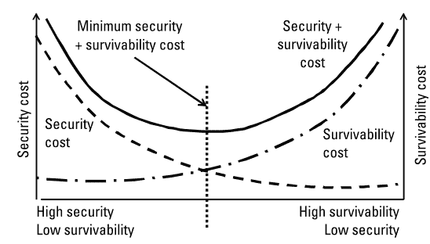

**图 4.2** 保护与生存性成本。（来源：“The Dynamics of Privacy Risk,” ISACA Journal, Vol. 3, 2004 ISACA. 保留所有。经许可使用。）

## 总结与结论

本章的目标是在读者脑中建立一个安全关键型系统与安全关键型系统的模型。虽然许多研究人员交替使用安全和可靠性这两个词，但我们选择对两者做出明确的区分：安全措施用于保护应用程序和数据库中的敏感数据和知识产权，而可靠性措施用于确保系统故障或失效不会伤害人类或环境。在涉及攻击、防御等概念方面，两者之间有许多相似之处，在设计和运行每类系统的工程师之间，也存在许多文化和技术规范。

提出这种清晰区别的意图是向参与每类系统的人员强调，特别是当安全关键型和可靠关键型系统组合成系统系统或网络物理系统时，需要共享信息和方法，以跨越整个安全-可靠性频谱进行协作。如果不是这样，所产生的系统将在安全和可靠性属性上存在缺陷——甚至在最坏的情况下，两类属性都如此。

## 尾注

- [1] Anderson, R. J., Security Engineering: A Guide to Building Dependable Distributed Systems, Second Edition, Indianapolis, IN: John Wiley & Sons, 2008.
- [2] 2013 年 2 月 23 日，美国国防高级研究计划署（DARPA）发布了……

# 安全与可靠系统工程

## 第 2 部分

> 我感到非常沮丧的是，我们仍在谈论那些在我 1971 年开始教书时就已经“过时”的调试技术了 [1]
>
> —Marvin V. Zelkowitz，弗劳恩霍夫实验软件工程中心

## 引言

我们之前已经讨论过，面对日益增长的安全性、安全性以及其他所谓的非功能性需求（如可靠性、性能和恢复能力）时，软件工程的实践似乎显得力不从心。事实上，读到 Zelkowitz [1] 和 Parnas [2, 3] 频繁发表的文章确实令人不安，他们在软件工程领域已经工作了四五十年，而这些领域的先驱者却抱怨软件工程领域取得进展缓慢。这种短板在涉及安全和可靠系统时尤为明显。而本章的关注重点正是这些此类系统。

考虑到软件密集型系统变得越来越复杂且难以管理，特别是当各种系统越来越多地组合成系统系统和网络物理系统时，情况变得更加令人不安。这种软件系统革命对工程师提出的要求比以前大得多，因为如果他们想要应对新系统的复杂性和多样性，就必须拓宽知识范围和专业努力。此外，社会对软件系统的依赖程度也大大增加，系统故障对我们个人生活和经济健康的影响远比以前大得多。

## 安全可靠的软件系统工程

在软件密集型系统的复杂性及其依赖性，与我们确保此类系统足够安全、可靠以防止人类伤害并保护信息资产免受未经授权的访问和滥用的能力之间，差距似乎在扩大。如果这种差距继续扩大并呈指数级增长，这种局面对未来将是不利的。除非软件专业人士（特别是整个社会）在缩小并最终消除这一差距方面取得巨大进展，否则我们将没有足够的系统来阻止灾难性的故障。

到目前为止，最具戏剧性的例子之一是 2012 年 6 月 19 日发生的计算机系统故障。当时，阿尔斯特银行（Ulster Bank）的自动处理系统遭遇了灾难性故障，该系统通常每天处理 2000 万次交易。宕机导致超过 10 万名客户的银行账户无法访问，并破坏了其账户的完整性。一个月后，由初始系统故障导致的许多问题仍未解决。如果考虑到由于对计算机系统信任度丧失的损失以及对银行声誉的影响等后续成本，这次事件的最终直接成本可能会高达数千万欧元（甚至更高） [4]。

本书的主要目标是提高人们对我们正在面临以及未来可能面临危险的意识。这些危险可能源于系统工程实践的不完善，特别是在涉及安全和可靠方面。如果我们既不愿意也无法在用于构建软件密集型系统的安全性、可靠性和其他非功能属性（如恢复性）的流程和程序中进行快速且重大的改进，那么此类威胁将产生产生大得多的影响。为了使努力奏效，我们需要看到领域专家数量大幅增加，让他们承担确保关键软件密集型系统安全可靠的责任。

本书的另一个目标是引导那些意识到问题巨大性和重要性的人士，让他们通过有意义的方法来获得更大的保证，确保系统不会造成物理伤害（安全性），并保护我们珍视的信息（安全性）。

在本章中，我们从不同的视角追溯了今日安全危机的历史，以解释为什么我们陷入了这样的困境：既意识到建立可接受的安全水平需要什么，又不得不非常不情愿地接受安全局限性，以及我们使决策者为实现此类水平提供所需资源的能力。

## 方法

如果我们用医疗急救受害者来类比，那么在进行治疗之前，首先必须稳定患者。对于安全关键型和可靠关键型软件密集型系统也是如此。在期待战胜攻击者之前，我们必须首先防止攻击者与防御者之间的差距进一步扩大；然后我们可以努力减少并最终消除差距。也许我们甚至可以领先于攻击者。继续按照现在这样做将让我们无法逃避或减轻攻击的影响。

图 5.1（未按比例绘制）说明了随着系统（特别是网络和物理系统）的组合，安全可靠需求以及系统复杂性的指数级增长。该图还显示了软件保证工作和能力的增长相对缓慢，表明差距正在以加速的速度扩大。正如全球变暖一样，即使有了立即解决方案，由于已经存在的巨大动力，问题将继续迅速增长。在这种情况下，人们所能希望的是减缓不利影响增加与预防能力之间分歧的增长，以期待出现新的解决方案能够有效减少并最终消除差距。


**图 5.1** 安全性、复杂性需求与软件保证能力的对比。（来自 Axelrod, C. W., “The Dynamics of Privacy Risk,” ISACA Journal, Vol. 3, © 2004 ISACA. 版权所有。经许可使用。）

## 安全可靠的软件系统

这里推荐的方法与其说关注保护，不如说更多关注预防。我们的主要重点是从源头上避免安全和可靠问题，而不是试图去防御它们。毕竟，如果软件系统工程师能够从一开始就设计、开发和实施高保证系统，那么许多——如果所有的缓解措施都可以被避免，就不需要做出反应性响应。看到国防高级研究计划局（DARPA）就确保安全和可靠的新方法发布征求书，这说明了问题的严重性。例如，`DARPA-BAA-12-21` 主题为“高保证网络军事系统 (HACMS)”，它正在寻找确保嵌入式系统的“从零开始的方法” [5]。

虽然我们有技术能力来构建软件密集型系统（正如在航空和军事领域所示），但在许多其他情况下，使用重型方法来确保系统不会失效且易受网络攻击是无法实现的。成本效益分析可能不会显示此类风险缓解活动的投入具有正向回报。虽然这种结果可能是由于低估了系统受到攻击、故障或失效时可能遭受的损失全部影响，但在真正糟糕的事情发生之前，很难说服决策者会有真正糟糕的事情发生，正如上面描述阿尔斯特银行自动处理系统故障的案例的那样。

尽管系统故障的频率很高且随之产生了巨大成本，但如果我们期望所有最关键的软件系统发生实质性变化，我们可能走在了错误的道路上。通常对于决策者来说，仅仅是“足够好”就是可以接受的。如果是如此，那么试图超越平庸水平的改进尝试是无法突破的。

## 缩小安全与可靠性缺口

软件产品和软件密集型系统对功能能力的需求不断增加，加上系统的聚合和组合，导致系统和网络物理系统的复杂性日益增加，对安全和可靠的需求也更高。然而，我们在抵抗攻击和限制破坏性影响方面的能力仍然落后，攻击和软件系统故障报告的增长证明了这一点。经验表明，系统开发和实施的巨兽不会停下来等待软件工程师，

## 安全可靠系统工程化，第2部分

特别是，为了让他们采取行动。这以前从未发生过——除非施加巨大的压力，否则未来不太可能发生。

在许多方面，软件系统的安全性状态（以及较小程度的软件系统安全性）与我们在许多发达国家看到的国家债务状况相似。随着对安全和可靠需求的增加，在安全和可靠方面的支出可能被视为“赤字支出”，然而，随着时间的推移，攻击和软件故障的影响日益增大，安全可靠债也不可避免地增加。由于经常产生安全和可靠性赤字，安全可靠债持续持续增长。只有当我们看到持续的年度安全可靠盈余（意味着对安全可靠方面的投入效果超过了对个人、组织和社会的损失），我们才希望看到总的安全可靠债得到减少。尽管政客和社会倾向于将减少财务债务的需求推迟到某个遥远的未来（届时，安全可靠工程师以及负责安全可靠决策的人员似乎愿意推迟现在解决安全可靠赤字，从而在未来付出大得多的代价，因为每次攻击成功或发生故障或失效时，我们都必须以极高的利率为安全可靠债支付“利息”）。这表明，图 5.1 所示的指数级增长可能是保守的。

## 改变游戏规则与从零开始的方法

在许多情况下，需要开发软件保障方法，使前沿技术能够以远快于功能创新速度的速度加速。也就是说，软件复杂性和关键性的增加远超过了我们有效测试软件的能力，特别是当各种多样化的组件结合在一起形成系统之系统或信息物理系统时。

应对这一问题的常见做法是寻找机会，在系统的整个开发生命周期中（特别是在早期阶段）将安全可靠措施构建到系统内部。虽然这种方法有很大机会提高未来系统在安全和可靠方面的质量，但对增强现有系统几乎没有作用或毫无作用。这是因为测试所谓的“遗留软件”需要巨大的努力，而且对现有的生产系统进行补救性修复（或补丁）以及重新编程和重新测试的成本要高出好几个数量级。

因此，许多从业者正寻求研究人员提出改变游戏规则、从零开始的方法，以产生高保障的系统，这些系统不仅在功能上是正确的，而且是安全的可靠。许多建议的规则改变者，例如通过快速改变安全环境以领先攻击者、提供经济激励以产生良好的安全性以及创建一个灵活的分布式信任环境，都是值得追求的目标。这些方法或主题是在 2010 年 5 月 19 日由网络和信息技术研发（NITRD）计划主办的会议上提出的，汇总在名为《迈向联邦网络安全研究议程：三个改变游戏规则的主题》的报告中，该报告在会议上发表过 [6]。

尽管使用“银弹”颇具吸引力，但现实、可操作且具有成本效益的实现这些及类似目标的方法尚未开发出来（至少在公共领域是如此），鉴于目前软件系统开发和实现的现状，在短期内极不可能创建全方位解决方案。然而，如果真的发生了这种奇迹，创新技术的产生（这些技术在广泛的公共部门和私营部门系统中也具有成本效益）无疑将彻底改变软件安全和可靠属性的处理方式，并平息目前发出的许多担忧。

对研究人员增加网络系统安全可靠性和改进验证过程的呼吁，不仅限于上述的 NITRD 中心。征求建议（RFP）也来自 DARPA 的信息创新办公室（IIO）等机构。例如，在 2012 年第一季度，DARPA 发布了两项特别感兴趣的广泛机构公告（BAA）。其中之一是 `DARPA-BAA-12-21` [7]，其目标是接收关于创建“高保障信息物理系统技术”的提案，其中高保障被定义为功能上正确并满足安全可靠属性。这些请求寻求的是原始的、创新的技术，而不是以前开发过的或仅仅是之前工作扩展的技术。

另一个值得关注的 BAA 是 `DARPA-BAA-12-17` [8]，它关于软件验证过程的众包化。在这种情况下，DARPA 正在寻找“能够使科学、设备或系统实现革命性进展的创新方法”。同样，排除了演进式的改进。

DARPA 似乎正试图规避当前的软件保障技术和实践，他们似乎对这些方法在确保软件安全可靠方面的能力表示怀疑。虽然意识到此类 DARPA 请求背后的动力是现有方法是不够的这令人不安，但看到他们愿意资助新技术的研究也令人欣慰。事实仍然是，我们似乎没有其他选择，只能依靠产生的技术来赶上过去、现在和未来任务关键型、软件密集型系统中的安全可靠缺陷。

## 安全可靠系统工程化，第2部分

如果研究人员没有产生突破性的、具有成本效益的解决方案——而且无法保证他们会这样做——那么就有必要回到旧的安全可靠方法并对其进行增强。如果情况变成这样，我们不得不投入巨大的努力并投入大量资源，从软件开发的最早期阶段开始为未来的软件密集型系统构建安全性、可靠性、可用性、完整性和韧性属性。这种方法无疑将涉及巨大的支出。还需要培养一个领域专家团队来完成这项工作。在现有系统中修补安全、可靠性等措施将产生更大的努力和费用，因为软件工程师不仅需要熟悉过时的语言和操作系统，此外还需要具备最新方法的能力。

修补旧系统与在新系统中构建安全、可靠、韧性等措施相结合的成本将高到以至于这种努力极可能无法合理并获得资助。相反，更可以接受的方法是随着时间的推移，用质量大大提高的新系统替换旧系统，前提是有某种压倒性的威胁——例如对于千年虫（Y2K）缓解工作，当时人们对系统在世纪交替期间日期错误导致故障和失效的风险存在极大担忧——才会激励公私部门资助修复正在运行和开发中的软件密集型系统。据估计，千年虫修复的成本在 2000 亿到 3000 亿美元之间，尽管大部分支出是为了加速将现有系统替换为新系统。由于千年虫修复很容易比较，而不需要深入了解被纠正软件的功能，预计该工作比实现广泛的安全可靠需求所需的努力要少几个数量级。在所有现有任务关键系统上加强安全和可靠性可能耗资数万亿美元。对于未来系统这样做可能会为项目增加数十亿美元的成本，尽管这些成本可以通过减少漏洞和更少的成功攻击来抵消。

此外，即使在新系统中构建安全、可靠性和韧性，也可能无法被普遍接受，特别是在私营行业中。一些公司，例如微软公司，已经显著地接受了

## 工程化安全可靠的软件系统

可信计算的概念有效地通过用更安全的产品取代了先前的。然而，似乎只有少数软件制造商追随了微软的后盾。在参与第四次“构建安全成熟度模型”（BSIMM）倡议的 19 家公司中，有几家是独立软件供应商（ISV）。像 Adobe、Adobe、微软、SAP 和 VMware 等公司都包含在 BSIMM 公司社区中。参与 BSIMM 项目被认为表明这些公司处于安全实践的前沿 [9]。然而，除非政府以财务激励、法律和监管行动的威胁（或两者兼有）的形式进行推动，否则实现通用可信计算的目标是不可能实现的。

2012年2月14日，利伯曼、柯林斯、罗克菲勒和费因斯坦参议员向美国参议院提交了一项名为 `S.2105` 的网络安全法案。该法案标题为《2012年网络安全法案》，试图解决人们对工业控制系统遭受网络攻击的担忧，特别是那些影响电力行业和其他公用事业的系统 [10]。此类关键系统正日益连接到公共等电信网络，如互联网。《2012年网络安全法案》解决了由网络威胁和软件系统常见漏洞引起的问题。正如所预期的那样，特别是在当前的政治环境下，该法案因其将施加的限制和将产生的成本而几乎面临反对。如果说近期引入联邦网络安全立法的尝试可以作为指南，那么该法案不太可能以目前的形式成为法律，任何妥协法案都可能被时间拖延并被认为被削弱了。

对国家网络安全立法行动的迫切推动可能会等到情况变得足以引起公众愤慨和政治回应时才会发生。迈克尔·麦康奈尔中将（美国海军退役）在 2010 年 2 月 23 日美国参议院商务、科学和运输委员会的听证会上纠正了这一点，他认为，除非发生灾难性的网络事件，否则不会代表网络安全采取任何行动。该委员会由参议员约翰·D.（杰）·罗克菲勒四世主持，讨论的主题是“网络安全：保护我们关键基础设施的下一步” [11]。

与此同时，显然我们能做的只是为那种由于需要而认可此类事件的日子做准备，因为当灾难性事件或一系列事件发生时，这一天将会到来。这绝不是解决该问题的理想方式，但目前看来似乎没有其他选择。作为准备，我们需要理清在理想世界中，安全可靠的软件密集型系统应该如何设计、开发、实施、运行和丢弃。这样，就会有一些基础来快速调用

## 工程化安全可靠的系统，第二部分

处理当时问题所需的更好方法。这种方法远非理想，因为如果没有一个主要的驱动因素，几乎没有机会建立适当的标准并为这些标准的实施提供资金；它将满足目的，尽管其成本可能是预先采取缓解措施成本的许多倍。

## 关于保护的说明

安全的通用方法是防御系统免受攻击，从而保护信息资产。在安全方面，我们不仅希望系统不伤害人类、其他生命形式和环境，还希望通过次要手段直接保护潜在受害者，例如在系统发生故障或未能处理故意或意外事件时进行手动覆盖。

大多数努力都侧重于预防。通常，我们安装入侵检测和防御系统来保护软件系统免受恶意攻击。杀病毒软件用于在恶意软件插入合法计算机系统之前对其进行检测和拦截。安全导向型系统通过一组特定的失效方法来防止损坏，以保护个人、群体和环境。


相对于分配给预防措施的资金，用于威慑和规避的资金和精力不足。然而，规避和威慑通常比实施预防措施要便宜得多。例如，如果英国皇室珠宝被储藏在一个未知地点，那么守护和保护它们所需的精力和费用将比将真珠宝展示时要少得多。但是，可以论证的是，展示它们比它们所有光彩的绽放的观点更有价值。在这种情况下，规避而非展示珠宝的主要论点是，公众有权看到它们并为此付了钱。尽管如此，可以使用仿品来代替，从而规避许多安全问题，尽管观众的体验会大折扣（如果他们真的意识到自己在看仿品的话），除非公众因为采取了非凡的安保措施而认为它们是真实的。

威慑和规避特别是达到该领域专业人士希望看到的安全和安全水平的关键。然而，由于保护被视为安全和保障专业人员的责任，而威慑和规避涉及业务决策，后者很少包含在系统工程师的工具箱中。软件密集型系统被攻破或以有害的方式失败，往往不是因为它们没有受到针对意外行为的保护，而是因为它们被用于最初未预见、批准或允许的目的。

这种后期情况的一个典型例子是互联网本身。互联网最初是 `ARPANet`，由美国高级研究计划署（`DARPA`）开发为高度弹性的网络，即使网络的大部分被禁用或破坏，也可以依靠它继续运行。互联网在设计时没有考虑安全性，安全方面也是如此，因为原始用户（大多是学者）彼此认识并信任，而且如果用户未能遵守适当的安全要求，他们会被禁止使用网络。讽刺的是，许多软件漏洞通常是因为未经授权的访问以及软件创建者未预见到的操作造成的。

如果我们有希望应对挑战，威慑和规避必须作为减少软件风险的手段包含进来。这些措施通常是不受欢迎的，因为它们经常意味着限制先有的权限。此外，执行这些限制的人可能会被指责阻碍创新。然而，威慑和规避如果经过深思熟虑、仔细的应用，可以比保护措施更具成本效益。在某个时刻，当显然保护不足且关键基础设施系统处于崩溃边缘时，社会可能会采取双重措施：限制此类系统的功能和使用，并消除对敏感信息的快捷访问。在此之前，我们只能尝试提高当前保护措施的质量，并努力鼓励它们的使用和执行。

尽管预计缺乏执行和遵守，但在考虑实现安全和保障目标的整体性方法时，我们包含了威慑和规避。预计在未来的某个时刻，随着对保护措施的失望增加，社会可能就会开始关注威慑，特别是规避。

需要注意的是，对软件功能和数据进行不当访问、误用和破坏的威慑和规避，可以构建在软件设计和开发中。特别是软件密集型系统的设计需要包含限制访问特定功能和数据的能力。例如，虽然第三方身份和访问管理系统可能作为特定应用程序的前端，应用程序本身需要正确解释访问限制，并具有阻止非授权功能和数据访问的能力。在其他情况下，可能会引入威慑，例如通过警告消息让用户知道异常行为已被识别并记录，并且在用户再次出现此类行为时将采取行动。

## 安全治理结构与风险管理

我们还探讨了为软件系统的设计、开发和实施建立有效治理结构的重要性。除了文献中常见的推荐项目管理流程外，确保在软件开发生命周期（`SDLC`）的适当阶段引入所有必要的领域专家是至关重要的。

我们还强调，有必要建立一个风险管理个人或小组，以确保在项目成本、质量和准时性之间进行权衡时，尽可能地确保功能性需求和非功能性需求都得到适当的权重。

不仅软件密集型系统变得越来越复杂且互联，而且许多软件系统正在向“云端”转型。这些趋势增加了在整个生命周期中，系统工程师、软件工程师、安全工程师和安全专业人员之间进行协调与协作的需求。遗憾的是，目前这些许多小组之间并不相互沟通；结果是，软件密集型系统往往缺乏协作努力可能产出的质量。

书中描述的治理和风险管理结构及实践旨在促进这种通信与协作。所提的方法还将确保优化软件系统非功能性需求的所有重要因素（如安全性、韧性、生存性和可持续性）至少是经过考虑的属性。在理想情况下，这些属性将整合到用于创建软件系统的流程中，从而保护内部资产，防止系统在动荡和破坏性事件中损坏其他设备，并确保敏感信息和系统的完整性。此处遵循的方法是首先关注生命周期结构，然后是流程，最后是参与人员的角色和职责。

## 案例说明

2012年1月中旬，乘坐一架从迈阿密飞往伦敦的英国航空航班的乘客听到广播，称飞机即将坠入大海。根据1999年7月1日的一篇名为《英国航空假警报再次来袭》的文章，发布关于英国航空飞机落海的预录警报并不是新鲜事了。事实上，根据文章[12]的报道，此类事件在1999年的四个月内曾发生过三次。同样的事情再次发生在美国从伦敦飞往香港的航班上，正如2012年1月17日的一篇题为《哎呀：飞机误报乘客坠机》的文章提到的2012年1月事件所说[13]。在《太阳报》由Robert McAulay撰写的另一篇2012年1月17日的文章《英国的惊慌之路》中，前一次事件发生在2010年8月。在某些情况下，故障被归因于计算机小故障；在另一些情况下，则人为错误被认为是原因。人们本认为，通过进行适当的根源分析，应该确定此类发生的原因，并对系统进行修改以防止后续再次发生假报警。

幸运的是，广播系统并没有由实际物理紧急情况或飞机控制系统的故障触发。然而，这指向了飞机信息系统、控制系统与其人类操作员之间协调的失败，特别是此类事件此前在英国航空的航班上至少发生过四次。

## 通用开发生命周期

我们在这里重点关注软件密集型系统，而不仅仅是应用程序。这意味着，我们将系统软件、固件、硬件、设施和人类因素都纳入其中。

然而，在进入安全可靠软件系统工程的细节之前，我们先看看各个工程学科的起源以及这些学科是如何演变的；其目的是为了说明某些差距是如何随着时间的推移而产生的。

即使在今天，传统的系统工程在设施建设（办公楼、数据中心等）和设备制造中的应用仍比软件开发更为常见。尽管如此，项目管理工具在软件开发中的已有悠久的历史，可以追溯到20世纪40年代，并随着军事和政府背景进入私营部门，从20世纪60年代开始在商业界（而非军事）广泛采用。

在建筑和制造业中更早、更广泛使用项目管理，可能是因为这些领域与更久远的工程实践更为密切，例如土木工程、机械工程和电气工程，正如表5.1所示，这些学科已作为专业学科建立了一个多世纪。Gawande在他的书中[15]，对建筑公司所使用的复杂的项目管理工具提供了一种有趣的描述，这些工具用于协调许多活动并捕捉复杂项目（如摩天大楼建设）的救援工作。

软件工程是一门较新的学科，历史跨越了六十年。与软件安全工程相比，软件安全工程的历史稍长一些，可能有40到50年，而后者仅活跃了大约20年左右。后者的这种差异可能是因为

## 工程课程与安全系统，部分2

### 正式工程学科出现的大致时间线

| 学科 | 日期 | 与起源相关的事件描述 | 主要来源 |
| :--- | :--- | :--- | :--- |
| 土木工程 | 1760年代 | Oldham Stone 是第一位正式的土木工程师。机械工程师学会（`IMech`）由 George Stephenson 在英国伯明翰成立。 | 见 `http://h2g.com/dna/h2g/A918371` 的 H2G |
| 机械工程 | 1847 | 美国工程师学会成立。 | 见 `http://heritage.imech.org` 上的 IMech 网站 |
| 电气工程 | 1884 | | 见 `http://www.ieee.org/pulse/2012_issue.html` 上的长岛礼拜通讯报，第8页 |
| 系统工程 | 1911 | 美国安全工程师协会（`ASSE`）成立。 | |
| 软件工程 | 1940年代早期 | 系统工程术语追溯到麻省理工学院（`MIT`）。 | |
| 系统工程 | 1940年代 | 首次应用于 `MIL-STD-58`。 | |
| 软件工程 | 1950年代 | 识别为。 | |
| 系统工程 | 1960年代 | 由贝尔实验室创立。 | |
| 软件工程 | 1963 | 主机上使用 `RACF`、`ACF2` 和 `TopSecret` 等软件包的数据。 | |
| 系统工程 | 1965年代 | 由 Gary McGraw 和 Ken Vyk 创立。 | |
| 软件安全工程 | 1970年代 | 进入美国太空计划。 | |
| 软件系统安全工程 | 1980年代 | | |

在早期，微计算机的管理系统数量有限。那时，对计算机系统的逻辑访问是通过“终端”实现的，这些终端通过专用电缆连接到计算机系统。物理安全方法被用于房间。

幸运的是，广播系统并没有由实际物理紧急情况或飞机控制系统的故障触发。然而，这指向了飞机信息系统、控制系统与其人类操作员之间协调的失败，特别是此类事件此前在英国航空的航班上至少发生过四次。

## 软件开发生命周期结构

国防部关于系统工程的文件[16]尽管已有二十多年历史，但可能仍认为是该主题的权威文献，因为国防采购局（`DAU`）目前列出了该文件，且似乎没有被取代。然而，关于该主题更更新的文本已由 `NASA` [17] 和 Haskins [18] 发布。

- Haskins [18] 为六种不同的生命周期模型提供了用的比较。这些比较在表5.2中进行了高级总结。

如表5.2所示，各种系统工程生命周期大致遵循该模式。然而，某些生命周期对特定阶段的重视超过其他阶段。

我们现在简单回顾软件工程生命周期的结构和阶段。它们往往遵循表5.2第二列所示的阶段。然而，大多数研究人员强调内部开发软件的生命周期，因为对第三方销售软件的控制能力小得多。相反，正如Haskins在表5.2中引用的，从零开发软件系统的集成商也经历类似的生命周期。在表5.3中，我们展示了软件工程生命周期结构，正如系统工程生命周期在表5.2中所示。

系统工程和软件工程生命周期之间一个明显的区别（比较表5.2和表5.3）是后者没有显示退役或报废阶段。虽然一些人可能认为

### 表 5.2 各来源的系统工程生命周期阶段对比

| ISO 15288:2008* 手册 [17] | NASA 系统工程 | 高科技商业 [18] | 高科技商业 [19] | 美国国防部 (DoD) 5000-2 [20] | 美国能源部 (DoE) [19] |
| :--- | :--- | :--- | :--- | :--- | :--- |
| 概念 | 方案制定:<br>-概念研究<br>-概念与技术开发 | 研究:<br>-需求定义<br>-概念定义<br>-产品开发<br>-获取规范 | 预系统获取:<br>-材料方案分析<br>-技术开发 | 用户需求规划:<br>-预规划<br>-概念设计 | 执行:<br>-初步制造<br>-最终设计执行:<br>-生产与开发 |
| 开发 | 实现:<br>-开发<br>-验证 | 实现:<br>-内部测试模型<br>-开发<br>-验证 | 实现:<br>-外部测试 | 批准:<br>-批准<br>-最终设计与<br>-技术完备 | 实现:<br>-开发 |
| 生产 | 实现:<br>-系统组装、集成<br>-启动 | | | | |
| 运营 | 维持:<br>-运行与支持 | 运营:<br>-大规模生产<br>-制造、销售、<br>支持 | 运营:<br>-运行<br>-维护 | 运营:<br>-运行<br>-处置 | 维持:<br>-运行<br>-维护 |
| 退役 | 利用支持 | 实现:<br>-运行与支持 | 实现:<br>-淘汰 | | |

* ISO 15288:2008 标准侧重于过程而非框架或结构。表中所示的生命周期示例已在标准文档中提供。

### 表 5.3 各来源的软件工程生命周期阶段对比

| 瀑布模型 (Royce)* | 螺旋模型 (Boehm)** | Braude and Bernstein [21] | Merkow and Raghavan [22] | McGraw [22] | Christensen and Thayer [24] | ISO/IEC/IEEE 12207-2008 [25] | Ferrell and Ferrell [26] |
| :--- | :--- | :--- | :--- | :--- | :--- | :--- | :--- |
| 需求 | | 需求 | 需求 | 需求 | | 需求识别获取决策和策略 | 获取供应 |
| 设计 | | 设计 | 设计 | 设计 | | | 开发 |
| | 开发计划 | | 架构和用例 | 规格书设计 | | 集成验证 软件质量保证 | 代码 |
| | 风险分析 | | 测试计划代码 | 实现验收 | | 认证 | |
| | 原型 | | 测试和测试结果 | | 发布到现场 维护 运营 维护 | | |
| | 最终设计 | | 开发测试 | | 来自现场的反馈 需求 [sic:] | | |
| | 代码与单元测试 | 测试与集成 | | 实现测试 | | 部署 维护 交付 | |

这一点很重要，它说明了哲学上的差异，并代表了软件创建和处置过程中的巨大差距。这可以从一般系统与软件之间的物理差异来解释，因为软件的物理实现由某些存储介质上的数据位组成，这些位通常可以使用单个软件命令删除，而处置过程通常更为复杂。

另一个差异通过对比结构表并没有很好说明（但在比较过程时会变得更加明显），即验证与确认（`V&V`）的应用，而非测试。`V&V` 通常是一个比通用软件测试密集得多的过程，且通常用于军事、航空及类似系统。事实上，此类系统经常要求由独立的第三方执行独立验证与确认（`IV&V`）。正如前面提到的，Braude and Bernstein [21] 对这些术语的定义为：

- **验证（Verification）**：确保每个交付物都是根据其规格书构建的。
- **确认（Validation）**：检查每个已完成的交付物是否满足其规格书。

也就是说，我们通过检查和评审来验证我们是否正在正确地构建产品；我们主要通过测试 [27] 来确认我们是否正在构建正确的产品。

## 生命周期过程

希望在 Christensen and Thayer [24] 中，作者对系统工程和项目管理的区分如下：

- **系统工程**：组织内部的一项能力，可以被识别为一个独立的实体，由一组人员（如系统架构师、过程架构师或首席设计师）组合完成。它应用于与系统开发和维持相关的技术活动。
- **项目管理**：任何项目都存在的项目经理功能（或角色）。个人负责管理过程规划和控制等活动。

系统工程的一个基本属性或功能是对具有特定结构的系统开发项目的正式管理。这种学科提供了一种实质性的保证，确保客户和最终用户（如果他们与客户不同）最终将收到满足其特定要求的完整系统，并经过了测试以确保它们能够按照要求和规范运行。

人们可以合理地假设客户和最终用户能够判断特定系统是否满足其功能性需求（例如，一座桥从 A 点跨越到 B 点，并具有处理给定流量流量的能力）。然而，典型的客户（以桥为例，客户可能是代表希望使用该桥的市政当局）无法被期望拥有专业知识来确保系统满足非功能性需求（例如，对于桥来说，此类需求可能包括流量的最大重量）。（注：原文此处存在大量重复的段落，已根据要求去重并保留核心翻译逻辑）。

如上所述，非常相似的结构和阶段划分已应用于软件工程，以及安全与可靠工程。主要区别在于每个阶段内部的流程以及对每个阶段的重视程度。仅仅因为某个阶段被识别为生命周期的一部分，并不意味着除非从一开始就清晰、完整地规定需求和流程，否则它将无法得到充分处理。

当我们从通用系统工程转向更专业的软件工程，再到安全且可靠的软件工程时，在特定投入和专业知识的应用上通常存在显著差异。软件安全与可靠性特定领域的缺陷源于对流程的处理不当，而非由于生命周期结构不恰当。关键领域往往没有得到足够的关注和资源，这表明精通应用安全和系统安全等领域的额外专家可能被排除在生命周期的关键阶段之外。如果要解决并消除这些领域的缺陷，就需要将他们的技能和经验引入生命周期的关键阶段。

## 系统工程项目的治理结构

研究人员通常对“应该做什么”非常明确，但往往对“如何在每个阶段实现成功”关注不足。魔鬼隐藏在细节之中，我们在系统安全与可靠方面看到的许多缺陷，都是由于研究人员既没有包含、甚至没有意识到创建一个成功的安全关键型或安全关键型软件系统所需的技能和背景范围。同样，随着包含安全关键型和安全关键型组件的复杂系统以及网络物理系统的演进，这种差异正变得格外普遍。

在表 5.4 中，我们展示了通用软件工程、软件可靠性工程和软件安全工程学科之间的区别。从表中可以看出，从软件工程作为一个独立领域被建立，到正式将软件可靠性纳入其中花费了几个十年，而软件工程被公认为一个独立领域又花费了几个十年。这些学科各自的相对成熟度反映在正式标准的状态、专业协会的建立、专业知识的可用性等方面。成熟度也反映在所生产软件系统的质量上，与软件可靠性工程相比，软件安全工程在某些领域（如建立公认的严苛标准）方面较弱。

## 构建安全且可靠的系统，部分 2

### 表 5.4：软件可靠性工程与安全工程的特征比较

| 特征 | 起源 | 范围 | 专业协会 | 应用标准水平 | 标准示例 | 教育与培训计划 | 可用专业知识的充足性 | 领域成熟度 |
| :--- | :--- | :--- | :--- | :--- | :--- | :--- | :--- | :--- |
| 软件工程 | 1940s | 所有软件，加固件 | IEEE 计算机学会（成立于1946年）`www.computer.org` | 计算机协会 (`ACM`)（成立于1947年），`www.acm.org` | 中等 | 有一些，但并不广泛，特别是在私营部门 | 例如参考 `NIST SP500-204` 高完整性软件标准，见 `http://www.nist.gov/nist/nist204.pdf` | 提供许多软件工程大学课程和认证。 | 拥有大量受过培训的软件工程师 | 可用专业知识充足 | 成熟 |


| 可靠性工程 | 1960s | 通常为军事、航空、车辆和工业控制系统 | 国际系统安全协会 (ISSA)（成立于1963年），`http://system-safety.org` | 信息系统安全协会 (ISSA), `www.issa.org` (1988年改为ISC), 计算机安全协会 (CSI, 成立于1994年), `http://www.csi.org`; SANS 学院（成立于1989年），`www.sans.org` | 正式标准水平 | 高 | 许多标准，但在公共和私营部门之间不一致 | DO-1788，软件考虑因素 (PCS)，ISO/IEC 27001 和 27002 可于 `http://webstore.ansi.org` | 通常包含在工程课程中而非可靠性培训中 `http://www.rfc.gov/downloads/ListAvailableDocuments-Sep2012.pdf`，访问于2012年10月7日，第77页 | 通常是临时性培训，少数大学课程开始包含软件安全 | 控制软件工程师中相对非常受过训练的专家 | 演进中 |

表中的网站链接均于 2012 年 7 月 15 日访问，另有说明。

## 安全导向与可靠导向软件系统的风险

安全导向系统与可靠导向系统的区别在于它们各自强调哪些风险。如前所述，大部分安全是指保护价值和敏感资产免受外部和内部攻击，而可靠性则关于防止系统造成破坏或对使用系统或受其影响的人员造成伤害。系统内运行的软件对整个系统安全或可靠运行的责任程度取决于软件所支持的具体功能。有时系统的安全和可靠性并不依赖于软件，而是依赖于物理隔离等。

可靠导向的系统也可能仅依赖硬件来保护客户或其他人员不受伤害。这种物理互锁在机电设备中很常见。然而，设计一个让软件承担避免伤害的责任且设备完全由软件控制的系统也是可行的。

同样，安全导向的系统可以依赖物理方法来保护资产，或者通过软件进行保护。例如，安全关键型系统需要威胁建模、渗透测试等方法，以确保系统不会执行不该做的事。可靠关键型系统则更关注验证和确认，以确保系统不会以一种危及生命或损害环境的方式发生故障或失效。

在许多方面，安全专业人员的角色比可靠性工程师的角色要困难得多。前者必须防御所有可能的攻击，而可靠性工程师必须确保有限数量的故障和失效不会造成伤害或生命损失。也就是说，软件安全工程师通常需要处理无限可能的攻击和漏洞，而软件可靠性工程师面临的场景数量相对有限，尽管这个数字可能很大。

安全专业知识应在生命周期中前倾，以确保安全需求被纳入并评审。系统设计和编码规范需要从一开始就建立。它们需要安全架构和开发实践方面的专业知识。测试和实施阶段需要安全和功能方面的知识。可靠性专业知识也需要早期介入以确保可靠设计，并确保可靠需求已得到考虑和纳入。然而，如果使用可靠导向的语言，安全编码实践可能不那么。验证和确认阶段还需要额外的专家投入。

## 总结与结论

似乎软件可靠性工程师能够确保可靠关键型系统符合行业和政府的要求与标准，从而减少系统故障对人类和其他生命以及环境的风险。

软件安全工程师既没有严苛的要求，也没有充足的时间和资源进行安全测试，他们的可靠性同行们也是如此。

因此，虽然安全关键型和可靠关键型系统的开发周期在形式上相似，但对不同阶段的重点非常不同，各自在说服管理层安全风险是真实的并应该最小化方面面临巨大困难。另一个方面是保护安全关键型系统通常需要

考虑到需要巨大的投入、资源和资金，以及对违规行为的预期风险和责任，即使是极少的资金往往也难以到位。由于这种巨大的缺口，那些希望为关键软件实现高安全级的人，要么是在提出不太可能获得关注的规范性方法，要么是希望某种魔法般的“从零开始”的突破，能够以某种方式改变游戏规则。问题越严重，就越明显，为了未来生产安全的系统，需要巨大的投入——成本可能高达数万亿美元——以尽可能替换有缺陷的系统，并从溯源上修复那些在未来几年或几十年内无法被替换的遗留系统。

可能，当安全关键型和安全关键型系统集成到系统系统和信息物理系统中时，严格的安全需求将影响安全需求，因为违规行为很容易导致安全关键系统发生故意或意外的功能故障或失效。人们希望，来自安全需求和标准的动力能够提升安全需求和标准，而不是由软件实践拉低安全关键需求和标准。这似乎是一个合理的推测和热切的希望：安全将成为提高软件质量的主要驱动力。

## 终注

- [1] Zelkowitt, M. V., “我们从软件工程中学了什么”, Communications of the ACM, Vol. 50, No. 2, 2012, pp. 38–39.
- [2] Parnas, D. L., “缺乏规范开发的风险”, Communications of the ACM, Vol. 53, No. 10, October 2010, pp. 25–27.
- [3] Parnas, D. L., “软件工程——失踪的行动：个人视角”, Computer, Vol. 44, No. 10, October 2011, pp. 54–58.
- [4] 关于北爱尔兰斯特银行技术故障最初影响的早期报告可以访问：`http://www.bbc.co.uk/news/uk/northern-ireland-1885530509`，访问日期为2012年7月15日。
- [5] 2012年2月13日的报告可以从FedBizOps网站获取：`https://www.fbo.gov/index?opportunity=mode&form=id=8b857838c3d9237cafe59786bc05fb2b&tab=core&view=1`，访问日期为2012年7月15日。
- [6] 见 `http://www.nitrd.gov/filepleupload/files/nitrdbysecurityrt&dhemes20100519.ppt`, 最后访问日期为2012年7月15日。
- [7] 见 DARPA-BAA-22-1 关“高保障网络军事系统 (HACMS)”，地址：`https://www.fbo.gov/index?opportunity=mode&form=id=8b857838c3d9237cafe59786bc05fb2b&tab=core_view=1`, 最后访问日期为2012年7月15日。

## 构建安全可靠的系统，第二部分

- [8] 见 DARAA-12-17 关于“众包形式化验证 (CSFV)”，地址：`https://www.fbo.gov/index?s=opportunity&formid=3b5cf23a9789975924399b33268c99&tab=core&view=0`, 最后访问日期为2012年7月15日。
- [9] 见 `https://bssimm.com/community/`, 最后访问日期为2012年7月15日。
- [10] 可通过 `www.hsgac.senate.gov/public/index.cfm?page=Hearings&ContentRecord_id=a67548a-2a7f-40f1-a18d-89a797081c` 获取，最后访问日期为2012年7月15日。
- [11] 见 `www.bbc.com/uk/hi/news/385347.html`, 最后访问日期为2012年7月15日。
- [12] 见 `www.newser.com/story/137703/oops-plane-mistakenly-warns-passengers-of-crash.html`, 最后访问日期为2012年7月15日。
- [13] 见 `http://www.thesun.co.uk/homepage/news/4065489/British-Airways-Airline-accidentally-plane-crash-winning-during-Miami-flight.html`, 最后访问日期为2012年7月15日。
- [14] Gawande, A., 《清单清单：如何把事情做对》，纽约: Metropolitan Books, 2009.
- [15] 美国国防部 (DoD), 《系统工程基础\}$, 弗吉尼亚州贝尔特堡: Defense Acquisition University Press, 2001. 访问地址：`http://www.dau.mil/pubs/pdf/SEGF%252001-01.pdf`。访问于2012年7月15日。
- [16] NASA系统工程手册, NASASP-2007-6105 Rev.1 华盛顿特区: NASA. 见 `http://www.nitrd.gov/filepleupload/files/nitrdbysecurityrt&dhemes20100519.ppt`, 最后访问日期为2012年7月15日。
- [17] Haskins, C., (编.), 《系统工程手册：生命周期过程指南》，圣地亚哥: INCOSE, 2003.
- [18] 能源部 (DOE) 首席官办公室，《系统工程方法论：版本3\}$, 能源部，2002年9月。
- [19] 美国国防部，《大型采购计划强制程序 (MDAPS) 和大型信息系统 (MAIS)\}$,2002.
- [20] Braude, E., and M. E., 《软件工程：现代方法》，霍霍肯: John Wiley, 2011.
- [21] Merkow, M., and R. Thayer, 《安全且韧性的软件》，博卡拉顿: CRC, 2010.
- [22] McGraw, G., 《软件安全》，上萨德尔河: Addison-Wesley, 2006.
- [23] ISO/IEC 12207-2008, 软件工程生命周期过程。
- [24] Christensen, M. J., 《软件工程最佳实践指南》，洛斯阿拉米托: IEEE Computer Society, 2001.
- [25] IEEE 软件工程生命周期标准，2008.
- [26] Ferrell, T. K., and D. Ferrell, RTCA-178B/EUROCAE ED12B，《航空设备：元件、软件与功能\}$,C. R. Spitzer (编), 博卡拉顿: CRC Press, 2007.
- [27] NIST 特别出版物 500-234，医疗保健系统软件验证过程参考信息，`http://hissa.nist.gov/HHRdata/Artifacts/ITLdoc`
- [28] Brenner, J., 《脆弱的美国：数字间谍、犯罪与战争的新威胁矩阵》，纽约: Penguin Press, 2011.

# 6

# 软件系统的安全与风险

> 如果你不主动攻击风险，风险就会主动攻击你。真正的专业人士是指了解风险、程度、成因以及应对措施，并与同事和客户分享这些知识的人。托马斯·吉尔布，《软件工程管理》[1]

## 引言

“风险”一词对我们每个人可能有不同的含义，从当提到这个话题时引发的许多争议就可以看出。一些受尊敬的研究人员希望采用简单的风险评估管理方法，有些人认为风险的确定是复杂的，需要高级概率论，而另一些人认为，由于无法准确估计损失及其发生的概率，所有的努力都是徒劳。

许多关于风险话题的研究人员和作者似乎忽略了，风险评估是一个非常个人化的过程。风险缓解很大程度上是为了减少直接影响个人的负面结果，即使某人实际上是在评估可以分配给他人或其他群体或组织的风险。对于一个人是否足够客观而能够评估他人（或其他实体）的风险，这存在疑问。

如果精算师采取保守态度，那么损失赔付金额将相对于保费较低，但高额保费会阻碍客户；如果他们对灾难性事件不会发生过于乐观，公司利润可能会大幅缩减。

在本章中，我们审查了风险评估和管理流程，并考虑了提供的许多定义和模型。我们还研究了风险评估员的动机，以及这些动机如何影响最终的分析，并进一步探讨如何更广泛地影响风险管理。事实证明，许多关于风险的断言完全偏离了重点，这解释了为什么近年来我们看到了日益增加的不恰当风险评估和糟糕决策。

## 理解风险

人们可能会从那些自诩为权威的人士讨论风险时表现出的博学派头，认为他们透彻地理解了这一概念以及如何应用它。结果表明并非如此，特别是当你考虑到近期金融和核能领域发生的人为制造灾难时。

风险的确定与分析近期遭受了多次负面打击，特别是在预测2008年全球金融危机方面，或者预测袭击日本东北部的海啸不会超过某一高度（正如2011年3月11日发生的情况），又未能预见到阿拉伯之春会以目前的方式发生并蔓。这些事件以及许多其他类似事件的共同点是：对于特定事件（特别是灾难性事件）发生概率的预测往往错得离谱。这与其说是对我们预测不可预见之能力的批评，不如说是让我们意识到，预测低频率的灾难性事件几乎是不可能的。对于灾难性事件，最好的方法可能是实施一些广泛的监测、保护和响应措施，以涵盖广泛的潜在事件，希望这些准备工作能多大程度上缓解冲击，并提供更及时、更有效的响应。

## 确定风险的风险

风险与冒险有关；当决策或行动的结果无法预先被确定时，我们就在冒险。这正是我们大多数时候所处的处境。通常，决策的负面结果（如果被证明是错误的或不令人满意）并没有特别严重。例如，你可能在餐厅点了一道菜，然后发现别人点了一道你更喜欢的菜。在这种情况下，你通常可以在稍后再次回到餐厅为自己点那道心仪的菜。然而，在其他情况下，一个糟糕的决定可能是毁灭性的，除非通过保险或其他手段转移了风险，否则可能没有机会弥回损失。这方面的例子可能是明确决定在洪水泛滥区建房并购买洪水险（假设拟定地点有保险承保）。

虽然有对网络攻击投保的机会，但保险很难获得，因为申请人必须预先证明其强大的安全防护，承保人才能对风险水平感到足够放心，从而签发保单并确定一个合理的保费。在评估一家公司的网络安全保险时，考虑因素之一是该公司如何构建和获取安全关键及安全关键的软件系统。需要注意的是，软件产品供应商通常不对软件内部可能存在的漏洞承担任何责任。大多数第三方软件的购买者在合同上有责任正确安装和运行软件，并承担因使用或误用特定软件产品而可能发生的任何损失。独立软件供应商（ISVs）通常只提供退还软件产品的费用，而不承担任何责任。

## 与软件相关的风险

管理某些软件相关风险的任务在20世纪80年代被积极追求。巴里·W·鲍姆博士以其在软件工程流程方面的权威性工作闻名，并以著名的螺旋模型[2]闻名，他编辑了关于软件风险管理的开创性论文集[3]。在那时，像在鲍姆著作[3]中写作这样的研究人员并没有为风险的精确性苦结——他们的风险关注的是软件系统设计和开发过程及其相关的不确定性。当时的挑战是最小化与软件开发过程相关的不确定性，而不是防止软件系统在开发和部署后遭受的潜在攻击或损害。当时并未检查恶意开发者的风险，他们可能会在软件中引入破坏性代码。有趣的是，即使在今天，尽管此类活动存在非常重大的风险，但此类威胁的前景通常仍被考虑。

在纠正“2000年问题”（误读日期字段中的年份）的计算机程序修复工作期间，大量的程序源代码被发送给外包商，其中许多位于海外，在亚洲、东欧和爱尔兰。信息安全专业人员非常担心，这些第三方承包商会引入“后门”，即计算机程序代码，允许他们日后进入软件系统，并以某种方式损害系统以获取个人利益。虽然几乎没有证据表明这类犯罪频繁发生，尽管这种方法的发生可能性被认为足以引发公开的担忧[4]。

在随后的几十年里，软件密集型系统的作用变得越来越至关重要，因为此类系统正被部署到人类活动的几乎每一个领域。此外，在电子产品成本快速下降的推动下，软件系统的导向也发生了变化，导致了更廉价的系统和网络。地理分散的开发者群体也在增长，特别是在亚洲、东欧和南美国家以及俄罗斯。

软件产品（App）的无处不在——这些应用由数百名开发者为Apple、Google、Facebook等平台创建——其来一直存在值得关注的安全、隐私和健康问题。在之前的章节中，我们对这两个术语应用于软件系统时的“安全（safety）”和“Security（security）”进行了明确区分。为了让事情变得更加复杂，“隐私（privacy）”一词也经常受到不同的解释。隐私涉及个人的法律和社会权利，而实施安全措施是实施隐私指令的方法之一。主要的安全和隐私问题源于承包商为移动设备（如智能手机）构建的应用软件[5]。随着智能手机和类似的移动设备越来越多地用于物理系统（例如监控我们的家庭），我们正看到安全问题凸显出来[6]。

常用应用开发、分发和使用方式的变化，意味着对此类开发的监督和控制变得更难以执行，如果可以实现的话。在这种环境下产生的软件密集型系统更容易包含漏洞，因此更容易被破解。因此，虽然80年代的开创性工作为缓解源于软件系统设计和开发过程本身的风险提供了良好的基础，但它们并没有考虑到互联网、移动计算和其他创新带来的大量漏洞利用。早期的研究人员是否预见到了全球范围内个人或小群体开发的软件应用程序的激增，而他们不受大型软件制造商所预期的纪律、监督和控制？虽然一些平台供应商（如苹果公司）在向公众发布应用之前会有某种程度的筛选；但这种筛选主要

# 软件系统安全与可靠风险 103

为了确保应用程序运行正常且不包含恶意代码或恶意软件，这种筛选形式在考虑到这些应用程序大规模部署可能导致的考虑、隐私和安全后果时，其程度并不彻底。这些应用程序通常由庞大的在线群体使用（并滥用），每天产生数百万用户。

## 风险缓解的动机

将安全和可靠需求整合到软件系统的强大动力是对风险的识别、评估和缓解。在几乎所有情况下，必须在软件质量（质量包括安全性、安全性、完整性、恢复能力等）与在可接受的时间范围内交付软件系统可能所需的时间和精力之间进行权衡。对于关键系统而言，这种权衡比安全关键型系统更为明显；这在很大程度上是因为安全关键型系统（如航空电子设备、交通、电网、铁路、航天飞机和核电站的控制系统）发生故障，以及银行、证券交易所、支付卡处理器等运行的信息系统发生故障，其后果要严重得多。可能正是这种风险与目标之间的冲突，导致了缺陷软件系统的创建、交付和运行，并使得许多软件开发项目在投入生产之前就被放弃了。当然，媒体倾向于大多报道数据泄露和项目失败。可以理解的是，媒体不会报告软件系统运行良好且未发生事故，以及它们符合预期的性能要求，因为这不被视为新闻，尽管考虑到涉及的复杂性和挑战，这是一项重大成就。同样，按时、按预算并满足所有要求的软件开发项目（其中这些项目包含了对安全性、安全性、可靠性、性能、可用性、完整性和恢复能力的需求）并不常见报道，尽管它们偶尔会出现在出版物中。

尽管这些情况认为值得关注，但只有极小比例的数据泄露和软件系统失败实际上会向公众报告。重大数据泄露确实发生过，但并未在媒体上报道，或包含在数据泄露的年表中。受影响的组织试图隐藏或掩盖这些泄露；与已知和未知的泄露总数相比，这些泄露未被报告，只有极少数此类事件引起了媒体注意。


# 软件系统安全与可靠风险

特别是对隐私泄露报告的缺乏，部分原因也是由于在许多国家（如欧盟国家）对此类泄露没有通知要求。在美国，如果数据经过了加密，那么黑客对数据的未经授权访问是不需要报告的；这不是强制要求的。这种加密标准具有某种误导性，因为估计约 70% 的攻击是通过应用层实现的，在这种情况下，攻击者将访问数据，因为应用程序为了处理数据会解密数据。因此，如果处理数据的应用程序被破解，加密在保护数据方面的价值就是有限的。

美国许多州法律都要求，在发生可能影响非个人消费者和员工信息的数据安全泄露时，向当局、公众和受影响个人进行通知。在欧洲，尽管最初的 1995 年《欧盟数据保护指令》（在写作时该指令很可能在 2012 年被取代）在保护个人信息方面比美国法律更严格。例如，欧洲对通知的要求几乎不存在，尽管这种情况正在发生变化。

此外，许多数据泄露事件并未被受到来自内部人员或外部力量攻击的特定组织检测到。通常，在某些第三方由于欺诈活动等后果判定攻击已经发生，并把欺诈行为追溯到原始泄露之前，组织并不知道自己已被成功攻击。由于许多泄露实际上是被检测的方式，可以推断绝大多数泄露从未被检测到。这在某种程度上是由于数据创建、监控、报告和响应的严重匮乏。相比之下，控制发电设施、电网、水处理厂、飞机、车辆等的系统故障和失效通常非常明显，因为它们具有高度可见的后果，例如火车和飞机坠毁，或炼油厂、油井、发电站、电信枢纽、化工厂等发生爆炸。当然，即使控制系统发生故障，许多险些事故（例如，通过人工干预避免了损害、未产生可见物理后果的实际故障或未被观察到的故障）也没有进入媒体。

## 定义风险

风险分析首先取决于人们对“风险”一词的定义，而这并不像看起来那么简单。在本章中，我们将研究定义和计算风险的几种方法。一旦了解风险管理方法，所采用风险测量方法的实施将取决于做出风险决定的分析师拥有某些信息，这些信息通常以安全相关和可靠相关指标的形式。结果通常会提交给决策者，他们应该处于做出相应权衡的位置。

此外，本章从几个方面扩展了计算安全和可靠投资回报率的标准方法。首先，我们考虑了威胁、漏洞和防御的动态性质。接下来，我们对安全和可靠投资采取整体观点。

信息资产的保护可以从两个角度来看。一种是安全和可靠措施的分层视图，如规避、威慑和预防。另一种是深度防御，即将各种安全工具和过程（如防火墙、身份访问管理、入侵检测和防御产品）结合起来以获得更大的整体保护，并引入许多级失效程序以防止人员或环境受到伤害。读者将更深入地理解影响安全可靠措施、工具和过程投资风险和回报的因素，并发现组合方法可以带来更具成本效益的安全和可靠。

## 评估和计算风险

关于风险是什么、如何计算风险、谁是适当的决策者、他们应该如何做出决策以及如何实施这些决策，存在着持续的、经常带有推测性的、且特别令人困惑的辩论 [7]。该领域的两个思想领袖，即 Don Parker [8] 和 Scott Borg [9]，对风险评估以及特别是使用风险衡量来确定信息安全计划表达了非常不同的观点。Parker 和 Borg 都对风险评估和管理实践表示担忧，但他们的问题不同。Parker 批评了风险评估的常用方法，该方法使用损害性事件及其概率的估计；Parker 声称这两个因素都无法以任何准确程度进行测量或估计，因此整个方法都应该被抛弃。他建议，作为替代，需要建立并采用同类组织的最佳实践。

另一方面，Borg 支持传统风险评估方法的观点，但强调“电子商务驱动安全”，重点应该放在“价值损失”上。他认为，对资产的常见痴迷是一个错误，因为破坏低价值资产（例如，由于网络攻击而产生错误读数的廉价压力计）的后果可能会产生巨大的影响，例如毒气的释放。这个例子强调了需要确定失败后果产生的影响，而非受保护资产的内在价值。

Jeff Lowder 在几篇文章中质疑了一种传统方法 [10]，该方法通常基于以下方程：

```
风险 = 威胁 × 漏洞 × 影响
```

其中，`consequences`（后果）或 `loss`（损失）一词通常被替代 `impact`（影响）一词。

Lowder 声称，这种公式在数学上是毫无意义的，应该被丢弃。他认为该公式应该表示为：

```
风险（预期损失） = 函数（威胁, 漏洞, 后果）
```

也就是说，负面安全或健康事件的预期损失是漏洞利用的函数，而不是与攻击存在特定的数学关系。在 Lowder 的表述中，威胁是指威胁已经实现的实际实例，而不是攻击的可能性。预期损失进一步与未被缓解的漏洞，以及在攻击成功时可能产生的后果相关联。正如 Lowder 正确指出的那样，这种数学关系既不是乘法，也不是简单的加法。然而，如果给该公式的支持者一些疑虑的空间，人们可能会假设独立变量的加法和乘法并非为了字面解释，而是为了说明风险以某种方式依赖于一系列特定的独立变量。然而，即使承认这一假设，也无法避免测量单位不一致的问题。尽管如此，在术语使用、变量关系的表达以及数学符号的使用上保持具体和严谨会更有意义，也不那么令人困惑。

作为风险计算中这种不精确乘法方法的进一步示例，Borg [9] 将风险定义为：

```
风险 = 威胁 × 后果 × 漏洞
```

其中独立变量定义如下（强调为补充内容）：

- `Threat`（威胁）：对在特定时期内给定类型安全事件发生概率的估计。
- `Consequence`（后果）：对由上述安全事件可能产生的损失的估计。
- `Vulnerability`（漏洞）：在存在现有安全措施的情况下，对该事件导致上述损失的程度的估计。

上述方程和独立变量的定义反映了风险的常见观点，即风险是损失概率（Borg 的威胁）和损失规模（Borg 的后果）的函数，两者相乘即得预期损失。看起来，根据 Borg 的定义，漏洞可能被视为损失概率的修饰因子，并可以表示为条件概率（即在具有某种程度安全措施的情况下损失的概率）。这允许仅考虑那些可能减少或消除特定利用实际造成伤害的安全措施。然而，正如所建议的，可以将这些威胁和漏洞的定义合并为一个因素，即在已经采取并正在维护某组特定安全措施的情况下攻击成功的条件概率。无论如何，由于使用了适当的测量单位，Borg 的方程具有反映标准预期损失公式的某些意义。

表 6.1 显示了一系列风险的公式。需要注意的另一点是，对结果的负面观点与结果既可能是损失也可以是收益的中立观点之间的区别。从保险承保人的角度来看，只有负面事件导致的损失对保险人承担的成本产生重大的不利影响。如果没有发生事情，保险人只需继续收取保费而无需赔付。

### 表 6.1 风险计算方法对比

| 方法 | 计算方式 | 优点 | 缺点 |
| :--- | :--- | :--- | :--- |
| 变量相加 | 风险 = 资产 + 漏洞 | | 未指定测量单位；独立变量的值不一致；独立变量不具加性。 |
| 变量相乘 | 风险 = 威胁 × 漏洞 | 计算简单；当一个或多个变量为零时，损失（或风险）计算为零。 | 单位不一致；变量的数值不具有乘性；独立变量不具有乘性；计算的意义性不足。 |
| 变量相乘 | ALE = ARO × SLE，其中 ARO = 年度发生率，SLE = 单次损失预期 | 包含了年度变量——可能比预测期短或更长；包含了未来事件，特别是当发生意外事件时。 | 结果的价值是通用的，而非具体的。 |
| 序数 | 分配重要性、影响和概率等级，例如高、中、低。 | 该练习本身对利益相关者理解风险非常有益；在组织内部，这通常被许多审计师、监管机构和……接受。 | 产生了一个主观的 |

## 威胁与漏洞利用

“威胁”一词有许多定义，除了 Borg 在 [9] 中提到的威胁代表负面事件概率的定义。在关于微软安全开发生命周期（SDL）的书中，Howard Lipner [11] 将威胁定义为`攻击者的目标`，同时指出某些人将威胁视为实际的攻击者或敌手。

这些定义在很大程度上与图 6.1 所示的模型保持一致，在该模型中，威胁被认为包含了开发出可行的`利用（exploit）`的`潜力`或`可能性`，但不应被视为利用程序本身。需要注意的是，在该模型中，威胁实际上是利用的先决条件，而不是可能直接导致安全或健康事故的因素。利用程序仍然必须克服越几个障碍，才能被认为触发了攻击。

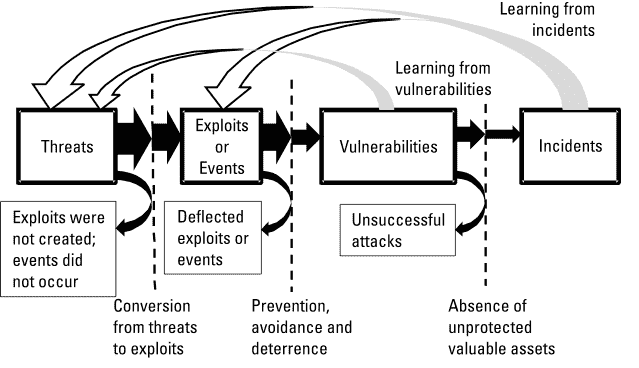

在图 6.1 中，利用被显示为威胁意图的功能性实现——这通常是一段恶意计算机代码（通称为`恶意软件`），它作用于目标系统，目的是进行某种形式的非法、欺诈或其他破坏性活动。也就是说，根据定义的威胁本身并不危险——它是可能导致以利用程序形式出现危险产品的活动先兆。

威胁也可以被解释为通向潜在事件的第一步，这种事件可能是故意的，也可能是无意的，但很可能会损害或破坏系统。例如，始终存在软件包含错误或漏洞的威胁，这些错误可能导致故障或失败，或者操作失误可能导致损害。存在非计划和非预期的利用会导致事件，例如电路元件烧毁，这可能导致系统故障。这意味着只有（可能）一小部分威胁会转化为利用程序，而当人们考虑到所有利用程序中只有极小一部分由创建者发布并成功攻击了其目标时，比例就更低了。此外，对于软件系统，开发者、操作员或其他个体的错误所产生的影响，可能通过在系统中使用具有自愈、故障安全和/或冗余技术来降低系统韧性，从而进行设计，正如 Axelrod [12] 所述。

虽然人们可能会说这种方法利用了 Borg 的威胁定义（因为我们最终得到特定安全事件或事故发生的聚合概率），但通过使用图 6.1 所示的更多步骤的模型，我们对该过程有了更深入的见解，并且对成功攻击概率有了更准确的估计，特别是如果我们把该方法扩展到包含对时间依赖性（或动态）以及利益相关者人类行为的考虑，正如在本章后面的部分所述的那样。此外，不同类型风险（或由不同个人或小组评估的相同风险）的组合或聚合并不是简单的，特别是当包含通常比单点值更合适但更难收集的概率分布时。

许多风险评估方法只需要对由于事件导致的损失进行点值估算。然而，这些因素用概率分布的形式表述会更准确。例如，损失可能服从正态分布或对数正态概率分布，均值为 `μ`，标准差为 `σ`。对于评估者来说，得出一个点值已经足够困难了，但对于那些进行估算的人来说，提供特定变量的分布要求高得多。此外，虽然变量的点值估计在不同个人之间会有差异，但对这些值的概率分布的需求将显著增加数据收集过程，且此类请求的结果在协调、分析和聚合方面要困难得多。

通常，我们必须在更真实的模型、收集和分析更复杂数据的成本，以及更详细的模型对决策的影响之间进行权衡。如果增加这一层复杂性不能改进决策，那么要求概率分布可能是不值得的。然而，如果预计决策将有显著改进，并且更复杂的方法可能导致更好的决策（其中“更好”意味着显著降低风险），那么投入额外的精力可能是有意义的。

## 威胁风险建模

在涉及威胁建模或威胁风险建模的定义时，存在一些分歧，可能存在相当大的误解。从图 6.1 所示的模型来看，大多数情况下建模的是利用程序而非威胁，因为作者提供了已实现为攻击或利用的特定威胁实例，但仍然将它们称为威胁。这种术语的混淆贯穿了整个威胁建模。也许一个更有意义的术语是“利用风险建模”。

威胁风险建模基本上是开发一些模型，这些模型可以用于预测针对软件系统漏洞的各种利用程序范围、如果采取预防性措施将受到的可能影响，以及在采取各种保护和规避措施后预期的影响。下面描述的过程为如何执行威胁风险分析提供了良好的背景，但它们不能保证所有的潜在利用程序和现有漏洞都会被考虑在内，特别是在针对关键任务软件系统的攻击与防御这一极具动态的世界中。执行此类风险分析既需要了解不断变化和加强的威胁环境，也需要对软件系统的组件（应用程序、系统软件、固件、硬件、交互）有详细的了解。由于很少有人能拥有如此广泛的知识（除了最小的软件系统外），有必要聚集领域专家（通常包括来自第三方服务供应商和供应商的专家），来解决当组织中典型的大型复杂软件系统的威胁、漏洞和缓解策略。

McGraw [13] 声称微软员工在说“威胁建模”时，实际上是指“风险分析”，McGraw 引用了 Swiderski [14] 的话：“在建模期间，应用程序被分解为功能组件。团队通过分析所有入口来识别安全弱点。”

尽管 McGraw 认为，Howard 和 Lipner 在讨论威胁建模时包含了这一点 [11]。他们否定了威胁建模被误用的说法。为了进一步模糊问题，开放 Web 安全项目（OWASP）在描述这一活动时使用了威胁风险建模。最初，OWASP 赞同微软的方法，根据 OWASP 的说法，由以下五个步骤组成：

1. 识别安全目标
2. 审查应用程序
3. 分解应用程序
4. 识别威胁
5. 识别漏洞

Howard 和 Lipner [11] 则列出了九个步骤，即：

1. 定义使用场景
2. 构建外部依赖列表
3. 定义安全假设
4. 创建外部安全说明
5. 创建被建模应用程序的一个或多个数据流图 `DFDs`
6. 确定威胁类型
7. 识别系统威胁
8. 确定风险
9. 缓解计划

显然这两个过程之间存在相似之处，尽管微软的列表比 OWASP 的列表更全面。威胁建模过程中最有趣的方面（与我们的讨论相关）是 Howard 和 Lipner [11] 使用 `STRIDE` 缩写对威胁类型进行分类。`STRIDE` 代表以下安全风险类别：

- **冒充（Spoofing）**：用户不能假设另一个用户的属性。
- **篡改（Tampering）**：用户不能未经授权修改数据或程序代码。
- **否认（Repudiation）**：用户不能否认他们确实做过的事。
- **信息泄露（Information disclosure）**：必须防止用户泄露敏感信息。
- **拒绝服务（Denial of service）**：系统必须防御导致系统无法供授权用户访问的攻击。
- **权限提升（Elevation of privilege）**：用户不允许获得超出其许可执行范围的能力。

在上述定义中，用户可能被认为是合法的（即他们可能已经通过了验证并获得了特定软件系统的授权），他们也可能是具有恶意的外部或内部人员。然而，可以认识，合法和恶意用户经常表现出相似的使用模式，因为黑客经常伪装成真实用户，即身份冒充。此外，访问权限和权限通常超出合法用户需要的范围，因为身份和访问管理的大规模系统可能管理不善。为用户分配应用程序访问权限是一项复杂的工作，而用户群体通过内部重新分配和外部事件（如自然灾害、收购或合并）不断变化，使得这项工作变得更加复杂。

## 来自安全关键系统的威胁

当涉及到安全关键软件系统（通常是工业或军事控制系统）时，威胁来自于软件系统而非针对软件系统，正如我们之前所讨论的那样。随着控制系统日益连接到网络，特别是像互联网这样的公共网络，控制系统正面临许多许多困扰安全关键信息系统的相同安全威胁。

安全关键软件密集型系统还必须处理自身的一系列威胁和利用。即使支持控制系统的网络在物理和逻辑上都是隔离的，仍然可能通过其他媒介进入网络，例如用于 `Stuxnet` 蠕虫病毒的 `USB` 驱动器。如果 `Stuxnet` 的受害者（伊朗的一个铀处理系统）曾处于完全封闭状态，那么那种用于渗透该系统的特定方法将是不可行的。此外，如果 `Stuxnet` 病毒没有“逃逸”，它就不会在互联网上复制；它可能一直保持秘密状态。据称，该病毒是因为一个编程错误而流向世界的 [16]。

故障或失败的后果决定了实现特定认证必须实现的安全水平。在表 6.2 和表 6.3 中，我们分别展示了飞机（即航空电子设备）和汽车中控制系统及信息系统对应的各种级别 [17]。

需要注意的是，在大多数情况下，控制系统的故障和失败被认为比信息系统的故障破坏得多，因为前者可能导致人身伤害或生命损失，而后者通常只会引起不便、恼扰并可能导致资金和其他资产（即知识产权）的损失。尽管如此，信息系统失败的次级影响可能会影响物理世界。例如，金融系统的破坏可能会导致巨大的财务损失，从而对个人的生活方式或工作造成损害。例如，北爱尔兰阿尔斯特银行（Ulster Bank）2012 年 6 月下旬至 7 月下旬发生的为期一个月的计算机系统故障，给客户带来了巨大的困难，尽管所有客户将获得任何后续资金损失的补偿。

当然，故障和失败可能是安全关键系统内部的（由编程错误引起），也可能是由于对这些系统的未经授权访问以及随后的攻击而引发的。

### 表 6.2 应用于飞机认证的 RTCA/DO-178B 标准

| 系统 | 系统类型 | A 级（灾难） | B 级（危险） | C 级（主要） | D 级（轻微） | E 级（无） |
| :--- | :--- | :---: | :---: | :---: | :---: | :---: |
| 飞行控制系统 | 控制 | X | — | — | — | — |
| 驾驶舱显示与控制系统 | 控制 | X | — | — | — | — |
| 飞行管理系统 | 控制 | X | — | — | — | — |
| 刹车和地面引导系统 | 控制 | — | X | — | — | — |
| 中央化报警管理 | 信息 | — | — | X | — | — |
| 客舱管理系统 | 信息 | — | — | — | X | — |
| 机载通信系统 | 信息 | — | — | — | X | — |
| 中央化维护系统 | 信息 | — | — | — | X | — |
| 娱乐系统 | 信息 | — | — | — | — | X |

### 表 6.3 应用于汽车的 IEC 61508

| 系统 | 系统类型 | SIL 3 | SIL 2 | SIL 1 | 不适用 |
| :--- | :--- | :---: | :---: | :---: | :---: |
| 线控转向 | 控制 | X | — | — | — |
| 线控制动 | 控制 | X | — | — | — |
| 发动机管理系统 | 控制 | — | X | — | — |
| 仪表盘 | 信息 | — | — | X | — |
| 车身控制器 | 信息 | — | — | X | — |
| 导航 | 信息 | — | — | — | X |
| 诊断 | 信息 | — | — | — | X |
| 娱乐系统 | 信息 | — | — | — | X |

注：`SIL` = 安全完整性等级 [18]。

## 构建安全且可靠的系统


# 信息系统故障与安全风险

信息系统故障或失败造成的破坏通常没有安全关键系统那么剧烈，因为涉及的是财务损失而非人身伤害。尽管如此，在许多情况下，安全关键系统的破坏可能会导致伤害或损害。人为错误始终是一个威胁，在确保软件系统安全可靠时必须考虑到这一点。另一方面，在许多场合，人类行为会影响结果。这可能发生在这些威胁变为现实之前，此时它们实际上变成了危险的漏洞利用程序。例如，北爱尔兰阿尔斯特银行（Ulster Bank）2012 年 6 月旬至 7 月旬发生的为期一个月的计算机系统故障，给客户带来了巨大的困难，尽管所有客户将获得任何后续资金损失的补偿。

关于现实世界漏洞利用的创建，不基于已知漏洞开发完全成熟的利用程序的原因之一可能是实施利用程序的技术不存在、不可行或正在开发中但尚未可用。另一个威胁没有转化为利用程序的原因可能是开发一个利用程序可能过于复杂或成本过高。在某些情况下，黑客可能认为从潜在收益中获得的利益不值得投入精力、费用或个人风险。在其他情况下，虽然存在利用程序，开发者可能决定不发布，而是出售给想要它的特定买家。

## 创建利用程序与遭受事件

许多现有的和潜在威胁无法或不会转化为利用程序。相反，许多事件是自发发生的，或者是由于人为错误导致的。

许多利用（程序）是无意的（由于软件错误、操作失误或自然灾害引起，后者主要发生在物理领域）。人为错误始终是一个威胁，在确保软件系统安全可靠时必须考虑到这一点。另一方面，在许多场合，人类行为会影响结果。这可能发生在这些威胁变为现实之前，此时它们实际上变成了危险的漏洞利用程序。例如，北爱尔兰阿尔斯特银行（Ulster Bank）2012 年 6 月旬至 7 月旬发生的为期一个月的计算机系统故障，给客户带来了巨大的困难，尽管所有客户将获得任何后续资金损失的补偿。

在图 6.2 中，我们阐明了可能发生在安全关键系统的攻击类型（如外部/内部、无意/意外）以及故障可能导致的后果。

![img/af73e4d28511f33fd6e8044829ee6dc_139_0.png]

图 6.2 威胁、利用程序以及系统破坏和失败的后果。

控制系统。如果系统由于错误或攻击而异常，或者发生了自然灾害，操作人员可以关闭系统、切换到备份并采取其他缓解措施。

## 系统安全与风险

### 内部和外部威胁与利用程序

软件密集型系统

故障、误用或失败的后果

意料之外且未经授权的事件经常发生。它们可能源于程序错误，或者软件系统的安装和使用方式。错误可能出现在开发周期的任何阶段，包括发布、安装和运行期间。Howard 和 Lipner [11] 根据缺陷引入的时间和发现的时间提出了修复错误的成本估算，如表 6.4 所示，该表源自 Steve McConnell [19] 的一本书。McConnell 从其他八个来源得出了该表。

其中某些相对成本可能是不一致的。例如，人们可能认为，在需求阶段引入并在测试阶段发现的缺陷的修复成本将高于在架构阶段引入并在测试阶段发现的缺陷，甚至高于在构建阶段引入并在测试阶段发现的缺陷。同样，可以预计一旦软件进入生产阶段，修复缺陷的成本，在取值范围上，修复需求阶段引入的缺陷将高于修复架构阶段引入的缺陷。尽管存在这些异常，但统计数据清楚地表明，通常情况下，缺陷引入得越早、发现得越晚，修复成本就越高。

修复成本矩阵对组织是否决定承担已知漏洞的代价，或投入精力修复缺陷/漏洞以防止攻击成功具有重大影响。显然，由于生命周期早期引入但直到后期才识别出的缺陷其修复成本要大得多，除非预计损失非常巨大，否则在生命周期后期才进行修复的可能性就较小。在其他情况下，公司似乎愿意承担被认为是可控的且业务成本的损失 [20]。有时，如果可行的话，替换一个软件密集型系统比尝试修复它更有价值，尽管组织往往过于频繁地选择把钱浪费在刀刃上，并尽可能让旧系统运行得久久。在 IBM OS/360 操作系统生命周期的某个点，人们发现尝试修复缺陷实际上引入的 Bug 比修复的还要多，这表明投入修复已不再值得，完全重写是合理的 [21]。

### 表 6.4 SDLC（软件开发生命周期）各阶段修复缺陷的相对成本

| 引入缺陷的阶段 | 发现缺陷的阶段 | | | | | |
| :--- | :--- | :--- | :--- | :--- | :--- | :--- |
| | 需求 | 架构 | 构建 | 测试 | 生产 |
| 需求 | 1 | 3 | 5–10 | 10* | 10–100* |
| 架构 | N/A | 1 | 10 | 15 | 25–100 |
| 构建 | N/A | N/A | 1 | 10 | 10–25 |

*基于对关系术语的预期，值不一致。

# 软件系统安全与安全风险

当以计算机病毒或蠕虫形式存在的漏洞被开发但尚未发布时，它被认为是“动物园内”（in the zoo），而恶意软件被激活并发布则被描述为“野外”（in the wild）。只要漏洞留在动物园内，它就不会危及潜在受害者，但它的存在本身就构成了风险，因为漏洞可能会被意外发布。近期对此类担忧的一个例子是试图阻止发表一篇描述实验室开发的禽流感病毒变异株的论文。人们非常担心这种病毒会被意外释放，或者恐怖分子或其他恶人会利用该技术开发病毒供其所用 [22]。

当然，动物园中的漏洞可能实际上有效，也可能无效。其他人在早期版本的恶意软件上运行以确定其潜在效力，而不实际发布它们。一个能够访问事务级流量数据网络的安全专业人员可能能够发现漏洞的原型制作，正如 AT&T 的信息安全官 Amoroso 博士所做的那样。在其他情况下，例如臭名昭著的 Morris 虫，漏洞失控了，造成的损害比其创造者罗伯特·塔潘·Morris 预期的要得多 [23]。

## 漏洞

图 6.1 显示，某些比例的漏洞被发布到野外针对特定目标或一组目标。然而，成功的攻击取决于漏洞是否存在以及是否可被攻击者访问或利用。McGraw [13] 将漏洞定义为“攻击者可以利用的错误”。McGraw 继续指出，漏洞产生于缺陷，这些缺陷在实现层面被称为 Bug，在设计层面被称为缺陷（flaws）。但需要注意的是，软件可能很少甚至没有缺陷，但仍然可能受到破坏。例如，El Felton 教授及其团队发现，通过冷却内存芯片，数据在芯片断电后仍被保留，使得研究人员能够在信息消失之前从芯片中提取信息 [24]。这个例子强调了背景的重要性。仅仅构建能够证明没有缺陷的应用产品是不够的；软件系统需要免受针对操作系统以及其可能驻留逻辑和物理平台的攻击。

当然，在许多情况下，已知漏洞是可以修复的，通常是通过安装由软件制造商发行的补丁。然而，有许多漏洞没有补丁可用或补丁未知，可能是因为关于它们的信息受限或已卖给了出价最高者。

## 工程构建安全的软件系统

因为信息受限或已卖给了出价最高者。尽管如此，考虑到存在可以针对漏洞的利用，黑客很有可能尝试利用漏洞攻击不受保护的软件系统，并成功获得未经授权的访问、向系统中插入恶意软件、复制敏感数据、修改程序等。然而，还有最后一道防线，即入侵者——无论是人、应用程序还是事务——没有发现任何有价值可以窃取或监控的东西。这是规避（avoidance）的一个例子。

# 软件系统安全与安全风险

- 对应用程序安全性进行定期的独立保证；
- 管理层负责确保应用程序在获取阶段（即 RFI 和 RFP 中）及此后的安全性；
- 通过第三方审计和针对高风险应用的，证明供应商遵循了良好的实务做法并经过了验证；
- 通过漏洞识别和修复流程对所购应用程序提供支持；
- 确保所购和合同规定的应用程序处于银行的持续测试流程之中。

对于内部开发的应用程序，OCC 公报 2008-16 建议银行需要在其全企业范围内的工作中包含以下内容：

- 纳入适当的攻击模型；
- 分析应用程序的环境；
- 确保开源应用程序受到适当的开发和保证流程；
- 确保人员经过培训并意识到 IT 环境中的风险；
- 通过定期的应用程序测试或验证，确保交易和客户数据得到适当保护。

虽然这些考虑因素主要针对美国银行，但应该是通用的。

## 主观性 vs 客观性。个人风险

名为“风险管理不当——评分对比蒙特卡洛模拟对比评分”的专栏引发了关于主观风险态势与个人风险态势差异的讨论 [26]。Douglas Hubbard 对该专栏的回应引发了关于主观风险评估与个人风险评估区别的讨论。观点认为，“主观”一词是指个人对与他人或某事相关的风险的个人主义观点，这种观点可能可能不会导致评估风险的人改变其行为和活动。另一方面，个人风险评估是指决策对做出风险评估的人以及后续决策所产生的直接影响。

## 风险的个性化

某人赋予特定风险的价值通常是非常个人化的。正如 Jones [27] 指出的：“……风险承受能力对每个人都是独一无二的。”也就是说，个人评估风险在很大程度上取决于他们可能如何受到特定不利或有利事件及其结果的个人层面的影响。Jones 等人承认风险是个人的或个体的，但他们并没有建议如何处理整个风险管理中这个最重要、最不被理解且最少被考虑的因素。风险评估值应该根据通常引入的个人和主观偏见进行调整。这是一个待研究领域，不能简单地承认其存在就置而不会。很有可能一种类似于 Hubbard 在 [28] 中提出的用于获取影响和发生概率估计的访谈方法，可以应用于风险因素估计的个性化和主观性问题。

这并不是说决策者没有考虑到事件对他人的负面或正面影响。正如之前提到的，保险公司的精算师可能会以客观的方式确定事件概率和产生的潜在损失，并为雇主提供特定损失风险的承保依据以及确定保费金额的依据。另一方面，该个人将根据其对发生此类风险概率的个人观点以及精算师个人可能受到影响的程度，来决定买不买保单；精算师的风险评估不太可能是绝对客观的。精算师可能会表现出与需要保守相关的偏见，以防保险公司面临过高风险，以及通过因详尽分析和准确预测获得认可以促进职业发展的愿望。此外，还会根据精算师先前的成功和失败存在某种程度的主观性。

## 数据所有权、风险偏好和风险容忍的谬误

在许多商业和政府领域，似乎如果你知道缩写词代表什么，你就被认为是特定领域的真正的专家。在风险领域似乎也是如此，如果你知道 GRC 缩写代表什么（是的，它是治理、风险[管理]和合规），那么你显然是知情者之一。然后你就能很有说服力地讨论“数据所有者”、“风险偏好”以及许多同样毫无意义的术语。在可能会惹怒许多读者的风险下，我将尝试支持这些荒谬的说法。

# 软件系统安全与安全风险

### 表 6.5 基于客观性水平对风险评估者的影响对比

| 客观 | 主观 | 个人 |
| :--- | :--- | :--- |
| **影响** | 证明采取了正确方法的能力 | 取决专业知识以及对获取和留住客户的担忧 | 取决于自我形象以及对个人损害的担忧 |
| **示例** | 精算师利用历史统计数据和天气模式、全球变暖等预测，来推算出广地理区域洪水风险的估计值 | 保险经纪人表示需要保险涵盖特定区域的洪水风险 | 保险经纪人担心自己的房子可能被淹 |

我参加过太多的会议，在这些会议上，“团队”处理了一长串数据项，并为每一项分配了“所有者”。例如“社会安全号码”或 SSN，它可能属于新开户部门主管，但该人员不太可能真正负责 SSN 的使用。通常，SSN 贯穿组织内部的许多系统，因此所有者是否理解在其他应用程序中使用 SSN 的正式审批请求背后的逻辑是怀疑的。此外，所有者不太可能完全意识到保护此类信息的法律法规要求，以及数据落入坏人之手的后果。

这使我们提问，“所有权”意味着什么？嗯，所有者（无论谁“拥有”该数据项，如社会安全号码或密码）负责确保该项的安全性和完整性，确保它仅在知情范围内可用，确保无论是在传输中还是静态状态下都得到适当保护，并且它不再具有任何用途。也很常见新功能以及长期功能被黑客利用以获取对系统的访问权限。

我们随后有了风险偏好（也称为风险容忍）。也很常见新功能以及长期功能被黑客利用以获取对系统的访问权限。

## 安全可靠系统的工程

对于引入新功能，始终存在新功能产生意外后果的风险，或者与其他应用程序以及软件密集型和数据密集型系统相结合时，某个功能或多个功能将提供意之外的能力。当前的一个例子是促进许多活动但也收集大量个人数据的应用程序的泛滥。这些数据，特别是当与其他来源的数据相结合时，可以揭示比他们理解到可能损害隐私的风险时愿意提供的更多的信息。Angwin [30] 对大数据的风险提供了很好的分析。Axelrod [31] 预测重点将从与数据和软件系统安全相关的问题转向隐私问题，从媒体报道的增加和专业出版物日益增长的担忧来看，这正在发生。然而，也很常见新功能以及长期功能被黑客利用以获取对系统的访问权限。

## 风险的动态性

与软件密集系统相关的风险不是静态的，它们不会根据任何规定的时间表改变。不同的风险特征响应内外部因素而改变。因此，要在这些变化发生或被发现时经常地考虑它们，最好在预测新漏洞、新功能的引入和软件新版本的发布，或业务量和组合的变化之前。

关于软件的新版本发布，早在 20 世纪 70 年代人们就意识到，随着时间的推移软件变得越来越复杂，升级过程已达到了收益递减的点。Belady 和 Lehman [32] 直接参与了 IBM OS/360 操作系统的维护和增强，他们在他们的权威文章中提出了三个关于系统动力学以及对持续努力和关注所需的“定律”。

对持续修复和改进的需求被 Belady [11] 表述为“演化动力学第一定律”：

> I. 持续变化定律。一个被使用的系统会经历持续的变化，直到被认为冻结并重建它是有效的为止。

系统会随着时间的推移而退化，并随着改变而变得越来越难以管理和日益复杂，这在“程序演化动力学第二定律”中被表达：

> II. 复杂性增加定律。随着系统的演化，其复杂性增加，除非主动做出努力来维护或降低它。

“程序演化动力学第三定律”反映了系统及其开发和维护过程如何“受到守恒定律的限制”，表达如下：

> III. 统计平滑增长定律。全局系统属性的增长趋势在局部时间和空间上可能呈现随机性，但从统计学上看，它们是周期自我调节的，具有定义良好的长期趋势。

这些定律描述了系统的结构如何不可避免地随着时间的推移而退化，并需要投入大量努力来维持理想的操作水平。在某个点，尝试继续改进现有的软件系统可能不再划算，此时软件制造商必须决定是继续支持现有系统，还是用新系统替换它。

然而，创建替代系统也涉及风险。新软件系统在引入阶段的可靠性较低，并随着时间的推移而提高，直到发布新版本或升级，此时可靠性会再次下降。相比之下，当大型复杂系统经历重大修订时，故障和失败可能会随着时间的推移而增加，并且可能像预期的系统替换那样回到之前的故障率趋势。

## 风险的整体视角

信息安全和控制系统安全专业人士往往对其领域和职责持有较为狭隘的观点。确定风险的挑战在于让所有相关的利益相关者参与，并以某种考虑到他们对特定软件系统风险的个人和主观观点。关于软件安全和安全的绝大多数出版物由那些人员编写，他们倾向于强调广泛的技术方法，而不是特定软件密集型系统的特定功能。

投资安全和可靠性的意愿很大程度上取决于站在什么立场。这些观点在利益相关者之间存在显著差异，对其中一个或另一个的强调取决于每个利益相关者小组的相对权威，以及各个小组可能遭受的损失程度。虽然采取这种方法很困难，但产生的价值和摩擦的减少往往超过了其成本。

## 总结与结论

我们考虑了广泛的风险评估和风险管理方法，指出了某些方法的缺陷，并对其他方法表示支持。通常情况下，基于点估计（例如：高、中、低）或基数衡量（例如：1 到 10）的较简单的方法往往具有普遍代表性，而非精确衡量；这些方法的追随者往往被鼓励将结果视为比方法本身所能保证的更准确。风险应该通过发生概率概率和损失规模的概率分布估计来确定。如果这样做，风险的计算就不是简单的，而是需要使用模拟技术从独立变量（如发生概率和结果规模）的概率分布中获取随机样本，以获得因变量（即风险）的概率分布。然而，需要注意的是，这些技术的使用、输入的质量以及对结果的解释都要求比简单方法所需的水平更高的复杂程度。

分析师不仅必须采取更复杂的数学方法，还必须考虑局势的动态变化。涉及安全和可靠性时，威胁、利用和漏洞处于不断的变动之中。某些因素是技术和技术环境变化的结果，这些变化促进了通过公共网络访问软件系统，并使得那些具有技术专长但未经过安全可靠性培训、不对任何公司政策和标准负责的人能够开发被广泛使用的应用。技术的进步允许具有不同安全可靠标准的系统组合成系统系统和网络物理系统。其他影响包括不断变化的法律法规，特别是适用于个人数据保护和产品安全的法规。其他因素是内在的，组织对“内置安全”运动做出独立响应，并在不同程度上结合的安全系统开发技术。

这些因素引入的动态变化必须在风险计算中予以考虑。当前和预期的变化需要纳入风险模型，每当风险模型中包含的任何变量发生重大变化时，或者决策者认为将有影响结果的重大进展时，就需要重新运行计算。变化也可能表明模型本身需要修订，因为可能会发现它不再能准确地代表所考虑的环境。理想情况下，风险模型将针对各种场景运行，考虑事件的不同概率、不同的损失或获益等，这些结果源于对已知技术进步、市场变化（包括竞争加剧）以及更便宜的产品来源的新假设。总之，仅运行一个风险模型或一组模型然后坐等根据这些模型的结果操作是不够的。技术创新、市场变化、社会变化、竞争产品、员工偏差等都对原始结果提出了质疑，因此需要重新运行模型以考虑这些变化。结果可能是收缩、扩张、模型更改、新的联盟等。然而，意识到这些变化并做出反应，远比成为过时技术的受害者并错过商业机会要好得多。

此外，风险模型的输入和结果的解释往往受到个人观点的影响。即使风险评估人员尽可能保持客观，个人偏见也会渗透进来。例如，如果一个专业安全工程师正在估计一个他不负责的控制系统的风险，该工程师会想要保护自己的声誉；因为声誉会影响对自我的看法，并影响未来的工作机会。因此，有必要对个人偏见进行调整，这是一项公平的任务，因为要在发生糟糕情况的情况下承担责任和义务。这方面的极端例子是公地悲剧，其中没有人对风险负责，尽管最终如果发生灾难，会有某人或某个群体付出代价。

最后，风险的观点应该是整体的。需要考虑广泛利益相关者的观点。不同利益相关者（如供应商、执法人员、监管机构、审计师、客户和用户）对软件密集型系统的安全和可靠性往往具有不同的利益。虽然获取此类观点是一项艰巨的任务，但将它们纳入风险计算则更加困难。因为必须确定应用于每个小组意见的相对权重和找到一种方法来汇总这些观点，这些观点会根据事件和经历不断变化。

总之，在对与安全关键和安全相关的软件系统进行风险分析时，有必要考虑并将所有的方法、偏见和责任纳入分析之中。如果忽略了任何一个因素，分析和由此采取的行动将出现缺陷，这只会进一步增加风险。然而，与其束手无策并完全放弃风险分析，不如识别风险并尽可能地进行分析，即使这种分析尚不完善。

## 终后注释 (Endnotes)


- [1] Gilb, T., *Principles of Software Engineering Management*, Reading, MA: Addison-Wesley, 1988.
- [2] Boehm, B., *Tutorial: Software Risk Management*, Washington, DC: IEEE Computer Society, 1998.
- [3] Boehm, B., "A Spiral Model of Software Development and Enhancement," *Computer*, Vol. 21, No. 5, May 1988, pp. 61–72.
- [4] 见 <https://greenspun.com/bboard/q-and-a-fetch-msg.tcl?msg_id=002quF>，访问于 2012年7月18日。
- [5] 见 <http://www.csonline.com/article/56963/there-s-an-app-for-that>，最后访问于 2012年7月18日。
- [6] 见 <http://www.22.verizon.com/Support/Residential/homecontrol/home+monitoring+and+control/overview/129406.html>，最后访问于 2012年7月18日。
- [7] 见 <blog://www.threatanalysis.com/blog/?p=43>，最后访问于 2012年3月23日。
- [8] Parker, D., "Making the Case for Risk-Based Security" in *Enterprise Information Security and Privacy*, C.W. Axelrod, L. J. Bayuk, and D. Schutzer, (eds.), Norwood, MA: Artech House, 2009.
- [9] Borg, S., "The Economics of Loss" in *Information Security and Privacy*, C.W. Axelrod, L. J. Bayuk, and D. Schutzer, (eds.), Norwood, MA: Artech House, 2009.
- [10] 关于 Lowe 的 "The Risk x Vulnerabilities x Impact Formula is Mathematical Nonsense"，第一部分见 <http://www.bloginfosec.com/2010/08/23/why-the-risk-threats-x-vulnerabilities-x-impact-formula-is-mathematical-nonsense/>，最后部分见 <http://www.bloginfosec.com/2010/08/31/why-the-%ec2%80%99risk-threat-x-vulnerability-x-impact%se2%80%99d-formula-is-mathematical-nonsense-part-2/>，访问于 2012年7月18日。
- [11] Howard, M., and S. Lipner., *Best Practices: The Security Development Lifecycle*, Redmond, WA: Microsoft Press, 2006.

# 软件系统安全与安全风险

- [12] Axelrod, C. W., "Investing in Software Resiliency," STSC CSC Talk: The Journal of Defense Engineering (September/October 2009), pp. 20–25. 可从 <http://www.crosstalkonline.com/storage/issue-archives/2009/200920909-Axelrod.pdf>。访问于 2012年7月18日。
- [13] McGraw, G., *Software Security: Building Security In* Boston, Boston-Wesley, 2006.
- [14] Swiderski, F., *Threat Modeling*, Redmond, WA: Microsoft Press, 2004.
- [15] <https://www.owasp.org/index.php/Threat_Risk_Modeling.>
- [16] D. E. Sanger, "Obama used up of cyberattacks against Iran," *The New York Times*, 2012. 可从 <http://www.nytimes.com/2012/06/01/world/middleleast/obama-ordered-wave-of-cyberattacks-against-iran.html?r=1&ref=cavesblogger>，访问于 2012年7月18日。
- [17] 表 6.2 和 6.3 衍生自 D. Blondin, "Would certification be mandatory in automotive engineering," ERTS Second European Congress, 2004. 可从 <http://www.xalog.fr/R/documents/blondin2004.pdf>，访问于 2012年7月18日。
- [18] <https://en.wikipedia.org/wiki/Safety_Integrity_Level>，最后访问于 2012年7月18日。
- [19] McConnell, S., *Code Complete: A Practical Handbook of Software Construction*, Second Edition, Redmond, MA: Microsoft Press, 2004. 可从 <http://jampad.net/library/codecomplete>，访问于 2012年7月18日。
- [20] 见 L. Dignan, "Global Payments hit over breach," 可从 <http://www.zdline.com>（注：此处链接不完整或失效）。
- [21] 见 Lowe, "The Risk x Vulnerabilities x Impact Formula is Mathematical Nonsense" 在 <http://www.bloginfosec.com/2010/08/23/why-the-risk-threats-x-vulnerabilities-x-impact-formula-is-mathematical-nonsense/> 第一部分。
- [22] Howard, M., and S. Lipner., *Best Practices: The Security Development Lifecycle*, Redmond, WA: Microsoft Press, 2006.

找到一种方法来汇总这些观点，这些观点会根据事件和经历不断变化。

总之，在对与安全关键和安全相关的软件系统进行风险分析时，有必要考虑并将所有的方法、偏见和责任纳入分析之中。如果忽略了任何一个因素，分析和由此采取的行动将出现缺陷，这只会进一步增加风险。然而，与其束手无策并完全放弃风险分析，不如识别风险并尽可能地进行分析，即使这种分析尚不完善。

## 终注释

- [1] Gilb, T., *Principles of Software Engineering Management*, Reading, MA: Addison-Wesley, 1988.
- [2] Boehm, B., *Tutorial: Software Risk Management*, Washington, DC: IEEE Computer Society, 1998.
- [3] Boehm, B., "A Spiral Model of Software Development and Enhancement," *Computer*, Vol. 21, No. 5, May 1988, pp. 61–72.
- [4] 见 <https://greenspun.com/bboard/q-and-a-fetch-msg.tcl?msg_id=002quF>，访问于 2012年7月18日。
- [5] 见 <http://www.csonline.com/article/56963/there-s-an-app-for-that>，最后访问于 2012年7月18日。
- [6] 见 <http://www.22.verizon.com/Support/Residential/homecontrol/home+monitoring+and+control/overview/129406.html>，最后访问于 2012年7月18日。
- [7] 见 <blog://www.threatanalysis.com/blog/?p=43>，最后访问于 2012年3月23日。
- [8] Parker, D., "Making the Case for Risk-Based Security" in *Enterprise Information Security and Privacy*, C.W. Axelrod, L. J. Bayuk, and D. Schutzer, (eds.), Norwood, MA: Artech House, 2009.
- [9] Borg, S., "The Economics of Loss" in *Information Security and Privacy*, C.W. Axelrod, L. J. Bayuk, and D. Schutzer, (eds.), Norwood, MA: Artech House, 2009.
- [10] 见 Lowe 的 "The Risk x Vulnerabilities x Impact Formula is Mathematical Nonsense" 在 <http://www.bloginfosec.com/2010/08/23/why-the-risk-threats-x-vulnerabilities-x-impact-formula-is-mathematical-nonsense/> 第一部分，以及最后部分见 <http://www.bloginfosec.com/2010/08/31/why-the-%ec2%80%99risk-threat-x-vulnerability-x-impact%se2%80%99d-formula-is-mathematical-nonsense-part-2/>，访问于 2012年7月18日。
- [11] Howard, M., and S. Lipner., *Best Practices: The Security Development Lifecycle*, Redmond, WA: Microsoft Press, 2006.

# 软件系统安全与安全风险

- [12] Axelrod, C. W., "Investing in Software Resiliency," STSC CSC Talk: The Journal of Defense Engineering (September/October 2009), pp. 20–25. 可从 <http://www.crosstalkonline.com/storage/issue-archives/2009/200920909-Axelrod.pdf>。访问于 2012年7月18日。
- [13] McGraw, G., *Software Security: Building Security In* Boston, Boston-Wesley, 2006.
- [14] Swiderski, F., *Threat Modeling*, Redmond, WA: Microsoft Press, 2004.
- [15] <https://www.owasp.org/index.php/Threat_Risk_Modeling.>
- [16] D. E. Sanger, "Obama used up of cyberattacks against Iran," *The New York Times*, 2012. 可从 <http://www.nytimes.com/2012/06/01/world/middleleast/obama-ordered-wave-of-cyberattacks-against-iran.html?r=1&ref=cavesblogger>，访问于 2012年7月18日。


- [17] 表 6.2 和 6.3 衍生自 D. Blondin, "Would certification be mandatory in automotive engineering," ERTS Second European Congress, 2004. 可从 [http://www.xalog.fr/R/documents/blondin2004.pdf](http://www.xalog.fr/R/documents/blondin2004.pdf)，访问于 2012年7月18日。

- [18] [https://en.wikipedia.org/wiki/Safety_Integrity_Level](https://en.wikipedia.org/wiki/Safety_Integrity_Level)，最后访问于 2012年7月18日。

- [19] McConnell, S., *Code Complete: A Practical Handbook of Software Construction*, Second Edition, Redmond, MA: Microsoft Press, 2004. 可从 [http://jampad.net/library/codecomplete](http://jampad.net/library/codecomplete)，访问于 2012年7月18日。

- [20] 见 L. Dignan, "Global Payments hit over breach," 可从 [http://www.zdline.com](http://www.zdline.com)。

- [21] 见 Lowe, "The Risk x Vulnerabilities x Impact Formula is Mathematical Nonsense" 在 [http://www.bloginfosec.com/2010/08/23/why-the-risk-threats-x-vulnerabilities-x-impact-formula-is-mathematical-nonsense/](http://www.bloginfosec.com/2010/08/23/why-the-risk-threats-x-vulnerabilities-x-impact-formula-is-mathematical-nonsense/) 第一部分。

- [22] Howard, M., and S. Lipner., *Best Practices: The Security Development Lifecycle*, Redmond, WA: Microsoft Press, 2006.

# 软件系统安全与可靠指标

## 获取有意义的数据

20 世纪 70 年代，IBM 在广告中使用了“不只是数据，更是现实”。这一口号在收集和分析软件安全与可靠数据时具有特别的洞察力。收集无关或无关的数据是没用的，即使收集此类数据的成本几乎为零（但可能仍有大量的数据管理和存储成本来吸收）；同样，如果没有办法实施任何可能由这些数据产生的决策，那么即使收集特别相关的数据也没有益处。在决定在获取特定数据上花费多少资金时，通常需要考虑权衡，因为此类数据收集可能会出现收益递减，特别是随着时间的推移。例如，在系统被成功攻击后才发现其受到特定漏洞的影响，这比提前获得此类信息并应用补丁以消除攻击影响要困难得多。此外，必须考虑到将数据转换为指标的“现实”所需的成本和时间；仅仅快速收集信息是不够的——它必须及时转换为有用的可操作信息。

## 定义指标

*Metrics*（指标）一词有许多定义。以下是其中几种：

- “指标是设计用于通过对相关……数据的收集、分析和报告来促进决策并提高性能和问责制的工具” [8]。

- “指标报告了政策、流程和控制措施运行得如何，以及是否实现了预期的性能结果……” [9]

- “指标是对系统、组件或过程具有给定属性的程度的量化测量” [10]。

这些定义中的一个共同主题是，指标的目的是决定如何执行政策以及管理流程和程序。仅仅指标在智力上很有趣是不够的。也不应该在不对对其含义（特别是关于因果关系）进行思考的情况下，就从表面上接受指标和分析结果。近期分析工作似乎出现了激增，特别是在健康和营养领域，这些分析发现的关系并不一定具有因果关系基础。在许多此类情况下，研究人员通常会包含一个免责声明，说明结果并不意味着因果关系。这引发了一个问题：分析的价值究竟是什么，因为研究人员似乎在暗示公众不应对结果做出反应。这让人们质疑研究人员为什么要发布这些发现。此外，在某些情况下，分析结果可能会导致决策者做出错误且具有潜在损害性的决策和行动。在系统安全与可靠领域也存在类似的情况，发布了许多指标，但它们无法用于防御攻击、防止系统造成损害等。

不幸的是，许多报告的与信息安全的指标并不好用。例如，了解病毒和其他恶意软件在数量和效能上呈指数级增长很有趣。然而，决策者需要知道这些相同的病毒（例如）是否对其负责的领域产生任何影响。如果没有影响，那么指标就是不可操作的，因此也就没用。事实上，由于收集、报告和讨论这些指标的成本，它们可能是有反作用的。

Andrew Jaquith [11] 将指标定义为“一种一致的测量标准”。他认为一个好的指标应该是：

- 测量一致的；
- 收集廉价的；
- 表示为基数或百分比；
- 使用至少一个测量单位进行测量。

此前曾认为“收集廉价”不一定是指标的好标准，因此这一要求是值得怀疑的。此外，使用基数和百分比指标具有误导性，因为它们包含的信息通常太少，无法进行有效的决策。特别是脱离了语境的数值指标，例如：“我们上个月应用了 200 个补丁”，无法说明什么程度的补丁是合适的。百分比指标，例如：“我们上个月修补了 90% 的服务器”，并没有指示服务器（特别是那些未修补的服务器）可能有多重要。通常，需要一些解释来使这些指标更有意义，例如：“那未修补的 10% 的服务器被认为对安全操作最不重要。”

作为一个误导性指标的真实世界示例，考虑一个实际案例：全盘加密已应用于公司 95% 的笔记本电脑，目标是在员工将剩余机器送来维修时对它们进行加密。然而，剩余 5% 设备中的其中一台未加密磁盘的电脑被盗了。这台特定的笔记本电脑存有数十万名客户的个人信息。公司面临的直接成本可能超过了一百万美元，间接和不具性的成本可能会使该金额翻倍。95% 的完成率这一指标在很多情况下可能被认为是好的——但在这种情况下不是。

## 区分指标与测量值

测量值（measure）与指标（metric）之间的差别在许多地方都有表达和说明。例如，在《风险测量与风险指标》中，我们读到以下内容 [12]：

- 测量是对事物分配数字的操作。
- 指标是我们对分配数字的解释。

例如，如果有人站在体重计上，记录盘上磅数（或公斤）数字的过程是一个`测量`过程，而对该数字进行解释以确定某人肥胖，则变成了一个可以用于决策的`指标`，例如决定减肥。

这与上述提出的区分大体一致；获取测量值本身不是指标——只有当指标可以用于决策时它才是指标。这一概念在图 7.1 中所示。该图通过变窄箭头显示，随着过程的进行会有损失。也就是说，决策者可能会使用指标的子集来决策，而不是全部。例如，人们可以获取地球上任何地方的天气预报。然而，只有当温度归属于决策者所在地或其计划前往的特定地理区域时，它才有用。决策者可能会决定穿并携带一套合适的衣物。决策者和执行者可以是同一个人，就像天气例子那样。但在许多组织中，决策的人和执行的人往往是不同的个人或群体。

另一个区分测量值和指标的来源是美国国家标准与技术研究院的软件保障指标与工具评估（NIST SAMATE）项目 [13]，它给出了以下定义：


- 测量值（measure）一词用于更具体或客观的属性。
- 指标（metric）一词用于更抽象、更高层次或某种主观的属性。

NIST 网站提供的一个示例是：计算机程序中的代码行数是一个测量值，而代码的稳健性、质量和效能被认为是指标。这与《风险术语表》[14] 的定义基本一致，如果将体重计上的磅数视为具体客观的，而将重量的概念用作更抽象的。事实上，重量（weight）一词经常被误用；应该考虑重量与质量（mass）之间的差异；其中“质量是对物体所含量的测量”，而“重量是重力对物体拉力的测量”。因此，需要在特定的语境下定义重量，因为由于月球引力较小，相同的人在月球上的重量是地球上的六倍。这是软件系统的一个重要方面，指标通常只适用于特定的语境，例如操作系统、平台、网络配置等。

Munson [15] 对测量的另一个定义是：

# 软件系统安全与可靠指标

……根据某些预设规则将数字映射到对象的属性……这种映射必须保留对属性和实体的直观和经验观察。

在为测量分配“具体”和“客观”等描述符方面，Munson 没有 NIST 那样具体。然而，人们可能会认为，他对测量的定义更为通用，可以同时适用于测量（measures）和指标（metrics），因为客观属性和主观属性（分别对应测量和指标）都属于某种形式的测量。

随之产生的问题是，定性测量是否同时适用于测量和指标。毕竟，根据 NIST 的说法，区别在于属性的客观性或主观性，而不是获取它们的手段。为了回答这个问题，我们参考了 Crickshank [16]，他指出：

- 经验观察需要实验。因此……对于一个软件规则要有效，它必须基于通过实验获得的经验观察，无论是定性的还是定量的。

因此，我们应该理解，测量和指标可以是定量的也可以是定性的，在哪种情况下，它们都能在没有具体测量或指标的情况下提供软件系统运行情况的更好图景。在表 7.1 中，我们展示了它们之间关系的示例。

## 表 7.1 汽车指标与测量属性示例

| 属性 | 定量测量 | 定性测量 |
|---|---|---|
| 测量（客观） | 速度表上显示的汽车速度（每小时英里 mph）。 | 车辆从静止行驶到 60 mph 所需相对时间（例如：速度、平均速度、快）。 |
| 与测量相关的决策 | 车辆是否在数字速度限制内行驶，例如每小时 55 英里？ | 汽车的加速是否足够满足我的需求（和想要）？例如，我能否从静止状态起跑超过同事的车。 |
| 与测量相关的行动 | 如果是，则不需要采取行动。如果不是，减慢车辆直到其速度低于限速。 | 根据相对加速度选择主要因素或高度显著的因素。 |
| 指标（主观） | 转速表上每分钟转数（rpm）。 | 排气系统的声音。 |
| 与指标相关的决策 | 什么时候应该改变？ | 声音是否产生了理想的情感感受？ |
| 与指标相关的行动 | 在特定的每分钟转数限制（例如 2,000 rpm）下升档或降档。 | 选择一辆排气系统声音产生理想感受的车辆，或将现有的排气系统更换为产生理想声音的系统。 |
| 用途 | 测量 | 指标 | 备注 |
|---|---|---|---|
| 通用效用 | 测量缺乏上下文，不具备促进决策和行动所需的属性。 | 某些对于适当的决策是不充分——需要将上下文和其他因素作为价值和不确定性包含进来。 | 对指标过度主观解释的担忧。 |
| 用于决策 | 测量对决策通常不是特别有用。 | 某些指标无法进行有效决策，但另一些可能极具误导性。 | 通常，对决策最有用的指标是那些成本更高、更难收集的。 |
| 可操作性 | 通常，无法直接从测量中得出结论。 | 在许多情况下，指标可以作为决策和行动的依据；有时则。 | 采取有效行动的能力取决于许多因素，其中某些可能不在测量者或决策者的控制范围内。 |

# 软件系统安全与可靠指标

与上述指标不同。事实上，这个定义并不要求指标作为决策的输入，且决策必须是可操作的。如果不可操作，那么一个“属性就变成了测量，而不是指标”。另一方面，根据普遍观点，并非所有指标都是可操作的，尽管如果它们导致积极的行动会更好。

Cruickshank [16] 得出了以下结论，其中包含了软件指标中非数值型指标的支持：

软件指标是对……产品（系统或组件）、过程或事件……的定量测量……指示了所需属性的质量。然而，软件指标关注的不仅是定量测量。由于我们正在衡量产品、过程的质量，因此必须考虑定性方面。指标在本质上也可以是定性的[强调内容]。

另一方面，McGraw [18] 对测量和指标的数值表示法认为，“它们是分配给给定人工构件、软件产品或过程的数值”，并且……“[一]指标是两个或多个测量的结合，共同提供了某些与业务相关的意义。”McGraw 提供了一个指标的示例，即“每行代码的违规次数”，它代表了“安全缺陷密度”，而“违规次数”本身则被他定义为一种测量。McGraw [18] 呼应了 Cruickshank 的断言 [16]，即可以获得项目、过程和产品的指标，并增加了第四个领域——即组织。他还指出，过程和控制必须在开发生命周期早期引入，尽管我们将从产生指标的应用程序（或产品）角度来讨论方法，而不是关注过程和控制。

值得注意的是，安全和可靠专业人士倾向于对其责任领域有非常具体的看法，并辅之内在的对量化指标的需求。这些特征导致了对定量测量的强有力偏好，即具体、客观测量的数值值。问题在于，软件密集型系统远不适用于精确测量的应用。这意味着将软件测量转换为用于决策和行动的指标的练习往往是缺失的。结果是往往根据不充分且具有误导性的指标做出了错误的决策并采取了不当的行动。由于对定量测量和非常具体的决策的关注是文化的一部分，研究人员和从业者可能需要很长时间才能发展出更广泛的观点。

## 指标的测量与报告

在测量与相关的指标时，有多种优劣方法。Axor [7] 建议的一种特定分类法见表 7.3。

## 表 7.3 指标类别与回答描述

| 指标类别 | 回答描述 |
|---|---|
| 存在 | “是”、“否”或“不适用 (N/A)” |
| 序数 | 通常为“高”、“中”或“低” |
| 评分 | 在比例范围内，例如“一到十” |
| 基数 | 回答“有多少……？”的数字 |
| 百分 | 回答“百分之多少……？”的数字 |
| 整体 | 来自权威来源的更完整的视图 |
| 价值 | 通常，对于不同方法的价值总损失 |
| 不确定性 | 随机或概率方法 |

上述指标类别的优缺点见表 7.4。

此类指标的权重很大程度上取决于收集数据的性质。通常，外部顾问在利用有用数据和进行客观分析方面会成功。

图显示了随着指标复杂性的增加，成本估值的变化。通常，随着数据收集和分析变得复杂，成本将会增加，预计与决策相关的价值增长更大。尽管图显示价值相对于成本在增长，但随着模型变得越来越复杂，价值并不一定跟上成本。在某些，这是因为在考虑价值和不确定性时，收益并不明显。

图指示了具有上限和下限的价值成本范围。由于曲线的存在，曲线表明在任何复杂性水平上，该练习的净价值（即指标类别对决策的效用减去数据收集和分析的成本）实际上可能是负的。随着方法复杂性的增加，由风险经理和/或分析师来获得净价值的最优方法。

（注：由于原文未提供表 7.4 内容，此处未翻译该表格内容）

## 表 7.4 各种类别指标的优缺点

| 指标类别 | 优点 | 缺点 |
|---|---|---|
| 存在（是、否、N/A） | 易于收集；响应者几乎不需要思考；为确定某些区域是否需要更详细的探索提供了初步判断 | 为响应者留下了误解问题的空间（无论是无意还是故意的）；可能提供错误的答案；“否”表示存在问题，“是”和“N/A”并不确保合规；可能未考虑上下文背景 |
| 序数（低、中、高） | 数据易于收集和分析；响应者不需要花费太多工作；提供了高层次评估，可能无法指出需要更详细说明的具体问题 | 答案具有高度主观性，无法在不同响应者之间进行比较；通过回答问题，风险较低，但响应者的高度主观性占了很大一部分；可能未考虑上下文背景 |
| 评分（例如 1 到 10） | 响应者分配数字较为容易；数据易于收集和分析；相对于上述增加了细粒度 | 需要响应者尝试确定量表；答案可能高度主观，并带有有利于响应者的强烈偏差；通过任意分配数字对问题进行求和和平均可能会产生误导；可能未考虑上下文背景 |
| 基数（多少……？） | 通常易于收集数据；易于分析；允许任何级别的细粒度；较容易应用 | 可能不知道群体规模；不一定考虑上下文；分析无法揭示被测量群体（如质量）相对于其他群体的显著性；可能未考虑上下文背景 |
| 百分比（百分之几……？） | 可以考虑各种级别的细粒度；已知被测量群体 | |
| 整体（全方位） | | 难以定义完整且相对完整的测量集；难以收集客观数据，因为响应者可能跨越组织部门；通常难以对其进行比较和聚合 |

## 表 7.4（续表）

| 指标类别 | 优点 | 缺点 |
|---|---|---|
| 价值（价值损失） | 价值，特别是净价值（价值减去成本），比从其他方法获得的残余风险更具真实性；包含了更广泛的响应者和决策者；表示不确定性比使用点估计要真实得多；要求响应者对决策后果进行更深层次思考 | 由于价值估计具有高度主观性，价值可能难以比较和聚合；难以定义用于收集的完整测量集；难以收集客观数据，因为响应者可能跨越组织部门；要求响应者理解概率分布和基础统计方法；由于概率估计具有高度主观性，计算时的结果可能是聚合的（而非离散分布）；难以收集客观数据，因为响应者可能跨越组织部门 |
| 不确定性（随机或概率方法） | | 要求响应者理解概率分布和基础统计方法；由于概率估计具有高度主观性，计算时的结果可能是聚合的（而非离散分布）；难以收集客观数据，因为响应者可能跨越组织部门 |


在图 7.2 中，成本曲线和价值曲线的范围通常随着复杂性的增加而增加，这表明越复杂的方法伴随着更高的不确定性。当方法变得越来越复杂时，数据采集和分析过程的质量也存在相当的不确定性。显然，收集和分析序数数据所需的专业水平并不与收集和分析随机或概率相关数据相同。正如 Hubbard [6] 正确指出的，响应者需要接受如何评估概率状况的培训，分析师必须具备统计学实际应用的背景。

## 满足需求的指标

需求可以分为功能性或非功能性；根据 Braude [19] 的定义，这些术语定义如下：

# 安全软件系统工程

- 功能性需求（或行为需求）规定应用程序必须提供的服务。
- 非功能性需求包括所有不被认为属于功能性类的需求。


当然，许多人指出后一个术语可以解释为“不起作用的需求”，但这在系统工程中并不是这样理解的。通常将安全性和安全性等属性归为非功能性需求的做法，导致除了最任务关键的系统外，其他系统都缺乏足够的关注。

本书的一个主要部分（在其他书中经常被忽视）是，许多所谓的“非功能性需求”也有其功能性的对应项。知识和职责的分工导致，对软件系统功能具有专业知识和责任的人通常不了解、甚至对这些系统的非功能属性感兴趣。软件系统非功能方面有许多专家，其中许多人不知道或不在乎系统的详细功能。如果不是因为功能性需求对非功能性需求有巨大影响，反之亦然，这种状态是可以接受的。

表 7.5 描述了 Braun [19] 中提到的非功能属性，以及 MISRA [20] 中的某些属性。特别是，将安全性和操作性作为重要属性忽略，是关注通用软件工程（如 de Braun [19]）和安全工程（如 Anderson [21]）书籍、论文和演示的典型。安全性通常只包含专门研究该属性的出版物，这些出版物可能会忽略对安全性的考虑，如 Herrmann [22]。

同样，在安全导向的出版物中很少提到软件功能与非功能性需求之间的关系，而安全性属性被认为是紧密关联的。在表 7.6 中，我们展示了影响应用程序安全性和可靠性的非功能需求。某些非功能属性（如安全相关的授权或加密）被写入功能中。当非功能属性被隔离时，这种做法通常是不理想的，并会导致错误。确保安全的

### 表 7.5

| 非功能属性 | 描述/用途 |
|---|---|
| 可靠性 | 决定系统在需要时是否可以按预期使用 |
| 性能 | 包括速度、吞吐量、存储容量。描述系统的响应及时性——性能不足会导致生产力下降、运营成本增加等 |
| 安全 | 信息资产免受数据泄露、服务中断、欺诈等事件的影响。CIA 组件：机密性、完整性、可用性，以及下面列出的 |
| 机密性 | 未授权主体访问——属于安全性需求 |
| 完整性 | 属于安全性需求也是安全性需求（故障） |
| 可用性和可靠性 | 影响平均运行时间——可用性属于安全性需求也是安全性需求（失效） |
| 非复制性 | 协议存在的证明——属于安全性需求 |
| 认证 | 验证用户身份——属于安全性需求 |
| 可维护性 | 增加可用性并降低故障率 |
| 可移植性 | 在最少或不修改的情况下在不同平台上运行软件的能力 |
| 错误处理 | 错误解决的速度和正确性、错误例程、自愈系统、故障安全——影响可用性 |
| 互操作性 | 跨平台应用程序访问数据的能力——影响可用性 |
| 韧性 | 错误处理、冗余系统、响应能力的结合——影响可用性，以及应用程序的可移植性和互操作性 |
| 安全性 | 软件系统故障或失效对外部人员或环境造成的损害 |
| 复杂性 | 复杂性的增加增加了包含错误的概率见上文 |
| 模块化 | 模块化越高意味着复杂性越低，错误的可能性越低 |
| 结构 | 控制、数据和信息流的良好结构有助于减少错误的可能性 |
| 可测试性 | 软件系统易于以高置信度检测错误 |
| 可靠性* | 见上文 |

> * 来自: Braude [19]。
> ¹ 来自: MISRA [20]。

软件开发生命周期 (`SSDLC`)。我们将在以后讨论开发过程时对此进行进一步探讨。在这里，我们仅仅关注许多存在的非功能属性，并指出一种不现实的期望：即认为精通软件功能的同一人员，可能也能完全理解表 7.5 中列出的所有非功能属性的完整含义。认为应用开发人员能够理解并关注某几个非功能属性，甚至可能是过于乐观的。非功能性需求没有出现在软件系统规范中，这并不奇怪。

## 风险指标

对于应该使用哪些指标，共识少得令人惊讶。对于安全关键型和安全关键型系统的风险相关指标，尤为如此。需要注意的是，在涉及安全关键系统运行的指标方面，似乎没有任何地方存在同样程度的困惑和争论，这可能是因为后者更植根于物理世界，在物理世界中，指标往往比更抽象的软件世界更容易获得和解释。Crucialshank [16] 指出，安全关键型软件系统开发过程的指标也缺失，特别是在验证过程方面。这些差异在表 7.7 中所示。

## 个体指标的考量

我们首先查看单个指标，这些指标与软件系统的安全性和安全性特别相关，然后考虑指标的并集。

### 表 7.6

各种软件功能的典型非功能性需求

| 软件功能 | 影响软件功能的非功能需求 |
| --- | --- |
| 读取 | 身份验证、授权、完整性、机密性 |
| 写入 | 身份验证、授权、完整性、机密性、不可否认 |
| 修改 | 身份验证、授权、完整性、机密性、不可否认 |
| 删除 | 身份验证、授权、不可否认 |
| 保存 | 身份验证、授权、完整性、机密性、不可否认 |
| 传输 | 身份验证、授权、完整性、性能、机密性、可用性 |
| 计算 | 身份验证、授权、完整性、性能、可用性 |
| 显示 | 身份验证、授权、完整性、机密性、可用性 |
| 打印 | 身份验证、授权、完整性、可用性、性能 |

# 软件系统安全与安全指标

### 表 7.7

对安全关键型和安全关键型软件系统的风险指标的理解

| 特性 | 安全关键型软件系统 | 安全关键型软件系统 |
|---|---|---|
| 考虑的属性 | 风险主要考虑非功能属性以及系统被攻击者破坏的可能性 | 风险主要与功能故障和失效的危险有关 |
| 风险评估与测试 | 安全风险评估和测试主要涉及平台和网络，对软件功能方面的关注较少 | 关键系统对安全标准的性的验证是严谨的，涉及系统的功能方面以及它们在发生故障或失效时可能代表的危害程度 |

适用于软件密集型系统或信息物理系统，这些系统必须同时满足安全和可靠的要求。

从历史上看，这两个领域并不相互相关。例如，如果你阅读了 Merkow [23] 关于开发安全且韧性软件的内容，以及 Hermann 关于软件安全性和可靠性的书籍 [22]，你会发现 [23] 中没有提到安全，而 [22] 中没有提到安全。同样有趣的是，专门研究安全指标的书籍很少关注应用或软件系统指标。例如，Jaquith [11] 仅对该主题花费了十几页。

我们通过查看关于安全软件开发的流行著作，并观察作者讨论指标的程度，进一步支持了这种对应用安全指标关注缺失。例如，McGraw [18] 在一页内涵盖了建立指标计划的主题，而 Howard 和 Lipner [24] 则完全忽略了措施或指标。

另一方面，安全关键系统通常不会遭受与安全关键系统相同程度的攻击，因为它们的故障率似乎非常低。而且从媒体报道来看，相对于安全关键软件系统的破解和故障，安全相关的软件故障和失效并不频繁。与软件系统相关的安全指标与安全指标大不同。这可能是由于负责安全的人员视角不同，以及他们在获取系统认证时所面临的限制。

表 7.8 提供了适用于安全关键和安全关键型软件系统的功能性和非功能指标示例。

在过去的几年里，研究人员开始在 Gurgarts [25] 中看到同时从安全和可靠角度观察软件系统的重要性。然而，从需求和指标的角度来看，关于安全与可靠融合的报道相对较少。我们将分别查看软件系统的安全和可靠需求（如表 7.9 所示），然后采取综合视角。

### 表 7.8

与安全和可靠相关的指标示例

| 指标类别 | 安全关键型系统 | 安全关键型系统 |
|---|---|---|
| 功能性 | 确定安全编码缺陷、监控应用内的用户活动 | 抵抗故障和失效的要求、确定可能产生潜在损害的限额 |
| 非功能性 | 安全可靠性、性能、韧性、可用性、质量 | 安全性能、韧性、可用性、质量 |

### 表 7.9

软件安全与可靠工程师的主要关注点

| 安全关键型软件系统 | 安全关键型系统 |
|---|---|
| 软件安全工程师 | 大部分关注在非功能系统属性上，对功能安全属性的关注较少（文献中讨论极少，见 Axelrod [26]），对上下文的关注较少 |
| 软件可靠工程师 | 重点关注各种认证机构要求的可靠属性，在一定程度上关注上下文 |

### 表 7.10

信息与控制系统的序数指标

| 指标 | 应用 1 | 应用 2 | 应用 3 | N |
| --- | --- | --- | --- | --- |
| 主要系统类型 | 信息系统 | 信息系统 | 控制系统 | 控制系统 |
| 身份验证方法 | 强 | 弱 | 强 | 弱 |
| 身份验证控制措施 | 有效 | 部分有效 | 有效 | 无效 |
| 授权方法 | 形式 | 非正式 | 形式 | 随机的 |
| 授权控制措施 | 部分有效 | 无效 | 有效 | 不存在 |
| 身份与访问管理 (IAM) 系统 | 通用产品 | 无 | 自研系统 | 无 |
| 数据流分类 | 形式 | 无 | 非正式 | 无 |
| 数据流限制 | 严格限制 | 高 | 无 | 严格限制 |
| 数据价值 | 极高 | 高 | 中等 | 低 |
| 加密程度（传输中、存储） | 仅传输 | 传输和存储 | 仅传输 | 无 |
| 安全编码知识（培训） | 中等 | 中等 | 中等 | 无 |
| 安全编码实现 | 中等 | 极少 | 高 | 高 |
| 设计与编码测试 | 中等 | 极少 | 极少 | 无 |
| 安全/可靠数据生成与收集的完整性 | 相当完整 | 极少 | 极少 | 极少或无 |
| 安全/可靠数据分析与报告的有效性 | 中等 | 极少 | 高 | 极少 |
| 对破解和故障的响应能力 | 高度响应 | 极少响应 | 部分响应 | 无响应 |
| 软件复杂度 | 非常复杂 | 相当复杂 | 相对简单 | 相当复杂 |
| 软件密集型系统的复杂度 | 非常复杂 | 简单 | 中等 | 高 |
| 上下文/环境 | 集成系统系统 | 公开 | 隔离、内部 | 公开 |
| 未经授权人员或系统的访问性 | 严格限制 | 部分限制 | 无限制 | 无限制 |
| 平台安全/可靠属性 | 高安全低可靠 | 低安全中可靠 | 低安全中可靠 | 安全中可靠 |
| 基础设施安全/可靠属性 | 高安全低可靠 | 高安全高可靠 | 中安全高可靠 | 低安全低可靠 |
| SDLC 当前阶段 | 生产 | 生产 | 测试 | 编码 |

## 软件系统的安全指标

关于安全指标以及提高应用程序安全性的流程、工具和测量方法已有大量文献。然而，大多数关注点在非功能属性上，而这些属性可能与应用程序软件的功能相关，也可能无关。

在应用程序安全指标确实存在的范围内，它们通常属于上述的基数指标或百分比指标类别。信息安全专业人员似乎非常喜欢数字，例如每周失败的攻击次数、应用了最新补丁的系统百分比等。这些都很好，但问题是这些数字通常需要脚注来解释。例如，在之前讨论笔记本电脑加密时提到的“已打补丁的服务器百分比”通常指的是所有服务器。然而，此类指标最重要的方面是是否所有所有关键服务器都打了补丁，其中“关键”通常指支持任务关键型应用程序的服务器，这些应用因为法律和监管合规性的需要而是必不可少的；因此，考虑价值和不确定性的应用程序安全指标在效性方面的价值有限。

应用程序安全指标的另一个缺陷是它们往往不考虑软件运行的上下文。这是一个严重的遗漏，因为应用程序根据其所基于的操作系统（例如）会面临不同的漏洞集。从安全和防护角度来看，应用程序是面向 Web 的还是在访问受限的内部网络上运行会产生极大影响。

我们在表 7.10 中阐明了这一点，展示了若干安全关键信息系统和安全关键控制系统的给定特征的水平（即序数值）。需要注意的是，此表仅用于说明目的；为了在实践中实际应用该方法，分析师需要获取矩阵中每个元素的更多细节，最好用价值和不确定性（概率分布）术语来表示，而不是这里显示的序数指标。

分别和结合考虑每个指标属性的影响是一项有趣且实用的练习。例如，应用程序 1 和 2 已经投入生产，因此在此阶段的任何更改都将极其昂贵。然而，由于信息价值分别被归类为应用程序 1 和 2 的极高，回过纠正某些安全和防护缺陷可能仍然具有成本效益。怀疑进行重大重工作是合理的。

## 软件系统安全与防护指标

应用程序 3 尚未投入生产，因此测试结果可以以相对适中的成本整合到系统中。应用程序 N 仅处于编码阶段，因此修改算法的成本较低，且不太可能延迟实施，尽管如果建议进行重大设计变更，可能会导致成本和精力的大幅增加并可能延迟实施。另一方面，应用程序 N 处理的信息价值相对较低，因此投资于使系统更安全可能没有意义。然而，需要注意的是，如果控制系统不包含有价值的信息，故障和失效可能会导致巨大影响。换句话说，对应用程序的未经授权访问可能导致外部力量接管系统，并迫使系统执行不适当且危险的任务。在这种情况下，防护更多地与不良后果有关，而不是对敏感个人数据和知识产权的暴露。应用程序 3 被显示为运行在低安全平台上的控制系统，但安全评级为高。这是否可以接受取决于因素的结合。

上述指标引发了关于如何加权每个属性以及如何聚合它们的问题。显然，各种属性之间的相互作用是复杂的，尽管如此，产生精确指标的能力非常有限。这项练习本身具有相当价值，因为它将凸显那些可能缺失的重要特征，并关注哪些缺陷和不足应该首先修复，或者是否应该修复。

将数值值整合到上述评估中似乎会为这项练习增加精确性，但在大多数情况下并不会。事实上，使用数值存在着一种事与其反的巨大危险。因此，我们可能会问，在一个已经在属性的主观序数衡量表示方面充满问题的情况下，应如何将价值衡量和不确定性整合进去。答案是，如果人们能够开发（例如）由于基础设施不完善或安全编码不良而可能导致的损失的概率分布，就能获得关于不修复某些缺陷所涉及风险的更有用的图景。

## 软件系统的安全指标

与安全关键密集型系统相关的指标最关注系统故障或失效的影响。此类系统的硬件组件总是会发生故障，但有成熟的方法来处理它们，通常通过更换组件等。也就是说，硬件故障的影响相对容易识别和评估，响应措施通常非常直接。例外是，如果怀疑或证明设备存在弱点或以某种方式被破坏；那么用同样有缺陷的新组件更换硬件组件就没有意义了。软件也是如此。

软件故障和失效的根源往往比硬件故障更容易识别。有时，硬件故障是由软件错误引起的，反之亦然，这会混淆对故障或失效原因判定。例如，如果电信网络中断，流量停止可能是因为设备故障、软件错误或人为错误。

考虑例如，某个办公桌电话系统反复故障并重启的实际案例。工程师花费了大量时间才确定了问题。显然，在纯净的实验室环境中，没有电缆产生的噪声，因为电缆布线短且安装精细。在现场，由于耦合不完美，软件系统不断调用一个从未在实验室测试过的恢复程序。结果确定恢复程序中存在编码错误，该错误是由电缆信号丢失和噪声触发的，导致了整个系统的故障。

作为另一个例子，最近关于保护日益暴露在公共网络上的工业控制系统的写作已有相当多。许多文章、国会听证会等等（如智能电网的安全）属于这一类。然而，关于试图调和安全工程师与安全工程师对系统要求的观点之间重大差异的发表物仍然较少，而这是这些系统系统和信息物理系统开发过程中的基本缺陷。

# 软件系统安全与可靠指标

安排创建、收集和分析产生有意义指标所需的数据。所得风险分析可用于确定在攻击或数据泄露发生前和之后需要采取哪些行动。

这项工作并非易事，因为对于风险识别、评估和管理最有用的指标通常比价值较低的指标更难收集和解释。对指标进行后处理以获得聚合值也是一项挑战。通常，受访者需要接受如何回答问卷的培训，分析师则需要理解威胁、利用和漏洞的后果，并能够在足够的时间内产生结果和建议以采取缓解措施。

似乎，适用于安全关键型软件系统的指标对于可靠关键型软件系统并不特别好用，反之亦然。然而，有必要在安全与可靠性孤岛之间交换方法和程序，特别是目前的趋势是将安全关键型和可靠关键型系统结合成复杂的系统之系统和信息物理系统，这些系统必须展示出保持强安全态势的能力，同时表现出可靠特性。

这里的基本建议是理解各种类型测量和指标的优缺点，以便确定收集哪些最佳数据，以进行能够引导适当缓解措施的风险分析。

## 注释

- [1] 参见 `http://quoteinvest.com/2010/05/26/everything-counts-einstein/`，访问于2012年7月20日。
- [2] 参见 `http://zapatopi.com/kelvin/quotis`，访问于2012年7月20日。
- [3] Goodman, S. P., “Emphasis on Growth is Called Misguided., The New York Times, 2009. 可于 `http://query.nytimes.com/gst/fullpage.html?res=B902EED7143EF93A1575ACO69F9C863`，访问于2012年7月20日。
- [4] Kornecki, A. J., “Assessment of Software via Catastrophic Events Coverage., 可于 `http://www.google.com/url?sa=3&ct=search&q=kornecki%20safety%20catastrophic-source=web&cd=3xe6-B0CDMGY4JA&C&url=http%3A%2F%2Fciteciteser.psu.edu%2Fviewdoc%2Fdownload%3D3%3D10.1.1.1457%26rep%3Drep1%26ty%3Dpdfei=VtrG6OI46qGKyIPBAug=AFQJCNHBxxKaLDaM8Xls7w_GYLtwgwQ`，访问于2012年7月20日。
- [5] Robinson, G., “Seven Months About Information Security Metrics,” ISSA Journal, Vol. 4, No. 7, July 2006.
- [6] Hubbard, D. W., How to Measure Analytics: Finding the Value of Intangibles in Business, Second Edition, Hoboken, NJ: John Wiley and Sons, 2010.


- [7] Axelrod, C. W., "Accounting for Value and Uncertainty in Security Metrics," ISACA Journal, Vol. 6, 2008. 可于 `http://www.isaca.org/Journal/Post-Issues/2008/Volume-6/Pages/Accounting-for-Value-and-Uncertainty-in-Security-Metrics1.aspx`。访问于2012年7月19日。

- [8] Swanson, M., et al, Security Guide for Information Technology Systems, NIST Publication 800-55, National Institute of Standards and Technology, 2005, p. 9.

- [9] Government Reform Committee, U.S. House of Representative, Corporate Information Security Working Group–Report of the Best Practices and Metrics Team, November 2004. 可于 `http://net.educause.edu/library/pdf/CSD3661.pdf`。访问于2012年7月19日。

- [10] IEEE Standard 601.12-1990, IEEE Standard of Software Engineering Termination. 1990. 可购买 `http://standards.ieee.com/findstds/standard/601.12-1990.html`。访问于2012年7月19日。

- [11] Ownith, A., Security Metrics Framework: Replacing Failure, Uncertainty, and Doubt, Upper Saddle River, NJ: Addison-Wesley, 2007.

- [12] 参见 `http://www.nyu.edu/pages/mathol/textbook/weightmass.html`，访问于2012年7月20日。

- [13] 参见 `http://samate.nist.gov/index.php/Metrics_and_Measures.html`，访问于2012年7月20日。

- [14] 参见 `http://www.riskglossary.com/link/risk_metric_and_risk_measure.htm` 访问于2012年7月20日。

- [15] Munson, J. C., Software Engineering Measurement, Boca Raton, FL: Auerbach Publications, 2003.

- [16] Cruickshank, K. J., A Metrics Framework for Safety-Critical Software-Intensive Systems, Thesis, Monterey, CA: National Postgraduate School, 2009. 可于 `http://www.dtmic.com/cgi-bin/GetTRDocAD=4995`。访问于2012年7月20日。

- [17] 参见 `http://en.wikipedia.org/wiki/Software_metric`。

- [18] McGraw, G., Security In, Addison Wesley, 2006.

- [19] Braude, E. J., and Bernstein, E., Software Engineering: Modern Approaches, Second Edition, Hoboken, NY: Wiley, 2011.

- [20] MISRA (The Motor Industry Association), Development Guidelines for Vehicle Software, Version 1.1, 1994. 访问于2012年4月23日 `http://www.ida.sel/~snting/MisraGuidelines.pdf`。

- [21] Anderson, R., Security Engineering, Second Edition, Indianapolis, IN: Wiley, 2008.

- [22] Herrmann, D. S., Software Safety and Reliability, Alamitos, CA: IEEE Society, 1999.

- [23] Merkow, M. S., and Raghavan, L., Resilient and Resilient Development, Boca Raton, FL: CRC Press, 2010.

- [24] Howard, M., and Lipner, S., Security Development Lifecycle, Redmond, WA: Microsoft Press, 2006.

- [25] Gutgarts, P., and Termin, A., “Security-Critical versus Safety-Critical Software,” Proceedings of the IEEE Technology Conference, Waltham, MA, 2010, pp. 507–511.

- [26] Axelrod, C. W., “The Need for Functional Testing.” CrossTalk: The Journal of Software Engineering, Vol. 24, No. 2, March/April 2011. pp. 17–21. 可于 `http://www.crosstalkonline.org/issue-archives/2011/2011003-0-issue.pdf`。访问于2012年7月20日。

> 几十年来，许多开发模型、标准、方法、评估……被创建出来以提高产品质量……结果导致的困境变得越来越难以理解且几乎无法捉摸。
>
> Dr. Winf Russurm, Siemens AG, The Multi-Model and Appraisal Quagmire: An Approach to Organize by Classification [1]

# 8 软件系统开发过程

## 引言

大多数发布的软件系统开发方法的一个共同方面是，需要整合到软件开发的基础过程领域中。这种缺乏似乎是普遍存在的，并通过为基础过程创建可靠性和安全扩展而变得显而易见。

最初，并没有打算花费大量时间在过程和过程框架，重点放在项目和项目管理上。然而，两个事件改变了这种方式，导致人们更加关注过程。事实上，整个章节都致力于过程。项目及其管理将在随后进行检查。

关注过程的一个动力是某份发布前的报告草稿 [2]，它描述了 `CMMI-DEV` 的安全扩展 [3]。这些安全扩展以及已经在网上提供的 [4] `SAFE V1.2` 扩展对过程提供了实质性的指导。这些指南鼓励开发安全且更安全的软件密集型系统。虽然在发布可靠性和安全扩展之前，在 Ibrahim [5] 中已经存在关于集成 `CMM` 的可靠性和安全扩展文档，但随着完整的 `SAFE` 文档 [4] 的安全扩展 [3]（自2007年起可用），对软件可靠性和安全性的关注无疑将增加。

## 工程化可靠安全的软件系统

此时，值得注意的是安全草稿文档 [6] 和 `SAFE V1.2` 报告 [4] 异常的时间顺序。2004年，Ibrahim [5] 提到了2001年发布的 `SAFE V1.0` 文档 [6]。虽然 `SAFE V1.2` 文档 [4] 提到了早期的 `SAFE V1.0` 文档 [6]，后者“发布给有限受众进行试验和评估”。感兴趣的一点是，安全草稿 [2] 或 `SAFE V1.2` 报告 [4] 都没有提到前身文档 [5]。

Russwarm [1] 确认许多人长期以来怀疑，即整个过程改进领域都是复杂、混乱且难以导航的。虽然试图穿过框架和模型的迷宫对于这本书来说任务过大，但本章应该解释这个问题，即使不能完全解决它。希望检查过程的多样性、过程问题以及各种方法之间不一致的存在具有价值，并借此改进可靠安全的软件系统的构建和运行方式。然而，卓越的过程并不能保证高质量的产品和服务，尽管有效的过程可能产生更高质量的产品。

## 过程及其优化

似乎，特别是在软件开发领域，人们花费了大量精力试图改进过程。同样，项目管理也受到了大量的关注。然而，关注的程度不足以避免许多项目延期和预算超支。此外，产生的产品和服务未能满足利益相关者的需求和期望。

关注过程的一个动力是 `CMMI-DEV` 安全扩展的报告稿。这些安全扩展以及已经在网上提供的 [4] `SAFE V1.2` 扩展对过程提供了实质性的指导。这些指南鼓励开发安全且更安全的软件密集型系统。

## 软件系统开发过程 159

... 被认为是必需的，尽管不是充分的，特别是对于大型多人项目而言。尽管如此，使用世界级的流程并不一定能确保最终产品或服务满足利益相关者的需求。它保证了产品和服务的质量将足够高，其中质量包含了安全性和可靠性等属性。事实上，某些研究人员似乎被误导了，认为调用某种流程将自动产生高质量的产品和服务。然而，使用优越的流程和良好的项目管理来构建出劣质的产品是完全可能的，特别是当安全性（可靠性要求没有得到充分关注或被完全忽略时。

尽管有上述免责声明，一套组织良好的完整流程仍然可以产生巨大的价值。遗憾的是，正如 [1] 中所指出的，流程模型和框架正以瓶颈速度激增，要在这一片泥潭中找到道路是一项特别困难的任务。此外，针对备受推崇的成熟模型的安全性和扩展扩展是近期的，即使在这些流程子集中，我们也看到了将这些流程引入到此前开发生命周期中未包含专门流程的实体时会产生的问题。

在本章中，我们将讨论一些最常引用的模型，例如 `CMMI` 及其各种分支，特别是它们可能与安全性和可靠性的关系。我们比较了开发安全关键型和安全关键型软件系统的流程。我们还讨论了这两种看似截然不同的哲学如何结合在一起，以解决当今体系系统和计算物理系统的安全与可靠问题，这些系统必须满足许多利益相关者的需求。这不是一项容易的任务，因为流程模型的历史复杂且错综。

## 流程与项目及产品/服务的关系

尽管组织在某些领域可能达到高水平的流程成熟度，但并非所有项目都属于这一伞下。正如 Chrissy [7] 在区分 `CMMI®-DEV` 方法与其他方法的区别时所述：

> ... 大多数可用的改进方法都关注业务的特定部分，而没有采取系统性的方法 ...

在组织其他部分开展的某些或许多项目可能无法反映特定区域（例如，获得高级 `CMMI` 认证的区域）所达到的流程质量和成熟度。这在图 8.1 中得到了很好的说明，图中显示一些项目属于已建立的成熟流程，而另一些则不属于。获取认证的流程需要大量的时间、精力和成本，结果是只有少数组织能够证明将其所有的业务和运营领域都通过此类认证是合理的。

## 工程安全可靠的软件系统

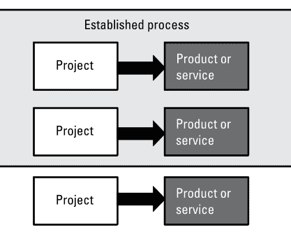

**图 8.1** 成熟流程内外的项目。

由此产生的问题是，客户可能认为来自某个组织的所有产品和服务都同样满足供应商声称的成熟度水平，而并非所有产品和服务都一定符合这一声明。这是一个典型的“买家自负”的情况，进行适当的尽职调查是有价值的。

贯穿本章的一个共同主题是有效性（effectiveness）与效率（efficiency）之间的区别，有效性是“做正确的事”，而效率是“把事做对”。因此，可以通过有效流程来确保属于此类流程的项目产生利益相关者想要和期待的产品和服务。包含由流程管理的特定活动的项目必须以高效的方式进行管理。然而，高效的项目不能确保产生的产品和服务满足功能或非功能需求。唯一可以声的是的是遵循定义的流程可能没有预想中那么有用；当受流程治理的项目没有创建出满足所有利益相关者需求（即验证过程）且符合预算的产品时，情况如此。

有效性和效率的考虑方式取决于人们是从流程视角还是项目视角来看待这些标准。例如，从流程有效性的角度来看，为整个流程区域建立适当的规范是重要的；而对于项目来说，有效性是通过获取完整准确的规范并验证最终产品和服务满足了这些需求来实现的。

注意，“流程区域”（process area）在 `CMMI®` 的语境下有特定的定义，如下 Chrissy [7] 所示：

# 软件系统开发过程 161

某一领域内相关实践的集合，当共同实施时，满足一组被认为对该领域改进很重要的目标 ...

高效流程的关键在于它们在特定组织文化中的适用性和接受度，而项目的效率则取决于它们如何被计划和管理。正如提到的，确保在特定流程集下运行的项目产出满足利益相关者需求是通过验证（validation）实现的，这主要涉及测试。而确定开发生命周期中的每一步，前一阶段生成的构制品或构建的组件不包含缺陷，是通过核实（verification）实现的，它通常由检查、评审和某些测试组成。虽然有效性和效率标准同时影响流程和项目，但重点通常在于前者的有效性和后者的效率。在这里，我们将关注流程在被具体且恰当引导的情况下所具有的有效性。我们将考虑通过良好的管理来获得项目效率。

在表 8.1 中，我们展示了有效性和效率在流程、项目和保证方面的差异。

## 一些定义

如往常，我们将从检查流程（process）、项目（project）、产品（product）和组织（organization）这些词的含义开始，而不将其视为理所当然，也不会在另一个更合适的地方使用其中一个术语。

流程和项目之间通常没有足够的区分。这通常导致了对认证含义的误解。需要重新强调的是，`CMMI` 和审计的范围是有限制的。也就是说，从特殊跳跃到一般通常是不合理的。这种信念的跳跃不可避免地会导致困惑，并使人们认为子公司取得的卓越水平适用于整个范围内。

将服务描述为“易逝性”，是指服务如果未被使用，无论其在先前的期间是否被使用过，都将无法供未来使用；这是典型的“不用即作废”综合症。这导致了需要拥有过剩的服务能力来满足峰值负荷条件。这种易逝性特征在某种程度上适用于许多产品——通常是流体产品，如水、气、油和电。这些产品如果不使用并不会消失——只是在特定时间内使用它们的机会被推迟了，尽管某些可以储存起来以供未来使用。例如，有一种系统利用多余的水电将水抽到高处的湖泊中，然后在未来的某个时间用这些水来发电。如果不这样做，需求可能会超过发电能力。许多产品（如处理过的饮用水，与普通供水相比）是有形的，而其他产品（如电力）如果它们在原始状态下不可见，则较不具实体性。尽管如此，所有产品（当其以服务的形式交付时）都可以根据在给定时间内使用或提供的产品数量进行测量和收费。

然而，即使服务本身也不被视为物理实体，它们通常也源于对物理物品的使用或支持。目前尚不清楚服务是否是无形的——它们无法像上述的那样通过累加值来衡量。事实上，服务是现代国家经济的主要组成部分，制造业和农业部门的比例已相对减少到总经济活动的百分比。服务通常与产品相伴，例如由厨师（项目/人员）制作并由侍者服务人员（服务）交付的餐点（产品），但它们并不一定与产品挂钩，例如当人们使用保姆时。服务的价值通常可以从人们愿意为该服务支付的价格中推断出来。

在本书的范围内，我们声称过程由一系列步骤，或者步骤以及相关的策略、程序、实践和控制组成，这些是用于产生符合适当且预定质量标准的、且安全密集型的系统。所实现的质量可以通过正式信息进行验证。在这种背景下，过程本身实际上并不产生实体；它们定义并治理项目，通过项目创建出构建产品或创建服务的活动。随着项目经验的积累以及缺陷和不足的识别与消除，过程可以并且应该随着时间的演进和改进。改进是能力成熟度模型（`CMMI®`）的基础，其当前形式起源于1986年，由卡内基梅隆大学（`CMU`）的软件工程研究所（`SEI`）在 `MITRE` 公司的协助下培养形成。需要注意的是，`SEI` 和 `MITRE` 公司并不是这种步进式成熟度模型概念的发源者。在 `SEI/MITRE` 工作十多年年前，理查德·诺兰（Richard Nolan）就引入了组织演进阶段的概念。

## 安全安全的软件系统工程

根据 Paulk [12] 的观点，`CMMI®` 框架的目的是“……帮助组织改进其软件过程”[强调为后加]。在 `SEI` 网站 [13] 上引用的概述中，该方法被定义为：

`CMMI®`（能力成熟度模型集成）是一种过程改进方法，为组织提供有效过程的关键要素，从而提高其性能。

自1986年以来，成熟度模型取得了许多重大进展，较近的发布将原始概念扩展到了软件系统工程过程的安全性和可靠性方面。

## 成熟度模型年史

`CMMI` 过程成熟度框架最初开发于20世纪80年代，并于1993年在 Paulk [12] 中趋于成熟。`CMMI®` 方法最初是针对软件开发的，但随着安全需求的增加，该方法扩展到了软件开发之外的安全性和可靠性方面。`CMMI®` 方法最初是针对软件开发的，但随着安全需求的增加，该方法扩展到了软件开发之外的安全性和可靠性方面。`CMMI®` 方法最初是针对软件开发的，但随着安全需求的增加，该方法扩展到了软件开发之外的安全性和可靠性方面。`CMMI®` 方法最初是针对软件开发的，但随着安全需求的增加，该方法扩展到了软件开发之外的安全性和可靠性方面。

（，，，，，，，翻译content。


# CMMI® 方法

CMMI® 方法最初是针对软件开发的，但随着安全需求的增加，该方法扩展到了软件开发之外的安全性和可靠性方面。在 SEI/MITRE 工作十多年之前，理查德·诺兰（Richard Nolan）就引入了组织演进阶段的概念。

将服务描述为“易逝性”，是指服务如果未被使用，无论其在先前的期间是否被使用过，都将无法供未来使用；这是典型的“不用即作废”综合症。这导致了需要拥有过剩的服务能力来满足峰值负荷条件。这种易逝性特征在某种程度上适用于许多产品——通常是流体产品，如水、气、油和电。这些产品如果不使用并不会消失——只是在特定时间内使用它们的机会被推迟了，尽管某些可以储存起来以供未来使用。例如，有一种系统利用多余的水电将水抽到高处的湖泊中，然后在未来的某个时间用这些水来发电。如果不这样做，需求可能会超过发电能力。许多产品（如处理过的饮用水，与普通供水相比）是有形的，而其他产品（如电力）如果它们在原始状态下不可见，则较不具实体性。尽管如此，所有产品（当其以服务的形式交付时）都可以根据在给定时间内使用或提供的产品数量进行测量和收费。

然而，即使服务本身也不被视为物理实体，它们通常也源于对物理物品的使用或支持。目前尚不清楚服务是否是无形的——它们无法像上述的那样通过累加值来衡量。事实上，服务是现代国家经济的主要组成部分，制造业和农业部门的比例已相对减少到总经济活动的百分比。服务通常与产品相伴，例如由厨师（项目/人员）制作并由侍者服务人员（服务）交付的餐点（产品），但它们并不一定与产品挂钩，例如当人们使用保姆时。服务的价值通常可以从人们愿意为该服务支付的价格中推断出来。

在 CMMI® 的范围内，我们声称过程由一系列步骤，或者步骤以及相关的策略、程序、实践和控制组成，这些是用于产生符合适当且预定质量标准的、且安全密集型的系统。所实现的质量可以通过正式信息进行验证。在这种背景下，过程本身实际上并不产生产品；它们定义并治理项目，通过项目创建出构建产品或创建服务的活动。随着项目经验的积累以及缺陷和不足的识别与消除，过程可以并且会随着时间的推移演进和改进。改进是能力成熟度模型（CMMI®）的基础，其当前形式起源于1986年，由卡内基梅隆大学（CMU）的软件工程研究所（SEI）在 MITRE 公司的协助下培养形成。需要注意的是，SEI 和 MITRE 公司并不是这种步进式成熟度模型概念的发源者。在 SEI/MITRE 工作十多年之前，理查德·诺兰（Richard Nolan）就引入了组织演进阶段的概念。

## 安全可靠的软件系统工程

根据 Paulk [12] 的观点，CMMI® 框架的目的是“……帮助组织改进其软件过程”[强调为后加]。在 SEI 网站 [13] 上引用的概述中，该方法被定义为：

> CMMI®（能力成熟度模型集成）是一种过程改进方法，为组织提供有效过程的关键要素，从而提高其性能。

自1986年以来，成熟度模型取得了许多重大进展，较近的发布将原始概念扩展到了软件系统工程过程的安全性和可靠性方面。

## 成熟度模型历史

CMMI 过程成熟度框架最初开发于20世纪80年代，并于1993年在 Paulk [12] 中趋于成熟。CMMI® 方法最初是针对软件开发的，但随着安全需求的增加，该方法扩展到了软件开发之外的安全性和可靠性方面。

## 软件系统开发过程

国际安全协会（ISSEA）使用这种方法开发了系统安全能力成熟度模型（SSE-CMMI）。ISSEA 在2003年发布了一份指南，后来成为了 ISO/IEC 21827:2008。

## 成熟度模型中的安全

我们将现在检查创建的几个成熟度模型。从 [5] 可以看出，安全性被认为是两个独立的领域，这从来源的差异得到了证实。大多数安全相关的来源是美国和英国的军事需求，而安全相关的来源倾向于全球标准。

## FAA 模型

在2004年9月，美国联邦航空管理局（FAA）发布了一份关于安全的报告。

## 表 8.3 目标与应用实践

| 目标 | AP 编号 | 应用实践 |
|---|---|---|
| 建立并维护安全能力 | AP 01.01 | 确保业务连续性 |
| 根据威胁、危害和漏洞定义并管理需求 | AP 01.02 | 确保环境合格 |
| 确保产品在整个生命周期内是安全的可靠 | AP 01.03 | 确保安全信息 |
| 风险被识别和管理 | AP 01.04 | 识别和优先排序 |
| 满足安全需求 | AP 01.05 | 分析和监控 |
| 活动和产品得到管理 | AP 01.06 | 安全性和安全性 |
| 建立安全基础设施 | AP 01.07 | 安全性和安全性 |
| 安全风险被识别 | AP 01.08 | 确定风险缓解 |
| 实现安全目标 | AP 01.09 | 确定法规要求 |
| 部署安全可靠的产品 | AP 01.10 | 开发安全性和 |
| 客观评估产品 | AP 01.11 | 建立安全性和 |
| 建立安全论证 | AP 01.12 | 建立安全性和 |
| 监控事件 | AP 01.13 | 建立安全性和 |
| 建立安全计划 | AP 01.14 | 建立安全性和 |
| 选择供应商、产品和服务 | AP 01.15 | 监控和控制活动 |
| 监控和控制活动和产品 | AP 01.16 | |

## 表 8.2

| | 年份 | 源自 | 替代 |
|---|---|---|---|
| +SAFE V1.0 | 2001 | | |
| CMMI for Development V1.2 | 2006 | | |
| +SAFE V1.2 | 2007 | | |
| CMMI for Development V1.3 | 2010 | | |
| +SAFE V1.3 | 2012 | CMMI for Development V1.3 |
| +SAFE V1.3 (草案) | | CMMI for Development V1.3 |

## 参考标准

- ISO/IEC 17799：信息技术—信息安全管理规范，国际标准化组织，2000年。
- ISO/IEC 15408：信息安全评估通用标准，第3部分：安全性需求，卷 2.1，通用标准赞助组织，1999年。
- ISO/IEC 21827：系统安全工程能力模型 (SSE-CMM)，v3.0，SSE-CMM 项目，2003年。
- NIST 800-30：信息技术系统风险管理指南，特殊出版物 800-30，美国国家标准与技术研究院，2001年。

## +SAFE V1.2 扩展

2007年，澳大利亚国防部装备局（Defence Materiel Organisation）赞助了卡内基·梅隆大学软件工程研究所（CMU SEI）的研究。该研究的结果是针对 CMMI® 开发模型 V1.2（CMMI-DEV）的 +SAFE 扩展，如 [7] 所示。2010年，CMMI®-DEV 1.2 版本被 1.3 版本取代 [4]。

## +SECURE V1.3 扩展

西门子公司（Siemens AG）的一个小组为 CMMI® 开发模型 1.3 版本开发了 +SECURE 扩展 [2]，该扩展的草案于2012年3月提供给作者。在本书编写时，报告的最终版本尚未发布。然而，即将发布的报告的大部分内容已在 Fichtinger 的文章 [17] 中公开。

我们将更详细地检查 CMMI®-DEV 及其安全与可靠扩展，以便更好地理解包含安全和可靠过程区域的过程应该如何开发。

## CMMI® 方法详解

### 通用 CMMI®

根据 CMMI® 文档，组织通过五个阶段或级别演进其过程：

1. **初始级（Initial）**：没有可说的结构或文档。
2. **可重复级（Repeatable）**：过程步骤已记录并可以重复。
3. **已定义级（Defined）**：该过程被视为标准的业务过程。
4. **已管理级（Managed）**：根据定量衡量对过程进行管理。
5. **优化级（Optimizing）**：过程不断改进和优化。

CMMI® 组合中包含的过程范围很大，且增长迅速。有大量的文档和培训描述了 CMMI® 方法以及如何在各个领域和日益严格的级别获得认证。要良好理解 CMMI® 方法的一个良好起点是 CMU SEI 网站 [18]。

# CMMI® 开发

CMMI®-DEV 涵盖了基础的 CMMI® 过程，并专门针对软件开发，尽管 CMM 的原始意图是改进软件开发工作。表 8.4 列出了每个 CMMI®-DEV 模块或类别中的过程，这些过程在《CMMI® 开发模型1.3版》[3] 中有描述。

表 8.5 显示了 ISO/IEC 12207-2008 [9] 过程组。需要注意的是，这些过程同时涵盖了系统和软件；另一个标准 ISO/IEC 15288（IEEE Std 15288-2008 [19]）仅涵盖系统生命周期过程，而 ISO/IEC 12207-2008 则涵盖了系统和软件。

我们在附录 B 的表 B.1 中对表 8.4 和表 8.5 中的条目进行了比较。

如果你发现原因令人困惑，你并不孤单，正如 Russwarm 在 [1] 中所述的那样。对于负责整个软件开发过程的人来说，确定采用哪种分类法可能是很困难的。更保守的方法是取过程的并集，在上述情况下，就是采用 ISO/IEC 12207-2008 的过程类别，并在 CMMI®-DEV 描述更详细的区域进行填充。正如预期的那样，CMMI® 方法仅文档本身（约 482 页）就非常全面，并提供了指导和支持（包括培训）。这类支持在 ISO/IEC 标准中无法轻易获得。

## 表 8.4 按 CMMI® 分类的各特定过程区域

| 过程区域类别 | 具体过程区域 |
|---|---|
| 过程管理 | 组织过程关注<br>组织过程定义<br>组织培训<br>组织过程绩效<br>组织过程管理 |
| 项目管理 | 项目计划<br>项目监控与控制<br>供应商协议管理<br>集成项目管理<br>风险管理<br>定量项目管理 |
| 工程 | 需求开发<br>需求管理<br>技术解决方案<br>产品集成<br>产品验证 |
| 支持 | 配置管理<br>过程和产品质量保证<br>测量与分析<br>决策分析与解决<br>因果分析与解决 |

## 整合安全与可靠过程

表 8.6 给出了 [4] +SAFE V1.2 [4] +SECURE [2] 中与 CMMI®-DEV 等效过程（或应用）区域，以及 Ibrahim [5] 中应用区域的高层级比较。有趣的是，并不是每个过程区域（PA）在其他文档都有等效物。例如，+SAFE 文档中没有针对过程管理 PA 的特定扩展。+SECURE [2] 中的应用实践（APs）在大多数情况下 CMMI®-DEV 中都有等效物，这种映射说明了定义和术语泥潭的复杂性。尽管如此，人们仍然可以进行类比，或者通过连接这些点来完成蓝图。例如，显然需要为安全开发做好组织上的准备，这包括建立适当的工作环境并培训个人特定的技能集，尽管在这些方法中可能没有以相同的术语明确表述。

我们现在更详细地查看 +SAFE V1.2 [4] 和 +SECURE [2]。

## +SAFE V1.2 比较

表 8.6 清楚地显示安全扩展位于 CMMI®-DEV 的项目管理和工程过程区域中，但不在过程管理的过程区域，特别是对就绪性的需求，包括人员培训。推测，该区域已返回父文档。然而，对于安全而言，这应该是明确标注的，特别是考虑到安全关键型软件的开发人员缺乏安全工程方面的知识和专业知识，而且正如前面的章节所述，各个专业知识孤岛之间几乎没有交流。与安全领域相关的培训和知识传递需要特别关注，未能指出这些领域可能是导致当前缺口的一个重要因素。

从 +SAFE V1.2 来看，CMMI-DEV 的培训过程似乎在“特定目标 1 (SG 1)”中得到了解决，尽管在 SG 1 的描述中并未提到培训。

特别值得注意的是 +SAFE 报告中的表 4，它通过 +SAFE SG 引用了二十二个 CMMI-DEV 过程区域（PA）中的九个。表 8.7 在更高层上总结了这一比较（即，没有深入到具体的 SG）。

虽然这可能让人感到宽慰，但对于 SG 如何匹配 CMMI-DEV 的 PA，以及在九个类别中进行比较是否充分，仍存在疑问。或许将 +SAFE 扩展直接整合到父文档中会是更好的方法，因为这可以明确哪些过程区域被涵盖了，哪些没有。尽管如此，+SAFE 文档 [4] 是朝着正确方向迈出的一大步，尽管它采取了面向安全工程师的安全视角，对其他人可能不是特别有帮助。

## +SECURE V1.2 比较

尽管 +SECURE 文档 [2] 的作者声称 +SECURE 扩展是“使用与 +SAFE 扩展类似的方法开发的”……

## 表 8.7 CMMI-DEV 与 +SAFE 过程区域的交叉引用

| CMMI-DEV 过程区域 | 安全管理过程区域 | 安全工程过程区域 |
|---|---|---|
| 因果分析和解决 | 是 | — |
| 配置管理 | — | 是 |
| 决策分析和解决 | 是 | 是 |
| 测量和分析 | 是 | — |
| 组织培训 | 是 | — |
| 过程和产品质量保证 | — | 是 |
| 项目监控和控制 | 是 | — |
| 项目计划 | 是 | — |
| 需求开发 | 是 | 是 |

## 表 8.5 根据 ISO/IEC 12207 的生命周期过程组

| 类别 | 子类别 | 个体过程 |
|---|---|---|
| 系统环境过程 | 同意过程 | 采购过程、供应过程 |
| | 组织项目支持过程 | 生命周期模型管理过程、基础设施管理过程、项目组合管理过程、人力资源管理过程、质量计划过程 |
| | 项目过程 | 项目计划过程、项目评估与控制过程、决策管理过程、风险管理过程、配置管理过程、信息管理过程、测量过程 |
| | 技术过程 | 相关利益者需求定义过程、系统需求分析过程、系统架构设计过程、实现过程、系统集成过程、系统鉴定测试过程、软件安装过程[发布?]、软件验收支持过程、软件运行过程、软件维护过程、软件处置过程 |
| 软件特定过程 | 软件实现过程 | 软件实现过程、软件需求分析过程、软件架构设计过程、软件详细设计过程、软件构造过程、软件集成过程、软件鉴定过程 |
| | 软件支持过程 | 软件文档管理过程、软件配置管理过程、软件质量保证过程、软件验证过程、软件确认过程、软件评审过程、软件审计过程、软件问题解决过程 |
| | 软件重用过程 | 领域工程过程、重用资产管理过程、重用计划管理过程 |

## 表 8.6 CMMI-DEV 过程区域与安全保障扩展的映射

| CMMI-DEV 过程区域 | CMMI-DEV 过程区域子类 | 安全与保障扩展 [5] | +SAFE [4] | +SECURE [2] 过程 |
|---|---|---|---|---|
| 管理 | 组织过程定义 (OPD)<br>组织培训 (OT) | 建立合格的工作环境 (AP 01.2)<br>确保安全与保障能力 (AP 01.1) | — | 安全开发的组织就绪 (DPS) |
| 管理 | 项目计划 (PP)<br>供应商协议管理 (SAM)<br>集成项目管理 (IPM) | 建立安全与保障计划 (AP 01.14)<br>选择并管理供应商、产品和安全服务 (AP 01.15) | 安全管理 | 项目中的安全管理 (SMP) |
| 工程 | 需求开发 (RD)<br>技术解决方案 (TS)<br>验证 (VER)<br>确认 (VAL) | 确定法规需求、需求、法律和标准 (AP 01.09)<br>开发并部署安全可靠的产品和服务 (AP 01.10)<br>客观评估产品 (AP 01.11) | 安全工程 | 安全需求和技术解决方案 (SRT)<br>安全确认 (SVV) |

..., 文档在许多方面存在差异。我们已经确定，+SAFE 扩展并没有专门针对过程管理过程区域，且 +SAFE 或 +SECURE 都不包含任何支持过程区域。然而，在特定目标和实践层面确实存在许多差异，如表 8.8 所示。


表 8.8 非常具有启发性。首先，它显示 `+SECURE` 的特定目标和实践涵盖的领域比 `+SAFE` 扩展的特定目标多得多，而且 `+SECURE` 的特定目标似乎比安全目标和实践更侧向于软件开发过程。安全方法似乎比安全方法不正式。例如，在设计类别中，`+SAFE` 的要求是应用安全原则，而 `+SECURE` 则要求使用安全标准。

## 总结与结论

在许多方面，这次对过程世界的探索对作者来说非常有启发性，希望对读者也是如此。整体印象与 Russwaard 将软件开发过程模型描述为“泥潭 [1]”相符，遗憾的是，这种描述并不准确。对实现许多过程框架之一的人肯定会面对无数方法。这些方法很难比较，每种方法都需要大量的精力来理解和实施。

将过程模型从通用软件开发框架扩展到安全和保障的尝试在严谨性和实用性上差异很大。它们似乎在很大程度上是在重复造轮子，因为对之前的工作和父文档的引用往往是不完整的。

尽管如此，尽管存在这些问题，过程改进方法是非常需要的，特别是那些专门涉及安全和保障的方法。在过程模型中确保安全和保障至关重要，如果不包含这些，那么推进安全和可靠软件系统工程的艺术将希望渺茫。话虽如此，过程模型尚未完善到确保 IT 专业人员所构建和运行的复杂系统能够满足各种利益相关者的安全和保障需求。

虽然世界级的过程不能保证顶质量的产品和服务，但缺乏适当的过程实际上确保了许多与安全和保障的关键考量将不会包含在创建所有软件密集型产品和基于软件服务的整体过程项目中。

## 工程安全可靠的软件系统

| +SAFE 特定目标 +SAFE 特定实践 | +SECURE 特定目标 +SECURE 特定实践 |
| :--- | :--- |
| | 识别危险、事故和危险源 识别可能的危险 建立开发安全产品和响应产品安全事件的能力 |
| | 建立安全的标准流程和其他过程资产 建立产品安全意识和能力 建立安全工作环境标准 建立漏洞处理 |
| | 为安全项目建立集成计划 并交付安全的交付选择 识别威胁的根本原因 |
| | 管理产品安全风险 | 建立产品安全管理计划 制定产品安全风险缓解计划 |
| | 定义安全需求 每个安全需求的安全目标 | 开发客户需求 根据安全架构和设计制定安全原则 选择适当的技术 培训 应用安全原则 收集安全保障证据 收集安全报告 分析对变更的影响 |
| | 为预期的运行环境验证产品安全 | 执行安全验证 建立危险日志 开发安全论证 |

表 8.8 特定目标 +SAFE 特定实践 +SECURE 特定目标 +SECURE 特定实践的比较

## 软件组织开发流程

## 脚注

- [1] Russwurm, W., “多模型与多评估的困境——一种基于分类方案的组织方法，” SEPG 2010, 佐治亚州亚兰特兰, 2010, 可访问 http://www.seci.cmu.edu/sepg/na/2010. 访问于2012年7月20日。（注：点击“Thursday’s Sessions”链接，然后点击“1541.Russwurm.”即可查看演示文稿。）
- [2] Siemens, A. G, `+SECURE`, V1.3: CMMI-DEV的安全扩展, 第3卷, 软件工程研究所, 2012年3月（目前为草稿——限量分发）
- [3] 软件工程研究所, CMMI®开发模型, 版本 1.3, 技术报告 CMUISE-2010-TR-033 ESC-TR-2010-033, 改进过程以开发更好的产品和服务, 2010年11月. 可访问 http://www.seci.cmu.edu/reports/10tr033.pdf. 访问于2012年7月20日。
- [4] 澳大利亚国防部，国防装备局, `+SAFE`, V1.2: CMMI®-DEV V1.2的安全扩展, 技术备忘录 CMUISE-2007-TN-006, 软件工程研究所, 2007年3月. 可访问 http://www.seci.cmu.edu/reports/07tn006.pdf. 访问于2012年7月20日。
- [5] Ibrahim, L., 等, 集成能力成熟度模型的安全与防护扩展, 美国联邦航空管理局, 2004年. 可访问 http://www.faa.gov/about/office/headquarters/offices/aio/media/SafetyAndSecurityExt-FINAL-pdf. 访问于2012年7月20日。
- [6] SVRC (软件验证研究中心), `+SAFE`, CMMI安全扩展, UniQuest出版社, 澳大利亚昆士兰, 2001年。
- [7] Chassis, M. B., M. Konrad, 和 S. Shrum, CMMI®开发模型, 版本 1.2, CMMI第二版：过程与产品改进指南, 新泽西州上萨德河: Addison Wesley, 2007年。
- [8] 见 http://www.sae16.org/white-papers/saa-16-vs-sas-70–what-you-need-to-know-and-how.html, 访问于2012年7月。
- [9] IEEE计算机学会工程标准委员会, 国际标准 ISO/IEC 12207: IEEE 12207-2008: 系统与软件工程—生命周期过程, ISO/IEC, 2008。
- [10] Axelrod, C. W., 计算机效能：弥合管理/技术差距, 华盛顿特区: Information Resources Press, 1997。
- [11] Noel, R. L., “管理计算机资源：阶段假设，” 《ACM通讯》, 第16卷, 1973年7月. 可购买地址 http://dl.acm.org/citation.citn?id=362820.362844 访问于2012年7月20日。Paulk, M.-C., B. Curtis, M. B. Chrisis, 和 C. V. Weber, 软件能力成熟度模型, 版本 1.1, 技术报告 CMUISE-93-TR-024 ESC-TR-93-177, 1993. 可访问 http://www.seci.cmu.edu/reports/93tr024.pdf, 访问于2012年7月20日。
- [12] Paulk, M. C., B. Curtis, M. B. Chrisis, 和 C. V. Weber, 软件能力成熟度模型 SM, 版本 1.1, 技术报告 CMUISE-93-TR-024 ESC-TR-93-177, 1993. 可访问 http://www.seci.cmu.edu/reports/93tr024.pdf, 访问于2012年7月20日。
- [13] 见 http://www.seci.cmu.edu/cmmi/, 最后一次访问于2012年7月20日。
- [14] 见 http://en.wikipedia.org/wiki/Capability_Maturity_Model, 最后访问于2012年7月20日。
- [15] ISO/IEC (国际标准化组织/国际电工委员会), ISO/IEC 21827:2008: 信息技术—安全技术—系统安全工程—能力成熟度® (SSE-CMM), ISO/IEC, 2008。
- [16] SSE-CMM模型的文档可以在 http://www.sse-cmm.org/docs/ssecmm3final.pdf 找到。访问于2012年7月20日。国际系统安全工程协会 (ISSEA) 网站为 http://www.issea.org/ 访问访问于2012年7月20日。
- [17] Fichtinger, B., P. Moser, “驱动安全进入软件开发，”2012, 第97–101页。
- [18] 见 http://www.seci.cmu.edu/cmmi/, 最后访问于2012年7月20日。
- [19] IEEE计算机学会工程标准委员会, 国际标准 ISO/IEC 12207: IEEE 12207-2008: 系统与软件工程—生命周期过程, ISO/IEC, 2008。

## 引言

本章的目的是考察开发、运行和退役安全系统的关键阶段及详细任务。在第10章中，我们将适用于安全关键系统的相同过程。

## 不同的术语，相同或不同的含义

简单的缩写 `SDLC` 本身就具有歧义。在某些情况下，`SDLC` 指的是系统开发周期或系统设计生命周期，而在其他情况下，它指的是软件开发周期。几年前，IBM公司提出了 `SDLC` 来代表同步数据链路。为了进一步增加复杂，微软公司采用了 `SDL` 来代表“安全开发周期”[4]，而作者指的是“安全软件开发周期”。

在书中，我们使用缩写 `SSDLC` 代表软件系统生命周期。应当注意的是，这个缩写并非唯一的；它在许多情况下被用来表示安全软件开发周期[5]。其他人使用 `SSDLC` 来指代“安全开发周期”，正如前面所述，这存在混淆安全系统与防护系统的问题[6]。

# 详细介绍安全 SDLC 项目

在此处，我们将再次区分安全软件系统、安全软件系统和安全软件系统。对于安全软件系统而言，安全性是软件系统的一项质量属性；而对于安全软件系统，安全性是软件系统的主要功能。虽然听起来可能奇怪，但“安全软件系统”一词并非冗余，因为它指的是主要功能是提供安全服务的软件系统。下文详细描述的针对 RSA SecureID 攻击就是一个安全系统被攻破的例子。因此，构建这些安全软件系统时，必须确保安全软件系统本身表现出强大的安全属性并能够抵抗攻击。针对 RSA 和赛门克报告的攻击表明，这些安全产品供应商可能比通常认为的更加脆弱 [7]。

安全关键系统与安全安全关键系统的术语和含义相似。作为安全软件系统，安全软件系统是指安全性作为属性的系统。对于安全软件系统，安全是软件系统的主要功能。因此，安全软件系统提供安全服务并自身符合特定标准。安全系统是指功能为安全，但由于受到攻击或事件的保护而也是安全的系统。安全系统是指保护物理或逻辑安全功能，且不会对人员、其他生物或环境造成危害的系统。者的例子是一个建筑准入系统，它在开启状态下失效，导致火灾发生时，设施内的人员逃生，消防员、应急服务人员和其他响应人员可以进入设施。

更令人困惑的是安全可靠软件系统，它们反映了安全和可靠需求，但具有提供安全和可靠服务以外的功能。

当我们谈论安全可靠的安全软件系统时，指的是功能上兼顾安全和可靠并符合特定安全和可靠需求的软件系统。因此，人们可能会拥有（如同系统系统和信息物理系统，如智能电网 [8]）既满足安全标准又免受外部攻击和内部处理不当影响的安全关键系统。相反，此类系统可能是那些提供安全服务，但被规定在发生故障时不会对生物或环境造成的系统。上述内容总结在表 9.1。

表 9.1 展示了安全性属性（以前不被认为是安全关键系统的高优先级）现在被认为是重要的，特别是对于同时具有安全性和可靠性要求的系统。安全关键系统必须表现出高度的内在安全性，这部分是因为被攻破后会产生负面的声誉影响，例如安全公司 RSA，它曾是成功攻击的受害者，这使其双身份验证技术的安全性受到严重质疑 [9]。

表 9.1

| 属性 | 安全性 | 安全性 | 安全与可靠结合 |
|---|---|---|---|
| 安全性 | 目前高 / 传统低 | 极高 | 极高 |
| 安全性 | 高 | 目前中等 / 传统低 | 极高 |

RSA 以其 SecID 标签的形式销售最流行的双身份认证技术之一，该标签通常是钥匙扣或信用卡大小的单元，上面有一个小屏幕。屏幕显示每分钟变化一次的数字代码，并与授权访问系统上的数字生成器同步。SecID 卡结合其他代码（如密码或个人身份识别码 PIN）提供双身份认证，这被认为是高度安全的。因此，SecID 技术用于保护一些最关键的安全安全的软件系统，例如由国防商运营的系统。当 RSA 遭受网络攻击被破解时，底层的 SecID 技术被盗取。该技术随后被用于尝试渗透洛克希德·马丁等大型国防商的系统。从网络安全专业人员的角度来看，这种破解特别令人不安——它显示了这种被认为是防止未经授权访问关键系统最有效的方法之一的弱性。

在安全性方面，控制高安全性设施准入等内容的系统需要具有非常好的安全特性。如果安全软件发生故障，供应控制软件的公司的声誉及其执行能力将受到质疑。当系统系统和信息物理系统同时具有安全性和可靠需求时，控制软件必须具有特别严格的安全和可靠属性。

## 创建和使用软件系统

目前已有许多构建软件系统的方法。大多数方法遵循项目传统的项目系统工程方法。有些方法扩展了基础范围，增加了特定的安全和可靠组件。另一些则比基础系统方法不完整。例如，许多软件系统生命周期忽略了对过时系统退役的考虑以及用新系统替换它们的规划。此外，典型的开发周期通常不遵循常见的“生-生-死”周期，将考虑限制在单次。软件系统不可避免的寿命结束往往没有计划，特别是对于私营部门安全相关的生命周期过程。值得赞的是，许多政府方法考虑了退役和处置阶段，尽管这些在安全相关的控制系统中出现得更多，而不是信息系统中。强调的是，当软件密集型软件系统停止使用时，这些活动必须仔细计划，否则将暴露在各种风险中，失去失去价值的知识产权。许多研究人员和从业者假设，一旦软件系统的使用寿命结束，软件就没有价值了。事实并非如此，因为软件产品的旧版本虽然不一定受供应商支持，但如果需要，通常可以很有用的运行，并可能包含价值的知识产权。

在某些情况下，即使系统已退役，系统处理的数据也可能会保留较长时间，以满足税务机关或监管机构的要求。有时，数据记录可能会保留若干年；在其他情况下，它们可能会被永久保留。这引发了关于检索与退役软件系统兼容的电子记录的关键问题。如果替换系统不向后兼容，则可能需要某种重建被替换软件和硬件系统的方法来检索数据。这可能成为一个特别艰巨的要求，特别是当系统以及熟悉应用程序的人员和支持系统运行的人员早已离去时。

此外，在创建原始系统时，很少为创建替换系统制定初步计划。开发软件系统的个人通常不承担考虑替换系统的责任，因为包含有助于替换原始系统的功能需要更多的时间和资源；消耗这些资源只会对手头项目的及时完成不利，考虑替换是一项特定要求。

这种对替换考虑的遗漏在某些情况下会导致恐慌和困惑，例如当供应商宣布在特定日期之后将不再支持某个软件产品时，或者业务条件发生巨大变化，需要不同的系统，例如需要更大的扩展性，增加了功能等，这些功能可能超出了当前软件系统的能力范围。

在 2004 年至 2005 年之间，微软公司宣布在特定日期 [10] 之后不再支持 Windows NT 4.0。这在那些在剩余时间内无法升级到新系统的客户中引起了巨大骚动。微软随后同意提供安全补丁；然而，他们希望作为提供这些补丁的交换收取大量的额外维护费用。这进一步激怒了客户，他们认为微软正在强迫他们接受自己认为负担沉重的变更以及支持条款和条件。

## SSDLC 的阶段与步骤

我们现在将检查典型 `SSDLC` 的每个阶段以及每个阶段内的步骤，并特别关注这些系统的安全属性，并在第 10 章中对安全属性进行考量。

在图 9.1 中，我们在椭圆内部展示了生命周期的三个方面。中间标记为“制造”的部分是开发活动的典型顺序。与系统开发并行进行的是“监督”周期，或管理周期，它涉及初始风险评估以及审计员和检查人员的持续评审与测试。图表的底部三分之一显示了“保证”周期，它包括开发测试用例和测试以及执行各种形式的测试。图中的阴影框是通常没有得到与其重要性相称的关注的功能。两个区域作为典型 `SSDLC` 急需的增强而脱颖而出。一个是非功能性需求的规范及其测试，以确保它们被正确纳入系统；另一个是退役和处置阶段，这些阶段需要进行计划、测试和执行，但在私营部门中经常被忽视。

图 9.2 显示了对同一组概念的略有不同的观点，它很大程度上源于 McGraw [11]。在这里，安全方面专门与 `SSDLC` 的阶段相关联。

回顾 `SSDLC` 是如何演变的是一件很有趣的事。我们现在检查在 1980 年左右，哪些特定步骤被认为是系统生命周期的一部分。从历史角度看，研究人员通常不会对一般过程与软件系统、过程以及项目之间进行明确区分。在 Biggs [12] 中，详细描述了我们可能称之为*软件密集型系统项目*管理，而不是书名《管理系统开发过程》所蕴含的系统过程管理。

## 更详细的安全 SSDLC 项目

183

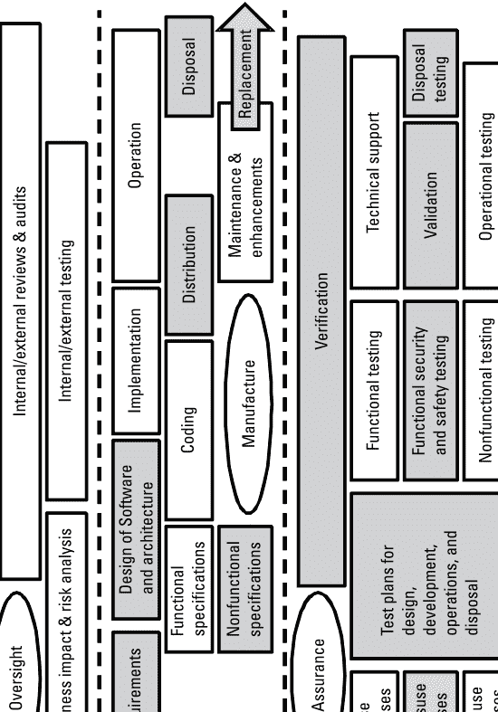

图 9.1 从监督、制造和保证角度看 SSDLC。

## 构建安全可靠的软件系统

标准软件系统开发生命周期

安全方面

| | | 外部和内部审计与评审 |
|---|---|---|
| 识别需求 | 安全需求 | |
| 开发用例 | 滥用用例 | |
| 架构与设计 | 误用风险分析 | |
| 开发 | 代码评审 | |
| 测试与结果 | 功能性与非功能性安全测试 | |
| 实现 | 渗透测试 | |
| 分发 | 安全运营 | |
| 生产/维护 | | |
| 增强 | | |

**图 9.2** 与 SSDLC 相关的安全方面。

表 9.2 提供了 [12] 中描述的开发生命周期各个阶段和步骤的概述。值得注意的是，文中没有提到安全或可靠性，也没有退役阶段。然而，该方法要求在启动后续阶段之前，必须经过高级管理层的评审并获得前一阶段的批准。此外，在第三阶段：系统开发中，我们看到了与系统技术以及应用程序相关的术语（分别为步骤 1 和 3）。虽然该术语在 20 世纪 80 年代常用，但在涉及软件系统安全开发的书中它似乎已不再受到青睐。关于规范的内容通常被归入需求分析或架构与设计阶段。

例如，在美国联邦航空管理局的关于 SDLC 的报告 [13] 中，在“软件需求分析”标题下，我们读到了以下内容：

## 更详细的安全 SSDLC 项目

## 表 9.2

根据 Biggs [6] 的传统系统开发过程

| 阶段 | 步骤 |
|---|---|
| 第一阶段 | 系统规划 步骤 1：初始调查<br>步骤 2：可行性研究<br>高层管理评审与决策 |


## 第二阶段：系统需求

- 步骤 1：业务分析与系统分析
- 步骤 2：用户需求
- 步骤 3：技术支持方法
- 步骤 4：概念设计和包评审
- 步骤 5：替代方案评估与开发计划
- 高层管理评审与决策

## 第三阶段：系统开发

- 步骤 1：系统技术规范
- 步骤 2：技术支持开发
- 步骤 3：应用程序规范
- 步骤 4：应用程序编程与测试
- 步骤 5：用户程序与控制
- 步骤 6：用户培训
- 步骤 7：实施计划
- 步骤 8：转换计划
- 步骤 9：系统测试

## 第四阶段：系统实现

- 步骤 1：转换与分阶段实施
- 步骤 2：完善与调优
- 步骤 3：实施后评审

### 系统维护

- 步骤 1：持续维护

- **安全规范**：包括与操作和维护方法、环境影响以及个人伤害的内容。
- **安全规范**：包括与敏感信息泄露的内容。

这些描述区分了安全和可靠规范，方式与之前的做法相似。

在每个步骤中，Biggs [12] 都提供了概述以及标准活动和关键考虑因素的列表。例如，在第三阶段步骤 4：应用程序编程与测试中，我们有以下标准活动：

- 验证所有必要资源的可用性

## 构建安全可靠的软件系统

- 为程序员分配应用程序并监控进度；
- 开发程序；
- 编码；
- 编译；
- 单元测试（模块或子程序）；
- 集成与测试；
- 文档编写；
- 测试评审与批准

在第三阶段步骤 4：应用程序编程与测试中，我们还有以下关键考虑：

- 了解软件；
- 创造力的控制；
- 完成了 90% 的程序；
- “不可能”的情况；
- 资源利用。

这些活动和考虑因素是对典型软件开发项目该步骤的预期。然而，对安全和可靠性考虑特别感兴趣的项目（尽管没有特别提到）是被标记为“不可能的情况”的。正如 Biggs 所描述的，这种情况“由于遇到了用户、系统分析师和程序员认为‘不可能’的情况” [12]。根据 Biggs 的观点，这些情况是无法避免的，但在可以预测或预见的范围内可以避免或最小化，或者如果它们发生了，可以采取较多的纠正措施 [12]。

## 更详细的安全 SDLC 项目

在许多系统中，许多软件系统开发工作未能完全满足利益相关者的需求，并且由于需求不足，往往远低于利益相关者的预期。

毫无疑问，一个关键成功因素是获取一套完整、全面、无歧且双重的需求，其中安全和防护问题在开发生命周期早期就得到了解决，并在整个生命周期中持续得到解决，直到包括系统的退役和处置。关于需求核心属性的更详细的描述如下：

- **完整且全面的需求**：这些包括来自所有利益相关者的材料（包括对安全、防护、业务连续性等的需求）。提高获取所有相关需求机会的一种方法是考虑可能对系统开发工作有利益关系的所有各种群体——还要考虑那些可能希望项目失败的群体。这通常体现在“没有人问过我”综合征中，即信息因为没有被询问而没有得到适当的传递。通常需要激励利益相关者做出回应并在回答中保持坦诚。这可以通过鼓励利益相关者参与各种激励措施来实现，例如定期审查、在简报中特别表扬以及其他形式的认可。所选方法的有效性取决于组织文化。附录 C 显示了安全关键软件系统生命周期每个阶段的建议参与方式。

- **无歧义的需求**：利益相关者理解所使用的术语并能够将个人需求转换为高度具体的需求是非常关键的。然后，功能性需求非功能性需求被转换为规范，这些规范作为系统设计和架构、编码、测试等的基础。在每个阶段，都需要确认程序代码是否准确实现了需求，无论这些需求是否真实代表了用户的需求。这就是验证过程。此外，需求来源（通常是客户或用户）应确保项目团队产出的是正确的产品（即用户期望看到的东西）。这就是确认过程。

- **可行的需求**：在所有情况下，需求都需要是合理的并且通过现有技术可以实现（如果技术是新的或与常规范非常不同，则应予以考虑）。有时，直到开发进行过程中，可能并不清楚所需的功能在合理的时间和资金限制内是否可以实现。在不进行重大支出和精力投入的情况下确定可行性的能力，正是原型设计、敏捷开发等技术的价值所在。许多利益相关者（特别是终端用户）除非他们实际看到系统的模型或原型，否则通常不理解技术人员使用的术语及其含义。为了不显得无知，一些利益相关者可能会允许过程继续，无论是否有明确迹象表明项目可能偏离正轨。

基于上述，我们看到今天的安全（safety-security）需求往往是两种不同的事物。安全需求通常基于特定的标准，例如 `DO-178B`，将在第 10 章中进行详细讨论。另一方面，安全需求往往没有同等的标准集和认证可供参考。它们通常基于事实标准，例如支付卡行业数据安全标准 (`PCI DSS`)，该标准专门针对信用卡、借记卡和其他形式的支付系统，如越来越多地取代塑料卡的智能手机。

还有针对安全的高级管理标准，例如 `ISO/IEC 27001/27002`，它们为实施安全措施提供了指导。

Calder [15] 为 `ISO/IEC 27001/27002` 标准下的认证提供了一个很好的指南。这些标准涵盖的领域非常广泛，但遵循这些标准通常是自愿的，因此它们的价值被削弱。然而，了解所涵盖的主题范围是有帮助的，如下：

- 组织信息安全；
- 信息安全策略和范围、风险评估；
- 外部实体；
- 资产管理；
- 人力资源安全；
- 物理和环境安全；
- 设备安全；
- 通信和运营管理；
- 恶意恶意软件控制；
- 网络安全管理和媒体处理；
- 信息交换；
- 电子邮件和互联网使用；
- 访问控制（网络、操作系统、应用程序）；
- 系统获取、开发和维护；
- 密码学控制；
- 开发和支持服务中的安全；
- 监控和信息安全事件管理；
- 业务连续性管理；
- 合规性。

上述斜体字区域对于安全关键型应用的软件工程具有特别的相关性。其他领域对于全面的信息安全计划也很重要。

还曾过开发一套“公认信息安全原则”（`GAISP`）的努力。1992 年的初步尝试被称为“公认系统安全原则”（`GASP`）。`GASP` 的描述于 1999 年发布并征求公众意见 [16]。`GASP` 项目最初由国际信息安全基金会 (`ISF`) 赞助。信息系统安全协会 (`ISSA`) 接手了这项工作，启动了一个涉及百多名志愿者的项目，并将其重命名为“公认信息安全原则”（`GAISP`）项目 [17]。遗憾的是，`GAISP` 的努力因负担过重而崩溃，导致目前还没有一套通用的安全原则和标准。相比之下，美国公共会计师协会 (`AICPA`) 和加拿大特许会计师协会 (`CICA`) 在信息安全控制协会 (`ISACA`) 和内部审计师 (`IIA`) 的帮助下，通过一个较小的团队开发了公认原则 (`GAPP`)，并产生了两个版本的成果：开放网络安全项目 (`OWASP`) 十大漏洞和 `SANS` 程序员常见 25 错误以及通用漏洞评分系统 (`CVSS`)。

## 更详细的安全 SDLC 项目

例如，为了安全编码。后者的指南是针对那些彻夜不眠的开发者、测试人员和实施者的，但项目经理也需要理解这些内容。利用安全方法的需求也引起了业务部门经理的关注，将其视为改进产品和服务的手段。微软就是一个很好的例子，正如 Howard [4] 所述的其开发生命周期所证明的那样。

在附录 C 中，我们检查了开发生命周期中识别出的每个阶段，以及全面的安全相关任务、特定子任务以及执行每个子任务的原因。这些表格中包含的大部分信息来自 McBride [1]，而该内容并不容易获得 [23]。然而，由于许多单独的任务和子任务的加入，我们添加了退役/报废阶段。此外，表格的格式以及信息在整个任务中的分布方式也是新的。

表 9.3 显示了各个参与小组和团队在生命周期安全方面的整体参与情况。该表摘自附录 C 中的表 C.17。正如预期的那样，主要的整体参与者是安全和审计团队成员，但应用开发团队和基础设施团队紧随其后。为了使工作成功，参与者必须充分投入，并勤勉地执行分配给他们的任务。

从表 9.3 中可以得出什么结论？看来安全团队以及内部和外部审计人员在整个生命周期中深度参与，而大多数其他参与者都处于中等水平，这正是人们所预期的。然而，在典型的组织中，我们并没有看到这种程度的参与。大多数领域在参与度方面的评估会会低一个水平。对于安全团队和审计人员来说也是如此，你本应认为他们与安全 SDLC 非常契合，正如 `BSIMM` 网站 [24] 所描述的构建安全成熟度模型（`BSIMM`）。

## 总结与结论

为了确保在软件系统中包含适当的安全属性，特别是那些被认为是安全关键的系统，有必要在开发生命周期包含专门用于满足安全需求的任务和子任务。遗憾的是，针对安全工程师的信息安全原则和详细标准仍然匮乏。从各种政府和行业来源可以获得一些指导，而且还有国际标准为那些想要获得此类标准认证的人提供高层次建议。然而，许多实体并不要求遵循任何特定标准，导致了大量的漏洞。即使有一套广泛公认的标准，仍然需要在广泛的信息安全领域聘请内部和外部的领域专家。

如果负责人员不参与这一过程并确保采取所有必要步骤，就无法希望达到所需的安全水平。审计人员的参与也是必要的，以确保这些步骤以满意的水平完成。

遗憾的是，从攻击的数量和强度可以看出，许多组织在满足即使是最低的可接受合规水平之前，还有很长的路要走。在本章中，我们查看了安全系统开发的生命周期，并指出了需要处理的领域。附录 C 提供了一份详尽的建议任务和参与水平列表，供那些在面临日益复杂的攻击时，寻求如何提高其任务关键系统安全性的指导的人士参考。

## 表 9.3 各阶段团队/小组参与水平摘要

| 阶段 | 安全团队 | 开发团队 | 基础设施团队 | 项目经理 | 应用程序级经理 | 业务部门经理 | 运营经理 | 内部团队 | 外部审计 | 执行管理 |
| :--- | :--- | :--- | :--- | :--- | :--- | :--- | :--- | :--- | :--- | :--- |
| 需求 | 高 | 低到中等 | 低到中等 | 中等到高 | 中等到高 | 中等 | 高 | 高 | 中等到高 | |
| 架构与设计 | 高 | 高 | 高 | 高 | 中等 | 中等 | 中等 | 高 | 高 | 低到中等 |
| 测试 | 高 | 高 | 高 | 高 | 高 | 中等 | 低 | 高 | 低 | 低到中等 |
| 部署 | 高 | 中等到高 | 中等到高 | 高 | 中等 | 中等 | 中等 | 高 | 中等 | 中等 |
| 运行与维护 | 高 | 中等 | 中等 | 中等 | 中等 | 中等 | 中等 | 高 | 中等 | 中等 |
| 退役整体生命周期 | 高 | 低 | 低 | 中等到高 | 中等到高 | 低到高 | 高 | 高 | 低 | 中等 |

## 脚注

- [1] McBride, P., and E. P. Moser, Secure Development Life Cycle (SDLC): Building Security Your System—Not Bolting It On After the Damage is Done. Atlanta, GA: Metases Publications, 2000.
- [2] DACS (The Data & Analysis Center for Software), Enhancing the Life Cycle to Produce Secure Software, A Reference Guidebook on Software Assurance, Version 2.0, U.S. Department of Defense, 2008.
- [3] Dobbing, B., and S. Lautieri, SafSec: Integration of Safety & Security Certification, SafSec Methodology: Standard, Praxis High Integrity Systems, 2006.
- [4] Howard, M., and S. Lipner, The Security Development Lifecycle, WA: Microsoft 2006.
- [5] http://www.mcafee.com/resources/data-sheets/foundstone/ds-secure-software-development-life-cycle.php 和 http://www.slideshare.net/basic-of-sdlc, 访问于 2012年7月20日。
- [6] http://www.prlog.org/11423160-wck-lancel-sdlc-security, 访问于 2012年7月20日。
- [7] 智能网本质上是管理电力分配的工业控制系统、无线网络以及从传感器获取、分析并响应数据的系统（包括智能电表）的结合。更多细节可以通过 http://energy.gov/oe/technology-smart-grid 获取，访问于 2012年7月20日。
- [8] 查看 http://www.rsa.com/node.aspx?id=387。
- [9] 查看 http://en.wikipedia.org/wiki/Requirement, 访问于 2012年7月20日。
- [10] 查看 http://www.first.org/cvss。
- [11] 查看 http://www.cwe.mitre.org/ 访问于 2012年7月20日。
- [12] Calder, A., and S. Watkins, Software Security: Building Security into Systems, 2006.
- [13] Biggs, C., and E. Atkins, Managing the Systems Development, 1980.
- [14] Axelrod, C., “功能测试的需求,” STSC: The Journal of Defense Engineering, 2011年3月, 第17–21页。
- [15] 查看 http://www.infosec.org, 访问于 2012年7月20日。
- [16] 查看 http://all.net/books/standards/GASP-v30.pdf。
- [17] 查看 http://www.aicpa.org/InterestAreas/InformationTechnology/Resources/Privacy/GenerallyAcceptedPrinciples/DownloadableDocuments/GAPP_BUS_2009.pdf.
- [18] 查看 http://www.aicpa.org/InterestAreas/InformationTechnology/Resources/Privacy/GenerallyAcceptedPrinciples/DownloadableDocuments/GAPP_PRAC_2009.pdf.
- [19] 遗憾的是，第一家 Metasec 似乎已不再存在；安全开发生命周期 (SDLC): Building Security Into Your System—Not Bolting It After the Damage is Done [1] 无法通过常规渠道获得。出版的书《Secure Internet Practices: Best Practices for Securing Systems in the Internet and e-Business Age》确实包含了该主题的一个章节，但参考 [1] 以获取更多信息。
- [24] 查看 http://bsimm.com/.

# 10 详细阐述安全 SSDLC 项目

> [系统安全是指]应用工程和管理原则以及技术，在整个系统生命周期的所有阶段，受运行有效性、时间和成本的限制，对安全的各个方面进行优化。
>
> —联合软件系统安全委员会，《软件系统安全手册》[1]

> 一个经过加固的系统（secured system）确保没有安全漏洞，从而消除安全威胁；而对于安全关键系统来说，任何漏洞都可能是毁灭性的。
>
> —Asoke K. Talukder 和 Manish Chaitanya，《安全软件系统架构》[2]

## 引言

人们可能认为，为了为安全关键系统生成任务、子任务、目的和参与程度，唯一需要做的就是复制附录 C 中的许多表格，并将“安全（safe）”和“安全性（safety）”一词替换为“安全（secure）”和“安保（security）”。如果事情真那么简单就好了。尽管在许多情况下，进行这种替换是有意义的，但在许多情况下，这种类比并不十分。

安全软件系统和安全软件系统开发生命周期模型具有相似（甚至相同）渊源。它们都源于第 2 章和第 3 章描述的系统和软件工程。然而，正如第 5 章所述，参与开发安全软件系统的人与专注于安全软件系统的人在方法上存在显著差异——分别为软件安全工程师和软件安全工程师。

主要区别在于对特定阶段和任务的重点不同，而非结构性差异。特别是，安全关键系统的开发生命周期对需求、测试和认证阶段的关注程度显著高于安全关键系统的开发生命周期。这并不是为了支持或鼓励这种差异——事实上，正如 [3] 所述，安全关键系统的开发者可以从他们的安全工程同行中学到很多。

## 定义与术语

正如我们在第 9 章针对安全密集型软件系统所做，我们必须澄清安全系统（safe software systems）、安全性软件系统（safety software systems）以及安全安全性软件系统（safe safety software systems）之间的区别。对于安全系统而言，安全性（safety）是软件系统的一种质量属性；而对于安全性软件系统，安全性（safety）是软件系统的主要功能。与安全软件系统（secure software system）这一术语一样，“安全性（safety）”一词并不像看起来那样冗余。因为后者指的是主要功能是提供安全服务的软件系统。然而，这些软件系统需要被构建，以便安全性系统本身表现出强大的属性。虽然很难给出具体的例子，但一个建议是考虑一个为了防止辐射从核电站粉尘中泄漏而锁住门的系统。门控制系统在默认关闭状态下发生故障是非常重要的，因为会导致工人被困在放射性空间内。这种情况确实发生过福岛核电站，该电站于 2011 年 3 月 11 日遭受地震及随后的海啸的破坏。工人无法从高放射性空间逃生，因为门自动锁上了，而操作员由于担心被困的工人会污染他人，不愿手动覆盖系统 [4]。


较困难的是尝试寻找既表现出这两种属性、但功能并非提供安全和安保服务的安全且安全的软件系统示例。同样，安全系统和安保系统是在安全和安保领域具有主要功能的系统。然而，后者必须既是安全的又是安全的吗？不一定。两者都对内部处理的信息资产进行保护，并设计为不对人类和环境造成伤害。此类软件系统的示例正在迅速增加，因为工程师正在将安全关键和安全关键软件系统相结合（例如智能电网 [5] 以及许多其他工业控制系统，如水处理厂、核电站等）。这些控制系统的危险被认为是极微的，因为它们没有连接到任何公共网络。然而，其他注入恶意软件的方法（如便携式 USB 闪盘）进一步否定了这一论点。使这些网络物理系统既安全又安全的方法通常基于加固控制系统，确保访问、引入恶意软件以及实施拒绝服务攻击的手段（这些手段在创建这些组合系统时可能会开启）符合高安全标准。当这些标准高于系统和网络物理系统面临的风险范围和程度时，风险就会提高到更高水平。这是因为信息系统不仅必须保护数据，还要限制对控制系统的访问，以防止怀有恶意意的人获得对安全关键控制系统的授权访问控制。

最后，如果我们谈论既安全又安全的安全软件系统，我们指的是具有保护人类安全和资产安全功能，同时也满足安全和安保要求的软件系统。此类系统的示例可能不多，尽管在已存在的系统中，决策者在安全与安保考量之间不可避免的权衡方面，表现出了特别糟糕的判断。

也许主要的例子是那些控制物理工厂出入的软件系统。前提到的福岛事件表明，在辐射泄漏到房间的情况下，如果没有使用互锁系统，没人能从外面打开门。从一个角度来看，这是一个安全需求，但也可以被看作是一个安保需求，其中被保护的（负面意义上的）资产是辐射。这种权衡（如果曾被这样考虑的话）是不允许辐射泄漏会导致工人被困在工厂内。通常，当安全关键系统发生故障或失效时，安全高于安保，因为可能导致受伤、人员损失和环境破坏。然而，这通常取决于谁来做决定。根据结果，人们可能会推断东京电力（负责该电站的公司）的高层管理某种程度上反映在 2011 年 3 月 11 日击毁电站的海啸高度中。

### 198 工程安全与安全的系统

一个类似的、并非毁灭性的情况（未报道但来自可靠来源）发生在一个建筑测试期间。一个高安全性建筑有一个非常有效的系统锁定了门窗。在测试期间，系统故障导致门窗关闭，阻止人员进入或离开。工程师无法重置系统并打开门，救援人员不得不破墙进入。这里的权衡是保护建筑免受入侵者侵害与允许内部人员逃生。显然，测试期间发生的故障并未被预料。

上述内容总结在表 10.1 中，它与表 9.1 相似，但条目来自系统安全工程师而非系统安全工程师的主观视角。表 10.1 显示了软件安全工程师对安保需求的某些意识，但没有软件安全工程师对安全属性那么大的投入。当涉及到安全关键性和安全关键性时，软件安全工程师无疑表现出对安全方面的偏。

## 危害分析

正如我们所讨论的，安全系统的基本特征是，由于其指定的功能、故障或失效不应对人类或环境造成伤害。因此，对安全关键系统可能面临的各种危害的影响进行风险分析是明智的。

联合软件系统安全委员会的报告 [6] 给出了危害分析常用方法的极概述。

### 表 10.1 安全与安保属性对比 安全与安保功能

| 属性 | 安全性 (Safety) | 安保 (Security) | 安全与安保 |
| :--- | :--- | :--- | :--- |
| 安全 (Secure) | 中等 | 中到高 | 中等 |
| 安全 (Safe) | 极高 | 中到低 | 极高 |
| 安全且安保 (Safe and Secure) | 极高 | 中到高 | 极高 |

## 更详细的安全性 SSDLC 项目

根据军用标准 882D [6]，其目的是建立系统安全计划（SSP），其中包含以下若干任务：

- 软件需求危害分析；
- 顶层设计危害分析；
- 详细设计危害分析；
- 代码级软件危害分析；
- 软件安全测试；
- 软件/用户界面分析；
- 软件变更危害分析。

在此列表中，我们可能还会加上：软件系统退役与处置危害分析。

该标准 [6] 针对承包商，并适用于系统和软件需求，因此根据之前的讨论，将`软件系统`替换为其他术语可能更准确。

各种类型的危害分析与开发生命周期之间的关系如图 10.1 所示。

## 软件需求危害分析

软件系统安全需求的示例包括不安全模式，例如：

- 顺序错误；
- 量值不当；
- 无意命令；
- 不利环境；
- 错误的死锁；
- 指令执行失败。

其中某些模式（如顺序错误和错误的死锁）本身存在于软件系统内部；另一些则与软件和数据输入错误组合可能超出范围的数据或计算结果有关；还有一些与软件系统运行的环境或上下文有关。上述某些情况可以由系统设计人员和程序员直接控制，而另一些可能超出他们的控制范围，但应在设计中预先考虑到考虑。操作人员或支持人员可以应对糟糕的设计决策和错误的程序代码，这非常常见，但并非处理此类情况的理想手段。

### 工程安全可靠软件系统

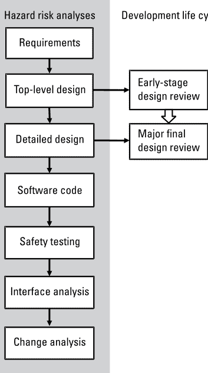

**图 10.1** 贯穿 SSDLC 过程的危害分析。

## 顶层设计危害分析

此级别的风险分析涵盖了安全关键软件组件，包括以下内容：

- 安全关键风险的定义；
- 确定涉及的风险程度；
- 应遵循的设计；
- 创建测试计划以验证设计是否符合安全需求。

### 更详细的安全性 SDLC 项目

此类分析的结果应作为初步设计评审的输入。这种类型的风险分析可以也应该应用于硬件，特别是许多安全关键软件系统包含硬件模块并还控制物理系统。

## 详细设计危害分析

对软件系统详细设计的分析应在开始编写软件程序之前完成。详细设计利用了软件需求和顶层设计的危害分析结果，并且必须确保这些不安全的结果在安全关键软件组件中得到考虑。该分析的结果为最终设计评审提供了输入。

## 代码级软件危害分析

此分析基于详细设计危害分析的结果，并对程序代码和系统接口进行分析，以确定代码或接口中是否存在任何可能导致非预期安全相关事件的错误、故障或状态。这种分析应在生命周期的剩余时间内持续进行。

遗憾的是，尽管许多许多尝试自动化代码审查过程，但所谓的编程代码静态分析通常是一门艺术而非科学。编码实践避免危险状态的能力也取决于所选的编程语言。某些编程语言（如 `Ada`、`MISRA C`、`C#`、`Java` 和 `SPARK`）具有内置限制以避免某些不安全或高风险的状况。然而，更流行的语言（如 `C`、`C++`、`Java` 和 `SQL`）的限制较少，正如 [7] 所述，可以认为它们存在更多的安全问题。

与其他系统接口的考量，以及确保当与目标软件系统链接的系统及其之间的接口发生任何变化时不会引入新问题，也是必要的。有时，被分析系统外部的变更可能会对该系统的运行产生重大负面影响。此外，系统运行的上下文可能会发生变化，包括整个系统在平台和基础设施方面的变化，也包括系统运行环境方面的变化，这些变化可能导致其不再满足安全需求。

## 软件安全测试

此任务的目的是生成文档，证明所有已知危害都已处理，并且它们已被消除或降低到可接受的风险水平。

### 工程安全可靠软件系统

有几个问题影响所有安全关键和安全关键系统；即，测试的完整性和质量取决于安全需求的完整程度以及测试的广泛程度。安全测试应该超出对已知潜在安全危害列表的检查，并调查超出通常范围的故障和失效的影响。除了检查软件系统一般安全方面的非功能安全测试外，执行功能安全测试也同样重要，它关注的是由于软件未按预期执行而可能产生的危害状况。

另一个问题涉及谁必须决定什么水平的风险是可以接受的。例如，工程师对风险的观点可能与管理层不同。在某些情况下，管理层由于预算和时效问题否决了工程师的担忧和警告，有时这会导致严重的后果。

虽然许多审查软件设计、分析源代码和测试功能的方法对于安全关键和安全关键软件系统是通用的，但安全关键控制系统使用了针对控制软件系统的特定方法，如 Feron [8] 中描述的模型检查、抽象解释和定理证明。

## 软件/用户界面分析

此任务的目标是确保用户程序得到充分开发和记录。

人为错误仍然是软件失败的主要原因之一，此类错误可以通过适当的培训和界面使用得到极大减少。错误导致错误反应的例子是法航空 447 号空难，该报告描述了由于飞行员在自动系统失效时无法接管飞机坠入大海。

### 更详细的安全性 SDLC 项目

线控系统接管了几乎所有的飞行功能。

## 软件变更危害分析

当软件系统、其平台或运行环境发生变化时，会对潜在安全危害产生相当影响。所有预期的变更、补丁必须尽可能在实施前进行分析，但需要建立跟踪和监控计划以确保影响安全的变更已经实施并持续有效。

有时修复程序可能会使系统变糟，或者在看似不相关的部位出现问题。难怪在系统运行后进行软件变更的成本比在生命周期早期解决问题要贵几个数量级。

在某些方面，安全关键系统的退役和处置可以被认为是主要的危害类别。不仅需要考虑变更带来的危害（这里是指用新系统替换现有系统），退役过程本身增加了用户和操作/支持人员同时维护旧系统和替换系统的风险。

此外，软件系统的处置也存在潜在危害。例如，系统可能会被未经授权的人无意或故意获取，并由于缺乏培训和支持而被误用，从而对新用户造成风险。或者废弃的系统可能会被攻击。这表明从安全和防护角度来看，监督退役和处置过程非常重要。

需要注意的是，退役和处置阶段往往没有得到应有的关注和重视。这进一步加剧了

### 工程化安全可靠软件系统

审计人员和其他具有监督责任的人员在系统过时后就会对其置手不管，并且不监控系统是如何停役的。

# 安全软件开发生命周期

正如附录 C 表格所示的安全 SSDLC（安全软件开发生命周期）细节一样，附录 D 提供了另一组表格，这次针对的是安全 SSDLC。附录 C 和附录 D 表格中条目之间的显著差异在于，后一个附录对危害分析、验证和确认了额外的关注。虽然这些功能在安全关键型软件系统的设计、开发和测试中也发挥作用，但它们没有获得在安全关键型软件系统中应受的关注程度。此外，当软件系统的安全性面临风险时，通常会对比编程语言、平台和基础设施的选择投入更多关注。

在图 10.2（其与图 9.2 类似，但它指的是安全而非安全性）中，我们可以看到安全因素如何影响 SSDLC 的各个阶段。显著差异包括：在开发生命周期早期的风险分析中更强调安全案证（safety case），以及在实施、部署和运行阶段缺乏渗透测试。这符合安全软件工程师的文化和技术视角。

在图 10.3 中，我们展示了用于安全关键型系统设计的危害风险管理过程，并与其相应的风险因素进行映射。显而易见的是，危害分析比相应的安全风险分析要精细和广泛得多。

我们将简要阐述危害风险管理过程的步骤如下：

- **识别潜在危害**：如果这些危害可以以合理的成本轻易实现，那么人们就不会频繁对异常事件感到惊讶。然而，显然，即使是高影响的危害也会被遗漏，部分原因是识别危害受限于分析师预测极低概率事件的能力，特别是当这些事件以前没有发生过（参见*识别新危害*条目）。这种努力也受到可用时间和资源的限制。

- **估计严重性**：对于安全关键型系统，如前所述，危害根据其后果分类，这些后果可能是灾难性的、关键的、边缘的或微不足道的。安全系统的后果通常是关键性的，但很少被认为是灾难性的，即使它们确实如此，因为可能几乎没有眼可见的影响。


### 更详细的安全 SSDLC 项目

- **识别原因**：对于某些与安全相关的事件，原因很容易识别，但在许多情况下（例如飞机坠毁），在分析飞行记录器数据之前，往往无法确定准确的原因。因此，很难建立起原因与结果之间预期的因果关系。

- **估计可能性**：正如我们在第 6 章中讨论的，估计特定不利事件发生的是非常困难的，特别是对于低概率、高影响的事件。尽管如此，尝试推导出一些概率估计是一项值得的练习——即使它们偏离了目标，可能有助于分析师和决策者对某些风险建立视角。

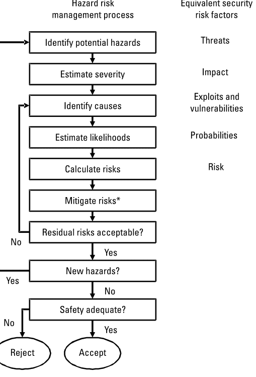

**图 10.3** 危害风险管理过程与相应的安全风险因素。

- **计算风险**：正如我们在第 5 章中讨论的，计算风险的方法有很多，其中许多是错误的或对决策没有贡献。对于安全关键型系统（如航空和核电站控制系统），值得投入大量资金来生成关于系统故障和失效可能性的有用结果。

- **缓解风险**：虽然对安全关键型软件系统风险缓解的常见观点是确保编码正确并配备保护工具，但对于需要对即将发生的失效提供足够警报的安全关键型系统来说，这是不够的。可能需要重新设计和重写软件以规避风险。通常（但并非总是）安全关键型系统对缓解的兴趣比安全关键型系统更高。

- **确定剩余风险是否可接受**：主要问题是，应用各种缓解策略后剩余的风险是否被决策者接受。正如所讨论的，这里的问题在于风险的接受高度取决于主观感受。此外，风险转移给某人或某些实体的程度与决策有很大关系。

- **确定新危害**：危害环境变化迅速，因此由于各种情况的变化，即使是最近的风险分析也可能过时。即使系统已经部署，持续更新风险分析也是重要的。

- **确定安全性是否足够**：在这里，风险评估面临着相同的问题；安全性是否足够在某种程度上是主观的，并且取决于是谁在决策以及他们的可能可能。

这是一个设计安全关键型软件系统的人可以受益的过程，而且当将独立系统组合成复杂的信息物理系统时，该过程是强制性的。

# 结合的安全与保护需求

本书的主要论点是，软件系统的安全和保护工程虽然源自同一个进化树，但已成为不同的分支，尽管趋势是将安全关键和安全关键软件系统在功能上结合为具有安全和保护属性的系统。

解决结合的安全关键和安全关键问题的参考文献之一是 SafSec。在这方面，Lautier 出了如下声明：

> 许多系统，特别是军事领域的系统，必须通过安全和保护当局的认证或认可。目前的做法分别论述安全和保护。一个名为 SafSec 的项目一直在研究安全性的结合方法，并证明了对安全保护进行联合论证可以产生实际收益。

SafSec 方法标准 [11] 和 SafSec 方法指南 [12] 可以从 Altran 网站下载。Sec 方法标准 [11] 包含一组良好的术语定义。从 SafSec 方法可以看出，安全和保护被认为是可靠性（dependability）的贡献因素。虽然这种定义是合理的，但可靠性概念被认为太广泛，无法详细研究，因此我们将安全和保护视为特定的属性。

## 总结与结论

我们在本章中看到，设计和开发软件系统的人对 SSDLC 的各个阶段有非常不同的观点。

软件工程师关注系统失效或故障时产生危害的风险，而不太担心有人窃取信息或控制系统。然而，随着我们看到越来越多的复杂信息物理系统，显然，这些软件工程师需要意识到内部或内部攻击的危险，因为这不仅仅是保护信息的问题，还涵盖了对攻击者控制安全关键系统并强制其故障、失效或以危险的方式运行的担忧。

### 安全软件开发生命周期（SDLC）项目详情

只有在未来软件系统有望获得可接受的安全与防护时，这种和谐才有意义。

## 终注

- [1] 联合软件系统安全委员会，《软件系统安全手册：技术与管理团队方法》，1999年。可通过 `http://www.system-safety.org/Documents/Software_System_Safety_Handbook.pdf` 获取。访问日期：2012年7月23日。

- [2] Talukder, A. K., 与 M. Chaitanya，《架构安全的软件系统》，Boca Raton, FL: Auerbach Publications, 2009年。

- [3] Axelrod, C. W. “将安全关键型系统的经验运用于安全关键型软件”， 2011年 IEEE LIS（长岛系统、应用与技术）会议，纽约州法法明顿，2011年。可购买文章地址：`http://explore.ieee.org/spl/login.jsp?p=&arnumber=5784222&url=%3A%2F%2Fieexplore.ieee.org%2Fie55%25F577722%25F5784222%2F09%2F5784222.pdf%3D5784222`。访问日期：2012年7月23日。

- [4] 见 `http://in.reuters.com/article/2011/03/25/idNIndia-559362010325`，访问日期：2012年7月23日。

- [5] 智能电网在第11章中有所描述。

- [6] 美国国防部，MIL-STD 882D，《系统安全程序要求》，2000年。可通过 `http://www.adt.dae.mil.th/download/mil-std-882d%5B1%5D.pdf` 获取。访问日期：2012年7月23日。

- [7] Axelrod, C. W. “系统系统中的安全与风险交易”，INCOSE Insight,第14卷，第2期，2011年7月，第26–29页。

- [8] Feron, E. “从控制系统到软件”，IEEE控制系统杂志，第30卷，第6期，2010年，第51–71页。

- [9] Clark, N. “关于驾驶舱空难冲突数据的报告”，纽约时报，2012年。可通过 `http://www.nytimes.com/2012/07/06/world/europe/air-flight-447-report-crash-confusion-in-cockpit.html` 获取，访问日期：2012年7月23日。

- [10] Lautier, S., D. Cooper, 与 J. Jackson，“SafSec：安全与防护保障之间的共同性”，第十七届安全关键系统研讨会论文，Springer出版社，2005年。

- [11] Dobbing, B., 与 S. Lautier，《SafSec：安全与防护认证的集成——SafSec方法论：标准》，P.119950.2，第3.1期，布拉格，2006年。通过链接 `http://://www-altran.com/safSecStandards.aspx` 获取。访问日期：2012年7月23日。


# 软件系统安全与防护的经济学

> 安全是一个走捷径会导致灾难的领域。
>
> —Eric Allman

## 引言

本章提出的问题是：安全与防护是否会被充分纳入软件系统中，以及这种安全改进在现在和未来在经济上是否合理。本分析的目的是确定如何基于行为经济学的依据（而非仅仅基于“这样做是好事”的通用直觉）来创建更安全的软件系统。

在之前的章节中，我们研究了系统工程和软件工程的起源，列举了为了确保安全与防护能够构建到软件密集型系统中需要满足的特定需求。我们还审视了这些需求在实践中何种程度上得到了满足或未得到满足。在经历了整个过程后，仍然有一种感觉：我们永远无法掌握这些需求并生产出完全受保护且具有保护能力的软件系统。造成这种缺陷的原因有很多，包括负责软件密集型系统安全和/或防护方面的人员缺乏知识和培训，并且他们既没有技能也没有意愿承担这种责任。另一个可能是由于运行在不断运行的复杂集成软件系统和信息物理系统所要求的成本负担日益增加。

## 构建安全可靠的系统

现代软件系统是数量激增的攻击者的受害者，但在引入安全与防护的努力方面显然存在差距。市场对安全与防护的需求非常迫切。然而，不断增加的故障和失效阻碍了软件开发人员进行保护和预防的尝试。这就是为什么架构师们一直推崇将安全关键系统与网络隔离开是唯一的方法。然而，一方面对功能增加的需求，另一方面对降低成本的需求，使工程师进入了不安全且不可靠的领域。

## 缩小差距

如何做才能确保软件系统是安全可靠的？针对这些经常提出的问题需要什么？也许我们问的问题错了，或者我们没有完全理解它们。正如文献 [2] 所述，不列颠哥伦比亚大学 Robert Gifford 的研究结果，他确定了人性使得人们只会对灾难做出反应，特别是在网络安全方面。Gifford 提出了以下四个行为障碍：

- 我们难以想象与现在不同的未来；
- 我们会回避缺乏简单解决方案的复杂问题；
- 我们不喜欢延迟收益，因此不愿意为了未来而牺牲现在。

## 工程化安全可靠软件系统

- 根据其价值函数，安全性与可靠性对个人和群体的影响；
- 说服或强迫这些个人和群体采取行动以最大限度地减少其个人风险，从而实现全局优化的手段；
- 一个旨在优化参与安全关键型和安全关键系统创建、运行和使用的所有相关人员目标的议程。

该目标是设计一个程序，随着时间的推移，将安全关键型和安全关键型软件系统的风险降低到可接受的水平，尽管这一门槛正在不断提高。

我们将讨论检测、防御和反篡改的方法，作为应对网络和物理世界日益增长的威胁的手段。最后，我们将展望“安全性与可靠性模式”的使用。

# 技术债

技术债背后的概念是：软件系统在进行设计、开发、实施、运行和更换时，参与开发周期及后续运行环境的人员无论知晓与否，都在承担技术债，这些债务可以被有意识地或无意识地承担，也可以被减轻或偿还。

Allman [1] 指出：“……当工程师采取未能达到最佳实践的捷径时，就会产生技术债。”当然，所谓的“最佳实践”也可能未能达到理想实践，这意味着在常见实践中，它们实际上是两层技术债，取决于这些实践来源的权威性和愿景，常见实践往往排除了本质要素。

Allman 给出了许多示例，说明由于最佳实践与其他因素之间的竞争，可能会产生技术债。以下是他的部分示例：

- 设定过于紧迫的截止日期；
- 未预见到工具的成本并不恰当地使用它们；
- 将技能不足或不适当的工程师分配到项目中；
- 跳过文档要求或编写不充分的文档；
- 在良好的安全实践上偷工减料；
- 使用晦涩且不完整的错误信息；
- 使用缓慢、简单的算法，而不是更复杂且运行更高效的更好算法。

还有许多其他因素需要考虑，例如项目预算不足、使用缺乏经验的项目经理等。所有这些缺陷都导致了技术债的积累。正如 Altman 所指出的，不同的利益集团根据其角色和限制该债务的能力来承担技术债。此外，正如我们在第 6 章描述的那样，他们可能会有意或无意地积累并将技术债转移给他人。这是一种道德风险，那些创造债务的人设法逃避控制和偿还债务的指责或责任。

Altman 详细阐述了技术债如何影响组织内部外部的各个领域。他列出的特征和短板通过从这些列表中推断出的项目进行了补充。增强后的列表见表 11.1。虽然表 11.1 中的列表不是详尽的，但它们确实包含了有用的指标，说明了从开发生命周期参与者的特定视角来看，什么是重要的。理想的特征和典型的短板在不同参与者之间明显差异，取决于他们的个人议程、组织角色以及对于分配给他们的技术债的脆弱性。建议参与者如何对影响其个人的因素采取行动，将有助于确定他们如何以优化整体系统的方式受到影响，而不仅仅是他们负责的特定个人组件。定价、征税和其他惩罚性活动，以及作为在安全和可靠性领域表现良好的奖金奖励，可以鼓励个人为了所有利益相关者的利益工作，而不是为了个人利益。

## 技术债概念在安全与可靠性应用

Allman [1] 确实将安全视为技术债问题。然而，对安全的处理略显边缘化，文章中完全没有提到可靠性。这并不寻常，因为软件开发领域的大多数研究人员具有信息或网络系统的背景，而不是工业控制系统背景。然而，技术债的积累与安全密切相关，在较小程度上与可靠性也相关，因为风险分析贯穿整个安全开发生命周期（SafeSDLC）。特别需要注意前面提到的方面，随着软件开发的进行，“外挂”安全和可靠性功能的成本变得越来越高昂。在某一点，微小的纠正、补丁或增加变得不可能。结果是系统易受攻击、故障和失败。

技术债的转移或规避在网络安全领域尤为普遍，因为存在大量的系统和网络，没有人愿意或能够承担责任和债务。他们是否能够承担技术债尚未知。“公共悲剧”和“道德风险”使得直接相关的人规避责任并转移给他人，例如公众。公共悲剧和道德风险都不利于技术债分配给其所有者。

相反，当涉及到可靠性时，会有明确的责任界限，除非事件规模巨大，例如 2011 年 3 月 11 日袭击日本东北海岸的海啸并摧毁了福岛核电站，以至于单一实体（本例中为拥有并运营福岛设施的东京电力 TEPCO）无法承担全部责任。因此，处理后果成为政府的部分责任。有趣的是，当 TEPCO 在 2012 年 6 月 19 日发布最终报告时，他们承认没有充分预见到这场灾难，并且对这种规模的海啸没有做好充分准备 [4]。

## 系统过时与更换

Allman [1] 似乎暗示，当一个系统预计被另一个系统替换时，原始系统积累的技术债会被某种赦免并消失。这并非如此，特别是对于那些没有在预期时间范围内退役的系统。一个典型的例子是千年虫（Y2K）。在 2000 年之前编写了数十亿行代码，预计在世纪结束时会被替换。这假设程序员从未考虑过用两位数字表示年份而非四位数会产生的问题，而他们很可能没有考虑过。这种疏忽造成的技术债高达数百亿美元。同样，当微软决定更换过时的操作系统 NT 4.0 时，它必须处理那些尚未准备升级系统的遗留用户。客户压力可能意味着供应商在原计划放弃产品的日期之后仍必须提供支持。

# 个人与群体对安全性的责任

我们现在考虑更广泛的群体如何看待软件系统（特别是安全性和安全性），以及安全和安全属性在多大程度上被认为是各个小组的责任。从某种意义上说，这种类似于技术债，因为忽视安全和安全的成本会在整个软件系统开发生命周期中积累。我们关注了安全疏忽和安全故障对广泛人群造成的经济后果，这些人群包含了直接和间接参与软件系统创建、部署和运行的人员。

## 核心思想

所提出的基于风险的价值方法的核心概念是：利益相关者有一种个人观点，认为包含或排除特定的安全和安全功能将直接影响到他们个人。虽然可能存在其他动机，但个人仍然会从自己的角度来看待安全功能和能力的影响。只有当个人利益受益于健康繁荣的组织时，个人动机才可能与组织目标一致。这听起来可能有些愤世嫉俗，但并不是为了批评，也不否定人们会为了团体、组织或国家的利益采取利他行为。点在于，个人对风险的评估和反应通常是高度主观且极个人化的。

例如，如果一组开发者负责在特定截止日期前并在预定预算内完成一个应用程序，且实现这些目标是团队成员奖励的基础，那么任何可能威胁正式截止日期的时间延迟、额外成本或资源需求都将尽可能被避免。只有将奖励和福利标准包含在安全可靠的软件设计、架构、开发和测试中时，这些领域才会获得适当的关注。然而，根据特定安全和安全要求的符合情况来定制补偿和其他奖励的决定，必须来自组织内部的高层管理人员。

通过识别与安全相关的决策的动机，并将其纳入个人响应动机的经济模型中，就可以理解为什么在将安全和安全性纳入软件密集型系统的开发、运行和退役时会做出某些决策。引用 Axelrod [5] 的话：

> 如果不充分了解影响动机、阻碍因素以及其他影响犯罪分子、受害者、防御者、产品和服务提供者、立法者、执法人员和其他利益相关方行为的各种因素，就无法为信息安全和隐私建立经济模型。如果能对各方如何响应内部动机和外部刺激有现实的表述，那么预测利益相关者的行动和反应将更加有效。

正如我们所见，安全工程在航空航天、航空电子和车辆动力装置安全等某些关键行业中非常正式，这要求系统根据其潜在的危害进行评估，从而指向该行业所需的认证水平。

## 扩展模型

文献 [5] 中的模型讨论了各种利益相关者攻击和防御安全关键软件系统的动机。在这里，我们将模型扩展到涵盖安全关键软件系统，并关注利益相关者动机对软件安全开发生命周期（SSDLC）的影响。

我们检查了生命周期的每个阶段以及利益相关者目前如何参与或影响每个阶段。我们建议如何改变每个阶段涉及的参与者名单及其角色和职责，以实现更可接受的安全水平。我们还建议了动机和威慑因素，这些因素可能用于影响每一步的结果，使最终产品或服务满足组织的安全和安全性要求。其意图是提供一份行动清单，推动决策者和利益相关者转向最符合社会整体需求的安全和安全态势。虽然许多建议是规范性的，并且可能因为成本高、资源有限和缺乏权威等因素而无法实施，但该模型确实指出了需要关注的领域，并在某种程度上建议了改进现状的新旧不同方法。

## 概念与需求阶段

在确定系统需求时，对拟议系统的功能和非功能需求做出决策的人可能不太考虑全面的安全和隐私问题。包含安全问题的可能性通常要高得多，这很大程度上是因为与安全相关的软件故障和失效可能会导致受伤或生命损失。保险公司有公式来根据其目的用金钱来确定受伤或死亡的价值，但通常在对缺陷系统制造商的信心、额外的负担性监管和审计要求以及业务损失方面，其间接影响往往要大得多。

在概念产生并成为内部业务和技术人员想法的成果后，需要包含关键领域的完整代表性；或者，高层管理人员和/或营销部门可能会意识到新技术、竞争对手的系统、法律和法规要求、当前系统的过时等。然后，概念需要根据赞助者、用户以及技术和运营人员的需求进行描述；每个参与者提供输入，最终形成一组功能性需求，理想情况下还有非功能性需求。

在表 11.2 中，我们展示了软件开发生命周期（SDLC）的组成阶段，并指示哪些利益相关者参与了每个阶段以及他们的角色应该是怎样的。对于起源阶段和需求阶段，这通常是业务、技术和运营参与者的混合，每个人都为系统需求的制定带来了自己的视角。因此，高级业务管理层和营销部门最感兴趣确保软件系统提供所需的功能。他们还希望确保开发系统将在特定时间范围内（或价值时间）内消耗特定的资源和资金。这可能由上市时间等外部因素决定。技术人员将希望目前可用的技术能够在时间参数内以合理的成本交付所需的功能。客户的价值分布（如管理层、作为客户代表的营销部门和终端用户）将推动功能最大化并最小化成本和上市时间，而技术和运营团队的个人风险则向相反的方向移动（减少功能、增加资源和更多时间）。需要对这两组之间达成平衡，这通常由谈判参与者的相对权力和权威决定。由高级企业和业务部门管理层组成的客户方通常占据主导地位，技术和运营团队被迫让步。这可能是许多缺陷和有缺陷软件系统背后的原因。

SDLC 这一阶段经常被排除的领域清单长得令人心惊，特别是需求缺陷（尤其是非功能性需求），如果列出的领域被包含在讨论并在决策过程中拥有投票权，这些缺陷是可以避免的。有时，一位高级执行官会明确表示这些被忽视的领域之一必须包含在过程中并获得其直接支持，就像微软的比尔·盖茨强制构建可信的安全软件一样。然而，在很多时候，许多此类领域似乎被排除在项目之外，导致这些领域陷入了进退两难的境地：要么接受不标准的系统，要么尝试事后补救安全与保障措施，或者通过增加容量来获得更好的性能，编写保护防止不可避免故障的合同等。正如之前讨论过的，这些事后修复的成本可能比在需求阶段就纳入安全、保障、韧性等需求要高出几个数量级。由于生命周期后期通常很少或没有额外的可用资金，折中方案是进行最少的干预，并强制人们绕过这些问题。也许这种普遍情况的唯一例外是软件系统是安全关键的，需要根据非常特定的安全需求进行认证，在这种情况下会包含工程参与者。然而，这并不意味着适当的软件安全工程师会在这一阶段参与。

如果不包含表 11.2 右侧列中的额外参与者，项目成本不可避免会更高。如果这些参与者在项目后期加入，那么他们的需求成本将得到解决。否则，成本将以机会成本或间接成本的形式存在，可能无法追溯缺陷的根源。例如，如果安全没有构建到软件系统中，那么在系统部署时将需要昂贵的工具和人员来提供更高水平的安全。然而，防火墙、入侵检测与防御以及类似技术无法补偿软件系统固有的漏洞，而且它们是部署、维护和管理的持续成本负担。

# 表 11.1

不同视角的增强需求与短板

| 视角 | 理想特征 | 典型短板 |
| :--- | :--- | :--- |
| 客户 | 软件系统：<br>- 可运行（符合预期）<br>- 易理解<br>- 可以长期[方便]维护<br>- 可靠[且具有韧性]<br>- 包含行业标准的[安全与可靠性]实践<br>- 可扩展（即可伸缩）<br>- 可增强（即根据新需求进行修改）<br>- 使用方便且愉快 | 用户文档不充分<br>软件不稳定<br>频繁发生故障和失败<br>特定用户操作产生意外且不良的结果<br>处理和结果不准确<br>客户无法启动纠正、更改和增强<br>工作人员不可用、无响应或无法运行<br>技术和运营人员缺乏知识 |
| 帮助台 | 用于用户支持功能的设计良好的接口<br>软件系统的详尽文档和功能<br>用户在请求帮助台支持之前可能查看的常见问题 (FAQs)<br>直接即时访问富有知识的技术支持 | 接口设计不佳<br>文档糟糕或不存在<br>代码晦涩的间接影响<br>响应客户问题时间过长<br>无法直接联系到解决问题的人 |
| 运营 | 软件产品：<br>- 可靠<br>- 可维护<br>- 易理解<br>DevOps 方法，即人员在生命周期早期与开发人员协作<br>- 可以随时访问代码<br>提供最新、准确的可用性 | 接口设计不佳<br>文档糟糕或不存在<br>代码晦涩的间接影响<br>响应客户问题时间过长<br>无法直接联系到解决问题的人 |
| 工程师 | 软件：<br>- 可靠<br>- 可维护<br>- 易理解<br>DevOps 方法，即人员在生命周期早期与开发人员协作<br>- 可以随时访问代码<br>提供最新、准确的可用性 | 接口设计不佳<br>文档糟糕或不存在<br>代码晦涩的间接影响<br>响应客户问题时间过长<br>无法直接联系到解决问题的人 |
| 开发人员 | 开发人员：<br>- 详细、准确的规格<br>- 敏捷方法<br>DevOps 方法，即人员在生命周期早期与开发人员协作<br>- 可以随时访问代码<br>提供最新、准确的可用性 | 开发人员：<br>歧义且不完整的规格<br>缺乏测试用例<br>缺乏对安全、性能等方面的知识 |
| 维护人员 | 维护人员：<br>- 文档良好的代码<br>- 易于维护<br>- 易于更改的操作程序 | 维护人员：<br>未记录良好的代码<br>不易于维护的代码<br>不充分、过时的操作程序 |
| 管理层 | 管理层：<br>- 理解风险管理并平衡利益<br>- 理解技术债以及如何减少它 | 管理层：<br>对组织产生不利影响<br>不理解技术债<br>产生了大量的技术债 |

对列表中某些项目的补充如方括号所示。

# 表 11.2

各 SDLC 阶段的参与者与决策者

| SDLC 阶段 | 典型参与者 | 常规决策者 | 建议的额外参与者（通常包含） |
| :--- | :--- | :--- | :--- |
| 起源与需求 | 高层管理（战略系统）、业务部门管理、业务部门运营、营销（适当）、内部用户代表、信息技术、安全工程（安全关键系统） | 高层管理（战略系统）、业务部门管理、信息技术管理、安全工程（安全关键系统） | 信息安全、安全管理、内部审计、风险管理、软件保证、应用分析、内部用户代表、计算机操作、技术支持、软件联络、身份与访问管理、法律部门（代表立法者和执法人员）、合规部门（代表监管机构和外部审计人员）、系统管理、业务连续规划、灾难恢复规划 |
| 设计、架构与规范 | 系统分析师、软件架构师 | 系统分析管理、软件架构师管理 | 信息安全、内部审计、应用分析、应用安全分析师、计算机操作、技术支持、系统管理、业务连续规划、灾难恢复规划 |
| 开发 | 开发人员、技术支持 | 开发管理 | 信息安全、应用分析、应用安全分析师、业务连续规划、灾难恢复规划 |
| 验证（评审、代码检查）、确认（测试） | 业务部门赞助者、系统分析师、开发人员、测试人员 | 系统分析师、测试人员 | |
| 部署、运营、维护与技术支持 | 客户关系、营销、运营、网络工程师、技术支持、现场工程师 | 营销、运营 | 信息安全、系统安全、系统、业务连续规划、灾难恢复规划 |
| 退役与处置 | 业务部门赞助者、计算机操作 | 营销、运营 | 信息安全、系统安全、内部和/外部审计人员 |

## 参考文献

- [12] Dobbing, B., 与 S. Lautier，《SafSec：安全与防护认证的集成——SafSec方法论指导材料》，P.119950.3，第3.1期，布拉格，2006年。通过链接 `http://www.altran.com/safSecStandards.aspx` 获取。访问日期：2012年7月23日。

- [13] Firesmith, D. G.，《安全、防护与生存性工程的基础共同概念》，技术笔记 CMU/SEI-2003-N-033，卡内基梅隆大学软件工程学院，2003年。


从价值角度来看，我们看到拥有权力和权威的人员会努力减少他们认为归于自己的成本。他们会试图使利益最大化（其他成本节省、竞争优势等），并忽视那些本质上负责控制软件系统风险之人的演示。不幸的是，随着时间的推移，由于早期成本不断增加，往往是那些在 SDLC 初始阶段未被咨询或领导的人承担了指责并承受了负面后果的主要打击。最终，有人必须为需求阶段的缺陷买单——而通常不是那些被排除在流程之外的人。如果如果在生命周期早期就承担了正确类型和水平的资源，总汇总成本将同样容易，甚至可能比现在低得多。

# 设计与架构阶段

在大多数情况下，软件系统设计及其架构（平台、网络等）是留给技术人员的。这是因为该阶段通常包括将上一阶段开发的一系列需求，并将这些需求翻译成由应用程序模块、软件系统、物理系统和网络组成的特定设计。

该过程的阶段有关许多问题。首先，它依赖于需求的质量和完整性，还取决于软件系统设计者和架构师的知识和经验，其中任何一点都可能缺失。其次，设计者和架构师有动力提出满足需求的设计，无论需求是否充分。因此，非功能属性（如安全和性能）可能在需求中没有得到充分涵盖，从而在设计中可能不会被考虑到。在许多情况下，对于使用创新技术的系统，除非开发原型或建立仿真，否则性能是无法预测的。因此，为了激励设计者和架构师开发出性能满意的设计，或防止他们建议无法满足性能目标的架构，人们需要意识到对于那些性能、安全、韧性、数据完整性等价值要求高的人来说，这些属性的重要性。然后，必须确保采取适当的措施来鼓励对这些属性进行充分考虑。

一个被忽视的方面是需要纳入必要的监控、数据收集和分析，特别是为了能够追踪系统用户。这种信息对于例如数据泄露后的计算机取证至关重要，而将其纳入需求的必要性很少被认可。然而，当这种需求被提出时，通常会收到负面反应，因为这将导致成本和资源的立即增加，以及一些运营开销，而收益可能在几个月或几年后才会出现，如果有的话。

出于这些原因，在设计阶段需要对安全和软件工程师、审计师、支持人员等进行监督，以确保他们的利益得到覆盖，并验证设计正确地解释了需求。这在表 11.2 设计/架构行的最后一列中有所体现。

# 开发

在开发阶段，程序员和其他技术人员通常专注于编写功能上正确、无错误且在规定的时间范围内完成的代码。对于设计团队来说，开发人员不需要特别有创造力，除非是在编写高效且有效的程序时。他们通常因字面执行需求而获得奖励，而不是试图去推测需求。这通常来说是积极的，但如果开发人员发现有疑的需求并不愿报告它们，就会产生不利影响。这就是为什么希望其他参与者存在之一，

例如软件安全工程师，他们在整个阶段都担任顾问角色。这些参与者还需要具备足够的影响力来使其需求得以实现。虽然开发者与这些试图将需求纳入考虑的群体之间可能存在争议，但结果很可能会增加系统对各个小组成员的整体价值。

## 验证

系统验证者的目标是确保系统是根据详细的客户和用户规范构建的，具体体现在准确描述这些需求，并确保所有需求都已包含。这意味着没有直接参与程序创建的人员必须审查每一项需求，并了解每项需求是如何实现的。他们还必须确定拟定的针对需求和规范对程序进行测试的方法是否满足需求。测试本身是在确认阶段完成的。

这一阶段的一部分还应该是确定需求集是完整且正确的。如果需要一个过程，将验证结果反馈给参与需求阶段的相关小组，那么如果由于这一结果导致任何需求发生变化，则必须更新规范并对程序进行修改以纳入修正后的需求集。很容易看出，源自生命周期后期阶段的变更在金钱和时间上的成本要高得多，而在生命周期早期做对是多么不那么困难。

因此，开发者是参与者，但在验证方面并不是决策者，如表 11.2 所示。在某种意义上，鼓励评审人员发现错误和遗漏，并确保错误得到纠正。这再次涉及到一些争议，因为必须重做程序。这可能会延迟完成并增加资源消耗。然而，验证阶段具有巨大的收益，因为在这一阶段捕获的错误和遗漏比在生命周期后期发现的错误更容易修复且成本更低几个数量级。由验证引起的任何成本或延迟，都应该与遗漏错误而可能导致的更大的成本和延迟进行权衡。

## 确认

在这一阶段，通过运行一系列预定义的测试并观察结果，证明软件系统的正确工作。如果检测到错误，则将它们反馈给开发者以重做计算机程序。相应，修订后的程序需要重新测试，直到错误得到解决。

问题在于，所谓的安全与安全功能测试（测试人员检查软件系统没有执行其不应执行的操作）以及非功能测试（涉及安全服务、安全、性能、可靠性、恢复性等）是否在测试计划中得到了充分体现。这些测试往往被遗漏，这就是为什么在表 11.2 的确认阶段所示，引入对这些其他特性有既得利益的人是重要的。

## 部署、运营、维护和技术支持

软件部署的方式有很多种，从下载网站到定制化安装不等。前者方法还涉及某种形式的在线或电话支持，通常由呼叫中心或帮助热线提供，而更复杂的情况被称为技术支持。根据软件系统的性质、规模、成本和复杂性，供应商可能会由其服务组织管理安装，或者客户的技术支持工程师可能能够在现场进行安装，特别是当其为升级而非新安装时。持续的运营通常由运行软件系统的组织使用其内部员工或第三方进行管理，计划性的维护和维修服务通常将由供应商的现场服务工程师或第三方原始设备制造商 (OEM) 完成。

通常，信息安全和安全软件工程师（无论来自供应商还是客户组织）除非发生安全违规或安全相关的事件，否则不会参与运营阶段。然而，有强有迹象表明，应该对维护和维修功能进行安全和安全监督，例如，已经记录了许多伪造零件被替换的案例，其中一些包含恶意软件。在表 11.2 中，我们看到了这些参与者的需求，以及其他在发生违规或发现恶意软件或硬件时可能被召集进行取证和追踪犯罪者的人员。

运营阶段可能是受到安全和安全支持者关注最少的阶段。运营和技术人员通常不具备处理安全事件的专业知识，但大多数与安全相关的攻击都是处于生产中的软件系统。对于安全关键型系统，运营人员通常接受过如何处理日常硬件故障和失效的培训，但在检测和处理软件及数据漏洞方面的装备通常要少得多，正如伊朗铀加工设施的 Stuxnet 攻击所示。

## 退役与处置

私营部门最少关注的领域是安全关键型以及在较小程度上是安全关键型软件系统及其可能包含的数据退役和处置。很少有文本区分处置以及随之来的知识产权和其他敏感数据的泄露风险。另一方面，特别是政府机构（如美国国防部），经常处理安全关键系统的处置——特别是当退役系统包含可能致命或伤害的危险组件时——以及机密安全数据的处置。

如果退役和处置的责任被明确定义和分配，执行这些工作的人就有动力正确且完整地执行；因为未能执行可能很容易被察觉，或者发生来自丢弃系统的事故或数据泄露。对于安全关键型系统，最大的风险在于可能没有单一实体负责系统和介质的妥善处置，因此几乎没有到位措施。因此，让安全和安全专家以及内部和外部审计师参与退役和处置阶段是非常重要的，如表 11.2 所示。

## 总体印象

上述分析说明，对于在整个安全软件开发生命周期 (SSDLC) 中具有特定利益关系的人员（特别是在非功能领域）的排除或延迟参与，会导致系统早期出现缺陷，从而导致后期修订需求和解决方案的成本过高——即“补丁式”与“内置式”的症结。挑战在于如何诱导他们早期且充分地引入所有必要的参与者，以确保软件系统的整体价值最大化。显然，仅仅诉诸权威人员做“正确的事”是不够的。必须有机制来鼓励推动系统更高价值。这可以通过指令、威胁、劝诱、经济手段、法律、法规等来实现。

## 鼓励最佳行为的方法

有许多方法可以影响个人在各个角色和职责方面的行为

为了鼓励包含某些属性（如安全性和可靠性），通过这些激励因素和威慑因素作用于个体决策者和项目参与者，促使他们以符合软件系统制造组织和其他利益相关者（如客户、业务伙伴、监管机构和审计人员）利益的方式做出反应。

当然，涉及关键属性全局优化的决策也具有高度的主观性，但根据我们的目的，我们将假设可以定义某种全局价值函数，从整体权威的角度包含有形和无形的成本与收益。虽然这种方法远非理想，但它至少让人们能够确定哪些是关键的、它们的可能水平是什么、软件开发生命周期（SDLC）每个阶段对全局价值的贡献，以及需要直接或间接说服采取促进共同利益行为的特定参与者和决策者。

# 定价

如果可以应用，资源定价可以是影响行为的更有效的方法之一。组织及其项目的典型机制是某种形式的预算结合费用分摊。这种方法的关键组成部分是，能够从独立的资金池中找到某些所需的属性，且这些资金的使用不会影响特定的项目预算。这很重要，因为如上述所述，在开发生命周期中包含安全考量和能力通常与设计人员、开发人员和测试人员的个人利益相悖，他们通常是为了按时按预算完成项目。安全属性通常属于这一类，除非在组织层面为它们“付费”，否则它们通常得不到足够的支持。

# 费用分摊

收取出一般管理费用等间接成本的规则会极大影响项目成本，有时项目实际上会得以进行。费用分摊还会影响参与者对各种需求的响应。对于信息安全等因素，拥有一个中央资金池通常是理想的。这样，高级管理层可以执行安全要求，而不会因为在软件系统中引入安全属性导致任何延迟或成本超支而惩罚开发团队。

# 成本与风险缓解

可以利用激励措施，例如将个人的薪酬与他们在安全、可靠和韧性等领域实施公司目标的程度挂钩。后者的目标对于开发者和测试人员来说，通常不是考虑因素。

某些人的行为可能会受到机会成本和机会代价的影响。前者（即做某事而非做另一事所产生的成本）意味着决策者可能处于可以选择一种风险缓解而非另一种策略。例如，在 SDLC 中引入安全考虑，或在软件系统部署后安装防火墙和其他工具。另一个例子是，公司可能会选择通过为其系统提供现场备份、冗余电源（如电池备用、柴油发电机）、多个电信供应商等来对数据中心进行加固，而不是将钱花在一个功能完全的数据中心上。利用节省下的部分资金，公司可能会与第三方签订合同按按灾恢复服务。后一种影响——即机会代价——是指某些愿意做出降低成本但可能在未来某个时刻产生不利影响的决策。这被视为风险接受，例如决策者愿意承担是否会发生网络攻击的风险。

# 管理授权

鼓励预期行为的一种有效手段是制定公司政策并建立可信的执行程序。如果高级管理层具有说服力，并且有以往记录表明他们言行一致，那么这种方法将是极其有效的。一个非常好的例子是之前提到的微软公司创始人比尔·盖茨，他宣布可靠性将成为他们未来产品的关键要素。在这一声明发布后的十年里，微软在构建安全软件方面的声誉大大提高。

通过建立目标并发布相关政策，高级管理层正在指导低级经理达到或超越目标，但将实施细节留给经理判断。这通常意味着引入安全、可靠和其他能力的合理预算请求将获得批准。

# 立法

立法者对数据泄露导致身份盗窃的威胁变得高度敏感，因为报告的泄露事件数量惊人，而且他们的许多选民都是身份盗窃和账户劫持的受害者。在美国，截至目前，大多数州已经颁布了数据隐私法，美国国会起草了几项联邦法案，但尚未真正通过成为法律。

在许多进展缓慢的领域，法律可以是非常有效的激励或威慑手段。然而，网络安全和系统安全的挑战如此动态，以至于即使精通技术的个人也难以跟上这种快速变化，更不用说国会议员了，他们许多人对信息技术尤其是安全相关的后果缺乏了解。

# 监管

监管机构将法律转化为可操作的指令，并通过各种监督、监控和审计方法确保产生的法规得到执行。在美国金融服务业，银行受多家机构监管，包括联邦储备委员会和货币监理局办公室（OCC），证券公司和美国所有上市公司受证券交易委员会的监管。某些机构针对应用安全发布了非常详细的指导，例如 OCC 公告 2008-16 号，其中包含了关于如何达到可接受的应用安全水平的许多建议 [6]。

许多其他行业也受到监管，其中一些涉及开发和使用安全关键和安全关键的软件系统，例如受电信委员会监管的电信行业，以及受联邦航空管理局监管的航空业。这些这些监管机构通常提供飞机制造商、车辆制造商、核能电站建设者等必须满足的标准。

# 标准与认证

行业成员不仅必须遵守法律法规，他们可能需要获得预定义的认证级别才能在该行业内运营。认证在安全关键系统中很常见，这些系统通常以工业控制系统的形式存在，可能导致伤亡或伤害。虽然在运行安全关键系统的行业中很常见，但安全关键系统的认证寥寥无几。支付行业数据安全标准（PCI DSS）提供了应用安全指导，但其管辖限于支付卡信息的发行商和处理商 [7]。

# 未来展望

为了解决软件系统在安全和可靠方面的不足，不仅需要实施本书中包含的建议，还需要关注有前景的发展，其中一些处于研究阶段，另一些已经实现了商业化。这并不是要认可这些任何方法，而是除了在软件安全和安全工程学科之间转移良好实践的协同效应外，我们还需要超越现状，考虑到经常发生的许多泄露、故障和失败，显然有改进空间。

确认需要突破性的方法和技术，从之前提到的 2012 年 2 月由国防高级研究计划署（DARPA）发布的题为“高信誉网络军事系统（HACMS）”的广泛机构公告（BAA）[8] 中显而易见。

# 软件系统安全性的经济学

报告引言部分最耐说明问题的论断可能是：为了构建高信度网络物理系统，需要开发并应用与目前不同的方法。美国国防高级研究计划局（DARPA）坚持认为，“研究应该调查能够使科学或系统取得革命性进展的创新方法。”

虽然该领域明确需要创新，但开发技术应采取何种形式尚并不显而易见。值得努力尝试关注从 BAA（广泛征求公告）产生并由 DARPA 资助的特定研究，以获得创建安全可靠系统未来方向的指导。

然而，在此期间，还有许多改进软件系统安全性的有趣方法，其中两种将在本文中讨论。这些是相对新的方法和流程，但对于提高关键系统和软件系统的安全性具有前景。其中一种与篡改有关，另一个与所谓的“模式”有关。前者属于屏蔽（或免疫）软件系统免受攻击来避免攻击类别；而后者是一种信息共享和从经验中学习的过程，它已应用于安全领域，并在安全属性方面具有前景。

# 篡改

从软件密集型系统遭受的攻击（无论成功与否）的频率和描述，以及发现方式可以看出，很多时候受害者甚至不知道网络攻击的存在，而且对许多物理攻击也一无所知。受害者不知道攻击已经发生，并不总是因为没有检测到，而是因为犯罪分子足够专业能够掩盖痕迹——或者两者兼有。

信息安全经验以及防止价值贵数据丢失（通常称为数据泄露防护 DLP）的尝试，使人们意识到篡改易感、防篡改和防篡改方法之间的区别，以及它们如何适用于安全关键和安全关键的软件系统及其包含和处理的数据。

## 篡改易感

简单来说，篡改易感意味着访问软件或硬件系统或媒体的行为通过保护性逻辑或物理“封带”的某些变化显而易见，小偷无法移除篡改证据。通常，进行篡改的人并不特别关心包裹或软件的接收者是否知道有人闯入。接收者可能对发送者或产品发行者拥有某些索赔权，但这已是局限。

在其他情况下，包裹或行李的所有者可能不得不允许某些已知机构（例如美国运输安全管理局 TSA，但仅限该机构）访问内容。设计了特殊的隔间以允许 TSA 代表访问，并显示包裹是否被持有有 TSA 标准钥匙的人打开过。

## 防篡改

防篡改是一个不同的概念。在物理世界中，人们会联想到这些奇特的小螺钉头。它们允许人们用普通螺丝刀顺时针方向旋转螺丝，但不会允许逆时针拆卸。物理世界上有很多种方法。软件的对应系统也可能存在，如果存在的话，它们并不为人所知。无论如何，通过可能具有破坏性的努力（例如钻掉螺丝），这种保护方法就可以被绕过。这对于某些想要获取设备内部构造且不担心此类入侵是否能被预定用户检测的人来说是有益的。

防篡改的作用是威慑或阻止业余小偷，但可以被具有相应技能和工具的专业人士破解。取决于受保护资产的价值，这种防篡改可能足够，但许多无法满足保护高度敏感数据或机密设备的要求。

## 防篡改

防篡改与其他方法不同。在这里，攻击者在尝试访问受保护的硬件或软件的可运行版本时通常不会受到阻碍，但硬件或软件可能会自我破坏。防篡改有两种类型。在物理世界中，破坏物品的尝试将导致内部任何内容的立即销毁。破坏可能是通过短路和烧毁电路，或者保护硬件被销毁导致原始者无法重新使用。需要定制软件，可能昂贵且难以创建和实施。从软件角度来看，有方法可以防止任何人访问和修改软件。由于显而易见的是几乎没有软件系统可以被完全保护，我们只剩下规避。威慑很少有效，规避不是让资产对潜在攻击者可用。

在某些情况下，并非所有情况。显然，你需要运行一个程序或处理某些数据，那么人们就无选择可用，因为知道攻击几乎无法防止。就像物理世界一样，答案在于建立免疫系统。这是一种非常有效的方法。当然，必须决定特定软件的自我破坏是否合理。人们可能不愿意破坏极其昂贵的设备，并倾向于保留它以便恢复到运行状态。例如，人们不想让涉及战争（火炮、飞机、舰只、潜艇等）的系统落入敌手手中，因此自我破坏是一种可行的方法。在其他情况下，确保捕获此类设备的人无法使用或对其进行反向工程可能足够了。后方面非常难以证明。

我们展示了不同篡改相关特性的优缺点。本质上，越便宜、越易实施的方法（如提供篡改证据的方法），对内容的保护很小，但可以起到威慑作用，因为保护箱的封带将显示有人尝试或成功未经授权地访问内容。此外，接收者有责任检查……

## 表 11.3

各种与篡改相关方法的优缺点

| 特性 | 优点 | 缺点 |
|---|---|---|
| 篡改易感 | 廉价且易于实施；提供尝试和成功闯入的证据 | 系统易于访问，但可能面临处罚等，例如导致保修失效；不阻止入侵，且资产以可用形式仍可用 |
| 防篡改 | 通常廉价且易于实施；通常提供篡改证据；提供某种程度的保护，类似于物理路减速带 | 如果攻击者能忍某种程度的破坏，访问系统相对容易；不阻止入侵，且资产以可用形式仍可用 |
| 防篡改 | 确保攻击者无法获得可用形式的硬件或软件运行版本；如果自我破坏有效，知识产权和秘密可能得到保障；通常提供篡改证据 | 受保护的硬件被销毁导致原始者无法重新使用；需要定制软件，可能昂贵且难以创建和实施 |

当迹象表明有人打开容器时，内容是完整且完好的。更具保护性的方法通常更贵且实施更困难，但能提供更高水平的保证，确保敏感和价值资源免受未经授权的访问。自毁模式是最有效的，但正如预期，它会使单元失效，这样即使单元被取回，对于合法所有者来说也没有了回收价值。

在表 11.4 中，我们展示了适用于安全关键和安全关键软件、硬件及媒体的防篡改方法。

## 关于模式的简要说明


# 主要问题源于对构建既安全又可靠的软件系统所需的分析

即需要在跨孤立部门的各种利益相关者和参与方之间进行通信，以便在软件开发生命周期（`SDLC`）的早期为系统添加所需的属性和特性。虽然在某种程度上宣布一种规范化方法（例如，让所有相关的利益相关者参加会议，以讨论所有所需的安全和可靠属性）可能有所帮助，但这实际上并没有解决哪些机制是可用且应该被用来促进信息传递的问题。

为了尝试解决这个问题，研究人员开发了“模式”的概念，可以向设计师和开发者传达过去解决相同特定问题的人的经验。根据 `Schumacher` [9] 的说法，对模式使用的兴趣是由 `Gamma` [10] 在 1995 年提出的。`Schumacher` 的书中专门介绍了“安全模式”，这些模式与本书高度相关，而且很容易看出这种方法可以轻松扩展到涵盖安全性、恢复性等其他非功能特性。

根据 `Schumacher` 的说法，模式具有以下属性：

- 模式既描述了一个过程也描述了一个实体——其中“实体”是高层设计大纲或编程代码细节，而“过程”是一组有效创建定义配置的指令集。
- 模式是一种经过证明且高质量的解决方案，并以最优的方式解决给定问题。
- 模式同时支持对问题及其解决方案的理解。
- 模式是通用的——它不描述特定的解决方案或组件的排列。
- 模式讲述了一个“成功的工程故事”，并引发了关于如何解决特定问题的对话。
- 模式经常以间接、异常和反直觉的方式解决问题。

模式的概念及其用法与面向对象编程中对象的使用有些相似，在面向对象编程中，概念被封装在可重用的形式中，使得软件系统工程师在每次需要处理特定需求时，都不必从头开始。通过这种方式，他们可以从以前解决过相同问题并提出有效解决方案的前辈经验中获益。

这种方法可能为软件安全工程师和软件可靠性工程师之间、以及他们与各种 `SSDLC` 团队其他成员之间的通信提供一种非常有效的机制。正如整本书所讨论的，领域专家之间的通信是构建和运行安全可靠的软件系统的关键成功因素。

## 软件系统的安全与可靠性经济学

| 特性 | 软件 | 安全关键系统 | 硬件/媒体 | 安全性关键系统 |
| :--- | :--- | :--- | :--- | :--- |
| 防篡改 | 防篡改 | 监控/审查尝试登录的行为，特别是针对未经授权的用户；在程序中进行监测以报告软件异常使用的仪器化手段 | 防篡改带（例如，用于关闭设备的螺丝）；当安全设备被破除时释放染料或其他紧固件；监控并报告数据访问的异常使用 | 对于物理隔离系统，报告违反对终端用户设备、服务器等的物理访问的策略和流程的行为；对于逻辑隔离系统，报告尝试入侵网络和传输数据的行为 | 纸张、磁带等纸箱上的防篡改带；用于检测异常数据访问模式的仪器化手段 | 监控通过物理或逻辑手段使控制系统发生故障或失败的尝试 | 使用单向螺丝或需要工具的紧固件，以限制打开设备和插入电路的能力 | 电路期间屏蔽层烧毁；在未经授权个人尝试读取或更改数据时导致数据被擦除的媒体 |
| 防破解 | 为访问应用程序实施强身份验证技术；管理授权以保持其更新和有效；变更控制；深度防御、入侵检测等 | 使用需要工具的单向螺丝或紧固件以打开设备并引入恶意软件，并以此防止或破坏软件；在媒体设备上使用物理锁 | 要求物理临场（即：远程访问且不使用 `USB` 及类似设备）；深度防御、入侵检测等 | 物理隔离以及外部与内部网络之间的数据隔离 | 软件数据和媒体的自暴露；在检测到未经授权的访问尝试时导致数据被擦除的媒体 |

表 11.4 安全关键系统与安全性关键系统的防篡改方法

## 结论

在回顾了安全关键和安全性关键软件系统的演进和需求后，人们对该领域已经存在的大量优质材料印象深刻，无论这些材料是以研究论文、商业工具、学术和实务导向的书籍，还是政府和行业标准及认证的形式。然而，由于各种组织、文化和技术原因，软件系统工程各个方面和区域的优势似乎从未进入其他领域。通过在整个领域内转移有关软件安全和可靠性过程、方法、工具等的现有知识，高信度软件世界将获得巨大的潜在收益。今天软件安全与可靠性工程之间的差距，由于政府与私营部门、私营部门与学术及研究机构之间的裂痕而加剧。弥补这些差距绝非易事。此前对公私部门信息共享和合作的尝试成功有限，没有迹象表明这种情况在近期内会改善，除非有有效的法律法规出现。仍然需要以立法者、监管机构、军事和公众理解的方式来表达攻击、故障和系统失败的风险。目前在这些方面的努力还不够。不能期望某些白骑士式的方法来拯救我们免受不可避免的灾难。与此同时，面对当前待解决的安全和可靠性问题，以及假设攻击者和防御者处于平起平坐地位的情况将在 5 年内发生，前提是那些理解风险并拥有实现目标所需的资金、权力和权威的人能够提供支持。如果得不到支持，防御者可能永远无法赶上，我们将注定遭受日益加剧的攻击、泄露和失败。如果有支持，但支持不足以超越攻击者及其攻击的能力，以及意外且不可控的事件，那么就存在在充分的安全和防护措施到位之前，发生人为或自然发生的灾难性事件的风险，这可能会导致整个努力付诸东流。尽早获得高层承诺以开展必要的工作永远都不为太早，但现在是否已经太晚了？

## 终注 (Endnotes)

- [1] Allman, E., “Managing Technical Debt,” Communications of the ACM,” Vol. 5, No. 5, May 2012, pp. 50–55.
- [2] See B. Gardiner, “We’re All Climate-Change Idiots,” The New York Times, July 21, 2012.
- [3] See [https://commerce.senate.gov/public/index.cfm?p=Hearings&ContentRecord_id=676548b-2a7a-4f1b-a18d-889a79801c#hearingParticipants](https://commerce.senate.gov/public/index.cfm?p=Hearings&ContentRecord_id=676548b-2a7a-4f1b-a18d-889a79801c#hearingParticipants), 于 2012 年 7 月 23 日访问。
- [4] See [https://latimes.blogs.com/world_/2012/06/japan-tsunami-nuclear-disaster-fault-appleblame.html](https://latimes.blogs.com/world_/2012/06/japan-tsunami-nuclear-disaster-fault-appleblame.html), 于 2012 年 7 月 23 日访问。
- [5] Axelrod, C.W. “A Dynamic Cyber Security Model Incorporating Value Functions for All Involved Parties,” in Threats, Countermeasures, and Advances in Applied Information Security, M. Gupta, J. Walp, and R. Sharma (eds.), Hershey, PA: IGI Global, 2012.
- [6] Available at [http://www.occ.gov/news-issu//2008/bulletin-2008-16.html](http://www.occ.gov/news-issu//2008/bulletin-2008-16.html), 于 2012 年 7 月 23 日访问。
- [7] Available at [https://www.pcsecuritystandards.org/security-standards/documents.php?document=pci_dss_v2-0@pci_dss_v2-0](https://www.pcsecuritystandards.org/security-standards/documents.php?document=pci_dss_v2-0@pci_dss_v2-0), 于 2012 年 7 月 23 日访问。
- [8] See [https://www.fbo.gov/index=?optimization&mode=form&id=925a0b31bb591ac48-4e5240b77097&tab=core](https://www.fbo.gov/index=?optimization&mode=form&id=925a0b31bb591ac48-4e5240b77097&tab=core), 于 2012 年 7 月 23 日访问。
- [9] Schumacher, M., et al., Security Patterns: Integrating Security and Systems Engineering, Chichester: John Wiley, 2006.
- [10] Gamma, E., et al., Design Patterns–Elements of Reusable Object-Oriented Software, Boston: Addison-Wesley Professional, 1995.
- [11] 众所周知，曼哈顿计划是二战期间开发原子弹的一项巨大工程 [en.wikipedia.org/wiki/Manhattan_Project](https://en.wikipedia.org/wiki/Manhattan_Project)， 于 2012 年 7 月 23 日访问。

## 附录 A (Appendix A)

### 软件漏洞、错误与攻击

在本附录中，我们讨论了与软件（主要是 Web 应用）相关的常见攻击、漏洞和风险列表。Web 应用通常具有较强的安全倾向，因为它们是信息系统而非控制系统，且面向 Web，容易受到外部代理的攻击。然而，我们将看到，这些列表包含的建议也适用于不面向 Web 的信息系统以及安全关键控制系统，尽管这些列表在创建时并非专门针对此类系统。

如图 A.1 所示，让开发者和测试人员意识到软件系统工程相关的安全和健康风险主要有两种方法。一种是引起他们对顶级漏洞和风险的关注。这些列表可以通过流行的 `OWASP` [1] 十大漏洞和安全风险得到最佳表示（位于图 A.1 左侧），以及 `CWE/SANS` [2] 前 25 个最危险编程错误（同样位于图表左侧）。此外，我们在图中显示这两个列表之间存在大量的重叠，并将对此进行更具体的说明。

有趣的是，似乎不存在等同于 `OWASP` 和 `CWE/SANS` 列表的软件安全列表。一个所谓的“Net Nanny 十大网络安全建议”的列表实际上是一组关于互联网上可用资源的使用和拦截的安全建议与推荐 [3]。这并不是 Web 应用本身不安全的问题，而是它们可能被儿童误用导致危害的风险。

240 工程化安全安全的软件系统

存在一些与安全相关的排名，例如来自《应急管理杂志》（Emergency Management Magazine）[4] 的“十大安全建议”。然而，这些往往是高级指南，而不是具体的技术建议（如上述的 `OWASP` `CWE/SANS` 安全相关排名）。

在图 A.1 右侧，我们展示了一些弱点、漏洞、攻击模式和恶意软件属性的枚举与分类方法。这些方法倾向于列出所有属性，而不是试图按影响程度进行排序。例如 `CWE/SANS` 前 25 名。

## 错误、漏洞与风险的排名

有趣的是，似乎不存在等同于 `OWASP` 和 `CWE/SANS` 列表的软件安全列表。一个所谓的“Net Nanny 十大网络安全建议”的列表实际上是一组关于互联网上可用资源的使用和拦截的安全建议与推荐 [3]。这并不是 Web 应用本身不安全的问题，而是它们可能被儿童误用导致危害的风险。

存在一些与安全相关的排名，例如来自《应急管理杂志》（Emergency Management Magazine）[4] 的“十大安全建议”。然而，这些往往是高级指南，而不是具体的技术建议（如上述的 `OWASP` `CWE/SANS` 安全相关排名）。

在图 A.1 右侧，我们展示了一些弱点、漏洞、攻击模式和恶意软件属性的枚举与分类方法。这些方法倾向于列出所有属性，而不是试图按影响程度进行排序。例如 `CWE/SANS` 前 25 名。


图 A.1 各种方法。

## 附录 A

另一种观点是，开发者只会关注列表上的漏洞和错误；也就是说，第十一个和第十二名没有进入前 25 名。由于 `CWE/SANS` 的出版物（其中详细描述了他们的列表）引导读者进入一个提供额外信息的页面。另一方面，`OWASP` 继续将其列表限制在 10 个以内，尽管他们警告不要仅局限于这些风险。

### OWASP 十大安全 (OWASP Top Security)

`OWASP` 从 2003 年开始发布“十大”列表。在早期版本中，列表包含攻击、漏洞和对对措施。2007 年，重点完全转向了漏洞； 2010 年，列表包含了安全风险。图 A.2 显示了列表中的 10 个示例从 2003 年到 2010 年的变化。在 2003-2010 年期间，有五个项目（占总数的一半）被删除。对于剩余的许多项目，它们的排名在不同版本之间发生了变化。有时这些变化非常显著；例如，“身份验证和会话管理”类别从 2007 年的第七位跳到了 2010 年的第三位。

根据过去的趋势，预计 2013 年左右可能会出现新版本的 `OWASP` 十大列表，尽管 `OWASP` 尚未宣布此类时间表。

`OWASP` 十大受到了信息安全专业人士的高度关注，以至于监管机构和监督实体建议将 `OWASP` 十大列为合规性要求 [5]。

在表 A.1 中，我们列出了 2010 年十大 Web 应用风险。在表中，我们解释了各项风险的发生情况并说明了每个安全风险的潜在影响。`OWASP` 发布了一份名为《OWASP Top Ten—2010: The Ten Most Critical Web Application Security Risks》的报告，可在在线获取 [6]。报告详细描述了这十项安全风险。

对于每一项，`OWASP` 报告列出了以下：

- 威胁主体；
- 攻击向量及其可利用性；
- 安全弱点及其普遍性和可检测性；
- 技术和业务影响。

`OWASP` 报告帮助读者确定特定应用程序是否易受到各种威胁主体的攻击，以及如何防止威胁导致特定应用程序被破坏。文中给出了攻击场景的示例。`Merkow` [7] 对 2010 年 `OWASP` 前十提供了非常好的解释。

| 2003 年漏洞 | 2004 年漏洞 | 2007 年漏洞 | 2010 安全风险 |
|---|---|---|---|
| 1. 无效参数... | 1. 未验证的输入 | 1. 跨站脚本 | 注入 |
| 2. 访问控制失效 | 2. 访问控制失效 | 2. 注入漏洞 | 跨站脚本 |
| 3. 账户和会话管理失效 | 3. 身份验证和会话管理失效 | 3. 恶意文件执行 | 身份验证失效 |
| 4. 跨站脚本 | 4. 跨站脚本 | 4. 不安全的直接对象引用 | 不安全的对象引用 |
| 5. 缓冲区溢出 | 5. 缓冲区溢出 | 5. 跨站请求伪造 | 跨站请求伪造 |
| 6. 命令注入漏洞 | 6. 命令注入漏洞 | 7. 安全配置错误 | 安全配置错误 |
| 7. 错误处理问题 | 7. 错误处理不当 | 身份验证失效和会话管理不当 | 不安全的加密存储 |
| 8. 密码学使用不安全 | 8. 不安全的存储 | 不安全的加密存储 | 未限制 URL 访问 |
| 9. 远程管理漏洞 | 9. 拒绝服务 | 不安全的通信 | 传输层保护不足 |
| 10. Web 和应用程序服务器配置错误 | 10. 不安全的配置管理 | 未限制 URL 访问 | 未验证的重定向和转发 |

图 A2 2003 年至 2010 年 OWASP 十项风险的演变。

# 附录 A

## 表 A.1

OWASP 前十大 Web 应用程序安全风险风险

| 排名 | 名称 | 发生场景... | 潜在影响 |
| --- | --- | --- | --- |
| 1 | 注入 | ... 将不可信的数据作为命令或查询的一部分发送。 | 欺骗解释器执行预期之外的命令或访问未经授权的数据。 |
| 2 | 跨站脚本 (XSS) | ... 应用程序接收不可信的数据并在未经过适当验证和转义的情况下将其发送到浏览器。 | 允许攻击者劫持用户会话、破坏网站或将浏览器用户重定向到恶意网站。 |
| 3 | 身份验证和会话管理失效 | ... 与身份验证和会话管理相关的应用程序功能实现错误。 | 允许攻击者破解密码、密钥、令牌或利用其他实现漏洞冒充他人身份。 |
| 4 | 不安全的直接对象引用 | ... 开发者暴露了内部实现对象（如文件、目录或数据库键）的引用。 | 允许攻击者操纵访问控制检查和其他保护，从而获得未经授权的数据访问。 |
| 5 | 跨请求伪造 (CSRF) | ... 登录用户的浏览器被强制向漏洞应用程序发送 HTTP 请求，该请求包含受害者的会话 Cookie 等信息。 | 允许攻击者迫使受害者浏览器生成漏洞应用程序认为是合法的请求。 |
| 6 | 安全配置错误 | ... 为应用程序、框架、Web 服务器、数据库服务器和平台定义的配置，所有设置均已定义、实施和维护，且所有软件和代码库均保持最新。 | 允许各种攻击成功。 |
| 7 | 不安全的加密存储 | ... Web 应用程序未使用适当的加密或哈希保护敏感数据（如安全号、卡信息、身份凭据和知识产权）。 | 便利攻击者进行身份盗窃、欺诈、间谍活动或其他犯罪。 |
| 8 | 未限制 URL（资源定位符） | ... Web 应用程序在每次访问页面时未执行访问控制。 | 允许攻击者伪造 URL 以访问隐藏页面。 |
| 9 | 传输层保护不足 | ... Web 应用程序未能加密保护敏感网络流量机机性和完整性。 | 允许攻击者“嗅探”网络流动的数据并获取用户名、密码、安全号等敏感信息。 |
| 10 | 未验证的重定向和转发 | ... Web 应用程序将用户重定向或转发到不可信的页面和网站... | 允许攻击者将用户重定向到钓鱼服务器（犯罪分子冒充合法实体发送信息）或恶意软件网站，或访问未经授权的页面。 |


## CWE/SANS 最危险软件错误

CWE 计划被描述为“社区开发的软件弱点类型字典” [2]。CWE 计划也属于列举弱点、漏洞、威胁、错误等列表的方法，并包含在图 A.1 的右侧。2011 年前 25 个最危险软件错误可在 CWE 网站获取 [8]。

作为 2.2 版本，共有 909 个 CWE 错误。通过点击每个 OWASP 前十提供的链接，可以在这些 CWE 错误以及 CWE/SANS 前二十五查看哪些 CWE 错误与各项相关。前 25 个 CWE 错误显示在表 A.2 的最右列。注意，某些 CWE/SANS 前二十五没有直接的等效项。

表 A.2 显示了 CWE/SANS 前五在 A、B、C 列中的排名，如下：

- A 列：组件、模块、线程或系统之间不安全的交互。
- B 列：资源管理（创建、使用或销毁）。
- C 列：防御脆弱。

CWE 网站将前 25 个错误分为三类，如下。

## 排名问题

# 附录 A

## 表 A.2

CWE/SANS 最危险软件错误

| 排名 | 名称 | A | B | C | OWASP 十 |
|---|---|---|---|---|---|
| 1 | SQL 命令未转义 | | | | |
| 2 | OS 命令未转义 | | | | |
| 3 | 输入处理不当 | | | | |
| 4 | 网页生成期间未转义 (XSS) | | | | |
| 5 | 关键功能缺少身份验证 | | | | |
| 6 | 缺少授权 | | | | |
| 7 | 硬编码凭据 | | | | |
| 8 | 敏感数据加密加密 | | | X |
| 9 | 危险类型文件不受限制上传 | X | | | |
| 10 | 安全决策依赖不可信输入 | | | X |
| 11 | 以不必要的权限执行 | | | X |
| 12 | URL 重定向到不可信站点 (开放重定向) | X | | | X |
| 13 | 未控制的格式字符串 | | X | | |
| 14 | 整数溢出或回绕 | | | X |
| 15 | 无完整性下载代码 | | | | |
| 16 | 错误的授权 | | | X | X |
| 17 | 关键资源权限分配不当 | | | X |
| 18 | 使用危险函数 | | X | | |
| 19 | 使用破解或高风险加密算法 | | | X |
| 20 | 缓冲区大小计算错误 | | X | | |
| 21 | 对过度身份验证限制不足 | | | X |
| 22 | 跨请求伪造 (CSRF) | | | | | X |
| 23 | 使用随机性不足的值 | | | | |
| 24 | 使用无盐的单向哈希 | | | | |
| 25 | 无限制地分配资源 | | | | |

然而，从 OWASP 和 CWE/SANS 列表中可以看出，虽然许多项目显然排除了纯 Web 应用程序，但另一些则很容易与安全软件相关联。这些可以应用于安全密集型软件系统的风险和错误示例，包括与身份验证、授权和加密相关的风险。如果安全关键型软件系统仅旨在在物理和逻辑隔离环境中运行，那么它们就具备加密和身份验证等属性。这种方法本身是一项良好的实践，而且为安全关键系统在未来可能被整合到信息物理系统中做好了准备。

与安全软件（但不属于安全密集型软件系统）相关的指南示例可以在《应急管理杂志》（Emergency Management Magazine）[4]博客中找到。根据该博客文章，选择“公共安全软件”时犯下的五大错误是：

1. 目标和操作结果定义不当；
2. 试图解决错误的问题；
3. 需求和征求书（RFP）文档质量差；
4. 缺乏协调、合作与沟通；
5. 未进行同行评审。

这个列表的有趣之处在于，它本质上关注了对高质量风险分析和需求定义的需求，并强调了协作与沟通的重要性。这些都是书中贯穿强调的因素。

## 举举与分类

我们现在将注意力转向各种分类和评估方法，其中一些显示在图 A.1 的右侧。我们将添加几种相关方法。

与“前若干项”类列表不同，这些方法（如表 A.3 所示）通常是针对合法和恶意软件的漏洞和弱点的详尽列表。它们大多由 MITRE 组织在网上发布，形式为针对每个枚举类别建立的专用网站。在表 A.3 中，我们还包含了每种方法的重点和每种方法的目的。

漏洞（`vulnerability`）与弱点（`weakness`）之间的区别见下文定义：漏洞是弱点的发生，正如利用（`exploit`）或攻击是威胁的发生一样。

## 附录 A

## 表格 A.3

各种枚举、评分和分类方法

| CAPEC | 全称 | 重点 | 目的 |
|---|---|---|---|
| CC | 常见攻击模式枚举与分类 | 攻击 | 描述与高层恶意软件分类相关的攻击模式，例如处理网络侦查、传播插入和控制的模式。确保攻击者在实现这些代表性规避策略时的视角。见 `http://mitre.org/` |
| CC | 共同标准 | 软件安全 | 使用通用的安全功能需求集，便于对信息技术产品和系统的安全性独立评估结果进行比较。见 `http://www.commoncriteria.org` |
| CCE | 常见配置枚举 | 配置 | 使用安全配置问题的标识符，便于快速准确地关联多个信息源和工具的配置数据。见 `http://mitre.org` |
| CEE | 通用事件表达式 | 恶意软件 | 描述与恶意软件活动相关的日志事件，以确定恶意软件的存在。见 `http://mitre.org` |
| CME | 常见恶意软件枚举 | 恶意软件 | 为新的和流行的病毒威胁提供单一、通用的标识符，以减少事件期间的困惑。 |
| CPE | 常见平台 | 平台 | 根据目标平台评估恶意软件对组织计算资源（应用程序、操作系统和硬件设备）构成的威胁。见 `http://mitre.org/` |
| CVE | 常见漏洞与披露 | 漏洞 | 实现安全产品之间的数据交换，并为评估威胁和服务的覆盖提供基准索引。见 `http://cve.org` |
| CVSS | 常见漏洞评分系统 | 漏洞 | 通过建立与其他漏洞相比的关注程度衡量标准，来评估计算机系统漏洞的严重性，以便优先考虑工作任务。见 `http://www.first.org` |
| CWE | 常见弱点枚举 | 弱点 | 使 CWE 可测量的软件弱点集能够更有效地讨论、选择和使用软件工具和服务（这些工具可以在源代码和运行系统中发现这些弱点），并更好地理解和管理与架构设计相关的漏洞。见 `http://cwd.org` |
| MAEC | 恶意软件枚举与表征 | 恶意软件 | 使用基于行为、人工和攻击模式的恶意软件表征语言，填补以恶意软件为导向的沟通空白。见 `http://mitre.org` |
| OVAL | 开放漏洞评估语言 | - | 标准化我们评估和报告计算机系统机器状态的方法。为企业提供准确、一致且可操作的信息，以改进其安全性。见 `http://oval.mitre.org` |
| WASC TC | Web 应用程序安全联盟分类 | 攻击 | 开发并促进分类导致网站、数据和/或用户混淆的弱点和攻击的行业标准。见 `http://www.wassec.org` |

`http://cve.org` 已被 `http://mitre.org` 替换（最后访问于 2012 年 7 月 29 日）

过时的 CWE 网站包含声明：“2006 年后期，恶意软件威胁发生了显著变化，不再是那种恐慌的范围内威胁。CWE 的开发是为了应对更局部的威胁，这显著减少了通过通用恶意软件标识符来缓解公众困惑的需求。因此，所有与 CWE 相关的工作已转变为支持 MITRE 的恶意软件属性枚举与表征（MAEC）工作。”

表中的网站均于 2012 年 7 月 29 日访问过。

## WASC 威胁分类

Web 应用程序安全联盟（WASC）被描述 [11] 为由国际专家、行业从业者和组织代表组成的群体，他们为万维网产生开源且广泛认可的最佳实践标准。

表 A.4 列出的 WASC 攻击和弱点链接到了每种攻击和弱点的卓越描述 [12]。通过 WASC 网站还可以获得《WASC 威胁分类 2.0 版》报告（最后更新于 2010 年 1 月 1 日）。该报告详尽检查了以下威胁、攻击和弱点：

- 威胁：潜在的安全违规（根据 ISO 7498-2）。
- 攻击：一组定义良好的动作，如果成功，将导致资产损坏或非预期操作。
- 弱点：软件中的一种类型错误，在适当条件下可能导致漏洞的引入……[该术语]无论发生在实现、设计还是软件开发生命周期的其它阶段均适用。（来自 MITRE 组织的 CWE 网站 `http://cwe.org`）。
- 漏洞：软件内部弱点（或多个弱点）的发生，这些弱点可被某方用于修改或访问非预期数据、中断正常执行或执行未授予使用该弱点的方的错误操作。（来自 MITRE 组织的 CWE 网站 `http://cwe.org`）。

显而易见许多 WASC 攻击和弱点与 OWASP Top 10 以及 CWE/SANS Top 25 相同。这引发了 WASC 威胁是否可以取代 CWE 和 CAPEC 列表的问题。在 WASC 威胁分类报告的常见问题部分 [11, 12] 中，对该问题的回答是全面的：

> ... MITRE 所做的工作远比网上的内容丰富。TC（威胁分类）为大众（开发者、安全专业人员、质量保证）提供了可用的文档，而 CWE/CAPEC 则侧侧于学术界……

情况通常如此。研究机构和学术机构倾向于发布关于该主题的长篇且复杂的报告，但仍然需要将学术工作翻译成对从业人员更有实用的形式。这在很大程度上通过像 OWASP 和 CWE/SANS 那样发布简版的领先案例列表来实现。

# 附录 A

## 表 A.4

WASC 攻击与缺陷

| 攻击 | 缺陷 |
| :--- | :--- |
| 功能滥用 | 应用配置错误 |
| 暴力破解 | 目录索引 |
| 缓冲区溢出 | 文件系统权限不当 |
| 内容伪造 | 输入处理不当 |
| 凭据/会话预测 | 输出处理不当 |
| 跨站脚本攻击 | 信息泄露 |
| 跨站请求伪造 | 不安全的索引 |
| 拒绝服务 | 反自动化能力不足 |
| 指纹识别 | 身份验证不足 |
| 格式化字符串 | 授权不足 |
| HTTP 响应走私 | 密码恢复机制不足 |
| HTTP 响应分割 | 进程验证不足 |
| HTTP 请求走私 | 会话过期机制不足 |
| HTTP 请求分割 | 传输层保护不足 |
| 整数溢出 | 服务器配置错误 |
| LDAP 注入 | |
| 邮件命令注入 | |
| 空字节注入 | |
| 从上述操作系统命令中显而易见 | |
| 路径遍历 | |
| 可预测的资源位置 | |
| 远程文件包含 | |
| 路由绕路 | |
| 会话固定 | |
| SOAP 数组滥用 | |
| SSI 注入 | |
| SQL 注入 | |
| URL 重定向器滥用 | |
| XPath 注入 | |
| XML 属性膨胀 | |
| XML 外部实体 | |
| XML 实体扩展 | |
| XML 注入 | |
| XQuery 注入 | |

## 总结与结论

从上述描述可以看出，安全方法与安全方法之间存在差异，这以提高从业人员对常见风险、威胁、攻击、缺陷和漏洞的认识。在安全领域，我们使用领先问题列表以及缺陷、漏洞、攻击等的详尽列表。然而，这些只是软件工程师可能遵循或可能不遵循的指南。即使在监管机构支持此类列表的情况下，几乎没有强制性，投入的精力更少。

另一方面，软件安全工程师必须遵守严格的标准，才能使其系统获得特定级别的认证。这消除了对领先问题列表的实际需求，因此我们看不到这些列表。这很好，但事实是许多安全相关的列表为那些开发安全关键软件系统的人员提供了非常好的建议，特别是当系统与信息系统结合形成信息物理系统时。

如果负责安全关键软件系统的人和创建安全关键软件系统的人能够意识到另一组可用的工具，将对两个社区都有益处。

## 注释

- [1] OWASP 代表开放 Web 应用程序项目（Open Web Application Project），成立于 2001 年。OWASP 是一个“致力于使组织能够构思、开发、运行和维护可信赖应用程序的开放社区”。其网站最后次访问地址为 `www.owasp.org`。
- [2] CWE 代表“常见脆弱性枚举”（Common Weakness Enumeration），可以通过 `http://mitre.org/cwe` 访问。SANS 学院是“系统管理员、审计、网络、安全学院”，是信息安全专业人员的领先培训机构。SANS 学院位于 `www.sans.org`。两个网站最后一次访问于 2012 年 7 月 29 日。
- [3] 参见 `http://www.nettanny.com/learn-center/safety-lists`，最后一次访问于 2012 年 7 月 29 日。
- [4] 参见 `http://www.emergencymgmt.com/cwe-emergency-blogs/Top-five-mistakes-in-software-selection-01092.html`，最后一次访问于 2012 年 7 月 29 日。
- [5] 关于应用程序安全的 CC 公报 2008-16，参见 `http://www.occ.gov/news-issues/bulletins/bulletin-2008-16.html`，最后一次访问于 2012 年 7 月 29 日。
- [6] 通过链接 `https://www.owasp.org/index.php/Category:OWASP_Top_Ten_Project` 可访问，最后一次访问于 2012 年 7 月 29 日。
- [7] Merkow, M. S., and L. Raghav, Secure and Resilient Software Development, Boca Raton, FL: CRC Press, 2010.
- [8] 参见 `http://cwe.mitre.org/top25`，最后一次访问于 2012 年 7 月 29 日。
- [9] 参见 `http://cwe.mitre.org/`，最后一次访问于 2012 年 7 月 29 日。
- [10] Herrmann, D. S., *Software Safety and Reliability*, Los Alamitos, CA: IEEE Computer Society, 1999.
- [11] 参见 `http://www.webappsec.org/`，最后一次访问于 2012 年 7 月 29 日。
- [12] 参见 `http://projects.webappsec.org/w/page/13246978/Threat%20Classification`，最后一次访问于 2012 年 7 月 29 日。

# 附录 B

ISO/IEC 12207 与 CMMI®-DEV 过程区域的比较

从表 B.1 可以看出，ISO/IEC 12207 和 CMMI®-DEV 的大多数过程区域之间有很多相似之处，尽管某些比较的匹配程度更为密切。此外，在类别上存在特定差异——例如，验证和确认包含在 CMMI®-DEV 的“工程”类别中，而 ISO/IEC 12207 将它们显示为“软件支持”类别。

这两个来源的主要区别在于 ISO/IEC 12207 包含了开发生命周期的各个阶段，而 CMMI®-DEV 则没有。其原因似乎是 CMMI®-DEV 有一个特定过程（SP 1.2）来建立生命周期描述，而 ISO/IEC 12207 没有，而是直接呈现了一个生命周期模型。

## 构建安全且可靠的软件系统

| CMMi-DEV 过程模块 |
| :--- |
| 项目管理 |
| 项目管理 |
| 过程管理 |
| 过程管理 |
| 组织定义 |
| 组织性能管理 |
| 人力管理 |
| 组织过程性能 |
| 质量管理过程 |
| 项目计划 |
| 项目监控与控制 |
| 支持 |
| 决策分析与解决 |
| 支持 |
| 风险管理 |
| 配置管理 |
| 定量项目管理 |
| 测量与分析 |
| 工程 |
| 工程 |
| 工程 |
| 工程 |

| CMMi-DEV 过程区域 |
| :--- |
| 供应商管理 |
| 供应商协议 |
| 组织定义 |
| 组织性能管理 |
| 组织培训 |
| 组织过程性能 |
| 项目计划 |
| 项目监控与控制 |
| 决策分析与解决 |
| 风险管理 |
| 配置管理 |
| 定量项目管理 |
| 测量与分析 |
| 需求开发 |
| 需求解决方案 |
| 产品集成 |
| 验证 |

表 B.1 ISO/IEC 12207 与 CMMI-DEV

| ISO/IEC 12207 生命周期 | ISO/IEC 12207 过程组 | ISO/IEC 12207 过程区域* | 等 |
| :--- | :--- | :--- | :--- |
| 软件运行过程 | 协议 | 获取过程 | <--> |
| 软件维护过程 | 组织项目赋能 | 生命周期模型管理过程 | <--> |
| 软件处置过程 | 供应过程 | 基础设施管理过程 | <--> |
| 软件实现 | 组织项目管理过程 | 项目组合管理过程 | <--> |
| 软件需求分析过程 | 人力资源管理 | 质量管理过程 | <--> |
| 软件架构设计过程 | 项目 | 项目评估与控制过程 | <--> |
| 软件详细设计过程 | 决策评估与过程 | 风险管理过程 | <--> |
| 软件构件过程 | 配置管理过程 | 信息管理过程 | <--> |
| 软件集成过程 | 测量过程 | 利益者需求定义过程 | <--> |
| 软件确认过程 | 技术过程 | 系统需求分析过程 | <--> |
| 软件支持 | | | 架构设计过程 | <--> |
| 软件文档管理过程 | | 实现过程 | <--> |
| 软件质量保证过程 | | 系统集成过程 | <--> |
| 软件验证过程 | | 软件安装过程 | <--> |


# 表 B.1 (续) ISO/IEC 12207 生命周期过程组

| ISO/IEC 12207 过程区域* | 等 CMMI-DEV 过程区域 | CMMI-DEV 过程模块 |
| :--- | :--- | :--- |
| 软件运行过程 | 技术解决方案 | 工程 |
| 软件维护过程 | 技术解决方案 | 工程 |
| 软件处置过程 | 技术解决方案 | 工程 |
| 软件实现 | 需求开发 | 工程 |
| 软件需求分析过程 | 需求解决方案 | 工程 |
| 软件架构设计过程 | 技术解决方案 | 工程 |
| 软件详细设计过程 | 技术解决方案 | 工程 |
| 软件构件过程 | 产品集成 | 工程 |
| 软件集成过程 | 验证 | 工程 |
| 软件确认过程 | 项目监控与控制 | 项目管理 |
| 软件支持 | 配置管理 | 支持 |
| 软件文档管理过程 | 过程与产品质量保证 | 支持 |
| 软件质量保证过程 | 验证 | 支持 |
| 软件验证过程 | 验证 | 支持 |
| 软件确认过程 | 因果分析与解决 | 支持 |
| 软件评审过程 | 领域工程过程 | |
| 软件审计过程 | 解决过程 | |
| 软件复用 | 资产管理过程 | |

*不匹配的过程区域用斜体显示。

# 附录 C

## 安全 SSDLC 中的安全相关任务

在本附录中，我们分别在表 C.1 至 C.8 中列出了安全软件系统开发生命周期（Secure SSDLC）八个阶段的每个任务领域。在表 C.9 至 C.16 中，我们确定了八个阶段中的每个任务中应由谁负责，以及组织内部的每个区域应参与的程度或水平。表 C.17 提供了所有八个阶段的责任级别摘要，以及整个生命周期的聚合水平。

虽然这些任务包含了大量的细节，但它们仍应仅用于指导。不同组织的组织结构和风险概况可能大不相同。因此，关注哪些任务区域的重点可能会在不同组织之间产生显著差异。尽管如此，在构建软件系统中构建安全性时，共性通常多于差异。因此，对于参与创建和支持安全关键软件系统的人来说，手头有一份本质上是清单的东西是有帮助的。这份清单对于那些参与安全工作较少、更关注安全关键系统的人来说，可能会更具价值；这些人员可能不太熟悉使关键软件密集型系统实现安全的通用要求。

需要注意的是，我们在 Secure SSDLC 中没有包含任何针对安全软件工程师的规则。这对于直接不受安全危害的信息系统来说是非常典型的。然而，未来，更多的信息系统可能会具有安全关键组件，或将与安全关键系统进行接口。当安全关键信息系统与安全关键控制系统结合形成信息物理系统时，系统的创建者、维护者和操作必须考虑安全问题。当然，物理事件（如停电或电信网络故障）会剧烈影响信息系统，但通常是从性能、韧性和可用性的角度来看，而在安全方面的影响不大。

正如附录 D 将论证的那样，反之未必成立。那些设计、运行和支持安全关键软件密集型控制系统的人通常需要考虑其系统的安全方面，即使系统本身被设计为物理和逻辑上的隔离。系统中始终存在授权员工或承包商进行蓄意内部攻击的可能性，或者无意中内部协助攻击者的可能性，例如 Stuxnet 蠕虫攻击了伊朗铀加工设施中运行离心机的工业控制系统的案例。

## SSDLC 阶段的任务区域

在表 C.1 到表 C.8 中，我们为 Secure SSDLC 以下八个阶段的每个任务提供了描述并建议了其用途：

- 1. 风险分析；
- 2. 安全需求；
- 3. 安全架构与设计；
- 4. 开发（构建/配置/集成）；
- 5. 功能与非功能安全测试；
- 6. 部署；
- 7. 运行、维护与支持；
- 8. 退役与安全处置。

下表 C.1 至表 C.8 为负责确保将安全性构建到软件系统的人提供了更全面的理解，让他们了解每一步（或任务领域）涉及的内容以及为什么需要这些步骤。

初始阶段包含风险分析及其管理。如表 C.1 所示，首先有必要确定潜在风险因素，例如导致漏洞利用的威胁和弱点，以及具有某些概率允许成功攻击的漏洞。后者的攻击会导致损失，可以通过预防、规避和/或威慑方法来减少或减轻这些损失。

风险分析的结果不仅指向减轻已识别风险的需要，还为需求阶段提供了输入，因为

### 表 C.1

#### 风险分析与控制的安全相关任务

| 任务领域 | 描述 | 目的 |
| :--- | :--- | :--- |
| 威胁确定 | 考虑软件系统运行的环境，并创建所有相关威胁类别的列表。每个类别中的特定威胁列表可以从内部或子级市场元素、外部服务、行业和专业协会（如病毒、蠕虫）、网络流量域、身份欺骗、伪装成某些身份、盗窃、账户接管、干扰财产类型。单个威胁可能是运行在受害者计算机上的潜在恶意软件类型、针对攻击者的击键记录器。 | 理解威胁的性质，以及如果派生的漏洞利用针对特定类型的系统时，特定威胁可能造成的损害，例如对获取用于真实金钱或金融工具的非公开信息的潜在攻击的可行性。 |
| 威胁评估 | 带有按类别分类列出的可能转化为攻击的威胁列表，评估所提软件系统的安全性，并识别对系统造成的损害或对功能和敏感数据（个人活动、健康和信息、知识产权）造成的后续后果，或破坏行为。 | |
| 漏洞利用 | 确定特定威胁如果成功转化为漏洞利用并针对现有漏洞，可能会造成的损害。 | 通过在“野外”中识别特定的漏洞或在“实验室环境”中创建它们，确定哪些漏洞已经产生或可能被开发。 |
| 漏洞利用评估 | 识别那些（即对安全的潜在违规）已经变成或可能已经变成可行的攻击或利用的威胁。 | 理解哪些漏洞利用对攻击者可能（财务或其他方面）是有益的，哪些可能不值得；以及进入野外的特定漏洞利用。 |
| 弱点确定 | 识别哪些漏洞利用需要立即防护，哪些可以在以后处理。 | 识别可能导致漏洞的软件错误，这些错误可能被用于获得对软件系统的未经授权访问。 |
| 弱点评估 | 评估通过特定软件方法（如代码审查、使用此类方法的静态分析）得到的弱点的程度，并根据其转化为漏洞的可能性对这些弱点进行排序。 | 确定软件错误（或未遵循安全编码实践）在多大程度上可能导致可利用的漏洞。 |
| 漏洞确定 | 确定从上一步中获得的弱点，即在没有缓解过程、方法或工具防止这些弱点在遭受攻击的软件资源、平台和基础设施中体现的情况下。不受这些软件资源控制的其他源可能被滥用。 | 识别（尽可能多）软件以及运行系统的其他系统组件所表现出的漏洞。 |
| 漏洞评估 | 评估软件内部是否可能存在弱点，或者是否在使用其它缓解方法来防止弱点暴露于潜在攻击或滥用。 | 确定发现在软件中存在的漏洞可能被攻击者用于破坏系统或访问和滥用敏感信息。 |
| 风险识别 | 创建风险类别列表，并在类别内部命名由威胁、利用、弱点和漏洞产生并导致成功攻击的安全相关去稳定化运营风险。风险可能超出运营范围，包括各种财务风险和其他类风险，如声誉风险。 | 识别威胁软件系统安全性的风险，以便在这样做值得时对其进行减轻或消除。 |
| 风险缓解 | 使用各种工具和方法，减少或消除上述得出的重大风险，包括培训和意识提高、安全工具的实施（如防火墙和入侵检测与防御系统）、规避、威慑等。 | 通过预防、风险转移、保险等手段，消除攻击可能获成功的可能性，或将风险降低到可接受的水平。 |
| 风险管理 | 对上述描述的与软件系统安全相关的整个过程进行管理和控制。该过程包括识别和分析安全关键型系统的各种威胁、潜在利用利用、弱点和漏洞，并确定事件发生的概率及其预期损失。 | 确保风险得到适当的识别和管理，在优化成本的同时，将软件系统的安全性维持在可接受的水平。 |

*“动物园（the zoo）”一术指已开发但尚未发布的漏洞。“野外（in the wild）”一术指已发布以寻找易受系统并进行攻击的漏洞。在“野外”中，假设经常会被看到。但在“动物园”中，考虑到对那些人来说有丰厚的回报，可能只是时间问题。*

详见表 C.2。该表描述并解释了为软件系统产生完整安全需求集而完成的任务。

一旦授权人员决定并同意了安全需求，并且批准了充分的资金，项目团队就可以开始定义软件系统的安全架构和设计，如表 C.3 所示。

设计阶段产生规范，开发人员根据这些规范构建安全软件系统。表 C.4 描述了基于这些规范产生足够安全软件系统的各种任务。

虽然预计开发人员、其主管和项目经理将检查程序以确保其运行成功（但不一定完全正确），但功能的测试通常留给质量保证部门。如果涉及安全和性能等非功能属性的测试，通常会交给组织内部或外部顾问的领域专家。非安全测试由表 C.5 所示的任务组成。

一旦软件系统经过彻底测试以确保高水平的安全性，即可准备部署到生产环境中。然而，尽管软件系统在本质上可能是安全的，但其安全运行高度依赖于安全的分发和安装，以及以安全为导向的运营、支持和维护流程。从开发到生产的过渡是整个安全开发生命周期（SSDLC）中非常敏感的步骤，应遵循表 C.6 中描述的任务领域。

软件系统部署后，其持续安全性的关键在于合格的人员具备特定角色，以便在系统的整个运营周期内维护安全性。表 C.7 包含了系统运行、维护和支持过程中维持持续安全性所需的任务领域。

许多关于安全 SDLC 的出版物止于运营阶段。然而，以确保软件系统在退役和处置时不出现安全问题的方式来执行终结任务是非常重要的。这些重要任务在表 C.8 中描述，并说明了为什么充分关注这一关键阶段如此重要。

## 各团队和小组对安全 SDLC 阶段的参与

查看各个阶段中的每个任务，并指示典型组织内各种团队或小组对这些任务的参与程度。这些表格（表 C.9 到 C.16）以及摘要中的内容

### 表 C.2

#### 需求阶段的安全相关任务

| 任务领域 | 描述 | 目的 |
| :--- | :--- | :--- |
| 识别完整的安全需求集 | 从利益相关者处获取安全需求，包括和排除信息安全团队、法律与合规、外部审计师、安全团队、人力资源、项目管理办公室、安全架构师、开发人员、测试人员、支持、软件保证、实施者、操作人员、系统和安全管理职。 | 确保收集所有预期利益相关者的安全需求，以便对其进行分析、排序和测试。 |
| 安全需求的分析和排序 | 由授权决策者对安全相关需求进行排序。 | 确保出于教育目的将安全相关需求纳入系统架构和设计中。 |
| 安全风险和后果评估 | 对业务部门进行教育，使其理解安全漏洞的风险和后果；理解并确定需要保护的各种安全相关资产的价值。 | 确定需要什么级别的保护和安全控制，以便将其纳入软件系统的安全架构和设计中。 |
| 同意安全目标 | 讨论与系统机密性、完整性、可用性、不可否认性、审计性等关键安全需求和目标，并就如何处理这些因素以及预期结果达成一致。 | 建立与关键安全需求相关的设计目标。 |
| 法律法规 | 审查并理解法律法规要求，将其转换为安全策略。 | 将安全需求和法规整合到软件密集型系统的设计中。 |
| 确定潜在威胁 | 根据风险分析阶段确定的威胁，理解可能导致实际漏洞利用的安全威胁的形式和来源。 | 能够评估与特定威胁和漏洞利用相关的风险，以便优先考虑缓解安全控制措施。 |
| 潜在危害活动分析 | 根据风险分析和控制阶段确定的，理解潜在恶意和有害活动的范围。 | 确定可能影响系统安全的活动，以便实施适当的控制措施。 |
| 高级漏洞分析 | 根据风险分析和控制阶段确定的漏洞，理解这些漏洞如果损害系统安全将产生的影响。 | 通过消除或绕过漏洞，或实施保护控制措施来解决重大漏洞。 |
| 未来业务目标 | 确定拟议系统是否具有足够的扩展性，以便构建时考虑到未来需求。 | 设计拟议系统具有所需的扩展性，以纳入来自旧系统的历史数据，例如未来需求所示。 |
| 业务/信息技术/运营计划 | 理解新系统预期运行的运营和信息技术背景，包括各方职责的文档说明。 | 确保新系统将在预期的环境中运行并满足运营需求。 |
| 当前安全计划的差距或缺陷 | 审查安全计划以确定安全策略、程序、架构、标准和技术，以便任何缺陷纳入新策略中。 | 理解当前安全计划中的缺陷，以便单独或通过系统级安全架构解决它们。 |
| 用户群体及其需求 | 确定谁将使用新系统以及出于什么目的，以及用户预计何时使用系统，以便考虑到峰值使用、正常使用、周内等。 | 生成完整的需求集，以确认系统的范围和设计是否满足安全需求，如果不满足，则制定缓解策略。 |
| 客户和合作伙伴接口需求 | 理解系统需求和系统集成中新架构可能产生的考虑因素和限制。 | 确保旧系统和新系统互连。 |

### 目的

- 确保在可行且合理的尽早阶段将高级安全需求引入开发过程。
- 确保提供与安全预算相关的必要相关成本，以确保有足够的资源达到预期的安全水平，并避免在项目生命周期后期导致项目成本超出预期。
- 规范流程，并对建议的安全需求和拟议的预算获得正式批准，以避免后续出现预算问题任务和功能。
- 确定是否需要添加、删除或修改任何需求。

### 描述

- 记录与业务和技术相关的高级安全需求，以供架构和设计阶段使用。
- 创建专门的安全预算，涵盖系统的开发、测试、部署、集成、运行和退役，特别关注持续监控和评估等活动。
- 获得决策者的支持，并为关键安全需求获得其资金批准。
- 根据各方在执行安全架构、设计、测试、实施、运行、升级、退役和处置方面的各自能力，确定哪些安全任务和功能可以更好地分配给内部人员、第三方或多种资源的组合。
- 引入第三方对需求进行安全评估。

### 表 C.2（继续）

#### 任务领域

- 优先级的安全解决方案需求
- 受预算限制的拟议成本
- 安全需求及相关预算的批准
- 关于系统是构建还是购买的决策
- 需求的独立安全导向评审

# 工程化安全可靠的软件系统

### 表 C.3

#### 架构和设计相关的安全任务

| 任务领域 | 描述 | 目的 |
| :--- | :--- | :--- |
| 创建系统级安全架构 | 确定为实现安全需求和指定目标所需的安全解决方案。 | 在高级水平记录特定的安全需求，包括那些可能无法满足要求的。 |
| 确定技术安全控制措施 | 列出进入整体系统设计的技术控制措施（如访问控制、身份验证、加密等）。 | 记录满足安全需求所需的技术控制。 |
| 确定非技术安全控制措施 | 列出必要的非技术控制措施（即与安全相关的流程和程序，如注册和身份验证）。 | 记录满足安全需求所需的非技术控制措施。 |
| 执行架构走评审 | 发现架构和控制中的缺陷，这些缺陷可能在这一早期阶段以较低的时间和资源成本被捕获。 | 有助于确保拟议的技术和非技术控制将有效满足安全和需求。 |
| 创建系统级安全设计 | 规定将使用的特定技术（即方法和工具），以实现必要的技术和非技术控制，有助于技术解决方案并说明它们将如何与其他技术安全元素相互作用。 | 记录将用于软件系统的特定技术和非技术控制。 |
| 建立顶层技术安全设计 | 定义安全流程和程序及其相互关系，例如安全运行概念 (CONPS)。 | 记录必要的技术安全元素以及如何实施它们以实现高级安全需求。 |
| 建立顶层非技术安全设计 | 规范供应商工具、配置设置等。 | 为顶层设计添加具体细节。 |
| 创建详细安全设计 | 规范 CONPS 中每个过程的特定阶段，包括特定的技术安全标准和配置设置。 | 在投资详细设计之前，评估各种设计方案和成本效益权衡。 |
| 创建详细非技术安全设计 | 分析设计备选方案的效益比较并对这些选项进行排序。 | |
| 在应用和基础设施层面评审技术设计 | 理解供应商/工具集成、性能问题和产品，这可能涉及对安全基础设施的实验室测试。 | 确定是否应进行设计更改以修复缺陷，并对这些缺陷进行排序，并根据架构需求进行产品选择。 |
| 创建安全系统 | 使通用安全问题、开发相关的安全问题（如开发环境）以及安全集成方法纳入其开发过程中。 | 增加开发者认真对待安全并将各种安全方法整合到其开发过程中的概率。 |
| 提供培训和意识 | 开发针对终端用户、管理员、操作员、业务经理的各种课程的培训和意识，包括文档和其他媒体。 | 确保每个团队良好理解安全系统的使用、配置、课程以及法律法规要求、安装程序，防止侵权活动并对软件系统的功能和非功能特性进行测试报告。 |
| 创建安全测试计划 | 规定要测试的软件系统方面——包括安全标准、性能、完整性、可用性、可靠性、可移植性以及功能测试，以确定软件系统不允许未经授权且不可接受的活动发生，并确保软件的功能需求得到满足。 | 确保所有安全相关的文档已根据新软件系统进行了更新。 |
| 根据需要添加或更新信息安全策略、标准和/或程序 | 针对使用新的或脆弱的软件系统，评估并更新现有的策略、标准、程序和培训文档。 | 记录内部开发和购买的应用程序、基础设施的漏洞。对可用的修复方案进行排序，并确保风险最大的修复得到及时应用。 |
| 创建第三方软件系统关键应用漏洞的缓解计划 | 从各种来源（相关网站等）填充漏洞数据库。开发内部程序以应用修复并针对已填充的漏洞系统报告修复状态。 | |
| 确定开发和测试运行环境的安全需求 | 确定确保和维护安全访问和控制水平的流程、程序和技术，隔离开发、测试和生产环境，清理开发和测试阶段使用的数据以防止暴露敏感信息等。 | 确保在通过各个元素时，安全访问水平足够高，使得软件和相应数据在传输过程中不会受到破坏。 |

### 表 C.4

#### 开发阶段的安全相关任务

| 任务领域 | 说明 | 目的 |
| :--- | :--- | :--- |


# 附录 C

## 表 C.4 开发阶段的安全相关任务

| 任务领域 | 说明 | 目的 |
| :--- | :--- | :--- |
| 建立安全开发环境 | 执行设计阶段指定的流程、程序和技术。 | 确保对源代码、组件配置、文档和偏差的访问与使用受到控制和监控，并报告偏差情况；并确保开发人员已接受安全编码实践的充分培训，并意识到相关的安全事项。 |
| 针对开发团队的安全相关培训 | 提供有关安全编码实践的培训，使开发人员意识到通用安全问题、其他与开发相关的安全问题以及开发环境（见下文）和相关任务。 | 确保基础设施团队在配置和运行开发软件的平台方面的安全方面已得到充分培训。 |
| 针对基础设施团队的安全相关培训 | 提供有关中间件及其他系统软件和服务的配置与安装的培训，特别是与安全相关的部分。 | 开发符合安全相关需求和规范的应用程序。 |
| 开发应用级安全组件 | | 为关键软件系统创建安全相关的组件和服务。建立安全的基础设施和环境。为开发和测试活动提供安全环境。确保漏洞被识别、记录、优先级排序、解决并标记为已修复。 |
| 实现支持应用软件的安全基础设施 | 建立漏洞跟踪流程。实施漏洞跟踪数据库（可能与质量保证或错误跟踪系统集成），并具备记录、优先级排序、分类、监控和指示已采取措施的能力。不忽视测试，并根据要求执行。 | |
| 计划安全测试 | | 为软件系统的预期、当前版本和未来版本开发测试计划。 |
| 计划安全服务的单元、集成和回归测试 | | 开发针对安全相关服务（如外部身份验证服务、加密服务、网络安全服务等）的测试计划。确保开发人员调用的安全相关服务正常运行。 |

## 表 C.4（续）

| 任务领域 | 说明 | 目的 |
| :--- | :--- | :--- |
| 计划代码审查 | 开发对应用程序进行代码审查的计划。 | 确定程序代码是否存在安全问题，并按优先级建议如何解决这些问题。 |
| 对开发流程和产品的独立安全导向评审 | 聘第三方对开发流程和程序进行安全评估和评审。 | 确定软件系统开发过程中是否存在任何安全问题。 |

## 表 C.5 测试阶段的安全相关任务

| 任务领域 | 说明 | 目的 |
| :--- | :--- | :--- |
| 代码审查 | 使用各种工具和程序对应用程序代码进行审查和测试，以验证其是否符合安全需求和规范。 | 确定、优先级排序并解决代码级的安全问题 |
| 配置程序的测试 | 审查配置程序，以验证管理员使用这些程序设置网络和系统组件以符合安全标准。 | 确定是否存在需要解决的程序问题 |
| 系统测试 | 确定软件的技术组件是否协同工作并符合架构和设计规范。 | 确定是否存在需要解决的系统级和/或集成问题 |
| 性能/负载测试 | 确定系统在安全组件和功能运行时，其性能和负载需求是否符合规定的规范。 | 确定是否存在需要解决的安全相关问题 |
| 可用性测试 | 确定系统是否满足最终用户的可用性和经济需求。 | 确定是否存在需要解决的应用级、平台或基础设施漏洞 |
| 独立漏洞评估 | 聘请第三方进行漏洞评估。 | 确定是否存在需要解决的安全测试问题 |
| 独立安全导向测试评审 | | 聘请第三方对测试程序和环境进行评估。 |

## 部署阶段的安全相关任务

## 表 C.6

| 任务领域 | 说明 | 目的 |
| :--- | :--- | :--- |
| 试点部署 | 确定与系统规划、设计、架构、测试、实施和退役所有领域的问题。 | 允许开发和架构流程在发布前对运行流程、架构、设计和程序进行调整。确保过渡过程符合安全实践。 |
| 从最终测试到运行的过渡 | 确保最终系统在部署前达到足够的完整性水平，并已建立变更管理程序、加密临时授权等。 | |
| 系统文件比较 | 确保即将进行对比的系统文件与原始系统文件匹配并保持一致，从而确保文件的真实性。 | 确保移动到运行环境的系统文件的真实性。 |
| 数据文件比较 | 确保即将加载的系统数据文件与原始数据文件匹配并保持一致，从而确保数据的真实性。 | 确保使用和支持系统的人员充分熟悉履行其职所需的安全方面。避免将系统部署到脆弱环境中。 |
| 培训与意识 | 确保所有相关利益相关者（管理人员、技术支持、运维人员）均经过充分培训，并意识到系统的安全功能和属性。确保在新系统部署之前安装是安全的。 | 确定是否存在在部署前需要解决的安全部署问题。 |
| 全规模部署 | | 聘请第三方执行部署前和部署后的评估 |
| 独立安全导向部署评审 | | |

## 表 C.7 运行、维护和支持阶段的安全相关任务

| 任务领域 | 说明 | 目的 |
| :--- | :--- | :--- |
| 测试并迁移到新软件版本 | 分析新版本的软件，以确定解决了哪些漏洞、引入了哪些新漏洞以及随时间推移产生了哪些新的漏洞。 | 确定当前和替换版本的漏洞，以修订需要解决的漏洞列表。 |
| 风险评审 | 在业务风险状况发生变化时进行新评估。 | 确定业务风险是否发生变化并需要评审和缓解。 |
| 安全意识计划 | 维护安全意识计划，以适应威胁和漏洞环境的变化以及新客户、员工、顾问和人员的加入。 | 确保安全意识和培训计划在内容和培训对象方面保持更新，并反映系统功能等的变化。 |
| 漏洞评估 | 定期进行漏洞评估，以适应系统和技术的变化。 | 确保识别新的和变化的漏洞，并开发并实施缓解计划。 |
| 审计、日志、存档 | 实施适当的日志记录程序并定期对日志进行审查。 | 确定是否发生了或正在发生异常活动，如果是，则采取措施阻止未来的活动。 |
| 独立安全导向运行与支持评审 | | |

## 报废与处置阶段的安全相关任务

## 表 C.8

| 任务领域 | 描述 | 目的 |
| :--- | :--- | :--- |
| 旧系统向新的报废状态过渡期间旧系统的完整性 | 确保已对旧系统或其组件依赖的任何介质或硬件制定了充分的报废和处置计划，并确保过渡不受影响。 | 避免旧系统的数据和系统（包括软件、硬件和介质）处置不当导致的问题，并在整个过渡过程中维护系统和数据的完整性。 |
| 从运行状态到报废状态的过渡 | 确保新系统（或修订后的旧系统）在报废旧系统之前在安全功能方面可以独立运行，并且在初始阶段检测到任何问题时，切换回旧系统不会导致系统停机。 | 避免新旧系统在任何时间段均不可用的问题，并确保系统的安全功能在过渡之前、期间和之后始终有效。 |
| 应用程序和系统文件的比较 | 确保所有不再需要的适用应用程序和系统文件（特别是包含敏感或公共信息的文件）已从介质中删除或销毁，包括纸质副本也已销毁。 | 确保应用程序和系统文件中可能包含知识产权和个人信息不会被未经授权访问这些文件的人获取，特别是那些可能将信息用于不当目的的人。 |
| 数据文件的比较 | 确保新系统的文件与旧系统文件进行比较，从而确保匹配文件的真实性和完整性。 | 确保新系统使用的数据文件的真实性和完整性，并在可能的情况下确保数据是兼容的；这意味着新系统仍然读取并操作旧系统创建和使用的数据。 |

## 表 C.8（续）

| 任务领域 | 描述 | 目的 |
| :--- | :--- | :--- |
| 数据文件和介质的处置 | 确保所有不再需要的敏感数据（如知识产权和非公开信息）已从磁介质或存储数据的介质中移除，包括纸副本已物理销毁。 | 确保数据不会被未经授权访问的人获取，特别是那些可能将数据用于欺诈或其他不当活动的人。 |
| 培训与意识 | 确保适当利益相关者（如用户、管理人员、技术支持和运营人员）接受过培训并了解系统的安全功能，并拥有一套过渡程序 | 确保使用和支持系统的人充分熟悉新系统的安全方面，以满足其履行职能的需求 |
| 全规模报废 | 确保在从旧系统过渡到新系统之前，现有基础设施是安全的，可能包括一段并行运行期 | 避免在旧系统报废期间产生易受攻击的环境，无论是否存在并行运行期 |
| 报废和处置的独立安全导向评审 | 聘请第三方对报废前的过渡以及报废后的过渡和处置进行安全评估。 | 确定是否存在需要解决的与安全相关的报废和处置问题 |

## 表 C.9 风险分析与控制阶段团队/小组的参与程度

| 任务领域 | 安全与风险团队 | 应用程序开发 | 基础设施团队 | 项目经理 | 业务经理 | 运营经理 | 外部审计员 | 执行管理层 |
| :--- | :--- | :--- | :--- | :--- | :--- | :--- | :--- | :--- |
| 威胁确定 | 高 | 中等 | 中等到高 | 中等 | 中等 | 中等 | 高 | 中等 |
| 威胁评估 | 高 | 中等 | 中等到高 | 中等 | 中等 | 低 | 高 | 中等 |
| 漏洞利用 | 高 | 中等 | 中等到高 | 中等 | 中等 | 低 | 高 | 中等 |
| 漏洞利用评估 | 高 | 中等 | 中等到高 | 中等 | 中等 | 低 | 高 | 中等 |
| 弱性确定 | 高 | 高 | 中等到高 | 中等 | 低 | 低 | 高 | 低 |
| 弱性评估 | 高 | 高 | 中等到高 | 中等 | 低 | 低 | 高 | 低 |
| 漏洞评估 | 高 | 高 | 中等到高 | 中等 | 低 | 低 | 高 | 低 |
| 风险识别 | 非常高/高 | 高 | 中等到高 | 高 | 非常高/高 | 中等 | 极高 | 极高 |
| 风险评估 | 高 | 高 | 中等到高 | 高 | 高 | 高 | 高 | 高 |
| 风险缓解 | 高 | 高 | 中等到高 | 高 | 高 | 高 | 高 | 高 |
| 风险管理 | 极高 | 高 | 中等到高 | 高 | 高 | 中等 | 极高 | 中等 |
| 整体 | 高 | 高 | 中等到高 | 高 | 中等 | 低到中等 | 高 | 中等 |

## 表 C.10 需求阶段团队/小组的参与程度

| 任务领域 | 安全团队 | 应用程序团队 | 开发团队 | 基础设施团队 | 项目经理 | 部门经理 | 业务经理 | 运营经理 | 内部与外部审计员 | 执行管理层 |
| :--- | :--- | :--- | :--- | :--- | :--- | :--- | :--- | :--- | :--- | :--- |
| 识别完整的安全需求集 | 高 | 高 | 高 | 中等 | 中等 | 高 | 高 | 中等 | 中等 | 中等 |
| 安全需求的分析与优先级排序 | 高 | 高 | 低 | 低 | 中等 | 中等 | 高 | 中等 | 高 | 高 | 低 |
| 安全风险和后果评估 | 高 | 高 | 低 | 低 | 中等 | 中等 | 高 | 中等 | 高 | 高 | 低 |
| 信息资产价值分析 | 高 | 低 | 极低 | 低 | 低 | 低 | 中等 | 中等 | 高 | 高 | 中等 |
| 达成安全目标 | 高 | 高 | 极低 | | | | | | 高 | 中等 | 低 | 中等 | 中等 |
| 法律和法规要求 | 高 | 高 | 低 | 低 | 中等 | 中等 | 高 | 中等 | 低 | 中等 | 中等 |
| 潜在威胁确定 | 高 | 高 | 低 | 低 | 中等 | 中等 | 高 | 中等 | 低 | 中等 | 中等 |
| 潜在破坏活动分析 | 高 | 高 | 低 | 低 | 中等 | 中等 | 高 | 中等 | 高 | 高 | 中等 |
| 高级漏洞分析 | 高 | 低 | 低 | 低 | 低 | 低 | 中等 | 中等 | 低 | 高 | 中等 |
| 未来业务目标评审 | 中等 | 低 | 低 | 低 | 中等 | 中等 | 高 | 高 | 高 | 中等 | 中等 |
| 业务/运营计划 | 中等 | 中等 | 高 | 高 | 中等 | 中等 | 高 | 高 | 低 | 中等 | 中等 |
| 安全计划差距识别 | 中等 | 高 | 高 | 低 | 低 | 低 | 低 | 中等 | 中等 | 高 | 低 |
| 用户及其需求列表 | 中等 | 中等 | 中等 | 中等 | 中等 | 中等 | 中等 | 低 | 高 | 高 | 中等 |

## 表 C.11 架构和设计阶段团队/小组的参与水平

| 任务领域 | 安全团队 | 应用开发 | 基础设施团队 | 项目经理 | 部门经理 | 业务经理 | 运营经理 | 外部审计员 | 审计员 | 执行管理 |
| :--- | :--- | :--- | :--- | :--- | :--- | :--- | :--- | :--- | :--- | :--- |
| 创建系统级架构 | 高 | 高 | 高 | 低到中等 | 中等 | 中等 | 中等 | 中等 | 中等 | 低 |
| 确定技术安全控制 | 高 | 高 | 高 | 中等到高 | 中等 | 中等 | 中等 | 高 | 低 | 低 |
| 进行架构评审演练 | 高 | 中等 | 高 | 高 | 低 | 低到高 | 中等 | 中等 | 中等 | 中等 |
| 创建系统级安全设计 | 高 | 高 | 高 | 中等到高 | 中等到高 | 中等 | 中等 | 中等 | 中等 | 中等 |
| 建立顶层技术安全设计 | 高 | 高 | 高 | 中等到高 | 中等到高 | 中等 | 中等 | 中等 | 中等 | 低 |
| 建立顶层非技术安全设计 | 高 | 中等 | 中等 | 低到中等 | 中等到高 | 中等 | 中等 | 中等 | | |
| 创建详细技术安全设计 | 高 | 高 | 高 | 中等到高 | 中等到高 | 中等 | 中等 | | | | |
| 分析各种安全设计元素的成本和效益 | 高 | 中等 | 中等 | 高 | 高 | 高 | 中等 | 中等 | 中等 | 中等到高 | |
| 审查应用和基础设施层面的技术安全设计 | 高 | 高 | 高 | 低到中等 | 低到中等 | 中等 | 中等 | 中等 | 高 | 低 |

## 表 C.11（续）

| 任务领域 | 安全团队 | 应用开发团队 | 基础设施团队 | 项目经理 | 业务部门经理 | 运营经理 | 内部和外部审计员 | 执行管理 |
| :--- | :--- | :--- | :--- | :--- | :--- | :--- | :--- | :--- |
| 创建安全系统 | 高 | 高 | 高 | 中等到高 | 低到中等 | 中等 | 高 | 低到中等 |
| 为终端用户、管理员、操作员、业务经理提供安全培训和意识计划 | 高 | 中等 | 高 | 中等到高 | 中等 | 中等到高 | 高 | 低 |
| 创建功能性和非功能性安全测试计划 | 高 | 高 | 高 | 高 | 高 | 中等到高 | 中等 | 中等 |
| 根据需要添加或更新信息安全策略、标准和程序 | | 中等 | 中等 | 中等 | 中等到高 | 高 | 低 | 中等 | |

## 正文内容

（表 C.17）是规范性的。也就是说，许多团队或小组在典型的中小型企业或大型实体中可能并不存在。此外，被指定为所示参与水平的小组是例外，而非常态。虽然某些调查（例如作为建筑安全成熟度模型（BSIMM）工作的一部分 [1] 进行并报告的调查）显示团队成员的参与程度较高，但参与 BSIMM 活动的公司很大程度上是自愿选择的。公共部门和私营部门的整体情况远没有那么鼓舞。

在表 C.9 中，我们展示了各个领域在风险分析和控制阶段的参与程度。在大多数情况下，风险分析侧重于业务角度，最好有信息安全部门的大力支持，并由内部和外部审计人员进行监督。风险分析的结果是后续需求阶段的主要来源。如果软件开发和运营团队的参与度比通常更高，这种方法将远非理想；他们能够更好地理解业务关注点，并在软件密集系统的设计、开发和实施考虑考虑考虑。这种脱节导致开发人员未能确保其软件解决了业务管理风险关注问题——这种责任的转移在第 11 章关于*技术债*的章节中有更详细的描述。在表 C.9 以及随后的表格中，我们指出了理想的参与水平。此外还需要注意，后续表格的内容是基于个人经验和判断的高度主观性，其他情况可能需要不同程度的参与。

如表 C.10 所示，开发团队和基础设施团队通常深度参与需求阶段，最好对于正在创建软件系统的业务部门也有高水平的参与。通常，安全需求往往被忽视，许多 Web 应用（尤其是 Web 应用）以及生产系统明显缺乏安全和隐私能力，这证明了这一点。安全团队和审计人员应该深度参与，以确保需求在安全方面是充分的。

表 C.11 所示，设计和架构阶段的安全相关任务应在很大程度上取决于安全团队，以及应用开发团队和基础设施团队，并在可能的范围内取决于审计人员。终端用户通常所在的业务部门参与度则相对较少，因为此阶段的大部分工作是技术性的。

如表 C.12 所示，开发或编码阶段主要取决于技术团队，并有审计人员的强力监督。业务方的参与较少。类似的参与情况也延续到表 C.13 所示的测试阶段，原因也是如此。


# 表 C.12

| 任务领域 | 安全团队 | 应用开发团队 | 基础设施 | 项目团队 | 业务部门经理 | 运营经理 | 内部和外部审计员 | 执行管理 |
| :--- | :--- | :--- | :--- | :--- | :--- | :--- | :--- | :--- |
| 为开发活动设置安全环境 | 高 | 高 | 高 | 高 | 中等 | 中等 | 高 | 低到中等 |
| 开发团队的安全相关培训 | 高 | 高 | 高 | 中等 | 低 | 低到中等 | 中等到高 | 低到中等 |
| 基础设施团队的安全相关培训 | 高 | 中等 | 高 | 高 | 低 | 低到中等 | 高 | 低到中等 |
| 开发应用级安全组件 | 高 | 高 | 中等 | 高 | 高 | 中等 | 中等 | 高 | 低 |
| 实施支持应用漏洞跟踪过程的安全基础设施 | 高 | 高 | 高 | 高 | 高 | 高 | 中等 | 高 | 低 |
| 安全测试计划 | 高 | 高 | 高 | 高 | 高 | 中等 | 高 | 低 | 中等 |
| 安全服务的单元、集成和回归测试 | 高 | 高 | 高 | 高 | 高 | 低 | 低 | 高 | 中等 |
| 代码评审计划 | 高 | 高 | 高 | 高 | 高 | 中等 | 中等 | 高 | 中等 |
| 开发过程和产品的独立评审 | 高 | | | | 高 | 高 | 中等 | 中等 | 高 | 低到中等 |
| 总体 | | | | | | | | |

# 表 C.13

## 测试阶段团队/小组的参与水平

| 团队/小组参与水平 | 安全团队 | 应用团队 | 应用开发 | 基础设施团队 | 项目经理 | 业务部门/质量经理 | 运营经理 | 外部审计员 | 执行管理 |
| :--- | :--- | :--- | :--- | :--- | :--- | :--- | :--- | :--- | :--- |
| 任务领域 | | | | | | | | | |
| 代码评审 | 高 | 高 | 高 | 高 | 高 | 低 | 低 | 低 | 低 |
| 测试配置程序 | 高 | 低 | 高 | 高 | 高 | 低 | 高 | 高 | 低 |
| 系统测试 | 高 | 高 | 高 | 高 | 高 | 低 | 中等 | 高 | 低 |
| 性能/负载测试 | 高 | 高 | 高 | 高 | 高 | 高 | 中等 | 中等 | 低 |
| 可用性测试 | 高 | 高 | 高 | 高 | 高 | 高 | 低 | 高 | 低 |
| 独立漏洞评估 | 高 | 高 | 高 | 高 | 高 | 高 | 中等 | 高 | 低 |
| 对测试安全方面的独立评审 | 高 | 高 | 高 | 高 | 高 | 中等 | 低 | 高 | 低 |
| 总体 | 高 | 高 | 高 | 高 | 高 | 中等 | 低 | 高 | 低 |

# 表 C.14 部署阶段团队/小组的参与程度

| 团队/小组参与程度 | 安全团队 | 应用开发团队 | 基础设施团队 | 项目与业务变更经理 | 部门经理 | 业务经理 | 运营经理 | 外部审计员 | 内部与管理层 | 执行管理层 |
| :--- | :--- | :--- | :--- | :--- | :--- | :--- | :--- | :--- | :--- | :--- |
| 试点部署 | 高 | 高 | 高 | 高 | 中等 | 高 | 高 | 中等 | 中等 | |
| 从最终测试到运行的过渡 | 高 | 高 | 高 | 高 | 高 | 低 | 高 | 高 | 低 | 低 |
| 比较系统文件 | 高 | 中等 | 高 | 高 | 低 | 低 | 低 | 中等 | 低 | 低 |
| 培训与意识 | 高 | 中等 | 中等 | 中等到高 | 高 | 高 | 中等 | 高 | 中等到高 | |
| 全规模部署 | 高 | 高 | 高 | 高 | 高 | 中等 | 中等 | 高 | 中等到高 | |
| 部署安全方面的独立评审 | 高 | 高 | 高 | 高 | 高 | 中等 | 高 | 高 | 高 | 中等 |
| 总体 | 高 | 中等到高 | 中等到高 | 高 | 中等 | 中等 | 中等 | 高 | 高 | |

# 表 C.15

## 运行、维护和支持阶段团队/小组的参与程度

| 任务领域 | 安全团队 | 应用开发 | 基础设施 | 项目团队 | 业务部门经理 | 运营经理 | 外部审计员 | 内部与执行管理 |
| :--- | :--- | :--- | :--- | :--- | :--- | :--- | :--- | :--- |
| 测试并迁移到新软件版本 | 高 | 高 | 高 | 高 | 中等到高 | 中等到高 | 高 | 中等到高 |
| 风险评审 | 高 | 低 | 低 | 低 | 高 | 低 | 高 | 中等到高 |
| 安全意识计划 | 高 | 中等 | 中等 | 中等 | 高 | 中等 | 低 | 中等 |
| 漏洞评估计划 | 高 | 中等 | 中等 | 中等 | 高 | 高 | 高 | 低 | 低 |
| 审计、日志、监控、存档 | 高 | 低到中等 | 低到中等 | 低到中等 | 中等 | 高 | 高 | 中等 |
| 总体 | 高 | 中等 | 中等 | 中等 | 中等 | 中等 | 中等 | 高 |

# 表 C.16

## 废弃与处置阶段团队/小组的参与程度

| 团队/小组参与程度 | 安全团队 | 应用开发 | 基础设施团队 | 项目经理 | 部门经理 | 业务经理 | 运营经理 | 内部与审计员 | 执行管理层 |
| :--- | :--- | :--- | :--- | :--- | :--- | :--- | :--- | :--- | :--- |
| 废弃期间新旧系统的性维护 | 高 | 中等 | 中等 | 中等 | 中等 | 中等 | 高 | 高 | 低 |
| 从运行状态到废弃状态的过渡 | 高 | 低 | 低 | 低 | 低 | 低 | 中等到高 | 中等 | 低 |
| 系统文件比较 | 高 | 中等 | 低到中等 | 高 | 高 | 低 | 高 | 高 | 低 |
| 应用和系统文件的处置 | 高 | 低 | 低 | 低 | 低 | 低 | 高 | 高 | 低 |
| 数据文件和媒介的处置 | 高 | 低 | 低 | 低 | 低 | 低 | 高 | 高 | 低 |
| 全规模废弃的培训与意识 | 高 | 高 | 低 | 低 低 低 低 | 低 | 高 | 高 | 低 |
| 废弃的独立评审 | 高 | 低 | 低 | 低 | 低 | 低 | 高 | 高 | 低 |
| 总体 | 高 | 低 | 低 | 低 | 低 | 低 | 高 | 高 | 低 |

# 表 C.17

## 各阶段参与程度摘要

| 阶段 | 安全团队 | 开发团队 | 应用基础设施团队 | 项目经理 | 业务部门 | 运营经理 | 外部审计员 | 内部审计员 | 执行管理层 | 经理 |
| :--- | :--- | :--- | :--- | :--- | :--- | :--- | :--- | :--- | :--- | :--- |
| 风险分析和控制需求 | 高 | 中等到高 | 中等到高 | 中等 | 中等 | 低到中等 | 高 | 高 | 中等到高 | 中等 |
| 架构与设计 | 高 | 高 | 低到中等 | 高 | 中等到高 | 中等 | 高 | 高 | 低到中等 | 低到中等 |
| 开发测试 | 高 | 高 | 高 | 高 | 中等 | 低 | 高 | 高 | 低 | 中等 |
| 运行与维护 | 高 | 高 | 中等到高 | 中等 | 中等到高 | 中等 | 高 | 高 | 中等 | 低 |
| 废弃与处置 | 高 | 低 | 低 | 低 | 高 | 高 | 高 | 中等 | 中等 | |
| 生命周期各总体参与程度 | 高 | 高 | 中等到高 | 中等到高 | 中等到高 | 中等 | 高 | 高 | 低到中等 | |

288 工程安全与可靠软件系统

如表 C.14 所示，部署阶段的工作权重转向了运行区域，尽管安全团队和技术团队仍需提供大量的支持。如表 C.15 所示，当系统进入生产或运行阶段时情况也是如此。

废弃涉及在安全和审计监督下的运行区域，如表 C.14 所示。

表 C.9 到 C.16 提供了各阶段任务的参与程度摘要，合并在表 C.17 中，该表显示了各小组和团队在生命周期每个阶段安全方面的整体参与情况。如所述，主要参与者是安全和审计团队成员，但应用开发团队和基础设施团队紧随其后。为了确保成功，参与者必须全力投入并勤勉履行任务。

## 关于来源的说明

上述表格条目无法归于特定的参考文献，因为它们代表了从各种来源提取的概念集合，其中许多概念已在第 9 章的尾注中给出。本附录中的大多数表格源自 McBride [2]，尽管其形式和内容与 [2] 有很大不同。例如，风险分析和控制阶段以及废弃处置阶段未包含在 [2] 中。

## 尾注

- [1] 参见 `www.bsimm.com`，访问于 2012 年 8 月 15 日。
- [2] McBride, P., and E. P. Moser, Secure System Development Life Cycle (SDLC) Building Security Into Your System—Not Bolting It On After the Damage is Done, Atlanta, GA: METASes, 2000. 可在 `http://lazarusalliance.com/horsewiki/images/3/38/Secure-System-Development-Life-Cycle.pdf`。访问于 2012 年 8 月 5 日。

# 附录 D

## 安全 SSDLC 中的安全任务

与附录 C（专注于安全 SSDLC）一样，表 D.1 到 D8 显示了安全软件系统开发生命周期 (SSDLC) 的每个阶段的任务，描述了这些任务并给出了其目的。表 D.9 显示了不同参与者在每个阶段的参与程度。

以下表格仅供参考使用。这些表格对于负责任务关键软件系统安全的人员将非常有帮助，并提供了一个清单，协助确保采取充分的安全措施。

## 安全 SSDLC 任务领域

现在展示安全 SSDLC 的以下阶段的任务、描述和目的：

- 危险因素分析和控制；
- 安全需求；
- 安全架构与设计；
- 开发（测试/集成）；
- 验证、确认与认证；
- 部署；
- 运行、维护与支持；
- 废弃与安全处置。

表 D.1 到 D8 为确保在软件系统中构建安全性的人员提供了指导。此处这些阶段与附录 C 中描述的阶段的主要区别在于：1) 将保护信息资产的风险分析和控制替换为针对人员或环境损害的危险因素分析和控制；以及 (2) 用验证、确认和认证阶段替代测试阶段。SSDLC 其他阶段在名称上与安全 SDLC 相似，但在逐一分析阶段时将强调差异。例如，安全关键系统和数据的处置其形式可能完全不同。

如附录 C 所述，安全与 SSDLC 之间存在某种不对称性，特别是在建议为安全项目团队提供软件安全专家知识方面。这与通常情况相反。

与安全 SDLC 类似，安全 SDLC 的第一阶段也是风险分析和控制阶段。然而，在后者的情况下，风险是指故障会对人类和/或环境造成物理伤害。在前者的情况下，通常是确定安全关键软件系统被渗透和敏感数据泄露的概率。

在表 D.1 中，我们展示了与危险风险相关的任务领域。与财务风险一样，安全关键密集型系统的故障影响涉及系统的两端以及受系统影响的人，例如内部用户、客户或普通公众。安全风险与安全风险评估方法的主要区别在于

# 附录 D

| 任务领域 | 描述 | 目的 |
| :--- | :--- | :--- |
| 潜在危害识别 | 考虑控制系统或故障可能造成的各种类型的潜在环境危害，这可能包括有毒或放射性物质的释放，或由于间接后果导致的车辆问题（这些后果可能影响但不在影响区域内，例如硬碰撞产生的热量，或在距离患者太远而无法运送的地点紧急着陆）。 | 开发一个可能导致事故的危害条件列表。这些危害可能源于系统设计不当、故障或人为的破坏性行为。此外，确定事故或故障发生的概率是否足够高，以至于可能导致事件发生或中断系统流。 |
| 严重程度估计 | 理解每个识别出的危害的严重性。这通常受到系统运行特定语境或环境的极大影响。例如，核电站辐射泄漏造成的损害远大于硬碰撞产生的辐射。 | 确定哪些危害可能造成最大的损害并产生最大的影响，以便对预防或避免特定危害给予额外关注。 |
| 原因识别 | 了解什么可能触发危害实际产生有害影响。也就是说，任务是识别系统受损、设计错误或故障将导致特定危害被激活的方式。 | 开发在给定原因下，特定严重程度的危害发生的概率范围。这些估计可能源于历史记录和领域专家的预测。 |
| 概率估计 | 对特定环境和特定案例中的特定危害类型导致人员或环境造成的概率进行估计。 | 识别一个可能需要安全关键型系统或入侵者访问系统的威胁列表。 |
| 威胁确定 | 开发一个针对物理和逻辑隔离的安全关键型系统的潜在攻击列表。 | |
| 威胁评估 | 理解攻击可能造成的潜在损害程度，这种损害可能源于待体验威胁转化为转化为威胁的实现。 | |

表 D.1

用于危害风险分析和阶段的安全相关任务

# 工程软件与安全系统

| 表 D.1（续表） | | | | | | |
| :--- | :--- | :--- | :--- | :--- | :--- | :--- |
| 任务领域 | 描述 | | | | 漏洞利用确定 | 获取关于哪些漏洞利用已被用于绕过安全系统的知识，并根据这些知识尽可能地进行推断 | 确定那些已经存在且可能被针对某一类关键系统利用的威胁。 | | | |
| 漏洞利用评估 | 确定技术可行性和财务影响——针对尽可能可能的漏洞利用—— | | 决定是否值得计划防御特定的漏洞利用，或通过此类因素的当前状态，使安全关键型系统暴露在极极可能的的风险中。 | | | | |
| 缺陷确定 | | | 识别可能使安全关键型软件系统易受损害的缺陷。 | 识别在安全关键型系统代码中发现的错误以进行修正 | | | | |
| 缺陷评估 | 基于手动和自动测试评估安全关键型软件系统表现出的缺陷数量，这些缺陷对软件密集型系统的安全和安全性构成了真实威胁。 | 确定安全关键型软件系统符合 MITRE 组常见缺陷枚举 (CWE) 的程度。常见缺陷枚举 (CWE) 中的许多缺陷适用于安全关键型软件，尽管完整列表更适用于安全至关型 Web 应用程序。 | | | | |
| 漏洞确定 | 确定特定缺陷是否代表可能被利用的潜在安全和安全漏洞 | | 确定由于漏洞列表以及影响安全关键型软件安全性和依赖性的因素而导致的缺陷程度。 | 评估特定系统表现出的潜在缺陷的数量和严重性。 | | | | |
| 漏洞评估 | | 得到一个可以根据……处理的漏洞列表 | | 评估在安全关键型软件系统通过利用安全漏洞被成功攻击时可能的影响。 | 决定攻击是否可能成功，允许攻击者获得安全关键型软件系统的控制权。 | | | | |
| 风险识别 | | 识别可能影响安全状况或可能影响其潜在影响（即系统可能如何造成危害）的风险和攻击，并列出这些类别中的风险。 | 开发针对危害（即系统可能如何造成危害）和攻击的风险类别列表，并列出这些类别中的风险。 | | | | | |

# 附录 D

| 表 D.1（续表） | 描述 | 目的 |
| :--- | :--- | :--- |
| **任务领域** | | |
| 风险评估 | 计算系统故障和失效对外部世界以及构建和运行安全关键型系统的组织的预期物理、财务和其他后果。计算由于已访问系统的内部人员或恶意外部人员攻击所造成的预期损失。 | 确定由于安全相关故障或失效和/或由于安全受损导致此类故障和失效而产生的预期损失。 |
| 风险缓解 | 使用与安全带和气囊相关的保护措施（如设计、施工和保护）减少或消除危害风险。减少或消除与系统受损的故意或意外攻击相关的风险。 | 减少或消除系统故障造成危害的可能性，或防御可能损害系统的攻击。 |
| 风险管理 | 通过识别、评估和缓解与安全关键型软件系统故障或失效以及通过成功利用导致这些系统受损相关的风险，对系统进行管理和控制。 | 确保风险得到适当的识别和管理，并以最低成本维持软件的安全性和安全性。 |

* 参见 [1]。

当安全是主要标准时，重点在于对他人可能造成的危害，而不是运行系统的实体的财务、声誉和其他损失，尽管后者可能是巨大的。直到最近，安全工程师在很大程度上仍然忽略了后者，但随着网络物理系统的出现，这种情况发生了变化。讽刺的是，即使是安全关键型系统也一直受到恶意内部人员和无意共犯的破坏，例如 Stuxnet 蠕虫案例。对于高度危险的控制系统已经实施了开放的物理控制（例如需要两个相互独立的操作员来启动核发射），但此类方法正越来越多被计算机系统取代。

在考虑与安全关键型系统相关的风险时，同时包含安全和防护因素是非常重要的，因为安全漏洞可能导致安全关键型系统运行不安全。在正文中，安全防护软件属性在文献中经常被分开处理，各个领域之间很少交叉。只有少数的出版同时讨论安全和防护。附录 C 中描述的软件开发生命周期（SDLC）剩余部分的安全关键型系统任务领域：下面描述的许多任务领域与安全 SDLC 的任务领域相似，只是每个任务领域的安全导向不同。某些术语，例如`验证和确认`，在安全关键型系统中更为常见，而测试是安全关键型系统常用的方法；整体概念是相似的。

在表 D.2 中，我们描述了为软件系统制定通用安全需求所需的任务领域。 [2] 中提到：

> “通用 SRS [安全需求] 是施加在包含安全关键型软件系统上的设计特征、设计约束、开发过程、“最佳实践”、编码标准和技术以及其他通用要求，无论应用程序的功能如何。需求本身并未……到特定的系统危害……”

# 附录 D

## 工程化安全可靠软件系统


## 表 D.2 需求阶段的安全相关任务

| 任务领域 | 描述 | 目的 |
| :--- | :--- | :--- |
| 识别完整的安全需求集 | 从通用列表中收集安全需求，分析系统（安全设计需求），进行因果因素分析，团队小组、信息安全团队及利益相关者的实施，包括用户、软件安全工作组、外部作者和安全顾问；人力资源、项目经理、安全工程师和支持团队；安全保障人员（独立）、验证与确认团队、部署人员、操作人员、技术支持职能、管理和安全支持职能。安全需求包括来自 JSSC 的列表（例如高完整性编程语言），以及面向安全的开发流程等编码标准和技术。 | 确保从适当的来源、通过对先前的安全关键源的分析以及安全工作方法收集许多安全需求，以便这些安全需求被分析并包含在系统需求总集中。 |
| 安全需求的分析与优先级排序 | 由具有权威的决策者（客户组织、软件安全工作组、领域工程师、质量保证、软件验证与确认人员以及……）对安全相关需求进行优先级排序。 | 确保适当的安全相关需求包含在架构和设计中。出于教学目的。 |
| 安全风险与后果的评估 | 危害影响分析和资产保护评估 | 培训业务部门，使其理解安全相关事件的风险和后果。根据各种受害者及保险公司其他资源的价值，确定所需的预防水平。选择适当的技术和非技术安全控制，以便将其整合到安全架构中。确定为了保护资产价值免受安全泄露损害需要多程度的保护，特别是当安全泄露导致对敏感信息的访问和/或接管安全关键软件系统的控制权时。 |
| 法律、法规和认证要求 | 对法律、法规和认证进行评审和理解，并将其转化为政策。 | 将相关的法律、法规和认证信息转化为特定的安全关键软件密集型系统的设计、开发和处置。 |
| 达成安全目标一致 | 由关键决策者（包括系统和安全工程师、业务领域管理、高层管理，以及了解法律、法规和认证要求的人员）对安全需求和目标达成一致。 | 建立并确认与关键安全需求相关的目标。 |
| 确定潜在威胁 | 理解可能导致有害事件或事故的威胁来源和力量。 | 能够评估与特定危害和事故相关的风险，以便优先采取这些风险采取缓解措施。 |
| 潜在破坏性活动的分析 | 理解可能影响安全关键软件系统的潜在恶意和有害活动的范围。 | 设计可能影响系统安全的活动，以便实施适当的控制措施。 |
| 影响安全关键软件的高级安全漏洞分析 | 理解漏洞类别及其如果用于破坏安全关键软件系统的安全性时产生的影响。 | 能够通过绕过来消除漏洞，和/或通过实施保护能力来解决漏洞。 |
| 未来安全目标 | 确定提议系统是否具有扩展性，以便考虑到可能的未来安全需求进行构建。业务/IT 运营计划 | 设计提议系统，以便在软件系统的未来版本中纳入预期的安全特性。 |
| | 理解提议软件系统预计包含的操作和信息技术背景，包括对各种参与者职责的完整文档。 | 确保新软件系统在各种和预期的范围内安全运行，并满足所有操作需求。 |
| | 理解当前安全计划中的缺陷，以便单独或通过系统级安全架构解决这些问题。 | |
| | 充分理解用户安全需求，以确认系统的范围和设计将满足这些需求，如果不满足，则开发实现合规的策略。 | |
| | 确保新旧系统在系统互连时能够相互操作。 | |
| | 确保有基础获取和分配特定级别的人力、技术和支持资源的依据，并应用这些资源以按时且符合整体工作计划地完成交付物。 | |
| | 确保高级安全需求在早期阶段进入系统开发过程。 | |

## 目的

评审当前的安全策略、风险分析、程序、标准、流程和技术，以识别由新系统需求产生的任何差距或缺陷。如果新软件系统所在的领域与组织之前开发的软件受不同法规和认证的约束，则对策略进行变更。

确定谁将使用新软件以及出于什么目的。此外，如果预期与系统交互的用户存在可能影响系统安全的时间限制，则收集有关用户何时以及多久的信息。

评估由于新系统需求和系统集成产生的新软件安全架构和设计的设计考虑因素和约束。当确认安全关键和安全关键系统为网络物理系统时，这种考虑尤为重要，因为这两个系统可能具有不同的、有时是冲突的架构。

建立达成一致的安全项目计划，包括整个软件安全工作计划的时间表、里程碑和交付物，以及针对那些不一致之处的交付物。

编写与用户和技术相关的高级安全需求文档，供在架构和设计阶段使用。

## 表 D.2（续）

| 任务领域 | 描述 |
| :--- | :--- |
| 当前安全计划中的缺陷 | 识别用户群体及其安全需求 |
| 客户和合作伙伴接口需求 | |
| 项目时间表 | |
| 优先级排序的安全解决方案需求 | |

## 表 D.2（续）

| 任务领域 | 描述 | 目的 |
| :--- | :--- | :--- |
| 软件安全标准的标准的评估和验证 (JSSC, [第46-1页]) | 从通用文档、军事政府和行业标准及手册、项目团队的经验、其他项目的教训、内部文档和其他来源中提取标准和标准，并验证软件符合此类标准。 | 验证软件系统是根据适用的安全标准和标准的开发的。 |
| 受预算限制的提议产品 | 创建软件安全预算，涵盖系统的开发、测试、部署、集成、运行、退役和处置，特别关注安全评估、漏洞监控等活动。 | 确保所有与软件安全相关的必要成本都包含在内，以免在发现缺陷时重新申请资金。 |
| 安全需求和预算的批准 | 向决策者解释并获得他们对所选安全需求和估计预算的批准。 | 使安全需求流程正式化并获得书面预算以避免后续问题。 |
| 决定安全组件和系统是在内部构建、从第三方购买还是两者 | 确定哪些安全任务和功能可以分配给内部人员、第三方或组合资源。基于执行安全架构、设计、验证与确认、实施、运行、升级、退役和处置的能力。 | 确定安全任务和功能的适当分配 |
| 需求的独立安全评审 | 聘第三方对安全需求进行评估。 | 确定是否需要添加或修改任何安全需求。 |

*这在 JSSC 报告 [1] 第 4-27 页的图 4.17 中有很好的说明。

# 附录 D

## 表 D.3

| 任务领域 | 描述 | 架构与设计的安全相关任务 |
| :--- | :--- | :--- |
| 创建系统级架构 | 确定需要哪些安全解决方案来满足安全需求并实现上一阶段建立的目标。 | |
| 对安全关键模块进行优先级排序 | 列出包含安全关键功能的模块，以及这些模块对于实现所需安全水平的重要性，并以安全影响最大的模块为优先。 | 在高层面上记录特定的安全需求，以及系统架构可能满足这些需求的潜在方式。 |
| 执行架构分析 (ASSE2) | 以控制树的形式在功能层级进行构建。 | 确定哪些模块是安全关键的，并识别分析中任何与相关的错误或疑虑。 |
| 确定技术和安全控制措施 | 列出必要的技术控制措施（如访问控制、身份验证、加密），根据当前上下文和未来影响应用于系统（例如，与公共网络隔离的系统）。 | 记录满足安全需求所需的技术控制措施。 |
| 执行安全架构评审 | 列出必要的技术控制措施（如与公共网络连接的人工流程和程序），并识别安全架构中可能纠正的缺陷。 | 记录满足预定要求的技术控制措施。 |
| 创建系统级设计 | 确定将用于实现必要技术控制的具体技术（即方法和工具）。 | 记录维护系统架构安全的特定技术控制措施。 |
| 建立顶层设计 | 列出有助于解决方案的工具和产品，以及它们如何与其他安全元素相互作用。 | 确定所需的安全元素。 |

## 工程化安全可靠软件系统

## 表 D.3（续）

| 任务领域 | 描述 | 目的 |
| :--- | :--- | :--- |
| 建立顶层安全设计 | 安全流程和程序及其相互关系的描述，即业务概念 (CONOPs)。 | 记录高层安全流程和程序。 |
| 设计成本效益分析 | 设计方案的成本和效益比较，包括详细设计之前的权衡。 | 在详细设计之前评估各种设计场景并做出经济决策。确定哪些功能、例程和安全需求需要实现。 |
| 详细设计安全分析 (JSSC2; 第 44-59 页) | 详细设计安全分析包括应实现的代码级例程、函数和安全需求。包括对安全利益、检查以及由于接口导致的潜在危险的考虑。 | 这是检查信息物理接口的地方。为顶层安全设计添加具体的细节。 |
| 创建技术安全设计 | 供应商工具、配置设置的规范；JSSC-12（第 45-60 页）中提到的代码分析软件工具。 | 为顶层安全设计添加具体的细节。 |
| 创建详细技术安全设计 | 规定 CONOP 中每个流程的步骤和程序的特定步骤；包括特定的安全标准和配置程序。 | 确定任何设计更改是否可以修复缺陷，并对这些更改进行优先级排序。 |
| 在应用和基础设施层级审查技术设计 | 理解有关供应商工具集成和性能的问题；根据需要对安全基础设施进行实验室测试。 | 根据教育目的进行产品选型。 |
| 创建安全关键软件系统 | 对开发者普及通用和与开发相关的安全及防护问题，例如安全开发环境和开发者可用的安全相关工具。 | |

## 附录 D

## 表 D.3（续）

| 任务领域 | 描述 | 目的 |
| :--- | :--- | :--- |
| 面终端用户、操作员、管理员、业务经理和执行管理层的设计、培训和意识计划 | 针对不同受众开发各种培训和意识其他媒体（如视频），并建立认证等内容。资源应涵盖系统文档和操作、帮助程序、安装程序以及法律和法规要求。 | 确保每个涉及安全关键软件系统的领域都对受众有良好的理解，并能正确使用安全和防护功能；不应忽略与法律和认证相关的活动、异常或危险活动的报告等等。 |
| 创建软件测试阶段计划 | 规定要测试的软件系统方面，包括可靠性、互操作性、可移植性等。功能测试用于确定软件的功能需求不会允许未经授权且不可接受的活动发生。 | 为安全关键软件系统的功能性和非功能性特性制定测试计划。 |
| 创建验证和确认计划 | 确保安全关键系统的每个组件都按照安全规范构建，并检查其规范（验证, 3, 第 26–28 页）。 | 确保所有与安全相关的文档（特别是与新软件系统相关的文档）与新软件系统保持同步。 |
| 根据需要添加或更新信息安全和标准/或策略 | 根据需要审查现有的安全和标准/或策略、标准和程序的文档。 | 为应用、中间件软件系统和基础设施（内部开发和现成品）进行记录。对可用的修复（补丁）进行优先级排序，并确保针对可能影响或可能产生危险的风险最大的系统群体进行修复。 |
| 创建关键应用和基础设施的缓解计划 | 从硬件和产品供应商、安全相关网站等各种来源获取危险数据库。开发应用修复（补丁）的内部程序，并针对可能受影响或可能产生危险的所有系统群体报告执行状态。 | |

## 表 D.3（续）

| 任务领域 | 描述 | 目的 |
| :--- | :--- | :--- |
| 为开发、测试和运行环境确定安全和防护需求。 | 确定确保合理安全性的流程、程序和技术。示例可能开发环境的访问控制，清除开发和测试阶段使用的数据以确保不包含敏感信息。请注意，创建安全关键软件的流程指出，要求安全是为了缓解软件开发生命周期（SDLC）期间的相关活动，这与系统抵抗和遭受攻击的能力不同，后者涉及第三方对软件系统架构和设计进行安全评估。 | 确保软件开发在通过这些阶段时，安全水平足够高，以确保数据不会暴露于外部黑客攻击和内部引发的风险之中。确定架构和设计中是否有需要添加或修改的安全方面。 |

# 附录 D

## 303

根据 JSSC 报告 [2]，这些要求是基于导致事故或潜在事故的错误或遗漏的经验。

在完成上述任务后，项目团队应对为所提议的软件系统拥有一套完整的已批准的安全需求，并对实现这些需求的需求、资金和资源水平获得正式批准。随后，这些需求将用于后续的软件系统架构和设计阶段，该阶段在表 D.3 中。

一旦完成安全架构和设计任务，就需如表 D.4 所示将结果整合到应用程序开发过程中。如表 D.3 所述，确保安全关键软件系统开发生命周期阶段的安全性，并确保将适当的安全服务（如强效身份验证、限制性授权和强加密）纳入安全关键系统中，并且即使这些系统预计不会暴露于外部攻击，也将监控、事件报告和事件响应构建到安全关键软件系统中。

验证任务通常在整个安全软件开发生命周期（Safe SDLC）的每个阶段执行，验证在软件开发完成后进行，而在完全集成的软件系统定稿后申请认证。这些任务在表 D.5 中。

许多项目中似乎很少关注部署阶段，然而这使组织面临潜在风险，特别是当部署涉及与不受归部署实体直接控制的其他软件系统集成时。一个案例是 Knight Capital 集团在 2012 年 8 月 1 日对任务关键型交易系统的错误部署。更新系统的发布导致了灾难性的功能故障，并立即造成了 4.4 亿美元的财务损失 [4]。虽然这个例子没有直接的意义，但它表明了部署阶段可能发生的灾难类型，并为支持在该关键阶段投入完全关注提供了强有力的证据。

部署期间存在两种类型的安全风险。一种是部署过程可能存在缺陷，因为它未能充分检查所有模块是否已安装，以及软件系统中是否留有多余模块。另一种与软件内部的固有问题有关，由于由于是在软件发布的背景下，需求、规范和测试不充分。

与安全关键软件系统部署相关的任务领域在表 D.6 中描述。

# 工程化安全可靠系统

304

| 任务领域 | 描述 | 开发阶段的安全相关任务 | 目的 |
|---|---|---|---|
| 安全开发环境 | 创建安全开发环境所需的流程、程序和技术的实现。 | | 确保源代码、实现配置和其他细节的访问和使用受到限制，以便对事件进行报告和计划。 |
| 开发安全关键系统的安全相关培训 | 提供有关安全和可靠编码实践的培训，包括选择最适合安全关键系统的编程语言、平台和基础设施。还让开发者意识到通用的安全和保护问题以及其他安全相关事项，并熟悉支持安全关键软件开发和测试工具的特定技术。 | | 确保开发者接受了安全编码实践的充分培训，并意识到其他安全相关事项，支持安全关键软件的开发。 |
| 基础设施团队的安全与保护相关培训 | 提供有关可靠软件和服务的配置和安装的培训，因为它们满足了与安全和保护相关的要求。 | | 确保基础设施团队在开发软件将运行的操作平台和基础设施的安全与保护方面得到充分培训。 |
| 开发应用级安全组件 | 创建和/或获取相关的组件和服务，这些组件也满足安全软件系统。 | | 开发和/或符合安全相关和安全相关规范的组件。 |
| 实现支持应用程序的安全可靠基础设施 | 建立支持应用程序开发和测试活动的安全可靠基础设施。 | | 为开发者和测试人员的活动提供安全可靠的环境。 |
| 建立危害、漏洞和缓解跟踪流程 | 创建危害、漏洞和缓解流程（可能与质量保证或错误跟踪系统集成），并能够记录、优先级排序、监控、报告并指示为减少危害和漏洞带来的风险而采取的行动。 | | 确保危害、漏洞和缓解工作被识别、记录、优先级排序并标记为已完成。 |

## 表 D.4（续）

| 任务领域 | 描述 | 目的 |
| --- | --- | --- |
| 计划安全测试 (JSSC 12, 第 4-63 至 4-65 页*) | 为软件系统的预期版本、当前和计划版本开发测试计划。这些计划应包括对软件需求和性能相关要求的测试。 | 确保进行充分的安全相关测试。 |
| 安全组件的单元、集成和回归测试；开发过程和产品的独立评审 | 开发测试计划，确保安全组件已正确集成到整个安全关键系统中。 | 确保安全相关组件已由开发者创建和/或使用，且运行正常。确定是否存在与软件系统开发相关的、需要添加、删除或其他修改的安全问题。 |
| | 聘请第三方对开发过程、程序及其开发软件的适用性进行独立评估。 | 在本书中，测试被视为验证的一个组成部分。后续活动包括对需求和规范的检查，以及在满足需求时获得管理签字和客户批准。 |

# 306 工程化安全可靠系统

## 表 D.5 验证、确认和认证阶段的安全相关任务

| 任务 | 子任务 | 目的 |
| --- | --- | --- |
| 代码审查 | 审查应用程序代码以验证其符合安全需求和规范。 | 确定是否存在代码级安全问题，如果是，则解决它们。 |
| 配置程序测试 | 审查配置程序并验证管理员可以使用它们设置网络和组件以满足安全标准。 | 确定是否存在需要解决的程序问题。 |
| 系统测试 | 测试软件系统的技术组件是否协同工作并符合架构和设计规范。 | 确定是否存在需要解决的系统级和系统集成问题。 |
| 性能和负载测试 | 测试系统性能和生产负载需求在运行时是否满足安全组件和功能的规定水平。 | 确定是否存在需要解决的性能相关安全问题。 |
| 可用性测试 | 进行测试以确定系统是否满足最终用户的可用性和人体工程学需求。 | 确定是否存在可能影响安全的可用性问题，并需要解决。 |
| IV&V 独立验证和确认评估 | 聘请第三方进行验证和确认评估，以识别应用、平台和基础设施的安全问题。 | |
| 认证 | | 获取特定级别的安全认证，以便软件系统能够按预期用途使用。 |

# 附录 D

### 表 D.6 部署阶段的安全性相关任务

| 任务领域 | 描述 |
| :--- | :--- |
| 试点部署 | 识别任何与软件系统规划、设计、架构、开发、测试、实施领域相关的任何剩余问题。 |
| 从最终测试到运行的过渡 | 确保最终系统在部署前具备足够的完整性水平，并有适当的变更管理决策依据。同时也确保所有必要的流程已经过审查和测试。 |
| 系统文件对比 | 在更换系统的情况下，确保即将启动的系统数据文件与原始系统兼容且与之匹配，以确保文件的真实性。 |
| 数据文件对比 | 在更换系统的情况下，确保即将启动的系统数据文件与原始数据文件兼容且与之匹配，以确保数据的真实性。 |
| 培训与意识 | 确保所有相关的利益相关者（例如用户、管理人员、技术支持和员工）都接受了培训，并了解系统的安全功能和属性。 |
| 全规模部署 | 确保现有基础设施在安装前满足安全要求。检查在整个部署阶段是否遵循了所有程序。 |
| 部署的独立安全导审查 | 聘请第三方在部署期间、部署前和部署后进行安全评估。 |

# 安全可靠软件系统工程

| 任务领域 | 描述 | 运行/维护/支持阶段的安全性相关任务 |
|---|---|---|


| 测试并迁移到新软件版本 | 对新版本的软件进行分析，识别可能已解决的问题以及仍然存在的危险状况。 | 确定当前版本和替换软件版本的危险性，以得出安全风险是否随着新版本的引入而增加或是否需要缓解。使安全意识和培训计划在内容和培训人员方面保持更新。 | 确保任何发生变化的漏洞都能被识别，并实施其解决的计划。 | 确定现在或未来的活动中是否发生了任何异常活动，并对违规者采取适当措施。 |

| 风险审查 | 如果系统安装导致客户条件发生重大变化，则进行新的风险评估。 | | | |

| 安全意识计划 | 维护安全意识计划，以考虑漏洞环境的变化、新客户、员工和顾问的增加，以及法律、法规和认证要求的变更。 | | | | |

| 危险和漏洞风险评估 | 定期进行危险和漏洞风险评估，以考虑 | | | | |

| 审计、日志、监控、存档 | 实施适当的日志记录、存档程序并定期审查日志以检测任何与问题相关的活动。 | | | | |

# 附录 D

一旦软件系统部署完成，就需要持续的运行、维护和支持功能来确保系统以安全的方式运行，如表 D.7 所示。

只要系统及其环境的变化较少，预计系统在很长一段时间内将保持稳定。任何变化都可能对安全产生不利影响，因此定期进行安全审查是恰当的，应考虑任何变化对安全的影响。然而，在许多情况下，关键时间段始于关闭系统的冲动，无论这种更改系统的压力是从内部还是外部发起的。例如，在某个时间点，安全关键系统将变得过时，并在较不久的将来（18 个月到两年内）需要更换。这将导致需要继续当前系统并处理任何应用程序的痕迹。对于安全关键系统，以安全可靠的方式对被替换的系统进行处置至关重要。与此退役和处置阶段相关的任务描述在表 D.8 中。

# 参与级别

在表 D.9 中，我们展示了各种小组和团队在生命周期安全方面的整体参与情况。表中的内容是规范性的。正如预期的，主要参与者是安全、防护和审计团队的成员，其他领域通常是中等程度参与。这与附录 C 中的表 C.17 不同，主要在于表 D.9 显示应用开发团队、基础设施团队和业务经理对安全关键系统的参与度较低。这归因于安全更倾向于物理世界，导致技术性更强的团队参与度相对较少。

# 关于来源的说明

本附录中的表格很大程度上基于 JSSC 报告 [2]。表格的结构和许多条源自 McBride [5]，正如附录 C 的情况。然而，与附录 C 一样，增加了与风险分析和控制、退役以及处置相关的阶段。

# 安全可靠软件系统工程

| 任务领域 | 描述 | 退役和处置阶段的安全性相关任务 |
| :--- | :--- | :--- |
| 旧系统过渡到退役状态期间新旧系统的完整性： | 确保已有充分计划对系统或硬件进行退役和处置，且不损害任何一方的完整性。 | 表 D.8 |
| 从运行到退役状态的过渡： | 确保替换系统能够以足够的可靠性独立运行，并且在新系统接管的初始阶段观察到意外行为时，操作人员可以切换回旧系统（实时）。同时也确保收集了必要信息，以便采取行动最大限度地减少故障或失效的影响。 | 目的 |
| 系统文件对比 | 在旧系统退役之前，将新系统创建的文件与原始系统文件及其元数据进行对比。 | |
| 应用程序和系统文件的处置 | 确保所有不再需要的应用程序和系统文件都从磁介质中删除，或其所在的介质（包括纸质副本）被物理销毁。 | 确保旧系统退役前由新系统创建的系统文件。 |
| 数据文件对比 | 确保知识产权不会落入未经授权访问的人手中，特别是那些可能利用新系统进行非法活动的人。确保数据的真实性，特别是确保数据与旧系统创建和使用的数据兼容。 | 确保即将替换旧系统的系统数据文件与原始数据文件兼容且与之匹配，以确保数据的真实性。 |

| 表 D.8（续） | 描述 |
| :--- | :--- |
| **任务领域** | |
| 数据文件和介质的处置 | 确保所有不再需要的敏感数据从磁介质中删除，或其所在的介质（包括纸质副本）被物理销毁。 |
| 危险材料和设备的处置 | 特别对于嵌入式软件，确保危险材料或危险设备得到适当处置或销毁。 |
| 培训与意识 | 确保所有相关的利益相关者（即最终用户、管理人员、技术支持和操作人员）充分熟悉新系统，并掌握有一套过渡程序。确保在从旧系统过渡到新系统之前，现有基础设施是安全可靠的，可能包括并行运行期。聘请第三方在退役前后进行过渡安全评估。 |
| 全规模退役 | 退役和处置的独立安全导审查 |
| **目的** | 确保数据不会被未经授权访问数据的人获取，或可能利用数据进行欺诈或其他非法活动的人获取。确保处置过程不会造成伤害。避免在旧系统退役和新系统安装以履行其各自的功能的过程中，产生危险或脆弱的环境。确定是否存在任何与退役和处置相关的安全问题需要解决。 |

| 团队/小组参与的整体水平 | 安全团队 | 安全与风险团队 | 应用开发 | 基础设施 | 项目与变更管理 | 业务经理 | 运营 | 内部经理 | 外部审计员 | 执行经理 | 管理 |
| :--- | :--- | :--- | :--- | :--- | :--- | :--- | :--- | :--- | :--- | :--- | :--- |
| 阶段 | | | | | | | | | | | |
| 需求 | 高 | 中到高 | 低到中 | 低到中 | 低到中 | 低到中 | 中到高 | 中到高 | 中 | 中 | 低 |
| 架构与设计 | 中 | 中到高 | 低到中 | 低到中 | 中到高 | 中到高 | 高 | 高 | 高 | 高 | 低 |
| 开发 | 高 | 高 | 高 | 高 | 高 | 高 | 高 | 高 | 高 | 中 | |
| 验证、确认与认证 | 低 | 低到高 | 中到高 | 中到高 | 中到高 | 中到高 | 中 | 中 | 中 | 中 | 中 |
| 部署 | 高 | 中到高 | 高 | 高 | 高 | 高 | 中 | 中 | 中 | 中 | 中 |
| 运营、维护与支持 | 高 | 高 | 中 | 中 | 中 | 中 | 中 | 中 | 中 | 中 | 中 |
| 拆役与处置 | 高 | 高 | 低到高 | 低 | 低 | 低 | 低 | 高 | 高 | 高 | 中 |
| 整体生命周期 | 高 | 中到高 | 中到高 | 中 | 中 | 低 | 中 | 高 | 中 | 低 |

# 表 D.9

各阶段整体参与水平摘要

# 附录 D

## 脚注

- [1] CWE 版本 2.2, 2012, S. M. Christy, J. E. Kenderdine, J. M. Mazella 和 B. Miles (编), 以及 R. A. Martin (项目负责人), 见 http://cwe.mitre.org/data/published/cwe_v2.2.pdf，最后访问于 2012 年 8 月 12 日。
- [2] 联合软件安全委员会 (JSSSC), 《软件系统安全手册：技术与管理团队方法》，1999. 可见：http://www.system-safety.org/Documents/Software_Safety_Handbook.pdf。访问于 2012 年 7 月 23 日。
- [3] Braude, E. J., 和 M. E. Bernstein, 《软件工程：现代方法》，第二版, Hoboken, NJ: John Wiley & Sons, 2011.
- [4] 参见例如，http://dealbook.nytimes.com/2012/08/02/knight-capital-says-trading-mishap-cost-it-440-million/，最后访问于 2012 年 8 月 12 日。
- [5] McBride, P., 和 E. P. Moser, 《安全系统开发生命周期 (SDLC)：将安全性构建到你的系统中——而不是在损害发生后再补救》，Atlanta, GA: METASES, 2000. 可见 http://lazarusalliance.com/horsewiki/images/3/38/Secure-System-Development-Life-Cycle.pdf。访问于 2012 年 8 月 5 日。

# 关于作者

C. Warren Axelrod 是金融服务行业信息技术、安全和隐私领域的领先权威。他曾在 SIAC、汇丰银行证券和 Pershing 等机构担任过执行职务。最近，他担任 U.S. Trust 的首席隐私官和业务信息安全官。

他专注于网络安全、风险管理和关键基础设施保护，主要涉及金融服务行业以及国家层面。他最近的咨询工作涉及安全关键控制系统。他曾代表华盛顿特区的 Y2K 指令中心银行金融行业部门（1999 年 12 月至2000 年 1 月）。他曾在网络安全国会听证会上作过证（2001 年 11 月），并活跃于云安全联盟。

2009 年，他获得了由 ISACA 颁发的“Michael P. Cangemi 最佳书籍/最佳奖”，表彰发表在 2008 年《ISACA Journal》上的《安全指标中的价值与不确定性会计》。他在 2007 年荣获声誉卓著的信息安全执行官 (ISE) 杰出领导奖。他在 2003 年获得了《计算机世界》百强 IT 军领奖奖及同类最佳奖。

Axelrod 博士撰写了多本书，包括《外包安全》(Artech House, 2004)。他曾担任《企业信息安全与隐私》(Artech House, 2009) 的协调编辑。他拥有康奈尔大学管理经济学博士学位，以及格拉斯哥大学电气工程学士学位和经济学与统计学硕士学位。

他拥有 CISSP 和 CISM 认证。

# 索引

- 变量添加, 108
- 敏捷方法, 47
- 分配需求，系统工程过程 (SEP), 25
- 应用程序编程接口 (APIs), 36
- 应用软件, 29
- ARPANet, 82
- 保证活动, 15
- 攻击者目标, 110
- 攻击
    - 对……的主动响应, 120
    - 对……的被动响应, 120
- WASC, 249
- 授权, 144
- 可用性，软件系统工程, 55–56
- 构建安全性成熟度模型 (BSIMM), 10, 80, 191
- 能力成熟度集成 (CMMI), 9, 51
    - 方法, 167–69
    - 开发, 162, 168–69
    - 框架, 164
    - 一般, 167–68
    - 高级认证, 159
    - 过程区域, 160–61
    - 按类别划分的过程区域, 169
- 能力成熟模型 (CMMMs)
    - 发展史, 164–65
    - FAA, 165–67
    - 安全与安全, 165–67
    - 评分, 108
    - 认证, 229–330
    - 在安全关键软件系统中, 229
    - 安全相关任务, 306
    - 安全关键系统与, 230
- 费用分, 227
- 分类方法, 246–47
- 零基础方法, 77–81
- CMMI-DEV
    - 交叉引用, 172
    - 区分, 159
    - 与 ISO/IEC 12207-2008, 168
    - 比较, 253–55
    - 过程区域, 169–70
    - 培训过程, 172
    - 参见 能力成熟度集成 (CMMI)
- 代码级软件分析, 201
- 商用软件 (COTS), 30
- 常见弱性评估 (CWE), 189
- 复杂度需求, 75
- 后果, 106
- 控制系统
    - ……的指标, 149
- 安全与安全, 43, 42
- 工程安全安全系统
    - 关键系统方法开发, 63–68
    - 可靠性方法, 64–65
    - 实时系统方法, 68
    - 安全系统方法, 67–68
- 部署阶段, 225
- 安全相关任务, 307
- 安全相关任务, 272
- 团队/小组参与, 284
- 投入权重, 288
- 派生需求, 25
- 软件密集型功能需求, 90
- 物理系统, 15, 42
- 2012 年网络安全法案, 80
- 设计与架构阶段, 222–253
- 安全相关任务, 299–302
- 团队/小组参与, 266–68, 280–81
- 设计需求, 25
- 危险, 66
- DARPA-BAA, 78
- 详细设计分析, 201
- 威慑, 120
- 威慑与规避, 81–82
- 一般开发生命周期, 84–86
- 验证与, 161
- 确认与, 161
- 数据
    - 大数据的风险, 124
    - 功能性的, 22–55
    - 有意义的，获取, 133
    - 无用性, 53
    - 非功能性的, 52–55
    - 所有权失败, 122–24
    - 参见 软件开发生命周期 (SDLC)
    - 部署阶段, 223–24
    - 安全相关任务, 304–5
    - 团队/小组参与, 269–70, 282
- 数据流 (DFDs), 526
- 拆役, 56
- 拆役与处置阶段, 275–77
- 安全相关任务, 310–11
- 安全相关任务, 274
- 团队/小组参与, 286
- 披露, 68
- 经济学, 211–388
    - 费用, 227
    - 结论, 236–38
    - 成本与风险缓解, 228
    - 前进, 230–31
    - 简介, 211–12
    - 法律, 229
    - 管理强制, 228
    - 优化行为鼓励方法, 226–30
    - 概述, 212–14
- 美国国防研究计划署 (DARPA), 76
- “高保证网络军事系统 (HACMS)”,230
- 互联网资产, 82
- 软件保证技术, 78
    - 模式, 236–34
    - 定价, 227
    - 监管, 229
    - 基于风险的价值方法, 218–26
    - 标准与认证, 229–30
    - 篡改, 231–34
    - 技术债, 214–17
- 权限提升, 113
- 加密, 144
- 缺陷
    - 安全与安全, 92
    - 软件系统, 12
- 拒绝服务 (DoS), 113
- 美国国防部 (DoD)
    - SEP, 23–25
    - 标准与实践, 22–23

# 索引

## 319

工程学 (Engineering)
- 学科出现时间线, 85
- 软件系统, 29–56
- 系统, 7–26

枚举方法, 246–47
错误 (Errors)
- CWE/SANS 最危险的错误, 244
- 排名, 240–41
- 最危险的, 239
事件 (Events)
- 遭受, 116–19
- 意外的, 118
- 未授权的, 118
- 预期损失风险评估, 109
- 预期值风险评估, 109
- 专业知识, 95
+ 漏洞利用 (Exploits)
- 评估, 259
- 作为系统破坏/失败的结果, 117
- 创建, 116–19
- 确定, 259
- 真实世界的, 117
- 风险建模, 112
- 与威胁对比, 107–11
- 作为无意的, 116
- “动物园里的”, 119
外部连接 (External connections), 63
- FAA 模型, 165–67
- 故障 (Faults), 64–65
- 固件 (Firmware)
- 作为应用, 38
- 定义, 40
- 高层, 41
- 限制, 40
- 软硬件混合, 41–42
- 更新, 40
+ 进化动力学第一定律 (First Law of Evolution Dynamics), 125
- 功能数据, 创建, 52–55
功能性需求 (Functional requirements)
- 定义, 41
- 系统工程过程 (SEP), 25
- 功能安全测试, 186
- 功能安全测试, 186
治理结构 (Governance structures)
- 安全-防护, 83
- 系统工程, 92–93
硬件 (Hardware)
- 定义, 41
- 软件-固件混合, 41–42
- 危害分析, 208–9
- 成因识别, 205
- 代码级软件, 201
- 设计细节, 201
- 概率估计, 205
- 风险评估, 207
- 风险计算, 206–7
- 风险缓解, 207
- 安全确定, 207
- 安全相关任务, 291–93
- 严重性估计, 204–5
- 软件变更, 203–4
- 软件需求, 199–200
- 软件安全测试, 201–2
- 软件/用户界面, 202–3
- 贯穿 SDLC, 200–201
危害 (Hazards)
- 代码, 201
- 定义, 66
- 确定, 207
- 处置, 203
- 识别, 66, 204
- 运行, 202
- 严重性, 66
高可靠性网络军事系统 (ACMS) 程序, 230
- 人为错误, 202–3
- IEC 61508 标准, 115
- 信息泄露, 113
信息系统 (Information systems)
- 序数指标, 149
+ 安全与防护对比, 43
- 完整性, 68
- 内部连接, 63
- 国际系统工程协会 (INCOSE), 11–12, 16–17
- 动物园内漏洞, 119
- ISO/IEC 12207 过程域, 253–55
- 迭代增量方法, 46
- IT 系统架构, 36
- 通用接受的信息安全原则 (GAISP), 189
- 通用接受系统安全原则 (GASP), 189

## 工程安全可靠的软件系统 (Engineering Safe and Secure Software Systems)

潜在错误 (Latent errors), 65
- 立法, 229
生命周期 (Life cycles)
- 分类分类法, 140
- 不确定性, 142
- 上界/下界, 140
- 价值, 142
- MITRE 公司, 163


# 索引

## 变量乘法
- 108

## 过程
- 89–92

## 过程组
- 170

## 软件工程
- 88

## 系统工程
- 87

## 恶意软件
- 110

## 管理
- 活动, 16
- 有效性, 9
- 授权, 228
- 国家高速公路交通安全局 (NHTSA) 影响测试, 90
- 网络与信息技术研发 (NIDTR), 78

## 措施
- 采取, 136
- 具体的, 137
- 定义, 135
- 示例, 137
- 指标对比, 138
- 目标性, 137
- NIST 软件保证指标和工具评估 (SAMATE) 项目, 135–36

## 非功能性属性
- 授权, 144
- 描述与用途, 145
- 加密, 144
- 测试, 49

## 指标
- 131–53
- 每单位价值近似值, 143
- 基数, 141
- 类别优/缺点, 141–42
- 定义, 133–35
- 示例, 137
- 存在, 141

## 非功能性数据
- 创建, 52–55

## 非功能性需求
- 定义, 144
- 软件功能, 146
- 软件系统工程, 482
- 好的, 134
- 整体的, 141
- 重要性, 132
- 个体的, 146–49
- 简介, 131–32
- 措施对比, 138
- 措施对比, 135–38
- 测量, 140–43
- 为了满足需求, 143–46
- 误导性的, 134–35
- 获取数据和, 133
- 基数, 141
- 百比, 141
- 报告, 140–43
- 必要的, 生成, 147
- 风险, 146, 147
- 安全, 151–52
- 分数, 141
- 安全, 150–51
- 安全与防护, 148
- 软件, 138–39
- 总结与结论, 152–153
- 目标风险, 121
- 系统过时, 217
- 硬件定义, 41
- 溯源方法, 47
- 开放 Web 应用安全项目 (OWASP), 3, 189
- 顶级演进, 242
- 步骤, 112
- 威胁建模, 112
- 安全风险顶级, 241
- 漏洞与安全风险, 239
- Web 应用安全风险, 243
- 运行、维护和支持阶段, 225
- 安全相关任务, 308
- 安全相关任务, 273
- 团队/小组参与, 285
- 机会成本, 228
- 序数指标, 141, 149
- 序数风险评估, 108
- 组织, 162
- 原始设备制造商 (OEM), 软件密集型系统, 182 三角形, 225
- 乱序, 199
- 市场过程, 160
- 概念过程区别, 161
- 特性, 234–35
- 安全 SSDLC, 195–209
- 安全 SSDLC, 177

## 防护
- 性能需求, 25
- 信息资产, 105
- 存活成本, 69
- 概念原型, 47

## 公共部门
- 违规，报告, 103–44
- 实体方法, 23
- 实时系统, 68

## 恢复、存活与
- 63
- 修复成本矩阵, 118

## 替换系统
- 181

## 声誉
- 113

## 需求
- 确定, 219
- 视角与, 216
- 软件安全系统, 199–200
- 阶段
- 按类别 ISO/IEC 12027 和 CMMI-DEV 对比, 253–55
- 映射, 171
- 定义, 219–22
- 安全相关风险, 95–98
- 团队/小组

## 韧性
- 问题, 55
- 系统, 55

## 风险分析控制
- 安全相关任务, 91
- 团队参与, 276

## 风险评估
- 109
- 变量乘法, 108
- 基数, 141
- 影响, 123
- 概率, 110
- 过程,
- 预期损失, 109
- 预期值, 109
- 目标, 127
- 安全 SSDLC, 260
- 威胁建模, 111

## 项目管理
- 定义, 89

## 风险评估持续
- 序数, 108
- 个人, 109
- 点估计, 111
- 分布, 109
- 过程, 100
- 安全 SSDLC, 261

## 基于风险的
- 218
- 概念和需求, 219
- 处置阶段, 226
- 定义, 196
- 部署阶段, 207
- 设计和架构阶段, 222
- 开发阶段, 223
- 危害分析, 198
- 风险管理过程, 204
- 简介, 195
- 参与级别, 309
- 运行、维护和支持阶段, 308
- 需求阶段, 295
- 风险分析控制阶段, 291
- 团队参与, 276
- 安全相关风险, 291
- 总结与结论, 208
- 参与级别总结, 312
- 任务区域, 289

## 风险确定
- 负面命中, 100
- 风险, 101

## 风险管理
- 银行, 121
- 考虑, 120
- 危害, 204
- 过程, 100
- 安全-防护治理结构和, 83
- 安全 SSDLC, 261

## 风险指标
- 146
- 用于安全关键系统, 147
- 用于安全关键系统, 147

## 风险缓解
- 危害分析, 206
- 动机, 103
- 作为最优收益方法, 228
- 安全 SSDLC, 261

## 风险
- 胃口, 122
- 处理方法, 240
- 意识, 239
- 计算, 105
- 定义, 66, 99, 104
- 动力学, 124
- 整体视角, 125

## 术语
- 196–98

## 验证、确认与认证
- 阶段, 306
- 另参见 软件系统开发周期 (SSDLC)

## 安全可靠系统
- 方法, 60, 75–76
- 零基础方法 (clean-slate approach), 77–81
- 经济学, 211–38
- 工程化（第一部分）, 59–70
- 工程化（第二部分）, 73–96
- 改变规则的方法, 77–81
- 指标, 123–154
- 安全-安全缺口减少, 76–77
- 总结与结论, 70, 95

## 安全性
- 215–17
- 属性与功能, 180
- 特性比较, 93
- 缺陷, 92
- 定义, 62, 69
- 专家, 95
- 功能测试, 186
- 作为功能属性, 179
- 投资权衡, 126
- 在成熟度模型中, 165–67
- 相关指标, 148, 151–52
- 包含的过程, 169–73
- 需求, 75
- 责任, 218–26
- 与安全性重叠, 62
- 安全性对比安全性, 60–63
- 规范, 185

## 安全的 SSDLC
- 177–93
- 保证视角, 183
- 完整且全面的需求, 187
- 双重能力, 187–88
- 漏洞评估, 259
- 漏洞检测, 259
- 简介, 177–78
- 各阶段的改进水平, 192
- 制造视角, 183
- 监管视角, 183
- 阶段与步骤, 182–91
- 需求, 187–88
- 风险评估, 260
- 风险识别, 260
- 风险缓解, 261
- 安全相关任务, 257–88
- 软件系统的创建与使用, 180–82
- 顶级问题, 244–46

## 安全关键型软件系统
- 68–69
- 定义, 15
- 目标, 61
- 外向视角, 15
- 风险指标, 147
- 安全与防护因素, 294
- 篡改相关方法, 235
- 来自的威胁, 114–16

## 安全工程
- 方法, 65–67
- 术语, 66

## 面向安全性的软件系统，风险
- 94–95

## 安全-安全缺口，减少
- 76–77

## 安全治理结构
- 83

## 安全性软件系统
- 196

## 总结与结论
- 191–93

## 任务领域
- 258–62

## 团队/小组
- 262–88

## 威胁评估
- 259

## 明确的需求
- 187

## 漏洞评估
- 260

## 漏洞判定
- 260

## 弱点评估
- 260

## 弱点判定
- 259

## SAS 70
- 162

## 范围与结构，本书
- 3–4

## 评分方法
- 247

## +SECURE
- 另参见 软件系统开发周期 (SSDLC)
- 在其中的应用实践, 169
- 可用性, 157–58
- 比较, 172–73
- 草案文档, 158
- 目标比较, 174
- 实践比较, 174

## 安全系统
- 方法, 67–68
- 职责分离, 68

## 安全性
- 属性与功能, 180
- 违露通知, 104
- 缺陷, 92
- 定义, 62, 167

## 工程化安全可靠软件系统

### 安全性（续）
- 威慑与避免, 81–82
- 专业知识, 95
- 功能测试, 186
- 投资意愿, 126
- 问题, 102
- 在模式中, 165–67
- 相关指标, 148, 150–51
- 包含的过程, 169–73
- 作为质量属性, 179
- 需求, 75
- 责任, 218–26
- 与安全性重叠, 62
- 安全性对比安全性, 60–63
- 规范, 188

## 软件变更危险分析
- 203–4

## 软件开发生命周期 (SDLC)
- 34

## 软件工程师
- 17
- 基础, 30
- 安全与防护的关注点, 148

## 软件故障树分析 (SFTA)
- 67

## 软件密集型系统
- 102

## 软件相关风险
- 101–3

## 安全性测试
- 201–2

## 软件安全工程
- 16

## 软件系统开发过程
- 保证视角, 183
- 演化, 182
- 制造视角, 183
- 监管与步骤, 182–91
- 安全方面, 184

## 软件系统
- 安全关键型系统, 68–69
- 定义, 15
- 目标, 61
- 内向视角, 15
- 故障/失效, 116
- 相关指标, 147
- 篡改相关方法, 235

## 安全开发生命周期 (SDL)
- 107

## 面向安全性的系统，风险
- 94–95

## 职责分离
- 63

## 服务
- 定义, 162
- 易腐性, 163
- 物理项目, 163
- 关系, 159–61

## 智能电网
- 61

## 控制
- 42

## 创建的
- 180–82

## 缺陷
- 121

## 定义
- 36–37

## 开发过程
- 157–74

## 非功能性
- 15

## 淘汰与更换
- 217

## 替换
- 181

## 安全的
- 196

## 安全性的
- 196

## 相关指标
- 151–52

## 安全与防护风险
- 99–128

## 安全指标
- 150–51

## 词汇
- 2

## 软件
- 应用, 29
- 特性, 29–30
- COTS, 30
- 定义, 38
- 终端依赖, 44
- 典型应用, 37
- 固件硬件混合, 41–42
- 作为燃料, 29
- 功能属性, 38
- 指标, 138–39
- 非功能属性, 38
- 语境, 43–44

## 系统开发周期 (SDLC)
- 概念与需求阶段, 219–22
- 成本, 54
- 报废与处置, 226
- 定义, 178
- 部署、运维、技术支持, 225
- 设计与架构阶段, 222–23
- 开发阶段, 223–24
- 危险分析, 200
- 参与者与决策者, 221
- 阶段, 44, 48
- 修复相对成本, 118

## 软件保证指标与评估 (SAMATE) 项目
- 135–36

## 安全
- 178

## 安全项目
- 195–209

## 安全项目
- 177–93

## 结构
- 86–89

## 验证阶段
- 224–25

## 指标价值
- 54

## 软件系统工程
- 29–56, 83
- 可用性, 55–56
- 辩论, 31–32
- 报废, 56
- 解构, 34–35
- 缺陷, 12
- 定义, 18–44
- 功能/非功能数据创建, 52–55
- 故障/失效根源, 152
- 非功能性需求, 48
- 过程, 44
- 目的, 43
- 弹性, 55–56
- 总结与结论, 56
- 非功能属性测试, 49
- 自顶向下层级, 33
- 理解, 34
- 验证, 49–52
- 系统工程师, 17
- 软件/用户界面, 202–3

## 方案分析
- 21

## 螺旋方法
- 45, 46

## 身份伪装
- 113

## SSAE. 16
- 161

## 标准
- 230

## 主观风险
- 121

## 保护成本
- 69

## 恢复
- 63

## 弹性作为安全/防护结合
- 69

## 系统管理、网络与常见弱点枚举 (CWE)
- 3
- 危险编程错误, 23
- 危险软件错误, 244, 245

## 系统开发生命周期 (SDLC)
- 17, 178

## 系统安全计划 (SSP)
- 199

## 系统工程
- 7–26
- 特性比较, 93
- 解构, 16–19
- 定义, 14,19–20
- 定义, 11–12
- 有效性, 32
- 功能, 20–21, 91
- 项目治理结构, 92–93
- 层级结构, 13
- 生命周期, 85, 87–88
- 应对管理, 9
- 管理过程, 20–22
- 起源与方法论, 21
- 熟练水平, 11
- 结构, 30
- 开发管理, 89–90

## 系统工程基础
- 22

## 系统工程过程 (SEP)
- 23–25

## 定义
- 23

## 正式需求过程
- 24–25

## 系统需求
- 25

## 系统系统
- 18

## 系统安全能力成熟度模型 (SEE-CMM)
- 9

## 系统软件应用
- 38
- 定义, 18–19, 39

## 系统软件工程
- 18

## 篡改
- 113, 231–34
- 证据, 232
- 易腐性, 232
- 防篡, 233

## 工程化安全可靠系统

## 团队/小组
- 报废阶段, 286
- 部署阶段, 284
- 设计与架构阶段, 280
- 开发阶段, 282
- 安全项目的参与, 262–88
- 运维与技术支持, 285
- 测试阶段, 277
- 安全相关任务, 271
- SDLC 参与, 283

## 弹性
- 124

## 东京电力公司 (TEPCO)
- 217

## Y2K 迁移工作
- 79
