# 企业动力学指南（复杂与企业系统工程）


编辑：Kenneth C. Hoffman • Christopher G. Glazner
William J. Bunting • Leonard A. Wojcik • Anne Cady


系列主编：Paul R. Garvey 与 Brian E. White
MITRE 公司
www.enterprise-systems-engineering.com


Charles Dickerson 与 Dimitri N. Mavris


Erik W. Aslaksen


Renee Stevens


George Rebovich, Jr. 与 Brian E. White


Beverly G. McCarter 与 Brian E. White


Duane W. Hybertson

# 即将出版


Ricardo Valderdi


Kenneth C. Hoffman, Christopher G. Glazner, William J. Bunting, Leonard A. Wojcik, 以及 Anne Cady


www.auerbach-publications.com
订购请拨：1-800-272-7737 • 传真：1-800-374-3401
电子邮箱：orders@crcpress.com


编辑：Kenneth C. Hoffman • Christopher G. Glazner William J. Bunting • Leonard A. Wojcik • Anne Cady

博卡顿 伦敦 纽约


6000 Broken Sound Parkway NW, Suite 300
Boca Raton, FL 33487-2742


本书包含来自真实且受推崇的来源的信息。我们已努力发布可靠的数据和信息，但作者和出版商对所有材料的有效性或其使用的后果不承担责任。作者和出版商已尝试追溯本书中复制的所有材料的版权所有者，如果未获得此类形式出版的许可，特向版权所有者致歉。如有任何版权材料未注明说明，请写信告知我们，以便我们在未来的任何重印中进行纠正。

除美国版权法允许外，未经出版商书面许可，本书的任何部分不得以电子、机械或其他任何已知或发明的形式进行重印、复制、传输或利用，包括光、复印、微胶摄影和录制，以及在任何信息存储或检索系统中。

如需获得复印或以电子形式使用本书材料的许可，请访问 www.copyright.com (http://www.copyright.com) 或联系版权许可中心（Copyright Clearing Center, Inc），222 Rosewood Drive, Danvers, MA 01923, 978-750-8400。CCC 是一家非营利组织，为各种用户提供许可和注册服务。获得 CCC 授予复印许可的组织已安排单独的支付系统。

商标声明：产品或公司名称可能是商标或注册商标，仅用于识别和说明，无侵权意图。

访问 Taylor & Francis 网站：
http://www.taylorfrancis.com

以及 CRC Press 网站：
http://www.crcpress.com


KENNETH C. HOFFMAN, WILLIAM J. BUNTING, 以及 ANNE CADY

KENNETH C. HOFFMAN

CHRISTOPHER C. GLAZNER

KENNETH C. HOFFMAN, WILLIAM J. BUNTING, 以及 ANNE CADY

FRAN DAUGHERTY, ELAINE S. WARD, 以及 KENNETH HOFFMAN


CHRISTOPHER C. GLAZNER

WILLIAM J. BUNTING

LEONARD A. WOJIK 与 KENNETH HOFFMAN

JENNIFER MATH, JOHN JAMES, PAULA MAHONY, BRIAN E. WHITE

WILLIAM J. BUNTING 以及 KENNETH HOFFMAN

BRADLEY C. SCHOENER, SAMUEL G. STECKLEY, DAVID H. REID, PATRICK B. MAHONY, DANIEL B. CHAMBERLAIN, 以及 KENNETH HOFFMAN

FRAN DAUGHERTY, KENNETH HOFFMAN, HONORA R. HUNTINGTON, JOSEPH K. JUN, DAVE KIEIN, KRISTIN LEE, BRADLEY C. SCHOENER, 以及 MARK WALTERS

KENNETH C. HOFFMAN, WILLIAM J. BUNTING, ANNE CADY, CHRISTOPHER C. GLAZNER, 以及 LEONARD A. WOJCIK


作者诚心感谢为本书提供案例研究章节的士。这些案例代表了 MITRE 十年来企业工程规划和分析经验的精彩采样。企业动力学作为核心系统工程学科的组织原则源于 MITRE 资助的 2005 年至 2007 年为期三的研究。当时的 MITRE 首席工程师 David Lehman 和当时的 MITRE 企业现代化中心首席工程师（兼作者）Anne Cady 积极支持了这项研究工作的启动。麻理工学院工程系统部的 Kirkor Bozdanogan 和 Joseph Sussman 参与了研究，他们的工作在书中大量的引用中随处可见，并做出了宝贵的贡献。

MITRE 连接政府中心首席工程师 Rick Sciambi 以及先进航空系统开发中心首席工程师 Glenn Roberts 为本书所代表的广泛项目和研究工作提供了深受感谢的建议和指导。

非常感谢 Iris Fahr 的编辑支持，感谢 Taylor & Francis 的其他人员提供的帮助。


## 引言

唯一不变的是变化，是持续的变化，
是当今社会主导因素的不可避免的变化。

艾萨克·阿西姆

本《企业动力学源手册》（Enterprise Dynamics Sourcebook）是 MITRE 公司（MITRE）赞助研究计划以及一系列与企业转型计划相关的已发布应用的成果。作为一本手册，它借鉴了一系列发表的论文和报告，这些报告记录了案例研究，为作为企业系统工程（ESE）核心能力的“企业动力学”这一新学科提供了起点。这种案例研究的方法捕捉了转型环境的多样性，以及应对政府和私营企业面临的这一新兴挑战的方法演进。正如流体动力学和结构动力学推动了其他工程实践一样，企业动力学推动了企业级系统工程实践和企业架构设计的发展，使得能够在第 5 章第 5.8 节中描述的企业系统工程与架构（ESE/A）过程得以，并借鉴整个第一节中描述的工具和方法。

快速变化的市场、技术和组织环境给政府和私营企业带来了复杂的挑战，这些企业必须改进服务并转型其流程、组织和资源基础。此类极端转型的规划和管理需要处理变化动态的扩展管理工具和方法。本手册提供了一个基础和方法示例，用于处理运营策略和流程中涉及政策、组织、经济和技术（POET）协调的企业转型复杂性。在最初的表述中，POET 中的“O”代表组织（Organizations）；在这里它被用于指代组织（Organizations），更加强调组织问题——ESE/A 的主旋是运营能力的转型，并承认在协调其他转型活动的同时管理组织变化的重要性。在整个手册中，企业动力学聚焦于企业的使命和业务运营。

本手册讨论的概念适用于政府部门也适用于大型私营企业，这些企业与政府实体有重大的服务或监管互动，并且必须转型以在复杂且瞬息万变的环境中有效运行。

动态现象是所有组织理论和工程学科非常重要的一部分，也是本手册中分析案例研究的核心主题。在这些企业案例研究中，我们描述并应用了框架和分析模型，以加强对动态元素和相互作用的理解。特定的企业转型工作必须在整个转型生命周期内改进所有的 POET 元素，并根据特定企业保持适当平衡。规划、实施和管理转型后的企业需要多种技能和方法。正如工程和社会科学中的动态分析引入了多种适用于特定挑战的方法，此处的应用是经过筛选的，旨在引入一系列证明其在企业动力学分析中实用的方法。

本手册针对致力于对其企业进行重大转型以在产品和服务交付方面达到高水平的分析师、经理和决策者。公有和私营部门的概念涉及全球经济中企业运营和转型中固有的技术、社会、经济和管理复杂性。它的编写基于信念：源自系统工程和管理科学的定性和定量分析方法可以指导企业转型计划的经理，并降低其风险和不可接受的高失败率。


企业是一项有目的的社会、技术和经济活动，旨在为其利益相关者创造价值，涉及：

- 政策、组织（人员）、经济和技术在运营流程中作为一个复杂的系统系统（system-of-systems）相互作用并与其环境互动以实现目标
- 为该活动而创建的组织（单代理或多代理代理，且可能是虚拟的）
- 开启大胆新事业的准备

企业的动力学高度依赖于使命或业务特征（企业格局）以及解决管理问题和提供决策所需的企业视角（运营、尺度和时间视角）。

第二节中的案例研究代表了多个规模的“有目的活动”，范围从商业业务战略、技术挑战、运营控制中心和机构活动，延伸到医疗保健和美国能源系统转型的国家计划。


企业向预期的未来状态转型是一个全面的、受管理的改变过程，由公共（消费者）需求、竞争因素、经济力量和技术机会驱动。主要的转型目标是性能的显著提高，以及在运营策略和流程中政策、组织和技术的有效协调。性能改进包括更好的产品和服务、成本控制和质量。迭代变化过程和关键元素可以如图 0.1 所示所示。

敏捷的感知与响应型企业在感知和响应外部事件及趋势方面非常迅速，考虑到社会经济变化的节奏，它处于持续转型的状态。这种转型要求对政策、组织、经济、技术和环境之间的动态交互进行前瞻性分析，并纳入固有的风险和不确定性。

第二节中的每个案例研究都代表了独特的转型挑战，并借鉴了第一节中描述的适用模型和方法。

第一节的初始章节描述了企业转型的场景和复杂性，以及规划和管理该转型的方法，包括 ESE/A 及其辅助学科企业动力学。这些新兴且全面的方法将系统工程和架构扩展到复杂的企业环境，以应对企业所有 POET 元素的协调演进和转型，以适应变化的公共需求和期望，并利用组织机会。这是长期持续过程中的最新阶段：

| 当前运营状况 | 重新对齐企业资源 | 企业未来状态 |
| :--- | :--- | :--- |
| • 政策 | • 获取并整合能力 | • 新产品/服务 |
| • 组织与人员 | • 探索新技术（自动化、IT） | • 卓越的性能 |
| • 经济资源 | • 控制 POET 动态和复杂性 | • 对外部冲击的韧性（政府和私营部门） |
| • 技术与流程 | • 识别不确定性 | |

| 转型复杂企业 |
| :--- |
| 开发/整合 感知/理解 |
| 响应 响应 |

本手册的第一节建立了 ESE/A 的基础以及辅助学科企业动力学，这是一个将系统工程和架构扩展到复杂企业环境的新兴且全面的领域。这是系统工程长期持续演变的最新阶段，将定量和定性方法应用于日益复杂的问题，在本文中，这些涉及多个合作伙伴和利益相关者、利益差异以及高度风险和不确定性的国家和全球规模的企业。

ESE/A 学科将系统工程与管理科学融合，增强了当前企业架构（EA）的概念，以应对政府机构和大型商业企业面临的日益复杂的挑战。重点在于描述、分析和评估复杂技术社会经济系统的动态行为，涉及所有的 POET 元素


第二节介绍了一系列基于获取新能力的发表论文和报告的 ESE/A 案例研究。它们代表了在规模上政府角色至关重要的企业转型挑战，在所展示的一些应用中，有重大的私营部门和消费者参与。案例研究了多种适用于其解决的特定转型挑战的建模和分析方法。

复杂系统和系统系统的概念及其复杂性由 Hybertson (2009)、Stevens (2010) 以及 Rebovich 和 White (2010) 从企业背景引入。本手册补充了这些概念。它描述了一种整合在 ESE/A 过程中的企业动力学学科，用于解决极具挑战性的技术、社会和经济环境下复杂企业和系统系统的规划、设计和管理。对涉及多个企业领域的说明性应用进行了总结，以展示如何根据任务性能为特定的企业挑战定制该流程。下方给出了本手册章节的层级摘要。每个章节标题后都跟着该章节的关键概念。


引言 xiii

进入为了有效运营目的而进行的合作（企业动力学）。本文描述了处理复杂性、风险和不确定性的多种方法，为规划和实施大型国家及国际计划提供了一种稳健的适应方法。


捕捉了转型主题和涵盖规模范围的企业定义是：一个参与涉及内部和外部利益相关者的有目的事业的实体，并作为一个涉及政策、组织、经济和技术维度的复杂自适应系统在运行。这一定义清楚地包含了复杂系统和巨系统，并建立了一个涵盖所有利益相关者而非仅仅是单个组织的更广泛边界范围。这种广泛的定义可以包括具有复杂使命的特定机构、多机构倡议，或为了特定目的而汇聚的虚拟组织。概述的转型挑战表明了改进规划和管理流程的需求，需要纳入企业动力学。对企业和转型项目的有效治理对成功至关重要，并作为第一节的总结。通过应用于企业级的系统工程和归档方法，可以改进此类企业的决策支持和资源管理：ESE/A。


历史视角阐明了系统工程领域为响应公共和私营部门挑战而进行的长期演变，并为后续章节描述的企业系统工程方法论奠定了基础。这种演变涉及日益复杂的挑战，以及不断演变的规划与分析工具和方法。历史案例揭示了人们在期望超出方法所能交付的内容时表现出的自大倾向，这警告企业系统工程师必须借鉴管理和组织理论、以及不确定性下的决策方法，此外还需要其他用于描述和分析复杂系统的分析方法。


本章回顾了当前企业系统工程和企业架构的演进状态，并将其扩展为一种借鉴企业动力学概念的 ESE/A 集成方法。管理和增强公共及私营企业活动的性能是架构、建模和模拟的主题，这些应用了管理科学、概率论、组织理论、系统工程和社会经济学的学科。每个学科都从独特的视角处理企业的特定动态元素，并为 ESE/A 提供了稳健的基础，以解决企业相互作用的 POET 元素的复杂性和动力学问题。在过去的几年里，该领域一直是研究和应用的肥沃土壤，并且已经成熟到可以识别基础概念。


本章总结了在本源概述的 ESE/A 应用中应用的多种企业动力学方法和模型。它们构成了跨学科应用于一系列企业动力学（或者可能是更广泛 ESE/A 背景下的某个子学科）的各种视角的代表性采样。重点放在表征企业转型的复杂性上，以指导适当工具和方法的选择和创造性应用。陈述从分析动态效应的特定方法（源模块）开始，通过企业统一的时间依赖状态空间描述符，最后到反映转型关键因素的企业模型概念，以及这些因素某些是可以控制的、可以影响的以及不可控的现实（受控、受影响和不可控 [C-I-U] 构公式）。多学科方法对于解决企业运营成功转型中必须协调的政策、组织、经济和技术因素所需的范围尤为相关。


本章描述了企业动力学方法以及企业系统工程与架构（ESE/A）指南如何通过将建模和模拟方法与先进管理工具（如 EA、基于活动的管理 ABM 和企业资源计划 ERP 系统）联系起来来提供价值。这种基于架构的全企业运营和转型治理方法涵盖了 POET 元素，并促进了技术、财务和业务经理参与运营和转型过程。文中描述了架构模板，将动态分析方法与 ABM 技术结合，以协调参与复杂事业的多个机构和利益相关者的规划与管理。在这种治理环境中，可以使用企业资源管理（ERM）会计系统来捕捉企业财务和有形资源始终更新的“状态空间”描述。该方法通过涉及多个机构（或公司）协调的转型示例进行了描述。多机构环境对于在具有扩展供应链或触达的复杂国家和全球市场中运营的企业（公共或私营）来说，是一个日益重要的挑战。

这种管理方法由 ESE/A 指南支持，这些指南可以针对特定的企业转型挑战进行定制。之前描述的各种工具和方法必须以适用于 ESE/A 挑战规模和复杂性的进行选择和应用。这里描述的赋能过程提供了必要的指南，并基于转型项目的经验，相关示例在第二节的案例应用中描述。该过程在应对具有独特形式的复杂企业转型挑战和不确定性方面具有活性和适应性。


在第二节中，我们展示了一系列基于已发表论文和技术报告的 ESE/A 案例研究，通过建模特定企业的复杂动态来解决新运营能力获取的关键问题。这些案例研究代表了企业转型挑战，其中政府的角色至关重要，但有大量的私营部门和公共参与。案例研究根据其所解决的特定企业转型挑战，采用了多种建模和分析方法。在 ESE/A 流程的背景下检查这种多样性，为管理和问题解决提供了宝贵且实用的指导。

案例应用根据定义的企业规模进行组织，从单一机构和公司开始，通过复杂的任务操作，进展到多个机构以及对经济产生重大影响的国家级复杂挑战。它们在接下来的章节描述中进行了总结。


本章将企业架构与企业动力学的耦合应用于公司层面的战略规划。分析了业务开发和研发中替代性自由资金的结果。该案例研究代表了通过动态架构概念支持 ESE/A 的基础学科迈出了重要的一步。所描述的应用实现了


## xvi 引言

根据联邦和商业企业架构（EA）指南的定义，这是一种具有 EA 综合架构的动态模型与仿真。这种方法通过将这种广泛实践的企业规划与管理方法与企业动力学相结合，克服了大多数架构静态性上的主要缺陷。


本章描述了一种方法，用于推理由于企业或其环境中新兴的动态因素和不确定性导致获得特定预期性能的概率。一个基本原则是，任务性能的实现取决于个人对人员、流程和技术之间动态相互作用的理解。个人对动态相互作用进行推理，根据相互作用产生对性能实现的见解。个人加深理解，随后的决策和行动也会随着理解的提高而改变。

该方法使用证据推理（evident reasoning）和多实体贝叶斯网络（MEBN）来构建关于技术倡议与战略目标达成之间关系的论证。一个联邦计划示例说明了该方法。


本案例研究描述了一个统一的分析框架，用于对各种企业和计划类型的企业动力学进行建模，并在一个特定的转型计划上进行了演示。该框架是一个控制理论表述，使用了与企业、利益相关者以及企业与之交互的环境相关的状态和控制参数。该框架将利益相关者和参与者的个人利益表达为微分（动态）博弈，并从博弈论纳什均衡解（Nash 1950）的角度对其进行探索和解释。它为关联或整合后续应用示例中采用多种 ESE（企业系统工程）建模方法提供了数学基础。


本章描述了一项创新的企业系统工程工作，旨在对关键任务国防行动的政策、组织和技术方面进行建模。该应用使用了混合系统动力学、Petri 网和基于代理的多尺度建模，以理解操作员与环境相互作用以及全球环境对空天作业中心（AOC）流程的影响。AOC 流程模型（例如关键事件的流程时间和错误概率）与由 AOC 运营政治格局驱动的全球环境模型相关。


该案例研究展示了一个全企业框架，该框架采用了基于流程的材料流模型与系统动力学影响图（或因果回路图）的混合方法。工作的目标是对美国能源部（DoE）在核废物环境清理方面的责任提供系统级洞察。重点是萨凡纳河（Savannah River）站点以及该企业中从接收核材料到运输为适合长期的材料的所有活动。该框架用于探索政策选择、分析计划、应对管理挑战以及为能源部环境管理办公室（EM）制定缓解策略。EM 的社会技术复杂性迫使使用定性方法来完成离散事件建模。我们利用这种分析为模型开发情景，找出压力点和杠杆点，并在利益相关者之间建立对问题领域的共享概念理解。这种方法提供了一个利用统一的概念视角讨论 25 年时间跨度内企业运营中动态现象的机会，而且它也具有足够的通用性，适用于广泛的资本投资/生产运营。


该案例研究的目标是为一个对全球经济至关重要的复杂国际企业制定并演示一个 ESE/A（企业系统工程/架构）的综合规划框架。该框架是一个集成的系统工程工作站，为从事国际贸易的跨国和多机构公私营企业设计。


该案例研究提供了一个私营部门和政府面临的大挑战示例，跨越国家的材料和能源相关领域。

## xviii 引言

已经提出了重大转型倡议以应对资源枯竭和环境挑战。国家经济物理基础设施的基础能源和材料系统是复杂的，本文通过结合技术和经济分析方法进行处理。


该案例研究提供了一个政府 ESE 挑战示例，即转型医疗保健，以可持续的成本提供更广泛的获取和有效的成效。医疗保健占美国经济的 18%，其中一半资金通过政府计划资助。该应用跨越了多个领域的 POET（人员、流程、组织、技术）挑战，从人口统计学到特定的诊断和治疗服务，从医疗部门结构及其与经济其他部门的交互，到整体经济。文中介绍了一个框架，有助于将分析整合到这个数据丰富但信息匮乏的环境中。


结语强调了描述性企业动力学是获取和实施转型技术与流程以改进任务性能的企业规划与分析的重要组成部分。这种企业 POET 方面的动态视角是 ESE/A 过程的核心特征。本书是对一个具有国家意义的新兴领域现状的快照和评估，也是进一步研究和应用的平台。


- Hyberton, D.W. 2009. Model-Oriented Systems Systems Engineering: A Unifying Framework for Traditional and Complex Systems. Boca Raton, FL: CRC Press.
- Nash, J.F. 1950. Equilibrium points in n-person games. Proceedings of the National Academy of Sciences, 36(1): 48–49.
- Rebich, G. and White, B.E. 2010. Enterprise Systems Engineering: Advances in Theory and Practice. Boca Raton, FL: CRC Press.
- Stevens, R. 2010. Engineering Mega-Systems: The Challenge of Systems Engineering in the Information Age. Boca Raton, FL: CRC Press.

## 编辑者

**Kenneth Hoffman** 是 MITRE 公司连接政府中心的高级首席工程师。他在布鲁克林理工学院获得系统工程博士学位，在纽约大学获得机械工程学士学位。从事能源、医疗和金融系统的规划与分析。

Ken 拥有 40 多年的制造业和服务机构研发和执行管理经验。他曾任布鲁克林国家实验室能源与环境部主席以及能源系统分析中心主任。他领导了能源系统模型及其在国家研发规划中的应用。此外，他还参与了研发和材料技术，并是布鲁克林太阳中微子观测等实验设施的项目工程师。

他在布鲁克林的职业生涯包括 Mathematica Corporation Mathtech 部门（1980-1985）以及收购后的 Martin Marietta 公司（1985-1990）的管理职位，随后进入目前所在的 MITRE 公司，这是一个运营六个联邦资助研究开发中心（FFDC）的非营利组织。

**Christopher G. Glazier** 是 MITRE 公司连接政府中心的首席信息工程师。他在麻萨诸理工学院获得工程工程博士和技术政策硕士学位，并在奥斯汀大学获得电气工程和 Plan II 学位。他目前领导一个小组，通过建模和模拟政府企业，捕捉流程、政策和组织动态的交互，以构建更有效的政府企业。他曾与退军人事务部、能源部、国税局、美国法院和国土安全部合作。

**William J. Bunting** 是 MITRE 公司连接政府中心的主任信息工程师，在乔治梅森大学获得信息技术博士学位并在沃顿商学院获得 MBA。


宾夕法尼亚大学学院。它支持涉及边境管理、移民和国防的联邦机构进行企业转型。

Bill 在企业架构、需求工程和系统工程方面拥有 30 年以上的经验。他的重点是使技术投资与战略目标的达成保持一致、有效利用企业架构信息、做出有效的企业业务决策、需求开发，以及建立企业架构、需求工程和组织业务决策的流程。他支持过广泛的转型，例如陆军物流的高层级决策、货物进入美国入境筛选的技术实施对齐，以及基于生物识别的身份管理的精确需求工程。

Bill 曾在多家公司工作，起于波音公司、安瑟·安德森公司和联邦数据公司，并于 2002 年加入 MITRE 公司。

Leonard A. Wojcik 是 MITRE 高级航空系统开发中心的项目经理。他在卡内基·梅隆大学获得工程与公共政策博士学位，在康奈尔大学获得物理学硕士学位，在西北大学获得数学学士学位。他致力于下一代空中运输系统（NextGen）的分析。

Len 在工程和政策研究与分析方面拥有 30 年以上的经验。他曾在美国国会技术评估办公室（OTA）分析航空运输安全和基础设施建设研发（1987–1988年）。他是非营利、行业支持的飞行安全基金会（Flight Safety Foundation）的研究主管（1988–1990年）。在 MITRE（1979–1987年及 1990年至今），他担任圣地亚学院的联系人，他的工程研究和分析涵盖了各种大型军事和民用航空系统。Len 的研究包括应用基于代理和计量经济学的建模来评估大型工程系统。

Anne Cady 是 MITRE 联接政府总监兼首席系统工程师。她拥有数学、化学和生物学学士学位以及生物化学硕士学位。她在企业、系统和软件工程的所有方面拥有 30 年以上的技术领导、管理和实战开发经验。Anne 在建模与仿真、数据库设计和系统实施方面也经验。

Anne 曾领导美国国防部（DoD）、情报部门、国土安全部（DHS）及其他政府部门大型复杂系统的众多设计、分析、开发和技术评估项目。她曾领导多个组织企业资源计划系统的实施。她是 MITRE 内部关于应急准备与响应研发项目的首席调查员，该项目专注于创建一个动态事件管理企业。她目前的工作专注于复杂适应系统和企业生态系统的实施与转型。


- Lindsley G. Boiney, MITRE, 马萨诸塞州贝德福德
- Honora R. Huntington, MITRE, 伊利诺伊州芝加哥
- William B. Bunting, MITRE, 弗吉尼亚州麦克莱恩
- John James, MITRE, 马萨诸塞州贝德福德
- Anne Cady, MITRE, 弗吉尼亚州麦克莱恩
- Joseph K. Jun, MITRE, 弗吉尼亚州麦克莱恩
- Daniel B. Chamberlain, MITRE, 弗吉尼亚州麦克莱恩
- Dave Klein, MITRE, 弗吉尼亚州麦克莱恩
- Fran Dougherty, MITRE, 弗吉尼亚州麦克莱恩
- Kristin Lee, MITRE, 弗吉尼亚州麦克莱恩
- Christopher G. Glazner, MITRE, 弗吉尼亚州麦克莱恩
- Gregory A. Love, MITRE, 弗吉尼亚州麦克莱恩
- Kenneth C. Hoffman, MITRE, 弗吉尼亚州麦克莱恩
- Patrick B. Mahoney, MITRE, 弗吉尼亚州麦克莱恩
- Richard Hubbard, MITRE, 马萨诸塞州贝德福德
- Paula Mahoney, MITRE, 马萨诸塞州贝德福德
- Mark Walters, MITRE, 弗吉尼亚州麦克莱恩
- David H. Reid, MITRE, 弗吉尼亚州麦克莱恩
- Elaine S. Ward, MITRE, 弗吉尼亚州麦克莱恩
- Bradley C. Schoener, MITRE, 弗吉尼亚州麦克莱恩
- Brian E. White, CAU-SES, 马萨诸塞州苏德伯里
- Samuel G. Steckley, MITRE, 弗吉尼亚州麦克莱恩
- Leonard A. Wojcik, MITRE, 弗吉尼亚州麦克莱恩
- Teresa A. Tyborowski, 能源部, 华盛顿特区


本手册借鉴并描述了多种方法，为企业系统工程与架构（ESE/A）提供了一种经过证明的结构化方法——框架。它针对致力于通过重大企业转型以在产品和服务交付方面实现高水平运行的分析师、经理和决策者。它也适用于学术界的研究和教育目的。

表示、分析和评估动态行为是该框架中非常重要的一部分。企业动力学（Enterprise Dynamics）是一门分析企业内部政策、组织、经济和技术因素复杂相互作用的学科，这些因素影响企业的运营，以及为了任务或业务性能的新能力的获取和实施。企业动力学的描述能力解决了这一需求。它们建立在描述性几何的基础上，涉及将高度多维的企业状态空间映射到决策空间，以便管理系统和技术获取、政策制定和业务运营。书中描述了若干种概念模型以应用企业动力学这一学科。

企业动力学的目标是开发并应用动态理论，为极其复杂的组织和环境中获取并实施技术、系统和服务。理解企业的特征以及支持特定管理决策的需求，将增加这一充满风险尝试的成功机会。


**企业的工作定义。** 企业是一个有目的的社会、技术和经济活动，旨在为利益相关者创造价值，涉及：

- 政策、组织（人员）、经济和技术在运营过程中与环境相互作用，作为一个复杂的系统系统来实现目标
- 为了开启新业务而创建的组织（单代理或多代理，可能是虚拟的）
- 开启新业务的准备就

企业的动态高度取决于任务或业务特征（企业景观），以及解决管理问题和影响决策的视角（运营、尺度和时间视角）。

**企业转型的工作定义。** 企业向理想未来状态的转型是由公共（消费者）需求、竞争因素、经济力量和技术机会驱动的全面变化过程。转型的主要目标是性能改进以及政策、组织、经济和技术（POET）的有效协调。性能改进包括更好的产品和服务、成本和质量。本数据源作为企业动力学学科讨论的动态迭代变化过程及关键要素如图 1.1 所示。


| 当前运营状况 |
| - |
| - 政策 |
| - 组织与人员 |
| - 经济资源 |
| - 技术与流程 |

| 重新调整企业资源 |
| - |
| - 获取并整合新能力 |
| - 探索新技术（自动化、IT） |
| - 确保灵活性 |
| - 控制 POET 动态性与复杂性 |
| - 识别不确定性和风险 |
| 企业未来状态 |
| - 新产品/服务 |
| - 卓越性能 |

| 转型复杂企业、元系统 |
| 计划 / 开发/整合 | 执行 / 响应 | 感知/理解 |

| 方法 | 企业动力学——ESEA 的核心学科 | 支持的管理方法 |
| :--- | :--- | :--- |
| 企业架构 | - 动态锚定（计划与执行）<br>- 选定的系统工程 (SE)、运筹学 (OR) 和管理科学 (MS) 方法<br>- 混合方法<br>- 统一的状态空间框架 | - 基于活动的管理 (R&2A) |
| 性能建模 | | - 企业资源规划 (ERP) 用于监控和管理 |
| 不确定性下的决策 | | - 贝叶斯证据推理 |
| - 跨 C–I–U 空间的态势感知 | - 持续的环境 C–I–U 扫描 |

应用企业动力学学科——描述性的；分析性的；自适应性的。

图 I.1 作为支持转型的学科的企业动力学。

第一节。这些案例研究代表了企业的“有目的的活动”。它们根据定义的企业规模进行组织，从单一机构和公司开始，逐渐到复杂的任务运行，再到多个机构以及对经济产生重大影响的具有国家范围影响的复杂挑战。


Kenneth C. Hoffman, William J. Bunting, and Anne Cady


## 1.1 引言

政府机构和商业实体不断演变和转型，以响应公众需求、利用机会、应对市场挑战并适应变化的世界。实物全球供应链的网络以及金融服务和运营管理的信息系统，是基于新的系统技术和商业模式，这些模型驱动了高水平的性能和卓越运营。在组织化的过程中规划、获取和实施这些集成系统，需要在企业层级应用系统工程方法：企业系统工程 (ESE)。


参与涉及多个内部和外部利益相关者的动态任务的企业，作为一个复杂的自适应系统在运行，具有政策、组织、经济和技术维度。管理决策、多个利益相关者的行动，以及预见和不可预见的事件，都会影响企业的动态演化。在这一背景下应用的系统工程跨越了整个生命周期，从研发到新能力的开发与获取，到转向运营、使用和维护，最后到退役和更换。这种演化生命周期极其复杂，因为不确定性占据主导，并伴随着影响企业生命周期和动态演化的意外且不可控的事件。企业系统工程与架构设计 (ESE/A) 解决了这一努力的复杂性。

在本手册中，我们描述并应用企业的框架和分析模型，以管理对其动态元素及其相互作用的理解。动力学是所有工程学科的重要部分。企业动力学概念在 ESE 这一新学科中起着核心作用。企业的动态交互元素可以大致分类为运营过程环境中的政策、组织、经济和技术因素；我们称之为 POET 概念元素。特定的企业转型工作涉及所有这些元素，并根据特定企业进行平衡。规划、实施和管理转型后的企业需要多种技能和方法。本手册侧重于源自管理科学、经济学、工程、运筹学和社会科学的多学科方法，这些方法组成了ESE/A 学科。


ESE/A 的基础原则是：

1. 现代企业参与全球范围内运行的公共和私营部门的协调多机构活动，具有多样化的活动、市场和来源，以提供产品和服务。
2. 企业转型是可持续组织在不断且不连续变化的环境中的持续过程，该环境伴随着相关的风险和机遇。
3. 转型的规划和管理需要跨政策、组织、经济和技术维度的多种技能和学科，这些学科可以通过基于系统工程、企业工程、企业架构和管理科学的系统方法整合并应用。


4. 定性和定量的信息和方法对运营决策至关重要，并可以使用统一技术集成并应用于企业转型的复杂挑战中。
5. 涌现行为是企业转型和可持续性的长期存在的挑战，可以使用源自复杂适应系统理论和经验的理论与方法进行管理或探索。

企业作为一项有目的的社会-技术-经济活动，涉及多个组织和机构，通过政策、组织（人员）、经济（预算）和技术的协调来激活，向政府或公众提供服务或交付产品。这种对“企业”的功能性定义与将其视为机构或商业实体的制度定义不同。它们之间是有联系的，因为制度性企业是为了执行一个或多个有目的的活动而组织的。

第二节案例研究中 ESE/A 的应用聚焦于在目标状态以及转型期间获取企业转型和运营卓越的新能力。可以使用 ESE/A 过程应用这些方法，指导企业在私营和公共部门实施产品和服务新能力时的规划和管理。结果还可为各种企业计划（包括能力的获取及其执行任务的使用）提供定量基准，支持决策以及获取和管理方法的选择。

系统工程方法在过去的60年里演变为一门正式学科，以应对新兴的技术和社会经济挑战，这些新技术通常源于这些挑战本身以及计算方法的活跃研究计划。这种演变使系统工程实践从纯技术系统扩展到管理系统工程、空中交通管制和战斗系统等复杂领域。系统工程时间线的重大事件和发展在第二章中概述，呈现出基于现代社会需求和日益增长的分析能力的不断增加复杂性的趋势。

工程被定义为“通过科学和数学的应用，使自然界物质的属性和能量来源对人类有用”（韦氏英语典典）。作为一门工程学科，系统工程并未一直采用定量方法，承认并非系统挑战的所有方面都能被量化。


工程学科包括：机械、化学、土木、电气和核能。这些主要以技术为主领域的应用成功，激发了人们将系统工程应用到涉及机构、企业和公众的社会挑战中的渴望。这种扩展到“社会工程”的范围并未取得同样的成功，并提供了可足的教训。本手册应用于企业系统这一多学科领域的核心教训是：回归基础工程原理，但要在一个更广泛的跨学科背景下进行，这种背景是建立在相关科学、物理和社会理论之上的。管理科学、组织理论、过程工程、经济学、运筹学等学科都涉及了企业系统。系统工程方法提供了一种经证明的方法，可以整合这些学科的多个视角和见解，并将其应用于转型和现代化公共及私营企业所面临的挑战，以应对市场和公共利益。本手册分两部分描述了 ESE/A（企业系统工程与应用）的先进方法：


ESE/A 流程指南的制定具有足够的通用性，适用于广泛的企业挑战、政府和商业领域。这些流程指南针对许多类型的项目，涉及企业内部多个利益相关者在政策、组织、经济和技术方面的动态交互。


概念性框架利用景观（landscapes）和架构（architectures）来表征企业的特定性质。景观刻画了企业的形态和目标——涵盖效率、灵活性和适应性，以及交付重复性服务、专门服务或对抗性行动的操作过程的本质。企业架构（EA）捕捉了企业中的关键活动、支持性服务（物流和信息）以及所需的网络应用和计算资源。

这些产物有助于定义作为复杂系统的待处理的企业范围和结构。系统理论要求对系统边界以及跨边界的关系进行精确的定义和描述，而这些边界是不断变化的。

如果没有对引导转型的决策过程进行显式表示，任何对企业的表征都是完整的。企业拥有一组直接控制的内部和外部因素、可以影响的因素以及不受控制的因素（包括内部因素和企业运行的外部环境）。


管理决策（以及同样重要的“非决策”决策）依赖于企业的感知与响应能力，这种能力能够在受控、影响和不受控（C-I-U）的空间内进行监测和测量。C-I-U 范式在 ESE/A 流程中被显式包含在一个控制理论框架中，特别是 C-I-U 理论模型。

企业资源管理（ERP）方法提供了对组织、执行活动和企业利用资源的表示。基于活动的管理（Player and Keys 1999）通常与 ERP 结合，以提供部分感知与响应能力。这些方法同同 EA 在 ESE/A 中发挥着重要作用。

地理信息系统（GIS）用于表征企业资产、市场、运营环境的物理位置，以及产品、服务和资源的移动。正如几个案例研究所示，它们在 ESE/A 流程中起着重要的表征作用。

第一节概述的 ESE/A 流程指南包括以下主要要素：

- 对复杂企业及过程、目标以及重要的内部和外部关系的表征
- 使用定量和定性方法，对跨政策、组织、经济和技术（POET）元素的成本和性能参数进行多学科分析，以寻求替代的转型策略和解决方案
- 分析利益相关者的利益和影响，以及组织角色和职责
- 实施获取或转型策略及系统
- 持续监测和管理，以实现运营性能目标水平的


企业动力学是一门分析企业内部政策、组织、经济和技术因素复杂相互作用的学科，这些因素影响企业的运营，以及为了任务或业务性能而获取和实施新能力。这些包括：

- 获取计划中的以及临时主动和反应性任务与业务倡议中的性能动力学
- 组织和行为动力学：涉及跨机构和利益相关者之间的协作，以执行复杂的获取和任务
- 信息动力学：收集和交换信息，以支持获取和向运营过渡期间的感知与响应决策过程
- 技术动力学：治理采用先进技术以提高企业性能的成熟度、速率和难度程度

国家研究委员会（NRC 2006）对由新信息系统、传感器和其他技术赋能的以网络为中心的运营的前瞻性转型中的复杂性进行了一项全面研究。该研究重点关注美国陆军的应用，但被称为“……一种应对复杂性的练习”。

尽管重点是美国陆军的网络中心化应用，但网络中心化范式正被转型政府服务、商业供应链以及医疗保健，其结论和建议直接适用于这些广泛的企业领域。NRC 报告中的一个主要关注点是陈述：“……试图实施设想中的网络中心化运营，就像在不诉诸流体动力学科学的情况下设计和建造现代战斗战斗机。”这一说法强调了当时正在进行的企业动力学研究计划的重要性，并建议重点关注网络中心化或网络支持型企业的转型挑战。

NRC 报告识别了后续章节描述的 ESE/A 流程面临的若干挑战，包括：

- 缺乏用于企业网络的整体集成架构和系统工程
- 培训、教育和认证不足的人员和网络用户
- 网络管理以及缺乏联合网络配置管理
- 网络安全和信息安全保障
- 在部署前对大型网络进行建模、模拟和测试的需求
- 用于更新时间决策的多种传感器和传感器类型的融合
- 单个服务网络的设计与集成
- 对结构与复杂性之间关系的理解及其对组织设计的影响
- 减少士兵负载并简化物流支持的节能电子设备

ESE/A 流程景观、建模和架构要素必须应对这些挑战，并涵盖企业动力学的政策、组织（人员）、经济和技术要素。
## 1.5 建模方法与应用

广泛的学科和模型可以用于 ESE/A 的 POET 动力学分析。应用于企业工程的具体模型和方法取决于系统描述、ESE 活动的目标以及企业的特征。企业及其转型的表征使用了 1.3 节讨论的概念框架，并用于识别处理可定量因素以及关键定性因素所需的特定建模能力。

展示了几个示例应用，涵盖了企业的各种规模和其他特征，从特定业务到美国经济的一个大部门，以及各种运营环境，包括重复性服务或产品以及具有高度变性的依赖环境运营。

ESE/A 建模的重点是捕捉影响企业性能的定量和定性因素，以及通过转型计划实现改进的能力。预测能力在此类模型中备受期待，但任何能力都高度取决于所考虑的假设和因素。ESE/A 流程中的模型应用强调描述性和规范性能力，以分析替代决策和行动，为经理和其他利益相关者提供信息。

第二节案例中应用的各种建模方法和学科包括控制理论、系统动力学、基于代理的模型、贝叶斯概率论、高度优化容度、傅里叶级数和博弈论。

任何关于 ESE 的论述如果不解决规划、建模和分析的社会方面将是不完整的。所有利益相关者必须参与过程，以揭示目标和优先级，并交流 ESE 流程和分析工作的结果。第一节的结尾提供了一种治理和 ESE/A 流程指南的方法，同时让利益相关者参与其中。


将企业定义为涉及多个组织和机构的有目的的社会-经济活动，可以应用于多个规模。


在这个不断变化和动态演变的时代，企业必须经历持续转型以利用机遇并响应市场，这是一个复杂的系统问题。这种转型需要协调涉及政策、组织、经济和技术的动态过程，以向政府或公众提供服务或交付产品；这就是“企业动力学”的主题，也是本手册的核心课题。

在深入研究企业动力学的方法和模型之前，首先回顾 ESE/A 在应对复杂系统挑战中的演变是有启发意义的。


Merriam-Webster 在线词典，http://www.merriam-webster.com/dictionary/enterprise. NRC（美国国家研究委员会），未来军队应用委员会. 2006. 网络科学. Washington, DC: The National Academies Press. Player, S. and Keys, D.E. 1999. 基于活动的管理. 第2版.Hoboken, NJ: John Wiley & Sons.

从系统工程到企业系统工程

Kenneth C. Hoffman


- 2.2 系统工程的基础...................................................................... 15
- 2.3 系统工程的演变——时间线..................................................... 16
- 2.4 企业系统视角的出现——20世纪90年代至今.............. 18
- 2.5 企业系统工程的未来及一些缩写术语——SoSE, CAS.............................................................................................. 19
- 2.6 结论.................................................................................................. 20


回顾过去，系统及其支持的企业被视为相对独立的实体，并以这种方式进行处理。首先，工业工程师和系统工程师在处理边界良好、具有重复性和可预测操作特征的系统方面取得了相当成功。而这些系统特征正在以重大且根本的方式发生变化。应对重要市场的商业企业和应对关键国家问题的政府企业，越来越多地在技术、组织和操作层面的协作网络环境中运行。这些特征描述了复杂自适应系统、系统之系统以及企业系统；所有术语均适用。

展望未来，全球经济中向“网络中心化”和“连通性”概念的趋势日益增长，正如美国国家工程学院（NAE）为军队进行的一项关于“网络科学”的研究（NRC 2005）所所示。该研究的结论强化了本手册对企业动力学这一广泛领域的关注。他们的多级企业网络概念涵盖了社会、认知、信息和物理层，并涵盖了企业所使用的政策、组织、经济和技术（POET）要素。本手册还强调了企业架构（EA）作为企业全景视角的主要信息存储库。此类架构的部分内容可以映射到 NAE 的层级如下：


- 企业服务的社会经济环境
- 涉及外部和内部利益相关者的企业治理
- 企业内部以及与相关代理/机构之间的管理与组织交互


- 业务绩效
- 员工行为
- 业务规则与流程


- 对企业环境的感知
- 对内部状态的感知
- 业务信息资源

- 设施
- 技术基础设施

为了正确使用 EA 中包含的丰富但静态的信息，还需要各种额外的规划和分析工具。这种更广泛的活动被称为企业系统工程与架构设计（ESE/A）。以下是系统工程领域在应对挑战过程中长期演变重点的历史视角。


通用系统理论（或系统科学）的概念被用于系统工程的起源和持续演变。尽管这些概念很有用，但它们通常非常抽象，需要整合到系统工程学科中以支持实际应用。直到20世纪90年代，系统工程的一个重要且独特的基础是控制理论（Kucera 2000）：

> 控制理论和工程在本整个世纪见证了巨大的成就。回顾本世纪初的李雅普夫稳定性理论，20世纪10年代的三项或PID（比例-积分-微分）控制器的概念，20世纪20年代的电子和气动反馈报警器。20世纪30年代的奈奎斯特和波德图，以及20世纪40年代维纳的控制论。然后是20世纪50年代的贝尔曼最优原理，60年代的卡尔曼滤波，80年代鲁棒控制中的自适应控制，以及本年代的混合控制系统。

控制理论方法特别适用于技术为主的系统，如自动化制造、武器系统和核能。

系统工程的学术起源于工业工程，它借鉴了其他工程学科用于工业和民用。课程中引入工程经济为为，这是一个经常被忽视的补充，但被证明对所有工程学科都大有益。

工业工程在公共工程和制造业等领域的应用显然借鉴了系统原理，是系统工程学科的基础性工作。在资源受限的时期，这些项目的经济（成本）要素与技术要素之间存在合理的平衡。企业和地方政府预算有限，无法凭空印钱，因此非常认真地对待成本。这与联邦层面的预算“学科”形成了对比。

当雷达等新技术的操作方面在二战期间成为焦点时，显然对抗策略和人类反应至关重要，运筹学（OR）领域随之迅速发展以解决人类、组织和操作方面的问题。系统工程借鉴了运筹学方法，反之亦然。它们在各自的时间线上具有许多共同元素，正如运筹学时间线（Gass 2002）所示，该时间线与系统工程时间线整合在一起，以说明发生的重大交叉影响。运筹学的专业领域如管理科学和组织科学开始出现，它们是多学科 E/A 过程中需要借鉴的重要学科之一。无疑在二战期间以及随后的国防计划中，应对威胁的能力优先于经济要素。

二战后的运筹学有时被描述为强调理论和方法论，而系统工程则强调应用，符合工程传统。系统工程通常作为跨学科课程提供。课程已从基本的控制理论课程演变为整合运筹学方法，再变为响应应用挑战的以软件为主的课程。


在这一时间线的早期，如果应用了系统工程的方法，通常强调问题的纯技术方面，与企业的政策和组织方面隔离开。例如，从20世纪30年代末到20世纪90年代的相关系统工程项目时间线总结如下：

1938——纽约市长岛公路公园系统（Caro 1975）。常被用来说明复杂自适应系统的涌现行为（例如，郊区化的不可见后果）。一些享受了公路和公园的纽约人对这一时代以及罗伯特·摩西的看法比 Caro 表达的要积极得多。

这一时期以1939年纽约世览会“未来世界”展的技术愿景为代表（图 2.1）。

1940年代——贝尔实验室。系统工程的首次提及；参见历史部分（INCOSE 2010）。


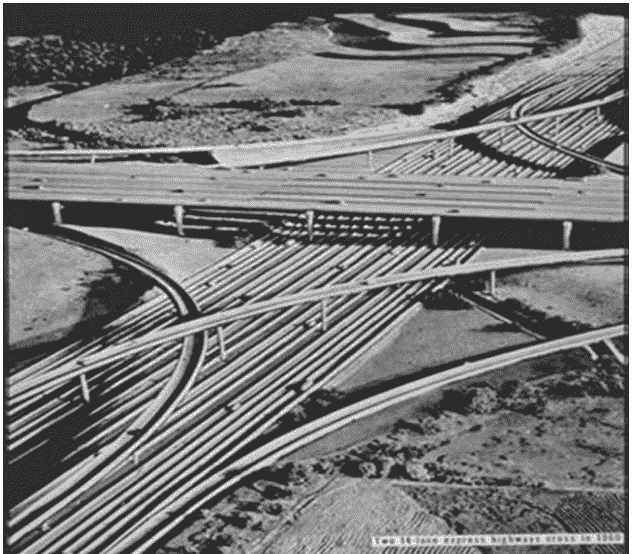

图 2.1 未来高速公路系统的技术愿景，1939年纽约世博览会“未来世界展”（重印自 nts.btl.gov，公有领域）

- 1946年—兰德公司（RAND Corporation）。由美国空军创立，创建了系统分析，这是系统工程（INCOSE）的重要组成部分。
- 1953年—宾夕法尼亚大学。开设首个系统工程研究生课程。
- 1950年代—最优控制理论趋于成熟（与 Dantzig 和 Gass 的优化工作相关）。
- 1954年—“士士陆号”潜艇。下水。核动力海军的起源：早期系统工程与分析（ESE/A）案例，涵盖了潜艇、核动力以及支持性核燃料循环的并行发展。
- 1956年—CPM/PERT（关键路径法/计划评估评审技术）。作为一种系统工程规划和管理方法被开发（主要基于“士士陆号”的经验）。
- 1957年—国际自动控制联合会（IFAC）。成立。
- 1958年—MITRE中心。为半自动地面环境（SAGE）的系统工程管理而建立，SAGE是第一个主要的实时基于计算机的空防指挥控制系统。
- 1961年—空军系统司令部（AFSC）。为应对独特的系统获取和管理挑战而建立，吸收了空军研究司令（ARDC）。
- 1961年—系统动力学、反馈控制理论。应用于工业动力学（随后在1966年应用于城市动力学，1972年应用于世界动力学）。
- 1963年—SAGE全面部署。
- 1969年—阿波罗11号任务。
- 1969年—ARPANET（阿帕网）。首批节点运行。
- 1970年代—社会工程、增长极限、世界动力学。大规模应用系统动力学。一些人认为该方法被过度使用了。
- 1970年代—商业大型集成商。针对复杂系统合同进行布局（形式化了阿波罗获取的经验）。
- 1971年—国防部（DoD）5000系列。为获取管理而启动（持续演变至今）。
- 1972年—国际系统分析研究所（IIASA）。在奥地利拉克斯斯堡堡成立，旨在解决复杂的跨国系统挑战。1975年，IFAC的秘书处与IIASA合地办公。
- 1980年—软件工程研究所（SEI）。发布了能力成熟度模型（CMM）。
- 1987年—Zachman信息系统架构框架。对跨企业运营的信息系统进行了全面描述，随后演变为企业架构（EA）。参见 Hoffman 和 Melancon（1988年）的应用研究。
- 1990年—国际系统工程学会（INCOSE）。成立。
- 1992年—AFSC（安德鲁斯空军基地）和空军后勤司令部。合并为空军物资司令部（赖特-帕特森空军基地）。

在这一时期，国防计划在系统工程的演变中发挥了主要作用，重点是系统获取以及对软件工程努力日益增加的关注。获取任务的特点是重大的研发，最终形成生产系统，通常针对单一客户（买方垄断）。对保护国家能力的强调对系统工程的演变产生了明显影响，并在许多情况下导致了成本管理的失衡，这必须在 ESE/A 中得到解决。


为了解决大型复杂系统和项目在成本、进度和性能方面的重大缺陷，人们意识到，系统工程方法需要大幅加强，以有效处理从系统工程到企业系统工程的大型项目的所有方面。技术性和非技术因素必须以更具整合的方式进行处理，借鉴更广泛的物理科学和社会科学，并以企业视角为核心主题。对于企业内部多个利益相关者的目标和观点，需要需要更多的关注。这一新兴时期的部分亮点包括：

- 1990年—Zachman信息系统架构框架（1987年）在政府机构和私营部门的 EA 级首次应用。
- 1995年—企业资源计划（ERP），由用于扩展企业的捆绑软件应用程序组成（基于1990年左右的制造资源计划（MRP）和供应链概念）。
- 2000年—John Sterman 关于业务动力学的著作，将 Forrester 和 Meadows 早期关于系统、城市和全球动力学的著作扩展到企业动力学领域。
- 2005年—波士顿中央枢纽/隧道（CA/T）“大挖掘”工程揭示了在处理复杂挑战方面的不足。
- 2005年—企业系统工程（ESE）作为麻理工学院的研究课题出现。
- 2007年—精益推进计划（LAI）在麻理工学院建立，以应对转型挑战。系统工程的时间线说明了系统工程范围和规模不断扩大，但必须始终考虑过度扩展或误用系统方法的风险。


全球化、安全、经济和改进服务等新兴挑战要求私营部门和公共部门进行重大转型。增强信息网络有效性的新技术提升了解决这些问题的能力。挑战的复杂性促使我们需要借鉴社会科学的方法；ESE 必须提高其能力来应对这些复杂性。

解决系统中重要但更具定性的方面（如行为、组织理论、复杂性和决策）需要新方法。这些方面在企业系统中尤为重要，ESE 必须将定性方法与传统的工程定量方法相结合。企业级项目通常涉及私营部门、联邦政府、地方政府以及日益增加的合作伙伴。多利益相关者项目需要对元素进行平衡处理。早期的系统努力显示出对其中一个或多个元素的强调，通常是有的，有时是因为疏忽。ESE 过程必须处理所有元素，重点和优先级仍取决于对企业和转型项目的描述。

以往系统工程及其扩展到企业背景下的系统工程（SoSE）努力一直存在问题（Bar-Yam 2003; Hoffman 等人 2007）。引用一个追溯到20世纪90年代的、记录详实的 SoSE 案例：美国联邦航空管理局（FAA）耗资数十亿美元的先进自动化系统（AAS）项目旨在使美国空交通控制系统现代化，该项目面临巨大的技术和管理挑战，并伴随着严重的延迟和成本超支，且仅部分完成，项目按原设想已停止（Boppana 等人 2006）。本参考文献介绍了应用于 AAS 项目的系统动力学（SD）和高度优化传统（HOT）SoSE 模型，并提出了企业背景下 SoSE 的复杂性是否可以通过此类模型进行充分的表示和研究。这些模型与其他跨学科企业动力学方法一起描述。


对系统工程在更大更复杂挑战中应用的综述，显示了转型挑战范围以及投入意愿的持续演变。模型和方法的演变得于日益增长的计算和分析能力，但往往没有取得相应的成功。这项广泛的综述表明，需要改进规划和管理框架，并可以从更加关注 ESE/A 框架下使用的动态模型和方法中受益。


- Bar-Yam, Y. 2003. 当系统工程失效——走向复杂系统工程。In International Conference on Systems, Man & Cybernetics. Vol. 2: 2021–2028, Piscataway, NJ: IEEE Press.

- Boppana, K. et al. 2006. 模型能够捕捉系统工程过程的复杂性吗?Presented at the New England Complex Systems Institute (NECSI) International Conference on Complex Systems (ICS2006), Boston (June 25–30).

- Caro, R.A. 1975. 权力经纪人：罗伯斯与纽约的衰落。New York: Vintage Books.

- Gass, S. 2002. Great Moments in History, OR/MS Today, 29(5). http://www.lionhrtrtpub.com/orms/orms-10-02/fristoryb1.html.

- Hoffman, K.C. and Melancon, J. 1988. An information systems architecture for manufacturing/distribution enterprises. In Proceedings of the ASME Manufacturing International 88, Atlanta.

- Hoffman, K.C. et al. 2007. 描述性企业动态——多学科统一框架。Presented at the Fifth Annual Conference on Systems Engineering Research (CSER), International Council on Systems Engineering (INCOSE), Hoboken, NJ.

- INCOSE (国际系统工程工程师协会). 2010. http://www.incose.org/practice/whatissysmeng.aspx.

- Kucera, V. 2000. 自动控制：过去、现在与未来。ERCIM News (在线版), 40. http://www.ercim.org/publication/Ercim_enw/40/keynote40.html

- NRC (美国国家研究委员会). 2005. 网络科学。Washington, DC: National Academy of Sciences. http://darwin.nap.edu/books/0309100267/html/.


Christopher G. Glazner


   - 3.2.1 将复杂性理论应用于企业 .......................................25
- 3.3 组织科学....................................................................25
   - 3.3.1 计算组织科学 ................................................26
- 3.4 企业架构设计..................................................................29
   - 3.4.1 企业架构框架视图 .................................30
   - 3.4.2 视图在流行企业架构框架中的应用....31
   - 3.4.3 企业架构视图之间的相互作用..............................32
   - 3.4.4 企业架构框架在系统工程中的应用................................................................34
   - 3.4.5 与企业系统工程及仿真模型的集成...............................................................35


本章回顾了系统工程（SE）和企业架构（EA）的现状，并探讨了旨在描述企业系统工程与架构（ESE/A）集成方法的改进措施。此处描述的改进措施目标是使 EA 和 SE 实践从主要基于静态和确定性的方法转向动态和概率性的 ESE/A。

这种集成方法利用了企业动力学的概念，通过模型来描述任务性能、组织变更、成本要素和技术（Glazner 2009）。管理和增强公共及私营企业活动的性能是架构设计和建模的主题，旨在应用管理科学、概率论、组织理论、系统工程和社会经济学学科。每个学科都从独特的视角处理企业特定的动态元素，并通过混合建模方法，为 ESE/A 奠定坚实的基础，以应对企业内部相互作用的政策、组织、经济和技术（POET）要素的复杂性和动态性。在过去的几年里，该领域一直是研究和应用的肥沃土壤，并且已经成熟到可以识别出概念性基础。

本章首先回顾了复杂性理论在企业中的应用，强调了“系统思考”、近分解性、规模等原则，以及这些原则如何应用于企业行为的分析。接下来，引入了“框架”的概念，将其视为管理企业复杂性的整体构建，并关注其在理解企业动态方面的应用。本章最后讨论了如何利用框架以及组织科学的理论和构建来理解企业动态的复杂性。


长期以来，人们在口语中使用“复杂”一词描述组织；然而，将其作为复杂系统进行研究直到 20 世纪 50 年代和 60 年代才开始，这是一般系统理论（GST）和控制论领域研究的结果。这些当代领域催生了现代系统和复杂性的概念，尽管它们研究的是系统复杂性的不同方面。GST 试图识别并理解跨越生物学到社会学的许多科学学科中系统的共同结构、行为和属性（von Bertalanffy 1956）。控制论研究了系统通过反馈和环境感知进行自我调节的能力。尽管控制论通常侧重于技术系统，但其追随者同样将分析应用于组织和其他社交系统。

系统工程与架构的基础 ■25

### 3.2.1 将复杂性理论应用于企业

复杂系统的研究需要根据系统的语境在对比视角之间取得平衡：整体论与还原论、自上而下与自下而上。复杂系统研究的视角和分析方法取决于所研究的系统以及正在调查的特定动态。没有一种单一的方法适用于所有复杂系统的研究和所有问题（Miller and Gill 1997）。

将企业作为复杂系统进行研究，为研究人员和经理带来了系列挑战。企业可以从自上而下设计，也可以从自下而上演化，在所有情况下都会产生需要应对的涌现行为。它们既是中心化管理的，又依赖根据局部激励做出局部理性决策的代理人。因此，不同的研究领域和实践构建了管理企业复杂性的不同方法。


该学科以企业作为分析单位，将组织构型扩展到包含利益相关者及其环境的扩展性价值链中。

尽管组织科学的“理性”视角和“自然”视角对理解组织都做出了巨大贡献，但“开放系统”视角更适合理解企业这一更广泛的概念。开放系统视角强调挑战组织的边界，同时考察其内部相互依赖的本质（Thompson 1967）。它认识到，组织通常表现出高程度的耦合性（Cyert and March 1963），这可以使系统更具适应性和灵活性。这种视角最可能包含对企业在组织形式和决策中的环境、流程、技术和产品进行分析（Scott and Davis 2006）。与组织科学的这两种视角相比，开放系统视角倾向于采用更整体的分析方法。从企业架构的角度来看，组织科学开放系统视角下的主要关注领域是权变理论以及与其紧密相关的组织设计领域。

组织设计领域利用了权变理论者的成果，旨在为希望设计组织的人士提供规范性指导。在组织权变的研究中，组织设计的支持者倡导研究工作流、控制系统、信息处理、规划机制、知识传递及其交互等领域。组织设计领域的应用往往比组织科学中的其他领域更广泛；组织设计者寻求从管理角度来改变和改进组织，而不是从理论角度对它们进行描述和理解（Scott and Davis 2006）。

组织设计者采纳了“整体大于部分之和”的复杂系统哲学（Scott and Davis 2006）。由于人们对组织设计组件的匹配和相互依赖关系给予高度重视，权变理论者 Thompson 被认为是组织设计的早期先驱，他的工作在于识别并分类了组织内部的相互依赖关系以及组织协调的维度（Thompson 1967）。


权变理论和组织设计文献中很大程度上缺乏对企业架构的定量分析。这对于与转型计划的其他要素协调以管理组织变革至关重要。目前很少有工具可以定量地评估组织设计中的权衡，或者将一种架构与另一种架构进行比较。由于企业固有的复杂性，对设计的闭式数学或逻辑分析仅限于绝对最简单的结构，正如 Milgram 和 Roberts (1995) 对结构与战略匹配的互补性进行分析的那样。对中等真实的组织形式、流程和行为的分析需要使用计算机模拟模型，这种模型能够将企业建模为随时间变化的交互自适应组件的网络。

研究机构对使用模拟模型的兴趣并非近期发展。追溯到几十年前，组织设计理论者就主张使用模拟模型，其中“所有感兴趣的变量和关系都作为状态链接到模型中，然后由经理-分析师-研究人员操纵某些变量并观察系统变化的演变”（Swinth 1974）。在想要使用模拟模型的想法出现后，过了多年，模拟技术和计算能力才成熟到可以应用于组织科学家所面临的问题类型。

Carley (1995) 是最早倡导在组织科学内部建立一个新学科——“计算组织科学”的人之一，他认为使用采用模拟模型的虚拟实验可以用于创建和测试组织理论，特别是将复杂性理论应用于组织，以理解模型如何适应和演化。模拟模型允许组织研究人员创建受控且易于操纵的实验，而由于成本、范围或伦理考虑，组织内部的真实“自然实验”是不可行的（Fowler 2003）。诸如基于代理的建模（agent-based modeling）等技术允许通过模拟元素交互来创建能够捕捉组织在多个尺度上行为的模拟模型。每个模型都允许分析组织在变化的环境中如何搜索、适应和学习。

计算组织科学已主要转向关注对组织采取复杂自适应的视角，并利用模拟模型建立关于组织如何在不确定环境中演化和适应的理论，特别是从自下而上的视角（Anderson 1999）。尽管仍处于起步阶段，但计算组织科学在开发企业如何在多个尺度上适应变化环境的方面显示出广阔的前景。

计算组织科学主要在理论生成或测试角色中使用模拟模型，而不是作为组织设计过程中的分析工具。到目前为止，所使用的模型都是高度抽象的“玩具”模型，用于证明假设的机制，而不是对真实世界中的组织或系统的模拟。尽管这些简单模型在创建新的组织理论方面已被证明是有价值的（Rivkin and Siggel 2003; Ethiraj and Levinthal 2004），但它们不能被视为经理可以在组织设计中作为分析工具使用的工具。这些“玩具”模型对于管理应用来说太抽象了。计算组织设计的目的是开发新理论，而不是创建新的架构和分析工具。

打破了仅将模拟建模用于理论生成的传统，Levitt (2004) 认为，组织设计分析工具的开发由于缺乏支持它的稳健理论而受到阻。他随后认为这种情况正在发生，组织研究的两个主要分支为强大到足以支持设计组织的分析工具的理论奠定了基础：

- 1. 组织信息处理视角（March and Simon 1958; Galbraith 1973）通过对信息路径和局部激励的理解，为微观层面基于代理的模拟模型提供了框架。
- 2. 权变理论提供了基于经验观察的宏观假设，将结构格式与背景联系起来。

通过结合自上而下和自下而上的角的组织理论，Levitt 认为模拟模型可以连接这些视角，并应用于分析组织设计在不同环境中的潜在性能。他指出，模拟技术已经成熟，为组织设计在技术和理论上提供了支持。

### 3.3.2 为有效的动态组织设计解决组织理论中的空白

组织科学整体一直致力于创建开发严谨、可泛化且具有广泛探索能力的理论。组织理论能够为寻求引导转型型的经理提供规范性指导，但它没有为经理和架构师提供定量分析并将理论应用于其自身企业的工具。在理想情况下，经理应该根据对当前组织理论的仔细考虑来适应和改变其组织设计，然而研究反复表明，经理倾向于根据经验而非理论通过昂贵的“尝试”过程来适应组织设计（Tatum 1983）。Levitt 认为，如果经理和架构师无法在实施之前对自身的架构进行分析，那么创建一个有效的存档过程是不可能的。如果没有有效的流程，企业将回到随机的方法（Levitt 2004）。

组织科学缺乏能够以协调方式将其研究的丰富性和严谨性结合起来的框架和理论，使得整个知识体系对管理企业发展的领导者更有用。直到一种统一的“企业”科学出现


为了能够成熟和发展，企业领导必须在其他地方寻找有用的指导，以将孤立的知识领域缝合，从而创建工具和模型帮助他们更好地理解和管理企业行为。企业架构提供了一个实用的框架，用于解决定量组织科学在应用于企业转型方面的差距。


以实业者为导向的企业架构领域提供了一种管理企业复杂性的整体性方法。企业架构认为，企业作为复杂系统，可以以一种有组织的方式进行“架构设计”，这比随机的或碎片化的组织和设计方法能产生更好的结果（Bernus 2003）。对企业进行架构就是创建并记录其一个特定的抽象，描述其在当前状态或理想未来状态下的基本使命、组织和资源。这种抽象被称为企业架构。

ANSI/IEEE 对企业架构（EA）的定义规定，它是“环境的基础组织，嵌入在其组件中、组件之间的相互关系及其设计的指导原则”（ANSI/IEEE 1471: 2000）。Bozdogan 给出了第二个更完整的定义，他指出“企业架构是‘现实世界’企业整体设计的抽象表示（形式、配置、模式），它将其结构、策略、环境和性能结合在一起，展示了其要素要素以及这些要素随时间共同演化的关系”（Bozdgan 2007, p. 10）。EA 是对“现实”企业的抽象，其结构化方式通过将企业视为一个层次化的、几乎可分解的系统，使得分析和设计成为可能。EA 有潜力通过从多个角度描述企业并规定企业不同方面之间的交互，使对复杂企业的系统化设计和改进变得可行性。

尽管企业架构的最初初衷是整合跨整个企业的不同系统以为企业提供价值，但其应用已从企业信息系统集成演变为更广泛的范围。企业架构的核心目的是：(1) 将企业理解为一个相互作用的复杂系统；(2) 向企业利益相关者传达其结构和行为；(3) 作为改变企业的手段。

- 许多人还认为，无论是否显式开发过，所有企业都可以认为拥有企业架构，因为所有企业都可以用与企业架构一致的术来描述。

它并不是通过复制其他领域的工作来理解企业的关键方面，而是通过协调的方式利用这些工作：企业架构“促进了变革过程中所使用的若干学科方法的统一，如工业工程方法、管理科学方法、控制工程方法、通信和信息技术方法，即允许它们结合使用，而不是孤立地应用”（通用企业参考架构与方法论 (GERAM) i.6.3 1999）。记录在案的 EA 可被用于促进企业利益相关者对企业结构、功能和行为的共同理解，并可以作为改变企业的蓝图。当执行得当时，企业架构是一种基于近可分解原则和对许多先前独立学科的促进性应用而设计的整体集成设计方法。

尽管企业架构在工业界和政府中得到了广泛应用，但它尚未成为一个显著的学术研究领域。该领域很大程度上源于实业者文献而非学术文献，因此尽管在实践中取得了成功并具有实用性，但传统上与严谨的理论没有强有联系。然而，它提供了少数方法之一，能够将关于企业的海量知识与能够解决企业根本复杂性的整体性方法整合在一起。近期架构实践中一些可以使用 ESA/A 方法解决的局限，包括描述的静态性质，以及在描述企业重要特征的密集数据集中表示不确定性的困难。


参考架构为企业如何进行分解提供了模板，这种分解方式可以使其复杂性更易于管理。通用企业参考架构（GERA）建立了使用“视图”来完成分解。“视图包含一组存在的事实，允许用户关注相关利益相关者可能想要考虑的相关问题。不同的视图可以突出架构的某些方面并隐藏其他方面。”（ISO 15704 2000）。企业框架中的视图是一种抽象，定义了企业某个层面的视角，例如其组织结构、流程或信息系统。在 EA 中使用视图与传统建筑架构中使用视图类似于：建筑师将从建筑的多个角度创建一个图纸集……

尽管 ISO 15704 规定了“视图（view）”一词的使用，但并非所有框架都通用它。某些框架使用“观点（viewpoints）”、“视角（perspective）”或“领域（domain）”。尽管这些术语都有自己特定的定义，但它们是非常相似的概念，且可以追溯到 Zachman 框架对领域和视图的使用。

……多个视角，为从所有者到承包商的利益相关者提供一个待建筑的模型。这些视角可能根据外部观察者的位置（平面图、街景图、四分视图）或根据功能性的视角视图（结构、电气、水暖、环控系统）而不同。如果没有其中任何一个视图，就没有足够的信息来建造建筑。需要的是完整的集合。然而，与传统的建筑不同，企业架构没有一套公认的视图集可以完全规定一个企业，甚至无法规定描述它需要多少个视图。企业比建筑要复杂得多。


描述企业（EAS）并没有公认的视图数量或集合被通用的采用；目前使用的 EA 框架是基于最佳实践而非理论基础开发的。基于文献的代表性视图如表 3.1 所示。

每个框架采用独特的视图集合来以符合框架目标的方式描述企业。某些框架拥有视图矩阵；例如，Zachman 框架有一个“观点”矩阵，具有六个关注领域，创建了一个 36 格单元的描述区域框架，如图 3.1 所示。在另一种架构框架中，GERA 和计算机集成制造开放系统架构（CIMOSA）包含三个维度的描述：视图、企业生命周期（从识别/概念到报废）以及规范级别（通用、部分和特定）。规范级别是所有框架共有的，但在 CIMOSA 中被强调。通用规范是参考架构给出的结构；部分规范是可适配的重复使用描述；特定规范是针对特定企业的架构描述。

不存在一种“最佳”的企业架构框架适用于所有企业、所有环境和所有应用。每个框架都有其优缺点，并偏向于某些应用。因此，企业架构师创建结合了多个框架最佳实践的“混合”框架是极不常的（Sessions 2007）。

联邦企业架构（FEA）框架使用了参考模型（RM）。它们集合旨在为企业的业务性能、服务、数据和技术元素提供通用定义和构造以及它们的对齐。这套 EA 参考模型提供了一个基础

> ¹ 企业架构框架在视图的概念上没有使用统一的术语。


| 企业架构框架 | 采用的视图 |
| --- | --- |
| 计算机集成制造-开放系统架构 (CIMOSA) | 功能信息资源组织 |
| Zachman 框架 | 客户、所有者、设计者、构建者、工人 |
| 联邦企业架构 (FEA) | 性能参考模型、业务参考模型、数据参考模型、服务参考模型、技术参考模型 |
| 开放架构框架 (TOGAF) | 业务架构、应用架构、数据架构、技术（基础设施）架构 |

在政府组织构建目标企业架构（EA）时，利用现有的流程、能力、组件和技术。这些设计旨在促进跨组织分析，并识别联邦机构及其他政府组织内部和跨机构重复投资、差距以及协作机会。

关于流行 EA 框架的比较（包括其优点、缺点以及对不同目的的适用性），请参考 Sessions (2007) 和 Schekkerman (2006)。


目前使用的大多数 EA 框架都显式或隐式地假设，可以通过考虑其推崇的一组视图的独立贡献来描述 EA。Zachman 在其框架中建立视图的使用提到，“每种不同的描述都是为了不同的原因准备的，每种都是独立的，且每种与其他之间都是不同的”（强调处为作者添加 (Zachman 1987, p. 282)）。尽管 Zachman 认为这些描述是“密不可分的”，但他坚持认为每个视图的文档必须独立存在。

| 视角 | 价值（为什么？） | 人员（谁来？） | 时间（何时？） | 功能（如何做？） | 数据（什么？） | 网络（在何处？） |
|---|---|---|---|---|---|---|
| 客户 | 目标 | 单位 | 事件 | 流程 | 实体 | 地点 |
| 所有者 | 业务计划 | 组织 | 业务生命周期 | 功能流 | 实体关系 | 位置链接 |
| 设计者 | 管理措施 | 组织 | 过程周期 | 信息流模型 | 数据模型 | 网络节点模型 |
| 构建者 | 员工衡量 | 工作组 | 交易 | 设计 | 数据设计 | 网络节点设计 |
| 工人 | 性能衡量 | 个人交互 | 详细步骤 | 单元代码 | 数据库模式 | 网络节点描述 |

**图 3.1 简化的 Saxon 框架。**（重印自 crcsc.nist.gov/nissg/1996/papers/NISS96/paper044/ballppr.pdf。作为美国联邦政府的作品，此图像属于公共领域。）

这种 EA 方法存在一个根本性的缺陷：EA 的视图并不是独立的。视图无法在逻辑上进行划分。事实上，每个视图本质上都以许多方式与其他视图的行为重叠。在任何一个视图中捕捉的行为和结构具有级联效应，跨越了任何框架中视图定义之间的边界。例如，组织结构的改变会影响流程；流程的变化会影响知识和信息需求。大多数架构框架的用户会认为企业是复杂的，然而，在适应组件之间具有高度依赖性的系统时，他们往往会忽视在创建或文档化 EA 时存在的许多概念性相互依赖，尽管 EA 本身应该是对抗这种复杂性的工具。

作为复杂系统，企业几乎是近可分解的，而非完全可分解的。根据西蒙（Simon）的近可分解性概念，短期内，子系统的行为将表现出近似的独立性。然而从长期来看，任何子系统的行为都聚合地依赖于其他组件的行为（Simon 1962）。

主要子系统之间的相互作用是这些较长时间尺度上企业行为的重要驱动力，在对系统行为的任何整体分析中必须考虑这些因素。这些视图和参考模型（RM）提供了比传统 EA 表示法更容易建模的结构和集成层次。


与为新建筑施工创建蓝图传统架构不同，企业架构设计通常用于支持那些已经在运营并寻求以某种方式改变的企业。企业架构设计工作始于“当前状态”EA：企业其当前形式的蓝图。当前状态架构作为所有企业变更活动的基准。在理想环境中，企业将始终保持其当前状态架构的更新和可用。

在企业变更中，已经发生了一些变化，导致当前状态架构不再理想。也许是环境发生了变化，使得旧流程不再适用；也许是企业的策略发生了变化，以便在市场上更具竞争力。当从当前状态架构产生需求时，第一步是分析当前状态，以确定在何处进行更改，以实现转换状态的预期行为。目前，对于 EA 的行为或性能分析，严谨流程很少。在实践中，许多“分析”包含建立基于观察的精心构建的叙述，将架构与性能联系起来；较好的分析将涉及应用指标来支持该叙述。对 EA 执行了价值流映射（Rother and Shook 2003）和业务流程分析。此类变化可能对许多组织非常有用且易于实现，但无法提供将企业性能与其架构联系起来的真实分析，无法衡量架构的变化将如何影响企业性能。随着 EA 复杂性的增加，这种静态定性分析技术的有效性会降低。

目前，对当前状态和未来状态 EA 的分析是大多数企业架构设计工作的弱点。在某些情况下，可能会完全跳过当前状态的分析，转而直接创建一个解决感知问题的替代未来状态。这种对分析的薄弱处理可能会完全破坏企业架构设计的价值。

尽管 EA 框架代表了提供系统思维方法来描述架构的尝试，但如果不对架构使用系统思维方法进行分析，可能会被证明是无效的。作为一个复杂系统，对架构某部分的更改可能会在其他地方产生意之外的后果。对 EA 进行适当分析将帮助我们理解在何时可以分解和简化，在何时不能。如果没有一种能够分析 EA 及其可能产生行为的严谨方法，产生意外后果的可能性很高，且企业架构设计作为管理工具的效用将微乎其微。

一些分析 EA 最有前景的方法是采用模拟技术，利用 EA 捕获的信息对企业随时间的变化进行建模。模拟 EA 的大多数尝试集中在模拟信息系统，因为 EA 比例地关注了信息系统工作，而且与 EA 的其他方面（如组织行为或知识）相比，信息系统的逻辑本质更为直接。


即使 EA 框架包含了组织理论的视角和指导，它们仍未为企业架构设计提供完整的工具箱。EA 框架具有提供一系列视角、理论和工具来减少企业表面复杂性的潜力。一个良好的框架将企业分解为可管理的视图，这些视图可以独立地也可以相互地解释和理解。然而，它并不一定帮助经理理解 EA 在不同环境、不同输入下如何表现，或者架构是否达到预期的性能水平。

使用框架创建的 EA 是企业核心组件及其相互连接的静态描述。单凭静态描述的信息不足以分析和理解给定 EA 能够产生的行为。企业经理需要这里介绍的分析能力——包括优化和模拟建模在内的企业工程，结合架构框架——以帮助分析、理解和管理转型活动。如上述所示，分析能力对于真正的企业架构设计过程至关重要（Levitt 2004）。如果没有这些能力，无法保证架构的任何更改都会产生想要的效果，也对企业行为的任何理解都是正确的。

后续章节将通过探索文献来讨论这些分析工具，以确定如第二部分所示可以采用的适当模拟方法论。以企业框架分解和组织科学为指南，不同模拟视角的贡献是：


并开发了一种混合模拟建模方法，旨在以一种能够利用这些模拟方法优势的方式将这些视角结合起来。


私营部门和政府实践中的企业架构与企业系统工程中采用的动态方法之间存在着紧密的联系。本章概述了这些方法的制定与实验，以及它们在企业系统工程/架构（ESE/A）中的整合，重点关注企业的动态行为及其为了适应不断变化的外部环境的转型。这一基础 ESE/A 过程将架构师从静态、确定性的模式转变为动态、概率性的模式。

第二节的案例研究展示了在运营中企业性能动态建模的成熟开发状态，支持了规划和运营管理的信息支持，以及系统与技术转型的成本与效益。由于组织变革与企业转型保持一致至关重要，本章特别关注了组织科学的发展状态以及推进该领域发展的实践方法。

此处为 ESE/A 过程建立的基础在第一节的后续章节中得到了扩展，回顾了描述企业动态的特定模型和方法（第 4 章），并介绍了一种结合了由 ESE/A 支持的企业动态方法的管理方法，以指导转型过程。第 5 章重点关注治理，以确保以协调的方式实现所有必要角色和职责的绩效。


Anderson, P. et al. 1999. Introduction to the special issue: Applications of complexity theory to organizational science. Organization Science, 10(3): 233–236.

ANSI/IEEE 1471:2000. IEEE Recommended Practice for Architectural Description of Software-Intensive Systems.


Bozdogan, K. 2007. Enterprise architecture modeling, design and transformation: Defining the minhas, Lean Aerospace Initiative, Cambridge, MA: MIT, April 2007.

Carley, K.M. 1995. Computational and mathematical organization theory: Perspective and directions. Computational and Mathematical Organization Theory, 1(1): 39–56.

Cyert, R. and March, J. 1963. Behavioral Theory of the Firm. Oxford: Blackwell.

Ethiraj, S.K. and Levinthal, D. 2004. Modularity and innovation in complex systems. Management Science, 50(2): 159–173.

Fowler, A. 2003. Systems modelling, simulation, and the dynamics of strategy. Journal of Business Research, 56(2):135–144.

Galbraith, J.R. 1973. Designing Complex Organizations. Reading, MA: Addison-Wesley. GERAM Generalized Enterprise-Reference Architecture and Methodologies Appendix B ISO 15704 standard.

Glazner, C.G. 2009. Understanding enterprise behavior using hybrid iteration of enterprise architecture. Dissertation. Cambridge, MIT. ISO 15704 2000. Industrial automation systems—Requirements for enterprise-reference architectures and methodologies.

Levitt, R. 2004. Computation modeling of organizations comes de-fact of age. Computational Mathematical Organization Theory, 10: 127–145.

March and J and Simon H.A., 1958. Organizations. New York: Wiley.

Milgrom, P. and Roberts, J. 1995. Complementarity and fit strategy, structure, and organizational change in multmethodology. Journal of Accounting and Economics 19: 179–208.

Mers, J. and Gill, A. 1997. Multmethodology: Towards a Theory and Practice of Combining Management Science Methodologies. Chichester, UK Wiley & Sons.

Orton D. and Wick, K. 1990. Loosely coupled systems: A reconceptual. Academy of Management Review, 1990, 15(2): 203–223.

Rivkin, J.W. and Siggelkow, N. 2003. Balancing search and stability: Interdependencies elements of organizational design. Management Science 49(3):290–311.

Other, M. and Shook, J. 2003. Learning to See: Value Stream Mapping in the Jungle of Enterprise Architecture to Create Value and Eliminate Muda, Cambridge, MA: Lean Enterprise Enterprise.


Scott, W. and Davis, G. 2006. Organizations and Organizing: Rational, National, and Open Systems Perspectives. Upper Saddle, NJ: Prentice Hall.

Sessions, R. (2007). Building distributed applications—Comparison of the top four enterprise-architecture methodologies. Microsoft Developer Network. http://msdn.microsoft.com/en-us/library/bb666232.aspx (Accessed April 17, 2012).

Simon, H.A. 1962. The architecture of complexity. Proceedings of the American Philosophical Society, 1006,(6): 467–482.

Sousa, G.W.L. et al. 2002. Applying an enterprise engineering to engineering work: A focus on business process modeling, Engineering Management Journal, 14.

von Bertalanffy, L. 1956. An essay on the relativity. Philosophy of Science, 22:243.

Tatum, C. 1974. Decision-making in construction. Technical Reports of the Department of Civil Engineering.

Wiener, N. 1956. I Am a Mathematician. Garden City: Wiley.

Zachman, J. 1987. A framework for information systems. IBM Journal 26(3):276.


# 企业动力学方法与模型 ■ 41

本章制定了将多样化且专业的源模块（模型）特征整合到动态企业的综合状态空间表示中；其可行性在第 8 章的第二节案例研究中得到了验证，并分析了系统工程（SE）过程在一项重大转型计划中的有效性。

下文主要章节将进一步描述以下相互相关的企业动力学主题：

- 企业景观表示，用于捕捉源自企业架构并与企业架构相关的许多状态空间维度、复杂特征和相互作用元素。
- 提取自多个学科、为企业动力学提供功能源模块的模型和方法，以解决景观中状态空间和动态行为的特定方面。
- 使用贝叶斯法和视线（line of sight）概念处理企业转型中不确定性的方法。
- 通过说明性示例，对多样化且崎岖的企业景观进行政策分析和技术评估。
- 一种统一的企业动力学方法，通过整合多种模型实现对企业及其转型路径的综合状态空间描述，从而在 ESE/A 过程中实现全面的动态分析。

公共部门和私营部门的企业规划与分析，侧重于任务或业务目标的运营性能、组织有效性、用于新能力和战略优势的技术获取，以及通向成功实施的管理和决策机制。没有单一方法可以捕捉这些复杂性和应用范围；此处的重点仍然是统一方法。选择“统一框架”一词是为了强调一个持续的解释、同化以及在适当情况下整合不同学科和模型贡献的过程，旨在为采购和运营经理提供信息，而不是为了追求一个不切实际的“统一理论”或其他目标作为终点。

统一框架中的状态空间描述符包括运营参数，如任务性能水平、资源需求、组织结构、信息交换、人员技能水平及流转率和培训水平，以及描述市场或任务空间和敌对或竞争力量的环境参数。开发改进能力的采购计划的进展和结果被表现出来，并涉及技术和过程变化的水平、变革压力等。

统一框架可以表述为状态空间元素的非线性（或分段线性）控制理论表示，这些元素可以在不同程度上受到控制和影响，或者超出了企业的控制范围但需要自适应的感知与响应机制，这些领域适用于任何规模的企业。用于描述企业状态空间选定动态元素的特定建模方法包括系统动力学、傅里叶分析以及基于代理的方法和高度优化容错方法。

## 4.2 企业景观、视角与元素

描述性企业动力学建立在描述性几何学的概念之上，并涉及将高度多维的企业状态空间映射到用于系统和技术获取、政策制定和业务运营管理的决策空间中。

描述性企业动力学研究的目标是开发并应用动态理论，在极其复杂的组织和运营环境中获取并实施用于新运营能力的系统和服务。。理解企业景观的特征并为特定的管理决策提供支持，将增加这一充满失败风险的任务取得成功的机会。

### 4.2.1 企业景观

景观（landscapes）的概念已应用于组织理论和企业适应性（Levinthal 2001），以处理涉及人员、组织和生物政策的性能和管理机制（Nonden and Stanbridge 2005）。它也被应用于各个科学领域，包括生物演化（Crutchfield 2003）和宇宙学尺度下的物理学弦理论（Bousso and Polchinski 2004）。企业景观在此处用作描述性企业动力学的基础结构（Hoffman et al. 2007）。

图 4.1 中的企业适应性景观展示了企业在对环境变化的短期和长期响应中的特征。它提供了企业状态空间的高层聚合视图。构建企业结构是所有象限中规划和管理变革的有效方法，但会根据具体的挑战以不同的视角进行应用。

图 4.2 显示了企业管理景观。它通过二维矩阵提供了一个互补的视角。一个维度代表重复的业务流程（平滑景观）对比事宜性的反应/主动活动（崎岖景观）。另一个维度代表基于规则的决策域与反应性情境依赖的决策域。

特定的建模和状态空间描述符高度依赖于企业在该景观中的位置。本手册强调位于右上角的社会复杂性领域，该领域涉及事宜操作（崎岖景观）和情境依赖性决策，尽管通过定制可能可能简化方法，也涵盖了矩阵的其他机制。大部分建模和仿真文献涉及左下象限，即处理高度重复和基于规则的企业运营，这并不易于适用于突现行为和复杂自适应系统理论为特征的社会复杂性领域。

除了在管理景观中的位置外，分析方法还取决于特定应用中感兴趣的运营、标度和时间视角。这些视角的描述如下：运营视角为核心方法提供了模板；其他视角的层次和重要性取决于问题。

### 4.2.2 核心运营视角

本工作将运营领域作为企业动力学的核心视角，因为正是这一视角驱动了改进运营能力的重大采购。

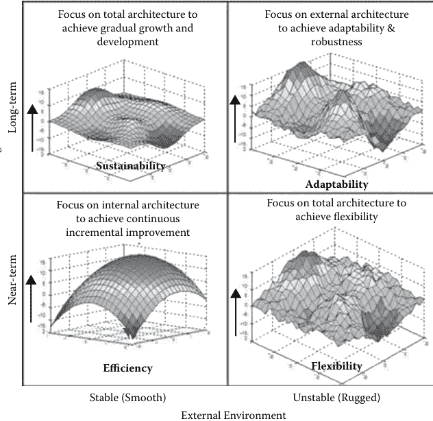

**图 4.1 企业适应性景观。（重印自 K. Bozdogan, C. Glazner, K. Hoffman 和 J. Sussman, Lean Aerospace Initiative Annual Conference, Boston, MA: MIT, 2008）。**

| 数学复杂度 | 社会复杂性 |
| :--- | :--- |
| • Axelrod, Kaufman | • Stacy, Jarro |
| 交通与通信网络路由，人群的动态行为 | 参与复杂性 |
| | 人类系统中社会构建的意义 |
| 基于代理的模型 | 决策模型、模式 |
| 过程工程 | 系统思考 |
| • Taylor, Hammel, Porter | • Senge, Peters |
| 业务流程工程，工作流管理 | 战略规划 |
| | 组织与任务宣言、价值观的对齐 |
| 离散事件仿真 | 风险模型、情景 |

**图 4.2 企业管理景观。（改编自 D. Snowden 和 P. Stanbridge, ECo 6(1-2): 140–148, 2005。）**

运营视角从受控、受影响和不受控（C-I-U）空间来表示企业，并适用于生命周期任何阶段任何规模的企业。这种运营视角（DeRosa 2005）如图 4.3 所示。

感知响应式决策过程被映射到这些领域中，是企业动态行为的关键因素。C-I-U 域的内容、不确定性以及感知响应机制（包括性质和时机）随特定企业管理景观的“平滑或崎岖”程度而变化。

### 4.2.3 尺度视角

企业的尺度视角从组织规模和企业规模两个方面定义：

- 组织规模。组织可以是个人、单位、部门、机构或多机构协作。本章侧重于执行复杂任务的多机构组织，这些组织对动态交互的深入理解最为迫切。
- 企业规模。企业视角可以在多个尺度上取得。后文讨论的复杂、大规模、集成、开放系统（CLIOS）为跨越社会、经济、技术和政策维度的交通规划多尺度分析提供统一方法。


## 企业动态学方法与模型 45

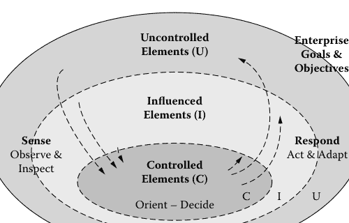

**图 4.3** 从受控、影响和不受控领域定义企业的运营视角：这是核心 C-I-U 企业模型的基础。（改编自 J.K. DeRosa 给佛 蒙特大学工程与数学科学学院教职员工的演讲，2005年12月。）

在本手册中，我们针对以下企业规模讨论企业动态学：

-   **采购企业（Acquisition Enterprise）** 关注于参与重大技术采购计划的利益相关者，例如，全球信息网格或全国性健康信息网络。实物期权概念（Dahlgren 2007）解决了采购策略的改进问题，这些改进可以为企业增加长期灵活性和适应性。大多数转型都涉及现代化的信息系统和软件，这是一个高风险领域。ASE/A 企业在企业运营的背景下将软件和信息系统纳入其中，以确保需求与真实的性能提升相关。软件管理的细节超出了本手册的范围，管理人员应参考该主题的广泛文献和经验。
-   **运营企业（Operational Enterprise）** 关注参与多机构任务或业务运营的机构和代理（公共和私营）、管理人员和员工，例如，医疗服务、安全行动和税收处理。
-   **经济部门（Economic Sector）** 关注在美国经济中大部分部门执行的活动，例如，健康计划或空中交通管理。

上述每个规模类别都包含了个人、单位以及具有企业内部和外部多个利益相关者的大型组织。

### 4.2.4 时间视角

从采购到过渡运营的生命周期提供了时间视角。对于一个正在获取新运营能力的企业来说，这种生命周期视角带来了重大的管理和决策挑战：这正是 ESE/ASE 过程关注。

时间（生命周期）视角中的具体步骤包括：

-   研发
-   技术系统
-   组织与社会系统
-   政策
-   规划与采购策略
-   战略规划
-   需求与能力规划
-   合同采购、系统/服务
-   向运营过渡
-   业务流程变更
-   组织变革
-   培训
-   实施与部署策略
-   运营
-   性能测量
-   持续的系统或服务增强

> 重大采购的失败率高得无法接受——信息技术（IT）项目的失败率超过50%（Flint 2005）——促使企业动态学向更好地理解这些失败中的因果因素。运营视角中代表的企业“感知与响应”元素对于重大采购的成功至关重要。

### 4.2.5 企业转型动态与复杂性要素——ESE 剖析器（ESE Profiler）

影响复杂企业新能力采购和实施的动态过程包括：

-   采购计划中的以及临时主动和反应性任务及业务倡议中的**性能动态**
-   涉及跨机构和利益相关者之间协作以执行复杂采购和任务的**组织与行为动态**
-   在采购和向运营过渡期间收集和交换支持感知与响应决策过程信息的**信息动态**
-   治理用于改进企业性能的先进技术的成熟度、速率和难度程度的**技术动态**

这些动态元素的内容和重要性取决于企业的格局和感兴趣的视角。在这些企业动态学领域有大量的文献。企业转型计划的复杂性根据企业的规模和范围、所需能力以及策略而显著不同。这些复杂性指标可以使用 MITRE 开发的企业系统工程剖析器（Stevens 2010）进行映射：“系统工程剖析器被确定为开发自评估工具的第一步，这可以帮助系统工程师理解感兴趣系统的性质和背景。它还被旨在作为情境模型的基础，帮助系统工程师选择和适应最适用于特定系统问题和背景的过程、工具和技术。

作为一种自评估工具，剖析器可以帮助系统工程师理解感兴趣的“系统”的性质和背景，以及其将被开发和运行的背景。实际上，管理人员或工程师可以使用此框架来映射感兴趣的系统或巨型系统，创建系统背景的蜘蛛网图或极坐标图。

作为一种情境模型，剖析器可以帮助系统工程师根据系统的性质和背景选择并适应最佳的过程、工具和技术。情境模型的核心概念前提是：不同的过程、工具和技术适用于不同的情况。挑战在于能够充分地理解情况，以选择最合适的工具并根据情况需要进行调整。剖析器分为四个象限和三个环。象限描述了系统或巨型系统将开发、运行和演化的更广泛背景的不同维度。三个同心环反映了不断增加的复杂性和不确定性。

图 4.4 使用剖析器通过四个主要象限（战略、系统、利益相关者和实施背景）来描绘复杂性。四个象限中的每一个又被进一步分解为两个相关维度，从而产生要素动态。每个维度的范围从内层环的相对简单模式到外层环的高度复杂特征不等。通过在规划周期的早期应用剖析器，所有利益相关者都可以识别他们对转型计划范围和复杂性的观点，并暴露固有风险。

# 企业动态学手册

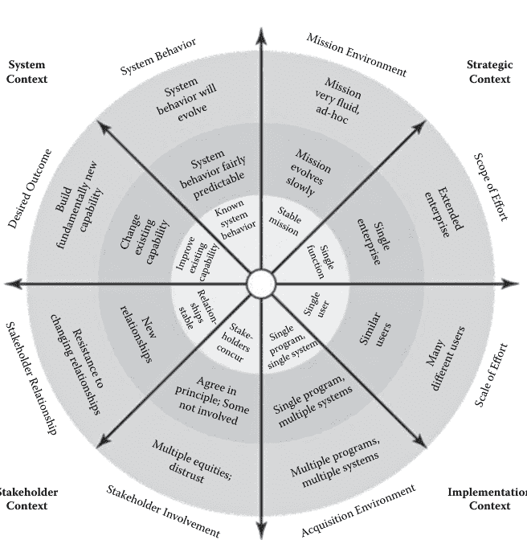

**图 4.4** 系统工程剖析器。

### 4.3 企业动态的代表性方法

此处应用了多种方法。下文描述了选入该统一框架初始版本的方法及其作用。

## 企业动态学方法与模型 49

这些方法以隐式和显式的方式处理不确定性。贝叶斯方法在这方面特别强大，说明性统一框架可以显式处理不确定性对采购策略和企业应用的影响。

### 4.3.1 系统动力学风险模型

系统动力学（SD）（Love 2006）起源于控制理论，并表示具有反馈关系的对企业的影响。一种 SD 模型结合物料流模型以捕捉核废物管理中的影响。该 SD 模型随后被应用于评估国防核废物处理的替代策略，见第10章。还开发了一种 SD 风险模型，根据需求稳定性、技术成熟度和计划复杂性预测转型或计划的演化。该模型捕捉了反馈和前馈效应。模型可以解决的问题包括：

-   支持企业目标的转型或采购需求是什么？
-   新技术和变化的环境对需求、转型策略和能力的影响是什么？
-   在关键决策指导的计划和资源下实现什么水平的性能？

### 4.3.2 基于代理的采购利益相关者模型

基于代理的模型（Mathieu 等，2006）可以识别重大转型计划中利益相关者（代理）和群体（多个个人）的角色和行动。在案例研究的运营中心模拟中，基于代理的建模已通过混合公式。在转型计划中，利益相关者和群体在不同的生命周期阶段（例如里程碑评审、技术开发等）进行互动并做出决策，并受到不同的环境压力（例如预算削减、监督和公众认知）。在当前版本中，基于代理的模型与 SD 采购过程模型链接：决策通过运行基于代理的模型获得，延迟通过运行 SD 模型确定。

基于代理的模型可以解决的问题包括：

-   利益相关者互动和决策对采购过程的影响是什么？
-   政策环境变化对利益相关者互动和决策的影响是什么？


# 50 企业动态学手册

## 4.3.3 高优化容错模型

高优化容错性（Highly optimized tolerance，简称 HOT）（Wojcik 2004）是一个用于理解设计、工程化和管理系统中复杂性方面的框架。Carlson 和 Doyle（1999）最初创建了 HOT 概念，并将其应用于森林管理、互联网流量和自然生态。对于工程系统，他们展示了在面对设计权衡和不确定性时，最小化预期成本如何产生与规模相关的幂律。从那时，HOT 方法论已应用于电力电网和互联网架构等系统。HOT 通常与幂律联系在一起。第 8 章的案例研究应用 HOT 模型对应用于特定企业转型计划的系统工程建模。HOT 模型可能解决的问题包括：

- 成本和管理压力如何影响转型计划的进度？
- 给定规划、预算和决策周期的安排，预期的转型进展是什么？
- 替代工程流程和获取策略的影响是什么？

## 4.3.4 技术经济模型

这种建模方法描述了受新技术和公众偏好影响的经济部门中的运营企业环境。它将技术和系统的系统工程流程模型连接起来，这些技术系统在跨行业宏观经济模型中代表的经济部门中提供主要服务。该方法已应用于能源部门的技术经济分析（Jorgensen 1998），并正在调整用于分析改进医疗服务的技术潜力，及其对占国内生产总值（GDP）16%的医疗保健部门的影响。

技术经济建模方法应用于第 12 章案例研究中的资源和能源规划，以及第 13 章案例研究中医疗保健未来趋势的分析。

关联系统工程与社会经济模型可能解决的具体问题包括：

- 如何最有效地将技术引入业务流程和服务？
- 重大技术和政策变化对企业在其所在经济部门增长的影响是什么？
- 对涉及的经济部门的服务成本和就业产生的多层次影响是什么？

## 4.3.5 周期与滞后获取场模型

周期与滞后模型（Rahimzadegan, West, and Hoffman 2006）应用傅里叶级数预测获取计划中的进度，该进度受治理政策规定的周期性规划、预算和审查周期，以及周期性出现的计划问题的影响。这些“场效应”由治理政策决定，必须在所有计划中被克服。可以引入单独的模型来描述影响进的组织因素和计划复杂性。

周期与滞后模型可能解决的问题包括：

- 给定治理政策规定的年度规划和预算周期、正常的人员周期以及问题发生与解决之间的典型滞后，预期的获取进展是什么？
- 替代获取策略的影响，例如主承包或大型集成商、托管服务和风险模型？
- 组织特征和计划复杂性的影响是什么？

## 4.3.6 稳态风险-机会模型

稳态模型利用流体和生物模拟来模拟企业对变化的抵抗和响应机制。该方法源于生物系统（Yates 2002），可以应用于企业运营，其中外部参数 λ 施加外部环境对企业的动态影响（类似于剪切“粘度”）。内部参数 η 代表企业对边界效应的响应能力（类似于整体“粘度”）。White（2006）描述了该概念在受风险影响同时响应机会的动态企业中的应用。

稳态模型可能解决的问题包括：

- 给定企业内部对外部环境变化的响应速率，预期的获取进展是什么？
- 程序中出现的自然风险-机会权衡动态是什么？

## 4.3.7 视线演化推理分析

为了在考虑企业转型中固有的不确定性的情况下检查复杂企业的性能动态，有必要应用推理方法以及模拟和建模方法。企业转型是一项涉及组织变革和可能的新技术利用的任务。首席执行官（CEO）需要对企业的技术投资和性能目标进行合理的对齐，需要理解技术投资如何支持转型的实现。这些合理的对齐需要做出整合了战略规划、企业建模、企业动态和系统工程（SE）信息的复杂论证。

视线可见推理分析（LSERA）（Bunting 2012）是一种用于推理由于企业或其环境中出现的动态和不确定性而导致获得特定预期性能概率的方法。其基本原理是，任务性能产生于个人对人员、流程和技术的动态理解。个人对动态交互进行推理，根据其交互产生对可能实现的性能的见解。个人增加了各自的理解，随后的决策和行动由于集体理解的提高而改变。

LSERA 支持从证据到战略结果断言的推理。LSERA 分析可能解决的具体问题包括：

- 如果企业投资于给定的组织和流程变化或技术倡议，企业将获得其结果吗？
- 不确定性和感知如何影响行为和决策过程？
- 根据新出现的突发信息，当前预期结果概率发生了什么变化？
- 如果管理采取此行动（干预）来改变组织动态，它会增加还是减少获得预期结果的概率？

LSERA 由两个模型组成：将推理和证据结构化为“如果-那么”语句链的**逻辑模型**，以及创建一个贝叶斯网络概率模型以指示行为实现概率的**推理模型**。使用这两个模型允许经理在其特定领域内进行异步推理，并以符合数学原则的方式对结果进行分析连接。第 7 章通过示例进一步解释了这些模型。

## 4.3.8 贝叶斯网络

关于企业及其运营环境和转型的变化的不确定性可以在规划和管理中进行隐式或显式处理。特别是，考虑到企业格局内部的不确定性，经理和分析师经常使用概率方法在其他分析技术的结果的基础上进行推理。需要能够指导或验证经验的应对不确定性的正式方法，而贝叶斯网络提供了一种强大方法。不确定性的估计通常来自经理、分析师和其他专家的经验。贝叶斯网络解决了企业转型中显式处理此类不确定性的需求。

贝叶斯网络表示变量之间的概率关系，这些变量共同构成联合概率分布。变量将具有互斥（必须处于仅一个状态）且穷尽（没有其他状态）的状态，例如，[真或假]、[男性，女性]。变量之间存在关系，路径（弧的序列）不循环回到变量。概率代表一个变量状态对另一个变量状态的影响强度。变量之间弧的存在或否表示依赖/独立。贝叶斯网络的一个独立条件是，每个变量在给定父节点的情况下与其后代是独立的。

建模企业动态也可能具有显著的不确定性。贝叶斯网络理论可以管理和理解企业动态中的不确定性，并编码企业动态的知识结构以便推理和检查。

## 4.4 将企业动态模型与企业架构耦合——ESE/A 流程

上述企业模型提供了转型规划和管理的企业系统工程（ESE）能力。这种 ESE 能力解决了基础第 3 章中建立的首次静态企业归档方法的主要缺陷。由此产生的 ESE/A 方法提供了一个动态过程，引导经理应对企业转型的复杂性。该方法对于本节概述的当前转型应用已经足够成熟。考虑到快速发展的


随着挑战的增加以及该领域研究活动的不断，预计 ESE/A（仿真与分析）过程将持续演进。第 4.5 节提供了这种 ESE/A 未来的概念。

## 4.4.1 使用仿真模型的动态企业架构

更好地理解和分析企业动态的一种极具前景的方法是根据企业架构的指导来模拟企业的行为。这种方法认为，企业的行为可能可以通过仿真来理解。然而，企业固有的复杂性使得实际模拟成为一项挑战。为了应对这种复杂性，使用企业架构（EA）框架将企业分解为可以模拟的连贯视图。通过整合多个 EA 的仿真，可以对由高度依赖的视图和上下文驱动的动态建立更深层次的理解。

第 3 章介绍了仿真方法与 EA 结合（或对活动形式进行架构设计）的主题。第 6 章介绍了一个应用案例研究，重点讨论了其在有关裁量资金投资的管理决策中的作用。通过使用捕捉企业 POET 元素动态特征的仿真方法，可以显著增强架构能力。

### 4.4.1.1 企业架构混合仿真模型的原则

仿真模型已广泛应用于预测、教育、理论构建以及决策辅助。由于每个应用都有不同的目标和要求，每种应用都需要不同的模型构建和使用方法。例如，一个旨在预测交易商品价格的仿真模型，其创建方法与旨在理解传染病传播的仿真模型或教授人们如何使用系统的仿真模型不同。创建仿真模型的准则取决于该模型旨在描述、预测、优化、建立理论、教学、沟通还是揭示机制。所展示的仿真模型目标侧重于理解和传播企业架构对企业行为的影响，并以企业领导作为关键用户模型。这些仿真模型在提供沟通和教育的同时，提供了对复杂性的洞察。它们不需要具有预测性，但必须能够识别出响应离散战略管理决策的可能企业行为和性能结果。这些仿真模型与现有的抽象模型良好协同工作，并将不同的视角整合到单一的混合仿真模型中。为了实现这些目标，开发了一系列指导原则以帮助引导建模过程。可以识别出四个帮助建模者创建 EA 混合仿真模型的关键原则：

- 1. 模型的创建应该是为了洞察（例如，通过定义与决策相关的未来结果进行“假设”分析），而不是为了产生点预测。
- 2. 模型必须捕捉企业架构的核心要素，且架构应包含用于分析的源数据。
- 3. 混合模型应优先关注战略层面，而非战术层面，以解决企业级战略决策及其可能的后果。
- 4. 混合模型必须明确捕捉根据战略决策或问题所需的、跨多个视图或领域的企业架构跨越交互。

接下来的四个部分将进一步发展这些原则，以应用于 EA 混合仿真模型的创建。

### 4.4.1.2 针对洞察而非预测的建模

EA 仿真建模并非旨在提高运营效率的预测性仿真建模方法；相反，这种方法寻求对复杂企业因其架构以及关键交互和决策点而产生的行为产生洞察。这种洞察有助于寻求从系统级视角塑造和引导企业的企业经理加速学习曲线。这种方法允许建模者和架构师从多个视角（例如策略、流程、组织、产品等）捕捉企业的关键属性，并检查这些视角之间的交互如何驱动企业的高级行为。这种方法采取企业的战略视角，指导架构师和经理理解系统整体如何向利益相关者交付价值。这种将仿真作为战略决策支持工具的使用与系统思维和组织学习领域研究人员的方法相似。在这里，模型与架构一起使用，通过以下方式获得系统洞察：

- 1. 在经理和架构师之间建立一个理解非线性企业动态的共享参考基准
- 2. 理解硬（定量）和软（定性）系统变量之间的关系和影响
- 3. 测试假设并进行情景分析
- 4. 通过仿真分析结果发现新的架构或管理当前架构的方法

最后三点与组织学习领域研究人员支持的三个学习阶段密切对应（Argygis and Schön 1978; Senge 1990; Senge 2000; Froweler 2003）。

### 4.4.1.3 企业架构的战略级建模

所提的战略层面（而非战术或运营层面）EA 混合建模方法的一个核心原则。这对建模方法具有深远影响：该方法并非提供一个在特定语境下具有预测能力的高精度详细模型，而是提供一个在面对不确定性时缺乏高精度但能提供更广泛背景下系统洞察的模型。这种建模方法解决的问题与战术模型解决的问题有本质区别。战术模型可能回答“什么参数可以实现最优输出”的问题，而战略模型将回答“在预期环境中提供良好性能的设计特征是什么”的问题。

组织设计理论者、系统思考者和企业架构师（Gallbraith 1973; Senge 2000; Ross et al. 2006）已经接受了企业研究中的战略重点，但这并未反映在企业模型的工作中。大多数模型倾向于狭义地关注（如支持 EA 中的单一视图）、战术性关注（如研究供应链效率）或两者兼顾（Kalpic and Bern 2002; Epstein 2003; Schieritz and Größer 2003）。计算组织设计领域的研究人员创建了模型（Rivkin and Sigglelow 2003; Sigglelow and Leinthal 2003; Ethiraj and Leinthal 2004）。然而，这些模型往往是生成性的且过于抽象，无法提供大多数企业经理能够理解和信任的洞察。他们需要一种关注战略的建模能力，它不仅能支持组织设计理论者和系统理论者的理论，还能支持企业经理在引导企业发展和方向方面的需求。

### 4.4.1.4 关注跨架构交互产生的动态

所提出的 EA 仿真建模方法试图通过根据复杂系统近可分解性的概念，明确捕捉跨 EA 视图上下文边界的交互，来捕捉企业的复杂动态。这些交互为系统内部以及跨越 EA 视图的反馈提供了路径。从一组初始条件开始，这种仿真模型将推演 EA 随时间对外部环境的响应。


# 企业动力学方法与模型 ■ 57

## 4.4.1.5 企业混合模型开发流程

仿真模型作为迭代过程的一部分，有助于理解当前架构的问题，并为创建目标架构（to-be architectures）提供输入。这一过程有助于确保仿真模型具有合理的边界和范围，确保框架性问题提得当，确保模型按逻辑顺序创建，并且模型能够有效回答其设计时要回答的问题。然而，建模始终是一项创造性工作，但它可以从结构化的流程中获益。如果没有良好的流程来指导模型创建工作，模型可能会迅速变得不可控或不符合其用途，从而丧失范围、目的或结构。标准化的有助于确保模型不偏离最终目标，并对模型进行结构化，使其对决策者后续使用更有用。该过程作为引导创造性过程的工具，就像企业架构（EA）框架被用于创建企业架构一样。

创建模型的过程并非严格线性的。所有的建模都是迭代的，随着更多信息的获取和新见地的产生，模型会不断更新。随着模型的创建，应该对其进行持续测试和重新评估，以确保其符合目标。尽管测试往往在建模过程的后期进行，因为在模型开发期间无法进行初步测试。在模型经过评估后，将产生新的假设，流程可以再次迭代。

## 4.4.2 可执行多智能体企业架构

企业架构（EA）的开发旨在指导系统和服务的投资，并指导业务流程的改进（Swell 2005）。现状架构（as-is architecture）描述了当前的业务流程、活动、服务、数据资源和基础设施。这些是状态空间参数初始条件的丰富来源。可执行架构增加了建模能力，用以分析这些元素在系统和运行环境中的交互和性能。多智能体可执行架构在第 11 章中一个国际贸易场景的案例研究中进行了制定。

### 表 4.1 基于 EA 的混合仿真建模步骤

1. 文档化企业架构。
   - 使用支持动态建模的 EA 框架，定义视图及其相互作用。
2. 阐述问题。
   - 这是解决此问题的正确方法吗？
   - 识别：问题、关键变量、关键行为、时间跨度。
3. 形成动态架构假设。
   - 初始假设生成。
   - 关注内生因素。
4. 识别适用的架构视图。
   - 根据问题动态性筛选 EA 视图。
5. 将视图与仿真方法进行匹配。
   - 根据动态背景背景、所需的输入/输出进行匹配。
   - 选择将使用的建模环境。
6. 识别子模型之间的边界和接口。
   - 使用 EA 识别与问题和动态假设相关的边界和接口。
   - 创建子模型边界图。
7. 创建子模型和顶层模型图。
   - 创建每个子模型结构的子模型图。
   - 创建顶层模型图，描述子模型如何链接到顶层模型。
8. 创建仿真模型。
   - 变量、关系和初始条件的估计。
   - 使用选定的方法对子视图建模。
   - 将子模型组合为架构模型。
   - 开发全局模型接口。
9. 测试模型。
   - 敏感性分析。
   - 行为和结构分析。
   - 其他分析方法。
10. 设计并评估策略。
    - 场景分析。
    - “如果怎样”（What if）分析。

来源：改编自 J.D. Sterman, 《业务动力学：复杂世界的系统思维与建模》，第 86 页，2000 年。
注：箭头表示主要的反馈回路。

可执行架构可能解决的具体问题包括：

- 计划中的收购组合可能如何提高任务和业务性能？
- 收购、流程变更和组织变更是否应该在动态转换过程中分阶段并进行协调，以达到目标状态（to-be）的未来企业状态？考虑到在不断变化的环境中，目标状态是一个不断移动的目标。

## 4.5 企业动力学的统一方法——未来方向

正如流体动力学和结构动力学理论及方法支持工程学科一样，企业动力学作为一门学科支持企业系统工程与架构（ESE/A）过程。所有这些应用领域都根据挑战的特定性质采用各种建模方法。构成企业动力学新兴领域的概念和特定方法在正文中已概述。本节描述了一种概念，即将将企业特定元素的模型整合到综合（统一）视图中，以进一步推进企业动力学在 ESE/A 过程中的应用。

### 4.5.1 统一概念

提出的统一概念是作为 ESE/A 的一种未来能力，以激发进一步研究。该概念基于从时间角度对企业动态元素的状态空间描述，并结合 C-I-U 运行视角。其可行性在第 8 章的案例研究中得到证明，它是应用于企业转型的系统工程（SE）过程的简化形式，通过线性闭形式最优控制理论和博弈论的数学技术减少了企业状态空间和控制参数的数量。

实现此概念的统一框架捕捉了企业在数学状态空间形式下的转换路径，如图 4.5 所示，即“统一框架”。代表性的分析方法可以作为源模块应用，并可能被选择适用于企业挑战。统一框架还包括核心的 C-I-U 企业去动力学，用以分析企业的转换。动态参数源于多样化的源模块。

**图 4.5 统一框架**


统一框架还包含了用于分析企业转换的核心 C-I-U 企业去动力学。动态参数源于一组化的源模块。

C-I-U 企业模型在此表述为：
$dX/dt = A \cdot X + B \cdot U + \delta$

$X$ = 状态空间向量 ($n \times 1$)
$A$ = 状态空间系数 ($n \times n$)
$U$ = 控制元素 ($m \times 1$)
$B$ = 控制系数 ($n \times m$)
$\delta$ = 状态空间的扰动元素 ($n \times 1$)

# 企业动力学方法与模型 ■ 61

可以构建企业模型。C-I-U 公式包含了由 B 矩阵定义的所有控和非控元素。控制理论方法对于捕捉特定企业的限制性控元素是必要的。

分段公式被用于整合来自各种分析模型的状态空间参数。Rabelo 和 Speller (2005) 已针对企业运营的 SD 模型演示了这种线性化过程。同样的方法也可适用于基于智能体、离散事件、计量经济和其他类型的模型，以捕捉它们对企业状态空间动力学的表示。概率行为很重要，也可以在该框架中被捕捉，但需要进一步的研究来提高此类方法的效率。

核心统一模型在企业层面制定，关联了收购过程的动态与不断变化的外部环境的影响。控制理论方法提供了强大的方法，涉及可观测性和控制性概念，以及状态空间和控制矩阵特征值的推导。

为了提供有效的管理和决策支持，描述性企业动力学必须推动企业在其状态空间中的演进，并适应与决策相关的管理控制行动。企业状态空间描述（X）包括企业的财务和物理资源及其运行参数。控制参数（U）代表指导转换的管理决策和行动。这些参数的示例包括：

# 企业状态空间描述

| | | |
|---|---|---|
| 外部环境 | X_1 | 经济增长、劳动力供给、技术市场、客户群体 |
| | X_2 | 市场份额、产品/服务输出、运营与支持成本、市场地位 |
| 运营企业 | X_i | 投入、收购范围、收购速度、风险/机会结果 |
| 收购企业 | 成熟度、通用与差异化、风险、成本、S |
| 技术机会 | | |


# 企业动态学手册

## 企业控制/影响参数

| 外部环境 | ID | 描述 |
| :--- | :--- | :--- |
| 外部环境 | U1 | 经济政策、劳工监管、技术政策、任务政策 |
| 运营企业 | U2 | 差异化、产品/服务改进、成本管理、广告 |
| 收购企业 | U3 | 预算、收购策略、收购计划、风险/机会策略 |
| 技术机会 | Un | 进取性、收购策略、风险承受能力、标准 |

这些状态空间描述符和控制参数中的许多可以源于企业架构（EA）的特征，或者反之，被引入到架构中。这实现了企业动态学与管理方法（如 EA、精益六西格玛、企业资源管理 (ERP) 和基于活动的管理）之间的直接耦合，并推动了 ESE/A 过程的进展。

单个源模块（模型）定义了上述企业状态空间中选定的感兴趣描述符。通过“统一”各自对状态空间表征的贡献，增强了它们的价值。当不同模型涵盖了状态空间的共同元素时，统一各种参数可能涉及一个竞争性选择过程；当模型提供互补覆盖时，则涉及一个整合过程。

第 8 章描述的到目前为止的工作已经解决了一个高度聚合的企业动态 C-I-U 模型建模。该模型利用 HOT 和循环方法的元素，在博弈论表示法中描述了企业在动态外部环境中经历重大收购的演变过程。文中描述了 HOT 模型的分段线性化，并提供了与其它（源）模型中开发的更详尽状态空间细节的联系。

随着源模型针对特定目的得到充分开发和验证，它们可以被整合到企业更完整的企业状态空间描述（C-I-U 模型）中。使用不同模型分段线性化的统一过程（Rabel and Speller 2005）将有助于跨越规模级别并贯穿整个时间生命周期，以实现在企业的运营任务环境中。

# 企业动态学方法与模型 63

### 4.5.1.1 企业状态空间描述及其与架构的关系

C-I-U 模型中的状态空间描述是企业动态参数的共享资源，这些参数源于并关联 EA，并在源模块中采用了各种学科。参数 (X, U, A, B) 是随时间变化的；在某些情况下，可以用闭式形式进行解析描述，但在更复杂的情况下，可以基于特定时间步上各种模型参数的分段线性化来保留非线性动态效应。

### 4.5.1.2 核心 C-I-U 企业模型

核心 C-I-U 模型使用核心理论方法，整合选定的源模块来解决以下企业级问题：

- 在给定范围、策略和时间压力的关键决策下，预期的转换进度是什么？
- 受控、影响和不受控因素以及变化的外部环境对需求和计划有什么影响？

简化公式的说明性结果利用了来自 HOT、循环与滞后模型以及 SD 模型中选定的状态空间描述符。它为在变化环境中运行的企业提供了高度聚合的描述，描绘了在收购和实施新企业能力期间预期进度。核心模型必须具有足够的活性，以包含来自其他源模块的其他动态状态空间元素，并在需要支持特定管理决策时增加其对此类元素的保真度。

在统一框架的通用概念中，核心企业模型的结构将基于要执行的战略规划和分析研究。核心模型可以围绕一个源模块构建，或者如图所示，基于一种独特的建模方法。在任何情况下，都将从其他源模型中提取内容并根据需要整合，以提供应用所要求的更全面的企业状态空间描述。

### 4.5.1.3 企业动态学与企业架构的关系

图 4.6 展示了企业的动态元素，带有特定的时间常数、循环和滞后。组织因素包括角色、职责、问责制和权限（R2A2s），对于这些尤为重要

# 64 企业动态学手册

## 跨企业的自然时间常数不同

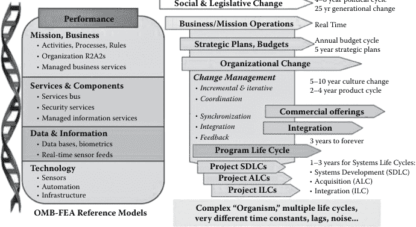

图 4.6 转型中企业的 EA 动态元素。

统一方法中的动态状态空间描述符和控制参数可能直接关联到纳入 EA 的动态特征（在图 4.6 中所示为企业的 DNA）。

EA 作为图 4.5 中的源模块之一，作为管理工具发挥着重要作用，在其中建立并定义了交付的服务以及相关的企业活动，以便在整个 ESA/A 中一致使用。

为了在 ESA/A 过程中充分获得企业动态与企业架构耦合的利益，必须纳入一套一致的动态状态空间描述符和控制参数。该公式涉及动态分析与存档之间的高度迭代过程。这种协调的益处解决了独立应用这些或其他管理方法时观察到的若干持续问题：

- 仿真模型往往缺乏对业务运营和管理具有高度意义的内容。
- 企业架构包含一套相当完整的企业特征，包括业务规则（或政策）、组织定义、服务或产品输出、活动和流程，但其公式化通常过于静态和僵化，且缺乏控制（和影响）机制。
- 基于活动的管理通常与基于活动的成本系统需求耦合，限制了其作为通用管理方法的使用。
- 企业资源计划（ERP）通常被用于狭义的财务报告，而不是作为一种稳健有效的性能监控、测量和管理工具。

# 企业动态学方法与模型 65

ESE/A 过程可以通过在各种工具和方法中传播服务和活动的定义来解决这些问题，尽管在应用中并不容易，但考虑到即使在简单的计划中观察到的极高风险和失败率，这是值得付的。

### 4.5.2 环境中企业的 C-I-U 仿真结果

为了说明目的，基础数学公式和 C-I-U 模型 1.0 的结果（基于 HOT 模型和循环滞后模型的选取状态空间参数的控制表示）概述如下。该插图源自第 8 章对该主题的更广泛案例研究。

在应用于整个企业收购和运营的简单形式中，核心模型具有随时间变化的标量状态 $s(t)$ 以及控制变量 $q(t)$ 和 $t_f$。在这里，$s(t)$ 量化了实现运营能力的进展，$q(t)$ 是投入收购资金的平方根。控制参数 $t_f$ 是完成收购的时间。在这个简单模型中，“收购”包含了向运营转换的传统过程。此外，系统总寿命（跨越收购和运营）$t_L$ 在控制公式中作为常量 $b$ 和 $K$ 指定：

```
$s(t) = b \cdot q(t)$
```

```
$J = K \cdot s(t_f) \cdot (t_L - t_f) - \int_{0}^{t_f} q^2(t) \cdot dt$
```

在这里，$J$ 是要最大化的目标函数函数J$ 中的第一项代表能力在运营中的收益，第二项代表获取该能力的总成本。Wojcik 和 Hoffman (2007) 证明了最优状态 $s(t)$ 关于时间是线性的，并且的是，最优 $t_f$ 始终是 $t_L/3$，与常量 $K$ 和 $b$ 的值无关。这一非常通用的规则为所有类型的企业收购计划提供了一个定量基准。Wojcik 和 Hoffman (2007) 还扩展了核心模型，以涵盖由于环境变化、用户需求演变或企业任务不稳定引起的外部影响。因此，通过应用最优控制理论，核心模型在其任务和环境背景下产生了高层的、涌现的企业动态行为。


## 4.6 结论

本章介绍了一系列可用于 ESE（工程化系统工程）的模型，以及通过 ESE/A 过程支持动态企业架构的定位。尽管这建立了一个规划和管理企业转型的改进能力，但文中还描述了一个可能的未来方向——统一概念，以激励进一步的研究。图 4.7 展示了用于企业动力学中特定目的的个体建模方法与 POET 空间（过程、组织、环境、技术）的关系。所示定位代表了每种建模方法更常见的应用倾向，但它们也可以具有更广泛的应用范围。特定的倾向解释了在第二部分案例研究中混合建模之所以流行的原因，并强调了集成（统一）方法的必要性。

引入企业动力学所带来的运营性能收益是技术获取和实施过程中企业规划与分析的本质组成部分（即支持 ESE/A 过程）。提出的框架描述了这一工程学科的范围和内容。

本章描述的用于企业架构的性能模拟模型是一种先进的 ESE/A 过程。利用统一概念可以进一步推进这种方法，因为该框架以及核心的 C-I-U 模型至关重要。

在企业运营规模上核心 C-I-U 模型的定义，以及动态感知响应机制的定义，提供了统一能力，既指向企业嵌入的较高层次的经济部门，也指向较低的组织规模。根据分析需要可以为核心 C-I-U 模型增加保真度，因为源模块已充分开发，以提供更详细和完整的状态空间描述。

图 4.7 映射到 POET 空间的模型，以反映应用倾向。

## 企业动力学方法与模型 67

应进一步研究对状态空间描述符进行标记的方法，以识别其在生命周期中的时间位置、模块大小、规模和其他视角，例如，使用语义技术。用于处理不确定性以及在决策支持所需的框架中纳入概率因素的改进方法，应当与可视化和游戏化能力相结合。

源模块中代表的若干种方法处理了企业与其外部（大多数是不可控的）环境的动态相互作用，例如系统动力学、HOT（高度优化性）和基于代理的模型。未来的研究将探索描述竞争、对抗和欺骗行为的模块作为重要的动态元素。

此前讨论的方法已经在研究计划内通过广泛且多样的程序和运营管理经验得到了验证。验证必须扩展到机构规划和计划管理社区。这可以通过一种获取游戏环境来实现，让利益相关者和决策者在核心状态表示的基础上，通过一组多样化的描述性、规范性和预测性模型来探索情境和解决方案。

## 参考文献

- Argyris, C. and Schön, D. 1978. Organizational Learning: A Theory of Action Perspective. Reading, MA: Addison-Wesley.
- Bousso, R, and Polchinski, J. 2004. The string theory landscape. Scientific American (September): 78–87.
- Bogzdan, K. 2007. Enterprise architecture modeling, design and transformation: Defining the missing links, Aerospace Initiative, April, Cambridge, MA: MIT.
- Bogzdan, K., Glazner, C., Hoffman, C., and Sutton, J. 2008. Computational Enterprise Modeling and Simulation, Lean Advancement Institute Annual Conference, Boston, MA (APRIL).
- Bunting, W.J. 2012. Reasoning on uncertain enterprise technology alignment for insight into attainment of enterprise transformation, Journal of Enterprise Transformation, 2(1): 50–79.
- Carlson, J.M. and Doyle, J. 1999. Highly optimized tolerance: A mechanism for power laws in designed systems. Physical Review, 60(2), August): 1412–1427.
- Crutchfield, J.P. 2003. When evolution is revolution—Origins of innovation. In J. P. Crutchfield and P. Schuster (Eds.), Evolutionary Dynamics: Exploring the Interface of Selection, Accident, Neutrality, and Function. Oxford: Oxford University Press.
- Dahlgren, J. 2007. Real options and flexibility in organizational design. Presented at the Fifth Annual Conference on Systems Engineering Research (CSER), International Council on Systems Engineering (INCOSE), Hoboken, NJ (March 14–16).
- DeRosa, J.K. 2005. Thoughts on complex systems and enterprise systems engineering (ESE). Presentation to the Faculty of the College of Engineering and Mathematical Sciences at University of Vermont, Burlington. December.

## Enterprise Dynamics Sourcebook 68

- Epstein, J. 2003. Growing Adaptive Organizations: An Agent Based Computational Approach. The Brookings Institution. Washington, DC.
- Ethhiraj, S.K. and Levinthal, D. 2004. Modularity and innovation in complex systems. Management Science, 50(2): 159–173.
- Flint, D. 2005. The users view of IT projects Gartner, Inc. Research Paper (4 February). Washington, DC.
- Fowler, A. 2003. Systems modelling, simulation, and the dynamics of strategy. Journal of Business Research, 56(2): 135–144.
- Gallbraith, J. 1973. Designing Complex Organizations. Reading, MA: Addison-Wesley.
- Hoffman, C.K. et al. 2007. Descriptive entropy—A multi-disciplinary unifying framework. Presented at the Fifth Annual Conference on Systems Engineering Research (CSER), International Council on Systems Engineering (INCOSE), Hoboken, NJ.
- Jorgensen, D. 1998. Economic and technological models for evaluation of energy policy. In Growth, Vol. I. MA: MIT.
- Laskey, K. 2008. A model for multi-agent interaction. MITRE Technical Report, McLean, VA.
- Sterman, J.D. 2000. Business Dynamics: Thinking and Modeling for a Complex World. Boston: Irwin McGraw-Hill, p. 137.
- Stevens, R. 2010. Engineering Mega-Systems: The Challenge of Systems Engineering in the Information Age. Boca Raton, FL: CRC Press.
- White, B. 2006. On the pursuit of enterprise opportunities by systems engineering organizations. Presented at the IEEE Conference on Systems of Systems Engineering, Los Angeles (April 24–26).
- Wojcik, L.A. 2004. A highly-optimized tolerance (HOT) model of the large-scale systems engineering process. Presented in Student Papers: Complex Systems Summer School (June 6–July 2). Santa Fe, NM: Santa Fe Institute.
- Wojcik, L.A. and Hoffman, K.C. 2007. Emergent enterprise dynamics in optimal control models of system of systems engineering process. Presented at the 2007 IEEE/SMC International Conference on Systems of Systems Engineering (SoSE) (April 16–18).
- Yates, F.E., MD, 2002. From Homeostasis to Homeodynamics—Energy, Action, and Senescence, gyates@ix.net. (Synopsis, November 11).


# 第 5 章

# 企业转型管理
使用 ESE/A

Fran Dougherty, Elaine S. Ward, and Kenneth C. Hoffman

## 目录

- 5.1 引言...............................................................................................72
- 5.2 涉及复杂系统的企业转型管理新方向...............................................................................................................73
- 5.3 管理挑战...............................................................................76
- 5.4 企业管理领域——转型方法与经验...........................................................................................................................78
- 5.5 多机构环境下的有效治理...............................................................80
- 5.5.1 多个机构的治理范围...............................................80
- 5.5.2 有效治理的要求...........................................................81
- 5.5.2.1 捕捉组织交互和互操作性系统的虚拟企业模型 ....................81
- 5.5.2.2 定义良好的业务功能与流程...........................................83
- 5.5.2.3 异构技术服务环境...........................................83
- 5.5.2.4 综合规划与投资方法...........84
- 5.5.2.5 参与多机构任务的 EA 之间必须保持兼容性...........................................84
- 5.5.3 业务活动在治理中发挥核心作用...........................................86
- 5.6 构建转型规划与管理的有效治理................................87
- 5.7 系统工程与架构指南背景...............................89
- 5.7.1 MITRE SEPO 体系................................................................................................89
- 5.7.2 MIT 复杂、大规模、互联、开放、社会技术过程................................................90
- 5.8 整体企业系统的工程与架构过程...........................................91
- 5.8.1 复杂企业系统挑战与复杂性陈述................................................91
- 5.8.2 企业表征与表示（架构、景观）...............................................92
- 5.8.3 建模与分析方法（多学科方法）。...............................................94
- 5.8.4 治理（策略、战术、R2A2）。...............................................................95
- 5.8.5 实现（侧重于运营或转型）。................................96
- 5.8.6 确保结果/产出（感知与响应能力）。................................97
- 5.9 结论................................................................................................................99
参考文献................................................................................................................100

72 企业动力学源读

## 1 引言

企业运营与转型的管理——具有清晰的规则、职责、权限和基于绩效的问责制（R2A2）——是获得成功成果的核心。如前几章描述的，定量和分析性工具通常与管理过程过于孤立。为了利用企业动力学原理以及企业系统工程与架构（ESE/A）过程来提高性能，这些工具必须与主流企业管理方法建立更紧密的联系，例如基于活动的管理（ABM）、企业架构（EA）和企业资源计划（ERP）。

本章关于企业转型管理的章节强调了 ESE/A 中的“架构（architecting）”，这在公共和私营部门是通用的，在成功应用中提供了与治理和管理之间现有且有效的链接，这种链接可以被加强。为了说明一个需要高水平管理协调的挑战性环境，本文引用了国际贸易供应链的一个应用，该应用在第 11 章中有更完整的描述。该案例研究描述了一个需要高水平管理协调和清晰治理结构的挑战性多机构企业环境。

通过描绘整体 ESE/A 过程中概述概述的企业性能动态模型，可以增强基于架构的方法，以支持对公共或私营企业进行有效管理。该应用的范式是一个感知与响应的决策导向型组织，特别关注

73 使用 ESE/A 管理企业转型 ■ 73 可以被控制的企业元素、可以被影响的内部和外部元素，以及企业周围更大环境中必须考虑、预测和处理的某些内部但很大程度上不可控的因素。

分析性和判断性的元素必须被嵌入到 ESE/A 过程中，通过架构过程应用于整个企业。这些元素有助于更好地协调参与复杂任务的多个组织和机构之间的规划与管理。具有国家重要意义的安全任务和全面公共服务的交付，需要加强多个政府、公共和私营部门活动的整合。全球供应链由商业实体形成并运营。这些协作环境带来了复杂的组织、经济和技术挑战，需要有效的管理方法和技术来提高任务性能并管理风险：这是一个治理挑战！

治理的系统架构视角可以确保企业转型计划的关键要素与任务目标对齐，并利用分布式资源基础。多代理业务模型在公共和私营部门的重要性都在日益增加，并提出了最具挑战性的治理要求；它被用作一个参考点，通过。

## 5.2 涉及复杂系统的企业转型管理新方向

早期的章节描述了用于架构、工程和管理企业转型计划的结构化方法。在处理复杂系统和转型时，该方法必须支持并响应管理观点和方法的变化。

在第 2 章中，我们介绍了了直到 ESE/A 的概念和方法论时间线的历史概述。我们在第 3 章中扩展了这一讨论，探讨了 ESE/A 与新兴的系统系统（SoS）思维之间的相互作用，以及它与组织科学概念的融合，并阐明了其对 ESE/A 设计的影响，特别强调了 ESE/A 在设计和管理大规模系统变化方面的应用。然后，第 4 章概述了来自运筹学、管理科学和经济学的各种建模方法，以探索企业转型并处理内在的不确定性。在这些之前的章节中奠定了基本思想后，我们现在可以通过直接关注 ESE/A 过程来解决“如何做”的问题，即

74 企业动力学源读 以设计、工程并实现性能改进、现代化和转型。

目前还没有被广泛接受的实施 ESE/A 的过程或结构化方法。与以往用于实施系统工程的结构化方法不同，实施 ESE/A 的新过程必须承认企业是目标导向的动态社会技术系统，这些系统通常以非线性交互、因果环、自组织和涌现行为为特征。在这里，本章提出的过程解决了在持续和快速变化的时代规划设计过程的挑战，即高效有效地管理高度交互和迭代的过程，同时允许持续的组织学习和适应。尽管本章的主题是企业转型管理，但它是从转型是一个必须在不中断业务运营的情况下进行的持续过程的角度编写的。

因此，在本章中，我们从早期的工程过程开始，这些过程多年来从线性或顺序过程演变为瀑布过程，再演变为并发工程过程并合并螺旋过程，因为过程本身必须处理日益增长的硬件和软件复杂性。这意味着要引入越来越多的反馈回路以考虑系统复杂性的持续增长，并采用迭代动态方法来完成底层设计过程。系统工程过程的这种演进发展反映在国防采购过程中随时间推移的逐步变化，随之在复杂新产品的设计中。系统工程过程和产品开发过程也很大程度上受到软件设计开发中演进过程的影响。

这些发展带来了一些重要问题。工程或架构复杂企业意味着什么？企业是复杂社会技术系统的子集，表现出动态网络特征、非线性交互、涌现和自组织属性。如何同时设计和开发复杂的工程系统以及它们的复杂社会技术系统，以确保工程系统是容错的，特别是面对由于工程系统与作为整体的企业多个维度和行为因素相互作用产生的更大复杂性时？

正如我们已经探讨过的，这些问题的答案需要当代思维和实践的新型合成。这并不意味着放弃对工程系统将如何的确定性和预先预测的需求。


# 使用 ESE/A 管理企业转型 ■ 75

执行并表现。在当今复杂的相互依存环境中，我们有更多理由预期此类复杂的工程系统能够具备容错能力，并以效率、一致性和可靠性完成任务。

这种观点的一个重要影响是：设计和开发复杂的工程系统不应在孤立状态下进行，不能仅仅将整个企业视为一个包裹在正在开发的工程系统外壳之外的“外层”，并希望工程系统与企业其余部分的交互能以某种方式抵御各种系统性故障。这可能被称为**被动设计策略**。相反，可以认为必须尽力努力，通过采用主动的“企业在回路”（enterprise-in-the-loop）设计策略，在整个设计过程中将大型企业的关键方面进行内生化或内部化。这可能被称为**主动设计策略**。

传统的理想是让一个全能的“系统工程师”或“系统架构师”代表客户、终端用户或建设者驱动过程，而这种理念已让位于“开放设计”过程的理念——这种过程通过双向反馈互动，持续接受来自对结果有既得利益的相关者的多次输入。

设计-构建过程中固有的复杂性，包括需要向设计和工程过程本身引入更多科学方法。我们已经看到，近年来在系统设计和工程过程中，对计算建模和仿真方法的利用率已发生了显著转变。规划一个实施 ESE/A 的稳健未来流程，可以考虑基于多代理的建模、演化计算、最优控制和贝叶斯网络的作用和应用。

还需要在测试工程过程中引入更多科学，以揭示和理解体现工程系统的社会技术复杂性。这意味着将知识整合到复杂社会系统的结构和动力中（例如复杂性理论、网络科学、计算组织科学、进化生物学、行为经济学等）。在这种背景下，EA——不仅信息系统和技术的架构，更是企业作为一个整体系统的架构——正获得越来越多的关注。

ESE/A 实施过程的整体框架可以是一种统一的结构化方法，通过实时考虑政策、组织、经济和技术（POET）维度，对具有突现属性、不断变化的格局和不确定特征的大型复杂企业的变革和现代化管理。

讨论 ESE/A 流程的一个有用起点是美国管理和预算局（OMB）对复杂系统和技术的大型联邦投资进行绩效规划和预算编制的观点。

# 76 ■ 企业动态源手册

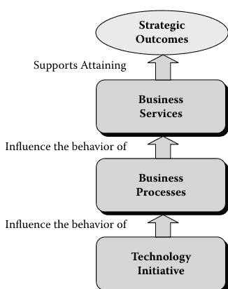

**图 5.1 从技术倡议通过转型的业务流程和服务到实现战略转型成果的基于绩效的视线。（出自 W. J. Bunting, Journal of Enterprise Transformation, 2(1, January): 50–79, 2012.经许可。）**

如图 5.1 所示，跨民用世界和政府机构的倡议（Bunting 2012）。商业部门也应用了遵循类似逻辑的高度精简化方法。

## 5.3 管理挑战*

政府和商业运营日益要求整合来自支持组织的复杂业务活动和服务，以执行（并交付）具有高度国家意义的任务（服务）。当这些运营通过应用先进技术和信息系统进行现代化改造时，会产生需要新管理能力的独特挑战。同样，企业通常处于持续变化的状态，在此期间运营必须维持。

在转型计划中，技术经理必须处理这些转型技术的选择、采购、引入和运行，以及涉及的所有机构业务实践中的相关变化。

> * K. C. Hoffman 等人 2005. 国际企业分布式对象计算会议 (EDOC) Workshop. IEEE Computer Society.

多机构任务和关键服务交付的显著示例包括：

- 通过商业制造和分销伙伴为进出口提供供应链管理
- 管理国际贸易的安全方面（国土安全部、外交部、商务部以及商业供应链伙伴），这被作为一个案例研究
- 为老年人和低收入群体提供医疗保健和（（健康与人类服务部、医疗提供者和保险行业）
- 执行联合军事任务（国防部和后勤支持组织）
- 为公民提供电子政府服务（所有提供公民服务的联邦和州/地方机构）

Malone (2004) 描述的协作非层次化工作环境的出现，为协调高度分布的活动提供了一个通用的管理示例。当利益共同围绕特定任务或业务挑战聚集时，支持技术可以提供所需的问责制和信息共享。

目前有很多企业管理工具，通过适当的内容和应用，可以帮助经理处理多机构任务规划和转型的系统复杂性。这些工具包括 EA、仿真模型和 ERP 方法。基于架构的多机构环境管理方法可以整合这些方法，并在后续章节中开发，这些首先涉及：

- 转型管理领域 (5.4)
- 多机构环境中的治理，随着机构和业务必须互动以执行复杂的任务功能，其重要性日益增加 (5.5)
- 构建有效的治理环境以管理复杂转型的步骤 (5.6)

这些导致了支持企业转型全生命期的 ESE/A 流程，包括：

- 源自 MITRE 和 MIT 经验的 ESE/A 流程指南背景 (5.7)
- 采用动态工具和方法的整体 ESE/A 流程 (5.8)

## 5.4 企业管理领域——转型方法与经验

任何足够先进的技术与魔法无二致。
Arthur C. Clarke

企业转型涉及实施新的技术和业务流程，以改进任务执行和企业支持活动。转型技术包括直接应用于任务执行或服务交付的自动化技术和传感器技术，以及为任务或服务提供更好决策支持、数据和通信系统的信息技术。

选择和部署先进技术的规划和投资流程在单个业务实体方面已经成熟，但对于多机构计划，其失败率仍然高得不可接受。架构可以被视为企业的基因代码，描述了任务、方向和业务流程以及支持的信息系统和基础设施。

作业成本法（ABC）和 ERP 方法通常用于整合大规模财务和会计系统，以跟踪企业绩效和转型倡议的进展。然而，今天 ERP 系统被广泛使用，但它们通常与企业的架构视图相结合。在本章描述的治理环境中，ERP 系统可用于捕捉企业的任何实时状态空间描述。总来说，这些 ABC 和 ERP 方法和实践为机构级规划提供了基础，但转型必须扩展、整合并适应更复杂的多机构环境。企业动态学科为更有效地应用这些规划和管理方法提供了统一理论。

转型计划的失败（无论是针对单个还是多个实体）源于治理缺陷，涉及的风险因素包括：

- 任务伙伴关系机构之间的协调不力
- 任务目标定义模糊
- 术语、时间跨度和文化的差异阻碍并损害了沟通
- 业务、财务、绩效和信息系统规划管理的“烟囱式”划分，分离导致对关键业务活动的定义不一致


# 使用 ESE/A 管理企业转型 ■ 79

- 与业务/任务有效性或质量不直接相关且不易于衡量的性能目标
- 对所需的未来业务环境以及支持该环境的目标架构缺乏愿景和具体性，而这两者本应驱动转型计划
- 尽管在架构方面投入了大量资金，但高层管理者对“架构化”方法缺乏执行层和组织的承诺

这些问题的出现很可能是因为组织结构以及协作经验的新颖性。例如，在多机构运营中，或当员工缺乏共同工作的历史时，管理结构可能不够清晰。技术系统和数据源分布在不同的组织单元和地点，这种状况导致了极高的失败风险。

基于架构概念的集成治理方法可以通过为规划和决策提供完整的结构，来帮助避免一些陷阱。如果在管理层的全力投入下实施，ESE/A 流程将有助于使架构更具相关性且易于实施。技术经理在制定和指导转型计划方面的作用尤为重要。环境的复杂性要求技术经理充分利用他们手中的每一个有效企业工具。

采用了多种企业规划和分析资源来支持任务运营和转型计划的治理过程，包括：

- 企业架构（EAs），描述了企业的所有有形及部分无形方面
- 运营模型和模拟，描述了由信息服务支持的业务和任务组织的性能
- ERP 和 ABM 方法/流程，涵盖了应用于任务的所有企业资源（人力、技术、设施等）用于性能监控

在单一机构或企业中，企业转型的治理基于其组织结构以及在清晰控制路线内的权限分配。在缺乏这些机制的多机构环境中，治理变得特别具有挑战性，因为它必须涵盖跨多个机构和商业伙伴的一系列任务活动和支持服务，而每个机构都有自己的管理流程和文化，且没有既建立的控制路线。

在更复杂的多机构环境中，企业转型的挑战适用于一种基于架构的方法，这种方法可以为业务、支持服务、数据和基础设施层级建议所需的关系结构。

## 5.5 多机构环境下的有效治理

公有部门和私营部门企业在国家和全球范围内的重要性和深远影响激发了我们对多机构企业的兴趣。这些企业涉及广泛的伙伴关系和供应链关系，显著增加了机会、风险，以及技术和管理挑战。因此，多机构模型正在成为一种主导模式，对企业动态方法有了更大的需求。出于这些原因，多机构挑战在这里被强调为一个示例应用。经理在多机构转型计划中的职责必须跨越参与机构执行，并与负责任务性能的运营经理紧密协调。这一整体治理框架的范围和经理需要解决的要求下文所示。

### 5.5.1 多机构机构的治理范围

治理在广义上处理企业的所有管理方面，包括利益相关者关系和公共利益：“良好的公司治理n应为董事会和管理层提供适当的激励，以追求符合公司及其股东利益的目标，并应促进有效的监督。在单个公司和整个经济内部，有效治理系统的存在有助于为市场经济的正常运行提供必要的信心。结果是资本成本更低，并鼓励企业更有效地利用资源，从而支撑了增长”（OECD 2004, p. 11）。

这些原则同样适用于政府部门。本章使用的治理工作性定义侧重于管理运营活动和具有重大技术背景的转型计划的重要任务导向的方面，其方式符合管理层对利益相关者和公众的义务：简而言之，就是对资本（包括人力和财务）的有效利用。以下定义摘自信息审计与控制基金：“董事会和执行管理层行使的一系列责任和实践，目的是提供战略方向，确保目标的实现，确定风险得到适当管理，并验证组织资源被负责任地使用”（Hamaker 2003, 网站）。

这种治理定义可以造福于公有和私营部门的利益相关者。在技术管理和运营管理的责任、权限和问责被广泛分布的情况下，健全的治理结构至关重要。这种情况可能涉及不同程度的中心化，范围从整体计划经理（或协调员）到另一个极端的分布式协作管理团队。基于架构的方法适用于整个“管理企业转型 使用 ESE/A ■ 81”的光谱；它在所有涉及高程度分布式责任的情况下，作为一种协调机制显得尤为强大。

### 5.5.2 有效治理的要求

早前的一项总统指令（总统执行办公室 2002）设定了高层治理目标，驱动了政府政策、架构和财务管理系统的演进，以更好地支持全政府范围的计划：

1. 人力资本战略管理
2. 竞争性采购
3. 提高财务绩效
4. 扩展电子政府
5. 预算与绩效整合

多机构任务和服务的治理需要新的概念和广阔视角来实现这些目标，并需要一致的规划和信息来处理组织计划、工作（业务）流程和资源管理功能之间的紧密协调，如图 5.2 所示。这些功能必须由技术和运营经理在整个时间范围内执行，从对现有资产和资源的短期性能管理，到通过技术现代化实现的更长期改进。架构在此处起着核心作用，提供多机构活动、服务、数据和技术的集成视图，以指示这些架构特征如何与组织、资源和工作流程相关。这些动态企业要素的相互作用可以使用前面概述的方法进行建模；具体选择取决于企业在描述任务性质和适用决策过程的操作格局中的位置。

由于多机构交互的复杂性以及丰富的转型机会，有效治理需要运营管理与技术管理的紧密耦合。

#### 5.5.2.1 捕捉组织交互和互操作性系统的虚拟企业模型

交互（跨组织、活动、业务流程）和互操作性（跨数据源、信息系统和基础设施）对于多机构任务和业务服务的有效执行至关重要。正式方法，如信息系统互操作性级别（LISI）模型（MITRE 1998），已广泛用于数据和基础设施互操作性的评估工具。


# 82 企业动力学源手册

# 关注任务绩效

- 资源分配
- 角色、职责、权限、问责制 (R2A2)

| 机构 | 资源管理 |
| --- | --- |
| 任务与支持的职责与问责 | 人员、设施、技术、信息 |
| | 治理挑战 |

基于活动的管理将这些功能耦合在一起

架构提供了集成支持

- 政策与程序
- 性能衡量指标

- 生产率
- 人均工时/案例
- 案例数量

| 任务 |
| 服务 |
| 数据 |

- 活动与工作流程
- 性能
- 协作
- 现代化

**图 5.2 治理挑战：将组织管理、资源管理与工作流程耦合在一起，以实现任务绩效。** 。**

Clark 和 Jones (1999) 提出了一个五级模型，用于定义和评估组织层级和活动层面的交互：

- 第 5 级——统一（Unified）：机构在日常工作中完全整合，并使用集成知识库，且对共享目标有高度的承诺。
- 第 4 级——集成（Integrated）：组织单元已建立共享价值体系和共享目标，对在任务绩效中的联合行动有共同的理解和准备。
- 第 3 级——协作（Collaborative）：已建立公认的关系并认可了共享目标，但各机构在执行任务活动时仍保持独立状态。
- 第 2 级——合作（临时）（Cooperative (Ad Hoc）：基于临时进行有限的组织交互，并建立了联络点以对其他机构的存在进行情态感知。
- 第 1 级——独立（Independent）：拥有独立的组织结构，几乎没有交互，且没有信息交换或共同目标。

第 5 级实现了单一机构的目标，而第 1 级不能代表多机构协作的任务。因此，本章的目标适用于第 2 级至第 4 级。

# 使用 ESE/A 管理企业转型 ■ 83

多功能交叉任务的性质以及参与机构的其他职责决定了首选的层级。通过完整的架构表示作为指导治理角色和职责的模板，强有的管理可以根据完整性达到所需的交互水平。就本章而言，参考的是集成交互级（第 4 级），并理解可以根据需要对层级进行调整，无论是为了长期，还是为了其他交互级可能更合适的短期。

现代化的信息系统使得虚拟企业模型成为可能在该模型下，角色和职责跨越组织边界分布，地理分散的机构通过通信通道紧密地集成到中央管理实体中。通过“架构化”系统进行通信和管理提供了有效的交互和互操作性，并对分配的活动以及从分布式位置和机构提供的支持服务具有强有力的问责。这些对于管理者的成功至关重要。

为了实现高水平的任务绩效，有效的治理要求对参与业务服务或任务的每个机构明确角色、职责、权限和问责制。一套完全按照定义的流程和预期结果执行的完整个人活动集，提供了这种目标清晰度，是单一机构和多机构任务企业架构（EA）的核心要素。

## 5.5.2 定义良好的业务功能和流程

运营管理和转型必须解决特定的任务/业务流程，以及参与的公共和私营机构执行的特定活动。需要一个集成的多功能任务和业务流程视图来支持所有主要高管和人员，包括：

- 执行经理角色：负责为组织要素分配职责和问责制
- 运营经理角色：使用基于活动的绩效方法
- 首席信息官角色：负责规划信息技术（IT）现代化计划
- 首席财务官角色：负责财务管理、预算和绩效衡量
- 技术项目经理角色：设计和实施企业转型计划

## 5.5.2.3 异构技术服务环境

各机构将根据自身需求选择特定的标准、硬件、软件、工具和方法。利用这些元素，多机构的 84 企业动力学源手册任务将在异构的组织和服务环境中开展，涵盖架构、财务管理和系统开发。

必须定义特定的 IT 服务并将其明确与任务活动相关。托管服务方法通过为所选服务提供商定义良好的操作水平协议（OLA）和服务服务水平协议（SLA），支持多样化机构和商业伙伴的选择与集成。

## 5.5.2.4 综合规划和投资方法

为了响应《Clinger-Cohen 法案》（美国国会，2000年）和 OMB 指南（OMB 1996；OMB FEA 2003）的技术预算规定，联邦机构正在机构级以及机构内部的主要局和处对企业架构（EA）进行大规模投资。商业企业以及州和地方政府也在开发信息系统架构（NASCIO 2002）。尽管这些产品广泛应用于 IT 投资规划和预算，但它们很少作为整体企业级的战略规划和管理工具。因此，架构代表了一种被严重低使用的资源。

同时，许多机构正在实施 ERP 系统以整合财务和会计系统。这种能力在为转型过程分配资源和衡量其运营有效性方面非常重要。尽管 ERP 系统在该领域被广泛使用，但缺乏架构中包含的与任务绩效相关的企业数据和信息。

各种架构框架和方法已成功应用于商业和政府环境投资规划（Hoffman and Melancon 1988；Zachman 1987）。受《Clinger-Cohen 法案》驱动的政府部门框架包括联邦企业架构框架（FEAF (CIO 2001)）以及指挥、控制、通信、计算机、情报、监视和侦察（C4ISR)/国防部架构框架（DoD 1997）。参考模型（OMB FEA 2007）是较近期的进展。性能参考模型是最重要的补充，并激发了对动态架构的需求。关于计算和通信的技术标准大量嵌入这些架构的技术层面。

尽管许多早期的政策和框架已经演变，但它们的实现仍然是静态且确定性的。ESE/A 流程向适用于复杂运营管理的动态方法迈出了重要一步。

## 5.5.2.5 参与多机构任务的 EA 必须兼容

公共和私营部门实体的 EA 是多机构任务集成规划所需的业务技术细节的主要来源。图 5.3 85 使用 ESE/A 管理企业转型 以任务为中心的架构描述了机构间的交互和互操作性

| OMB-FEA 参考模型 | DoD 框架 C4/SR | 架构描述： |
| --- | --- | --- |
| 机构 A | 机构 N | 交互 |
| 任务、业务 | 任务 | 相关职责的组织单元之间 |
| • 活动 | | 相互依赖的活动和业务流程之间 |
| • 组织 | | |
| • 流程 | | |
| • 服务、组件 | 系统 | 信息和数据源互操作性，提供安全和隐私保护 |
| • 业务服务 | | 通信和计算基础设施互操作性 |
| • 托管信息服务 | | 用于表示系统和技术的多种架构和框架之间 |
| • 组件 | | |
| 数据和信息 | | |
| • 数据仓库 | | |
| • 数据服务 | | |
| • CRUD 权限 | | |
| • 知识管理 | | |
| 技术 | | |
| • 自动化、生物识别 | | |
| • 计算机 | | |
| • 通信基础设施 | | |
| • 标准 | | |

**图 5.3 多机构架构模板描绘了所需的集成视角。**

多机构治理视角必须整合不同格式的参与机构 EA，强调多级交互和互操作的动态性。这种集成支持了多机构任务的“虚拟环境”概念。

在这些领域实现高水平的一致性，EA 的每个层级都需要完整且一致的特征，并借鉴企业动力学方法，即：

- 业务：根据结果、所需资源、流程分配给任何机构组织单元的职责完全定义活动。业务或任务绩效可以使用基于活动的流程模型或之前讨论的企业动力学方法进行建模。


# 86 企业动态学手册

- * 服务与组件：服务支持机构内部的活动，并可以在两个或多个参与机构之间共享。任务性能的需求或对任务性能的贡献可以使用企业动态学建模方法进行描述和优化。

- * 数据与信息：数据支持机构内部的活动，以及跨两个或多个参与机构共享的数据，且这些机构具有特定的权限来创建、读取、更新和删除数据。决策所需的关键信息以及信息的时效性可以通过性能建模来定义。

- * 技术/基础设施：基础设施支持机构内部的活动，并可以在两个或多个参与机构之间共享，且可能与其他机构建立接口。新兴技术在改进基础设施性能方面的潜能作用，是制定企业动态学方法的核心。

必须使用前述的 LISI 概念在所有层级上解决接口和互操作性问题。将架构定位为运营支持及转型的资产，将确保这些资产代表了基于性能的业务和任务愿景。这种愿景对于通过长期转型计划计划和实施增量改进是必要的。

## 5.5.3 业务活动在治理中发挥核心作用

在多机构业务或任务中，对个人执行特定活动进行管理的问责分配，是有效治理的核心。实现战术和战略目标、分配责任和问责、风险管理以及实现资源利用等任务，在活动层面得到最好的解决。在此背景下，，活动代表了为了交付业务服务或产品或执行任务定义的某部分而必须执行的工作要素。

活动无论是重复执行还是一次性执行，都必须在特定的具体水平上进行定义，以便使用特定的员工和技术资源将其纳入记录在可重复的流程中。活动虽然分布在各个机构中，但必须进行协调。活动可以通过其执行的记录化流程进行表征，并包括定义的资源输入（包括人员、设施和信息）。对于活动交付的服务或工作产品，也定义了产出。

对活动的精确且一致的定义加强了 ABM（基于活动的成本管理法）的应用，ABM 是一种将活动信息应用于业务性能和资源管理的广泛学科和实践（Player and Keys 1999）。活动是一个关键要素，因为它们可以被精确定义、分配作为组织问责的责任、通过传统方法进行管理并对性能进行衡量。这种对活动的表征有助于任务或业务流程的仿真建模，以展示性能并从而验证技术和治理方法。

为了实现有效治理，在运营管理、业务流程开发、性能测量、成本和资源会计（例如 ERP）以及技术现代化中，应使用相同清晰且一致的活动定义。基于活动的方法可以实现这一点，并且与经过证明的管理流程（如 ISO-9000、六西格玛和其他质量计划）得非常契合。

## 5.6 构建转型规划与管理的有效治理

构建适用于多机构任务的集成治理环境涉及持续实施，随着新情况的出现，必须对这些步骤进行审查和更新。

### 步骤 1：汇集、审查和更新机构级规划资源。

- 识别、汇集并记录相关的规划资源，包括机构的企业架构（EA）、战略计划、性能计划和支持性信息系统。
- 审查材料在代表任务要素方面的完备性和一致性。
- 根据需要更新材料，以填补信息缺口和任务覆盖范围的空白。

### 步骤 2：构建并维护以任务为中心的架构。

- 识别参与机构执行的所有任务或服务活动。
- 识别机构活动、其支持的服务、数据和技术要素，并选择适用于任务运营计划的。
- 识别并监控为提供的特定机构服务具有定义 OLA（运营水平协议）和 SLA（服务水平协议）的服务供应商。

### 步骤 3：分配治理角色、职责、权限和问责。

- 组织并授权一个多机构计划组织组织、办公室或具有必要预算权限的虚拟办公室。
- 定义执行任务中所有活动所需的组织和技术互操作性水平。
- 分析并分配任务或业务活动分配给机构内部及跨机构的领先组织要素，并为治理明确定义 R2A2（角色、职责、权限和问责）。
- 将服务、数据和技术（公用事业服务）分配给机构内部及跨机构的组织要素作为服务提供商，为治理定义 R2A2，并由任务为中心的架构中定义的 OLA 和 SLA 提供支持。
- 根据任务或性能体验的变化要求修订 R2A2。

### 步骤 4：开展任务运营性能分析并监控进度。

- 为端到端任务或服务活动定义运营关系，包括性能目标和衡量标准。
- 定义支持端到端业务性能的技术性能目标和衡量标准。
- 采用适当的企业动态建模方法进行改进。
- 以当前状况作为性能基准，通过单独或作为一个小组纳入转型倡议，来分析任务性能。
- 作为转型过程，监控运营性能。
- 使用挣值法或可比方法监控转型计划的性能。

### 步骤 5：开发并更新多机构计划和政策。

- 根据步骤 4 的分析评估任务性能的组织和技术方面。
- 开发各方之间协调、合作和协作的改进机制。
- 开发或更新计划和政策，包括转型计划以及向运营的过渡。

构建治理过程的五个步骤可以通过与更全面的 ESE/A 流程（在 5.8 节描述）协调的规划和分析获得帮助，该过程必须与机构经理紧密配合执行。他们还必须遵守特定于企业的管理和监管政策。在规划阶段开发的协调、合作和协作机制应通过未来的实施工作得以维持。

该过程中的一个关键要素是步骤 2。以任务为中心的架构（也已知且通常识别为 EA 部门）是主要的规划和管理资源。它定义并连接了用于性能模型的任务活动和支持系统。它捕获了相关的组织、活动和系统特征。它也有助于识别缺口。

## 使用 ESE/A 管理企业转型

确保性能问责并定义工程技术经理与运营经理之间关系的治理模型在步骤 3 中描述。为所有架构化的任务活动和支持系统分配角色、职责、权限和问责。

多机构任务的复杂性和风险可以通过集成治理方法更有效地解决，该方法包含以下要素：

- 授权一个计划协调员、计划办公室或类似实体，并为首席技术计划经理定义转型角色。
- 多机构方对于任务活动和支持服务的机构计划拥有权限。
- 在技术计划管理与运营管理之间建立紧密协调，以改进性能。


## 5.7.2 MIT 复杂、大规模、互连、开放、社会技术过程

复杂、大规模、互连、开放、社会技术（CLIOS）过程（Sussman 2002）已应用于 MIT 的许多复杂项目以及本科阶段的课程。该过程分为四个主要部分，总共包含 12 个步骤：

结构表征：

- 1. 描述系统（识别问题和目标）。
- 2. 识别主要子系统。
- 3. 绘制 CLIOS 图表（嵌套、分层、扩展）。

行为：

- 4. 描述组件和链接。
- 5. 寻求对系统行为的洞察。

评估：

- 6. 完善系统目标并确定性能指标。
- 7. 识别改进系统性能的方案。
- 8. 标记重要的不确定性区域。
- 9. 评估方案并选择在不确定性中表现“最佳”的方案。

实施：

- 10. 制定实施策略。
- 11. 识别制度变革和架构开发的机会。
- 12. 执行实施后评估和修改。

第 4 章中之前讨论的企业图景概念通过提供多个管理和运营视角，支持了 CLIOS 的表征步骤。接下来的章节描述的企业动力学建模方法为 CLIOS 的评估步骤提供了稳健的能力。

早期传统的系统工程（SE）与 CLIOS 以及 MIT 的其他工程系统课程不同，后者主要侧重于技术；而工程系统包含了涵盖管理、社会科学和工程的更广泛的视角，并关注关键的临时问题，包括气候变化、贸易问题、世界可持续性与发展目标、经济和公平。

## 5.8 整体企业系统工程与架构设计过程

整体 SE/A（系统工程与架构）过程借鉴了 SEPO 和 CLIOS 过程，提供了一种集成方法，用于在大规模复杂的技术驱动工程密集型社会技术系统中应用复杂的 SE/A 学科。SEPO 和 CLIOS 过程都将系统或企业的描述和表征视为关键步骤，本文将其强调为企业动力学方法的应用。

整体 SE/A 过程是通用的，必须经过定制以应对企业挑战的独特特征。理想情况下，技术和业务经理应与其他人员及专家共同参与该过程。从管理角度来看，该过程应强调本书中提出的企业架构设计和企业动力学概念。

该过程通过六个主要步骤结合并增强了第 5.7 节描述的 SE 元素和结构化过程。在应用 SE/A 过程中，结合特定步骤并参考第 4 章讨论的图景和视角以及第二部分案例研究描述的建模方法，确定了支持的企业动力学工具和方法。

尽管 SE/A 过程是顺序描述的，但在实践中，这些步骤是高度迭代和交互的，以帮助技术和业务经理在观点、信念、机会、计划和结果目标上达成共识。与其他过程示例一样，该过程针对一系列应用进行了简化和通用化。文中包含了其他章节中描述的企业计划、材料、工具和方法，可以根据特定的应用案例进行选择和引用。六个主要步骤、活动以及支持性的分析工具和方法将在后续章节描述。

## 5.8.1 复杂企业系统挑战与复杂性的陈

企业转型的挑战和复杂性可以表述如下：定义企业的范围和主要元素，以及在复杂的 POET 环境中通过重大收购或变革实现的运营或转型目标。

- 识别企业的运营范围、地理覆盖范围、提供的商品和服务，以及参与生产和交付供应链的所有利益相关者。
- 概述涉及企业各 POET 元素的转型目标和相关元素。
- 应用企业系统工程剖析器（Enterprise Systems Engineering Profiler，图 5.4）从八个维度定义转型复杂性。此活动有助于识别需要管理的高风险区域，随着复杂性水平从内环增加到高度复杂的外环描述而增加。

## 5.8.2 企业表征与表示（架构、图景）

在陈述转型挑战和复杂性之后，ESE/A 过程要求对企业的结构、资源、资产进行全面表征，以及其任务运营的特定性质（包括组织职责、人员配置模式和采用的流程），以及管理任务运营的政策和程序。

此更详细的描述步骤的参考材料、工具和方法包括运营计划与程序、企业资源与架构、企业图景，以及第 4 章概述的其他适用描述方法。此步骤需要执行的具体活动包括：

- 从流程和地理维度描述企业结构。
- 识别任务运营和转型管理中利益相关者的角色、职责和目标。
- 描述企业元素及其相互关系（识别转换、操作和目标）。
- 识别主要子元素和 POET 因素：计划、组件和链接。
- 开发 ESE/A 图表（处理系统元素规模、嵌套、分层、扩展的动态架构）。
- 表征企业的 POET 元素。
- 寻求对 POET 系统行为的洞察。
- 开发一种运营视角，定义企业内部和外部受控、受影响不受控的元素，这些元素会影响运营并产生涌现行为。
- 应用适应性图景（fitness landscape）来表示受影响和外部环境的时间动态和特征，以引导运营和转型所需的感知与响应能力，如图 5.5 所示。

从受控、受影响和不受控领域来看的企业，是 C-I-U 企业模型的基础。（改编自 J.K. DeRosa 向佛蒙特大学伯尔灵顿工程与数学科学学院教师的报告，2005 年 12 月。）

## 5.8.3 建模与分析方法（多学科方法）

此分析步骤建立在之前的 ESE/A 步骤之上，用于构建和执行企业当前及转型状态下的运营模型。此分析支持任务性能以及转型运营成本效益的规划、分析和评估。建模方法可以与企业架构和 ERP 系统的丰富描述内容相结合，提供决策支持工具。

此更详细描述步骤的参考材料、工具和方法包括步骤 2 的产物，并结合企业源模块和第 4 章概述的统一方法。执行的具体活动包括：

- 完善企业系统目标，并表示要纳入企业运营模型的性能指标和衡量标准。
- 利用统一方法识别企业的状态空间元素，包括企业性能的方案。
- 突出纳入基于剖析器（步骤 1）并映射到企业 POET 维度的模型中的不确定性和风险区域。
- 应用选择的企业动力学源模型来评估系统行为，并选择在不确定性中表现“最佳”的方案，同时考虑 POET 元素的相对强度以及特定模型在该空间中的相对强度，如图 5.6 所示。（注意：此映射突出了方法的相对倾向；存在比特定模型中所示的更全面的 POET 维度覆盖示例。）


# 使用 ESE/A 管理企业转型 ■ 95

图 5.7 企业架构中描述的服务类型。

在这一步骤中，根据需要适当应用的其他工具和方法包括：

- 受控、受影响、不受控（C-I-U）模型，用于描绘企业状态空间参数和控制机制，这些机制将被整合到多学科模型套件中，并整合（统一）多学科建模的结果。

- 涵盖 POET 元素的程序模型，用于模拟性能并估算结果。

- 企业架构（在第 6 章中描述）是企业 POET 元素和用于性能建模的数据的宝贵表示。当其与上述仿真方法结合时，其对运营和转型管理的价值将得到增强。它提供了企业状态空间描述的基础元素，这些元素可以体现动态分析的结果，并描绘转型过程中的增量步骤。由于大多数政府机构都致力于为公民和企业提供服务，服务内容可以如图 5.7 所示在 EA（企业架构）中。

## 5.8.4 治理（策略、战术、R2A2）

基于性能建模和分析获得的对潜在运营改进、风险和机会的洞察，必须更深入地解决实施问题。这一步骤中实施的初步工作是治理。未能解决这一步骤导致了许多有前景的转型计划受阻。由于大多数企业在转型计划期间必须保持任务连续性，因此运营经理与技术程序经理之间、以及跨越多个级别团队的协调是最高优先级。

# 企业动力学教程源

**图 5.8** 治理模型必须解决多个利益相关者的需求和视角。

用于这一关键管理步骤的参考资料、工具和方法包括第 5.6 节中描述的制定有效治理计划流程：在第 4 章的状态空间表述中包含组织和利益相关者描述符，并为主要利益相关者和监督者分配特定的 R2A2。为此需要执行的特定活动包括：

- 应用第 5.6 节概述的五步法，为转型建立有效的治理。
- 识别组织和制度变革的需求及机会，及其架构设计。
- 识别利益相关者和监督者的 R2AAs。
- 概述收购、集成和向运营的计划、策略和分配。
- 为多个利益相关者制定激励方案，图 5.8。
- 应用管理图谱，使任务性能与企业治理对齐，使决策风格与图 5.9 所示的任务性质和决策过程保持一致。
- 采用第 6 章概述的架构过程，纳入分配的用于转型和运营连续性的 R2A2s。
- 应用基于代理的模型来描述和分析利益相关者的利益、激励以及对突发情况的反应。

## 5.8.5 实施（侧重运营或转型）

实施当然是任何转型的关键步骤，并将通过成功完成前面的步骤来增强，以实现有效的架构、系统模型和治理计划。这一阶段的挑战主要是基于这些基础能力进行管理挑战。

# 管理图谱

| 数学复杂性 | 社会复杂性 |
| --- | --- |
| • Axelrod, Kaufman | • Stacy, Juarro |
| 运输与通信网络路由、人群的动态行为... | 参与性复杂性 |
| 人类系统中社会构建的意义 | 决策模型、模式、模因 (memes) |
| 基于代理的模型 | |
| • 过程工程 | 系统思考 |
| • Taylor, Hammel, Porter | • Senge, Peters |
| 业务流程工程、工作流管理 | 战略规划 |
| 组织与使命宣言、价值观的对齐 | |
| 离散事件仿真 | 风险模型、场景 |
| 基于规则 | 基于情境 |

**图 5.9（也是图 4.2）企业管理图谱。（改编自 D. Snowden 和 P. Snowbridge E:CO 6(1–2): 140–148, 2005.）**

用于此实施步骤的参考资料、工具和方法包括更新后的治理模型和性能模型，以反映近实时实施活动，包括收购、人员配备和培训。为此需要执行的特定活动：

- 实施用于运营连续性和转型的策略和战术。
- 实施管理结构和机制的变更（控制、机构和市场的影响）。
- 准备感知响应机制以应对不受控方面和突发行为。
- 让利益相关者参与到基于实时数据和分析的持续协作环境中。
- 维护用于关联计划、决策和结果的程序和系统模型，在规划和利益相关者“博弈”匹配中，将计划值和结果与计划进度进行匹配，如图 5.10所示。

## 5.8.6 确保结果/产出（感知响应能力）

需要在转型准备期间和期间对进度进行持续监控，以便确定活动优先级、重新分配资源、处理变更请求并向上级报告。需要关注内部（主要是可控的）活动和输出，以及外部环境（主要是受影响且不受控的），以加强程序控制、管理影响机会并有效应对不受控事件。重大转型计划的时间尺度确保了初始阶段固定的需求将随时间改变，且往往是巨大的改变。这一现实决定了与主要利益相关者结合动态管理和资源分配。

用于这一更详细描述步骤的参考工具和方法包括程序管理工具（PERT, ERP）、组合建模与管理、环境成本、第三方评估、原型测试以及全利益相关者参与的运营评估。为此需要执行的特定活动包括：

- 用于不受控方面和突发行为的感知响应机制。
- 对事件和中断进行感知响应，根据需要修改技术和政府计划（可能包括承诺）。
- 管理程序组合中的优先级和资源分配，以适应预算限制、不断的需求和突发行为。
- 执行持续的实施评估和修改。
- 360 度利益相关者评估。
- 独立评估和基准测试以验证性能。

**图 5.10 应用于程序的性能建模可以根据活动和关键决策模拟进展。

# 使用 ESE/A 管理企业转型 ■ 99

## 5.9 结论

企业转型管理需要有效的治理环境以及如 ESE/A 之类的转型过程。复杂企业（无论是单一还是多机构）的转型挑战从组织和技术角度来看都是极具要求的。因此，它们需要执行经理、运营经理和技术程序经理的整合努力。企业动力学学科为集成 ABM 和 ERP 等管理过程与性能模型提供了理论和实践学科。

大型计划失败很大程度上归于对程序复杂性以及涉及的 POET 元素的关注不足。在有效治理的情况下，这里概述的 ESE/A 提供了：

- 一种规划、架构和执行重大企业转型的严谨顺序方法
- 一个用于描绘程序复杂性；时间、组织和管理图谱；以及利益相关者对转型的各种视角框架
- 一本选择适当的定性和定量模型的指南，以足够详细地描述转型，从而预测可能的结果和突发行为
- 一个纳入利益相关者视角和结果兴趣的治理结构，并揭示增强和冲突的行为
- 一种系统工程和架构方法，用于整合和协调转型的政策、组织、经济和技术元素

ESE/A 捕捉了一系列计划获得的经验和最佳实践。随着未来的应用，它将演变为具有更高的可靠性和效率。这一过程将充分支持基于性能和以结果为导向的转型指南。

鉴于公私企业在国家和全球运营中的作用和范围，以及广泛的伙伴和供应链关系，多机构模型正在成为主流模式。基于单一机构能力的理想多机构治理环境概念被引入，用于实现技术管理与运营管理的紧密结合。以任务活动为核心的架构方法可以有效应对实现目标的复杂性和挑战。它为多机构环境下成功的技术管理所需的转型技术和任务活动的全面系统视角。


# 级动力学手册

在转型和运营期间都有许多可选的管理方案。无论选择何种方案，目标都是实现一个在全面的信息基础之上运行的成功多机构治理结构。基于架构的治理方法有助于解决这种复杂性，以及在多机构环境中出现的许多组织问责和控制问题。这种方法将确保日常管理任务在多个机构之间实现整合，并对战略方向和分配的职责做出响应。

所需的组织和技术互操作性水平的定义是多任务执行的一个关键因素。互操作性水平取决于任务需求，并随所执行的特定活动而异。在任何情况下，它是分配责任和问责的重要因素。具体而言，信息共享水平以及对问责、信息质量、隐私和安全的保障与所需的互操作性水平紧密相关。

本章侧重于技术经理和运营经理的贡献。他们在多机构任务的所有运营阶段中都发挥着同等重要的作用。纳入架构的、设计良好的运营活动和服务定义可用于管理企业服务和应用程序，并用于财务报告和绩效管理。尽管具有这种潜力，架构作为战略规划和运营管理资源仍未充分利用。此处描述的与其他企业规划和管理系统的关系表明了多个机构如何实现对企业架构（EA）重大投资的全部潜力价值。

## 参考文献

- Bunting, W.J. 2012. Reasoning on uncertain enterprise technology alignment for insight into attainment of enterprise transformation, Journal of Enterprise Transformation, 2(1), 50–79.
- CIO (Chief Information Officer) Council. 2001. A Practical Guide to Federal Enterprise Architecture (February).
- Clark, T. and Jones, R. 1999. Organisational interoperability maturity model for C2. In Proceedings of the International Symposium on Modeling and Analysis of Command and Control. Research and Technology Symposium, United States Naval War College, Newport, RI, June 29–July 1.
- DeRoSA, J.K. 2005. Thoughts on complex systems and enterprise systems (ESE). Presentation to the Faculty of the College of Engineering and Mathematical Sciences at the University of Vermont, Burlington, December 8.
- DoD (U.S. Department of Defense). 1997. CAISR Architecture Framework. Vers. 2.
- of Office of the President, Office of Management and Budget. 2002. The President’s Management Agenda.
- Hamaker, S. 2003. Spotlight on governance, Information Systems Control Journal, 1. http://www.isaca.org/Journal/Past-Issues/2003/Volume-1/Documents/jpdf031-SpotlightGovernance.pdf
- Hoffman, K.C. and Melancon, J. 1988. An information systems architecture for manufacturing/distributing systems. In Proceedings of the ASME Manufacturing International 88, Atlanta.
- Hoffman, K.C., Pawlowski, T., Payne, D., and Zheng, K. 2005. Enterprise business, computing, and information systems in a multi-environment: A case study in enterprise-architecture. In International Distributed Object Computing Conference (EDOC) Workshop, IEEE Computer Society.
- Kuras, M.L. and White, B.E. 2005. Complex system engineering position paper, a regime for CSE. In International Council on Systems Engineering (INCOSE) International Symposium, July.
- Malone, T. 2004. The Future of Work. Cambridge, MA: MIT Press.
- MITRE, C4ISR Architecture Working Group. 1998. Levels of Information Systems Interoperability (LISI). http://www.c3is.org/io/c3/AWG/Digital_Library/index.html.
- NASCIO, National Association of CIOs. 2002. NASCIO Enterprise Architecture Development Toolkit. Vers. 2.
- OECD (Organization for Economic Cooperation and Development). 2004. http://www.oecd.org/daf/corporateaffairs/corporategovernanceprinciples/31557724.pdf
- OMB. 1996. (Office of Management and Budget) Memorandum M-96-20, Implementation of the Information Technology Management Reform Act of 1996, April 4, 1996.
- OMB FEA (Office of Management and Budget Federal Enterprise Architecture). 2003. Reference Models for Enterprise Architectures (Draft), Performance, Business, Systems and Components, Data and Information, Technology. Wiley & Sons.
- OMB FEA. 2007. Consolidated Reference Model Document. Vers. 2.3.
- Player, S. and Keys, D.E. 1999. Activity-Based Management. E:CO 6(1–2): 140–148.
- Snowden, D. and Stanbridge, P. 2005. E:CO 6(1–2): 140–148.
- Sussman, J.M. 2002. Representing the transportation/environmental system in Mexico City as a CLOS. Presentation at the Fifth US-Mexico Workshop on Air Quality, Ixtapan la Sal, Mexico.
- U.S. Congress. 2000. Clinger-Cohen Act (PL 104-106).
- Zachman, J.A. 1987. A framework for information systems architecture. IBM Systems, 26(3): 276–292.

# 使用 ESE/A 管理企业转型 ■ 101

# 企业建模方法与应用

第二部分介绍了一系列企业工程与架构设计（ESE/A）案例研究，这些案例基于第一部分描述的概念，并展示了如何针对应用领域的复杂性对流程进行定制。

每个描述特定 ESE 案例的章节都涉及选自 ESE/A 流程的以下主题（如适用）：

### 1. 企业描述

对某一机构或更大公私实体所重大任务的描述定义了案例研究的主体企业。该描述包含了企业的特定任务及其目的，以及对其绩效负责的运营实体和利益相关者。

案例研究重点关注涉及安全、经济和环境的国家级重要公私合作任务。因此，企业将涉及一组活动和利益错综复杂的利益相关者。

企业（或“任务”）的范围从特定业务到狭义定义的重点活动，再到涉及美国主要部门的区域和国家级倡议。对于大型企业，案例研究强调了描述性和分析方法，以阐明利益相关者在从个人角度采取决策和行动时必须处理的复杂关系。范围较窄、更关注的企业具有明确的目标，可以包括对取决于具体决策流程和方法的定义。

### 2. 企业转型挑战声明

政府和商业运营日益需要整合复杂的业务活动组合——以及来自多个公私组织的服务——以执行任务并交付具有高度国家意义的服务。当这些运营需要通过现代化，以利用先进技术和信息系统支持的新业务流程来实现更高的性能水平时，它们面临着独特的工程和治理挑战，需要日益强大的分析能力。

企业转型中要实现的能力声明是 ESE/A 的起点。改进后的能力可能针对整个企业的关联元素，也可能针对企业内部需要全企业视角的特定实体或活动。

每个应用的复杂性都给出了概述，以及为了处理技术和系统复杂性、突发行为和重大不确定性所采用的方法。


# 企业建模方法与应用

## 3. 企业在其运行环境中的范围与结构的表征与表示

描述了企业的初始状态，以及在组建过程中要实现的新型和/或改进的能力和性能目标。描述了企业的性质及其交付的产品和服务，并对从重复性活动到高度高度依赖的临时反应性及主动性活动的运营进行了表征。

企业的状态空间描述指明了其从当前状态到未来状态的阶段性转型所需建模的参数。还定义了可能直接应用或受利益相关者影响的控制参数，以及可能影响企业的外部环境中的重要因素。

描述了企业架构（EA）的主要特征，以代表所执行的任务/业务活动、利用的资源和服务业务，以及包括网络、软件和计算在内的支撑信息系统。

用于表征企业及其范围和结构的方法，将描述涉及转型的特定政策、组织、经济和技术（POET）元素。

## 4. 转型所考察的策略与技术

要考虑的策略和方案通常将围绕一种有望带来显著性能改进的技术策略构建。转型活动将集中在技术和系统的获取，以及相关的组织变更、流程变更和政策变化。

## 5. 分析方法——用于分析性能和转型动力学的模型

概述了选择和应用特定模型的逻辑。分析将使用状态空间表示，从当前状况映射到转型目标进行转型。模型和方法将基于状态空间描述中对每个 POET 元素所侧的特定重点。

模型被用于绘制企业的状态空间轨迹，特别关注控制参数、影响因素以及企业内部和外部的不受控扰动事件。

## 6. 治理

在最终分析中，成功的转型取决于有效的管理以及利益相关者共同努力企业目标。利益相关者需要参与规划、转型和运营阶段的特定方面。可以根据企业的表征及其面临挑战，定义关键利益相关者的**角色、职责、权限和问责（R2A2）**。

### 实现卓越运营的结果与建议

ESE/A 过程的应用将产生一系列结果和建议。这些结果将解决企业的整体目标和活动整合问题，以及特定的公共和私立利益相关者的责任。

### 结论

在第二部分每个章节的末尾都会讨论 ESE/A 分析的优缺点。重点是需要更多关注的领域以及在工具和方法上需要额外研发的领域。

第一部分描述并在第二部分案例研究中使用的分析模型，已根据之前提供的图 4 中对 POET 元素的覆盖情况进行了映射。特定模型的覆盖范围可以根据其规模和目的而异。映射代表了这些方法的原始重点；然而，在文献中可以许多全面覆盖的成功案例。

图 4.7 所示的多学科模型优势观点表明，没有单一模型可以有效处理企业转型的全部 POET 元素。为了对“企业状态空间”进行全面覆盖，集成、统一的混合方法是必重要的。

第二部分章节的内容代表了案例研究，并解决了下文描述的具体问题和国家级挑战。它们采用了定制版本的 ESE/A 过程和方法，并应用于这些问题和复杂性中。其中一些采用了 ESE/A 过程，另一些则为该过程的演进提供了参考。

案例研究应用根据定义的企业规模进行组织，从单一机构和公司开始，进展到更复杂的任务行动，再到多个机构以及对经济产生重大影响的国家级挑战。所涵盖的这些企业范围的规模和复杂性（重大事业）总结如下表 II.1 所示。

以下是第二部分案例研究章节的摘要，描述了跨越不同规模企业的 ESE/A 方法：

## 第 6 章：面向业务策略的企业架构仿真

本章将企业架构与企业动力学（Enterprise Dynamics）的耦合应用于公司层面的战略规划。分析了在业务开发和研发中自由裁量资金的替代投资结果。

### 表 II.1 第二部分案例研究中涵盖的企业范围

| 案例研究章节 | 单一机构或公司（适用于多种规模） | 复杂系统或业务 | 多机构事业 | 国家挑战（涉及公共和私立部门） |
| :--- | :---: | :---: | :---: | :---: |
| 6. 针对业务策略的 EA 仿真 | X | | | |
| 7. 机构转型的推理 | X | | | |
| 8. 转型系统工程过程的最优控制建模 | | X | | |
| 9. 空天行动行动中心的混合建模 | | X | | |
| 10. 核废物管理计划 | | X | | |
| 11. 国际贸易与商业 | | | X | |
| 12. 能源与材料系统规划与分析 | | | | X |
| 13. 国家医疗体系的建模 | | | | X |

该案例研究通过“动态架构”概念，在支持 ESE/A 的基础学科方面迈出了重要的一步。所描述的应用实现了一个动态模型和仿真，具有由联邦和商业 EA 指南所定义的 EA 综合结构。该方法通过将这种被广泛的企业规划和管理方法与企业动力学相结合，克服了大多数架构静态性的主要缺陷。

## 第 7 章：企业转型中技术不确定性的推理

本章描述了一种方法，用于对由于新兴动力学以及企业或环境内部不确定性产生预期动力学的可能性进行推理。一个基本原则是，任务性能的产生于个人对人员、流程和技术之间动态交互的理解。个人对动态交互进行推理，从而对在给定交互后可能的性能产生洞察。个人增加了理解，其随后的决策和行动也由于集体理解的提高而发生了改变。

该方法使用证据推理和多证据贝叶斯网络（MEBN）来构建关于技术倡议与战略结果之间关系的论证。一个联邦计划的示例说明了该方法。

## 第 8 章：转型系统工程过程的最优控制与微分博弈建模

该案例研究描述了一个用于 ESE/A 过程中企业动力学建模的统一框架，跨越多种企业和计划类型，并在战略转型计划上进行了演示。该框架是一种控制理论公式化，使用了与企业、利益相关者以及企业交互的环境相关的状态和控制参数。该框架将利益相关者和环境参与者的个人私利视为微分（动态）博弈，并从博弈论纳什均衡的角度对其进行探索和解释。它为联系不同的 ESE/A 建模方法提供了数学基础。

## 第 9 章：空天行动中心的混合系统动力学、Petri 网和基于代理的建模

本章描述了一项创新的系统工程努力，对任务关键的国家国防行动的政策、组织和技术方面进行建模。该应用使用系统动力学、Petri 网和基于代理的多尺度建模，以理解操作员环境交互以及全球环境对空天行动中心（AOC）流程的影响。AOC 流程模型（例如，关键事件处理时间和错误概率）与由 AOC 运行的政治格局驱动的全球环境模型相连。


# 企业建模方法与应用 ■ 109

## 第 10 章：大型政府计划核废物管理战略框架

本案例研究介绍了一种企业级框架，该框架采用了基于流程的物料流与系统影响图（或因果环图）相结合混合方法。此工作的目的是为美国能源部（DoE）在核废物环境清理方面的职责提供系统洞察。重点是萨凡纳河遗址（Savannah River Site）以及在该企业开展的所有活动，从接收核材料到处理，再到以适合长期存储的形式运输材料。该框架用于探索政策选择、分析计划、应对管理挑战，并为能源部环境管理办公室（EM）制定缓解策略。EM任务的社会技术复杂性要求采用定性分析方法，以驱动模型的情景生成，确定压力点和杠杆点，并在利益相关者之间建立对问题空间的共性概念理解。这种方法提供了一个在统一概念视角下讨论 25 年时间跨度内企业动态现象的机会，而且其具有足够的通用性，适用于广泛的资本投资/生产运营。

## 第 11 章：国际贸易与商业：多机构环境下的企业系统工程与架构

本案例研究的目的是为一个对全球经济至关重要的复杂国际企业制定并演示全面的企业系统工程与架构（ESE/A）规划框架。该框架是一个集成的企业系统工程（ESE）工作台，专为从事国际贸易的跨国及多机构公私企业设计。

## 第 12 章作为企业系统工程应用的能源与材料系统：经济基础设施的规划与分析

本案例研究为私营部门和政府提供了一个大型 ESE挑战的示例，跨越国家经济中主要的材料和能源相关领域。为了应对资源枯竭和环境挑战，已提出了重大的转型倡议。作为国家经济物理基础设施的能源和材料系统是复杂的，本文通过技术与经济分析相结合进行解决。

## 第 13 章：将国家医疗体系建模为动态企业

本案例研究提供了一个政府 ESE挑战的示例，旨在转型医疗保健，以可持续的成本提供更大的获取机会和有效的成果。医疗部门占美国经济的 18%，其中约一半由政府计划资助。该应用涵盖了多个尺度的 POET 方面挑战，从人口统计学到特定的诊断和治疗服务，医疗部门的结构以及与经济其他部门的互动，以及整体经济。文中介绍的框架有助于在这个数据丰富但信息匮乏的环境中整合分析。

## 结语：企业系统工程与架构设计——教训与前路

结语强化了描述性“企业动态学”（Enterprise Dynamics）是企业规划和分析的重要组成部分，用于获取和实施转型技术与流程以提高任务性能（ESE）。这种对企业 POET 方面的动态视角是 ESE/A 过程的核心特征。本手册是一个具有国家重要意义的新兴领域的现状快；作者的动力是有有机会对这一现状提供评估，并为进一步的研究和运营应用提供平台。

## 第 6 章
### 针对业务策略的企业架构仿真

Christopher G. Glazner*

## 目录

| 节标题 | 页码 |
| :--- | :--- |
| 6.1 引言 | 112 |
| 6.2 作为复杂系统的企业 | 113 |
| 6.2.1 抽象企业复杂性 | 114 |
| 6.2.2 混合仿真建模 | 115 |
| 6.2.3 基于企业架构的混合仿真方法 | 116 |
| 6.2.4 EA 混合仿真建模的应用：TechSys 案例研究 | 118 |
| 6.2.4.1 识别并界定根源问题 | 119 |
| 6.2.4.2 识别输入和输出 | 121 |
| 6.2.4.3 框架选择 | 122 |
| 6.2.4.4 关键结构与行为 | 122 |
| 6.2.4.5 形成动态架构假设 | 123 |
| 6.2.4.6 从企业架构框架中识别适用视图 | 125 |
| 6.2.4.7 混合模型开发 | 125 |
| 6.2.4.8 仿真软件 | 126 |
| 6.2.4.9 运行 TechSys 仿真模型 | 127 |
| 6.3 使用 TechSys 仿真模型进行分析 | 129 |
| 6.3.1 追求协同效应的投入 | 130 |
| 6.3.1.1 子模型视角 | 132 |
| 6.3.1.2 组织视角 | 132 |
| 6.3.1.3 额外的文化与沟通障碍 | 133 |
| 6.3.1.4 TechSys 验证 | 134 |
| 6.3.2 允许酌情预算 | 134 |
| 6.3.2.1 酌情预算分配 | 137 |
| 6.3.3 结合杠杆：当前状态架构的性能格局 | 138 |
| 6.3.4 创建备选架构 | 139 |
| 6.3.5 备选企业的性能 | 140 |
| 6.4 使用 TechSys 仿真模型的建议 | 143 |
| 6.4.1 企业架构仿真建模混合方法的益处 | 143 |
| 6.5 结论 | 145 |
| 参考文献 | 145 |

改编自 Glazner, C.G. Enterprise Transformation Using a Simulation of Enterprise Architecture. Journal of Enterprise Transformation, 1(3): 231–260, July 2011. 经 Taylor & Francis Ltd 授权，http://www.tandf.co.uk/journals

112 企业动态学手册

#### 6.1 引言

尽管过去半世纪许多领域的研究人员付出了努力，企业的设计和管理仍然既是门问也是科学。企业复杂的结构和行为动态使得形式与行为之间的关系难以理清；企业结构、激励或策略的某方面变化，可能会在未来的时间影响看似不相关的领域。企业由许多不同元素组成，如业务计划、组织结构、流程和技术，所有这些元素以动态方式相互作用，对于视野和认知能力有限的个人或小组难以预测。如果没有工具帮助分析行为及其驱动因素，企业领导很难预测其形式的任何变化将如何影响其行为。

想象一下首席执行官在面对不断变化的业务环境对现有业务模式构成挑战时所面临的任务。在这种情况下，可能会提出许多问题：


# 业务战略的企业级架构模拟 113

- 企业应如何重新调整，以利用新开发的业务模式？
- 新业务模式是否需要对企业的组织、流程或知识需求进行更改？
- 如何开发出新的组织形式和激励机制，以响应新的客户需求，或更快速地利用其产品和流程中的新技术？
- 是否可以对提议的替代企业形式进行相互比较？如何评估权衡？

目前，企业领导者拥有的工具很少能帮助他们应对诸如涉及企业架构及其设计等的问题。大多数关于企业架构的重大决策都是在没有能够允许通过实验来测试假设的工具的情况下做出的。之前在开发工具和流程以构思和分析企业各个方面方面做的实践努力，例如业务流程重组（Hammer and Champy 1993）和价值流图绘制（Womack and Jones 1996），主要依赖于“牛皮纸墙”或“白板”，利用贴纸和手绘线条来传达新的组织结构和流程。更近期的尝试使用了这种静态“框与线”建模方法的简单数字版本来对企业结构进行建模。然而，这些方法并没有创建可以进行实操实验的动态模型。它们没有采用来自电子架构（e-architecting）领域的工具和概念。我们需要的是一种桥接描述性企业设计方法与可以收集和分析结果的可定量模型之间差距的能力（Fowler 2003）。如果没有分析新事态的能力，就没有一个正式且可靠的流程来设计（重新设计或演进）企业（Levitt 2004）。

## 6.2 作为复杂系统的企业

遗憾的是，在实践中创建一个能够捕捉企业设计和行为每一个层面的理想综合性模型是极其困难的，甚至是不可能的。正如第 3 章所示，企业是非常复杂的系统，其复杂程度比现代计算机能够处理的最大模型还要出几个数量级（Simon 1990）。企业既在结构上是复杂的（因为它们具有大量的相互连接），在行为上也是复杂的（因为无法通过研究组成部分来理解或预测系统的行为；其行为超过了部分的总和）。许多因素使得企业变得复杂。企业是：

- 社会系统，结合了“硬性”技术元素以及“软性”文化和组织元素
- 高度互连，具有许多反馈回路、惯性和延迟
- 充斥着自主的人，他们都在做出局部的、可能并非严格理性的决策
- 具有适应能力
- 嵌入在不断变化的开放环境中

企业的复杂性使得创建理想的水晶球模型最是不可能的。对一个试图模拟所有输入、输出和交互的复杂系统进行预测性模拟是一项徒劳的努力。此类模型的数据通常是近似的，且所有交互的完整性质是未。企业表现出混沌行为：它们是随机的，并且对其条件的小扰动敏感，这使得准确预测变得不可能（Dooley and Van De Ven 1999）。Sterman（1991, pp. 209–229）认为：“建立一个单一的、集成的复杂系统模型是不可能的，无法通过数学输入获得对世界趋势的连贯且实用的理解。”一个完全详细的复杂系统预测模型必然与原始系统一样复杂。

将企业作为复杂系统进行建模的关键在于对其进行适当的抽象。建模者必须从企业的复杂性中进行抽象，以突出驱动所关注行为的关键相互作用和关系，同时忽略其他对企业系统级理解没有贡献的相互作用。Herbert Simon（1990）认为，对于许多问题，所需的答案并不需要高度详细的预测性模型，而是一个能够理解一般趋势、路径和稳态的模型。与其关注试图预测企业混沌行为的模型，模型模型和领导者应该寻找“特定组织的生成式模型，这些模型可以解释混沌行为是如何产生的”（Dooley and Van De Ven 1999）。必须从动态行为的角度理解企业，并且模型必须设计为捕捉由组织设计驱动的事件模式（Abbott 1990）。企业建模者不应该关注如何构建更详细的模型，而应该关注如何以一种方式抽象抽象，以便对它们的行为有更深入的洞察，并最终在构思和管理它们方面做得更好。

### 6.2.1 抽象企业复杂性

正如第 3 章所解释的，开发企业抽象的一种方法是企业架构化（enterprise architecting）实践。企业架构化认为，通过采用企业架构作为一个统一的概念框架，企业既可以被理解，也可以被设计。企业架构是对企业基本组织的文档化抽象，将其视为一个具有非线性交互组件的动态整体系统。企业的架构是其本质特征的抽象，而不是对其设计的完整描述。为了帮助企业架构师开发这些抽象，企业架构框架（例如本手册使用的策略、组织、经济和技术 (POET) 框架）作为了确定范围和识别架构内部关键抽象、边界和交互的起点。每个框架都识别了多个视图，可以从不同视角（如战略、组织结构、流程和信息技术）来解构架构。

与关于组织设计和架构的仍然保持高度碎片化和多层面的理论文献不同，企业架构参考框架的一个重要优势是，它们提供了一种定义和分解企业作为一种互连系统的实用方法，将架构中离散的组件联系起来。企业架构框架旨在为企业设计和研究的许多学科提供一个统一的平台，允许它们的结合和协调应用，而不是各自孤立的应用。它们本身并不提供基于理论的指导来引导架构化过程，而是统一了来自组织科学、管理科学和业务流程设计等不同研究领域的理论，以完成此任务。它们通过将企业复杂性分解为许多组成部分（每个部分代表一个离散的视图），并利用社会理论将其连接成一个互连的整体，为简化和抽象企业复杂性提供了定义良好的可行表示。然而，生成的架构是静态表示，对动态企业架构的定量分析提供了有限的机会。仅凭企业架构框架很难回答关于企业潜在行为的问题。为了回答此类问题，需要一个企业行为的模拟模型。然而，企业架构可以用于提供创建回答问题的模拟模型所需的抽象、范围、结构和交互。

试图建模的建模者


这种行为带来了一个挑战：许多问题性行为跨越了多个视角，没有任何单一的仿真建模方法能够能够在各自的语境下模拟每一个视角（Mingers and Gill 1997）。用于模拟组织内部受激励群体行为的工具，与用于模拟制造流程执行或自上而下的战略资源分配决策的工具大不相同。每种仿真方法根据其模拟当前系统时所使用的假设和方法，具有其自身的优缺点。因此，有人认为，对企业进行仿真建模应该采用跨学科的方法，引入来自不同领域、针对不同目的的模型组合，从而允许对单个模型进行比较、对比和信誉归属（Sterman 1991）。

还有人认为，使用一组孤立的仿真模型并不能准确地传达系统动力学，应该使用混合方法论进行仿真（Mingers and Gill 1997；Rabelo et al. 2005）。在混合仿真模型中，多个采用不同仿真方法的子模型彼此相互接口，使得一个子模型的执行可以作为另一个子模型的输入，形成一个相互作用的子系统体系。近年来，这种复杂系统的混合建模方法在企业建模领域受到了广泛关注，例如供应链（Schitzer and Grofler 2003；Rabelo et al. 2007）、生产规划（Yenkateswaran and Son 2005）以及制造决策（Rabelo and Speller, Jr. 2005）。这些混合仿真模型采用了系统动力学、基于代理的模型和离散事件仿真来捕捉系统的不同视角，并将每种方法应用于最适合描述和理解系统行为的领域。

目前，企业运营混合模型的规模相当有限。还没有正式的方法来确定混合模型中子模型之间的边界或它们的交互路径。之前的混合模型在设定仿真子模型之间的边界时采用了临时（ad hoc）方法。随着混合模型范围和复杂性的增加，临时方法将变得越来越问题问题。此外，每当需要新模型来捕捉企业行为的新方面时，都需要投入精力对正在建模的企业部分进行抽象。这被证明是一项非常巨大的工作，并且可能为模型边界和范围的沟通带来障碍。

## 6.2.3 基于企业架构的混合仿真方法

企业行为的仿真模型可以利用现有企业架构的初始定义，以便捕捉对现存企业的充分抽象，从而引导其边界。

**图 6.1** 创建基于企业架构的混合仿真模型的方法。（重印自 C.G. Glazner, Journal of Transformation, 1: 231–260, 2011.经许可。）

使用这种方法，可以使用企业架构的视图来定义子模型的边界。子模型之间的交互可以使用企业架构中的接口交互进行建模，并采用已知的理论位置。将现有企业架构作为参考框架，确保了混合模型与开发的架构保持一致，并允许模型更容易被企业利益相关者理解和沟通。

本章提出了一种如图 6.1 所示的方法，用于创建基于企业架构的混合仿真模型，这些模型可以通过企业的架构来分析企业行为。在图顶部，复杂的现实世界企业被表示为一个云。企业架构框架（显示为一组透镜）被用于聚焦和抽象企业架构（显示为一组三个框，代表了对应于所用框架的企业架构内的三种可能视图）。这种企业架构是企业的静态表示，主要起到沟通作用。

当企业领导者对架构可能如何影响企业行为产生疑问时，可以使用该问题以及企业架构中识别出的边界和结构来构建模型。然后，利用来自企业理论相关领域的理论构架，通过与每个视图代表性行为动力学匹配的仿真方法来指导子模型的创建。

这种仿真企业的方法有许多益处。通过同时对企业的多个视角进行建模，可以创建出混合仿真，它们能更好地分析由这些视角之间的交互所驱动的行为。如果没有混合仿真方法，这些跨视角的交互无法得到有效的仿真，企业领导者将没有可用工具来研究架构选择的影响，或探索架构的高性能变体。如果没有这种分析能力，企业架构设计和管理将远不仅仅是科学。

使用企业架构来引导仿真开发还有一个重要益处，即为建模者提供了一个预先存在的架构供使用，消除了根据建模者独立调查以临时方式构建模型的需求。使用这种现有的抽象模型使得组件复用成为可能，因为子模型将使用相同的边界和接口。这允许企业建立子模型库，从而更快速地通过接口连接创建混合模型来回答新问题。基于企业架构的模型也有助于向熟悉企业架构的利益相关者沟通模型。

## 6.2.4 企业混合仿真建模的应用：TechSys 案例研究

上述方法被应用于 TechSys，这是一家价值数十亿美元的航空航天/国防公司，该公司最近经历了一系列变化。TechSys 此前以控股公司的模式运营，在不同的、松散关联的市场中有多个运营单元。作为战略倡议的一部分，TechSys 正在重新架构，以从其运营单元之间的潜在协同效应中受益。新的战略、组织设计和流程已经制定以以执行。然而，关键问题是重新架构后的 TechSys 是否能够满足其战略目标。开发仿真模型是为了回答这个问题，并考虑了多个视角之间的动态交互。

TechSys 非常适合从创建企业架构中受益。“TechSys” 是一个为了保护组织身份而使用的代名，该公司正试图更好地理解企业架构、战略和性能之间的联系。然而，为了创建该模型，需要大量工作。TechSys 面临的首要问题需要用可以通过仿真解决的方式清晰表述。存在许多可以使用建模方法探索的潜在价值领域，但 TechSys 希望通过仿真模型要解决的关键问题是更好地识别、管理和克服运营单元之间协作的障碍。

### 6.2.4.1 识别并界定核心问题

在选择了仿真模型的主题后，问题表述的第一步是更具体地定义并界定该主题，使其成为一个可以解决的问题。所选的主题“运营单元之间的协作”需要细化，以确定哪些协作方面应该被考虑和审查，以确定感兴趣区域是真正的协作，而不是更广泛的内容。

协作有许多方式，例如共享市场信息、最佳实践或交换人员。在 TechSys 的案例中，讨论发现他们最担心的是运营单元如何协作追求新的业务机会，以及这种协作如何被用于增加整个企业的竞争力。

TechSys 使用“协同增长”一术语来描述“两个或多个运营单元共同追求的、增加企业竞争力的业务机会”。协同增长是指两个或多个运营单元共同工作以提高现有市场效率并追求新市场而带来的增长。协同增长与“有机”增长形成对比，


# 120 企业动力学手册

这种增长是指在不与任何其他运营单元协作的情况下，推进单个运营单元现有业务的增长。协同增长与有机增长的结合导致了企业总额新业务的增长。该企业面临的挑战是双倍的：(1) 如何实现运营单元之间的协同增长，(2) 在假设协同是可能的情况下，协同增长与有机增长之间的何种正确平衡点才能实现整个企业新业务增长的最大化？企业的资源有限，必须在追求协同增长和有机增长之间进行资源分配。

鉴于此，“运营单元之间的协作”这一原始主题已大幅演变为对 TechSys 关重要的根源问题更深层次的理解。企业的目标不仅仅是最大化协同增长（增加协作），而是要最大化整个企业的新业务总额增长。这可以通过增加协同增长、有机增长或两者的结合来实现。TechSys 必须对增长的资源分配做出决策，但它目前没有任何工具或流程来确定促进协同增长投资的有效性，也没有办法来理解协同增长与有机增长之间的权衡。TechSys 模拟的预期目标之一就是提供这种能力。

为了使 TechSys 具有用处，模拟侧重于对新机会的总追求，而非单一的增长组成部分。基于企业架构的模拟模型必须帮助识别架构中的杠杆以实现协同增长，以及向协同和有机增长分配资源的策略结果，以实现总增长的最大化。

TechSys 用于追求和获取新业务机会的架构动态是复杂的，但为了建模目的，问题区域是可以界定的。新业务机会的追求和获取的动态受部门和运营单元层面策略的强烈驱动，局部决策在组织背景下做出，遵循既定流程，依赖于对齐的知识需求，并在信息技术的支持下并受到外部约束的限制。企业架构中所有这些因素的相互作用可能会产生复杂的行为，如果没有架构模型的帮助将无法进行分析。幸运的是，该问题区域几乎被少数流程和一个具有清晰输入输出的特定组织结构所限制。由于这些原因，这个问题非常适合使用基于企业架构的混合模拟进行评估。

TechSys 围绕追求和获取新业务机会的关键问题包括：

- 在当前企业架构资源用于增长且受限的情况下，TechSys 能实现其目标（包括协同增长和有机增长）吗？
- 架构对资源分配变化的敏感性如何？
- 在资源受限的情况下，对架构进行哪些更改以改善增长机会？
- 应使用什么样的输入组合来发展企业？

# 121 业务策略的企业架构模拟

## 6.2.4.2 识别输入和输出

在清晰表述问题后，问题表述的下一步是识别模拟模型的关键输入参数和输出。通常先确定模型的输出会更容易，因为通常对某些必须最大化或最小化的数量有清晰的思路。对于 TechSys 来说也是如此；它试图追踪从获取新合同而产生的收入和利润。该模型中的收入和利润可能来自两个来源：单个运营单元的有机增长，或由于授予两个执行同一份合同的单位而产生的协同效应。

识别模型的输入需要检查 TechSys 管理层用于影响企业追求和获取新业务能力的控制因素，例如资金、人员头数和其他资源。它还需要审查流程，以识别任何 TechSys 可能未被使用的其他潜在输入。在操作层面，识别出了十余种可能的输入，这些输入在流程的某些时间点具有某种影响。通过与 TechSys 利益相关者的合作，庞大的可能输入列表被精炼为五种战略资源，管理层对这些资源有直接控制权并利用其影响企业。在与高级领导进行迭代讨论后，使用了以下模型输入：

- 具有协同成分的新机会追求百分比：追踪所追求的新业务开发机会的比例。该比例越低，运营单元越会继续独立地相互追求。
- 可裁量预算：分配给内部研发（IRAD）或业务开发（称为招标和提案）的金额。
- 可裁量预算百分比：分配给招标和提案的金额（剩余部分用于研发）。
- 间接营销预算：可以补充招标提案预算的金额。
- 人员头数：参与相关流程的人数，与预算密切相关。

图 6.2 是模拟的一个构想“黑箱”级描述，显示了左侧的一组输入参数被馈到一个具有传递函数 T 的“黑箱”中，T 是输入参数的函数。输出的

# 122 企业动力学手册

| 输入 | 混合企业架构模拟模型 | 输出 |
|---|---|---|
| 协同机会百分比 | | 业务增长 |
| 可裁量预算 | T (输入) | [图表] |
| 招标提案的可裁量百分比 | | [显示随时间增长的利润图表] |
| 间接营销预算 | | 1 2 3 年 |
| [-] | | 利润 (%) |
| 人员头数 | | |

图 6.2 TechSys 模拟模型的构想“黑箱”级描述。（重印自 C.G. Glastner, Journal of Transformation, 1: 231–260, 2011.经许可。）

传递函数、协同效应以及由于新合同产生的有机利润显示在传递函数的右侧，表现为堆叠累积图。

## 6.2.4.3 框架选择

对于这项建模工作，使用了 Nightingale 和 Rhodes (2004) 开发的新型企业架构框架。Nightingale–Rhodes 企业架构框架 (NAF) 采用了八种相互作用的视图（策略、组织、过程、技术、知识、产品、服务和外部/政策）。与 POET 整体框架相比，它比国防部架构框架 (DoDAF) 或开放小组架构框架 (TOGAF) 等传统的企业架构 (EA) 框架更为一致。使用该框架是因为它的设计初衷是为与 CEO 关联的战略决策者提供服务，而不是 CIO 办公室传统的信息技术和系统决策者提供服务。

## 6.2.4.4 关键结构和行为

问题表述的下一步是通过识别企业架构中与问题相关的关键结构和行为，将问题与企业的架构结构和动态联系起来。TechSys 在平衡业务追求获取方面面临的问题与其企业架构深度相关，并从根本上取决于 NREAF 中策略、过程、组织和知识视图所描述的架构方面。

图 6.3 给出了与策略、组织、过程和知识视图相关的重要因素和结构的高层构想视图，关联


# 业务战略的企业级架构模拟

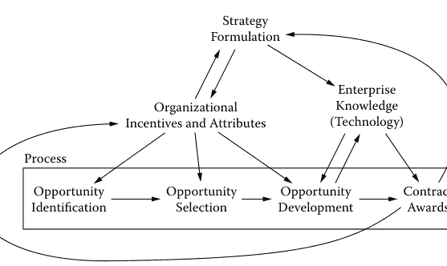

**图 6.3** 与追求和捕获新业务机会相关的架构因素之间关系的概念图。（转载自 C.G. Glazner, *Journal of Transformation*, 1: 231–260, 2011。经许可使用。）

新业务机会的追求与捕获以及它们与其他因素的关系。这张非常简单的草图突出了机会开发的简单线性过程（从识别到选择再到开发到合同授予）是如何作为一个跨整个企业的具有反馈机制的更大过程的一部分的。在图 6.3 的顶部，战略制定被显示为驱动组织激励和特征的因素，这被视为对新知识（技术）的追求。它接收来自组织绩效的反馈，也来自以授予合同形式存在的过程最终绩效的反馈。组织的激励和属性驱动着机会追求的每一个阶段，从识别到选择再到开发。此外，组织激励决定了运营单元参与开发协同机会以及与他人协作的程度。组织在形成新战略之前，还会收到以合同授予形式存在的过程绩效反馈。新业务机会在开发阶段的成功取决于企业的知识和能力。工作完成后，如果它已经内部化，组织就获得了有助于未来开发工作的经验。经验还建立了一种声誉，增加了未来获得合同的几率。

# 6.2.4.5 形成动态架构假设

在清晰地阐述 TechSys 企业级架构模拟模型的问题之后，混合企业级架构建模过程的下一步是通过创建一个**动态架构假设**来进一步界定模型的边界和功能。根据 Sterman (2000) 的定义，动态架构假设基于对问题的初步洞察，从企业级架构的角度解释其动力学机制。通常，企业的利益相关者会对产生问题行为的原因或实现性能目标的障碍持有某些见解。动态架构假设提供了一个阐述这些初步信念的机会。

TechSys 模拟模型的动态架构假设是根据利益相关者的意见开发的，特别是来自企业战略总监的意见，该总监当时正领导着 TechSys 的一个团队致力于识别并减轻运营单元之间协同合作的障碍。TechSys 担心其战略中目前的增长目标仅通过内生增长是无法实现的；必须通过运营单元之间新的协同增长来实现向新市场的扩张。鉴于企业最近的表现，大多数人认为现有的架构在不移除若干协同障碍（其中许多是企业级架构的一部分）的情况下，无法在运营单元之间实现足够的协同增长，以满足其增长目标。在这种环境下，为 TechSys 模拟模型提出了以下动态架构假设：

> 鉴于其目前的企业级架构，TechSys 将无法利用用于追求新增长机会的预算资源池来实现其业务增长和相关的盈利目标。也就是说，假设该架构的存在对公司捕获其目标新业务机会的能力具有限制性影响。因此，必须修改现有架构，以便公司能够利用其各个业务部门面临的协同业务增长机会，从而实现新的公司级业务目标。

上述提出的动机假设或核心战略问题可以通过通过模拟模型运行一系列可行的输入（有限的预算资源）来评估，并观察任何输入组合是否能使 TechSys 业务增长或利润的预期值达到既定目标。如果模型显示，在任何可用类型预算资源的组合以及无论如何分配的情况下，都无法产生新的业务增长或盈利目标，那么维持的假设（即：当前的企业级架构对目标业务目标的实现具有限制性影响）就无法被否定。如果模拟模型的输出可以通过某些输入组合满足 TechSys 的目标，则 TechSys 可以使用该模型研究现有架构下的投资和管理策略。如果不能，则可以使用该模型研究修改架构以实现更大增长潜力的影响。

# 6.2.4.6 从企业级架构框架中识别适用视图

开发 TechSys 企业级架构模拟过程的下一步是，正式识别企业级架构中对影响企业追求和捕获新业务能力的领域。NREAT 识别了企业的八种视图，但并非所有视图的代表性都是同等的，某些视图作为视图在模拟模型中可能完全没有体现。

在初步分析之后，驱动模拟问题相关机制的主要 EA（企业架构）视图是战略、组织和过程视图。这些视图中的每一个都使用了适用于其动力学的模拟方法进行建模。此外，知识、技术以及外部/策略视图的某些组件也被纳入了模型中。图 6.4 显示了模型的通用结构，识别了与这些子模型的输入和输出相关的每个变量，并开发了每个子模型高层结构的图表，以确保整个系统的逻辑一致性。

## 6.2.4.7 混合模型开发

利用图 6.4 理解各种 NAF 视图的交互，模型结构的设计是为了回答关于运营单元之间协作的原始模型问题。相应地，企业是从运营单元的角度进行建模的，由多个拥有自身战略、激励和过程的运营单元组成。这些运营单元在各自的市场和其他市场中追求业务机会，取决于投标和提案预算的金额以及必须协作（协同）的机会百分比。由运营单元识别的机会将以随机的方式通过每个运营单元开发过程，这取决于资金、资源和研发进展方面的模型输入。

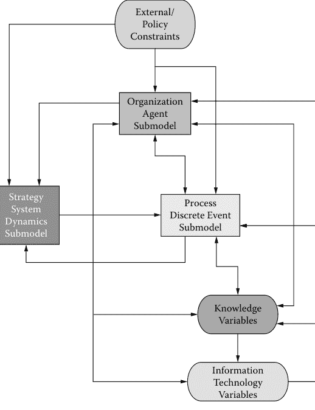

**图 6.4** TechSys 企业级架构模拟模型的逻辑交互图，基于 NREAF 逻辑交互图。

图 6.5 是关于单个运营单元如何封装这些子模型和变量的高层“框”图。当组装成完整的 TechSys 混合模型时，其结构如图 6.6 所示。

## 6.2.4.8 模拟软件

TechSys 混合模拟模型使用 AnyLogic® 软件平台实现。AnyLogic 是一个灵活的开发平台，用于开发采用广泛模拟方法的确定性或非确定性模拟模型。这允许在同一个开发环境中创建所有三个子模型，并使用相同的计时和调试引擎。


# 业务策略的企业架构仿真

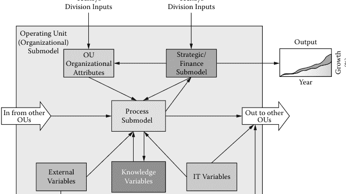

**图 6.5** 包含运营单元及其封装的子模型和变量的高级结构图。转录自 C.G. Glazner, *Journal of Transformation*, 1: 231–260, 2011。（经许可。）

这极大地降低了创建混合仿真模型的技术障碍。AnyLogic 是一个基于 JAVA™ 的应用程序，能够将模型导出为 JAVA apple（程序），可以在任何安装了 JAVA 的计算机平台上运行。

遵循面向对象的编程范式，AnyLogic 允许创建具有多层封装和继承关系的模型，这使得以运营单元为中心的拓扑结构成为可能。它还具有开发模型图形界面的工具，这些界面可以进行高度自定义。图 6.7 在 AnyLogic 原始模型表示之上，强调了导致预期结果（涉及收入增加、利润增长或新产品）的组织要素举措。子模型视图中的每个矩形都是一个封装的模型，可以通过选中它来查看。参数可以在单个表格中调整，可以通过选取模型图表上的变量来调整其初始值。

## 6.2.4.9 运行 TechSys 仿真模型

TechSys 企业架构仿真模型旨在作为一种工具，用于探索企业架构在系列条件下的潜在性能。每次执行模型时，结果将取决于

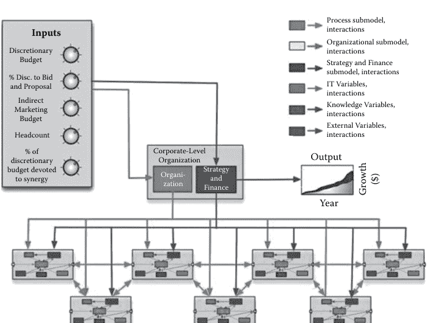

**图 6.6** 顶层图，显示了输入和输出参数。（转录自 C.G. Glazner, *Journal of Transformation*, 1: 231–260, 2011。（经许可。）

过程子模型包含许多非确定性步骤。关键输出不是仿真单次执行的结果，而是多次仿真执行结果的分布。

根据仿真建模的术语，使用一组输入参数对仿真模型进行单次执行称为*重复（replication）*。一组共享相同输入参数的重复称为*模型（model）*。图 6.8 是输入参数与 2007 年 TechSys 使用的参数相同的仿真单次运行的性能分布。

在比较两种不同的模型配置（不同的输入或架构）时，应该比较它们输出的概率分布，而不是单次重复的结果。输出分布的平均值和方差都应该被比较。例如，某种模型配置的平均值可能略高于另一种配置，但它的方差可能更高。在这种情况下，第二种配置可能更好，因为其较低的方差意味着更低的风险和更高的可预测性。

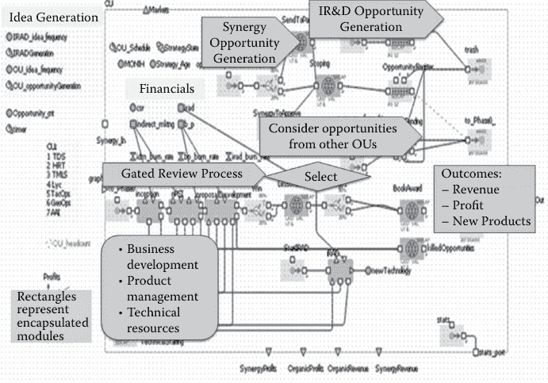

图 6.7 AnyLogic 开发环境中的运营单元模型。（改编 C.G. Glazner, Journal of Transformation, 1: 231–260, 2011。（经许可。）

## 6.3 使用 TechSys 仿真模型进行分析

- 在最高控制层级，TechSys 拥有的用于影响企业增长的杠杆有限。
- 用于追求协同业务机会的资源百分比。
- 自由裁量预算。
- 分配给投标与提案与内部研发相比的自由裁量预算金额。
- 人数。
- 改变企业架构本身。

为了使用仿真模型进行分析，TechSys 希望保持人数和自由裁量预算等输入参数固定，这意味着在分析中不会使用新资源来促进新增长。这为模型中影响新企业增长留下了三个选择：协同业务机会的百分比、自由裁量预算的百分比

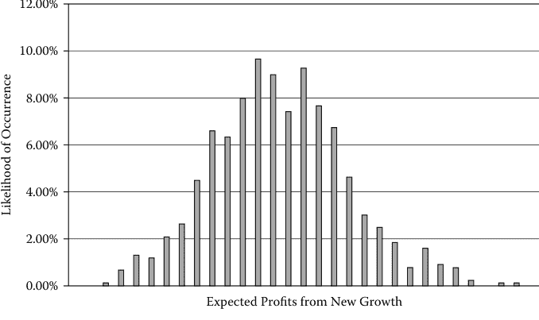

**图 6.8** 代表当前状态架构单次仿真运行中有机利润和协同利润合并盈利能力的直方图。独立轴值已省略。n 次重复 = 750。（改编自 C.G. Glazner, Journal of Transformation, 1: 231–260, 2011。（经许可。）

分配给投标与提案的百分比（剩余部分用于内部研发），以及改变架构本身。分析的第一步是测试“现状”下的当前架构，为任何更改建立基准。

在假设当前企业架构固定的情况下，有两个关键参数可以变化：新协同业务机会的百分比以及分配给投标与提案的自由裁量预算百分比。在第一次分析中，自由裁量预算的分配保持不变，仅改变了新协同业务机会的百分比。

### 6.3.1 追求协同的投资

这种 TechSys 策略的预期是，随着协同业务机会相对于有机机会的比例增加，TechSys 的整体盈利能力也应该随之增加。原因是协同机会为增长到新的、更有利的市场奠定了基础。从理论上说，通过追求运营单元之间的协同，TechSys 在市场上应该拥有更强大、更具竞争力的地位。在之前的

* 关于 TechSys 对“协同”和“有机增长”术语的使用回顾，请参见第 6.2.1 节。

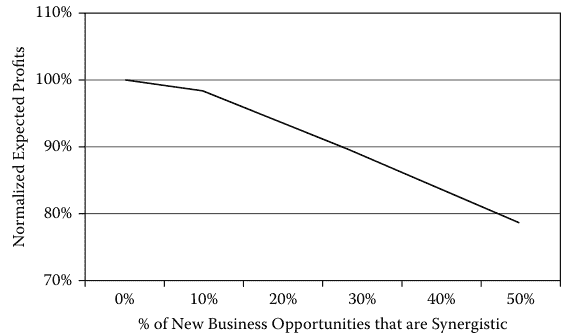

年来，TechSys 的协同驱动策略影响了导致当前状态 TechSys 企业架构开发的许多决策。然而，TechSys 企业架构仿真模型的输出在关于当前状态 TechSys 架构协同的收益方面，讲述了一个完全不同的故事。

图 6.9 表明在 TechSys 企业架构仿真中，随着具有协同成分的新业务机会百分比增加，企业的盈利能力将会下降。这一结果强烈反驳了关于追求协同有效性的主流理论。从表面上看，追求基于协同的策略会导致收益递减似乎是不合理的。然而，通过对模型行为的研究，这种显著不一致的原因直接源于架构本身，而不是追求协同这一想法的缺陷。问题的核心在于，流程和组织架构的结构导致协同机会被系统性地未被选中，从而在可以追求更有效的有机机会时导致了巨大的机会成本。


# 企业动态学手册

有机机会选择 协同机会选择

```
P(pass_1) = 50% P(pass) = 50% AND P(pass) = P(pass_1) * P(pass_2) = 25% P(pass_2) = 50%
```

图 6.10 协同与有机机会选择的机制。

### 6.3.1.1 过程子模型视角

在模型中，所有的协同机会都由每个参与的运营单元（OU）独立评估，并根据该 OU 拥有的其他机会进行优先级排序。不存在协同机会的中央系统级（Sys-level）概述。协同机会要获得资助以进一步考虑，必须在每个 OU 的半年审查期间通过所有参与 OU 的选择；在审查期间，OU 会从其投标和间接营销预算中选择在未来几个月内资助的新业务机会。由于协同机会必须由具有不同当地激励的 OU 独立批准，因此协同机会的选率不会超过新的“有机”机会。

图 6.10 展示了有机机会和协同机会审批过程的数学模型。在左侧，有机机会只需通过一次审查。在协同机会的情况下，它必须通过两次相互独立的审查。这产生了布尔“与”（AND）门的效果。协同机会获得资助的概率等于每个 OU 审查通过率的乘积，这会大幅降低整体通过率。

由于上述选择问题，协同机会更有可能在开发早期失败，因此将资源投入到开发新的协同机会中限制了开发更有可能通过的优质有机机会的资源。这导致可选择的高质量（从盈利能力和竞争定位来看）有机机会较少。由于可选择的有机机会较少，获得资助的机会期望值就会降低。

### 6.3.1.2 组织视角

从组织的角度来看，这个问题可以从 OU 的当地激励来看待。机会审查选择团队根据利润和竞争地位对 OU 的回报，优先资助那些最有利于提升该 OU 竞争地位的业务机会。对于协同机会，该机会产生的利润甚至没有在 OU 合作伙伴之间进行分配，竞争定位也是如此。

用于业务战略的企业架构模拟 ■ 133

通常，有一个协同伙伴从追求该机会中获得大部分收益。利润和竞争地位份额较小的 OU 认为追求自己的当地开发的有机机会更有利，导致该协同机会被两个 OU 拒绝。

图 6.10 中的示例显示，通过某项机会的概率是相同的：在本例中，P(pass) = 50%。然而，这并不是现实的假设。在实践中，一个 OU 从协同机会中获得的利益（无论是从利润还是竞争定位来看）会比其伙伴多，导致协同机会通过的总概率低于通过机会概率最低的那个 OU。例如，如果 OU #1 有 75% 的概率通过某项协同机会，而 OU #2 通过同一机会的概率仅为 25%，那么该机会获得资助的概率仅为 18.75%。

尽管事实上，每位总经理（GM）的激励措施都一致于管理 TechSys 的盈利能力而非 OU 的盈利能力，这种组织行为仍然发生了。与 TechSys 利益相关者的访谈和讨论揭示了 OU 仍然不按照这些激励措施行动的原因。首先，总经理对其 OU 负有利润和负载责任。尽管有财务激励计划，他们他们倾向于关注薪酬公式中他们影响最大的部分：即他们的 OU。在 TechSys 的历史中，对于当地 OU 总经理是否以及在何种程度上朝着共同目标努力工作有着丰富的经验，但在做出可能对业务部门层面不利的决策时（此时他们的行动有助于实现全球公司目标），却缺乏相关经验。给出的另一个可能解释缺乏有效激励的原因是，尽管总经理和一些高级总监职位可能拥有公司级和分部级的财务激励方案，但负责开发和选择新业务机会的大多数人并没有。当地激励加上以协作方式工作经验的匮乏，导致了局部的次优化的行为。

### 6.3.1.3 协同面临的额外文化和沟通障碍

此外，与有机机会相比，协同机会即使在通过开发管道中的初始机会审查后更有可能在产品生命周期审查关口失败。OU 之间的沟通困难和文化对齐问题（包含在模拟模型中）导致协同机会的平均失败率高于有机机会的平均失败率，尽管随着运营单元之间反复互动，沟通和文化障碍的降低，这种差距会随时间缩小这形成了一个最初的合作障碍，将随着时间的推移而减少）。

组织子模型的激励加剧了过程子模型中选择协同机会的偏差。虽然过程的并行选择要求显著降低了协同机会被选中的概率，但当 OU 之间利益和偏好存在巨大差异时（这在实践中很常见），问题会恶化。即使某个特定的协同机会对于一个 OU 的战略至关重要，它也可能被拒绝，因为它不能像其他有机机会那样让合作 OU 受益，尽管 TechSys 整体将从该协同项目中获益更多。考虑到 TechSys 的战略方向，这个问题应该被视为一个亟待改进的关键领域。

### 6.3.1.4 TechSys 验证

这些结果和机制已通过 TechSys 利益相关者得到证实。这种行为在实践中已被观察到，但协同业务机会在目前为止考虑的业务机会总数中仅占极小部分，以至于问题的系统性尚未引起重视。TechSys 的一个工作组识别出协同机会选择过程和 OU 追求协同机会的激励是障碍，但尚未意识到这种障碍对系统的影响程度。这种验证有助于确认这种行为并非纯建模过程的产物，而是确实存在于企业之中。

## 6.3.2 分配自由预算

在理解了投资追求协同机会的影响后，TechSys 想要调查其企业架构的第二个主要杠杆，即在分配自由预算到 IRAD 预算和投标提案预算之间的权衡影响。自由预算必须在两项活动之间进行划分，这形成了权变理论文献中“探索与利用”权衡的实际体现。多年来，TechSys 在分配其自由预算时，并没有对这种分配对其盈利能力的影响进行明确的定量分析。TechSys 管理层清楚，投资 IRAD 对于确保未来增长是必要的，但也知道如果不利用其能力去追求新业务，他们将无法获得新业务。模拟模型可以更好地理解这一分配决策如何影响企业性能。

使用 TechSys 企业架构模拟模型分析了当前状态企业架构下改变自由预算分配的影响。除了“自由”之外，所有模型输入参数


# 业务策略的企业架构模拟 ■ 135

**图 6.11 随着自由裁量预算在 IRAD (0%) 和投标与提案 (100%) 之间变化的归一化预期利润。**（转自 C.G. Glazner, Journal of Transformation, 1: 231-260, 2011。经许可转载。）

用于投标与提案的预算分配保持在 2007 年的水平。投标与提案的自由裁量预算分配从 0% 变化到 100%，对应于所有自由裁量资金均分配给 IRAD 或投标与提案的极端情况。

模拟模型中改变自由裁量预算分配的结果如图 6.11 所示。该图显示了三年期内的预期利润，并进行了归一化处理，使 100% 等于可能的最大值。

如图 6.11 所示，模拟模型表明，在当前架构下，首选的投资策略是将自由裁量预算分配给投标与提案，而减少 IRAD 预算分配。当大部分自由裁量预算分配给 IRAD 时（图 6.11 中的值小于 50%），向投标与提案分配更多资金的边际收益很高；超过 50% 后，边际收益减少，图表明首选的投资策略是将自由裁量预算的 50% 到 90% 分配给投标与提案。当自由裁量预算完全分配给 IRAD 时，预期利润为 $0，因为没有编写任何会导致合同和收入的提案。在另一个极端情况下，如果整个自由裁量预算都分配给投标与提案，仍然会有巨大的预期利润，尽管与最大利润率相比略有下降。

图 6.11 显示的趋势与人们对为国防部生产许多高科技产品的行业中此类图表的常见预期不符。在一个稳定的、以商品为中心的企业中，营销和品牌建设的影响比比与大得多，预计会看到这样的图表。因此，令人惊讶的是，这是一个一家生产先进航空航天组件企业的图表，这便引出了

# 136 企业动力学源源

**图 6.12** 随着自由裁量预算分配变化的预期利润，分为三、五和十年的时间跨度。（转自 C.G. Glazner, *Journal of Transformation*, 1: 231–260, 2011。经许可转载。）

关于为什么该模型将 TechSys 的研发影响归为如此低的问题。

模拟模型中有两个因素导致了这种行为。第一个因素是模型的时间跨度太短了。第二个因素是 TechSys 所述的战略愿景。尽管如此，研发的收益通常需要超过三年的才能对企业的盈利能力产生影响。如果不延长时间跨度，IRAD 的收益将不会显现。这一假设的显而易见的方法是使用更长跨度重新运行模拟，看看预期利润的分布是否会在很大程度上发生变化。

图 6 12 测试了将时间跨度从三年延长到五年或十年的情况。从图中可以看出，从三年变为五年强调了自由裁量预算分配 50% 给投标与提案的峰值，略微削弱了高比例分配的的影响。当时间跨度移到十年时，这种效应剧增，并且明显倾向于在 IRAD 和提案之间进行更平均的投资。该图表明 TechSys 应该考虑延长时间跨度或保持三年的跨度，同时理解 IRAD 的长期影响被稍微低估了。

IRAD 表现不佳的第二个解释是 TechSys 所追求的 IRAD 没有产生其应具有的影响。回到收集的数据和模型的构建，在流程数据收集阶段接受采访的许多人说，TechSys 在投资 IRAD 项目时采取的是“抹花生酱”式的方法；而不是选择与战略挂钩的战略领域，运营部门倾向于在许多潜在市场和技术上投入资金，而没有特定的重点。TechSys 在 2005 年的一项内部研究很难将近期开展的 IRAD 项目与当年赢得关键提案联系起来，这进一步对 TechSys IRAD 投资的有效性产生了怀疑。因此，模型是随机地为每个 IRAD 项目选择技术和影响水平的，而不是像选择业务机会那样从选择池中选择最佳方案。这削弱了 IRAD 项目获得竞争优势的有效性，特别是与追求业务机会相比。

## 6.3.2.1 自由裁量预算分配动力学

6.13 显示了一个简化的因果环图，捕捉了由自由裁量预算分配产生的主要动力。如图所示，“赢得的提案”（通过支出投标与提案资金）和“技术知识”（通过支出 IRAD 资金）都可以导致业务增长。随着竞争地位的提高，赢得未来提案的概率随之增加。这被“知识衰减”所平衡：随着时间的推移，获取新业务的潜力以及研发支出的潜力，公司发现自己正在利用现有的知识储备，而不是创造新知识，从而导致了研发投资的技术进步。“赢得的提案”与“竞争地位”之间的联系是短期的（大约两年，取决于市场的知识衰减），“技术知识”与“竞争地位”之间的联系则更为长久（技术知识不会丢失）。

**6.13 自由裁量预算分配动力学的简化因果环图。**（转自 C.G. Glazner, *Journal of Transformation*, 1: 231–260, 2011。经许可转载。）

这种关系在行业中经常被观察；某一领域的合同授予会增加未来授予的可能性。

# 业务策略的企业架构模拟 ■ 137

# 6.3.3 整合杠杆：当前状态企业架构的性能格局

因此，模拟模型被用于显示改变模型两个输入参数对波动性的影响：自由裁量预算的分配以及协同提案的比例。这种分析是在保持其他参数不变的情况下改变单个参数执行的。虽然这种分析为企业架构的特性提供了一些见解，但观察这些参数在所有可能的输入组合中如何相互作用可能更有用，因为输入不是独立的。随着两个参数的变化，绘制模型的输出会得到三维曲面图，每个输入参数显示在 x 轴，预期利润显示在 y 轴。这被称为企业的“性能格局”，峰值和谷表明了管理策略对企业性能的影响。图 6.14 显示了当输入参数“协同机会百分比”和“投标与提案的自由裁量预算分配”在之前的分析范围内变化时，TechSys 企业架构当前状态的性能格局。

**图 6.14 TechSys 当前企业架构的性能格局。**（转自 C.G. Glazner, Journal of Transformation, 1: 231–260, 2011。经许可转载。）

观察图 6.14 中的性能格局，可以通过不追求任何协同并将


# 业务战略的企业级架构模拟 ■ 139

将 90% 的裁量预算全部用于招标和提案，给 IRAD（内部研究开发）留 10%。图表表明，最稳健的策略是在分配给招标和提案的预算占 50% 到 90% 之间的平台上占据位置。

在单变量分析中发现的许多问题在性能格局中也能看到。正如之前提到的，随着协同机会百分比的增加，盈利能力以单调方式下降，因此最大预期利润出现在完全没有协同的情况下，此时每个业务单元（OU）仅追求局部的、有机的新业务机会。根据之前对裁量预算分配的分析，现有架构倾向于将大部分预算投资于招标和提案，而非 IRAD。针对当前企业架构中识别的问题，并不难想象可以创建出一种解决这些疑虑、并能够产生高得多利润的替代架构。

## 6.3.4 创建替代架构

通过与 TechSys 的利益相关者合作，开发了一种不同于现状的替代企业架构，以解决现状架构在获取新业务增长的可用预算资源分配方面极其局限的缺陷。架构的首次更改解决了系统对协同效应的偏见。在替代架构中，协同机会不再由 OU 局部地选择，而是由部门级团队根据对整个部门利益最大的原则来选择机会。资助新协同的资金将通过将每个 OU 招标和提案预算的百分比分配回部门以用于协同机会来实现。对 OU 征收的这种“协同税”金额是：具有协同要素的机会百分比（与模型输入参数相同）乘以 OU 的招标和提案预算。部门决定资金的支出方式，而 OU 仍负责开发构思，并从赢得的合同中获益。

对现状架构的第二次更改是以一种更具战略对齐性的方式选择 IRAD 项目。这一变化反映了在模拟完成时 TechSys 正在进行的变革。在替代架构中，IRAD 的选择是基于其对与战略技术路线图对齐的关键技术领域的预期贡献。尽管这些路线图已经使用了多年，但它们在此之前一直没有被作为 IRAD 筛选过程的一部分。

替代架构解决了流程偏见，消除了协同机会所需的独立批准（而有机机会则不需要），还解决了局部 OU 反对选择协同机会的激励机制。

替代架构主要作为一种“概念验证”架构，而非正在考虑的未来架构的蓝图。如果实施上述替代架构，它将面临来自 OU 的广泛抵制，因为这些 OU 在变化中将失去很大一部分裁量预算。此处使用替代架构是为了更深入地理解改变架构的影响，并作为未来架构工作的一个起点。

## 6.3.5 替代企业架构的性能

在对当前架构的更改进行编码后，让替代架构在与现状架构相同的评估运行中进行。图 6.15 显示了现状架构与替代架构在协同投资维度上的比较。数据已过归一化，使得 100% 对应于现状架构下的最大预期利润。

两条曲线之间的差异在于，对于每一个比较点，替代架构返回的预期利润都高于现状架构。更重要的是，对于许多值，投资协同所产生的预期利润将超过当前架构下可能的最大值。在替代架构下，协同机会能够发挥其预期的影响，通过增强竞争优势和追求更有利润的业务（而非组件）来提高整体盈利能力。在替代架构曲线的峰值，模型显示通过从现状转向替代架构，利润可能实现 22% 的增长：这种变化仅需少量的投资、流程的改变、激励机制的改变以及某种程度的文化震惊。

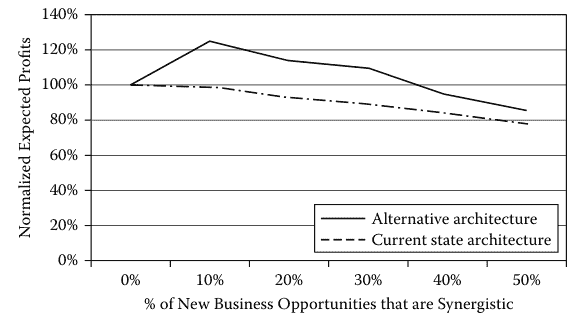

**图 6.15** 预期利润与协同协同的新业务机会百分比对比，涵盖现状和替代架构。（摘自 C.G. Glazner，*Journal of Transformation, 1: 231–260, 2011*。经许可。）

在 10% 的协同投资达到峰值后，曲线再次呈现下降趋势。尽管在协同投资达到约 35% 之前，它仍高于现状架构下的最大值，但这种下降趋势并非预料之中。通过“淘汰分析”（Knockout analysis，即在模型运行之间系统地移除结构的关键要素）来确定这种下降趋势动态的驱动结构。该分析揭示了这种下降趋势归于：当前业务单元之间的高价值协同机会有限，一旦这些高价值机会被耗尽，追求这些机会就会比追求潜在利润的有机机会产生机会成本。这种资源的错配归于在 TechSys 内部局部 OU 的有机机会与协同机会之间的“最优”招标资源分配设置了“墙”。

OU 之间高质量协同机会相对较少，归因于并非每对业务单元之间都一定存在协同机会。TechSys 的七个 OU 并非都处于一个可以设想与他人合作的市场中，这导致这些 OU 在参与协同活动方面被“阻塞”。特别是，一个业务单元与其他单元几乎没有交集，而另外两个单元的协同潜力有限。 OU 之间的协同协作潜力在模型中使用定性的基于调查的指标进行评估，这是对协同机会确切数量不确定性的衡量。当更改使用的数值时，图 6.15 中的峰值位置发生了移动。随着模型中协同机会的增加，峰值向右移动且幅度增大。为了测试模型的敏感性，重新运行了衡量 OU 之间协同的定性参数（该参数在李克特量表的 1 到 5 之间波动，并在当前值基础上增加了 1）。结果是，预期利润峰值从 10% 的位置移动到 25%，幅度较基准案例增加了 22%，实现了 26% 的收益。

由于模型对这些定性参数敏感，必须对该峰值的位置大小保持怀疑态度。然而，尽管图中存在不确定性，但敏感性分析显示该趋势对于模型参数的变化是稳健的。即使利润峰值水平的位置和幅度存在不确定性，替代架构在协同投资方面仍将带来盈利能力的显著提高，并在峰值后出现收益递减。

图 6.16 显示了替代架构在改变裁量预算分配时的输出。预期利润针对


# 142 企业动力学手册

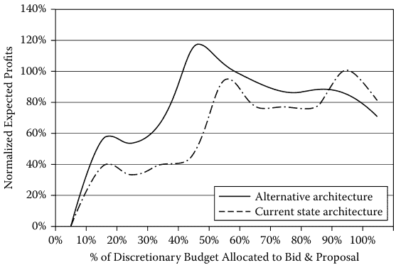

**图 6.16** 预期利润与分配给投标和提案的自由支配预算百分比的关系，涵盖当前状态和替代架构。（转载自 C.G. Glazer, *Journal of Transformation*, 1: 231–260, 2011. 经许可。）

两种架构均经过归一化处理，使得当前状态架构的最大可能值为 100%。根据之前对自由支配预算分配的分析，协同效应投资参数保持不变。

如图 6.16 所示，替代架构相比于当前状态架构更倾向于采用更平衡的方法。模型中明显地倾向于将约 40% 的自由支配预算分配给投标和提案，剩余部分则投入到内部开发（IRAD）。通过战略性选择而非“撒胡豆式”的方法来提高 IRAD 的有效性，预计利润可以提高 18%。这种架构的改变还产生了曲线向左倾斜的效果，正如预期那样，增加了 IRAD 价值的权重。与许多之前的分析相比，结果是基于三年的时间跨度生成的。当时间跨度延长时，最右侧的尾部下降得更快。

图 6.17 显示了替代架构的企业性能景观图。从图中可以看出，替代架构具有清晰的峰值，它平衡了投标、提案与 IRAD 之间的投资，并对协同机会的有限投资（占总开发资源的 10%）赋予了价值。如图 6.17 所示，不再存在高比例自由支配预算分配给投标和提案的平坦区域；该架构有一个明确的峰值，随着更多资金分配到 IRAD，性能会急剧下降。

# 业务战略驱动的企业架构模拟 ■ 143

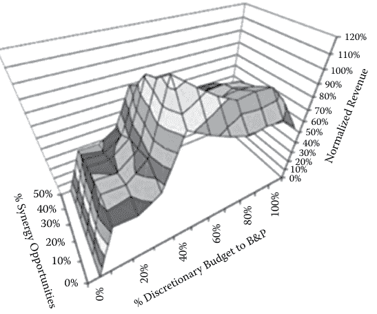

**图 6.17** 替代企业架构的性能景观图。（转载自 C.G. Glazner, Journal of Transformation, 1: 231–260, 2011. 经许可。）

## 6.4 使用 TechSys 模拟模型的建议

基于此分析，TechSys 需要识别其组织和流程设计中的关键漏洞，并确定研发支出是一个需要关注领域。通过解决这些问题，TechSys 将消除其战略成功执行所面临的障碍。

## 6.4.1 混合方法进行企业模拟建模的优势

混合企业架构模拟是理解企业动力学的一种新方法，TechSys 模拟模型是首个采用混合模拟方法、从企业架构框架提供的多个视角来分析企业架构的模型。之前的章节已经展示了这种方法如何成功应用于解决 TechSys 的紧迫问题，但必须注意，在 TechSys 观察到的某些问题（如协同效应投资行为）只能通过多视角方法来解决。混合模拟建模是建模者工具箱中一种非常有用的工具，但对于某些类的问题，它是唯一的工具。

TechSys 模拟模型中涉及两个关键动力学因素：自由支配预算分配和协同效应投资。第一个问题——自由支配预算分配，可以使用动力学方法轻松捕捉并建模（假设可以收集到捕捉过程聚合特征的数据）。图 6.13 中的因果环图可以通过对存量、速率和变量进行系统量化来扩展为完整的系统动力学模型，且不需要额外的模型接口工作。然而，协同效应投资问题无法通过任何建模方法简单捕捉。

协同效应投资问题的动力学比自由支配预算问题要复杂得多。问题在于企业两个主要视角的交汇点：流程和组织。协同效应投资动力学的一个组件可以使用离散事件过程模型来解释，类似于混合模拟模型中流程子模型中的。然而，这并没有说明全部。行为还受到所有运营单元的激励驱动，这些单元做出理性决策并最终产生子系统级的结果。这些动力学是通过混合模拟中基于代理的子模型捕捉的，该模型将每个运营单元（OU）视为具有其自身决策逻辑以指导行为的代理。如果没有流程子模型以及组织子模型的贡献，将无法知晓 TechSys 当前架构中对协同机会的偏见的完整程度。

由于 TechSys 模拟模型的灵活性和范围，驱动企业行为的两个主要参数可以同时变化，从而能够捕捉图 6.14 和图 6.17 中的性能景观。如果没有具有企业级视角的混合模拟，这将是不可能的。

不应推断混合建模是模拟企业架构动力学的唯一方法，但它确实表明存在一类跨越背景视角边界的问题，可以通过这种方法得到充分解决。在单一视角背景内描述的问题可以使用单一模拟方法建模。而那些通过非常不同的行为动力学（例如自上而下与自下而上）跨视角的问题可能需要应用混合建模方法。在没有企业框架帮助设定边界和范围的情况下，这类问题被证明非常难以检测。

# 业务战略驱动的企业架构模拟 168

## 6.5 结论

TechSys 模拟模型已被证明是理解架构非常有用的工具。尽管它不能提供“水晶球”式的预测，但它能够展示企业如何对不同的控制杠杆做出反应。

## 参考文献

- Abbott, A. 1990. Concepts of theme in social science: Causal and narrative approaches. Hist. Methods, 23: 140–150.
- Dooley, K. and van Ven, A. 1999. Explaining complex dynamics. Organization Science, 10: 358–372.
- Fowler, A. 2003. Systems modeling, simulation, and the dynamics. Journal of Business Research, 56: 135–144.
- Glazer, G.C. 2011. Enterprise Transformation 1 (3): 231–260.
- Hammer, M. and Champy, J. 1993. Reengineering the Corporation: A Manifesto for Business Revolution. New York: Harper Business.
- Levitt, R. 2004. Computational Modeling of Organizations Comes of Age, Computational & Mathematical Organization Theory, 10: 127.
- Miners, J., and Gill, A. 1997. Multidimensional: a Theory and Practice of Management Science. Chichester, UK: Wiley & Sons.
- Nightingale, D. and Rhodes, D. 2004. Enterprise systems archiving: Merging emergent and science within systems. Presented at the Enterprises Symposium. Cambridge, MA.
- Rabelo, L. and Heller, T.H., Jr. 2005. Sustaining growth in the modern enterprise: A case study. Journal of Engineering and Technology Management, 22: 274–290.
- Rabelo, L. et al. 2007. Value analysis using hybrid simulation and AHP. International Journal of Production Economics, 105: 536–547.
- Rabelo, L., Helal, M., Jones, A., and Min, H. 2005. Enterprise simulation: A hybrid system approach. International Journal of Computer Integrated Manufacturing, 18: 498–508.
- Schitzer, N. and Grofler, A. 2003. Emergent structures in supply chains: A study integrating agent-based and system dynamics modeling. In IEEE Computer Society: Proceedings of the 36th Hawaii International Conference on Science Systems.
- Simon, H.A. 1990. Prediction and prescription in systems modeling. Operations Research, 38: 7–14.
- Sterman, J.D. 1991. A skeptic’s guide to computer models. In G.O. Barney et al. (Eds.), Managing a Nation: The Microcomputer Software Catalog. Boulder, CO: Westview Press, pp. 209–229.


Sterman, J.D. 2000. 业务动态：复杂世界的系统思维与建模. 波士顿, MA: McGraw-Hill.
Venkateswaran, J. and Son, Y.-j. 2005. 混合系统动态——基于离散事件模拟的分层生产规划架构. International Journal of Production Research, 20(15): 4397–4429.
Womack, J and Jones, T. 1996. 精益思想. 纽约: Simon & Schuster.

## 第7章
## 针对企业转型技术不确定性的推理

William J. Bunting*

## 目录

- 7.1 引言 ................................................................................ 148
    - 7.1.1 建模挑战 ................................................................ 149
    - 7.1.2 企业架构方法 ........................................ 150
- 7.2 关键概念讨论 ....................................................... 151
    - 7.2.1 证据推理 ......................................................... 151
    - 7.2.2 多实体贝叶斯网络 (MEBN) ................................... 152
- 7.3 LERA 方法 ............................................................................ 153
    - 7.3.1 LERA 论证模型 ........................................................ 155
        - 7.3.1.1 LERA 实体 ................................... 155
        - 7.3.1.2 LERA 假设集 ............................ 156
        - 7.3.1.3 LERA 有向关系 ...................... 156
        - 7.3.1.4 LERA 证据凭信 ..................................... 161
        - 7.3.1.5 LERA 因果标准 ................... 162
        - 7.3.1.6 LERA IF-THEN 推理 ....................... 163

> * 改自 Bunting, W.J. 2012. 针对不确定企业技术对齐的推理以洞察企业转型的实现, Journal of Enterprise Transformation, 2(1): 50–79. 2012年1月. 经 Taylor & Francis Ltd 许可, http://www.tandf.co.uk/journals.

- 7.3.2 LSERA 推理模型........................................................... 165
    - 7.3.2.1 LSERA 框架片段 (MFrags)....................................................... 165
    - 7.3.2.2 局部概率分布................................................ 166
    - 7.3.2.3 LSERA 组合规则........................................................... 168
    - 7.3.2.4 LSERA 证据力............................................................... 170
- 7.4 ELoS 示例................................................................................ 171
    - 7.4.1 EMTI 论证模型............................................................... 173
    - 7.4.2 EMTI 推理模型................................................................ 174
- 7.5 结论.................................................................................... 177
参考文献........................................................................................... 178

## 7.1 引言

企业由多种元素的复杂混合组成，包括战略成果、业务流程、技术和个人。战略成果是企业计划的成就，代表了企业的价值所在。业务流程由公司各处、角色和部门之间的结构、数据和通信组成。技术利用了实现业务流程的各种系统。个人则管理这些元素之间复杂的交互，以产生输出并实现战略成果。

企业转型为了响应机会、感知弱点及其所在领域的变化，使企业从给定状态移动到新状态（Knotour 2011; Rouse 2005）。它涉及在组织变革管理模型下构建复杂的交互，例如 Burke–Litwin 模型（Burke and Litwin 1992），该模型识别了组织变革中的特定组件。如今，大多数大型企业转型都需要在新企业技术进行大量投资以完成转型（Merrifield, Calhoun, and Stevens 2008; Venkatraman 1994）。这在联邦政府中尤其如此（Government Accountability Office 2010）。

本章并未涵盖确保转型成功的元素广泛交互。它专注于一种适用于参与基于技术的企业转型的管理者的对齐推理方法。为了支持对对齐的理性理解，本章将技术倡议的视线（ELoS）定义为技术倡议相对于业务流程、业务服务和战略成果的推理性对齐，并支持对战略成果实现的感知断言。这如图 7.1 所示。

视线推理分析（LSERA）方法专门关注支持企业转型以实现某些战略成果的技术倡议的 ELoS。LSERA 方法有两个主要用途：

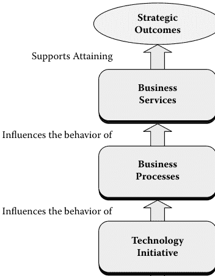

图 7.1 企业视线。（改自 W. J. Bunting, Journal of Enterprise Transformation, 2(1, 一月): 50–79, 2012. 经许可。）

- 它支持对特定技术倡议的 ELo 进行建模以供检查（质疑、推理、推断）。
- 它支持根据出现的信息调整并重新检查表示。

LSERA 允许管理者对分析师难以构建的人、流程和技术交互进行推理并从中获得洞察。

### 7.1.1 建模挑战

为了让大型技术倡议有效支持企业转型，技术、业务流程、服务和战略成果之间必须有清晰的对齐。管理者必须以原则的方法构建对齐以确保企业转型。这里的挑战在于识别：
- ELoS；
- 事物可能处的状态，例如实现或未实现；
- 与技术、流程、服务和信息相关的内容；
- 数据用于推理的可用性；
- 因果关系；
- 推理底层的逻辑。

此外，管理者必须考虑 ELos 中的不确定性。挑战是：
- 在逻辑中表达不确定性；
- 捕捉管理者对关系的客观信念；
- 结合不确定影响，例如子流程和技术对流程的影响；
- 识别 ELO 论证。

LSERA 的基本原理是，当个人理解复杂的交互时，企业转型就会发生。然而，没有任何管理者能够理解全部。这提出了两个挑战：首先，企业需要让管理者独立地在不同时间构建局部模型。其次，企业转型管理者需要一种以原则的方法整合这些局部模型，以便他们检查整体影响。随着转型的进行，管理者通过识别新出现的信息来保持对断言的信心。昨天看起来很有前景的今天可能不再。

### 7.1.2 企业架构方法

企业越来越多地使用企业架构方法来支持基于技术的转型，并支持管理者理解复杂的交互。使用的主要框架包括 TOGAF框架（The Open Group Architecture Framework 2009）和 Zachman 框架（Zachman 2008）。为了理解联邦机构倡议中的交互，联邦政府规定了联邦架构参考模型（FEA-RM 2007）、联邦分架构方法（Federal Segment Architecture Method 2008），以及专门针对国防部的国防架构框架（Department of Defense Architecture Framework 2009）。

这些方法表示了技术、流程和服务实体以及它们之间的关系，但它们将 ELO 对齐建模为一组关系。它们未能充分说明以下内容：
- 技术投资的 ELos 作为一个技术、流程、服务和结果实体的有序结构；
- “实体”性能行为之间的关系；
- 支持推理性能行为实现的信息和建模分析的相关性；
- 对企业各种性能目标和转型的可能性的推理；
- 一种重新检查的


# 企业 ELO 的技术不确定性 ■ 151

给定每项新信息时，整个 ELO 中行为实现的可能性。LSERA 知识结构源于对企业架构框架的审查以及面向目标的需求工程技术（Chung 等 1999；Vanmsweere 2001；Yu and Myopoulos 1998；Zowghi and Owen 1997）。为了解决企业架构框架的局限性和 ELO 建模选择，LSERA 使用证据推理多实体贝叶斯网络（MEBN）（Laskey 2008）。LSERA 由两个主要模型组成：论模型，将推理和相关证据结构化为一系列 IF-THEN 语句；推理模型，将局部贝叶斯模型组合成整体概率模型，指示实现行为、目标或转换的可能性。

LSERA 方法支持企业架构和需求工程的三种扩展：

- 将企业架构制品和其他信息制品视为实体。这些实体可能是企业架构元模型实体的复合组合，但在企业架构元模型内部没有显式表示。
- 定义实体。证据实体是与断言相关的制品和元模型实体的实例。
- 定义具有概率支持的引用关系，从而对实现的可能性进行推理。

## 7.2 关键概念讨论

以下对证据推理和多实体贝叶斯网络进行简要介绍，这是理解 LSERA 方法的关键。

### 7.2.1 证据推理

推理被定义为“运用理性，特别是为了形成结论、推论或判断”（《英语语言遗产词典》，第四版，2000年）。推理有多种类型：演绎法（Johnson-Laird 2009）、归纳法（Hacking 2001）、溯因法（Josephson and Josephson 1996）、类比法（Jithe 2005）、基于案例的方法（Amodt 1994）、概率法（Pearl 1988）和证据法（Schum 1994）。在 ELO 论证中，分析师不使用 (a) 演绎推理，因为没有陈述的假设或有效的结构（例如三段论）；(b) 归纳推理，因为没有重复的对齐实例来断言实现的合理性；(c) 溯因推理，因为他们不是从性能证据开始并推断证据最可能的解释；或 (d) 基于案例的推理，因为没有合适的案例可以研究。该推理不是类比的，因为通常情况下，这种对齐论证是独特的。

ELO 论证内部包含不确定性，分析师可以选择使用某种形式的概率推理。概率推理是使用某种形式的概率论作为论证逻辑的推理。ELO 有证据和论证结构，分析师试图使用证据来支持或挑战断言。因此，分析师可以使用证据推理。特别是，他们可以使用某种形式具有概率支持的证据推理。

证据推理是为了支持或反对定义的假设而对证据进行结构化。通常情况下，证据推理由四部分组成：假设、证据、相关性和强度。假设是论证作者已经论证的结论。假设可以是二元的（例如，真或假）或多个（例如，高、中、低）。假设是互斥且穷尽的。例如，一组关于下雨的假设可以是 [今天下雨了；今天没有下雨]。分析师收集数据以使假设不仅仅是信念。如果分析师能够证明数据与某个假设相关，则数据就变成了证据。相关性是使用推理链将证据（数据）链接到假设。泛化支持这种链接。泛化是在论证语境下通常被理解的关系。最后，证据强度指的是在某种程度上改变个人对断言的信念的证据。某项证据可能是相关的，但强度很小。

### 7.2.2 多实体贝叶斯网络 (MEBN)

任何特定的 ELO 论证都包含多个实体、属性、关系和不确定性。论证作者可以将这些 ELO 元素表示为贝叶斯概率网络（Jensen 2001）。根据证据发现，他们可以根据证据评估目标变量的概率。

然而，特定的贝叶斯网络并不适用于其他情况。它是特定特定的；也就是说，它是一个特定机构的技术计划。该网络涉及对一组具有变量和属性的实体的分析。分析师只能找到与特定问题相关的发现。这对 ELO 分析具有局限性，因为 ELO 分析始多种类型的实体，这些实体的数量可能预知（例如性能指标），并且可能具有不同的关系。定义一组特定场景的贝叶斯网络来分析所有感兴趣的 ELO 论证可能是可能的。

MEBN 理论通过将一阶逻辑的表达能力与贝叶斯概率理论相结合，扩展了贝叶斯网络（Laskey 2008）。它将领域表示为一组具有与其他实体相关的属性的实体。MEBN 理论将这些关系表示为贝叶斯网络片段，称为多实体片段（MFags）。一个 MFrag 包含以下内容：

- 驻留随机变量代表 MFrag 的焦点
- 输入随机变量是来自其他 MFags 的驻留随机变量，它们影响 MFrag 的局部概率分布
- 上下文节点是必须满足的条件的布尔随机变量
- 局部概率分布表示 MFrag 内部的不确定性
- 片段图以有向无环图（DAG）的形式表示实体之间的条件独立性关系，MEBN 使用随机变量的唯一标识符表示特定实例。给定输入变量的实例，MFrag 产生条件概率并可以形成一个简单的贝叶斯网络。

## 7.3 LSERA 方法

本节描述了 LSERA 方法。这些是 LSERA 方法的两个主要部分：论证模型和推理模型。论模型由六个要素组成：实体、假设、直接关系、证据、因果关系和逻辑。推理模型由四个要素组成：MFags、概率、组合规则和证据强度。这些要素中的每一个都对应十个 Elo 建模挑战之一，如表 7.1 所示。表 7.1 的左列包含建模挑战，右列显示相应的 LSERA 要素。

通常情况下，企业架构框架包含 LSERA 实体。一个注出的例外是证据类型和证据实例。框架不包含关于实体的假设，尽管框架可以扩展以包含假设。框架只有实体之间的映射，而没有直接关系。框架没有显式的因果关系或逻辑，也不支持推理表达。最后，框架没有整合概率关系的结构。因此，需要额外的工作提取框架信息并开发特定场景的概率模型。

图 7.2 是 LSERA 方法中一般步骤的概述。它从技术经理用自然语言表达技术计划的愿景开始。在步骤 2 中，分析师通过识别涉及实体及其关系、证据类型和因果影响来结构化 ELO。然后，他们验证论证模型的逻辑。一旦论证模型建立，分析师将进入步骤 3，开始构建


## 7.1 LSERA 挑战

| 模型类型 | LSERA 基础 |
| --- | --- |
| 论证模型 (Argument Model) | 实体：企业领域内关注的实体或概念 |
| 1. ELoS 内的元素 | 假设：实体可能处于的状态 |
| 2. 物体可能处的状态 | |
| 3. 物与物之间的关系 | 有向关系：指示影响方向的关系，A $\rightarrow$ B |
| 4. 数据用于推理的可用性 | 证据：影响个体信念的信息 |
| 5. 因果关系 | 因果关系：一种行为能够直接影响另一种行为的标准 |
| 6. 推理的严谨表达 | 逻辑：IF-THEN 逻辑，如果实体 X 处于状态 A，那么实体 Y 将处于状态 B |
| 推理模型 (Inference Model) | |
| 7. 在 ELoS 内表达不确定性 | MFrags：代表 ELoS 逻辑内概率关系的 MEBN 段 |
| 8. 可能发生的信念 | 概率：一种代表论证现有信念的主观量 |
| 9. 结合行为影响 | 组合规则：结合多个行为实体的影响 |
| 10. 特定信息的影响 | 证据力：衡量孤立或组合证据的影响的量 |

来源：W.J. Bunting, Journal of Enterprise Transformation, 2(1, January): 50–79. 经许可使用。

注：ELoS = 企业视野 (Enterprise line of sight)；LSERA = 视证据分析 (Line of sight evident analysis); MEBN = 多入口贝叶斯网络 (Multientry Bayesian network); MFrags = 多入口段 (Multientry fragments)。

这种构建涉及分析师选择与论证模型对应的 LSERA 推理模型基础。生成并验证推理模型。

在第 4 步中，分析师向推理模型添加证据构件，例如性能测量或企业架构质量评估，技术倡议经理检查生成的概率。在第 5 步中，调整某些概率以反映经理对特定证据相对忠实度的指示。在第 6 步中，经理检查因果关系以解释必要性和充分条件。在第 7 步中，经理将论证结果分发给更广泛企业转型范围内的经理以达成共识。随后，随着技术倡议的进行，新信息出现并被添加到论证和推理模型中，根据需要执行建模和推理步骤。这种针对新信息的调整将持续到技术倡议完成。

**图 7.2** 视证据推理方法方法概述。（改编自 W. J. Bunting, Journal of Enterprise Transformation, 2(1, January): 50–79, 2012. 经许可使用。）

### 7.3.1 LSERA 论证模型

LSERA 论证模型的目的是用简单的语言和逻辑呈现 ELoS 论证。这有助于企业经理进行推理，并便于分析师将其转换为概率模型。论证模型是一个由六个基础要素组成的知识库：实体、假设、有向关系、证据判据、因果标准和 IF–THEN 推理。以下是这六个基础要素的每一个描述。

### 7.3.1.1 LSERA 实体

LSERA 实体是企业领域中感兴趣的真实物体或概念。对于 LSERA，实体集合来自对证据推理理论、MEBN 理论、企业架构框架以及联邦企业架构性能参考模型的审查。这些 LSERA 实体是经理在断言某项倡议将直接或间接支持企业使命结果、客户结果和战略成果的实现时，他们想要进行推理的对象。共有 18 个 LSERA 实体，分为四组：行为、性能、构件和证据；见表 7.2。

### 7.3.1.2 LSERA 假设集

给定实体后，经理可以对实体做出断言，例如该流程将实现其性能。假设集是企业表达对 LSERA 实体之断言的方式。LSERA 包含三组互斥且完全穷备的陈述假设集。这些是行为假设、性能假设和信息假设。行为假设是现实实体如何根据特定行为的组合并相对于一组特定条件的可能表现。行为假设被描述为超过（exceed）、达到（attain）相对于预期行为。性能假设是关于行为实体可测量性能的断言。这些假设高于或低于指定目标值的范围。企业领域专家定义了目标值周围的可接受范围。信息假设是关于 LSERA论证内部支持构件质量的断言。LSERA 方法对质量的定义很广泛，特定的企业会为特定的论证语境定义质量。信息假设分为高质量、可接受和低质量。对于 LSERA，这些状态表示构件与约定标准的比较。

### 7.3.1.3 LSERA 有向关系

关系是基于影响相关性在两个或多个事物之间的有意义连接或关联；如果“A 影响 B”，则这是一个有向关系并用箭头表示。LSERA 的一个关键特征是一组有向关系。LSERA 论证模型不是自由论证；它是一个预定义的结构，为开发 LSERA 论证形成模板。这与允许在不表达关系性质的情况下定义成员（事物）之间任何关系的企业架构框架有所不同。

LSERA 有两类有向关系：因果关系和推理关系。在因果关系中，父级（A）的行为影响子级（B）的行为，例如“A 导致 B”。在推理关系中，父级的状态仅仅是推断关于子级的信息，例如“给定可接受的技术架构，那么……”

## 表 7.2 LSERA 实体

| 类别 | 描述 |
| --- | --- |
| 行为实体 | 企业希望改进的实际服务、流程和技术。行为是实体的外部可观察特征，有助于结果或战略成果。这些行为实体存在于现有的企业架构（EA）框架和转型理论中。 |
| 使命服务 | 为了实现定义的使命和业务结果而执行的特定服务。 |
| 流程与活动 | 有助于实现使命服务行为的流程。 |
| 子流程与活动 | 流程和活动的一部分，是整体流程和活动实现的重要方面。 |
| 技术倡议 | 直接有助于实现流程和活动行为的技术。 |
| 技术倡议方面 | 技术倡议的某些方面，其行为对于实现技术倡议行为至关重要。 |
| 性能实体 | 行为实体的可测量行为。性能实体用于显示实体可能实现其整体预期行为。性能实体构造存在于现有的 EA 框架和转型理论中。 |
| 战略成果 | 企业定义的战略计划结果，即企业的使命。 |
| 使命和业务结果 | 专注于履行企业使命特定领域的可衡量结果。 |
| 客户结果 | 专注于支持企业最外部客户（如公民、企业或其他企业）的可衡量结果。 |
| 流程性能指标 | 用于支持对流程和活动行为以及子流程和行为推理的流程性能指标。 |
| 技术性能指标 | 用于衡量新兴技术倡议行为及相关技术倡议方面的系统性能指标。 |


## 表 7.2（续）LSERA 实体

| | |
| --- | --- |
| 构件实体 (Artifact Entities) | 这些构件支持对性能实体的目标值进行推理，但它们并不是性能实体的实际测量。识别支持对价值达成推理的特定构件类型是 LSERA 的一个关键区别。 |
| 企业架构 (Enterprise Architecture) | 这些是构件的类型，例如性能架构，在某个企业的 EA（企业架构）中被定义并包含。在 LSERA 中，考虑构件是基于其推论力，而不仅仅是其正确性。例如，经理可能会推断，薄弱的技术架构将降低实现特定目标技术性能指标的概率。 |
| 其他信息构件 (Other Information Artifact) | 这些是任何其他影响管理层对预期结果实现或未实现信心的构件类型。它们存在于企业的知识领域中。例如良好的标准、竞争对手的产品公告和法律变化。同样，在 LSERA 中，除了其用途外，还考虑构件的推论力。 |
| 证据实体 (Evidential Entities) | 这些是实际报告的结果，是性能指标实体或构件实体的实例。在论证中将构件识别为证据是 LSERA 的关键区别。LSERA 将证据定义为影响个人对 EA 论证中特定断言信念的信息。证据在第 7.3.1 节中进行了讨论。EA 框架可能包含性能指标和性能测量实体，但它们没有作为实体或实体属性的证据。 | 它们是为技术倡议 EoS 选择的 EA 构件的特定实例。例如过程模型、技术架构和标准的版本。 |
| 其他信息 (OI) 构件证据 (Other Information (OI) Artifact Evidence) | 这些是为技术倡议 EoS 选择的 OI 构件的特定实例。例如书面工程研究、新法律和客户调查卷。 |
| 过程性能指标证据 (Process Performance Measure Evidence) | 这些是在特定时间进行的、与过程和活动性能指标相关的特定测量观测。 |
| 子过程性能指标证据 (Subprocess Performance Measure Evidence) | 这些是在特定时间进行的、与子过程和活动性能指标相关的特定测量观测。 |
| 技术性能指标证据 (Technology Performance Measure Evidence) | 这些是在特定时间进行的、与技术倡议性能指标相关的特定测量观测。 |
| 技术维度性能指标证据 (Technology Aspect Performance Measure Evidence) | 这些是在特定时间进行的、与技术倡议维度性能指标相关的特定测量观测。 |

来源：W.J. Bunting, Journal of Enterprise Transformation, 2(1, January): 50–79, 2012. 经许可。

其行为。LSERA 有向关系代表影响方向，并将 LSERA 假设集与 LSERA 实体关联。以下是 LSERA 有向关系陈述的示例：倡议 X 可能实现其行为，影响过程和活动 Y 可能实现其行为。给定每个有向关系相关的假设集，分析师可以对每个有向关系做出推论陈述。LSERA 有 46 个有向关系，分为六组。图 7.3 以图形形式展示了这些组组。

## 7.3.1.1 第 1 组：行为到行为的有向关系

这些关系涵盖了五个行为实体。通用的有向关系陈述是：行为实体 X 可能[超过、达成或低于]其行为，影响行为实体 Y 可能[超过、达成或低于]其行为。在 EA 框架中，关系的定义是将技术等行为实体与过程关联。然而，它们不包含方向或影响陈述。

## 7.3.1.2 第 2 组：行为到性能的有向关系

这些关系涵盖了五个性能实体。通用的有向关系陈述是：行为实体 X 可能[超过、达成或低于]其行为，因此性能实体 Y 可能比其目标范围{高、在范围内或低于}。这是对 EA 框架内关系的推论扩展，该关系简单地将性能与行为实体关联。

## 第 1 组 – 行为到行为的有向关系

| 如果 P 行为为 (+) | [超过、达成、低于] | 那么 C 行为为 (+) |
|---|---|---|
| 5 | ✓ TI 维度<br>✓ 技术倡议<br>✓ 子 PA<br>✓ 过程与活动 | [超过、达成、低于] | ✓ 子过程与活动 (PA)<br>✓ 技术倡议<br>✓ 过程与活动<br>✓ 任务服务 |

## 第 2 组 – 行为到性能的有向关系

| 如果 P 行为为 (+) | [超过、达成、低于] | 那么 C 性能为 (+) |
|---|---|---|
| 7 | ✓ TI 维度<br>✓ 技术倡议<br>✓ 过程与活动<br>✓ 子 PA<br>✓ 任务服务 | [高、在范围内、低] | ✓ TI 维度 PMS<br>✓ 技术性能指标 (PM)<br>✓ 性能指标<br>✓ 子 PA<br>✓ 任务结果<br>✓ 客户结果<br>✓ 战略成果 |

## 第 3 组 – 行为到企业架构/信息构件的有向关系

| 如果 P 行为为 (+) | [超过、达成、低于] | 那么 C 质量为 (+) |
|---|---|---|
| 10 | ✓ TI 维度<br>✓ 技术倡议<br>✓ 过程与活动<br>✓ 任务服务 | [高、充足、低] | ✓ 企业架构 (EA) 构件<br>✓ 其他信息 (OI) 构件 |

## 第 4 组 – 性能到报告性能的有向关系

| 如果 P 性能为 (+) | [高、在范围内、低] | 那么 C 报告性能为 (+) |
|---|---|---|
| 6 | ✓ TI 维度<br>✓ 技术 PMS<br>✓ 过程与活动<br>✓ 子 PA<br>✓ 任务结果 | [高、在范围内、低] | ✓ 报告性能 |

## 第 5 组 – 性能到企业架构或信息

| 如果 P 性能为 (+) | [高、在范围内、低] | 那么 C 质量为 (+) |
|---|---|---|
| 4 | ✓ 任务结果 | [高、在范围内、低] | ✓ 企业架构 (EA) 构件<br>✓ 其他信息 (OI) 构件 |

## 第 6 组 – 质量到报告质量

| 如果 P 质量为 (+) | [高、在范围内、低] | 那么 C 报告质量为 (+) |
|---|---|---|
| 14 | ✓ EA 构件<br>✓ OI 构件 | [高、充足、低] | ✓ 报告质量

**图 7.3** LERA 有向关系（改编自 W. J. Bunting, Journal of Enterprise Transformation, 2(1): 50–79. 经许可。）

## 7.3.1.3 第 3 组：行为到企业架构/信息构件的有向关系

这些关系将构件类型实体与五个行为实体关联，产生十条关系。通用的有向关系陈述是：行为实体 X 可能[超过、达成或低于]其行为，构件 Y 可能具有[高、充足、低]的质量。这是 LSERA 的一个关键区别。例如，我们使用 EA 过程支持对目标的推理，而不仅仅是记录过程。

## 7.3.1.4 第 4 组：性能到报告性能的有向关系

这些关系将技术和过程证据实体与性能实体关联。通用的有向关系陈述是：性能指标 X 可能[高、在范围内或低于]目标范围，因此报告性能指标实体可能报告[高、在范围内或低于]目标范围。

## 7.3.1.5 第 5 组：性能到企业架构或信息构件关系

这些关系将构件实体与任务结果和业务结果实体关联。通用的有向关系陈述是：性能实体 X 可能[高、在范围内或低于]目标范围，因此构件 Y 可能具有[高、充足或低]的质量。

## 7.3.1.6 第 6 组：构件质量到报告质量的有向关系

这些关系将构件实体与报告的构件质量关联，涉及七个实体，即五个行为实体、一个任务结果或一个客户结果。通用的有向关系陈述是：X.EA 或 X.OI 构件 X 可能具有[高、充足或低]的质量，因此报告证据 Y 可能报告[高、充足或低]的质量。

## 7.3.1.4 LSERA 证据标准

LSERA 将证据定义为影响个人对 EA 论证中特定断言信念的信息。在 LSERA 中，有四种证据类型：真实的、直接的、辅助性的，且 LSERA EoS 论证可能包含矛盾、冲突、证实或收敛的证据。为了成为 LSERA EoS 论证中的证据，信息必须具备以下证据标准：相关性、可信度和力度。

对于某项新或现有信息，若要在 LSERA 中具有相关性，必须满足四个条件：(a) 分析师必须将该信息映射到一个或多个 LSERA 实体；(b) 必须存在连接该信息的推理链（有序的 LSERA 关系集）


## 162 ■ 企业动态手册 (Enterprise Dynamics Sourcebook)

（证据）指向相关的 LSERA 实体；(c) 每种关系都由某些辅助证据支持；以及 (d) 该信息必须涉及实体内部的某个假设。当分析师识别出新信息时，需要先使用这四个条件来确定其相关性，然后分析师才能将该信息添加到特定的 LSERA ELoS 论证中。

- **可信度（Credibility）。** 这是指引发相信或信任的能力。在 ELoS 分析中，理解信息的置信度对于建立 ELoS 的可靠性至关重要。LSERA ELoS 论证涉及技术性能衡量指标、性能衡量指标、企业架构构件和其他信息构件证据的置信度。LSERA 分析师通过关注以下两个条件来评估可信度：(a) *真实性（authenticity）*，表明分析师拥有受配置控制的证据，并能够跟踪对构件进行的更改；；b) *准确性（accuracy）*，表明证据构件代表了标准建立的技术倡议、相关流程和任务服务。

- **力量（Force）。** 证据力量是指影响的程度和方向。信息要成为证据，必须具有力量；信息必须指向一个 LSERA 假设，并能在某种程度上改变经理的信念。虽然经理了解结果的概率是有益的，但如果他们理解哪种证据在使结果可能方面更有力，则更好。将经理的信念外化，允许分析师能够对力量及相关证据进行论证、质疑和推理。LSERA 力量测量方法是贝叶斯似然比。请参阅 LSERA 推理模型的描述以解释贝叶斯似然比。

## 7.3.1.5 LSERA 因果标准

LSERA 第 1 类“行为到行为”的定向关系是因果的；也就是说，一个实体的行为影响另一个实体的行为。《美国遗传词典》将因果关系定义为“因与果之间的关系原则”。自亚里士多德的《后验分析与形而上学》（1994）以来，“因果关系”一直是哲学辩论的话。现代辩论可以认为始大卫·休谟的《人性论》（David 1739/2009）。今天，存在许多因果效应理论，对于 LSERA 而言，如果定向关系满足以下条件，则具有因果关系：实体活动；实体行为；实体对；时间顺序；非对称性；接近性；以及因果水平的正相关性、充分性或充分充分性。

实体实际性（Entity actuality）意味着企业经理已将定向关系中的行为实体定义为具有特定边界的离散事物。实体行为可以引起外部可观测且令经理感兴趣的结果。每个因果定向关系中的实体对是模块化的，由稳定的物理机制的父子对组成，对对的更改是相互独立的（即它们不会影响其他对）。时间顺序（Temporal order）意味着如果实体 X 的行为导致实体 Y 的行为，则实体 X 的行为必须在相同时间间隔内发生在实体 Y 之前。非对称性（Antisymmetry）意味着如果 X 导致 Y，则 Y 不会在同时导致 X。接近性（Proximity）意味着实体 X 必须与相关的实体 Y 行为具有单步定向关系，无需插入其他步骤即可产生直接影响。

最后，因果水平表示行为实体之间因果关系的性质。正相关性（Positive relevance）意味着 Y 发生的概率高于 X 不发生时。必要性（Necessary）意味着需要 X 来产生 Y 的预期效果，且没有 X 则将无法实现预期效果。充分性（Sufficient）意味着 X 的行为本身极有可能在 Y 中产生预期行为，同时考虑到可能有除 X 之外生成 Y 行为的方法。充充分（Necessary and sufficient）意味着 X 是必要的，且仅凭 X 就能在 Y 中产生预期行为。在 LSERA 中，因果关系是概率性的。分析师需要为正相关性、必要性、充分性以及充充分性提供概率表达式，以证实直接或间接的因果断言。LSERA 推理模型支持这一点。

### 7.3.1.6 LSERA IF–THEN 推理

LSERA 推理结构是 IF–THEN（如果……那么……）语句。对于 LSERA，这些语句具有以下形式：

IF (实体 X 被结论为 H_j) THEN (实体 Y 可能被结论为 H_k)。

这些语句是 LSERA 414 条推理语句的细化，因此产生了一组 414 条 IF–THEN 语句。例如，给定技术倡议实体与流程实体之间的定向关系，论证作者可以做出这一 IF–THEN 语句：

IF (技术倡议 X 被结论为“达到 Attain”) THEN (流程 Y 可能被结论为“达到 Attain”)。作者还可以另外八个语句，代表超出（Excess）、关注（Attend）和低于（Below）这三种假设的不同组合。论证作者可以将这 414 条语句组合成数千种排列方式，以形成特定特定论证的结构。此外，还有由于累积性能影响、冲突性能影响和行为组合影响产生的复合语句。

### 7.3.1.6.1 累积性能影响

这是多个性能实体（PE）具有相同结论 H1；较高 Higher、H2；范围内 Within 或 H3 产生的影响，对于一个行为实体（BE）具有假设 H1；超出 Exceed、H2；达到 Attain 或 H3；低于 Below 的影响。对于具有 H1；较高 Higher、H2；范围内 Within 或 H3：较低 Lower 的证据实体（Evd）而言，逻辑是类似的。IF-THEN 语句结构为：

IF (PE1, PE2 和 ... PEn 均被结论为 H1) THEN (PE 可能被结论为 H1)。

IF (Evd1, Evd2, ... Evdn 都被结论为 H1) THEN (PE 可能被结论为 H1)。

在联邦企业架构（FEA）性能参考模型（PRM）以及国防部（DoD）标准下，这表达了关键性能参数的逻辑。

### 7.3.1.6.2 差异性性能影响

这是多个性能实体的影响，其中有些超出了目标，有些低于目标，而有些在目标范围内。对于两个实体的差异性影响，其 IF–THEN 语句构造为：

IF (PEi 被结论为 H1) AND (PEm 被结论为 H2) THEN (BE 可能被结论为 H1)，其中 n ≠ m。

对于多个性能实体的差异性，构造为：

IF ({PEi 都被结论为 H1}) AND ({PEj 都被结论为 H2}) THEN ({PEk 可能被结论为 H3})，其中集合 a, b, c。

### 7.3.1.6.3 行为组合影响

这是多个行为实体具有假设 H1；超出 Exceed、H2；达到 Attain 或 H3；低于 Below 对另一个行为实体产生的影响。累积影响的 IF–THEN 语句构造为：

IF (BE1 和 BE2 和 ... Ben 都被结论为 H1) THEN (BE 可能被结论为 H1)。

另一个行为实体的差异性影响构造为：

IF (BE_i 都被结论为 H_i) AND (BE_j 都被结论为 H_j) THEN (BE_k 可能被结论为 H_k)。

LSERA 在 LSERA 论证模型中表达这些累积和差异性语句。LSERA 在 LSERA 推理模型中管理它们的概率表达式。

### 7.3.2 LSERA 推理模型

LSERA 推理模型的目的是支持 ELoS 论证内部的推理，并管理新证据对现有推理的影响。它是通过将论证模型关联到贝叶斯网络片段，然后将片段组合成单一模型来实现的。LSERA 推理模型由 46 个 MEBN MFrags 组成，每个 MFrag 对应 LSERA 中的一个定向关系。通过有原则的方法组合这些 MFrag，分析师可以产生表示特定 ELoS 的贝叶斯网络。

### 7.3.2.1 LSERA MFrags

LSERA 使用 MEBN 理论。MEBN 理论支持将 LSERA 论证的知识结构编码为贝叶斯网络片段，并将片段组合成更大的网络用于推理和检查。LSERA 推理模型是 LSERA MFrags、概率分布、组合规则和证据力量测量的集合。

例如，图 7.4 中的 LSERA 技术倡议性能测量 MFrag 展示了复杂实体系统（tpm）与平均请求响应时间（其技术性能指标之一）之间的定向关系。该示例是下一节中的 ELoS 示例。

该 MFrag 包含：

- 一个驻留节点（resident node），拥有随机变量 (tpm)。该随机变量代表性能实体，tpm 属性代表定义的技术性能指标的唯一实例。性能状态（tpm）代表相关的性能假设。

- 一个输入节点（input node），拥有随机变量 (ti)。它代表技术倡议实体，ti 属性代表 TI 的唯一实例。行为状态（ti）同样由相关的行为假设。

- 三个上下文节点（context nodes），定义了技术倡议、性能指标以及它们在特定 ELoS 论证中的关系。


# 企业动态源手册

片段图

| tpm - Technit (ti) |
| Isa (Technit, ti) |
| Isa (TechPM, tpm) |

复杂条目管理系统 (IT)
* 超过 (Exceed)
* 达到 (Attain)
* 以下 (Below)

上下文节点

局部分布

| Behavior(ti) |

输入节点
超过
达到
以下

| Performance() |
| Behavior() | 较高 | 范围内内 | 较低 |
|---|---|---|---|
| 超过 | 0.25 | 0.65 | 0.10 |
| 达到 | 0.10 | 0.60 | 0.30 |
| 以下 | 0.05 | 0 | 0.45 |

平均条目请求响应时间 (TPM)
* 较高
* 范围内内
* 较低

驻留节点
较高 范围内 较低

| Performance(tpm) |
| 较高 |
| 范围内内 |
| 较低 |

技术倡议
PMFrag

**图 7.4** 样本多性贝叶斯网络片段 (MFrag); Avg = 平均值。（改编自 W. J. Bunting, *Journal of Enterprise Transformation*, 2(1, January): 50–79, 2012.经许可。）

- 一个表示有向关系的图。
- 一个局部概率分布，支持相关似然语句及其概率的 IF–THEN 逻辑。

此特定的 MFrag 用于所有其他技术和性能指标。与其不同在于，其余的所有 LASERA MFrag 与此 MFrag 类似，具有局部概率分布和上下文节点。整个 ELo 推理模型是多个实例的简单原则组合。一旦经理和分析师理解了这个简单结构，他们就可以对对齐、工制品作为支持证据的实用性以及实现的概率进行推理。

## 7.3.22 局部概率分布

LASERA 局部概率分布代表了有向关系中的“可能”（may）表达式。这些分布使用主观概率量表示作者对关系强度的信念。例如，如果（技术倡议 X 处于“达到”状态）那么（流程 Y 处于“达到”状态）这一陈述，根据论证对信念的表达，变为以下陈述：

如果（技术倡议 X 处于“达到”状态）那么（流程 Y 处于“达到”状态）的概率为 70%。

## 企业转型的技术不确定性

| | THEN (流程 Y 处于“ ") |
| IF (技术倡议 X 处于“超过”) | 超过 | 达到 | 以下 |
| | | $P_{11}$ | $P_{12}$ | $P_{13}$ |
| IF (技术倡议 X 处于“达到”) | 超过 | 达到 | 以下 |
| | | $P_{21}$ | $P_{22}$ | $P_{23}$ |
| IF (技术倡议 X 处于“以下”) | 超过 | 达到 | 以下 |
| | | $P_{31}$ | $P_{32}$ | $P_{33}$ |

**图 7.5** IF–THEN 概率结构。（改编自 W. J. Bunting, Journal of Enterprise Transformation, 2(1, January): 50–79, 2012. 经许可。）

论证允许根据假设超过、达到和以下方的组合，做出其他代表不同 IF–THEN 陈述的概率陈述。图 7.5 以矩阵形式显示了该示例的所有组合。

概率在行上的总和必须为 1。通过将 IF 表达式替换为随机变量 $behaviorTI()$，并将 THEN 表达式替换为随机变量 $behaviorPA()$，该结构被转换为关系强度的条件概率表。表如图 7.6 所示。当表示得当时，概率 $p_{ij}$ 成了关系强度的条件概率表。图 7.7 显示了技术倡议到流程的有向关系的 LSER 初始概率。

| | behavior_PA() | | | |
| behavior_TI() | 超过 | 达到 | 以下 |
| 超过 | $P_{11}$ | $P_{12}$ | $P_{13}$ |
| 达到 | $P_{21}$ | $P_{22}$ | $P_{23}$ |
| 以下 | $P_{31}$ | $P_{32}$ | $P_{33}$ |

**图 7.6** 一般概率。（改编自 W. J. Bunting, Journal of Enterprise Transformation, 2(1, January): 50–79, 2012. 经许可。）

| | behavior_PA() | | | |
| behavior_TI() | 超过 | 达到 | 以下 |
| 超过 | 0.70 | 0.25 | 0.05 |
| 达到 | 0.10 | 0.70 | 0.20 |
| 以下 | 0.05 | 0.25 | 0.70 |

**图 7.7** LSERA 行为实体条件概率。（改编自 W. J. Bunting, Journal of Enterprise Transformation, 2(1, January): 50–79, 2012. 经许可。）

对于 LASA 作者来说，指定每个影响是很。基础 LASA 从初始概率开始，根据新发现进行调整。

## 7.3.2.3 LSERA 组合规则

多用器规则支持影响组合的快速查看。它是一个起点，一旦生成模型，就可以更改影响概率和关系概率以更准确地反映影响组合。此多用器节点通过为每个父建立随机变量并分配概率来解决父影响的不确定性。如果父影响的相对贡献未知，则影响均匀分布。

对于之前说明的示例，多用器规则表示：

- 入纳系统方面可能会影响识别系统方面对复杂管理系统的影响，反之亦然，但论证作者不知道相互影响。
- 论证作者断言，复杂管理系统的总影响可能来自两个系统方面，但他们无法判断哪个系统的影响力更大，因此为每个系统分配了相同的影响概率50%。
- 两个系统方面的总影响不是协同的；也就是说，它不是两和，也不是有害，因为两者可能相互抵消。

例如，使用 LSER 概率，图 7.9 表示了这种影响情况。

| 入纳系统方面 (TIA₁) | 复杂管理系统 (TI) | 识别系统方面 (TIA₂) |
|---|---|---|
| - 超过 | 超过 | 超过 |
| - 达到 | 达到 | 达到 |
| - 以下 | 以下 | 以下 |


# 170 企业动力学源读

| TL.影响力 (Influence) | |
|---|-|
| TIA1 | 50.0 |
| TIA2 | 50.0 |

| 准入子系统 (Admittance Subsyst...) | |
|---|-|
| 超过 (Exceed) | 10.0 |
| 达到 (Attain) | 50.0 |
| 低 (Below) | 40.0 |

| 识别子系统 (Identification Subsys...) | |
|---|-|
| 超过 (Exceed) | 10.0 |
| 达到 (Attain) | 50.0 |
| 低 (Below) | 40.0 |

| 复杂入境入境管理系统 (Complex Entry Management S...) | |
|---|-|
| 超过 (Exceed) | 14.0 |
| 达到 (Attain) | 45.5 |
| 低 (Below) | 40.5 |

**图 7.9** 多路复用规则的示例用法。（改编自 W. J. Bunting，《企业转型期刊》（*Journal of Enterprise Transformation*），2(1，1月): 50–79, 2012.经许可。）

## 7.3.2.4 LSERA 证据强度 (Evidence Force)

在 EoS（证据支持观点）论证中，企业人员根据特定证据相信某项技术倡议的成功结果；EoS 论证是复杂的，理解（例如）矛盾证据的影响是非常的。计算证据的强度有助于管理者理解哪些证据（孤立地或组合地）是如何增加或减少特定假设为真的概率的。管理者通过理解论证中特定证据的强度，可能会增强他们做出更具原则性论证的能力。

LSERA 使用似然比（likelihood ratios）来衡量单项证据的强度以及证据跨越论证的影响。似然比简单是指某项证据（e*）存在某物的似然概率除以 H 未发生（Hc）时 e* 的似然概率之比。当似然比为时，证据强度（表示为 L$_{e^*}$）为：

$$L_{e^*} = P(e^*|H)/P(e^*|H_c)$$

在 LSERA 方法中，每个实体都有多个假设。例如，行为实体的假设为 {超过, 达到和低}。因此，对于 LSERA 而言，必须为多个假设扩展似然比公式，这只需确定 P(e*|Hc)。

将 $H_1$ 设为*超过*，$H_2$ 设为*达到*，$H_3$ 设为*低*，经过一些代数运算，$e^*$（例如 $H_2$）的证据强度等于其似然概率除以其他假设似然概率的平均值。公式 (7.1) 显示了这种强度计算。

## 企业转型的技术不确定性

$$L_e = \frac{P(e^*|H_2)}{[P(e^*|H_1)+P(e^*|H_2)]/2}$$

强度计算的一个假设是所有先验概率 P(H$_i$) 均相等。这一假设使得证据强度计算具有实用性。贝叶斯似然强度测量是一个没有上限但以零为下限的比率。因此：

- 如果 L$_{e^*}$ = 1，则 e* 不相对于任何其他假设倾向于该特定假设。
- 如果 L$_{e^*}$ > 1，则 e* 相对于其他假设倾向于特定假设。
- 如果 L$_{e^*}$ < 1，则 e* 倾向于其他假设而非特定假设。

由于强度是在间隔尺度上衡量的，因此“某特定证据的 L$_{e^*}$ = 4 的强度是另一项 L$_{e^*}$ = 2 证据的两倍”或者类似的“L$_{e^*}$ = .5 在相反方向上的强度是 L$_{e^*}$ = 2 的两倍”这种说法是没有意义的。

个人对概率性质的解释决定了赋予强度大小和差异的意义。这种证据强度测量是关于单项证据对单一假设的直接影响。其他情况以及可能和谐或不协调的证据组合的计算更为复杂（Schum 1994）。

## 7.4 ELoS 示例

本文通过一个联邦技术倡议计划介绍了 LASERA 方法。该联邦技术倡议（在本章中称为 EMTI）是美国货物和人员广泛入境管理服务的一部分。这是一个复杂的企业转型，涉及大量联邦机构之间的日常互动。在案例发生时，该计划已存在五年。

转型的目的是在有效监管商业和执法法律法规的同时，消除冗的信息需求。转型的主要推动因素是新的计算机技术。底层技术将改进入境管理流程，实现两个中间结果：(a) 增加拦截（任务结果）和 (b) 促进入境（客户结果），同时实现

# 企业动力学源读

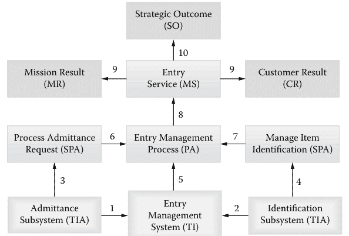

**图 7.10** 入境管理倡议 (EMTI) 企业视角。（改编自 W. J. Bunting，《企业转型期刊》（*Journal of Enterprise Transformation*），2(1，1月): 50–79, 2012.经许可。）

防止危险人员入境的整体战略目标。作者的主要论点是，如果该机构实施该技术，那么该机构将实现上述结果和战略目标。这就是该技术的企业视角。如果该机构实施该技术，那么该机构将实现上述结果和战略目标。这就是该技术的企业视角。7.10 显示了 EMTI 论证的简化版本。数字 1 到 8 的箭头代表因果关系。数字 9 和 10 的箭头代表证据关系。图中数字相关的推理如下：

- 1. 技术人员认为，如果准入子系统实现了假设，那么入境管理系统可能会实现假设。
- 2. 技术人员认为，如果识别子系统实现了假设，那么该系统可能会实现假设。
- 3. 技术人员认为，如果准入子系统实现了假设，那么入境申请可能会实现假设。
- 4. 技术人员认为，如果识别子系统实现了假设，那么管理识别子系统可能会实现假设。
- 5. 技术人员认为，如果入境管理系统实现了假设，那么入境管理过程可能会实现假设。

# 企业转型的技术不确定性 173

- 6. 技术人员认为，如果入境申请子系统实现了假设，那么入境管理过程可能会实现假设。
- 7. 技术人员认为，如果管理识别子系统实现了假设，那么入境管理过程可能会实现假设。
- 8. 技术人员认为，如果入境管理过程实现了假设，那么服务可能会实现假设。
- 9. 管理人员认为，如果任务服务实现了假设，那么该机构可能会实现任务结果和客户结果。机构的战略规划决定了这些结果。
- 10. 管理人员认为，如果服务实现了目标假设，那么该机构可能会实现战略结果。

关键推理是：

- 如果入境管理系统实现了所需的假设，那么危险入境的战略结果可能会在很大程度上实现。
- 如果入境管理系统实现了所需的假设，那么机构目标（任务结果和客户结果）可能会在很大程度上实现。

## 7.4.1 EMTI 论证模型

LSERA 方法的第二步是论证模型的构建。EMTI 管理人员、分析师和 1 在几个月内构建了论证模型。从大量的现有材料中开始，行为实体很容易达成一致。确定性能实体导致了大量的讨论。原因有三个：现有措施的合理性、LSERA 要求性能实体是独立的，以及性能实体的制定方式必须使得“高”状态是好的，“低”状态是坏的。我们对一组性能实体达到了共识，然后选择了企业架构实体。计划人员对企业架构并不熟悉，


# 174 企业动力学手册

他们对使用三种技术架构、四种过程模型、一种整体运营架构类型以及一种性能架构类型达成了一致。所有实体之间的有向关系很容易建立。接下来的活动是断定因果水平。经理们对于断定技术是否必要或充分表示了疑虑，他们更倾向于使用默认的正相关性因果水平。最后，执行了整体的 IF-THEN 逻辑并发现其是可以接受的。

在几个月里，论证模型不断演变，并以图 7.11 中的 EMTI 论证模型图结束。整个 EMTI 论证模型包含 88 个实体。这 88 个实体包括 3 个技术和4 个过程行为实体、18 个性能衡量实体、9 个结果实体、1 个任务结果实体、1 个客户结果实体以及 12 个其他信息制品。此外，还有 39 个与性能衡量、企业、架构和其他信息制品相关的实体。使用 LASERA 定向关系集构建了 89 条关系；其中 8 条粗箭头表示因果关系，81 条细箭头表示证据关系。为了保持图示的简洁，它没有显示每个证据制品的具体个体关系。

## 7.4.2 EMTI 推理模型

LASERA 的第三步（如图 7.2 所示）是构建 EMTI 推理模型。计划中的经理和分析师具有概率论背景。因此，他们几乎没有讨论就直接使用了 LASERA 概率表。被选入论证模型定向关系的是 LASERA 模型片段（MFrags）。图 7.2 展示了 EMTI 推理模型的愿景，其初始证据发现显示所有指标均达标，且所有制品的质量足够。为了可读性，隐藏了证据节点。

使用 Quiddity OnLine Star, Inc. 根据特定的合并规则连接贝叶斯网络片段，以生成 EMTI 推理模型。Quiddity 将结果传递给 NETICA 软件进行展示。EMTI 推理模型是一个由 90 个节点和 91 条关系组成的贝叶斯网络模型。

此时，经理和分析师可以开始 LASERA 方法的推理部分（第 4、5、6 步，见图 7.2），并讨论各种证据组合、证据强度审查以及因果推理组合的情况。他们可以将自己对可能发生的情况以及从新证据中推断出的主观信念外化。他们通过调整每条关系内部的概率来实现。此外，论证作者（其特定领域的专家，可能并不熟悉整个实体）可以分别进行分析，并将他们的思考以原则的方式整合成一个整体。通过这个推理模型，经理和分析师现在可以以更有原则的方式对原始的 EMTI 推理进行推理。他们可以看到哪些因素可能产生影响，并可以推断和谐、不和谐以及新担忧的影响。此外，他们还可以计算单条证据的强度，以查看是哪条证据正在驱动论证。

例如，分析过的某一种情况是准入子系统显著低于其预期行为。识别子系统的证据表明，它很可能实现预期行为。复杂入口管理系统的性能指标均达标，其企业架构制品和其他信息制品的质量良好。准入子系统的标准预期行为和复杂入口管理系统的直接证据导致复杂入口管理系统仍有约 70% 的概率达到或超过其预期行为。经理和分析师现在可以对这一结果提出任何数量符合原则的问题。其中一个问题涉及直接性能和制品差异的影响，与准入子系统行为对复杂入口管理系统行为达成概率的影响对比。

另一个问题涉及这些是否是推断复杂入口管理系统行为的正确指标。经理和分析师现在可以判断模型是否缺乏准确性，并调整性能实体、直接关系以及这些关系内部的概率以反映他们的集体信念。

## 7.5 结论

LSERA 方法为经理提供了能力：(a) 在企业转型内部开发一个特定技术倡议的表示，以供审查（提问、推理、推断），以及 (b) 根据出现的信息重新审查该表示。

LSERA 为企业分析师提供了以正确方式开发证据链（ELos）的能力，将其扩展到对转型成功概率的每日出现信息进行推理。鉴于软件，分析师可以在开发 ELo 论证的同时并发开发 LASERA 模型。开发这两个模型所需的时间主要取决于经理表达实体、关系、信念和推理的能力。分析师可以快速建立模型，并随着经理思维的变化同步调整。需要理解的关键点是，LASERA 最适用于无法构建算法模型的情况，即推理和决策基于一组经理的信念的情况，例如大型企业转型中。在企业转型的过程中，企业架构师、经理和分析师开发了大量的企业模型和其他分析。每个结果都涉及对实现转型某个层面的断言。通常，结果会呈现给一组经理，然后由他们吸收所听内容，在那个时刻进行思考、做出决定并采取行动。问题在于如何以原则的方式将结果整合在一起，以便检查它们的综合影响。LASERA 支持企业架构师和其他分析师将信息（证据）连接成一个有原则的模型，并允许进行有理的讨论。

# 178 企业动力学手册

## 参考文献

Aamodt, R. 1994. Case-Based Reasoning: Foundational Issues, Methodological Variations, and System Approaches. Fairfax, VA: IOS Press.

American Heritage Dictionary of the English Language, Fourth Edition. 2000. Boston: Houghton Mifflin.

Aristotle. 1994. The Complete Works of Aristotle: Oxford Translation, J. Boras (Ed.). Princeton, NJ: Princeton University Press.

Boutlier, C., Friedman, N., Goldsmith, M., and Koller, D. 1996. Context-specific independence in Bayesian networks. In Proceedings of the Tuelf Conference, uncertainty in artificial intelligence. San Mateo, CA: Morgan Kaufmann.

Bunting, W. 2019. Reasoning on agency performance using line of sight evident. Paper at the Seventh Annual Workshop on Bayesian Applications. Montreal, Canada (June).

Bunting, W. 2012. Reasoning on uncertain enterprise technology alignment for attainment of enterprise transformation, Journal of Enterprise Transformation, 2(1, January): 50–79.

Burke, W.W. and Litwin, G.H. 1992. A causal model of organizational performance and change. Management, 18: 523–545.

Chung, L., Nixon, B.A., Yu, E., and Mylopoulos, J. 1999. Non-Functional Requirements in Software Engineering. Boston: Kluwer Academic.

Davis, A.P. 2004. Probability, causality and the empirical world: a Bayes–of Finetti–Borel synthesis. Statistical Science, 19: 44–57.

Department of Defense Architecture Framework. 2009. DoD Architecture Framework V2.0, Volume 2: Architectural Models and Architect’s Guide.

Diez, F. and Druzdel, M.J. 2007. Canonical probabilistic models for knowledge engineering (Technical Report CIASAD-06-01). Madrid, Spain: UNED.

FEA-RM (Federal Enterprise Architecture Records Management). 2007. Federal Enterprise Architecture Program Management Office, Enterprise Architecture Consolidated Report Document 2.3.

Federal Segment Accountability Office. 2010. Organizational transformation, a framework for assessing and improving enterprise architecture management. GAO–10–8466, Washington, DC: U.S. Government Accountability Office.

Hacking, I. 2001. An Introduction to Probability and Inductive Logic. New York: Cambridge University Press.

Hume, D. 2009. A Treatise of Human Nature—Volumes I and II. Frederick, MD: Merchant Books. (Original work published 1739.)

Jensen, F.J. 2001. Bayesian Networks and Decision Graphs. New York: Springer-Verlag, Johnson-Laird, P. 2009. Deductive reasoning, WIRE Cognition, 1–17.


# 企业转型的技术不确定性 ■ 179

Josephson, J.R. and Jefferson, S.G. 1996. 溯因推理：计算、哲学、技术。英国剑桥：剑桥大学出版社。

Juthe, A. 2005. 类比论证。Argumentation, 19(1): 1–27.

Knotour, T. 2011. 企业转型的新兴理论。Journal of Enterprise Transformation, 1:48–70.

Laskey, K.B. 2008. MEBN: 一阶贝叶斯知识库的语言。Artificial Intelligence, 172: 140–178.

Merrifield, R., Calhoun, J., and Stevens, D. 2008. 生产力的新革命。Harvard Business Review, 6月。http://hbr.org/2008/06/the-new-revolution-in-productivity/art/1

The Open Group Architecture Framework. 2009. 版本 9, The Open Group. 美国马萨诸塞州波士顿。

Line Star. IET. 2007. Quiddity（计算机）。获取自 http://www.iet.webfacacional.com/quiddity.html。

Pearl, J. 1988. 智能系统的概率推理。旧金山：Morgan Kaufmann。

Pearl, J. 2000. 因果关系：建模、推理与推理。英国剑桥：剑桥大学出版社。

Rouse, W.B. 2005. 概率推理的证据基础。新泽西州霍霍肯：Wiley。论文集。IEEE，第五届国际需求工程学术会议。

Van Lansweerde, A. 2001. 目标导向的需求工程。引导之旅。在 RE01, 第五届IEEE国际需求工程学术会议。多伦多：IEEE，第249–263页。

Venkataram, N. and Mylopoulos, J. 1994. 为什么需要目标导向的需求工程。在范围定义。Sloan Management Review, 35: 2.

Yu, E.S.K., and Mylopoulos, J. 1998. 为什么需要目标导向的需求工程。在需求工程研讨会：软件质量基础，（REFSQ '98）意大利比萨，6月8–9日，第15–22页。

Zachman, J. 2008. Zachman企业框架。获取自 http://zachmanframeworkassociates.com。

Zowghi, D. and Offen, R. 1997. 用于建模和推理需求演化的逻辑框架。论文发表于第三届IEEE国际需求工程学术会议论文集，美国马里兰州安纳波利斯。

# 第8章
## 转型系统工程过程的最优控制与微分博弈建模

Leonard A. Wojcik way Kenneth C. Hoffman

## 目录

- 8.1 引言....................................................................................................................... 182
- 8.2 框架.................................................................................................................... 184
- 8.3 最优控制模型..................................................................................................... 185
  - 8.3.1 线性模型.................................................................................................................. 185
    - 8.3.1.1 与运营收益相关的目标函数............................... 186
    - 8.3.1.2 与系统完成压力相关的目标函数.................................. 193
  - 8.3.2 外部复杂性的非线性模型...................................... 197
- 8.4 分割博弈模型............................................................................................... 200
  - 8.4.1 自利且同步的利益相关者的线性微分博弈........................................................................................... 200
    - 8.4.1.1 公地悲剧............................................................... 202
    - 8.4.1.2 多重均衡........................................................................................... 203
  - 8.4.2 利益者斯塔克尔伯博弈中的企业激励.......203
    - 8.4.2.1 激励机制中的硬性灾难......................................206
    - 8.4.2.2 稳健性与程序特征...............................207
  - 8.4.3 企业与外部环境的共同演化................................208
- 8.5 结论..................................................................................................211
参考文献..................................................................................................212

## 8.1 引言

涉及多个利益相关者的大规模、复杂系统工程工作往往存在问题，因此政府和私营行业对如何改进此类系统的系统工程过程产生了兴趣。本章介绍了一种系统工程（SE）过程的建模方法，其最初灵感源于用于理解设计系统复杂性的高度优化容错（HOT）框架。在这里，系统工程过程的高级、最优控制理论和微分博弈模型以简化的方式表示了系统工程中固有的成本与性能权衡。尽管建模处于探索性研究阶段且不具预测性，但建议可以使用高级模型来沟通新的和进行的系统工程计划中固有的风险，以及管理和治理缓解措施的潜在影响。进一步探索的领域包括系统工程程序诊断和早期评估的高级建模。

在大型复杂或私营企业背景下，系统工程具有挑战性，许多此类系统工程案例都存在问题（Bar-Yam 2003）。引用一个追溯到20世纪90年代的单一且记录充分的系统工程案例，美国联邦航空管理局（FAA）耗资数十亿美元的先进自动化系统（AAS）交通控制系统是在重大技术和管理挑战的背景下进行的，关键领域的需求不明，在计划停止时仅部分完成，并伴有延迟和成本超支（Boppana et al. 2006）。Boppana等人（2006）展示了应用于AAS计划的SE过程的系统动力学和HOT模型，并提出问题：航空等复杂企业中SE的复杂性是否能够通过此类模型进行充分的表示和研究。在这里，我们扩展了Hoffman等人（2007）的统一框架，作为在高层级对整个SE过程建模的基础，并提出了一系列最优控制和微分博弈模型，以解释包括不确定性在内的SE复杂性因素，

> * 部分改编自 Wojcik, L.A. and K.C. Hoffman, 2007 IEEE. IEEE/SMC系统系统工程国际会议（SoSE）。

外部影响（由政策、运营、经济和技术因素，即POET因素组成[Carlock, Decker, and Fenton 1999]组成）以及利益相关者的交互。这里介绍的工作将以往的研究结果与未报道的结果结合起来。

本章的系统工程过程高级最优控制模型表示了SE过程中固有的成本、进度和性能的权衡。这些模型不具有“预测性”，因为与POET和利益相关者因素相关的不确定性太大了。模型的定量验证可能仍保持有限，特别是在POET因素占主导的情况下。相反，这些模型旨在用于在POET因素渗透的SE计划中模拟不同的假设和策略。最终，通过进一步的研究，这些模型可能为更深入地理解SE提供基础，并对一般的人类/技术系统的讨论做出贡献（Arthur 2009; Alderson and Doyle 2010）。这些模型在与实践相关的几个方面可能证明有用。

首先，它们可以作为沟通和教育价值，帮助从业人员理解管理和治理措施的可能影响。正如后文所述，模型可以识别出许多政府和行业决策者或SE从业人员在特定SE计划中可能未发现的行为模式。模型可以帮助广泛的决策者、SE从业人员和学生理解这些行为模式，以及如何更好地准备或应对。

其次，模型可以用于SE计划诊断。当SE计划出现问题时，模型可以根据可用数据和计划信息提供可能的问题源。本章展示了一个基于模型的诊断的回顾示例。为了做到这一点，首先根据可用信息拟合原始计划参数，然后拟合在各种POET因素影响下实际的计划轨迹。两个计划场景之间的模型参数差异提供了诊断信息。对于其他复杂系统（如人类健康）的诊断工具，需要专家根据其知识和经验来解释和应用诊断。但SE过程模型具有扩展人类专家能力的潜力，并能清晰地沟通诊断。

第三，模型可以用于对可能的SE管理和治理措施进行早期评估。尽管模型不是预测性的，但可以建议SE经理应该注意的可能结果和行为的定性类型。早期评估建模可以通过“模拟”未来不同的可能假设来增强判断。


## 8.2 *框架**

我们使用基于最优控制理论的通用系统工程（SE）过程形式，如下：

```
$\dot{X} = f(X(t), U(t), t), \quad (8.1)$
```

向量 $X(t)$ 是企业的状态向量，向量 $U(t)$ 代表影响企业演化的控制要素。$X(t)$ 的分量取决于取决于正在建模的特定 SE 过程，但可能包括：例如，所开发能力的进度指标、系统获取的总支出，或其他与企业有关且可能影响 SE 过程的指标（Hoffman et al. 2007）。等式 (8.1) 左侧 $X$ 上方的点表示对时间的导数。函数 $f$ 将当前状态 $X(t)$、控制控制量 $U(t)$ 和时间 $t$ 与 $X$ 随时间变化的演化联系起来。通常情况下，函数 $f$ 可能包含随机变量和确定性变量。遵循最优控制理论（Bryson and Ho 1975），我们假设利益相关者 $i$ 对控制 $ij$ 的动机通过利益相关者 $i$ 的目标函数体现：

```
$J_i = \Phi_i(X(t_i), t_i) - \int_{t_0}^{t_i} L_i(X(t), U(t), t) dt \quad (8.2)$
```

通常，SE 过程中的不同利益相关者可能有不同的动机，因此具有不同的 $J_i$。例如，SE 承包商可能受利润驱动，而政府项目经理可能受 SE 收益与总成本之间的差异驱动。

在等式 (8.2) 的右侧，第二项整合了从指定的开始时间 $t_0$ 到结束时间 $t_i$ 的成本。在系统获取背景下，第二项代表获取系统的总成本。结束时间 $t_i$ 通常代表完成系统开发的时间，可能是一个控制变量。结束时间连同 $L_i$ 中固有的时间共同规定了一个层级的“进度”以及潜在的 SE 过程的其他方面。等式 (8.2) 的第一项代表所获取系统在企业运营中的性能价值，这可能取决于获取系统所需的时间。因此，等式 (8.2) 在数学上表示了 SE 中成本、进度和性能的“铁三角”。

本章还讨论了等式 (8.2) 的进一步泛化，承认系统开发可能分为多个阶段，这些阶段可能跨越一系列时间完成。在每个阶段的结束时，可能可以将某些能力释放到企业运营中，并从系统中产生收益。在这种泛化中，$t_i$ 可以被理解为对应不同开发阶段的时间向量，$X(t_i)$ 是跨越时间向量的状态矩阵，而等式 (8.2) 中成本函数的积分可以扩展为跨越不同开发阶段的成本函数积分之和。

在针对单一建模利益相关者的最优控制框架中，“优化”背后的假设是：SE 决策做出了反映成本、进度和性能权衡的选择。这并不是说 SE 决策从字面上完全最小化了其决策，而是框架中的优化展示了在 SE 程序中由于成本、进度和性能权衡而预期可能出现的高层级行为。同样，在存在多个利益相关者的情况下，平衡代表了可以从每个利益相关者做出自身权衡时预期的一种集体行为。框架中代表的另一个重要因素是，SE 决策不仅考虑其决策的直接影响，还考虑了长期影响。SE 是一项跨越一段时间的“计划性”工作，等式 (8.2) 的动机框架反映了在时间 $t$ 采取决策对整个系统生命周期内积累收益的影响。

当只有一个建模利益相关者时，寻找“最佳”控制 $U(t)$ 的问题是一个最优控制问题。在多个利益相关者的情况下，不同的利益相关者执行不同的控制，对于所有利益相关者并不一定存在单一的最优。我们用 $X(t)$ 的不同分量表示不同利益相关者的状态，用 $U(t)$ 的不同分量表示不同利益相关者的控制。利益相关者的交互通过微分博弈方法建模，其中平衡解代表了利益相关者集体行为的潜在吸引子。正如后文所述，对于给定的游戏，此类平衡解并非唯一，这为具有标量状态和控制变量的多利益相关者模型中基础性的不可预测性极限提供了数学依据。

## 8.3 最优控制模型

我们首先讨论最优控制模型，其中 $X(t)$ 和 $U(t)$ 都是标量，目标函数 $J$ 也是标量。这是最优控制框架中最简单的模型类型，对应于具有单一控制的单一建模利益相关者。

### 8.3.1 线性模型*

在线性模型中，状态方程 (1) 简化为：

```
$\dot{X} = A \cdot X + B \cdot U$
```

> *Wojcik, L.A. and K.C. Hoffman. 2007. ©2007 IEEE. IEEE/SMC International Conference on System of Systems Engineering (SoSE), April 16–18. With permission.

| 获取 | 在运营中使用系统 | 0 = 开始时间 |
|---|---|---|
| 系统 | 获取支出 | t_f = 获取完成时间 |
| 0 | t_L | t_L = 系统寿命 |
| s(0) = 0 | s(t_f) | t |
| q^2(t) > 0 | q^2(t) = 0 | |

**图 8.1** 模型场景。（源自 Wojcik, L.A. and K.C. Hoffman. 2007. ©2007 IEEE. IEEE/S International Conference on System of Systems Engineering (SoSE), April 16–18. 经许可。）

### 8.3.1.1 与运营收益相关的目标函数

我们从非平凡的等式 (8.1) 和 (8.2) 开始讨论。在这种实例化中，状态 X 是时间 $s(t)$ 的标量函数，控制 U 是时间 $q(t)$ 的标量函数，矩阵 B 是一个常数（标记为 $b$），$A$ 和 $\Delta$ 均为零。图 8.1 是对应于模型的通用 SE 场景的时间线，其中 $s(t)$ 衡量获取中实现运营能力的进展。

#### 8.3.1.1.1 三分之一规则†

状态 $s(t)$ 从获取开始（时间零）开始并在正方向上无约束。控制函数 $q(t)$ 是获取支出率的正平方根。在时间 $t_f$，假设获取已完成，此时支出率变为零，系统提供的能力在运营中使用，直到预定的系统寿命 $t_L$。因此，在该模型中，获取期内过渡到运营。获取完成时间 $t_f$ 被视为控制变量。控制函数 $L$ 在 $t_f$ 之前为 $q'(t)$，之后之后。运营收益 $\phi$ 只是从 $t_f$ 到系统寿命 $t_L$ 的最终状态 $s(t)$ 的积分，乘以常数 $K$，这对应于系统运营期间运营收益的美元价值。‡那么，等式 (8.1) 和 (8.2) 简化为：

>‡我们注意到，通常假设系统生命周期内收益递减且维护成本增加更符合现实。这些影响将在本章的后续部分进行讨论。


## 最优控制与微分博弈建模

表 8.1 最优控制的必要条件

| 其中： | | |
| \--- | \--- |
| $\frac{\partial H}{\partial q} = 0$ | |
| $\dot{s}(t) = f(s(t),q(t),t)$ | |
| $\dot{\lambda} = -\left(\frac{\partial H}{\partial s}\right)$ | $J = \phi(s(t_f), t_f) - \int_{0}^{t_f} L(s(t),q(t),t)dt$ |
| $\lambda(t) = \left(\frac{\partial \Phi}{\partial t}\right)_{t_f}$ | $H = f \cdot \lambda - L$ |
| $\left(\frac{\partial \Phi}{\partial dt} + H\right)_{t_f} = 0$ | $\lambda(t)$ 是拉格日乘子函数。 |
| $s(0) = 0$ | |

来源：Wojcik, L. A. and K.C. Hoffman, © 2007 IEEE. IEEE/SMC International Conference on System of Systems Engineering (SoSE).

$s(t) = b \cdot q(t)$

$J = K \cdot \int_{0}^{t_f} s(t) \cdot dt - \int_{0}^{t_f} q^2(t) \cdot dt = K \cdot s(t_f) \cdot (t_L - t_f) - \int_{0}^{t_f} q^2(t) \cdot dt$

可以使用表 8.1 中的必要条件对方程 (8.4) 和 (8.5) 求解以得到最优控制 $q(t)$ 和 $t_f$（Bryson and Ho 1975），这些条件适用于边界条件松弛的情况。

该优化可以从两种方式来解释：首先，从规范性角度来看，它生成了在 $J$ 方面产生最佳结果支出轨迹和获取终止时间。其次，从针对设计系统的 HOT 建模方法来看（Carlson and Doyle 1999），对优化的描述性解释是：专家设计师所做出的决策至少近似导致了整体性能最优。第二种解释是比较优化结果与真实系统工程（SE）计划结果的基础。

方程 (8.4) 和 (8.5) 的最优控制解为：

$q(t) = \frac{K \cdot (t_L - t_f) \cdot b}{2}$

对于 $0 \le t \le t_f$，且：

$t_f = t_L / 3$

因此，最优支出率 $q^2(t)$ 是一个取决于参数 $K$、$b$ 和 $t_i - t_j$ 的常数。状态 $s(t)$ 随时间线性变化，最优获取时间 $t_j$ 总是总系统生命周期的三分之一，且与基础模型中的其他参数无关。

采用优化的描述性解释，该模型预测运行良好但复杂的 SE 工程，获取（包括过渡到运行）的时间占总系统生命周期的三分之一，而在运行中使用的时间占总系统生命周期的三之二。这一“三分之一规则”为与真实的 SE 计划比较提供了基准。

### 8.3.1.1.2 建模“内部复杂性”

基础模型中一个看似任意的参数是 $J$ 成本项中的平方指数。如果该指数为 1（使得 $q(t)$ 为支出率），则最优解将是“激进控制”（bang-bang）的；即：最优 $t_i$ 为 0，且取决于参数 $K$ 和 $b$ 的值，最优 $q(t)$ 为 0 或零时刻的特尔塔函数。我们将单位指数情况解释为获取过程中的“零内部复杂性”，因此尽可能快地获取是最优的。我们在此区分了“内部复杂性”（它与获取系统过程中的交互数量和强度相关）和“外部复杂性”（它与作用于获取或运行的外部事件相关）。外部复杂性将在本章的稍后部分进行建模。例如，大量相同且易于制造的零件属于非常低复杂性的类别：相对于零件在系统中的寿命，其获取过程可以进行得极快，因为制造它们的手段是可以复制的。

前一节讨论的二次成本函数情况代表了获取过程中更大的“内部复杂性”。将方程 (8.4) 和 (8.5) 推广为在成本函数中包含一个可变指数 $\alpha$ 是自然然：

$s(t) = b \cdot q(t)$

$J = K \cdot s(t_i) \cdot (t_i - t_j) - \int_{0}^{t_i} q^{\alpha}(t) \cdot dt$

使用表 8.1 中的必要条件，求解方程 (8.8) 和 (8.9) 的最优控制解（其中 $\alpha > 1$）：

Wojcik, L.A. and K.C. Hoffman. 2007. ©2007 IEEE/SMC International Conference on System of Systems Engineering (SoSE), April 16–18. 经许可。

$q(t) = \frac{K \cdot (t_L - t_f) \cdot b}{2}^{1/(\alpha-1)}$

$0 \le t \le t_f$,

$t_f = t_L \cdot (\alpha-1)/(2 \alpha - 1)$

我们将 $\beta = \alpha - 1$ 解释为系统的“内部复杂性”，当 $\beta$ 趋于无穷大时，$t_f/t_L$ 趋于无穷。对于高复杂性的 SE 工程，模型预测获取时间将占总生命周期的一半。图 8.2 展示了 $t_f/t_L$ 随内部复杂性 $\beta$ 的变化。当 $\beta=1$ 时，$t_f/t_L$ 为三分之一，这与上述的“三分之一规则”一致。

### 8.3.1.1.3 老化效应

基础模型假设系统价值在整个生命周期内是线性的。真实的系统在老化时可能会性能下降，此外还可能存在其他随时间变化的影响，例如运行成本的增加。我们通过对目标函数 $J$ 进行推广来建模这些影响，即引入到运行的时间：

$s(t) = b \cdot q(t)$：

$J = K \cdot s(t_i) \cdot (t_i - t_j) - \int_{0}^{t_i} q^{\alpha}(t) \cdot dt$ (8.11)

使用表 8.1 中的必要条件求解方程 (8.12) 和 (8.13)（其中 $\alpha > 1$）：

Wojcik, L.A. and K.C. Hoffman. 2007. ©2007 IEEE/SMC International Conference on System of Systems Engineering (SoSE), April 16–18. 经许可。

$q(t) = \frac{K \cdot (t_L - t_f) \cdot b}{2}^{1/(\alpha-1)}$

$0 \le t \le t_f$,

$t_f = t_L \cdot (\alpha-1)/(2 \alpha - 1)$

我们将 $\beta = \alpha - 1$ 解释为系统的内部复杂性，当 $\beta$ 趋于无穷大时，$t_f/t_L$ 趋于无穷。对于高复杂性的 SE 工程，模型预测获取时间将占总生命周期的一半。图 8.2 展示了 $t_f/t_L$ 随内部复杂性 $\beta$ 的变化。当 $\beta=1$ 时，$t_f/t_L$ 为三分之一，这与上述的“三分之一规则”一致。

（注：此处原文文本似乎存在重复或逻辑交叉，翻译已根据上下文结构进行对齐）

### 8.3.1.1.4 分阶段开发

标量线性模型的下一个扩展是分阶段开发，其中一个能力有限的部分完成系统被引入运行，并在开发过程中产生额外的能力。此处 $\beta = 1$ 且不假设系统老化。对于两阶段开发，目标函数变为：

$J_{2,age} = K \cdot s(t_{f1}) \cdot (t_{f2} - t_{f1}) + s(t_{f2}) \cdot (t_L - t_{f2} - t_{f1}) - \int_{0}^{t_f} q^2(t) \cdot dt$ (8.20)

这里有两个“终止”时间，对应两个阶段。第一阶段在 $t_{f1}$ 完成，第二阶段在 $t_{f2}$ 完成。假设一旦阶段完成，它进入运行并开始产生收益。该方程结合状态方程 (8.4) 可通过最优控制问题求解，控制变量为 $q(t)$、$t_{f1}$ 和 $t_{f2}$，使用表 8.1 中的方程。

类似于之前介绍的单阶段结果，最优 $t_f$ 和 $t_L$ 与常数 $b$ 和 $K$ 无关：

$t_{f1}/t_L = 5/13$, $t_{f2}/t_L = 23/39$ (8.21)


$q(t)$ 是一个阶跃函数：

```
$q(t) = (4/13) \cdot b \cdot K \cdot t_L \text{ for } 0 \leq t < t_{f_1} = (8/39) \cdot b \cdot K \cdot t_L \text{ for } t_{f_1} \leq t < t_{f_2} = 0 \text{ for } t > t_{f_2} \ (8.22)
```

目前尚未得出任意数量阶段的通用结果，但对于无限阶段开发，我们有：

```
$J_{stage} = \int_{0}^{t_f} K \cdot (t_L - t) \cdot ds(t) - \int_{0}^{t_f} \dot{t}^2(t) dt \quad (8.23)
```

在该方程中，$t_f$ 被解释为最后一个微小阶段的时间。最优控制问题可以通过解析解求解，得出最优的 $t_f = t_L$。单阶段、双阶段和无限阶段的 $J$ 最优值比较如下：

```
$J_{1 stage} = (\frac{1}{27}) \cdot K^2 \cdot b^2 \cdot t_L^3 = (0.037) \cdot K^2 \cdot b^2 \cdot t_L^3$
$J_{2 stage} = (\frac{2672}{59319}) \cdot K^2 \cdot b^2 \cdot t_L^3 = (0.045) \cdot K^2 \cdot b^2 \cdot t_L^3 \quad (8.24)$
$J_{stage} = (\frac{1}{12}) \cdot K^2 \cdot b^2 \cdot t_L^3 = (0.087) \cdot K^2 \cdot b^2 \cdot t_L^3$
```

注意，$J$ 随着阶段数量的增加而增加，这意味着开发应该包含尽可能增以实现最大收益。在实际情况下，工程、开发和运行约束以及成本将限制最优阶段数。多阶段分析的一个实际系统工程（SE）启示是，规划多少阶段的决策可以被框架化为理解无限阶段的工程、开发和运行限制。

为了与本章后续的其他模型进行比较，计算了无限阶段的轨迹：

```
$s_{\infty}(t) = (\frac{b^2 \cdot K}{4}) \cdot (2 \cdot t_L - t) \cdot t \quad (8.25)
```

## 8.3.1.2 与完成系统压力相关的目标函数

在某些情况下，建模者可能希望强调完成系统的压力，而不是系统在运行中的收益。例如，可能存在运行收益或系统寿命的估计值。对于这些应用，可以使用与完成系统压力相关的目标函数的模型。完成系统的压力可能来自运行需求，也可能来自政治或组织压力，或者两者的结合。

## 8.3.1.1 “HOT” 模型

HOT 是一个理解设计或工程系统中复杂性方面的框架。Carlson 和 Doyle (1999) 最初创建了 HOT 概念，并将其应用于森林火灾管理、互联网流量和自然生态。在工程系统中，他们展示了在设计权衡和不确定性的情况下，通过最小化成本如何产生与尺寸概率概率幂律。从那时起，HOT 方法论已应用于电网（Alderson et al. 2004）和互联网架构（Stubna and Fowler 2003）。HOT 通常被等同于幂律，但 Wojcik (2004) 将 HOT 方法论的版本应用于 SE 过程，结果却没有发现幂律；因此，更准确的称法是其为受 HOT 启发的模型，而不是 HOT 模型。在本节中，我们展示了 Wojcik (2004) 的 HOT 启发模型可以用线性最优控制框架来描述，但在上述描述的系统在无限增量阶段中完成的极限情况下。

Wojcik (2004) 提出了一个简单的成本密度函数：

```
$c(t) = A\cdot(1-s(t))\cdot(1-e^{-t/\tau}) + B\cdots(t)\cdot\delta_p(t) + D\cdot\dot{s}(t)^2$
```

在这里，$A, B, D$ 和 $\tau$ 是常数，随机的 $\delta_p(t)$ 是关于时间 $t$ 概率密度为 $p$ 的 $\ 函数。参数 $p$ 假设为常数。$c(t)$ 方程的第一项模拟了来自实际需求或其他政治压力的完成基础系统的压力。第二项代表了由于改变系统相对于基础系统能力的随机事件而产生的成本。这整合了利益相关者的互动以及其他外部事件。第二项与 $s(t)$ 成正比，代表对接近完成的系统影响更大。实际构建系统的成本由第三项建模，该项在 $s}(t)$ 上是非线性的，以反映与较长时间构建相比，在短时间内构建系统的相对困难。

此外，在该模型中，$s(t)$ 被限制在 0 和 1 之间。在 $s(t)=1$ 的值处，系统完成，完成压力变为零。那么，寿命内的预期成本为：

```
$c_{ost} = \int_{0}^{t_f} c(t) dt = \int_{0}^{t_f} L(\dot{s}(t), s(t), t) dt + (s(t_f), t_f), \quad (8.27)$
```

其中 $t_i$ 是开发的截止时间，其默认值为 $t_L$，当 $t > t_L$ 时，$q(t)=0$。并且，

```
$(\dot{s}(t), s(t), t) = A \cdot (1-s(t)) \cdot (1-e^{-t/\tau}) + B \cdot s(t) + D \cdot (\dot{s}(t))^2 \quad (8.28)$
```

```
$(s(t), t) = \begin{cases} A \cdot (1-s(t)) \cdot (1-e^{-t/\tau}) + B \cdot s(t) + D \cdot (\dot{s}(t))^2 & \text{for } t < t_i \\ \dots & \text{for } t \ge t_i \end{cases} \quad (8.29)$
```

从上述线性最优控制框架，我们在 (8.28) 中代入 $q(t)$ 并得到：

```
$J_H = \int_{0}^{t_f} [A \cdot (1-s(t)) \cdot (1-e^{-t/\tau}) + B \cdot s(t) + D \cdot (\dot{s}(t))^2] dt \quad (8.30)$
```


# 196 企业动态学手册

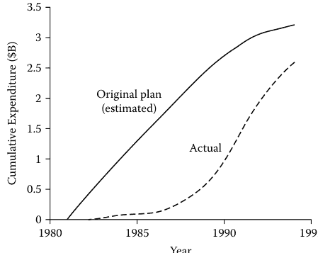

**图 8.4** AAS 计划与实际累积计划支出。

诊断性解释是，原始 AAS 计划低估了工作的不确定性水平（$B^*p^* > Bp$）、开发中的固有技术难度（$D^* > D$）以及对程序的外部压力（$A^* > A$）。从图 8.4 可以看出，合同授予后，困难（$B^*p^*$）的影响是缓慢启动。随后，在计划过程中，完成任务的压力（$A^*$）迫使支出率上升，但固有困难（$D^*$）使得系统能力无法接近原始水平。

AAS 程序是否可能在开始时就预测出来？鉴于巨大的不确定性，确定性的预测将毫无用处，但通过受 HOT 启发的模型可以演一系列可能的场景。美国国会技术评估办公室（1982）报告的专家小组信息（在“AAS”一词成为常用之前）表明，专家对计划的技术可行性表示怀疑，并且对可能增加系统工程（SE）工作复杂性的 POET 和利益相关者因素有一定的了一。。这些意见的取向可以通过一系列受 HOT 启发的模拟来展示，以显示当时的计划策略下可能出现的结果。可以根据当时感知到的不确定性，对替代计划策略的稳健性进行评估，或许可以使用 HOT 启发模型的扩展模型来生成高层计划轨迹，例如图 8.4 中的支出轨迹。该模型的用在于会将分歧的意见转化为一组可能的计划轨迹。广而言之，这种方法类似于基于模型的政策分析，用于解决可持续发展和污染等问题，在这些问题中，巨大的不确定性可能会主导分析（Popper, Lempert, and Bankes 2005）。

# 最优控制与微分游戏建模

## 8.3.2 外部复杂性的非线性模型

为了模拟外部复杂性（例如企业任务的变化或企业环境的演变会改变系统需求），我们修改了基础控制理论模型，允许 $s(t)$ 出现突然的“冲击”（hits），这会瞬间减少 $s(t)$；以及“帮助”（helps），这会瞬间增加 $s(t)$。冲击和帮助（下文为了简见统称为“冲击”）可能发生在从 0 到 $t_f$ 的采购期间，也可能发生在之后的运行使用期间。为了简单起见，内部复杂性参数 $\beta$ 设置为 1，老化参数 $\sigma$ 设置为 0，这与基础模型一致。新的状态方程为：

```
$$\dot{s}(t) = b \cdot q(t) - \sum_{i=1}^{n} c_i \cdot \delta(t - t_i) \cdot s(t) \quad (8.34)$$
```

第 $i$ 次冲击的幅度以当前 $s(t)$ 的比例表示，由 $c_i$ 给出，冲击发生的时间由 $t_i$ 给出。下标“负”表示第 $i$ 次冲击作用于 $t_i$ 之前的 $s(t)$ 值。尽管冲击可能发生在采购期间和运行使用期间，但正如前几节所示，假设在运行使用期间的支出为零（因此在时间大于 $t_f$ 时，$q(t)$ 为零）。那么，目标函数为：

```
$J = K \cdot \int_{0}^{t_f} s(t) \cdot dt - \int_{0}^{t_f} q^2(t) \cdot dt = K \cdot s(t_f) \cdot h(t_f) - \int_{t_f}^{0} q^2(t) \cdot dt \quad (8.35)$
```

其中：

```
$h(t_f) = \left(t_{m(t_f)+1} - t_f) + \sum_{i=m(t_f)+1}^{n} (t_{i+1} - t_i) \cdot \prod_{j=m(t_f)+1}^{i} (1 - c_j)\right) \quad (8.36)$
```

参数 $m(t_f)$ 是时间 0 到 $t_f$ 之间最后一次冲击的索引，即采购期间的最后一次冲击；如果采购期间没有冲击，则 $m(t_f)$ 为零。方程 (8.36) 中的求和如果起始索引超过终止索引，则定义为零。$t_0 = 0$ 且 $t_{n+1}=t_f$。因此，方程 (8.36) 考虑了由于方程 (8.34) 中指定的冲击导致运行期间 $s(t)$ 值的瞬间变化。如果运行期间没有发生冲击，则方程 (8.35) 简化为方程 (8.5)，即基础模型的目标函数。

> * Wojcik, L.A. and K.C. Hoffman. 2007.©2007 IEEE/SSC International Conference on System of Systems Engineering (SoSE), April 16–18. With permission.

根据必要条件，方程 (8.34) 到 (8.36) 的最优控制解比之前描述的情况复杂，最方便的方法是通过数值生成 $q(t)$ 的解析解，以便使用方程 (8.37) 寻找 $s(t)$ 的最优值。图 8.5 所示的跨越一系列 $t_f$ 值计算 $q(t)$ 的数值程序识别了使 $J$ 最大化的最优 $t_f$。较浅色的曲线 $s(t)$ 表现出锯齿型行为，采购期间有冲击，运行使用期间有阶梯变化（因为假设支出为零）。粗线显示了方程 (8.4) 和 (8.5) 所示冲击场景下的 $s(t)$。

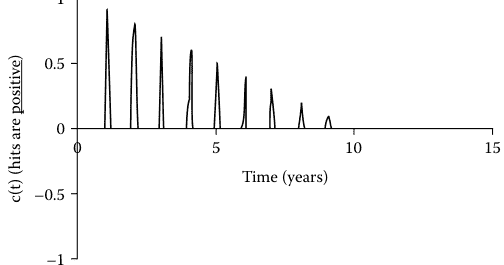

**图 8.5** SE 控制场景。（来自 Wojcik, L.A. and K.C. Hoffman. 2007.©2007 IEEE/SSC International Conference on System of Systems Engineering (SoSE), April 16–18. With permission.）

在 8.6 中，图 8.5 所示冲击场景的浅色曲线 $s(t)$ 经历了（或未察觉）$s(t)$ 的冲击，随后是 $s(t)$ 进一步下降的运行使用期。在预知未来冲击的情况下优化 $J$ 的阶段开始得缓慢得多，并逐渐上升到更高的运行水平。$s(t)$ 相对缓慢增长的时期对应非常有限的开发，而不是需求变化会破坏计划的大规模采购。

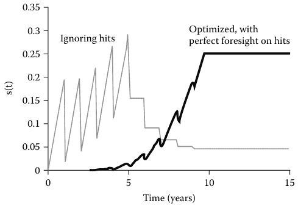

**图 8.6** 有冲击的 SE 行为。（来自 Wojcik, L.A. and K.C. Hoffman. 2007.©2007 IEEE/SSC International Conference on System of Systems Engineering (SoSE), April 16–18. With permission.）

如图 8.7 所示，最优支出（从时间零到横轴的 $q^*(t)$ 积分，粗线所示）远大于不考虑冲击的情况（浅色曲线）。在本例中，考虑到冲击后，获取系统的时间为 9.7 年，而忽略冲击获取的时间为 5 年，这与上述讨论的三分之一规则一致。

因此，我们观察到，预见到 SE 程序可能面临的冲击，最好的办法可能是谨慎开始，并保持相对有限的开发。使用该模型运行了许多其他冲击和帮助。在某些冲击随时间增加的场景中，最好的方法是快速构建一个小系统，建议采用“小量构建测试”的方法。当帮助而非冲击主导 SE 程序时（对应于新的运行应用），就需要进行开发。在这种情况下，模型可以用于表征不同的


# 企业动力学手册

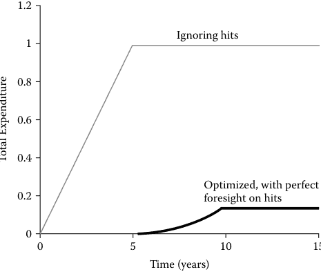

**图 8.7 随时间变化的总支出。（引自 Wojcik, L.A. and K.C. Hoffman. 2007. ©2007 IEEE/SMC International Conference on System of Systems Engineering (SoSE), April 16–18.经许可。）**

系统工程（SE）管理与治理的策略体制。此处提出的模型假设对即将发生的冲击（hits）和帮助（helps）有完全了解，这在真实的 SE 工程中并不普遍，尽管在许多情况下，可以根据以往相似的经验，对整个项目生命周期内的冲击规模和时间产生概率估计。该模型可以用于说明不同策略体制下的结果，并为系统生命周期内的任何一组冲击和帮助展示完美的预见策略。其中一种场景（包括最优策略的计算）在典型的现代笔记本电脑上运行时间不到一秒，因此可以进行多种场景。该模型一个可能的扩展（目前尚未进行）是引入随机模拟，以考虑到冲击和帮助在数量、时间和规模上的不确定性，以及决策者的风险偏好。

## 8.4 差异博弈模型

### 8.4.1 自利且同步的利益相关者的线性差异博弈

本节描述了影响与企业相关的 SE过程的交互利益相关者模型。此类利益相关者可能包括承包商、政府机构、系统用户组、工会或其他与企业相关的众多其他个人或群体。此处假设利益相关者需要以某种方式进行“同步”，SE 过程才能顺利运行。例如，在某些大型军事 SE 工程中，一组承包商需要协作、共享信息，并协调他们的开发活动，以实现系统级能力。

在另一个当前的民用航空 SE 工程（名为 NextGen）中，大量的利益相关者群体（包括追求利润的航空公司、政府机构和机场组织）需要达成并维持共识，并为最终系统提供政治支持，该系统涉及在全美范围内的多个地理区域实施的许多相互关联的计划（FAA 2010）。这些计划的具体细节差异很大，它们都拥有具有不同利益的利益相关者，这些人需要以某种方式进行同步，以促进成功的 SE 结果。

此处提出的建模旨在代表 SE 工程中利益相关者同步的核心特征。

在建模中，观点是个人利益相关者受其自利利益的驱动，而这些利益在利益相关者群体中可能差异很大。此外，假设存在一个企业代理，可以应用激励和其他手段来影响其他利益相关者。在政府主导的企业中，这种营利行为可能是负责 SE 工作的高级执行人员或组织。为了简单起见，该模型让每个利益相关者根据时间做出一组有限的决策：至少，每个利益相关者必须决定如何与每个其他利益相关者保持同步。每个利益相关者都可以从企业提供的激励以及其他机制中通过更大的同步直接获益，包括通过更大同步所实现的更好系统对特定利益相关者带来的运营效益。然而，同步会给利益相关者带来成本，即投入到会议和准备等同步活动中的精力，这种成本可能是巨大的，特别是因为通常需要高技能的技术人员来执行这些活动。同步成本还包括了将内部信息暴露给其他利益相关者的可能风险，尽管对于在同步活动期间获得其他利益相关者信息的利益相关者来说，这些成本可能是负的。基于利益相关者在系统生命周期内（包括 SE 过程和运营使用）所看到的收益和成本，利益相关者决策随时间的交互在此处通过简单的动态博弈进行建模。

动态博弈的一个熟悉“解”是纳什均衡（Nash 1950）。在纳什均衡中，没有人会基于自利利益产生动机去改变其决策。在本章中，我们强调一种较弱的均衡版本，其特征是每个利益相关者对于其与其他利益相关者的同步量没有单方面做出增量改变的动机。均衡进一步专门化为开环均衡（open-loop equilibrium），它规定了利益相关者随时间变化的行为，而不是闭环反馈规范。

与之前介绍的单一利益相关者建模相比，自利且同步的利益相关者模型并不被认为具有严格的预测性。许多因素影响着个人利益相关者的行为，以至于期望一个模型能准确预测行为。因此，我们强调从建模中得出的利益相关者行为的一般特征。涉及利益相关者的博弈均衡解最好被理解为行为的潜在“吸引子”，而非严格的预测。

### 8.4.1.1 公地悲剧

一种显而易见的激励方案是根据 SE 过程的最终结果奖励每个利益相关者，该结果是通过所有利益相关者的努力实现的，并可能通过利益相关者之间更大的同步而增强。类似的案例是，利益相关者直接从最终系统中获益，因此可能有动机进行同步并对最终质量做出贡献。

通过这种激励方案，个人利益相关者因其对 SE 过程最终结果的贡献获得奖励，但该利益相关者不会获得其他利益相关者的奖励。这是经济学中“外部性”的例子；即每个利益相关者都无法看到同步的全部收益。外部性在其他领域也可见，例如地面交通，其典型影响是对有限资源的过度使用。然而，它有时被称为“公地悲剧”（TOC）（Hardin 1968）。在 SE 利益相关者的情况下，其影响是整个利益相关者群体之间的同步不足，尽管每个利益相关者都是根据自己的自利利益做出决定。同步不足发生是因为每个利益相关者无法获得流向其他利益相关者的收益；因此，所有人的同步程度都低于均衡时的水平。

存在已知的缓解公地悲剧的措施，以防止有限资源的过度使用，包括建立控制机制（Ellis and den Nouveld 2000）、消除外部性的处罚（例如拥堵定价），以及为资源用户提供达成协议的机制（Cantarela and Sforza 1991）。在 SE 利益相关者的情况下，其影响是利益相关者群体之间的同步不足，因此所有人低于均衡水平。利益相关者同步的类比有三种：

第一，可以通过企业相互约束利益相关者。例如，在利益相关者由承包商组成的情况下，可以通过合同要求同步。这种方法具有适应性差的缺点：随着 SE 工程的进展和变化，最初设计的同步要求可能不再有帮助。

第二，可以为利益相关者提供额外的激励以促进同步。这些可以是企业提供的财务或非财务激励。然而，在某一点提供激励的成本将超过其收益。激励提供的建模会导致另一种行为模式。

第三，可以培养一个促进利益相关者之间“合作博弈”的环境，利益相关者之间存在有效的“协议”，以确保他们不会背离高于自身自利的位置。这可以通过奖励良好同步并惩罚坏行为的“企业文化”来实现。这些奖励和惩罚不需要是财务性的，可以引入组织的任何层级，包括个人。例如，对在跨组织方面特别活跃的个人提供特别认可奖励。而且，如果在整个 SE 工程或多个 SE 工程中存在反复同步的机会，则可以通过跨越时间的“以牙还报”威胁来促进良好的同步（Axelrod 1984）。

### 8.4.1.2 多均衡

许多类型博弈的另一个一般特征是存在多个均衡。也就是说，博弈的解不是唯一的。使用下一节描述的利益相关者同步博弈的具体实例化，观察到了这种多均衡。将每个均衡解释为集体行为的“吸引子”，多均衡意味着集体行为可能被多个方向吸引，这可能取决于看似无关或偶然的因素，这些因素可能会将集体行为引向一个方向而非另一个。从这个意义上说，利益相关者系统的预测性存在根本限制，即使我们对这些动机和成本拥有详尽详细的信息，且利益相关者是“理性”的。

## 8.4.2 利益相关者跟随博弈中的企业激励

在前节中，讨论了利益相关者同步博弈均衡解的一般特征。为了解决利益相关者同步的激励问题，对所示同步博弈进行了扩展，以包含一组作为企业政策机构的交互利益相关者来提供


# 204 企业动力学手册

激励。在本章中，企业激励的提供通过领导者-追随者（或 Stackelberg 博弈，Fudenberg and Tirole 1991）进行建模，其中领导者是企业机构，追随者是一组利益相关者，每个利益相关者都根据自身的利益决定一个同步水平。解决此类游戏的方法是反推法：首先，假设利益相关者处于平衡状态，然后对企业机构的激励进行优化，以实现收益减去成本的最大化。

该模型提出的跨所有利益相关者和时间的一组决策中同步 $i$ 的价值为：

```
$v_i(u_i(t), ..., u_n(t), \eta_i(t)) = h_i \cdot v(u_i(t), ..., u_n(t), \eta_n(t)) - d_i \cdot \int_{0}^{tf} u_i(t) \cdot dt - f_i \cdot \int_{p}^{tf} \eta_i(t) \cdot dt \quad (8.38)
```

在上述方程中，系统的同步价值为：

```
$v_i(u_i(t), ..., u_n(t), \eta_i(t), ..., r_n(t)) = \sum_{j=1}^{n} [a_j \cdot g(u_j(t))] + b \cdot \sum_{j=1}^{n} r_j(t) / n \cdot \sum_{j=1}^{n} g(u_j(t)) \cdot dt \quad (8.39)
```

并且，

```
$g(x) = (1 - \exp(-x))/(1 - \exp(-1)) \quad (8.40)
```

在方程 (8.38 和 8.39) 中，$u_i(t)$ 代表利益相关者 $i$ 为企业能力所付出的内部努力，$v(t)$ 是针对该能力的同步努力。我们假设 $u_i(t)$ 和 $v(t)$ 的最大值为 1。变量 $d_j, f_i, a_i$ 和 $b$ 是常数。常数 $n$ 是利益相关者的数量。方程 (8.38) 右侧 (RHS) 的第一项是企业提供的激励，以及企业系统价值最大化的 $i$。第二和第三项代表随时间积分的内部努力和同步努力成本。

在方程 (8.39) 中，右侧的第一项是利益相关者内部努力对企业总价值的贡献，此处假设为简单的相加。遵循 Huberman 和 Glance (1998) 的模型，我们假设同步价值与利益相关者之间同步项的乘积成正比。此外，假设该项与个人努力的乘积成正比。在其他建模工作中，我们有时假设跨部分利益相关者集合的乘积和，这对应于跨部分利益相关者同步产生的系统价值积累，但在本文阐述中，我们假设价值来自整个利益相关者集合的同步。

发现通过虚拟复制法（method of fictitious play）数值化生成方程 (8.38) 到 (8.40) 的解最为方便，尽管我们应用了必要条件（Bryson and Ho 1975, p. 277）来证明在平衡状态下，内部努力和同步努力随时间都是恒定的。这源于对哈密顿函数的约束：

```
$H_i / \partial u_i = 0$
```

```
$H_i = \lambda_i(t) \cdot u_i(t) + \mu_i(t) \cdot \eta_i(t) + L_i(u_i(t), \eta_i(t), t)$
```

```
$H_i / \partial \eta_i = 0$
```

```
$\dot{\lambda}_i = -\partial H_i / \partial s_i$
```

```
$\dot{\mu}_i = -\partial H_i / \partial w_i$
```

在这里，

```
$\dot{s}_i(t) = u_i(t)$
```

```
$\dot{w}_i(t) = \eta_i(t)$
```

在方程 (8.41) 到 (8.45) 中，$\lambda_i(t)$ 和 $\mu_i(t)$ 是跨利益相关者的格格朗日乘子函数，拉格朗日量为：

```
$L_i(u_i(t), \eta_i(t), t) = -d_i \cdot u_i(t) - f_i \cdot \eta_i(t)$
```

注意拉格朗日量没有显的时间依赖性，且：

```
$\dot{\lambda}_i = \mu_i(t) = 0$
```

这足以证明 $u_i(t)$ 和 $v_i(t)$ 与时间无关。

因此，产生数值结果的方法是固定跨利益相关者的一组激励，使用虚拟复制法求解利益相关者之间的平衡，然后改变激励直到达到最大系统价值的激励成本：

```
$V = v_j(u_i(t), ..., u_n(t), r_i(t)) - \sum_{l=1}^{n} h_l \quad (8.50)$
```

## 8.4.2 激励中的硬度

结果显示，随着内部难度的增加，利益相关者 3 的最优同步也会增加。

（图 8.8）

## 8.4.2.1 鲁棒性

接下来，我们考虑鲁棒性，即程序面对意外变化的生存能力。根据已介绍的结果，我们关注利益相关者的鲁棒性。企业面临的一个重要问题是：什么特征产生了鲁棒性？同步重要性可以通过参数表示：

```
$I = \sum_{j=1}^n a_j + b \quad (8.52)$
```

数值模拟表明（见图9），存在一个同步重要性的范围，使得鲁棒性最大。如前，场景涉及三个利益相关者，并改变其中一个的内部难度。如果同步重要性过高，利益相关者的困难会损害整个系统。在另一个极端，如果利益相关者独立工作，则利益相关者 3 无法获得任何收益。因此，存在一个鲁棒性最大的中间地。

（图 8.9）

## 8.4.3 企业与环境的协同演化

本节描述了一个微分微分博弈。这里的企业可能对应于政府机构或一组机构，其环境是与之交互的外部世界。例如，企业可以是联邦航空管理局 (FAA)，其环境可以是航空系统的用户，包括航空公司、通用航空和军事用户。或者，企业可以是美国国税务局 (IRS)，其环境是美国纳税人。企业有动力创建满足环境对其要求的能力。环境有自己的动机，这些动机可能与所研究的企业动机一致。为了简单起见，假设企业及其环境各自的动机可以通过以下两个方程表示为单位时间成本：

```
$L_k = A \cdot (d(t) - k(t))^2 + C \cdot d(t) + B \cdot k(t)^2$
```

```
$L_d = D \cdot (d(t) - k(t))^2 - E \cdot d(t) + F \cdot d(t)^2$
```


## 最优控制与微分游戏建模 209

在方程 (8.53) 和 (8.54) 中，A, C, B, D, E 和 F 被假设为常数。函数 $d(t)$ 和 $k(t)$ 分别被假设为始终非负，分别代表施加于环境的“需求”和满足企业产生需求的“能力”。在这里，“需求”和“能力”的理解是非常广泛的，因此适用于许多类型的企业及其相应的环境。在这个简单的模型中，我们假设 $d(t)$ 和 $k(t)$ 的一阶导数始终是非负的。企业玩家的目标是最小化其在从 $T_0$ 到 $T_f$ 的给定时间间隔内的积分成本 $L_d$。同样，环境玩家的目标是最小化其在相同时间间隔内的积分成本 $L_d$。这种博弈表述形式可以扩展，使得企业和环境看起来像前瞻性时间，但此处未作介绍。

在方程 (8.53) 和 (8.54) 中，右侧的第一项代表企业与环境之间的相互作用。假设常数 A 为正数，这样企业就有动力产生运营能力 $k(t)$ 以“匹配”外部世界施加的需求 $d(t)$。常数 D 根据企业类型和环境的不同，可以是正、零或负。

方程 (8.53) 右侧的第二项代表了外部环境产生的需求 $d(t)$ 对企业施加的负担，即使企业的能力已经匹配并满足了需求。这种负担可能涉及提供服务和能力，其数量和质量与施加在企业身上的监管和财务限制保持一致。因此，常数 C 通常为非负。方程 (8.54) 右侧的第二项代表环境从其施加企业的需求中获得的收益。通常，E 为正数，反映了环境从其操作中获益，因此 E 是正的。

最后，方程 (8.53) 和 (8.54) 中的第三项分别代表了企业情况下生成能力的难度以及环境情况下产生需求的难度。单位时间内产生能力越困难（成本越高），常数 B 越大越大，对于需求和常数 F 也是如此。

成本方程 (8.53) 和 (8.54) 可以推广，使其包含的项完全对称（允许相应的常数取值不等），这可能适用于更广泛的类型类型建模；例如，美国国防部（DoD）应对各种环境，从过去冷战时期的苏联到当前的非对称战争威胁，但这种推广超出了本章的范畴。

我们求解开环形式的博弈论均衡解，初始条件规定为 $k(0) = k_0$ 和 $d(0) = d_0$。纳什解将 $k(t)$ 和 $d(t)$ 规定为时间的函数，使得任何玩家都没有单方面改变这些函数的动机（这些函数是成本函数对应方程 (8.53) 和 (8.54) 的控制变量），但在数学上，直接将每个方程中状态变量的一阶导数作为控制变量是等价的。那么，状态方程是平庸的：

$$\dot{k}(t) = k(t) \quad (8.55)$$

$$\dot{d}(t) = d(t) \quad (8.56)$$

应用开环均衡解的必要条件（Bryson and Ho 1975），在约束松弛的情况下，出现了三类解，取决于常数参数的值：

$$G = \frac{D}{F} + \frac{A}{B} \quad (8.57)$$

当 $G$ 大于零时，潜在解 $k(t)$ 和 $d(t)$ 是时间的正负指数函数的线性组合，其时间常数等于 $G$ 的平方根，并且是二次多项式。当 $G$ 小于零时，潜在解是正弦函数与时间的二次多项式的线性组合，其正弦频率由下式给出：

$$\omega = \sqrt{-G} \quad (8.58)$$

图 8.10 展示了一个 $A=B=C=D=E=F=1$ 的示例，其中 $d_0=5, k_0=3, T_0=0$ 且 $T_f=10$。在这个示例中，$G>0$。企业和环境有利于匹配能力需求，他们倾向于以减少能力与需求差异的方式协同。联邦航空管理局（FAA）企业及其空域系统用户环境可能对应于“协作自适应”企业/环境系统。当 $D=0$ 时，需求 $d(t)$ 对企业能力不敏感，因此其演化独立于 $k(t)$。然而，企业适应环境产生的需求的变化。美国国税局（IRS）企业及其环境可以用这种“不敏感需求”模式来近似。需求和能力的共同演化在性质上与协作自适应企业/环境系统相似。另一种性质上不同的行为模式是企业和环境处于“对立”状态，此时 $D<0$，这对于国防部/国土安全部（DHS）企业及其非对称威胁环境是预期。在这种模式下，企业和环境有利于匹配能力需求。

图 8.10 展示了一个 $A=B=C=D=E=F=1$ 的示例，其中 $d_0=5, k_0=3, T_0=0$ 且 $T_f=10$。在这个示例中，$G>0$。企业和环境有利于匹配能力需求，他们倾向于以减少能力与需求差异的方式协同。联邦航空管理局（FAA）企业及其空域系统用户环境可能对应于“协作自适应”企业/环境系统。当 $D=0$ 时，需求 $d(t)$ 对企业能力不敏感，因此其演化独立于 $k(t)$。然而，企业适应环境产生的需求的变化。美国国税局（IRS）企业及其环境可以用这种“不敏感需求”模式来近似。需求和能力的共同演化在性质上与协作自适应企业/环境系统相似。另一种性质上不同的行为模式是企业和环境处于“对立”状态，此时 $D<0$，这对于国防部/国土安全部（DHS）企业及其非对称威胁环境是预期。在这种模式下，企业和环境有利于匹配能力需求。

## 8.5 结论

所提出的建模旨在激发更多研究。需要将模型联系系统工程（SE），应用于新的 SE，并证明其实用性。在更广泛的层面上，高级最优控制和微分游戏建模可能加深对复杂人类系统的理解。

## 参考文献

Alderson, D.L., and Doyle, J.C. 2010. Contrasting views of complexity and their implications for network-centric infrastructures. IEEE Transactions on Systems, Man and Cybernetics—40(4), July): 839–852.
Arthur, W.B. 2009. The Nature of Technology: What It Is and How it Evolves. New York: Free.
Axrod, R. 1984. The Evolution of Cooperation. New York: Basic.
Bar-Iam, Y. 2003. When systems engineering failing—Toward complex systems engineering, International Conference on Systems, Man & Cybernetics, Vol. 2: Monterey, NJ: IEEE Press, pp. 2021–2028.
Bryson, A.E. and Ho, Y.-C. 1975. Applied Optimal Control. Washington: Hemisphere.
Cantarella, G.E. and Sforza, A. 1991. Traffic assignment. In M. Papageorgiou (Ed.) Concise Encyclopedia of Traffic and Transportation Systems. Oxford: Permagon Press, 513–520.


# 最优控制与微分博弈建模 ■ 213

Carlock, P.G., Decker, S.C., and Fenton, R.E. 1999. “系统系统”的机构级系统工程。《系统与信息技术评论杂志》，春季/夏季: 99–110。

Carlson, J.M. and Doyle, J. 1999. 高度优化容性：设计系统中幂律的机制。《物理评论E》，E, 60(2, 8月): 1412–1427。

交通部，监长办公室. 1998. 联邦航空管理局审计报告，进阶自动化系统。AV-1998-113 (2015)。 http://www.oig.gov/sites/files/pdfs/av1998-113.pdf

Ellis, C.J. and den Noueland, A. 2000. 合作环境中诱导合作的机制：理论与应用。社会科学研究网络（2月）。http://papers.ssrn.com/sol3/papers.cfm?abstract_id=436522

FAA（联邦航空管理局）. 2010. FAA下一代实施计划（3月）。华盛顿特特区：联邦航空管理局。

Fudenberg, D. and Tirole, J. 1991. 《博弈论》。马萨诸塞州剑桥：MIT出版社。

Hardin, G. 1968. 公地的悲剧。《科学》，162: 1243–1248。

Hoffman, K.C. 等人. 2007. 描述性企业动态——一个多学科统一框架。发表于第五届系统工程研究年度会议 (CSER)，国际系统工程协会会议 (INCOSE)，新泽西州霍霍伯肯。

Huberman, B.A. and Glance, N.S. 1998. 波动影响与可持续合作。收录于 M.J. Priuela 等人，《模拟组织：机构与群体的计算模型》。加利福尼亚州梅洛洛公园：美国人工智能协会。

Nash, J.F. 1950. 多人博弈中的均衡点。《美国科学院院报》，36 (1): 48–49。

Popper, S.L., Lpert, R.J., and Banks, S.C. 2005. 塑造未来。《科学美国人》（4月): 66–71。

Stubna, M.D. and Fowler, J. 2003. 高度优化容性模型在电力停网中的应用。《分叉与控制国际期刊》，13(1): 237–242。

美国国会，技术办公室. 1982. FAA空域系统计划审查，国会图书馆目录号 82-600595，华盛顿特特区：美国政府出版局。

Wojcik, L.A. 2004. 大规模系统工程过程的高度度优化容性 (HOT) 模型。收录于《系统论文：复杂系统夏季》，6月6日–7月2日，新墨西哥州圣塔菲：圣塔菲研究所。

Wojcik, L.A. and Hoffman, K.C. 2006. 企业背景下的系统系统工程：一种动态的统一框架。发表于2006年IEEE/SMC系统系统工程国际会议 (SoSe)，数字对象标识符 10.1109/SYSOSE.2006.1652268)

Wojcik, L.A. and Hoffman, K.C. 2007. 系统工程过程最优控制模型中的涌发企业动态。发表于2007年IEEE/SMC系统系统工程国际会议 (SoSe)，4月16日–18日。

# 第9章 空空作战中心的混合系统动力、Petri网及基于代理的建模

Jennifer Mathieu, John James, Paula Mahoney, Lindsley G. Biney, Richard Hubbard, and Brian E. White*

- 9.1 引言 ................................................................................ 216
- 9.2 背景 ................................................................................. 216
- 9.3 员-环境模型（基于代理）....................................................... 218
- 9.4 AOC过程模型（Petri网） ...................................................... 222
- 9.5 结果与讨论 ................................................................... 227
- 9.6 结论 ................................................................................... 230
- 参考文献 ....................................................................... 233
- 致谢 .............................................................................. 234

*改编自 Mathieu, J, 等人 2007a. 空空作战中心的混合系统动力、Petri网及基于代理的建模。收录于 INCOSE研讨会，系统工程：智能企业的关键，6月24日–28日，圣地亚哥。

## 9.1 引言

在早期的一篇论文中（Mathieu 等人 2007b），一个现有的空空作战中心（AOC）过程模型（即 Petri 网）与 AOC 运行环境的新型全局和任务模型（即系统动力学）被关联（联邦化）。本章的重点是开发一种操作员-环境模型（即基于代理的模型）。


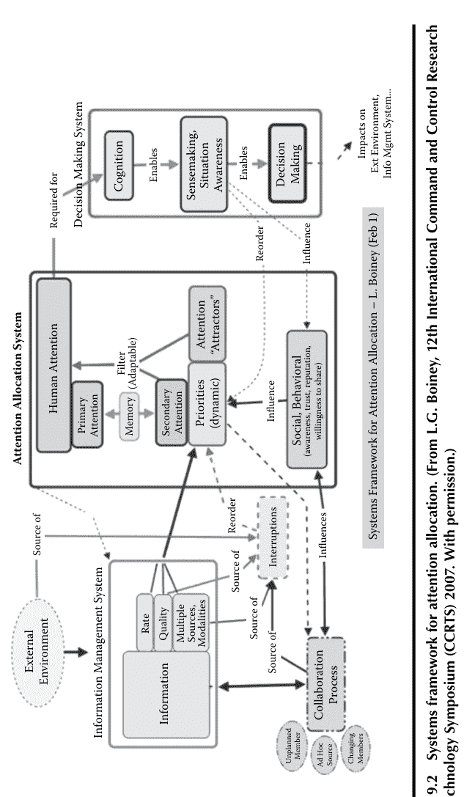

图 9.2 注意力分配的系统框架。（来自 L. G. Boney，第12届国际指挥控制研究技术研讨会 (CCRITS) 2007。经许可。）

# 220 企业动态源手册

活动队列

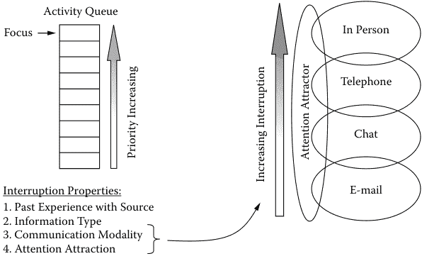

- 中断属性：
1. 与来源的以往经验
2. 信息类型
3. 通信模式
4. 注意力吸引物

图 9.3 操作员活动队列和通信模式。

为操作员-环境模型选择的场景是时间敏感目标（TST）过程，该过程被建模为 49 名在图 9.4 所示流程中工作的操作员。这些操作员在特定的组组内工作，由任务框中较大的框（矩形）表示。在当前版本的模型中，一组 8 名操作员相互交互，根据随机数量的活动或子任务来完成任务（图 9.4 中的矩形）。每个代理体被随机分配若干个静态属性，包括专业水平、经验和交互易易程度。

基于初始流程，代理体在模拟运行时会形成一个社交网络。如图 9.5 所示，一个代理体“抓取”了一个关键事件。代理体检查该事件是否需要妥善处理，并获取更多信息。如果不是，则代理体完成工作，处理将根据下一个事件模式的随机设置继续。如果模式是“交谈”，则检查该代理体是否有来自同一单元格的任何信赖同伴。如果是，代理体将选择一个并进行随机长度的交谈。如果模式是“电话”，则不选择同伴，但会计算通话时间（假设在单元格之外）。无论何种情况，如果成功获取了信息，通话时间将流给该代理体。如果代理体成功了（这是一个概率结果），则处理事件所需的信息量将减少，代理体将该同伴加入信任列表（如果尚未加入），并返回查看事件是否还需要更多信息。如果代理体未成功，则检查是否还需要更多信息。电子邮件和聊天模式以简化的方式实现。

代理体性能衡量 (MOP) 或指标包括：活动或子任务之间的转换时间、错误、遗漏信息、响应时间和重复请求。基于代理的建模环境中的潜在实验包括：

# 混合系统动态、Petri 网和基于代理的建模 ■ 221

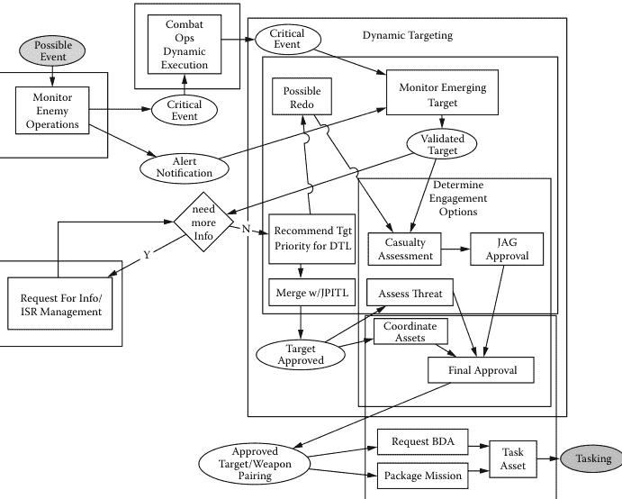

**图 9.4** 空天作战中心 (AOC)过程模型。矩形表示任务，箭头表示关键事件的流：动态目标列表 (DTL)、联合集成优先目标列表 (JIPTL)、总法官 (JAG) 和战斗损评估 (BDA)。

- AOC 环境破坏（例如媒体报道或飞行员坠机）。
- 注意力吸引物的使用（例如摘要显示）。
- 激励操作员在单元格之间协作的机制。
- 移除连接良好的操作员（例如，人际关系有多重要？）。
- 创建具有更多远程单元格成员的环境（例如，分布式 AOC）。
- 创建增加瓶颈概率的程序（例如，要求所有信息通过一个代理体传递）。

飞行员坠机场景的开发基于以下观察：许多 AOC 操作员会被飞行员坠机分心，即使该操作员无法直接协助救援。此外，据假设这种分心会对无关操作员正在处理的活动产生负面影响。图 9.6 显示了代理环境（Java 主类）以及飞行员坠机事件定时器，以及其他 TST 事件的计时器。圆圈表示全局变量，正方形表示 Java 类（例如，实现了操作员和聊天的状态图）。

# 222 企业动态源手册

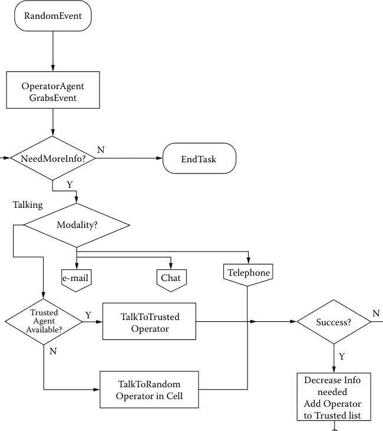

图 9.5 在基于代理的模型中建模操作员活动或子任务。图 9.6 描绘了代理环境，图 9.7 详细显示了操作员类，图 9.8 提供了操作员活动和可用性的状态图。

## 9.4 AOC过程模型 (Petri 网)

AOC过程模型描述了态势感知与评估 (SA&A) 以及 TST 操作，包括人力资源 (Mathieu et al. 2007b)。打击和支持任务包括六种不同的关键事件：(1) 战术弹导弹 (TBM) 发射；(2) TBM 检测；(3) 战斗搜索

# 混合系统动态、Petri 网和基于代理的建模 ■ 223

- PilotDownTimer
- TCTimer
- avgTimeToProcessPilotDown
- avgTimeToProcessTCT
- avgProcessingTime
- nChatWindows
- need_to_interact
- nPilotDownEvents
- nCTEvents
- totalChats
- totalEmails
- totalTelephone
- totalEvents
- nChat
- timeTimeToProcessPilotDown
- timeTimeToProcessTCT
- timeProcessingTime
- timePilotDown

| IntelOperator | partner | startTime | endTime |
|---|---|---|---|
| state | | | |
| state | | | |
| state | | | |
| state | | | |
| state | | | |
| state | | | |
| state | | | |
| state | | | |
| state | | | |
| state | | | |
| state | | | |
| state | | | |
| state | | | |
| state | | | |
| state | | | |
| state | | | |
| state | | | |
| state | | | |
| state | | | |
| state | | | |

图 9.6 代理环境。

图 9.8 操作员活动和可用性的状态图。

# 224 企业动态源手册

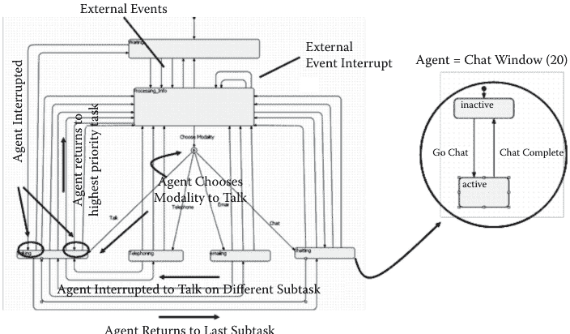

图 9.7 操作员类。

图 9.6 代理环境。

Agent = (8)

# 226 企业动态源手册

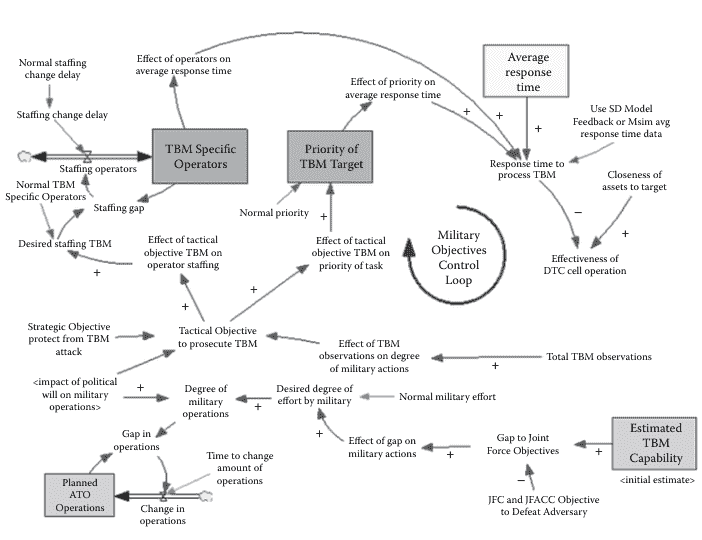

图 9.10 敌方 TBM TST 操作的系统动力学建模。

图 9.9 AOC Petri 模型部分：监控行动、战斗行动、全局和任务行动。


# 混合系统动力学、Petri 网与基于代理的建模 227

规模从 0（不支持）到 100（完全支持）

图 9.11 美国和全球的公众支持率及其对政治意愿的影响。

天。这是 AOC Petri 网模型在第 1 天结束时的输出结果；每种事件类型的每日平均值用于校准系统动力学模型的第 1 天。系统动力学模型的输出是下一天的系列关键事件。因此，这两个模型相继运行，以模拟全球动态对 AOC 运行的影响。全球过程在影响有效性方面可能非常重要。在这种情况下，对美国行动的“世界支持”以及“美国公众支持”都会影响“美国政治意愿”，这会导致军事行动的程度降低至零（见图 9.11）。

## 9.5 结果与讨论

图 9.12 显示了在给定关键事件数量下，处理最后两个（2）飞行员坠机（pilot-down）任务的操作员与处理另外两个（2）时间敏感目标（TST）任务的操作员的平均响应时间（y 轴）。这些结果表明，飞行员坠机获得最高优先级，显示出更快的平均响应时间。

图 9.13 显示了对原始关键事件文件（基准运行）运行 AOC 模型时的响应时间。给定时期内的关键事件越多，完成任务所需的 AOC 响应时间越长（例如， 10 到 13 小时之间的时期）。

图 9.12 平均响应时间随处理事件的时间，由基于代理的模型处理最后几个飞行员坠机事件（下方图）和时间敏感目标（TST）事件（上方图）；图中显示了二者的平均值。

图 9.13 一天内各类型事件的响应时间（基准运行）。搜索与救援（CSAR）或飞行员坠机的优先级最高，其余四种事件具有相同的较低优先级。

这表明操作员变得越来越忙，出现了任务队列。随着事件频率的降低，队列减少，响应时间随之缩短（例如 13 小时后的时期）。针对 TBM 发射和检测事件计算了加权平均响应时间。该值用于系统动力学模型：图 9.10，“平均响应时间”。AOC 模型中利用率最高的操作员是根据基准确定的，如表 9.1 所示。此最大人员利用率（65%，空域协调）被用于系统动力学模型。

使用基准运行中的关键事件执行 AOC 模型，并将数据传递给系统动力学。系统动力学模型运行 1 天，然后将关键事件的输出用于再次运行 AOC。此过程进行了九次，系统动力学的结果如图 9.14 所示。

“敌方军事能力”从 100% 开始在 9 天内逐渐下降。TBM 的部署和发射随着能力的下降而先增加后减少。美国和世界支持均在下降，政治意愿略微增加后下降。图 9.15 显示了 Petri 网模型在第 2 天和第 9 天的关键事件响应时间。

在行动之初，关键事件较多，AOC 模型显示存在队列现象，最大响应时间为 8.5 小时。随着通过消除“敌方军事能力”减少关键事件，AOC 模型显示队列有所减少，响应时间稳定在两到四小时之间。这些结果表明系统动力学模型已针对 Petri 网模型完成了校准。这是模型验证的第一步。

### 表 9.1 来自 Petri 网利用率最高的 AOC 操作员（第 1 天）

| 利用率 (%) | AOC 单元 | 职位描述 |
|---|---|---|
| 65 | 空域协调 | 协调空域 |
| 62 | 战斗行动 | 评估当前资产包任务；获取批准；分析事件对 ATO 的影响 |
| 61 | 战斗行动 | 动态目标定位；确定影响；研究与监控 |
| 60 | 战斗行动 | 动态目标定位；评估威胁环境；收集情报；监控新兴目标（机） |
| 57 | 监控行动 | 动态目标定位；确定影响；研究与情报 |
| 55 | 战斗行动 | 评估当前资产包任务；获取批准；资产可用性；批准任务包件；分析事件对 ATO 的影响；管理资产 |

## 9.6 结论

已实现了一个初步的基于代理的模型，该模型准确地反映了事件优先级：飞行员坠机事件的处理速度比其他时间敏感事件更快。接下来，评估了 Petri 网模型以确定操作员的信息溢出指标（例如，操作员压力）；实施注意力分配模型是第一步。操作员本身具有取决于个人特性的组件。为了洞察这些问题，有必要对个体规模动力学进行建模。假设在运行规模上对 AOC 进行建模以及在个体规模上进行交互可以为操作员溢出提供见解。

图 9.14 九天的系统动力学模型输出。

9.15 第 2 天和第 9 天所有事件的响应时间。所获得的见解可供操作员、决策者和新团队成员使用，以理解改进运行的政策对整个系统的影响。

测量指标（MOPs）之一是错误。未来的工作将错误建模为活动或子任务数量、子任务难度水平以及中断次数乘以持续时间的函数。这可能是基于代理模型对系统动力学模型产生直接反馈的示例，如图 9.1 所示。


# 混合系统动力、Petri 网与基于代理的建模 ■ 233

表 9.2 各天对应关键事件数量的平均响应时间和最大人员利用率

| 天数 | 响应时间（小时） | 最大人员利用率 (%) | 关键事件数量 |
|---|---|---|---|
| 1 | 4.33 | 64.5 | 50 |
| 2 | 5.40 | 66.1 | 51 |
| 3 | 3.40 | 62.0 | 45 |
| 4 | 3.54 | 53.9 | 39 |
| 5 | 2.79 | 48.8 | 37 |
| 6 | 2.76 | 52.3 | 37 |
| 7 | 3.09 | 54.5 | 38 |
| 8 | 2.34 | 50.3 | 31 |
| 9 | 2.37 | 42.7 | 29 |

然而，AOC 过程模型与（例如事件处理时间和错误概率）链接到一个由政治格局驱动的全局环境模型。将 Petri 网与系统动力学相结合的未来工作包括来自全局模型“目标优先级”以及 AOC 可用“人员”的反馈；这些变量将反映变化的“政治意愿”和“联合指挥部（JFC）目标”。

## 参考文献

Boinney, L.G. 2007. More than information: Supporting human attention allocation. Presented at 12th International Command and Control Research and Technology Symposium (CCCRTS), Newport, RI. June 19–21. http://www.dodccpr.org/html/events_12.html.

Kuras, M.L. and White, B.E. 2005. Enterprise engineering using complex-system-engineering. In INCOSE Proceedings, Rochester, NY, July 10–15.

Kuras, M.L. and White, B.E. 2006. Complex systems engineering—Position paper: A regime for CSE. Presented at Fourth Annual Conference on Systems Engineering Research (CSER), April 7–8, Los Angeles.

Mathieu, J., James, J., Mahoney, P., Boinney, L., Hubbard, R., and White, B. 2007a. Hybrid system dynamic, Petri net, and agent-based modeling of the Air and Space Operations Center. In INCOSE Symposium, Systems Engineering: Key to Intelligent Enterprises, June 24–28, San Diego.

Mathieu, J., Melhuish, J., P. Mahoney, L. Biney, and B. White. 2007b. Multi-scale modeling of the Air and Space Operations Center. Presented at Symposium on Complex Systems Engineering, January 11–12, The Rand Corporation. http://cs.csatela.edu/wiki/index.php/Symposium_on_Complex_Systems_Engineering. McCarter, B.G. and White, B.E. 2007. Collaboration/cooperation in sharing and utilizing net-centric information. Presented at Conference on Systems Engineering Research (CSER), March 14–16, Stevens Institute of Technology, Hoboken, NJ.

White, B.E. 2005a. A complementary approach to enterprise systems engineering. Presented at the National Defense Industrial Association Eighth Annual Systems Engineering Conference, San Diego, October 24–27.

White, B.E. 2005b. Engineering enterprises using complex-system-engineering (CSE). Presentation to First Annual System of Systems (SoS) Engineering Conference, Johnstown, PA, June 13–14.

# 致谢

作者感谢曾任于 Aptima, Inc. 的 James Melhuish 就系统动力学建模提供的咨询。

# 第 10 章

# 核废物管理：大型政府计划的战略框架

Gregory A. Love, Christopher G. Glazner, Samuel G. Steckley, Kristin Lee, and Teresa A. Tyborowski

## 目录

- 10.1 引言...............................................................................................236
- 10.2 背景...............................................................................236
- 10.2.1 背景—任务......................................................................236
- 10.2.2 背景—计划管理...............................................................237
- 10.2.3 目标...............................................................................237
- 10.2.4 一种统一结构......................................................................238
- 10.3 影响图的发展................................................239
- 10.3.1 物理流——关闭的路径..................................................239
- 10.3.2 生产复合体流程图..............................240
- 10.3.3 预算与资金水平...........................................................240
- 10.3.4 政策影响......................................................................242
- 10.3.5 需求与项目成果..................................................243
- 10.3.6 利益者参与................................................................ 244
- 10.3.7 完整的影响图...............................................................245
- 10.4 结论 .................................................................................................246
- 参考文献 ...................................................................................................247

## 10.1 引言

本章为美国能源部（DoE）环境管理办公室（EM）提供了一个框架，该办公室负责清理核武器遗产。EM 的任务涵盖了生产设施的去污、地下储高放射性液体废物（UNF）的安全处置以及符合标准的核材料处置。在内部改革、持续改进和外部监督期间，EM 一直改进其管理实践和业务系统。EM 的挑战在于更好地理解这些运营的各种过程、替代方案和政策限制，以便按时按预算完成计划。

## 10.2 背景

### 10.2.1 背景—任务

DoE 负责清理几十年的核武器遗产。1989 年成立了 EM 以解决这些问题。曾经参与生产的场所（如萨凡纳河）现在的任务是处置剩余燃料。

### 10.2.2 背景—计划管理

1998 年，EM 开发了“项目化”方法，更完整地定义了 EM 计划的生命周期范围和成本（DoE 1998）。四年后发布了一份全面审查（DoE 2002），建议关注基于绩效的合同、全面的风险排序以及对成本和工期的更严格控制。

2005 年 9 月，众和参议院能源与水利开发小组要求国家公共行政学院（NAPA）对 EM 进行管理审查。在期 19 个月的 NAPA 研究（NAPA 2007）期间，EM 与学院小组和工作人员紧密合作，在报告发布前实施了建议。研究小组调查了 EM 的组织和管理情况、人力资源、采购以及项目管理。

### 10.2.3 目标

EM 计划范围说明了大型政府计划固有的复杂性。该计划跨越很长的时间，预计延伸到 2050 年和 2062 年（DoE 2010，第 8 页）。涉及数十亿美元的投资。风险极高。成本飙升、延迟和技术问题可能会破坏可行性，危及完成，并引发政府调查。任何单一维度的问题都可能导致重大的管理挑战。EM 的挑战在于更好地理解这些运营的各种过程、替代方案和政策限制，以便按时按预算完成计划关闭。

截至为止，DoE 已将需要清理的站点从 110 个减少到 18 个，这代表遗产足迹从 3125 平英里减少到 900 平英里（DoE 2011）。尽管取得了这些进展，剩余的工作呈现出独特的


# 238 企业动力学手册

管理、技术和利益相关者的挑战。在这项任务中，对环境、健康和安全的主要威胁是放射性液体废物。能源部（DoE）目前在239个地下储罐中管理着约8800万加仑的高放射性废物。这些储罐及下游操作共同构成了 EM 计划中最大的成本支出（DoE 2011）。

EM 计划优先考虑（DoE 2010, 第 5 页）预计单位体积减少最多的活动（*治疗剂量是放射性的计量单位*）。这些活动包括（但不限于）：

- 存储在地下储罐中的液体废物的处理与处置
- 未利用铀的燃料（UNF）的接收、储存和处置
- 特殊核废料的巩并、稳定化和处置

本章介绍了目前正用于实现这些目标的影响图和模型结构。

## 10.2.4 统一结构

关于系统动力学在项目管理中的应用有大量工作。Lynes 和 Ford (2007) 对关注单一项目的文献进行了综述。公共部门的大规模资本项目已在一个案例研究中被单一分析（Lynes, Cooper, and Els 2001）。我们应用了这些和其他因果结构来识别模型可能探索的情景。虽然影响图在本质上是定性的，但它们捕捉了关键变量之间的关系，并将决策者和工程师的心理模型形式化。

本章介绍了一个探索政策选择、分析计划、应对管理挑战以及制定缓解策略的框架。该框架使得能够在一张纸上观察复杂问题，并提供了在统一概念视角下讨论问题的机会。该框架也足够通用，适用于广泛的资本投资/生产运营。因果影响还识别了反馈回路，这些反馈回路代表了能源部面临的重大管理挑战，并可以推广到公共部门和私营部门的大规模运营。

该框架与以往工作的不同之处在于其“系统系统”的规模以及联合运营/资本项目之间的依赖关系和复杂性。现有物理设施的生产规划和运营需要以高效、及时且具有成本效益的方式完成。剩余核材料和放射性废物流的物理特性是动态的，通常需要投资新技术进行安全处置。

项目结果需要根据其对正在进行和未来运营的影响来来看。今天的决策必须在一个通用框架背景下进行评估，该框架可以转换为模型，以产生可靠的性能衡量和结果。这些结构共同组合成影响图（Coyle 1996, 2004）。这些结构识别了对利益相关者重要的关键变量和政策。在更技术层面上，影响图识别了问题的性能衡量标准。我们扩展了影响图以说明问题的整体特征。

## 10.3 影响图的发展

以影响图形式进行的定性建模用于沟通模型范围并描述变量之间的关系。许多关键变量被显式建模，但某些则源于情景分析。

### 10.3.1 物理路径

EM 的目标之一是加速遗留废物的清理并减少其生命周期。能源部利用遗留设施来加速核燃料的清理并处理放射性废物。图10.1 显示了与生产链相关的投资。

# 240 企业动力学手册

项目根据生产进度和截止日期分配预算。剩余核材料和放射性废物的物理特性是动态的，通常需要投资新技术进行安全处置。当项目结束，能力将得到释放。影响图展示了可用于处理其他材料的灵活性。

项目结果需要根据其对正在进行和未来运营的影响来来看。今天的决策必须在一个通用框架背景下进行评估，该框架可以转换为模型，以产生可靠的性能衡量和结果。这些结构共同组合成影响图（Coyle 1996, 2004）。这些结构识别了对利益相关者重要的关键变量和政策。在更技术层面上，影响图识别了问题的性能衡量标准。我们扩展了影响图以说明问题的整体特征。

投资决策通常由生产进度和截止日期驱动。Morecroft (2007) 提出了三种投资方法：财务驱动、计划驱动和运营驱动。EM 通常关注在监管截止日期和预算范围内交付所需的能力。

### 10.3.2 生产性流程图

可用的方案是生产设施和基础设施的参考。图10.2 识别了单一位置，并与 Forrester (1961) 描述的类型相似。

### 10.3.3 预算与资金水平

成本组件为模型增加了重要的背景。通过模拟成本概况，可以将资源（劳动力、生产资产和投资）货币化。这使得管理层能够采取纠正行动。总预算主要由外部资金决定。年度拨款法确定了项目预算。能源部可以在支出之间行使某些裁量权。

# 放射性废物管理战略框架

| 防御废物 | 玻璃建筑 | 现场处置 | 盐处置设施 |
| :--- | :--- | :--- | :--- |
| | 现场储存 | 容器 | 玻璃化 |
| | 防御废物处理设施 | 来自储罐的低水平废物 | 盐工艺 | 盐处理设施 |
| 铯、锶 | 铯、锶、锕系 | 盐 | 缩写 |
| | | 高水平铀 高放射性废物 低放射性废物 混合氧化燃料 UNF |
| | 污染盐 | 高放射性废物移除 | 混合氧化燃料 | 处置 |
| | | 混合氧化燃料 | POC | |
| | 污渣 | 污渣 | 储存 | |
| | F 和 H 区域储罐 | | | |
| | 低放射性废物 | | | |
| | 未利用铀 | | | |
| | 低能铀 | | | |
| | PUREX 分离 | | | |
| | H 区域 | | | |
| | 非混合性钚 | | | |
| | 非混合性废物 | | | |
| | L 岸 | | | |
| | 储存 | | | |
| | 场外铀 | | | |
| | 场外高能/钚 | | | |
| | 准备 | | | |
| | 钚 | | | |
| | 储存 | | | |
| | 钚转化 | | | |
| | 钚 K 区域 | | | |
| | 钚氧化物 | | | |
| | 混合氧化燃料 | | | |
| | 回收高能 | | | |
| | 未辐燃料 | | | |

图 10.2 生产区块流程图。


# 242 企业动力学源手册

### 图 10.3 资金的来源与用途。

运营与投资。这提供了杠杆，以加速优先的关闭活动，以满足关键计划目标。生产活动消耗的资源在模型中会被货币化。成本中的大部分是直接人工运营费用。然而，与离散操作相关的是存在增量的基于活动的成本。当活动完成后，资金将用于其他用途。投资也存在一个平行的结构。当主要的建设活动完成后，建设资金将减少，为其他活动释放资源。这不应被解释为之前的资金水平可以重新分配给其他用途。资金政策严格限制了重新分配，但它可能允许项目过渡到运营阶段。这被建模为从投资到运营设施的状态转换。

### 10.3.4 政策影响

清理放射性储罐废物的成本估算在未来 40 到 50 年内于 880 亿美元至 1170 亿美元之间（DoE 2010）。凭借如此长的规划周期，将有机会通过对新技术的投资和战略性运营决策来加速储罐的关闭。《加速关闭政策》（DoE 2010）反映了这一立场，通过对新能力的投资和增加过剩核材料的生产率来加速关闭日期。

积极的扩散扩散政策将产生类似的效果，主要区别在于从 DoE 复合体外部引入了更多非扩散性材料。处理非扩散性材料可能需要新的投资和更多的活动。这些政策影响在图 10.4 中所示。

# 核废物管理战略框架 ■ 243

图 10.4 来自关闭和非扩散性决定的政策影响。

### 10.3.5 需求与项目成果

政策决策增加了过剩核材料和非扩散性材料的库存，对新能力的需求创造了能力缺口，而这种缺口成为了新投资的理由。与能力缺口相关的有两个反馈回路。第一个是增强回路，$R_1$；对额外容量的需求。随着更多生产活动的启动，这些活动占据了过程事件，增加了能力缺口和对新能力的需求。可能需要对生产能力进行新投资，以消除能力短缺。其含义是，生命周期的加速可能导致由于缺乏新投资而产生能力限制。

在平衡回路 $B_1$ 中可以看到一种缓解策略；早期完成减轻了能力限制。完成活动释放了容量，缩小了能力缺口，并可能消除扩展容量的需求。挑战在于开发一种生命周期活动策略，在这两个反馈之间取得平衡，以达到最小化投资和最大化生产灵活性的目的。底层模型设计用于探索这一权空间。这种方法与优先考虑清理工作的建议一致，以便以加速的速度实现最大的技术风险减小（DOE 2002, p. II-3）。

项目成果影响新能力，正如增强回路 $R_2$ 所示；进度延误加剧了能力缺口，并说明了新能力的交付延迟如何延长能力缺口，迫使人们用临时措施和加速策略来解决问题。图 10.5 仅说明了进度延误的影响；针对成本和性能结果的类似增强回路可能会导致性能短缺失控。例如，性能短缺也无法缩小能力缺口，在最坏的情况下将需要一个后续项目来解决这一缺陷。

# 244 企业动力学源手册

图 10.5 识别并交付新能力。

该图解释了大型项目在成本、进度和性能这三个结果的任何组合未能交付时所产生的生命周期后果。

反馈回路：

- $R_1$：对额外容量的需求。
- $R_2$：进度延误加剧了能力缺口。
- $B_1$：早期完成减轻了能力限制。

## 10.6 利益相关者参与

EM 与国会、监管机构、利益相关者和部落合作，履行现有监管协议下的要求，并遵守环境法律法规。对于 DoE 而言，这种参与在识别机会时有效加速风险降低策略至关重要。

图 10.6 展示了一系列增强回路，$R_1$：及时的进展增加了对新启动的支持。随着活动的成功完成，利益相关者更有可能批准建设请求（由新能力的开始来标记）和运营许可（获得新材料导致活动启动的开始）。现有承诺的及时进展将增加利益相关者支持新启动的概率。

反馈回路：

- $R_3$：及时的进展增加了对新启动的支持。
- $R_4$：及时的关闭加速了监管审批。

# 核废物管理战略框架

图 10.6 处理废物持有者的关注点。

类似地，按计划清空和关闭储罐将增加监管机构正式批准储罐关闭的可能性并加速最后一步。这种行为可以在 $R_4$ 中看到：及时的关闭加速了监管审批。

### 10.3.7 完整的影响图

影响图的逐步构建通过一个渐进的过程系统且逻辑地引入了问题，该过程捕捉了动态产生。每一步都关注不同的维度。通过最初分解问题，然后迭代地重建动态，一系列单独的模型被精炼为一系列更复杂的系统相互作用模型，从而建立起理解水平（Serman 2000）。图 10.7 在单个图中展示了整个影响场景。虽然该图看起来可能太泛，但每次迭代构建都可以被分解以暴露更多细节。事实上，该图被用作开发完全模拟模型的概念模型。

该图已作为探索模拟模型场景的起点。这些场景评估了更具体的假设，这些假设随后在模型中得到开发。许多场景是“如果怎样”实验，用于探索某些关键决策和事件的后果。尽管影响图看起来可能通用，

# 246 企业动力学源手册

## 10.7 完整的影响图。

解决反馈回路、杠杆点和运营层面更复杂的系统集成，模拟模型允许进行更详细的调查。经验表明，通过回顾影响图中的高层集成来总结结果是有益的。

场景导致了对紧密耦合操作之间系统依赖性的更深入理解。新能力在启动阶段加速废物清理到新的运营状态，并平稳地过渡到稳态运营。例如，新的生产单元引入了与现有能力的新相互作用和系统依赖，这可能在系统扰动期间产生级联效应。模型帮助识别了这些情况并制定了缓解策略。

## 10.4 结论

图 10.7 中的影响图是单个图中整体系统的表示。聚合程度掩盖了部分细节；然而，优势在于能够从高层系统视角分析问题。通过探测关键模型变量之间的关系，该图有效地传达了复杂性。


# 核废料管理战略框架 ■ 247

对反馈回路的分析促进了场景的发展，并可以通过模拟模型进行更详细的评估。这些模型运行可以测试重要的子系统、探索系统韧性、识别杠杆点，或开发满足生命周期标准的系统计划。这些运行结果随后可以在说明性规划场景的背景下进行推广，并使用影响图总结重要发现。

## 参考文献

- Coyle, R.G. 1996. System Dynamics Modelling: A Practical Approach. London: Chapman and Hall/CRC Press.
- Coyle, R.. 2004. Practical Strategy: Structured Tools and Techniques. Harlow, UK: Pearson Education, pp. 29–46.
- DoE (美国能源部), Office of Environmental Management. 1998. Accelerating Cleanup: Paths to Closure (6月). http://www.em.doc.gov/Publications:acpath.aspx.
- DoE (美国能源部), Office of Environmental Management. 2002. Top-to-Bottom Review of the EM Program (2月4日). http://www.em.doc.gov/pdfs/16859tr.pdf.
- DoE (美国能源部), Office of Environmental Management. 2010. Roadmap for EMS's Journey to Excellence (12月16日).
- DoE (美国能源部). 2011. Draft Strategic Plan (2月): 40–42.
- Forrester, J.W. 1961. Industrial Dynamics. Cambridge, MA: MIT Press.
- Lyynes, J.M. and Ford, D.N. 2007. System dynamics applied to project management: A survey, assessment, and directions for future research. System Dynamics Review, 23(2/3): 157–189.
- Lyynes, J.M., Cooper, K.G., and Els, S.A. 2007. Strategic management of complex projects: A case study using system dynamics. System Dynamics Review, 17(3/3): 237–260.
- Morecroft, J. 2007. Strategic Modelling and Business Dynamics. Chichester, UK: John Wiley & Sons, pp. 204–205.
- NAPA (美国公共管理国家学院). 2007. Office of Environmental Management: Managing America’s Defense Nuclear Waste (12月). NAPA:7-15, http://www.napawash.org/wp-content/uploads/2007/07-15.pdf.
- Sterman, J.D. 2000. Business Dynamics: Systems Thinking and Modeling for a Complex World. Boston: Irwin McGraw-Hill, p. 137.

# 第11章
国际贸易与商业：多机构环境下的企业系统工程与架构

William J. Bunting 和 Kenneth C. Hoffman

## 目录

- 11.1 引言...............................................................................250
- 11.2 企业描述——国际贸易......................................................251
- 11.3 企业转型挑战说明.........................................................251
- 11.4 国际贸易企业的表征..................................................252
- 11.5 转型型的策略与技术审查................................................254
- 11.6 ESE 分析方法...............................................................255
- 11.7 治理..................................................................................259

> *部分改编自 K.C. Hoffman 等人，Enterprise business, computing, and information services in a multiagency environment: A case study in enterprise architect-engineering, In International Enterprise Distributed Object Computing Conference (EDOC) Workshop, IEEE Computer Society. © 2005 IEEE.*

249

# 企业动力学手册

- 11.8 结果与建议......................................................................261
- 11.8.1 性能分析与管理..................................................262
- 11.8.2 任务/业务级...............................................................................264
- 11.8.3 服务与组件......................................................................264
- 11.8.4 数据管理与支撑基础设施.........................................264
- 11.8.5 工具集成......................................................................................265
- 11.9 结论...........................................................................................266
- 参考文献......................................................................................................266

## 11.1 引言

本案例研究为企业系统工程（ESE）制定并演示了一个全面的规划框架，这是一个集成的 ESE 工作平台，供参与国际贸易的跨国多机构利益相关者、公共和私人使用。其目标是评估替代策略和解决方案，并支持各个实体在获取和实施所选解决方案及系统时，为这一高度集成的全球贸易系统提供支持。

利用新兴计算、通信和信息服务实现物流管理的现代化，是增强网络化国际贸易性能能力的核心，在任何环境中都是高风险活动。事实证明，将这些服务与企业的高性能目标对齐是困难的。为了向内部和外部利益相关者提供优质的产品、和服务以及高质量的业务成果，企业需要能够充分集成业务流程和系统的信息环境。

现代社会面临的许多挑战——国际贸易、医疗保健——需要复杂的多机构响应，涉及全球范围内协作的公共和私人网络机构。将这些机构的信息系统与现代业务流程进行有效整合是一项绝对要求，并代表了重大的工程和治理挑战。

该案例研究是在由 MITRE 公司赞助的一个研究计划中进行的。它应用企业架构和工程工具来监控和管理 Hoffman 等人 (2005) 描述的国际贸易。模拟模型、Web 服务和语义技术被用作“企业中间件”，以集成企业架构与信息系统。通过应用治理实现企业服务与业务流程的全对齐。还需要额外的决策方法和理论来处理特定情况的复杂性和不确定性。

## 11.2 企业描述——国际贸易

案例研究中的重大事业（企业）是管理国际贸易活动，并提高有效性和安全性以支持全球经济。这支国际贸易企业由私营部门和公共实体组成，包括在入境口按照政府政策和程序运营供应链的供应商、运输商和采购者。


# 252 企业动态源性手册

技术进步的飞速发展及其在企业内外部所促的突发行为。企业信息系统所需的性能往往在事后回顾才能完全明确。因此，企业架构师需要为不确定性进行规划并构建捷活性。当组织在“增长和应对”这些挑战时，对多机构服务的需求日益增加，正将风险推向更高的水平。

国际贸易作为一个系统的复杂性包括：运营的大规模和分布式特征；流动角色的职责以及相关的治理挑战；突发行为；安全考量；以及由不断变化的来源和市场所带来的重大不确定性。Milly 等人（2008）指出“平稳性已死”。他的表述是指水资源管理随着需求增加到某种水平，可用性受到时刻变化的反复无常和竞争需求的影响，但这一说法对于 ESE（企业系统工程）需要处理的极广泛因素来说适用性更强。许多系统工程假设了某种程度的“平稳性”以简化问题，但对于国际贸易系统等 ESE 挑战，无法做出这种假设。

## 11.4 国际商业企业的表征

国际商业的核心特征通过地理视角呈现了供应链中货物从源头到销售目的地的流动。地理表征利用了地理信息系统（GIS）形式的公共数据源（如图 11.1 所示），它描述了演示演习的主要要素以及国际商业中涉及的活动。该描述特意保持在通用水平，以便适用于任何参与全球贸易的地理区域。案例研究旨在为国际贸易开发并应用一种 ESE（或架构-工程）方法，国际贸易是一个具有重大经济意义且涉及安全关注的部门。具体的活动和相关信息服务定义了如下：

- 货物进出口处理（例如：账户维护、数据挖掘和检验服务）
- 出发和到达时的旅客安全处理（例如：图像处理、数据挖掘和决策支持服务）
- 个人的拦截与识别（例如：生物识别、数据挖掘和通信服务）
- 国际商业中的资金流（例如：工作流、数据挖掘和决策支持服务）。

# 国际贸易与商业 253

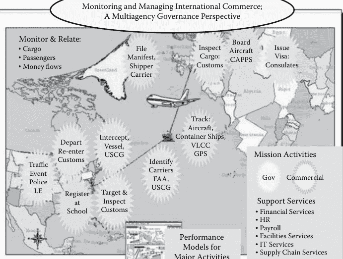

11.1 ESE 表征定义了国际商业中多机构任务的端到端活动序列，包括对全球商业的所有政府和商业方面的监控，并指出了两个可能的“拦截事件”（重印自 K.C. Hoffman, T. Pawlowski, D. Payne, and K. Zheng, International Enterprise Distributed Object Computing (EDOC) Workshop, IEEE Computer Society. © IEEE 2005. 经许可。）

每个活动都是单个机构或私营实体的责任，必须通过有效的信息共享（在安全和隐私限制范围内）进行协调，以满足促进经济增长同时保护国家免人员和货物非法入境的总体目标。企业要素对多机构任务参与者所执行的活动提供了完整描述。GIS 可用于说明涉及洲间货物和旅客流动的端到端活动。国际贸易企业的状态空间描述符包括：

- 源-地模式和模式组合
- 交付货物数量（实物和货币术）

# 254 企业动态源性手册

- 供应链库存
- 时间、从源头到目的地的总时长、入境处理
- 企业组织：企业数量以及集成或合并的水平
- 投资分析的成本和价格信息及预测
- 供应链每一步所需的劳动力、能量和其他资源量

供应链由出口商、运输商和进口商使用物流管理方法直接控制。条形码和射频识别（RFID）技术在集装箱和产品上无处不在，并实现了从源头到目的地的货物跟踪。影响企业状态演变的控制参数包括：

- 对承运人、传感器技术以及供应链系统和软件的投资水平
- 组织变更
- 供应商和消费者地区影响贸易模式和投资的政策变化

管理货物入境的政策由国家政府控制，用于征收适当关税并检查食品农产品，并受危险材料运输的额外当地法规限制。政府还监管具有国家安全影响的关键技术的贸易。行业和政府必须应对的主要风险和不确定性包括事故、灾难、盗窃和恐怖主义。

## 11.5 转型策略

为跨国贸易系统开发并实施以网络为中心的信息管理和通信技术。网络概念涵盖必须实时交互的组织，以及提供情境感知的数据管理和通信技术。案例研究为企业转型计划和管理以及商业贸易运营提供了概念验证。

多机构任务从组织和技术角度来看都极具挑战性。它们需要执行经理、运营经理和工程经理的共同努力。这在高度网络化的多机构运营——即网络中心企业中尤为关键，因为这需要组织和政策层面的协调，以及信息通信服务的业务互操作性。

# 国际贸易与商业 ■ 255

可以集成并受益于 ESE 工作台范围和内容的特定规划与管理功能包括以下几项：

- 战略规划
- 性能规划
- 运营管理
- 工程管理
- 信息系统规划与管理
- 培训

ESE 工作台支持“假想的”多机构治理环境目标，该环境基于单个机构的能力，实现战略规划、技术管理和运营管理的紧密耦合。工作台方法侧重于任务活动，能够有效应对实现这一目标过程中的复杂性和挑战。它为多机构环境下技术和任务活动的现代化以及成功的计划协调和管理提供了必要的综合系统。

对于现代化计划和运营都有许多可选的管理方案。无论选择何种方案，实现成功的多机构治理都需要一个在全面信息基础上运行的稳健治理结构。基于架构的治理方法可以解决复杂性以及许多组织问责和控制问题。这种方法确保了日常管理任务跨多个机构整合，并对战略方向和分配的责任做出响应。

定义所需的组织和技术互操作性水平是多机构任务的一个主要因素。互操作性水平取决于特定任务，并在执行的特定活动之间可能不同，而且一直是分配责任和问责的重要因素。具体而言，信息共享水平以及问责、信息质量、隐私和安全的规定与所需的组织和技术互操作性水平密切相关。

## 11.6 ESE 分析方法

已经开发并采用了许多管理和工程工具及方法用于企业规划和分析的特定方面。通过调研并选择了一组工具组成集成的 ESE 工作台，以应对国际商业中复杂的多机构运营环境。该工作台实现了基于 Web 的企业规划和


# 企业动态手册

这种管理方法使决策者能够直视化地规划企业的未来状态和运营性能。通过这套集成规划工具集和支持 Web 的功能，用户可以轻松深入到 ESE 工作台主要元素的低级细节，包括以下内容：

-   企业架构：提供关于企业任务运营、组织、活动、流程、服务和组件技术的信息。
-   业务流程模拟模型：用于业务运营的离散事件模型，对业务运营进行表示和衡量，以及执行企业任务或向公民提供服务所需的支持服务和资源。
-   地理信息系统 (GIS)：用于描绘运营在空间、环境和人口统计维度的特征。
-   规划信息通用存储库：确保工具集中信息内容的一致性，并利用服务和语义技术集成工具与方法。

该工作台实现了一种性能规划的“视线”（LOS）方法，即在模拟任务运营的语境下，对所有业务和信息资产、服务以及拟议的角色进行描述和分析。可以根据 Bunting (2005) 开发的方法，通过视线来衡量特定技术和服务的价值，分析它们如何有效地支持任务性能。ESE 工作台的核心元素如图 11.2 所示。

这七个元素按以下顺序启用：

-   1. 运营计划与场景：多机构任务的初始计划和运营场景为后续的模拟和架构步骤提供了重点和内容。计划和场景会根据使用 ESE 工作台其他元素（特别是性能分析能力）进行的分析结果进行更新。
-   2. 动态运营和系统性能模拟模型：采用过程模型通过以运营为中心的架构中的精确业务活动来模拟业务运营性能（见图 11.3）。物流链中的物理流和入境口处理可以进行性能建模，同时结合计算和通信系统进行容量规划、网络模拟和数据管理等支持信息服务。Payne、Hoffman 和 Zheng (2003) 开发了入境口性能模拟，用于分析货物处理动态，包括管理入境流量的人员和设备需求。信息服务与业务流程性能之间的关联通过运营级别协议 (OLA) 和服务水平协议 (SLA) 规范定义，这些规范作为选择系统、组件或管理商业服务的需求声明。

| 1. 运营计划与场景 | 4. 地理信息系统 |
| --- | --- |
| 贸易模式、政策倡议和经济场景的描述。 | 全球贸易源地节点、物流设施位置以及主要检查活动。 |
| 2. 动态运营模拟模型 | 国家-区域级 5. 性能仪表板 |
| 模拟物流和入境口管理到从源到目的地的供应链性能。 | 使用视线分析进行实时监控、性能评估和状态跟踪。 |
| 3. 以运营为中心的企业架构 | 7. Web 服务环境 6. 评估模型 |
| 表示复杂企业的所有维度，强调供应链活动、服务与流程、信息和物理基础设施。 | 表示物理连接、电信和提供信息并实现管理的 Web 服务。 |
| | 衡量私营部门和政府利益相关者在转型计划和运营中有效协作的能力。 |

**11.2 用于复杂多机构环境、州、地方和联邦环境中供应链运营转型规划与管理的集成系统工程 (ESE) 工作台的元素。**（摘自 K.C. Hoffman, T. Pawlowski, D. Payne 和 K. Zheng，收录于国际企业分布式对象计算会议 (EDOC)，IEEE 计算机学会。© IEEE 2005。经许可转载。）

信息服务使用分布式计算的容量规划工具、用于通信的网络设计工具以及传统的信息系统设计和模拟方法进行建模。所有任务活动、资源和资产均被描述。在这里，与案例研究中所述支持任务活动的机构、局级或商业实体的架构建立了显式关系。

*3. 以运营为中心的企业架构：* 图 11.3 整合了各个机构的企业架构和信息系统架构的适用元素（Zachman 1987）。企业层级、业务活动、服务、数据和技术由联邦政府（CIO Council 2001）和美国国防部（DoD 2003）发布的各种架构框架定义。最新的管理和预算办公室联邦架构模型（OMB-FEA 2003）提供了涵盖企业所有方面的描述性元素：性能、业务、服务和组件、数据和信息以及技术（基础设施）。以运营为中心的架构使用了这些类别，并对每个类别的结果进行了讨论。单个企业架构集成到以运营为中心的架构是由开展的关联活动驱动的。

以运营为中心的架构
- 表示在运营中执行的活动以及利用的信息服务
- 包含从机构资源中选择的数据和基础设施

# 任务活动

| 服务 |
| --- |
| 数据 |
| 技术 |

识别差距：
* 活动
* 服务
* 政策与计划
* 数据
* 基础设施

提取适用的活动与服务
选择数据和技术资源

| 活动 | 服务 | 数据 | 技术 |
| --- | --- | --- | --- |

- * 活动和具有具有语义“标签”*
- * 数据和基础设施技术与服务相关*
- * 使用带有参考模型的不同框架*

图 11.3 以运营为中心的架构，ESE 工作台的核心元素。（摘自 K.C. Hoffman, T. Pawlowski, D. Payne 和 K. Zheng，收录于国际企业分布式对象计算会议 (EDOC) 研讨会，IEEE 计算机学会。© IEEE 2005。经许可转载。）

以及多个机构为执行任务所采用的信息服务。这种架构方法将其架构中表示的机构计划与整体任务有效性和运营卓越性联系起来。

-   4. 地理信息系统：贸易运营是在广泛分布的全球范围内进行的。因此，运营、供应链、服务交付和资源位置的地理方面具有重要意义。使用 GIS 能够描绘所有物理资产和企业资源，以便多机构运营和智能分配。

-   5. 性能仪表板：性能仪表板描绘了多机构运营的所有地理和组织方面。它展示了模拟结果，以识别技术和治理能力方面的优缺点，以及组织职责和信息服务的差距或重叠。

-   6. 就绪评估模型：就绪评估模型是 Sowell (2005) 开发的一种结构化方法，用于定义和评估参与多机构运营的机构和私营部门组织达到性能所需的交互水平的就绪程度。五个级别为


定义，其范围从最宽松的要求（即机构仅需了解彼此在运营区域内的活动或在公民服务方面的活动）到最极端的情况（即需要联合管理和中央运营控制点）。

- 7. 网页服务环境——“企业中间件”和存储库：使用一致的定义来在 ESE 框架的所有元素之间及时共享适当信息，这一点是至关重要的。这通过使用一个用于规划信息的通用存储库结合 Web 服务技术来实现，这能够对跨企业的异构服务进行聚合和重塑。Web 服务技术为业务服务和任务伙伴提供了一个单一框架。

工作台中运的其他标准还包括用于 Web 业务流程执行语言（BPEL），以及使用资源描述框架（RDF）和网络本体语言（OWL）的语义服务。语义技术对于应用集成解决方案至关重要，因为它们提供了对数据的共同理解，并通过形式化多个组织和机构之间的应用语义来实现知识共享。BPEL 的使用为 ESE 工作台提供了额外功能，能够根据标准格式、元数据和一组通用符号来集成流程和业务（Payne, Hoffman, and Zheng 2003）。

在整套工具中应用一致的任务/业务活动和信息服务定义，并将其转化为可以嵌入企业资源计划（ERP）和其他管理系统的形式，这使得 ESE 工作台成为支持企业治理的主要型分析资产。图 11.1 显示了支持的企业治理的具体功能。

## 11.7 治理

这些治理建议侧重于“虚拟”联合计划办公室，以便在转型期间协调公共和私营的采购与管理活动。表 11.1 以架构格式为指南，总结了具体的治理角色和职责。还必须授权并问责，以完成角色、职责、权限和问责（R2A2）方法。托管服务的概念是该理念的核心，其中业务和信息服务与任务活动直接相关。特定的服务性能衡量和指标记录在 SLA 和 OLA 中。无论服务是由机构内部资源提供还是通过商业合同提供，这些协议都同样重要。

## 表 11.1 多机构任务计划办公室治理角色与职责摘要表

| 架构层级 | 治理角色 | 责任实体 |
| --- | --- | --- |
| 性能 (OMB-FEA) | 性能管理、性能规划、性能测量、现代化管理 | 联合任务主管、战略规划师、财务经理（机构 CFO）、技术经理 |
| 任务、业务 | 业务/任务管理、业务/任务规划：* 战略、* 战术、企业架构管理、EA 规划 | 任务经理（机构活动经理）、战略规划师（机构计划）、指挥中心经理、首席任务架构师、信息服务规划师（机构 CIO） |
| 服务、组件 | 托管业务和服务：* 信息服务管理、* 现代化计划管理 | 服务交付协调员（机构服务经理）、IT 现代化协调员（机构 CIO） |
| 数据和信息 | 托管数据服务：数据库管理 | 数据和信息协调员（数据服务提供商） |
| 技术 | 托管实用服务、基础设施管理 | 基础设施服务经理 |

Hamaker (2003) 强调了治理在重大项目中的重要性，无论是在内部管理还是作为托管服务包给外部。定义良好的角色和职责通过以下方式促进支持功能：

- 对在中央指导下执行的任务活动具有强有问责制
- 具有中央任务集成的虚拟支持结构，但支持支持资源和信息

以任务为中心的架构的应用是为了确定职责并管理问责制。如表 11.1 所示，职责与架构层级匹配，以确保在托管服务方法下的集成和协调。支持机构的职责在括号中注明。对于指示的角色和功能，责任实体是主要经理和用户；他们对规划材料的实时性负责。这些能力并非轻易获得。所有的架构元素都是详细系统工程分析和设计的对象。架构可以像这里描述的那样在治理中发挥重要作用，但根据特定多机构任务的要求对其范围和内容进行特定的补充。

最后，在任务运营的集成治理中使用架构需要架构产品和产物具有更高的特异性和实时性，以代表当前状况。该过程还需要访问架构和计划的内容，这是一项重大的技术挑战，目前正通过使用可扩展标记语言（XML）的语义服务及类似的先进技术进行研究。

## 11.8 结果与建议

针对选定业务过程进行的更详细活动和过程建模结果如下：

- 在单机构层面构建的企业级架构主要关注技术基础设施，以及任务和业务活动描述中的差距。这里描述的以运营为中心的架构使用了过程模型中模拟的活动，并识别出需要在参与机构之间以一致细节水平添加的特定活动。
- 识别了关键的组织交互，以及执行特定活动的参与机构之间角色和职责的重叠。这些可以在运营为中心的组织视图中解决。
- 跨机构采用用于执行类似活动的重复信息服务。性能模拟模型能够对重复服务进行比较分析，用于为某活动选择服务提供商，并衡量引入技术后带来的改进。

案例研究调查了运营为中心的架构和性能模拟中选定任务运营活动中的性能问题。来自公共来源的代表性数据提供了真实的 ESE 基准概念证明。分析结果不适用于任何特定国家、机构或地点。OMB-FEA 参考概述概述的将工作台应用到企业范围所有方面的一般发现和结果示例包括：

### 11.8.1 性能分析与管理

该多机构任务的现代化愿景被描述为一个协作环境，用于监控涉及美国和欧洲进出口国际贸易的所有方面。这包括政府系统以及私营部门供应链系统。单个过程模拟模型通过端到端的货物和旅客流序列链接，代表了每一步的吞吐量和成本性能以及整体流程序列。识别了由于峰值工作量、人员配备和其他资源限制导致的瓶颈。针对特定技术变化的选流程对新流程和信息服务带来的整体运营改进进行了估算。

图 11.4 展示了工作台在给定运营场景下执法“抓捕事件”运营中的应用，使用一种


用于描述应急响应反应的流程模拟模型，以及用于描述通信网络延迟和控制组织响应的决策过程的网络控制和决策过程层。在此图图中，决策过程的性能和技术基础设施表明，可以在特定的机会窗口内识别并捕获目标个人。此示例说明了 ESE 工作台架构工程方法在解决所采用的治理和决策模型中，性能管理相关的重大组织和系统方面的能力。任务性能所需的组织交互可以使用就绪性模型进行计划和分析。

图 11.5 以仪表板格式展示了业务的资源和性能评估。该仪表板截图的主要特征已突出显示。其目标是将参与机构和商业实体网络，以实现有效的组织协调以及信息共享。在这个示例中，所有机构都达到或超过了韧性目标，状态为绿色。

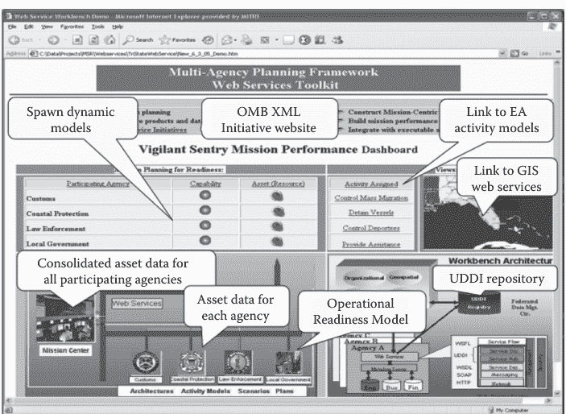

**图 11.5** 资源和性能仪表板：用于多机构任务运营规划和分析的 Web 服务工具包。（转载自 K.C. Hoffman, T. Pawlowski, D. Payne, and K. Zheng，国际企业分布式对象计算会议 (EDOC) 工作会，IEEE 计算机学会。© IEEE 2005. 经许可。）

## 11.8.2 任务/业务级

端到端活动序列中的主要任务活动已涵盖在集成 ESE 工作台环境中。这种集成方法用于计划和定义以下内容：

- 与迁移任务相关或与其相关的链接政府机构活动的完整表示（例如：商业供应链实践、进出口申请、船员或机组组人员的签证申请、港口检查和释放流程）
- 针对特定活动的组织角色、职责、权限和问责制
- 在特定工作负载下，每一步执行任务活动所需的资源（人员、技术和信息），以及潜在的重新分配区域或流程改进区域
- 与任务相关的活动与组织职责之间的差距或脱节（disconnect）
- 支持这些活动的服务、数据库和计算/通信基础设施，以及用于共享和集成数据的格式、协议和安全/隐私措施
- 用于性能建模和分析所需的大部分数据和信息的结构化架构信息。

## 11.8.3 服务与组件

业务服务（例如：案例管理、账户管理、财务管理、电子政府）和 IT 服务（例如：商业 Web 服务、数据和应用共享、通信、席位管理）已定义并与特定任务活动相关。OLA（运营水平协议）和 SLA（服务水平协议）定义了在使用现成或定制软件组件或作为商业可用服务时，支持任务性能的特定服务的特定需求。这种集成方法：

- 识别了与商业、乘客和财务账户相关的政府机构和商业托管服务
- 为集成相似的服务提供了基础，并识别阻碍集成的差距和连接问题
- 在开发采购策略（包括外包）时，为比较和选择最佳托管服务提供了基础

## 11.8.4 数据管理与支持性基础设施

定义的特定解决方案和组件包括 ERP 和客户关系管理（CRM）系统、数据存储和仓库、无线通信以及生物识别数据收集等技术和系统，以实施特定的业务和 IT 服务。这种集成方法：

-记录了政府机构和商业伙伴执行的数据管理和通信服务。
- 建立了数据共享策略，定义了数据管理的权限和问责制，并考虑了与隐私和安全相关的约束。
- 描述了支持特定任务活动所需的计算负载和通信带宽；识别出生物识别数据的检索与合成，以及相关货物和财务账户的负载最高。
- 指导了技术评估和现代化策略。

## 11.8.5 工具集成

案例研究中应用了几类可视化、信息管理和模拟工具。Web 服务企业中间件实现了数据共享和互操作性。

- 运营、流程、系统和网络模拟被联合，以提供环境、企业业务规则和企业信息基础设施的全面集成。联合模拟施加了现实世界的时依赖和约束，使企业能够进行资源分配和定位，管理实体之间的时空关系，并确定决策和指令过程的总时机。
- GIS 接口为规划者和模型提供了改进且更准确的地理空间位置。GIS 还可以提供影响规划工作和企业架构的丰富环境和人口统计信息。ESE 工作台进一步利用了两种由 MITRE 研究中心开发的技术：SimServer (Flournoy et al. 2005) 和基于 GIS 的模拟 SOGIS (Payne et al. 2003)，它们提供了一种近乎且通用适用的方法，为广泛分布的受众提供模拟结果。这对于引入州和地方机构伙伴以及触达中小企业的利益相关者非常有用。
- 元数据服务器包含元数据，使用 RDF 和 RDF Schema 进行描述。使用开源 Java 框架 Sesame (openRDF 2005) 对元数据进行存储、查询和推理，并翻译所有机构同意的特定于机构和模拟联合体的语法。这澄清了实体和动作的引用，并有助于融合不同演练者报告的观测结果。美国通用服务管理局 (GSA) 也应用了类似的方法，该机构正领导企业架构的本体论和基于 XML 的 Web 服务标记工作。GSA 的工作将有助于企业架构中信息的搜索和检索，并整合到以运营为中心的架构和业务流程模拟模型中。

## 11.9 结论

ESE 工作台包含并集成了描述任务运营、组织角色和职责、业务流程、企业资源，以及提高国际贸易等商业治理能力的服务和技术的基础工具。该工作台具有可扩展性和扩展性，使用 Web 服务企业中间件进行信息共享，并访问集成环境中其他企业工程和规划工具（例如：流程优化、资源分配、决策支持）。这些基础工具已在最复杂的跨机构环境运营治理中得到演示。它们同样适用于单个机构以及具有复杂运营和流程的商业运营。

在各自架构中代表的个人公司和机构的转型计划可以引入运营为中心的架构，以评估其在整体多机构任务中的有效性。架构和模拟性能模型中一致活动和服务定义的定义支持了基于活动的管理（ABM）概念（Player and Keys 1999），并可以在 ERP 系统中捕用于预算、监控和管理。

相比于 ESE 工作台的可行性和价值，更重要的是对于国际贸易等跨国多机构企业建立一个独立的计划规划和分析办公室的概念。本案例中假设的独立“设想”联合办公室是一个可行的概念，将为所有利益相关者提供建议价值。


Flournoy, R.D., Mikula, R.V., Weatherly, R.M., and Seidel, D.W. 2005. SimServer: Simulated data streams on demand via the Web. Presented at Simulation Interoperability Workshop at MITRE, McLean, VA, April.

Hamaker, S. 2003. Stationarity is dear: Information Systems Control Journal, 1. http://www.isaca.org/Journal/Past-Issues/2003/Volume-1/Documents/jpdf031-SpotlightGovernance.pdf

Hoffman, K.P.C., et al. 2008. Stationarity is dear: Whether water management? Science, 319: 573.

computing and information services in a multi-agency environment: A case study in enterprise-architecture. In International Enterprise Distributed Object Computing Conference (EDOC) Workshop, IEEE Computer Society.

Milly, M.C., 2003. OMB FEA (Office of Management and Budget Federal Enterprise Architecture). 2003. Reference Models for Enterprise Architectures (Draft), Performance, Business, Systems and Components, Data and Information, Technology (1 February).

openRDF.org.2005. Home of Sesame (14 July). http://www.openrdf.org.

Payne, D., Hoffman, K.C., and Zheng, K. 2003. Using interoperable process models in a multi-agency planning toolkit for enterprise and C4 architecture analysis. Presented at the Simulation Interoperability Workshop at MITRE, McLean, VA (September).

Player, S. and Keys, D.E. 1999. Activity-Based Management. 2nd ed. Hoboken, NJ: John Wiley & Sons.

Nowell, P.K. 2005. A readiness model for multi-agency interaction. MITRE Technical Report, McLean, VA.

Zachman, J.A. 1987. A framework for information systems architecture. IBM Systems Journal, 26(3): 276–292.

Zheng, K. and Hoffman, K.C. 2006. A service-oriented architecture in a multi-agency environment: A case study in enterprise dynamics. In International Enterprise Distributed Object Computing Conference (EDOC) Workshop, IEEE Computer Society.

## 第 12 章
能源与材料
作为企业的系统
系统工程
应用：经济基础设施的规划与分析

Bradley C. Schoener, Samuel G. Steckley, David H. Reid, Patrick B. Mahoney, Daniel B. Chamberlain, and Kenneth C. Hoffman

## 目录

- 12.1 引言...............................................................270
- 12.2 企业描述——材料与能源系统......271
- 12.3 企业转型挑战声明................................274
- 12.4 自然资源与材料系统表征................................275
- 12.5 转型转考察的策略与技术................................278
- 12.6 ESE 分析方法................................................................278
- 12.6.1 材料系统过程模型.......................................................278
- 12.6.2 与经济模型的关系...............................................279
- 12.6.3 集成 RMIS 架构...............................................281
- 12.6.4 向基础设施运营的过渡................................................283
- 12.7 分析结果与建议...............................................................283
- 12.7.1 参考材料信息系统的应用......283
- 12.7.2 材料与能源分析主题..................................................................285
- 12.7.3 材料与能源规划方法...............................................286
- 12.7.4 材料与能源系统及基础设施风险.....................................287
- 12.8 治理......................................................................................................289
- 12.9 结论...............................................................................................................289
参考文献..........................................................................................................................293

## 12.1 引言

本应用提供了一个大规模企业系统工程挑战示例示例跨越了国家经济中主要的材料和能源相关领域。其目标是说明一个用于自然资源规划、分析和管理的全面 ESE 框架。

一个国家的材料系统包含了用于基础设施的物理材料（如水泥、铁、铝、木材和塑料）的供应、转换和利用。从私人营利企业以及政策制定者和监管者的角度来看，需要关于材料需求、中小型技术、市场、价格以及所采用其他物理资源的可用且高质量信息。

本应用提供了一个大规模企业系统工程挑战示例，跨越了国家经济中主要的材料和能源相关领域。其目标是说明一个用于自然资源规划、分析和管理的全面 ESE 框架。

一个国家的材料系统包含了用于基础设施的物理材料（如水泥、铁、铝、木材和塑料）的供应、转换和利用。

本应用提供了一个大规模企业系统工程挑战示例，跨越了国家经济中主要的材料和能源相关领域。其目标是说明一个用于自然资源规划、分析和管理的全面 ESE 框架。

一个国家的材料系统包含了用于基础设施的物理材料（如水泥、铁、铝、木材和塑料）的供应、转换和利用。

本应用提供了一个大规模企业系统工程挑战示例，跨越了国家经济中主要的材料和能源相关领域。其目标是说明一个用于自然资源规划、分析和管理的全面 ESE 框架。

一个国家的材料系统包含了用于基础设施的物理材料（如水泥、铁、铝、木材和塑料）的供应、转换和利用。

本应用提供了一个大规模企业系统工程挑战示例，跨越了国家经济中主要的材料和能源相关领域。其目标是说明一个用于自然资源规划、分析和管理的全面 ESE 框架。

一个国家的材料系统包含了用于基础设施的物理材料（如水泥、铁、铝、木材和塑料）的供应、转换和利用。

本应用提供了一个大规模企业系统工程挑战示例，跨越了国家经济中主要的材料和能源相关领域。其目标是说明一个用于自然资源规划、分析和管理的全面 ESE 框架。

一个国家的材料系统包含了用于基础设施的物理材料（如水泥、铁、铝、木材和塑料）的供应、转换和利用。

本应用提供了一个大规模企业系统工程挑战示例，跨越了国家经济中主要的材料和能源相关领域。其目标是说明一个用于自然资源规划、分析和管理的全面 ESE 框架。

一个国家的材料系统包含了用于基础设施的物理材料（如水泥、铁、铝、木材和塑料）的供应、转换和利用。

## 12.2 企业描述——材料与能源系统*

一个国家的材料系统包含了用于基础设施的物理材料（如水泥、铁、铝、木材和塑料）的供应、转换和利用。

> * Hoffman, K.C. 1995. An Integrated Materials Information System for Infrastructure Planning. © 1995 Kluwer Academic Publishers: Journal of Systems Integration, 5(2): 91–105. 经 Springer Science+Business Media 慷慨许可再印。


# 272 企业动力学源手册

| 生产要素：（价格、数量） | 进口 | GDP： |
| --- | --- | --- |
| • 资本 | 国家或区域经济 | 私人消费 |
| • 劳动力 | 基础设施: | 公共消费 |
| • 信息 | • 建筑 | 投资 |
| • 材料 | • 厂房与设备 | |
| | • 运输 | |
| | • 水 | |
| | • 能源 | |
| | • 通信 | |
| | 环境影响 | |
| | • 空气 | |
| | • 水 | |
| | 土地利用 | |

**图 12.1 经济活动物理方面的高级表示，包括用于经济转型和发展的生产要素。（转载自 K.C. Hoffman, Journal of Systems Integration 5(2): 91–105, 1995。经许可。）**

在建设和维护物理基础设施时，能源系统有时被归类材料部门；然而，从数据库和分析模型的角度来看，能源系统分析已经相当成熟。另一方面，“材料系统”的概念并没有得到同等的关注，相关的子系统研究出现在 20 世纪 80 年代和 90 年代（Fischer-Kowalski 1998: Brunner and Rechberger 2004）。考虑到材料系统与国家或区域物理基础设施建设及维护之间的关系，现在是全面解决基础设施需求和材料资源。此处涉及的物理基础设施的主要要素包括住房、道路、铁路、管道、医疗保健设施、工业工厂、发电厂和炼油厂。图 12.1 显示了材料系统在经济背景下作用的高级视角。

物理基础设施的有效建设、运行和维护需要关注原材料的需求、加工能力以及以适合建设的形态进行交付。物流问题对于在正确的位置、以正确的形式和正确的质量安排适当供应的时机和调度方面也至关重要。物流规划和分析可以利用这里讨论的综合信息类型，但它们有几项超出此处概述范围的专门化要求。本章的重点是为基础设施项目规划以及相关的材料回收、加工和制造过程提供信息，以支持经济转型和发展。

# 能源与材料系统作为 ESE 应用 ■ 273

资本和信息是经济转型和发展的关键投入。这些是发展中的关键因素，对经济的成功规划、实施和运营具有强大影响；所需的能源和信息基础设施也需要经过仔细的规划和实施；Hoffman (1993) 描述了一种用于财务流程的信息架构。

人们对一个地区或国家资本账户的定义正给予越来越多的关注。资本账户将每年跟踪资本资产的公共和私人投资，并记录这些固定资产（包括物理基础设施）的安装额定价值。

尽管信息和通信部门对经济增长至关重要，并可能使用一些关键材料，但它们在建设和运行上并不密集。需要注意的是，尽管涉及的材料量较小，但环氧树工厂的一场火灾（Pollack 1993）导致了用于芯片级材料生产的停滞，产生了重大的市场影响。尽管如此，这里的重点是材料资源密集型基础设施的规划和实施，这需要能源和材料资源的可靠供应。

本章中描述的数据集成和建模方法遵循了在能源领域成功实施的路径（Hoffman, Doernberg, and Hermelee 1979; Kavanagh 1979）。布鲁克海文国家实验室、MITRE 公司、斯坦福大学、能源部、国际应用系统分析学院和欧洲共同开展了主要的能源系统活动。这些和其他活动汇总在 Kavanagh (1979) 编辑的论文集中。整个行业范围的能源规划和分析方法，包括能源过程模型与经济模型的整合，在 20 世纪 70 年代为了应对“能源危机”和能源机构责任的集中，在全球范围内得到了高度重视。

Lee 等人 (1990) 的书总结了从“能源危机”中汲取的教训，并概述了集成能源系统的系统方法。材料规划和政策方面没有类似的职责，也没有所谓的材料“危机”。尽管如此，有许多基础设施项目因为不符合经济系统而失败，或者因为能源或材料限制而变得不稳定。包括能源在内的限制条件，对于一个国家基础设施的成功规划、实施和运行也至关重要，并可以从集成规划和分析中显著获益。人们对支撑美国经济的关键技术和基础设施的战略性材料和资源给予越来越多的关注（DoE 2010; DLA 2011; Rogich et al. 2008）。鉴于对海外来源的依赖增加以及供应链的脆弱性，确保关键资源的供应显得尤为重要。

# 274 企业动力学源手册

# 12.3 企业转型挑战陈述

本案例研究设想的转型源于一种需求：以更可持续的方式利用自然资源生产增长经济所需的物理货物，同时解决水资源和潜在气候变化等环境问题。

《2007 年能源独立与安全法案》为美国能源系统概述了一系列转型目标，以增加美国的安全性。该法案的要素包括：

- 通过设定强制性的可再生燃料标准（RFS）增加替代燃料的供应，要求燃料生产商在 2022 年至少使用 360 亿加仑的生物燃料。
- 通过设定 2020 年每加仑 35 英里的国家级燃油经济标准，减少美国对石油的需求，这将燃油经济标准提高 40% 并节省数十亿加仑燃料。
- 要求联邦建筑在 2013 财年结束前所有通用照明使用能源之产品或部门联邦能源管理计划（FEMP）指定的产品。
- 更新《能源政策与保护法》，以设定新的家电标准，为美国人节省资金和能源。
- 在美国总务局建立高性能绿色建筑办公室（OHPGB）。

能源信息署（EIA 2007）必须衡量对能源供需平衡的影响。该法案还将对经济其他部门的转型产生重大影响，包括从农产品生产生物燃料、轻量化车辆复合材料、混合动力电池以及“绿色”建筑材料。对这些转型的分析需要对材料和能源系统及其相互作用具有广泛视角。反过来，农业影响将引发水资源、土地利用和重大的贸易问题。

经济还有额外的材料密集型需求，例如更换老旧基础设施，包括桥梁、管道和供水。欧洲共同体正将基础设施视为未来的投资重点。基础设施问题也是向市场经济转型的国家以及大多数发展中国家的重要因素。从全球视角来看，这些集体活动


# 能源与材料系统作为系统工程（ESE）的应用

这些系统深受监管政策的影响，这些政策会对材料市场以及企业和国家之间的竞争产生重大影响。在政策制定、计划规划和投资，必须分析并理解这些影响。

除了这些大规模且分布式的运营外；材料和能源系统的复杂性还包括以下挑战：多代理人的角色与职责；与投资规划相关的治理挑战；技术、政策和管理方法的工程与系统多样性；突发行为；安全考量；以及不断变化的存储和市场所带来的许多不确定性。Milky 等人（2008）指出“平稳性已经死亡”。他的话是指水资源管理，随着用水量增加到可用性受到所有当前天气变幻和竞争需求的影响的水平，但这一观点对于 ESE 需要解决的更广泛因素来说，适用性更强。许多系统工程工作假设某种程度的“平稳性”以简化问题，但对于 ESE 挑战而言，这种假设通常无法成立。在能源和材料领域，平稳性假设为常见，因为这些技术和系统具有很高的资本密集性，且对投资技术的寿命有相关的预期。

在这个复杂的运行空间以及多个组织层次中，需要 ESE 的视角，来表征和分析导致可持续经济和社会发展的决策及技术选择的影响。

美国经济这种重大转型涉及的资源和工业部门范围的扩大，要求所有利益相关者拥有改进的规划决策基础。本研究的具体目标是阐明并制定一个全面的信息系统——参考材料信息系统，并证明多个利益相关者利用它的潜力，以预测和评估替代政策、技术策略和解决方案，以及社会环境影响。这些能力将支持从事技术开发、采购以及材料/能源处理系统的实体和计划。

该应用中强调的系统及其复杂性的全面描述，是多个利益相关者进行规划和决策行动的重要基础。考虑到特定的角色和职责，可以根据需要引用其他案例研究中描述的决策方法理论。

# 12.4 自然资源与材料系统的表征

RMIS（参考材料信息系统）提供了一个全面的活动和过程描述（或价值链），描述了物理材料从资源提取步骤到生产材料形式所需的所有精炼和转换的流程。

| 供应 | 材料加工与运输 | 安装 | 终端使用部门 |
| :--- | :--- | :--- | :--- |
| 资源基础 | 提取、采收与运输 | 制造 | 产品识别 | 施工与维护、培训与出版、建筑与配送、化学品、包装、能源、运输、食品 |
| 材料流量（十亿千） | 回收 | 纸 | | |
| 森林和草地 | | 纸浆副产品 | 纤维、化学品 | |
| | | 贴面、木柱等 | 胶合板、板 | |
| 农作物 | 农业 | 食品 | | |
| | | 棉花 | 棉花 | | |
| 其他农业资源 | 椰子 | 燕麦、米 | 松节油与脂肪酸 | |
| 海洋资源 | 选矿 | 轧制和精整 | 颗粒、坯、板 | |
| 铁矿石 | 冶炼 | 回收和精整 | | |
| 铝矿 | 精炼 | | 板、道路、电线 | | |
| 砂、碎石 | | 水泥厂 | 混凝土、水泥 | | |
| 食品源： | 精炼/处理 | 石油化工 | | |
| 原油/天然气/煤 | 进口 | | 精炼油、气、煤 | | |
| 水 | 降、含水层 | | 总计： | |

**图 12.2** 参考材料信息系统，一个可再生和不可再生资源转换为用于物理基础设施成品材料的活动和流程模板描述（重自 K.C. Hoffman, *Journal of Systems Integration* 5(2): 91–105, 1995。经许可。）

可用于创建基础设施。这种方法应用于一项关于可再生资源替代石油产品材料用途潜能的国家研究（NRC 1976）。

RMIS 的范围和内容如图 12.2 所示，涵盖美国材料链的终端使用，最初由 Bhagat 和 Hoffman (1980) 为 NRC 研究开发。这种格式可以显示区域性或国家性的供需平衡。在规划和分析应用中，使用所讨论的各种系统工程方法和模型填充基准年数据并预测到目标年份。

在此详细程度上对系统的定义为价值链所有阶段的数据整合提供了一个全面的框架。参数提供了企业状态空间的关键要素：

- 关于可再生和不可再生来源位置、质量以及提取速率资源数据
- 关于提取、转换和处理材料的现有及建议技术数据，以及随时间引入的水平
- 用于投资分析的成本和价格信息及预测
- 材料链中每一步所需的动力、能量和其他资源数量
- 成品材料之间特定的利用和替代模式，以及其用于基础设施适当元件的属性
- 对能源服务的需求水平以及采用的能源形式组合
- 政策激励和激励措施，如法规、拨款、补贴和税收
- 过程中每一步的特定环境因素和水平，例如土地利用、废水以及向大气和水体的排放，以及控制技术的规范及其成本

RMIS 中的每个活动环节都由流量参数、处理或转换效率，以及一组成本、劳动力和能量需求的系数，以及单位产量的空气和水体排放和土地利用来表征。在这一整体区域或国家平衡中必须指定地理位置。关键或昂贵的材料（如用于合金的钴和铬、铂或钯催化剂等）可以作为与活动相关的系数表示。

影响企业状态演变的控制参数包括：

- 研发技术水平
- 技术和系统的投资水平
- 组织变革
- 影响模式和投资的政策变化

在使用历史数据完成基准年分析后，预测可以与经济增长趋势和规划目标保持：

- 基础设施发展模式
- 资源需求
- 资源和成品进出口模式
- 资源和材料加工瓶颈
- 回收机会
- 土地、水资源和环境排放
- 资本和运营成本

特定研究应用的企业状态空间和控制参数取决于研究目标。参数将根据需要精确地选择和定义，并在需要时考虑区域依赖性以解决直接感兴趣的问题。无论如何选择，越全面的企业参数越是隐含，在定义假设时必须予以考虑。这有力地证明了应该开发一个更强调物理特征（如 RMIS 那样）的非常全面的企业表征，一个全面的信息基础。


## 12.5 转型中所审查的策略与技术

参与自然资源供应、加工和使用的个人及机构会根据需求和监管政策做出决策和投资，这些因素驱动了材料和能源系统的转型。这种转型旨在提高工业和国家经济的水平，并必须应对平衡经济社会发展与可持续资源利用以及环境挑战的国家和全球政策。决策和行动通过政府倡议进行协调，但往往出于当地原因而独立采取，这增加了复杂性。

对于材料和能源系统的转型，有许多替代技术和策略方案可用。无论选择何种方案，实现理性政策都需要一个在全面信息基础上运行的稳健治理结构。基于架构的治理方法有助于解决复杂性以及出现的许多组织问责和控制问题。这种方法确保了决策过程跨多个机构进行整合，并对战略方向和分配的责任做出响应。具体而言，信息共享水平以及问责、信息质量、隐私和安全的规定与决策过程和监管政策密切相连。

## 12.6 ESE 分析方法

可以使用地理信息系统（GIS）显示对材料和能源系统的物理方面进行分析，包括工厂址、材料运输流和排放地图。国际应用系统分析研究所（IIASA）利用这些数据展示和建模方法开发并应用了一套全面的区域环境模型（Brouwer 等人 1991）。

针对特定用途的更详细的 RMIS 过程描述如图12.3 所示（Schoener 等人 2008）。图中显示了从农业原料到作为车辆燃料的乙醇的端到端物理流。描述了土地、化肥、能量和资本的投入，以及对应于空气、土地和水的燃料、副产品和废水的输出。

## 12.6.1 材料系统过程模型

RMIS 的过程结构直接映射到离散事件模拟模型和大规模优化模型。过程模型的优势包括：

- 能够以物理形式表示材料流、劳动力和其他因素
- 对提取、转换和加工特定技术进行表征
- 符合科学和工程定律

### 作为 ESE 应用的能源和材料系统 279

| 种植、提取 | 原料运输 | 初加工 | 运输至分销地 | 分销 | 最终用途活动 |
| :--- | :--- | :--- | :--- | :--- | :--- |
| 投入：土地（英亩） 种子 化肥 水 能量 | 其他投入：能量 车辆 | 其他投入：能量 水 资本 | 其他投入：能量 卡车 管道 | 其他投入：能量 资本 | 其他投入：车辆组合：1-C 发动机机 燃料电池 混合动力 |
| 主要产品：农业原料 玉米、秸秆、芒草、森林残渣 | 主要产品：运输英里 | 主要产品：乙醇 | 主要产品：运输英里 | 主要产品：气乙醇混合物 | 主要产品：运输英里 |
| 排放/副产品：氮流失 | 排放/副产品：CO2，其他 | 排放/副产品：DDGS 废水 CO2，NO2 | 排放/副产品：CO2，其他 | | 排放/副产品：CO2，其他 |

**图 12.3** 从农业原料生产乙醇的物理投入-输出流模型。

可以根据特定的规划和分析应用适当使用过程工具。其局限在于缺乏估计市场需求关系的基础，因此需要补充的经济模型。

## 12.6.2 与经济模型的关系*

图 12.4 显示了物理过程流模型与宏观经济规划方法之间存在直接且自然的联系。可以建立具有合理部门细节（例如超过10个部门）的宏观经济模型，以人口统计、财务和政策因素为函数，解决材料和能源基础设施的物理需求。

已采用多种方法对材料和能源进行经济分析，使用计量经济方法、线性规划、投入产出、动态模拟和系统动力学。每种方法都为问题提供了独特的视角，并在特定的规划和分析问题中具有相对优缺点。

计量经济方法在所捕捉的经济关系范围和完整性方面具有优势，但受到历史数据形式和可用性的限制。

> Hoffman, K.C. 1995. An Integrated Information System for Infrastructure Planning. Kluwer Academic Publishers: Journal of Systems Integration, 5(2): 91–105.经 Springer Science+Business Media 许可再印。

| 原材料进口 | 成品材料进口 | 成品进口（内含材料） |
| :--- | :--- | :--- |
| 资源基础 | 材料加工 | 对成品的基础设施需求 |
| • 铁金属 | 系统 | 国家/区域经济 |
| • 非铁金属 | GDP | 材料系统 |
| • 碳烃 | 生产能力 | 投资 |
| • 可再生 | 项目 | 输出基础设施 |
| | 库存 | 政策 |
| 原材料出口 | 成品材料出口 | 成品出口（内含材料） |
| | （价格，数量） | |

| 数据与模型 | | |
| :--- | :--- | :--- |
| 材料资源数据 | 参考材料系统 | 国民经济核算数据 |
| 能源资源数据 | 宏观经济模型 | 投入产出模型 |
| 可再生材料数据 | 系统优化 | |

**图 12.4** 资源基础、材料加工以及最终用途基础设施，及其与国家和区域经济发展底层物理基础设施的关系。（转载自 K.C. Hoffman, Journal of Systems Integration 5(2): 91-105, 1995. 经许可。）数据。供需模型也可能受到价格-数量关系历史范围的限制。当价格-数量关系由于外部事件、冲击或特定行动突然变化时，计量经济模型可能失效。线性规划过程方法在捕捉具有物理和经济基础的大量技术和财务数据方面非常强大，但在可能表示的经济和行为关系范围方面存在局限；这种缺陷可以通过结合计量经济和线性规划方法来克服。这种方法在能源-经济关系模型中得到了证实（Hoffman and Jorgensen 1977），在该模型中新技术的引入和能源价格的变化在过程模型中进行测试，宏观影响在计量经济模型中进行估计。

组合规划-计量经济模型系统能够以显式方式表示材料和资源利用特定的结构和技术变化，同时保留计量经济方法捕捉的整体经济和行为关系。

动态模拟和系统动力学方法为材料分析提供了互补工具；然而，由于数据限制和在表征价值-环境相互作用方面的分析弱点，存在误用模型的案例。尽管如此，考虑到 RMIS 所代表的详细的良好数据，并且具有科学上有效的关系，这些方法是可以很有用的。这些方法在区域能源和资源规划中有许多应用实例（Zhen 1991; Assimimakopoulos 1992）。


# 作为 ESE 应用的能源与材料系统 281

## 计量模型中的行业间交易

部门输入：

| | 1 | 2 | 3 | 4 | 5 | 6 | 7 | 8 | 9 | 10 | 11 | 12 | 13 | 14 |
|---|---|---|---|---|---|---|---|---|---|---|---|---|---|---|
| 1 | | | | | | | | | | 生物燃料与水 | | | |
| 2 | | | | | | | | | | 部门 | | | | |
| 3 | | | | | | | | | | | | | | | |
| 4 | | | | | | | | | | | | | | | |
| 5 | 行业间 | | | | | | | | | | | | | | |
| 6 | 交易 | | | | | | | | | 最终 | | | | |
| 7 | | | | | | | | | | 需求 | | | | |
| 8 | | | | | | | | | | | | | | | |
| 9 | | | | | | | | | | | | | | | |
| 10 | | | | | | | | | | | | | | | |
| 11 | 初级投入 | | | | | | | | | | | | | | |
| 12 | | | | | | | | | | | | | | | |
| 13 | 总投入 | | | | | | | | | | | | | | |

- 行业部门：
  1. 农业、非流体采矿业与建筑业。
  2. 制造业（不含石油炼化）。
  3. 运输业。
  4. 通信、贸易与服务业。
  5. 煤炭矿。
  6. 原油与天然气。
  7. 石油炼化。
  8. 电力公用。
  9. 天然气公用。
- 初级投入：
  10. 进口。
  11. 资本服务。
  12. 劳动力服务。
- 最终需求：
  10. 个人消费支出。
  11. 国内私人部门总投资。
  12. 政府对商品和服务购买。
  13. 出口。
- 受影响的行业
- 进口/出口
- 核能
- 可再生能源

经济中的 16 至 320 个部门

### 图 12.5 经济投入模型，增加了生物燃料和水部门的行和列。

显而易见，没有任何单一模型或方法可以处理即使是中等复杂度的所有资源规划和分析问题。显而易见的是，建模往往落后于支持模型的数据；因此，本章重点关注集成材料信息系统（IMIS），它代表了详细过程中的物理数据和财务数据。

资源管理信息系统（RMIS）与经济模型之间的潜在联系包括图 12.4 所示的行业间产出（I–O）模型和宏观经济模型。图 12.5 显示了在 I–O 模型中概念性地增加生物燃料和水部门的情况。

## 12.6.3 集成 RMIS* 的架构

RMIS 为资源利用、加工能力与流量以及用于建设和运行物理基础设施的材料终端提供了一个全面的框架。该框架还整合了成本、劳动和环境系数。供应链中各个阶段材料供应、利用和库存的当前统计数据应与组成 GDP 统计的所有部门的国家账户结合维护，这是一种物理国民账户。

> Hoffman, K.C. 1995. Kluwer Academic Publishers: Journal of Systems Integration, 5(2): 91–105. 经 Springer Science+Business Media 许可转载。

## 282 企业动态源数据手册

政府、私营部门和大学的分析师可以制定更长期的材料流场景，用于政策制定、市场规划、计划选址或其他目的。

物理账户数据可以维护在现代关系型数据库中，以便进行通用访问和即时报告生成。关系型数据库可以是分布式的，这样维护数据的责任根据情况分配给私营部门公司、公用事业部门和公共部门机构。

全功能 GIS 可用于访问、显示和分析结果。大多数商业 GIS 与关系型数据库有良好的链接。它们还可以使用面向对象的数据库来处理有关主要设施或其他实体的数据。此类最先进的 GIS 应用已由国家或地方机构开发，用于资源映射、农业和土地规划；以及用于公用事业设施、管道、输电线和其他基础设施的自动制图/设施管理。材料数据库、GIS 与构成 IMIS 的材料之间的关系如图 12.6 所示，并具有适当的数据交换、建模和预测链接。

| 生产数据 | 加加工设施数据 | 成本和劳动数据 | 环境数据 |
| --- | --- | --- | --- |
| * 产能 | * 产品 | * 人员 | * 气排放 |
| * 技术 | * 位置 | * 资本成本 | * 水排放 |
| * 库存 | * 产能 | * 运营成本 | * 盐废 |
| * 影响 | * 技术 | * 材料 | * 土地利用 |

| 资源基础 | 地理信息系统 | 终端用途基础设施项目 |
| --- | --- | --- |
| * 化石能源 | | * 住房 |
| * 可再生 | | * 服务 |
| * 矿物与金属 | | * 公用事业（水、气、电） |
| * 位置 | | * 商业 |
| * 质量 | | * 工业过程 |
| * 数量 | | * 水 |
| | | 交通 |

| 资源提取 | 加工与转换 | 终端用途 | 宏观模型 |
| --- | --- | --- | --- |
| * 资源基础 | * 效率 | * 能源 | * 活动 |
| * 生产 | * 产能 | * 设备 | 人口统计 |
| * 成本 | * 成本 | 标准 | 就业 |
| * 影响 | * 成本 | 出口 | |
| | | 价格 | |

图 12.6 集成 RMIS 的架构，具有适当的数据交换、建模和预测链接。（转载自 K.C. Hoffman, *Journal of Systems Integration* 5(2): 91–105。许可。）

## 作为 ESE 应用的能源与材料系统 283

### 12.6.4 转型到基础设施

本章概述的数据和方法适用于资源规划、基础设施开发和运营。大多数 GIS 系统适用于：
- 资源提取
- 配置
- 设施配置
- 运营状态
- 基础设施开发

  12.7 分析结果

### 12.7.1 材料系统的应用

本章概述的经济模型和方法已应用于从产品选择到资源规划的各种研究。RMIS 的最初目的是为了支持多个委员会提出的替代石油原料的技术和经济特征。RMIS 系统被成功地作为集成框架用于促进可再生资源的使用。

> Hoffman, K.C. 1995. Kluwer Academic Publishers: Journal of Systems Integration, 5(2): 91–105. 经 Springer+Business Media 许可转载。

## 284

| 供应 | | | | | | 终端用途 |
| --- | --- | --- | --- | --- | --- |
| 资源基础 | 提取、采收 | 加工 | 运输 | 中间识别 | 制造 | 附加 |
| 天然气 | | | | | | |
| | | | | | 制造 (0.45) | 瓶 |
| (22, 1.07)（质量，能量含量） | (20, ->) | | (60, ->) (0, .16) | 树脂 | (54, 20) | 瓶 | (54, 22) |
| 原油 | | | | | | 回收 |
| (55, 2.47) | (50, ->) | | | | | |
| 森林资源 | 木材 | 浆与造纸 | 包装纸 | 容器制造 | 填充 | 1/2 加仑瓶 |
| | (130, 1.5) | (78, 42) (0, .10) | 条目：（流量（克），能量需求（焦耳）） | | (64, 3.39) | 回收 |
| 石灰岩 | | | | | | |
| | 碳酸 | (15, ->) | | | | |

**图 12.7** 针对食品容器材料替代的 RMIS 流图和数据。（转载自 K.C. Hoffman, *Journal of Systems Integration* 5(2): 91–105, 1995。经许可。）


## 作为 ESE 应用的能源与材料系统

## 12.7.2 材料与能源分析主题

材料信息系统的特定规划和分析应用取决于许多因素，包括经济的政治组织形式和发展阶段，以及区域文化和习俗。物理基础设施和支撑材料系统的规划与分析的总体目标是协调系统中所有活动的扩张和改进项目，以识别并评估所需的资本和运营投资，从而减少或消除整个供应、加工和最终使用链中的瓶颈和中断。投资必须与计划的项目计划紧密结合，且政策环境应致力于为整个链条上的工业和工程公司提供适当的激励。

重点是基础设施扩张项目的协调规划。类似的目标也可适用于运营阶段，IMIS 提供的系统概念也可以增加适当的物流管理方法后应用于该阶段。概述了与各种类型经济体最相关的特定政策优先级。列出的几乎每一个问题都可能出现在发展的任何阶段，但优先顺序可能会有所不同。

成熟市场经济：
- 土地利用标准和分配
- 基础设施的维护需求和投资
- 定义加工链中适当步骤的关键材料及其形式
- 本地和区域的环境影响，以及对全球关注问题的贡献
- 区域就业机会和培训需求
- 研发优先级

向市场经济转型：
- 支持经济转型的关键基础设施的提供与维护
- 适用的私有部门和转型时机
- 本土资源的生产性利用
- 转型期间的材料定价
- 材料系统和基础设施对经济和政治冲击的可持续性和韧性

> Hoffman, K.C. 1995. An Integrated Materials Information System for Infrastructure Planning. © 1995 Kluwer Academic Publishers: Journal of Systems Integration, 5(2): 91–105. Reprinted with kind permission from Springer Science+Business Media.

## 286 企业动态手册

发展中经济：
- 本土资源的生产性利用
- 支持经济转型的关键基础设施的提供与维护
- 预算和财务计划与物理建设活动的协调
- 采用材料和技术对发展路径的长期影响
- 材料系统和基础设施对经济和政治冲击的可持续性和韧性

材料政策必须采取生命周期方法。资源、加工和利用政策不应仅基于初始成本；必须考虑维护、更换和处置成本。

## 12.7.3 材料与能源规划方法论*

图 12.8 概述了针对发展中经济体特定案例基于 RMIS 和 IMIS 的材料资源规划方法论。该方法的特征（Hoffman and Basile 1982; Hoffman and deTerra 1984）涉及三个基本要素：

1. 基于对某地区或国家整体经济的分析（包括特定的开发项目）对材料需求进行估算。这种关联可以在汇总层面建立，但在定义了计划的预期建设活动和开发项目时，优选采用细分化方法。
2. 由 IMIS 提供的综合信息框架。
3. 分析模型，包括：
- 经济预测模型。
- 建设计划。
- 资源配置和优化模型。

这种顺序规划方法的逻辑是清晰的。一个关键步骤是项目定义，其中：(1) 识别特定项目以消除预期的开发瓶颈（例如，增加水泥产能）；(2) 识别能源需求（例如，建设或补充电厂产能以满足材料加工需求）；以及(3) 识别特定的培训劳动力需求。定义项目对供需平衡的影响会导致财务计划和实施计划。需要返回项目定义步骤进行迭代，以添加、删除、重定向项目并设定优先级。

## 作为 ESE 应用的能源与材料系统

| 步骤 | 步骤 | 调整计划 |
| :--- | :--- | :--- |
| 分析发展计划和人口统计 | 1 | |
| 组建材料信息库 | 2 | |
| 材料需求预测与资源评估 | 3 | |
| 项目定义 | 4 | 添加/删除项目 |
| 供需平衡 | 5 | 修改平衡 |
| 关键问题和政策识别<br>- 进口<br>- 资本<br>- 劳动力<br>- 定价<br>- 风险<br>- 不确定性 | 6 | 确认政策 |
| 项目筛选标准<br>- 成本<br>- 外汇<br>- 环境 | 7 | |
| 投资优先级、计划和策略 | 8 | 计划迭代 |
| 资源计划、项目和政策 | 9 | |

**图 12.8** 资源开发、材料加工和基础设施项目规划与分析的方法论。（转载自 K.C. Hoffman, *Journal of Systems Integration* 5(2): 91–105, 1995. 经许可。）

> * Hoffman, K.C. 1995. An Integrated Materials Information System for Infrastructure Planning. ©1995 Kluwer Academic Publishers: Journal of Systems Integration, 5(2): 91–105. Reprinted with permission from Springer Science+Business Media.

## 12.7.4 材料与能源系统及基础设施风险

风险是所有材料系统和基础设施项目中固有的特征，是规划和实施阶段以及后续运营中必须解决的要因素。Haefele (1991) 就能源领域的风险以及能源系统分析主题发表了大量论文；这与整体系统有许多共同点。风险的程度取决于所采用的技术（稳定的、新兴的、新的）以及材料系统和市场的稳定性。主要的风险类别概述如下。理想状况用作说明规避措施的示例，但在实践中从未完全实现。

政策和商业风险：公共政策通常反映了平衡经济发展与环境、健康安全的利益和偏好。政策还必须为投资提供清晰且稳定的环境。私营部门在工业中的政府伙伴关系必须对所有材料系统活动进行定义和理解。

资源风险：材料资源必须能够支持材料和基础设施项目的整个生命周期，并满足这些资源的需求。建设和运营的资金资源必须到位并有长期承诺。必须有可用的人力资源，或必须实施培训计划以确保劳动力供应。

项目风险：项目目标必须明确定义，规划必须整合，以确保执行项目的材料、能源和劳动力。设计和运行要求必须稳定。进度延迟的可能性超出每个项目。产生的风险远大于项目进度延迟的简单总和，因为受到材料系统其他部分相关项目之间连锁效应的影响。承包商必须对开展的项目具有相关经验。

技术风险：必须采用成熟的工艺技术以减少技术风险。组件过时和老化会导致技术组件无法达到预期或规格而限制性能。必须建立维护和升级计划以确保持续运行。单个项目的性能很重要；但所有相关项目和活动必须执行以实现整体目标。用于过程控制的信息系统始终存在风险。计算机应具有容错能力，并可采取其他备份措施以确保数据和控制应用程序的可靠性。必须提供可靠的通信系统，并在停电期间提供应急电源。任何软件在类似应用中应具有先验经验，且软件应有完整的文档。

健康和安全风险：环境影响评价是识别健康、安全和环境风险的最佳机构机制。这些风险必须在局部、区域以及在某些情况下在全球的背景下进行考虑，以识别潜在影响和限制因素。


作为 ESE 应用的能源与材料系统 ■ 289

## 12.8 治理

Hamaker (2003) 强调了治理对于重大计划的重要性，无论是由政府机构还是私营部门管理。政策研究和分析必须在适当的层次范围内解决特定的利益相关者责任。定义良好的角色和职责可以通过以下方式促进功能实现：

- 对在地方和中央指导下执行的任务活动具有强有问责制
- 建立虚拟支持结构，具有中央任务集成，但支持资源和信息是分布式

企业级模型的应用可以支持利益相关者的现实和问责制。表 12.1 显示了责任与私营部门和公共实体的层级相匹配。并注明了支持机构的责任。对于所示的规则和功能，负责实体是主要经理和用户；他们也对其规划材料的实时性负责。

这些治理要素的协调并非易事。所有的技术要素都是详细系统工程分析和设计的主题。架构师可以像此处描述的治理中发挥重要作用，但需要根据特定规则和目标的要求，对其范围和内容进行特定的补充。RMIS 为协调所需的信息提供了支持。

在能源系统的情况下，美国能源部能源署（EIA）有立法责任维护当前数据并对未来能源供应、需求和价格做出预测。巴黎的国际能源署在全球范围内收集类似信息。这些信息源和预测被所有方使用。私营部门有自己的信息源和展望，并在业务和投资计划中将其与政府来源结合。

材料和自然资源信息的责任分散在多个机构（美国地质调查局、内政部和商务部）；综合集成信息库是现代社会非常需要的能力。

## 12.9 结论

RMIS 包含并整合了描述自然资源供应和利用物理及经济方面、组织角色和责任、业务流程、企业资源，以及改进能力和支持这一复杂企业治理所需的信息服务和技术。在物理材料活动、流程和流的表示方面存在主要的数据缺口。这些信息在政策分析定义效率和环境参数时至关重要

## 表 12.1 材料与能源系统治理角色与责任总结

| 功能层级 | 治理角色 | 负责实体 |
| :--- | :--- | :--- |
| 自然资源管理 | 政策制定、监管、资源开发 | 政府（地方和联邦）；私营部门 |
| 需求部门 | 消费者支出 | 公共 |
| 消费者需求 | 产品安全 | 政府 |
| 公共工程 | 公共投资 | 政府（所有层次） |
| 政府运营 | 政府需求 | 政府（所有层次） |
| 系统开发与运行 | 开采、加工与转换、交付（管道、电网）、规划 | 工业、公用事业和生产者；公用事业、独立系统运营商 (ISO)、区域传输组织 (RTO)、联邦能源监管委员会 (FERC) |
| 系统服务、组件与技术 | 材料、能源 | 工业 |
| 研究 | 短期；长期、高风险 | 工业；国家实验室、政产学合作 |
| 数据与信息 | 资源基础、系统 | 政府（USGS, USDA, DOI）；政府（DoE）；工业、公用事业 |
| 技术选择 | 公用事业管理 | 公用事业、工业 |

作为 ESE 应用的能源与材料系统 ■ 291

在政策分析中，不能忽略效率和环境参数的定义。对关键因素制定出粗略估计并对其进行敏感性分析，远比为了构建“经过验证”的模型而忽略它们要好得多。

使用 Hoffman (2011) 发表的方法对 20 世纪 70 年代早期长期能源预测进行回顾性验证表明，这些方法在捕捉能源效率机会（导致能源需求增长率降低）方面具有很强的描述能力。这些方法也具有显著的预测能力，当然，这很大程度上取决于进入分析的假设。

国家或地区物理基础设施开发和维护对于成功的经济转型和市场经济的发展至关重要。成功的市场经济依赖于当地资源市场和加工能力、库存的高质量信息的自由流动。目前的重点大部分在金融市场数据上；而关于产量、库存和成品的物理数据获取较少。对多年多年统计摘要的审查表明，RMIS 所需的材料供应和成品所需的大部分数据需要推导；加工和库存参数必须基于更彻底的分析和协调。特别是：

- 国家账目和统计应解决私营部门市场和政府机构对材料物理数据的需求。
- 必须采用集成规划方法，以确保项目在整个系统背景下是行的，并识别所有潜在风险。
- 系统方法论可以揭示市场数据中的不一致和不平衡，项目的所有参与者必须理解这些问题。
- 应在贸易伙伴之间开发并公布材料系统物理核算的统一方法。

项目和政策往往由于运输、能源、水利和通信基础设施的缺陷而失败。其中许多必须被视为“系统失败”，这表明系统配置、容量和瓶颈必须由私营和公共机构定义和管理。例如：

- 必须定义物理基础设施，并使用系统方法发布其配置和要求。
- 应识别基础设施开发和运行的所有关键劳动力、材料和能源需求，并跟踪其市场。

在定义和评估阶段，必须对计划和拟议项目分析所有相关的材料系统参数，包括：

- 物理材料流
- 劳动力需求
- 战略材料需求
- 生命周期影响
- 贸易影响
- 全面实施对环境的影响

还可能分析资源配置和加工技术实施长期后果。当项目规模巨大、在多个地区实施或涉及供应前景不定的关键材料时，分析范围可以从国家或区域关注扩大全球市场关注。应确保：

- 所选项目和大规模实施路径在长期内是可持续的。
- 识别并估计从建设到运行、关闭和拆除的整个生命周期的替代方案成本、需求和影响。
- 识别外部性（例如环境、贸易和劳动力影响）。
- 通过先进的信息和通信技术促进 IMIS 的访问和可用性。
- 数据应以关系型和面向对象的格式组织，以确保访问的稳定性，支持临时报告和分析。
- 应提供地理界面以便访问和分析。
- 系统仿真或带动画的优化是可能的，并应使用以使信息有助于政策制定和决策。
- 材料系统模型应与经济政策相结合

地球的物理材料资源与潜在劳动力一样巨大。存在广泛的加工和建设技术，包括适应当地环境的小规模技术。同时，世界人口对舒适、生存和安全的需求几乎是压倒性的，存在许多痛苦和紧张。基础设施和支持材料供应系统是满足……的重要因素


## 能源与材料系统作为 ESE 应用 293

需要。为了合理配置资源，这些系统必须在一个国家或地区的整体经济框架内运行，而这种经济往往受到储蓄和投资不足以及市场中专业人才短缺的限制。准确、可靠且及时的信息对于市场效率、资源的有效配置以及去中心化决策至关重要。

显然，在针对市场的财务规划与政策，与私人部门、国际机构和援助组织计划并实施的实体项目之间，必须保持密切且持续的协调。全面的材料信息系统可以支持这种协调。

## References

- Assimakopoulos, V. 1992. Combining decision support tools and knowledge-based approach for the development of an integrated system for regional energy planning. Energy Systems and Policy, 15(5): 245–255.

- Bhagat, N.K. and Hoffman, K.C. 1980. The Reference Material System—Materials Information System for Renewable Resources, A Systematic Approach. Saltillo, Mexico: Academic Press.

- Brouwer, F., Thomas, A.J., and Chadwick, M.J. (Eds.) 1991. Land Changes in Europe: Processes of Change, Environmental Transformations and Patterns. Dordrecht: Kluwer Academic.

- Brunner P.H. and Rechberger, H. 2004. Practical Handbook of Material Flow Analysis. Boca Raton, FL: CRC Press.

- CORRIM (Committee on Renewable Resources for Industrial Materials), National Research Council. Wright. Report of the Committee on Renewable Resources for Industrial Materials. Washington, DC: National Academy of Sciences.

- DLA (Defense Logistics Agency). 2021. Strategic and Critical Materials Operations. Report to Congress (January).

- DoE (U.S. Department of Energy). 2010. Critical Materials Strategy 2007. U.S. Energy Outlook. U.S. Department of Energy.

- Fischer-Kowalski, M. 1998. Metabolism in Biology. G. Redcliff and Gottward, International Handbook of Environmental Sociology, Cheltenham, UK: Edward Elgar. Haefele, 1991. Energy, risk, and environment. Energy Systems and Policy, 14(4).

- Haker, S. 2003. Spotlight on governance. Information Systems Control Journal, 1. http://www.isaca.org/Journal/Past-Issues/2003/Volume-1/Documents/pdf031-SpotlightonGovernance.pdf

- Hoffman, K.C. 1993. Management of enterprise-wide systems integration programs. Journal of Systems Integration, 3/4 (September): 201–224.

- Hoffman, K.C. 1995. An integrated materials information system for infrastructure planning. Journal of Systems Integration, 5(2): 91–105.

- Hoffman, K.C. 2011. Perspectives on the Validation of Energy System Models for Long-Term Projections. International Energy Agency–ETSAP Workshop, Stanford University, July 9.

- Hoffman, K.C. and Basile, P. 1982. Energy resources and environmental policy: Survey of analytical approaches. In Proceedings of the First U.S.—China Conference on Energy, Resources, and Environment, Beijing, November.

- Hoffman K.C. and deTerra, N. 1984. Energy planning and long term strategies for developing countries. Presented at the Fifth Annual International Meeting of the International Association of Energyists, New Delhi, January.

- Hoffman, K.C. and Jacobson, D. 1977. Economic and technological models. Bell Journal of Economics, 8(2, Auburn): 444–466.

- Hoffman, K.C., Doenberg, A., and Hermele, A. 1979. Impacts of new technologies as measured against reference energy systems. In Proceedings of Conference on Non-Fossil Fuel and Non-Nuclear Fuel, Energy Strategies, Honolulu, January. Oxford: Pergamon Press.

- Kavanah, R., Ed. 1979. Energy Systems Analysis. Dordrecht: D. Reidel.

- Lee, T.H., Ball, B.C., and Tabors, R.D. 1990. Energy Aftermath. Cambridge, MA: Harvard Business School.

- Milly, P.C., et al. 2008. Stationarity is dead: Whither water management? Science, 319(1 February): 573.

- NRC, National Research Council. 1993. Renewable Resources for Industrial Uses. Washington, DC: National Academy of Sciences.

- Pollack, A. 1993. Japan factory for making chip material destroyed. NY Times, July 5.

- Roglich, D. et al. 2008. Material flows in the United States: A physical accounting of the U.S. industrial economy. Report by the World Resources Institute (April).

- Schoener, B., Hoffman, Ibe, Z., and Steckler, S. 2008. Physical input-output model of biofuels production. Report. McLean, VA: MITRE.

- Zhen, F. 1991. An SD model applicable to the study of rural energy development strategy in Beijing. London: Taylor and Francis: Energy Systems and Policy, 14: 213–226.

## 第13章

## 将国家医疗体系系统建模为动态企业*

Fran Dougherty, Kenneth C. Hoffman, Honora R. Huntington, Joseph K. Jun, Dave Klein, Kristin Lee, Bradley Schoener, Walters

## 目录

| 节 | 页码 |
| :--- | :--- |
| 13.1 引言 | 296 |
| 13.2 背景转型 | 297 |
| 13.3 美国医疗系统的描述 | 298 |
| 13.3.1 企业陈述 | 301 |
| 13.3.2 多尺度建模 | 302 |
| 13.3.2.1 描述性分析方法 | 303 |
| 13.4 示例性医疗分析 | 310 |
| 13.4.1 系统与转型（微观尺度） | 310 |
| 13.4.2 与经济结合（宏观尺度） | 313 |
| 13.4.3 宏观政策 | 313 |
| 13.5 规划与方法论 | 315 |
| 13.5.1 政策风险 | 316 |
| 13.5.2 计划风险 | 316 |
| 13.5.3 资源风险 | 316 |
| 13.5.4 技术风险 | 316 |
| 13.5.5 安全风险 | 317 |
| 13.5.6 突发行为风险 | 317 |
| 13.6 治理 | 317 |
| 13.7 结论 | 317 |
| 参考文献 | 322 |

*13.2至13.4节改编自 Dougherty 等人，2012。IEEE系统工程会议。

### 13.1 引言

本章介绍了一种将美国医疗体系建模为企业的多尺度数据分析方法。美国医疗企业是一个复杂的适应系统，涵盖了在所有层面具有广泛影响和效应的公共与私立实体；因此，需要一种企业级的系统之系统方法来组织来自各个机构的数据数据，并对政策和计划的影响进行整合分析。

### 13.2 背景转型

混合模型应用于特定的医疗服务和拟议干预，以研究其结果和成本。2型糖尿病管理被用作案例，以处理该疾病的终身并发症和后果。混合模型结构包括基于代理的方法，用于描绘患者的流动；系统动力学用于捕捉政策和计划的影响；离散事件用于描述流程；经济分析则用于捕捉对医疗企业的成本和影响。

### 13.3 美国医疗系统的描述

在较高的宏观尺度上，展示了用于扩大医保覆盖范围的经济分析模型。这些方法需要一种企业级的系统之系统（SoS）方法，将各机构发布的的海量数据数据组织到一个开源数据分析框架中。该框架涵盖了医疗企业，以支持对跨维度和尺度的全面分析。

### 13.3.1 企业陈述

### 13.3.2 多尺度建模

混合模型结构包括基于代理的方法，用于描绘患者的流动；系统动力学用于捕捉政策和计划的影响；离散事件用于描述流程；经济分析则用于捕捉对医疗企业的成本和影响。

### 13.3.2.1 描述性分析方法

### 13.4 示例性医疗分析

### 13.4.1 系统与转型（微观尺度）

### 13.4.2 与经济结合（宏观尺度）

### 13.4.3 宏观政策

### 13.5 规划与方法论

### 13.5.1 政策风险

### 13.5.2 计划风险

### 13.5.3 资源风险

### 13.5.4 技术风险

### 13.5.5 安全风险

### 13.5.6 突发行为风险

### 13.6 治理

### 13.7 结论


# 将国家医疗系统建模为动态企业 ■ 297

Rouse (2008) 将医疗系统定义为复杂的自适应系统，因此不适用于分层分解。本章采用的混合方法通过一种集成且统一的方法，涵盖了这一复杂“系统系统”（system-of-systems）中医疗系统的多个规模。重点主要放在用于医疗规划、分析和评估的方法及说明性上，而非特定的结果。分析结果高度取决于政策研究的目的、假设和背景，旨在为当前的决策过程提供信息并改进。

## 13.2 医疗转型背景*

医疗系统是一个大型且综合的服务导向型企业案例。医疗服务和系统跨越美国多个部门，在2010年占了我们国内生产总值（GDP）的18%，年增长率为4%。这给医疗的长期可负担性和可持续性带来了巨大挑战，而这些挑战也是政府转型医疗保健政策和计划的核心。

国家健康部门的复杂性在从公众和政府角度讨论质量、可性和成本的政策辩论中显而易见，并可以使用复杂系统方法进行描述和分析。本章将视线性能建模概念（Dougherty et al. 2006）与 ESE 过程应用于构建综合医疗服务系统（RHSS）框架以及相关数据和多尺度建模方法。该框架旨在支持政府政策和计划的规划、分析和管理，以将医疗企业转化为更有效、更可持续的状态。RH 框架阐明了提供医疗服务的力、物资源以及新兴技术的复杂性。它为利益相关者提供了一个全面的数据分析框架，并根据合适的决策方法指导决策和政策。

许多政策重点在于降低医疗服务成本，而技术创新正带来更有效的医疗服务，能够治疗此前无法治愈的疾病；这些新兴效应增加了政策和分析挑战。

利益相关者对政府和私立政策及投资的规划管理，以及理解其集体行动对地方和国家的影响，代表了复杂的 ESE 挑战。医疗转型的政策问题和计划涵盖从地方计划、特定医疗服务到提高有效性和管理成本的国家级努力。没有单一的模型或分析方法可以涵盖这一系列政策和计划，而重点在于多尺度混合方法，使用适用于转型倡议规模和目的的技术。

使用涉及关系型数据库、对象型数据库、地理信息系统以及模拟或优化模型的先进信息技术，使得信息在规划和分析中更具可用性和实用性。本章概述了 RHSS 如何作为一个集成医疗服务系统应用于政策和规划。这种综合方法的目标是支持整个医疗系统的集成规划，并识别和分析在计划和政策规划与实施期间必须解决的风险和不确定性。回顾了此类框架的范围和内容，并结合了应用于政策问题的说明性示例。还讨论了医疗部门整合到整体经济的问题。

从私营营利企业以及政府政策制定者和监管者的角度来看，需要关于医疗的人口统计、人力资源，以及提供新服务并可能用于控制成本的中小型技术的便捷可用且高质量的信息。复杂的市场行为受到复杂的成本信号、激励和指令的影响，这些因素用于提高预防性和临床服务的水平和质量。此类信息对于医疗服务的效率至关重要。

人们投入大量精力在收集和解释医疗服务的财务统计上；然而，开发关于提供高质量护理所需的人力和物资源及资产的适当信息同样重要。RHSS 及相关数据可以作为代表该复杂系统互联性和动态性的集成框架。它还为各种系统工程和经济建模方法提供了全面的基础。文中描述了过程模拟、优化和计量经济建模的潜在作用。

ESE 方法论是一个可重复的过程，用于描述和分析转型政策和计划中复杂系统的行为。该过程涵盖了企业的政策、组织、经济和技术（POET）维度，这些维度必须协调以实现有效转型。

* Dougherty, F.L., et al. 2012. 2012 IEEE. Modeling the U.S. healthcare system as an enterprise—multiscale hybrid data analytic methods. In IEEE International Systems Engineering Conference, Vancouver, B.C., March. With permission.

## 13.3 企业描述——美国医疗系统*

此处将企业定义为一种有目的社会、技术和经济活动，旨在为其利益相关者创造价值：

- 政策（人）、经济和技术在运营过程中相互作用并与环境互动，作为一个复杂的系统系统以实现目标
- 为该事业而创建的组织（单智能体或多智能体，且可能是虚拟的）
- 准备好开启大胆的新业务，以提高性能并管理成本

企业的动态高度依赖于使命或业务特征（企业格局）以及为了解决管理问题和指导决策所需的企业视角（运营、尺度和时间视角）。

医疗企业显然是一个“有目的的事业”，可以在多个细节级别（尺度）上进行描述，从向个人提供特定服务，到提供服务的设施和员工，再到整体经济中医疗部门的国家级。在所有情况下，对企业的完整描述必须包括负责提供服务的部门以及支持性的行政、保险和治理功能。卫生与健康服务部等机构维护了全面的信息汇（Department of Health and Human Services 2011a: Dartmouth Institute for Health Policy and Clinical Practice 2010）。

此处定义的医疗企业整合了从事医疗服务提供的经济部门以及提供支持性商品和服务的部门。对医疗企业的描述包含了美国经济中的以下 12 个部门。

| 部门 |
| :--- |
| 医院 |
| 医生/诊所 |
| 养老院 |
| 其他门诊医疗服务 |
| 居家健康服务 |
| 社会援助 |
| 口科、眼科 |
| 技术 |
| 药品 |
| 信息系统 |
| 保险 |
| 政府 |

在这一细节水平对医疗系统的描述提供了一个全面的框架，用于整合有关医疗服务所有阶段的数据：预防、诊断、治疗以及长期管理和维护。


# 300 ■ 企业动态学源读

上述医疗部门在美国经济的动态行业间模型版本中被特别识别，例如 INFORUM LIFT 模型 (2007)，该模型涵盖了整个经济的 97 个部门，并描述了所有经济部门的人口统计数据和家庭支出，包括医疗服务和保险、政府医疗计划税收、政府支出、雇主提供的计划以及流医疗提供者的行业间产品和服务流。经济行业间模型已被证明是劳动、GDP 以及个人支出/收入影响的医疗成本和服务的短期及长期预测的基础。这些分析方法在下文中将进行更详细的讨论。

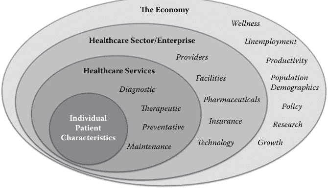

**图 13.1 医疗企业的多尺度表示和属性。（转录自 F.L. Dougherty 等人，2012. © IEEE. 经许可。）**

# 将国家医疗系统作为动态企业进行建模 ■ 301

- 人力资源
- 物理资源：医院、医生诊、设备和供应品
- 信息、通信和传感器系统
- 患者人口统计数据
- 支付流

## 13.3.1 医疗企业转型挑战陈述

综合医疗政策中愿景的转型是为所有公民提供更广泛的医疗服务，获得更有效的成果并维持可持续的成本。《平价医疗法案》(ACA 2010) 涵盖了医疗企业几乎所有的元素，并引发了大量的分析和辩论。多尺度分析为已经定义和尚待定义的政策元素之间复杂的相互作用提供了见解。

国会早些提出的议案希望实现医疗部门转与其他成果。以 2009–2010 年重大立法之前的一个高度关注的法案为例，2005 年《提高质量医疗技术法案》(2005) 概述了基于电子健康记录 (EHR) 和其他信息技术的系列转型目标。

布鲁金斯大学学院恩格尔中心的一份报告《弯曲曲线》(Brookings 2009) 提出了控制医疗成本的观点，主要通过信息技术。其他人提出了许多广泛的技术和流程变化，以及对企业的重大重组，这挑战了医疗分析并规定了复杂系统的应用。同样，必须关注有关可能迫使曲线向上增长的新方法的突发行为和技术变化。

政府通过退伍军人事务和军事医疗服务提供的直接服务以及直接资助工资费用，占美国 GDP 的近 10%。医疗保险（Medicare）和医疗补助（Medicaid）计划的转型挑战是成本与收入的可持续平衡，这是所有政策讨论的关键医疗。直接针对服务不足的人群，大约一半的潜在受益者已参加。该计划对州的财政负担正导致服务和资格方面的显着变化。

针对无保险人群的覆盖方法还包括美国税务局 (IRS) 管理的健康保健税收额度计划 (HCTC) (IRS 2005)，该计划适用于从养老金福利保障公司 (PBGC) 获得福利或因海外竞争失去工作和保险的个人和家庭；以及马萨诸塞州议会计划 (2006)，该计划要求根据收入报销的保险覆盖。这两种政策方法都可以扩展到更大的服务不足群体。

# 302 企业动态学源读

一个国家层面的政策挑战以及信息学的潜在作用在行政命令 13335 (2004) 中表达：总统指示退伍军人事务部 (VA) 和国防部 (DoD) 应向国家健康信息技术协调员办公室 (ONCHIT) 联合报告，部门可以使用负担得起的健康信息系统转型农村和许多服务不足社区的临床实践和医疗交付。该报告建议需要一个共同的“蓝图”或“路线图”，所有利益方都可以从这里进行（例如：数据、安全、消息、技术和通信以及互操作性；基础设施考虑（例如：网络、硬件和软件）；合同激励；技术转移以及经验的共享）。

转型倡议也在较低层次出现，例如纽约市 (NYC) 卫生部门的倡议 (NYC 2005)，在布朗克斯的一个试点区应用血红蛋白测试的电子实验室报告，该地区主要是非洲裔美国人和西班牙裔美国人社区，糖尿病发病率特别高。俄勒冈州和华盛顿州也计划了类似的计划，以解决全国范围内治疗糖尿病每年 1320 亿美元的支出。

多尺度表示扩展了国家科学院研究 (NAS 2005) 提出的四级框架。它将医疗企业组织四个层次进行分析。受医疗政策和技术影响的多个尺度从微观（劳动力和医疗服务）到宏观（美国经济背景和人口统计数据背景下的医疗部门）。这些尺度描述了一个嵌套企业，识别了提供直接患者服务、支持患者服务以及影响服务成本和质量的属性。计划和政策影响企业的所有层次，所示元素之间复杂的相互作用是 ESE 挑战。

较低层次需要医疗服务交付过程的详细描述，以便将计划细节纳入经济预测，并分析特定政策和计划替代方案的影响。这种高保真的医疗系统定义可以包含各种数据，包括：

- 人力资源
- 物理资源：医院、医生诊、设备和供应品
- 信息、通信和传感器系统
- 患者人口统计数据
- 支付流

综合医疗政策中愿景的转型是为所有公民提供更广泛的医疗服务，获得更有效的成果并维持可持续的成本。《平价医疗法案》(ACA 2010) 涵盖了医疗企业几乎所有的元素，并引发了大量的分析和辩论。多尺度分析为已经定义和尚待定义的政策元素之间复杂的相互作用提供了见解。国会早些提出的议案希望实现医疗部门转与其他成果。以 2009–2010 年重大立法之前的一个高度关注的法案为例，2005 年《提高质量医疗技术法案》(2005) 概述了基于电子健康记录 (EHR) 和其他信息技术的系列转型目标。

布鲁金斯大学学院恩格尔中心的一份报告《弯曲曲线》(Brookings 2009) 提出了控制医疗成本的观点，主要通过信息技术。其他人提出了许多广泛的技术和流程变化，以及对企业的重大重组，这挑战了医疗分析并规定了复杂系统的应用。同样，必须关注有关可能迫使曲线向上增长的新方法的突发行为和技术变化。

政府通过退伍军人事务和军事医疗服务提供的直接服务以及直接资助工资费用，占美国 GDP 的近 10%。医疗保险（Medicare）和医疗补助（Medicaid）计划的转型挑战是成本与收入的可持续平衡，这是所有政策讨论的关键。直接针对服务不足的人，大约一半的潜在受益者已参加。该计划对州的财政负担正导致服务和资格方面的显着变化。针对无保险人群的覆盖方法还包括美国税务局 (IRS) 管理的健康保健税收额度计划 (HCTC) (IRS 2005)，该计划适用于从养老金福利保障公司 (PBGC) 获得福利或因海外竞争失去工作和保险的个人和家庭；以及马萨诸塞州议会计划 (2006)，该计划要求根据收入报销的保险覆盖。这两种政策方法都可以扩展到更大的服务不足群体。

一个国家层面的政策挑战以及信息学的潜在作用在行政命令 13335 (2004) 中表达：总统指示退伍军人事务部 (VA) 和国防部 (DoD) 应向国家健康信息技术协调员办公室 (ONCHIT) 联合报告，部门可以使用负担得起的健康信息系统转型农村和许多服务不足社区的临床实践和医疗交付。该报告建议需要一个共同的“蓝图”或“路线图”，所有利益方都可以从这里进行（例如：数据、安全、消息、技术和通信以及互操作性；基础设施考虑（例如：网络、硬件和软件）；合同激励；技术转移以及经验的共享）。

转型倡议也在较低层次出现，例如纽约市 (NYC) 卫生部门的倡议 (NYC 2005)，在布朗克斯的一个试点区应用血红蛋白测试的电子实验室报告，该地区主要是非洲裔美国人和西班牙裔美国人社区，糖尿病发病率特别高。俄勒冈州和华盛顿州也计划了类似的计划，以解决全国范围内治疗糖尿病每年 1320 亿美元的支出。

多尺度表示扩展了国家科学院研究 (NAS 2005) 提出的四级框架。它将医疗企业组织四个层次进行分析。受医疗政策和技术影响的多个尺度从微观（劳动力和医疗服务）到宏观（美国经济背景和人口统计数据背景下的医疗部门）。这些尺度描述了一个嵌套企业，识别了提供直接患者服务、支持患者服务以及影响服务成本和质量的属性。计划和政策影响企业的所有层次，所示元素之间复杂的相互作用是 ESE 挑战。

## 13.3.2 医疗系统的多尺度建模

医疗系统的分析由健康和人类服务部 (HHS)/医疗保险和补助中心 (CMS) 提供支持，用于：

- 长期经济预测，HHS-CMS (董事会 2011)
- 预算预测，退伍军人参保人员医疗预测 (EHCPM) (Harris, Galasso and Eibner 2008)
- 计划规划，HHS (Lewin 用于医疗政策；VA EHCPM 用于计划规划) (Lewin Group 2004)

本案例研究应用于 2 型糖尿病管理的模型是：

- RHSS 和混合模型
- 美国经济的跨学科和宏观模型

## 13.2.2.1 参考医疗服务系统 (RHSS)

图 13.2 描述了 RHSS 框架，该框架将经济中的医疗部门组织在向个人提供医疗服务的序列中。当填充特定年份并对未来年份进行预测时，该框架提供了预期或期望转型的状态空间表示。RHSS 的深色骨干涵盖了提供者对直接医疗服务的交付，通过性能视线将计划和政策倡议与定义的成果相联系。骨干之外的其他区块表示支持性、促进性和影响性的活动。


# 304 企业动态源手册

## 表 13.1 医疗保健多尺度 ESE 框架

| 多尺度定义 | 医疗保健数据与分析 | 项目与政策的表示 |
| --- | --- | --- |
| **1.a. 人口统计（公众——包括处于“患者”和“健康”状态的人）** | 结果：疾病发生率、病率和死亡率 | 公共卫生与健康 |
| **1.b. 美国经济** | 宏观经济和跨行业模型 LIFT/ILIAD–97/376 行业 | 收入、就业和服务需求；针对 VA 和 HHS/CMS 的政府计划与政策；税收、补贴和信托基金
| **2.a. 健康企业** | LIFT/ILIAD、12 个健康部门、BEA/人口普查局—制造业调查；Data Lewin 健康效益模拟模型 RHSS 框架 | 针对 12 个医疗保健部门的服务与政策；提供者的激励与抑制 |
| **2.b. 部门** | | 保险公司和政府支付机制；药品和医疗设备 |
| **3.a. 医疗系统** | VA-EHCPM（参保人健康状况预测模型）；RHSS 健康系统模型（参考健康系统）人口统计、健康服务 | 设施和流程的投资；作为健康服务和成本主要影响的技术 |
| **3.b. 劳动力** | | 医疗设备供应商的数据和趋势；AHRQ 技术评估 |
| 支持数据： | RBRVS, H-CUP, MEPS, CER（基于资源的价值量表）；比较有效性；CMS 技术评估 | 嵌入在数千种健康和医疗服务中的技术；有效性评估 |

来源：F.L. Dougherty 于 2012 © IEEE。

# 将国家医疗保健系统建模为动态企业

| 资源 | 过程 | 输出/结果 | |
| :--- | :--- | :--- | :--- |
| 人口 | 政府政策 | 支付服务 | 护理目标 |
| | (交付点) | 个人 | 提供获取全面的 |
| | 医院/住院患者 | 居家患者 | 基于患者健康的患者护理 | 使用循证医嘱和 |
| | 居家/门诊患者 | 养老院 | CPEE | 在护理点 |
| | 养老院 | 私立发行方 | 应用临床决策支持 |
| | 医生诊所 | 政府 | 改进协调并触达 |
| | | | 生成患者列表（例如：医疗互动等） |
| 公众 | 提供者 | 医疗保健服务 | 视线（箭头） |
| | 无保险患者 | 医生 | 医生助理、、 | 针对比较有效性研究 |
| | 有保险患者 | 其他 | 护士 | 定义的结局 |
| | 公共预防性 (VA/TCA) | | 政府受益人 | 研究服务 |
| | | | 处方药、常规药、生理药、通用药 | 政府 |
| | | | 非处方药 (OTC) | 措施和指标（端到端）技术 |
| | | | | 医疗设备、经济中的支出 |

图 13.2 参考健康服务系统 (RHSS)，（转载自 F.L. Dougherty 等人 2012。IEEE。经许可。）

# 306 ■ 企业动态源手册

关于医疗保健服务的交付已有大量数据可用，且未来将更加强调程序的有效性和结果。RHSS 为这些数据元素的整合提供了支持，使其能够整合到一个全面的系统框架中。

将 RHSS 应用于特定健康服务的案例在第 13.4 节中概述，即针对 2 型糖尿病的管理，使用了混合建模方法，该方法描述了风险人群、提供的服务以及潜在结果的顺序。该应用演示了如何将特定服务的特征汇总到企业层面，并纳入美国经济模型中。

RHSS 可以在实践、医院、政府提供者或国家企业层面进行制定，其复杂性在多个应用规模上增长。由于需要，它在较高层次将更具聚合性。请注意图 13.2 中 RHSS 框架在企业层面的定位以及医疗系统层面（即第 3 层）作为特定交付服务的描述。因此，RHSS 提供了服务模型与企业层面之间的联系。RHSS 中的医疗系统和服务的元素可以整合图 13.2 中识别的各种数据集，以评估计划和政策、识别信息缺口并制定研究和计划优先事项。这些多样化的数据集包括图 13.2 总结的以下信息：

- 系统级 3 的医疗保健数据
- 基于资源的价值量表
- 人口统计
- 跨行业模型
- 个人收入
- 政府计划
- 数据
- H-CUP
- MEPS
- 比较有效性
- CMS 技术评估
- 范围和内容
- 长期预测
- 健康效益模拟模型
- 参保人健康状况预测模型

# 330 将国家医疗保健系统建模为动态企业

特定的政策问题已映射到图 13.3 中的 RHSS，表达所有利益相关者的利益和互动。

## 13.3.2.1 美国经济的跨行业模型

这些模型涵盖了整个医疗系统，并代表了与美国经济其他部门的关系。作为此类模型的一个示例，长期预测工具已用于开发医疗保险成本。此类模型可用于：

- 分析政策和计划对 GDP、部门动态、个人收入、政府成本的影响。
- 检查医疗技术部门和支持数据。
- 开发整合 RHSS 系统方法的计划。

## 13.2.1.3 医疗保健转型的可视化

本章概述的数据和建模方法适用于支持转型和发展的医疗政策及计划的规划与实施。由于系统的范围、复杂性及其相互关系，将可视化方法与其模型相结合至关重要。事实上，RHSS 为交付健康服务的“供应链”提供了一个视觉化概念。


# 310 企业动态学源源书

地理信息系统（GIS）常用于数据和分析结果的自动化制图与可视化。达茅斯医疗健康地图（达茅斯健康政策与临床实践研究所，2010）是这种能力的绝佳示例。大多数商业产品集成了与关系型和面向对象数据库的直接链接，描述了：

- 人口统计数据和现有资源
- 设施配置与能力
- 转型计划和项目状态

如果用于医疗政策、计划及基础设施项目规划与实施的方法遵循推荐方法，则可以进行补充，为公共或私营部门的利益相关者提供运营管理工具。

## 13.4 示例性医疗健康动态分析*

使用 RHSS 框架和混合模型的多尺度方法已应用于特定的健康服务：2 型糖尿病管理。选择这种疾病是由于其具有重大的健康影响和不断增长的成本。该模型对未管理的糖尿病进展为包括循环和心脏状况在内的严重医疗状况的过程进行了建模。通过混合建模方法分析了政策和新产生的影响，该方法整合了以下方法以分析这一嵌套的系统系统（SoS）：

- 描述待治疗人群的基于代理的方法
- 用于表示政策和技术对健康服务交付影响的系统动力学
- 对未管理状态疾病进展的离散事件状态描述
- 跨学科和宏观经济模型，用于捕捉在美国经济背景下对医疗健康部门的影响。

### 13.4.1 医疗系统与服务转型及技术评估（微观尺度）

所述系统工程方法中的选定元素适用于微观和宏观层面的重大医疗政策倡议。医疗政策正关注健康信息技术，以控制成本、减少医疗错误并将高质量护理扩展到服务不足的人群。特别关注的技术包括：

> Dougherty, F.L. et al. 2012. 2012 IEEE. 将美国医疗系统建模为企业——多尺度混合数据分析方法。于 IEEE 国际系统工程会议，温哥华，BC省，3月。经许可。

- 电子健康记录 (EHR)
- 计算机化医嘱录入 (CPOE)
- 决策支持系统 (DSS)
- 健康信息网络、传感器和远程医疗

这些技术的引入涉及健康服务提供方式的重大流程变化。监管和成本报销政策对它们的引入和有效性具有重大影响。本章概述了用于规划和分析此类政策及相关流程变化的系统工程方法论。系统工程方法可以与经济模型相结合，描述医疗部门在整个美国经济（目前占 GDP 的 18%）中的演变，以提高这两种方法在计划和政策规划与分析中的效用。

为了进行技术评估并分析政策影响，可以将上述数据、假设以及 RBRVS 成本数据在微观尺度上应用于 RHSS 中的特定患者流程线程（如图 13.5 所示，在本例中为2 型糖尿病管理）。

以患者为中心的线程的输入参数包括：

- 患者健康状况、人口统计数据
- 特定的诊断、治疗、随访流程，以及需分析的服务调整
- 采用的信息化技术
- 报销和监管政策
- 每项活动所需的资源，例如服务地点（住院、门诊、日间诊所、带传感器的居家监测等，这些会影响设施和间接成本）

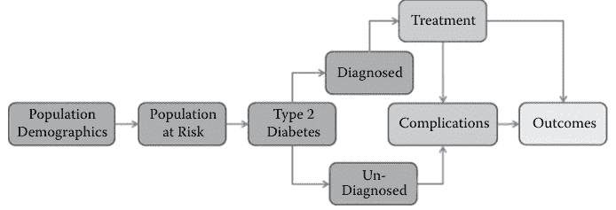

**图 13.5** 糖尿病管理与治疗的医疗交付混合模型，从 RHSS 中提取的流程线程。（转载自 F.L. Dougherty 等人，2012. IEEE。经许可。）

# 312 企业动态学源源书

可以获得的模型结果包括：

- 健康服务成本
- 患者所需时间
- 资源利用率
- 基于资源的相对价值量表

这种基于活动的医疗流程模型可以利用代表性条件和流程，应用于区域层面的患者群体，并在国家层面以更汇总的形式应用。

上述关于糖尿病管理示例的分析描述了所选政策和计划的潜在成本影响。这些影响影响应用于该健康服务的资源以及构成美国经济的多个医疗部门。通过检查 HRSS 中的糖尿病线程获得的演示结果引用了已发布的特定成本和效益估计，如图 13.6 所示。没有远程医疗的基准预测是使用微模拟流程模型开发的；我们结合了医疗研究与质量管理局（AHRQ）的 MEPS 调查数据（AHRQ 2011b）用于糖尿病相关诊断的成本，并将其与人口统计变化的普普查预测相结合。关于 EHR 和远程医疗的短期转型成本和长期收益有广泛的已发布估计；此处显示的结果基于中等技术成本和结果估计。这些效应影响着医疗部门的增长和

## 糖尿病护理成本

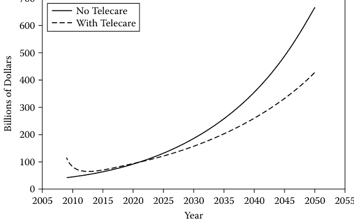

**图 13.6** 改善 2 型糖尿病管理的政策干预预测成本影响。（转载自 F.L. Dougherty 等人，2012. © IEEE。经许可。）

# 将国家医疗系统建模为动态企业 313

可以通过将 RHSS 与诸如 LIFT 等跨行业宏观经济模型链接来分析。这种链接方法在在下一节中进行了描述。

### 13.4.2 与美国经济跨行业模型的耦合（微观尺度与宏观尺度的耦合）

将微观尺度的流程模型与美国经济模型耦合的方法由 Steckley 等人（2011）应用于经济中的能源部门，以分析通过税收和补贴政策将能源系统转型为更高效率的跨行业和宏观经济影响。上述 2 型糖尿病管理微观应用的人口统计和健康服务属性可以通过这种方法映射到 LIFT 模型中的经济部门。

图 13.7 展示了微观与宏观耦合的方法。RHSS 微观分析显示对健康服务有重要影响，但在整个美国经济背景下仅有有限影响。对许多健康服务的政策和技术进行更全面的分析，以探索缓解成本快速增长的同时改善结果的方法，将对整体经济产生显著影响，并留给未来应用。

### 13.4.3 宏观尺度的医疗政策分析

下方给出了使用上述简化耦合方法的 LIFT 模型政策应用。该分析涉及通过医疗补助（Medicaid）计划扩张来覆盖保险人群的健康服务扩张。该分析展示了经济行业模型在重大国家政策倡议中的应用。

Werling（2006）执行并记录的分析追踪了将医疗保险范围扩大到额外的

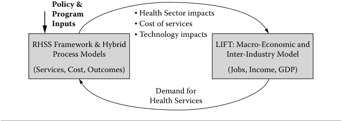

图 13.7 RHSS 与混合模型与经济跨行业宏观模型的耦合。（转载自 F.L. Dougherty 等人，2012. © IEEE。经许可。）


# 314 企业动态手册

在未来10年内将涵盖2000万美国人。该研究利用美国经济的INFORUM LIFT模型模拟了医疗援助（Medicaid）系统的扩张，以覆盖额外的900万儿童和1100万成年人。LIFT模型是美国经济的97个部门一般均衡表示。其详细的结构使我们能够说明医疗部门的价格、收入和就业如何应对保险覆盖范围和医疗支出的变化。

为了额外增加2000万名参保者，医疗援助支出在2007年增加了366亿美元，到2016年，这一金额将增加到700亿美元。分析发现，针对这些年龄相对较轻的人口群体扩展联邦医疗保险（Medicare）会对特定医疗行业的产出、就业和收入产生适度推动。例如，与基准预测相比，医院、医生和其他专业医疗服务的支出增长了1%至3%。全国总医疗开支在2007年仅增长了1.3%，到2016年增长了1.7%。

从宏观经济角度来看，医疗援助的扩张产生的变化微乎其微。我们减少联邦和州所得税来资助整个支出的增加。在正常情况下，联邦税收增加了2.0%至3.0%，州税增加了4.0%至6.0%。尽管如此，与基准预测相比，到2016年，实际GDP下降了微不足道的0.02%，物价水平上升了0.17%。LIFT模型显示，这些医疗支出的增强可以完全由受影响行业的吸收，而不会显著影响经济增长。结果总结于图13.8。

| 医疗援助人口： | 总计 | 成人 | 儿童 | 老龄 | 伤残 |
| :--- | :--- | :--- | :--- | :--- | :--- |
| 2003年基础参保人数（万） | 55,000 | 14,300 | 27,300 | 7,700 | 5,900 |
| 每位参保者支出（美元） | 4,200 | 1,900 | 1,500 | 7,200 | 17,400 |
| 额外家庭（万） | | 9,000 | 11,000 | | |
| 估计影响： | 2008 | 2010 | 2012 | 2014 | 2016 |
| 全国医疗支出 (NHE)（美元) | 2,400 | 2,700 | 3,100 | 3,600 | 4,200 |
| 增加（美元） | 35 | 50 | 60 | 70 | | |
| NHE占GDP百分比 (%) | 16.3 | 16.7 | 17.3 | 17.8 | 18.2 |
| 增加（百分比） | 0.2 | 0.2 | 0.2 | 0.30 | 0.30 |
| GDP增长率下降幅度（年百分比） | 0.01 | 0.01 | 0.02 | | |
| 就业增长率（百分比 %） | | 5 | 22 | 33 | 38 |
| 联邦及州税增加（十亿美元） | | 54 | 64 | 75 | 89 |

上述分析详情（以及更多内容）适用于个人保健、处方药、耐用医疗用品、医生及临床服务、牙医、其他专业人员和养老院。

**图13.8 将医疗援助覆盖范围扩大到无保险人口一半的经济影响。（转载自 J. Werling, 扩大医疗援助覆盖范围的影响。Inforum论文, 2004年9月。经许可。）**

# 将国家医疗系统建模为动态企业 ■ 315

## 13.5 医疗企业规划与分析方法论

医疗企业中的所有利益相关者必须规划并分析影响其活动的政策和计划。这些活动的范围和规模跨度很大，需要如上所述的多尺度数据分析方法。基于使用RHSS和经济系统模型的规划、分析和评估方法论以通用形式概述。该方法论包括以下步骤：

- 定义政策或计划在RHSS和医疗部门内潜在影响的范围和规模。
- 为选定的医疗服务在所需的范围内制定需求和活动水平的估值。
- 在RHSS框架内搜索并获取全面的医疗信息。
- 在选定的领域选择、填充RHSS数据并应用相应的分析模型：
  - 服务级过程模型，用于开发成本和有效性估值（RHSS和类似VA EHCPM的企业模型）。
  - 基于智能体的模型，用于描述患者群体及其特征，并提供联系方式。
  - 系统动力学，用于定义政策影响和复杂的相互作用。
  - 经济预测模型。
- 资源分配与优化模型。

这种顺序规划方法的逻辑是清晰的；一个关键步骤是过程定义，以及识别将转变流程的政策和计划倡议。可以识别特定项目以消除转型的障碍。定义的项目对服务交付和结果的影响必须与财务和实施计划挂钩。需要返回计划定义步骤进行迭代，以添加、删除或重定向项目并设定优先级。

风险在所有医疗计划中都是固有的，是规划和实施阶段必须解决的主要因素，在后续运营中也是如此。风险类别概述如下：

这种顺序规划方法的逻辑是清晰的；一个关键步骤是过程定义，以及识别将转变流程的政策和计划倡议。可以识别特定项目以消除转型的障碍。定义的项目对服务交付和结果的影响必须与财务和实施计划挂钩。需要返回计划定义步骤进行迭代，以添加、删除或重定向项目并设定优先级。

316 企业动态手册

13.5.1 政策风险

医疗企业中的所有利益相关者必须规划并分析影响其活动的政策和计划。这些活动的范围和规模跨度很大，需要如所述的多尺度数据分析方法。基于使用RHSS和经济系统模型的规划、分析和评估方法论以通用形式概述。该方法论包括以下步骤：

- 定义政策或计划在RHSS和医疗部门内潜在影响的范围和规模。
- 为选定的医疗服务在所需的范围内制定需求和活动水平的估值。
- 在RHSS框架内搜索并获取全面的医疗信息。
- 在选定的领域选择、填充RHSS数据并应用相应的分析模型：
  - 服务级过程模型，用于开发成本和有效性估值（RHSS和类似VA EHCPM的企业模型）。
  - 基于智能体的模型，用于描述患者群体及其特征，并提供联系方式。
  - 系统动力学，用于定义政策影响和复杂的相互作用。
  - 经济预测模型。
- 资源分配与优化模型。

这种顺序规划方法的逻辑是清晰的；一个关键步骤是过程定义，以及识别将转变流程的政策和计划倡议。可以识别特定项目以消除转型的障碍。定义的项目对服务交付和结果的影响必须与财务和实施计划挂钩。需要返回计划定义步骤进行迭代，以添加、删除或重定向项目并设定优先级。

风险在所有医疗计划中都是固有的，是规划和实施阶段必须解决的主要因素，在后续运营中也是如此。风险类别概述如下：

316 企业动态手册

13.5.2 计划风险

医疗企业中的所有利益相关者必须规划并分析影响其活动的政策和计划。这些活动的范围和规模跨度很大，需要如所述的多尺度数据分析方法。基于使用RHSS和经济系统模型的规划、分析和评估方法论以通用形式概述。该方法论包括以下步骤：

- 定义政策或计划在RHSS和医疗部门内潜在影响的范围和规模。
- 为选定的医疗服务在所需的范围内制定需求和活动水平的估值。
- 在RHSS框架内搜索并获取全面的医疗信息。
- 在选定的领域选择、填充RHSS数据并应用相应的分析模型：
  - 服务级过程模型，用于开发成本和有效性估值（RHSS和类似VA EHCPM的企业模型）。
  - 基于智能体的模型，用于描述患者群体及其特征，并提供联系方式。
  - 系统动力学，用于定义政策影响和复杂的相互作用。
  - 经济预测模型。
- 资源分配与优化模型。

这种顺序规划方法的逻辑是清晰的；一个关键步骤是过程定义，以及识别将转变流程的政策和计划倡议。可以识别特定项目以消除转型的障碍。定义的项目对服务交付和结果的影响必须与财务和实施计划挂钩。需要返回计划定义步骤进行迭代，以添加、删除或重定向项目并设定优先级。

风险在所有医疗计划中都是固有的，是规划和实施阶段必须解决的主要因素，在后续运营中也是如此。风险类别概述如下：

316 企业动态手册

13.5.3 资源风险

医疗企业中的所有利益相关者必须规划并分析影响其活动的政策和计划。这些活动的范围和规模跨度很大，需要如所述的多尺度数据分析方法。基于使用RHSS和经济系统模型的规划、分析和评估方法论以通用形式概述。该方法论包括以下步骤：

- 定义政策或计划在RHSS和医疗部门内潜在影响的范围和规模。
- 为选定的医疗服务在所需的范围内制定需求和活动水平的估值。
- 在RHSS框架内搜索并获取全面的医疗信息。
- 在选定的领域选择、填充RHSS数据并应用相应的分析模型：
  - 服务级过程模型，用于开发成本和有效性估值（RHSS和类似VA EHCPM的企业模型）。
  - 基于智能体的模型，用于描述患者群体及其特征，并提供联系方式。
  - 系统动力学，用于定义政策影响和复杂的相互作用。
  - 经济预测模型。
- 资源分配与优化模型。

这种顺序规划方法的逻辑是清晰的；一个关键步骤是过程定义，以及识别将转变流程的政策和计划倡议。可以识别特定项目以消除转型的障碍。定义的项目对服务交付和结果的影响必须与财务和实施计划挂钩。需要返回计划定义步骤进行迭代，以添加、删除或重定向项目并设定优先级。

风险在所有医疗计划中都是固有的，是规划和实施阶段必须解决的主要因素，在后续运营中也是如此。风险类别概述如下：

316 企业动态手册

13.5.4 技术风险

医疗企业中的所有利益相关者必须规划并分析影响其活动的政策和计划。这些活动的范围和规模跨度很大，需要如所述的多尺度数据分析方法。基于使用RHSS和经济系统模型的规划、分析和评估方法论以通用形式概述。该方法论包括以下步骤：

- 定义政策或计划在RHSS和医疗部门内潜在影响的范围和规模。
- 为选定的医疗服务在所需的范围内制定需求和活动水平的估值。
- 在RHSS框架内搜索并获取全面的医疗信息。
- 在选定的领域选择、填充RHSS数据并应用相应的分析模型：
  - 服务级过程模型，用于开发成本和有效性估值（RHSS和类似VA EHCPM的企业模型）。
  - 基于智能体的模型，用于描述患者群体及其特征，并提供联系方式。
  - 系统动力学，用于定义政策影响和复杂的相互作用。
  - 经济预测模型。
- 资源分配与优化模型。

这种顺序规划方法的逻辑是清晰的；一个关键步骤是过程定义，以及识别将转变流程的政策和计划倡议。可以识别特定项目以消除转型的障碍。定义的项目对服务交付和结果的影响必须与财务和实施计划挂钩。需要返回计划定义步骤进行迭代，以添加、删除或重定向项目并设定优先级。

风险在所有医疗计划中都是固有的，是规划和实施阶段必须解决的主要因素，在后续运营中也是如此。风险类别概述如下：

316 企业动态手册

13.5.5 健康与安全风险

医疗企业中的所有利益相关者必须规划并分析影响其活动的政策和计划。这些活动的范围和规模跨度很大，需要如所述的多尺度数据分析方法。基于使用RHSS和经济系统模型的规划、分析和评估方法论以通用形式概述。该方法论包括以下步骤：

- 定义政策或计划在RHSS和医疗部门内潜在影响的范围和规模。
- 为选定的医疗服务在所需的范围内制定需求和活动水平的估值。
- 在RHSS框架内搜索并获取全面的医疗信息。
- 在选定的领域选择、填充RHSS数据并应用相应的分析模型：
  - 服务级过程模型，用于开发成本和有效性估值（RHSS和类似VA EHCPM的企业模型）。
  - 基于智能体的模型，用于描述患者群体及其特征，并提供联系方式。
  - 系统动力学，用于定义政策影响和复杂的相互作用。
  - 经济预测模型。
- 资源分配与优化模型。

这种顺序规划方法的逻辑是清晰的；一个关键步骤是过程定义，以及识别将转变流程的政策和计划倡议。可以识别特定项目以消除转型的障碍。定义的项目对服务交付和结果的影响必须与财务和实施计划挂钩。需要返回计划定义步骤进行迭代，以添加、删除或重定向项目并设定优先级。

风险在所有医疗计划中都是固有的，是规划和实施阶段必须解决的主要因素，在后续运营中也是如此。风险类别概述如下：

316 企业动态手册

13.5.6 涌现行为风险

医疗企业中的所有利益相关者必须规划并分析影响其活动的政策和计划。这些活动的范围和规模跨度很大，需要如所述的多尺度数据分析方法。基于使用RHSS和经济系统模型的规划、分析和评估方法论以通用形式概述。该方法论包括以下步骤：

- 定义政策或计划在RHSS和医疗部门内潜在影响的范围和规模。
- 为选定的医疗服务在所需的范围内制定需求和活动水平的估值。
- 在RHSS框架内搜索并获取全面的医疗信息。
- 在选定的领域选择、填充RHSS数据并应用相应的分析模型：
  - 服务级过程模型，用于开发成本和有效性估值（RHSS和类似VA EHCPM的企业模型）。
  - 基于智能体的模型，用于描述患者群体及其特征，并提供联系方式。
  - 系统动力学，用于定义政策影响和复杂的相互作用。
  - 经济预测模型。
- 资源分配与优化模型。

这种顺序规划方法的逻辑是清晰的；一个关键步骤是过程定义，以及识别将转变流程的政策和计划倡议。可以识别特定项目以消除转型的障碍。定义的项目对服务交付和结果的影响必须与财务和实施计划挂钩。需要返回计划定义步骤进行迭代，以添加、删除或重定向项目并设定优先级。

340 将国家医疗系统建模为动态企业 ■ 317

13.6 治理

治理在重大转型计划中的性被 Hamaker (2003) 强调，考虑到联邦和州级公共机构与构成医疗企业的私立机构之间的相互依赖关系，这一点尤为关键重要。在这个高度分散且复杂的经济环境中，定义良好的角色和职责可以通过以下方式促进这些公私实体共同承担的转型功能：


# 318 企业动态手册

- 对转型政策和计划的政策与系统要素以及执行的支持活动具有强有问责制
- 一种虚拟支持结构，具有中央任务集成功能，但支持资源和信息是分布式的
- 将以任务为中心的架构作为转型路线图，并作为确定职责和管理问责的模板
- 一种全面的多尺度分析能力，用于权衡成本和结果效益，为管理人员、决策者和公众提供信息

表 13.2 显示了职责如何与私营部门和公共实体的层级相匹配。文中说明了支持机构的职责。对于指出的角色和功能，负责实体是主要的管理者用户；他们也对其计划的实时性负责。

这些治理要素的协调并非易事。所有这些元素都是系统工程分析和设计的对象。正如此处所述，架构在治理中起着重要作用，但需要根据特定角色目标规定其具体的范围和内容。RHSS 可以支持所需的协调。

在医疗系统中，卫生服务部（HHS）有法律责任维护当前数据，并对 Medicare “信托基金”的未来医疗需求和成本进行预测。这些信息源和预测对所有方可用。私营部门实体有自己的信息源和展望，并在业务和投资计划中将它们与政府来源相结合。

# 13.7 结论

医疗政策和计划制定的复杂性需要强大的分析能力，以应对对国家、地区、省和公众的影响。RHSS 和多尺度混合模型可以结构化并整合各种信息给所有利益相关者，以决定美国医疗系统的物理和经济方面。随着许多政府数据源日益呈现“火龙喷”式原始数据的形式，分析师必须根据特定目的对其消化和结构化处理，这种能力变得越来越重要。此类信息涵盖提供服务的医疗部门以及支持性的资源财务形式。数据包括人力资源和设施以及组织角色和职责、业务流程、企业资源以及改进能力和支持这一复杂企业所需的服务和技术。随着更多基于效果的数据变得可用，这些方法将支持政策和计划的全面规划、分析和评估。

# 表 13.2 医疗系统治理角色与职责摘要

| 治理角色与职责：公共和私营部门实体 |
|---|---|
| 国家级政策 | 政策制定、监管、教育 | HHS/CMS 地方与联邦公共互动 |
| 医疗服务 | 交付、效果、成本管理、报销、监管、法律 | 提供者（营利性和非营利性）、政府 (VA, DoD, MHS)、政府 (HHS)、州和地方政府 |
| - 满足需求 - 负担能力 - 健康与安全 | 系统开发与运营 | 医院、诊所运营、报告、理赔处理 | 行业、政府 |
| 系统、技术的服务组件 | 诊断实验室、制药、家用传感器和设备 | 行业 |
| 研究 | 研发激励、长期基础研究、制药策略 | 行业、NIH、政府-行业合作 |
| 数据与信息 | 隐私、安全、互操作性 | 政府、HHS、行业 |
| 技术选型 | 诊断性、治疗性、预防性 | HHS-CMS、FDA、提供者 |

# 企业动态手册

没有任何一种建模方法可以解决考虑的旨在转型美国医疗企业的各种政策和计划。本章描述的多尺度概念可以定制并应用于这些广泛的分析挑战中。

微观和宏观应用展示了通过本方法论章节描述的耦合系统工程和经济模型可以执行的分析范围。初步工作已描述，并且正在对建模方法进行更完整的对齐工作。结合的系统工程—经济建模方法的主要特征包括：

- 超越并借鉴了碎片化/静态分析
- 展示了全面的转型分析框架的可行性
- 可以通过结合、交互和阶段性的策略元素解决复杂的“挑战分析案例”，例如：
  - 分析 Medicare 支付咨询委员会 (MedPac) 建议的影响（多年分阶段实施）
  - 将带有补贴的 COBRA 纳入 Medicaid 扩张（五年 2000 万美元）
  - 将 HCTC 扩张与综合统一预算和解法案相结合；五年分阶段实施
  - 合作计划或公共计划（五年）
  - 选择性技术变更（EHR、远程医疗、生物制药等）
  - 雇主提供的福利税（对不同水平的敏感性）
  - 结果的德尔菲分析
  - 在仪表板中暴露关键假设、复杂的相互关系和分析结果，用于利益相关者的交互分析
  - 可以分析 Medicare 的 POET 因素和“绩效付费”政策的影响
  - 借鉴现有的碎片化/静态分析和数据
  - MedPac 成本管理等
  - 结果和有效性研究 (DER) 数据（新兴）

在代表与效果和成本相关的医疗服务活动和过程方面，也存在不确定性和数据缺口，包括政府政策对利益相关者的激励和阻碍。这些行为信息非常重要，在政策分析中不能忽略。对关键因素进行粗略估计并对其进行敏感性分析，比在构建“经过验证”的模型时忽略它们要好得多。

健康的开发和维护对我们的社会至关重要。成功的市场经济依赖于当地资源市场处理能力和库存的高质量信息的自由流动。目前的重点大部分在金融市场数据；交付的服务和抑制的需求的物理数据难以获取，表明了以下需求：

# 将国家医疗系统作为动态企业进行建模 ■ 321

- 国家会计和统计应解决私营部门企业和负责政府机构对健康安全数据的需求。
- 必须采用集成规划方法，以确保项目在整体系统范围内是行的，并识别所有潜在风险。
- 系统方法可以揭示市场中所有参与者必须理解的不一致和不平衡。
- 应在利益相关者之间开发并公布统一的效果和成本会计方法。

项目和政策往往由于基础设施的缺陷而失败。许多此类问题必须视为“系统失败”，表明系统配置、能力和瓶颈必须由私立和公共机构定义和管理。此外：

- 必须定义利益相关者的角色。
- 应识别医疗转型的所有关键劳动力、材料、资源需求，并对其市场进行追踪。
- 影响项目和私营部门活动的政府政策基于真实的物理和财务信息。政策和法规应基于考虑技术能力和成本的效益分析，反映活跃的市场反应。

通过使用先进的信息通信技术，可以促进 RHSS 作为集成医疗信息系统的访问性和可用性。例如：

- 数据应以关系型和面向对象的格式生成，以便于访问并具备支持事后报告和分析的能力。
- 应提供地理界面，以便跨地区和人口特征进行访问和分析。
- 带有动画的系统仿真或优化可行的，并有助于使对政策制定和决策更有用。
- 实体系统模型应与经济政策模型相结合。

显然，在财务规划与针对市场以及私营部门和政府计划实施的的项目之间，必须保持密切且持续的协调。全面的医疗信息系统可以支持这种协调。
总之，这些概念和支持工具已经足够成熟，可以立即应用于定义良好的政策或计划，其中相关的技术和经济数据可以从现有来源中收集。附加


# 322 企业动态手册

为了具备更全面的能力来应对广泛的计划和政策应用，准备性步骤包括：

- 1. 遵循早期的架构概念，将更完整的政府和私营部门数据映射到模型中的 RHSS（健康系统）和健康领域。
- 2. 扩展获取更特定数据和信息的能力，用于：
    a. 可以双向改变曲线的信息学和诊断/治疗技术，例如，通过分解 RBRVS 数据并对其进行重构以预测。
    b. CER（成本效益研究）结果，以预测未来的服务和流程。
- 3. 借鉴并应用在其他领域应用中证明的技术经济分析方法。
- 4. 采用稳健的可视化方法，在决策环境中显示并解释复杂的区域和国家影响以及权衡。

## 参考文献

ACA（平价医疗法案），2010。
AHRQ. 2011a. 美国医疗研究与质量机构，医疗成本与利用项目，http://www.hcup-us.ahrq.org/nnAHRQ. 2011b. 美国医疗研究与质量机构，医疗支出面板调查，http://meps.ahrq.org/mepsw/.
AMA. 2012. 美国医学协会，Medicare RBRVS，医生指南。2012. 信托会联邦医院和医疗保险基金会。2011年度报告。
布鲁金斯学会，恩格尔伯格医疗改革中心。2009. 《改变曲线：应对长期医疗支出增长的有效步骤》。报告。华盛顿，特区。
达特茅斯健康政策与临床实践学院。2010. 达特茅斯健康地图，http://www.dartmouthatlas.org/
美国卫生与人类服务部。2011a. HHS 数据资源目录，http://ase.hhs.gov/datac/DataDir/index.html。
美国卫生与人类服务部。2011b. 比较有效性研究资助，http://www.hhs.gov/recovery/programs/
Dougherty, F., Padano, C., Hoffman, K.C., and Thornton, P. 2006. 医疗信息学的社会经济影响。发表于美国公共卫生协会会议，波士顿，11月。
Dougherty F., Hoffman, K.C., Huntington, H., Jun, J., Klein, D., Le, K., Schoener, B., and Walters, M. 2012. 将美国医疗系统建模为企业——多尺度混合数据分析方法。在 IEEE 国际系统工程会议，温哥华，3月。
行政命令 13335。2004. 总统命令，华盛顿，特区，4月27日。

## 将国家医疗系统作为动态企业建模

Hamaker, S. 2003. 治理焦点。*信息系统控制杂志*，1。http://www.isaca.org/Journal/Past-Issues/2003/Volume-1/Documents/pdf031-SpotlightGovernance.pdf.

Harris, K.M., Galasso, J.P., and Eibner, C. 2008. VA 退伍军人医疗保健预测模型的审查与评估。圣蒙尼卡，加利福尼亚州：兰德公司。

2005 年医疗技术增强法案。第 109 届国会拟议立法 (S. 1262)(6月6日)。

INFORM LIFT. 2007. 马里兰大学经济系，春季，http://inform.ummd.edu。

IRS（美国国税务局）。2005. 医疗税收抵免 (HCTC) 概述。http://www.irs.gov/individuals/article-0?id=109960,00.html。

Lewin Group. 2004. *2004 年免税医疗福利的成本*。弗尔斯法塞，纽约州。马萨诸塞州议会。2006. 委员会报告。http://www.mass.gov/legis/summary.pdf。

医疗保健——新的工程/医疗伙伴关系，华盛顿，特区：国家科学院出版社。

NAS. 2005. 国家科学院与医学学院，《建立更好的医疗系统——新的工程/医疗伙伴关系》，华盛顿，特区：国家科学院。

NYC（纽约市）健康部门。2005. *糖尿病预防与控制*。俄勒冈州医疗政策与研究。http://www.oregon.gov/OHPPR/.

Rouse, W.B. 2008. 作为复杂自适应系统的医疗保健。在*国家工程学院——桥梁（春季）*：17–25。国家工程学院，华盛顿，特区。

Steckley, S.G. et al. 2011. 使用耦合技术和经济模型的能源需求分析。*能源杂志*（10月）。32（特别刊）http://www.ieee.org/en/ejarticle.aspx?id=2460。

Werling, J. 2006. 扩大 Medicaid 覆盖范围的经济影响。论坛论文（9月24日）：1–10。

## 结语：企业系统工程与架构——教训与前路

Kenneth C. Hoffman, William J. Bunting, Anne Cady, Christopher G. Glazner, and Leonard A. Wojcik

-   理解企业的动态行为对于规划和管理采购与实施至关重要。第一部分中的框架和方法描述了这一新兴学科的范围和内容，并基于之前章节描述的模型为前路提供了一个统一视角。重点在于克服过去静态和确定性方法的缺陷，以实现敏捷企业。也许面临最大的挑战是组织方面，因为这一元素往往比政策、经济和技术元素更静态。

-   第 4 章描述的统一概念是基于之前章节描述的模型对前路的一种观点。这些模型强调了在采购前准备的商业案例中解决的重要方面。这些模型涵盖了采购和运营的全生命周期，并关注“三分之一规则”（最佳采购时间为系统总寿命的三分之一）以及其他变量因素，以确保转型计划的预期收益。

-   在前章节中代表的几种方法处理了企业与其外部大部分不受控环境的动态交互，例如，控制理论、博弈论、高度优化性、系统动力和基于代理的方法。这些方法被用于描述企业特定功能的源模块。未来的研究将探索描述竞争、对抗和欺骗行为的重要动态元素的源模块。

-   前述章节的模型可以用于“推演”企业决策者对未来的假设，因此可以用于不同的采购策略和管理方法进行定性的“假设如果”分析。这些模型已根据大量的计划和运营管理经验进行了验证。预计这些模型需要大量的校准，以适用于定量预测性系统工程应用。通过一个由核心状态空间表示的多种描述性、规范性和预测性模型支持的集成游戏设施，可以特定的机构规划和计划管理需求完成校准、验证和应用。


# 327

延迟需要对业务案例和战略进行重大更新，以估计修订后的运行寿命以及产生的收益。对于系统之系统生命周期内的维护和老化效应的定义，以及业务案例对这些因素的敏感性，必须给予比通常做法更多的关注。

必须对内部和外部环境中的重大不确定性进行分析和估计。虽然目前的模型公式基于预设的非确定性外部影响，但通常可以先验估计周期性范围和此类影响的幅度；对此类计划影响的先验分析可以、也应该作为业务案例的重要组成部分进行。

必须投入大量精力来表征复杂企业系统之系统中潜在的突现行为。基于智能体的建模的结果和其他处理此类行为的方法可以整合到最优控制模型中，该主题是正在进行的研究，旨在通过分段线性最优控制理论表示，将多学科建模视角与更详细的企业状态空间特征统一起来。

这些分析和指南直接关系到适当的转换和获取策略。当预计重大的不确定性和持续事件（“击中”）会干扰计划时，分析结果表明，采用增量式的转换或获取策略具有益处，这种策略应适应于现成的集成、模块化开发以及利用商业服务的商业化管理获取策略，或结合的方法。无论何种情况，获取策略必须基于计划的复杂性和风险、业务目标以及该引擎最优控制模型所代表的环境考虑因素。

我们注意到，系统之系统工程（SoSE）过程的简单最优控制模型产生了“三分之一规则”，这可以作为与实际计划比较的基准。我们通过包含一个被解释为“内部复杂性”的特定参数扩展了基础模型。模型预测，内部复杂性极低的工程由于其相互作用的部分较少，在相对于于总寿命较短的时间内是最优连接的。此外，我们考虑了运行老化效应；这些效应倾向于产生一个最优获取时间，该时间小于没有老化效应的系统。最后，我们考虑了整个 C-I-U（控制、影响、不受控）范围，并对控制变量和外部复杂性进行了建模，将其建模为企业转换努力（作为 SoSE 过程）的外生影响。这种外部复杂性产生的多种响应取决于不确定性机制的细节，包括快速敏捷的获取，或带有大量原型制作的极其缓慢的获取。

最优控制模型的结果表明，系统获取和转换管理的决策应明确考虑到预期的系统寿命，以及此处建模的因素：内部和外部复杂性、预期的内部和外部影响，以及运行老化效应。在这一背景下考虑企业复杂性，本章建议的通用指南可以实现更好的投资回报率。然而，这项研究仍处于早期阶段，应与其他建模方法相结合，以为企业决策提供全景。特别是，我们建议对动态过程的概率建模进行进一步研究，以解释不确定性。

动态企业建模、仿真和定量方法的价值是显而易见的。在可行且可以估计数据的情况下，量化是重要的。此外，量化模型的定性行为可能是复杂系统工程极佳的洞来源。纯定性方法也适合整合到全套模型中。

最后，这本手册代表了企业动力学学科在形成阶段的快照。作者相信，通过不断增长的处理企业转换复杂性的能力，将建立更高性能水平的方向。

展望经理将获得的动态分析新兴能力，一个过去三十年来一直预测的无处计算世界正在成为现实，带来了重大的管理机遇和挑战。无处计算使得信息可以通过任何具有强大数据挖掘和分析能力的设备随时随可用。社会趋势（如消费化）与实现无处计算的新兴技术之间的协同作用正推动着协作的、实时的决策和控制。这些变化挑战了组织结构的旧概念，并要求通过新的思维来通过持续的变化建模 POET 企业。敏捷企业将通过持续的变化和适应来保持完整性和生存能力，以增加运行性能和对利益相关者的价值。

企业与其业务系统及基础设施之间的边界将变得模糊且流动，企业生态系统将不断增加并将运营扩展到传统的组织边界之外。在这个无处计算的新世界中，客户和其他利益相关者将被更直接地引入“扩展企业”。无处计算技术对企业转换最大、最困难的挑战是，实施为了去中心化、移动和动态形成的业务流程以避免网络灾难所需的安全和隐私控制时相关的复杂性。成功的企业将通过演化过程来应对这一领域，利用重大机会并管理固有风险。

# 缩写词*

- AAS 高级自动化系统
- ABC 基于活动的成本法
- ABM 基于活动的管理法
- AFSC 美国空军系统司令部
- AHRQ 医疗保健研究与质量机构
- ANSI 美国国家标准协会
- AOC 空空作战中心
- ARRA 2009 年美国恢复与再投资法案
- B 十亿
- BNL 布鲁克海尔国家实验室
- C2C 指挥与控制中心
- C3H 健康领域的合作、协作与通信
- C3I指挥、控制、通信与情报
- CAASD 先进航空系统开发中心
- CAS 复杂自适应系统
- CCG MITRE 连接政府中心
- CHG 连接政府中心
- CHCIT 医疗保健技术委员会
- CEM MITRE 企业现代化中心
- CER 比较有效性研究
- CHIP 儿童医疗保健保险
- CIIS 集成智能中心
- CIO 首席信息官
- CIP 关键基础设施保护
- CIU 控制、影响、不受控
- CMS 医疗保险和补助中心

> * 特殊章节的缩写未列在此处，已在文中标识。

# 330 缩写词

| 术语 | 描述 |
| :--- | :--- |
| CPM | 关键路径法 |
| CTH | MITRE 健康转型中心 |
| CTO | 技术官 |
| DHS | 国土安全部 |
| DoD | 国防部 |
| DoE | 能源部 |
| EA | 企业架构 |
| EHR | 电子健康记录 |
| ERM | 企业资源管理 |
| ERP | 企业资源计划 |
| ESE | 企业系统工程 |
| ESE/A | 企业系统工程与架构 |
| FAR | 联邦采购条例 |
| FDA | 食品与药品管理局 |
| FEA | 联邦企业架构 |
| FERC | 联邦联邦监管委员会 |
| FFRDC | 全额资助的研究中心 |
| FHA | 联邦健康架构 |
| FISMA | 联邦信息安全管理法 |
| FLITE | 财务与物流集成企业 |
| FTE | 全职当量 |
| FY | 财年 |
| G&A | 一般与管理费用 |
| GAO | 政府审计局 |
| GERA | 通用企业参考架构 |
| GIS | 地理信息系统 |
| GNP | 国民总产 |
| GST | 通用系统论 |
| HCFA | 联邦医疗保健融资局 |
| HHS | 卫生与公众服务部 |
| HMO | 健康维护组织 |
| HPH | 医疗保健与公共卫生 |
| HR | 人力资源 |
| HRSA | 医疗资源与服务局 |
| HS SEDI™ | 国土安全系统工程与开发学院 |
| IEA | 国际能源机构 |
| IEEE | 电气电子工程师协会 |

> * 特殊章节的缩写未列在此处，已在文中标识。


# 缩写 331

IFAC 国际自动控制联合会
IPO 集成计划办公室
IPRM 集成项目与资源管理
IR&D 独立研究与开发
IRS 美国国税局
ISO 独立系统运营商
IT 信息技术
IV&V 独立验证与确认
LAI 精益演进倡议
LoB 业务线
M 百万
MEBN 多实体贝叶斯网络
MEPS 医疗费用与绩效报告系统
MIT 马萨诸理工学院
MSR MITRE 赞助研究
NAE 美国工程院
NIH 美国国立卫生研究所
NIMH 美国精神健康研究所
NIST 美国国立标准与技术研究院
NRC 国家研究委员会
O&M 运行与管理
OMB 预算管理管理局
OR 运筹学
ORMS 运筹与管理科学
PERT 计划评估评审技术
PHR 个人健康记录
PMA 总统管理日程
PMO 项目管理办公室
POET 政策、组织、经济与技术（此处用法），也指政策、运营、经济与技术
PRM 性能参考模型
R&D 研究与开发
R2A2 角色、责任、问责与权限
ROI 投资回报率
RTO 区域传输组织
S&A 研究与分析
S&T 科学与技术

- **SAGE** 半自动地面环境系统工程
- **SE** 系统工程与开发研究所
- **SEDI** MITRE 系统工程实践办公室
- **SEPO** 领域专家
- **SME** 系统之系统工程
- **SoSE** 社会安全局
- **SSA** 社会安全局
- **T** 万亿
- **TEM** 技术交流会议
- **U.S.** 美国
- **VA** 美国退伍军人事务部

## 参考文献

Abbott, A. 1990. 社会科学研究方法中时间与事件的概念：因果与叙事方法，Hist. Methods, 23: 140–150.

ACA（《平价医疗法案》）。2010.

AHRQ, 医疗研究与人类协会，2011a. 医疗成本与利用项目，http://www.hcpus-us.ahrq.gov/.

AHRQ, 医疗研究与质量协会。2011b. 医疗支出小组调查，http://meps.ahrq.gov/mepsweb/.

Alderson, D.L. 和 Doyle, J.C. 2010. 复杂性的对比视角及其对网络中心化基础设施的影响。IEEE Transactions on Systems, Man and Cybernetics—Part A: Systems and Humans, 40(4): 839–852.

Alderson, D.L., Li, W., 和 Doyle, J. 设计在互联网及其他复杂工程系统中的作用。发表于新英格兰复杂系统研究所 (NECSI) IEEE 复杂系统国际会议 (ICCS)，波士顿。

AMA, 美国医学协会，2002. 医疗 RBRVS, 医生指南，2012. 《美国英语遗产词典》，第四版。2000. 波士顿：Houghton Mifflin.

Anderson, P., Meyer, A., 等 (1999). 特刊导言：复杂性理论在组织科学中的应用。Organization, 10(3): 233–236.

ANSI/IEEE 1471—IEEE 软件系统体系描述推荐实践。

Argyris, C. 和 Schön, D. (1978). 组织学习：一种积极视角的理论。Reading, MA: Addison-Wesley.

亚里士多德。1994. 《亚里士多德全集：修订牛津译本》，J. Boras (编)。普林斯顿, NJ: Princeton University.

Arthur, W.B. 2009. 技术的本质：它是什么以及如何演变。纽约：Free Press.

Assimakopoulos, V. 1992. 结合决策支持工具与基于知识的方法开发区域能源规划的集成系统。Energy Systems and Policy, 15(5): 245–255.

Axelrod, R. 1984. 合作的演化。纽约：BasicBooks.

Bar-Yam, Y. 2003. 当系统工程失效时——迈向复杂系统工程。在系统、人与控制国际会议上。第 2 卷。Piscataway, NJ: IEEE Press, pp. 2021–2028.

Bernus, P. 2003. 架构与 ISO9000:2000 的企业模型。Annual Reviews in Control, 27: 211–220.

Bhagat, N.K. 和 Hoffman, K.C. 1980. 参考材料系统——可再生资源材料政策信息系统，系统方法。Saltillo, Mexico: Academic Press.

信托会联邦医院与医疗保险基金会。2011. 2011年度报告。

Biney, J.G. 2007. 关于信息过载：支持人类注意力分配。发表于第12届国际指挥与控制研究技术研讨会 (CCRTS)，Newport, RI, 6月19-21日。http://www.doccp.org/html3/events.

Bopana, K., Wang, Z., Wheeler, P., 和 Zborovsky, M. 2005. Hot 模型与系统动力学简报，发表于马萨诸理工学院，波士顿：Kluwer Academic.

Bopana, K., Wojcik, L., 等 2006. 模型能捕捉工程过程的复杂性吗？发表于新英格兰复杂系统研究所 (NECSI) 复杂系统国际会议 (ICCS2006)，波士顿。

Boutlier, C., Friedman, N., Goldsmidt, M., 和 Koller, D. 1996. 贝叶斯网络中的特定背景独立性。人工智能第12届研讨会论文 (UAI1996)，San Mateo, CA: Kaufmann.

Bodoğan, K. 2007. 企业架构建模、设计与转型：精益倡议。Cambridge, MA: MIT.

Bodoğan, K., Glazner, C., Hoffman, K., 和 Sutton, J. 2008. 计算建模。年度会议，Engelberg, Center for Health Reform.2009. 绑定曲线：长期医疗支出。

Brouwer, F., Thomas, A., 和 Chadwick, M. (编.) 1991. 欧洲土地利用：转型与模式。Dordrecht: Pergamon Press.

Brunner, P. 和 Rechberger, H. 2004. 物流分析实用手册。Boca Raton, FL: CRC Press.

Bryson, E. 和 Ho, Y. 2015. 应用最优控制。Washington, DC: Hemisphere.

Bunting, W.J. 2009. (6月). 机构性能的推理。发表于人工智能第七次研讨会 (UAI2009)，蒙特利尔。

Bunting, W.J. 2012. 企业转型的不确定技术对齐。Journal of Enterprise Transformation, 2(1), 50–79.

Burke, W.W. 和 Litwin, G. 1992. 组织变化的因果模型。Journal of Management, 18: 523–545.

Cantarela, G.E. 和 Sforza, A. 1991. 交通分配。在 M. Papageorgiou (编) 《交通与系统简编》中。Oxford: Pergamon Press, pp. 513–520.

Carley, K.M. 1995. 计算与数学组织理论：视角与方向。Computational and Mathematical Theory, 1(1): 39–56.

Carlock, P.G., Decker, S.C., 和 Fenton, R.E. 1999. “系统系统”机构级系统工程。Systems and Information Review (春/夏季): 99–110.

Carlson, J.M. 和 Doyle, J. 1999. 高优化性：设计系统中的幂律。Physical Review: E, 60(2, 八月): 1412–1427.

Caro, R.A. 1975. 权力经纪：罗伯特·大师与衰落。纽约：Vintage.

Cheng, L., Nixon, B.A., Yu, E., 和 Mylopoulos, 1999. 软件工程中的非功能需求。Boston: Kluwer Academic.

CIO（首席信息官）委员会。2001(2月).联邦企业架构实用指南。

Clark, T. 和 Jones, R. 1999. C2 的操作互操作性模型。在指挥与控制建模与分析国际研讨会论文集中，美国海军学院，Newport, RI, 6月29日-7月1日。

CORRIM（工业材料委员会），国家研究委员会。1976. 工业材料委员会报告。Washington, DC: National Academy of Sciences.

Coyle, R.G. 1996. 系统动力学建模：实用方法。伦敦：Chapman and Hall/CRC Press.

Coyle, R. 2004. 实用策略：结构化工具与技术。Harlow, UK: Pearson Education, 29–46.

Crutchfield, J.P. 2003. 当进化变为革命——创新的起源。在 J.P. Crutchfield 和 P. Schuster (编) 《演化动力学：选择、中性与功能的相互作用》中。Oxford: Oxford University Press.

Cyert, R. 和 March, J. 1963. 企业行为理论。Oxford: Blackwell.

Dahlgren, R. 2007. 设计中的选项与灵活性。发表于第五届系统工程年度会议 (INCOSE)，国际系统工程协会 (Hoboken, NJ, 3月14-16日)。

达特茅健康政策与临床实践学院。2000. 达特茅医疗图谱，http://www.dartmouth.atlas/

David, A.P. 2004. 概率、因果关系与经验世界：贝叶斯-费尼蒂-波普尔合成。Statistical Science, 19: 44–57.

国防部架构框架。2009. DoD 架构框架 V2.0，第2卷：架构数据与模型师指南。

健康与人类服务部。2011a. 比较有效性研究资助，http://www.hs.gov/programs/costcef/

健康与人类服务部。2011b. HHS 数据资源目录，http://ase.hs.gov/datacenter/DataDir/index.html.

DeRosa, J.K. 2005. 关于复杂系统与企业工程 (ESE) 的思考。向佛蒙特大学工程与数学学院学院的报告。

Diez, F.J. 和 Druzdel, M.J. 2007. 知识工程的规范概率模型（技术报告 CIASAD-06-01）。西班牙，西班牙：UNED.

DLA（国防后勤局）。2011b. 战略与关键材料运营。向国会报告（1月）。

DoD（美国国防部）。1997. C4IS 架构框架。版本 2。


## 336 参考文献

- DoE（美国能源部）. 1998. 环境管理办公室（6月）。加速清理：通往关闭的路径。http://www.em.doe.gov/Publications:accpath.aspx
- DoE（美国能源部）. 2002. 环境管理办公室。EM计划的自上而下审查（2月4日）。http://www.em.doe.gov/pdfs/16859tbr.pdf
- DoE（美国能源部）. 2010a. 环境管理办公室。EM迈向卓越之路的路线图（12月16日）。
- DoE（美国能源部）. 2010b. 关键材料策略（12月）。
- DoE（美国能源部）. 2011. 漂移战略计划。（2月）：40–42。
- Dooley, K.J. 和 van De Ven, 1999. 扩展复杂的组织动力学。《组织科学》， 10(3): 358–372。
- Doerty, F., Hoffman, K.C., Huntington, H., Jun, J., Klein, D., Le, K., Schoener, B., 以及 Walters, M. 2012. 将美国医疗系统作为企业进行建模——规模混合数据分析方法。于IEEE国际系统工程会议，温哥华，3月。
- Doerty, F., Pavano, C., Hoffman, K., 和 Thornton, P. 2006. 健康信息学的社会经济影响。发表于公共卫生协会年度会议，波士顿，11月。
- EIA（能源信息署）. 2007. 美国能源展望。美国能源部。
- Ellis, C.J. 和 van Neuveld, A. 2000. 在合作环境中诱导合作的机制。社会科学研究网络（2月）。http://papers.ssrn.com/sol3/papers.abstract_id=436522
- Epstein, J. 2003. 成长中的自适应组织：基于代理的计算方法。布鲁金斯学院，华盛顿特.C.。
- Ethiraj, S.K. 和 Leviathan, D. 2004. 复杂系统中的模块化与创新。《管理科学》，50(2): 159–173。
- 总统办公室，管理和预算局. 2002. 总统管理机构。
- FAA（联邦航空管理局）. 2010. FAA NextGen 实施计划（3月），华盛顿特.C.：联邦航空管理局。
- 联邦企业记录管理. 2007. 联邦企业架构管理办公室，联邦企业架构综合参考模型文档版本 2.3。
- 联邦分段架构方法. 2008. FSAM 版本 1.0。
- Fischer-Kowalski, M. 1998. 社会的代谢。在 G. Redcliff 和 G. Woodward（编），《环境科学国际手册》。切尔滕哈姆，英国：Edward Edgar。
- Float, D. 2005. 用户视角下的IT项目失败原因（2月4日）。Gartner，研究报告，华盛顿特.C.。
- Forrester, J. W. 1961. 《工业动力学》。剑马诸塞，州：MIT出版社。
- Fowler. 2003. 系统建模、仿真与策略动力学。《商业研究杂志》，56(2): 135–144。
- Febenberg, D. 和 Tirole, J. 1991. 《游戏理论》。剑马诸塞，州：MIT出版社。
- Gbraith, J.R. 1973. 设计复杂的组织。里丁，马萨诸塞州：Addison-Wesley。
- Gass, S. 2002. 历史上的伟大时刻，今日OR/MS，29。http://www.lionhntrb.com/orms/orms-10-02/fristoryby1.html。
- GERAM—生成的企业参考架构和方法附录 B ISO 15704 标准。
- Glazner, C.G. 2009. 使用企业架构的混合仿真理解企业行为。博士论文，剑桥：MIT。

## 337 参考文献

- 政府问责局. 2010. 组织转型：一种评估和改进企业架构治理的框架。GAO-10-8466，华盛顿特.C.：美国政府问责局。
- Hacking, I. 2001. 《概率与归纳逻辑导论》。纽约：剑桥大学出版社。
- Haeele, W. 1991. 能源、风险与环境。《能源系统与政策》，14(4)
- Hamaker, S. 2003. 治理焦点信息信息控制期刊》，1。http://www.isaca.org/Journal/Past-Issues/2003/Volume-1/Documents/pdf031-SpotlightGovernance.pdf
- Hammer, M. 和 Champy, J. 1993. 《企业再造：业务革命的宣言》。纽约：Harper Business。
- Hardin, G. 1968. 公地悲剧。《科学》，162: 1243–1248。
- Harris, K.M., Galasso, J.P., 以及 Einner, C. 2008. VA注册护理预测的审查与评估。蒙特瑞卡，加利福尼亚州：Rand公司。
- 提升质量的健康技术2005. 2005. 第109届国会拟议立法。
- Hoffman, K.C. 1993. 企业级管理。《系统集成期刊》（3/4）。
- Hoffman, K.C. 1995. 基础设施集成系统。《系统集成期刊》，5(2): 91–105。
- Hoffman, K.C., 2011. 长期能源系统的验证。ETSAP研讨会，斯坦福大学，7月。
- Hoffman, K.C. 和 Basile, P. 1982. 能源资源与政策：分析方法。
- Hoffman, K.C. 和 Terra, N. 1984. 发展长期战略。发表于经济学家协会年度会议，新德里，印度。
- Hoffman, Doernberg, A., 1979. 新技术对参考系统的影响。《增长》。埃尔姆斯福德，纽约州：Pergamon Press。
- Hoffman, K.C. 等. 2007. 描述性能源动力学——一种CSE体制。发表于系统工程年度会议（INCOSE），霍霍肯，新新泽西州。
- Hoffman, K.C. 和 Jorgensen, D. 1977. 能源政策的经济与技术方法。《贝尔经济学》，8(2，秋季）：444–466。
- Hoffman, J. 1998. 制造信息系统架构。《ASME会议》，88，亚特兰大。
- Hoffman, K.C., Pawlowski, T., Payne, D., 以及 Zheng, K. 2005. 多机构环境下的企业、计算与信息系统：企业工程案例研究。发表于分布式对象计算会议（EDOC），IEEE计算机学会。
- Huberman, B.A. 和 Glance, N.S. 1998. 波动的努力与可持续合作。在 M.J. Prietula 等（编），《模拟组织：机构与小组的计算模型》。梅洛公园，加利福尼亚州：美国协会。

## 338 参考文献

- Hume, D. 2009. 《人性论》第一、二卷。弗雷德里克，马里兰州：Merchant Books。（原作出版于1739）。
- INCODE（国际系统工程协会）. 2010.http://www.incose.org/practice/withsystemseng.org/
- INFORUM. 2007. 马里兰大学经济系，春天。http://informumd.edu。
- IRS（美国税务局）. 2005. 健康保险抵免（CTC）概述。http://www.irs.gov/individuals/article/id=109960.html
- ISO 15704 2000. 工业自动化系统——企业参考架构与方法。
- Jensen, E.V. 2001. 《贝叶斯网络与决策图》。纽约：Springer。
- Johnson-Laird, P. 2009. 演绎推理。《MIT认知科学》，1: 8–17。
- Jorgensen, D. 1998. 能源政策评估的经济与技术模型。《增长》第一卷。剑桥，马萨诸塞：MIT出版社。
- Josephson, J.R., 和 Josephson, S.G. 1996. 《溯因推理：计算、哲学、技术》。剑桥：剑桥大学出版社。
- Jute, A. 2005. 类比论证。《论证》，19(1): 1–27。
- Kalpic, B. 和 Bernus, P. 2002. 工业业务流程建模——企业管理中的强大工具。《工业计算机》，47(3，3月）：299–318。
- Kavanagh, R.（编）. 1979. 《能源系统分析》。德尔德特：De Reidel。
- Kotour, T. 2011. 企业转型的新兴理论。《企业转型期刊》，1: 48–70。
- Kuras, M.L. 和 White, B.E. 2005. 使用复杂系统工程的企业。发表于INCODE会议，罗彻斯特，纽约州，7月10–15日。
- Kuras, M.L. 和 White, B.E. 2006. 复杂系统工程——立场论文：CSE体制。发表于系统工程第四届会议（CSER），洛杉矶，4月7–8日。


## 参考文献

Mathieu, J., Mahoney, P., and White, B. 2006. 基于代理的获取利益相关者模型。在马萨诸塞州贝德福的 MITRE 进行简报。

Mathieu, J., James, J., Mahoney, P, Biney, L., Hubbard, R., and White, B. 2007a. 空军与太空行动中心的混合系统动态、Petri 网和代理建模。收于 INCOSE 研讨会，系统工程：智能企业的关键，6月24–28日，加利福尼亚州圣地亚哥。

Mathieu, J., Melhuish, J., James, J., Mahoney, P., Biney, L., and White, B. 2007b. 空空空间行动的多尺度建模。在复杂系统工程研讨会上报告，1月11–12日。加利福尼亚州圣塔莫尼卡：Rand公司。http://cs.statleta.edu/wiki/index.php/Symposium_Complex_Systems_Engineering.

McCarter, B., and White, B. E. 2007. 共享和利用网络中心信息的协作。在系统工程研究会议 (CSER) 上报告，新泽西州霍霍霍肯，斯蒂文斯理工学院，3月14–16日。

韦伯韦辞斯特在线字典。http://www.merriam-webster.com/dictionary/enterprise.

Merrfield, R., Calhoun, J., and Stevens, D. 2008. 生产力的回报。《商业评论》，6月。

Milgrom, P. and Roberts, J. 1995. 制造业中的互补性、适配性与组织变革。《会计与经济学杂志》，19:179–208。

Milly, P.C. et al. 2008. 这是水资源管理吗？《科学》，31(5): 573。

Miners, J. and Gill, A. 1997. 方法论：迈向管理科学的理论与实践。英国奇切斯特：John Wiley & Sons。

MITRE, ISR 工作组。1998. 信息系统互操作性水平 (LIS)。http://www.nist.gov/digital/library.html.

Morecott, J. 2007. 战略管理与业务动态。英国奇切斯特：第 204–25 页。

NAPA (国家公共管理学院)。2007. 管理美国防务。7-15（12月）。http://www.napas.org/wp-content/uploads/2007/07-15.pdf.

NAS, 医学研究所。2005. 构建更好的医疗保健体系。华盛顿特特区：国家科学院出版社。

国家首席信息官协会。2002. 企业架构开发工具包。第 2 。

Nash, J. 1950. n 人博弈中的均衡点。《美国国家科学院院报》，36(1): 48–49。

Nightingale, D. and Rhodes, D. 2004. 兴起架构：工程系统中的新兴艺术。在工程系统研讨会上报告，马萨诸塞州剑桥。

NRC (国家研究委员会)。1976. 工业用途的可再生资源。华盛顿特特区：国家科学院出版社。

NRC (国家研究委员会)。2005. 未来应用委员会。华盛顿特特区：国家科学院出版社。

NRC (国家研究委员会)。2006. 网络科学。华盛顿特特区：国家科学院出版社。

NYC (纽约市) 卫生部门。2005. 糖尿病的预防与控制。

OECD (经济合作发展组织)。2003. 公司治理原则。

OMB FEA (管理与预算局)。2003. 企业架构参考模型（草案），性能、系统与组件、数据与信息技术。

OMB FEA. 2007. 合并参考模型。版本 2.3。

俄勒冈健康政策与研究。2010。http://www.oregon.com/OHPR/.

Orton, J. and Weick, K. 1990. 松散耦合系统：重新概念化。《管理学评论》，15(2):203–223。

Online Star Inc. IET. 2007. Quiddity [计算机软件]。检索自 http://www.iet.com/quiddity.html。

Pearl, J. 1988. 智能系统中的概率推理。加利福尼亚州旧金山：Morgan Kaufmann。

Pearl, J. 2000. 因果关系：建模、推理与推理。英国剑桥：剑桥大学出版社。

Player, S. and Keys, D.E. 1999. 基于活动的管理。第二版，新泽西州霍霍肯：John Wiley & Sons。

Pollack, A. 纽约时报》。1993. 日本制造材料的工厂。7月5日。

Popper, S.L., Rupert, R., and Banks, S.C. 2005. 塑造未来。《科学美国人》（4月）：66–71。

Rabel, l. and Speeller, T.H. 2005. 现代企业中的可持续增长：案例研究。《工程与技术管理杂志》，22:274–290。

Rabel, l., Eskandari, H., et al. 2007. 使用混合仿真和 AIHP 进行价值链分析：《国际生产经济杂志》，105: 536–547。

Rabel, l., Helal, M., Jones, A., and Min, H. 2005. 企业仿真：混合系统方法。《国际计算机集成制造杂志》，18(6):498–508。

Rahimadebang, B., West, H., and Hoffman, K.C. 2006. HRW循环与对数模型。版本 2.0。在马萨诸塞州剑桥进行简报。

Richard, C., Bielt, J., Dunn, M.P., et al. 1998. AV-1998-113 监察办公室审计报告 进展自动自动化系统，交通部: 8。

Rivkin, J.W. and Sigelow, N. 2003. 平衡与策略：组织设计的相互依赖性。《管理科学》，49(3):290–311。

Rogich, D. et al. 2008. 美国的物质流：经济的物理核算。（等等，根据语境修正：美国的物质流……由世界资源研究所）。

Ross, J.W., Weil, H., et al. 2006. 业务动态。马萨诸塞州剑桥：哈佛商业出版社。

Rother, M. and Sood, J. 2003. 学习以视：价值流图。俄勒冈州。

Rouse, W.B. 2005. 适应性系统的理论。《工程》，279–95。

Rouse, W.B. 2008. 系统的景观。华盛顿特特区：国家科学院。

Shekkerman, J. 2005. 政策机构交互的参考模型。MITRE 技术报告，马萨诸塞州麦克伦：MITRE。

Shum, D. 1994. 概率建模的演进基础。新泽西州霍霍肯：John Wiley & Sons。

Swift, R.L. 1974. 组织系统：设计、规划与实施。俄亥俄哥亥：Grid Inc.

Tatum, C.B. 1963. 结构项目组织中的决策。收于工程技术报告第 27 卷。加利福尼亚州斯坦福：斯坦福大学。

The Open Group Architecture Framework。2009. 版本 9，The Open Group。波士顿：The Open Group。

Thompson, J. 1967. 行动中的组织：行政理论的社会科学基础。纽约：McGrawHill。

美国国会技术办公室。1982. 对 FAA 1982 国家空域计划的审查，国会目录号 82-600595，美国政府出版局，华盛顿特特区。

U.S. Congress. 2000. 科亨-艾肯法案 (PL 104–106)。

VA 成员健康福利预测模型 (VA-EHCPM)，2010。

Van Lamserde, A. 2001. 目标引导的需求工程：导览。收于 RE'01 第五届国际需求工程研讨会。多伦多：IEEE，页 249–263。

Sousa, G.W. 2002. 复杂性的系统工程方法。《工程管理》，14:15–24。

Swell, P. 2005. 政策机构交互的参考模型。MITRE 技术报告，马萨诸塞州麦克伦：MITRE。

Simon, H.A. 1992. 复杂性的景观。《美国哲学学会杂志》，76(6):467–482。

Simon, H.A. 1990. 预测与处方。《运学》，38(1): 7–14。


# 342 参考文献

Venkateswaran, J. and Son, Y.-J. 2005. 混合系统动态——基于离散事件模拟的分层生产规划架构。《International Journal of Production Research》， 20(15):4397–4429。

Venkatraman, N. 1994. IT驱动的业务转型：从自动化到业务代码重定义。《Sloan Management Review》， 35(2)。

von Bertalanffy, L. 1956. 关于范畴相对性的论文。《Philosophy of Science》， 22(4):243–263。

Werling, J. 2006. 新冠病毒交互的经济影响。Inforum Paper (2024年9月):1–10。

White, B.E. 2005a. 企业系统工程的补充方法。发表于美国国防工业协会第八届年度系统工程会议，圣地亚哥，10月24日27日。

White, B.E. 2005b. 使用复杂系统工程 (CSE) 的企业工程。发表于第一届年度体系体系 (SoS) 工程会议，宾夕法尼亚州扬斯敦，6月13日–14日。

White, B.E. 2006. 系统工程组织对企业机会的追求。发表于 IEEE 系统工程会议，洛杉矶，4月24日–26日。

Wiener, N. 1956. 《我是一个数学家：天才的晚年》。纽约州加登城城：Doubledey。

Wojcik, L. 2004. 大规模系统工程过程的高度优化容忍度 (HOT) 模型。In Student Papers: 会议暑期学校，6月6日–7日，新墨西哥州圣塔菲：Santa Fe。

Wojcik, L.A. and Hoffman, K.C. 2006. 企业背景下的体系体系工程：一种动态的统一框架。发表于2007年 IEEE/SMC国际体系体系工程 (SoSE) 会议，4月24日–26日（数字对象标识 10.1109/SYSOSSE.2006.1652268）。

Wojcik, L.A. and Hoffman, K.C. 2007. 系统工程过程优化模型中的涌现企业动态。In ACM IEEE/SMC国际体系体系工程 (SoSE) 会议，4月16日–18日。

Yu, E.S.K. and Mylopoulos, J. 1998. 目标导向的需求工程。In E. Dubois, A. I. Opahl, and K. Pohl (编)，第四届国际需求工程研讨会论文集：质量基础 (REFSQ ’98)，意大利比萨，6月8日–9日，第15–22页。

Zachman, J. 2008. 扎克曼企业框架。收取自 http://zachmanframeworkassociates.com。

Zachman, J. 1987. 信息系统体系框架，《IBM Systems Journal》，26(3): 276–292。

Zhen, F. 1991. 一种适用于北京农村能源发展战略研究SD模型。伦敦：Taylor and Francis；《Energy Systems and Policy》，14: 213–226。

Zowghi, D. and Offen, R. 1997. 需求演化建模与推理的逻辑框架。发表于第三届国际需求工程研讨会，马里兰州安纳纳波利斯。

# 工程 / 系统科学与系统工程

快速变化的市场、技术和组织环境正迫使政府和私营企业改进服务并转型流程。《企业动态源手册》通过案例研究法，展示了将企业视为复杂系统的框架和分析模型，以加深你对其动态元素和相互作用的理解。

本手册通过阐述转型环境以及应对新兴挑战所需的方法演变，是 MITRE 资助的企业动态研究以及企业转型计划相关应用的研究产物。它解释了如何处理运营策略和过程中涉及政策、组织、经济和技术（POET）协调的复杂性。它还：

- 介绍了定性和定量的数据分析方法，包括流程工作流、系统动力学以及受高度优化容忍度启发的 SoSE 过程模型
- 贝叶斯概率和状态空间转移方法，用于解决企业动态中受控、受影响和不受控方面的不确定性
- 解释了如何将混合多尺度建模与企业架构相结合，以支持复杂转型工作的设计、采购和管理决策。
- 概述了适用于美国经济中国家安全、航空、核废料处理、国际贸易、能源材料以及医疗保健领域的方法。

书中涵盖的结构和概念对于政府实体的管理人员和技术人员非常有用，因为他们与政府实体之间存在大量的运营和监管互动。书中讨论的企业动态方法有助于企业级系统工程实践的进步，并实现企业系统工程与架构 (ESE/A) 流程。

书中充满了实例，提供了对降低风险和失败率所需的定性和定量数据分析方法的理解，使你的组织能够在当今复杂且不断变化环境中有效运行。

# AU8256

| 978-1-4200-8256-2 |
| :--- |
| 6000 Broken Sound Parkway, NW |
| Suite 300, Boca Raton, FL 33487 |
| 711 Third Avenue |
| New York, NY 10017 |
| 2 Park Square, Milton Park |
| Abingdon, Oxford OX14 4RN, UK |

