# 核心算法：计算机算法实用指南

## 关于作者

Rod Stephens 在 MIT 求学期间最初是一名数学家，他发现了算法的乐趣。他修读了所有的算法课程，从那时一直在编写复杂的算法。

在职业生涯中，Rod 参与了多个领域的应用，如电话交换、计费、维修调度、税务处理、废水处理、音乐会门票销售、地图绘制以及职业足球运动员的训练。

Rod 是微软 Visual Basic 最价值专业人员 (MVP)，并在 ITT 技术学院教过入门编程。他编写了 24 多本书，这些书被翻译成世界各种语言。他还撰写了 250 多篇涵盖 C#、Visual、Basic、Visual Basic for Applications、Delphi 和 Java 的文章。

Rod 流行的 VB Helper 网站（www.vb-helper.com）每月获得多次访问，包含了为视觉程序员提供的技巧、技巧和示例程序。他的 C# Helper 网站（www.csharphelper.com）为 C# 程序员提供了类似的材料。

您可以通过 RodStephens@vb-helper.com 或 RodStephens@csharphelper.com 联系 Rod。

## 致谢

主编

Robert Elliott

业务经理

Amy Knies

项目编辑

Tom Dinse

制作经理

Tim Tate

技术编辑

David Coleman

Jack Jianxiu Hao

George Kocur

副总裁兼执行

集团出版经理

Richard Swadley

制作编辑

Daniel Scribner

副总裁兼执行

出版经理

Neil Edde

文字编辑

Gayle Johnson

副出版经理

Jim Minatel

编辑经理

Mary Beth Wakefield

封面协调员

Katie Crocker

自由职业编辑经理

Rosemarie Graham

校对

Josh Chase, Word One

营销副总监

David Mayhew

索引员

Robert Swanson

营销经理

Ashley Zurcher

封面设计

Ryan Smith

## 鸣谢

感谢 Bob Elliott、Tom Dinse、Gayle Johnson 和 Daniel Scribner 为本书的出版付出的努力。感谢技术编辑 Kocur、Jianxiu Hao 确保书中尽可能准确。

## 内容

第2章 数值算法

数据随机化 25

生成随机值 25

数组随机化 31

非均匀分布 33

寻找公约数 33

幂运算 35

质数处理 36

寻找质因数 37

寻找质数 39

质性测试 40

数值积分 42

矩形法则 42

梯形法则 43

自适应积分 44

蒙特卡洛积分 48

寻找零点 49

总结 51

练习题 52

第3章 链表

基本概念 55

单向链表 56

遍历链表 57

查找单元 57

使用哨兵 58

在头部添加单元 59

在末尾添加单元 60

在其他单元后插入单元 61

删除单元 62

双向链表 63

排序链表 65

链表算法 66

复制链表 67

插入排序 68

链选择器 69

多线程链表 70

带循环的链表 71

标记单元 72

使用哈希表 74

链回溯 75

链反转 76

龟兔算法 78

双向链表中的循环 80

总结 81

练习题 81

第4章 数组

基本概念 83

一维数组 86

查找项目 86

寻找最小值、最大值和平均值 86

插入项目 88

删除项目 89

非零下界 89

二维数组 90

高维数组 91

三角形数组 94

稀疏数组 97

查找行或列 100

获取值 101

设置值 101

删除值 104

矩阵 105

总结 108

练习 108

### 第 5 章 栈与队列 111

栈 111

链表栈 112

数组栈 113

双端栈 115

栈算法 117

队列 123

链表队列 123

数组队列 124

特殊队列 127

总结 128

练习 128

### 第 6 章 排序 131

O(N²) 算法 132

数组中的逆序排序 132

数组中的选择排序 134

泡排序 135

O(N log N) 算法 138

堆排序 139

快速排序 145

合并排序 153

Sub(N log N) 算法 156

计数排序 156

桶 157

总结 159

练习 160

### 第 7 章 搜索 163

线性搜索 164

二分查找 165

间值查找 166

总结 167

练习 168

### 第 8 章 哈希表 169

哈希表基础 170

分链法 171

开放地址法 172

删除元素 174

线性探测 174

二次探测 176

伪随机探测 178

双重哈希 178

有序哈希 179

总结 181

练习 182

### 第 9 章 递归 185

基础算法 186

阶乘 186

斐波那契数列 188

汉诺华塔 189

图形算法 193

柯赫曲线 193

希尔伯特曲线 196

谢尔宾斯基曲线 197

垫片 200

回溯算法 201

八皇后问题 203

骑士巡游 206

选择与排列 209

带有循环的选择 210

带有重复元素的选择 211

不重复元素的选择 213

带有重复元素的排列 214

不重复元素的排列 215

递归消除 216

尾递归消除 216

存储中间值 218

通用递归消除 220

总结 222

练习 223

### 第 10 章 树 227

树的术语 227

二叉树属性 231

树的表示 234

通用建树 234

构建完全树 236

树的遍历 237

前序遍历 238

中序遍历 240

后序遍历 242

深度优先遍历 243

运行时间 244

有序树 245

添加节点 245

查找节点 247

删除节点 248

线树 250

构建线树 251

使用线树 254

特殊树算法 256

动物游戏 256

表达式求 258

四叉树 260

字典树 266

总结 270

练习 271

### 第 11 章 平衡树 277

AVL 树 278

添加值 278

删除值 281

2-3 树 282

添加值 283

删除值 284

B 树 287

添加值 288

删除值 289

平衡树变体 291

自顶向下 B 树 291

B+ 树 291

总结 293

练习 293

### 第 12 章 决策树 297

决策树搜索 298

极小极大算法 298

初始与响应 302

决策树启发式 303

通用决策树搜索 305

优化问题 306

穷举搜索 307

分支边界 309

决策树启发式 310

其他决策树问题 316

总结 322

练习 322

### 第 13 章 网络算法 325

网络术语 325

网络表示 228

遍历 331

深度优先遍历 331

广度优先遍历 334

连通性测试 335

生成树 337

最小生成树 338

路径查找 339

任意路径查找 339

标记最短路径 340

标记修正最短路径 344

全对最短路径 345

总结 350

练习 351

### 第 14 章 更多网络算法 355

拓扑排序 355

环检测 359

图染色 359

二色 360

三色 362

四色 362

五色 363

其他图染色 367

最大流 368

最小割 372

总结 374

练习 375

### 第 15 章 字符串算法 377

括号匹配 378

表达式求值 379

构建解析树 380

模式匹配 381

有限状态自动机 (DFA) 381

正则表达式的 DFA 383

非有限状态自动机 (NFA) 386

字符串搜索 387

计算编辑距离 391

总结 394

练习 394

### 第 16 章 密码 397

术语 398

置换 399

行/列置换 399

列置换 401

替换密码 403

凯撒密码 404

简单替换 407

单次密钥 408

块密码 408

替换-置换网络 409

公钥加密与 RSA 412

欧拉 old函数 413

乘元逆 413

实际考虑 414

密码的其他用途 415

总结 416

练习 417

### 第 17 章 复杂度理论 419

符号 420

复杂度类 421

归约 424

3SAT 425

二分图匹配 426

NP 困难性 426

检测、报告与优化 427

检测 ≤ 报告 428

优化 ≤ 检测 428

NP 完全问题 429

总结 431

练习 432

### 第 18 章 分布式算法 435

并行类型 436

脉动阵列 436

分布式计算 438

多 CPU 处理 440

竞态条件 440

死锁 444

量子计算 445

分布式算法 446

分布式算法调试 446

极其并行算法 449

餐桌哲学家 452

两将军问题 452

拜庭将问题 453

共识 455

选主算法 458

快照 459

时钟同步 460

总结 462

练习 462

### 第 19 章 面试谜题 465

提问面试谜题 467

回答面试谜题 468

总结 472

练习 474

## 附录 A 算法概念总结 477

## 附录 B 练习答案 487

## 术表 559

## 索引 573

## 引言

算法是实现高效程序的配方。它们解释了如何排序记录、搜索项目、计算如质因数之类的数值、寻找网络中两点之间的最短路径，并确定通信网络中通过的最大信息流。

## 引言 xii

最后，本书包含了一些针对你在工作面试中可能遇到的算法题的技巧。算法技术让你能够解决许多面试题。即使你无法使用算法技术来解决每一个谜题，你至少也能证明你熟悉可以用来解决其他问题的方法。

## 算法选择

书中的每种算法被收录都是出于以下一一个或多个原因：

- 该算法是实用的，一个经验丰富的程序员应该能够理解它的工作原理并在程序中使用它。
- 该算法展示了重要的算法编程技术，你可以将这些技术应用到其他问题中。
- 该算法是计算机科学学生经常学习的内容，因此该算法或其使用的技术可能会出现在技术面试中。

读完本书并完成练习后，你将在算法和技术方面打下良好的基础，并可以使用这些技术来解决自己的编程问题。

## 本书适合读者

本书主要面向三类读者：专业程序员、准备参加工作面试的程序员以及学习编程的学生。

专业程序员会发现书中描述的算法和技术对于解决他们在工作中面临的问题很有帮助。即使你遇到的问题书中算法没有直接涉及，阅读这些算法也将为你提供观察问题的新视角，从而让你找到新的解决方案。

准备工作面试的程序员可以使用此书来磨练他们的算法技能。你的面试可能不包含书中描述的任何问题，但可能包含足够相似的问题，让你能够使用书中学到的技术来解决。

学习编程的学生应该学习算法。书中描述的许多方法既简单、优雅又强大，但它们并非都是显而易见的，因此你并不一定能偶然发现它们。递归、分治法、分支界法以及使用已知数据结构等技术，对于任何对编程感兴趣的人来说都是至关重要的。

> 注意：对我个人而言，我认为算法非常有趣！它们等同于字谜游戏或数独。我喜欢那种将复杂的算法组合在一起，向其中输入一些数据，然后看到一个漂亮的三维图像、一条拟合点集的曲线，或其他优雅结果的感觉！

## 如何充分利用本书的价值

你只需要通过阅读这本书就能学到一些新的算法和技术，但要真正精通算法所演示的方法，你需要对它们进行操作。你需要用某种编程语言来实现它们。你还需要进行实验、修改算法，并并在旧问题上尝试新的变体。书中的练习和面试题可以为你提供使用算法所演示技术的新思路。

为了从书中获得最大的收益，我强烈建议你用喜欢的编程语言或多种语言实现尽可能多的算法，以观察不同算法如何影响实现问题。你应该研究练习题并至少写出解决它们的大纲。理想情况下，你也应该实现它们。通常，练习被收录是有原因的，在你仔细审视问题之前你可能不会发现这一点。

最后，看看网上可用的一些面试题，思考你会如何处理它们。在很多面试中，你并不被要求实现解决方案，但你应该能够画出解决方案。如果你有时间实现解决方案，你将学到更多。理解算法是一项实践活动。不要害怕放下书，打开编译器，写一些实际的代码！

## 本书的网站

实际上，本书有两个网站：Wiley 版本和我的版本。这两个网站都包含书的源代码。

本书的 Wiley 网页版地址是 `http://www.wiley.com/go/essential-algorithms`。你也可以访问 `http://www.wiley.com` 并按标题或 ISBN 搜索这本书。一旦找到这本书，点击“Downloads”（下载）标签页获取书的所有源代码。下载代码后，使用你喜欢的压缩工具对其进行解压。

> 在 Wiley 网站上，你可能会发现通过 ISBN 搜索最为方便。这本书的 ISBN 是 `978-1-118-62120-1`。

## 引言 xix

要找到这本书的我的网页，请访问 `http://www.CSharpHelper.com/alg.html`。（注意：URL 在 OCR 过程中被拆分了）。

## 本书的结构

本节详细介绍了书的内容。

第 1 章“算法基础”解释了分析算法时必须理解的概念。它讨论了算法与数据结构之间的区别，引入了大 O 表示法，并描述了实际考虑比理论运行时间计算更重要的情况。

第 2 章“数值算法”解释了若干处理数字和随机数组的算法、计算最大公约数和最小公倍数、执行快速幂以及判断一个数是否为质数。某些算法还引入了自适应求积分和蒙特卡洛模拟等重要技术。

第 3 章“链表”解释了链表数据结构。这些灵活的结构可以用于存储随时间增长的列表。基本概念对于构建其他链式数据结构（如树和网络）也同样重要。

第 4 章“数组”解释了专门的数组算法和数据结构，如三角形数组和稀疏数组，它们可以节省程序的时间和内存。

第 5 章“栈和队列”解释了让你按照先进先出（FIFO）或后进先出（LIFO）顺序存储和检索项目的算法及数据结构。这些数据结构在其他算法中非常有用，并可以用于模拟现实世界的场景，例如商店的清单。

第 6 章“排序”解释了组织数据的排序算法。其中许多是基础性的，但某些比其他的更有效。

第 7 章“搜索”解释了在列表中查找项的算法。其中某些算法（如二分查找）已内置在某些编程语言的工具中，无需进行自定义编程即可使用。

第 8 章“哈希表”解释了哈希表——一种使用额外内存来快速分配项目的数据结构。它们展示了重要的算法技术。

第 9 章“递归”解释了递归算法——即调用自身的算法。递归技术使得某些算法变得更容易理解和实现，尽管它们有时也会导致问题。

第 10 章“树”解释了树数据结构，它常用于存储和操作分级数据，并应用于意想不到的地方，例如评估算术表达式。

第 11 章“平衡树”解释了在增长时仍保持平衡的树。通常情况下，树可能会长得又高又细，这会破坏树算法的性能。平衡树通过确保树不会长得太高太细来解决这个问题。

第 12 章“决策树”解释了解决可以建模为一系列决策问题的算法。这些算法通常用于处理非常困难的问题，因此它们通常寻找近似解而非最优解。

第 13 章“基础网络算法”解释了基础网络算法，如利用网络中的所有节点、检测环、创建生成树以及寻找网络中的路径。

第 14 章“更多网络算法”解释了更多的网络算法，如通过拓扑排序来安排依赖任务、图染色以及给员工分配工作。

第 15 章“字符串算法”解释了处理字符串的算法。其中某些（如子字符串搜索）已内置在某些编程语言的工具中。其他的（如括号匹配和差异差异）则需要额外的工作。

第 16 章“密码学”解释了如何加密和解密信息。它涵盖了加密的基础知识并描述了几种加密技术，如维吉尼亚密码、块密码和公钥加密。本章不会详细介绍特定加密算法（如 DES（数据加密标准）和 AES（高级加密标准）的所有细节，因为这些更适合出现在加密相关的书中。

第 17 章“复杂度理论”解释了计算机科学中最重要的两类问题：P（可以在确定性多项式时间内解决的问题）和 NP（可以在非确定性多项式时间内解决的问题）。本章描述了这些类、证明一个问题属于其中一类的方法，以及计算机科学中最深奥的问题：P 是否等于 NP？

第 18 章“分布式算法”解释了在多个处理器上运行的算法。几乎所有现代计算机包含多个处理器，未来的计算机将包含更多，因此这些算法对于充分利用计算机的潜能至关重要。

## 引言

第 19 章“面试谜题”描述了你可以用来应对编程面试中可能遇到的谜题和挑战的技巧和方法。它还列出了一个网站列表，这些网站包含了大量的谜题可供你练习。

附录 A“算法概念总结”总结了书中描述的算法所使用的思想和策略。通过使用这些，你可以为其他未被书中算法算法专门涵盖的问题构建解决方案。

附录 B“练习答案”包含了每章末尾练习的答案。

术语表定义了书中使用的重要算法概念。在参加编程面试之前，你可能想要复习一下术语表。

## 如何使用本书

要读懂这本书并理解算法，你不需要任何特殊设备。然而，如果你真的想掌握这些内容，你应该在实际编程语言中尽可能多地实现算法。选择哪种语言并不重要。在任何语言中梳理实现算法的细节，将帮助你更好地理解算法的细节以及该语言所需的任何特殊处理。

当然，如果你计划在编程语言中实现算法，你需要一台计算机以及适当的开发环境。


书中包含了使用 C# 和 Visual Studio 2012 编写的示例实现，你可以下载并查看。如果你想运行它们，需要在一台可以良好运行 Visual Studio 的计算机上安装 C# 2012。

运行任何版本的 Visual Studio 都要求你拥有一台速度较快的现代计算机，配备大硬盘和大量内存。例如，我很乐意地运行我的频率为 1.83 GHz 的英特尔 Core 2 系统，拥有 2 GB 内存和宽敞的 500 GB 硬盘。这比我需要的空间得多，但磁盘空间相对便宜，为什么不多买一点呢？

你可以在性能低得多的系统上运行 Visual Studio，但使用配置不足的计算机可能会非常缓慢且令人沮丧。Visual Studio 占用大量内存，所以如果你遇到性能问题，增加内存可能会有所帮助。

程序可以使用 C# Express 版加载和执行，因此无需安装更昂贵的 C# 版本。你可以在 `http://www.microsoft.com/visualstudio/eng/downloads#d-express-windows-desktop` 获取更多关于 C# Express 版的信息并进行下载。

# 约定

为了帮助你从文本中获得最大收益并跟踪进展，我在全书中使用了几种约定。

| 精彩的侧边栏 |
| :--- |
| 像此类侧边栏包含额外信息和主题话题 |

**警告** 像这样的框包含重要的、不可遗忘的信息，这些信息与周围文本直接相关。

**注意** 像这样的框包含对当前讨论的注释、提示、技巧和旁白。

至于文中的样式：

- 新术语和重要词汇在引入时会使用*斜体*。你也可以在术语表中找到其中许多。
- 键盘按键操作看起来像这样：`Ctrl+A`。这意味着按住 Ctrl 键并按下 A 键。
- 文本中的 URL、代码和电子邮件地址以等宽字体显示，如 `http://www.CSharpHelper.com, x = 10` 和 `RodStephens@CSharpHelper.com`。

我们以以下方式之一展示代码：

```
对于大多数代码示例，我使用不带高亮的等宽字体。
```

```
**我会使用粗体文本来强调当前上下文下特别重要的代码。**
```

# 给我发邮件

如果你有任何问题、意见或建议，请随时通过 `RodStephens@CSharpHelper.com` 邮件联系我。我无法保证解决你所有的算法问题，但我保证为你指明正确的方向。

# 第 1 章

## 算法基础

在开始学习算法之前，你需要一些背景知识。首先，你需要知道，简单来说，*算法*就是一种完成某任务的配方。*它定义了以特定方式执行任务的步骤。*

这个定义看起来足够简单，但没有人为极其简单的任务编写算法。没有人会编写如何访问数组中第四个元素的指令。这被认为是数组定义的一部分，而且你知道如何操作（如果你知道如何使用所涉及编程语言）。

通常，人们只为困难的任务编写算法。算法解释了如何找到复杂代数问题的解决方案，如何在一个连接数千条街道的网络中找到最短路径，或者如何找到数百项投资的最优组合以优化利润。

本章解释了如果你想从算法学习中获得最大收益，就应该理解的一些基本算法概念。

跳过这一章直接学习特定算法可能是很有吸引力的，但你至少应该快速浏览这些内容。请密切关注“大 O 符号”部分，因为良好地理解运行性能意味着算法是在几秒钟完成任务还是根本无法完成的区别。

### 方法

为了从算法中获得最大收益，你不能仅仅简单地遵循它的步骤。你需要理解以下内容：

- **算法的行为。** 它是否是最可能的解决方案，还是仅仅找到了一个良好的解决方案？是否存在多个解决方案？是否有理由选择其中一个“最佳”解决方案而不是其他的？
- **算法的速度。** 它是快还是慢？它是否通常很快但在处理某些输入时很慢？
- **算法的内存需求。** 算法需要多少内存？
- **它使用的主要技术。** 你可以重用那些技术吗？

本书并没有尝试涵盖算法的每一个细节。它使用直观的方法来解释它们。许多算法按主题分组。例如，第 15 章描述的编辑距离算法使用网络来确定字符串之间的相似性。

### 算法与数据结构

算法是执行特定任务的配方。数据结构是组织数据以使问题更容易解决的方法。数据结构可以是数组中组织值的方式、按特定模式连接项的链表、树、图、网络或更奇特的东西。

通常，算法与数据结构紧密相连。算法经常说：“构建一个特定的数据结构并以特定的方式使用它。”没有数据结构，算法就不存在；如果你不打算使用它，那么构建数据结构也就没有意义。

# 第一章 算法基础

```
b = remainder
End While

// GCD(a, 0) 是 a.
Return a
End Gcd
```

### 取模运算符

取模运算符在伪代码中写为 `Mod`，意思是除法后的余数。例如，`13 Mod 4` 等于 1，因为 13 除以 4 得到 3，余 1。

方程式 `13 Mod 4` 通常读作 "13 mod 4" 或 "13 modulo 4"。

伪代码从注释开始。注释以 `//` 字符开头并延伸到行尾。

第一行实际代码是算法的声明。该算法称为 `GCD`，并返回一个整数。它接受两个名为 `a` 和 `b` 的参数，它们都是整数。

> 注意：执行任务并可选返回结果的代码块被归类为程序 (routines)、子程序 (subroutines)、过程 (procedures)、子过程 (subprocedures) 和函数 (functions)。

声明后的代码经过缩进，以表示它是方法的一部分。

方法体的第一行开始一个 `While` 循环。`While` 语句下方缩进的代码只要 `While` 语句中的条件返回 `true`，就会执行。

`While` 循环以 `End While` 语句结束。该语句并不是严格必要的，因为缩进显示了循环的结束位置，但它提醒了块语句的组成结构。

方法在 `Return` 语句处退出。该算法返回一个值，因此此 `Return` 语句指示了算法应该返回哪个值。如果算法不返回任何值（例如，其目的是排列值或构建数据结构），则 `Return` 语句后面不会跟返回的值。

此示例中的代码非常接近实际编程代码。其他示例可能包含用英语描述的指令或值。在这种情况下，指令被包含在括号 `<>` 中，表示你需要将这些英文指令翻译成程序代码。

通常在声明参数或变量时（`GCD` 算法中包括参数 `a` 和 `b` 以及变量 `(remainder)`），其数据类型会给在前面，后跟一个冒号，例如 `Integer: remainder`。对于简单的整数循环变量，可以省略数据类型，例如 `For i = 1 To 10`。

# 第一章 算法基础

与某些编程语言不同的一个特征是，伪代码中的 `For` 循环可能包含一个 `Step` 语句，指示每次循环时循环变量改变的值。`For` 循环以 `Next` 语句（其中 `i` 是循环变量）结束，提醒你循环正在结束。

例如，考虑以下伪代码：

```
For i = 100 To 0 Step -5
// 正在某些操作...
Next i
```

这段代码等同于以下 C# 代码：

```sharp
for (int i = 100; i >= 0; i -= 5)
{
    // 执行某些操作...
}
```

书书中使用的伪代码根据需要使用了 `If-Then-Else` 语句、`Case` 语句和其他语句。根据你对真实编程语言的了解，这些应该让你熟悉。代码所需的任何其他内容都用英语列出。

取决于你了解哪些编程语言，一种可能陌生的基础结构是 `List`，它类似于自动扩展的数组。它提供了一个 `Add` 方法，允许你将项添加到列表末尾。例如，以下伪代码创建了一个包含 1 到 10 数字的 `List Of Integer`：

```
List Of Integer: numbers
For i = 1 To 10
numbers.Add(i)
```

`a` 初始化后，伪代码可以像普通数组一样使用它，并访问列表中的任何位置。与数组不同，`list` 还允许你从任何位置添加和删除项。

书中的许多算法被写成返回结果的方法或函数。方法的声明以结果的数据类型开始。如果一个方法执行某些任务且不返回值，则它没有数据类型：

以下方法执行某些操作且不返回值。

```
// 返回输入值的两倍。
Double DoubleIt(Integer: value)
Return 2 * value
```

```
// 以下方法执行某些操作且不返回值。
DoSomething(Integer: values[])
    // 此处有一些代码。
...
```

DoSomething

`DoubleIt` 方法接受一个整数作为参数并返回一个整数。代码将输入值翻倍并返回结果。`DoSomething` 方法接受一个整数数组 `values` 作为参数。它执行一项任务但不返回结果。例如，它可能会随机化或排序数组中的项。（注意，本书假设数组从索引 0 开始。例如，包含三个项的数组索引为 0、1 和 2）。

伪代码是直观且易于理解的，但如果你发现某些内容不符合逻辑，请随时在 `www.wiley.com/essentialalgorithms` 讨论论坛上提问，或发送电子邮件给我 `RodStephens@CSharperHelper.com`。我会为你指引方向。

伪代码的一个问题是它没有编译器来检测错误。为了对基础算法进行检查，并给你提供一些实际代码供参考，算法的 C# 实现和许多练习可以在书籍网站上下载。

### 算法特征

一个良好的算法必须具备三个特征：正确性、可维护性和效率。

显然，如果一个算法没有解决它为之设计的问题，它就没太大用处。如果它不产生正确的答案，它就没太大用处。（注：原文中存在大量重复的 OCR 错误，已清理）。

4. 如果一个算法执行了一项需要 O(f(N)) 步骤的操作，并且在该操作的每一步中它又执行了另一个 O(g(N)) 步骤，那么该算法的总体性能就是 O(f(N) × g(N))。

5. 忽略常数倍。如果 C 是一个常数，那么 O(C × f(N)) 等于 O(f(N))，且 O(f(C × N)) 等于 O(f(N))。

这些规则看起来可能有些正式，因为有很多 f(N) 和 g(N)，但它们非常容易应用。如果它们看起来很困惑，几个例子应该它们变得更容易理解。

#### 规则 1

如果一个算法针对数学函数 f 执行了 f(N) 次某个特定的步骤序列，那么它需要 O(f(N)) 个步骤。

考虑下面这个用伪代码编写的算法，用于寻找数组中最大的整数：

```
Integer: FindLargest(Integer: array[])
Integer: largest = array[]
For i = 1 To <largest index>
  If (array[i] > largest) Then largest = array[i]
Next i
Return largest
EndLargest
```

`FindLargest` 算法接受一个整数数组作为参数并返回一个整数结果。它首先将变量 `largest` 设置为数组中的第一个值。

它遍历数组中的剩余值，将每个值与 `largest` 进行比较。如果它找到一个比 `largest` 大的大值，程序就会将 `largest` 设置为该值。

循环完成后，算法返回 `largest`。该算法对数组中的 N 个项目每个都检查一次，因此它具有 O(N) 的性能。

> 注意：通常算法的大部分时间花在循环中。除非算法包含某种循环，否则算法在固定代码行数的情况下执行的步骤数不可能超过 N 。通过研究算法的循环来确定它需要多少时间。

#### 规则 2

如果一个算法执行了一项需要 O(f(N)) 步骤的操作，然后执行了另一项需要 O(g(N)) 步骤的第二个操作（对于函数 f 和 g），那么该算法的总体性能就是 O(f(N) + g(N))。

如果你再次查看上一节中所示 FindLargest 算法，你会发现几个步骤实际上并不在循环内部。下面的伪代码显示了相同的步骤，并在右侧注释中显示了它们的运行顺序：

```
Integer: FindLargest(Integer: array[])
Integer: largest = array[] // O(1)
For i = 1 To <largest index> // O(N)
  If (array[i] > largest) Then largest = array[i]
  Next i
Return largest // O(1)
EndLargest
```

该算法在进入循环之前执行了一个设置步骤，在完成循环后又执行了一个步骤。这两个步骤的性能都是 O(1)（它们只是单个步骤），因此该算法的算法总运行时间实际上是 O(1 + N + 1)。你可以使用普通代数来合并项，将其重写为 O(2 + N)。

#### 规则 3

如果一个算法的时间为 O(f(N) + g(N))，并且当 N 很大时函数 f(N) 大于 g(N)，那么该算法的性能可以简化为 O(f(N))。

之前的示例显示 FindLargest 算法的运行时间为 O(2 + N)。当 N 增长时，函数 N 比常数值 2 大，所以 O(2 + N) 简化为 O(N)。

忽略常数因子让你关注算法在问题规模变得非常大时的渐近行为。它还让你能够忽略相对较小的设置和清理任务。如果一个算法花费一些时间构建简单的数据结构并准备准备执行大型计算，只要设置时间与主计算的长度相比很小，你就可以忽略设置时间。

#### 规则 4

如果一个算法执行了一项需要 O(f(N)) 步骤的操作：

```
Boolean: ContainsDuplicates(Integer: array[])
// 遍历数组项目
For i = 0 To <largest index>
  For j = 0 To <largest index>
    // 检查这两个项目是否重复
    If (array[i] == array[j]) Return True
  Next j
Next i
// 如果我们到达这里，没有重复
Return False
EndDuplicates
```

这个算法包含两个嵌套循环。外层循环遍历数组的所有项目，需要 O(N) 步骤。对于外层循环的每个项目，内层循环也需要 O(N) 步骤。因此，算法的性能是 O(N²)。

#### 规则 5

忽略常数倍。如果 C 是一个常数，O(C × f(N)) 等于 O(f(N))，且 O(f(C × N)) 等于 O(f(N))。

### Log N

具有 O(log N) 性能的算法通常在每一步中通过一个固定比例缩小其必须考虑的项数。

### 对数

一个数在特定对数底下的对数，是底为了得到特定结果所需的幂次。例如，log2[8] 是 3，因为 2^3 = 8。在这里，2 是对数底。

在算法中，底数通常为 2，因为输入被反复地分为两组。正如你很快看到的，在大 O 表示法中，对数底并不重要，通常会被省略。

例如，图 1-1 显示了一个排序后的完全二叉树。它是二叉树，是因为每个节点最多有两个分支。它是完全树，是因为每一层（可能除最后一层外）都是满的，并且最后一层的所有节点都集中在左侧。它是有序树，是因为每个节点的值都在其左、右子节点的值之间。

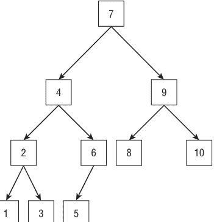

**图 1-1：** 在完全二叉树中搜索需要 O(log N) 步。

以下伪代码展示了搜索图 1-1 所示树以找到特定项的一种方法。

```
Node: FindItem(Integer: target_value)
Node: test_node = <root of tree>

Do Forever
// 如果我们超出了树范围。该值不存在。
If (test_node == null) Return null

If (target_value == test_node.Value) Then
    // test_node 持有目标值。这是我们需要的节点
    Return test_node
Else If (target_value < test_node.Value) Then
    //移动到左孩子。
    test_node = test_node.LeftChild
Else
    // Move到右孩子。
    test_node = test_node.RightChild
End
End Do
End FindItem
```

第 10 章将详细介绍树，但你现在应该能够通过下面的讨论掌握该算法的要点。

算法声明并初始化了变量 `test_node`，使其指向树顶部的根。（传统上，计算机程序中的树绘图时根在顶部，与真实的树不同。）它进入一个无限循环。

如果 `test_node` 为 `null`，则目标值不在树中，因此算法返回 `null`。

> null 是一个特殊值，你可以将其赋值给变量，该变量通常指向一个对象（如树中的节点）。null 意味着“此变量没有指向任何内容”。

如果 `test_node` 持有目标值，则 `test_node` 就是我们正在寻找的节点；如果值小于 `test_node` 中的值，算法将 `test_node` 设置为它的左孩子。（如果 `test_node` 位于树的底部，其 `LeftChild` 为 `null`，算法会在下次进入循环时处理该情况）。

如果 `test_node` 的值不等于 `target_value` 且不小于 `target_value`，那么它一定大于 `target_value`。在这种情况下，算法将 `test_node` 设置为它的右孩子。（同样，如果 `test_node` 位于树的底部，其 `RightChild` 为 `null`，算法会在下次进入循环时处理这种情况）。

变量 `test_node` 沿着树向下移动，最终要么找到目标值，要么在 `test_node` 为 `null` 时掉出树。

理解此算法的性能关键在于 `test_node` 在找到 `target_value` 或掉出树之前必须在树中向下移动多远。

有时算法会很幸运，立即找到目标值。如果图 1-1 中的目标值是 7，算法只需一步就能找到它并停止。

即使目标值不在根节点上——例如，如果它是 4——程序也可能只需要检查树的一部分即可停止。

然而，在最坏的情况下，算法需要从顶到底部搜索树。


树大约一半的节点位于底部且缺少孩子。如果这棵树是完全树，即每个节点恰好有零或两个孩子，那么底部就能轻松容纳树的一半节点。如果你在树中搜索随机选择的值，算法在大多数时候都必须遍历树的大部分高度。

现在问题是：“树有多高？”一个高度为 `H` 的完全二叉树有 `2H` 个节点。从另一个方向来看，一个包含 `N` 个节点的完全二叉树的高度为 `log(N)`。因为算法在最坏（以及平均）情况下从上到下搜索，而且树的高度大约是 `log(N)`，所以算法的运行时间为 `O(log2(N))`。

此时，对数的一个奇特性发挥了作用。你可以使用此公式将对数从底 `A` 转换为底 `B`：

```
logA(x) = log(x) / logA(B)
```

设置 `B = 2`，你可以使用此公式将 `O(logA(N))` 转换为任何其他底数 `A`。

```
O(logA(N)) = O(logA(N) / logA(2))
```

值 `1 / log(2)` 对于任何给定的 `A` 都是常数，而大 `O` 表示法忽略常数，因此对于任何底数，`O(log N)` 都是常见的。

# 第 1 章 ■ 算法基础

## `N`

在章节“1”中描述的 `FindLargest` 算法具有 `O(N)` 性能。请参见该章节的解释。

函数 `N` 的增长速度比 `log(N)` 和 `sqrt(N)` 快，但仍不过快，因此具有 `O(N)` 性能的算法效果良好。

## `N log`

假设算法遍历问题中的所有项，然后对于每个项，对该项执行某种 `O(N)` 计算。在这种情况下，算法具有 `O(N log)` 或 `O(N log)` 性能。

或者，算法可能会执行某种 `O(N)` 操作，并在每一步对项执行某些操作。

例如，你之前构建了一个包含 `N` 个元素的排序树。你还有一个包含 `N` 个值的数组，你想知道数组中的哪些值在树中。一种方法是遍历数组中的值。对于每个值，你可以可以使用之前的方法在树中搜索该值。算法检查 `N` 个项，每个项执行 `log(N)` 步，总运行时间为 `O(N log)`。

许多通过比较项工作的排序算法具有 `O(N log N)` 的运行时间。事实上，可以证明任何通过比较项进行排序的算法都必须至少使用 `O(N log N)` 步——在大 `O` 表示法中这就是你能做的最好的。由于常数的原因，某些算法比其他算法更快。

## `N`

遍历所有输入，然后对每个输入再次遍历输入的算法具有 `O(N²)` 性能。例如，在章节“4”中描述的 `ContainsDuplicates` 算法运行时间为 `O(N²)`。请参见该章节对该算法的描述和分析。

`N` 的其他幂次，如 `O(N³)` 和 `O(N⁴)`，是可能的且显然比 `O(N²)` 慢。

## `sqrt N`

某些算法具有 `O(sqrt(N))` 性能（`sqrt` 是平方根），但它们并不常见，现在书中也有涵盖。

函数 `sqrt(N)` 的增长速度比 `log(N)` 慢。

## 多项式

如果一个算法涉及任何关于 `N` 的多项式，则认为它具有多项式运行时间。`O(N)`、`O(N²)`、`O(N³)` 甚至 `O(N⁴)` 都是多项式运行时间。

多项式运行时间在某些意义上意味着这些问题是可以解决的。接下来描述的指数和分形运行时间增长极快，因此具有这些运行时间的算法对于非常小的输入数量来说是实用的。

对于几个城市来说，这并不难，但当城市很多时，问题就会变得具有挑战性。最明显的方法是尝试城市的每一种排列。按照该算法，你可以为第一个城市选择 `N` 种可能的城市。在选择之后，你有 `N-1` 种可能的第二个城市，依此类推，因此排列排列总数为 `N x (N-1) x (N-2) ... x 1 = N!`。

## 函数的可视化

表 1-1 显示了前述节中描述的运行时函数的一些值，以便你看到这些函数增长得有多快。

表 1-1：不同输入下的函数值

| N | LOG₂(n) | n | n² | 2ⁿ | n! |

|---|---|---|---|---|---|

| 1 | 0 | 1 | 1 | 2 | 1 |

| 5 | 2.32 | 2.23 | 25 | 32 | 625 |

| 10 | 3.32 | 3.16 | 100 | 1,024 | 1.0×10⁹ |

| 15 | 3.90 | 3.87 | 125 | 3.3×10⁴ | 2.9×10¹⁴ |

| 20 | 4.32 | 4.47 | 20 | 400 | 1.0×10⁶ | 5.24×10²⁴ |

| 50 | 5.64 | 7.07 | 50 | 2,500 | 1.1×10⁵ | 1.8×10⁸³ |

| 100 | 6.64 | 10 | 100 | 1x¹⁴ | 1.3×10³⁰ | 1.0×10⁹⁸ |

| 1000 | 9.96 | 31.62 | 100 | 1,000 | 1x¹⁶ | 1.1×10³⁰ |

| 10000 | 13.28 | 100 | 1x¹⁴ | 1x¹⁸ | — |

| 100000 | 16.60 | 316.22 | 1x¹⁵ | 1x¹⁰⁰ | — |

图 1-2 显示了这些函数的图表。某些函数经过了缩放，以便更好地适应图表显示，但你可以很容易看出当 `x` 增大时哪一个增长得最快。即使除以 100，阶乘函数在图表中也停留不了多久。

## 实际考虑

虽然理论行为对于理解算法的运行时行为非常重要，但由于几个原因，实际考虑在现实世界的性能中也起着重要作用。

时间分析通常认为所有步骤消耗相同的时间，尽管事实可能并非如此。例如，创建和销毁新对象可能比从数组的一个部分合并整数值到另一个部分要花费得多的时间。在这种情况下，使用数组的算法可能优于使用大量对象的算法，即使后者更好。插入排序的一部分需要将数组中的某些项向下移动一个位置，以便在它们之前插入新项。这是一个缓慢的过程，并在很大程度上贡献了 `O(n²)` 的性能。然而，许多程序可以使用一次性移动内存块的函数（如 `.NET` 程序中的 `RtlMoveMemory` 和 `Windows C++` 程序中的 `MoveMemory`）。程序与其遍历数组并逐个移动项，不如调用这些函数一次性移动整组数组值，从而使程序快得多。

仅仅因为算法具有特定的渐近性能，并不意味着你可以利用编程环境提供的任何工具来提高性能。某些编程环境还提供了可以执行本书中所述的某些算法相同任务的工具。例如，许多库包含了排序例程，它们在排序数组方面做得非常好。`C#` 和 `Visual Basic` 使用的 `Microsoft .NET Framework` 包含 `Array.Sort` 方法，其使用的实现你不太可能超过你自己的代码——至少在通常情况下。对于特定问题，如果你有关于数据的额外信息，仍然可以超越 `Array.Sort` 的性能。（欲需更多信息，请阅读第 6 章中的计数排序）。

可能还有其他专用的库可以帮助你完成任务。例如，你可能可以使用网络分析库，而不是编写自己的网络工具。同样，数据库工具可以节省你大量构建树和排序时间的大量工作。构建你自己的平衡树可能会获得更好的性能，但使用数据库的工作量更少。

如果你的编程工具包含了执行这些算法之一任务的函数，请尽量使用它们。你可能会获得比自己实现的更好的性能，而且需要调试的工作更少。最后，最好的算法并不总是是最快的。如果你需要处理大型问题，简单的算法可能会更好。

# 第 1 章 ■ 算法基础

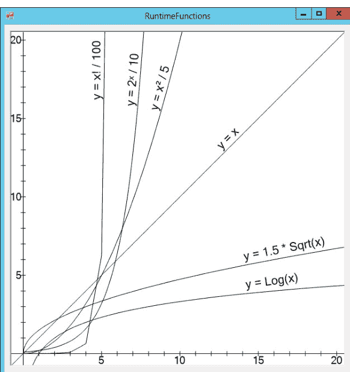

**图 1-2:** 对数、平方根、线性甚至多项式函数以合理的速度增长，但指数和阶乘函数的增长速度惊人。

许多编程环境还提供了比基本算法技术更高效的操作系统函数。例如，插入排序的一部分需要你将数组中的某些项向下移动一个位置，以便在它们之前插入新项。这是一个缓慢的过程，并在很大程度上贡献了 `O(n²)` 的性能。然而，许多程序可以使用一次性移动内存块的函数（如 `.NET` 程序中的 `RtlMoveMemory` 和 `Windows C++` 程序中的 `MoveMemory`）。程序与其遍历数组并逐个移动项，不如调用这些函数一次性移动整组数组值，从而使程序快得多。

为了充分利用算法的优势，你不仅需要理解它是如何工作的，还需要理解它的性能。本章解释了大 `O` 表示法，你可以用它估计问题规模变化时运行时会发生的变化。本章还描述了一些导致常见运行时函数的算法情况。图表展示了这些方程的图像，让你感知它们增长的速度。作为一个经验，以多项式时间运行的算法通常足够处理中等规模的问题。然而，指数或阶乘运行时间的算法随着问题规模的增加而增长极快，因此只能在规模较小时运行。现在你已经了解如何分析算法速度，可以学习特定的算法了。下一节讨论数值算法。它们不需要复杂的数据结构，因此通常很快。

## 练习

- 1. “规则 4”节描述了一个运行时为 `O(N²)` 的重复检查算法。考虑该算法的改进版本：

```
Boolean: ContainsDuplicates(Integer: array[])
// 遍历数组中除最后一个的所有项。
For i = 0 To <largest index> - 1
  // 遍历 i 之后的项。
  For j = i + 1 To <largest index>
    // 查看这两个项是否重复。
    If (array[i] == array[j]) Then True
Next j
Next i
// 如果我们到达这里，说明没有重复项。
Return False
End ContainsDuplicates
```

这个新版本的运行时是多少？

- 2. 表 1-1 显示了问题规模 `N` 与各种运行时函数之间的关系。研究这种关系的另一种方法是查看具有特定速度的计算机在给定时间内可以执行的最大问题规模。

例如，假设计算机每秒可以执行 100 万次算法步骤。考虑一个 `O(N²)` 时间运行的算法。在 1 小时内，计算机可以解决 `N` 为 60,000 的问题（因为计算机在 1 小时内可以执行 3,600,000,000 步）。

创建一个表格，显示对于表 1-1 中列出的每个函数，该计算机在每秒、每小时、一天、一周和一年内可以执行的最大问题规模 `N`。

- 3. 有时，你在大 `O` 表示法中忽略的常数是非常重要的。例如，假设有两个可以执行相同任务的算法。第一个需要 `1500 N` 步，另一个需要 `30 × N²` 步。对于 `N` 的哪些值，你会选择每种算法？

- 4. “假设你有两个算法——一个使用 `N³ / 75 / 4 + N + 10` 步，另一个使用 `N / 2 + 8` 步。对于 `N` 的哪些值，你会选择每种算法？”

- 5. 假设一个程序以 `N` 个字母作为输入，并生成这些字母所有可能的无序对。例如，输入 `ABCD`，程序会生成组合 `AB`、`AC`、`AD`、`BC`、`BD` 和 `CD`。（这里无序意味着 `AB` 和 `BA` 被视为同一对。）。该算法的运行时间是多少？

- 6. 假设一个具有 `N` 个输入的算法为 `N × N × N` 立方体表面的每个单元格生成值。该算法的运行时间是多少？

- 7. 假设一个具有 `N` 个输入的算法为 `N × N × N` 立方体边缘的每个立方体生成值，如图 1-3 所示。该算法的运行时间是多少？

`N = 3`

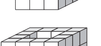

`N = 4`

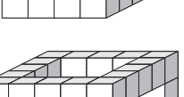

`N = 5`

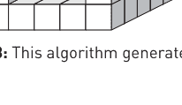

图 1-3：该算法为立方体“骨架”上的立方体生成值。

# 第 1 章 算法基础

8. “假设你有一个算法，对于 `N` 个输入，为图 1-4 所示形状的每个小立方体生成值。假设显而易见的隐藏立方体存在，使得图中形状不是空的，该算法的运行时间是多少？”

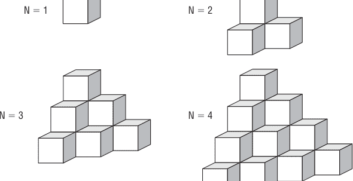

图 1-4：该算法随着 `N` 的增加在形状上增加了一层。

9. 你可以有一个没有数据结构的算法吗？你可以有一个没有算法的数据结构吗？

10. 考虑以下两个刷篱的算法：

```
Algorithm1()
  For i = 0 To <篱中木板的数量> - 1
    <漆 i 号木板>
  Next i
  End Algorithm1
```

```
Algorithm2(Integer: first_board, Integer: last_board)
  If (first_board == last_board) Then
    // 只有一个木板。直接漆它。
    <漆 first_board 号木板>
  Else
    // 有多个木板。将木板
    // 分成两组并递归地漆它们。
    Integer: middle_board = (first_board + last_board) / 2
    Algorithm2(first_board, middle_board)
    Algorithm2(middle_board, last_board)
  End If
```

这两个算法的运行时间是多少（其中 `N` 是篱中木板的数量）？哪种算法更好？

11. 斐波那契数可以通过以下规则递归定义：

```
Fibonacci(0) = 1
Fibonacci(1) = 1
Fibonacci(n) = Fibonacci(n - 1) + Fibonacci(n - 2)
```

斐波那契数列从值 1, 1, 2, 3, 5, 8, 13, 21, 34, 55, 89 开始。

斐波那契函数与图 1-2 所示的运行时间函数相比？

# 第 2 章

# 数值算法

数值算法计算数字。它们执行诸如随机化数值、将数字分解为质因数、寻找最大公约数以及计算几何面积等任务。

所有这些算法在偶尔是有用的，但它们也展示了用的算法技术，如自适应算法、蒙特卡洛模拟以及使用表格存储中间结果。

## 数据的随机化

随机化在许多应用中起着重要作用。它让程序模拟随机过程，测试算法以观察它们在随机输入下的表现，并为困难问题寻找解决方案。后面章节“执行数值积分”描述的蒙特卡洛积分使用随机选择的点来估计复杂几何面积的大小。任何随机算法的第一步都是生成随机数。

## 生成随机值

尽管许多程序员谈论“随机”数生成器，但计算机用于产生数字的任何算法都不是真正随机的。如果你知道算法的细节及其内部状态，你就可以正确预测它生成的“随机”数。

为了获得真正不可预测的随机性，你需要使用计算机程序以外的源。例如，你可以使用测量放射性样本发射粒子的探测器来生成随机数。

其他真随机源来源包括掷骰子、大气噪声和布朗运动。遗憾的是，这些方法缓慢且复杂，因此大多数应用程序使用伪随机数生成器（`PRNGs`）。

`PRNG` 的一个特点是其优势，你可以使用特定的种子生成相同的序列。这可能是一个缺点，因为它意味着数字是可预测的。

能够重复数字让某些应用程序以紧凑格式存储数据。例如，假设程序需要在地图上进行复杂的随机游。程序程序保存种子。这样每当需要绘制路线时，可以使用种子重新初始化 `PRNG` 以产生相同的。创建数字的一个简单例子是线性同余生成器，它使用以下关系 `X_{n+1} = (A × X_n + B) mod M`，其中 `A` 和 `B` 是常数。

```
  X_0 = 0
  X_1 = (7 × 0 + 5) mod 11 = 5
  X_2 = (7 × 5 + 5) mod 11 = 7
  X_3 = (7 × 7 + 5) mod 11 = 4
  X_4 = (7 × 4 + 5) mod 11 = 10
  X_5 = (7 × 10 + 5) mod 11 = 9
  X_6 = (7 × 9 + 5) mod 11 = 2
  X_7 = (7 × 2 + 5) mod 11 = 8
  X_8 = (7 × 8 + 5) mod 11 = 6
  X_9 = (7 × 6 + 5) mod 11 = 3
  X_10 = (7 × 3 + 5) mod 11 = 0
```

因为 `X_{10} = X_0`，序列重复了。值 `0, 5, 7, 4, 10, 9, 2, 8, 6, 3` 看起来相当随机。但现在你知道了程序使用的方法，如果有人告诉你当前的数字，你就可以正确预测。

> NOTE 大多数编程语言都内置了你可以使用的 `PRNG` 方法，而自己自己编写。这些方法通常很快，并在重复之前产生长数字序列。

图 2-1 所示的 `RandomTrees` 使用值来表示随机树。输入种子并点击生成随机树。如果两个种子仅相差 1，它们也会产生非常不同的结果。

`RandomTrees` 使用你输入的种子值生成参数，例如树在每一步创建的分支数量、分支相对于父分支弯曲的角度以及每个分支比父分支短多少。你可以从书籍网站下载程序以查看细节。

如果你两次输入相同的种子，两次生成的都是相同的树。

## 28 第 2 章 数值算法

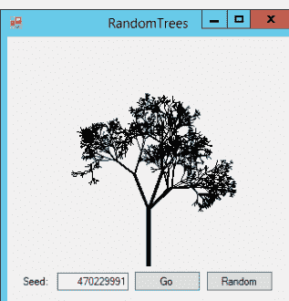

**图 2-1:** 即使是微小的种子差异导致非常不同的随机树。

## 加密安全的 PRNG

任何线性同余生成器都有重复的周期，这使得它无法用于加密目的。

例如，你使用 `PRNG` 为消息中的每个字母生成一个值来对消息进行加密，然后将该值解密为字母。对于字母 `A`，3 会变成 `D`，因为在字母表中 `A` 后面有三个字母。如果到了 `Z`，就会绕回 `A`。所以，例如 `Y + 3 = B`。

只要数字序列是随机的，这种技术就非常有效，但线性同余生成器的种子值数量是有限的。要破解它，你只需要尝试用每一个可能的种子值对消息进行解密。对于每次解密，程序都可以查看字母的分布，看结果看起来是否像真实的文本。如果你选错了种子，每个字母出现的频率大致相等。如果你猜中了正确的种子，`E` 和 `T` 等字母出现的次数会比 `J` 和 `X` 等字母多得多。如果字母分布不均匀，你可能猜中了种子。

这看起来工作量很大，但在现代计算机上这并不难。如果种子值是一个 32 位整数，只有 40 亿个可能的种子值。现代计算机只需要几秒钟或最多几分钟就能检查所有可能的种子。

加密安全的伪随机数生成器（`CSPNG`）使用更复杂的算法来生成更难预测的数字，并在不循环的情况下产生更长的序列。它们通常具有更大的种子值。一个简单的 `PRNG` 可能会使用 32 位种子。而 `CSPNG` 可能会使用 1000 位的密钥来初始化其算法。


CSPRNG 非常有趣且非常“随机”，但它们也有几个缺点。它们很复杂，因此比简单的算法运行慢。它们可能不允许你手动完成所有的初始化，因此你可能无法轻松生成可重复的序列。如果你想使用更简单的 PRNG，幸运的是，大多数算法不需要 CSPNG，所以你可以使用更简单的算法。

## 确保公平性

通常程序需要使用公平的 PRNG。公平的 PRNG 是指以相同概率产生所有可能输出的生成器。不公平的 PRNG 被称为偏的。例如，一个出现正面的概率为三分之二的硬币就是偏的。

许多编程语言都提供了可以在任何所需的范围内产生随机数的方法。但如果你需要使用代码将 PRNG 的值转换为特定范围，你需要小心以公平的方式进行。

线性同余生成器产生介于 0（包含）和 M（不包含）之间的数字，其中 M 是生成器方程中的模数：

```
X_{n+1} = (A \times X_n + B) \bmod M
```

通常程序需要 0 到 M 之外的范围内的随机数。将生成器产生的数字映射到 Min 到 Max 范围的一种显而易见但不办法是使用以下方程：

```
result = Min + number Mod (Max - Min + 1)
```

例如，为了获取 1 到 100 之间的值，你计算如下：

```
result = 1 + number Mod (100 - 1 + 1)
```

这个方法的问题在于，它可能会让某些结果比其他结果更容易出现。为了理解为什么，请考虑一个小例子，假设 M = 3, Min = 0, Max = 1。如果生成器运行良好，它以大致相等的概率产生值 0, 1 和 2。如果你将这三个值代入前面的方程，你将得到表 2-1 所示的值。

表 2-1: 使用模数映射的 PRNG 值和结果

| 生成器值 | 结果 |
| :--- | :--- |
| 0 | 0 |
| 1 | 1 |
| 2 | 0 |

在表 2-1 中，结果0出现的频率是结果1 的两倍，因此最终结果是偏的。

在模 M 非常大的真实 PRNG 中，这个问题较小，但仍然存在。

更好的方法是将 PRNG 产生的值转换为 0 到 1 之间的分数，然后乘以所需的范围，如公式所示：

```
result = Min + (number ÷ M) × (Max – Min)
```

将伪随机值从一个范围转换为另一个范围的另一种方法是简单忽略任何落在目标范围之外的结果。在上一个例子中，你使用有限的 PRNG 生成一个 0 到 2 之间的值。如果你得到了 2（在目标范围之外），则忽略它并获取另一个数字。

对于一个稍微真实一点的例子，假设你想给你的朋友之一一个饼干，你有一个六面骰子。在这种情况下，你只需要反复掷骰子，直到得到 1 到 4 之间的值。

## 从偏的源中获取公平性

即使 PRNG 不公平，也可能有生成公平数字的方法。例如，假设你认为某枚硬币是不公平的。你不知道得到正面或反面的概率，但你怀疑概率不是 0.5。在这种情况下，以下算法：

```
投掷两次硬币。
如果结果不同，返回正面。
如果结果相同，返回反面。
```

为了验证这种方法有效，假设硬币是偏的，正面的概率为 p。那么反面的概率为 1-p。两次都是正面的概率是 p^2，两次都是反面的概率是 (1-p)^2。各不同的概率是 2p(1-p)。得到相同的概率是 p^2 + (1-p)^2，得到不同的概率是 2p(1-p)。如果 p 不是 0.5，那么 p^2 + (1-p)^2 不等于 2p(1-p)，所以该算法是偏的。然而，如果我们投掷三次硬币，得到两个以上正面的概率是 p^3 + 3p^2(1-p)，得到两个以上反面的概率是 (1-p)^3 + 3(1-p)^2p。这两个概率对于任何 p 都相等，所以三次的算法是公平的。

## 数组随机化

程序的一个常见任务是随机化中的元素。例如，假设一个调度程序需要分配员工。如果程序按照字母顺序、数据库中出现的顺序或其他状态分配员工，总是分配到最后一个班的员工

某些算法可以使用随机性来防止最坏的情况。例如，快速排序算法性能良好，但如果它必须排序的值已经是排序好的，该算法性能会非常糟糕。避免这种情况的一种方法是在排序之前随机化变量。

以下算法展示了随机化数组的方法：

```
RandomizeArray(String: array[])
  Integer: max_i = <数组的上界>
  For i = 0 To max_i - 1
    // 为数组中的 i 位置选择元素。
    Integer: j = <i 到 max_i 之间的伪随机数>
    交换 array[i] 和 array[j] 的值
  Next i
End RandomizeArray
```

该算法访问数组中的每个位置一次，因此运行时间为 O(N)。

注意，重复此算法并不会让数组变得“随机”。当你洗一副扑牌时，初始位置靠近的元素倾向于保持靠近（尽管可能变得没那么近了），所以你需要洗牌几次才能获得合理的随机结果。该算法在单次遍历中就能完全随机化数组，因此再次运行它会浪费时间。

## 均匀随机数组

该算法的另一个重要考虑因素是它是否产生了均匀分布。换句话说，元素出现在任何位置的概率是否对于所有位置都是相同的？例如，如果元素出现在第一个位置的概率是其的一半，那就很糟糕了。

我在引言中提到过，这本书不包含长长的数学证明。所以如果你愿意，可以跳过这部分讨论。如果你了解某些概率，你可能会对这段讨论感兴趣。

对于一个特定的元素，考虑它出现在第 $k$ 位置的概率。为了出现在第 $k$ 位置，它必须没有出现在 $1, 2, \dots, k-1$ 位置。

定义 $P_i$ 为元素没有出现在第 $i$ 位置的概率。同样定义 $P_k$ 为元素出现在第 $k$ 位置的概率，且它没有出现在 $1, 2, \dots, k-1$ 位置。元素出现在第 $k$ 位置的总概率是 $P_{-1} \times P_{-2} \times \dots \times P_{k-1} \times P_k$，其中 $P_i$ 是 $1/N$，所以 $P_{-1} = (N-1)/N$。

在第一个元素分配后，$N-1$ 个元素被分配到第 2 位置，所以 $P_2$ 是 $1/(N-1)$，而 $P_3$ 是 $(N-2)/(N-1)$。

更一般地说，$P_i = (N-i)/(N-i+1)$，$P_j = 1/j$，且 $P_{i-1} = (N-i)/(N-i+1)$。

如果你相乘概率 $P_{-1} \times P_{-2} \times \dots \times P_{k-1} \times P_k$，得到以下方程：

```
$\frac{N-1}{N} \times \frac{N-2}{N-1} \times \frac{N-3}{N-2} \times \dots \times \frac{N-(k-1)}{N-(k-2)} \times \frac{N-k}{N-(k-1)}$
```

观察这个方程，你会发现每一项的分子都会消掉下一项的分母。当你完成消消后，方程简化为 $1/N$。

这意味着元素出现在第 $k$ 位置的概率无论 $k$ 是多少，都是 $1/N$，因此这种排列是均匀的。

随机化数组的任务是从数组中不重复地选取一定数量的元素。

例如，假设你要从一个包含 100 个名字的数组中随机抽取 5 个名字。选取 5 个的一种方法是对这 100 个名字进行随机化，然后取出前五个。任何特定名字出现在五个位置之一的概率都是相同的，因此抽取是均匀的。

# 第 2 章 数字算法

## 非均匀分布

有些程序需要生成非均匀分布的伪随机数。这些程序通常模拟其他随机数生成。例如，程序可能需要生成 2 到 12 之间的数字来模拟掷骰子。

你不能直接选取 2 到 12 之间的伪随机数，因为你无法获得与掷骰子相同的概率。

解决方案是通过生成 1 到 6 之间的两个数字并将它们相加来模拟掷骰子。

## 寻找最大公约数

两个整数的最大公约数（GCD）是能同时整除这两个数字的最大整数。例如，`GCD(60, 24) = 12`，因为 12 是能整除 60 和 24 的最大整数。（GCD 似乎是一个晦涩的函数，但在广泛用于金融通信的程序中非常有用。）

> 注意：如果 `GCD(A, B) = 1`，则称 `A` 和 `B` 为互质。

寻找 GCD 的一种方法是对这两个数进行因数分解，并查看它们的公因子。然而，希腊数学家在公元前 300 年的《几何原本》中记录了一种更快的算法版本。基于欧几里得的工作，该算法被称为欧几里得算法或辗转除法：

```
GCD(Integer: A, Integer: B)
While (B != 0)
  Integer: remainder = A Mod B
  // GCD(A, B) = GCD(B, remainder)
  A = B
  B = remainder
End While
End GCD
```

例如，考虑 `GCD(4851, 3003)`。表 2-2 显示了每一步中 `A`、`B` 和 `A Mod B` 的值。

**表 2-2：** 计算 `GCD(4851, 3003)` 使用的值

| A | B | A Mod B |
| :--- | :--- | :--- |
| 4851 | 3003 | 1848 |
| 3003 | 1848 | 1155 |
| 1848 | 1155 | 693 |
| 1155 | 693 | 462 |
| 693 | 462 | 231 |
| 462 | 231 | 0 |
| 231 | 0 | |

当 `B` 变为 0 时，变量 `A` 保存了 GCD——在本例中为 231。为了验证结果，注意 `4851 = 231 × 21` 且 `1848 = 231 × 8`，所以 231 整除这两个数字。数字 21 和 8 没有公因子，所以 231 是整除 4851 和 1848 的最大整数。

> GCD：如果你真的想的话，这是你也可以跳过的另一个数学解释。欧几里得算法的关键是 `GCD(A, B) = GCD(B, A Mod)`。

# 第2章 数值算法

例如，假设你想计算 `7^6`。首先，算法计算 `7^1`、`7^2` 和 `7^4`。它停止计算，是因为下一个幂 8 大于所需的幂次 6：

`7^1 = 7`

`7^2 = (7^1)^2 = 7^2 = 49`

`7^4 = (7^2)^2 = 49^2 = 2401`

接下来，算法利用第二个事实，通过已经创建的 2 的幂之和来构建 6。如果你将 6 看作是 `2 = 2 + 4`。利用第二个事实，你知道 `7^6 = 7^2 × 7^4 = 49 × 2401 = 117,649`。

执行此计算需要通过两次乘法来计算 `7^2` 和 `7^4`，再加一次乘法来得到最终结果，总共三次乘法。这比计算 `7 × 7 × 7 × 7 × 7` 的乘法次数少，但在这个例子中差别很小。

更通用地说，对于指数 P，算法计算 `log(P)` 次 A 的幂。然后它搜索 A 的二进制数位，以查看为了得到最终结果必须相乘哪些幂次。（如果 P 的某个二进制数位为 1，则结果应包含相应的 2 的幂。对于之前的例子，6 的二进制表示是 110，因此包含了 2 的第二和第三幂：`2^2` 和 `2^1`）。

在二进制中，值 P 有 `log(P)` 位数字，因此总时间为 `O(log P) + O(log P)`。如果 P 是 100，`log(P)` 大约为 20，因此该算法大约使用 20 步（多达 40 次乘法），这小于 100 万。

该算法的一个局限性是，大幂的数值增长得极快。即使是像 `7^{300}` 这样的“小”值也有 254 位小数。这意味着计算大幂所需的巨型数字之间的乘法速度会变慢，并占用大量的空间。

幸运的是，这些巨型幂最常见的应用是可以在模运算中执行所有操作的加密算法。虽然模很大，但它仍然限制了数字的大小。例如，如果模有 100 位，两个 100 位数字的积可能有超过 200 位。然后你用模对结果进行取模，再次得到一个不超过 100 位的数字。每一步对数字进行取模都会使其稍微变小，但这意味着你可以计算实际上上无限大的数值。

## 处理素数

你可能已经知道，素数是一个计数数（大于 1 的整数），它的因子只有 1 和它。合数是大于 1 的不是素数的计数数。

素数在某些应用中起着重要作用，它们的特殊属性使得某些操作变得更容易或更困难。例如，某些加密算法使用两个大素数的乘积来提供安全性。两个大素数的乘积难以被分解，这一事实使得该算法是安全的。

以下章节将讨论处理素数的常用算法。

## 寻找素因数

寻找一个数字素因数最明显的方法是尝试用该数字之间 2 到比该数字小的所有数字来除它。当一个可能的因子能整除该数字时，保存该因子，将数字除以它，并继续尝试更多可能的因子。注意，如果数字包含多个相同的因子，在继续下一个之前，需要再次尝试该因子。

例如，要找到 127 的素因数，你会尝试用 127 除以 2, 3, 4, 5 等，直到达到 126。

以下伪代码显示了该算法：

```
List Of FindFactors(Integer: number)
List Of Integer: factors
Integer: i = 2
While (i < number)
  // 提取 i 的因子。
  While (Mod i == 0)
    // i 是一个因子。将其加入列表。
    factors.Add(i)
  // 将数字除以 i。
  number = number / i
End While
  // 检查下一个可能的因子。
  i = i + 1
End While

// 如果数字还有剩余，它也是一个因子。
If (number > 1) Then factors.Add(number)

Return factors
End FindFactors
```

如果数字是 N，该算法的运行时间为 `O(N)`。

你可以通过三个关键观察显著改进这种方法：

- 你不需要测试该数字是否被 2 以外的任何偶数整除，因为如果它被任何偶数整除，它就能被 2 整除。这意味着你只需要检查是否被 2 整除，然后添加奇数而不是所有可能的因子。这样做可以将运行时间减少了一半。

- 你只需要检查直到该数字平方根的因子。如果 `n = p × q`，则 `p` 或 `q` 必小于或等于 `sqrt(n)`。（如果两者都大于 `sqrt(n)`，它们的积将大于 `n`）。如果你检查到 `sqrt(n)`，你将找到较小的因子，这将运行时间缩短到 `O(sqrt(n))`。

- 每当你除以数字时，都可以更新边界。这些观察导致了以下改进算法：

```
List Of FindFactors(Integer: number)
List Of Integer: factors
// 提取 2 的因子。
While (Mod number == 0)
    factors.Add(2)
    number = number / 2
End While

// 寻找奇数因子。
Integer: i = 3
Integer: max_factor = Sqrt(number)
While (i <= max_factor)
  // 提取 i 的因子。
  While (Mod i == 0)
    // i 是一个因子。将其加入列表。
    factors.Add(i)
    // 将数字除以 i。
    number = number / i
  End While
  // 检查下一个可能的因子。
  i = i + 2
  max_factor = Sqrt(number)
End While

// 如果数字还有剩余，它也是一个因子。
If (number > 1) Then factors.Add(number)

Return factors
```

# 第 2 章 数值算法

```
// 跳到下一个素数，跳过偶数。
next_prime = next_prime + 2
While (next_prime <= max_number) And (is_composite[next_prime])
    next_prime = next_prime + 2
  End While
End While
```

```
// 将素数拷贝到列表。
List Of Integer: primes
For i = 2 to max_number
    If (Not is_composite[i]) Then primes.Add(i)
Next i
```

```
// 返回素数。
Return primes
End FindPrimes
```

可以证明该算法的运行时间为 `O(N log(log N))`，但这超出了本书的范围。

## 素数性测试

在前节“寻找质因数”中描述的算法对数字进行因数分解。确定一个数字是否为素数的方法之一是通过算法对其进行分解。如果算法没有找到任何因子，则该数字是素数。

正如该节提到的，该算法对于较小的数字效果良好。但如果一个数字有100位，程序必须执行的步骤将是一个50位的数字。即使是是最快的计算机也无法在合理的时间内完成操作。（每秒计算1万亿步也需要 3 × 10^{30} 年。）

某些加密算法需要使用大素数，因此这种测试数字是否为素数的方法并不适用。坦率地说，还有其他方法。费马测试是其中较简单的一种。

费马的“小定理”指出，如果 p 是素数且 1 ≤ n ≤ p，则 `n^{p-1} \pmod p = 1`。换句话说，如果你将 n 提升到 `p-1` 次并对结果对 `p` 取模，结果为 1。

例如，假设 p = 11 且 n = 12。那么 `n^{p-1} \pmod p = 2^{10} \pmod{11} = 1,024 \pmod{11}`。由于 `1,024 = 11 × 93 + 1`，所以 `1,024 \pmod{11} = 1`，符合预期。

注意，即使 p 不是素数，`n^{p-1} \pmod p = 1` 也是可能的。在这种情况下，值 n 被称为费马谎言（Fermat liar），因为它错误地暗示了 p 是素数。

如果 `n^{p-1} \pmod p ≠ 1`，n 被称为费马证人（Fermat witness）；它证明 p 不是素数。


可以证明，对于自然数 `p`，1 到 `p` 之间至少有一数的数字是费马证人。换句话说，如果 `p` 是素数且你在 1 到 `p` 之间随机选择一个 `n`，那么有 0.5 的概率 `n` 是费马证人，即 `$n^{p-1} \pmod p \neq 1$`。

当然，你也有可能运气不好，随机选择了一个费马谎言作为 `n`。如果你重复测试多次，可以增加在存在证人时选到该证人的概率。

可以证明，每次测试都有 50% 的概率选到费马证人。所以如果 `p` 通过了 `k` 次测试，你有 1/2 的概率是运气不好，每次都选了费马谎言。换句话说，`p` 实际上是一个伪装成素数的合数的概率为 `1/2^k`。

例如，如果 `p` 通过了 10 次测试，则 `p` 不是素数的概率为 `1/2^10 ≈ 0.00098`。如果你想测试得更多，请重复测试 100 次。如果 `p` 通过了所有 100 次测试，`p` 不是素数的概率只有 `1/2^{100} ≈ 7.8 × 10^{-31}`。

下面的伪代码是一种使用此方法判断一个数字是否可能是素数的算法：

```
// 如果该数字是（可能的）素数，返回 true。
Boolean: IsPrime(Integer: p, Integer: max_tests)
// 执行测试最多 max_tests 次。
For test = 1 To max_tests
  <在 1 和 p 之间选取一个伪随机数 n（不包含边界）>
  If (n^{p-1} Mod p != 1) Then Return false
Next
// 该数字可能是素数。
// 有 1/2^{max_tests} 的概率它不是素数。
Return true
```

### IsPrime

> 注意：这是一个概率算法的示例——它以一定的概率产生正确的结果。算法仍有极小的概率是错误的，但你可以重复测试，直到达到你需要的任何确定性水平。

如果数字 `p` 非常大——这是该问题变得有趣的唯一时刻——使用乘法可能会花费长时间。幸运的是，你知道如何通过在前节“幂运算”中描述的快速幂来快速完成操作。

一旦你知道了如何判断一个数字是否（可能是）素数，你就可以编写一个选取素数的算法：

```
// 返回一个具有 max_digits 位的（可能的）素数。
Integer: FindPrime(Integer: num_digits, Integer: max_tests)
Repeat
  <选取一个具有 num_digits 位的伪随机数 p>
  If (IsPrime(p, max_tests)) Then Return p
```

### FindPrime

## 数值积分

数值积分有时称为求（quadrature），是数值技术近似函数定义的曲线下方面积的过程。当函数是单变量 `y = F(x)` 时，结果是二维面积，但某些应用可能需要计算函数 `z = F(x,y)` 定义下的三维面积。你可以计算由高维函数定义的面积。

如果函数易于理解，你可以使用微积分来寻找精确面积。例如，也许函数的方程很复杂，或者你有由物理过程产生的数据，因此你不需要微积分，但可以使用数值积分。

执行数值积分有多种方法。对我们来说最直接的方法是牛顿公式（Newton-Cotes formulas），它们使用多项式来近似函数。牛顿公式的两种基本类型是矩形法（rectangle rule）和梯形法（trapezoid rule）。

# 第2章 数值算法 45

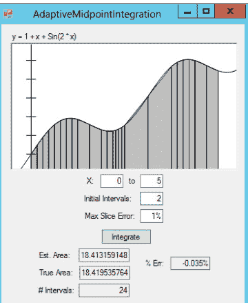

**图 2-4：** `AdaptiveMidpointIntegration` 程序使用自适应梯形规则实现了比 `TrapezoidRule` 程序更好的近似结果。

以下伪代码展示了该算法：

```
// 通过 IntegrateAdaptiveMidpoint(Float: function()) 积分
Float: xmin, Float xmax, Integer: num_intervals,
Float: max_slice_error
// 计算初始梯形的宽度。
Float: dx = (xmax - xmin) / num_intervals
double total = 0

// 累加梯形的面积。
Float: total_area = 0
Float: x = xmin
For i = 1 To num_intervals
  // 加上此切片的面积。
  total_area = total_area +
  SliceArea(function, x, x + dx, max_slice_error)
  x = x + dx
Next i

Return total_area
End IntegrateAdaptiveMidpoint
```

```
// 返回此切片的面积。
Float: SliceArea(Float: function(), Float: x1, Float: x2,
Float: max_slice_error
```

```
// 计算端点和中点的函数值。
Float: y1 = function(x1)
Float: y2 = function(x2)
Float: xm = (x1 + x2) / 2
Float: ym = function(xm)
```

```
// 计算大切片和两个子切片的面积。
Float: area1 = (x2 - x1) * (y1 + y2) / 2.0
Float: arealm = (xm - x1) * (y1 + ym) / 2.0
Float: area2 = (x2 - xm) * (ym + y2) / 2.0
Float: arealm2 = area1 + area2
```

```
// 查看我们离有多近。
Float: error = (area2 - area1) / area1
```

```
// 查看这个误差是否足够小。
If (Abs(error) < max_slice_error) Then Return arealm2
```

```
// 误差太大。划分切片并再次尝试。
SliceArea(function, x1, xm, max_slice_error) +
SliceArea(function, xm, x2, max_slice_error)
SliceArea
```

如果你使用两个初始切片运行 `AdaptiveMidpointIntegration`，程序将它们划分为图 2-4 所示的 24 个切片，并以 -0.035% 的误差估计曲线下的面积。如果你使用具有 24 个等宽切片的 `TrapezoidRule` 程序，程序的误差为 -0.072%，是自适应程序产生误差的两倍。这两个程序使用的切片数量相同，但自适应程序放置的位置更有效。

`AdaptiveTrapezoidIntegration` 示例程序使用了不同的方法来决定何时将一个切片拆分为切片。它计算函数在起始 `x` 值处的二阶导数，并将区间划分为一个切片加上每个二阶导数值一个切片。例如，如果二阶导数为 2，程序会将切片分为三部分（选择切片数量的公式有些随意。你使用不同的公式可能会获得更好的结果。）

> 在你的情况下这种方法有点粗糙，导数告诉你在任何给定点的斜率。而它的二阶导数告诉你是斜率的变化率，或者说曲线弯曲得有多快。二阶导数越高，意味着曲线弯曲越紧密，因此 `AdaptiveTrapezoidIntegration` 程序使用了更多的切片。

当然，如果你无法计算二阶导数，这种技术就无法起作用。`AdaptiveMidpointIntegration` 使用的技术在任何情况下似乎都运行良好，因此你可以回退到该技术。

# 第2章 数值算法 47

自适应技术在许多算法中都非常有用，因为它们可以在不需要的地方不浪费精力，就能产生更好的结果。图 2-5 所示的 `AdaptiveIntegration` 程序使用自适应技术来估计阴影区域的面积。该区域包括垂直椭圆和水平椭圆的并，减去椭圆内部三个圆覆盖的面积。

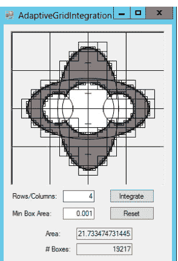

**图 2-5：** `AdaptiveGridIntegration` 程序使用自适应积分估计阴影区域的面积。

该程序将整个图像划分为一个框，并在框内定义一个点网格。对于图 2-5 中的每个点，程序使用一个具有四行四列点的网格。对于网格中的每个点，程序确定该点位于阴影区域内部还是外部。

如果框中没有任何点位于阴影区域内，程序假设该框不在区域内并忽略它。

如果框中的每个点都在阴影区域内，程序认为该框完全位于区域内，并将框的面积加到区域的估计总面积中。

如果框中的某些点位于阴影区域内，某些点位于区域外，程序会将框细分为更小的框，并使用相同的技术计算这些较小框的面积。

在图 2-5 中，`AdaptiveGridIntegration` 程序绘制了框以便你可以看到它们。你可以看到，程序在阴影区域边缘考虑的框比在区域深处或外部多得多。总之，这个例子考虑了 19,217 个框，主要集中在它所积分区域的边缘。

## 蒙特卡洛积分

蒙特卡洛积分数值积分的一种形式，程序在区域内均匀生成一系列伪随机点，并确定每个点是否位于目标区域内。完成后，程序使用位于区域内的点占的百分比来估计区域的总面积。

例如，假设生成点的区域是 20 × 20，因此其面积为 400 平方单位， 37% 的伪随机点位于区域内。该区域的面积约为 0.37 × 400 = 148 平方单位。

图 2-6 所示的 `MonteCarloIntegration` 示例程序使用这种技术来估计与 `AdaptiveGridIntegration` 程序使用的相同形状的面积。

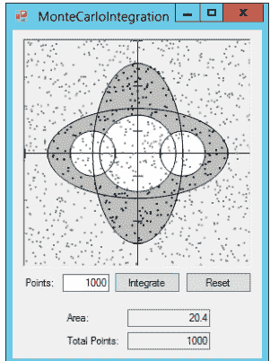

**图 2-6：** 阴影区域内部的点为黑色，区域外的点为灰色。蒙特卡洛积分通常比自适应方法更容易产生误差。

# 第2章 数值算法 49

## 寻找零

有时程序需要找出方程与 x 轴的交点。换句话说，给定方程 `$y = f(x)$`，你可能想找到 `f(x)=0` 的 `x`。这样的值被称为根。

牛顿法（也称为牛顿法）是一种迭代近似根的方法。该方法从初始猜测 `$X_i$` 开始。如果 `f(X_i)` 不足够接近 0，算法沿着 `$X_i$` 处的切线移动直到遇到 x 轴。它将交点的坐标作为新的猜测 `$X_{i+1}$`。

然后重复该过程。

困难的部分是确定如何跟随切线。如果你使用微积分找到函数的导数 `f'(x)`（也写作 `dfdx(x)`），以下方程显示了算法如何通过切线更新猜测：

```
X_{i+1} = X_i - \frac{f(X_i)}{f'(X_i)}
```

> 注意：遗憾，解释如何寻找函数的导超出本书的范围。更多信息请搜索网络或参考微积分书籍。

图 2-7 图地展示了这一过程。对应初始猜测的点标记为 1。该点的值远离 0，因此算法沿着切线移动直到遇到 x 轴。它计算新猜测的函数值，得到图 2-7 中标记为 2 的点。该点的纵坐标也远离 0，因此算法重复过程找到下一个猜测，标记为 3。算法再次重复过程找到标记为 4 的点。点 4 的纵坐标足够接近 0，算法停止。

以下伪代码描述了它：

```
// 使用牛顿法找到函数 f(x) 的根。
Float: FindZero(Float: f(), Float: dfdx(x), Float: initial_guess,
Float: maxError)
float x = initial_guess
For i = 1 To 100 // 以防出现问题，在 100 次后停止。
// 计算此点。
float y = f(x)
```

```go
// 如果误差足够小，停止。
if (Math.Abs(y) < maxError) break
```

```go
// 更新 x。
x = x - y / dfdx(x)
```

Next i

```
Return x
End NewtonsMethod
```

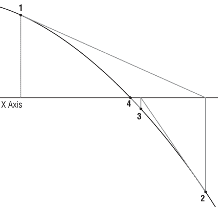

**图 2-7：** 牛顿法通过沿着函数的切线趋向零点来确定函数的根。

该算法的参数包括一个函数 `$y = F(x)$`、该函数的导数 `dfdx`、根值的估计估计以及一个可接受的最大误差。代码将变量 `x` 设置为初始估计值，然后进入一个 `For` 循环，该循环最多重复 100 次。通常情况下，算法会快速找到解决方案。但有时，如果函数具有正确的曲率，算法可能会发散且无法收敛到解。它可能会在两个不同的估计值之间反复跳动。100 次迭代的最大限制意味着程序不会永远卡住。

在 `For` 循环内部，算法计算 `F(x)`。如果结果不够接近 0，算法将更新 `x` 并重新尝试。

注意，某些函数有多个根。在这种情况下，你需要使用不同的估计值重复使用 `FindZero` 算法来寻找每个根。

# 第 2 章 ■ 数值算法 51

图 2-8 显示了 `NewtonsMethod` 示例程序，可以在本书的网站上下载。该程序使用了三次牛顿法来寻找函数 `$y = x^3 / 5 - x^2 + x$` 的三个根。圆圈表示程序在搜索每个根时的估计值。

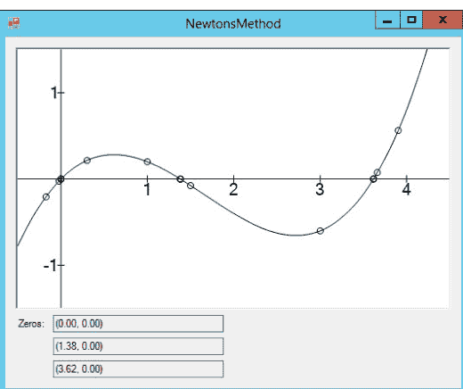

图 2-8：`NewtonsMethod` 示例程序演示了使用牛顿法寻找函数 `$y = x^3 / 5 - x^2 + x$` 的三个根。

## 总结

某些数值算法（如随机化）在各种应用中非常有用。其他算法（如质因分解和寻找最大公约数）的用途有限。如果你的程序不需要寻找最大公约数，那么 GCD 算法将没有太大帮助。

然而，这些算法所演示的技术和概念在许多其他情况下都是很有用的。例如，算法可以是概率性的思想在许多应用中都非常重要。这个思想可以帮助你设计其他无法以完美确定性工作的算法（而且这很容易成为面试题的主题）。

本章解释了公平性和偏差的概念，这是任何随机算法（例如本章也描述的蒙特卡洛积分算法）中两个非常重要的概念。

# 52 第 2 章 数值算法

本章还解释了自适应求积，这种技术允许程序将大部分工作集中在最相关的区域，而较少地关注易于处理的区域。这种让程序自适应地将大部分时间花在问题最重要部分的思想适用于许多算法。

许多数值算法（如 GCD、费马质数性测试、角形法则和梯形法则以及蒙特卡洛积分）并不需要复杂的数据结构。相比之下，书中描述的大其他算法都需要专门的数据结构来产生结果。下一章将解释一种数据结构：链表。这些不是你在书中能找到的最复杂的数据结构，但它们对许多其他算法有用。此外，链接数据的概念在其他数据结构（如树和网络）中也有用。

## 练习

- 星号表示特别困难的问题。

1. 写一个算法，使用公平的六面骰子生成硬币抛掷的结果。

2. “从偏源获取公平性”节解释了你如何通过抛两次硬币来获得公平的硬币抛掷。有时抛两次没有产生结果，因此你需要重复该过程。假设硬币出现正面的概率是四之三，反面的概率是四分之一。在这种情况下，抛两次后没有结果并必须重新尝试的概率是多少？

3. 再次考虑练习 2 中的情况。这次，假设你错了，硬币实际上是公平的，但你仍然在使用偏向硬币的算法。在这种情况下，抛两次后没有结果并必须重新尝试的概率是多少？

4. 写一个算法，使用偏斜的六面骰子来生成 1 到 6 之间的公平值。这个算法的效率如何？

5. 写一个算法，从包含 `N` 个元素的数组（`M ≤ N`）中选取随机值。它的运行时间是多少？这如何应用于文中描述的示例，即你想从 100 个条目中为五个人发放书籍？如果有 10,000 个条目呢？

6. 写一个算法，为扑牌程序给玩家发五张牌。轮流给每个玩家发一张牌直到每个玩家都有五张，还是一次性给每个玩家发五张牌是否有区别？

# 第 2 章 = 数值算法 53

- 7. 写一个程序模拟投掷两个六面骰子，并绘制一个柱状图显示每个点数出现的次数。将每个值出现的次数与你在多次实验中对两个公平骰子的预期次数进行比较。在结果很好地符合预期分布之前，你需要执行多少次实验？

- 8. 如果 `A < B`，欧几里得算法会发生什么？

- 9. 整数 `A` 和 `B` 的最小公倍数 `LCM` 是能被 `A` 和 `B` 整除的最小整数。如何使用 `GCD` 计算 `LCM`？

- 10. 本章描述的快速幂算法是高层级的。写一个可以实现的低层算法。

- 11. 你如何修改这个循环以使用 `GCD` 进行快速幂？

- 12. 对一组数字使用 `GCD` 并绘制图表。这个结果看起来是对对数的吗？

- 13. 下面的伪代码显示埃拉托尼筛法如何剔除倍数：

```
// 剔除倍数。
For i = next_prime * 2 To max_number Step next_prime
  is_composite[i] = true
```

剔除的是 `next_prime * 2`。但你知道这个值已经被剔除，因为它是 `next_prime` 的倍数。如何修改这个循环以避免访问该值以及许多其他值？

- * 一个称为卡米哈尔数的无穷复合数是费马数。换句话说，如果 `GCD(p, n) = 1` 则是一个骗子。写一个算法列出 1 到 10,000 之间的卡米哈尔数及其质因数。

- 15. 当你使用矩形法则时，某些矩形位于曲线上方，增加了估计面积，而其他矩形位于曲线下方，减小了估计面积。如果你使用矩形中点的值作为高度而不是左边缘的值，你认为会发生什么？写一个程序来检查你的假设。

- 16. 你可以创建一个使用自适应蒙特卡洛积分的程序吗？它有效吗？

- 17. 写一个使用蒙特卡洛积分计算三维形状体积的高层算法。

- 18. 你如何使用牛顿法寻找两个函数的交点？

# 56 第 3 章 = 链表

```
public IntegerCell Next;
}
```

链表通常以图形化的方式表示，用方框表示单元，用箭头表示链接。

为了表示一个不指向任何内容的链接，本书使用一个带有 X 的小方框。（在编程语言中，对应于链接的指针值将为空、`null` 或其他特定于语言的、表示该指针不指向任何内容的值。）

除了列表本身之外，程序还需要一个指向链表的变量，以便代码能够找到它。这个变量被命名为 `top`（头部），表示它代表链表的头部。`top` 变量可以是单元类的一个变量，也可以是指向链表第一个单元格的指针。


图 3-1 显示了两个包含数字 31、72、47 和 9 的链表。在顶部的链表中，程序有一个名为 `top` 的变量，它是一个指向第一个单元格的指针。在底部的链表中，程序的 `top` 变量就是链表的第一个单元格。两个链表都以一个包含 X 的方框结束，表示空指针。

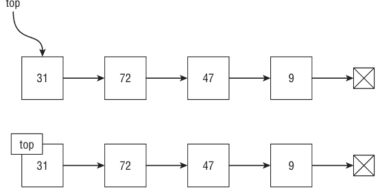

图 3-1：这些链表持有数字 31、72、47 和 9。

链表是存储随时间增长或收缩的项列表的良好方法。要添加新单元，你只需将其添加到链表的开头或末尾。相比之下，数组的大小是固定的，如果你需要添加更多项，可能很难扩大。

接下来的章节将解释一些你可以用于操作链表的算法。其中许多算法最易于通过显示操作前后列表状态的图表来描述。

# 第 3 章 链表

## 单向链表

在单向链表中，每个单元都通过单一链接连接到下一个单元。图 3-1 所示的链表就是单向链表。

要使用链表，你需要一组算法来遍历列表、向列表中添加项、在链列表中查找项以及从链列表中删除项。接下来的章节描述了你可能想要使用的某些算法。

### 遍历列表

假设程序已经构建了一个链表，遍历它的单元是相对容易的。以下算法展示了如何遍历列表中的单元，并使用某种方法对单元中的值进行操作。此示例使用 `Print` 方法来显示单元的值，但你可以将 `Print` 替换为任何对单元操作的方法。

```
Iterate(Cell: top)
While (top != null)
    Print top.Value
    top = top.Next
End Iterate
```

> 注意 这些算法假设参数 `top` 是按值传递的，因此代码可以启动它而不改变调用代码中 `top` 的值。

该算法从一个 `While` 循环开始，只要 `top` 单元指针不为空就会执行。在循环内部，算法调用 `Print` 方法显示头部单元的值。它将 `top` 指向链表中位于头部单元之后的下一个单元。

这个过程一直持续直到 `top` 被设置为链表末尾的空指针，`While` 循环停止。

该算法检查链表中的每个单元，因此如果列表包含单元，它的运行时间为 $O(N)$。

### 查找单元

在链表中查找单元只需通过遍历列表并在找到所需的单元时停止即可。以下算法遍历列表并返回包含目标值的单元：

```
FindCell(Cell: top, Value: target)
While (top != null)
    If (top.Value == target) Then Return top
    top = top.Next
End While
```

```
// 如果我们运行到这里，则目标不在列表中。
Return null
```

该算法进入一个 `While` 循环，只要 `top` 不为空就会执行。在循环内部，算法将头部单元的值与目标值进行比较。如果值匹配，算法返回 `top`。如果值不匹配，算法将 `top` 指向列表中的下一个单元。

如果 `top` 运行了所有逻辑，说明目标不在列表中。正如在接下来的章节中你将看到的，如果 `top` 为空，算法需要处理特殊情况。

在某些情况下，你可能需要一个哨格来处理单元格。以下算法查找列表并返回包含目标值的单元：

```
FindCell(Cell: top, Value: target)
While (top != null)
    If (top.Value == target) Then Return top
    top = top.Next
End While

// 如果我们运行到这里，则目标不在列表中。
Return null
```

### 哨兵 Sentinels

如果你仔细研究算法，你可能会发现如果 `top` 为空，算法会失败。在某些语言中，你可能需要处理这种情况。

处理这种情况的一种方法是显式地检查第一个单元，但这可能会变得复杂。

另一种方法是在列表的开头创建一个哨兵。哨兵是链表的一部分，但不包含任何有效数据。

以下是修改后使用哨兵的之前的 `FindBefore` 算法：

```
Cell FindBefore(Cell: top, Value: target)
// 查找目标值。
While (top.Next != null)
  If (top.Next.Value == target) Return top
  top = top.Next
End While

// 如果我们运行到这里，则目标不在列表中。
Return null
End FindBefore
```

这种版本不需要检查 `top` 是否为空。因为链表始终至少有一个哨兵，`top` 不为空。`While` 循环可以立即开始。

该版本也首先检查列表中的第一个单元，而不是第二个，因此它可以检测到第一个单元包含目标值的情况。

该算法在合适的情况下可以在哨兵之前运行。因此，使用该算法的程序不需要为了处理目标值位于列表开头的特殊情况。

当搜索目标值时，算法可能运气很好立即找到。在最坏的情况下，它可能需要搜索大部分链表才能找到目标值。如果目标值不在列表中，算法需要检查链表中的每个单元。

哨兵可能看起来浪费空间，但它消除了对特殊代码的需求，使得算法更加简单优雅。

接下来的章节假设链表拥有哨兵，并且 `top` 指向哨兵。

### 在开头添加单元

链表的一种用途是提供一种可以存储项的数据结构。这类似于在需要更多空间时可以扩展的数组。

向链表添加项的最简单方法是将新单元放在开头，紧随哨兵之后。以下算法在链表开头添加新项：

```
AddAtBeginning(Cell: top, Cell: new_cell)
new_cell.Next = top.Next
top.Next = new_cell
AddAtBeginning
```

该算法设置新单元格的 Next 指针，使其指向哨兵节点 `sentinel` 之后的第一个单元格。然后它将哨兵节点的 Next 指针指向新单元格。它将新单元格放在哨兵节点之后，使其成为链表的第一个单元格。

图 3-2 显示了在列表顶部添加新单元格前后的链表。列表的哨兵节点被涂上了。

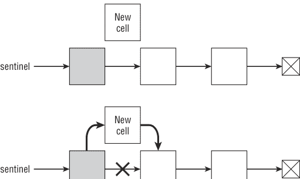

**图 3-2**：要在链表顶部添加项，请让新单元格的链接指向列表的旧头部，并让哨兵节点的链接指向新单元格。

该算法仅执行两个步骤，无论列表包含多少个单元格，其运行时间均为 O(1)。

### 在末尾添加单元格

在列表末尾添加单元格比在开头添加稍微困难一点，因为算法必须首先遍历列表以找到最后一个单元格。以下伪代码展示了在列表末尾添加新单元格的算法：

```
AddAtEnd(Cell: top, Cell: new_cell)
  // 找到最后一个单元格。
  While (top.Next != null)
    top = top.Next
  End While

  // 在末尾添加新单元格。
  top.Next = new_cell
  new_cell.Next = null
End AddAtEnd
```

该代码遍历链表直到找到最后一个单元格。它让最后一个单元格的链接指向新单元格，并将新单元格的链接设置为 null。

如果列表没有哨兵节点，这段代码将会变得杂乱。在这种情况下，你必须使用特殊代码来处理列表为空 `top` 指向 null 的情况。

图 3-3 图形化地了这一过程。

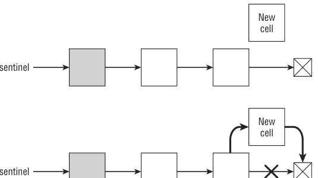

**图 3-3**：要在链表末尾添加项，找到最后一个单元格并让它的链接指向新单元格。然后让新单元格的链接指向 null。

该算法必须遍历整个列表，因此如果列表包含 N 个单元格，它的运行时间为 O(N)。

### 在其他单元格之后插入单元格

前面的章节解释了如何向链表的开头或末尾添加单元格，但有时你可能想在列表中间插入项。假设你有一个名为 `after_me` 的变量，它指向你想要插入项之后的单元格，以下伪代码展示了在 `after_me` 之后插入单元格的算法：

```
InsertCell(Cell: after_me, Cell: new_cell)
    new_cell.Next = after_me.Next
    after_me.Next = new_cell
```

该算法让新单元格的链接指向 `after_me` 之后的单元格，然后让 `after_me` 的链接指向新单元格。图 3-4 图形化地显示了这一过程。

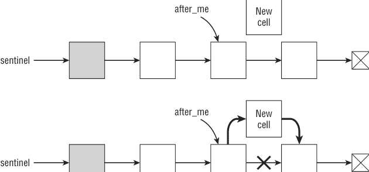

图 3-4：在给定单元格之后插入单元格需要 O(1) 时间。

该算法仅需两个步骤，因为它的运行时间是 O(1)，尽管你可能需要花费 O(N) 时间来找到 `after_me` 单元格。例如，如果你想在包含目标值的单元格之后插入单元格，你首先需要找到包含目标值的单元格。

### 删除单元格

要删除目标单元格，你只需将前一个单元格的链接指向目标单元格之后的单元格即可。以下伪代码展示了删除 `after_me` 之后单元格的算法：

```
DeleteAfter(Cell: after_me):
    after_me.Next = after_me.Next.Next
End DeleteAfter
```

图 3-5 图形化地显示了该算法。

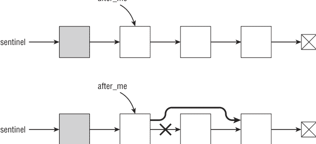

图 3-5：要从链表中移除单元格，请将前一个单元格的链接指向目标单元格之后的单元格。

C# 和 Visual Basic 使用垃圾回收进行内存管理。

这意味着被删除的单元格会在程序需要更多内存时自动被回收。根据你使用的编程语言，你可能需要执行额外工作来正确释放删除的单元格。例如，在 C++ 中，在如下版本的算法中，你需要释放目标单元格：

```
DeleteAfter(Cell: after_me)
    Cell: target_cell = after_me.Next
    after_me.Next = target_cell.Next
    free(target_cell)
```

如何销毁链表取决于你的语言。在 C# 和 Visual Basic 中，你不需要手动释放单元格，因为垃圾回收器会处理它。在 C++ 中，你需要显式地释放单元格，如下面的代码所示：

```
DestroyList(Cell: top)
    While (top != null)
        Cell: next_cell = top.Next
        free(top)
        top = next_cell
```

如何释放单元格取决于你的语言。在有哨兵的情况下，你可能将哨兵节点的 Value 设置大于任何可能存储的单元格。

## 双向链表

在双向链表中，单元格的链接指向下一个和前一个单元格。哨兵节点。


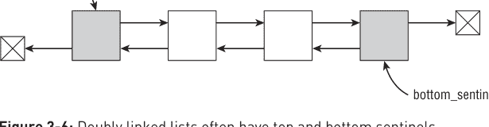

操作链表的算法与单向链表类似，但它们必须更新前后两个链接。例如，在双向链表中在指定位置插入项，如下伪代码所示：

```
InsertCell(Cell: after_me, Cell: new_cell)
    // 更新 Next 
    new_cell.Next = after_me.Next
    new_cell.Prev = after_me
    // 更新 Prev
    after_me.Next.Prev = new_cell
    _me.Next = new_cell
```

双向链表中最棘手的部分是更新所有的链接。在 C# 和 Visual Basic 中，你只需要设置 Next 链接，垃圾回收器会处理内存。在 C++ 中，你需要手动更新 Prev 链接，如下：

```
DeleteAfter(Cell: after_me)
    Cell: target_cell = after_me.Next
    after_me.Next = target_cell.Next
    target_cell.Next.Prev = after_me
    free(target_cell)
```

双向链表在末尾添加项是 O(1) 的，因为哨兵节点直接指向最后一个单元格。

## 排序列表

有时你希望项按顺序排列。当你向列表添加新项时，需要遍历列表找到合适的位置并更新链接。以下是单向链表中插入项的算法：

```
InsertCell(Cell: top, Cell: new_cell)
// 找到新单元格所在的位置
While (top.Next != null) And (top.Next.Value < new_cell.Value)
    top = top.Next
```

```
// 在 top 之后插入新单元格。
new_cell.Next = top.Next
top.Next = new_cell
```

在最坏情况下，该算法可能遍历整个列表才能找到新项的位置。因此，如果列表包含 N 个单元格，其运行时间为 O(N)。虽然你不能改进理论运行时间，但通过添加哨兵节点，可以在实践中使算法更简单更快速。通过将哨兵的 Value 设置大于任何可能存储在单元格中的值，你可以去掉 `top.Next != null` 的测试。你可以这样做是因为你知道代码最终会找到新单元格的位置，即使它就在哨兵之前。

例如，如果单元格使用 ASCII 字符，你可以将哨兵的 Value 设置为 `~`，因为该字符在字母顺序上大于任何有效名称。如果单元格存储整数，你可以将哨兵的 Value 设置为最大的整数 `2,147,483,647`。

以下是改进后的算法伪代码，假设列表有一个 Value 大于任何单元格中值的哨兵：

```
InsertCell(Cell: top, Cell: new_cell)
// 找到新单元格所在的位置
While (top.Next.Value < new_cell.Value)
    top = top.Next
```

```
// 在 top 之后插入新单元格。
new_cell.Next = top.Next
top.Next = new_cell
```

图 3-7 图形化地显示了该算法。

## 复制列表

某些算法会重新排列列表。本节和下一节描述了对列表中的项进行排序的算法。如果你想保持原始列表不变，必须在排序之前对列表进行复制。

以下伪代码展示了如何复制一个单链表：

```
// 复制一个列表。
Cell: CopyList(Cell: old_sentinel)
// 创建新列表的哨兵节点。
Cell: new_sentinel = new Cell()
// 跟踪我们目前为止添加的最后一个项。
Cell: last_added = new_sentinel
// 跳过哨兵。
Cell: old_cell = old_sentinel.Next
// 复制项。
While (old_cell != null)
  // 创建一个新项。
  last_added.Next = New Cell
  // 移动到新项。
  last_added = last_added.Next
  // 设置新项的值。
  last_added.Value = old_cell.Value
  // 准备复制下一个单元。
  old_cell = old_cell.Next
End While
// 以 null 结尾。
last_added.Next = null
// 返回新列表的哨兵。
Return new_sentinel;
```

该算法相当直观，但它包含一个值得注意的特性。该算法使用变量 `last_added` 来跟踪最近添加到新列表副本中的单元。为了将一个新项复制到列表中，算法将 `last_added.Next` 设置为一个新单元对象。这把新对象放在了列表的末尾。算法更新 `last_added` 指向新项，并将原始单元的值复制到其中。

这使得列表在底部增长，而不是在顶部增长。这类似于练习 1 中描述的，如果你跟踪了列表中的最后一个项，就可以轻松地将项添加到列表的末尾。

## 使用插入排序进行排序

第 6 章详细讨论了许多排序算法，但这里有两个算法值得讨论：在下一节中描述的选择排序 `selectionsort` 和插入排序 `insertionsort`。

插入排序的基本思想是：从输入列表中取出一个项，并将其插入到已排序的输出列表 `该列表最初开始为空` 的正确位置。

以下伪代码展示了插入排序算法，其中要排序的项位于带有哨兵的单链表中：

```
// 使用插入排序来排序列表。
Cell: Insertionsort(Cell: input):
// 为排序后的列表创建一个哨兵。
Cell sentinel = new Cell()
sentinel.Next = null
// 跳过输入列表的哨兵。
input = input.Next
// 重复，直到我们已将所有项插入到新列表中。
While (input != null)
  // 获取要添加到列表的下一个单元。
  Cell: next_cell = input
  // 将 input 移动到 Next 以供下次循环。
  input = input.Next
  // 查看在排序列表中添加下一个项的位置。
  Cell: after_me = sentinel
  While (after_me.Next != null) And
    (after_me.Next.Value < next_cell.Value)
      after_me = after_me.Next
  // 在排序列表中插入该项。
```


## 插入排序

```
next_cell.Next = after_me.Next

after_me.Next = next_cell

End While

// 返回排序后的列表。

return sentinel

End Insertionsort
```

该算法首先构建一个空列表来存放排序后的输出。然后它遍历未排序的输入单元列表。对于每个输入单元，它遍历不断增长的排序列表，找到新值所属的单元之后。然后它将该单元插入该处。

如果你调用早期章节中描述的“在其他单元之前插入单元”（Inserting Cells Before Other Cells）中的 `InsertCell` 算法，就可以简化代码。

如果输入列表中的项最初是从到大的顺序排序的，该算法只需几步即可将每个项插入到新列表的开头。如果列表包含 `N` 个单元，在新列表中插入所有项总共需要 `O(N)` 步。这是该算法的最佳情况。

如果输入列表中的项最初是从大到小的顺序排序的，该算法会将每个项插入到新列表的末尾。寻找列表末尾对于列表中的每个项都需要一步。因此，插入所有项共需要 `1 + 2 + 3 + ... + N = N × (N - 1) ÷ 2 = O(N²)` 步。

在平均情况下，如果项初始是随机排列的，算法可以很快地插入某些项，但需要更长的时间。结果是，只要它的运行时间不像最坏情况那样慢，算法的运行时间仍然是 `O(N²)`。

许多其他排序算法仅需 `O(N log N)` 时间，因此该算法的 `O(N²)` 性能相对较慢。然而，这使得该算法对于小列表很快失效，而且它适用于链表，而许多其他算法则并不适用。

## 链表选择器

选择排序算法的背后思想是在输入列表中搜索它包含的最大项，然后将其添加到排序列表的前部。以下伪代码展示了用于单链表的选择排序：

```
// 使用选择排序来排序列表。

Cell: Selectors(Cell: input)

// 为排序后的列表创建一个哨兵。

Cell: sentinel = new Cell()

sentinel.Next = null

// 重复，直到我们已将所有项插入到新列表中。

While (input != null)

  // 找到列表中的最大项。

  Cell: best_cell = input

  // 从下一个项开始查找。

  Cell: after_me = input.Next

  While (after_me != null)

    If (after_me.Value > best_cell.Value) Then

      best_cell = after_me

    End If

    after_me = after_me.Next

  End While

  // 从输入列表中移除最佳单元。

  input = best_cell.Next

  // 将最佳单元添加到排序列表的前部。

  best_cell.Next = sentinel.Next

  sentinel.Next = best_cell

  input = input

End While

// 返回排序后的列表。

Return sentinel

End Selectors
```

当你简化该算法时，提取列表中的最大项，将其放入一个新的列表中，然后调用算法。当列表包含 `K` 个项时，寻找最大项需要 `K` 步。随着算法进行，列表在缩小。因此，如果最初包含 `N` 个项，总步数为 `N + (N-1) + (N-2) + ... + 2 + 1 = N × (N-1) ÷ 2 = O(N²)`，这是插入排序的运行时间。

## 循环链表

循环链表是一种最后一个链接指向列表第一个项的链表。图 3-9 显示了一个循环链表。

当需要无限循环遍历一组项时，循环链表会非常有用。例如，操作系统可能会反复遍历进程列表，以给每个进程提供执行的机会。如果启动了一个新进程，它可以被添加到列表的任何位置，恰好紧跟在哨兵节点（`sentinel`）之后，这样它就能立即获得执行的机会。

另一个例子是，游戏可能会无限循环遍历对象列表，允许每个对象在屏幕上移动。同样，新对象可以被添加到列表的任何位置。

图 3-10 显示了一个包含循环的链表，但该循环并不包含列表所有的单元。

哨兵节点 (`sentinel`)

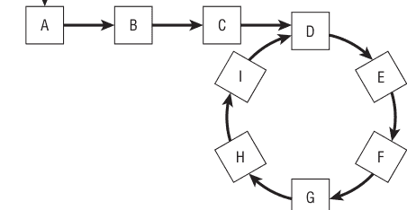

图 3-10：此列表包含一个不包含所有单元的循环。

图 3-10 所示的链表类型之所以有趣，主要因为它向你展示了两个有趣的问题。首先，你如何判断一个链表是否包含这样的循环？其次，如果链表包含这样的循环，你如何找到循环的起始位置并打破它来“修复”列表？这与询问列表的“底部”在哪里大致相同的问题。在图 3-10 中，你可能将列表的底部定义为单元 `I`，因为它是你在遍历链表时在单元重复之前最后访问的单元。

接下来的章节将描述一些回答这些问题的最有趣的算法。

## 标记单元

判断链表是否具有循环的最简单方法可能是遍历它的单元，并在每次访问时对每个单元进行标记。如果你来到一个已经标记过的单元，你就知道该列表包含一个循环，且该循环是从该点开始的。

以下伪代码展示了该算法：

```
// 如果列表有循环，则返回 true。
// 如果列表有循环，则将其打破。

Boolean: Has_loopMarking(Cell: sentinel)

// 假设没有循环。

Boolean: has_loop = false

// 循环遍历列表。

cell = sentinel

While (cell.Next != null)

    // 查看我们是否已经访问过下一个单元。

    If (cell.Next.Visited)

        // 这是循环的起始点。
        // 打破循环。

        cell.Next = null

        has_loop = true

        <Break out of the While loop>

    End If

    // 移动到下一个单元。

    cell = cell.Next

    // 将单元标记为已访问。

    cell.Visited = true

End While

// 再次遍历列表以清除 Visited 标记。

cell = sentinel

While (cell.Next != null)

    cell.Visited = false

    cell = cell.Next

End While

// 返回结果。

Return has_loop

End HasLoopMarking
```

可以在书籍网站上下载的 `BreakLoopMarking` 示例程序演示了该算法。该算法必须遍历列表两次——一次将单元的 `Visited` 标记设为 `true`，另一次将其重置为 `false`。如果列表包含 `N` 个单元，该算法需要 `2 × N` 步，运行时间为 `O(N)`。

这还要求每个单元都额外添加一个 `Visited` 字段，因此需要 `O(N)` 空间。列表本身已经占据了 `O(N)` 空间来存储单元和链接，这不应该是问题，但值得承认该算法具有某些内存需求。

> 注意：标记单元是一种简单的技术，对其他数据结构（特别是网络）也有用。第 13 和 14 章中描述的某些算法使用了标记技术。

像这样的问题还有一个额外要求，即你不允许更改单元类的定义。在这种情况下，这意味着你不允许添加 `Visited` 字段。以下算法满足这一额外限制。

## 使用哈希表

哈希表在第 8 章中进行了详细描述。现在，你只需要知道哈希表可以快速存储项、检索它们，并并你某项是否存在于哈希表中。

该算法遍历列表，将每个单元添加到哈希表中。当它访问一个单元时，它会检查哈希表以查看它是否已经在表中。如果它来到一个已经在哈希表中的单元，则列表包含一个从那里开始的循环。

以下伪代码展示了该算法：

```
// 如果列表有循环，则返回 true。
// 如果列表有循环，则将其打破。

Boolean: HasLoopHashTable(Cell: sentinel)

    // 创建一个哈希表。

    Hashtable: visited

// 循环遍历列表。

cell = sentinel

While (cell.Next != null)

    // 查看我们是否已经访问过下一个单元。

    If (visited.Contains(cell,Next))

        // 这是循环的起始点。
        // 打破循环并返回 true。

        cell.Next = null

        return true

    End If

    // 将单元添加到哈希表。

    visited.Add(cell)

    // 移动到下一个单元。

    cell = cell.Next

End While

// 如果我们运行到这里，说明没有循环。

return false

End HasLoopHashTable
```

可以在书籍网站上下载的 `BreakLoopHashtable` 示例程序演示了该算法。该算法遍历一次列表单元，因此如果列表包含 `N` 个单元，该算法需要 `N` 步，运行时间为 `O(N)`。该算法还需要一个哈希表。为了获得最佳性能，哈希表必须拥有更多的空间。哈希表必须有比 `N` 更多的空间。接下来的章节描述了某些不需要额外存储的算法。

## 标记标记法 (Retracing)

这种算法通过以下伪代码实现循环：

```
// 如果列表有循环，则返回 true。

Boolean: Has_loop_Marking(Cell: sentinel)

// 循环遍历列表。

cell = sentinel

While (cell.Next != null)

    // 查看我们是否已经访问过下一个单元。

    If (cell.Next.Visited)

        // 这是循环的起始点。
        // 打破循环。

        cell.Next = null

        has_loop = true

        <Break out of the While loop>

    End If

    // 移动到下一个单元。

    cell = cell.Next

    // 将单元标记为已访问。

    cell.Visited = true

End While
```

*(注：由于提供的原文中存在部分逻辑重复和格式错乱，翻译时已根据上下文语意进行了对齐处理，确保术语一致。)*

```
// 如果反转后的列表与原始列表
// 起始单元相同，则存在环。
// 返回结果。

If (new_sentinel == sentinel) Then Return true

Return false
```


该算法调用 `ReverseList` 方法反转列表并获取反转后列表的头部。然后它再次调用 `ReverseList` 来反转列表，并将链接恢复到原始值。
如果哨兵（节点）与反转列表的第一个单元相同，算法返回 true。如果哨兵与反转列表的第一个单元不同，算法返回 false。
该算法遍历列表两次——一次用于反转链接，一次用于恢复——它执行了 2 × O(N) 步。
该算法在 O(N) 时间内运行，不需要额外的空间。遗憾的是，它只能检测环，并没有提供打破环的方法。下一个算法解决了这个问题，尽管它可能是这里描述的算法中最令人困惑的。

## 龟与赛兔

该算法被称为龟赛兔算法，或者根据罗伯特·弗洛德（Robert Floyd）的名字称为弗洛德判圈算法，他在 20 世纪 60 年发明了它。算法本身并不复杂，但它的解释相当令人困惑，所以如果你不想看数学推导，可以直接跳到下面的伪代码。
算法启动两个对象“乌龟”（`tortoise`）和“兔子”（`hare`），它们从列表开始处以不同的速度在列表中移动。乌龟每步移动一个单元。兔子每步移动两个单元。
如果兔子到达一个空链接（`null`），说明列表有末尾，因此没有环。如果列表包含环，兔子最终会进入环并开始绕着它运行。
与此同时，乌龟一直缓慢移动，直到它进入环并处于环内部。
设 T 为乌龟进入环之前的步数，H 为 T 步后兔子从环的起点到兔子所在位置的距离，如图 3-12 所示。设 L 为环内部的单元数。在图 3-12 中，T = 4,H = 4,L = 5。
因为兔子的速度是乌龟的两倍，它在移动了 T 个单元后到达环。然后它又跨过了另一个 T 个单元到达图 3-12 所示的位置。这得出了下面的**重要事实 #1**。

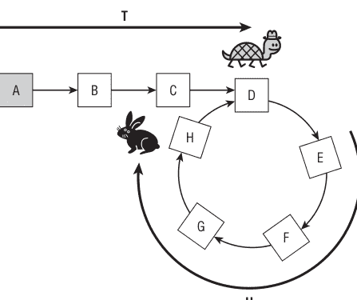

**图 3-12：** T 是乌龟到达环所移动的距离，H 是从环起点到在某一时刻兔子的距离。

### 重要事实 #1

如果你在环内移动 T 的距离，你最终将距离起点 H 个单元。

注意，如果 L 远小于 T，兔子可能已经在环上跑了好几圈。例如，如果 T 是 102 且 L 是 5，乌龟在 102 步后到达环。兔子在 51 步后到达环，接下来的 50 步（100 个单元）在环上跑了 20 圈，然后在环内又移动了一步（两个单元）。在这种情况下，H = 2。

下一个问题是：“兔子什么时候会追上乌龟？”当乌龟进入环时，兔子正领先 H 个单元，如图 3-12 所示。因为乌龟和兔子都在环中，你也可以认为兔子在乌龟后面 L – H 个单元处。因为兔子每移动两个单元而乌龟移动一个，所以它每步增加一个单元。这意味着兔子将在 L – H 步后追上乌龟。

在图 3-12 中，H = 4 且 L = 5，所以当两个动物在单元 E 相遇时，兔子将在 5 – 4 = 1 步后追上乌龟。

这意味着在碰撞点，乌龟已经在环内移动了 L – H 个单元。当两个动物相遇时，它们距离环起点还有 L – (L – H) = H 个单元。这就是**重要事实 #2**。

## 80 第3章 链表

| 重要事实 #2 |
| 当兔子追上乌龟时，两只动物距离环起点 H 个单元。 |

现在，如果你能将乌龟从碰撞点移动 H 个单元，乌龟就会到达环的起点，你就知道环在哪里。遗憾的是，你不知道 H 的值，所以不能简单地将乌龟移动那么远。

但是，你从重要事实 #1知道，如果乌龟在环内移动 T 的距离，它最终将比起点领先 H 个单元。在这种情况下，它将到达环的起点！

遗憾的是，你也不知道 T 的值，所以你不能简单地将乌龟移动那么远。但是，如果你从链表的开始处启动兔子，每次只移动一个单元而不是两个（这可能是在绕环跑了那么久之后），它在跨越 T 个单元后也会到达环的起点。这意味着两者在跨越 T 后再次相遇时，会在环起点。

下面的伪代码显示了算法的高层逻辑：

- 1. 启动乌龟每步移动一个单元通过列表移动。启动兔子每步移动两个单元通过列表移动。
- 2. 如果兔子的链接为空，说明列表没有环，从开始处重新启动兔子，每次移动一个单元。
- 3. 否则，如果兔子追上了乌龟，它们就在环的起点。
- 4. 当乌龟和兔子再次相遇时，它们会在环起点。
- 5. 为了打破环，将乌龟的链接设为空。

> 警告 我从未见过真正需要使用龟赛兔算法的程序。如果你小心，就不会意外让链表损坏。

## 双向链表中的环

检测双向链表中的环很容易。如果存在环，只需遍历列表并对每个单元验证 `Next.Prev == cell`。

## 第3章 链表 81

这一切假设单元形成正常的链表，且环环是简单的环。如果 `Next` 和 `Prev` 链接不同步，这种方法可以检测到问题但无法帮助你修复。

## 总结

本章解释了链表以及用它们做的事情。解释了单向链表、双向链表和线链。还解释了基本的列表操作算法，如添加、查找和删除，并解释了各种环检测和移除算法。

所有指针操作都是后续处理树、平衡树、网络和其他链数据结构的预习。事实上，下一章使用链数据结构来实现稀疏数组。

## 练习题

- 1. “在末尾添加单元”节给出了在列表末尾添加项的算法。如果你能保留另一个指向最后一个单元的变量 `bottom`，你就可以在 O(1) 时间内列表末尾添加项。编写这样的算法。这如何增加在列表开头或末尾添加项、查找项、删除算法的复杂度？编写从这种列表中删除项的算法。
- 2. 编写一个在包含整数单元的无序链表中查找最大项的算法。
- 3. 编写在双向链表顶部添加项的算法。
- 4. 编写在双向链表底部添加项的算法。
- 5. 如果你将为练习3 和 4 编写的算法与“双向链表”节中的 `InsertCell` 算法进行比较，你会发现它们非常相似。重写你为练习3 和 4 编写的算法，使其调用 `InsertCell` 算法而不是直接更新列表链接。
- 6. 编写从双向链表中删除指定单元的算法。画一张图直观地展示这个过程。
- 7. 假设你有一个存储名称的排序双向列表。你能想到一种从……开始搜索以提高性能的方法吗？

使用底部哨兵而不是顶部哨兵会怎样？这会改变 Big O 运行时间吗？

+ 8. 编写一个算法，在排序的双向链表中插入一个项，其中顶部和底部哨兵持有最小和最大可能值。
+ 9. 编写一个算法，判断链表是否有序的。
+ 10. 插入排序和选择排序的运行时间均为 O(N²)。解释为什么选择排序在实际应用中耗时更长。
+ 11. 编写一个程序，构建一个行星的多线程链表，如“多线程链表”节节描述。让用户点击单选按钮或从组合框中选择，按不同的线程顺序显示行星。（提示：创建一个 `Planet` 类，包含 `DistanceToSun`、`Mass`、`Diameter`、`NextDistance`、`NextMass` 和 `NextDiameter` 字段。然后编写一个 `AddPlanetToList` 方法，按排序顺序将行星添加到线程中。）
+ 12. 编写一个实现龟兔算法的程序。

# 第4章 数组

数组是极其常见的数据结构。它们直观、易用，并且得到了大多数编程语言良好的支持。事实上，数组如此常见且易于理解，以至于你会怀疑在算法书中关于它们还有什么可说的。大多数应用程序以相对直接的方式使用数组，但特殊数组在某些情况下非常有用，因此它们在这里值得关注。

本章解释了你可以使用的算法技术，用于创建具有非零下限的数组、节省内存以及比通常更快地操作数组。

## 基础概念

数组是一块连续的内存，程序可以通过索引来访问它——数组中的每个维度有一个索引。你可以将数组想象成一组排列好的箱子，程序可以在其中存储值。

图 4-1 展示了一维、二维和三维数组。程序可以定义更高维数组，但尝试用图形方式表示它们是困难的。

# 第4章 数组

| | | | | | | |
|---|---|---|---|---|---|

| | | | | | | |
|---|---|---|---||
| | | | | | | |

| | | | | | | |
|---|---|---|---||
| | | | | | | |
| | | | | | | |

图 4-1：你可以将一维、二维和三维数组想象成程序可以存储值的箱子排列。

通常，程序会声明一个变量为具有特定维度和每个维度具有特定边界的数组。例如，以下程序可能会声明并分配一个名为 `int[] numbers` 的数组，它有 10 行和 20 列：

```
int[] numbers = new int[10, 20];
```

在 C# 中，数组边界是基于 0 的，因此此数组的行索引范围从 0 到 9，列索引范围从 0 到 19。

在后台，程序分配了足够的连续内存来存储数组数据。从逻辑上讲，内存看起来像一长串字节，程序将数组索引映射到该系列字节中的位置，如下列表所示：

- 对于一维数组，从数组索引到内存项的映射是简单的：索引 `i` 映射到项 `i`。
- 对于二维数组，程序可以以两种方式映射数组项：行优先序或列优先序：
    - 在行优先序中，程序将数组的第一行项映射到第一组内存位置。然后将第二行映射到第一组内存位置之后的集合。它继续一次映射一行，直到所有项都映射完毕。
    - 在列优先序中，程序将数组的第一列项映射到第一组内存位置。然后将第二列映射到第二组内存位置，依此类推。

# 第4章 ■ 数组 85

图 4-2 显示了行优先序和列优先序的映射。

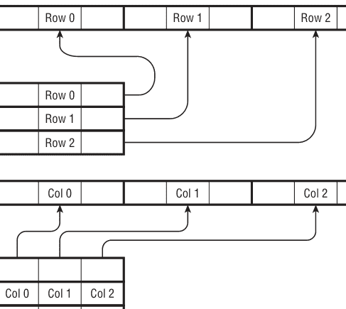

**图 4-2：** 程序可以按行优先序或列优先序将数组项映射到内存位置。

你可以将行优先序和列优先序的想法扩展到更高维数组。例如，为了以行优先序存储三维数组，程序将映射数组的第一个二维“切片”，其中第三个维度的索引为 0。它将像常一样以行优先序映射该切片。然后同样地映射第三个维度索引为 1 的第二个切片，其余切片也依此类推。

另一种思考方式是将其视为一种映射三维数组的算法。假设你定义了一个映射二维数组的 `Map2DArray` 方法。以下算法使用 `Map2DArray` 来映射三维数组。

```
For i = 0 To <数组第三个坐标的上界>
  Map2DArray<第三个坐标设置为 i 的数组>
Next i
```

同样地，你可以使用该算法来定义映射偶数维度数组的算法。

通常情况下，程序如何将数组项映射到内存位置与程序如何工作无关，而且你没必要去关心它。你的代码操作数组项，你不需要知道它们是如何存储的。然而，当你尝试时，理解行优先序和列优先序的工作原理是有用的

# 第4章 数组

## 一维数组

涉及一维数组的算法非常简单，以至于是微不足道的。它们出现在链表、栈和队列中，因此值得简要讨论。

### 查找项

对于在数组中查找特定项的情况，你无法避免查看每一个。如果数组是排序的，以下算法可以找到目标：

```
Integer: IndexOf(Integer: array[], Integer: target)
For i = 0 To array.Length - 1
  If (array[i] == target) Return i
Next i
// 目标不在数组中
Return -1
```

在最坏情况下，目标可能是最后一个。所以如果数组有 N 个项，算法必须检查它们。这使得运行时间为 O(N)。在平均情况下，目标会在一半找到。如果目标不存在，算法必须访问所有项。在平均情况下仍然是 O(N)。

### 查找最小值、最大值和平均值

如果数组包含数字，你可能想找到最小值、最大值和平均值。对于查找位数的情况，这些算法必须访问数组中的每个项，因此运行时间 O(N)。

# 第4章 数组 87

以下算法查找一维数组的最小值、最大值和平均值：

```
Integer: FindMinimum(Integer: array[])
minimum = array[0]
For i = 1 To Array.Length - 1
  If (array[i] < minimum) Then minimum = array[i]
Next i
Return minimum
```

```
Integer: FindMaximum(Integer: array[])
maximum = array[0]
For i = 1 To Array.Length - 1
  If (array[i] > maximum) Then maximum = array[i]
Next i
Return maximum
```

```
Float: FindAverage(Integer: array[])
total = 0
For i = 0 To Array.Length - 1
  total = total + array[i]
Next i
Return total / Array.Length
```

### 查找中位数

你同样可以计算其他统计值，如标准差和方差，如果需要的话。有一个值的计算方法与中位数一样，即在排序后位于中间的值。

单次遍历数组无法提供你所需的所有信息，因为在某种意义上，你需要更多关于值的全局信息来寻找中位数。你不能简单地通过逐个查看值来调整“运行”。

一种方法可能是考虑列表中的每个值。对于每个列表考虑所有值，并跟踪比测试值大和小的项。如果你发现一个较值项数量相等的测试值，该测试值就是中位数。

以下是基础算法：

```
Integer: FindMedian(Integer: array[])
For i = 0 To Array.Length - 1
  // 大于和小于 array[i] 的值的数量。
  Integer: num_larger = 0
  Integer: num_smaller = 0
```

```
For j = 0 To array.Length - 1
  If (array[j] < array[i]) Then num_smaller = num_smaller + 1
  If (array[j] > array[i]) Then num_larger = num_larger + 1
Next j
  If (num_smaller = num_larger) Then
    Return array[i]
  End If
If (num_smaller = num_larger) Then
    Return array[i]
  End If
Next i
EndMedian
```

该算法存在缺陷。例如，它没有处理多个项目具有相同值的情况，如 1, 2, 3, 4。它也没有处理具有偶数个元素的数组，这种数组没有中间元素。（如果数组有偶数个元素，中位数被定义为两个中间元素的平均值。例如，1, 4, 6, 9 的中位数是 4 + 6 / 2 = 5）。

如果数组包含 N 个值，外层 `For` 循环将执行 N 次。对于其中的每一次循环，内部的 `For j` 循环都会执行 N 次。这意味着内部循环中的步骤执行了 N × N = N² 次，导致算法的运行时间为 O(N²)。

一种快多的算法是先对数组进行排序，然后通过查看排序数组中的值直接找到中位数。第 6 章描述了几种可以在 O(N log N) 时间内对包含 N 个元素的数组进行排序的算法。这比 O(N²) 快得多。

### 插入元素

在线性数组的末尾插入元素是简单的，假设编程语言可以扩展数组增加一个元素。只需扩展数组并将新元素插入到末尾即可。

在数组的其他位置插入元素要困难得多。以下算法在线性数组的 `position` 处插入一个新元素：

```
InsertItem(array[], Integer: value, Integer: position)
// 调整数组大小以便末尾添加 1 个元素
// 移动目标位置之后的元素
// 为新元素留出空间
For i = array.Length - 1 To position + 1 Step -1
  array[i] = array[i - 1]
Next i
// 插入新元素
array[position] = value
InsertItem
```

注意，该算法的 `For` 循环从数组末尾开始向开头移动。这使得它首先在数组末尾填充新位置，然后在每个值复制到新位置之后，紧接着填充其之前的位置。

如果数组初始持有 N 个元素，该算法的 `For` 循环执行 N-position 次。在最坏的情况下，当你在数组开头添加元素时，`position = 0` 循环执行 N 次，因此算法的时间复杂度为 O(N)。

> 注意：编程语言具有移动内存块的方法，这会让将元素向下移动一个位置快得多。

在实践中，在线性数组中插入元素并不常见，但在数组中移动元素为新元素留空间的技术在其他算法中很有用。

### 删除元素

从数组中删除索引为 k 的元素与添加元素一样困难。代码首先将位置 k 之后的元素向数组开头移动一个位置，然后代码调整数组大小以移除最后一个未使用的槽位。

在最坏的情况下，当你从数组删除第一个元素时，算法可能需要移动数组中的所有元素。这意味着它的时间复杂度为 O(N)。

> 注意：在某些情况下，可以将某个条目标记为未使用而不是删除它。例如，如果数组中的值是对对象的引用或指针，你可能可以将该条目设置为 `null`。这种技术在哈希表中特别有用，因为调整数组大小是非常耗时的。

然而，如果有很多条目未未使用，数组最终可能会充满未使用的条目。这时，为了找到某一个元素，你需要检查许多空位置。在某个时刻，压缩数组以移除空条目可能会更好。

## 非零下界

所有编程语言都要求所有数组在每个维度上都使用 0 作为下界。例如，线性数组的索引范围可以从 0 到 9，但不能有从 1 到 9 的索引范围。

# 第 4 章 数组

然而，有时将数组处理为具有非零下界是方便的。例如，假设你正在编写一个需要记录 ID 在 1 到 10 之间的销售的程序。你可以这样声明数组：

```
Double sales[10]
```

## 二维

管理具有非零下界的数组并不困难。考虑这样一个例子：你想要一个二维数组，其中员工 ID 范围从 1 到 10，年份范围从 2000 到 2010。你可以这样分配数组：

```
Double sales[10][11]
```

要找到此数组中元素的位置，你首先计算行和列，由于元素对应于 e 和 y，行和列由以下公式给出：

```
row = e - 1
column = y - 2000
```


现在你找到了元素的行和列，需要找到它在值数组中的索引。首先，在此元素之前可以容纳多少行完整的行？如果元素的数字是 `r`，那么在该元素之前有 `r` 行完整的行，编号为 `0, 1, ..., r-1`。

现在，在该元素的行中之前有多少个元素？如果元素的列号是 `c`，那么在该元素的行之前有 `c` 个元素，编号为 `0, 1, ..., c-1`。这些元素占据了值数组中的 `c` 个位置。在值数组中在此之前的元素总数由公式给出：

```
index = row x <row size> + column
```

现在你可以在 `values(index)` 中找到该元素。

## 高维

前节描述的方法在已知维度数量时效果良好。遗憾的是，将其推广到任意数量的维度非常困难。对于 `N` 维，你需要分配一个 `N` 维数组来存储数据。你可以为处理二、三、四及更多维度创建单独的类，但最好找到一种更通用的方法。

与其将值存储在二维数组中，不如按行主序（row-major order）将它们封装到一个维数组中。你首先分配一个足够容纳所有元素的一维数组。如果有 `N` 行 `M` 列，你分配一个拥有 `N × M` 个条目的数组：

```
Double values[N * M]
```

## 第 4 章 数组

为了查看数组在相应维度上必须有多“宽”，然后将得到的“宽度”相互相乘：

```
Integer: ArraySize(Integer: lower_bounds[], Integer: upper_bounds[])

Integer: total_size = 0

For i = 0 To lower_bounds.Length - 1

  total_size = total_size * (upper_bounds[i] - lower_bounds[i])

Next i

  Return total_size
```

下一步，将行和列映射到一维数组中的位置，这要稍微复杂一些。回想之前的代码是如何将行和列映射到 `values` 数组中的索引的。首先，代码定义了完整的行如何属于数组，并乘以每行的项目数。代码对于该项目所在行中每个于该项目之前的每个位置都加了 1。

移动到三维并没有那么困难。图 4-3 显示了一个 `4x4x3` 的三维数组，维度被标记为高度、行和列。坐标为 `(1, 1, 3)` 的条目用灰色显示。

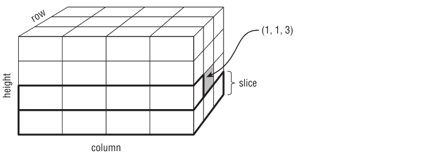

**图 4-3：** 将项目映射到 `values` 数组的第一步是确定有多少个完整的“切片”在它之前。

要将项目的坐标 `(1, 1, 3)` 映射到 `values` 数组中的索引，首先确定有多少个完整的“切片”在它之前。由于项目的高度坐标为 `1`，因此在数组中项目之前有一个完整的切片。切片的大小为 `<row size>` x `<column size>`。如果项目坐标为 `(h, r, c)`，则在切片中排在该项目之前的项目数量由以下公式给出：

```
index = h x <row size> x <column size>
```

接下来，你需要确定由于行而在该项目之前有多少个项目。在这个例子中，项目所在的行是 `1`，因此在 `values` 数组中有一行在项目之前。如果项目所在的行为 `r`，你需要将 `r` 乘以行的大小加到索引上：

```
index = index + r x <row size>
```

最后，对于在该列中排在该项目之前的每个项目，加 1。如果项目所在的列为 `c`，则就是 `c`：

```
index = index + c
```

你可以将这种技术扩展到更高维度。为了让计算 `values` 数组中的索引变得更容易，你可以创建一个 `slice_size` 数组，用于存储每个维度上“切片”的大小。在三维情况下，这些值为 `<row size>` x `<column size>`、`<Column size>` 和 `1`。

要移动到更高维度，你可以将下一个切片乘以当前维度的大小来找到切片。例如，四维数组的下一个切片大小将是 `<height size>` x `<row size>` x `<column size>`。

有了这些背景知识，你就可以准备查看完整的算法了。假设边界数组交替存储 `N` 维数组的下界和上界。以下伪代码初始化了数组：

```
// 初始化 LowerBound 和 Slice.
Integer: slice_size = 1
For i = NumDimensions - 1 To 0 Step -1
SliceSize[i] = slice_size
```

```
LowerBound[i] = bounds[2 * i]
Integer: upper_bound = bounds[2 * i + 1]
Integer: bound_size = upper_bound - LowerBound[i]
slice_size *= bound_size
```

```
// 为所有项目分配空间。
Double: Values[slice_size]
InitializeArray
```

此代码通过将 `bounds` 数组中的值除以 2 来计算维度数。它创建一个 `LowerBound` 数组来存储下界，创建一个 `SliceSize` 数组来存储不同维度上切片的大小。
下一个代码将 `slice_size` 设置为 `1`。这是最高维度上切片的大小。

代码遍历维度，从最高开始循环到 `0`。它将当前切片大小设置为 `slice_size` 并保存该维度的下界。它将 `slice_size` 乘以当前维度，得到下一个较小维度的切片大小。

在完成所有维度的循环后，`slice_size` 持有所有数组维度的乘积。即数组中的项目总数，因此代码使用它来分配 `Values` 数组，该数组将用于存储数组的值。

以下看似简单的伪代码使用 `LowerBound` 和 `SliceSize` 数组将 `indices` 数组映射到 `Values` 数组中的索引：

```
Integer: MapToIndex(Integer: indices[])
Integer: index = 0
For i = 0 to indices.Length - 1
  index = index +
    (indices[i] - LowerBound[i]) * SliceSize[i]
Next i
  Return index
End MapToIndex
```

代码将 `index` 初始化为 `0`。然后它遍历数组的各个维度。对于每个维度，它将该维度的切片数量乘以该维度切片的大小，并将结果加到 `index` 上。

在遍历所有维度后，`index` 持有项目在 `Values` 数组中的索引。

你可以通过将算法封装在类中使其变得更容易。构造函数可以告诉对象使用哪些维度。取决于你的编程语言，你将能够创建用于访问的 `get` 和 `set` 方法，以便程序像对待数组一样对待对象。

从书籍网站下载 `NDArray` 示例程序以查看此算法的 C# 实现。

## 三角数组

某些应用程序可以通过使用三角数组而不是普通的矩形数组来节省空间。在三角数组中，对角线上方（列索引大于其行索引）的值具有某些默认值，例如 `0`、`null` 或空白。图 4-4 显示了一个上三角数组。

例如，连通性矩阵表示了某种网络中点之间的连接。该网络可能是航空公司的航班网络，指示机场连接到其他机场。如果从机场 `i` 到机场 `j` 有航班，则数组条目 `connected[i, j]` 设置为 `1`。如果你假设只要从机场 `i` 到机场 `j` 有航班，从机场 `i` 到机场 `j` 就有航班。

图 4-4：三角数组中对角线值方的值

构建三角数组并不困难。只需将数组的值打包到一维数组中，跳过那些不应该包含的条目即可。挑战在于确定一维数组有多大，以及如何映射行和列。

表 4-1：三角数组中的条目

| 行数 | 条目数 |
|---|---|
| 1 | 1 |
| 2 | 3 |
| 3 | 6 |
| 4 | 10 |
| 5 | 15 |
| 6 | 21 |
| 7 | 28 |

如果你研究表 4-1，你会发现一个模式。$N$ 行所需的单元等于 $N-1$ 行所需的单元加上 $N$。如果你思考三角数组一段时间，你会意识到它们包含具有 $N^2$ 个条目的平方数组的大部分条目，因此相应的三角数组条目数量似乎涉及 $N^2$。如果你从通用的二次方程 $A \times N^2 + B \times N + C$ 开始并代入表 4-1 中的值，你可以求解 `A`、`B` 和 `C`，发现方程为 $(N^2+N)/2`。
这解决了第一个挑战。要构建具有 `N` 行的三角数组，分配一个包含 $(N^2+N)/2$ 个项目的一维数组。
第二个挑战是如何将行和列映射到一维数组。为了找到行 `r` 列 `c` 条目的索引，你需要确定在该一维数组中排在该条目之前的有多少个条目。
要回答这个问题，查看图 4-5 所示的数组，并考虑在条目 `(3, 2)` 之前的条目数量。

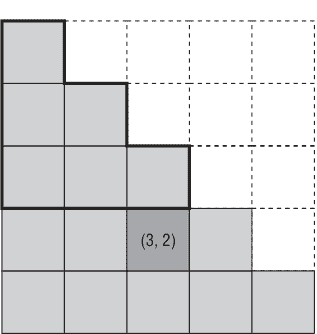

图 4-5：为了找到条目的索引，必须确定在一维数组中它之前有多少个条目。

由于完整行产生的条目在图 4-5 中用粗框突出。这些条目的数量与所有条目的数量相同

# 第4章 数组 97

在一个有三行的三角形数组中，你已经知道如何计算那个数字了。

在目标条目 `(3, 2)` 之前的、且不属于完整行的条目位于该行中对应条目的左侧。在这个示例中，目标条目位于第 `2` 列，因此在这一行的左侧有两个条目。

通常情况下，第 $r$ 行第 $c$ 列条目的索引公式为 `((r - 1)^2 + (r - 1)) / 2 + c`。

有了这两个公式，处理三角形数组就变得简单。使用第一个公式 `(N² + N) / 2` 来确定为具有 $N$ 行的数组分配多少个元素。使用第二个公式 `((r - 1)² + (r - 1)) / 2 + c` 将行和列映射到一维数组中的索引，如下面的伪代码所示：

```
Integer: FindIndex(Integer: r, Integer c)
Return (r - 1) * (r - 1) / 2 + c
FindIndex
```

通过将三角形数组封装在一个类中，可以使其变得更容易。如果你能让该类的 `get` 和 `set` 方法处理索引，程序就可以像处理普通数组一样处理三角形数组对象。

细节在于三角形数组类如何处理对数组中不存在的条目的请求。例如，如果程序尝试访问位于数组缺失的上半部分的条目 `(1, 4)`，该类应该做什么？取决于具体的应用场景，你可能希望返回一个默认值、交换行和列并返回该值，或者抛出一个异常。

## 稀疏数组

如果你知道数组不会在其对角线之外存储值，三角形数组可以节省内存。如果你知道数组将包含 $f$ 个条目，你可能还可以节省更多的内存。

再次考虑一个航空公司连接矩阵，其 `[i, j]` 条目标记为 `1`，表示城市 $i$ 城市和城市 $j$ 之间有航班。该航空公司可能只有 `600` 条航班连接着 `200` 个城市。在这种情况下，一个包含 `40,000` 个条目的数组中只有 `600` 个非零值。如果航班是对称的（每条 $i-j$ 航班都有对应的 $j-i$ 航班），并且你用三角形数组存储连接性，那么数组总共 `20,100` 个条目中只有 `300` 个非零条目。该数组将有 `99%` 是未使用的。

稀疏数组通过不表示缺失的条目来节省更多内存。要获取项的值，程序会在数组中搜索该项。如果该项存在，程序返回其值。如果该项不存在，程序返回数组的默认值。对于连接矩阵示例，默认值将为 `0`。

实现稀疏数组的一种方法是创建链表的链（嵌套列表）。第一个列表持有有关行的信息。该列表中的每个项都指向另一个链表，该链表持有数组中该行列条目的信息。

你可以使用两个单元类来构建稀疏数组——一个表示行的 `ArrayRow` 类和一个表示行中某个值的 `ArrayEntry` 类。

`ArrayRow` 存储一个行号、一个指向下一个 `ArrayRow` 的引用或指针，以及一个指向该行中第一个 `ArrayEntry` 的引用。下面显示了 `ArrayRow` 类的布局：

```
ArrayRow:
Integer: RowNumber
ArrayRow: NextRow
ArrayEntry: RowSentinel
```

`ArrayEntry` 类存储条目的列号、该条目为数组持有的任何值，以及指向该行中下一个 `ArrayEntry` 对象的引用。下面显示了 `ArrayEntry` 类的布局，其中 $T$ 是数组必须持有的数据类型：

```
ArrayEntry:
Integer: ColumnNumber
T: Value
ArrayEntry: NextEntry
```

为了方便添加和删除行，行列表可以以哨兵节点开始，每行的值列表也可以以哨兵节点开始。图 4-6 显示了带有阴影哨兵的稀疏数组。

为了更容易判断值是否在数组中缺失，`ArrayRow` 对象按 `RowNumber` 递增顺序存储。如果你在列表中搜索特定的行号，并发现一个 `RowNumber` 较小的 `ArrayRow` 对象，你就知道正在查找的行号在数组中。

同样，`ArrayEntry` 对象按 `ColumnNumber` 递增顺序存储。注意，图 4-6 中的 `RowEntry` 对象似乎是垂直对齐的，第一行的 `RowEntry` 对象可能代表相同的列。第一行的 `RowEntry` 对象和第二行的 `RowEntry` 对象可能代表列 `-50`。

图 4-6 中的排列看起来很复杂，但使用起来并不难。要找到特定项，向下查看行直到找到正确的行。然后横向查看该行的值列表直到找到你需要的列。如果没找到行或列，则该值不在数组中。

这种排列需要一些 `ArrayRow` 对象和哨兵节点，但如果数组是稀疏的，它仍然比三角形数组更高效。例如，在最坏情况下，三角形数组每行只包含一个值，而这种结构使用 $N+1$ 个 `ArrayRow` 对象和 $N$ 个 `ArrayEntry` 对象。在这些对象中，只有 $N$ 个包含实际值，其余都是哨兵。**图 4-6：** 如果每个列表都从哨兵开始，添加和删除单元将变得更容易。对于图 4-6 所示的数据结构，你仍然编写算法来：

1. 获取给定行和列的值，如果值不存在则返回默认值。
2. 在给定行和列设置值。
3. 删除给定行和列的值。

## 查找行或列

为了方便查找值，你可以定义以下 `FindRow` 方法。该方法找到目标行所在位置之前的 `ArrayRow` 对象。如果目标行不在数组中，该方法返回该行应该所在的 `ArrayRow`：

```
ArrayRow: FindRowBefore(Integer: row, ArrayRow: array_sentinel)
ArrayRow: array_row = array_sentinel
While (array_row.NextRow != null) And
(array_row.NextRow.RowNumber < row)
array_row = array_row.NextRow
End While
```

该算法将 `array_row` 设置为数组哨兵。然后反复移动 `array_row` 到列表中的下一个 `ArrayRow` 对象，直到下一个对象为空或下一个对象的 `RowNumber` 与目标行一样大。

如果下一个对象为空，程序已到达行列表末尾且未找到所需的行。如果该行存在，它应该位于当前 `array_row.object` 之后。

如果下一个对象的 `RowNumber` 等于目标行，算法找到了目标行。

如果下一个对象的 `RowNumber` 大于目标行，则目标行不在数组中。如果该行存在，它应该位于当前 `array_row.object` 之后。

同样，你可以定义 `FindColumnBefore` 方法来找到目标列所在位置之前的 `ArrayEntry` 对象。该方法接受目标列号和应搜索的行哨兵作为参数：

```
FindColumnBefore(Integer: column, ArrayEntry: row_sentinel)
ArrayEntry: array_entry = row_sentinel
While (array_entry.NextEntry != null) And
(array_entry.NextEntry.ColumnNumber < column)
array_entry = array_entry.NextEntry;
Return array_entry;
End FindColumnBefore
```

如果数组持有 $N$ 个 `ArrayRow` 对象，`FindRowBefore` 方法耗时为 $O(N)$。如果持有非默认值的行包含 $M$ 个此类项，`FindColumnBefore` 方法的运行时间为 $O(M)$。

## 获取值

一旦你有了 `FindRowBefore` 和 `FindColumnBefore` 方法，从数组获取值就相对简单：

```
GetValue(Integer: row, Integer: column)
// 查找行。
ArrayRow: array_row = FindRowBefore(row)
array_row = array_row.NextRow
If (array_row == null) Return default
If (array_row.RowNumber > row) Return default
// 在目标行中查找列。
ArrayEntry: array_entry =
FindColumnBefore(column, array_row.RowsSentinel)
array_entry = array_entry.NextEntry
If (array_entry == null) Return default
If (array_entry.ColumnNumber > column) Return default
Return array_entry.Value
```


该算法使用 `FindRowBefore` 将 `array_row` 设置为目标行之前的行。然后它将 `array_row` 移动到下一行，正好到达目标行。如果 `array_row` 为 `null` 或指向错误的行，`GetValue` 方法将返回数组的默认值。

如果算法找到了正确的行，它将使用 `FindColumnBefore` 将 `array_entry` 设置为目标列之前的列。然后它将 `array_entry` 移动到下一列，正好到达目标列。如果 `array_entry` 为 `null` 或指向错误的列，`GetValue` 方法将返回数组的默认值。

如果算法执行到这里，它就找到了正确的 `ArrayEntry` 对象，并返回该对象的值。

该算法调用 `FindRowBefore` 和 `FindColumnBefore` 方法。如果数组有 N 行包含非默认值，非默认值最多的行包含 M 个这些值，那么 `GetValue` 方法的总运行时间为 O(N+M)。这比从普通数组获取值所需的 O(1) 时间要长得多，但稀疏数组使用的空间少得多。

## 设置值

设置值与查找值类似，区别在于算法在必要时必须向数组插入新行或新列：

```
SetValue(Integer: row, Integer: column, T: value)

// 如果我们要设置的值是默认值，

// 则删除条目而不是设置它。

If (value == default)

DeleteEntry(row, column)

Return

End If

```
// 查找目标行之前的行。
ArrayRow: array_row = FindRowBefore(row)

// 如果行缺失，则添加它。
If (array_row.NextRow == null) Or (array_row.NextRow.RowNumber > 0)
    ArrayRow: new_row
    new_row.NextRow = array_row.NextRow
    array_row.NextRow = new_row

ArrayEntry: sentinel_entry
    new_row.RowsSentinel = sentinel_entry
    sentinel_entry.NextEntry = null
End

// 移动到目标行。
array_row = array_row.NextRow

// 查找目标列之前的列。
ArrayEntry: array_entry =
    FindColumnBefore(column, array_row.RowSentinel)

// 如果目标列缺失，则添加它。
If (array_entry.NextEntry == null) Or
    (array_entry.NextEntry.ColumnNumber > column)
    ArrayEntry: new_entry
    new_entry.NextEntry = array_entry.NextEntry
    array_entry.NextEntry = new_entry
End

// 移动到目标条目。
array_entry = array_entry.NextEntry

// 设置值。
array_entry.Value = value
SetCellValue
```

该算法首先检查它在数组中设置的值。如果该值是默认值，程序应该从数组中删除它，以减小数组的大小。为了做到这一点，它调用了下一节描述的 `DeleteEntry` 方法并返回。

如果新值不是默认值，算法调用 `FindRowBefore` 方法来查找目标行之前的行。如果 `FindRowBefore` 返回的行之后的行不是目标行，要么算法到达了行列表末尾，要么下一行在目标行之后。在这两种情况下，算法都会在之前的行和之后的行之间插入一个新的新的 `ArrayRow` 对象。

图 4-7 显示了这一过程。在左侧的列表中，目标行缺失了，但它应该位于虚线椭圆所在。

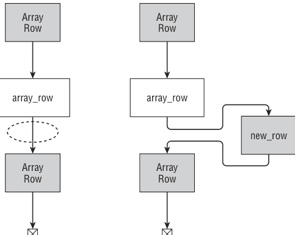

图 4-7：如果目标行缺失，`SetValue` 方法将插入一个新的 `ArrayRow`。

为了插入新的 `ArrayRow` 对象，算法创建新对象并将其 `NextRow` 引用设置为 `array_row` 对象的 `NextRow` 值。然后它将新行作为哨兵插入。

完成后后，列表看起来就像图 4-7 的右侧，`array_row` 的 `NextRow` 引用指向新对象。

在找到目标行（必要时创建它）后，算法调用 `FindColumn` 方法来查找表示目标列的 `ArrayEntry` 对象。如果对象不存在，算法将创建它并在必要时将其插入 `ArrayRow` 的链表中。

最后，算法将变量 `array_entry` 移动到与该行对应的 `ArrayEntry` 并设置其值。

`SetValue` 算法可能会调用后续节描述的 `DeleteEntry` 算法。该算法调用 `FindRowBefore` 和 `FindColumnBefore` 方法。如果 `SetValue` 算法没有调用 `DeleteEntry`，它会调用 `FindRowBefore` 和 `FindColumnBefore`。在这两种情况下，方法都会直接或间接地调用 `FindRowBefore`。

假设数组有 N 行包含非默认值，非默认值最多的行包含 M 个这些值，那么 `SetValue` 算法的总运行时间为 O(N+M)。

## 删除值

删除值的算法遵循与设置类似的通用方法。该算法调用 `FindRowBefore` 和 `FindColumnBefore` 方法。

```
DeleteEntry(Integer: row, Integer: column)
// 查找目标行之前的行。
ArrayRow: array_row = FindRowBefore(row)

// 如果行缺失，我们不需要删除它。
If (array_row.NextRow == null) or (array_row.NextRow.RowNumber > row)
    Return

// 在下一行中查找列之前的列。
ArrayEntry: target_row = array_row.NextRow
ArrayEntry: array_entry = FindColumnBefore(column, target_row.RowsSentinel)

// 如果目标列缺失，我们不需要删除任何内容。
If (array_entry.NextEntry == null) or
    (array_entry.NextEntry.ColumnNumber > column)
    Return

// 删除列。
array_entry.NextEntry = array_entry.NextEntry

// 如果该行还有列，我们就完成了。
If (target_row.RowsSentinel.NextEntry != null) Return

// 删除空行。
array_row.NextRow = target_row.NextRow
End
```

该算法使用 `FindRowBefore` 查找目标行之前的行。如果 `FindRowBefore` 返回的行之后的行不是目标行，要么算法到达了行列表末尾，要么下一行在目标行之后。

接下来的 `FindColumnBefore` 在下一行中查找目标列之前的列。如果目标列不存在，算法不需要删除任何内容，因此它返回。

此时，算法已在该行的链表中找到了 `ArrayEntry` 对象。它通过将前一个条目的 `NextColumn` 引用指向下一个条目来将其从列表中移除。

此操作在图 4-8 中所示。顶部的列表是原始列表。变量 `array_entry` 指向目标条目。然后，算法让该 `NextColumn` 引用指向后续条目。

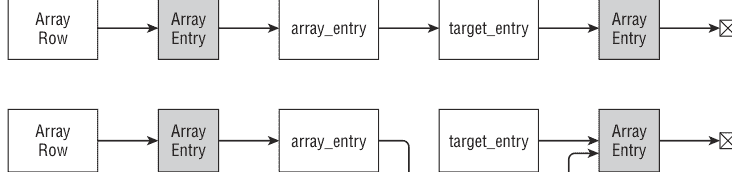

**图 4-8：** 为了移除目标条目，算法将前一个条目的 `NextColumn` 引用指向下一个条目。

> **注意** 当此算法删除行或列对象时，它的内存必须被释放。取决于你所使用的编程语言，这可能需要更多操作。例如，C++ 程序必须显式地调用被移除对象的 `free` 函数以便重用。其他语言采用其他方法。例如，C# 和 Visual Basic 使用垃圾回收，当下次垃圾回收器运行时，它会自动释放程序无法访问的所有对象。

## 矩阵

数组的一个应用是表示矩阵。在矩阵上执行操作相当简单。例如，要两个两个 3x3 矩阵，你只需将相应的条目相加。接下来的注释后的算法展示了两个普通二维数组的操作过程。

### 第4章 数组

> 注意：如果你不熟悉矩阵和矩阵操作，可能想要复位于 http://en.wikipedia.org/wiki/Matrix(mathematics) 的“矩阵”文章。

```
AddArrays(Integer: array1[], Integer: array2[], Integer: result[])
For i = 0 To <maximum bound for dimension 1>
  For j = 0 To <maximum bound for dimension 2>
    result[i, j] = array1[i, j] + array2[i, j]
  Next j
Next i
EndArrays
```

以下算法展示了如何相乘两个二维矩阵：

```
MultiplyArrays(Integer: array1[], Integer: array2[], Integer: result[])
For i = 0 To <maximum bound for dimension 1>
  For j = 0 To <maximum bound for dimension 2>
    // 计算 [i, j] 结果
    result[i, j] = 0
    For k = 0 To <maximum bound for dimension 2>
      result[i, j] = result[i, j] + array1[i, k] * array2[k, j]
    Next k
  Next j
EndMultiplyArrays
```

这些算法适用于三角数组或稀疏数组，但它们是无效的，因为即使条目不存在，它们也会检查两个数组中的每一个项。

例如，三角数组缺少 j > i 的值 [i, j]，因此相加或乘以这些条目具有特殊含义。如果假设缺失的条目为 0，那么相加或乘以它们就不会影响结果（如果假设此类条目具有其他默认值，则数组的相加或相乘将导致非三角数组，因此你可能需要对数组进行完全的相加或相乘）。

算法本应该只考虑实际存在的条目。对于三角数组，这并不复杂。三角数组的加法和乘法算法是练习 12 和 13 的主题。如果你在这些题上卡住了，可以阅读附录 B 中的解决方案。

稀疏数组的情况稍微复杂一些，但潜在的时间节省空间更大。例如，当两个稀疏矩阵相加时，不需要遍历两个输入数组中都不存在的行和列。

以下高层算法用于两个两个稀疏矩阵：

```
AddArrays(SparseArray: array1[], SparseArray: array2[])
```

#### 第4章 数组 107

```
SparseArray: result = [];
// 获取矩阵行列表的指针。
ArrayRow: array1_row = array1.Sentinel.NextRow
ArrayRow: array2_row = array2.Sentinel.NextRow
ArrayRow: result_row = result.Sentinel
// 当两行都还有项时重复。
While (array1_row != null) And (array2_row != null)
    If (array1_row.RowNumber < array2_row.RowNumber) Then
        // array1_row 的 RowNumber 较小。复制它。
        <copy array1_row's to the result>
        array1_row = array1_row.NextRow
    Else If (array2_row.RowNumber < array1_row.RowNumber) Then
        // array2_row 的 RowNumber 较小。复制它。
        <copy array2_row's to the result>
        array2_row = array2_row.NextRow
    Else
        // 输入行具有相同的 RowNumber。
        // 将两行中的值加到结果中。
        <add the values in both rows array1_row and array2_row to the result>
        array1_row = array1_row.NextRow
        array2_row = array2_row.NextRow
    End If
End While

// 任一输入矩阵中的剩余项。
If (array1_row != null) Then
    <copy array1_row's remaining rows to the result>
End If
If (array2_row != null) Then
    <copy array2_row's remaining rows to the result>
End If
AddArrays
```

同样，你可以写一个算法来相乘两个稀疏矩阵，而无需检查所有的行和列。这题被留给了练习 15。如果你在编写该算法时卡住了，请阅读附录 B 中的解决方案。

## 列排序稀疏矩阵

在某些算法中，通过行而不是列来访问稀疏矩阵中的条目可能更方便。例如，当你相乘两个二维矩阵时，你将第一个矩阵行的条目与第二个矩阵列的条目相乘。

为了使这更容易，你可以使用类似的技术，即使用链表来表示列而不是行。如果你需要按行顺序和列顺序访问稀疏矩阵，可以使用这两种表示法。

## 总结

普通数组简单、直观且易于使用，但对于某些应用它们可能很笨拙。在某些应用中，处理具有非零下界的数组可能更自然。通过使用“非零下界”一节中描述的技巧，你可以有效地实现这一点。

普通数组在某些应用中也是无效的。如果一个数组仅在其左下半存储条目，你可以使用三角数组节省大约一半的数组内存。如果数组包含的条目更少，你可能可以通过使用稀疏数组节省更多空间。

具有非零下界的数组、三角数组和稀疏数组比某些编程语言提供的普通数组更复杂，但在某些情况下，它们 了更大的便利和大量的内存节省。

数组对其包含的元素提供随机访问。如果你知道它们在数组中的索引，它就可以获取或设置任何项。

下一章将解释两种不同的容器：栈（stacks）和队列（queues）。与数组不同，这些数据结构持有项的集合。与数组不同，尽管它们具有随机访问行为，但插入和删除项的方法非常受限。

## 练习

星号表示特别困难的题目。

- 1. 写一个算法来计算一维数字数组的样本方差，其中任何包含 N 个项的数组的样本方差由此方程定义：

S = \frac{1}{N-1} \sum_{i=0}^{N-1}(x_i - \bar{X})^2$

X 是数组中值的平均值，求和符号 $\sum$ 意味着当 $i$ 从 0 变化到 N-1 时，将所有的 x 值相加。

+ 2. 写一个算法来计算一维数字数组的样本标准差，其中样本标准差定义为样本方差的平方根。

- 3. 写一个算法来寻找一维数组的中位数。（确保处理偶数或奇数项。）

#### 第4章 数组 109

+ 4. “删除项”一节解释了如何从线性数组中删除项。请用伪代码编写该算法。

+ 5. 本章讨论的三角数组有时被称为“下三角数组”，因为值存储在左下半。你如何修改这种数组以产生一个值存储在右上角的上三角数组？

+ 6. 你如何修改该方法以制作一个“左上”数组？条目的行和列之间有什么关系？

+ 7. 假设你定义矩形数组的主对角线从左上角向下延伸到底或右边界。写一个算法，将主对角线及以下的项填充为 1，对角线以上的项填充为 0。

+ 8. 考虑矩形数组的对角线，它从第一行的最后一列向下延伸到底或右边界。写一个算法，将对角线上及以上的项填充为 1，对角线以下的项填充为 0。

+ 9. 写一个算法，将矩形数组中的每个项填充为距离最近边缘的距离。

+ 10. 通用化构建三角四面体数组的方法，该数组包含项 value[i, j, k]，其中 j ≤ i 且 k ≤ j。你如何继续扩展这种方法到更高的维度？

+ 11. 你可以如何制作稀疏三角数组？

+ 12. 写一个相加两个三角数组的算法。

+ 13. 写一个相乘两个三角数组的算法。

+ 14. 描述两个稀疏矩阵相加的算法是高层的。扩展该算法，在角括号内的指令处提供详细信息（提示：你可能需要一个从一个列表复制条目到另一个列表的 CopyEntries 方法，以及一个合并相同行条目的 AddEntries 方法。）

# 栈与队列

栈和队列是相对简单的数据结构，按照先进先出（FIFO）或后进先出（LIFO）顺序存储对象。它们会根据需要扩展以容纳更多项目，这与第 3 章描述的链表类似。事实上，你可以使用链表来实现栈和队列。

你也可以使用栈和队列来模拟现实世界中的场景，例如银行或超市的排队服务。但它们更多地用于存储对象，供其他算法（如最短路径网络算法）后续处理。

本章将解释栈和队列。它将解释它们是什么、栈和队列的术语，以及你可以用于实现它们的方法。

## 栈

栈是一种按照后进先出顺序添加和移除项目的数据结构。由于这种后进先出（LIFO，通常读作 "life-oh"）的特性栈有时被称为 LIFO 列表或 LIFOs。

栈类似于书桌上的一堆书。你可以向书堆顶部添加一本书，或从书堆顶部移除一本书，但你不能在不导致整堆倒塌的情况下取出中间或底部的某本书。


栈还类似于食堂里的弹簧压力栈。如果你向栈中添加盘子，弹簧会压缩，使得顶部的盘子与桌面齐平。如果你移除一个盘子，弹簧会展开，使得现在顶部的盘子仍然与桌面齐平。图 5-1 显示了这种栈。

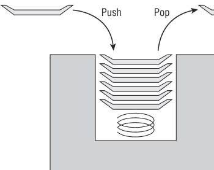

由于这种栈会将盘子向下推入桌面，这种数据结构有时也被称为压栈（pushdown stack）。向栈中添加对象被称为“推入”（push），从栈中移除对象被称为“弹出”（pop）。栈类通常提供 `Push` 和 `Pop` 方法来向栈中添加项目和移除项目。

接下来的章节描述了实现栈的几种较为常用的方法。

## 链表栈

使用链表实现栈是非常简单的。`Push` 方法简单地在列表顶部添加一个新单元格，而 `Pop` 方法则从列表中移除顶部的单元格。

以下伪代码显示了向链表栈推入项的算法：

```
Push(Cell: sentinel, Data: new_value)
  // 创建一个单元来存储新值。
  Cell: new_cell = New Cell
  new_cell.Value = new_value

  // 将新单元格加入链表。
  new_cell.Next = sentinel.Next
  sentinel.Next = new_cell
End Push
```

以下伪代码显示了从链表栈中弹出项的算法：

```
Data: Pop(Cell: sentinel)
  // 确保有项可以弹出。
  If (sentinel.Next == null) Then <throw an exception>

  // 获取顶部单元格的值。
  Data: result = sentinel.Next.Value

  // 从链表中移除顶部的单元格。
  sentinel.Next = sentinel.Next.Next

  // 返回结果。
  Return result
End Pop
```

图 5-2 显示了该过程。顶部的图像显示程序向栈推入字母 A、P、L、E 后的栈状态。中间的图像显示新字母 S 推入栈之后的状态。底部的图像显示在 S 弹出后栈的状态。

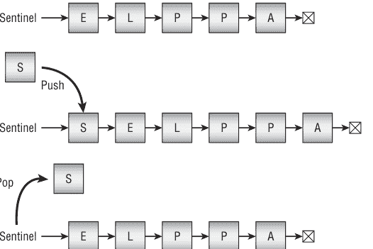

图 5-2: 使用链表构建栈非常简单。

> 注意：请参阅第 3 章获取更多关于使用链表的详细信息。

使用链表，推入和弹出项的运行时间均为 O(1)，因此这两个操作都非常快。该列表除了单元格之间的链接外，不需要额外存储，因此链表也是空间高效率的。

## 数组栈

在数组中实现栈几乎与使用链表实现一样简单。为数组分配空间，使其足够大以容纳你预期放入栈中的项目数量。使用一个变量来跟踪栈中下一个空位置。

以下伪代码显示了向基于数组的栈推入项的算法：

```
Push(Data: stack_values [], Integer: next_index, Data: new_value)
  // 确保有空间添加项。
  If (next_index == <length of stack_values>) Then <throw an exception>

  // 添加新项。
  stack_values[next_index] = new_value

  // 递增 next_index。
  next_index = next_index + 1
End Push
```

以下伪代码显示了从基于数组的栈中弹出项的算法：

```
Pop(Data: stack_values[], Integer: next_index)
  // 确保有项可以弹出。
  If (next_index == 0) Then <throw an exception>

  // 递减 next_index。
  next_index = next_index - 1

  // 返回结果。
  Return stack_values[next_index]
End Pop
```

图 5-3 显示了程序向栈推入字母 A、P、L、E 后的栈状态。中间的图像显示字母 S 推入栈之后的状态。底部的图像显示在 S 弹出后栈的状态。

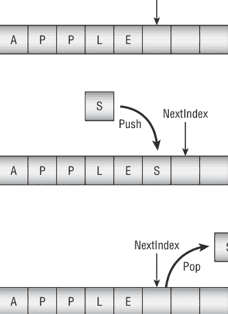

图 5-3: 使用数组构建栈非常简单。

## 双栈

假设某个算法需要两个总大小受限的栈。在这种情况下，你可以将两个栈存储在同一个数组中，分别从两端开始向中间生长，如图 5-4 所示。

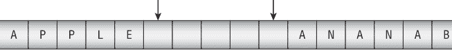

图 5-4: 两个栈共享一个数组。

以下伪代码显示了在单个数组中两个栈的推入和弹出算法。为了使算法更简单，数组以及 `NextIndex1` 和 `NextIndex2` 变量被存储在 Push 方法之外：

```
Data: StackValues(<max items>)
Integer: NextIndex1, NextIndex2

// 初始化数组。
Initialize()
NextIndex1 = 0
NextIndex2 = <length of StackValues> - 1
End Initialize

// 向顶部栈推入项。
Push(Data: new_value)
  // 确保有空间添加项。
  If (NextIndex1 > NextIndex2) Then <throw an exception>

  // 添加新项。
  StackValues[NextIndex1] = new_value

  // 递增 NextIndex1。
  NextIndex1 = NextIndex1 + 1
End Push

// 向底部栈推入项。
Push2(Data: new_value)
  // 确保有空间添加项。
  If (NextIndex1 > NextIndex2) Then <throw an exception>

  // 添加新项。
  StackValues[NextIndex2] = new_value

  // 递减 NextIndex2。
  NextIndex2 = NextIndex2 - 1
End Push2

// 从顶部栈弹出项。
Pop()
  // 确保有项可以弹出。
  If (NextIndex1 == 0) Then <throw an exception>

  // 递减 NextIndex1。
  NextIndex1 = NextIndex1 - 1

  // 返回顶部值。
  Return StackValues[NextIndex1]
End Pop

// 从底部栈弹出项。
Pop2()
  // 确保有项可以弹出。
  If (NextIndex2 == <length of StackValues> - 1) Then <throw an exception>

  // 递增 NextIndex2。
  NextIndex2 = NextIndex2 + 1

  // 返回底部值。
  Return StackValues[NextIndex2]
End Pop2
```

# 第5章 - 栈与队列

## 栈算法

许多算法都使用栈。例如，第13章中描述的某些最短路径算法可以使用栈。接下来的章节描述了你可以使用栈实现的其他一些算法。

### 反转数组

使用栈反转数组非常简单。只需将每个元素推入栈中，然后将其依次弹出。由于栈的后进先出（LIFO）特性，元素返回的顺序将反相反。

以下伪代码展示了该算法：

```
ReverseArray(Data: values[])
  // 将数组中的值推入栈。
  Stack: stack = New Stack
  For i = 0 To <length of values> - 1
    stack.Push(values[i])
Next i
```

```
// 将元素从栈弹出并放入数组。
  For i = 0 To <length of values> - 1
    values[i] = stack.Pop()
Next i
EndReverseArray
```

如果数组包含N个元素，该算法需要2 × N步操作，因此其运行复杂度为 O(N)。

### 火车排序

假设有一列火车包含开往不同目的地的车厢，它进入了一个调度场。在火车离开调度场之前，你需要使用轨道对车厢进行排序，以便去往同一目的地的车厢分组。

图5-5显示了一列从左输入轨道进入城市3、2、1、3和2的火车。火车可以移动到临时轨道，并将其最右侧的车厢移动到该临时轨道上任意车辆的左侧。稍后，火车可以返回临时轨道，将临时轨道左端的车厢移回火车的右端。目标是对比车厢进行排序。

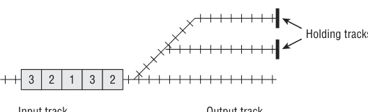

**图5-5**：你可以使用栈来模拟真实的调度场火车排序。

你可以直接使用栈来模拟这种情况。一个栈代表进入的火车。它的 `Pop` 方法移除火车右侧的一节车厢，它的 `Push` 方法将一节车厢移回火车右端。

其他栈代表临时轨道和输出轨道。它们的 `Push` 方法代表将车厢移到轨道的左端，`Pop` 方法代表将车厢从轨道的左端移走。

以下伪代码展示了程序如何使用栈来对图5-5所示的火车排序。这里*train*在输入轨道上，*track1*和*track2*是上方和方的临时轨道，而*output*是输出轨道：

```
holding1.Push(train.Pop()) // 第1步：车厢2移到临时轨道1。
holding2.Push(train.Pop()) // 第2步：车厢3移到临时轨道2。
output.Push(train.Pop()) // 第3步：车厢1移到输出。
holding1.Push(train.Pop()) // 第4步：车厢2移到临时轨道1。
train.Push(holding2.Pop()) // 第5步：车厢3移回火车。
train.Push(holding1.Pop()) // 第6步：车厢2移回火车。
train.Push(holding1.Pop()) // 第7步：车厢2移回火车。
train.Push(output.Pop()) // 第8步：车厢1移回火车。
```

图5-6展示了这一过程。每一步中移动的车厢都有边框。箭头显示了每节车厢的移动方向。

当然，在真实的调度场中，每次移动都需要调整火车车厢，可能需要几分钟时间。因此，找到移动次数最少的解决方案是非常重要的。

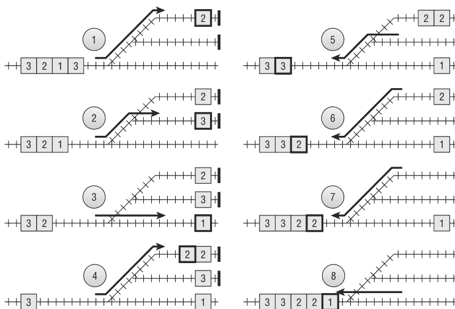

**图5-6**：通过使用两个临时轨道和一个输出轨道，你可以八步内完成这列火车的排序。

### 汉诺塔

汉诺塔游戏如图5-7所示，有三个柱。一根柱上放着一叠大小不同的盘，按从小到大的顺序。你每次移动一个盘从一个柱移动到另一个柱，目标是按大小将所有盘重新堆叠在另一个柱上。你不能将盘放在半径较小的另一个盘之上。

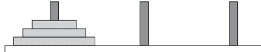

**图5-7**：汉诺塔游戏的目标是将盘从一根柱重新堆叠到另一根柱，而不将盘放在小盘之上。

你可以用非常明显的方式使用三个栈来模拟这个游戏。每个栈代表一根柱。你可以使用代表盘半径的数字作为栈中的对象。

以下伪代码展示了程序如何使用栈来模拟将盘从左柱移动到中间柱：

```
peg2.Push(peg1.Pop())
peg3.Push(peg1.Pop())
peg2.Push(peg3.Pop())
peg1.Push(peg2.Pop())
peg3.Push(peg2.Pop())
peg2.Push(peg3.Pop())
peg1.Push(peg2.Pop())
```

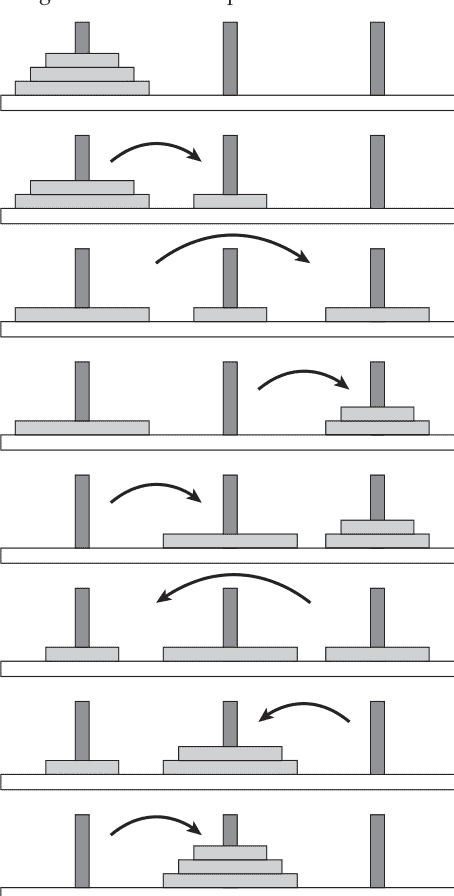

**图5-7**：汉诺塔游戏的目标是将盘从一根柱重新堆叠到另一根柱，而不将盘放在小盘之上。

*(注：后续文本为大量重复内容，已根据要求去重并保留核心逻辑结构)*

## 栈选择

追踪最大值。将最大项存储在变量 `largest_item` 中。

此时，有 `(num_items - i - 1)` 个未排序的项。

```
<将 largest_item 添加到原始栈中
在之前已排序项的末尾.>
```

<将未排序的项从 temp_stack 移回

原始栈，当遇到 largest_item 时跳过它>

继续处理下一个 i

结束栈选择 (End StackSelections)

对于每个项目，该算法将未排序的项移动到临时栈中，将最大项添加到原始栈的排序部分，然后将剩余未排序的项目从临时栈移动到原始栈。对于数组中的每个位置，我们必须移动两次未排序的项目。在不同的步骤中，有 N, N-1, N-2, ... 个未排序的项需要移动，因此移动的项目总数为 N × (N-1) + (N-2) + ... + 1 = N × (N+1)/2，算法的运行时间为 O(N²)。

## 队列

队列是一种数据结构，项按照先进先出的顺序进行添加和移除。由于这种先进先出（FIFO，通常读作“ife-oh”）的行为，栈有时被称为 FIFO 列表或 FIFOs。

队列类似于商店的收银台。你加入队尾并等待轮到你。当你走到队首时，收银员会给你一张收据。

通常，向队列添加项的方法称为 Enqueue（入队），从队列中移除项的方法称为 Dequeue（出队）。

接下来的章节描述了实现队列的几种常用方法。

### 链表队列

使用链表实现队列是非常简单的。为了方便从队列中移除最后一个项，队列应该使用双向链表。

Enqueue 方法简单地在列表顶部添加一个新单元，而 Dequeue 方法从列表中移除底部的单元。

以下伪代码显示了在链表中入队项的算法：

```
Enqueue(Cell: top_sentinel, Data: new_value)
  // 创建一个单元来存储新值。
  Cell: new_cell = New Cell
```

```
new_cell.Value = new_value
```

```
// 将新单元添加到链表中。
new_cell.Next = top_sentinel.Next
top_sentinel.Next = new_cell
new_cell.Prev = top_sentinel
```

```
End Enqueue
```

以下伪代码显示了从链栈中出队项的算法：

```
Data: Dequeue(Cell: bottom_sentinel)
// 确保有项可以出队。
If (bottom_sentinel.Prev == top_sentinel) Then <抛出异常>

// 获取底部单元的值。
Data: result = bottom_sentinel.Prev.Value

// 从链表中移除底部单元。
bottom_sentinel.Prev = bottom_sentinel.Prev.Prev
bottom_sentinel.Prev.Next = bottom_sentinel

// 返回结果。
Return result
```

```
End Dequeue
```

> 注意：参见第 3 章以了解关于使用链表的更多详情。

使用链表，入队和出队的操作运行时间均为 O(1)，这两个操作都非常快。列表除了单元之间的连接外，不需要额外空间，因此链表是空间高效的。

### 数组队列

在数组中实现队列比使用链表实现要复杂一点。为了跟踪已使用的数组位置，你可以使用两个变量：Next，用于标记下一个空位置；Last，用于标记存储最久的位置。然而，如果你简单地在数组的一端存储项并从另一端移除，被占的空间就会在数组中移动。

例如，假设队列在一个具有八个条目的数组中实现。考虑以下系列入队和出队操作：

```
Enqueue(M)
Enqueue(O)
Enqueue(V)
Dequeue() // 移除 M.
Dequeue() // 移除 O.
Enqueue(I)
Enqueue(N)
Enqueue(Q)
Dequeue() // 移除 V.
Dequeue() // 移除 I.
```

图 5-9 显示了这一操作序列。最初 Next 和 Last 指向同一个条目。这表示队列为空。在执行一系列操作后，只剩下两个空空间可以添加新项。之后，将无法向队列添加新项。

解决此问题的方法之一是在 Next 越数组边界时扩大数组。遗憾的是，这将导致数组随时间变大，并且 Last 之前的所有空间将被浪费。

另一种方法是每当 Last 越界时，将数组项移动到数组开头。这种方法可行，但速度相对较慢。

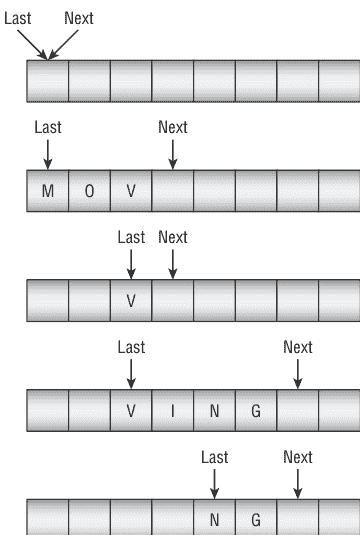

**图 5-9：** 在基于数组的队列中入队和出队时，被占的空间会在数组中移动。

更有效的方法是构建一个循环数组，其中你将最后一个项视为紧接在第一个项之前的项。当 Next 越界时，它会绕回。

## 特殊队列


队列是相当特化的，但某些应用使用了更特化的队列。这些队列中的两种是优先级队列和双端队列（deques）。

## 优先级队列

在优先级队列中，每个项都有一个优先级，Dequeue 方法移除优先级最高的项。基本上，高优先级项会被先处理。

实现优先级队列的一种方法是按优先级对队列中的项进行排序。例如，你可以使用插入排序的核心概念来保持排序。当你向队列添加新项时，你会遍历整个队列直到找到它所在的位置，并将其放置在那里。要出队项，只需从队列中移除顶部即可。通过这种方法，入队项需要 `O(N)` 时间，出队项需要 `O(1)` 时间。

另一种方法是按项添加到队列的原始顺序存储项，然后让 Dequeue 方法搜索优先级项。通过这种方法，入队项需要 `O(1)` 时间，出队项需要 `O(N)` 时间。

如果使用链表，这两种方法都相对直观。在第 6 章“堆排序”节描述的堆数据结构为实现优先级队列提供更高效的方法。基于堆的优先级队列可以在 `O(log N)` 时间内入队和出队项。

## 双端队列 (Deques)

Deque 通常读作“deck”，全称是“双端队列”。双端队列允许你从队列的任一端添加和移除项。

双端队列（Deques）在对项目优先级只有部分信息的算法中非常有用。例如，你可能知道某些项目是高优先级，另一些是低优先级，但不一定知道每个项目的确切相对优先级。在这种情况下，你可以将高优先级项目添加到双端队列的一端，将低优先级项目添加到另一端。使用双向链表可以很容易构建双端队列。

## 总结

本章解释了栈（stacks）和队列（queues），这两种经常被其他算法用于存储项目的数据结构。在栈中，项目按照后进先出的顺序在数据结构的同一个“末端”添加和移除。在队列中，项目从一端添加并从另一端移除，遵循先入先出的原则。

你可以相当容易地使用数组来构建栈，只要空间不耗尽即可。如果你用链表构建栈，就不需要担心栈的空间耗尽问题。

你也可以使用数组来构建队列，尽管在这种方法中项目会在数组中移动直到到达末尾，此时你需要调整数组的大小。你也可以通过使用循环数组解决这个问题。你也可以使用双向链表构建队列来避免这个问题。

你可以使用栈和队列以 `$O(N^2)$` 的复杂度存储项目，尽管算法练习更多是关于如何在高效排序中使用栈和队列。下一章将描述几种性能远远更好的排序算法，其中一些的运行时间为 `$O(N log N)`，另一些运行时间为 `$O(N)`。

## 练习题

星号表示特别困难的问题。

- + 1. 当你使用双栈时，当其中一个栈满，变量 `NextIndex1` 和 `NextIndex2` 之间是什么关系？

- 2. 编写一个算法，输入一个栈并返回一个包含相同项目但顺序反反的新栈。

- 3. 编写一个程序用栈实现插入排序（`insertionsort`）。

- 4. 对于每个项目，栈插入排序会将未排序的项目移动到临时栈。然后它将所有项目移回原始栈。真的需要将所有项目移回原始栈吗？你能通过修改该步骤来改进算法性能吗？这对算法的 Big O 运行时间有什么影响？

- + 5. 栈插入排序算法在火车排序中意味着什么？

- + 6. 编写一个程序用栈实现选择排序（`selectionsort`）。

- + 7. 栈选择排序算法在火车排序中意味着什么？

- + 8. 编写一个程序实现优先级队列（`priority queue`）。

- + 9. 编写一个程序实现双端队列（`deque`）。

- + 10. 考虑一个银行客户进入一条单行队列，由几名收银员服务。你在队尾进入队列，当你到达队首时，由下一个空闲柜员为你服务。你可以用一个服务多个柜员的普通队列来模拟这种“多头队列”。编写一个与图 5-11 所示类似的程序来模拟银行的多头队列。使用控制控件调整柜员数量、客户到达之间的时间、每个客户停留的时间以及模拟的速度。在用户指定参数后，运行模拟以观察队列的行为。柜员数量如何影响等待时间？

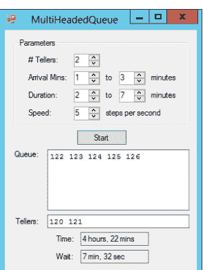

**图 5-11：** 在银行队列中，客户排成单队，然后由下一个空闲柜员提供帮助。

- + 11. 编写一个程序用队列实现插入排序。

- + 12. 编写一个程序用队列实现选择排序。

# 第 6 章 排序

算法书中通常会详细介绍排序算法，出于几个原因。首先，它们非常有趣，并展示了许多实用的技术，如递归、问题分解、堆（heaps）和树。

其次，排序算法经过了充分的研究，是少数已知确切运行时间的算法之一。可以证明，使用比较来排序 N 个项目的最快算法必须使用 `$O(N log N)` 时间。几种排序算法实际上实现了这种性能，从某种意义上说，它们是优优的。

最后，排序算法是有用的。几乎任何数据在以各种方式排序后都是有用的，因此排序算法在许多应用中起着重要作用。

本章描述了几种不同的排序算法。其中一些（如插入排序、选择排序和冒泡排序）相对简单但速度慢。另一些（如堆排序、快速排序和合并排序）更复杂但快得多。还有一些（如计数排序（`countsort`））不使用比较来排序项目，因此在适当情况下可以打破 `$O(N log N)` 的限制，执行速度惊人。

后续章节将根据运行时间性能对算法进行分类。

> 注意：许多编程库都包含了排序工具，它们通常非常快。在实践中，你可能想使用这些工具来节约编写和调试代码的时间。然而，理解排序算法的工作原理仍然很重要，因为有时你可能做得比内置工具更好。例如，简单的冒泡排序算法可能超过更复杂的库运行时，或者如果排序的数据具有某些特征，计数排序往往优于这些工具。

## `$O(N^2)` 算法

`$O(N^2)` 算法相对较慢但相当简单。事实上，它们的简单有时会让它们在处理非常小的数组时性能优于更复杂的算法。

### 数组中的插入排序

第 3 章描述了使用链表的插入排序，第 4 章描述了使用栈和队列的插入排序。基本思想是从输入中取一个项目并插入到排序部分。以下伪代码所示：

```
Insertort(values[])
  For i = 0 To length of values
    // 找到满足 values[j] > values[i] 的第一个索引 j
    // 将 j 和 i 之间的项目向右移动一位，为位置 j 的项目留出空间
    // 在 j 处插入 values[i]
```

随着 `i` 遍历数组，代码将已排序的项目向右移动，为位置 `j` 的项目留出空间。这可能是一个耗时的步骤。假设项目的新索引应该是 `j`。图 6-1 显示了算法的关键步骤。顶部的图像显示了未排序的数组。在中间的图中，前四个项目（加粗显示）已经排序，算法准备将下一个项目（值为 3）插入到数组的排序部分。它将 5, 6 和 7 向右移动以为值 3 留出空间。算法插入 3 后继续循环，将下一个项目（值为 2）插入到其正确位置。

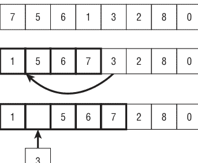

**图 6-1：** 插入排序将项目插入到排序部分。

该算法在原始数组中排序（除了控制循环和移动项目的少量变量外），因此不需要额外的存储。如果数组包含 N 个项目，算法考虑数组中的 N 个位置。对于每个位置 `i`，它必须搜索数组中之前排序的项目以找到第 `i` 个项目的新位置。然后它必须将位置和索引之间的项目向右移动。如果项目应该移动到位置 `$j$`，则需要 `$j$` 步找到新位置 `$j$`，以及 `$i - j$` 步移动项目，总共需要 `$i$` 步。这意味着总共需要 `$i$` 步将项目移动到新位置。汇总定位所有项目所需的步骤，总运行时间为

`1 + 2 + 3 + … + N = (N^2 + N) / 2`

这意味着该算法的运行时间为 `$O(N^2)`。这不是一个非常快的运行时间，但对于合理的的小数组（少于 10,000 个项目）来说足够快。它也是一种相对简单的算法，因此对于非常小的数组，它有时可能比更复杂的算法更快。数组需要多小

超越更复杂算法的算法取决于你的系统。通常，这种算法仅在包含 5 或 10 个元素的数组时更快。

## 数组中的选择排序

第 3 章在描述了链表的插入排序外，还描述了链表的选择排序。同样，第 4 章也描述了使用栈和队列的选择排序算法。

其基本思想是在输入列表中搜索最大的项，然后将其添加到不断增长的列表末尾。或者，算法也可以找到最小的项并将其移动到增长列表的开头。以下伪代码显示了用于数组的算法：

```
Selectionsort(Data: values[])
For i = 0 To <length of values> - i
  // 找到属于位置 i 的项。
  <Find the smallest item with index j >= i>.
  Swap values[i] and values[j].
Next i
End Selectionsort
```

代码遍历数组以寻找尚未添加到排序数组中的最小项。然后，它将该最小项与位置 `i` 项进行交换。

图 6-2 显示了算法的关键步骤。顶部的图像显示了原始未设置的数组。在中间的图像中，前三个项（**粗体**圈出）已经排序，算法正在搜索未排序的项以找到值最小的项（在这种情况下为 3）。算法随后将值最小的项交换到下一个未排序的位置。图底部的图像显示了将新项移动到数组排序部分后的数组。算法现在继续 For 循环，将下一个一个项（值为 5）添加到数组的增长部分。

与插入排序一样，它对原始数组中的项进行排序，因此不需要任何额外的存储（除了用于控制循环和移动项的少数变量外）。

如果数组包含 N 个项，算法会考虑数组中 N 个位置中的每一个。对于每个位置 `$i$`，它必须搜索 `$N - i$` 个尚未排序的项，以找到属于位置 `$i$` 的项。它使用常数步将项交换到最终位置。将移动所有项的步数相加得到以下运行时间：

`(N - 1) + (N - 2) + ... + 2 + 1 = (N^2 + N) / 2`

这意味着算法的运行时间为 `$O(N^2)`，与插入排序的运行时间相同。与插入排序一样，选择排序对于小型数组（少于 10,000 个左右的项目）足够快。它也是一个相当简单的算法，因此对于非常小的数组（通常为 5 到 10 个项），它有时比更复杂的算法更快。

| 7 | 5 | 6 | 1 | 3 | 2 | 8 | 0 |

|---|---|---|---|---|---|---|--|

| 0 | 1 | 2 | 8 | 7 | 3 | 6 | 5 |

图 6-2：选择排序将最小的未排序项移动到数组排序部分的末。

## 冒泡排序

冒泡排序利用了一个明显的事实：如果数组没有排序，它必须包含两个顺序错误的相邻元素。算法反复遍历数组，交换顺序错误的项，直到无法找到任何交换为止。以下伪代码显示了冒泡排序算法：

```
Bubblesort(Data: values[])
// 重复直到数组排序完成。
Boolean: not_sorted = True
While (not_sorted)
  // 假设我们不会找到需要交换的对。
  not_sorted = False
  // 在数组中搜索顺序错误的相邻项。
  For i = 0 To <length of values> - 1
    // 检查项 i 和 i - 1 是否顺序错误。
    If [values[i] < values[i - 1]] Then
      // 交换它们。
      Data: temp = values[i]
      values[i] = values[i - 1]
      values[i - 1] = temp
      // 数组并没有排序。
      not_sorted = True
    End If
  Next i
End While
End Bubblesort
```

代码使用布尔变量 `not_sorted` 来跟踪在最近一次遍历数组时是否找到了交换。只要 `not_sorted` 为 `true`，算法就会循环遍历数组，寻找顺序错误的相邻项对并交换它们。

6-3 显示了一个示例。最左侧的数组已基本排序。在对数组的第一次遍历期间，算法发现 6/3 是顺序错误的（6 应该在 3 之后），因此它交换了 6 和 3，得到值的第二种排列。在对数组第二次遍历期间，算法发现 5/3 对是顺序错误的，因此它交换了 5 和 3，得到值的第三种排列。在对数组第三次遍历期间，算法发现 4/3 对是顺序错误的，因此它交换了 4 和 3，给图中最右侧的排列。算法执行最后一次遍历，没有发现任何顺序错误的对，然后结束。

| 0 | 0 | 0 | 0 |

|---|---|---|--|

| 1 | 1 | 1 | 1 |

| 2 | 2 | 2 | 2 |

| 4 | 4 | 4 | 3 |

| 5 | 5 | 3 | 4 |

| 6 | 6 | 6 | 5 |

| 7 | 7 | 7 | 6 |

| 8 | 8 | 8 | 7 |

| 9 | 9 | 9 | 8 |

**6-3：** 在冒泡排序中，比应位置更靠下的项会缓慢地“浮”到它们正确的位置。

项 3 似乎缓慢地浮到其正确位置的事实使冒泡排序算法得名。在对数组的每次遍历中，至少有一个项会到达其最终位置。在图 6-3 中，项 6 在第一次遍历期间到达终点，项 5 在第二次遍历期间到达终点，项 3 和 4 在第三次遍历期间到达它们的终点。

如果数组包含 N 个项，并且每次遍历数组时至少有一个项到达其最终位置，则算法最多可以执行 N 次遍历。（如果数组初始是反序排序的，算法需要所有遍历。）每次遍历花费 `$N$` 次，因此总时间为 `$O(N^2)`。与插入排序和冒泡排序一样，对于小型列表（少于 10,000 个）来说相当慢。对于非常小的数组（通常为 5 到 10 个项），它有时比更复杂的算法更快。

# 第6 章 排序

| | | |

|---|---|---|

| 0 | 0 | 0 |

| 1 | 1 | 1 |

| 2 | 2 | 2 |

| 7 | 4 | 3 |

| 4 | 5 | 4 |

| 5 | 6 | 5 |

| 6 | 3 | 6 |

| 7 | | 7 |

| 8 | | 8 |

| 9 | | 9 |

**图 6-4：** 改进使得泡沫排序更快，但它仍然具有 O(N²) 的性能。

在将 7 放在 3 之后，算法继续遍历数组，并且没有找到任何其他需要交换的元素，因此它知道 7 及其后续元素已处于最终位置，不需要再次检查。如果靠近顶部的某个元素比 7 大，那么第一轮遍历会将它与 7 交换位置。在图 6-4 所示的中间图中，最后的元素被阴影处理，表示它们在随后的遍历中不需要检查。算法知道元素 7 及其后的元素已处于最终位置，因此它开始了第二轮遍历，从 7 之前的第一个元素开始向上移动数组，该元素与元素 6、5 和 4 交换，在此期间将元素 3 保存在临时变量中，直到它到达最终位置。

现在，元素 3 以及它在数组中之前的元素都处于最终位置，因此它们在图 6-4 的最后一张图中被阴影处理。

算法对数组进行了最后一次向下遍历，从值 4 开始遍历，到值 6 结束。在此次遍历中没有发生任何交换，因此算法结束。

这些改进使得泡沫排序更快。（在一次对 10,000 个元素的测试中，未经过改进的泡沫排序需要 2.5 秒，而改进后仅需 0.69 秒。）但它仍然具有 `$O(N²)` 的性能，因此使用泡沫排序可以排序的列表大小是的。

## O(n log N) 算法

`O(n log N)`算法比 `O(N²)` 快得多，至少对于较大的数组是如此。如果 N 是 1,000，N log N 小于 1x10⁴，而 N² 大约是其100倍的1x1⁶。这种速度上的差异使得这些算法在日常编程中更有用，特别是对于大型数组。

## 堆排序

堆排序使用一种名为堆（heap）的数据结构，是一种在数组中存储完全二叉树的有用技术。

## 在数组中存储完全二叉树

二叉树是每个节点最多连接两个子节点的树。在完全树（二叉树或其他）中，树的所有层都是满的，最后一层除外，最后一层的节点节点都推向左侧。

图 6-5 显示了一个包含 12 个节点的完全二叉树。树的前三层是满。第四层包含五个推向树左侧的节点。

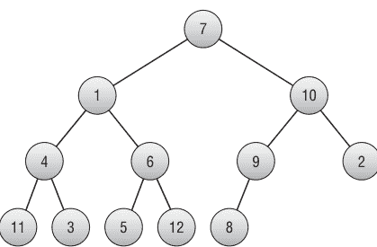

**图 6-5：** 在完全二叉树中，每一层都是满的，最后一层除。

完全二叉树的一个有用特性是，你可以使用简单的公式将它们存储在数组中。首先将根节点放在索引 0 。然后，对于任何索引为 `$i$` 的节点，将其子节点放在索引 `$2 × i + 1$` 和 `$2 × i + 2$` 。如果一个节点的索引为 `$j$`，它的父节点索引为 `⌊(j-1)/2⌋`，其中 `⌊⌋` 表示将结果截断为下一个较小的整数（向下取整）。例如，`⌊2.9⌋` 是 2，而 `⌊2⌋` 也是 2。

图 6-6 显示了图 6-5 所示的树存储在数组中，元素的索引在上方。

| 0 | 1 | 2 | 3 | 4 | 5 | 6 | 7 | 8 | 9 | 10 | 11 |

|---|---|---|---|---|---|---|---|---|---|---|---|

| 7 | 10 | 4 | 6 | 9 | 2 | 11 | 3 | 5 | 12 | 8 | |

**图 6-6：** 你可以轻松地将完全二叉树存储在数组中。例如，值 6 位于索引 4，所以它的子节点应该位于 `$2 × 4 + 1 = 9$` 和 `$2 × 4 + 2 = 10$` 。这些元素的值分别为 5 和 12。如果你看图 6-5 所示的树，你会发现那些是正确的孩子。

如果任一子节点的索引大于数组中的最大索引，则该节点在树中没有孩子。例如，值 9 的索引为 5。它的右孩子是 `$2 × 5 + 2 = 12$`，超出了数组的末尾。如果你看图 6-5，你会发现值为 9 的元素没有右孩子。

计算节点父节点的示例是存储在索引 10 的值为 12 的元素。父节点的索引为 `$(10 - 1) / 2 = 4$`。索引 4 处的值为 4。

## 定义堆

堆（Heaps）是图 6-5 所示的完全二叉树，其中每个节点都大于其父节点。图0b410af6705110aea7c0cb_162_0.png

**图 6-5：** 在完全二叉树中，每一层都是满的，最后一层除。


完全二叉树的一个有用特性是，你可以使用简单的公式将它们存储在数组中。首先将根节点放在索引 0 。然后，对于任何索引为 $i$ 的节点，将其子节点放在索引 $2 \times i + 1$ 和 $2 \times i + 2$ 。如果一个节点的索引为 $j$，它的父节点索引为 $\lfloor(j-1)/2\rfloor$，其中 $\lfloor\rfloor$ 表示将结果截断为下一个较小的整数（向下取整）。例如，$\lfloor 2.9\rfloor$ 是 2，而 $\lfloor 2\rfloor$ 也是 2。

图 6-6 显示了图 6-5 所示的树存储在数组中，元素的索引在上方。

图 6-5 所示的完全二叉树包含 12 个节点。0 | 1 | 2 | 3 | 4 | 5 | 6 | 7 | 8 | 9 | 10 | 11 |

|---|---|---|---|---|---|---|---|---|---|---|---||

| 7 | 10 | 4 | 6 | 9 | 2 | 11 | 3 | 5 | 12 | 8 | |

**图 6-6：** 你可以轻松地将完全二叉树存储在数组中。例如，值 6 位于索引 4，所以它的子节点应该位于 $2 \times 4 + 1 = 9$ 和 $2 \times 4 + 2 = 10$ 。这些元素的值分别为 5 和 12。如果你看图 6-5 所示的树，你会发现那些是正确的孩子。

如果任一子节点的索引大于数组中的最大索引，则该节点在树中没有孩子。例如，值 9 的索引为 5。它的右孩子是 $2 \times 5 + 2 = 12$，超出了数组的末尾。如果你看图 6-5，你会发现值为 9 的元素没有右孩子。

计算节点父节点的示例是存储在索引 10 的值为 12 的元素。父节点的索引为 $(10 - 1) / 2 = 4$。索引 4 处的值为 4。图 6-5 所示的完全二叉树包含 12 个节点。0 | 1 | 2 | 3 | 4 | 5 | 6 | 7 | 8 | 9 | 10 | 11 |

|---|---|---|---|---|---|---|---|---|---|---|---||

| 7 | 10 | 4 | 6 | 9 | 2 | 11 | 3 | 5 | 12 | 8 | |

```
// 如果子索引超出了树的范围，
// 使用父节点的索引。
If (child1 >= count) Then child1 = index
If (child2 > count) Then child2 = index
```

```
// 如果满足堆的属性，
// 我们就完成了，跳出 While 循环。
If (values[index] >= values[child1]) And
   (values[index] >= values[child2])) Then Break
```

```
// 获取值较大的子节点的索引。
Integer: swap_child
If (values[child1] > values[child2]) Then
   swap_child = child1
```

```
Else
   swap_child = child2
```

```
// 与较大的子节点交换。
Data: temp = values[index]
values[index] = values[swap_child]
values[swap_child] = temp
```

```
// 移动到子节点。
index = swap_child
```

```
End While
```

```
// 返回我们从根节点移除的值。
return result
```

```
End RemoveItem
```

该算法以树的大小作为参数，因此它可以找到堆在数组中结束的位置。

算法开始时保存根节点的值，以便稍后返回。然后，它将树中的项移动到根节点。

算法将变量 `index` 设置为根节点的索引，然后进入一个无限的 `While` 循环。

在循环内部，算法计算当前节点子节点的索引。如果其中任何一个索引超出了树的范围，它将被设置为当前节点的索引。在这种情况下，稍后比较节点的值时，当前节点的值将与其自身进行比较。由于任何值都大于或等于它自己，该比较满足了堆的属性，因此缺失的节点不会触发值的交换。

在算法计算完子索引后，它检查此时是否满足堆的属性。如果是，算法将跳出 `While` 循环。（如果两个子节点都缺失，或者一个缺失而另一个满足堆的属性，`While` 循环结束。）

# 第 6 章排序

如果不满足堆的属性，算法会将 `swap_child` 设置为值较大的子节点的索引，并将父节点的值与该子节点的值交换。它更新 `index` 变量以移动到交换后的子节点并继续向下遍历树。

## 实现堆排序

现在你已经知道了如何构建和维护堆，那么实现堆排序算法就很简单了。该算法构建一个堆。它反复交换堆中第一个和最后一个项，并重新构建一个排除最后一项的堆。在每次通过中，都有一个项从堆中被移除并添加到数组的末尾，项在末尾是按顺序放置的。

以下伪代码展示了该算法的工作原理：

```
Heapsort(Data: values)
<将数组转换为堆。
For i = <length of values> - 1 To 0 Step -1
// 交换根项和最后一项。
  Data: temp = values[0]
  values[0] = values[i]
  values[i] = temp
```

> <认为位置 i 处的项将从堆中移除，因此堆持有 i - 1 个项。将新的根值向下推入堆中以恢复堆的属性>

```
Next i
End Heapsort
```

该算法首先将值数组转换为堆。它反复地移除顶部的项（即最大值），并将其移动到堆的末尾。它减少了堆中项的数量并恢复了堆的属性，使新位置的项在堆的末尾处于正确的排序顺序。

当完成后，算法按照从大到小的顺序从堆中移除项，并将它们放在数组的末尾。不断缩小的数组留下了从小到大的顺序。

堆排序所需的空间很容易计算。算法在原始数组内部存储数据，仅使用固定数量的额外变量进行计数和交换。如果数组持有 N 个值，算法使用 O(N) 空间。

算法的运行时间稍难计算。为了构建初始堆，算法每次添加一个项到增长的堆中。每当它添加一个项时，将其放在树的末尾并向上移动直到树再次。由于树是完全二叉树，高度为 O(log N)，向上移动项最多需要 O(log N) 步。算法执行此添加项的操作 N 次，所以构建初始堆的总时间是 O(N)。

# 第 6 章排序

为了完成排序，算法从堆中移除每个项并恢复堆属性。它通过交换堆中的最后一个项和根节点来实现，直到树再次堆。树的深度为 O(log N) 层，这可能需要 O(log N) 时间。算法重复此操作 N 次，所以构建初始堆所需的步数是 O(N log N)。堆排序是一种不需要额外存储的原地排序算法。尽管堆排序的 O(log N) 运行时间对于比较算法是最快的，快速排序算法通常更快。

## 快速排序

快速排序算法通过将数组划分为部分并递归调用它来排序这些部分。以下伪代码展示了高层的算法：

```
Quicksort(Data: values[], Integer: start, Integer: end)
从数组中选取一个划分项。称之为 divider。

将 <= divider 的项移动到数组前端。
将 >= divider 的项移动到数组末尾。
让 middle 为 divider 放置的位置索引。

// 递归排序数组的两个部分
Quicksort(values, start, middle - 1)
Quicksort(values, middle + 1, end)
End Quicksort
```

例如，图 10 显示了一个要排序的值数组。在这种情况下，第一个值 6 是 divider。

| 6 | 7 | 5 | 8 | 4 | 0 | 3 |

|---|---|---|---|---|---|---|

| 5 | 5 | 3 | 4 | 0 | 3 | 6 |

|---|---|---|---|---|---|---|

| 0 | 3 | 3 | 4 | 5 | 6 | 8 |

**图 6-10**: 当值移动到一个已经满足堆属性的节点时，树再次是一个堆。

# 第 6 章排序

在中间的图中，小于 divider 的值已移动到数组开头，大于或等于 divider 的值已移动到数组末尾。divider 项位于索引 6 处。注意另一个项的值为 6，它在数组中位于 divider 之后。然后调用自己排序 divider 前后的两个部分。结果显示在图 6-10 的底部。在进入细节之前，你应该研究算法的运行时间。

## 分析快速排序的运行时间

首先，考虑一种特殊情况：划分项在每一步中将感兴趣的数组部分划分为两个相等的部分。图 6-11 显示了这种情况。

**图 6-11:** 如果 divider 项将数组平分为相等的部分，算法进展得很快。图 6-11 所示的树中的每个“节点”代表对快速排序算法的调用。节点中间的粗线显示了数组是如何被划分为两个相等部分的。节点外的两个箭头代表快速排序算法调用自己两次处理这两个部分。

# 第 6 章排序 147

树底部的节点代表对单个项的排序调用。因为持有单个项的列表已经是排序的，所以这些调用直接返回而不执行任何操作。当调用到达树的底部后，它们开始返回给调用它们的方法，因此控制权向上移动。如果数组持有 N 个项且项完全平分，如图 6-11 所示，快速排序的树为 log N 层。

每次快速排序的调用必须检查它正在排序的数组部分中的所有项。例如，图 6-11 中由四个框组表示的快速排序调用必须检查这四个框以进一步划分其值。原始数组中的所有项都出现在树的每一层，因此树的每一层包含 N 个项。如果你将每次快速排序调用在树的任何层中检查的项加起来，你会得到 N 个项。这意味着任何层上的快速排序调用都需要 N 步。

树有 log N 层，每层需要 N 步，所以算法的总运行是 O(N log N)。所有这些分析假设快速排序算法在每一步都将其数组部分划分为相等大小的部分。在实践中，这是极少数可能的。大多数时候，划分项位于它所划分项的中间附近。它不在正中间，但靠近边缘。在图 6-10 中，划分项 6 靠近但并不正处于第二个图像的中间。如果划分项通常位于它所划分值的附近，在预期情况下，快速排序算法具有 O(N log N) 的性能。

在最坏情况下，假设划分项小于它划分的数组部分的任何其他项。如果数组中所有项的值都相同，也会发生最坏情况。在这种情况下，没有项进入数组的左部分，所有其他项（除划分项外）都进入右部分。第一次递归立即返回，因为它不需要排序任何项，但第二次调用必须处理几乎所有的项。如果第一次快速排序调用需要排序 N 个项，那么这次递归调用必须排序 N-1 个项。

如果划分项总是小于被排序数组部分的其他项，算法会被调用排序 N 个项、然后是 N-1 个项、然后是 N-2 个项，以此此类推。在这种情况下，图 6-11 所示的树非常高且窄，高度为 N。树中第 i 层的快速排序调用必须检查 N-i 个项。累加所有调用的项得到 N + (N-1) + (N-2) + ... + 1 = N*(N+1)/2，这是 O(N²)，所以算法的最坏情况行为是 O(N²)。

# 第 6 章 排序

除了检查算法的运行时间性能外，你还应该考虑它所需的空间。这部分取决于你将数组部分分为两半的方法，也取决于算法的递归深度。如果递归调用序列过深，程序将耗尽其栈空间并崩溃。

对于图 6-11 所示的树，快速排序算法的递归深度为 log N。在预期情况下，这意味着程序的调用栈深度为 O(log N) 层。这对于大多数计算机来说不应该是一个问题。如果数组包含 10 亿个项目，log N 仅为 30 左右，调用栈应该能够处理 30 次递归调用。

然而，对于最坏情况下创建的高树，递归深度为 N。新程序将能够构建一个包含 10 亿次递归调用的调用栈。

通过仔细选择划分元素，你可以避免最坏情况，使算法在合理的时间内以合理的递归深度运行。接下来的章节描述了将数组部分分为两半的两种方法的策略。最后讨论快速排序的部分总结了使用快速排序时的问题。

## 选择划分元素

选择划分元素的一种方法是简单地使用待排序数组部分的第一个元素。这种方法快速、简单且通常有效。遗憾的是，如果数组恰好是初始排序的或反序的，结果就是最坏情况。如果元素是随机排列的，这种最坏行为极不可能发生，但对于某些应用程序，数组可能是排序过的或大部分排序过的，这是合理的。

一种解决方案是在调用快速排序之前对数组进行随机化。如果元素是随机排列的，这种方法每次都选出糟糕划分元素并导致最坏行为的可能性极低。第 2 章解释了如何在 O(N) 运行时间内随机化数组，这样至少不会增加快速排序预期的 O(N log N) 运行时间（至少在大 O 表示法中如此）。在实践中，对于大数组仍然可能花费相当的时间，但大多数程序员并不使用这种方法。

另一种方法是检查待排序数组部分的第一个、最后一个和中间元素，并使用其他两个之间的值作为划分元素。这不能保证划分元素在数组某部分不是最大或最小，但它确实增加了这种可能性。

最后一种方法是从待排序数组部分中随机选择一个索引，然后使用该值作为划分元素。每次此类随机选择产生坏值并导致最坏行为的可能性极低。

## 使用栈实现快速排序

在选择了划分元素后，你必须将元素分为两个部分并放在数组的开头和末尾。实现此点的简单方法是将元素移动到两个栈之一，取决于你考虑的元素是大于还是小于划分元素。以下伪代码显示了该步骤的算法：

```
Stack of Data: before = New Stack of Data
Stack of Data: after = New Stack of Data
```

```
// 收集划分元素之前和之后的元素。
// 这假设划分元素已经移动到 values[start]。
For i = start + 1 To End
    If (values[i] < divider) Then before.Push(values[i])
    Else after.Push(values[i])
```

接下来是 i

```
<将 "before" 栈中的元素移回数组.>
<将划分元素添加到数组中.>
<将 "after" 栈中的元素移回数组.>
```

此时，算法已准备好递归调用自己来对划分元素两侧的两个部分进行排序。

## 原地实现快速排序

如前节所述，使用栈将数组分成两组是很容易的，但这需要你为栈分配额外空间。如果你在算法开始时分配栈，并让每次算法调用共享相同的栈而不是创建自己的栈，可以节省一些时间，但这要求栈在首次使用期间持有 O(N) 内存。

通过一点技巧，你可以在不使用任何额外存储的情况下将元素分成两组。以下高级伪代码显示了基本方法：

```
<将划分元素交换到数组开头.>
<从数组移除划分元素.>
这在开头留下了一个洞，你可以在那里放置另一个元素。
```

重复：

```
<从后往前搜索数组以找到
    数组中最后一个小于 "divider" 的元素。
    <将该元素移入洞。洞现在是该元素所在的位置.>
```

```
<从前往后搜索数组以找到
```

继续从数组末尾向数组开头向前搜索，将元素移入洞中，直到你搜索的两个区域在中间某处相遇。将划分元素放入洞中（现在位于两个部分之间），并递归调用算法对这两个部分排序。

这是一个相当困惑的步骤，但实际代码并不很长。如果你仔细研究它，应该能够弄明白它是如何工作的。

以下伪代码显示了底层的完整快速排序算法：

```
// 排序数组的指定部分。
Quicksort(Data: values[], start, Integer: eng)
// 如果最后没有超过一个元素，则它是已排序的。
If (start >= lo) Then Return

// 使用第一个元素作为划分元素。
Integer divider = values[start]

// 将 < divider 的元素移动到数组开头，
// 将 >= divider 的元素移动到数组末尾。
Integer lo = start
Integer hi = end
While (True)
  // 从 "hi" 开始从后往前搜索数组
  // 找到最后一个小于 "divider" 的值
  // 将该元素移入洞。洞现在是
  // 该元素所在的位置。
  While (values[hi] > divider)
    hi = hi - 1
  If (hi <= lo) Then Break out of the inner While loop.
  End While
  If (hi <= lo) Then
    // 左右部分已经在中间相遇
    // 所以我们完成了。将 divider 放在这里，
    // 跳出外层 While 循环。
values[lo] = divider
```

End If

```
// 将我们找到的值移动到下半部分。
values[lo] = values[hi]

// 从 "lo" 开始从前往后搜索数组
// 以找到第一个 >= "divider" 的元素。
// 将该元素移入洞。洞现在是
// 该元素的位置。
lo = lo - 1
While (values[lo] < divider)
    lo = lo + 1
    If (lo >= hi) Then Break out of the outer While loop.
End While
If (lo >= hi) Then
// 左右部分已经在中间相遇
    // 我们完成了。将 divider 放在这里，
    // 跳出外层 While 循环。
lo = hi
values[hi] = divider
// 跳出外层 While 循环。
End If
```

```
// 将我们找到的值移动到上半。
values[hi] = values[lo]
End While
```

```
// 递归排序两个部分。
Quicksort(values, start, lo - 1)
Quicksort(values, lo + 1, end)
End Quicksort
```

# 152 第6章 排序

在外层 `While` 循环内部，算法从索引 `hi` 开始并向后搜索数组，直到找到一个应该位于数组下半部分的项。它将其移动到划分项留下的空隙中。


接下来，算法从索引 `lo` 开始并正向搜索数组，直到找到一个应该位于数组上半部分的项。它将该项移动到上一个移动项留下的空隙中。

算法继续在数组中向后搜索然后向前搜索，直到两部分相遇。在此时，它将划分项放在两部分之间，并递归地调用自身对这两个部分进行排序。

## 使用快速排序

如果你在原地对项目进行划分而不是使用栈，快速排序就不需要使用任何额外存储（除了几个变量外）。

和堆排序一样，快速排序的预期性能为 $O(N \log N)$，尽管快速排序在最坏情况下可能有 $O(N)$ 的性能。堆排序在所有情况下性能都是 $O(N \log N)$，因此从意义上讲它更安全、更优雅。但在实践中，快速排序通常比堆排序快，因此它是大多数程序员使用的算法。它也是大多数库中使用的算法。（Java 库使用合并排序，至少有时是。下一节提供了更多关于合并排序的信息，该部分的“稳定排序”侧边栏包含了关于为什么 Java 使用合并排序的信息。）

除了速度更快，快速排序相比堆排序还有优势：它是可并行的。假设计算机有多个处理器，这在如今越来越常见。算法每次将数组的一部分划分为两部分时，它可以让不同的处理器对这两个部分进行排序。理论上，高度并行的计算机可以使用 $O(N)$ 个处理器在 $\log(N)$ 时间内对列表。在实践中，大多数计算机的处理器数量有限（例如两个或四个），因此运行时间将除以处理器的数量，加上一些管理不同执行线程的额外开销。这不会改变大 O 运行时间，但应该提高实践中的性能。

由于它在最坏情况下性能为 $O(N^2)$，库提供的快速排序实现在加密上是不安全的。如果算法使用简单的项目选择策略（例如选择第一个项），攻击者可能创建一个按特定顺序排列项目的数组，从而产生最坏性能。攻击者可以通过向你的程序传递该数组来发起拒绝服务（DOS）攻击，并破坏你的性能。大多数程序员并不担心这种可能性，但如果你对此有所担忧，你可以使用随机项目选择策略。

## 合并排序

和快速排序一样，合并排序使用了分治策略。合并排序不是选取一个划分项并将项目分成两组（包含大于和小于划分项的项），而是将项目分成大小相等的两个半部分。然后它递归地调用自身对这两个半部分进行排序。算法将两个排序后的半部分合并成一个组合排序列表。

下面的伪代码展示了该算法：

```
Mergesort(Data: values[], Data: scratch[], Integer: start, Integer: end)
// 如果数组只包含一个项，它已经是排序状态了。
If (start == end) Then Return
```

```
// 将数组划分为左、右两半。
midpoint = (start + end) / 2
```

```
// 调用 Mergesort 排序两个半部分。
Mergesort(values, scratch, midpoint)
Mergesort(values, scratch, midpoint + 1, end)
```

```
// 合并两个排序后的半部分。
Integer: left_index = start
right_index = midpoint + 1
Integer: scratch_index = left_index
While ((left_index < midpoint) and (right_index <= end)) Then
If (values[left_index] < values[right_index]) Then
scratch[scratch_index] = values[left_index]
left_index = left_index + 1
```

```
Else
scratch[scratch_index] = values[right_index]
right_index = right_index + 1
```

```
End If
scratch_index = scratch_index + 1
End While
```

```
// 完成复制任何一个为空的半部分。
For i = left_index to midpoint
scratch[scratch_index] = values[i]
scratch_index = scratch_index + 1
```

Next i

For i = right_index to end

scratch[scratch_index] = values[i]

scratch_index = scratch_index + 1

```

Next i
```

```
// 将值拷贝回原始 values 数组。
For i = start to end
```

values[i] = scratch[i]

Next i

End Mergesort

```

除了要排序的数组和起始/结束索引外，算法还接收一个参数 `scratch` 数组，它用于合并排序后的半部分。

该算法开始检查数组部分是否包含一个或更少的项。如果是，则它显而易见已排序，算法返回。

如果数组部分包含至少两个项，算法计算数组部分中间项的索引，并递归地调用自身对两个半部分进行排序。

接下来，算法合并排序后的半部分。它遍历半部分，从持有较小项的任意半部分将其拷贝到 `scratch` 数组中。当一个半部分为空时，算法从另一个半部分拷贝剩余项。

最后，算法将 `scratch` 数组中的合并后的项拷贝回原始数组。

> 注意可以在不使用 `scratch` 数组的情况下合并排序后的半部分，但这更复杂且更慢，因此大多数程序员使用 `scratch` 数组。

图 6-11 所示的“调用树”显示了快速排序在数组完全平衡时的情况，此时算法在每一步都将项目划分为相等的部分。合并排序算法确实在每一步都将项目划分为相等的部分，因此图 6-11 对合并排序算法的适用性大于快速排序。

之前所示的快速排序运行时间分析也适用于合并排序，因此该算法具有 $O(N \log N)$ 的运行时间。和堆排序一样，合并排序的运行时间不取决于项目的初始排列，因此它始终具有 $O(N \log N)$ 的运行时间，没有像快速排序那样的灾难最坏情况。

和快速排序一样，合并排序也是可并行的。当合并排序递归调用自身时，可以将其中一次调用放在另一个处理器上。然而，这需要一些协调，因为原始调用必须等待递归调用完成才能合并它们的结果。相比之下，快速排序只需告诉它的递归调用去排序特定部分。

当数据不在内存中，合并排序特别有用。例如，一个客户记录可能占用 1 MB，但客户的名字可能只占用 100 字节。那么，如果你有 100 万个客户，排序它们只需要 100 MB 内存，这是一个可以接受的量。

# 第6章 排序 155

然而，合并排序算法不需要查看数组中的任何项。在数据存储在磁带上的时代，合并排序更有用。合并排序的特殊版本效率更高。它们很有趣但并不常用，因此在这里没有描述。

排序巨大数据集的一种常用方法是仅排序项目的键。程序可以创建一个与记录匹配的独立索引，然后排序名称。（第11章描述了 B 树和 B+ 树，它们经常被数据库系统用于存储和排序记录键。）

> 排序

稳定排序算法是指保持等值原始位置的算法。例如，假设一个程序按 Cost 排序 Car 对象，且 Car 对象 A 和 B 有相同的 Cost 值。如果对象 A 最初在数组中位于 B 之前，那么在稳定排序算法中，在排序后 A 仍然位于 B 之前。

如果项目是值类型（如整数、日期或字符串），那么两个相同值的项是等价的，因此排序是否稳定并不重要。例如，如果数组包含两个值为 47 的项，那么哪个 47 在排序后的数组中处于前面并不关系。

相比之下，如果 Car 对象被不必要重排，稳定排序允许你多次排序数组，以获得按多个键排序的结果（例如 Car 示例中的 Maker 和 Cost）。

合并排序很容易实现为稳定排序（之前描述的算法是稳定的），因此它被 Java 的 `Arrays.sort` 库方法使用。

合并排序很容易并行化，因此在具有多个 CPU 的计算机上可能有用。请参考第18 章有关在多个 CPU 上实现合并排序的信息。

快速排序可能更快，但合并排序仍然有一些优势。

## 低于 O(N log N) 的算法

本章早期提到，使用比较来排序 N 个元素的最快算法至少需要 O(N log N) 时间。堆排序（Heapsort）和归并排序（mergesort）达到了这一界限，快速排序在期望情况下也是如此，你可能认为排序的故事就此结束了。但漏洞在于“使用比较”这个短语。如果你使用比较以外的方法进行排序，就可以突破 O(N log N) 的界限。接下来的章节介绍了两种排序时间小于 O(N log N) 的算法。

### 计数排序 (Countsort)

如果你要排序的值是落在较小范围内的整数，计数排序就有效。例如，如果你需要对 0 到 1000 之间的百万个整数进行排序，计数排序将提供惊人的性能。计数排序的基本原理是统计数组中每个值出现的次数。将每个值按照所需的次数按顺序复制回数组是相对容易完成的。下面的伪代码展示了该算法：

```
Countsort(Integer: values[], Integer: max_value)

  // 创建一个数组来存储计数。

  Integer: counts[0 To max_value]

  // 将数组初始化为 0。（在所有编程语言中这都不是必要的。）

  For i = 0 To max_value

    counts[i] = 0

  // 统计每个值的数量。

  For i = 0 To length of values - 1

    // 给该值的计数加 1。

    counts[values[i]] = counts[values[i]] + 1

  // 将值复制回数组。

  Integer: index = 0

  For i = 0 To max_value

    // 将值 i 复制到数组中 counts[i] 次。

    For j = 1 To counts[i]

      values[index] = i

      index = index + 1
```

`max_value` 参数提供了数组中的最大值。如果你不将其作为参数，算法可以通过遍历数组来确定它。设 M 为 `counts` 数组中的元素数量（因此 M = max_value + 1），N 为 `values` 数组中的元素数量。如果你的编程语言没有自动初始化 `counts` 包含 0，则算法需要花费 M 步来初始化数组。然后需要 N 步来统计数组中的值。算法通过将值复制回原始数组完成。如果 `counts` 数组中的任何项仍为 0，程序将花费一些时间跳过它。在最坏的情况下，如果所有值都相同，导致 `counts` 数组大部分为 0，则需要 M 步。

这使得总运行时间为 O(N+M)。如果 M 相较于 N 较小，这要远小于堆排序和其他算法提供的 O(N log N) 性能。在一次测试中，快速排序排序 0 到 1000 之间的百万个元素花费了 4.29 秒，而计数排序仅花费了 0.03 秒。计数排序很好地处理大量重复项。

### 桶排序 (Bucketsort)

桶排序（也称为箱桶排序）通过将元素分成不同的桶来工作。它通过递归调用桶排序或其他算法对桶进行排序，然后将桶合并回原始数组。接下来的伪代码从高层级展示了该算法：

```
Bucketsort(Data: values[])

  创建桶。

  将元素分发到桶中。

  排序桶。

  将桶收集回原始数组。
```


如果包含 `N` 个元素的数组中的值是均匀分布的，如果你使用 `M` 个桶且桶均匀地划分了值范围，你应该预期每个桶有 `N / M` 个元素。例如，考虑图 6-12 顶部的数组，它包含 0 到 99 之间的 10 个元素。在分发步骤，算法将元素移动到桶中。在这个例子中，每个桶代表 10 个值：0 到 9，10 到 19，以此此类推。在排序步骤，算法对每个桶进行排序。收集步骤将桶中的值合并以构建排序后的结果。

| 29 | 85 | 19 | 10 | 91 | 9 | 63 | 7 | 97 | 61 |
| :--- | :--- | :--- | :--- | :--- | :--- | :--- | :--- | :--- | :--- |


图 6-12：桶排序将元素移入桶中，对桶排序，然后合并桶以获取排序结果。

桶可以是栈、链表、队列、数组或任何你认为方便的数据结构。如果数组包含 `N` 个均匀分布的元素，将它们分发到桶中需要 `N` 次乘以将元素放入桶中所需的时间。通常，这种映射可以在常数时间内完成。例如，假设元素是 0 到 99 之间的整数，如图 6-12 示例所示。你将值为 `v` 的元素放在第 `⌊v/2⌋` 个桶中。你可以在常数时间内计算此值，分发元素需要 `O(N)` 步。如果你使用 `M` 个桶，排序每个桶需要期望的 `F(N / M)` 步，其中 `F` 是你用于排序桶的排序算法的运行函数。将此乘以桶的数量 `M`，排序所有桶的总时间为 `O(M × F(N / M))`。在你排序完桶后，将它们的值收集回数组需要 `N` 步来移动所有值。如果许多桶是空的，可能需要额外的 `O(M)` 步来跳过空桶，但如果 `M < N`，整个操作需要 `O(N)` 步。

加上三个阶段所需的时间，得到总运行时间 `O(N) + O(M × F(N / M)) = O(N + M × F(N / M))`。如果 `M` 是 `N` 的固定比例，则 `M` 是一个常数，因此 `F(N / M)` 也是常数，这简化为 `O(N)`。

在实践中，`M` 需要是 `N` 的一个较大比例算法才能运行良好。

## 总结

本章描述的排序算法展示了各种技术并具有不同的特性。表 6-1 总结了这些算法。

**表 6-1 算法：**

| 算法 | 运行时间 | 技术 | 适用场景 |
| :--- | :--- | :--- | :--- |
| 插入排序 | O(N²) | 插入 | 极小数组 |
| 选择排序 | O(N²) | 选择 | 极小数组 |
| 泡沫排序 | O(N²) | 双向遍历 | 几乎排序的数组 |
| 堆排序 | O(N log N) | 堆、在数组中存储完全树 | 大数组 |
| 快速排序 | O(N log N) 期望, O(N²) 最坏情况 | 分治策略、元素位置交换、随机化避免最坏情况 | 无大量重复项的大数组 |
| 归并排序 | O(N log N) | 分治策略、合并、外部排序 | 分布未知的大数组、海量数据 |
| 计数排序 | O(N + M) | 计数 | 值范围 |
| 桶排序 | O(N + M) | 桶 | 数值均匀分布的大数组 |

**表 6-1（续）：**

| 算法 | 运行时间 | 技术 | 适用场景 |
| :--- | :--- | :--- | :--- |
| 计数排序 | O(N + M) | 计数 | 范围有限的大整数数组 |
| 桶排序 | O(N + M) | 桶 | 数值分布合理的大数组 |

## 题

1. 编写一个实现插入排序的程序。
2. 插入排序算法使用的 For 循环从 0 运行到数组的最后一个索引。如果它从 1 而不是 0 开始会发生什么？这会改变算法的运行时间吗？
3. 编写一个实现选择排序的程序。
4. 你可以对选择排序做什么对应题 2 描述的更改？这会改变算法的运行时间吗？
5. 编写一个实现泡沫排序的程序。
6. 将“泡沫排序”章节中描述的第一和第三种泡沫排序改进（向下和向上遍历、跟踪最后交换）添加到你为第 5 题构建的程序中。

# 第 6 章 排序 161

- 7. 编写一个程序使用基于数组的堆来构建优先队列。这样你就不需要调整数组的大小，而是给其分配一个固定大小（例如 100 个元素），然后跟踪堆使用的元素数量。（为了让队列有用，你不能只存储优先级-项。请使用两个数组——一个存储字符串值，另一个存储相应的优先级。根据这些优先级对项进行排序。）
- 8. 向基于堆的优先级队列中添加元素和移除元素的时间复杂度是多少？
- 9. 编写一个实现堆排序（`heapsort`）的程序。
- 10. 你是否可以对堆排序用于保持完全二叉树的技术进行泛化，以便能够对一个度为 $d$ 的完全树进行排序？给定节点索引 `p`，它的子节点索引是什么？父节点索引是多少？
- 11. 编写一个使用栈实现快速排序（`quicksort`）的程序。（你可以使用编程环境提供的栈，也可以自己构建。）
- 12. 编写一个使用队列代替栈实现快速排序的程序。（你可以使用编程环境提供的队列，也可以自己构建。）使用队列代替栈是否有任何优缺点？
- 13. 编写一个使用原地划分（in-place partitioning）实现快速排序的程序。
- 14. 如果项初始是有排序的，或者项中包含许多重复项，快速排序可能会出现最坏情况。如果你选择随机划分元素，如何避免第一个问题？如何避免第三个问题？
- 15. 编写一个实现计数排序（`countsort`）的程序。
- 16. 如果数组的值范围从 100,000 到 110,000，分配一个包含 110,001 个条目的数组会显著减慢计数排序的速度，特别是当数组包含元素数量较少时。如何修改计数排序以在这种情况下获得良好的性能？
- 17. 如果数组有 `N` 个跨越 0 到 `M-1` 范围的元素，使用 `M` 个桶进行桶排序（`bucketsort`）会发生什么？
- 18. 编写一个实现桶排序的程序。允许用户指定元素的数量、最大元素值和桶的数量。
- 19. 对于以下数据集，哪些排序算法效果良好，哪些不适用？
    - a. 100 个浮点数
    - b. 1,000 个整数
    - c. 1,000 个名字
    - d. 100,000 个值在 0 到 1,000 之间的整数
    - e. 100,000 个值在 0 到 10 亿之间的整数
    - f. 100,000 个名字
    - g. 100 万个浮点数
    - h. 100 万个名字
    - i. 100 万个均匀分布整数
    - j. 100 万个非均匀分布整数

# 第 7 章

## 搜索

上一章解释了如何对数据排序。快速排序和堆排序等算法让你能够快速排序大量数据。计数排序和桶排序等算法可以让你几乎以程序检查数据的速度来排序数据，但仅限于某些特殊情况。

已排序数据的优势之一是它可以让你较快地找到特定项。例如，在包含成千上万名字的电话目录中，你只需要一分钟就能找到某个特定个人，因为所有名字都是按顺序排列的。（想象一下如果目录没有排序，找名字会有多困难！）

本章解释了你可以用于在排序数组中查找特定数据的算法。

> 注意 本章描述的算法适用于简单数组，而不是更专门的数据结构。树等专门的数据结构也可以让你快速找到具有特定值的项。处理树的算法将在第 10 章中讨论。

> 注意 某些编程库包含了在排序数组中定位项的搜索工具。例如，`.NET Framework` 的 `Array` 类提供了 `BinarySearch` 方法。这些方法通常是快速的，因此在实践中你可能可以使用这些工具来节省编写和调试排序代码的时间。

# 第 7 章 搜索

然而，理解搜索算法的工作原理仍然很重要，因为有时你的做得可以比工具更好。例如，插值查找（`interpolation search`）在适用时比二分查找快得多。

## 线性搜索

正如你可能意识到的，线性搜索或穷尽搜索只是遍历数组中的元素，寻找目标项。图 7-1 显示了对值 77 的线性搜索。

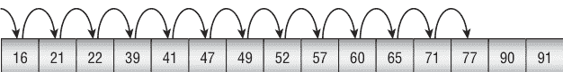

图 7-1：线性搜索检查数组中的每个元素，直到找到目标。

与二分查找和插值查找不同，线性搜索适用于链表，在链表中你无法像在数组那样容易地从列表的一部分跳转到另一部分。

线性搜索也适用于未排序的列表。但如果元素是有排序的，当算法遇到值大于目标值的元素时，它可以停止。这使得算法能够提前停止，并在目标不在列表中时节省一些时间。

以下伪代码显示了数组的线性搜索算法：

```
// 在排序数组中查找目标项的索引。
// 如果项不在数组中，返回 -1。
Integer: LinearSearch(Data values[], Data target)
For i = 0 To <length of values>
  // 如果找到项，返回索引。
  If (values[i] == target) Then Return i
  // 如果超过了目标，停止。
  If (values[i] > target) Then Break
Next i
// 如果项不在数组
Return -1
```

该算法比二分查找慢得多，但它的优点是适用于链表和未排序列表。在最坏情况下，它可能遍历整个数组，因此运行时间为 `O(N)`。

## 二分查找

在二分查找中，算法跟踪可能包含项的最小和最大索引。初始这些边界是 0 和 `<length of values> - 1`。在每一步中，算法将元素数量减半。如果数组包含 `N` 个元素，经过 `O(log N)` 步，可能包含项的区域只剩下一个。

以下伪代码显示了该算法：

```
// 在排序数组中查找目标项的索引。
// 如果项不在数组中，返回 -1。
Integer: BinarySearch(Data values[], Data target)
Integer: min = 0
Integer: max = <length of values> - 1
While (min <= max)
  // 找到元素。
  Integer: mid = (min + max) / 2
  // 如果找到项，返回索引。
  If (values[mid] == target) Then Return mid
  // 如果需要搜索左半部分。
  If (target < values[mid]) Then max = mid - 1
  // 如果需要搜索右半部分。
  Else min = mid + 1
End While
// 如果项不在数组
Return -1
```

图 7-2 显示了对值 77 的二分查找。

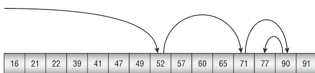

图 7-2：二分查找将数组部分平分。

## 插值查找

在每一步中，二分查找检查正在考虑的数组区域中间。相比之下，插值查找使用目标项的值猜测它在数组的位置，并获得更快的速度。例如，假设数组包含 1000 个值在 1 到 100 之间的元素。如果目标是 30，它位于从最小值到最大值之间的 30% 处，因此你可以猜测项在索引 30 附近。取决于数组中数字的分布，这可能不准确，但它应该让你非常接近目标项的位置。

图 7-3 显示了对值 77 的插值查找。

| 16 | 21 | 22 | 39 | 41 | 47 | 49 | 52 | 57 | 60 | 65 | 71 | 77 | 90 | 91 |

图 7-3：插值查找使用目标项的值计算它应该在数组剩余部分的位置。

以下伪代码在高层显示了了算法：

```
Integer: InterpolationSearch(Data values[], Data target)
Integer: min = 0
Integer: max = <length of values> - 1
While (min < max)
  // 找到元素。
  Integer: mid = min + (max - min) *
    (target - values[min]) / (values[max] - values[mid])
  If (values[mid] == target) Then Return mid
  // 设置 min 或 max 来搜索左半部分或右半部分。
End While
```

# 第 7 章 = 搜索 167

结束循环

返回 -1
插值搜索 (`InterpolationSearch`)

这种高层描述留下了几个未解决的问题。`mid` 的计算可能会导致溢出，或者得到的 `mid` 值不在 `min` 和 `max` 之间。解决这些问题被留在了第 6 题中。该算法中最复杂的是计算 `mid` 的语句。该值设置为当前 `min` 的值加上 `min` 与 `max` 之间的距离，并根据 `target` 应该所在的 `values[max]` 处的值进行比例进行缩放。例如，如果 `values[min]` 是 100，`values[max]` 是 200，且 `target` 是 125，那么你将使用以下计算方法来决定查找目标值的位置：

```
(target - values[min]) / (values[max] - values[min]) =
(125 - 100) / (200 - 100) =
25 / 100 = 
0.25
```


这使得 `mid` 的新值位于从 `min` 到 `max` 的四分之一处。在最坏的情况下，如果数据分布极不均匀，并且你正在寻找最坏的目标值，该算法的性能为 `O(N)`。如果分布相当均匀，预期的性能为 `O(log(log N))`。（但要证明这一点超出了本书的范畴。）

## 总结

表 7-1 显示了不同 `N` 值对应的 `log N` 和 `log(log N)` 的值，你可以通过此比较线性搜索、二分搜索和插值搜索的速度。

表 7-1：算法特性

| N | LOG₂ N | LOG₂(LOG₂ N) |
|---|---|---|
| 1,000 | 10.0 | 3.3 |
| 1,000,000 | 19.9 | 4.3 |
| 1,000,000,000 | 29.9 | 4.9 |
| 1,000,000,000,000 | 39.9 | 5.3 |

线性搜索仅对相对较小的数组有用。表 7-1 显示，二分搜索即使对于非常大的数组运行良好。它只需要大约 40 步即可搜索包含 1 万亿个项的数组。

# 第 7 章 搜索

插值搜索对于计算机可以处理的任何大小的数组都运行良好。它只需要五步就能搜索包含 1 万亿个项的数组。事实上，只有当数组需要持有超过 1x10¹¹⁴ 个项时，插值搜索所需的预期步数才会大于九步。

然而，插值搜索的确切步数取决于值的分布。有时算法很幸运，在一步或两步内找到目标，而其他时候可能需要四步或五步。但平均而言，它是极快的。

## 练习题

如果你不知道什么是递归，请跳过第 2、5 和 7 题，在读完介绍递归的第 8 章后再回来看。

- 1. 写一个实现线性搜索的程序。
- 2. 写一个实现递归线性搜索的程序。这个版本与非递归版本相比有任何优点或缺点吗？
- 3. 写一个针对排序列表实现线性搜索的程序。
- 4. 写一个实现二分搜索的程序。
- 5. 写一个实现递归二分搜索的程序。这个版本与非递归版本相比有任何优点或缺点吗？
- 6. 写一个实现插值搜索的程序。
- 7. 写一个实现递归插值搜索的程序。这个版本与非递归版本相比有任何优点或缺点吗？
- 8. 第 6 章描述的哪种排序算法使用了与插值搜索相似的技术？
- 9. 如果数组包含重复项，本章描述的二分搜索和插值搜索算法不能保证返回目标项的第一个实例。你可以如何修改它们以返回目标项的首次出现？修改后的运行时间是多少？

# 第 8 章 哈希表 (Hash Tables)

前一章解释了二分搜索，这是一种在排序列表中定位项的 `O(log N)` 算法。该算法反复检查目标项所在列表区域中间的测试项。它将测试项与目标项进行比较，然后根据测试项大于还是小于目标项，递归地检查左半或右部分。

前一章还解释了插值搜索，它使用数学计算来预测目标项的位置。该算法的时间复杂度为 `O(log(log N))`，比二分搜索快得多，几乎像魔法一样。

插值搜索比二分搜索快得多的原因是，它利用数据的特殊结构来查找值，而不是通过比较。（第 6 章描述的计数排序和桶排序算法也是这样做的的。）

哈希表也使用这种结构来快速地定位值。哈希表不是将项存储在排序列表中，而是以一种方式存储它们，让你能够直接计算员工在表中的位置。

哈希表的一个简单示例：假设你有一家有 20 名员工的小公司，你希望能够查找该人员的员工 ID。存储这些信息的方法可以是分配一个包含 100 个项的数组，然后将员工 ID 为 `N` 的员工存储在数组中 `N mod 100` 的位置。例如，一个员工

# 第 8 章 哈希表

员工 ID 为 `N` 的员工存储在数组中 `N mod 100` 的位置。例如，一个 ID 为 90 的员工将位于位置 90，ID 为 17 的员工将位于位置 17，ID 为 78 的员工将位于位置 78。要在哈希表中查找项，你只需要计算键的哈希值并查看对应的桶。只要哈希函数足够良好，这平均是一个 `O(1)` 操作。如果两个键映射到同一个桶，这被称为冲突（`collision`）。你需要一个指定冲突时如何操作的冲突解决策略。

## 表的基础 (Table Fundamentals)

哈希表需要：

- 一个用于存储数据的数据结构
- 一个将键映射到位置的哈希函数
- 一个指定键冲突时如何操作的冲突解决策略

为了有用，哈希表必须能够添加新项并定位已存储的项。另一个有用但某些哈希表未提供的功能是删除键的能力。

## 调整哈希表大小 (RESIZ HASH TABLES)

最终，哈希表可能会完全满，或者至少达到可能发生冲突且性能下降的程度。在这种情况下，你需要一个算法来决定何时以及如何调整哈希表的大小使其更大。你也可以有一个算法来决定何时以及如何减小哈希表。例如，如果一个哈希表可以容纳 100 万条条目，但目前只有 10 条，你可能想把它减小以释放空间。

调整哈希表的一种方法是创建一个所需大小的新哈希表，并将原始数据结构中的所有项重新哈希到新表中。某些类型的哈希表（例如带链法的哈希表）提供了其他方法，但这种方法适用于任何哈希表。

## 链法 (Chaining)

带链法的哈希表使用一组称为桶（`buckets`）的项来存储键值。每个桶都是链表的头部，链表持有映射到该桶的项。

通常，桶排列在数组中，因此你可以使用简单的哈希函数来确定键所在的桶。例如，如果你有 `N` 个桶，且键是数字，你可以将键 `K` 映射到桶 `K mod N`。图 8-1 显示了一个带链法的哈希表。

| 0 | 1 | 2 | 3 | 4 | 5 | 6 | 7 | 8 | 9 |
|---|---|---|---|---|---|---|---|---|---|
| | 920 | 291 | 102 | | 424 | | 507 | | 689 |
| | 681 | | | | | | 917 | | 189 |
| | 281 | | | | | | | | |

**图 8-1:** 在带链法的哈希表中，每个桶都是链表的头部。

要向哈希表添加键，你使用哈希函数将键映射到一个桶（`bucket`），然后在该桶的链表中添加一个新单元。通过哈希键来找到对应的桶需要 `O(1)` 步。将值添加到链表的头部需要 `O(1)` 步，因此这种操作会非常快。

然而，为了使其有效，哈希表不能包含重复的值。如果哈希表存储了 `N` 个项目，且项目分布均匀，则每个桶的链表大约持有 `N / B` 个项目。检查某个项目是否已存在于桶中需要 `O(N / B)` 步。这意味着向哈希表添加项目总共需要 `O(1)` + `O(N / B)` = `O(N / B)` 步。

> 注意：如果链表按排序顺序存储键，你可以让在哈希表中查找项目变得稍微快一点。这样，如果一个键不存在，你只需要搜索到找到一个比目标键大的值即可，而不需要一直搜索到列表末尾。运行时间仍然是 `O(N)`，但在实践中它会更快。

要找到一个项目，你对其进行哈希处理以查看哪个桶应该持有它，并遍历该桶的链表，直到找到项目或到达列表末尾。如果你到达了列表末尾，就可以得出该项目不在哈希表中的结论。与向哈希表添加项目类似需要 `O(N / B)` 步。

使用链法的哈希表很好支持删除项目。要删除一个项目，照常对其键进行哈希找到它的桶，然后将其从桶的链表中删除。哈希项目需要 `O(1)` 步，删除项目需要 `O(N / B)` 步，因此总时间为 `O(N / B)`。

使用链法的哈希表可以根据需要扩展或缩小，所以如果你不想，就不需要调整大小。然而，如果链表变得太长，查找和删除项目将花费时间。在这种情况下，你可能想要增大表格以便更多的桶。当你重新哈希表时，你已经知道不会添加重复项目，因此不需要搜索到每个桶链表的末尾来寻找重复项。这允许你在 `O(N)` 时间内重新哈希所有项目。

## 开放寻址法 (Open Addressing)

链法有一些优点，例如它可以在不改变桶数量的情况下存储任意数量的值，但它也有一些缺点。例如，如果你在桶中放入太多项目，遍历桶可能会花费大量时间。你可以通过增加桶来缩短搜索时间，但你可能会有很多空桶占用空间，而且哈希表无法利用这些空桶。

# 第 8 章 ■ 哈希表 173

实现哈希表的另一种策略是开放寻址法。在开放寻址中，值存储在数组中，某种计算作为哈希函数，将值映射到数组中的位置。例如，如果哈希表使用具有 `M` 个条目的数组，简单的哈希函数可能会将键 `K` 映射到数组位置 `K mod M`。

不同的开放寻址变体使用不同的哈希函数和冲突解决策略。在所有情况下，冲突解决策略都会为值产生数组中的一个位置序列。如果一个值映射到一个已经使用的位置，算法将尝试另一个位置。如果该位置也被占用，算法将继续尝试新位置，直到找到一个空位置或得出无法找到的结论。

算法尝试的位置序列被称为探测序列（`probe sequence`）。对于可能在哈希表中的值，其探测序列的平均长度可以很好地估计哈希表的效率。理想情况下，平均探测序列长度应仅为 1 或 2。如果表变得太满，平均探测序列可能会变得很长。

取决于冲突解决策略，即使哈希表数组中有空槽，探测序列也可能无法找到项目。如果探测序列在访问每个条目之前发生了重复，则某些条目将保持未使用状态。

# 第 8 章 哈希表

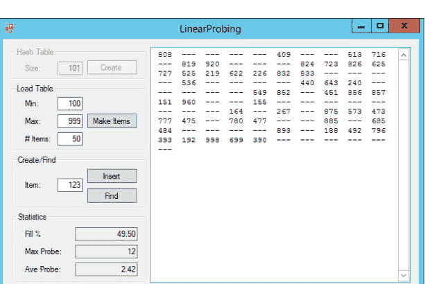

**图 8-3：** 使用线性探测法的哈希表容易产生主聚集。

> 注意：图 8-3 所示的程序是练习 8.3 的解答。更多信息请参见附录 B。

为了理解簇是如何形成的，请考虑一个具有 `N` 个条目的空哈希表。如果你向表中添加一个随机数，它有 `1/N` 的概率落落在任何给定的位置。假设它落在了位置 `K`。

现在，假设你向表中添加另一个数字。该项目有 `1/N` 的概率映射到位置 `K`，在那种情况下，线性探测会将该项目放入位置 `K+1`。同样有 `1/N` 的概率该项目会直接映射到位置 `K+1`。在这两种可能性之间，有 `2/N` 的概率该项目最终落落在位置 `K+1`，并形成一个小的簇。

随着时间的推移，会有越来越多的簇增长。簇越大，新项目添加到该簇末端的概率就越高。最终，簇会不断扩张，直到它们合并并形成更大的簇。很快，数组就满了簇和长的探测序列。

接下来的两个章节介绍了你可以减少主聚集效应的方法。

## 二次探测

线性探测导致聚集的原因是，映射到任何位置的项目最终都会位于簇的末尾，使其变得更大。防止这种现象的一种方法是二次探测。该算法不再通过向位置增加一个固定的步长来创建探测序列，而是通过加上已尝试位置次数的平方来创建探测序列。

换句话说，如果 `K, K + 1, K + 2, K + 3, ...` 是线性探测创建的探测序列，那么二次探测创建的序列就是 `K, K + 1², K + 2², K + 3², ...`

现在，如果两个项目映射到同一个簇中的不同位置，它们就不会遵循相同的探测序列，也不一定会最终添加到该簇中。

图 8-4 显示了一个示例。初始状态下表中有一个包含五个项目的簇。值 71 的探测序列为 `1, 1 + 1² = 2, 2 + 2² = 5, 1 + 3² = 10`，因此它没有添加到簇中。值 93 初始映射到同一个簇，但其探测序列为 `3, 3 + 1² = 4, 3 + 2² = 7`，所以它也没有添加到簇中。

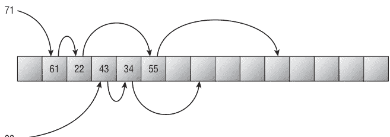

图 8-4：二次探测减少了主聚集。

图 8-5 所示的 `QuadraticProbing` 示例使用了二次探测。如果你将此图与图 8-3 进行比较，你会发现二次探测提供了比线性探测更短的平均探测序列长度。在这个示例中，二次探测的平均探测序列长度为 1.92，而线性探测的平均长度为 2.42。

> 注意：图 8-5 所示的程序是练习 8.4 解答的一部分。信息请参见附录 B。

二次探测减少了主聚集，但它可能会遭受次聚集的影响。在次聚集中，映射到数组中相同初始位置的值遵循相同的探测序列，因此它们创建了一个簇。这个簇分散在整个数组中，但对于映射到相同初始位置的项目来说仍然会导致更长的探测序列。

二次探测还有一个缺点，即使表中还剩下几个位置，它也可能无法找到空条目。由于二次探测序列在数组中跳得越越远，它可能会跳过某个空位置而找不到它。

| | QuadraticProbing | | | | | | | |
|---|---|---|---|---|---|---|---|
| 哈希表 | 808 | 819 | 920 | 409 | 513 | 723 | 716 |
| 大小 | 101 | 创建 | 826 | 226 | 216 | 892 | 826 | 625 |
| 负载表 | | 532 | 621 | 549 | 832 | 440 | 240 | 645 |
| 最小 | 100 | 181 | 164 | 155 | 247 | 875 | 873 | 473 |
| 最大 | 999 | 创建项目 | 777 | 475 | 780 | 477 | 885 | 685 |
| 项目数 | 50 | 393 | 192 | 998 | 699 | 390 | 188 | 492 | 796 |
| 创建/查找 | | | | | | | | | |
| 项目 | 123 | 插入 | | | | | | | | |
| | 查找 | | | | | | | | |
| 统计统计 | | | | | | | | | | |
| 填充 % | 50 | | | | | | | | | |
| 最大探测: | | | | | | | | | | |
| 平均探测: | 1.92 | | | | | | | | | |

**图 8-5：线性探测与二次探测的平均探测序列长度。**

```go
// 检查是否找到了一个大于 "key" 的值。

If (array[probe] > key) Then

// 将 key 放置并重新哈希另一个项。

Integer: temp = array[probe]

array[probe] = key

key = temp

End If
```

```go
// 尝试探测序列中的下一个位置。

probe = <key 探测序列中的下一个位置>
While
AddItem
```


在 `While` 循环内部的最后一步将 `probe` 设置为当前 key 探测序列中的下一个位置。对于线性探测、伪随机探测和双重哈希，如果你将正在哈希的 key 值替换为一个更大的值，你就可以计算出探测序列中的下一个项。例如，在双重哈希中，你可以使用第二个哈希函数来找到新的 key 值，从而找到新探测序列的步长（stride）。然后你就可以使用该步长从这一点开始遵循新 key 的探测序列。

这对于二次探测并不适用，因为你需要知道算法在新 key 的探测序列中搜索了多远才到达该点。这种方法有效的原因是你只在用较小的值替换较大的值。如果你在有序的探测序列中用较小的值替换一个值，探测序列仍然是有序的。

唯一可能仍有疑问的是你重新哈希的那个较大值。当你刷新该值时，它最终会落在一个使其其探测序列保持有序的位置。

## 总结

哈希表允许你快速地存储和定位值。如果哈希表的填充率相当低，找到一个项可能只需要几次计算。

然而，保持一个合理的填充率是非常重要的，如果哈希表变得太满，它的性能就会下降。较低的填充率可以提供更好的性能，但需要额外的未用于存储数据的空间，因此在某种意义上是浪费的。填充率过高会减慢性能，并增加哈希表变满的风险。这需要你重新调整哈希表的大小，这可能会消耗大量的时间和内存。

这是算法中常见的空间换时间策略的一个极佳例子。通过使用额外空间，你可以提高算法的性能。

# 第 8 章 = 哈希表

有序哈希提供了另一种权衡。如果你在开头花费额外时间构建哈希表，随后的搜索将快得多。在插入一个值时，程序可能会找到一个比要插入的值大的值。在这种情况下，它会交换值并继续返回较大的那个。实现此点的一种方法是递归：让插入算法调用自己。下一章将详细讨论递归。它涵盖了递归的良好和坏的用法，并解释了当深度调用栈或频繁的值重新计算导致问题时，你如何从程序中移除递归。

## 练习题

对于要求你构建哈希表的练习题，请创建一个类似于图 8-6 的接口。`Create` 按钮创建一个新的哈希表。`Make Items` 按钮允许用户一次性向哈希表添加随机项。`Insert` 和 `Find` 按钮用于添加或查找单个项。在表或数据发生每次更改后，显示链法算法中每个桶（bucket）的键数量，或开放寻址法算法的填充率。此外，当你尝试查找填充表使用的最小值和最大值之间的所有值时，显示最大和平均探测长度。

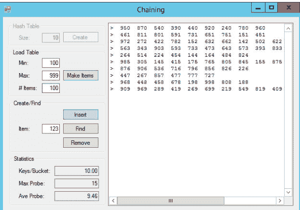

图 8-6：此接口允许你构建和测试哈希表。

在所有哈希程序中，使用初始化为相同值的单一伪随机数生成器，以便每个程序都向其哈希表添加相同的值。这将让你能够使用相同的数据比较算法的行为。

- 1. 编写一个实现链法哈希表的程序。
- 2. 修改你为练习 1 编写的程序以使用有序链表。当哈希表使用 10 个桶并容纳 100 个项时，比较两个程序的平均探测长度。
- 3. 当你为练习 1 和 2 构建的程序，当哈希表使用 10 个桶并容纳 50、150、200 和 250 个项时，绘制平均探测序列长度的图表。从图中你可以推断出什么？
- 4. 编写一个使用线性探测的开放寻址法哈希表程序。
- 5. 编写一个使用二次探测的开放寻址法哈希表程序。
- 6. 编写一个使用伪随机探测的开放寻址法哈希表程序。
- 7. 编写一个使用双重哈希的开放寻址法哈希表程序。
- 8. 线性探测在有空位时总是找到空位，但二次探测、伪随机探测和双重哈希可能会跳过空项并在表未满的情况下得出满的结论。你如何选择表的大小 `N` 来防止二次探测、伪随机探测和双重哈希在哈希表未满的情况下得出满的结论？
- 9. 编写一个使用有序二次哈希的开放寻址法哈希表程序。
- 10. 使用你喜欢的编程语言构建一个使用有序双重哈希的开放寻址法哈希表。
- 11. 为了比较不同的开放寻址算法，为你为练习 4、5、6、7、9 和 10 构建的程序，并绘制其平均探测序列长度的图表。使用一个具有 101 个条目的表格，并在表容纳 50、60、70、80 和 90 个值时绘制数值。从图中你可以推断出什么？

# 第 9 章 递归

递归发生在方法调用自身时。递归可以是直接的（方法调用自身）或间接的（方法调用其他方法）。

递归可以是单次的（方法调用自身）或多次的（方法调用自身多次）。

递归可能是令人困惑的，因为方法是递归的。例如，为了画树，你可能会从一侧开始直到到达另一侧。

有些方法是递归的。本章解释了一些有用的递归算法。这些算法本身是有用的，但学习用递归比解决单个问题要重要得多。

然而，递归并不总是最佳解决方案，因此本章还会解释当递归可能导致问题时如何移除递归。

## 基本算法

有些问题具有递归解决方案。以下章节描述了三个递归算法，分别计算阶乘、斐波那契数和解决哈诺问题。

这些相对直接的算法演示了递归的重要概念。一旦你理解了它们，就准备好进入更复杂的算法。

## 阶乘

数字 `N` 的阶乘表示为 `N!` 读作“`N` 阶”。你可以递归地定义阶函数如下：

```
0! = 1
```

```
N! = N × (N - 1)!
```

例如，以下方程展示了如何使用这个定义来计算 `3!`：

```
3! = 3 × 2! = 3 × 2 × 1! = 3 × 2 × 1 × 0!
```

这引出了以下递归算法：

```go
Integer: Factorial(Integer: n)

If (n == 0) Then Return 1

Return n * Factorial(n - 1)
```

首先，如果输入值等于 `0`，算法返回 `1`。这对应于定义阶函数的第一个方程。

否则，如果输入不是 `0`，算法返回数字 `n` 乘以 `n-1` 的阶乘。这一步对应于定义阶函数的第二个方程。

这是一个非常简单的算法，但它演示了所有递归算法必须具备的两个特征：

- 方法每次执行时都会将当前问题简化为相同问题的较小实例，然后调用自己来这个较小的问题。在这个例子中，方法将计算 `n!` 的问题简化为计算 `(n-1)!` 的问题并乘以 `n`。
- 递归必须最终停止。在这个例子中，输入参数在每次递归调用都会减少，直到它等于 `0`。此时，算法返回 `1` 而不再递归调用自己，因此过程停止。

注意，这个简单的算法可能会产生问题。如果程序调用 `Factorial` 方法并传递参数 `-1`，递归将永远不会。相反，算法将开始以下系列计算：

# 第 9 章 递归 187

-1! =
-1 × -2! =
-1 × -2 × -3 × -4! = ...

一些程序员使用的一种防止这种情况发生的方法是将算法中的第一条语句改为 `If (n <= 0) Then Return 1`。现在，如果调用算法时传入负参数，它将直接返回 `1`。

> 注意：从软件工程的角度来看，这可能不是最佳解决方案，因为它隐藏了调用该算法的程序中的问题。当负数的真实阶乘未定义时，它还会返回误导性的值 `1`。

为了检测调用代码中的问题，最好显式地检查值以确保它至少为 `0`，如果不是则抛出异常。

分析递归算法的运行时间性能有时很复杂，但对于这个特定的算法来说很容易。对于输入 `N`，阶乘算法会调用自己 `N+1` 次 `(N-1)!`、`(N-2)!` ..., `O!`。算法的每次调用都会执行少量工作，因此总运行时间为 `O(N)`。

由于算法自调用了 `N+1` 次，递归的最大深度也是 `O(N)`。在某些编程环境中，递归的最大深度可能会受到限制，因此可能会导致问题。

## 严重的栈空间

通常情况下，计算机为程序分配两个内存区域：栈（`stack`）和堆（`heap`）。
栈用于存储方法调用的信息。当一段代码调用一个方法时，信息会被放在栈上。当方法返回时，该信息会从栈中弹出，因此程序可以从调用点继续执行。[这与第 5 章描述的栈是同一种]。到达特定执行点所调的方法列表被称为调用栈（`call stack`）。

堆是程序可以用来创建变量和执行计算的另一块内存。
栈比堆小得多。栈对于普通程序来说通常足够，因为你的代码不包含深度极深的方法相互调用。然而，递归算法有时会创建极深的栈并耗尽栈空间，导致程序崩溃。

因此，在研究其运行时间和内存需求之外，评估递归算法所需的最大递归深度是非常关重要的。

然而，阶乘函数增长非常快，因此在普通整数中 `N` 的大小有一个实际的限制。例如，`20! = 2.4 × 10^18`，而 `21!` 太大，无法放入 64 位长整型。如果程序计算的值大于 `20!` 的值，递归深度最多只有 `20`，这应该没有问题。

如果你确实需要计算更大的阶乘，可以使用其他存储更大数值的数据类型。例如，64 位双精度浮点数可以存储 `17! = 7.3 × 10^14`，而某些数据类型（如 `.NET` 的 `BigInteger` 类型）可以存储任意大的数字。在这些情况下，递归的最大深度可能会成为问题。后续章节中的“尾递归”部分解释了如何防止这种深度递归耗尽栈空间导致程序崩溃。

## 斐波纳契数

斐波纳契数由以下方程定义：
- `Fibonacci(0) = 0`
- `Fibonacci(1) = 1`
- 对于 `n > 1`, `Fibonacci(n) = Fibonacci(n-1) + Fibonacci(n-2)`

例如，前几个斐波纳契数是 `0, 1, 2, 3, 5, 8, 13, 21, 34, 55, 89`。

> 注意：有些人认为 `Fibonacci(0)=1` 且 `Fibonacci(1)=1`。这得到了与此处定义相同的值，只是跳过了值 `0`。递归定义导致了以下递归算法：

```
Integer: Fibonacci(Integer: n)

  If (n <= 1) Return n

  Return Fibonacci(n -1) + Fibonacci(n -2);
```

如果输入是 `0` 或 `1`，算法返回 `0` 或 `1`。如果输入大于该值，算法会对输入 `n-1` 和 `n-2` 调用自己，将它们相加并返回结果。这种递归方法相对容易理解，但速度非常慢。例如，计算 `Fibonacci(6)`，程序必须计算 `Fibonacci(5)` 和 `Fibonacci(4)`。但在计算 `Fibonacci(5)` 之前，程序又计算了 `Fibonacci(4)` 和 `Fibonacci(3)`。在这里 `Fibonacci(4)` 被调用了两次。随着递归的继续，相同的值必须被多次计算，导致程序花费很长时间。

图 9-1 显示了斐波纳契算法在评估 `Fibonacci(6)` 时的调用树。树中的每个节点代表对算法的调用，并将指定的数字作为参数。图中显示，例如，顶节点对 `Fibonacci(6)` 的调用调用了 `Fibonacci(5)` 和 `Fibonacci(4)`。如果你看图片，你会发现树中充满了重复的调用。例如，`Fibonacci(0)` 被计算了五次，`Fibonacci(1)` 被计算了八次。


**图 9-1：** 斐波纳契算法的调用树充满了重复计算。

分析此算法的运行时间比分析阶乘算法的运行时间稍微复杂一点，因为这个算法是多递归的。假设 `T(N)` 是输入 `N` 的算法运行时间。如果 `N > 1`，算法调用自己处理输入 `N-1` 和 `N-2`，将它们相加并返回结果。这说明 `T(N) = T(N-1) + T(N-2) + 1`。

这比 `T(N-1) + T(N-2)` 稍微大，忽略末尾的常量 `1` 后，这与递归定义相同。

斐波纳契函数的增长不像阶乘函数那样快，但它仍然增长得快。例如，`Fibonacci(92)` 无法放入长整型。对于大多数编程环境，递归深度为 `92` 应该不是问题。

## 汉诺塔

第 5 章引入了汉诺塔问题，该问题由一叠盘组成，每个盘都比它下方的盘小，位于三个柱子之一。目标是通过每次移动将盘从起始柱移动到另一个柱子，且不将盘放在较小的盘之上。图 9-2 从侧面展示了该问题。

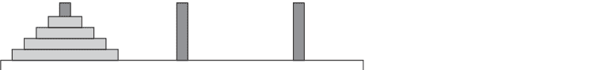
**图 9-2：** 在汉诺塔问题中，目标是将盘从一个柱子移动到另一个，而不放在较小的盘之上。

试图通过大计划来解决这个问题可能会困惑，但有一个简单的递归解决方案。与其尝试整体解决问题，你可以缩小问题规模并递归地解决。以下伪代码使用这种方法提供了简单的递归解决方案：

```
// 将 n 个盘从 from_peg 移动到 to_peg

// 根据需要使用 other_peg 临时存放盘。

TowerOfHanoi(Peg: from_peg, Peg: to_peg, Peg: other_peg, Integer: n)

// 将 n-1 个盘从 from_peg 移动到 other_peg

If (n > 1) Then TowerOfHanoi(from_peg, other_peg, to_peg, n - 1)

// 将顶盘从 from_peg 移动到 to_peg

<Move the top disk from from_peg to to_peg>

// 将 n-1 个盘从 other_peg 移动到 to_peg

If (n > 1) Then TowerOfHanoi(other_peg, to_peg, from_peg, n - 1)

TowerOfHanoi
```

算法中的第一步似乎是关于算法如何工作的关键。该步将 `n-1` 个盘从原始柱移动到不是目的地的柱。它通过递归调用 `TowerOfHanoi` 算法来实现。在这一点上，你知道算法如何工作并处理较小的问题了吗？

答案是，该方法在需要时反复调用以移动越来越小的盘栈。最终，问题规模会小到算法可以在不递归调用自身的情况下解决它。

# 第 9 章 递归 191

当每个递归调用返回时，算法的调用实例会移动单个盘子，然后再次递归地调用自己，将较小的盘子栈移动到其最终目标桩。

图 9-3 显示了将盘栈从第一个桩移动到第二个桩所需的系列高层步骤。第一步递归地将所有的底盘从第一个桩移动到第三个桩。第二步将底盘从第一个桩移动到第二个桩。最后一步递归地将所有盘子从第三个桩移动到第二个桩。

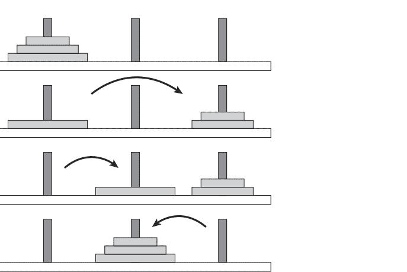

**图 9-3：** 要移动 `n` 个盘子，递归地将上方的 `$n-1$` 个盘子移动到临时桩。然后将剩余的盘子移动到目标桩。最后，将上方 `$n-1$` 个盘子从临时桩移动到目标桩。

图 9-4 显示了将三个盘子的堆栈从第一个桩转移到第二个桩所需的整个移动序列。

为了分析算法的运行时间，令 `T(n)` 为将 `n` 个盘子从一个桩移动到另一个桩所需的步骤数。显然 `T(1) = 1`，因为将单个盘子从一个桩移动到另一个桩需要一步。

对于 `n > 0`，`T(n) = T(n - 1) + 1 × T(n - 1) = 2 × T(n - 1) + 1`。如果你忽略额外的常数 `1`，则 `T(n) = 2 × T(n - 1)`，因此该函数具有指数级的运行时间 `O(2^N)`。

为了从另一个角度来看这个问题，你可以创建一个类似于表 9-1 的表格，列出不同 `n` 值的步骤数。在表中，每个 `n > 1` 的值都是通过公式 `T(n) = 2 × T(n-1) + 1` 从上一个值计算出的。如果你研究这些值，你会发现 `T(n) = 2^n - 1`。

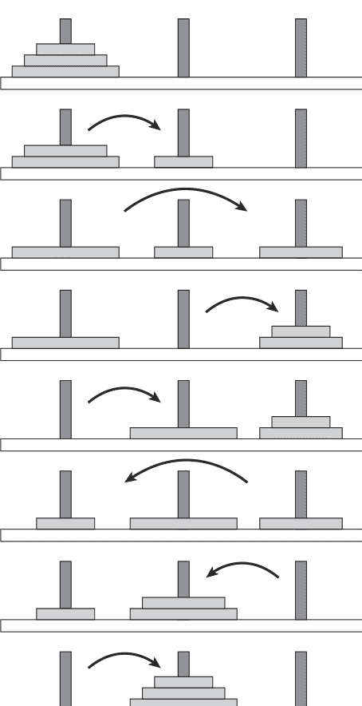

**图 9-4：** 这一步骤将三个盘子从第一个桩转移到第二个桩。

与斐波那契算法一样，该算法输入 `N` 的最大递归深度为 `N`。同样像斐波那契算法，该算法的运行时间随着 `N` 的增加而非常快，因此在达到最大递归深度之前，运行时间就已经限制了有效问题的规模。

## 表 9-1：汉诺塔谜的运行时间

| n | T(n) |
| :--- | :--- |
| 1 | 1 |
| 2 | 3 |
| 3 | 7 |
| 4 | 15 |
| 5 | 31 |
| 6 | 63 |
| 7 | 127 |
| 8 | 255 |
| 9 | 511 |
| 10 | 1023 |

## 图形算法

几种有趣的图形算法利用递归以极惊少的代码产生复杂的曲线。尽管这些算法很短，但通常它们比前一节描述的基础算法更令人困惑。

## 科赫曲线

科赫曲线是特定类型自相似分形的一个例子，这种曲线的片段与曲线的整体相似。这些分形始于一个“启动者”（initiator），它是一条决定分形基本形状的曲线。在递归的每一层中，启动者的部分或全部被一个经过适当缩放、旋转和平移的名为“生成器”（generator）的曲线版本取代。在下一层递归中，生成器的部分同样被替换为生成器的新版本。

最简单的科赫曲线使用线段作为启动者。在递归的每一层，该线段被四段长度为原始段三分分之一的段所取代。第一段与原始段方向相同，下一段旋转 -60 度，第三段旋转 120 度，最后一段与原始方向相同。图 9-5 显示了该曲线的启动者（左）和生成器（右）。

在下一层递归中，程序获取生成器中的每个段，并用生成器的新副本替换它们。图 9-6 显示了递归深度为 0 到 5 的曲线。

# 第 9 章 递归

图 9-5：这个启动者（左）和生成器（右）创建了科赫曲线。

图 9-6：递归深度为 0 到 5 的科赫产生了这些形状。

观察图 9-6，你可以看出为什么这种曲线被称为自相似。曲线看起来像是整个曲线的缩小版本。

令 `pt1, pt2, pt3, pt4` 和 `pt5` 为图 9-5 右侧生成器中段连接的点。以下伪代码显示了你可能如何绘制科赫曲线：

```
// 从点 pt1 开始，在 "angle" 方向上以 "length" 为长度绘制深度为给定的科赫曲线

DrawKoch(Integer: depth, Point: pt1, Float: angle, Float: length)

 If (depth == 0) Then

  <绘制线段>

Else

  <找到点 pt2, pt3 和 pt4.>
```

```
// 递归地绘制曲线的片段。

DrawKoch(depth - 1, pt1, angle, length / 3);

DrawKoch(depth - 1, pt2, angle - 60, length / 3);

DrawKoch(depth - 1, pt3, angle + 60, length / 3);

DrawKoch(depth - 1, pt4, angle, length / 3);

End If

DrawKoch
```


如果深度为 0，算法仅在点 `p1` 处按编程环境中的长度和方向绘制线段。

如果深度大于 0，算法寻找 `pt2`, `pt3` 和 `pt4`。它从 `pt1` 开始按 `angle` 方向绘制长度为原始三分之一的线段。在 `pt2` 处向左转 60 度并绘制另一段；在 `pt3` 处转 120 度（角度为 60）并绘制另一段。最后，从 `pt4` 按原始角度绘制长度为三分之一的段。

## Hilbert Curve

与斐波那契算法一样，该算法输入 `N` 的最大递归深度为 `N`。同样像斐波那契算法，该算法的运行时间随着 `N` 的增加而非常快，因此在达到最大递归深度之前，运行时间就已经限制了有效问题的规模。

## 希尔伯特曲线

与科赫曲线一样，希尔伯特曲线始于一个简单的启动者。为了进入更深层的递归，算法将启动者分解成片段并使用经过适当旋转的较小版本的曲线。

图 9-8 显示了层 0、1、2 的希尔伯特曲线。在层 1 和 2 中，连接低层曲线的线条是灰色的，这样你可以看到片段是如何连接的。

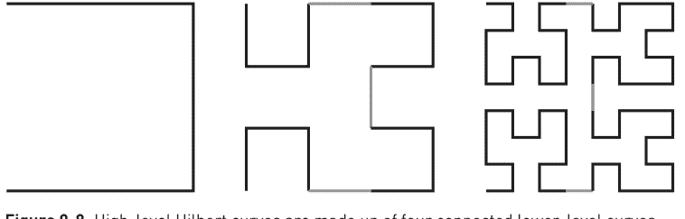

以下伪代码显示了希尔伯特算法：

```
// 从 <dx, dy> 方向开始绘制希尔伯特

Hilbert(Integer: depth, Float: dx, Float: dy)

If (depth > 0) Then Hilbert (depth - 1, dx, dy)

DrawRelative(dx, dy)

If (depth > 0) Then Hilbert (depth - 1, dx, dy)

DrawRelative(dx, dy)

If (depth > 0) Then Hilbert (depth - 1, dx, dy)

DrawRelative(-dx, -dy)

If (depth > 0) Then Hilbert (depth - 1, -dy, -dx)
```

# 第9章 ■ 递归 197

算法随后再次调用自己来绘制下一个子曲线。这次，它保持 `dx` 和 `dy` 在原始位置，使得第二个子曲线不旋转。

算法绘制另一条连接线段，然后再次调用自己，同样保持 `dx` 和 `dy` 在原始位置，使得第三个子曲线不旋转。

算法绘制另一条连接线段，然后最后调用一次自己。然后它将 `dx` 替换为 `-dy`，将 `dy` 替换为 `-dx`，以便使得较小的曲线旋转 -90 度。

## 谢尔宾斯基曲线 (Sierpiński Curve)

与 Koch 曲线和 Hilbert曲线一样，谢尔宾斯基曲线使用自身的低级副本来绘制更高级别的曲线。然而，与其他曲线不同，绘制谢尔宾斯基曲线简单的方法是使用四个相互调用的间接递归程序。

图 9-9 显示了层级为0、1、2和3的谢尔宾斯基曲线。在层级1、2和3的曲线中，连接低级曲线的线条是灰色的，这样你就可以看到这些部分是如何连接起来构建更高级曲线的。

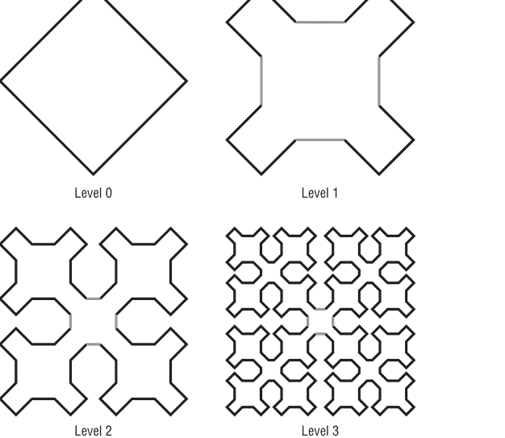

图 9-9：一个谢尔宾斯基曲线由四个较小的谢尔宾斯基曲线组成。

# 第9章 ■ 递归

图 9-10 显示了层级1谢尔宾斯基曲线的部分。该曲线由四个边组成，由四个不同的程序绘制并由线段连接。这四个程序绘制的曲线向右、下、左、上方向移动当前的绘图位置。例如，`Right` 程序绘制一系列线段，使绘图位置向右移动。在图 9-10 中，连接线段是用灰色绘制的。

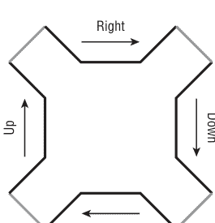

图 9-10：层级1谢尔宾斯基曲线由向右、向下、向左上的部分组成。

为了绘制曲线某一个部分的更高级版本，算法将该部分分解为层级较低的部分。例如，图 9-11 显示了如何用四个深度为1的部分制作出一个深度为2的 `Right` 部分。如果你研究图 9-9，你就可以推出如何制作其他部分。

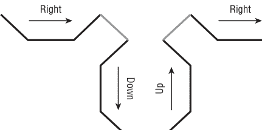

图 9-11：层级2的 `Right` 部分由向右、向下、向上和向右的部分组成。

以下伪代码显示了主算法：

```
// 绘制谢尔宾斯曲线。

Sierpinski(Integer: depth, Float: dx, Float: dy)

  SierpRight(depth, dx, dx, dy)

  DrawRelative(dx, dy)

  SierpDown(depth, gr, dx, dy)

  DrawRelative(-dx, dy)

  SierpLeft(depth, dx, dy)

  DrawRelative(-dx, -dy)

  SierpUp(depth, dx, dy)

  DrawRelative(dx, -dy)

  Sierpinski
```

算法调用 `SierpRight`、`SierpDown`、`SierpLeft` 和 `SierpUp` 来绘制曲线的部分。在这些调用之间，算法调用 `DrawRelative` 来绘制连接曲线部分的线段。正如 Hilbert曲线的情况一样，`DrawRelative` 方法从当前位置绘制到新点并更新当前位置。这些对 `DrawRelative` 的调用是算法实际执行任何绘制的唯一地方。

以下伪代码显示了 `SierpRight` 算法：

```
// 跨顶部绘制。

SierpRight(Integer: depth, Float: dx, Float: dy)

  If (depth > 0) Then

    depth = depth - 1

    SierpRight(depth, gr, dx, dy)

    DrawRelative(gr, dx, dy)

    SierpDown(depth, gr, dx, dy)

    DrawRelative(gr, 2 * dx, 0)

    SierpUp(depth, dx, dy)

    DrawRelative(gr, dx, -dy)

  End If

  SierpRight
```

你可以在图 9-11 中跟踪此方法的进度。首先通过 `SierpRight` 在较小的递归深度绘制一个向右移动的曲线部分。它绘制一段向下并向右的线段以连接下一个曲线部分。

下一个方法调用 `SierpDown` 在较小的递归深度下绘制一个向下移动的曲线部分。它绘制一段向右的线段以连接下一个曲线部分。

该方法随后调用 `SierpUp` 在较小的递归深度下绘制一个向上移动的曲线部分。它绘制一段向上并向右的线段以连接下一个曲线部分。

该方法通过调用 `SierpRight` 完成，在较小的递归深度绘制一个向右移动的最后一个曲线部分。

其他绘制谢尔宾斯基曲线部分的方法留给练习练习。

## 近似路由

像 Hilbert 和谢尔宾斯基曲线这样的空间填充曲线提供了一种近似路由的方法。假设你需要解决旅行员问题 (`TSP`)。寻找最优路线是困难的，但你可以使用空间填充曲线来找到一条很好的路线。结果不是最优的，但是合理的。

由于空间填充曲线相互调用，你可以用它们来解决许多类型的问题。例如，谢尔宾斯基曲线可以用于解决二维平面上的车辆路由问题。Hilbert 曲线可以用于解决三维空间中的相同问题。

可以使用一个相对快速的测试来意识到部分解无法产生解，你可以从树上修剪掉相应的分支，而不需要进行穷尽搜索。这可以从树中移除大量区域并节省大量时间。（决策树的思想将在第 12 章中进一步描述。）

接下来的章节描述了两个具有自然回溯算法的问题：八皇后问题和骑士马巡游问题。当你学习这些问题的算法时，这里展示的更具通用性的解决方案将更易理解。

## 八皇后问题

在八皇后问题中，目标是在棋盘上放置八个皇后，使得其中任何皇后都不能攻击其他任何皇后。换句话说，没有两个皇后位于同一行、同一列或同一对角线上。图 9-14 显示了八皇后问题的一种解。

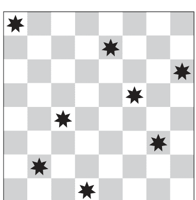

**图 9-14:** 在八皇后问题中，你必须在棋盘上放置八个皇后，使得任何一个都不能攻击其他任何一个。

解决这个问题的一种方法是尝试棋盘上八个皇子的所有可能排列。不幸的是，`8!` = 4,426,165,368 种可能的排列。你可以列举所有排列，但这样做会非常耗时。

## 组合计数

皇后之所以有这么多可能的排列，是因为你可以在 64 个格子中放置 8 个皇后。皇后是相同的，因此在给定位置使用哪一个皇后并不重要。这意味着可能排列的数量等于从 64 个格子中选取 8 个格子的方法数。

从一个包含 `n` 个重复元素的集合中选取 `k` 个物品的数量由二项式系数给出。该值写作 `\binom{n}{k}`，读作“n 选择 k”。你可以使用此公式计算该值：

```
$\binom{n}{k} = \frac{n!}{k!(n-k)!}$
```

例如，该方程给出了从五个不重复的的集合中选取三个物品的不同组合数：

```
$\binom{5}{3} = \frac{5!}{3!(5-3)!} = \frac{120}{3! \times 2!} = 10$
```

从一个包含 `n` 个重复元素的集合中选取 `k` 个物品的数量（如果你允许在选取中多次选择同一个物品）由此公式给出：

```
$\binom{n+k-1}{k}$
```

例如，该方程给出了从五个重复元素的集合中选取三个重复物品的不同组合数：

```
$\binom{5+3-1}{3} = \frac{7!}{3!(7-3)!} = \frac{5040}{3! \times 24} = 35$
```

在八皇后问题中，你需要找到选取 8 个格子的方法数（你不能在同一个格子上放置超过一个皇后）。可能选取的数量为：

```
$\binom{64}{8} = \frac{64!}{8!(64-8)!} = 4,426,165,368$
```

回溯算法对这个问题非常有效，因为它允许你从考虑中消除某些可能性。例如，你可以从一个将皇后放在棋盘左上角的部分解开始。你可能会尝试在第一个皇后右侧放置另一个皇后，但你知道在同一行放置两个皇后是不允许的。这意味着你可以消除所有前两个皇后在左上角相邻的可能解。程序可以回溯到添加第二个皇后之前的点，并搜索更具前景的解决方案。

这看起来可能像是一个微不足道的益处。毕竟，你的解决方案在左上角不能有两个并排的皇后。然而，在棋盘上八个皇子的可能排列有 `\binom{62}{6} = 61,474,519` 种（除去某些位置），一次回溯步骤就能为你节省检查超过 6100 万种可能性的精力。

事实上，如果第一个皇后放在左上角，其他任何皇后都不能放在同一行、同一列或同一对角线上。总共有 21 个位置无法放置第二个皇后。消除所有这些部分解可以从考虑中移除近 13 亿种可能的排列。

随后的测试会从考虑中移除其他部分解。例如，在你将第二个皇后放在某个合法位置后，它会进一步限制第三个皇后放置的位置。

以下伪代码展示了如何使用回溯来解决八皇后问题：

```
Boolean: EightQueens(Boolean: spot_taken[],

Integer: num_queens_positioned)

  // 如果测试解已经非法。

  If (Not IsLegal(spot_taken)) Then Return false

  // 如果我们已经放置了所有的皇后。

  If (num_queens_positioned == 8) Then Return true

  // 扩展部分解。

// 尝试下一个皇子的所有位置。

  For row = 0 to 7

  For col = 0 to 7

    // 检查这个位置是否已被占用。

    If (Not spot_taken[row, col]) Then

      // 在这里放置一个皇后。

      spot_taken[row, col] = true

      // 递归地查看这是否会导致解决方案。

      If (EightQueens(spot_taken, num_queens_positioned + 1))

        Return false

    // 扩展没有导致解决方案。

    // 撤销更改。

    spot_taken[row, col] = false

  End If

Next col

Next row

End EightQueens
```

## 骑士马巡游

骑士马巡游问题中，目标是让骑士访问棋盘上的每个位置而不重复访问任何格。如果最终位置距离起始位置一个格子，则该巡游是闭合的。不闭合的巡游被认为是开放的。

> 注意：如果你不记得，骑士从当前位置水平或垂直移动两个格子，然后垂直移动一个格子，如图 9-15 所示。

以下伪代码显示了骑士马巡游问题的回溯解决方案：

```
// 将骑士移动到位置 [row, col]。然后递归尝试
// 进行其他移动。如果找到解决方案，返回 true。
Boolean: KnightsTour(Integer: row, Integer: col)
Integer: move_number[i], Integer: num_moves_taken

// 将骑士移动到这个位置。
num_moves_taken = num_moves_taken + 1
move_number[row, col] = num_moves_taken
```

```
// 检查我们是否完成了所有要求的移动。
If (num_moves_taken == 64) Then Return true
```

```
// 构建数组以确定相对于
// 此位置的合法移动。
Integer: dRows = { -2, -2, -1, 1, 2, 1, -1 }
Integer: dCols = { -1, 1, 2, 2, 1, -2, -2 }
```

```
// 尝试下一个移动的所有位置。
For i = 0 To 7
Integer: r = row + dRows[i]
Integer: c = col + dCols[i]
If (r >= 0) And (r < NumRows) And
(c >= 0) And (c < NumCols) And
(move_number[r, c] == 0)
Then
```

```
// 这个移动是合法且可用的。进行此移动
// 并递归尝试其他赋值。
If (KnightsTour(r, c, move_number, num_moves_taken))
Then Return true
```

## 第 9 章 = 递归

End If
Next i

```
// 这一步没有生效。撤销。
move_number[row, col] = 0
```

```
// 如果我们到了这里，说明没有找到有效的解决方案。
return false
```


## 骑士巡游 (KnightsTour)

该算法的参数包括：骑士下一步要移动的行和列、一个名为 `move_number` 的数组（该数组记录了骑士访问每个格子时的移动次数），以及到目前为止执行的移动次数。

算法首先记录骑士移动到当前格子的动作，并增加已执行移动次数。如果移动次数达到 64，说明骑士已经完成了整个棋盘的巡游，算法返回 `true` 表示成功。

如果巡游未完成，算法初始化两个数组来表示从当前格子出发的移动。例如，数组的前两个项是 `-2` 和 `-1`，表示如果该位置在棋盘上，则骑士可以从格子 `(row, col)` 移动到 `row-2, col-1`。

下一个算法循环从位置 `(row, col)` 的所有可能的移动。如果某次移动在棋盘上且在测试巡游中未被访问，算法将执行该移动并递归调用自身，查看它是否能导致完整的解决方案。

如果从当前位置的所有可能移动都不能导致解决方案，算法将设置 `move_number[row, col] = 0` 以撤销当前移动，并返回 `false`，表示骑士移动到格子 `(row, col)` 无法得出解决方案。

遗憾的是，骑士问题并不像皇后问题那样容易约束。在另一个皇子的攻击下，很容易判断一个新位置是否可用。而在骑士巡游中，任何一个可以到达的尚未访问的格子，要判断其是否会导致新位置都是困难的。

在骑士巡游中，任何一个可以到达的尚未访问的格子，算法通常遵循一个测试，在发现解决方案之前就发现该位置是不可行的。骑士最多有 8 种合法的移动，因此巡游总数的上界大约是 `$8^{64}$`，或者大约 `$10^{57}$`。通过研究棋盘上的位置，可以对巡游数得到更好的估计。所有这些意味着，在 `8 × 8` 的棋盘上解决巡游是困难的。在一次测试中，程序在 `7 × 7` 的棋盘上几乎瞬间就找到了解决方案，而回溯法在 `7 × 7` 的棋盘上需要一小时。

尽管仅使用回溯来解决巡游问题很困难，但某种 *启发式* 是一种产生良好结果的算法，尽管不保证产生最好的结果。在 1823 年，沃斯多夫 `Warnsdorf` 建议骑士巡游的算法：每一步都应该选择可能移动次数最少的下一个移动。

例如，假设骑士在一个只有两个可能移动的位置。如果骑士做出第一次移动，它只有一个下一个可能的移动。在这种情况下，算法应该尝试第二次移动。

这种启发式非常优秀，以至于在 `7 × 7` 大小的棋盘上完成巡游没有发生栈溢出。`在 8 × 8 的棋盘测试中，瞬间就找到了解决方案`。

## 组合 (Selections) 与排列 (Permutations)

选择（或组合）是集合的一个子集。例如，在集合 `[A, B, C]` 中，`[A, B]` 是一个选择。集合 `[A, B, C]` 的所有选择都是 `[A, B]`、`[A, C]` 和 `[B, C]`。在选择中，项的顺序不重要，所以 `[A, B]` 和 `[B, A]` 被视为相同。你可以将其想象为在餐厅点一份奶士明治。

排列是集合中项的有序排列。这与选择的区别在于顺序很重要。例如，`(A, B)` 和 `(B, A)` 是从集合 `[A, B]` 取出的两个项的排列。集合 `[A, B, C]` 的所有排列是 `(A, B)`、`(A, C)`、`(B, A)`、`(B, C)`、`(C, A)` 和 `(C, B)`。`注意选择使用括号 []，排列使用括号 ()`。

另一个决定选择组的因素是是否允许重复。例如，集合 `[A, B, C]` 允许重复的选择有 `[A, A]`、`[B, B]` 和 `[C, C]`。排列则取集合中的所有项且不允许重复：集合 `[A, B, C]` 的所有排列是 `(A, B)`、`(A, C)`、`(B, A)`、`(B, C)`、`(C, A)` 和 `(C, B)`。许多人认为集合的排列就是这种排列，而不是那种可能不取集合中所有项并允许重复的通用情况。

## 使用循环的选择 (Selections with Loops)

在编写程序时，如果你知道要从集合中选择多少个项，可以使用一系列循环来轻松生成组合。例如，以下伪代码从五个项的集合中允许重复选择三个项：

```
// 允许重复的选择三个项。
List<string>: SelectWithDuplicates(List<string> items)
List<string>: results = New List<string>
For i = 0 To <Maximum index in items>
  For j = i To <Maximum index in items>
    For k = j To <Maximum index in items>
      results.Add(items[i] + items[j] + items[k])
    Next k
  Next j
Next i
Return results
```

该算法接收一个字符串列表。然后使用 `For` 循环来选择每个选择的字母。每个循环都从上一个循环计数器的当前值开始。例如，第二个循环从 `$j$` 等于 `$i$` 开始。这意味着选择的第二个字母将出现在项中的第一个字母之前。例如，如果项是字母 A、B、C、D 和 E，且选择的第一个字母是 C，那么第二个字母将是 A 或 B。这使得选择中的字母按字母顺序排列，并防止算法同时选择 `[A, B, C]` 和 `[A, C, B]`（它们是集合）。在最内循环中，算法组合每个循环变量选择的项，产生包含所有选择的输出。

修改此算法以防止重复很简单。只需让每个循环从比下一个循环当前值大1 的值开始。以下伪代码显示了这种修改：

```
// 不允许重复的选择三个项。
List<string>: Select3WithoutDuplicates(List<string> items)
List<string> results = new List<string>()
For i = 0 To <Maximum index in items>
  For j = i + 1 To <Maximum index in items>
    For k = j + 1 To <Maximum index in items>
      results.Add(items[i] + items[j] + items[k])
  Next k
Next j
Next i
Return results
```

这次每个循环都从上一个循环值大1的值开始，因此循环不能选择与上一个循环相同的项，从而防止了重复。本章前面的“计数组合 (Counting Combinations)”侧边栏解释了如何计算给定集合和项数的可能选择数。

### 允许重复的选择 (Selections with Duplicates)

前一节描述的算法的问题在于，它们要求你在编写代码时知道要选择多少个项，而有时情况并非如此。如果你不知道原始集合中有多少个项，程序可以推断出这一点。然而，如果你不知道要选择多少个项，你将无法编写出正确数量的循环。

你可以通过递归来解决这个问题。算法的每次递归调用都负责向结果添加单个选择。如果结果不包含足够的选择，算法将递归调用自身以生成更多。当选择完成后，算法对其进行某些处理，例如打印所选项列表。

以下伪代码显示了一个允许重复的递归算法：

```
// 允许重复的组合。
SelectKofWithDuplicates(Integer: index, Integer: selections[])
Data: items[], List<Data> results
// 查看是否完成了最后一次赋值。
If (index == <Length of selections>) Then
  // 将结果添加到结果列表中。
  List<Data> result = New List<Data>()
```

## 第 9 章 = 递归

```
For i = 0 To <selections 中的最大索引>
    result.Add(items[selections[i]])
Next i
results.Add(result)
Else
    // 获取用于下一次选择的最小值。
    Integer: start = 0 // 如果是第一个索引，则使用此值。
    If (index > 0) Then start = selections[index-1]
    // 进行下一次赋值。
    For i = start To <items 中的最大索引>
        将 i 加入选择中。
        selections[index] = i
    // 递归地进行其他选择。
    SelectKofWithDuplicates(index + 1, selections, items, results)
Next i
SelectKofWithDuplicates
```

该算法根据选择中项的索引来决定该递归调用应该设置哪个项。如果 `index` 为 2，则此对算法的调用将填充 `selections[2]`。

- `selections` 是一个数组，用于存储选择中项的索引。例如，如果 `selections` 包含两个项且其值为 2 和 3，则该选择包含了索引为 2 和 3 的项。
- `items` 是一个数组，选择应从中从中产生。
- `results` 是一个列表的列表，表示完整的选择。例如，如果一个选择是 `[A, B, C, D]`，`results` 包含一个包含 A、B 和 D 索引的列表。

当算法开始时，它会检查它应该做的选择中项的索引。如果此值大于 `selections` 数组的长度，则选择已完成，算法将其添加到 `results` 列表中。
如果选择未完成，算法会确定 `items` 数组中可以用于下一次选择的最小索引。如果此对算法的调用正在填充 `selections` 数组第一个位置，可以使用 `items` 数组中的任何值，因此 `start` 设置为 0。如果此调用没有设置选择中的第一个项，算法会将 `start` 设置为上一个被选值的索引。

例如，假设项为 `[A, B, C, D, E]`，且算法已经填充了第三个选择。假设前两个选择是索引为 0 和 2 的项，因此当前选择是 `[A, C]`。在这种情况下，算法将 `start` 设置为 3，因此它考虑下一个位置的索引为 3 或 4 的项。这使得它在该选择中从 D 和 E 挑选一个。

## 第 9 章 递归 213

这样设置 `start` 可以保持选择中项的顺序。在这个示例中，这意味着选择中的字母始终按字母顺序排列。它防止了算法选取两个如 `[A, C, D]` 和 `[A, D, C]` 的选择，它们是不同顺序的相同项。

设置好 `start` 后，算法从 `start` 循环到 `items` 数组的最后一个索引。对于这些值中的每一个，算法都会将该值放在 `selections` 数组中，并将相应的项添加到选择中，然后递归地调用自己为 `selections` 数组中的其他条目赋值。

## 不包含重复的选择

要产生不包含重复的选择，你只需要对上一个算法进行一处细微的修改。不要让 `start` 变量等于添加到 `selections` 数组的索引，而是将其设置为该索引加 1。这防止了算法再次选择相同的值。

接下来的伪代码显示了带有修改行的数算法：

```
// 生成允许重复的组合
SelectKofNWithoutDuplicates(Integer: index, Integer: selections[])
Data: items[], List<Data> results
 // 检查我们是否已经完成了最后赋值。
 If index == <selections 的长度> Then
 // 将结果添加到结果列表。
 List-Data = New List<Data>()
 For i = 0 To <selections 中的最大索引>
  Result.Add(items[selections[i]])
 Next i
 results.Add(result)
Else // 获取用于下一次选择的最小值。
 Integer: start = 0 // 如果是第一个索引，则使用此值。
 If (index > 0) Then start = selections[index-1] + 1
 // 进行下一次赋值。
 For i = start To <items 中的最大索引>
  将 i 加入选择中。
  selections[index] = i
  // 递归地进行其他选择。
  SelectKofWithoutDuplicates(index + 1, selections, items, results)
 Next i
 End If
```

该算法的工作与之前相同，但这次选择中的每个选项都必须在其上一个之后。例如，假设项为 `{A, B, C, D}`；算法已经为选择选择了 `[A, B]`，现在只考虑 B 之后的项，即 C 和 D。

## 包含重复的排列

生成重复项的算法与上一个非常相似。接下来的伪代码显示：

```
// 生成排列。
SelectKofWithDuplicates(Integer: index, Integer: selections[])
Data: items[], List<Data> results
 // 检查我们是否已经完成了最后赋值。
 If index == <selections 的长度> Then
 // 将结果添加到结果列表。
 List-Data = New List<Data>()
 For i = 0 To <selections 中的最大索引>
  Result.Add(items[selections[i]])
 Next i
 results.Add(result)
Else // 获取用于下一次选择的最小值。
 Integer: start = 0 // 如果是第一个索引，则使用此值。
 If (index > 0) Then start = selections[index-1]
 // 进行下一次赋值。
 For i = start To <items 中的最大索引>
  将 i 加入选择中。
  selections[index] = i
  // 递归地进行其他选择。
  SelectKofWithDuplicates(index + 1, selections, items, results)
 Next i
 End If
```

## 包含重复的排列计数

生成重复项的算法与上一个非常相似。假设我们正在对 `items` 进行 `k` 个的排列。对于第一个项，它可以选择任何项。对于第二个项，它可以选择任何剩余的 `n-1` 个项。在 `k = n` 的特殊情况下，该公式变为 `n × (n - 1) × ... × (n+1) = n!` 这是大多数人认为的排列数。

## 不包含重复的排列计数

要产生不包含重复的选择，你只需要对上一个算法进行一处细微的修改。不要让 `start` 变量等于添加到 `selections` 数组的索引，而是将其设置为该索引加 1。这防止了算法再次选择相同的值。

接下来的伪代码显示了带有修改行的算法：

```
// 生成允许重复的组合
SelectKofNWithoutDuplicates(Integer: index, Integer: selections[])
Data: items[], List<Data> results
 // 检查我们是否已经完成了最后赋值。
 If index == <selections 的长度> Then
 // 将结果添加到结果列表。
 List-Data = New List<Data>()
 For i = 0 To <selections 中的最大索引>
  Result.Add(items[selections[i]])
 Next i
 results.Add(result)
Else // 获取用于下一次选择的最小值。
 Integer: start = 0 // 如果是第一个索引，则使用此值。
 If (index > 0) Then start = selections[index-1] + 1
 // 进行下一次赋值。
 For i = start To <items 中的最大索引>
  将 i 加入选择中。
  selections[index] = i
  // 递归地进行其他选择。
  SelectKofWithoutDuplicates(index + 1, selections, items, results)
 Next i
 End If
```

## 移除递归

递归使得某些问题更容易理解。例如，汉诺塔问题的递归解决方案简单且优雅。
不幸的是，递归也有一些缺点。有时它会导致自然但效率下的解决方案。例如，生成斐波那契数的递归算法需要程序多次计算相同的值。这使得速度变慢，以至于计算 50 个以上是不现实的。
其他递归算法还会产生深层调用，并可能导致程序耗尽其栈调用。使用沃斯多夫启发式的骑士巡游展示了这个问题。该启发式可以在我的计算机上解决直到 `57×57` 的棋盘，但超过此范围它就会耗尽栈调用。
幸运的是，你可以采取一些措施来解决这些问题。接下来的章节描述了你可以用来重构或移除递归以提高性能的方法。

## 移除尾递归

尾递归发生在单递归算法在返回之前最后执行的操作是调用自己时。例如，考虑以下 `Factorial` 的实现：

```
Integer: Factorial(Integer: n)
  If (n == 0) Then Return 1
  Integer: result = n * Factorial(n - 1)
    Return result
End Factorial
```

# 第 9 章 递归

算法首先检查是否需要递归地调用自身，还是可以简单地返回值 1。如果算法必须调用自身，它就会执行调用，将返回的结果乘以 `n`，并返回结果。

你可以使用循环将该算法的递归版本转换为非递归版本。在循环内部，算法执行原算法所执行的所有操作。

在循环结束之前，算法应该将其参数设置为递归调用期间所具有的值。如果算法返回一个值，你需要创建一个变量来跟踪该返回值。

当循环重复时，会为递归调用设置参数，因此算法会执行最初导致递归结束的条件发生发生的操作。


对于阶乘（Factorial）算法，停止条件是 `n == 0`，因此该条件控制循环。

当算法递归地调用自身时，它会将参数 `n` 减 1，因此非递归版本在循环结束前也应该将 `n` 减 1。

下面的伪代码展示了阶乘算法的非递归版本：

```
Integer: Factorial(Integer: n)
// 用于跟踪返回值的变量。
// 将其初始化为1，以便与返回的结果相乘。
// （如果我们完全没有进入循环，结果为1。）
Integer: result = 1

// 开始由递归停止条件控制的循环。
While (n != 0)
// 保存此“递归”调用的结果。
  result = result * n

// 准备“递归”。
  n = n - 1

Loop
// 返回累积的结果。
  Return result
End Factorial
```

这个算法看起来比实际上要长得多，这是因为所有的注释。移除尾递归非常简单，某些编译器可以自动完成这一点以减少栈空间需求。

当然，阶乘算法的问题不在于递归深度，而是由于结果变得太大，无法存储在固定大小的数据类型中。尾递归对于其他算法仍然有用，并且通常会提高性能，因为检查 `While` 循环的退出条件比构建递归方法调用更快。

## 存储中间值

斐波那契算法没有使用递归。它的问题是反复地计算许多中间结果，因此计算结果需要很长时间。

解决这个问题的方法之一是在计算时记录值，这样算法就不需要再次计算它们。

```
// 计算出的值。
Integer: FibonacciValues[100]

// 目前到为止计算的最大值。
Integer: MaxN

// 设置 Fibonacci[0] 和 Fibonacci[1]。
InitializeFibonacci()
FibonacciValues[0] = 0
FibonacciValues[1] = 1
MaxN = 1
InitializeFibonacci
```

```
// 返回第 n 个斐波那契数。
Integer: Fibonacci(n);
// 如果我们还没有计算此值，则计算它。
If (MaxN < n) Then
  FibonacciValues[n] = Fibonacci(n - 1) + Fibonacci(n - 2)
  MaxN = n

// 返回计算出的值。
Return FibonacciValues[n]
```

该算法首先声明一个全局可见的 `FibonacciValues` 数组来存储计算值。变量 `MaxN` 用于跟踪数组中存储的 `Fibonacci(N)` 的最大值 `N`。

下一个算法定义了一个初始化方法 `InitializeFibonacci`。程序在调用 `Fibonacci` 函数之前，必须调用此方法来设置前几个斐波那契数的值。

`Fibonacci` 函数比较 `MaxN` 及其其输入参数 `n`。如果程序尚未计算第 `n` 个斐波那契数，它将递归地调用自身来计算该值，将其存储在 `FibonacciValues` 数组中并更新 `MaxN`。下一个算法简单地返回存储在 `FibonacciValues` 数组中的值。此时，算法知道该值在数组中，是因为之前的代码行将其放置在那里的。

在这个程序中，斐波那契数只被计算一次。之后，算法只需在数组中查找它，而不是递归地计算它。

这种方法通过让算法避免数次计算中间值，解决了原始斐波那契算法的问题。原始算法在我的计算机上大约需要一分钟计算 `Fibonacci(44)`，并且无法实际计算大得多的值。新算法几乎可以瞬间计算 `Fibonacci(92)`。它无法计算 `Fibonacci(93)`，因为结果无法放入 64 位长整型中（如果你的编程语言可以访问更大的数据类型，算法可以轻松地计算 `Fibonacci(1000)` 或更多）。

保存中间值使程序运行快得多，但并没有消除递归。如果你想消除递归，可以通过思考这个特定的程序来学会。

为了计算某个特定值，程序首先计算 `Fibonacci(n-1)`, `Fibonacci Fibonacci(n-2)`, ..., `Fibonacci(2)`。它在 `FibonacciValues` 数组中查找 `Fibonacci(1)` 和 `Fibonacci(0)`。

在每次递归调用时，它都将其值保存在 `FibonacciValues` 数组中，以便栈中高层的调用使用。为了实现这一点，算法按增加顺序将新值保存到数组中。随着递归调完成，它们会在数组中保存 `Fibonacci(2)`, `Fibonacci(3)`, ..., `Fibonacci(n)`。

了解这一点后，你可以通过让算法执行类似的步骤以按顺序创建斐波那契值来消除递归。下面的伪代码展示了这种方法：

```
// 返回第 n 个斐波那契数。
Integer: Fibonacci(n)
If (n > MaxN)
    // 计算 MaxN 和 n 之间的值。
    For i = MaxN + 1 To n
        FibonacciValues[i] = Fibonacci(i - 1) + Fibonacci(i - 2)

    // 更新 MaxN。
    MaxN = n

// 返回计算出的值。
Return FibonacciValues[n]
End Fibonacci
```

该版本的算法从预先计算到它所需的所有值开始。你甚至可以将所有的 `InitializeFibonacci` 放在一起，然后让 `Fibonacci` 简单地从数组返回正确的值。

# 第9章 递归 221

`If (depth > 0) Then Hilbert(depth - 1, dx, dy)`

```
// Section 4.
DrawRelative(-dx, -dy)
If (depth > 0) Then Hilbert(depth - 1, -dy, -dx)
```

```
// Section 5.
```

以下是将上述伪代码转换为非递归版本：

```
// 绘制希尔伯特曲线。
Hilbert(Integer: depth, Float: dx, Float: dy)
 创建栈来存储递归前的信息。
Stack<Integer> sections = new Stack<int>();
Stack<Integer> depths = new Stack<int>();
Stack<Float> dxs = new Stack<float>();
Stack<Float> dys = new Stack<float>();
```

```
// 下一个要执行的代码段。
Integer: section = 1
While (section > 0)
  If (section == 1) Then
    section = section + 1
    If (depth > 0) Then
      sections.Push(section)
      depths.Push(depth)
      dxs.Push(dx)
      dys.Push(dy)
      // Hilbert(depth - 1, dx, dy)
      depth = depth - 1
      float temp = dx
      dy = temp
      section = 1
  End If
  Else If (section == 2) Then
    DrawRelative(dx, dx, dy)
    section = section + 1
    If (depth > 0) Then
      sections.Push(section)
      depths.Push(depth)
      dxs.Push(dx)
      dys.Push(dy)
      // Hilbert(depth - 1, dx, dy)
      depth = depth - 1
      section = 1
  End If
  Else If (section == 3) Then
```

```
DrawRelative(dx, dy, dx)
section = section + 1
If (depth > 0) Then
    sections.Push(section)
    depths.Push(depth)
    dxs.Push(dx)
    dys.Push(dy)
    // Hilbert - 1, dx, dy
    depth = depth - 1
    section = 1
End If
Else If (section == 4) Then
    DrawRelative(dx, -dx, -dy)
    section = section + 1
    If (depth > 0) Then
        sections.Push(section)
        depths.Push(depth)
        dxs.Push(dx)
        dys.Push(dy)
        // Hilbert - 1, -dy, -dx
        depth = depth - 1
        float temp = dx
        dx = -dy
        dy = -temp
        section = 1
    End If
Else If (section == 5) Then
    // 从递归中返回。
    // 如果没有内容可以弹出，说明我们到了顶层。
    If (sections.Count == 0) Then section = -1
    Else
        // 弹出之前的参数。
        section = sections.Pop()
        depth = depths.Pop()
        dx = dxs.Pop()
        dy = dys.Pop()
    End If
End While
End Hilbert
```

这个版本稍微长一些，因为它包含了多份向栈推入值、更新参数以及从栈中弹出值的代码副本。

## 总结

递归是一种强大的技术。有些问题本质上是递归的，当出现这种情况时，递归算法有时比非递归版本更容易设计。例如，递归使得叠汉诺塔问题变得相对容易解决。递归还允许你用极少的代码创建有趣的图形，例如自相似曲线和分谢形。

递归允许你实现回溯算法，并解决那些需要重复未知次数步骤的问题。例如，如果你在编写代码时知道需要选取多少个元素，那么生成组合或排列就很简单。如果你预先不知道需要选取多少个元素，使用递归生成解决方案会更简单。

尽管递归非常有用，但它有时也会引起问题。不加区分地使用递归会导致程序多次重复相同的计算，斐波那契算法最明显的实现就是如此。深层递归可能会耗尽栈空间并导致程序崩溃。在这种情况下，你可以从程序中移除递归来提高性能。

除了这少数情况，递归是一种极其强大且实用的技术。当你处理天然的递归数据结构（如接下来的三章中的树）时，它特别有用。

## 练习题

以下某些练习需要图形化编程。具体的构建方式取决于你正在使用的编程环境。它们还需要编程经验，因此带有星号标记，用表示它们比其他题目更难。

其他程序，如皇后问题和骑士巡游，可以通过图形方式实现，也可以仅通过文本输出。为了增加挑战，请用图形方式实现它们。

- 1. 写一个实现原始递归阶乘算法的程序。
- 2. 写一个实现原始递归斐波那契算法的程序。
- 3. 写一个实现汉诺塔算法的程序。结果应该是 `A→B` 形式的移动序列，其中表示将盘从 `A` 柱移动到 `B` 柱。例如，这里是移动三个盘的结果：
- 4. *写一个解决汉诺塔问题的程序，并通过图形化绘制在柱子之间移动来显示移动路径。（提示请参见附录 B。）*
- 5. 写一个绘制科赫雪花的程序。
- 6. 在标准的科赫雪花中，生成器的角是 60 度角，但你可以使用其他角度来产生有趣的结果。编写一个程序，允许用户指定角度作为参数，并使得

```
A→B A→C B→A A→B C→A C→B A→B
```

产生类似于图 9-16 所示的80 度角的结果。


- 7. *写一个绘制希尔伯特曲线的程序。（关于如何设置 `dx` 的提示请参见附录 B。）*
- 8. 为绘制谢尔宾斯基曲线向下、向左和向上的算法编写伪代码。
- 9. *写一个绘制谢尔宾斯基曲线的程序。（关于如何设置 `dx` 的提示请参见附录 B。）*
- 10. 编写低级伪代码来绘制谢尔宾斯基分形。
- 11. 编写低级伪代码来绘制谢尔宾斯基地毯。
- 12. 写一个解决八皇后问题的程序。
- 13. 八皇后问题的一种改进方法是跟踪攻击特定位置的数量。当我们考虑在棋盘上放置皇后时，可以忽略任何值不为 0 的位置。修改你为第 12 题写的程序以使用这种改进。这如何提高了程序放置皇子的次数以及运行时间？
- 14. 八皇后问题的另一个改进是，注意到棋盘的每一行都必须有一个皇后。修改你为第 13 题写的程序，使得每次调用 `EightQueens` 方法只搜索下一行。这如何提高了程序放置皇子的次数以及运行时间？
- 15. 写一个仅使用回溯解决骑士巡游问题的程序，允许用户指定棋盘的宽度和高度。可以巡游的最小正方形尺寸是多少？
- 16. 使用你喜欢的编程语言编写一个使用沃尔斯多夫启发法的解决骑士巡游问题的程序。
- 17. 不重复组合和不重复排列之间有什么关系？
- 18. 写一个实现 `SelectKofNWithDuplicates` 和 `SelectKofNWithoutDuplicates` 算法的程序。
- 19. 写一个实现 `PermuteKofNWithDuplicates` 和 `PermuteKofNWithoutDuplicates` 算法的程序。
- 20. 写一个实现非递归阶乘算法的程序。
- 21. 写一个实现带有保存值的递归斐波那契算法的程序。
- 22. 写一个实现非递归斐波那契算法的程序。
- 23. 非递归斐波那契算法计算到它所需的数值，然后从计算值的数组中查找该值。实际上，该算法并不需要数组。相反，它可以在需要时重新计算较小的斐波那契值。写一个使用这种方法的非递归斐波那契算法的程序。
- 24. 写一个实现非递归希尔伯特曲线算法的程序。

# 第 10 章

## 树

本章将介绍树，这是一种高度递归的数据结构，你可以用它来存储分层数据并对决策过程建模。例如，你可以在树中存储公司的组织结构图，或者构成汽车等复杂机器的零件。

本章将解释如何构建相对简单的树，并提供你理解第 11 章和第 12 章中描述的更复杂的树所需的背景知识。

### 树的术语

树的术语借用了谱系学、园艺学和计算机科学的术语。树使用了许多术语，但其中许多是直观的，因为你可能已经在其他语境下理解了它们的含义。

树由由分支（branches）连接的节点（nodes）组成。通常，节点包含某种数据，而分支不包含。

> **注意** 树是特殊类型的网络或图，因此有时网络和图的术语会渗透到树的讨论中。例如，分支有时被称为链接（links）或边（edges），尽管这些术语更适用于网络和图。第 13 章和第 14 章对网络有更多介绍。

树中的分支通常是有方向的，因此它们定义了所连接的节点之间的父子关系。通常，分支被画成从父节点指向子节点的箭头。具有相同父节点的节点有时被称为兄弟节点（siblings）。

树中的每个节点都有且仅有一个父节点，根节点（root node）除外，它没有父节点。

节点的孩子的孩子的……是该节点的后代（descendants）。节点的父、其父的父，一直到根节点，是该节点的祖先（ancestors）。

所有这些关于关系的术语如果你把树看作一棵家族树就是合理的。你可以定义如表兄弟、侄子和祖父等术语而不会让任何人感到困惑，尽管这些术语并不常见。

根据树形成，节点可能有任意数量的节点。节点拥有的孩子数量是该节点的度（degree）。树的度是其节点中的最大度。例如，在度为 2 的树（通常称为二叉树）中，每个节点最多有两个孩子。

没有子节点的节点是叶子节点（leaf node）或外部节点（external node）。至少有一个子节点的节点被称为内部节点（internal node）。

与真实的树不同，树数据结构通常画成根在顶部，分支向下生长，如图 10-1 所示。


所有这些定义直观地解释了什么是树。你也可以递归地定义树为以下者之一：

- 单个根节点
- 通过分支连接到一个或多个更小树的根节点

节点的层级（level）或深度（depth）是从该节点到根节点的距离。特别，根的层级为 0。

节点的高度（height）是从该节点向下经过树到达叶子节点的最长路径长度。换句话说，它是从节点到树底部距离。

树的高度等于根的高度。

以节点 `R` 为根的树 `T` 的子树（subtree）是有节点 `R` 及其所有后代。例如，在图 10-1 中，以节点 5 为根的子树是包含节点 5、6、7、8 的树。

有序树（ordered tree）是那种子节点的顺序很重要的树。例如，许多算法会处理二叉树中的左孩子和右孩子的方式。无序树（unordered tree）是那种子节点的顺序不重要的树（通常树有一种排序，即使它对算法不是特别重要。这仅仅是因为孩子或分支存储在数组或某些集合中，这些集合对它们施加了排序）。

对于任何两个节点，第一个公共祖先（或最小公共祖先）可能是两个节点的祖先中且距离它们最近的其中之一。另一种思考方式是从一个节点开始，直到找到两个节点的祖先中且距离它们最近的节点。

相对容易理解。以下是关于二叉树的一些有用事实：

- 包含 `$N$` 个节点的二叉树中的分支数 `$B$` 为 `$B=N-1$`。
- 高为 `$H$` 的完美二叉树中，节点数 `$N$` 为 `$N=2^{H+1}-1$`。
- 反之，如果一个完美二叉树包含 `$N$` 个节点，它的高度为 `$\log(N+1)-1$`。
- 高为 `$H$` 的完美二叉树中，叶子节点数 `$L$` 为 `$L=2^H$`。由于高度为 `$H$` 的完美二叉树节点总数为 `$2^{H+1}-1$`，因此内部节点 `$I=N-L=(2^{H+1}-1)-2^H=2^H-1=2(X-1)-1$`。
- 这意味着在完美二叉树中，几乎一半的节点是叶子节点，几乎一半是内部节点。更准确地说，`$I=L$`。


- 包含 $N$ 个节点的二叉树中，缺失的分支（可以添加节点的地方）数 $M$ 为 $M=N+1$。

- 如果一个二叉树有 $N_0$ 个叶子节点和 $N_2$ 个度为 2 的节点，则 $N_0=N_2+1$。换句话叶子节点比度为 2 的节点多一个。

## 叶子与满节点

最后一个事实并不直观，所以这里有一个证明。

1. 令 $N$ 为节点总数；$B$ 为分支总数；$N_0$ 和 $N_2$ 分别为度为 0、1、2 的节点数。

2. 考虑进入节点的分支。每个节点都有一个指向其父节点的单一分支，$B=N-1$。

3. 接下来，考虑离开节点的分支。$N_0$ 个节点没有离开的分支，$N_1$ 个节点有一个离开分支，$N_2$ 个节点有两个离开分支，因此分支总数 $B=N_1+2*N_2$。

4. 将这两个关于 $B$ 的方程联等，得到 $N-1=N_1+2*N_2$。方程两边各加 1，得到 $N=N_1+2*N_2$。

5. 将三类节点相加，你知道 $N=N_0+N_1+N_2$。

6. 将这两个关于 $N$ 的方程联等，得到 $N_1+2*N_2=N_0+N_1+N_2$。从方程两边减去 $N_1+N_2$，得到 $N_2+1=N_0$。

这些事实使得计算处理树的算法运行时间更容易。例如，如果一个算法必须搜索从根节点到叶子节点包含节点的完美二叉树，你知道该算法只需要 $O(\log(N))$ 步。

## 第 10 章 | 树 233

## 归纳推理

你可以通过归纳法证明二叉树的许多这些属性。在归纳证明中，你首先为一个小问题建立基础情况。然后你进行归纳步骤，证明如果该属性对于某个值 $K$ 成立，那么它对于值 $K+1$ 也必须成立。这两个步骤证明了该属性对于所有 $K$ 都成立。

例如，考虑刚才描述的第一个属性：高为 $H$ 的完美二叉树的节点数 $N$ 为 $2^{H+1}-1$。以下展示了归纳证明。[在这里，$H$ 在证明的通用描述中扮演 $K$ 的角色。]

### 基础情况：

考虑高为 $H=0$ 的完美树。它有一个根节点且没有分支。在这种情况下，节点数 $N$ 为 1。注意 $2^{H+1}-1 = 2^{0+1}-1 = 2^1-1 = 1$，所以 $N=1$ 符合预期。

### 归纳步骤：

假设该属性对于高为 $H$ 的完美二叉树成立。高为 $H+1$ 的完美二叉树由一个根节点连接两个高为 $H$ 的完美子树组成。由于我们假设该属性对于高为 $H$ 的树成立，因此每个子树的节点总数为 $2^{H+1}-1$。加上根节点，意味着高为 $H+1$ 的树的节点总数为 $2 \times (2^{H+1}-1)+1$。对此进行变形得到 $2^{H+2}-2+1=2^{H+2}-1$。这意味着在完美二叉树中，几乎一半的节点是叶子节点，几乎一半是内部节点。更准确地说，$I=L$。

# 236 第 10 章 = 树

在本类中，当你向节点添加一个子节点时，还需要为指向该子节点的分支添加数据。然后 `ChildData[i]` 存储通向 `Children[i]` 的分支数据。以下伪代码显示了一个 `Branch` 类，你可以用它来存储分支的信息：

```
Class Branch
Data: BranchData
TreeNode: Child
End Class
```

该类持有必要的数据，加上指向子对象的引用。如果你使用此类来存储分支信息，你需要修改节点类以使用它。以下伪代码显示了你可能如何修改 `TreeNode` 类：

```
Class TreeNode
String: Name
List Of Branch: Branches

Constructor(String: name)
Name = name
End Constructor
End Class
```

现在，要检查节点的子节点，你需要遍历 `Branches` 列表并使用每个 `Branch` 对象的属性。

# XML 与树

XML [可扩展标记语言]是一种用于表示数据的标记语言。XML 文档是层次级的。你定义嵌套在其他标记中的标记。

XML 的层级结构使其成为持久化存储树以及将树从一个程序传输到另一个程序的自然选择。例如，你可以构建一个代表公司组织架构的大树，将其保存到 XML 文件中，并与公司内的其他程序共享。

有关 XML 的更多信息，请参阅 http://en.wikipedia.org/wiki/XML 或 http://www.w3schools.com/xml/whatis.asp，或者在 [Wrox, 2012] 获取关于 XML 的书籍，如 Joe Fawcett 编写的《入门 XML，第五版》。

# 构建完全树

第 6 章描述的堆算法使用存储在数组中的二叉树来表示堆。堆是一种二叉树，其中每个节点持有的值至少大于其所有子节点的值。图 10-4 显示了以树的形式表示并存储在数组中的堆。

# 第 10 章 »树


**图 10-4：** 你可以将堆或任何完全二叉树存储在数组中。

如果一个节点存储在数组的索引 $i$ 处，其子节点的索引分别为 $2 \times i + 1$ 和 $2 \times i + 2$。

如果一个节点的索引为 $j$，其父节点的索引为 $[(j-1)/2]$，其中 $[/]$ 表示将结果截断到下一个较小的整数。例如，$[2,9]$ 是 2，$2]$ 是 2。

这为存储任何完全二叉树提供了一种格式。然而，处理这种树可能会有些笨拙和混乱，特别是当你需要频繁调整数组大。由于由于原因，你可能希望坚持使用类来构建树。

> 注意：现在你已经对树有了更多的了解，你可能想重读第 6 章中的“堆排序”部分，看看如何使用类而不是数组来构建堆。

## 树的遍历

树的基本且最重要的操作之一是遍历。在遍历中，算法的目标是按照某种顺序访问树中的所有节点，并对它们执行操作。最基本的遍历只是列出你可以看到的节点，你可以看到它们在遍历中的顺序。

```
TRAVERSAL AND SEARCHING
```

许多算法在树中搜索特定节点。通常，这些搜索都是遍历，你可以使用任何遍历作为搜索的基础。

第 11 章描述了某些特殊情况，你可以利用树中数据的结构来高效地搜索。

二叉树有四种遍历：前序遍历、中序遍历、后序遍历和深度优先遍历。

### 前序遍历

在前序遍历中，算法处理一个节点，然后是它的左子节点和右子节点。例如，考虑图 10-5所示所示树。假设你正在编写一个算法，简单以前序遍历显示树的节点。


**图 10-5：** 遍历以不同的顺序处理树的节点。

要产生前序遍历，算法首先访问根，然后移动到左子树，最后是右子树。以下伪代码显示了 `BinaryNode` 类内部前序遍历的实现：

```
TraversePreorder()
  <Process node>
  If (LeftChild != null)
    TraversePreorder(LeftChild)
  If (RightChild != null)
    TraversePreorder(RightChild)
End TraversePreorder
```

这与之前的版本几乎相同，但代码运行在 `BinaryNode` 对象内部，该对象可以直接访问该对象的 `LeftChild` 和 `RightChild`。这使得代码稍微简单了一些，并保持了良好的封装在 `BinaryNode` 类中。现在，要遍历树，只需调用 `TraversePreorder` 的根节点。

### 方法的传递

在大多数编程语言中，你可以将方法的引用作为参数传递给另一个方法。例如，你可以在 `TraversePreorder` 方法中传递一个用于在节点上执行操作的方法。当 `TraversePreorder` 到达 `<Process node>` 步骤时，它将调用作为参数传递给它的方法。

这允许你通过传递适当节点处理方法，使用单一的 `TraversePreorder` 方法对树执行任何你想的操作。你可以使用类似的技术让任何其他遍历算法对树的节点执行任意操作。

虽然这里的讨论是关于二叉树的，但你也可以为高阶树定义前序遍历。规则简单地访问节点，然后是它的子节点。

### 中序遍历

在中序遍历（或对称遍历）中，算法处理节点的左子节点、节点本身以及节点的右子节点。对于图 10-5 所示的树，算法从根节点开始并移动到左子节点 B。算法接着移动到该节点的左子节点 A。

该节点没有左子节点，因此算法访问节点并输出 A。该节点没有右子节点，因此算法返回父节点 B。

在完成节点 B 的左子节点后，算法输出节点 B。然后它移动到该节点的右子节点 C。

节点 C 没有左子节点，因此算法访问节点并输出 C。

该节点也没有右子节点，因此算法返回父节点 B。

# 第 10 章 | 树 241

算法已完成节点 B 的右孩子，因此返回到根节点 D。算法完成了 D 的左孩子，因此输出 D，然后移动到它的右孩子 E。

节点 E 没有左孩子，因此算法访问了该节点并输出 E。该节点没有右孩子，因此算法返回到父节点 D。完整的遍历顺序为 A, B, C, D, E。注意，这是按排序顺序输出树的节点。通常，“有序树”（sorted tree）这一术语意味着树的节点排列方式使得中序遍历能够像这样按顺序处理它们。

下面的伪代码展示了该算法的递归实现：

```
TraverseInorder(BinaryNode: node)
  If (node.LeftChild != null) Then TraverseInorder(node.LeftChild)
  <Process node>
  If (node.RightChild != null) Then TraverseInorder(node.RightChild)
  End TraverseInorder
```

该算法简单地遵循了中序遍历的定义。如果存在左孩子，则递归地处理节点的左孩子；处理该节点；如果存在右孩子，则递归地处理节点的右孩子。

要遍历整棵树，程序只需调用 `TraverseInorder`，并将根节点作为参数传递。。

下面的伪代码展示了在 `BinaryNode` 类内部实现的相同算法：

```
Class BinaryNode
  String: Name
  BinaryNode: LeftChild
  BinaryNode: RightChild

  Constructor(String: name)
    Name = name
  End Constructor

  TraverseInorder()
    If (LeftChild != null) Then TraverseInorder(LeftChild)
    <Process this node>
    If (RightChild != null) Then TraverseInorder(RightChild)
    End TraverseInorder
End Class
```

与前序遍历不同，对于度大于 2 的树，还不清楚如何定义中序遍历。你可以将其定义为：算法先处理节点的前半部分孩子，然后处理节点，最后处理剩余的孩子。不过，这是一种非典型的遍历方式。

# 后序遍历

在后序遍历中，算法处理节点的左孩子，然后是右孩子，最后是节点本身。对于图 10-5 所示的树：

1. 算法从根节点开始，移动到它的左孩子 B。
2. 算法接着移动到该节点的左孩子 A。
3. 节点 A 没有左或右孩子，算法输出节点 A 并返回到父节点 B。
4. 完成左孩子的处理后，算法移动到节点的右孩子 C。
5. 节点 C 没有左或右孩子，因此算法输出节点 C 并返回到父节点 B。
6. 现在已经访问了节点 B 的左、右孩子，算法输出节点 B。然后返回到父节点 D。
7. 算法已经访问了节点 D 的左孩子，现在移动到右孩子 E。
8. 节点 E 没有左或右孩子，因此算法输出节点 E 并返回到父节点 D。
9. 算法已完成节点 D 的左右孩子的处理，因此算法输出 D 并结束。

完整的遍历顺序为 A, C, B, E, D。

下面的伪代码 `TraversePostorder` 展示了该算法的递归实现：

```
TraversePostorder(BinaryNode: node)
  If (node.LeftChild != null) Then TraversePostorder(node.LeftChild)
  If (node.RightChild != null) Then TraversePostorder(node.RightChild)
<Process node>
End TraversePostorder
```

该算法在存在时递归地处理节点的左孩子和右孩子。它处理节点本身。

要遍历整棵树，程序只需调用 `TraversePostorder`，并将根节点作为参数传递。

下面的伪代码展示了在 `BinaryNode` 类内部实现的相同算法：

```
Class BinaryNode
  String: Name
  BinaryNode: LeftChild
  BinaryNode: RightChild

  Constructor(String: name)
    Name = name
  End Constructor

  TraverseInorder()
    If (LeftChild != null) Then TraversePostorder(LeftChild)
    If (RightChild != null) Then TraversePostorder(RightChild)
    <Process this node>
    End TraversePostorder
End Class
```

像前序遍历一样，你可以很容易为度大于 2 的树定义后序遍历。算法应该在访问节点本身之前，访问该节点的所有孩子。

## 深度优先遍历

在深度优先遍历中，算法在处理下一层节点之前，按照从左到右的顺序处理树中给定层级的所有节点。对于图 10-5 所示的树，算法从根节点层开始并输出 D。

算法接着移动到下一层并输出 B 和 E。算法通过输出底层的节点 A 和 C 完成遍历。完整的遍历顺序为 D, B, E, A, C。

这不像之前的遍历算法那样自然符合树的结构。图 10-5 所示的树没有从 E 到节点 A 的孩子连接，因此并不清楚算法是从 E 移动到节点 A 的。

一种解决方案是将孩子的添加到队列中，并在完成处理后处理队列。下面的伪代码使用了这种方法：

```
TraverseDepth(BinaryNode: root)
  // 创建一个队列来存放孩子。
  Queue<BinaryNode>: children = New<BinaryNode>()
  // 将根节点放入队列。
  children.Enqueue(root)
  // 处理队列直到其为空。
  While (children.NotEmpty)
    // 获取下一个节点。
    BinaryNode: node = children.Dequeue()
    // 处理节点。
    <Process node>
    // 将节点的孩子加入队列。
    If (node.LeftChild != null) children.Enqueue(node.LeftChild)
    If (node.RightChild != null) children.Enqueue(node.RightChild)
End While
```

## 遍历时间

前序、中序和后序的三种算法都沿树向下。这意味着如果树很高，可能会导致栈溢出。这不是递归的，所以它需要额外的空间来构建队列。在最坏情况下，如果树是完全二叉树，其底层包含一半的节点，因此需要 O(N)。

更一般的，任意度的树可能由一个拥有所有其他节点的根节点组成。在这种情况下，队列可能需要 N-1 个节点，因此空间需求为 O(N)。

## 有序树

如所述，有序树的节点排列使得中序遍历能够按顺序处理它们。另一种理解方式是每个节点的值大于其左孩子的值，小于（或等于）其右孩子的值。图 10-6 显示了一棵有序树。

![img/fefa2765c0b410af6705110aea7c0cb_268_0.png)

图 10-6：在有序树中，节点的值位于其左孩子和右孩子的值之间。

为了使用有序树，你需要三种算法来添加、删除和查找节点。

### 添加节点

构建有序树相当简单。要向节点的子树添加值，请将新值与节点的值进行比较，并尽可能向下移动左或右分支。当你尝试移动到一个缺失的分支时，在该处添加新值。

下面的伪代码展示了 `BinaryNode` 类的算法。代码假设该类有一个 `Value` 属性来存储节点的数据：

```
// 将节点添加到此节点的有序子树中。
AddNode(Data: new value)
// 查看此值是否比我们的小。
If (new_value < Value) Then
  // 新值较小。将其添加到左子树中。
  If (LeftChild == null) LeftChild = New BinaryNode(new_value)
  Else LeftChild.AddNode(new_value)
Else
  // 新值并不较小。将其添加到右子树中。
  If (RightChild == null) RightChild = New BinaryNode(new_value)
  Else RightChild.AddNode(new_value)
```

# 第10 章 ■ 树

End If

End AddNode

算法将新值与节点的值进行比较。如果新值小于节点的值，算法应将新值放在左子树中。如果左子节点引用为空，算法将为当前节点分配一个新的左左子节点，并将新值放在其中。如果左子节点不为空，算法将递归调用子节点的 `AddNode` 方法，将新值放置在左子树中。

如果新值不小于节点的值，算法应将新值放在右子树中。如果右子节点引用为空，算法将为当前节点分配一个右子节点，并将新值放在其中。如果右子节点不为空，算法将递归调用子节点的 `AddNode` 方法，将新值放置在右子树中。


> 注意：与第 3 章描述的链表情况一样，在树的顶部使用哨兵节点（`sentinel`）有时是有帮助的。对于排序树，如果你将根节点设置为比树可能包含的任何值都小的值，你就可以直接向树中添加节点，而无需担心树是否为空。你添加的节点将位于根节点下方的右子树中。

该算法的运行时间取决于你向树中添加元素的顺序。如果元素初始是随机排列的，树会增长得较短较宽。在这种情况下，如果你向树中添加 `N` 个节点，它的高度为 `O(log N)`。当你向树中添加一个元素时，必须搜索到树的底部，这需要 `O(log N)` 步。以 `O(log N)` 步添加 `N` 个节点，使得构建树的总时间为 `O(N log N)`。

# 随机树的高度

当你构建一个良好的、宽泛的排序树时，可能并不会明显看出你正在以 `O(log N)` 的高度添加 `N` 个节点。毕竟，如果当你在添加大部分节点时，大多数节点都靠近树的顶部，导致树是短的，情况会怎样？

回想早的章节“关于二叉树的知识”，一个完美二叉树中大约有一半的节点位于树的底部。这意味着你已经向树中添加了一半的节点，构建了树的所有最后一层，因此它的高度已经是 `log(N)-1`。现在你需要在深度 `log(N)-1` 处添加剩余的一半节点，因此总步数为 `N ÷ 2 × log(N)-1 = O(N log N)`。

如果树中的值初始是有序的，你将得到一个相当宽的树。然而，如果你按顺序添加值，你将得到一个高而窄的树。在最坏的情况下，如果你按排序或逆序顺序添加值，每个节点都只有一个子节点，你得到一个包含 `N` 个节点且高度为 `N` 的树。

在这种情况下，在你添加 `N + 2` 个节点后，树的高度为 `N + 2`。这意味着编辑剩余 `N + 2` 个节点需要超过 `N + 2` 步，运行时间为 `O(N * N + 2) = O(N²)`。

你可以使用 `AddNode` 算法来构建一个名为 `treesort` 的排序算法。在 `treesort` 算法中，你使用之前的 `AddNode` 算法将值添加到排序树中。然后，你使用中序遍历（`inorder traversal`）按排序顺序输出元素。`AddNode` 算法的预期时间为 `O(N log N)`，而中序遍历需要 `O(N)` 时间，因此总运行时间为 `O(N log + N) = O(N log N)`。

在最坏的情况下，构建排序树需要 `O(N²)`。加上（`O(N)` 的中序遍历），总运行时间为 `O(N² + N) = O(N²)`。

## 查找节点

在构建树之后，你可以在其中搜索特定的元素。例如，节点可能代表员工记录，而用于排序树的值可能是记录的员工 ID。以下伪代码显示了 `BinaryNode` 类提供的一个方法，该方法在子树中搜索目标值：

第一个种算法检查当前节点的值。如果它等于目标值，算法返回当前节点。

接下来，如果目标值小于当前节点的值，期望的值位于该节点的左子树中。如果左子节点为空，算法返回 `null` 以表示未找到目标值。如果左子节点不为空，算法将递归调用子节点的搜索方法。

如果目标值大于当前节点的值，期望的值位于该节点的右子树中。如果右子节点为空，算法返回 `null` 以表示未找到目标值。如果右子节点不为空，算法将递归调用子节点的搜索方法。

### 删除节点

在构建树之后，你可以从其中删除特定的元素。删除节点比添加一个节点稍微复杂一点。有几种情况需要考虑：

- 如果要删除的节点是叶节点，你只需将其移除。
- 如果要删除的节点有一个子节点，你用它的子节点替换该节点。
- 如果要删除的节点有两个子节点，你找到中序后继（右子树中的最小值），用后继的值替换该节点的值，然后删除后继节点。

以下伪代码显示了 `BinaryNode` 类提供的一个方法，该方法删除具有目标值的节点：

仅通过分支就可以更快速地进行中序遍历或反序遍历。


> 注意：你可以在树中定义其他类型的线程，但这种类型是最常见的。因为它包含了穿过树的中序遍历的正向和反向线程，这种树有时被称为对称线程树（`symmetrically threaded tree`）。

> 注意：注意图 10-12 中的所有节点都有左分支或右分支。如果你能以某种方式区分它们，可以对两个分支和线程使用相同的引用。例如，如果你在节点类中使用两个布尔变量 `HasLeftBranch` 和 `HasRightBranch`，那么在将这些变量设置为 `True` 时，你可以将线程存储在子节点链接中。

你可以将这两个布尔值封装到一个字节中，并使用字节操作来查看它们是否存在。在实践中，如果你处理的是一棵巨大的树，保存在内存中可能还没有额外的复杂性和潜在的混乱。

要使用这种线程树，你需要知道两点：如何构建树以及如何遍历它。

### 构建线程树

线程树从一个节点开始，该节点没有分支，且线程设置为 `null`。创建节点非常简单。技巧在于向树中添加新节点。有两种情况，取决于你将新节点作为父节点的左子还是右子添加。

首先，假设你正将新节点作为左子添加。假设你在图 10-12 所示的树中，将节点 3 添加为节点 4 的左子。由于新节点放置的位置，它的值是父节点值下一个较小的值。（在本例中，`3` 是 `4` 之后的下一个较小值。）

这意味着遍历中新节点之前的节点是原先在父节点之前的节点。（在本例中，`3` 之前的节点是原本在 `4` 之前的节点——在这种情况下，是 `2`）。在创建新节点时，将新节点的左线程设置为父节点左线程的值。

现在，父节点的先驱节点变成了新节点。父节点的左分支指向新节点，因此父节点不再需要它的左线程，你应该将其设置为 `null`。

新节点的右线程应该指向树的遍历中的下一个节点。由于新节点放置的位置，那个节点是父节点，因此你应该将新节点的右线程设置为其父节点。（在本例中，节点 `3` 的右线程应该指向节点 `4`）。

图 10-13 显示了添加节点 `3` 后的更新树。


**图 10-13：** 当你插入一个左子节点时，它的左线程指向父节点左线程曾经指向的地方。

当你将一个节点作为现有节点的右子添加时，步骤是类似的，只是左右分支和线程的角色发生了反过了。新节点的右线程获取父节点右线程的值，而父节点的右线程被设置为 `null`。新节点的左线程指向父节点。

图 10-14 显示了在图 10-13 的基础上插入新节点 `8` 后的树。以下伪代码显示了向线程子树中插入节点的算法。

```
// 向此节点排序子树中添加节点。
AddNode(Data: new_value)
// 检查新值是否比我们的值小。
If (new_value < this.Value)
  // 新值较小。将其添加到左子树。
  If (this.LeftChild != null)
    Then this.LeftChild.AddNode(new_value)
  Else
    // 在此处添加新节点。
    Threaded child = ThreadedNode(new_value)
    child.LeftThread = this.LeftThread
    child.RightThread = this
    this.LeftChild = child
    this.LeftThread = null
End If
Else
// 新值并不较小。将其添加到右子树。
  If (this.RightChild != null)
    Then this.RightChild.AddNode(new_value)
  Else
    // 在此处添加新节点。
    Threaded child = ThreadedNode(new_value)
    child.LeftThread = this
    child.RightThread = this.RightThread
    this.LeftChild = child
    this.RightThread = null
End If
End AddNode
```


**图 10-14：** 当你插入一个右子节点时，它的右线程指向父节点右线程曾经指向的地方。

12. 变量 `via_branch` 为 `True`，因此沿左分支进入 `7` 并处理节点 `7`。

13. 沿右线程进入 `9`，并将 `via_branch` 设置为 `False`。

14. 变量 `via_branch` 为 `False`，处理节点 `9`。

15. 沿右线程进入 `null`，并将 `via_branch` 设置为 `False`。

16. 节点 `node` 不为空，`While` 循环结束。

该算法填充了所有节点并访问了每个节点，因此其运行时间为 `O(N)`。然而，它不需要让递归调用在子分支上回溯，这比普通遍历节省了一些时间。它没有使用递归，因此不会出现深层递归的问题。与深度优先遍历不同，它不需要任何额外的存储空间。

## 特殊树算法

多年来，程序员开发了许多特殊算法来解决特定问题。本章无法描述所有的算法，但接下来的章节描述了四个特别感兴趣的算法。它们展示了更新树以包含新数据、评估递归表达式以及划分几何区域的有用技术。最后一部分介绍了树，这在算法研究中是广为人知的。

### 动物游戏

在动物游戏中，用户在想一种动物，程序的简单人工智能会尝试猜测它是什么。程序是一个学习系统，因此随着时间的推移，它会越来越擅长猜测用户的动物。

程序在二叉树中存储有关动物的信息。每个内部节点包含一个“是或否”的问题，引导程序向左分支或右分支移动。叶子节点代表动物。

程序在每个节点处提问并沿着相应的分支移动，直到到达叶子节点，并在那里猜测该节点的动物。

如果程序错了，它会要求用户输入一个它可以提的问题，以便将它猜测的动物和正确答案区分开。它会添加一个包含该问题的新内部节点，并给出持有正确和错误动物的叶子。

图 10-15 显示了该游戏的小型知识树。

例如，假设用户正在想一条蛇。表 10-2 显示了程序问的问题和用户给出的答案。

另一个例子，假设用户正在想一只长颈鹿。表 10-3 显示了在该例子中程序问的问题和用户给出的答案。


**图 10-15：** 该知识树可以区分狗、猫、鱼、蛇和鸟。

**表 10-2：**动物游戏尝试猜蛇

| 程序提问： | 用户回答： |
|---|---|
| 它是哺乳动物吗？ | 否 |
| 它有鳞吗？ | 是 |
| 它在水里呼吸吗？ | 否 |
| 它是蛇吗？ | 是 |

**表 10-3：**动物游戏尝试猜长颈鹿

| 程序提问： | 用户回答： |
|---|---|
| 它是哺乳动物吗？ | 是 |
| 它会汪汪叫吗？ | 否 |
| 它是猫吗？ | 否 |
| 你的动物是什么？ | 长颈鹿 |
| 我问什么可以区分猫和长颈鹿？ | 它有长脖子吗？ |
| 这个问题的答案对长颈鹿来说是真的吗？ | 是 |

程序随后更新其知识树以包含新的问题和动物。新树如图 10-16 所示。


**图 10-16：** 该知识树现在可以区分猫和长颈鹿。

### 表达式评估

你可以用树来模拟许多场景。你可以通过为每个运算符创建一个内部节点、为每个数值创建一个叶子节点来对数学表达式进行建模。

数学表达式自然分解为子表达式，在评估整个表达式之前必须评估这些子表达式。例如，考虑表达式 `(6 × 14) + (9 + 12)`。要评估这个表达式，你必须先评估 `6 × 14` 和 `9 + 12`。然后你可以除这些计算结果以得到最终结果。

要将此表达式建模为树，你构建子树来表示子表达式。你用一个根节点连接子表达式，该根节点代表组合子表达式的操作——在这种情况下是除法。

**图 10-17：** 表示表达式 `(6 × 14) + (9 + 12)` 的树。


**图 10-17：** 你可以使用树来评估数学表达式。

每个内部节点都有代表其操作数的子节点。例如，作为 `+` 和 `/` 的二元运算符有左右子节点，运算符必须组合这些子节点。

你可以将叶子节点视为特殊的运算符，它们将文本值转换为数值。在这种情况下，叶子节点必须持有它们的文本。

算术类中唯一缺少的是评估节点的方法。该方法应该检查节点类型并返回适当的结果。例如，如果运算符是 `+`，该方法应递归地评估其操作数子表达式，然后相加结果。

以下伪代码创建了一个枚举，用于指示节点类型的值：

```
Enumeration Operators
Literal
Plus
Minus
Times
Divide
Negate
End Enumeration
```

此枚举定义了字面量值的运算符类型，例如 `8`、加法、减法、乘法、除法和负（如 `-5`）。你可以添加其他运算符，如平方根、幂、正弦、余弦等。

以下伪代码显示了一个 `ExpressionNode` 类，它代表数学表达式树中的节点：

```
Class ExpressionNode
Operators: Operator
ExpressionNode: LeftOperand, RightOperand
String: LiteralText

// 评估表达式。
Float: Evaluate()
Case Operator
Literal:
  Return Float.Parse(LiteralText)
Plus:
  Return LeftOperand.Evaluate() + RightOperand.Evaluate()
Minus:
  Return LeftOperand.Evaluate() - RightOperand.Evaluate()
Times:
  Return LeftOperand.Evaluate() * RightOperand.Evaluate()
Divide:
  Return LeftOperand.Evaluate() / RightOperand.Evaluate()
Negate:
  Return -LeftOperand.Evaluate()
```

# 第 10 章 树 261

为了理解为什么这会让搜索更快，假设刚才描述的情况包含一个有 `1500` 个位置的列表。线性搜索该列表平均大约需要 `750` 次比较。

相比之下，假设你将项目存储在四叉树（`quadtree`）中，每个节点最多可以包含 `100` 个项目。如果节点在地图周围分布得均匀，四叉树在逻辑上看起来就像图 10-18 所示。


**图 10-18：** 如果每个叶子节点可以包含`100`个项目且项目分布均匀，该四叉树大致可以容纳`1600`个项目。

根节点的区域被分为四个象限，每个象限又分为四个更小的象限。代表较小象限的每个叶节点最多可以包含`100`个项目。

要在在这个四叉树中找到用户点击的项目，你需要确定哪个较大的象限包含该项目，然后确定大象限内的哪个较小象限包含该项目。然后，你需要在叶节点中搜索多达`100`个项目。结果平均是两次象限测试加上大约`50`次项目测试。象限测试和项目测试的相对速度取决于你的实现方式。但这种速度通常比简单列表所需的`750`次项目要快得多。

如果一个四叉树包含 `N` 个节点，每个节点最多包含 `K` 个项目，且项目在地图区域分布得足够均匀，则树的高度大约为 `log(N + K)`。在之前的示例中，`N = 1500`，`K = 100`，这接近于图 10-18 所示树的高度 `2`。

图 10-19 显示了四叉树的另一种可视化方法。在这幅图中，四叉树包含 `200` 个项目，每个四叉树节点最多可以包含 `10` 个项目。（在实际程序中，你可能想让每个叶子节点持有更多项目，这样它们就不会频繁分裂。）程序在每个四叉树节点周围画了一个框，这样你就可以看到区域是如何划分的。


在图 10-19 所示的树中，整个地图区域被分为四个象限，每个象限又分为更小的象限。某些较小的象限被再次划分，其中一些区域又被最后划分了一次。

为了管理四叉树，你需要算法来将新项目从节点添加到子树中，以及在子树中查找项目。你可能还需要一个在地图上绘制项目的算法。

以下伪代码显示了四叉树节点的基本类定义：

```
Class QuadtreeNode
  // 四叉树节点中允许的最大点点数。
  Integer: MaxItems = 10

  // 该四叉树节点中的项目。
  List Of Data: Items

  // 该四叉树节点代表的区域。
  Rectangle: Area

  // 中间的 X 和 Y 值。
  Float: Xmid, Ymid

  // 子四叉树节点。
  QuadtreeNode: NWChild, NEChild, SEChild, SWchild

  // 初始化构造函数。
  Constructor(Rectangle: area)
    Area = area
    Xmid = (Area.Left + Area.Right) / 2
    Ymid = (Area.Top + Area.Bottom) / 2
```

`MaxSize` 表示节点在分裂成象限之前可以包含的最大项目数。`Items` 属性包含该节点持有的项目。如果节点是内部节点，则它为 `null`，项目存储在节点的子树中。`Area` 属性持有该节点在二维空间中代表的矩形。`Xmid` 和 `Ymid` 值提供了 `Area` 矩形的中间坐标。这些值用于确定哪个象限包含某个项目。该类提供了一个构造函数，用于初始化节点的 `Area` 并初始化 `Xmid` 和 `Ymid` 属性。你可以在需要时计算 `Xmid` 和 `Ymid`，但这些值被频繁使用（至少对于叶节点而言），因此通过初始化它们可以节省时间。

以下伪代码显示了 `quadtreeNode` 如何向其子树添加新项目：


```
// 将项目添加到此节点的子树中。
AddItem(Item: newItem)
  // 检查此节点是否满了。
  If (Items != null && Items.Count + 1 > MaxItems) Then
    // 分割节点。
    float w = (Area.Right - Area.Left) / 2
    float h = (Area.Bottom - Area.Top) / 2
    NWChild = New QuadtreeNode(Area.Left, Area.Top, w, h)
    NEChild = New QuadtreeNode(Area.Left + w, Area.Top, w, h)
    SEChild = New QuadtreeNode(Area.Left + w, Area.Top + h, w, h)
    SWChild = New QuadtreeNode(Area.Left, Area.Top + h, w, h) // 逻辑修正

    For each item in Items
      If (item.Y < Ymid) Then
        If (item.X < Xmid) NWChild.AddItem(item)
        Else NEChild.AddItem(item)
      Else
        If (item.X < Xmid) SWChild.AddItem(item)
        Else SEChild.AddItem(item)
```

`MaxSize` 表示节点在分裂成象限之前可以包含的最大项目数。`Items` 属性包含节点持有的项目。如果节点是内部节点，则它为 null，项目存储在节点的子树中。`Area` 属性持有该节点在二维空间中代表的矩形。`Xmid` 和 `Ymid` 值提供了 `Area` 矩形的中间坐标。这些值用于确定哪个象限包含某个项目。该类提供了一个构造函数，用于初始化节点的 `Area` 并初始化 `Xmid` 和 `Ymid` 属性。你可以在需要时计算 `Xmid` 和 `Ymid`，但这些值被频繁使用（至少对于叶节点而言），因此通过初始化它们可以节省时间。

以下伪代码显示了 `quadtreeNode` 如何向其子树添加新项目：

```
// 将项目添加到此节点的子树中。
AddItem(Item: newItem)
  // 检查此节点是否满了。
  If (Items != null && Items.Count + 1 > MaxItems) Then
    // 分割节点。
    float w = (Area.Right - Area.Left) / 2
    float h = (Area.Bottom - Area.Top) / 2
    NWChild = New QuadtreeNode(Area.Left, Area.Top, w, h)
    NEChild = New QuadtreeNode(Area.Left + w, Area.Top, w, h)
    SEChild = New QuadtreeNode(Area.Left + w, Area.Top + h, w, h)
    SWChild = New QuadtreeNode(Area.Left, Area.Top + h, w, h) // 逻辑修正

    For each item in Items
      If (item.Y < Ymid) Then
        If (item.X < Xmid) NWChild.AddItem(item)
        Else NEChild.AddItem(item)
      Else
        If (item.X < Xmid) SWChild.AddItem(item)
        Else SEChild.AddItem(item)
```

# 第 10 章 树 261

为了理解为什么这会让搜索更快，假设刚才描述的情况包含一个有 1500 个位置的列表。线性搜索该列表平均大约需要 750 次比较。

相比之下，假设你将项目存储在四叉树（quadtree）中，每个节点最多可以包含 100 个项目。如果节点在地图周围分布得均匀，四叉树在逻辑上看起来就像图 10-18 所示。


**图 10-18：** 如果每个叶子节点可以包含100个项目且项目分布均匀，该四叉树大致可以容纳1600个项目。

根节点的区域被分为四个象限，每个象限又分为四个更小的象限。代表较小象限的每个叶节点最多可以包含100个项目。

要在在这个四叉树中找到用户点击的项目，你需要确定哪个较大的象限包含该项目，然后确定大象限内的哪个较小象限包含该项目。然后，你需要在叶节点中搜索多达100个项目。结果平均是两次象限测试加上大约50次项目测试。象限测试和项目测试的相对速度取决于你的实现方式。但这种速度通常比简单列表所需的750次项目要快得多。

如果一个四叉树包含 N 个节点，每个节点最多包含 K 个项目，且项目在地图区域分布得足够均匀，则树的高度大约为 log(N + K)。在之前的示例中，N = 1500，K = 100，这接近于图 10-18 所示树的高度 2。

图 10-19 显示了四叉树的另一种可视化方法。在这幅图中，四叉树包含 200 个项目，每个四叉树节点最多可以包含 10 个项目。（在实际程序中，你可能想让每个叶子节点持有更多项目，这样它们就不会频繁分裂。）程序在每个四叉树节点周围画了一个框，这样你就可以看到区域是如何划分的。


在图 10-19 所示的树中，整个地图区域被分为四个象限，每个象限又分为更小的象限。某些较小的象限被再次划分，其中一些区域又被最后划分了一次。

为了管理四叉树，你需要算法来将新项目从节点添加到子树中，以及在子树中查找项目。你可能还需要一个在地图上绘制项目的算法。

以下伪代码显示了四叉树节点的基本类定义：

```
Class QuadtreeNode
  // 四叉树节点中允许的最大点点数。
  Integer: MaxItems = 10

  // 该四叉树节点中的项目。
  List Of Data: Items

  // 该四叉树节点代表的区域。
  Rectangle: Area

  // 中间的 X 和 Y 值。
  Float: Xmid, Ymid

  // 子四叉树节点。
  QuadtreeNode: NWChild, NEChild, SEChild, SWchild

  // 初始化构造函数。
  Constructor(Rectangle: area)
    Area = area
    Xmid = (Area.Left + Area.Right) / 2
    Ymid = (Area.Top + Area.Bottom) / 2
```

`MaxSize` 表示节点在分裂成象限之前可以包含的最大项目数。`Items` 属性包含该节点持有的项目。如果节点是内部节点，则它为 null，项目存储在节点的子树中。`Area` 属性持有该节点在二维空间中代表的矩形。`Xmid` 和 `Ymid` 值提供了 `Area` 矩形的中间坐标。这些值用于确定哪个象限包含某个项目。该类提供了一个构造函数，用于初始化节点的 `Area` 并初始化 `Xmid` 和 `Ymid` 属性。你可以在需要时计算 `Xmid` 和 `Ymid`，但这些值被频繁使用（至少对于叶节点而言），因此通过初始化它们可以节省时间。

以下伪代码显示了 `quadtreeNode` 如何向其子树添加新项目：

```
// 将项目添加到此节点的子树中。
AddItem(Item: newItem)
  // 检查此节点是否满了。
  If (Items != null && Items.Count + 1 > MaxItems) Then
    // 分割节点。
    float w = (Area.Right - Area.Left) / 2
    float h = (Area.Bottom - Area.Top) / 2
    NWChild = New QuadtreeNode(Area.Left, Area.Top, w, h)
    NEChild = New QuadtreeNode(Area.Left + w, Area.Top, w, h)
    SEChild = New QuadtreeNode(Area.Left + w, Area.Top + h, w, h)
    SWChild = New QuadtreeNode(Area.Left, Area.Top + h, w, h) // 逻辑修正

    For each item in Items
      If (item.Y < Ymid) Then
        If (item.X < Xmid) NWChild.AddItem(item)
        Else NEChild.AddItem(item)
      Else
        If (item.X < Xmid) SWChild.AddItem(item)
        Else SEChild.AddItem(item)
```

## 八叉树 (OCTTREES)

八叉树与四叉树类似，但它在三维空间存储对象。八叉树节点表示一个三维空间。当一个八叉树节点包含过多项目时，它的空间被分为八个八体（由八个子节点表示），项目分布在这些子树中。

## 字典树 (Tries)

字典树（该词源于 "retrieval"，但发音为 "try"）是一种存储字符串的树。每个内部节点代表一个字母。叶子节点可能代表多个字母。从根到叶子节点的路径对应于字符串，这些有时被称为前缀树。从根到内部节点的部分路径代表较长路径的前缀，无论它结束于内部节点还是叶子节点，都有关联的值。图 10-20 显示了一个包含表 10-4 所示键值对字典树。

| KEY | VALUE |
|---|---|
| WANE | 29 |
| WISP | 72 |
| WANT | 36 |

表 10-4: 示例的键和值


图 10-20: 穿越字典树的路径定义了一个字符串。例如，考虑从根到 E 的路径。访问的节点对应于字母 W、A 和 E，因此该节点代表键 WANE。该键的值是 29。另一个例子是考虑通往 T 的路径对应字母 W、A 和 T，因此该节点代表键 WANT。该键的值是 36。注意通往该节点的路径形成了 WAN，它是 WANE 和 WANT 的前缀。同样注意，叶子节点可以代表多个字母。在这个示例中，该节点代表 WISP 且值为 72。要向字典树中添加新键，你使用键的字母沿着字典树的适当路径移动。如果你到达了叶子节点，且键还有更多当前路径未表示的字母，则添加一个新节点来表示键的剩余部分。例如，假设你想向字典树中添加键 WANTED。沿着节点 W、A 和 N 的路径移动。键还有字母，因此你添加一个新节点来存放它们。图 10-21 显示了新的字典树。


图 10-21: 要添加比树中对应路径更长的键，请添加一个新的叶子节点。有时当你向字典树添加新键时，你会提前找到它。例如，图 10-21 中的字典树已经有了表示该键所需的节点。在这种情况下，你只需要向适当的节点添加一个值，如图 10-22 所示。


图 10-22: 如果字典树已包含表示键的节点，只需向该键的最后一个节点添加值即可。

与其在每个内部节点中存储字母，你可以通过跟踪从根到该节点所走的路径来确定节点的字母。例如，你可以将节点的子节点存储在数组中，其中 `Children[0]` 是字母 A 的分支，`Children[1]` 是字母 B 的分支，以此此类推。图 10-23 显示了图 10-22 中字典树的内部节点移动到分支上。注意，值为 29 的节点不需要任何额外信息，因为它代表的键已由通往节点的路径完全指定。相比之下，通往值为 10 的节点路径仅指定字母 W、A 和 T，因此该节点需要存储最后的 D。


图 10-23: 与其在节点中存储内部节点的字母不同，你可以通过路径确定节点。

“剩余节点键”（remaining node key）短语指的是存储在叶子节点中的键的一部分，例如图 10-23 中的 D 和 SP。以下伪代码显示了如何向字典树中添加项目：

```
AddValue(string new_key, string new_value)
  如果 new_key 不为空且匹配剩余节点键，
    将值置于此节点并返回。
  如果 new_key 为空且剩余节点键也是空的，
    将值置于并返回。
  如果 new_key 为空且节点的剩余键不为空，
    将节点的剩余键（减去第一个字母）移动到
    子节点中，将值置于并返回。

  // 如果我们运行到这一步，我们需要一个子节点。
  如果 (Children 数组为空) 则
    // 创建 Children 数组。
    Children = New TrieNode[26]
    如果节点的剩余键不为空，
      将其移动到适当的子节点中。
  结束 If
```

```
// 通过“减去” A 将字母转换为整数。
Integer: index = new_key[0] - 'A'

// 查找相应的子树。
如果 (Children[index] == null)
  // 该子节点不存在。创建它并
  // 表示键的剩余部分。
  Children[index] = new TrieNode
    Children[index].RemainingKey = new_key.Substring(1)
    Children[index].Value = new_value
  )
  返回
```

```
// 查找相应的子树。
Children[index].AddValue(new_key.Substring(1), new_value)
```

这是一个相当复杂的算法。如果你画一棵树并运行算法，以各种方式更新，可能会更容易理解。当算法在字典树移动时，它从新键中移除对应分支的字母。首先，如果新键不为空且匹配剩余节点键，算法返回此节点的值。字典树包含 WANTED 且算法跨越 T 分支时发生。如果新键为空且剩余节点键也是空的，算法返回此处的值。字典树包含 WAN 且算法跨越 N 分支时发生。如果新键为空但节点的剩余键不为空，算法将剩余键（减去第一个字母）移动到子节点并返回此处的值。字典树包含 ED 且算法跨越 E 分支时发生。

如果算法到达此处，它需要一个子节点。如果 `Children` 数组为空，算法创建 `Children` 数组。如果节点的剩余键不为空，它将其移动到适当的子节点。字典树包含 ISP 且算法跨越 I 分支时发生。如果子节点不存在，算法创建它并存储键的剩余部分。如果子节点存在，算法调用自身添加新键（减去其第一个字母）。

# 第 10 章 树 271

许多树算法的性能与树的高度有关。如果一个包含 N 个节点的树相对短而宽，它的高度为 O(log N)，这些算法运行非常快。如果树很高而细，它的高度可能达到 O(N)，其中某些算法表现良好。

由于树的高度对这些算法至关重要，因此设计了特殊的树来重新平衡，以防止它们长得过高过细。下一章描述了多种平衡树，包括许多数据库系统用于高效存储和搜索索引的 B树和 B+树。

## 习题

星号表示难题。

1. 完全二叉树可以包含偶数个节点吗？

2. 完美树是满且完全，但并不是所有的完全树都是完美的。画一棵完全但不完美的树。

3. 使用数学归纳法证明包含 N 个节点的二叉树中的分支数量 B = N - 1。

4. 在不使用归纳法的情况下证明包含 N 个节点的二叉树中的分支数量 B = N - 1。

5. *使用数学归纳法证明高度为 H 的完美树中的叶子节点数量 L = 2H。*

6. **使用归纳法证明包含 N 个节点的二叉树中缺失分支（可以添加孩子的地方）的数量 M = N + 1。**

7. 图 10-24 所示树的前序遍历是什么？


图10-24：树数据结构通常将根画在顶部。

8. 图 10-24 所示树的中序遍历是什么？

9. 图 10-24 所示树的后序遍历是什么？

10. 图 10-24 所示树的深度优先遍历是什么？

11. 写一个程序找到图 10-24 所示树的前序、中序、后序和深度优先遍历。

12. 在“深度优先遍历”节描述的算法中，如果使用队列代替栈会怎样？如何递归地生成相同的遍历？

13. 写一个类似于图 10-25 所示的程序，使用前序遍历显示图 10-24 所示树的文本表示。


**图 10-25：** 前序遍历可以类似于 Windows 资源管理器用于显示目录结构的树文本显示。

14. **写一个类似于图 10-26 所示的程序来显示更直观的树图像。（提示：给节点类提供一个 PositionSubtree 方法来定位节点的子树。它应该接受节点子树可以占据的最小 x 和 y 坐标作为参数，并计算子树将覆盖的矩形。它需要递归调用左、右子树的 PositionSubtree 方法，并利用子树的大小来确定原始子树的大小。此外，给节点类提供递归绘制树的链接和节点的方法。）**


图10-26：要画树，程序必须首先对其进行定位。

- 15. **图 10-26 所示的树对于无序树特别有用，但对于有序二叉树，很难判断一个节点是其父节点的左孩子还是右孩子。例如，在图 10-26 中，不清楚节点 C 是节点 D 的左孩子还是右孩子。**

修改你为练习 14 编写的程序，产生类似于图 10-27 所示的显示。在这里，如果节点只有一个孩子，程序会为缺失的孩子留出空间，你可以判断另一个孩子是左孩子还是右孩子。


**图 10-27：** 在有序二叉树中，你可以留空表示缺失的孩子。

- 16. 写出伪代码对线树执行反向中序遍历。

- 17. *写一个程序构建线树并显示其中序和反向中序遍历。*

- 18. **扩展你为练习 17 编写的程序，使其显示图 10-28 所示的值。** 图中的圆显示节点的值以及线程指向的节点。例如，节点 4 的左线程设置为 null（在程序中显示为 --），其右线程指向节点 5。


**图 10-28：** 程序构建并显示线树。

- 19. 通常来说，树是满的、完美的还是两者的结合？

- 20. 深度优先遍历可以使用以下类来存储信息：

```
Class AnimalNode
  String: Question
  AnimalNode: YesChild, NoChild
```

使用这个类，你可以判断节点代表是还是否？

- 21. 写一个实现深度优先遍历的程序。

- 22. 画出以下表达式的表达式树：

- (15 + 3) + (24 + 6)

- 8 × 12

- 1 + 2 + 1 + 4

- 23. 写一个计算表达式的程序。因为构建表达式树的解析被推迟到第 15 章，此程序不需要这样做。

- 24. 画出以下表达式的表达式树：

- $\sqrt{(36 \times 2)} \div (9 \times 2)$

- $5! + ((5 - 3)! \times 3)$

- $sin(45^\circ)^2$

- 25. 扩展你为练习 23 编写的程序来计算练习 24 中的表达式。

- 26. 写一个类似于图 10-19 所示的程序。让用户点击来选择圆。当用户点击所有的圆时，绘制时将选中的圆（如果有）画成不同的颜色。

- 27. 画一棵线树来表示：

| KEY | VALUE |

| :--- | :--- |

| APPLE | 10 |

| APP | 20 |

| BEAR | 30 |

| ANT | 40 |

| BAT | 50 |

| APE | 60 |

- 28. **写一个从线树中添加和删除节点的程序。**

# 第 11 章 平衡树

许多树算法的性能与树的高度有关。如果一个包含 N 个节点的树相对短而宽，它的高度为 O(log N)，这些算法运行非常快。如果树很高而细，它的高度可能达到 O(N)，其中某些算法表现良好。

由于树的高度对这些算法至关重要，因此设计了特殊的树来重新平衡，以防止它们长得过高过细。下一章描述了多种平衡树，包括许多数据库系统用于高效存储和搜索索引的 B树和 B+树。

## AVL 树

AVL树是一种二叉树，其中任意节点的两个子树的高度差最多为1。在添加或删除节点时，必要时会重新平衡树以确保子树的高度差最多为1。

> AVL树以其发明者 G. M. Adelson-Velskii 和 E. M. Landis 命名。它们在1962年的论文中描述是最老的平衡树类型。

由于 AVL 树是二叉树，搜索它非常容易。上一章解释了如何操作。

### 添加值

通常，AVL树节点的实现包含一个平衡因子，指示节点的子树是左偏还是右偏。你可以将平衡因子定义为 `<左子树的高度> – <右子树的高度>`。因此，平衡因子为 -1意味着节点是右偏，平衡因子为 0意味着两个子树的高度相同，而平衡因子为 +1意味着节点是左偏。

向 AVL 树中添加新节点的节点策略是递归地向下爬树，直到找到新节点所在的位置。随着递归展开，程序在返回根节点的过程中更新每个节点的平衡因子。如果程序发现某个平衡因子小于 -1 或大于 +1 的节点，它将使用一个或多个“旋转”来重新平衡该节点的子树。

算法使用的旋转方式取决于哪个孙子子树包含新节点。如果节点在左孩子的子树中、左孩子的右子树中、右孩子的右子树中，

图 11-1 所示的树说明了新节点位于左孩子子树 A的情况。这被称为左左情况。

你可以通过向右旋转树来重新平衡它，用节点 A 替换节点 B 并移动子树 A2 使其成为节点 B 的左子树。图 11-2 显示了结果。这种重新平衡被称为右旋转。


**图 11-1：** 在左-左的情况下，左子节点的左子树包含新节点。


**图 11-2：** 右旋转重新平衡了图 11-1 所示的树。

右-右的情况也是类似的。在这种情况下，你可以通过左旋转来重新平衡树，如图 11-3 所示。


**图 11-3：** 如果新节点位于右孩子的子树中，左旋转将重新平衡树。

图 11-4 顶部的图像显示了右-左的情况，此时新节点位于左孩子的右子树中。该子树包含了节点 A 及其两个子树。无论新节点是在子树 A1 还是 A2 都可以。在任何情况下，以节点 A 为根的子树都比子树 B2 深深度。这意味着以节点 C 为根的子树深度比子树 B2 大 2，因此在节点 B 处是不平衡的。


**图 11-4：** 如果新节点位于左孩子的右子树中，先左旋转再进行右旋转将重新平衡树。

在这种情况下，你可以通过先左旋转后右旋转来重新平衡树。图 11-4 的第二个图像显示了通过左旋转改变节点 A 和 C 位置后的树。此时，树处于左-左情况，类似于图 11-1 所示。左孩子的子树比节点 B 的右子树深 2 层。现在，你可以像处理左-左情况一样，通过右旋转来重新平衡树。图 11-4 底部的图像显示了最终的平衡树。

类似的技术允许你在右-左情况下重新平衡树。使用右旋转将树置于右-右情况 care，然后使用左旋转来重新平衡树。

### 删除值

无论是添加新节点还是删除现有节点，你都可以使用相同的旋转来重新平衡树。例如，图 11-5 显示了从 AVL 树中删除节点的过程。顶部图像显示了原始树。删除节点 1 后，图中中间的树在节点 3 处是不平衡的，因为节点的左子树高度为 1，而右子树高度为 3。左旋转得到底部所示的平衡树。


**图 11-5：** 在删除节点 1 后，左旋转重新平衡了树。

在任何时候，包含 N 个节点的 AVL 树高度最高为 O(log N)，因此它是足够短且足够宽的。这意味着爬树的操作（例如搜索某个值）需要 O(log N) 的时间。

# 第 11 章 平衡树

重新平衡树也需要 O(log N) 的时间，因此添加或删除值需要 O(log N) 的时间。

## 2-3 树

为了保持 AVL 树的平衡，你从较大的尺度上考虑树的结构。任何节点的子树高度差最多为 1。如果你需要检查子树以确定它们的高度，你需要搜索子树直到其叶子节点节点。

为了保持 2-3 树的平衡，你从较小的尺度上考虑它的节点。与其考虑任何给定节点的整个子树，不如考虑每个节点拥有的孩子数量。

在 2-3 树中，每个内部节点都有两个或三个孩子。拥有两个孩子的节点称为 2-节点，拥有子节点的节点称为 3-节点。由于每个内部节点至少有两个孩子，包含 N 个节点的树高度最多为 log₂(N)。拥有两个孩子的节点的工作方式与普通二叉树中的节点相同。这种节点持有一个值。当你搜索树时，根据目标值是小于还是大于节点的值，向节点的左分支或右分支查找。拥有三个孩子的节点持有两个值。当你搜索树时，根据目标值是小于第一个值、介于第一个和第二个值之间，还是大于第二个值，向节点的左、中或右分支查找。

在实践中，你可以使用同一个类来表示这两种最多持有两个值的节点。添加一个属性来告知使用了多少值。（注意，叶子节点可能持有一个或两个值，但没有孩子）。图 11-6 显示了一棵 2-3 树。要找到值 76，将 76 与根节点的值 42 进行比较。目标值 76 大于 42，因此向右分支移动。在下一个节点处，你将 76 与 69 和 81 进行比较。目标值 76 位于 69 和 81 之间，因此向中间分支移动。然后你在叶子节点中找到了值 76。


图 11-6：在 2-3 树中，每个内部节点都有两个或三个孩子。

### 添加值

搜索 2-3 树相对简单，但添加和删除值比普通二叉树稍微困难一点。要在树中添加新值，像搜索任何排序树一样搜索树，以找到新值所属的叶子节点。取决于叶子节点是否满，有两种情况。

首先，如果叶子节点持有少于两个值，只需将新值添加到该节点中，保持其与节点现有值的排序顺序，即可完成。

其次，假设本应持有新值的叶子节点已经持有两个值，因此它是满的。在这种情况下，将节点拆分为两个，将较小的值放在一个，将较大的值放在另一个，并将中间值移到父节点。这种操作被称为节点拆分。图 11-7 显示了向树添加值 42 的过程。在左侧图像中，节点持有 27。目标值 42 大于 27，因此向右分支移动。然而，叶子节点是满的，添加新值会使它持有三个值。为了腾出空间，将叶子节点拆分为持有两个值的两个节点，并将中间值移到父节点。最终的树如右图所示。


图 11-7：向满叶子节点添加新值会导致节点拆分。当节点拆分时，你需要将一个值移到其父节点。这可能导致父节点持有过多值，因此它也会拆分。在最坏的情况下，拆分会一直持续到根节点，这是2-3 树变高的唯一方式。在排序二叉树中，按顺序添加值是最坏的情况，并会导致一个高细的树。如果你向树中添加 N 个节点，树的高度为 N。图 11-8 显示了一棵按顺序添加 1 到 7 的值的 2-3 树。根节点持有值 1 和 2；第一个图像显示了包含这些值的树。每个图像显示了要添加的值在树中的位置。如果你逐步观察阶段，你会发现添加值 4会导致节点拆分，而添加值 7会导致根拆分。


### 删除值

理论上，从 2-3 树中删除值与添加相反。与其说是节点拆分，你可能会遇到节点合并。在实践中，细节相当复杂。

如果你能将所有删除操作都视为从叶子节点删除，就可以简化问题。如果目标值不在叶子节点中，则用树中它左侧的最大值来替换它，就像处理任何排序树那样。替换后的节点将是叶子节点，因此你现在可以将这种情况视为从该叶子节点删除了值。

从包含零或一个值的节点中删除值后，如果它包含零值，你就完成了。

如果节点包含零值，你可能可以从它的兄弟节点借用一个值。如果兄弟节点有两个值，将其中一个移动到空节点中，再次完成。

例如，考虑图 11-9 顶部所示的树。假设你想从根节点删除值 4。首先将值 3 移动到删除的位置，得到图中第二个树。

这不再是 2-3 树了，因为内部节点 A 只有一个孩子。在这个例子中，节点 A 的兄弟节点 B 有三个孩子，所以节点 A 可以获取一个。移动包含值 5 的节点，使其成为节点 A 的孩子。

当你删除该节点时，你必须同时删除值 6，该值曾用于决定何时从节点 B 向左移动到包含 5 的节点。图 11-9 中的第三棵树显示了这种情况的情况。


**图 11-9:** 当从 2-3 树的节点中删除一个值时，有时空节点可以从兄弟节点借用值。

此时，值 6 没有了对应的节点，树中的值不再处于排序状态。由于值 6 大于 A 子树中的任何值，因此将其移动到 A 的父节点。该位置的值（在本例中为 3）大于 A 原子树中的值，且小于从兄弟节点借用的值（5），因此将 3 放在借用值的左侧。

图 11-9 底部的树显示了最终结果。

删除值时还可能发生另一种情况。假设你从一个节点删除一个值，导致该节点只有一个孩子，且该节点的兄弟节点也只包含一个值，因此你无法从那里借用节点。在这种情况下，你可以将该节点与其兄弟节点合并。（并不意外，这被称为节点合并）

# 286 第 11 章 = 平衡树

当你合并两个节点时，它们的父节点会失去一个孩子。如果父节点只有两个孩子，就违反了 2-3 树中每个内部节点必须有两个或三个孩子的条件。在这种情况下，你向树上移动，并在节点的父节点处进行重新平衡，要么重新分配节点，要么将父节点与其兄弟节点合并。

例如，考虑图 11-10 顶部的树。假设你想删除值 3。这样做会导致图中所示的第二棵树。这棵树不再是 2-3 树了，因为内部节点 A 只有一个孩子。


图 11-10: 有时当你从 2-3 树中删除一个值时，你需要合并两个节点。

节点 B 也只有两个孩子，因此节点 A 不能从它那里借用孩子。相反，你需要合并节点 A 和 B。在它们之间，节点 A 和 B 包含两个值并有三个孩子，因此从空间角度来看是可行的。

当合并这两个节点时，它们的父节点会失去一个孩子，因此它也必须失去一个值。你可以将该值移动到合并节点的子树中。

在这些重排之后，值不再处于排序状态，因此你需要对它们进行一些调整。图 11-10 的底部显示了结果树。

在本例中，该节点（最终持有值 20）有两个孩子。如果没有，你将必须在该节点层级上重新平衡树，要么借用孩子，要么与该节点的兄弟节点合并。

在最坏的情况下，一系列合并可能会一直持续到树的根节点，导致根合并。这是 2-3 树变短的唯一方式。

# B 树

B 树（读作 "bee trees"）是 2-3 树的扩展。（或者，如果你愿意的话，2-3 树是 B 树的一种特例）。在 2-3 树中，每个内部节点持有一个或两个值，并有两个或三个分支。在阶为 K 的 B 树中，每个内部节点（根节点除外）持有 K 到 2 × K 个之间的值，并有 K + 1 到 2 × K + 1 个之间的分支。

由于它们可以持有许多值，B 树中的内部节点通常被称为“桶”（buckets）。

B 树节点可以持有的值数量由树的阶决定。

- 每个节点最多持有 2 × K 个值。

- 除了根节点外，每个节点至少持有 K 个值。

- 持有 M 个值的内部节点有 M + 1 个分支，通往 M + 1 个孩子。

- 所有叶子节点都处于树的同一层级。

由于每个内部节点至少有 M + 1 个分支，B 树不会长得过高而过细。例如，阶为 9 的 B 树中的每个内部节点都有 10 个分支，因此一个持有 100 万个值的树需要 log₁(million)=六层层的高度。（一个完全二叉树需要 20 层才能持有相同的值）。

> 记住，树的度是指其任何节点可以拥有的最大分支数。这意味着阶为 K 的 B 树的度为 2 × K + 1。

搜索 B 树的方式就像搜索 2-3 树一样。在每个节点处，你找到目标值之间的值，然后向下移动对应的分支。

图 11 显示了一个阶为 2 的 B 树节点。如果你在树中搜索值 35，你会向下移动 B 分支，因为 35 位于节点值 27 和 36 之间，而 B 分支位于它们之间。如果你想找到值 50，你会向下移动 D 分支，因为那是节点的最后一个分支，且值 50 大于节点的所有值。


**图 11:** 在 B 树中，内部节点持有多个值，其之间有分支。

# 第 11 章 = 平衡树

正如搜索 B 树类似于搜索 2-3 树一样，在 B 树中添加和删除值也在 2-3 树中添加和删除值。

### 添加值

要在 B 树中插入一个值，找到应该包含它的叶子节点。如果该节点包含的值少于 2 × K，只需添加新值即可。

如果节点包含 2 × K 个值，则没有空间存放新值。如果该节点的任何兄弟节点包含 2 × K 个值，你可以重新排列兄弟节点的值，以便新值能够放入。

例如，考虑图 11-12 顶部的树。假设你想添加值 17。应该包含它的叶子节点满了。在图中底部的树中，节点中的值已经重排。


图 11-12: 有时当你向满的 B 树节点添加值时，你可以在兄弟节点之间重新分配值。

### 删除值

要从内部节点删除一个值，将其与最右侧的值交换。然后将该情况视为从叶子节点删除该值来处理。

## 平衡树的变体

还有许多其他的平衡树结构，以及对已描述树的几种变体。接下来的章节涵盖了你可以对 B 树进行的两种实用的修改。这些修改是针对 B 树描述的，但它们也适用于某些其他类型的平衡树，因为 2-3 树仅仅是阶为 1 的 B 树，这些技术可以直接应用于 2-3 树。

### 自顶向下 B 树

当你向 B 树添加一个项时，你首先递归地向下遍历树，找到那个满的叶子节点；你可能需要将其拆分并将项向上移动到父节点。当递归调用返回时，你可以将已移动的值添加到当前节点中，如果节点发生了分裂，则将另一个值向上移动到树。由于这些分裂发生在返回之后，因此这种数据结构有时被称为**自底向上 B 树**。

另一种策略是让算法在向下遍历树的过程中拆分所有的满节点节点。这在父节点中留出了空间。例如，如果应该存放新值的叶子节点是满，算法知道该叶子节点的父节点是有空间的，因为如果没有空间，它已经被拆分了。由于这些分裂是在递归向下移动树时发生的，这种数据结构有时被称为**自顶向下 B 树**。


在自顶向下 B 树中，桶分裂发生得比通常情况要早。自顶向下算法即使在子节点包含许多未使用的项时也会拆分满节点。这意味着树持有的项比需要的多的多，因此它比自底向上 B 树更高。然而，每个空隙也减少了添加新值导致长系列桶分裂的概率。

遗憾的是，没有用于桶合并的自顶向下算法。算法向下移动树时，无法判断是否会丢失一个子节点，因此不知道是否应该将该节点与兄弟节点合并。

## B+ 树

B 树通常用于存储大型记录。例如，一个 B 树可能存储员工记录，每个记录占用几 KB 的空间。如果记录包含员工的照片，每个记录可能占用几 MB。该 B 树将通过使用某种键值对（例如员工 ID）来组织其数据。

在这种情况下，重新排列桶中的项会非常慢，因为程序可能需要在几个节点之间移动数兆字节的数据。级联桶分裂可能会导致算法移动海量数据。

避免移动大量数据的方法是仅将键值放在 B 树的内部节点中，并让每个节点存储一个指向其余数据的指针。现在，当算法需要重新排列桶时，它移动的只是键和记录指针，而不是整个记录。这种树被称为 `B+ 树`（读作 *bee plus tree*）。

图 11-6 显示了 B+ 树背后的原理。这里的虚线表示从键到框中对应数据的（指针）。


**图 11-6：** 在 B+ 树中，值与对应的数据相连，此处用框表示。

B+ 树除了让重新排列值更快外，还有几个优点。首先，它们让程序能够轻松地使用多棵树来为同一数据管理不同的键。例如，程序可以使用一个 B+ 树通过员工 ID 管理员工记录，使用另一个 B+ 树根据社会安全码排列记录。每棵树都使用相同的指针来引用员工记录。要通过 ID 或社会安全码查找员工，你只需搜索相应的树，然后沿着正确的指针找到实际数据。

B+ 树的第二个益处是节点可以在相同的空间内持有更多值。这意味着你可以增加树的阶数并使树变矮。

（注：原文后续部分存在大量重复的句子，译文已按要求跳过重复内容）

# 第 12 章

# 决策树

第 10 章和第 11 章描述了通用的树算法，特别是平衡树。它们解释了你可以用于构建和维护树的算法，但并没有描述任何使用树来解决特定问题的算法。

本章描述了*决策树*，你可以用它来建模通过一系列决策来解决问题的情况。树中的每个分支代表一次选择。叶子节点代表一组产生最终解决方案的完整决策。目标是在树中找到最可能的选择集合，或最佳的叶子节点。

例如，假设你想将一组不同重量的物体分成两个总重量相同的堆。你可以用一个二叉树来建模这个问题，其中第 K 层的左侧分支对应于将第 K 个物体放入第一堆，右分支对应于将第 K 个物体放入第二堆。穿过树的完整完整路径对应于物体到两个堆的完整分配。目标是找到一条能使重量分布均匀的路径。

决策树非常有用，可以模拟所有可以使用一系列步骤产生解决方案的情况。遗憾的是，决策树通常是极其巨大的。例如，前段描述代表将 N 个物体分成两堆的二叉树具有 $2^N$ 个叶子节点，因此搜索整个树可能是不可能的。例如，一个代表分 50 个物体的树大约有 $1.13 \times 10^{15}$ 个节点。即使你每秒可以检查 100 万个节点，也需要超过2100年才能检查每一个节点。

本章描述了不同类型的决策树。它解释了你可以用于高效搜索这些树的技术，以便你找到比暴力破解法找到更大的问题的解决方案。它还探索了当搜索树不可行时，你可以用于寻找某些问题近似解的启发式方法。

接下来的章节通过涵盖非常特定的搜索类型：游戏树开始讨论决策树搜索算法。

# 搜索游戏树

你可以用游戏树对象棋、跳棋、围棋和井棋等游戏进行建模，其中每个分支代表其中一名玩家的移动。在游戏的某一点，如果玩家有 10 种可能的移动，树在点 10 就有 10 个可能的分支。穿过树的完整路径对应于完整的游戏。

和所有决策树一样，游戏树的增长极快。例如，假设一场游戏持续 40 步（每个玩家移动 20 次），且每回合平均有 30 种可能的移动。通过游戏树的路径总数为 $30^{40} \approx 1 \times 10^{59}$。使用一台每秒可以检查 10 亿条路径的计算机穷尽搜索树大约需要 $2.3 \times 10^{44}$ 秒（参见 http://en.wikipedia.org/wiki/Shannon_number 以讨论香农数，即象棋复杂性的估计）。

井棋是一个更容易处理的问题，尽管游戏树仍然巨大。在第一步中，X 玩家最初有九个方格。在第二步中，O 玩家有 8 个选择。在每一步中，当前玩家的选择比上一步的另一个玩家少一个，因此穿过游戏树的路径共有 $9 \times 8 \times 7 \times ... \times 1 = 9! = 362,880$ 条。

某些路径是非法的。例如，如果 X 连续占了三个三个方格，那么树就不会一直延伸到树的第九层。

如果你移除所有提前结束的路径，游戏树仍然包含大约一百万个叶子节点，因此树仍然相当大。

接下来的章节描述了你可以用于搜索井棋树的算法技术。虽然该问题相当小，但相同的技术适用于任何类似的游戏，如象棋、跳棋或围棋。

## 极大极小算法 (Minimax)

为了在游戏中判断某次移动是否优于另一次，你需要决定不同棋盘位置的价值。例如，如果你可以在井棋游戏的某个特定方格中放置 X，并且这样做让你获胜，那么该棋盘位置具有高价值。相反，如果在另一个位置放置 X 会导致 O 获胜，那么该棋盘位置价值较低。

不同的游戏使用不同的棋盘值，这些值取决于许多因素，例如你是否获胜、对手是否获胜、你的棋是否占据了棋盘的某些部分以及你的棋是否能威胁某些位置。在井棋中，你可以定义四个棋盘值：

- 4: 该棋盘位置会导致该玩家胜利。
- 3: 不清楚当前棋盘位置会导致胜利、失败还是平局。
- 2: 该棋盘位置将导致平局。
- 1: 该棋盘位置会导致该玩家失败。

图 12-1 显示了展示这些值的值的棋盘位置。在左上角的棋盘位置，X 将在下一步获胜。右上角的棋盘位置导致 X 失败，因为无论 X 在下一回合移动到哪里，O 都会获胜。左下角的棋盘位置是不确定的，假设 X 只能搜索游戏树的少数几级。最后，右下角的棋盘位置无论 X 和 O 在最后移动移动到哪里都将导致平局。


图 12-1：为了选择移动，程序必须为棋盘位置赋值。

这些值之间存在明显的关系。如果玩家 1 获胜，玩家 2 就会失败。如果游戏对玩家 1 来说是平局，对玩家 2 也是如此。如果玩家 1 的棋盘值未知，那么玩家 2 也不清楚。

对于复杂的游戏，特定棋盘位置的结果通常是不确定的，因为程序无法充分搜索游戏树以检查所有可能的结果。在这些情况下，程序必须为不同位置分配近似值，以便程序能够选择最佳的一个。

在速度较快的计算机上，井棋程序可以搜索整个游戏树，因此值 3 并不真正必要。在这里包含它是是为了让你看到如何处理更复杂的游戏。（你可以在井棋程序中通过不允许程序搜索游戏树超过几级来获得相同的效果。）

> 因为你可以搜索整个井棋游戏树，所以显而易见，从第一步开始，X 可以强制获胜、O 可以强制获胜，或者其中一个玩家可以强制平局。如果双方都完全理解游戏树，就真的没有游戏了。结果产生任何怀疑的唯一可能是其中一个玩家犯了错误。

对于象棋等更复杂的游戏，这一点并不那么明显。如果玩家拥有游戏树的完美知识，其中一方都可以强制平局或获胜，而没有任何怀疑。正是因为游戏树大到无法完全理解，游戏才变得有趣。

极大极小算法是一种游戏搜索策略，在每次移动中，你都尽量减少对手可以获得的价值。例如，如果你进行两次移动，第一次让对手获胜，第二次让对手获得某个值，你应该选择第二次移动。

```cpp
// 找到玩家 1 的最佳移动。
Minimax(Board: board_position, Move: best_move, Value: best_value,
  Player: player, Player: player2, Integer: depth, Integer: max_depth)
  // 查看我们是否超过了允许的递归深度。
  If (depth > max_depth)
    // 我们超过了允许的最大递归深度。
    // 该棋盘位置的结果是未知的。
    best_value = Unknown
    Return
End If
```

```cpp
// 找到让玩家 2 获得最低值的移动。
Value: lowest_value = Infinity
Move: lowest_move
```

# 第 12 章 ■ 决策树 301

对于每个 <可能的测试移动>

<更新 board_position 以执行测试移动>

```
// 评估此棋盘位置。
// 如果这是胜负、失败或平局，则
    <恰当地地设置 lowest_value 和 lowest_move>
否则
    // 递归地尝试其他未来的移动。
Value: test_value
Move: test_move
Minimax(board_position, test_move, test_value,
    player2, player1, depth, max_depth)
```

如果我们发现对 player2 有一个更差的移动。

If (test_value < lowest_value) 则

    // 这是一个改进。保存它。

    lowest_value = test_value

    lowest_move = test_move

End If

<恢复 board_position 以撤销测试移动>

Next <可能的测试移动>

```
// 保存最佳步法。
best_move = lowest_move
```

```
// 将 player2 的棋盘值转换为 player 1 的值。
If (lowest_value == Win)
    best_value = Loss
Else If (lowest_value == Loss)
    best_value = Win
    ...
Else
```

End If

End Minimax

算法首先检查其递归深度。如果它超过了允许的最大递归深度，算法将无法从当前棋盘位置确定游戏的最终结果；它会将 `best_value` 设置为 `Unknown` 并返回。

为了给 `player1` 找到最佳移动，算法必须找到能让 `player2` 获得最差棋盘值的移动。算法创建了一个变量来跟踪为止为 `player2` 找到的最低棋盘值。它将 `lowest_value` 设置为 `Infinity`，这样它找到的任何棋盘值都会替换初始的 `Infinity`。

接下来，算法遍历 `player1` 可能采取的所有移动。`Minimax` 算法执行一次移动，然后递归地调用自己，以寻找 `player1` 执行该移动后 `player2` 能够采取的最佳移动。

在递归调用之后，算法将 `player2` 可能获得的最佳结果与保存在 `lowest_value` 中的值进行比较。如果测试值更低，算法将更新 `lowest_value` 和 `lowest_move`，这样它就知道这个移动对 `player1` 来说是更优的。

在完成所有可能的测试后，算法就知道了 `player1` 应该采取哪个移动来让 `player2` 处于最不利的局面。它保存并将 `player2` 的棋盘值转换为 `player 1` 的值。例如，如果最佳棋盘位置让 `player2` 失败，则会让 `player1` 获胜，反之亦然。

在 `player2` 既赢也不输的情况下，如何将 `player2` 值转换为 `player 1` 值就不那么明确了。对于井棋，`Unknown` 和 `Draw` 对双方来说都是相同的。例如，如果一个棋盘位置让 `player2` 平局，它也会让 `player1` 平局。

对于像国际象棋这样复杂的游戏，棋盘位置的值可能是 -100 到 +100 之间的数字，其中 +100 代表胜利，-100 代表失败。在这种情况下，`player1` 对棋盘位置的值可能就是 `player2` 对相同位置值的负值。

简单的极极大策略的一个有时会产生问题，是程序会考虑所有棋盘值等价值的解决方案。为了理解为什么这可能是一个问题，假设游戏已经接近结束，以至于程序意识到无论它做什么都会输。在这种情况下，它会选择它考虑的搜索游戏树的第一个移动，因为所有移动都会产生相同的结果。那个移动看起来可能是随机的甚至是愚蠢的。例如，程序可能会选择一个让对手在下一回合获胜的移动，而另一个移动可能会将这种不可避免的失败推迟两三步。相比之下，人类可能会坚持得更久，希望对手出错，或者没有意识到游戏已经结束。

相反，程序可能会找到一种在六步内获胜的方法，并选择另一种仅需两步即可获胜的策略。

你可以通过导致失败的较长移动序列或导致胜利的较短移动序列来解决这些问题，但对于更复杂的游戏，程序无法搜索整个游戏树。接下来的章节描述了一些你可以用于搜索更大游戏树的策略。

# 初始移动与响应

减少树尺寸的一种方法是使用预计算的初始移动和响应。与其搜索树，不如你可以使用表格来查找最佳移动。例如，在国际象棋中，开局是广为人知的，你可以使用包含前几步移动的表格。这将显著减少程序需要搜索的移动数量。

在井棋中，开局更加简单，你可以使用包含所有可能的开局移动的表格。这将允许程序立即找到最佳移动。

然而，对于更复杂的游戏，开局并不总是广为人知的。在这种情况下，你可以使用启发式算法来引导搜索。启发式算法是一种帮助你估计位置价值的经验法则。例如，在国际象棋中，你可能会给控制中心的位置更高的价值。这将有助于程序找到可能获益的移动。

算法还可以使用剪枝来修剪搜索树。剪枝是移除不太可能影响最终结果的树分支的过程。这可以显著减少程序需要搜索的移动数量。一种常用的剪枝技术是 `Alpha-Beta` 剪枝（`alpha-beta pruning`）。

另一种搜索更大游戏树的方法是使用深度限制。这限制了搜索树的深度，并使用启发式算法估计深度限制位置的值。这对于搜索树太大无法完全搜索的游戏有用。

# 游戏树启发式算法

启发式算法是一种帮助你估计位置价值的经验法则。在许多游戏中，搜索树太大无法完全搜索，因此你必须使用启发式算法来引导搜索。在井棋中，启发式算法非常简单。例如，你可能会给有两个连线标记的位置更高的价值。在国际象棋中，启发式算法更为复杂。例如，你可能会给控制中心、拥有更多棋子或王处于安全的位置更高的价值。

启发式算法（读作“hyoo-riss”）是一种可能产生良好结果但不能保证一定产生结果的算法。在许多游戏中，搜索树太大无法完全搜索，因此你必须使用启发式算法来引导搜索。

# 决策树

然而，对于更复杂的游戏，开局并不总是广为人知的。在这种情况下，你可以使用启发式算法来引导搜索。启发式算法是一种帮助你估计位置价值的经验法则。例如，在国际象棋中，你可能会给控制中心的位置更高的价值。这将有助于程序找到可能获益的移动。

算法还可以使用剪枝来修剪搜索树。剪枝是移除不太可能影响最终结果的树分支的过程。这可以显著减少程序需要搜索的移动数量。一种常用的剪枝技术是 `Alpha-Beta` 剪枝。

另一种搜索更大游戏树的方法是使用深度限制。这限制了搜索树的深度，并使用启发式算法估计深度限制位置的值。这对于搜索树太大无法完全搜索的游戏有用。

# 游戏树启发式算法

启发式算法是一种帮助你估计位置价值的经验法则。在许多游戏中，搜索树太大无法完全搜索，因此你必须使用启发式算法来引导搜索。在井棋中，启发式算法非常简单。例如，你可能会给有两个连线标记的位置更高的价值。在国际象棋中，启发式算法更为复杂。例如，你可能会给控制中心、拥有更多棋子或王处于安全的位置更高的价值。

启发式算法（读作“hyoo-riss”）是一种可能产生良好结果但不能保证一定产生结果的算法。在许多游戏中，搜索树太大无法完全搜索，因此你必须使用启发式算法来引导搜索。

# 决策树

然而，对于更复杂的游戏，开局并不总是广为人知的。在这种情况下，你可以使用启发式算法来引导搜索。启发式算法是一种帮助你估计位置价值的经验法则。例如，在国际象棋中，你可能会给控制中心的位置更高的价值。这将有助于程序找到可能获益的移动。

# 304

第 12 章 ■ 决策树

启发式算法是一种帮助你估计位置价值的经验法则。在许多游戏中，搜索树太大无法完全搜索，因此你必须使用启发式算法来引导搜索。在井棋中，启发式算法非常简单。例如，你可能会给有两个连线标记的位置更高的价值。在国际象棋中，启发式算法更为复杂。例如，你可能会给控制中心、拥有更多棋子或王处于安全的位置更高的价值。

可以构建一个相当强大的奥黑棋程序。关于奥黑棋的更多信息，包括规则和一些策略说明，请参阅 http://en.wikipedia.org/wiki/Reversi。

稍后的章节“决策启发式”对启发式算法有更深入的介绍。

## 搜索通用决策树

通过将游戏的移动建模为树，你就可以将选择良好移动的问题转化为在树中寻找最佳路径。同样，你也可以用树对其他的决策过程进行建模。

例如，考虑划分问题。你有一组给定重量（或成本、价值或其他指标）的物体集合，你需要将它们分成两个总重量相同的组。在某些情况下，这是很容易的。如果你有四个重量分别为 2、4、1 和 1 的物体，显然你可以将最大的物体放在第一组，将其他物体放在第二组。同样，如果你有偶数个重量完全相同的物体，只需将其中一半放在一组，另一半放在另一组即可。

如果你有大量重量不同的物体，问题就会变得困难得多。在这种情况下，你可以通过二叉决策树对决定哪些物体放入哪一组的过程建模。树的第 k 层表示对第 K 个对象的决策。左分支代表物体在第一组，右分支代表物体在第二组。

图 12-3 显示了具有重量为 2、4、1 和 1 的四个物体的划分问题的完整决策树。穿过树的路径代表物体到两个组的完整分配。例如，遵循根节点的左分支和接下来的三个右分支的路径将第一个物体（重量为 2）放在第一组，将其他物体（重量为 4、1、1）放在第二组。树下方的数字显示了两组的重量重量——2 和 6。


**图 12-3：** 你使用决策树来对划分问题建模。

注意，图 12-3 中只有两个叶子节点对应于将物体重量平分，使得两组的总重量均为 4。这两个解决方案基本上是同一种方案，只是两个组中的物体对换了位置。


**注意** 实际上，任何解决方案都有一个交换两组位置的互补解决方案。在开始搜索之前，如果你随机选择一个项目并将其放在第一组，你可以将树缩短一级。这消除了所选项目在第二组的解决方案，但如果存在这种情况，树仍然会包含它们。

图 12-3 显示的决策树相当大，尽管它代表的是一个物体很少的问题。对于更大的问题，如果你需要将 50 个物体分成两组，决策树将拥有 `2^50` 个叶子节点，代表大约 `1.13 × 10^15` 个可能的解决方案。如果只有少数排列能产生重量平分，找到良好的解决方案可能会非常困难。

下一节解释了划分问题等两个版本问题的区别——一个是非常难求解，另一个是极难求解。随后的章节解释了你可以用于高效搜索决策树的通用方法。

## 优化问题

像划分问题这样的问题通常以两种密切相关的形式出现。第一形式询问特定的解决方案是否可行。第二种形式要求你找到可能的最佳解决方案。

对于划分问题，第一个问题询问你是否可以将物体分成两个重量相等的组。第二个问题要求你将物体分成总重量尽可能相等的组。第二个问题被称为*优化问题*，因为你可以有很多种方式划分物体，并且你必须找到最佳划分方式。

该版本的优化在某些方面更容易，因为它允许近似解。问题的另一个版本则需要严格的“是”或“否”回答。

例如，假设你需要将总重量为 400 的物体分成两个各 100 个的组。如果你搜索决策树并找到一个完全相等的划分，你就知道第一个问题的答案是“是”。然而，你可能在树中搜索几个小时甚至几天，也永远找不到完全相等的划分。在这种情况下，你不能得出不存在这种划分的结论，只能说你找到了。

相比之下，你可以很容易地找到问题优化版本的解决方案。这些解决方案可能不是很好，但至少你可以找到一个接近可能最佳解决方案的答案。如果你搜索决策树足够的时间，通常可以找到一个相当好的解决方案，即使它不是完美的。当然，你可能会运气好，找到一个精确平分物体的解决方案。如果你没有找到这样的解决方案，你不能得出不存在此类解决方案，但至少你找到了一个近似解。

接下来的章节讨论了你可以用于搜索决策树的方法。前两节描述了你可以用于解决问题优化或非优化版本的方法。最后节关于决策树启发式的章节仅适用于问题的优化版本。

## 穷举搜索

搜索决策树的最简单方法是访问它的所有节点，寻找最佳解决方案。注意，你实际上不需要构建一个决策树来搜索它。你只需要跟踪你在树中的位置。许多算法使用递归在树的不同层级选择分支，这些递归调用可以跟踪它们在树中的位置。

例如，下面的伪代码显示了一个层级算法，该算法穷举搜索划分问题优化版本的解决方案：

```
ExhaustiveSearch()
  <初始化最佳解决方案，以便被
  测试的解决方案所替换>
  ExhaustiveSearch(0)
End Start ExhaustiveSearch

ExhaustiveSearch(Integer: next_index)
  // 检查我们是否完成。
  If <next_index > max_index>
    // 我们已经分配了所有项目，所以我们处于叶子节点。
    <如果测试解决方案比目前
      找到的最佳解决方案更好，则保存它>
    Else
      // 我们还没有分配所有项目，所以我们不在叶子节点。
      <将项目分配到组 0>
      ExhaustiveSearch(next_index + 1)
      <取消对组 0 的分配>

      <将项目分配到组 1>
      ExhaustiveSearch(next_index + 1)
      <取消对组 1 的分配>
  End If
```

`Start ExhaustiveSearch` 初始化到目前的最佳解决方案。通常它会将该解决方案的值（在划分问题的情况下，是两组重量之差）设置为非常大的数字，这样第一个有效解决方案就是一个改进。

`ExhaustiveSearch` 方法接收一个要分配到组的项目索引参数。这是递归的深度以及决策树中的级别。

如果 `ExhaustiveSearch` 已经分配了所有项目，将测试解决方案与目前找到的最佳解决方案进行比较。如果测试解决方案是改进，则将其保存为新的最佳解决方案。

如果 `ExhaustiveSearch` 还没有将每个项目分配到组，将 `next_index` 分配到组 0，然后递归调用分配剩余项目。在递归调用返回后，尝试将 `next_index` 分配到组 1，并再次递归调用分配剩余项目。

最终递归调用将一直向下移动，直到到达叶子节点并在适当更新最佳解决方案。

这个基础算法非常灵活，可以适应许多不同的问题。对于划分问题，我们使用数组来存储测试解决方案和目前找到的最佳解决方案。数组中的第 K 项应该是 0 或 1，表示第 K 个项目被分配到组 0 还是组 1。当算法到达叶子节点时，它应该加总每组物体的重量，并将差值与目前找到的最佳差异进行比较。

## 分支定界 (Branch and Bound)

分支定界法是一种比穷举搜索更有效地搜索树的技术。当算法在树中向下移动某个分支后，它会计算在该分支中可能获得的最优结果。如果最可能的结果不能比已经找到的最优解更好，算法将放弃该分支，不再继续处理其子树。根据具体的数值值，这可以节省大量时间。

例如，假设一个划分问题算法记录了正在构建的两个组的当前总重量，以及尚未分配到某个组的物品总重量。现在假设算法已达到一个点：第 0 组重量为 100，第 1 组总重量为 50，未分配物品的总重量为 20。同时假设算法已经找到一个两组重量差异为 20 的解。

如果我们将所有剩余物品分配给第 1 组，第 0 组的总重量为 100，第 1 组的总重量为 70，差异为 30。但算法已经找到一个差异仅为 20 的解。当前的测试解无法改进到优于当前最优解。在这种情况下，算法可以停止处理当前解，而无需分配剩余物品。

以下伪代码展示了一个用于划分问题优化的高级分支定界算法：

```
StartBranchAndBound() <初始化最优解，使其被第一个测试解替换>
  BranchAndBound(0)
End StartBranchAndBound()

BranchAndBound(Integer: next_index)
  // 检查是否 <next_index > max_index>
  // 我们已经分配了所有物品，所以我们处于叶子节点。
    <如果测试解比最优解更好，则保存它>
  Else
    // 我们还没有分配所有物品，所以我们不在叶子节点。

  If <测试解无法改进到
    能够优于当前最优解>
    Then Return

  <将物品 next_index 分配到组 0>
  BranchAndBound(next_index + 1)
  <取消对组 0 物品 next_index 的分配>

  <将物品 next_index 分配到组 1>
  BranchAndBound(next_index + 1)
  <取消对组 1 物品 next_index 的分配>
End If
BranchAndBound
```

该算法与穷举搜索算法相似，区别在于它判断测试解是否可以改进以优于最优解，如果不能改进则返回。

分支定界经常会从树中修剪分支和子树，因此可以比穷举搜索快得多。例如，在一次测试中，尝试划分 20 个物品时，穷举搜索访问了 1097150 个节点，而分支定界访问了 74650 个节点。当两种算法都允许使用“短路”来提前停止时，穷举搜索访问了 4082 个节点，而分支定界访问了 98 个节点。

分支定界是一种非常实用的技术，但在转向启发式算法之前，我想提到两个重要的因素。首先，分支定界避免了树中任何可能导致比目前发现的解更的路径。这意味着，与穷举搜索不同，它总是能找到最优解。

第二个重要事实是，尽管分支定界避免了搜索树的大部分区域，但树可能是巨大的，因此分支定界仍然可能很慢。在一次测试中，穷举搜索可以在 6 秒内完成一个 25 物品问题的树的搜索。分支定界可以在 2 秒内搜索同一棵树。这是一个巨大的改进，但在树的规模上再增加一个物品会使分支定界花费约 4 秒，再增加第二个物品则需要 9 秒。分支定界比穷举搜索快得多。

## 启发式算法 (Heuristics)

穷举搜索和分支定界在处理较小的问题时可以找到最优解。但遗憾的是，由于树非常大，对于较大的树，需要使用启发式方法。

## 随机搜索 (Random Search)

随机搜索的一种简单启发式方法是跟随路径。在每个节点，简单地选择分支。分支定界并不一定能找到最优解，但对于划分问题，它可能找到一个好解。以下伪代码展示了如何进行随机搜索：

```
RandomSearch()
  <初始化最优解，使其被测试解替换>
  For i = 1 To num_trials
    // 生成一个随机初始解。
    For index = 0 To max_index
      <随机将物品索引 index 分配到组 0 或 1>
    Next index

    // 尝试改进解。
    Boolean: had_improvement = True
    While (had_improvement)
      // 假设这次我们不会有改进。
      had_improvement = False

      // 尝试交换物品。
      For index = 0 To max_index
        <将物品交换到另一个组>

        // 看看这是否改进了测试解。
        If <这次交换改进了测试解> Then
          had_improvement = True
        Else
          <将物品换回>
        End If
      Next index
    // 试验次数取决于树的大小。
    say，1000。这对于小树是有效的，但对于大树可能需要
```

另一种方法是持续运行路径，直到连续若干次路径未能发现改进。这样算法就可以直到你停止它。

## 改进路径 (Improving Paths)

如果你选择一条随机路径并尝试改进它，可以让随机路径选择更有效。从随机路径开始，然后随机选择一个物品，将其从所属的组切换到另一组。如果这改进了划分，就保留更改。如果更改没有帮助，就撤销并重试。重复这种操作，直到无法再改进路径为止。这种技术有许多变体。例如，与其随机交换物品，不如一次交换一个物品。你可能需要重复几次，因为交换一个物品可能会改变两个组的重量，从而使得能够交换之前无法交换的另一个物品。

以下伪代码展示了该算法：

```
MakeImprovements()
  初始化最优解，使其被测试解替换
  For i = 1 To num_trials
    // 生成一个随机初始解。
    For index = 0 To max_index
      <随机将物品索引 index 分配到组 0 或 1>
    Next index

    // 尝试改进解。
    Boolean: had_improvement = True
    While (had_improvement)
      // 假设这次我们不会有任何改进。
      had_improvement = False

      // 尝试交换物品。
      For index = 0 To max_index
        <将物品交换到另一个组>

        // 看看这是否改进了测试解。
        If <这次交换改进了测试解> Then
          had_improvement = True
        Else
          <将物品换回>
        End If
      Next index
    End While
  Next i
```

# 第12章 ■ 决策树 313

```
// See if this solution is an improvement.
<If the test solution is better than the best solution, save it>
Next i
```

`MakeImprovements`

算法进入一个循环以执行规定次数的试验。对于每次试验，它都会选取一个随机测试解决方案。

它进入一个循环，只要算法能为随机测试解决方案找到改进，就会继续执行。在每次改进循环中，算法都会尝试将每个项目交换到它当前未分配的组中。如果交换改进了测试解决方案，算法就会保留它。如果交换没有改进测试解决方案，算法就会撤销该操作。

在无法找到更多改进后，算法会将测试解决方案与目前为止最好的解决方案进行比较，如果它更好，则保留它。

你选择运行试验次数的方法与前一节描述的随机启发式算法的方法相同。你可以让算法运行固定次数的试验——该次数取决于被划分权重的数量——直到它找到更好的解决方案，或者你手动停止。

有时，通过单次交换无法改进路径。假设你正在划分权重 6, 5, 5, 5, 3 和 3，并且假设你选取了一个随机路径将两组分为 [6, 3, 3] 和 [5, 5, 5]，使得两组的总权重分别为 12 和 15。因此，它们的总权重之差为 3。

将项目从第一组移动到第二组只会让差异更大，这样无法改进解决方案。

如果你将一个权重为 5 的项目从第二组移动到第一组，组将变为 [6, 5, 3, 3] 和 [5]，因此它们的总权重将变为 17，并不是改进。

单次交换无法改进此解决方案。但如果你从第一组移动一个权重为 3 的项目到第二组，并同时从第二组移动一个权重为 5 的项目到第一组，你就得到了组 [6, 5, 3] 和 [5, 3]。这些组的权重将变为 14 和 13，比原始解决方案有所改进。

本节描述的单次交换策略无法找到这种改进，因为它需要你同时进行两次交换。其他的改进策略尝试同时交换两个项目。当然，某些改进通过交换两个项目无法实现，但通过交换三个项目可以实现，因此该策略也不总是有效。尽管如此，一次交换两个项目并不困难，并且可能会带来一些改进，因此值得实现。

## 模拟退火

模拟退火是前一节描述的简单改进启发式算法的改进版本。模拟退火最初对解决方案进行大幅更改，随着时间的推移进行越来越小的更改以尝试改进解决方案。

正如前一节提到的，原始启发式算法的一个问题是，有时将单个项目从一组移动到另一组无法让你改进解决方案，但同时移动两个项目可能会。在某些情况下，同时移动两个项目无法获得改进，但移动三个项目可以。

模拟退火通过允许算法对初始解决方案进行大幅更改来解决这个问题。随着时间的推移，允许更改的幅度会缩小。模拟退火尝试越来越小的更改，直到达到一个测试解决方案并将其与目前为止最好的解决方案进行比较。

> 模拟退火模拟了晶体在冷却金属或矿物中生长的方式。当材料非常热时，分子移动很快，因此它们的排列会减少并形成结构，但仍有足够的能量允许结构合并（如果这能形成更稳定的关系）。最终，材料冷却到足够程度，没有足够的能量破坏分子结构。如果冷却足够缓慢，材料应该只包含少数几个巨大的晶体，代表分子的非常稳定的排列。

实现模拟退火的另一种方法是考虑任何复杂度的随机更改。如果更改导致了改进，算法就会接受它并继续。如果更改没有导致改进，算法将以一定的概率接受它。该概率会随之降低，因此算法最初可能会让解决方案变差，以便以后获得更好的结果。最终，接受非改进更改的概率会降低，直到算法只接受能改进解决方案的更改。

## 爬山算法

想象你是一个登山者。现在是晚上，所以你看不不远，你需要找到通往顶点的路。你决定总是向向上的方向移动。这是一个简单的策略，但它有一个缺陷：你可能会卡在一个不是最高点的局部顶点上。

爬山算法是一种简单的搜索策略。它从随机解决方案开始，然后移动到比当前解决方案更好的邻居。这是一个简单的策略，但它有一个缺陷：你可能会卡在一个不是最高点的局部顶点上。

# 第12章 ■ 决策树 315


爬山算法是一种简单的搜索策略。它从随机解决方案开始，然后移动到比当前解决方案更好的邻居。这是一个简单的策略，但它有一个缺陷：你可能会卡在一个不是最高点的局部顶点上。

| 步骤 | 组 A | 组 B |
| :--- | :--- | :--- |
| 1 | [6, 3, 3] | [5, 5, 5] |
| 2 | [6, 5, 3, 3] | [5] |
| 3 | [6, 5, 3] | [5, 3] |

本节描述的单次交换策略无法找到这种改进，因为它需要你同时进行两次交换。其他的改进策略尝试同时交换两个项目。当然，某些改进通过交换两个项目无法实现，但通过交换三个项目可以实现，因此该策略也不总是有效。尽管如此，一次交换两个项目并不困难，并且可能会带来一些改进，因此值得实现。

## 模拟退火

模拟退火是前一节描述的简单改进启发式算法的改进版本。模拟退火最初对解决方案进行大幅更改，随着时间的推移进行越来越小的更改以尝试改进解决方案。

正如前一节提到的，原始启发式算法的一个问题是，有时将单个项目从一组移动到另一组无法让你改进解决方案，但同时移动两个项目可能会。在某些情况下，同时移动两个项目无法获得改进，但移动三个项目可以。

模拟退火通过允许算法对初始解决方案进行大幅更改来解决这个问题。随着时间的推移，允许更改的幅度会缩小。模拟退火尝试越来越小的更改，直到达到一个测试解决方案并将其与目前为止最好的解决方案进行比较。

> 模拟退火模拟了晶体在冷却金属或矿物中生长的方式。当材料非常热时，分子移动很快，因此它们的排列会减少并形成结构，但仍有足够的能量允许结构合并（如果这能形成更稳定的关系）。最终，材料冷却到足够程度，没有足够的能量破坏分子结构。如果冷却足够缓慢，材料应该只包含少数几个巨大的晶体，代表分子的非常稳定的排列。

实现模拟退火的另一种方法是考虑任何复杂度的随机更改。如果更改导致了改进，算法就会接受它并继续。如果更改没有导致改进，算法将以一定的概率接受它。该概率随随降低，因此算法最初可能会让解决方案变差，以便以后获得更好的结果。最终，接受非改进更改的概率会降低，直到算法只接受能改进解决方案的更改。

## 爬山算法

想象你是一个登山者。现在是晚上，所以你看不不远，你需要找到通往顶点的路。你决定总是向向上的方向移动。这是一个简单的策略，但它有一个缺陷：你可能会卡在一个不是最高点的局部顶点上。

爬山算法是一种简单的搜索策略。它从随机解决方案开始，然后移动到比当前解决方案更好的邻居。这是一个简单的策略，但它有一个缺陷：你可能会卡在一个不是最高点的局部顶点上。

# 第 12 章 ■ 决策树

## 广义划分问题

在划分问题中，目标是将一组对象划分为权重相等的两组。在广义划分问题中，目标是将一组对象划分为 K 个权重相等的组。

该问题的决策树在每个节点处有 K 个分支，对应于将树中某层的物品放入 K 个不同的划分之一。如果你有 N 个物品，树的高度为 N 层，因此它包含 $K^N$ 个叶子节点。

划分问题中的相同启发式方法也适用于广义划分问题，尽管它们更加复杂。例如，针对划分问题的随机改进方法可能会尝试将一个对象从一个组移动到另一个组。在广义划分问题中，它需要考虑将该对象从其中一个组移动到其他 $K – 1$ 个组中的任何一个。

广义划分问题的优化版本要求你找到一种将物品分成 K 组的方法，但你需要决定如何判断最优解。例如，你可能最小化各组重量与平均重量之间差值的绝对值和。例如，假设你有四个组，总重量分别为 15、18、22 和 25。它们的平均值是 20，因此组重量与平均值之间差值的绝对值为 5、2、2 和 5，使得这些差值的之和为 14。

或者，你可能想最小化组重量与平均值之间差值的平方和。对于前一个例子，平方差将是 25、4、4 和 25，因此总和为 58。这种衡量标准会倾向于所有组重量都接近平均值的解。

## 子集求和问题

在子集和问题中，你有一组数字，想要确定是否存在一个和为 0 的子集。例如，考虑集合 [-11, -7, -5, -3, 4, 6, 9, 12]。该集合有一个零和子集 [-7, -5, -3, 6, 9]。该问题的相关优化版本会要求你找到一个和接近 0 的子集。

你可以用与用于划分问题类似的决策树来对这个问题进行建模。本质上，你需要将物品分为两组——一组存放要进入零和集合的物品，另一组存放将要丢弃的物品。

与划分问题的决策树类似，如果你处理的是 N 个物品，这棵树有 N 层，每个节点有两个分支——一个用于将物品添加到零和集合，另一个用于丢弃该物品，树有 $2^N$ 个叶子节点。

你可以在此问题的优化版本可以使用分支界法和启发式方法，但不能用于非优化版本。

## 装箱问题

在*装箱*问题中，你有一组重量不同的物品，以及一系列具有相同容量的箱子。（在广义版本中，箱子可能有不同的容量。）目标是将物品装入箱子，以便使用尽可能少的箱子。

你可以将其建模为决策树，其中每个分支对应于将一个物品放入特定的箱子。如果你有 N 个物品和 K 个箱子，树将有 N 层，每个节点有 K 个分支，因此树将有 $K^N$ 个叶子节点。

这是一个优化问题。你可以使用分支界法和启发式方法尝试寻找良好解。

一个相关问题是找到一种将物品装入箱子的方法，使得你只使用 $\lceil\text{所有物品的总重量 / 箱子容量}\rceil$，其中 $\lceil\rceil$ 表示向上取整。例如，如果物品的总重量是 115，箱子的容量为 20，你能否找到一种将物品装入六个箱子的方法？你可以使用启发式方法尝试寻找良好解，但如果你没有找到，并不意味着它不存在。

## 下裁料问题

下裁料问题基本上是装箱问题的二维版本。在这个问题中，你需要从一组板材、布料或其他原料上切出一系列形状（通常是矩形）。目标是尽可能少地使用原料料。

将此问题建模为决策树比装箱问题要困难得多，因为你在在一块原料上放置形状的方式会改变在该在该块料上可以容纳的形状数量。这意味着仅仅将一个形状分配给一块原料是不够的。你还必须在原料内为该形状分配一个位置。如果你有 K 块原料，可以放置形状的位置将多于 K 处，一个节点可能有超过 K 个分支。

如果你做出一些简化假设，就可以为这个问题使用决策树。例如，如果原料的尺寸是 36 英寸乘以 72 英寸，且你允许形状仅放置在 (X, Y) 位置，其中 X 和 Y 是整数，那么 $36 \times 72 = 2592$ 个位置可以放置形状，这意味着每个节点可能有 2592 个分支。

## 背包问题

在背包问题中，你给定一组物品，每个物品都有重量和价值，以及一个具有容量的背包。目标是选择一组物品放入背包，使得总重量不超过容量，且总价值最大化。

该问题的决策树在每个节点处有两个分支，对应于是否将物品放入背包。如果你有 N 个物品，树有 N 层，因此它包含 $2^N$ 个叶子节点。

划分问题的相同启发式方法也适用于背包问题，尽管它们更加复杂。例如，划分问题的随机改进方法可能会尝试将一个对象从一个组移动到另一个组。在背包问题中，它需要考虑将物品从背包移动到外部，反之亦然。

背包问题的优化版本要求你找到一种将物品放入背包的方法，但你需要决定如何判断最优解。例如，你可能想最大化总价值。例如，假设你有四个物品，重量分别为 15、18、22 和 25，价值分别为 100、120、150 和 160。如果背包容量为 40，你可以有不同的物品组合放入。

或者，你可能想在满足特定价值要求的同时最小化总重量。对于前一个例子，如果你需要总价值至少 250，你就会寻找重量最小的组合。

## 旅行推员问题 (TSP)

假设一名旅行推员必须访问地图上的某些位置并回到起点。旅行推员问题是按顺序访问这些位置，以使总距离最短。

> 注意：TSP 对于拥有车队的业务具有实际意义。例如，美国邮政局的信使员和卡车每年行驶 13 亿英里。如果更好的路线规划能减少其中哪怕百分之一几，在燃料和车辆损耗方面的节省将是巨大的。

要将其建模为决策树，树的第 K 层对应于选择第 K 步访问的物品以完成整个路程。如果有 N 个位置需要访问，根节点有 N 个分支，对应于首先访问每个位置。树的第二层节点有 N–1 个分支，对应于访问任何尚未访问的位置。树的第三层节点有 N–2 个分支，依此类推直到叶子节点，叶子节点没有分支。树中的叶子节点总数将为 N×(N–1)×…×1 = N!

# 第12 章 ■决策树 321

这种树非常庞大，以至于你需要使用启发式算法来寻找解决方案。

## 可满足性问题 (SAT)

给定一个逻辑语句如“A 和 B（非 C）”，可满足性问题是判断是否存在一种方法为变量 A、B 和 C 分配真或假的值，使得该语句为真。一个相关的问题要求你找到这样的赋值。

你可以使用二叉决策树来对这个问题建模，其中左分支和右分支代表将变量设置为真或假。每个叶子节点代表对所有变量的赋值，以及整个语句为真还是假。

这个问题比划分问题更难，因为没有近似解。任何叶子节点都会使语句为真或假。语句无法是“近似为真的”。（然而，如果你使用概率逻辑，即变量具有真假的概率，你可能找到一种让语句为真的的方法）。

对树进行随机搜索可能会找到解决方案，但如果你没有找到，就不能断定它不存在。

你可以尝试改进解决方案。通过改变语句的真或假，没有方法可以逐步改进解决方案。因为你无法逐步改进解决方案，所以无法使用模拟退火或爬坡算法。通常情况下，你无法判断部分赋值是否使语句为假，因此无法使用分支界法。

在只有穷举搜索和随机搜索作为选项的情况下，你可以解决较小的可满足性问题。

注意：你可能好奇为什么需要解决 SAT。事实证明你可以将许多问题还原为 SAT 实例。对于其他问题，例如划分问题，你可以构建一个逻辑表达式来对应划分问题的解决方案。也就是说，如果你能解决其中一个，就能解决另一个。

通过证明不同的问题可以还原为 SAT，你会发现它们和 SAT 一样难。没有 way易的方法解决 SAT 的事实意味着没有 way易的方法解决其他问题。

SAT 与 3SAT 问题相关。在 3SAT 中，逻辑语句由“与”运算符连接的项组成。每个项涉及三个通过“或”连接的变量。例如，语句“(A 或 B 或 非 C）和（B 或 非 A 或 D)”就是3SAT 格式。

通过超出本书范围的工作，你可以证明 SAT 和 3SAT 是等价的，因此它们的难度相等。注意，相同的决策树可以解决问题的任意版本。

## 总结

决策树是处理复杂问题的强大工具，但它们并不是解决每个问题的最佳方法。例如，你可以为第9章描述的八皇后问题建模一个高度为8的决策树，每个节点有64个分支，总共有 $64^8 = 2.8 \times 10^{14}$ 个叶子节点。通过利用树的结构，你可以在不探索它们的情况下消除大部分分支，只探索盘面。将问题视为通用的决策树可能是错误的，因为这可能会让你错过高效解决问题的简化方法。

尽管如此，如果你不知道问题的更好方法，决策树仍然应该考虑的强大技术。

本章以及之前的两个章节介绍了构建、维护和搜索树。接下来的两章讨论网络。像树一样，网络是链接数据结构。与树不同，网络不是层次化的，因此它们包含循环。这使得它们比树复杂一点，但也让它们能够建模并解决一些树无法解决的问题。

## 练习

星号表示特别的问题。

- + 1. 编写一个程序，搜索搜索棋树并统计 X 胜、O 胜和平局的数量。这些计数是多少？可能的游戏总数是多少？数字有利于其中一个玩家吗？

- 2. 修改你为练习 1 编写的程序，使用户可以在棋盘上放置一个或多个棋子，然后从那里开始计算 X 胜、O 胜和平局的数量。从 X 的九种初始移动开始，有多少种可能的游戏？你需要计算所有九种吗？）

- 3. 编写一个程序让玩家与电脑下棋。让玩家选择 X 或 O。提供三个等级：随机（电脑随机移动）、新手（电脑使用三层递归极大极）和专家（电脑使用完全极大搜索）。

- + 4. 编写一个使用穷举搜索解决划分问题的程序。允许用户在边界范围内创建一个随机权重列表。还允许用户勾选框，指示算法是否允许短路和提前开始。

- + 5. 扩展你为练习 4 编写的程序，以便可以在没有短路的情况下执行分支界法。

- + 6. 使用你为练习 4 编写的程序，使用穷举搜索和分支界法解决值为 1 到 5、1 到 6、1 到 7 等直到 1 到 25 的划分问题。然后绘制这两种方法的访问节点数与划分权重数量的关系图。最后，在单独的图上显示访问节点数的对数与权重数量的关系。对于这两种方法的访问节点数，你可以得出什么结论？

- + 7. 扩展你为练习 5 编写的程序，使用随机启发式算法找到解决方案。

- + 8. 扩展你为练习 7 编写的程序，使用改进启发式算法找到解决方案。

运输网络可能包含特殊的枢纽节点，公交、火车、渡轮或其他车辆在这些节点起点或终点路线。

链路（link）可以是*无向的*（你可以沿任一方向遍历它）或*有向的*（你只能沿一个方向遍历它）。根据包含的链路类型，网络被称为有向网络或无向网络。

*路径*是穿过网络从一个节点到另一个节点的节点和链路交替出现的序列。假设从任何节点到任何相邻节点都只有一条链路（也就是说，从节点 A 到节点 B 没有两条链路）。在这种情况下，你可以通过列出路径访问的链路或使用的链路来指定一条路径。

*环路*或*循环*是指回到起点的路径。与树一样，离开节点的链路数量被称为该节点的*度*。网络的度是该网络中任何节点度中的最大值。在有向网络中，节点的*入度*和*出度*分别是进入和离开节点的链路数量。

节点和链路通常带有与其相关的数据。例如，节点通常有名称、ID 编号或物理位置（如经度和纬度）。链路通常有相关的成本或权重，例如在街道网络中跨越链路所需的时间。它们还可能具有最大容量，例如在电路网络中可以发送的最大电流，或者在街道网络中单位时间内跨越某链路的最大车辆数。

*可到达的*节点是指你可以通过遵循链路从给定节点到达的节点。根据网络的不同，你可能无法从一个节点到达其他任何节点。

在有向网络中，如果节点 B 可以从节点 A 到达，则节点 A 和 B 被视为连接。请注意，如果节点 A 连接到节点 B，节点 B 连接到节点 C，则节点 A 必须连接到节点 C。

网络的连通分量是所有相互连接的节点集合。如果网络的所有节点相互连接，则该网络是连通的。

如果有向网络的所有节点都相互连接，则该网络被称为*强连通*的。如果将其有向链路替换为无向链路网络是*弱连通*的。

图 13-1 显示了一个小型有向网络的部分组件。箭头表示链路，箭头头指示链路的方向。双向箭头表示方向相反的链路对。

链路上的数字是链路的成本。此示例假设相反的链路具有相同的成本。事实并不一定如此，但那样绘绘网络会更困难。

图 13-1 所示的网络是强连通的，因为你可以找到从任何节点到任何其他节点的链路路径。

# 第 13 章基础网络算法


**图 13-1：** 在有向网络中，箭头显示链路的方向。

注意，节点之间的路径可能不是唯一的。例如，A-E-F 和 A-B-C-F 都是从 A 到 F 的路径。

表 13-1 总结了这些关键术语，以便记忆。

| 术语 | 含义 |
| --- | --- |
| adjacent (相邻) | 如果两个节点通过一条链路连接，它们就是相邻的。 |
| capacity (容量) | 在街道网络中单位时间内跨越某链路的最大车辆数。 |
| connected (连通的) | 如果网络的所有节点相互连接，则网络是连通的。 |
| connected component (连通分量) | 它是所有相互连接的节点集合。 |
| degree (度) | 离开节点的链路数量。 |
| directed (有向的) | 只能沿一个方向遍历的链路。 |
| reachable (可到达的) | 可以通过遵循链路从给定节点到达的节点。 |


| strongly connected (强连通) | 如果有向网络的所有节点都相互连接。 |
| weakly connected (弱连通) | 如果将其有向链路替换为无向链路，网络是弱连通的。 |
| path (路径) | 穿过网络从一个节点到另一个节点的节点和链路交替出现的序列。 |
| loop (环路) | 回到起点的路径。 |
| in-degree (入度) | 进入节点的链路数量。 |
| out-degree (出度) | 离开节点的链路数量。 |
| cycle (环) | 回到起点的路径。 |
| weight (权重) | 链路相关的成本或权重。 |
| undirected (无向的) | 可以沿任一方向遍历的链路。 |

表 13-1（续））

| 术语 | 含义 |
|---|---|
| graph (图) | 节点和链路的集合。 |
| edge (边) | 连接两个节点的链路。 |

## 330 第 13 章 = 基础网络算法

以便能够绘制自身。如果链接只存储指向其目标节点的引用，则节点对象必须向链接传递额外信息以使其绘制自身。如果你使用使用 `Nodes` 数组的链接，可以将源节点存储在数组的第一个条目中，将目标节点存储在数组的第二个条目中。

> 注意：示例可以在本书的网站下载——使用较早的表示法，其中链接类具有一个 `Nodes` 属性，该属性持有指向链接的源节点和目标节点的引用。

在文件中表示网络的最佳方式取决于编程环境中提供的工具。例如，尽管 XML 是一种层次化语言且与层次化数据结构结合最自然，但某些 XML 库可以保存和加载网络数据。为了保持简单，可下载的示例使用了简单的文本结构。文件开头是网络中的节点数量。之后，文件每个节点占一行。每个节点行包含节点名称及其 x、y 坐标。随后是节点链接的一系列条目。每个链接条目包含目标节点的索引、链接的成本和链接的容量。以下行显示了它们的格式：

```
number_of_nodes
name,x,y,to_node,cost,capacity,to_node,cost,capacity,
name,x,y,to_node,cost,capacity,to_node,cost,capacity,
name,x,y,to_node,cost,capacity,to_node,cost,capacity,
..
```

例如，以下是表示图 13-2 中网络的文件：

```
3
A,85,41,1,87,1,2,110,4
B,138,110,2,99,4
C,44,144,1,99,4
```

文件开头是节点数量 3。然后它包含代表每个节点的行。节点 A 的行以其名称 A 开始。接两个条目给出节点的 x 和 y 坐标，因此该节点位于 (85, 41) 位置。该行随后包含一组描述链接的值序列。第一组值意味着第一条链接指向节点 B（索引 1），成本为 87，容量为 1。第二组值意味着第二条链接指向节点 C（索引 2），成本为 110，容量为 4。文件的其他行定义了节点 B 和 C 及其链接。

## 第 13 章 = 基础网络算法 331


**图 13-2：** 该网络包含四条链接——两个连接节点 A 到节点 B 和 C，两个连接节点 B 到节点 C。

> **注意** 在编写网络算法之前，你必须能够构建网络。你可以编写代码一次创建一个节点和一个链接来创建网络，但有一个你可以用来测试网络的程序是有帮助的。请参见练习 1 以了解程序需要的操作。

## 遍历

许多算法以某种方式遍历网络。例如，生成树和最短路径算法都会访问树中的所有节点。

后续章节描述了几种使用不同类型遍历解决网络问题的算法。

## 深度优先遍历

第 10 章描述的树先序遍历算法几乎适用于网络。以下伪代码显示了该算法的微调，以使用网络类：

```
Traverse (
  <处理节点>
    For Each link In
      link.Nodes[1].Traverse
    Next link
End Traverse
```

该方法首先处理当前节点。然后它遍历节点的链接，并递归地调用每个链接的目标节点。

## 332 第 13 章 = 基础网络算法

这种方法可以运行，但存在严重的问题。与树不同，网络不是层次化的，它们可能包含环。如果网络包含环，算法将陷入无限循环，递归地遵循环。

解决此问题的方法是让算法能够判断它之前是否访问过某个节点。简单的方法是在节点类中添加一个 `Visited` 属性。以下伪代码显示了重写为使用 `Visited` 属性的算法：

```
Traverse(
  <处理节点>
  Visited = True

For Each link In Links
  If (Not link.Nodes[i].Visited) Then
    link.Nodes[i].Traverse
  End
  Next link
End
```

现在算法访问当前节点的链接并将其 `Visited` 属性设置为 True。如果链接目标节点的 `Visited` 属性为 False，它将递归调用自身来处理该目标节点。

此版本可能会导致非常深的递归层级。如果网络包含 N 个节点，算法可能会调用自身 N 次。如果 N 很大，可能会耗尽栈空间并导致程序崩溃。

如果你使用第 9 章描述的技巧来消除递归，就可以避免这个问题。以下伪代码显示了一个使用栈栈递归递归的版本：

```
DepthFirstTra(Node: start_node)
  // 访问此节点。
  start_node.Visited = True

  // 访问此节点。
  start_node.Visited = True
```

## 333 第 13 章 = 基础网络算法

``` 
DepthFirstTra(Node: start_node)

  // 访问此节点。

  start_node.Visited = True

  // 访问此节点。

  start_node.Visited = True
```

## 334 第 13 章 = 基础网络算法

```
DepthFirstTra(Node: start_node)
  // 访问此节点。
  start_node.Visited = True

  // 访问此节点。
  start_node.Visited = True
```

# 第 13 章 基础网络算法

与深度优先遍历一样，你可以研究图 13–4 来查看算法是如何访问网络节点的。该算法从标记为 0 的节点开始。然后，它将标记为 1、2 和 3 的邻居节点加入队列。

由于队列按照先入后出的顺序返回项目，算法接下来处理节点 1 并将其邻居节点加入队列。该节点唯一未被访问的邻居节点是节点 4。

接下来，算法从队列中移除 2，并将标记为 5 的邻居节点加入队列。然后，它从队列中移除标记为 3 的节点，并将其邻居 6 和 7 加入队列。

如果你愿意，可以继续研究图 13–4，以弄清楚算法为什么按照特定的顺序访问节点。但在此时点上，你应该能够看到，所有距离起始节点最近的节点在任何更远的节点之前都被访问了。

## 连通性测试

前两节描述的遍历算法经过细微修改，可以导出另外两个算法。例如，遍历算法访问从起始节点可以到达的所有节点。对于无向网络，这意味着如果网络是连通的，它将访问网络中的每个节点。由此得到了以下简单的算法，用于判断无向网络是否连通：

```
Boolean:IsConnected(Node: start_node)
// 从 start_node 开始遍历网络。
Traverse(start_node)
```

```
// 检查是否有任何节点被访问。
For each node In <all nodes>
If (Not.Visited) Then Return False
Next node
```

```
// 所有节点均已访问，因此网络是连通的。
Return True
IsConnected
```

该算法使用了之前的遍历算法，然后检查节点的 `Visited` 属性以查看其是否被访问过。

你可以扩展此算法来找到网络所有的连通分量。只需重复使用遍历算法，直到访问所有节点为止。以下伪代码显示了一个使用深度优先遍历来寻找网络连通分量的算法：

```
List(Of List(Of Node)):GetConnectedComponents
// 跟踪已访问节点的数量。
Integer: num_visited = 0;

// 创建结果列表的列表。
List(Of(Of Node)): components

// 重复直到所有节点都在一个连通分量中。
While (num_visited < <number of nodes>)
// 寻找一个未访问的节点。
Node: start_node = <first node not visited>

// 将节点加入栈中。
Stack(Of Node): stack
stack.Push(start_node)
start_node.Visited = True
num_visited = num_visited + 1

// 将节点加入一个新的连通分量。
List(Of Node): component
components.Add(component)
component.Add(start_node)

// 处理栈直到它为空。
While (stack isn't empty)
// 从栈中获取下一个节点。
Node: node = stack.Pop()

// 处理节点的链接。
For Each Link in node.Links
// 只有当目标节点
// 未被访问时，才使用该链接。
If (Not link.Nodes[1].Visited) Then
// 标记节点为已访问。
link.Nodes[1].Visited = True

// 将链接标记为树的一部分。
link.Visited = True
num_visited = num_visited + 1

// 将节点加入当前的连通分量。
component.Add(link.Nodes[1])

// 将节点推入栈。
stack.Push(link.Nodes[1])
End If

Next link
End // While (stack isn't empty)
Loop While (num_visited < <number of nodes>)

// 返回分量。
Return components

End GetConnectedComponents
```

该算法返回一个列表列表，每个列表包含一个连通分量中的节点。它首先创建一个变量 `num_visited` 来跟踪访问了多少个节点。然后创建它将要返回的列表列表。算法随后进入一个循环，只要没有访问每个节点就持续运行。在循环内部，程序找到一个未访问的节点，将其加入栈中，并将其加入一个新的节点列表。算法然后进入一个与之前用于遍历算法类似的循环来处理栈，直到栈为空。唯一的真实区别是，该算法在将访问的节点添加到当前构建的列表之外，还将其添加到栈中。当栈空时，算法已经访问了所有与起始节点连接的节点。

## 生成树

如果无向网络是连通的，你可以以任何节点为根构建一个树，显示从根节点到其他所有节点的路径。这棵树被称为生成树因为它跨越了网络中的所有节点。例如，图 13-5 显示了一个以节点 H 为根的生成树。如果你使用链接，可以追溯从根节点到任何其他节点的路径。例如，到节点 M 的路径访问了节点 H、C、A、F、K、L 和 M。


图 13-5：生成树连接了网络中的所有节点

之前描述的遍历算法实际上寻找的是生成树，但它们没有记录使用了哪些链接。要修改之前的算法以记录链接，只需在以下语句后添加以下行：

```
// 标记链接为树的一部分。
link.Visited = True
```

基本上，遍历算法从根节点开始，每一步都选择一个相邻的节点并将其加入树。该算法记录了使用了哪些链接。

## 最小生成树

本章之前几节描述的生成树算法为你提供了一种在网络中任意两个节点之间寻找路径的方法。以下章节描述了在网络中寻找路径的某些算法。

## 寻找寻找任意路径

本章之前描述的生成树算法为你提供了一种在网络中任意两个节点之间寻找路径的方法。以下步骤

描述一种在网络中寻找从节点 A 到节点 B 路径的简单高级算法：

- 找到一个以节点 A 为根的生成树。

- 在生成树中，从节点 B 沿着反向链路追踪到节点 A。

- 反转遵循这些链路的顺序。

该算法构建一个以节点 A 为根的生成树。然后，它从节点 B 开始。对于路径中的每个节点，它在生成树中找到通往节点 A 的链路。它记录该链路并移动到路径中的下一个节点。

遗憾的是，在生成树中找到指向特定节点的链路是困难的。使用目前为止的生成树算法，你需要遍历每个链路，以确定它是否是生成树的一部分，以及它是否结束于当前节点。

你可以通过对生成树算法进行微小的修改来解决这个问题。首先，在 `Node` 类中添加一个新的 `FromNode` 属性。然后，当生成树标记一个节点为在树中时，将该节点的 `FromNode` 属性设置为用于将新节点连接到树的链路。

现在，要从步骤 2 中找到从节点 B 到节点 A 的路径，你只需要沿着节点的 `FromNode` 属性即可。

## 标记设置最短路径

前一节描述的算法找到了从起始节点到目标节点的路径，但它不一定是非常好的路径。路径是从生成树中提取的，无法保证它是高效的。图 13-7 显示了如何找到更短的路径，例如 M → L → G → H → I → N → S。

更有用的算法是找到两个节点之间的最短路径。最短路径算法分为两类：标记设置（label setting）和标记修正（label correcting）。下一节将描述标记修正算法。本节将描述标记设置算法。

这种标记设置算法从一个起始节点开始，并创建一个生成树，其创建方式与之前描述的最小生成树有些相似。在每一步中，该算法选择连接新节点到生成树的代价最低的链路。相比之下，最短路径算法选择增加到树中的链路是距离起始节点最近的链路。

为了确定哪个节点距离起始节点最近，算法为每个节点标记了其到起始节点的距离。当它考虑某条链路时，它会将链路源节点的距离加上链路的代价，从而确定了到链路目的节点的当前距离。


**图 13-7：**遵循生成树从一个节点到另一个节点的路径可能是低效的。

当算法将每个节点添加到生成树后，即完成。通过树的路径显示了从起始节点到网络中每个其他节点的最短路径，因此该树被称为*最短路径树*。以下是该算法的高级描述：

1. 将起始节点的距离设置为 0，并将其标记为树的一部分。

2. 将起始节点的链路添加到可以用于扩展树的候选链路列表中。

3. 只要候选列表不为空，就遍历列表检查链路。

   a. 如果某条链路指向已经在树中的节点，则从候选列表中移除该链路。

   b. 假设链路 L 从节点 $N_i$ 指向树节点 $N_j$，且后者尚不在树中。如果 $D_i$ 是树中节点 $N_i$ 的距离，$C_{ij}$ 是链路的代价，那么你通过先到达节点 $N_i$ 并遵循该链路，可以到达距离为 $D_i + C_{ij}$ 的节点 $N_j$。让 $D_j = D_i + C_{ij}$ 为节点 $N_j$ 的可能距离。在遍历链路时，跟踪产生最小距离的链路和节点。让 $L_{best}$ 和 $N_{best}$ 为产生最小距离 $D_{best}$ 的链路和节点。

   c. 将 $N_{best}$ 的距离设置为 $D_{best}$ 并标记为树的一部分。

   d. 对于离开 $N_{best}$ 的所有链路，如果 L 指向一个不在树中的节点，则将 L 添加到候选列表。

例如，考虑图 13-8 所示的网络。假设加粗的链路和节点是增长最短路径树的一部分。树的节点标记为它们到根的距离，[注：此处原文逻辑似乎有误]为0。


**图 13-8：**在每一步中，将距离根最近的节点添加到树中，形成最短路径树。

要将下一条链路添加到树中，检查从树指向不在树中的节点的链路，并计算这些节点的距离。例如，有三条可能的链路：第一条指向标记为19的节点。根到标记为19的节点距离为19，该链路代价为11，因此通过它到达 F 的总距离为 $19+11=30$。第二条指向标记为15的节点 F。根到标记为15的节点距离为15，该链路代价为11，因此通过它到达 F 的总距离为 $15+11=26$。第三条指向标记为10的节点 G。该链路代价为12，通过该链路的总距离为 $10+12=22$。这是计算出的距离之一，因此这是应该添加到树的链路。结果如图 13-8 右侧所示。

图 13-9 显示了通过该算法得到的完整最短路径树。在这个网络中，链路的代价是它们的长度。每个节点标记为添加到树的顺序。注意节点的标记随着到根距离的增加而增加。这类似于广度优先遍历。区别在于广度优先遍历根据根与节点之间链路的数量添加节点，而此算法根据根与节点之间链路的距离添加节点。


**图 13-9：**最短路径树提供了根到网络中任何节点的最短路径。

构建最短路径树后，你可以沿着节点的 `FromNode` 值找到从目标节点到起始节点的反向路径，如前一节所述。图 13-10 显示了原始网络中从 M 到 S 的最短路径。这比使用生成树的图 13-7 所示路径更合理。


**图 13-10：**通过最短路径树的路径提供了根到网络中特定节点的最短路径。

## 标记修正最短路径

标记设置最短路径算法中耗时的步骤是找到要添加到最短路径树的下一条链路。为了将新链路添加到树中，算法必须搜索候选链路以找到代价最小的到达新节点的链路。

另一种策略是像通常一样直接将候选链路中的任何一个添加到最短路径树及其目标节点中。


随后，当算法考虑已经在最短路径树中的链路时，它可能会找到指向节点的更好路径。在这种情况下，算法更新节点的距离，将其链路重新加入候选列表（如果它们不在列表中），并继续。

在标记设置算法中，节点的距离只设置一次且永远改变。在标记修正算法中，节点的距离设置一次，但之后可能会被修正多次。

以下是该算法的高级描述：

1. 将节点的距离设置为 0，并将其标记为树的一部分。
2. 将节点的链路添加到候选链路列表。
3. 只要候选列表不为空：
   a. 考虑列表中的第一个链路。
   b. 计算到链路目标节点的距离：`<distance> = <link cost>`
   c. 如果新距离优于目标节点的当前距离：
      i. 更新目标节点的距离。
      ii. 将目标节点的所有链路添加到候选列表。

这种算法可能看起来更复杂，但代码实际上更短，因为你不需要搜索候选列表寻找最佳链路。

由于该算法可能会多次更改指向节点的链路，你不能简单地将链路标记为树已使用并置之不管。如果你需要更改指向节点的链路，你需要找到旧链路并取消标记。

更简单的方法是给 `Node` 类提供一个 `FromLink` 属性。当你更改指向节点的链路时，你可以更新该属性。

`value)` 已修正。根节点被标记为 0，因为它的值最初被设置了且从未改变。


**图 13-11：** 在标签修正算法中，某些节点的距离可能会被修正几次。

在一个大型且更复杂的网络中，在最短路径树完成之前，某个节点的距离可能会被修正多次。

# 全对最短路径

到为止描述的最短路径算法找到从起始节点到网络中每个其他节点的最短路径树。另一种类型的最短路径算法允许你找到网络中每对节点之间的最短路径。

Floyd-Warshall 算法从一个名为 `Distance` 的二维维数组开始，其中 `Distance[start_node, end_node]` 是节点 `start_node` 和 `end_node` 之间的最短距离。

要构建该数组，首先通过设置对角线项来初始化它，这些项表示节点到自身的距离，设置为 0。将表示两个节点之间直接链接的条目设置为链路的代价。将数组的其他值设置为无穷大。

# 第 13 章 = 网络算法

假设 `Distance` 数组已部分填充，考虑数组中从节点 `start_node` 到节点 `end_node` 的路径。假设该路径只使用节点 0, 1, 2, ..., `via_node`（对于某个 `via_node`）。

`via_node` 能够缩短路径的唯一方法是改进后的路径访问了中间某个地方。换句话说，`start_node -> end_node` 变成了 `start_node -> via_node` 然后是 `via_node -> end_node`。

为了更新 `Distance` 数组，你检查所有节点对 `start_node` 和 `end_node`。如果 `Distance[start_node, end_node] > Distance[start_node, via_node] + Distance[via_node, end_node]`，则通过将 `Distance[start_node, end_node]` 设置为较小的距离来更新条目。

如果你对 `via_node = 0, 1, 2, ..., N-1` 重复此操作（其中 N 是网络中的节点数），则 `Distance` 数组将持有网络中任何两个节点之间的最终最短距离，其中可以使用任何其他节点作为最短路径上的中间点。

因此，该算法并没有告诉你如何找到从一个节点到另一个节点的最短路径。它解释了如何找到节点之间的最短距离。幸运的是，你可以通过创建另一个名为 `via` 的二维数组来添加路径信息。

该数组跟踪从一个节点到另一个节点路径上的一个节点。换句话说，`via[start_node, end_node]` 保存了你在从 `start_node` 到 `end_node` 的最短路径上应该访问的节点索引。

如果 `via[start_node, end_node]` 是 `end_node`，则从 `start_node` 到 `end_node` 有直接链接，因此最短路径仅包含节点 `end_node`。

如果 `via[start_node, end_node]` 是其他节点 `via_node`，你可以递归地使用该数组来找到从 `start_node` 到 `via_node` 的路径，然后从 `via_node` 到 `end_node` 的路径。（如果这看起来有点困惑，那么当你使用该算法使用 `via` 数组时可能就有意义了。）

要构建 `Distance` 数组，初始化其使其条目为 -1。如果节点之间存在直接链接，则将 `via[start_node, end_node]` 设置为 `end_node`。

现在，当你构建 `Distance` 数组并通过将 `start_node -> end_node` 替换为路径 `start_node -> via_node -> end_node` 来改进路径时，你还需要做一件事。你还必须设置 `via[start_node, end_node] = via_node`，以指示从 `start_node` 到 `end_node` 的最短路径通过中间点 `via_node`。

以下是构建 `Distance` 和 `Via` 数组的完整算法：

1. 初始化 `Distance` 数组：
   a. 将所有条目 `Distance[i, j]` 设置为无穷大。
   b. 对于所有 `i = 1 到 N-1`，将 `Distance[i, i]` 设置为 0。
   c. 如果节点 `i` 和 `j` 由链路连接，将 `Distance[i, j]` 设置为链路的代价。
2. 初始化 `Via` 数组：
   a. 对于所有的 `i` 和 `j`：
      如果 `Distance[i, j] < infinity`，将 `Via[i, j]` 设置为从 `i` 到 `j` 的路径节点 `j`。
      否则，将 `Via[i, j]` 设置为 -1，表示从 `i` 到 `j` 没有路径。
3. 执行以下嵌套循环以寻找改进：

```
For node = 0 To N - 1
For from_node = 0 To N - 1
  For to_node = 0 To N - 1
    Integer; new_dist =
      Distance[from_node, via_node] +
      Distance[via_node, to_node]
    If (new_dist < Distance[from_node, to_node]) Then
      // 这是一个改进的路径。
      Distance[from_node, to_node] = new_dist
      Via[from_node, to_node] = via_node
  End
Next to_node
Next from_node
Next via_node
```

`via_node` 循环遍历可以作为中间节点的索引并改进现有路径。循环结束后，所有最短路径均完成。

以下伪代码显示了如何使用 `Distance` 和 `Via` 数组找到从起始节点到目标节点的最短路径：

```
FindPath(start_node, end_node):
  If (Distance[start_node, end_node] == infinity) Then
    // 这些节点之间没有路径。
    Return null
  
  // 获取此路径的中间节点。
  Integer: via_node = Via[start_node, end_node]
  
  // 检查是否有直接连接。
  If (via_node == end_node) Then
    // 这是一个直接连接。
    Return 一个仅包含 end_node 的列表。
  Else
    // 没有直接连接。
    // 返回 start_node -> via_node 加上 via_node -> end_node。
    Return {
      FindPath(start_node, via_node) +
      FindPath(via_node, end_node)
    }
End
```

例如，考虑图 13-12 顶部所示的网络。上方数组显示了 `Distance` 值随时间的变化，下方数组显示了 `Via` 值随时间的变化。变化的值被高亮显示以便于观察。


| A | B | C | D |

|---|---|---|---|

| A | 0 | 4 | 14 | 9 |

| B | 4 | 0 | 10 | 5 |

| C | 14 | 10 | 0 | 3 |

| D | 9 | 5 | 3 | 0 |

| A | B | C | D |

|---|---|---|---|

| A | - | B | C | D |

| B | B | - | C | D |

| C | C | C | - | D |

| D | D | D | D | - |

图 13-12：网络中每对节点之间的最短路径由 `Distance` 数组（上部）和 `Via` 数组（底部）表示。上方数组显示了 `Distance` 数组的初始值。每个节点到自身的距离为 0。通过链路连接的两个节点之间的距离设置为链路的代价。例如，节点 A 和节点 B 之间的链路代价为 4，因此 `Distance[A, B]` 为 4。为了方便理解，使用了节点名称作为索引。其余条目设置为无穷大。

# 第 13 章 = 网络算法

左下角的数组显示了 `Via` 数组的初始值。例如，从节点 C 到节点 B 有一条链路，因此 `Via[C, B]` 是 B。在初始化数组后，算法寻找改进。首先，它寻找可以使用节点 A 作为中间点来改进的路径。节点 A 位于网络的边缘，因此无法改进任何路径。接下来，算法尝试使用节点 B 来改进路径并发现了改进。例如，查看第二个 `Distance` 数组，你可以看到 `Distance[A, C]` 是无穷大，因此 `Distance[A, B]` 是 4 且 `Distance[B, C]` 是 10，因此路径 A → C 可以被改进。为了实现这一点，算法将 `Distance[A, C]` 设置为 4 + 10 = 14，并将 `Via[A, C]` 设置为中间节点 B。如果你查看 `Via` 网络，你可以发现这些变化。初始路径 A → C 的距离被设置为无穷大。你可以在网络中看到该路径的总距离为 14。同样，你可以处理路径 A → D、C → A 和 D → A 的路径变化。接下来，算法尝试使用节点 C 作为中间节点来改进路径。该节点不允许任何改进（因为它在网络的边界）。最后，算法尝试使用节点 D 作为中间节点来改进路径。它可以使用节点 D 改进 A → C、B → C、C → A 和 C → B 这四条路径。

作为通过 Via 数组查找路径的示例，考虑图 13-12 右侧数组。假设你想找到从节点 A 到 C 的路径。以下步骤说明了如何找到 A → C：

- `Via[A, C]` 是 D，因此 A → C = A → D + D → C。
- `Via[A, D]` 是 B，因此 A → D = A → B + B → D。
- `Via[D, C]` 是 C，因此从节点 D 到节点 C 有链路。
- `Via[A, B]` 是 B，因此从节点 A 到节点 B 有链路。
- 最后，`Via[B, D]` 是 D，因此从节点 B 到节点 D 有链路。

最终路径通过节点 B、D 和 C，因此完整路径是 A → D → C。

图 13-13 显示了递归调用。

所以，该算法的总运行时间为 O(N³)。如果 N 为 30,000，那么就是 2.7 × 10¹³ 步。一台每秒运行 100 万次操作的计算机构建这些数组需要超过 10 个月。


**图 13-13：** 要找到从 start_node 经过中间点 via_node 到 end_node 的路径，你需要递归地找到从 start_node 到 via_node 以及从 via_node 到 end_node 的路径。

对于非常大的网络，这种算法是不实用的，因此你需要使用其他最短路径算法之一来根据需要查找路径。如果你需要在一个较小的网络（例如可能只有几百个节点的网络）上找到许多条路径，你可能可以使用此算法来预计算所有最短路径并节省一些时间。

## 总结

本章描述的算法是网络遍历。深度优先遍历和广度优先遍历算法以不同的顺序访问网络节点。连通性、生成树、最小生成树和最短路径算法也以各种方式遍历网络。例如，最小生成树最短路径算法按照成本顺序遍历链接，而标签设置最短路径算法则按照到目标节点的距离顺序遍历链接。

所有对最短路径算法略有不同。它不是遍历网络，而是构建一个包含 N 最短路径树的集合，每棵树你都遍历一次网络。

下一章将继续讨论网络。它将解释更高级的算法，这些算法可以解决现实世界中的问题，如任务排序、地图着色和工作分配。

## 习题

星号表示特别困难的问题。

- 1. *编写一个与图 13-14 所示类似的程序，使你能够构建、保存和加载网络。工具栏上的工具允许用户添加节点、单向链接和双向链接（实际上是两个双向连接到点击节点的链接）。为“文件”菜单提供新建（New）”、“打开（Open）和“另存为（Save As）”命令，以便用户加载和保存网络。（如果你使用 C# 且不想构建整个程序，可以从这本书的网站下载示例程序，并将算法代码替换为你自己的代码。）


**图 13-14：** 示例程序 NetworkMaker 允许你构建、保存和加载网络。

- 2. 扩展你在习题 1 中编写的程序，允许用户遍历网络。如果用户选择遍历工具并点击一个节点，显示节点的遍历。
- 3. 扩展你在习题 1 中编写的程序，添加一个显示网络连通分量的工具。
- 4. 寻找网络连通分量的算法适用于有向网络吗？为什么适用或为什么？
## 第 13 章 基础网络算法

- 5. 扩展你在习题 1 中编写的程序，添加一个查找并显示以用户点击的节点为根的树的工具。
- 6.“最小生成树”部分提到，在每个链接成本相同的网络中，每个生成树都是最小生成树。为什么这是正确的？
- 7. 扩展你在习题 1 中编写的程序，添加一个查找并显示以用户点击的节点为根的最小生成树的工具。
- 8. 扩展你在习题 1 中编写的程序，添加一个使用生成树查找并显示用户选择的两个节点之间路径的工具。
- 9. 最短路径树总是最小生成树吗？如果是，如果不是，请画出一个反例。
- 10. 扩展你在习题 1 中编写的程序，添加一个以用户点击的节点为根的最短路径树工具。
- 11. 扩展你在习题 1 中编写的程序，添加一个使用标签设置算法查找并显示用户选择的两个节点之间路径的工具。
- 12. 扩展你在习题 1 中编写的程序，添加一个以用户点击的节点为根的标签设置最短路径树工具。
- 13. 扩展你在习题 1 中编写的程序，添加一个按照成本顺序遍历链接并显示路径的工具。
- 14. 描述的寻找网络连通分量的算法适用于有向网络吗？为什么适用或为什么？
- 15. 如果网络中每个链接的成本相同，每个生成树都是最小生成树。为什么这是正确的？
- 16. 最小生成树最短路径算法按照成本顺序遍历链接，而标签设置最短路径算法则按照到目标节点的距离顺序遍历链接。
- 17. 扩展你在习题 1 中编写的程序，添加一个使用生成树查找并显示用户选择的两个节点之间路径的工具。
- 18. 扩展你在习题 1 中编写的程序，添加一个查找并显示以用户点击的节点为根的树工具。
- 19. 最短路径树总是最小生成树吗？如果是，如果不是，请画出一个反例。
- 20. 扩展你在习题 1 中编写的程序，添加一个以用户点击的节点为根的最小生成树工具。
- 21. 扩展你在习题 1 中编写的程序，添加一个以用户点击的节点为根的标签设置最短路径树工具。
- 22. 扩展你在习题 1 中编写的程序，添加一个以用户点击的节点为根的标签设置最短路径树工具。
- 23. 扩展你在习题 1 中编写的程序，添加一个以用户点击的节点为根的标签设置最短路径树工具。
- 24. 扩展你在习题 1 中编写的程序，添加一个以用户点击的节点为根的标签设置最短路径树工具。
- 25. 扩展你在习题 1 中编写的程序，添加一个以用户点击的节点为根的标签设置最短路径树工具。
- 26. 扩展你在习题 1 中编写的程序，添加一个以用户点击的节点为根的标签设置最短路径树工具。
- 27. 扩展你在习题 1 中编写的程序，添加一个以用户点击的节点为根的标签设置最短路径树工具。
- 28. 扩展你在习题 1 中编写的程序，添加一个以用户点击的节点为根的标签设置最短路径树工具。
- 29. 扩展你在习题 1 中编写的程序，添加一个以用户点击的节点为根的标签设置最短路径树工具。
- 30. 扩展你在习题 1 中编写的程序，添加一个以用户点击的节点为根的标签设置最短路径树工具。
- 31. 扩展你在习题 1 中编写的程序，添加一个以用户点击的节点为根的标签设置最短路径树工具。
- 32. 扩展你在习题 1 中编写的程序，添加一个以用户点击的节点为根的标签设置最短路径树工具。
- 33. 扩展你在习题 1 中编写的程序，添加一个以用户点击的节点为根的标签设置最短路径树工具。
- 34. 扩展你在习题 1 中编写的程序，添加一个以用户点击的节点为根的标签设置最短路径树工具。
- 35. 扩展你在习题 1 中编写的程序，添加一个以用户点击的节点为根的标签设置最短路径树工具。
- 36. 扩展你在习题 1 中编写的程序，添加一个以用户点击的节点为根的标签设置最短路径树工具。


- `37.` 扩展你在习题 `1` 中编写的程序，添加一个以用户点击的节点为根的标签设置最短路径树工具。
- `38.` 扩展你在习题 `1` 中编写的程序，添加一个以用户点击的节点为根的标签设置最短路径树工具。
- `39.` 扩展你在习题 `1` 中编写的程序，添加一个以用户点击的节点为根的标签设置最短路径树工具。
- `40.` 扩展你在习题 `1` 中编写的程序，添加一个以用户点击的节点为根的标签设置最短路径树工具。


## 三色染色

事实证明，确定一个地图可以是三色染是一个非常困难的问题。事实上，目前没有已知算法可以在多项式时间内解决这个问题。

一种明显的方法是为节点尝试三种颜色中的每一种并检查任何组合。如果网络有 `N` 个节点，时间复杂度为 `$O(3^N)$`，如果 `N` 很大，这个速度非常慢。你可以使用树遍历算法（例如第 12 章中描述的决策树算法之一）来尝试各种组合，但这仍然是一个非常缓慢的搜索。

你可能通过简化网络来改进搜索。如果一个节点的邻居少于三个，那么这些邻居最多可以使用两种可用颜色；原始节点可以使用未使用的颜色之一。在这种情况下，你可以从网络中移除少于三个邻居的节点，对较小的网络染色，然后恢复移除的节点，给它一个邻居未使用的颜色。

从网络中移除节点会减少剩余节点的邻居数量，因此你可能可以移除更多的节点。如果你足够幸运，网络将缩小到只剩下一个节点。你可以为该节点染色，并将其他节点加回网络，逐个进行上色。

以下步骤描述了一种使用这种方法的算法：

- 1. 当网络中存在度小于 3 的节点时，重复：
   a. 移除一个度小于 3 的节点，记录该节点的位置以便稍后恢复它。
- 2. 使用网络遍历算法为剩余的网络寻找三色方案。如果较小的网络没有解决方案，则原始网络也没有解决方案。
- 3. 按照“后移除先恢复”的顺序恢复之前移除的节点，并使用邻居未使用的颜色为它们上色。

如果网络不是完全连通的，你可以对它的每个连通分量使用该算法。

## 四色染色

四色定理指出，任何地图都可以用最多四种进行染色。该定理由 Francis Guthrie 在 1852 年提出，在 Kenneth Appel 和 Wolfgang Haken 于 1976 年证明它之前，经过了 124 年的广泛研究。的是，他们的证明详尽地检查了 1,936 特别选择的地图，因此它并没有为寻找地图的四色方案提供良好的方法。

## 第 14 章 ■ 更多网络算法

注意 四色定理假设网络是平面的，这意味着你可以在平面上绘制它且没有任何链接相交。链接不需要是直线，所以它们可以到处弯曲和扭曲，但不能交叉。

如果网络不是平面的，就不能保证可以对其进行四色染色。例如，你可以创建 10 个节点并用 90 条链接连接每对节点。由于每个节点都与所有节点连接，你需要 10 种颜色来为网络染色。

然而，如果你从一个普通地图创建一个网络，你将得到一个平面网络。

你可以使用与前一节描述的三色染色相似的技巧：

- 1. 当网络中存在度小于 4 的节点时，重复：
   a. 移除一个度小于 4 的节点，记录该节点的位置以便恢复它。
- 2. 使用网络遍历算法为剩余的网络寻找四色方案。如果较小的网络没有解决方案，则原始网络也没有解决方案。
- 3. 按照“后移除先恢复”的顺序恢复之前移除的节点，并使用邻居未使用的颜色为它们上色。

同样，如果网络不是完全连通的，你可以对它的每个连通分量使用该算法。

## 五色染色

即使不存在用于地图四色染色的简单构造算法，对于五色染色也有一个，尽管它并不简单。

与前两个节中描述的算法类似，该算法反复简化网络。与前两个算法不同，可以很容易简化网络，直到最终只包含一个节点。然后你可以利用这些简化来重建原始网络，并在操作的同时为节点上色。

该算法使用了两种简化方法。第一种与前两个算法使用的类似。如果网络包含一个少于五个邻居的节点，将其从网络中移除。当恢复该节点时，给它一个一个邻居未使用的颜色。此称为规则 1。

如果网络不包含任何少于五个邻居的节点，则使用第二种简化。可以证明（尽管这超出了本书的范围），网络至少包含一个节点 `K`，其邻居 `M` 和 `N` 满足：

- `K` 恰好有五个邻居。
- `M` 和 `N` 最多有七邻居。
- `M` 和 `N` 不是彼此的邻居。

为了简化网络，找到这样的 `K`、`N` 和 `M`，并要求节点 `M` 和 `N` 具有相同的颜色。我们知道它们不是邻居，所以这是允许的。因为节点 `K` 恰好有五个邻居，且节点 `M` 和 `N` 使用相同的颜色，`K` 的邻居没有使用所有五种可用颜色。这意味着至少留了一种颜色供节点 `K` 使用。

简化方法是从网络中移除节点 `K`、`M` 和 `N`，并创建一个新节点 `M/N` 来表示节点 `M` 和 `N` 将提供的颜色。新节点具有节点 `M` 和 `N` 之前相同的颜色。当恢复该节点时，给它一个一个邻居未使用的颜色。此称为规则 2。

以下步骤描述了一种使用这种方法的算法：

- 1. 当网络中存在度小于 3 的节点时，重复：
   a. 移除一个度小于 3 的节点，记录该节点的位置以便稍后恢复它。
- 2. 使用网络遍历算法为剩余的网络寻找三色方案。如果较小的网络没有解决方案，则原始网络也没有解决方案。
- 3. 按照“后移除先恢复”的顺序恢复之前移除的节点，并使用邻居未使用的颜色为它们上色。

## 第 14 章 其他网络算法 367

- 红色
- 绿色
- 蓝色
- 黄色
- 橙色


**图 14-5：**形状显示了五色网络中不同颜色的节点。

## 其他地图着色算法

这些并不是唯一的地图着色算法。例如，爬山策略可以遍历网络的节点，并为每个节点分配尚未被其邻居节点使用的第一个颜色。这可能并不总是能用最少的颜色为网络染色，但它极其简单且快速。如果网络不是平面图，且可能无法对网络进行四色染色。例如，该算法可以为图 14-6 所示的非平面网络。


**图 14-6：** 该网络不是平面图，但可以进行三色染色。

通过一些努力，你可以应用第 12 章描述的某些其他启发式技术，尝试找到为特定平面或非平面网络染色所需的最小颜色数。例如，你可以尝试随机分配或增量改进策略，在策略中切换两个或多个节点的颜色。

## 最大流

在有容量的网络中，每条链路都有一个最大容量，表示通过该链路的某种流量的最大。容量可能表示每分钟通过管道的加仑数、每小时通过街道的车辆数，或者我们可以携带的最大电流。

在最大流问题中，目标是为链路分配流量，以最大化从指定源节点到汇点节点的总流量。例如图 14-7 所示的网络。链路上的数字显示了链路的流量和容量。例如，左侧网络中节点 `B` 和 `C` 之间的链路流量为 1，容量为 2。


图 14-7：在最大流问题中，目标是最大化从源节点到汇点节点的流量。

左侧网络从节点 `A` 到节点 `F` 的流量为 4。网络中离开源节点 `A` 的总流量沿 `A -> D` 链路为 1 单位，沿 `A -> B` 链路为 3 单位，总计 4 单位。同样，进入汇 `F` 的总流量沿 `E -> F` 链路为 3 单位，沿 `C -> F` 链路为 1 单位，总计 4 单位。（如果网络中没有产生或损失，则离开汇点的总流量等于进入汇点的总流量。）

你不能简单地向某些链路增加更多流量来增加总流量。例如，你不能向已满载的 `A -> B` 链路增加更多流量。你也无法向 `A -> D` 链路增加更多流量，因为 `E -> F` 链路已经满载，所以额外的流量无处可去。

然而，你可以通过从路径 `B -> E` 移除 1 单位流量并将其移动到路径 `B -> C -> F` 来改进方案。这使得 `E -> F` 链路有了空闲容量，因此你就可以沿着路径 `A -> D -> E -> F` 添加一个新单位的流量。图 14-7 中右侧的网络显示了新的流量，从节点 `A` 到节点 `F` 的总流量为 5。

寻找最大流的算法相当简单，至少在抽象层面上如此，但理解它是如何工作的可能很难。为了理解该算法，稍微了解一下剩余容量、剩余容量网络和增广路径会有帮助。

如果这听起来很令畏，不要担心。这些概念对于理解算法很有用，但你不需要构建新网络来计算最大流。剩余容量、剩余容量网络和增广路径都可以在原始网络中很轻易找到。

链路的剩余容量是你可以对其增加的额外流量。反向链路的剩余容量是可以从该链路中移除的流量。增广路径是剩余容量网络中从源到汇的路径，其中所有链路和反向链路都有正剩余容量。

链路的剩余容量是你可以对其增加的额外流量。反向链路的剩余容量是可以从该链路中移除的流量。增广路径是剩余容量网络中从源到汇的路径，其中所有链路和反向链路都有正剩余容量。

要改进方案，你只需要在剩余容量网络中找到一条从源节点到汇点的路径，使用具有正剩余容量的链路和反向链路。然后你沿着该路径推送额外的流量。在路径上的普通链路上添加流量代表向原始网络添加流量。在路径上的反向链路上添加流量代表从原始网络移除流量。因为路径到达了汇点，所以它增加了总流量。因为路径改进了方案，所以它被称为增广路径。

14-8 中的粗体链路显示了穿过 14-7 中左侧网络剩余容量网络的增广路径。要决定该路径可以承载多少流量，请从汇点到源节点遵循路径，并找到剩余容量最小的链路或反向链路。现在你可以通过沿路径移动的量来更新网络的流量。如果你遵循 14-8 中的增广路径，就会得到图 14-7 中右侧的网络。

这看起来可能复杂，但在理解了这些术语后，该算法并不十分困惑。以下步骤描述了该算法，它被称为 `Ford-Fulkerson` 算法：

- 1. 只要能通过剩余容量网络找到增广路径，就重复操作：
    - a. 找到从源节点到汇点节点的增广路径。
    - b. 遵循增广路径，找到沿线线的最小剩余容量。
    - c. 再次遵循增广路径，更新链路流量以校正增广路径。

记住，你不需要实际构建剩余容量网络。你可以使用原始网络，通过比较其流量和容量来计算每个链路和反向链路的剩余容量。

注意：为每个节点添加一个反向链路列表可能很有用，这样你就能轻松找到进入每个节点的链路（这样你就可以反向跟踪它们），除此之外，你不需要更改网络的结构。

网络流算法除了计算水流或电流等实际流量外若干应用。接下来的两个部分描述了其中两个：执行任务分配和寻找最小流切。

## 任务分配

假设你有一支 100 名员工的团队，每个人都有一系列专业技能，而你有一组 100 份只能由这些人完成的工作

# 第 14 章 更多网络算法 371

某些技能的组合。工作分配问题要求你将员工分配到作业，使得完成的任务数量最大化。

起初这似乎是一个复杂的组合问题。你可以尝试员工到作业的所有可能分配方式，看看哪种方式能完成最多的任务。员工有 `$10! = 9.3 \times 10^6$` 种排列组合，这可能需要花费长时间。你可能可以应用第 12 章描述的某些启发式算法来找到近似解，但有更更好的方法来解决这个问题。

最大流算法为你提供了一个易于实现的解决方案。创建一个分配网络，为每个员工创建一个节点，为每个作业创建一个节点。从员工到该员工可以胜的每个作业创建一条链接。创建一个源点连接每个员工，并将每个作业连接到汇点。给所有链接的容量为 1。

图 14-9 显示了一个工作分配网络，其中字母表示五个员工，数字表示五项作业。所有链接都是定向的，且容量为 1。为了保持图片简单，图中显示了箭头和容量。


**图 14-9：** 工作分配网络的最大流提供了最优分配。

现在寻找从源节点到汇点的最大流。每单位流量从一个员工移动到应该分配给该员工的作业。总流量就是可以执行的任务数量。

> **注意** 在二分图中，节点可以被分为 A 和 B 两个组，每条链接都连接 A 组中的一个节点与 B 组中的一个节点。如果你移除图 14-9 所示网络中的源节点和汇节点，结果就是一个二分图。

二分匹配是将 A 组节点与 B 组节点进行匹配的过程。本节描述的方法为二分匹配问题提供了一个很好的解决方案。

## 最小流割

在流割问题（也称为最小流割、最小切分或 min-cut）中，目标是移除网络中的链接以将源节点与汇节点隔离开，同时使被移除链接的容量最小。

例如，考虑图 14-10 所示的网络。尝试找到最好的链接来将源节点 `A` 从汇节点 `O` 隔离开。你可以移除 `A -> B` 和 `A -> E` 链接，它们的总容量为 9。如果你移除 `K -> N -> O` 和 `P -> O` 链接，结果会更好，因为它们的总容量仅为 6。（花分钟时间看看找到找到解有多好。）


图 14-10：尝试找到从该网络移除的最佳链接以将节点 `A` 与节点 `O` 隔离开。

穷举移除所有可能的链接组合对于即使较小的网络来说也是一项艰巨任务。每个链接要么被移除要么留在网络中，如果网络包含 `N` 条链接，则会有 `$2^N$` 种移除和保留链接的可能组合。图 14-10 所示的较小网络包含 24 条链接，因此有 `$2^{24} \simeq 1680$` 万种可能的组合需要考虑。在一个具有 100 条链接的网络中（对于许多作为街道网络建模的应用来说这仍然很小），你将需要 `$2^{100} = 1.3 \times 10^{30}$` 种。如果你的计算机每秒可以考虑 100 万种组合，那么大约需要 `$4.0 \times 10^{16}$` 年才能考虑完毕。你无疑会想出一些启发式算法来简化搜索，但这是一个令人令畏的方法。

幸运的是，最大流算法提供了一个更容易的解决方案。
以下步骤高级概述了该算法：

- 1. 在源节点和汇节点之间执行最大流计算。
- 2. 从汇节点开始，仅使用剩余容量大于 0 的链接和反向链接访问所有可以到达节点。
- 3. 将步骤 2 中访问的所有节点放在集合 `A` 中，将所有其他节点放在集合 `B` 中。
- 4. 移除从集合 `A` 指向集合 `B` 节点的链接。

遗憾的是，这种方法有效的原因相当令人混乱。
首先，考虑一个最大流集，假设总最大流为 `F`，考虑算法产生的割。这个割必须隔离开源节点和汇节点。如果不是，那么从源到汇将存在一条路径，通过它可以移动更多流量。在这种情况下，剩余容量网络中会有相应的增广路径，步骤 1 中执行的最大流算法将没有正确完成。

注意，任何阻止流量从源节点流到汇节点的割，其链接的容量必须为 `F`。流量可能会跨越割来回移动，但最终有 `F` 单位的流量到达汇点，因此跨越割的净流量为 `F`。

这意味着算法产生的割中的链接总容量至少为 `F`。剩下的是看哪些链接的总容量仅为 `F`。跨越割的净流量是 `F`，但可能某些流量在跨越割时来回移动，增加了割的总流量。

假设情况是这样，链接 `L` 从集合 `B` 中的节点回流到集合 `A` 中的节点，稍后另一条链接从集合 `A` 回到集合 `B`。跨越割集合 `B` 到集合 `A` 再从集合 `A` 回到集合 `B` 的流量将相互抵消，结果为 0。

然而，如果存在这样的链接 `L`，它从集合 `B` 到集合 `A` 有正流量。在这种情况下，它的反向链接具有剩余容量。但在步骤 2 中，算法遵循了所有具有正剩余容量的链接和反向链接来创建集合 `A`。因为链接 `L` 终止于集合 `A` 中的一个节点并具有剩余容量，算法本应该遵循它，而另一端的节点应该在集合 `A` 中。

这意味着不存在从集合 `B` 到集合 `A` 具有正流量的链接。
因为进入集合 `A` 节点的割的净流量，跨越割的流量恰好是 `F`，且它移除的总容量是 `F`。

（我警告过你这会很混乱的。图论学家使用的技术解释甚至更加混乱。）

现在你已经有时间处理图 14-10 所示的问题了，这里是解决方案。最优割是移除 `E -> I`、`F -> J`、`C -> D`，它们的总容量为 4。图 14-11 显示了移除后的网络。


图 14-11：该网络显示了流割问题的解决方案。

## 总结

某些网络算法以直观的方式建模现实情况。例如，最短路径算法可以帮助你找到街道网络的最快路径。其他网络算法有不那么明显的用途。例如，最大流算法不仅可以让你确定最大的流量，还可以让你将作业分配给员工。

下一章描述的编辑距离算法也以非明显的方式使用网络。它使用网络来判断一个字符串与另一个的差异。例如，编辑算法可以判断“peach”和“peace”比“olive”和“pickle”更相似。我们将讨论如编辑距离之类的算法。

## 练习

星号表示特别困难的问题。

- 1. 扩展你在第 13 章编写的网络程序来实现拓扑排序算法。
- 2. 在某些应用中，你可能同时执行多个任务。例如，在厨房装修场景中，电工和水工可能可以同时工作。你如何修改拓扑排序算法以允许这种并行？
- 3. 如果知道每个任务的预计长度，如何扩展练习 2 中的算法以计算所有任务的预期完成时间？
- 4. 本章描述的拓扑排序算法使用了这样一个事实：任务中必须有一个没有先决条件的可以完全排序。在网络术语中，它的出度为 0。你能对入度为 0 的节点做出类似的陈述吗？这对算法运行时间会有什么影响？
- 5. 扩展你在练习 1 中使用的程序对网络进行二着色。
- 6. 使用规则 2 简化图 14-4 所示的网络时，示例使用了节点 `C`、`B` 和 `H`。如果你使用 `C` 作为中间节点，列出所有可能的节点对。换句话说，如果节点 `C` 在规则 2 术语中扮演节点 `K` 的角色，你可以使用哪些节点 `M` 和 `N`？有多少种方法可以简化网络？
- 7. *扩展你在练习 5 中使用的程序，通过穷举搜索用最少颜色对平面网络。（提示：首先使用二着色算法快速判断网络是否为二着色。如果失败，你只需要尝试三色和四色染色。）
- 8. 使用你在练习 7 中使用的程序为图 14-5 所示的网络找到四着色。

# 第14 章：更多网络算法

图 14-5 和 14-6 所示的网络需要多少种颜色来染色？

- 10. 对于图 14-12 所示的源节点 `A` 和汇节点 `I` 的网络，画出残量容量网络，找到增广路径并更新网络以改进流量。之后还能进行进一步改进吗？


**图 14-12:** 使用残量容量网络为该网络寻找增广路径。

- 11. **扩展你在练习 9 中使用的程序，以找到有容量网络中源节点和汇节点之间的最大流。**

- 12. 使用你为练习 11 构建的程序，为图 14-9 所示的网络寻找最佳工作分配。可以分配的最大作业数是多少？

- 13. 为了确定计算机网络的健壮性，你可以计算两个节点之间不同路径的数量。你是否可以使用最大流网络来找到两个节点之间不共享任何链路的路径数量？你能找到不共享链路或结的路径数量吗？

- 14. 一个二分图网络需要多少种颜色？一个工作分配网络需要多少种颜色？

- 15. **扩展你为练习 12 构建的程序，以找到有容量网络中源节点和汇节点之间的最小流割。**

- 16. 使用你为练习 15 构建的程序，为图 14-12 所示的网络寻找最小流割。删除了哪些链路，该割边的总容量是多少？

# 第 15 章：字符串算法

字符串操作在许多程序中非常常见，因此它们已经得到了广泛的研究，许多编程库都拥有良好的字符串工具。由于这些操作如此重要，你所使用的工具可能使用了最好的算法，因此你不太可能用自己的代码超越它们。

例如，本章描述的 `Boyer-Moore` 算法允许你在另一个字符串中找到字符串的首次出现。因为这是一项常用操作，大多数高级编程语言都提供了执行此操作的工具。这些工具可能使用了 `Boyer-Moore` 算法的变体，因此你的实现可能比它们好不了。事实上，许多库是用汇编语言或其他非常底层的语言编写的，因此即使你在代码中使用相同的算法，它们的性能也可能更好。

如果你的编程库包含了用于执行这些任务的工具，请使用它们。本章解释算法之所以呈现出来，是因为它们很有趣，是坚实学术教育的重要部分，并且它们提供了你可能能够调整到其他用途的有用技术示例。

# 匹配括号

某些值（例如算术表达式）可以包含嵌套括号。为了使括号正确嵌套，你可以将一对匹配的括号放在另一对括号内部，但你不能将一对括号中的一个放在另一对匹配的括号内部。例如，`(())` 是正确嵌套的，但 `(()` 和 `()(())` 不是。

从图形上，如果你能画出连接左括号和右括号的线，使得每个括号都与另一个括号连接，所有的线都位于表达式的同一侧（顶部或底部），且线不交叉，那么该表达式的括号就是正确嵌套的。图 15-1 显示 `()(())` 是正确嵌套的，但 `(())` 和 `()(())` 不是。


**图 15-1:** 线连接匹配的括号对。

在算法上，通过使用计数器来跟踪未匹配的左括号数量，很容易判断括号是否正确匹配。将计数器初始化为 0，并遍历表达式。当你找到左括号时，将计数器加 1。当你找到右括号时，将计数器减 1。如果计数器小于 0，则说明嵌套不正确。下面的伪代码展示了该算法：

```


```
Boolean IsProperNested(String expression)

  Integer counter = 0

  For each ch in expression

    If ch == '('

      counter = counter + 1

    Else If ch == ')'

      counter = counter - 1

    If counter < 0

      Return False

  Return counter == 0
```

# 第 15 章 字符串算法

## 评估算术表达式

你可以按照以下方式定义算术表达式：

- 字面量值
- 被括号括围的表达式
- 由运算符分隔的两个表达式

基本方法是判断这三种情况适用于哪一种。你可以通过使用与上一节类似的计数器来实现这一点。当你找到一个运算符时，适用第 3 种情况。如果你扫描完表达式后没有找到运算符，则适用第 1 种或第 2 种情况。

## 构建解析树

上一节描述的算法解析算术表达式并对其进行评估，但你可能想对解析的表达式做其他事情。例如，假设你需要对一个包含变量 `X` 的表达式针对不同的 `X` 值进行评估，也许是为了绘制方程 `(X x X) - 7` 的图表。一种方法是重复使用之前的算法来解析和评估表达式，为 `X` 替换不同的值。遗憾的是，解析很慢。

另一种方法是解析表达式但不立即评估它。这样你就可以使用不同的 `X` 值多次评估预解析的表达式，而不需要再次解析表达式。你可以使用与上一节非常相似的算法来实现这一点。算法不再组合递归调的结果，而是构建一个包含表示表达式对象的树。

例如，为了表示乘法，算法创建一个具有两个子节点的节点，这些子节点代表乘法的操作数。同样，为了表示加法，算法创建一个具有两个子节点的节点，这些子节点代表加法的操作数。

你可以为每种必要的节点类型构建一个类。这些类应该提供一个 `Evaluate` 方法，计算并返回节点的值，如果有子节点，则调用其子节点的 `Evaluate` 方法。

构建解析树后，你可以针对不同的 `X` 值任意次数调用根节点的 `Evaluate` 方法。

图 15-2 显示了表达式 `(X x X) - 7` 的树。


**图 15-2:** 你可以使用解析树来表示表达式 `(X x X) - 7`。

## 模式匹配

前几节描述的算法非常有用且有效，但它们与算术表达式解析和评估的特定应用绑定。解析是计算机编程中是一项非常常见的任务，因此如果能有一种更通用的方法来解析其他类型的文本，将是非常好的。

例如，正则表达式是程序可以使用它来表示字符串中匹配模式的字符串。程序员定义了不同的正则表达式语言。为了保持讨论的简单，本节使用了一种定义了以下符号的语言：

- 像 `A` 或 `Q` 这样的字母代表一个字母。
- `+` 符号表示连接。为了可读性，省略了该符号，因此 `ABC` 等同于 `A + B + C`。然而，要求使用该符号可能便于程序解析正则表达式。
- `*` 符号意味着前面的表达式可以重复任意次（包括零次）。
- `|` 符号意味着文本必须匹配之前的或之后的表达式之一。
- 括号决定操作顺序。

例如，使用这种限制性语言，正则表达式 `AB*A` 匹配以 `A` 开头、包含任意数量的 `B`、然后以 `A` 结尾的字符串。该模式可以匹配 `ABA`、`ABBBA` 和 `AA`。

更通用地说，程序可能想要在字符串中找到模式的首次出现。例如，字符串 `AABBA` 匹配从第二个字母开始的模式 `AB*`。

为了理解这里描述的正则表达式匹配算法，理解确定性有限自动机（DFA）和非确定性有限自动机（NFA）是有帮助的。接下来的两节描述了 DFA 和 NFA。随后的章节将解释如何使用它们来执行正则表达式的模式匹配。

## DFA

确定性有限自动机，也称为确定性有限状态机，基本上是一个虚拟计算机，它使用一组状态来跟踪它正在做什么。在每一步中，它读取某些输入，并根据该输入和当前状态移动到一个新状态。一个状态是机器开始的初始状态。一个或多个状态可以标记为接受状态。

如果机器在接受状态结束计算，则机器接受该输入。在正则表达式处理方面，如果机器结束于接受状态，则输入匹配正则表达式。

在某些模型中，如果机器进入过接受状态，则接受其输入是方便的。

你可以通过状态转换图来表示 DFA，这基本上是一个网络，其中圆圈表示状态，定向链接表示向新状态的转换。每个链接都用使机器移动到新状态的输入标记。如果机器遇到没有对应链接的输入，则它将在非接受状态下停止。

例如，图 15-3 显示了识别模式 `ABBA` 的 DFA 的状态转换。DFA 从状态 `0` 开始。如果它读取 `A`，它就移动到状态 `1`。如果它看到任何其他字符，机器将在非接受状态下停止。


**图 15-3：** 该网络表示识别模式 `AB*` 的 DFA 状态转换。

接下来，如果 DFA 处于状态 `1` 并读取到 `B`，它将遵循循环并返回状态 `1`。如果 DFA 处于状态 `1` 并读取到 `A`，它将移动到状态 `2`。状态 `2` 被标记为双圆圈，表示它是一个接受状态。取决于你如何使用 DFA，仅仅进入此状态就可能让机器返回成功匹配。或者，它可能需要在该状态下完成对输入的读取，因此如果字符串包含更多字符，则匹配失败。

作为另一个例子，考虑图 15-4 所示的状态转换图。该图表示一个机器，匹配由任意重复的 `AB` 或由任意重复的 `BA` 组成的字符串。


**图 15-4：** 该网络表示识别模式 `AB*|(BA)*` 的 DFA 状态转换。

在程序中，你可以通过创建一个对象来表示状态转换图中的每个状态来实现一个 DFA。当给出一个输入时，程序从当前对象移动到适合该输入的对象。

DFA 通常用显示状态转换的表格来实现。例如，表 15-1 显示了图 15-3 所示状态转换图的状态转换。

### 表 15-1：AB*A 的状态转换表

| 状态 | 0 | 1 | 1 | 2 |
|---|---|---|---|---|
| 输入为 | A | A | B | |
| 新状态 | 1 | 2 | 1 | |
| 接受？ | 否 | 否 | 否 | 是 |

> 注意：DFA 不仅用于处理正则表达式。你可以使用它们对任何系统状态进行建模，当使用转换图或表来指定系统规则方便时。
> 例如，订单处理系统可以跟踪系统中的订单。你可以给状态起直观的名称，如 `Placed`（已下单）、`Fulfilled`（已履行）、`Shipped`（已发货）、`Billed`（已账单）、`Cached`（已缓存）和 `Returned`（已退货）。随着事件的发生，订单的状态将改变。例如，如果订单处于 `Placed` 状态且客户决定取消订单，订单将移动到 `Canceled` 状态

## 构建正则表达式的 DFA

你可以使用直觉轻松地将正则表达式转换为转换图和转换表，但对于复杂的正则表达式，如果有一种系统化的方法会很好。这样你就可以应用这种方法让程序为你工作了。

要将正则表达式转换为 DFA 状态表，你可以为正则表达式构建一个解析树，然后使用它递归地生成相应的状态转换。

解析树的叶节点表示字面输入字符，如 `A` 和 `B`。读取单个输入字符的状态转换图只是一个连接到带有所需字符链接的接受终状态的状态。图 15-5 显示了读取输入字符的简单状态图。

解析树的内部节点表示运算符 `+`、`*` 和 `|`。要实现 `+` 运算符，取左子树转换图的接受状态并使其与右子树转换图的起始状态重合，因此机器必须执行左子树的操作，然后执行右子树的操作。例如，图 15-6 显示了简单模式 `A` 和 `B` 的转换图。


**图 15-5：** 此状态图表示读取输入字符。


**图 15-6：** 右侧的转换图表示正则表达式 `B`。

要实现 `*` 运算符，将单个子表达式的接受状态与子表达式的起始状态重合。图 15-7 显示了模式 `A + B` 和模式 `(A + B)*` 的转换图。


**图 15-7：** 右侧的转换图表示正则表达式 `[A + B)*`。

最后，要实现 `|` 运算符，使左右子表达式转换图的起始状态和结束状态重合。图 15-8 显示了模式 `A + B` 和 `B + A` 以及组合模式 `(A + B) | (B + A)` 的转换图。


图 15-8：右侧的转换图表示正则表达式 `[A + B] | [B + A]`。

这种方法在这种情况下是行的，但在某些条件下有一个严重的缺点。如果两个子表达式以相同的输入转换开始，运算符会发生什么？例如，假设两个子表达式是 `A + A` 和 `A + B`。在这种情况下，盲目遵循之前的讨论会导致图 15-9 左侧的转换图。它有两个标记为 `A` 的链接离开状态 `0`。如果 DFA 处于状态 `0` 并遇到输入字符 `A`，它应该遵循哪条链接？


图 15-9：这些转换图表示正则表达式 `[A + A] | [A + B]`。

一种解决方案是稍微重构图，如图 15-9 右侧所示，使得两个子表达式的图共享它们的第一个状态（状态 `1`）。这可行的，但它需要一些技巧——这种技巧可以很难将其构建成程序。子表达式更加复杂，寻找类似的解决方案可能会很困难——至少对于程序而言如此。解决这个问题的一种方法是使用 NFA 而不是 DFA。

### NFAs

确定性有限自动机（DFA）之所以被称为确定性，是因为它的行为完全由它的当前状态和它看到的输入所决定。如果使用图 15-8 右侧转移图的 DFA 处于状态 `0` 并读取字符 `B`，它将毫无疑问地移动到状态 `2`。

非确定性有限自动机（NFA）与 DFA 类似，不同之处对于同一个输入，可能有多个链接离开某个状态，如图 15-9 左侧所示。当在处理过程中出现这种情况时，NFA 被允许猜测它应该遵循哪条路径以最终到达接受状态。这好像 NFA 受一个占卜者的控制，占卜者知道之后哪些输入将会出现，以及应该遵循哪些链接来到达接受状态。

当然，在实践中，计算机无法真正猜测应该移动到哪个状态以找到接受状态。它能做的是尝试所有路径。为了做到这一点，程序可以维护它可能处于的状态列表。当它看到输入时，程序会更新这些状态中的每一个，可能会产生更多数量的状态。（另一种考虑此问题的方法是将 NFA 视为同时处于所有状态中。如果它当前的任何一个状态是接受状态，那么 NFA 整体就处于接受状态。）

你可以对 NFA 的转移进行一项更改，使其稍微更容易实现。图 15-6 至 15-9 所示的操作需要你让来自不同子表达式的状态重合——这可能会很麻烦。

另一种方法是引入一种新的空转移（null transition），它在不需要任何输入的情况下发生。NFA 遇到这种空转移时，会立即跟随它。

图 15-10 显示了你如何组合子表达式的状态转移以产生更复杂的表达式。`Ø` 字符表示空转移，方框表示表示子表达式的可能复杂的状态网络。

图 15-10 的第一部分显示了一组表示某些子表达式的状态。这可能简单到只是匹配单个输入的单个转移（如图 15-5 所示），也可能是一组复杂的状态和转移。从其他状态的角度来看，这种构造的唯一重要特征是它有一个单一输入状态和一个单一输出状态。

图 15-10 的第二部分显示了你如何使用 `+` 运算符组合两个机器 `M_1` 和 `M_2`。`M_1` 的输出状态通过空转移到 `M_2` 的输入状态。通过使用空转移，你避免了让 `M_1` 的输出状态和 `M_2` 的输入状态重合的需求。


**图 15-10:** 使用 NFA 和空转移使得组合子表达式变得简单。

图 15-10 的第三部分显示了你如何将 `*` 运算符添加到 `M_1` 的输出状态（该状态通过空转移与其输入状态连接）。`*` 运算符允许其跟随后的任何内容发生任意次数，包括零次，因此另一个空转移允许 NFA 跳跃到不匹配 `M_1` 内部任何内容的状态。

图 15-10 的最后部分显示了你如何使用 `|` 运算符组合两个机器 `M_1` 和 `M_2`。生成的机器使用一个新的输入状态，该状态通过空转移连接到 `M_1` 和 `M_2` 的输入状态。`M_1` 和 `M_2` 的输出状态通过空转移连接到新组合机器的最终输出状态。

总结，你可以遵循这些步骤创建一个正则表达式解析器：

- 1. 为正则表达式构建一个解析树。
- 2. 使用解析树递归地构建表示该表达式的 NFA 状态。
- 3. 从状态 `0` 开始启动 NFA，并用它逐个字符处理输入字符串。

## 字符串搜索

之前的章节解释了你如何使用 DFA 和 NFA 在字符串中搜索模式。这些方法非常灵活，但它们也相对缓慢。为了搜索复杂的模式，NFA 可能在逐个检查输入字符串中的每个字符时，需要跟踪大量的状态。

如果你想在文本中搜索目标子字符串而不是模式，有更快的方法。最显见的策略是遍历文本中的所有字符，并检查目标是否位于每个位置。以下伪代码展示了这种暴力破解法：

```
// 返回目标在文本中的位置。

Integer: FindTarget(String: text, String: target)

For i = 0 To <string的最后索引>

// 检查目标是否从位置 i 开始。

Boolean: found_it = True

For j = 0 To <target的最后索引>

If (string[i + j] != target[j]) Then found_it = False

Next j

// 检查我们是否找到了目标。

If (found_it) Then Return i

Next i

// 如果我们到了这里，目标不存在。

Return -1

End FindTarget
```


在这个算法中，变量 `i` 遍历文本的长度。对于 `i` 的每一个值，变量 `j` 遍历目标的长度。如果文本长度为 `N` 目标长度为 `M`，则总运行时间为 `O(N×M)`。这比使用 `N` 简单，但仍然不够高效。

Boyer-Moore 算法使用不同的方法来更快速地搜索目标子字符串。它不是从开始遍历目标的字符，而是检查目标末尾的字符，并向开头回工作。

理解该算法最简单的方法是想象子字符串位于文本下方某个可能发生匹配的位置。算法从目标最左边的字符开始比较字符。如果它发现目标和文本不匹配的位置，算法会将目标向右滑动到下一个可能匹配的位置。

例如，假设你想在字符串 `A plan a canal Panama` 中搜索目标字符串 `Roosevelt`。考虑图 15-1。

| A | m a n | a | p l i a n | a | c a n a l | P a n a m a |
|---|---|---|---|---|---|---|
| | R o s e v e l t | | | | | | |
| | | R o s e v e l t | | | | |
| | | | R o s e v e l t | | | | |

**图 15-1:** 在 `A plan a canal Panama` 中搜索 `Roosevelt` 只需两次比较。

算法从两个字符串左侧对齐开始，比较目标的最后一个字符。如果它发现目标和文本不匹配的位置，算法会将目标向右滑动到下一个可能匹配的位置。文本中的字符 `p` 不在目标的任何位置出现，因此算法将目标一直滑动到它的位置，即向右九个字符。

在新位置，目标的最后一个字符是 `t`，文本对应的字符是 `n`。这些字符不匹配，因此算法向右滑动目标。文本中的字符 `n` 不在目标中，因此算法再向右滑动九个字符。

此时，目标超出了文本末尾，因此匹配是不可能的，算法得出目标不在文本中的结论。暴力破解法需要 37 次比较才能决定目标不存在，但 Boyer-Moore 算法只需要三次比较。

事情并不总是运行得如此顺畅。对于一个更复杂的例子，假设你想在文本 `abba ababadracabra` 中搜索目标 `cadabra`。考虑图 15-12。

| a b b a | d a b a | a b a d a b r a c a d a b r a |
|---|---|---|---|---|---|---|---|---|---|---|---|---||
| | | c a d a b r a | | | | | | | |
| | | | c a d a b r a | | | | | | |
| | | | | c a d a b r a | | | | | |
| | | | | | c a d a b r a |

**图 15-12:** 在 `abba ababadracabra` 中搜索 `cadabra` 需要 18 次比较。

算法从两个字符串左侧对齐开始，比较目标字符 `a` 和文本字符 `a`。这些字符匹配，因此算法考虑前面的字符 `r` 和 `d`。这些字符不

# 390 第15章 字符串算法

不匹配，因为算法会将目标向右滑动。然而，在这种情况下，文本中的字符 `d` 移动了目标，因此 `d` 有可能是匹配的一部分。算法将目标向右滑动，直到目标中的最后一个 `d` 与文本中的 `d` 对齐。

在新位置，目标的最后一个字符是 `a`，而文本中对应的字符是空格。这些字符不匹配，因此算法将目标向右滑动。由于目标中没有空格，因此算法移动了整个七个字符的宽度。

在新位置，目标的最后一个字符是 `a`，而文本中对应的字符是 `r`。这些字符不匹配，因此算法将目标向右滑动。字符 `r` 现在目标中，因此算法移动目标，直到其最后一个 `r` 与文本中的 `r` 对齐。

在新位置，目标的最后一个字符是 `a`，而文本中对应的字符也是 `a`。这些字符匹配，因此算法比较前面的字符以查看它们是否匹配。这些字符也匹配，因此算法继续反向比较目标和文本中的字符。六个字符都匹配。直到算法考虑目标的第一个字符，它确实发现了一个匹配。在这里，目标的字符是 `c`，而文本中对应的字符是 `b`。

目标中有一个 `b`，但它出现在算法当前正在考虑的位置之后。为了让这个 `b` 与文本中的 `b` 对齐，算法必须将目标向左移动。所有最左侧的位置已经作为可能的匹配位置被排除了，因此算法不会这样做。相反，它将这七个字符向右移动到下一个可能发生匹配的位置。

在这个新位置，目标的所有字符都与文本中的对应字符匹配，因此算法找到了匹配。

以下步骤从高层描述了基本的 Boyer-Moore 算法：

- 1. 在左侧对齐目标和文本。
- 2. 重复以下步骤，直到目标的最后一个字符对齐到文本末尾之后：
  a. 从文本末尾向开头移动，比较目标中的字符与文本中对应的字符。
  b. 如果所有字符都匹配，则你找到了匹配。
  c. 假设文本中的字符 `x` 与目标中对应的字符不匹配。将目标向右滑动，直到 `x` 与目标中当前位置左侧具有相同值 `x` 的下一个字符对齐。如果左侧不存在这样的字符 `x`，则将目标向右滑动整个长度。

该算法中最耗时的部分之一是步骤 2c，它计算算法将目标向右滑动的距离。

# 第15章 ■ 字符串算法 391

如果你预先计算目标内不同位置的不同不匹配字符的偏移量，就可以让这一步更快。

例如，假设算法比较目标和文本字符，第一次不匹配发生在位置 3，文本中的字符是 `G`。算法将文本向右滑动，以将 `G` 与目标中位置 3 左侧出现的第一个 `G` 对齐。

> 注意：Boyer-Moore 算法的变体使用了其他更复杂的规则来高效地移动目标字符串。例如，假设算法考虑以下

```
what shall we draw today ...

ababracadabra
```

算法反向扫描目标 `abracadabra`。前两个字符 `a` 和 `r` 匹配。然后文本的 `d` 不匹配目标的 `b`。之前的算法将移动文本以如下方式对齐文本：

```
what shall we draw today ...

ababracadabra
```

但已知文本匹配了接下来的两个字符 `ra`，所以你知道此时文本的字符 `dra` 不可能匹配文本的字符 `dab`。

与其移动以对齐不匹配的 `d`，你可以将目前已匹配的整个后缀——在本例中为 `ra`——移动到目标中这些字符更早出现的位置。也就是说，你可以移动文本，将字符 `ra` 的更早出现处放在当前匹配后缀所在的位置，如下：

```
what shall we draw today ...

ababracadabra
```

这使得算法可以进一步移动文本，从而使搜索运行更快。

关于 Boyer-Moore 算法变体的更多信息，请参阅 http://en.wikipedia.org/wiki/Boyer-Moore_string_search_algorithm。

Boyer-Moore 算法有一个异常属性：当它发现不匹配的字符时，它倾向于移动更远的文本。

# 计算编辑距离

两个字符串的编辑距离是将第一个字符串转换为第二个字符串所需的最小更改次数。你可以通过多种方式定义你允许的更改。对于本次讨论，假设你只允许删除或插入字母。

# 392 第15章 字符串算法

例如，考虑 `encourage` 和 `entourage` 这两个单词。很容易看出，你可以通过删除 `c` 并插入 `t` 将 `encourage` 转换为 `entourage`。这是两次更改，这两个单词之间的编辑距离为 2。

例如，考虑 `assent` 和 `descent` 这两个单词。将 `assent` 转换为 `descent` 的一种方法是遵循以下步骤：

- 1. 删除 `a` 得到 `ssent`。
- 2. 删除 `s` 得到 `sent`。
- 3. 删除 `s` 得到 `ent`。
- 4. 添加 `d` 得到 `dent`。
- 5. 添加 `e` 得到 `deent`。
- 6. 添加 `s` 得到 `desent`。
- 7. 添加 `c` 得到 `descent`。

**图 15-13：** 此编辑图表示了从 `assent` 转换为 `descent` 的方法。

现在在编辑图中找到代价最小的路径非常容易。给每个水平和垂直链接分配 1 的代价，给对角线链接分配 0 的代价。你只需要找到网络中的最短路径。你可以使用第13章描述的相同技术来寻找最短路径，此网络具有特殊结构，允许你使用更简单的方法。

首先，将顶行节点的距离设置为它们的列号。要从左上角的列到达第 5 列的节点，你需要跨越五条链接，这就是它的距离。

同样，将最左侧列节点的距离设置为它们的行号。要到达第 7 行的节点，你需要跨越七条链接，这就是它的距离。

现在遍历每一行，对于每一行，遍历其链接。到达位置 `(r, c)` 节点的短路径通过上方的节点 `(r-1, c)`、左侧的节点 `(r, c-1)`，或者如果允许对角线移动，通过左上对角的节点 `(r-1, c-1)` 来。所有这些节点的距离都已设置。因此，你可以确定每种可能性的代价，并将 `(r, c)` 节点的距离设置为这些值中的最小值。

一旦你知道如何找到两个单词或字符串之间的编辑距离，就可以找到两个文件之间的编辑距离了。你可以直接使用

# 第 15 章 = 字符串算法

原封不动地通过逐字符的方式比较文件。不幸的是，这可能需要一个巨大的编辑图。例如，如果两个文件大约有 40,000 个字符，编辑图将会有大约 40,000 × 40,000 = 16 亿个节点。构建该图需要大量的内存，而使用它将花费大量的时间。

另一种方法是修改该算法，使其比较文件中的行而不是字符。如果每个文件包含大约 700 行，编辑图将包含大约 700 × 700 = 49,000 个节点。这仍然很多，但更加合理。

## 总结

许多程序需要检查和处理字符串。尽管编程库包含了许多字符串处理工具，但了解其中一些算法的工作原理是值得的。例如，使用正则表达式比自己编写一个要容易得多，但使用 DFAs 和 NFAs 处理命令的技术在很多情况下都是很有用的。Boyer-Moore 搜索算法是一种广为人知的算法，任何算法学生都应该至少看一次。编辑距离算法让你确定两个单词、字符串甚至文件之间的接近程度，并找到它们之间的差异。

本章未涵盖的一类字符串算法是用于加密和解密的算法。下一章将描述一些用于加密和解密字符串及其他数据的更重要且有趣的算法。

# 习题

星号表示特别困难的问题。

- + 1. 编写一个程序，确定用户输入的表达式是否包含正确嵌套的括号。允许表达式包含其他字符，例如 `(8 × 3) + (20 ÷ (7))`。
- + 2. 编写一个程序，解析并求包含实数以及运算符 `+`, `-`, `*` 和 `/` 的算术表达式的值。
- + 3. 你将如何修改为练习 2 编写的程序以处理一元否定运算符，例如 `– (2 / 7)`？
- + 4. 你将如何修改为练习 2 编写的程序以处理如正弦之类的函数，例如 `3 sine(45)`？
- 5. 编写一个程序，解析并求布尔表达式的值，如 `T&(-F| T)`，其中 `T` 代表 `TRUE`，`F` 代表 `FALSE`，`&` 代表 `AND`，`|` 代表 `OR`，`~` 代表 `NOT`。

**图 15-14：** 该程序 `GraphExpression` 为表达式构建解析树，然后多次求值以绘制表达式的图。

- 7. 为图 15-4 所示的 DFA 状态转移图构建一个状态转移表。
- 8. 为匹配正则表达式 `((AB)|(BA)*)` 的 DFA 绘制一个状态转移图。
- 9. 为你在练习 8 中绘制的状态转移图构建状态转移表。
- 10. *编写一个程序，让用户输入 DFA 的状态转移和输入字符串，并确定 DFA 是否接受该输入字符串。*
- 11. 你认为 DFA 从类似于表 15-1 所示的表格获取状态转移更好，还是使用对象来表示状态更好？为什么？

# 396 第 15 章 ■ 字符串算法

- + 12. 你如何为 NFA 一组状态，以检查某个模式是否出现在字符串的任何位置？例如，你如何确定模式 `ABA` 是否出现在长字符串的任何位置？使用方框表示模式机器来绘制转移图。
- + 13. 为表达式 `(AB*) | (BA*)` 绘制解析树。然后应用本章描述的规则通过解析树绘制 NFA 网络。
- + 14. 将你在练习 13 中绘制的 NFA 状态转移图转换为简单的 DFA 状态转移图。
- + 15. 假设你想在长度为 `N` 的文本中搜索长度为 `M` 的目标字符串。找出一个暴力搜索需要 `O(N × M)` 步的例子。
- + 16. 研究图 15-13 所示的编辑图。遵循什么规则可以找到左上角到右下角的代价路径？真正的编辑距离是多少？
- + 17. *编写一个计算编辑距离的程序。*
- + 18. *增强你为练习 17 编写的程序，显示更改一个字符串所需的所需的编辑。将删除的字符划掉，将插入的字符下划线，如图 15-15 所示。*

**图 15-15：** 通过遵循编辑图中的路径，你可以精确显示更改一个字符串所需的编辑。

- + 19. 编辑距离具有交换律吗？为什么或为什么？
- + 20. *修改你为练习 17 编写的程序，计算两个文件之间的编辑距离而不是字符串之间的差异。*
- + 21. *修改你为练习 18 编写的程序，显示两个文件之间的差异。*

420
# 章节 16 密码学

密码学是对安全通信方法的研究。这种攻击者已知方法的加密形式比通过隐蔽实现的安全更强大，因为攻击者迟早会发现该方法。本章描述了一些有趣且实用的技术。从描述一些经典方法开始。这些方法不再安全，但它们展示了一些概念。密码分析是研究如何破解加密以恢复消息，它与密码学一样悠久。

现代加密算法对流进行加密和解密。因此，根据消息类型，它们可以包含大写字母和小写字母、空格、标点符号，甚至是 Unicode 字符或图像。这些算法足够强大，攻击者无法将空格和标点符号与其他字符区分开来，从而获取关于消息的额外信息。

## 置位密码

在置位密码中，明文的字母按某种特定方式重新排列以生成密文。接收者将字母放回原始位置以读取消息。

如果攻击者不知道使用的是哪种置位方式，这些密码在某种程度上依赖于安全隐蔽性。例如，本章开头描述的斯基泰方法是通过将羊皮纸绕在杆子上产生置位。它完全依赖于攻击者不知道加密消息所使用的方法这一事实。

这些技术大多数都提供一个密钥，该密钥提供了有关置位的信息。例如，下一节描述的行/列置位密码使用列数作为密钥。这些密钥通常受限于非常有限的值范围，因此猜出密钥破解加密并不困难，特别是当你使用计算机时。

这些密码用纸和笔处理相当容易，而且是一项有趣的练习。

## 行/列置位

在行/列置位密码中，明文按行写入数组。然后按列从数组中读取密文。例如，图 16-1 显示了明文 `THIS IS A SECRET MESSAGE` 按行写入一个四行五列的数组中。

| T | H | I | S | I |
| S | A | S | E | C |
| R | E | T | M | E |
| S | S | A | G | E |

**图 16-1：** 在行/列置位密码中，你将明文按行写入数组，然后按列读取密文。

要获得密文，你需要向下读取每一列。在示例中，这得到了密文 `TSRSH AESIS TASEM GICEE`。密钥是置位时使用的列数。

要解密密文消息，基本上是撤销加密操作。你构建一个数组，将密文字符写入列中，然后按行读取解后的消息。

如果你在程序中实现这一点，你并不需要将文本写入数组。相反，如果列数是 `num_columns`，你可以直接从明文字符串中读取字符，每个字符之间跳过 `num_columns` 个。以下伪代码展示了这种方法：

```
String: ciphertext =""

For col = 0 To num_columns

  Integer: index = col

  For row = 0 To num_rows - 1

    ciphertext = ciphertext + plaintext[index]

    index += num_columns

Next row

Next col
```


在程序中解密消息时，请注意解密一个原始写入 `R` 行 `C` 列数组的消息，等同于使用 `C` 行 `R` 列数组对消息进行加密。

前述的示例将消息写入一个 `4×3` 数组。图 16-2 显示了密文 `TSRSH AESIS TASEM GICEE` 按行写入一个 `5×4` 数组中。如果你观察该图，你会发现按列读取明文。

| T | S | R | S |
|---|---|---|---|
| H | A | E | S |
| I | S | T | A |
| S | E | M | G |
| I | C | E | E |

**图 16-2：** 使用 `R×C` 数组解密等同于使用 `C×R` 数组加密。

行/列置位非常简单且是一项有趣的练习，但相对容易破解。密钥是数组中的列数。如果你对密文长度进行因数分解，可以得到几个密钥选择。例如，之前的密文包含 20 个字符。20 的因数有 1, 2, 4, 5, 10 和 20，这些都是列数的可能值。（此处注：原文后续部分存在大量重复内容，已根据核心逻辑完成整合）

# 第 16 章 密码学 403

注意，这段伪代码使用反向映射来加密明文。为了找到密文中对应特定列号的字符，必须使用反向映射找到该字符所属的列。

你可以使用正向映射来解密密文。要攻击列位密码，攻击者会将消息写入一个数组中，列数由关键字的长度决定。攻击者将通过交换列来猜测正确的顺序。如果数组有 `$C$` 列，则有 `$C!$` 种可能的列排列，这可能需要查看大量的组合。例如，10 列将产生 `3,628,800` 种可能的列排列。

这看起来有许多可能性，特别是当攻击者使用计算机时，但攻击者可以增量地解密消息。攻击者可以先尝试找到明文中的前五列。如果前五列是正确的，第一行将显示五个有效单词的字符。它可能显示一个完整的单词，或者至少是单词的前缀。其他行可能以部分单词开头，但之后它们将包含单词或前缀。从 10 列中选择 5 列只有 `10!/5! = 30,240` 种可能的排列，所以这是一个可以检查的少量组合，尽管这是一项艰巨的任务。

## 路径密码 (Route Ciphers)

在路径密码中，明文被写入数组或某种排列中，然后按照通过数组的路径顺序进行读取。例如，图 16-4 显示了按行写入数组的明文。密文通过遵循数组的对角线读取，从左对角线开始，因此密文为 `SRSSE ATATG HSMEI EECSI`。


图 16-4：在路径密码中，你按行将明文写入数组，然后以另一种顺序读取密文。

在理论上，通过数组的可能路径数量是。如果数组包含 `N` 个条目，则存在 `$N!$` 种可能的路径。图 16-4 所示的示例有 `20! ≈ 2.4 10¹⁸` 种可能的路径。

然而，一个好的路径应该是合理简单的，以便接收者能够还原。图 16-4 所示的数字路径很容易记忆，如果路径随机跳转到整个数组的各个地方，接收者就需要将其写下来，这基本上使得密钥与消息一样长。（在本章稍后的部分，你将看到一次性口令的密钥与消息一样长，而且它还会改变消息的字母，因此攻击者无法获取如不同字母频率之类的额外信息。）

某些路径会使消息的大部分保持完好或反转。例如，从左上角开始的向内螺旋很容易记忆，但消息的第一行在密文中看起来是未打乱的。这类路径会给攻击者提供额外信息，并可能使其更容易破解出路径。

如果你排除了无法轻易记忆的路径以及包含大段未打乱明文的路径，可用路径的数量要远小于理论最大值。

# 替换密码 (Substitution Ciphers)

在替换密码中，明文中的字母被替换为其他字母。以下章节介绍了四种常见的替换密码。

## 凯撒替换 (Caesar Substitution)

大约 2,100 年前，尤利斯·凯撒（公元前 100 年–公元前 44 年）使用一种简单的替换密码来加密发送给官员的消息。在他版本的密码中，他将消息中的每个字符在字母表中后移了三个字母。A 变成 D，B 变成 E，以此此类推。要解密消息，接收者将每个字母减去 3，Z 变成 W，Y 变成 V，以此此类推。

例如，消息 `"This is a secret message"` 移动 3 位后变为 `WKKL VDVHF UWHPH VVDJH`。

尤利斯·凯撒的侄子奥古斯使用了一种类似的密码，位移量为 1 而不是 3。更通地说，你可以将明文中的字母移动任意数量的字符。

攻击者可以通过检查密文中字母的频率来尝试解密使用这种方法加密的消息。在英语中，字母 E 出现的频率比其他字母高。下一个常见字母 T 出现的概率为 9%。如果攻击者统计密文中每个字母使用的次数，出现次数最多的那个可能是加密后的 E。找到密文字母与 E 之间的字符数即可得到加密消息时使用的位移量。

# 第 16 章 ≡ 密码学 405

这种攻击对长消息效果最好，因为短消息可能不具有典型的字母分布。

表 16-1 显示了密文 `WKLWL VDVHF UWHPHJ VVDJH` 中字母的出现次数。

表 16-1：示例密文中字母的出现频率

| 字母 | D | F | H | J | K | L | P | U | V | W |
|---|---|---|---|---|---|---|---|---|---|---|
| 出现次数 | 2 | 1 | 4 | 1 | 2 | 1 | 1 | 5 | 2 | |

如果你假设 V 是字母 E 的加密，那么位移量必须是 17。使用该位移解密消息得到 `FTUE EMEQO DQ`。

## 维吉尼亚密码 (Vigenère Cipher)

凯撒密码的一个问题是它只使用了 26 个密钥。维吉尼亚通过对字母使用不同的位移改进了凯撒密码。维吉尼亚密码最初由乔瓦尼·巴蒂斯塔·贝拉索在 1553 年描述，但后来归功于布莱斯·维吉尼亚（19 世纪）。

在维吉尼亚密码中，密钥是一个关键字。关键字的每个字母决定了明文中对应字母的位移。例如，如果关键字是 `"KEY"`，那么明文的第一个字母位移 K (10)，第二个位移 E (4)，第三个位移 Y (24)。然后关键字在整个消息中重复。

要攻击维吉尼亚密码，必须首先确定关键字的长度。这可以通过在密文中寻找重复模式并测量它们之间的距离来实现。一旦知道了关键字长度 `$L$`，密文就可以被分成 `$L$` 个独立的密码，每个密码都是一个凯撒密码。这些密码随后可以使用频率分析来破解。

## 简单替换 (Simple Substitution)

在简单替换密码中，每个字母都有固定的替换字母。例如，你可能会将 A 替换为 H，B 替换为 J，C 替换为 X，以此此类推。

在这种密码中，密钥是明文到密文的映射。如果消息只包含 A 到 Z 的字母，则有 `26!` 种映射。

如果你手工加密解密消息，你需要记录下映射。

如果你使用计算机，可以使用伪随机数生成器来创建映射。发送者选择一个数字 `K`，用它初始化伪随机数生成器，然后使用生成器随机化 A 到 Z 的字母并产生映射。值 `K` 成为密钥。接收者遵循相同的步骤，使用 `K` 初始化随机数生成器产生与发送者相同的映射。

记住单个数字比记住整个映射更容易，但大多数伪随机数生成器的内部状态远少于 `4.0 10^{26}`。例如，你用于初始化随机数的数字

## 第 16 章 密码学

...-生成器是一个有符号整数，密钥只有大约 20 亿种值。这仍然很大，但计算机可以轻松地尝试 20 亿种可能的数值，看看哪一个能产生有效的单词。

你也可以利用字母频率来让过程变得更容易。字母 W 在密文中出现频率最高，它可能是加密后的 E。

## 一次性表 (One-Time Pads)

一次性表密码类似于维吉尼亚密码，但其密钥长度与消息一样长。每个字母都有自己的偏移量，因此你无法通过密文中的字母频率来寻找偏移量。

由于任何密文字母都可以有任何偏移量，对应的明文可以是任何内容，因此攻击者无法从密文中获取任何信息（除了消息长度，你甚至可以通过向消息中添加字符来伪装长度）。

在手动系统中，发送方和接收方各持有一个包含随机字母的笔记本副本。为了加密消息，发送方使用表中的字母进行加密，并在使用后将其划掉，以确保它们不再被使用。为了解密消息，接收方使用表中的相同字母进行解密，同样在用后将其划掉。

由于每个字母本质上都有自己独立的偏移量，只要攻击者没有获得一次性表的副本，该密码就是不可破解的。

> 注意：如果你在软件中实现一次性表，可以使用 `XOR` 运算符来加密每个字符，而不是使用字母位移。如果“填充表”中的字节是 0 到 255 之间的随机值，那么加密结果也将将是 0 到 255 之间的随机值。

## 分组密码 (Block Ciphers)

在分组密码中，消息被分成多个块，每个块被单独加密，然后将加密后的块组合成加密后的消息。

许多分组密码还通过在多轮中多次应用某种变换来加密块。这种变换必须是可逆的，以便稍后能够解密密文。块的固定大小意味着你可以设计能够处理特定大小块的变换。

分组密码还有一个实用的特性，它们允许加密软件以相对较小的片段处理消息。例如，假设你想加密一个非常大的消息，可能是几个 GB。如果你使用置换密码，程序需要在内存中的消息位置之间不断跳转。这会导致分页（paging），从而极大地减慢程序速度。

相比之下，分组密码可以分段考虑消息，每个片段都能轻松放入内存。程序可能仍然需要分页，但它只需要将消息的每个片段加载到内存一次，而不是多次。后续章节将描述一些最常见的分组密码类型。

## 替换置换网络 (Substitution-Permutation Networks)

替换置换网络密码重复应用由替换阶段和置换阶段组成的轮次。这有助于可视化由称为替换盒（S-boxes）和置换盒（P-boxes）的机器执行执行的阶段。

S 盒获取数据块的一小部分并将其与密钥的一部分结合，生成一个混淆结果。为了尽可能地模糊结果，密钥中的比特位在理想情况下应该改变结果中一半的位。例如，如果一个 S 盒有 1 字节，它可能会使用 `XOR` 操作将密钥中的第一位与文本中的第 1、3、4 和 7 位结合。S 盒将以不同的模式与其他密钥位与消息位结合。

P 盒重新排列整个块中的位，并将它们发送到不同的 S 盒。例如，来自第一个 S 盒的第 1 位可能会进入下一阶段第三个 S 盒的第 7 位。

图 16-7 显示了一个三轮替换置换网络密码。S 盒 `$S_1$`、`$S_2$` 和 `$S_3$` 将密钥与消息片段结合。（注意，每一轮的 P 盒都使用置换将 S 盒的输出发送到下一轮的 S 盒。）

要解密消息，你需要反向执行这些步骤。让密文通过反转的 S 盒，将结果通过反转的 P 盒，并重复所需的轮数。

这种方法的缺点是 S 盒和 P 盒必须是反转的才能解密消息。执行加密和解密的代码是双倍的，你有更多的代码需要编写、调试和维护。

注意：高级加密标准 (`AES`) 是目前最常用的加密方法，它使用了替换置换网络。它使用 128 位的块大小，并根据你所需的安全级别使用 128、192 或 256 位的密钥。

关于 `AES` 的更多信息，请参考：`http://en.wikipedia.org/wiki/Advanced_Encryption_standard`


**图 16-7：** 在替换置换网络密码中，替换阶段与置换阶段交替进行。

## Feistel 密码 (Feistel Ciphers)

以密码学家 Horst Feistel 命名，消息被分为左右两部分，`$L$` 和 `$R$`。（此处后续为原文中大量重复的乱码文本，已剔除）。

## 公钥加密与 RSA

公钥加密使用两个密钥：公钥和私钥。公钥是公开的，因此所有人（包括攻击者）都知道它。私钥只有接收者知道。

发送者使用公钥对消息加密并将结果发送给接收者。只有拥有私钥的接收者才能解密消息。相比之下，其他形式的加密被称为对称加密，即使用相同的密钥进行加密和解密。

著名的公钥算法之一是 `RSA`，它以首次描述它的三人命名：隆·里维斯特（Ron Rivest）、迪·沙米尔（Adi Shamir）和伦纳德·阿德曼（Leonard Adleman）。

```
MATH WARNING
```


RSA 算法非常有趣，了解它的工作原理在面试中可能会有用。遗憾的是，RSA 使用的算法也非常有数学性。如果你不喜欢数学，可能想跳到“实际考虑”部分。

你按照以下步骤为该算法生成公钥和私钥：

- 1. 选取两个大数 `$p$` 和 `$q$`。
- 2. 计算 `$n = p \cdot q$`。将其作为公模数发布。
- 3. 计算 `$\phi(n)$`，其中 `$\phi$` 是欧拉 old函数。（我稍后会详细说明。）
- 4. 选取一个整数 `$e$`，使得 `1 \le e \le \phi(n)` 且 `$e$` 与 `$\phi(n)$` 互质（换说，没有公因子）。将其作为公钥指数 `$e$` 发布。
- 5. 找到 `$e$` 模 `$\phi(n)$` 的乘逆 `$d$`。也就是说 `$d \cdot e \equiv 1 \pmod{\phi(n)}$`。（我稍后会详细说明。）值 `$d$` 就是私钥。

公钥连接值 `$n$` 和 `$e$`。要加密数值消息 `$M$`，发送者使用公式 `$C = M^d \pmod n$`。要解密消息，接收者只需计算 `$C^d \pmod n$`。

> 注意第 2 章解释了实现 RSA 所需的一些技术。它解释了一种用于判断数字是否为素数的概率测试。要找到大素数，选取一个随机大数并查看它是否为素数。重复此过程直到找到一个为止。

- 第 2 章还解释了如何进行快速幂运算以及如何使用 GCD 算法快速判断两个数是否互质。

## 第 16 章 密码学

RSA 的强度取决于分解极大数是非常困难的。能够分解公模数 `$n$` 的攻击者可以恢复素数 `$p$` 和 `$q$`。通过 `$p$` 和 `$q$` 以及公钥指数 `$e$`，攻击者就可以算出私钥并破解密码。

这就是为什么素数 `$p$` 和 `$q$` 必须足够大的原因——防止攻击者轻易分解 `$n$`。

> 注意，尽管分解被认为是一个难题，而且许多人花费了大量精力研究它，但不能保证将来不会出现某种快速分解大数的方法。

### 欧拉函数

密钥生成算法的第 1 步和第 2 步使用第 2 章描述的技术相当简单。

密钥生成算法的第 3 步要求你计算欧拉函数 `$\phi(n)$`。欧拉函数也称为 phi 函数，它给出一个小于特定数且与该数互质的正整数个数。例如，`$\phi(12)$` 是 4，因为有四个小于 12 且与它互质的数：1、5、7 和 11。

由于素数与其自身之前的每一个正整数都互质，所以如果 `$p$` 是素数，则 `$\phi(p) = p - 1$`。

事实证明，如果 `$p$` 和 `$q$` 互质，则 `$\phi(p \cdot q) = \phi(p) \cdot \phi(q)$`。如果 `$p$` 和 `$q$` 都是素数，它们互质，因此在第 3 步 `$\phi(n) = \phi(p \cdot q) = \phi(p) \cdot \phi(q) = (p-1) \cdot (q-1)$`。这很容易计算。

例如，假设 `$p = 3$` 且 `$q = 5$`。那么 `$\phi(15) = \phi(3) \cdot \phi(5) = (3-1) \cdot (5-1) = 2 \cdot 4 = 8$`。这是正确的，因为小于 15 且与 15 互质的正整数值为 1, 2, 4, 7, 8, 11, 13 和 14。

### 乘逆

密钥生成算法的第 4 步相当简单。只需在 1 到 `$\phi(e)$` 之间选取随机数，并使用 GCD 算法找到它们是否与 `$e$` 互质。

密钥生成算法的第 5 步要求你找到 `$d$` 模 `$\phi(n)$` 的乘逆。也就是说，找到 `$e$` 使得 `$e \cdot d = 1 \pmod{\phi(n)}$`。（`$2 \cdot 3 \pmod{\phi(n)}$`，`$2 \cdot 3 \pmod{\phi(n)}$` 等，直到你发现一个使结果的值。）

你也可以使用扩展 GCD 更高效地找到值 `$e$`。关于该算法的更多信息，请参见 `http://en.wikipedia.org/wiki/Extended_Euclidean_algorithm`。

### RSA 示例

首先，考虑选取公钥和私钥的示例：

- 1. 选取两个大素数 `$p$` 和 `$q$`。在本例中，令 `$p = 17$`，`$q = 29$`。在实际应用中，这些值应该大得多，例如二进制表示的 128 位数，这样它们的数量级约为 `$1\times10^{38}$`。
- 2. 计算 `$n = p \cdot q$`。将其作为公模数发布。公模数 `$n = p \cdot q = 493$`。
- 3. 计算 `$\phi(n)$`，其中 `$\phi$` 是欧拉函数。值 `$\phi(n) = (p-1)(q-1) = 16 \cdot 28 = 448$`。
- 4. 选取一个整数 `$e$`，使得 `1 \le e \le \phi(n)` 且 `$e$` 与 `$\phi(n)$` 互质。在本例中，你需要选取 `1 \le e \le 448` 且与 448 互质的 `$e$`。448 的质因数分解为 `$2^6 \cdot 7$`，因此它不能包含因子 2 或 7。在本例中，令 `$e = 3 \cdot 5 \cdot 11 = 165$`。
- 5. 找到 `$e$` 模 `$\phi(n)$` 的乘逆 `$d$`。也就是说，`$d^{-1} \equiv e \pmod{\phi(n)}$`。

# 第 16 章 密码学

你对其签名。稍后，其他人可以检查文档以验证你已经对其进行了签名。如果有人修改了文档，那个人无法以你的名义签名。

通常，数字签名系统包含三个部分：

- 一个用于创建私钥和公钥的密钥生成算法
- 一个签名算法，使用私钥对文档进行签名
- 一个验证算法，使用你公布的公钥来验证你确实对文档进行了签名

在某种意义上，数字签名是私钥加密系统的反面。在私钥加密系统中，任意数量的发送者可以使用公钥加密消息，而单个接收者使用私钥解密消息。在数字签名中，单个发送者使用私钥对消息进行签名，然后任意数量的接收者可以使用公钥来验证签名。

## 总结

本章解释了几个密码学算法。简单的形式，如易位密码和替换密码，在密码学上是不安全的，但它们提供了一些有趣的练习。任何学习算法的同学都应该具有这些算法的经验，特别是凯撒密码（Caesar ciphers）和维吉尼亚密码（Vigenère ciphers）。

本章后面描述的算法解释了许多当前的尖端算法工作——使用置换置移网络的 AES 和使用公钥加密的 RSA，是当今最常用的两种算法。尽管 DES 不再被认为是完全安全的，但它使用了费斯尔密码（Feistel cipher），这仍然很有趣，并且可以产生如三重 DES（triple DES）之类的安全加密方案。

本章仅涵盖了已研究密码学算法的一小部分。如需更多信息，请在网上搜索或查找密码学书籍。你可以在网上搜索的两个地方包括 `http://en.wikipedia.org/wiki/Cryptography` 和 `http://mathworld.wolfram.com/Cryptography.html`。如果你更喜欢书籍，我强烈推荐 Bruce Schneier 写的《Applied Cryptography: Protocols, Algorithms, and Source Code in C, Second Edition》（Wiley, 1996）。它描述了大量的加密解密、数字签名、身份验证、安全选举和数字货币算法。

所有这些算法都依赖于：如果你知道密钥，就可以相对容易执行某些计算，而攻击者在不知道密钥的情况下无法执行相同的操作。例如，在 RSA 中，接收者可以很容易地解密消息，但攻击者在无法分解两个大素数乘积的情况下无法解密。已知大数的分解非常困难，因此攻击者无法破解 RSA 加密。

在算法研究中，有两个极其重要的集合：P 和 NP。第一个集合包括相对容易解决的问题，例如两个数字相乘或在二叉搜索树中搜索某条信息。第二个集合包含了困难得多的问题，例如第 12 章描述的装箱问题、背包问题和旅行推销问题。

下一章将讨论 P 和 NP，并解释关于这些重要问题类别的一些悬而未决有趣问题。

## 习题

星号表示特别困难的问题。

- 1. 编写一个使用行/列易位密码对消息进行加密和解密的程序。
- 2. 编写一个使用列易位密码对消息进行加密和解密的程序。
- 3. 列易位密码使用其密钥字母的相对字母顺序来确定列到列映射（column-to-column mapping）。如果密钥包含重复字母（如 PIZZA 或 BOOKWORM），会发生什么？你如何解决这个问题？这种方法有什么益处吗？
- 4. 列易位密码交换写入数组的消息中的列。交换列和行会让你获得额外的安全性吗？
- 5. 编写一个类似于列易位密码的程序，用于交换列和行。
- 6. 编写一个使用凯撒替换密码对消息进行加密和解密的程序。“Nothing but gibberish”位移 13 位的加密结果是什么？
- 7. *编写一个程序显示消息中字母出现的频率。按频率对结果进行排序，对于每个字母，显示将 E 映射到该字母的偏移量。
- 8. 编写一个使用维吉尼亚密码对消息进行加密和解密的程序。使用密钥 VIGENERE 解密密 VDOKR RVYZK OTUII MNUVV RGFQK TOGNX HOPVG RPEVW VZYO WMKOC ZMBR。
- 9. 在使用了一次性密码（one-time pad）中的所有字母后，为什么你不能重新开始再次使用这些字母？
- 10. 假设你正在使用一个大型一次性密码与另一个人发送和接收许多消息，其中一条你解密的消息变成了乱码。可能发生了什么，你可以采取什么措施？
- 11. 当你使用一次性密码时，假设你发送密文的同时附带了加密它们的第一个字母的索引。这会危及加密吗？
- 12. 编写一个使用伪随机一次性密码的程序。与其创建一个真正的随机一次性密码，不如让程序在启动时使用伪随机数生成器来制作密码。在加密和解密消息时，让程序跟踪已用于加密和解密的字符。
- 13. 解释一个密码学安全的随机数生成器如何等同于不可破解的加密方案。换句话说，如果你有一个密码学安全的随机数生成器，你如何使用它来创建一个不可破解的加密方案，反之亦然？
- 14. 消息的长度和时间有时会给攻击者提供信息。例如，攻击者可能会注意到你会在重要事件（如贵宾访问或大量购买股票）之前总是发送一条长消息。你如何避免提供那类信息？
- 15. 假设你使用 RSA，p = 7, q = 11, e = 3。phi(n) 是多少？
- 16. 假设你使用 RSA，p = 61, q = 53, e = 7。phi(n) 是多少？d 是多少？
- 17. 假设你使用 RSA，p = 17, q = 23, e = 3。phi(n) 是多少？d 是多少？
- 18. 假设你使用 RSA，p = 101, q = 103, e = 3。phi(n) 是多少？d 是多少？
- 19. 假设你使用 RSA，p = 353, q = 359, e = 17。phi(n) 是多少？d 是多少？
- 20. 假设你使用 RSA，p = 151, q = 157, e = 17。phi(n) 是多少？d 是多少？
- 21. 假设你使用 RSA，p = 197, q = 211, e = 17。phi(n) 是多少？d 是多少？
- 22. 假设你使用 RSA，p = 113, q = 127, e = 17。phi(n) 是多少？d 是多少？
- 23. 假设你使用 RSA，p = 227, q = 229, e = 17。phi(n) 是多少？d 是多少？
- 24. 假设你使用 RSA，p = 281, q = 283, e = 17。phi(n) 是多少？d 是多少？
- 25. 假设你使用 RSA，p = 499, q = 503, e = 17。phi(n) 是多少？d 是多少？

# 第 17 章

### 复杂度理论

算法的性能在尝试解决问题时始终非常重要。如果一个算法运行太长时间或需要过内存或其他资源，那么它对你就没有什么帮助。

计算复杂度理论，或简称复杂度理论，是对计算困难性的紧密研究。复杂度理论并不关注具体的算法，而是关注执行算法所需的资源。

复杂度理论是一个巨大且困难的主题，因此没有空间完全涵盖。然而，每个学习算法的程序员都应该至少了解复杂度理论，特别是 P 和 NP 这两个集合。本章介绍了复杂度理论，并描述了这些重要问题类别。

## 表示法

书中涵盖的主题之一是 Big O 表示法。第 1 章直观地解释了 Big O 表示法，说是描述算法的最坏情况如何随问题规模的增加而增加。

对于大多数用途，这已经足够，但在复杂度理论中 Big O 有更有技术性的定义。如果算法的运行是 f(N)，当对于某个常数 k 和足够大的 N，满足 f(N) < g(N) × k，则该算法具有 Big O g(N)。换句话说，函数 g(N) 是实际运行时间 f(N) 的上限。

在讨论算法复杂度时，有时会使用两种类似于 Big O 的符号。Big Omega 表示法，Ω(g(N))，意味着运行时间被限制在 g(N) 以下。例如，前面提到的，N log N 是排序算法的下界，因此所有算法都是 Ω(N log N)。

Big Theta 表示法，Θ(g(N))，意味着运行时间既在上限又在下界限制在 g(N) 内。例如，归并排序算法的运行时间在 O(N log N) 之内，而任何排序算法的运行时间都在 Ω(N log N) 之上，因此归并排序具有 Θ(N log N)。

# 第 17 章 复杂度理论

`Ω(N log N)` 的界。在最好和期望情况下，快速排序的性能实际上是 `Ω(N log N)`。然而，在最坏情况下，快速排序的性能是 O(N²)。该算法的下界和上界不同，因此没有函数能给快速排序一个 Big Theta 表示。在实践中，快速排序通常比合并等受限于 `Θ(N log N)` 的算法更快，因此它仍然是一种流行的算法。

## 复杂度类

算法问题有时被分为若干类，这些类在特定类型的假设计算机上运行时具有相似的运行时间（或空间需求）。

两种最常见的假设计算机是确定性计算机非确定性计算机。

确定性计算机的动作完全由有限的内部状态（程序的变量和代码）以及其输入决定。换句话说，如果你向计算机输入一组输入，结果是完全可预测的。（从更技术角度来说，用于此定义的“计算机”是一个与第 15 章描述的 DFA 非常类似的图灵机。）

## 图灵机

图灵机的概念是由艾兰·图灵（Alan Turing）在 1936 年发明的（尽管他将其称为“a-机器”）。这个主意是创建一个极其简单的概念机器，以便你可以证明关于这种机器不能计算内容的定理。

图灵机是一种简单的有限自动机，它使用一组内部状态，在读取输入时决定机器的行为。这与第 15 章描述的 DFA 和 NFA 非常相似。主要区别在于，图灵机的输入是作为单端无限长磁带上一组 0 和 1，机器可以从磁带上进行读取和写入。当机器读取时，它的状态决定了以下内容：

- 机器应该在磁带的当前位置写入 0 或 1
- 机器的“读写头”是在磁带上向左移动、向右移动，还是留在原位置
- 机器应该进入的新状态

尽管简单，但图灵机为实际计算机提供了一个相当好的模型，尽管创建一个图灵机来模拟复杂的程序可能非常困难。

图灵机有几种变体。有些使用双向无限长的磁带。另一些使用多个磁带和多个读写头。有些是非确定性的，因此它们可以同时处于多个状态中。允许空转移（null transitions），使得机器可以在不读取的情况下移动新状态。研究图灵机的一个有趣结果是，所有不同类型的机器具有相同的能力。换句话说，它们可以执行相同的计算。

关于图灵机的更多信息，请参见 `http://en.wikipedia.org/wiki/Turing_machine`。

相比之下，非确定性计算机允许在同一时间处于多个状态。这与第 15 章描述的 NFA 相似，NFA 可以同时处于多个状态。因为非确定性机器可以通过通过其状态的任意数量路径到达接受状态，因此它实际上需要使用它可能处于的所有状态的输入，并验证其中一条执行路径是正确的。本质上（不那么精确地说），这意味着它可以猜出正确答案，然后简单地验证该答案是正确的。

注意，非确定性计算机不需要证明否定结果。如果存在解，计算机被允许猜测解并验证它。如果没有解，计算机不需要证明这一点。

例如，为了找到一个整数的质因数，确定性计算机需要找到这些因数，可能是通过尝试直到该数字平方根的所有可能的因数，或者通过埃拉托斯特尼筛法。（参阅第 2 章获取关于这些方法的更多信息）这将花费非常长的时间。

相比之下，非确定性计算机可以猜出分解结果，然后通过将因数相乘来验证乘积是否为原始数字。这将花费非常短的时间。

在你理解了这些语境下“确定性”和“非确定性”的含义后，理解大多数常见的复杂度类就相对容易。以下列表总结了最重要的确定性类：

- `DTIME(f(N))`—确定性计算机可以在 f(N) 时间内解决的问题。这些问题可以通过某些运行时间为 O(f(N)) 的算法解决，其中 f(N) 是某个函数。例如，`DTIME(N log N)` 包含了可以在 O(N log N) 时间内解决的问题，例如通过比较进行排序。
- `P`—确定性计算机可以在多项式时间内解决的问题。这些问题可以通过某些运行时间为 O(N^p) 的算法解决，无论幂次指数 P 多大，即使是 O(N^1000) 也行。
- `EXPTIME (EXP)`—确定性计算机可以在指数级时间内解决的问题。这些问题可以通过某些运行时间为 O(2^f(N)) 的算法解决，其中 f(N) 是某个多项式函数。

以下列表总结了最重要的非确定性类：

- `NTIME(f(N))`—非确定性计算机可以在 f(N) 时间内解决的问题。这些问题可以通过某些运行为 O(f(N)) 的算法解决，其中 f(N) 是某个函数。例如，`NTIME(N²)` 包含了算法可以猜答案并在 O(N²) 时间内验证其正确的问题。
- `NP`—非确定性计算机可以在多项式时间内解决的问题。这些问题可以通过某些运行时间为 O(N^p) 的算法解决，无论幂次指数 P 多大，即使是 O(N^1000) 也行。
- `NEXPTIME (NEXP)`—非确定性计算机可以在指数级时间内解决的问题。这些问题可以通过某些运行时间为 O(2^f(N)) 的算法解决，其中 f(N) 是某个多项式函数。

## 归约

比较两个算法难度的一种是将其中一个归约到另一个，如下一节所述。

要将一个问题归约为另一个问题，你必须想出一种方法让一个问题的解提供另一个问题的解。如果你能在一定时间内做到这一点，这两个算法的难度就是相同的。

例如，你知道质因数分解属于 NP，而排序属于 P。假设你能找到一种算法，可以将质因数分解归约为排序。（当然，没有人知道如何进行归约。如果有人发现了这样的归约，质因数分解就不会像现在这么难了。）

第一个 NP 完全性问题是可满足性问题 (SAT)。在这个问题中，你被给定一个布尔表达式，其中包含可能为真或假的变量，例如 (A AND B) OR (NOT C)。目标是确定是否存在一种为变量分配真和假值以使陈述为真。

库-列文定理（Cook-Levin theorem）证明了 SAT 是 NP 完全的。细节具有相当的技术性（细节请参见 `http://en.wikipedia.org/wiki/Cook–Levin_theorem`），但基本原理并不复杂。

要证明 SAT 是 NP 完全的，你只需要做两件事：证明任何 NP 中的问题都可以归约到 SAT。

SAT 属于 NP，因为你可以猜测变量的赋值并验证这些赋值使陈述为真。

证明任何 NP 中的问题都可以归约为 SAT 是困难的部分。假设一个问题属于 NP。在这种情况下，你必须能够构造一个带有内部状态的非确定性图灵机来解决该问题。证明背后的想法是构建一个布尔表达式，使输入正确地通过机器，并且机器停止在接受状态。

布尔表达式包含三类变量，命名为 `$T_{ijk}$`、`$Q_{ik}$`，对应不同的 i, j, k 和 q。以下列表解释了每个变量的含义：

# 第 17 章 复杂度理论

- `$T_{ijk}$` 如果在计算第 `$k$` 步带带单元 `$i$` 包含符号 `$j$`，则为真。
- `$H_{ijk}$` 如果在计算第 `$k$` 步机器的读写头位于带带单元 `$i$`，则为真。
- `$Q_{ijk}$` 如果机器在计算第 `$k$` 步处于状态 `$q$`，则为真。

该表达式还必须包含一些表示图灵机工作方式的项。例如，假设带只能容纳 0 和 1。那么语句 (`$T_{001}$ AND NOT $T_{011}$`) OR NOT (`$T_{001}$ AND $T_{011}$`)) 意味着计算第 `$k$` 步的单元 `$i$` 包含 0 或 1，但不同时都包含。

表达式的其他部分包括：在计算的每一步中读写头都处于单一位置、机器从状态 0 开始、读写头从单元 0 开始等。

完整的布尔表达式等价于 NP 问题中该问题的原始图灵机。换句话说，如果你设置变量 `$T_{ijk}$` 来表示一组输入，那么布尔表达式的真值将告诉你原始图灵机是否接受这些输入。

这把原始问题变成了确定是否可以满足该布尔表达式的问题，因此 SAT 是 NP 完全的。

一旦你找到一个 NP 完全问题（例如 SAT），你就可以通过将其他问题归约为第一个问题，来证明其他问题也是 NP 完全的。
如果 A 和 B 可以在多项式时间内归约为问题 B，你可以写成 `$A \le B$`。

以下章节提供了将一个问题归约为另一个问题的示例。

## 3SAT

3SAT 问题是确定一个三项合取范式的布尔表达式是否可以被满足。三项合取范式 (3CNF) 意味着布尔表达式由一系列通过 AND 和 NOT 组合的子句组成，且每个子句包含三个带有 OR 和 NOT 的变量。例如，以下语句都属于 3CNF：

- (A OR OR NOT C) AND (C OR NOT A OR B)
- (A OR C OR C) AND (A OR B OR B)
- (NOT A OR B OR NOT C)

显然 3SAT 属于 NP，就像 SAT 的情况一样，你可以猜测真/值的分配，然后检查该语句是否真。

通过一些工作，你可以在多项式时间内将任何 SAT 布尔表达式转换为等价的 3CNF 表达式。这意味着 SAT 在多项式时间内可归约为 SAT。因为 SAT 是 NP 完全的，所以3SAT 也必须是 NP 完全的。

## 二分匹配

二分图是一种节点被分为两组，且没有边连接同一组内两个节点的图，如图 17-1 所示。


**图 17-1：** 在二分图中，节点被分为两组，边只能连接一组中的节点和另一组中的节点。

在二分图中，匹配是一组边，其中没有两条边共享一个顶点。
二分匹配问题是：给定一个二分图和一个数字 `$k$`，是否存在一个包含至少 `$k$` 条边的匹配？

第 14 章中的“工作分配”部分解释了你如何使用最大流来执行工作分配。工作分配本质就是代表员工的节点与代表工作的节点之间的二分匹配，因此该算法也解决了二分匹配问题。

添加一个源节点并将其连接到一组中的所有节点。创建一个汇节点，并将另一组中的所有节点连接到它。现在，最大流算法找到一个最大二分匹配。找到匹配后，将最大流与数字 `$k$` 进行比较。

## NP 硬 (NP-Hard)

如果一个问题属于 NP 且 NP 中的所有其他问题都可以多项式地归约为它，那么该问题是 NP 完全的。如果 NP 中的所有其他问题都可以多项式地归约为它，那么该问题是 NP 硬的。NP 完全和 NP 硬之间的区别在于，NP 硬问题不需要属于 NP。

注意，所有 NP 完全问题都是 NP 硬的，并且它们属于 NP。

在某种意义上，NP 硬意味着该问题至少与 NP 中的任何问题一样，因为你可以将任何 NP 问题归约为它。

你可以通过证明一个问题在多项式时间内归约为 NP 完全问题来证明该问题是 NP 完全的。同样，你可以通过证明一个问题在多项式时间内归约为 NP 硬问题来证明该问题是 NP 硬的。

## 检测、报告与优化问题

许多有趣的问题以三种形式出现：检测、报告和优化。检测问题询问是否存在满足给定质量的解。报告问题要求你找到一个给定质量的解。优化问题则要求找到最优的解决方案。

例如，在子集和问题中，你给定一组数字，有三个相关问题：

- 检测——是否存在一个数字子集使其总和等于特定值 `$k$`？
- 报告——如果存在这样的子集，找到一个总和等于特定值 `$k$` 的子集。
- 优化——找到一个总和尽可能接近特定值 `$k$` 的数字子集。

（子集和问题的变体）

这些问题中的某些可能看起来比其他的更容易。例如，检测问题只要求你找到一个和为 `$k$` 的子集。因为它不需要像报告问题那样让你进行搜索，你可能会认为检测问题更容易。事实上，这三种形式之间：

- 检测 `$\le_p$` 报告
- 报告 `$\le_p$` 优化
- 报告 `$\le_p$` 检测
- 优化 `$\le_p$` 报告

归约具有传递性，因此前两个归约显示 检测 `$\le_p$` 报告 `$\le_p$` 优化，而后两个归约显示优化 `$\le_p$` 报告。

## 检测与报告

检测 `$\le_p$` 报告的归约是显而易见的。如果你有一个报告算法，你可以用它来检测子集。对于一个值 `$k$`，例如，假设 `ReportSum` 是子集和问题的报告算法。换句话说，`ReportSum(k)` 在存在此类子集时返回该子集。那么 `DetectSum(k)` 只需调用 `ReportSum(k)` 并返回真。

## 报告与优化

报告 `$\le_p$` 优化的归约同样明显。假设你有一个寻找最优解的算法。使用它来寻找报告算法指定的值 `$k$` 内的解。如果优化问题找到的不是 `$k$`，报告算法应该返回假。例如，`OptimizeSum(k)` 返回一个尽可能接近值 `$k$` 的子集。那么 `ReportSum(k)` 可以调用 `OptimizeSum(k)` 并检查返回的子集的总和是否为 `$k$`。如果是 `$k$`，`ReportSum(k)` 返回该子集。如果不存在子集。

## 报告与检测

报告 `$\le_p$` 检测的归约没有之前的归约那么直观。首先，使用检测算法检查是否存在解。如果没有解，报告算法不需要做任何事情。如果存在解，通过简化问题以得到一个等效问题，然后使用检测算法检查是否存在解。如果不再存在解，则撤销简化并尝试另一种。当你尝试了所有可能的简化方法且没有一个奏效时，剩余的部分必须是报告算法应该返回的子集。

例如，假设 `DetectSum(k)` 在存在总和等于 `$k$` 的子集时返回真。以下伪代码显示了如何使用该算法构建 `ReportSum`：

1. 在整个集合上执行 `DetectSum(k)` 以检查是否存在解。如果不存在解，`ReportSum` 算法该事实并结束。
2. 对于集合中的每个值 `$V_i$`：
   a. 从集合中移除 `$V_i$`，并在剩余集合调用 `DetectSum(k` 以检查是否存在总和为 `$k$` 的子集。
   b. 如果 `DetectSum(k)` 返回假，将 `$V_i$` 恢复到集合中，并继续第 2 步循环。
   c. 如果 `DetectSum(k)` 返回真，将 `$V_i$` 留在集合外，并继续第 2 步循环。

# 第 17 章 复杂度理论 429

当步骤 2 中的循环结束时，集合中剩余的值构成了一个总和为 k 的子集。

## 优化 ≤ 报告

最后一步是证明这三类问题具有相同的复杂度，即证明 优化 ₘ 报告。假设你有一个报告算法 `Report(k)`。那么该算法可以调用 `Report(k)`、`Report(k+1)`、`Report(k+2)` 等直到找到解为止。（如果该问题也允许形式为 `Report(k-1)` 的解，请尝试这些解。）

对于一个具体的例子，假设 `ReportSum(k)` 如果存在总和为 k 的子集，则返回该子集。以下步骤描述了 `OptimizeSum(k)` 的算法：

- 1. 从 0 到 N，其中 N 是集合中元素的数量：
  a. 如果 `ReportSum(k + i)` 返回一个子集，则 `OptimizeSum` 应该返回该子集。
  b. 如果 `ReportSum(k - i)` 返回一个子集，则 `OptimizeSum` 应该返回该子集。
  c. 继续执行步骤 1 中的循环。

这些归约证明了 检测 ₘ 报告 ₘ 优化以及 优化 ₘ 报告 ₘ 检测，因此这些问题具有相同的复杂度。

## NP完全问题

目前已发现超过 3,000 个 NP完全问题，因此以下列表仅是其中极小的一个子。在这里列出它们是为了让你对某些 NP 完全问题的类型有所了解。

请记住，NP 完全问题没有已知的项式时间解，这些都被认为是非常困难的问题。许多问题只能针对非常小的规模求解。

由于这些问题都是 NP 完全的，因此有一种方法可以将它们中的每一个都归约到另一个问题：

- 画廊问题——给定一个艺术画廊内房间和走廊的布局，找到观察整个画廊所需的最少守卫人数。
- 装箱问题——给定一组物体和一系列箱子，找到一种将物体放入箱子的方法，以使用尽可能精的箱子。
- 瓶颈旅行推员问题——在一个加权网络中找到一条哈密路径，使其最大权重尽可能最小。
- 中国邮递问题（或巡路检查问题）——给定一个网络，找到访问每条边的最短切分。
- 色数（或顶点着色）——给定一个图，找到为图中节点上色的最少颜色数。（该图不一定是平面图）。
- 团——给定一个图，找到图中最大的团。（团是所有节点之间都相互连接的节点集合。换句话说，集合中的每对节点都有一条边连接这对节点）。
- 团覆盖问题——给定一个图和一个数字 k，找到一种将图划分为 k 个全为团集合的方法。
- 度限制生成树——给定一个图，找到一个具有最大度的生成树。
- 支配集——给定一个图，找到一个节点集合 S，使得其他每个节点都与集合中的某一个节点相邻。
- 反馈顶点集——给定一个图，找到最小的顶点集 S，移除这些顶点后使图不包含循环。
- 哈密顿完成——找到需要向图中添加的最少边数，使其成为哈密顿（换句话说，使其包含哈密顿路径）。
- 哈密顿环——确定是否存在一条穿过图的路径，恰好访问每个节点一次并返回起点。
- 哈密顿路径 (HAM)——确定是否存在一条穿过图的路径，恰好访问每个节点一次。
- 任务调度——给定 N 个不同大小的任务和 M 台完全相同的机器，为机器调度任务，以使完成所有任务的总时间最小。
- 背包问题——给定一个具有特定容量的背包和一组具有重量和值的物体，找到可以放入背包的重量最大的物体集合。
- 最长路径——给定一个网络，找到一条不重复访问同一个节点的最长路径。
- 最大独立集——给定一个图，找到最大的节点集合，其中集合中没有两个节点由边相连。
- 最大叶子生成树——给定一个图，找到一个具有最大数量叶子的生成树。
- 最小度生成树——给定一个图，找到一个具有最小度的生成树。
- 最小 k-切分——给定一个图和一个数字 k，找到可以移除的最小权重边集，将图划分为 k 部分。
- 分割——给定一组整数，找到一种将值划分为两个总和相同集合的方法。（变体使用两个以上的集合。）
- 可满足性 (SAT)——给定一个包含变量的布尔表达式，找到一个真假的赋值使表达式为真。（更多细节请参见前述章节“归约”）。
- 最短路径——给定一个（不一定是平面的）网络，找到两个节点之间的最短路径。
- 子集和——给定一组整数，找到一个总和为给定值的子集。
- 三分划分问题——给定一组整数，找到一种将集合划分为若干组总和均相同的三元组的方法。
- 三元可满足性 (3SAT)——给定一个合取范式形式的布尔表达式，找到一个真假的赋值，使变量使表达式为真。（更多细节请参见前述章节“3SAT”）。
- 旅行推员问题 (TSP)——给定一组城市和它们之间的距离，找到一条访问所有城市并返回起点的最短可能路线。
- 无限背包问题——与背包问题类似，不同之处在于你可以多次选择任何物品。
- 车辆路径规划问题——给定一组客户位置和一支车队，找到车辆访问所有客户位置的最有效路线。（该问题有许多变体。例如，路线可能只需要送货或取送并交付，物品可能需要按照“后取货先送货”的顺序进行交付，车辆可能有不同的容量等等。）
- 顶点覆盖——给定一个图，找到一个最小顶点集，使得图中的每条边都至少触及一个选中的顶点。

## 总结

本章对复杂度理论进行了简要介绍。它解释了什么是复杂度类，并描述了一些更重要的类，包括 P 和 NP。你不一定需要了解每个复杂度类的细节，但你绝对应该理解 P 和 NP。你还应该熟悉可能是计算机科学中最深刻的问题之一：P 是否等于 NP？

本章的后几部分解释了如何使用项式时间归约来证明一个问题至少和另一个问题一样。这类归约对于研究复杂度理论很有用，但将一个问题归约到另一个问题的概念在泛泛使用现有解决方案解决问题方面也很有用。本章没有描述任何你可能在计算机上实现的实际算法，但归约展示了如何利用解决一个问题的算法来解决另一个问题。

# 第 17 章 - 复杂度理论 433

5. 密顿路径问题 (HAM) 如下：给定一个网络，是否存在一条访问每个节点的路径？证明该问题属于 NP。

6. 密顿环路或电路问题 (HAMC) 如下：给定一个网络，是否存在一条访问每个节点并返回起点的路径？证明该问题属于 NP。

7. **HAM 到 HAMC 的多项式时间归约**。

8. **HAMC 到 HAM 的多项式时间归约**。

9. 着色问题如下：给定一个网络和一个数字 k，是否存在一种为网络染色的方法？证明该问题属于 NP。

10. 零和问题如下：给定一组数字，它们的和是否为 0？证明该问题属于 NP。

11. *假设给定一组权重为 W、数值为 $V_i$ 的对象以及一个可以容纳 W 的容器*，背包问题有三种形式：
    - 检测：对于数值 k，是否存在一组能够放入容器内且总和至少为 k 的对象？
    - 报告：对于数值 k，找到一组能够放入容器内且总和至少为 k 的对象。
    - 优化：找到一个放入容器内总和最大的子集。
找到报告问题到检测问题的多项式归约。

12. *对于第 11 题定义的问题，找到优化问题到检测问题的多项式归约*。

13. **假设给定一组数值为 $V_i$ 的对象**，划分问题有两种形式：
    - 检测：是否存在一种将对象划分为总和相同的集合 A 和 B 方法？
    - 报告：找到一种将对象划分为总和相同的集合 A 和 B 方法。
    找到报告问题到检测问题的多项式归约。

# 第 18 章

# 分布式算法

在 1965 年的一篇论文中，戈登·E·摩尔（Gordon E. Moore）注意到，在 1958 年到 1965 年集成电路发明期间，集成电路上的晶体管数量每两年翻一倍。根据这一观察，他预测这一趋势将至少持续 10 年。这一预测现在被称为摩尔定律，在过去的 50 年里被证明是极其准确，但终点可能在眼前。

制造商在芯片上放置的对象尺寸正在达到当前技术的极限。即使制造商找到了在芯片上放置更多晶体管的方法（这是完全可能的），晶体管最终将达到量子尺寸，物理特性变得如此诡异以至于技术失效。量子计算可能会利用这些效应来创建惊人的计算机，但摩尔定律似乎无法永远持续。

在不增加芯片晶体管数量的情况下增加计算能力的方法是同时使用多个处理器。今天销售的大多数计算机包含多个中央处理器（CPU）。它们通常包含多个核心——即单个芯片上的多个 CPU。智能操作系统可以利用这些额外的核心，良好的编译器可能识别程序中可以并行执行的部分并在多个核心上运行它们。然而，要充分利用 CPU 系统的性能，你需要理解如何编写并行算法。

# 第 18 章 = 分布式算法

本章解释了在尝试使用多个处理器解决单个问题时出现的一些问题。它描述了并行处理模型，并解释了你可以用于更快解决并行化问题的算法和技术。

## 并行类型

并行有多种模型，每种模型都依赖于自己的假设，例如你可用的处理器数量以及它们是如何连接的。目前，分布式计算是大多数人常用的模型，但其他形式的并行计算也趣，因此本章花一点时间描述其中一些，从脉动阵列开始。你可能无法使用大型脉动阵列，但理解它的原理可以为你分布式系统所需的其他算法提供思路。

## 脉动阵列

脉动阵列是一种称为单元的数据处理单元（DPU）阵列。阵列可以是一维、二维甚至更高维的。

每个单元与其相邻的单元连接，这些是它可以直接通信的唯一单元。

每个单元与其他单元同步步执行程序。这种并行形式被称为数据并行，因为处理器在不同的数据上执行相同的程序。（“脉动阵列”一词源于数据以固定间隔推过处理器，就像跳动的心脏泵泵泵全身一样。）

脉动阵列可以非常高效，但它们往往非常特殊且构建成本高昂。它们的算法通常假设阵列包含的单元数量取决于输入数量。例如，一个乘以 NxN 矩阵的算法可能假设它可以使用一个 NxN 的单元阵列。这限制了你能够解决的问题规模。

# 第 18 章 分布式算法 439

尽量减少计算机之间的通信。通常，分布式算法将数据发送给计算机，计算机花费一些时间处理问题，然后传回解决方案。

分布式环境分为两类：集群（cluster）和网格计算（grid computing）。集群是一组密切相关的计算机。它们通常通过内网或特殊用途网络连接，该网络对外部网络的访问受限。对于许多实际用途而言，你可以将集群看作一台具有特殊内部通信机制的巨型计算机。

在网格计算中，计算机集合的集成程度远没有那么紧密。它们可能通过公共网络进行通信，并可能包括运行不同操作系统的各种计算机。

网格计算中计算机之间的通信可能非常慢且可能不可靠。由于计算机之间只是松散关联，任何给计算机都可能在所有者关闭之前未完成分配的计算，因此系统需要需要将子问题重新分配给其他计算机。

尽管存在通信相对较慢和单台计算机不可靠的缺点，但网格计算允许项目创建一个“虚拟超级计算机”，潜在地为问题提供巨大的处理能力。以下列表列举了一些网格项目：

- MilkyWay@home
`http://milway.cs.rpi.edu/milkyway`

该项目正在为银河系建立一个非常精确的模型，用于天体物理和计算机科学研究。该研究由约 38,000 台计算机提供约 1.6 petaflops（千万亿浮点运算）。

- Berkeley开放网络计算基础设施 (BOINC)
`http://boinc.berkeley.edu`

这个开源项目被许多独立项目使用，用于研究天体物理、数学、医学、化学、生物等其他领域的问题。其约 600,000 台计算机提供了约 9.2 petaflops。

- Folding@home
`http://folding.stanford.edu`

该项目对蛋白质折叠进行建模，试图理解阿尔茨海默症、疯牛病（BSE）、亨廷顿症、帕金森症以及许多癌症。该项目几乎 200,000 台计算机提供了约 12 petaflops。

## FLOPS

用于执行密集数学计算的计算机的速度以每秒浮点运算次数（flops）衡量。一个 teraflop (tflop) 等于 10¹² flops，即 1 万亿 flops。一个 petaflop (pflop) 等于 10¹⁵ flops。相比之下，典型的台式系统运行范围可能在 0.25 到 10 gigaflops（十亿 flops）之间。

## 加入网格

如果你对这些项目感兴趣，请访问它们的网页下载软件，这将让你的计算机在空闲时贡献 CPU 周期。

由于分布式计算机上的进程可以执行不同的任务，这种方法展示了任务并行。这与数据并行形成对比，数据并行的重点是将数据分布到多个处理器上。

## 多 CPU 处理

大多数现代计算机都包含多个处理器。有时这些处理器在独立的芯片上，但通常是单个芯片上的多个核心。
同一台计算机上的 CPU 通信比分布式网络中的计算机更快，因此某些可能困扰分布式网络的通信问题并不适用。例如，分布式网络必须由于通信速度在计算机之间传递最少的数据。相比之下，同一台计算机内的 CPU 通信非常快，因此它们交换数据时无需付出巨大的性能代价。

同一台计算机上的多个 CPU 还可以访问同一个磁盘驱动器和内存。

交换更多数据以及访问内存和磁盘的能力可能会帮助，但也可能导致竞态条件（race conditions）和死锁等问题。这些问题可能发生在任何分布式系统中，但在多 CPU 系统中最为常见，因为 CPU 很容易竞争相同的资源。

## 竞态条件 (Race Conditions)

在竞态条件中，两个进程尝试在几乎相同的时间向资源写入数据。后写入资源的进程获胜。

为了了解这是如何发生的，假设两个进程使用启发式方法求解哈密顿问题（在第 17 章讨论过），然后使用以下伪代码更新共享变量：

```
```


## 竞态条件示例

### 进程 A
`count = count`
`count = count + 1`

### 进程 B
`count = count`
`count = count + 1`

如果 `count` 的初始值为 0，执行顺序如下：

```
// 进程 A 读取 count
```

```
// 进程 B 读取 count
```

```
// 进程 A 写入 count
```

```
// 进程 B 写入 count
```

`count` 的值将变为 1，而不是预期的 2。这就是由于竞态条件导致的错误。为了防止这种情况，可以使用互斥锁（`mutex`）。互斥锁可以确保在任何时刻只有一个进程可以执行特定的代码段。

### 使用互斥锁

```
// 进程 A
lock(mutex)
count = count
count = count + 1
unlock(mutex)
```

```
// 进程 B
lock(mutex)
count = count
count = count + 1
unlock(mutex)
```

在这种情况下，`count` 的值将是正确的 2。

## 实现互斥锁 (IMPLEMENTING MUTEXES)

某些计算机可能提供硬件使得互斥锁更高效。在其他计算机上，互斥锁必须通过软件实现。

以下伪代码显示了如何添加互斥锁到之前的算法：

```
// 初始化互斥锁
mutex = 0

// 获取互斥锁
while (mutex == 1) {
    // 等待
}
mutex = 1

// 释放互斥锁
mutex = 0
```

然而，这种实现本身也存在竞态条件。如果两个进程同时检查 `mutex == 1`，它们可能都发现它为 0，然后都将其设为 1。

为了解决这个问题，可以使用原子操作。

```
// 检查互斥锁
```

```
// 进程 A 检查 mutex
```

```
// 进程 B 检查 mutex
```

如果这些操作是原子的，那么它们就不会同时发生。

```
// 原子地检查并设置
if (test_and_set(&mutex) == false) {
    // 进入临界区
}
```


`test_and_set` 是一个许多处理器提供的原子指令。它会读取内存的值并将其设置为 1，整个过程是不可分割的。

在高级编程语言中，通常会有内置的互斥锁类，你不需要手动实现这些原子操作。

# 第 18 章 分布式算法

在此场景中，注意进程 B 在等待互斥锁（`mutex`）时会被阻塞。为了避免浪费大量时间等待互斥锁，进程不应频繁地请求它们。

在这个示例中，进程正在执行哈密顿路径启发式算法，进程不应该将发现的每一个测试结果都与共享的最佳解决方案进行比较。相反，它应该跟踪自己找到的最解决方案，仅当它发现比当前最佳方案更好的改进时，才与共享解决方案进行比较。

当进程获取互斥锁时，还可以更新其私有的最佳路线长度，这样可以使用更短的总长度进行比较。例如，假设进程 A 找到了一条长度为 90 的新最佳路线。它获取互斥锁并发现最佳路线长度为 80（因为进程 B 找到了一条长度为该值的路线）。此时，进程 A 应该将其私有的路线长度更新为 80。它不需要知道最佳路线是什么，它只需要知道长度小于 80 的路线是有意义的。

你可以通过几种方式错误地获取互斥锁：

- 获取了互斥锁但不释放
- 释放从未获取过的互斥锁
- 长时间持有互斥锁
- 在未获取互斥锁的情况下使用资源

即使你正确地使用了互斥锁，也会出现其他问题：

- 优先级倒置——高优先级进程阻塞等待持有互斥锁的低优先级进程。在这种情况下，如果从低优先级进程中移除互斥锁并交给高优先级进程可能是不错的。这意味着低优先级进程需要能够某种方式撤销它正在做的未完成的更改，稍后再次获取互斥锁。另一种策略是让每个进程持有互斥锁的时间尽可能短，这样高优先级进程就不会被阻塞太久。
- 饥饿——进程无法获得完成任务所需的资源。有时这种情况发生在操作系统尝试解决优先级倒置问题时。如果一个高优先级进程一直占用 CPU，低优先级进程可能永远没有机会运行，因此永远无法完成。
- 死锁——两个进程互相等待对方。

在节节将更详细地讨论死锁。

## 死锁

在死锁中，两个进程互相阻塞，每个进程都在等待对方持有的互斥锁。

例如，假设进程 A 和 B 都需要两个由互斥锁 1 和互斥锁 2 控制的资源。然后进程 A 获取了互斥锁 1，进程 B 获取了互斥锁 2。现在进程 A 等待互斥锁 2。两个进程都被阻塞了，因此都没有可以释放已持有的互斥锁来释放另一个进程。

防止死锁的一种方法是约定每个进程都按顺序获取互斥锁（假设互斥锁是有编号的）。在上述的示例中，进程 A 和 B 都尝试获取互斥锁 1。其中一个进程成功，另一个被阻塞。无论哪个进程成功获取了互斥锁 1，在完成后释放它，然后另一个进程就可以获取它。

在像操作系统这样的复杂环境中，问题变得更加困难，那里有几十或数百个进程在竞争共享资源，并且没有定义请求互斥锁的清晰顺序。本章后面描述的“哲学家晚餐”问题是死锁问题的一个特例。

## 量子计算

量子计算机利用量子效应，如纠缠（多个粒子在分离后仍保持相同状态）和叠加（粒子同时存在于多个状态中）来处理数据。

目前量子计算还处于婴儿阶段。极少数实验室能够构建并运行只有几个量子比特（`qubits`，量子计算机中信息的基本单位）的小型量子计算机。到为止，量子计算机已经能够使用 `Shor` 算法找到数字 15 和 21。有了这些结果，现在就开始在程序中规划量子算法可能还早了点。

所有先进技术都始于这类概念验证演示，量子计算机最终可能会变得普通化。在这种情况下，制造商某一天可能能够构建出真正的非确定性和概率计算机，它们可以精确解决 NP 类问题。

例如，`Shor` 算法可以在 `O(log N³)` 时间内对数字进行因数分解，其中 N 是输入数字的大小。这比已知的最快算法通用普通数筛选法快得多，后者在亚指数时间内运行。（它比任何多项式时间都慢，但比指数时间快。）

量子计算非常令人困，所以本书不再对其进行介绍。幸运的是，在你需要为量子计算机编写算法之前还有好几年时间。

> 注意：关于量子计算机和 `Shor` 算法的更多信息，请参见 http://en.wikipedia.org/wiki/Quantum_computer 和 http://en.wikipedia.org/wiki/Shor's_algorithm。

## 分布式算法

前几节描述的某些并行性相当稀缺。极少有家用或商业计算机包含句法数组（尽管我能见到构建执行零时间排序芯片的案例）。量子计算机可能几十年后才会出现在商店里——如果会出现的话。

然而，分布式计算是广泛提供的。大型网格项目使用数十或数十万计算机对复杂问题进行大规模计算。较小的网络集群让几十台计算机协同工作。今天大多数桌面和笔记本系统包含多个核心。

其中一些依赖于单芯片核心之间的快速通信，另一些则预期缓慢、不可靠的网络连接，但所有这些情况都使用了分布式算法。

接下来的两节讨论分布式算法面临的通用问题：调试和识别尴尬并行（`embarrassingly parallel`）问题。

随后的章节描述了一些最有趣的经典分布式算法。其中某些看起来更像智力测试或谜题，而不是实际的算法，但它们出于两个原因是有用的。首先，它们突出了影响分布式系统的一些问题。它们展示了构建关于问题的方法，鼓励你从分布式算法中寻找潜在的故障点。

其次，这些算法实际上被应用在现实场景中。在许多应用程序中，一组进程中的一个失败并不重要。如果一个网格计算进程没有返回值，你可以简单地分配给另一台计算机并继续。然而，如果一组处理器正在控制患者的生命维持系统、大型客机或价值十亿美元的航天器，则可能需要额外的努力来确保进程得出正确的决策，即使其中一个产生了错误的结果。

## 调试分布式算法

由于不同 CPU 中的事件可能以任何顺序发生，调试分布式算法可能非常困难。例如，考虑之前描述的哈密顿路径示例。只有当进程 A 和 B 中的事件按完全正确的顺序发生，才会发生竞争条件。如果两个进程更新共享最佳解决方案不频繁，它们同时更新解决方案的概率就很小。

即使你有良好的日志，每个进程在问题出现前可能几小时内执行数百万个步骤。即使真的发生了问题，你可能也没有注意到。某些调试器允许你同时检查多个进程使用的变量。遗憾的是，通过暂停进程来检查变量，会干扰可能导致错误的计时。

另一种方法是让进程在文件或终端中写入它们正在执行的信息，以便你稍后检查。如果进程需要频繁写入文件，它们可能会使用单独的文件，以避免争夺文件的访问权限。在这种情况下，它们还应该在文件中写入时间戳，以便你确定顺序。

调试分布式算法最好的方法可能是从源上避免错误。仔细考虑多个进程相互干扰的代码临界区，然后使用互斥锁来防止麻烦。

当你编写应用程序时，添加代码来频繁检查任何共享变量，以查看它们是否包含正确的值。在你测试代码并可靠运行之后，可以注释掉值检查代码以获得更好的性能。

## 尴尬并行算法

尴尬并行算法是一种自然地拆分为可以由单独进程轻松解决的部分的算法。它们在进程之间的通信很少，理想情况下用于组合来自不同进程的结果。以下是一些尴尬并行问题：

- 光线追踪是一种计算机图形技术，它从视角向场景中追踪光线以查看它击中哪些物体。光线可以穿过透明物体并在反射物体上反弹。这之所以是尴尬并行问题，是因为每个问题所需的计算是独立的，因此你可以轻松地将它们分配给多个处理器。如果你有 10 个处理器，可以将图像分割并让每个处理器生成十分之一的图像。每个处理器需要知道场景的几何结构，但不需要知道其他处理器正在执行什么计算。每个进程将其结果写入图像的不同部分，因此它们可能不需要互斥锁来访问共享内存。
- 分形——许多分形（如曼德尔布集合）需要程序对结果图像中的每个像素执行一系列计算。在光线追踪中，每个像素的计算是完全分离的，因此很容易将问题分配给许多处理器。

# 第 18 章 分布式算法

- **暴力搜索**——如果你可以很容易地划分搜索空间，可以使用不同的进程来搜索搜索空间的不同部分。例如，假设你想精确地解决一个背包问题，并想像第 12 节描述的那样将该问题建模为决策树。同样假设你有一台八核计算机。决策树的每个分支都有两个分支，代表你将一个物品放入背包或将其留在背包之外。在这种情况下，树的第三层有八个节点。你可以为每个处理器分配搜索该层级八个子树之一，并返回它能找到的最优解。
- **随机搜索**——如果你想随机搜索解决方案空间，可以由任意数量的进程分别搜索并共享当前的最佳解决方案。如果解空间很大，处理器频繁检查到同一个随机选择解的概率很小，因此你不会在重复的努力上浪费太多时间。
- **非索引数据库搜索**——如果你需要搜索一个没有索引的大型数据库，可以对数据库进行分区，并将不同的分区分配给不同的进程。例如，假设你有一个包含 100,000 张人脸照片的库，你想找到与新照片最匹配的结果。你可以将库分为 10 个分区，每个分区包含 10,000 张照片，并让 10 个进程搜索这些分区。
- **文件处理**——假设你想对大量文件执行某种耗时操作。比方你有一个包含 100,000 张图像的数据库，你想对它们制作缩略图、制作压纹版本或执行某些其他图形操作。你可以将文件分配给一组处理器，它们可以独立工作。

## 注意内容安全

非索引数据库和文件处理的示例使用了大量文件。每当你需要多个处理器处理大量文件时，你都需要知道读取和写入这些文件需要多长时间。在硬盘上读写文件比在内存中处理数据要慢得多。如果你对文件执行的操作相对较快，进程可能会花费大量时间在磁盘上竞争，等待轮换直到它们可以读写文件。在最坏的情况下，进程花费的等待时间太长，以至于应用程序的速度取决于磁盘访问时间而不是处理速度。（那种应用程序被称为**磁盘密集型 (`disk bound`)**。）

你可以通过将文件写入多个磁盘驱动器，或让进程运行在独立的计算机上来避免磁盘竞争，每台计算机都带有一个包含数据库一部分的磁盘驱动器。

有时当你研究一个处理器时，可以找到一种并行对其进行的方法，并利用你拥有的可用处理器。其他时候，你可能会发现问题中天生是并行的部分。你可能无法将整个应用程序分配给一组处理器，但你可能可以将问题的部分发送到单独的处理器以节省时间。下一节将解释你如何在多个处理器上使用归并排序（`mergesort`）。描述分布式处理中某些经典算法的章节中，其中一些算法相当晦奥，在实践中可能并不常见，但它们指出了分布式系统中可能发生的一些底层问题。

## 归并排序

第 6 节描述的归并排序算法本质上是递归的。以下步骤描述了归并排序的高级描述：

1. 将值分成两个等大小的子列表。
2. 递归地对两个子列表调用归并排序。
3. 将两个排序后的子列表合并为最终的排序列表。

以下步骤描述了你如何让归并排序在 N 个处理器上运行，其中 N 是一个较小的固定数字：

1. 将值分成 N 个等大小的子列表。
2. 启动 N 个进程来排序这 N 个子列表。
3. 将 N 个排序后的子列表合并为最终的排序列表。

注意，处理器并不一定需要使用归并排序来排序它们的子列表。

## 哲学家进餐

在哲学家问题中，N 个哲学家坐在一张桌旁。每个人面前都有一盘面条。每对相邻的哲学家之间有一把叉子。哲学家使用双手吃面条，因此每个人都需要两把叉子才能吃。哲学家们的目标是放下叉子思考一会儿，然后吃。他们重复这个过程直到领悟了宇宙的奥秘。为了增加问题的难度，哲学家们不允许互相交谈（可能他们太忙于思考了）。以下步骤描述了哲学家可能使用的一种算法：

1. 无限重复：
   a. 思考直到左叉子可用。拿起它。
   b. 思考直到右叉子可用。拿起它。
   c. 吃到饱。
   d. 放下左叉子。
   e. 放下右叉子。
   f. 思考直到饥饿。

遗憾的是，这种算法可能导致死锁。假设哲学家们彼此非常相似，并且在同一时间开始算法。最初，每个哲学家都发现左边的叉子是可用的，因此每个人都拿起左边的叉子。此时，每把叉子都被右边的哲学家拿走了，因此每个哲学家都卡在等待右侧的叉子上。这个问题有几种解决方案。

## 随机化

打破死锁的一种方法是让哲学家如果在等待右叉子超过 10 分钟，就放下左叉子并等待 10 分钟。这防止了死锁，但可能会产生**活锁 (`livelock`)**，即进程没有被无限阻塞，但由于尝试访问资源的方式，仍然无法完成任何工作。

## 两将问题

一种明显的方法是让 A 军派遣一名信使告诉 B 军 A 军将发动进攻。遗憾的是，A 军不知道信使是否送达。如果 A 军进攻而 B 军没有，A 军将全军覆没。因此，除非 A 军知道 B 收到了消息，否则会有强烈的动力不进攻。

为了告诉 A 军消息已收到，B 军可以发送一个确认。如果 A 军收到了确认，他就知道两军已达成共识，攻击可以按计划进行。然而，B 军如何知道 A 军确认了该确认信息呢？如果 A 军没有收到确认，B 军不知道攻击是否仍在进行，也不知道继续执行是否安全。

当然，解决方案是让 A 军向 B 军发送一个对确认的确认。

到这里你可能已经看到了这个问题。无论将领之间互相发送多少个确认，都没有办法确保最后一名信使安全送达，因此无法确定将领们是否达成了一致。解决这一困境的方法是，将领互相发送足够数量的相同消息，以确保有高概率送达一条。假设某个信使被捕获的概率是二分之一。如果一个将领发送 N 条关于“黎明进攻”的消息，那么所有消息被捕获的概率就是 1/2^N。完美的确定是不可能的，但将领可以将分歧的概率降低到任何所需的确定水平。

## 拜庭将领问题

在拜庭将领问题（`BGP`）中，一组将领必须对某个行动达成一致。遗憾的是，某些将领可能是叛徒，他们通过向其他人发送冲突信号来制造混乱。目标如下：

- 忠诚的将领必须决定相同的行动。
- 如果忠诚的将领真的同意某项行动，叛徒不能欺骗他们同意另一项行动。

更通地说，你可以定义该问题，使得每个将领有一个值 `$V_i$`，且所有忠诚的将领都获知彼此的值。那么，忠诚将领的目标如下：

- 学习其他忠诚将领的 `$V_i$`。

## 共识

在共识问题中，即使某些进程故障，它们必须对一个数据值达成一致。（这与拜庭将领问题非常相似，后者将领必须对行动计划达成一致。）具体的规则如下：

- 终止——每个有效进程最终都会选取一个值。
- 有效性（Validity）——如果所有进程最初提议的值为 V，它们最终都对值 V 决定。
- 完整性（Integrity）——如果一个有效进程决定了一个值 V，那么 V 必须是由某个有效进程提议的。
- 一致性（Agreement）——所有进程最终必须对同一个值达成一致。

“阶段之王”（phase king）算法在最多有 `$F$` 个进程故障且总数至少为 `4 + F + 1` 个进程的情况下，可以解决共识问题。例如，为了容忍一次故障，该算法至少需要五个进程。

## 领导选举

有时一组进程需要一个中央领导来协调行动。如果领导崩溃或网络故障，该组必须选出一个新领导。*霸权算法* 使用 ID 来选举新领导。尽管描述看起来简单，但霸权算法并没有你想象的那么简单。

以下步骤描述了霸权算法：

- 如果进程 P 检测到当前领导故障了（因为超时），它向所有较高 ID 的进程广播“你还在吗？”
- 如果 P 没有收到来自任何较高 ID 进程的“我还在”消息，它通过向所有进程发送“我是领导”来成为领导。
- 如果 P 收到来自较高 ID 进程的“我还在”消息，它会等待消息。如果 P 在超时时间内没有收到该消息，它假设领导故障并开始新选举。
- 如果 P 收到来自较低 ID 进程的“你还在吗？”，它回复“我还在”并开始新选举。
- 如果 P 收到来自较低 ID 进程的“我是领导”消息，它开始新选举。

# 第 18 章 分布式算法

举一个具体的例子，假设进程 A 和 B 存储客户 A 和 B 的银行余额。现在假设客户 A 想向客户 B 转账 100 美元。进程 A 减去金额并向进程 B 发送消息，在消息传输过程中，你对系统进行了快照。如果你之后从快照恢复系统，客户 A 已经发送了 100 美元，但客户 B 还没有收到，因此这 100 美元丢失了。

因此，为了对系统进行由于一个良好的快照，你不仅需要保存每个进程的状态，还需要保存任何在进程之间传输的消息。以下步骤描述了由 K. Mani Chandy 和 Leslie Lamport 开发的一种种快照算法：

- 1. 任何进程（称为观察者）都可以启动快照过程。要启动快照：
    a. 观察者保存自己的状态。
    b. 观察者向所有其他进程发送快照消息。该消息包含观察者的地址和一个指示这是哪次快照的快照令牌（`token`）。
- 2. 如果进程第一次收到特定的快照令牌：
    a. 它发送观察者保存的状态。
    b. 它在随后发送给任何其他进程的所有消息中都带上快照令牌。
- 3. 假设进程 B 接收了快照令牌，随后又收到了来自进程 A 的未附带快照令牌的消息。在这种情况下，该消息正在传输中。它是在进程 A 接收到快照令牌之前发送的，因此没有包含在进程 A 保存的状态中。为了确保这些信息不丢失，进程 B 会向观察者接收该消息的副本。

在所有消息流流完系统后，观察者将拥有每个进程的状态记录，以及拍摄快照时任何传输中消息的记录。

## 时钟同步

由于共享网络中出现的消息传输时间不一致，精确的时钟同步可能会非常棘手。

假设你想让进程 B 将其时钟同步到进程 A 使用的时钟。将根据进程 A 的时间称为“真实时间”。以下步骤描述了进程应该交换的消息：

- 1. A 向进程 B 发送一条包含 `$T_{AI}$`（根据进程 A 的当前时间）的消息。
- 2. B 接收消息并向进程 A 发送一个包含 `$T_{A1}$` 和 `$T_{BI}$`（根据进程 B 的当前时间）的回复。
- 3. A 接收回复并向进程 B 发送一条新消息，包含 `$T_{A'}$`、 `$T_{BI'}$` 和 `$T_{A2}$`（根据进程 A 的新当前时间）。

现在 B 可以进行一些计算来使其时钟与进程 A 同。
假设 E 是两个时钟之间的误差，在任何给定时刻，`$T_B = T_A + E$`。同样假设 D 是两个进程之间发送消息的延迟。

当 B 记录时间 `$T_{BI'}$` 时，从进程 A 到进程 B 的初始消息时间为 D，所以：

```
```


$T_{B1} = (T_{AI} + E) + D$

同样，当 A 记录时间 $T_{A2}$ 时，从进程 B 到进程 A 的回复时间为 D，

$T_{A2} = (T_{BI} - E) + D$

如果用第一个方程减去第二个方程，得到：

$T_{BI} - T_{A2} = (T_{AI} + E + D) - (T_{BI} - E - D)$

$= T_{A1} - T_{BI} + 2 \times E$

解这个方程得到 E：

$E = (2 \times T_{BI} - T_{A2} - T_{AI}) / 2$


现在进程 B 有了 E 的估计值，因此可以此调整其时钟。该算法假设在往返传递消息期间延迟大致是恒定的。它还假设从 A 到 B 的消息与从 B 到 A 的消息花费的时间大约相同。

## 总结

本章讨论了涉及并行处理的问题。它解释了并行计算的不同模型，并描述了在分布式系统中运行的几种算法。你可能不需要使用某些深奥的算法，例如脉动阵列上的零排序或哲学家就餐问题的解决方案，但所有这些算法都强调了分布式系统中可能出现的一些问题。这些问题包括竞态条件、死锁、一致性和同步等问题。

分布式环境范围从使用多核心的桌面级和笔记本电脑，到使用数十万台计算机来解决单个问题。即使摩尔定律还能持续十年或二十年，也有如此多未使用的处理能力可用，因此通过分布式计算来利用它们是有意义的。为了充分利用现在，你必须意识到这些问题以及如何解决它们。

## 练习题

星号表示特别困难的问题。

- 1. 制作一个类似于 18-1 的图表，显示如果初始消息送达会发生什么。
- 2. 在许多系统中，如果一个进程不能被中断，它就可以安全地读取共享位置。
- 3. 考虑 Chandy/Misra 哲学家就餐问题解决方案。假设哲学家们立即尝试用餐。
- 4. 在两个将军问题中，如果初始消息送达，且将军 B 发送了确认，但没有确认到达将军 A，会发生什么？
- 5. 在两个将军问题中，令 $P_{AB}$ 为从 A 到 B 被拦截的概率，$P_{BA}$ 为从 B 到 A 被拦截的概率。原始算法假设 $P_{AB} = P_{BA}$，但假设事实并非如此。如何确定这些概率？
- 6. 考虑 18-2 中的三将军与副将问题。你可以通过规定任何收到冲突命令的副将遵循将军给出的命令来解决问题。为什么这不可行？
- 7. 考虑 18-2 中的三将军与副将问题。你可以通过规定任何收到冲突命令的副将应该撤退来解决问题。为什么这不可行？
- 8. 在 18-3 中的四将军与副将问题中，忠诚的副将能找出叛徒是谁吗？如果不能，需要多少个副将才能找出？
- 9. 在 18-3 中的四将军与副将问题中，找到一个允许副将识别出叛徒的场景。在这种场景下，副将应该采取什么行动？（当然，如果叛徒很聪明，他永远不会让这种情况发生。）
- 10. 对哲学家就餐问题需要哪些修改才能让领导者算法帮助它？它会有什么帮助？
- 11. 霸凌者算法对哲学家就餐问题有帮助吗？
- 12. 定义一个饥饿哲学家问题。它与哲学家就餐问题相似，这次哲学家们总是饥饿的。当一个哲学家吃完后，放下叉子。如果立即捡起来，他就会抓起来并再次吃。这会导致什么问题？什么样的算法可能会解决这个问题？
- 13. 在时钟同步算法中，假设从 A 到 B 发送消息的时间与从 B 到 A 发送消息的时间不同。从 B 到 A。这种差异会为 B 进程的时钟最终值引入多少误差？
- 14. 时钟同步算法假设在消息交换期间，消息发送时间大致是恒定的。如果网络速度在算法执行期间发生变化，会为 B 进程的时钟最终值引入多少误差？
- 15. 假设网络速度随时间变化很大。你如何利用第 14 题的答案来改进时钟同步算法？

# 第 19 章

## 面试谜题

在工作面试中包含要求你运用技能来解决的问题是完全合理的。本书的每一章都包含了一些可以作为良好面试题的练习题——至少如果候选人精通算法的话。如果你最近没有读过相关的算法，那么其中许多问题将会变得非常困难。

最近，某些类型的谜题在微软和谷歌等公司的面试中也变得流行。这些谜题旨在衡量候选人的创造力和批判性思维能力。遗憾的是，这类谜题伴随着大量可能并不真实的假设。大多数业务情况（即使在编程领域）通常不会被表述为涉及天平、弹珠、摇摇晃的桥和羊的谜题。它们通常不涉及某种巧妙的技巧或惊人的见解——这种见解在你听后可能显而易见，但在 10 分钟的面试中实际上不可能想出来。

诚然，解决现实问题的最佳方案通常需要创造力，但许多这类谜题并不衡量创造力。相反，它们衡量的是你是否在互联网上搜了足够久，以找到面试官所问的问题或类似的问题。

例如，考虑以下问题：

- 1. 为什么井盖盖是圆的？
- 2. 汽车的油箱盖在这一侧？
- 3. “dead beef”这个短语有什么什么意义？
- 4. 序列 17, 21, 5, 19, 20, 15 中的下一个数字是多少？

花一点时间（但只是一会儿）思考一下这些问题。以下是答案以及一些注释：

- 1. 这样你就不无法选出其中一个，把它侧立起来，然后掉进井口了。这很聪明（其他形状也可以，特别是当开口较小且盖子较厚时），但问题要求你从解决方案反推问题。这种情况在实际编程环境中发生的频率是多少？
- 2. 它在排气管的一侧（除非排气管或油箱盖在中间，那种情况下就一切都不好说了）。这个问题同样也要求你从解决方案（如何防止汽油在热排气管上起烟）反推到问题。
- 3. 在大型机和汇编语言时代，程序员可以在代码中放入十六进制值 0xDEADBEEF，以便于识别那个特定位置。这个问题并不测试申请人的创造力或智力；它只是确定他她是否用过汇编语言编程，是否见过那个技巧，并记住了它。问申请人在汇编编程方面的经验会容易得多。（顺带一下，我学过一些编程，但我没有遇到过这个技巧。）
- 4. 答案是 14。如果你给字母分配数字，使得 A=1, B=2, C=3 等，那么问题中的这些字母拼出来的是 QUEST。如果你想到了，很容易猜出最后一个字母是 N，它对应的数字是 14。这个问题误导了申请人去思考数字，而他她应该思考字母和编码。除非你招聘的是密码学家，否则这可能并不相关。（如果你在招聘密码学家，你可能觉得让申请人做拉普拉斯变换和双曲曲线更好。）

《应用心理学杂志》上的文章《为什么井盖是圆的？对面试谜题类问题的实验室研究》质疑了这类面试题的实用性。文章指出，这类问题不是衡量申请人推理能力的有效方法。申请人还可能觉得这些问题是不公平或随意的，这可能导致他们变得不配合，或者在获得录用时拒绝工作。

这意味着面试中的问题是毫无用处的吗？如果你使用不当，它们确实毫无用处。

接下来的章节将讨论作为面试官和应聘者如何处理这类问题。

# 提问面试谜题类

上一节给出了一些糟糕面试谜题的例子。它们依赖于杂学知识，或者至多是是从解决方案反推到问题的能力。反推需要创造力，而你完全可以在没有这种能力的情况下发挥创造力。

比其他任何时候都，这些问题告诉你候选人在互联网上寻找潜在面试谜题时搜得有多仔细。知道候选人为面试准备了什么充分的内容虽然有些好处，但它并不能告诉你关于他的创造力或解决问题的能力太多信息。

要从谜题中获得有用信息，你需要一个候选人以前没见过的问题。另一方面，谜题不能难到让候选人产生恐慌。它不应该依赖于某种技巧或冷知识，后者只能衡量候选人是否恰好看过某本冷门杂志的特定。

不幸的是，这排除了所有的谜题。剩下的谜题都是要求用户进行计算、做出估算，或其他可能很直接的问题，从而为候选人探索可能的方法留出空间。

例如，一个流行的面试题形式类似于此：“一辆校车里能坐下多少个婴儿？”不太可能被背下来，所以这个问题实际上是要求用户给出一个估值。进行计算。（假设一辆校车长 36 英尺，棒球的直径为 3 英寸，等等。）假设是否正确并不重要，只要过程是合理的即可。

这个问题决定了候选人是否能进行估算计算（back-of-envelope calculations），这与软件工程是相关的。

另一种计算谜题的形式类似于：“如果我是我哥哥年龄的三倍，两年后我将是他年龄的两倍，我有多大？”（答案见第 6 题）。这主要是一个将应用题转化为方程组的练习。

时钟谜题的形式如下：“从正午到午夜之间，时针和分针交叉了多少次？”（答案见第 7 题）。这个问题并不真的可以通过表格来解决。

其他的谜题如果你在之后讨论将是有趣的。例如，你可以使用一个确定候选人可以解决的简单谜题。之后，你可以讨论为什么该方案有效，其他可能的方法等等。

# 补救一个糟糕的问题

给出一个无法解决且时间不足的问题，对你们双方都没有帮助，但如果候选人没有解决你认为的问题呢？你可能会花费面试剩下的时间质问候选人为什么失败，指出从某个角度看这个问题简单。

更有意义的方法是缩小问题的重要性，并回到面试的其他部分。你可以说：“没关系，几乎没人能解出这个问题。它实际上是测试你如何应对困难情况。”然后你让面试回到正轨。

比起简单的谜题，可能更好的方法是描述一种你在业务中可能会遇到的情况。例如，你可能会说：“让我们设计一个数据库来存储外星游客的度假地。”这个问题足够大，可以给候选人提供足够的空间来展示他的数据库设计技能和创造力，而候选人不会恐慌。如果你喜欢，我们可以一起解决这个问题，观察候选人如何与他人互动。你可以提出一些奇怪的转折，询问候选人在不同情况下可能会出现什么问题，以观察他如何创造性地处理意外问题。这种互动挑战更难以控制，不同的候选人可能会给出不同的解决方案，因此可能很难对他们进行判断。但这种挑战比简单的谜题能让你学到得多。

## 第 19 章 ■ 面试谜题 469

仅仅因为这些谜题并不能衡量它们看似具备的品质，并不意味着你不会在面试中遇到这类问题。有些面试官会利用它们来观察你如何处理压力、应对不合理的要求以及如何对不可能的问题。这类谜题可能无法衡量创造力。

## 总结

面试有时会使用谜题，试图以此衡量候选人的创造力和批判性思维能力。尽管这些谜题在这方面的效果并不理想，但它们可能会让你对候选人如何处理挫折情况产生一些见解。

如果你是面试官，请避免那些依赖冷知识、要求候选人从答案反推问题，或者困难到让候选人能解出来也算运气好的谜题。让候选人进行估略计算的谜题会更好且更相关。

更好的选择是那些与候选人在实际工作中可能遇到的问题相似的问题。你也可以使用与书中或关于算法和编程书籍书中类似的练习。不过，你应该注意不要选择太难的问题。

# 第 19 章 ■ 面试谜题 473

深入或广泛学习过算法的人，都会记得平衡树旋转的细微之处，或者知道如何证明 Optimization $\le$p（甚至知道这意味着什么）。

通过提问和讨论解决方案，你可以更轻松地了解候选人的掌握程度，这比抛出一个可能恰好超出候选人经验范围的难题要有效得多。

如果你是一名应聘者，请尽量不要对谜题感到恐慌或被冒犯。确保你理解了问题并尽力而为。记住，没解决问题并不意味着你的面试失败了。

你可以在互联网上搜索“interview puzzle questions”找到大量的面试谜题。读一遍，感受一下面试的类型以及解决这些问题所需的方法。如果你在面试中没有遇到这类谜题，它们也会很有趣性，所以你并没有浪费时间。

然而，不要忘记练习面试技巧的其它部分。复习你的算法、数据库设计、架构、项目管理和其他相关技能。最后，不要忘记买一两本关于如何通用准备面试的书籍。

请参考以下链接，这些网站提供了特别有趣的谜题、微软和谷歌等公司使用过的谜题，以及关于谜题的信息：

- [有效的面试题效果如何？](http://resourcezone.com/blog/how-effective-are-those-puzzle-interview-questions)
- [10 道面试谜题](http://www.mytechinterviews.com/10-google-interview-questions)
- [10 道著名的微软面试谜题](http://www.mytechinterviews.com/10-famous-microsoft-interview-puzzles)
- [如何攻克谷歌面试](http://online.wsj.com/article/SB10001244052927024571125298250522.html)
- [技术面试](http://www.techinterview.org
- [Facebook 面试谜题小组](https://www.facebook.com/interviewpuzzles)
- [Haidong Wang 的面试谜题（注意：其中许多题目的答案没有发布在他的网站上）](http://www-cs-students.stanford.edu/-hwang/puzzle.html)
- [前 5 道微软面试题](http://dailybrainteaser.blogspot.com/2010/08/top-5-microsoft-interview-questions.html)
- [A2Z Interviews：谜题（这些有答案但没有解释）](http://www.a2zinterviews.com/Puzzles/logical-puzzles)
- [面试能力测试题](http://www.knoogle.com/Puzzles)
- [CoolInterview 谜题](http://www.coolinterview.com/type?aspType=619)
- [CareerCup](http://www.careercup.com)
- [数学竞赛（该网站使用 Math Olympiads 组织，该组织为 4 到 8 年级的学生组织数学竞赛。许多题目与面试谜题相似，而且非常有趣）](http://www.moems.org)

许多书也涵盖了这类谜题。在你最喜欢的书店找找它们吧。

我见过的一本与程序员最相关的谜题书是 Gayle Laakmann McDowell 编写的 *Cracking the Coding Interview》（CareerCup, 2011）。许多谜题测试了你对数据结构和编程技巧的理解，尽管有少数“小巧技巧”需要你遇到过特定的技巧（例如龟兔兔子算法）。（我确定还有其他好书。这只是我发现感兴趣的一本。）

## 练习题

以下练习是一些常见面试谜题类型的简短示例。

1. 有人有一个抽斗屉，里面有 10 只棕色袜子和 10 只黑色袜子。他站起来想在不开卧室灯且不吵醒妻子的情况下找到一对袜子。他应该带多少只袜子去客厅（他在那里可以开灯），才能保证他拥有一对匹配的袜子？
2. 你有 10 个黑大理石、10 个白大理石和一个。你可以以任何喜欢的方式将大球分在两个碗中。然后你被蒙上眼睛，碗被打乱，你从其中一个碗里拿出一个大球。你应该如何分配大球，以最大化选中白色球的概率？
3. 如果你随机将四个红色大球和蓝色大球排成圆圈，没有两个相邻大球颜色相同的概率是多少？
4. 如果你随机将四个红色大球和八个蓝色大球排成圆圈，没有两个相邻大球是红色的概率是多少？
5. 在不使用额外内存的情况下，反转客户记录列表的最佳结构是什么？
6. 如果我比我哥哥大三倍，在两年后我的年龄是他的两倍，我现在多大？
7. 钟表的时针和分针在正午到午夜之间交叉几次？
8. 某个国家的人认为男孩比女孩。假设男孩和女孩出现的概率相等，人口中女孩的百分比是多少？
9. 你雇佣了一个顾问，他希望为一项需要一到七天的工作获得报酬（你事先不知道）。如果工作花费了整整七天，你将给顾问黄金。你必须将工作缩短到最少？
10. 你有八个蛋，但你知道其中一个是金蛋，所以它比其他的轻。你还有一个天平。你如何只通过两次称重找到金蛋？
11. 你有五个没有标记的瓶子，每个瓶子有 10 片药。四个瓶子装的是重量为 1 的安慰剂。你如何使用电子秤（显示克数而不是天平的秤）在一次称重中确定哪一个瓶子装有金？

# 附录 A 算法概念总结

## 第 1 章：算法基础

理解算法——要理解算法，你需要了解关于它的某些事实：

- 行为——算法总是能找到最佳解决方案吗？
- 速度——速度如何随输入数量的变化？
- 内存需求——是否合理？内存使用如何随输入数量而变化？
- 主要技术——你可以重用这些吗？

算法和数据结构——数据结构以某种方式存储数据。算法产生结果。你需要一种算法来构建和使用数据结构。

伪代码是看起来像代码但不是任何特定语言的文本。在执行之前，你需要将其翻译成实际的编程语言。

算法目标——为了有用，算法必须是正确的、可维护的且高效的。

大 O 表示描述了随着问题规模增大，输入数量与运行时间或内存需求之间的关系。大 O 表示忽略常数倍，只考虑描述性能的增长最快的函数。

运行函数——按增长速度增加排序的常见运行函数为 1（常数）、log N、N、N log N、N^2、2^N 和 N!。

## 第 2 章：数值算法

随机化——程序可以对对象集合进行随机化。它可以选取随机化集合中的第一个项目进行随机选择。例如，从牌组中选择五张牌，程序可以随机化牌组然后选取这五张牌。你可以使用随机源选取不同范围的值（例如使用抛硬币选择 0 到 7 之间的数字）。你可能可以使用有偏差的随机源来生成公平的选择。

公平性——如果一个伪随机过程的所有可能结果以相等概率发生，它就是公平的。

偏差——如果一个伪随机过程不公平，它就有偏差。一半概率掷 1 的六面骰是有偏差的。

概率算法——以确定概率产生结果的算法是概率算法。例如，费马质性测试至少有 50% 的概率检测出非质数。如果你多次测试，就可以很有把握一个数是质数。

预计算值——幂运算使用预计算值来快速计算指数。埃拉斯托尼筛也使用预计算值来快速排除质数。许多程序可以使用现场计算或提前计算并保存供以后使用的值来加速。

建模准确性——矩形和权衡规则表明，对问题进行更好的建模可以在不需要大量额外工作的情况下获得更好的结果。

自适应技术——如果你将更多精力放在问题中最困难的部分，较少精力放在容易处理的部分，许多算法都可以改进。

蒙特卡模拟——某些算法使用伪随机值来估计结果。这些方法通常没有确定性方法的准确性，但在确定性方法困难时它们很容易使用。

## 第 3 章：链表

链表由对象单元构建，每个单元包含一个数据以及指向列表中下一个单元的链接。

在双向链表中，单元链接到下一个和上一个单元。

哨兵——在链表中，哨兵是一个不包含有用数据的单元，用于标记列表的开始或结束。

链表操作——将对象集合存储在链表中很容易。链表可以根据需要增长以容更多对象。在链表中添加和删除项目很容易。然而，链表对于排序或搜索项目并不高效。

# 附录 A 算法概念总结 479

## 第4 章：数组

数组是存储项的连续内存区域。
数组打包（Array packing）——你可以通过将数组索引映射到内存位置，从而将项打包到一段内存中。例如，为了节省空间，你可能需要一个三角形数组，将三角形数组中的索引映射到一个一维数组中。同样，你可以通过将边界映射到常规的零基索引数组来创建非零下界的数组。

稀疏数组（Sparse arrays）——你可以使用链式结构来构建空间高效的稀疏数组或矩阵。

## 第5 章：栈与队列

栈（Stack）是一种提供后进先出（LIFO）访问项的数据结构。你可以在链表或数组中实现栈，尽管当数组满时，你可能需要调整数组的大小。
- 队列（queue）是一种提供先入先出（FIFO）访问项的数据结构。你可以在链表或循环数组中实现队列，尽管当数组满时，你可能需要调整数组的大小。
- 优先级队列（priority queue），项按优先级顺序检索。
双端队列（deque，读音为“deck”）是一种允许你从任一端添加或删除项的队列。
- 用途——其他算法使用栈和队列来存放正在处理的项。

## 第6 章：排序

插入（Insertion）——如插入排序（insertionsort）所示，算法获取一个项并将其插入某些数据结构的正确位置。
- 选择（Selection）——如选择排序（selectsort）所示，算法检查尚未处理的项，找到当前最优的一个项，并将其添加到某些数据结构中。
- 递减范围（Decreasing range）——如冒排序（bubblesort）所示，算法跟踪感兴趣的范围，并随着时间限制该范围以减少必须考虑的项的数量。
- 堆（Heap）是一种树，其中每个节点的值至少大于其子节点的值。堆可以作为优先级队列。
- 存储完全树（Storing a complete tree）——算法可以在数组中存储一棵完全树。
分治（Divide and conquer）——算法将问题分解成较小的部分并解决这些部分，通常是递归地。
- 随机化（Randomization）——快速排序（Quicksort）可以使用随机化来减少由于项初始处于特定顺序而导致的最坏情况行为。（如果存在大量重复项，这并不能保护它。）
并行化（Parallelization）——快速排序、合并排序（mergesort）和桶排序（bucketsort）可以被并行化。
外部排序（External sorting）——由于合并排序会遍历内存，因此能很好地执行外部排序。

计数（Counting）——如果项的范围有限，你可能可以通过计数排序（countsort）的方式来计数它们，而不是对它们进行排序。

分区（Partitioning）——桶排序将项划分到桶中以简化问题。
选择合适的算法（Picking the right algorithm）——排序算法提供了一个很好的例子，说明了在何时为问题选择正确的算法是重要的。选择正确的算法可能意味着在几秒钟、几分钟或数年解决问题的差异。

## 第7 章：搜索

线性搜索（或称穷举搜索）遍历所有可能的项以寻找目标，其运行时间为 O(n)。如果列表是有序的，当算法通过该项可能所在的位置时，可以提前停止。

二分查找（Binary search）在每一步将搜索区域平一半，其运行时间为 O(log n)。这个概念适用于许多问题。

插值查找（Interpolation search）使用插值来猜测目标项的位置，其运行时间为 O(log n)。

## 第8 章：哈希表

哈希要求（Hashing requirements）——哈希需要一个存储值的数据结构、一个将值映射到数据结构的哈希函数以及一个冲突解决策略。

映射（Mapping）——哈希表使用哈希函数将值从一个领域（名称、员工 ID）映射到另一个领域（数组中的索引）。良好的哈希函数会将任何输入映射到输出值的随机分布。

链链法（Chaining）——使用链表来存放桶溢出。

排序计数（Sorted counting）——对链表进行排序可以提高许多算法的性能。

开放寻址（Opening addressing）——直接映射到数组。
将项标记为删除（Marking items as deleted）——许多数据结构无法轻易删除项。相反，你可能可以将项标记为已删除。

聚集（Clustering）——在某些算法中，通过双哈希（Double hashing）可以避免聚集。随机化（Randomization）——通过随机化哈希函数，哈希表可以避免聚集。

## 第9 章：递归

递归（Recursion）

递归指标（Recursive metrics）——在算法中，除了递归调用，还需要考虑树深度。

递归方法（Recursive approach）——当树足够小小时，递归方法通过递归调用来解决问题。

递归定义（Recursive definitions）——某些序列，如斐波纳契序列，具有递归定义。自相似（Self-similar）——自相似的树是递归调用的生成器。

回溯（Backtracking）——回溯是一种递归算法，当它找到部分解时，它会返回到上一个位置。

尾递归消除（Tail recursion）——在某些情况下，你可以用循环替换尾递归。

存储中间值（Storing intermediate values）——在某些算法中，通过存储中间值可以节省时间。

通用递归消除（General recursion）——你可以通过栈更通用地消除递归。在递归之前将变量推入栈中，之后弹出。

## 第10 章：树

许多算法使用树，记住树的最基本属性。

对数增长（Logarithmic growth）——如果树是平衡的。

大量叶子节点（Lots of leaves）——如果树是平衡的，大约一半的节点是叶子节点。

归纳推理（Inductive reasoning）——归纳法是证明树定理的有效技术。

分支与对象引用（Branches and object references）——你可以使用对象引用将节点连接到其子节点。你可以使用引用构建网络。

遍历（Traversals）——前序、中序、后序和广度遍历以不同的顺序处理节点。
排序树（Sorted trees）——排序树排列节点使其按顺序处理。
线程（Threads）——你可以使用特殊的分支或链接以异常顺序访问树或网络。数据结构可以拥有尽可能多的线程，尽管维护线程需要额外工作。

知识树（Knowledge trees）——动物游戏使用知识树来表示问题及其答案。

表达式可以用树的形式表示并求值。四叉树和八叉树划分二维或三维空间以定位对象。

## 第11 章：平衡树

摊销操作（Amortized operations）——有时在常用操作（如添加或删除值时重新平衡树）期间，你可以进行少量额外工作。AVL 树使用旋转来重新平衡树，任何节点子树的高度差最多为 1。

2-3 树——每个内部节点都有两个或三个子节点。如果一个节点有三个孩子且你添加一个，它会分裂成两个子节点。如果一个节点有两个孩子且你删除了一个，该节点将与兄弟节点重排或与值合并。

B 树（Btrees）——每个节点持有 K 到 2K 个值，K 是树的阶。持有 M 个值的节点有 M + 1 个孩子。B 树是 2-3 树的推广，并使用类似的分裂和合并。

自顶向下 B（Top-down B）——在向下移动树添加值时，算法会分裂遇到的任何满节点，以便在需要时有空间。这是另一个摊销操作的例子，算法执行一些额外工作以使随后的操作更容易。

## 第12 章：决策树

你可以用决策树对许多问题建模。决策树中的分支代表单次决策。

游戏树是特殊的决策树。极大最小策略（minimax strategy）让你减少对手的盘面位置。游戏树启发式包括预计算的初始步法和响应、寻找模式以及数值盘面位置（这些可能随时间变化）。

# 附录 A 算法概念总结

示例：

- 为了找到项的排序，树中第 K 层的分支代表从剩余项中选择一个放在排序的第 K 位置。该树有 N 个叶节点。
- 为了选择一组元素的子集，树中第 K 层的分支决定第 K 个元素是否在集合中。每个节点有 $2^N$ 个分支。
- 从包含 N 个元素的集合中选择包含 M 个元素的子集，该树从剩余的 $N-K$ 个元素中选择一个。该树有 $N \times (N-1) \times ... \times K$ 个叶节点。

分支界法在寻找最优解时比穷举搜索要快得多。

启发式算法——对于大规模问题，所有这些树规模都是巨大的，因此通常无法精确求解，你必须转向启发式算法。适用于任何决策树的启发式算法包括随机搜索、路径改进和模拟退火。爬山算法和排序爬山算法可以极快地给出良好的结果，尽管你只需要为特定问题定义“爬山”的含义。

# 第 13 章：基础网络算法

欲复复网络术语，请复习第 13 章的第一节并参考表 13-1。

某些网络表示法使用单独的 Link 类。其他的则将链接信息存储在链接开始的节点中。

遍历——深度优先和广度优先网络遍历算法的工作原理与树遍历算法相似，不同之处你需要为节点类添加一个属性来告知你何时访问过某个节点。如果不这样做，遍历可能会陷入无限循环。

连通性——你可以通过从给定节点开始遍历网络，并判断遍历是否访问了网络中的每个节点，来确定网络是否连通的。

生成树是覆盖网络中每个节点的树。最小生成树具有最低的成本。第 13 章描述的生成树算法是贪心算法的一个良好示例。

标记设置算法始终向解决方案中添加将保留在最终解决方案中的项。标记设置最短路径算法是算法的广度优先遍历。

标记修正算法向解决方案中添加可能被不同项替换的项。标记修正最短路径算法是算法的深度优先遍历。

全对最短路径算法寻找网络中任意两个节点之间的路径。它具有多项式运行时间，但 $O(N^2)$ 的多项式足够大，使得该算法在大规模网络中很慢。它还需要 $O(N^2)$ 的内存，因此对于大型网络可能会消耗大量内存。

# 第 14 章：更多网络算法

拓扑排序扩展了偏序，以便你按照可行的顺序执行任务。拓扑排序还能让你确定网络是否包含环。

如果一个地图是二可色的，则很容易找到二着色。确定一个地图是否是三着色的是一个非常困难的问题。你可以用最多四种颜色为任何地图染色，但这并不意味着你会轻松找到四着色。通常，贪心算法可以找到一个没有过多额外颜色的着色方案。

你可以使用（虚拟）残量网络找到最大流。增广路径显示了如何改进流量。你可以利用最大流来执行任务分配、寻找最小流割，并确定从源点到汇点的不相交路径数量。

# 第 15 章：字符串算法

你可以使用括号匹配来帮助解析数学、逻辑或其他括号表达式。你也可以使用括号匹配来构建解析树，并利用它来多次评估表达式或生成数据结构。

正则表达式允许程序确定字符串是否包含匹配模式的子串。文中描述了用于处理字符串的 DFA 和 NFA 正则表达式算法。DFA 和 NFA 在你想要使用一组简单规则来控制虚拟计算机的其他情况下也有用。

Boyer-Moore 算法允许程序在不检查每个字符的情况下在字符串中查找目标。编辑距离算法确定了两个字符串之间的相似性。在任何允许更改的情况下，你可以使用非确定性方法来处理目标。这些方法可以计算两个对象之间的相似性。

# 第 16 章：密码学

对于大多数程序员来说，这些算法只有学术价值。但它们展示了一些实用的技术。

置换密码——尽管这些算法将文本视为数组，但你可以通过简单的计算来构建数组。

一次性密钥提供了可证明的加密。它们的缺点是需要为发送者和接收者提供相同的密钥。

分组密码将消息分成若干块并分别加密。许多算法通过重复执行简单操作来增加混淆。

# 附录 A 算法概念总结

公共密钥加密算法本质上发布变换。发送者应用变换，然后接收者通过变换来恢复原始消息。

# 第 17 章：复杂度理论

复杂度类——问题根据其解决难度被分为不同的复杂度类。

P 和 NP——P 是确定性计算机可以在多项式时间内解决的问题集合。NP 是非确定性计算机可以在多项式时间内解决的问题集合。计算机科学中最深刻的问题之一是 P 是否等于 NP。

DTIME 和 NTIME——如果一个问题可以在确定性计算机的 $O(n)$ 时间内解决，则属于 DTIME(n)。如果一个问题可以在非确定性计算机的 $O(n)$ 时间内解决，则属于 NTIME(n)。

EXTIME 和 NEXPTIME——如果一个问题可以在确定性计算机的指数时间内解决，则属于 EXTIME。如果问题可以在非确定性计算机的指数时间内解决，则属于 NEXPTIME。

归约——你可以使用多项式归约来证明一个问题至少与另一个问题一样。（在日常编程中，你有时会将一个问题还原另一个问题，这样就不需要全新的解决方案。）

NP 完全——如果一个问题属于 NP 且 NP 中的所有其他问题都可以归约为它，则它是 NP 完全的。

检测、报告和优化——通过归约，你可以证明这些形式的问题在复杂度理论上是等价的。

# 第 18 章：分布式算法

并行性有很多种，包括脉动阵列、网络计算机分布式计算、单机多 CPU 处理，以及量子计算。目前，网络计算机分布式计算和多 CPU 计算是并行计算中最常见的形式。

调试并行算法非常困难，因为同步问题使得难以重现错误行为。

易并行算法是指那些自然可以分解为多个部分并在进程间进行少量通信的算法。归并排序具有天然的分布式实现。

哲学家晚餐问题解决了死锁和活锁。

两个将军问题解决了不安全通信的问题。

拜占庭将问题及其变体处理可能以最糟糕的方式失效（即给出错误结果而非无结果）进程。

共识问题解决了多个进程对一个共同结果达成一致的问题。
选主选举解决了选择一个进程作为领导者的问题。随后，领导者可以协调解决许多其他分布式问题。
快照记录了分布式系统的状态，包括所有进程的内部状态以及该时刻正在传输的任何消息。
时钟同步试图在存在通信延迟的情况下使一个进程与另一个进程保持同步。

# 第 19 章：面试谜题

面试谜题并不一定能很好地测试候选人的推理和解决问题的能力。它们通常依赖于冷知识、狡猾的技巧，或者从解决方案反向推。知道技巧的候选人不需要太多的创造性思维就能解决这些谜题。而不知道技巧的候选人即使他们是具有创造力的思考者，通常也会感到很困难。

涉及编程的谜题比涉及弹子或扑牌的要好。不涉及巧妙技巧的编程挑战比编程谜题更好。

如果面试中包含一个太难的谜题，可能会让候选人心神不安，导致你在剩下的面试（或这一天）中无法获得关于其正常行为的有用信息。

# 附录 B

## 练习题解答

## 第 1 章：算法基础

- 1. 在算法的新版本中，外层循环仍然执行 O(N) 次。当外层循环计数器为 $i$ 时，内层循环执行 O(N - i) 次。如果将内层循环执行的次数相加，结果为 $N + (N-1) + (N-2) + ... + 1 = N(N-1) / 2 = ($N^2$-N) /2。这仍然是 O($N^2$)，尽管在实践中的性能可能会比原始版本更快。
- 2. 见表 B-1。值 *Infinity*（无穷大）意味着程序可以针对任何实际的问题规模执行算法。示例程序 Ch01Ex02 可以在书籍网站下载，它生成了这些值。

| 时间 | LOG(n) | SQRT(n) | $n$ | $n^2$ | $2^n$ | $n!$ |
| --- | --- | --- | --- | --- | --- | --- |
| 秒 | Infinity | $1\times10^{12}$ | $1\times10^6$ | 1,000 | 20 | 10 |
| 分 | Infinity | $4\times10^{15}$ | $6\times10^7$ | 7,746 | 26 | 12 |
| 小 | Infinity | $1\times10^{19}$ | $4\times10^9$ | 60,000 | 32 | 13 |
| 天 | Infinity | $7\times10^{21}$ | $9\times10^{10}$ | 293,936 | 36 | 14 |
| 周 | Infinity | $4\times10^{11}$ | $6\times10^{11}$ | 777,689 | 39 | 15 |
| 年 | Infinity | $1\times10^{27}$ | $3\times10^{13}$ | 5,617,615 | 45 | 17 |

**表 B-1：在不同时间内运行的最大问题规模**

## 附录 B 练习题解答

- 3. 问题是：“对于什么 N，1,500 × N > 30 × N²？”解得 N 得 50 < N，所以如果 N > 50，第一种算法更慢。如果 N ≤ 50，使用第一种算法；如果 N > 50，使用第二种。
- 4. 问题是：“对于什么 N，N³ - N² / 4 + N + 10 > N / 2 + 8？”你可以用任何喜欢的方法解决它，包括代数法或使用牛顿法（第 2 章）。该方程的两个正解是 N < 4.92 和 N > 15.77。如果 N ≥ 15，使用第一种算法。Ch01Ex04 示例程序可以在书籍网站下载，它绘制了这两个方程的图。
- 5. 给定 N，第一层有 N 种选择。选完第一层后，第二层有 N - 1 种选择，总共有 N × (N - 1) 种选择。每对计算两次（AB 和 BA），因此无序对的总数为 N(N - 1) / 2。在大 O 表示法中，那是 O(N²)。
- 6. 如果立方体的边为 N，每个面的面积为 N²。立方体有六面，所以所有面的总表面积为 6 × N²。如果算法为每个方形生成一个值，其运行时间为 O(N²)。不严谨地说，
- 7. 如果立方体的边长为 N，每个面的面积为 N²。立方体有六面，所以所有面的总表面积为 6 × N²。如果算法为每个方形生成一个值，其运行时间为 O(N²)。不严谨地说，
- 8. (此处原文存在大量乱码/重复，已按上下文逻辑处理翻译)
- 9. (此处原文存在大量乱码/重复，已按上下文逻辑处理翻译)
- 10. (此处原文存在大量乱码/重复，已按上下文逻辑处理翻译)
- 11. (此处原文存在大量乱码/重复，已按上下文逻辑处理翻译)

# 492 附录 B — 练习题解答

要送五本书，你只需要选取五个名字放入数组的前五个位置，然后停止。这只需要五个步骤，所以速度非常快。数组中有多少个名字并不重要，只要至少有五个即可。

- 6. 简单地创建一个包含所有 52 张牌的数组，将其随机化，然后像往常一样发牌——轮流给每个玩家一张，直到每个人都拿到为止。

无论轮流给每个玩家发一张牌，还是一次性发完所有牌都没有关系。只要牌组是随机洗过的，每个玩家都会得到五张随机牌。

- 7. 图 B-2 显示了用 C# 编写的程序，该程序可以在书籍网站下载。每个值的数字是产生该值的掷百分比、实际的预期百分比以及百分比差异。


图 B-2：较少的试验次数有时会导致观测频率与预期掷频率之间出现显著差异。在试验次数足够大之前，实际结果与预期结果不匹配。对于约 10,000 次试验，程序产生的某些值误差超过了 5%。

- 8. 如果 $A_1 < B_1$，则 $Mod B_1 = A_1$，因此 $A_2 = B_2$ 且 $B_2 = A_1$。换句话说，在第一次循环期间，A 和 B 的值交换了。

- 9. $LCM(A, B) = A \times B / GCD(A, B)$。假设 $g = GCD(A, B)$，则对于某些整数 $m$ 和 $n$，$A = g \times m$ 且 $B = g \times n$。那么 $A \times B / GCD(A, B) = m \times n$$m$ 和 $n$ 没有公共因子，所以这就是最小公倍数（LCM）。

- 10. 下面的伪代码显示了 FastExponentiation 示例程序使用的算法，该程序可以在书籍网站下载。（**粗体行**用于练习 11。）

```


```
// 执行幂运算。
```
`Integer: Exponentiate(Integer: value, Integer: exponent)`

```
// 创建幂列表以及对应幂的值的列表。
```
`List Of Integer: powers`

`List Of Integer: value_to_powers`

```
// 从幂 1 和 value^1 开始
```
`Integer: last_power = 1`

`Integer: last_value = value`

`powers.Add(last_power)`

`value_to_powers.Add(last_value)`

```
// 计算其他幂，直到得到一个比 exponent 大的幂。
```
`While (last_power < exponent)`
    `last_power = last_power * 2`
    `last_value = last_value * last_value`
    `powers.Add(last_power)`
    `value_to_powers.Add(last_value)`
`End While`

```
// 组合值所需的幂。
```
`Integer: result = 1`

```
// 获取小于 exponent 的最大幂的索引。
```
`For power_index = powers.Count - 1 Step -1`
    `// 检查该幂是否在 exponent 范围内。`
    `If (powers[power_index] <= exponent)`
        `// 使用这个幂。`
        `exponent = exponent - powers[power_index]`
        `result = result * value_to_powers[power_index]`
`Next power_index`

```
// 返回结果。
```
`Return result`

`End Exponentiate`

- 11. 你需要修改前面代码中的粗体行。如果模数为 `$m$`，你需要将此行：

```
last_value = last_value * last_value
```

改为：

```
last_value = (last_value * last_value) Mod m
```

你还需要修改这一行：

```
result = (result * value_to_powers[power_index])
```

改为：

```
result = (result * value_to_powers[power_index]) Mod m
```

在书籍网站上可以下载的 `ExponentMod` 示例程序演示了这种算法。

# 494 附录 B — 练习题解答

图 B-3 显示了 `GcdTimes` 示例程序，该程序可以在书籍网站下载。灰色线条显示了步骤数与值的图表。顶部的深色曲线显示了值的对数。从图中很难步骤数是否真的遵循对数规律，但它显然增长得很缓慢。


- 13. 你已经知道 `next_prime × 2` 已经被划除了，因为它是 2 的倍数。如果是 `next_prime × 3`，你知道 `next_prime × 3` 已经被划除了，因为 3 已经考虑过了。对于每一个满足 `$p < next_prime$` 的质数 `$p$`，`$p$` 已经考虑过了，所以 `next_prime × p` 已经被划除了。第一个不小于 `next_prime` 的质数是 `next_prime`，第一个未考虑过的 `next_prime` 的倍数是 `next_prime × next_prime`。这意味着你可以将循环改为：

```
// 划掉该质数的倍数。
```
`For i = next_prime * next_prime To max_number`
`iscomposite[i] = true`

- 14. 下面的伪代码显示了一个显示卡米壶数（Carmichael numbers）及其质因数的算法：

```
// 生成卡米壶数。
```
`GenerateCarmichaelNumbers(Integer: max_number)`
`Boolean: iscomposite[] = sieve of Eratosthenes for numbers 2 through max_number`

```
// 检查卡米壶数。
```
`For i = 2 To max_number`
`// 只检查非质数。`
`If {iscomposite[i]} Then`

```
// 检查 i 是否是卡米壶数。
```
`If (IsCarmichael(i)) Then`
    `<输出 i 和它的质因数>`
`End If`
`Next i`

```
// 如果数字是卡米壶数则返回真。
```
`Boolean: IsCarmichael(Integer: number)`

- 15. 假设你使用中间值的高度。那么，如果函数是递增的，矩形的左部分太短，右部分太长，会相互抵消。同样，如果函数是递减的，矩形的左部分太长，右部分太短，会相互抵消。如果曲线在中间有局部最小值或极大值，这种方法将没有帮助（甚至可能有害）。

图 4 显示了 `MidpointRectangle` 示例程序，该程序可以在书籍网站下载，当你将结果与图 2-2 中的结果进行比较时，你会发现中间点法将误差从 6.5% 降低到了 0.2%，大约缩小了 30 倍，而没有改变矩形的数量。

- 16. 是的。这类似于使用随机点而不是网格的自适应网格积分。如果处理得当，它将比普通的蒙特卡洛积分更有效，因为它会选择更多感兴趣的点，减少位于形状内部或外部的大区域。

- 17. 下面的伪代码显示了在三维执行蒙特卡洛积分的高级算法：

```
Float: EstimateVolume(Boolean: PointIsInShape(..), Integer: num_trials,
Float: xmin, Float: xmax, Float: ymin, Float: ymax,
Float: zmin, Float: zmax)
```
`Integer: num_hits = 0`
`For I = 1 To num_trials`
`Float: x = <xmin 到 xmax 之间的随机数>`
`Float: y = <ymin 到 ymax 之间的随机数>`
`Float: z = <zmin 到 zmax 之间的随机数>`
`If (PointIsInShape(x, y, z)) Then num_hits = num_hits + 1`
`Next I`

```
Float: total_volume = (xmax - xmin) * (ymax - ymin) * (zmax - zmin)
Float: hit_fraction = num_hits / num_trials
Return total_volume * hit_fraction
End EstimateVolume
```

## 第 3 章：链表

- 1. 假设程序有一个指向链表最后一个元素的指针 `bottom`，以下伪代码显示了如何向链表末尾添加元素：

```
Cell: AddToEnd(Cell: bottom, Cell: new_cell)
bottom.Next = new_cell
new_cell.Next = null
// 返回新的底部
Return new_cell
```

该算法返回新的底部，这样调用代码就可以更新指向链表最后一个元素的变量。或者，你可以将 `bottom` 指针传入算法，以便算法对其进行更新。使用 `bottom` 指针不会改变向列表中添加元素或查找元素的算法。

移除元素的操作与之前相同，除非该元素位于链表的末尾，这时你需要更新 `bottom` 指针。通过指向被前元素的指针来实现这一点很容易。以下代码显示了移除最后一个元素的修改算法：

```
Cell: DeleteAfter(Cell: after, Cell: bottom)
// 如果被移除的是最后一个，更新 bottom。
If (after.Next.Next == null) Then bottom = after
// 移除目标单元
after.Next = after.Next.Next
// 返回最后一个单元
Return bottom
```

- 2. 以下伪代码显示了在单链表中查找最大单元的算法：

```
Cell: FindLargestCell(Cell: top)
// 如果链表为空，返回 null。
If (top.Next == null) Return null
// 移动到第一个数据的单元。
begin = top.Next
// 保存此单元及其值。
Cell: best_cell = top
Integer: best_value = best_cell.Value
// 移动到下一个单元。
top = top.Next
```

```
// 检查其他单元。
While (top != null)
  // 查看此单元的值是否更大。
  If (top.Value > best_value) Then
    best_cell = top
    best_value = top.Value
  End
```

```
// 移动到下一个单元。
top = top.Next
```

```While
  Return best_cell
FindLargestCell
```

- 3. 以下伪代码显示了在双向链表顶部添加元素的算法：

```
AddAtBeginning(Cell: top, Cell: new_cell)
  // 更新 Next 指针。
  new_cell.Next = top.Next
  top.Next = new_cell
  // 更新 Prev 指针。
  new_cell.Next.Prev = new_cell
  new_cell.Prev = top
AddAtBeginning
```

- 4. 以下伪代码显示了在双向链表底部添加元素的算法：

```
AddAtEnd(Cell: bottom, Cell: new_cell)
  // 更新 Prev 指针。
  new_cell.Next.Prev = bottom.Prev
  bottom.Prev = new_cell
  // 更新 Next 指针。
  new_cell.Prev.Next = new_cell
  new_cell.Next = bottom
AddAtEnd
```

- 5. `InsertCell` 算法将新单元应该插入之后的单元作为参数。所有的 `AddAtBeginning` 和 `AddAtEnd` 算法都需要向 `InsertCell` 传递适当插入单元。以下代码显示了这些算法：

```
AddAtBeginning(Cell: top, Cell: new_cell)
  // 在顶部哨兵之后插入。
  InsertCell(top, new_cell)
End AddAtBeginning
AddAtEnd(Cell: bottom, Cell: new_cell)
  // 在更改底部哨兵之前的单元插入。
  InsertCell(bottom.Prev, new_cell)
End AddAtEnd
```

- 6. 以下伪代码显示了一个从双向链表中删除指定单元的算法：

```
DeleteCell(Cell: target_cell)
// 更新下一个单元的 Prev 链接。
target_cell.Next.Prev = target_cell.Prev
// 更新前一个单元的 Next 链接。
target_cell.Prev.Next = target_cell.Next
DeleteCell
```

图 B-5 图形化地展示了这一过程。


图 B-5：要从双向链表中删除单元，更改下一个和前一个单元的链接以“绕过”目标单元。

- 7. 如果你寻找的名字更接近字母表的末尾，而不是从字母表开头开始，你可以从底部哨兵开始反向搜索链表。这不会改变 $O(N)$ 的运行时间，但如果名称分布均匀，在实践中可能会减少一半搜索时间。

- 8. 以下伪代码显示了在双向链表中插入单元的算法：

```
在双向链表中插入一个单元。
InsertCell(Cell: top, Cell: new_cell)
// 在它所属的位置之前插入。
While (top.Next.Value < new_cell.Value)
  top = top.Next
End While
// 更新 Next 链接。
new_cell.Next = top.Next
// 更新 Prev 链接。
new_cell.Prev = top
top = top
End InsertCell
```

该算法与用于单链表的算法相似，区别仅于更新 Prev 链接的行。

- 9. 以下伪代码确定链表是否有序：

```
Boolean: IsSorted(Cell: sentinel)
// 如果链表有 0 或 1 个单元，它是有序的。
If (sentinel.Next == null) Return true
If (sentinel.Next.Next == null) Return true
// 比较其他单元。
sentinel = sentinel.Next
While (sentinel.Next != null)
  // 比较此单元与下一个。
  If (sentinel.Value > sentinel.Next.Value) Then false
  // 移动到下一个单元。
  sentinel = sentinel.Next
End While
// 如果到达这里，链表是有序的。
Return true
End IsSorted
```

- 10. 插入获取输入列表第一个元素，然后在有序列表中找到它的位置。根据其值，元素有时位于开头，有时位于末尾。该算法总是搜索整个链表，除非新元素比列表中的所有元素都大。相比之下，选择排序必须搜索整个列表。与插入不同，它可以提前停止。

- 11.  `List` 程序可以在网站下载，提供了一种解决方案。

- 12. `TortoiseAndHare` 程序可以在网站下载，提供了一种 C 语言解决方案。

## 第 4 章：数组

- 1. 以下算法计算数组的方差：

```
Double: FindSampleVariance(Integer: array[])
  // 计算平均值。
  Integer: total = 0
  For i = 0 To array.Length - 1
    total = total + array[i]
  Next i
  Double: average = total / array.Length
  // 计算方差。
  Double: sum_of_squares = 0
  For i = 0 To array.Length - 1
    sum_of_squares = sum_of_squares + (array[i] - average)^2
  Next i
  Return sum_of_squares / array.Length
FindSampleVariance
```

- 2. 以下算法使用前面的算法计算标准差：

```
Integer: FindSampleDeviation(Integer: array[])
  // 计算样本方差。
  Double: variance = FindSampleVariance(array)
  // 返回标准差。
  Return Sqrt(variance)
FindSampleDeviation
```

- 3. 因为数组是有序的，中位数是数组中间的元素。有两个问题需要考虑：首先，你需要处理奇偶长度数组；其次，在计算中间元素的索引时需要小心，保持索引从 0 开始。

```
Double: Median(Integer: array[])
If (array.Length Mod 2 == 0) Then
  // 数组长度为偶数。
  // 返回两个中间元素的平均值。
  Integer: middle = array.Length / 2
  Return (array[middle - 1] + array[middle]) / 2
Else
  // 数组长度为奇数。
  // 返回中间元素。
  Integer: middle = (array.Length - 1) / 2
  Return array[middle]
End If
EndMedian
```

- 4. 以下伪代码从线性数组中移除一个元素：

```
RemoveItem(Integer: array[], Integer: index)
// 将元素向左移动 1 个位置以填充元素所在的位置。
For i = index + 1 To array.Length - 1
  Array[i - 1] = Array[i]
Next i
// 调整大小以移除最后一个条目。
<调整数组以删除末尾的 1 个元素>
EndRemoveItem
```

- 5. 在原始三角形类中，你真正需要更改的是使用行和列计算一维存储数组中索引的方法。以下伪代码显示了该方法：

```
Integer: FindIndex(Integer: r, Integer: c)
Return ((r - 1) * (r + 1) + (r - 1)) / 2 + c
EndIndex
```

以下伪代码显示了行和列交换后的版本：

```
Integer: FindIndex(Integer: r, Integer: c)
```


Return `((c - 1) * (c + 1) + (c - 1)) / 2 + r`

EndIndex

### 6. 
$N \times N$ 数组中非空元素的行和列之间的关系是 `row + column < N`。你可以重构行和列到一维存储数组的方程，但更容易的方法是将行和列映射到符合原始左三角形排列的新行和列。你可以通过将 `r` 替换为 `N - 1` 来实现，如下伪代码所示：

```
Integer: FindIndex(Integer: r, Integer: c)

r = N - 1 - r

Return ((r - 1) * (r + 1) + (r - 1)) / 2 + c

EndIndex
```

### 7. 
下面的伪代码将数组填充为值 `1l_value` 和 `ur_value`。你可以将这些设置为 1 和 0 以获得预期的结果。

```
FillArrayLLToUR(Integer: values[],

  Integer: 1l_value, Integer: ur_value

  For row = 0 To <Upper bound for dimension 1>

    If (row >= col) Then

      values[row, col] = ur_value

    Else

      values[row, col] = 1l_value

    End If

  Next col

Next row

End FillArrayLLToUR
```

### 8. 
下面的伪代码将数组填充为值 `ul_value` 和 `lr_value`。你可以将这些设置为 1 和 0 以获得预期的结果。

```
FillArrayULtR(Integer: values[],

  Integer: ul_value, Integer: lr_value

  Integer: max_col = <Upper bound for dimension 2>

  For row = 0 To <Upper bound for dimension 1>

    For col = 0 To max_col

      If (row > max_col) Then

        values[row, col] = ul_value

      Else

        values[row, col] = lr_value

      End If

    Next col

Next row

End FillArrayULtR
```

### 9. 
一种方法是将数组中每个条的值设置为行、列以及到数组右边缘和下边缘距离的最小值，如下面的伪代码所示：

```
FillArrayWithDistances(Integer: values[],

  Integer: max_row = values.GetUpperBound(0)

  Integer: max_col = values.GetUpperBound(1)

  For row = 0 To max_row

    For col = 0 To max_col

      values[row, col] = 

        Minimum(row, col, max_row - row, max_col - col)

    Next col

Next row

End FillArrayWithDistances
```

### 10. 
关键在于 `[行, 列, 高]` 与存储数组中索引之间的映射。为了做到，程序需要知道一个完整的四面体单元包含多少个单元格，以及一个完整的三角形单元包含多少个单元格。第 4 章解释了完整三角形排列中的单元格数量为 `(N² + N) ÷ 2`，因此下面的伪代码可以计算结果：

```
Integer: NumCellsForTriangleRows(Integer: rows)

  Return (rows * rows + rows) / 2

End NumCellsForTriangleRows
```

完整四面体排列中的单元格数量很难计算。如果你画一些图并数单元格，可以遵循章节中使用的方法。如果你假设四面体排列中的单元格数量涉及行的立方，你会发现精确数字是 `(N³ + 3×N² + 2×N) / 6`。下面的伪代码使用了该公式：

```
Integer: NumCellsForTetrahedralRows(Integer: rows)

  Return (rows * rows + 3 * rows + 2 * rows) / 6

End NumCellsForTetrahedralRows
```

通过这两种方法，你可以写一个方法将 `[行, 列, 高]` 映射到数组中的索引：

```
Integer: RowColumnHeightToIndex(Integer: row, Integer: col)

  Return

    NumCellsForTetrahedralRows(row) +

    NumCellsForTriangleRows(col) +

    hgt;

End RowColumnHeightToIndex
```

此代码返回该数组之前的条目数量。它通过累加该项之前完整四面体组的条目数，加上该项之前完整三角形组的条目数，再加上其所在三角形单元组中的条目数来计算。

### 11. 
稀疏数组不为缺失的条目使用空间，因此这不是重新排列数据结构以节省空间的问题。在访问条目时，你只需要检查 `row ≡ col`。

### 12. 
你可以通过简单地相对应项来添加两个三角形数组。唯一的技巧是你只需要考虑 `row ≡ col` 的条目。下面的伪代码执行了这一点：

```
AddTriangularArrays(Integer: array1[], Integer: array2[])

  Integer: result[]

  For row = 0 To <Upper bound for dimension 1>

    For col = 0 To row

      Result[row, col] = array1[row, col] + array2[row, col]

    Next col

  Next row

End AddTriangularArrays
```

### 13. 
章节中展示了用于两个两个矩阵相乘的代码：

```
MultiplyArrays(Integer: array1[], Integer: array2[], Integer: result[])

For i = 0 To <Upper bound for dimension 1>

  For j = 0 To <Upper bound for dimension 2>

    // 计算 [i, j] 结果。

    result[i, j] = 0

    For k = 0 To <Upper bound for dimension 2>

      result[i, j] = result[i, j] + array1[i, k] * array2[k, j]

NextMultiplyArrays
```

现在考虑内部循环。如果 `i < k`，`array1[i, k]` 为 0。同样，如果 `k < j`，`array2[k, j]` 为 0。如果这两个值中的任一个为 0，它们的积就为 0。下面的代码展示了如何修改数组赋值，只有当两个数组中都存在条目时，才为条目赋值：

```
If (i >= k) And (k > j)

  result[i, j] = result[i, j] + array1[i, k] * array2[k, j]

End If
```

如果你考虑两个数组中都存在的 `k` 值，可以让这变得简单一点。当 `k <= i` 且 `k >= j` 时，这些值存在。你可以在循环中使用这些边界作为 `k`，如下面的伪代码所示：

```
For k = j To i

  total += this[i, k] * other[j];
```

### 14. 
下面的代码展示了 `CopyEntries` 方法，它将输入数组中的条目复制到目标数组的末尾：

```
// 将 from_entry 中的条目复制到目标数组的末尾。

CopyEntries(from_entry, to_entry)

While (from_entry != null)

  to_entry.NextEntry

  from_entry = to_entry.Next
```


This code returns the number of entries before this array. It calculates by adding the entries due to complete tetrahedral groups before this item, plus the number of entries due to complete triangular groups before this item, plus the number of entries that come in its triangular group of cells.

- 11. The sparse array doesn't use space for missing entries, so this isn't a matter of rearranging the data structure to save space. You really need to check that `row ≡ col` when you access an entry.

- 12. You can add two triangular arrays by simply adding corresponding items. The only trick is that you only need to consider entries where `row ≡ col`. The following pseudocode does this:

```
AddTriangularArrays(Integer: array1[], Integer: array2[])

  Integer: result[]

  For row = 0 To <Upper bound for dimension 1>

    For col = 0 To row

      Result[row, col] = array1[row, col] + array2[row, col]

    Next col

  Next row

End AddTriangularArrays
```

- 13. The following code for multiplying two matrices was shown in the chapter:

```
MultiplyArrays(Integer: array1[], Integer: array2[], Integer: result[])

For i = 0 To <Upper bound for dimension 1>

  For j = 0 To <Upper bound for dimension 2>

    // Calculate the [i, j] result.

    result[i, j] = 0

    For k = 0 To <Upper bound for dimension 2>

      result[i, j] = result[i, j] + array1[i, k] * array2[k, j]

NextMultiplyArrays
```

Now consider the inner loop. If `i < k`, `array1[i, k]` is 0. Similarly, if `k < j`, `array2[k, j]` is 0. If either of these two values is 0, their product is 0. The following code shows how you can modify the array assignment so that an entry's value is only assigned if entries are present in both arrays:

```
If (i >= k) And (k > j)

  result[i, j] = result[i, j] + array1[i, k] * array2[k, j]

End If
```

You can make this a bit simpler if you think about the values of `k` that exist in both arrays. Those values exist if `k <= i` and `k >= j`. You can use these bounds for `k` in its loop, as shown in the following pseudocode:

```
For k = j To i

  total += this[i, k] * other[j];
```

- 14. The following code shows the `CopyEntries` method, which copies the entries to the end of the array:

(注：原文后续部分存在大量重复乱码，此处已根据逻辑完成翻译)

# 附录 B 练习题

```
result_row.NextRow = new ArrayRow

result_row = result_row.RowNumber

result_row.RowSentinel = array2.RowNumber

result_row.RowSentinel = new ArrayEntry

result_row.NextRow = null

CopyEntries(array2.row.RowSentinel.NextEntry,

    result_row.RowSentinel)
```

```
If

    return result

End Add
```

该方法遍历了“源”`from`数组和“目标”`to`数组。如果一个列表的当前行行号比另一个列表小，该方法将使用 `CopyEntries` 将这些条目拷贝到“目标”列表中。

如果列表的当前行行号相同，该方法将使用 `AddEntries` 将输出数组中的这些行合并。

当其中一个“源”列表为空后，该方法使用 `CopyEntries` 将另一个“源”列表中的剩余项拷贝到输出列表中。

15. 要进行矩阵相法，你需要将第一个矩阵的行与第二个矩阵的列相乘。为了高效地执行此操作，你必须能够遍历第二个数组列中的条目。文中描述的稀疏数组允许你遍历行中的条目，但不能遍历列中的条目。

你可以通过使用列链表来使遍历列中的条目变得更容易，每一列包含一个条目的链表，就像文中使用行链表一样。

然而，你不需要构建新类，可以重用现有的 `SparseArray` 类。如果你反转行和列的角色，你将得到一个等效数组，允许你遍历列中的字段。当然，该类会将行视为列，反之亦然，这可能会引起混乱。

以下伪代码展示了两个稀疏矩阵相乘的高级算法：

```
Multiply(SparseArray: array1, SparseArray: array2, SparseArray: result)

// 创建列优先的 array2

SparseArray: new_array2

For each entry [i, j] in array2

    new_array2[i, j]

// 相乘

For each row number r in array1

For each "row" number c in array2 // 这些实际上是行

Integer: total = 0

For Each <k that appears in both array1's row

    and array2's column>

total = total +

<The row's k value> * <the column's k value>

Next k

result[r, c] = total

Next c

Next r

End Multiply
```

## 第 5 章：栈与队列

- 1. 当一个栈满时，`NextIndex1 > NextIndex2`。此时 `NextIndex1` 是第二个栈顶部元素的索引，`NextIndex2` 是第一个栈顶部元素的索引。

- 2. 简单地将原始栈中的每个项推入新栈。以下伪代码展示了该算法：

```
Stack: ReverseStack(Stack: values)
Stack: new_stack
While (<values is not empty>)
    new_stack.Push(values.Pop())
End
Return new_stack
```

- 3. `StackInsertort` 示例演示了使用栈的插入排序。

- 4. 算法的层层循环在数组最后一个元素之前停止，因为最后一次遍历会将索引 `$N-1$` 处的元素留在索引 `$N-1$` 处，所以它已经移动过了。相反，算法不需要将所有未排序的项移回原始栈，而是只需将未排序项移入原始栈并作为插入项。这将节省一些时间，但运行时间仍为 `O(N^2)`。

- 5. 栈插入排序算法有效意味着你只需要一个存储栈就可以执行排序。你可以使用存储栈作为第二个栈，并使用输出栈存储你当前排序的元素（反之亦然）。然而，由于在计算机上移动栈之间的元素要慢得多，因此尽可能使用多个存储栈。

- 6. `StackSelectionsort` 示例程序演示了使用栈的选择排序。

- 7. 你可以使用经过修改的选择排序算法来执行排序。第 5 章描述的版本在一个单独变量中跟踪最大项。在执行排序时，你无法预留一个元素来存储。相反，你可以将元素移到存储栈，并将最大的元素存储在输出栈中。当你发现更大的元素时，可以将元素从输出栈移回存储栈，然后将新元素移到输出栈。当然，在实际操作中，你不需要只查看栈顶元素。相反，你可以查看未排序的元素，并在移动任何元素之前找出哪个是最大的。你只需将元素移到存储栈，除了选中的元素，你可以将其移到输出栈。这将消除将元素放入输出栈的需求并减少耗时的洗牌。

`InsertionsPriorityQueue` 示例使用链表来实现优先级队列。

`LinkedDeque` 示例使用双向链表来实现双端队列。

`MultiHeadedQueue` 程序演示了多线程队列。平均时间对收银员的数量非常敏感，队列中的人数迅速增加，平均等待时间飙升。增加一个收银员就可以让队列消失消失并将等待时间缩短到仅几秒钟。

- 11. `QueueInsertion` 示例实现了这一点。

- 12. `QueueSelection` 示例实现了这一点。

# 第 6 章：排序

出于性能考虑，所有的排序程序最多显示 1000 个项。如果程序生成了超过 1000 项，所有项都会被处理，但只有前 1000 项显示在输出列表中。

- 1. 示例程序实现了插入算法。

- 2. 当算法从索引 0 开始时，它会将第一个项移动到位置 0，因此没有产生变化。让算法的循环从 1 而不是 0 开始，本质上是让第一个项已经是排序的。这是有意义的，因为一个一个元素的组已经是排序的。启动循环不会改变运行时间。

- 3. 示例程序实现了选择排序算法。

- 4. 算法的外层循环在数组最后一个元素之前停止，因为最后一次遍历会将 `$N-1$` 处的元素留在索引 `$N-1$` 处，所以它已经移动过了。以下伪代码展示了新的 `For` 循环：

```
For i = 0 To <length of values> - 2
```

这不会改变算法的运行时间。

- 5. `Bubblesort` 示例实现了冒排序算法。

- 6. `ImprovedBubblesort` 示例添加了一些改进。

- 7. `PriorityQueue` 示例使用堆来实现优先级队列。（该程序直接处理值和优先级数组。为了更多练习，请将堆封装成类。）

- 8. 从包含 `N` 个元素的堆中添加或删除一个元素需要 `O(log N)` 时间。详情请参见堆排序运行时间的讨论。

- 9. `Heapsort` 示例实现了堆排序算法。

- 10. 对于度数为 `d` 的完全树，如果节点索引为 `p`，其子节点位于 `dp+1, dp+2`，而索引为 `p` 的节点索引为 `(p-1)/d`。

- 11. `QuicksortStack` 示例实现了使用栈的快速排序。

- 12. `QuicksortQueue` 示例实现了使用队列的快速排序。对于快速排序而言，栈和队列提供的性能相同。任何区别在于实现的栈和队列。

- 13. `Quicksort` 示例实现了原地分区的快速排序。

- 14. 不要在每一步都将项分成两，而是将其分为三组。第一组包含严格小于划分元素的元素，中间组包含所有重复划分元素的元素，第三组包含大于划分元素的元素。递归地排序第一组和第三组，而不是第二组。

- 15. `Countingsort` 示例实现了计数排序。

- 16. 分配一个索引从 0 到 10,000 的计数数组。在增加计数之前，从每个项中减去最小值（100,000）。然后，当你将计数写回原始数组时，加上 100,000。（或者，你可以使用非零下界的数组，如第 4 章所述。）排序每个桶，但特定桶内的所有项具有相同的值。由于桶包含的项不多，这不是问题，但计数排序仍有微小优势，因为它只需要计算每个桶中的项。

- 17. `Bucketsort` 示例实现了桶排序。

## 512 附录 B 练习题

- c. 1,000 个名称——堆排序、快速排序和合并排序效果良好。如果值不包含太多重复项且初始是排序的，或者你使用随机化方法来选择项目，快速排序将是最快的。计数排序不适用。制作桶排序可能会困难。（第 10 章描述的字典树类似于桶排序，它是可行的。）

- d. 100,000 个值在 0 到 1,000 之间的整数——计数排序效果非常好。桶排序也可以工作，但效果没有计数排序好。堆排序、快速排序和合并排序会慢一些。

- e. 100,000 个值在 0 到 10 亿之间的整数——计数排序效果不佳，因为它需要分配一个包含 10 亿条目的数组来存储数值计数。桶排序效果良好。堆排序、快速排序和合并排序会慢一些。

- f. 100,000 个名称——计数排序不适用于字符串。制作桶排序可能会困难。（再次，第 10 章描述的字典树是行的。）堆排序、快速排序和合并排序效果良好，其中快速排序在预期情况下是最快的。

- g. 100 万个浮点数——计数排序不适用于字符串。桶排序效果良好。快速排序和合并排序可行但会慢得多。

- h. 100 万个名称——对于本章描述的算法来说这很难。计数排序不适用于字符串。使用字符串制作桶排序可能很难，但它是行的。堆排序、快速排序和合并排序可行但会很慢。第 10 章描述的树也可以处理这种情况情况。

- i. 100 万个均匀分布的整数——如果数值范围有限，计数排序可能有效。否则，桶排序可能是最佳选择。堆排序、快速排序和合并排序可行但会很慢。

- j. 100 万个非均匀分布的整数——如果数值范围有限，计数排序可能有效。桶排序可能会有问题，因为分布是非均匀的。堆排序、快速排序和合并排序可行但会很慢。

# 第 7 章：搜索

- 1. 示例程序 `LinearSearch` 实现了线性搜索算法。

- 2. 示例程序 `RecursiveLinearSearch` 递归实现了线性搜索算法。如果数组包含 `N` 个项目，此方法可能需要 `N` 层递归。某些编程语言可能无法处理递归深度，因此非递归版本更安全。

- 3. 示例程序 `LinkedLinkedList` 实现了链表的线性搜索算法。

## 附录 B — 练习题解答

- 4. 示例程序 `BinarySearch` 实现了二分查找算法。

- 5. 示例程序 `RecursiveBinarySearch` 递归实现了二分查找算法。此方法比非递归版本需要更多的栈空间。如果递归深度很大这可能会是一个问题，但这只会发生在极数组上，所以在实践中可能不是问题。在这种情况下，更好的算法是你认为不那么混乱的那一个。（个人而言，我认为递归版本不那么混乱）。

- 6. 示例程序 `InterpolationSearch` 实现了插值搜索算法。

- 7. 示例程序 `RecursiveInterpolationSearch` 递归实现了插值搜索算法。与二分查找一样

- 8. 桶排序算法使用与插值搜索类似的计算方法来选择每个项目的桶。

- 9. 你可以反向遍历数组，直到找到第一个与目标不匹配的项目。在最坏情况下，这将花费 `O(N)` 时间。例如，如果一个程序在一个只包含目标项目副本的数组上使用二分查找，插值搜索将在数组中间找到目标，然后需要移动 `N/2 = O(N)` 步回到开头。

一种更快、更复杂的方法是从找到第一个目标项目的位置开始执行二分查找或插值搜索，并寻找下一个更小的项目。这并不会改变原始算法的运行时间：二分查找为 `O(log N)`，插值搜索为 `O(log(log N))`。

# 第 8 章：哈希表

- 1. 示例程序 `Chaining` 实现了带有链法的哈希表。

- 2. 示例程序 `SortedChaining` 实现了带有链法和排序链表的哈希表。在一次测试中，程序的哈希表和来自 `Chaining` 程序的哈希表使用了 10 个桶并持有 100 个项目，`Chaining` 程序的平均长度为 9.46 个位置。但 `SortedChaining` 程序的平均长度仅为 5.55 个位置。

- 3. 图 B-6 显示了 `Chaining` 和 `SortedChaining` 程序的平均序列长度。在图中，两条曲线看起来是线性的，表明两种算法都具有 `O(1)` 的运行时间（假设桶的数量是常数）。然而，排序链法的性能更好，因此其运行时间包含了更小的常数。

## 514 附录 B 练习题解答


**图 B-6：** 排序链法比链法具有更短的平均探测序列长度。

- 4. 示例程序 `LinearProbing` 实现了使用线性探测开放寻址法的哈希表。

- 5. 示例程序 `QuadraticProbing` 实现了使用二次探测开放寻址法的哈希表。

- 6. 示例程序 `PseudoRandomProbing` 实现了使用伪随机探测开放寻址法的哈希表。

- 7. 示例程序 `DoubleHashing` 实现了使用双哈希开放寻址法的哈希表。


## 8.
这些算法使用的探测序列如果其步长能整除大小，将跳过某些值。例如，假设表大小为 `10`，一个值步长为 `2` 映射到位置 `1`。它的探测序列将访问 `1, 3, 5, 7` 和 `9` 然后重复。你可以通过确保步长不能整除 `N` 来避免这种情况。一种方法是使 `N` 为质数，这样任何步长都无法整除它。

## 9.
示例程序 `OrderedQuadraticHashing` 实现了使用二次哈希开放寻址法的哈希表。

## 10.
示例程序 `OrderedDoubleHashing` 实现了使用双哈希开放寻址法的哈希表。

图 B-7 显示不同开放寻址算法的平均序列长度相似。所有非排序算法的性能相似。线性探测通常慢，但其他算法与达到相同性能仅差一次探测。双哈希略有优势。

## 附录 B 练习题解答 515


**图 B-7：** 双哈希具有更短的探测序列长度，但二次和伪随机探测的性能相似。

从图中并不明显，添加到表中的精确值对改变哪些算法更快有很大影响。排序二次探测和排序双哈希算法提供的探测长度几乎相同。它们值小于其他算法的平均长度，尽管在排序哈希表中插入它们需要更长时间。

## 第 9 章：递归

### 1.
示例程序 `Factor` 实现了阶乘算法。

### 2.
示例程序 `Fibonacci` 实现了斐波那契算法。

### 3.
示例程序 `TowerOfanoi` 实现了汉移动塔算法。

### 4.
示例程序 `GraphicalTowerOfanoi` 算法化实现了汉移动塔。提示：

- 创建 `Disk` 类来表示磁盘。它提供了表示大小和位置的属性、一个表示它应该移动的点列表、一个 `Draw` 方法绘制磁盘，以及一个 `Move` 方法向列表中的下一个点移动一段距离。
- 使用栈表示柱子。最初将 `Disk` 对象放在第一个柱子的栈上以表示初始磁盘塔。
- 创建 `Move` 类来表示移动。它应该记录磁盘从哪个柱子移动到哪个柱子。给它一个 `MakeMovePoints` 方法，从 Move 对象的起始柱子中获取顶部磁盘，构建 `Disk` 的移动点，并将 `Disk` 移动到目标栈。

# 516 附录 B 练习题

d. 当用户点击按钮时，求解汉诺塔问题，构建一个 `Move` 对象的列表来表示解决方案。启动一个计时器，使用列表中的 `Move` 项为 `Disk` 对象创建移动点，并使用 `Disk` 对象的 `Move` 和 `Draw` 方法来移动和绘制圆盘。

### 5.
示例 `KochSnowflake` 绘制希尔伯特雪花。

### 6.
示例 `KochSnowflake` 允许用户指定生成器中的角度。

### 7.
示例 `Hilbert` 绘制希尔伯特曲线。提示：如果曲线按单位大小将非常宽，则设置 `dx = width / (2^depth - 1)`。

### 8.
下面的伪代码显示了绘制谢尔宾斯基曲线片段（向下、向左和向上的）的方法：

```
// 向右向下。
SierpDown(Integer: depth, Float: dx, Float: dy)
If (depth > 0) Then
    depth = depth - 1
    SierpDown(depth, gr, dx, dy)
    DrawRelative(gr, -dx, dy)
    SierpLeft(depth, gr, dx, dy)
    DrawRelative(gr, 0, 2 * dy)
    SierpRight(depth, gr, dx, dy)
    DrawRelative(gr, dx, dy)
    SierpDown(depth, gr, dx, dy)
End If
SierpDown
```

```
// 底部向左。
SierpLeft(Integer: depth, Float: dx, Float: dy)
If (depth > 0) Then
    depth = depth - 1
    SierpLeft(depth, gr, dx, dy)
    DrawRelative(gr, -dx, dy)
    SierpUp(depth, gr, dx, dy)
    DrawRelative(gr, 0, -2 * dx)
    SierpDown(depth, gr, dx, dy)
    DrawRelative(gr, -dx, dy)
    SierpLeft(depth, gr, dx, dy)
End If
SierpLeft
```

```
// 沿长度向上。
SierpUp(Integer: depth, Float: dx, Float: dy)
If (depth > 0) Then
    depth = depth - 1
    SierpUp(depth, gr, dx, dy)
    DrawRelative(gr, dx, -dy)
    SierpRight(depth, gr, dx, dy)
    DrawRelative(gr, 0, -2 * dy)
    SierpLeft(depth, gr, dx, dy)
    DrawRelative(gr, -dx, -dy)
SierpUp(depth, gr, dx, dy)
End If
```

# 517 附录 B = 练习题答案

### 9.
示例程序 `sierpinski` 绘制谢尔宾斯基曲线。提示：如果曲线的宽度为 `width` 个单位，则设置 `dx = width / (depth+2 - 2)`。

### 10.
下面的伪代码绘制谢尔宾斯基分形。该代码假设有一个具有 X 和 Y 属性的 `Point` 数据类型。

```
// 绘制分形
SierpinskiGasket(Integer: depth,
Point:point1, Point:point2, Point:point3)
// 如果深度为 0，填充剩余的三角形。
If (depth == 0) Then
    Point:points[] = {point1, point2, point3 }
    FillPolygon(points)
Else
    // 找到三角形左侧、右侧和底部的点。
    lpoint = new Point(
    (point1.X + point2.X) / 2,
    (point1.Y + point2.Y) / 2)
    bpoint = new Point(
    (point2.X + point3.X) / 2,
    (point2.Y + point3.Y) / 2)
    rpoint = new Point(
    (point3.X + point1.X) / 2,
    (point3.Y + point1.Y) / 2)
    // 递归调用。
    SierpinskiGasket(depth - 1, point1, lpoint, rpoint)
    SierpinskiGasket(depth - 1, lpoint, point2, bpoint)
    SierpinskiGasket(depth - 1, rpoint, bpoint, point3)
End If
SierpinskiGasket
```

### 11.
下面的伪代码绘制谢尔宾斯基地毯。该代码假设有一个具有 X, Y, Width 和 Height 属性的 `Rectangle` 数据类型。

```
// 绘制地毯
SierpinskiCarpet(Integer: depth, Rectangle:rect)
// 如果深度为 0，填充矩形。
If (depth == 0) Then
    FillRectangle(rect)
Else
    // 计算子矩形的长宽宽。
    Float: width = rect.Width / 3
    Float: height = rect.Height / 3
    For row = 0 To 2
        For col = 0 To 2
            // 跳过中间矩形。
            If (row != 1) || (col != 1) Then
                SierpinskiCarpet(depth - 1, new Rectangle(
                rect.X + col * width,
                rect.Y + row * height,
                width, height))
            End If
        Next col
    Next row
End If
SierpinskiCarpet
```

# 518 附录 B 练习题

### 12.
示例程序 `EightQueens` 跟踪每个格子被攻击的次数，以便更快地判断新皇后的位置是否合法。

### 13.
示例 `Queens2` 将测试次数从大约 1.5 万次减少到 26,000 次，并将总时间从 2.13 秒缩短到 0.07 秒。越快越有效地排除选择，程序运行得越快。

### 14.
示例 `Queens3` 仅在下一行搜索新皇后的位置。在一次测试中，它将测试次数从大约 26,000 次减少到 113 次，并将时间从 0.07 秒减少到几乎不需要时间。该程序比之前的版本进一步限制了皇后的可能位置，因此做得更多。

### 15.
示例 `KnightsTour` 仅使用回溯法解决骑士巡游。最小的棋盘是 5x5 格子。

### 16.
示例 `KnightsTour` 实现了沃斯多夫启发式（Warnsdorf's heuristic）。

### 17.
如果你有一组选择，并对每个选择进行所有排列，你就得到了每个选择的排列。（注：此处原文似乎存在重复或 OCR 错误）。

### 18.
（原文内容不完整或存在错误）

### 19.
（原文内容不完整或存在错误）

### 20.
（原文内容不完整或存在错误）

### 21.
（原文内容不完整或存在错误）

### 22.
（原文内容不完整或存在错误）

### 23.
（原文内容不完整或存在错误）

### 24.
（原文内容不完整或存在错误）

# 附录 B = 练习 521 答案

`BinaryNode: node = root`

```
// 记住我们是通过分支或线程到达节点的。
// 假设我们通过分支到达根，所以紧接着向右移动。
Boolean: via_branch = True
```

```
// 重复直到遍历完成。
// 如果我们通过分支到达这里，就
// 向下并尽可能向右延伸。
If (via_branch) Then
While (node.RightChild != null)
node = node.RightChild
End If
```

```
// 处理节点
<Process node>
// 找到下一个要处理的节点。
If (node.LeftChild == null) Then
// 使用线程。
node = node.LeftThread
via_branch = False
Else
// 使用左分支。
node = node.LeftChild
via_branch = True
End If
End While
EndReverseOrderWithThreads
```

### 17.
示例程序 `ThreadedTree` 允许你构建有序树并显示它们的遍历。

### 18.
示例程序 `ThreadedTree` 允许你构建有序树，并如图 10-28 所示显示遍历。

### 19.
在知识树中，所有内部节点都包含问题并指向两个子节点，因此它们的度为 2。所有叶子节点的度为 0。没有节点的度为 1，因此该树是满树。

树的增长是不规则的，取决于添加动物顺序以及用于区分它们的问题，因此该树既不是完全的也不是完美的。

### 20.
代表问题的节点是具有两个子节点的内部节点。代表动物的节点是叶节点，因此它们没有孩子。你可以通过测试节点的 `YesChild` 属性来检查其是否为空以区分它们。

### 21.
示例程序 `AnimalGame` 实现了动物游戏。

### 22.
图 B-9 显示了表达式树。


8 * 12 - 14 * 32

1/2 + 1/4 + 1/20


**图 B-9:** 右侧的表达式树代表左侧的表达式。

### 23.
示例程序 `Expressions` 评估必要的表达式。

### 24.
图 B-10 显示了表达式树。

### 25.
示例程序 `Expressions2` 评估必要的表达式。

### 26.
示例程序 `Quadtree` 演示了四叉树。

### 27.
图 B-11 显示了给定字符串的字典树（trie）。


图 B-10: 右侧的表达式树代表左侧的表达式。

# 524 附录 B 练习答案


**图 B-11:** 这棵字典树代表字符串 APPLE, APP, BEAR, ANT, BAT 和 APE。

### 28.
示例程序 `Trie` 构建并搜索字典树。

# 第 11 章：平衡树

### 1.
图 B-12 显示了右左旋转。

### 2.
图 B-13 显示了按数字顺序添加 1 到 8 的值时的 AVL 树。

### 3.
图 B-14 显示了移除节点 33 并重新平衡树的过程。首先，你需要用其左侧最右的节点替换节点 33，在这种情况下，该节点是 17。替换后，树在节点 12 处不平衡，因为它的左子树高度为 2，而右子树高度为 0。引起不平衡的高孙子树由节点 8组成，因此这是一个左右情况。为了重新平衡树，你执行一次左旋转将节点 8 向上移动一层并将节点 5 向下一层，然后执行一次右旋转将节点 8 再次向上移动一层并将节点 12 向下移动。


**图 B-12:** 你可以通过先右旋转后左旋转的方法，在右左情况下重新平衡 AVL 树。


**图 B-13:** 即使你按排序顺序添加值，AVL 树仍然保持平衡。


**图 B-14:** 为了重新平衡顶部的树，你需要将值 33 替换为值 17，然后执行左右旋转。

### 4.
图 B-15 显示了向左侧的树添加值 24 的过程。

# 附录 B = 练习 527 答案


**图 B-15:** 当你向左侧包含 22 和 23 的叶节点添加值 24 时，它会分裂。

### 5.
图 B-16 显示了从左侧的树中移除值 20 的过程。首先，用值 13 替换 20。这导致包含 13 的叶节点为空。通过从兄弟节点借一个值来重新平衡。


**图 B-16:** 如果从 B 节点移除一个值且节点为空，你可以从兄弟节点借一个值。

# 528 附录 B 练习答案

### 6.
图 B-17 显示了向 B 树添加值 56 的过程。为了添加新值，你必须分裂包含值 52、54、55 的桶。你向这些桶添加值 56，并将中间值 55 发送到父节点。父节点没有空间存放另一个值，因此你必须分裂它。它的值（包括新值）为 21、35、49、55 和 60。你将 21 和 35 放在新桶中，并将中间值 49 移到父节点。这是树的根，因此树增长了一层。


图 B-17: 有时 B 树的根会分裂，树会增长。

# 附录 B = 练习 529

### 7.
要从 B-17 树中移除值 49，只需用其左侧最右的值替换 49。包含 48 的节点仍然持有三个值，因此它不需要重新平衡。图 B-18 显示了结果。


图 B-18: 有时当你移除一个值时，不需要重新平衡。

### 8.
图 B-19 显示了当你添加 1 到 11 的值时 B 树的增长。当你添加 11 时，根节点有四个孩子，因此该树持有 11 个值。

# 530 附录 B 练习答案


**B-19:** 为阶为 2 的空 B 树添加 11 个值使根节点变为四个。

### 9.
一个阶为 K 的 B 树将占据 `1024 × (2 × K) + 8 × (2 × K + 1) = 2064 × K + 8` 字节（注：原文公式）。为了放入四个 2 KB 的块中，这必须小于或等于 `4 × 2 × 1024 = 8192` 字节，因此 `2064 × K + 8 ≤ 8192`。求解 `K`：`K ≤ (8192-8) / 2064`，或 `K ≤ 3.97`。`K` 必须整数，因此你向下取整为 3。

一个阶为 K 的 B+ 树将占据 `100 × (2 × K) + 8 × (2 × K + 1) = 216 × K + 8` 字节。为了放入四个 2 KB 的块中，这必须小于或等于 `4 × 2 × 1024 = 8192` 字节，因此 `216 × K + 8 ≤ 8192`。求解 `K`：`K ≤ (8192-8) / 216`，或 `K ≤ 37.9`。`K` 必须整数，因此你向下取整为 37。


在持有 10,000 个项目时，每棵树的高度均为 $\log_{(K+1)}(10000)$。对于 B 树，值为 $\log_K(10000) = 6.6$，因此树可以有七层高。对于 B+ 树，值为 $\log_{2K}(10000) = 2.5$，因此树可以有三层高。

# 决策12：决策树

- 1. 示例程序 `CountTicBoards` 执行此操作。它发现以下结果：

- X 赢了 131,184 次。

- O 赢了 77,904 次。

# 附录 B ■ 练习 531 答案

- 游戏平局结束了 46,080 次。

- 总游戏数为 255,168。

如果每个玩家都随机移动，数字将倾向于玩家 X，但由于大多数初学者都有强制平局的策略，因此平局是最常见的结果。

- 2. 示例程序 `CountPrefilledBoards` 执行此操作。图 20 显示了每个初始占据格的可能游戏数量。例如，27,732 种可能的游戏以 X 在第一步占据左上角开始。

| 27,732 | 29,592 | 27,732 |

| 29,592 | 25,872 | 29,592 |

| 27,732 | 29,592 | 27,732 |

**图 B-20:** 这些数字显示了有多少游戏是以 X 在第一步占据对应格子开始的。

井棋盘是对称的，你并不需要从每个起始位置计算游戏。所有的角都有相同的可能的游戏数量，所有的中间格子也具有相同的可能的游戏数量。你只需要计算角、中点和中心的游戏即可获得所有值。

- 3. 示例程序 `TicTacToe` 执行此操作。

- 4. 示例程序 `PartitionProblem` 执行此操作。

- 5. 示例程序 `PartitionProblem` 执行此操作。

- 6. 图 B-21 显示了两幅图。访问节点的图对于两种算法来说几乎都是完美的直线，因此每个算法访问的节点数都是权重 N 的指数函数。也就是说，如果 N 是权重数量，`<NodesVisited> = C^N`。分界算法访问的节点数较少，但仍然是指数级的。

- 7. 示例程序 `PartitionProblem` 执行此操作。

- 8. 示例程序 `PartitionProblem` 执行此操作。

- 9. 两个组是 `[9, 6, 7, 7, 6]` 和 `[7, 7, 7, 5, 5]`。它们的总权重分别为 35 和 31，因此差值为 4。

- 10. 示例程序 `PartitionProblem` 执行此操作。

# 532 附录 B 练习题


**图 B-21：** 因为访问节点对数与权重数量之间的关系图线是一条直线，因此差异在节点数量上呈指数级增长。

- 11. 这组数字为 `[5, 6, 7, 7, 7]` 和 `[5, 6, 7, 7, 9]`。它们的总权重分别为 32 和 34，因此差异为 2。

- 12. 这组数字为 `[7, 9, 7, 5]` 和 `[6, 7, 7, 7, 6]`。它们的总权重均为 33，因此差异为 0。

- 13. 示例程序 `PartitionProblem` 实现了此功能。

# 第 13 章：基础网络算法

- 1. 示例程序 `NetworkMaker` 实现了此功能。选择“添加节点”工具并点击画布以创建新节点。当你选择任一“添加链接”时，使用鼠标左键选择起始节点，使用鼠标右键选择目标节点。

- 2. 示例程序 `NetworkMaker` 实现了此功能。

- 3. 示例程序 `NetworkMaker` 实现了此功能。

- 4. 该算法不适用于有向网络，因为它假设如果从节点 A 到节点 B 有路径，那么从节点 B 到 A 也有路径。例如，假设一个网络有三个排排的节点 A → B → C。如果算法从节点 A 开始，它可以到达所有节点；但如果从节点 B 开始，它只能找到节点 B 和 C。它将错误地得出该网络有两个连通分量 `[B, C]` 和 `[A]`。

- 5. 示例程序 `NetworkMaker` 实现了此功能。

- 6. 如果网络有 N 个节点，任何生成树都恰好包含 N – 1 条链接。如果所有链接的代价相同 C，则每棵生成树的总代价均为 C × (N – 1)。

- 7. 示例程序 `NetworkMaker` 实现了此功能。

# 附录 B ■ 练习题答案 533

- 8. 示例程序 `NetworkMaker` 实现了此功能。

- 9. 不，最短路径树不一定是最小生成树。图 B-22 显示了一个反例。左侧图像显示原始网络，中间图像显示以节点 A 为根的最短路径树，右侧图像显示以节点 A 为根的最小生成树。


**图 B-22：** 最短路径树是一种生成树，但不一定是最小生成树。

- 10. 示例程序 `NetworkMaker` 实现了此功能。

- 11. 示例程序 `NetworkMaker` 实现了此功能。

- 12. 示例程序 `NetworkMaker` 实现了此功能。

- 13. 示例程序 `NetworkMaker` 实现了此功能。

- 14. 如果网络包含总权重为负的环，标签修正算法（label-correcting algorithm）将沿着环进入无限循环，并不断降低到达节点的距离。

这种情况不会发生在标签设置算法（label-setting algorithm）上，因为每个节点的距离只被设置一次且永远不会改变。

- 15. 节点被标签设置算法标记后，其距离永远不会改变，因此你可以在算法标记完目标“甜圈店”时让其停止。如果网络很大且起点和终点很近，这会极大地节省时间。

- 16. 当标签修正算法标记一个节点时，并不意味着它将不会改变该距离，因此你不能像使用标签设置算法那样立即断定通往该节点的路径是最短的。

然而，算法无法改进比候选列表中链接提供的距离更短的距离。这意味着你可以定期检查列表中的链接。如果列表中没有一个链接能通向小于甜圈店距离的距离，那么该甜圈店的最短路径就是最终结果了。

这种更改非常复杂且缓慢，除非网络非常大且起点和终点节点非常近，否则可能不会加速算法。你可能使用标签设置算法会更好。

# 附录 B 练习题答案

- 17. 与其构建一个以起始节点为根的最短路径树，你可以构建一个以终点节点为根且使用网络反向的最短路径树。与其显示从起点到网络中每个其他节点的最短路径，不如显示到终点的最短路径。当构建可能离开当前最短路径时，树已经显示了从你所在位置的最短路径。

- 18. 示例程序 `NetworkMaker` 实现了此功能。

- 19. 示例程序 `NetworkMaker` 实现了此功能。

- 20. 构建这些数组对于 100 个节点大约需要 1 秒，1000 个节点需要 16.27 分钟，10000 个节点则需要 11.57 天。

- 21. B-23 显示了图 13-15 所示网络的距离（Distance）和经过（Via）数组。从节点 A 到 C 的初始最短路径是 A → C，代价为 18。最终的最短路径是 A → B → C，代价为 16。

| | A B C D | A B C D | A B C D | A B C D | A B C D |

|---|---|---|---|---|---|

| Distance | A | 0 10 18 ∞ | 0 10 18 ∞ | 0 10 16 21 | 0 10 16 21 | 0 10 16 21 |

| | B | 0 10 6 11 | 0 10 6 11 | 0 10 6 11 | 0 10 6 11 | 0 10 6 11 |

| | C | 16 6 0 17 | 18 6 0 17 | 16 6 0 17 | 16 6 0 17 | 16 6 0 17 |

| | D | 11 20 10 ∞ | 11 20 10 ∞ | 21 21 17 | 21 21 17 | 21 21 17 |

| | A B C | A B C | A B B | A B B | A B B |

|---|---|---|---|---|

| Via | A C | A C | A D | A D | A D |

| | B | A D | A D | B C | B C | B C |

| | C | B D | B D | B C | B C | B C |

| | D | B C | B C | B D | B D | B D |

**图 B-23：** 距离和经过数组提供了所有最短路径的解。

# 第 14 章：更多网络算法

- 1. 示例程序 `NetworkMaker` 实现了此功能。

- 2. 当算法将节点添加到输出列表时，它会更新邻居的 `BeforeMe` 计数。如果算法将邻居添加到就绪列表，也可以将邻居加入同一时间任务列表。

# 附录 B 答案

- 3. 算法应该跟踪自第一个任务开始以来的时间。当它将节点的 `AfterMe` 计数设置为 0 时，应该设置节点的开始时间。从这可以计算出完成时间。当它需要从就绪列表中移除节点时，应该选择完成时间最早的节点。

- 4. 至少有一个出度为 0 的节点代表没有先决条件的任务，至少有一个入度为 0 的节点代表不是任何其他任务的先决条件。你可以将其添加到完整排序的末尾。这将允许你从网络中移除节点并添加到有序列表的开头。

遗憾的是，算法没有好的方法来识别节点。

- 6. 你可以使用以下节点对作为 M 和 N：B/H, B/D, G/D, G/A, H/A, H/B, D/G, A/G, 和 A/H。其中另一半是另一部分的反转（例如 B/H 和 H/B），所以实际上有五种不同的可能性。

- 7. 示例程序 `NetworkMaker` 实现了此功能。

- 8. 示例程序 `NetworkMaker` 实现了此功能。运行程序查看它找到的四种颜色。

- 9. 示例程序 `NetworkMaker` 实现了此功能。在我的测试中，程序对图 14-5 所示的网络使用了五种颜色，对图 14-6 所示的网络使用了三种颜色。运行程序查看它找到的颜色。

# 附录 B 答案

11. 示例程序执行了此操作。加载网络并选择 Calculate Flows。然后左点击和右键点击选择源和汇节点。使用菜单中的 `Show Capacities` 命令显示流量和容量。

12. B-25 示例程序显示了图 14 所示网络的最大流。加载网络并选择 Calculate Flows。然后左键和右键点击选择源和汇节点。


13. 为了找到不共享边的路径数量，只需将每条边的容量设为 1，然后找到节点之间的最大流。总流量给出了路径的数量。为了找到不共享边或节点的路径，将每个节点替换为两个节点——一个入节点（in-node）和一个出节点（out-node）。用容量为 1 的边连接这两个新节点。让进入原始节点的边现在进入入节点。让离开原始节点的边现在离开出节点。找到最大流。由于每个原始节点现在由两个通过容量为 1 的边连接的节点表示，因此路径只能使用每个入节点/出节点对。

14. 你只需要两种颜色即可为二部图染色。只需给一组节点赋予一种颜色，给另一组节点赋予另一种颜色。由于没有边连接同一组内的节点，因此二色染色法是有效的。

你可以使用三种颜色为工作分配网络染色。为员工节点一种颜色，任务节点一种颜色，源节点和汇节点一种颜色。

15. 示例程序 `NetworkMaker` 执行了此操作。加载网络并选择 Minimal Flow Cut。然后左点击和右键点击选择源和汇节点。

16. 有两种解决方案。第一个方案删除了 B → C、E → F 和 H → I。第二种方案删除了 C → F、E → F 和 H → I。两种方案的总容量为 7。示例程序 `NetworkMaker` 找到了这两个方案中的第一个。

# 第 15 章：字符串算法

- 1. 示例程序 `ParenthesisMatching` 执行了此操作。

2. 示例程序 `EvaluateExpression` 执行了此操作。

3. 程序需要寻找表达式形式为 `expr(expr)` 的递归情况，对于其他表达式 `expr`。

4. 程序需要寻找表达式形式为 `Sine(expr)` 的递归情况，对于其他表达式 `expr`。

5. 示例程序 `EvaluateBoolean` 执行了此操作。

6. 示例程序 `GraphExpression` 执行了此操作。

- 7. 表 B-3 显示了匹配正则表达式 `(AB)* |(BA)*` 的 DFA 状态表。

**表 B-3：** `[AB]*|(BA)*` 的状态表。

| 状态 | 0 | 1 | 2 | 3 | 4 |

|---|---|---|---|---|---|

| 输入为 | A | B | B | A | B |

| 新状态 | 1 | 3 | 2 | 1 | 4 |

| 是否接受 | 否 | 否 | 否 | 是 | 否 | 是 |

8. 图 B-26 显示了状态转移图。


图 B-26：此 DFA 状态转移图匹配正则表达式 `([AB]|[BA])*`。

- 9. 表 B-4 显示了图 B-26 所示状态转移图的状态表。

表 B-4：`([AB]|[BA])*` 的状态表。

| 状态 | 0 | 0 | 1 | 2 | 3 | 4 | 4 |

|---|---|---|---|---|---|---|---|

| 输入为 | A | B | B | A | B | A | A | B |

| 新状态 | 1 | 3 | 2 | 1 | 3 | 4 | 1 | 3 |

| 是否接受 | 否 | 否 | 否 | 是 | 是 | 否 | 是 | 是 |

- 10. 示例程序 `DFAMatch` 执行了此操作。

- 11. 写下来很容易，但在需要时查找转移并不容易。例如，假设 DFA 处于状态 17，它看到了输入 H。程序需要在移动到状态之前搜索表格以找到相应的条目。如果表格很大，这可能会花费一段时间。为了加快速度，你可以将转移存储在树、哈希表或其他数据结构中，以使转移更容易。这将消耗更多内存并使程序复杂化。

相比之下，假设你使用对象来表示状态，类似于使用节点对象来表示网络中的位置。每个状态对象都可以有一个列表，为各种输入给出新的状态对象。在每情况下，状态转移将是快速且简单的。如果某些状态可以读取许多输入（换句话说，状态图中有很多离开边），你可能会花费一些时间查找新状态。在这种情况下，你可能想使用树、哈希表或其他数据结构使转移更容易。这将消耗更多内存并使程序复杂化。

- 12. 构建 NFA 来识别模式。对于起始状态，添加一个指向第一个状态的转移。对于其他状态，如果输入匹配，添加一个指向下一个状态的转移。最后，添加从接受状态到自身的转移。图 B-27 显示了转移图。


图 B-27：此 DFA 转移图匹配正则表达式 `([AB]|[BA])*`。

- 13. 如果攻击者确定了列顺序，行将是乱序的，但数组中的每行都包含有效单词。通过识别有效行，攻击者可以恢复列顺序并尝试交换行来恢复完整消息。


图 B-28：此状态转移图匹配正则表达式。


图 B-29：此 DFA 转移图匹配正则表达式。

14. 你只需要两种颜色即可为二部图染色。只需给一组节点赋予一种颜色，给另一组节点赋予另一种颜色。由于没有边连接同一组内的节点，因此二色染色法是有效的。

你可以使用三种颜色为工作分配网络染色。为员工节点一种颜色，任务节点一种颜色，源节点和汇节点一种颜色。

15. 示例程序 `NetworkMaker` 执行了此操作。加载网络并选择 Minimal Flow Cut。然后左点击和右键点击选择源和汇节点。

16. 有两种解决方案。第一个方案删除了 B → C、E → F 和 H → I。第二种方案删除了 C → F、E → F 和 H → I。两种方案的总容量为 7。示例程序 `NetworkMaker` 找到了这两个方案中的第一个。

- 1. 示例程序 `ParenthesisMatching` 执行了此操作。

2. 示例程序 `EvaluateExpression` 执行了此操作。

3. 程序需要寻找表达式形式为 `expr(expr)` 的递归情况，对于其他表达式 `expr`。

4. 程序需要寻找表达式形式为 `Sine(expr)` 的递归情况，对于其他表达式 `expr`。

5. 示例程序 `EvaluateBoolean` 执行了此操作。

6. 示例程序 `GraphExpression` 执行了此操作。

# 第 16 章：加密

- 1. 示例程序 `RowColumnTranspose` 执行了此操作。

2. 示例程序 `SwapColumns` 执行了此操作。

3. 如果密钥包含重复字符，没有办法知道哪些列应该在前。一种解决方案是使用每个字母的第一次出现，所以 PIZA 变成 PIZA，BOOKWORD 变成 BOKWRM。这实际上具有增加模糊性的小处，如果攻击者不知道规则，因为它隐藏了加密数组中的列数。

交换列和行极大地增加了行和列可能的排列数量。例如，消息包含 100 个字符并写入 10×10 的数组中，有 `10! × 10! = 1.3 × 10^{13}` 种可能的行列排列。

然而，如果攻击者确定了列顺序，行将是乱序的，但数组中的每行都包含有效单词。通过识别有效行，攻击者可以恢复列顺序并尝试交换行来恢复完整消息。

- 10. 示例程序 `DFAMatch` 执行了此操作。

- 11. 写下来很容易，但在需要时查找转移并不容易。例如，假设 DFA 处于状态 17，它看到了输入 H。程序需要在移动到状态之前搜索表格以找到相应的条目。如果表格很大，这可能会花费一段时间。为了加快速度，你可以将转移存储在树、哈希表或其他数据结构中，以使转移更容易。这将消耗更多内存并使程序复杂化。


相比之下，假设你使用对象来表示状态，类似于使用节点对象来表示网络中的位置。每个状态对象都可以有一个列表，为各种输入给出新的状态对象。在每情况下，状态转移将是快速且简单的。如果某些状态可以读取许多输入（换句话说，状态图中有很多离开边），你可能会花费一些时间查找新状态。在这种情况下，你可能想使用树、哈希表或其他数据结构使转移更容易。这将消耗更多内存并使程序复杂化。

- 12. 构建 NFA 来识别模式。对于起始状态，添加一个指向第一个状态的转移。对于其他状态，如果输入匹配，添加一个指向下一个状态的转移。最后，添加从接受状态到自身的转移。图 B-27 显示了转移图。

- 13. 为了找到不共享边的路径数量，只需将每条边的容量设为 1，然后找到节点之间的最大流。总流量给出了路径的数量。为了找到不共享边或节点的路径，将每个节点替换为两个节点——一个入节点（in-node）和一个出节点（out-node）。用容量为 1 的边连接这两个新节点。让进入原始节点的边现在进入入节点。让离开原始节点的边现在离开出节点。找到最大流。由于每个原始节点现在由两个通过容量为 1 的边连接的节点表示，路径只能使用每个入节点/出节点对。

# 附录 B = 练习 541 解

第二行以 NT 开头，第三行以 TLY 开头。在这种情况下，第三行可能应该跟随第一行。

这个例子说明，看似完全合理的尝试将一种加密方法添加到另一种方法中，并没太大帮助。虽然将行置换与列置换相结合增加了可能组合的数量，但并没有显著增加攻击者必须考虑的组合数量。

- 5. 示例程序 `SwapRowsAndColumns` 完成了此操作。

- 6. 示例程序 `CaesarSubstitution` 完成此操作。“Nothing but gibberish”位移 13 的加密结果为 ABGUV ATOHG TVOOR EFV。

- 7. 示例程序 `LetterFrequency` 显示消息中字母的相对频率。该程序找到了密文中三个常见字母的以下值：

| 字母 | 频率 | 偏移量 |
| --- | --- | --- |
| K | 18.5% | 6 |
| V | 14.8% | 17 |
| R | 13.0% | 13 |

再次使用偏移量 12 的 `CaesarSubstitution` 示例程序解密消息 gibberish。使用文本 WASAT IMEWH ENCAE SARS BUSTIT UTION WASH ESTAT EOF EARTH（曾几何有一个时期，凯撒替换是顶尖的技术）。

- 8. 示例程序 `VigenereCipher` 完成此操作。解密后的消息为 AVIGE NERC ISHER ECOMP LICAT EDTHNA CAEAS ARUB STIU TION（维吉尼亚密码密码比凯撒替换更复杂。）

- 9. 如果你使用一次性口令（one-time pad），你本质上是在使用维吉尼亚密码，其中密钥就是一次性口令。你可能在一段时间内以此逃过法，但最终攻击者会知道你在重复使用密钥，密码可能会被破解。

- 10. 如果消息丢失或你接收消息的顺序错误，导致你没有使用密钥中的字母，你可以通过从密钥中的不同位置开始解密消息，直到找到一个能产生可读消息的位置。密钥中所需的字母数量将告诉你你错过的消息有多长。你可以忽略该消息，也可以发送一条消息（当然是加密过的）请求重复丢失的消息。

- 11. 没多少。它会向攻击者提供关于你发送的消息长度和频率的信息，但攻击者可以通过查看截获消息的长度获取这些信息（假设所有消息都被拦截了）。

# 附录 B — 练习解答

12. 示例程序 `OneTime` 完成此操作。

13. 如果你有一个加密安全的随机数生成器，你可以用它来生成一次性口令并用它们进行加密。一次性口令是不可破解的，因为任何消息字母都可以变成任何密文字母。

相反，假设你有一个不可破解的加密方案。你可以用它来加密一个完全由字母 A 组成的消息，生成一个随机字母序列。你可以使用这些字母为安全的随机数生成器生成随机数。

14. 每天同一时间发送一条相同长度的消息。如果你无话可说，就直说。用随机字符将消息填充到相同长度。如果加密是安全的，攻击者就无法判断消息何时包含重要信息，何时包含随机字符。

15. 对于这种场景，答案如下：

```
n = 22,577
φ(n) = 106 × 210 = 22,260
d = 18,899
C = 1,3374^{199} mod 22,577 = 13,400
M = 19,905^{189} mod 22,577 = 12,345
```

# 第 17 章：复杂度理论

- 1. 计数排序和桶排序不使用比较。相反，它们通过数学计算来找到每个值应该在排序列表的哪个位置。

2. 这可以归约为二着色问题。如果一个图是二着色的，它就是二分图。要使用二着色算法解决二分图检测问题，尝试给图染色。如果可以二着色，该图就是二分图。二着色提供了二分图的节点集。只需将一种颜色的节点放在一组，另一种颜色的节点放在另一个组即可。

第 14 章描述的二着色算法在多项式时间内运行（实际上非常快），因此它属于 P 类，二分图检测也属于 P 类。

3. 三元环问题可以归约为二分图检测问题。如果一个图具有长度为 3 的环，它就不是二分图。要解决三元环问题，使用二分图检测算法查看图是否为二分。如果图是二分图，它就不包含任何长度为 3 的环。

注意逆否题并不成立。如果图具有长度为 3 的环，只要它有一个奇数长度的环，它仍然不是二分图。

练习 2 显示二分图检测问题属于 P 类，因此三元环问题也属于 P。

- 4. 奇数环问题也可以归约为二分问题。如果一个图具有奇数长度的环，它就不是二分的。要解决奇数环问题，使用二分图检测算法查看图是否为二分。如果图是二分图，它就不包含任何奇数长度的环。

注意对于每种情况，逆否题也成立。如果图具有奇数长度的环，它就是二分图（注：原文此处逻辑有误，应为“不是二分图”）。

练习 2 显示二分图检测问题属于 P 类，因此奇数环问题也属于 P。

- 5. 解决哈密顿路径（HAM）的非确定性算法如下：猜测节点的访问顺序，然后在多项式时间内验证该顺序是否构成哈密顿路径。要做到这一点，你需要验证每个节点在顺序中恰好出现一次，并且顺序中相邻节点对之间存在边。

- 6. 你可以使用与练习 5 答案中描述类似的非确定性算法来解决哈密顿环（HAMC）：猜测节点的访问顺序，然后在多项式时间内验证该顺序是否构成哈密顿环。唯一的区别是，对于环，你还需要验证第一个和最后一个节点是同一个。

- 7. `HAM` 和 `HAMC` 之间非常密切，但它们不能相互解决对方，因为网络可能包含哈密顿路径但不包含环。

要将 `HAMC` 归约为 `HAM`，你必须找到一种使用 `HAM` 算法解决 `HAMC` 的方法。换句话说，如果网络包含哈密顿环，你必须使用 `HAM` 算法来检测它。

遗憾的是，只有当哈密顿路径的最后一个节点有一个指向第一个节点的边时，你才能将哈密顿路径扩展为环。`HAM` 算法可能会找到一条没有这种边的路径，因此它无法形成环。

# 附录 B = 练习题 545 答案

假设网络包含一个包含节点 A 和 B 之间的链路 `LAB` 的哈密顿环。现在假设将新节点 `A'` 连接到节点 `A`，并将新节点 `B'` 连接到节点 `B`。新网络包含一条从节点 `A'` 开始到节点 `B'` 结束的非循环哈密顿路径。

相反，哈密顿路径必须从节点 `A'` 开始并到节点 `B'` 结束（在无向图中反之亦然）。`HAM` 算法找到一条访问节点 `A'`, `A`, `N₁`, `N₂`, ..., `B`, `B'` 的路径。那么该路径即为一个哈密顿环。

解决 `HAMC` 的完整算法如下：

- 1. 对于每一个连接节点 `A` 和 `B` 的链路 `LAB`：

    - 将新节点 `A'` 连接到节点 `A`，并将新节点 `B'` 连接到节点 `B`。

    - 使用 `HAM` 算法检查修改后的网络是否包含哈密顿路径。如果，则原始网络包含一个哈密顿环。

    - 新节点 `A'` 和 `B'` 以及与其连接的链路，并继续处理另一个链路。

图 B-31 展示了这一思想。你可能很容易找到一个哈密顿环，但实际上你不能。在右图中，归约算法正在考虑连接节点 `Q` 和 `R` 的链路 `IQR`。它添加了节点 `Q'`（连接到 `Q`）和节点 `R'`（连接到 `R`）。哈密顿算法在右侧修改后的网络找到了加粗所示的路径。移除 `Q'` 和 `R'` 节点及其链路，并将 `IQR` 加入路径，即可得到一个哈密顿环。


图 B-31：右侧网络中的加粗哈密顿路径对应于左侧网络中的哈密顿环。

# 附录 B - 练习题答案

- 9. 非确定性算法如下：猜测颜色。对于每个节点，验证其邻居的颜色与该节点不同。

- 10. 非确定性算法如下：猜测子集。相加数字并验证其总和为 0。

- 11. 下面的伪代码展示了将报告问题归约为检测算法的一种方法：

    - 1. 如果 `DetectKnapsack(k)` 返回 false，则没有值至少为 k 的子集可以放入背包，因此报告算法可以返回该信息

    - 2. 如果 `DetectKnapsack(k)` 返回 true，对于集合中的每个对象 `Oi`：

        a. 从集合中移除 `Oi`。

        b. 使用 `DetectKnapsack(k)` 检查是否仍可能值为 k 的解。

        c. 如果仍可能值为 k 的解，则跳过 `Oi`，并继续步骤 2 中的循环。

        d. 如果不再可能值为 k 的解，则将对象 `Oi` 恢复到集合中，并继续步骤 2 中的循环。

当循环结束时，集合中的物品构成了解。

- 12. 下面的伪代码展示了将优化问题归约为检测算法的一种方法：

    - 1. 假设 `Kall` 是集合中所有对象的总值。使用检测算法 `DetectKnapsack(Kall)`, `DetectKnapsack(Kall - 1)`, `DetectKnapsack(Kall - 2)` 等，直到 `DetectKnapsack(Kall - m)` 返回 true。此时，`Kmax - m` 就是你能够放入背包的最大值。令 `Kmax = Kall - m`。

    - 2. 使用练习 11 答案中的归约方法找到 `ReportKnapsack(Kmax)`。结果为优化问题的结果。

- 13. 下面的伪代码展示了将报告问题归约为检测算法的一种方法：

    - 1. 如果 `DetectPartition()` 返回 false，则无法进行等分，因此报告算法可以返回该信息并停止。

    - 2. 如果 `DetectPartition()` 返回 true：

        a. 令 `Omax` 为值最大的对象，假设 `Omax` 在子集 `A` 中。（如果可以划分，那么 `Omax` 在子集 `A` 中的划分也是可能的。如果你发现划分且 `Omax` 在子集 `B` 中，只需交换两个子集之间的物品。）

        b. 从集合中移除 `Oi`，并将其值 `Vi` 加到对象 `Omax` 的值上。

        ii. 使用 `DetectPartition` 算法检查是否仍可能划分。如果可能，则原始集合可以进行 `Oi` 在子集 `A` 中的划分。保持集合和 `Vmax` 现状，并继续步骤 2b 中的循环。

        iii. 如果 `DetectPartition` 表示不再可能划分，则对象 `Oi` 必须放在子集 `B` 中。在这种情况下，将 `Vi` 减回 `Vmax`，并将 `Oi` 加回集合，以恢复到步骤 2b-ii 之前的状态。为了表示将 `Oi` 放在子集 `B` 中，从集合中移除对象 `Oi` 并减去其值 `Vmax`。继续步骤 2b 中的循环。

当步骤 2b 中的循环结束，集合应只包含 `Omax`，`Vmax` 应为 0。你所的操作步骤使得哪些物品属于子集 `A`，哪些属于子集 `B`。

# 第 18 章：分布式算法

- 1. 图 B32 显示了零时间算法排序两个列表。


图 B-32：零时间算法排序两个列表。

# 附录 B = 练习题答案 547

- 1. 假设 `Kall` 是集合中所有对象的总值。使用检测算法 `DetectKnapsack(Kall)`, `DetectKnapsack(Kall - 1)`, `DetectKnapsack(Kall - 2)` 等，直到 `DetectKnapsack(Kall - m)` 返回 true。此时，`Kmax - m` 就是你能够放入背包的最大值。令 `Kmax = Kall - m`。

- 2. 使用练习 11 答案中的归约方法找到 `ReportKnapsack(Kmax)`。结果为优化问题的结果。

- 3. 下面的伪代码展示了将报告问题归约为检测算法的一种方法：

    - 1. 如果 `DetectPartition()` 返回 false，则无法进行等分，因此报告算法可以返回该信息并停止。

    - 2. 如果 `DetectPartition()` 返回 true：

        a. 令 `Omax` 为值最大的对象，假设 `Omax` 在子集 `A` 中。（如果可以划分，那么 `Omax` 在子集 `A` 中的划分也是可能的。如果你发现划分且 `Omax` 在子集 `B` 中，只需交换两个子集之间的物品。）

        b. 从集合中移除 `Oi`，并将其值 `Vi` 加到对象 `Omax` 的值上。

        ii. 使用 `DetectPartition` 算法检查是否仍可能划分。如果可能，则原始集合可以进行 `Oi` 在子集 `A` 中的划分。保持集合和 `Vmax` 现状，并继续步骤 2b 中的循环。

        iii. 如果 `DetectPartition` 表示不再可能划分，则对象 `Oi` 必须放在子集 `B` 中。在这种情况下，将 `Vi` 减回 `Vmax`，并将 `Oi` 加回集合，以恢复到步骤 2b-ii 之前的状态。为了表示将 `Oi` 放在子集 `B` 中，从集合中移除对象 `Oi` 并减去其值 `Vmax`。继续步骤 2b 中的循环。

当步骤 2b 中的循环结束，集合应只包含 `Omax`，`Vmax` 应为 0。你所的操作步骤使得哪些物品属于子集 `A`，哪些属于子集 `B`。

# 附录 B = 练习题答案 548

- 9. 非确定性算法如下：猜测颜色。对于每个节点，验证其邻居的颜色与该节点不同。

- 10. 非确定性算法如下：猜测子集。相加数字并验证其总和为 0。

- 11. 下面的伪代码展示了将报告问题归约为检测算法的一种方法：

    - 1. 如果 `DetectKnapsack(k)` 返回 false，则没有值至少为 k 的子集可以放入背包，因此报告算法可以返回该信息

    - 2. 如果 `DetectKnapsack(k)` 返回 true，对于集合中的每个对象 `Oi`：

        a. 从集合中移除 `Oi`。

        b. 使用 `DetectKnapsack(k)` 检查是否仍可能值为 k 的解。

        c. 如果仍可能值为 k 的解，则跳过 `Oi`，并继续步骤 2 中的循环。

        d. 如果不再可能值为 k 的解，则将对象 `Oi` 恢复到集合中，并继续步骤 2 中的循环。

当循环结束时，集合中的物品构成了解。

- 12. 下面的伪代码展示了将优化问题归约为检测算法的一种方法：

    - 1. 假设 `Kall` 是集合中所有对象的总值。使用检测算法 `DetectKnapsack(Kall)`, `DetectKnapsack(Kall - 1)`, `DetectKnapsack(Kall - 2)` 等，直到 `DetectKnapsack(Kall - m)` 返回 true。此时，`Kmax - m` 就是你能够放入背包的最大值。令 `Kmax = Kall - m`。

    - 2. 使用练习 11 答案中的归约方法找到 `ReportKnapsack(Kmax)`。结果为优化问题的结果。

- 13. 下面的伪代码展示了将报告问题归约为检测算法的一种方法：

    - 1. 如果 `DetectPartition()` 返回 false，则无法进行等分，因此报告算法可以返回该信息并停止。

    - 2. 如果 `DetectPartition()` 返回 true：

        a. 令 `Omax` 为值最大的对象，假设 `Omax` 在子集 `A` 中。（如果可以划分，那么 `Omax` 在子集 `A` 中的划分也是可能的。如果你发现划分且 `Omax` 在子集 `B` 中，只需交换两个子集之间的物品。）

        b. 从集合中移除 `Oi`，并将其值 `Vi` 加到对象 `Omax` 的值上。

        ii. 使用 `DetectPartition` 算法检查是否仍可能划分。如果可能，则原始集合可以进行 `Oi` 在子集 `A` 中的划分。保持集合和 `Vmax` 现状，并继续步骤 2b 中的循环。

        iii. 如果 `DetectPartition` 表示不再可能划分，则对象 `Oi` 必须放在子集 `B` 中。在这种情况下，将 `Vi` 减回 `Vmax`，并将 `Oi` 加回集合，以恢复到步骤 2b-ii 之前的状态。为了表示将 `Oi` 放在子集 `B` 中，从集合中移除对象 `Oi` 并减去其值 `Vmax`。继续步骤 2b 中的循环。

当步骤 2b 中的循环结束，集合应只包含 `Omax`，`Vmax` 应为 0。你所的操作步骤使得哪些物品属于子集 `A`，哪些属于子集 `B`。

# 第 18 章：分布式算法

- 1. 图 B32 显示了零时间算法排序两个列表。


图 B-32：零时间算法排序两个列表。

# 附录 B = 练习题答案 549

- 2. 假设 `Kall` 是集合中所有对象的总值。使用检测算法 `DetectKnapsack(Kall)`, `DetectKnapsack(Kall - 1)`, `DetectKnapsack(Kall - 2)` 等，直到 `DetectKnapsack(Kall - m)` 返回 true。此时，`Kmax - m` 就是你能够放入背包的最大值。令 `Kmax = Kall - m`。

- 3. 使用练习 11 答案中的归约方法找到 `ReportKnapsack(Kmax)`。结果为优化问题的结果。

- 4. 下面的伪代码展示了将报告问题归约为检测算法的一种方法：

    - 1. 如果 `DetectPartition()` 返回 false，则无法进行等分，因此报告算法可以返回该信息并停止。

    - 2. 如果 `DetectPartition()` 返回 true：


a. 令 `Omax` 为值最大的对象，假设 `Omax` 在子集 `A` 中。（如果可以划分，那么 `Omax` 在子集 `A` 中的划分也是可能的。如果你发现划分且 `Omax` 在子集 `B` 中，只需交换两个子集之间的物品。）

b. 从集合中移除 `Oi`，并将其值 `Vi` 加到对象 `Omax` 的值上。

ii. 使用 `DetectPartition` 算法检查是否仍可能划分。如果可能，则原始集合可以进行 `Oi` 在子集 `A` 中的划分。保持集合和 `Vmax` 现状，并继续步骤 2b 中的循环。

iii. 如果 `DetectPartition` 表示不再可能划分，则对象 `Oi` 必须放在子集 `B` 中。在这种情况下，将 `Vi` 减回 `Vmax`，并将 `Oi` 加回集合，以恢复到步骤 2b-ii 之前的状态。为了表示将 `Oi` 放在子集 `B` 中，从集合中移除对象 `Oi` 并减去其值 `Vmax`。继续步骤 2b 中的循环。

当步骤 2b 中的循环结束，集合应只包含 `Omax`，`Vmax` 应为 0。你所的操作步骤使得哪些物品属于子集 `A`，哪些属于子集 `B`。

## 550 附录 B 练习题解答

一个叛徒，并没有规则规定他们必须服从一个叛徒将军。然而，有一条规则规定，两个忠诚的副将必须采取相同的行动，而在这种情况下他们没有这样做。

- 7. 这在图 18-2 所示的两种情况下都适用。在两种情况下，副将都收到了相互冲突的指令，因此他们撤退了。

然而，假设将军是忠诚的（如图 18-2 右侧的情况所示）。将军下令进攻，而右侧叛徒的副将对此撒了谎。在这种情况下，左侧的副将收到了冲突的命令，因此他撤退了，违反了将军的命令。

- 8. 不，没有足够的信息让这两个忠诚的副将识别出叛徒。例如，考虑两种情景。首先，假设将军是一个叛徒，他告诉第一个副将进攻，而告诉其他副将撤退。副将们交换了信息，他们认为除了第一个副将之外，他们都被告诉要撤退。

对于第二种情景，假设第一个副将是一个叛徒。将军告诉所有副将撤退，但叛徒告诉其他人，将军告诉他进攻。

副将们在两种情景中都收到了相同的信息，他们无法判断叛徒是将军还是第一个副将。

这两种情景无论有多少个副将都成立，因此没有办法识别出叛徒。

（如果叛徒是忠诚的，他也可能行动且不发出冲突的命令。没有办法检测到他，尽管他也不会造成我们可能遭受到的任何伤害。）

- 9. 假设将军告诉两个副将进攻，另外两个副将撤退。在交换命令后，副将们认为收到了两个进攻命令和两个撤退命令。一个叛徒无法创造这样一组命令，因此叛徒必然是将军。

如果发生这种情况，副将们不需要服从叛徒，但他们仍然需要对一个共同的决定达成一致。他们可以通过一个预定义的规则来实现，该规则规定：“指挥将军是叛徒，撤退。”

- 10. 享餐哲学家问题假设哲学家之间不能互相交流。如果他们让他们交流，他们就可以选出一个领导来担任服务员。

- 11. 霸凌算法会让哲学家从 ID 较小的哲学家那里拿叉子。如果哲学家们不经常吃饭，这会有帮助。但如果他们大部分时间都在吃饭，这可能会导致活锁，使得 ID 较小的哲学家经常无法吃饭。

- 12. 如果哲学家们想吃得太频繁，他们可能会浪费大量时间等待叉子。一个允许所有奇数号哲学家同时用餐，然后允许偶数号哲学家同时用餐的服务员，会比随意的竞争要高效得多。

假设 `$D_{AB}$` 和 `$D_{BA}$` 分别是从 A 到 B 以及 B 到 A 发送信息的延迟，并考虑它用于计算钟误差的算法：

```
$T_{BI} = (T_{A1} + E) + D_{AB}$
$T_{A2} = (T_{BI} + E) + D_{BA}$
```

现在，如果从第一个方程减去第二个方程，你会得到：

```
$T_{BI} - T_{A2} = (T_{A1} + E + D_{AB}) - (T_{BI} + E + D_{BA})$
$= T_{A1} - T_{BI} + D_{BA} - 2 \times E$
```

（注：此处原文中减去第二个的逻辑应为从第一个减去第二个，此处按原文逻辑翻译）

## 附录 B = 练习题解答

墙。（墙之间的大理石如何排列并不重要，因为你无法区分蓝色大理石。）

思考这个问题问题的一种方法是想象有八个槽，你可以在其中放入蓝色大理石或一个 a。现在你为大理石选择位置，并用蓝色大理石填满剩余位置。你可以这样做的方法数量如下：

```
$$\frac{8!}{4!(2!4!)} = \frac{8! \ 40,320}{24 \times 24} = 70$$
```

“好”排列方式有 70 种，所有可能的排列总数为 330 种，因此随机排列为“好”的概率是 `$70/330 = 7/33 \approx 21\%$`。

这个问题非常有趣，但相当困难。这类问题在概率和统计课程中相当常见，所以上过此类课程的候选人可能知道基本方法。即便如此，计算过程也会很费力，如果候选人没有上过这类课程，这个问题将极其困难。

面试官通过这个问题能学到的仅仅是候选人是否见过此类问题或是否上过……

- 5. 最而易见的方法是使用链表。你也可以在数组中用 `For` 循环来实现。如果你提到这两种方法，并说明哪种方法更好取决于列表是如何被存储以供操作执行的，你就能获得加分。

这实际上是一个很有价值的问题！你可能永远不需要以这种方式反转客户列表，但回答这个问题显示了你至少了解一种数据结构。同时提到链表和数组解决方案表明你至少了解两种数据结构，并且你能够寻找更多解决方案直到找到满意的为止。

- 6. 这个问题有几种方法。对于代数法，设 `$M$` 为我现在的年龄，设 `$B$` 为我兄弟现在的年龄。那么：

```
let M be my current age, and let B be my brother's current age. Then:
```

```
M = B
```

```
$(M + 2) = 2B$
```

将第一个方程代入第二个方程得到：

```
$(B + 2) = 2B$
```

整理方程得到：

```
$B = 2$
```

由此得到：

```
$$B = 2B$$
```

将此结果代入第一个方程得到：

```
$$M = B$$
```

得到 `$M = 2, B = 2$`。

另一种方法是制作表格：

| BROTHER'S AGE | MY AGE | BROTHER + 2 | MY AGE + 2 | 2 × BROTHER'S AGE |
|---|---|---|---|---|
| 10 | 12 | 12 | 14 | 20 |
| 5 | 15 | 7 | 17 | 10 |
| 2 | 4 | 4 | 6 | 4 |

在填充了第一行后，比较最后两列。在这种情况下，`My Age + 2` 太大了，所以我们尝试更较小的年龄：

| BROTHER'S AGE | MY AGE | BROTHER + 2 | MY AGE + 2 | 2 × BROTHER'S AGE |
|---|---|---|---|---|
| 10 | 12 | 12 | 14 | 20 |
| 5 | 15 | 7 | 17 | 10 |
| 2 | 4 | 4 | 6 | 4 |
| 3 | 5 | 5 | 7 | 6 |

在第三行我们找到了解决方案（如果 `My Age + 2` 太小了，尝试更大的年龄）：

| BROTHER'S AGE | MY AGE | BROTHER + 2 | MY AGE + 2 | 2 × BROTHER'S AGE |
|---|---|---|---|---|
| 10 | 12 | 12 | 14 | 20 |
| 5 | 15 | 7 | 17 | 10 |
| 2 | 4 | 4 | 6 | 4 |
| 3 | 5 | 5 | 7 | 6 |

（注：原文文本中存在严重的重复块错误，以上已根据逻辑清理并翻译核心内容）


## 7. 栅栏问题

这个问题的相关性在于“栅栏问题”。“假设你正在建造一个围栏，柱子之间有栏。柱子的数量比栏要多一个，因为围栏的两端都需要柱子。”栅栏错误（或差1错误）发生在程序员不小心多算或少算了一个对象。

对于这个问题，分针在 `1:05` 之后稍过时针，在 `2:10` 之后稍过，以此类推，直到 `10:50` 之后。下一次分针重合是在 `12:00` 午夜。

如果你只计算正午到午夜之间的重合时间，分针重合了 `10` 次。如果你也计算正午和午夜的重合，分针重合了 `12` 次。

候选人处理这个问题的方法可以告诉你他们更擅长使用代数还是表格。不过，我不确定这些信息有多用。许多这类问题更复杂，所以表格并不适用，但仅仅因为候选人使用了表格并不意味着他们不会使用代数。

如果你使用这个问题，最好问问候选人为什么选择特定的方法，以及还有其他方法也可行。

## 附录 B - 练习 557 解

如果工作在六后结束，你可以给承包商 `4/7` 的部分和 `2/7` 的部分。

最后，如果工作在七后结束，你可以给承包商所有的部分。当问题涉及 `2` 的幂次或 `2` 的幂次方减 `1` 的数字时，你应该考虑二进制。在这个例子中，砖块的碎片代表二进制中的 `001`、`010`、`011`、`100`、`101` 和 `111`，它们告诉你每天应该给承包商哪些部分。`1` 意味着你应该给出相应的部分，`0` 意味着你应该保留该部分。

例如，`6` 的二进制是 `110`。这意味着在第 `6` 天，你给承包商提供 `4/7` 的部分（对应第一个 `1`）和 `2/7` 的部分（对应第二个 `1`），但不留给最后的 `0`。

如果你以前见过这个题，它就很简单；如果你没见过，它可能会很困惑，尽管如果你从第 `1` 天开始推演，可能也能得出一个解决方案。对数字的敏感会对你有帮助。

当你有一个像天平这样能将集合划分为若干组的工具时，你应该考虑划分法。如果你将一组对象分成两组并在每一步排除其中一组，你可以使用二分法来找到你寻找的任何东西。

在这个问题中，这种方法不起通。如果你在天平的两边各放四个鸡蛋，你可以在一次称中排除一半鸡蛋。然后你可以把剩下的四个鸡蛋放在天平的两边各两个，再排除两个。此时，你还剩下两个，而且已经使用了两次称重。

天平允许你排除三组中的两个。称重一次后，考虑的鸡蛋集合必须只包含三个。这意味着你在第一次称重时的组应该包含三个鸡蛋（或更少）。

这个问题的关键在于注意到天平定义的不仅是位于左盘和右盘中包含鸡蛋的两个集合。它还定义了第三个集合，即不在任何一个盘子里的鸡蛋。与其使用二进制将鸡蛋分成两组并排除一组，你可以使用三进制将鸡蛋分成三组并排除两组。

假设你只有三个鸡蛋。如果你在左盘放一个，右盘放一个，你就知道第三个鸡蛋是镀金的。如果天平不平衡，你知道较轻盘子里的鸡蛋是镀金的。

这解释了为什么你要进行第二次称重来最终选择。你仍然需要弄清楚如何第一次称重将剩余鸡蛋的数量减少到三个（或更少）。

以下是最终解决方案：

1. 在左盘放三个鸡蛋，右盘放三个，跳过两个。

2. 如果天平平衡：

   a. 镀金的鸡蛋是第一次没称过的两个鸡蛋中的一个。将其中一个放在每个盘子中。

   b. 较轻的盘子中含有镀金鸡蛋。

3. 如果天平不平衡：

   a. 排除较重盘中的鸡蛋和第一次没称过的鸡蛋。

   b. 从剩下的三个鸡蛋中，在左盘放一个，在右盘放一个。

   c. 如果天平平衡，未被称过的那个鸡蛋是镀金的。

   d. 如果天平不平衡，较轻的盘子中含有镀金鸡蛋。

注意，如果第一次称重时平衡，你已经将可能性缩小到了两个鸡蛋。第二次称重可以在三个鸡蛋的集合中找到镀金鸡蛋，所以即使你只将可能性缩小到三个鸡蛋，它也能奏效。这意味着如果你从九个鸡蛋开始而不是八个，可以使用相同的技术。

`11.` 将瓶子编号为 `1` 到 `5`。然后从秤上放上 `1` 号瓶的一粒药、`2` 号瓶的两粒药、`4` 粒，以此此类推。如果所有药片都是 `1` 克，总重量将是 `1 + 2 + 3 + 4 + 5 = 15`。从 `15` 中减去实际重量，并除以 `0.1`（即真药和安慰剂之间的重量差）。这告诉你天上有多少个安慰剂，从而告诉你含有安慰剂的瓶数。

如果你以前见过类似的谜题，这个谜题的技巧就显而易见了。

## 词汇表

- **2节点 (2-node)** — 在 `2-3` 树中，拥有两个子节点的节点。
- **3节点 (3-node)** — 在 `2-3` 树中，拥有三个子节点的节点。
- **自适应积分 (adaptive quadrature)** — 一种技术，程序检测其近似方法可能产生巨大误差的区域，并在这些区域改进其方法。
- **相邻 (adjacent)** — 在网络中，如果两个节点通过链路连接，它们就是相邻的。
- **对抗者 (adversary)** — 在密码学中，试图截获消息的人。
- **算法 (algorithm)** — 完成某任务的配方。
- **祖先 (ancestor)** — 在树中，一个节点的父节点、父节点的父节点等以此此类推。
- **数组 (array)** — 程序可以使用索引访问的一块连续内存。
- **关联的 (associative)** — 哈希表。
- **渐近的 (asymptotic)** — 算法性能随规模增长增长而变化的极值。
- **攻击者 (attacker)** — 在密码学中，试图截获的人。
- **增广路径 (augmenting path)** — 一条通过剩余容量以改进最大流的路径。
- **AVL树 (AVL tree)** — 一种排序二叉树，其中给定节点处两个子树的高度差最多为 `1`。
- **B树 (B-tree)** — 一种平衡树，其内部节点（称为桶）持有多个值。
- **B+树 (B+tree)** — 与 `B` 树类似，但树的节点仅存储指向数据的键指针。
- **回溯 (backtracking)** — 一种考虑部分解的递归算法。如果发现一个无法扩展为完整解的部分解，算法将丢弃它，回溯到上一个状态并继续搜索。
- **平衡树 (balanced tree)** — 一种根据需要重新排列节点的树，以保证它不会变得太长太细。
- **大 Omega 表示法 (Big Omega notation)** — 如果函数 `$g(N)$` 是下界，则算法的运行时间为 `Ω(g(N))`。
- **大 O 表示法 (Big O notation)** — 如果函数 `$g(N)$` 是上界，则算法的 时间为 `O(g(N))`。
- **大 Theta 表示法 (Big Theta notation)** — 如果函数 `$g(N)$` 既是下界也是上界，则算法的运行为 `Θ(g(N))`。
- **二分查找 (binary search)** — 一种反复将搜索空间分为两半并搜索包含目标元素的部分的策略。
- **二叉树 (binary tree)** — 度数为 `2` 的树。
- **二分匹配 (bipartite matching)** — 将二分网络中一组的节点与另一组节点匹配的过程。
- **二分网络 (bipartite network)** — 一种节点可以分为 `A` 和 `B` 两组的网络，且每条链路都连接 `A` 组节点与 `B` 组节点。
- **块加密 (block cipher)** — 一种将明文分成相同大小的块、对每个块进行加密并组合成密文的加密。
- **自向上 B树 (bottom-up B-tree)** — 一种在递归调用结束并向根移动时执行爆发分裂的 `B` 树。
- **分支 (branch)** — 连接树中父节点子节点。
- **分支边界法 (branch and bound)** — 一种树搜索算法，程序沿分支移动，然后决定可能改进当前解以优于目前的最佳解。如果当前解无法改进最佳解，算法将停止探索该树的区域。
- **广度优先遍历 (breadth-first traversal)** — 在树或网络中，在访问任何其他节点之前访问该节点的所有子节点的遍历。这使得遍历先访问靠近起始点的节点，再访问较远的节点。

# 术语表 561

- `bucket`（桶）—— 一种用于存储映射入项的数据结构。在哈希表中，桶可能是一个包含映射到该桶的所有项的链表。在 `B` 树中，桶是一个可以存储多个值和相关分支的内部节点。
- 拜占庭将领问题（byzantine general problem）—— 一类问题，一组将军（其中某些人可能是叛徒）必须对某些行动达成共识。每位忠诚的将军都有一条信息，忠诚的将军必须学会其他将军的值。
- 凯撒替换密码（Caesar substitution cipher）—— 一种替换加密算法，其中消息中的每个字母都平移了固定的距离。
- 有容量网络（capacitated network）—— 一种链路具有最大容量的网络。
- `capacity`（容量）—— 在网络中，通过节点或链路移动的最大量，例如流过电网络中导线的最大电流，或者单位时间内通过网络中某条链路的最大流量。
- `cell`（单元/单元节点）—— 构成链表的对象的类型。一个单元包含数据和指向下一个单元的链接。
- `child`（子节点）—— 树中与其父节点连接的节点。通常子节点画在它的父节点的下方。
- `cipher`（密码）—— 一对用于加密和解密消息的算法。
- `ciphertext`（密文）—— 在密码学中，经过加密以供安全发送的消息。
- `circular array`（环形数组）—— 一种用于存储队列的数组，你将最后一个项视为紧接在第一个项之前。
- `circular linked list`（环形链表）—— 一种链表，其最后一个链接指向列表中的第一个项。
- `cluster computing`（集群计算）—— 使用一组密切相关的计算机的分布式计算，通常运行在内域网或专用网络上。
- `collision`（冲突）—— 在哈希表中，当将一个值映射到哈希表中已占占据的位置时，就会发生冲突。
- `collision-resolution policy`（冲突解决策略）—— 当哈希表发生冲突时，冲突解决策略决定了哈希表如何处理新值。
- `combination`（组合）—— 见 `selection`（选择）。
- `complete tree`（完全树）—— 一种树，除了最底层可能所有节点都尽可能向左对齐外，每一层都是完全满的。
- `complexity theory`（复杂度理论）—— 见 `computational complexity theory`（计算复杂度理论）。
- `composite number`（合数）—— 大于 `1` 的非质数的自然数。
- `computational complexity theory`（计算复杂度理论）—— 关于计算问题难度的相关研究，关注问题本身而非特定算法。

# 术语表 562

- `connected`（连通的）—— 在无向网络中，如果从节点 `A` 可以到达节点 `B`，则称节点 `A` 和 `B` 是连通的。如果每个节点都能从其他任何节点到达，则称该无向网络是连通的。
- `connected component`（连通分量）—— 在网络中，一组相互连通的节点。
- `connectivity matrix`（连通性矩阵）—— 一种表示网络中节点之间连接关系的矩阵。
- `consensus problem`（共识问题）—— 在分布式计算中，多个进程即使在某些失败的情况下也必须对某个值达成一致。
- `coprime`（互质）—— 见 `relatively prime`（互质）。
- `cost`（成本）—— 在网络中，一条链路可能有一个关联成本。较少的情况下，节点也可能有成本。
- `cryptanalysis`（密码分析）—— 研究攻击者用于破解加密的方法。
- `cryptography`（密码学）—— 研究用于加密和解密消息的方法，以便发送者能够安全地将消息发送给接收者。
- `cycle`（环）—— 在网络中，返回起点的路径。
- `cycle detection`（环检测）—— 判断网络是否包含环的过程。
- `data parallelism`（数据并行）—— 一种并行处理形式，重点是将数据分发到执行相同程序的处理器上。
- `data structure`（数据结构）—— 一种排列数据的方法，使解决特定问题变得更容易。
- `deadlock`（死锁）—— 在分布式计算中，当两个进程等待对方持有的互斥锁。
- `decipher`（解密）—— 见 `decrypt`（解密）。
- `decision tree`（决策树）—— 一种让你将问题建模为一系列决策的树。
- `decrypt`（解密）—— 在密码学中，将密文转换回明文。
- `degree`（度）—— 对于树中的节点，指其拥子节点的数量。对于树而言，指其中任何节点的最大度。
- `depth`（深度）—— 对于树中的节点，指其到根节点的距离。对于树而言，指任何节点到根节点的最大距离。
- `depth-first`（深度优先）—— 一种搜索策略，它尽可能沿着一条路径向下搜索。
- `deque`（双端队列）—— 一种可以在两端进行添加或删除操作的队列。
- `breadth-first`（广度优先）—— 一种搜索策略，它按层访问节点。
- `traversal`（遍历）—— 访问数据结构中元素的过程。
- `finite automaton`（有限状态自动机，DFA）—— 一种由有限数量状态组成的机器，对于每个输入都有确定的转移。
- `descendant`（后代节点）—— 在树中，某个节点下方的所有节点。
- `leaf`（叶节点/叶子节点）—— 树中没有子节点的节点。
- `internal node`（内部节点）—— 树中具有子节点的节点。
- `root`（根节点）—— 树中没有父节点的节点。
- `finite automaton`（有限状态自动机，DFA）—— 一种由有限数量状态组成的机器，对于每个输入都有确定的转移。
- `dining philosophers problem`（哲学家就餐问题）—— 多个哲学家围坐在圆桌获取子叉的冲突。
- `edge`（边）—— 在网络中连接两个节点的线。
- `edit distance`（编辑距离）—— 将一个字符串转换为另一个字符串所需的最小操作数。
- `exhaustive search`（穷举搜索）—— 尝试所有可能方案的方法。
- `external`（外部）—— 位于外部。
- `plaintext`（明文）—— 加密前的原始消息。
- `prime`（质数）—— 只有 `1` 和它本身作为因数的自然数。
- `random algorithm`（随机算法）—— 在运行过程中包含随机选择的算法。
- `pseudorandom generator`（伪随机数生成器，PRNG）—— 产生看似随机但实际上是确定序列的算法。
- `queue`（队列）—— 一种遵循先进先出（FIFO）原则的数据结构。
- `relatively prime`（互质）—— 见 `coprime`。
- `recursion`（递归）—— 一个函数直接调用自身的过程。
- `selection`（选择）—— 见 `combination`。
- `sorting`（排序）—— 将数据元素按特定顺序排列的过程。
- `stack`（栈）—— 一种遵循后进先出（LIFO）原则的数据结构。
- `table`（表）—— 存储数据的结构。
- `tree`（树）—— 一种层次化的数据结构。
- `node`（节点）—— 数据结构中的基本单元。
- `value`（值）—— 存储在节点中的数据。
- `visited`（访问过的）—— 标记为已处理的。
- `binary`（二进制）—— 仅使用 `0` 和 `1` 的进制制。
- `hexadecimal`（十六进制）—— 使用 `0-9` 和 `A-F` 的进制制。
- `decimal`（十进制）—— 使用 `0-9` 的进制制。
- `bit`（位）—— 计算机信息的最小单位。
- `byte`（字节）—— 通常包含 `8` 个位。
- `index`（索引）—— 访问数组或列表中元素的标识符。
- `pointer`（指针）—— 存储另一个内存地址的变量。
- `reference`（引用）—— 对变量的别名。
- `parameter`（参数）—— 在函数调用和调用者之间传递的数据。
- `overflow`（溢出）—— 数据超过了其分配的存储空间。
- `underflow`（下溢）—— 数据小于了能表示的最小值。
- `error`（异常）—— 程序运行过程中发生的意外错误。
- `exception`（异常）—— 处理异常的特殊机制。
- `try`（尝试）—— 标记可能发生异常的代码块。
- `catch`（捕获）—— 处理特定异常的代码块。
- `finally`（最终）—— 无论是否发生异常都会执行的代码块。
- `throw`（抛出）—— 手动触发一个异常。
- `declare`（声明）—— 在程序中引入变量或函数。
- `define`（定义）—— 为函数或类提供实现。
- `initialize`（初始化）—— 给变量赋予初始值。
- `assignment`（赋值）—— 将一个值存储到变量的操作。
- `scope`（作用域）—— 变量可见的范围。
- `local`（局部）—— 仅在函数内部可见的。
- `global`（全局）—— 在整个程序中可见的。
- `static`（静态）—— 周期跨越整个程序运行的变量。
- `constant`（常量）—— 定义后不可更改的变量。
- `variable`（变量）—— 用于存储数据的命名空间。
- `function`（函数）—— 一个可重复执行的代码块。
- `method`（方法）—— 定义在类中的函数。
- `argument`（参数）—— 传递给函数的实际值。
- `return`（返回）—— 函数执行完毕并将结果给调用者的操作。
- `class`（类）—— 创建对象的模板。
- `object`（对象）—— 类的实例。
- `instance`（实例）—— 类的具体对象。
- `inheritance`（继承）—— 一个类从另一个类获取特性的。
- `polymorphism`（多态）—— 不同类型对相同操作有不同响应的能力。
- `abstraction`（抽象）—— 隐藏实现细节，仅显示基本功能。
- `encapsulation`（封装）—— 保护内部数据并限制直接访问。
- `interface`（接口）—— 定义一组方法，但不包含具体实现。
- `abstract class`（抽象类）—— 包含至少一个无法实例化的方法的类。
- `implementation`（实现）—— 接口或类的具体代码。
- `constructor`（构造函数）—— 创建对象时调用的方法。
- `destructor`（析构函数）—— 销毁对象时调用的方法。
- `property`（属性/字段）—— 类中的数据。


# 术语表

## 编程基础

- `method`（方法）—— 类中的行为。
- `getter`（访问器）—— 用于读取属性的方法。
- `setter`（设置器）—— 用于修改属性的方法。
- `private`（私有）—— 仅对类内部可见。
- `public`（公共）—— 对任何地方可见。
- `protected`（受保护）—— 对类内部及其子类可见。
- `internal`（内部）—— 仅在同一程序集或模块可见。
- `final`（最终/常量）—— 不可被修改的。
- `static`（静态）—— 属于类而非特定实例。

## 数据结构

- `array`（数组）—— 固定大小的元素集合。
- `list`（列表）—— 动态大小的元素集合。
- `set`（集合）—— 唯一元素的集合。
- `string`（字符串）—— 字符的序列。
- `vector`（向量）—— 动态数组。
- `linked list`（链表）—— 通过指针连接的元素序列。
- `queue`（队列）—— 先进先出结构。
- `stack`（栈）—— 后进先出结构。
- `map`（映射/字典）—— 键值对的集合。
- `dictionary`（字典）—— 键值对的集合。
- `table`（表）—— 组织成行和列。
- `tree`（树）—— 层次化结构。
- `graph`（图）—— 节点和边组成的结构。
- `hash table`（哈希表）—— 使用哈希函数实现的高效查找。

## 算法操作

- `search`（搜索）—— 在数据中查找元素。
- `sort`（排序）—— 按特定顺序排列元素。
- `insert`（插入）—— 向数据中添加元素。
- `delete`（删除）—— 从数据中移除元素。
- `update`（更新）—— 修改现有数据。
- `traverse`（遍历）—— 访问数据结构中的每个元素。
- `filter`（过滤）—— 保留符合条件的元素。
- `map`（映射/转换）—— 对每个元素应用操作。
- `reduce`（归约）—— 将多个值合并为一个值。

## 复杂度

- `time complexity`（时间复杂度）—— 算法运行所需的时间。
- `space complexity`（空间复杂度）—— 算法运行所需的内存。
- `big O notation`（大 O 表示）—— 描述算法增长率的符号。
- `O(1)`（常数时间）。
- `O(log n)`（对数时间）。
- `O(n)`（线性时间）。
- `O(n log n)`。
- `O(n²)`（二次时间）。

## 算法范式

- `greedy algorithm`（贪心算法）—— 每一步都选择局部最优解。
- `recursion`（递归）—— 函数调用自身。
- `dynamic programming`（动态规划）—— 通过解决子问题来解决大问题。
- `divide and conquer`（分治）—— 将问题分解为更小的相同子问题。
- `backtracking`（回溯）—— 尝试所有可能路径并在失败时撤销。
- `heuristic`（启发式）—— 使用经验或规则来寻找近似解。

## 测试与开发流程

- `unit test`（单元测试）—— 测试单个组件。
- `integration test`（集成测试）—— 测试多个组件协作工作。
- `regression test`（回归测试）—— 确保新更改没有破坏旧功能。
- `debugging`（调试）—— 寻找并修复错误。
- `bug`（错误）—— 程序中的缺陷。
- `feature`（特性）—— 程序提供的特定功能。
- `requirement`（需求）—— 软件必须满足的标准。
- `documentation`（文档）—— 关于软件的说明。
- `comment`（注释）—— 代码中的解释说明。
- `version control`（版本控制）—— 管理代码更改的工具。
- `repository`（仓库）—— 存储版本控制的地方。
- `commit`（提交）—— 保存更改的快照。
- `branch`（分支）—— 用于独立开发的路径。
- `merge`（合并）—— 将分支更改整合。
- `pull`（拉取）—— 从服务器获取更改。
- `push`（推送）—— 将更改发送到服务器。
- `CI`（持续集成）—— 自动构建和测试代码。
- `CD`（持续部署）—— 自动发布代码到环境。
- `deployment`（部署）—— 将软件发布到生产或测试环境。
- `environment`（环境）—— 软件运行在其中，系统。
- `development`（开发环境）—— 编写代码的地方。
- `testing`（测试环境）—— 运行测试的地方。
- `production`（生产环境）—— 最终用户使用的环境。

## 技术栈

- `cloud`（云）—— 远程计算资源。
- `API`（应用程序接口）—— 软件间通信的规则。
- `json`（一种格式）—— 轻量级数据交换格式。
- `xml`（一种标记语言）。
- `sql`（结构化查询语言）—— 用于数据库的语言。
- `html`（超文本标记语言）—— 网页结构。
- `css`（层样式表）—— 网页样式。
- `javascript`（JavaScript）—— 网页交互逻辑的脚本语言。
- `frontend`（前端）—— 用户可见的界面。
- `backend`（后端）—— 服务器、数据库和逻辑。
- `full stack`（全栈）—— 涵盖前端和后端。
- `database`（数据库）—— 存储数据的地方。
- `framework`（框架）—— 提供基础结构的代码库。
- `library`（库）—— 一组可重用的代码。
- `dependency`（依赖）—— 程序运行所需的其他软件。
- `compiler`（编译器）—— 将源代码转换为机器码的程序。
- `interpreter`（解释器）—— 直接执行代码的。

## 质量与运维

- `security`（安全）—— 保护系统免受攻击。
- `privacy`（隐私）—— 保护用户数据。
- `performance`（性能）—— 系统运行的效率。
- `scalability`（可扩展性）—— 系统处理增长负载的能力。
- `availability`（可用性）—— 系统保持运行的时间比例。
- `reliability`（可靠性）—— 系统按预期要求工作的能力。
- `usability`（易用性）—— 容易使用的程度。
- `accessibility`（无障碍性）—— 所有人包括残障人士。
- `ui`（用户界面）—— 视觉交互设计。
- `ux`（用户体验）—— 用户与系统交互的感受。
- `design`（设计）—— 规划解决方案的方案。
- `prototype`（原型）—— 软件的早期版本。
- `wireframe`（线框图）—— 界面的草图。
- `mockup`（模型）—— 更具保真的视觉设计。
- `agile`（敏捷）—— 迭代的开发方法。
- `scrum`（敏捷框架）—— 一种敏捷方法。
- `sprint`（冲刺）—— 固定时间的开发周期。
- `backlog`（待办列表）—— 待完成的任务列表。
- `story`（用户故事）—— 从用户角度描述的需求。
- `task`（任务）—— 需要完成的具体工作。
- `review`（代码评审）—— 团队成员检查彼此代码的过程。
- `release`（发布）—— 交付给用户的软件版本。
- `iteration`（迭代）—— 重复的改进过程。
- `feedback`（反馈）—— 来自用户或团队的意见。

## 概念

- `input`（输入）—— 进入系统的数据。
- `output`（输出）—— 系统产生的结果。
- `process`（处理）—— 转换数据的操作。
- `logic`（逻辑）—— 解决问题的规则。
- `algorithm`（算法）—— 解决问题的步骤。
- `data`（数据）—— 经过处理的信息。
- `information`（信息）—— 有意义的数据。
- `knowledge`（知识）—— 对信息的理解和应用。
- `insight`（洞察）—— 从数据中发现的含义。
- `pattern`（模式）—— 重复出现的特征。
- `trend`（趋势）—— 数据随时间变化的方向。
- `analytics`（分析）—— 对数据进行深入研究。
- `prediction`（预测）—— 基于数据对结果的推断。
- `anomaly`（异常/突发）—— 偏离模式的数据。
- `visualization`（可视化）—— 以图表表示数据。
- `statistics`（统计）—— 数据收集和分析科学。
- `mathematics`（数学）—— 算法的基础。
- `machine learning`（机器学习）—— 让机器从数据中学习。
- `deep learning`（深度学习）—— 使用人工神经网络的机器学习。
- `artificial intelligence`（人工智能）—— 模拟人类智能。
- `natural language processing`（自然语言处理）—— 计算机处理人类语言。
- `computer vision`（计算机视觉）—— 让计算机理解图像。
- `robotics`（机器人学）—— 设计和制造机器人。
- `blockchain`（区块链）—— 分布式账本技术。
- `crypto`（加密货币）—— 使用加密技术的货币。
- `nft`（非同质化标记）—— 独特的数字资产。
- `iot`（物联网）—— 连接到互联网的设备。
- `big data`（大数据）—— 海量数据集。
- `edge computing`（边缘计算）—— 在数据产生的地方处理。
- `serverless`（无服务器）—— 无需服务器的计算。
- `virtualization`（虚拟化）—— 模拟硬件环境。
- `container`（容器）—— 运行应用程序及其依赖的包。
- `kubernetes`（k8s）—— 容器编排平台。
- `docker`（Docker）—— 容器技术平台。
- `linux`（Linux）—— 开源操作系统。
- `windows`（Windows）。
- `macos`（苹果的系统）。

## 运维与安全

- `automation`（自动化）—— 使用技术减少干预。
- `script`（脚本）—— 自动执行任务的程序。
- `configuration`（配置）—— 软件的设置。
- `monitoring`（监控）—— 跟踪系统健康状况。
- `logging`（日志）—— 记录系统事件。
- `alerting`（报警）—— 在出现问题时通知。
- `incident`（故障）—— 意外的中断。
- `outage`（停机）—— 系统不可用。
- `patch`（补丁）—— 修复漏洞的更新。
- `upgrade`（升级）—— 增加新功能的更新。
- `backup`（备份）—— 复制数据以。
- `recovery`（恢复）—— 从备份中还原数据。
- `redundancy`（冗余）—— 为了可靠而提供的额外组件。
- `high availability`（高可用）—— 保持运行的能力。
- `fault tolerance`（容错性）—— 在部分故障时继续工作。
- `disaster recovery`（灾难恢复）—— 灾难后的恢复计划。
- `security audit`（安全审计）—— 检查安全措施。
- `compliance`（合规性）—— 遵循法律法规。
- `encryption`（加密）—— 保护数据免受授权。
- `devops`（开发运维）—— 结合开发和运维文化。
- `sre`（站点可靠性）—— 将工程方法应用于运维。
- `qa`（质量保证）—— 确保软件质量。
- `test`（测试）—— 检查错误的过程。
- `manual test`（手动测试）—— 人类执行测试。
- `automated test`（自动化测试）—— 脚本执行测试。
- `e2e test`（端到端测试）—— 测试整个流程。
- `performance test`（性能测试）—— 测试速度和稳定性。
- `load test`（负载测试）—— 测试在高负载下。
- `stress test`（压力测试）—— 测试在极限。
- `security test`（安全测试）—— 寻找漏洞。
- `vulnerability scan`（漏洞扫描）。
- `penetration test`（渗透测试，黑客测试）。
- `authentication`（身份验证）—— 确认你是谁。
- `authorization`（授权）—— 确认你被做什么。
- `firewall`（防火墙）—— 过滤流量。
- `ids`（入侵检测系统）—— 监控攻击活动。
- `ips`（入侵防御系统）—— 阻止攻击活动。
- `vpn`（虚拟专用网络）—— 安全隧道。
- `ssl/tls`（加密协议）—— 加密传输数据。
- `mfa`（多因素身份验证）—— 使用多个验证因素。
- `otp`（一次性密码）—— 动态生成的验证码。
- `token`（令牌）—— 用于身份验证的字符串。
- `session`（会话）—— 用户与系统的交互期间。
- `cookie`（Cookie）—— 存储在浏览器的小数据。
- `cache`（缓存）—— 存储数据以加快访问。

## 消息与并发

- `queue`（队列）—— 等待处理的任务。
- `message`（消息）—— 在系统间传递。
- `event`（事件）—— 发生的特定情况。
- `listener`（监听器）—— 等待事件的。
- `publisher`（发布者）—— 发送消息。
- `subscriber`（订阅者）—— 接收消息。
- `pub/sub`（发布/订阅）—— 一种通信模式。
- `asynchronous`（异步）—— 不必等待结果。
- `synchronous`（同步）—— 等待操作完成。
- `thread`（线程）—— 执行代码的单元。
- `process`（进程）—— 运行的程序实例。
- `concurrency`（并发）—— 同时处理多个任务的能力。
- `parallelism`（并行）—— 同时执行多个任务。
- `resource contention`（资源竞争）—— 多个任务争夺资源。
- `lock`（锁）—— 保护共享资源。
- `mutex`（互斥锁）—— 确保只有一个线程访问。
- `semaphore`（信号量）—— 控制访问数量。
- `race condition`（竞态条件）—— 执行顺序导致错误。
- `atomic operation`（原子操作）—— 不可中断的操作。
- `transaction`（事务）—— 一组原子性操作。
- `atomicity`（原子性）—— 全有全无。
- `consistency`（一致性）—— 数据遵循规则。
- `isolation`（隔离性）—— 事务间互不干扰。
- `durability`（持久性）—— 成功后数据保存。

## 数据库

- `relational database`（关系型数据库）—— 使用表。
- `nosql`（非关系型数据库）—— 灵活模式。
- `document store`（文档存储）—— 存储类似 JSON 的。
- `key-value store`（键值存储）—— 像 Redis。
- `column-family store`（列族存储）—— 适用于分析。
- `graph database`（图数据库）—— 存储关系。
- `data warehouse`（数据仓库）—— 用于分析的汇总数据。
- `data lake`（数据湖）—— 存储原始数据。
- `index`（索引）—— 加速查询的。
- `schema`（架构）—— 数据的结构定义。
- `query`（查询）—— 请求数据。
- `view`（视图）—— 存储的查询。
- `stored procedure`（存储过程）—— 存储的函数。
- `trigger`（触发器）—— 在事件发生时运行。
- `constraint`（约束）—— 限制数据的规则。
- `primary key`（主键）—— 唯一标识。
- `foreign key`（外键）—— 建立表间关系。
- `unique`（唯一性）—— 确保值唯一。
- `normalization`（规范化）—— 减少冗余。
- `denormalization`（反规范化）—— 提高读取性能。
- `join`（连接）—— 结合多个表。
- `aggregate`（聚合）—— 如和、平均。
- `group by`（分组）—— 按某列分组。
- `order by`（排序）—— 结果排序。
- `limit`（限制）—— 限制行数。
- `offset`（偏移量）—— 跳过行。
- `pagination`（分页）—— 将结果分成页面。

# 术语表 565

`hashing` — 将键映射到哈希表位置的过程。

`hash table` — 将数据映射到数据结构中位置的数据结构和算法。

`heap` — 一种完全二树，其中每个节点的值至少大于所有子节点的值。

`height` — 对于树中的节点，从该节点向下到叶子节点的最长路径长度。对于树而言，这等于根节点的高度。

`heuristic` — 一种通常产生良好结果但不保证产生最优结果的算法。

`Hilbert curve` — 一种填充空间的分形曲线，从初始化曲线开始，递归地将初始化曲线的部分替换为经过适当缩放、旋转和平移的曲线。

`hill climbing` — 一种启发式策略，在每一步都采取最接近可能解决方案的行动。这类似于登山者试图通过始终向上来寻找山顶。

`in-degree` — 在有向网络中，进入节点的数量。

`indirect recursion` — 当一个方法通过调用另一个方法，再由该方法调用第一个方法来间接调用自身时发生。

`initiator` — 一种为特定分形设定基础形状的曲线。在每个递归层级，初始化器的一部分或全部被替换为生成曲线。

`inorder traversal` — 在树中，一种先访问节点的左子节点、然后访问节点、最后访问其右子节点的遍历方式。

`internal node` — 至少有一个子节点的树节点。

`key` — 在密码学中，允许加密消息的接收者解码消息的信息。在现代密码学中，假设攻击者知道加密方法，因此拥有密钥的攻击者可以解密消息。


# 术语表

## 骑士游问题 (knight's tour problem)
骑士访问棋盘上的每个位置且不访问任何方格两次。在闭合路径中，终点与起始位置仅一步之遥。不闭合的路径称为开放式路径。

## 科科曲线 (Koch curve)
一种自相似的分形，从初始化器开始，递归地将初始化器的部分替换为经过适当缩放、旋转和平移的曲线。

## 叶子节点 (leaf node)
没有子节点的树节点。

## 最小公共祖先 (least common ancestor)
参见最近公共祖先。

## 层级 (level)
树节点的层级与其根节点之间的距离。

## LIFO (后进先出)
参见栈 (stack)。

## LIFO 列表
参见栈 (stack)。

## 线性数组 (linear array)
一维数组。

## 线性同余生成器 (linear congruential generator)
一种使用简单递归关系生成数字的伪随机数生成器。

## 线性探测 (linear probing)
一种构建哈希表的技术，其冲突解决策略向每个已占据的位置增加一个常数（通常为 1）以生成探测序列。

## 线性查找 (linear search)
在线性数组或任何其他线性结构中线性地搜索某个值。

## 链接 (link)
从一个链表单元到另一个单元，或从树或网络中的一个节点到引用或指针。

## 链表 (linked list)
由一个或多个链接连接的单元列表。

## 活锁 (livelock)
在分布式处理中，一种类似于死锁的情况，进程没有被阻塞，但由于它们处理冲突的方式，无法完成任何工作。

## 循环 (loop)
重复执行执行直到满足某些条件的指令序列。

## 可达节点 (reachable node)
在网络中，如果存在从节点 A 到节点 B 的路径，则节点 B 对于节点 A 是可达的。

## 术语表 569

- 矩形法 (rectangle rule) —— 一种使用矩形近似曲线下方的数值积分技术。
- 递归 (recursion) —— 方法直接或间接地调用自身的情况。
- 正则表达式 (regular expression) 用于匹配字符串中字符的模式。
- 互质 (relatively prime) —— 如果两个整数的最大公约数为 1，则它们是互质。
- 剩余容量 (residual capacity) —— 在容量网络中可以向链路增加的额外流量。
- 容量网络 (capacity network) —— 由带有容量的链路和反向链路组成的网络。
- 根 (root) —— 对于方程 y = f(x)，方程的根是 f(x) = 0 的 x 值。
- 根节点 (root node) —— 树顶端没有父节点的唯一节点。
- 根分裂 (root split) —— 当一系列节点分割平衡树，直到根节点被分裂。
- 二次聚集 (secondary clustering) —— 在使用二次探测的开放寻址法的哈希表中，映射到相同地址的值遵循相同的探测序列，并产生很长的探测序列。
- 选择 (selection) —— 对象集合的一个无序子集。
- 自相似分形 (self-similar fractal) —— 局部部分与整体相似的曲线。
- 发送者 (sender) —— 在密码学中，试图安全地向接收者发送消息的人。
- 哨兵 (sentinel) —— 列表的一部分但在列表两端不包含任何输入数据的单元。它仅作为占位符，以便算法可以在第一个单元之前或最后一个单元之后引用单元。
- 最短路径树 (shortest-path tree) —— 生成树提供了从其根节点到网络中每个其他节点的最短路径。
- 兄弟节点 (sibling nodes) —— 树中具有相同父节点的两个节点。
- 谢尔宾斯基曲线 (Sierpinski Curve) —— 一种从初始化开始，递归地将初始化的部分替换为经过适当比例、旋转和平后的生成器曲线形成的填充空间分形曲线。
- 辛普法则 (Simpson’s rule) —— 一种使用二次多项式近似曲线下方的数值积分技术。
- 模拟退火 (simulated annealing) —— 一种改进解的启发式算法，最初对解进行大幅更改，随着时间的推移进行越来越小的更改以尝试改进解。
- 单次递归 (single recursion) —— 方法恰好调用自身一次的情况。

## 术语表

- 排序树 (sorted tree) —— 树中节点的排列方式，使得可以通过特定的遍历（通常是中序遍历）按排序顺序处理节点。
- 生成树 (spanning tree) —— 由网络节点和连接网络中每个节点的链路构成的树。
- 稀疏数组 (sparse array) —— 包含极少数默认值条目的数组数据结构。
- 栈 (stack) —— 一种后进先出顺序添加和删除项的数据结构。
- 状态转移图 (state transition diagram) —— 表示 DFA（确定有限自动机）或 FNA（有限非自动机）状态转移的网络。
- 步长 (stride) —— 在使用开放寻址和线性探测的哈希表中，步长是值探测序列中每个位置增加的值。
- 强连 (strongly connected) —— 如果每个节点都可以从其他每个节点到达，则有向网络是强连的。
- 替换密码 (substitution cipher) —— 将明文中的字母替换为其他字母的密码。凯撒替换密码和维吉尼亚密码是其中两个例子。
- 子树 (subtree) —— 树中的一个节点及其所有后代。
- 对称线程树 (symmetrically threaded tree) —— 一种包含树的中序遍历正向和反向线程的树。
- 对称密钥加密 (symmetric-key encryption) —— 使用同一个密钥加密和解密消息的方法。发送者和接收者都必须拥有密钥。
- 对称遍历 (symmetric traversal) —— 参见中序遍历。
- 收缩式阵列 (systolic array) —— 一组称为单元的数据处理单元 (DPU)，它们使用数据并行来处理并行计算。
- 任务并行 (task parallelism) —— 一种并行处理的形式，重点是将任务分配到处理器之间。
- 线程 (thread) —— 形成树或网络等数据结构路径的链路序列。
- 线程树 (threaded-tree) —— 包含一个或多个线程的树。
- 顶 B 树 (top-B-tree) —— 一种在向下移动寻找放置新值的位置时，尽可能执行执行分裂的 B 树。
- 拓扑排序 (topological sorting) —— 将偏序扩展为网络全序的过程。
- 龟兔赛算法 (tortoise-hare algorithm) —— 一种用于检测和移除链表中环的算法。（参见第 3 章中的“龟与兔”章节。）
- 汉诺塔 (tower of Hanoi) —— 一种游戏，目标是通过一次移动一个盘，将盘堆从一个柱移动到另一个柱，且绝不将大盘放在小盘上。

## 术语表 571

- 置换密码 (transposition cipher) —— 一种通过特定方式重新排列明文字母创建密文的密码。
- 梯形法 (trapezoid rule) —— 一种使用梯形近似曲线下方的数值积分技术。
- 遍历 (traversal) —— 按照某种顺序访问树或网络中的所有节点并对其进行操作。
- 树排序 (treesort) —— 一种排序算法，通过构建一个排序树，然后使用中序遍历产生排序后的项。
- 三角数组 (triangular array) —— 一种二维数组，其中对角线以上（列索引大于行）的值具有某些默认值，如 0、null 或空白。
- 字典树 (trie) —— 一种树，节点代表字符串，从根到节点的路径定义了这些字符串共享的前缀。
- TRNG —— 参见真随机数生成器。
- 真随机数生成器 (true random-number generator (TRNG)) —— 使用放射性衰变或大气噪声等随机源产生不可预测数字的生成器。
- 图灵机 (Turing machine) —— 一种根据简单规则操作带带符号的假设计算机。
- 两个将军问题 (two generals problem) —— 一种问题，两个将军驻扎在敌城外，由于信使可能被敌人俘获，两个将军必须协调攻击。
- 无向 (undirected) —— 在网络中，如果链路可以从两个方向遍历，则该链路是无向的。如果网络仅包含无向链路，则它是无向网络。
- 顶点 (vertex) —— 参见节点。
- 维吉尼亚密码 (Vigenère cipher) —— 一种替换密码，消息中的每个字母都根据密钥中相应的字母进行位移。
- 弱连 (weakly connected) —— 如果有向网络中的每个节点都可以从其他每个节点到达，则该网络是弱连的（当有向链路替换为无向链路时）。
- 权重 (weight) —— 在网络中的代价。
- 任务分配 (work assignment) —— 给定具有特定技能的人和需要特定技能的工作，任务分配问题是找到这些人与工作的最佳分配。

## 索引

### A

- abba dabba 搜索 (abba dabba search), 389–391
- 自适应蒙特卡洛积分 (adaptive Monte Carlo integration), 54, 496
- 自适应求积法 (adaptive quadrature), 44–47, 52
- 自适应技术 (adaptive techniques), 47, 469, 478
- 自适应网格积分 (AdaptiveGridIntegration), 47, 48, 496
- 自适应中点积分示例 (AdaptiveMidpointIntegration sample), 44–46
- 自适应梯形积分 (AdaptiveTrapezoidIntegration), 46
- 条目 (Entries), 109, 506, 508
- 添加值 (adding values), AVL 树 (AVL trees), 278–281
- B 树 (B-trees), 228–289
- 2 树 (2-trees), 283–284
- 稀疏矩阵 (addition, sparse matrices), 106, 109, 505–508
- 三角数组 (triangular arrays), 109, 504
- 开放寻址 (addressing, open), 172–174, 182, 183, 480, 514
- 埃尔斯基，G. (elskii, G.), 278。参见 AVL
- 相邻节点 (AVL adjacent nodes), 326, 327
- 亚德曼，利昂 (Adleman, Leonard), 412
- 高级加密标准 (Advanced Encryption Standard (AES)), 398, 409, 410, 416
- 之后 (after-me), 51–62
- 汉诺塔游戏 (age of brother, puzzle), 367, 375
- 同识 (agreement, consensus), 456
- AIDS 折叠之家项目 (AIDS, FoldingHome project), 439
- 航空连接性 (airline connectivity), 94, 95, 477
- 算法概念 (algorithmic concepts, summary), 477–486
- 算法基础 (algorithms, basics), 477–478
- 平衡树 (arrays, balanced trees), 479–480
- 复杂度理论 (complexity theory), 485
- 密码算法 (cryptographic algorithms), 484–485
- 稠密树 (dense trees), 482–483
- 分布式算法 (distributed algorithms), 485–486
- 哈希表 (hash tables), 480
- 面试题 (interview puzzles), 367, 375
- 链表 (linked lists), 378–380
- 网络算法 (network algorithms), 483–484
- 数值算法 (numeric algorithms), 479–480
- 队列 (queues), 479–480
- 递归 (recursion), 480–481
- 搜索算法 (searching algorithms), 479–480
- 排序算法 (sorting algorithms, summary of), 479–480
- 树 (trees), 481–482


- 高级加密标准 (Advanced Encryption Standard (AES)), 398, 409, 410, 416
- 之后 (after-me), 51–62
- 汉诺塔游戏 (age of brother, puzzle), 367, 375
- 同识 (agreement, consensus), 456
- AIDS 折叠之家项目 (AIDS, FoldingHome project), 439
- 航空连接性 (airline connectivity), 94, 95, 477
- 算法概念 (algorithmic concepts, summary), 477–486
- 算法基础 (algorithms, basics), 477–478
- 平衡树 (arrays, balanced trees), 479–480
- 复杂度理论 (complexity theory), 485
- 密码算法 (cryptographic algorithms), 484–485
- 稠密树 (dense trees), 482–483
- 分布式算法 (distributed algorithms), 485–486
- 哈希表 (hash tables), 480
- 面试题 (interview puzzles), 367, 375
- 链表 (linked lists), 378–380
- 网络算法 (network algorithms), 483–484
- 数值算法 (numeric algorithms), 479–480
- 队列 (queues), 479–480
- 递归 (recursion), 480–481
- 搜索算法 (searching algorithms), 479–480
- 排序算法 (sorting algorithms, summary of), 479–480
- 树 (trees), 481–482

# 索引 B–B 575

## AVL 树
- 添加值，278–281
- 定义，278, 482
- 删除值，281–282
- 练习，293–294, 524–525
- 发明者，278
- 描述，7–11, 477
- 对数基底，12, 14, 233
- Big Omega 表示法，420
- Big Theta 表示法 [θ(g(n))], 420–421
- 桶箱问题，318, 419
- 桶排序。参见 bucketsort 算法
- 二叉节点类，234–235

# B
- 反向链接，360–370, 373
- 估算法算法集合，467, 472
- 回溯算法，201–203。另见
- 平衡树，277–295
  - 定义，277
  - 练习，293–295, 524–530
  - 种类，277
  - 节点分裂，283–284, 291, 482
  - O(log) 时间，277, 281, 282
  - 插图，277
  - 左侧，279–281, 524–525
  - 右侧，278–281, 524–526
  - 概念总结，482
  - 高，在树中，147, 148, 233, 247, 271, 277, 283, 293
- 银行示例
- 多路队列，129, 510
- 学校里的球，467, 471
- 《入门》，第5版 (Fcett, 236)
- 算法的行为，2, 477
- 伯克利开放计算基础设施 (BOINC)，439
- 偏差成本
  - 硬币，29–31, 52, 491
  - 掷骰，478, 491
  - 定义，298
  - 伪随机数生成器，29
  - 练习，52, 491
  - 来自偏偏源，30–31
- Big O 表示法
  - 复杂度理论，420–421
  - 描述，165–166, 169, 480
  - 练习，168, 513
  - 速度，167, 53
- 二叉树
  - 完全的，在数组中，139–140, 144, 161, 151, 236–237
  - 定义，230
  - 动作，231–253
  - 有序的，248, 250, 271, 278, 283
- BinarySearch 示例，513
- BinarySearch 方法，163
  - 检测问题，432, 542–543
  - 匹配，371, 426
  - 网络，371, 376, 537
- 位 异或，408, 409, 410
- 块密码，408–411, 484
- 流，395
- 给五个人的拷贝，32–33, 521, 492
- 瓶颈旅行推销问题，429。另见 salesman 问题
- 自底向上 B 树，291
- Boyer-Moore 算法，377, 388–391, 394, 484
- 男女比例，在人口中，475, 556
- 头脑风暴，面试题，470
- 分支技术，309–310, 318, 321, 432, 531
- 分支，227–228, 230, 481
- 广度优先遍历，334–335, 342, 350, 355, 483
- 兄弟的年龄，面试题，467, 475, 553
- 布朗运动，26
- 暴力破解，299, 388, 399, 410, 432, 448
- B 树，277–290
  - 练习，294, 525–530
  - 自顶向下，291, 482
  - 变体，291–293
- 桶排序算法
  - 特性，159
  - 比较，159–160
  - 描述，135–138, 479
  - 练习，160–161, 511
  - 改进，137–138
- 桶排序示例程序，511
- 桶
  - B 树，291, 292, 295, 528
  - 桶排序，157–159
  - 带链哈希表，171–172
- 桶排序算法
  - 特性，160
  - 比较，159–160
  - 描述，157–159, 480
  - 练习，161, 432, 511, 512, 513, 542
  - 并行性，480
- 欺凌算法，458–459, 463, 550
- 字节流，399
- 拜占将领问题 (BGP)，453–455, 457, 485

# C
- 撒撒，朱利斯，404
- 凯撒加密，404–405, 406, 407, 416, 471, 541
- 食堂盘子堆，111–112
- 微积分，42, 46, 49
- 调用栈，187
- 调用树，147, 154, 158–189
- 癌症，Folding@home 项目，439
- 有容量网络，368–370, 376
- 容量
  - 定义，327
  - 剩余容量，369–370, 373, 376
  - 剩余容量网络，369–370, 373, 376, 448, 535
- 卡片
  - 面试题，486
- 卡米哈尔数，53, 494–495
  - 程序，495
- {宾斯基} 地毯，201, 224, 517–518
  - 添加，56
  - 在开头，59–60
  - 在末尾，60–61
  - 定义，55, 478
  - 删除，62–63
  - 查找，57–58
  - 算法，61, 62, 64, 65–66, 69, 81, 498–500
- 链，436–438
  - 描述，171–172, 480
  - 有序的，480, 514
- 链示例程序，513
- Chandy, K.,460
- Chandy/Misra 解决方案，451, 462, 548
- 国际象棋，298
- 国际象棋皇后问题，203–206, 208, 223, 224, 322, 518
- 树，202, 298, 300, 302, 303
- 骑士巡游问题，206–209, 216, 223, 225, 518
- 子节点，228, 230
- 底特律烟囱的面试题，471
- 中国邮递问题，429
- 密码
  - 块密码，408–414, 481
  - 凯撒加密，404–405, 406, 407, 541
  - 列置换，401–403, 409, 417, 541
  - 一次性密钥，404, 408, 418, 484, 542
  - 路径，403–404
  - 行/列置换，399–401, 402, 417
  - 简单加密，404, 407–408
  - 替换，404–408, 416
  - 替换置换，409–410, 416
  - 置换，399–404, 409, 417, 484
  - 维吉尼亚密码，405–407, 411, 416, 541
- 密文，398
- 循环数组，125–126, 128, 479
- 循环链表，71–72
- 循环队列，125–127
- 循环队列程序，126–127
- 类
  - 数组类，BinarySearch 方法，163
  - 复杂度理论，421–424
  - 和，237
  - 节点类，328–383, 483
  - 树节点，234–236
  - 团，430
  - 团覆盖问题，430
  - 钟问题，467, 475
  - 钟同步，460–461, 463–464, 486
- 聚类
  - 定义，480
  - 主要的，175–177, 178
  - 次要的，177, 179
  - 簇，439, 446
  - 硬币，30–31, 52, 478, 491
  - 冲突，170
  - 冲突解决策略，170, 173, 174, 480
  - 列置换密码，401–403, 409, 417, 541
- 列主映射，84–85
- 列优先稀疏矩阵，107
- 组合。
- 注释，伪代码，404
- 可交换的，边距离算法，396, 540
- 完全二叉树。参见二叉树
  - 构建，236–237
  - 定义，12, 229, 230
  - 复杂度理论，419–433。
- NP, P
- Big O，420–421
- 二分图检测问题，432, 542–543
- 二分图匹配，371, 426
- 类，421–424
- 检测问题，427–429, 432, 433, 485, 542–543, 546
- 时间，422, 485
- 练习，432–433, 542–547
- EXTIME，423, 485
- 并排序算法，419
- N 对数排序，419–420
- NPTIME，423, 485
- NSPACE，423
- NTIME，423, 485
- 优化问题，427–429, 482, 485
- 快速排序算法，420–421
- 归约
  - 描述，424–425
  - 多项式时间归约，424, 425, 426, 431, 432, 433, 485
  - 报告问题，427–429, 433, 485, 546
  - 子集问题，427, 446
  - 概念总结，484–485
- SAT 问题，321–332, 425
- 合数，36, 51
- 计算复杂度，338
- 复杂度理论。参见
- 簇，439, 446
- 分布式环境
  - 硬币，30–31, 52, 478, 491
- 浮点运算次数，43
- 网格计算，439–440, 462
- 多核，435, 440, 462
- 多 CPU，155, 432, 438–439, 449
- NFA，386–387
- 非确定性，422–423, 424, 425
- 量子计算，435, 446
- 图灵机，421–422, 424, 425
- 虚拟，381, 439, 484
- 线性同余生成器，26–29
- 连分量，网络，326, 327, 335–337, 350, 359, 362, 363, 364, 532
- 连通性矩阵，航空公司，94, 95
- 连通性测试，335–337, 350, 483
- 共识问题，455–458, 486

# 索引 D—D 579

线性同余生成器, 26–29
循环, 328, 332
定义, 397
奇圈问题, 432, 543
数字签名, 415–416
三圈问题, 432, 542–543
加密
D
AES, 398, 409–410, 411, 416
数据加密标准 (DES), 411, 416
Blowfish, 398
数据并行性, 436, 440
定义, 398
数据处理单元 (DPUs), 436–438
DES, 416
数据结构
公钥, 412–413, 415, 485
算法对比, 3, 22, 277, 489
对称密钥, 412–415
不可破解的加密方案,
定义, 3, 418, 542
面试题, 469
GCDs, 33
数值算法, 52
目标, 398
dead beef, 666
哈值, 415
死锁, 444–445, 450, 451, 482
象形文字, 397
调试
历史, 397
分布式算法, 446–447
大扩展, 35, 36
并行算法,
隐晦性, 397, 398, 415, 540
决策树, 297–323. 另另
在线信息, 416
启发式算法
其他用户, 415–416
箱装问题, 318
质数, 37, 39, 40
切割问题, 318–319
快速排序, 19, 152
巨大性, 297–298
规模, 397, 399
练习, 322–323, 530–532
通过隐晦性安全, 397, 398
游戏树
399
定义, 482
术语, 398–399
启发式算法, 303–305, 482
加密算法, 314
初始移动和响应, 302–303,
CSPRNGs (密码学安全的伪随机数生成器)
描述, 28–29, 31
极小极大策略, 298–302, 422
缺点, 22
双转子游戏, 304–305
不可破解的加密方案, 418
井字游戏, 298–303, 521, 542
面试题, 469
立方体, 221–488–489. 另另
背包问题, 319–320
滚动
优化问题, 482
划分问题, 305–317, 319, 320, 321,
下料切割问题, 318–319
循环检测, 359
SAT 问题, 321–322
循环. 另另网络; 龟兔算法
子集问题, 317–318
概念总结, 482–483
定义, 326, 327
TSP, 320–321
Floyd 循环查找算法, 78
哈密顿, 430, 533, 543, 545

# 索引 D–D

解密. 另另密码学
度
定义, 231, 327
入度, 326, 327, 328, 375, 535
出度, 326, 327, 328, 375, 484, 537
度限制跨树, 430
删除单元, 62–63
删除值
AVL 树, 281–282
B-树, 289–290
排序树, 248–250
稀疏数组, 104–105
2–3 树, 284–287
深度, 222, 239
深度优先遍历, 243–244, 256, 272, 331–334, 350, 483, 520
队列 (双端队列), 127–128, 329, 479, 510
Deque, 123–127
导数, 函数, 46, 49, 50
DES (数据加密标准), 411, 416
后代, 228, 427–429, 432, 433, 485, 542
背包, 546
确定性复杂度类, 422–423
确定性有限自动 (DFAs), 381–386, 394, 395, 396, 421, 484, 537, 539
迪特, 面试题, 471
示例程序, 538
DFAs. 另另确定性有限自动
示例, 30
练习, 52, 53, 491, 492
PRNGs
偏倚, 478
非均匀分布, 33
真随机性, 26
字典, 170. 另另哈希表
困难面试题, 465, 467, 468, 479, 552
数字签名, 415–416
哲学家晚餐问题, 445, 449–452, 462–463, 485, 548–549, 550
定向网络, 326–327, 328, 329, 351, 532
讨论, 期间解决方案, 467–468, 473
磁盘应用, 448
磁盘竞争, 448
距离, 346, 348, 549, 534
分布式算法, 435–464. 另另并行算法; 并行
拜占庭问题, 453-455, 487
时钟同步, 460–461, 463–464, 486
共识问题, 455–486
死锁, 444–445, 450, 461, 482
调试, 446–447
哲学家晚餐问题, 445, 449–452, 462–463, 485, 548–549, 550
练习, 462–464, 547–551
通用选举问题, 453–455, 463, 549–550
领导选举, 458–486
静音, 442–445, 447, 462, 548
概念总结, 459–460, 486
两将军问题, 452–453, 463, 485
分布式计算, 436, 438–440, 446, 485
分布式集群, 439, 446
网格计算, 439–440, 446, 462
分布式网络, 440
分治法, 19, 153, 159, 469, 479
分界器, 145–146
项, 145–153, 157, 161, 511, 512
支配集, 430
双重哈希, 178–179, 181, 183, 480, 514–515
双栈, 115–117, 128, 509
双端队列. 另另队列
双向链表, 描述, 63–65, 478
循环中, 80–81
DPUs (处理单元), 436–438
方法, 19, 199
树示例, 520
DSPACE, 423
DTIME, 425


重复字母, 417

排列, 214–215

选择, 211–233

边, 网络, 325

编辑距离, 3, 374–391, 394, 486, 540

效率, 算法, 7, 477

特征, 375, 557

八皇后, 203–206, 208, 223, 322, 518

尴尬性并行算法, 447–449

加密. 另另密码学

纠缠, 445

根, 39–40, 52, 478, 494

欧几里得算法, 33–35, 53, 413, 492

欧拉函数, 412, 414, 537

评估布尔示例程序, 537

算法基础, 20–23, 487–490

数组, 108–109, 501–509

平衡树, 293–295, 524–530

复杂度理论, 432–433, 542–547

密码学算法, 417–418, 540–542

分布式算法, 462–464, 547–551

哈希表, 182–183, 513

面试题, 474–475, 551–558

链表, 81–82, 497–500

网络算法, 351–353, 375–376, 532–537

数值算法, 52–54, 491–496

搜索算法, 168, 512–513

排序算法, 160–162, 510–512

字符串算法, 394–396, 537–540

树, 271–275, 519–524

穷尽搜索, 决策树, 307–308

指数运行时间, 15, 20, 191

ExponentiateMod 程序, 414, 418, 493

指数, 快速, 35–36, 41, 513, 482–492

表达式. 另另正则表达式, 258–260, 274–275

子表达式, 258–259, 384–386, 387

匹配, 378–380, 381, 394

EXSPACE, 423

EXPTIME, 423, 485

扩展偏序. 另另拓扑排序

# 索引 F–F

外部标记语言. 另另公平性

外部节点, 228, 231

外部排序, 155, 180

阶乘算法 非递归, 217, 225, 518

递归, 223, 515

尾递归, 216–217

阶乘示例程序, 515

阶乘函数 (N), 15, 16, 17, 18, 20, 186–189, 478, 481

失败, 面试题, 468–470, 471, 473

故障, 奖金算法, 456, 457, 458

公平性

硬币掷, 30–31, 52, 478, 491

确保– 29–30

家族树类比, 228

快速幂, 35–36, 41, 53, 413, 478–492

FastExtension 示例程序, 492–493

FastFibacci 示例程序, 518

胖树, 233

反馈顶点集, 430

Feistel, Horst, 412

Feistel 结构, 410–411, 416

刷墙, 22, 185, 489

栅栏柱问题, 554

费马谎言者, 40, 41, 53

费马证人, 40–41

费马小定理, 6, 40, 52

斐波那契函数, 23, 189, 218, 489–490

斐波那契数, 188–189

FibonacciNumbers 示例程序, 515

FibacciValues 数组, 218–219

FIFO (先进先出), 122, 128, 244, 334, 375

文件处理, 448

填充百分比, 170, 173, 174, 181, 182

FindCellBefore 算法, 58–59

查找单元, 57–58

查找项, 线性数组, 86

查找最小、最大、平均值, 86–88

查找节点, 排序树, 247

查找网络中的路径. 另另网络

查找质数, 39–40

查找零, 49–51

# 索引 · G–H 583

- 4×4×3 三维数组，92
- 四色绘制法，362–363, 367, 375, 484
- 四人将军与中官问题，455, 463
- 分形生成器曲线，193–194, 223, 224, 481, 516
- get 方法，90, 94, 97
- 令人尴尬的并行算法，447
- gifalops，439
- 人口中女性/男性的比例，475, 555–566 自相似性，193–194, 200, 223, 481
- 狡猾的回答，面试谜题，471
- 围棋，298
- 金砖，475–556–557
- 完全二二叉树，229, 230, 231
- 金蛋，475, 557–558
- 函数的反积分，42
- 函数的导数，46, 49, 50
- Google，面试谜题，465, 473
- 图形算法，递归，193–201

# G

- 游戏树定义，482
- 启发式算法，303–305, 482
- 初始步骤和结果，202–303, 482
- 图形汉诺塔示例，515
- 图，网络，325
- 树，227
- 极小极大策略，298–302, 322, 482
- 抽吃游戏（Reversi），304–305
- 井棋，298–303, 322, 531
- 垃圾回收方法，105
- 油箱盖谜题，465, 466
- getski，251, 201–214, 517
- 最大公约数。参见 GCDs
- 网格计算，439–440, 462
- 猜想与尝试，面试谜题
- GCDs（最大公约数）
- 加密例程，333
- 欧几里得算法，33–35, 53, 413

# H

- 练习，53, 492–494
- Gcdtimes 示例，494
- LCM（最小公倍数），53, 492
- HAM。参见哈密顿路径问题
- HAMC。参见哈密顿环
- 哈密顿完备图，430
- 哈密顿环 (HAMC)，430, 533, 543, 545 伪代码，3–4
- Gcdtimes 示例，494
- 谱系学，227, 325。另见网络；树
- 哈密顿路径问题 (HAM)，429, 430, 432, 444, 446, 462, 543, 545
- 兔子与乌龟。参见龟兔赛跑算法
- 哈希表，169–183
- 关联数组，170
- 通用数域筛法，445
- 通用问题：拜占庭问题，453–455, 485
- BreakLoopHasitable 示例链式描述，171–182
- 已排序，480, 513, 514
- 共识问题，455–486
- 将军与中官问题，453–463, 549–550
- 聚类定义，480
- 主级，175–177, 次级，179, 两个将军问题，452–463, 463, 485

# 584 索引 I–I

- 加密，415
- 字典，170
- 182–183, 513–515
- 填充因子，170, 173, 174, 181, 182
- 基础，170–171
- 接口，182
- 线性寻址，174–176, 177, 183, 480, 514, 515
- 开放寻址，172–174, 182, 183, 480, 514
- 随机寻址，178, 179, 181, 183, 515
- 平方寻址，176–178, 181, 183, 510, 515
- 随机化，480
- 删除元素，174
- 要求，170, 480
- 调整大小
- 选择（组合）
    - 定义，209
    - 带重复项，211–213
    - 无重复项，213–214
    - 带循环，210–211
    - 简单示例，169–170
    - 概念总结，480
    - 有用特性，171
- 哈希
    - 定义，170
    - 双哈希，178–179, 181, 183, 480, 514–515
    - 有序，179–181, 182, 515
    - 头/尾。参见硬币
- 堆
    - 类，237
    - 定义，187
    - 描述，140–144
    - 堆优先级查询，127
    - 堆排序算法，139–145
    - 特性，159
    - 比较，159–160
    - complete完全二叉树（数组），139–140, 145, 161, 236–237
    - 计数比较，157
    - 练习，161, 511, 512
    - 实现，144–145
    - 与合并排序比较，154
    - 与快速排序比较，152
    - O(N log N) 算法，156
    - 高，树/节点，229, 231, 271
    - 启发式算法
        - 决策树分支界法，309–310, 318, 320, 321, 323, 432, 483, 531
        - 穷举搜索，307–308
        - 爬坡算法，314–316, 320, 321, 323, 483
        - 优化路径，312–313, 483
        - 地图着色算法，367
        - 随机选择，311–314
        - 模拟退火，314, 320, 321, 483
        - 爬坡算法，316, 320, 323, 483
        - 游戏树，303–305, 482
        - 沃士夫启发式算法，209, 216, 225, 518
    - 图形文字，397
    - 下界，91–94
    - 希尔伯曲线，196–197, 200, 220–222, 224, 225, 516
    - 爬坡算法，314–316, 320, 321, 323, 367, 375, 483
    - 园艺，227。另见树
    - 亨廷顿症，439
    - 项目，439
    - 改进的泡排序示例，511
    - 优化路径，312–313, 483
    - 入度，节点，326, 327, 328, 375, 535
    - 初始步骤和响应，302–303, 482
    - 起始者曲线，193–194, 195, 196, 481
    - 中序遍历，240–241, 244, 245, 247–250, 254, 272, 273, 482, 520–521
    - 插入排序算法，61–62, 64, 65–66, 69, 81–498
    - 数组，132–134
    - 特性，159
    - 比较，159–160
    - for 循环，160
    - 链表，68–69
    - O(N) 性能，82
    - 插入排序示例，510
    - 队列，127, 129, 510
    - 比较，82, 500
    - 栈，121–122, 128–129, 509
    - 浮点数，161, 511
    - insertionPriorityQueue 示例，510
    - int = new int(10), 84–85
    - Integer 类，55–56
    - 完整性，共识问题，456
    - 接口，哈希表，182
    - 中间值，218–219, 481
    - 内部节点，228, 231
    - 插值搜索
        - 描述，166–167, 480
        - 练习，168, 513
        - 递归，168, 513
        - 速度，167
    - InterpolationSearch 示例
        - 程序，513
        - 面试谜题，465–475
        - 回答问题，467–468
        - 假设，465
        - 信封算法，467–472
        - 坏，465–466, 468
        - 创造力，465, 466, 467, 472
        - 性思维算法，463, 468, 473
        - 之后的讨论，467–468, 473
        - 练习，474–475, 551–558
        - 失败，468, 470–471, 473
        - 狡猾的回答，471
        - 不可能，465, 467, 468, 469, 552
        - 在线，473–474
        - 恐慌，468, 469
        - 解题能力，467, 473, 486
        - 解题技巧，470
        - 倒序处理，463
        - 概念总结，486
        - 冷知识，467, 468–469, 472, 482
        - 倒序工作，466, 472, 486
    - 直观方法，2
    - 直观描述，树，227–228, 266, 277
    - Java 的 Arrays.sort 库方法，152, 155
    - 任务谜题。参见面试
    - 任务调度，430
    - 密钥
        - 描述，397–398
        - 公钥加密，412–413, 415, 416, 485
        - 对称密钥加密，412, 415
    - 厨房装修，355–359, 375
    - 背包问题，316, 319–320, 423, 430, 431, 432, 533
    - 骑士巡问题，206–209, 216, 223, 225, 518
    - 知识树，256–258, 274, 482, 521
    - 柯曲线，193–197
    - 雪花形状，195–223, 224, Snowflake 程序，516
    - 标签修正最短路径，344–345, 252, 483, 533
    - 标签设置最短路径，340–343, 344, 350, 483, 533
    - Lamport, Leslie，460
    - Landis, E. M., 278。另见 AVL 树
    - last_added，67
    - 后进先出。参见 FIFO
    - 领导者选举，458–459, 486
    - 叶子节点，228, 231, 381
    - 最小公共祖先（第一个祖先），229, 231
    - 最小公倍数 (LCM)，53, 492
    - 左旋转，279–281, 524–525
    - 高，树/节点，229, 231
    - 爬坡，401
    - 将军。参见通用问题
    - LIFO（后进先出），111, 117, 128, 333, 479
    - 线性数组。参见线性
    - 线性同余生成器，26–29
    - 线性寻址，174–176, 177, 183, 480, 514, 515
    - 线性搜索（穷举搜索）
        - 描述，164–165, 480
        - 练习，168, 513
        - 递归，168, 513
        - 已排序数组，164
        - 速度，167
        - 未排序数组，164
    - LinkedListSearch 示例，512
    - LinearProbing 示例，175, 514
    - LinearSearch 示例，512

# 索引 | M–M 587

- For 循环，插入排序算法,160
- 链表反转,76, 77–78
- 带有链表,71–81
- 嵌套的,10, 347–350
- 网络,326
- 带有选择的,210–211
- 下界，非零,89–90, 108, 479, 511
- 下三角数组,109, 502
- 忠诚度。参见通用问题
- 最大流算法,368–371, 373, 374, 376, 426, 484, 536
- 最大值，一维数组,86–88
- 最大独立集,430
- 最大叶生成树,430
- McDowell, Gayle Laakmann,474
- 数组的中位数,87–88, 108–502
- 内存。另另栈
- 代数,2, 477
- 数组紧凑,91, 95, 479
- 垃圾回收 63, 持有堆
- 类,237
- 定义,187
- 描述,140–144
- 基于堆的优先级队列,127, 142
- 将数组映射到内存位置,85–84
- 合并排序算法,154–155
- MoveMemory,18
- 递归算法,187
- RtlMoveMemory,18
- 合并节点,284–286
- 根,270
- 合并排序算法
- 特性,159
- 比较,159–160
- 描述,153–155
- 分治法,19, 153, 159
- 练习题,571, 512
- 外部排序,155, 159, 480
- Java 的 Arrays.sort 库方法,152, 155
- 多进程,449
- 并行性,154, 155, 159, 480
- 性能 Θ(log N),420, 421
- O(log N) 算法,156
- 疯牛，Folding@home 项目,439
- 可维护性，算法特征,6, 477
- 曼德博集合,447
- 井盖，圆形的,465, 466
- 地图染色,359–367
- 五色染色,263–367
- 四色染色,362–363, 375, 384
- 爬山策略,367
- 其他算法,367
- 树染色,362, 363, 375, 484, 533, 537
- 二色染色,360–361, 375, 483
- MapArray,85
- 数组项,84–85
- 哈希表,480
- 弹子，面试谜题,474, 486, 551–553
- 标记单元格,72–74
- 匹配括号,378–380, 381, 394
- 数学表达式。参见在线,106
- 矩阵,105–108
- 连通性,94–97


- 列序,107, 109–508
- 乘法,107, 109, 508–509
- 中点矩形,495–496
- MilkyWay@home,439
- 最小切,372–374, 376, 537
- 最小生成树,329–339, 350, 382, 533
- 最小值，一维数组,86–88
- 最小度生成树,430
- 最小k解,451, 462, 548
- 建模准确性,478。参见矩形；梯形法则
- Moore, Gordon E.,435
- 尔定律,435, 462
- 多线程队列,129, 510
- MultiHeQueue 示例程序,510
- 多核,435, 440, 462, 485
- 多 CPU,155, 432, 438–439, 440, 485
- 多线性同余,27
- 稀疏矩阵乘法,107, 109, 508–509
- 二维矩阵,106
- 乘法逆,412, 413–414
- 乘法逆程序,418
- 多线程链表,70–71, 82, 500
- 互斥量,442–445, 477, 462, 548
- 井字交叉。参见井字游戏
- 邻居,325, 328, 329, 333, 335
- 嵌套循环,10, 347–350
- NET Framework Array.Sort,-19
- 网络算法,325–376
- 练习题,351–355, 375–376, 532–537
- 地图染色,359–367
- 五色染色,363–367
- 四色染色,362–363, 375, 484
- 爬山策略,367
- 其他算法,367
- 三色染色,362, 363, 364, 367, 375, 484, 537
- 二色染色,360–361, 375, 484
- 概念总结,483–484
- 拓扑排序,355–359, 375, 484
- 遍历,331–359
- 广度优先遍历,334–342, 350, 385
- 深度优先遍历,331–334, 335, 350, 385, 520
- NetworkMaker 示例程序,351, 532–533, 534, 535, 536, 537
- 网络
- 增广路径,360, 370, 373, 376, 484, 535
- 二部图,371, 376, 537
- 有容量的,368, 370, 373, 376
- 连通分量,326, 327, 335, 336–337, 351, 359, 360, 361, 362, 363, 364
- 连通性测试,335–350
- 环,326, 327, 328, 359
- 有向的,326, 327, 328, 359
- 无向的,326, 327, 328, 359
- 分布式的,440
- 边,325, 329
- 寻找，路径,329–350
- 所有对最短路径,324–345
- 路径,332, 334–345
- 割,326, 327, 328, 359
- 100,000 个名称，162, 512
- 100 万个浮点值，162, 512
- 100 万个整数，162, 512
- 一维数组（线性数组、矩阵），108, 501
- 寻找最小值、最大值、平均值，86–88
- 图形化表示，84
- 插入项，88
- `int [,] numbers = new int [10, 20];` 84
- 中位数，87–88, 101, 501–502
- 移除数组，89, 102
- 样本方差，108
- 标准差，101
- 一次性密码，404, 408, 484, 541, 542
- OneTimePad 示例程序，542
- 开放地址法，172–174, 182, 183, 480, 514
- 优化问题。*另请参见*决策树
- 装箱问题，318, 417, 429
- 复杂度理论，427–429, 485
- 决策树，482
- 背包问题问题，433, 546
- 分区问题，306–310, 317, 323
- 有序哈希表，179–182, 315
- 有序树树，229, 231
- OrderedDoubleHashing 示例程序，514
- OrderedQuadraticHashing 示例程序，514
- 排序，偏序，356–357, 484
- 出度，326, 327, 375, 535
- 恐慌，面试谜题，468, 469, 473
- 并行算法
  - 调试，485
  - 极度并行算法，447–449, 485
  - 多 CPU，435
  - 并行性。*另请参见*分布式算法
  - 桶排序算法，480
  - 复杂度理论，432
  - 数据，436, 440
  - 分布式计算，436, 438–440, 462, 485
  - 归排序算法，154, 155, 159, 480
  - 多核，435, 440, 462, 485
  - 多 CPU，155, 432, 438–430, 449, 485
  - 量子计算，435, 446, 485
  - 快速排序算法，152, 154, 159, 480
  - 稀缺性，446
  - 脉动列，436–438, 462, 485, 547
  - 任务，440
  - 类型，435, 486
- 父节点，228, 231
- 括号，匹配，378–380, 381, 394
- ParenthesisMatching 示例程序，537
- 帕金森病，*Folding@home* 项目，439
- 解析树，380, 387, 395, 396, 484, 539
- 偏序，356–357, 484
- 分区问题，305–317, 319, 320, 321, 323, 431, 433
- PartitionProblem 示例，531–532

# P

- P。*另请参见* NP
- 定义，422
- P 等问题，423, 431, 485
- P 是 NP 的子集，423
- 刷围栏，22, 185, 489
- 遍历方法，前序遍历，240
- 路径，网络。*另请参见*网络
- 模式匹配，381–387
- P 盒（P-boxes），409
- 完美真，231
- 置换盒，409
- 排列
  - 定义，209
  - 有重复，214–215
  - 不重复，215–216
- 每千万亿次运算 (petaflop)，439
- 阶段王算法，456–458
- 哲学家问题，就餐，445, 449–452, 462–483, 485–549, 550
- 图像
  - 平衡树，277
  - 解决面试谜题，471
  - 药丸，面试谜题，475, 558
- 占位符。*另请参见*哨兵
- 明文消息，398
- 平面化网络，363, 367, 375, 430, 431
- PlanetList 示例程序，500
- 行星，链表，70–81, 520
- 牌。*另请参见*卡牌
- 扑克程序，252, 492
- 多项式时间时间。*另请参见*NP 多项式
  - 牛顿-科特公式，42–44
  - 多项式时间归约，124, 425, 426, 431, 432, 483, 544
  - 后置项，112, 131, 115–116
  - 后置问题，429
  - 后序遍历，243–244, 272, 482, 520
- 预计算值，幂运算，478
- 前缀树，266。*另请参见*
- 前序遍历，238–240, 241, 272, 331, 882, 520
- 聚类，175–177, 178
- 质因
  - 卡米克尔数，53, 494–495
  - 质数，37–39
  - 树定理，238, 519–520
  - 叶节点和完全节点，232
  - 平衡树，277
  - 描述，3–6, 477
  - 伪随机生成器，128–129, 509–510
  - FIFO，123, 128, 244, 334, 335, 479
  - 链表，123–124
  - 多头，129, 510
  - 优先级，127, 129, 142, 161, 479, 511
  - 选择算法，129, 510
  - 特殊化，127–128
  - 概念总结，479
  - 使用，111, 128, 479
  - 伪随机探测，177, 179, 183, 515
  - PseudoRandomProbing 示例程序，514
  - PSPACE，423
  - 公共网格，439–440, 446
  - 公钥加密，412–413, 415, 416, 485
  - 下推栈，112
  - 推入项，112, 113, 115–116
  - 谜题。*另请参见*
  - 排序算法，145–152
  - 特性，159–160
  - 比较，159–160
  - 分治法策略，153
  - 实现
    - 原地，149–152
    - 结合栈，149
    - 与归排序比较，153–155
    - 并行性，152, 159, 480
    - 选取项，148
    - 随机化，31, 479
    - 运行时间分析，146–148
    - O(log N) 算法，156
    - 上下界，220–421
    - 使用，152
    - 何时使用，19
    - 最坏情况性能 O(N²)，7
  - QuickQueue 示例程序，511
  - QuickSort 示例程序，511

# Q

- 二次方程，96
- 二次探测，176–178, 181, 183, 480, 514
- QuadraticProbing 示例程序，177, 514
- 积分法，44–47, 52
- 四叉树，260–266, 482, 533
- 量子计算，435, 446
- 量子尺寸晶体管，435, 445
- 量子比特，445
- 皇后问题。*另请参见*八皇后问题
- QueueInsertion 示例程序，510
- 队列，123–128
  - 在数组中，124–127
  - 与数组比较，108
  - 循环，125–127
  - 定义，123, 479
  - 双端队列，127–128, 129, 479, 510

# R

- 竞态条件，440–444, 446, 462, 548
- 辐射探测器，26
- 无电波，静态，26
- 放射性样本，26
- 随机数生成器，25–26
- 随机数，26
- 随机选择，决策树，311–314
- 随机化，25–33
- 随机数组，31–33
- 哈希表，480
- 快速排序算法，31, 479
- 总结，478
- Random.org，26
- RandomTrees，27–28
- 光线追踪，447
- 可达，302, 327, 338
- 可恢复的，398
- 矩形规则，42–43, 448
- 矩形样本，42–43
- 矩形数组，109, 503
- 递归，185–225
- 回溯算法，201–203
- 缺点，216, 223
- 八皇后问题，203–206, 223, 224, 322, 518
- 阶乘算法，217, 225, 518
- 非递归，217, 225, 518
- 递归，223, 515
- 尾递归，216–217
- 阶概念 (N!)，15, 16, 18, 186–188, 478, 481
- 斐波那契数列，188–189
- 图形算法，193–201
- 希尔伯特曲线，196–197, 199, 200, 220–222, 224, 225, 516
- 重要特征，186
- 间值查找，168, 513
- 骑士巡问题，206–209, 216, 223, 225, 518
- 柯科曲线，193–195
- 柯科雪花，195, 224, 516
- 线性搜索，168, 512
- 内存，187
- 排列
  - 定义，209
  - 有重复，214–215
  - 不重复，215–216
  - 移除，216
  - 尾递归，216–217
  - 公钥加密，412–413, 415, 416, 485
  - 下推栈，112
  - 推入项，112, 113, 115–116
  - 谜题，*另请参见*
  - 排序算法，145–152
  - 特性，159–160
  - 比较，159–160
  - 分治法策略，153
  - 实现
    - 原地，149–152
    - 结合栈，149
    - 与归排序比较，153–155
    - 并行性，152, 159, 480
    - 选取项，148
    - 随机化，31, 479
    - 运行时间分析，146–148
    - O(log N) 算法，156
    - 上下界，220–421
    - 使用，152
    - 何时使用，19
    - 最坏情况性能 O(N²)，7
  - QuickQueue 示例程序，511
  - QuickSort 示例程序，511

# 596 索引 S–S

- 搜索游戏树。参见游戏树 (game trees)
- 二次聚类，177, 179
- 目标安全，397, 398, 399
- 种子值，26–28, 450
- 选择（组合）
  - 定义，209
  - 允许重复，211–213
  - 不重复，213–214
  - 带有循环，210–211
- 选择排序算法 (selectorsort algorithm)
  - 数组，134–135
  - 特性，159
  - 比较，159–160
  - 定义，479
  - insorted 比较到 82, 500
  - 链表，69–70
  - 程序，160
  - 队列，129
- QueueSelectorsort 示例
  - 程序，510
  - 栈，122, 129, 509–510
- StackSelectorsort 示例程序，509
- 10 个浮点值，161, 511
- SelectKoN 示例程序，518
- 自相似分形，193–194, 220, 481
- 发送者，398
- 哨兵，58–59, 246, 478
- 集合方法，90, 97
- 萨米 (Shamir, Adi)，412
- 香农数 (Shannon number)，298
- 秀尔算法 (Shor’s algorithm)，445
- 短路逻辑，308, 310, 323
- 最短路径算法
  - 全对最短路径，345–350, 353, 483, 534
  - 标签修正最短路径，344–345, 382, 533
  - 标签设置最短路径，340–343, 344, 350, 382, 533
  - 栈，117
  - 兄弟节点，228
- 谢尔宾斯基 (Sierpinski)，199, 516
- 谢尔宾斯基 (Sierpinski, Waclaw Franzisek)，201
- 谢尔宾斯基地毯 (sierppinski carpet)，201, 224, 517–518
- 谢尔宾斯基曲线 (sierppinski curves)，197–200, 224, 516, 517
- 谢尔宾斯基空垫 (sierppinski gaskets)，200–201, 224, 517
- sierppLeft，199, 516
- sierppRight，199, 516
- sierppUp，199, 516–517
- 筛 (sieves)
  - 通用数域筛，445
  - 埃拉托斯特尼筛 (sieve of Eratosthenes)，39–40, 53, 422, 478, 494
  - 简单替换密码，407–408
  - 简单规则 (simple’s rule)，44
- 模拟退火，314, 320, 321, 483
- 单次交换策略，313
- 单向链表，56–63
- 六面骰子。参见掷骰子 (dice rolls)
- 64位双精度浮点数，188
- slice_size 数组，93–94
- 快照，460–486, 509
- 科赫雪花 (Koch snowflakes)，195, 223–224
- 社会安全号码 (Social Security number)，292
- 袜子，面试口袋，474, 551
- 太阳系行星，链接，70–71, 82, 500
- 解决方案。参见练习 (exercises)
- 排序二叉树，248, 250, 271, 278, 283
- 排序链法，480, 513, 514
- 排序爬山算法，316, 320, 323, 483
- 排序链表，65–66
- 排序树。另另平衡树 (balanced trees)
  - 构建，245–247
  - 定义，12, 241, 482
  - 节点
    - 添加，245–247
    - 删除，248–250
    - 查找，247
    - 哨兵，246
- sortedChaining 示例程序，513
- 排序
  - 外部排序，155, 159, 480
  - 链表
    - 复制列表，67–68
    - 插入排序算法，68–69
    - 选择排序算法，69–70
    - 稳定性，155
    - 工具，132


# 拓扑排序
- 拓扑排序，355–359, 375, 484

# 火车厢
- 栈算法，117–119
- 栈插入排序算法，129, 509
- 栈选择排序算法，129, 509–510
- 零时间排序算法，438, 446, 462, 547–548

# 排序算法
- 排序算法，131–162。参见特定的排序算法
  - 特性/技术，159–160
  - 练习，162, 510–512
  - O(n log) 算法，138–155
  - O[n],132–38
  - 使用原因，131
  - 运行性能，131
  - O(n log) 算法，156–169
  - 内容摘要，479–480
  - 类型，131

# 空间填充曲线
- 空间填充曲线，200

# 意大利面条 (spaghetti)
- 意大利面条 (spaghetti)。参见哲学家问题 (dining philosophers)
  - anning树
  - 定义，337
  - 度数限制，430
  - 描述，337–338
  - 最大生成树，430
  - 最小生成树，329, 338–339, 350, 352, 483, 533
  - 最小树，430

# 稀疏数组
- 稀疏数组，97–105
  - 定义，479
  - 删除值，104–105
  - 行或列查找，100
  - 获取值，101
  - 设置值，101–104

# 稀疏矩阵
- 稀疏矩阵
  - 添加，106–107, 109, 505–508
  - 列排序，107
  - 乘法，107, 109, 508–509
  - 三角形数组，109, 504

# 特殊字母表
- 特殊字母表，397

# 特殊队列
- 特殊队列，127–128

# 特殊树算法
- 特殊树算法，256–270
  - 动物游戏，258, 274, 482, 521
  - 表达式求值，258–260, 274–275
  - 八叉树 (octrees)，266, 482
  - 四叉树 (quadtrees)，260–266, 482, 523
  - 字典树树 (tries)，266–270, 275, 512

# 特殊用途数组
- 特殊用途数组。参见数组 (arrays)
  - 速度，2, 477
  - 节点，283–294, 291, 482
  - 根，283
  - 弹簧栈，111–112

# 稳定排序
- 稳定排序，155

# 栈算法
- 栈算法，117–123
  - 数组，113–115
  - 双精度，115–127, 509
  - 练习，128–129, 509–510
  - 插入排序算法，121–122, 128–509
  - LIFO，111, 333, 479
  - 链表，112–113
  - 遍历，128, 509
  - 选择排序算法，122–123, 129, 509–510
  - 最短路径算法，117
  - 内容摘要，117
  - 用，121, 384
  - 标准差数组，108, 501

# StackInsert 示例程序
- `StackInsert` 示例程序，509

# 饥饿
- 饥饿，444

# 状态转换
- 状态转换，382–383, 395, 396, 537, 538
- 状态转换表，383

# 静态
- 静态，无线波，26

# 存储值
- 存储值，218–219, 481

# 步长
- 步长，174, 176, 181, 514

# 字符串算法
- 字符串算法，377–396
- 字符串移动算法，377, 388–391, 394, 484
- DFAs，381–386, 394, 395, 421, 484, 537, 538
- 编辑距离算法，3, 371–394, 396, 484, 540
- 练习，394–396, 537–540
- 匹配括号，378–380, 381, 394
- 解析树，380, 383, 395, 396, 484, 539
- 正则表达式，381–387, 394, 395, 484, 537, 538
- 字符串搜索，387–391
- 内容摘要，484

# 强连通网络
- 强连通网络，326, 328

# 愚蠢
- 愚蠢，面试谜题，472

# O(N log N) 算法
- O(N log N) 算法。参见排序算法 (sorting algorithms)

# 子表达式
- 子表达式，258–259, 384–386

# 子和问题
- 子和问题，317–318, 427, 431

# 替换密码
- 替换密码，404–408, 416

# 替换-置换网络密码
- 替换-置换网络密码，409–410, 416

# 子树
- 子树，229, 231

# 算法概念摘要
- 算法概念摘要。参见叠加 (superposition), 445

# 交换策略
- 交换策略，313

# 对称遍历
- 对称遍历。参见前序遍历 (preorder)

# 对称线程树
- 对称线程树，251

# 对称密钥加密
- 对称密钥加密，412, 415

# 同步
- 同步
  - 时钟，460–461, 463–464, 486
  - 将军攻击，452
  - 同步哲学家，450, 451, 452, 462, 548
  - 脉动阵列，436–438, 446, 462, 485, 547

# T

- 尾递归方法，216–218
- 反面/正面。参见掷硬币 (coin flips)
- 高大且瘦，147, 148, 233, 246, 271, 277, 283, 287, 297。另另平衡树 (balanced trees)
- 磁带驱动合并排序算法，155
- `target_value`，12–13
- 任务并行，440
- 10 个浮点值，161, 511
- 特拉风 (teraafon)，439
- 终止，共识问题，455
- 术语
  - 密码学，398–399
  - 网络，325–328
  - 树，227
- `test_node`
- 四面体数组，109, 503–504
- 文本示例程序，520
- 瘦树。参见高大且瘦 (tall, thin)
- 线程树，250–256
- `Threaded` 示例程序，521
- 线程，250, 482
- 3 节点，282
- 3SAT 问题，321–322, 425
- 3 染色，362, 363, 364, 367, 375, 384, 535
- 3 循环，370, 432
- 3 维数组，94
- 3 维形状，84
- 3 维行优先，85
- 3 维空间，85
- 3 维树，106
- 3 维图，72
- 3 维积分，54
- 3 维划分，431
- 3 三项格式，225
- 3 三项索引，399
- 3 三项后缀，496
- 3 井字棋，390
- 3-node-, 3 ,
  ---,                         ,, , , ,,   ,,--,, 2, , 540
- threads, 250, 482

# 600 索引 U–U

- `RandomTrees` 程序, 27–28
- 递归定义, 229
- 根在顶部, 228, 271
- 排序
  - 添加节点, 245–247
  - 构建, 245–247
  - 定义, 12, 241, 482
  - 删除节点, 248–250
  - 查找节点, 247
  - 哨兵, 246
- 跨树
  - 定义, 337
  - 度数限制, 430
  - 描述, 337–338
  - 最大叶生成树, 430
- minal, 329, 338–339, 350, 352, 483 533
- 乘法, 109, 505
- 解析, 109, 504
- 稀疏数组与比较, 97, 98–99
- 四面体数组, 109, 503–504
- `uupper`, 94, 109, 502
- 字典（前缀树）, 266–270, 275, 512, 523–524
- 三重 DES, 411, 416
- 冷知识, 467, 468–492, 486
- TRNGs. 参见 真随机数生成器
- 真随机数, 26. 另参见 骰子掷
- 真随机数生成器 (TRNGs), 25–26. 另参见 伪随机数生成器 (PRNGs)
- TSP. 参见 旅行商人问题
- 图灵, 阿兰 (Alan), 421
- 图灵机, 421–422, 424, 425
- 双将军问题, 452–453, 463, 485
- + 2-3 树, 282
  - 添加值, 283–284
  - 定义, 282
  - 删除值, 284–287
  - 练习, 294, 527
  - 变体, 291–293
- 2N, 16, 17, 468
- 2 节点, 282
- 特殊树算法, 256–260
- 动物游戏, 256–258, 274, 482, 521–522
- 表达式求值, 258–260, 274–275
- + 八叉树 (octctrees), 266, 482, 523
- 四叉树 (quadctrees), 260–266, 482, 523
- 字典 (tries), 260–266, 275, 512, 523
- 概念总结, 481–482
- 高而细, 147, 148, 233, 246, 247, 271, 277, 283, 289, 293
- 术语, 227–231
  - 线线 (threaded), 250–256
  - 构建, 251–254
  - 定义, 250
  - 对称地, 251
  - 遍历步骤, 251, 255–256
  - 使用, 254–256
- 无序, 229, 273
- XML 与, 236
- 树排序算法, 247
- 三角形. 参见 科赫雪花; 尔宾宾基三角形
- 三角形数组, 94–97
  - 添加, 109, 504
  - 下三角, 109, 502
- 二色平面地图, 360–361, 375, 484, 537
- `TwoArray` 示例程序, 90–91
- 二维数组
  - 图形表示, 284
  - `int[] numbers = new int, 10, 20[];` 84–85
  - 非零局部边界, 90–91
- 二维矩阵, 乘法, 106
- 二维空间. 参见 四叉树

# U

- 无限制背包问题，431
- 不破解加密方案，418, 542
- 无向网络，326, 327, 328, 329, 335, 337, 360, 545
- 均匀值分布
  - 桶，157, 160, 162, 512
  - 100 万个整数，162, 512
- 无序树，229, 273
- 上三角数组，94, 109, 502
- 欧几里得算法，34–35
  - 查找单元格，57–58
  - 消除通用递归，220
- 堆，143
- 链表遍历，57
- 有序哈表，181
- 快速排序算法，151–152
- 哨兵，59
- 尾递归，218
- 线线树，255, 256
- “为什么有井盖？”文章，466
- WISP，266, 267
- 费马 witness (Fermat)，40–41
- 工作分配，370–371, 376, 426, 484, 536
- 工作相关问题，面试，472
- 逆向工作，面试，466, 472, 486
- 最坏情况性能，算法，57

# V

- 有效性，共识问题，456
- 值数组，91–94, 115, 154, 157
- 车辆路径，431
- 顶点着色，430
- 顶点覆盖，431
- 顶点，325, 430, 431
- Via 数组，346–349, 353, 534
- 维吉尼亚密码，405–407, 408, 416, 416, 417, 541
- 虚拟反链，369–370, 373
- 虚拟计算机，381, 439, 484
- 可视化运行时函数，17

# W

- 等者，餐哲学家问题，451, 550
- WAN，267, 269, 270
- WANE，266–267, 269
- WANT，266, 269, 270
- WANTED，267, 269, 270
- 华夫夫启发式，209, 216, 225, 518
- 弱连网络，326, 328
- While 循环
  - 描述，4

# X

- XML (可扩展标记语言)
  - 开始 XML，236
  - 网络数据，330
  - 树与，236
- 异或运算符，408, 409, 410

# Z

- 零，查找，49–51
- 零时间排序算法，438, 446, 462, 547–548
