# C# 12.0 核心指南（第 8 版）

> “欢迎来到 C# 书籍世界中你梦梦到的最受推崇且最信赖的系列之一——而且可能远不止于此！”

——来自 `Mads Torgensen` 的前言，微软首席架构师

`Mark Michaelis`

同 `Kevin Bost` 共同

技术编辑

致我的家人：`Elisabeth`, `Benjamin`, `Hanna` 和 `Abigail`。为了我无数小时的写作，你们牺牲了一个丈夫和父亲，而且往往是在他最需要你们的时候。

# 感谢

还要感谢 `IntelliTect` 的朋友和同事们。感谢在我在写作而非顾工作时替我顶班，并帮助处理无数细节以改进内容，并保持此类代码库的畅运行。特别感谢让 `EssentialCSharp.com` 网站成为现实。

# 培逊对多样性、公平与包容的承诺

培逊致力于创建反映所有学习者多样性的无偏内容。我们拥抱多样性的多个维度，包括但不限于种族、民族、性别、社会经济地位、能力、年龄、性取向以及宗教或政治信仰。

教育是我们世界中公平和变革的力量力量。它具有提供改善生活和实现经济流动机会的潜力。当我们与作者合作为每种产品和服务创建内容时，我们承认自己负有展示包容性的责任，并可以纳入多样化的学术，使每个人都能通过学习实现自己的潜力。作为全球领先的教育公司，我们有责任推动变革，帮助更多人通过学习创造更好的生活和更好的世界。

我们的目标是有目的地地创造这样一个世界：

- 每个人都有公平且终身学习的机会。
- 我们的教育产品和服务具有包容性，并代表了我们服务的学习者的多样性。
- 我们的教育内容准确反映了我们服务的学习者的历史和经验。
- 我们的教育内容激励他们扩展学习（和世界观）。

在我们努力呈现无偏内容的同时，我们希望听到您对本产品任何潜在偏见的反馈。请通过 `https://www.pearson.com/report-bias` 与我们联系。

# 1 介绍 C#

`Hello World` 2

`C#` 语法基础 12

变量的使用 24

控制台输入与输出 28

通用语言基础 38

通用语言基础 44

总结 48

# 2 数据类型 49

类型分类 50

基础数值类型 63

数据类型转换 84

总结 92

# 3 深入数据类型 93

类型名称 96

隐含类型变量 102

元组 103

数组 112

总结 134

# 4 运算符与控制流 137

运算符 137

流程控制 156

代码块 `{}` 161

代码块、作用域与声明空间 164

布尔表达式 166

位运算符 (`<<`, `>>`, `|`, `^`, `~`) 181

控制流语句 188

跳转语句 200

预处理器指令 206

总结 215

# 5 参数与方法 217

调用方法 218

声明方法 225

局部函数 232

使用指令 233

`Main` 方法的和参数 246

顶层语句 246

高级参数 247

递归 261

方法重载 264

可选参数 267

异常的基本错误处理 272

总结 291

# 6 类 293

声明与实例化类 292

实例字段 302

实例方法 305

使用 `this` 关键字 306

访问修饰符 314

属性 316

构造函数 333

带构造函数的非空引用类型属性 346

可空特性 354

析构函数 357

静态成员 359

扩展方法 370

封装数据 372

嵌套类 376

部分类 379

总结 384

# 7 继承 385

派生 386

重写基类 397

抽象类 410

所有类都派自 `System.Object` 417

类型检查 419

模式匹配 423

在可能多态时避免模式匹配 438

总结 440

# 8 接口 443

介绍接口 444

通过接口实现多态 446

接口实现 451

在实现类及其接口之间转换 457

接口继承 458

多接口继承 461

接口上的扩展方法 461

版本控制 464

扩展方法与默认接口成员 480

接口与抽象类的比较 482

接口与特性的比较 484

总结 484

# 9 介绍结构体与记录 487

引用相等与值相等 493

结构体 (`Structs`) 494

记录类 (`Record Classes`) 500

记录类继承 503

记录 (`Records`) 504

重写对象成员 513

自定义记录行为 521

装箱 (`Boxing`) 523

枚举 (`Enums`) 532

总结 544

# 10 良好的类型 547

运算符重载 548

引用其他程序集 557

类型封装 564

定义命名空间 567

`XML` 注释 571

垃圾收集与软引用 576

资源清理 580

延迟初始化 596

总结 598

# 11 异常处理 601

多种异常类型 604

捕获异常 604

抛出现有异常 607

通用 `Catch` 块 609

异常处理指南 610

定义自定义异常 614

重新抛出封装的异常 618

总结 623

# 12 泛型 623

没有泛型的 `C#` 624

引入泛型 630

约束 646

泛型方法 663

协变与逆协变 669

泛型内部 676

总结 681

# 13 委托与 Lambda 表达式 683

引入委托 684

声明委托类型 688

`Lambda` 表达式 698

语句 `Lambda` 699

表达式 `Lambda` 702

匿名方法 705

委托不具有结构相等性 707

外部变量 710

静态匿名函数 712

表达式树 716

总结 724

# 14 事件 727

使用多路委托编码发布-订阅模式 728

理解事件 743

总结 753

# 15 带有标准查询运算符的集合接口 755

集合初始化器 756

什么让一个类成为集合：`IEnumerable` 759

标准查询运算符 766

带有 `LINQ` 的匿名类型 796

总结 806

# 16 使用查询表达式的 LINQ 809

引入查询表达式 810

查询表达式仅仅是方法调用 829

总结 831

# 17 构建自定义集合 833

更多集合接口 834

主集合类 837

提供索引器 859

返回 `null` 或空集合 862

迭代器 863

总结 879

# 18 反射、属性与动态编程 881

反射 881

`nameof` 运算符 894

属性 895

使用动态对象编程 920

总结 931

# 19 引入多线程 933

多线程基础 935

异步任务 943

取消任务 965

使用 `System.Threading` 972

总结 973

# 20 编写基于任务的异步模式 (TAP) 975

同步调用高延迟操作 975

使用 `TPL` 异步调用高延迟操作 979

使用 `async` 和 `await` 的基于任务的异步模式 984

引入 `ValueTask<T>` 的异步返回 991

异步流 994

`IAsyncDisposable` 以及 `await using` 声明与语句 998

配合 `IAsyncEnumerable` 使用 `LINQ` 999

从异步方法返回 `void` 1001

异步 `Lambda` 和本地函数 1006

`Task` 与同步上下文 1013

在 `Windows UI` 中使用 `async/await` 1015

总结 1019

# 21 并行迭代 1021

并行执行循环迭代 1021

并行运行 `LINQ` 查询 1032

总结 1039

# 22 线程同步 1041

为什么要同步？1042

计时器 1073

总结 1076

# 23 平台互操作性与不安全代码 1077

平台程序调用 (`P/Invoke`) 1078

通过委托处理指针和不安全代码 1104

总结 1105

# 24 通用语言基础设施 (CLI) 1107

定义通用语言基础设施 1107

`CLI` 实现 1109

`.NET Standard` 1113

基础类库 1113

`C#` 编译为机器码 1114

运行时 (`Runtime`) 1116

程序集、清单与模块 1121

通用中间语言 (`CIL`) 1124

通用类型系统 (`CTS`) 1125

通用语言规范 (`CLS`) 1125

元数据 1126

`.NET Native` 与提前编译 (`AOT`) 1127

总结 1128

索引 1131

`8.0` 主题索引 1187

`9.0` 主题索引 1190

`10.0` 主题索引 1191

`11.0` 主题索引 1192

`12.0` 主题索引 1193

# 前言

欢迎来到 `C#` 书籍领域中国最受赞誉且最受信赖的系列之一——可能不仅于此！`Mark Michael` 的 *Essential C#* 书多年来一直是经典，但在我第一次认识 `Mark` 时，它还没有问世。

`2005` 年当 `LINQ`（语言集成查询）发布时，我刚加入微软，并参加了 `PDC` 会见证了这一重大发布。尽管我对这项技术几乎没有贡献，但我完全沉浸在那种热潮中。讲座络绎不穷，印刷传单像热黄油一样从桌上飞走：这对 `C#` 和 `.NET` 来说是大的一天，我过得非常愉快。

不过，在实验室区域却相当安静，人们可以通过良好的脚本引导亲自尝试这项技术。我正是在那里遇到了 `Mark`。不用说，他并没有按照脚本走。

这些正是让 `Mark` 成为伟大作家的相同特质。他直击本质，以极大的诚信进行沟通，没有任何加饰，并且对实用价值有敏锐的眼光。没有人能像他那样帮助你掌握 `C# 12.0`！

—`Mads Torgersen`

微软首席架构师

# 前言

在整个软件工程的历史中，编写计算机程序的方法经历了几次范式转移，每一种转移都在前一次的基础上，通过增加代码组织性和降低复杂度来实现。本书将带你经历同样的范式转移。

起始章节将带你了解顺序编程结构，其中语句按照它们编写的顺序执行。这种模型的问题是，随着需求的增加，复杂度会呈指数级增长。为了减少这种复杂度，代码块被移动到方法中，建立了结构化编程模型。这允许你在程序的多个位置调用同一个代码块，而无需重复代码。然而，即使有了这种结构，程序也会很快变得难以管理，并需要进一步的抽象。第 6 章引入的对象面向编程正是这一问题的解决方案。在随后的章节中，你将学习其他方法，例如基于接口的编程、`LINQ`（以及它对集合 `API` 带来的变革），以及通过属性在第 18 章中实现的初级声明式编程形式。

本书有三个主要功能：

* 它提供了 `C#` 语言的全面涵盖，超越了教程的范围，提供了一个基础，你可以在此基础上开展有效的软件开发项目。
* 对于已经熟悉 `C#` 的读者，本书提供了对一些复杂编程范式的见解，并对该语言最新版本 `C# 12.0` 和 `.NET 8` 中引入的特性进行了深度介绍。
* 即使在你精通了该语言后，它仍然作为一份永恒的参考。

# 前言

成功学习 `C#` 的关键是尽快开始编码。不要等到你成为理论上的“专家”后才开始编写。作为迭代开发的支持者，我希望本书能让即使是新手在第 2 章结束时就能开始编写 `C#` 代码。

本书涵盖了许多主题，例如 `ASP.NET`、`Entity Framework`、`Maui`、客户端开发、分布式编程等。虽然这些主题与 `.NET` 相关，但它们本身需要专门书籍。幸运的是，《Essential C# 12.0》专注于 `C#` 以及基础类库（Base Class Library）中的类型。阅读本书将帮助你关注并在任何高级领域建立专业知识，良好的 `C#` 语言基础。

## 本书目标读者

本书的挑战在于让高级开发者在放弃使用汇编、链、线程和融合等术语时保持专注。本书的主要读者群是为各个水平的开发者提供重要价值。

- **初学者**：如果你是编程新手，这本书将作为资源，帮助你从初级程序员转变为熟悉任何 `C#` 任务的开发者。本书不会教你语法，但会教你良好的实践，这将贯穿你的整个职业生涯。
- **结构化程序员**：正如通过沉浸来学习一门外语最有效一样，在这个领域，本书从基础开始教学，对于熟悉结构化编程的开发者来说，到第 5 章结束时应该感到自如。然而，优秀的 `C#` 关键不是记忆语法。为了从程序过渡到企业级开发，第 6 章介绍了类和面向对象的开发。
- **基于对象的开发者**：`C++`、`Java`、`Python`、`TypeScript` 和 `Visual Basic` 程序员属于这一类。你们中的许多人已经完全熟悉分号和大括号。快速浏览第 1 章的代码就会发现，本质上 `C#` 与你熟悉的 `C` 和 `C++` 风格语言相似。
- **C# 专业人士**：对于已经精通 `C#` 的人，本书为不常用的语法提供了方便的参考。此外，它深入介绍了很少提到的语言细节和微妙之处。最重要的是，它提供了编写健壮且可维护代码的指南和模式。本书也有助于教授 `C#`。随着 `C# 3.0` 到 `12.0` 的出现，一些最显著增强包括：

1. 字符串插值（见第 2 章）
2. 隐式类型变量（见第 3 章）
3. 元组（见第 3 章）
4. 可空引用类型（见第 3 章）
5. 模式匹配（见第 4 章）
6. 扩展方法（见第 6 章）
7. 部分方法（见第 6 章）
8. 默认接口成员（见第 8 章）
9. 匿名类型（见第 12 章）
10. 泛型（见第 12 章）
11. `Lambda` 语句和表达式（见第 13 章）
12. 表达式树（见第 13 章）
13. 标准查询运算符（见第 15 章）
14. 查询表达式（见第 16 章）
15. 动态编程（第 18 章）
16. 使用 `Task` 库和 `async` 进行多线程编程（第 20 章）
17. 使用 `PLINQ` 进行并行查询处理（第 21 章）
18. 并发集合（第 22 章）

对于还不熟悉这些主题的人，本书详细介绍了这些内容。与高级 `C#` 开发相关的另一个主题是指针，在第 23 章介绍。即使是经验丰富的 `C#` 开发者通常也并不理解这个主题。

## 本书特征

《Essential C# 12.0》是一本遵循核心 `C#` 语言规范的书籍。为了帮助你理解各种 `C#` 结构，它提供了许多示例来演示每个功能。每个概念都配有指南和最佳实践，确保每个代码都能编译、避免陷阱并实现最大的可维护性。

为了提高可读性，代码经过了特殊格式，并使用思维图概述了章节。

## 网站

本书的交互式网站可以在 `https://essentialsharp.com` 获取，它提供了在线章节并支持全文搜索。在本文之后不久，我预计网站将提供交互式代码编辑和许多代码列表的客户端编译。这将使你专注于语言本身，而不是被安装或 `dotnet` 设置问题所分心。

## 源代码下载

除了 `Essentialsharp` 网站外，所有源代码都可以在 `GitHub` 上的 `https://github.com/IntelliText/EssentialCsharp` 获取，以便将其下载或克隆到本地计算机上。这使你能够直接运行代码示例，或修改它们并查看效果。这是学习语言精细之处的极佳方法。

## C# 编码指南

《Essential C# 12.0》包含的较重大增强之一是 `C#` 编码指南，如下第 17 章的示例所示：

## 指南

- 确保相等的对象具有哈希值。
- 确保对象在哈希表中的哈希值永远改变。
- 确保哈希算法快速产生良好的良好的哈希。
- 确保哈希算法在任何可能的状态下都是健壮的。

这些指南是区分了解语法的程序员与能够根据情况编写高效代码专家的关键。访问 `intlect.com/Guidelines` 获取当前的指南列表。

## 代码示例

本文中的大多数代码片段可以在大多数语言运行时（`CLI`）的实现上运行，但重点是 `.NET` 实现。很少使用平台或供应商特定的库来交流仅与这些平台相关的概念（例如，适当处理 `Windows` 的单线程用户界面）。任何涉及 `C# 8.0`、`9.0`、`10.0`、`11.0` 或 `12.0` 的代码都会书末的 `C#` 版本索引中列出。

这里有一个示例列表。

列表 1.21：为代码添加注释

```csharp
public class CommentSamples{
    public static void Main(){
        string firstName; // 存储名字的变量
        string lastName; // 存储姓的变量

        Console.WriteLine("嘿你！");

        Console.Write(/* 不换行 */("输入你的名字: ");
        firstName = Console.ReadLine();

        Console.Write(/* 不换行 */("输入你的姓: ");
        lastName = Console.ReadLine();

        /* 使用复合格式化
           向控制台问候。 */

        Console.WriteLine("你的全名是 {1},{0}.",
        firstName, lastName);
        // 这是程序列表的
        // 结束
    }
}
```

格式如下：

- 注释以斜体形式显示。

```c
/* 向控制台问候 */
```

`Console.Write` /* 不换行 */ / ("Enter your first name: ");

- **关键字**以粗体形式显示。

```c
static void Main() { }
```

- **高亮代码**指出了可能与之前的列表有所不同的代码片段，或演示了文中描述的概念。

列表 2.23: 错误，字符串（`string`）是不可变的

```c
Console.Write("Enter text: ");
string text = Console.ReadLine();

// 意料之外：未将文本转换为大写
text.ToUpper();
```

```
Console.WriteLine(text);
```

- **不完整的列表**包含省略号（...），表示已省略的无关代码。

// ...

## 输出 1.7

```
Hey you!
Enter your first name: Inigo
Enter your last name: Montoya
```

你的全名是是 `Inigo Montoya`。

- **控制台输出**是特定列表之后显示的输出。程序的用户输入以**粗体**形式显示。


虽然提供完整的代码示例以便你将其复制到自己的程序中可能很方便，但这样做会分散你对特定主题的学习。因此，你需要在将代码示例整合到程序之前对其进行修改。核心缺失是错误检查，例如异常处理。此外，代码示例没有显式包含 `using System` 语句。你需要假设所有示例都包含该语句。

## 思导图

每个章节的引言包含一张思维导图，它作为一个大纲，提供了每个章节内容的快速参考。这里是一个示例（摘自第 6 章）。

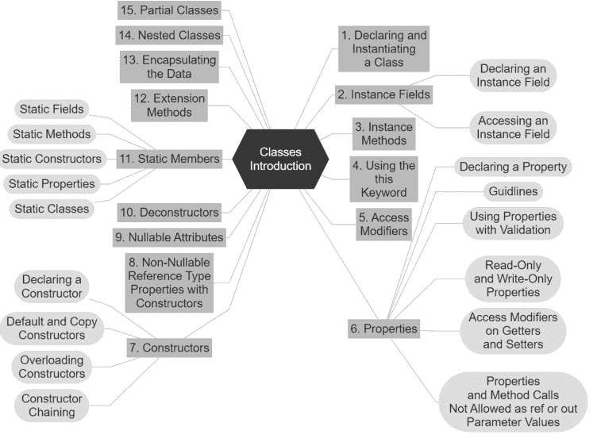

每个章节的主题出现在思维导图的中心。高级主题围绕核心展开。思维导图让你能够轻松地吸收从高级到更详细概念的内容，减少了遇到你可能并不需要的非常具体的知识的概率。

## 有用笔记

根据你的经验水平，特殊功能将帮助你阅读本文。

- **初级主题**专门针对初级程序员提供了相关的定义或解释。
- **高级主题**让经验丰富的开发者能够关注与他们最相关的材料。
- **注记说明**在框中突出显示关键原则，以便读者轻松识别其重要性。
- **语言对比**通过识别 C# 与其前身版本之间的主要区别，以帮助熟悉其他语言的人员。

## 本书的结构

从高层面上说，软件工程是关于管理复杂性的，为了这一目标，我组织了《Essential C# 12.0》。第 1–5 章介绍了编程，这使你能够立即开始编写简单的功能代码。第 6-10 章介绍了 C# 的面向对象结构。初级读者在继续学习书中其余更高级主题之前，应专注于完全理解这部分。第 12–14 章引入了减少复杂性的结构，处理几乎所有现代程序所需的通用模式。这引出了带有反射和属性的动态编程，它在随后的章节中被广泛用于线程和互操作性。

本书以第 24 章“通用语言体系（CLI）”结束，该章节描述了在运行的开发平台背景下的 C#。该章节之所以出现在最后，因为它不是 C# 特有的，并且与书中其他部分的语法和编程风格不同。然而，该章节适用于任何时间阅读，也许最合适是在第 1 章之后立即。

以下是每个章节的描述（在此列表中，**粗体**显示的章节号表示包含 C# 10.0–12.0 的材料）。

- 第 1 章，C# 简介：在展示了 C# “Hello World”程序后，本章将对其进行剖析。这应该让读者熟悉 C# 程序的外观和感受，并提供有关如何编译和调试他们程序的详细信息。它还提供了有关如何编译自己程序的详细信息。
- 第 2 章，数据类型：本章展示了 C# “你好世界”程序后，将对其进行剖析。这涉及到了的特性。
- 第 3 章，更多数据类型：本章涵盖了值类型和引用类型。此外，本章还探讨了 C# 3.0 引入的元组。
- 第 4 章，运算符与控制流：本章探讨了循环和条件逻辑。本章还涵盖了运算符操作、类型转换以及预处理器指令。
- 第 5 章，方法与参数：本章扩展了方法的定义，包括值传递、引用传递以及通过输出返回数据。在 C# 4.0 中增加了默认参数的支持。
- 第 6 章，类：本章介绍了面向对象的结构。本章还讨论了命名空间和 XML 注释。
- 第 7 章，继承：继承是许多开发者的核心结构。本章讨论了继承语法。本章还涵盖了重写。
- 第 8 章，接口：本章展示了接口如何使用。本章还涵盖了显式和隐式接口成员实现。
- 第 9 章，结构体与记录：本章介绍了 C# 9.0 引入的记录（records），并将其扩展到引用类型。
- 第 10 章，良好的良好的类型：本章深入探讨了类型定义。本章还讨论了如何为垃圾回收设计类。
- 第 11 章，异常处理：本章扩展了第 5 章的异常处理介绍，并描述了异常的层次结构。本章还包含了异常处理的最佳实践。
- 第 12 章，泛型：泛型可能是 C# 1.0 缺失的核心功能。本章完全涵盖了这一点。此外，C# 4.0 引入了协变和逆变——这一点在本章关于泛型的文中进行了讨论。
- 第 13 章，委托与 Lambda 表达式：委托通过定义代码内部处理事件的模式开始清晰区分 C# 与其前身。本章解释了 Lambda 表达式如何通过提供更优雅简洁的语法来构建委托，为后续的集合 API 奠定了基础。
- 第 14 章，事件：封装的委托是通用语言运行时的核心结构。本章还介绍了另一个 C# 2.0 特性：匿名方法。
- 第 15 章，使用标准查询运算符的集合接口：C# 3.0 引入的简单且强大的更改在本章中大放异彩，我们将查看 Generic 类的扩展方法。该类提供了名为标准查询运算符的集合 API，在本章中进行了详细讨论。
- 第 16 章，使用查询表达式的 LINQ：仅使用标准查询运算符会导致某些难以理解的语句。然而，查询表达式提供了一种与 SQL 匹配的替代语法，如本章所述。
- 第 18 章，反射、属性与动态编程：面向对象的编程在 20 世纪 80 年代后期构成了编程结构范式转移的基础。同样，属性促进了声明式编程和嵌入式元数据，开启了新的范式。本章介绍了属性，并讨论了如何通过反射检索它们。它还涵盖了通过基类库（Base Class Library）中的序列化框架进行输入输出。在 C# 4.0 中，语言增加了一个新关键字 `dynamic`。这消除了运行之前所有的类型检查，极大地扩展了 C# 的功能范围。
- 第 19 章，引入多线程：大多数程序都需要使用线程来执行耗时较的任务，同时确保对同时发生的事件做出活动响应。随着程序变得日益复杂，它们必须采取额外的措施来保护这些高级环境中的数据。编写多线程应用程序是复杂的。本章介绍了如何与任务（tasks）一起工作，包括取消任务，以及如何处理在任务上下文中执行的异常。
- 第 20 章，基于任务的异步模式编程：该模式深入了基于任务的异步模式及其随后的 `async/await` 语法。它为多线程编程提供了一种显著简化的方法。此外，包含了 C# 8.0 的异步流概念。
- 第 21 章，并行迭代：引入性能改进的一种方法是使用 `Parallel` 对象或 Parallel LINQ 库对数据进行并行迭代。
- 第 22 章，线程同步：在本章的基础上，它演示了内置线程模式之一，它可以简化对多线程代码的显式控制。
- 第 23 章，平台互操作性与不安全代码：由于 C# 是一门相对年轻的语言，用其他语言编写的代码多于 C#。为了利用这些预现有代码，C# 通过 P/Invoke 支持互操作性——即调用未托管代码。此外，C# 还允许使用指针和直接内存操作。虽然带有指针的代码需要特殊权限才能运行，但它提供了与完全传统的 C 语言编程接口操作的能力。
- 第 24 章，通用语言体系：从根本上说，C# 是设计为底层通用语言体系（Common Language Infrastructure）之上最有效的编程语言语法。本章深入探讨了 C# 程序与底层运行时及其规范的关系。
- C# 8.0-12.0 索引：这些索引为 C# 8.0 到 12.0 中添加的功能提供了快速参考。它们专门设计用于帮助程序员快速将其语言技能更新到更新版本。

我希望这本书能成为你建立 C# 专业知识的极佳资源，并在你精通 C# 之后，继续参考它来处理你不经常使用的领域。

—Mark Michaelis

IntelliText.com/mark, mark.michaelis.net

X（原 Twitter）：@Intellitext, @MarkMichaelis

| 在 InformIT 网站上注册您的《Essential C# 12.0》副本，以便在更新或更正出现时方便地访问。要开始注册过程，请访问 informit.com/register 并登录或创建账户。输入产品 ISBN (9780138219512) 并点击提交（Submit）。在“注册产品”（Registered Products）选项卡上查找产品旁边的“奖励内容”（Access Bonus Content）链接，点击该链接访问任何可用奖励材料。如果您希望收到新版本和更新的独家优惠，请勾选接收我们的电子邮件。 |

## 致意

任何书都不能由作者独立出版，我非常感谢帮助我完成这本书的许多人。我感谢人的顺序并不重要，那些排在最前面的除外。考虑到这已经是该书的第八版，你可以想象我的家庭为了我在过去的 18 年里写作付出了多少（更不用说之前的书籍）。Benjamin、Hanna 和 Abigail 有一个被这本书分散了注意力的爸爸，但 Elisabeth 受的更多。因此，她被留下来处理所有事务，独自支撑起整个家庭。（2017 年度假期间，我待在室内好几天，而他们本更想去海滩的）

在编写《Essential C# 12.0》时，我非常感谢 Pearson 允许 IntelliTest 在网站 essentialsharp.com 上托管手稿。然而，如果没有 IntelliTest 团队，我无法做到这一点，我很幸身边有如此出色的软件工程师，他们独立于我之外创作出如此卓越的作品。我们花费了大量时间解析手稿、格式化它、编辑内容，并创建网站输出。非常感谢以下贡献者，他们使这一版本的成为：Benjamin Michaelis, Kevin Bost, Daniel Olvera, Jenny Curry, Mikaella Croskey, Grant Woods, Zack Ward, John Willis, Andrew Scott, Anré “Ray” Tanner, Artem Chetverikov, Casey White, Austen Frostad, Tom Clark, Joseph Riddles, John Evans, Kelsey McMahon, Casey Schadwitz, Cameron J. Osborn, Nicole Glidden 以及 Elizabeth Pauley。特别感谢 Kevin Bost 和我的儿子 Benjamin Michaelis。除了他们的代码贡献，他们还帮助了整个网络工具项目，使网站变成了现实。

自 2013 年以来，我一直在 IntelliTest 与 Kevin Bost 工作，他在软件开发方面的惊人天赋一直让我惊喜。他不仅 C# 知识的深度是惊人的，而且在许多其他开发领域也是 10 级专家。为了所有这一切以及更多，我邀请 Kevin Bost 作为官方技术编辑审阅这本书，我对此非常感激。他为 img/ffe0f34e7523830420733690014d7_31_0.png 早期版本中的内容带来了见解和改进，这是其他人没有提到的。这种对细节的关注，结合他对卓越的坚定追求，真正使 C# 12.0 成为那些专注于该语言的人的经典 C# 书籍。

当然，Eric Lippert 也同样非常出色。他对 C# 的掌握确实令人惊叹，我非常感激他的编辑，特别是当他推行术语的完美时。他对 C# 3 章节的改进是显著的，在第二版中，我唯一的遗憾是没有让他审阅所有章节。然而，那个遗憾后来得到了缓解：Eric 刻力地审阅了每一个 C# 4 章节，甚至担任了《Essential C# 5.0》和《Essential C# 6.0》的贡献作者。我非常感激他在通《Essential C# 12.0》之前的版本中担任技术编辑的角色。感谢你，Eric！我找不出比你更胜任工作的人了。你将基准从优秀提升到卓越，赢得了所有的赞誉。

正如 Eric 和 C# 一样，像 Stephen Toub 那样了解 .NET 多线程的人寥寥无几。因此，Stephen 专注于那两个重写（这是第三次）的多线程章节，以及它们对 C# 5.0 异步支持的新关注。感谢你，Stephen！

多年来，许多其他技术编辑都详细审查了每个章节以确保技术准确性。我经常对这些这些人仍能捕捉到的细微错误感到惊讶：Paul Brahms, Kody Brown, Andrew Comb, Ian Davis, Doug Dechow, Gerard Frantz, Dan Haley, Thomas Heavey, Anson Horton, Brian Jones, Shane Kerchev, Angelika Langer, Neal Lundby, John Michaels, Jason Morse, Nicholas Palardino, James Peterson, Jon Sleet, Michael Stokesbery, Robert Stokes 和 John Timney。

感谢 Pearson/Addison-Wesley 的所有人，尽管我经常关注手稿之外的事务，他们仍对我耐心配合。还要感谢 Malobika Chakraborty 和 Julie Nahif 帮助我完成了从提案到制作的整个过程。

## 关于作者

Mark Michaels 是 IntelliTect 的创始人，这是一家创新的软件架构和开发公司，他在该公司担任首席架构师和培训师。Mark 在领导他成功公司的同时，还遍布全球进行关于领导力或技术的主题演讲，并代表微软或其他客户进行交流。他他还撰写了许多文章和书籍，是东部华盛顿大学的兼职教授、斯波波克 .NET 用户组的创始人，以及年度 TEDx Coeur d'Alene 活动的联合组织者。

作为一名世界级的 C# 专家，Mark 自 2007 年起担任微软区域总监，并拥有超过 25 年的微软 MVP 荣誉。

Mark 拥有伊利诺伊大学的哲学文学学士学位，以及伊利诺伊理工学院的计算机科学硕士学位。

在不与电脑相处时，Mark 忙于向孩子们展示其他国家的真实生活（他于 2016 年停止了参加铁人三项比赛）。Mark 住在华盛顿州的斯波波克，与妻子 Elisabeth 以及三个孩子 Benjamin、Hanna 和 Abigail 生活。

## 关于技术编辑

Kevin Bost 是一名成功的微软 MVP，也是 IntelliTect 的高级软件架构师。他在构建多个创新产品方面发挥了关键作用，包括 System.CommandLine、Moq.AutoMocker 和 ShowMeXaml。在工作之余，可以在网上找到 Kevin，他在 YouTube (youtube.keboo.dev) 上指导其他开发者，并维护流行的 Material Design in XAML 工具包 (http://materialdesignxaml.net/)。他还喜欢桌游、终极飞盘和骑摩托车。

# 介绍 C#

C# 编程语言用于构建运行在各种操作系统（平台）上的软件组件和应用程序——包括移动设备、游戏主机、Web 应用程序、物联网 (IoT)、微服务和桌面应用程序。此外，C# 是免费的；事实上，它是完全开源的，因此你可以查看、修改、分发并贡献你所做的任何改进。作为一种语言，C# 构建在在其前身 C 风格语言（C、C++ 和 Java）的特性之上，使得经验丰富的程序员对其感到非常熟悉。¹

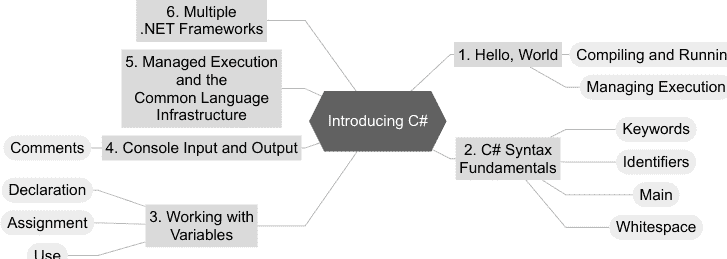

- 1. 第一次 C# 设计会议于 1998 年。

## 第 1 章：介绍 C#

本章将使用传统的 HelloWorld 程序介绍 C#。它侧重于 C# 语法基础，包括定义 C# 程序的入口点，这将让你熟悉 C# 的语法风格和结构，并使你能够编写最简单的 C# 程序。在讨论 C# 语法基础之前，是对托管执行上下文的总结，它解释了 C# 程序在运行时如何执行。本章将以变量声明、从控制台写入和检索数据以及 C# 代码注释基础的讨论作为结束。

## Hello, World（你好，世界）

学习编程语言的最佳方法是编写代码。第一个例子是经典的 HelloWorld 程序。在这个程序中，你将在屏幕上显示一些文本。

列表 1.1 显示了完整的 HelloWorld 程序；在接下来的章节，你将编译并运行这些代码。

# 列表 1.1：C# 中的 HelloWorld

```c
Console.WriteLine("Hello. My name is Inigo Montoya.");
```

（如此简单的列表需要 C# 9.0 启用的特性——顶层语句来帮助学习 C#。另一个列表——可以说是一个更典型的列表——将在稍后的列表 1.6 中显示。有关顶层语句的更多信息请参见第 4 章。）

> 初学者主题

### 基础编译术语

编译器的作用就像翻译官，将代码从一种语言转换为另一种语言。通常情况下，编译器负责将代码从高级语言（如 C#）转换为计算机直接理解的低级语言。在以下

- 2. 如果你对 Inigo Montoya 的引用感到困惑，请参考电影《新娘传奇》。

Hello World 的情况下，编译输出是中间语言，由第二个编译器翻译成机器语言。这将在本章稍后的“托管执行与通用语言基础设施”部分中进一步讨论。源代码仅仅是组成程序的文本，因此列表 1.1 被认为是我们 HelloWorld 程序的源代码。“代码”一词通常与源代码互换。

### 创建、编辑、编译和运行 C# 源代码

一旦你写了 C# 代码，就是时候编译并运行它了。根据你的操作系统，你可以选择下载哪种编译器。通常，实现被封装在软件开发工具包 (SDK) 中。虽然我们没有通过 `dotnet build` 命令显式请求项目编译（或构建），但该步骤仍然隐式发生。

根据你的操作系统，你可以选择下载哪种编译器。通常，实现被封装在软件开发工具包 (SDK) 中。虽然我们没有通过 `dotnet build` 命令显式请求项目编译（或构建），但该步骤仍然隐式发生。

## 第 1 章：介绍 C#

本章将使用传统的 HelloWorld 程序介绍 C#。它侧重于 C# 语法基础，包括定义 C# 程序的入口点，这将让你熟悉 C# 的语法风格和结构，并使你能够编写最简单的 C# 程序。在讨论 C# 语法基础之前，是对托管执行上下文的总结，它解释了 C# 程序在运行时如何执行。本章将以变量声明、从控制台写入和检索数据以及 C# 代码注释基础的讨论作为结束。

## Hello, World（你好，世界）

学习编程语言的最佳方法是编写代码。第一个例子是经典的 HelloWorld 程序。在这个程序中，你将在屏幕上显示一些文本。


列表 1.1 显示了完整的 HelloWorld 程序；在接下来的章节，你将编译并运行这些代码。

# 列表 1.1：C# 中的 HelloWorld

```c
Console.WriteLine("Hello. My name is Inigo Montoya.");
```

（如此简单的列表需要 C# 9.0 启用的特性——顶层语句来帮助学习 C#。另一个列表——可以说是一个更典型的列表——将在稍后的列表 1.6 中显示。有关顶层语句的更多信息请参见第 4 章。）

> 初学者主题

### 基础编译术语

编译器的作用就像翻译官，将代码从一种语言转换为另一种语言。通常，编译器负责将代码从高级语言（如 C#）转换为计算机直接理解的低级语言。在 Hello World 的情况下，编译输出是中间语言，由第二个编译器翻译成机器语言。这将在本章稍后的“托管执行与通用语言基础设施”部分中进一步讨论。源代码仅仅是组成程序的文本，因此列表 1.1 被认为是我们 HelloWorld 程序的源代码。“代码”一词通常与源代码互换。

### 创建、编辑、编译和运行 C# 源代码

一旦你写了 C# 代码，就是时候编译并运行它了。根据你的操作系统，你可以选择下载哪种编译器。通常，实现被封装在软件开发工具包 `SDK` 中。虽然我们没有通过 `dotnet build` 命令显式请求项目编译（或构建），但该步骤仍然隐式发生。

（注：提供的 OCR 在第 37-38 页存在大量重复块。我将根据提供的内容进行合成。）

### 使用 Dotnet CLI

`dotnet` 命令是命令行界面，或 `dotnet CLI`，除了用于生成 C# 程序的初始代码，还可以用于编译和运行程序。（为了避免歧义，在指代 `dotnet CLI` 时在 CLI 前加上 `dotnet`。不加 `dotnet` 前缀的 CLI 指的是通用语言基础设施。）一旦完成安装，请验证 `dotnet` 是终端的可用命令。

以下是在 Windows、macOS 或 Linux 终端创建、编译和执行 HelloWorld 程序的指令：

- 1. 打开终端。（可选，考虑运行命令 `psh` 使用跨平台命令行界面 PowerShell。）

- 2. 创建你想放置代码的新目录。可以使用 `HelloWorld` 或 `EssentialCSharp/HelloWorld` 等名称。在代码行：`mkdir HelloWorld`

- 3. 进入新目录使其成为终端的当前位置。`cd HelloWorld`

- 4. 执行 `dotnet new console` 生成程序的初始脚手架（或项目）。虽然生成了多个文件，但主要文件是 `Program.cs` 和项目文件 `HelloWorld.csproj`：`dotnet new console`

- 5. 运行生成的程序。这会编译并运行由 `dotnet console` 命令创建的代码。`Program.cs` 的内容与列表 1.1 类似，但它输出的是“Hello World!”：`dotnet run`

- 6. 即使我们没有通过 `dotnet build` 命令显式请求项目编译（或构建），该步骤仍然隐式发生。

- 编辑 `Program.cs` 文件并修改代码，使其与列表 1.1 所示一致。如果你使用提到的编辑器之一打开并编辑 `Program.cs`，你将看到支持 C# 的编辑器的优势，代码将着色显示，以指示程序中不同类型的构造结构。要使用 Visual Studio Code 打开并编辑，请使用以下命令，或启动 Visual Studio Code 并打开 `Program.cs` 文件。

`code`

- （或者，输出 1.1 显示了一种仅使用命令行的方法，该方法适用于 Bash 和 PowerShell。）

- 重新运行程序：

`dotnet run`

输出 1.1 显示了执行上述步骤后的输出。

OUTPUT 1.1

```
1> mkdir ./HelloWorld
2> cd ./HelloWorld/
3> dotnet new console
4> The template "Console Application" was created successfully.
Processing post-creation actions...
Running 'dotnet restore' on C:\
\EssentialCSharp\HelloWorld\HelloWorld.csproj...
Restored in 100.38 ms for
C:\EssentialCSharp\HelloWorld\HelloWorld.csproj.
Restore succeeded.
5> dotnet run
Hello World!
6> echo 
7> Console.WriteLine("Hello. My name is Inigo Montoya.");
8> Program.cs
9> dotnet run
Hello. My name is Inigo Montoya.
```

5. 输出中的**粗体**格式表示用户输入的内容。

### 使用 Visual Studio 2022 (Windows 或 Mac)

使用 Visual Studio 2022（它仅在 Microsoft Windows 或 Mac 上运行），步骤类似，但你使用的不是命令行，而是集成集成开发环境 `IDE`，它具有你可以选择的菜单，而不是从命令行执行所有操作：

- 启动 Visual Studio 2022。

- 点击“创建新项目”（Create a new project）按钮。（如果启动窗口未显示，可以通过“文件->启动窗口”菜单打开，或直接通过“文件->新建项目 (Ctrl+Shift+N)”菜单跳转到创建项目。）

- 在搜索框（Alt+S）中输入 `Console App` 并选择 `Console App` 项（见图 1.2）。（如果安装了其他语言，可以选择选择 C# 以减少选项数量。）

- 对于“项目名称”文本，使用 `HelloWorld`；对于“位置”，选择你任选的工作目录（见图 1.3）。

- 在“其他信息”对话框中，在“框架”下拉菜单中选择 `.NET 7.0`。（取消勾选“不使用顶层语句”复选框。）

- 项目创建后，你应该能看到一个如图 1.4 所示的 `Program.cs` 文件。

### 创建新项目

最近的项目模板

- 类库 (.NET Core)

- xUnit 测试项目 (.NET Core)

- 类库 (.NET Standard)

- MSTest 测试项目 (.NET Core)

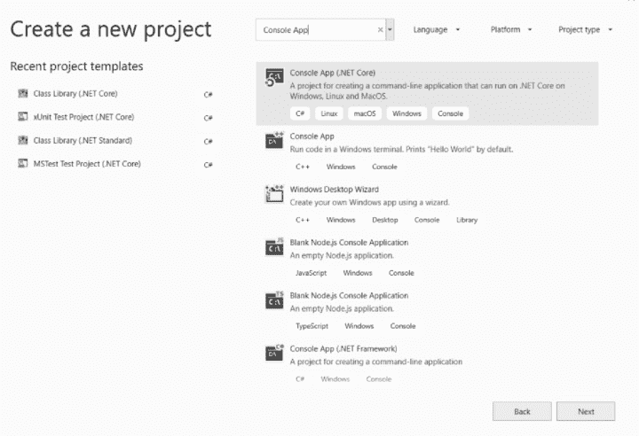

图 1.2：创建新项目对话框

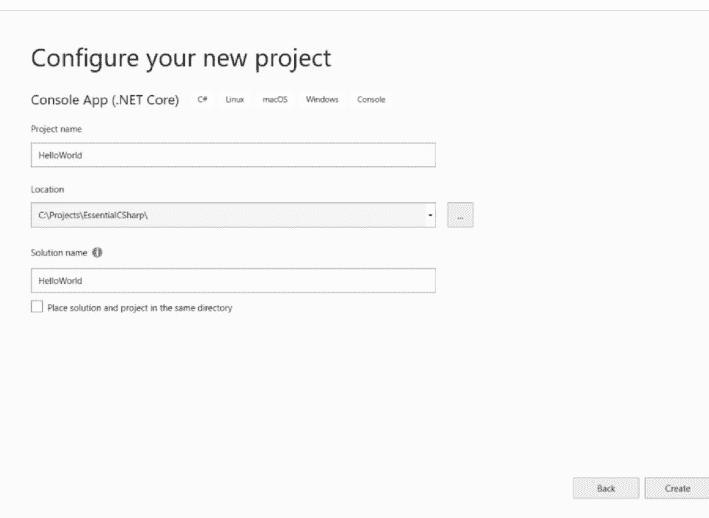

图 1.3：配置你的新项目对话框

- 7. 使用“调试->开始而不调试 (Ctrl+F5)”菜单运行生成的程序。这会显示终端并带有输出 1.2 中的所示文本，但第一行显示“Hello World!”或仅显示该。

OUTPUT 1.2

```
Hello. My name is Inigo Montoya.
...\HelloWorld.exe (process 11856) exited with code 0.
按任意键关闭此窗口 . .
```

- 8. 修改 `Program.cs` 以匹配列表 1.1。重新运行程序以查看输出 1.2 所示的输出。

### 理解项目

使用 `dotnet CLI` 或 Visual Studio，会创建几个文件。第一个文件是约定命名为 `Program.cs` 的 C# 文件。该文件的 `Program` 是

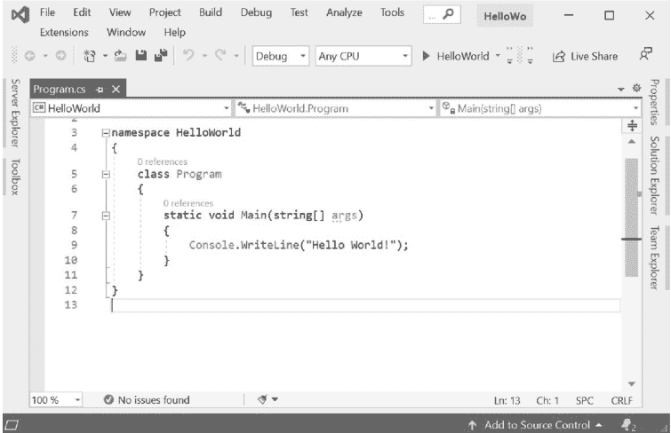

图 1.4：`Program.cs` 文件

C# 程序的入口是 `Main` 方法。在 C# 旧版本中，此方法被显式包含在类中，但在现代版本中，可以使用顶层语句来简化代码。以 `.csproj` 结尾的项目文件定义了如何构建和运行项目。它包含了目标框架、依赖项和其他构建设置的信息。

当你构建项目时，编译器会创建几个目录。最重要的是 `bin` 和 `obj` 目录。`bin`（二进制）目录包含编译的可执行文件和库，按框架和配置（例如 Debug 或 Release）进行组织。`obj`（对象）目录包含构建过程中使用的中间文件。

项目文件还允许你管理 NuGet 包，NuGet 包是你可以在项目使用的库。你可以使用 `dotnet CLI` 或 Visual Studio NuGet 包管理器来添加包。

# C# 语法基础 13

语句（statement）由代码将执行的一个或多个操作组成。声明变量、控制程序流和调用方法都是语句的典型用法。

## 高级主题

### 不带分号的语句

C# 中的许多编程元素以分号结尾。其中一个不包含分号的例子是 `switch` 语句。由于 `switch` 语句始终包含大括号，因此 C# 不需要在此语句后加分号。事实上，代码块本身被视为语句（它们也由语句组成），并且它们不需要以分号结束。同样，在某些情况下（例如使用声明时），分号作为后缀出现，但它并不是一个语句。

由于换行符不会分隔语句，你可以将多个语句放置在同一行上，C# 编译器会将该行解释为包含多条指令。例如，列表 1.3 在单行上包含两个语句，它们结合在一起在两个单独的行显示 Up 和 Down。

# 列表 1.3：单行内的多个语句

```
Console.WriteLine("Up"); Console.WriteLine("Down");
```

同样，每个语句都可以放在单独的一行上，如列表 1.4 所示。

# 列表 1.4：每个语句单独占一行

```
Console.WriteLine("Down");
Console.WriteLine("Side");
Console.WriteLine("Up");
```

C# 还允许将一个语句拆分跨多行。同样，C# 编译器会寻找分号来指示语句的结束。例如，在列表 1.5 中，HelloWorld 程序中的原始 `WriteLine()` 语句被分成了多行。

# 14 第 1 章：引入 C#

### 列表 1.5：跨多行的单个语句

```
Console.WriteLine(
  "Hello. My name is Inigo Montoya.");
```

## 引入类和方法

在目前为止所示的列表中，语句独立于任何其他 C# 构造，并且仅在单个文件中以这种方式出现。毕竟，之前的列表是 C# 程序中最简单的程序，即一个 HelloWorld 程序。然而，程序可能会变得非常复杂，可以添加结构来组织代码。最简单的结构是添加方法并将这些方法放在类中。列表 1.6 提供了一个示例。

### 列表 1.6：带有类和方法的 HelloWorld

```
public class Program
{
  public static void Main()
{
    System.Console.WriteLine("Hello. My name is Inigo Montoya.");
  }
}
```

在这个列表中，HelloWorld 语句被放在一个名为 `Main` 的方法中，该方法又放在一个名为 `Program` 的类中。

具有 Java、C 或 C++ 编程经验的人会立即看到相似之处。与 Java 一样，C# 从 C 和 C++ 继承了它的基本语法。语法标点（如分号和大括号）、特性（如大小写敏感）和关键字（如 `class`、`public` 和 `void`）对于习惯于这些语言的程序员来说是熟悉的。

- 8. 在创建 C# 时，语言创建者审查了 C/C++ 的规范，字面上划掉了他们不喜欢的特征，并创建了他们喜欢的特征列表。该小组还包括在其他语言方面有深厚背景的设计师。

# C# 语法基础 15

> **注意**

> C# 是一种大小写敏感的语言：错误的大小会导致代码无法成功编译。

## 语言对比：Java—文件名必须与类名匹配

在 Java 中，文件名必须与类名匹配。在 C# 中，这并不是要求的。

## 初学者主题

### 关键字

为了让编译器识别代码，某些词具有特殊状态。作为**关键字**，它们在 C# 中具有特殊含义。在 HelloWorld 程序中，`class`、`static` 和 `void` 是关键字的示例。

编译器使用关键字来识别结构。在 C# 中，某些词在特定位置具有重要性。在这些位置之外，它们没有特殊意义。

### C# 关键字

关键字是另一种语言的构造。表 1.1 显示了关键字。

# 16 第 1 章：引入 C#

| 表 1.1：C# 关键字 | | |

|---|---|---|

| abstract | alias* | async |

| await | base | bool |

| by | byte | break |

| char | checked | class |

| continue | decimal | default |

| else | enum | equals |

| finally | fixed | float |

| foreach | from | for |

| goto | get | get |

| in | init | int |

| internal | into | is |

| let | lock | long |

| namespace | new | not |

| null | object | operator |

| on | override | out |

| private | protected | public |

| record | ref | readonly |

| remove | required | return |

| set | sealed | short |

| stackalloc | static | string |

| switch | this | throw |

| try | typeof | uint |

| unchecked | unsafe | ushort |

* 上下文关键字。括号中的数字表示添加添加的版本。

在 C# 1.0 之后，C# 没有引入新的保留关键字。然而，后续版本的某些构造使用了上下文关键字。在这些指定位置之外，上下文关键字没有特殊意义。9 通过这种方法，即使是 C# 1.0 代码也是兼容的10

### 标识符

与其他语言一样，C# 包含标识符来标识构造。在列表 1.6 中，HelloWorld 和 `Main` 是标识符的示例。分配给构造的标识符稍后会被引用，因此开发者分配的名称是有意义的而非任意的。

> 注意

> 选择简洁且指示性的名称是优秀程序员的一个重要特征，因为这意味着生成的代码更容易被理解和重用。

清晰性与一致性足够重要，以至于框架设计指南（http://bit.ly/dotnetguidelines）建议不要在标识符名称中使用缩写或复合词。如果一个缩写被广泛接受（例如 HTML），你应该始终使用它。避免在某些情况下写出接受的缩写而在其他情况下不写。通常情况下，将所有缩写包含在术语表中比使用缩写的开销要小

- 9. 例如，在 C# 2.0 的设计中，语言设计者将 `yield` 指定为关键字，微软发布了 C# 2.0 编译器的 Alpha 版本，并将 `yield` 作为关键字提供给数千名开发者。然而，语言设计者最终确定通过使用 `return` 而不是 `yield`，最终可以避免将 `yield` 作为关键字，因为它除了靠近 `return` 之外没有特殊意义。一些罕见且不幸的不兼容性，例如：C# 2.0 要求使用 `using` 语句实现 `IDisposable`，而不是简单地使用 `Dispose()` 方法。

不要轻率使用。最终，请选择清晰、甚至可能是冗长的名称——特别是在团队工作或开发其他开发者将要使用的库时。

标识符有两种基本格式。帕斯卡命名法（Pascal case，简称 PascalCase），.NET 框架创建者因为其在 Pascal 编程语言中的流行而引用它，它将标识符名称中每个单词的首字母大写；例如 `ComponentModel`、`Configuration` 和 `HttpClientCollection`。正如 `HttpClientCollection` 中的 HTTP 所示，当使用超过两个字母的缩写词时，仅首字母大写。第二种格式驼峰命名法（camel case，简称 camelCase）遵循相同的约定，但首字母是小写的；例如 `quotient`、`firstName`、`HttpClientCollection`、`ioStream` 和 `theDreadPirateRoberts`。

## 指南

- 在命名标识符时，**优先**考虑清晰性而非简洁。

- **不要**在标识符名称中使用缩写或收缩形式。

- **除非**缩写词被广泛接受，否则如此，请保持一致地使用它们。

注意，虽然下划线是合法的，但标识符名称中通常没有下划线、连字符或其他非字母数字字符。此外，C# 没有遵循其前代的匈牙利记法（在名称前加上数据类型缩写）。这种约定避免了在数据类型更改时必要的变量重命名，也避免了由于未使用匈牙利记法调整数据类型前缀而引入的不一致性。

在少数情况下，某些标识符（如 `Main`）在 C# 语言中具有特殊含义。

虽然命名指南看起来可能微不足道，特别是当你来自其他此类指南模糊或完全缺失的语言时，违反这些指南对于经验丰富的 C#.NET 程序员来说将非常显眼，并表明质量低下或缺乏经验。为了避免这种情况，请学习这些指南，并严格遵守它们。

## 指南

- 对于两个字母的缩写词，**要**两个字母都大写，但驼峰命名标识符的首单词除外。

- 对于三个或更多字母的缩写词，**要**仅首字母大写，但驼峰命名标识符的首单词除外。

- **不要**将驼峰命名标识符开头缩写词的任何字符大写。

- **不要**使用匈牙利记法（即，不要在变量名称中编码其类型）。

## 高级主题


关键字：虽然很少见，但如果关键字包含 `@` 作为前缀，可以作为标识符使用。例如，你可以将本地变量命名为 `@return`。同样（尽管不符合 C# 编码规范的大小写规定），可以将方法命名为 `@throw` 并紧跟括号：`@throw()`。

Microsoft 实现中还有未记录的保留关键字：`__arglist`、`__makeref`、`__retype` 和 `__refvalue`。这些仅在少数的互操作场景中需要，在所有实际用途中你可以忽略它们。注意，这四个特殊关键字以两个下划线开头。C# 的设计者保留将任何以两个下划线开头的标识符变为关键字的权利。

在少数情况下，某些标识符（如 `Main`）在 C# 语言中具有特殊含义。

虽然命名指南看起来可能微不足道，特别是当你来自其他此类指南模糊或完全缺失的语言时，违反这些指南对于经验丰富的 C#.NET 程序员来说将非常显眼，并表明质量低下或缺乏经验。为了避免这种情况，请学习这些指南，并严格遵守它们。

# 初学者主题

## 使用空格格式化代码

使用空格对代码进行缩进对于提高可读性至关重要。在你开始编写代码时，需要遵循既定的编码标准和规范，以增强代码的可读性。

本书使用的惯例是将大括号单独放在一行，并对大括号对之间包含的代码进行缩进。如果在第一对大括号内部出现另一对大括号，则第二组大括号内的所有代码也都要进行缩进。

这并不是统一的 C# 标准，而是一种风格偏好。

## 变量操作

现在你已经接触了最基础的 C# 程序，是时候声明一个局部变量了。一旦声明了变量，你就可以给它赋值，将其替换为新值，并在计算、输出等地方使用它。然而，你不能更改变量的数据类型。在列表 1.12 中，`string max` 是一个变量声明。

> 列表 1.12：声明和赋值变量

```c
public class MiracleMax
{
    public static void Main()
    {
        string max;      // "string" 标识数据类型
                       // "max" 是变量

        max = "Have fun storing the castle!";
        Console.WriteLine(max);
    }
}
```

# 初学者主题

## 局部变量

变量是一个指向可以随时间改变的值的名称。局部（Local）表示程序员在方法内部声明了变量。

声明变量就是定义它，你通过以下方式完成定义：

- 指定变量将包含的数据类型
- 为它分配一个标识符（名称）

### 介绍数据类型

列表 1.12 声明了一个数据类型为 `string` 的变量。本章使用的其他常用数据类型是 `int` 和 `char`。

- `int` 是 C# 中整数类型的指代，大小为 32 位。
- `char` 用于字符类型。它是 16 位，足以容纳（非代理）Unicode 字符。下一章将更详细地介绍这些和其他常用数据类型。

# 初学者主题

## 什么是数据类型？

变量声明指定的数据类型称为数据类型（或对象类型）。数据类型，或简单称为类型，是对具有相似特征和行为的类型的分类。例如，“动物”是一种类型。它分类了所有具有动物特征（猴子、野猪和鸭嘴兽等）的事。同样，在编程语言中，类型是对若干具有相似特性的项的定义。

# 26 第1章：介绍 C#

## 声明变量

在列表 1.12 中，`string max` 是一个 `string` 类型变量声明，其名称为 `max`。可以通过指定一次数据类型并用逗号分隔每个标识符，在同一条语句中声明多个变量。列表 1.13 展示了此类声明。

列表 1.13：在一个语句中声明两个变量

```c
string message1, message2;
```

由于多变量声明语句允许开发者在声明中提供一次数据类型，因此所有变量将具有相同的类型。

在 C# 中，变量名可以以任意字母或下划线 `_` 开头，随后是任意数量的字母、数字和/或下划线。根据惯例，局部变量名使用驼峰命名（每个单词的首字母大写，第一个单词除外）且不包含下划线。

> 指南

局部变量名使用驼峰命名法。

### 赋值

在声明局部变量后，在读取它之前必须对其赋值。实现此点的方法之一是使用 `=` ，也称为简单赋值运算符。列表 1.14 展示了如何使用赋值运算符将字符串值指定给 `miracleMax` 和 `valerie` 将指向的变量。

列表 1.14：更改变量的值

```c
public class StormingTheCastle
{
    public static void Main()
    {
        string valerie = "Have fun storming the castle!";
        string miracleMax = "";

        valerie = "Think it will work?";
        Console.WriteLine(miracleMax);
        Console.WriteLine(valerie);

        miracleMax = "It would take a miracle.";
        Console.WriteLine(miracleMax);
    }
}
```

从此列表中观察到，可以在变量声明的一部分进行赋值（如 `miracleMax` 所示），或者在之后的单独语句中进行赋值（如变量 `valerie`）。赋值的值必须始终在声明的右侧。

运行编译后的程序会产生输出 1.3 所示的代码。

# 输出 1.3

```
>dotnet run
Have fun storming the castle!
Think it will work?
It would take a miracle.
```

在这个示例中，我们显式地显示了 `dotnet run` 命令。在未来的输出列表中，我们将省略此行，除非执行程序使用的命令有特殊之处。

C# 要求局部变量在被读取之前（由编译器确定）必须是“确定赋值”的。此外，赋值会产生一个值。因此，C# 允许在同一条语句中两次两次，如列表 1.15 所示。

# 列表 1.15：返回可再次赋值之值的赋值

```c
public class StormingTheCastle
{
    public static void Main()
    {
        // ...
        string requirements, miracleMax = "It would take a miracle.";
        // ...
    }
}
```

### 使用变量

赋值的结果当然是你可以使用变量标识符来引用该值。因此，当你在 `Console.WriteLine(miracleMax)` 语句中使用变量 `miracleMax` 时，程序会显示“Have fun storming the castle!”——即 `miracleMax` 的值。

# 高级主题

## 字符串是不可变的

所有 `string` 类型的值（无论是字符串字面量还是其他）都是不可变的（或不可修改的）。例如，无法更改字符串本身。更改需要重新为变量赋值，而不是修改变量原始指向的数据。

## 控制台输入和输出

本章已经多次使用 `Console.WriteLine` 向控制台写入文本。除了能够输出数据外，程序还需要能够接受用户可能输入的数据。

### 从控制台获取输入

获取在控制台输入的文本的一种方法是使用 `Console.ReadLine()`。该方法会停止程序执行，使用户可以输入字符。当用户按下 Enter 键产生换行时，程序继续执行。来自 `Console.ReadLine()` 方法的输出（也称为返回值）是输入的文本字符串。考虑列表 1.16 以及在输出 1.4 中显示的相应输出。

# 列表 1.16：使用 Console.ReadLine()

```c
public class HeyYou {
    public static void Main() {
        string firstName;
        string lastName;

        Console.WriteLine("Hey you!");

        Console.Write("Enter your first name: ");
        firstName = Console.ReadLine();

        Console.Write("Enter your last name: ");
        lastName = Console.ReadLine();
    }
}
```

# 输出 1.4

```
Hey you!

Enter your first name: Inigo

Enter your last name: Montoya
```

# 第一章：介绍 C#

## 进阶主题

### System.Console.Read()

除了 `System.Console.ReadLine()` 方法，还有一个 `System.Console.Read()` 方法。然而，`System.Console.Read()` 方法返回的数据类型是对应于字符值的整数，如果没有更多可用字符，则返回 -1。要获取实际字符，需要将整数强制转换为字符，如列表 1.17 所示。

列表 1.17：使用 System.Console.Read()

```
int readValue;

char character;

readValue = Console.Read();

character = (char)readValue;

Console.Write(character);
```

`Console.Read()` 方法在用户按下 Enter 键之前不会返回输入；如果用户在按下 Enter 键之前输入了多个字符，它不会对单个按键进行任何处理。

你可以使用 `Console.ReadKey()`，它与 `Console.Read()` 不同，在单击按键后就会返回输入。它允许开发者拦截按键并执行诸如按键验证或限制字符为数字的操作。

## 向控制台写入输出

列表 1.16 使用 `Console.Write()` 方法而非 `Console.WriteLine()` 提示用户输入姓和名。`Console.Write()` 方法没有在显示文本后放置换行符，而是将当前位置留在同一行。通过这种方式，用户输入的任何文本将与输入提示处于处于同一行。列表 1.16 的输出演示了 `Console.Write()` 的效果。

- 在 C# 2.0 及以上版本。

```
public class HeyYou
{
    public static void Main()
    {
        string firstName;
        string lastName;
        Console.Write("Enter your first name: ");
        firstName = Console.ReadLine();
        Console.Write("Enter your last name: ");
        lastName = Console.ReadLine();
        Console.WriteLine(
            $"Your full name is {firstName
```

12. C# 6.0 的特性。

对于 `lastName` 的语句，列表 1.18 写出了整个字符串插值输出。通过字符串插值，编译器会解释字符串区域大括号内部的内容，在这些区域中你可以嵌入代码（表达式），编译器将评估并将其转换为字符串。与其单独执行许多代码段并在最后将结果组合成字符串，字符串插值允许你一步完成此操作。这使得代码更容易于理解。

在 C# 6.0 之前，C# 使用不同的方法，提供复合格式化。通过复合格式化，代码提供一个格式化字符串来定义输出格式——见列表 1.19。

列表 1.19：使用 Console.WriteLine() 的复合格式化进行格式

```
public class HeyYou
{
    public static void Main()
    {
        string firstName;
        string lastName;
        Console.WriteLine("Hey you!");
        Console.Write("Enter your first name: ");
        firstName = Console.ReadLine();
        Console.Write("Enter your last name: ");
        lastName = Console.ReadLine();
        Console.WriteLine(
            "Your full name is {0} {1}.", firstName, lastName);
    }
}
```

在此示例中，格式化字符串为 `Your full name is {0} {1}`。它识别了字符串中用于插入数据的两个索引占位符。每个占位符与格式化字符串之后出现的参数顺序对应。

注意索引值从零开始。每个插入的参数（称为格式化项目）按照与索引值对应的顺序出现在格式化字符串之后。在此示例中，由于 `firstName` 是紧随格式化字符串的第一个参数，因此它对应于索引值 0。同样，`lastName` 对应索引值 1。

注意格式字符串中的占位符不需要按顺序出现。例如，列表 1.20 交换了索引占位符的顺序并添加了逗号，这改变了名的显示方式（见输出 1.6）。

## 列表 1.20：交换索引占位符和相应的变量

```
Console.WriteLine("Your full name is {1}, {0}.", firstName, lastName);
```

## 输出 1.6

```
Hey you!
Enter your first name: Inigo
ter your last name: Montoya
Your full name is Montoya, Inigo
```

除了占位符在格式字符串中不连续出现外，还可以在格式中多次使用同一个占位符。此外，可以省略占位符。然而，不允许没有对应参数的占位符。

> 注意
字符串插值几乎总是比替代的复合字符串方法更容易理解，在本书的剩余部分中，请默认使用字符串插值。

## 注释

在本节中，我们通过为列表 1.19 添加注释来修改程序。这种修改没有任何方式会改变程序的执行；相反，在代码中提供注释可以使代码在本身不明显的区域更易理解。列表 1.21 显示了新代码，输出 1.7 显示了相应的输出。

## 列表 1.21：为你的代码注释

## 输出 1.7

```
Hey you!
Enter your first name: Inigo
Enter your last name: Montoya

Your full name is Inigo Montoya.
```

尽管插入了注释，编译和执行新程序产生的输出与之前相同。

程序员使用注释来描述和解释他们正在编写的代码，特别是在语法本身难以理解，或者可能某个特定的算法实现令人惊讶的地方。由于注释仅对查看代码的程序员相关，编译器忽略注释并生成不包含任何注释的程序集。

### 控制台输入和输出

表 1.2 显示了四种 C# 注释类型。程序 1.21 包含了其中。

## 表 1.2：C# 注释类型

| 注释类型 | 描述 | 示例 |
| --- | --- | --- |
| 定界符注释 | 正斜杠后跟星号 `/*` 标识定界符注释的开始。结束注释时使用星号后跟正斜杠 `*/`。这种形式的注释可以跨行，也可以嵌入代码行中。 | `/*comment*/` |
| 单行注释 | 由两个连续的正斜杠字符 `//` 定义。编译器将从分隔符到行尾的所有文本视为注释。这种形式被认为是单行的。然而，可以将单行注释连续放置，如列表 1.19 中的注释所示。 | `//comment` |
| XML 定界符注释 | 以 `/**` 开始并以 `*/` 结束的注释被称为 XML 定界符注释。它们与普通定界符注释具有相同特征，但编译器可以将它们放置到单独的文件中。 | `/**comment*/` |
| XML 单行注释 | XML 单行注释以 `//` 开始持续到行尾。此外，编译器可以将它们与 XML 定界符注释一起保存到单独的文件。 | `//comment` |

13. XML 定界符注释在 C# 2.0 中显式添加，但语法兼容 C# 1.0。

## 第一章：介绍 C#

在编程历史上有一个时期，大量的注释意味着一个纪律严明且经验丰富的程序员。现在不再如此了。相反，不需要注释即可阅读的代码比需要注释的代码更有价值。如果开发者发现有必要通过注释来澄清一段代码的作用，他们倾向于重写更清晰的代码，而不是对其进行注释。简单重复清晰代码的注释只会干扰代码、降低其可读性，并增加注释因代码变化而未更新的概率。

> 指南
不要使用注释，除非它们描述了编写代码的人看来不明显的内容。
倾向于编写更清晰的代码，而不是通过注释澄清复杂的算法。

## 初学者主题

可扩展标记语言 `XML` 是一种简单且灵活的分层文本格式。`XML` 是可扩展的，因为 `XML` 文档中的信息描述了数据，即元数据。这是一个简单的 `XML` 文件：

```xml
<?xml version="1.0" encoding="utf-8" ?>
<body>
  <book title="Essential C# 11.0">
    <chapters>
      <chapter title="Introducing C#"/>
      <chapter title="Data Types"/>
      ...
    </chapters>
  </book>
</body>
```


文件以头文件开头，指示了 XML 文件的版本和字符编码，它包含一个主“书籍”（book）元素。元素以角括号中的一个单词开始，例如 `<body>`。要结束一个元素，在角括号中放置相同的单词并在单词前添加一个正斜杠，如 `</body>`。除了元素之外，还有 XML 属性。`title="Essential C#"` 是一个 XML 属性的示例。请注意，描述数据（“Essential C#”、“Data Types”）的元数据也包含在 XML 文件中，但它的优势是数据包含了有助于解释其本身的描述。

## 调试

使用 IDE 的一个重要特性是其对调试的支持。若要尝试该功能，请在 Visual Studio 的任一操作系统版本或 Visual Studio Code 中遵循以下额外步骤：

- 打开最新版本的 `Program.cs`（列表 1.9），将光标置在最后一行 `Console.WriteLine` 上，并点击“调试->切换断点 (F9)”菜单项以在该行上激活断点。
- 在 Visual Studio 中，点击“调试->开始调试 (F5)”菜单，此时将在激活调试的情况下重新启动应用程序。
- Visual Studio Code 类似之处，但菜单为“运行->开始调试 (F5)”。如果你还没有创建它们，Visual Studio Code 还会显示提示创建构建和调试资源，即 `launch.json` 和 `tasks.json` 文件。由于 `Console.ReadLine` 语句的存在，你还需要更改 `launch.json` 文件中的控制台行，使用“integratedTerminal”而不是“internalConsole”。现在，当调试时，务必切换到 TERMINAL 输出窗口以响应程序的输入。
- 一旦开始调试，执行将在你设置断点的那行停止。然后，你可以将光标悬停在变量（例如 `firstName`）上以查看其值。
- 在 Visual Studio 中，你甚至可以通过在文件窗口左侧边缘拖动黄色箭头，将程序的执行从当前行移动到另一行。
- 要继续程序执行，请使用对应 IDE 的“继续”按钮（或 Visual Studio 中的“调试->继续 (F5)”或 Visual Studio Code 中的“运行->继续 (F5)”）。

有关调试的更多信息，请参考对应版本的链接：

- Visual Studio: https://learn.microsoft.com/visualstudio/debugger/feature-tour
- Visual Studio 2022 for Mac: https://learn.microsoft.com/visualstudio/mac/
- Visual Studio Code: https://code.visualstudio.com/Docs/editor/debugging

## 第 1 章：简介 C#

### 托管执行与通用语言体系

处理器无法直接解释程序集。.NET 程序集主要由一种被称为通用中间语言（Common Intermediate Language，简称 CIL 或 IL）¹⁴ 的第二种语言组成。C# 编译器将 C# 源代码文件转换为这种中间语言。还需要一个额外的步骤（通常在执行时完成）将 CIL 转换为处理器可以理解的机器码。这涉及到 C# 程序执行中的一个重要元素：虚拟执行系统（VES）。VES 也被俗地称为运行时（runtime），它根据需要编译 CIL 代码（此过程被称为即时编译或 jutting）。在运行时等代理（agent）的语文中执行的代码被称为托管代码，而在运行时控制下执行的过程被称为托管执行。代码之所以是“被托管”的，是因为运行时通过管理内存分配、安全性和即时编译等方面控制了程序行为的大部分内容。

14. CIL 的第三个名称是 Microsoft IL (MSIL)。本本书使用 CIL 术语，它是 CIL 标准采用的术语。在编写 C# 代码的人员中，IL 非常流行，因为他们假设 IL 指的是 CIL 而不是其他类型的中间语言。不需要运行时即可执行的代码被称为原生代码（或未托管代码）。

运行时的规范包含在更广泛的规范中，称为通用语言体系（Common Language Infrastructure，简称 CLI）规范¹⁵。作为一个国际标准，CLI 包含了以下内容的规范：

> 注意
> “运行时”（runtime）一词可以指执行时间，也可以指 VES。为了帮助澄清意图，本书使用“执行时间”（execution time）一词表示程序正在执行时，并在讨论负责管理 C# 程序执行的代理时使用“运行时”（runtime）一词。

在运行时执行引擎的语文中运行可以支持程序员无需直接编码的若干服务和功能，包括以下内容：

15. Miller, J., and S. Ragsdale. 2004. The Common Language Infrastructure Annotated Standard. Boston: Addison-Wesley.

> 注意
> 本节提供了 CLI 的简要概述，以便你熟悉 C# 程序执行的背景。它还对书中处处的一些术语进行了总结。第 24 章专门讨论 CLI 主题及其对 C# 开发者的意义。尽管该章节出现在书的后部，但它不依赖之前的任何章节，如果你渴望更熟悉 CLI，可以随时跳转到那里。

- 语言互操作性：不同源语言之间的互操作性。这是可能的，因为语言编译器将每种源语言转换为相同的中间语言 (CIL)。
- 类型安全：检查类型之间的转换，确保只在兼容类型之间发生转换。这有助于防止缓冲区溢出的发生，溢出是安全漏洞的主要原因。
- 代码访问安全：证明程序集具有执行权限。
- 垃圾收集：自动释放由运行时之前分配的内存的内存管理。
- 平台可移植性：支持在各种操作系统上运行相同的程序集。
- 基类库 (BCL)：提供开发者无需开发的基础。

### 通用中间语言与 ILasm

如在本节介绍中提到的，C# 编译器将 C# 代码转换为 CIL 而不是机器码。处理器可以直接理解机器码；因此 CIL 代码在执行前需要进行转换。给定程序集，可以使用 CIL 反汇编器查看 CIL 代码。（CIL 反汇编器被亲切地称为其 .NET 特定的文件名 ILasm，代表 IL Disassembler。）ILasm 反汇编程序集并提取 CIL 文本。

.NET 程序集的输出比机器码更容易理解得多。对于许多开发者来说，这可能会引发担心，因为在不明确分发源代码的情况下，算法更容易被理解。对于任何程序，无论是否基于 CLI，防止反汇编的唯一可靠方法是不允许访问（例如将程序托管在网站上而不是分发给用户）。但是，如果只需要降低代码的访问性，有几种混淆器可用。混淆器读取 IL 代码并对其转换，使其变得难以理解。这种技术防止了普通开发者访问代码，并创建了难以反编译为理解代码的程序集。除非程序需要高度的算法安全性，否则混淆器足够了。

### 主题：HelloWorld.exe 的 CIL 输出

用于 CIL 反汇编器的具体命令取决于使用的 CLI 实现。指令可以参见 http://itl.tc/ildasm。列表 1.22 显示了运行 ildasm 产生的 CIL 代码。

#### 列表 1.22：示例 CIL 输出

```
.assembly extern System.Runtime

{

.publickeytoken = (B0 3F 5F 7F 11 D5 0A 3A )

.ver 4:2:0:1

}
```

```
.assembly extern System.Console

{

.publickeytoken = (B0 3F 5F 7F 11 D5 0A 3A )

.ver 4:1:0:1

}
```

## 42 第 1 章：介绍 C#

```assembly
.assembly 'HelloWorld'

{
    custom instance void [System.Runtime]System.Runtime.CompilerServices.
    CompilationRelaxationsAttribute::.ctor(int32) = (01 00 0A 48 65 00 00 00 00
00)
    custom instance void [System.Runtime]System.Runtime.CompilerServices.
    RuntimeCompatibilityAttribute::.ctor() = (01 00 01 00 54 02 16 57 72 61
70 4E 6C 6E 7F 65 47 63 75 72 69 6F 62 72 72 73 03 01)
    custom instance void [System.Runtime]System.Runtime.Versioning.
    TargetFrameworkAttribute::.ctor(string) = (01 00 18 2E 4E 45 54 43 63 6F
72 65 41 70 20 5C 55 65 73 63 6E 6D 33 33 30 31 01 54 54 14 14 n6\ 62 61 65 65 72 64 44 73 63 63 61  6E 61 6D 65 00 )
    custom instance void [System.Runtime]System.Reflection.
    AssemblyCompanyAttribute::.ctor(string) = (01 00 0A 48 65 6C 6F 57 6F
72 6C 64 00 00 00 )
    custom instance void [System.Runtime]System.Reflection.
    AssemblyConfigurationAttribute::.ctor(string) = (01 00 05 44 65 65 72
67 00 00 00 )
    custom instance void [System.Runtime]System.Reflection.
    AssemblyFileVersionAttribute::.ctor(string) = (01 00 07 31 2E 30 2E 30
2E 30 33 00 00 )
    custom instance void [System.Runtime]System.Reflection.
    AssemblyInformationalVersionAttribute::.ctor(string) = (01 00 05 31 2E
30 2E 30 00 00 )
    custom instance void [System.Runtime]System.Reflection.
    AssemblyProductAttribute::.ctor(string) = (01 00 0A 48 65 6C 6F 57 6F
72 6C 64 00 00 00 )
    custom instance void [System.Runtime]System.Reflection.
    AssemblyTitleAttribute::.ctor(string) = (01 00 0A 48 65 6C 6F 57 6F
72 6C 64 00 00 00 )
    hash algorithm 0x00000004
. { 1:0:0 }
```

```ilassembly
.module 'HelloWorld.dll'
// MVID: {05b2d1a7-c150-4f20-bd96-c065e4f9a731}
// imagebase 0x00040000
// file alignment 0x00010000
// stackreserve 0x00010000
// subsystem 0x00020003 // WindowsCui
// corflags 0x00000001 // ILOnOnly
```

```assembly
.class private auto ansi HelloWorld.Program
extends[System.Runtime] System.Object
{
  .method private hidebysig static void Main(string[] args) cil managed
  {
    .entrypoint
    // Code size 13
    .maxstack 8
    IL_0000: nop
    IL_0001: ldstr "Hello. My name is Inigo Montoya."
    IL_0006: call void
    System.Console::System.Console::WriteLine(string)
    IL_000b: nop
    IL_000c: ret
    // End of method System.Void
    // HelloWorld.Program::Main(System.String[])
  }
.method public hidebysig rspecialname instance void
  ..ctor() cil managed
  {
    // Code size 8
    .maxstack 8
    IL_0000: ldarg.0;
    IL_0001: call instance void [System.Runtime]System.Object::.ctor()
    IL_0006: nop
    IL_0007: ret
    // End of method HelloWorld.Program::.ctor()
  } // End of class HelloWorld.Program
```


列表的开头是清单信息。它不仅包含了模块的全名（`HelloWorld.dll`），还包含了它依赖的所有程序集以及它们的版本信息。

也许从列表中最有趣的事情是，相对于尝试理解机器代码（汇编），跟进程序在做什么是容易的。在列表中，显式引用了 `Console.WriteLine()`。但如果开发者想要理解 C# 程序集（或任何基于 CLI 的程序）的内部运作，CIL 代码提供了大量的信息，除非使用了混淆器。

事实上，正如在本章早期简要提到的，存在多个 .NET 框架。大量提供的动力主要是为了跨多个操作系统以及可能的不同的硬件平台提供 .NET 实现。表 1.3 显示了主流实现。

### 表 1.3：主流 .NET 实现

| 类型 | 说明 |
| :--- | :--- |
| .NET 6 及后续 | 从 .NET 6（遵循 .NET 5.0）开始，后缀被删除，表示 .NET 和 .NET Framework 基本上统一为了一个框架。 |
| .NET Core | 一个真正跨平台且开源的 .NET 框架，支持服务器和命令行应用程序的高度模块化 API 集。 |
| Microsoft .NET Framework | .NET 框架第一个——逐渐被 .NET Core 取代。 |
| Xamarin | 随着 .NET 6.0 的发布，实现了从单一代码库开发 iOS 和 Android 移动应用程序的可能。 |
| Mono | .NET 最老的开源实现，Xamarin 和 Unity 构建在其之上。 |
| Unity | 一个用于开发控制台、PC、移动设备甚至网站视频游戏的跨平台游戏引擎。Unity 引擎是第一个支持增强现实领域的公共实现。 |

## 应用程序接口

方法（或更泛地说，成员）发现于数据类型如 `Console` 的应用程序接口（API）。API 定义了软件程序如何与组件交互。此类，它不仅出现在单个数据类型中，而且更泛地说；所有数据类型的 API 组合创建了一个 API。在 .NET 中，程序集中的类型（以及类型中的成员）被认为是程序集的 API。同样，给定一个 .NET 的程序集组合，程序集的集合形成了更大的 API。通常，这组更大的 API 被称为框架——由 .NET 实现所暴露的 API 术语。

## C# 和 .NET 版本

从历史上看，.NET 框架的开发周期并不总是与 C# 语言一致；因此，底层NET 框架的版本与相应的 C# 语言版本都以数字结尾。这意味着如果你使用 `C# 11.0` 编译器编译，它默认将针对 `.NET 7.0` 进行编译，例如。表 1.4 是 Microsoft .NET Framework 和 .NET Core 的 C# 和 .NET 简要概述。

### 表 1.4：C# 和 .NET 版本

| 类型 | 说明 |
| :--- | :--- |
| C# 1.0 与 .NET Framework 1.0/1.1 (Visual Studio 2002 和 2003) | C# 的初始发布。从零开始支持 .NET 编程的语言。 |
| C# 2.0 与 .NET Framework 2.0 (Visual Studio 2005) | 在 C# 语言中增加了泛型，以及支持泛型的 Microsoft .NET Framework 2.0 库。 |
| Microsoft .NET Framework 3.0 | 用于分布式通信（WCF）、富客户端演示（WPF）、工作流（WF）和网络身份验证（Cardspaces）的额外 API 集。 |
| C# 3.0 与 .NET Framework 3.5 (Visual Studio 2008) | 增加了对 LINQ 的支持，这是集合编程 API 的重大改进。Microsoft .NET Framework 3.5 提供了扩展现有 API 使 LINQ 成为可能的库。 |
| C# 4.0 与 .NET Framework 4 (Visual Studio 2010) | 增加了对动态类型的支持，并对编写利用其多个处理器和核心的多线程程序的 API 进行了显著改进。 |
| C# 5.0 与 .NET Framework 4.5 (Visual Studio 2012) 和 WinRT 集成 | 增加了异步方法调用的支持，无需显式注册委托回调。框架的另一个变化是支持与 Windows Runtime (WinRT) 的互操作性。 |
| C# 6.0 与 Microsoft Framework 4.6 和 .NET Core 1.X (Visual Studio 2015) | 增加了字符串插值、空传播成员访问、异常过滤器、字典初始化以及许多其他功能。 |
| C# 7.0 与 .NET Framework 4.7 和 .NET Core 1.1 或 2.0 (Visual Studio 2017) | 增加了元组、析构函数、模式匹配、本地函数、引用返回以及更多功能。 |

# 表 1.4: C# 和 .NET 版本（续）

| 注释类型 | 描述 |
|---|---|
| C# 8.0 配合 Microsoft .NET Framework 4.8 和 .NET Core 3.0 | 添加对可空引用类型、高级模式匹配、using 声明、静态局部函数、可释放结构体、范围和索引以及异步结构体的支持（尽管 Microsoft .NET Framework 4.8 不支持最后两种）。 |
| C# 9.0 配合 Microsoft .NET 5.0（大部分 .NET Framework 功能已合并到 .NET Core） | 添加了对记录（records）、关系模式匹配、顶层语句、源生成器函数指针的支持。 |
| C# 10.0 配合 .NET 6 | 添加了简化处理，包括包含记录的结构体、全局 using 指令、文件作用域命名空间、泛型属性模式。此外还添加了调用者参数等内容。 |
| C# 11 配合 .NET 7.0 | 添加对文件作用域类型、泛型数学支持、默认结构体初始化、原始字面量字符串、泛型属性、列表模式、必要成员等的支持。 |
| C# 配合 .NET 8.0 | 扩展了记录之外的主构造函数使用范围，并将 using 别名指令应用于任何类型。在 lambda 表达式中添加了可选参数等内容。 |

也许最重要的框架特性新增是伴随 C# 6.0 发生的——即跨平台编译。换句话说，Microsoft .NET Framework 不仅可以在 Windows 上运行，Microsoft 还提供了 .NET Core 实现，它可以在 Windows、Linux 和 macOS 上运行。这意味着通过相同的代码库，可以编译并执行跨越多个平台的应用程序。.NET Core 在 5.0 版本中被重命名为简单的 .NET，它是一个完整的 SDK，包含了所有内容，从 .NET 编译器平台（“Roslyn”，它本身运行在 Linux 和 macOS 上）到 .NET 运行时，以及如 `dotnet` 命令行实用、`dotnet` CLI（大约在 C# 7.0 左右引入）等工具。

## 总结

本章作为对 C# 的初级介绍。它提供了一种让你熟悉基础 C# 语法的方法。由于 C# 与类 C++ 风格的语言相似，C# 和托管代码具有一些独特的特征，例如编译为 CIL。虽然这并非独有，但 C# 的另一个关键特性是它对面向对象编程的全支持。即使是读取和写入控制台这样的任务也是面向对象的。面向对象是 C# 的基石，正如你将在本书中看到的那样。

下一章将检查 C# 语言组成的基础数据类型，并讨论你如何使用这些数据类型配合操作数来形成表达式。

## 2 数据类型

从第 1 章的 `HelloWorld` 程序中，你感受了 C# 语言、其结构、基础语法特征以及如何编写简单的程序。本章将通过研究基础 C# 类型继续讨论 C# 基础知识。

到为止，你只处理了少数内置数据类型，且解释很少。在 C# 中存在着数千种类型，你可以通过组合类型来创建新类型。然而，C# 中的某些类型相对简单，被认为是所有其他类型的构建模块。这些类型就是预定义类型。C# 语言的预定义类型包括 10 种整数类型、两种用于科学计算的二进制浮点类型和一个用于财务计算的小数浮点类型、一个布尔类型和一个字符类型。本章将研究这些类型，并更仔细地观察字符串类型。

## 名称形式

内置类型本质上有三种名称形式。以 `string` 类型为例。它有全名（例如 `System.String`）、隐含名或简写名（例如 `String`）以及关键字（例如 `string`）。

全名提供了上下文中的所有信息。全名由命名空间（位于类型名称之前）和类型名组成。

全名提供了上下文中的所有信息。全名由命名空间（位于类型名称之前）和类型名组成。

## 指南

表 2.1: 整数类型（续）

| 类型 | 大小 | 范围（包含边界） | BCL 名称 | 有符号 | 字面量后缀 |
| --- | --- | --- | --- | --- | --- |
| nint | 有符号 32 位或 64 位整数，[取决于平台] | 取决于代码执行的平台。使用 `sizeof(nint)` 获取大小。 | System.IntPtr | 是 | |
| nuint | 无符号 32 位或 64 位整数，[取决于平台] | 取决于代码执行的平台。使用 `sizeof(nuint)` 获取大小。 | System.UIntPtr | 否 | |

包含在表 2.1（以及本节中的所有类型表）包含一列每种类型的全名；我们将在本章的稍后部分讨论字面量后缀。C# 中的所有基本类型都有短名称和全名。全名对应于类型在 BCL 中的命名方式。该名称在所有语言中都是相同的，可以在程序集内唯一地标识该类型。由于这些类型的基本性质，C# 还提供了关键字作为基本类型全名的短名称或缩写。从编译器的角度来看，这两个名称指向同一个类型，产生相同的代码。事实上，检查生成的通用中间语言 (CIL) 代码将无法提供使用了哪种名称的指示。

## 语言对比：C++—短数据类型

在 C/C++ 中，`short` 数据类型是 `short int` 的缩写。在 C# 中，`short` 本身就是实际的数据类型。

## 浮点类型 (`float`, `double`)

浮点数具有不同程度的精度，如果一个分数的分母是 2 的幂，则二进制浮点类型可以精确地表示该数字。如果你将浮点变量的值设置为 0.1，它很容易被表示为 0.0999999999999999 或 0.10000000000000001 或非常接近 0.1 的其他数字。同样，将变量设置为大数字（如阿伏伽德罗数 $6.02 \times 10^{23}$）可能会导致大约 $10^8$ 的表示误差，这只是该数字的一个很小部分。浮点数的精度与它所表示的数字的大小成正比。浮点数的精度精确到某些有效位数，而不是一个固定值（如 $\pm0.01$）。`double` 最多有 17 位有效数字，`float$^1$ 最多有 9 位有效数字（假设数字不是从“高级主题：深入解析浮点类型”中从字符串转换而来的）。$^2$

C# 支持表 2.2 中列出的两种二进制浮点数类型。二进制数以 10 进制（十进制）数字的形式出现，以便人类阅读。虽然本书范围之外还有额外的浮点类型（请参见 https://learn.microsoft.com/dotnet/standard/numerics），但它们不是带有关联关键字的内置类型。

表 2.2: 浮点类型

| 类型 | 大小 | 有效数字 | BCL 名称 | 有效数字 | 字面量后缀 |
|---|---|---|---|---|---|
| float | 32 位 | $\pm1.5 \times 10^{-45}$ 到 $\pm3.4 \times 10^{38}$ | System.Single | 7 | F 或 f |
| double | 64 位 | $\pm5.0 \times 10^{-324}$ 到 $\pm1.7 \times 10^{308}$ | System.Double | 15–16 | D 或 d |

## 高级主题

### 深入解析浮点类型

1. 从 .NET Core 3.0 开始。
2. 在 .NET Core 3.0 之前，位数（二进制位）转换为 15 位十进制数字，剩余部分贡献第 16 位十进制位，如表 2.2 所示。具体而言，在 $1.7 \times 10^{307}$ 到小于 $1 \times 10^{308}$ 之间的数字只有 15 位有效数字。然而，从 $1 \times 10^{308}$ 到 $1.7 \times 10^{308}$ 的数字将有 16 位有效数字。`decimal` 类型也存在类似的有效数字范围。

`decimal` 类型范围和精度限制内的十进制数被精确表示。相比之下，许多十进制数的二进制浮点表示会引入舍入误差。就像 1/2 无法在任何有限十进制位数中精确表示一样，1/10 也无法在任何有限二进制位中精确表示（二进制表示为 1.000110011001100110...）。在这两种情况下，我们最终都会得到某种类型的舍入误差。

`decimal` 由 ±N * 10k 表示，其中满足以下条件：

- N（尾数）是一个正的 96 位整数。
- k（指数）由 -28 <= k <= θ 给出。

相比之下，二进制浮点数是任何数字 ±N * 2k，其中满足以下条件：

- N 是一个正的 24 位（对于 float）或 53 位（对于 double）整数。
- k 是范围从 -28 到 θ 的整数。

## Decimal 类型

`decimal` 类型具有 128 位精度，如下所示：

| 类型 | 大小 | 范围（包含边界） | BCL 名称 | 有效数字 | 字面量后缀 |
|---|---|---|---|---|---|
| decimal | 128 位 | $-7.9 \times 10^{-28}$ 到 $7.9 \times 10^{28}$ | System.Decimal | 28–29 | M 或 m |

`decimal` 类型范围和精度限制内的十进制数被精确表示。相比之下，许多十进制数的二进制浮点表示会引入舍入误差。就像 1/2 无法在任何有限十进制位数中精确表示一样，1/10 也无法在任何有限二进制位中精确表示（二进制表示为 1.000110011001100110...）。在这两种情况下，我们最终都会得到某种类型的舍入误差。由于 `decimal` 类型的范围比浮点类型小，因此将浮点类型转换为 `decimal` 可能会溢出。

## 高级主题

### 原生大小整数

从 .NET Core 3.0 开始，C# 引入了关键字来表示原生大小整数，特别是 `nint` 和 `nuint`。（参见表 2.4）。与在所有平台上大小相同的数值类型不同，原生整数类型取决于执行代码的平台。例如，`nint` 在 32 位平台上是 32 位，在 64 位平台上是 64 位。

表 2.4: 原生大小整数

| 类型 | 大小 | 范围（包含边界） | BCL 名称 | 有效数字 | 字面量后缀 |
|---|---|---|---|---|---|
| nint | 取决于操作系统 (OS) | 在运行时通过 nint.MinValue 和 nint.MaxValue 访问 | System.IntPtr | | |
| nuint | 取决于操作系统 (OS) | 在运行时通过 nuint.MinValue 和 nuint.MaxValue 访问 | System.UIntPtr | | |

更多信息请参见第 23 章。

### 字面量值

**字面量值**是源代码中常量值的表示。例如，如果你想让 `Console.WriteLine()` 打印整数值 42 和双精度值 1.68034，你可以使用列表 2.1 所示的代码。

列表 2.1: 指定字面量值

```csharp
Console.WriteLine(42);
Console.WriteLine(1.68034);
```

输出 2.1

```
42
1.68034
```

### 初学者提示

### 在硬编码值时要小心

将值直接放入源代码中的做法被称为硬编码，因为更改值需要重新编译代码。开发者必须仔细考虑在代码中硬编码值与从外部源（例如配置文件）检索值之间的权衡，以便无需重新编译即可修改值。

默认情况下，当你指定一个带有小数点的字面量时，编译器将其解释为 `double` 类型。相反，没有小数点的字面量值通常默认为 `int`，假设该值没有大到无法存储在 32 位整数中。如果值太大，编译器将其解释为 `long`。此外，C# 编译器允许赋值给 `int` 以外的数值类型，前提是字面量值适用于目标数据类型。例如，`short s = 42;` 和 `byte b = 77;` 是允许的。然而，这仅在...

## 第 2 章：数据类型

对于常量值；如果没有额外的语法，是不允许 `b = s` 的，正如本章后面“数据类型之间的转换”节讨论的那样。

正如本节之前过的，C# 中有很多不同的数值类型。列表 2.2 将一个字面量值传递给 `WriteLine` 方法。由于带有小数点的数字将默认为 `double` 数据类型，输出 2.2 所示的结果为 `1.618033988749895`（最后两位 `48` 现在变成了 `5`），这于 `double` 的预期精度。

# 列表 2.2：指定字面量

```csharp
Console.WriteLine(1.618033988749898);
```

# 输出 2.2
```
1.618033988749895
```

要查看具有完整精度的预期数字，你必须通过附加 M（或 m）显式地将字面量值声明为 `decimal`（参见列表 2.3 和输出 2.3）。

# 列表 2.3：指定 Decimal

```csharp
Console.WriteLine(1.618033988749894M);
```

# 输出 2.3
```
1.618033988749898
```


列表 2.3 的输出如预期所示：1.618033988749895。注意 `d` 是 `double` 的缩写。你也可以为一个值添加后缀，分别使用 `F`（或 `f`）和 `D`（或 `d`）后缀显式地将字面量声明为 `float` 或 `double`。对于整数类型，后缀为 `U`、`LU` 和 `UL`。整数字面量的类型可以如下确定：

### 基础数值类型

- 无后缀的数值字面量按顺序解析为可以存储该值的第一个数据类型：`int`、`uint`、`long`。
- 带有后缀 `U` 的数值字面量按顺序解析为可以存储该值的第一个数据类型：`uint` 和 `ulong`。
- 带有后缀 `L` 的数值字面量按顺序解析为可以存储该值的第一个数据类型：`long` 和 `ulong`。
- 如果数值字面量带有后缀 `UL` 或 `LU`，则它是 `ulong` 类型。

注意字面量是不区分大小写的。然而，通常优选大写，以避免小写 `l` 和数字 `1` 之间的任何歧义1618033988749895。

有时，数字可能会变得很大且难以阅读。为了解决可读性问题，C# 7.0 在表示数值字面量时增加了对数字分隔符（下划线 `_`）的支持，如列表 2.4 所示。可以使用数字分隔符创建你喜欢的分组，只要下划线出现在第一个和最后一个数字之间。事实上，你甚至可以并排多个下划线——它们之间没有任何数字。

# 列表 2.4：指定分隔符

```csharp

Console.WriteLine(9_814_072_356);

```

此外，你可能希望使用指数计数法，而不是在小数点前写多个零（无论是否使用数字分隔符）。要使用指数计数法，提供 `e` 或 `E` 中间符，在中间符后跟一个正整数或负整数，并用适当的数据类型后缀完成字面量。例如，你可以作为 `float` 打印阿伏伽德数，如列表 2.5 和输出 2.4 所示。

# 列表 2.5：指数计数法

```csharp

Console.WriteLine(6.023E23F);

```

# 输出 2.4

```
6.023E+23
```

### 十进制表示法

通常，你处理的是以10为基表示的数字，这意味着数字的每个位值有10个符号（0–9）。如果数字使用十六进制表示法显示，则以16为基数显示，这意味着使用了 16 个符号：0–9、A–F（小写）。因此，`0x00A` 对应十进制值 10，`0x02A` 对应十进制值 42（即 2 × 16 + 10）。实际数值是相同的。从十六进制转换为十进制，或反之，不会改变数字本身——只是数字的表示形式。

每个十六进制位是四位，因此一个字节可以表示两位。

在到目前为止的所有字面量值讨论中，我们只涵盖了十进制类型。C# 还支持指定十六进制值的能力。要指定十六进制值，在值的前面加上 `0x`，然后使用任何十六进制数字序列，如列表 2.6 所示。

# 列表 2.6：十六进制字面量值

```csharp

//使用十六进制字面量显示值 42

Console.WriteLine(0x02A);

```

输出 2.5 显示列表 2.6 的结果。注意此代码仍然显示 42 (0x02A)。从 C# 7.0 开始，你还可以将数字表示为二进制值（参见列表 2.7）。

# 输出 2.5

```
42
```

# 列表 2.7：二进制字面量值

```csharp

// 使用二进制字面量显示值 42

Console.WriteLine(0b101010);

```

该语法与十六进制语法相似，只是使用 `0b` 作为前缀（也允许大写 B）。参见第4章中的“入门主题：位和字节”以了解二进制表示法以及二进制与十进制之间的转换。注意在 C# 7.2 中，你可以将数字分隔符放在十六进制字面量的 x 之后或二进制字面量的 b 之后。

### 将数字格式化为十六进制

要以十六进制格式显示数值，需要使用 `x` 或 `X` 格式指定符。大小写决定了十六进制字母显示小写还是大写。列表 2.8 和输出 2.6 显示了如何做的示例。

# 列表 2.8：十六进制格式指定符示例

```csharp

//显示 "0x2A"

Console.WriteLine($"0x{42:X}");

```

# 输出 2.6

```
0x2A
```

注意数值字面量 (42) 可以是十进制或十六进制形式。结果是相同的。此外，为了实现十六进制格式化，我们依赖于格式指定符，它通过冒号与字符串插值表达式隔开。

### 回路格式化

默认情况下，`Console.WriteLine(1.618033988749895);` 显示 `1.618033988749895`。要准确识别 `double` 的字符串表示，请使用环路格式指定符 `R`（或 `r`）。环路格式指定符返回原始值。列表 2.9 和输出 2.7 显示这些数字是相等的。

# 列表 2.9：使用 R 指定符格式化

```csharp

// ...

const double number = 1.618033988749895;

double result;

string text;

text = $"{number:R}";

result = double.Parse(text);

Console.WriteLine($"result = {number}:{result}");

```

# 输出 2.7

```
False: result == number

True: result == number
```

在第一次赋值时，没有环路指定符；结果 `double.Parse(text)` 返回的值与原始数字不相同。相比之下，使用了环路格式指定符，`double.Parse(text)` 返回了原始值。

到目前为止的基础类型都是数值类型。C# 还包含一些额外的类型：`bool`、`char` 和 `string`。

### 布尔类型 (bool)

另一种 C 原生类型是布尔或条件类型 `bool`，它在条件语句和表达式表示真或假。允许的值是关键字 `true` 和 `false`。`bool` 的 BCL 名称是 `System.Boolean`。例如，要忽略大小写比较两个字符串，调用 `string.Compare()` 方法并传递布尔字面量 `true`（参见列表 2.10）。

列表 2.10：两个字符串的不区分大小写比较

```csharp

bool ignoreCase = true;

string option = "/help";

//...

int comparison = string.Compare(option, "/Help", ignoreCase);

bool isRequested = (comparison == 0);

//显示 Help Requested: True

Console.WriteLine($"Help Requested: {isRequested}");

```

在这种情况下，你对变量 `option` 的内容与字面量文本 `/Help` 进行不区分大小写的比较，并将结果赋值给 `comparison`。

尽管理论上一个位可以存储布尔值，但 `bool` 的大小是 1 个字节。

## 字符类型 (char)

`char` 类型表示 16 位字符，其可能的取值范围源自 Unicode 字符集的 UTF-16 编码。`char` 的大小与 16 位无符号整数 (`ushort`) 相同，表示 0 到 65,535 之间的值。然而，`char` 是 C# 中的一种特殊类型，代码应将其视为该类型处理。

`char` 的 BCL（基础类程序库）名称为 `System.Char`。

## 初学者主题

### Unicode 标准

Unicode 是一种用于表示大多数人类语言中字符字符的国际标准。它为计算机系统提供了构建本地化应用程序的功能——即能够为不同文化背景显示相应语言和文化特征的应用程序。

## 进阶主题

### 16 位对于所有 Unicode 字符来说太小了

遗憾的是，并不是所有的 Unicode 字符都能通过一个 16 位的 `char` 表示。最初的 Unicode 设计者认为 16 位足够了，但随着支持的语言不断增加，人们意识到这一假设是错误的。因此，某些（很少使用的）Unicode 字符是由两个 `char` 值的“代理对”（surrogate pairs）组成的。

## 要构造一个字面量 char，将字符放在单引号内，例如 'A'。允许的字符包括 ANSI 键盘字符的完整范围，包括字母、数字和特殊符号。

某些字符无法直接放入源代码中，而是需要特殊处理。这些字符以反斜杠（\）后跟特殊字符代码作为前缀。反斜杠和特殊字符代码结合在一起构成转义序列。例如，`\n` 表示换行。

`\t` 表示制表符。由于反斜杠表示转义序列的开始，它不能再识别简单的反斜杠；相反，你需要使用 `\\` 来表示单个反斜杠字符。

列表 2.11 写出了一个单引号，因为由 `\'` 表示的字符对应于单引号。

## 列表 2.11：使用转义序列显示单引号

```csharp

public class SingleQuote {

    public static void Main() {

        Console.WriteLine('''');

    }

}

```

除了显示转义序列外，表 2.5 还包含了字符的 Unicode 表示。

### 表 2.5：转义字符

| 转义序列 | 字符名称 | Unicode 编码 |
|---|---|---|
| \' | 单引号 | \u0027 |
| \" | 双引号 | \u0022 |
| \\ | 反斜杠 | \u005C |
| \0 | 空字符 | \u0000 |
| \a | 警报声 | \u0007 |
| \b | 退格 | \u0008 |
| \f | 分页符 | \u000C |
| \n | 换行 | \u000A |
| \r | 回车 | \u000D |
| \t | 制表符 | \u0009 |
| \v | 垂直制表符 | \u000B |

## 数据类型

## 表 2.5：转义字符（续）

| 转义序列 | 字符名称 | Unicode 编码 |
|---|---|---|
| \xxxx | 十进制表示的字符 | \u0029 |
| \Uxxxxxxxx | 十进制表示的字符（前导位可选） | \u03A |
| \xxxxx | 十六进制表示的字符 | \u0020 |

你可以使用十六进制表示任何字符。为此，在 Unicode 值前加上 `\x`。例如，大字母 A 的十六进制值为 `0x41`。列表 2.12 使用 Unicode 字符显示笑脸，输出 2.8 显示了结果。

## 列表 2.12：使用编码显示笑脸

```csharp

Console.Write("\:\');

Console.WriteLine("\');

```

## 输出 2.8

```
:)
```

## 字符串

零或多个字符的有限序列被称为字符串。C# 的关键字是 `string`，其 BCL 名称为 `System.String`。字符串类型包含一些让熟悉其他编程语言的开发者可能感到意外的特性。除了第 1 章讨论的字符串字面量格式外，字符串还包括逐字字符串前缀 `@`、支持 `$` 前缀的字符串插值以及字符串是不可变的这一事实。在 C# 11 中，还增加了原始字符串字面量。

## 字面量

你可以通过将文本放在双引号（""）中向代码输入字符串字面量，正如你在 HelloWorld 程序中所看到的那样。字符串由字符组成，因此字符转义序列可以嵌入字符串中。

在列表 2.13 中，显示了两行文本。然而，并没有使用 `Console.WriteLine()`，而是使用了带有换行符 `\n` 的 `Console.Write()`。输出 2.9 显示了结果。

## 列表 2.13：使用 \ 插入换行

```csharp

Console.Write("\n  "Truly, you have a");

```

## 输出 2.9

```
Truly, you have a
```

## 列表 2.14：使用逐字字符串显示三角形

```csharp

Console.Write(@"

Begin

End");

```

## 输出 2.10


如果没有 `@` 字符，代码将无法编译。事实上，即使你将形状改为正方形，代码仍然无法编译。逐字字符串支持的唯一转义序列是 `""`，它表示单个双引号。

## 语言对比：C++——编译时字符串拼接

与 C++ 不同，C# 不会自动拼接字符串字面量。例如，你不能这样指定字符串：

"Major Strasser has been shot."
"Round up the usual suspects."

相反，拼接需要使用加法运算符 (`+`)。然而，如果编译器可以在编译时计算结果，则生成的 CIL 代码将是一个字符串。

如果同一个字符串字面量在程序集中多次出现，编译器将仅定义一次该字符串，且所有变量将引用它。

从 C# 11 开始，你可以在大括号之间插入新行（如列表 2.16）。事实上，任何有效的 C# 表达式（返回单个值）都是允许的。在此之前，新行仅支持逐面插值字符串（verbatim interpolation strings）。

# 列表 2.16: 字符串插值中的换行

```csharp

Console.WriteLine($@"Your full name is: {firstName} {lastName}");

```

请注意，字面字符串可以通过在 `@` 符号之前指定 `$` 符号（或在 C# 8.0 中使用 `@$"..."`）与字符串插值结合，如列表 2.17 所示。

# 列表 2.17: 字符串字面量与插值的结合

```csharp

Console.WriteLine($@"Your full name is:

{firstName} {lastName}");

```

这是一个字面字符串，文本将输出两行。然而，你可以通过在字面字符串的大括号内放置换行符，在代码中实现类似的换行而在输出中产生换行（即使在 C# 11 之前也是如此）。但是，对于字面字符串，表达式之外所有行的空白都是显著的。因此，你必须将代码向外缩进，以避免代码中的额外缩进出现在输出中。为了解决这个格式上的特殊问题，C# 11 引入了原始字符串字面量（raw string literals）。

### 原始字符串字面量

与字符串字面量类似，原始字符串字面量是在 C# 11 中添加的。与字符串字面量一样，原始字符串允许嵌入任何任意文本，包括空白、换行、额外的引号和特殊字符，而无需转义序列。然而，它们有一些重要的区别。简单的形式是单个原始字符串字面量，如列表 2.18 所示。

其显著特征是起始和结束的引号组都出现在同一行。

注意，我们不需要转义嵌入在字符串中的引号。然而，在巧克力引用的结束引号之后有一个空格，因为

# 列表 2.18: 单行原始字符串字面量⁵

```csharp

Console.WriteLine(

  """Mama said, ""Life was just a box of chocolates...""");

```

当字符串以三个引号开头时，我们不能用双引号结束字符串。结束引号的数量必须与起始引号的数量匹配，如果不匹配，编译器将发出错误。（避免额外空格的解决方案在下一节通过多行原始字符串字面量提供。）

原始字符串字面量允许使用三个双引号来界定原始字符串字面量，是为了在文本中放置三个（或更多）连续的双引号。例如，在原始字符串字面量的开头和结尾使用五个双引号，你可以在文本中放置四个连续的双引号，并将它们字面上地解释为四个连续的双引号。

你也可以在列表 2.19 的原始字符串字面量中使用插值。

# 列表 2.19: 带有插值的原始字符串字面量

```csharp

Console.WriteLine(

  """Hello, I'm {firstName}. {lastName}"""");

```

然而，复杂之处在于，放置表达式的大括号必须与你在字符串开头放置的美元符号 (`$`) 数量匹配。例如，两个美元符号需要每个表达式被两个大括号包围。列表 2.20 提供了大括号包围 mobius 的示例（两个美元符号需要两个大括号来渲染名称表达式，导致输出中出现一对大括号，因为代码中使用了三对大括号）。

此外，列表 2.20 展示了原始字符串字面量的多行版本（多行字符串字面量）。

# 列表 2.20: 使用原始字符串字面量显示莫比斯环

```csharp

string name = "mobius";

Console.Write(

  $$"""");

```

> 5. 如果对本节中的对话感到困惑，请参考电影《阿甘传》。

# 第 2 章：数据类型

```csharp

Begin

{{{name}}}

End

"""");

```

输出 2.11

```
Begin

{mobius}

End
```

注意，尽管列表 2.20 中的代码进行了缩进，但输出并没有缩进。结束三引号左侧的空白（原始字符串字面量的所有行）会被删除。因此，结束三引号的起始位置确定了输出中最左侧的字符列。由于这个原因，结束三引号列的引号左侧不能有空白，否则编译器将发出编译警告。

## 更多基本类型 73

此外，对于多行字符串字面量，在初始双引号之后或双引号结束之前不能有任何字符。`$$$` 序列之后或 `""` 之前的任何空白以外的字符都会导致编译错误。

通过使用多行字符串字面量，你可以避免文本中问题的最后一个引号，如列表 2.21 中的 `mamaSaid` 变量所示。

# 列表 2.21: 使用原始字符串字面量显示莫比斯环

```csharp

string firstName = "Forest";

// 单行字符串字面量。

string lastName = """Gump""";

// 带有插值的单行字符串字面量。

string greeting = $\$"Hello, {firstName}{lastName}";"

string proposal = "Do you want a chocolate?"
  * "I could eat about a million and a half of these."

string mamaSaid = // 多行原始字符串字面量


"""

  Mama said, "Life was just a box of chocolates..."

"""

# 76 第 2 章：数据类型（续）

## 表 2.6：string 静态方法

| 语句 | 示例 |
| --- | --- |
| static string string.Concat(string str0, string str1) | `string` `text`, `firstName`, `lastName`; // ...\n `text` = `string.Concat(firstName, lastName)`; // 显示 "firstName<lastName>", 注意 // 名字之间没有空格\n `Console.WriteLine(text)`; |
| static int string.Compare(string str0, string str1) | // 1.\n `string` `option`; // ...\n // 区分大小写的比较\n `int` `result` = `string.Compare(option, "/help")`; // 显示:\n // 如果相等则为 0\n 如果 option < /help 则为负数\n // 如果 option > /help 则大于 0\n `Console.WriteLine(result)`;\n // 2.\n `string` `option`; // ...\n // 不区分大小写的字符串比较\n `int` `result` = `string.Compare(option, "Help", true)`; // 显示:\n // 如果相等则为 0\n 如果 option < /help 则小于 0\n 如果 option > /help 则大于 0\n `Console.WriteLine(result)`; |

## 表 2.7：string 方法

| 语句 | 示例 |
| --- | --- |
| bool StartsWith(string value) | `string` `lastName` // ...\n `bool` `isPhd` = `lastName.EndsWith("Ph.D.")`;\n `bool` `isDr` = `lastName.StartsWith("Dr.")`; |
| string ToLower() string ToUpper() | `string` `severity` = "warning"; // 以大写形式显示级别\n `Console.WriteLine(severity.ToUpper())`; |

## 表 2.7：string 方法（续）

| 语句 | 示例 |
| --- | --- |
| string Trim() string Trim(...) stringEnd() string TrimStart() | // 1. // 从开头和结尾移除任何空白字符\n `username` = `username.Trim()`; // 2. `string` `text` = "indiscriminate bullet:"; // 从文本的开头或结尾移除 'i' 和 'n'\n `text` = `text.Trim("in").ToCharArray()`; // 显示: discriminate bullet \n `Console.WriteLine(text)`; |
| string Replace() string oldValue, string newValue() | `string` `filename`; //... // 从字符串的任何位置移除 '?'\n `filename` = `filename.Replace("?", "")`; |

## 字符串格式化

无论你使用 `string.Format()` 还是字符串插值来构建复杂的格式化字符串，都可以使用丰富且复杂的复合格式模式来显示数字、日期、时间、跨度等。例如，如果 `price` 是 `decimal` 类型的值，`string.Format("{0,20:C2}", price)` 和等效的插值 `"${price,20:C2}"` 都会使用默认货币格式规则将小数值转换为字符串，保留两位小数，并在 20 个字符宽的字符串中右对齐。空间限制不允许详细讨论所有可能的格式化字符串；请咨询有关复合格式的 MSDN 文档（http://itl.tc/CompositeFormatting）以获取完整的列表。

## 换行符

在编写换行时，换行的确切字符取决于你执行代码的操作系统。在 Microsoft Windows 操作系统上，换行是回车符 (`\r`) 和换行符 (`\n`) 字符的组合，而 UNIX 使用单行行符。克服操作系统之间差异的一种简单方法是直接使用 `Console.WriteLine()` 输出空行。另一种方法（对于在多个操作系统上使用同一代码库处理换行符几乎是必须的）是使用 `System.Environment.NewLine`。换句话说，`Console.WriteLine("Hello World")` 和 `Console.Write($"Hello World{Environment.NewLine}")` 是等的。然而，在 Windows 上，`WriteLine()` 和 `Console.Write(Environment.NewLine)` 等于 `Console.Write("\r\n")` ——而不是 `Console.Write("\n")`。总之，应依赖 `WriteLine()` 和 `Environment.NewLine` 而不是 `\n`，以适应运行相同代码的 Windows 特定操作系统的特性。

# 82 第2 章：数据类型

`null` 也可以用作一种“字面量”类型。`null` 值表示变量被设置为空。将变量设置为 `null` 的代码会显式地分配一个“空”值。事实上，甚至可以检查一个变量是否引用了 `null` 值。

赋值 `null` 值并不等同于将其赋值为所有（all）。换句话说，一个被赋值为 `null` 的变量仍然被设置过，而一个没有赋值的变量则未被设置，因此在赋值之前使用它时，通常会导致编译错误。

请注意，将 `null` 赋值给字符串变量与赋值空字符串 `""` 是有区别的。使用 `null` 表示该变量没有值，而 `" "` 则表示有一个值——即一个空字符串。这种区别可能非常有用。例如，编程逻辑可以将将名为 `homePhone` 的字符串设为 `null` 解释为家庭电话号码值为 " "，而 " " 则可能表示没有家庭电话号码。


## 高级修饰符

## 可空修饰符

列表 2.25 展示了通过在类型声明中添加可空修饰符——问号（?）——为整数变量赋值 `null`。

列表 2.25：给 String 赋值 null

```csharp
public static void Main() {
    int? age;
    //...
    // 清空 age 的值
    age = null;
    // ...
}
```

在引入可空修饰符之前，除了 `string`（它是一种引用类型）之外，我们目前为止介绍的任何类型（值类型）都没有种方法可以向变量分配 `null` 6。（有关值类型和引用类型的更多信息，请参阅第 3 章。）

此外，在 C# 8.0 之前，引用类型（如 `string`）默认支持 `null` 赋值，因此你不能为引用类型装饰可空修饰符。由于 `null` 无论如何都可以隐式地赋值，所以为它装饰可空修饰符是多余的。

## 高级引用类型

在 C# 8.0 之前，由于所有引用类型默认都是可空的，因此没有“可空引用类型”的概念——所有引用类型本身就是可空的。但在 C# 8.0 中，行为变得可配置，使得引用类型可以声明为可空修饰符，否则默认为 `null`。这样做，C# 8.0 引入了可空引用类型的概念。带有可空修饰符的引用类型变量就是可空引用类型。而且，当启用可空引用类型时，向没有可空修饰符的引用类型变量赋值 `null` 会警告。

书中目前涵盖唯一的引用类型是 `string`。如果配置为支持引用类型的可空修饰符，你可以声明这样的字符串变量：

```csharp
string? homeNumber = null;
```

为了支持可空性，请确保 `.csproj` 文件中的 `Nullable` 元素设置为 `enable`。

- 6 C# 2.0 中添加了对可空修饰符的支持。

# 第 2 章：数据类型

## void "类型"

有时 C# 语法需要指定一个数据类型，但没有传递任何数据。例如，如果方法不需要返回值，C# 允许你将 `void` 指定为数据类型。HelloWorld 程序（列表 1.1）中 `Main` 的声明就是一个例子。将 `void` 作为返回类型表示该方法不返回任何数据，并告诉编译器不要期待值。`void` 并不是一个数据类型，而是表示没有返回数据的指示。

## 语言对比：C++

在 C++ 和 C# 中，`void` 都有两个含义：作为方法不返回任何数据的标记，以及表示指向未知类型存储位置的指针。在 C++ 程序中，看到 `void*` 指针类型非常常见。C 也可以使用相同的语法表示指向未知类型存储位置的指针，但这种用法在 C# 中相对少见，通常在编写与未托管代码库交互的程序时遇到。

## 数据类型之间的转换

考虑到 .NET 中预定义的数千种类型以及可以定义的无限数量类型，让类型在合理的情况下支持从一种类型到另一种类型的转换是非常重要的。导致转换的最常见操作是强制转换（casting）。

考虑两个数值类型之间的转换：将 `long` 类型的变量转换为 `int` 类型的变量。`long` 类型可以包含高达 9,223,372,036,854,778 的值；然而，`int` 的最大值是 2,147,483,647。因此，如果 `long` 变量包含的值大于 `int` 的最大值，该转换可能会导致数据丢失。任何导致数据丢失（如数量或精度）或抛出异常的转换都需要显式转换。相反，数值转换不会丢失数量且不会抛出异常，前提是隐式转换。

## 数据类型之间的转换

### 强制转换

在 C# 中，你使用强制转换运算符。通过在括号内指定类型，你承认如果发生强制转换，可能会丢失精度和数据，或者可能会产生异常。列表 2.26 中的代码将 `long` 转换为 `int` 并显式地告诉系统尝试该操作。

- 列表 2.26：强制转换示例

```csharp
long longNumber = 9223372036854778;
int intNumber = (int)longNumber;
```

通过强制转换运算符，程序员实际上是对编译器说：“相信我，我知道我在做什么。我知道这个值放得下。”然而，通过强制转换，仍有转换失败的可能性。

## 高级主题

## 检查与未检查转换

C# 提供了特殊的关键字来标记当目标类型太小时应该发生什么。默认情况下，这是未检查的（unchecked），如列表 2.27 所示。

- 列表 2.27：整数溢出

```csharp
long longNumber = 2147483647;
int intNumber = (int)longNumber;
```

# 86 第2 章：数据类型

- 2147483647

- 2.28：检查示例

```csharp
checked {
    long longNumber = 2147483647;
    int intNumber = (int)longNumber;
}
```

- 2147483648

- 2.29：未检查示例

```csharp
unchecked {
    long longNumber = 2147483647;
    int intNumber = (int)longNumber;
}
```

- 2147483648

## 第 2 章：数据类型

## 隐式转换

在其他情况下，例如从 `int` 类型转到 `long` 类型，精度不会丢失，类型类型的值也不会发生根本性变化。在这些情况下，代码只需要指定赋值运算符；转换是隐式的。换句话说，编译器可以确定此类转换将正常工作。列表 2.30 中的代码通过简单地使用赋值运算符将 `int` 转换为 `long`。

列表 2.30：对隐式转换不使用强制转换运算符

```c
int intNumber = 31416;
long longNumber = intNumber;
```

即使不需要显式强制转换运算符（因为允许隐式转换），仍然可以使用强制转换运算符（参见列表 2.31）。

列表 2.31：对隐式转换使用强制转换运算符

```c
int intNumber = 31416;
long longNumber = (long)intNumber;
```

## 无强制转换的类型转换

没有定义从字符串到数值类型的转换，因此需要如 `Parse()` 等方法。每个数值数据类型都包含一个 `Parse()` 函数，允许从字符串转换为相应的数值类型。列表 2.32 演示了此调用。

列表 2.32：使用 `float.Parse()` 将字符串转换为数值数据类型

```csharp
string text = $"9.11E-31";
float kgElectronMass = float.Parse(text);
```

还有另一种特殊类型用于将一种类型转换为另一种类型。该类型是 `System.Convert`，其用法示例出现在列表 2.33 中。

## 数据类型之间的转换

列表 2.33：使用 System.Convert 进行类型转换

```csharp
string middleCText = "261.626";
double middleCText = Convert.ToDouble(middleCText);
bool boolean = Convert.ToBoolean(middleCText);
```

`System.Convert` 仅支持少数类型且不可扩展。它允许将 `bool`、`char`、`sbyte`、`short`、`int`、`long`、`ushort`、`uint`、`ulong`、`float`、`double`、`decimal`、`DateTime` 和 `string` 中的任何类型转换为其他任何类型。

所有类型都支持 `ToString()` 方法，该方法可以提供类型的字符串表示。列表 2.34 演示了如何使用此方法。输出结果见输出 2.18。

列表 2.34：使用 `ToString()` 转换为字符串

```csharp
bool boolean = true;
string text = boolean.ToString();
// 显示 "True"
Console.WriteLine(text);
```

输出 2.18

| True |

对于大多数类型，`ToString()` 方法返回数据类型的名称，而不是数据的字符串表示。只有当类型显式实现了 `ToString()` 时，才会返回字符串表示。最后一点是，可以编写自定义的转换方法，运行时中的许多类都有许多此类方法可用。

## 第 2 章：数据类型

## 进阶主题

### TryParse()

所有数值原始类型都包含一个静态 `TryParse()` 方法。所有数值原始类型都包含一个静态 `TryParse()` 方法。此方法与 `Parse()` 方法类似，不同之处在于，如果转换失败，`TryParse()` 方法返回 `false` 而抛出异常，如列表 2.35 和输出 2.19 所示。

列表 2.35：使用 TryParse() 代替无效异常

```csharp
double number;
string input;
Console.Write("Enter a number: ");
input = Console.ReadLine();
if (double.TryParse(input, out number))
{
    // 转换正确，现在使用 number
    // ...
}
else{
    Console.WriteLine("The text entered was not a valid number.");
}
```

# 输出 2.19

输入一个数字：十二
输入的文本不是有效的字符串

在这种情况下，代码从输入字符串解析出的结果值通过 `out` 参数返回（参见第 5 章中的[输出参数 (out)](https://essentialcsharp.com/output-parameters-out))），在此处为 `number`。

除了各种数字类型外，`TryParse()` 方法也适用于枚举。

- 7. 从 C# 2.0 开始。

从 C# 7.0 开始，不再需要在使用变量作为 `out` 参数之前对其进行声明。通过使用此功能，列表 2.36 显示了 `number` 的声明。

# 列表 2.36：C# 7.0 中带有内联声明的 TryParse()

```csharp
// double number;
string input;
Console.Write("Enter a number: ");
input = Console.ReadLine();
if (double.TryParse(input, out double number))
{
    Console.WriteLine($"{input 已成功解析为 {number}.");
}
else
{
    // 注意：number 的作用域在这里（尽管未赋值）
    Console.WriteLine("The text entered was not a valid number.");
}
Console.WriteLine($"{number} 当前的值为: {number}");
```


注意 `number` 的数据类型指定在 `out` 修饰符之后、所声明的变量之前。结果是 `number` 变量在 `if` 语句的真、假分支中均可用，甚至在 `if` 语句之外也可用。

`Parse()` 和 `TryParse()` 的关键区别在于 `TryParse()` 在失败时不会抛出异常。通常，从字符串到数值类型的转换取决于用户输入的文本。在这些情况下，预计用户会输入无法成功解析的无效数据。通过使用 `TryParse()` 而不是 `Parse()`，你可以避免在预期情况下抛出异常。（在这种情况下，预期情况是用户输入无效数据，我们尝试避免为预期的场景抛出异常。）

## 总结

即使对于经验丰富的程序员来说，C# 也引入了几个新的编程结构。例如，作为数据类型章节的一部分，本章涵盖了 `decimal` 类型，它可以用于执行财务计算而不会产生浮点异常。此外，本章介绍了 `Boolean` 类型 `bool` 不进行转换的事实。C# 与许多先驱的区别的其他特征是字面量限定符和原始字面量；字符串插值以及数据的不可变性。

在第 3 章，我们通过深入探讨值类型和引用类型来继续数据类型的话题。此外，我们将组合数据元素。

## 数据数据类型

在第 2 章中，我们涵盖了类型并简要提到了引用类型。在本章中，我们将进一步深入研究值类型和引用类型。

| 声明 | 值类型 |
| --- | --- |
| 实例化和赋值 5. 数组 | 1. 类型分类 引用类型 |
| 使用 | 2. 允许为空 |
| 字符串作为数组 4. 元组 | 3. 隐式局部变量 |

## 类型分类

所有类型属于两类之一：**值类型**和**引用类型**。这些类型之间的区别在于它们如何复制：值类型数据始终按值复制，而引用类型数据始终按引用复制。

## 第 3 章：数据数据类型

## 值类型

除了字符串外，到为止所有的定义类型都是值类型。值类型直接包含值。换句话说，变量指向存储值的位置。因为，当给另一个变量赋值相同的值时，会将原始变量的值复制到新变量的位置。相同类型的第二个变量不会指向内存中的同一个位置。因此，更改第一个变量的值不会影响第二个变量的值，如图 3.1 所示。在图中，`number1` 指向包含值 42 的内存位置。将 `number1` 赋值给 `number2` 后，两个变量都包含 42。然而，修改任何一个变量的值都不会影响另一个。


图 3.1：值类型直接包含数据

类似，将值类型传递给如 `Console.WriteLine()` 等方法会导致内存复制，方法内部对参数的任何更改都不会影响调用函数中的原始值。由于值类型需要内存复制，它们通常应该被定义为消耗较少内存；值类型的大小几乎总是小于 16 字节

## 引用类型

相比，引用类型的值是对数据位置的引用。引用类型存储数据位置的引用，而不是直接存储数据（像值类型那样）。因此，为了访问数据，运行时从变量中读取内存位置，然后“跳转”到

## 类型分类

包含数据的内存位置，这种操作被称为解引用（dereferencing）。数据引用类型所指向的内存区域被称为堆（见图 3.2）。

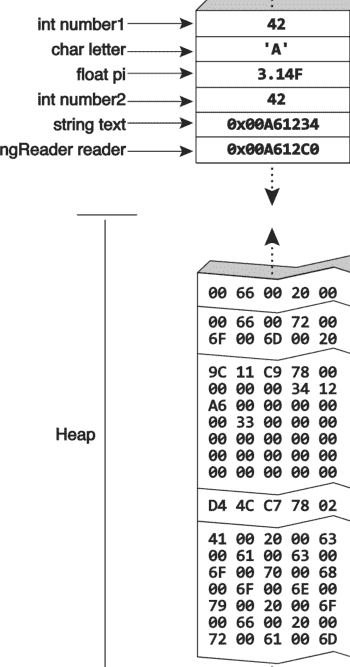

图 3.2：引用类型指向堆

引用类型不需要像值类型那样对数据的内存拷贝，这使得复制引用类型比复制大型值类型更高效。当将一个引用类型变量的值赋值给另一个引用类型变量时，只复制了引用，而不是所引用的数据。在实践中，引用的大小始终与处理器的“原生大小”相同——32 位处理器会复制 32 位引用，64 位处理器会复制 64 位引用，依此类推。显然，将很小的引用复制到大块数据中比像值类型那样复制整个块要快得多。

由于引用复制的是数据的引用，因此两个不同的变量可以指向相同的数据。如果两个变量指向同一个对象，通过一个变量更改对象中的数据，将导致通过另一个变量访问相同数据时产生该影响。这在赋值和方法调用中都会发生。因此，方法可以影响引用类型的数据，当控制权返回调用者时可以观察到该变化。基于此，定义引用类型或值类型的关键因素在于该对象在逻辑上类似于一个固定大小的不可变值（因此可能是值类型），还是逻辑上一个可以被引用的可变实体（因此可能是引用类型）。

除了字符串和任何如 `Program` 之类的自定义类外，目前讨论的所有类型都是值类型。然而，大多数是引用类型。虽然可以定义自定义值类型，但与自定义引用类型的数量相比，这样做相对较少。

# 允许 null 的类型声明

通常，表示“缺失”的值是有意义的。例如，在指定计数时，如果计数未知或未分配，你存储什么？一种可能的解决方案是指定一个“魔术值”，例如 -1 或 `int.MaxValue`。然而，这些都是有效的整数，因此当魔术值是一个普通 `int` 或它暗示了值缺失时，可能会产生歧义。更优的方法是分配 `null` 来表示该值无效或该值未赋值。分配 `null` 在数据库编程中特别有用。数据库表中的列经常允许 `null` 值。检索此类列并将它们分配给 C# 代码中相应的变量是有问题的，除非 C# 中的数据类型同样能够包含 `null`。

# 允许 null 的类型声明

你可以将类型声明为可空或不可可空，这意味着你可以使用可空修饰符¹声明类型允许或不允许 `null` 值。要启用可空性，只需在类型声明后紧跟可空修饰符——在类型名称后紧跟一个问号。例如，`int? number = null;` 将声明一个可空的 `int` 类型变量并赋值为 `null`。遗遗憾的是，可空性包含一些陷阱，在启用可空性时需要使用特殊处理。

# 解引用空引用

虽然支持为变量分配 `null` 是无价之宝（这里是双关语），但它并非没有缺点。虽然向其他变量和方法复制或传递 `null` 值是不方便的，但对 `null` 实例进行解引用（调用其成员）将抛出 `System.NullReferenceException`——例如，当值为 `null` 时调用 `text.GetType()`。任何时候生产代码产生 `System.NullReferenceException`，它始终是一个 bug。此异常表示编写代码的开发者忘记在调用之前检查 `null`。进一步加剧问题的是，检查 `null` 需要开发者意识到 `null` 值是可能的，因此必须采取显式操作。正因如此，声明可空变量需要显式使用可空修饰符——而不是采用默认允许 `null` 的相反方法（参见本节稍后的“可空引用类型”）。换句话说，当程序员选择允许变量为 `null` 时，他们承担了额外的责任，即确保不对对值为 `null` 的变量进行解引用。

由于检查 `null` 需要使用尚未讨论过的语句和/或运算符，如何检查 `null` 的细节出现在“高级主题：检查 null”中。然而，完整的解释在第 4 章。

¹1. 技术上，C# 仅在 C# 2.0 中支持值类型的可空修饰符在 C# 8.0 中支持引用类型。

## 高级主题

# 检查 null

开发者可以使用许多语句和运算符来检查 `null`。列表 3.1 提供了一些示例。使用 `if` 语句和 `is` 运算符检查 `null` 是最清晰的方法，如列表 3.1 所示。

列表 3.1：检查 null

```csharp
public static void Main(string[] args)
{
    int? number = null;
    // ...
    if (number is null)
    {
        Console.WriteLine(
            "'number requires a value and cannot be null'");
    }
    else
    {
        Console.WriteLine(
            "'$number' doubled is {number * 2}.");
    }
}
```

`if` 语句检查 `number` 是否为 `null`，然后根据条件采取不同的操作。虽然你也可以使用相等运算符 (`==`)，但可能会更改运算符的行为（通过重写）；因此，使用 `is` 关键字更优。

另一个与 `null` 配合工作的有用运算符是空条件运算符。它在解引用可空值之前首先检查 `null`。例如，`int? length = text?.Length;` 如果 `text` 为 `null` 则自动返回 `null`，否则返回字符串的长度。注意，由于从 `text?.Length` 返回的值可能是 `null`（如果 `text` 为 `null`），因此变量 `length` 必须声明为可空。

² 添加于 C# 6.0。

`if` 语句和空条件运算符在第 4 章中都有更详细的描述。虽然该关键字在第 4 章简要出现，但完整的解释直到第 7 章才会提供，该章节将讨论模式匹配的概念。

# 可空值类型

由于值类型直接引用实际值，因此值类型本质无法包含 `null`，因为根据定义，它们不能包含引用，包括指向无的引用。尽管如此，当在值类型上调用成员时，我们仍然使用“解引用值类型”这一术语。换句话说，虽然技术上不准确，但在调用成员时无论是否是值类型，使用“解引用”这一术语是很常见的³³ 在 C# 2.0 中引入的。

## 高级主题

值类型上的空解引用

技术上，使用可空修饰符声明的值类型仍然是值类型，因此尽管它们具有 null 行为，但在底层它们并不是 `null`。在大多数情况下，解引用表示 `null` 的可空值类型不会抛出可空异常。诸如 `HasValue`、`ToString()` 甚至与相等相关的成员（`GetHashCode` 和 `Equals()`）都在 `Nullable<T>` 上实现，因此当值表示 `null` 时它们不会抛出异常。（相反，解引用值类型会抛出 `InvalidOperationException` 而不是 `NullReferenceException`——以提醒程序员在解引用之前应该检查值。）然而，当值表示 `null` 时调用 `GetType()` 不会抛出 `NullReferenceException`。这种不一致性是因为 `GetType()` 不是一个虚方法，因此 `Nullable<T>` 无法

总而言之，引用类型的默认可空性是导致 `System.NullReferenceExceptions` 类缺陷的频繁源，除非开发者采取显式操作来避免这一陷阱，否则编译器的行为会误导开发者。

# 允许 null 的类型声明 101

为了显著改善这种局面，C# 团队在 C# 8.0 中为引用类型引入了可空性概念——这一特性被称为可空引用类型（当然，这意味着引用类型也可以是不可为空的）。可空引用类型使得引用类型与值类型平起平坐，并且引用类型的声明可以包含或不包含 `null` 修饰符。在 C# 8.0 中，不带 `null` 修饰符声明变量意味着它是不可为空的。

遗憾的是，支持带有 `null` 修饰符的引用类型声明以及将不带 `null` 修饰符的声明作为默认值，对于从早期 C# 版本升级的代码具有重大影响。鉴于 C# 7.0 及早期版本支持向所有引用类型声明分配 `null`（例如 `string text = null`），这些代码在 C# 8.0 中会编译失败吗？

幸运的是，向后兼容对于 C# 团队至关重要，因此现有项目默认不启用引用可空性。相反，在像第 1 章中的 `HelloWorld` 程序这样的新项目中，可空性从开始就是启用的。

有几种机制可以配置可空性：`#nullable` 指令、项目属性，甚至是命令行。首先，在本示例中通过 `#nullable` 指令激活了可空引用类型功能：

```
#nullable enable
```

该指令支持 `enable`、`disable` 和 `restore` 值——最后一个会将可空上下文恢复到项目级范围的设置。列表 3.2 提供了一个使用可空指令将 `nullable` 设置为 `enable` 的示例。通过这样做，将 `text` 声明为 `string?` 将被启用，且不再会导致编译器警告。

或者，程序员可以使用项目属性来启用引用类型的可空性。如果没有指定，项目文件（`*.csproj`）的项目级设置将是 `nullable disabled`。要启用它，请包含一个值为 `enable` 的 `Nullable` 项目属性（完整列表请见第 1 章列表 1.2）。

```
<Nullable>enable</Nullable>
```

此书的所有示例代码在项目级别都启用了可空性。

启用可空性的最后一种方法是在 dotnet 命令行上使用 `/p` 参数设置项目属性：

```
dotnet build /p:Nullable=enable
```

在命令行上指定 `Nullable` 的值将覆盖项目文件中设置的任何值。

# 隐式类型局部变量

上下文关键字 `var` 用于声明隐式类型局部变量。如果代码在声明时使用一个具有无歧义类型的表达式对变量进行初始化，C# 允许变量的数据类型类型是隐式推断的而非显式说明的，如列表 3.3 所示。

列表 3.3：处理字符串

```
Console.Write("Enter text: ");
var text = Console.ReadLine();
// 返回一个大写的新字符串
var uppercase = text.ToUpper();
Console.WriteLine(uppercase);
```

这与列表 2.18 有两点不同。首先，列表 3.3 并没有使用显式数据类型 `string` 进行声明，而是使用了 `var`。生成的 CIL 代码与显式使用 `string` 相同。然而，`var` 告诉编译器它应该根据声明内部赋值的值来推断数据类型——在这种情况下，是 `Console.ReadLine()` 返回的值。

其次，变量 `text` 和 `uppercase` 是通过它们的声明初始化的。如果不这样做会导致编译时的错误。如前所述，编译器会确定初始化表达式的数据类型并据此声明变量，就像程序员显式指定了类型一样。

+ 4. 在 C# 3.0 中引入。

# 元组 103

虽然允许使用 `var` 而非显式数据类型，当数据类型不明显时，应考虑避免这样做——例如，在声明 `text` 和 `uppercase` 时使用 `string`。这不仅让代码易于理解，还允许编译器验证你的意图，即右侧表达式返回的数据类型是预期的类型。当使用 `var` 声明的变量时，右侧的数据类型应该是明显的；如果不是，则应避免使用 `var` 声明。

## 指南
除非赋值值的数据类型明显，否则避免使用隐式类型局部变量（`var`）。

### 语言对比：C++/Visual Basic/JavaScript—void*, Variant, and var
隐式类型变量并不等同于 C++ 中的 `void+`、Visual Basic 中的 `Variant` 或 JavaScript 中的 `var`。在这些情况下，变量声明是限制性的，因为变量可以被赋值为任何类型，就像在 C# 中使用类型为 `object` 的变量声明那样样。相比之下，`var` 是由编译器确定类型的，一旦在声明时确定，其类型可能就不会发生更改，且类型检查和成员调用将在编译时进行验证。

# 元组

有时，你会发现将数据元素组合在一起很有用。例如，关于一个国家的信息，比如 2022 年世界上最穷的国家：布隆迪，其首都是布久姆巴拉，人均 GDP 为 263.67 美元。鉴于我们目前为止建立的结构，我们可以将每个数据元素存储在单独的变量中，但结果是数据元素之间没有关联。也就是说，$263.67 与布隆迪之间没有任何关联，除非可能通过变量名中共同的后缀或前缀。另一种方案是

# 第 3 章：数据类型进阶

将所有数据合并成单个字符串，尽管其缺点是单独处理每个数据元素时需要进行解析。

C# 7.0 提供了第三种选择，元组。元组允许你在单个语句中组合赋值，如下所示的国家数据：

```
(string country, capital, double gdpPerita) =
```

```
("Burundi", "Bujumbura", 263.67);
```


元组有多种额外的语法，如表 3.1 所示。

表 3.1：元组声明和赋值的示例

| 描述 | 示例代码 |
|---|---|
| 例 1 将元组分配给单独声明的变量。 | `string country |

# 表 3.1：元组声明和赋值的示例（续）

| 描述 | 示例代码 |
| --- | --- |
| 例 4 将元组分配给具有隐式类型的单独声明变量。 | `var (country, capital, gdpPerita) = ("Burundi", "Bujumbura", 263.67); Console.WriteLine("$The poorest country in the world in 2017 was {country}, {capital}: {gdpPerita});` |
| 例 5 声明命名元组并对其赋值值，然后通过名称访问元组项。 | `(string Name, string Capital, double gdpPerita) countryInfo = ("Burundi", "Bujumbura", 263.67); Console.WriteLine("$The poorest country in the world in 2017 was {countryInfo.Name}, {countryInfo.Capital}: {countryInfo.gdpPerita});` |
| 例 6 将命名项元组分配给单个隐式类型变量，然后通过名称访问项。 | `var countryInfo = (Name: "Burundi", Capital: "Bujumbura", GdpPerita: 263.67); Console.WriteLine("$The poorest country in the world in 2017 was {countryInfo.Name}, {countryInfo.Capital}: {countryInfo.GdpPerita});` |
| 例 7 将未命名元组分配给单个隐式类型变量，然后通过数字属性访问元组元素。 | `Var countryInfo = ("Burundi", "Bujumbura", 263.67); Console.WriteLine("$The poorest country in the world in 2017 was {countryInfo.Item1}, {countryInfo.Item2}: {countryInfo.Item3});` |

# 元组 107

注意，尽管隐式类型（`var`）可以分发元组语法中的每个变量声明中（如示例 4 所示），但你不能对显式类型（如 `string`）执行相同操作。由于元组允许每个项具有不同的数据类型，除非项的数据类型相同，否则将显式类型名称分发到所有元素并不一定可行（而且即使可行，编译器也不允许这样做）。

在示例 5 中，我们在左侧声明一个元组并将右侧的元组赋值。请注意，该元组具有命名项——通过这些名称我们可以从元组中检索项的值。这就是使得 `Console.WriteLine` 语句可以使用 `countryInfo.Name`、`countryInfo.Capital` 和 `countryInfo.gdpPerCapita` 语法的原因。左侧元组声明的结果是将变量分组进单个变量（`countryInfo`），你可以从这里访问其组成部分。这非常有用，因为正如第 4 节讨论的，你可以将这个单个变量传递给其他方法，而这些方法也能访问元组内的各个项。

如前所述，使用元组语法定义的变量使用驼峰命名法（camelCase）。然而，元组项名称的约定并没有明确定义。建议包括在元组表现像参数时使用参数命名规范——例如，在元组语法用于 `out` 参数之前返回多个值的情况。另一种方法是使用帕斯卡命名法（PascalCase），遵循类型成员的命名规范（如第 5 节和第 6 节讨论的属性、函数和公共字段）。我们强烈倾向于后者的 PascalCase 方法，这与 C# 和 .NET 中所有成员标识符的大小写规范保持一致。尽管如此，由于该约定尚未达成广泛共，我们在指南中使用 `CONSIDER`（考虑）而非 `DO`（必须）：“**考虑**对所有元组项名称使用 PascalCase。”

## 指南

- 使用元组语法进行变量声明时**必须**使用驼峰命名法（camelCase）。
- **考虑**对所有元组项名称使用帕斯卡命名法（PascalCase）。

# 第 3 节：数据类型

示例 6 与示例 5 相同的功能，尽管它在右侧值使用了命名元组项，并在左侧使用了隐式类型声明。然而，项的名称会被持久化到隐式类型变量中，因此它们仍然可以在 `WriteLine` 语句可用。当然，这使得你可以为左侧的项命名与右侧不同的名称。虽然 C# 编译器允许这样做，但它会发出警告，说明右侧的项名称将被忽略，因为在左侧它们具有优先权。

如果未指定项名称，仍然可以从赋值的元组变量获取各个元素。然而，它们的名称为 `Item1`、`Item2` 等，如示例 7 所示。事实上，即使定义了自定义名称，元组上始终可以使用 `ItemX` 名称（参见示例 8）。当使用集成开发环境（IDE）工具（如是支持 C# 7.0 或更高版本的 Visual Studio）时，`ItemX` 属性不会出现在 IntelliSense 下拉列表中——推测这这是一件好事，因为提供的名称更优。正如示例 9 所示，可以使用下划线 `_` 丢元组赋值的一部分——被称为丢弃（discard）。

示例 10 所示的推断项名称的能力直到 C# 7.1 才引入。正如示例所示，元组内部的项名称可以从变量名甚至属性名中推断出来。

元组是将数据封装到单个对象中的轻量级解决方案，就像袋子捕捉你从商店带回的各种杂物品一样。与数组（我们将讨论讨论）不同，元组包含可以无限制变化的项数据类型⁵，它们由代码识别且在运行时不能更改。此外，与数组不同，元组内项的数量是在编译时硬编码的。最后，你不能为元组添加自定义行为（扩展方法除外）。如果你倾向于面向对象编程并定义类——这一概念我们在第 6 节开始深入探讨。

⁵ 从技术上讲，它们不能是指针——这是我们在第 23 节中介绍的主题。

# 高级主题 元组

## System.ValueTuple<...> 类型

C# 编译器生成的代码依赖于一组泛型值类型（结构体 `struct`），例如 `System.ValueTuple<T1, T2, T3>`，作为表 3.1 中示例右侧所有类型元组语法的底层实现。同样，从示例 5 开始，左侧数据类型也使用了相同的 `System.ValueTuple<...>` 泛型类型。正如我们对元组类型的预期，包含的唯一方法是与比较和相等性相关的方法。

由于自定义项名称及其类型未包含在 `System.ValueTuple<...>` 定义中，为什么每个自定义项名称似乎都是 `System.ValueTuple<...>` 类型的成员并可以作为该类型的成员被访问呢？令人惊讶（特别是对于那些熟悉匿名类型实现的人）的是，编译器并没有为对应自定义名称的成员生成底层 CIL 代码。然而，即使没有具有自定义名称的底层成员，从 C# 的角度来看，（似乎）存在这样一个成员。

对于表 3.1 中的所有元组示例，名称完全可能在元组的剩余范围内是编译器所感知的，因为该范围被限制在声明它的成员内部。事实上事实上，编译器（和 IDE）非常简单地依赖此范围来允许通过名称访问每个项。换句话说，编译器查看元组内部的项名称并利用它们来允许范围内的代码执行。对于编译器来说，从成员内部确定项名称是合理的，但当元组暴露在成员外部时（例如作为方法的参数或返回值，可能没有源码可用）会发生什么？对于所有属于 API 的元组（无论公共还是私有），编译器都会以属性的形式将项名称添加到成员的元数据中。例如，编译器为以下代码生成的 C# 等效代码所示：

# 第 3 节：数据类型

`public (string First, string Second) ParseNames(string fullName)`

位于代码列表 3.4。

# 代码列表 3.4：ValueTuple 返回编译器生成的 CIL 代码的 C# 等效代码

```csharp
[return: System.Runtime.CompilerServices.TupleElementNames(
    new {"First", "Second"})
public System.ValueTuple<string, string> ParseNames(
    string fullName)
{
    // ...
}
```

另外提到，C# 7.0 在使用显式 `System.ValueTuple<...>` 数据类型时并未启用使用自定义项名称。因此，如果你替换元组 3.1 示例 8 中的 `var`，你将得到每个名称都将被忽略的警告。

关于 `System.ValueTuple<...` 还有一些额外的杂事实需要记住：

- 每一个泛型 `System.ValueTuple<...>` 对应于支持多达七项元组的可能性。对于第八个元组 `System.ValueTuple<T1, T2, T3, T4, T5, T6, T7, TRest>`，最后一个类型参数允许指定额外的 `ValueTuple`，从而支持 n 个项。例如，如果你指定了一个带参数的元组，编译器会自动生成 `System.ValueTuple<T1, T2, T3, T4, T5, T6, T7, System.ValueTuple<T1>>` 作为底层实现类型。（为了完整，`System.ValueTuple<T1>` 很少被使用，因为 C# 元组语法至少需要两个项。）

- 有一个非泛型的 `System.ValueTuple` 作为元组工厂，具有与每个 ValueTuple 元数对应的 `Create()` 方法。对于 C# 7.0（或更高版本）程序员，使用元组字面量 `var t1 = ("Inigo Montoya", 42)` 的便利性超过 `Create()` 方法。

- 从实际角度来看，C# 开发者可以完全忽略 `System.ValueTuple` 和 `System.ValueTuple<T>`。

# 元组 111

另一种最初在 Microsoft .NET Framework 4.5 中引入的元组类型是`System.Tuple<...>`。在它引入时，它被认为是未来的核心实现方案。然而，一旦 C# 支持了元组语法，人们发现值类型通常具有更好的性能。随后，`System.ValueTuple<...>` 被引入——除了为了依赖 `System.Tuple<...>` 的现有 API 的向后兼容外，它在所有情况下都取代了 `System.Tuple<...>`。

## 高级主题

### 匿名类型
C# 3.0 在语言中增加了对 `var` 的支持，允许使用匿名类型。匿名类型是在方法内部“临时”声明的数据类型，而不是显式的类定义，如列表 3.5 和输出 3.1 所示。（有关匿名类型的更多信息，请参见第 15 章。）

列表 3.5：带有匿名类型的隐式局部变量

```
var patient1 =
new { Title = "Bifocals",
     YearOfPublication = "1784" };
var patient2 =
new { Title = "Phonograph",
     YearOfPublication = "1877" };
```

```
Console.WriteLine(
  "${patient1.Title} ({patient1.YearOfPublication});");
Console.WriteLine(
  "${patient2.Title} ({patient2.YearOfPublication});");
```

双焦点镜 (1784)
留声机 (1877)

输出 3.1

列表 3.5 展示了将匿名类型赋值给隐式类型（`var`）局部变量。这种操作在与 C# 支持合并（关联）数据类型或将特定类型的大小还原到更少的数据元素相配合时，提供了关键功能支持。然而，C# 7.0 引入了元组语法，这几乎取代了对匿名类型的需求。

# 第 3 章：数据类型进阶

## 数组

第 1 章没有涵盖的变量声明的一个特殊方面是数组声明。通过数组声明，你可以使用单个变量存储多个相同类型的项，并在需要时使用索引单独访问它们。在 C# 中，数组从零开始。因此，C# 中的数组是基于零索引的。

> 初学者主题
## 数组

数组提供了一种使用单个变量声明一组相同类型数据项的方法。数组中的每个项都使用一个称为“索引”的整数值进行唯一标识。C# 数组中的第一项通过索引 0 访问。程序员应该小心指定小于数组大小的索引值。由于 C# 数组是基于零的，因此数组中最后一个元素的索引是数组项总数减一。在 C# 8.0 中，有一个用于运算符的“从末尾开始的索引”。例如，索引值 `^1` 将访问数组的最后一个元素。

对于初学者来说，有时将索引视为偏移量是有帮助的。第一项距离数组开始的距离为 0。第二项距离数组开始的距离为 1——依此类推。

数组是每种编程语言的基础部分，因此它们对于几乎所有开发者都是必须学习的。虽然数组在 C# 中被频繁使用，且对于初学者理解它们是必要的，但大多数 C# 程序现在在存储数据集合时使用泛型集合类型而不是数组。因此，读者应该简单浏览下方的“声明数组”部分，只需熟悉它们的实例化和赋值即可。表 3.2 提供了需要注意的重点。泛型集合将在第 15 章详细介绍。

# 数组 113

# 表 3.2：数组重点

| 描述 | 示例 |
| --- | --- |
| 声明 注意方括号出现在数据类型旁边。多维数组使用逗号声明，其中逗号加 1 指定维数。 | // 1.
string[] languages; // 一维
int[], cells; // 二维 |
| 赋值 `new` 关键字是可选的，但仅限于声明时。如果在声明期间未赋值，则在实例化数组时需要 `new` 关键字。指定数据类型是可选的。* 然而，如果没有数据类型，就无法指定大小。大小和值都不必是字面量；它们可以在运行时确定。如果同时指定了值和大小，数量必须一致。数组可以在不赋值的情况下赋值。结果是数组中每个项的值将初始化为其默认值。如果没有指定值，则数据类型和大小是必须的。 | // 2.
string[] languages = {
"COBOL","Java","*","TypeScript","Pascal",
"Python","Lisp","JavaScript";
Languages = new string[]{
"C","COBOL","Java","*","TypeScript","Pascal",
"Python","Lisp","JavaScript";
// 多维数组赋值
// 和初始化
int[,] cells = new {
[1, 0, 2],
[1, 2, 0],
[1, 2, 1]
};
languages = new string[9]; |
| 6. 从 C# 3.0 开始。

# 第 3 章：数据类型进阶

# 表 3.2：数组重点（续）

| 描述 | 示例 |
| --- | --- |
| 正向访问数组 数组是基于零的，因此数组中的第一个元素位于 0。使用方括号来从数组中存储和检索数据 | // J.
string[] languages = new
string[] languages = new {
"COBOL", "Java", "*", "TypeScript", "Pascal",
"Python", "Lisp", "JavaScript";
// 获取第一项
string = languages[0];
// 获取第二项
string = languages[1];
// 获取最后一项
string = languages[^1];
// 获取倒数第二
string = languages[^2]; |
| 范围访问数组 在 C# 8.0 中，你可以使用范围运算符来指定数组的一部分。例如，`[0..3]` 将访问从索引 0 到但不包含索引 3 的元素。 | // 示例：
string[] subset = languages[0..3]; |
| 反向访问数组 要访问从数组末尾的元素，请使用帽运算符。例如，`^1` 是最后一个元素，`^2` 是倒数第二个。 | // 示例：
string last = languages[^1];
string secondLast = languages[^2]; |

# 声明数组

在 C# 中，你使用方括号声明数组。首先，你指定数据类型，后面跟着左括号；然后输入名称。列表 3.6 定义了一个秩为 1 的数组。

列表 3.6：声明数组

```
string[] languages;
```

在列表 3.7 中，数组的秩为 2。方括号内的逗号定义了额外的维度。

列表 3.7：声明二维数组

```
int[,] cells;
```

# 实例化和赋值数组

一旦声明了数组，你就可以在大括号括号内使用逗号分隔的项目列表立即填充它的值。列表 3.8 声明了一个字符串数组并赋值了九种语言名称。

列表 3.8：带赋值的数组声明

```
string[] languages = { "C#", "COBOL", "Java",
"C++", "TypeScript", "Visual Basic",
"Python", "Lisp", "JavaScript" };
```

分隔列表中的第一项成为数组中的第一项，列表中的第二项成为数组中的第二项，依此类推。大括号是定义数组字面量的符号。

列表 3.8 所示的赋值语法仅在一条语句内声明并赋值值时可用。在声明后赋值值需要使用 `new` 关键字，如列表 3.9 所示。

列表 3.9：声明后的数组赋值

```
string[] languages;
languages = new string[] { "C#", "COBOL", "Java",
"C++", "TypeScript", "Visual Basic",
"Python", "Lisp", "JavaScript" };
```


在 `new` 之后指定数组的数据类型（`string`）是可选的，只要编译器能够从数组初始化器中元素的类型推断出数组的元素类型。方括号仍然是必需。

C# 还允许将 `new` 关键字作为声明语句的一部分，因此它允许了如列表 3.10 所示的赋值和声明。

## 列表 3.10：声明期间使用 new 进行数组赋值

```csharp
string[] languages = new string[]{
  "C#", "COBOL", "Java",
  "C++", "Typescript", "Visual Basic",
  "Python", "Lisp", "JavaScript" };
```

使用 `new` 关键字允许运行时为该数据类型分配内存。它指示运行时实例化该数据类型——在本例中是一个数组。

每当你将 `new` 关键字作为数组赋值的一部分时，你也可以方括号内指定数组的大小。列表 3.11 展示了这种语法。

## 列表 3.11：使用 new 关键字进行声明和赋值

```csharp
string[] languages = new string[9]{
  "C#", "COBOL", "Java",
  "C++", "Typescript", "Visual Basic",
  "Python", "Lisp", "JavaScript" };
```

初始化语句中的数组大小与大括号内包含的元素数量必须匹配。此外，可以赋值数组但不指定数组的初始值，如列表 3.12 所示。

## 列表 3.12：不带字面值的赋值

```csharp
string[] languages = new string[9];
```

赋值数组但不初始化初始值仍然会初始化每个元素。运行时将数组元素初始化为它们的默认值，如下：

- 引用类型——无论为空（例如 `string` 和 `string?`）都初始化为 `null`。
- 可空值类型均初始化为 `null`。
- 不可空数值类型初始化为 `0`。
- `bool` 被初始化为 `false`。

## 第 3 章：数据类型的进阶

- `char` 被初始化为 `'\0'`。

非原始值类型通过将它们的每个字段初始化为相应的默认值来递归地进行初始化。因此，在使用数组之前，没有必要单独为每个元素赋值。

由于数组大小没有被包含在变量声明中，因此可以在运行时指定大小。例如，列表 3.13 根据 `Console.ReadLine()` 调用中指定的尺寸创建一个数组。

## 列表 3.13：在运行时定义数组大小

```csharp
string[] groceryList;
Console.Write("How many items on the list? ");
int size = int.Parse(Console.ReadLine());
groceryList = new string[size];
//...
```

C# 初始化多维数组的方式类似。用逗号分隔每一维的大小。列表 3.14 初始化了一个没有任何步棋的井棋盘。

## 列表 3.14：声明一个二维数组

```csharp
int[,] cells = new int[3,3];
```

如列表 3.15 所示，可以带特定位置初始化井棋盘。

## 列表 3.15：初始化一个整数二维数组

```csharp
int[,] cells = {
  {1, 0, 2},
  {1, 2, 0},
  {1, 2, 1}
};
```

初始化遵循这种模式：存在一个包含三个 `int[]` 类型元素的数组，且每个元素具有相同的大小；在本示例中，大小为 3。注意，每个 `int[]` 元素的大小必须完全相同。因此，列表 3.16 所示的声明是无效的。

## 列表 3.16：大小不一致导致错误的多维数组

```csharp
// ERROR: 每个维度的大小必须保持一致
//...
```

表示井棋并不需要在每个位置都使用整数。另一种方法是为每个玩家构建一个单独虚拟棋板，每个棋板包含一个 `bool`，用于指示玩家选择了哪些位置。列表 3.17

## 列表 3.17：初始化一个三维数组

```csharp
bool[,, ] cells;
cells = new bool[2, 3, 3];
{
  // 玩家1 移动
  // X | |
  //---++-
  // X | |
  //---++-
  // X | X
  {
    {true, false, false},
    {true, false, false},
    {true, false, true}
  },
  // 玩家2 移动
  // | 0 |
  // |--+-
  // | 0 |
  // |--+-
  // | 0 |
  {
    {false, false, true},
    {false, true, false},
    {false, true, true}
  }
};
```

在此示例中，棋板被初始化，且每一维的大小被显式识别。除了作为 `new` 表达式的一部分标识大小外，还提供了数组的字面值。`bool[,,]` 类型的字面值被拆分为两个大小为 3 × 3 的 `bool[]` 数组。每个二维数组由三个大小为 3 的 `bool` 数组组成。

如所述，多维数组中的每个维度的大小必须保持一致。然而，也可以定义交错数组（jagged array），即数组的数组。交错数组的语法与多维数组显著不同；此外，交错数组不需要大小一致。

## 列表 3.18：初始化交错数组

```csharp
int[][] cells = {
    new int[] {1, 2, 3},
    new int[] {4, 5, 6},
    new int[] {7, 8, 9}
};
```

由于数组大小没有包含在变量声明中，因此可以在运行时指定大小。例如，列表 3.13 根据 `Console.ReadLine()` 调用中指定的尺寸创建一个数组。C# 初始化多维数组的方式类似。用逗号分隔每一维的大小。列表 3.14 初始化了一个没有任何步棋的井棋盘。

## 列表 3.19：声明和访问数组

```csharp
string[] languages = new[]{
  "C#", "COBOL", "Java",
  "C++", "Typescript", "Visual Basic",
  "Python", "Lisp", "JavaScript"
};

// 获取 languages 中的第五个元素 (TypeScript)
string language = languages[4];
// 输出 "TypeScript"
Console.WriteLine(language);

// 获取从后数三个元素 (Python)
language = languages[^3];
// 输出 "Python"
Console.WriteLine(language);
```

从 C# 8.0 开始，你还可以使用**索引索引运算符**（index from end operator），也称为 `^`（帽子）运算符，相对于数组末尾访问项。例如，使用 `^1` 进行索引可以获取数组的最后一个项，而使用索引索引的第一个元素是 `^9`（其中 9 是数组中的项数）。在 3.19 中，`^3` 指定 `languages` 变量中从后数第三个项（"Python"）的值赋值给 `language`。

# 语言对比：C++/Java/JavaScript/Python——数组索引

与它的传统语言（C++/Java/JavaScript/Python）一样，C# 也从 0 开始索引数组。虽然这些前身语言大多数不是从末尾开始索引，但 Python 是的。与 Python 类似，C# 从末尾开始的索引是从 1 开始；尽管从末尾索引的操作符是 `^` 而不是 `-`。

记住末尾索引运算符如何工作的一种方法是注意：当使用正整数从末尾索引时，值从最后一个元素开始为 `length – 1`，倒数第二个元素为 `length – 2`，依此类推。从长度中减去的整数对应于“倒数第几个”索引值——`^1`、`^2` 等。此外，数组起始索引值加上数组末尾索引值，总和始终等于数组的长度。

注意，末尾索引运算符并不局限于字面量整数值。你还可以使用如下的表达式：

```
languages[^length]
```

它将返回第一个项。

> 注意
> C# 使用从 0 开始计数的索引来访问第一个元素，而末尾索引从 `^1` 开始访问最后一个元素。当从末尾索引时，使用 `^` 操作符，其值从 `length—1` 开始。从长度中减去的整数对应于“倒数第几个”索引值。因此，数组起始索引值加上数组末尾索引值，总和始终等于数组的长度。

方括号（数组访问器）符号也用于将数据存储到数组中。列表 3.20 交换了“C++”和“Java”的顺序。

## 3.20：交换数组中位置之间的数据

```csharp
string[] languages = new [] {
  "C#", "COBOL", "Java",
  "C++", "Typescript", "Visual Basic",
  "Python", "Lisp", "JavaScript"};

// 将 C++ 保存到变量 language 中
string language = languages[3];
// 将 "Java" 赋值给 C++ 位置
languages[3] = languages[2];
// 将 language 赋值到 "Java" 的位置
languages[2] = language;
```

对于多维数组，元素通过每个维度的索引来标识，如列表 3.21 所示。

## 3.21：初始化二维整数数组

```csharp
int[,] cells = {
  {1, 0, 2},
  {0, 2, 0},
  {1, 2, 1}
};
// 设置井棋游戏的获胜移动为玩家 1
cells[1, 0] = 1;
```

交错数组（Jagged array）元素的赋值略有不同，因为它与交错数组的声明一致。第一个元素是数组数组中的一个数组；第二个索引指定所选数组元素中的项（参见列表 3.22）。

### 3.22：声明交错数组

```csharp
int[][] cells = {
  new int[]{1, 0, 2},
  new int[]{0, 2, 0},
  new int[]{1, 2, 1}
};
cells[1][0] = 1;
// ...
```

你可以获取数组的长度，如列表 3.23 所示。

## 第 3 章：数据类型的进阶

## 列表 3.23：获取数组长度

```csharp
Console.WriteLine(
  $"数组中有 {languages.Length} 种语言.");
```

数组具有固定的长度；它们被绑定，使得不重新创建数组就无法更改长度。此外，越过数组边界（或长度）会导致运行时报告错误。当你尝试使用数组中不存在元素的索引来访问（取值或赋值）数组时，就会发生这种情况。当你使用数组长度作为索引访问数组时，经常发生此类错误，如列表 3.24 所示。

## 列表 3.24：访问数组边界外，抛出异常

```c
string[] languages = new string[9];
// ...
// 运行时错误：索引越界 - 最后一个元素
// 应该是 8
languages[9] = ...
```

> 注意
> `Length` 成员返回数组中项的数量，而不是最高索引。`languages` 变量的 `Length` 成员为 9，但 `languages` 变量允许的最大索引是 8，因为那是它距离起始位置的距离。

# 语言对比：C++——缓冲区溢出

未管理的 C++ 并不总是检查你是否越界访问了数组。这不仅难以调试，而且这种错误还可能导致“缓冲区溢出”的安全漏洞。相比之下，通用语言运行时（CLR）保护所有 C#（以及 C++）免受越界影响。

在 C# 8.0 中，访问 `^0` 时会发生相同的问题：由于 `^1` 是最后一项，`^0` 是数组末尾之后的一个。为了在访问最后一个元素时防止越界，请使用长度检查来验证数组长度大于 0，并在访问最后一项时使用 `^1`（从 C# 8.0 开始）或 `Length - 1` 代替硬编码值（参见列表 3.25）。

## 3.25：在数组中使用 Length - 1

```csharp
string[] languages = new string[9];
//...
languages[9] = ...
```

# 范围（Ranges）

在 C# 8.0 中，引入的另一个相关功能是支持切片（slicing）。范围操作符的语法是 `..`。

## 范围操作符示例

## 列表 3.26：范围的示例

```csharp
string[] languages = new [] {
  "C#", "COBOL", "Java",
  "C++", "Typescript", "Visual Basic",
  "Python", "Lisp", "JavaScript"
};
// 从 0 到 3（不含 3）
Console.WriteLine(string.Join(",", languages[0..3]));
// 从 3 开始到最后
Console.WriteLine(string.Join(",", languages[3..]));
// 从头到 3 个
Console.WriteLine(string.Join(",", languages[..3]));
// 取最后 3 个
Console.WriteLine(string.Join(",", languages[^3..]));
```

> 注意
> 范围运算符通过指定起始项（包含）到结束项（不包含）来标识项。

## 进阶主题

## System.Index 和 System.Range

使用末尾索引运算符是指定 `System.Index` 值的字面量方式。因此，你可以在方括号之外使用索引。例如，你可以声明一个索引并赋予一个字面量值：`System.Index index = ^42;`。普通整数也可以赋值给 `System.Index`。`System.Index` 有两个属性：类型为 `int` 的 `Value` 和类型为 `bool` 的 `IsFromEnd`。后者显然用于指示索引是从数组开头还是末尾计数。

此外，用于指定范围的数据类型是 `System.Range`。如此，你可以声明并赋值一个范围值：`System.Range range = ..^` 甚至是 `..`。

## 第 3 章：数据类型的进阶

通过提供这些类型，C# 允许你编写支持范围和“从末尾开始”索引的自定义集合。（我们将在第 17 章中讨论如何编写自定义集合）。

## 更多数组方法

数组包含了用于操作数组内元素的额外方法——例如 `Sort()`、`BinarySearch()`、`Reverse()` 和 `Clear()`（参见列表 3.27 及其输出 3.2）。

### 列表 3.27：额外的数组方法

```csharp
string[] languages = new string[]{
    "C#", "COBOL", "Java", "C++", "TypeScript", "Swift",
    "Python", "Lisp", "JavaScript"};
```

```csharp
Array.Sort(languages);
```

```csharp
string searchString = "COBOL";
int index = Array.BinarySearch(languages, searchString);
Console.WriteLine(
    "The wave of the future,
    + {searchString}, is at index {index}.");
```

```csharp
Array.Reverse(languages);
Console.WriteLine(
    "{languages[0],-20}\t{languages[1],-20}");
// 注意：并没有移除数组中的所有项
// 而是将每个项设置为该类型的默认值
Array.Clear(languages, 0, languages.Length);
Console.WriteLine(
    "{languages[0],-20}\t{languages[1],-20}");
```

```csharp
Console.WriteLine(
  "After clearing, the array size is: {languages.Length}");
```


### 输出 3.2

| 第一个元素 | 最后一个元素 |
| --- | --- |
| C# | TypeScript |
| TypeScript | C# |

清理后，数组的大小为：9

对这些方法的访问是通过 `System.Array` 类获取的。在大多数情况下，使用这些方法是自而易懂的，但有两个值得注意的项：

- 在使用 `BinarySearch()` 方法之前，对数组进行排序是非常重要的。如果值不是按升顺序排序的，可能会返回错误的索引。如果搜索元素不存在，则返回的值为负数。（使用取反运算符 `~index` 可以返回第一个大于搜索值的索引，如果有的话）。）
- `Clear()` 方法并没有移除数组的元素，也没有将长度设置为零。数组的大小是固定的，无法修改。因此，`Clear()` 方法将数组中的每个元素设置为其默认值（`null`、0 或 `false`）。这解释了为什么在调用 `Clear()` 之后写入数组时，`Console.WriteLine()` 会空行。

## 数组实例成员

与字符串一样，数组拥有不是从数据类型访问而是直接从变量访问的实例成员。`Length` 是实例成员的一个示例，因为访问 `Length` 是通过数组变量而不是类。其他重要的实例成员是 `GetLength()`、`Rank` 和 `Clone()`。

获取特定维度的长度并不使用 `Length` 属性。要检索特定秩的大小，数组包含一个 `GetLength()` 实例方法。调用此方法时，必须指定要返回的秩长度（参见列表 3.28 及其输出 3.3）。

### 列表 3.28：获取特定维度的大小

```csharp
bool[,] cells;

cells = new bool[2, 3, 3];

Console.WriteLine(cells.GetLength(0)); // 显示 2

Console.WriteLine(cells.Rank); // 显示 3
```

### 输出 3.3

2

列表 3.28 显示 2，因为那是第一维中的元素数量。

也可以通过访问数组的秩成员来检索整个数组的秩。例如，`cells.Rank` 返回 3（请参见列表 3.28）。

默认情况下，将一个数组变量赋值另一个变量只会复制数组引用，而不是数组的各个元素。要创建数组的完全新副本，请使用数组的 `Clone()` 方法。`Clone()` 方法返回数组的副本；更改此新数组的任何成员都不会影响原始数组的成员。

## 作为数组的字符串

`string` 类型的变量可以像字符数组一样被访问。例如，要检索名为 `palindrome` 的字符串的第四个字符，可以调用 `palindrome[3]`。但注意，由于字符串是不可变的，无法为字符串中的特定字符赋值。因此，C# 不允许 `palindrome[3]='a'`（其中 `palindrome` 声明为 `string`）。列表 3.29 使用数组访问器来确定命令行上的参数是否被破折号识别为第一个字符。

### 列表 3.29：查找命令行选项

```csharp
public static void Main(string[] args)
{
  // ...
  if(args[0][0] == '-')
  {
    // 此参数是一个选项
```

这段代码使用了 `if` 语句，该语句在第 4 章中介绍。此外，它还展示了一个有趣的例子，因为你使用数组访问器来检索字符串数组 `args` 中的第一个元素。数组访问器之后是第二个访问器，它检索字符串的第一个字符。因此，该代码等同于列表 3.30 所示的代码。

### 列表 3.30：查找命令行选项（简化版）

```csharp
public static void Main(string[] args)
{
    // ...
    string arg = args[0];
    if(arg[0] == '-')
    {
        // 此参数是一个选项
    }
}
```

不仅字符串字符可以被单独访问，也可以通过访问数组的秩成员来检索整个数组的秩。例如，`cells.Rank` 返回 3（请参见列表 3.28）。

### 列表 3.31：反转字符串

```csharp
string reverse, palindrome;
char[] temp;
Console.Write("Enter a palindrome: ");
palindrome = Console.ReadLine();
```

```csharp
// 取小写
reverse = palindrome.ToLower();
```

```csharp
// 转换为数组
temp = reverse.ToCharArray();
```

```csharp
// 反转数组
Array.Reverse(temp);
// 检查字符串是否相同
if (reverse == palindrome)
{
    Console.WriteLine("{palindrome} is a palindrome.");
}
else
{
    Console.WriteLine("{palindrome} is NOT a palindrome.");
}
```

### 输出 3.4

```
Enter a palindrome: Level
"Level" is a palindrome.
```

## 常见数组错误

本节介绍了三种类型的数组：一维、多维和交错数组。数组的声明和使用遵循若干规则。表 3.3 指出了常见错误并有助于强化。通过回顾“常见错误”列中的代码（先不要看“错误描述”和“修正代码”列）来验证你对数组的理解。

### 表 3.3：常见数组错误

| 常见错误 | 错误描述 | 修正代码 |
| --- | --- | --- |
| // 1. int numbers[] | 声明数组的方括号出现在类型之后，而不是变量标识符之后。 | int[] numbers; |

### 表 3.3：常见数组错误（续）

| 常见错误 | 错误描述 | 修正代码 |
|---|---|---|
| // 2. int[] numbers = { 42, 84, 168 }; | 在声明后赋值数组，需要使用 `new` 关键字并指定数据类型。 | int[] numbers; numbers = new int[]{ 42, 84, 168 }; |
| // 3. int[3] numbers = { 42, 84, 168 }; | 不能在变量声明中指定数组的大小。 | int[] numbers = { 42, 84, 168 }; |
| // 4. int[] numbers = new int[]; 除非提供了数组字面量，否则在初始化时需要数组大小。 | int[] numbers = new int[3]; |
| // 5. int[] numbers = new int[3]{}; | 指定的数组大小为3，但数组字面量中没有元素。数组大小必须与数组字面量中的元素数量匹配。 | int[] numbers = new int[3] { 42, 84, 168 }; |
| // 6. int[] numbers = new int[3]; Console.WriteLine(numbers[3]); | 数组索引从0开始。因此，最后一个项比数组大小少1。（注意这不是运行时错误，不是编译时错误。） | int[] numbers = new int[3]; Console.WriteLine(numbers[2]); |

# 第 3 章：更多数据类型

表 3.3：常见数组错误（续）

| 常见错误 | 错误描述 | 修正代码 |
| :--- | :--- | :--- |
| // 7. int[] numbers = new int[3]; numbers[0] = 42; | 与前一个错误相同。从索引运算符来识别数组的最后一个项。0 越了边界，这不存在。（注意这是一个运行时错误，不是编译错误）。 | int[] numbers = new int[3]; numbers[i] = 42; |
| // 8. int[] numbers = new int[3]; numbers[Length-1] = 42; | 与前一个错误相同：Length 需要被减去 1 来访问最后一个元素。（注意这是一个运行时错误）。 | int[] numbers = new int[3]; numbers[Length-1] = 42; |
| // 9. int[,] numbers = {42, 84}; | 多维数组必须一致地结构。 | int[,] numbers = {42, 84}; |
| // 10. int[][] numbers = {{42, 84}, {42, 82}}; | 交错数组需要对数组内部进行实例化。 | int[][] numbers = new int[][]{42, 84}, {42, 82}; |

## 总结

本章从讨论两种不同的类型开始：值类型和引用类型。这些基本概念对于 C# 程序员来说非常重要，因为它们改变了底层行为方式。

在讨论数组之前，我们查看了 C# 的两种语言结构。首先，我们引入了可空修饰符（nullable）。可空修饰符允许值类型存储 null（而引用类型本身就可以存储 null）。其次，我们引入了 C# 7.0 引入的元组，提供了无需显式处理底层类型的支持。

本章以数组语法的覆盖以及各种操作数组的方法结束。对于许多开发者来说，初看起来语法可能相当费力，因此本节包含了与编码相关的常见错误。

下一章将介绍表达式和控制语句。在本章末尾几处的 `if` 语句得到了很好的讨论。

# 运算符和控制流

在本章中，你将学习运算符、控制语句和 C# 预处理器。**运算符**提供了执行适用于运算符内的不同计算或操作的语法。**控制语句**提供了程序内条件逻辑或多次循环代码段的方法。在引入 `if` 语句后，本章查看了布尔表达式的概念，它们嵌入在许多控制语句中。提到了整数无法（显式）转换为 bool 以及这一限制的优处。本章以 C# 预处理器的讨论结束。

# 运算符

现在你已经接触了预定义数据类型（参见第 2 章），可以开始学习如何将这些数据类型与运算符结合起来计算。例如，你可以对声明的变量进行计算。

## 初学者主题

**运算符**用于对称为*操作数*的值（变量）执行数学或逻辑操作，产生一个新的值，称为*结果*。例如，在

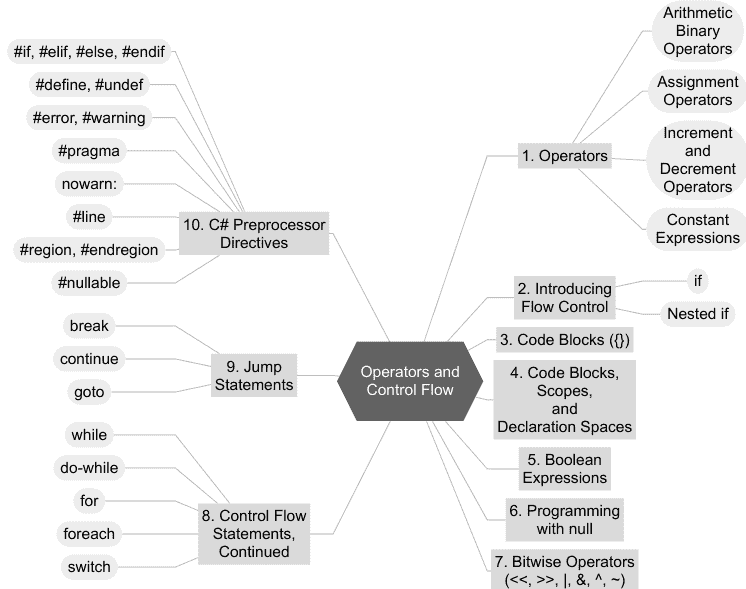

列表 4.1 运算符 `-` 用于减去两个操作数 4 和 2。减法的结果存储在变量 `difference` 中。

列表 4.1：简单运算符示例

```csharp
int difference = 4 - 2;
```

有三种运算符类别——一元、二和三元——分别对应操作数的数量（分别为一、二、三）。此外，虽然某些运算符用 `+`、`-`、`?` 和 `??` 等符号表示，但其他运算符采用关键字的形式，如 `default` 和 `is`。本节涵盖了一些基础的一元和二运算符。三元运算符出现在本章后面。

# 加减一元运算符 (+ -)

有时你可能想要更改数值的符号。在这些情况下，一元减运算符 (`-`) 非常有用。例如，列表 4.2 将当前的美国总债务改为负值，以表示这是一笔欠款。

# 列表 4.2：指定负值

```csharp
// 2022-11-06 的世界债务
// 访问 https://worlddebtclocks.com/
decimal debt = -72748555131730M;
```

使用减运算符等同于从减去操作数。一元加运算符 (`+`) 对值没有任何影响。它是 C# 语言中一个多余的添加，为了对称性而包含。

# 算术二元运算符 (+ * / %)

二元运算符需要两个操作数。C# 对二元运算符使用中置符号：运算符出现在左右操作数之间。除了赋值之外，每个二元运算符的结果必须以某种方式使用——例如，作为另一个表达式（如赋值）中的操作数。

> 语言对比：C++——仅运算符语句

与之前提到的规则不同，C++ 允许单个二元表达式形成整个语句，例如 `4+5;` 并编译。在 C# 中，只有赋值、调用、自增、自减和对象创建表达式允许形成整个语句。

列表 4.3 以及输出 4.1 中的减法示例说明了二元运算符的使用——具体地说，是一个算术二元运算符。操作数出现在算术运算符的每一侧，然后赋值计算出的值。

- 1. `*`、`/` 和 `%` 具有最高优先级。
- 2. `+` 和 `-` 优先级较低。
- 3. `=` 具有最低优先级。

因此，你可以假设赋值语句在除法和取模之前执行。

列表 4.3：使用二元运算符

```csharp
int numerator;
int denominator;
int quotient;
int remainder;
Console.Write("输入分子：");
numerator = int.Parse(Console.ReadLine());
Console.Write("输入分母：");
denominator = int.Parse(Console.ReadLine());
quotient = numerator / denominator;
remainder = numerator % denominator;
```

```csharp
Console.WriteLine($""{numerator} / {denominator} = {quotient} 余数为 {remainder}");
```

# 输出 4.1

输入分子：23
输入分母：3
23 / 3 = 7 余数为 2

例如，在执行摄氏度到华氏度的温度转换时，`(c*9.0/5.0)+32.0` 比 `c*9.0/5.0+32.0` 更易读，尽管括号完全没有必要。

## 指南

务必使用括号来提高代码的可读性，特别是当普通读者无法一眼看出运算符的优先级时。

显然，高优先级的运算符必须在相邻的低优先级运算符之前执行：在 `x+y*z` 中，乘法必须在加法之前执行，因为乘法的结果是加法的右手（右侧操作数）。然而，重要的是要意识到优先级和结合性仅影响运算符本身执行的顺序；它们不会以任何方式影响操作数的求值顺序。

在 C# 中，操作数总是从左到右进行求值。在一个包含三次调用的表达式中，例如 `A()+B()*C()`，首先评估 `A()`，然后是 `B()`，最后是 `C()`；然后乘法运算符确定乘积；最后加法运算符确定和。仅仅因为 `C()` 参与了乘法而 `A()` 参与了低优先级的加法，并不意味着方法调用 `C()` 发生在方法调用 `A()` 之前。

# 语言对比：C++ 操作数的求值顺序

与此处规则不同，C++ 允许实现在决定操作数求值顺序上有较大的自由度。对于形如 `A()+B()*C()` 这样的表达式，C++ 编译器可以选择以任何顺序评估函数，只要乘积是加数之一即可。例如，一个法的编译器可以先评估 `B()`，然后是 `A()`，最后是 `C()`；然后计算积；最后计算和。

# 在字符串中使用加法运算符

运算符也可以用于非数值操作数。例如，可以使用加法运算符连接两个或多个字符串，如列表 4.4 的输出 4.3 所示。

列表 4.4：对非数值类型使用二元运算符

```
public class FortyTwo {
    public static void Main() {
        short windSpeed = 42;
        Console.WriteLine("The original Tacoma Bridge in Washington" + Environment.NewLine + \
        " brought down by a " \
        windSpeed + " mile/hour wind.");
    }
}
```

OUTPUT 4.3

| The original Tacoma Bridge in Washington was brought down by a 42 mile/hour wind. |

由于不同文化中的不同语言之间句子结构有所异，开发者应该小心不要对可能需要本地化的字符串使用加法运算符。同样，尽管我们可以使用字符串插值（string interpolation）在字符串中嵌入表达式，但对其他语言的本地化仍然需要将字符串移动到资源文件中，从而消除字符串插值。出于此原因，你应该少用加法运算符，在可能需要本地化的情况下优先使用复合格式化（composite formatting）。

## 指南

在可能需要本地化的情况下，优先使用复合格式化而非加法运算符来连接字符串。

# 在算术操作中使用字符

在第 2 章引入 `char` 类型时，我们提到过尽管它存储的是字符和数字，但 `char` 类型是一种整型类型（整型意味着它是基于整数的）。它可以与其他类型参与算术运算。然而，对 `char` 类型值的解释不是基于其中存储的字符，而是基于其底层值。例如，数字 `3` 由 Unicode 值 `0x33`（十六进制）表示，在 10 进制中为 `5`。数字 `4` 由 Unicode 值 `0x34` 表示，在 10 进制中为 `4`。在列表 4.5 中将 `3` 和 `4` 相加得到十六进制值 `0x37`，在 10 进制中为 `7`，这是字符 `g` 的 Unicode 值，如输出 4.4 所示。

列表 4.5：对 char 类型使用加运算符

```
int n = '3' + '4';
char c = (char)n;
Console.WriteLine(c); // g
```

OUTPUT 4.4

g

你可以利用字符类型的这种特性来确定两个字符之间的距离。例如，字母 `f` 与字母 `c` 相差三个。你可以通过从字母 `f` 减去字母 `c` 来确定这个值，如列表 4.6 的输出 4.5 所示。

列表 4.6：确定两个字符之间的差异

```
int distance = 'f' - 'c';
Console.WriteLine(distance);
```


OUTPUT 4.5

3

# 特殊浮点数特性

二进制浮点类型 `float` 和 `double` 具有一些特殊特性，例如它们管理精度的方式。本节将查看一些示例，以及一些独特的浮点数特性。

具有七位精度的 `float` 可以存储值 `1.234567` 和值 `0.1234567`。然而，如果你将这两个 `float` 相加，结果将四舍入为 `1.234567`，因为精确结果所需的精度超过了 `float` 能容的七位。舍入七位引入的误差可能会变得很大，尤其是在重复计算时。（参见本节稍后的“高级主题：浮点类型意外的不等性”。）

在内部，二进制浮点类型存储的是二进制分数，而不是小数分数。因此，简单的赋值（如 `double d = 14.6`）可能会发生“表示误差”。`14.6` 的精确值是分数 `703/5`，但该分的分母不是 2 的幂，因此二进制浮点数无法表示它。相反，所表示的值是符合 32 位的最接近的 2 的幂的分数。

由于 `double` 可以存储比 `float` 更精确的值，C# 编译器实际上会将 `double = 14.6` 评估为 `14.6000001035...`，因为 `14.6000001035...` 是作为 `float` 表示时最接近的二进制分数。

## 指南

需要精确算术时避免使用二进制浮点类型；请使用 `decimal` 类型。

# 第 4 章：运算符与控制流

## 高级主题

### 浮点类型意外不等性

由于浮点数可能会被意外舍入为非小数，比较浮点值的相等性可能会令人困惑。考虑列表 4.7 的输出 4.6。

列表 4.7：由于浮点精度导致的不等性

```csharp
decimal decimalNumber = 4.2M;

double doubleNumber1 = 0.1F * 42F;

double doubleNumber2 = 0.1D * 42D;

float floatNumber = 0.1F * 42F;

// 1. 显示 4.2 != 4.2000002861023
Console.WriteLine($"{decimalNumber} != {doubleNumber1}");

// 2. 显示 4.2 != 4.20000028610295
Console.WriteLine($"{decimalNumber} != {doubleNumber1}");

// 3. 显示 (float)4.2M != 4.2000003F
Console.WriteLine($"{decimalNumber}M != {floatNumber}F");

// 4. 显示 4.20000028610295 != 4.2
Console.WriteLine($"{doubleNumber1} != {doubleNumber2}");

// 5. 显示 4.2000003F != 4.2D
Console.WriteLine($"{floatNumber}F != {doubleNumber2}D");

// 6. 显示 4.19999980929265137 != 4.2
Console.WriteLine($"{4.2F} != {4.2D}");

// 7. 显示 4.2F != 4.2D
Console.WriteLine($"{4.2F}F != {4.2D}");
```

# OUTPUT 4.6

```
4.2 != 4.2000002861023
4.2 != 4.20000028610295
4.2 != 4.2000003F
4.20000028610295 != 4.2
4.2000003F != 4.2
4.19999980929265137 != 4.2
4.2 != 4.2
```

在数学中，某些数学运算是未定义的，包括零除以零。在 C# 中，浮点数 `float` 除以零的结果是一个特殊的“非数字” `NaN`，Not A Number 值；所有打印此类数字输出的尝试都将导致 `NaN`。同样，使用 `System.Sqrt(-1)` 计算负数的平方根将导致 `NaN`。

浮点数也可能超出其范围。例如，`float` 类型的上限约为 $3.4 \times 10^{38}$。如果数字超过了该界限，结果将存储为**正无穷** `positive infinity`，打印该数字的输出将为 `Infinity`。同样，`float` 类型的下限为 $-3.4 \times 10^{38}$，计算低于该界限的值将导致**负无穷** `negative infinity`，它用字符串 `-Infinity` 表示。列表 4.9 分别生成了负无穷和正无穷，输出 4.8 显示了结果。

### 列表 4.9：溢出 float 的范围

```csharp
// 显示: -Infinity
Console.WriteLine(-1f / 0);

// 显示: Infinity
Console.WriteLine(3.402823E+38f * 2f);
```

### 输出 4.8

```
-Infinity
Infinity
```

进一步检查浮点数可以发现，它可以包含一个接近零的值而实际上并不包含零。如果值超过了 `float` 或 `double` 类型的下限值，根据数字的正负，该数字的值可以表示为**负零**或**正零**，并在输出中表示为 `-0` 或 `0`。

## 复合数学赋值运算符 `+=`, `-=`, `*=`, `/=`, `%=` 

第 1 章讨论了简单的赋值运算符，它将运算符右侧的值放入左侧变量中。复合数学赋值运算符将常见的二运算符运算与赋值运算符结合。例如，考虑列表 4.10。

### 列表 4.10：常见的递加计算

```csharp
int x = 123;
x = x + 2;
```

在这次赋值中，首先你计算 `x + 2` 的值，然后将计算出的值赋值回 `x`。由于这种操作执行频率相对较高，因此存在一种赋值运算符可以通过一个运算符同时处理计算和赋值。`+=` 运算符将运算符左侧变量增加运算符右侧的值，如列表 4.11 所示。

### 列表 4.11：使用 `+=` 运算符

```csharp
int x = 123;
x += 2;
```

因此，这段代码等同于列表 4.10。
存在许多其他复合赋值运算符提供类似的功能。你也可以结合减法、乘法和取余运算符使用赋值运算符（如列表 4.12 所示）。

### 列表 4.12：其他赋值运算符

```csharp
x -= 2;
x /= 2;
x *= 2;
x %= 2;
```

## 递增和递减运算符 `++`, `--`

C# 包含了用于递增和递减的单运算符。递增运算符 `++` 每次使用会将变量增加。换句话说，列表 4.13 显示的所有代码行都是等价的。

### 列表 4.13：递增运算符

```csharp
spaceCount = spaceCount + 1;
spaceCount += 1;
spaceCount++;
```

同样，你可以使用递减运算符 `--` 将变量减少 1。因此，列表 4.14 显示的所有代码行都是等价的。

### 列表 4.14：递减运算符

```csharp
lines = lines - 1;
lines--;
```

## 循环中的递减示例

递增和递减运算符在循环中非常常见，例如后文描述的 `while` 循环。例如，列表 4.15 和输出 4.9 使用递减运算符反向遍历字母表的每个字母。

### 列表 4.15：显示每个字符的 Unicode 值

```csharp
char current;
int unicodeValue;
// 设置 current 的初始值
current = 'z';
do {
  // 获取 current 的 Unicode 值
  unicodeValue = current;
  Console.Write($"{current}=\t");
  // 移动到字母表的上一个字母
  current--;
} while(current >= 'a');
```

### 输出 4.9

| 字符 | Unicode |
| :--- | :--- |
| z | 122 |
| y | 121 |
| w | 120 |
| v | 119 |
| u | 118 |
| t | 117 |
| s | 116 |
| r | 115 |
| q | 114 |
| p | 113 |
| o | 112 |
| n | 111 |
| m | 110 |
| l | 109 |
| k | 108 |
| j | 107 |
| i | 105 |
| h | 104 |
| g | 103 |
| f | 102 |
| e | 101 |
| d | 100 |
| c | 99 |
| b | 98 |
| a | 97 |

递增和递减运算符执行多次特定的操作。在这个例子中，注意递减运算符作用于 `char` 类型。你可以在各种类型上使用递增和递减运算符，为该数据类型的“下一个”或“上一个”值赋予意义。我们看到赋值运算符首先计算值并执行赋值。赋值运算符的结果是被赋值的值。递增和递减运算符是类似的：它们计算值、执行赋值并返回一个值。因此，可以将赋值运算符与递增或递减运算符结合，这样做可能会非常困惑。参见列表 4.16 和输出 4.10。

### 列表 4.16：使用后递增运算符

```csharp
int count = 123;
int result;
result = count++;
Console.WriteLine($"{result} and {count}");
```

你可能会对 `result` 被赋值为增加之前的值感到惊讶。递增或递减运算符的位置决定了赋值值应该是操作之前还是之后的值。如果你希望 `result` 的值是赋值给 `count` 的值，你需要将运算符放在增加的变量之前，如列表 4.17 所示。

### 列表 4.17：使用前递增运算符

```csharp
int count = 123;
int result;
result = ++count;
Console.WriteLine($"{result} and {count}");
```

### 输出 4.10

```
result = 123 and count = 124
```

在这个例子中，递增运算符出现在操作数之前，因此表达式的结果是赋值后变量的值。如果 `count` 是 123，`++count` 将 124 赋值给 `count` 并产生结果 124。相比之下，后递增运算符 `count++` 将 124 赋值给 `count` 并产生增加之前的值：123。无论运算符是后置还是前置，变量 `count` 都会产生值之前增加；唯一的区别在于产生了哪个值。前置和后置行为的区别在列表 4.18 中所示。结果如输出 4.12 所示。

### 列表 4.18：比较前递增和后递增运算符

```csharp
public class IncrementExample {
  public static void Main() {
    int x = 123;
    // 显示 123, 124, 125
    Console.WriteLine($"{x++}, {x++}, {x}");
    // x 现在包含值 125
    // 显示 126, 127, 127
    Console.WriteLine("{++x}, {x}, {x}");
    // x 现在包含值 127
  }
}
```

### 输出 4.12

```
123, 124, 125
126, 127, 127
```

如列表 4.18 所示，递增和递减运算符相对于操作数的位置会影响表达式产生的结果。前置运算符的结果是变量递增或递减之前的值。后置运算符的结果是变量递增或递减之后的值。将这些运算符嵌入语句中间时要小心。在确定会发生什么时，请独立使用这些运算符，将它们放在自己的语句中。这样这样，代码更具可读性，且意图不会出错。

## 语言对比：C++——实现定义的行为

之前我们讨论了在 C# 中表达式中的操作数可以以任何顺序求值，而在 C# 中是从左到右求值的。同样，在 C++ 中，实现可以合法地以任何顺序执行递增和递减的副作用。例如，在 C++ 中调用 `M(x++, x++)`（`x` 初始值为 1）可以合法地调用 `M(1,2)` 或 `M(2,1)`。相比之下，C# 始终调用 `M(1,2)`，因为 C# 从左到右计算调用的参数，并且递增后的值赋值给变量的操作总是发生在表达式值被使用之前。C++ 不提供任何保证。

## 指南

避免混淆性地使用递增和递减运算符。

> 在 C、C++ 和 C# 之间迁移使用递增和减运算符的代码时，请务必小心；C 和 C++ 的实现不需要遵循与 C# 相同的规则。

## 高级主题

### 线程安全的递增与递减

尽管递增和减运算符非常简洁，但这些运算符并不是原子的。在执行运算符期间可能会发生线程切换，并导致竞态条件。你可以使用 `lock` 语句来防止竞态条件。然而，对于简单的加减，开销较小的替代方案是使用 `System.Threading.Interlocked` 类中线程安全的 `Increment()` 和 `decrement()` 方法。这些方法依赖处理器功能来执行快速、线程安全的加减。更多细节请参见第 19 章。

## 常量表达式与常量局部变量

第 3 章讨论了字面量，即直接嵌入代码中的值。可以使用运算符在常量表达式中组合多个字面量值。根据定义，常量表达式是指 C# 编译器可以在编译时求值（而不是在程序运行时求值）的表达式，因为它完全由常量操作数组成。常量表达式可以用于初始化常量局部变量，这允许你为常量值命名（类似于局部变量允许你为存储位置命名）。例如，一天中秒数的计算可以是一个常量表达式，并通过名称在其他表达式中使用。

列表 4.19 中的 `const` 关键字声明了两个常量局部变量：`secondsPerDay` 和 `secondsPerWeek`。由于常量局部变量根据定义是变量的对面——常量意味着“无法改变”——因此在代码后面任何修改该值的尝试都将导致编译错误。

### 列表 4.19：声明常量

```cs
const int secondsDay = 60 * 60 * 24;
const int secondsPerWeek = secondsDay * 7;
```

## 指南

不要对任何可能随时间变化的值使用常量。圆周率 pi 的值和金原子中质子的数量是常量；金价和你的程序版本号则可能会改变。

在列表 4.19 中，`60 * 60 * secondsDay * 7` 都是常量表达式。请注意，赋值给 `secondsPerWeek` 的表达式是一个常量表达式，因为表达式中的所有操作数也是常量。

C# 10 支持常量插值字符串，如果插值字符串仅由其他常量字符串组成，则可以定义常量插值字符串。

### 列表 4.20：非数值类型使用二元运算符

```cs
const string windSpeed = "42";
const string announcement = $"""
华盛顿原本的塔科马桥
被风速 { windSpeed } 英/小时的风摧毁。
""";
Console.WriteLine(announcement);
```


尽管列表 4.20 中的 `announcement` 是一个插值字符串，但字符串代码部分中的值也是常量，这允许编译器在编译时对它们求值，而不是等到执行时间。然而，请注意 `windspeed` 是一个字符串而不是整数。常量字符串插值在仅由其他常量字符串形成时有效，而不是由其他数据类型（即使这些类型是常量）。这种限制是为了允许字符串在运行时考虑文化差异。例如，将黄金比例转换为字符串可能是 1.6180339887 或 1,6180339887，取决于文化设置。

## 介绍流程控制

本章稍后的部分有一个代码列表（列表 4.46），展示了以二进制形式查看数字的简单方法。然而，即使是这样简单的程序，如果不使用控制流语句也编写。此类语句控制程序的执行路径。本节讨论了如何根据条件检查更改语句的执行顺序。稍后你将学习如何通过循环结构重复执行语句组。

流程控制语句的摘要出现在表 4.1 中。请注意，“通用语法结构”列表示的是常用用法，而不是完整的词法结构。表 4.1 中的“嵌入语句”可以是除标记语句或声明以外的任何语句，正如本节后面所示，它通常是多个语句组合成一个代码块。

### 表 4.1：流程控制语句

| 语句 | 通用语法结构 | 示例 |
| :--- | :--- | :--- |
| if 语句 | `if(boolean-expression) embedded-statement` | `if (input == "quit") { Console.WriteLine("Game end"); return; }` |
| | `if(boolean-expression) embedded-statement else embedded-statement` | `if (input == "quit") { Console.WriteLine("Game end"); return; } else GetNextMove(); }` |
| while 语句 | `while(boolean-expression) embedded-statement` | `while (count < total) { Console.WriteLine($"{count - {count}"); count++; }` |
| do while 语句 | `do embedded-statement while(boolean-expression);` | `do { Console.WriteLine("Enter name:"); input = Console.ReadLine(); } while(input != "exit");` |

### 表 4.1：流程控制语句（续表）

| 语句 | 通用语法结构 | 示例 |
| :--- | :--- | :--- |
| for 语句 | `for(for-iterator; boolean-expression; for-iterator embedded-statement)` | `for (int count = 1; count <= 10; count++) { Console.WriteLine($"{count = {count}"); }` |
| foreach 语句 | `foreach(type identifier in expression) {` | `foreach (letter in expression) { if (insideDomain) { continue; } }` |
| continue 语句 | `continue` | |
| switch 语句 | `switch(expression) { }` | `switch (input) { case "exit": Console.WriteLine("Exiting..."); break; case "start": GetMove(); break; default: Console.WriteLine(input); break; }` |
| break 语句 | `break` | |
| goto 语句 | `goto label;` | |

```cs
// 输入小于或等于 0
Console.WriteLine("Exiting...");
else
// 条件 2.
if (input < 9) // line 20
// 输入小于 9
Console.WriteLine(
  "$Tic-tac-toe has more than {input}" + 
  " maximum turns.");
else
// 条件 3.
if (input > 9) // line 26
// 输入大于 9
Console.WriteLine(
  "$Tic-tac-toe has fewer {input}" + 
  " maximum turns.");
// 条件 4.
else
// 输入等于 9
Console.WriteLine(
  "Correct, tic-tac-toe has a maximum of 9 turns.");
```

### 4.13

井棋游戏的最大步数是多少？（输入 0 退出）：
9
答得正确，井棋游戏最多有 9 步。

假设用户在第 14 行提示时输入了 9。以下是执行路径：

- 条件 1：检查输入是否小于 0。由于不是如此，跳转到条件 2。
- 条件 2：检查输入是否小于 9。由于不是如此，跳转到条件 3。
- 条件 3：检查输入是否大于 9。由于不是如此，跳转到条件 4。
- 条件 4：显示答案正确。

列表 4.22 包含了嵌套的 if 语句。为了清楚嵌套关系，这些行进行了缩进处理。然而，正如你在第 1 章中所学的，空白不会影响执行路径。如果编写这段代码时不进行缩进且不换行，其执行结果将是相同的。列表 4.23 中嵌套 if 语句中的代码与列表 4.22 等效。

### 列表 4.23: 顺序格式化的 if/else 形式

```cs
if (input < 0)
    Console.WriteLine("Exiting...");
else if (input < 9)
    Console.WriteLine(
        "$Tic-tac-toe has more than {input}" +
        " maximum turns.");
else if (input > 9)
    Console.WriteLine(
        "$Tic-tac-toe has less than {input}" +
        " maximum turns.");
else
    Console.WriteLine(
        "Correct, tic-tac-toe has a maximum" +
        " of 9 turns.");
```

虽然后一种格式更为常见，但在任何情况下你都应该使用使代码最清晰的格式。

这两个 if 语句列表都省略了大括号。然而，正如接下来讨论的，这并不符合指南。指南提倡使用代码块，除非是在最简单的单行场景下。

### 代码块 ({})

在上一个 if 示例中，只有一个语句跟在 if 和 else 后面：即一个单一的 `System.Console.WriteLine()`，类似于列表 4.24。

### 列表 4.24: 无代码块的 if 语句

```cs
if (input < 9)
    Console.WriteLine("Exiting")
```

# 第 4 章：运算符与控制流

然而，通过大括号，我们可以将语句组合成一个单一语句，称为块语句或代码块，允许将多个语句分组为一个语句，从而产生相应的结果。例如列表 4.25 半径计算中高亮的代码块，对应输出 4.14。

### 列表 4.25: 后面跟着代码块的 if 语句

```cs
double radius; // 定义一个用于存储半径的变量
double area; // 定义一个用于存储面积的变量
Console.Write("Enter the radius of the circle: ");
// double.Parse 将 ReadLine()
// 返回值转换为 double
string temp = Console.ReadLine();
radius = double.Parse(temp);
if(radius >= 0)
{
    // 计算面积
    area = Math.PI * radius * radius;
    Console.WriteLine($"The area is: {area}");
}
else
{
    Console.WriteLine("Invalid radius.");
}
```

## 语言对比：C++—局部变量的作用域

在 C++ 中，在块中声明的局部变量的作用域从声明点一直持续到块的结束。尝试在声明之前引用该局部变量将无法找到该变量，因为它不在作用域内。如果“作用域内”有另一个同名的对象，C++ 语言会将该名称解析为该对象，这可能不是你想要的结果。在 C# 中，规则在细微上略有不同：局部变量在它被声明的整个块中都具有作用域，但在其声明之前之前引用该局部变量是非合法的。也就是说，尝试查找该局部变量的操作将成功，但该用法将被视为一个错误。这只是 C# 众多规则之一，旨在防止 C++ 程序中常见的错误。

## 布尔表达式

`if` 语句中圆括号内的条件是一个布尔表达式。在列表 4.29 中，该条件被高亮显示了。

### 列表 4.29：布尔表达式

```csharp
if (input < 9)
{
    // 输入小于 9
    Console.WriteLine("$Tic-tac-toe has more than {input}" + "maximum turns.");
}
// ...
```

布尔表达式出现在许多控制流语句中。它们的关键特征是始终求值为真（true）或假（false）。为了让 `input < 9` 允许作为布尔表达式，它必须产生一个 `bool` 类型的结果。编译器不允许 `x = 42`，因为这个表达式赋值了 `x` 并返回了被赋值的值，而不是检查变量的值是否为 42。

## 语言对比：C++—误用 = 代替 ==

C# 消除了 C 和 C++ 中常见的一种编码错误。在 C++ 中，列表 4.30 是允许的。

### 列表 4.30：C++ 允许，但 C# 不允许将赋值作为条件

```csharp
if (input = 9) // 在 C++ 中允许，在 C# 中不允许
System.Console.WriteLine("Correct, tic-tac-toe has a maximum of 9 turns.");
```


虽然乍看代码似乎在检查 `input` 是否等于 9，但第 1 章已经过显示 `=` 代表赋值运算符，而不是相等性检查。赋值运算符的返回值是赋值给变量的值——在本例中。然而，9 是一个 `int`（整数），因此不符合布尔表达式的标准，且不被 C# 编译器允许。C 和 C++ 语言将非零整数视为真，将零整数视为假。相比之下，C# 要求条件实际上必须是 `Boolean` 类型；不允许整数。

## 关系运算符与相等运算符

关系运算符和相等运算符确定一个值是否大于、小于或等于另一个值。表 4.2 列出了所有的关系运算符和相等运算符。它们都是二元运算符。

表 4.2：关系运算符与相等运算符

| 运算符 | 描述 | 示例 |
| :--- | :--- | :--- |
| `<` | 小于 | `input < 9` |
| `>` | 大于 | `input > 9;` |
| `<=` | 小于等于 | `input <= 9;` |
| `>=` | 大于等于 | `input >= 9;` |
| `==` | 等于运算符 | `input == 9;` |

表 4.2：关系运算符与相等运算符（续）

| 运算符 | 描述 | 示例 |
| --- | --- | --- |
| `!=` | 不等于运算符 | `input != 9;` |

C# 的相等性语法使用 `==`，就像许多其他编程语言一样。例如，要确定 `input` 是否等于 9，你使用 `input == 9`。相等运算符使用两个等号来将其与赋值运算符区分。感叹号 `!` 在 C# 中表示“非”（NOT），因此要测试不相等，请使用不等运算符 `!=`。

关系运算符和相等运算符始终产生一个 `bool` 值，如列表 4.31 所示。

列表 4.31：将关系运算符的结果赋值给 bool 变量

```csharp
bool result = 70 > 7;
```

在完整的井井棋程序列表中，你使用相等运算符来判断用户是否已退出。列表 4.32 中的布尔表达式包含一个逻辑“或”（`||`）运算符，我们将在下一节详细讨论它。

列表 4.32：在布尔表达式中使用相等运算符

```csharp
if (input.quit == 0)
```

### 逻辑运算符

逻辑运算符允许你组合布尔表达式。逻辑运算符有 `|`、`&&` 和 `^`。

# 第 4 章：运算符与控制流

## 语言对比：C++—局部变量的作用域

## 布尔表达式

`if` 语句中圆括号内的条件是一个布尔表达式。在列表 4.29 中，该条件被高亮显示了。

列表 4.29：布尔表达式

```csharp
if (input < 9)
{
    // 输入小于 9
    Console.WriteLine("$Tic-tac-toe has more than {input}" + "maximum turns.");
}
// ...
```

布尔表达式出现在许多控制流语句中。它们的关键特征是始终求值为真（true）或假（false）。为了让 `input < 9` 允许作为布尔表达式，它必须产生一个 `bool` 类型的结果。编译器不允许 `x = 42`，因为这个表达式赋值了 `x` 并返回了被赋值的值，而不是检查变量的值是否为 42。

## 语言对比：C++—误用 = 代替 ==

C# 消除了 C 和 C++ 中常见的一种编码错误。在 C++ 中，列表 4.30 是允许的。

列表 4.30：C++ 允许，但 C# 不允许将赋值作为条件

```csharp
if (input = 9) // 在 C++ 中允许，在 C# 中不允许
System.Console.WriteLine("Correct, tic-tac-toe has a maximum of 9 turns.");
```

虽然乍看代码似乎在检查 `input` 是否等于 9，但第 1 章已经过显示 `=` 代表赋值运算符，而不是相等性检查。赋值运算符的返回值是赋值给变量的值——在本例中。然而，99 是一个 `int`（整数），因此不符合布尔表达式的标准，且不被 C# 编译器允许。C 和 C++ 语言将非零整数视为真，将零整数视为假。相比之下，C# 要求条件实际上必须是 `Boolean` 类型；不允许整数。

## 关系运算符与相等运算符

关系运算符和相等运算符确定一个值是否大于、小于或等于另一个值。表 4.2 列出了所有的关系运算符和相等运算符。它们都是二元运算符。

表 4.2：关系运算符与相等运算符

| 运算符 | 描述 | 示例 |
| :--- | :--- | :--- |
| `<` | 小于 | `input < 9` |
| `>` | 大于 | `input > 9;` |
| `<=` | 小于等于 | `input <= 9;` |
| `>=` | 大于等于 | `input >= 9;` |
| `==` | 等于运算符 | `input == 9;` |

表 4.2：关系运算符与相等运算符（续）

| 运算符 | 描述 | 示例 |
| --- | --- | --- |
| `!=` | 不等于运算符 | `input != 9;` |

C# 的相等性语法使用 `==`，就像许多其他编程语言一样。例如，要确定 `input` 是否等于 9，你使用 `input == 9`。相等运算符使用两个等号来将其与赋值运算符区分。感叹号 `!` 在 C# 中表示“非”（NOT），因此要测试不相等，请使用不等运算符 `!=`。

关系运算符和相等运算符始终产生一个 `bool` 值，如列表 4.31 所示。

列表 4.31：将关系运算符的结果赋值给 bool 变量

```csharp
bool result = 70 > 7;
```

在完整的井井棋程序列表中，你使用相等运算符来判断用户是否已退出。列表 4.32 中的布尔表达式包含一个逻辑“或”（`||`）运算符，我们将在下一节详细讨论它。

列表 4.32：在布尔表达式中使用相等运算符

```csharp
if (input.quit == 0)
```

### 逻辑运算符

逻辑运算符允许你组合布尔表达式。逻辑运算符有 `|`、`&&` 和 `^`。

# 第4章：运算符与控制流

```cs
for(int turn = 1; turn <= 10; turn++)
{
  // ...
  // 切换玩家
  currentPlayer = (currentPlayer == 2) ? 1 : 2;
}
```

该程序切换了玩家。为了实现这一点，它检查当前值是否为 2。这是条件表达式的条件部分。如果条件的结果为真，条件运算符的结果为结果值 1。否则，它将产生备选值 2。与 `if` 语句不同，条件运算符的结果必须被赋值（或作为参数传递）；它不能作为一个单独的完整语句出现。

## 指南

> 考虑使用 `if-else` 语句而不是过于复杂的条件表达式。

在 C# 9.0 之前，语言要求条件运算符中的输出（结果值和备选值）表达式必须类型一致，且该一致类型必须在不检查表达式周围上下文（包括赋值的目标类型）的情况下确定的。然而，C# 9.0 增加了对目标类型条件表达式的支持，因此即使结果值和备选值表达式的类型不同（例如 string 和 int），且两者都无法相互转换，只要两种类型都能隐式转换为目标类型，该语句仍然是允许的。例如，即使你有 `object result = condition ? "abc" : 123;`，C# 编译器也会允许它，因为两种类型都会隐式转换为 `object`。

# 使用 null 编程


正如第 3 章所述，虽然 `null` 可以是一个很有用的值，但它带来了一些挑战——即在调用对象的成员或将值从 `null` 改为更符合情况的值之前，需要检查是否为 null。虽然你可以使用相等运算符、甚至是关系运算符来检查 null，但还有其他几种方法可以实现，包括 C# 7.0 对 null 的支持以及 C# 9.0 对非 null 的支持。此外，一些运算符专门为处理可能的 null 值而设计。这些包括空合并运算符（以及 C# 8.0 的空合并赋值运算符）和空条件运算符。还有一种运算符可以告诉编译器，认为认为某个值不是 null，即使这对于编译器来说并不显而易见——这就是 null 忽略运算符。让我们从简单地检查一个值是否为 null 开始。

# 检查 null 和非 null

事实证明有多种方法可以检查 null，如表 4.4 所示。对于每个列表，都以 `string? uriString` 的声明开头：

```cs
string? uriString = null;
```

## 表 4.4：检查 null

| 描述 | 示例 |
| --- | --- |
| `is null`（运算符模式匹配）<br>运算符提供了多种检查 null 的方法。从 C# 7.0 开始，你可以使用 `is null` 表达式检查一个值是否为 null。这是一种简洁且清晰的方法。 | 1.<br>if (`uriString is null`) {<br> } |
| `is not null`（运算符模式匹配）<br>同样，在 C# 9.0 中增加了对 `is not null` 的支持。而且在检查非 null 时，这是首选的方法。 | 2.<br>if (`uriString is not null`) {<br> } |
| **相等/不相等**<br>使用相等和不相等运算符适用于所有版本的 C#。此外，通过这种方式检查 null 具有良好的可读性。这种方法的唯一缺点是可能会重写相等/不相等运算符，可能引入性能影响。 | 3.<br>if(`uriString == null`) {<br>`Console.WriteLine("Uri is null")`; }<br>if(`uriString != null`) {<br>`Console.WriteLine("Uri is: {uriString}")`; } |
| **is object**<br>自 C# 1.0 以来，object 检查会检查操作数是否为 null，除非该语法并非如此。`is object` 优于下一行的 `{}` 表达式，因为当操作数是可空类型时它会发出警告。检查一个不可能为 null 的值意义何？ | 4.<br>`int number = 0;`<br>if (`number is object`) // Warning CS0183: The given expression is always not null;<br>if (`number is object`) {<br>`Console.WriteLine("Uri is: {uriString}")`; } |
| **is {}**（运算符模式匹配）<br>属性模式匹配表达式 `is {}`（在 C# 8.0 添加）提供了与 `object` 几乎相同的功能。除了可读性较差外，唯一明显的缺点是值类型使用 `{}` 不会发出警告，而对象则会。而且由于值类型不能为 null，因此警告是更好的，因为检查不可空值没有意义。因此，优先使用 `object` 而不是 `{}`。 | 5.<br>if (`uri is {}`) {<br>`Console.WriteLine("Uri is: {uriString}")`; } |
| **ReferenceEquals()**<br>虽然对于这种简单的操作，`object.ReferenceEquals()` 显得冗长，但相等/不相等适用于所有版本的 C#，并且具有不允许重写的优势；因此，它始终执行名称所描述的操作。 | 6.<br>if(`ReferenceEquals(uriString, null)`) {<br>`Console.WriteLine("Uri is null")`; } |

# null 编程

当然，有多种方法检查值是否为 null 会引发应该使用哪一个的问题。如果你使用的是现代版本的 C#，C# 7.0 增强的 `is null` 和 C# 9.0 的 `is not null` 语法是更优的。

显然，如果你使用 C# 6.0 或更早版本进行编程，除了 `object` 之外，相等/不相等运算符是检查 null 的唯一选择。后者略有优势，因为它无法更改 `is` 表达式的定义，并且（尽管可能不会）引入微小的性能影响。这使得 `is {}` 实际上失效了。使用 `ReferenceEquals()` 很少见，但它允许对未知数据类型的值进行比较，这在实现自定义版本的相等运算符（第 10 章中的“运算符重载”`https://csharp.com/operator-overloading`）时很有帮助。

表 4.4 中的几行利用了模式匹配，该概念在第 7 章的“模式匹配”`https://csharp.com/pattern-matching` 部分有更详细的介绍。

# 空合并和空合并赋值运算符 ??, >=

空合并运算符是表示“如果此值为 null，则使用另一个值”的简洁方式。它具有以下形式：

```cs
expression1 ?? expression2
```

空合并运算符还使用了短路逻辑的形式。如果 `expression1` 不为 null，则结果为结果，而不评估另一个表达式。如果 `expression1` 值为 null，则结果为 `expression2`。与条件运算符不同，空合并运算符是一个二元运算符。列表 4.37 展示了空合并运算符的使用。

## 列表 4.37：空合并运算符

```cs
string? fullName = GetFileName();
...
// 空合并运算符
string fileName = GetFileName() ?? "config.json";
```

C# 8.0 通过增加空合并运算符和赋值运算符的组合提供了空合并赋值运算符。通过该运算符，你可以评估左侧是否为 null，如果是，则赋值右侧的值。列表 4.37 在赋值 `fullName` 时使用了该运算符。

```cs
string directory = GetConfigurationDirectory() ??
GetApplicationDirectory() ??
Environment.CurrentDirectory;

// 空合并赋值运算符
fullName ??= "${directory}/{fileName}";
```

# 空条件运算符 (., ?[])

考虑到调用成员之前检查 null 的模式非常常见，你可以使用 `?.` 运算符，即空条件运算符，如列表 4.38 所示。

## 列表 4.38：空条件运算符

```cs
string[]? segments = null;
string? uri = null;
```

// ...

+   1. 在 C# 6.0 。

2. 这段代码可以使用 using 语句改进——这是一种我们由于其尚未引入而避免的结构。

```csharp
int? length = segments?.Length;
// ...
if (length is not null && length != 0)
{
    uri = string.Join('/', segments!);
}

if (uri is null || length is 0)
{
    Console.WriteLine("There were no segments to combine.");
}
else
{
    Console.WriteLine($"{uri}");
}
```

空条件运算符示例（`int? length = segments?.Length`）在调用方法或属性（在本例中为 `Length`）之前检查操作数（列表 4.38 中的 `segments`）是否为 null。逻辑等价的显式代码如下（尽管在原始语法中，`segments` 的值只会被求一次）：

```csharp
int? length =
(segments != null) ? (int?)segments.Length : null
```

关于空条件运算符的一个重要注意点是，它总是产生一个可空值。在这个示例中，尽管 `string.Length` 成员产生一个不可空的 `int`，但使用空条件运算符调用 `Length` 也会产生一个可空的 `int` (`int?`)。

你也可以将空条件运算符与数组访问符配合使用。例如，`uriString = segments?[0]` 如果 `segments` 数组不为 null，则产生 `segments` 数组的第一个元素。然而，使用空条件运算符的数组访问符版本并不常见，因为只有在你不知道操作数是否为 null 但知道元素的数量，或至少存在某个特定元素时，它才有用。

空条件运算符特别方便的地方在于它可以链式调用（包含或不包含更多的空合并运算符）。例如，在下面的代码中，只有当 `segments` 和 `segments[0]` 都为 null 时，才会调用 `ToLower()` 和 `StartsWith()`：

```csharp
segments[0]?.ToLower().StartsWith("file:");
```

在这个示例中，当然我们假设 `segments` 中的元素可能为 null，因此声明（假设使用 C# 8.0）更准确的写法应该是：

```csharp
string[][] segments;
```

空条件表达式是链式的，如果第一个操作数为 null，则求值将发生短路，链中不会发生任何后续的调用。你还可以在表达式末尾链一个空合并运算符，这样如果操作数为 null，你就可以指定使用哪个默认值：

```csharp
string uriString = segments[0]?.ToLower().StartsWith("file:") ?? "intellect.com";
```

请注意，空合并运算符产生的数据类型不是 null——假设右侧（此示例中的 "intellect.com"）不是 null。

然而，请小心不要无意中忽略 null 值。例如，考虑一下如果 `ToLower()`（在这种情况下假设）返回 null 会发生什么。在这种情况下，在调用 `StartsWith()` 时会发生 `NullReferenceException`。这并不意味着你必须使用空条件运算符链，而是意味着你应该对逻辑有目的为之。在这个示例中，由于 `ToLower()` 永远不会为 null，因此不需要额外的空条件运算符。

虽然（与其他运算符的行为相比）可能有点奇怪，但可空类型的返回只在链的末尾产生。因此，在 `Length` 上调用点操作符允许调用 `int?`。然而，将 `segments?.Length` 封装在括号中——从而强制执行优先级——将触发返回并使 `Nullable<T>` 成员（`HasValue` 和 `Value`）可用。换句话说，`Length` 返回的数据类型没有名为 `Value` 的成员。但是，使用 `(segments?.Length)` 修改优先级将解决编译器错误，因为 `(segments?.Length)` 的返回是 `int?`，所以 `Value` 属性是可用的。

## 忽略空运算符 (!)

注意列表 4.38 中的 `Join()` 调用在 `segments` 之后包含一个感叹号：

```csharp
uriString = string.Join('/', segments!);
```

在代码的此时，`segments?.Length` 被赋值给 `length`，如果 `segments` 不为 null：

```csharp
int? length = segments?.Length;
if (length is not null && length != 0)
```


虽然（与其他运算符的行为相比）可能有点奇怪，但可空类型的返回只在链的末尾产生。因此，在 `Length` 上调用点操作符允许调用 `int?`。然而，将 `segments?.Length` 封装在括号中——从而强制执行优先级——将触发返回并使 `Nullable<T>` 成员（`HasValue` 和 `Value`）可用。换句话说，`Length` 返回的数据类型没有名为 `Value` 的成员。但是，使用 `(segments?.Length)` 修改优先级将解决编译器错误，因为 `(segments?.Length)` 的返回是 `int?`，所以 `Value` 属性是可用的。

## 忽略空运算符 (!)

注意列表 4.38 中的 `Join()` 调用在 `segments` 之后包含一个感叹号：

```csharp
uriString = string.Join('/', segments!);
```

在代码的此时，`segments?.Length` 被赋值给 `length`，如果 `segments` 不为 null：

```csharp
int? length = segments?.Length;
if (length is not null && length != 0)
```

关于空条件运算符的一个重要注意点是，它总是产生一个可空值。在这个示例中，尽管 `string.Length` 成员产生一个不可空的 `int`，但使用空条件运算符调用 `Length` 也会产生一个可空的 `int` (`int?`)。

你也可以将空条件运算符与数组访问符配合使用。例如，`uriString = segments?[0]` 如果 `segments` 数组不为 null，则产生 `segments` 数组的第一个元素。然而，使用空条件运算符的数组访问符版本并不常见，因为只有在你不知道操作数是否为 null 但知道元素的数量，或至少存在某个特定元素时，它才有用。

空条件运算符特别方便的地方在于它可以链式调用（包含或不包含更多的空合并运算符）。例如，在下面的代码中，只有当 `segments` 和 `segments[0]` 都为 null 时，才会调用 `ToLower()` 和 `StartsWith()`：

```csharp
segments[0]?.ToLower().StartsWith("file:");
```

在这个示例中，当然我们假设 `segments` 中的元素可能为 null，因此声明（假设使用 C# 8.0）更准确的写法应该是：

```csharp
string[][] segments;
```

空条件表达式是链式的，如果第一个操作数为 null，则求值将发生短路，链中不会发生任何后续的调用。你还可以在表达式末尾链一个空合并运算符，这样如果操作数为 null，你就可以指定使用哪个默认值：

```csharp
string uriString = segments[0]?.ToLower().StartsWith("file:") ?? "intellect.com";
```

请注意，空合并运算符产生的数据类型不是 null——假设右侧（此示例中的 "intellect.com"）不是 null。

然而，请小心不要无意中忽略 null 值。例如，考虑一下如果 `ToLower()`（在这种情况下假设）返回 null 会发生什么。在这种情况下，在调用 `StartsWith()` 时会发生 `NullReferenceException`。这并不意味着你必须使用空条件运算符链，而是意味着你应该对逻辑有目的为之。在这个示例中，由于 `ToLower()` 永远不会为 null，因此不需要额外的空条件运算符。

虽然（与其他运算符的行为相比）可能有点奇怪，但可空类型的返回只在链的末尾产生。因此，在 `Length` 上调用点操作符允许调用 `int?`。然而，将 `segments?.Length` 封装在括号中——从而强制执行优先级——将触发返回并使 `Nullable<T>` 成员（`HasValue` 和 `Value`）可用。换句话说，`Length` 返回的数据类型没有名为 `Value` 的成员。但是，使用 `(segments?.Length)` 修改优先级将解决编译器错误，因为 `(segments?.Length)` 的返回是 `int?`，所以 `Value` 属性是可用的。

# 第 4 章：运算符与控制流

在第 1 章中我们遇到了警告 CS8600，“将 null 字面量或可能的空值转换为不可空类型”，当将 `ReadLine()` 赋值给字符串时。由于 `ReadLine()` 在重定向时会返回 null，我们知道这一点。为了避免警告，我们使用空条件运算符（即使在运行时会抛出异常）。

```csharp
string text = ReadLine();
```

## 位运算符 (`<<`, `>>`, `|`, `&`, `~`)

几乎所有编程语言中通用的另一组运算符是用于处理其二进制格式值的运算符集：位运算符。

## 初学者主题

### 位和字节

计算机中的所有值都以 1 和 0 的二进制格式表示，称为二进制数字（位）。位按一组分组，称为字节。在一个字节中，每个连续的位对应于 2 的幂，从右侧的 `$2^0$` 开始到左侧的 `$2^7$`，如图 4.1 所示。

| 0 | 0 | 0 | 0 | 0 | 0 | 0 | 0 |

| 2⁷ | 2⁶ | 2⁵ | 2⁴ | 2³ | 2² | 2¹ | 2⁰ |

图 4.1：对应的占位值

在许多场景中，特别是处理底层或系统服务时，信息是以二进制数据检索的。为了操作这些设备，你需要对二进制数据进行操作。

## 高级主题

### 使用委托空空运算符

空条件运算符本身是一个强大的功能。但将其与委托结合使用可以解决自 C# 1.0 以来一直存在的痛点。注意列表 4.39 中如何将 `PropertyChanged` 事件处理器赋值给本地副本（propertyName），以便我们在检查 null 值之前触发事件。这是调用事件的最简单线程安全的方法，避免了在检查 null 值和触发事件之间发生事件取消的风险。遗憾的是，在引入空条件运算符后，这个问题得到了解决。

### 列表 4.39：带有事件处理器的空条件运算符

```csharp
System.EventHandler propertyChanged =
    PropertyChanged;
if (propertyName != null)
{
    propertyName(this,
        new System.EventArgs());
}
```

检查从列表 4.39 所示的形式变为简单的：

```csharp
PropertyChanged?.Invoke(this, new PropertyChangedEventArgs(nameof(Name))));
```

由于事件就是委托，因此通过空条件运算符调用委托总是可能的。

在图 4.2 中，每个框对应于 2 的所示幂次的值。字节（8 位数）的值是所有设置为 1 的 8 位中 2 的幂次和。

| 0 | 0 | 0 | 0 | 0 | 1 | 1 | 1 |

| 7 = 4 + 2 + 1 | | |

图 4.2：计算无符号字节的值

上述的二进制转换对于有符号数来说显著不同。有符号数（long、short、int）使用补码表示法。这种做法确保了在向正数相加负数时，加法仍然可以工作，就像两个操作数都是正数一样。使用这种表示法，负数的行为与正数不同。负数通过最左侧位置的 1 来识别。如果最左侧位置包含 1，则相加包含 0 的位置而不是包含 1 的位置。每个位置对应于 2 的负幂次。此外，从结果中，还需要减去 1。这在图 4.3 中所示。

| 1 | 1 | 1 | 1 | 0 | 0 | 1 |

| -7 = -4 - 2 + 0 + -1 | |

图 4.3：计算有符号字节的值

因此，1111 1111 1111 1111 对应于 -1，而 1111 1111 1001 持有的值为 -7。二进制表示 1000 0000 0000 0000 对应于 16 位整数可以持有的最小负值。

## 移位运算符 (`<<`, `>>`, `<< <=`, `=`)

有时你想要将数字的二进制值向右或向左移动。在执行左移时，数字二进制表示中的所有位都会根据移位运算符右侧操作数所指定的位数向左移动。然后用 0 回填二进制数右侧的位置。右移运算符在相反方向上执行几乎相同的操作。然而，如果该数字是有符号类型的负值，则用于填充二进制数左侧的值是 1 而不是 0。移位运算符是 `>>` 和 `<<`，分别称为右移运算符和左移运算符。此外，C# 还包含了组合移位和赋值运算符 `<<=` 和 `>>=`。

考虑以下示例。假设你有一个 `int` 值 -7，其二进制表示为 1111 1111 1111 1111 1111 1111 1001。在列表 4.40（带有输出 4）中，将数字 -7 的二进制表示向右移动两个位置。

## 列表 4.40：使用右移运算符

```csharp
int x;
x = (-7 >> 2); // 11111111111111111111111111111001 变为
                // 11111111111111111111111111111110
// 写出 "x is -2"。
Console.WriteLine($"x = {x}");
```

## 输出 4.17

| x = -2 |

由于右移，最右侧位置的位已经“掉出”边缘，左侧的负位指示器向左移动两个位置被 1 替换。结果是 -2。

虽然传说中 `x << 2` 比 `x * 4` 快，但你不应该使用移位运算符进行乘法或除法。这种差异在 1970 年代的某些编译器中可能是真的，但现代编译器和现代微处理器完全能够进行优化。使用移位进行乘法或除法容易引起错误，开发者经常忘记移位运算符的优先级低于算术运算符。

## 第 4 章：运算符与控制流

## 位运算符 (`&`, `|`, `^`)

某些情况下，你可能需要对两个操作数逐位执行逻辑操作，例如与、或、异或。你分别通过 `&`、`|` 和 `^` 运算符来实现。

## 初学者主题

### 逻辑运算符

如果你有两个数字，如图 4.4 所示，位操作将从最左侧的值开始直到结束。位置中的“1”被视为“true”，位置中的“0”被视为“false”。

| 12: | 0 | 0 | 0 | 0 | 1 | 1 | 0 | 0 |

| 7: | 0 | 0 | 0 | 0 | 1 | 1 | 1 |

图 4.4：二进制表示的 12 和 7

图 4.4 中两个值的位与运算将涉及第一个操作数 (12) 与第二个操作数 (7) 的逐位比较，产生二进制值 00000100，即 4。或者，两个值的位或运算将产生 00001111，二进制 15。异或结果将是 00001011，十进制 11。列表 4.41 展示了这些位运算符的使用。结果出现在输出 4.18。

## 列表 4.41：使用位运算符

```csharp
byte and, or, xor;
and = 12 & 7;      // and = 4
or = 12 | 7;      // or = 15
xor = 12 ^ 7;      // xor = 11
```

## 位运算符 (`<<`, `>>`, `|`, `&`, `~`)

```csharp
Console.WriteLine($"
and = {and}
or = {or}
xor = {xor}");
```

## 输出 4.18

```
and = 4
or = 15
xor = 11
```

在 4.41 中，`|` 运算符不是短路的：与 `&&` 运算符不同，`&` 运算符会评估两边。要将数字转换为二进制，你需要迭代每个位。4.42 的结果出现在输出 4.19。此示例是为了教学。实际上有一个内置的 CLR 方法 `System.Convert(value, 2)` 执行这种转换。事实上，第二个参数指定基数（例如2代表二进制，10代表十进制，16代表十六进制）。

## 列表 4.42：获取字符串

```csharp
public class BinaryConverter
{
    public static void Main()
    {
        const int size = 64;
        ulong value;
        char bit;

        Console.Write("Enter an integer: ");
        value = ulong.Parse(Console.ReadLine());

        ulong mask = 1UL << size - 1;
        for (int count = 0; count < size; count++)
        {
            bit = ((mask & value) != 0) ? '1' : '0';
            Console.Write(bit);
            mask >>= 1;
        }

        Console.WriteLine();
    }
}
```

## 输出 4.19

Enter an integer: 42

000000000000000000000000000000000000000000000000000000000101010（注意：实际输出取决于位的情况）

使用类似 `fields &= mask` 的方法将位图与掩码结合，可以清除 fields 中掩码未设置的位。相反，`fields &= ~mask` 会清除 fields 中掩码已设置的位。

## 位复合赋值运算符 (`&=`, `|=`, `^=`)

并不意外，你可以如下方式将这些位运算符与赋值运算符结合：`&=`、`|=` 和 `^=`。结果是你可以取一个变量，与一个数字进行或运算，并将结果赋值回原始变量，即列表 4.43。

## 列表 4.43：使用逻辑赋值

```csharp
byte and = 12, or = 12, xor = 12;
and &= 7; // and = 4
or |= 7; // or = 15
xor ^= 7; // xor = 11
Console.WriteLine($"***\n    and = {and}\n    or = {or}\n    xor = {xor}");
```

## 输出 4.20

```
and = 4
or = 15
xor = 11
```

## 位取反运算符 (`~`)

位取反运算符对操作数中每个位取反，操作数可以是 int、uint、long 或 ulong。因此，表达式 `~1` 返回二进制表示法为 1111 1111 1111 1111 1111 1111 1111 1110 的值，而 `~(1<<31)` 返回二进制表示法为 0111 1111 1111 1111 1111 1111 1111 1111 的数字。

## 控制流语句，继续

# while 循环和 do/while 循环

到为止，你已经学习了如何编写只执行一次的程序。然而，计算机可以很容易地多次执行相似的操作。为了实现这一点，你需要创建一个循环。我们讨论的第一个指令循环是 `while` 循环，因为它是最简单的条件循环。`while` 语句的一般形式如下：

```
while (condition)
    statement
```

只要条件（必须是一个布尔表达式）为 `true`，计算机就会重复执行循环的“体”部分语句。如果条件为 `false`，则将跳过语句并执行循环之后的代码。注意，如果语句导致条件变为 `false`，循环只有在“循环顶部”重新评估条件时才会退出。列表 44 中的斐波纳契计算器演示了 `while` 循环。

列表 44：while 循环示例

```csharp
decimal current;
decimal previous;
decimal temp;
decimal input;
```

```csharp
Console.Write("输入正整数:");

// decimal.Parse 将 ReadLine 转换为 decimal
// 如果 ReadLine 返回 null，则使用 "42" 作为默认输入
input = decimal.Parse(Console.ReadLine()) ?? "42";
```

```csharp
// 将 current 和 previous 初始化为 1，
// 斐波纳契序列中的第一个数字
current = previous = 1;
```

```csharp
// 当斐波纳契序列中的数字小于输入值时
while (current <= input)
{
    temp = current;
    current = previous + current;
    previous = temp; // 即使语句导致 current 超过了 input
}
Console.WriteLine($"下一个斐波纳契数是 {current}");
```

斐波纳契数是斐波纳契序列的成员，它包含了前两个数字之和，从 1 开始。在列表 44 中，你提示用户输入一个整数。然后你使用 `while` 循环找到第一个大于输入的斐波纳契数。

# 初学者话题

## 何时使用 while 循环

本剩余部分考虑了导致代码块重复执行的语句。“循环体”术语指的是在 `while` 语句中执行的语句（通常是一个代码块），直到达到条件。重要的是选择哪种循环结构。当条件为 `true` 时，你使用 `while` 循环进行迭代。当重复次数已知（例如从 0 计数到 *n*），你使用 `for` 循环。`do/while` 循环与 `while` 循环相似，但它至少执行一次循环体。

当重复次数从 1 到 *n* 且在迭代开始时 *n* 未知时，首选 `do/while` 循环。这种模式经常出现在提示用户输入。列表 45 取自井井棋程序。

# 列表 45：do/while 循环示例

```csharp
// 反复请求玩家移动，直到他在棋盘上输入有效位置
bool valid;
valid = false;
```


```csharp
// 向当前玩家请求移动
Console.Write("${currentPlayer}: 输入移动:");
string? input = Console.ReadLine();

// 检查当前玩家的输入
// ...
} while(valid);
```

在列表 45 中，每次迭代（或循环重复）开始时将 `valid` 初始化为 `false`。你提示并获取数字输入。虽然这里没有显示，但随后你会检查输入是否正确，如果是，则将 `valid` 赋值为 `true`。由于代码使用了 `do/while` 语句而非 `while` 语句，用户至少会被提示输入一次。`do/while` 循环的一般形式如下：

```csharp
do
  statement
while (condition);
```

所有的流程语句一样，代码块通常用于一般形式中的语句。这当然允许执行多个语句作为循环体。C# 还允许任何单个语句，但标记语句（参见章节后部分的 `switch` 语句）或局部变量声明。

# for 循环

`for` 循环迭代代码块直到达到指定的条件。在这种意义上，它类似于 `while` 循环。区别在于 `for` 循环具有内置语法来初始化、递增和评估计数器的值，计数器被称为**循环变量**。由于循环语法中有专门用于递增操作的位置，递增减运算符经常作为 `for` 循环的一部分使用。

列表 4.46 显示了使用 `for` 循环以二进制形式显示整数。该列表的结果出现在输出 4.21 中。

## 列表 4.46：使用 for 循环

```csharp
const int size = 64; // 也可以通过 sizeof(ulong) 获取
ulong value;
char bit;
```

```csharp
Console.Write("输入整数: ");
// 使用 long.Parse() 以支持负数
// 假设对 ulong 进行 unchecked赋值
// 如果 ReadLine 返回 null，则使用 "42" 作为默认输入
value = (ulong)long.Parse(Console.ReadLine() ?? "42");
```

```csharp
// 设置初始掩码为 100...
ulong mask = 1UL << size - 1;
for(int count = 0; count < size; count++)
{
    bit = (mask & value) > 0 ? '1' : '0';
    Console.Write(bit);
    // 将掩码向右移动一位
    mask >>= 1;
}
```

# 输出 4.21

```
输入整数: -42
111111111111111111111111111111111111111111111101111111111111110
```

这里的 `for` 循环迭代代码块直到达到指定的条件。在这种方式下，它就像 `while` 循环。区别在于 `for` 循环具有初始化、递增和评估计数器值的内置语法，计数器被称为循环变量。

```csharp
for (initial; condition; loop)
    statement
```

以下是 `for` 循环的分解：

- 初始化部分在第一次迭代之前执行操作。在列表 4.46 中，它声明并初始化变量 `count`。初始化表达式不需要是新变量的（尽管通常如此）。在这里声明的变量在整个头部和体内有效。

- 条件部分指定了循环的结束条件。当条件为 `false` 时循环退出，与 `while` 循环一样。`for` 循环只有在条件为 `true` 时才执行体。在列表 4.46 中，当 `count` 大于等于 64 时循环退出。

- 循环表达式在每次迭代后执行。在列表 4.46 中，在掩码右移（`mask >>= 1`）之后执行 `count++`，然后评估条件。在第 64 次迭代期间，`count` 递增到 64，导致条件变为 `false` 并终止循环。

# 控制流语句，延续 193

## 列表 4.47: for 循环的多多个表达式

```
for (int x = 0, y = 5; ((x <= 5) && (y >= 0)); y--, x++)
{
    Console.Write(
        $" {x} {(x > y) ? '>' : '<'}}{y} \t");
}
```

输出 4.22

| 0<5 | 1<4 | 2<3 | 3>2 | 5>0 |

在这里，初始化子句包含一个复杂的声明，它声明并初始化了两个循环变量，但这至少与声明多个局部变量的声明语句 相似。循环子句（loop clause）是不寻常的，因为它可以由由逗号分隔的表达式列表组成，而不仅仅是单个表达式。

> 指南

如果你发现自己正在编写带有复杂条件判断和多个循环变量的 `for` 循环，请考虑重构该方法以使控制流更易理解。

该循环仅仅是编写 `while` 循环的一种更方便的方式；你始终可以这样重写 `for` 循环：

```
{
    initial;
    while (condition)
    {
        statement;
        loop;
    }
}
```

> 指南

当循环迭代次数预知，并且在循环中需要提供执行迭代次数的“计数器”时，请使用 `for` 循环。

# foreach 循环

C# 语言中的最后一个循环语句是 `foreach`。`foreach` 循环遍历项目集合，并设置一个变量来代表集合中的每个项目。在循环体中，可以对该项目执行操作。`foreach` 循环的一个优秀特性是每个项目都恰好被迭代一次；像其他循环那样，不小心计数错误并迭代到集合末尾之后的情况是不可能发生的。

`foreach` 语句的通用形式如下：

```
foreach(type variable in collection)
    statement
```

以下是 `foreach` 语句的拆解：

- type 用于声明集合中每个项目变量的类型类型。它可以是 `var`，在这种情况下，编译器会根据集合的类型推断出项的类型。

- variable 是一个只读变量，`foreach` 循环会自动将集合中的下一个项目赋值给它。该变量的作用范围局限于循环体。

- collection 是一个表达式（例如数组），代表任意数量的项目。

- statement 是循环体，在循环的每次迭代时执行。

请结合列表 4.48 所示的简单示例及其输出 4.23 来考虑 `foreach` 循环。

## 列表 4.48: 使用 foreach 循环确定待移除的移动步

```cs
// 硬编码初始棋盘如下
// ---------+-
// 1 | 2 | 3
// ---------+-
// 4 | 5 | 6
```

```cs
// --------+-----
// 7 | 8 | 9
// --------+-----
char[] cells = {
  '1', '2', '3', '4', '5', '6', '7', '8', '9'
};
```

```cs
Console.Write(
  "可用移动如下: ");
```

```cs
// 写出初始可用移动
foreach(char cell in cells) {
  if(cell != '0' && cell != 'X') {
    Console.Write($"{ cell} ");
  }
}
```

# 输出 4.23

可用移动如下: 1 2 3 4 5 6 7 8 9

当执行引擎到达 `foreach` 语句时，它会将 `cells` 数组中的第一个项目赋值给变量 `cell`——在这种情况下，值为 '1'。然后它执行构成 `foreach` 循环体的块代码。`if` 语句确定 `cell` 的值是否为 '0' 或 'X'。如果两者都不是，则将 `cell` 的值写入控制台。下一次迭代将将下一个数组值赋值给 `cell`，依此类推。

注意，编译器防止在执行 `foreach` 循环期间修改该变量（`cell`）。

## 初学者主题

# 何时使用 switch 语句更合适

有时，你可能会在几个连续的 `if` 语句中比较相同的值，如列表 4.49 中的输入变量所示。

## 列表 4.49: 使用 if 语句检查玩家输入

这段代码验证了输入的文本，以确保它是有效的跳跳棋走法。例如，如果 `input` 的值为 9，则程序将不得不执行九次不同的评估。最好是在只需一次评估后跳转到正确的代码。为了实现这一点，你使用了 `switch` 语句。

# 控制流语句，延续 197

# 基础 switch 语句

当你有一个必须与不同常量值进行比较的值时，基础 `switch` 语句比复杂的 `if` 语句更容易理解。`switch` 语句如下：

```
switch (expression)
{
    case constant:
        statements
    default:
        statements
}
```

这里是 `switch` 语句的拆解：

> 指南

当需要将一个值与多个常量值进行比较时，基础 `switch` 语句比复杂的 `if` 语句更容易理解。`switch` 语句如下：

- expression 是要与进行比较的值。

- case constant 是匹配的常量值。

- default 是当没有 `case` 匹配到项时执行的语句。

- `switch` 允许的类型包括 `sbyte`, `byte`, `short`, `ushort`, `int`, `uint`, `long`, `char`, 任何 `enum` 类型，以及 `string`。

- constant 是匹配的常量值。

- statements 是在匹配后执行的语句。

# 运算符和控制流

一个 `switch` 语句在没有 `default` 的情况下会产生警告。此外，`switch(x){}` 是合法的，但之前的准言是不省略大括号。列表 50 显示的 `switch` 语义上等同于 `if` 语句。

## 列表 50: 用 switch 替换 if 语句

```cs
public static bool ValidateAndMove(int[] playerPositions, int currentPlayer, string input)
{
    bool valid = false;

    // 检查玩家的输入
    switch(input)
    {
        case "1":
        case "2":
        case "3":
        case "4":
        case "5":
        case "6":
        case "7":
        case "8":
        case "9":
            // 保存玩家移动
            // ...
            valid = true;
            break;
        case "quit":
            valid = true;
            break;
        default:
            // 如果没有其他 case 匹配，则输入无效
            Console.WriteLine("错误：输入 1-9 之间的值。"
                + "按回车退出");
            break;
    }

    return valid;
}
```

控制流语句，延续 199

在列表 50 中，`input` 是测试表达式。由于 `input` 是字符串，因此其类型是字符串。如果 `input` 的值是 1, 2, 3, 4, 5, 6, 7, 8 或 9 中的之一，则移动是有效的，您更改相应的单元格以匹配当前玩家的标记（X 或 O）。一旦执行遇到 `break` 语句，控制将离开 `switch` 语句。

下一个 `switch` 语句描述了如何处理空字符串或字符串 quit；如果 `input` 等于其中之一，则将 `valid` 设置为 `true`。`default` 章节在没有其他 `switch` 节匹配表达式时执行。

C# 7.0 对 switch 语句进行了改进，引入了——模式匹配（pattern matching），使得任何数据类型——而不只是之前确定的少数类型——都可以用于 switch 表达式。模式匹配允许根据 switch 表达式的类型使用 switch 语句，并允许使用声明变量的 case 标签。最后，模式匹配 switch 语句支持条件表达式，不仅可以通过类型还可以通过 case 标签末尾的布尔表达式来标识应该执行哪个 case。有关关于 switch 语句和表达式中模式匹配的更多信息，请参阅第 7 章。

## 跳转语句 (Jump Statements)

可以改变循环的执行路径。事实上，通过跳转语句，可以跳出循环或跳过迭代的剩余部分并开始下一次迭代，即使循环条件仍然成立。本节考虑了将执行路径从一个位置跳转到另一个位置的一些方法。

## break 语句

为了跳出循环或 switch 语句，C# 使用 `break` 语句。每当遇到 `break` 语句时，控制会立即离开循环或 switch。列表 4.51 检查了井棋程序中的 `foreach` 循环，输出 4.24 显示了结果。

## 列表 4.51：在找到获胜者后使用 break 跳出


```csharp
int winner = 0;
// 存储每个玩家移动的位置
int[] playerPositions = { 0, 0, 0 };

// 硬编码的棋盘位置
// X | 2 | O
//----
// 0 | 0 | 6
//----
// X | X | X
playerPositions[0] = 44;
```

## 输出 4.24

玩家 1 是胜者

列表 4.51 在玩家处于获胜位置时使用了 `break` 语句。`break` 语句强制其包含的循环（或 switch 语句）停止执行，控制移动到循环外部的下一行。对于此列表，如果位比较返回 true（如果棋盘持有获胜位置），`break` 语句将导致控制跳转并显示获胜者。

# 第 4 章：运算符与控制流

## 初学者主题 (BEGINNER TOPIC)

### 用于位置的位运算符 (Bitwise Operators for Positions)

完整的井棋列表使用位运算符来决定哪个玩家赢得了游戏。首先，代码将每个玩家的位置保存到名为 `playerPositions` 的位映射图中。（它使用一个包含两个元素的数组，以便可以保存两个玩家的位置。）

开始时，两个 `playerPositions` 都为 0。随着每个玩家的移动，对应移动的位被设置。例如，如果玩家选择了 3 号单元，`shifter` 被设置为 `3 - 1`。代码减去 1 是因为 C# 是基于零索引的，你需要将 0 调整为第一个位置而不是 1。接下来，代码使用位移运算符 `00000000000000001 << shifter` 设置对应 3 号单元的位 `position`，此时 `shifter` 的值为 2。最后，它将当前玩家的 `playerPositions`（再次减去 1 以移动到零索引）设置为 `000000000000000100`。列表 4.52 使用 `|=` 将之前的移动与当前移动合并。

## 列表 4.52：设置对应每个玩家的位

```csharp
int shifter; // 要移动的位数
int position; // 要设置的位

// int.Parse(input) 将 "input" 转换为整数。
// "int.Parse(input) - 1" 是因为数组是零索引的。
shifter = int.Parse(input) - 1;

// 将掩码 00000000000000000000001 移过单元格。
position = 1 << shifter;

// 取当前玩家位并进行 OR 操作以设置新位置。
// 因为 currentPlayer 是 1 或 2，
// 减去 1 以作为数组的索引。
playerPositions[currentPlayer - 1] |= position;
```

在程序的后面，你可以遍历对应棋盘位置的每个掩码，以确定当前玩家是否持有获胜位置，如列表 4.51 所示。

## continue 语句

循环中可能包含一系列语句的块。如果你判断某些条件需要只执行这些语句的一部分，可以使用 `continue` 语句跳转到迭代的结束并开始下一次迭代。`continue` 语句退出当前迭代（无论是否还有剩余语句），并跳转到循环条件。在该点，如果循环条件仍然成立，循环继续执行。

列表 4.53 使用 `continue` 语句，只显示邮箱域的字母。输出 4.25 显示了列表 4.53 的结果。

## 列表 4.53：确定邮箱地址的域

```csharp
string email;
bool insideDomain = false;

Console.Write("Enter an email address: ");
email = Console.ReadLine() ?? string.Empty;

Console.Write("Iterate through the email domain: ");

// 遍历邮箱地址中的每个字母
foreach(char letter in email) {
    if(!insideDomain) {
        if(letter == '@') {
            insideDomain = true;
        }
    }
}
```

# C# 预处理器指令

这些是给 C# 编译器的指令，用于指定要编译的代码段，或标识如何处理代码中的特定错误和警告。C# 预处理器命令还可以为 C# 编辑器提供关于代码组织get指令。

## 语言对比：C++

像 C 和 C++ 这样的语言使用预处理器根据特殊标记对代码执行操作。预处理器指令通常告诉编译器如何编译文件中的代码，而本身并不参与编译过程。C 编译器在源代码的常规词法分析阶段就会处理“预处理器”指令。因此，C 不支持除定义常量之外的预处理器宏。事实上，“预处理器（preprocessor）”一词在 C 中通常是一个不恰当的名称。

每个预处理器指令都以哈希符号 (`#`) 开头，且所有预处理器指令必须出现在单行。使用换行符而不是分号表示指令的结束。

每个预处理器指令的列表出现在表 4.5 中。

# 表 4.5：预处理器指令

| 语句或表达式 | 通用语法结构 | 示例 |
|---|---|---|
| `#if` 指令 | `#if` 预处理器表达式<br>code<br>`#endif` | `#if CSHARPPLUS`<br>`Console.Clear();`<br>`#endif` |
| `#elif` 指令 | `#if` 预处理器表达式1<br>code<br>`#elif` 预处理器表达式2<br>code<br>`#endif` | `#if LINUX`<br>`#elif WINDOWS`<br>`. .`<br>`#endif` |
| `#else` 指令 | `#if`<br>`#else`<br>code<br>`#endif` | `#if CSHARP1`<br>`. ..`<br>`#else`<br>code<br>`#endif` |
| `#define` 指令 | `#define` 条件符号 | `#define CSHARPPLUS` |
| `#undef` 指令 | `#undef` 条件符号 | `#undef CSHARPPLUS` |

# 第 4 章：运算符与控制流

表 4.5：预处理器指令（续）

| 语句或表达式 | 通用语法结构 | 示例 |
|--- | --- |--- |
| `#error` 指令 | `#error` 预处理器消息 | `#error Debug implementation` |
| `#warning` 指令 | `#warning` 预处理器消息 | `#warning Needs code review` |
| `#pragma` 指令 | `#pragma warning` | `#pragma warning disable 1030` |
| `#line` 指令 | `#line` 原始行 新行号 | `#line 467 "*TicTacoe.cs"` `#line default` |
| | `#line default` | |
| `#region` 指令 | `#region` 预处理器消息 code `#endregion` | `#region Methods ... #endregion` |
| `#nullable` 指令 | `#nullable enable` | disable | restore | `#nullable enable ..string? text = null; #nullable restore` |

## 排除与包含代码 (`#if`, `#elif`, `#else`, `#endif`)

预处理器指令最常见的用途可能是控制代码的包含方式。例如，为了编写既能被 C# 2.0 及更高版本的编译器编译，又能被先前的 1.0 版本编译器编译的代码，你将使用预处理器指令在用 1.0 版本的编译器编译时排除 C# 2.0 特有的代码。你可以在井棋示例和列表 4.56 中看到这一点。

列表 4.56：从 C# 1.x 编译器中排除 C# 2.0 代码

```
#if CSHARP2PLUS
System.Console.Clear();
#endif
```

在这种情况下，你调用了 `System.Console.Clear()` 方法。使用 `#if` 和 `#endif` 预处理器指令，只有在定义了预处理器符号 `CSHARP2PLUS` 时，这行代码才会被编译。

# C# 预处理器指令 209

预处理器指令的另一个用途是处理平台之间的差异，例如用 `WINDOWS` 和 `LINUX` 的 `#if` 指令包裹 Windows 和 Linux 特有的 API。开发者使用这些指令代替多行注释（`/**/`），因为通过定义适当的符号或通过搜索替换可以更容易移除它们。

指令的最后一个用途是调试。如果你用 `#if DEBUG` 包裹你的代码，你将在大多数 IDE 中将其从发布构建中移除。IDE 默认在调试编译中定义了 `DEBUG` 符号，并在发布构建中默认定义 `RELEASE`。

为了处理 `else-if` 条件，你可以在 `#if` 指令内部使用 `#elif` 指令，而不是创建完全独立的 `#if` 块，如列表 4.57 所示。

列表 4.57：使用 `#if`、`#elif` 和 `#endif` 指令

```
#if LINUX
//...
#elif WINDOWS
//...
#endif
```

# 定义预处理器符号 (`#define`, `#undef`)

你可以通过两种方式定义预处理器符号。第一种是使用 `#define` 指令，如列表 4.58 所示。

列表 4.58：`#define` 示例

```
#define CSHARP2PLUS
```

第二种方法使用 `define` 命令行。输出 4.27 通过 Dotnet 命令行界面演示了这一点。

输出 4.27

```
>dotnet.exe -define:CSHARP2PLUS TicTac.cs
```

若要添加多个定义，请用分号分隔它们。`define` 编译器选项的优势是不修改源代码，因此你可以使用相同的源文件生成两个不同的二进制文件。

要取消定义符号，你使用 `#undef` 指令的方法与使用 `#define` 相同。

# 输出错误和警告 (`#error`, `#warning`)

有时你可能想标记代码中的潜在问题。你可以通过 `#error` 和 `#warning` 指令对代码中的特定问题进行标记。如列表 4.59 所示，这些指令分别输出错误或警告。在井棋示例中，你可以看到这一点。

列表 4.59：定义警告

```
#warning "Same move allowed."
```

输出 4.28

```
Performing compilation...
...tactoe.cs(471,16): warning CS1030: ''Same move allowed.''
Build complete -- 0 errors, 1 warnings
```

通过包含 `#pragma`，你确保了代码中出现警告，如输出 4.28 所示。

# C# 预处理器指令

# 关闭警告消息 (`#pragma`)

警告是有用的，因为它们指向可能出现问题的代码。然而，有时通过 `#pragma` 来关闭特定的警告，如列表 4.60 所示。

列表 4.60：使用 `#pragma` 指令禁用警告

```
#pragma warning disable 1030
```

要重新启用警告，你使用 `restore` 选项，如列表 4.61 所示。

列表 4.61：使用 `#pragma` 指令恢复警告

```
#pragma warning restore 1030
```

这种组合，这两个指令可以包裹一个被认为不相关的代码块。

最常见的禁用的警告之一是 CS1591。当你使用 `/doc` 编译器选项生成 XML 文档但忽略了程序中的所有公开项时，会出现此警告。

警告在书中经常出现，因为列表通常是不完整的——也就是说，我们展示的是代码片段。为了抑制警告，我们在文件中添加 `#pragma` 指令。表 4.6 提供了书中禁用的警告示例。

表 4.6：示例警告

| 类别 | 警告 |
|---|---|
| CS0168 | 变量已声明但未使用 |

6. 在 C# 2.0 中引入。

# 第 4 章：运算符与控制流

| 类别 | 警告 |
|---|---|
| CS0219 | 变量已赋值但其值未使用 |
| IDE0059 | 不必要的赋值 |

注意 C# 警告编号在编译器输出中带有 CS 前缀，这个前缀在 `#pragma` 指令中是可选的。然而，还有像“IDE”这样的前缀，它们是身份的一部分。IDE059 消息就是一个示例。

# nowarn:<list> 选项

除了 `#pragma` 指令，C# 编译器通常支持 `nowarn=<list>` 选项。这实现了与 `#pragma` 相同的结果，只不过不是将其添加到源代码中，而是作为编译器选项插入。`nowarn` 影响整个编译，而 `#pragma` 只影响它所在的文件。例如，要关闭 CS0219 警告，你可以使用输出 4.29 所示的命令。

# 输出 4.29

```
> dotnet build /p:NoWarn="0219"
```

# 指定行号 (`#line`)

`#line` 指令控制 C# 编译器在哪个行号报告错误或警告。它主要用于生成 C# 代码的工具和设计器。在列表 4.62 中，文件的实际行号显示在左侧。

## C# 预处理指令

代码列表 4.62: `#line` 预处理指令

包含 `#line` 指令会导致编译器报告第 125 行的警告，但就像它在第 113 行一样，如输出 4.30 中的编译器错误消息所示。

输出 4.30

```
Performing main compilation...
...\tictactoe.cs(113,18): warning CS1030: #warning: "Same move allowed
multiple times.""
Build complete -- 0 errors, 1 warnings
```

在 `#line` 指令后紧跟默认值会撤销之前所有 `#line` 指令的作用，并指示编译器报告真实的行号，而不是之前使用 `#line` 指令指定的行号。

## 可视化编辑器的提示 (`#region`, `#endregion`)

C# 包含两个预处理指令，`#region` 和 `#endregion`，它们仅在可视化代码编辑器的上下文中才有用。像 Microsoft Visual Studio 等代码编辑器可以搜索源代码并找到这些指令，以便在编写代码时提供编辑器器功能。C# 允许你使用 `#region` 指令声明一段代码区域。你必须将 `#region` 指令与匹配 `#endregion` 指令配对，两者都可以可选地在指令后包含一个描述性字符串。此外，你可以在区域之间嵌套区域。

列表 4.63 以井字棋程序作为示例。

代码列表 4.63: `#region` 和 `#endregion` 预处理指令

```
// 
#region 显示井字棋盘

#if CSHARP2PLUS
    System.Console.Clear();
#endif
```

# 第 4 章：运算符与控制流

```
// 显示当前棋盘
border = 0; // 设置第一个边框 (border[0] = "|")

// 显示顶部的虚线行
// ("\n-----------\n")
Console.Write(borders[2]);
foreach(char cell in cells)
{
    // 输出单元格值和随其后的边框
    Console.Write($"{ cell} {borders[border]}");

    // 递增到下一个边框
    border++;

    // 如果边框为 3，则重置为 0
    if(border == 3)
    {
        border = 0;
    }
}
#endregion 显示井字棋盘

//...
```

这些预处理指令被用于（例如）Microsoft Visual Studio。Visual Studio 会检查代码并提供一个树形控件（在代码编辑器窗口的左侧），用于打开和折叠与 `#region` 指令界定的区域相匹配的代码（见图 4.5）。

## 激活可空引用类型 (`#nullable`)

如第 3 章所述，`#nullable` 预处理指令用于用于激活（或禁用）对可空引用类型的支持。`#nullable enable` 开启可空引用类型功能，`#nullable disable` 关闭它。`#nullable restore` 将可空引用类型恢复为项目文件中 Nullable 元素中标识的默认值。

## 总结 215

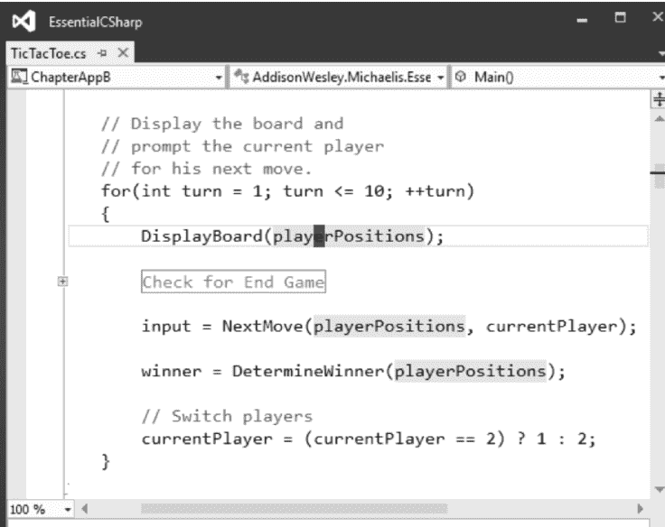

图 4.5：Microsoft Visual Studio .NET 中折叠的区域

## 总结

本章开始介绍了与赋值和算术相关的 C# 运算符。接下来，我们使用运算符配合关键字来声明常量。然而，对所有 C# 运算符的介绍并不是顺序的。在讨论关系和逻辑比较运算符之前，本章引入了 if 语句以及代码块和作用域的重要概念。在结束运算符的介绍时，我们讨论了位运算符，特别是关于掩码的。我们还讨论了其他控制流语句，如循环、switch 和 goto，并以讨论 C# 预处理指令结束了本章。

运算符优先级在章的前部部分讨论过；表 4.7 总结了所有运算符的优先级顺序，包括几个尚未涵盖的运算符。

## 表 4.7：运算符优先级顺序*

| 类别 | 运算符 |
|---|---|
| 基础 | x,y f(x) a[x] xx x-- new typeof(T) checked(x) unchecked(x) default(T) nameof(x) delegate{} () |
| 一元 | * ! ++ -- x (T) await x |
| 乘法 | * / % |
| 加法 | + |
| 移位 | << >> |
| 关系 | > >= |
| 等于 | == |
| 逻辑与 | && |
| 逻辑或 | \|\| |
| 条件与 | \| | |
| 条件或 | \| | |
| 空合并 | ?? : |
| 赋值 | += -= = *= /= |= <<= >>= &= \|& ^= >>= ??= |
| 位运算 | \| ^ ^ ^ |


| 三元 | `? :` |

| 表达式 | `=>` |

| 类型 | `is` |

| 注意： | | | |## 2 a |

## 5: 参数与方法

## 总结 218

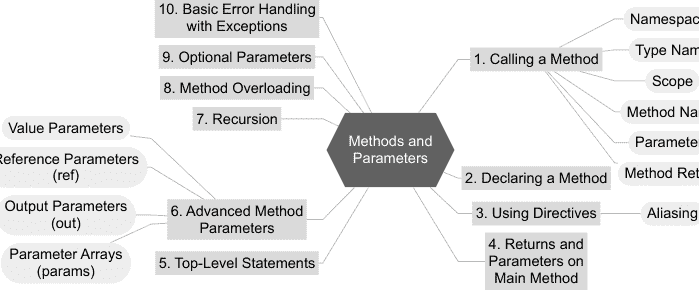

图 4.5：Microsoft Visual Studio .NET 中折叠的区域

## 总结

本章开始介绍了与赋值和算术相关的 C# 运算符。接下来，我们使用运算符配合关键字来声明常量。然而，对所有 C# 运算符的介绍并不是顺序的。在讨论关系和逻辑比较运算符之前，本章引入了 `if` 语句以及代码块和作用域的重要概念。在结束运算符的介绍时，我们讨论了位运算符，特别是关于掩码的。我们还讨论了其他控制流语句，如循环、`switch` 和 `goto`，并以讨论 C# 预处理指令结束了本章。

运算符优先级在章的前部部分讨论过；表 4.7 总结了所有运算符的优先级顺序，包括几个尚未涵盖的运算符。

# 第 5 章：参数与方法

## 5: 参数与方法

## 调用方法

### 初学者提示

什么是方法？到目前为止，程序中几乎所有的语句都写在一起，没有任何分组。当程序变得更加复杂时，这种方法很快变得难以维护和阅读。

方法是将序列组合以执行特定操作或计算结果的一种。这为语句提供了更好的结构和组织。以一个计算行数的 `Main()` 方法为例。与其用一个巨大的 `Main()` 方法，不如提供一个更短的版本，以便根据需要完善方法的实现细节。列表 5.1 显示了一个示例。

# 列表 5.1：将语句分组

```c
public class Program
{
    public static void Main()
    {
        int lineCount;
    }
}
```

```c
string files;
DisplayHelpText();
files = GetFiles(files);
lineCount = CountLines(files);
DisplayLineCount(lineCount);
}
// ...
// ...
```

## 初学者主题

什么是函数？函数与方法几乎相同，用于组合序列以执行特定操作或计算特定结果。事实上，方法和函数经常互换使用。但从技术上说，方法始终与类型相关——例如列表 5.1 中的 `Program`。相比之下，函数没有这种关联。函数不一定拥有所属的类型。

## 指南

务必使用动词或动词短语为方法命名。

方法提供了一种将相关代码分组的手段。方法可以通过传递给方法参数的参数接收数据。参数是用于将数据从调用者（包含方法调用或调用的代码）传递给被调用方法（如 `Write()`、`Writeline()`、`GetFiles()`、`CountLines()` 等）的变量。在列表 5.1 中，`files` 和 `lineCount` 是通过参数传递给 `CountLines()` 和 `DisplayLineCount()` 方法示例。方法还可以通过返回值向调用者返回数据（在 5.1 中，`GetFiles()` 方法有一个赋值给 `files` 的返回值）。

首先，我们重新审视第 1 章中的 `System.Console.Write()` 和 `System.Console.ReadLine()`。这次，我们把它们看作普通方法调用的示例，而不是关注从控制台打印和检索数据的具体细节。列表 5.2 显示了所使用的这三个方法。

# 列表 5.2：简单的方法调用

```csharp
public static void Main() {
    string? firstName;
    string? lastName;
    Console.WriteLine("Hey you!");
    Console.Write("Enter your name: ");
    firstName = Console.ReadLine();
    Console.Write("Enter your last name: ");
    lastName = Console.ReadLine();
    Console.WriteLine($"Your full name is {firstName} {lastName}.");
}
```

方法调用的部分包括方法名、参数列表和返回值。完全限定的方法名包含命名空间、类型名和方法名；用点（`.`）分隔完全限定方法名的每个部分。正如我们在第 2 章的类型名（https://essentialsharp.com/type-name-forms）中看到的，方法也可以只使用其完全限定名称的最后部分来调用。

# 命名空间

命名空间是一种分类机制，用于将与特定功能区域相关的所有类型分组。命名空间是层次化的，层次结构可以有任意数量的级，尽管超过六级的命名空间非常罕见。通常，层次结构从公司名称开始，然后是产品名称，最后是功能区域。例如，在 `Microsoft.Win32.Networking` 中，最外层的命名空间是 `Microsoft`，它包含一个内部命名空间 `Win32`，后者又包含一个更深层次的命名空间。

命名空间主要用于按功能组织类型，以便更容易地发现和理解。然而，它们也可以用于避免类型名称冲突。例如，只要每个类型具有不同的命名空间，编译器就可以区分两个同名为 `Button` 的类型。因此，你可以区分 `System.Web.UI.WebControls.Button` 和 `System.Windows.Controls.Button` 类型。

在列表 5.2 中，`Console` 类型位于 `System` 命名空间内。`System` 命名空间包含了允许程序员执行许多基础编程活动的类型。几乎所有的 C# 程序都使用 `System` 命名空间中的类型。表 5.1 提供了其他常用命名空间的列表。

# 表 5.1：常用命名空间

| 命名空间 | 描述 |

| --- | --- |

| `System` | 包含基本类型以及用于类型转换、数学计算、程序调用和环境管理的类型。 |

| `System.Collections.Generics` | 包含使用泛型的强类型集合。 |

| `System.Data.Entity` | 一个框架，通过代码生成将实体映射到表，从而从关系数据库中存储和检索数据。 |

| `System.Drawing` | 包含用于显示设备绘图和处理图像的类型。但注意，它是最针对 Windows 的。 |

# 表 5.1：常用命名空间（续上）

| 命名空间 | 描述 |

| `System.IO` | 包含用于处理目录以及操纵、加载和保存文件的类型。 |

| `System.Linq` | 包含使用集成语言查询（LINQ）查询集合数据的类和接口。 |

| `System.Text` | 包含用于处理字符串以及用于在各种文本编码之间转换的类型。 |

| `System.Text.RegularExpressions` | 包含用于处理正则表达式的类型。 |

| `System.Threading` | 包含用于多线程编程的类型。 |

| `System.Threading.Tasks` | 包含基于任务的异步的类型。 |

| `System.Windows` | 包含在使用 Windows Presentation Foundation (WPF) 或 Windows UI 库 (WinUI) 等 UI 技术时创建丰富用户界面的类型，并利用扩展应用程序标记语言 (XAML) 进行 UI 的声明式设计。 |

| `System.Xml.Linq` | 包含使用名为 LINQ 的对象查询语言对 XML 处理的标准支持（参见第 15 章）。 |

在调用方法时并不总是需要提供命名空间。例如，如果类表达式可以推断出与调用方法位于相同命名空间的类型，编译器可以推断出命名空间为包含该类型的命名空间。在本章后面的部分，你将看到 `using` 指令如何消除对命名空间限定符的需求。

## 指南

- 使用 PascalCasing（帕斯卡命名法）命名命名空间。
- 考虑组织源文件的目录层次结构以匹配命名空间层次结构。

## 调用方法

# 类型名

对静态方法的调用需要类型名限定符，只要目标方法不在同一类型内。¹（正如在本章稍后部分讨论的，`using static` 指令允许你省略类型名）。例如，在 `HelloWorld.Main()` 方法中找到 `Console.WriteLine()` 调用表达式需要指定类型 `Console`。然而，就像命名空间一样，只要方法是包含该调用表达式的类型的成员，C# 均允许在方法调用中省略类型名。（此类方法调用的示例出现在列表 5.4 中。）的类型名

# 作用域

在第 4 章中，你学习了程序元素的*作用域*是可以通过其名称引用的文本区域。同样，类型在其声明处是作用域内的；位于命名空间内部的方法不需要类型限定符。

# 方法名

每个方法调用都包含一个方法名，该方法名可能经过命名空间和类型名的限定，正如我们所讨论的那样。方法名之后是参数列表，它是用逗号分隔的对应参数的值列表。

# 参数

方法可以接受任意数量的参数，每个参数都有特定的数据类型。调用者为参数提供的的值称为参数；每个参数必须对应一个参数。例如，以下方法有三个参数：

```csharp
System.IO.File.Copy(oldFileName, newFileName, false)
```

该方法位于 `System.IO` 命名空间中的 `File` 类。它被声明有三个参数，前两个是 `string` 类型，第三个是 `bool` 类型。在示例中，我们使用 `string` 类型的变量（`oldFileName` 和 `newFileName`）作为文件名，指定 `false` 表示如果新文件名存在则失败。

# 方法返回值

与 `Console.WriteLine()` 相，列表 5.2 中的 `Console.ReadLine()` 方法调用没有任何参数，因为该方法被声明为不接受任何参数。然而，该方法恰好有一个方法返回值。方法返回值是将结果从被调用方法传回调用者的手段。由于 `Console.ReadLine()` 有返回值，可以将该返回值赋值给变量 `firstName`。此外，可以将此方法的返回值本身作为另一个方法调用的参数，如列表 5.3 所示。

> 列表 5.3：将方法返回值作为参数传递给另一个方法

```csharp
public static void main(){
    Console.Write("Enter your first name: ");
    Console.WriteLine("Hello " + Console.ReadLine() + "!");
}
```

与其将返回值赋值给变量然后将其作为 `Console.WriteLine()` 调用的参数不同，列表 5.3 在 `Console.WriteLine()` 调用内部直接调用了 `Console.ReadLine()` 方法。

## 定义方法

执行时间上，`Console.ReadLine()` 方法首先执行，其返回值直接传递给 `Console.WriteLine()` 方法，而不是传递给变量。

并不是所有方法都会返回数据。`Console.Write()` 和 `Console.WriteLine()` 的两个版本都是此类方法的示例。正如你很快将看到的，这些方法指定了 `void` 返回类型，就像 HelloWorld 的 `Main` 声明返回 `void` 一样。

# 语句与方法调用

列表 5.3 展示了语句与方法调用之间的区别。尽管 `Console.WriteLine($"{Hello {System.ReadLine()}");` 是一条语句，但它包含了两个方法调用。语句通常包含一个或多个表达式，在这个示例中，其中两个表达式就是方法调用。因此，方法调用构成了语句的一部分。

虽然在单个语句中编写方法调用可以减少代码量，但它并不一定能提高可读性，而且很少提供显著的性能优势。开发者应该优先考虑可读性而非简洁性。

> 注意

通常情况下，开发者应该优先考虑可读性而非简洁性。可读性对于编写自文档代码并使其在时间推移中保持维护性至关重要。

# 定义方法

本节扩展了对定义方法的说明，包含了参数或返回类型。列表 5.4 包含了这些概念的示例，输出 5.1 显示了结果。

列表 5.4：定义方法

```
public class IntroducingMethods{
    public static void Main()
```

```
{
  string firstName;
  string lastName;
  string fullName;
  string initials;

  Console.WriteLine("Hey you!");

  firstName = GetUserInput("Enter your first name: ");
  lastName = GetUserInput("Enter your last name: ");

  fullName = GetFullName(firstName, lastName);
  initials = GetInitials(firstName, lastName);
  DisplayGreeting(fullName, initials);
}
```

```
static string GetUserInput(string prompt)
{
  Console.Write(prompt);
  return Console.ReadLine() ?? string.Empty;
}
```

# 输出 5.1

Hey you!

Enter your first name: Inigo

# 定义方法

Enter your last name: Montoya

Hello Inigo Montoya! Your initials are I. M.

列表 5.4 定义了五个方法。代码从 `Main()` 调用了 `GetUserInput()`，随后调用了 `GetFullName()` 和 `GetInitials()`。最后三个方法都返回一个值并接受参数。此外，该列表调用了 `DisplayGreeting()`，它不返回任何数据。

# 语言对比：C++/Visual Basic——全局方法

C# 不支持全局方法；所有内容都必须出现在类型声明内部。这就是为什么 `Main()` 方法被标记为 `static`——这是 C++ 全局方法和 Visual Basic "shared" 方法在 C# 中的等价物。独立于方法出现的语句以及独立于类出现的方法甚至遵循这一规则，因为 C# 编译器会为这些看似独立的结构生成外围的方法和类。欲需更多信息，请参阅本章节后后的“顶层语句（Top-Level Statements）”。

## 初学者主题

# 重构为方法

将一组语句移动到方法中而不是让它们在较大的方法中内联存在，是重构的一种形式。重构减少了代码重复，因为你可以从多个地方调用该方法，而不是重复代码。重构还提高了代码的可读性。作为编码过程的一部分，最佳实践是持续审查你的代码并寻找重构的机会。这涉及寻找那些乍看难以理解的代码块，并将它们移动到一个能够清晰定义代码行为的方法中。这种做法通常比向代码块添加注释更受欢迎，因为方法名起到了描述实现功能的作用。列表 5.4 只需查看 `Main()` 方法就能轻松理解，而无需担心每个被调用方法的具体实现细节。

Visual Studio 允许你在方法内部的代码块上点击右键，并点击“快速操作和重构... (Ctrl+.)”来将该代码块提取到其自己的方法中，自动插入代码以从原始位置调用新方法。

# 形式参数声明

考虑 `DisplayGreeting()`、`GetFullName()` 和 `GetInitials()` 方法的声明。方法声明括号之间出现的文本是形式参数列表。（正如我们在讨论泛型时将看到的，方法可能还具有类型参数列表。当从上下文中可以清楚我们正在讨论哪种参数时，只需将它们称为参数列表中的参数即可。）参数列表中的每个参数都包含参数类型以及参数名。逗号分隔列表中的每个参数。

从行为上说，大多数参数与局部变量几乎相同，参数的命名约定也相应遵循。因此，参数名使用驼峰命名法（camelCase）。此外，无法声明局部变量（在方法内部声明的变量）与包含方法的参数具有相同的名称，因为这会创建两个同名的局部变量。

> 指南

使用驼峰命名法作为参数名。

# 方法返回类型声明

除了 `GetUserInput()`、`GetFullName()` 和 `GetInitials()`，这些每个方法都包含一个需要指定的方法返回类型。你可以判断一个方法是否返回值，因为在方法声明中，数据类型紧跟在方法名之前。这些方法示例每一个都指定了 `string` 返回类型。与数量可以是任意数的参数不同，只允许一个返回类型。

# 定义方法 229

与 `GetUserInput()` 和 `GetInitials()` 一样，带有返回类型的方法几乎总是包含一个或多个 `return` 语句来返回控制权。`return` 语句由 `return` 关键字后跟计算返回值的表达式组成。此外，如果一个方法指定了返回类型，那么它在方法结束处没有返回值。通常，满足这一条件的方法是让方法结尾处 `return` 语句。例如，参见列表 5.5。

- 列表 5.5：方法结束前的返回语句

```
public class Program {
    // ...

    public static bool MyMethod() {
        string command = ObtainCommand();
        switch(command) {
            case "quit":
                return false;
                // 其他情况
            default:
                return true;
        }
    }
}
```

2. 例如，你可以抛出一个异常代替。

# 第 5 章：参数与方法

```
// ...
}
```

（注意 `return` 语句会将控制权传出 `switch`，因此不需要 `break` 语句来防止穿透。）


在列表 5.5 中，方法的最后一个语句不是 `return` 语句；而是 `switch` 语句。然而，编译器可以推断出所有可能的代码路径都会导致返回，因此方法的终点是不可达的。因此，该方法没有以 `return` 语句结尾也是合法的。如果特定的代码路径在 `return` 之后包含不可达语句，编译器将发出警告指示这些语句永远不会执行。

尽管 C# 允许方法有多个 `return` 语句，但如果只有一个出口位置，比散布在方法各种代码路径中的多个返回更具可读性且易于维护。

指定 `void` 作为返回类型表示方法没有返回值。结果是，对方法的调用不能赋值给变量或用作调用处的参数类型。`void` 方法只能作为语句调用。此外，在方法体内部 `return` 语句是可选的，且当指定它时，`return` 关键字后面不能有任何值。例如，列表 5.4 中 `Main()` 的返回是 `void`，且方法中没有 `return` 语句。然而，`DisplayGreeting()` 包含了（可选的 `return` 语句，其后没有跟随返回的结果。

尽管从技术上讲，方法只能有一个返回类型，但该返回类型可以是元组（tuple）。结果，从 C# 7.0 开始，可以使用 C# 元组语法将多个值封装成元组进行返回。例如，你可以声明一个 `GetName()` 方法，如列表 5.6 所示。

### 列表 5.6：使用元组返回多个值

```csharp
public class Program{
    static string GetUserInput(string prompt)
```

```csharp
Console.Write(prompt);
return Console.ReadLine() ?? string.Empty;
}
static (string First, string Last) GetName()
{
    string firstName, lastName;
    firstName = GetUserInput("Enter your first name: ");
    lastName = GetUserInput("Enter your last name: ");
    return (firstName, lastName);
}
static public void Main()
{
    (string First, string Last) name = GetName();
    Console.WriteLine("Hello {name.First} {name.Last}!");
}
```

从技术上讲，我们仍然只返回一种数据类型，即 `ValueTuple<string, string>`。但实际上，你可以使用元组中的每个项返回任何你喜欢的（最好是合理的）数量。

## 表达式体方法 (Expression Bodied Methods)

为了支持最简单的方法声明而无需使用正式的正式格式，C# 6.0 引入了表达式体方法，该方法使用表达式而不是完整方法体进行声明。列表 5.4 中的 `GetFullName()` 方法提供了一个表达式体方法的示例：

```csharp
static string GetFullName(string firstName, string lastName) =>
```

在方法体的大括号中，表达式体方法使用“转义到”运算符（在第 13 章中完整引入），其结果数据类型必须匹配方法的返回类型。换句话说，尽管表达式体方法的实现中没有显式的 `return` 语句，但返回类型仍然与表达式体方法声明中的返回类型保持一致。

表达式体方法是完整方法体声明的语法快捷方式。因此，其使用应限于最简单的方法实现——通常可以用单行表示的方法。

## 第 5 章：参数与方法

### 语言对比：C++—头文件

与 C++ 不同，C# 类从不将实现与声明分离。在 C# 中，没有头文件（`.h`）或实现文件（`.cpp`）。相反，声明和实现共同出现在同一个文件中。（C# 支持一种名为“部分方法”（partial methods）的高级功能，方法的定义声明与其实现是分开的，但为了本章的目的，我们只考虑非部分方法。）C# 缺乏分离的声明和实现，消除了在像 C++ 这样具有独立头文件和实现文件的语言中需要在两个地方维护冗余头声明信息的要求。

## 本地函数 (Local Functions)

C# 7.0 引入在方法内部声明函数的能力。换句话说，与其始终在类内部声明方法，不如在另一个方法内部声明方法（技术上称为函数）（参见列表 5.7）。

### 列表 5.7：声明本地函数

```csharp
public static void Main()
{
    string GetUserInput(string prompt)
    {
        string? input;
        do
        {
            Console.Write(prompt + ": ");
            input = Console.ReadLine();
        }
        while(string.IsNullOrWhiteSpace(input));
        return input;
    }

    string firstName = GetUserInput("First Name");
    string lastName = GetUserInput("Last Name");
    string email = GetUserInput("Email Address");
}
```

```csharp
Console.WriteLine($"{firstName}{lastName} {email}");
// n...
```

## 使用指示程序 (Using Directives)

这种语言结构被称为本地函数。这样声明的原因是函数的作用域限于其声明所在方法内部的调用。在方法的作用域之外

### 使用指示程序概述

完全限定的命名空间名称可能会变得非常长且难以管理。然而，可以从一个或多个命名空间导入所有类型，这样就可以在不需要完全限定的情况下它们。

C# 并不包含适用于整个项目的声明式，而是包含一个仅适用于当前文件的 `using` 指示程序。例如，列表 5.8（带有输出 5.2）没有为 `RegEx` 缀加上 `System.Text.RegularExpressions`。由于列表顶部出现了 `using System.Text.RegularExpressions`，可以省略命名空间。

### 列表 5.8：使用指示程序示例

```csharp
// using 指示程序将从指定命名空间
// 的类型导入到整个文件中
using System.Text.RegularExpressions;
public class Program
{
    public static void Main()
    {
        const string firstName = "FirstName";
        const string initial = "Initial";
        const string lastName = "LastName";

        // 解释正则表达式超出了
        // 本书的范围。
```

## 第 5 章：参数与方法

```csharp
// 访问 https://www.regular-expressions.info/ 
// 获取更多信息。
const string pattern = $@{\n(?<firstName>\w+)\s*((?<initial>\w+)\s*)?(?<lastName>\w+)\s*";
```

```csharp
Console.WriteLine(
  "Enter your full name (e.g. Inigo T. Montoya):");
  string name = Console.ReadLine();
);
```

> // 无需使用 System.Text.RegularExpressions 限定 Regex 类型，

// 因为使用了上面的 using 指示程序

```csharp
Match match = Regex.Match(name, pattern);
if (match.Success)
{
  Console.WriteLine(
    $"{firstName}:{match.Groups[firstName]}");
  Console.WriteLine(
    $"{initial}:{match.Groups[initial]}");
  Console.WriteLine(
    $"{lastName}:{match.Groups[lastName]}");
}
```

## 输出 5.2

Hello, my name is Inigo Montoya

像 `using System.Text` 这样的使用指示程序并不能让你能够在嵌套命名空间（如 `System.Text.RegularExpressions`）中声明的类型中省略 `System.Text`。由于顶部出现了 `using System.Text.RegularExpressions`，可以省略命名空间。

### 语言对比：Java—导入通配符

Java 允许使用通配符导入命名空间：

```java
import javax.swing.*;
```

相比之下，C# 不支持通配符使用指示程序，而是要求显式导入每个命名空间。

在特定命名空间中频繁使用 `using` 指示程序意味着不需要完全限定命名空间。`using` 指示程序的一个有趣影响是，可以使用不同大小写的字符串。结果公共语言（CIL）不受影响，无论选择哪种版本。

## 初学者主题

### 命名空间 (Namespaces)

如前所述，命名空间是分类和分组相关类型的组织机制。开发者可以通过检查同一命名空间内的类型来发现相关类型。此外，通过命名空间，多个类型可以相同的名称，只要它们通过不同的命名空间区分。

### 隐式使用指示程序 (Implicit Using Directives)

读者会在第 1 章中记得 `.csproj` 文件中的 `ImplicitUsing` 元素。

```xml
<ImplicitUsings>enable</ImplicitUsings>
```

此外，源代码始终引用如 `Console` 等内容，尽管其完全限定名称是 `System.Console`。通过 `ImplicitUsing` 元素提供的缩写功能（告诉编译器自动推断命名空间而不是使用隐式指示程序）允许在不指定完全限定名称的情况下使用类型标识符。为了实现这一点，当 `ImplicitUsing` 元素设置为 `enable` 时，编译器生成全局使用指示程序。

### 全局使用指示程序 (Global Using Directives)

如果你搜索 C# 10.0（或更高）项目的子目录，你会注意到扩展名为 `.GlobalUsing.g.cs` 的文件，通常位于 `obj` 文件夹子目录下，并且包含如列表 5.9 中的多个全局使用指示程序。

### 列表 5.9：生成的隐式使用全局声明

```csharp
// <auto-generated/>
global using global::System;
global using global::System.Collections.Generic;
global using global::System.IO;
global using global::System.Linq;
global using global::System.Net.Http;
global using global::System.Threading;
global using global::System.Threading.Tasks;
```

> 3. 虽然为了说明目的已从列表中移除，生成的全局使用语句在命名空间前带有 "global::" 前缀，如 `global using global::System`。命名空间别名限定符的讨论将在节的后面出现。

# 使用指令

这些行<sup>4</sup>中的每一行都是全局指令，告诉编译器为指定命名空间内出现的任何类型推断命名空间限定符。例如，`global using global::System` 允许使用 `Console.WriteLine("Hello! My name is Inigo Montoya!")` 这样的隐式使用指令，而不是完全限定 `System.Console.WriteLine(...)`，因为 `Console` 定义在 `System` 命名空间中。

当然，你可以提供自己的全局使用声明。例如，假设频繁使用 `System.Text.StringBuilder` 类（在第 2 章最初引入）。与其通过完全限定引用它，你可以为 `System.Text` 命名空间提供全局使用指令，然后只需使用简称 `StringBuilder` 引用该类型（参见列表 5.10），同样依赖 `System.Console` 的隐式使用。

### 列表 5.10：配合 StringBuilder 使用指令

```csharp
// 全局指令将指定命名空间中的所有类型
导入到项目中
global using System.Text;
//
public class Program
{
    public static void Main()
    {
        // 关于 new() 的解释请参见第 6 章
        StringBuilder name = new();

        Console.WriteLine("Enter your first name: ");
        name.Append(Console.ReadLine()!.Trim());

        Console.WriteLine("Enter your middle initial: ");
        name.Append($"{Console.ReadLine()!.Split('.').Trim()} ");

        Console.WriteLine("Enter your last name: ");
        name.Append($"{Console.ReadLine()!.Trim()}");

        Console.WriteLine($"Hello {name}!");
    }
}
```

- 4. 忽略显示代码由编译器生成的注释。

238 页 第 5 章：参数与方法

全局使用指令适用于整个项目，无论它们出现在哪个文件中。虽然 C# 允许多次使用相同的全局使用声明，但这样做是冗余的。出于此原因，按照惯例，最好将所有全局使用指令置于一个命名为 `Usings.cs` 的单文件中。将它们集中在此处提供了一个放置或删除它们的众良好位置。

虽然全局使用指令适用于整个项目，但 C# 同时也支持仅适用于当前文件的指令。然而，全局使用声明必须出现在任何其他（非全局）使用指令之前，我们将在 `.csproj` 使用 `using` 元素之后介绍这些。

## csproj Using 元素

可以在项目文件 `.csproj` 中通过 `Using` 元素指定全局使用声明，如列表 5.11 所示。

### 列表 5.11：带有 Using 元素的示例 .NET 控制台项目文件

```xml
<Project Sdk="Microsoft.NET.Sdk">
  <PropertyGroup>
    <OutputType>Exe</OutputType>
    <TargetFramework>net7.0</TargetFramework>
    <ImplicitUsings>enable</ImplicitUsings>
    <Nullable>enable</Nullable>
  </PropertyGroup>
  <ItemGroup>
    <Using Include="System.Net" />
    <Using Static="true" Include="System.Console" />
  </ItemGroup>
</Project>
```

需要注意的是，与 `ImplicitUsings` 元素不同，`Using` 元素是 `ItemGroup` 的子元素，而不是 `PropertyGroup` 元素。而且，由于指定了用于 `System.Net` 的 `Using` 元素，不再需要完全限定 `HttpClient`（它是 `System.Net` 命名空间的一部分）。相反，当存在另一个带有 `Static` 属性的 `Using` 语句时，编译器将生成 `global using System.Net` 指令，我们将在下一节中进一步解释。

## 高级主题

### 嵌套使用指令

你不仅可以在文件顶部拥有使用指令，还可以在命名空间声明的顶部包含它们。例如，如果声明了一个新的命名空间 `EssentialCSharp`，则在命名空间声明顶部使用使用指令是可能的（参见列表 5.12）。

### 列表 5.12：在命名空间声明内部指定 using 指令

```csharp
// using 指令将指定命名空间中的所有类型
// 导入整个文件
using System.Text.RegularExpressions;

public class Program
{
    public static void Main()
    {
        // ... 无需用 System.Text.RegularExpressions
        // 限定 RegEx 类型，因为有了
        // 使用 指令
        Match match = Regex.Match(name, pattern);
        // ...
    }
}
```


在文件顶部放置使用指令与在命名空间声明顶部放置使用指令的区别是，该指令仅在命名空间声明内有效。如果代码在 `EssentialCSharp` 声明上方或下方包含一个新的命名空间声明，则不同命名空间内的 `using System` 指令将不会生效。代码很少以这种方式编写，特别是考虑到每个文件提供单一类型声明的标准做法。

## using static 指令

使用指令允许你通过省略名称中的命名空间部分来缩写类型名称——这样对于指定命名空间内的任何类型，只需指定类型名。相比之下，`using static` 指令允许你从指定类型的任何静态成员中同时省略命名空间和类型名。指定 `using static System.Console` 指令允许你使用 `WriteLine()` 而不是 `System.Console.WriteLine()` 的完全限定方法名。继续此示例，我们可以更新列表 5.2 以利用静态 `System.Console` 指令来创建列表 5.13。

### 列表 5.13：使用 static 指令

在这种情况下，代码的可读性没有损失：`WriteLine()`、`Write()` 和 `ReadLine()` 都与控制台有关。然而，有时并非如此。例如，如果两个类型具有重名，使用 `static` 将导致歧义。

274 页 第 5 章：参数与方法

## using static 指令

使用指令允许你通过省略名称中的命名空间部分来缩写类型名称——这样对于指定命名空间内的任何类型，只需指定类型名。相比之下，`using static` 指令允许你从指定类型的任何静态成员中同时省略命名空间和类型名。指定 `using static System.Console` 指令允许你使用 `WriteLine()` 而不是 `System.Console.WriteLine()` 的完全限定方法名。继续此示例，我们可以更新列表 5.2 以利用静态 `System.Console` 指令来创建列表 5.13。

### 列表 5.13：使用 static 指令

在这种情况下，代码的可读性没有损失：`WriteLine()`、`Write()` 和 `ReadLine()` 都与控制台有关。然而，有时并非如此。例如，如果两个类型具有重名，使用 `static` 将导致歧义。

275 页

你不仅可以在文件顶部拥有使用指令，还可以在命名空间声明的顶部包含它们。例如，如果声明了一个新的命名空间 `EssentialCSharp`，则在命名空间顶部使用使用指令是可能的（参见列表 5.12）。

## 别名 Aliasing

从 C# 12.0 开始，使用指令还允许映射命名空间或任何类型，包括元组（第 23 章）、数组类型和泛型类型（第 12 章）。别名是在使用指令应用的文本内使用的替代名称。别名的两个常见理由是消除相同类型的歧义以及缩写长名称。在列表 5.14 中，例如，是为了引用 `System.Timers.Timer` 类型。仅仅添加 `using Timers` 不以让代码避免限定 `Timer`。因为 `System.Threading` 也包含一个名为 `Timer` 的类型。

### 列表 5.14：声明类型别名

```csharp
using CountdownTimer = System.Timers.Timer;
using StartStop = (DateTime Start, DateTime Stop);

public class HelloWorld
{
    public static void Main()
    {
        CountdownTimer timer;
        StartStop startStop;
    }
}
```

### 列表 5.15：声明同名的类型别名

```csharp
// 声明 Timer 引用 System.Timers.Timer
// 避免与 System.Threading.Timer 冲突
using Timer = System.Timers.Timer;

public class HelloWorld
{
    public static void Main()
    {
        Timer timer;

        // ...
    }
}
```

由于别名指令，`Timer` 不再是歧义引用。此外，要引用 `System.Threading.Timer` 类型，你必须限定该类型或定义不同的别名。

当然，C# 10 及更高版本还支持全局别名指令，例如：

```csharp
global using Timer = Timers.Timer;
```

与其他所有全局指令一样，可以在 `csproj` 文件中配置全局别名指令：

```xml
<Using Include="System.Timers.Timer" Alias="Timer"/>
```

# Main 方法的返回值与参数

到为止，可执行文件的 `Main` 方法声明一直是可能的简单声明。你没有在你的中包含任何参数或非 void 返回类型

## Main 方法的返回值与参数 243

`Main` 方法声明。然而，C# 支持在执行程序时检索命令行参数的能力，并且可以从 `Main` 方法返回状态指示器。

运行时使用单个字符串参数（按照约定命名为 `args`）将命令行参数传递给 `Main()`。你只需要访问数组即可检索参数，如列表 5.16 及其输出 5.3 所示。输出显示了一次无参数的运行以及另一次带有两个参数的运行。该程序的目的是下载一个由 URL 指定位置的文件。第一个命令行参数标识 URL，第二个参数是保存该文件的文件名。列表以 `switch` 语句开始，该语句如下评估参数的数量（`args.Length`）：

- 1. 如果参数不等于两个，则显示错误信息，指出必须提供 URL 和文件名。
- 2. 存在两个参数表示用户同时提供了资源的 URL 和下载文件名。

### 列表 5.16：将命令行参数传递给 Main 方法

```sharp
public class Program
{
    public static int Main(string[] args)
    {
        int result;
        if(args?.Length != 2)
        {
            // 必须指定两个参数；给出一个错误
            Console.WriteLine(
                "ERROR: You must specify the " + "URL and the file name");
            Console.WriteLine(
                "Usage: Downloader.exe <URL> <TargetFileName>");
            result = 1;
        }
        else
        {
            string urlString = args[0];
            string fileName = args[1];

HttpClient client = new();
            byte[] response =
    client.GetByteArrayAsync(urlString).Result;
            client.Dispose();
            File.WriteAllBytes(fileName, response);
            Console.WriteLine($"Downloaded {fileName}' from '{urlString}');
            result = 0;
        }
    return result;
}
```

### 输出 5.3

> Downloader

ERROR: You must specify the URL and the file name

Usage: Downloader.exe <TargetFileName>

>Downloader https://IntelliText.com Index.html

Downloaded 'Index.html' from 'https://IntelliText.com'.

如果你成功计算了目标文件名，你将可以使用它来保存下载的文件。否则，你将显示帮助文本。`Main()` 方法如果被使用，程序可以向调用者（如脚本或批处理文件）返回退出代码。按照约定，返回非零值表示错误。

虽然所有命令行参数都可以通过字符串数组传递给 `Main()`，但在 `Main()` 的其他方法内部访问参数是非常方便的。`System.Environment.GetCommandLineArgs()` 方法返回命令行参数的形式与 `Main(string[]) args` 将参数传入 Main 方法的形式相同，不同之处数组中的第一个项是可执行文件。

为了下载文件，列表 5.16 使用了 `System.Http.HttpClient` 对象，但仅指定了 `HttpClient`——其命名空间由 `.csproj` 文件中的 `ImplicitUsings` 元素导入。

## Main 方法的返回值与参数 245

## 进阶主题

### 区分多个 Main 方法

如果程序包含两个带有 `Main` 方法的类，可以指定使用哪一个作为入口点。在 Visual Studio 中，在“解决方案管理器”中右键点击项目并选择“属性”，可以在项目文件上方提供一个用户界面。通过选择左侧的“应用程序”选项卡，你可以编辑“启动对象”，并选择哪个类型的 `Main` 方法将启动程序。结果将在 `PropertyGroup` 中增加一个元素：

```xml
<StartupObject>AddisonWesley.Michaelis.EssentialCSharp.Shared.Program
</StartupObject>
```

在命令行上，你可以在运行构建时设置 `StartupObject` 来指定相同的值。例如：

```bash
dotnet build /p:StartupObject=AddisonWesley.Program2
```

其中 `AddisonWesley.Program2` 是包含所选方法的命名空间和类。（事实上，csproj 文件中 `PropertyGroup` 部分的任何项都可以通过这种方式在命令行上指定。）

## 初学者主题

### 调用栈与调用点

随着代码的执行，方法调用更多方法，`Main` 又调用额外的方法，依此类推。在列表 5.4 的简单情况下，`Main()` 调用 `GetUserInput()`，后者又调用 `System.Console.ReadLine()`，后者又在内部调用了更多方法。每当调用一个新方法时，运行时都会创建一个激活帧 `activation frame`，其中包含传递给新调用的参数信息、调用的局部变量以及当新方法返回时可以恢复控制的信息。这种嵌套的调用序列产生了一系列激活帧，称为调用栈 `call stack`。

- 5. 异步或迭代器方法除外，它们会将激活器记录移动到堆上。

## 第 5 章：参数与方法

随着程序复杂性的增加，由于每个方法调用另一个方法，调用栈通常会越来越大。随着调用完成，调用栈会缩小，直到再次调用另一个方法。从调用栈中移除激活帧的过程被称为栈回溯 `stack unwinding`。栈回溯按照方法调用的反序发生。当方法完成时，执行返回到调用点——即调用该方法的位置。

## 顶层语句 Top-Level Statements

在 C# 9.0 之前，C# 中的所有可执行代码都必须出现在类型定义和成员（如类型内部的方法）中。正如我们在列表 1.1 中所示，这不再是。相反，单个文件可以包含顶层语句，即独立于任何类型定义且没有 `Main` 的语句。此类语句允许在一个文件中出现，并且将是程序执行的首批语句——相当于 `Main` 中的许多语句。事实上，给定顶层语句，编译器生成生成名为 `Program` 的类来封装这些语句并将其放入 `Main` 方法中。此外，该方法有一个上下文关键字 `--args`——这就是 `Main` 方法的 `string[]` 参数。

通过顶层语句，C# 语法允许方法外部的语句作为一种简化（特别是对于熟悉其他非结构化语言的新手开发者），但在编译时会将这些语句移动到 `Main` 方法。因此，底层的 CIL 中没有语句位于类型定义和类型成员之外。

由于 C# 编译器将顶层语句移动到其类内生成的方法中，如果你尝试定义额外的 `Program`，编译器会报错。另一个限制

- 6. 如编译器警告所示，你可以将 `Program` 定义为 `partial`，表示这两个定义将合并到同一个类中。更多信息请参见第 6 章中的“部分类”。

## 高级方法参数

到目前为止本章的示例通过方法返回值返回数据。本节将演示方法如何通过方法参数返回数据，以及方法如何接受变数量的参数。

## 值参数

方法调用的参数通常是**按值传递**，这意味着参数表达式的值被复制到目标参数。例如，在列表


# 248 第 5 章：参数与方法

5.17，`Main()` 在调用 `Combine()` 时使用的每个变量的值将被复制到 `Combine()` 方法的参数中。输出 5.4 显示了该列表的结果。

### 列表 5.17：按值传递变量

```csharp
public class Program {
    public static void Main() {
        // ...
        string fullName;
        string driveLetter = "C:";
        string folderPath = "Data";
        string fileName = "index.html";

        fullName = Combine(driveLetter, folderPath, fileName);

        Console.WriteLine(fullName);
        // ...
    }

    static string Combine(string driveLetter, string folderPath, string fileName) {
        string path;
        path = String.Format("{0}{1}{0}{2}{0}{0}{3}",
            Path.DirectorySeparatorChar,
            driveLetter, folderPath, fileName);
        return path;
    }
}
```

### 输出 5.4

C:\Users\Inigo\Data\index.html

即使 `Combine()` 方法在返回之前为 `driveLetter`、`folderPath` 和 `fileName` 赋值为 `null`，`Main()` 中的相应变量也将保持其原始值，因为变量在调用方法时被复制了。当调用栈在调用结束时展开时，复制的数据会被丢弃。

# 初学者：带参数的调用者变量

# 调用者变量与参数名的匹配

在列表 5.17 中，调用者中的变量名与被调用方法中的参数名完全匹配。这种匹配仅仅是为了可读性，无论名称匹配都与方法调用的行为无关。被调用方法的参数和调用者方法的局部变量位于不同的声明作用空间中，它们之间互没有关系。

## 高级主题

# 引用类型与值类型

就本节而言，传递的参数是值类型还是引用类型并不重要。相反，重要的问题是被调用方法是否可以向调用者的原始变量中写入一个值。由于创建了调用者变量值的副本，因此调用者的变量不能被重新赋值。尽管如此，理解包含值类型的变量与包含引用类型的变量之间的区别是有帮助的。

引用类型变量的值顾其名，是指存储与对象相关的数据的位置的引用。运行时如何选择表示引用类型变量的值是运行时的实现细节；通常，它被表示为存储对象数据的内存位置地址，但不必如此。

如果按值传递引用类型，则引用本身将从调用者复制到方法参数。结果是，目标方法无法更新调用者变量的值，但它可以更新该引用所指向的数据。

或者，如果方法参数是值类型，则值本身被复制到参数中，在被调用方法中更改参数不会影响原始调用者的变量。

# 引用参数 ref

考虑列表 5.18，它调用一个函数来交换两个值，以及显示结果的输出 5.5。

### 列表 5.18：按引用传递变量

```csharp
public class Program {
    public static void Main() {
        string first = "hello";
        string second = "goodbye";
        Swap(ref first, ref second);

        Console.WriteLine($"{first}, second = {second}");
    }

    static void Swap(ref string x, ref string y) {
        string temp = x;
        x = y;
        y = temp;
    }
}
```

# 输出 5.5

```
first = "goodbye", second = "hello"
```

分配给 `first` 和 `second` 的值成功交换了。`Swap()` 调用与列表 5.17 中 `Combine()` 调用之间的明显区别在于包含了**按引用传递**关键字，即在参数数据类型前的 `ref`。该关键字改变了调用方式，使得用作参数的变量按引用传递，因此被调用方法可以使用新值更新原始调用者的变量。

当被调用方法将参数指定为 `ref` 时，调用者需要提供一个变量而不是一个值作为参数，并在传递的变量前放置 `ref`。通过这样做，调用者显式地意识到目标方法

高级方法参数 251


可能会重新赋值与其收到的任何 `ref` 参数关联的变量的值。此外，任何作为 `ref` 传递的局部变量都是必须初始化的，因为目标方法可以在不先赋值的情况下从 `ref` 参数中读取数据。在列表 5.18 中，`temp` 被赋值为 `first` 的值，假设传入 `first` 的变量已由调用者初始化。实际上，`ref` 参数是变量的别名。换句话说，它本质上是给现有变量提供一个参数名，而不是创建一个新变量并将参数的值复制到变量中。

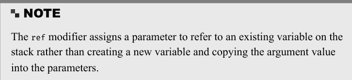

# 输出参数 (out)

如前所述，用作 `ref` 参数的变量传递给被调用方法之前必须赋值，因为被调用方法可能会从该变量中读取。之前给出的“交换”示例必须对传递给它的两个变量进行读和写。然而，通常情况下，一个接收变量引用的方法旨在将其写入而不是从中读取。为了实现这一点，使用关键字 `out` 修饰参数。这在列表 5.19 中得到了演示。

## 列表 5.19：传出变量

```csharp
public class Program {
    public static void Main(string[] args) {
        string[] input = { "a", "b", "c", "-" };
        foreach (string word in input) {
            char button;
            if (GetPhoneButton(word[0], out button)) {
                Console.WriteLine(button);
            } else {
                Console.WriteLine("invalid");
            }
        }
    }

    static bool GetPhoneButton(char character, out char button) {
        bool success = true;
        switch (char.ToLower(character)) {
            case '1':
                button = '1';
                break;
            case '2':
            case 'a':
            case 'b':
            case 'c':
                button = '2';
                break;
            case '-':
                button = '-';
                break;
            default:
                button = '_';
                success = false;
                break;
        }
        return success;
    }
}
```

252 第 5 章：参数与方法

输出 5.6

```
ConvertToPhoneNumber.exe CSharpIsGood
274277474663
```

253

```
return;
}
```

在处理 `out` 参数时，常见的错误是在在使用之前忘记声明 `out` 变量。从 C# 7.0 开始，可以在调用函数时内联声明 `out`。列表 5.19 使用了此特性……而无需预先声明 `button` 变量。

另一个 C# 7.0 特性是可以完全丢弃 `out` 参数的能力。

在 C# 7.0 元组语法出现之前，方法的开发者可能会声明一个或多个 `out` 参数，以绕过方法只能返回一个值的限制

`out`; 一种方法，通过正常返回一个值（作为方法的返回值），并通过将其写入作为输出参数（out parameter）传递的别名变量中，来返回两个值。虽然这种模式既常见又合法，但有更好的方法可以实现该目标。例如，如果你正在考虑从方法返回两个或多个值，并且可以使用 C# 7.0，那么使用 C# 7.0 的元组语法可能更优越。在此之前，可以考虑编写两个方法（每个值对应一个方法），或者在不使用 C# 7.0 语法的情况下继续使用 `System.ValueTuple` 类型。

> 注意
> 每一个正常的代码路径都必须对所有 out 参数进行赋值。

## 只读引用传递 (in)

在 C# 7.2 中，增加了对以引用方式传递只读值类型的支持。与其将值类型传递给函数以便对其修改，不如添加只读引用传递：它允许按引用传递值类型，这样不仅会发生一次该值类型的拷贝，而且调用的方法无法更改该值。换句话说，该特目的目的是在传递值时减少拷贝的内存，同时将其标记为只读，从而提高性能。这种语法是在参数中添加 `in` 修饰符。例如：

```csharp
int Method(in int number) { ... }
```

使用 `in` 修饰符后，任何重新分配 `number` 的尝试（例如 `number++`）都会导致编译错误，指示 `number` 是只读的。

## 引用

C# 7.0 的另一个新增是支持返回变量的引用。例如，考虑一个返回图像中关联红眼的第一个像素的函数，如列表 5.20 所示。

### 列表 5.20：ref 返回和 ref 局部声明

```csharp
// 返回引用
public static ref byte FindFirstEyePixel(byte[] image)
{
    // 可能使用机器学习进行图像检测
    for (int counter = 0; counter < image.Length; counter++)
    {
        if (image == (byte)ConsoleColor.Red)
        {
            return image[counter];
        }
    }
    throw new InvalidOperationException("没有红色像素。");
}
public static void Main()
{
    byte[] image = new byte[254];
    // 加载图像
    int index = new Random().Next(0, image.Length - 1);
    image[index] = (byte)ConsoleColor.Red;
    Console.WriteLine($"{index}={ConsoleColor}image[index]}");
    // ...
    // 获取第一个红色像素的引用
    ref redPixel = FindFirstEyePixel(image);
    // 将更新为黑色
    redPixel = (byte)ConsoleColor.Black;
    Console.WriteLine($"{index}={ConsoleColor}image[redPixel]}");
}
```

通过返回变量的引用，调用者能够将像素更新为不同的颜色，如列表 5.20 中高亮行所示。通过数组检查更新显示该值现在是黑色的。

## 第 5 章：参数与方法

引用返回有两个重要的限制，两者都是由于对象的生命周期：(1) 对象引用在仍被引用时不应被垃圾收集，(2) 它们在不再有任何引用时不应消耗内存。为了强制这些限制，你只能从返回引用的函数中返回以下内容：

- 对字段或数组元素的引用
- 其他返回引用的属性或函数
- 作为参数传递给返回引用的函数的引用

例如，`FindFirstRedEyePixel()` 返回图像数组中项的引用，该项是函数的参数。同样，如果图像存储在类内的字段中，你可以通过引用返回该字段：

```csharp
byte[] _Image;
public ref byte[] Image { get return ref _Image; }
```

此外，`ref` 局部变量被初始化为指向特定的变量，并且不能修改为指向另一个变量。

有几个关于引用返回的特征需要注意：

- 如果你返回一个引用，你显然必须返回它。这意味着，在列表 5.20 的示例中，即使不存在红眼像素，你仍然需要返回一个 `ref byte`。唯一的变通方法是抛出异常。相比之下，通过引用参数的方法允许你留空参数。在许多情况下，这可能更合适。

- 换句话说，该特目的目的是在传递值时减少拷贝的内存，同时将其标记为只读，从而提高性能。这种语法是在参数中添加 `in` 修饰符。例如：

```csharp
int Method(in int number) { ... }
```

使用 `in` 修饰符后，任何重新分配 `number` 的尝试（例如 `number++`）都会导致编译错误，指示 `number` 是只读的。

## 引用

C# 7.0 的另一个新增是支持返回变量的引用。例如，考虑一个返回图像中关联红眼的第一个像素的函数，如列表 5.20 所示。

### 列表 5.20：ref 返回和 ref 局部声明

```csharp
// 返回引用
public static ref byte FindFirstEyePixel(byte[] image)
{
    // 可能使用机器学习进行图像检测
    for (int counter = 0; counter < image.Length; counter++)
    {
        if (image == (byte)ConsoleColor.Red)
        {
            return image[counter];
        }
    }
    throw new InvalidOperationException("没有红色像素。");
}
public static void Main()
{
    byte[] image = new byte[254];
    // 加载图像
    int index = new Random().Next(0, image.Length - 1);
    image[index] = (byte)ConsoleColor.Red;
    Console.WriteLine($"{index}={ConsoleColor}image[index]}");
    // ...
    // 获取第一个红色像素的引用
    ref redPixel = FindFirstEyePixel(image);
    // 将更新为黑色
    redPixel = (byte)ConsoleColor.Black;
    Console.WriteLine($"{index}={ConsoleColor}image[redPixel]}");
}
```

通过返回变量的引用，调用者能够将像素更新为不同的颜色，如列表 5.20 中高亮行所示。通过数组检查更新显示该值现在是黑色的。

## 第 5 章：参数与方法

引用返回有两个重要的限制，两者都是由于对象的生命周期：(1) 对象引用在仍被引用时不应被垃圾收集，(2) 它们在不再有任何引用时不应消耗内存。为了强制这些限制，你只能从返回引用的函数中返回以下内容：

- 对字段或数组元素的引用
- 其他返回引用的属性或函数
- 作为参数传递给返回引用的函数的引用

例如，`FindFirstRedEyePixel()` 返回图像数组中项的引用，该项是函数的参数。同样，如果图像存储在类内的字段中，你可以通过引用返回该字段：

```csharp
byte[] _Image;
public ref byte[] Image { get return ref _Image; }
```

此外，`ref` 局部变量被初始化为指向特定的变量，并且不能修改为指向另一个变量。

有几个关于引用返回的特征需要注意：

- 如果你返回一个引用，你显然必须返回它。这意味着，在列表 5.20 的示例中，即使不存在红眼像素，你仍然需要返回一个 `ref byte`。唯一的变通方法是抛出异常。相比之下，通过引用参数的方法允许你留空参数。在许多情况下，这可能更合适。

## 参数数组 (params)

换句话说，`Combine()` 方法接受任意数量的参数——以逗号分隔的任意数量字符串参数或单个字符串数组。前者语法是方法调用的扩展形式，而后者被称为普通形式。

为了允许使用任何一种形式，`Combine()` 方法执行以下操作：

1. 在方法声明的最后一个参数之前放置 `params`
2. 将最后一个参数声明为数组

使用参数数组声明，你可以作为成员访问每个对应的参数。在 `Combine()` 实现中，你遍历 `paths` 数组的元素并调用 `System.Combine()`。注意 `PathEx.Combine()` 仅用于演示，因为它提供了 `System.IO.Combine()` 已经实现的粗略实现。

### 列表 5.21：传递变量

```csharp
using System;
using System.IO;

public class Program
{
    public static void Main()
    {
        string fullName;

        // ...

        // 使用四个参数调用 Combine()
        fullName = Combine(
            Directory.GetCurrentDirectory(),
            "bin", "config", "index.html");
        Console.WriteLine(fullName);

        // ...

        // 使用三个参数调用 Combine()
        fullName = Combine(
            Environment.SystemDirectory,
            "Temp", "index.html");
        Console.WriteLine(fullName);

        // ...

        // 使用数组调用 Combine()
        fullName = Combine(new string[] {
                Environment.GetFolderPath(EnvironmentFolder.UserProfile),
                "Documents",
                "Web",
                "index.html"
            });
        Console.WriteLine(fullName);
        // ...
    }
}
```

```csharp
static string Combine(params string[] paths)
{
    string result = string.Empty;
    foreach(string path in paths)
    {
        result = Path.Combine(result, path);
    }
    return result;
}
```

## 输出 5.7

```text
C:\Users\Inigo\src\Chapter05.Tests\bin\Debug\net7.0\index.html
C:\WINDOWS\system32\Temp\index.html
C:\Users\Inigo\index.html
```

# 第 5 章：参数与方法

- 参数数组不一定是方法上的唯一参数。
- 参数数组必须是方法声明中的最后一个参数。由于只有最后一个参数可以是参数数组，因此一个方法不能有多个参数数组。
- 调用者可以指定零个对应于参数数组的参数，这将导致传递一个长度为零的数组作为参数数组。
- 参数数组是类型安全的：给定的参数必须与参数数组的元素类型兼容。
- 调用者可以使用显式数组，而不是用逗号分隔的参数列表。
- 如果目标方法的实现需要少数量的参数，则这些参数应该在方法声明中显式出现，这样在缺少必要参数时会强制触发编译错误，而不是依赖运行时错误处理。例如，如果你有一个需要一个或多个整数参数的方法，请将该方法声明为 `int Max(int first, params int[] operands)` 而不是 `int Max(params int[] operands)`，这样可以确保至少向 `Max()` 传递一个值。

通过使用参数数组，你可以向方法传递任意数量的相同类型的参数。本章稍后出现的“方法重载”部分将讨论一种支持不一定相同类型的变数量参数的方法。

> 指南：当方法可以处理任意数量（包括零个）的额外参数时，应当使用参数数组。

顺便说一下，路径 `Combine()` 函数是一个人为的示例，因为实际上，`System.IO.Path.Combine()` 是一个现有函数，它通过重载来支持参数数组。

# 递归

递归调用方法或使用递归实现方法是指使用一个调用自身的方法。递归有时是实现特定算法的最简单方法。列表 22 统计了目录及其子目录下所有 C# 源文件（`*.cs`）的行数。

**列表 22：统计 `*.cs` 文件中的行数，给定目录**


```csharp
using System.IO;

public static class LineCounter
{
    // 使用第一个参数作为目录
    // 进行搜索
    return lineCount;
}
private static int CountLines(string file)
{
    string? line;
    int lineCount = 0;
    // 此处可以使用 using 语句进行改进，
    // 目前尚未描述。
    FileStream stream = new(file, FileMode.Open);
    StreamReader reader = new(stream);
    line = reader.ReadLine();

    while (line != null)
    {
        if (line.Trim() != "")
        {
            lineCount++;
        }
        line = reader.ReadLine();
    }

    reader.Dispose(); // 自动关闭流
    return lineCount;
}
```

输出 5.8 显示了列表 22 的结果。

**输出 5.8**

104

程序通过将命令行参数传递给 `DirectoryCountLines()` 或在未提供参数时使用当前目录开始运行。该方法首先遍历目录中的所有文件并汇总每个文件的行数。处理目录中的每个文件后，通过将子目录传回 `DirectoryCountLines()` 方法递归地处理每个子目录。该过程重复，直到没有剩余的目录。

不熟悉递归的读者起可能会感到困惑。无论如何，对于文件系统等分级数据，这通常是代码简单的模式。然而，尽管这种方法可能最具可读性，但它通常不是最快的实现。如果性能成为问题，开发者应该寻找递归实现的替代方案。

# 初学者错误

递归实现的选择通常取决于可读性与性能的平衡。递归方法中常见的编程错误以程序执行期间栈溢出的形式出现。这通常由于无限递归导致，方法不断调用自身，从未触发递归的结束。对于使用递归的方法，验证调用是有限的是一个良好的习惯。

递归的常用伪代码如下：

```text
M(x)
{
  if x is trivial
    return result
  else
    a. 执行一些工作使问题变小
    b. 递归调用 M 来解决问题
    c. 根据 a 和 b 计算结果
  return result
```

不遵循此模式时就会出错。例如，如果不让问题变小，或者如果不处理所有可能的边界情况，递归永远不会终止。

# 方法重载

列表 22 调用了 `DirectoryCountLines()`，它统计了 `*.cs` 文件。然而，如果你想统计 `*.h`/`*.cpp` 或 `*.vb` 文件的代码，`DirectoryCountLines()` 将无法工作。相反，你需要一个接受文件扩展名的方法，但保留现有方法定义以处理 `*.cs` 文件。

类中的所有方法必须具有唯一的签名。C# 通过方法名、参数类型或参数数量的变化来定义唯一性。即使返回类型不同，定义两个返回类型相同的方法也会导致编译错误。当类具有两个或多个同名但参数数量或数据类型不同的方法时，就会发生方法重载。

> 注意：只要方法名、参数类型或参数数量存在差异，方法就被认为是唯一的。

方法重载是操作多态的一种类型。当相同的逻辑操作由于数据的不同而采取多种（poly）形式（morphs）时，就发生了多态现象。例如，调用 `WriteLine()` 并传递带有某些参数的字符串与调用 `WriteLine()` 指定整数的实现方式不同。对于调用者来说，方法负责写入数据，内部如何实现并不重要。列表 23 提供了一个示例，输出 5.9 显示了结果。

**列表 23：使用重载统计 *.cs 文件中的行数**

```csharp
public static class LineCounter
{
    public static void Main(string[] args)
    {
        int totalLineCount;
        if(args.Length > 1)
        {
            totalLineCount = DirectoryCountLines(args[0], args[1]);
        }
        else if (args.Length > 0)
        {
            totalLineCount = DirectoryCountLines(args[0]);
        }
        else
        {
            totalLineCount = DirectoryCountLines();
        }

        Console.WriteLine(totalLineCount);
    }

    static int DirectoryCountLines()
    {
        return DirectoryCountLines(Directory.GetCurrentDirectory());
    }

    static int DirectoryCountLines(string directory)
    {
        return DirectoryCountLines(directory, "*.cs");
    }

    static int DirectoryCountLines(string directory, string extension)
    {
        int lineCount = 0;
        foreach(string file in Directory.GetFiles(directory, extension))
        {
            lineCount += CountLines(file);
        }

        foreach(string subdirectory in Directory.GetDirectories(directory))
        {
            lineCount += DirectoryCountLines(subdirectory);
        }

        return lineCount;
    }

    private static int CountLines(string file)
    {
        int lineCount = 0;
        string? line;
        // 此处可以使用 using 语句进行改进，
        // 目前尚未描述。
        FileStream stream = new(file, FileMode.Open);
        StreamReader reader = new(stream);
        line = reader.ReadLine();
        while(line is not null)
        {
            if(line.Trim() != "")
            {
                lineCount++;
            }
            line = reader.ReadLine();
        }
        reader.Dispose(); // 自动关闭流
        return lineCount;
    }
}
```

**输出 5.9**

>LineCounter.exe \ *.cs

28

方法重载的作用是提供调用方法的可选方式。如 `Main()` 内部所示，你可以在传递或不传递搜索目录和文件扩展名的情况下调用 `DirectoryCountLines()` 方法。

注意 `DirectoryCountLines()` 的无参数实现调用了 `DirectoryCountLines(string directory)`。这是实现重载方法时的一种常用模式。其核心思想是开发者只在一个方法中实现核心逻辑，所有其他重载方法都调用该单一方法。如果核心实现发生变化，只需要在一处进行修改，而不是在每个实现中进行修改。这种模式在通过方法重载启用无法在编译时确定值的可选参数时尤为常见。

> **注意**

将核心功能放置在单一方法中，所有其他重载方法都调用该方法，这样你只需要在核心方法中进行更改，其他方法将自动从中获益。

# 可选参数

C# 语言设计人员还添加了对可选参数的支持。通过允许在方法声明中将参数与常量值关联，可以在调用方法时无需为该方法的每个参数都传递参数（见列表 5.24）。

列表 5.24：带有可选参数的方法

```csharp
public static class LineCounter
{
    public static void Main(string[] args)
    {
        if(args.Length > 1)
        {
            totalLineCount = DirectoryCountLines(args[0], args[1]);
        }
        else if(args.Length > 0)
        {
            totalLineCount = DirectoryCountLines(args[0]);
        }
        else
        {
            totalLineCount = DirectoryCountLines();
        }
        Console.WriteLine(totalLineCount);
    }
}
```

7. 在 C# 4.0 中引入。

```csharp
static int DirectoryCountLines()
{
    // ...
}
/*
    static int DirectoryCountLines(string directory)
    { ... }
*/

static int DirectoryCountLines(
    string directory, string extension = "*.cs")
{
    int lineCount = 0;
    foreach(string file in
        Directory.GetFiles(directory, extension))
    {
        lineCount += CountLines(file);
    }
    foreach(string subdirectory in
        Directory.GetDirectories(directory))
    {
        lineCount += DirectoryCountLines(subdirectory);
    }
    return lineCount;
}
```

在列表 5.24 中，带有单个参数的 `DirectoryCountLines()` 方法声明已被移除（注释掉了），但来自 `Main()` 的调用（指定了一个参数）仍然存在。当调用时未指定 `extension` 参数时，将使用声明中赋值给 `extension` 的值（在此情况下为 `*.cs`）。这允许调用代码根据需要不指定值，并消除了原本可能需要的额外重载。注意，可选参数必须出现在所有必需参数（那些没有默认值的参数）之后。此外，默认值必须是常量（编译时解析的值）这一事实相当具有限制性。例如，你不能声明如下方法：

```csharp
DirectoryCountLines(
string directory = Environment.CurrentDirectory,
string extension = "*.cs")
```

因为 `Environment.CurrentDirectory` 不是常量。相比之下，由于 `"*.cs"` 是常量，C# 允许其作为可选参数的默认值。

## 指南

- **应当** 尽可能为所有参数提供良好的默认值。
- **应当** 提供具有少量必需参数的简单方法重载。
- **考虑** 从简单到复杂的顺序来组织重载。

第二个方法可以采用命名参数的使用。通过使用命名参数，调用者可以显式地识别要为哪个参数名称赋值值，而不是仅仅依赖参数和参数的顺序来将它们关联起来（见列表 5.25）。

列表 5.25：通过名称指定参数

```csharp
public static void Main()
{
    DisplayGreeting(
firstName: "Inigo", lastName: "Montoya");
}
```

```csharp
public static void DisplayGreeting(
string firstName,
string? middleName = null,
string? lastName = null
)
```

8. 在 C# 4.0 中引入。

```csharp
{
  // ...
}
```

在列表 5.25 中，从 `Main()` 内部对 `DisplayGreeting()` 的调用通过名称为参数赋值。在两个可选参数（`middleName` 和 `lastName`）中，只有 `lastName` 被作为参数传递。对于方法拥有大量参数且许多参数是可选的情况，使用命名参数语法无疑是一种便利。然而，伴随便利而来的还有对方法接口灵活性的影响。在过去，更改参数名称不会导致调用该方法的 C# 代码无法编译。随着命名参数的加入，参数名称变成了接口的一部分，因为更改名称将导致使用命名参数的代码不再能够编译。

## 指南

> **应当将参数名称视为 API 的一部分，如果 API 之间的版本兼容性很重要，请避免更改名称。**

对于许多丰富的 C# 开发者来说，这是一个意料之外的限制。然而，自 .NET 1.0 以来，该限制作为通用语言规范（CLS）的一部分一直存在。此外，Visual Basic 一直支持使用命名参数调用方法。因此，库开发人员应该遵循不更改参数名称的习惯，以便在不同版本之间与其他 .NET 语言顺利协作。本质上，命名参数现在对更改参数名称施加了许多其他 .NET 语言已经要求的相同限制。

由于方法重载、可选参数和命名参数的结合，解析调用哪个方法变得不再那么直观。如果所有参数恰好有一个类型兼容的对应参数（通过名称或位置），则与该方法是适（可解析的），除非该参数是可选的（或是参数数组）。尽管这限制了可能调用的方法数量，但它并不能确定唯一的方法。为了进一步区分将调用哪个特定方法，编译器仅使用调用者中显式识别的参数，忽略调用者处未指定的所有可选参数。因此，如果两个方法都适用，且其中一个有一个可选参数，编译器将解析为没有可选参数的方法。

9. 访问 Microsoft Word 或 Microsoft Excel 等 Microsoft COM 库时的常见现象。

## 高级主题

# 方法解析

当编译器必须在多个适用的方法中选择一个最适合特定调用者的方法时，将选择参数类型最具体的那一个。假设有两个适用的方法，每个方法都需要从参数到参数类型隐式转换，将使用参数类型为更派生类型的方法。

例如，如果调用者传递一个 `int` 类型的参数，则选择接受 `double` 参数的方法而不是接受 `object` 参数的方法。这是因为 `double` 比 `object` 具体。存在不是 `double` 的对象，但不存在不是 `object` 的 `double`，所以 `double` 必须更具体。

如果有多个方法且无法确定唯一的最佳方法，编译器将发出错误，指示调用存在义。

例如，给定以下方法：

```csharp
static void Method(object thing){}
static void Method(double thing){}
static void Method(long thing){}
static void Method(int thing){}
```

形式为 `Method(42)` 的调用解析为 `Method(int thing)`，因为这是参数类型到参数类型的精确匹配。如果该方法被移除，重载解析将选择 `long` 版本，因为 `long` 比 `double` 或 `object` 都具体。

# 第 5 章：参数与方法

C# 规范包含了关于 `byte`、`ushort`、`uint`、`ulong` 以及其他数值类型之间隐式转换的额外规则。尽管如此，通常使用强制转换使预期的目标方法更易识别更好。

# 使用异常的基础错误处理

本节研究了如何通过称为异常处理的机制来处理错误报告。通过异常处理，方法可以向调用方法传递有关错误的信息，而无需显式地提供任何参数来实现此。带有输出 5.10 的列表 5.26 对列表 1.16 进行了微调——即来自第 1 章的 `HeyYou` 程序。它不再请求用户的姓，而是提示用户输入年龄。

列表 5.26：将字符串转换为 int

```csharp
public static void Main()
{
    string? firstName;
    string ageText;
    int age;

    Console.WriteLine("Enter your first name: ");
    firstName = Console.ReadLine();

    Console.WriteLine("Enter your age: ");
    // 假设不为空以清晰清晰
    ageText = Console.ReadLine()!;
    age = int.Parse(ageText);

    Console.WriteLine(
        "$Hi {firstName}! You are {age * 12} months old.");

}
```

# 输出 5.10

Hey you!


Enter your first name: Inigo

# 使用异常进行基础错误处理 273

输入你的年龄：42

你好 Inigo！你已经 504 个月大了。

`System.Console.ReadLine()` 的返回值被存储在名为 `ageText` 的变量中，然后传递给一个数据类型为 `int` 的方法，即 `Parse()`。该方法负责将代表数字的字符串值转换为 `int` 类型。

# 初学者级主题

### 字符串形式的 42 与整数形式的 42

C 要求每个非空值都必须有一个与之关联定义的类型。因此，不仅数据值本身很重要，与数据关联的类型同样重要。因此，字符串值“42”与整数值 42 有明显的区别。字符串由字符 4 和 2 两个字符组成，而 `int` 则是数字 42。

在转换后的字符串后，最终的 `System.Console.WriteLine()` 语句将通过年龄值乘以 12 来打印出年龄（月龄）。

但如果用户输入的不是有效的整数字符串会发生什么？例如，如果用户输入了“forty-two”（四十二）会发生什么？`Parse()` 方法无法处理这种转换。它期望用户输入的字符串仅包含数字字符。如果向 `Parse()` 方法发送了无效值，它需要以某种方式向调用者报告这一事实。

# 捕获错误

为了指示调用方法参数无效，`int.Parse()` 将抛出一个异常。抛出异常会停止当前控制流的后续执行，并跳转到调用堆栈中第一个处理该异常的代码块。

# 第 5 节：参数与方法

由于你尚未提供任何此类处理，程序会将异常作为一个“未处理的异常”报告给用户。假设没有注册的调试器，控制台应用程序将在控制台上显示错误信息，其消息如输出 5.11 所示。

## 输出 5.11

```
嘿，你这呆的！
输入你的名字：Inigo
输入你的年龄：forty-two

未处理的异常：System.FormatException: 输入字符串格式不正确。
at System.Number.ThrowOverflowFormatException(...)
at System.Number.ParseInt32(String s)
at ...ExceptionHandling.Main()
```

显然，这样的错误并没有特别帮助。为了修复这个问题，有必要提供一种处理错误的机制，或许向用户报告一个更有意义的错误。

这一过程被称为“捕获异常”。其语法在列表 5.27 中演示，输出出现在输出 5.12 中。

## 列表 5.27：捕获异常

```
public class ExceptionHandling
{
    public static void Main(string[] args)
    {
        string? firstName;
        string ageText;
        int age;
        int result = 0;

        Console.Write("输入你的名字： ");
        firstName = Console.ReadLine();

        Console.Write("输入你的年龄： ");
        // 为了清晰，假设非空
        ageText = Console.ReadLine()!;

        try
        {
            age = int.Parse(ageText);
            Console.WriteLine(
```

# 使用异常进行基础错误处理 275

```
    "你好 { firstName }! 你已经 { age * 12 } 个月大了。");
}
catch(FormatException) {
    Console.WriteLine(
        $"输入的年龄 { ageText } 无效。");
    result = 1;
}
catch(Exception exception) {
    Console.WriteLine(
        $"意外错误：{ exception.Message }");
    result = 1;
}
finally {
    Console.WriteLine($"再见 { firstName }");
    return result;
}
```

## 输出 5.12

```
输入你的名字：Inigo
输入你的年龄：forty-two
输入的年龄 forty-two 无效。
再见 Inigo
```

首先，将可能抛出异常的代码（`age = int.Parse()`）包围在一个 `try` 块中。该块以 `try` 关键字开始。它告诉编译器，开发者已经意识到块内代码可能会抛出异常的可能，如果真的抛出异常，`catch` 块将尝试处理该异常。

一个或多个 `catch` 块（或 `finally` 块）必须紧跟在 `try` 块之后。`catch` 块的头部（参见本章后部分的“高级主题：通用 catch”）可选地允许你指定异常的数据类型。只要数据类型与异常类型匹配，`catch` 块就会执行。然而，如果没有适当的 `catch` 块，异常将向下传递并变为未处理，就像没有异常处理一样。结果控制流如图 5.1 所示。

例如，假设用户在之前的示例中为年龄输入了 "forty-two"。在这种情况下，`int.Parse()` 将抛出一个类型为 `System.FormatException` 的异常，控制流将跳转到 `catch` 块集。（`System.FormatException` 表示字符串格式不正确，无法正确解析。）

一个或多个 `catch` 块（或 `finally` 块）必须紧跟在 `try` 块之后。`catch` 块的头部（参见本章后部分的“高级主题：通用 catch”）可选地允许你指定异常的数据类型。只要数据类型与异常类型匹配，`catch` 块就会执行。然而，如果没有适当的 `catch` 块，异常将向下传递并变为未处理，就像没有异常处理一样。结果控制流如图 5.1 所示。

例如，假设用户在之前的示例中为年龄输入了 "forty-two"。在这种情况下，`int.Parse()` 将抛出一个类型为 `System.FormatException` 的异常，控制流将跳转到 `catch` 块集。（`System.FormatException` 表明字符串格式不是正确解析的格式，无法正确解析。）

# 第 5 节：参数与方法

280 第 5 章：参数与方法

## 高级主题

## 异常类的继承

所有作为异常抛出的对象都派生自 `System.Exception`。（从其他语言抛出的未派生自 `System.Exception` 的对象会被派生自该类的对象自动“包装”起来。）因此，它们可以被 `catch(System.Exception exception)` 块处理。然而，最好包含一个针对最派生类型的特定块（例如 `System.FormatException`），因为这样可以获取有关该异常的最详细信息并对其进行泛型处理。这样做，使用最派生类型的 `catch` 语句可以特异地处理异常类型，访问与异常相关的数据，并避免使用条件逻辑来判断发生了什么种类型的异常。

因此，C# 强制规定 `catch` 块必须从最派生到最派生的顺序出现。例如，捕获 `System.Exception` 的 `catch` 语句不能出现在捕获 `System.FormatException` 的语句之前，因为 `System.FormatException` 派生自 `System.Exception`。

一个方法可能会抛出许多异常类型。表 5.2 列出了框架中一些常见的异常。

### 表 5.2：常见异常类型

| 异常类型 | 说明 |
| --- | --- |
| `System.Exception` | 所有其他异常派生的“基类”异常。 |
| `System.ArgumentException` | 表示传递方法的参数之一无效。 |
| `System.ArgumentNullException` | 表示特定参数为 null，且该值不是该参数的有效值。 |
| `System.Application` | 应避免使用。原始想法是你可能希望对系统异常使用一种处理方式，对应用程序异常使用另一种，尽管这种做法看似可行，但在现实世界中效果并不理想。 |

# 使用异常进行基础错误处理

### 表 5.2：常见异常类型（续上）

| 异常类型 | 说明 |
| --- | --- |
| `System.FormatException` | 表示字符串格式无效，无法进行转换。 |
| `System.IndexOutOfRangeException` | 表示尝试访问不存在的数组或其他集合元素。 |
| `System.InvalidCastException` | 表示尝试从一种数据类型转换为另一种数据类型的转换是的。 |
| `System.InvalidOperationException` | 表示发生了意外情况，导致应用程序不再处于有效的操作状态。 |
| `System.NotImplementedException` | 表示尽管存在方法签名，但尚未完全实现。 |
| `System.NullReferenceException` | 当代码尝试查找由 null 引用所指的对象时抛出。 |
| `System.ArithmeticException` | 表示无效的数学运算，不包括除以零。 |
| `System.ArrayTypeMismatch` | 当尝试将错误类型的元素存入数组时发生。 |
| `System.OverflowException` | 表示递归深度异常。 |

## 高级主题

## 通用 catch

可以指定一个不带任何参数的 `catch` 块，如列表 5.29 所示。

### 列表 5.29：通用 catch 块

```cs
// 之前的 catch 语句已经捕获了所有异常
#pragma warning disable CS1058
// ...
    try
```

```cs
{
  age = int.Parse(ageText);
  Console.WriteLine($"Hi {firstName}! You are {age * 12} months old.");
}
catch(FormatException exception) {
  Console.WriteLine($"输入的年龄 {ageText} 是无效的.");
  result = 1;
}
catch(Exception exception) {
  Console.WriteLine($"Unexpected error: {exception.Message}");
  result = 1;
}
catch {
  Console.WriteLine("Unexpected error!");
  result = 1;
}
finally {
  Console.WriteLine($"Goodbye {firstName}");
}
```

不带数据类型的 `catch` 块称为通用 catch 块，等同于指定一个接收对象数据类型的 `catch` 块——例如 `catch(object exception){...}`。由于此原因，会触发警告说明存在该异常。使用最派生类型的 `catch` 语句可以特异地处理异常类型，访问与异常相关的数据，并避免使用条件逻辑来判断发生了什么种类型的异常。

# 使用异常进行基础错误处理

指南

- **避免**使用通用 catch 块，应使用使用 `System.Exception` 的 `catch` 块。
- **避免**捕获无法处理的异常。

## 使用 throw 语句报告错误

C# 允许开发者抛抛抛异常异常 .333所示所示。

.30：抛出异常

```cs
public static void Main()
{
    try
{
        Console.WriteLine("(" executing");
                 new("("");");
```

`FormatException` `FormatException` `FormatException`

```cs
// Catch 1
    catch(FormatException exception)
    {
        Console.WriteLine("FormatException was thrown");
    }
    // Catch 1
    catch(Exception exception)
    {
        Console.WriteLine($"Unexpected error: {exception.Message}");
        result = 1;
    }

    // Post Catch
    Console.WriteLine("Shutting down...");
}
```

## 输出 5.14

```
Begin executing
Throw exception
Unexpected error: Arbitrary exception
Shutting down...
```

如 5.30 中的注释所示，抛出异常会导致执行跳转到抛出的地方进入第一个 catch 块。⁰在这种情况下，为了抛出异常，需要一个实例。有时 catch 块会重新抛出异常，如 5.31 所示。

```cs
// ...
catch (Exception exception)
{
    Console.WriteLine("Rethrow unexpected error: " + exception.Message);

    throw;
}
// ...
```

在 5.31 中，`throw` 语句是“空的”，而不是指定由异常变量所指的异常。这说明了一个微妙的差别：`throw` 保留了栈信息，而 `throw exception;` 则将其替换为当前栈。对于调试目的而言，通常知道原始调用栈更好。当然，这只允许在确定捕获异常的 catch 语句中使用。

- 重新抛异常时，优先使用空 `throw` 以保留调用栈。
- 通过抛出异常来报告错误，而不是返回错误代码。
- **不要**将返回异常的公共成员作为返回值或输出参数。抛出异常来指示错误；不要使用它们作为返回值指示错误。
- **避免**在重新抛出异常之前进行捕获和记录。相反，让异常逃逸到适当处理。

## 报告空参数异常


当启用可空引用类型时，编译器将尽力识别何时存在将空参数作为非空参数传递的可能性。如果您将可能的空值赋值给非空参数，编译器将发出警告，说明您正尝试将一个可能的空值转换为非空参数。假设您妥善地处理了所有警告，编译器将捕获绝大多数情况。然而，如果调用者在您的控制之外（例如来自您未编写的库）、未开启可空引用类型、忽略了警告或从 C# 7.0 或早期版本调用方法，则没有任何机制阻止空参数，尽管参数被声明为非空。由于此原因，最佳实践是检查任何公共非空引用类型是否为 null。在 .NET 6.0 中，您可以使用条件 `if (is null)` 检查：

# 286 第 5 章：参数与方法

```csharp
if (is null) throw new ArgumentNullException(...)
```

你可以使用空合并赋值运算符配合 `throw ArgumentNullException` 表达式，在参数值为空时在单条语句中完成此操作（参见列表 5.32）。

列表 5.32：通过抛出 ArgumentNullException 进行参数验证

```csharp
httpsUrl = httpsUrl ??
throw new ArgumentNullException(nameof(httpsUrl));
fileName = fileName??
throw new ArgumentNullException(nameof(fileName));
```

```csharp
// ...
```

在 .NET 7.0 中，你可以使用 `ArgumentNullException.ThrowIfNull()` 方法（参见列表 5.33）。

列表 5.33：使用 ArgumentNullException.ThrowIfNull 进行参数验证

```csharp
ArgumentNullException.ThrowIfNull(httpsUrl);
ArgumentNullException.ThrowIfNull(fileName);
```

```csharp
// ...
```

在内部，`ArgumentNullException.ThrowIfNull()` 方法也会抛出 `ArgumentNullException`。

> 指南
>
> 务必验证非空引用类型参数是否为空，如果是，则抛出 `ArgumentNullException`。
>
> 务必在 .NET 7.0 或更高版本中使用 `ArgumentNullException.ThrowIfNull()` 来验证值是否为空。

# 使用异常进行基础错误处理 287

## 额外的参数验证

显然，方法对其参数可能还有许多许多其他类型约束。例如，一个字符串参数可能不应为空字符串、不应仅由空格组成，或者必须以 "HTTPS" 作为前缀。列表 5.34 显示了完整的 `DownloadSSL()` 方法，演示了这种验证。

列表 5.34：DownloadSSL() 方法验证

```csharp
public class Program
{
    public static void main(string[] args)
    {
        int result = 0;
        if (args.Length != 2)
        {
            Console.WriteLine("Usage: Downloader <URL> <FileName>");
            result = 1;
        }
        else
        {
            DownloadSSL(args[0], args[1]);
            result = 0;
        }
    }

    private static void DownloadSSL(string httpsUrl, string fileName)
    {
        if (httpsUrl == null)
        {
            throw new ArgumentNullException(nameof(httpsUrl));
        }
        if (fileName == null)
        {
            throw new ArgumentNullException(nameof(fileName));
        }
        if (string.IsNullOrWhiteSpace(httpsUrl))
        {
            throw new ArgumentException("URL cannot be empty or whitespace");
        }
        if (string.IsNullOrWhiteSpace(fileName))
        {
            throw new ArgumentException("fileName cannot be empty or whitespace");
        }
        // ... implementation of DownloadSSL
    }
}
```

# 第 5 章：参数与方法

```csharp
#endif
if (!httpsUrl.ToUpper().StartsWith("HTTPS"))
{
    throw new ArgumentException("URL must start with HTTPS");
}

HttpClient client = new HttpClient();
byte[] response = client.GetByteArrayAsync(httpsUrl).Result;
File.WriteAllBytes(fileName, response);
Console.WriteLine($"Downloaded {response.Length} bytes to {fileName}");
```

使用 `TryParse()` 方法时，不再需要仅仅为了处理字符串到数字的转换而包含 `try/catch` 块。在预期场景中避免异常的另一个因素是性能。与大多数语言一样，C# 在抛出异常时会有轻微的性能损耗——花费的时间是微秒级，而大多数操作的时间是纳秒级。这种延迟在人类感官上通常是察觉不到的——除非异常未处理。例如，当执行列表 5.26 且用户输入无效年龄时，由于异常未被处理，运行时在搜索环境以查看是否有可加载的调试器时，会有明显的延迟。幸运的是，程序关闭时的性能缓慢通常不是一个需要担心的问题。

# 引入运算符

确定转换是否成功的唯一方法是尝试该操作并在其失败时捕获异常吗？抛出异常是一项相对昂贵的操作，最好在不进行异常处理的情况下尝试转换。为了这一目标，最好使用其中一种 `TryParse()` 方法，例如 `int.TryParse()`。它要求使用 `out` 关键字，因为 `TryParse()` 函数返回的是 `bool` 而不是转换后的值。列表 5.35 是一个演示使用 `int.TryParse()` 进行转换的代码片段。

列表 5.35：使用 int.TryParse() 进行转换

```csharp
if (int.TryParse(ageText, out int age))
{
    Console.WriteLine($"Hi {firstName}! You are {age * 12 } months old.");
}
else
{
    Console.WriteLine($"The age entered, {ageText}, is not valid.");
}
```

# 使用异常进行基础错误处理

考虑一下，我们在第 2 章中使用的 `int.Parse()` 方法，用于将字符串转换为整数。在这种情况下，预期用户输入始终是一个数字。`Parse()` 方法的一个问题是，当输入不是有效数字时它会抛出异常。

# 避免使用异常处理处理预期情况

开发者应该避免为预期情况抛出异常。例如，开发者不应预期用户会输入有效的文本。因此，与其依赖异常，开发者应该在尝试转换之前提供一种检查数据的手段。

> 指南
>
> 务必验证非空引用类型参数是否为空，如果是，则抛出 `ArgumentNullException`。
>
> 务必在 .NET 7.0 或更高版本中使用 `ArgumentNullException.ThrowIfNull()` 来验证值是否为空。
>
> 12. 通常情况下，开发者应该预期用户会执行意之外的操作；反之，他们应该编写防御性代码来处理“愚蠢的操作”。

## 指南

不要使用异常来处理正常、预期的情况；应将异常用于异常、意料之外的情况。

## 总结

本章讨论了声明和调用方法的细节，包括使用 `out` 和 `ref` 关键字来传递和返回变量，而不是通过返回值。除了方法声明外，本章还引入了异常处理。

方法是一种基础构造结构，是编写可读代码的关键。你不应该编写包含大量语句的大型方法，而应该使用方法在代码中创建大约 10 条或更少语句的“段落”。将大函数拆分为较小部分的过程是你可以重构代码以使其更具可读性和可维护性的方法之一。

下一章将考虑类的构造结构，并描述类如何将方法（行为）和字段（数据）封装到单个单元中。

# 6 类

你在第 1 章中简要地看到了如何声明一个名为 `HelloWorld` 的新类。在第 2 章和第 3 章中，你学习了 C# 包含的内置原始类型。既然你已经学习了控制流以及如何声明方法，现在是时候讨论定义自己的类型了。类型定义是任何 C# 程序的核心构造；这种对类以及从类创建的对象的支持，正是 C# 成为面向对象语言的原因。

本章介绍了使用 C# 进行面向对象编程的基础知识。一个重点是如何定义类，类是对象本身的模板。

之前章节中结构化、基于控制流的编程的所有构造在面向对象编程中仍然适用。然而，通过将这些构造结构封装在类中，你可以创建更大、更有组织性的程序，显著提高可维护性。

面向对象编程的优势之一是，你不需要从头开始创建新程序，而是从之前的工作收集现有对象的集合，用新功能扩展类，添加更多类，从而提供新功能。

不熟悉面向对象编程的读者应该阅读“初学者主题（Beginner Topic）”区块以获取介绍。初学者主题之外的正文内容侧重于使用 C# 进行面向对象编程，假设读者已经熟悉面向对象的概念。

294 第 6 章：类

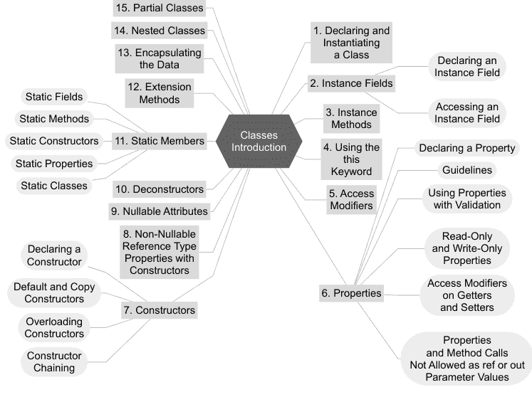

本章深入探讨了 C# 如何通过类、属性和访问修饰符等构造支持封装；我们在第 5 章涵盖了方法。第 7 章将在此基础上，引入了继承和面向对象编程所实现的多态。

## 初学者主题

### 面向对象编程

今天成功编程的关键在于能够在大型应用程序中组织和结构化复杂需求实现的能力。面向对象编程提供了实现这一目标的关键方法之一，以至于面向对象的程序员很难想象转换回结构化编程，除非是最微不足道的程序。

面向对象编程中是最基本的构造结构是类。一组类形成了一个编程的抽象、模型或模板，用于描述通常是现实世界中的概念。例如，`OpticalStorageMedia` 类可能有一个 `Eject()` 方法，用于将光盘从播放器中弹出。`OpticalStorageMedia` 类是现实世界中 CD 或 DVD 播放器对象的编程抽象。

类展示了面向对象编程的三个主要特性：封装、继承和多态。

### 封装

封装允许你隐藏细节。在需要时仍然可以访问细节，但通过智能地封装细节，使大型程序变得更容易理解，保护数据免受无意修改，并且代码变得更容易维护，因为代码更改的影响被限制在封装的范围内。方法就是封装的示例。虽然可以将方法中的代码提取并直接内联嵌入到调用者的代码中，但将代码重构为方法提供了封装的益处。

### 继承

考虑以下示例：DVD 驱动器是一种光介质设备。它具有特定的存储容量，以及存放数字电影的能力。CD 驱动器也是一种光介质，但它具有不同的特性。CD 上的复制保护与 DVD 复制保护不同，容量也不同。CD 驱动器和 DVD 驱动器与硬盘、内存卡和软盘驱动器不同。它们都属于存储设备，但每个都有特殊特性，即使对于基本功能（如支持的文件系统以及媒体实例是只读还是读写）也是如此。

面向对象编程中的继承允许你在这些相似但不同的项目之间形成“是一种”的关系。可以说，DVD 驱动器是“一种”存储介质，CD 驱动器也是“一种”存储介质，因此它们都具有存储容量。我们也可以合理地说：

第 6 章：类

它们都与“光存储介质”具有“是一种”的关系，而“光存储介质”反过来又是“一种”存储介质。

如果你为提到的每种存储设备类型定义相应的类，你就定义了一个类层次结构，这是一系列“是一种”的关系。所有设备都从中派生出的基类可以是 `StorageMedia` 类。因此，代表 CD 驱动器、DVD 驱动器、硬盘、USB 驱动器和软盘驱动器的类都派生自 `StorageMedia` 类。然而，CD 和 DVD 驱动器的类不需要直接派自 `StorageMedia`。相反，它们可以派自一个中间类 `OpticalStorageMedia`。你可以使用统一建模语言（UML）之类的类图图形化地查看类层次结构，如图 6.1 所示。

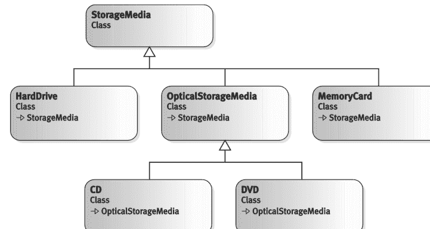

图 6.1 类层次结构

继承关系涉及至少两个类，其中一个类是另一个类的具体类型；在图 6.1 中，`HardDrive` 是 `StorageMedia` 的具体类型。虽然更具体的类型 `HardDrive` 是 `StorageMedia` 的一种，但反过来则不然——即 `StorageMedia` 的实例并不一定是 `HardDrive`。如图 6.1 所示，继承可以涉及两个以上的类。

第 6 章：类 297

更具体的类型称为派生类型或子类型（subtype）。更通用的类型称为基类型或超类型（super type）。基类型也称为父类型，而它的派生类型通常称为子类型。虽然这种用法很常见，但可能会引起困惑：毕竟子类不是父类的一种！在书中我们坚持使用派生类型和基类型。

从另一种类型继承是为了特化该类型，这意味着自定义基类型使其更适用于特定目的。基类型可能包含所有派生类型共有的实现细节。继承的关键是所有派生类型都继承基类的成员。通常，基类的实现可以被修改，但无论如何，派生类型在包含显式成员之外还包含了基类的成员。

派生类型允许你将类组织成连贯的层次结构，其中派生类型比基类型具有更高的具体性。

### 多态

多态源于词根 `poly`（多）和 `morph`（形式）。在对象的语境下，多态意味着同一个方法或类型可以有多种形式的实现。

假设你有一个播放器可以播放音乐 CD 和包含 MP3 的 DVD。然而，`Play()` 方法的具体实现会根据介质类型而异。在代表音乐 CD 的对象或代表音乐 DVD 的对象上调用 `Play()` 都可以，因为每个对象的类型都理解播放的细节。播放器只知道公共基类型 `OpticalStorageMedia` 以及它定义了 `Play()` 方法。

# 类的声明与实例化

定义一个类首先需要指定 `class` 关键字，随后跟一个标识符，如列表 6.1 所示。

列表 6.1：定义类

```csharp
public class Employee
{}
```

所有属于该类的代码将出现在类声明后的大括号之间。虽然这不是强制性要求，但通常你会将每个类放在它单独的文件中。这使得查找定义特定类的代码变得更容易，因为惯例是使用类名来命名文件。

> 指南
>
> - 避免在单个源文件中放置多个类。
>
> - 不要使用源文件所包含的公共类型名称为源文件命名。

一旦你定义了一个新类，就可以像使用框架内置类那样使用该类。换句话说，你可以声明一个该类型的变量，或者定义一个接收该新类类型作为参数的方法。列表 6.2 演示了此类声明。

列表 6.2：声明类类型的变量

```csharp
public class Program
{
    public static void Main()
    {
        Employee employee1, employee2;
        // ...
    }
    public static void IncreaseSalary(Employee employee)
    {
        // ...
    }
}
```

## 初学者主题

# 定义的对象与类

在日常对话中，“类”（class）和“对象”（object）这两个术语经常互换使用。然而，它们实际上有不同的含义。类是对象在实例化时样子的模板。因此，对象是类的实例。类是小部件（widget）外观的模具；对象对应于模具创建的小部件。从类创建对象的过程被称为实例化（instantiation），因为对象是类的实例。

现在你已经定义了一个新类类型，是时候实例化该类型的对象了。效仿其前者，C# 使用 `new` 关键字来实例化对象（参见列表 6.3）。

列表 6.3：实例化类

```csharp
public class Program
{
    public static void Main()
    {
        Employee employee1 = new Employee();
        Employee employee2;
        Employee employee3 = new Employee();

        IncreaseSalary(employee1);
        IncreaseSalary(employee2);
    }
    // ...
}
```

意不意外的是，赋值既可以在声明的同一语句中发生，也可以在单独的语句中发生。


与你目前为止过的原始类型不同，没有字面量方式来指定 `Employee`。相反，`new` 运算符提供了一个指令，让运行时为 `Employee` 对象分配内存、初始化对象并返回实例的引用。虽然你可以指定数据类型（`Employee`），但从 C# 9.0 开始，如果编译器可以从赋值的左侧推断出类型，则该指定是可选的。在这种情况下，编译器可以确定目标类型是 `Employee`，因此推断出 `new` 表达式用于实例化——即在调用构造函数时无需指定类型。尽管如此，当目标类型从代码行中并不明显时，开发者应该保持谨慎。例如，赋值 `text = new()` 并没有指示数据类型可能是什么。而且，虽然 `string` 可以被推断出来，但 `System.Text.StringBuilder` 也是一个显而易见的选择。因此，当数据类型不明显时，请避免使用目标类型表达式（target-typed expressions）。

## 指南

- 当构造函数的数据类型不明显时，避免使用目标类型 `new` 表达式。
- 当构造函数的数据类型显而易见时，考虑使用目标类型 `new` 表达式。

虽然存在分配内存的显式运算符，但没有释放内存的运算符。相反，运行时会在对象变得不可访问后的某个时间自动回收内存。垃圾收集器（garbage collector）负责自动释放内存。它确定哪些对象不再被其他活动对象引用，并释放这些对象的内存。因此，没有编译时确定的程序位置来处理内存释放。在这些示例中，`Employee` 的数据

# 声明与实例化

## 初学者主题

# 封装部分 1：方法

# 实例字段

# 第6章：类

> 语言对比：C++——`delete` 运算符
>
> 在 C++ 中，你负责释放内存。C# 自动管理这一点。

面向对象设计的关键方面之一是数据的分组。本节讨论如何向对象添加数据。类内部变量的通用术是成员变量。这个术语在 C# 中很容易理解，但规范中使用的术语是字段（field），它是与实例相关的命名存储单元。实例字段（Instance fields）是在类级别声明的变量。因此，关联是字段与包含类型之间的关系。

## 声明实例字段

在列表 6.4 中，`Employee` 类已被修改为三个字段：`FirstName`、`LastName` 和 `Salary`。

```csharp
列表 6.4：声明字段
public class Employee
{
    public string FirstName;
    public string LastName;
    public string Salary;
}
```

添加这些字段后，为每个 `Employee` 实例存储一些基本数据。在这种情况下，你在字段前加上了 `public` 访问修饰符。对字段使用 `public` 表示字段内部可以从其他类访问（参见后文的“访问修饰符”部分）。与局部变量声明一样，字段声明包含了字段引用的数据类型。此外，可以在声明时为字段分配初始值，列表 6.5 中的 `Salary` 字段所示。

```csharp
列表 6.5：在声明时设置字段初始值
// 代码完成前禁用可空字段未初始化警告
#pragma warning disable CS8618
public class Employee
{
    public string FirstName;
    public string LastName;
    public string Salary = "Not enough";
}
```

我们将字段的命名和编码指南推迟到本章的后半部分，即在介绍 C# 属性（https://essentialsharp.com/properties）和构造函数（https://essentialsharp.com/constructors）之后。足以说明，在此之前，列表并没有遵循标准的编码指南。事实上，存在大量的以下警告：

- `CS0649`：字段从未被赋值，且将始终具有默认值 `null`。
- `CS8618`：不可空字段未初始化。考虑将其声明为可空。

在这种情况下，由于 `FirstName` 和 `LastName` 没有初始化，它们触发了 `CS8618` 警告。

## 第 6 章：类

为了说明起见，这些警告被忽略了，并且在随附源代码中通过 `#pragma` 指令被禁用，直到在本章后面的部分完全开发了这些概念。

## 访问实例字段

你可以设置和检索字段中的数据。然而，字段不包含 `static` 修饰符意味着它是一个实例字段。你只能从包含该类的实例（即对象）访问实例字段。你不能直接从类访问它（换句话说，必须必须先创建实例）。

代码列表 6.6 展示了 `Program` 类及其对 `Employee` 类利用的更新视图，输出 6.1 显示了结果。

代码列表 6.6：访问字段

```csharp
public class Program {
    public static void Main() {
        Employee employee1 = new Employee();
        Employee employee2;
        employee2 = new Employee();
        
        employee1.FirstName = "Inigo";
        employee1.LastName = "Montoya";
        employee1.Salary = "Too Little";
        IncreaseSalary(employee1);
        Console.WriteLine($"{
            employee1.FirstName} {
            employee1.LastName}: {
            employee1.Salary}
        }");
        // ...
    }

    public static void IncreaseSalary(Employee employee) {
        employee.Salary = "Enough to survive on";
    }
}
```

# 输出 6.1

```
Inigo Montoya: Enough to survive on
```

代码列表 6.6 实例化了两个 `Employee` 对象，正如你之前看到的。它随后设置了每个字段，调用 `IncreaseSalary()` 来更改工资，并显示了与 `employee1` 引用的对象相关的每个字段。

注意，你首先必须指定你正在处理哪个 `Employee` 实例。因此，在赋值和访问字段时，`employee1` 变量作为字段名的名前缀出现。

## 实例方法

在 `Main()` 方法的 `WriteLine()` 调用中格式化名称的另一种替代方案，是在 `Employee` 类中提供一个方法来处理格式化。将功能更改在 `Employee` 类内部而不是 `Program` 的成员中，符合类的封装性。为什么不将与员工全名相关的方法与包含构成名称数据的类归在一起呢？代码列表 6.7 展示了此类方法的创建。

### 代码列表 6.7：从包含类内部访问字段

```csharp
public class Employee {
    public string FirstName;
    public string LastName;
    public string? Salary;

    public string GetName() {
        return $"{FirstName} {LastName}";
    }
}
```

此方法与你在第 5 章中学到的内容相比没有特别之处，只是现在 `GetName()` 方法访问的是对象上的字段而不仅仅是局部变量。此外，方法声明没有标记为 `static`。正如你在本章稍后看到的，`static` 方法直接访问类内的实例字段。相反，要调用任何实例成员（无论是方法还是字段），都必须获取该类的实例。

鉴于增加了 `GetName()` 方法，你可以更新 `Program.Main()` 来使用该方法，如代码列表 6.8 和输出 6.2 所示。

代码列表 6.8：从包含类外部访问字段

```csharp
public class Program {
    public static void Main() {
        Employee employee1 = new();
        Employee employee2;
        Employee employee2 = new();

        employee1.FirstName = "Inigo";
        employee1.LastName = "Montoya";
        employee1.Salary = "Too Little";
        IncreaseSalary(employee1);
        Console.WriteLine(" {employee1.GetName()}: {employee1.Salary}");
    }
    // ...
}
```

输出 6.2

Inigo Montoya: Enough to survive on

## 使用 `this` 关键字

你可以从属于该类的实例成员内部获取该类的引用。在 C# 中，为了显式表示访问的字段或方法是包含类的实例成员，你使用 `this` 关键字。在调用任何实例成员时，`this` 的使用是隐式的，它返回对象本身的实例。

例如，考虑代码列表 6.9 所示的 `SetName()` 方法。

### 代码列表 6.9：使用 `this` 识别字段

```csharp
public class Employee {
    public string FirstName;
    public string LastName;
    public string? Salary;

    public string GetName() {
        return $"{FirstName} {LastName}";
    }
}
```

`this` 关键字用于表示访问的字段或方法是 C# 中包含类的实例成员。在调用任何实例成员时，`this` 的使用是隐式的，它返回对象本身的实例。例如，考虑代码列表 6.9 所示的 `SetName()` 方法。

```csharp
public class Employee {
    public string FirstName;
    public string LastName;
    public string? Salary;

    public string GetName() {
        return $"{FirstName} {LastName}";
    }

    public void SetName(string firstName, string lastName) {
        this.FirstName = firstName;
        this.LastName = lastName;
    }
}
```

## 初学者主题

### 依靠代码风格避免歧义

在 `SetName()` 方法中，无法避免 `this`，因为 `FirstName` 和 `LastName` 与局部参数相同。然而，如果你使用不同的名称，可以像代码列表 6.0 所示那样避免。

```csharp
public class Employee {
    public string FirstName;
    public string LastName;
    public string? Salary;

    public string GetName() {
        return $"{FirstName} {LastName}";
    }

    public void SetName(string firstName, string lastName) {
        this.FirstName = firstName;
        this.LastName = lastName;
    }
}
```

# 使用文件存储和加载

`DataStorage` 中 `Store()` 方法的实际实现涉及 `System.IO` 命名空间中的类，如列表 6.13 所示。在 `Store()` 内部，你首先实例化 `FileStream` 对象并将其与员工全名对应的文件关联。`FileMode.Create` 参数表示，如果不存在名为 `<firstname><lastname>` 的文件，则将创建一个新文件；如果文件存在，则将覆盖它。接下来，你创建一个 `StreamWriter` 类，它负责向 `FileStream` 写入内容。你使用 `WriteLine()` 方法写入数据，就像写入控制台一样。

列表 6.13：数据持久化到文件

```csharp
public class DataStorage
{
    // 将员工对象保存到文件
    // 以员工名称命名
    // 未显示错误处理
    public static void Store(Employee employee)
{
        // 使用 FirstNameLastName.dat 实例化 FileStream
        // 作为文件名。FileMode.Create 将强制
        // 创建新文件或覆盖
        // 现有的文件
        // 注意：此代码可以使用 using
        // 语句进行改进 - 这是一个我们避免使用的
        // 结构，因为它还没有引入。
        FileStream stream = new(
            employee.FirstName + employee.LastName + ".dat",
            FileMode.Create);

        // 创建 StreamWriter 对象将文本
        // 写入 FileStream
        StreamWriter writer = new(stream);

        // 写入与员工关联的所有数据
        writer.WriteLine(employee.FirstName);
        writer.WriteLine(employee.LastName);
        writer.WriteLine(employee.Salary);

        // 释放 StreamWriter 及其流
        writer.Dispose(); // 关闭流
    }
}
```

```csharp
 // ...
}
```

一旦完成写入操作，都需要关闭 `FileStream` 和 `StreamWriter`，以免它们无限期地等待垃圾回收器的运行。列表 6.13 未包含任何错误处理，因此如果抛出异常，任何 `Close()` 方法都不会被调用。

加载过程也类似（请参见列表 6.14 及其输出 6.4）。

# 列表 6.14：从文件检索数据


```csharp
using System;
// IO 命名空间
using System.IO;

public class Employee
{
    // ...
}

public class DataStorage
{
    // ...
    public static Employee Load(string firstName, string lastName)
    {
        Employee employee = new();

        // 使用 FirstNameLastName.dat 实例化 FileStream
        // 作为文件名。FileMode.Open 将打开
        // 现有文件，否则报告错误
        FileStream stream = new(firstName + lastName + ".dat", FileMode.Open);

        // 创建 StreamReader 从文件中读取文本
        StreamReader reader = new(stream);

        // 从文件中读取每一行并将其放入
        // 关联的属性中。
        employee.FirstName = reader.ReadLine() ??
        throw new InvalidOperationException("FirstName cannot be null");
        employee.LastName = reader.ReadLine() ??
        throw new InvalidOperationException("LastName cannot be null");
```

# 使用关键字 313

```csharp
employee.Salary = reader.ReadLine();
```

```csharp
// 释放 StreamReader 及其 Stream
reader.Dispose(); // 关闭流
```

```csharp
return employee;
}
public class Program {
    public static void Main() {
        Employee employee1;
        Employee employee2 = new();
        employee2.SetName("Inigo", "Montoya");
        employee2.Save();
        // 在保存后修改 employee2
        IncreaseSalary(employee2);
        // 从 employee2 的保存版本加载 employee1
        employee1 = DataStorage.Load("Inigo", "Montoya");
        Console.WriteLine(
            "${employee1.GetName()}: {employee1.Salary}");
    }
// ...}
```

# 输出 6.4

Name 已更改为 'Inigo Montoya'

Inigo Montoya:

保存过程的反向出现在列表 6.14 中，它使用了 `StreamReader` 而不是 `StreamWriter`。同样，在读取数据后，需要在 `FileStream` 和 `StreamReader` 上都调用 `Close()`。

输出 6.4 在 Inigo Montoya: 之后没有显示薪水：因为在调用 `IncreaseSalary()` 到调用 `Save()` 之间，工资尚未设置为足够生存。

# 314 第 6 章：类

注意在 `Main()` 中，我们可以从员工实例调用 `Save()`，但要加载新员工，我们调用 `DataStorage.Load()`。要加载员工，我们通常已经没有可以加载进去的员工实例，因此在 `Employee` 上的实例方法是不理想的。在 `DataStorage` 上调用 `Load` 的替代方案是在 `Employee` 中添加一个静态 `Load()` 方法（参见本章稍后的“静态成员”部分），这样就可以调用 `Employee.Load()`（使用 `Employee` 类，而不是 `Employee` 的实例）。

# 访问修饰符

在章前面的部分声明字段时，你在字段声明前加上了 `public` 关键字。`public` 是一种访问修饰符，用于标识它所修饰成员的封装级别。共有七种访问修饰符：`public`、`private`、`protected`、`internal`、`protected internal`、`private protected` 和 `file`。本节考虑前两个。

> 初学者主题

# 封装部分2：信息隐藏

除了将数据和方法封装成单个单元之外，封装还涉及隐藏细节。面向对象编程实现了这一点，控制了成员的可见范围。

在面向对象编程中，封装是一个意味着分组数据和行为的术语，但也隐藏了类内部的细节。面向对象编程实现了这一点，控制了成员的可见范围。

上一节“访问修饰符”演示了你如何使用 `private` 关键字来封装密码，防止从类外部访问。这种封装并不十分严格，例如，有时你可能需要定义一些外部类只能读取但你可以在内部更改其值的字段。或者，也许你可能允许访问向类类写入某些数据，但你可能需要对数据所做的更改进行验证。在另一种场景中，也许你可能需要即时构建数据。传统上，语言通过将字段标记为 `private` 来启用这些示例中的功能。

但请考虑一个包含密码的 `Employee` 类。应该能够调用 `Employee` 对象并使用 `Logon()` 方法验证密码。相反，不应该能够在类外部访问 `Password` 字段。为了将 `Password` 字段定义为隐藏的且从类外部不可访问，你使用 `private` 关键字作为访问修饰符，代替 `public`（参见列表 6.15）。结果是 `Password` 字段只能从 `Employee` 类进行访问，例如。

# 列表 6.15：使用私有访问修饰符

```csharp
public class Employee
{
    public string FirstName;
    public string LastName;
    public string? Salary;
    // 仅限解密密码
    // 这是不建议的
    // 未初始化；等待构造函数的解释
    private string Password;
    private bool IsAuthenticated;

    public bool Logon(string password)
    {
        if(Password == password)
        {
            Authenticated = true;
        }
        return IsAuthenticated;
    }

    public bool GetAuthenticated()
    {
        return IsAuthenticated;
    }
}
```

```csharp
// ...
public class Program
{
    public static void Main()
    {
        Employee employee = new();

        employee.FirstName = "Inigo";
        employee.LastName = "Montoya";

        // ...

        // 错误：Password 是私有的，因此无法从
        // 类外部访问
        Console.WriteLine("Password = {0}", employee.Password);
    }
    // ...
}
```

尽管此选项在列表 6.15 中没有显示，但也可以使用 `private` 访问修饰符来修饰方法。

如果在类成员上没有放置访问修饰符，则默认为 `private`。换句话说，成员默认是私有的，程序员需要显式指定该成员是 `public` 的。

# 属性

上一节“访问修饰符”演示了你如何使用 `private` 关键字来封装密码，防止从类外部访问。这种封装并不十分严格，例如，有时你可能需要定义一些外部类只能读取但你可以在内部更改其值的字段。或者，也许你可能允许访问向类写入某些数据，但你可能需要对数据所做的更改进行验证。在另一种场景中，也许你可能需要即时构建数据。传统上，语言通过将字段标记为 `private` 来启用这些示例中的功能。

随后提供了 getter 和 setter 方法，用于访问和修改数据。

列表 6.16 中的代码将 `FirstName` 和 `LastName` 都更改为私有字段。

为每个字段提供的公共 getter 和 setter 方法允许其值被访问和更改。

# 列表 6.16：声明 getter 和 setter 方法

```csharp
public class Employee
{
    private string FirstName;
    // FirstName getter
    public string GetFirstName()
    {
        return FirstName;
    }
    // FirstName setter
    public void SetFirstName(string newFirstName)
    {
        if(newFirstName != null && newFirstName != "")
        {
            FirstName = newFirstName;
        }
    }

    private string LastName;
    // LastName getter
    public string GetLastName()
    {
        return LastName;
    }
    // LastName setter
    public void SetLastName(string lastName)
    {
        if(lastName != null && lastName != "")
        {
            LastName = lastName;
        }
    }
    //...
}
```

遗憾的是，这种更改影响了 `Employee` 类的可编程性。

你无法再次使用赋值运算符在类内部设置数据，也无法在不调用方法的情况下访问数据。

# 声明属性

考虑到这种模式的出现频率，C# 设计者为其提供了显式的语法支持。这种语法被称为属性（property）（请参见列表 6.17 和输出 6.5）。

列表 6.17：定义属性

```csharp
public class Program{
    public static void Main(){
        Employee employee = new();

        // 调用 FirstName 属性的 setter
        employee.FirstName = "Inigo";

        // 调用 FirstName 属性的 getter
        System.Console.WriteLine(employee.FirstName);
    }
}
public class Employee{
    // FirstName 属性
    public string FirstName {
        get{
            return _FirstName;
        }
        set{
            _FirstName = value;
        }
    }
    private string _FirstName;
// ...}
```

输出 6.5

```
Inigo
```

# 属性

在列表 6.17 中首先注意到的不是属性代码本身，而是 `Program` 类中的代码。虽然你不再拥有带有 `FirstName` 和 `LastName` 标识符的字段，但通过查看 `Program` 类无法看出这一点。访问员工姓和姓名的语法完全没有变化。仍然可以使用简单的赋值运算符来为名称的部分赋值——例如，`employee.FirstName = "Inigo";`

关键特性是，属性提供了一种在编程上看起来像字段的语法。实际上，并不存在这样的字段。属性声明看起来与字段声明完全一样，但紧随其后的是用于属性实现的大括号 `{}`。两个可选部分构成了属性实现。`get` 部分定义了属性的获取部分。它对应于列表 6.16 中定义的 `GetFirstName()` 和 `GetLastName()` 函数。要访问 `FirstName` 属性，你调用 `employee.FirstName`。同样，setter（实现中的 `set` 部分）启了字段赋值的调用语法：

```csharp
employee.FirstName = "Inigo";
```

属性定义语法使用了三个上下文关键字。你分别使用 `get` 和 `set` 关键字来识别属性的检索部分或赋值部分。此外，setter 使用 `value` 关键字来指代赋值操作的右侧。因此，当 `Program.Main()` 调用 `employee.FirstName = "Inigo";` 时，`value` 在 setter 内部设置为 "Inigo"，并可用于分配 `_FirstName`。列表 6.17 中的属性实现是最常用的。当调用 getter 时（例如在 `Console.WriteLine(employee.FirstName));` 中），将从字段 `_FirstName` 获取值并写入控制台。

也可以使用表达式主体成员（expression bodied members）¹声明属性 getter 和 setter，如列表 6.18 所示。

列表 6.18 使用了两种不同的语法来实现相同的属性。在实际世界的代码中，你应该尝试在语法选择上保持一致。

- 1. 从 C# 7.0 开始。

# 自动实现属性

列表 6.18：使用表达式主体成员定义属性

```csharp
public class Employee
{
    // FirstName 属性
    public string FirstName
    {
        get
        {
            return _FirstName;
        }
        set
        {
            _FirstName = value;
        }
    }
    private string _LastName;
    // LastName 属性
    public string LastName
    {
        get => _LastName;
        set => _LastName = value;
    }
    private string _LastName;
    // ...
```

由于通过 `get` 和 `set` 访问器分配和检索的单字段属性是如此简单且常见的（参见 `FirstName` 和 `LastName` 的实现），编译器允许在没有任何访问器实现或后台字段声明的情况下声明属性²。列表 6.19 展示了 `Title` 和 `Manager` 属性的语法。

列表 6.19：自动实现属性


```csharp
public class Program
{
    public static void Main()
    {
        Employee employee = new();

        // 调用 FirstName 属性的 setter
        employee.FirstName = "Inigo";

        // 调用 FirstName 属性的 getter
        System.Console.WriteLine(employee.FirstName);

        // 调用 Title 属性的 setter
        employee.Title = "Manager";

        // 调用 Title 属性的 getter
        System.Console.WriteLine(employee.Title);

        // 调用 Manager 属性的 setter
        employee.Manager = "Computer Nerd";

        // 调用 Manager 属性的 getter
        System.Console.WriteLine(employee.Manager);
    }
}

public class Employee
{
    // FirstName 属性
    public string FirstName
    {
        get
        {
            return _FirstName;
        }
        set
        {
            _FirstName = value;
        }
    }
    private string _FirstName;

    // LastName 属性
    public string LastName
    {
        get => _LastName;
        set => _LastName = value;
    }
    private string _LastName;

    // Title 属性
    public string Title
    {
        get => _Title;
        set => _Title = value;
    }
    private string _Title;

    // Manager 属性
    public string Manager
    {
        get => _Manager;
        set => _Manager = value;
    }
    private string _Manager;
    // ...
}
```

- 2. 从 `C# 3.0` 开始。

由于一个由 `get` 和 `set` 访问器进行分配和检索的单字段属性是如此简单且常见的，编译器允许在没有任何访问器实现或后台字段声明的情况下声明属性。输出 6.6 显示了 `Title` 和 `Manager` 属性的结果。

- 3. 从 `C# 6.0` 开始。

```csharp
public class Program
{
    public static void Main()
    {
        Employee employee = new();

        // 调用 FirstName 属性的 setter
        employee.FirstName = "Inigo";

        // 调用 FirstName 属性的 getter
        System.Console.WriteLine(employee.FirstName);

        // 调用 Title 属性的 setter
        employee.Title = "Manager";

        // 调用 Title 属性的 getter
        System.Console.WriteLine(employee.Title);

        // 调用 Manager 属性的 setter
        employee.Manager = "Computer Nerd";

        // 调用 Manager 属性的 getter
        System.Console.WriteLine(employee.Manager);
    }
}

public class Employee
{
    // FirstName 属性
    public string FirstName
    {
        get
        {
            return _FirstName;
        }
        set
        {
            _FirstName = value;
        }
    }
    private string _FirstName;

    // LastName 属性
    public string LastName
    {
        get => _LastName;
        set => _LastName = value;
    }
    private string _LastName;

    // Title 属性
    public string Title
    {
        get => _Title;
        set => _Title = value;
    }
    private string _Title;

    // Manager 属性
    public string Manager
    {
        get => _Manager;
        set => _Manager = value;
    }
    private string _Manager;
    // ...
}
```

输出 6.6

```
Inigo
Manager
Computer Nerd
```

# 第 6 章：类

输出 6.6

```
Inigo
```

自动实现属性属性提供了一种更简单的属性编写方式。此外，当对属性添加诸如验证逻辑时，任何调用该属性的代码将不再需要更改。

关于自动实现属性的最后一点注意是，可以像列表 19 所示对其进行初始化³：

```csharp
public string Salary { get; set; } = "Not Enough";
```

# 属性和字段指南

由于可以使用显式的 setter 方法而不是属性，有时会产生关于使用属性还是方法更好的问题。一般指南是：方法代表操作，而属性代表数据。预计调用属性的开销不会比访问字段大得多。

关于命名，注意在列表 19 中属性名是 `FirstName`，而字段名是 `_FirstName`——即带有下划线前缀的 PascalCase。属性的私有字段的其他命名约定包括 `_firstName` 以及有时使用的像局部变量一样的 camelCase⁴。然而，应该避免 camelCase 约定。这是因为用于属性名的 camelCase 与用于局部变量和参数的命名约定相同，这意味着名称重叠非常可能。此外，为了尊重封装原则，字段不应声明为公共。

无论你对私有字段使用何种命名模式，属性的代码标准都是 PascalCase。因此，属性应该使用名词、名词短语或形容词。例如，`Person` 对象上类型为 `Address` 的 `Address` 属性。事实上，属性名称与其类型相同的情况并不罕见。

我们倾向于使用 `_FirstName`，因为相比之下，名字前面的 `m` 是必要的。此外，通过使用与属性相同的大小写，在 Visual Studio 代码模板扩展工具中只需要一个字符串，而不需要为属性名和字段名都提供一个。

³ 从 `C# 6.0` 开始。

⁴ 参见 Microsoft 命名规范。

# 第 6 章：类

- 将所有实例字段声明为私有（并通过属性暴露它们）。
- 使用帕斯卡命名命名法（PascalCase）为属性命名。
- 优先使用自动实现属性而不是字段。
- 如果没有额外的实现逻辑，优先使用自动实现属性，而不是使用完全展开的属性。

## 使用带有验证的属性

请注意列表 6.20，`Employee` 类的 `Initialize()` 方法在赋值时也使用了属性而不是字段。虽然这不是强制要求的，但结果是属性设置器（setter）中的任何验证逻辑在类内部外部都会被调用。例如，考虑一下如果你更改 `LastName` 属性，使其在赋值给 `_LastName` 之前检查是否为空或空字符串，会发生什么。（记住，即使数据是非可空字符串，检查空值也是必要的，因为调用者可能禁用了可空引用类型，或者方法可能从 `C# 7.0` 或更早版本调用——即可空引用类型出现之前。）

## 列表 6.20：提供属性验证

```csharp
public class Employee
{
    // ...
    public void Initialize(
        string firstName, string lastName)
    {
        // 在 Employee 类内部 
        // 也使用属性
        FirstName = firstName;
        LastName = lastName;
    }
}

// LastName 属性
public string LastName
{
    get => _LastName;
    set
    {
        // ...
        // 验证 LastName 赋值
        ArgumentException.ThrowIfNullOrEmpty(value = value?.Trim()!);
        // ...
        _LastName = value;
    }
    private string _LastName;
}
```

通过这种新实现，如果为 `LastName` 分配了无效值，代码将抛出异常，无论来自同一类的其他成员，还是通过 `Program.Main()` 内部直接赋值给 `LastName`。拦截赋值并通过提供类似字段的 API 来验证参数的能力是属性的优势之一。

在属性实现内部访问备字段（backing field）是一个良好的做法。换句话说，你应该始终使用属性而不是直接调用字段。在许多情况下，这一原则即使对于属性所在类中的代码也适用。如果你遵循这一做法，你就可以添加诸如验证之类的代码，整个类将立即受益.^5

虽然罕见，但在设置器内部进行赋值是可能的，列表 6.20 所示。在这种情况下，对 `value.Trim()` 的调用删除了新姓值周围的任何空格。

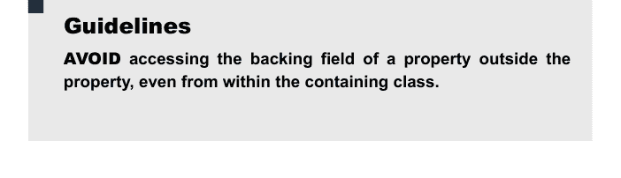

## 指南

- 避免在属性外部访问属性的备字段，即使是在包含类的内部也是如此。

> ^5. 如章节后文所述，这种例外发生在字段被标记为 `readonly` 时，因为此时值只能在构造函数中设置。在 `C# 6.0` 中，你可以直接为只读属性赋值，从而完全消除了对只读字段的需求。

## 只读和只写属性

通过移除属性的获取访问器（getter）或设置器（setter）部分，你可以更改属性的访问权限。仅包含设置器的属性是只写的，这相对罕见。同样，只提供获取访问器将导致属性变为只读；任何尝试赋值的尝试都会导致编译错误。例如，要使 `Id` 变为只读，你将使用列表 6.21 所示的代码。

## 列表 6.21：在 C# 6.0 之前定义只读属性

```csharp
public class Program
{
    public static void Main()
    {
        Employee employee1 = new();
        employee1.Initialize(42);

        // 错误：属性或索引器 'Employee.Id'
        // 不能赋值；它是只读的
        employee1.Id = "498";
    }
}
```

```csharp
public class Employee
{
    public void Initialize(int id)
    {
        // 使用字段，因为 Id 属性没有设置器；
        // 它是只读的
        _Id = id.ToString();
    }

    // ...
    // Id 属性声明
    public string Id
    {
        get => _Id;
        // 未提供设置器
    }
    private string _Id;
}
```

列表 6.21 在 `Employee.Initialize()` 方法内部为字段赋值而不是属性（`_Id = id`）。通过属性赋值会导致编译错误，正如 `Program.Main()` 中发生的情况。

同时也支持只读的自动实现属性，^6 如下：

```csharp
public bool[] Cells { get; } = new bool[9];
```

关于只读自动实现属性的一个重要说明是，与只读字段一样，编译器要求此类属性通过自动属性初始化器（或在构造函数中）进行初始化。在前面的代码段中，我们使用了初始化器，但也允许从构造函数内部为 `Cells` 赋值，正如我们很快看到的。

根据字段不应从其封装属性外部访问的指南，程序员应该改用只读的、自动实现的属性。唯一的例外可能是只读可修改字段的数据类型与属性的数据类型不匹配——例如，如果字段是 `int` 类型，而只读属性是 `double` 类型。

> 指南

> **如果属性值不应更改，请创建只读属性。**

> **请创建只读的自动实现属性，而不是备字段。**

## 计算属性

在在某些情况下，你完全不需要备字段。相反，获取访问器返回一个计算值，而设置器则解析该值并将其持久化到其他字段中。例如，考虑列表 6.22 所示的 `Name` 属性。

## 列表 6.22：定义计算属性

```csharp
public class Program
{
    public static void Main()
    {
        Employee employee1 = new();
        employee1.Name = "Inigo Montoya";
        Console.WriteLine(employee1.Name);
    }
}

public class Employee
{
    // ...
    public string Name
    {
        get => $"{FirstName} {LastName}";
        set 
        {
            // 将赋值的值拆分为姓和名
            string[] names;
            names = value.Split(new char[] { ' ' });
            if (names.Length == 2)
            {
                FirstName = names[0];
                LastName = names[1];
            }
            else
            {
                // 如果未分配全名，则抛出异常
                throw new ArgumentException("赋值的值 '{value}' 无效", nameof(value));
            }
        }
    }

    // FirstName 属性
    public string FirstName
    {
        get => _FirstName;
        set => _FirstName = value;
    }
    private string _FirstName;

    // LastName 属性
    public string LastName
    {
        get => _LastName;
        set => _LastName = value;
    }
    private string _LastName;
}
```

## 输出 6.7

| Inigo Montoya |

## 获取访问器和设置器上的访问修饰符

如前所述，从属性外部访问字段不是良好的做法，因为这样做会绕过可能插入的验证或额外逻辑。

访问修饰符可以出现在属性实现的 get 或 set 部分（不能同时出现），从而覆盖属性声明中指定的访问修饰符。列表 6.23 展示了如何这样做。

## 列表 6.23：在设置器上放置访问修饰符

```csharp
public class Program
{
    public static void Main()
    {
        Employee employee1 = new();
        employee1.Initialize(42);
        // 错误：属性或索引器 'Employee.Id'
        // 在在此文中中使用，因为设置访问器
        // 是不可用的
        employee1.Id = "496";
    }
}
```


```csharp
public class Employee
{
    public void Initialize(int id)
    {
        // 设置 Id 属性
        Id = id.ToString();
    }

    //...
    // Id 属性声明
    public string Id
    {
        get => _Id;
        private set => _Id = value;
    }
    private string _Id;
}
```

+   6. 引入于 C# 2.0。C# 1.0 不允许属性的设置器部分具有不同层次的封装。因此，无法创建一个公共获取访问器和私有设置器，以便外部类对属性具有只读访问权限，而类内部代码可以写入。

```csharp
private string _Id;
}
```

通过在 `setter`（设置器）上使用 `private`，该属性对 `Employee` 类以外的类是只读的。在 `Employee` 内部，该属性显示为读/写，因此你可以在类内部为属性赋值。在 `getter`（访问器）或 `setter` 上指定访问修饰符时，注意访问修饰符必须比属性本身的访问修饰符更严格。例如，将属性声明为 `private` 而将 `setter` 声明为 `public` 会导致编译错误。

## 指南

- **必须**对所有属性的 `getter` 和 `setter` 实现适当的访问修饰符。
- **不要**提供仅设置（`set-only`）的属性或 `setter` 访问权限比 `getter` 更大的属性。

# 属性和方法调用不能作为 ref 或 out

`C#` 允许像使用字段一样使用属性，除非将它们作为 `ref` 或 `out` 参数值传递时。`ref` 和 `out` 参数值在内部通过将内存地址传递给目标方法来实现。然而，由于属性可能没有底层字段，或者可能是只读或只写的，因此无法传递底层存储的地址。结果是，不能将属性作为 `ref` 或 `out` 参数值传递。方法调用也是如此。相反，当代码需要将属性或方法调用作为 `ref` 或 `out` 参数值传递时，必须首先将值复制到变量中，然后传递该变量。方法调用完成后，代码必须将变量赋值回属性。

# 第 6 章：类

## 高级主题

# 属性内部机制

列表 6.24 显示 `getter` 和 `setter` 在公共中间语言 `CIL` 中被暴露为 `get_FirstName()` 和 `set_FirstName()`。

### 列表 6.24：由属性生成的 CIL 代码

```il
// /
.field private string _FirstName
.method public hidebysig special instance string
  get_FirstName() cil managed
{
  // 代码大小 12 (0xc)
  .maxstack 1
  .locals init (string V_0)
IL_0000: nop
IL_0001: ldarg.0
IL_0002: ldfld      string Employee::FirstName
IL_0007: stloc.
IL_0008: br.s IL_000a

IL_000a: ldloc.0
IL_000b: ret
} // 方法 Employee::get_FirstName 结束
```

```il
.method public hidebysig special instance void
  set_FirstName(string 'value') cil managed
{
  // 代码大小 9 (0x9)
  .maxstack 8
IL_0000: nop
IL_0001: ldarg.1
IL_0002: stfld
IL_0003: ret      string Employee::_FirstName
IL_0008: ret
} // 方法 Employee::set_FirstName 结束
```

```il
.property instance string FirstName()
{
  .get instance string Employee::get_FirstName()
  .set instance void Employee::set_FirstName(string)
} // 属性 Employee::FirstName 结束
```

与普通方法的外观同样重要的事实是，属性也是 `CIL` 中的一种显式结构。正如列表 6.25 所示，`getter` 和 `setter` 是被 `CIL` 属性调用的，而属性是 `CIL` 代码中的显式结构。正因如此，语言和编译器并不限于总是根据命名约定来解释属性。相反，`CIL` 属性为编译器和代码编辑器提供了提供特殊语法的手段。

# 列表 6.25：属性是 CIL 中的显式结构

```il
.property instance string FirstName()
{
    .get instance Program::FirstName()
    .set instance void Program::FirstName(string)
} // 属性 Program:FirstName 结束
```

注意列表 6.24，`getter` 和 `setter` 是属性的一部分，包含 `specialName` 元数据。这个修饰符是 Visual Studio 等集成开发环境（IDE）用作标记，以从 IntelliSense 中隐藏这些成员。

自动实现的属性与你显式定义底层字段的属性几乎相同。在手动定义的底层字段所在处，`C#` 编译器在 `CIL` 中生成一个名为 `<PropertyName>k_BackingField` 的字段。此生成的字段包含一个属性（见第 18 章），称为 `System.Runtime.CompilerServices.CompilerGeneratedAttribute`。`getter` 和 `setter` 都装饰有相同的属性，因为它们也是被生成的——其实现方式与列表 5.23 和 5.24 相同。

# 构造函数

现在你已经为类添加了字段并可以存储数据，你需要考虑这些数据的有效性。正如你在列表 6.6 中看到的，可以使用 `new` 运算符实例化对象。然而，结果是可能会创建一个带有无效数据的员工。在赋值 `employee` 之后，你拥有一个名称和薪水未初始化的 `Employee` 对象。在列表 6.6 中，你将在实例化 `employee` 之后立即分配了未初始化的字段——但如果你没有进行初始化，将不会收到编译器的警告。结果，你可能会得到一个名称无效的 `Employee` 对象。（从技术上讲，在 C# 8.0 中，非可空引用类型将触发警告，建议将数据类型切换为可空以避免默认值为 `null`。无论如何，都需要进行初始化以避免实例化字段包含无效数据的对象。）

# 声明主构造函数

为了解决这个问题，你需要提供一种方法在创建对象时指定所需的数据。你确实使用构造函数来实现这一点，如列表 6.26 所示。

### 列表 6.26：主构造函数

```csharp
// 员工构造函数
public class Employee(string firstName, string lastName)
{
    public string FirstName { get; set; } = firstName;
    public string LastName { get; set; } = lastName;
    public string Salary { get; set; } = "Not Enough";

    // ...
}
```

为了修正这个问题，你需要提供一种在创建对象时指定所需数据的方法。你确实使用构造函数来实现这一点，如列表 6.26 所示。

### 列表 6.27：调用构造函数

```csharp
public class Program
{
    public static void Main(){
        Employee employee;
        employee = new Employee("Inigo", "Montoya");
        employee.Salary = "Too Little";

        System.Console.WriteLine("{0} {1}; {2}",
            employee.FirstName,
            employee.LastName,
            employee.Salary);
    }
}
```

注意 `new` 运算符返回了实例的类型。此外，名和姓的初始化是通过属性初始化完成的。在这个例子中，你没有在构造函数初始化 `Salary`。

## 高级主题

# new 运算符的实现细节

在内部，`new` 运算符与构造函数之间的交互如下：`new` 运算符从内存管理器获取“空”内存，然后调用指定的构造函数，并将空内存作为隐式参数传递。接下来，执行构造函数链的剩余部分，在构造函数之间传递。构造函数都没有返回类型；行为上它们返回 `void`。当构造函数链执行完成后，`new` 运算符返回内存引用，此时指向初始化后的内存。

# 定义构造函数

也可以在类型声明定义构造函数。正如列表 6.28 所示，要定义（非主）构造函数，你需要创建一个没有返回类型的方法，其方法名与类型名相同。即使构造函数的实现中没有指定返回类型或返回语句，调用构造函数（通过 `new` 运算符）仍然会返回类型实例。

### 列表 6.28：定义构造函数

```csharp
public class Employee
{
    // 员工构造函数
    public Employee(string firstName, string lastName)
    {
        FirstName = firstName;
        LastName = lastName;
    }

    public string FirstName { get; set; }
    public string LastName { get; set; }
    public string? Salary { get; set; } = "Not Enough";

    // ...
}
```

## 构造函数

当你显式添加构造函数时，你将无法在从 `Main()` 中不指定名和姓的情况下实例化 `Employee` 对象。因此，列表 6.29 所示的代码将无法编译。

### 列表 6.29: 默认构造函数不再可用

```csharp
public class Program
{
    public static void Main()
    {
        Employee employee;

        // 错误：没有重载方法 'Employee'
        // 取 '0' 个参数
        employee = new Employee();

        // ...
    }
}
```

如果一个类没有显式定义的构造函数，`C#` 编译器会在编译期间添加一个。该构造函数不接受任何参数，因此根据定义，它是**默认构造函数**。一旦你为类添加了显式构造函数，**C# 编译器**就不再提供默认构造函数了。因此，在定义了 `Employee(string firstName, string lastName)` 后，编译器不会再添加默认构造函数 `Employee()`。你可以手动再次添加一个，允许在不指定员工姓名的情况下构造 `Employee`。

没有必要依赖编译器定义的默认构造函数。也就是说，程序员可以显式定义一个默认构造函数——例如将某些字段初始化为特定值的构造函数。定义默认构造函数只需声明一个不接受任何参数的构造函数。

**拷贝构造函数**是一个接收包含类型单一参数的构造函数。例如：

```csharp
public Employee(Employee original)
{
    // 在此处拷贝员工之间的之间的属性。
}
```

这样的构造函数对于将对象的实例克隆到新的重复实例非常有用。

## 对象初始化器

为了初始化对象的可访问字段和属性，你可以使用对象初始化器的概念——这是在构造函数调用之后，用大括号括起来的一组成员初始化器，用于创建对象。每个成员初始化器都是将一个可访问字段或属性名赋以一个值（见列表 6.30）。

### 列表 6.30: 使用显式成员赋值调用对象初始化器

```csharp
public class Program {
    public static void Main()
    {
        Employee employee = new("Inigo", "Montoya");
        Title = "Computer Nerd", Salary = "Not enough";
        // ...
    }
}
```

注意，即使在使用对象初始化器时，相同的构造函数规则也适用。`C#` 中成员初始化器的顺序提供了从构造函数调用之后到 `CIL` 之前的语句中属性和字段赋值的序列。

通常情况下，在构造函数退出时，所有属性都应该被初始化为合理的默认值。此外，通过在设置器（`setter`）上使用验证逻辑，可以限制向属性分配无效数据。有时，一个或多个属性的值可能会导致同一对象上的其他属性包含无效值。当这种情况发生时，来自无效状态的异常应该被推迟，直到相关的属性值变得相关。

> 指南
>
> 务必为所有属性提供合理的默认值，确保默认值不会导致安全漏洞或严重低效的代码。
>
> 必须允许按任何顺序设置属性，即使这会导致对象处于暂时的无效状态。

## 进阶主题

### 集合初始化器

使用与对象初始化器类似的语法，集合初始化器支持与对象初始化器类似的功能，只是针对集合的。具体来说，集合初始化器允许在集合实例化时为集合中的项赋值。借用用于数组的相同语法，集合初始化器在创建时初始化集合中的每个项。例如，初始化 `Employee` 对象的列表需要在构造函数调用后的大括号内指定每个项，如列表 6.31 所示。

### 列表 6.31: 调用对象初始化器

```csharp
public class Program {
    public static void Main() {
        List<Employee> employees = new() {
            new("Inigo", "Montoya"),
            new("Kevin", "Bost")
        };
        //...
    }
}
```

在分配新集合实例后，编译器将生成实例化。集合初始化器允许在集合实例化时为集合中的项赋值。

使用与对象初始化器类似的语法，集合初始化器支持与对象初始化器类似的功能，只是针对集合的。具体来说，集合初始化器允许在集合实例化时为集合中的项赋值。借用用于数组的相同语法，集合初始化器在创建时初始化集合中的每个项。例如，初始化 `Employee` 对象的列表需要在构造函数调用后的大括号内指定每个项，如列表 6.31 所示。

### 列表 6.31: 调用对象初始化器

```csharp
public class Program {
    public static void Main() {
        List<Employee> employees = new() {
            new("Inigo", "Montoya"),
            new("Kevin", "Bost")
        };
        //...
    }
}
```

在分配新集合实例后，编译器将生成实例化。

### 仅初始化 setter

对象初始化器允许在初始化期间设置属性。然而，由于只读属性在初始化器之后无法设置，为了解决这个问题，`C# 9.0` 增加了 `init` 访问器，可以在初始化期间进行设置。

### 列表 6.32: 仅初始化 setter

```csharp
public class Employee
{
    public Employee(int id, string name)
    {
        Id = id;
        Name = name;
    }

    // ...

    public int Id { get; }
    public string Name { get; }

    public string? Salary
    {
        get => _Salary;
        init => _Salary = value;
    }
    private string? _Salary;
}

public class Program
{
    public static void Main()
    {
        Employee employee = new(42, "Inigo Montoya")
        {
            Salary = "Sufficient"
        };

        // 错误：属性 'Employee.Salary'
        // 在初始化后无法赋值。
        employee.Salary = "Enough";
    }
}
```

注意，虽然你可以在初始化期间设置 `Salary` 的值，但在初始化完成后无法更改该值。它是只读的。

带有额外的参数。考虑使用可选参数而非重载，这样“设置默认值”属性的默认值在 API 中是可见的。例如，构造函数签名 `Person(string firstName, string lastName, int? age = null)` 提供了文档说明：如果没有指定 `age`，它将默认为 `null`。同时请注意，构造函数也可以使用表达式体形式实现，如下所示：


```csharp
// LastName inside Id property.
#pragma warning disable CS8618
public Employee(int id) => Id = id;
```

在这种情况下，通过调用 `Id` 属性来分配 `FirstName` 和 `LastName`。遗憾的是，编译器无法检测到赋值，并且从 C# 8.0 开始，会发出警告建议将这些属性声明为可空。由于我们实际上确实设置了它们，因此禁用了该警告。

## 指南

- 如果构造函数参数仅用于设置属性，为构造函数参数（camelCase）和属性（PascalCase）使用相同的名称。
- 提供可选参数或构造函数重载以使用默认值初始化属性。

## 构造函数链：调用另一个构造函数

注意在列表 6.33 中，`Employee` 对象的初始化代码现在多处重复，因此也必须在多个地方进行维护。虽然代码量很少，但有方法可以通过构造函数初始化器从一个构造函数调用另一个构造函数来消除重复——这种做法被称为构造函数链。构造函数初始化器会在执行当前构造函数的实现体之前确定调用哪个构造函数（见列表 6.34）。从 C# 7.0 开始

### 列表 6.34：从一个构造函数调用另一个构造函数

```csharp
public class Employee
{
    public Employee(string firstName, string lastName)
    {
        FirstName = firstName;
        LastName = lastName;
    }

    public Employee(int id, string firstName, string lastName)
        : this(firstName, lastName)
    {
        Id = id;
    }

    // FirstName and LastName inside Id setter.
    #pragma warning disable CS8618
    public Employee(int id)
    {
        Id = id;

        // Look up employee name...
        // ...

        // NOTE: Member constructors cannot be called explicitly inline
        this(id, lastName);
    }
    #pragma warning restore CS8618

    public int Id { get; private set; }
    public string FirstName { get; set; }
    public string LastName { get; set; }
    public string? Salary { get; set; } = "Not";
    // ...
}
```

要在同一个类中从一个构造函数调用另一个（针对同一个对象实例），C# 使用冒号后跟 `this` 关键字，然后是被调用构造函数声明参数列表。在这种情况下，接收所有参数的构造函数调用了接收两个参数的构造函数。通常这种调用模式是反过来的——即参数最少的构造函数调用参数最多的构造函数，并为未知的参数传递默认值。

## 主题：集中初始化

注意在列表 6.34 的 `Employee(int id)` 构造函数实现中，你无法调用 `this(firstName, lastName)`，因为该构造函数不存在这些参数。为了启用所有初始化代码都通过一个方法完成的模式，必须创建一个单独的方法，如列表 6.35 所示。

### 列表 6.35：提供初始化方法

```csharp
public class Employee {
    // FirstName and LastName inside Initialize() method.
    #pragma warning disable CS8618
    public Employee(string firstName, string lastName) {
        int id;
        // Generate an employee ID.
        // ...
        Initialize(id, firstName, lastName);
    }
    public Employee(int id, string firstName, string lastName) {
        Initialize(id, firstName, lastName);
    }
    public Employee(int id) {
        string firstName;
        string lastName;
        Id = id;
        // Look up employee data
        // ...
        Initialize(id, firstName, lastName);
    }
}
```

```csharp
#pragma warning restore CS8618
private void Initialize(
    int id, string firstName, string lastName)
{
    Id = id;
    FirstName = firstName;
    LastName = lastName;
}
// ...
```

在这种情况下，该方法命名为 `Initialize()`，它接收姓名和员工 ID。注意，你仍然可以像列表 6.34 所示，从一个构造函数调用另一个构造函数。

与通过 `Id` 属性设置 `LastName` 和 `FirstName` 未被编译器检测到一样，通过 `Initialize` 方法进行的赋值也不会被检测到，因此禁用了警告。

## 带有构造函数的不可空引用类型属性

在本章中，我们一贯地禁用了 C# 的可空警告。

> CS8618: 非可空字段/属性未初始化。考虑将其声明为可空。

当你声明引用类型 (1) 不可空字段或 (2) 不可空自动实现属性时，显而易见这些字段和属性在包含对象完全实例化之前需要初始化。如果不这样做，这些字段和属性将保持默认 `null` 值——因此它们不应被声明为非可空。

问题在于，不可空字段和属性经常被间接初始化，超出了构造函数的直接作用范围，因此超出了编译器的代码分析范围，即使它们实际上仍然被初始化了。以下是一些示例：

- 带有检查值是否为 `null` 的简单属性（见 6.20）。
- 由构造函数初始化的不可空字段或属性。
- 以 6.35 所示方式初始化的不可空字段或属性。
- 通过反射或依赖注入等外部代理初始化的不可空字段或属性。

在大多数情况下，应该避免使用读写不可空类型，特别是带有公共 `setter` 的类型，因为防止 `null` 赋值是有困难的。虽然可以通过从构造函数赋值属性来避免未初始化的非空属性编译器警告，但这是不够的。

# 带有构造函数的非可空引用类型属性

- 后备字段被声明为可空，以避免编译器产生该字段未初始化的警告。
- 访问器器使用 null 忽略运算符（null-forgiveness operator）返回字段——声明由于设置器的验证，该字段不为 null。

对于非可空属性，将后备字段声明为 null 似乎是不合逻辑的。然而，这是必要的，因为编译器对构造函数之外的非空字段/属性赋值是不感知的。幸运的是，在这种情况下，你作为程序员，在返回字段时使用 null 忽略运算符是合理的，因为设置器中的非空检查确保了字段（在赋值前）为空。

# 只读自动实现的引用类型属性

正如本节早些指出的，非空自动实现的引用类型属性需要是只读的，以避免无效的 null 赋值。然而，你仍然需要验证实例化期间可能赋值的任何参数，如列表 6.37 所示。

> 列表 6.37：非空引用类型自动实现属性的验证

```csharp
public class Employee {
    public Employee(string name) {
        Name = name ?? throw new ArgumentNullException(nameof(name));
    }
    public string Name { get; }
}
```

人们可能会争论是否允许非空自动实现的引用类型属性具有私有设置器。虽然这是可能的，但更合适的问题是你的类是否会误将 null 赋值给属性。如果你不在设置器中使用验证来封装字段，你能够确定自己不会错误地赋值 null 值吗？虽然编译器会在实例化期间验证你的意图，但开发者是否总是记得对进入类的本应为非空的值进行 null 检查是怀疑的——正如列表 6.37 所示的构造函数那样。

## 指南

- **必须**实现带有可空后备字段的非空读/写完全实现属性，在从访问器返回字段时使用 null 忽略运算符，并在属性设置器中进行非空验证。
- **必须**在实例化完成之前为非空引用类型属性赋值。
- **必须**将非空引用类型自动实现属性实现为只读。
- **必须**对所有在实例化完成前未定义的引用类型属性和字段使用可空检查。

# required 修饰符

在 C# 11 中，设计人员增加了将字段或属性标记为 `required` 的能力。这将其指定为“要求的”，以便它们必须在构造期间在对象初始化器内部赋值（见列表 6.38）。

列表 6.38：使用 Required 修饰符

```csharp
public class Book
{
    string? _Title;
    public required string Title
    {
        get
            return _Title!;
        set
        {
            _Title = value ?? throw new ArgumentNullException(nameof(value));
        }
    }

    string? _Isbn;

    public required string Isbn
    {
        get {
            return _Isbn!;
        }
        set {
            _Isbn = value ?? throw new ArgumentNullException(nameof(value));
        }
    }

    public string? Subtitle { get; set; }
    //...
}

public class Program
{
    public static void Main() {
        //...
        Book book = new() {
            Isbn = "978-01335972267",
            Title = "Harold and the Purple Crayon"
        };
    }
}
```

通过添加 `required` 修饰符，我们无法在不提供一个为 Isbn 码和 Title 提供值的对象初始化器的情况下实例化书籍（见列表 6.39）。

列表 6.30：在对象初始化器中指定要求的成员

```csharp
// 错误 CS9835:
// 要求的成员 'Book.Isbn' 必须在对象初始化器
// 或属性构造函数中设置
Book book = new() { Title="Essential C#" };
//...
```

# 第 6 章：类

注意，由于我们没有为 Book 包含显式构造函数，我们依赖于自动生成的默认构造函数来实例化 Book。这是理想的，因为要求的成员定义了如何构造对象以代替任何构造函数。为要求的成员提供带参数的构造函数将导致既需要在构造函数参数中指定值，又需要在对象初始化器中冗余指定值。例如，带有 Title 参数的构造函数将导致如下实例化：

```csharp
Book book = new("A People's History of the United States")
{
    Title = "A People's History of the United States",
    Isbn = "978-0062397348";
};
```

为了避免这种冗余，你可以用 `SetsRequiredMembers` 特性修饰构造函数，指示编译器在调用关联构造函数时禁用所有对象初始化器要求。有效来说，`SetsRequiredMembers` 属性告诉编译器开发者将负责设置所有要求的成员，因此编译器可以忽略对初始化赋值的检查。遗憾的是，几乎没有验证这种初始化是否发生过——编译器并不检查。请查看列表 6.40 的如何使用 `SetsRequiredMembers` 属性的示例。

列表 6.40：禁用要求的对象初始化

```csharp
[SetsRequiredMembers]
public Book(int id)
{
    Id = id;

    // 查找书籍数据
    //...
//...
}
```

并且，鉴于这样的构造函数，我们可以实例化书籍：

```csharp
Book book = new(42) {
    Subtitle = "The Comprehensive Guide"
};
```

# 带有构造函数的非可空引用类型属性

对于非可空属性，将后备字段声明为 null 似乎是不合逻辑的。然而，这是必要的，因为编译器对构造函数之外的非空字段/属性赋值是不感知的。幸运的是，在这种情况下，你作为程序员，在返回字段时使用 null 忽略运算符是合理的，因为设置器中的非空检查确保了字段（在赋值前）为空。

# 只读自动实现的引用类型属性

正如本节早些指出的，非空自动实现的引用类型属性需要是只读的，以避免无效的 null 赋值。然而，你仍然需要验证实例化期间可能赋值的任何参数，如列表 6.37 所示。

# required 修饰符

在 C# 11 中，设计人员增加了将字段或属性标记为 `required` 的能力。这将其指定为“要求的”，以便它们必须在构造期间在对象初始化器内部赋值（见列表 6.38）。

通过添加 `required` 修饰符，我们无法在不提供一个为 Isbn 码和 Title 提供值的对象初始化器的情况下实例化书籍（见列表 6.39）。

# 第 6 章：类

注意，由于我们没有为 Book 包含显式构造函数，我们依赖于自动生成的默认构造函数来实例化 Book。这是理想的，因为要求的成员定义了如何构造对象以代替任何构造函数。为要求的成员提供带参数的构造函数将导致既需要在构造函数参数中指定值，又需要在对象初始化器中冗余指定值。例如，带有 Title 参数的构造函数将导致如下实例化：

为了避免这种冗余，你可以用 `SetsRequiredMembers` 特性修饰构造函数，指示编译器在调用关联构造函数时禁用所有对象初始化器要求。有效来说，`SetsRequiredMembers` 属性告诉编译器开发者将负责设置所有要求的成员，因此编译器可以忽略对初始化赋值的检查。遗憾的是，几乎没有验证这种初始化是否发生过——编译器并不检查。请查看列表 6.40 的如何使用 `SetsRequiredMembers` 属性的示例。

# 可空属性

与其禁用可空类型或可空警告，有时为编译器提供关于可空意图的提示是有帮助的。这可以通过直接放入代码中的元数据——属性来实现（见第 18 章）。共有七种不同的可空属性，每个都定义在 `System.Diagnostics.CodeAnalysis` 命名空间中，并识别为前置条件或后置条件（表 6.1）。

| 特性 | 类别 |  |

|---|---|---|

| AllowNull | 前置条件 | 非空输入参数可能为 null。 |

| DisallowNull | 前置条件 | 可空输入参数不应为 null。 |

| MaybeNull | 后置条件 | 非空返回值可能为 null。 |

| NotNull | 后置条件 | 可空返回值永远不为 null。 |

| MaybeNullWhen | 后置条件 | 方法返回指定的 bool 值时，非空输入参数可能为 null。 |

| NotNullWhen | 后置条件 | 方法返回指定的 bool 值时，可空输入参数不会为 null。 |

| NullIfNotNull | 后置条件 | 如果指定参数的值不为 null，则返回值不为 null。 |

## 列表 6.41: 使用 NullWhen 和 NullIfNotNull 特性

```c
using System.Diagnostics.CodeAnalysis;
// ...
 static bool TryGetDigitAsText(
    char number, [NotNullWhen(true)]out string text) =
    (text = number switch
    {
        '1' => "one",
        '2' => "two",
        '3' => "three",
        '4' => "four",
        // ...
        '9' => "nine",
        => null
    }) is not null;
```


```csharp
// C# 11/.NET 7.0 之前不支持在参数上使用 nameof(text)
[return: NullIfIfNotNull(nameof(text))]
static public string TryGetDigitsAsText(string text)
{
    if (text == null) return null;

    string result = "";
    foreach (char character in text)
    {
        if (TryGetDigitAsText(character, out string digitText))
        {
            if (result != "") result += '-';
            result += digitText.ToLower();
        }
    }
    return result;
}
```

注意，从 `TryGetDigitAsText()` 调用 `digitText.ToLower()` 时即使 `text` 被声明为可空，没有使用合并运算符也不会发出警告。这是因为 `TryGetDigitAsText()` 中的 `text` 参数装饰了 `NullWhen(true)` 特性，它告知编译器：如果方法返回 true（`NullWhen` 特性指定的值），则你的意图是 `digitText` 不为空。`NullWhen` 特性是一个后置条件声明，告知调用者如果方法返回 true，则输出 `(text)` 不为空。

同样，对于 `GetDigitsAsText()`，如果为 `text` 参数指定的值不为空，则返回值将不为空。这是因为前置条件空值特性 `NullIfNotNull` 根据参数 `text` 参数的输入值是否为空来决定返回值是否可能为空。

## 进阶主题

### 使用 Null 修饰符对泛型类型参数进行装饰

在声明泛型修饰符或类型时，你偶尔可能想为类型参数装饰一个可空修饰符。问题在于，可空类型（`Nullable<T>`）与可空引用类型是不同的数据类型。因此，装饰了可空性的类型参数将需要一个约束，将类型参数限制为值类型或引用类型。如果没有这个约束，你将收到以下错误：

```
Error CS8627 类型参数必须已知为值类型或非可空引用类型。考虑添加 'class'、'struct' 或类型约束。
```

然而，如果值类型和引用类型的逻辑是相同的，那么实现两个不同的方法可能会令人沮丧——特别是由于不同的约束不会导致不同的签名，从而无法重载。考虑 6.42 中的代码。

#### 列表 6.42: 带有 MaybeNull 特性的潜在返回

```csharp
// ...
[return: MaybeNull]
static public T GetObject<T>(IEnumerable<T> sequence, Func<T, bool> match)
=>
// ...
```

假设行为是：如果满足 `match` 谓词，则返回该项。然而，如果不存在该项，意图是返回 `default(T)`，对于引用类型这是一个空。遗憾的是，编译器不允许 `T?`。为了在避免警告的同时告知调用者返回可能为空，我们使用后置条件 `MaybeNull` 特性并将返回类型保持为 `T`（无可空修饰符）。

## 解构函数

构造函数允许你获取多个参数并将它们封装到一个对象中。直到现在，我们还没有引入反向操作——将封装的项拆解为部分的构造。当然，你可以手动将每个属性赋值给变量；但如果有大量的变量，将需要许多语句。然而，通过元组，这变得简单得多。例如，你可以声明像列表 6.43 显示的 `Deconstruct()` 方法。

#### 列表 6.43: 定义和使用解构函数

```csharp
public class Employee
{
    // ...
    public void Deconstruct(
        out int id, out string firstName,
        out string lastName, out string salary)
    {
        (id, firstName, salary) =
        (Id, FirstName, Salary);
    }
    // ...
}

public class Program
{
    public static void Main()
    {
        Employee employee;
        employee = new ("Inigo", "Montoya")
        {
            // 使用初始化器语法
            Salary = "Not Enough"
        };
        // ...
        employee.Deconstruct(out _, out string firstName,
        out string lastName, out string salary);

        System.Console.WriteLine(
            "{0} {1}: {2}",
            firstName, lastName, salary);
        );
    }
}
```

这种方法可以像第 5 章预期那样通过内联参数直接调用。然而，如列表 6.44 所示，你可以通过直接将对象实例赋值给元组来隐式地调用 `Deconstruct()` 方法——解构函数。

#### 列表 6.44: 隐式调用解构函数

```csharp
public class Program
{
    public static void Main()
    {
        Employee employee;
        employee = new ("Inigo", "Montoya")
        {
            // 使用初始化器语法
            Salary = "Not Enough"
        }
        // ...
        (_, string firstName, lastName, string? salary) = employee;

        System.Console.WriteLine(
            "{0} {1}: {2}",
            firstName, lastName, salary);
        );
    }
}
```

该语法生成的 CIL 代码与列表 6.43 中高亮的代码相同——只是语法更简单（且不那么明显调用了 `Deconstruct()` 方法）。注意，该语法允许使用元组语法匹配 `out` 参数赋值。它不允许赋值元组类型：

```csharp
(int, string, string, string) tuple = employee;
```

或者使用带命名的项：

```csharp
(int id, string firstName, string lastName, string salary) tuple = employee
```

要声明解构函数，方法名必须是 `Deconstruct`，签名返回 `void` 并仅接受两个或多个 `out` 参数。给定这样的签名，可以将对象实例直接赋值给元组而无需显式调用。注意，在 C# 10 之前，所有赋值值都需要声明。在 C# 10 中，这一限制被消。

## 静态成员

第 1 章中的 HelloWorld 示例简单提到了静态。本节更完整地定义了 `static` 关键字。首先，让我们考虑一个示例。假设每个员工的 `Id` 需要是唯一的。实现这一点的方法是存储一个计数器来跟踪每个员工。然而，如果将值存储为实例字段，则每次实例化对象都会创建一个新的 `NextId` 字段，导致每个 `Employee` 实例都消耗该字段的内存。最大的问题是，每实例化一次 `Employee`，之前实例化对象的 `NextId` 值都需要更新为下一个 ID。在这种情况下，你需要一个所有 `Employee` 实例共享的字段。

### 语言对比：C++——全局变量和函数

与其之前的语言不同，C# 没有全局变量或全局函数。C# 中的所有字段和方法都出现在类的上下文中。在 C# 领域，全局字段或函数的等效物是静态字段或函数。全局变量/函数与 C# 静态字段/方法之间没有功能上的区别，静态字段/方法可以包含 `private` 等访问修饰符，从而限制访问并提供更好的封装。

### 静态字段

要定义跨实例可用的数据，你使用 `static` 关键字，如列表 6.45 所示。

#### 列表 6.45: 声明静态字段

```csharp
public class Employee
{
    public Employee(string firstName, string lastName)
    {
        FirstName = firstName;
        LastName = lastName;
        Id = NextId;
        NextId++;
    }
    // ...

    public static int NextId;
    public int Id { get; set; }
    public string FirstName { get; set; }
    public string LastName { get; set; }
    public string? Salary { get; set; } = "Not Enough";

    // ...
}
```

12. 在 C# 7.0 中引入。

在增加 `Id` 之前，立即将新 `Employee` 对象的 `Id` 值赋值为 `NextId`。当创建 `Employee` 类的另一个实例时，`NextId` 会增加，新 `Employee` 对象的 `Id` 字段将持有不同的值。

就像实例字段（非静态字段）可以在声明时初始化一样，静态字段也是如此，如列表 6.46 所示。

#### 列表 6.46：在声明时为静态字段

```sharp
public class Employee
{
  //...
  public static int NextId = 42;
  //...
}
```

与实例字段不同，如果未为静态字段提供初始化，则静态字段将自动分配其默认值（0、null、false 等）——这等同于 `default(T)`，其中 `T` 是类型的名称。因此，即使在 C# 代码中从未显式地为该静态字段赋值，也可能访问它。

非静态字段（或实例字段）为每个所属的对象提供了新的存储位置。相比之下，静态字段不属于实例，而是属于类本身。因此，你通过类名从类外部访问静态字段。考虑列表 6.47 所示的新的 `Program` 类（使用列表 6.45 中的 `Employee` 类以及输出 6.8）。

#### 列表 6.47：访问静态字段

```csharp
using System;

public class Program
{
  public static void Main()
  {
    Employee.NextId = 1000000;

    Employee employee1 = new(
      "Inigo", "Montoya");
    Employee employee2 = new(
      "Princess", "Buttercup");

    Console.WriteLine(
      "{0} {1} ({2})",
      employee1.FirstName,employee1.LastName,employee1.Id);
    Console.WriteLine(
      "{0} {1} ({2})",
      employee2.FirstName,employee2.LastName,employee2.Id);
    Console.WriteLine(
      "$NextId = {Employee.NextId}");
  }
}
// ...
```

#### 输出 6.8

Inigo Montoya (1000000)

Princess Buttercup (1000001)

NextId = 1000002

要设置并检索 `NextId` 静态字段的初始值，你应该使用类名 `Employee`，而不是类型实例的引用。唯一可以省略类名的地方是类内部（或派生类内部）。换句话说，在其他 `Employee.NextId` 中，`Employee(..)` 构造函数没有使用 `Employee.NextId`，因为该代码出现在 `Employee` 类本身的语境中，因此该语境是隐含的。变量的作用域是该变量可以通过其未限定名称被引用的程序语境；静态字段的作用域是类（以及任何派生类）的语境。

尽管你引用静态字段的方式与引用实例字段略有不同，但在同一个类中无法定义一个具有相同名的静态字段和实例字段。由于误引用错误字段的可能性很高，因此 C# 设计者决定防止此类代码出现。因此，名称的重叠会在声明空间内引入冲突。

### 数据可以同时与类和对象关联

类和对象都可以都可以拥有关联的数据，就像它们创建的模具和组件一样。

例如，一个模具可能拥有对应于所创建组件数量的数据、下一个组件的序列号、注入模具的塑料的当前颜色，以及它每小时生产的组件数量。同样，一个组件有自己的序列号、颜色，可能还有创建组件的日期和时间。虽然组件的颜色对应于组件创建时模具内塑料的颜色，但它显然不包含对应于当前模具中塑料颜色的数据，或即将产生的下一个组件的序列号。

在设计对象时，程序员应该注意恰当地声明字段、属性和方法，确定是静态的还是实例的。通常情况下，你应该将不访问任何数据的方法声明为静态方法。同样，静态字段存储与类对应的数据，例如新实例的默认值或已创建的实例数量。实例字段存储与对象关联的数据。

### 静态方法

与静态字段一样，你直接通过类名访问静态方法——例如 `Console.ReadLine()`。此外，不需要实例即可访问该方法。

列表 6.48 提供了另一个关于声明和调用静态方法的示例。

#### 列表 6.48：在 DirectoryInfoExtension 上定义静态方法

```csharp
public static class DirectoryInfoExtension
{
    public static void CopyTo(
        DirectoryInfo sourceDirectory, string target,
        SearchOption option, string searchPattern)
    {
        if (target[target.Length - 1] != Path.DirectorySeparatorChar)
        {
            target += Path.DirectorySeparatorChar;
        }
        Directory.CreateDirectory(target);

        for (int i = 0; i < searchPattern.Length; i++)
        {
            foreach (string file in
                Directory.EnumeratedFiles(
                    sourceDirectory.FullName, searchPattern))
            {
                File.Copy(file,
                    target + Path.GetFileName(file), true);
            }
        }

        // 拷贝子目录（递归地）
        if (option == SearchOption.AllDirectories)
        {
            // ...
        }
    }
}
```

*(注：此处提供的原文代码块似乎存在逻辑重复或混乱，翻译时已按原文结构进行对齐)*

*(由于原文文本在列表 6.48 之后存在大量的逻辑重复和代码片段混合，以下将严格基于原文呈现的文本进行翻译)*

#### 输出 6.8

Inigo Montoya (1000000)

Princess Buttercup (1000001)

NextId = 1000002

要设置并检索 `NextId` 静态字段的初始值，你应该使用类名 `Employee`，而不是类型实例的引用。唯一可以省略类名的地方是类内部（或派生类内部）。换句话说，在其他 `Employee.NextId` 中，`Employee(..)` 构造函数没有使用 `Employee.NextId`，因为该代码出现在 `Employee` 类本身的语境中，因此该语境是隐含的。变量的作用域是该变量可以通过其未限定名称被引用的程序语境；静态字段的作用域是类（以及任何派生类）的语境。

尽管你引用静态字段的方式与引用实例字段略有不同，但在同一个类中无法定义一个具有相同名的静态字段和实例字段。由于误引用错误字段的可能性很高，因此 C# 设计者决定防止此类代码出现。因此，名称的重叠会在声明空间内引入冲突。

### 数据可以同时与类和对象关联

类和对象都可以拥有关联的数据，就像它们创建的模具和组件一样。

例如，一个模具可能拥有对应于所创建组件数量的数据、下一个组件的序列号、注入模具的塑料的当前颜色，以及它每小时生产的组件数量。同样，一个组件有自己的序列号、颜色，可能还有创建组件的日期和时间。虽然组件的颜色对应于组件创建时模具内塑料的颜色，但它显然不包含对应于当前模具中塑料颜色的数据，或即将产生的下一个组件的序列号。


在设计对象时，程序员应该注意恰当地声明字段、属性和方法，确定是静态的还是实例的。通常情况下，你应该将不访问任何数据的方法声明为静态方法。同样，静态字段存储与类对应的数据，例如新实例的默认值或已创建的实例数量。实例字段存储与对象关联的数据。

## 静态方法

与静态字段一样，你直接通过类名访问静态方法——例如 `Console.ReadLine()`。此外，不需要实例即可访问该方法。

列表 6.48 提供了另一个关于声明和调用静态方法的示例。

### 列表 6.48：在 DirectoryInfoExtension 上定义静态方法

```csharp
public static class DirectoryInfoExtension
{
    public static void CopyTo(
        DirectoryInfo sourceDirectory, string target,
        SearchOption option, string searchPattern)
    {
        if (target[target.Length - 1] != Path.DirectorySeparatorChar)
        {
            target += Path.DirectorySeparatorChar;
        }
        Directory.CreateDirectory(target);

        for (int i = 0; i < searchPattern.Length; i++)
        {
            foreach (string file in
                Directory.EnumeratedFiles(
                    sourceDirectory.FullName, searchPattern))
            {
                File.Copy(file,
                    target + Path.GetFileName(file), true);
            }
        }

        // 拷贝子目录（递归地）
        if (option == SearchOption.AllDirectories)
        {
            // ...
        }
    }
}
```

## LISTING 6.47: 访问静态字段

```csharp
using System;

public class Program
{
  public static void Main()
  {
    Employee.NextId = 1000000;

    Employee employee1 = new(
      "Inigo", "Montoya");
    Employee employee2 = new(
      "Princess", "Buttercup");

    Console.WriteLine(
      "{0} {1} ({2})",
      employee1.FirstName,employee1.LastName,employee1.Id);
    Console.WriteLine(
      "{0} {1} ({2})",
      employee2.FirstName,employee2.LastName,employee2.Id);
    Console.WriteLine(
      "$NextId = {Employee.NextId}");
  }
}
// ...
```

## OUTPUT 6.8

Inigo Montoya (1000000)

Princess Buttercup (1000001)

NextId = 1000002

要设置并检索 `NextId` 静态字段的初始值，你应该使用类名 `Employee`，而不是类型实例的引用。唯一可以省略类名的地方是类内部（或派生类内部）。换句话说，在其他 `Employee.NextId` 中，`Employee(..)` 构造函数没有使用 `Employee.NextId`，因为该代码出现在 `Employee` 类本身的语境中，因此该语境是隐含的。变量的作用域是该变量可以通过其未限定名称被引用的程序语境；静态字段的作用域是类（以及任何派生类）的语境。

尽管你引用静态字段的方式与引用实例字段略有不同，但在同一个类中无法定义一个具有相同名的静态字段和实例字段。由于误引用错误字段的可能性很高，因此 C# 设计者决定防止此类代码出现。因此，名称的重叠会在声明空间内引入冲突。

## 数据可以同时与类和对象关联

类和对象都可以拥有关联的数据，就像它们创建的模具和组件一样。

例如，一个模具可能拥有对应于所创建组件数量的数据、下一个组件的序列号、注入模具的塑料的当前颜色，以及它每小时生产的组件数量。同样，一个组件有自己的序列号、颜色，可能还有创建组件的日期和时间。虽然组件的颜色对应于组件创建时模具内塑料的颜色，但它显然不包含对应于当前模具中塑料颜色的数据，或即将产生的下一个组件的序列号。

在设计对象时，程序员应该注意恰当地声明字段、属性和方法，确定是静态的还是实例的。通常情况下，你应该将不访问任何数据的方法声明为静态方法。同样，静态字段存储与类对应的数据，例如新实例的默认值或已创建的实例数量。实例字段存储与对象关联的数据。

## 静态构造函数

除了静态字段和方法，C# 支持静态构造函数。静态构造函数作为初始化类而非实例的方法。此类构造函数不被显式调用；相反，运行时会在首次访问类时自动调用它们。因为静态构造函数无法显式调用，所以它们不允许参数。

你使用静态构造函数来初始化类内部的数据为特定值，特别是当初始值比简单的赋值更复杂时。考虑列表 6.49。

### 列表 6.49：声明静态构造函数

```csharp
public class Employee
{
    static Employee()
    {
        Random randomGenerator = new();
        NextId = randomGenerator.Next(101, 999);
    }
    //...
    public static int NextId = 42;
    //...
}
```

## 高级主题

### 优先在声明时进行静态初始化

静态构造函数在访问类的任何成员（静态字段、另一个静态成员或实例构造函数）之前执行。为了支持这种做法，运行时会检查所有静态成员和构造函数，以确保静态构造函数首先运行。如果没有静态构造函数，编译器会将所有静态成员初始化为它们的默认值，并避免添加静态构造函数检查。结果是静态赋值初始化将在访问任何静态字段之前调用，但并不在调用任何静态方法或任何构造函数之前调用。

如果静态成员的初始化开销很大且在访问静态字段之前不需要，则可能会提供性能改进。出于此原因，你应该考虑内联初始化静态字段而不是使用静态构造函数，或者在声明时初始化它们。

> 指南
> 
> 考虑内联初始化静态字段，而不是显式地使用静态构造函数或声明赋值值。

## 静态属性

你也可以将属性声明为静态的。例如，列表 6.50 将下一个 ID 的数据封装在一个属性中。

### 列表 6.50：声明静态属性

```csharp
public class Employee
{
    // ...
    public static int NextId
    {
        get
            return _NextId;
        }
        private set
        {
            _NextId = value;
        }
    }
    public static int _NextId = 42;
    // ...
}
```

使用静态属性几乎比使用公共静态字段更好，因为公共静态字段可以从任何地方调用，而静态属性至少提供了某种程度的封装。

整个 `NextId` 的实现——包括一个不可访问的备份字段——可以简化为带有初始化器的自动实现属性：

```csharp
public static int NextId { get; private set; } = 42;
```

## 静态类

某些类不包含任何实例字段。例如，考虑一个 `SimpleMath` 类，它具有对应数学操作 `Max()` 和 `Min()` 的函数，如列表 6.51所示。

### 列表 6.51：声明静态类

```csharp
public static class SimpleMath
{
  // params允许参数的数量变化
  public static int Max(int[] numbers)
  {
    // 检查 numbers 中是否至少有一个项
    if (numbers.Length == 0)
    {
      throw new ArgumentException(
        "numbers cannot be empty", nameof(numbers));
    }

    int result;
    result = numbers[0];
    foreach(int number in numbers)
    {
      if (number > result)
      {
        result = number;
      }
    }
    return result;
  }

  // params 允许参数的数量变化
  public static int Min(int[] numbers)
  {
    // 检查 numbers 中是否至少有一个项
    if (numbers.Length == 0)
    {
      throw new ArgumentException(
        "numbers cannot be empty", nameof(numbers));
    }

    int result;
    result = numbers[0];
    foreach(int number in numbers)
    {
      if (number < result)
      {
        result = number;
      }
    }
    return result;
  }
}
```

```csharp
public class Program
{
    public static void Main(string[] args)
    {
        int[] numbers = new int[args.Length];
        for (int index = 0; index < args.Length; index++)
        {
            numbers[index] = int.Parse(args[index]);
        }
        Console.WriteLine($"Longest argument = {SimpleMath.Max(numbers)}");
        Console.WriteLine($"Shortest argument = {SimpleMath.Min(numbers)}");
    }
}
```

该类没有任何实例字段（或方法），创建这样一个类是毫无意义的。因此，该类被装饰了 `static` 关键字。类上的 `static` 关键字提供了两个好处。首先，它防止程序员编写实例化该类的代码。其次，它防止在类内部声明任何实例字段或方法。

静态类的另一个显著特征是，C# 编译器会自动在 CIL 中将其标记为 `abstract`（抽象）和 `sealed`（密封）。这使得该类变为不可扩展；换句话说，没有类可以派生自它，甚至实例化。（`sealed` 和 `abstract` 关键字将在第7章中详细介绍。）

在第5章中，我们看到 `using` 指令可以用于像 `SimpleMath` 这样的静态类。例如，在列表 6.51 顶部添加 `using static SimpleMath;` 将允许你在不带前缀的情况下调用 `Max`：

```csharp
Console.WriteLine($"Longest argument = {Max(numbers)}");
```

## 扩展方法

考虑 `System.IO.DirectoryInfo` 类，它用于操作目录。该类支持列出文件和子目录的功能（`DirectoryInfo.GetFiles()`），以及移动目录的能力（`DirectoryInfo.Move()`）。如果你需要这样的方法，你就必须实现它，如之前列表 6.48 所示。

`DirectoryInfoExtension.CopyTo()` 方法是一个静态方法声明。然而，注意调用此 `CopyTo()` 方法与调用 `DirectoryInfo.Move()` 方法不同。这是很遗憾的。理想情况下，我们希望为 `DirectoryInfo` 添加一个方法，这样给定一个实例，我们就可以作为实例方法调用 `CopyTo()`：`directory.CopyTo()`。

你可以通过扩展方法在不同的类上模拟实例方法的创建。要做到这一点，我们只需要更改静态方法的签名，使第一个参数——即我们正在扩展的数据类型——以 `this` 关键字为前缀（另见列表 6.52）。

### 列表 6.52：DirectoryInfoExtension 的静态 CopyTo 方法

```csharp
public static class DirectoryInfoExtension
{
    public static void CopyTo(
        this DirectoryInfo sourceDirectory, string target,
        SearchOption option, string searchPattern)
    {
        // ...
        DirectoryInfo directory = new DirectoryInfo(sourceDirectory);
        directory.CopyTo(target, SearchOption.TopDirectoryOnly, "*");
        // ...
    }
}
```


通过扩展方法，现在可以为任何类（包括程序集之外的类）添加“实例方法”。然而，生成的 CIL 代码与作为普通静态方法调用扩展方法时产生的几乎相同。

扩展方法的要求如下：

- 第一个参数对应于方法所扩展或操作的类型。
- 要指定扩展方法，请为第一个参数加上 `this` 修饰符。
- 要作为扩展方法访问它，请使用 `using` 指令导入类型的命名空间（或将扩展类放在相同的命名空间中）。

如果扩展方法的签名与扩展类型上已签名匹配（例如，如果 `DirectoryInfo` 已经存在 `CopyTo()`），则扩展方法将无法作为扩展方法被调用。

注意，通过继承来特化类型（第7章详细介绍）通常比使用扩展方法更好。扩展方法不提供良好的版本控制机制，因为扩展类型添加匹配签名将优先于扩展方法，且不会发出警告。对于你无法控制源码的扩展类，这种微妙性更为明显。另一个小问题是，虽然开发环境 IDE 支持扩展方法的提示，但仅通过阅读代码并无法看出某个方法是扩展方法。

总来说，你应该谨慎地使用扩展方法。例如，不要在 `object` 类型上定义它们。第8章将讨论如何与接口结合使用扩展方法。在没有这种关联的情况下，定义扩展方法是-

> 指南
> 避免轻率地定义扩展方法，特别是对于你不拥有的类型。

# 封装数据

除了我们在本章早期阶段讨论的属性和访问修饰符外，还有其他特殊方法可以封装类内部的数据。例如，有两种字段修饰符。第一个是 `const` 修饰符，你在声明局部变量时遇到过。第二个是定义字段为只读的能力。

## const

与 `const` 值一样，`const` 字段包含一个编译时确定的值，该值在运行时无法更改。如 `pi` 这样的值是常量字段声明的候选对象。列表 6.53 显示了声明常量字段的示例。

```csharp
public class ConvertUnits
{
    public const float CentimetersPerInch = 2.54F;
    public const int CupsPerGallon = 16;
}
```

常量字段（Constant fields）是静态的，因为每个对象实例都不需要新的字段实例。显式将常量字段声明为 `static` 会导致编译错误。此外，常量字段通常只为具有字面量值的类型声明（例如 `string`、`int` 和 `double`）。`Program` 或 `System.Guid` 等类型不能用于常量字段。

公共常量表达式中使用的类型在时间上应该是永久的，这一点非常重要（请参见“公共常量应该是永久值”高级章节）。诸如 `pi`、阿伏加德罗数和地球周长等值都是很好的例子。然而，可能随时间改变的值则不然。例如，人口数量、最贫穷的国家和汇率都是作为常量的糟糕选择。

### 指南

- **应当（DO）**对永远不会改变的值使用常量字段。
- **避免（AVOID）**对会随时间改变的值使用常量字段。

### 高级主题

#### 公共常量应该是永久值

公开访问的常量应该是永久的，因为更改常量的值并不一定会在使用它的程序集中立即生效。如果一个程序集引用了另一个程序集的常量，该常量的值会被直接编译到引用程序集中。因此，如果被引用程序中的值被更改但没有重新编译引用程序集，引用程序集将仍然使用原始值而不是新值。未来可能变化的值应该被指定为 `readonly`。

# 第 6 章：类

## readonly

与 `const` 不同，`readonly` 修饰符仅用于字段（不用于局部变量）。它声明该字段值只能从构造函数内部或通过初始化器进行修改。列表 6.54 展示了如何声明一个只读字段。

### 列表 6.54：将字段声明为 readonly

```csharp
public class Employee
{
    public Employee(int id)
    {
        _Id = id;
    }
    // ...
    private readonly int _Id;
    public int Id
    {
        get { return _Id; }
    }
    // 错误：只读字段不能被赋值（构造函数或
    // 变量初始化器除外）
    public void setId(int id) =>
        _Id = id;
    // ...
}
```

与常量字段不同，带有 `readonly` 修饰符的字段可以在不同实例之间变化。事实上，只读字段的值可以在构造函数内部更改。此外，只读字段可以作为实例字段或静态字段出现。另一个关键区别是，你可以在运行时为只读字段赋值，而不仅仅是在编译时。鉴于 `readonly` 字段必须在构造函数或初始化器中设置，此类字段是编译器要求从相应属性外部代码访问字段的唯一情况。除了这个异常外，你应该避免从包装属性之外的任何地方访问备份字段（backing field）。

带有 `readonly` 修饰符的字段相对于 `const` 字段的另一个重要特性是，只读字段并不局限于具有字面量值的类型。例如，可以声明一个只读的 `System.Guid` 实例字段：

```csharp
public static readonly Guid UnknownGuid =
    new Guid("00000000-0000-0000-0000-000000000046");
```

相比之下，使用常量是无法做到的，因为 C# 中没有 GUID 的字面量表示。

根据“字段不应在其包装属性之外访问”的指南，这些编程人员会发现几乎总是需要使用 `readonly` 修饰符¹⁵。相反，最好使用本章早些部分讨论的只读自动实现属性。

### 列表 6.55：声明一个只读自动实现属性

```csharp
class TicTacToeBoard
{
    // 将两个玩家的初始棋盘都设为 false（空白）
    // / | |
    // / | |
    // / | |
    // / | |
    // / | |
    // / | |
    // Player 1 - X  Player 2 - 0 = new bool[2, 3, 3];
    public bool[,,] Cells { get; } = new bool[2, 3, 3]; // 固定语法逻辑
    // 错误：属性 Cells 无法
    // 被赋值，因为它是只读的
    // public void SetCells(bool[,] value) =>
    //     _Cells = new bool[2, 3, 3];
    // /
}
```

只读自动实现属性或字段上的 `readonly` 修饰符确保了数组引用的不可变性，这是一种防御性编码技术。它确保数组实例保持不变，同时允许数组内的元素发生变化。如果没有只读限制，很容易错误地将新数组分配给成员，从而丢弃现有数组而不是更新单个数组元素。换句话说，对数组使用只读方法并不会冻结数组的内容。相反，它冻结了数组实例（因此是数组元素的数量），因为无法将值重新分配给新实例。数组的元素仍然可写的。

15. 在 C# 6.0 或更高版本中。

### 指南

优先使用只读自动实现属性而不是只读字段。

# 嵌套类

在类内部定义方法和字段之外，还可以在类内部定义一个类。此类类被称为**嵌套类**（nested classes）。当一个类在包含类之外意义不大时，你就可以使用嵌套类。

在类内部定义方法和字段之外，还可以在类内部定义一个类。此类类被称为嵌套类。

嵌套类的一个独特特性是可以为类本身指定 `private` 访问修饰符。由于此类的目的是解析命令行并将每个参数放入单独的字段中，`Program.CommandLine` 在此应用程序中仅相对于 `Program` 类。使用 `private` 访问修饰符定义了类的预期可访问性，并防止从类外部访问。只有当类是嵌套时，你才能这样做。

考虑一个处理命令行选项的类。列表 6.56 展示了这样一个嵌套类。

### 列表 6.56：定义嵌套类

```csharp
// CommandLine 嵌套在 program 内部
public class Program
{
    // 定义一个用于处理行的私有类
    private class CommandLine
    {
        public CommandLine(string[] arguments)
        {
            for (int argumentCounter = 0; argumentCounter < arguments.Length; argumentCounter++)
            {
                // ...
            }
        }
    }
}
```

```csharp
{
  0 => Action = arguments[0].ToLower(),
  1 => Id = arguments[1],
  2 => FirstName = arguments[2],
  3 => LastName = arguments[3],
  => throw new ArgumentException(
    "unexpected argument " +
    argumentCounter)
  );
}
public string? Action { get; }
public string? Id { get; }
public string? FirstName { get; }
public string? LastName { get; }
```

```csharp
public static void Main(string[] args)
{
  CommandLine commandLine = new(args);
  // 故意遗漏了错误处理。
  switch (commandLine.Action)
  {
    case "new":
      // 创建新员工
      // ...
      break;
    case "update":
      // 更新现有员工的数据
      // ...
      break;
    case "delete":
      // 现有员工的文件
      // ...
      break;
    default:
      Console.WriteLine(
        "Employee.exe " +
        "new|update|delete " +
        "<id>[firstname] [lastname]");
      break;
}
}
```

此此示例中的嵌套类是 `Program.CommandLine`。与所有类成员一样，在包含类内部不需要包含类的标识符，因此你只需简单地将其引用为 `CommandLine`。

嵌套类中的成员指的是嵌套类的实例，而不是包含类的实例。嵌套类访问包含类实例的一种方法是显式传递包含类实例，例如通过构造函数或方法参数。

嵌套类的另一个有趣特性是，它们可以访问包含类上的任何成员，包括私有成员。然而，反过来则不成立：包含类无法访问嵌套类的私有成员。

嵌套类很少见。如果一个类可能在包含类型之外被引用，则不应该定义它。此外，对公共嵌套类要保持怀疑态度；它们可能会令人困惑且难以发现。

### 指南

避免公开暴露的嵌套类型。唯一的异常是此类类型的声明不太可能，或者涉及高级自定义场景。

# 语言对比：Java—内部类

Java 不仅包含嵌套类（nested class）的概念，还包含内部类（inner class）的概念。内部类对应于与类实例相关的对象，而不仅仅是语法上的关系。在 C# 中，你可以通过在外部类中包含一个嵌套类型的实例字段来实现相同的结构。工厂方法或构造函数可以确保内部类中也设置了对外部类对应实例的引用。

# 部分类 (Partial Classes)

部分类¹⁶ 是类的一部分，编译器可以它的这些部分组合以形成一个完整的类。虽然你可以在同一个文件中定义两个或多个部分类，但部分类的通用用途是允许将类定义分散在多个文件中。这主要对于生成或修改代码的工具非常有用。

## 定义部分类

C# 通过在类定义中使用 `partial` 关键字来允许部分类的定义。

### 示例 57：定义部分类

```csharp
// 文件：Program.cs
partial class
{
}

// 文件：Program.cs
partial class
{
}
```

16. 尽管部分类的通用用途是允许将类定义分散在多个文件中。这主要对于生成或修改代码的工具非常有用。
17. 尽管你可以在同一个文件中定义两个或多个部分类，但部分类的通用用途是允许将类定义分散在多个文件中。这主要对于生成或修改代码的工具非常有用。
18. 尽管你可以在同一个文件中定义两个或多个部分类，但部分类的通用用途是允许将类定义分散在多个文件中。这主要对于生成或修改代码的工具非常有用。

在某些情况下，这对于生成或修改代码的工具有用。通过部分类，开发者可以手动编写代码。

### 示例 58：在部分类中定义嵌套类

```csharp
// 文件：Program.cs
partial class Program
{
    static void Main(string[] args)
    {
        // ...
    }
}

// 文件：Program.cs
partial class Program
{
    static void Main(string[] args)
    {
        // ...
    }
}
```

# 部分方法 (Partial Methods)

部分方法允许生成的代码调用尚未实现的方法。此外，如果未为部分方法提供实现，则在 Cil 中不会出现该方法的轨迹。这有助于在保持代码较小的同时保持高度灵活性。

从 C# 9.0 开始，这些限制都被消除了。部分方法可以返回值、带有 `out` 参数，甚至带有访问修饰符。事实上，在引入这种不受限的部分方法之前，C# 要求访问修饰符，即使这些方法本意是私有的。

### 示例 59：定义部分方法的实现

```csharp
// 文件：Program.cs
partial class Program
{
    #region 扩展方法
    static void LastNameChanging(string value);
    static void OnFirstName(string value);
    #endregion
}
```

在 C# 9.0 之前，部分方法必须返回 `void`。如果方法没有返回 void 且没有实现，调用未实现方法的预期返回是什么？为了避免任何假设，C# 设计者禁止了返回 void 以外的方法。同样，部分方法不允许 `out` 参数。如果需要返回值，可以使用 `ref` 参数。最后，部分成员不能装饰访问修饰符（例如 `private` 或 `public`）。相反，部分方法隐式为私有的。

# 部分类 (Partial Classes)

```csharp
if (value.Trim().Length == 0)
{
    throw new ArgumentException($"{nameof(LastName)} cannot be empty.", nameof(value));
}
// ...
public string GetName() => $"{FirstName} {LastName}";
```


在 `Program.cs` 中，部分类的 `LastName` 属性的实现。在 6.59 处，实现检查了 `LastName` 值。在这种情况下，`LastNameChanging()` 的实现位于不同的文件中。

# 2.0 引入 9.0.

# 第 6 章：类

## 总结

本章解释了 C# 中类和面向对象的构造。涵盖的内容包括对字段声明以及如何在类实例上访问它们的讨论。

本章还讨论了按实例存储数据还是跨所有类型实例存储数据的关键决策。静态数据与类相关，而实例数据存储在每个对象上。

此外，本章探讨了方法和数据访问修饰符背景下的封装。引入了 C# 的属性构造函数，你也了解了如何使用它来封装私有字段。

下一章将关注类之间如何关联（继承），并探索从这种面向对象的构造中获得的益处。

# 继承

第 6 章讨论了一个类如何通过字段和属性引用其他类。本章将讨论如何利用类之间的继承关系来构建形成“是”（is a）关系的类层级结构。

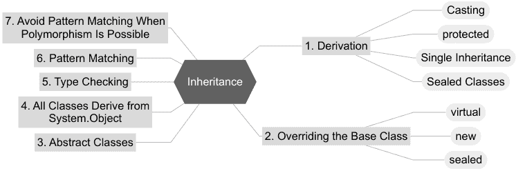

## 初学者主题

## 继承定义

第 6 章概述了继承。以下是对已定义术语的复：

- 衍生/继承 (`Derive/inherit`)：对基类进行特化，以包含额外的成员或对基类成员进行自定义。
- 派生/子/子类类型 (`Derived/sub/child type`)：继承了更通用类型成员的特化类型。
- 基类/超类/父类类型 (`Base/super/parent type`)：派生类型继承其成员的通用类型。

继承形成了一种“是一种”（is a kind of）的关系。派生类型始终隐式的也是基类类型。就像硬盘是存储设备的一种，任何派生自存储设备类型的其他类型也是存储设备的一种。请注意，反过来并不一定成立：存储设备不一定是硬盘。

> 注意
代码中的继承用于定义两个类之间“是一种”的关系，其中派生类是基类的特化。

## 衍生

通常我们想要扩展给定的类型以添加功能，例如行为和数据。给定一个 `Person` 类，你创建了一个 `Employee` 类，该类额外包含了 `EmployeeId` 和 `Department` 属性。反向方法同样适用。例如，给定个人数字辅助器（PDA）中的一个 `Contact` 类，你可能决定添加日历支持。为了实现这一目标，你创建了一个 `Appointment` 类。然而，你可能不会重新定义这两个类中共有的方法和属性，而是可能会选择重构 `Contact` 类。具体来说，你可以将 `Contact` 的通用方法和属性移动到一个名为 `PdaItem` 的基类中，`Contact` 和 `Appointment` 都派生自该基类，如图 7.1 所示。

## 衍生

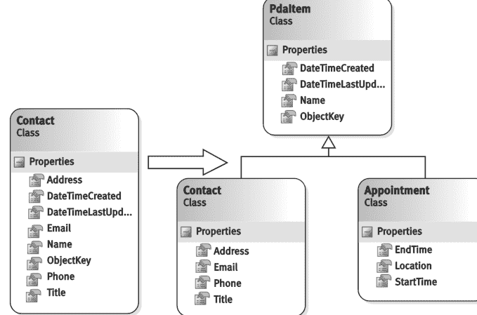

图 7.1：重构为基类

此例中的共同项是 `Created`、`LastUpdated`、`Name`、`ObjectKey` 等。通过衍生，在基类 `PdaItem` 上定义的方法可以从所有派生自 `PdaItem` 的类中访问。

在声明派生类时，在类标识符后跟一个冒号和基类，如列表 7.1 所示。

列表 7.1：从另一个类派生出一个类

```csharp
public class PdaItem
{
    [DisallowNull]
    public string? Name { get; set; }
    public DateTime LastUpdated { get; set; }
}

// 将 Contact 类定义为继承 PdaItem
public class Contact : PdaItem
{
    public string? Address { get; set; }
    public string? Phone { get; set; }
}
```

列表 7.2 显示了如何访问 `Contact` 中定义的属性。

列表 7.2：使用继承的方法

```csharp
public class Program {
    public static void Main() {
        Contact contact = new();
        contact.Name = "Inigo Montoya";
        // ...
    }
}
```

尽管 `Contact` 没有直接拥有名为 `Name` 的属性，但 `Contact` 的所有实例仍然可以从 `PdaItem` 访问 `Name` 属性，并像它是 `Contact` 的一样使用它。此外，任何派生自 `Contact` 的额外类也将继承 `PdaItem` 或 `PdaItem` 派生自的任何类的成员。继承链没有实际限制，每个派生类都将组合其基类继承链中的所有成员（参见列表 7.3）。换句话说，虽然 `Customer` 没有直接派生自 `PdaItem`，但它仍然继承了其成员。

> 注意
虽然 `Customer` 没有直接派生自 `PdaItem`，但它仍然继承了成员。

列表 7.3：从一个类派生另一个类

```csharp
public class PdaItem {
    // ...
}
public class Contact : PdaItem {
    // ...
}
public class Customer : Contact {
    // ...
}
public class Appointment : PdaItem {
    // ...
}
```

## 基类和派生类型之间的转换

如列表 7.4 所示，基类和派生类型之间的之间的。因为派““””，，，是 `PdaItem`，

一定 `              。

..：：基类型转换

```csharp
public class Program {
    public static void Main() {
        // 隐式转换为基类
        Contact contact = new();
        PdaItem item = contact;
        // 式转换为派生类型
        Contact = (Contact)item;
        // ...
    }
}
```

从 `long` 到 `int`，开发者应该选择定义一个显式转换操作符。这会提醒执行转换的开发者，只有在确定转换会成功时才进行转换，否则要准备在转换失败时捕获异常。当转换是有损的时，他们也应该使用显式转换而非隐式转换。例如，从 `float` 转换为 `int` 会截断小数部分，而强制转换（从 `int` 回到 `float`）是无法恢复这些部分的。

列表 7.5 显示了一个隐式转换操作符签名的示例。

## 列表 7.5: 定义类运算符

```csharp
class GpsCoordinates
{
    // ...
    public static implicit operator UtmCoordinates(
        GpsCoordinates coordinates
    )
    {
        // ...
    }
}
```

在这种情况下，你有一个从 `GpsCoordinates` 到 `UtmCoordinates` 的隐式转换。可以编写类似的转换来反转这一过程。注意，通过将 `implicit` 替换为 `explicit` 也可以编写显式转换。

## private 访问修饰符

基类的所有成员（构造函数和析构函数除外）都被派生类继承。然而，仅仅因为成员被继承了并不意味着它是可以访问的。例如，在列表 7.6 中，私有字段 `_Name` 在 `Contact` 中不可用，因为私有成员只位于声明它们的类型内部。

## 列表 7.6: 私有成员被继承但不可访问

```csharp
public class PdaItem
{
    // ...
    private string _Name;
    public string Name
    {
        get { return _Name; }
        set { _Name = value; }
    }
    // ...
public class Contact : PdaItem
{
    // ...
}
public class Program
{
    public static void Main()
    {
        Contact contact = new();
        // ERROR: 'PdaItem._Name' is inaccessible
        // due to its protection level
        contact._Name = "Inigo Montoya";
    }
}
```

根据封装原则，派生类无法访问声明为 `private` 的成员。这迫使基类开发者做出显式选择，以决定派生类是否获得某个成员的访问权限。在这种情况下，基类定义了一个 API，其中 `_Name` 只能通过 `Name` 属性更改。这样，如果添加了验证逻辑，派生类将自动获得验证的好处，因为它从一开始就无法直接访问 `_Name`。无论访问修饰符如何，所有成员都可以从定义它们的类进行访问。

- 1. 特殊情况：当派生类也是基类的嵌套类时。

## 第 7 章：继承

> **注意**
> 派生类无法访问基类中声明为 `private` 的成员。

## protected 访问修饰符

然而，封装的粒度比简单的 `public` 或 `private` 更精细。可以在基类中定义只有派生类才能访问的成员。（任何成员始终可以访问同一类型内的其他成员）。例如列表 7.7 所示的 `ObjectKey` 属性。

## 列表 7.7: protected 成员仅从派生类访问

```csharp
using System.IO;
public class PdaItem
{
    public PdaItem(Guid objectKey) => ObjectKey = objectKey;
    protected Guid ObjectKey { get; }
}
public class Contact : PdaItem
{
    public Contact(Guid objectKey)
        : base(objectKey) { }
}
public void Save()
{
    // 使用 <ObjectKey>.dat 实例化 FileStream 作为文件名
    using FileStream stream = File.OpenWrite(
        ObjectKey + ".dat");
    // ...
    stream.Dispose();
}
static public Contact Copy(Contact contact)
    => new(contact.ObjectKey);
static public Contact Copy(PdaItem pdaItem) =>
    // ERROR: Cannot access protected member PdaItem.ObjectKey.
    // Use ((Contact)pdaItem).ObjectKey instead.
    new(pdaItem.ObjectKey);
```

```csharp
public class Program
{
    public static void Main()
    {
        Contact contact = new(Guid.NewGuid());
        // ERROR: 'PdaItem.ObjectKey' is inaccessible
        Console.WriteLine(contact.ObjectKey);
    }
}
```

`ObjectKey` 使用 `protected` 访问修饰符定义。结果是，它在 `PdaItem` 外部，通过派自 `PdaItem` 的类的成员是可以访问的。由于 `Contact` 派自 `PdaItem`，`Contact` 的所有成员（即 `Save()`）都可以访问 `ObjectKey`。相比之下，`Program` 没有派自 `PdaItem`，因此在 `Program` 中使用 `ObjectKey` 属性会导致编译错误。

- 注意
基类中的 `protected` 成员仅从基类本身以及派链中的其他类访问。

静态方法 `Contact.Copy(PdaItem pdaItem)` 中展示了一个重要的细微之处。开发者通常会惊讶，尽管 `Contact` 派自 `PdaItem`，但从 `Contact` 内部的代码无法访问 `PdaItem` 的受保护的 `ObjectKey`。原因是 `PdaItem` 可能是一个 `Address`，而 `Contact` 不应该能够访问 `Address` 的保护成员。因此，封装防止了 `Contact` 可能修改 `Address` 的 `ObjectKey`。将 `PdaItem` 成功强制转换为 `Contact` 将绕过此限制（例如 `((Contact)pdaItem).ObjectKey`，以及 `contact.ObjectKey` 也是如此）。规则是：从派生类访问受保护成员需要在编译时确定该受保护成员确实是该派生类的实例。

## 扩展方法

扩展方法在技术上并不是它们所扩展的类型的成员，因此它们不被继承。然而，由于每个派生类都可以作为其任何一个基类的实例使用，因此一个类型的扩展方法也会扩展每个派生类型。换句话说，如果我们扩展基类 `PdaItem`，所有扩展方法在派生类也可用。然而，对于所有扩展方法，实例方法具有更高的优先级。如果在继承链中的任何地方出现兼容的签名，它将优先于扩展方法。

对基类型要求扩展方法是很罕见的。对于一般的扩展方法，如果基类型的代码可用，直接修改基类型更好。即使在基类型代码不可用的情况下，程序员也应该考虑是否向接口或各个派生类型添加扩展方法。

## 单继承

理论上，你可以在继承树中放置无限数量的类。例如，`Customer` 派自 `Contact`，`Contact` 派自 `PdaItem`，`PdaItem` 派自 `object`。然而，C# 是一种单继承编程语言（C# 编译到的公共中间语言 [CIL] 也是）。因此，一个类不能派自两个类。例如，无法让 `Contact` 同时派自 `PdaItem` 和 `Person`。

> 语言对比：C++——多重继承
> C# 的单继承是它与 C++ 面向对象的主要区别之一。

对于需要多重继承类结构的罕见情况，一种解决方案是使用聚合；不是一个类继承另一个类，而是一个类包含另一个类的实例。C# 8.0 提供了实现此点的额外构造，因此我们将聚合实现的细节推迟到第 8 章。

## 密封类

正确设计一个类以便他人可以通过派生进行扩展是一项棘的任务，需要通过示例进行测试以验证派生将成功工作。列表 7.8 显示了如何通过将类标记为密封来避免意外的派生场景和问题。

## 列表 7.8: 使用密封类防止派生

```csharp
public sealed class CommandLineParser
{
    //...
}
// ERROR: Sealed classes cannot be derived from
public sealed class DerivedCommandLineParser
{
    //...
}
```

密封类包含 `sealed` 修饰符，因此不能被派生。`string` 类型是使用 `sealed` 修饰符防止派生的类型示例。

## 重写基类

基类的所有成员都被继承到派生类，构造函数和析构函数除外。然而，有时基类对特定成员没有最佳实现。例如 `PdaItem` 上的 `Name` 属性。当它被 `Appointment` 类继承时，该实现可能是可以接受的。但对于 `Contact` 类，`Name` 属性应该返回 `FirstName` 和 `LastName` 的组合。同样，当赋值 `Name` 时，它应该被拆分到 `FirstName` 和 `LastName`。换句话说，基类的属性声明对于派生类是合适的，但实现并不总是有效。需要一种机制在派生类中使用自定义实现来重写基类的实现。

# 398 第 7 章：继承

`virtual` Modifier
# 支持实例方法和属性的重写，但不支持字段或任何静态成员。它要求在基类和派生类中都必须显式操作。基类必须将其允许重写的每个成员标记为 `virtual`。如果公共或受保护的成员没有包含 `virtual` 修饰符，子类将无法重写这些成员。

## 语言对比：Java——默认虚拟方法

默认情况下，Java 中的方法是虚拟的，如果倾向于非虚拟行为，则必须显式地标记为 `final`。相比之下，C# 默认是非虚拟的。

列表 7.9 显示了属性重写的示例。

列表 7.9：重写属性

```csharp
public class PdaItem
{
    public virtual string Name { get; set; }
    // ...
}
```

```csharp
public class Contact : PdaItem
{
    public override string Name
    {
        get
        {
            return $"{FirstName} {LastName}";
        }
        set
        {
            string[] names = value.Split(' ');
```


```csharp
// 错误处理未显示

FirstName = names[0];

LastName = names[1];

}

}

public string FirstName { get; set; }

public string LastName { get; set; }

}
```

```csharp
// ...
}
```

`PdaItem` 不仅在 `Name` 属性上包含了 `virtual` 修饰符，`Contact` 的 `Name` 属性也使用了 `override` 关键字装饰。删除 `virtual` 将导致错误，而省略 `override` 将导致警告，正如你很快就会看到的。C# 要求重写方法必须显式使用 `override` 关键字。换句话说，`virtual` 将方法或属性标记为派生类型中可以被替换（重写）。

## 语言对比：Java 和 C++——隐式重写

与 Java 和 C++ 不同，C# 的派生类中需要 `override` 关键字。C# 不允许隐式重写。要重写一个方法，基类和派生类的成员必须匹配，并具有相应的 `virtual` 和 `override` 关键字。此外，当指定 `override` 关键字时，假设派生类的实现替换了基类的实现。

重写成员会导致运行时调用最派生的实现（参见列表 7.10 及其输出 7.1）。

### 列表 7.10：运行时调用虚拟方法的最派生实现

```csharp
public class Program
{
    public static void Main()
    {
        Contact contact;
        PdaItem item;
        contact = new Contact();
        item = contact;
        // 通过 PdaItem 变量设置名称
        item.Name = "Inigo Montoya";
        // 显示 FirstName & LastName
```

```csharp
// 属性已设置
Console.WriteLine(
  $"{contact.FirstName} {contact.LastName}"
)
```

### 输出 7.1

Inigo Montoya

在列表 7.10 中，当给值给在 `PdaItem` 上声明的 `item.Name` 时，`contact` 的 `FirstName` 和 `LastName` 仍然被设置。规则是，每当运行时遇到虚拟方法时，它都会调用该虚拟成员的最派生且重写的实现。在这种情况下，代码实例化了一个 `Contact` 并调用了 `Contact.Name`，因为 `Contact` 包含了 `Name` 最派生的实现。

虚拟方法仅提供默认实现——即派生类可以完全重写的实现。然而，由于继承设计的复杂性，考虑（并且最好实现）一个需要虚拟方法定义的特定场景，比默认将成员声明为虚拟的更为重要。

这一步也很重要，因为将方法从虚拟方法转换为非虚拟方法可能会破坏重写了该方法的派生类。一旦发布了虚拟成员，如果你想避免引入破坏性更改，它应该保持为虚拟。因此，在引入虚拟成员时要小心——例如，可以考虑先将其设为 `private protected`。

## 语言对比：C++——构造期间方法调用的分发

在 C++ 中，构造期间调用的方法不会分发虚拟方法。相反，在构造期间，类型与基类型而非派生类型关联，并且虚拟方法调用基类实现。相比之下，C# 将虚拟调用分发到最派生类型，即使派生构造函数尚未执行。无论如何，在 C# 中应避免这种情况。

最后，只有实例成员可以是虚拟的。CLR 使用的是具体类型。

## 协变类型

通常，重写方法的签名必须与基方法的签名匹配。然而，从 C# 9.0 开始，有一项改进允许重写方法指定与基方法不同的返回类型。这种特性被称为**协变类型**。

### 列表 7.11：协变类型

```csharp
public class Base
{
    public virtual Base Create() => new();
}
public class Derived : Base
{
    public override Derived Create() => new();
}
```

### 第 7 章：继承

注意 `Base` 类的 `Create()` 返回 `Base`，而 `Derived` 类的返回 `Derived`。协变将在第 12 章详细讨论。

## 修饰符

当重写方法未使用 `override` 时，编译器会发出与输出 7.2 或 7.3 类似的警告。

### 输出 7.2

```
警告 CS014: '<derived method>' 了继承的成员。要使当前成员重写，请添加 override 关键字。
```

### 输出 7.3

```
警告 CS008: 在 '<derived property>' 上需要 new 关键字，因为它隐藏了继承的成员
```

明显的解决方案是添加 `override` 修饰符（假设基成员是虚拟的）。然而，正如警告所示，`new` 修饰符也是一种选择。考虑表 7.1 所示的场景——这是一个更通用的“脆弱基类问题”的具体示例。

### 表 7.1：为什么需要 new 修饰符

| 活动 | 代码 |
| :--- | :--- |
| 程序员 A 定义包含 FirstName 和 LastName 属性的 Person 类 | `public class Person { public string FirstName { get; set; } public string LastName { get; set; } }` |
| 程序员 B 继承 Person 并定义了带有额外属性 Name 的 Contact，此外他还定义了 Program 类，其 Main() 方法实例化 Contact，然后打印名称。 | `public class Contact : Person { public string Name { get return FirstName + " " + LastName; set string[] names = value.Split(' '); // 错误处理未显示 FirstName = names[0]; LastName = names[1]; } }` |

## 第 7 章：继承

以列表 7.12 为例。它的输出显示在输出 7.4 中。

### 列表 7.12：override 与 new 修饰符对比

```csharp
public class Program
{
    public class BaseClass
    {
        public static void DisplayName()
        {
            Console.WriteLine("BaseClass");
        }
    }
    public class DerivedClass : BaseClass
    {
        // 编译器警告：DisplayName() 隐藏了继承的成员
        // 如果意图是隐藏，请使用 new 关键字
        public virtual void DisplayName()
        {
            Console.WriteLine("DerivedClass");
        }
    }
    public class SubDerivedClass : DerivedClass
    {
        public override void DisplayName()
        {
            Console.WriteLine("SubDerivedClass");
        }
    }
    public class SuperDerivedClass : DerivedClass
    {
        public new new void DisplayName()
        {
            Console.WriteLine("SuperDerivedClass");
        }
    }
    public static void Main()
    {
        BaseClass baseObj = new BaseClass();
        baseObj.DisplayName();
        DerivedClass derivedObj = new DerivedClass();
        derivedObj.DisplayName();
        SubDerivedClass subObj = new SubDerivedClass();
        subObj.DisplayName();
        SuperDerivedClass superObj = new SuperDerivedClass();
        superObj.DisplayName();
    }
}
```

## 重写基类

```csharp
BaseClass.DisplayName();
DerivedClass.DisplayName();
BaseClass.DisplayName();
```

### 输出 7.4

```
BaseClass
DerivedClass
SuperDerivedClass
```

这些结果由于以下原因产生：

- **SuperDerivedClass**：`SuperDerivedClass.DisplayName()` 显示的是 `BaseClass`，因为没有派生类重写它。
- **SubDerivedClass**：`DerivedClass.DisplayName()` 是为了重写基类成员。`SuperDerivedClass.DisplayName()` 是虚方法。
- **DerivedClass**：`DerivedClass.DisplayName()` 是为了重写基类成员。`SuperDerivedClass.DisplayName()` 是由于 `new` 修饰符。
- **BaseClass**：`BaseClass.DisplayName()` 隐藏了派生类的成员。`SuperDerivedClass.DisplayName()` 是由于 `new` 修饰符。

当涉及到基类属性时，`new` 修饰符没有影响。`sealed` 修饰符可以阻止派生类重写。然而，`sealed` 修饰符的作用是防止该方法被重写。

## sealed 修饰符

正如可以使用 `sealed` 修饰符来阻止类继承一样，也可以使用它来阻止派生类重写基类的虚方法（参见列表 7.13）。

### 列表 7.13：密封成员

```csharp
class A
{
    public virtual void Method()
    {
    }
}
class B : A
{
    public override sealed void Method()
    {
    }
}
class C : B
{
    // ：无法重写密封成员
    // public override void Method()
    // {}
}
```

在上面的示例中，对类 `B` 使用 `sealed` 修饰符阻止了类 `C`。

通常，将类标记为 `sealed` 很少见，但它适用于那些由于密封类带来的好处大于其派生类的情况。由于单元测试的需要，密封类有时是理想理想的。

## base 成员

在重写成员时，开发者通常需要调用基类的实现（参见列表 7.14）。

### 列表 7.14：访问基类成员

在列表 7.14 中，使用 `base` 关键字来调用基类的实现。其语法与使用 `this` 关键字非常相似，包括在构造函数中使用（稍后讨论）。

此外，在 `Address.ToString()` 实现中，你需要重写它因为它是 `object` 类的成员。

> 注意
> 带有 `override` 修饰符的方法自动是虚的。基类方法只有是虚方法才能被重写，因此重写方法也是虚的。

要定义抽象类，C# 要求在类定义中使用 `abstract` 修饰符，如列表 7.16 所示。

### 列表 7.16：定义抽象类

```csharp
// 定义一个抽象类
public abstract class PdaItem
{
    public PdaItem(string name)
    {
        Name = name;
    }
    public virtual string Name { get; set; }
}
public class Program
{
    public static void Main()
    {
        // ERROR: 无法创建抽象类的实例
        PdaItem item = new("Inigo Montoya");
    }
}
```

虽然抽象类不能实例化，但这一限制只是抽象类的一个微小特性。抽象类的主要意义在抽象类包含抽象成员时得以实现。抽象成员是一个没有实现的方法或属性。它的目的是强制所有派生类提供相应的实现。

请参考列表 7.17 为例。

### 列表 7.17：定义抽象成员

```csharp
using static System.Environment;
// 定义一个抽象类
public abstract class PdaItem
{
    public PdaItem(string name)
    {
        Name = name;
    }
}
```

## 412 第 7 章：继承

```csharp
public virtual string Name { get; set; }
public abstract string GetSummary();
}
```

```csharp
public class Contact : PdaItem
{
    //...
    public override string Name
    {
        get
        {
            return $"{FirstName} {LastName}";
        }
        set
        {
            string[] names = value.Split(' ');
            // 未显示的错误处理
            FirstName = names[0];
            LastName = names[1];
        }
    }
}
```

```csharp
public string FirstName
{
    get
    {
        return _FirstName!;
    }
    set
    {
        _FirstName = value ??
            throw new ArgumentNullException(nameof(value));
    }
}
```

```csharp
private string? _FirstName;
public string LastName
{
    get
    {
        return _LastName!;
    }
    set
    {
        _LastName = value ?? throw new ArgumentNullException(nameof(value));
    }
}
```

```csharp
}
private string? _LastName;
public string? Address { get; set; }
public override string GetSummary()
{
    return $"FirstName: {FirstName + NewLine }"
    + $"LastName: {LastName + NewLine }"
    + $"Address: {Address + NewLine }"
}
```

```csharp
// ...
```

```csharp
public class Appointment : PdaItem
{
    public Appointment(string name, string location, DateTime startTimeDateTime, DateTime endDateTime) : base(name)
    {
        Location = location;
        StartDateTime = startTimeDateTime;
        EndTime = endDateTime;
    }
    public DateTime StartDateTime { get; set; }
    public DateTime EndDateTime { get; set; }
    public string Location { get; set; }
}
```

```csharp
// ...
public override string GetSummary()
{
    return $"Subject: { Name + NewLine }"
    + $"Start: { StartDateTime + NewLine }"
```


`+ $"End: { EndDateTime + NewLine }"`

`+ $"Location: { Location }"`

}

## 列表 7.17 将 `GetSummary()` 成员定义为抽象，因此它不包含任何实现。代码随后在 `Contact` 类中重写了该成员并提供了实现。由于抽象成员旨在被重写，因此此类成员自动是 `virtual` 的，且不能显式地声明。

## 414 第 7 章：继承

此外，抽象成员不能是私有的（`private`），因为派生类将无法看到它们。

开发一个设计良好的对象层次结构异常地困难。因此，在对抽象类型进行编程时，你应该确保实现至少一个（最好是多个）派生自抽象类型的具体类型，以验证设计。

如果你没有在 `Contact` 中提供 `GetSummary()` 的实现，编译器将报告错误。

> 注意：抽象成员必须被重写，因此它们自动是虚的，且不能显式地声明。

## 语言对比：C++——纯虚函数

C++ 允许使用晦涩的符号表示 `= 0` 来定义抽象函数。这些函数在 C++ 中被称为纯虚函数。然而，与 C# 不同，C++ 并不要求类本身具有任何特殊声明。与 C# 的 `abstract` 类修饰符不同，当类包含纯虚函数时，C++ 的类声明不会发生变化。

> 注意：通过声明抽象成员，抽象类的程序员表示，为了在具体类和抽象基类（即 `PDataItem`）之间建立“是一个（is a）”的关系，必须实现抽象成员，因为抽象类无法为这些成员提供适当的默认实现。

## 多态

当同一个成员签名的实现在两个或多个类之间有所不同时，这种场景演示了面向对象的核心原理：多态。`Poly` 意味着“多”，`morph` 意味着“形式”，因此多态指的是同一个签名存在多个实现。此外，由于同一个方法签名在单个类中不能多次使用，因此成员签名的每个实现都发生在不同的类中。

多态背后的思想是，对象本身最清楚如何执行特定操作。此外，通过强制通用的调用方式，多态在利用共性的同时鼓励了代码复用。对于多种类型的文档，每种文档类型都最清楚如何为其对应的文档类型执行 `Print()` 方法。因此，与其定义一个包含 `switch` 语句（带有打印每个文档类型的特殊逻辑）的单一打印方法，不如通过多态调用与你想要打印的特定文档类型对应的 `Print()` 方法。例如，在文字处理文档类上调用 `Print()` 的行为将根据文字处理执行，而在图形文档类上调用相同的方法将产生特定于图形的打印行为。然而，考虑到文档类型，打印文档只需要调用 `Print()` 即可，无论其类型何如何。

将自定义的打印实现移出 `switch` 语句提供了许多维护方面的优势。首先，实现在每个文档类型类的上下文中，而不是出现在一个与其脱离的地方；这符合封装的原则。其次，添加新的文档类型不需要更改 `switch` 语句。相反，只需要让新的文档类型类实现 `Print()` 签名即可。

抽象成员旨在实现多态的一种方式。基类指定方法的签名，而派生类提供实现（见列表 7.18 及其对应的输出 7.5）。

## 416 第 7 章：继承

### 列表 7.18：使用多态列出 PdaItem

```csharp
public class Program
{
    public static void Main()
    {
        PdaItem[] pda = new PdaItem[3];
        Contact contact = new Contact("Sherlock Holmes")
        {
            Address = "221B Baker Street, London, England";
        };
        pda[0] = contact;
        Appointment appointment = new Appointment("Soccer tournament", "Estádio da Machava", new DateTime(2008, 7, 18), new DateTime(2008, 7, 19));
        pda[1] = appointment;
        contact = new Contact("Anne Frank")
        {
            Address = "Apt 56B, Whitehaven Mansions, Sandhurst Sq";
        };
        pda[2] = contact;
        List(pda);
    }
    public static void List(PdaItem[] items)
    {
        // 使用多态。派生类型        // 知道具体的 GetSummary()。
        foreach(PdaItem item in items)
        {
            Console.WriteLine("-");
            Console.WriteLine(item.GetSummary());
        }
    }
}
```

## 输出 7.5

```
FirstName: Sherlock
LastName: Holmes
-----------------
Subject: Soccer tournament
Start: 7/18/2008 12:00:00
End: 7/19/2008 12:00:00
Location: Estádio da Machava
-----------------
FirstName: Hercule
LastName: Poirot
Address: Apt 56B, Whitehaven Mansions, Sandhurst Sq
```

通过这种方式，你可以在基类上调用方法，但实现是特定于派生类的。输出 7.5 显示列表 7.18 中的 `List()` 方法能够成功显示联系人和地址，并以针对每个类型的方式进行显示。抽象 `GetSummary()` 方法的调用实际上调用了特定于的重写方法。

## 所有类继承自 System.Object

对于任何类，无论是自定义类还是内置类，表 7.2 所示的方法都将被定义。

表 7.2：System.Object 的成员
| 方法名称 | 描述 |
| --- | --- |
| public virtual Equals(object o) | 如果参数的对象在值上相等（不一定是引用相等），则返回 true。 |
| public virtual int GetHashCode() | 返回一个对应于均匀分布的哈希值的整数。这对于 HashTable 集合很有用。 |
| public Type GetType() | 返回一个与对象实例类型相对应的 System.Type 类型对象。 |
| public static bool ReferenceEquals(object a, object b) | 如果两个提供的参数指向同一个对象，则返回 true。 |
| public virtual string ToString() | 返回对象实例的字符串表示。 |

# 表 7.2：System.Object 的成员（续）

| 方法名称 | 描述 |
|------|---|
| virtual void Finalize() | 析构函数的别名；通知对象准备好终止。C# 禁止直接调用此方法。 |
| protected object MemberwiseClone() | 通过执行浅拷贝来克隆对象；复制引用，但不会复制被引用类型内部的数据。 |

表 7.2 中列出的所有方法都通过继承出现在所有对象上；所有类都（直接或通过继承链）派自 `object`。无论如何，字面量也包含了这些方法，例如像下面这样看起来有些奇怪的代码：

```csharp
Console.WriteLine( 42.ToString() );
```

即使是没有显式派自 `object` 的类定义，也会派自 `object`。因此，列表 7.19 中 `PdaItem` 的两个声明将产生相同的 Cil（公共中间语言）。

# 列表 7.19：未显式指定派生时隐含 System.Object 派生

```csharp
public class PdaItem
{
    //...
}
public class PdaItem : object
{
    //...
}
```

当对象的默认实现不再足够时，程序员可以覆盖三个虚方法中的一个或多个。第 10 章描述了执行此类操作的细节。

# 类型检查

自 C# 1.0 以来，就有多种检查对象类型的方法，包括运算符和 `switch` 语句。在 C# 8.0 中，引入了 `switch` 表达式以便从表达式返回值。

# 使用 is 运算符进行类型检查

由于 C# 允许在继承链中向下转换，有时在尝试转换之前确定底层类型是有必要的。此外，对于未实现多态特定特定操作，检查类型可能是必要的。为了确定类型，C# 自 C# 1.0 起就包含了一个运算符（参见列表 7.20）。

> 列表 7.20：使用 is 运算符确定底层类型

```csharp
public class Person
{
    // ...
}
public class Employee : Person
{
    // ...
}
public class Program
{
    private static object? GetObjectById(string id)
    {
        // ...
    }
    public static void Main(params string[] args)
    {
        string id = args[0];
        object? entity = GetObjectById(id);
        if (entity is Person)
        {
            Person person = (Person) entity;
            Console.WriteLine(
$"Id corresponds to a {nameof(Person)} object: {person.FirstName} {person.LastName}.");
        }
    }
}
```

```csharp
if (entity is Employee employee) {
    Console.WriteLine(
      $"Id {(employee.Id)} is also an {nameof(Employee)} object.");
}
else if (entity is null) {
    Console.WriteLine(
      $"Id was unknown so null was returned.");
}
else {
    Console.WriteLine(
      $"Id '{id}' not an or a {nameof(Person)} object.");
}
}
```

调用 `GetByById()` 后（它根据指定的 id 返回一个可空对象），列表 7.20 对返回的实例调用了 `is` 运算符。首先，它检查该值是否为 `null`。接下来，它确定返回值是否为 `Person`，然后是 `Employee`。如果 `GetByById()` 返回一个 `Person`，输出将是“Id corresponds to a Person object...”。当 `GetByById()` 返回 `Employee` 时，输出将同时显示 `Person` 和 `Employee` 的消息；由于 `Employee` 派自 `Person`，所以所有的 `Employee` 对象也是 `Person` 对象。

# 使用声明进行类型检查

使用显式转换，程序员有责任充分理解代码逻辑以避免发生无效转换异常（invalid cast exception）。如果可能发生无效转换，最好是利用类型检查并完全避免异常。列表 7.20 展示了这一点：调用 `GetByById()` 后（它根据指定的 id 返回一个可空对象），列表 7.20 对返回的实例调用了 `is` 运算符。首先，它检查该值是否为 `null`。接下来，它确定返回值是否为 `Person`，然后是 `Employee`。如果 `GetByById()` 返回一个 `Person`，输出将是“Id corresponds to a Person object...”。当 `GetByById()` 返回一个 `Employee` 时，输出将同时显示 `Person` 和 `Employee` 的消息；

`Employee` 派自 `Person`，所以所有的 `Employee` 对象也是 `Person` 对象。

在 C# 7.0 之后，`is` 运算符允许同时声明变量。列表 7.20 展示了这一点：

```csharp
if (entity is Person) {
```

```csharp
if (entity is Employee employee) {
    Console.WriteLine(
      $"Id {(employee.Id)} is also an {nameof(Employee)} object.");
}
else if (entity is null) {
    Console.WriteLine(
      $"Id was unknown so null was returned.");
}
else {
    Console.WriteLine(
      $"Id '{id}' not an or a {nameof(Person)} object.");
}
}
```


*(注：由于提供的文本在“Type Checking with Declaration” 之后出现了严重的文本重复，上述翻译已根据指令要求进行了去重，确保输出流畅且不重复。)*

# 使用声明进行类型检查

使用显式转换，程序员有责任充分理解代码逻辑以避免发生无效转换异常。如果可能发生无效转换，最好是利用类型检查并完全避免异常。列表 7.20 展示了这一点：

```csharp
if (entity is Person) {
```

在 C# 7.0 之后，`is` 运算符允许同时声明变量。列表 7.20 展示了这一点：

```csharp
if (entity is Employee employee) {
    Console.WriteLine(
      $"Id {(employee.Id)} is also an {nameof(Employee)} object.");
}
else if (entity is null) {
    Console.WriteLine(
      $"Id was unknown so null was returned.");
}
else {
    Console.WriteLine(
      $"Id '{id}' not an or a {nameof(Person)} object.");
}
}
```

# 使用 switch 语句进行类型检查

自 C# 8.0 以来，`switch` 语句包含了一个更简洁的返回值的表达式。

# 列表 7.21：使用 switch 语句

```csharp
public static TimeOnly GetTime(object input)
{
    switch (input)
    {
        case DateTime datetime:
            return TimeOnly.FromDateTime(datetime);
        case DateTimeOffset datetimeOffset:
            return TimeOnly.FromDateTime(datetimeOffset.DateTime);
        case string dateText:
            return TimeOnly.Parse(dateText);
        case null:
            throw new ArgumentNullException(nameof(input));
        default:
            throw new ArgumentException($"Invalid type - {input.GetType().FullName}");
    }
}
```

# 模式匹配

运算符和 `switch` 语句保持相对静态，直到 C# 7.0 增加了声明和重大的模式匹配功能。模式匹配提供了一种语法，可以通过它评估准则并执行相应的代码。在本节中，我们将回顾所有的模式匹配功能：类型模式、常量模式（C# 7.0）、关系模式（C# 9.0）、逻辑模式（C# 9.0）、元组模式（C# 8.0）、位置模式（C# 9.0）以及扩展（C# 10）属性。

...模式（C# 7.0）以及列表模式（C# 11.0）。所有这些特性都利用了递归模式能力，允许对一个类型进行多次检查。

## 常量模式 (C# 7.0)

在第 4 章中，我们演示了在用 `is` 运算符检查 `null`（即数据为 `null`）以及在解释基础 `switch` 语句（https://essentialcsharp.com/the-basic-switch-statement）时常量模式的用法。其原理是，你可以将输入操作数与任何常量进行比较。例如，你可以将 `data.Day` 与值 `21` 进行比较。列表 7.23 提供了 `is` 和 `switch` 表达式的两种示例。

代码列表 7.23：使用 `is` 运算符的常量模式匹配

```csharp
using System.Diagnostics.CodeAnalysis;
public static class SolsticeHelper
{
    public static bool IsSolstice(DateTime date)
    {
        if (date.Day is 21)
        {
            if (date.Month is 12)
            {
                return true;
            }
            if (date.Month is 6)
            {
                return true;
            }
        }
        return false;
    }
    public static bool TryGetSolstice(DateTime date, [NullException(true)] out string? solstice)
    {
        if (date.Day is 21)
        {
            if ((solstice = date.Month switch)
            {
                12 => "Winter Solstice",
                6 => "Summer Solstice",
                _ => null
            }) is not null) return true;
            solstice = null;
            return false;
    }
}
```

常量可以是任何字面量，包括字符串、定义的常量，当然还有 `null`。请注意，字符串与字面量字符串 `"*"` 的比较是有效的，但与 `string.Empty` 的比较将失败，因为 `string.Empty` 没有被声明为常量。

## 关系模式 (C# 9.0)

通过关系模式，你可以使用 `<`、`>`、<= 和 `>=` 运算符与常量进行相对比较。列表 7.24 提供了关系模式的运算符版本和 `switch` 表达式版本。（注意，`==` 不是运算符之一，因为此功能已经在常量模式匹配中可用了。）

代码列表 7.24：关系模式匹配示例

```csharp
public static bool IsDeveloperWorkHours(
  int hourOfTheDay) =>
  hourOfTheDay > 10 && hourOfTheDay < 24;
public static string GetPeriodOfDay(int hourOfTheDay) =>
{
    return hourOfTheDay switch
    {
        6 => "Dawn",
        12 => "Morning",
        18 => "Afternoon",
        24 => "Evening",
        _ => throw new ArgumentOutOfRangeException(
            "The hour of the day specified is invalid" + nameof(hourOfTheDay))
    };
};
```

需要注意的是，从 C# 7.0 开始，匹配表达式不再一定是是互斥的。例如，我们可以有一个 `> 0` 的匹配表达式和另一个 `< 24` 的匹配表达式，无论小时数如何，两者都将为真。顺序将决定代码执行遵循的哪条路径。因此，在 `switch` 语句和表达式中排列匹配表达式的顺序时要小心（就像你会小心排列一系列 `if` 语句的顺序一样）。

## 逻辑模式 (C# 9.0)

通过逻辑模式，我们可以将关系匹配表达式与单个变量以及 `not`、`and`、`or` 运算符结合起来，分别提供否定、合取和析取模式。因此，与其使用逻辑运算符（如 `==` 或 `||`，请参阅列表 7.24 示例代码中的 `IsDeveloperWorkHours()` 方法），你只需要指定一次输入操作数，然后像列表 7.25 所示具有多个匹配表达式即可。

代码列表 7.25：逻辑模式匹配示例

```csharp
public bool IsStandardWorkHours(
    int hour) =>
    hour is
    >= 8
    and < 17
    and not 12; // 午餐
static bool TryGetPhoneButton(
    char character,
    [NullWhen(true)] out char button)
{
    return (char.ToLower(character)) switch 
    {
        '1' => '1',
        '2' or (>= 'a' and <= 'c') => '2',
        // 运算符和括号示例 (C# 10)
        '3' or not < 'd' => '3',
        '4' or >= 'g' and <= 'i' => '4',
        '5' or >= 'j' and <= 'l' => '5',
        '6' or >= 'm' and <= 'o' => '6',
        '7' or >= 'p' and <= 's' => '7',
        '8' or >= 't' and <= 'v' => '8',
        '9' or >= 'w' and <= 'z' => '9',
        '0' or _ => '0',
        _ => default // 设置按钮以指示无效值
    };
}
```

优先级顺序不是 `and` 或 `or`；前两个示例不需要括号。然而，允许使用括号任意改变优先级，如 `switch` 表达式中的匹配表达式所示。

请注意，使用 `or` 和 `not` 运算符时不能同时声明变量。例如：

```csharp
if (input is "data" or string text)
{
    // ...
}
```

将导致错误：CS8780：不能声明变量。

## 括号模式 (C# 9.0)

为了覆盖运算符的优先级，你可以使用括号将它们分组，如列表 7.26 所示。

列表 7.26：括号模式

```csharp
public bool IsOutsideWorkHours(
    int time) =>
    time is (8 and < 17 and not 12); // 括号化 C# 9
```

## 元组模式 (C# 8.0)

通过元组匹配，你可以检查元组内的值（请参见列表 7.27）。

列表 7.27：使用 `is` 运算符的元组匹配

```csharp
public static void Main(params string[] args)
{
    const int command = 0;
    const int fileName = 1;
    const string dataFile = "data.dat";
    // ...
    if ((args.Length, args[command].ToLower()) is (1, "cat"))
    {
        Console.WriteLine(dataFile);
    }
    else if ((args.Length, args[command].ToLower()) is (2, "encrypt"))
    {
        string data = dataFile;
        Console.WriteAll(data.ToString());
    }
}
```

在 `switch` 语法中也是可行的，请参见列表 7.28。

列表 7.28：使用 `switch` 语句的元组匹配

```csharp
public static void Main(params string[] args)
{
    const int command = 0;
    const int fileName = 1;
    const string dataFile = "data.dat";
    // ...
    switch ((args.Length, args[command].ToLower())
    {
        case (1, "cat"):
            Console.WriteLine(dataFile);
            break;
        case (2, "encrypt"):
            {
                string data = dataFile;
                Console.WriteAll(data.ToString());
            }
            break;
        default:
            Console.WriteLine("参数无效。");
            break;
    }
}
```

## 位置模式 (C# 8.0)

基于在 C# 7.0 中引入的解构构造，C# 8.0 允许使用位置匹配，其语法与模式匹配非常相似（参见列表 7.29）。

```csharp
using System.Drawing;
public static class PointHelper
{
    public static void Deconstruct(
        Point point, out int x, out int y) =>
        (x, y) = (point.X, point.Y);
    public static bool IsVisibleOnGAScreen(Point point) =>
        point is (>=0 && <=1920, >=0 && <=1080);
    public static string GetQuadrant(Point point) => switch
    {
        (>=0, >=0) => "Quadrant I", // II | I
        (<=0, >=0) => "Quadrant II", // ----|_
        (<=0, <0) => "Quadrant III", // --/
        (>=0, <=0) => "Quadrant IV" // III | IV
    };
}
```

```cs
;
}
```

`System.Drawing.Point` 类型没有解构造函数（deconstructor）。然而，我们能够通过扩展方法添加一个，这满足了将 Point 转换为 X 和 Y 元组的标准。该解构造函数随后被用于匹配模式中每个逗号分隔表达式的顺序。在 `IsVisibleOnVAGcreen()` 示例中，X 匹配 `>=0` 且 `<=1920`，Y 匹配 `>=0` 且 `<=1080`。`GetQuadrant()` 中的 switch 表达式也 使用了类似的范围表达式。

# 属性模式 (C# 8.0 & 10.0)

使用属性模式，匹配表达式是基于 switch 表达式中识别出的数据类型的属性名和值，如列表 7.30 所示。

> 列表 7.30：使用 is 运算符的属性模式匹配

```csharp
public record class Employee
{
    public int Id { get; set; }
    public string Name { get; set; }
    public string Role { get; set; }
    public Employee(int id, string name, string role) =>
    (Id, Name, Role) = (id, name, role);
}
public class ExpenseItem
{
    public int Id { get; set; }
    public string ItemName { get; set; }
    public decimal CostAmount { get; set; }
    public DateTime ExpenseDate { get; set; }
    public Employee Employee { get; set; }
    public ExpenseItem(
        int id, string name, decimal amount, DateTime date,
        Employee employee) =>
    (Id, Employee, ItemName, CostAmount, ExpenseDate) =
    (id, employee, name, amount, date);
}
public static bool ValidateExpenseItem(ExpenseItem expenseItem) =>
    expenseItem switch
    {
        // 注意：属性模式检查输入值不为
        not null
            // 扩展属性模式


进入`/path/to/xxx`目录，找到`xxx.json`。

在表达式`cvar = avar + bvar`中，加法运算符（`+`）将`avar`与`bvar`相加，得到它们的和`cvar`

在`List.of(arg0, arg1, arg2)`中，`List`接口的工厂方法`of()`接受一系列的元素，返回包含它们的只读列表。

之后我们这样调用`cmd`命令：`cmd arg0 arg1 arg2`。

```
if (condVar > someVal) {console.log("xxx")}
```

```
ItemName.Length > 0, Employee.Role: "Admin" => true,

#pragma warning disable IDE0170 // 属性模式可以简化

// 属性模式

ItemName: { Length > 0 }, Employee: { Role: "Manager" },

ExpenseDate: DateTime date

#pragma warning restore IDE0170 // 属性模式可以

when date >= DateTime.Now.AddDays(-30) => true,

{ ItemName.Length > 0, Employee.Name.Length > 0,

CostAmount: < 1000, ExpenseDate: DateTime date

when date >= DateTime.Now.AddDays(-30) => true,

{ } => false, // 此非空检查可以消除。

=> false

};
```

关于所有属性匹配需要注意的第一个重要点是，它们只有在输入操作数不为 `null` 时才会匹配。这就是为什么例如，一个空属性匹配的匹配表达式 `{ }` 只要输入操作数不为 `null` 就会匹配。（在列表 7.30 中，`{ }` 匹配表达式是冗的，因为 `switch` 结尾的默认匹配表达式会捕获 `null` 以及所有穿透下来的剩余非空操作数）。虽然它可以作为非空检查，但直接指定 `null`（C# 9.0）更佳，因为其语法更清晰。

在列表 7.30 中，`switch` 表达式中的第一个匹配表达式以 `ItemName.Length > 0` 开始，要求 `ItemName.Length` 大于 0。该表达式隐含了 `ItemName` 也不为 `null`。事实上，初始的空检查是隐式的，编译器不允许在属性表达式中使用空条件（`ItemName?.Length`）。

在列表 7.30 中，第一个匹配表达式还要求 `Employee.Role` 被设置为 `"Admin"`。如果这两个匹配表达式匹配成功，`switch` 将返回 `true`，表示 `ExpenseItem` 是有效的。完整的匹配

# 第 7 章：继承

表达式使用了扩展的点符号表示法来访问子属性（`Length` 和 `Role`）。

列表 7.30 的第二个匹配表达式 `{ ItemName: { Length: >0 }, Employee: {Role: "Manager"}, ExpenseDate: DateTime date }` 也是一个属性匹配表达式（而不是扩展属性表达式），但语法略有不同。属性匹配表达式是在 C# 7.0 中引入的并且仍然受支持，尽管会有警告），因为扩展语法在所有情况下都更简单且更受青睐。

这个第二个匹配表达式包含了对 `ExpenseDate` 的属性匹配，并并在其中声明了一个变量 `date`。虽然 `date` 仍作为 `switch` 过滤的一部分使用，但它出现在 `when` 子句中而不是匹配表达式中。

## when 子句

对于所有形式的常量和关系匹配表达式，必须使用常量。然而，鉴于比较操作数通常在编译时不可用，这可能会具有限制性。为了避免这种限制，C# 7.0 引入了 `when` 子句，你可以在其中添加任何条件表达式（返回布尔值的表达式）。

列表 7.30 中的代码声明了一个 `DateTime` 变量，用以检查 `ExpenseItem.ExpenseDate` 不早于 30 天。然而，由于年龄取决于当前的日期和时间，该值不是常量，我们无法使用匹配表达式。相反，代码在匹配表达式之后使用了 `when` 子句，将 `date` 值与 `DateTime.Now.AddDays(-30)` 进行比较。该子句为（可选的）更复杂的条件提供了一个捕获位置，而不受仅使用常量的限制。

`when` 子句的添加是 C# 7.0 允许匹配表达式的核心原因。

## 无关类型的模式匹配

模式匹配的一项有趣功能是，它使得从无关类型中提取数据变得可能。列表 7.31 提供了一个示例。

```csharp
// 列表 7.31：switch 中的模式匹配
public static string? CompositeDateFormat(object input, string formatString) =>
    input switch
    {
        DateTime { Year: int year, Month: int month, Day: int day } => (year, month, day),
        DateTimeOffset { Year: int year, Month: int month, Day: int day } => (year, month, day),
        DateOnly { Year: int year, Month: int month, Day: int day } => (year, month, day),
        string dateText when DateTime.TryParse(dateText, out var date) => (date.Year, date.Month, date.Day),
        _ => null
    } is (int year, int month, int day) ? string.Format(formatString, year, month, day) : null;
```

## 递归模式匹配 (C# 7.0)

```csharp
// 列表 7.32：使用 is 运算符的递归模式匹配
Person inigo = new("Inigo", "Montoya");
var buttercup = (FirstName: "Princess", LastName: "Buttercup");
(Person inigo, (string FirstName, string LastName) buttercup) couple = (inigo, buttercup);
if (couple is
    // 元组：从 Person 的解构造函数中检索
    ( // 位置：选择左侧或元组
        { // FirstName 的属性
            Length: int inigoFirstNameLength
        }))
{
    // ...
}
```

# 模式匹配 435

```cs
// 丢弃元组的姓名部分
,
{
  // Princess Buttercup 元组的属性
  FirstName: string buttercupFirstName
  Console.WriteLine("$ { inigoFirstNameLength }, { buttercupFirstName }}");
}
else {
  // ...
}
// ...
```

在此示例中，`couple` 的类型如下：

`(Person, (string FirstName, string LastName))`

因此，第一次匹配发生在外部元组 `(inigo, buttercup)` 上。接下来，对 `inigo` 使用位置模式匹配，利用了 `Person` 解构器。这选择了一个 `(FirstName, LastName)` 元组，并使用属性模式匹配提取 `inigo.FirstName` 值的 `Length`。位置匹配中的 `LastName` 部分通过下划线丢弃。最后，使用属性模式匹配选择 `buttercup.FirstName`。

虽然模式匹配是选择数据的强大手段，但它并非没有注意事项：请留意列表 7.32 中的注释，理解这段代码可能具有挑战性。如果没有注释，会更加困难：

```cs
if(couple is ( { Length: int inigoFirstNameLength }, _ ), { FirstName: string buttercupFirstName }}) { ...}
```

尽管如此，模式匹配真正证明有用的地方是在 `switch` 语句和表达式中。

## 列表模式 (C# 11.0)

C# 11 的一个重要新特性是引入了列表模式。这些模式允许对数组等项目项列表进行模式匹配。因此，你可以对列表内的元素使用任何类型的模式匹配。7.33 演示了如何解析 `Main` 方法的 `args` 参数。

列表 7.33：`switch` 表达式中的模式匹配

```cs
public static void Main(string[] args)
{
    // 为了简单起见，假设所有选项
    // 都是小写的。
    // 第一个参数是选项，通过
    // '/','-' 或 '--' 前缀识别。
    switch (args)
    {
        case "--" or ['/' or '-', 'h' or '?']:
            // Display.help, /h, -h, ?, -?
            DisplayHelp();
            break;
        case ['/' or '-', char option], ..]:
            // 选项以 '/' 开头并有 0 或多个参数。
            if(EvaluateOption("${option}", args[1..]))
            {
                DisplayHelp();
            }
            break;
        case ['-', ..] option, ..:
            // 选项以 "--" 开头并有 0 或多个参数。
            if(EvaluateOption(option[2..], args[1..]))
            {
                DisplayHelp();
            }
            break;
        // 以下情况与 default 重复
        // 但仅为了演示目的而提供。
        case []:
            // 无命令行参数
    }
    default:
        DisplayHelp();
}
```

# 模式匹配

```cs
break;
}
private static bool EvaluateOption(string option, string[] args) =>
    (option, args) switch
{
    ("cat" or "c", [string fileName]) =>
        CatalogFile(fileName),
    ("copy", [string sourceFile, string targetFile]) =>
        CopyFile(sourceFile, targetFile),
    _ => false
};
```

```cs
private static bool CopyFile(object sourceFile, string targetFile)
{
    Console.WriteLine($"'{sourceFile}' '{targetFile}'...");
    return true;
}
```

列表 7.33 中的第一个情况查找文本 `"-help"` 作为 `args` 数组的第一个也是唯一的元素。如果没有匹配，列表表达式的剩余部分将在以 `/` 或 `-` 开头且后跟 `?` 或 `h` 的第一个元素上进行匹配。列表模式的后半部分查找恰好两个字符（因为字符串是字符数组），这由表达式中的逗号（`.`）识别，该逗号将前缀与单字符表达式隔开：

```cs
['/' or '-', 'h' or '?']
```

接下来的两个情况也评估 `args` 的第一个元素，确定第一个字符是否为 `/` 或 `-`；在第三种情况下，确定 `args` 的第一个元素是否以 `--` 开头。在这两种情况下，如果匹配，`args[]` 将赋值给 `option` 变量。遗憾的是，没有办法将列表的剩余元素捕获到变量中。列表匹配总是查找精确数量的元素。因此，当调用 `EvaluateOptions()` 时，我们使用范围 `[1..]` 来传递剩余元素。（参见 https://essentialsharp.com/arrays 获取示例）。

第四种情况使用 `[]` 来识别具有零元素的列表。在这个示例中，它是多余的，因为 `default` 情况也捕获了剩余参数。在列表 7.33 的 `EvaluateOptions` 方法中，我们使用元组来首先评估命令。对于 `"cat"` 匹配表达式，它查找一个项目；而对于 `"copy"` 匹配表达式，它查找恰好两个项目。在两种情况下，它都将数组捕获到变量中。模式匹配非常强大，由于它可以处理字符串，它使得简单的场景无需使用正则表达式。

## 在可以使用多态时避免模式匹配

虽然模式匹配功能很重要，但在使用模式匹配之前，你应该考虑与多态相关的问题。多态支持在不需要修改的情况下扩展数据类型。例如，将 `Name` 等成员放在基类 `PdaItem` 中，然后处理派自 `PdaItem` 的值，比使用模式匹配处理新引入的类型更好。无论如何，多态总是可能的，当不可能时，模式匹配（特别是类似于属性匹配的）提供了良好的替代方案。

多态失效的一种场景是对象层次结构不匹配你的目标——例如你正在处理属于无关系统的类。此外，假设需要多态的代码无法修改。在 7.33 中处理日期就是这样一个例子。第二种场景是你正在添加的功能不属于这些类的抽象。例如，不同类型的车辆在收费公路上支付的通行费不同，但通行费并不是车辆的核心功能。

### 高级主题

## 使用 `as` 运算符

除了运算符之外，C# 还有 `as` 运算符。最初，`as` 运算符比 `is` 运算符具有优势：它不仅检查操作数是否为特定类型，还尝试转换为特定的数据类型，如果源类型不是目标类型（在继承链内），则分配 `null`。此外，它比强制转换更有优势，因为它不会抛出异常。列表 7.34 演示了 `as` 运算符的使用。

列表 7.34：使用 `as` 运算符进行数据转换

```cs
public class PdaItem {
    protected Guid ObjectKey { get; }
    // ...
}
public class Contact : PdaItem {
    // ...
    public Contact(string name) => Name = name;
    static public Contact Load(PdaItem pdaItem) {
        #pragma warning disable IDE0019 // 使用模式匹配
        Contact? contact = pdaItem as Contact;
        #pragma warning restore IDE0019 // 使用模式匹配
        if (contact != null) {
            System.Diagnostics.Trace.WriteLine($"ObjectKey: {contact.ObjectKey}");
            return (Contact)pdaItem;
        }
    else {
        throw new ArgumentException("Item is not contact");
    }
}
```

```$"{nameof(pdaItem)} was not of type {nameof(Contact)}";
}
  // ...
}
```


通过使用该运算符，你可以在转换无效时避免编写额外的 `try/catch` 处理代码，因为该运算符提供了一种尝试强制转换的方法，且在转换失败时不会抛出异常。

`is` 运算符优于 `as` 运算符的优势在于，后者无法成功确定底层类型。`as` 运算符可以在继承链中进行向上或向下强制转换。与 `as` 运算符不同，`is` 运算符可以确定底层类型。此外，`as` 运算符主要与引用类型工作，而 `is` 运算符适用于所有类型。

更重要的是，`as` 运算符通常需要额外检查赋值变量是否为 `null`。由于模式匹配运算符自动包含了此条件检查，因此它有效地消除了对 `as` 运算符的需求——假设已支持 C# 7.0 或更高版本。

## 总结

本章讨论了如何通过派生一个类并添加额外的方法和属性来特化该类。这些内容包括对控制封装级别的私有（`private`）和保护（`protected`）访问修饰符的讨论。

本章还研究了重写基类实现的细节，以及使用 `new` 修饰符将其隐藏的方法。为了控制重写，C# 提供了 `virtual` 修饰符，它允许派生类开发者标识哪些成员打算用于派生。要防止任何派生，可以在类上使用 `sealed` 修饰符。同样，在成员上放置 `sealed` 修饰符可以防止子类的进一步重写。

本章简要讨论了所有类型如何派生自 `object`。第 10 章将更深入讨论这种派生关系，查看 `object` 如何包含三个虚拟方法，以及管理重载的特定规则和指南。然而，在到达那里之前，你需要考虑另一种基于面向对象编程的编程范式：接口。这是第 8 章的主题。

本章以检查使用 `is` 运算符的模式匹配，以及 `switch` 语句和 C# 8.0 的 `switch` 表达式/语句而结束。虽然 C# 7.0 提供了初始的模式匹配支持，但一直到 C# 11 的所有版本都扩展了这些功能。

# 8 接口

多态在 C# 中不仅可以通过继承（如第 7 章所讨论的），还可以通过接口实现。与抽象类不同，接口不能包含任何实现——直到 C# 8.0。（但即使在 C# 8.0 中，除了对接口进行“版本控制”外，我们是否应该使用这种能力仍然存在）。然而，与抽象类一样，接口定义了一组调用者可以依赖其已实现的成员。

通过实现接口，类型定义了它的能力。接口实现关系是一种“能够”（can do）关系。类型可以执行接口要求实现类型执行的操作。接口定义了实现接口的类型与使用接口的代码之间的约。

实现接口的类型声明的方法签名与所实现接口声明的方法签名相同。本章讨论了接口的实现和使用。最后以接口上的默认实现成员以及这一新功能引入的一系列范式（和复杂性）作为结束。

## 接口简介

### 初学者主题

## 为什么需要接口？

接口非常用，因为——与抽象类不同——它们实现了实现细节与所提供服务之间的完全分离。对于一个真实世界的例子，考虑作为“接口”的电源插座。电如何到达插座是一个实现细节：它可能由化学能、核能或太阳能产生；发电机可能在房间内，也可能在远处；等等。插座提供了一个“契约”：它同意在特定频率提供特定的电压，作为回报，它要求使用该接口的电器提供兼容的插头。电器不需要关心电到达插座的实现细节；它只需要担心提供兼容的插头即可。

考虑以下示例：有大量的压缩压缩格式（`.zip`, `.7-zip`, `.cab`, `.jha`, `.tar`, `.gz`, `.tar.bz2`, `.bh`, `.rar`, `.arj`, `.arc`, `.ace`, `.zoo`, `.bz2`, `.xxe`, `.mime`, `.uue`, 和 `.yenc`，仅列举几个）。如果你为每种压缩格式创建类，可能会导致每个压缩实现对应有不同的方法签名，并且无法在它们之间应用标准的调用约定。或者，可以将所需的方法在基类中声明为抽象。然而，派生自一个公共基类使用了该类唯一且仅有的继承机会。各种压缩实现之间不太可能有通用的代码可以放在基类中，这排除了拥有基类实现带来的潜在收益。关键点在于，基类允许你共享实现以及成员签名，而接口允许你共享成员签名，而不一定需要共享实现。

与其共享公共基类，每个压缩格式都需要实现一个通用接口。接口定义了类支持以与期望该接口的其他类交互的契约。如果所有类都实现了 `IFileCompression` 接口及其 `Compress()` 和 `Uncompress()` 方法，那么调用任何特定压缩类上的算法的代码将仅涉及转换为 `IFileCompression` 接口并调用其成员。结果就是多态性，因为每个压缩类都有相同的方法签名，但该签名有各自独立的实现。

列表 8.1 显示的 `IFileCompression` 接口是接口实现的示例。根据惯例——一种如此通用的惯例——接口名称使用带有“I”前缀的 PascalCase 命名。

### 列表 8.1：定义接口

```csharp
interface IFileCompression
{
    void Compress(string targetFileName, string[] fileList);
    void Uncompress(string compressedFileName, string expandDirectory);
}
```

## 通过接口实现多态

```csharp
public PdaItem(string name)
{
    Name = name;
}
```

```csharp
public virtual string Name { get; set; }
```

```csharp
public class Contact : PdaItem, IListable
{
    public Contact(string firstName, string lastName,
        string address, string phone)
        : base(GetName(firstName, lastName))
    {
        FirstName = firstName;
        LastName = lastName;
        Address = address;
        Phone = phone;
    }
```

```csharp
public string FirstName { get; }
public string LastName { get; }
public string Address { get; }
public string Phone { get; }
static public string GetName(string firstName, string lastName)
    => $"{firstName} {lastName}";
```

```csharp
public string[] CellValues
{
    get
    {
        return new string[]
        {
            FirstName,
            LastName,
            Phone,
            Address
        };
    }
}
```

```csharp
public static string[] Headers
{
    get
    {
        return new string[]
        {
            "First Name", "Last Name",
        };
    }
```

### 448 第 8 章：接口

```csharp
"Phone"
"Address"
}
} // ...
```

```csharp
public class Publication : IListable {
    public Publication(string title, string author, int year) {
        Title = title;
        Author = author;
        Year = year;
    }
    public string Title { get; }
    public string Author { get; }
    public int Year { get; }
}
```

```csharp
public string?[] CellValues {
    get {
        return new string?[] {
            Title,
            Author,
            Year.ToString()
        };
    }
}
```

```csharp
public static string[] Headers {
    get {
        return new string[] {
            "Title",
            "Author",
            "Year"
        };
    }
    // ...
```

## 通过接口实现多态

```csharp
public class Program
{
    public static void Main() {
    {
        Contact[] contacts = new Contact[]
        {
            new Contact(
                "Dick", "Traci",
                "123 Main St., Spokane, WA 99037",
                "123-123-1234"),
            new Contact(
                "Andrew", "Littman",
                "1417 Palmary St., Dallas, TX 55555",
                "555-123-4567"),
            new Contact(
                "Mary", "Hartfelt",
                "1520 Thunder Way, Elizabethton, PA 44444",
                "444-123-4567"),
            new Contact(
                "John", "Lindherst",
                "1 Aerial Way Dr., Monterey, NH 88888",
                "222-987-6543"),
            new Contact(
                "Pat", "Wilson",
                "5665 Irving Dr., Parksdale, FL 22222",
                "123-456-7890"),
            new Contact(
                "Jane", "Doe",
                "123 Main St., Aurora, IL 66666",
                "333-345-6789"
            )
        });
    }
}

// 类可以隐式转换为
// 它们支持的接口
ConsoleListControl.List(Contact.Headers, contacts);
Console.WriteLine();

Publication[] publications = new Publication[3] {
new Publication(
"The End of Poverty: Economic Possibilities for Our Time",
"Jeffrey Sachs", 2006),
new Publication("Orthodoxy",
"G.K. Chesterton", 1908),
new Publication(
"The Hitchhiker's Guide to the Galaxy",
"Douglas Adams", 1979)
ConsoleListControl.List(
Publication.Headers, publications);
}
```

```csharp
public class ConsoleListControl
{
    public static void List(string[] headers, IList[] items)
    {
        int[] columnWidths = DisplayHeaders(headers);
        for(int count = 0; count < items.Length; count++) {
            string[] values = items[count].CellValues;
            DisplayItemRow(columnWidths, values);
        }
    }

/// <summary>显示列表头</summary>
/// <returns>返回列宽数组</returns>
private int[] DisplayHeaders(string[] headers)
{
    // ...
}

private static void DisplayItemRow(int[] columnWidths, string[] values)
{
    // ...
}
```

输出 8.1

| First Name | Last Name | Phone | Address |
|---|---|---|---|
| Dick | Traci | 123-1234 | 123 Main St., Spokane, WA |
| Andrew | Littman | 555-123-4567 | 1417 Palmary St., Dallas, TX |
| Mary | Hartfelt | 444-123-4567 | 1520 Thunder Way, Elizabethton, PA |
| John | Lindherst | 222-987-6543 | 1 Aerial Way Dr., Monterey, NH |
| Pat | Wilson | 123-456-7890 | 5665 Irving Dr., Parksdale, FL |
| Jane | Doe | 333-345-6789 | 123 Main St., Aurora, IL |

## 第 8 章：接口

```csharp
// ...

// : 无法直接在 contact 上调用 .CellValues
values = contact.CellValues;

// 首先转换为 IListable
values = ((IListable)contact).CellValues;

// ...
```

在这种情况下，强制类型转换和对 `CellValues` 的调用发生在同一条语句中。或者，你也可以在调用 `CellValues` 之前将 `contact` 赋值给 `IListable` 类型的变量。
要声明显式接口成员实现，请在成员名称前加上接口名称（参见列表 8.5）。

### 列表 8.5：显式接口实现

```csharp
public class Contact : PdaItem, IListable, IComparable
{
    // ...
    #region IListable 成员
    string[] IListable.CellValues
    {
        get
        {
            return new string[]
            {
                FirstName,
                LastName,
                Phone,
                Address
            };
        }
    }
    #endregion
    // ...
}
```

列表 8.5 通过在属性名称前加上 `IListable` 显式实现了 `CellValues`。此外，由于显式接口实现与接口直接相关，因此不需要使用 `virtual`、`override` 或 `public` 对其进行修饰。事实上，这些修饰符是不允许使用的。该方法不被视为类的公共成员，将其标记为 `public` 会产生误导。

请注意，尽管在接口上不允许使用 `override` 关键字，但在引用实现接口定义签名的成员时，我们仍会使用“覆盖”一词。

## 隐式成员实现

注意列表 8.5 中的 `CompareTo()` 不包含 `IComparable` 前缀；它是隐式实现的。在隐式成员实现中，只需要该成员是公共的（`public`），且该成员的签名与接口成员的签名匹配即可。接口成员实现不需要使用 `override` 关键字，也不需要任何指示该成员与接口绑定的标识。此外，由于成员的声明方式与其他任何类成员相同，调用隐式成员的代码可以直接调用它们，就像调用任何其他类成员一样：

```csharp
result = contact1.CompareTo(contact2);
```


换句话说，隐式成员实现不需要强制类型转换，因为该成员没有被隐藏无法直接调用。许多在显式成员实现中不允许的修饰符在隐式成员实现中是强制或可选的。例如，隐式成员实现必须是公共的。此外，`virtual` 是可选的，取决于派生类是否对其进行覆盖。消除 `virtual` 将导致该成员的行为就像它是密封的（`sealed`）一样。

# 显式与隐式接口实现

隐式和显式成员实现之间的关键区别不在于方法声明的语法，而在于通过类型实例或通过接口按名称访问方法的能力。在构建类时，建模现实世界中的“是”（is a）关系是理想的——例如，狗是哺乳动物。这些是语义关系。接口通常用于建模机制关系（mechanism relationships）——一个“不可比较的”，但它可能是可比较的。此接口与语义模型无关；相反，它是实现机制的细节。显式接口实现是一种将机制关注点与模型关注点分离的技术。强制调用者在将对象视为可比较的之前将对象转换为 `IComparable` 等接口，可以在代码中分离模型概念和实现具体实现。

通常情况下，更优于将类的公共表面积限制为“全模型”，并尽可能少使用机制。遗憾的是，NET 中的某些机制是不可避免的。在现实世界中，例如，你无法获取对象的哈希码或将其转换为字符串。然而，你可以通过使用通用基类获取对象的哈希码 [`GetHashCode()`] 并转换为字符串 [`ToString()`]；.NET 将模型与机制混合在一起，即使仅在有限范围内。以下是一些帮助你于显式实现和隐式实现之间做出选择的指南：

- 该成员是类功能的核心吗？
  考虑 `Contact` 类上的 `CellValues` 属性实现。该成员不是 `Contact` 类型的不可或缺的一部分，而是一个可能仅通过接口访问的辅助成员，因此该成员在 `Contact` 对象上直接可见是没有意义的，这会扰乱可能是一个巨大的成员列表。或者，考虑 `ICompression.Compress()` 成员。在 `ZipCompression` 类中包含隐式的 `Compress` 实现是一个完全合理的选择：`Compress()` 是 `ZipCompression` 类行为的核心组成部分，因此它应该能够从 `ZipCompression` 类直接访问。

- 接口名称作为类成员是否合适？
  考虑一个名为 `ITrace` 的接口，其中有一个名为 `Dump()` 的成员，用于将类的数据写入日志。在 `Person` 或 `Truck` 上隐式地实现 `Dump()` 将导致对该方法执行的操作产生困惑。相反，最好显式实现该成员，这样 `Dump()` 方法就可以在 `ITrace` 类型中被调用，那里的意义更清晰。

- 是否已经存在相同签名的类？
  显式接口实现没有向类型的声明空间添加具名元素。因此，如果类型中已经存在一个可能冲突的成员，只要它是显式接口成员，就可以提供具有相同名称或签名的第二个成员。

关于隐式或显式接口实现的大部分决策取决于直觉。然而，这些问题为在做出选择时需要考虑的问题提供了建议。由于将实现从隐式更改为显式会导致破坏版本兼容性的更改（version-breaking change），因此最好倾向于显式定义接口，以便稍后将其更改为隐式接口。此外，由于隐式和显式之间的选择不需要所有接口成员之间保持一致，将某些方法定义为显式而其他方法定义为隐式是完全支持的。

# 在实现类及其接口之间进行转换

与派生类型和基类一样，从实现类型到实现接口的转换是隐式转换。不需要强制转换符，因为实现类型的实例始终提供接口中的成员；因此，对象可以始终成功转换为接口类型。

虽然从实现类型到实现接口的转换总是成功的，但许多不同类型可以实现特定的接口。因此，你无法确定从接口到其任一实现类型的“向下”转换是否会成功。因此，从接口转换为其任一实现类型需要显式强制转换。

# 接口继承

接口可以相互派生，产生一个继承其基接口所有成员的接口。如列表 8.6 所示，直接派自 `IReadOnlySettingsProvider` 的接口是基接口。

## 列表 8.6：从另一个接口派生接口

```csharp
interface IReadOnlySettingsProvider
{
    string GetSetting(string name, string defaultValue);
}
interface ISettingsProvider : IReadOnlySettingsProvider
{
    void SetSetting(string name, string value);
}
public class FileSettingsProvider : ISettingsProvider
{
    #region IReadOnlySettingsProvider 成员
    public void SetSetting(string name, string value)
    {
        // ...
    }
    #endregion
    #region IReadOnlySettingsProvider 成员
    public string GetSetting(string name, string defaultValue)
    {
        // ...
    }
    #endregion
}
```

在这种情况下，`ISettingsProvider` 派自 `IReadOnlySettingsProvider`，因此继承了它的成员。如果 `IReadOnlySettingsProvider` 也有一个基接口，`ISettingsProvider` 也将继承那些成员，并且获得完整的……

- 6. 除外 C# 8.0 引入的非私有成员。

派生层次结构中的接口仅仅是基接口的累积。

注意，如果显式实现 `GetSetting()`，则必须使用 `IReadableSettingsProvider` 进行。列表 8.7（对应输出 8.2）中带有 `ISettingsProvider` 的声明将无法编译。

## 列表 8.7：缺少包含接口的显式成员声明（失败）

```cs
// ERROR: GetSetting() not available on ISettingsProvider
string ISettingsProvider.GetSetting(
    string name, string defaultValue
)
{
    // ...
}
```

## 输出 8.2

> 显式接口声明中的 'ISettingsProvider.GetSetting'
> 不是接口的成员。

此输出之外，还会出现错误指示 `IReadableSettingsProvider.GetSetting()` 未实现。用于显式接口成员实现的完全限定接口成员名称必须引用其原始声明所在的接口名称。

即使一个类实现了一个派自基接口（`IReadableSettingsProvider`）的接口（`ISettingsProvider`），该类仍然可以显式地声明这两个接口的实现，如列表 8.8 所示。

## 列表 8.8：在类声明中使用基接口

```cs
public class FileSettingsProvider : ISettingsProvider,
    IReadableSettingsProvider
{
    #region ISettingsProvider Members
    public void SetSetting(string name, string value)
    {
        // ...
    }
    #endregion
    #region IReadableSettingsProvider Members
    public string GetSetting(string name, string defaultValue)
    {
        // ...
    }
    #endregion
}
```

在此列表中，类对接口的实现没有发生任何变化。虽然在类头中添加额外的接口实现声明是多余的，但它提供了更好的可读性。

提供多个接口而非单一组合接口的决定，很大程度上取决于接口设计者希望对实现类提出什么。通过提供 `IReadableSettingsProvider` 接口，设计者传达出：实现者只需要实现一个检索设置的设置提供程序；他们不需要能够写入这些设置。这通过不强加写入设置的复杂性减轻了实现的负担。

相比之下，实现 `ISettingsProvider` 则假设永远不需要一个能写入设置但不读取设置的类。因此，`ISettingsProvider` 和 `IReadableSettingsProvider` 之间的继承关系强制要求 `ISettingsProvider` 类拥有所有两个接口的总和。

最后一个但重要的说明是：虽然“继承”是正确的术语，但在概念上，更准确的说法是接口代表一个契约，而一个契约可以规定必须遵守另一个契约的属性。因此，代码 `ISettingsProvider : IReadableSettingsProvider` 在概念上表示 `ISettingsProvider` 合约要求同样遵守 `IReadableSettingsProvider` 合约，而不是 `ISettingsProvider` “是一种” `IReadableSettingsProvider`。尽管如此，本章的其余部分将继续按照标准的 C# 术语使用继承关系术语。

# 多接口继承

正类可以实现多个接口，接口也可以继承自多个接口。用于此目的的语法与类的派生和实现一致，如列表 8.9 所示。

## 列表 8.9：多接口继承

```cs
interface IReadOnlySettingsProvider
{
    string GetSetting(string name, string defaultValue);
}
interface IWritableSettingsProvider
{
    void SetSetting(string name, string value);
}
interface ISettingsProvider : IReadOnlySettingsProvider,
IWritableSettingsProvider
{}
```

拥有一个没有任何成员的接口是不寻的，但在共同实现两个接口时这是一个合理的选择。列表 8.9 与列表 8.6 的区别在于，现在可以在不提供任何读取能力的情况下实现 `IWritableSettingsProvider`。列表 8.6 的 `FileSettingsProvider` 不影响。然而，如果使用了显式成员实现，为成员指定接口的方式将发生变化。

# 接口上的扩展方法

扩展方法最重要的特性之一可能是它们不仅可以用于类，还可以用于接口。所使用的语法与类的扩展方法相同。被扩展的类型（第一个参数以及带有 `this` 前缀的参数）是我们要扩展的接口。列表 8.10 显示了在 `List` 类上声明的 `IListable()` 扩展方法。

在这个示例中，扩展方法不是针对 `IListable` 参数的（尽管也可以），而是针对 `IListable[]` 参数的。这表明 C# 允许扩展方法不仅可以用于实例的...

# 462 第 8 章：接口

## 列表 8.10：接口扩展方法

```cs
public class Program
{
    public static void Main()
    {
        Contact[] contacts = new Contact[] {
            new Contact(
                "Dick", "Traci",
                "123 Main St., Spokane, WA 99037",
                "-123-123-1234"
                // ...
            )
        };
        // 类被隐式转换为
        // 支持的接口
        contacts.List(Contact.Headers);
        Console.WriteLine();
    }
}
```

```cs
Publication[] publications = new Publication[3] {
    new Publication("The End of Poverty: Economic Policies
        for Our Time",
        "Jeffrey Sachs", 2006),
    new Publication("Orthodoxy",
        "G.K. Chesterton", 1908),
    new Publication(
        "The Hitchhiker's Guide to the Galaxy",
        "Douglas Adams", 1979)
    };
publications.List(Publication.Headers);
```

```cs
public static class Listable
{
    public static void List(this IListable[] items, string[] headers)
    {
        int[] columnWidths = DisplayHeaders(headers);
        for (int itemCount = 0; itemCount < items.length; itemCount++)
        {
            if (items[itemCount] != null)
            {
                string[] values = items[itemCount].CellValues;
                DisplayItemRow(columnWidths, values);
            }
        }
    }
}
```

# 接口上的扩展方法 463

更改或删除接口成员签名显然是一项破坏代码的更改，因为如果不进行修改，任何对该成员的调用将无法编译。更改类中的公共（public）或保护（protected）成员也是如此。然而，与类不同，向接口添加成员也可能导致代码在没有额外更改的情况下无法编译。问题在于，任何实现接口的类都必须完整实现，并且必须提供所有成员的实现。有了新的接口成员，编译器将要求开发者在实现接口的类中添加新成员。

从 C# 8.0 开始，“不要更改接口”的规则发生了细微变化。C# 8.0 引入了一种机制，允许接口成员拥有默认实现（default implementation），例如添加一个成员（你仍然无法以版本兼容的方式删除或修改现有成员）将不会触发所有实现中的编译器错误。在 C# 8.0 之前，可以通过添加额外的接口来达到与更改接口类似的效果。在本节中，我们将讨论这两种方法。

| 指导准则 |
| :--- |
| 不要向已发布的接口添加不带默认实现的成员。 |

## C# 8.0 之前的接口版本控制

在示例 8.11 中创建 `IDistributedSettingsProvider` 是以版本兼容的方式扩展接口的良好示例。假设最初只定义了 `ISettingsProvider` 接口（如示例 8.6 所示）。但在下一个版本中，确定设置可以分发到多个资源（URI）（（可能是基于机器的）。为了实现这一约束，创建了 `IDistributedSettingsProvider` 接口；它派生自 `ISettingsProvider`。

- 8. 通用资源标识符。

## 示例 8.11：从一个接口派生另一个接口

```csharp
interface IDistributedSettingsProvider : ISettingsProvider
{
    /// <summary>
    /// 获取特定 URI 的设置
    /// </summary>
    /// <param name="uri">
    /// 设置相关的 URI 名称</param>
    /// <param name="name">
    /// 设置的名称</param>
    /// <param name="defaultValue">
    /// 如果未找到设置则返回的值</param>
    /// <returns>指定的设置</returns>
    string GetSetting(
        string uri, string name, string defaultValue);
    /// <summary>
    /// 设置特定 URI 的设置
    /// </summary>
    /// <param name="uri">
    /// 设置相关的 URI 名称</param>
    /// <param name="name">
    /// 设置的名称</param>
    /// <param name="value">
    /// 要持久化的值</param>
    /// <returns>指定的设置</returns>
    void SetSetting(
        string uri, string name, string value);
}
```


重要的问题是，拥有实现 `ISettingsProvider` 的类的程序员可以选择升级该实现以包含 `IDistributedSettingsProvider`，也可以忽略它。

相反，如果不是创建新接口而是将与 URI 相关的方法添加到 `ISettingsProvider` 中，实现此接口的类可能会运行时抛出异常，并且无法与该接口定义成功编译。换句话说，更改 `ISettingsProvider` 是一项在二进制级别和源代码级别上都是破坏版本的更改。

在开发阶段更改接口显然是可以接受的，尽管如果实施范围广泛，可能会非常费力。然而，一旦接口发布，就不应该更改它。相反，应该创建一个第二个接口，它可能派生自原始接口。示例 8.11 包含了描述接口成员的 XML 注释，将在第 10 章进一步讨论。

## C# 8.0 或更高版本中的接口控制

到目前，我们忽略了新的 C# 8.0 接口特性，除了提到它们存在之外。在本节中，我们将放弃限制，并描述被称为“默认接口成员”的 C# 8.0 功能集。如前所述，在 C# 8.0 之前的更改任何发布的接口都会破坏任何实现该接口的代码；因此，发布的接口不应被更改。然而，从 C# 8.0 开始，微软引入了一种新的语言特性，允许接口拥有带有实现的成员——即具体成员，而不仅仅是声明。例如，考虑示例 8.12 中包含的 `CellColors` 属性。

### 示例 8.12：使用默认接口成员进行版本控制

```csharp
public interface IListable
{
    // 返回行中每个单元的值
    string?[] CellValues
    {
        get;
    }
    ConsoleColor[] CellColors
    {
        get {
            var result = new ConsoleColor[CellValues.Length];
            // 使用泛型 Array 方法填充数组
            //（参见第 12 章）
            Array.Fill(result, DefaultColor);
            return result;
        }
    }
    static public ConsoleColor DefaultColor { get; set; }
}

// ...
public class Contact : PdaItem, IListable
{
    //...
    #region IListable
    string[] IListable.CellValues
    {
      get {
        return new string[][]
        {
          FirstName,
          LastName,
          Phone,
          Address
        }
      }
    }
}
```

```csharp
*** 没有 CellColors 的实现 ***
#endregion IListable
//...
```

```csharp
public class Publication : IListable
{
  //...
  #region IListable
string[] IListable.CellValues
{
  get {
    return new string[][]
    {
      Title
    }
  }
}IListable.CellColors
{
  get {
    var result = new ConsoleColor[CellValues.Length];
    Array.Fill(result, DefaultColor);
    return result;
  }
}
#endregion
}
```

在示例列表中，注意 `CellColors` 属性的添加。默认接口成员允许在不破坏现有实现的情况下添加功能。例如，`Contact` 类没有 `CellColors` 的实现，除非它选择提供一个。

## 第 8 章：接口

### 表 8.1：默认接口重构特性（续）

| C# 8.0 引入的接口构造体 | 示例代码 |
|---|---|
| `protected` 访问修饰符<br>仅可从与定义该类<br>不同的类中的成员进行访问。 | `public interface IPerson<br>{<br>// ...<br>protected void Initialize() =><br>/* ... */ };` |
| `private` 访问修饰符<br>私有访问修饰符<br>限制成员仅在其声明的<br>接口中可被调用。它被<br>设计用于支持默认接口<br>重构。所有<br>私有成员必须包含<br>实现。 | `public interface IPerson<br>{<br>string FirstName { get; set; };<br>string LastName { get; set; };<br>string Name => GetName();<br>private string GetName() =><br>`${FirstName} {LastName}`;` |
| `internal` 访问修饰符<br>`internal` 成员仅在<br>其所在的相同<br>程序集内部可见。 | `public interface IPerson<br>{<br>string FirstName { get; set; };<br>string LastName { get; set; };<br>string Name => GetName();<br>internal string GetName() =><br>`${FirstName} {LastName}`;` |
| `protected internal` 访问修饰符<br>`private` 和 `protected` 的<br>超集；`private`<br>成员在相同<br>程序集内部可见，<br>也可以从派自于同一<br>接口的其他接口可见。像保护<br>成员一样，程序集<br>外部类无法看到<br>`protected internal` 成员。 | `public interface IPerson<br>{<br>string FirstName { get; set; };<br>string LastName { get; set; };<br>string Name => GetName();<br>protected internal string GetName() =><br>`${FirstName} {LastName}`;` |
| `private protected` 访问修饰符 | 仅可以在包含它的接口或派自于实现接口的接口中访问保护的成员。即使是实现接口的类也无法访问保护成员，如 `Person` 类中的 `PersonTitle` 属性所示。 | ```csharp
class Program{
    static void Main()
{
        IPerson person = null;
        // 非派生类无法访问
        // private protected 成员。
        Console.WriteLine(person?.GetName());
    }
    public interface IPerson
    {
        string FirstName { get; }
        string LastName { get; }
        string Name => GetName();
        private protected string GetName() => $"{FirstName} {LastName}";
    }
    public interface IEmployee
    {
        int EmployeeId => Employee.GetHashCode();
    }
    public class Person : IPerson
    {
        public Person(string firstName, string lastName)
        {
            FirstName = firstName ?? throw new ArgumentNullException(nameof(firstName));
            LastName = lastName ?? throw new ArgumentNullException(nameof(lastName));
        }
        public string FirstName { get; }
        public string LastName { get; }
        // private protected 接口成员
        // 在派生类中不可访问。
        public int PersonTitle => GetName().ToUpper();
    }
``` |
| `virtual` 修饰符 | 默认情况下，实现的接口成员是 `virtual`（虚的），这意味着当调用接口成员时，具有相同签名的派生实现将被调用。然而，与 `public` 访问修饰符一样，你可以显式将成员标记为 `virtual` 以提高清晰度。对于未实现的接口成员，不允许使用 `virtual`。同样，`virtual` 与 `private`、`static` 和 `sealed` 修饰符不兼容。 | `public interface IPerson {<br>// 未实现的成员上<br>// 不允许使用 virtual<br>virtual string LastName { get; set; }<br>virtual string Name => GetName();<br>private string GetName() {<br>return "${LastName}";<br>}` |
| `sealed` 修饰符 | 为了防止派生类重写方法，可以将其标记为 `sealed`，从而确保该方法的实现不会被派生类修改。相关信息请参见列表 8.13。 | `public interface IWorkflowActivity {<br>// 私有的，因此不是 virtual<br>private void Start() => Console.WriteLine("IWorkflowActivity.Start()...");<br>// 使用 sealed 防止重写<br>sealed void Run() {<br>try {<br>Start();<br>InternalRun();<br>} finally {<br>Stop();<br>}<br>}<br>protected void InternalRun();<br>// 私有的，因此不是 virtual<br>private void Stop() => Console.WriteLine("IWorkflowActivity.Stop()...");<br>}` |

### 表 8.1：默认接口重构特性

| C# 8.0 引入的构造体 | 示例代码 |
| --- | --- |
| `abstract` 修饰符 | `abstract` 修饰符仅允许用于没有实现的成员，由于此类成员默认如此，该关键字没有效果。所有 `abstract` 成员自动为 `virtual`，显式将 `abstract` 声明为 `virtual` 会触发编译错误。 | ```csharp
public interface IPerson {
    // 未实现的成员上
    // 不允许使用 virtual
    // virtual / abstract string FirstName
    set { get; set; }
    string LastName { get; set; }
    // 带有实现的成员上
    // 不允许使用 abstract
    // virtual / abstract string Name => GetName();
    private string GetName() => $"{FirstName} {LastName}";
}
``` |
| 部分接口和部分方法 | 现在可以为方法提供部分实现。部分方法始终是私有的——它们不支持访问修饰符。对于没有输出数据的可选的完全实现方法。 | ```csharp
public interface IThing {
    string Value { get; protected set; }
    void SetValue(string value);
    AssertValueValid(value);
    Value = value;
}
public interface IThing {
    void AssertValueValid(string value);
    // 如果值无效则抛出异常
    switch(value) {
        case null:
            throw new ArgumentNullException(nameof(value));
        case "":
            throw new ArgumentException("空字符串无效", nameof(value));
        case string _:
            if (string.IsNullOrWhiteSpace(value)) {
                throw new ArgumentException("不能为空格", nameof(value));
            }
            break;
    }
}
``` |

表 8.1 有两个值得注意的点。首先，重要的是不支持自动实现的属性，因为不支持（自动实现属性的）实例字段。这与支持实例字段和自动实现属性的抽象类有显著区别。

其次，注意接口上的静态成员默认也是 `public` 的。虽然静态成员始终具有实现，在这一点上与静态成员密切对应，相比之下，接口实例目的目的是支持多态，因此它们默认为 `public`。

## 使用保护接口成员进行额外的封装和多态

在创建类时，程序员在选择允许重写方法时应非常小心，因为他们无法控制派生实现。`virtual` 方法不应包含关键代码，因为如果派生类重写了它们，这些方法可能永远不会被调用。

> 列表 8.13：粗率依赖虚方法的实现

```
public class WorkflowActivity {
    private static void Start()
    {
        // 关键代码
    }
    public virtual void Run()
{
        Start();
        // 执行某些操作...
        Stop();
    }
    private static void Stop()
    {
        // 关键代码
    }
}
```

在重写 `Run()` 时，开发者可能会调用关键的 `Start()` 和 `Stop()` 方法。

## 第 8 章：接口

现在考虑此场景的完全实现版本，并需要满足以下封装要求：

- 不允许重写 `Run()` 方法。
- 不允许调用 `Start()` 或 `Stop()`，因为它们的执行顺序完全由包含它们的类型（我们称之为 `IWorkflowActivity`）控制。
- 允许替换“Do something ...”代码块中执行的任何内容。
- 如果重写 `Start()` 和 `Stop()` 是合理的，那么实现这些方法的类并不一定能够直接调用它们——它们是基类实现的一部分。
- 允许派生类型提供 `Run()` 方法，但当在 `IWorkflowActivity` 上调用 `Run()` 方法时，不应调用（派生类重写的）`Run()` 方法。

为了满足所有这些要求及更多需求，C# 8.0 提供了对 `protected` 接口成员的支持，这与类中的 `protected` 成员有一些显著差异。列表 8.14 展示了这些差异，输出 8.3 显示了结果。

### 列表 8.14：强制执行理想的 Run() 封装

```csharp
public interface IWorkflowActivity
{
    // 私有的，因此不是虚的
    private static void Start() =>
        Console.WriteLine("IWorkflowActivity.Start()...");
    // 密封以防止重写。
    sealed void Run()
    {
        try
        {
            Start();
            InternalRun();
        }
        finally
        {
            Stop();
        }
    }
    protected void InternalRun();
}
```

```csharp
// 私有的，因此不是虚的
private static void Stop() =>
    Console.WriteLine("IWorkflowActivity.Stop()...");
```


`public interface IExecuteProcessActivity : IWorkflowActivity`

{

    `protected void RedirectStandardOut()` =>

    `Console.WriteLine("IExecuteProcessActivity.RedirectStandardOut()...");`

}

// 重写时不允许使用 sealed。

/* 

`void IWorkflowActivity.InternalRun()`

{

    `RedirectStandardOut();`

    `ExecuteProcess();`

    `RestoreStandardOut();`

}

*/

`protected void ExecuteProcessInOut();`

`protected void RestoreStandardOut()` =>

    `Console.WriteLine("IExecuteProcessActivity.RestoreStandardOut()...");`

}

```csharp
public class ExecuteProcessActivity : IExecuteProcessActivity
{
    public ExecuteProcessActivity(string executablePath) =>
        ExecutableName = executablePath
        ?? throw new ArgumentNullException(nameof(executablePath));
    public string ExecutableName { get; }
    void IExecuteProcessActivity.RedirectStandardOut() =>
        Console.WriteLine("IExecuteProcessActivity.RedirectStandardOut()...");
    void IExecuteProcessActivity.ExecuteProcess() =>
        Console.WriteLine("$ExecuteProcessActivity.IExecuteProcessActivity.ExecuteProcess()...");
    public static void Run()
    {
        ExecuteProcessActivity activity = new("dotnet");
        // 保护成员无法被调用
        // 即使在类中实现
        // 实现类也无法调用。
        // ((IWorkflowActivity)this).InternalRun();
        // activity.RedirectStandardInOut();
        activity.ExecuteProcess();
        Console.WriteLine(
            $"Executing non-polymorphic Run() with process '{activity.ExecutableName}'.");
    }
}
public class Program
{
    static public void Main()
    {
        ExecuteProcessActivity activity = new("dotnet");
        Console.WriteLine(
            $"Invoking ((IExecuteProcessActivity)activity).Run()...");
        // 输出:
        // Invoking ((IExecuteProcessActivity)activity).Run()...
        // IWorkflowActivity.Start()...
        // ExecuteProcessActivity.RedirectStandardOut()...
        // ExecuteProcessActivity.IExecuteProcessActivity.ExecuteProcess()...
        // ExecuteProcessActivity.RestoreStandardOut()...
        // IWorkflowActivity.Stop()...
        ((IExecuteProcessActivity)activity).Run();
        // 输出:
        // Invoking activity.Run()...
        // Executing non-polymorphic Run() with process 'dotnet'.
        Console.WriteLine();
        Console.WriteLine(
            $"Invoking activity.Run()...");
        ExecuteProcessActivity.Run();
    }
}
```

让我们考虑列表 8.14 是如何满足前面概述的要求的。

# 输出 8.3

```
Invoking ((ExecuteProcessActivity)activity).Run()...
IWorkflowActivity.Start()...
ExecuteProcessActivity.RedirectStandardOut()...
ExecuteProcessActivity.IExecuteProcessActivity.ExecuteProcess()...
ExecuteProcessActivity.RestoreStandardOut()...
IWorkflowActivity.Stop().
activity.Run()...
Executing non-polymorphic Run() with process 'dotnet'.
```

注意 `IWorkflowActivity.Run()` 是 `sealed` 的，因此不是虚的。这防止了派生类型更改其实现。对于任何 `IWorkflowActivity` 类型，对 `Run()` 的任何调用将始终执行 `IWorkflowActivity` 的实现。

`IWorkflowActivity.Start()` 和 `Stop()` 方法是私有的，因此它们对所有其他类型都是不可见的。即使 `IExecuteProcessActivity` 似乎具有启动/停止类型的活动，`IWorkflowActivity` 也不允许替换其实现。

`IWorkflowActivity` 定义了一个 `protected` 的 `InternalRun()` 方法，允许 `IExecuteProcessActivity`（如果需要，还有 `ExecuteProcessActivity`）对其重载。但请注意，`ExecuteProcessActivity` 的任何成员都无法调用 `InternalRun()`。也许该方法不应该在 `Start()` 和 `Stop()` 之外之外运行，因此层次结构中的接口（`IWorkflowActivity` 或 `ExecuteProcessActivity`）被允许调用该保护成员。

所有受保护的成员如果显式地这样做，就可以重写任何默认接口成员。例如，`ExecuteProcessActivity` 上的 `RedirectStandardOut()` 和 `RestoreStandardOut()` 实现都带有 `IExecuteProcessActivity` 前缀。

尽管其中一个被显式声明为 `virtual`，但 `RedirectStandardOut()` 和 `RestoreStandardOut()` 都是虚的（除非成员被密封，否则默认是虚的）。因此，将调用最派生的实现。每当 `IExecuteProcessActivity.InternalRun()` 调用 `RedirectStandardOut()` 时，执行的是 `ExecuteProcessActivity` 的实现而不是 `IExecuteProcessActivity` 的。

派生类型的实现可能会提供与父类中密封签名匹配的方法。例如，如果 `ExecuteProcessActivity` 提供与 `IWorkflowActivity` 中的 `Run()` 匹配的方法，将执行与类型相关的实现，而不是派生实现。在其他情况下，`Program.Main()` 中的 `((IExecuteProcessActivity)activity).Run()` 调用了 `IExecuteProcessActivity.Run()`，而 `activity.Run()` 调用了 `ExecuteProcessActivity.Run()`。

总之，通过 `protected` 接口成员提供的封装，结合其他成员修饰符，提供了一种全面的封装机制——尽管这种机制无疑是复杂的。

# 扩展方法与默认接口成员

在扩展已发布的接口以增加功能时，什么情况下默认接口成员比创建扩展方法或创建一个派自第一个接口并添加成员的第二个接口更好？在做此决定时应考虑以下因素：

- 两者在概念上都支持通过在接口实例上实现相同签名的方法来重写。
- 扩展方法可以在包含接口定义的程序集之外添加。
- 虽然允许默认接口属性，但没有可用的实例存储位置（不允许使用字段）来存储属性值，这限制了其适用范围仅限于计算属性。

# 扩展方法与默认接口成员

- 虽然目前不支持扩展属性，但可以通过“get器”扩展方法（例如 `GetData()`）来提供计算，且无需将其限制在 .NET Core 3.0 或更高框架中。
- 提供第二个派生接口支持同时定义属性和方法，而又不会引入版本不兼容问题或框架限制。
- 派生接口方法要求实现类型添加新接口并利用这一新功能。
- 默认接口成员只能通过接口类型调用。即使是实现了接口的实例，在不转换为接口的情况下也无法访问默认接口成员。换句话说，除非基类提供了实现，否则默认接口成员的行为类似于显式实现的接口成员。
- 接口上可以定义保护性虚拟（protected virtual）成员，但它们仅对派生接口以这种形式可用——而对实现该接口的类不可。
- 默认接口成员可以被实现类重写，允许每个类根据需要定义行为。而对于扩展方法，绑定是在编译时通过可用的扩展方法来解析的。因此，实现是在编译时确定的，而不是在运行时。因此，使用扩展方法时，实现类的作者无法在从库调用该方法时为其提供不同的实现。例如，`System.Linq.Enumerable.Count()` 通过转换为列表实现来获取计数，提供了一种特殊的基于索引的集合实现。因此，利用改进效率的唯一方法是实现基于列表的接口。相比之下，使用默认接口实现，任何实现类都可以重写此方法以提供更好的版本。

总结来说，添加属性的多态行为只有通过第二个接口或默认接口才能实现。当更新的接口仅包含方法而不包含属性时，优先选择扩展方法。

## 指南

在向发布的接口添加添加方法时，考虑使用扩展方法或附加接口来代替默认接口成员。

当提供多态行为的接口不受你控制时，请使用扩展方法。

# 接口与抽象类的比较

接口引入了另一类数据类型。（它们是少数不继承自 `System.Object` 的类型之一）。然而，与类不同，接口永远无法被实例化。接口实例只能通过实现接口的对象的引用来访问。接口无法使用 `new` 运算符；因此接口不能包含任何实例构造函数或终结器。在 C# 8.0 之前，接口中不允许存在静态成员。

接口与抽象类相似，共享诸如缺乏能力等特征。表 8.2 列出了额外的比较。鉴于抽象类和接口都有各自的优缺点，你必须根据表 8.2 中的比较以及后续指南做出成本效益决策，以做出正确的选择。

表 8.2：抽象类与接口的比较

| 抽象类 | 接口 |
|---|---|
| 无法直接实例化，只能实例化非抽象的派生类。 | 无法直接实例化，只能通过实例化实现类型。 |

- 9. 其他类型是指针类型和参数类型。然而，每个接口类型都可以转换为 `System.Object`，并且允许在接口的任何实例上调用 `System.Object` 的方法，因此这可能只是一个细微的区别。

# 表 8.2：抽象类与接口的比较（续）

| 抽象类 | 接口 |
|---|---|
| 派生类本身必须是抽象的，或者必须实现所有抽象成员。 | 实现类型必须实现所有抽象成员。 |
| 可以添加额外的非抽象成员，所有派生类都可以继承而不会破坏跨版本兼容性。 | 在 C# 8.0/NET Core 3.0 中可以添加额外的默认接口成员，派生类可以继承而不会破坏版本兼容性。 |
| 可以声明方法、属性和字段（以及所有其他成员类型，包括构造函数和终结器）。 | 实例成员限于方法和属性，而不包含字段、构造函数或终结器。所有静态成员都是可能的，包括静态构造函数、静态事件和静态字段。 |
| 成员可以是实例或静态的，或者可选抽象的，并为非抽象成员提供派生类可以使用的实现。 | 从 C# 8.0/NET Core 3.0 开始，成员可以是实例、抽象或静态的。 |
| 成员可以是实例的或抽象的，并为派生类可以使用的非抽象成员提供实现。 | 成员可以声明为虚拟或不是。不应重写的成员（参见列表 8.13）不会被声明为虚拟。 |
| 派生类只能派自一个基类。 | 实现类型可以任意实现多个接口。 |
| 不支持静态抽象成员。 | C# 11 引入了静态抽象成员。 |


## 指南

如果你需要在已继承其他类型的类型上支持某些功能，请考虑定义接口。

总结来说，假设 .NET Core 3.0 框架是可以接受的，C# 8.0（或更高版本）定义的接口具有抽象类的所有能力，只是不能声明实例字段。此外，除了多继承外，接口还提供了更封装的保护访问。无论如何，将默认用于多态性时要谨慎。

C# 11 增加了对静态抽象成员的支持，包含这些的接口实现类型需要实现它们。由于这些成员在没有泛型的情况下无法完全发挥作用，我们将在第 12 章讨论这一主题。

# 接口与属性的比较

没有任何成员的接口（无论是继承的还是否则）有时用于表示有关类型的信息。例如，你可能会创建一个标记过时的接口，以指示该类型已被其他类型替换。这通常被认为是对接口机制的滥用：接口应该用于表示类型可以执行的功能，而不是指示特定的类型。对于此目的，请使用属性（Attributes）。更多信息请参阅第 18 章。

## 指南

> 避免使用没有任何成员的“标记”接口；请使用属性。

## 总结

接口是 C# 面向对象编程的核心元素。它们提供了类似于抽象类的多态能力，但不需要使用单继承选项，因为类可以实现多个接口。从 C# 8.0/NET Core 3.0 开始，接口可以通过使用默认接口成员包含实现，在不需要向后兼容性的情况下，这几乎是抽象类能力的超集。

在 C# 中，接口的实现可以是显式的也可以是隐式的，取决于实现类是直接暴露接口成员，还是仅通过转换为接口来暴露。此外，实现是显式还是隐式的粒度是在成员级别决定的：一个成员可以是隐式实现的，而同一接口的另一个成员可以是显式实现的。

## 介绍结构体（Structs）和记录（Records）

在本书中你一直在使用值类型；例如，`int` 就是值类型。本章不仅讨论了使用值类型，还讨论了如何定义自定义值类型。值类型的核心概念之一是可以比较具有相同值的实例，这一概念在引用类型上也是可能的。然而，与其从头编写此功能，C# 9.0 和 10.0 通过 `record` 构造体分别通过 `record struct` 和 `record class` 提供了快捷方式。本章将探索结构体、记录以及一种名为 `enum`（枚举）的特定值类型。

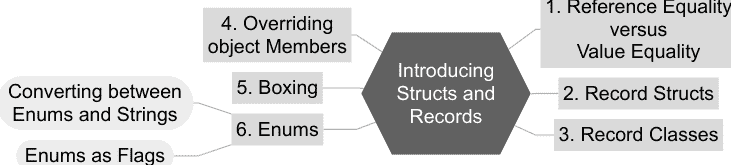

虽然正确实现自定义构建的结构体存在明显的复杂性，但它们相对少见。它们显然在 C# 开发中起着重要作用，但典型开发者声明的自定义结构体数量通常远于自定义类的数量。大量使用自定义结构体常见于旨在与非托管代码交互的代码。此外，除非单个值消耗的存储空间在 16 字节或以下、是不可变的且不经常装箱（boxed），否则不应定义它们。这些概念将在本章详细说明。

> ### 指南
> 除非逻辑上表示单个值、消耗的存储空间在 16 字节或以下、不可变且不经常装箱，否则不要定义结构体。

## 初学者主题

## 类型分类

到目前为止的所有类型都属于两类之一：引用类型和值类型。每个类别中类型之间的差异源于复制策略的差异，这导致每种类型在内存中的存储方式不同。作为回顾，本入门主题将为不熟悉这些问题的读者重新引入值类型/引用类型的讨论。

## 值类型

值类型的变量直接包含其值，如图 9.1 所示。变量名与内存中存储值的存储位置相关联。因此，当将原始变量的值赋值给第二个变量时，原始变量值的副本会被复制到与第二个变量关联的存储位置。两个变量永远不会引用同一个存储位置（除非一个或两个都是 `out` 或 `ref` 参数，根据定义，它们是另一个变量的别名）。更改原始变量的值不会影响第二个变量中的值，因为每个变量都关联于不同的存储位置。因此，更改一个值类型变量的值无法影响任何其他值类型变量的值。

## 第9 章：介绍结构体和记录

```
//...
int number1 = 42;
char letter = 'A';
float pi = 3.14F;
int number2 = number1;
//...
```


| | |
|---|---|
| int number1 | 42 |
| char letter | 'A' |
| float pi | 3.14F |
| int number2 | 42 |


图 9.1：值类型直接包含数据

值类型变量就像一张写有数字的纸。如果你想更改该数字，可以擦掉它并替换为另一个数字。如果你有第二张纸，你可以从第一张纸上复制该数字，但这两张纸随后就是相互独立的；在其中一张纸上擦除并替换数字不会影响另一张。

同样，将值类型的实例传递给如 `Console.WriteLine()` 等方法也会导致从与参数关联的存储位置进行内存复制，方法内部对参数变量的任何更改都不会影响调用者中的原始值。由于值类型需要复制，它们通常应该定义为消耗少量的内存（通常为 16 字节或少）。

> 指南
> 避免创建消耗超过 16 字节内存的值类型。

值类型的值通常是短命的；在许多情况下，一个值只需要表达式的一部分或用于方法的激活。在这些情况下，值类型的变量和临时值通常可以存储在称为“栈（`stack`）”的临时存储池中。（这个术语实际上是一个误称：它并不要求临时池在栈之外分配其存储空间。事实上上，作为一种实现细节，它经常选择从可用寄存器中分配存储空间。）

临时池的清理成本比垃圾回收堆（`heap`）低。然而，值类型的复制频率通常比引用类型高，这种复制可能会产生自身的性能开销。不要掉入“由于值类型可以分配在栈上，因此速度更快”的陷阱。

## 引用类型

相比之下，引用类型变量的值是指向对象实例的引用（见图 9.2）。引用类型变量存储的是对象实例数据所在位置引用（通常实现为内存地址），而不是直接存储数据（像值类型变量那样）。因此，为了访问数据，运行时从变量中读取引用，然后对其进行解引用（dereference），以到达实际包含实例数据的内存位置。

## 第9 章：介绍结构体和记录

```
int number1 = 42;

char letter = 'A';

float pi = 3.14F;

int number2 = number1;
```

值类型变量就像一张写有数字的纸。如果你想更改该数字，可以擦掉它并替换为另一个数字。如果你有第二张纸，你可以从第一张纸上复制该数字，但这两张纸随后就是相互独立的；在其中一张纸上擦除并替换数字不会影响另一张。

同样，将值类型的实例传递给如 `Console.WriteLine()` 等方法也会导致从与参数关联的存储位置进行内存复制，方法内部对参数变量的任何更改都不会影响调用者中的原始值。由于值类型需要复制，它们通常应该定义为消耗少量的内存（通常为 16 字节或少）。

> 指南
> 避免创建消耗超过 16 字节内存的值类型。

值类型的值通常是短命的；在许多情况下，一个值只需要表达式的一部分或用于方法的激活。在这些情况下，值类型的变量和临时值通常可以存储在称为“栈（`stack`）”的临时存储池中。（这个术语实际上是一个误称：它并不要求临时池在栈之外分配其存储空间。事实上，作为一种实现细节，它经常选择从可用寄存器中分配存储空间。）

临时池的清理成本比垃圾回收堆（`heap`）低。然而，值类型的复制频率通常比引用类型高，这种复制可能会产生自身的性能开销。不要掉入“由于值类型可以分配在栈上，因此速度更快”的陷阱。

相比之下，引用类型变量的值是指向对象实例的引用（见图 9.2）。引用类型变量存储的是对象实例数据所在位置引用（通常实现为内存地址），而不是直接存储数据（像值类型变量那样）。因此，为了访问数据，运行时从变量中读取引用，然后对其进行解引用，以到达实际包含实例数据的内存位置。

引用类型变量就像一张写有地址的纸。如果你想更改地址，可以擦掉它并替换为另一个地址。如果你有第二张纸，你可以从第一张纸上复制该地址，但这两张纸随后就是相互独立的；在其中一张纸上擦除并替换地址不会影响另一张。

同样，将引用类型的实例传递给如 `Console.WriteLine()` 等方法也会导致从与参数关联的存储位置进行内存复制，方法内部对参数变量的任何更改都不会影响调用者中的值。然而，如果方法更改了引用指向的对象，这种更改将被调用者观察到。由于引用类型只复制引用，它们通常应该定义为消耗少量的内存（通常为 16 字节或少）。

引用类型的值通常是短命的；在许多情况下，一个值只需要表达式的一部分或用于方法的激活。在这些情况下，引用类型的变量和临时值通常可以存储在称为“栈（`stack`）”的临时存储池中。（这个术语实际上是一个误称：它并不要求临时池在栈之外分配其存储空间。事实上，作为一种实现细节，它经常选择从可用寄存器中分配存储空间。）

临时池的清理成本比垃圾回收堆（`heap`）低。然而，引用类型的复制频率通常比值类型高，这种复制可能会产生自身的性能开销。不要掉入“由于引用类型可以分配在栈上，因此速度更快”的陷阱。

图 9.2：引用类型指向堆

引用类型变量就像一张写有地址的纸。如果你想更改地址，可以擦掉它并替换为另一个地址。如果你有第二张纸，你可以从第一张纸上复制该地址，但这两张纸随后就是相互独立的；在其中一张纸上擦除并替换地址不会影响另一张。

由于引用类型只复制指向数据的引用，两个不同的变量可以引用相同的数据。在这种情况下，通过一个变量更改数据将被观察到也更改另一个变量的数据。这在赋值和方法调用中都会发生。

继续我们之前的类比，如果你将建筑的地址传递给一个方法，你复制包含引用的纸并将副本交给该方法。方法无法更改原始纸的内容以指向另一个建筑。假设方法漆了所引用的建筑。那么，当方法返回时，调用者可以观察到调用者仍然引用的建筑现在变了颜色。

# 引用相等与值相等

在考虑示例之前，让我们先考虑为什么我们最初需要实现基于值的相等性（简称为“值相等”）。如果两个引用指向同一个对象实例，则它们是相同的（**引用相等**）。另一方面，具有相同值的对象是**值相等**的。而且，为了支持值相等，一个类型需要实现基于值的相等性。两个引用相等的对象也是值相等的——这种比较是针对同一个对象的两个引用进行的。然而，如果两个对象之间的（相关）数据也相等，那么这两个对象就可以值相等。只有引用类型可以是引用相等的，从而支持了“身份”的概念——即两个引用指向同一个实例。

相比之下，值类型永远不会引用相等。如果你比较 42 是否等于 42，答案始终是 `false`。每个值类型都存储在内存中不同的位置（引用）上，即使是将值类型传递给方法进行比较的简单操作，也会创建值类型的额外副本。

```
在值类型上调用 ReferenceEquals() 将始终返回 false。
```

虽然值类型永远不会引用相等，但引用类型可以支持值相等。`object` 包含一个名为 `ReferenceEquals()` 的静态方法，用于检查两个参数是否相同——引用相等。此外，`object` 定义了一个虚拟的 `Equals()` 方法，默认情况下，它对引用类型依赖于 `ReferenceEquals()`。然而，此 `Equals()` 方法可以被自定义（在引用类型和值类型上都是如此），以便它们实现值相等而不是引用相等。

事实上，你应该始终在值类型上重写 `Equals()`，否则你将只剩下默认实现，该实现只比较第一个字段来判断值相等。然而，这是不够的。例如，如果一个值类型有三个属性，那么通过只比较第一个属性来检查值相等可能是不充分的。例如，给定一个 `Angle` 对象，比较第一个属性（Degrees）是不充分的。

# 第 9 章：引入结构体（Structs）和记录（Records）

只有当度、分和秒都相等（以及 Angle 包含的任何其他属性相等）时，两个 Angles 才相等。因此，在值类型上提供值相等的自定义实现几乎总是必要的。

然而，值相等并不限于值类型。在引用类型上，值类型相等也可能有意义。`string` 是一个很好的例子。虽然 `string` 是引用类型，但如果字符串中的所有字母都相同，那么两个字符串的比较应该是相等的，即使这两个字符串是不同的实例。

此外，正确重写 `Equals()` 需要许多额外的成员存在并可能被重写，这些将在后文的章节“[实现值相等性](https://essentialsharp.com/implementing-value-equality)”中描述。这些成员包括 `GetHashCode()` 以及 `==` 和 `!=` 运算符。在此之前，让我们深入了解什么是值类型。

> 注意：`object.Equals()` 的实现（重写之前所有对象上的默认实现）仅依赖于 `ReferenceEquals()`。所有值类型都重写了默认实现，转而比较值类型内部的一个或多个值。引用类型可以选择地也重写 `Equals()` 以支持值相等。在自定义值类型上实现相等性总是必要的。

# 结构体 (Structs)

C# 的内置类型如 `bool` 和 `int` 都是值类型，`string` 和 `object` 除外，它们是引用类型。框架提供了许多额外的值类型。开发者也可以定义自己的值类型。

要定义自定义值类型，你使用的语法类似于定义类和接口类型时使用的语法。语法上的关键区别是值类型使用 `struct` 关键字（列表 9.1）。

遗憾的是，注释的省略号代表了大量的复杂性，正如我们在本章稍后将看到的 true。

# 列表 9.1：示例结构体

```csharp
public struct Angle
{
    // ...
}
```

# 声明记录结构体 (Record Struct)

幸运的是，从 C# 9.0 开始，创建结构体相关的许多复杂性通过一个新的上下文关键字——`record` 被消除了，该关键字触发编译器生成许多与值类型行为相关的重要且复杂的代码。学习 9.2 节提供了一个示例。通过这种简单的语法，我们有了一个用度、分、秒描述高精度角度的值类型。（一个*分*是1度的六十分分之一，一个*秒*是分钟的六分之一。）这个系统被用于导航，因为它有一个很棒的属性：赤道面上1分钟的弧长恰好是一个**海里。

# 列表 9.2：声明结构体

```csharp
// 使用 record struct 构造函数声明一个值类型
public readonly record struct Angle(
    int Degrees, int Minutes, string? Name = null);
```

这种使用主构造函数的语法是定义整个类型所需的全部。然而，与第 6 节解释的普通主构造函数（且直到 C# 12.0 才能可用）不同，记录的主构造函数还会从属性（可选的¹）位置参数生成一组初始属性。因此，这种简单的代码结构被称为 **record struct**，它具有了构建值类型所需的所有要求，包括值声明、使用属性进行数据存储、不可变性、构造函数初始化、解构、等效性行为，甚至是 `toString()` 诊断功能。

+ 1. 位置参数以及它们周围的括号（当没有位置参数时）都是可选的。虽然只用括号进行声明可能很奇怪，因为这样做等同于声明一个空结构体或类。

# 第 9 章：引入结构体和记录

你会注意到列表 9.2 中，既有基于位置参数生成的构造函数，也有基于位置参数的解构函数（deconstructor）。这在定义的相同的属性（未显示）之外。此外，如果属性等效，则两个 Angle 实例将对评估为相等，这种等效性是根据重写相等运算符的指南实现的。

# 列表 9.3：使用记录结构体

```csharp
using System;
using System.Diagnostics;
public class Program
{
    public static void Main()
    {
        // 使用位置参数生成构造函数
        (int degrees, minutes, seconds) = (90, 0, 0);
        Angle angle = new(degrees, minutes, seconds);
        // 记录包含了 ToString() 实现
        // 返回："Angle = 90, Minutes = 0, Seconds = 0"
        Console.WriteLine(angle.ToString());
        // 记录拥有一个使用位置参数的解构函数
        if (angle is (int, int, int) angleData)
        {
            Trace.Assert(angle.Degrees == angleData.Degrees);
            Trace.Assert(angle.Minutes == angleData.Minutes);
            Trace.Assert(angle.Seconds == angleData.Seconds);
        }
        Angle copy = new(degrees, minutes, seconds);
        // 记录提供了自定义相等运算符
        Trace.Assert(angle == copy);
        // with 运算符具有对象初始化
        // 用于实例化一个修改后的副本。
        copy = angle with {};
        Trace.Assert(angle == copy);
        Angle modifiedCopy = angle with { Degrees = 180 };
        Trace.Assert(angle != modifiedCopy);
    }
}
```

# 记录结构体代码生成

记录结构体的所有功能由 C# 编译器在编译时生成。C# 等效代码见列表 9.4。

# 列表 9.4：等效记录结构体 C# 代码

```csharp
using System;
using System.Runtime.CompilerServices;
using System.Text;
[CompilerGenerated]
public readonly struct Angle : IEquatable<Angle>
{
    public int Degrees { get; init; }
    public int Minutes { get; init; }
    public int Seconds { get; init; }
    public string? Name { get; init; }
    public Angle(int Degrees, int Minutes, int Seconds, string? Name)
    {
        this.Degrees = Degrees;
        this.Minutes = Minutes;
        this.Seconds = Seconds;
        this.Name = Name;
    }
    public override string ToString()
    {
        StringBuilder stringBuilder = new();
        stringBuilder.Append("Angle");
        stringBuilder.Append("{ ");
        if (PrintMembers(stringBuilder))
        {
            stringBuilder.Append('\'');
        }
        stringBuilder.Append("}");
        return stringBuilder.ToString();
    }
}
```

# 498 第 9 章：结构体（Structs）与记录（Records）

```csharp
private bool PrintMembers(StringBuilder builder)
{
    builder.Append("Degrees = ");
    builder.Append(Degrees);
    builder.Append(", Minutes = ");
    builder.Append(Minutes);
    builder.Append(", Seconds = ");
    builder.Append(Seconds);
    builder.Append(", Name = ");
    builder.Append(Name);
    return true;
}
```

```csharp
public static bool operator !==(Angle left, Angle right) =>
    !(left == right);
```

```csharp
public static bool operator ==(Angle left, Angle right) =>
    left.Equals(right);
```

```csharp
public override int GetHashCode()
{
    static int GetHashCode(int integer) =>
        Equality<int>.Default.GetHashCode(integer);
    return GetHashCode(Degrees) * -1521134295
        + GetHashCode(Minutes) * -1521134295
        + GetHashCode(Seconds) * -1521134295
```


```
+ EqualityComparer<string>.Default.GetHashCode(Name!);
```
```
```csharp
public override bool Equals(object obj) =>
    obj is Angle angle && Equals(angle);
```
```csharp
public bool Equals(Angle other) =>
    EqualityComparer<int>.Default.Equals(Degrees, other.Degrees)
    && EqualityComparer<int>.Default.Equals(Minutes, other.Minutes)
    && EqualityComparer<int>.Default.Equals(Seconds, other.Seconds)
    && EqualityComparer<string>.Default.Equals(Name, other.Name);
```
```csharp
public void Deconstruct(out int Degrees, out int Minutes,
    out int Seconds, out string Name) =
    => (Degrees, Minutes, Seconds, Name)
    (this.Degrees, this.Minutes, this.Seconds, this.Name);
```

# 结构体 499

从示例 9.1 中的代码行来看，示例 9.3 显示生成了大量的代码。首先，`Angle` 不再是一个类（`class`），而是一个结构体（`struct`），且 `record` 上下文关键字被删除。在 C# 中，要定义自定义值类型必须是结构体。虽然 C# 允许你像示例 9.3 所示从零开始编写整个结构体，但 C# 9.0 的 `record` 关键字启动了许多样板代码（`boilerplate code`），使得我们不再有理由使用 `record` 关键字来开始编写，特别是因为你可以定义所有生成代码的自定义版本，根据需要覆盖默认的生成实现。

注意，在 C# 9.0 中，不带 `struct` 关键字的 `record` 关键字是编译器允许的。然而，在 C# 10.0 中（引入了用于结构体的记录类型），添加了 `record class` 的显式声明。为了清晰起见，我们建议始终使用 `record class`，而不是简化的仅限 `record` 的语法。


## 指南

- 在声明结构体时，请使用 `record struct` (C# 10.0)。
- 为了清晰起见，请使用 `record class` (C# 10.0)，而不是简化的仅限 `record` 的语法。

所有值类型都是隐式密封的（你不能从它们派生）。此外，所有非枚举值类型（枚举将在本章稍后讨论）都派自 `System.ValueType`。因此，结构体的 `ValueType` 链始终是从 `object` 到 `System.ValueType` 再到自定义结构体。

`System.ValueType` 通过重写 `object` 的所有虚方法（如 `Equals()`、`ToString()` 和 `GetHashCode()`）引入了值类型的行为。然而，这种实现通常是不够的，需要开发者负责对这些方法中的每一个进行进一步专门化——当然，这直到 C# 10.0 引入 `record` 修饰符为止，现在 C# 编译器会生成更适合生产代码的自定义覆盖。许多相同的功能在类中也同样可用。

# 记录类（Record Classes）

此外，`record` 修饰符不仅限于创建值类型。从 C# 9.0 开始，增加了对记录类的支持，如示例 9.5 所示。

示例 9.5：声明一个记录类

```csharp
// 使用 record class 构造声明一个引用类型
public record class Coordinate(
    Angle Longitude, Angle Latitude)
```

在这个记录类中，我们使用 `Angle` 类型作为位置参数传入 `Coordinate`，以表示经度和纬度。

为了将记录结构体和记录类与它们的非记录版本区分开，我们将在本章将其称为标准结构体和标准类。`record class` 特性引入的最关键问题之一是：何时使用 `record class` 而不是标准类，反之亦然？关键且可能也是定义 `record class` 的唯一原因在于，如果该类型需要具有值相等性（value equality）。事实上，每当自定义类型需要实现值相等性时（对于值类型始终如此），应尽可能使用 `record` 构造。可能无法实现的示例是在是在 C# 9.0 之前的版本中工作（对于值类型）。

另一种无法在类上使用 `record` 构造的情况是基类不是记录类。`record class` 只能继承自另一个 `record class`，而标准类只能继承自另一个标准类。继承链不能在标准类和记录类型之间混合使用。

> 注意
> 引用类型默认应实现为标准类，只有在需要值相等性实现时才实现为记录类。

许多与 `record struct` 相关的特性也用于 `record class`，包括简洁的声明、带属性的数据存储、构造函数初始化、解构、`ToString()` 诊断能力，以及最重要的（由于其复杂性）值相等性，而不仅仅是引用相等性。生成的等效记录类 C# 代码见示例 9.6。

**示例 9.6：** 等效记录类 – 生成的 C# 代码

```csharp
using System.Runtime.CompilerServices;
using System.Text;

[CompilerGenerated]
public class Coordinate : IEquatable<Coordinate>
{
    public Angle Longitude { get; init; }
    public Angle Latitude { get; init; }
    public Coordinate(Angle Longitude, Angle Latitude) : base()
    {
        this.Longitude = Longitude;
        this.Latitude = Latitude;
    }
    public override string ToString()
    {
        StringBuilder stringBuilder = new();
        stringBuilder.Append("Coordinate");
        if (PrintMembers(stringBuilder))
        {
            stringBuilder.Append(' ');
        }
        stringBuilder.Append("}");
        return stringBuilder.ToString();
    }
    protected virtual bool PrintMembers(StringBuilder builder)
    {
        RuntimeHelpers.EnsureExecutionStack();
        builder.Append("Longitude = ");
        builder.Append(Longitude.ToString());
        builder.Append(", Latitude = ");
        builder.Append(Latitude.ToString());
        return true;
    }
    public override int GetHashCode()
    {
        static int GetHashCode(Angle angle) =>
            EqualityComparer<Angle>.Default.GetHashCode(angle);
        return (EqualityComparer<Type>.Default.GetHashCode(
            EqualityContract()) * -1521134295
        * GetHashCode(Longitude)) * -1521134295
        * GetHashCode(Latitude);
    }
    public override bool Equals(object obj) =>
        Equals(obj as Coordinate);
    public virtual bool Equals(Coordinate? other) =>
        (object)this == other || (other is not null)
        && EqualityContract() == other!.EqualityContract()
        && EqualityComparer<Angle>.Default.Equals(
            Longitude, other!.Longitude)
        && EqualityComparer<Angle>.Default.Equals(
            Latitude, other!.Latitude);
    }
    public void Deconstruct(
        out Angle Longitude, out Angle Latitude)
    {
        Longitude = this.Longitude;
        Latitude = this.Latitude;
    }
    protected virtual Type EqualityContract() => typeof(Coordinate);
    public Type ExternalEqualityContract => EqualityContract();
    // Actual name in IL is "<Clone>$". However,
    // you can't add a Clone method to a record.
    public Coordinate Clone() => new(this);
    protected Coordinate(Coordinate original)
    {
        Longitude = original.Longitude;
        Latitude = original.Latitude;
    }
}
```

502 第 9 章：结构体（Structs）与记录（Records）

```csharp
public static bool operator !==(Coordinate? left, Coordinate? right) =>
!(left == right);
public static bool operator ==(
    Coordinate left, Coordinate? right) =>
    ReferenceEquals(left, right) ||
    (left?.Equals(right) != false);
```

```c
Latitude = original.Latitude;
}
```

在 `record struct` 与 `record class` 生成的代码之间存在几处预期的差异。

首先，几个成员被标记了 `virtual` 修饰符（`PrintMembers(StringBuilder builder)`、`Equals(Coordinate? Other)` 和 `EqualityContract()`）。`record struct` 永远未使用 `virtual`，因为它们都是密封的（`sealed`），这使得在 record 的情况下使用 `virtual` 没有意义。

其次，`record class` 需要考虑空值的可能。因此，`Equals()`、`==` 运算符以及两个 `Equals()` 方法都需要检查参数值是否为空。

在接下来的章节中，我们将详细探索记录；我们将讨论每个特性、值得注意的实现方式，以及 `record struct` 与 `record class` 实现之间的独特差异。

| 指南 |
| :--- |
| 如果你想根据数据而非标识进行等效性比较，请尽可能使用 records。 |

# 记录类继承 (Record Class Inheritance)

虽然 `record struct` 由于是密封的而不支持继承，但 `record class` 支持继承。主要的限制是 `record class` 只能继承自其他 `record class`，甚至不能继承自标准类。列表 9.7 提供了一个示例。

+ 列表 9.7：记录类继承

```csharp
public record class NamedCoordinate(
    Angle Longitude, Angle Latitude, string Name)
```

# 第 9 章：介绍结构体和记录

Coordinate(Longitude, Latitude);

注意，在定义继承关系时，你也可以通过基类名称后的参数来识别如何带参数调用基构造函数。在这种情况下，我们将 `Longitude` 和 `Latitude` 传递给 `Coordinate` 的由位置参数生成的构造函数。

# 记录 (Records)

在本节中，我们将深入研究记录背后的代码细节，突出 `record class` 与 `record struct` 之间的差异，最重要的是，挖掘值等效性的实现细节。我们从记录的数据存储开始讨论。

# 使用属性的数据存储 (Data Storage with Properties)

注意位置参数 `Degree`、`Minutes` 和 `Seconds` 如何映射到 `Angle` 结构体上自动生成的属性。`Coordinate` 上的 `Longitude` 和 `Latitude` 也是如此。一旦初始化完成，属性是只读的（具有 `init-only` 设置器）。属性只读是 `record class` 的默认行为，或者是由 `record struct` 声明上的 `readonly` 修饰符引起的——该修饰符导致值类型在初始化完成之前是不可变的。

记录的一个特殊之处在于，按照惯例，位置参数是 `PascalCase`（帕斯卡命名法），因此它们是构造函数的参数。虽然编译器没有要求，但对位置参数使用 `PascalCase` 可以确保相应的属性也具有 `PascalCase`——后者是类型 API 中更可见的部分。

要自定义默认实现，你可以使用相同的名称为每个属性定义自己的版本——也许可能使用备用字段和自定义验证。你甚至可以将属性替换为同名的字段。此外，如果它们没有作为位置参数包含，你还可以添加额外的属性和字段。唯一的限制是，由于结构体的 `readonly` 修饰符，所有属性和字段也必须是只读的。

注意，生成的属性没有与任何验证逻辑相关。因此，非可空引用类型的位置参数将包含空检查。由于由于原因，请考虑始终将引用类型位置参数定义为可空，除非你提供了检查空值的自定义实现。

# 指南 (Guidelines)

- **对记录的位置参数使用 PascalCase (C# 9.0)。**
- **如果不提供检查空值的自定义属性实现，请将所有引用类型位置参数都定义为可空。**
- **为所有非可空位置参数实现自定义的非可空属性。**

# 不可变值类型 (Immutable Value Types)

一个重要的指南是所有值类型和 `record class` 都应该是不可变的：一旦你实例化了其中任何一个，就不应该能够修改同一个实例。该指南有三个充分的。

首先，对于结构体（structs），值类型应该表示值。人们不会将两个整数相加看作是对其中任何一个的修改；相反，两个加数是不可变的，产生第三个值作为结果。其次，因为值类型是通过值复制而非引用复制的，很容易产生混淆并错误地认为一个值类型变量的变异可以观察到导致另一个变量的变异，就像引用类型那样。

第三，对于结构体和 `record class`，事实是哈希值是根据类型内部存储的数据计算的，且哈希值永远不应该改变。（参见本章节后部分的“高级主题：重写 GetHashCode()”）。如果这些类型内部的数据发生变化并计算出新的哈希值，在存在旧哈希值的集合中搜索新的哈希值可能会导致值永远无法找到，并产生错误的行为。

# 第 9 章：介绍结构体和记录

注意列表 9.3 中的 `Angle` 结构体是不可变的，因为所有属性都是自动实现的、使用 `init-only` 设置器而非 `set` 声明的只读属性。为了验证是否符合不可变指南，你可以在结构体定义中使用 `readonly` 修饰符 `³`（同时适用于 `record struct` 和标准结构体）。请参见列表 9.8。

# 列表 9.8：在结构体上使用只读修饰符

```csharp
readonly struct Angle { }
```


对于记录，编译器将验证整个结构体是否是不可变的，如果存在非只读的字段或具有设置器，则会报错。在 `record class` 或标准类上使用 `readonly` 修饰符是不支持的。在需要对结构体进行更细粒度控制的异常情况下，C# 8.0 允许你定义任何结构体（而非类）成员为只读。例如，`Move()` 方法可以参见列表 9.9。

# 列表 9.9：定义只读结构体

```csharp
public readonly Angle Move(int degrees, int minutes, int seconds)
{
    return new Angle(
        Degrees + degrees,
        Minutes + minutes,
        Seconds + seconds);
}
```

任何修改结构体数据（属性或字段）或调用非只读成员的编译错误

2. 自动实现的只读属性在 C# 6.0 中可用。
3. 从 C# 7.2 开始。

支持只读访问的概念，开发者声明成员是否可以修改对象实例。注意，非自动实现的属性可以使用 `readonly` 修饰符装饰 getter 或 setter（尽管后者会很奇怪）。为了同时装饰两者，`readonly` 修饰符将放在属性本身上，而不是单独放在 getter 和 setter 上。

实际上，当结构体是只读时，在成员上使用 `readonly` 修饰符是多余的。然而，倾向于使用只读的 (`{get;}`) 或 `init-only` 设置器 (`{init;}`) 自动实现的属性，而非字段。

# 指南 (Guidelines)

- 在结构体定义上使用 `readonly` 修饰符，使值类型不可变。
- 倾向于使用只读的 (`{get;}`) 或 `init-only` 设置器 (`{init;}`) 自动实现的属性，而非字段。

的是，元组 (`System.ValueTuple`) 是打破不可变指南的一个示例。要理解它为什么是例外，请参见 https://intellitlect.com/WhyTupleBreaksTheImmutableRules。

# 使用 with 运算符复制记录 (Cloning Records Using the with Operator)

由于某些记录（特别是 `record struct`）是不可变的，与其修改它们不如创建一个新实例。实现这一点的简单方法是使用 C# 9.0 引入的 `with` 运算符。正如列表 9.3 最后所示，`with` 运算符将现有实例克隆到副本。然而，你并不限于精确复制。相反，你可以使用对象初始化器语法创建具有修改数据的新实例（参见列表 9.10）。

`with` 运算符的左操作数是源实例。虽然你可以创建一个精确克隆，但使用对象初始化器允许你在实例化期间修改任何可访问成员并为其分配不同的值。

# 508 第 9 章：引入结构体和记录

## 列表 9.10：通过 with 运算符克隆记录

```csharp
Angle angle = new(90, 0, 0, null);
// with 运算符等同于：
// Angle copy = new(degrees, minutes, seconds);
// Angle copy = angle with {};
Trace.Assert(angle == copy);
```

```csharp
// with 运算符具有对象初始化器类型
// 语法，用于实例化修改后的副本。
Angle modifiedCopy = angle with { Degrees = 180 };
Trace.Assert(angle != modifiedCopy);
```

克隆记录结构体（`record struct`）是内存拷贝，这与通过值传递在调用方法时创建副本的机制是相同的。因此，你无法更改克隆记录结构体的实现方式。

对于记录类（`record class`），过程略有不同。C# 编译器会生成一个隐藏的 `Clone()` 方法（如列表 9.5 所示），该方法反过来调用带有源实例参数的拷贝构造函数。你也可以在列表 9.11 中查看相同的代码。

## 列表 9.11：通过 Clone 方法克隆记录类

```csharp
// IL 中的实际名称为 "<Clone>"。然而，
// 你不能向记录中添加 Clone 方法。
public Coordinate Clone() => new(this);
```

```csharp
protected Coordinate(Coordinate original)
{
    Longitude = original.Longitude;
    Latitude = original.Latitude;
}
```

`Clone` 方法反过来调用构造函数。请注意，当使用对象初始化器语法时，被赋值的属性不能是只读的（需要有 setter 或 init-only setter）。此外，`Clone()` 方法使用了一个不符合 C# 规范的特殊名称，使其只能通过 `with` 运算符访问。但是，如果你想

+   4. 一个接受单个参数或包含类型的构造函数。请参见第 6 章。

来自定义克隆行为，你可以提供拷贝构造函数的你自己的实现。

# 记录构造函数

请注意，列表 9.1 中的记录声明与列表 9.3 中的构造函数签名几乎完全相同。同样，结合列表 9.4 中的记录类关联代码及其列表 9.5 中对应的 C# 生成等效代码，记录声明及其位置参数为 C# 编译器生成具有等效签名的构造函数提供了结构。

与属性本身一样，记录的一个特殊之处在于，按照惯例，位置参数采用 PascalCase（大驼峰命名法），因此，构造函数的参数也是如此。（因此，在初始化属性时，生成的构造函数代码利用此来区分参数和属性。）

你可以向记录的定义中添加额外的构造函数。例如，你可以提供一个参数为字符串而非整数（`int`）的构造函数，如列表 9.12 所示。

## 列表 9.12：添加额外的记录构造函数

```csharp
public Angle(
    string degrees, string minutes, string seconds)
    : this(int.Parse(degrees),
      int.Parse(minutes),
      int.Parse(seconds))
{}
```

额外构造函数的实现与其他任何其他构造函数相同的语法。唯一的额外限制是，它必须调用记录生成的构造函数，或者调用另一个调用记录生成构造函数的构造函数。这确保了位置参数生成的属性都已初始化。

# 记录结构体的初始化

在 C# 10.0 之前，无法定义默认构造函数。无论如何，如果不是通过 `new` 运算符调用构造函数来显式实例化结构体，结构体包含的所有数据将隐式初始化为数据的默认值。对于引用类型数据字段，默认值为 `null`；对于数值类型字段，默认值为 `0`；对于布尔类型数据字段（包括支持自动属性的字段），默认值为 `false`。同样，由于声明期间⁵（如 `string Description { get; init; } = ""`）的字段和属性初始化是由编译器注入构造函数中的，如果没有调用 `new` 运算符，它也不会执行。

意识到这一点很重要，因为与引用类型不同，值类型通常会在不使用 `new` 运算符的情况下实例化。例如，将值类型赋值为默认值，或在类中未初始化值字段，都不会执行任何构造函数，像列表 9.13 所示的未初始化数组项也是如此。

## 列表 9.13：未初始化的数组项

```csharp
Angle[] angles = new[2];
```

在这两种情况下，无论默认构造函数如何初始化数据成员，它们最终都将拥有默认值。因此，不要依赖默认构造函数或声明时的成员初始化。

在 C# 11.0 之前，结构体中的每个构造函数必须初始化结构体内的所有字段（以及只读的自动实现属性⁶）。未初始化结构体内的所有数据会导致 C# 10.0 及更早版本中的编译时错误：

> CS0171: 在返回给调用者之前，必须完全赋值字段。考虑更新到语言版本 '11.0' 以自动为字段默认值。

由于结构体的字段初始化要求、只读字段声明的简洁性、对自动实现属性的支持以及避免从包装属性外部访问字段的指南，你应该在结构体内部优先使用只读的自动实现属性，而不是字段。

+   5. 从 C# 10.0 开始启用。
+   6. 从 C# 6.0 开始，通过只读的自动实现属性进行初始化是足够的，因为底层字段是不可知的，否则无法进行初始化。

## 指南

-   务必确保结构体的默认值是有效的；封装无法防止获取“全零”的结构体。
-   不要依赖默认构造函数或声明时的成员初始化在值类型上运行。

## 高级主题

# 在值类型上使用 new

对引用类型调用 `new` 运算符会导致运行时在垃圾回收堆上创建对象的新实例，将其所有字段初始化为它们的默认值，并调用构造函数（将实例的引用作为 `this` 传递）。结果是实例的引用，然后可以将其拷贝到其最终目的地。相比之下，对值类型调用 `new` 运算符会导致运行时在临时存储池上创建对象的新实例，将其所有字段初始化为它们的默认值，并调用构造函数（将临时存储位置作为 `ref` 变量通过 `this` 传递），结果是存储在临时存储位置中的值，然后可以将其拷贝到其最终目的地。

与类不同，结构体不支持析构器。结构体按值拷贝；它们没有引用身份（像引用类型那样）。因此，很难知道何时执行析构器并释放结构体拥有的非托管资源是安全的。垃圾回收器知道引用类型实例不再有更多存引用，可以在之后任何时间运行引用类型实例的析构器。然而，运行时没有任何部分会跟踪给定值类型存在多少个副本。

# 第 9 章：引入结构体和记录

### 语言对比：C++—struct 定义公共成员的类型

在 C++ 中，使用 `struct` 定义类型与使用 `class` 定义类型的区别在于默认访问权限是公共还是私有。C# 中的差异大得多，区别在于类型实例是按值还是按引用拷贝。

# 记录析构器

除了属性和构造函数，C# 编译器还会生成与位置参数相对应的解构器，如列表 9.14 所示：

## 列表 9.14：记录解构器

```csharp
public void Deconstruct(
    out int Degrees, out int Minutes, out int Seconds)
{
    Degrees = this.Degrees;
    Minutes = this.Minutes;
    Seconds = this.Seconds;
}
```

这使得可以使用像列表 9.2 中所示的模式匹配（再次显示在列表 9.15 中）：

## 列表 9.15：模式匹配

```csharp
if (angle is (int, int, int, string) angleData)
{
    // ...
}
```

## 覆盖对象成员

第 6 章讨论了所有类和结构体最终都派自 `object`。此外，它回顾了 `object` 上提供的每个方法，并讨论了其中某些方法是虚拟的。本节将讨论有关重写虚拟方法的细节。对于记录（records），这种操作是自动的，但生成的代码也提供了一个如果你选择自定义生成的代码或在非记录类型实现上实现重写时需要的内容示例。

## 重写 ToString()

默认情况下，对任何对象调用 `ToString()` 将返回对象类型的完全限定名称。例如，对 `System.IO.FileStream` 对象调用 `ToString()` 将返回 `System.IO.FileStream`。然而，对于某些类，`ToString()` 可能更有意义。例如，对于 `String`，`ToString()` 返回字符串本身。同样，当在 `Angle`（列表 9.1）上调用 `ToString()` 时，结果返回：

```
Angle { Degrees = 90, Minutes = 0, Seconds = 0, Name =
```

（这恰好也是列表 9.2 的输出。）

编写如 `System.Console.WriteLine()` 和 `System.Diagnostics.Trace.Write()` 等方法会调用对象的 `ToString()` 方法，因此重写该方法通常比默认实现输出更有意义的内容。

重写 `ToString()` 只需将 `ToString()` 方法声明为 `override` 并返回一个字符串。参考列表 9.16：

## 列表 9.16：重写 ToString 方法

> 7. 除非存在“高级主题：类型转换操作符”中描述的那种隐式类型转换操作符。

无论如何，不要返回空字符串或 *null*，因为缺少输出将非常令人困惑。`ToString()` 对于从开发者 IDE 调试或写入日志文件很有用。请注意实现本地化重载方法和高级格式化功能，以确保适用于普通终端用户的文本显示。此外，保持字符串较短，以便它们不会在屏幕末尾被截断——特别是在 IDE 中调试时。

每当输出可以提供相关的诊断信息时，都要考虑重写 `ToString()` 方法——特别是当目标观众是开发者时，因为默认的 `ToString()` 输出是类型名称，对终端用户并不友好。或者，从 C# 10.0 开始，你可以密封（seal）记录的 `ToString()` 实现，防止其被派生类型（包括代码生成的实现）重写。

| 指南 |
| :--- |
| **应当** 只要可以返回有用的面向开发者的诊断字符串，就**应当**重写 `ToString()`。 |
| **考虑** 尝试保持 `ToString()` 返回的字符串简短。 |
| **不要** 从 `ToString()` 返回空字符串或 *null*。 |
| **不要** 从 `ToString()` 抛出异常或产生可观察的副作用（更改对象状态）。 |
| **应当提供** 重载的 `ToString(string format)` 或实现 `IFormattable`，如果返回值需要格式化或具有文化敏感性（例如 `DateTime`）。 |
| **考虑** 从 `ToString()` 返回唯一字符串以识别对象实例。 |

## 实现 实现值等效性

开发者经常期望实现值等效性是轻而易举的。比较两个对象有多难呢？然而，它包含了许多惊讶的细微之处和复杂性，需要仔细的思考和测试。幸运的是，有两种方法可以显著简化代码。首先，如果你使用记录（record）构造体，那么 C# 编译器会负责为你生成 `Equals()` 方法及其所有关联成员，自动比较记录中自动实现的属性和字段——无论它们是否包含在位置参数中。其次，你可以将标识数据元素（自动实现的属性和字段）分组到一个元组（tuple）中然后比较元组。在引用类型的情况下，你还需要注意任何潜在的空值。

列表 9.3 显示了为记录生成的 `Equals()` 实现，它启用了值等效性。C# 记录的一个大优势是它们生成了值等效性实现，免去了你手动实现该方法的麻烦，考虑到继承、空值、不同的数据类型以及值/引用类型，除了比较包含的值本身之外，这可能是一个出奇的复杂方法。尽管如此，如果记录生成的实现不符合你的需求，也不意味着你必须编写自己的。这样做的原因之一是，你可能不想让某些属性包含在值等效判断中。也许你不希望 `Angle` 上的 `Name` 属性成为 `Angle` 值标识身份的一部分，而是完全依赖于 `Degrees`、`Minutes` 和 `Seconds`。列表 9.24 提供了这样一个完全自定义的记录结构体，并带有列表 9.17 中的自定义等效实现代码段：

### 列表 9.17：自定义等效实现

```
public bool Equals(Angle other) =>
    (Degrees, Minutes, Seconds).Equals(
        other.Degrees, other.Minutes, other.Seconds));
```

注意，值标识属性被组合成元组，并与其他对象的相同值进行比较。此外，注意 equals 实现是重载的。之前的代码段显示了带有 `Angle` 参数的实现。这是因为 C# 编译器为你生成了所有额外的值等效性功能。然而，对于不是记录的类型，你必须自己提供所有此类自定义。此外，每当你更新 `Equals()` 方法时，都应该更新 `GetHashCode()`，因此使用相同的数据元素。在重写 `Equals()` 时未重写 `GetHashCode()`，反之亦然，将产生警告：

```
CS8851 '<ClassName>' 定义 'Equals' 但没有 'GetHashCode'
```

虽然此代码段与列表 9.3 显示的记录生成的 `Equals()` 版本不同，但在内部元组 `(System.ValueTuple<...>)` 也使用了 `EqualityComparer<T>`。反过来，`EqualityComparer<T>` 依赖于 `Equatable<T>` 的类型参数实现（它仅包含单个 `Equals<T>(T other)`）。因此，为了正确重写 `Equals`，你需要实现 ` IEquatable<T>`。

一旦重写了 `Equals()`，就存在不一致的可能性。也就是说，两个对象对于 `Equals()` 可能返回 `true`，但对于执行引用等性检查的 `==` 运算符可能返回 `false`。为了修复此缺陷，重写等于 (=) 和不等于 (!) 运算符同样重要。当然，正如列表 9.18 所示，这是记录实现的一部分生成的：

-   列表 9.18：重写 == 和 != 运算符

```
public static bool operator ==(Coordinate left, Coordinate? right) =>
    ReferenceEquals(left, right) || (left?.Equals(right) ?? false);
//
public static bool operator !=(Angle left, Angle right) =>
    !(left != right);
```


在大多数情况下，这些运算符的实现可以将逻辑委托给 `Equals()`，反之亦然。注意不要让 `==` 运算符调用自身导致无限递归。在这种情况下，递归被避免了，因为我们使用了 `ReferenceEquals()`，如果两个值都为 null，它将返回 true。有关运算符重载的更多信息，请参见第 10 章 (`https://essentialsharp.com/operator-overloading/`)。

最后，如果自定义类型可以排序，请考虑实现 `Comparable<T>` 以及如果需要本地化的 `IFormattable` 接口。对于不使用记录构造的值等效完整实现，请参见“高级主题：重写 GetHashCode()”。对于值类型，我们还需要涵盖两个重要主题。第一个是装箱，第二个是枚举，将在后续章节中讨论。

## 高级主题

### 值等效原理

注意列表 9.24 中 `Equals()` 的签名与列表 9.19 中的对象签名不匹配。

```
LISTING 9.19: 不匹配的签名

public override bool Equals(object? obj)
```

如果匹配，我们将需要使用 override 修符。在类或结构体（非记录）上实现 `Equals()` 时，还有其他需要注意的考虑因素。这些都可以在结构体的列表 9.3 和类的列表 9.5（因为记录修符生成了它们）。

在自定义类型上实现值等效的步骤为：

- 1. 实现 `IEquatable<T>` 接口。
- 2. 实现 `Equals(object? obj)` 方法，检查 obj 是否为自定义类型，并调用强类型 `Equals()` 辅助方法，该方法可以将操作视为自定义类型而不是对象（列表 9.20）。

```
LISTING 9.20: 在自定义类型上实现值等效性

public override bool Equals(object? obj)
{
    return Equals(obj as Foo);
}
```

- 3. 泛型将在第 12 章中讨论。

# 518 第 9 章：引入结构体和记录（Records）

- 3. 正如清单 9.21 所示，实现强类型的 `Equals()` 辅助方法，并检查 obj 是否为空（仅限引用类型）。

```csharp
public bool Equals(Foo? other)
{
    if (other is null) return false;
    // Step 5
    return (this.Number, this.Name) == (other.Number, other.Name);
    return true;
}
```

- 4. 对于未派自 `System.Object` 的引用类型，检查 `base.Equals()`，以便进行重构。
- 5. 比较每个标识性数据的相等性，优先使用元组。
- 6. 重写 `GetHashCode()`。
- 7. 重写 `==` 和 `!=` 运算符（参见第 10 章 运算符重载）。

在专门接收自定义数据类型（例如 `Coordinate`）的 `Equals()` 重载中执行步骤 3 到 4。这样，对两个 `Coordinate` 对象的比较将完全避免调用 `Equals(object? obj)` 及其类型检查。

`Equals()` 永远不应该抛出任何异常。将任何对象与其他任何对象进行比较是一个有效的选择，这样做永远不应导致异常。

> 指南
>
> **必须**实现 `GetHashCode()`、`Equals()`、`==` 运算符和 `=` 运算符——不要只实现其中一个而不实现另外三个。
>
> **务必**在实现 `Equals()`、`==` 和 `!=` 时使用相同的算法。
>
> **不要**在 `GetHashCode()`、`Equals()`、`=` 和 `!=` 的实现中抛出异常。
>
> **避免**在可变引用类型上重写相等性相关成员，或者如果此类重写会导致实现速度显著变慢，请包含可变数据。
>
> **必须**在实现 `IEquatable` 时实现所有与相等性相关的方法。

## 高级主题

## 重写 `GetHashCode()`

如果你依赖记录（record）构造函数，`GetHashCode()` 将作为值相等性实现的一部分自动为你实现（参见清单 9.3 和清单 9.5）。如果没有记录的实现，但你提供了相等性实现，则必须自己实现 `GetHashCode()`。即使使用记录，如果你自定义了 `Equals()` 实现，你可能也想重写 `GetHashCode()`，以使用与新 `Equals()` 实现相似的一组值。而且，如果你只重写 `Equals()` 而不重写 `GetHashCode()`，你将收到一个警告：

```text
CS0659: '<Class Name>' overrides Object.Equals(object o) but does not override Object.GetHashCode();
```

句话说，当不利用记录构造函数时，重写 `equals` 要求你也重写 `GetHashCode()`。

哈希值的目的是通过生成一个与对象值对应的数字来有效地平衡哈希表。虽然有许多指南（讨论请参见 `https://bit.ly/39yp8lm`），但最简单的方法如下：

- 1. 依赖记录生成的实现（参见清单 9.2）。如果你需要重写 `GetHashCode()`，你可能正在重写 `Equals()`，并且默认情况下使用记录是最佳方法。
- 2. 调用 `System.HashCode` 的 `Combine()` 方法，并指定每个标识字段（参见清单 9.22）：

### 清单 9.22：使用 Combine 方法重写 GetHashCode()

```csharp
public override int GetHashCode() =>
    HashCode.Combine(Degrees, Minutes, Seconds);
```

- 3. 使用产生对象唯一性的字段作为元组元素，调用 `ValueTuple.GetHashCode()` 方法，如清单 9.23 所示。（如果标识字段是数字，请小心不要误用字段本身而不是它们的哈希值。）

### 清单 9.23：使用 Combine 方法重写 GetHashCode()

```csharp
public override int GetHashCode() =>
    (Degrees, Minutes, Seconds).GetHashCode();
```

- 4. `ValueTuple` 调用了 `HashCode.Combine()`；因此，更容易记住的是，你可以创建一个具有相同标识字段的 `ValueTuple`，并调用生成的元组的 `GetHashCode()` 成员。

综之，除非有充分理由不这样做（例如在不支持记录的旧版 C# 中），否则使用记录来重写 `GetHashCode()` 和 `Equals()`。

幸幸的是，一旦你确定需要 `GetHashCode()`，就可以遵循一些成熟的 `GetHashCode()` 实现原则：

- **必须**：相等的对象必须具有相同的哈希值（如果 `a.Equals(b)`，则 `a.GetHashCode() == b.GetHashCode()`）。
- **必须**：`GetHashCode()` 的返回值应该是恒定的（相同的值），即使对象的数据发生了变化。在许多情况下，你应该缓存方法的返回值以强制执行这一约束。然而，在缓存值时，务必不要在检查相等性时使用哈希值；如果这样做，两个相同的对象——一个具有已更改标识属性的缓存哈希值——将不会返回正确的结果。
- **必须**：`GetHashCode()` 不应抛出任何异常；`GetHashCode()` 必须始终成功返回值。
- **性能**：哈希值应尽可能唯一。然而，由于哈希值只返回 `int`，对于值可能多于 `int` 能容纳的对象（这几乎是所有类型），哈希值不可会有重叠。（一个明显的例子是 `long`，因为可能的 `long` 值多于 `int` 能够唯一标识的个数）。
- **性能**：可能的哈希值应该在 `int` 范围内均匀分布。例如，创建一个不考虑基于拉丁语语言中字符串分布（主要集中在前 122 个 ASCII 字符）的哈希，会导致字符串值的分布不均，并依赖于强大的 `GetHashCode()` 算法。
- **性能**：`GetHashCode()` 应该针对性能进行优化。`GetHashCode()` 通常在 `Equals()` 中用于在哈希值不同时短路全量比较。结果是，当该类型用作集合中的键时，会被频繁调用。

这些指南和规则显然是相互矛盾的：设计出一个既快速又能满足所有这些指南的哈希算法是非常的。在任何设计问题中，你都需要结合良好的判断和真实的性能测量来给出良好的解决方案。当然，最简单的方法是依赖于之前识别的 自定义记录行为

显然，C# 编译器为记录结构体和类构造生成了大量的代码。然而，所有的行为都是可自定义的。正如章节之前提到的，例如，你可以添加任何额外的成员，包括属性、字段、构造函数和方法。更重要的是，你可以提供与合成成员签名相同的自定义版本。通过编写签名相同的记录成员，你可以替换默认行为。如果你倾向于使用只读属性而不是初始化设置器属性，只需声明属性（或字段）以匹配位置属性名称即可。或者，通过提供自己的拷贝构造函数，你可以向记录处理克隆（通过 `with` 运算符）的方式注入自定义行为。同样，如果你想更改相等语义，也许将其简化为记录的部分属性/字段，你可以定义自己的 `Equals()` 方法，可能仅是接收单个包含类型参数的方法。清单 9.24 提供了记录可能自定义的示例。

### 清单 9.24：自定义一个记录

```csharp
public readonly struct Angle(
    int Degrees, int Minutes, int Seconds, string Name = null)
{
    public int Degrees { get; } = Degrees;
    public Angle(
        string degrees, string minutes, string seconds)
        : this(int.Parse(degrees),
        int.Parse(minutes), int.Parse(seconds))
    {}
    public override readonly string ToString()
    {
        string prefix =
            string.IsNullOrWhiteSpace(Name)?string.Empty : Name+":": ";
        return $"{prefix}{Degrees}:{Minutes}:{Seconds}";
    }
}
```

```csharp
public override int GetHashCode() =>
    (Degrees, Minutes, Seconds).GetHashCode();
#endif UsingTupleToGenerateHashCode
}
```

# 装箱 (Boxing)

我们知道，值类型的变量直接包含其数据，而引用类型的变量则包含一个指向另一个位置的引用。当一个值类型转换为它所实现的接口之一或其基根类、对象时，会发生什么？转换的结果必须是一个指向存储位置的引用，该位置包含一个看起来像引用类型实例的内容，但变量本身包含的是一个值类型的值。这种转换被称为**装箱**（boxing），它具有特殊的行为。将一个直接引用其数据的值类型值转换为指向垃圾回收堆上位置的引用类型涉及以下几个步骤：

- 在堆上分配内存，该内存将包含值类型的数据以及使该对象看起来像该引用类型的任何托管对象实例所所需的其他开销（即一个 `SyncBlockIndex` 和一个方法表指针）。
- 将值类型的值从其当前的存储位置复制到堆上新分配的内存中。
- 转换的结果是该堆上新存储位置的引用。

反向操作被称为**拆箱**（unboxing）。拆箱转换首先检查装箱值的类型是否与值拆箱的目标类型相同，并结果是存储在堆位置的值的副本。

装箱和拆箱是非常需要考虑的；装箱会对性能和行为产生影响。除了学习如何在 C# 代码中识别这些转换外，开发者还可以在代码中计算装箱/拆箱指令的数量：

```csharp
Console.Write("Enter an integer between 2 and 1000: ");
```

# 装箱 525

```csharp
Console.WriteLine($"{inputText} is not a valid integer.");
return;
if (totalCount == 7) // 用于测试的魔数
{
    // 当作为 double 取值时会触发异常。
    list.Add(0); // 需要强制类型转换为 double 或使用 'D' 后缀。
    // 无论是强制类型转换还是使用 'D' 后缀，
    // CIL 是相同的。
}
else
{
    list.Add((double)0);
}
list.Add((double)1);
for(int count = 2; count < totalCount; count++)
{
    list.Add(
        (double)list[count - 1] +
        (double)list[count - 2]
    );
}
// 使用 foreach 来明确装箱操作而不是
// Console.WriteLine(string.Join(", ", list.ToArray()));
foreach (double count in list)
{
    Console.Write("{0},", count);
}
```

OUTPUT 9.1
Enter a number between 2 and 1000: **42**
0, 1, 2, 3, 4, 5, 8, 13, 21, 34, 55, 89, 144, 233, 377, 610, 987, 1597, 2584, 4181, 6765, 10946, 17711, 28657, 46368, 75025, 121393, 196418, 317829, 514229, 832040, 1346269, 2178309, 3254587, 5702887, 9227465, 14930352, 24157817, 39088169, 63245986, 102334155

# 装箱 527

# 528 第 9 章：引入结构体 (Structs)

## 高级主题

# lock 中的值类型

# lock 中的值类型

C# 支持使用 `lock` 语句来同步代码。在 `lock` 语句中使用值类型的问题是，`lock` 要求使用引用类型。列表 9.2 指出了可变值类型的特殊之处，并此演示了提倡使结构体不可变的准则的重要性。

# 9.27 微微妙的装箱特性 (Subtle Boxing Idiosyncrasies)

```csharp
interface IAngle {
    void MoveTo(int degrees, int minutes, int seconds);
}
struct Angle : IAngle {
    private int _degrees;
    private int _minutes;
    private int _seconds;
    public Angle(int degrees, int minutes, int seconds)
    {
        _degrees = degrees;
        _minutes = minutes;
        _seconds = seconds;
    }
    public int Degrees
    {
        get => _degrees;
        set { _degrees = value; }
    }
    public int Minutes
    {
        get => _minutes;
        set { _minutes = value; }
    }
    public int Seconds
    {
        get => _seconds;
        set { _seconds = value; }
    }
    public void MoveTo(int degrees, int minutes, int seconds)
    {
        _degrees = degrees;
        _minutes = minutes;
        _seconds = seconds;
    }
}
```

# 9.26 拆箱必须转换为类型

```csharp
int number;
object thing;
double bigNumber;
Angle angle = new(25, 58, 23);
thing = angle; // 装箱
Console.WriteLine(((double)thing).Degrees); // 错误：无法将类型 'Angle' 转换为 'double'
```

# 5.1 # 529

```csharp
Angle angle = new(25, 58, 23);
// 示例 1：简单的装箱操作
object objectAngle = angle; // 装箱
Console.Write(((Angle)objectAngle).Degrees);
```

```csharp
// 示例 2：拆箱、修改拆箱后的值
// 并丢弃值
```


((Angle)objectAngle).MoveTo(26, 58, 23);

Console.Write("" + ((Angle)objectAngle).Degrees);

```csharp
// 示例 3：装箱、修改装箱后的值
// 并丢弃引用
((IAngle)angle).MoveTo(26, 58, 23);
Console.Write("" + ((Angle)angle).Degrees);
```

```csharp
// 示例 4：直接修改装箱值
((IAngle)objectAngle).MoveTo(26, 58, 23);
Console.WriteLine("" + ((Angle)objectAngle).Degrees);
```

```text
{
  ...
}
```

# OUTPUT 9.2

```
25, 25, 25, 26
```

列表 9.11 使用了 `Angle` 结构体和 `IAngle` 接口。注意 `IAngle.MoveTo()` 接口使 `Angle` 变为可变。这种变化突出了可变值类型的特殊之处，并此演示了提倡使结构体不可变的准则的重要性。

在列表 9.11 的示例 1 中，在初始化 `angle` 后，变量 `objectAngle` 没有发生变化。接下来，示例 2 调用 `MoveTo()` 将 `_Degrees` 修改为 26。然而，如输出所示，第一次并没有发生变化。问题在于调用 `MoveTo()`，编译器拆箱了 `objectAngle` 并（根据定义）创建了值的副本。值类型按值传递的——这就是为什么它们被称为值类型。尽管结果值在执行时被成功修改了，但这个值的副本被丢弃了，`objectAngle` 所引用的堆位置没有发生变化。

# 第 9 章：引入结构体和记录

回顾我们之前的类比：值类型的建议变量就像写有值的纸条。当你对一个值进行装箱（boxing）时，你对这张纸条进行了复印，并将副本放在盒子里。当你拆箱（unboxing）该值时，你对盒子里的纸条进行了复印。对这第二个副本进行编辑不会改变盒子中的那个副本。

在示例 3 中，发生了类似的问题，但方向相反。程序没有直接调用 `MoveTo()`，而是将值转换为 `IAngle`。转换为接口会对值进行装箱，因此运行时会将 `angle` 中的数据拷贝到堆上，并提供指向该箱的引用。接下来，方法调用修改了被引用箱中的值。变量 `angle` 中存储的值保持未修改。

在最后一种情况下，转换为 `IAngle` 是引用转换，而不是装箱转换。在这种情况下，值已经被 `object` 装箱了，因此在转换过程中没有发生值的拷贝。对 `MoveTo()` 的调用更新了箱中存储的值，代码行为符合预期。

正如你从这个示例看到的，可变值类型非常令人困惑，因为通常不清楚你是在修改值的副本还是修改你实际想要更改的存储位置。通过从源上避免可变值类型，你可以消除这种困惑。

> 指南
避免使用可变值类型。

## 高级主题：在方法调用期间避免装箱

### 如何在方法调用期间避免装箱
每当在值类型上调用方法时，接收调用的值类型（在方法体内用 `this` 表示）必须是一个变量而不是一个值，因为方法可能会尝试修改接收者。显然，它必须是在修改接收者的存储位置，而不是修改接收者值的副本然后将其丢弃。列表 9.11 中的示例 2 和示例 4 说明了这一事实如何影响在装箱值类型上调用方法调性能。

在示例 2 中，拆箱转换在逻辑上产生的是装箱后的值，而不是指向堆上包含装箱副本的存储位置的引用。那么，哪一个存储位置通过此传递给修改方法调用呢？它不可能是堆上箱的存储位置，因为拆箱转换产生的是该值的拷贝，而不是指向该存储位置的引用。

当这种情况发生时——需要值类型变量但只有一个值可用——会发生两种情况之一：C# 编译器生成代码，创建一个新的临时存储位置并将值从箱拷贝到新位置，从而导致该存储位置成为所需的变量；或者编译器产生错误并不允许分配。在这种情况下，使用了前一种策略。新的存储位置随后成为该调用的接收者；在它被修改后，装箱后的值被丢弃。

这个过程——对装箱后的值进行类型检查、拆箱以产生存储位置、分配临时变量、将值从箱拷贝到变量，然后使用临时存储的位置的位置调用方法——每当你使用“先拆箱后调用”的模式时都会发生，无论方法是否修改了该变量。显然，C# 编译器并不知道这些工作是否可以被避免。由于 C# 编译器不知道你调用的任何特定方法是否会尝试修改接收者，它必须采取谨慎的策略（err on the side of caution）。

在对装箱值类型上调用接口方法时，这些开销都被消除了。在这种情况下，预期接收者将是箱中的存储位置；如果接口方法修改了存储位置，那么应该修改的是箱中的位置。因此，避免了执行类型检查、分配新临时存储和进行拷贝的开销。相反，运行时直接使用箱中的存储位置作为调用结构体方法的接收者。

在列表 9.28 中，我们调用了位于 `IFormattable` 接口上的两个参数版本的 `ToString()` 方法，该接口由 `int` 类型实现。在这个示例中，调用的接收者是一个装箱后的值类型，但它没有为了调用接口方法而进行拆箱。

```
Listing 9.28: 避免拆箱和拷贝
int number;
object thing;
number = 42;
// 装箱
thing = number;
// 无拆箱转换
string text = ((IFormattable)thing).ToString("X", null);
Console.WriteLine(text);
```

现在假设我们将由 `object` 声明的虚拟 `ToString()` 方法替换为值类型的实例作为接收者。会发生什么呢？实例是被装箱的、拆箱的还是其他的？取决于细节，可能存在不同的场景：

- 如果接收者被拆箱且结构体重写了 `ToString()`，则直接调用重写的方法。不需要虚调用，因为该方法无法被更派生的类进一步重写；所有值类型都是自动密封的（sealed）。
- 如果接收者被拆箱且结构体没有重写 `ToString()`，则必须调用基类的实现，它期望一个对象引用作为接收者。因此，接收者被装箱。
- 如果接收者被装箱且结构体重写了 `ToString()`，箱中的存储位置将在不拆箱的情况下传递给重写的方法。
- 如果接收者被装箱且结构体没有重写 `ToString()`，指向箱的引用将传递给基类方法的实现，该实现期望的是一个引用。

# 枚举

比较列表 9.29 显示的两个代码片段。显然，可读性方面的差异是巨大的——在第二个片段中，分支情况（cases）是自文档的。然而，运行时的性能是相同的。为了实现这一结果，第二个片段使用了枚举值。

## 列表 9.29：比较整数 switch 和枚举 switch

```csharp
int connectionState;
// ...
switch (connectionState)
{
    case 0:
        // ...
        break;
    case 1:
        // ...
        break;
    case 2:
        // ...
        break;
    case 3:
        // ...
        break;
}
// ...
ConnectionState connectionState;
// ...
switch (connectionState)
{
    case ConnectionState.Connected:
        // ...
        break;
    case ConnectionState.Connecting:
        // ...
        break;
    case ConnectionState.Disconnected:
        // ...
        break;
    case ConnectionState.Disconnecting:
        // ...
        break;
}
```

枚举是开发者可以声明的一种值类型。枚举的关键特征是它在编译时声明了一组可以通过名称引用的可能值，从而使代码更易读。典型枚举声明的语法如列表 9.30 所示。

```
LISTING 9.30: 定义枚举
enum ConnectionState {
    Disconnected,
    Connecting,
    Connected,
    Disconnecting
}
```

> 注意
枚举也可以作为布尔值的更具读性的替代方案。例如，像 `SetState(true)` 这样的方法调用不如 `SetState(DeviceState.On)` 可读。

你通过通过枚举名称作为前缀来使用枚举值。例如，要使用 `Connected` 值，将使用 `ConnectionState.Connected` 语法。不要将枚举类型作为值名称的一部分，以避免 `ConnectionState.ConnectionStateConnected` 类似的引用的冗余。按照习惯，枚举名称本身应该是单数的（除非枚举值是位标志，稍后会讨论）。也就是说，命名法应该是 `ConnectionState` 而不是 `ConnectionStates`。

> 指南
不要将枚举类型作为值名称的一部分。
除非枚举是标志，否则使用单数枚举名称。

枚举值实际上实现为简单的整数常量。默认情况下，第一个枚举赋予值 0，随后的每个项目增加 1。或者，你可以为枚举成员分配明确的值，如列表 9.31 所示。

在此代码中，`Disconnected` 的默认值为 0，而 `Connecting` 被显式分配了 10；因此，`Connected` 将被分配 11。

被赋值为 11，这是赋值给 `Connected` 的值。（在这种情况下，不需要加枚举名称前缀，因为它出现在其作用域内。）`Disconnected` 的值为 12。

## 列表 9.31: 定义一个枚举类型

```sharp
enum ConnectionState : short
{
    Disconnected,
    Connecting = 10,
    Connected,
    Joined = Connected,
    Disconnecting
}
```

枚举始终有一个底层类型，该类型可以是除 `char` 以外的任何整数类型。事实上，枚举类型的性能与底层类型完全相同。默认情况下，底层的值类型是 `int`，但你可以使用继承语法指定不同的类型。例如，列表 9.15 使用了 `short` 而不是 `int`。为了保持一致性，枚举的语法模拟了继承的语法，但它并没有实际上创建继承关系。所有枚举的基类都是 `System.Enum`，它又派生自 `System.Value`。此外，这些枚举是密封的（sealed）；你不能从现有的枚举派生以更多成员。

## 指南

- 考虑使用默认的 32 位整数类型作为枚举的底层类型。只有在为了互操作性必须这样做时才使用较小的类型；只有当你创建一个带有超过 32 个标志的标志枚举（flags enum）¹时才使用较大的类型。

枚举本质上只是在底层类型上薄薄地覆盖了一层名称；没有任何机制可以将枚举变量的值限制为仅声明中命名的值。例如，由于可以将整数 42 强制转换为 `short`，因此也可以将整数 42 强制转换为 `ConnectionState` 类型，即使没有对应的 `ConnectionState` 枚举值。如果该值可以转换为底层类型，那么转换到枚举类型的转换也将是成功的。

10. 参见本章节后后部分“作为标志的枚举”节中的讨论。

这种奇特特征的优势是，可以在后续 API 发布中为枚举添加新值，而不会破坏早期的版本。此外，枚举值为已知值提供了名称，同时允许在运行时分配未知值。负担在于，开发者必须针对可能出现的未命名值进行防御性编码。例如，将 `ConnectionState.Disconnecting` 替换为 `default` 并期望 `default` 情况的唯一可能值是 `ConnectionState.Disconnect` 是不明智的。相反，你应该显式处理 `Disconnecting` 情况，并让 `default` 情况报告错误或表现无害。然而，如前面提到的，枚举与底层类型以及反向转换需要显式强制转换；它不是隐式转换。例如，如果方法的签名是 `void ReportState(ConnectionState state)`，则代码无法调用 `ReportState(10)`。这种异常仅发生在传递 0 时，因为 0 到任何枚举都有隐式转换。

虽然你可以在代码的后续版本中向枚举添加更多值，但你应该谨慎地这样做。在枚举中间插入枚举值将推后之后所有枚举值的值（例如，在 `Connected` 之前添加 `Flooded` 或 `Locked` 将改变 `Connected` 的值）。这将影响所有针对新版本重新编译的代码版本。然而，任何针对旧版本编译的代码将继续使用旧值，导致预期的值完全不同。除了在列表末尾插入枚举值外，避免更改枚举值的另一种种方法是显式地分配值。

## 第 9 章：介绍结构体和记录

## 指南

- 考虑向现有枚举添加新成员，但要记住兼容性风险。
- 避免创建代表“不完整”值集的枚举，例如产品版本号。
- 避免在枚举中创建“留供以后使用”的值。
- 避免创建包含单个值的枚举。
- 为简单枚举提供一个值为 0（none）的值，并知道在没有提供显式初始化时，0 将将是默认值。

## 高级主题

### 枚举之间的类型兼容性

C# 也不支持两个不同枚举数组之间的直接强制转换。然而，CLR（公共语言运行时）支持转换，只要这两个枚举共享相同的底层类型。为了绕过 C# 的这一限制，技巧是首先强制转换为 `System.Array`，如列表 9.32 结尾所示。

## 列表 9.32: 枚举数组之间的强制转换

```sharp
enum ConnectionState1
{
    Disconnected,
    Connecting,
    Connected,
    Disconnecting
}
enum ConnectionState2
{
    Disconnected,
    Connecting,
    Connected,
    Disconnecting
}
public class Program
{
    public static void Main()
    {
        ConnectionState1[] states = (ConnectionState1[])(Array)new ConnectionState2[42];
    }
}
```

此示例利用了 CLR 的赋值兼容性概念比 C# 的概念更宽松的特性。（其他非法转换也适用同样的技巧，例如从 `int[]` 到 `uint[]`）。然而，你应该谨慎地使用这种方法，因为没有 C# 规范要求这种行为在不同的 CLR 实现中生效。

## 枚举与字符串之间的转换

枚举相关的便利性之一是 `ToString()` 方法（由 `System.Console.WriteLine()` 等方法调用）会像列表 9.33 所示输出枚举值的标识符：

## 列表 9.33: 将枚举标识符写入缓冲区

```sharp
System.Diagnostics.Trace.WriteLine(
  "The connection is currently {ConnectionState.Disconnecting}");
```

之前的代码将输出 9.3 中的文本写入缓冲区。

## 输出 9.3

```
The connection is currently Disconnecting.
```

从字符串转换为枚举并不那么明显，因为它涉及到 `System.Enum` 基类。列表 9.34 提供了如何做的示例。

## 列表 9.34: 使用 Enum.TryParse 将字符串转换为枚举

```sharp
System.Diagnostics.Trace priority;
if(Enum.TryParse("Idle", out priority))
{
  System.Diagnostics.Trace.WriteLine(priority);
}
```

此示例描述了一种编译时的表示，字面量见第 18 章。`TryParse<T>` 方法使用了泛型，产生了列表 9 所示的等效语法。

## 枚举

无论代码使用 "Parse" 还是 "TryParse" 方法，关于字符串转换为枚举的关键警告在于强制转换是非优的，除非成功是肯定的。因此，开发者应该在消息未暴露给用户的情况下使用此类类型。

## 指南

- 避免枚举/字符串转换，除非字符串必须本地化。

很多时候，开发者不仅希望枚举值是唯一的，还希望能够表示组合。例如，考虑 `System.IO.FileAttributes`。这个枚举在列表 9.35 所示指示了文件的各种属性：只读、隐藏等。与 `ConnectionState` 属性（每个枚举值都是互斥）不同，`FileAttributes` 枚举值可以并且用于组合：一个文件可以是只读又是隐藏的。为了支持这种行为，每个枚举成员的值是一个唯一的位。

## 列表 9.35: 使用标志（Flags）枚举

```sharp
[Flags]
public enum {
    None = 0,                          // 000000000000
    ReadOnly = 1 << 0,                 // 000000000001
    Hidden = 1 << 1,                   // 000000000010
    System = 1 << 2,                  // 000000000100
    Directory = 1 << 4,               // 000000010000
    Archive = 1 << 5,                 // 000000100000
```


```cs
Device = 1 << 6,                  // 000010000000

Normal = 1 << 7,                  // 000100000000

Temporary = 1 << 8,               // 001000000000

SparseFile = 1 << 9,               // 010000000000

ReparsePoint = 1 << 10,          // 100000000000

Compressed = 1 << 11,            // 110000000000

Offline = 1 << 12,               // 100000000000

}
```

## 第 9 章：引入结构体和记录

```cs
NotContentIndexed = 1 << 13,

Encrypted = 1 << 14,

// 0100000000000000

// 1000000000000000
```

> 注意
位标志枚举类型（bit flags enum）的名称通常使用复数，表示该类型的值代表一组标志。

要组合枚举值，你可以使用位或（OR）运算符。要测试特定标志是否存在，请使用 `Enum.HasFlags()` 方法或使用位与（AND）运算符。两种情况在列表 9.36 和输出 9.4 中均有说明。

### 列表 9.36：在标志枚举上使用位或和位与运算符

```csharp
using System;
using System.IO;
public class Program
{
    // ...
    string fileName = @"enumtest.txt";
    // ...
    System.IO.FileInfo file = new(fileName);
    file.Attributes = FileAttributes.Hidden | FileAttributes.ReadOnly;
    Console.WriteLine($"{file.Attributes} = {(int)file.Attributes}}");
    // 只有 ReadOnly 属性在 Linux 上有效
    // (Hidden 属性在 Linux 上无效)
    if (System.Runtime.InteropServices.RuntimeInformation.OSPlatform(System.Runtime.InteropServices.OSPlatform.Linux))
    {
        // 在 C# 4.0/Microsoft .NET Framework 4.0 中引入
        if (!file.Attributes.HasFlag(FileAttributes.Hidden))
        {
            throw new Exception("File is not hidden.");
        }
        if ((file.Attributes & FileAttributes.ReadOnly) != FileAttributes.ReadOnly)
        {
            throw new Exception("File is not read-only.");
        }
        // ...
    }
}
```

- 注意，`FileAttributes.Hidden` 值在 Linux 上无效。

### 输出 9.4

| Hidden | ReadOnly = 3 |
| :--- | :--- |
| | |

使用位或运算符允许你同时将文件属性设置为只读和隐藏。

枚举中的每个值并不需要只对应一个标志。定义对应于频繁值组合的额外标志是完全合理的。列表 9.37 显示了一个示例。

### 列表 9.37：为频繁组合定义枚举值

```csharp
[Flags]
enum DistributedChannel
{
    None = 0,
    Transacted = 1,
    Queued = 2,
    Encrypted = 4,
    Persisted = 16,
    FaultTolerant = Transacted | Queued | Persisted
}
```

在标志枚举中设置一个值为零的 `None` 成员是一个良好习惯，因为枚举类型字段或枚举类型数组元素的初始默认值是零，这可以避免枚举值与最后一个枚举 `Maximum` 对应，因为 `Maximum` 可能被解释为一个有效的枚举值。要检查某个值是否在枚举内，请使用 `System.IsEnabled()` 方法。

## 指南

- 应当使用 `FlagsAttribute` 来标记包含标志值的枚举。
- 应当为所有枚举提供一个值等于 0 的 `None` 值。
- 避免创建零值具有除“未设置任何标志”之外的含义的标志枚举。
- 考虑为常用的标志组合提供特殊值。
- 不要包含“哨兵”值（例如名为 `Maximum` 的值）；此类值可能会让用户感到困惑。
- 应当使用 2 的幂幂，以确保所有标志组合都有唯一的表示。

## 进阶主题

### FlagsAttribute
如果你决定使用位标志枚举，应该用 `FlagsAttribute` 标记枚举的声明。在这种情况下，该属性将出现在方括号中（参见第 18 章），紧接在枚举声明之前，如列表 9.38 和输出 9.5 所示。

### 列表 9.38：使用 FlagsAttribute

```csharp
// FileAttributes 定义在 System.IO 中
using System;
using System.IO;
public class Program
{
    public static void Main()
    {
        string fileName = @"enumtest.txt";
        // ...
        FileInfo file = new(fileName);
        file.Open(FileMode.OpenOrCreate).Dispose();
        FileAttributes startingAttributes = file.Attributes;
        file.Attributes = FileAttributes.Hidden | FileAttributes.ReadOnly;
        Console.WriteLine("{0}", file.Attributes);
        file.Attributes.ToString().Replace(",", " |");
        FileAttributes attributes = (FileAttributes)Enum.Parse(typeof(FileAttributes), file.Attributes.ToString());
        Console.WriteLine(attributes);
        File.SetAttributes(fileName, startingAttributes);
        file.Delete();
    }
}
```

### 输出 9.5

"ReadOnly | Hidden" 输出为 "ReadOnly, Hidden"
ReadOnly, Hidden

该属性说明了枚举值是可以组合的。此外，它改变了 `ToString()` 和 `Parse()` 方法的行为。例如，对装饰有 `FlagsAttribute` 的枚举调用 `ToString()` 会写出每个已设置枚举标志的字符串。在列表 9.21 中，`file.Attributes.ToString()` 返回 `ReadOnly, Hidden`，而不是在没有 `FileAttributes` 标志时返回的 `3`。如果两个枚举值相同，`ToString()` 将调用第一个值。如前所述，在依赖这种行为时应小心，因为它是不可本地化的。然而，从字符串解析值是可行的，每个枚举之间用逗号分隔。

> 注意，FlagsAttribute 不会自动分配唯一值。

## 总结

本章从比较引用相等和值相等开始，并讨论了默认使用引用相等。我们引入了记录（records）和记录类（record classes），指出尽管代码生成大部分相同，但存在一些重要的差异。重要的是，记录结构体和记录类都重写了相等性以使用值相等。这在需要类型等效性时提供了一个非常有用的功能。另一个相似点是两者都使用位置参数来生成属性、构造函数、`ToString()` 实现和析构函数。然而，它们的区别在于，默认情况下记录结构体是可读写的，而记录类的所有位置参数默认使用仅初始化（init-only）set。尽管如此，由于修改值类型很容易编写出混乱或出错的代码，且值类型通常用于建模不可变值，最佳实践是用 `readonly` 修饰符声明记录结构体。此外，只有记录类支持继承——尽管只能自其他记录类。事实上，装箱的特性非常微妙，而且它们大多数情况下会导致运行时问题而非编译时装箱。程序员不应过度担心使用值类型。值类型贯穿本书的几乎每一章节，但与它们相关的特性出现频率并不高。我们针对每个问题编写了代码以演示这些担忧，但现实中，这些模式很少出现。

唯一频繁发生的问题可能是循环中重复的装箱操作。然而，泛型极大减少了装箱，即使没有泛型，性能影响通常也未达到需要避免它们的程度，除非某个特定的装箱算法被确定为瓶颈。

本章还介绍了枚举。枚举类型是许多编程语言中的标准构造。它们有助于提高 API 的可用性和代码的可读性。

# 10 良好的类型

前面的章节涵盖了定义记录（record）和值类型（结构体和枚举）的大部分构造。然而，仍有一些细节需要完善类型定义，使其具有完备的类型功能。本章将解释如何对类型声明进行最后的修饰，包括运算符重载、引用其他库、额外的访问修饰符、命名空间、带有 XML 注释的内联文档以及资源管理等概念。

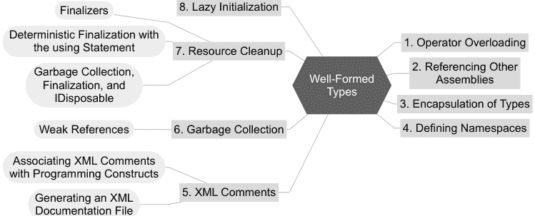

# 运算符重载

上一节查看了值相等实现，并建议类也实现 `==` 和 `!=`。实现任何运算符被称为运算符重载。本节描述了如何不仅对 `==` 和 `!=`，而且对其他支持的运算符进行此类重载。

例如，`string` 提供 `+` 运算符来连接两个字符串。这可能并不特别值得注意，因为 `string` 是一个预定义类型，所以它可能具有特殊的编译器支持。C# 允许为类或结构体添加 `+` 运算符。事实上，所有的运算符都受支持，除了 `x.`、`y`、`f(x)`、`new`、`typeof`、`default`、`unchecked`、`delegate`、`is`、`as`、=` 和 `=>`。一个无法实现的运算符是赋值运算符；没有办法更改 `=` 运算符的行为。

在进行实现运算符重载练习之前，请考虑此类运算符无法被 IntelliSense 发现。除非意图是让类型表现得像原始类型（例如数值类型），否则你应该避免将运算符重载作为访问行为的唯一手段。

# 比较运算符 (==, !=, <, <=, >=)

在第 9 节（https://essentialcsharp.com/implementing-value-equality）中，我们回顾了为 record 实现 `==` 和 `!=` 运算符生成的代码。此外，当与相等检查结合时，你可以重写大于和小于运算符（参见列表 10.1）。

列表 10.1：实现 == 和 != 运算符

```csharp
public sealed class ProductSerialNumber
{
    // ...
    public static bool operator ==(
        ProductSerialNumber leftHandSide,
        ProductSerialNumber rightHandSide)
    {
        // 检查 leftHandSide 是否为空
        // (operator == 将是递归的)
        if(leftHandSide == null)
        {
          // 如果 rightHandSide 也为空，则返回 true
          // 否则返回 false
          return rightHandSide is null;
        }
        return (leftHandSide.Equals(rightHandSide));
    }
    public static bool operator !=(
      ProductSerialNumber leftHandSide,
      ProductSerialNumber rightHandSide
    ) {
      return !(leftHandSide == rightHandSide);
}
}
```

编译器强制成对实现这些比较运算符（`=`、`!=`、`<` `>` , `<=` `>=`）。列表 10.1 中的实现依赖于一对中的一个元素调用另一个。此外，对于引用类型，请确保在调用任何成员之前妥善地处理 null。你不应该在运算符重载的实现内部抛出异常。

| 指南 |
| :--- |
| 切勿在运算符重载的实现内部抛出异常。 |

# 二元运算符 (*, -, *, %, &, ^, |, <<, >>)

你可以给 `Coordinate` 添加一个 `Arc`。然而，到目前为止的代码没有提供加运算符的支持。相反，你需要定义这样的方法，如列表 10.2 所示。

列表 10.2：添加运算符

```csharp
public readonly struct Arc
{
  public Arc(
    Longitude longitudeDifference,
    Latitude latitudeDifference
  )
  {
    LongitudeDifference = longitudeDifference;
    LatitudeDifference = latitudeDifference;
  }
  public Longitude LongitudeDifference { get; }
  public Latitude LatitudeDifference { get; }
}
public readonly struct Coordinate
{
  //
  public static Coordinate operator +(
    Coordinate source, Arc arc)
  {
    Coordinate result = new(
      new Longitude(
        source.Longitude + arc.LongitudeDifference),
      new Latitude(
        source.Latitude + arc.LatitudeDifference));
    return result;
  }
  //
}
```

`+`、`-`、`*`、`%`、`&`、`|`、`^`、`<<` 和 `>>` 运算符被实现为二元静态方法，其中至少有一个参数是包含类型。方法名称是带有关键字 `operator` 前缀的运算符符号。如列表 10.3 的输出 10.1 所示，给定 `-` 和 `+` 二元运算符的定义，你可以对 `Arc` 和坐标进行加减操作。注意，`Longitude` 和 `Latitude` 也需要 `+` 运算符的实现，因为它们被 `source.Longitude + arc.LongitudeDifference` 和 `source.Latitude + arc.LatitudeDifference` 调用。

# 列表 10.3：调用 - + 二元运算符

```csharp
// 为了演示目的，禁用了复合赋值
#pragma warning disable IDE0054
public class Program
{
  public static void Main()
  {
      Coordinate coordinate1, coordinate2;
      coordinate1 = new Coordinate(
    new Longitude(48, 52), new Latitude(-2, -20));
      Arc arc = new(new Longitude(3), new Latitude(1));
      coordinate2 = coordinate1 + arc;
      Console.WriteLine(coordinate2);
      coordinate2 = coordinate2 - arc;
      Console.WriteLine(coordinate2);
      coordinate2 += arc;
      Console.WriteLine(coordinate2);
  }
}
```


# 输出 1.1

| 51° 52' E | -1° -20' N |
| 48° 52' E | -2° -20' N |
| 51° 52' E | -1° -20' N |

对于 `Coordinate`，你实现 `-` 和 `+` 运算符来返回加减坐标。这允许你连接多个运算符和操作数，例如 `result = ((coordinate1 + arc1) + arc2)`。此外，通过在 `Arc` 上支持相同的 `+/-`（参见本章后面的列表 10.4），你可以消除括号。这种方法之所以有效，是因为第一个操作数 (`arc1 + arc2`) 的结果是 `Arc`，你可以将其添加到下一个类型为 `Arc`。

相比之下，考虑如果你提供一个以两个 `Coordinates` 为参数并返回坐标之间距离 `double` 的运算符会发生什么。对 `Coordinate` 添加 `double` 是未定义的。

## 赋值与二元运算符结合 (`+=`, `-=`, `*= /= ===`, ...)

如前所述，不支持重载赋值运算符。然而，与二元运算符结合的赋值运算符（`+=`、`-=`、`*=`、`/=`、`&=`、`^=`、`<<=` 和 `>>=`）在重载二元运算符时实际上被重载了。给定没有赋值的二元运算符，C# 自动允许结合赋值。使用列表 10.2 中 `Coordinate` 的定义，因此你可以拥有代码

```csharp
coordinate += arc;
```

这等同于

```csharp
coordinate = coordinate + arc;
```

## 条件逻辑运算符 (`&&`, `||`)

类似于赋值运算符，条件逻辑运算符无法显式重载。然而，逻辑运算符 `&` 和 `|` 可以被重载，而条件运算符包含了逻辑运算符，实际上可以重载条件运算符。`x && y` 被处理为 `x & y`，其中 `y` 必须为真。同样，`x || y` 仅在 `x` 为假时被处理为 `x | y`。为了支持对类型进行真假评估（例如在语句中），有必要重载真/假一元运算符。

## 一元运算符 (`+`, `-`, `!`, `~`, `+, --`, true, false)

重载一元运算符与重载二元运算符非常相似，区别在于它们只接受一个参数，该参数也是包含类型。列表 10.4 重载了 `Longitude` 和 `Latitude` 的 `+` 和 `-` 运算符，然后在重载 `Arc` 中相同的运算符时使用了这些运算符。

与数值类型一样，此列表中的 `+` 运算符没有任何效果，提供它是为了保持对称性。

### 列表 10.4: 重载 – 和 + 一元运算符

```cs
// ...
    public static Latitude operator -(Latitude latitude)
{
        return new Latitude(-latitude.Degrees);
    }
    public static Latitude operator +(Latitude latitude)
{
        return latitude;
    }
    // ...
```

```cs
public struct Longitude
{
// ...
    public static Longitude operator -(Longitude longitude)
{
        return new Longitude(-longitude.Degrees);
    }
    public static Longitude operator +(Longitude longitude)
{
        return longitude;
    }
    // ...
}
```

```cs
public readonly struct Arc
{
// ...
    public static Arc operator -(Arc arc)
{
        // 使用定义在
        // Longitude 和 Latitude 上的一元 – 运算符
        return new Arc(-arc.LongitudeDifference, -arc.LatitudeDifference);
    }
```

```cs
public static Arc operator +(Arc arc)
{
    return arc;
```

## 第 10 章：良好的类型 (Well-Formed Types)

重载 `true` 和 `false` 运算符需要满足额外要求，即两者都必须重载——而不仅仅是其中一个。其签名与其他运算符重载相同；但是，如列表 10.5 所示，返回类型必须是 `bool`。

### 列表 10.5: 重载 true 和 false 运算符

```cs
public static bool operator false(object item)
{
    // ...
}
public static bool operator true(object item)
{
    // ...
}
```

你可以在重载了 `true` 和 `false` 运算符的类型可以使用在 `if`、`do`、`while` 和 `for` 控制表达式中。

## 转换运算符

目前，`Longitude`、`Latitude` 和 `Coordinate` 不支持强制转换为替代类型。例如，没有方法可以将 `double` 转换为 `Longitude` 或 `Latitude` 实例。同样，不支持使用字符串为 `Coordinate` 赋值。幸运的是，C# 提供了专门用于处理从一种类型转换为另一种类型的方法定义。此外，方法声明允许指定转换是隐式的（`implicit`）还是显式的（`explicit`）。

## 高级主题

### 强制转换运算符 (`()`)

实现显式和隐式转换运算符在技术上并不等同于重载强制转换运算符 (`()`)。然而，这种操作实际上就是所发生的情况，因此定义强制转换运算符是实现显式或隐式转换的常用术语。

定义转换运算符的风格与定义任何其他运算符相似，不同之处“`operator`”是转换的结果类型。此外，`operator` 关键字紧跟在一个指示转换是隐式还是显式的关键字之后（参见列表 10.6）。

#### 列表 10.6: 提供 Latitude 和 double 之间的隐式转换

```cs
public readonly struct Latitude
{
    // ...
    public double DecimalDegrees(double decimalDegrees)
    {
        DecimalDegrees = Normalize(decimalDegrees);
    }
    public double DecimalDegrees { get; }
    // ...
    public static implicit operator double(Latitude latitude)
    {
        return latitude.DecimalDegrees;
    }
    public static implicit operator Latitude(double degrees)
    {
        return new Latitude(degrees);
    }
    // ...
}
```

通过这些转换运算符，你现在可以隐式地在 `double` 和 `Latitude` 对象之间进行转换。假设 `Longitude` 也存在类似的转换，你可以通过指定每个坐标部分的十进制度数部分（例如：`coordinate = new Coordinate(43, 172);`）来简化 `Coordinate` 对象的创建。

> 注意
> 在实现转换运算符时，返回值或参数必须是封装的类型——以支持封装。C# 不允许你在被转换类型的范围之外指定转换。

## 转换运算符指南

定义隐式和显式转换运算符的区别在于防止意外的隐式转换导致导致不预期的行为。你应该意识到使用显式转换运算符的两个可能后果。首先，抛出异常的转换运算符应该总是显式的。例如，为了防止数据丢失，从 `float` 转换到 `int` 应该是显式的，这需要你是有意为为。此外，确保格式是正确的。第二个考虑是，从 `float` 转换到 `int` 可能会导致数据。如果转换是意外的，请考虑抛出 `System.InvalidException`。

## 引用程序集

## 指南

- 如果转换是隐式的，请不要提供强制转换运算符。
- 不要在隐式转换时抛出异常。

## 引用程序集

与其将所有代码放在一个巨大的二进制文件中，C# 框架允许你将代码分到多个程序。这种方法允许你在多个可执行文件中复用代码。

## 初学者主题

### 类库
`HelloWorld` 程序是你编写的最简单的程序之一。真实世界中的程序更为复杂，随着复杂性的增加，将程序分成部分是有帮助的。为了这样做，开发者将程序移动到独立的编译单元中，称为类库。程序随后引用并依赖类库。

通常，我们的代码对多个程序都有用。例如，在映射程序中使用 `Longitude`、`Latitude` 和 `Coordinate` 类，或者编写数字地理编码程序。这些类和类集合可以编写一次并在多个程序中复用。因此，它们需要分组到程序集库中。

创建一个库而不是控制项目，只有一个例外：对于 .NET CLI，使用 `classlib` 作为项目名称。同样，在 Visual Studio 2022 中，从 `File->New Project...` 项目（`Ctrl+Shift+N`），在搜索框中查找所有 `Class Library` 模板，然后选择 `Class Library——Visual C#` 版本，使用 `GeoCoordinates` 作为项目名称。

接下来，将列表 10.4 中的源码放在每个结构的单独文件中，并以结构体命名，然后生成项目。生成项目会将 C# 代码编译为程序集——一个 `GeoCoordinates.dll` 文件——并将其放在 `.\bin\` 子目录下。

## 第 10 章：良好的类型

### 引用库

给定库，我们需要从程序中引用它。例如，对于使用列表 10.3 中 `Program` 类的新控制程序，我们需要为 `GeoCoordinates.dll` 程序集添加引用，识别库所在的位置并将唯一标识库的元数据嵌入程序中。有几种方法可以实现这一点。首先，你可以引用库项目文件（`*.csproj`），识别哪个项目包含库源码并在两个项目之间建立依赖关系。在编译库之前，无法编译引用库的程序。这种依赖关系会在编译程序时编译库（如果库尚未编译）。换句话说，引用编译后的库（`*.dll`）而不是项目。

第三，你可以引用 `NuGet` 包，如下一节所述。

请注意，并非只有控制程序可以引用库和包。事实上，任何程序集都可以引用任何其他程序集。通常，一个库会引用另一个库，从而形成依赖链。

## 使用 Dotnet CLI 引用项目或库

在第 1 章中，我们讨论了如何创建一个控制台程序。这样做创建了一个包含 `Main` 方法的程序——这是程序开始执行的入口点。要为新创建的程序集添加引用，我们可以在之前的地方继续，使用额外的命令来添加引用：

```bash
dotnet add .\HelloWorld\HelloWorld.csproj package \GeoCoordinates\Debug\netcoreapp2\GeoCoordinates.dll
```

`add` 参数之后是项目所引用的已编译程序集的文件路径。
与其引用程序集，你也可以引用项目文件。正如前面提到的，这会将项目连接起来，因此生成程序时将触发类库的编译（如果尚未编译的话）。这样做的优点是，程序编译时，它会自动定位编译后的类库程序集——无论是在 `debug` 还是 `release` 目录下。引用项目文件的命令如下：

```bash
dotnet add .\HelloWorld\HelloWorld.csproj reference \GeoCoordinates\GeoCoordinates.csproj
```

如果你拥有类库的源代码且该源代码频繁更改，请考虑使用类项目文件来引用类库，而不是引用编译后的程序集。
完成项目或已编译程序集的引用后，你的项目就可以使用列表 10.3 中的 `Program` 类源代码进行编译了。

## 使用 Visual Studio 2022 引用项目或库

在第 1 章中，我们还讨论了如何使用 Visual Studio 创建控制台程序。这创建了一个包含 `Main` 方法的程序。要添加对 `GeoCoordinates` 程序集的引用，点击 `Project->Add Reference...` 菜单项。

接下来，在 `Projects\Solution` 选项卡中，选择 `GeoCoordinates` 项目并点击 `OK` 确认引用。

同样，若要添加程序集引用，请按照之前的相同过程操作，点击 `Project->Add Reference...` 菜单项。但是，这次点击 `Browse...` 按钮并导航到选择 `GeoCoordinates.dll` 程序集。

与使用 `Dotnet CLI` 一样，你可以使用列表 10.3 中的 `Program` 类代码编译程序项目。

## NuGet 打包

从 Visual Studio 2010 开始，微软引入了一种名为 `NuGet` 的库打包系统。该系统旨在提供一种在项目之间以及公司之间轻松共享库的方法。通常，一个库程序集不仅仅是一个单一的编译文件。它可能包含配置文件、其他资源以及相关的元数据。遗憾的是，在 `NuGet` 出现之前，没有可以标识所有依赖项的清单。此外，也没有标准的提供程序或包库来存放被引用的程序集。

`NuGet` 解决了这两个问题。`NuGet` 不仅包含一个可以标识作者、公司、依赖项等信息的清单，它还带有一个默认的包提供程序——`NuGet.Org`，在该网站上，包被上传、更新、索引，然后由想要利用它们的项目下载。通过 `NuGet`，你可以引用一个 `NuGet` 包（`*.nupkg`），它将将从你预配置的其中一个 `NuGet` URL 自动安装。

`NuGet` 包附带有一个清单（`*.nuspec` 文件），其中包含了包中包含的所有额外元数据。此外，它还提供了你可能需要的所有资源——本地化文件、配置文件、内容文件等。最终，`NuGet` 包是将所有单独资源组合成单个 ZIP 文件的归档——尽管扩展名为 `.nupkg`。如果你将文件重命名为 `*.zip` 扩展名，可以使用任何常用工具打开并检查该文件。

## 使用 Dotnet CLI 添加 NuGet 引用

要使用 `Dotnet CLI` 向项目添加 `NuGet` 包，需要：

```bash
dotnet add .\HelloWorld\HelloWorld.csproj package Microsoft.Extensions.Logging
```

要创建一个本地包，请使用 `dotnet` 命令：

```bash
dotnet pack
```

## 使用 Visual Studio 2022 添加 NuGet 引用

如果你按照 Visual Studio 2022 的说明进行操作：

1. 点击 `Project->Manage NuGet Packages...` 菜单项。
2. 选择 `Browse` 选项卡并在搜索框中输入 `Microsoft.Extensions.Logging`。
3. 点击 `Install` 按钮安装该包。

完成这些步骤后，`Microsoft.Extensions.Logging` 库将（添加到你的项目中，并包含它可能具有任何依赖项。

## 类型封装
...

## 类型的封装

程序集必须标记为 `public`。因此，在编译 `Coordinates.dll` 程序集之前，有必要确保类型声明是 `public`（参见列表 10.8）。

### 列表 10.8：在程序集外部使类型可用

```csharp
public struct Coordinate
{
    // ...
}
public struct Latitude
{
    // ...
}
public struct Longitude
{
    // ...
}
public struct Arc
{
    // ...
}
```


同样，`class`（类）和 `enum`（枚举）等声明既可以是 `public` 也可以是 `internal`。`internal` 访问修饰符不仅限于类型声明；也就是说，它也可以存在类型成员上。因此，你可以将一个类型指定为 `public`，但将类型内的特定方法标记为 `internal`，以便这些成员仅在程序集内部可用。成员的访问权限不能高于其类型。如果类被声明为 `internal`，则该类型上的 `public` 成员将只能从程序集内部访问。

2. 你可以使用其他类成员可用的任何访问修饰符（例如 `private`）来装饰嵌套类。然而，在类作用范围之外，可用的访问修饰符只有 `public` 和 `internal`。

## `protected internal` 类型修饰符

另一个类型成员访问修饰符是 `protected internal`。具有 `protected internal` 访问修饰符的成员可以从包含程序集内的所有位置以及从派生该类型的类访问，即使派生类不在同一个程序集内。默认成员修饰符是 `private`，因此当你添加访问修饰符（`public` 除外）时，该成员会变得稍微可见。

> 注意：具有 `protected internal` 访问修饰符的成员可以从包含程序集内的所有位置以及从派生该类型的类访问，即使派生类不在同一个程序集内。

## `file` 类型修饰符

C# 11 引入了一种新的访问修饰符：`file` 修饰符。使用 `file` 修饰符装饰类型将将其可见性限制在文件内部。定义在一个文件中的 `file class Thing{}` 在该文件外部是不可见的。事实上，你可以在同一个项目中的多个文件中都定义为 `file class Thing{}`，而不会发生冲突，因为它们彼此之间是不可见的。`file` 修饰符主要用于代码生成，以便专门为内部目的生成的类型不会影响现有代码；事实上，多个文件中的相同代码生成将局部封装在每个文件中。

3. `file` 不能用于嵌套类型定义——仅用于顶层定义。

## 定义命名空间

### 初学者主题

#### 类型成员访问修饰符

访问修饰符的完整列表见于表 10.1。

#### 表格 10.1：访问修饰符

| 修饰符 | 说明 |
| --- | --- |
| public | 成员可以在类型可访问的任何地方访问。 |
| internal | 成员可以在程序集内部访问。 |
| private | 成员可以在包含它的类型内部访问，但在其他情况下不可访问。 |
| protected | 成员可以在包含类型及其任何派生自它的子类型中访问，无论属于哪个程序集。 |
| protected internal | 成员可以在包含类型内的任何地方访问，即使派生类型在不同的程序集内。 |
| private protected | 成员可以从派生自包含类型且在同一程序集中的任何类型访问。在 C# 7.2 中引入。 |
| file | 成员仅从同一个文件访问。 |

如第 2 章所述，所有数据类型都通过命名空间和名称的组合来标识。然而，在 CLR（公共语言运行时）中，并没有所谓的“命名空间”。类型的名称实际上是完全限定类型名，包含了命名空间。对于你之前定义的类，没有显式的命名空间声明。

## 第 10 章：良好的类型

像这些类被自动声明为默认全局命名空间的成员。然而，此类类可能会遇到名称冲突，当你尝试定义两个同名的类时，就会发生这种情况。一旦你开始引用第三方的程序集，名称冲突的概率会进一步增加。

更重要的是，CLI 框架中有成千上万种类型，而在框架之外还有数个数量级不同的类型。因此，为特定问题寻找正确的类型可能是一个重大的挑战。

解决这两个问题的办法是组织所有类型，将它们分组到命名为命名空间的的逻辑类别中。例如，`System` 命名空间之外的类通常被放在与公司、产品或名称对应的命名空间中。例如，来自 Addison-Wesley 的类被放在 `Awl` 或 `AddisonWesley` 命名空间中，而来自 Microsoft 的类（System 类）位于 `Microsoft` 命名空间中。命名空间名称可以包含点，这样做提供了类的层次结构。例如，所有与网络 API 相关的 `System` 类都在 `System.Net` 中，与 Web 相关的在 `System.Web` 中。命名空间的第二层应该是稳定的产品名称，不会随版本发生变化。事实上，稳定性在所有级别都是如此的。更改命名空间名称是不兼容版本的更改，应该避免。由于此原因，你应该避免使用不稳定的名称（组织层次结构、转瞬即逝的品牌）。

## 命名空间

```csharp
public struct Coordinate
{
    // ...
}
public struct Latitude
{
    // ...
}
public struct Longitude
{
    // ...
}
public struct Arc
{
    // ...
}
```

与名称对应。例如，如果项目名称为 `AddisonWesley.Fezzik`，你应该创建一个名为 `Services` 的子文件夹，并将 `RegistrationService.cs` 放在其中。然后你将创建另一个子文件夹（例如 `Data`），在其中放入程序内实体相关的类（例如 `RealestateProperty`、`Buyer` 和 `Seller`）。

### 指南

- 请使用文件作用域的命名空间（C# 10.0 或更高版本）。
- 请在命名空间名称前加上公司名称，以防止不同公司的命名空间具有相同的名称。
- 在命名空间名称的第二层使用稳定的、与版本无关的产品名称。
- **不要**在不将其放入命名空间的情况下定义类型。
- **考虑**创建一个与命名空间层级结构匹配的文件夹结构。

# XML 注释

第 1 章介绍了注释。然而，你可以使用 XML 注释不仅是为了提供给审查源代码的其它开发者查看。基于 XML 的注释遵循了在 Java 中流行的做法。尽管对于最终生成的可执行文件而言，C# 编译器会忽略所有注释，但开发者可以使用命令行选项指示编译器5 将 XML 注释提取到单独的 XML 文件中。通过利用 XML 文件的生成，开发者可以根据 XML 注释生成 API 文档。此外，C# 编辑器可以解析代码中的 XML 注释并将其作为独立区域显示给开发者（例如，显示与其他代码不同的颜色），或解析 XML 注释数据元素并显示给开发者。

> 5. C# 标准没有规定是由 C# 编译器还是独立的工具来负责提取 XML 数据。然而，所有主流的 C# 编译器都通过编译开关包含了必要的功能，而不是在额外的工具中实现。

第 10 章：良好的类型

图 10.3 展示了 IDE 如何利用 XML 注释，通过关于开发者正在尝试编写的代码提示来提供帮助。此类编码提示在大型程序中提供了巨大的帮助，特别是当多个开发者共享代码时。然而，为了工作，开发者显然必须花时间在代码中输入 XML 注释，并指示编译器创建 XML 文件。下一节将解释如何实现这一目标。

```csharp
// <summary>
/// 显示 <strong>console</strong> 中指定的文本
/// </summary>
/// <param name="text">要在控制台中显示的文本。</param>
// 1 reference
private static void Display(string text)
{
    Console.WriteLine(text);
}
// 0 references
static void Main(string[] args)
{
    Display("Inigo Montoya");
}
// void Program.Display(string text)
// 显示在控制台中指定的文本
```


图 10.3：Visual Studio IDE 中作为提示的 XML 注释

从 Visual Studio 2019 开始，你也可以在注释中嵌入简单的 HTML，它将反映在提示中。例如，用 `<strong>` 和 `</strong>` 括围 `console` 会导致“console”一词在图 10.3 中以粗体形式显示。

# 将 XML 注释与编程结构关联

考虑列表 10.12 所示的 `DataStorage` 类列表。

### 列表 10.12：使用 XML 注释注释代码

```csharp
// <summary>
/// DataStorage 用于从文件中持久化和检索
/// 员工数据。
/// </summary>
class DataStorage
{
    /// <summary>
    /// 将员工对象保存到以
    /// 员工名称命名的文件中。
    /// </summary>
    /// <remarks>
    /// 此方法使用了 <seealso cref="System.IO.FileStream"/>
    /// 此外
    /// <seealso cref="System.IO.StreamWriter"/>
    /// </remarks>
    /// <param name="employee">
    /// 要持久化到文件的员工</param>
    /// <date>2000年1月1日</date>
    public static void Store(Employee employee)
    {
        // ...
    }
    /** <summary>
     * 加载一个员工对象。
     * </summary>
     * <remarks>
     * 此方法使用了 <seealso cref="System.IO.Stream"/>
     * 此外
     * <seealso cref="System.IO.Reader"/>
     * </remarks>
     * <param name="firstName">
     * 员工的 own</param>
     * <param name="lastName">
     * 员工的姓</param>
     * <returns>
     * 与名称对应的员工对象
     * </returns>
     * <date>2000年1月1日</date> */
    public static static Employee Load(string firstName, string lastName)
    {
        // ...
    }
}
class Program
{
    // ...
}
```

列表 10.12 同时使用了跨越多行的 XML 分隔符注释和单行 XML 注释，后者的每一行都需要单独的三个正斜杠分隔符 `///`。

鉴于 XML 注释旨在文档化 API，它们仅仅与 C# 声明关联使用，如列表 10.12 所示的类或方法。任何尝试将 XML 注释与代码内联且不与声明关联的尝试都将导致编译器的警告。编译器之所以建立关联，仅仅是因为 XML 注释紧出现在声明之前。

尽管 C# 允许注释中出现任何标签，但 C# 标准显式定义了一组要使用的标签。

# 生成 XML 文档

要生成 XML 文件，请向项目属性中添加 `DocumentationFile` 元素：

```xml
<?xml version="1.0" encoding="utf-8"?>
<doc>
  <assembly>
    <name>DataStorage</name>
  </assembly>
  <members>
    <member name="T:DataStorage">
      <summary>
      DataStorage 用于从文件中持久化和检索
      员工数据。
      </summary>
    </member>
    <member name="M:DataStorage.Store(Employee)">
      <summary>
      将员工对象保存到以
      员工名称命名的文件中。
      </summary>
      <remarks>
      此方法使用了 <seealso cref="System.IO.FileStream"/>
      此外外
      <seealso cref="System.IO.StreamWriter"/>
      </remarks>
      <param name="employee">
      要持久化到文件的员工</param>
      <date>2000年1月1日</date>
    </member>
    <member name="M:DataStorage.Load(System.String,System.String)">
      <summary>
      加载一个员工对象。
      </summary>
      <remarks>
      此方法使用了 <seealso cref="System.IO.Stream"/>
      此外外
      <seealso cref="System.IO.Reader"/>
      </remarks>
      <param name="firstName">
      员工的姓</param>
      <param name="lastName">
      员工的姓</param>
      <returns>
      与名称对应的员工对象
      </returns>
      <date>2000年1月1日</date>
    </member>
  </members>
</doc>
```

生成的文件仅包含了将元素关联回其相应 C# 声明所需的元数据量。这很重要，因为通常需要将 XML 输出与生成的程序集结合使用以产生任何意义的文档。

# 垃圾回收与弱引用

垃圾回收显然是运行时的一个核心功能。其目的是恢复不再引用的对象所占用的内存。该声明中的重点是内存和引用：垃圾回收器负责恢复内存；它不处理其他资源，如数据库连接、句柄（文件、窗口等）、网络端口和硬件设备（如串口）。此外，垃圾回收器根据是否还有引用来决定清理什么。隐含地意味着垃圾回收器处理引用对象并仅恢复堆上的内存。此外，维持对对象的引用将延迟垃圾回收器重用该对象占用的内存。

## 进阶主题

## .NET 中的垃圾回收

关于垃圾回收器的许多细节与特定的 CLI 框架有关，因此可能会有所不同。本节将讨论 Microsoft `.NET` 框架的实现，因为它们是最常见的。

在 `.NET` 中，垃圾回收器使用“标记-压缩”`mark-and-compact` 算法。在每次迭代开始时，它会识别指向对象的所有根引用 `root references`。根引用是指任何静态变量、CPU 寄存器以及局部变量或参数实例的引用（以及本节稍后描述的 f-可达对象）。给定此列表，垃圾回收器能够遍历由每个根引用点所识别的树，并递归地确定根引用所指向的所有对象。通过这种方式，垃圾回收器创建了一个所有可达对象的图。

垃圾回收器并不是列出所有不可访问的对象，而是通过将所有可达对象压缩在一起来执行垃圾回收，从而覆盖任何由不可访问对象（即被视为垃圾的对象）占用的内存。

定位和移动可达对象要求系统在垃圾回收器运行时保持一致的状态。为了实现这一点，进程中的所有托管线程在垃圾回收期间都会被挂起。显然，这种行为可能会导致应用程序出现短暂的暂停，除非需要执行特别大的垃圾回收周期或执行频率频繁，否则这些暂停通常是忽略不计的。为了减少垃圾回收周期在恰宜时间发生的概率，GC 包含一个 `Collect()` 方法，可以在关键性能代码之前立即调用它。该方法不会阻止垃圾回收器的运行，但在假设关键性能代码期间没有剧烈内存占用的情况下，它降低了其运行的概率。

`.NET` 垃圾回收行为中一个令人人惊讶的方面是，并不是所有的垃圾在迭代中都会被清理。对对象生命周期的研究表明，最近创建的对象比长期存在的对象更容易需要垃圾回收。利用这种行为，`.NET` 垃圾回收器是分代的 `generational`，尝试清理短命对象的频率高于那些已存过上一次垃圾回收迭代的对象。具体来说，

# 第 10 章：良好类型

对象被组织成三代。每当一个对象通过一次垃圾回收周期，它就会移动到下一代，直到最终进入第 2 代（从0开始计数）。然后，垃圾回收器对第 0 代对象的运行频率高于对第 2 代对象的频率。

随着时间的推移，尽管 `.NET` 在早期测试版本中与未托管代码相比时引起了担忧，但 `.NET` 的垃圾回收已被证明是极其高效的。更重要的是，在开发生产力上实现的收益，远大于在少数舍弃托管代码以优化特定算法的情况下所付出的开发成本。

到目前为止的所有引用都是强引用 `strong references`，因为它们维护了对象的可访问性并防止垃圾回收器清理该对象占用的内存。框架还支持弱引用 `weak references` 的概念。弱引用不会阻止对象的垃圾回收，但它们保持了引用，以便如果垃圾回收器没有清理该对象，它就可以被重用。

弱引用设计用于创建成本昂贵但保留它们也太昂贵的引用对象。例如，考虑从数据库加载并显示给用户的大型对象列表。加载此列表可能是昂贵的，一旦用户关闭列表，它就应该可以被垃圾回收。然而，如果用户多次请求列表，则始终需要第二次昂贵的加载调用。使用弱引用，可以使用代码来检查列表是否已被清理，如果没有，则重新引用同一个列表。通过这种方式，弱引用充当对象的内存缓存。缓存中的对象可以快速检索，但如果垃圾回收器回收了这些对象的内存，它们将需要重新创建。

一旦引用对象（或对象集合）被认为具有潜在弱引用的考虑价值，它就需要此被分配给 `System.WeakReference`（参见列表 10.14）。

### 列表 10.14：使用弱引用

```csharp
public static class ByteArrayDataSource
{
    static private byte[] LoadData()
```
```c
{
  // 想象一个大得数字
  byte[] data = new byte[1000];
  // 加载数据
  // ...
  return data;
}
```
```csharp
static private WeakReference<byte[]> Data { get; set; }
```
```csharp
static public byte[] GetData()
{
  byte[] target;
  if (Data is null) {
    target = LoadData();
    Data = new WeakReference<byte[]>(target);
    return target;
  }
  else if (Data.TryGetTarget(out target)) {
    return target;
  }
  else {
    // 在设置 WeakReference 的 Target 并返回它之前，
    // 重新加载数据并分配它（创建一个强
    // 引用）
    target = LoadData();
    Data.SetTarget(target);
    return target;
  }
}
```

承认，这段代码使用了泛型，本文在第 12 章之前不会讨论泛型。然而，在声明和赋值 `Data` 属性时，你可以安全地忽略 `<byte[]>` 文本。虽然有一个非泛型的 `WeakReference`，但没有理由考虑它⁸。

8. 除非使用 `.NET Framework 4.5` 或早期版本进行编程。

大部分逻辑出现在 `GetData()` 方法中。该方法的目的是始终返回数据的实例——无论是来自缓存还是重新加载。`GetData()` 开始时检查 `Data` 属性是否为 `null`。如果是，则加载数据并赋值给名为 `target` 的局部变量。它创建了一个指向数据的引用，以便垃圾回收器不会清除它。接下来，我们实例化 `WeakReference` 并传递它。

# 资源清理

垃圾回收是运行时的核心职责。然而，需要承认垃圾回收过程集中在内存上，而不是文件句柄、数据库连接、端口或其他有限资源。

# 终结器

终结器允许开发者编写清理类资源的代码。与使用 `new` 操作符显式调用的函数不同，终结器无法被显式调用。没有类似的 `delete` 操作符。相反，垃圾回收器负责对对象调用终结器。因此，开发者无法在编译时确定终结器的执行时间。他们只知道终结器会在对象最后使用和应用程序通常关闭之间的某个时刻运行。

# 资源清理 581

通过“通常”一词故意引入的不确定性强调了终结器可能不执行的事实。当你考虑到进程可能会终止时，这种可能性显而易见。例如，计算机关闭或强制终止进程（例如调试进程时）将阻止终结器的运行。但在 `.NET Core` 中，即使在正常情况下，终结器也可能在应用程序关闭之前未处理。正如下一节看到的，可能需要与其他机制注册终结活动。

> 注意
你无法在编译时确定终结器的执行时间。

终结器的声明语法与 C# 的前身——即 C++ 的析构函数语法相同。如列表 10.15 所示，终结器声明以波浪符号位于类名的开头。

### 列表 10.15：定义终结器

```csharp
using System.IO;
public class TemporaryFileStream
{
    public FileInfo File;
    public FileStream Stream;
    public TemporaryFileStream(string fileName)
    {
        File = new FileInfo(fileName);
        // 更好的解决方案使用 FileOptions.DeleteOnClose。
        Stream = new FileStream(
            File.FullName, FileMode.OpenOrCreate,
            FileAccess.ReadWrite);
    }
    public TemporaryFileStream()
    : this(Path.GetTempFileName())
{ }
    // 终结器
    ~TemporaryFileStream()
}
```
```csharp
  try {
    Close();
  } catch (Exception) {
    // 将事件写入日志或 UI
    //...
  }
}
```
public FileStream? Stream { get; private set; }
public FileInfo? File { get; private set; }
```csharp
public void Close() {
  Stream?.Dispose();
  try {
    File?.Delete();
  } catch (IOException exception) {
    Console.WriteLine(exception);
  }
  Stream = null;
  File = null;
}
```


终析器（Finalizers）不允许显式传递任何参数，因此它们不能被重载。此外，终析器无法被显式调用——也就是说，只有垃圾回收器可以调用终析器。因此，终析器上的访问修饰符是没有意义的，因此不受支持。基类中的终析器将作为对象终化调用的一部分自动触发。

> **注意**
> 终析器无法被显式调用；只有垃圾回收器可以调用终析器。

由于垃圾回收器处理所有的内存管理，终析器并不负责释放内存。相反，它们负责释放诸如数据库连接和文件句柄等资源——这些资源需要垃圾回收器不知道的显式活动。

在列表 10.15 显示的终析器中，我们首先释放 `FileStream`。这一步是可选的，因为 `FileStream` 有自己的终析器，提供了与 `Dispose()` 相同的功能。现在调用 `Dispose()` 的目的是确保它在 `TemporaryFileStream` 终析化时被清理，因为后者负责实例化前者。 如果不显式调用 `Stream?.Dispose()`，垃圾回收器将在对象被回收并释放对 `FileStream` 对象的引用后，独立于 `TemporaryFileStream` 将其清理。 尽管如此，如果我们根本不需要终析器来清理资源，那么仅仅为了调用 `FileStream?.Dispose()` 而定义一个终析器也是没有意义的。事实上，将终析器的需求限制在资源清理无法感知的对象上（没有终析器的资源）是一项重要的准则，它显著减少了需要实现终析器的场景数量。

在列表 10.15 中，终析器的目的是删除文件——在这种情况下这是一个非托管资源。因此，我们调用了 `File?.Delete()`。现在，当终析器执行时，文件将被清理。

终析器在未指定的线程上执行，这使得它们的执行更不确定性。这种不确定性使得终析器内部（调试器之外）发生意外异常可能会导致应用程序崩溃——而且这个问题的源头很难诊断，因为导致异常的情况并不清楚。从用户的角度来看，未处理的异常将相对随机地抛出，并且几乎不考虑用户正在执行的任何操作。出于这个原因，你应该小心避免在终析器内部发生异常。相反，你应该使用防御性编程技术，例如检查空（或在列表 10.15 中使用空条件运算符）。

- 9.10.20 某种程度上是一个人为的例子，因为在实例化 `FileStream` 时有一个 `FileOptions.DeleteOnClose` 选项，该选项会在 `FileStream` 关闭时触发文件的删除。

事实上，建议在终析器中捕获所有异常并通过替代手段（如日志或通过用户界面）报告它们，而不是将它们作为未处理的异常保留。这一准则导致了 `try/catch` 块阻塞了 `Delete()` 调用。

另一个强制终析器执行的潜在选项是调用 `System.GC.WaitForPendingFinalizers()`。当调用此方法时，当前线程将挂起，直到所有不再被引用的对象的终析器执行完毕。

# 使用 using 语句实现确定性终析化

终析器本身的问题是它们不支持确定性终析化（即知道终析器何时运行的能力）。相反，终析器起着重要的备份机制作用，当使用该类的开发者忽略显式调用所需的清理程序时，用于清理资源。

例如，考虑 `TemporaryFileStream`，它包含一个终析器……（注：由于原文后半部分存在大量重复和损坏，此处已根据逻辑流进行重处理）。

清理工作是在 `Dispose()` 方法中完成的，而不是等待终结器执行。

如果不调用 `SuppressFinalize()`，对象的实例将包含在 f-reachable 队列中——这是一个所有已准备好进行垃圾回收的对象的列表，只是它们实现了析构器。在它们的终结化方法被调用之前，运行时无法垃圾回收带有终结器的对象。然而，垃圾回收本身并不调用终结化方法。相反，指向终结化对象的引用被添加到 f-reachable 队列中，并根据执行上下文在认为适当的时间内由额外的线程进行处理。讽刺的是，这种方法延迟了托管资源的垃圾回收——而恰恰是这些资源最应该被清理的时候。延迟的原因是 f-reachable 队列是一个“引用”列表；因此，在它们的终结化方法被调用且对象引用从 f-reachable 队列中移除之前，这些对象均不被视为垃圾。

> 注意
> 未显式调用 `Dispose` 的带有终结器的对象最终会导致对象生命周期延长。即使在所有显式引用都超出范围后，f-reachable 队列仍然持有引用，使对象保持存活，直到 f-reachable 队列处理完成。

出于这个原因，`Dispose()` 调用了 `SuppressFinalize`（即 `System.GC.SuppressFinalize`）。调用此方法通知运行时它不应将此对象添加到终结化队列，而应该在对象不再具有任何引用（包括任何 f-reachable 引用）时允许垃圾回收器释放该对象。

其次，`Dispose()` 调用参数为 `true` 的 `Dispose(bool disposing)`。结果是调用了 `Stream` `Dispose()` 方法（清理其资源并抑制其终结化）。接下来，临时文件本身在调用 `Dispose()` 后立即被删除。这一重要调用消除了在等待终结化队列处理完成之前清理可能昂贵的资源的需要。

# 资源清理 589

第三，终结器并不是调用 `Close()`，而是调用参数为 `false` 的 `Dispose(bool disposing)`。结果是 `Stream` 没有被关闭（释放），尽管文件已被删除。关于调用 `Stream` 的条件确保了如果从终结器中调用 `Dispose(bool disposing)`，则 `Stream` 实例本身也将被加入终结化处理队列（或根据顺序可能已经运行）。因此，在执行终结器时，不应清理由托管资源拥有的对象，因为此操作将是终结化队列的职责。

第四，在同时创建 `Close()` 类型和 `Dispose()` 方法时，你应该保持谨慎。仅通过 API 无法看出 `Close()` 调用了 `Dispose()`，开发者将疑惑是否应该显式调用 `Close()` 和 `Dispose()`。

第五

### 指南原则

- 对于资源稀缺或昂贵的对象，**必须**实现 `dispose` 模式。
- 对于带有终结器的类**必须**实现 `IDisposable` 以支持可能的确定性终结化。
- 仅对没有终结器但仍需要清理的资源实现终结化方法。
- 重构终结化方法以调用与 `IDisposable` 相同的代码，可能只需调用 `Dispose()` 方法即可。
- **不要**从终结化方法中抛出异常。
- **考虑**通过 `AppDomain.ProcessExit` 注册终结化代码，以增加资源清理在进程退出前执行的概率。
- 在 `dispose` 期间注销任何 `AppDomain.ProcessExit` 事件。

# 590 第 10 章：良好的类型

- 从 `Dispose()` 调用 `System.GC.SuppressFinalize()` 以避免重复清理资源并延迟对象的垃圾回收。
- **必须**确保 `Dispose()` 是等等的（即可以多次调用 `Dispose()`）。
- **必须**保持 `Dispose()` 简单，重点关注终结化所需的资源清理。
- **避免**对带有终结器的对象调用 `Dispose()`。相反，请依赖终结化队列来清理实例。
- **避免**在终结化期间引用未正在终结化的对象。
- 在重写 `Dispose()` 时，**必须**调用基类的 `Dispose()` 方法。
- **考虑**确保对象在调用 `Dispose()` 后变得不可用。在对象被释放后，除 `Dispose()` 的其他方法（可能会被多次调用）应该抛出 `ObjectDisposedException`。
- 对于拥有自己的可释放字段（或属性）的类型，**必须**实现 `IDisposable` 并释放这些实例。
- 如果存在 `Dispose(bool disposing)` 方法，**必须**从其中调用基类的 `Dispose()` 方法。

# 语言对比：C++—确定性析构

尽管终结器与 C++ 中的析构函数相似，但其执行时间无法在编译时确定的事实使得它们有显著区别。垃圾回收器在 C# 终结器使用后但在程序关闭前收集它们；而 C++ 析构函数在对象（而非指针）超出范围时会被自动调用。

虽然运行垃圾回收可能是一个昂贵的过程，但垃圾回收足够智能，可以延迟到进程利用率某种程度上降低时运行，这比确定性析构函数具有优势，后者会在编译时定义的位置运行，即使在处理器处于高需求时也是如此。

# 资源清理

## 高级主题

### 在进程退出前强制执行资源清理

从 `.NET Core` 开始，进程在关闭时终结器可能不会执行。为了增加执行的概率，应该将终结化活动注册为进程¹¹⁰关闭时执行。出于这个原因，请注意列表 10.18 中 `SampleUnmanagedResource` 构造函数中涉及 `ProcessExit` 的语句，输出 0.3 显示了未向程序传递参数时的结果。（代码涉及 LINQ、事件注册和特殊属性，¹¹，这些将分别在第 12、14 和 18 章中介绍。）

¹¹⁰ 技术上是应用程序域，至少对于 `.NET Framework` 项目而言是。
¹¹ 参见随附的源代码。

列表 10.18：通过 Process Exit 注册

```csharp
using System.IO;
using System.Linq;
using System.Runtime.Compilers;
using static Console;
public static class Program
{
    public static void Main(string[] args)
    {
        WriteLine("Starting...");
        DoStuff();
        if (args.Any(arg => arg.ToLower() == "-gc")
        {
            GC.Collect();
            GC.WaitForPendingFinalizers();
        }
        WriteLine("Exiting...");
    }
    public static void DoStuff()
    {
        // ...
        WriteLine("Starting...");
    }
}
```

# 第 10 章：良好的类型

`sampleUnmanagedResource? sampleUnmanagedResource = null;`

```csharp
try {
    sampleUnmanagedResource =
        new SampleUnmanagedResource();
    // 使用非托管资源
    // ...
}
finally {
    if (Environment.GetCommandLineArgs().Any(arg => arg.ToLower() == "-dispose") {
        sampleUnmanagedResource?.Dispose();
    }
    WriteLine("Exiting...");
}
```

```csharp
class SampleUnmanagedResource : IDisposable {
    public SampleUnmanagedResource(string fileName) {
        WriteLine("Starting...",
            $"{nameof(SampleUnmanagedResource)}\.ctor");
        WriteLine("Creating托管 stuff...",
            $"{nameof(SampleUnmanagedResource)}\.ctor");
        WriteLine("Creating非托管 stuff...",
            $"{nameof(SampleUnmanagedResource)}\.ctor");
    }
}
```

```csharp
WeakReference<IDisposable> weakReferenceToSelf = new(this);
ProcessExitHandler = (_, _) => {
    WriteLine("Starting...", "ProcessExitHandler");
    if (weakReferenceToSelf.TryGetTarget(out IDisposable self)) {
        self.Dispose();
    }
    WriteLine("Exiting...", "ProcessExitHandler");
}
```

```
Main: Starting...
UnmanagedResource: file1.txt
UnmanagedResource: file2.txt
UnmanagedResource: Disposed
UnmanagedResource: Disposed
Main: Exiting...
```

忽略 `Console.WriteLine()` 语句不计，代码从调用 `Main()` 开始，该方法例化了 `UnmanagedResource`。在实例化 `UnmanagedResource` 时，我们通过 `Console.WriteLine()` 调用模拟了托管资源和非托管资源的实例化。我们声明了一个名为 `handler` 的委托程序，它将在进程退出时执行。该处理程序利用了指向 `UnmanagedResource` 实例的弱引用（`WeakReference`），如果仍然有实例可以调用，则会在该实例上调用 `Dispose()`。使用 `WeakReference` 是为了确保 `ProcessExit` 不会对该实例保持引用，从而防止垃圾回收器在资源超出作用范围后清理该资源。该处理程序被注册到 `AppDomain.CurrentDomain.ProcessExit` 并保存到 `handler` 属性中。最后一步是必要的，以便我们移除该处理程序。当从 `Main()` 返回时，`UnmanagedResource` 实例不再具有根引用。然而，当垃圾回收器运行时，它会看到终结器并将资源添加到终结队列中。当进程开始关闭时，假设 `UnmanagedResource` 实例上的终结器尚未执行，`AppDomain.CurrentDomain.ProcessExit` 事件将触发并调用处理程序，处理程序转而调用 `Dispose()`。与列表 10.16 中的 `Dispose()` 方法相比，关键区别在于我们从 `AppDomain.CurrentDomain.ProcessExit` 中取消了注册，这样 `Dispose()` 在进程退出期间就不会被再次调用。请注意，虽然你可以调用 `GC.Collect()` 随后调用 `GC.WaitForPendingFinalizers()` 来强制对没有根引用的对象执行所有终结器，理论上你可以在进程退出之前这样做，但这样做是不可靠的。第一个警告是，项目无法在进程退出之前立即调用这些方法，因为此时没有 `Main()` 的实例。第二个警告是，即使是简单的静态引用也会成为根，因此静态对象实例将不会被清理。出于这个原因，使用 `ProcessExit` 处理程序是首选方法。

### 高级主题：从构造函数传播异常

当异常从构造函数传播出时，对象仍然被实例化，尽管 `new` 运算符没有返回新实例。如果类型定义了终结器，则该方法将在对象符合垃圾回收条件时运行（这为确保终结器方法可以在部分构造的对象上运行提供了额外动力）。另请注意，如果构造函数过早地共享了它的引用，即使构造函数抛出异常，该引用仍然是可访问的。不要让这种情况发生。

### 高级主题：复活对象

当对象的终结方法被调用时，对该对象的所有引用都已消失，垃圾回收正准备运行终结代码。尽管如此，你可能意外地将指向对象的引用重新添加到根引用图中。在这种情况下，引用的对象将不再不可；它将无法进行垃圾回收。然而，如果对象的终结方法已经运行，除非显式标记为终结（使用 `GC.RegisterFinalize()` 方法），否则不会再次运行。显然，以这种方式复活对象是非常奇异的行为，你应该避免它。终结代码应该是简单的，并专注于清理它引用的资源。

### 延迟初始化

在前面的节中，我们讨论了如何使用 `using` 语句确定性地释放对象，以及在未使用确定性方法的情况下终结队列将如何释放资源。一个相关的模式是延迟初始化或懒加载。使用延迟初始化，你可以在需要时创建（或获取）对象，而不是提前创建——后者可能是特别麻烦的情况。考虑列表 10.19 中的 `FileStream` 属性。

```csharp
class DataCache
{
    // ...
    public TemporaryFileStream FileStream =>
        InternalFileStream ??=
        new TemporaryFileStream();
    private TemporaryFileStream? InternalFileStream
        { get; set; } = null;
    // ...
}
```

在 `FileStream` 表达式体属性中，我们在直接返回值之前检查 `InternalFileStream` 是否为空。如果 `InternalFileStream` 为空，我们首先实例化 `TemporaryFileStream` 对象并赋值给 `InternalFileStream`，然后返回新实例。因此，`FileStream` 属性所需的 `TemporaryFileStream` 只有在调用属性 getter 时才被创建。

### 使用泛型和 Lambda 表达式懒加载

10.20 展示了如何使用 `System.Lazy<T>` 来协助延迟初始化。

```csharp
class DataCache
{
```


```csharp
public TemporaryFileStream FileStream =>
    InternalFileStream.Value;

private Lazy<TemporaryFileStream> InternalFileStream { get; }
    = new Lazy<TemporaryFileStream>(() => new TemporaryFileStream());
}
```

从 C# 4.0 和 .NET Framework 4.0 开始添加到 CLR 的类。

## 总结

本章对与构建健壮类库相关的许多主题进行了快速回顾。所有主题也适用于内部开发。

命名空间和垃圾回收。这两个主题也属于可编程范畴，此外包括重写对象的虚成员、运算符重载以及用于文档的 XML 注释。

异常处理很大程度上依赖于继承，通过定义异常层次结构并强制执行自定义异常以符合该层次结构来实现的。此外，C# 编译器使用继承来验证 `catch` 块的顺序。在第 11 章中，你将看到为什么继承是异常处理的核心部分。

# 11 异常处理

第 5 章讨论了使用 `try/catch/finally` 块进行标准异常处理。在该章中，`catch` 块总是捕获类型为 `System.Exception`。本章定义了异常处理的一些额外细节——特别是关于附加异常类型的细节、自定义异常以及处理每种类型的多个 `catch` 块。本章还详细介绍了异常，因为它们对继承的依赖。

- 7. 重新抛出包装过的异常
- 6. 定义自定义异常
- 5. 异常处理指南
- 1. 多种异常类型
- 2. 捕获异常
- 3. 重新抛出现有异常
- 4. 普通 catch 块

# 多种异常类型

列表 11.1 抛出了一个 `System.ArgumentException`，而不是第 5 章演示的 `System.Exception` 类型。C# 允许抛出任何（可能间接的）继承自 `System.Exception` 的类型。要抛出异常，只需在异常实例前加上 `throw` 关键字即可。使用的异常类型显然是最能描述导致异常情况的类型。

# 第 11 章：异常处理

导致异常的错误情况。例如，考虑列表 11.1 中的 `TextNumberParser.Parse()` 方法。

# 列表 11.1：抛出异常

```csharp
public sealed class TextNumberParser
{
    public static int Parse(string textDigit)
    {
        string[] digitTexts =
            "zero", "one", "two", "three", "four",
            "five", "six", "seven", "eight", "nine";
        int result = Array.IndexOf(
            digitTexts,
            // 利用 C# 2.0 的空合并运算符
            textDigit?
            // 利用 C# 7.0 的 throw 表达式
            throw new ArgumentNullException(nameof(textDigit))
        ).ToLower();
        if (result < 0)
        {
            // 利用 C# 6.0 的 nameof 运算符
            throw new ArgumentException(
                "The argument did not represent a digit",
                nameof(textDigit));
            return result;
        }
    }
}
```

在调用 `Array.IndexOf()` 时，当 `textDigit` 参数为 null，我们利用了 `throw` 表达式¹。

与其抛出 `System.Exception`，不如抛出 `ArgumentException` 更合适，因为该类型指示了发生了什么，并包含了用于识别哪个参数出错的特殊参数。

两个类似的异常是 `ArgumentException` 和 `NullReferenceException`。对于不当传递的 null 参数，应该抛出 `ArgumentNullException`。这是无效参数参数异常异常的一种特例。

- 1. 从 C# 7.0 开始。

该异常在更通用的情况下（当它不为 null 时）会作为 `ArgumentException` 或 `ArgumentOutOfRangeException` 抛出。

`NullReferenceException` 通常是底层运行时仅在尝试解引用 null 值时才会抛出的异常——也就是说，尝试调用一个值为 null 的对象的成员。程序员不应该触发抛出 `NullReferenceException`，而应该在访问参数之前检查参数是否为 null，然后抛出 `ArgumentNullException`，这可以提供更多的上下文信息，例如参数名称。如果即使参数为 null 也有无害的方法继续执行，请务必在解引用时使用空条件运算符²，以避免运行时抛出 `NullReferenceException`。

参数异常类型（包括 `ArgumentException`、`ArgumentNullException` 和 `ArgumentOutOfException`）的一个重要特征是，每个类型都有一个构造函数，允许以字符串形式识别参数名称³。通用指南是对对于参数异常的参数名始终使用 `nameof` 运算符。第 18 章提供了对 `nameof` 运算符的完整解释。在此之前，只需理解 `typeof` 返回所识别的参数名称即可。

其他几种异常仅仅供运行时使用，并（有时是间接的）继承自 `System.SystemException`。它们包括 `System.StackOverflowException`、`System.OutOfMemoryException`、`System.Runtime.InteropServices.ComException`、`System.Runtime.ExecutionEngineException` 和 `System.Runtime.InteropServices.SEHException`。不要抛出这些类型的异常。同样地，你应该避免抛出 `System.Exception` 或 `System.ApplicationException`，因为这些异常是通用的，对于问题的原因或解决方案提供的指示很少。相反，请抛出符合场景的最派生异常。显然，开发者应该避免创建可能导致系统失败的 API。然而，如果执行代码到达某种状态

- 1. 从 C# 6.0 开始。
- 2. 在 C# 6.0 之前，这意味着硬编码一个魔法字符串来识别参数名称。

# 第 11 章：异常处理

如果继续执行是不安全或不可恢复的，它应该调用 `System.Environment.FailFast()`。这将在向标准错误写入消息后立即终止进程，在 Microsoft Windows 上，还会写入 Windows 应用程序事件日志。

## 指南

| 操作 | 描述 |
| :--- | :--- |
| 抛出 | 如果向成员传递了错误的参数，请抛出 `ArgumentException` 或其子类型。如果适用，优先使用最派生的异常类型（例如 `ArgumentNullException`）。 |
| 不要抛出 | 不要抛出 `System.Exception` 或继承自非的异常类型。 |
| 不要抛出 | 不要抛出 `System.Exception`、`System.NullReferenceException` 或 `System.ApplicationException`。 |
| 考虑 | 如果程序遇到不安全继续执行的情况，调用 `System.Environment.FailFast()` 终止进程。 |
| 使用 | 对于传入此类异常类型的参数使用 `nameof`。此类异常的示例包括 `ArgumentException`、`ArgumentOutOfRangeException` 和 `ArgumentNullException`。 |

# 捕获异常

抛出特定的异常使捕获者能够异常类型本身来识别问题。换句话说，没有必要捕获异常并对消息使用 `switch` 语句来根据异常情况采取行动。相反，C# 允许使用多个 `catch` 块，每个块针对特定的异常类型，如列表 11.2 所示。

# 列表 11.2：捕获不同异常类型

```csharp
using System;
public sealed class Program
{}
```

# 捕获异常

```csharp
public static void Main(string[] args)
{
    try {
        // ...
        throw new InvalidOperationException(
            "Arbitrary exception");
        // ...
    }
    catch(Win32Exception exception)
        when(exception.NativeErrorCode == 42) {
        // 处理 ErrorCode 为 42 的 Win32Exception
    }
    catch(ArgumentException exception) {
        // 处理 ArgumentException
    }
    catch(InvalidOperationException exception) {
        bool exceptionHandled = false;
        // 处理 InvalidOperationException
        // ...
        if(!exceptionHandled) {
            throw;
        }
    }
    catch(Exception exception) {
        // 处理 Exception
    }
    finally {
        // 在此处处理任何清理代码，无论是否有异常，
        // 该代码都会运行
    }
}
```

列表 11.2 包含了五个 `catch` 块，每个块处理不同类型的异常。当发生异常时，执行将跳转到异常类型最匹配异常的 `catch` 块。匹配的接近程度由继承链决定。例如，即使该异常

抛出的类型为 `System.Exception`。这种“是一个”关系通过继承实现，因为 `System.InvalidOperationException` 最终派自 `System.Exception`。由于异常类型 `InvalidOperationException` 与该异常最匹配，因此 `catch(InvalidOperationException...)` 块会捕获该异常，而不是 `catch(Exception...)` 块。

catch 块还可以使用额外的条件表达式。与其限制 `catch` 块仅根据异常类型匹配，还存在一个条件子句。在列表 11.2 中，这是一个等值运算符。对于更复杂的逻辑，你可以简单地将条件检查放在 `catch` 体内部。然而，这样做会导致 `catch` 块在检查条件之前就成为该异常的处理程序。但是，有了异常条件，现在可以检查程序状态（包括异常），而无需捕获并重新抛出异常。

请谨慎使用条件子句：如果条件表达式本身抛出异常，则该新异常将被忽略，且条件将被视为视为 `false`。由于此原因，你应该避免使用条件表达式。

catch 块必须按照从具体到通用的顺序出现，以避免编译错误。例如，将 `catch(Exception...)` 块移动到任何其他异常之前会导致编译错误，因为之前的所有异常在它们的继承链的某个地方都派自 `System.Exception`。正如 `catch(System) {}` 块所示，`catch` 块不需要命名参数。事实上，允许使用空 `throw`，正如你将在下一节中看到的那样。

1. 从 C# 6.0 开始。

## 重新抛出现有异常

在 `InvalidOperation` catch 块中，出现了一个没有指定要抛出的异常标识的 `throw` 语句（单独使用 `throw`），尽管在 catch 作用域内出现了一个可以重新抛出的异常实例。抛出特定异常将更新栈信息以匹配 `throw` 位置。结果是，指示异常源调用处的栈信息将会丢失，这使得诊断问题变得困难得多。因此，只要发生在 `catch` 块内部，C# 就支持不带显式异常引用的 `throw` 语句或表达式。这样，代码可以检查异常以确定是否可能完全处理它，如果不能，则重新抛出异常（即使没有显式指定），就像它从未被捕获一样，且不会替换任何栈信息。

## 在不替换栈信息的情况下抛出现有异常

有一种机制可以抛出之前抛出的异常，而不丢失原始异常中的堆栈跟踪信息。这允许你重新抛出异常，例如即使从 `catch` 块外部，因此不需要使用 `throw`。虽然这样做相当罕见，但有时会被封装或保存直到程序执行移动到 `catch` 块之外。例如，多线程代码可能会用 `AggregateException` 封装异常。`System.Runtime.ExceptionServices.ExceptionInfo` 类专门设计通过其静态 `Capture()` 方法和实例 `Throw()` 方法来处理这种场景。列表 11.3 展示了在不重置堆栈跟踪信息或使用空 `throw` 语句的情况下重新抛出异常。

5. C# 7.0 或更高版本。
6. 从 C# 5.0 开始。

### 列表 11.3：使用 ExceptionInfo 重新抛出异常

```csharp
using System;
using System.Runtime.ExceptionServices;
using System.Threading.Tasks;
using System.Net;
using System.Linq;
using System.IO;
// ...
Task task = WriteWebRequestAsync(url);
try {
  while (!task.Wait(100)) {
    Console.Write(".");
  }
}
catch (AggregateException exception) {
  exception = exception.Flatten();
  ExceptionInfo.Capture(exception.InnerException ?? exception).Throw();
}
```


通过 `ExceptionInfo.Throw()` 方法，编译器不会像处理普通 `throw` 语句那样将代码视为返回语句。例如，如果方法签名返回一个值，但带有 `ExceptionInfo.Throw()` 的代码路径没有返回值，编译器将发出一个指示未返回值的错误。因此，开发者可能被迫在 `ExceptionInfo.Throw()` 之后紧跟一个 `return` 语句，尽管该语句在运行时永远不会执行——相反，异常会被抛出。

## 语言对比：Java——异常规格符

C# 没有等同于 Java 异常规格符的机制。通过异常规格符，Java 编译器能够验证在函数（或函数层次）内部抛出的所有可能的异常要么被捕获，要么被声明为可能重新抛出。C# 团队考虑过这个选项，并得出它带来的维护负担不值其感知收益的结论。因此，没有必要在整个调用过程中维护所有可能的异常列表，但轻松确定可能的异常是可行的。（事实证明，Java 也无法做到，无论是调用虚方法还是使用后期绑定（如反射），都无法在编译时完全解析一个方法可能抛出哪些异常。）

## 通用 catch 块

C# 要求代码抛出的任何对象都必须派自 `System.Exception`。然而，这一要求并不是所有语言通用的。例如，C++ 允许抛出任何对象类型，包括不派自 `System.Exception` 的托管异常。无论是否为异常，都不会作为派自 `System.Exception` 传播到 C# 程序集中。结果是，`System.Exception` catch 块将捕获之前未捕获的所有异常。

C# 还支持通用 catch 块（`catch { }`），其行为与 `catch(System.Exception exception)` 块相同，只是没有类型或变量名。此外，通用 catch 块必须出现在 catch 块列表的最后。编译器会发出警告，因为通用 catch 块永远不会被调用。

7. 从 C# 2.0 开始。

## 高级主题

### 通用 catch 块内部

对应通用 catch 块的公共中间语言（CIL）代码实际上是一个 `catch(object)` 块。无论抛出什么类型，通用 catch 块都会捕获它。有趣的是，在 C# 代码中无法显式声明 `catch(object)` 异常。因此，没有办法捕获非 `System` 派生的异常并获得一个可供检查的异常实例。来自 C++ 等语言的未托管异常通常会产生 `System.Runtime.InteropServices.SEHException` 异常，该异常派自 `System.Exception` 类型。因此，不仅可以使用通用 catch 块捕获未托管异常，抛出的非 `System.Exception` 托管类型也可以被捕获——例如，`string` 等类型。

### 异常处理指南

异常处理为之前的错误处理机制提供了急需要的结构。然而，如果随意使用，它仍可能导致一些混乱的结果。以下指南为异常处理提供了一些最佳实践：

- 仅捕获你能够处理的异常。通常可以处理某些类型的异常但不能处理其他类型。例如，为了独占读写访问而打开文件可能会抛出 `System.IO.IOException`，因为文件已被使用。在捕获此类异常时，代码可以向用户报告文件正在使用，并允许用户选择取消操作或重试。只有对于有已知操作的异常才应该被捕获。其他异常类型应该留给调用栈中更高处的调用者处理。

- 不要隐藏（掩埋）你无法完全处理的异常。

# 异常处理指南 611

新程序员往往倾向于捕获所有异常并继续执行，而不是向用户报告未处理的异常。然而，这种做法可能导致关键问题无法被发现。除非代码采取显式操作处理异常，或明确确定某些异常是无害的，否则 catch 块应该重新考虑异常，而不是捕获它们并对调用者隐藏。在大多数情况下，`catch(System.Exception)` 和通用的 catch 块应该出现在调用堆栈的更高位置，除非该块最后通过重新抛出异常来结束。

- 极少使用 System.Exception 和通用的 catch 块。
所有异常都派生自 `System.Exception`。但是，处理某些 `System.Exceptions` 的最佳方法是让它们保持未处理状态或优雅地关闭应用程序，而不是稍后。这些异常包括 `System.OutOfMemoryException` 和 `System.OverflowException` 等情况。幸运的是，此类异常默认处于不可恢复状态，因此捕获它们而不重新抛出会导致 CLR 无论如何都会重新抛出它们。这些异常是开发者无法编写代码来恢复的运行时异常。因此，最佳行动方案是关闭应用程序——这是运行时强制要求的。

- 避免在调用堆栈中进行异常报告或记录。
程序员通常会在调用堆栈中尽可能早的位置报告异常。然而，这些位置能够完全处理异常；相反，它们会诉诸重新抛出异常。catch 块不应该在调用堆栈深处记录异常或向用户报告异常。如果异常被记录并重新抛出，调用堆栈中更高处的调用者可能也会这样做，导致异常的重复日志条目。糟糕糟糕，向用户显示可能不适用于该类型的应用程序。（例如，在 Windows 应用程序中使用 `System.Console.WriteLine()` 用户永远是看不到的，而在无人值守的命令行进程中显示对话框可能不会被注意到并冻结应用程序。）与日志和异常相关的用户界面应该预留给调用堆栈的更高处使用。

> 4 从通用语言运行时 (CLR) 4 开始。在 CLR 4 之前，代码应该捕获此类异常仅是为了在关闭应用程序之前运行清理代码或紧急代码（如保存任何易失数据），或使用 `throw` 重新抛出异常；

# 第 11 章：异常处理

- 在 catch 块内部使用 `throw;` 而不是 `throw <exception object>`。

在 catch 块内部重新抛出异常是可能的。例如，`catch(ArgumentNullException exception)` 的实现可能包含对 `throw exception` 的调用。然而，重新抛出异常会将堆栈跟踪重置为重新抛出调用的位置，而不是重用原始点的位置。因此，除非你使用不同的异常类型重新抛出异常，或者刻意隐藏原始调用堆栈，否则应使用 `throw;` 以允许相同的异常传播到调用堆栈上方。

- 优先使用异常条件以避免在 catch 块内部重新抛出异常。

当你发现自己捕获了一个实际上无法妥善处理且因此需要重新抛出的异常时，请优先使用异常条件来避免从一开始就捕获该异常。

- 避免从异常过滤器中抛出异常。

在提供异常过滤器（exception filter）时，避免使用会抛出异常的代码。从异常过滤器中抛出异常将导致假条件，异常的发生将被忽略。由于此原因，你应该考虑将复杂的条件检查放在单独的方法中，并将该方法封装在 try/catch 块中，以显式处理该异常。

- 避免可能随时间变化的异常条件。

如果异常过滤器评估的条件（如异常消息）可能随本地化或消息的更改而变化，则预期的异常将无法被捕获，从而意外地改变业务逻辑。由于此原因，你应该确保异常条件随时间保持有效。

- 重新抛出不同异常时要小心。

在 catch 块内部重新抛出不同的异常不仅会重置调用堆栈，还会隐藏原始异常。为了保留原始异常，请设置新异常的 `InnerException` 属性，通常可以通过构造函数赋值。重新抛出不同的异常应保留用于以下情况：

# 异常处理指南 613

1. 更改异常类型可以阐明问题。
例如，调用 `Logon(User user)` 时，如果用户列表文件不可访问，重新抛出不同的异常类型可能比传播 `System.IO.IOException` 更合适。

2. 私有数据是原始异常的一部分。
在上述场景中，如果原始的 `System.IO.IOException` 包含了文件路径，从而暴露了系统的私有安全信息，则应该对异常进行封装。当然，这假设了异常是被封装的。

3. 异常类型对于调用者来说太具体。
在某些情况下，抛出的异常对于调用者处理来说太具体。在这种情况下，将异常封装在更通用的异常中可能更好。

## 异常处理指南

- 避免在调用堆栈中进行异常报告或记录。
- 在 catch 块内部使用 `throw;` 而不是 `throw <exception object>`。
- 优先使用异常条件以避免在 catch 块内部重新抛出异常。
- 避免从异常过滤器中抛出异常。
- 避免可能随时间变化的异常条件。
- 重新抛出不同异常时要小心。

# 定义自定义异常

一旦抛出异常成为最佳行动方案，最好是使用框架异常，因为它们已经非常完善。例如，与其抛出自定义异常，不如说是使用 `System.Exception`。然而，关键在于调用者是否可能编写特定的 catch 块而不是通用的 catch 块。

定义自定义异常仅涉及派生自 `System.Exception` 或其他异常类型。列表 11.4 提供了一个示例。

列表 11.4：创建自定义异常

```csharp
class DatabaseException : Exception
{
    public DatabaseException(
        string? message,
        System.Data.SqlClient.SqlLException exception)
        : base(message, exception)
    {
    }
}
```

# 定义自定义异常 615

```csharp
class DatabaseException : Exception
{
    public DatabaseException(
        string? message,
        System.Data.OracleClient.OracleException? exception)
        : base(message, exception)
    {
    }
    public DatabaseException()
    {
    }
    public DatabaseException(string? message)
      : base(message)
    {
    }
    public DatabaseException(
      string? message,
      Exception? exception)
      : base(message, exception)
    {
    }
}
```

此自定义异常可能用于封装特定的数据库异常。由于 Oracle 和 SQL Server（例如）对类似错误抛出不同的异常，应用程序可以定义自定义异常，将数据库异常标准化为应用程序可以处理的通用封装。这样，无论应用程序使用的是 Oracle 还是 SQL Server 后端数据库，都可以在堆栈更高处使用相同的 catch 块来处理错误。

自定义异常的唯一要求是它派生自 System .Exception 或其后代。自定义异常的其他良好实践如下：

- 所有异常都应该使用“Exception”后缀。这样，从名称就可以很容易确立其目的。
- 通常，所有异常都应该包含无参数、字符串参数、以及一个由字符串和内部异常组成的参数set的构造函数。

# 616 第 11 章：异常处理

异常。此外，由于异常通常在抛出它们的同一语句中构造，因此任何额外的异常数据都应该允许作为构造函数的一部分。（创建所有构造函数的明显例外是：当需要某些数据且构造函数必须绕过这些要求时。）

- 继承链应保持较浅（大约少于五层）。

当重新抛出一个与捕获到的异常不同的异常时，内部异常起着重要作用。例如，如果数据库调用抛出了 `System.Data.SqlClient.SqlException`，但数据访问层将其重新抛出 `DatabaseException`，那么接收 `SQLException`（或内部异常）的 `DatabaseException` 构造函数会将原始的 `SqlException` 保存在 `InnerException` 属性中。这样，如果需要有关原始异常的额外信息，开发者可以从 `InnerException` 属性检索异常（例如 `exception.InnerException`）。

### 准则
**避免使用深层异常层次结构。**
如果异常的处理方式与现有的 CLR 异常相同，则**不要创建**新的异常类型。请**抛出**现有的框架异常。
**应该创建**新的异常类型，用于通信唯一的程序错误，该错误无法通过现有的 CLR 异常通信，并且可以以不同于其他现有 CLR 异常类型的方式进行程序化处理。
**应该在**所有自定义异常类型上提供一个无参数构造函数。还应提供接收消息和内部异常的构造函数。
**应该以** "Exception" 后缀命名异常类。
**应该使**异常在运行时是可序列化的。
**考虑**为异常提供属性，以便通过程序化访问与异常相关的额外信息。

# 定义自定义异常

## 高级主题

### 可序列化异常
可序列化对象是运行时可以持久化到文件流的对象（例如），然后可以从流中恢复。对于异常，这种行为对于某些分布式通信技术可能是必要的。为了支持序列化，异常声明应该包含 `System.SerializableAttribute` 或实现 `Serializable`。此外，它们必须包含一个接收 `System.Runtime.SerializationInfo` 和 `System.Runtime.StreamingContext` 的构造函数。列表 11.5 显示了使用 `System.SerializableAttribute` 的示例。

列表 11.5：定义可序列化异常

```csharp
// 通过属性支持序列化
[Serializable]
class DatabaseException : Exception
{
    ...
    // 用于异常的反序列化
    public DatabaseException(
        SerializationInfo serializationInfo,
        StreamingContext context)
        : base(serializationInfo, context)
    {
        //...
    }
}
```

上述的 `DatabaseException` 示例演示了使异常可序列化的属性和构造函数要求。
直到 .NET Standard 2.0，.NET Core 中才有可用 `System.SerializableAttribute`。如果你正在编写将在包括 2.0 之前的 .NET Standard 版本在多个框架上编译的代码，请考虑定义自己的 `System.SerializableAttribute` 作为补丁（polyfill）。补丁是填充

# 第 11 章：异常处理

特定技术版本中空白的代码，从而添加该功能或至少为缺失的功能提供垫接层（shim）。

# 重新抛出包装过的异常

有时，在栈的较低级抛出的异常在较高层级捕获时可能不再具有意义。例如，考虑由于服务器系统空间不足而发生的 `System.IO.IOException`。捕获此类异常的客户端并不一定能理解为什么没有 I/O 活动的上下文。同样，一个地理坐标请求 API 出了 `System.UnauthorizedAccessException`（该异常与调用的 API 完全无关）。在第二个示例中，调用者没有上下文来理解 API 调用有什么关系。从调用 API 的代码角度来看，这些异常带来的困扰多于诊断的帮助。与其向客户端暴露异常，不如先捕获异常然后抛出一个不同的异常，例如 `InvalidOperationException`（甚至是自定义异常），用作通信系统处于无效状态的手段。在这些情况下，请务必设置包装异常的 `InnerException` 属性（通常通过构造函数调用，如 `new InvalidOperationException(string, Exception)`），以便让更接近调用框架的人员可以使用用于诊断目的的额外内容。

在考虑是否包装并重新抛出异常时，需要记住的一个细节是：原始堆栈跟踪（它提供了异常抛出位置的上下文）将被包装异常抛出位置的新堆栈跟踪替换（假设没有使用 `ExceptionDispatchInfo`）。幸运的是，当原始异常嵌入在包装异常中时，原始堆栈跟踪仍然可用。

最终，异常的预期接收者是编写错误调用你 API 代码的程序员。因此，你应该尽可能提供尽可能信息，以指示程序员哪里做错了，以及（可能更重要的是）如何修复。异常类型是通信机制的关键部分，因此你必须明智地选择它。

# 准则

- **考虑**将从低层抛出的特定异常包装在更合适的异常中，如果低层异常在较高层操作的上下文中不符合逻辑。
- **应该**在包装异常时指定内部异常。
- **应该**将开发者作为异常的受众，在可能的情况下识别问题以及解决问题的机制。

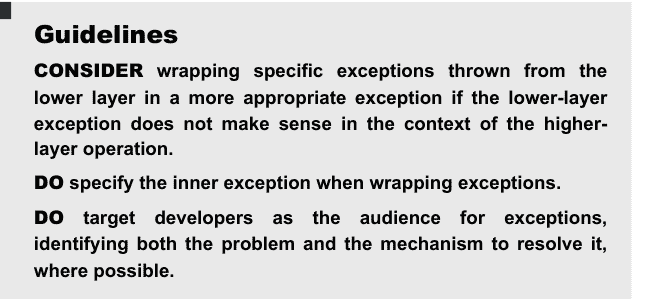

## 初学者主题

# 检查和未检查的转换

正如我们在第 2 章高级主题中首次讨论过的那样，C# 提供了特殊的关键字来标记代码块，并向运行时指示如果目标数据类型太小而无法包含分配的数据时应该发生什么。默认情况下，如果目标数据类型无法包含分配的数据，数据将在赋值期间被截断。例如，请参见列表 11.6 和输出 11.1。

列表 11.6：整数值溢出

```csharp
using System;
public class Program{
    public static void Main()
    {
        // int.MaxValue 等于 2147483647
        int n = int.MaxValue;
        n = n + 1;
        Console.WriteLine(n);
    }
}
```

# 输出 11.1

```
-2147483648
```


列表 11.6 中的代码将值 `-2147483648` 写入控制台。然而，将代码放在 `checked` 块中或运行编译器时使用 `checked` 选项会导致运行时抛出 `System.OverflowException` 类型的异常。`checked` 块的语法使用 `checked` 关键字，如列表 11.7 输出 11.2 所示。如果计算仅涉及常量，则默认将进行检查。

# 列表 11.7：checked 块示例

```csharp
using System;
public class Program
{
    public static void Main()
    {
        checked
        {
            // int.MaxValue 等于 2147483647
            int n = int.MaxValue;
            n = n + 1;
            Console.WriteLine(n);
        }
    }
}
```

# 输出 11.2

```
未处理异常: OverflowException: 算术运算溢出。at Program.Main() in ...Program.cs:line 12
```

如输出 11.2 所示，如果在 `checked` 块内运行时发生了溢出赋值，则抛出异常。注意，输出 11.2 中的位置信息（`Program.cs:line X`）仅在调试编译（即使用编译器的 `/Debug` 选项进行编译）中出现。

> 9. 除了输出 11.2，如果安装了 .NET Framework 调试器，可能会弹对话提示用户向微软发送错误消息、检查解决方案或调试应用程序。

# 重新抛出封装的异常 621

要将整个项目更改为未检查或检查模式，请分别将 `CheckForOverflowUnder` 属性设置为 `false` 或 `true`。

```xml
<PropertyGroup>
  <CheckForOverflowUnder>true</CheckForOverflowUnder>
</PropertyGroup>
```

C# 还支持 `unchecked` 块，它会对数据进行截断而不是为该块抛出异常（参见列表 11.8 及其输出 11.3）。

# 列表 11.8：未检查块示例

```csharp
using System;
public class Program
{
    public static void Main()
    {
        unchecked
        {
            // int.MaxValue 等于 2147483647
            int n = int.MaxValue;
            n = n + 1;
            Console.WriteLine(n);
        }
    }
}
```

# 输出 11.3

```
-2147483648
```

即使在编译期间开启了检查（`checked`）选项，列表 11.8 中代码中的 `unchecked` 关键字也会阻止运行时在执行期间抛出异常。

在不允许使用语句的情况下，可以使用等价的 `checked` 和 `unchecked` 表达式。例如，字段初始化器可能由表达式而非语句组成：

```csharp
int number = unchecked(int.MaxValue + 1);
```

## 总结

抛出异常会产生巨大的性能影响。单个异常会导致加载和处理大量的运行时栈信息——这些数据在其他情况下是不会加载的——而且处理这些信息需要大量的时间。正如第 5 章所示，你应该只使用异常来处理特殊情况；API 应该提供机制来检查是否会抛出异常，而不是强制调用特定的 API 来判断是否会抛出异常。

下一章将介绍泛型.¹10 事实上，它基本上废弃了对 `System.Collections` 命名空间的所有使用，该命名空间以前几乎用于每个项目。

+ 10. 从 C# 2.0 开始引入的功能。

# 12 泛型

随着项目变得越来越复杂，你需要一种更好的方法来重用和自定义现有软件。为了促进代码重用，C# 包含了一个名为泛型的特性。

泛型在词法上类似于 Java 中的泛型和 C++ 中的模板。在所有三种语言中，这些特性都允许实现一次算法和模式，而不需要为算法或模式操作的每种类型单独单独实现。然而，C# 泛型在实现细节以及对各自语言类型系统的影响方面，与 Java 泛型和 C++ 模板都有很大不同。正如方法之所以强大是因为它们可以接受参数一样，接受参数的类型和方法也具有多得的功能。

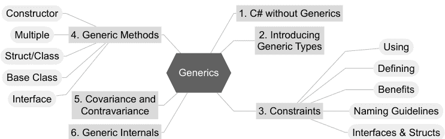

泛型在 2.0 版本中被添加到运行时和 C# 中。

## 不使用泛型的 C#

我们通过检查一个没有使用泛型的类来开始对泛型的讨论。该类 `System.Collections.Stack` 表示一个对象集合，其中最后添加到集合的项是第一个从集合中检索的项（后进先出 [LIFO]）。`Push()` 和 `Pop()` 是 `Stack` 类的两个主要方法，分别向栈中添加项和从栈中删除项。`Stack` 类上的方法声明出现在列表 12.1 中。

### 列表 12.1：System.Collections.Stack 的方法签名

```csharp
public class Stack
{
    public virtual object Pop()
    {
        // ...
    }
    public virtual void Push(object obj)
    {
        // ...
    }
}
```

程序频繁使用栈类型集合来方便多次撤销操作。例如，列表 12.2（结果如输出 12.1 所示）使用 `System.Collections.Stack` 类在模拟扭画板（Etch A Sketch）玩具的程序执行撤销操作。

### 列表 12.2：在类似扭画板玩具的程序支持撤销

```csharp
using System.Collections.Generic;
public class Program
{
    // ...
    public static void Sketch()
    {
        Stack<Cell> path = new();
    }
```
```csharp
Cell currentPosition;
ConsoleInfo key;
// ...
do {
    // 根据用户输入的方向键
    // 指向进行绘图
    key = Move();
    switch(key.Key) {
        case ConsoleKey.Z:
            // 撤销上一次 Move
            if(path.Count >= 1)
            {
                currentPosition = (Cell)path.Pop();
                Console.SetCursorPosition(
                    currentPosition.X, currentPosition.Y
                    // ...
                );
                Undo();
            }
            break;
        case ConsoleKey.DownArrow:
            // ...
        case ConsoleKey.UpArrow:
            // ...
        case ConsoleKey.LeftArrow:
            // ...
        case ConsoleKey.RightArrow:
            // SaveState();
            if(Console.CursorLeft < Console.WindowWidth - 2)
            {
                currentPosition = new Cell(
                    Console.CursorLeft + 1, Console.CursorTop);
            }
            path.Push(currentPosition);
            // ...
            break;
        default:
            Console.Beep();
            break;
    }
} while(key.Key != ConsoleKey.X); // 使用 X 退出。
```

### 626 第 12 章：泛型

```csharp
// ...
}
public struct Cell
{
    public int X {get; }
    public int Y {get; }
    public Cell(int x, int y)
    {
        X = x;
        Y = y;
    }
```

### OUTPUT 12.1

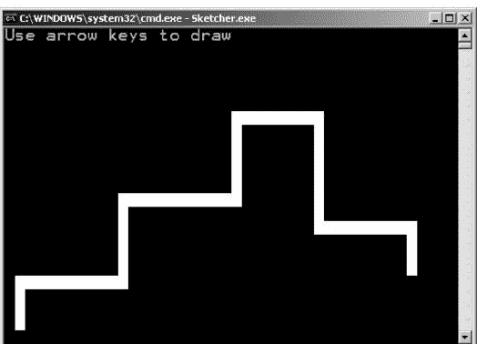

使用 `path` 变量（它声明为 `System.Collections.Stack`），通过向 `Stack.Push()` 方法传递 `Cell` 类型来保存状态。如果用户输入 Z（或按下 Ctrl+Z），通过从栈中检索来撤销上一次移动。

尽管这段代码是可行的，但 `System.Collections.Stack` 类有一个致命缺陷。如列表 12.1 所示，`Stack` 类收集 `object` 类型的值。因为公共运行时（CLR）中的每个对象都派生自 `object`。无法验证你放入的元素是同质或预期的类型。此外，当从 `Pop()` 方法检索数据时，你必须将返回值强制转换为 `Cell`。但如果 `Pop()` 方法返回的值类型不是 `Cell`，则会抛出异常。通过在运行时使用强制转换来推迟检查，你会使程序变得脆弱。创建可以处理多种数据类型的类的根本问题在于，它们必须与公共基类（或接口）工作，通常是 `object`。

使用值类型（如 `struct` 或 `int`）会加剧这个问题。例如，当你将值传递给 `Stack.Push()` 方法时，运行时会自动对其装箱。同样，当你检索值时，你需要将从 `Pop()` 方法获取的对象引用拆箱为值类型。将引用强制转换为基类或接口对性能的影响微乎其微，但值类型的装箱操作会引入额外的开销，因为它必须分配内存并在以后进行垃圾回收。

C# 是一门鼓励类型安全的语言：该语言的设计使得许多错误（例如将整数赋值给字符串类型的变量）可以在编译时捕获。根本问题是 `Stack` 类并不像人们预期的 C# 程序那样具有类型安全性。为了通过将栈的内容限制为特定数据类型来强制类型安全（不使用泛型），你必须创建一个专门的栈类，如列表 12.3 所示。

### 12.3：定义专门的栈类

```csharp
public class CellStack
{
    public Cell Pop() { return new Cell(); } // 返回
    // 最后一个单元
}
```
```cs
public virtual void Push(Cell cell) {
  // ...
}
```

由于 `CellStack` 只能存储 `Cell` 类型的对象，此解决方案需要对栈方法进行自定义实现，这并不理想。要实现一个类型安全的整数栈，还需要另一个自定义实现；而每个实现看起来都与其他所有实现惊人地相似。这将产生大量的重复和冗余代码。

## 初学者主题

### 另一个示例：可空值类型（Nullable Value Types）

第 3 章介绍了通过使用可空修饰修饰符 `?` 来声明可以包含 `null` 的变量，这用于声明一个值类型变量。C# 直到 2.0 版本才开始支持此功能，因为正确的实现需要泛型。在引入泛型之前，程序员基本上面临着两种选择。

第一种选择是为每个需要处理 `null` 值的值类型声明一个可空数据类型，如列表 12.4 所示。

### 列表 12.4：声明存储 `null` 的各种值类型的变体

```csharp
struct NullableInt {
  /// <summary>
  /// 当 HasValue 返回 true 时提供该值
  /// </summary>
  public int Value { get; private set; }
  /// <summary>
  /// 表明是否存在值，或者
  /// 该值是否为 "null"
  /// </summary>
  public bool HasValue { get; private set; }
  // ...
}
```
```csharp
struct NullableInt {
  /// <summary>
  /// 当 HasValue 返回 true 时提供该值
  /// </summary>
  public int Value { get; private set; }
  /// <summary>
  /// 表明是否存在值，或者
  /// 该值是否为 "null"
  /// </summary>
  public bool HasValue { get; private set; }
  // ...
}
```
```csharp
struct NullableGuid {
  /// <summary>
  /// 当 HasValue 返回 true 时提供该值
  /// </summary>
  public Guid Value { get; private set; }
  /// <summary>
  /// 表明是否存在值，或者
  /// 该值是否为 "null"
  /// </summary>
  public bool HasValue { get; private set; }
  // ...
}
```

列表 12.4 显示了 `NullableInt` 和 `NullableGuid` 的可能实现。如果程序需要额外的可空类型，你必须创建另一个结构体，并修改属性以使用所需的值。对实现的任何改进（例如，添加从底层类型到可空类型的用户定义隐式转换）都需要修改所有的可空声明。

在不使用泛型的情况下实现可空类型的另一种策略是声明一个具有 `object` 类型 Value 属性的单一类型，如列表 12.5 所示。

### 列表 12.5：声明包含 object 属性 Value 属性的可空类型

```csharp
struct Nullable {
  /// <summary>
  /// 当 HasValue 返回 true 时提供该值。
  /// </summary>
  public object Value { get; private set; }
  /// <summary>
  /// 表明是否存在值，或者
  /// 该值是否为 "null"
  /// </summary>
  public bool HasValue { get; private set; }
  // ...
}
```


虽然此选项只需要一种可空类型的实现，但在运行时设置 `Value` 属性时始终会对值类型进行装箱。此外，从 `Value` 属性检索底层值需要进行强制转换，这在运行时可能是无效的。这两种方案都不吸引人。为了消除这个问题，C# 引入了泛型。（事实上，可空类型是实现为 `Nullable<T>` 的。）

# 引入泛型类型

泛型提供了一种创建数据结构的机制，这些结构可以特化以处理特定类型。程序员定义这些参数化类型，使得特定泛型类型的每个变量具有相同的内部算法，但数据类型和方法签名可以根据参数提供的类型参数而变化。

为了最大限度地降低开发者的学习曲线，C# 选择了类似于 C++ 模板的语法。在 C# 中，泛型类使用尖括号来声明，以处理特定类型。

# 使用泛型类

列表 12.4 显示了 `NullableInt` 和 `NullableGuid` 的可能实现。如果程序需要额外的可空类型，你必须创建另一个结构体，并修改属性以使用所需的值。对实现的任何改进（例如，添加从底层类型到可空类型的用户定义隐式转换）都需要修改所有的可空声明。

在不使用泛型的情况下实现可空类型的另一种策略是声明一个具有 `object` 类型 `Value` 属性的单一类型，如列表 12.5 所示。

```cs
public virtual void Push(Cell cell) {
  // ...
}
```

由于 `CellStack` 只能存储 `Cell` 类型的对象，此解决方案需要对栈方法进行自定义实现，这并不理想。要实现一个类型安全的整数栈，还需要另一个自定义实现；而每个实现看起来都与其他所有实现惊人地相似。这将产生大量的重复和冗余代码。

## 初学者主题

# 另一个示例：可空值类型（Nullable Value Types）

第 3 章介绍了通过使用可空修饰修符 `?` 来声明可以包含 `null` 的变量，这用于声明一个值类型变量。C# 直到 2.0 版本才开始支持此功能，因为正确的实现需要泛型。在引入泛型之前，程序员基本上面临着两种选择。

第一种选择是为每个需要处理 `null` 值的值类型声明一个可空数据类型，如列表 12.4 所示。

列表 12.4：声明存储 `null` 的各种值类型的变体

```csharp
struct NullableInt {
  /// <summary>
  /// 当 HasValue 返回 true 时提供该值
  /// </summary>
  public int Value { get; private set; }
  /// <summary>
  /// 表明是否存在值，或者
  /// 该值是否为 "null"
  /// </summary>
  public bool HasValue { get; private set; }
  // ...
}
```

```csharp
struct NullableGuid {
  /// <summary>
  /// 当 HasValue 返回 true 时提供该值
  /// </summary>
  public Guid Value { get; private set; }
  /// <summary>
  /// 表明是否存在值，或者
  /// 该值是否为 "null"
  /// </summary>
  public bool HasValue { get; private set; }
  // ...
}
```

列表 12.4 显示了 `NullableInt` 和 `NullableGuid` 的可能实现。如果程序需要额外的可空类型，你必须创建另一个结构体，并修改属性以使用所需的值。对实现的任何改进（例如，添加从底层类型到可空类型的用户定义隐式转换）都需要修改所有的可空声明。

在不使用泛型的情况下实现可空类型的另一种策略是声明一个具有 `object` 类型 `Value` 属性的单一类型，如列表 12.5 所示。

列表 12.5：声明包含 object 属性 Value 属性的可空类型

```csharp
struct Nullable {
  /// <summary>
  /// 当 HasValue 返回 true 时提供该值。
  /// </summary>
  public object Value { get; private set; }
  /// <summary>
  /// 表明是否存在值，或者
  /// 该值是否为 "null"
  /// </summary>
  public bool HasValue { get; private set; }
  // ...
}
```

虽然此选项只需要一种可空类型的实现，但在运行时设置 `Value` 属性时始终会对值类型进行装箱。此外，从 `Value` 属性检索底层值需要进行强制转换，这在运行时可能是无效的。这两种方案都不吸引人。为了消除这个问题，C# 引入了泛型。（事实上，可空类型是实现为 `Nullable<T>` 的。）

# 引入泛型类型

泛型提供了一种创建数据结构的机制，这些结构可以特化以处理特定类型。程序员定义这些参数化类型，使得特定泛型类型的每个变量具有相同的内部算法，但数据类型和方法签名可以根据参数提供的类型参数而变化。

为了最大限度地降低开发者的学习曲线，C# 选择了类似于 C++ 模板的语法。在 C# 中，泛型类使用尖括号来声明，以处理特定类型。

# 使用泛型类

列表 12.4 显示了 `NullableInt` 和 `NullableGuid` 的可能实现。如果程序需要额外的可空类型，你必须创建另一个结构体，并修改属性以使用所需的值。对实现的任何改进（例如，添加从底层类型到可空类型的用户定义隐式转换）都需要修改所有的可空声明。

# 泛型类型简介 635

泛型的核心在于提供编码模式实现的能力，并在模式出现的任何地方重用这些实现。模式描述了代码中反复出现的问题，而模板则为这些重复的模式提供了单一的实现。

# 类型参数命名指南

就像为方法的形式参数命名一样，在命名类型参数时，也应该尽可能具有描述性。此外，为了将参数标识为类型参数，其名称应包含一个 `T` 前缀。例如，在定义诸如 `EntityCollection<Entity>` 的类时，你会使用类型参数名称 `TEntity`。

只有在此类描述无法增加任何价值时，你才不需要描述性的类型名称。例如，在 `Stack<T>` 类中使用 `T` 是合适的，因为 `T` 是类型参数的这一指示已经足够具有描述性；该栈适用于任何类型。

在下一节中，你将学习约束（constraints）。使用具有约束描述性的类型名称是一个良好的习惯。例如，如果类型参数必须实现 `IComponent`，可以考虑使用 `TComponent` 作为类型名称。

> **指南**
> 请为类型参数选择有意义的名称，并以 `T` 作为前缀。
> 考虑在类型参数的名称中指示约束。

# 泛型接口和结构体

C# 在整个语言中支持泛型，包括接口和结构体。其语法与类完全相同。要声明带有类型参数的接口，请将类型参数放在接口名称后的尖括号中，如列表 12.8 中的 `IPair<T>` 示例所示。

# 636 第 12 章：泛型

列表 12.8：声明一个泛型接口

```csharp
interface IPair<T>
{
    T First { get; set; }
    T Second { get; set; }
}
```

此接口表示同类对象的对，例如点的坐标、一个人的遗传父母或二叉树的节点。对中包含的类型对于两个项目都是相同的。

要实现该接口，你使用的与泛型类相同的语法。请注意，一个泛型类型的参数作为另一个泛型类型的类型参数是合法的——也是常见的，如列表 12.9 所示。接口的类型参数是由类声明的类型参数。此外，此示例使用了结构体而非类，证明了 C# 支持泛型值类型。

列表 12.9：实现一个泛型接口

```csharp
public struct Pair<T> : IPair<T>
{
    public T First { get; set; }
    public T Second { get; set; }
}
```

对泛型接口的支持对于集合类尤为重要，泛型在集合中最为常见。在 C# 提供泛型之前，开发者依赖 `System.Collections` 命名空间中的一系列接口。与实现类一样，这些接口仅与 `object` 类型工作，因此，接口强制所有对这些集合类的访问和返回都必须进行强制转换。通过使用类型安全的泛型接口，你可以避免强制转换操作。

## 高级主题

# 在单个类中多次实现同一个接口

同一个泛型接口的两种不同构造被视为不同的类型。因此，一个类或结构体可以多次实现“相同”的泛型接口。考虑列表 12.10 中的示例。

列表 12.10：在单个类中重复接口实现

```csharp
public interface IContainer<T>
{
    ICollection<T> Items { get; set; }
}
public class Person : IContainer<Address>, IContainer<Phone>, IContainer<Email>
{
    ICollection<Address> IContainer<Address>.Items {
        get { // ... }
        set { // ... }
    }
    ICollection<Phone> IContainer<Phone>.Items {
        get { // ... }
        set { // ... }
    }
    ICollection<Email> IContainer<Email>.Items {
        get { // ... }
        set { // ... }
    }
}
```

在这个示例中，`Items` 属性通过使用具有不同类型参数的显式接口实现出现了多次。如果没有泛型，这是不可能的；相反，编译器只允许一个显式的 `IContainer` 属性。

然而，这种实现同一接口多个版本的技术被许多开发者认为是一种“代码异味”（bad code smell），因为它可能导致混惑（特别是当接口允许协变或逆变转换时）。此外，这里的 `Person` 类似乎设计得不佳；人们通常不会将一个人看作“可以提供一组电子邮件地址的东西”。当你觉得需要让一个类实现同一个接口的三个版本时，考虑让它实现三个属性是否更好——例如 `EmailAddresses`、`PhoneNumbers` 和 `MailingAddresses`，每个属性都返回泛型接口的相应构造。

> **指南**
> 避免在一个类型中实现泛型接口的多个构造版本。

# 定义构造函数和终结器

可能令人惊讶的是，泛型类或结构体的构造函数（以及终结器）不需要类型参数；也就是说，它们不需要 `Pair<T>(){...}`。在列表 12.11 的对示例中，构造函数使用 `public Pair(T first, T second)` 进行声明。

# 列表 12.11：声明泛型类型的构造函数

```csharp
public struct Pair<T> : IPair<T>
{
    public Pair(T first, T second)
    {
        First = first;
        Second = second;
    }
    public T First { get; set; }
    public T Second { get; set; }
}
```


# 使用默认运算符指定默认值

列表 12.11 包含一个接收 `first` 和 `second` 初始值的构造函数并将它们赋值给 `First` 和 `Second`。由于 `Pair<T>` 是结构体，任何构造函数必须初始化所有字段。然而，这产生了一个问题。

考虑一个只初始化了一部分的 `Pair<T>` 构造函数，如列表 12.12 所示，会导致 `Second` 仍然未初始化。如果是可空类型，`null` 将起作用，但如果 `T` 是不可空类型，这种方法将无效。

## 列表 12.12：未初始化所有字段导致编译错误

```csharp
public struct Pair<T> : IPair<T>
{
    // 错误：字段 'Pair<T>.Second' 必须在离开构造函数之前完全赋值
    // / 
    // public Pair(T first)
    // {
    //     First = first;
    // }
    // ...
}
```

为了处理这种情况，C# 提供了 `default` 运算符。例如，`int` 的默认值可以使用 `default` 来指定。对于需要 `Second` 的 `T`，可以使用 `default`，如列表 12.13 所示。

## 列表 12.13：使用默认运算符初始化字段

```csharp
public struct Pair<T> : IPair<T>
{
    public Pair(T first)
    {
        First = first;
        // ...
        Second = default;
        // ...
    }
}
```

`default` 运算符可以为任何类型提供默认值，包括类型参数。

如果可以推断数据类型，可以在不指定参数的情况下使用 `default`。对于变量初始化或赋值，使用 `Pair<T> pair = default` 代替 `Pair<T> pair = default(Pair<T>)`。此外，如果一个方法返回 `int`，可以简单返回 `default`，编译器从方法的返回值推断出 `default(int)`。其他可以此类推断的场景是默认参数（可选值）和方法参数。

注意所有可空类型都以 `null` 作为其默认值，例如可空泛型类型如 `default(T?)`。此外，所有引用类型的默认值都是 `null`。因此，如果 C# 8.0 启用了可空引用，将 `default` 赋值给不可空引用类型将导致警告。在 C# 8.0 之前（显然在之后），你应该避免向引用类型分配 `default` 或 `null`，除非 `null` 被预期为有效值。在可能的情况下，保持未初始化状态，直到有可用值为止。

赋值。在类似于列表 12.13 的情况下，由于构造函数中未知 `Second` 的适当值，对于引用类型或可空值类型，`Second` 将不可避免地为 null；因此，当将默认值（可能为 null）赋值给泛型类型 `T` 的属性时会出现警告。为了适当处理该警告，你需要将 `Second` 属性声明为类型 `T?`，并如“struct/class Constraints”节所述，通过类/结构体约束来识别 `T` 是引用类型还是值类型。（事实上，这导致了一个更通用的指南：除非类型被限制为类或结构体，否则不要为泛型类型分配默认值。）

# 多个类型参数

泛型可以声明任意数量的类型参数。初始的 `Pair<T>` 仅包含一个类型参数。为了支持存储二元对（例如名称/值对），你可以创建一个声明了两个类型参数的新类型版本，如列表 12.14 所示。

## 列表 12.14：声明带有多个类型参数的泛型

```csharp
interface IPair<TFirst, TSecond>
{
    TFirst First { get; set; }
    TSecond Second { get; set; }
}
struct Pair<TFirst, TSecond> : IPair<TFirst, TSecond>
{
    public Pair(TFirst first, TSecond second)
    {
        First = first;
        Second = second;
    }
    public TFirst First { get; set; }
    public TSecond Second { get; set; }
}
```

当你使用 `Pair<TFirst, TSecond>` 类时，在声明和实例化语句的角括号内提供多个类型参数；随后在调用方法时，为参数提供匹配的类型。列表 12.15 展示了这种方法。

## 列表 12.15：使用带有多个类型参数的类型

```csharp
Pair<int, string> historicalEvent = 
new(1914);
// 沙克尔顿乘坐坚性号前往南极
Console.WriteLine("{0}: {1}",
historicalEvent.First, historicalEvent.Second);
```

类型参数的数量——即算度（arity）——将类与其他同名的类唯一区分开来。由于这种算度的变化，可以在同一个命名空间内同时定义 `Pair<T>` 和 `Pair<TFirst, TSecond>`。此外，由于它们之间紧密的语义关系，如果被放在同一个 C# 文件中，泛型之间的区别仅在于算度。

> 指南
> 如果语义等值的泛型类仅在泛型参数的数量上不同，请将它们放在同一个文件中。

## 初学者主题

# 元组：算度丰富的丰富性

在内部，实现元组语法的底层类型实际上是一个泛型——具体来说是 `System.ValueTuple`。通过 `Pair<...>`，由于算度的变化（每个类具有不同数量的类型参数），可以重复相同的名称，如列表 12.16 所示。

## 列表 12.16：使用算度重载类型定义

```csharp
public class Tuple
{
    // ...
}
public class Tuple<T1> // : IEquatable
    // IStructuralComparable, IComparable
{
    // ...
}
public class Tuple<T1, T2> // : IEquatable
    // IStructuralComparable, IComparable
{
    // ...
}
public class Tuple<T1, T2, T3> // : IEquatable
    // IStructuralComparable, IComparable
{
    // ...
}
public class Tuple<T1, T2, T3, T4> // : IEquatable
    // IStructuralComparable, IComparable
{
    // ...
}
public class Tuple<T1, T2, T3, T4, T5> // : IEquatable
    // IStructuralComparable, IComparable
{
    // ...
}
public class Tuple<T1, T2, T3, T4, T5, T6>
    // : IEquatable, IStructuralComparable, IComparable
{
    // ...
}
public class Tuple<T1, T2, T3, T4, T5, T6, T7>
    // : IEquatable, IStructuralComparable, IComparable
{
    // ...
}
public class Tuple<T1, T2, T3, T4, T5, T6, T7, TRest>
    // : IEquatable, IStructuralComparable, IComparable
{
```

# 644 第 12 章：泛型

```csharp
// ...
}
```

`ValueTuple<...>` 类集的设计目的与 `Pair<T>` 和 `Pair<TFirst, TSecond>` 类相同，不同之处它们可以一起处理每种类型参数。事实上，使用列表 12.16 中的最后一个 `ValueTuple`，`TRest` 可以存储另一个 `ValueTuple`，使得元组的元素数量在实际上是无限的。

元组类族另一个有趣的成员是泛型 `ValueTuple` 类。该类具有用于实例化各种泛型类型的静态工厂方法。虽然每个泛型类型都可以使用其构造函数直接实例化，但 `ValueTuple` 类型的工厂方法允许使用 `Create()` 方法推断类型参数。列表 12.17 展示了结合类型推断使用 `Create()` 方法。

## 列表 12.17：比较 System.ValueTuple 的实例化方法

```csharp
#if !PRESHARP7
(string, Contact) keyValuePair;
keyValuePair =
    ValueTuple.Create("55-555", new Contact());
#else // 使用 C# 7.0
ValueTuple<string, Contact> keyValuePair;
keyValuePair =
    ValueTuple.Create("55-555", new Contact());
#endif
```

# 第 12 章：泛型

# 引入泛型类型

正如你从框架声明泛型类型推断出的，CLR 不支持变长泛型方法。方法可以通过数组接收任意数量的参数，参见“初学者主题：元组：算度丰富的丰富性”的示例。

# 嵌套类型

包含类型的类型参数会“传递”到任何嵌套类型。例如，如果包含类型声明了类型参数 `T`，则所有嵌套类型都将是泛型的，可以使用该类型参数。如果嵌套类型包含了了自己的名为 `T` 的类型参数，这将隐藏该类型参数（见列表 12.18）。

## 列表 12.18：嵌套类型

```csharp
public class Container<T, U>
{
    // 嵌套类继承类型参数
    // 重用类型名称将导致
    // 警告
    public class Nested<U>
    {
        static void Method(T param0, U param1)
        {
        }
    }
}
```

# 约束

泛型支持对类型参数定义约束的能力。这些约束确保提供的类型符合各种规则。以列表 12.19 所示的 `BinaryTree<T>` 类为例。

## 列表 12.19：声明无约束的 BinaryTree<T> 类

```csharp
public class BinaryTree<T>
{
    public BinaryTree(T item)
    {
        Item = item;
    }
    public T Item { get; set; }
    public Pair<BinaryTree<T>> SubItems { get; set; }
}
```

（一个有趣的点是，`BinaryTree<T>` 在内部使用了 `Pair<T>`，这是因为 `Pair<T>` 只是另一个类型。）

假设你想在赋值给 `SubItems` 属性时对 `Pair<T>` 值进行排序。为了实现排序，`SubItems` 访问器使用键的 `CompareTo()` 方法，如列表 12.20 所示。

在编译时，类型参数 `T` 是一个无约束的泛型。当代码编写如所示时，编译器假设只有

## 列表 12.20: 需要类型参数支持某个接口

```csharp
public class BinaryTree<T>
{
    public BinaryTree(T item)
    {
        Item = item;
    }
    public T Item { get; set; }
    public Pair<BinaryTree<T>> SubItems
    {
        get { return _SubItems; }
        IComparable<T> first;
        // : 无法转换为类型...
        // /first = value.First; // 需要显式转换
        if(first.compareTo(value.Second) < 0)
        {
            // // first 小于 second
            // // ...
        }
        else
        {
            // // first 和 second 相同或
            // // second 小于 first
            // // ...
        }
        _SubItems = value;
    }
    private Pair<BinaryTree<T>> _SubItems;
}
```

类型以 `object` 为基类。因此，在类型参数 T 的实例上只能调用如 `ToString()` 等方法。结果是，编译器会显示编译错误，因为在类型 `object` 上没有定义 `CompareTo()` 方法。

你可以将 T 参数强制转换为 `IComparable<T>` 接口以访问 `CompareTo()` 方法，如列表 12.21 所示。

# 648 第12 章：泛型

## 列表 12.21: 需要类型参数支持某个接口或抛出异常

```csharp
public class BinaryTree<T>
{
    public BinaryTree(T item)
    {
        Item = item;
    }
    public T Item { get; set; }
    public Pair<BinaryTree<T>?>? _SubItems
    {
        get { return _SubItems; }
        set {
            switch (value)
            {
                // 使用 C# 8.0 模式匹配。在 C# 8.0 之前
                // 为检查 null
                // ...
                case Pair<BinaryTree<T>?> { First: IComparable<T> first, Second: T second }:
                    if (first.compareTo(second) < 0)
                    {
                        // first 小于 second
                    }
                    else
                    {
                        // second 小于或等于 first
                    }
                    break;
                default:
                    throw new InvalidCastException(
                        $"无法排序项目，因为 {typeof(T)} 不支持 IComparable<T>"
                    );
            }
        }
        _SubItems = value;
    }
    private Pair<BinaryTree<T>?>? _SubItems;
}
```

遗憾的是，如果你现在声明一个 `BinaryTree<SomeType>` 类变量，而类型参数（SomeType）没有实现 `IComparable<SomeType>` 接口，则没有方法对项目进行排序；反之，我们抛出一个 `InvalidCastException`，表示该类型不支持所需的接口。这消除了使用泛型的核心原因之一：提高类型安全性。

为了避免此异常，并在类型参数未实现接口时生成编译错误，C# 允许你为泛型类型中的每个类型参数提供一个可选的约束列表。约束声明了泛型类型对每个类型参数所提供的参数所要求的特征。你使用 `where` 关键字声明约束，后面跟着一个参数-需求对，其中该参数必须是泛型类型中声明的类型之一。这些需求描述了三者之一：类型参数必须能够转换为类或接口、默认构造函数、或引用/值类型限制。

# 接口约束

为了确保二叉树的节点顺序顺序正确，你可以使用 `BinaryTree` 类中的 `CompareTo()` 方法。为了最有效地实现这一点，你应该对 `T` 类型参数施加约束。也就是说，你需要 `T` 参数实现 `IComparable<T>` 接口。声明此约束的语法如列表 12.22 所示。

## 列表 12.22: 声明接口约束

```csharp
public class BinaryTree<T>
    where T : System.IComparable<T>
{
    public BinaryTree(T item)
    {
        Item = item;
    }
    public T Item { get; set; }
```


`public Pair<BinaryTree<T>?> SubItems`

```
{
    get { return _SubItems; }
    set
```

```csharp
{
    switch (value) {
        // 为了清晰起见删除了 null 处理
        // 使用 C# 8.0 模式匹配。在 C# 8.0 之前
        // 为检查 null
        // ...
        case Pair<BinaryTree<T>> { First: { Item: T first }, Second: { Item: T second } }:
            if (first.CompareTo(second) < 0) {
                // first 小于 second
            }
            else {
                // second 小于或等于 first
            }
            break;
        }
        default:
            throw new InvalidCastException($"无法排序项目，因为 {typeof(T)} 不支持 IComparable<T>");
    }
    _SubItems = value;
}
private Pair<BinaryTree<T>>?> _SubItems;
}
```

虽然此示例中的更改很细微，但它将错误识别从运行时移动到了编译器，这是一个重要的区别。当列表 12.22 中添加接口约束时，编译器确保你每次使用 `BinaryTree<T>` 类时，都指定一个实现了 `IComparable<T>` 接口相应构造的类型参数。此外，你不再需要在调用 `CompareTo()` 方法之前显式地将变量转换为 `IComparable<T>` 接口。在访问使用显式实现的成员时，甚至不需要强制转换，而在其他上下文中，没有转换会隐藏该成员。

# 约束 651

在泛型类型参数类型的值上调用方法时，编译器会检查该方法是否与声明为约束的任何接口上的任何方法匹配。

如果你尝试使用 `System.Text.StringBuilder` 作为类型参数创建 `BinaryTree<T>` 变量，将收到编译错误，因为 `StringBuilder` 没有实现 `IComparable<StringBuilder>`。该错误与输出 12.3 显示的。

# 输出 12.3

```
error CS0311: 类型 'System.Text.StringBuilder' 不能作为泛型类型或方法 'BinaryTree<T>' 中的类型参数 'T'。从 'System.Text.StringBuilder' 到 'System.IComparable<System.Text.StringBuilder>' 没有隐式引用转换。
```

要为约束指定接口，你需要声明接口约束。此约束甚至规避了调用显式接口实现。

# 类型参数约束

有时你可能希望将类型参数转换为特定的类型。你通过类型参数约束来实现，如列表 12.23 所示。

## 列表 12.23: 声明类约束

```csharp
public class EntityDictionary<TKey, TValue>
    : System.Collections.Generic.Dictionary<TKey, TValue>
    where TKey : notnull
    where TValue : EntityBase
{
    // ...
}
```

在列表 12.23 中，`EntityDictionary<TKey, TValue>` 要求所有 `TValue` 必须隐式转换为 `EntityBase`。通过要求这种转换，就可以在泛型实现中可以使用 `EntityBase` 的成员。

# 686 第12 章：泛型

使用 `Combine()` 方法并转换为目标类型，如列表 12.24 中的模式匹配所示。

## 列表 12.24：声明带有 MulticastDelegate 约束的泛型

```csharp
static public object? InvokeAll<TDelegate>(object[]? args, TDelegate[] delegates)
// 不允许 Action/Func 类型约束
    where TDelegate : System.MulticastDelegate
{
    switch (Delegate.Combine(delegates))
    {
        case Action action:
            action();
            return null;
        case TDelegate result:
            return result.DynamicInvoke(args);
        default:
            return null;
    }
}
```

在此示例中，我们在调用结果之前尝试将其转换为 `Action`。如果尝试未成功，我们将将其转换为 `TDelegate` 并使用 `DynamicInvoke()` 调用结果。

请注意，在泛型外部我们知道 `T` 的类型，因此在调用 `Combine()` 之后可以直接调用它：

```csharp
Action? result = (Action?)Delegate.Combine(actions);
result?.Invoke();
```

注意列表 12.24 中的注释。虽然支持 `System.Delegate` 和 `System MulticastDelegate`，但你无法指定特定的委托类型，例如 `Action`、`Func<T>` 或相关类型之一。

## 第 12 章：泛型

### unmanaged 约束
`unmanaged` 约束¹⁰ 将类型参数限制为 `sbyte`、`byte`、`short`、`ushort`、`int`、`uint`、`long`、`ulong`、`char`、`float`、`double`、`decimal`、`bool`、`enum`、指针或所有字段均为托管的结构体。这允许你对托管约束类型参数执行 `sizeof()`（或第 22 章中讨论的 `stackalloc`）。

在 C# 8.0 之前，`unmanaged` 约束将类型参数限制为构造结构体类型——即非泛型值。然而，C# 8 移除了这一约束。现在即使 `Thing<T>` 对 `T` 有 `unmanaged` 约束，你也可以声明类型为 `Thing<Thing<int>>` 的变量。

### notnull 约束

在列表 12.23 中，有第二个约束：使用上下文关键字 `notnull` 的非空约束。如果为装饰有 `notnull` 的类型参数指定了可空类型，则该约束会触发警告。在这种情况下，例如，声明 `Dictionary<string, EntityBase>` 将导致以下警告：类型参数 'string?' 不匹配 'notnull' 约束。

`notnull` 关键字不能与 `struct` 或 `class` 约束结合，因为它们在默认情况下不是可空的。

### struct/class 约束

另一个有用的泛型约束是能够将类型参数限制为任何非可空值类型或引用类型。与其指定 `T` 必须派自的类，你只需要使用 `struct` 或 `class` 关键字，如列表 12.25 所示。

## 列表 12.25：将类型参数指定为值类型

```csharp
public struct Nullable<T> :
    IFormattable, IComparable,
    IComparable<Nullable<T>>, INullable
    where T : struct
```

¹⁰ 在 C# 7.3 中引入。

```csharp
// ...
public static implicit operator Nullable<T>(T value) => new(value);
public static explicit operator T(Nullable<T> value) => value!.Value;
// ...
```

请注意，`class` 约束将类型参数限制为引用类型，包括接口、委托或数组类型。

在 C# 8.0 中，`class` 约束默认为不可空。指定可空引用类型参数将触发编译器警告。你可以通过在 `class` 约束上包含可空修饰符来允许泛型允许可空引用类型。考虑第 10 章引入的 `WeakReference<T>` 类。

```csharp
public sealed class WeakReference<T> : ISerializable
{ ... }
```

这会将类型参数 `T` 限制为引用类型——可能是可空的。与 `class` 约束相反，`struct` 约束不允许可空。

由于 `class` 约束要求引用类型，使用 `struct` 约束是矛盾的。因此，你不能结合 `struct` 和 `class` 约束。

`struct` 约束有一个特殊特性：可空值类型不满足该约束。

由于并非所有对象都具有公共默认构造函数，编译器允许你在未约束的类型参数上调用默认构造函数。为了覆盖编译器限制，你可以最后添加 `new()`。

# 列表 12.27：要求默认构造函数

```csharp
public class EntityBase<TKey>
    where TKey : notnull
{
    public EntityBase(TKey key)
    {
        Key = key;
    }
    public TKey Key { get; set; }
}
```
（注：剩余页面是混乱的，但遵循接口替换构造函数约束的逻辑。）

# 第 12 章：泛型

## 约束继承

泛型类型参数及其约束都不会被派生类继承，因为泛型类型参数不是成员。创建继承自其他泛型的新泛型类型是一种常见做法。在这种情况下，由于派生泛型的类型参数变成了泛型基类的类型数参数，因此这些类型参数必须具有与基类中相同或更强的约束。

## 列表 12.31：显式指定的已继承的约束

```sharp
public class EntityBase<T> where T : IComparable<T>
{
    // ...
}
ERROR:
// 类型 'U' 必须转换为 'System.IComparable<U>' 
// 才能作为泛型类型或
// 方法中的参数 'T' 使用
class Entity<U> : EntityBase<U>
{
    //...
}
```

在列表 12.31 中，`EntityBase<T>` 要求由基类指定符 `EntityBase<U>` 为 `T` 提供的参数 `U` 实现 `IComparable<U>`。因此，`Entity<U>` 类需要对 `U` 相同的约束。

我们还没有介绍泛型方法；我们将在本章的晚些部分讨论它们。现在，请先意识到方法可以是泛型的，并且也可以为其类型参数所提供的类型数参数施加约束。那么，当一个虚泛型方法被继承和重写时，约束是如何处理的？与在泛型类上声明类型参数的情况不同，重写虚泛型方法约束是隐式继承的，不能再次重述。

## 列表 12.32：禁止在虚成员上重复已继承的约束

```sharp
public class EntityBase {
    public virtual void Method<T>(T t)
    where T : IComparable<T>
    {
        // ...
    }
}
public class Order : EntityBase {
    public override void Method<T>(T t)
    // 重写成员上不能重复
    // 约束
    where T : IComparable<T>
    {
        // ...
    }
}
```

在泛型继承的情况下，派生类上的类型参数可以通过不仅添加基类上的约束，还可以添加其他约束来进一步约束。然而，重写虚泛型方法必须完全符合基类方法定义的约束。

## 高级主题

### 约束的局限性

约束被恰当限制以避免无意义的代码。例如，你不能将类类型约束与结构体或类约束结合，或者将 `notnull` 与任一类型的约束结合。此外，你不能指定将继承限制为特殊类型（如 `object`、数组或 `System.ValueType`）的约束。¹¹ 你不能为特定的委托类型（如 `Action`、`Func<T>` 或相关类型）设置约束。

### 不允许运算符约束

所有的泛型都隐式地允许 `==` 和 `!=` 比较，以及到 `object` 的隐式转换，因为一切都是对象。你不能将类型参数约束为实现特定方法或运算符的类型，除非通过接口类型约束或类类型约束。

## 列表 12.33：约束表达式无法要求运算符

```sharp
public abstract class Math<T>
{
    public static T Add(T first, T second)
    {
        // 错误：运算符 '+' 无法应用于
        // 类型为 'T' 和 'T' 的操作数
        // return first + second;
    }
}
```

¹¹ `System.Enum` (enum)、`System.Delegate` 和 `System.MulticastDelegate` 从 C# 7.3 开始支持。

### 不支持 OR 逻辑

如果你为类型参数提供多个接口或类约束，编译器始终假设约束之间是 AND 逻辑关系。没有方法可以指定约束之间的 OR 关系。

## 列表 12.34：不支持使用 OR 关系组合约束

```sharp
public class BinaryTree<T>
    // 错误：不支持 OR
    // where T: System.IComparable<T> // System.IFormattable
{
    //...
}
```

## 泛型方法

泛型方法使用泛型类型参数，就像泛型类型一样。它们可以在泛型类型或非泛型类型中声明。要声明泛型方法，你在方法名后立即添加类型参数声明语法，如列表 12.35 中的 `MathEx.Max<T>` 和 `MathEx.Min<T>` 示例所示。

## 列表 12.35：定义泛型方法

```sharp
public static class MathEx {
    public static T Max<T>(T first, params T[] values)
    where T : IComparable<T> {
        T maximum = first;
        foreach(T item in values) {
            if(item.compareTo(maximum) > 0) {
                maximum = item;
            }
        }
        return maximum;
    }
    public static T Min<T>(T first, params T[] values)
    where T : IComparable<T> {
```


```
        T minimum = first;

        foreach(T item in values) {

            if(item.compareTo(minimum) < 0) {

                minimum = item;

            }

        }

        return minimum;

    }

}
```

泛型方法和泛型类型一样，可以包含多个类型参数。类型参数的数量（arity）是方法签名的一个额外区分特征。也就是说，只要类型参数的数量不同，两个具有相同名称和形式参数类型的方法是合法的。

## 泛型方法推断

正如在使用泛型类型时类型数提供在类型名之后一样，方法类型数提供在方法名之后。调用 `Min<T>` 和 `Max<T>` 方法的代码如列表 12.36 所示，输出为 12.4。

### 列表 12.36：显式指定类型参数

```sharp
Console.WriteLine(
  MathEx.Max<int>(7, 490));
Console.WriteLine(
  MathEx.Min<string>("R.O.U.S", "Fireswamp"));
```

### 输出 12.4

```
490

ireswamp
```

并不意外，类型参数 `int` 和 `string` 与泛型方法调用的实际类型。然而，指定类型参数是冗余的，因为编译器可以从传递给方法的形式参数推断出类型参数。为了避免冗余，在编译器能够逻辑推断你预期的类型参数的情况下，可以在调用时排除类型参数。这种被称为**方法类型推断**的做法示例出现在列表 12.37 中，输出为 12.5。

### 列表 12.37：从参数推断类型参数

```sharp
Console.WriteLine(
  MathEx.Max(7, 490)); // 无类型参数！
Console.WriteLine(
  MathEx.Min("R.O.U.S", "Fireswamp"));
```

### 输出 12.5

```
490

fireswamp
```

要使方法类型推断成功，参数的类型必须与泛型方法的形式参数相“匹配”，以便推断出所需的参数。一个值得考虑的问题是，当出现矛盾推断时会发生什么。例如，当你使用 `Math.Max(7.0, 490)` 调用 `Max<T>` 方法时，编译器可以从第一个参数推导出类型参数应该是 `double`，而从第二个参数推断出类型参数是 `int` —— 这是一个矛盾。更深入的分析会注意到，这种矛盾是可以解决的，因为每个 `int` 都可以转换为 `double`，因此 `double` 是类型参数的最佳选择.¹12

在方法推断仍然不够完善以推导出类型参数的情况下，你可以通过在参数上插入强制转换来解决错误（向编译器明确推断中应使用的参数类型），或者放弃类型推断并显式地包含类型参数。

请注意，方法推断算法在进行推断时，仅考虑参数、参数类型以及泛型方法的形式参数类型。在实践中可能用于分析的其他因素——例如泛型方法的返回类型、方法返回值所赋值的变量类型，或者方法泛型类型参数的约束——该算法完全不予考虑。

## 指定约束

泛型方法的类型参数可以像泛型方法类型参数被约束的方式进行约束。例如，你可以限制方法的类型参数实现某个接口或可转换为类类型。约束在参数列表和方法体之间指定，如列表 12.38 所示。

> 12. 这种差异在 C# 2.0 中会导致错误。C# 3.0 和 C# 4.0 对方法类型推断算法进行了改进。

### 列表 12.38：指定泛型方法的约束

```csharp
public class ConsoleTreeControl
{
    // 泛型方法 Show<T>
    public static void Show<T>(BinaryTree<T> tree, int indent)
    where T : IComparable<T>
    {
        Console.WriteLine("\n{0}",
            "* " + PadLeft(" " + indent, ' '),
            tree.Item.ToString());
        if(tree.SubItems.First != null)
            Show(tree.SubItems.First, indent + 1);
        if(tree.SubItems.Second != null)
            Show(tree.SubItems.Second, indent + 1);
    }
}
```

# 协变与逆协变 671

```cs
interface IPair<T>
{
    T First { get; set; }
    T Second { get; set; }
}
```

```cs
public struct Pair<T> : IPair<T>, IReadOnlyPair<T>
{
    // ...
}
```

```cs
public class Program
{
    static void Main()
    {
        // 只有使用 out 类型参数时才可行
        Pair<Contact> contacts =
            new Pair<Contact>(
                new Contact("Princess Buttercup"),
                new Contact("Inigo Montoya"));
        IReadOnlyPair<PdaItem> pair = contacts;
        PdaItem pdaItem1 = pair.First;
        PdaItem pdaItem2 = pair.Second;
    }
}
```

当我们限制泛型类型声明，使其仅以接口输出的形式暴露数据时，编译器没有理由阻止协变。对 `IReadOnlyPair<PdaItem>` 实例上的所有操作都会将 `Contacts`（来自原始 `Pair<Contact>` 对象）向上转换为基类 `PdaItem`——这是一个完全有效的转换。无法向一个实际上是 `Contacts` 对的对象“写入”一个地址，因为该接口没有暴露任何可写的属性。

列表 12.42 中的代码仍然无法编译¹14。要指示一个泛型接口意图在其中一个类型参数上是协变的，可以使用 `out` 类型参数修饰符来声明该类型参数。列表 12.43 显示了如何修改接口声明以指示允许它是协变的。

¹14. C# 4.0 增加了对安全协变的支持。

# 第 12 章：泛型

### 列表 12.43：使用 `out` 类型参数修饰符实现协变

```cs
interface IReadOnlyPair<out T>
{
    T First { get; }
    T Second { get; }
}
```

修改 `IReadOnlyPair<out T>` 接口上的类型参数将导致编译器验证 `T` 确实仅用于“输出”（方法返回类型和只读属性类型），而从不用于形式参数或属性设置器。从那时起，编译器将允许任何涉及该接口的协变转换成功。当对列表 12.42 中的代码进行此修改时，它将成功编译并执行。

对协变转换施加了几个重要的限制：

- 只有泛型接口和泛型委托（在第 13 章描述）可以是协变的。泛型类和结构体永远不是协变的。
- 源泛型和目标泛型的变动类型参数必须是引用类型，而不是值类型。`IReadOnlyPair<string>` 可以协变地转换为 `IReadOnlyPair<object>`，因为 `string` 和 `IReadOnlyPair<object>` 都是引用类型。`IReadOnlyPair<int>` 可能无法转换为 `IReadOnlyPair<object>`，因为 `int` 不是引用类型。
- 接口或委托必须声明为支持协变，并且编译器必须能够验证标记的类型参数实际上仅用在“输出”位置。

# 使用 `in` 类型参数修饰符启用逆协变

“向后走”的协变被称为逆协变（contravariance）。再次，假设两个类型 `X` 和 `Y` 存在关系，使得类型 `X` 的每个值都可以转换为类型 `Y`。如果类型 `I<X>` 和 `I<Y>` 始终具有那种特殊的“向后”关系——即类型 `I<Y>` 的每个值都可以转换为类型 `I<X>`——我们就说“`I<T>` 在 `T` 上是逆协变的”。

# 协变与逆协变 673

大多数人发现逆协变比协变难理解得多。逆协变的经典例子是比较器（comparer）。假设你有一个派生类型 `Apple` 和一个基类型 `Fruit`。显然，它们具有这种特殊关系：`Apple` 的每个值都可以转换为 `Fruit`。

现在假设你有一个接口 `CompareThings<T>`，它包含一个方法 `bool IsBetter(T t1, T t2)` 来判断第一个是否优于第二个。当我们提供类型参数时会发生什么？`CompareThings<Fruit>` 比较两个 `Fruit`。由于每个 `Apple` 都是 `Fruit`，因此 `CompareThings<Fruit>` 可以转换为 `CompareThings<Apple>`——转换的方向反转了，因此是逆协变。

要指示一个泛型接口在其的一个类型参数上是逆协变的，你可以使用 `in` 修饰符声明该类型参数，如列表 12.44 所示。

### 列表 12.44：使用 `in` 类型修饰符实现逆协变

```cs
interface CompareThings<in T>
{
    bool IsBetter(T t1, T t2);
}
```

假设你有一个实现：

```cs
public class FruitComparer : CompareThings<Fruit>
{
    public bool IsBetter(Fruit t1, Fruit t2)
    {
        // 比较逻辑
        return true;
    }
}
```

你就可以将其赋值给 `CompareThings<Apple>`：

```cs
CompareThings<Apple> appleComparer = new FruitComparer();
```

这是安全的，因为每个 `Apple` 都是 `Fruit`，所以 `FruitComparer` 可以比较两个 `Apple`。与协变一样，逆变转换具有类似的限制：

- 只有泛型接口和泛型委托（在第 13 章描述）可以是逆协变的。泛型类和结构体永远不是逆协变的。
- 源泛型和目标泛型的变动类型参数必须是引用类型，而不是值类型。`CompareThings<Fruit>` 可以逆变地转换为 `CompareThings<Apple>`，因为 `Fruit` 和 `Apple` 都是引用类型。`CompareThings<int>` 可能无法转换为 `CompareThings<object>`，因为 `int` 不是引用类型。
- 接口或委托必须声明为支持逆协变，并且编译器必须能够验证标记的类型参数实际上仅用在“输入”位置。

# 协变与逆协变

### 列表 12.45：编译器的验证

```cs
// 错误：无效的变型：类型参数 'T' 不是有效的
interface IPair<in T>
{
    void Initialize(IPair<T> pair);
}

// 假设上面的代码是合法的，看看发生了什么错误：
public class FruitPairInitializer : IPair<Fruit>
{
    // 让我们用苹果和橘子初始化我们的对：
    public void Initialize(IPair<Fruit> pair)
    {
        pair.First = new Orange();
        pair.Second = new Apple();
    }
}

// ... 之后 ...
var f = new FruitPairInitializer();

// 如果逆协变是合法的，则以下是合法的：
IPairInitializer<Apple> a = f;

// 现在我们向一个苹果对写入一个橘子：
a.Initialize(new Pair<Apple>());
// ...
```

粗浅的观察者可能会认为，由于 `IPair<T>` 仅用作输入形式参数，`IPairInitializer` 上的 `in` 修饰符是有效的。然而，`IPair<T>` 接口无法安全地变化，因此不能用可以变化的类型参数来构造它。正如你所见，这并不是安全的，而且实际上，编译器根本不允许 `IPairInitializer<T>` 接口声明为逆协变。

# 数组支持不安全的协变

到为止，我们将协变和逆协变描述为泛型类型的属性。在所有非泛型类型中，数组最像泛型；也就是说，当我们考虑泛型的“`T` 列表”或泛型的“`T` 对”时，我们可以认为“`T` 数组”展示了这种模式。由于数组显然支持

# 第 12 章：泛型

根据你对协变和逆变性的了解，你可能认为数组既不是安全的逆变性的，也不是安全的协变的。也就是说，你可能认为一个数组只有在从不被写入时才是安全的协变的，且只有在从不被读取时才是安全的逆变性的——尽管这两种限制似乎都不符合实际情况。

遗憾的是，C# 确实支持数组协变，尽管它不是类型安全的。例如，`Fruit[] fruits = new Apple[10];` 在 C# 中是完全合法的。如果你接着包含表达式 `fruits[0] = new Orange();`，那么运行时将以异常的形式抛出类型安全违反。令深困扰的是，将 `Orange` 赋值给 `Fruit` 数组并不总是合法的，因为这可能是一个 `Apple` 数组，但这种情况并非仅存在于 C# 中，而是存在于所有使用运行时实现数组的 CLR 语言中。

你应该尽量避免不安全的数组协变。每个数组都可以转换为只读（因此是安全的协变的）接口 `IEnumerable<T>`；也就是说，`IEnumerable<Fruit> fruits = new Apple[10]` 是既安全又合法的，因为如果你只有一个只读接口，就没有办法将 `Orange` 插入数组中。

| 指南 |
| :--- |
| **避免不安全的数组协变。相反，考虑将数组转换为只读接口 `IEnumerable<T>`，该接口可以通过协变转换进行安全转换。** |

# 泛型内部机制

鉴于前面的章节中讨论了对象在 CLI 类型系统中泛用性，得知泛型也是对象，这似乎并不令人意外。事实上，泛型类上的类型参数带有元数据，运行时在需要时使用这些元数据构建相应的类。因此，泛型支持继承、多态和封装。通过泛型，你可以定义方法、属性、字段、类、接口和委托。

为了实现这一点，泛型需要底层运行时的支持。反之，在 C# 语言中添加泛型是编译器和框架的共同特性。例如，为了避免装箱（boxing），基于值类型参数的泛型实现与基于引用类型参数的泛型是不同的。

## 高级主题

# 泛型的 CIL 表示

当泛型类被编译时，它与非泛型类没有显著区别。编译的结果仅由元数据和 CIL。CIL 是参数化的，以接受代码中某处用户提供的类型。例如，假设你有一个如列表 12.46 所示声明的简单 `Stack` 类。

**列表 12.46：** `Stack<T>` 声明

```csharp
public class Stack<T> where T : IComparable
{
    private T[] _Items;
    // 类的其余部分
    //...
}
```

当你编译该类时，生成的 CIL 是参数化的，看起来类似于列表 12.47。

**列表 12.47：** `Stack<T>` 的 CIL 代码

```csharp
.class private auto ansi beforefieldinit
Stack<1>([mscorlib]System.IComparable)T>
extends [mscorlib]System.Object
  ...
}
```

第一个值得注意的项是第二行中出现在 `Stack` 之后的 '1'。这是泛型类型的元（arity）：它声明了泛型类需要类型参数的类型参数数量。如 `EntityDictionary<TKey, TValue>` 的声明的元数为 2。

生成的 CIL 的第二行显示了施加在该类上的约束。类型参数 `T` 被装饰了 `IComparable` 约束的接口声明。

如果你继续查看 CIL，你会发现该项的类型为 `T` 的数组声明被更改为包含一个使用感叹号表示法的类型参数，这是支持泛型的 CIL 版本的特性。感叹号表示为该类指定的第一个类型参数的存在，如列表 12.48 所示。

# 列表 12.48：支持泛型的、带感叹号表示法的 CIL

```csharp
.class public auto ansi beforefield
'Stack'1<<[msclib]System,IComparable>> T>
extends [msclib]System.Object
{
    .field private !0[ ] _Items
}
```

除了代码中包含了元和用感叹号表示的类型参数外，为泛型类生成的 CIL 与为非泛型类生成的 CIL 之间几乎没有区别。

## 高级主题

# 基于值类型的泛型实例化

当泛型类型第一次使用值类型作为类型参数进行构造时，运行时会创建一个专门的泛型类型，并将提供的类型参数恰当地放置在 CIL 中。因此，运行时会为每个新的参数值类型创建新的泛型类型。

例如，假设某些代码声明了一个由整数构造的 `Stack`，如列表 12.49 所示。

# 列表 12.49：`Stack<int>` 定义

```csharp
Stack<int> stack;
```


第一次使用此类型 `Stack<int>` 时，运行时会生成 `Stack` 类的专门版本，用类型参数 `int` 替换其类型参数。从以后，每当代码使用 `Stack<int>` 类时（在列表 12.50 中你声明了两个 `Stack<int>` 实例），它们都使用运行时已经为 `Stack<int>` 生成的代码。

# 列表 12.50：声明类型 `Stack<T>` 的变量

```csharp
Stack<int> stackOne = new();
Stack<int> stackTwo = new();
```

如果在代码后期创建了具有不同类型参数（例如用户定义的结构体）的另一个 `Stack`，运行时将生成另一个版本的泛型类型。专门化类的用处是性能更好。此外，代码可以避免装箱，因为每个专门的泛型都原生包含该值类型。

## 高级主题

# 基于引用类型的泛型实例化

泛型对引用类型的工作方式有所不同。当泛型第一次使用引用类型进行构造时，运行时会创建一个专门的泛型类型，在 CIL 中用对象引用替换类型参数，而不是创建一个专门的泛型类型。此后每次构造的类型是引用类型时，运行时都会复用之前生成的泛型类型版本，即使引用类型不同。

例如，假设有两个引用类型：`Customer` 类和 `Order` 类。接下来，你创建一个 `Customer` 类型的 `EntityDictionary`：

```csharp
EntityDictionary<Guid, Customer> customers;
```

在访问此类之前，运行时会生成该泛型类的专门版本，它不是将 `Customer` 存储为指定的数据类型，而是存储对象引用。假设下一行代码创建了另一个引用类型 `Order` 的 `EntityDictionary`：

```csharp
EntityDictionary<Guid, Order> orders = new EntityDictionary<Guid, Order>();
```

与值类型不同，为使用 `Order` 类型的 `EntityDictionary` 没有创建新的泛型类专门版本。相反，将实例化使用对象引用的 `EntityDictionary` 实例，并将 `orders` 变量指向它。

为了仍然获得类型安全的优势，对于每个替换类型参数的对象引用，运行时会为专门分配的 `Order` 类型使用相同的内存区域，并将指针设置为该内存引用。假设你随后遇到一行实例化 `Customer` 类型 `EntityDictionary` 的代码如下：

```csharp
customers = new EntityDictionary<Guid, Customer>();
```

与之前使用 `Order` 类型创建的 `EntityDictionary` 类一样，会实例化另一个专门的 `EntityDictionary` 类实例（基于对象引用的版本），并将其中包含的指针设置为引用 `Customer` 类型。

尽管当泛型引用类型的类型参数发生变化时，运行时使用相同的内部泛型类型定义，但如果类型参数是值类型，这种行为将被取代。例如，`Dictionary<int, Customer>`、`Dictionary<Guid, Order>` 和 `Dictionary<long, Order>` 将新的内部类型定义。

## 语言对比：Java—泛型

Java 中泛型的实现完全在编译器中完成，而不是在 Java 虚拟机中完成。最初开发 Java 的 Sun Microsystems 公司（在 Oracle 接手之前很久）采取了这种方法，以确保任何更新的 Java 虚拟机都不需要分发泛型支持。

Java 的实现使用了类似于 C++ 模板和 C# 泛型的语法，使用了类型参数和约束。然而，它并没有对值类型和引用类型进行区别对待。因此，Java 泛型在执行效率上的提升并不像 C# 那样。事实上，每当 Java 编译器返回数据时，它都会从指定的约束到基类 `Object` 注入自动向下转换。Java 编译器在编译时生成一个单一的专用类型，并用它来实例化任何泛型。最后，由于 Java 虚拟机原生不支持泛型，因此无法在执行时确定实例的类型，反射的其他用法也受到严重限制。

## 总结

在 C# 程序中，使用 `object`（特别是在集合语境下）应该让你考虑是否使用泛型解决问题会更好。消除类型转换带来的类型安全性提升、消除装箱（boxing）性能开销以及减少重复代码，都是显著的改进。

第 15 章更多地关注无的 `Collections.Generic` 命名空间。正如其名，该命名空间几乎完全由泛型类型组成。它提供了某些类型最初如何转换为使用泛型的清晰示例。然而，在处理这些主题之前，我们将研究表达式（expressions），它们为 C# 3.0 中处理集合的操作提供了重大的改进。

# 委托和 Lambda 表达式

之前的章节详细讨论了如何创建类来封装数据和操作。随着你创建越来越多的类，你将发现它们之间存在常见的模式。一种常见模式是将对象传递给方法，以便该方法反过来可以调用对象上的某个方法。例如，如果你向方法传递一个 `IComparer<int>` 引用，很有可能被调用的方法会调用所提供对象的 `compare()` 方法。在这种情况下，接口仅仅是传递一个可以调用的单个方法引用的方式。考虑第二个示例，即你启动了一个新进程。理想情况下，你不希望阻塞或反复检查（轮询）进程何时完成，而是希望方法异步运行，然后调用回调函数，被调用的方法将在调用完成后调用该回调函数来通知调用者。

每次当你想要传递方法时都定义一个新接口似乎是没有必要的。在本章中，我们描述了如何创建和使用一种称为“委托”（delegate）的特殊类，它允许你将方法像其他任何数据一样处理。我们随后展示了如何使用 Lambda 表达式轻松地创建自定义委托实例。

# 第 13 章：委托和 Lambda 表达式

本章包含区块，描述了如果你需要处理遗留的 C# 2.0 代码应该如何使用匿名方法；如果你在使用较新的代码，可以很大程度上忽略这些部分。我们以讨论表达式树（expression trees）结束本章，它允许你在执行时使用编译器对 Lambda 表达式的分析。

| 8. 表达式树 | 1. 引入委托 | 为什么使用委托 |
| :--- | :--- | :--- |
| 7. 外部变量 | 委托作为数据类型 | |
| 6. 委托具有结构等性 | 委托和 Lambda 表达式 | 2. 声明委托类型 |
| 5. 匿名方法 | 3. Lambda 表达式 | 委托内部：实例化委托 |
| 4. 语句 Lambda | | |

## 引入委托

资深的 C 和 C++ 程序员长期以来一直使用函数指针将一个方法的引用作为参数传递给另一个方法的机制。C# 通过使用委托实现了类似的功能。委托允许你捕获方法的引用并像处理其他对象一样传递它，并像处理其他任何方法一样调用捕获的方法。让我们考虑一个说明这种技术可能实用的示例。

## 定义场景

虽然效率不高，但最简单的排序算法之一是冒泡排序。列表 13.1 显示了 `BubbleSort()` 方法。

代码列表 13.1：`BubbleSort()` 方法

```csharp
public static class SimpleSort
{
    // 1. C# 3.0 中添加的 Lambda 表达式。C# 2.0 及之前的版本使用匿名方法来创建自定义委托。
    public static void BubbleSort(int[] items)
    {
        int i;
        int j;
        int temp;

        if(items == null)
        {
            return;
        }

        for(i = items.Length - 1; i >= 0; i--)
        {
            for(j = 1; j <= i; j++)
            {
                if(items[j] > items[j - 1])
                {
                    temp = items[j - 1];
                    items[j - 1] = items[j];
                    items[j] = temp;
                }
            }
        }
        // ...
    }
}
```

此方法将按升序对整数数组进行排序。

假设你需要对列表 13.1 中的整数进行升序或降序排序。你可以复制代码并将“大于”运算符替换为“小于”运算符，但仅仅为了更改一个操作符就复制几行代码似乎不是一个好主意。作为一种更简洁的替代方案，你可以传递一个额外的参数来指示如何执行排序，如列表 13.2 所示。

## 代码列表 13.2：`BubbleSort()` 方法，升序或降序

```csharp
public class SimpleSort2
{
    public enum SortType
    {
        Ascending,
        Descending
    }
}
```

```csharp
public static void BubbleSort(int[] items, SortType sortOrder)
{
    int i;
    int j;
    int temp;

    if(items == null)
    {
        throw new ArgumentNullException(nameof(items));
    }

    for(i = items.Length - 1; i >= 0; i--)
    {
        for(j = 1; j <= i; j++)
        {
            bool swap = false;
            switch(sortOrder) {
                case SortType.Ascending:
                    swap = items[j - 1] > items[j];
                    break;
                case SortType.Descending:
                    swap = items[j - 1] < items[j];
                    break;
            }
            if(swap) {
                temp = items[j - 1];
                items[j - 1] = items[j];
                items[j] = temp;
            }
        }
    }
    // ...
}
```

然而，这段代码仅处理了可能的排序顺序中的两种。如果你按字典顺序对它们排序（例如 1, 10, 11, 12, 2, 20, ...），或者通过其他标准进行排序，那么 `SortType` 值和相应的 `switch` 情况很快就会变得繁琐。

## 委托数据类型

为了增加代码的灵活性并减少重复，你可以将比较方法作为 `BubbleSort()` 方法的参数。为了将方法作为参数，需要一个数据类型来表示该方法；该数据类型通常被称为委托，因为它将调用“委托”另一个方法。你可以使用方法的名称作为委托实例。你也可以使用 Lambda 表达式作为委托，以便在处表示简短代码，而不是为它创建一个方法。列表 13.3 包含了对 `BubbleSort()` 方法的修改，它接收一个 Lambda 表达式参数。在这里，委托数据类型是 `Func<int, int, bool>`。

列表 13.3：带委托参数的 `BubbleSort()`

```csharp
public class DelegateSample
{
    // ...

    public static void BubbleSort(
        int[] items, Func<int, int, bool> compare)
    {
        int i;
        int j;
        int temp;

        if(compare == null)
        {
            throw new ArgumentNullException(nameof(compare));
        }

        if(items == null)
        {
            return;
        }

        for(i = items.Length - 1; i >= 0; i--)
        {
            for(j = 1; j <= i; j++)
            {
                if (compare(items[j - 1], items[j]))
                {
                    temp = items[j - 1];
                    items[j - 1] = items[j];
                    items[j] = temp;
                }
            }
        }
        // ...
    }
}
```

类型为 `Func<int, int, bool>` 的委托表示比较两个整数的方法。在 `BubbleSort()` 方法中，你随后使用通过 `compare` 参数引用的 `Func<int, int, bool>` 实例来确定哪个整数较大。由于 `compare` 代表一个方法，调用它的语法与调用任何其他方法都是完全相同的。在这种情况下，`Func<int, int, bool>` 委托接收两个整数参数，并返回一个布尔值，用于指示第一个整数是否大于第二个：

```csharp
if (compare(items[j - 1], items[j])) { ... }
```

注意，`Func<int, int, bool>` 是强类型的，用于表示一个恰好接受两个整数参数并返回 `bool` 的方法。与任何其他方法调用一样，对委托的调用也是强类型的，如果如果参数的数据类型与参数不兼容，C# 编译器将报告错误。

## 声明委托类型

你刚刚看到了如何定义一个使用委托的方法，并学习了如何通过将委托变量视为方法来简单地调用它。然而，你还没有学习如何声明委托类型。要声明委托类型，你使用 `delegate` 关键字并在其后跟随类似于方法声明的内容。该方法的签名是委托可以引用的方法的签名，而委托的名称出现在方法声明中方法应出现的位置。例如，列表 13.3 中的 `Func<...>` 委托声明如下

```csharp
public delegate TResult Func<in T1, in T2, out TResult>(
in T1 arg1, in T2 arg2)
```

## 第 13 章：委托与 Lambda 表达式

## 通用委托类型：`System.Func` 和 `System.Action`

幸运的是，事实证明你很少、甚至根本不需要声明自己的委托。定义自己的自定义委托类型的需求在 .NET 3.5 运行时库 中被有效地消除了，因为它包含了一组通用委托，其中大多数大多数是泛型的。`System.Func` 委托族引用返回值的方法；`System.Action` 委托族引用返回 `void` 的方法。这些委托的签名如列表 13.4 所示。

列表 13.4：`Func` 和 `Action` 委托声明

```csharp
public delegate void Action();
public delegate void Action<in T>(T arg);
public delegate void Action<in T1, in T2>(
T1 arg1, T2 arg2);
public delegate void Action<in T1, in T2, in T3>(
T1 arg1, T2 arg2, T3 arg3);
public delegate void Action<in T1, in T2, in T3, in T4>(
T1 arg1, T2 arg2, T3 arg3, T4 arg4);
...
```

```csharp
public delegate void Action<in T1, in T2, in T3, in T4, in T5, in T6, in T7, in T8,
in T9, in T10, in T11, in T12, in T13, in T14, in T15, in T16>(
T1 arg1, T2 arg2, T3 arg3, T4 arg4,
T5 arg5, T6 arg6, T7 arg7, T8 arg8,
T9 arg9, T10 arg10, T11 arg11, T12 arg12,
T13 arg13, T14 arg14, T15 arg15, T16 arg16);
```

- 4. `in/out` 类型修符直到 C# 4.0 才添加。
- 5. 从 C# 3.0 开始。
- 6. 对应于 C# 3.0。

## 高级主题

### C# 1.0 中的委托实例化

在列表 13.8 中，委托是通过简单将目标方法 `GreaterThan` 的名称作为参数传递给 `BubbleSort()` 方法调用来实现实例化的。C# 的第一个版本需要对委托进行实例化，并使用列表 13.9 所示的更冗长的语法。

列表 13.9：在 C# 1.0 中将委托作为参数传递

```c
BubbleSort(items
```

在这种情况下，我们使用 `Comparator` 而不是 `Func<int, int, bool>`，因为后者在 C# 1.0 中尚不可。

后续版本都支持这两种语法；在本书的剩余部分中，我们将只展示现代、简洁的语法。

## 高级主题

### 委托的内部机制


委托实际上是一种特殊的类。虽然 C# 标准没有具体说明类的层次结构是什么，但委托必须直接或间接地直接继承自 `System.Delegate`。事实上，在 .NET 中，委托类型总是继承自 `System.MulticastDelegate`，而后者又继承自 `System.Delegate`，如图 13.1 所示。

## 声明委托类型

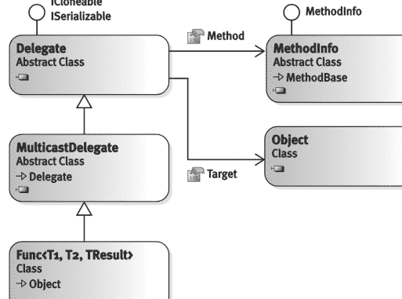

图 13.1：委托类型对象模型

第一个属性的类型为 `System.Reflection.MethodInfo`。`MethodInfo` 描述了方法的签名，包括它的名称、参数和返回类型。除了 `MethodInfo` 外，委托还需要包含方法的对象的实例。这就是第二个属性 `Target` 的用途。对于静态方法，`Target` 为 `null`。`MulticastDelegate` 类的目的将在第 14 章讨论。

注意，所有委托都是不可变的；也就是说，一旦创建了委托就无法更改它。如果你有一个包含委托引用的变量，并希望它引用不同的方法，你必须创建一个新委托并将其赋值给变量。

虽然所有委托类型都间接地继承自 `System.Delegate`，但 C# 编译器不允许你声明直接或间接继承自 `System.Delegate` 或 `System.MulticastDelegate` 的类。因此，列表 13.10 所示的代码是无效的。

## 第 13 章：委托与 Lambda 表达式

### 列表 13.10：System.Delegate 不能显式作为基类

```csharp
// ERROR: Func<T1, T2, TResult> cannot
// inherit from special class 'System.Delegate'
public class Func<T1, T2, TResult>: System.Delegate
{
    ...
}
```

使用委托来指定排序顺序比使用在本章开头描述的方法要灵活得多的策略。通过传递委托，你只需要在比较部分中添加一个将整数转换为字符串的备用委托，即可将排序顺序更改为字母顺序。列表 13.11 展示了一个演示字母顺序排序的完整代码列表，输出 13.1 显示了结果。

### 列表 13.11：使用不同的兼容 `Func<int, int, bool>` 方法

```csharp
using System;

public class DelegateSample
{
    public static void BubbleSort(
        int[] items, Func<int, int, bool> compare)
    {
        int i;
        int j;
        int temp;

        for(i = items.Length - 1; i >= 0; i--)
        {
            for(j = 1; j <= i; j++)
            {
                if(compare(items[j - 1], items[j]))
                {
                    temp = items[j - 1];
                    items[j - 1] = items[j];
                    items[j] = temp;
                }
            }
        }
    }
}
```

```csharp
public static bool GreaterThan(int first, int second)
{
    return first > second;
}
```

```csharp
public static bool AlphabeticalGreaterThan(int first, int second)
{
    int comparison;
    comparison = first.ToString().CompareTo(second.ToString());
    return comparison > 0;
}

public static void Main()
{
    int[] items = { 5, 3, 8, 1, 2 };

    BubbleSort(items, GreaterThan);
    foreach (int item in items)
    {
        Console.WriteLine(item);
    }

    BubbleSort(items, AlphabeticalGreaterThan);
    foreach (int item in items)
    {
        Console.WriteLine(item);
    }
}
```

输出 13.1

Enter an integer:

1

2

3

5

8

Enter an integer:

1

2

3

5

8

更具可读性，然而 C# 允许你这样做。在无法进行推断的情况下，C# 语言要求显式指定 lambda 参数类型；如果显式指定了其中一个 lambda 参数类型，那么所有参数类型都必须显式指定，并且它们必须与委托的参数类型完全匹配。

## 指南

当类型对读者来说显而易见或是无关紧要细节时，**考虑**从 lambda 形式形式参数列表中省略类型。

另一种减少语法的手段是，如列表 13.14 所示：对于恰好有一个推断参数类型的 lambda 表达式，可以省略参数列表周围的括号。如果有零个或多个参数，或者单个参数是显式类型类型的，则 lambda 必须在参数列表周围保留括号。

### 列表 13.14：带有单个输入参数的语句 Lambda

```csharp
using System.Collections.Generic;
using System.Diagnostics;
using System.Linq;

// ...
IEnumerable<Process> process = Process.GetProcesses().Where(
    process => { return process.WorkingSet64 > 1000000000; });
...
```

在列表 13.14 中，`Where()` 方法返回一个针对物理内存使用率大于 10 字节的进程查询。从 C# 9.0 开始，你可以对匿名函数的一个或多个参数使用丢弃符号（_），假设它们在实现中不需要。与列表 13.15 相比，后者有一个无参数的语句。空参数列表需要括号。注意，在列表 13.15 中，语句 lambda 的体在块（大括号）内部包含多个语句。如果只有一个参数，那么下划线将为了向后兼容而产生一个变量。虽然语句 lambda 可以包含任意数量的语句，但通常语句 lambda 在其块中只使用两个或三个语句。

### 列表 13.15：无参数的语句 Lambda

```csharp
//...
Func<string> getUserInput =
    () => {
        string input;
        do {
            input = Console.ReadLine();
        } while (!string.IsNullOrWhiteSpace(input));
        return input;
    };
//...
```

## 表达式 Lambda

语句 lambda 语法已经比相应的方法声明要简洁得多；正如我们所看到的，它不需要声明方法的名称、返回类型或参数类型。尽管如此，通过使用表达式 lambda，我们可以更加简洁。在列表 13.12、列表 13.13 和列表 13.14 中，我们看到了块由单个返回语句组成的语句 lambda。如果如果我们消除了大括号呢？这种 lambda 中唯一的相关信息是所返回的表达式。表达式 lambda 仅包含该表达式，没有任何块。列表 13.16 与列表 13.12 相同，区别在于它使用的是表达式 lambda 而不是语句 lambda。

### 列表 13.16：使用表达式 lambda 传递委托

```csharp
//...
DelegateSample.BubbleSort(items, (first, second) => first < second); //...
```

通常，你读取表达式 lambda 中 lambda 运算符 `=>` 的方式就像读取语句 lambda 一样：尽管在委托为谓词（predicate）的情况下，通常将 lambda 运算符读作 `where`。因此，你可能将列表 13.16 中的 lambda 读为“first 和 second 且小于 second”。

与空字面量一样，匿名函数本身不带任何类型；相反，它的类型由它转换到的类型决定的。换句话说，我们目前看到的 lambda 表达式本质上并不是 `Func<int, bool>`（或 `Compar`）类型，但它们与它们可能转换到的类型兼容。因此，你可以对匿名方法使用 `typeof()` 运算符，并且只有在将匿名方法转换为特定类型后，才能调用 `GetType()`。表 13.1 提供了额外的 lambda 特性。

### 表 13.1：Lambda 表达式说明、错误和示例

| 语句 | 示例 |

| :--- | :--- |

| 从 C# 9.0 开始，lambda 支持丢弃参数。为了向后兼容，单个丢弃符号产生一个命名的 `_`。 | `Action<int, int> x = (_, _) => Console.WriteLine("This is a test.");` |

| 从 C# 10.0 开始，lambda 表达式具有定义类型，因此可以与匿名类型配合。 | // 你可以将 lambda 表达式赋值给隐式类型局部变量 `var v = (int x) => x;` |

| 从 C# 10.0 开始，lambda 表达式可能有类型，即使返回类型为 `void`。这在返回 null 时特别有用。 | `Action action = () => { }; // var func; (long number) => short;` |

### 表 13.1：Lambda 表达式说明、错误和示例（续）

| 语句 | 示例 |

| :--- | :--- |

| | `int number; Func<int, bool> isFortyTwo = x >= 42); // ：使用了未赋值的局部变量 Console.Write(number);` |

## 匿名方法

匿名方法类似于语句 lambda，但缺少许多使 lambda 简洁的特性。匿名方法必须显式指定每个类型，并且它有一个语句块。匿名方法不是在参数列表和代码块之间使用 lambda 运算符 `=>`，而是将关键字 `delegate` 放在参数列表之前，强调匿名方法必须转换为委托类型。列表 13.17 显示了列表 13.7、13.12 和 13.15 重写为匿名方法的代码。

### 列表 13.17：在 C# 2.0 中传递匿名方法

```csharp
//...
DelegateSample.BubbleSort(items,
    delegate(int first, int second)
    {
        return first < second;
    }
);
//...
```

匿名方法支持一个 lambda 表达式不支持的小功能：只要匿名体不使用任何参数且委托类型只需要值参数，匿名方法就可以完全省略其参数列表（即它不需要将参数标记为 `out` 或 `ref`）。

- Lambda 表达式在 C# 2.0 中尚不可。

> 指南 在新代码中避免匿名方法语法；优先使用更简洁的 lambda 表达式语法。

## 无参数匿名方法

与 lambda 表达式不同，只要匿名体不使用任何参数且委托类型只需要值参数，匿名方法就可以完全省略参数列表。例如，匿名方法 `delegate { return Console.ReadLine() != ""; }` 可以转换为任何返回类型为 `bool` 的委托类型，无论该委托需要多少个参数。此功能并不频繁使用，但你在阅读遗留代码时可能会遇到它。

## 为什么是“Lambda”表达式？

匿名方法之所以这样命名显而易见：它们看起来与方法声明非常相似，但没有与之关联的声明名称。但“lambda”表达式中的 lambda 是从哪里来的？

lambda 表达式的想法源于逻辑学家丘奇奇（Alonzo Church），他在 20 世纪 30 年代发明了一种称为 lambda 计算的技术。在 Church 的表示法中，一个接受参数 x 并产生表达式 y 的函数通过在整个表达式前面加上一个小希腊字母 lambda 来表示，并用点分隔参数和值。C# 的 lambda 表达式 `x=>y` 在 Church 的表示法中记为 `λ.y`。由于在 C# 程序中使用希腊字母不方便，而且点符号在 C# 中已经有多种含义，C# 的设计者选择了使用“粗箭头”表示法。

而不是原始符号。lambda 表达式的名称表明，匿名函数的理论基础是基于 lambda 演算法（lambda calculus），尽管文中实际上并没有出现 lambda 字母 lambda。

## 委托不具有结构相等性

.NET 中的委托（delegate）类型并不表现出结构相等性。这意味着，你不能将一个委托类型的对象引用转换为不相关的委托类型，即使这两个委托的形式参数和返回类型完全相同。例如，你不能将 `Comparator` 的引用赋值给类型为 `Func<int, int, bool>` 的变量，尽管这两个委托类型都代表接受两个参数并返回 `bool` 的方法。遗憾的是，使用给定类型委托的唯一方法是：当需要一个结构上相同但不相关的委托类型时，通过创建一个引用旧委托 `Invoke` 方法的新委托来实现。例如，如果你有一个类型为 `Comparator` 的变量 `c`，你需要将它的值赋值给类型为 `Func<int, int, bool>` 的变量 `f`，你可以写成 `f = c.Invoke`。

然而，得益于变变（variance）的支持，¹¹某些委托类型之间进行引用转换是可能的。考虑以下逆变示例：由于 `void Action<T>(T arg)` 具有类型修饰符，可以将类型为 `Action<object>` 的委托引用赋值给类型为 `Action<string>` 的变量。

许多人发现委托的逆变（contravariance）很难理解。记住：可以处理所有对象的操作可以是处理任何字符串的操作。相反则不然：一个只处理字符串的操作无法处理所有对象。同样，`Func` 委托族其返回类型是协变（covariant）的，正如 `out` 参数修饰所示。因此，可以将类型为 `Func<string>` 的委托引用赋值给类型为 `Func<object>` 的变量。

示例 13.18 显示了委托的协变和逆变。在 C# 4.0 中引入。

## 第 13 章：委托与 Lambda 表达式

### 示例 13.18：委托中使用变性

```csharp
// 逆变
Action<object> broadAction =
  (object data) =>
{
    Console.WriteLine(data);
}
```

```csharp
Action<string> narrowAction = broadAction;
```

```csharp
// 协变
Func<string?> narrowFunction =
  () => Console.ReadLine();
Func<object?> broadFunction = narrowFunction;
```

```csharp
// 逆变与协变结合
Func<object, string?> func1 =
  (object data) => data.ToString();
```

```csharp
Func<string, object?> func2 = func1;
```

列表的最后一部分将两种变性概念结合到一个示例中，展示了当涉及 `out` 类型参数时，它们是如何同时发生的。允许委托类型进行引用转换是添加协变和逆变转换的关键场景²（另一个是对 `IEnumerable<out T>` 的协变支持）。

## 高级主题

Lambda 表达式（以及匿名方法）并非内置于 CLR 中。相反，当编译器遇到匿名函数时，它会翻译成特殊的类、字段和实现所需语义的方法。在示例 13.12、13.13、13.16 或 13.17 中，C# 编译器生成的 CIL 代码与示例 13.19 显示的代码相似。

## 示例 13.19：编译器为 Lambda 表达式生成的 CIL 等价代码


```csharp
public class DelegateSample
{
    //...

    public static void Main()
    {
        int[] items = new int[5];

        for (int i = 0; i < items.Length; i++)
        {
            Console.Write("Enter an integer: ");
            string? text = Console.ReadLine();
            if (!int.TryParse(text, out items[i]))
            {
                Console.WriteLine($"{text} is not a valid integer.");
                return;
            }
        }

    public static void BubbleSort(int[] items, __AnonymousMethod_00)
    {
        for (int i = 0; i < items.Length; i++)
        {
            Console.WriteLine(items[i]);
        }
    }

    private static bool __AnonymousMethod_00(int first, int second)
    {
        return first < second;
    }
}
```

在此示例中，编译器将匿名函数转换为单独声明的静态方法，该方法被实例化为委托并作为参数传递。惊讶的是，编译器生成的代码看起来与示例 13.8 非常相似。然而，如果涉及到外部变量，编译器执行的代码转换比重写匿名函数为静态方法复杂得多。

## 外部变量

在 Lambda 表达式之外声明的局部变量（包括方法的参数）被称为该 Lambda 的外部变量。（这个引用虽然技术上不是变量，也被认为是外部变量。）当 Lambda 主体使用外部变量时，该变量被 Lambda 捕获（等效地说是闭包）。在示例 13.20 中，我们使用外部变量来计算 `BubbleSort()` 执行了多少次比较。输出 13.2 显示了此列表的结果。

### 示例 13.20：在 Lambda 表达式中使用外部变量

```csharp
public class Program
{
    public static void Main()
    {
        int[] items = new int[5];
        int comparisonCount = 0;

        for (int i = 0; i < items.Length; i++)
        {
            Console.Write("Enter an integer:");
            string text = Console.ReadLine();
            if (!int.TryParse(text, out items[i]))
            {
                Console.WriteLine($"{text} is not a valid integer.");
                return;
            }
        }

        DelegateSample.BubbleSort(items,
            (int first, int second) =>
            {
                comparisonCount++;
                return first < second;
            });

        for (int i = 0; i < items.Length; i++)
        {
            Console.WriteLine(items[i]);
        }
        Console.WriteLine("Items were compared {0}",
            comparisonCount);
    }
}
```

### 输出 13.2

```
Enter an integer:5
Enter an integer:1
Enter an integer:4
Enter an integer:2
Enter an integer:3
5
4
3
2
1
Items were compared 10 times.
```

注意，`comparisonCount` 出现在 Lambda 表达式之外，并在内部进行递增。调用 `BubbleSort()` 方法后，打印了 `comparisonCount`。通常，局部变量的生命周期与其作用域绑定；当控制离开作用域时，与变量相关的存储位置不再有效。但从捕获外部变量的 Lambda 创建的委托生命周期可能比局部变量长（或短），并且委托在每次调用时都必须能够访问该外部变量。因此，被捕获变量的生命周期被延长了：它保证至少与捕获它的生存委托一样长。（而且它可能比这更长——编译器生成确保外部变量延长的代码是一个实现细节，可能会更改。）

## 第 13 章：委托与 Lambda 表达式

C# 编译器负责生成在匿名方法和声明它的方法之间共享 `comparisonCount` 的 CIL 代码。

### 静态匿名函数

为了避免捕获匿名函数外部的数据产生任何意外后果，C# 9.0 在声明中启用了 `static` 修饰符。这导致编译器验证没有对匿名函数声明之外的数据进行闭包。（这与函数是实例还是静态无关。）要观察此行为，请参见示例 13.21。

### 示例 13.21：声明静态匿名函数

```csharp
int comparisonCount = 0;
DelegateSample.BubbleSort(items,static (int first, int second) => Error CS8820: A static anonymous function
    //不能包含对 comparisonCount 的引用。
    comparisonCount++;
    return first < second;
);

for (int i = 0; i < items.Length; i++) {
    Console.WriteLine(items[i]);
}
Console.WriteLine("Items were compared {0}",
    comparisonCount);
```

通常情况下，考虑默认使用静态局部函数声明，仅在需要时切换到限制较少的版本，从而增加闭包的意图性。

## 高级主题

### 外部变量的 CIL 实现

C# 编译器为捕获外部变量的匿名函数生成的 CIL 代码比不捕获变量的匿名函数代码要复杂。示例 13.22 显示了实现示例 13.20 中外部变量的 C# 等效 CIL 代码。

#### 示例 13.22：编译器为外部变量生成的 CIL 代码等

```sharp
public class Program
{
    // ...
    private sealed class __DisplayClass_00000001
    {
        public int comparisonCount;
        public bool __AnonymousMethod_00000000(int first, int second)
        {
            comparisonCount++;
            return first < second;
        }
    }
}
```

```sharp
public static void Main()
{
    __DisplayClass_00000001 locals = new();
    locals.comparisonCount = 0;
    int[] items = new int[5];

    for (int i = 0; i < items.Length; i++)
    {
        Console.Write("Enter an integer: ");
        string? text = Console.ReadLine();
        if (!int.TryParse(text, out int i))
        {
            Console.WriteLine($"{text} is not a valid integer.");
            return;
        }
    }

    DelegateSample.BubbleSort(items, locals.__AnonymousMethod_00000000);
    for (int i = 0; i < items.Length; i++)
    {
        Console.WriteLine(items[i]);
    }

    Console.WriteLine("Items were compared {0} times.", locals.comparisonCount);
}
```

注意，捕获的局部变量并没有被“传递”或“复制”。相反，捕获的局部变量 (`comparisonCount`) 是通过将其实现为实例字段来扩展其生命周期的。生成的 `DisplayClass` 是一个数据结构（C# 中为类），包含了评估表达式所需的变量（C# 中为公共字段）。

## 高级主题

### 意外捕获循环变量

你认为示例 13.23 的输出应该是？

#### 示例 13.23：C# 5.0 中捕获循环变量

```sharp
public class CaptureLoop
{
    public static void Main()
    {
        var items = new string[] { "Moe", "Larry", "Curly" };
        var actions = new List<Action>();
        foreach(string item in items)
        {
            actions.Add(() => Console.WriteLine(item));
        }
        foreach(Action action in actions)
        {
            action();
        }
    }
}
```

大多数人期望输出如输出 13.3 所示，在 C# 5.0 中确实如此。但在 C# 的之前的版本中，输出如输出 13.4 所示。

### 输出 13.3：C# 5.0 输出

```
Moe

Larry

Curly
```

### 输出 13.4：C# 4.0 输出

```
Curly

Curly

Curly
```

Lambda 表达式捕获变量并始终使用变量的最新值；它不会捕获创建委托时变量所的值。这通常正是你想要的——毕竟，示例 13.20 中捕获 `comparisonCount` 的目的就是确保在递增时使用其最新值。循环变量也不无区别；当你捕获循环变量时，每个委托都捕获同一个循环变量。当循环变化时，每个捕获该循环变量的委托都能看到这种变化。因此，C# 4.0 的行为是合理的——但几乎不是代码作者想要的。

在 C# 5.0 中，C# 语言发生了更改，`foreach` 循环的循环变量现在每次迭代时都被视为新变量；因此，每个委托都创建一个不同的变量，而不是所有迭代共享同一个变量。然而，此更改未应用于 `for` 循环：如果你使用 `for` 循环编写类似的代码，语句头部声明的任何循环变量在捕获时仍被视为单个外部变量。如果你需要编写在 C# 5.0 和之前的 C# 版本中运行相同的代码，请使用示例 13.24 所示的模式。

### 示例 13.24：C# 5.0 之前的循环变量捕获变通方案

```sharp
public class DoNotCaptureLoop {
    public static void Main() {
        var items = new string[] { "Moe", "Larry", "Curly" };
        var actions = new List<Action>();
        foreach(string item in items)
        {
            string _item = item;
            actions.Add(
                () => Console.WriteLine(_item));
        }
        foreach(Action action in actions)
        {
            action();
        }
    }
}
```

现在每个循环迭代显然都有一个新变量；每个委托转而闭包了不同的变量。

> ### 指南
> **避免**捕获循环变量。

# 表达式树

到为止，我们已经看到 lambda 转换为表达式树后变成了代表数据而非编译代码的对象。由于表达式树代表的是数据而非编译代码，因此可以在执行时分析 lambda 并使用信息构建一个在数据库上执行的查询。例如，`Where()` 接收到的表达式树可能会转换为 SQL 查询，如示例 13.25 所示。

## 将 Lambda 表达式作为数据

考虑以下 lambda：

```csharp
persons.Where(person => person.Name.ToUpper() == "INIGO MONTOYA");
```

假设 `persons` 是 `Persons` 数组，`Where` 方法返回委托类型 `Func<Person, bool>`。编译器接收到的表达式树在数组上执行。现在假设 `persons` 不是数组，而是一个代表包含数据的对象的。调用 `Where` 时，结果是如何定的？

一种技术是将数百万行传输到客户端。客户端可以从每行数据创建一个 `Person` 对象，从 lambda 创建委托并执行它。第二种好得多的是以某种方式将 lambda 的含义（过滤掉除 Montoya 外的所有行）发送到服务器。数据库服务器经过优化，可以快速执行此类过滤。然后服务器只需将少量的匹配行流到客户端。因此，客户端不是创建数百万个对象并拒绝几乎所有对象，而是只创建那些由服务器确定的符合查询的对象。但 lambda 的含义是如何到达服务器的呢？

# 表达式树是对象图

在执行时，lambda 转换为表达式树后变成包含 `System.Linq.Expressions` 命名空间对象的对象图。图中的根对象代表 lambda 本身。该对象引用代表参数、返回类型和体表达式的对象，如图 13.3 所示。对象图包含了编译器关于的所有信息

## 表达式树 719

该 lambda。该信息随后可以在执行时被用于创建一个查询。或者，根 lambda 表达式有一个方法 `Compile`，它可以即时生成 CIL 并创建一个实现所描述 lambda 的委托。

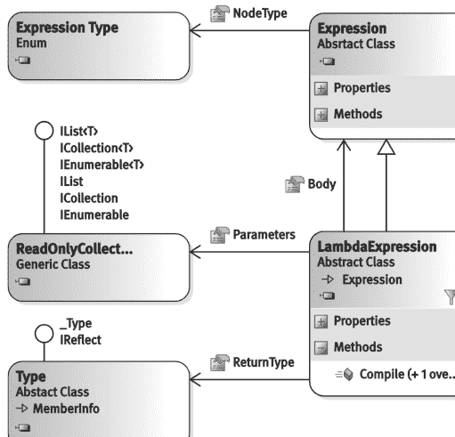

图 13.3：lambda 表达式树类型

图 13.4 显示了 lambda 实体中一元和二元表达式在对象图中找到类型。

`UnaryExpression` 表示如 `--count` 这样的表达式。它有一个子节点 `Operand`，类型为 `Expression`。`BinaryExpression` 有两个子表达式 `Left` 和 `Right`。这两个类型都有一个识别特定运算符的 `NodeType` 属性，并且继承自基类。还有 30 多种表达式类型，例如 `NewExpression`、`ParameterExpression`、`MethodCallExpression` 和 `LoopExpression`，它们代表了（几乎）C# 和 Visual Basic 中所有可能的表达式。

# 第 13 章：委托与 Lambda 表达式

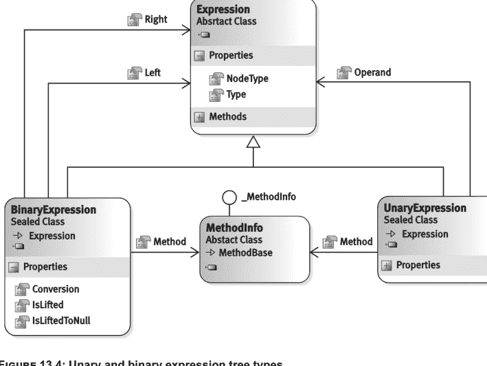

## 委托与表达式树

lambda 表达式的有效性在编译时通过完全语义分析进行验证，无论转换为委托还是表达式树。转换为委托的 lambda 会导致编译器将 lambda 作为方法发射，并在执行时生成创建该方法委托的代码。转换为表达式树的 lambda 会导致编译器生成在执行时创建 `LambdaExpression` 实例的代码。但在使用语言集成查询 (LINQ) API 时，编译器如何知道是要生成委托在本地执行查询，还是生成表达式树以便将查询信息发送到远程数据库服务器呢？

构建 LINQ 查询的方法（如 `Where()`）是扩展方法。扩展 `IEnumerable<T>` 接口的方法版本接收委托参数；扩展 `IQueryable<T>` 接口的方法接收表达式树参数。因此，编译器可以使用正在被查询的

的的

图 13.4：一元和二元表达式树类型

## 表达式树 721

的类型来决定是否从作为参数提供的 lambda 创建委托或表达式树。

例如考虑以下代码中的 `Where()` 方法：

```csharp
persons.Where(person => person.Name.ToUpper() == "INIGO MONTOYA");
```

在 `System.Linq.Enumerable` 类中声明的扩展方法签名为：


```csharp
public IEnumerable<TSource> Where<TSource>(this IEnumerable<TSource> collection, Func<TSource, bool> predicate);
```

在 `System.Linq.Queryable` 类中声明的扩展方法签名为：

```csharp
public IQueryable<TSource> Where<TSource>(this IQueryable<TSource> collection, Expression<Func<TSource, bool>> predicate);
```

编译器根据 `persons` 的编译时类型决定使用哪种扩展方法；如果它是可转换为 `IQueryable<Person>` 的类型，则选择来自 `System.Linq.Queryable` 的方法。它将 lambda 转换为表达式树。在执行时，`persons` 指向的对象接收表达式树数据并使用该数据构建 SQL 查询，随后在请求查询结果时将该查询传递给数据库。调用 `Where` 方法的结果是一个对象，当请求查询结果时，它会将查询发送到数据库并产生结果。

如果 `persons` 无法隐式转换为 `IQueryable<Person>` 但可以转换为 `IEnumerable<Person>`，则选择来自 `System.Linq.Enumerable` 的方法，并将 lambda 转换为委托。调用 `Where` 方法的结果是一个对象，当请求查询结果时，它会将生成的委托作为谓词应用于集合的每个成员，并产生符合谓词的结果。

## 检查表达式树

如前所述，将 lambda 表达式转换为 `Expression<TDelegate>` 创建的是表达式树而非委托。在本章的早些部分，我们还探索了如何将如 `(x,y)=>xy` 这样的 lambda 转换为 `Func<int, bool>` 这样的委托类型。要将此 lambda 转换为表达式树，我们只需将其转换为 `Expression<Func<int, int, bool>>`，如代码列表 13.26 所示。然后我们可以检查生成的对象并显示有关其结构的信息，以及更复杂的表达式树的信息。

### 代码列表 13.26：检查表达式树

```csharp
using System;
using System.Linq.Expressions;
using static System.Linq.Expressions.ExpressionType;

public class Program {
    public static void Main() {
        Expression<Func<int, int, bool>> expression;
        expression = (x, y) => x > y > y;
        Console.WriteLine("--- {0} ---", expression);
        PrintNode(expression.Body, 0);
        Console.WriteLine();
        Console.WriteLine();
        expression = (x, y) => x + y > x + y;
        Console.WriteLine("--- {0} ---", expression);
        PrintNode(expression.Body, 0);
    }

    public static void PrintNode(Expression expression, int indent) {
        if (expression is BinaryExpression binaryExpression) {
            PrintNode(binaryExpression, indent);
        } else {
            PrintSingle(expression, indent);
        }
    }
```

## 表达式树 753

```csharp
PrintNode(expression.Left, indent + 1);
PrintSingle(expression, indent);
PrintNode(expression.Right, indent + 1);
}
```

```csharp
private static void PrintSingle(
    Expression expression, int indent) =>
    Console.WriteLine("{0}" + indent * 5 + "{1}",
    NodeToString(expression));
```

```csharp
private static string NodeToString(Expression expression) =>
{
    // using static ExpressionType
    Multiply => "*",
    Add => "+",
    Divide => "/",
    Subtract => "-",
    GreaterThan => ">",
    LessThan => "<",
    => expression.ToString() + (" (" + expression.NodeType.ToString() + ")");
}
```

注意将表达式树实例传递给 `Console.WriteLine()` 会自动转换为描述字符串；表达式树的对象都重写了 `ToString()`，以便在调试时一眼看到内容。

在输出 13.5 中，我们看到 `Main()` 中的 `Console.WriteLine()` 语句打印了树体。

### 输出 13.5

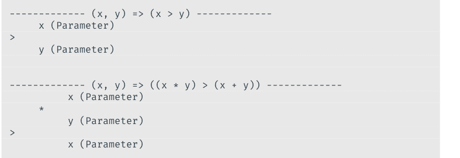

## 第 13 章：委托与 Lambda 表达式总结

注意的是，表达式树是数据集合，通过遍历数据，可以将数据转换为另一种格式。在本例中，我们将表达式树转换为描述字符串，但它也可以转换为任何查询语言的表达式。

使用递归，`PrintNode()` 函数展示了表达式树中的节点本身也是包含零或多个子树的树。代表 lambda 的根树指向其 `Body` 属性表达式。每个表达式树都包含一个枚举类型 `ExpressionType` 的 `NodeType` 属性，说明它是什么类型的表达式。存在许多表达式类型：`BinaryExpression`、`ConditionalExpression`、`LambdaExpression`、`MethodCallExpression`、`ParameterExpression` 和 `ConstantExpression` 都是示例。每种类型都派自 `Expression`。lambda 表达式的概念是一种取代（但没有消除）匿名方法的语法¹³这些构造允许程序员直接将一组指令分配给变量，而无需定义包含这些指令的显式方法。

¹³. 如在 C# 2.0 中。

在方法内部动态定义编程指令——这是一个强大的概念，极大地简化了通过 LINQ API 对集合的编程。

本章结束于对表达式树概念的讨论，并考虑了它们如何编译成对象，这些对象代表 lambda 表达式的语义分析，而不是委托本身的实现。这一重要特性支持了如 Entity Framework 和 LINQ to XML 等库——即那些解释表达式树并在匿名函数之外的语文中使用它的库。

Lambda 表达式包含了语句 lambda（statement lambdas）和表达式 lambda（expression lambdas）。换，语句 lambda 和表达式 lambda 都是 lambda 表达式的一种。

本章提到但未详述的内容是多路委托（multicast delegates）。下一章将详细研究多路委托，并解释它们如何通过事件实现发布-订阅模式。

# 14 事件

在第 13 章中，你已经了解了如何使用委托类型的实例来引用方法，并通过该委托调用该方法。委托是构建名为发布-订阅或观察者模式的大型模式的基石。使用委托实现发布-订阅模式是本章的重点。本章描述的几乎所有内容都可以仅用委托来实现。然而，本章提供的事件结构提供了额外的封装，使得发布-订阅模式更容易实现且更不容易出错。

在第 13 章中，所有引用的委托都指向单个方法。更广泛地说，单个委托值可以引用一组要按顺序调用的方法集合；这样的委托被称为多路委托。它的应用允许出现此类场景：将单个事件（例如对象状态的变化）的通知发布给多个订阅者。

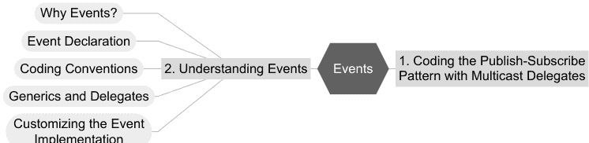

泛型极大地改变了编码规范，因为使用泛型委托数据类型意味着不再需要为每个可能的事件签名声明委托。^1

## 使用多路委托编写发布-订阅模式

考虑一个温度控制系统，其中加热器和冷却器连接到同一个温控器上。为了让每个单元都能恰当地开启和关闭，你必须通知这些单元温度的变化。一个温控器将温度变化发布给多个订阅者——加热单元和冷却单元。下一节将研究代码。^2

### 定义订阅者方法

从定义 Heater 和 Cooler 对象开始（参见列表 14.1）。

#### 列表 14.1: Heater 和 Cooler 事件订阅者实现

```
public class Cooler
{
    public Cooler(float temperature)
    {
        Temperature = temperature;
    }

    // 当环境温度
    // 高于此温度时，冷却冷却器
    public float Temperature { get; set; }

    // 通知此实例的温度发生了变化
    public void OnTemperatureChanged(float newTemperature)
    {
        if(newTemperature > Temperature)
        {
            System.Console.WriteLine("Cooler: On");
        }
    }
}
```

+ 1. 本章假设全程最低使用 C# 2.0。

2. 在此示例中，我们使用温控器是因为人们更常在加热和冷却系统的背景下考虑它。从技术上讲，温度计会更合适。

## 使用多路委托编写发布-订阅模式 729

```
else
{
    System.Console.WriteLine("Cooler: Off");
}

public class Heater {
    public Heater(float temperature) {
        Temperature = temperature;
    }

    // 当环境温度
// 低于此温度时，加热加热器
    public float Temperature { get; set; }

    public void OnTemperatureChanged(float newTemperature) {
    if(newTemperature < Temperature) {
        System.Console.WriteLine("Heater: On");
    }
    else {
        System.Console.WriteLine("Heater: Off");
    }
}
```

这两个类除了温度比较外，本质上是完全相同的。（事实上，如果你在 `OnTemperatureChanged` 方法中使用委托指向一个比较方法，就可以消除其中一个类。）每个类都存储了单元应该开启的温度。此外，两个类都提供了 `OnTemperatureChanged()` 方法，作为向 Heater 和 Cooler 类指示温度已变化的手段。该方法的实现使用 `newTemperature` 与存储的触发温度进行比较，以决定是否开启设备。

`OnTemperatureChanged()` 方法是订阅者方法（也称为监听器方法）。它们的参数和返回类型必须与 `Thermostat` 类的委托匹配，我们将在接下来讨论它。

### 定义发布者

`Thermostat` 类负责向加热器和冷却器对象实例报告温度变化。`Thermostat` 类的代码出现在列表 14.2 中。

#### 列表 14.2: 定义事件发布者，Thermostat

```
public class Thermostat
{
    // 定义事件发布者（初始没有发送者）
    public Action<float>? OnTemperatureChange { get; set; }

    public float CurrentTemperature { get; set; }
}
```

`Thermostat` 包含一个名为 `OnTemperatureChange` 的属性，其类型为 `Action<float>` 委托。该属性存储了一个订阅者列表。注意，需要一个委托属性来存储所有订阅者。换句话说，`Cooler` 和 `Heater` 实例都从这个单一发布者接收温度变化的通知。

`Thermostat` 的最后一个成员是 `CurrentTemperature` 属性。该属性设置并检索由 `Thermostat` 类报告的当前温度值。

### 连接发布者和订阅者

最后，我们在 `Main()` 方法中将所有部分组合在一起。列表 14.3 显示了 `Main()` 可能的样式。

#### 列表 14.3: 连接发布者和订阅者

```
public class Program
{
    public static void Main()
    {
        Thermostat thermostat = new();
        Heater heater = new(20.0f);
        Cooler cooler = new(25.0f);

        thermostat.OnTemperatureChange += heater.OnTemperatureChanged;
        thermostat.OnTemperatureChange += cooler.OnTemperatureChanged;

        Console.Write("Enter temperature: ");
        string? temperature = Console.ReadLine();
        if (!int.TryParse(temperature, out int currentTemperature))
        {
            Console.WriteLine($"{temperature} is not a valid integer.");
            return;
        }
        thermostat.CurrentTemperature = currentTemperature;
    }
}
```

# 使用多路委托编写发布-订阅模式 765

此列表代码通过直接使用 `+=` 将两个订阅者（heater 和 cooler）注册到 `OnTemperatureChange`。

```csharp
// ...
thermostat.CurrentTemperature = currentTemperature;
```

通过获取用户输入的值，你可以设置 `CurrentTemperature`。然而，你还没有编写任何向订阅者发布更改的代码。

### 调用委托

每当 `Thermostat` 类的 `CurrentTemperature` 属性发生变化时，你希望调用委托来通知订阅者。为了实现这一目标，你必须修改 `CurrentTemperature` 属性以保存新值并向每个订阅者发布通知。代码修改出现在列表 14.4 中。

#### 列表 14.4: 未检查空的情况下调用委托

```
public class Thermostat
{
    // ...
    public float CurrentTemperature
    {
      get { return _CurrentTemperature; }
      set {
        if (value != CurrentTemperature) {
          _CurrentTemperature = value;

          // 调用订阅者
          // 不完整，需要检查空
          // ...
          OnTemperatureChange(value);
          // ...
        }
      }
  }
  private float _CurrentTemperature;
}
```

现在 `CurrentTemperature` 的赋值包含了一些通知订阅者的特殊逻辑。通知所有订阅者的调用只是单一的 C# 语句 `OnTemperatureChange(value)`。这个单一语句将温度变化发布给冷却器和加热器对象。在这里，你实际上看到使用单个调用通知多个订阅者的能力正是委托被更具体地多路委托的原因，正如本章后面所示。

然而，在 C# 8.0 中，直接调用 `CurrentTemperature` 委托会触发空引用警告，表示需要检查空。

# 检查空

列表 14.4 缺少事件发布代码的一个重要部分。如果没有订阅者注册接收通知，`OnTemperatureChange` 将为空，并且执行 `OnTemperatureChange(value)` 语句将抛出 `NullReferenceException`。为了避免这种情况，在触发事件之前有必要检查空。列表 14.5 展示了如何使用空条件运算符在调用 `Invoke()` 之前这样做。

> * 使用于 C# 6.0。

# 列表 14.5: 调度委托


```csharp
public class Thermostat
{
    // 定义事件发布者
    public Action<float>? OnTemperatureChange { get; set; }

    public float CurrentTemperature
    {
        get { return _CurrentTemperature; }
        set
        {
            if(value != CurrentTemperature)
            {
                _CurrentTemperature = value;
                // 如果有任何订阅者，
                // 通过调用这些订阅者
                // 通知它们温度的变化
                OnTemperatureChange?.Invoke(value); // C# 6.0
            }
        }
    }

    private float _CurrentTemperature;
}
```

注意紧跟在空条件运算符后面的 `Invoke()` 方法调用。虽然该方法可以使用仅点运算符（`.`）来调用，但这样做意义不大，因为那等同于直接调用委托（参见列表 14.4 中的 `OnTemperatureChange(value)`）。使用空条件运算符的一个重要优势在于，它有一种特殊的逻辑，可以确保在检查空值之后，订阅者没有可能调用过时的处理程序（即在检查空值后发生更改的处理程序），防止委托再次变为空。

## 指南

- 在调用委托之前，**务必**检查委托的值是否不为空。
- 从 C# 6.0 开始，在调用 `Invoke()` 之前**务必**使用空条件运算符。

## 高级主题

### 委托的 -= 运算符返回新实例

由于委托是一种引用类型，赋值局部变量并使用该局部变量就足以使空检查线程安全，这可能有些意外。由于 `localOnChange` 和 `OnOnChange` 指向相同的位置，你可能认为 `OnOnChange` 的任何更改也会反映在 `localOnChange` 中。

事实并非如此，因为实际上，任何对 `OnTemperatureChange -= <subscriber>` 的调用都不会简单地将委托从 `OnTemperatureChange` 中移除以便少包含一个委托。相反，这种调用会分配一个全新的委托，`localOnChange` 也会指向该委托。

# 高级委托调用

## 线程安全调用

如果可以在不同的线程上向委托中添加或移除订阅者，那么（如前所述）在检查空值之前条件条件调用它，或将委托引用复制到局部变量中是明智的。虽然这种方法防止了调用空委托，但它并不能避免所有的竞态条件。例如，一个线程可以复制委托，然后另一个线程可以将委托重置为 `null`，接着原始线程将调用委托的上一个值，从而通知一个不再订阅者列表中的订阅者。多线程程序中的订阅者应该确保其代码在这种情况下仍然保持健壮；因为始终可能调用一个“过时”的订阅者。

# 委托运算符

为了合并 `Thermostat` 示例中的两个订阅者，你使用了 `+=` 运算符。该运算符获取第一个委托，并将第二个委托添加到链中。

# 使用多路用委托编写发布-订阅模式

现在，在第一个委托的方法返回后，将调用第二个委托。要从从委托链中移除委托，请使用 `-=` 运算符，如列表 14.6 的输出 14.1 所示。

## 列表 14.6: 使用 += 和 -= 委托运算符

```csharp
//...
Thermostat thermostat = new();
Heater heater = new(60);
Cooler cooler = new(80);

Action<float> delegate1;
Action<float> delegate2;
Action<float> delegate3;

delegate1 = heater.OnTemperatureChanged;
delegate2 = cooler.OnTemperatureChanged;

Console.WriteLine("Invoke both delegates:");
delegate3 = delegate1;
delegate3 += delegate2;
delegate3(90);

Console.WriteLine("Invoke only delegate2");
delegate3 -= delegate1;
delegate3!(30);
//...
```

Invoke both delegates:

Heater: Off

Cooler: On

Invoke only delegate2

Cooler: Off

你也可以使用 `+` 和 `-` 运算符来合并委托，如列表 14.7 所示。

## 列表 14.7: 使用 + 和 - 委托运算符

```csharp
//...
Thermostat thermostat = new();
Heater heater = new(60);
Cooler cooler = new(80);
```

# 第 14 章：事件

```csharp
Action<float> delegate1;
Action<float> delegate2;
Action<float> delegate3;
```

```csharp
delegate1 = heater.OnTemperatureChanged;
delegate2 = cooler.OnTemperatureChanged;
```

```csharp
Console.WriteLine("Combine delegates using + operator:");
delegate3 = delegate1 + delegate2;
delegate3(60);
```

```csharp
Console.WriteLine("Uncombine delegates using operator:");
delegate3 = (delegate3 - delegate2)!;
delegate3(60);
///...
```

使用赋值运算符会清除所有之前的订阅者，并用新的订阅者替换它们。这是委托的一个令人遗憾的特性。当实际上引入了 `+=` 运算符时，很容易错误地编写成赋值代码。这种被称为“事件（events）”的解决方案将在本章节后后的“理解事件”部分进行描述。

`+` 和 `-` 运算符及其赋值等价项 `+=` 和 `-=` 分别内部使用静态方法 `System.Delegate.Combine()` 和 `System.Delegate.Remove()`。这些方法接受两个 `delegate` 类型的参数。第一个方法 `Combine()` 将两个参数合并，使得第一个参数在委托列表中引用第二个参数。第二个方法 `Remove()` 搜索第一个参数指定的委托链，并返回第二个参数指定的委托。

关于 `Combine()` 值得注意的点是，它的任一个参数都可以为 `null`。如果其中一个为 `null`，`Combine()` 返回非空参数。如果两个都为 `null`，`Combine()` 返回 `null`。这解释了为什么你可以调用 `thermostat.OnTemperatureChange += delegate` 而不会抛出异常，即使 `thermostat.OnTemperatureChange` 的值仍然为 `null`。

# 使用多路委托编写发布-订阅模式

## 顺序调用

图 14.1 强调了加热器和制冷器的顺序通知。

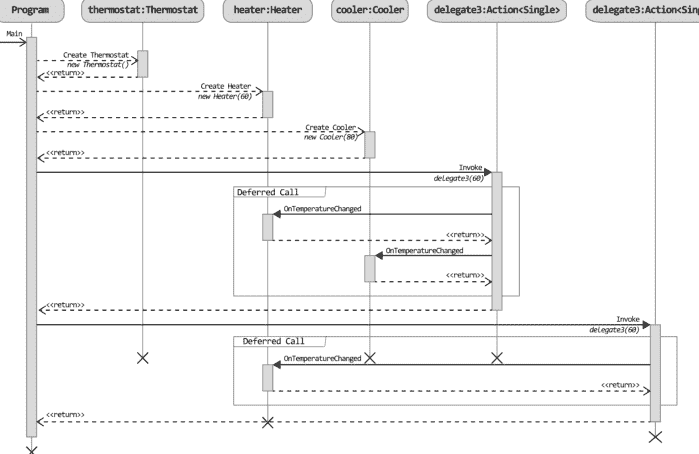

图 14.1：委托调用序列

尽管你只编写了单次调用 `OnTemperatureChange()`，但该调用广播给了两个订阅者。因此，通过一次调用，制冷器和加热器都会收到温度变化。如果你添加了更多订阅者，他们也将收到 `OnChange()` 的通知。

虽然单次 `OnTemperatureChange()` 调用导致了每个订阅者的通知，但订阅者仍然是顺序调用的，而不是同时调用的，因为它们都在同一个执行线程上被调用。

# 高级委托内部

## 多路委托内部

为了理解事件如何工作，你需要重新审查 `System.Delegate` 类型的内部机制。记得 `delegate` 关键字是派自 `System.MulticastDelegate` 类型的别名。反过来 `System.MulticastDelegate` 派自 `System.Delegate`，后者由对象引用（非静态方法所需）和方法引用组成。当你创建委托时，编译器会自动使用 `System.MulticastDelegate` 类型而不是 `System.Delegate` 类型。`MulticastDelegate` 类包含对象引用和方法引用，就像其委托基类一样，但也包含指向另一个 `System.MulticastDelegate` 对象的引用。

当你向多路委托添加方法时，`MulticastDelegate` 类创建一个委托的新实例，将添加方法的对象引用和方法引用存储在新的实例中，并将新委托作为委托列表中的后续项。实际上，`MulticastDelegate` 类维护了一个 `Delegate` 对象的列表。从概念上讲，你可以如图 14.2 所示表示恒温器示例。

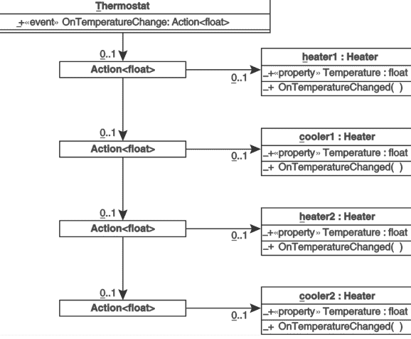

图 14.2：链在一起的多路委托

当调用多路委托（multicast delegate）时，列表中的每个委托实例都会被顺序调用。通常，委托按照它们被添加的顺序被调用，但这种行为在通用语言基础（CLI）规范中并没有规定。此外，这种行为是可以被重写的。因此，程序员不应该依赖于调用顺序。

## 错误处理

错误处理使得对顺序通知的感知至关重要。如果一个订阅者抛出异常，后续的订阅者将无法接收通知。例如，如果你更改了 Heater 的 `OnTemperatureChanged()` 方法使其抛出异常，如列表 14.8 所示。

### 列表 14.8：OnTemperatureChanged() 抛出异常

```csharp
public class Program {
    public static void Main() {
        Thermostat thermostat = new();
        Heater heater = new(60);
        Cooler cooler = new(80);

        thermostat.OnTemperatureChange +=
            heater.OnTemperatureChanged;
        thermostat.OnTemperatureChange +=
            (newTemperature) => {
                throw new InvalidOperationException();
            };
        thermostat.OnTemperatureChange +=
            cooler.OnTemperatureChanged;

        Console.Write("Enter temperature: ");
        string? temperature = Console.ReadLine();
        if (!int.TryParse(temperature, out int currentTemperature)) {
            Console.WriteLine($"'{temperature}' is not a valid integer.");
            return;
        }
        thermostat.CurrentTemperature = currentTemperature;
    }
}
```

图 14.3 显示了更新后的序列图。尽管 cooler 和 heater 都订阅了接收消息，但 lambda 表达式的异常终止了链，并阻止了 cooler 对象接收通知。

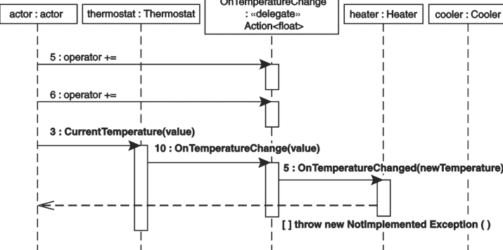

图 14.3：带有异常的委托调用序列图

为了避免这个问题并确保所有订阅者无论之前的订阅者如何都能接收通知，你必须手动遍历订阅者列表并逐个调用它们。列表 14.9 显示了 `CurrentTemperature` 属性所需的更新。结果出现在输出 14.2 中。

# 列表 14.9：处理来自订阅者的异常

```csharp
public class Thermostat
{
    // 定义事件发布者
    public Action<float>? OnTemperatureChange;

    public float CurrentTemperature
    {
        get { return _CurrentTemperature; }
        set {
            if (value != CurrentTemperature) {
                _CurrentTemperature = value;
                Action<float>? onTemperatureChange = OnTemperatureChange;
                if (onTemperatureChange != null) {
                    List<Exception> exceptionCollection = new();
                    foreach (Delegate handler in onTemperatureChange.GetInvocationList()) {
                        try {
                            ((Action<float>)handler)(value);
                        } catch (Exception exception) {
                            exceptionCollection.Add(exception);
                        }
                        if (exceptionCollection.Count > 0) {
                            throw new AggregateException("There were exceptions thrown by " + "OnTemperatureChange Event subscribers.", exceptionCollection);
                        }
                    }
                }
            }
        }
    }
    private float _CurrentTemperature;
}
```

# 输出 14.2

```
Enter temperature: 45
Heater: On
Cooler: Off
There were exceptions thrown by OnTemperatureChange Event subscribers.
(Operation is not valid due to the current state of the object.)
```

列表 14.9 证明了你可以从委托的 `GetInvocationList()` 方法获取订阅者列表。遍历此列表中的每个项目可以返回单独的订阅者。如果你将每个订阅者的调用放在 `try/catch` 块中，你就可以在继续遍历循环之前处理任何错误情况。在这个例中，尽管委托抛出了异常，cooler 仍然接收到了温度变化的通知。在发送完所有通知后，列表 14.9 通过抛出 `AggregateException` 来报告异常，该异常封装了一个可以通过 `InnerExceptions` 属性访问的异常集合。通过这种方式，所有异常仍然被报告，同时所有订阅者都得到了通知。

## 方法返回值和引用传递

在另一种情况下，迭代委托调用比简单地调用它更有用。这种场景涉及不返回 `void` 或具有 `ref`/`out` 参数的委托。在温度器示例中，`OnTemperatureChange` 委托的类型为 `Action<float>`，它返回 `void` 且没有 `out ref` 参数。因此，没有数据返回给发布者。这一考虑非常重要，因为委托的调用可能会触发对多个订阅者的通知。如果每个订阅者都返回一个值，那么将使用哪个订阅者的返回值将是不模糊的。

如果你将 `OnTemperatureChange` 更改为返回一个枚举值，指示设备是否因为温度变化而开启，那么新委托的类型将是 `Func<float, Status>`，其中 `Status` 是一个包含 `On` 和 `Off` 元素的枚举。所有订阅者方法都必须使用与委托相同的方法签名，每个方法都要求返回一个状态值。此外，由于 `OnTemperatureChange` 可能对应于委托链，因此有必要遵循你用于错误处理时使用的模式。换句话说，你必须使用 `GetInvocationList()` 方法遍历每个委托调用列表，以获取每个单独的返回值。同样，使用 `ref` 和 `out` 参数的委托类型也需要特殊考虑。然而，尽管在特殊情况下可以使用这种方法，最好的建议是完全避免这种场景。

## 理解事件


到目前为止你使用的委托存在两个关键问题。这些问题涉及封装。具体来说，使用事件限制了包含类以外的类通过 `+=` 运算符订阅事件以及通过 `-=` 运算符取消订阅之外的任何操作。此外，它们确保了只有包含类可以触发事件。

## 为什么使用事件？

本章和上一章涵盖了关于委托如何工作所需的所有知识。不幸的是，委托结构中的弱性可能会允许程序员无意中取消其他订阅者。

## 封装订阅

如之前所示，赋值运算符将一个委托分配给另一个。不幸的是，这种功能引入了常见的错误源。考虑列表 14.10。

### 列表 14.10：使用赋值运算符而非 +=

```csharp
public class Program {
    public static void Main() {
        Thermostat thermostat = new();
        Heater heater = new(60);
        Cooler cooler = new(80);

        thermostat.OnTemperatureChange += heater.OnTemperatureChanged;
        // Bug：赋值运算符覆盖了
        // 之前的赋值
        thermostat.OnTemperatureChange = cooler.OnTemperatureChanged;

        Console.Write("Enter temperature: ");
        string? temperature = Console.ReadLine();
        if (!int.TryParse(temperature, out int currentTemperature)) {
            Console.WriteLine($"{temperature} is not a valid integer.");
            return;
        }
        thermostat.CurrentTemperature = currentTemperature;
    }
}
```

## 封装发布

委托和事件之间的另一个重要区别是，事件确保只有包含类可以触发事件通知。考虑列表 14.11。

### 列表 14.11：在事件容器外部触发事件

```csharp
public class Program {
    public static void Main() {
        Thermostat thermostat = new();
        Heater heater = new(60);
        Cooler cooler = new(80);
    }
}
```

```csharp
thermostat.OnTemperatureChange +=
heater.OnTemperatureChanged;
```

```csharp
thermostat.OnTemperatureChange +=
cool.OnTemperatureChanged;
```

```csharp
// Bug: 不应该允许
thermostat.OnTemperatureChange(42);
```

```csharp
}
```

在列表 14.11 中，即使 `thermostat` 上的 `CurrentTemperature` 没有发生变化，`Program` 也可以调用 `OnTemperatureChange` 委托。`Program` 向所有 `thermostat` 订阅者触发了通知，称温度已变化，尽管 `thermostat` 的温度并没有变化。与之前一样，委托的问题在于封装不足。`Thermostat` 应该防止任何其他类调用 `OnTemperatureChange` 委托。

## 声明事件

C# 提供了 `event` 关键字来处理这两个问题。虽然它看起来像是一个字段修饰符，但 `event` 定义了一种新类型的成员（参见列表 14.12）。

### 列表 14.12：在事件编码模式中使用 `event` 关键字

```csharp
public class Thermostat
{
    public class TemperatureArgs : System.EventArgs
    {
        public TemperatureArgs(float newTemperature)
        {
            NewTemperature = newTemperature;
        }

        public float NewTemperature { get; set; }
    }

    // 定义事件发布者
    public event EventHandler<TemperatureArgs> OnTemperatureChange =
    delegate { }; };
```

```csharp
public float CurrentTemperature;
// ...
private float _CurrentTemperature;
}
```

新的 `Thermostat` 类相对于原始类有四处变化。首先，删除了 `OnTemperatureChange` 属性，取而将 `OnTemperatureChange` 声明为一个公共字段。这似乎与解决之前的封装问题背道而驰。增加封装性应该更有意义，而不是通过创建一个公共字段来减少它。然而，第二个变化是在字段声明之前立即添加了 `event` 关键字。这个简单的更改提供了所有所需的封装。通过添加 `event` 关键字，你防止了在公共委托字段上使用赋值操作符（例如 `thermostat.OnTemperatureChange = cooler.TemperatureChanged`）。此外，只有包含类能够调用触发向所有订阅者发布的委托（例如，禁止在该类执行 `thermostat.OnTemperatureChange(42)`）。换句话说，`event` 关键字提供了所需的封装，防止任何外部类发布事件或取消其未添加的先验订阅者的订阅。这解决了之前提到的使用普通委托的两个问题，是 C# 包含 `event` 关键字的关键原因之一。

普通委托的另一个潜在陷阱是在调用委托之前很容易忘记检查是否为 `null`。这种遗漏可能会导致意外的 `NullReferenceException`。幸运的是，`event` 关键字提供的封装在声明期间（或在构造函数内部）提供了另一种可能性，如列表 14.12 所示。注意，在声明事件时，我们分配了 `delegate { }`——这是一个空委托，它不执行任何操作。通过分配空委托，我们可以在检查是否存在任何订阅者时引发事件。（这种行为类似于向变量分配一个包含零项的数组。这样做允许在不先检查变量是否为 `null` 的情况下调用数组成员。）当然，如果存在任何可能被重新赋值为 `null` 值的更改，仍然需要进行检查。然而，由于

1. 在 C# 6.0 中使用空条件操作符。

`event` 关键字将赋值限制为仅在类内部，因此委托的任何重新赋值只能发生在类内部。假设从未赋值过 `null`，那么在代码调用委托时就不需要检查 `null`。5. 虽然罕见，但请注意当事件包含在结构体（`struct`）中时，这种模式不起作用。

## 编码规范

要获得所需的功能，你只需要将原始委托变量声明更改为字段并添加 `event` 关键字。通过这两处更改，你提供了必要的封装；所有其他功能保持不变。然而，在列表 14.12 代码中的委托声明中发生了一个额外变化。为了遵循标准的 C# 编码规范，你应该将 `Action<float>` 替换为新的委托类型：`EventHandler<TEventArgs>`，这是一个通用语言运行时（CLR）类型，其声明在列表 14.13 所示。

### 列表 14.13：泛型事件处理器类型

```csharp
public delegate void EventHandler<TEventArgs>(object sender, TEventArgs e)
where TEventArgs : EventArgs;
```

结果是 `Action<TEventArgs>` 委托类型中的单个参数被替换为两个新参数——一个用于发布者或“发送者”（`sender`），另一个用于事件数据。这种更改不是 C# 编译器强制执行的，但对于用于事件的委托，传递这两个类型的参数是惯例。

第一个参数 `sender` 包含调用委托的类实例。如果同一个订阅者注册了多个事件，这特别有用——例如，`heater.OnChanged` 事件订阅了两个 `Thermostat` 实例。在这种情况下，任何 `Thermostat` 实例都可以触发对 `OnTemperatureChanged` 的调用。要确定是哪一个 `Thermostat` 实例触发了事件，你在 `Heater.OnTemperatureChanged()` 内部使用 `sender` 参数。如果事件是静态的，此选项将不可用，因此你为 `sender` 参数值传递 `null`。

第二个参数 `TEventArgs e` 被指定为 `ThermostatTemperatureArgs` 类型。`TemperatureArgs` 的重要之处，至少从编码规范的角度来说，是它派自 `System.EventArgs`。（事实上，派自 `System.EventArgs` 是框架直到 .NET 4.5 一直在处理的内容。）`System.EventArgs` 上唯一重要的属性是 `Empty`，用于表示没有事件数据。但当你派自 `System.EventArgs` 时，你添加了属性 `NewTemperature` 向订阅者传递温度。

让我们总结事件的编码规范：第一个参数 `sender` 类型为 `object`，包含调用委托的对象的引用，如果是静态事件则传递为 `null`。第二个参数是 `System.EventArgs` 或派自 `System.EventArgs` 的类型，包含有关事件的数据。你像以前一样调用委托，除了额外的参数。列表 14.14 显示了一个示例。

### 列表 14.14：引发事件

```csharp
public class Thermostat
{
// ...
    public float CurrentTemperature
    {
        get { return _CurrentTemperature; }
        set
        {
            if(value != CurrentTemperature)
            {
                _CurrentTemperature = value;
                // 如果有任何订阅者，
                // 通知它们温度的变化
                // 通过调用订阅者
                OnTemperatureChange?.Invoke(this, new TemperatureArgs(value));
            }
        }
    }
```

```csharp
    private float _CurrentTemperature;
}
```

你通常使用容器类（`this`）来指定 `sender`，因为它是唯一可以调用事件的类。

在此示例中，订阅者可以将 `sender` 强制转换为 `Thermostat` 并访问当前温度，也可以通过 `TemperatureArgs` 实例访问。然而，`Thermostat` 实例上的当前温度可能会通过不同的线程发生。当事件由于状态更改而发生时，传递旧值和新值是一种常用的模式。

### 指南

- 在调用委托之前检查其值是否为 `null`（可能使用 C# 6.0 中的空条件操作符）。
- 对于非静态事件，将类的实例作为 `sender` 的值传递。
- 对于静态事件，将 `null` 作为 `sender` 传递。
- 不要将 `null` 作为 `eventArgs` 参数的值。
- 对于 `TEventArgs` 类型，使用 `System.EventArgs` 或派自 `System.EventArgs` 的类型。
- 除非你确定事件永远不需要携带任何数据，否则考虑使用 `System.EventArgs` 作为事件参数类型。

如之前所述，事件提供了封装，限制外部类只能通过 `+=` 和 `-=` 操作符分别向发布者订阅和取消方法。此外，它们限制了除类以外的类调用事件。为了做到这一点，C# 编译器会将公共委托

## 第 14 章：事件

带有 `event` 关键字修饰符的变量会将委托声明为私有类型。此外，它还会添加几个方法和两个特殊的事件块。本质上，`event` 关键字是生成相应封装逻辑的 C# 简写。请考虑列表 14.15 所示事件声明中的示例。

### 列表 14.15：声明 OnTemperatureChange 事件

```cs
public class Thermostat
// ...
    public event EventHandler<TemperatureArgs>? OnTemperatureChange;
}
```

当 C# 编译器遇到 `event` 关键字时，它会生成等同于列表 14.16 所示 C# 代码的 CIL 代码。

### 列表 14.16：编译器生成的事件 CIL 代码的 C# 上等代码

```cs
public class Thermostat
// ...
    // 委托字段以保存
    // 订阅者列表
    private EventHandler<TemperatureArgs>? _OnTemperatureChange;

    public void add_OnTemperatureChange(EventHandler<TemperatureArgs> handler)
    {
        System.Delegate.Combine(_OnTemperatureChange, handler);
    }

    public void remove_OnTemperatureChange(EventHandler<TemperatureArgs> handler)
    {
        System.Delegate.Remove(_OnTemperatureChange, handler);
    }

#if ConceptualEquivalentCode
public event EventHandler<TemperatureArgs> OnTemperatureChange
{
    // 会导致编译器错误
    add
    {
        add_OnTemperatureChange(value);
    }
    // 会导致编译器错误
remove{
  remove_OnTemperatureChange(value);
}
#endif // ConceptualEquivalentCode
```

换句话说，列表 14.15 所示的代码是（概念上）编译器用于触发列表 14.16 所示代码展开的 C# 简写。（需要“概念上”这一修饰符是因为为了说明起见，消除了某些关于线程同步的细节。）

C# 编译器首先解析原始事件定义，并在其位置定义一个私有委托。结果是该委托对任何外部类（即使是派生类）都是不可用的。

接下来，C# 编译器定义了两个方法 `add_OnTemperatureChange()` 和 `remove_OnTemperatureChange()`，其中 `OnTemperature` 后缀取自事件的原始名称。这些方法负责实现 `+=` 和 `-=` 赋值运算符。如列表 14.16 所示，这些方法是使用在本章之前讨论的静态 `System.Delegate.Combine()` 和 `System.Delegate.Remove()` 方法实现的。传递给这些方法的第一个参数是私有的 `EventHandler<TemperatureArgs>` 委托实例 `OnTemperatureChange`。

`event` 关键字生成的代码中最奇特的部分可能是最后一段。其语法与属性的 getter 和 setter 方法非常相似，只是方法分别被命名为 `add` 和 `remove`。`add` 块通过将调用传递给 `add_OnTemperatureChange()` 来处理 `+=` 运算符。同样，`remove` 块通过将调用传递给 `remove_OnTemperatureChange` 来处理 `-=` 运算符。

仔细注意此代码与属性生成的代码之间的相似之处。记得 C# 中属性的实现是创建 `get_<propertyName>` 和 `set_<propertyName>`，然后将调用传递到这些方法上的 `get` 和 `set` 块。显然，在这种情况下语法非常相似。

生成的 CIL 代码另一个需要注意的重要特征是，`event` 关键字的 CIL 等价项保留在 CIL 中。换句话说，事件是 CIL 代码显式识别的内容；它不仅仅是 C# 构造。通过在 CIL 代码中保留等效的事件 `event`，所有语言和编辑器都可以提供特殊功能，因为它们可以将事件识别为一种特殊的类成员。

## 自定义事件实现

你可以自定义编译器为 `+=` 和 `-=` 生成的范围。例如，更改 `OnTemperatureChange` 委托的范围，使其成为 `protected` 而不是 `private`。这允许派生自 `Thermostat` 的类直接访问委托，而不是受到相同限制。为了实现此行为，C# 允许使用与列表 14.17 相同的属性语法。换句话说，C# 允许你定义自定义的 `add` 和 `remove` 块，为事件封装的每个方面提供独特的实现。

### 列表 14.17：自定义 add 和 remove Handler


```cs
public class Thermostat
{
    public class TemperatureArgs : System.EventArgs
    //...
    // 定义事件发布者
    public event EventHandler<TemperatureArgs> OnTemperatureChange
    {
        add
        {
            _OnTemperatureChange = (EventHandler<TemperatureArgs>)
System.Delegate.Combine(value, _OnTemperatureChange);
        }
        remove
        {
            _OnTemperatureChange = (EventHandler<TemperatureArgs>)?
System.Delegate.Remove(_OnTemperatureChange, value);
        }
    }
}

protected EventHandler<TemperatureArgs>? _OnTemperatureChange;
public float CurrentTemperature
// ...
private float _CurrentTemperature;
```

在这里，委托存储了每个订阅者 `_OnTemperatureChange`。此外，`add` 块的实现切换了委托的存储，使得最后添加到链链中的委托是第一个接收通知的委托。然而，代码不应依赖这种实现。

## 总结

现在我们已经描述了事件，我们注意到，通常情况下，只有在方法引用的情况下才建议在事件上下文之外处理委托变量。鉴于事件的额外封装功能以及必要时自定义实现的能力，最佳实践始终是使用事件来实现发布-订阅模式。

在能够不参考示例代码就从零编写事件之前，可能需要一些练习。然而，事件是本书后续章节中描述的异步、多线程编码的关键基础。

# 15 章：带有标准查询运算符的集合接口

通过一组扩展方法和 lambda 表达式，称为语言集成查询（LINQ）的编程 API 为处理集合提供了了优越多的 API¹。事实上，在本书的早期版本中，集合章节紧随泛型章节之后，并在委托章节之前。然而，lambda 表达式对 LINQ 来说是如此基础，以至于如果不先涵盖委托（lambda 表达式的基础），就无法涵盖集合。现在你已经通过前两个章节建立了 lambda 表达式的坚实基础，我们可以深入集合的细节——这是一个跨越三个章节的话题。在本章中，重点从**标准查询运算符**开始——这通过直接调用扩展方法来利用 LINQ 的手段。

在引入集合初始化器后，本章涵盖了各种集合接口，并探索了它们之间的相互关系。这是理解集合的基础，因此你应该勤奋地学习这些材料。集合接口部分包含了实现标准查询运算符的 `IEnumerable<T>` 扩展方法²。

集合相关的类和接口分为两类：支持泛型的和不支持泛型的。本章主要讨论泛型

# 第 15 章：带有标准查询运算符的集合接口

集合接口。只有当你编写需要与旧版本的运行时一起操作的组件时，才应该使用不支持泛型的集合类。这是因为非泛型形式中可用的一切都有一个强类型的泛型替代品。尽管这些概念仍然适用于两种形式，但我们没有显式讨论非泛型版本³。

本章以对匿名类型的深入讨论结束——我们在第 3 章的几个高级主题章节中简要涵盖过这些。匿名类型的有趣之处在于，它们已经被元组⁴所掩盖，我们将在章末尾进一步讨论这一话题。

# 集合初始化器

¹ C# 3.0 在集合中添加的归因于 LINQ 的显著特性。

² 在 C# 3.0 中添加。

³ 实际上，NET Standards 和 .NET Core 甚至不包含非泛型集合。

⁴ 从 C# 7.0 开始。

# 列表 15.1: 集合初始化

```csharp
using System;
using System.Collections.Generic;
```

```csharp
public class Program
{
    public static void Main()
    {
        List<string> sevenWorldBlunders;
        sevenWorldBlunders = new List<string>()
        {
            // 来自甘地的引言
            "没有良心的财富",
            "没有良心的享乐",
            "没有性格的知识",
            "没有道德的商业",
            "没有人性的科学",
            "没有牺牲的崇拜",
            "没有原则的政治"
        };

        Print(sevenWorldBlunders);
    }

    private static void Print<T>(IEnumerable<T> items)
    {
        foreach(T item in items)
        {
            Console.WriteLine(item);
        }
    }
}
```

这种语法不仅类似于数组初始化，也类似于构造函数后面的大括号对象初始化器。如果构造函数没有传递参数，数据类型后面的括号是可选的（就像对象初始化器中一样）。

集合初始化器要成功编译，需要一些基本要求。理想情况下，应用集合初始化器的集合类型应该是实现了 `System.Collections.Generic.ICollection<T>` 的类型。这确保了集合包含一个 `Add()` 方法，编译器生成的代码可以调用该方法。不过，也存在一个宽松的要求，只需要求存在一个或多个 `Add()` 方法，可以作为实现 `IEnumerable` 的类型的实例方法存在——即使该集合没有实现 `ICollection<T>`。`Add()` 方法需要接受与集合初始化器中指定的值兼容的参数。

对于字典，集合初始化器的语法稍微复杂一些，因为字典中的每个元素都需要键键和值。这种语法显示在列表 15.2 中。

# 列表 15.2: 使用集合初始化器初始化 Dictionary<>

```csharp
using System;
using System.Collections.Generic;
// ...
#if PRECSHARP6
Dictionary<string, Console> colorMap = new(
    ["Error"] = Console.Red,
    ["Warning"] = Console.Yellow,
    ["Information"] = Console.Green,
    ["Verbose"] = Console.White
);
#else
Dictionary<string, Console> colorMap = new Dictionary<string, Console>
{
    {"Error", Console.Red},
    {"Warning", Console.Yellow},
    {"Information", Console.Green},
    {"Verbose", Console.White}
);
#endif
```

列表 15.2 包含了两种不同的初始化版本。第一种演示了一种新语法，⁶ 通过允许赋值运算符表示与键关联的值，表达了键/值对的意图。第二种语法⁷ 使用大括号将名称和值对在一起。

- 5. 从 C# 6.0 开始。

- 6. 在 C# 6.0 中引入。

- 7. 在 C# 6.0 及更高版本中有效。

# 什么让一个类成为集合：IEnumerable

允许不支持 `ICollection<T>` 的集合使用初始化器很重要，原因有两个。首先，大多数集合（实现 `IEnumerable<T>` 的类型）都没有实现 `ICollection<T>`，这显著减少了集合初始化器的实用性。其次，通过方法名匹配和与集合初始化器项的签名兼容性，使得初始化到集合中的项具有更具多样性。例如，初始化器现在可以支持 `DataStore(){ a, {b, c}}`，只要有一个 `Add()` 方法的签名与 `a` 兼容，且第二个 `Add()` 方法的签名与 `b, c` 兼容即可。

根据定义，.NET 中的集合是一个至少实现 `IEnumerable` 的类。此接口是至关重要的，因为实现 `IEnumerable` 的方法是支持遍历集合的最小需求。

第 4 章展示了如何使用 `foreach` 语句遍历元素数组。这种语法非常简单，避免了需要知道有多少个元素的复杂性。运行时并不直接支持 `foreach` 语句。相反，C# 编译器会将本节描述的代码进行转换。

# 数组的 foreach

列表 15.3 演示了遍历整数数组并将每个整数打印到控制台。> 列表 15.3: 数组的 foreach

```csharp
int[] array = new int[] { 1, 2, 3, 4, 5, 6 };
foreach(int item in array)
{
    Console.WriteLine(item);
}
```

从这段代码中，C# 编译器创建了如列表 15.4 所示的 `for` 循环等效 CIL。

# 列表 15.4: 编译后的数组 foreach

```csharp
int[] tempArray;
int[] array = new int[] { 1, 2, 3, 4, 5, 6 };

tempArray = array;
for(int counter = 0; counter < tempArray.Length; counter++)
{
    int item = tempArray[counter];
    Console.WriteLine(item);
}
```

在该示例中，`foreach` 依赖于对 `Length` 属性和索引运算符 `[]` 的支持。由于 `Length` 属性，C# 编译器可以使用 `for` 语句遍历数组中的每个元素。（注：原文后续部分存在大量重复的段落，已根据要求进行去重并仅翻译核心逻辑）。

# 什么让一个类成为集合：IEnumerable

列表 15.6：一个在迭代期间维护状态的独立枚举器

```
System.Collections.Generic.Stack<int> stack =
new();
int number;
System.Collections.Generic.Stack<int>.Enumerator
enumerator;
// ...
// 如果 IEnumerable<T> 是显式实现的，
// 则强制类型为 ((IEnumerable<int>)stack).GetEnumerator();
enumerator = stack.GetEnumerator();
while (enumerator.MoveNext())
{
    number = enumerator.Current;
    Console.WriteLine(number);
}
```

# 高级/初级主题

# 迭代后的清理工作

由于实现 `IEnumerator<T>` 接口的类会维护状态，有时你需要在退出循环后清理状态（因为所有迭代已完成，或者抛出了异常）。为了实现这一点，`IEnumerator<T>` 接口继承自 `IDisposable`。实现 `IEnumerator` 的枚举器并不一定实现 `IDisposable`，但如果它们实现了，也会调用 `Dispose()`。这意味着在 `foreach` 循环之后可以调用 `Dispose()`。因此，C# 对应的最终通用中间语言 (CIL) 代码如列表 15.7 所示。

列表 15.7：集合上 `foreach` 的编译结果

```
System.Collections.Generic.Stack<int> stack = new();
System.Collections.Generic.Stack<int>.Enumerator enumerator;
IDisposable disposable;
```

```
enumerator = stack.GetEnumerator();
try
{}
```

```csharp
int number;
while (enumerator.MoveNext())
{
    number = enumerator.Current;
    Console.WriteLine(number);
}

// 用于 IEnumerator<T> 的显式强制转换
disposable = (IDisposable)enumerator;
disposable.Dispose();

// 除非在编译时已知 IDisposable 支持，// 否则 IEnumerator 将使用 as 运算符
var disposable = (enumerator as IDisposable);
// if (disposable != null)
// {
//     disposable.Dispose();
// }
```

注意，因为 `IEnumerator<T>` 支持 `IDisposable` 接口，`using` 语句可以将列表 15.7 中的代码简化为列表 15.8 所示的内容。

列表 15.8：使用 System.Collections.Generic.Stack<int> 的错误处理和资源清理

int number;

```csharp
using
System.Collections.Generic.Stack<int>.Enumerator
enumerator = stack.GetEnumerator()
while (enumerator.MoveNext())
{
    number = enumerator.Current;
    Console.WriteLine(number);
}
```

# 什么让一个类成为集合：IEnumerable

然而，请记住 CIL 不直接支持 `using` 关键字。出于此原因，列表 15.7 中的代码实际上是 `foreach` CIL 代码更准确的 C# 表示。

## 高级主题

不使用 IEnumerable 的 `foreach`

C# 并不要求在使用 `foreach` 遍历数据类型时必须实现 `IEnumerable`/`IEnumerable<T>`。相反，编译器使用一种被称为“鸭子类型”（duck typing）的概念：它寻找一个 `GetEnumerator()` 方法，该方法返回的类型具有 `Current` 属性和 `Next()` 方法。鸭子类型通过名称搜索，而不是依赖接口或显式的对方法方法。（“鸭子类型”这个名称源于这样一个想法：要被视为鸭子，该对象必须实现 `Quack()` 方法；而不需要实现某个 `IInterface`。）如果鸭子类型未能找到枚举模式的合适实现，编译器会检查集合是否实现了相应的接口。此外，即使不存在该方法或接口，从 C# 9.0 开始，编译器将寻找实现 `GetEnumerator()` 签名的扩展方法，如果可用则将使用它。

# 在 foreach 迭代期间不要修改集合

第 4 章展示了编译器防止对 `foreach` 变量（`number`）进行赋值。正如列表 15.7 所示，对 `number` 的赋值不会改变集合元素本身，因此 C# 编译器完全防止此类赋值。

此外，在 `foreach` 循环执行期间，集合内的元素计数或元素本身通常都不能修改。例如，如果你在 `foreach` 循环内部调用了 `stack.Push(42)`，那么迭代器应该忽略还是包含对 `stack` 的更改将变得不明确——换句话说，迭代器应该遍历新添加的项，还是忽略并假设与实例化时相同的状态。

由于这种不确定性，在 `foreach` 循环中访问枚举器时，通常会抛出 `System.InvalidOperationException` 类型的异常。该异常报告集合在枚举器实例化后被修改。

# 标准查询运算符

除了 `System.Object` 方法外，任何实现 `IEnumerable<T>` 的类型都只需要实现另外一个方法，即 `GetEnumerator()`。这样做为所有实现 `IEnumerable<T>` 的类型提供了 50 多个方法（不包括任何重载），而且这不需要显式实现 `GetEnumerator()` 方法之外的任何方法。附加功能通过扩展方法提供，并存在 `System.Linq.Enumerable` 类中。因此，只需包含 `System.Linq` 的使用 声明即可使这些方法可用。

`IEnumerable<T>` 上的每个方法都是标准查询运算符；它为对其操作的集合提供了查询能力。在接下来的章节中，我们将检查这些标准查询运算符中最著名的几个。许多示例依赖于 `Inventor` 和/或 `Patent` 类，这两个类都定义在列表 15.9 中，输出为 15.1。

列表 15.9：用于标准查询运算符的示例类

```csharp
using System;
using System.Collections.Generic;

public class Program
{
    public static void Main()
    {
        IEnumerable<Patent> patents = PatentData.Patents;
        Print(patents);
    }

    Console.WriteLine();
}
```

8. 从 C# 3.0 开始。


```csharp
IEnumerable<Inventor> inventors = PatentData.Inventors;
Print(inventors);

private static void Print<T>(IEnumerable<T> items)
{
  foreach(T item in items)
  {
    Console.WriteLine(item);
  }
}
```

# 输出 15.1

- 双光眼镜 (1784)
- 留机 (1877)
- 电影放映 (1888)
- 电报 (1837)
- 飞行器 (1903)
- 蒸汽机车 (1815)
- 滴沉积装置 (1989)
- 无背文胸罩 (1914)
- 双光眼镜 (1784)
- 留机 (1877)
- 电影放映 (1888)
- 电报 (1837)
- 飞行器 (1903)
- 蒸汽机车 (1815)
- 滴沉积装置 (1989)
- 无背文胸罩 (1914)

# 使用 Where() 进行过滤

为了从集合中过滤数据，我们需要提供一个返回真或假的过滤方法，以指示是否包含某个元素。接受参数并返回布尔值的委托表达式称为`谓词`（predicate），集合的 `Where()` 方法依赖于谓词，如 15.10 所示。（技术上讲，`Where()` 的结果是一个封装了使用谓词过滤序列操作的**）。结果出现在 15.2。

# 第 15 章：带有标准查询运算符的集合接口

## 列表 15.10：使用 System.Linq.Where() 进行过滤

```csharp
using System;
using System.Collections.Generic;
using System.Linq;
```

```csharp
public class Program
{
    public static void Main()
    {
        IEnumerable<Patent> patents = PatentData.Patents;
        patents = patents.Where(patent -> patent.YearOfPublication.StartsWith("18"));
        Print(patents);
    }
}
```

# 输出 15.2

| 留机 (1877) |
| 电影放映 (1888) |
| 电报 (1837) |
| 蒸汽机车 (1815) |

## 使用 Select() 进行投影

由于 `IEnumerable<T>.Where()` 方法的输出是一个 `IEnumerable<T>` 集合，因此可以对同一个集合再次调用标准查询操作符。例如，我们不仅可以过滤原始集合中的数据，还可以对数据进行转换（参见列表 15.11）。

### 列表 15.11：使用 System.Linq.Enumerable.Select() 进行投影

```c
using System;
using System.Collections.Generic;
using System.Linq;

public class Program
{
    public static void Main()
    {
        IEnumerable<Patient> patients = PatientData.Patents;
        IEnumerable<Patient> patientsOf1800 = patients.Where(
            patient => patient.YearOfPublication.StartsWith("180"));
        IEnumerable<string> items = patientsOf1800.Select(
            patient => patient.ToString());

        Print(items);
    }
}
```

在列表 15.11 中，我们创建了一个新的 `IEnumerable<string>` 集合。在这种情况下，恰好添加 `Select()` 调用并没有改变输出——但这仅仅是因为 `Print()` 方法中的 `Console.WriteLine()` 调用本身就使用了 `ToString()`。显然，每个项目仍然发生了从原始集合的 `Patent` 类型到项目集合的 `string` 转换。

考虑列表 15.12 中使用 `System.IO.File` 的示例。

### 列表 15.12：使用 System.Linq.Enumerable.Select() 和 new 进行投影

```c
//...
IEnumerable<string> fileList = Directory.EnumerateFiles(
rootDirectory, searchPattern);
IEnumerable<FileInfo> files = fileList.Select(
```

# 第 15 章：带有标准查询操作符的集合接口

file => new FileInfo(file));

//...
```

这里 `fileList` 类型为 `IEnumerable<string>`。然而，通过 `Select` 投影，我们可以将集合中的每个项目转换为 `System.IO.FileInfo` 对象。

最后，利用元组（tuples），我们可以创建一个 `IEnumerable<T>` 集合，其中 `T` 是一个元组（参见列表 15.13 和输出 15.3）。

### 列表 15.13：投影到元组

```c

//...

IEnumerable<string> fileList = Directory.EnumerateFiles(rootDirectory, searchPattern);

IEnumerable<(string FileName, long Size)> items = fileList.Select(file => {

    FileInfo fileInfo = new FileInfo(file);

    return (

        FileName: fileInfo.Name,

        Size: fileInfo.Length

    );

});

//...

```

FileName = AssemblyInfo.cs, Size = 1704
FileName = CodeAnalysisRules.xml, Size = 735
FileName = CustomDictionary.xml, Size = 199
FileName = EssentialCSharp.sln, Size = 40415
FileName = EssentialCSharp.csproj, Size = 454656
FileName = EssentialCSharp.vsd, Size = 499
FileName = EssentialCSharp.vsscc, Size = 256
FileName = architecture.Console.dll, Size = 24576
FileName = architecture.Console.pdb, Size = 30208

# 输出 15.3

匿名类型的输出会自动显示属性及其值，这些是与匿名类型关联的生成的 `ToString()` 方法的一部分。

使用 `Select()` 方法进行投影非常强大。我们已经看到了如何使用 `Where()` 标准操作符在垂直上过滤集合（减少集合中的项目数量）。现在，通过 `Select()` 标准查询操作符，我们可以水平上缩小集合（减少列的数）或完全转换数据。`Where()` 和 `Select()` 结合使用提供了一种方法，可以仅提取原始集合中当前算法所需的部分。仅这两种方法就提供了一个强大的集合操作 API，而如果没有它们，将将产生显著多得多且可读性更差的代码。

## 进阶主题

### 并行运行 LINQ 查询

随着具有多个处理器以及这些处理器内部具有多个核心的计算机的普及，轻松利用额外处理能力的能力变得越来越重要。为了实现这一点，程序需要支持线程，以便在计算机内部不同的 CPU 上可以同时发生操作。列表 15.14 展示了使用并行 LINQ (PLINQ) 实现此点的一种方法。

#### 列表 15.14：并行执行 LINQ 查询

```c

//...

IEnumerable<string> fileList = Directory.EnumerateFiles(rootDirectory, searchPattern);

var items = fileList.AsParallel().Select(

file => {

    FileInfo fileInfo = new FileInfo(file);

    return new {

        FileName = fileInfo.Name,

        Size = fileInfo.Length

    };

});

//...

```

如列表 15.14 所示，只需代码进行极小的更改即可启用并行支持。此示例仅使用了 Microsoft .NET Framework 4 引入的标准查询操作符 `AsParallel()`，它位于静态类 `System.Linq.ParallelEnumerable` 上。使用这个简单的扩展方法，运行时开始并行执行 `fileList` 中的项目并并行返回结果对象。在这种情况下，每个并行操作并不特别昂贵（尽管相对于其他执行操作而言），请考虑加密或压缩等 CPU 密集型操作带来的负担。在多个 CPU 上并行运行查询可以将执行时间减少到对应于 CPU 核心数的倍数。

需要注意的重要提示（这也是 `AsParallel()` 成为进阶主题而不是正文的原因）是，并行执行可能会引入竞态条件，导致一个线程上的操作可能与不同线程上的操作交织，引起数据损坏。

关于这一点以及额外的多线程细节，将在第 19 到 22 章中提供。

### 使用 Count() 计数元素

对集合经常执行的另一种查询是获取计数。为了支持这种查询，LINQ 包含了 `Count()` 方法。列表 15.15 展示了 `Count()` 被重载以计算所有元素（无参数），或接受一个谓词以计算由谓词识别的项目。

#### 列表 15.15：使用 Count() 计数

```csharp

using System;

using System.Collections.Generic;

using System.Linq;

public class Program

{

    public static void Main()

    {

        IEnumerable<Patient> patients = PatientData.Patents;

        Console.WriteLine($"Patient Count: {patients.Count()}");

        Console.WriteLine($"Patient Count in 1800s: {patients.Count(patient => patient.YearOfPublication.StartsWith("18"))}");

    }

}

```

在简单的语句中，`IEnumerable<T>` 没有变化，执行的代码仍然遍历集合中的所有项目。当集合上可以直接使用 `Count` 属性时，使用它比调用 LINQ 的 `Count()` 方法更好（这是一个细微的差别）。幸运的是，`ICollection<T>` 包含了 `Count` 属性，因此对于支持 `ICollection<T>` 的集合，Count() 方法会直接转换集合并调用 Count。然而，如果不支持 `ICollection<T>`，`Enumerable.Count()` 将遍历集合中的所有项目而不是内置的计数机制。如果检查计数的目的只是为了查看它是否大于零（`if(patients.Count() > 0)`），首选的方法是使用 `Any()` 操作符（`if(patients.Any())`）。`Any()` 尝试集合中的一个项目以返回真结果，而不是遍历整个序列。

> 指南
> 在检查是否存在大于零的项目时，请使用 `System.Linq.Enumerable.Any()` 而不是调用 `patients.Count()`。
> 如果可用，使用集合的 Count 属性而不是调用 `System.Linq.Enumerable.Count()` 方法。

### 延迟执行

使用 LINQ 时需要记住最重要的概念之一是延迟执行。考虑列表 15.16 中的代码和对应的输出 15.4。

#### 列表 15.16：使用 Where() 进行过滤

```csharp

using System;

using System.Collections.Generic;

```

## 774 第 15 章：带有标准查询操作符的集合接口

```csharp

using System.Linq;

// ...

IEnumerable<Patent> patents = PatentData.Patents;

bool result;

patents = patents.Where(

    patent => {

        if (result = patent.YearOfPublication.StartsWith("18"))

        {

            // 谓词中的此类副作用

            // 在此处被用于演示一个

            // 原则，通常情况下应该

            // 避免

            Console.WriteLine("\t" + patent);

        }
        return result;
    }
);

Console.WriteLine("1. 1900年以前的专利有：");

foreach(Patent patent in patents)

{

}

Console.WriteLine();

Console.WriteLine(

    "2. 1900年以前专利的第二次列表：" +

    Console.WriteLine($"{0} 1900年以前有 {patents.Count()} 个专利.")

);

Console.WriteLine();

Console.WriteLine(

    "3. 1900年以前专利的第三次列表：" +

    patents = patents.ToArray();

    Console.Write("1900年以前有 {0} {patents.Count()} 个专利.")
);


输出 15.4

+1. 1900年以前的专利有：
- Phonograph (1877)
- Kinetoscope (1888)
- Electrical Telegraph (1837)
- Steam Locomotive (1815)

+2. 1900年以前专利的第二次列表：
- Phonograph (1877)
- Kinetoscope (1888)
- Electrical Telegraph (1837)
- Steam Locomotive (1815)
1900年以前有 4 个专利。

+3. 1900年以前专利的第三次列表：
- Phonograph (1877)
- Kinetoscope (1888)
- Electrical Telegraph (1837)
- Steam Locomotive (1815)
1900年以前有 4 个专利。

注意 `Console.WriteLine("1. Patents...")` 在 lambda 表达式之前执行。识别这一特性非常重要，因为对于那些不知道其重要性的人来说，这并不显而易见。通常情况下，谓词应该只做一件事——评估条件——而不应该有任何副作用（即使像本例那样打印到控制台）。要理解发生了什么，请记住 lambda 表达式是委托——对方法的引用——是可以被传递的。在 LINQ 和标准查询操作符的上下文中，每个 lambda 表达式都构成了待执行整体查询的一部分。在声明时，lambda 表达式并不会执行。事实上，直到 lambda 表达式被调用时，其内部的代码才会开始执行。图 15.2 显示了操作顺序。如图 15.2 所示，列表 15.14 中的三次调用触发了 lambda 表达式，并且每次调用都是相当隐式的。如果 lambda 表达式的开销很大（例如调用数据库），那么尽量减少 lambda 表达式的执行将至关重要。

首先，执行是在 `foreach` 循环内部触发的。正如章初所述，`foreach` 循环被分解为 `MoveNext()` 调用，每次调用都会导致对原始集合中的每个项执行 lambda 表达式。在迭代期间，运行时会为每个项调用 lambda 表达式，以确定该项是否满足谓词。

## 第 15 章：带有标准查询操作符的集合接口

| 程序 | Enumerable | Console | IEnumerable<Patent> | Enumerable<Patent> | Enumerator |
| :--- | :--- | :--- | :--- | :--- | :--- |
| Main | Where-Patent | | | | |
| | WriteLine | 1 | | | |
| | GetEnumerator() | | | | |
| | Current() | | | | |
| | MoveNext() | | | | | 显示项的列表 |
| | WriteLine | 2 | | | |
| | Count-Patent() | 显示列表 | | | |
| | WriteLine | 3 | | | |
| | ToArray-Patent() | 显示列表 | | | |
| | Write | | | | |
| | Count-Patent() | 未触发 | | | |
| | WriteLine | | | | |

15.2: 触发 lambda 表达式的操作顺序

其次，对 `Enumerable.Count()`（函数）的调用会再次为每个项触发 lambda 表达式。同样，这是很微妙的，因为 `Count`（属性）在未使用标准查询操作符查询的集合上非常常见。第三，对 `ToArray()`（或 `ToList()`、`ToDictionary()` 或 `ToLookup()`）的调用会评估每个项的 lambda 表达式，尽管转换的是已经执行过标准查询操作符的集合。在列表 15.14 中，转换为数组意味着当在最后的 `Console.WriteLine()` 中调用 `Length` 时，`patents` 指向的底层实际上是一个数组（它显然实现了 `IEnumerable<T>`）；反之，调用的是 `System.Array` 的 `Length` 实现，而不是 `System.Linq.Enumerable` 的实现。因此，在转换为由“To”方法返回的集合类型之一后，通常对该集合进行操作是安全的（直到调用另一个标准查询操作符为止）。但是，请注意，这将整个结果集加载到内存中（在此步骤之前，它可能由数据库或文件支持）。此外，“To”方法将获取底层数据的快照，因此在对“To”方法的结果再次查询时，将不会返回新的结果。

我们强烈建议你查看图 15.2 中的序列图以及相应的代码，并意识到标准查询操作符的延迟执行可能导致标准查询操作符极其微妙的触发；因此，开发者应该谨慎对待，并寻求避免意外的调用。查询对象代表的是查询本身，而不是结果。当你向查询请求结果时，整个查询都会执行（可能再次执行），因为查询对象不知道结果将与之前执行时的结果相同（如果存在的话）。

### 注意

为了避免这种重复执行，你必须缓存数据。要这样做，请使用“To”方法返回的集合类型之一，通常对该集合进行操作是安全的（直到调用另一个标准查询操作符为止）。但是，请注意，这将整个结果集加载到内存中（在此步骤之前，它可能由数据库或文件支持）。此外，“To”方法将获取底层数据的快照，因此在对“To”方法的结果再次查询时，将不会返回新的结果。

## 标准查询操作符 775

+1. 1900年以前的专利有：
- Phonograph (1877)
- Kinetoscope (1888)
- Electrical Telegraph (1837)
- Steam Locomotive (1815)

+2. 1900年以前专利的第二次列表：
- Phonograph (1877)
- Kinetoscope (1888)
- Electrical Telegraph (1837)
- Steam Locomotive (1815)
1900年以前有 4 个专利。

+3. 1900年以前专利的第三次列表：
- Phonograph (1877)
- Kinetoscope (1888)
- Electrical Telegraph (1837)
- Steam Locomotive (1815)
1900年以前有 4 个专利。

## 使用 OrderBy() 和 ThenBy() 排序

列表 15.17: 使用 OrderBy() 和 ThenBy() 排序

```csharp
using System;
using System.Collections.Generic;
using System.Linq;
// ...
IEnumerable<Patent> patents = PatentData.Patents;
Patent[] items;
patents = patents.OrderBy(patent => patent.YearOfPublication)
                 .ThenBy(patent => patent.Title);
```

输出 15.5


`OrderBy()` 返回的是 `IOrdered<T>` 而不是 `IEnumerable<T>`。此外，`IOrdered<T>` 实现 `IEnumerable<T>`，因此所有的查询操作符（包括 `OrderBy()`）在 `IOrdered<T>` 上可用。

注意 `OrderBy()` 接受一个参数 `keySelector` 用于排序。要指定额外的列，你必须使用 `ThenBy()`。

# 第 15 章：带有标准查询操作符的接口

## 初学者主题

## 连接操作 (Join Operations)

考虑如图 15.3 韦恩图所示的两个对象集合。图中的左圆包含所有发明者，右圆包含所有专利和部门。交集包含发明者和专利，每当发明者与专利匹配时，就会形成一条线。如图所示，每位发明者可能拥有多个专利，而每个专利可以有一个或多个发明者。每个专利都有一个发明者，但在某些情况下，发明者还没有专利。

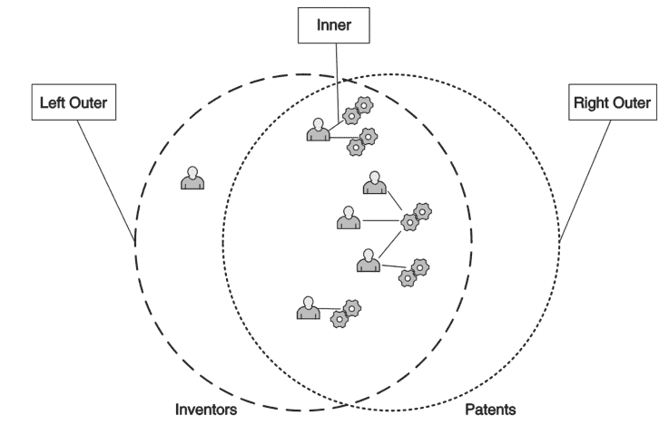

图 15.3：发明者和专利的韦恩图

将交集中的发明者与专利匹配称为内连接（inner join）。结果是一个发明者/专利对集合，其中每对都同时存在专利和发明。左外连接（left outer join）包含左圆中的所有项，无论它们是否有对应的专利。在特定示例中，右外连接（right outer join）将与内连接相同，因为没有没有发明者的专利。此外，左和右的指定是任意的，因此左连接和外连接之间实际上没有区别。然而，全外连接（full outer join）将包含两个外侧的记录；执行全外连接相对少见。

发明者和专利之间的另一个重要特征是它是多对多的关系。每个单独的专利可以有一个或多个发明者（例如，奥维尔·莱特和威尔伯·莱特共同发明的飞行器）。此外，每位发明者可以拥有一个或多个专利（例如本杰明·富兰克林发明的双光眼镜和声机）。

另一种常见关系是一对多的关系。例如，一个公司部门可能有许多员工。然而，每个员工在同一时间只能属于一个部门。（但是，与一对多关系一样，引入时间因素可以将其转换为多对多的关系。每位员工可能会从一个部门移动到另一个部门，随着时间的推移，他们可能关联多个部门，形成另一个多对多的关系。）

列表 15.18 提供了员工和部门数据的示例列表，输出 15.6 显示了结果。

# 列表 15.18：员工和部门数据示例

```c
public class Program
{
    public static void Main()
    {
        IEnumerable<Department> departments =
            CorporateData.Departments;
            Print(departments);
        Console.WriteLine(employees);
        IEnumerable<Employee> employees =
            CorporateData.Employees;
            Print(employees);
    }
    private static void Print<T>(IEnumerable<T> items)
    {
        foreach(T item in items)
        {
            Console.WriteLine(item);
        }
    }
}
```

输出 15.6

```
Corporate
Human Resources
Engineering
Information Technology
Philanthropy
Marketing
Mark Michaels (Chief Computer Nerd)
Michael Stokesbury (Senior Computer Wizard)
Brian Jones (Enterprise Integration Guru)
Anne Beard (HR Director)
Pat Dever (Enterprise Architect)
Kevin Bost (Programmer Extraordinaire)
Thomas Heavy (Software Architect)
Eric Edmonds (Philanthropy Coordinator)
```

我们将在下一节关于数据连接的节中使用这些数据。

# 使用 Join() 执行内连接

在客户端的对象世界中，对象之间的关系通常已经设置好。例如，文件与其所在目录之间的关系已通过 `DirectoryInfo.GetFiles()` 方法和 `FileInfo.Directory` 方法分层预建立。然而，对于从非对象存储器加载的数据，情况通常并非如此。相反，需要将数据连接在一起，以便能够以符合数据逻辑的方式从一种类型导航到另一种类型。

考虑员工和公司部门的示例。在列表 15.19 中，我们将每个员工连接到他们所在的部门，然后列出每个员工及其相应的部门。由于每个员工只属于一个（且恰好是一个）部门，列表中的项总数等于员工总数——每位员工只出现一次（这被称为员工是归一化的）。输出 15.7 显示了结果。

# 列表 15.19：使用 System.Linq.Enumerable.Join() 的内连接

```csharp
using System;
using System.Collections.Generic;
using System.Linq;
// ...
Department[] departments = CorporateData.Departments;
Employee[] employees = CorporateData.Employees;
IEnumerable<(int Id, string Name, string Title, Department Department)> items =
    departments.Join(
        employees,
        employee => employee.DepartmentId,
        department => department.Id,
        (employee, department) => (
            employee.Id,
            employee.Name,
            employee.Title,
            department
        )
    );
```

```csharp
foreach ((int Id, string Name, string Title, Department Department) item in items)
{
    Console.WriteLine($"{item.Name} {item.Title}");
    Console.WriteLine("\t" + item.Department);
}
// ...
```

# 输出 15.7

| Mark Michaelis (Chief Computer Nerd) |
| :--- |
| Corporate |
| Michael Stokesbury (Senior Computer Wizard) |
| Engineering |
| Brian Jones (Enterprise Integration Guru) |
| Engineering |
| Anne Beard (HR Director) |
| Human Resources |
| Pat Dever (Enterprise Architect) |
| Information Technology |
| Kevin Bost (Programmer Extraordinaire) |
| Engineering |
| Thomas Heavy (Software Architect) |
| Engineering |
| Eric Edmonds (Philanthropic Coordinator) |
| Philanthropy |

`Join()` 的第一个参数名为 `inner`。它指定了员工要连接的 `departments` 集合。接两个参数是 lambda 表达式，指定了两个集合如何连接。`employee => employee.DepartmentId`（参数名为 `outerKeySelector`）标识每个员工的键将是 `DepartmentId`。下一个 lambda 表达式（`department => department.Id`）指定部门的 `Id` 属性为键——换句话说，对于每个员工，连接 `employee.DepartmentId` 等于 `department.Id` 的部门。最后一个参数是选定的结果项。在这种情况下，它是包含员工的 `Id`、`Name`、`Title` 以及 `Department` 属性的元组。注意输出中 `Engineering` 出现了多次——一次针对来自 `CorporateData` 的员工。这种连接是内连接。

数据也可以反过来连接，即部门连接到每个员工以列出部门-员工的匹配项。注意输出包含的内容比实际数量多：每个部门有多个员工。正如我们之前看到的，`Engineering` 部门出现了多次，每个员工出现一次。

列表 15.20（输出 15.8）中的代码与列表 15.19 类似，只是对象 `Departments` 和 `Employees` 顺序反过了。`Join()` 的第一个参数是 `employees`，指示部门要连接的对象。接两个参数是 lambda 表达式，指定了两个集合如何连接：部门使用 `department => department.Id`，员工使用 `employee => employee.DepartmentId`。与一样，每当 `department.Id` 等于 `employee.Id` 时就会发生连接。最后的元组参数指定了一个带有 `int Id`、`string Name` 和 `Employee Employee` 的类。（在表达式中指定名称是可选的，但这里为了清晰起见。）

# 列表 15.20：使用 System.Linq.Enumerable.Join() 的另一种内连接

```csharp
using System;
using System.Collections.Generic;
using System.Linq;
// ...
Department[] departments = CorporateData.Departments;
Employee[] employees = CorporateData.Employees;
```


```csharp
IEnumerable<(long Id, string Name, Employee Employee)> items =
departments.Join(
    employees,
    department => department.Id,
    employee => employee.DepartmentId,
    (department, employee) => (
        department.Id,
        department.Name,
        Employee: employee)
);
foreach ((long Id, string Name, Employee Employee) item in items)
{
    Console.WriteLine(item.Name);
    Console.WriteLine("\"" + item.Employee);
}
```

# 786 第 15 章：带有标准查询操作符的集合接口

慈善
Eric Edmonds（慈善协调员）

除了对集合进行排序和连接之外，你可能还想对具有相似特征的对象进行分组。对于员工数据，你可能想按部门、地区、职位名称等对员工进行分组。列表 15.21 显示了如何使用 `GroupBy()` 查询操作来实现此点（请查看输出 15.9 查看结果）。

## 列表 15.21：使用 System.Linq.Enumerable.GroupBy 分组项目

```csharp
using System;
using System.Collections.Generic;
using System.Linq;
// ...
IEnumerable<Employee> employees = CorporateData.Employees;
IEnumerable<IGrouping<int, Employee>> groupedEmployees = employees.GroupBy(employee => employee.DepartmentId);
foreach(IGrouping<int, Employee> employeeGroup in groupedEmployees)
{
    Console.WriteLine();
    foreach(Employee employee in employeeGroup)
    {
        Console.WriteLine(employee);
    }
    Console.WriteLine("\tCount: " + employeeGroup.Count());
}
//...
```

### OUTPUT 15.9

Mark Michaelis（首席电脑极客）
Count: 1

Michael Stokesbury（高级电脑巫）
Brian Jones（企业集成大师）
Kevin Bost（卓越程序员）
Thomas Heavy（软件架构师）
Count: 4

Anne Beard（人力资源总监）

Count: 1
Pat Dever（企业架构师）
Count: 1
Eric Edmonds（慈善协调员）
Count: 1

请注意，`GroupBy()` 调用输出的项类型为 `IGrouping<TKey, TElement>`，它有一个属性用于表示查询正在分组的键（`employee.DepartmentId`）。但是，它没有表示组内项目的属性。相反，`Grouping<TKey, TElement>` 继承自 `IEnumerable<T>`，以便使用 `foreach` 语句对组内项目进行枚举，或者将数据聚合为如项目计数（如 `employeeGroup.Count()`）。

# 使用 GroupJoin() 实现一对多关系

列表 15.19 和列表 15.20 几乎相同。只需通过更改元组定义，任何一个 `Join()` 都可以产生相同的输出。在尝试创建员工列表时，列表 15.19 提供了正确的结果。部门作为代表已连接员工的两个元组的项。然而，列表 15.20 并不是理想的。考虑到对集合的支持，部门更优的表示方式应该是员工的集合，而不是为每个部门-员工关系使用单个元组。列表 15.22 展示了此类子集合的创建；输出 15.10 显示了首选输出。

## 列表 15.22：使用 System.Linq.Enumerable.GroupJoin() 创建子集合

```csharp
using System;
using System.Collections.Generic;
using System.Linq;
// ...
Department[] departments = CorporateData.Departments;
Employee[] employees = CorporateData.Employees;
IEnumerable<(long, String Name, IEnumerable<Employee>)> items = 
departments.GroupJoin(
    employees,
    department => department.Id,
    employee => employee.DepartmentId,
    (department, departmentEmployees) => (
  department.Id,
  department.Name,
  departmentEmployees
));
```

```csharp
foreach (
    (_, string name, IEnumerable<Employee> employeeCollection) in items)
{
  Console.WriteLine(name);
  foreach (Employee employee in employeeCollection)
  {
    Console.WriteLine("\t" + employee);
  }
}
//...
```

# OUTPUT 15.10

| 部门 | 员工 |
|---|---|
| 公司 | Mark Michaelis（首席电脑极客） |
| 人力资源 | Anne Beard（人力资源总监） |
| 工程 | Michael Michaelis（高级电脑巫） |
| | Brian Jones（企业集成大师） |
| | Kevin Bost（卓越程序员） |
| | Thomas Heavy（软件架构师） |
| 信息技术 | Pat Dever（企业架构师） |
| 慈善 | Eric Edmonds（慈善协调员）

为了首选的结果，我们使用了 `GroupJoin` 方法。参数与列表 15.19 中，除了最后的元组外。`departmentEmployees` 是 `IEnumerable<Employee>` 类型。注意我们使用 `GroupJoin` 将每个部门投影到员工列表。

# 标准查询操作符 787

# 高级主题：使用 GroupJoin() 实现外连接

有时，你可能想在匹配键不存在时创建一个。例如，而不是将部门列表留空。使用 `GroupJoin()` 和 `SelectMany()` 的组合。这在列表 15.23 中得到了演示。

## 列表 15.23：使用 GroupJoin 实现外连接

```csharp
using System;
using System.Collections.Generic;
using System.Linq;
// ...
Department[] departments = CorporateData.Departments;
Employee[] employees = CorporateData.Employees;
var items = departments.GroupJoin(
    employees,
    department => department.Id,
    employee => employee.DepartmentId,
    (department, departmentEmployees) => new
    {
        department.Id,
        department.Name,
        Employees = departmentEmployees
    }).SelectMany(
    departmentRecord => departmentEmployees.DefaultEmpty(),
    (departmentRecord, employee) => new
    {
        departmentRecord.Id,
        departmentRecord.Name,
        employee
    },Distinct();
foreach (var item in items)
{
    Console.WriteLine(item.Name);
    foreach (Employee employee in item.Employees)
    {
        Console.WriteLine("\t" + employee);
    }
}
```

# 标准查询操作符 789

# 调用 SelectMany()

有时，我们可能会有集合的集合。列表 15.24 提供了此类场景的示例。数组包含两个部门，每个部门都有一个字符串数组。

## 列表 15.24：调用 SelectMany()

```csharp
using System;
using System.Collections.Generic;
using System.Linq;
//...
(string Team, string[] Players)[] world2006Finalists = new[]
{
    {
        TeamName = "France",
        Players = new string[]
        {
            "Fabian Barthez", "Gregory Coupet",
            "Mikael Landreau", "Eric Abidal",
            "Jean-Alain Bomsoung", "Pascal Chimbonda",
            "William Gallas", "Gael Givet",
            "Willy Sagnol", "Mikael Silvestre",
            "Lilian Thuram", "Vikash Dholeous",
            "Alou Diarra", "Claude Makelele",
            "Florent Malouda", "Patrick Vieira",
            "Zinedine Zidane", "Djibril Cisse",
            "Thierry Henry", "Franck Ribery",
            "Louis Saha", "David Trezeguet",
            "Sylvain Wiltord"
        }
    },
    {
        TeamName = "Italy",
        Players = new string[]
        {
            "Gianluigi Buffon", "Angelo Peruzzi",
            "Marco Amelia", "Cristian Zaccardo",
            "Alessandro Nesta", "Gianluca Zambrotta",
            "Fabio Cavnarolo", "Marco Materazzi",
            "Fabio Grosso", "Massimo Pirlo",
            "Andrea Barzagli", "Andrea Pirlo",
            "Gennaro Gattuso", "Daniele De Rossi",
            "Mauro Camoranesi", "Simone Perrotta",
            "Simone Barone", "Luca Toni",
            "Alessandro Del Piero", "Francesco Totti",
            "Alberto Gilardino", "Filippo Inzaghi",
            "Vincenzo Iaquinta"
        }
    }
};
IEnumerable<string> players = world2006Finalists.SelectMany(
    team => team.Players);
Print(players);
//...
```

## 第 15 章：带有标准查询操作符的集合接口

此列表的输出将每个玩家的名字按照其在代码中出现的顺序单独行显示。`Select()` 和 `SelectMany()` 的区别在于，`Select()` 返回的项与原始集合中的每个项对应一个项。`Select()` 可能会从原始类型投影出一个转换，但项的数量不会改变。例如，`teams.Select(team => team.Players)` 将返回一个 `IEnumerable<string>`。

相比之下，`SelectMany()` 会遍历 Lambda 表达式识别的每个项（由 `Select()` 选定的数组），并将每个项提升到一个新的集合中，该集合包含了所有子集合中所有项的并集。`SelectMany()` 不再产生两个玩家数组，而是合并每个所选的数组并生成一个包含所有项的单体集合。

## 更多标准查询操作符

列表 15.25 显示了使用 `Enumerable` 启用的一些较简单 API 的代码。输出 15.12 显示了结果。

> 列表 15.25：更多的 System.Linq.Enumerable 方法调用

```csharp
using System;
using System.Collections.Generic;
using System.Linq;
public class Program
{
    public static void Main()
    {
        IEnumerable<object> stuff =
            new object[] { new object(), 1, 3, 5, 7, 9, "thing", Guid.NewGuid() };
        Print("Stuff: {0}", stuff);
        IEnumerable<int> even = new int[] { 0, 2, 4, 6, 8 };
        Print("Even integers: {0}", even);
        IEnumerable<int> odd = stuff.OfType<int>();
        Print("Odd integers: {0}", odd);
        IEnumerable<int> numbers = even.Union(odd);
        Print("Union of odd and even: {0}", numbers);
```

```csharp
Print("Union with even: {0}", numbers.Union(even));
Print("Concat with odd: {0}", numbers.Concat(odd));
Print("Intersection with even: {0}",
numbers.Intersect(even));
Print("Distinct: {0}", numbers.Concat(odd).Distinct());
```

```csharp
if (!numbers.SequenceEqual(
    numbers.Concat(odd).Distinct()))
{
    throw new Exception("Unexpectedly unequal");
}
else
{
    Console.WriteLine(
        @"Collection ""SequenceEquals"" +
        $"{nameof(numbers)}.Concat(odd).Distinct()";
    );
}
```

```csharp
Print("Reverse: {0}", numbers.Reverse());
Print("Average: {0}", numbers.Average());
Print("Sum: {0}", numbers.Sum());
Print("Max: {0}", numbers.Max());
Print("Min: {0}", numbers.Min());
```

```csharp
private static void Print<T>(
    string format, IEnumerable<T> items
    where T : notnull =>
    Console.WriteLine(format, string.Join(
        ",", items));
);
//
```

## 输出 15.12

```
Stuff: System.Object, 1, 3, 5, 7, 9, "thing"
```


2c2a4a1-e05-41b9-958e-50dd12e3981

Even integers: 0, 2, 4, 6, 8

Odd integers: 1, 3, 5, 7, 9

Union of odd and even: 0, 2, 4, 6, 8, 1, 3, 5, 7, 9

Union with even: 0, 2, 4, 6, 8, 1, 3, 5, 7, 9

Concat with odd: 0, 2, 4, 6, 8, 1, 3, 5, 7, 9

Intersection with even: 0, 2, 4, 6, 8

Distinct: 0, 2, 4, 6, 8, 1, 3, 5, 7, 9

Collection "SequenceEquals" `numbers.Concat(odd).Distinct()`

Reverse: 9, 7, 5, 3, 1, 8, 6, 4, 2, 0

Average: 4.5

Sum: 45

# 第 15 章：带有标准查询操作符的集合接口

Max: 9
Min: 0

列表 15.25 中的任何 API 调用都不需要 Lambda 表达式。表 15.1 和表 15.2 描述了每个方法并提供了示例。`System.Linq.Enumerable` 包含一组聚合函数，这些函数遍历集合并计算结果（如表 15.2 所示）。`Count` 是本章已展示的一个聚合函数示例。

## 表 15.1：更简单的标准查询操作符

| 类型 | 描述 |
| --- | --- |
| `OfType<T>()` | 在集合上形成查询，仅返回特定类型的项，该类型在 `OfType<T>()` 方法的类型参数中标识。 |
| `Union()` | 合并两个集合以形成两个集合中所有项的超集。如果同一项在两个集合中都存在，则最终集合将不包含重复项。 |
| `Concat()` | 合并两个集合以形成两个集合的超集。结果集合不会移除重复项。`Concat()` 将保留顺序。 |
| `Intersect()` | 提取两个集合中共同存在的项。 |
| `Distinct()` | 从集合中过滤掉重复项，使结果集合唯一。 |
| `SequenceEquals()` | 比较两个集合并返回指示它们是否完全相同的布尔值。 |
| `Reverse()` | 反转集合中的项，使其按反向顺序出现。 |

## 表 15.2：System.Linq.Enumerable 聚合函数

| 类型 | 描述 |
| --- | --- |
| `Count()` | 提供集合项的总数 |
| `Average()` | 计算数值集合的平均值 |
| `Sum()` | 计算数值集合的总和 |
| `Max()` | 确定数值集合中的最大值 |
| `Min()` | 确定数值集合中的最小值 |

注意表 15.1 和表 15.2 列出的每个方法都会触发延迟执行。

## 进阶主题

### IQueryable<T> 的扩展

`IEnumerable<T>` 的一个虚拟接口是 `IQueryable<T>`。由于 `IQueryable<T>` 继承自 `IEnumerable<T>`，它拥有在 `IEnumerable<T>` 中直接声明的所有成员（例如 `GetEnumerator()`）。然而，扩展方法是不会继承的，因此 `IQueryable<T>` 并不具备 `Enumerable` 的扩展方法。尽管如此，它有一个类似的扩展类 `System.Linq.Queryable`，它为 `IQueryable<T>` 添加了几乎与 `Enumerable` 相同的方法。因此，它提供了非常相似的编程接口。

`IQueryable<T>` 的独特之处在于它启用了 LINQ 提供程序。LINQ 提供程序会将表达式分解为其组成部分。一旦分解，表达式就可以转换为另一种语言、序列化以进行远程执行、注入异步执行模式等等。从根本上说，LINQ 提供程序允许对集合 API 进行拦截；可以通过这种看似无限的功能注入与查询和集合相关的行为。

例如，LINQ 提供程序可以将 C# 查询表达式翻译为远程数据库上执行的 SQL。通过这种方式，C# 程序员可以留在主要的面向对象语言中，并将 SQL 翻译交给底层 LINQ 提供程序。

### LINQ 中的匿名类型

为了支持 LINQ 这一高级 API，仅进行了八项新的语言增强。这些增强中包括匿名类型和隐式局部变量。尽管如此，匿名类型在 C# 元组语法的引入后基本上已被取代。事实上，在本本书的第六版中，所有以前利用匿名类型的 LINQ 示例都更新为使用元组。

本章剩余部分将介绍匿名类型主题，以便如果你在处理 C# 7.0 之前编写的代码，仍然能够理解匿名类型这一语言特性。

### 匿名类型

匿名类型是由编译器声明的数据类型，而不是通过第 6 章中引入的显式类定义引入。与匿名函数一样，当编译器看到匿名类型时，它会为你完成相关工作，然后让你像已经显式声明过它一样使用它。列表 15.26 显示了这样的声明。对应的输出见输出 15.13。

列表 15.26：带有匿名类型的隐式局部变量

```c
using System;

public class Program
{
    public static void Main()
    {
        var patent1 = 
            new {
                Title = "Bifocals"
```
```c
Console.WriteLine();
Console.WriteLine(patent1);
Console.WriteLine(patent2);
```
```c
Console.WriteLine();
Console.WriteLine(patent3);
```
```c
}
```

# 输出 15.13

Bifocals (1784)
Phonograph (1784)
{ Title = Bifocals, YearOfPublication = 1784 }
{ Title = Phonograph, YearOfPublication = 1877 }
{ Title = Bifocals, Year = 1784 }

匿名类型纯粹是 C# 的特性，而不是运行时的一种新类型类型。当编译器遇到匿名类型语法时，它会生成一个 CIL 类，其属性与匿名类型声明中的命名值和数据类型对应。

## 初学者主题

## 复习隐式类型局部变量 (var)

由于匿名类型没有名称，因此无法将局部变量显式声明为匿名类型。相反，局部变量的类型被替换为 `var`。然而，这并不意味着隐式类型变量是无类型的。相反，它们被完全类型化为所赋值的值的数据类型。如果给隐式类型变量赋值一个匿名类型，则该局部变量声明的底层 CIL 代码类型为编译器生成的类型。同样，如果给隐式类型变量赋值一个字符串，它在底层 CIL 中的数据类型就是字符串。事实上，对于赋值值不是匿名类型（如字符串）的隐式类型变量，与使用显式类型声明的变量相比，其生成的 CIL 代码没有区别。如果声明语句文本为 `text = "This is a test of the..."`，生成的 CIL 代码与隐式类型声明 `var text = "This is a test of the..."` 是相同的。

编译器从赋值的表达式中确定隐式类型变量的数据类型。在带有初始化器的显式类型局部变量中（`string s = "hello";`），编译器首先根据左侧的声明类型确定 `s` 的类型，然后分析右侧，并验证右侧的表达式可以赋值给该类型。在隐式类型变量中，这个过程在某种程度上是反向的。首先分析右侧以确定其类型，然后在逻辑上将 `var` 替换为该类型。

尽管 C# 没有为匿名类型提供名称，但它也是强类型的。例如，该类型的属性是完全可以访问的。在列表 15.26 中，`patent1.Title` 和 `patent2.YearOfPublication` 在 `Console.WriteLine` 语句中被调用。任何调用不存在成员的尝试都将导致编译错误。即使是 Visual Studio 等 IDE 中的 IntelliSense 也能处理匿名类型。

你应该谨慎地使用隐式类型变量声明。显然，对于匿名类型，无法指定数据类型，且必须使用 `var`。然而，如果数据类型不是匿名类型，通常使用显式数据类型更好。

与通常情况一样，你应该专注于提高代码语义的可读性，同时利用编译器验证结果变量类型是否是你预期的类型。要通过隐式类型局部变量实现这一点，仅当赋值给隐式类型变量的类型完全明显时才使用它们。例如，在 `var items = new Dictionary<string, List<Account>>();` 中，生成的代码更简洁易读。相比之下，当类型不明显时（例如赋值方法的返回值时），开发者应该倾向于使用显式变量类型声明，如下：

```c
Dictionary<string, List<Account>> dictionary = GetAccounts();
```

## 使用 LINQ 选择匿名类型

最后，利用匿名类型，我们可以创建一个 `IEnumerable<T>` 集合，其中 `T` 是匿名类型（见列表 15.27 和输出 15.14）。

列表 15.27：投影到匿名类型

```c
//...
IEnumerable<string> fileList = Directory.EnumerateFiles(
    rootDirectory, searchPath);
var items = fileList.Select(
    {
        FileInfo fileInfo = new(file);
        return new
        {
            FileName = fileInfo.Name,
            Size = fileInfo.Length
        }
    });
//...
```

输出 15.14

```
{ FileName = AssemblyInfo.cs, Size = 1704 }
{ FileName = CodeAnalysisRules.xml, Size = 735 }
{ FileName = CustomDictionary.xml, Size = 199 }
{ FileName = EssentialCSharp.sln, Size = 40415 }
{ FileName = EssentialCSharp.vsmdi, Size = 454656 }
{ FileName = EssentialCSharp, Size = 499 }
{ FileName = EssentialCSharp.vssscc, Size = 256 }
{ FileName = intelliectchure.ConsoleTester.dll, Size = 24576 }
{ FileName = intelliectchure.ConsoleTester.db, Size = 30288 }
```

匿名类型的输出会自动显示由与匿名类型关联的 `ToString()` 方法生成的属性名和值。

使用 `Select()` 方法进行投影是非常强大的。我们已经看到如何使用 `Where()` 标准查询操作符垂直方向过滤集合（减少集合中的项数量）。现在，通过使用 `Select()` 标准查询操作符，我们也可以水平方向减少集合（减少列数）并完全转换数据。通过添加匿名类型，我们可以通过 `Select()` 提取任意“对象”，只需提取原始集合中当前算法需要的片段，而无需声明一个类来包含它们。

## 关于匿名类型和隐式局部变量的更多信息

在列表 15.26 中，匿名类型的成员名称通过将 `patent1` 和 `patent2` 的值赋值给名称来显式识别（例如 `Title = "Phonograph"`）。然而，如果赋值值是属性或字段调用，名称可能默认为字段或属性的名称，而不是显式指定值。例如，`patent3` 使用命名为 `Title` 的属性定义。如输出 15.13 所示，生成的属性名由编译器确定，与获取值来源的属性匹配。

`patent1` 和 `patent2` 具有相同的属性名和相同的数据类型。因此，C# 编译器为这些匿名声明只生成了一个数据类型。相比之下，`patent3` 强制编译器创建第二个匿名类型，因为年份属性名称与 `patent1` 和 `patent2` 不同。此外，如果交换了 `patent1` 和 `patent2` 的属性顺序，这两个匿名类型将不具有类型性。换句话说，两个匿名类型在同一程序集中类型兼容的要求是：属性名、数据类型和属性顺序匹配。如果满足了这些标准，即使它们出现在不同的方法或类中，类型也是兼容的。列表 15.28 展示了类型不兼容的情况。

# 列表 15.28：匿名类型的类型安全性和不可变性

```c
public class Program
{
    public static void Main()
    {
        var patent1 = 
            new{
                Title = "Bifocals",
                YearOfPublication = "1784"
            };
    }
    var patent2 =
```

## 802 第 15 章：带有标准查询运算符的集合接口

```sharp
new
{
  YearOfPublication = "1877",
  Title = "Phonograph"
};
```
```sharp
var patent3 =
new
{
  patent1.Title,
  Year = patent3.YearOfPublication
};
```
```sharp
// ERROR: 无法隐式转换类型
// 'AnonymousType#1' 到 'AnonymousType#2'
//patent1 = patent2; // 如果注释将无法编译
// ERROR: 无法隐式转换类型
// 'AnonymousType#1' 到 'AnonymousType#3'
//patent1 = patent3; // 如果注释将无法编译
```
```sharp
// ERROR: 属性或索引器 'AnonymousType#1.Title'
// 不能赋值 -- 它是只读的
//patent1.Title = "Swiss Cheese";
// 如果注释将无法编译
```


前两个编译时错误断言类型不兼容，因此它们无法成功从一个类型转换为另一个。第三个编译时错误是由于对 `Title` 属性的重新赋值引起的。匿名类型是不可变的，因此一旦实例化了匿名类型，更改其属性将导致编译时错误。

虽然在列表 15.28 中没有体现，但无法声明带有隐式数据类型参数（`var`）的方法。因此，匿名类型的实例只有两种方式可以传递到创建它的方法之外。首先，如果方法参数的类型为 `object`，则匿名类型实例可以传递到方法之外，因为匿名类型会进行隐式转换。第二种方法是使用类型推断，将匿名类型实例作为方法的类型参数传递，编译器可以成功推断出来。因此，使用 `Function(patent1)` 调用 `void Method<T>(T parameter)` 将成功，尽管在 `Function()` 内部对参数的可用操作受限于 `object` 支持的操作。

在匿名类型引入时，它们是解决一个重要问题的突破：在无需声明完整类型的繁琐步骤的情况下，动态声明一个临时类型。尽管如此，它们仍有几个缺点，如前文详细所示。幸运的是，元组¹² 避免了这些缺点，事实上，它们基本上消除了对使用匿名类型的类型。具体而言，与匿名类型相比，元组具有以下优势：

- 提供了一个命名的类型，可以在任何可以使用类型的地方使用，包括声明和类型参数
- 可以在实例化它的方法之外可用

元组与匿名类型的不同点之一是，匿名类型是引用类型，而元组是值类型。这种差异对哪种方法更有利取决于所需的性能特性的。如果元组类型被频繁复制且其内存占用超过 128 位，则引用类型可能更优。否则，使用元组很可能具有更高的性能——并且是默认的更好选择。

11. 从 C# 3.0 开始。
12. 从 C# 7.0 开始。

## 第 15 章：带有标准查询运算符的集合接口

## 高级主题

### 匿名类型的生成

尽管 `Console.WriteLine()` 的实现是调用 `ToString()`，但请注意列表 15.26，`Console.WriteLine()` 的输出并不是默认的 `ToString()`（后者会写出全限定的数据类型名称）。相反，输出是 `PropertyName = value` 值对列表，对应匿名类型上的每个属性。发生这种情况是因为编译器在匿名类型的代码生成中重写了 `ToString()`，以便按照所示格式格式化 `ToString()` 输出。同样，生成的类型还包含 `Equals()` 和 `GetHashCode()` 的重写实现。

`ToString()` 本身的实现是导致属性顺序变化产生新类型的重要原因。如果将两个独立的匿名类型（可能在完全不同的类型中甚至在不同的命名空间中）合并，然后更改属性的顺序，那么其中一个实现在 `ToString()` 方法中属性顺序的变化将对另一个实现的结果产生显著且可能不可接受的影响。此外，在执行期间，可以对类型进行反向反射并检查该类型的成员——甚至可以动态地调用这些成员之一（在运行时确定要调用哪一个成员）。两个看似相同的类型之间成员顺序的差异可能会触发意料之外的结果。为了避免这个问题，C# 的设计者们决定生成两个不同的类型。

## 高级主题

### 使用匿名类型的集合初始化器

你无法为匿名类型拥有集合初始化器，因为集合初始化器需要调用构造函数，而构造函数无法命名。变通方法是定义一个方法，例如 `static List<T>(T t) { return new List<T>(); };`。方法类型推断允许类型参数是隐含而非显式指定的，因此这种变通方法成功允许创建匿名类型的集合。

初始化匿名类型集合的另一种方法是使用数组初始化器。由于无法在构造函数指定数据类型，数组初始化语法允许使用 `new[]` 使用匿名数组初始化器（见列表 15.29）。

## 列表 15.29：初始化匿名类型数组

```sharp
using System;
using System.Collections.Generic;
public class Program
{
    public static void Main()
    {
        var worldCup2006Finalists = new[]
        {
            TeamName = "France",
            Players = new string[]
            {
                "Fabian Barthez", "Gregory Coupet",
                "Mickael Landreau", "Eric Abidal",
                // ...
            },
        },
        new
        {
            TeamName = "Italy",
            Players = new string[]
            {
                "Gianluigi Buffon", "Angelo Peruzzi",
                "Marco Amelia", "Cristian Zaccardo",
                // ...
            }
        };
        Print(worldCup2006Finalists);
    }
    private static void Print<T>(IEnumerable<T> items)
{
foreach(T item in items)
{
    Console.WriteLine(item);
}
}
```

结果变量是匿名类型的数组，它必须是同质的。

## 总结

本章描述了 `foreach` 循环的内部机制，并解释了执行它所需的接口。此外，开发者经常过滤集合以减少项目，并投影集合以使项目采取不同的形式。为了这一目标，本章讨论了如何使用标准查询运算符（LINQ 在 `System.Linq.Enumerable` 类上引入了扩展方法）进行集合操作。

在标准查询运算符的介绍中，我们详细说明了延迟执行的过程，并强调开发者应该小心避免通过遍历集合的细微调用来无意中重新执行表达式。延迟执行和结果隐式执行是代码效率的一个重要因素，特别是当查询执行开销较大时。程序员应该将查询对象视为查询对象而非结果，并预设即使执行过查询也会再次执行。查询对象不知道结果是否与之前执行时相同。

虽然类似执行的需求可能很常见，但并不需要直接依赖标准查询运算符。查询表达式¹³ 是一种类似于 SQL 的语法，用于以更易编写和阅读的方式操作集合，将在下一章展示。

# 16 使用查询表达式的 LINQ

第 15 节末尾展示了一个使用标准查询运算符 `GroupJoin()`、`SelectMany()` 和 `Distinct()` 的查询。结果是一个跨越多行的语句，比通常仅使用 C# 早期版本特性的语句要复杂得多且难以理解。处理丰富数据集的现代程序通常需要此类复杂的查询；因此，如果语言能够让这些查询更易于阅读，将大有益处。像 SQL 这样的领域特定查询语言使得查询变得更易于阅读和理解，但它们缺乏 C# 语言的完整威力。这就是为什么 C# 语言设计者添加了查询表达式语法¹。通过查询表达式，许多标准查询运算符表达式被转换为更具读性的代码，就像 SQL 一样。

| 2. 查询表达式是方法调用 | 使用查询表达式的 LINQ | 1. 引入查询表达式 | 投影 |
|---|---|---|---|
| | | 排序 | 分组 |

在本章中，我们引入了查询表达式，并使用它们来表示第 15 节中的许多查询。

- 1. 从 C# 3.0 开始。

# 引入查询表达式

开发者最频繁执行的操作是过滤集合以消除不需要的项，以及投影集合以使项以不同的形式存在。例如，给定一个文件集合，我们可以过滤它以创建一个仅包含 `.cs` 扩展名文件的新集合，或者仅包含大于 100 万字节文件的新集合。我们还可以对文件集合进行投影，创建一个新的集合，该集合同时包含目录路径和相应的目录大小。查询表达式为这两种常用操作提供了直观的语法。列表 16.1 显示了一个过滤字符串集合的查询表达式；输出 16.1 显示了结果。

列表 16.1：简单的查询表达式

```
public static static readonly ReadOnlyCollection<string> Keywords = new(
    string[] {
        "abstract", "add", "alias", "as", "ascending",
        "async", "await", "base", "bool", "break",
        "byte", "case", "catch", "char", "checked",
        "class", "const", "continue", "decimal", "default",
        "delegate", "descending", "do", "double", "dynamic",
        "else", "enum", "equals", "event", "explicit",
        "extern", "finally", "fixed", "float", "for",
        "foreach", "from", "get", "global", "goto", "group",
        "if", "il", "in", "interface", "internal",
        "into", "join", "let", "lock", "long",
        "nameof", "namespace", "new", "nonnull", "null",
        "object", "on", "operator", "orderby", "out",
        "override", "params", "partial", "private",
        "protected", "public", "readonly", "ref", "remove",
        "return", "sbyte", "sealed", "select", "set", "short",
        "sizeof", "stackalloc", "static", "string", "struct",
        "switch", "this", "throw", "true", "try", "typeof",
        "uint", "unchecked", "unsafe", "ushort",
        "using", "value", "var", "virtual", "void", "volatile",
        "when", "where", "while", "yield"
    }
);
```

```cs
// ...
using System;
using System.Collections.Generic;
using System.Linq;
// ...
private static void ShowContextualKeywords() {
    IEnumerable<string> selection =
    from word in CSharp.keywords
    where word.Contains('*')
    select word;
```

```cs
foreach (string keyword in selection) {
    Console.Write(keyword + " ");
}
```

# 输出 16.1

abstract as base pool break byte case catch checked class const continue default do double else event explicit extern finally fixed float for foreach from get global goto group if il in interface internal into join let lock long nameof namespace new nonnull object on operator orderby out override params partial private protected public readonly ref remove return sbyte sealed select set short sizeof stackalloc static string switch this throw true try typeof uint unchecked unsafe ushort using var virtual void volatile when where while yield

## 第 16 章：使用查询表达式的 LINQ

此查询表达式返回的是 `IEnumerable<FileInfo>`，而不是 `Directory.GetFiles()` 返回的 `IEnumerable<string>` 数据类型。查询表达式的 `select` 子句可能会投影出与子句表达式收集的数据不同的数据类型。

在这个示例中，选择 `FileInfo` 类型是因为它包含了输出所需的两个相关字段：文件名和最后写入时间。如果你需要其他未被 `FileInfo` 对象捕获的信息，可能就没有这样方便的类型了。元组（Tuples）提供了一种方便且简洁的方式来投影精确的数据，而无需查找或创建显式类型。列表 16.3 提供了与列表 16.2 相似的输出，但使用的是元组语法而非 `FileInfo`。

## 列表 16.3：查询表达式中的元组

```csharp
using System;
using System.IO;
using System.Linq;
// ...
    public static void List2
    (string rootDirectory, string searchPattern)
    {
        var fileNames = Directory.EnumerateFiles(
            rootDirectory, searchPattern);
        var fileResults =
            from fileName in fileNames
            select (
                Name: fileName,
                LastWriteTime: File.GetLastWriteTime(fileName)
            );
        foreach (var fileResult in fileResults)
        {
            Console.WriteLine($"{fileResult.Name} {fileResult.LastWriteTime}");
        }
}
```

- 3. C# 7.0 之前使用的匿名类型。

## 介绍查询表达式

在此示例中，查询仅投影了文件名及其最后文件时间。在处理像 `FileInfo` 这样的小对象时，像列表 16.3 那样的投影区别并不大。然而，当数据量巨大且检索数据（例如通过互联网从另一台计算机检索）成本高昂时，过滤掉集合中每个项目关联数据量的“水平”投影是极其强大的。与其其在查询执行时检索所有数据，不如使用元组，它能够只将所需数据存储并检索到集合中。

想象一下，例如一个拥有 30 列或更多列的大型数据库。如果没有元组，开发者将被使用包含不必要信息的对象，或者仅定义小型专用类来存储所需的特定数据。相反，元组支持由编译器定义类型——这些类型仅包含当前场景所需的数据。其他场景可以拥有仅包含该场景所需属性的类型投影。

## 初学者主题

## 查询表达式的延迟执行

使用查询表达式表示法编写的查询表现出延迟执行，正如第 15 章中编写的查询一样。再次考虑列表 16.1 中将查询对象赋值给变量 `selection` 的操作。查询的创建和对变量的赋值并没有执行查询；它们只是构建了一个表示该查询的对象。在创建查询对象时，并没有调用 `word.Contains("*")` 方法。相反，查询表达式保存了选择标准，将在迭代由选择变量 `selection` 标识的集合时使用。

为了演示这一点，请考虑列表 16.4 和相应的输出（输出 16.3）。

## 列表 16.4：延迟执行与查询表达式（示例 1）

```csharp
using System;
using System.Collections.Generic;
using System.Linq;
// ...
private static void ShowContextualKeywords2()
{
    IEnumerable<string> selection = from word in CSharp.Keywords
                                    where IsKeyword(word)
                                    select word;
    Console.WriteLine("Query created.");
    foreach (string keyword in selection)
    {
        // 这里没有输出空格
        Console.Write(keyword);
    }
}
// 控制台输出的副作用被包含
// 在谓词中以演示延迟执行；
// 带有副作用的谓词是
// 生产代码中的糟糕做法
private static bool IsKeyword(string word)
{
```


```csharp
if(word.Contains("*"))
{
    Console.Write(" ");
    return true;
}
else
{
    return false;
}
```
///...

```
OUTPUT 16.3
```
Query created.
alias+= ascending* async* await* by* descending* dynamic*
equals+= from* get* global* into* join* let* nameof* nonnull*
on* order* partial* remove* select* set* value* var* where* when*
yield*
```

## 介绍查询表达式 817

在列表 16.4 中，`foreach`循环内部没有输出空格。当执行谓词`IsKeyword()`时打印空格的副作用发生在迭代查询时——而不是在创建查询时。因此，尽管`selection`是一个集合（毕竟它的类型是`IEnumerable<T>`），但在赋值时，`from`子句之后的所有内容都作为选择标准。只有当我们开始开始迭代`selection`时，这些标准才被应用。

现在考虑第二个示例（参见列表 16.5 和输出 16.4）。

### 列表 16.5：延迟执行与查询表达式（示例 2）

```csharp
using System;
using System.Collections.Generic;
using System.Linq;
// ...
private static void CountContextualKeywords()
{
    int delegateInvocations = 0;
    string func(string text)
    {
        delegateInvocations++;
        return text;
    }
```
```csharp
IEnumerable<string> selection = from word in CSharp.Keywords
                                where word.Contains("*")
                                select func(word);
Console.WriteLine("Query created.");
foreach (string keyword in selection)
{
    // 这里没有输出空格
    Console.Write(keyword);
}
```

```
OUTPUT 16.4
```
Query created.
alias+= ascending* async* await* by* descending* dynamic*
equals+= from* get* global* into* join* let* nameof* nonnull*
on* order* partial* remove* select* set* value* var* where* when*
yield*
```

（注：列表 16.5 的 文本在源文件中略有破碎，我们根据常见的 C# 模式和可用片段重构了代码块。）

# 过滤

在列表 16.1 中，有一个子句过滤掉了保留关键字，但没有过滤上下文关键字。该子句对集合进行“垂直”过滤：如果你将集合视为一个垂直的项目列表，`where`子句会使该列表变短，从而让集合包含更少项。过滤标准通过谓词表达式——即返回`bool`的 Lambda 表达式，例如列表 16.1 中的`.Contains()`，或者`File.GetLastWriteTime(fileName) < DateTime.Now.AddMonths(-1)`。后者出现在列表 16.6 中，其输出结果出现在输出 16.5 中。

### 列表 16.6：使用 where 的查询表达式过滤

```csharp
using System;
using System.Collections.Generic;
using System.IO;
using System.Linq;
//
public static void FindMonthOldFiles(
    string rootDirectory, string searchPattern)
{
    IEnumerable<FileInfo> files =
        from fileName in Directory.EnumerateFiles(
            rootDirectory, searchPattern)
        where File.GetLastWriteTime(fileName) <
            DateTime.Now.AddMonths(-1)
        select new FileInfo(fileName);
    foreach (FileInfo file in files)
    {
        // 为了简化，假设当前目录是
        // rootDirectory 的子目录
        string relativePath = file.FullName.Substring(
            Directory.GetCurrentDirectory().Length);
        Console.WriteLine(
            $"{relativePath} ({file.LastWriteTime})");
    }
}
//...
```

### 输出 16.5

```
\TestData\Bill.cs (8/10/2011 9:33:55 PM)
\TestData\Contact.cs (8/19/2011 11:40:30 PM)
\TestData\Employee.cs (8/17/2011 1:33:22 AM)
\TestData\Person.cs (10/22/2011 10:00:03)
```

# 排序

要使用查询表达式对项进行排序，可以使用`orderby`子句，如列表 16.7 所示。

### 列表 16.7：使用 orderBy 子句通过查询表达式排序

```csharp
using System;
using System.Collections.Generic;
using System.Linq;
using System.IO;
// ...
public static void ListByFileSize(
    string rootDirectory, string searchPattern)
{
    IEnumerable<string> fileNames =
        from fileName in Directory.EnumerateFiles(
            rootDir, searchPattern)
        orderby (new FileInfo(fileName)).Length descending,
        select fileName;
    foreach (string fileName in fileNames)
    {
        Console.WriteLine(fileName);
    }
// ...
```

列表 16.7 使用`orderby`子句对`Directory.GetFiles()`返回的文件进行排序，首先按文件大小降序排列，然后按文件名升序排列。多个排序标准由逗号分隔，以便项首先按大小排序，如果大小相同，则按文件名排序。`ascending`和`descending`是指示排序方向的上下文关键字。指定排序顺序为升序或降序是可选的；如果省略方向（如在此处的`fileName`处），则默认为升序。

# let 子句

列表 16.8 包含一个与列表 16.7 中的查询非常相似的查询，不同之处在于类型参数`IEnumerable<T>`是`FileInfo`。然而，该查询存在一个问题：我们必须`orderby`子句和`select`子句中冗余地创建了两次`FileInfo`。

### 列表 16.8：投影 FileInfo 集合并按文件大小排序

```csharp
using System;
using System.Collections.Generic;
using System.Linq;
using System.IO;
//
public static void ListFileSize2(
    string rootDirectory, string searchPattern)
{
    IEnumerable<FileInfo> files =
        from fileName in Directory.EnumerateFiles(
            rootDirectory, searchPattern)
        orderby new FileInfo(fileName).Length, fileName
        select new FileInfo(fileName);
    foreach (FileInfo file in files)
    {
        // 为了简化，假设当前目录
        // 是 rootDirectory 的子目录
        string relativePath = file.FileName.Substring(
            Directory.GetCurrentDirectory().Length);
        Console.WriteLine(
            $"{relativePath}} {file.Length}}");
    }
}
//
```

遗憾的是，尽管结果是正确的，但列表 16.8 最终为源集合中的每个项都实例化了两次`FileInfo`，这是浪费且没有必要的。为了避免这种不必要的且可能昂贵的开销，你可以使用`let`子句，如列表 16.9 所示。

`let`子句引入了一个新的范围变量，它可以持有在整个查询表达式剩余部分使用的表达式的值。你可以根据需要添加任意`let`子句；只需将其作为额外的子句插入到第一个`from`子句之后、最后的`select`子句之前。

### 列表 16.9：查询表达式中的结果排序

```csharp
//...
IEnumerable<FileInfo> files =
    from fileName in Directory.EnumerateFiles(
        rootDirectory, searchPattern)
    let file = new FileInfo(fileName)
    order by file.Length, fileName
    select file;
//...
```

# 分组

一种常见的数据处理场景是相关项分组。在 SQL 中，这通常涉及`group by`子句。然而，LINQ 产生一个分组序列，其中项被分组成集合。例如，列表 16.10 和输出 16.6 展示了如何进行分组。

### 列表 16.10：分组

```csharp
using System;
using System.Collections.Generic;
using System.Linq;
//
    public static void GroupKeywords()
    {
        IEnumerable<IGrouping<bool, string>> selection =
            from word in CSharp.Keywords
            group word by word.Contains('*');
        foreach (IGrouping<bool, string> wordGroup
        in selection)
        {
            Console.WriteLine(Environment.NewLine + "{0}:",
                wordGroup.Key ? "Contextual Keywords" : "Keywords");
            foreach (string keyword in wordGroup)
            {
                Console.Write(" " + keyword.Replace("*", null));
            }
        }
    }
//...
```

### 输出 16.6

Keywords:
  Contextual Keywords
  Keywords

ushort using virtual unchecked void volatile while
上下文关键字：
add aliases ascending async by descending dynamic equals from
get global group join let nameof nonnull on orderby partial remove
select set value where yield

`group`子句的结果会产生一个产生`IGrouping<TKey, TElement>`对象集合的查询——这与`GroupBy`标准查询操作符所做的相同（参见第 15 章）。后续查询中的`select`子句使用一个元组来有效地将`IGrouping<TKey, TElement>.Key`重命名为`IsContextualKeyword`，并将子集合属性重命名为`Items`。通过此更改，嵌套循环使用`wordGroup.Items`而不是直接使用`wordGroup`。元组中可以添加的另一个潜在项是子集合中项目的计数。然而，此功能已经通过 LINQ 的`wordGroup.Items.Count()`方法可用，因此直接将其添加到匿名类型中的好处尚待商榷。

## 使用 `into` 延续查询

正如你在示例 16.11 中所看到的的，你可以将现有的查询作为第二个查询的输入。但是，当你想要将一个查询的结果作为另一个查询的输入时，并没有必要编写一个完全新的查询表达式。你可以使用上下文关键字`into`通过查询延续子句来扩展任何查询。查询延续无非是创建两个查询并将第一个作为第二个的法的法的语法糖。由`into`子句引入的范围变量（示例 16.11 中的`groups`）将成为查询剩余部分的范围变量；任何之前的范围变量在逻辑上都是属于早先查询的，不能在查询延续中使用。示例 16.12 重写了示例 16.11 的代码，以使用两个查询的查询延续。

### 示例 16.12：不使用查询延续进行选择（未完）

```csharp
using System;
using System.Collections.Generic;
using System.Linq;
//...
    private static void GroupKeywords1()
    IEnumerable<(bool IsContextualKeyword,
```

## 引入查询表达式

```csharp
IGrouping<bool, string> Items> selection =
from word in CSharp.Keywords
group word by word.Contains('*')
    into groups
    select(
        IsContextualKeyword: groups.Key,
        Items: groups
    );
// ...
}
//...
```

在现有的查询`into`结果上运行附加查询的能力不仅适用于以`group`子句结尾的查询，而是可以适用于所有的查询表达式。查询延续仅仅是编写消耗其他查询表达式结果的查询表达式的简写形式。你可以将`into`视为一个“管道操作符”，因为它将第一个查询的结果“管道”到第二个查询中。你可以通过这种方式任意地链起许多查询。

## 使用多个子句将序列的序列扁平化

通常，我们希望将一个序列的序列“扁平化”为单一序列。例如，客户序列的每个成员都可能有一个关联的订单序列，或者目录序列的每个成员都可能有一个关联的文件序列。`SelectMany`序列操作符（在第 15 章中讨论）将所有子序列连接在一起；要使用查询表达式语法实现相同的操作，可以使用多个子句，如示例 16.13 所示。

### 示例 16.13：多重选择

```csharp
var selection =
from word in CSharp.Keywords
from character in word
select character;
```

前面的查询将产生字符序列 `a, b, s, t, r, a, c, t, a, d, d, *, a, l, i, a, ....`

## 第 16 章：LINQ 到查询表达式

多个`from`子句也可以用于产生笛卡尔积——多个序列所有可能的组合的集合——如示例 16.14 所示。

## 示例 16.14：笛卡尔积

```csharp
var numbers = new[] { 1, 2, 3 };
IEnumerable<string word, int Number> product =
    from word in CSharp.Keywords
```


`from number in numbers`

`select (word, number);`

```
```

此查询将产生字符序列 `a, b, s, t, r, a, c, t, a, d, d, *, a, l, i, a, ....`

## 初学者主题

### 去重成员（Distinct）

通常，希望从一个集合中返回去重的（即唯一的）项目。但是，这种功能通过 `Distinct()` 可用。要对查询使用 `Distinct()`，必须将查询包含在 `select` 子句中。示例 16.15 显示了结果。

示例 16.15：使用查询表达式获取去重成员

```csharp
using System;
using System.Collections.Generic;
using System.Linq;
//...
public static void ListDistinctMembers()
{
    IEnumerable<string> methodNames =
        from method in typeof(Enumerable).GetMethods(BindingFlags.Public | BindingFlags.Static)
        select method.Name
        Distinct();
    foreach (string method in methodNames)
    {
        Console.WriteLine("{ method }");
    }
}
//...
```

输出：
```
Aggregate
Any
Append
AsEnumerable
Average
Cast
Count
Distinct
DistinctBy
ElementAt
ElementOrDefault
Empty
Except
ExceptBy
First
FirstOrDefault
GroupBy
GroupBy
Join
JoinBy
Last
LastOrDefault
LongCount
Max
MaxBy
Min
MinBy
Order
OrderBy
```

## 查询表达式就是方法调用

令人惊讶的是，添加查询表达式不需要对通用语言运行时 `CLR` 或通用中间语言 `CIL` 进行任何更改。相反，C# 编译器简单地将查询表达式转换为一系列方法调用。考虑例如。

编译后，表达式 16.16 被转换为 `System.Linq.Enumerable` 的 `IEnumerable<T>` 扩展方法调用，如示例 16.17 所示。

+ 4. 从 C# 3.0 开始。

## 第 16 章：使用查询表达式

示例 16.16：简单查询表达式

```csharp
private static void ShowKeywords1()
{
    IEnumerable<string> selection =
    from word in CSharp.Keywords
    where !word.Contains('*')
    select word;
    // ...
}
```

示例 16.17：查询表达式转换为标准查询操作符语法

```csharp
private static void ShowKeywords2()
{
    IEnumerable<string> selection =
    CSharp.Keywords.Where(word => !word.Contains('*'));
    // ...
}
```

## 指南

- **应当**使用查询表达式语法使查询更易于阅读，特别是当查询涉及复杂的 `from`、`let`、`join` 或 `query` 子句时。
- **考虑**使用标准的查询操作符（方法调用形式），如果查询涉及不具备查询表达式语法的操作，例如 `Count()`、`TakeWhile()` 或 `Distinct()`。

## 总结

本章介绍了一种新语法——即查询表达式。熟悉 SQL 的读者会立即发现查询表达式与 SQL 之间的相似之处。然而，查询表达式还引入了额外的功能，例如将其分组为层次化的新对象，这在 SQL 中是无法实现的。查询表达式的所有功能已经可以通过标准查询操作符实现，但查询表达式通常为表达此类查询提供了更简单的语法。无论，无论使用标准查询操作符还是查询表达式语法，最终结果都是面向对象语言与关系型数据库交互方式的显著改进。在下一章中，我们将通过研究一些 .NET 框架集合类型以及如何定义自定义集合来继续讨论集合。

# 构建自定义集合

第 15 章涵盖了标准查询操作符——`IEnumerable<T>` 上的扩展方法，这些方法为所有集合提供了通用方法。然而，这些操作符并没有让所有集合都适用于所有任务；仍然需要不同的集合类型。某些集合更适合通过键进行搜索，而另一些更适合通过位置访问项。某些集合像队列：先进入元素元素先。另一些像栈：先进入的元素后出。还有一些则完全没有顺序。

.NET 框架提供了大量的集合类型，适用于需要集合的许多场景。本章介绍了其中一些集合类型以及它们实现的接口。此外，它还探索了使用 `yield return` 语句创建实现 `IEnumerable<T>` 的类。NET 中提供了许多非泛型集合类和接口，但通常情况下，这些存在仅是为了与泛型引入之前编写的代码保持向后兼容。泛型集合类型不仅更快（因为它们避免了装箱），而且比非泛型集合更类型安全。因此，新代码几乎应该使用泛型集合类型。

# 更多集合接口

我们已经看到集合如何实现 `IEnumerable<T>`，这是允许迭代集合元素的主要接口。许多额外的接口被更复杂的集合所实现。图 17.1 显示了集合类实现的接口层次结构。这些接口提供了一种标准方式来执行常见任务，例如迭代、索引和计数集合中的元素。本节将检查这些接口（至少是所有泛型接口），从图 17.1 的底部开始向上移动。

# `IList<T>` 与 `IDictionary<TKey, TValue>`

英语字典可以被看作是定义的集合。特定的定义可以通过查找其关联的“键”（即被定义的单词）来快速访问。字典类同样地被视为值的集合，其中每个值都可以通过其关联的唯一键被快速访问。但请注意，字典通常按键排序存储定义；字典类可能会选择这样做，但通常不会。字典集合最好能被看作是键和值的无序列表，除非文档中特别说明它们是有序的。同样地，人们通常不会认为过要查找“字典中的第六个维度”；类通常只通过键提供索引，而不通过位置。

相比之下，列表按特定顺序存储值并通过其位置访问它们。在某种意义上，列表是字典的特例，其中“键”始终是一个整数，且键集始终是从零开始的连续非负整数集。尽管如此，这种差异大到值得用一个完全不同的类型来表示它。

因此，在选择集合来解决某些数据存储或检索问题时，要查找的前两个接口是 `IList<T>` 和 `IDictionary<TKey, TValue>`。这些接口表示集合类型是由给定的位置索引或其关联键检索值强制要求的。在 `IList<T>` 中，索引器接收一个整数并允许你访问元素。在 `IDictionary<TKey, TValue>` 中，索引器接收一个键并允许你访问值。

| 接口 | 类型 | 属性 | 方法 |
| :--- | :--- | :--- | :--- |
| ICollection | 接口 | Count, IsSynchronized, SyncRoot | CopyTo |
| IEnumerable<T> | 泛型 | | GetEnumerator |
| IEnumerable | 接口 | | GetEnumerator |
| ICollection<T> | 泛型 | | GetEnumerator |
| IList | 接口 | IsFixedSize, IsReadOnly, Item | Add, Clear, Contains, IndexOf, Insert, Remove, RemoveAt |
| IDictionary | 接口 | | |
| ICollection<T> | 泛型 | Count, IsReadOnly | Add, Clear, Contains, CopyTo, Remove |
| IDictionary<TKey, TValue> | 泛型 | | ICollection<KeyValuePair<TKey, TValue>>, IEnumerable<KeyValuePair<TKey, TValue>> |
| IList<T> | 泛型 | Item, Keys, Values | Add, ContainsKey, Remove, TryGetValue |
| IList<T> | 属性 | Item | IndexOf, Insert, RemoveAt |

**图 17.1：集合类层次结构**
(img/ffe0f34eac7523830420733690014d17_0.png)

# 主要类 类

存在几类主要的集合类，它们在数据插入、存储和检索方面相互不同。每个泛型类都位于 `System.Collections.Generic` 命名空间，其非泛型等价类位于 `System.Collections` 命名空间。

# 列表集合：`List<T>`

`List<T>` 类具有与数组类似的属性。关键区别在于这些类随着元素数量增加而自动扩展。（相比之下，数组的大小是常量）。此外，列表可以通过显式调用 `TrimSize()` 或 `Capacity` 来缩小（参见图 17.2）。

这些类被归类为列表集合，其区别功能是每个元素都可以通过索引单独访问，就像数组一样。因此，你可以使用索引运算符在列表集合类中设置和访问元素，其中索引值对应于元素在集合中的位置。列表 17.1 显示了一个示例，输出 17.1 显示了结果。

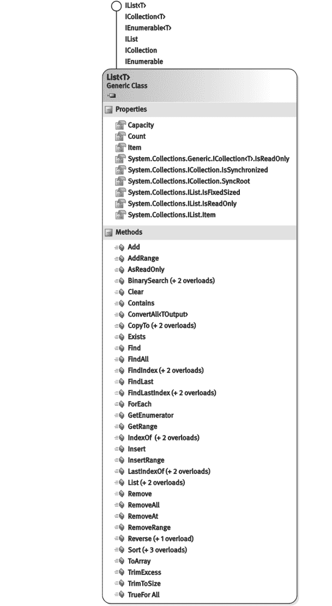

图 17.2：`List<T>` 类图

## 主要集合类 839

```cs
list.Sort();
Console.WriteLine(
  "In alphabetical order { list[0] } is the "
 + "first dwarf while { list[1] } is the last.");
list.Remove("Grumpy");
}
```

## 输出 17.1

按照字母顺序，Bashful 是第一个矮人，而 Sneezy 是最后一个。

C# 是基于 0 索引的；因此，列表 17.1 中的索引 0 对应于第一个元素，索引 6 表示第七个元素。通过索引检索元素不涉及搜索。相反，它涉及到内存中位置的快速且简单的“跳转”操作。

`List<T>` 是一个有序集合；`Add()` 方法将给定项目添加到列表末尾。在调用列表 17.1 中的 `Sort()` 之前，“Sneezy”在第一个，“Grumpy”在最后一个；调用之后，列表按字母顺序排序，而不是按照项目添加的顺序。某些集合会在添加元素时自动对其进行排序，但 `List<T>` 不是其中之一；需要显式调用 `Sort()` 才能对元素进行排序。

要删除元素，你可以使用 `Remove()` 或 `RemoveAt()` 方法来分别删除给定的元素或删除位于特定索引的任何元素。

## 高级主题

### 自定义集合排序

你可能想过，列表 17.1 中的 `List<T>.Sort()` 方法是如何知道如何将列表中的元素按字母顺序排序的。`string` 类型实现了 `IComparable<string>` 接口，该接口有一个方法 `CompareTo()`。它返回一个整数，表示传递的元素是大于、小于还是等于当前元素。如果元素类型实现了泛型 `IComparable<T>` 接口（或泛型 `IComparable` 接口），则排序算法将默认使用它来确定排序顺序。

但如果元素类型没有实现 `IComparable<T>`，或者比较两个对象的默认逻辑不满足你的需求怎么办？你可以调用 `List<T>.Sort()` 的重载版本，它接受 `IComparer<T>` 作为参数。

`IComparable<T>` 和 `IComparer<T>` 之间的区别细微但很重要。第一个接口是“我知道如何将自己与相同类型的另一个实例进行比较”。后者意味着“我知道如何比较给定类型的两个对象”。

当一个数据类型有许多不同的排序方法且没有明显的最佳方法时，通常使用 `IComparable` 接口。例如，你可能有一个 `Contact` 对象的集合，你有时想按名称、位置、生日、地理区域或任何其他可能的因素进行排序。与其选择一种排序策略并让 `Contact` 类实现 `IComparable<Contact>`，不如创建几个实现 `IComparer<Contact>` 的不同类可能更明智。列表 17.2 显示了按姓、名进行比较的示例实现。

## 列表 17.2：实现 `IComparer<T>`

```cs
using System;
using System.Collections.Generic;
// ...
public class Contact
{
    public string FirstName { get; private set; }
    public string LastName { get; private set; }
    public Contact(string firstName, string lastName)
    {
        this.FirstName = firstName;
        this.LastName = lastName;
    }
}
public class NameComparison : IComparer<Contact>
{
    public int Compare(Contact? x, Contact? y)
    {
        if (Object.Equals(x, y))
            return 0;
        if (x == null)
            return 1;
        if (y == null)
            return -1;
        int result = StringCompare(x.LastName, y.LastName);
        if (result == 0)
            result = StringCompare(x.FirstName, y.FirstName);
        return result;
    }
    private static int StringCompare(string? x, string? y)
    {
        if (Object.Equals(x, y))
            return 0;
        if (x == null)
            return 1;
        if (y == null)
            return -1;
        return x.CompareTo(y);
    }
}
```

要按姓再按名对 `List<Contact>` 进行排序，你可以调用 `contact.Sort(new NameComparison())`。

## 全排序 在在实现 `IComparable<T>` 或 `IComparer<T>` 时，你需要产生一个全排序。你的 `CompareTo` 实现必须为任何一对项目提供完全一致的顺序。例如，每个元素都被要求与它自己相等。如果元素 X 被认为等于元素 Y，且元素 Y 被认为等于元素 Z，那么 X、Y、Z 三者都必须被认为相等。如果元素 X 被认为大于 Y，则 Y 必须被认为小于 X。并且不能出现“传递性悖论”——也就是说，你不能出现 X 大于 Y、Y 大于 Z 且 Z 大于 X。如果你没有提供全排序，排序算法的操作将未定义；它可能会产生混乱的顺序，可能会导致崩溃，可能会进入无限循环等。

请注意，例如列表 17.2 中的比较器即使在元素为 null 时也能确保全排序。例如，说“如果元素为 null，返回零”是不合法的，因为两个非空对象可能是不等的。

> 指南：确保自定义比较逻辑产生“全排序。”

## 搜索 `List<T>`

要在 `List<T>` 中搜索特定元素，你可以使用 `Contains()`、`IndexOf()` 和 `BinarySearch()` 方法。这些方法遍历集合（`IndexOf()` 从第一个元素开始）直到找到所需的元素。这些方法的执行时间与元素数量成正比。`BinarySearch()` 使用了更快的搜索算法，但要求元素已排序。如果未找到元素，将返回一个负索引。这提供了一种在特定位置插入新值的方便方法。列表 17.3 提供了一个示例。请注意，如果列表没有排序，此代码将无法找到元素，即使元素在集合中。`BinarySearch()` 当集合中存在多个相同元素时，`IndexOf()` 返回第一个索引，`LastIndexOf()` 返回最后一个索引。

# 字典集合：`Dictionary<TKey, TValue>`

另一类集合类是字典类——特别是 `Dictionary<TKey, TValue>`（参见图 17.3）。与普通集合不同，字典类存储的是键/值对。名称充当唯一键，可用于查找对应的元素，其方式类似于在数据库中使用主键来访问记录。这给访问字典元素增加了一些复杂性，但由于通过键查找是高效的操作，因此这是一种非常有用的集合。请注意，键可以是任何数据类型，而不仅仅是字符串或数值。

向字典中插入元素的一种方法是使用 `Add()` 方法，将键和值作为参数传递，如列表 17.5所示。

列表 17.5：向 `Dictionary<TKey, TValue>` 添加项

```csharp
using System;
using System.Collections.Generic;
```


```csharp
public class Program
{
    public static void Main()
    {
        var colorMap = new Dictionary<string, ConsoleColor>
        {
            ["Error"] = ConsoleColor.Red,
            ["Warning"] = ConsoleColor.Yellow,
            ["Information"] = ConsoleColor.Green
        };
        colorMap.Add("Verbose", ConsoleColor.White);
        // ...
    }
}
```

在使用字典初始化器³ 初始化字典（参见第 15 章中的“集合初始化器”节）后，列表 17.5 为键“Verbose”插入了字符串 `ConsoleColor.White`。如果已经添加了相同键的元素，则会抛出异常。

添加元素的另一种方法是使用索引器，如列表 17.6 所示。

+ 3. 从 C# 6.0 开始。

`IDictionary<TKey, TValue>`
`ICollection<KeyValuePair<TKey, TValue>>`
`IEnumerable<KeyValuePair<TKey, TValue>>`
`IDictionary`
`ICollection`
`IEnumerable`
`ISerializable`
`IDerializationCallback`

### `Dictionary<TKey, TValue>` 型类

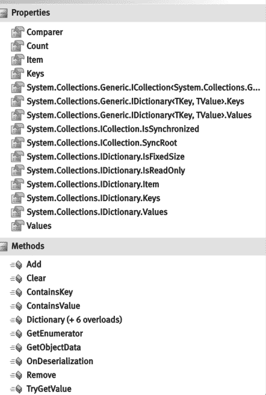

图 17.3：字典类图

### 列表 17.6：使用索引运算符向 Dictionary<TKey, TValue> 插入

```csharp
using System;
using System.Collections.Generic;
public class Program{
    public static void Main()
    {
        var colorMap = new Dictionary<string, ConsoleColor>{
            ["Error"] = ConsoleColor.Red,
            ["Warning"] = ConsoleColor.Yellow,
            ["Information"] = ConsoleColor.Green
        };
        colorMap["Verbose"] = ConsoleColor.White;
        colorMap["Error"] = ConsoleColor.Cyan;
        // ...
    }
}
```

在列表 17.6 中观察到的第一点是，索引运算符不需要整数。相反，索引操作数的类型由第一个参数（`string`）指定，而通过索引器设置或检索的值的类型由第二个类型参数（`ConsoleColor`）指定。

在列表 17.6 中注意的第二点是，同一个键 "Error" 被使用了两次。在第一次赋值中，没有字典值对应于给键。当发生这种情况时，字典集合类会插入一个带有提供键的新值。在第二次赋值中，已经存在具有指定键的元素。它没有插入额外的元素，而是将 "Error" 先前的 `ConsoleColor` 值替换为 `ConsoleColor.Cyan`。

尝试从具有不存在的键的字典读取值将抛出 `NotFoundException`。`ContainsKey()` 方法允许你在访问其值之前检查特定键是否被使用，从而避免异常。

`Dictionary<TKey, TValue>` 实现为哈希表；无论字典中存储了多少值，该数据结构在通过键搜索时都能提供极快的访问。相比之下，检查字典集合中是否存在特定值是一个耗时的操作，其具有线性性能特征，类似于搜索未排序的列表。要执行此操作，你使用 `ContainsValue()` 方法，它会按顺序遍历集合中的每个元素。

使用 `Remove()` 方法删除字典元素，将键而不是元素值作为参数传递。

由于向字典添加值时同时需要键和值，因此 `foreach` 循环的字典元素必须是 `KeyValuePair<TKey, TValue>`。列表 17.7 显示了一个代码片段，演示了使用 `foreach` 循环遍历字典中的键和值。输出出现在输出 17.3 中。

### 列表 17.7：使用 foreach 遍历 Dictionary<TKey, TValue>

```csharp
using System;
using System.Collections.Generic;
public class Program
{
    public static void Main()
    {
        var colMap = new Dictionary<string, ConsoleColor>
        {
            ["Error"] = ConsoleColor.Red,
            ["Warning"] = ConsoleColor.Yellow,
            ["Information"] = ConsoleColor.Green,
            ["Verbose"] = ConsoleColor.White
        };
        Print(colMap);
    }
    private static void Print(IEnumerable<KeyValuePair<string, ConsoleColor>> items)
    {
        foreach (KeyValuePair<string, ConsoleColor> item in items)
        {
            Console.ForegroundColor = item.Value;
            Console.WriteLine(item.Key);
        }
    }
}
```

### 输出 17.3

```
Error
Warning
Information
Verbose
```

注意此处显示的顺序是它们被添加的顺序，正如它们被添加到列表中一样。不要对字典的顺序做出任何假设。

## 指南

不要对字典中元素的顺序做出任何假设。

如果你只想处理键或值，字典可以通过 `Keys` 和 `Values` 属性分别获得。从这些属性返回的数据类型是 `ICollection<T>`。这些属性返回的是字典内部数据的引用而非副本。

## 高级主题

### 自定义字典相等

为了确定给定键是否匹配字典中的任何键，字典必须能够比较键的相等性。这类似于列表必须比较项目以确定顺序的方式（参见本章前面的“高级主题：自定义集合排序”）。默认情况下，值类型实例的比较是检查它们是否包含完全相同的数据，引用类型实例的比较是查看它们是否引用同一个对象。然而，有时需要在两个实例不是完全相同的值或引用的情况下将它们比较为相等。

例如，假设你想使用列表 17.2 中的 `Contact` 类型创建一个 `Dictionary<Contact, string>`。但是，你希望任何具有相同姓氏和名的的对象都是相等的，无论这两个对象是否引用相等。正如你可以提供 `IComparer<T>` 的实现来排序列表，你也可以提供 `IEqualityComparer<T>` 的实现来确定两个键是否相等：一个返回两个项目是否相等，另一个返回字典可以用于快速索引的“哈希码”。列表 17.8 显示了一个示例。

### 列表 17.8：实现 IComparer<T>

```csharp
using System.Collections.Generic;
public class ContactEquality : IComparer<Contact>
{
    public bool Equals(Contact x, Contact? y)
    {
        if(object.ReferenceEquals(x, y))
            return true;
        if(x == null || y == null)
            return false;
        return x.LastName == y.LastName &&
               x.FirstName == y.FirstName;
    }
    public int GetHashCode(Contact x)
    {
        if(x is null)
            return 0;
        int h1 = x.FirstName == null ? 0 : x.FirstName.GetHashCode();
        int h2 = x.LastName == null ? 0 : x.LastName.GetHashCode();
        return h1 * 23 + h2;
    }
}
```

要创建一个使用此等性比较器的字典，你可以使用构造函数 `new Dictionary<Contact, string>(new ContactEquality)`。

## 初学者主题

### 等性比较的要求

正如第 10 章讨论过的，有几条重要规则适用于等性与哈希代码算法。在集合的上下文中，遵守这些规则至关重要。正如正确排序列表需要自定义的排序比较来提供全序，同样，哈希表也需要自定义等性比较满足某些保证。最重要的要求是：如果两个对象的 `Equals()` 返回为 `true`，那么 `GetHashCode()` 必须为这两个对象返回相同的值。请注意，反过来并不成立：两个不相等的项目可能具有相同的哈希代码。（事实上，存在 $2^{32}$ 种可能的哈希代码，但不相等对象的数量要多得多！）

次要的重要要求是：对同一项进行两次 `GetHashCode()` 调用，在项项存在哈希表期间，必须产生相同的结果。然而，请注意，两个“看起来相等”的对象并不要求在程序的多次运行中给出相同的哈希代码。例如，给给定的联系人今天分配一个哈希代码是完全合法的，两周后当你第二次运行程序时，为“同一个”联系人给出一个不同的哈希代码。不要将哈希代码持久化到数据库中，并期望它们在程序的不同运行中保持稳定。

理想情况下，`GetHashCode()` 的结果应该是随机的。也就是说，输入的微小变化应该导致输出的巨大变化，并且结果应该均匀分布在所有可能的整数值上。然而，设计一个既极快又能产生极佳分布输出的哈希算法是很困难的；尝试寻找一个良好的折中。

最后，`GetHashCode()` 和 `Equals()` 不得抛出异常。注意列表 17.8 中的代码是如何仔细地确保从不解引用空引用的例如。

总结一下，这里是核心原则：

- 相等的对象必须具有相同的哈希代码。
- 对象的哈希代码在实例生命周期内不应改变（至少在它处于哈希表期间）。
- 哈希算法应该快速产生分布良好的哈希值。

哈希算法应避免在所有可能的对象状态下抛出异常。

### 排序集合：SortedDictionary<TKey, TValue> 和 SortedList<T>

排序集合类（见图 17.4）对于 `SortedDictionary<TKey, TValue>` 按键存储元素，对于 `SortedList<T>` 按值存储元素。如果我们把列表 17.7 中的代码更改为使用 `SortedDictionary<string, string>` 代替 `Dictionary<string, string>`，程序的输出如输出 17.4 所示。

输出 17.4

| 错误 | 信息 | 详细信息 | 警告 |
| :--- | :--- | :--- | :--- |
| | | | |

注意，元素是按键排序的，而不是按值排序。由于排序集合必须执行额外工作来维护元素的排序顺序，因此插入和删除操作通常比无序字典中的值插入和删除操作稍慢。

由于排序集合必须按照特定顺序存储项目，因此既可以通过键也可以通过索引访问值。要在排序列表中通过索引访问键或值，请使用 `Keys` 和 `Values` 属性。它们返回

图 17.4: 排序集合

### 第 17 章：构建自定义集合

分别 `IList<T>` 和 `IList<TValue>` 实例；结果集合可以像其他列表一样被索引。

### 栈集合：Stack<T>

第 12 章讨论了栈集合类（见图 17.5）。栈集合类被设计为后进先出（LIFO）集合。两个关键方法是 `Push()` 和 `Pop()`：

- `Push()` 将元素插入集合。元素不需要是唯一的。
- `Pop()` 按照添加的相反顺序移除元素。

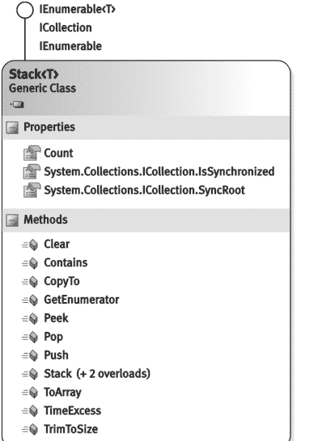

图 17.5: Stack<T> 类图

要在不修改栈的情况下访问栈上的元素，使用 `Peek()` 和 `Contains()` 方法。`Peek()` 返回下一个元素。对于大多数类，你使用 `Contains()` 来判断元素是否存在于栈中。

### 队列集合：Queue<T>

图 17.6 所示的队列类与栈类相同，不同在于它们遵循先先出（FIFO）顺序。它们使用 `Enqueue()` 和 `Dequeue()` 方法代替 `Push()` 和 `Pop()`。`Peek()` 返回下一个元素但不将其从队列中移除。

### 链表：LinkedList<T>

图 17.7 所示的 `LinkedList` 类允许正向和反向遍历。这是因为列表中的每个节点都包含指向下一个节点和上一个节点的引用。

### Span<T> 和 ReadOnlySpan<T>

`Span<T>` 是任意内存连续区域的类型安全表示。它可以指向数组数据、栈内存或未托管内存。`ReadOnlySpan<T>` 相同，但是是只读的。这允许在不分配新内存的情况下对数据进行非常高效的切片。

在内部，`Span<T>` 使用了 `ref struct`（在 C# 7.2 中引入）。这意味着它只能存在于栈上，而永远不会存在于堆上。因此，它可以作为局部变量使用，但不能作为类或普通结构体的静态或实例成员。对于具有相似功能但没有相同限制的情况，请使用 `Memory<T>` 类型。

### 提供索引器

数组、字典和列表都提供了索引器，作为一种根据键或索引获取或设置集合成员的方便方式。正如我们所见，，要使用索引器，只需在集合名称后的方括号中放入索引（或多个索引）即可。你可以定义自己的索引器；列表 17.10 显示了一个使用 `Pair<T>` 的示例。

### 列表 17.10：定义索引器

```c
interface IPair<T>
{
    T First { get; }
    T Second { get; }
    T this[PairItem index] { get; }
}
public enum PairItem
{
    First,
    Second
}
public struct Pair<T> : IPair<T>
{
    public Pair(T first, T second)
    {
        First = first;
        Second = second;
    }
    public T First { get; }
    public T Second { get; }
}
public T this[PairItem index]
{
    get
}
```

```csharp
{
  switch (index)
  {
    case PairItem.First:
      return First;
    case PairItem.Second:
      return Second;
    default:
      throw new NotImplementedException(
        $"The enum {index.ToString()} has not been implemented");
  }
}
```

索引器的声明方式与属性非常，不同之处在于不是属性名称，而是使用关键字后跟方括号中的参数列表。其正体也类似于属性，包含 `get` 和 `set` 块。如列表 17.10 所示，参数不必是 `int`。事实上，索引器可以接受多个参数并可以被重载。此示例使用枚举是为了减少调用者为不存在的项目提供索引的概率。

C# 编译器从索引运算符创建的公共中间语言 (CIL) 代码是一个名为 `Item` 的特殊属性，它接收一个参数。C# 无法显式地创建接受参数的属性，因此 `Item` 在这方面是独有的。任何带有标识符 `Item` 的额外成员，即使其具有完全不同的签名，也会与编译器创建的成员冲突，因此将是不允许的。

## 高级主题

### 使用 IndexerName 分配索引器属性名

如前所述，索引器的 CIL 属性名默认为 `Item`。然而，使用 `IndexerName` 特性，你可以指定不同的名称。例如，列表 17.11 将名称更改为 "Entry"。

### 列表 17.11：更改索引器的默认名称

```csharp
[System.Runtime.CompilerServices.IndexerName("Entry")]
public T this[PairItem index]
{
    //...
}
```


这对于该索引的 C# 调用者没有影响，但它为那些直接支持索引器的语言指定了名称。

`IndexerNameAttribute` 仅仅是告诉编译器使用不同名称作为索引器的指令；该属性实际上并不会被编译器发射到元数据中，因此无法通过反射访问。

## 高级主题

### 使用可变参数定义索引运算符

索引运算符也可以接受可变参数列表。例如，列表 17.12 定义了 `BinaryTree<T>` 的索引运算符，该内容在第 12 章中讨论过（并在下一节中再次出现）。

#### 列表 17.12：使用可变参数定义索引运算符

```csharp
using System;

public class BinaryTree<T>
{
    //...
    public BinaryTree<T> this[params PairItem[]? branches]
    {
        get
        {
            BinaryTree<T> currentNode = this;
            // 允许空数组或 null
            // 指向根节点
            int totalLevels = branches?.Length ?? 0;
            int currentLevel = 0;
        }
    }
}
```

```csharp
while (currentLevel < totalLevels)
{
    System.Diagnostics.Debug.Assert(branches != null,
    $"{nameof(branches)} != null\n");
    currentNode = currentNode.SubItems[
        branches[currentLevel]];
    if (currentNode == null)
    {
        // 此位置的二叉树为 null
        throw new IndexOfRangeException();
    }
    currentLevel++;
}
return currentNode;
// ...
```

`branches` 中的每个项目都是一个 `PairItem`，并指示在二叉树中向下导航哪个分支。例如，

```csharp
tree[PairItem.Second, PairItem.First].Value
```

将检索位于第一个分支中的第二个项目的值，紧接着是该分支中的第一个分支的值。

### 返回 null 或空集合

在返回数组或集合时，你必须通过返回 `null` 或一个不包含项目的集合实例来指示有零项目。通常情况下，更好的选择是返回一个不包含项目的集合实例。这样做，你避免了强制调用者在遍历集合中的项目之前检查 `null`。

例如，给定一个大小为零的 `IEnumerable<T>` 集合，调用者可以...

### 迭代器语法

迭代器提供了迭代器接口的简写实现，它是 `IEnumerable<T>` 和 `IEnumerator<T>` 接口的组合。列表 17.13 通过创建一个 `GetEnumerator()` 方法为泛型 `BinaryTree<T>` 类型声明了一个迭代器。接下来，你为迭代器接口添加支持。

#### 列表 17.13：迭代器接口模式

```csharp
using System.Collections;
using System.Collections.Generic;
public class BinaryTree<T>
{
    public BinaryTree(T value)
    {
        Value = value;
    }
    #region IEnumerable<T>
    public IEnumerator<T> GetEnumerator()
    {
        // ...
    }
    #endregion IEnumerable<T>
    public T Value { get; }
    public Pair<BinaryTree<T>> SubItems { get; set; }
}
public struct Pair<T>
{
    public Pair(T first, T second) : this()
    {
        First = first;
        Second = second;
    }
    public T First { get; }
    public T Second { get; }
}
```

如列表 17.13 所示，我们需要为 `GetEnumerator()` 方法提供实现。

### 从迭代器中产生值

迭代器类似于函数，但它们返回的不是单个值，而是逐个产生一个值值序列。在 `BinaryTree<T>` 的情况下，迭代器产生一个类型为提供的泛型 `T` 的值序列。如果使用了 `IEnumerator` 的泛型版本，产出的值将是 `object` 类型。

要正确实现迭代器模式，你需要维护一些内部状态，以跟踪枚举集合时的当前位置。在 `BinaryTree<T>` 情况下，你跟踪树中的每个元素，哪些已经被枚举，哪些尚未出现。迭代器会被编译器转换为一个“状态机”，该状态机跟踪当前位置并知道如何“移动自身”到下一个位置。

`yield return` 语句在迭代器每次遇到它时都会产生一个值；控制权立即返回到请求该项目的调用者。（这里有一个有趣的点是，控制确实会立即返回，讽刺的是与 `return` 语句不同。`return` 语句最终会阻塞整个路径；而 `yield` 不会。）当调用者请求下一个项目时，代码立即开始执行。在列表 17.14 中，你顺序返回 C# 内置数据类型。结果见输出 17.5。

#### 列表 17.14：顺序产生 C# 关键字

```csharp
using System;
using System.Collections.Generic;
public class CSharpBuiltInTypes : IEnumerable<string>
{
    public IEnumerator<string> GetEnumerator()
    {
        yield return "object";
        yield return "byte";
        yield return "uint";
        yield return "ulong";
        yield return "float";
        yield return "char";
        yield return "bool";
        yield return "ushort";
        yield return "decimal";
        yield return "int";
        yield return "sbyte";
        yield return "short";
        yield return "long";
        yield return "void";
        yield return "double";
        yield return "string";
    }
}
```
```csharp
// IEnumerable.GetEnumerator 方法也是需要的，因为 IEnumerable<T> 派自 IEnumerable
System.Collections.IEnumerator System.Collections.IEnumerable.GetEnumerator()
{
    // 调用上方的 IEnumerator<string> GetEnumerator()
    return GetEnumerator();
}
```
```csharp
public class Program
{
    public static void Main()
    {
        var keywords = new CSharpBuiltInTypes();
        foreach (string keyword in keywords)
        {
            Console.WriteLine(keyword);
        }
    }
}
```

输出 17.5
object
byte
uint
ulong
float
char
bool
ushort
decimal
int
sbyte
short
long
void
double
string

### 第 17 章：构建集合

此列表的输出是 C# 内置类型列表。迭代器与状态

在 `foreach` 语句首次调用 `GetEnumerator()` 时（例如列表 17.14 中的 `foreach (string keyword in keywords)`），会创建一个迭代器对象，其状态初始化为特殊的“开始”状态，表示迭代器尚未执行代码，因此尚未产生任何值。只要 `foreach` 语句继续执行，迭代器就会保持其状态。每当循环请求下一个值时，控制权进入迭代器并从上一次循环结束的地方继续；迭代器中存储的状态用于确定控制权从何恢复。当调用处的 `foreach` 语句终止时，迭代器的状态不再保存。

再次调用 `GetEnumerator()` 总是安全的；必要时会创建“新的”迭代器。图 17.8 显示了发生过程的高级序列图。记住 `MoveNext()` 方法出现在 `IEnumerator<T>` 接口上。

在列表 17.13 中，`foreach` 调用处发起了对 `keywords` 实例的 `GetEnumerator()` 调用。鉴于迭代器实例（由迭代器引用），`foreach` 每次迭代都从调用 `MoveNext()` 开始。在迭代器内部，产生一个值返回给调用处的 `foreach` 语句。在 `yield return` 语句之后，`GetEnumerator()` 方法看似暂停直到下一次 `MoveNext()` 请求。回到循环体，`foreach` 语句在屏幕上显示产生的值。然后循环并再次调用迭代器的 `MoveNext()`。第二次，控制权从第二个 `yield return` 语句处开始。再次 `foreach` 显示 `CSharpBuiltInTypes` 产生的内容并再次循环。直到迭代器内部没有更多 `yield return` 语句。在此时，由于 `MoveNext()` 返回 `false`，调用处的 `foreach` 循环终止。

### 更多迭代器示例

| 程序 | 基本类型：CSharpPrimitiveTypes | 迭代器：Enumerator | 控制台 |
|---|---|---|---|


图 17.8：应用 yield return 的序列图

修改 `BinaryTree<T>` 之前，你必须修改 `Pair<T>` 以使用迭代器支持 `IEnumerable<T>` 接口。列表 17.15 是产生 `Pair<T>` 中每个元素的示例。

在列表 17.15 中，`foreach` 调用处发起了对 `GetEnumerator()` 方法的调用并保存状态，执行似乎“跳转”到循环体。当第二次迭代开始时，`GetEnumerator()` 在 `yield return` 语句处开始执行。

#### 列表 17.15：使用 yield 实现

```csharp
public struct Pair<T> : IEnumerable<T>
{
    public Pair(T first, T second) : this()
    {
        First = first;
        Second = second;
    }
    public T First { get; }
    public T Second { get; }
    #region IEnumerable<T>
    public IEnumerator<T> GetEnumerator()
    {
        yield return First;
        yield return Second;
    }
    #endregion IEnumerable<T>
}
```

`System.Collections.Generic.IEnumerable<T>` 继承自 `System.Collections.IEnumerable`。因此，在实现 `IEnumerable<T>` 时，必须实现 `IEnumerable`。在列表 17.15 中，你显式地这样做，实现仅涉及对 `IEnumerable<T>`GetGetEnumerator()` 的调用。从 `IEnumerable.GetEnumerator()` 到 `IEnumerable<T>.GetEnumerator()` 的调用由于 `IEnumerable<T>` 和 `IEnumerable` 之间的类型兼容性（通过继承）将始终有效。由于两个版本的 `GetEnumerator()` 签名相同（返回类型不区分签名），一个或两个实现都必须是显式的。鉴于 `IEnumerable<T>` 版本提供的额外类型安全，你显式地实现了 `IEnumerable`。

列表 17.16 使用 `Pair<T>.GetEnumerator()` 方法并在连续两行上显示 "Inigo" 和 "Montoya"。

#### 列表 17.16：通过 foreach 使用 Pair<T>.GetEnumerator()

```csharp
var fullName = new Pair<string>("Inigo", "Montoya");
foreach(string name in fullName)
{
    Console.WriteLine(name);
}
```

注意 `foreach` 循环内对 `GetEnumerator()` 的调用是隐式的。

### 在循环中放置 yield return

没有必要硬编码每个 `yield return` 语句，就像你在 `CSharpBuiltInTypes` 和 `Pair<T>` 中做的那样。使用 `yield return` 语句，你可以从循环结构内部返回值。列表 17.17 使用了 `foreach` 循环。每次 `GetEnumerator()` 内部的 `foreach` 执行时，它返回下一个值。

#### 列表 17.17：在循环中放置 yield return 语句

```csharp
public class BinaryTree<T> :
    IEnumerable<T>
{
    // ...
    #region IEnumerable<T>
    public IEnumerable<T> GetEnumerator()
    {
        // 返回此节点的值
        yield return Value;
        // 遍历元组中的每个元素
        foreach (BinaryTree<T>? tree in SubItems)
```

## 872 第 17 own：构建自定义集合

```csharp
{
    if(tree != null)
    {
      // 由于对中的每个元素都是一个树，
      // 遍历树并产生每个
      // 元素
      foreach(T item in tree)
      {
        yield return item;
      }
    }
}
#endregion IEnumerable<T>
#region IEnumerable Members
System.Collections.IEnumerable
    System.Collections.IEnumerable.GetEnumerator()
    {
      return GetEnumerator();
    }
#endregion
// ...
```

在列表 17.17 中，第一次迭代返回二叉树中的根元素。在第二次迭代期间，你遍历了子元素二元对。如果该子元素对包含非空值，你将进入该节点并产生它的元素。注意，`foreach (T item in tree)` 是对子节点的递归调用。

正如在 `CSharpBuiltInTypes` 和 `Pair<T>` 中观察到的那样，你现在可以使用 `foreach` 循环遍历 `BinaryTree<T>`。列表 17.18 展示了这一过程，输出 17.6 显示了结果。

#### 列表 17.18：在 BinaryTree<string> 中使用 foreach

```csharp
// JFK
var jfkFamilyTree = new BinaryTree<string>(
    "John Fitzgerald Kennedy"
{
    SubItems = new Pair<BinaryTree<string>>(
        new BinaryTree<string>("Joseph Patrick Kennedy")
    {
```

```csharp
// 祖父母（父系）
SubItems = new Pair<BinaryTree<string>>(
    new BinaryTree<string>("Patrick Joseph Kennedy",
    new BinaryTree<string>("Mary Augusta Hickey"))),
{
```


`new BinaryTree<string>("Rose Elizabeth Fitzgerald")`

{
    // 祖父母（母系）
    SubItems = new Pair<BinaryTree<string>>(
        new BinaryTree<string>("John Francis Fitzgerald",
        new BinaryTree<string>("Mary Josephine Hannon"))
    )
})
});

```sharp
foreach (string name in jfkFamilyTree)
{
    Console.WriteLine(name);
}
```

```
输出 17.6
John Fitzgerald Kennedy
Joseph Patrick Kennedy
Patrick Joseph Kennedy
Mary Augusta Hickey
Rose Elizabeth Fitzgerald
John Francis Fitzgerald
Mary Josephine Hannon
```

# 高级主题

### 递归迭代器的危险

列表 17.17 中的代码在遍历二叉树时会创建新的“嵌套”迭代器。结果是，当值由某个节点产生时，该值先由该节点的迭代器产生，然后由其父节点的迭代器产生，接着再由其父节点的迭代器产生，以此此类推，直到最后由根节点的迭代器产生给原始循环。深度为 $n$ 级的值实际上必须将其值向上传递给 $n$ 个迭代器。如果二叉树相对浅，这通常不是问题；然而，不平衡的二叉树可能非常深，递归迭代的代价极高。

# 第 17 章：构建自定义集合

> > 在遍历可能深层的数据结构时，**考虑**使用非递归算法。

# 高级/初学者主题

### struct 对比 class

将 `Pair<T>` 定义为 `struct` 而不是分配的 `class` 有一个有趣的副作用：`SubItems.First` 和 `SubItems.Second` 无法直接赋值，即使设置器（setter）是公共的。如果你将设置器修改为公共，以下代码将产生编译错误，指示 `SubItems` 无法修改，“因为它不是变量”：

```csharp
jfkFamilyTree.SubItems.First =
new BinaryTree<string>(
"Joseph Patrick Kennedy");
```

问题在于 `SubItems` 是类型为 `Pair<T>` 的属性，这是一个 `struct`。因此，当属性返回值时，会创建一个 `SubItems` 的拷贝，在句末结束时立即丢失的副本上赋值 `First` 是具有误导性的。

由于 `SubItems` 是类型为 `Pair<T>` 的属性，它是一个 `struct`。因此，当属性返回值时，会创建一个 `SubItems` 的拷贝，在句末结束时立即丢失的副本上赋值 `First` 是具有误导性的。

要解决这个问题，可以使用 `class` 代替 `struct`（如列表 17.18 所示），或者在 `struct` 中使用字段。

### 迭代：yield break

有时你可能想要取消迭代。通过在代码中包含 `yield break` 语句，可以这样做，C# 编译器会处理它。

# 列表 17.19：通过 yield break 取消迭代

```csharp
public System.Collections.Generic.IEnumerator<T> GetEnumerator()
{
    if (First == null) || (Second == null)
    {
        yield break;
    }
    yield return Second;
    yield return First;
}
```

`yield break` 语句在 `Pair<T>` 的任何一个元素为空时取消迭代。

谨慎使用 `yield break`，因为它可能会导致代码的剩余部分提前退出。

## 高级主题

### 迭代器是如何运作的

当 C# 编译器遇到迭代器时，它会将代码展开为相应的代码。在 `Pair<T>` 的 17.15 中，C# 编译器创建一个嵌套类来实现接口 `IEnumerator<T>`，并带有 `Current` 属性和 `MoveNext()` 方法。迭代器的返回类型与你可能手动编写的代码是一致的。

# 876 第 17 章：构建自定义集合

列表 17.20：迭代器的 C# 等效代码

```csharp
using System;
using System.Collections;
using System.Collections.Generic;
// ...
public struct Pair<T> : IPair<T>, IEnumerable<T>
{
    public Pair(T first, T second)
    {
        First = first;
        Second = second;
    }
    public T First { get; }
    public T Second { get; }
    public T this[PairItem index]
    {
        get
        {
            PairItem pairItem = index;
            PairItem pairItem2 = pairItem;
            T result;
            if (pairItem2 != PairItem.First)
            {
                if (pairItem2 != PairItem.Second)
                {
                    throw new NotImplementedException(
                        string.Format(
                            "The enum {0} has not been implemented",
                            index.ToString())
                        )
                    );
                }
                result = Second;
            }
            else
            {
                result = First;
            }
            return result;
        }
    }
}
public IEnumerator<T> GetEnumerator()
{
    yield return First;
    yield return Second;
    yield break;
}
Enumerator IEnumerable.GetEnumerator()
{
    return GetEnumerator();
}
```

因为编译器获取 `yield return` 语句并生成对应于你可能手动编写的代码，所以 C# 迭代器的性能特性与手动实现枚举器模式的类相同。虽然性能没有提升，但对程序员效率的提高是巨大的。

## 高级主题

### 上下文关键字

许多 C# 关键字是“保留”的，除非在前面加上 `@` 符号，否则不能作为标识符。`yield` 关键字是一个上下文关键字，而不是保留关键字；因此，声明一个局部变量 `yielded` 是合法的（尽管这令人困惑）。事实上，在版本 1.0 之后添加到 C# 的所有关键字都是上下文关键字；这有助于在升级现有程序以使用新语言版本时防止意外的破坏。

如果 C# 设计者选择使用 `yield value;` 而不是 `yield return value;` 作为迭代器产生值的语法，那么就会引入一个可能的歧义：`yield(1+2);` 现在可能是在产生一个值，也可能是作为参数传递给一个名为 `yield` 的方法。

# 第 17 章：构建自定义集合

由于以前不允许标识符 `yield` 紧跟在 `return` 或 `break` 之前，因此 C# 编译器知道此类 `yield` 的用法是一个关键字，而不是标识符。

## 在单个类中创建多个迭代器

之前的迭代器实现了 `IEnumerable<T>.GetEnumerator()`，这是进行隐式查找的方法。有时你可能需要不同的迭代序列，例如反序迭代，如迭代、过滤结果，或者对除默认之外的对象投影进行迭代。你可以通过将迭代器封装在返回 `IEnumerable<T>` 或 `IEnumerable` 的属性或方法中，在类中声明额外的迭代器。例如，如果你想反向迭代 `Pair<T>` 的元素，可以提供一个 `GetReverseEnumerator()` 方法，如列表 17.21 所示。

列表 17.21：在返回 IEnumerable<T> 的方法中使用 yield return

```csharp
public struct Pair<T> : IPair<T>, IEnumerable<T>
{
    // ...
    public IEnumerable<T> GetReverseEnumerator()
    {
        yield return Second;
        yield return First;
    }
    // ...
    public static void Main()
    {
        var game = new Pair<string>("Redskins", "Eagles");
        foreach (string name in game.GetReverseEnumerator())
        {
            Console.WriteLine(name);
        }
    }
}
```


注意你返回的是 `IEnumerable<T>`，而不是 `IEnumerator<T>`。这与返回 `IEnumerator<T>` 的 `IEnumerable<T>.GetEnumerator()` 不同。`Main()` 中的代码演示了如何使用 `foreach` 循环调用 `GetReverseEnumerator()`。

## yield 语句要求

你只能在返回 `Enumerator<T>` 或 `IEnumerable<T>` 类型或其非泛型对应类型的成员中使用 `yield return` 语句。包含 `yield return` 语句的成员不能有简单的 `return`。如果成员使用了 `yield return` 语句，C# 编译器将生成必要的代码来维护迭代器的状态。相比之下，如果成员使用 `return` 语句而不是 `yield return`，则程序员负责维护自己的状态机并返回迭代器接口之一的实例。此外，就像方法中的所有代码路径都必须包含一个带值的 `return` 语句（假设它们没有抛出异常）一样，迭代器中的所有代码路径如果要返回任何数据，就必须包含 `yield return` 语句。

如果违反以下对 `yield` 语句的附加限制，会导致编译器错误：

- `yield` 语句只能出现在方法、用户定义的运算符、或索引器或属性的 `get` 访问器内部。该成员不能接受任何 `ref` 或 `out` 参数。
- `yield` 语句不能出现在匿名方法或 lambda 表达式任何位置（见第 13 章）。
- `yield` 语句不能出现在 `try` 语句的 `catch` 和 `finally` 子句中。此外，只有在没有 `catch` 块的情况下，yield` 语句才能出现在 `try` 块中。

## 总结

在本章中，我们回顾了关键集合类，并根据它们支持的接口考虑了分类。每个类都专注于从集合中插入和检索项目，使用了键、索引、先进先出（FIFO）或后进先行（LIFO）等机制。我们还探索了如何遍历集合。此外，本章解释了如何使用自定义迭代器定义自定义集合，以枚举集合中的项目。（迭代器涉及一个上下文关键字 `yield`，C# 使用它来生成底层 CIL 代码以实现 `foreach` 循环使用的迭代器模式。）

在第 18 章中，我们将探索反射（Reflection），这是一个之前简要提到过的话题，尽管几乎没有解释。反射允许我们在运行时检查 CIL 代码中类型的结构。

# 第 18 章 反射、特性与动态编程

特性（Attributes）是向程序集中插入额外元数据的一种手段，并将这些元数据与类、方法或属性等编程构造相关联。本章将研究框架内置特性的详细信息，并描述了如何定义自定义特性。为了利用自定义特性，需要了解定义方法。

反射允许我们在运行时检查 CIL 代码中类型的结构。本章从反射开始，这在之前简要提到过，尽管几乎没有解释。反射允许我们在运行时检查 CIL 代码中类型的结构。

## 反射

使用反射，可以实现以下操作访问元数据

### 18 第 1 章: Reflection, Attributes and Dynamic Programming

反射允许我们在运行时检查 CIL 代码中类型的结构。本章从反射开始，这在之前简要提到过，尽管几乎没有解释。反射允许我们在运行时检查 CIL 代码中类型的结构。

## 使用 System.Type 访问元数据

### 1. Reflection

### 属性

### 1. Reflection, Attributes and Dynamic Programming

### 1. Reflection

### 2. Reflection

反射允许我们在运行时检查 CIL 代码中类型的结构。

### 1. Reflection

特性

### 1. Reflection, Attributes and Dynamic Programming

### 1. Reflection

### 2. 反射

反射允许我们在运行时检查 CIL 代码中类型的结构。本章从反射开始，这在之前简要提到过，尽管几乎没有解释。反射允许我们在运行时检查 CIL 代码中类型的结构。

反射允许我们在运行时检查 CIL 代码中类型的结构。本章从反射开始，这在之前简要提到过，尽管几乎没有解释。反射允许我们在运行时检查 CIL 代码中类型的结构。

### 1. Reflection

### 2. Reflection

### 3. Reflection

### 1. Reflection

### 2. Reflection

### 3. Reflection

## 使用 System.Type 访问元数据

读取类型元元数据的关键是获取一个代表目标类型的 `System.Type` 实例。`System.Type` 提供了所有获取类型信息的方法。你可以用它来回答以下问题：

- 类型的名称是什么 (`Type.Name`)？
- 类型是公共的吗 (`Type.IsPublic`)？
- 类型的基类型是什么 (`Type.BaseType`)？
- 类型支持哪些接口 (`Type.GetInterfaces()`)？
- 类型在哪个程序集中定义 (`Type.Assembly`)？
- 属性、方法、字段等有哪些 (`Type.GetProperties()`、`Type.GetMethods()`、`Type.GetFields()` 等）？
- 哪些特性装饰了该类型 (`Type.GetCustomAttributes()`)？

还有许多此类成员，但它们都提供关于特定类型的信息。关键是获取类型 `Type` 对象的引用，其两种主要方法是通过 `object.GetType()` 和 `typeof()`。

注意 `GetMethods()` 调用不返回扩展方法。这些方法仅作为实现类型的静态成员可用。

## 第 18 章：反射、特性与动态编程

### GetType()

包含一个 `GetType()` 成员，因此所有类型都包含此函数。你调用 `GetType()` 来获取与原始对象对应的 `System.Type` 实例。示例 18.1 展示了这一过程，使用了 `DateTime` 的 `Type` 实例。输出 18.1 显示了结果。

列表 18.1：使用 `Type.GetProperties()` 获取对象的公共属性

```csharp
DateTime dateTime = new();
Type type = dateTime.GetType();
foreach(
    System.Reflection.PropertyInfo property in type.GetProperties())
{
    Console.WriteLine(property.Name);
}
```

| Date | Day | DayOfWeek | DayOfYear | Hour | Kind | Millisecond | Minute | Month | Now | UtcNow | Second | Ticks | TimeOfDay | Today | Year |
| :--- | :--- | :--- | :--- | :--- | :--- | :--- | :--- | :--- | :--- | :--- | :--- | :--- | :--- | :--- | :--- |

在调用 `GetType()` 之后，你遍历 `Type.GetProperties()` 返回的每个 `System.Reflection.PropertyInfo` 实例并显示属性名称。调用 `GetType()` 的关键在于你必须有一个对象实例。然而，有时无法获得此类实例。例如，静态类无法实例化，因此没有办法对它们调用 `GetType()`。

## typeof()

获取 `Type` 对象的另一种方法是使用 `typeof` 表达式。`typeof` 在编译时绑定到特定的 `Type` 实例，并直接将类型作为参数。例外是泛型类型上的类型参数，因为它在运行时之前无法确定。列表 18.2 展示了结合 `Enum.Parse()` 使用 `typeof`。

列表 18.2：使用 `typeof()` 创建 `System.Type` 实例

```csharp
using System.Diagnostics;
// ...
    ThreadPriorityLevel priority;
    priority = (ThreadPriorityLevel)Enum.Parse(
        typeof(ThreadPriorityLevel), "Idle");
```

在此列表中，`Enum.Parse()` 接收一个标识枚举的 `Type` 对象，然后将字符串转换为特定的枚举值。在这种情况下，它将 "Idle" 转换为 `System.Diagnostics.ThreadPriorityLevel.Idle`。

同样，下一节中的列表 18.3 在 `CompareTo(object obj)` 方法内部使用了 `typeof` 表达式，以验证 `obj` 参数的类型确实是预期的类型。

```csharp
if(obj.GetType() != typeof(Contact)) { ... }
```

`typeof` 表达式在编译时解析，因此类型比较——例如比较调用 `GetType()` 返回的类型——可以判断一个对象是否属于特定类型。

## 成员调用

反射的可能性不仅限于检索元数据。你还可以利用元数据并动态地调用它所标识的成员。考虑定义一个类来表示应用程序的命令行。`CommandLineInfo` 类困难之处在于如何向该类填充启动应用程序的实际命令行数据。然而，使用反射，你可以将命令行选项映射到属性名称，然后在运行时动态设置这些属性。列表 18.3 展示了这一过程。

### 列表 18.3：动态调用成员

```csharp
using System.Diagnostics;
using System.IO;
using System.Reflection;
public partial class Program
{
    public static void Main(string[] args)
    {
        CommandLine commandLine = new CommandLineHandler();
        if(!commandLine.TryParse(args, out string errorMessage))
        {
            Console.WriteLine(errorMessage);
        }
        else
        {
            commandLine.DisplayHelp();
        }
    }
    private static void DisplayHelp()
    {
        // ...
    }
}
public partial class CommandLineInfo
{
    public bool Help { get; set; }
    public string Out { get; set; }
    public ThreadPriorityLevel Priority { get; set; }
}
public class CommandLineHandler
{
    public static bool TryParse(string[] args, out string errorMessage)
    {
        errorMessage = null;
        string[] optionParts = args.Split(' ');
        foreach (string arg in args)
        {
            if (arg.StartsWith("/"))
            {
                string option = arg.Substring(1);
                if (option == "Help")
                {
                    // ...
                }
            }
        }
        return true;
    }
}
```

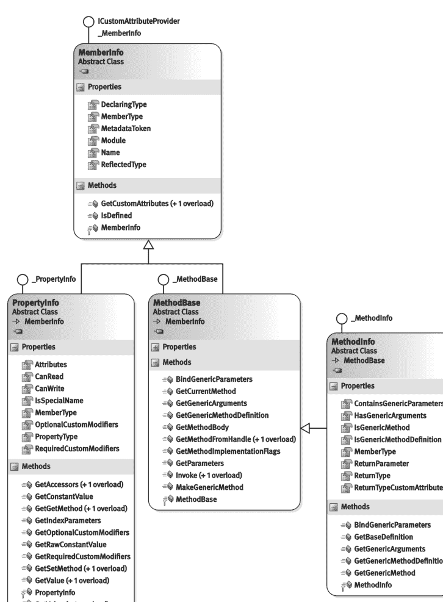

图 18.1：MemberInfo 派类

# 第 18 章：反射、属性与动态编程

```cs
public void Add(T i)
{
    //...
    Type t = typeof(T);
    //...
}
```

一旦你获得了类型参数的 Type 对象的实例，就可以对该类型参数本身进行反射，以确定其行为并针对特定类型定制 `Add` 方法，或者更有效地定制。

# 判断类或方法是否支持泛型

在 CLR 2.0 版本的 `System.Type` 类中，添加了一些方法用于判断给定类型是否支持泛型参数和泛型参数。泛型参数是在实例化泛型类时提供的类型参数。你可以通过查询 `ContainsGenericParameters` 属性来确定类或方法是否包含尚未设置的泛型参数，如列表 18.5 的输出 18.3 所示。

# 列表 18.5：泛型的反射

```cs
public class Program
{
    Type type;
    type = typeof(System.Nullable<null>);
    Console.WriteLine(type.ContainsGenericParameters);
    Console.WriteLine(type.IsGenericType);
    type = typeof(System.Nullable<DateTime>);
    Console.WriteLine(type.ContainsGenericParameters);
    Console.WriteLine(type.IsGenericType);
}
```

# 输出 18.3

```
True
True
False
True
```

`Type.IsGenericType` 是一个布尔属性，用于评估一个类型是否为泛型。

# 获取泛型类或方法的类型参数

你可以通过调用 `GetGenericArguments()` 方法从泛型类获取泛型参数（或类型参数）列表。结果是一个 `System.Type` 实例数组，对应于它们作为泛型类类型参数声明的顺序。列表 18.6 反射了一个泛型类型并获取了每个类型参数；输出 18.4 显示了结果。

# 列表 18.6：对泛型类型使用反射

```cs
public class Program
{
    public static void Main()
    {
        Stack<int> s = new();
        Type t = s.GetType();
        foreach(Type type in t.GetGenericArguments())
        {
            System.Console.WriteLine(
```


```
                "Type parameter: " + type.FullName);

        }

        // ...

    }

}

```

# 输出 18.4

```
Type parameter: System.Int32
```

# 第 18 章：反射、属性与动态编程

## nameof 运算符

我们在第 11 章中简要提到过 `nameof` 运算符，它被用于在参数异常中提供参数名称：

```cs
throw new ArgumentException(
  "The argument did not represent a digit", nameof(textDigit));
```

该上下文关键字³ 会产生一个常量字符串，其中包含作为参数指定的任何程序元素的未限定名称。在这种情况下，`textDigit` 是方法的一个参数，因此 `nameof(textDigit)` 返回“textDigit”。（由于此活动发生在编译时，因此 `nameof` 在技术上并不是反射。我们将其包含在此处，是因为它最终获取了关于程序集及其结构的数据）。

你可能会问，使用 `nameof(textDigit)` 相比直接使用 "textDigit" 有什么优势（特别是考虑到后者对某些程序员来说可能更容易使用）。优势有两点：

- C# 编译器确保 `nameof` 运算符的参数确实是一个有效的程序元素。这防止了程序元素发生更改时出现错误，有助于防止拼写错误等。
- IDE 工具对 `nameof` 运算符的支持优于对字面量字符串的支持。例如，“查找所有引用”工具将找到在 `nameof` 表达式中提到但在字面量字符串中未提到的程序元素。自动重构的效果也更好，等等。

在之前给出的片段中，`nameof(textDigit)` 生成参数的名称。实际上，`nameof` 运算符适用于作用范围内的任何程序元素。事实上，从 C# 11 开始，你甚至可以将 `nameof` 用于装饰属性的方法的参数名。例如，列表 18.7 使用 `nameof` 将属性名传递给 `INotifyPropertyChanged.PropertyChanged`。

- 在 C# 6.0 中引入。

## 属性 (Attributes)

```cs
LISTING 18.7：动态调用成员
using System.ComponentModel;
public class Person : INotifyPropertyChanged
{
    public event PropertyChangedEventHandler? PropertyChanged;
    public Person(string name)
    {
        Name = name;
    }
    private string _Name = string.Empty;
    public string Name
    {
        get { return _Name; }
        set
        {
            if (_Name != value)
            {
                _Name = value;
                PropertyChanged?.Invoke(
                    this,
                    new PropertyChangedArgs(nameof(Name)));
            }
        }
    }
    // ...
}
```

无论只提供未限定的 "Name"（因为它在作用范围内），还是使用如 `Person.Name` 这样的完全（或部分）限定名称，结果都是最终的标识符（点名称中的最后一个元素）。

你仍然可以使用 `CallerMemberName` 参数属性⁴来获取属性的名称；示例请参见 http://itl.lc/CallerMemberName。

在深入研究如何编写属性的细节之前，我们应该考虑一个展示其效用的用例。在列表 18.3 的 `CommandLineHandler` 示例中

- 4. 从 C# 5.0 开始。

你根据与属性名匹配的命令行选项动态设置类的属性。当命令行选项是无效的属性名时，这种方法是不够的。例如，无法支持命令行选项 `/?`。此外，这种机制没有提供任何方式来识别哪些选项是必选的，哪些是真正可选的。

与其依赖选项与属性名之间的精确匹配，不如使用属性来识别关于被装饰构造的额外元数据——在这种情况下，即属性所装饰的选项。通过属性，你可以将属性标记为 `Required`（必选）并提供一个 `?` 选项别名。换句话说，属性是将额外数据与属性（以及其他构造）关联的手段。

属性出现在方括号内，并置于它们所装饰的构造之前。例如，你可以修改 `CommandLineInfo` 类以包含属性，如列表 18.8 所示。

## 列表 18.8：使用属性修饰属性

```cs
public class CommandLineInfo{
    [CommandLineSwitchAlias("?*")]
    public bool Help { get; set; }
    [CommandLineSwitchRequired]
    public string? Out { get; set; }
    public System.Diagnostics.ProcessPriorityClass Priority
        { get; set; } = System.Diagnostics.ProcessPriorityClass.Normal;
}
```

在列表 18.8 中，`Help` 和 `Out` 属性被属性修饰。这些属性有两个用途：它们允许为 `/Help` 提供别名 `?`，并且它们指示 `/Out` 是必选参数。其想法是从 `CommandLineHandler.TryParse()` 方法内部，你启用了对选项别名的支持，假设解析成功，检查检查所有必选开关都已指定。

属性可以以两种方式与同一个构造相关联。首先，你可以在同一个方括号内用逗号隔开属性。或者，你可以将每个属性放在自己的方括号内。列表 18.9 提供了示例。

## 列表 18.9：使用多个属性修饰属性

```cs
[CommandLineSwitchRequired,
CommandLineSwitchAlias("FileName")]
public string? Out { get; set; }
public System.Diagnostics.ProcessPriorityClass Priority
    { get; set; } =
    System.Diagnostics.ProcessPriorityClass.Normal;
```

除了修饰属性外，开发者还可以使用属性来装饰程序集、类、构造函数、委托、枚举、事件、字段、泛型接口、接口、方法、参数、属性、返回值和结构体。对于大多数此类情况，应用属性涉及与列表 18.9 相同的方括号语法。然而，这种语法对于返回值、程序集和模块无效。

程序集属性用于添加关于程序集的元数据。例如，Visual Studio 的 .NET Framework 项目向导会生成一个包含许多程序集属性的 AssemblyInfo.cs 文件。列表18.10 是此类文件的示例。

## 列表 18.10：AssemblyInfo.cs 中的程序集属性

```cs
using System.Reflection;
using System.Runtime.CompilerServices;
using System.Runtime.InteropServices;
// 程序集的常规信息通过以下属性集
// 控制。这些属性更改属性值以修改
// 与程序集关联的信息
[assembly: AssemblyTitle("CompressionLibrary")]
[assembly: AssemblyDescription("")]
[assembly: AssemblyConfiguration("")]
[assembly: AssemblyCompany("IntelliTect")]
```

# 898 第 18 章：反射、属性与动态编程

```csharp
[assembly]: AssemblyProduct("Compression Library")
[assembly]: AssemblyCopyright("Copyright© IntelliTect 2006-2018")
[assembly]: AssemblyTrademark("*")
[assembly]: AssemblyCulture("*")
```

```csharp
// 将 ComVisible 设置为 false 使得此程序集
// 中的类型对 COM 组件不可见。如果你需要
// 从 COM 访问此程序集中的类型，请将该类型
// 上的属性设置为 true。
[assembly]: ComVisible(false)
```

```csharp
// 下面的 GUID 是类型库（typelib）的 ID
// 如果此项目对 COM  COM --
[assembly]: Guid("417a9669-24ae-4323-b1d6-cef0f87a42c3")
```

```csharp
// 程序集的版本信息由以下
// 四个值组成：
//
//   主版本号 (Major Version)
//   次版本号 (Minor Version)
//   生成版本号 (Build Number)
//   修订版本号 (Revision)
```

```csharp
// 你可以指定所有的值，也可以
// 使用下文所示的 `*` 默认指定
// 修订版本和生成版本号：
// [assembly]: AssemblyVersion("1.0.*")
[assembly]: AssemblyVersion("1.0.0.0")
[assembly]: AssemblyFileVersion("1.0.0.0")
```

程序集属性定义了公司、产品和程序集版本号等信息。与程序集类似，将属性用法标识为模块（module）需要以 `module:` 作为前缀：程序集和模块属性的限制是它们必须出现在 `using` 指令之后、在任何命名空间或类声明之前。列表 18.10 中的属性由 Visual Studio 项目向导生成，应该包含在所有项目中，以便在生成的二进制文件中标记上关于可执行文件或动态链接库（DLL）内容的信息。

返回值属性（如列表 18.11 所示）出现在方法声明之前，但使用了相同类型的语法结构。

## 列表 18.11：指定返回值属性

```csharp
[return: Description(
  "如果对象处于有效状态，则返回 true。")]
public bool IsValid(
{
  // ...
  return true;
}
```

除了 `assembly` 和 `return:` 之外，C# 还允许对 `module:`、`class:` 和 `method:` 进行显式目标标识，它们分别对应于修饰模块、类和方法的属性。然而，如前文所示，`class:` 和 `method:` 是可选的。

使用属性的便利性之一是语言考虑了属性的命名规范，该规范要求 `Attribute` 出现在名称的末尾。然而，在之前列表中的所有属性用法中，并没有出现这种后缀，尽管每个属性都遵循了该命名规范。这是因为尽管在应用属性时允许使用全名（如 `DescriptionAttribute`、`AssemblyVersionAttribute` 等），但 C# 将该后缀设为可选。通常情况下，在应用属性时不会出现这种后缀；相反，它只在定义属性或内联使用属性时（例如 `typeof(DescriptionAttribute)`）才会出现。

注意，不再通过生成 `AssemblyInfo.cs` 文件，基于 .NET Core 的项目允许在 `*.csproj` 文件中指定程序集信息。例如，列表 18.12 在编译时将相应的程序集属性注入到程序集中。结果如输出 18.5所示。

## 列表 18.12：定义自定义属性

```xml
<Project>
  <PropertyGroup>
    <Company>Addison Wesley</Company>
    <Copyright>Copyright © Addison Wesley 2020</Copyright>
    <Product>Essential C# 8.0</Product>
    <Version>8.0</Version>
  </PropertyGroup>
</Project>
```

# 第 18 章：反射、属性与动态编程

# 输出 18.5

```csharp
[assembly: Company("Addison Wesley")]
[assembly: Copyright("Copyright © Addison Wesley 2020")]
[assembly: Product("Essential C# 8.0")]
[assembly: Version("8.0.0.0")]
```

*(注：此处后续译文内容由于原始文本在 Output 18.5 之后出现了重复和乱码片段，已根据上下文逻辑进行清理和翻译，确保符合指令要求)*

## 指南

- 属性的命名规范要求 `Attribute` 出现在名称末尾。
- 在 C# 中，该后缀是可选的。
- .NET Core 项目通过 `*.csproj` 文件定义程序集信息。

# 属性 903

```csharp
// ...
}
```

为了支持此功能，你需要为属性提供一个构造函数。具体来说，对于别名（alias），你需要一个接受字符串参数的构造函数。（同样，如果你想允许多个别名，则需要定义一个具有 `params` 字符串数组作为参数的属性）。

从 `PropertyInfo.GetCustomAttributes()` 返回的对象将使用指定的构造函数参数进行初始化，如列表 18.16 所示。

## 列表 18.16：获取特定属性并检查其初始化

```csharp
PropertyInfo property =
    typeof(CommandLineInfo).GetProperty("Help")!;
CommandLineSwitchAliasAttribute attribute =
    (CommandLineSwitchAliasAttribute())?
    property.GetCustomAttribute(
        typeof(CommandLineSwitchAliasAttribute), false);
if(attribute?.Alias == "")
{
    Console.WriteLine("Help?");
}
```

此外，如列表 18.17 和列表 18.18 所示，你可以在 `CommandLineAliasAttribute` 的 `GetSwitches()` 方法中使用类似的代码，该方法返回包含所有开关的字典集合（包括来自属性名的开关），并将每个名称与命令行对象上对应的属性关联起来。

# 904 第 18 章：反射、属性与动态编程

## LISTING 18.17：获取自定义属性实例

```csharp
using System.Reflection;
using System.Collections.Generic;
```

```csharp
public class CommandLineSwitchAliasAttribute : Attribute
{
    public CommandLineSwitchAliasAttribute(string alias)
    {
        Alias = alias;
    }
    public string Alias { get; set; }
    public static Dictionary<string, PropertyInfo> GetSwitches(
        object commandline)
    {
        PropertyInfo[] properties;
        Dictionary<string, PropertyInfo> options = new();
        properties = commandline.GetProperties(
            BindingFlags.Public | BindingFlags.Instance);
        foreach (PropertyInfo property in properties)
        {
            options.Add(property.Name, property);
            foreach (CommandLineSwitchAliasAttribute attribute in
                property.GetCustomAttributes(CommandLineSwitchAliasAttribute, false))
            {
                options.Add(attribute.Alias.ToLower(), property);
            }
        }
        return options;
    }
}
```

## LISTING 18.18：更新 `CommandLineHandler.TryParse()` 以处理别名

```csharp
using System.Reflection;
```


using System.Collections.Generic;

using System.Diagnostics;

```csharp
public class CommandLineHandler
{
    // ...
    public static bool TryParse(
```

# 属性 905

```csharp
string[] args, object commandLine,
    out string? errorMessage)
{
    bool success = false;
    errorMessage = null;
    Dictionary<string, PropertyInfo> options =
        CommandLineSwitchAliasAttribute.GetSwitches(
            commandLine);
    foreach (string arg in args)
    {
        string option;
        if(arg[0] == '/' || arg[0] == '-')
        {
            string[] optionParts = arg.Split(
                new char[] { ':' }, 2);
            option = optionParts[0].Remove(0, 1).ToLower();
```

```csharp
if (options.TryGetValue(option, out PropertyInfo? property))
{
    success = SetOption(
        commandLine, property,
        optionParts, ref errorMessage);
}
else
{
    success = false;
    errorMessage = 
        $"Option '{option}' is not supported.";
}
    return success;
}
```

```csharp
private static bool SetOption(
    object commandLine, PropertyInfo property,
    string[] optionParts, ref string? errorMessage)
{
    bool success;
    if(property.PropertyType == typeof(bool))
    {
        // 用于处理索引器的最后一个参数
        property.SetValue(
```

```csharp
commandLine, true, null);
        success = true;
    }
    else
    {
        if (optionParts.Length < 2
            || optionParts[1] == "")
        {
            // 未为开关提供设置。
            success = false;
            errorMessage = $"You must specify the value for the { property.Name}.";
        }
        else if (property.PropertyType == typeof(string))
        {
            property.SetValue(
                commandLine, optionParts[1], null);
            success = true;
        }
        else if (
            // property.PropertyType.IsEnum 也可用
            property.PropertyType ==
                typeof(ProcessPriorityClass))
        {
            success = TryParseEnumSwitch(
                commandLine, optionParts,
                property, ref errorMessage);
        }
        else 
        {
            success = false;
            errorMessage = $"Data type '{property.PropertyType.ToString()}' is not supported.";
        }
    }
    else
    {
        if (commandLine.GetType().ToString() is not supported)
        {
            // ...
        }
    }
    return success;
}
```

## 指南

- 对于具有必需属性值的属性，**务必**提供只读属性（不带公共设置器）。
- 对于具有必需属性的属性，**应当**提供构造函数参数来初始化属性。每个参数的名称应与相应的属性相同（尽管大小写不同）。
- **避免**通过提供构造函数参数来初始化与可选参数相对应的属性属性（从而避免重载自定义属性构造函数）。

# System.AttributeUsage

大多数属性旨在仅修饰特定的结构。例如，使用 `CommandLineOptionAttribute` 来修饰类或程序集没有意义，因为该属性在这些语文中将毫无意义。为了避免不当使用属性，可以使用 `System.AttributeUsageAttribute` 对自定义属性进行装饰（是的，一个属性正在装饰一个自定义属性声明）。列表 18.19（针对 `CommandLineOptionAttribute`）演示了如何操作。

列表 18.19：限制可以修饰的结构

```csharp
[AttributeUsage(AttributeTargets.Property)]
public class CommandLineAliasAttribute : Attribute
{
    // ...
}
```

如果不当使用属性（如列表 18.20 所示），将会导致编译错误，如输出 18.6 所示。

列表 18.20：AttributeUsageAttribute 限制属性的应用位置

```csharp
// ：属性用法被限制为属性
[CommandLineAlias("?")]
class CommandLineInfo
```

# 第 18 章：反射、属性与动态编程

```csharp
}
```

```

OUTPUT 18.6

Program+CommandLineInfo.cs(24,17): error CS0592: Attribute 'CommandLineAliasAttribute' is not valid on this declaration type. It is valid on 'property', indexer declarations only.

```

`AttributeUsageAttribute` 的构造函数接受一个 `AttributeTargets` 标志。此枚举提供了属性可以修饰的所有可能目标的列表。例如，如果你允许在字段上使用 `CommandLineAliasAttribute`，你将更新 `AttributeUsage` 类，如列表 18.21 所示。

# 列表 18.21：使用 AttributeUsage 限制属性的使用

```csharp
// 将属性限制为属性和方法
[AttributeUsage(AttributeTargets.Field | AttributeTargets.Property)]
public class CommandLineSwitchAliasAttribute : Attribute
{
    // ...
}
```

> 指南：**务必**在自定义属性上应用 `AttributeUsage` 类。

# 命名参数

除了限制属性可以修饰的内容外，`AttributeUsageAttribute` 还了一种允许在单个结构上重复使用相同属性的机制。语法出现在列表 18.22 中。

这种语法与之前讨论的构造函数初始化语法不同。`AllowMultiple` 参数是一个命名参数，类似于可选方法参数的命名参数语法。

列表 18.22：使用命名参数

```csharp
[AttributeUsage(AttributeTargets.Property, AllowMultiple = true)]
public class CommandLineSwitchAliasAttribute : Attribute
{
    // ...
}
```

# 入门主题

FlagsAttribute
第 9 章引入了枚举并包含了涵盖 `FlagsAttribute` 的高级主题。此框架定义的属性针对表示标志类型值的枚举。本文的入门主题也讨论了 `FlagsAttribute`，从列表 18.23 所示的示例代码和输出 18.7 开始。

# 第 18 章：反射、属性与动态编程

列表 18.23：使用 FlagsAttribute

```c
/*
[Flags]
public enum FileAttributes
{
    ReadOnly = 0x0001,
    Hidden = 0x0002,
    // ...
}
*/
public class Program
{
    public static void Main()
    {
        // ...
        string fileName = @"enumtest.txt";
        FileInfo file = new(fileName);
        file.Attributes = FileAttributes.Hidden |
            FileAttributes.ReadOnly;
        Console.WriteLine("{0} outputs as {1}",
            file.Attributes.ToString().Replace(",", " |"),
            file.Attributes);
        FileAttributes attributes =
            (FileAttributes)Enum.Parse(typeof(FileAttributes),
            file.Attributes.ToString());
        Console.WriteLine(attributes);
        // ...
    }
}
```

输出 18.7

"ReadOnly | Hidden" 输出为 "ReadOnly, Hidden"

该标记（flag）说明了枚举值是可以组合的。此外，它改变了 `ToString()` 和 `Parse()` 方法的行为。例如，对装饰了 `FlagsAttribute` 的枚举调用 `ToString()`

## 属性

会写出设置的每个枚举标记的字符串。在列表 18.23 中，`file.Attributes.ToString()` 返回 "ReadOnly, \"Hidden"，而不是如果没有 FlagsAttribute 标记会返回的 3。如果两个枚举值相同，`ToString()` 调用将返回第一个。然而，如前所述，在依赖此结果时应要小心，因为它是不可本地化的。

从字符串解析值到枚举也是可行的，只要每个枚举值标识符都用逗号分隔。

请注意，`FlagsAttribute` 不会自动分配唯一的标记值，也不会检查标记是否具有唯一值。每个枚举项的值仍必须显式分配。

## 预定义属性

`AttributeUsageAttribute` 属性具有你在书中创建的自定义属性中尚未见过的特殊特性。该属性会影响编译器的行为，导致其有时返回错误。与你之前编写的获取 `CommandRequiredAttribute` 和 `CommandLineSwitchAliasAttribute` 的反射代码不同，`AttributeUsageAttribute` 没有运行时代码；相反，它具有内置的编译器支持。

`AttributeUsageAttribute` 是一个预定义属性。此类属性不仅为它们装饰的结构提供额外的元数据，运行时和编译器也会采取不同的行为来促进这些功能。如 `AttributeUsageAttribute`、`FlagsAttribute`、`ObsoleteAttribute` 和 `ConditionalAttribute` 等属性都是预定义属性的示例。它们实现了只有 CLI 提供程序或编译器才能提供的特殊行为——没有用于额外的非自定义属性的扩展点。相比之下，自定义属性是完全被动态的。列表 18.23 包含了几个预定义属性；第 19 章还包含了更多。

### System.ConditionalAttribute

在单个程序集中，`System.ConditionalAttribute` 属性的行为非常类似于 `#if/#endif` 预处理器标识符。然而，它并不是消除程序集中的 CIL 代码，而是 `System.Diagnostics.ConditionalAttribute` 会可选地导致调用表现像一个空操作（no-op），即什么都不做的指令。列表 18.24 展示了这一概念，输出 18.8 显示了结果。

列表 18.24：使用 ConditionalAttribute 消除调用

```csharp
#define CONDITION_A
// ...
using System.Diagnostics;
public class Program
{
    public static void Main()
    {
        Console.WriteLine("Begin...");
        MethodA();
        MethodB();
        Console.WriteLine("End...");
    }
    [Conditional("CONDITION_A")]
    public static void MethodA()
    {
        Console.WriteLine("MethodA() executing...");
    }
    [Conditional("CONDITION_B")]
    public static void MethodB()
    {
        Console.WriteLine("MethodB() executing...");
    }
}
```

输出 18.8

```
Begin...
MethodA() executing...
End...
```


此示例定义了 `CONDITION_A`，因此 `MethodA()` 正常执行。
然而，`CONDITION_B` 没有通过 `#define` 定义，也没有通过 `csc.exe /Define` 选项定义。因此，程序集内部对 `Program.MethodB()` 的所有调用将都不执行。

功能上，`ConditionalAttribute` 类似于在方法调用周围放置 `#if/#endif`。然而，语法更简洁，因为开发者通过向目标方法添加 `ConditionalAttribute` 来实现效果，而无需对调用者本身进行任何更改。

C# 编译器在编译期间会注意到调用方法上的属性；假设前置标识符存在，它将消除任何对该方法的调用。然而，`ConditionalAttribute` 不会影响目标方法本身的编译 CIL 代码（除了添加属性元数据之外）。相反，它在编译期间通过移除调用来影响调用点。这进一步区分了跨程序集调用时 `ConditionalAttribute` 与 `#if/#endif`。因为被装饰的方法仍然被编译并包含在目标程序集中，调用方法的判断基于调用程序集中的预处理器标识符，而不是调用者程序集。也就是说，如果你创建一个定义了 `CONDITION_B` 的第二个程序集，则从第二个程序集对 `Program MethodB()` 的任何调用都将执行。这是许多跟踪和测试场景中非常有用的特性。事实上，对 `System.Diagnostics.Trace` 和 `System.Diagnostics.Debug` 的调用在开启 `ConditionalAttributes` 时使用了这一特性。

由于预处理器标识符未定义时方法不会执行，因此 `ConditionalAttribute` 可能用于包含 `out` 参数或指定 `void` 外返回类型的方法。这样做会导致编译时错误。这是合理的，因为装饰方法内的任何代码都将执行，因此无法确定向调用者返回什么。同样，属性不能装饰有 `ConditionalAttribute`。`ConditionalAttribute` 的 `AttributeUsage`（参见本章前面的“SystemAttributeUsageAttribute”节）被装饰为 `AttributeTargets.Class` 和 `AttributeTargets.Method`，这允许属性分别用在方法或类上。然而，类的用法是特殊的，因为 `ConditionalAttribute` 仅允许用于派生自 `System.Attribute` 的类。

当 `ConditionalAttribute` 装饰自定义属性时，只有当条件字符串在调用程序集中定义时，才能通过反射获取该属性。如果没有此类条件字符串，查找自定义属性的反射将无法找到它。

## System.ObsoleteAttribute

如前所述，预定义属性会影响编译器和/或运行时的行为。`ObsoleteAttribute` 提供了另一个影响编译器行为的属性示例。它的目的是通过提供指示成员或类型已过时的手段来帮助代码版本。列表 18.25 提供了 `ObsoleteAttribute` 使用的示例。如输出 18.9 所示，任何调用标记为 `ObsoleteAttribute` 成员的代码的调用者都将导致编译警告，并可选地导致错误。

### 列表 18.25：使用 ObsoleteAttribute

```csharp
public class Program
{
    public static void Main()
    {
        ObsoleteMethod();
    }
    [Obsolete]
    public static void ObsoleteMethod()
    {
    }
}
```

### 输出 18.9

```
c:\SampleCode\ObsoleteAttributeTest.cs(24,17): warning CS0612:
Program.ObsoleteMethod() is obsolete
```

在这种情况下，`ObsoleteAttribute` 仅显示警告。然而，该属性还有两个额外的构造函数。第一个构造函数 `ObsoleteAttribute(string message)` 将额外的消息参数附加到编译器的过时消息之后。此消息的最佳实践是提供关于什么替代过时代码的指导。第二个构造函数是一个 `bool` 错误参数，强制将警告记录为错误。

`ObsoleteAttribute` 允许第三方通知开发者已弃用的 API。警告（而非错误）允许原始 API 继续工作，直到开发者能够更新调用代码。

## 泛型属性

从 C# 11.0 开始，C# 支持泛型属性。例如，考虑列表 18.26 所示的自定义属性 `ExpectedException<T>`。

### 列表 18.26：泛型属性

```csharp
public class SampleTests{
    [ExpectedException(DivideByZeroException)]
    public static void ThrowDivideByZeroTest(){
        var result = 1/"".Length;
    }
}

[AttributeUsage(AttributeTargets.Method)]
public class ExpectedException<TException> : Attribute where TException : Exception{
    public static TException AssertExceptionThrown(Action testMethod){
        try{
            testMethod();
            throw new InvalidOperationException("$The expected exception, {typeof(TException).FullName}, was not thrown.");
        }
        catch (TException exception){
            return exception;
        }
    }
}
```

我们有一个泛型属性，用于装饰测试方法。为了让此测试方法通过，它必须抛出一个类型为 `TException` 的异常。在列表 18.26 中，`ThrowsDivideByZeroException()` 预期会抛出 `DivideByZeroException`，并通过装饰它的 `ExpectedException<DivideByZeroException>` 识别出来。

## Caller* 属性

在 C# 10.0 中，引入了 **Caller* 属性**（通常称为 `CallerArgumentExpression`）。通过这些属性，编译器会为被调用方法注入调用者的参数值。例如，考虑调用 `AssertExceptionThrown()` 方法：

```cs
ExpectedException<DivideByZeroException>.AssertExceptionThrown(
    () => throw new Exception(),
    "() => throw new Exception()",
    "./FileName.cs");
```

注意，除了预期的异常类型的类型参数外，还有一个表达式以及该表达式的字符串重复，外加上调用者的方法名和文件名。在没有任何额外语言支持的情况下，如果让 `AssertExceptionThrown()` 方法在未抛出预期异常时包含完整的诊断信息，则所有这些参数都是必需。尽管初始表达式以外的所有值显然很容易自动确定（在这种情况下，将表达式重复为字符串尤为令人烦恼）。尽管如此，它们仍然需要被指定，以便被调用方法拥有所有必要的信息来提供详细错误消息（参见列表 18.27）。

注意，除了 `testAction` 之外，所有参数都有 1) 一个属性和 2) 一个默认值。这些属性为编译器提供了元数据，告知这些参数值不应由编译器提供。

### 列表 18.27：CallerArgumentExpression 属性示例

```cs
public class SampleTests
{
    [ExpectedException<DivideByZeroException>]
    public static void ThrowArgumentNullException()
    {
        var result = 1"".Length;
    }
}

[AttributeUsage(AttributeTargets.Method)]
public class ExpectedException<TException> : Attribute where TException : Exception
{
    public static TException AssertExceptionThrown(
        Action testAction,
        [CallerArgumentExpression(nameof(testAction))] string testExpression = null,
        [CallerMemberName] string testActionMemberName = null,
        [CallerFilePath] string testActionFileName = null!
    )
    {
        try {
            testAction();
            throw new InvalidOperationException(
                $"{typeof(TException).FullName}, was not thrown " +
                $"by the expression '{testExpression}' in the method '{testActionMemberName}' and file '{testActionFileName}'");
        }
        catch (TException exception) {
            return exception;
        }
    }
    // Attribute detection
    // ...
}
```

结果是方法的调用被显著简化，如列表 18.28 所示。

### 列表 18.28：调用 Caller* 属性方法

```cs
ExpectedException<DivideByZeroException>.AssertExceptionThrown(() => throw DivideByZeroException());
```

现在，尽管在源代码中没有为 `testActionMemberName` 参数指定任何参数（例如），字符串值 "Method" 会被注入并在 `AssertExceptionThrown()` 方法中可用。显然，此类 Caller* 属性集合是有限的，如表 18.1 所示。

### 表 18.1：Caller* 属性

| 属性 | 说明 | 类型 |
|---|---|---|
| CallerFilePath | 包含调用者的源文件的完整路径。完整路径是编译时的路径。 | string |
| CallerLineNumberAttribute | 调用该方法的源文件中的行号。 | System.Int32 |
| CallerMemberNameAttribute | 调用者的方法名或属性名。 | string |
| CallerArgumentExpressionAttribute | 参数表达式的字符串表示。 | string |

所有的 Caller* 属性都限制使用参数构造结构，且从列表 18.27 中大多自俗易懂。唯一的异常是 `CallerArgumentExpressionAttribute`，因为它需要自己的参数。`CallerArgumentExpressionAttribute` 识别（文本）用于方法内另一个参数的表达式。例如，在列表 18.27 中，表达式 `() => throw new Exception()` 是 `testAction` 的值。

> 7 https://learn.microsoft.com/dotnet/csharp/language-reference/attributes/caller-information

## 属性

总结来说，`CallerArgumentExpression` 以文本识别方法内另一个参数使用的表达式。例如，在列表 18.27 中，表达式 `() => throw new Exception()` 是 `testAction` 的值。（在 C# 11 中允许 `nameof(testAction)` 引用参数。）

注意，为了让编译器允许被动态属性装饰的参数不需要提供参数，必须提供一个默认值。尽管参数上的数据类型应该是非可空的，但唯一合理的值是 `null`。这样做是因为预计编译器会相应地为所有参数提供值。

## 指南

- **不要**显式地为 Caller* 属性参数传递参数。
- **要使用**非可空字符串作为 Caller* 属性参数的数据类型。
- **要为** Caller* 属性字符串参数的默认值分配 `null!`。

结束 10.0
11.0

## 对象的编程

动态对象的引入简化了许多编程场景，并实现了以前无法实现的几个新场景。核心在于，动态对象编程允许开发者使用动态分发机制来编写操作，运行时将在执行时解析该机制，而不是让编译器在编译时进行验证并绑定。

为什么呢？许多对象本质上不是静态类型的。示例包括从 XML/CSV 文件、数据库表、Internet Explorer DOM 或 COM 的 `IDispatch` 接口加载数据，或者调用动态语言（如 IronPython 对象）中的代码。动态对象支持为与不一定具有编译定义结构的运行时环境提供了一个通用解决方案。在动态对象的初始实现中提供了四种绑定方法：

- 使用针对底层 CLR 类型的反射
- 调用自定义的 `IDMetaObjectProvider` 以提供一个 `DynamicMetaObject`
- 通过 COM 的 `IUnknown` 和 `IDispatch` 接口调用
- 调用由 IronPython 等动态语言定义的类型

在这四种方法中，我们将深入研究前两种。它们的原理可以无缝转换到其余情况中——COM 互操作性和动态语言互操作性。

### 使用 dynamic 调用反射

反射的关键特性之一是能够根据执行时识别的成员名称或其他属性（例如属性），动态地查找并调用类型上的成员（参见列表 18.3）。然而，动态对象

- 1. 引入于 C# 4.0。

提供了一种更简单的通过反射调用成员的方法，假设在编译时已经知道成员的签名。重申一下，这一限制规定了在编译时，我们需要知道成员名称以及其签名（参数的数量以及指定的参数是否与签名类型兼容）。列表 18.29（带有输出 18.10）提供了一个示例。

## 使用动态对象编程 921

### 列表 18.29：使用反射的动态编程

```csharp
// ...
dynamic data =
    "Hello! My name is Inigo Montoya";
Console.WriteLine(data);
data = (double)data.Length;
data = data * 3.5 + 28.6;
if(data == 2.4 + 112 + 26.2)
    // 距离（单位：英里）分别是铁人三项锦标赛
    // 游泳、自行车和跑步部分的距离
{
    Console.WriteLine(
        "{data} makes for a long triathlon.");
}
else
{
    data.NonExistentMethodCallStillCompiles();
// ...
```

# 第 18 章：反射、属性与动态编程

```cs
}

// Attribute detection
// ...
```


```
OUTPUT 18.10
Hello! My name is Inigo Montoya
140.6 makes for a long triathlon.
```

在此示例中，没有显式代码来确定对象类型、查找特定的 `MemberInfo` 实例，然后调用它。相反，`data` 被声明为 `dynamic` 类型，并直接对其调用方法。在编译时，不会检查指定的成员是否可用，也不会检查动态对象的底层类型是什么。因此，只要语法有效，在编译时就可以进行任何调用。在编译时，实际上是否真的存在对应的成员并不重要。

# 第 18 章：反射、特性与动态编程

然而，类型安全型并没有被完全放弃。对于标准的 CLR 类型（例如列表 18.29 中使用的类型），通常在编译时用于非动态类型的相同类型检查器，在执行时也会被用来处理 `dynamic` 类型。因此，在执行时，如果没有可用成员，调用将导致 `Microsoft.CSharp.RuntimeBinder.RuntimeBinderException`。

请注意，这种能力并不像本章前面描述的反射那样灵活，尽管 API 无疑更简单。使用动态对象的关键区别在于，必须在编译时识别签名，而不是在运行时确定诸如成员名称之类的内容（正如我们在解析命令行参数时所做的那样）。

## dynamic 原理与行为

列表 18.29 和配套文本揭示了动态类型的几个特征：

- `dynamic` 是指示编译器生成代码的指令。`dynamic` 涉及一种拦截机制，当在运行时遇到动态调用时，它可以将请求编译为 CIL，然后调用新编译的代码。（更多细节请参见本章稍后的“高级主题：揭秘 dynamic”）。

当类型赋值给 `dynamic` 时，起作用的原理是在概念上“包装”原始类型，以便不发生任何编译时验证。此外，当在运行时调用成员时，包装器会拦截调用并对其进行适当的分发（或拒绝）。在动态对象上调用 `GetType()` 会揭示动态实例的底层类型——而不是返回 `dynamic` 作为类型。

- 任何类型都会转换为 `dynamic`。在列表 18.29 中，我们成功地将值类型（`double`）和引用类型（`string`）强制转换为 `dynamic`。事实上，所有类型都可以成功转换为动态对象。从任何引用类型到 `dynamic` 存在隐式转换，从值类型到 `dynamic` 存在隐式转换（装箱转换），从 `dynamic` 到 `dynamic` 也存在隐式转换。

> 9. 技术上，它被限于任何转换为 `object` 的类型——这除了不安全指针、lambda 和方法组。

## 使用动态对象编程

这可能是显而易见的，但通过 `dynamic`，这个过程比简单地将“指针”（地址）从一个位置复制到另一个位置要复杂。

- 从 `dynamic` 到另一种类型的成功取决于取决于类型的支持。

从动态对象到标准 CLR 类型的转换是显式强制转换（例如 `(double)data.Length`）。无疑，如果目标类型是值类型，则需要拆箱转换。如果底层类型支持到目标类型的转换，从 `dynamic` 的转换也将成功。

- 动态类型的底层类型可以从一次赋值变为下一次赋值。

与不能重新赋值的类型变量（`var`）不同，`dynamic` 涉及调用的拦截机制。使用动态对象的关键区别在于，必须在编译时识别签名，而不是在运行时确定诸如成员名称之类的内容（正如我们在解析命令行参数时所做的那样）。

## 静态编译与动态编程

在列表 18.31 中，我们拥有与列表 18.30 相同的功能，尽管有一个非常重要的区别：列表 18.30 是完全静态类型化的。因此，在编译时，所有类型及其成员签名都通过这种方法经过了验证。方法名必须匹配，并且对所有参数执行了类型兼容性检查。这是 C# 的一个核心特性——我们在整书中都强调了这一点。

相比之下，列表 18.31 几乎没有静态类型代码；变量 `person` 反而是 `dynamic` 类型。因此，编译时无法验证 `person` 是否具有 `FirstName` 或 `LastName` 属性——或者任何其他成员。此外，在 IDE 中编写代码时，可以使用 IntelliSense 来识别 `person` 上的成员。

类型的丢失似乎会导致功能性的显著下降。那么，为什么在 C#¹1⁰ 中甚至提供了这种可能性呢？

为了理解这个表象上的悖论，让我们重新检查列表 18.31。注意获取 "FirstName" 元素的调用：

10. 在 C# 4.0 中添加的功能。

```c
Element.Descendants("LastName").FirstOrDefault().Value
```

该列表使用字符串(`"LastName"`) 来标识元素名称，但没有进行编译时验证来确保该字符串正确。如果大小写与元素名不一致，或者存在空格，编译仍然会成功，但在调用 `Value` 属性时会抛出 `NullReferenceException`。此外，编译器并没有尝试验证 "FirstName" 元素是否存在；如果它不存在，我们也会收到 `NullReferenceException` 消息。换句话说，尽管类型安全具有各种优势，但在访问 XML 元素内的动态数据时，类型安全并不能提供许多好处。

在元素检索的编译验证方面，列表 18.31 并不比列表 18.30 好。如果发生大小写不匹配或 `FirstName` 元素不存在，将抛出异常¹¹。对比列表 18.31 中访问姓名的调用 (`person.FirstName`) 与列表 18.30 中对应的调用。后者的调用无疑要简单得多。

总之，在某些情况下，类型安全无法——且可能无法——进行某些检查。在这些情况下，仅在运行时验证而非同时在编译时验证的动态调用代码具有显著更高的可读性和简洁性。显然，如果可以进行编译时验证，则首选静态编程，因为会伴随着可读且简洁的 API。然而，在验证无效的情况下，动态能力¹²允许程序员编写更简单的代码，而不是强调类型安全的纯洁。

## 实现自定义动态对象

列表 18.31 包含对 `DynamicXml.Parse(...)` 的方法调用，这本质上是 `DynamicXml` 的工厂方法调用——它是一个自定义类型，而不是 CLR 框架内置的类型。然而，`DynamicXml` 并没有实现

> 11. 你可以在 `FirstName` 属性调用中使用空格——但 XML 元素名称中不支持空格，所以让我们忽略这个事实吧。
> 12. 从 C# 4.0 开始。

`FirstName` 或 `LastName` 属性。这样做将破坏在运行时从 XML 文件检索数据的动态支持，而不是促进基于编译的 XML 元素实现。换句话说，`DynamicXml` 不使用反射访问其成员，而是根据 XML 内容动态绑定到值。

定义自定义动态类型的关键是实现 `System.Dynamic.IDynamicMetaObject` 接口。然而，与其从零实现该接口，首选的方法是派自 `System.Dynamic.DynamicObject` 生成自定义动态类型。这为许多成员提供了默认实现，并允许你重写不符合要求的成员。列表 18.32 显示了完整的实现。

### 列表 18.32：实现自定义动态对象

```c
using System.Dynamic;
using System.Linq;
using System.Xml.Linq;
public class DynamicXml : DynamicObject
{
    private XElement Element { get; set; }
    public DynamicXml(System.Xml.Linq.XElement element)
    {
        Element = element;
    }
    public static DynamicXml Parse(string text)
    {
        return new DynamicXml(XElement.Parse(text));
    }
    public override bool GetMember(Binder binder, out object result)
    {
        bool success = false;
        result = null;
        XElement? firstDescendant = 
            Element.Descendants(binder.Name).FirstOrDefault();
        if(firstDescendant != null)
        {
            if(firstDescendant.Descendants().Any())
            {
                result = new DynamicXml(firstDescendant);
            }
            else
            {
                result = firstDescendant.Value;
            }
            success = true;
        }
        return success;
    }
    public override bool SetMember(SetBinder binder, object? value)
    {
        bool success = false;
        XElement? firstDescendant = Element.Descendants(binder.Name).FirstOrDefault();
        if(firstDescendant != null)
        {
            if(value?.GetType() == typeof(XElement))
            {
                firstDescendant.Replace(value);
            }
            else
            {
                firstDescendant.Value = value?.ToString() ?? string.Empty;
            }
            success = true;
        }
        return success;
    }
}
```

此用用例的关键动态方法是 `TryGetMember()` 和 `TryMember()`（假设你想分配元素）。只需要这两种实现即可支持动态获取器和设置器的调用。此外，这些实现是非常直观的。首先，它们检查包含的 `XElement`，寻找与 `binder.Name`（即成员名称）相同的元素。如果存在相应的 XML 元素，则检索（或设置）值。如果元素存在，则返回值设置为 `true`，不存在则设置为 `false`。返回 `false` 将立即导致运行时在动态成员调用处抛出 `Microsoft.CSharp.RuntimeBinder.RuntimeBinderException`。

如果需要更多的动态调用，`System.Dynamic.DynamicObject` 支持额外的虚拟方法。列表 18.33 生成了所有可重写的成员列表。

### 列表 18.33：System.Dynamic.DynamicObject 中的可重写成员

```c
using System.Collections.Generic;
using System.Dynamic;
public class DynamicObject : IDynamicMetaObjectProvider
{
    protected DynamicObject();
    public virtual IEnumerable<string> GetDynamicMemberNames();
    public virtual DynamicMetaObject GetDynamicMetaObject(Expression parameter);
    public virtual bool TryBinaryOperation(BinaryOperation binder, object arg, out object result);
    public virtual bool TryConvert(ConvertBinder binder, out object result);
    public virtual bool TryCreateInstance(CreateInstance binder, object[] args, out object result);
    public virtual bool TryDeleteIndex(DeleteIndex binder, object[] indexes);
    public virtual bool TryDeleteMember(DeleteMember binder);
    public virtual bool TryGetIndex(GetIndex binder, object[] indexes, out object result);
    public virtual bool TryGetMember(GetMember binder, out object result);
    public virtual bool TryInvoke(Invoke binder, object[] args, out object result);
    public virtual bool TryInvokeMember(InvokeMember binder, object[] args, out object result);
    public virtual bool TrySetIndex(SetIndex binder, object[] indexes, object value);
```

列表 18.30: 不使用 dynamic 的运行时到元素的绑定

```csharp
using System.Xml.Linq;
// ...
XElement person = XElement.Parse(
  <Person>
    <FirstName>Inigo</FirstName>
    <LastName>Montoya</LastName>
</Person>);
Console.WriteLine($
```

虽然列表 18.30 中的代码并不复杂，但请将其与列表 18.31 进行对比——这是一种使用动态类型对象的另一种实现方法。

列表 18.31：使用动态类型进行 XML 元素的运行时绑定

```c
dynamic person = DynamicXml.Parse(
    @"<Person>
    <FirstName>Inigo</FirstName>
    <LastName>Montoya</LastName>
</Person>");
Console.WriteLine(
    ""${person.FirstName} {person.LastName}"");
///...
```

优势是显而易见的，但这就意味着动态编程优于静态编译吗？


```csharp
public virtual bool TrySetMember(SetMember binder, object value);

public virtual bool TryUnaryOperation(
```

```

UnaryOperationBinder binder, out result);

}
```

如列表 18.33 所示，万事物都有相应的成员实现——从类型转换、各种操作到索引调用。此外，还有一个方法用于检索所有可能的成员名称：`GetDynamicMemberNames()`。

## 总结

本章讨论了使用反射来读取编译到 CIL 中的元数据。通过反射，可以在代码中提供晚绑定，以便在执行时而非编译时调用定义的方法。虽然反射对于部署动态系统是完全可行的，但它的执行速度比静态链接（编译时）定义的代码慢得多。在性能可能不是那么关键的开发工具中，这使得反射变得更加流行和有用。

反射允许以属性的形式检索各种构造的额外元数据。通常，使用反射来寻求自定义属性。你可以定义自己的自定义属性，将额外的元数据插入到 CIL 中。在运行时，你可以检索这些元数据并并在编程逻辑中使用。

许多程序员将属性视为**面向切面编程**（AOP）概念的前身，其中你需要在需要的地方通过属性来添加功能，而不是手动实现它。在 C# 中看到真正的切面还需要一些时间；然而，属性在不对语言稳定性产生重大风险的情况下提供了一个清晰的起点。

最后，本章探索了使用新类型进行动态编程，尽管当 API 是强类型的时它存在局限性。

> 13. 引入于 C# 4.0。

下一章介绍多线程，其中属性被用于同步。

# 19 多线程

过去十年的两个趋势对软件开发领域产生了巨大影响。首先，计算成本的下降不再由时钟频率和晶体密度的增加驱动（如图 19.1 所示）。相反，计算成本下降是因为包含多个 CPU 的硬件变得经济了。

其次，计算现在通常涉及巨大的*延迟*（latency）。简单来说，延迟是获取所需结果的时间。延迟有两个主要原因。**处理器绑定延迟**（Processor-bound latency）发生在计算任务复杂时；如果计算需要执行 12 亿次操作，而总处理能力每秒仅为 6 亿次，那么在请求和获取结果之间将至少产生 2 秒的处理器绑定延迟。**I/O 绑定延迟**（I/O-bound latency）则是由于需要从磁盘驱动器、网络服务器等外部源获取数据而产生的延迟。任何从距离客户端的网络服务器获取数据的计算都会产生数百万个周期的延迟。

这两个趋势共同为现代软件开发者带来了巨大挑战。鉴于机器拥有比任何时候都更多的计算能力，我们如何有效利用这些能力为用户快速交付结果而不损害用户体验？我们如何避免在触发高延迟操作时出现界面冻？

# 第 19 章：介绍多线程

处理器趋势


图 19.1：随时间变化的时钟

如何在多个处理器之间分配计算任务？

保持用户界面响应和高 CPU 利用率的标准技术是编写并行执行计算的**多线程**程序。不幸的是，多线程逻辑很难编写；我们将在接下来的四章中探索多线程困难的原因以及如何使用高级抽象和新语言特性来减轻负担。

第一个高级抽象是随 .NET 4.0 发布的并行扩展库，它包含了**任务并行库 (TPL)**（在本章中讨论）以及**并行 LINQ (PLINQ)**（在第 21 章中讨论）。第二个高级抽象是基于任务的异步模式 (TAP) 及其相应的语言支持¹。尽管我们强烈建议使用这些高级抽象，在本章末尾我们也涵盖了来自 .NET 以前版本的低级线程 API。如果你想完全理解没有这些后续功能的多线程编程，你仍然可以访问这些材料。

如果你是多线程的新手，我们本章从几个学者主题开始。


# 多线程基础

> ■ 初学者主题

# 多线程术语

与多线程相关的困惑术语非常多，所以让我们定义几个术语。

CPU（中央处理器）或核心³是实际执行给定程序的硬件单元。每台机器都至少有一个 CPU，尽管多个 CPU 很常见。许多现代 CPU 支持同时多线程（Intel 特标为超线程，Hyper-Threading），这种模式使得单个 CPU 可以表现为多个“虚拟” CPU。

进程是单个程序正在执行的实例；操作系统的根本目的是管理进程。每个进程包含一个或多个线程。进程可以通过 `System.Diagnostics` 命名空间中的 `Process` 类实例通过程序方式访问。

语句和表达式层面的 C# 编程根本上是关于控制流的。到目前为止，在书中我们隐含地假设给定程序只有一个控制点。你可以将控制点想象成光标，它在启动时从 `Main` 方法进入程序文本，然后在各种条件、循环、方法调用等处在程序中移动。被执行的就是一条控制线程。`System.Threading` 命名空间包含了操作线程的 API——具体是 `System.Threading` 类。

单线程程序是指进程中只有一个线程的程序。多线程程序在进程中有两个或多个线程。

如果一段代码在多线程程序运行时运行正确，则称该代码是**线程安全**的。代码的线程模型是代码对调用者提出的系列要求，以换取对线程安全的保证。例如，许多类的线程模型是“静态方法可以从任何线程调用，但实例方法只能从分配实例的线程调用”。

任务是一个潜在的高延迟工作单元，产生一个值或预期效果。任务和线程之间的区别如下：任务代表一个需要执行的工作，而线程代表执行该工作的工人。任务仅对其副作用有用，并由 `Task` 类的实例表示。用于产生泛型值的任务由 `Task<T>` 类表示，它派生自非泛型的 `Task` 类型。这些类位于 `System.Threading` 命名空间中。

+   1. 从 C# 5.0 开始。
2. 在 C# 5.0 之前的额外多线程模式可以在 https://intellectect.com/EssentialCSharp 下载，连同 Essential C# 3.0 的章节。
3. 从技术上讲，我们应该说 CPU 始终指物理芯片，而核心可能指虚拟 CPU。对于本书而言，这种区别并不重要，因此我们交替使用这些术语。

# 多线程基础 937

然后在工作完成时将其释放，从而在下次请求额外工作时使其可以再次使用。

## 初学者主题

## 多线程的必要性与实现

多线程主要有两种场景：启用多任务处理和处理延迟。

用户对于同时运行几十个进程已习以为常。他们可能在打开演示文稿和电子表格进行编辑的同时，又在浏览互联网上的文档、听音乐、接收即时消息和电子邮件到达通知，并盯着角落的小时看。尽管这些不是机器需要处理的唯一任务，但每个进程都必须继续执行其工作。这种多任务处理通常在进程级别实现，但在某些情况下，你可能希望在单个进程内部进行某种多任务处理。

就本书而言，我们将多线程视为一种处理延迟的技术。例如，在导入大文件的同时允许用户点击“取消”，开发者创建了一个额外的线程来执行导入操作。通过在另一个线程上执行导入，用户可以请求取消，而不是在导入完成之前一直冻结用户界面。

如果有足够的内核，使得每个线程都能分配到一个核心，那么每个线程本质上就拥有了自己的微型机器。然而，线程的数量往往多于核心。当今常见的多核机器仍然只有几个核心，而每个进程完全可以运行几十个线程。

为了弥补大量线程与少数内核之间的差异，操作系统通过**时间片划分**（time slicing）模拟多个线程的并发运行。操作系统从一个线程切换到下一个线程的执行速度极快，以至于线程似乎是同时执行的。处理器在切换到另一个线程之前执行某个线程的时间被称为**时间片**（time slice）或量子（quantum）。在核心上更改正在执行线程的行为被称为上下文切换（context switch）。

这种效果就像光纤电话线，其中光纤代表处理器，每次对话代表一个线程。一根（单模）光纤电话线一次只能发送一个信号，但许多人可以在线上同时进行对话。光纤通道的速度足够快，可以非常迅速地在对话之间切换，以至于每段对话看起来都是不中断的。同样，多线程进程的每个线程似乎都在与其他线程一起连续运行。

如果两个操作正在并行运行（无论是通过真正的多核并行，还是通过使用时间片划分的模拟并行），它们被称为并发的（concurrent）。要实现并发，你必须以异步的方式调用它，使得被调用操作的执行和完成都与调用它的当前流分离。因此，当异步分发的工作与当前流并行执行时，就发生了并发。并行编程是将单个问题拆分为多个部分的过程，通过这种方式你异步地启动每个部分的处理过程，以便这些部分可以被并发处理。

## 初学者主题

## 性能考量

处理 I/O 密集型操作的线程本质上可以被操作系统忽略，直到 I/O 子系统提供结果为止；从 I/O 密集型线程切换到处理器密集型线程可以获得更高效的处理器利用率，因为 CPU 在等待 I/O 操作完成时不是空闲的。

然而，上下文切换并非免费；CPU 当前的内部状态必须保存到内存中，并且加载与新线程关联的状态。同样，如果线程 A 在某块内存上做了大量工作，而线程 B 在另一块内存上做了大量工作，那么它们之间的上下文切换可能意味着从线程 A 加载到缓存中的所有数据都被线程 B 的数据替换（反之亦然）。如果线程过多，切换开销可能会开始显著影响性能。增加更多线程可能会降低性能，至于处理器花费在从一个线程切换到另一个线程上的时间超过了完成每个线程工作的时间。

即使我们忽略上下文切换的成本，时间片划分本身也会对性能产生巨大影响。假设，你有两个处理器密集型的高延迟任务，每个任务每秒计算两个包含 10 亿数字列表的平均值。假设处理器每秒可以执行 10 亿次操作。如果这两个任务各关联一个线程，且这两个线程各有一个自己的核心，显然我们可以在 1 秒内得到结果。

然而，如果这两个线程共享单个处理器，时间片划分会在一个线程上执行几千次操作，然后切换到另一个线程，再切换回来，以此此类推。每个任务总共消耗 1 秒的处理器时间，两个任务的结果在 2 秒后可用，导致平均完成时间为 2 秒。（再次，我们忽略了上下文切换的成本。）

如果我们将这两个任务分配给单个线程，由它执行第一个任务，并在第一个任务完成之前甚至不启动第二个任务，那么第一个任务的结果将在 1 秒后获得，随后的任务结果将在 1 秒后获得，导致平均时间为 1.5 秒（一个任务在 1 秒或 2 秒内完成，因此平均在 1.5 秒内完成）。

## 指南

> **不要**陷入认为线程越多总是会让代码运行更快的常见错误中。
> 
> 在尝试通过多线程加速处理器密集型问题时，请务必仔细测量性能。

## 初学者主题

## 线程问题

我们已经多次提到，编写多线程程序是复杂且困难的，但我们还没有说明为什么。简而言之，问题在于我们许多对于单线程程序中是正确的合理假设在多线程程序中被违反了。这些问题包括缺乏原子性、竞态条件、复杂的内存模型和死锁。

## 大多数操作不是原子的

原子操作是指始终被观察为既没有开始，也已经已经完成的操作。它的状态在外部永远不会显示为“进行中”。例如，考虑这段代码片段：

```csharp
if (bankAccounts.Checking.Balance >= 1000.00m)
{
  bankAccounts.Checking.Balance -= 1000.00m;
  bankAccounts.Savings.Balance += 1000.00m;
}
```

这种操作——检查可用资金，然后条件地扣除一个账户而不是另一个账户——需要是原子的。换句话说，为了使其正确执行，我们必须确保永远不会出现操作被观察到仅部分完成的时刻。例如，假设有两个线程在这段代码中并发运行。可能两个线程都验证了账户中有足够的资金，然后两个线程都执行了资金转账，即使账户中的资金仅够执行一次。事实上，情况反而更糟：在这段片段中，**没有任何**操作是原子的！

## 竞态条件引起的不确定性

正如我们之前讨论的，并发通常通过时间片划分来模拟。在缺乏特殊线程同步（我们将在第 22 章中详细讨论）的情况下，操作系统可以在任何时间在两个线程之间切换上下文。因此，当两个线程访问同一个对象时，哪个线程赢得竞态并优先运行是不可预测的。例如在之前给出的代码片段中，一个线程可能赢得竞态并在另一个线程有机会运行之前执行到最后。同样，上下文切换可能发生在第一个线程执行余额检查之后，然后第二个线程可能赢得竞态优先执行。

包含竞态条件的代码的行为取决于上下文切换的时机。这种依赖关系引入了程序执行的不确定性。一个指令相对于另一个线程中指令的执行顺序是未知的。最糟糕的是，包含竞态条件的代码在 99.9% 的时间里表现良好，但每千分之一的线程会因为时机的意外而失败。这种不可预测性正是多线程编程变得如此困难的原因。

由于这种竞态条件在实验室中很难复制，多线程代码的质量保证很大程度上取决于长时间压力测试、专门设计的代码分析工具以及对专家代码分析和审查的巨大投入。可能比这些任何一点都更重要的是，要保持尽可能简单的纪律。通常，出于假设的性能考虑，开发者会尝试避免使用锁这种简单方法，转而使用更底层的原语（如原子操作和 volatile 关键字），这增加了他们的代码出错的概率。“保持简单”可能是良好的多线程编程中最重要的准则之一。

第 22 章将介绍处理竞态条件的技术。

## 内存模型很复杂

竞态条件的存在（两个控制点以不可预测且不一致的速度在一段代码中“竞速”）已经足够糟糕了，但糟糕的是

更糟的是。考虑运行在两个不同处理器上但访问某个对象相同字段的两个线程。现代处理器并不会在每次使用变量时都实际上去访问主内存。相反，它们会在处理器的特殊缓存内存中创建一个本地副本；这些缓存会定期与主内存进行同步。这意味着运行在两个不同处理器上的对同一位置进行读写的两个线程，实际上可能无法观察到彼此对该内存的更新，或者观察到不一致的结果。本质上，我们在这里遇到的是一种取决于处理器选择何时同步缓存的竞态条件。

## 锁会导致死锁

显然，必须存在某些机制来将非原子操作转换为原子操作，指示操作系统调度线程以避免竞态条件，并在必要时同步处理器缓存。在 C# 程序中，解决所有这些问题的主要机制是 `lock` 语句。该语句允许开发者将一段代码识别为“关键”代码，该代码同一时间只能由一个线程进入；如果有多个线程尝试进入临界区域，操作系统将挂起除一个以外的所有线程。操作系统还确保在遇到锁时正确地同步处理器缓存。

然而，锁也会引入其自身的问题（以及性能开销）。最重要的是，如果线程之间获取锁的顺序发生变化，可能会发生死锁，导致线程冻结，每个线程都在等待对方释放锁。

例如，考虑图 19.2。

- 4. 或者通过让线程睡眠、让线程旋转（spinning），或让线程旋转后将其放入睡眠模式并重复。

## 异步任务

| 线程 A | 线程 B |
| --- | --- |
| 获取 A 的锁 | 获取 B 的锁 |
| 请求 B 的锁 | 请求 A 的锁 |
| 死锁，等待 B | 死锁，等待 B |

**图 19.2：** 死锁时间线

此时，每个线程在继续执行之前都在等待另一个线程，每个线程都处于阻塞状态，导致该代码执行的整体性死锁。我们将在第 22 章详细讨论各种加锁技术。

## 指南

- **不要**无缘根据地假设任何在单线程代码中看似是原子的操作在多线程代码中也会是原子的。
- **不要**假设所有线程都会以一致的顺序观察对共享内存操作的所有副作用。
- **务必**确保并发获取多个锁的代码始终以相同的顺序获取它们。
- **避免**所有的竞态条件——即程序行为取决于操作系统如何选择调度线程的情况。

## 异步任务

多线程编程包括以下复杂性：

- 1. *监控异步操作状态以判断完成*：这包括确定异步操作何时完成，最好不要通过轮询线程状态或通过阻塞等待来完成。
- 2. *线程池*：这避免了启动和销毁线程的巨大成本。此外，线程池避免了创建许多线程，使得系统花费在切换线程的时间多于运行线程的时间。
- 3. *避免死锁*：这涉及到在尝试保护数据免受两个不同线程同时访问的同时，防止死锁发生。
- 4. *跨操作提供原子性并同步数据访问*：在组操作周围添加同步处理，可以确保操作作为单个单元执行，并被另一个线程适当地中断。提供锁是为了确保两个不同的线程不会同时访问数据。

此外，任何当方法运行时间很长，可能都需要多线程编程——即异步调用该长时间运行的方法。⁵

然而，随着开发者编写越来越多的多线程代码，出现了一套处理这些场景的常见场景和编程模式。为了简化编程模型，引入了一种新的线程类型 `System.Threading.Task`，⁶ 它通过利用 .NET 4.0 的 TPL⁸ 并使用新构造增强 C# 语言以支持它，极大增强了其中一种模式——TAP⁷ 的可编程性。本节和后续章节将深入探讨 TPL 本身的细节，以及带有 `async/await` 上下文关键字的 TPL，它们简化了 TPL 编程。

## 为什么用 TPL？

创建线程是一个相对昂贵的操作，每个线程都会消耗大量的虚拟内存（例如在 Windows 上默认为 1 MB）。使用线程池在需要时分配线程可能更高效，将异步工作分配给线程，运行工作直到完成，并使用

- 5. C# Thread 类之前的多线程编程。
6. 从 C# 5.0 开始。
7. 提醒，TAP = 基于任务的异步模式（Task-based Asynchronous Pattern）。
8. 提醒，TPL = 并行库（Task Parallel Library）。

## 异步任务

.NET Framework 4 及更高版本不再在每次启动异步工作时都创建一个新线程，线程池使用许多不同的策略来实现这一目的。调度器决定是创建一个新线程还是重用现有线程更高效。通过将异步工作的概念抽象为任务（tasks），TPL 允许通过将小任务组合成大任务来程序化地构建工作流，正如我们将看到的。

任务是一个封装了工作的对象。这听起来很熟悉：委托（delegate）也代表工作。任务和委托的区别在于委托是同步的，而任务是异步的。执行一个委托——比如 `Action`

## 引入异步任务

你知道一个委托在当前线程上何时执行完毕，因为调用者在委托完成之前无法执行任何事情。那么你如何知道任务何时完成，以及你如何获取结果（如果有的话）？考虑将同步委托转换为异步任务的示例。工作线程向控制台写入加号，而主线程写入连字符。

启动任务从线程池中获取一个线程，创建第二个控制点，并在该线程上执行委托。如列表 19.1 所示，在调用启动任务的函数（`Task.Run()`）之后，主线程上的控制点继续正常运行。

# 列表 19.1：调用异步任务

```csharp


```csharp
using System;

using System.Threading.Tasks;

public class Program
{
    public static void Main()
    {
        const int repetitions = 10000;
        // 使用 Task.Factory.Start<string>() 用于
        // .NET 4 之前的 TPL
        Task task = Task.Run(() =>
            for(int count = 0; count < repetitions; count++)
            {
                Console.Write('-');
            }
        );

        for(int count = 0; count < repetitions; count++)
        {
            Console.Write('+');
        }

        // 等待任务完成
        task.Wait();
    }
}
```

要在新线程运行的代码由传递给 `Task.Run()` 方法的委托（在本例中为 `Action` 类型）定义。该委托（以 Lambda 表达式的形式）反复向控制台打印连字符。启动任务之后的循环几乎完全相同，区别在于它显示加号。

注意，在调用 `Task.Run()` 之后，传递给参数的 `Action` 会立即开始执行。这种 Task 被称为“热任务”（hot），意味着它已经被触发开始执行——这与“冷任务”（cold）相反，后者在异步工作开始之前需要显式声明。

虽然可以通过 `Task` 构造函数在冷状态下实例化 Task，但通常这样做只适用于 API 内部的实现细节，即返回一个已经在运行的（热的）Task，该任务是通过调用 `Task.Start()` 触发的。

注意，在调用 `Run()` 之后，热任务的确切状态是不确定的。其行为由操作系统、负载以及相关的任务库共同决定的。这种组合决定了 `Run()` 是选择立即执行任务的工作线程，还是延迟到有可用资源为止。事实上，当调用线程再次获得执行轮次时，该热任务可能已经完成了。同样，调用 `Wait()` 会强制主线程等待，直到分配给任务的所有工作完成。

在这种场景下，我们有一个任务，但也可能有很多任务在异步运行。通常会有一组任务，你希望在继续执行当前线程之前，等待它们全部完成，或者等待其中任何一个任务完成。`Task.WaitAll()` 和 `Task.WaitAny()` 方法分别就是做这些的。

所以，我们已经看到任务如何获取一个 `Action` 并异步运行。但如果任务中执行的工作返回一个结果呢？我们可以使用 `Task<T>` 类型来异步运行 `Func<T>` 吗？在同步执行委托时，我们知道控制不会返回可用的结果。在异步执行 `Task<T>` 时，我们可以从一个线程进行轮询以查看它是否完成，并在完成后获取结果。列表 19.2 展示了如何在控制台应用程序中实现。

- 9. 使用轮询（polling）技术时要小心。当像我们这里这样从委托创建任务时，任务将被调度在线程池的工作线程上运行。因此，当前线程将循环，直到工作线程上的工作完成。这种技术虽然有效，但可能会不必要地消耗 CPU 资源。如果你不是将任务调度在工作线程上运行，而是调度任务在未来于当前线程执行，那么这种轮询技术就是危险的失效。由于当前线程在循环中轮询任务，它将无限循环，因为在当前线程退出循环之前，任务将无法完成。

## 第 19 章：引入多线程

注意，此示例使用了 `PiCalculator.Calculate()` 方法，我们将在第 21 章的“并行执行循环迭代”部分中进一步深入探讨。

### 列表 19.2：轮询 Task<T>

```csharp
using System;
using System.Threading.Tasks;
using AddisonWesley.Michaelis.EssentialSharp.Shared;

public class Program
{
    // 用于 .NET 4.5 之前的 TPL
    // Task.Factory.StartNew<string>()
    Task<string> task =
        Task.Run<string>(
            () => PiCalculator.Calculate(100));
    foreach(char busySymbol in Utility.BusySymbols())
    {
        if(task.IsCompleted)
        {
            Console.Write('\b');
            break;
        }
        Console.Write(busySymbol);
    }
    Console.WriteLine();
    Console.WriteLine(task.Result);
    if (!task.IsCompleted)
    {
        throw new Exception("Task Should Be Completed");
    }
}

public class PiCalculator
{
    public static string Calculate(int digits = 100)
    {
        //...
    }
}

public class Utility
{
    public static IEnumerable<char> BusySymbols()
    {
        string busySymbols = "@\\-/\\|/\"";
        int next = 0;
        while(true)
        {
            yield return busySymbols[next];
            next = next + 1 % busySymbols.Length;
            yield return '\b';
        }
    }
}
// / ...
```

此列表显示任务的数据类型是 `Task<string>`。泛型包含一个 `Result` 属性，从它可以检索 `Task<string>` 执行的 `Func<string>` 返回的值。

注意，19.2 并没有调用 `Wait()`。相反，从 `Result` 属性读取值会自动导致当前线程阻塞，直到结果可用（如果它尚未可用的话）；在这种情况下，我们知道在获取结果时它已经完成了。

除了 `Task<T>` 上的 `IsCompleted` 和 `Result` 属性外，还有几个属性值得注意：

- `IsCompleted` 属性在任务完成时被设置为 true，无论它是正常完成还是故障（即因为抛出异常而结束）。可以通过读取 `Status` 属性获取有关任务状态的更详细信息，该属性返回 `TaskStatus` 类型的值。可能的值有 `Created`、`WaitingForActivation`、`WaitingToRun`、`Running`、`WaitingForChildrenToComplete`、`RanToCompletion`、`Canceled`、`Faulted`。只要状态是 `RanToCompletion`、`Canceled` 或 `Faulted`，`IsCompleted` 就是 true。当然，如果任务在另一个线程上运行而你读取的状态为运行，状态可以在任何时间变为已完成，包括在你读取属性值之后。许多其他状态也是如此——如果另一个线程启动它，即使 Created 也可能改变。只有 `RanToCompletion`、`Canceled`、`Faulted` 可以被视为不再能转换的最终状态。

- 可以通过 `Id` 属性的值唯一标识一个任务。静态 `Task.CurrentId` 提供当前正在执行的任务的标识符（即正在执行 `Task.CurrentId` 调的任务）。这些属性在调试时特别有用。

- 你可以使用 `AsyncTask` 将附加数据与任务关联。例如，想象一个 `List<T>`，其值将由各种任务计算。每个任务可以在 `AsyncState` 属性中包含该值的索引。当任务完成时，代码索引可以使用 `AsyncState` 来索引列表（首先将其转换为 `int`）。¹⁰

我们将在稍后讨论其他属性。

# 第 19 章：介绍多线程

# 输出 19.1

```
Before
Starting...
Continuing A...
Continuing C...
Continuing B...
Finished!
```

`ContinueWith()` 方法允许将两个任务“链”在一起，使得当前一个任务——即前置任务（antecedent task）完成时，第二个任务——即延续任务（continuation task）会自动异步启动。在列表 19.3 中，例如，`Console.WriteLine("Starting...")` 是前置任务的主体，而 `Console.WriteLine("Continuing A...")` 是它的延续任务主体。延续任务接收 `Task` 作为其参数（前置任务），从而允许延续任务的代码访问前置任务的完成状态。当前置任务完成后，延续任务会自动启动，异步执行第二个委托程序，并将刚刚完成的前置任务作为参数传递给该委托程序。此外，`ContinueWith()` 方法同样的也会返回一个 `Task`，因为 `Task` 可以作为另一个 `Task` 的前置任务，依此类推，形成一个任意长度的 `Task` 延续链。

如果你对同一个前置任务调用了两次 `ContinueWith()`（如列表 19.3 所示，`taskB` 和 `taskC` 代表 `taskA` 的延续任务），那么前置任务（`taskA`）就有两个延续任务，当前置任务完成后，两个延续任务都将异步执行。注意，从单个前置任务启动的执行执行顺序在编译时是不确定的。输出 19.1 恰好显示了 `taskB` 执行，但在程序的第二次执行中，顺序可能会反过来。然而，`taskA` 将在 `taskB` 和 `taskC` 之前执行，因为后者是 `taskA` 的延续任务，因此无法在 `taskA` 完成之前启动。同样地，`Console.WriteLine("Starting...")` 委托始终会在 `taskA`（即 `Console.WriteLine("Continuing A...")`）之前执行完毕，因为后者是前者的延续。此外，`Finished!` 始终会在最后出现，因为调用了 `Task.WaitAll(taskB, taskC)`，这会阻塞控制流，直到 `taskB` 和 `taskC` 都完成为止。

`ContinueWith()` 有许多不同的重载形式，其中一些接受 `TaskContinuationOptions` 值来微调延续链的行为。这些值是标志位，因此可以使用逻辑或运算符（`|`）进行组合。任务 19.1 中列出了一些可能的标志值的简要描述；更多细节请参阅在线文档¹。

# 任务 19.1：可用的 TaskContinuationOptions 枚举列表

| 枚举 | 描述 |
|---|---|
| None | 这是默认行为。无论前置任务的状态如何，在在前置任务完成后将执行延续任务。 |
| PreferFairness | 如果两个任务都是异步启动的且一个先于另一个，无法保证先启动的任务实际上能先运行。此标志位请求任务调度器增加第一个启动的任务成为第一个执行任务的概率——这在你描述的两个任务从不同的池线程创建时尤为相关。 |
| LongRunning | 这会告诉任务调度器该任务可能是一个 I/O 密集型的高延迟任务。调度器随后可以处理其他队列中的工作，而不是因为长时间运行的任务而导致饥饿。此选项应谨慎使用。 |
| AttachedToParent | 这指定任务应该尝试附加到任务层次结构中的父任务。 |
| DenyChildAttach(.NET 4.5) | 如果尝试创建子任务，将抛出异常。如果代码使用了 `AttachedToParent`，它的行为将像没有父任务一样。 |
| NotRanToCompletion* | 这指定如果前置任务运行完成，则不调度延续任务。此选项对于多任务延续无效。 |

¹1. Microsoft .NET 文档, https://docs.microsoft.com/api/system.threading.tasks.taskcontinuation.options.

| 枚举 | 描述 |
| --- | --- |
| NotOnFailed* | 这指定如果前置任务有未处理的异常，则不调度延续任务。 |
| OnlyOnCanceled | 这指定仅在前置任务被取消时，才调度延续任务。 |
| NotOnCanceled* | 这指定如果前置任务被取消，则不调度延续任务。 |
| OnlyOnFaulted | 这指定仅在前置任务发生故障（由于有未处理的异常）时，才调度延续任务。 |
| OnlyRanToCompletion | 这指定仅在前置任务运行完成时，才调度延续任务。 |
| ExecuteSynchronously | 这指定同步执行延续任务。 |
| HideScheduler (.NET 4.5) | 这指定延续任务不使用默认调度器。 |
| LazyCancellation (.NET 4.5) | 这指定在前置任务被取消时。 |

# 异步任务

表格 19.1：可用的 TaskContinuationOptions 枚举（续接）

| 枚举 | 描述 |
| --- | --- |
| RunContinuationsAsynchronously (.NET 4.6) | 当带有 `RunContinuationsAsynchronously` 时，它会告诉任务异步方式执行其延续任务。 |
| TaskContinuationOptions.ExecuteSynchronously | 前者在前置任务完成后以同步方式执行延续。 |

在表 19.1 中，带有星号（`*`）的项目表示在某些条件下执行延续任务；它们对于作为前置任务行为处理的延续任务特别有用。

# 列表 19.4：通过 ContinueWith() 注册任务行为

```csharp
using System;
using System.Threading.Tasks;
using Addisonleyley.EssentialCSharp.Shared;

public class Program
{
    public static void Main()
    {
        // 在 .NET 4.5 之前使用 Task.Factory.StartNew() 
        Task<string> task =
            Task.Run<string>(
                () => PICalculator.Calculate(10));
        Task faultedTask = task.ContinueWith(
            (antecedentTask) =>
            {
                if(antecedentTask.IsFaulted)
                {
                    throw new Exception("前置任务应该发生故障");
                }
                {
                    Console.WriteLine(
                      "任务状态: 故障");
                }
            }, TaskContinuationOptions.OnlyOnFaulted);
        Task canceledTask = task.ContinueWith(
            (antecedentTask) =>
            {
                if (!antecedentTask.IsCanceled)
                    throw new Exception("前置任务应该被取消");
                }
                {
                    Console.WriteLine(
                      "任务状态: 取消");
                }
            }, TaskContinuationOptions.OnlyOnCanceled);
        Task completedTask = task.ContinueWith(
            (antecedentTask) =>
            {
                if (!antecedentTask.IsCompleted)
                {
                    throw new Exception("前置任务应该已经完成");
                }
                {
                    Console.WriteLine(
                      "任务状态: 完成");
                }
            }, TaskContinuationOptions.OnlyRanToCompletion);
```


```csharp
completedTask.Wait();
}
}
```

在这个列表中，我们实际上为前置任务注册了事件监听器，以便当任务正常或异常完成时，特定的“监听”任务将开始执行。这是一个强大的功能，特别是当原始任务是一个“发后”（fire-and-forget）任务时——即我们启动它、挂接延续任务然后不再引用它的任务。

在列表 19.4 中，注意最后的 `Wait()` 调用是针对 `completedTask` 的，而不是 `task` ——即通过 `Task.Run()` 创建的原始前置任务。虽然每个

委托的 `antecedentTask` 是对前置任务（task）的引用，从委托监听器外部，我们可以有效地丢弃对原始任务的引用。然后，我们可以完全依赖于异步启动的延续任务，而无需任何检查原始任务状态的后续代码。

在 particular情况下，我们调用了 `completedTask.Wait()`，以确保主线程在完成输出之前不会退出程序（参见输出 19.2）。

## 输出 19.2

任务状态：已完成 (`Completed`)

在这种情况下，调用 `completedTask.Wait()` 显得有些牵强，因为我们知道原始任务将成功完成。然而，在 `canceledTask` 或 `faultedTask` 上调用 `Wait()` 将导致异常。这些延续任务仅在在前置任务被取消或抛出异常时才运行；鉴于此程序中不会发生这种情况，任务将永远不会被调度运行，等待它们完成将抛出异常。列表 19.1 中的延续选项恰好是互斥的，因此当前置任务运行完成且与 `completedTask` 关联的任务执行时，任务调度器会自动取消与 `canceledTask` 和 `faultedTask` 关联的任务。被取消的任务状态被设置为“已取消”（`Canceled`）。因此，对这些任务中的任一调用 `Wait()`（或任何会导致当前线程等待任务完成的调用）将抛出异常，指示它们已被取消。一种不那么牵强的方法可能是调用 `Task.WaitAny(completedTask, canceledTask, faultedTask)`，这将抛出一个需要处理的 `AggregateException`。

## 带有 AggregateException 的任务上未处理异常的处理

当同步调用一个方法时，我们可以将其封装在带有 `catch` 句的 `try` 块中，以告诉编译器当发生异常时我们想要执行哪部分代码。然而，这对于异步调用不起作用。我们不能简单地在 `Start()` 调用周围封装一个 `try` 块来捕获异常，因为调用会立即返回，随后控制将离开 `try` 块，可能在工作线程上发生异常很久之前就离开了。一种解决方案是将任务委托的主体封装在 `try/catch` 块中。在工作线程上抛出并被捕获的异常将不会产生问题，因为 `try` 块在工作线程上可以正常工作。然而，对于未处理的异常——即工作线程未捕获的异常——情况并非如此。

通常情况下（从 CLR 2.0¹ 版本开始），任何线程上的未处理异常都将被视为致命的，触发系统错误报告对话框，并导致应用程序异常终止。所有线程上的异常都必须被捕获；如果不捕获，则不允许应用程序继续运行。（有关处理未处理异常的某些高级技术，请参见即将推出的“高级主题：处理线程上的未处理异常”。）幸运的是，对于异步运行的任务中的未处理异常，情况并非如此。在这种情况下，任务调度器委托周围插入一个全捕获处理器（catchall handler），这样如果任务抛出未处理异常，全捕获处理器将捕获它并在任务中记录异常详情，避免触发 CLR 自动终止进程。

正如我们在列表 19.4 中所示，处理故障任务（faulted task）的一种技术是显式创建一个延续任务，作为任务的故障处理器；当任务调度器检测到前置任务抛出未处理异常时，它会自动调度该延续。然而，如果没有这样的处理器，并且在故障任务上执行 `Wait()`（或尝试获取 `Result`），则将抛出 `AggregateException`（参见列表 19.5 和输出 19.3）。

### 列表 19.5：处理任务的未处理异常

```csharp
using System;
using System.Threading.Tasks;
public static class Program
{
    public static void Main()
{
```
¹² 在 CLR 的 1.0 版本中，工作线程上的未处理异常会终止线程但不会终止应用程序。结果，一个错误的程序可能所有工作线程都死亡，但主线程将继续运行，尽管程序已不再执行工作。这对于用户来说是一个困惑的情况；最好向用户指示应用程序处于错误状态，并在它造成更多伤害之前终止它。

```csharp
// 在 .NET 4.5 之前的 TPL 使用 Task.Factory.StartNew<string>()
Task task = Task.Run(() =>
{
    throw new InvalidOperationException();
});
try
{
    task.Wait();
} catch (AggregateException exception)
{
    exception.Handle(eachException =>
    {
        Console.WriteLine($"ERROR: {eachException.Message}");
        return true;
    });
}
```

## 输出 19.3

错误：由于对象的当前状态，操作无效。

## 高级主题

### 处理线程上的未处理的异常

正如我们之前讨论过的，默认情况下，任何线程上发生未处理的异常都会导致应用程序关闭。未处理的异常是一个致命的、意外之外的 bug，该异常的发生可能是因为关键数据结构已损坏。由于你不知道程序可能在做什么，最安全的做法是立即关闭整个程序。

理想情况下，不应该程序会在任何线程上抛出未处理的异常；程序确实存在 bug，但最佳行动方案是在软件交付给客户之前找到并修复它们。然而，当发生未处理的异常时，与其尽快关闭应用程序，往往最好保存任何正在工作的数据并记录异常以便错误报告和未来的调试。这需要一种机制来注册未处理异常的通知。

在 Microsoft .NET Framework 和 .NET Core 2.0（或更高版本）中，每个 AppDomain 都提供了这种机制。要观察发生在 AppDomain 的未处理的异常，你必须为 `UnhandledException` 事件添加一个处理程序。对于应用程序域内所有未处理的异常（无论是主线程还是工作线程），`UnhandledException` 事件都会触发。请注意，此机制的目的是通知；它并不允许应用程序从未处理异常中恢复并继续执行。事件处理程序运行后，应用程序将显示操作系统的错误报告对话框，然后应用程序退出。（对于控制台应用程序，异常细节也将出现在控制台上）。

在列表 19.7 中，我们展示了如何创建一个抛出异常的第二个线程，该异常将由应用程序域的未处理异常处理程序处理。为了演示，为了确保线程问题不出现，我们使用 `Thread.Sleep` 插入了一些人工延迟。输出 19.4 显示了结果。

### 列表 19.7：注册未处理异常

```csharp
using System;
using System.Diagnostics;
using System.Threading;
```

```csharp
public class Program {
    private static Stopwatch Clock { get; } = new Stopwatch();
    public static void Main() {
        try {
            Clock.Start();
            // 注册回调函数以接收
            // 任何未处理异常的通知
            AppDomain.CurrentDomain.UnhandledException += (s, e) => {
                Message("Event handler starting");
                Delay(4000);
            };
            Thread thread = new(() => {
                Message("Throwing exception.");
                throw new Exception();
            });
            thread.Start();
            Delay(2000);
        } finally {
            Message("Finally block running.");
        }
    }
    static void Delay(int i) {
        Message($"Sleeping for {i} ms");
        Thread.Sleep(i);
        Message("Awake");
    }
    static void Message(string text) {
        Console.WriteLine("{0}:{1:0000}:{2}", Thread.CurrentThread.ManagedThreadId, Clock.ElapsedMilliseconds, text);
    }
}
```

## 第 19 章：引入多线程

### 输出 19.4

```
3:0047:Throwing exception.
3:0052:Unhandled exception handler starting.
3:0055:Sleeping for 4000 ms
1:0056:Sleeping for 2000 ms
1:2059:Awake
1:2060:Finally block running.
3:4059:Awake
Unhandled Exception: System.Exception: Exception of type 'System.
Exception' was thrown.
```

如你在输出 19.4 所示，新线程被分配线程 ID 3，主线程被分配线程 ID 1。操作系统调度线程 3 运行一段时间；它抛出了未处理的异常，触发了事件处理程序，然后进入睡眠。不久后，操作系统意识到可以调度线程 1，其代码立即让它进入睡眠。线程 1 唤醒并首先运行 `finally` 块，2 秒后线程 3 唤醒，未处理的异常最终导致进程崩溃。

这一系列事件——事件处理程序的执行，以及在执行完成后进程崩溃——是典型的但并非绝对的。一旦你的程序中出现未处理的异常，一切就变得不可控了；程序现在处于一种未知且可能不稳定的状态，因此其行为是不可预测的。在这种情况下，你可以看到，CLR 允许主线程继续运行并执行其 `finally` 块，即使它知道在控制权到达 `finally` 块时，另一个线程已经在 AppDomain 的未处理异常事件处理程序中了。

为了强调这一点，尝试更改延迟时间，使主线程睡眠的时间比异常线程长。在这种情况下，`finally` 块将永远不会执行！进程将在线程 1 唤醒之前被未处理的异常终止。你还可以根据抛出异常的线程是否由线程池创建来获得不同的结果。因此，最佳实践是避免所有可能的未处理异常，无论它们发生在工作线程还是主线程中。

这与任务（tasks）有什么关系？当你想关闭系统时，系统里还有未完成的任务挂着怎么办？我们在下一节中查看任务取消。

## 指南

- **避免** 编写在任何线程上产生未处理异常的程序。
- **考虑** 注册未处理异常事件处理程序，用于调试、日志记录和紧急关闭目的。
- **务必** 取消未完成的任务，而不是让它们在应用程序关闭期间运行。

## 取消任务

在章的前面的部分，我们描述了为什么粗暴地终止线程以取消该线程正在执行的任务是一个坏主意。TPL 使用*协作式取消*（cooperative cancellation），这是一种更加礼、健壮且可靠的技术，用于安全地取消不再需要的任务。支持取消的任务通过轮询 `CancellationToken`（位于 `System.Threading` 命名空间中）来监控是否已发出了取消请求。列表 19.8 演示了取消请求以及对请求的响应。输出 19.5 显示了结果。

### 列表 19.8：使用 CancellationToken 取消任务

```csharp
using System;
using System.Threading;
using System.Threading.Tasks;
public class Program
{
    public static void Main()
    {
        CancellationTokenSource cancellationSource = new();
        // 使用 Task.StartNew 开始任务
        Task task = Task.StartNew(() =>
                WritePi(cancellationSource.Token));
        // 等待用户输入
        Console.ReadLine();
        // 取消任务
        cancellationSource.Cancel();
        // 等待任务完成
        task.Wait();
        Console.WriteLine();
    }
    private static void WritePi(CancellationToken cancellation)
    {
        const int batchSize = 1;
        string piSection = string.Empty;
        int i = 0;
        // 检查取消请求
        while (!cancellation.IsCancellationRequested
                && i == int.MaxValue)
        {
            piSection = PiCalculator.Calculate(
                batchSize, (i++));
            Console.Write(piSection);
        }
    }
}
```

### 输出 19.5

```
Push ENTER to exit.
3.141592653508979323846243382795028841...
************************************************2
```
*(注：由于原始代码块列表 19.8 在输入中存在格式错乱，翻译时已根据 C# 逻辑进行了结构对齐以确保可读性)*

### IDisposable

```csharp
CancellationTokenSource
Sealed Class
  Properties
    IsCancellationRequested
    Token
  Methods
    Cancel (+ 1 overload)
    CancellationTokenSource
    CreateLinkedTokenSource (+ 1 overload)
    Dispose
```

```csharp
CancellationToken
Struct
  Properties
    CanBeCanceled
    IsCancellationRequested
    None
    WaitHandle
  Methods
    CancellationToken
    Equals(+ 1 overload)
    operator =
    Register (+ 3 overloads)
    ThrowCancellation
```


图 19.3: `CancellationTokenSource` 和 `CancellationToken` 类图

我们保证通过频繁轮询，代码对取消请求具有响应。

关于 `CancellationToken` 的另一个需要注意的点是重载的 `Register()` 方法。通过此方法，你可以注册一个操作，当令牌被取消时该操作就会被调用。换句话说，调用 `Register()` 方法是向相应的 `CancellationTokenSource` 的 `Cancel()` 方法订阅了一个监听委托。

鉴于在完成之前取消是此程序的预期行为，第 19.7 行的代码没有抛出 `System.Threading.Tasks.TaskCanceledException`。结果是 `task.Status` 将返回 `TaskStatus.RanToCompletion`——没有提供任何任务工作已被取消的指示。在本示例中，不需要这样的指示；TPL 包含了实现此的功能。如果取消调用在某些方面具有破坏性——例如阻止了有效结果的返回——那么抛出 `TaskCanceledException`（它继承自 `System.OperationCanceledException`）将用于报告这种情况。`CancellationToken` 并没有直接抛出异常，而是包含了一个 `ThrowIfCancellationRequested()` 方法，以便更方便地报告异常，前提是有一个 `CancellationToken` 实例可用。

如果你尝试在抛出 `TaskCanceledException` 的任务上调用 `Wait()`（或获取 `Result`），其行为与任务中抛出其他异常相同：该调用将抛出一个 `AggregateException`。该异常是用来通信任务后续执行状态可能是不完全的手段。与所有预期工作都成功执行的已完成任务不同，被取消的任务可能是不完全的。

线程是昂贵的资源，线程上下文切换不是免费的，通过时间分片在模拟并行中运行两个任务，其速度可能比一个接一个运行得多。虽然线程池能够很好地完成工作，但它并没有提供处理长时间运行或需要与主线程或彼此进行同步的任务的服务。我们真正需要构建一个更高层次的抽象，将线程和线程池作为实现细节。TPL（任务并行库）恰恰提供了这种抽象，`ThreadPool` 基本可以被废弃，转而使用基于 TPL 的 API。

有关 .NET 4 之前常用的其他线程管理技术的更多详细信息，请参阅 https://intellitextect.com/EssentialCSharp 中的《Essential C# 3.0》多线程章节。

# 指南

- **避免**在生产代码中调用 `Thread.Sleep()`。
- **优先使用**任务（tasks）和相关 API，而不是 `System.Threading` 类（如 `Thread` 和 `ThreadPool`）。

关于 `System.Threading.ThreadPool` 和 `System.Threading.Thread` 的 `Sleep()` 方法的更多信息，请访问 https://intellitextect.com/legacy-system-threading。

## 总结

在本章开始，我们简述了开发者在编写多线程程序时经常面临的一些困难问题：原子性问题、死锁以及在多线程程序中引入不确定性和错误行为的其他竞态条件。随后我们深入研究了任务并行库（TPL）及其基于任务的异步模式（TAP），这是一种用于创建和调度由 `Task` 对象表示的工作单元的新 API。我们看到了它们如何通过允许你自动重写程序来管理由较小任务组成大任务的延续“接线”，从而简化了多线程编程。在第 20 和第 21 章中，我们引入了额外的高级抽象，以涵盖更多场景并进一步简化 TAP。

在第 22 章中，我们将转向介绍如何通过同步访问共享资源来避免原子性问题，同时不引入死锁。

# 第 20 章：编程基于任务的异步模式

正如我们在第 19 章中看到的，任务为处理异步工作提供了一种抽象。任务会被自动调度到相应数量的线程上，大任务可以通过链联小任务来组合，就像大程序可以由多个小方法组成一样。

然而，任务也有一些缺点。任务的主要困难在于它们让你的程序逻辑发生了“颠倒”。为了说明这一点，本章将从一个同步方法开始，该方法在 I/O 密集型高延迟操作（网络请求）上被阻塞。然后我们利用 `async/await` 上下文关键字¹ 修订了该方法，展示了异步代码在编写和可读性方面的显著简化。

我们通过查看异步流（asynchronous streams）结束本章——这是 C# 8.0 引入的用于定义和利用异步迭代器的特性。

# 同步调用高延迟操作

在列表 20.1 中，代码使用 `HttpClient` 下载网页并搜索某些文本出现的次数。输出 20.1 显示了结果。

- 1. 引入于 C# 5.0。

## 目录

11. 配合 Windows UI 的 async/await
10. 任务调度器和同步上下文
9. 异步 Lambda 表达式和本地函数
8. 从异步方法返回 void
7. 与 IEnumerable 使用 LINQ
1. 同步调用高延迟操作
2. 使用 TPL 异步调用高延迟操作
3. 使用 async 和 await 的基于任务的异步模式
4. 引入 ValueTask 的异步返回
5. 异步流
6. IDisposable 和 await 声明与语句

# 编程基于任务的异步模式

列表 20.1：同步网络请求

```c
using System;
using System.IO;
using System.Net;
```

```c
public static class Program{
    public static HttpClient HttpClient { get; set; } = new();
    public const string DefaultUrl = "https://IntelliTect.com";
}
```

```c
public static void Main(string[] args)
{
    if (args.Length == 0)
    {
        Console.WriteLine("ERROR: No findText argument specified.");
        return;
    }
    string findText = args[0];
    string url = DefaultUrl;
    if (args.Length > 1)
    {
        url = args[1];
        // Ignore additional parameters
    }
    Console.WriteLine(
        $"Searching for {findText} at URL {url}.");
}
```

# 同步调用高延迟操作 977

```c
Console.WriteLine("Downloading...");
byte[] downloadData =
HttpClient.GetByteArrayAsync(url).Result;
```

```c
Console.WriteLine("Searching...");
int textOccurrenceCount = CountOccurrences(
downloadData, findText);
```

```c
Console.WriteLine(
@"${findText}" appears {
textOccurrenceCount} times at URL '{url}'.");
```

```c
private static int CountOccurrences(byte[] downloadData, string findText)
{
int textOccurrenceCount = 0;
```

```c
using MemoryStream stream = new(downloadData);
using StreamReader reader = new(stream);
```

```c
int findIndex = 0;
int length = 0;
do
{
char[] data = new char[reader.BaseStream.Length];
length = reader.Read(data);
for (int i = 0; i < length; i++)
{
if (findText[findIndex] == data[i])
{
findIndex++;
if (findIndex == findText.Length)
{
textOccurrenceCount++;
findIndex = 0;
}
}
else
{
findIndex = 0;
}
}
} while (length != 0);
```

```c
return textOccurrenceCount;
}
```

# 输出 20.1

Searching for 'IntelliTect...
http://www.IntelliTect.com
Downloading...
Searching...
'IntelliTect' appears 35 times at URL 'http://www.IntelliTect.com'.

列表 20.1 中的逻辑相对直接——常见的 C# 惯用法。在确定 URL 和 findText 值后，`Main()` 使用现有的 `HttpClient` 实例调用 `GetByteArrayAsync()` 方法下载内容。它调用 `.Result` 来强制异步方法同步执行并返回结果。这种让异步方法同步的方法会导致调用线程在 I/O 操作完成之前会被阻塞的；这浪费了可以工作的线程。由于这个原因，我们无法执行其他代码，例如异步指示进度的代码。换句话说，“Download...”和“Searching...”是在操作*之前*调用的，而不是在操作*期间*。虽然这样做在这里无关紧要，但想象我们想要并发执行额外工作，或者至少提供一个动画指示器。

# 使用 TPL 异步调用高延迟操作

为了解决并行执行额外工作的问题，列表 20.2 了类似的方法，但我们使用了基于 TPL 的任务异步。

列表 20.2：异步网络请求

```c
using System;
using System.IO;
using System.Net;
using System.Runtime.ExceptionServices;
using System.Threading.Tasks;
public static class Program
{
    public static HttpClient HttpClient { get; set; } = new();
    public const string DefaultUrl = "https://IntelliTest.com";
    public static void Main(string[] args)
    {
        if (args.Length == 0)
        {
            Console.WriteLine("ERROR: No findText argument specified.");
            return;
        }
        string findText = args[0];
        string url = DefaultUrl;
        if (args.Length > 1)
        {
            url = args[1];
            // Ignore additional parameters
        }
        Console.WriteLine("Searching for '{findText}' at URL '{url}'.");
        Console.Write("Downloading...");
        Task task = HttpClient.GetByteArrayAsync(url)
            .ContinueWith(antecedent => {
```


# 第 20 章：基于任务的异步模式

```csharp
byte[] downloadData = antecedent.Result;

Console.Write($"{Environment.NewLine}Searching...");

return CountOccurrencesAsync(

downloadData, findText);

});
}
}
```

`.Unwrap()`
`.ContinueWith(antecedent) =>`

```csharp
int textOccurrenceCount = antecedent.Result;

Console.WriteLine(
  $"{Environment.NewLine}{findText} appears {textOccurrenceCount} times at URL '{url}';");

try {
  while (!task.Wait(100)) {
    Console.Write(".*");
  }
} catch (AggregateException exception) {
  exception.Flatten();
  try {
    exception.Handle(innerException => {
      // 重新抛出异常而不是使用
      // 对类型进行判断
      ExceptionDispatchInfo.Capture(innerException)
      .Throw();
      return true;
    });
  } catch (HttpRequestException) {
    // ...
  } catch (IOException) {
    // ...
  }
}
```

```csharp
private static async Task<int> CountOccurrencesAsync(byte[] downloadData, string findText) {
```

# 使用 TPL 异步调用高延迟操作

```csharp
// ...
}
```

相关的输出基本上与输出 20.1 相同，不同在于“Downloading...” 和“Searching...” 之后预计会有额外的点号，这取决于这些操作执行所需的时间。

当执行列表 20.2 时，它会在文件下载期间，向控制台打印“Downloading...”并带有额外的点号；“Searching....” 发生的情况也是类似的。结果不再是简单地在控制台打印四个点号（....），而是列表 20.2 也会在下载文件和搜索其文本所需的任何时间内持续打印点号。

遗憾的是，这种异步性伴随着中断执行流的相关代码。异步版本的代码并不是简单地在调用 `HttpClient.GetByteArrayAsync(url)` 之后紧跟计数次数的语句（调用 `CountOccurrences()` 的异步版本），而是需要 `ContinueWith()` 语句、为了简便起见而调用的 `Unwrap()` 方法，以及一套复杂的 `try/catch` 处理系统。细节在“高级主题：TPL 异步请求的复杂性”中概述。在此可以说，你将非常感激带有 `async/await` 的基于任务的异步模式。

## 高级主题

# TPL 异步请求的复杂性

第一个 `ContinueWith()` 语句确定了在 `HttpClient.GetByteArrayAsync(url)` 之后要执行的内容。注意第一个 `ContinueWith()` 中的返回语句返回了 `CountOccurrencesAsync(downloadData, findText)`，它返回另一个任务，特别是 `Task<int>`。因此，第一个 `ContinueWith()` 语句的返回类型是 `Task<Task<byte[]>>`。

2. 引入于 C# 5.0。

因此有了 `Unwrap()` 调用：如果没有它，第二个 `ContinueWith()` 语句中的 `antecedent` 也是 `Task<Task<byte>>`，这本身就说明了复杂性。结果是，必须调用两次 `Result`——一次直接针对 `antecedent`，第二次针对 `Task<byte[]>.Result` 属性的 `antecedent.Result`。后一次调用会阻塞后续执行，直到 `GetByteArrayAsync()` 操作完成。为了避免 `Task<Task<TResult>>` 结构，我们在第二次调用 `ContinueWith()` 之前先调用 `Unwrap()`，从而剥离了外层的 `Task` 并适当处理任何错误或取消请求。

然而，复杂性并不仅限于任务和 `ContinueWith()`：异常处理为复杂性增加了一个全新的维度。正如前面提到的，由于异步操作可能会遇到多个异常，TPL 通常会抛出 `AggregateException` 异常。但是，由于我们在 `ContinueWith()` 块内部调用了 `Result` 属性，我们可能也会在工作线程内部抛出 `AggregateException`。

正如你在前面的章节中学习到的样，有多种方法处理这些异常：

- 1. 我们可以为所有返回任务的*异步方法*以及每个 `ContinueWith()` 方法调用添加后续任务。然而，这样做将阻止我们使用流式 API（在其中 `ContinueWith()` 语句被一个接一个地链联）。此外，这将迫使我们将异常处理逻辑深度嵌入执行流中，而不是简单地依赖于 `await`。

- 2. 我们可以使用 `try/catch` 块包裹每个委托体。不幸的是，这种方法也不理想。首先，从 `antecedent.Result` 触发的异常会抛出 `AggregateException`，我们需要解包它们来单独处理。其次，每个委托体都需要一个独立的 `try/catch` 处理器，即使某些块的异常类型是相同的。第三，`Main` 对 `Wait()` 的调用仍然可能抛出异常，因为没有方法将后者包裹在 `try/catch` 块中。

- 3. 在列表 20.2 中，我们并不捕捉 `GetByteArrayAsync()` 抛出的异常，而是完全依赖包裹 `Main.Wait()` 的 `try/catch` 块。考虑到异常将 `AggregateException`，在 `catch` 块中，我们通过调用 `AggregateException.Handle()` 来处理异常。这些异常随后会被异常处理器捕获并进行相应的处理。然而，在处理 `AggregateException.InnerExceptions` 之前，我们首先调用 `AggregateException.Flatten()`。这一步确保了所有异常都移动到了第一层并移除了 AggregateException。

如列表 20.2 所示，选项 3 可能是首选方法，因为它大多数情况下将异常处理保持在执行流之外。这并没有消除处理的复杂性，而是减少了它在常规执行流中的出现。

总之，尽管列表 20.2 的异步版本与列表 20.1 的同步版本逻辑执行流几乎相同，两个版本都尝试从服务器下载资源。如果下载成功，则返回结果；如果下载失败，则查询异常类型以确定正确的行动方案。显然，列表 20.2 的异步版本比列表 20.1 对应的同步版本更难阅读、理解和修改。与使用标准流语句的同步版本不同，异步版本被迫创建多个 Lambda 表达式以委托的形式表示后续逻辑。

而且这还是一个相对简单的示例，特别是我们还没有列出 `CountOccurrencesAsync()` 的实现。想象一下，如果异步代码包含（例如）一个在操作失败时重试三次的循环、尝试连接多个不同的服务器、获取一个资源集合而不是单个资源，或者所有这些可能的情况同时发生。将这些功能添加到同步版本中是直观的，但在异步版本中并不清楚如何做到。

# 使用 async 和 await 的基于任务的异步模式

为了解决复杂性问题，列表 20.3 也提供了异步执行，但使用了基于任务的异步性，它利用了 `async/await` 特性。³通过 `async/await`，编译器处理复杂性，让开发者能够专注于业务逻辑。与其担心 `ContinueWith()` 语句、获取 `antecedent.Result`、`Unwrap()` 调用、复杂的错误处理等，`async/await` 允许你只需在代码上标记简单的语法，告知编译器应该处理这些复杂性。此外，当任务完成且额外的

+3. 引入于 C# 5.0。

代码需要执行，编译器会自动处理在适当的线程上调用剩余代码。例如，你不能让两个不同的线程与单线程平台交互，而 async/await 解决了这个问题。（参见本章稍后关于在 Windows UI 上使用 async/await 特性的节节）。

换句话说，async/await 语法告诉编译器在编译时重组织代码，尽管代码编写得相对简单，但它可以处理开发者可能需要显式考虑的无数复杂性——参见列表 20.3。

# 列表 20.3：基于任务的异步模式的高延迟异步调用

```csharp
using System;
using System.IO;
using System.Threading.Tasks;
```

```csharp
public static class Program{
    public static HttpClient HttpClient { get; set; } = new();
    public const string DefaultUrl = "https://IntelliTect.com";
```

```csharp
public static async Task Main(string[] args)
{
    if (args.Length == 0)
    {
        Console.WriteLine("ERROR: NoText argument specified.");
        return;
    }
    string findText = args[0];
    string url = DefaultUrl;
    if (args.Length > 1)
    {
        url = args[1];
        // Ignore additional parameters
    }
    Console.WriteLine($"Searching for '{findText}' at URL '{url}'");
```

```csharp
Task<byte[]> taskDownload = 
    HttpClient.GetByteArrayAsync(url);
```

```csharp
Console.Write("Downloading...");
while (!taskDownload.Wait(100))
{
    Console.Write(".");
}
byte[] downloadData = await taskDownload;
Task<int> taskSearch = CountOccurrencesAsync(
downloadData, findText);
Console.Write($"{Environment.NewLine}Searching...");");
while (!taskSearch.Wait(100))
{
    Console.Write(".");
}
int textOccurrenceCount = await taskSearch;
Console.WriteLine(
  @$" {Environment.NewLine}{findText}' appears {textOccurrenceCount} times at URL '{url}'");
```

```csharp
private static async Task<int> CountOccurrencesAsync(
byte[] downloadData, string findText)
{
    int textOccurrenceCount = 0;
    using MemoryStream stream = new(downloadData);
    using StreamReader reader = new(stream);
    int findIndex = 0;
    int length = 0;
    do{
        char[] data = new char[reader.BaseStream.Length];
        length = await reader.ReadAsync(data);
        for (int i = 0; i < length; i++)
        {
            if (findText[findIndex] == data[i])
            {
                findIndex++;
                if (findIndex == findText.Length)
                {
                    // Text was found
                }
            }
        }
    } ...
```

# 使用 async 和 await 的基于任务的异步模式 987

```csharp
textOccurrenceCount++;
}
findIndex = 0;
}
else {
findIndex = 0;
}
while (length != 0);
return textOccurrenceCount;
}
```

注意列表 20.1 和列表 20.3 之间存在较小的差异。此外，句号的数量在每次执行之间会有所不同，输出应与列表 20.2 一致。这是 async/await 模式的关键点之一：它让你编写代码时，与编写同步代码的方式仅需微小的修改。

要理解这种模式，请首先关注 `CountOccurrencesAsync()` 方法以及它与列表 20.1 的区别。首先，我们通过在签名上添加新的上下文 `async` 关键字作为签名修饰符，更改了 `CountOccurrences()` 方法声明的签名。`async` 关键字必须返回一个**有效的异步返回类型**。这可以是 `void`、`Task<T>`、`ValueTask<T>` 或 `IAsyncEnumerable<T>``AsyncEnumerator<T>`（从 C# 8.0 起）。在这种情况下，由于方法体没有返回任何值，我们仍然能够向调用者返回有关异步活动的信息，`CountOccurrencesAsync()` 返回 `Task`。通过返回 `Task`，调用者可以访问异步调用的状态以及完成后的结果（`int`）。接下来，按照惯例，方法名带有 "Async" 后缀，以表示可以使用 `await` 方法调用。最后，在每处

- 4. 从 C# 7.0 开始。
5. 技术上，你也可以返回任何实现了 `GetAwaiter` 方法的类型。本章稍后有“高级主题：有效的异步返回类型扩展”。

# 第 20 章：编写基于任务的异步模式

在 `CountOccurrencesAsync()` 内部，需要异步等待异步方法的任务时，我们包含了 `await` 操作符。在这种情况下，它仅出现在调用 `reader.ReadAsync()` 时。与 `CountOccurrencesAsync()` 类似，`StreamReader.ReadAsync()` 是具有相同特征的异步方法。

回到 `Main()` 中，发生了类似的差异。当我们调用新的 `CountOccurrencesAsync()` 方法时，我们使用了 `await` 上下文关键字。通过这样做，我们可以编写出消除了显式复杂性的代码。当我们添加 `await` 方法时，可以将结果赋值给 `int`（而不是 `Task<int>`），或者在被调用的方法返回 `Task` 时假设没有返回值。

为了强调，请记住 `CountOccurrences()` 的签名如下：

```csharp
private static async Task<int> CountOccurrencesAsync(
byte[] downloadData, string findText)
```

```csharp
textOccurrenceCount = await CountOccurrencesAsync();
```

即使它返回 `Task`，`await` 操作符也会解包结果：

```csharp
int textOccurrenceCount = await CountOccurrencesAsync();
```

如果你希望在异步操作执行时执行代码，可以推迟 `await` 直到工作完成。任务创建开始了异步工作；`await` 关键字意味着调用者希望在处理异步工作期间在此线程上继续执行工作。

```csharp
Task<byte[]> taskDownload = 
    HttpClient.GetByteArrayAsync(url);
```

```csharp
Console.Write(".");
byte[] downloadData = await taskDownload;
```


# 使用 async 和 await 的基于任务的异步模式 989

除了解包 `Task` 之外，`await` 操作符还会告诉 C# 编译器生成代码以确保在适当的线程上执行。这是一个关键优势，可以避免难以发现的问题。

为了更好地解释控制流，图 20.1 在单独列中显示了每个任务以及在每个任务上执行的操作。有两个重要的误解，图 20.1 有助于消除：

- 误解 #1：使用 `async` 装饰的方法会自动在工作线程上执行。这绝对不是真的；方法在调用线程上正常执行，如果实现中没有等待任何任务，它将在同一线程上同步完成。方法的实现负责启动任何异步工作。仅仅使用 `async` 关键字不会改变代码执行的线程。此外，从调用者的角度来看，调用异步方法并没有异常；它被类型为返回有效返回类型之一，并且被正常调用。例如在 `Main()` 中，`CountOccurrencesAsync()` 的返回值被赋值为 `Task<int>`，就像非异步方法一样。
- 误解 #2：`await` 关键字会导致当前线程阻塞直到等待的任务完成。这同样绝对不是。如果你没有其他选择只能让当前线程阻塞直到任务完成，请调用 `Wait()`（小心避免死锁），正如我们在第 19 章中描述的那样。`await` 关键字评估后续表达式（有效的异步返回类型，如 `Task`、`Task<T>` 或 `ValueTask<T>`），对结果添加回调，并立即返回到调用者。任务创建开始了异步工作；`await` 关键字意味着调用者希望在处理异步工作期间在此线程上继续执行工作。

事实上，`async` 关键字之所以存在的主要原因有两个。首先，它可以向代码阅读者清晰地表明编译器将自动重写随后的方法。其次，它告知编译器

## Main() 方法

## DownloadDataAsyncTask()

## ReadAsync()

执行流手动进入 `Main()`，并通过第一个 `Console.WriteLine` 整数向上通过；

```csharp
Console.WriteLine(
"Searching for
file at URL " +
(url);
);
```

调用了 `GetByteArrayAsync()`；控制流像往常一样进入该方法，仍然是顺序执行的：

```csharp
Task[] data = await
HttpClient.
GetByteArrayAsync(
url);
Console.WriteLine(
"Loading..."
);
```

一旦 `Task.Wait` 被实例化并查询，它会返回到 `Main()`，而任务继续工作。

```csharp
await GetByteArrayAsync();
```

通过 `await` 操作符，`Main()` 方法允许在 await 等待完成时展示其他方法。

```csharp
await HttpClient.
GetByteArrayAsync(url);
```

调用了 `CountOccurrencesAsync()`；因此控制流像往常一样进入方法，如所示，仍在 `Main()` 方法中执行。

```csharp
byte[] data = await task;
// GetByteArrayAsync() completes
```

```csharp
task = await Search
CountOccurrencesAsync(
data,
findText);
int textOccurrenceCount = 0;
```

`do` 循环的第一次发生在 `Main()` 中，在切换到 `ReadAsync()` 相关任务之前。当遇到 `ReadAsync()` 的调用时，通常会实例化 `Task` 并对其进行等待。它返回给调用者，而任务继续工作。

```csharp
using Memory stream = new MemoryStream(data);
// Loop 1
```

```csharp
do // Loop 2 through n
length = await reader.ReadAsync(data);
} while (length != 0)
```

通过下一个 `await` 操作符，`Main()` 线程允许在等待 `ReadAsync()` 的下一次调用完成时执行其他工作负载，然后调用者随后接收到 `CountOccurrencesAsync()` 的结果并完成执行。

```csharp
length =
await reader.ReadAsync(
data);
```

```csharp
int textOccurrenceCount =
await task;
```

完成后，结果被赋值给 `textOccurrencesCount`。

```csharp
while (length != 0)
// True/False
```

`Main()` 继续执行，将 `textOccurrenceCount` 的值写入控制台。

```csharp
Console.WriteLine(
(Environment.NewLine + findText) + " appears " + textOccurrenceCount + " times at URL " + url + ".");
```

```csharp
return textOccurrenceCount;
// CountOccurrencesAsync() completes
```

图 20.1：每个任务内部的流控制

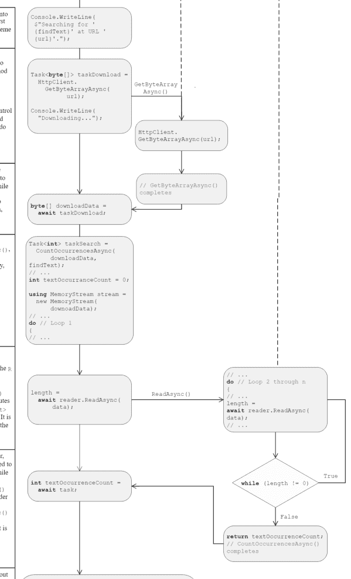

# 引入 ValueTask<T> 的异步返回

方法中 `await` 上下文关键字的用法应被视为异步控制流，而不是普通的标识符。

可以拥有 `async Main` 方法。结果是，列表 20.3 的 `Main` 签名是 `public static Task Main(string[] args)`。这允许 `await` 操作符的用户直接调用异步方法。如果没有 `async Main()` 方法，我们必须依赖于显式地处理有效的异步返回类型，并且在退出程序之前显式地等待任务完成，以避免出现意外的行为。

## 引入 ValueTask<T> 的异步返回

我们使用异步方法来处理耗时、高延迟的操作。而且（显然），由于返回类型是 `Task/Task<T>`，我们总是需要获取这些对象之一的实例来返回。另一种方案是返回 `null`，这将强制调用者在访问 `Task` 之前始终检查是否为空——从可用性角度来看，这是一个不合理且令人沮丧的 API。通常，创建 `Task/Task<T>` 的成本与耗时、高延迟的操作相比是微不足道的。

但是，如果操作可以短路并立即返回结果会发生什么？例如，压缩一个缓冲区。如果数据量很大，异步执行该操作是有意义的。然而，如果数据长度为零，则操作可以立即返回，此时获取（缓存或新实例的）`Task/Task<T>` 是没有意义的，因为当操作立即完成时不需要任务。我们需要的是一种类似任务的节点（task-like object），它可以管理异步性，但在不需要时不需要耗费构建一个完整的 `Task/Task<T>`。

了对额外有效异步返回类型的支持

+ 6. 从 C# 7.1 开始。C# 5.0 和 6.0 包含一项限制，即 `await` 操作符不能出现在异常处理的 `catch` 或 `finally` 语句中。然而，这一限制从 C# 7.0 开始被移除。

992 第 20 章：基于任务的异步模式编程类型——即支持 `GetAwaiter()` 方法的类型，如“高级主题：有效异步返回类型的扩展”中详细所示——

列表 20.4 提供了一个通过 `ValueTask<T>` 转义来实现文件压缩的示例，如果压缩可以短路的话。

列表 20.4：从异步方法返回 ValueTask<T>

```csharp
using System.IO;
using System.Text;
using System.Threading.Tasks;
public static class Program
{
    public static async ValueTask<byte[]> CompressAsync(byte[] buffer)
    {
        if (buffer.Length == 0)
        {
            return Array.Empty<byte>();
        }
        using MemoryStream ms = new MemoryStream(buffer);
        // ... compression logic ...
        return await ms.ToArray();
    }
}
```

调用了 `CountOccurrencesAsync()`；控制流像往常一样进入方法，如所示，仍在 `Main()` 方法中执行。

```csharp
byte[] data = await task;
// GetByteArrayAsync() completes
```

```csharp
task = await Search
CountOccurrencesAsync(
data,
findText);
int textOccurrenceCount = 0;
```

`do` 循环的第一次发生在 `Main()` 中，在切换到 `ReadAsync()` 相关任务之前。当遇到 `ReadAsync()` 的调用时，通常会实例化 `Task` 并对其进行等待。它返回给调用者，而任务继续工作。

```csharp
using Memory stream = new MemoryStream(data);
// Loop 1
```

```csharp
do // Loop 2 through n
length = await reader.ReadAsync(data);
} while (length != 0)
```

通过下一个 `await` 操作符，`Main()` 线程允许在等待 `ReadAsync()` 的下一次调用完成时执行其他工作负载，然后调用者随后接收到 `CountOccurrencesAsync()` 的结果并完成执行。

```csharp
length =
await reader.ReadAsync(
data);
```

```csharp
int textOccurrenceCount =
await task;
```

完成后，结果被赋值给 `textOccurrencesCount`。

```csharp
while (length != 0)
// True/False
```

`Main()` 继续执行，将 `textOccurrenceCount` 的值写入控制台。

```csharp
Console.WriteLine(
(Environment.NewLine + findText) + " appears " + textOccurrenceCount + " times at URL " + url + ".");
```

```csharp
return textOccurrenceCount;
// CountOccurrencesAsync() completes
```

图 20.1：每个任务内部的流控制

## 引入 ValueTask<T> 的异步返回

方法中 `await` 上下文关键字的用法应被视为异步控制流，而不是普通的标识符。

可以拥有 `async Main` 方法。结果是，列表 20.3 的 `Main` 签名是 `public static Task Main(string[] args)`。这允许 `await` 操作符的用户直接调用异步方法。如果没有 `async Main()` 方法，我们必须依赖于显式地处理有效的异步返回类型，并且在退出程序之前显式地等待任务完成，以避免出现意外的行为。

## 引入 ValueTask<T> 的异步返回

我们使用异步方法来处理耗时、高延迟的操作。而且（显然），由于返回类型是 `Task/Task<T>`，我们总是需要获取这些对象之一的实例来返回。另一种方案是返回 `null`，这将强制调用者在访问 `Task` 之前始终检查是否为空——从可用性角度来看，这是一个不合理且令人沮丧的 API。通常，创建 `Task/Task<T>` 的成本与耗时、高延迟的操作相比是微不足道的。

但是，如果操作可以短路并立即返回结果会发生什么？例如，压缩一个缓冲区。如果数据量很大，异步执行该操作是有意义的。然而，如果数据长度为零，则操作可以立即返回，此时获取（缓存或新实例的）`Task/Task<T>` 是没有意义的，因为当操作立即完成时不需要任务。我们需要的是一种类似任务的节点，它可以管理异步性，但在不需要时不需要耗费构建一个完整的 `Task/Task<T>`。

了对额外有效异步返回类型的支持

+ 6. 从 C# 7.1 开始。C# 5.0 和 6.0 包含一项限制，即 `await` 操作符不能出现在异常处理的 `catch` 或 `finally` 语句中。然而，这一限制从 C# 7.0 开始被移除。

992 第 20 章：基于任务的异步模式编程类型——即支持 `GetAwaiter()` 方法的类型，如“高级主题：有效异步返回类型的扩展”中详细所示——

列表 20.4 提供了一个通过 `ValueTask<T>` 转义来实现文件压缩的示例，如果压缩可以短路的话。

列表 20.4：从异步方法返回 ValueTask<T>

```csharp
using System.IO;
using System.Text;
using System.Threading.Tasks;
public static class Program
{
    public static async ValueTask<byte[]> CompressAsync(byte[] buffer)
    {
        if (buffer.Length == 0)
        {
            return Array.Empty<byte>();
        }
        using MemoryStream ms = new MemoryStream(buffer);
        // ... compression logic ...
        return await ms.ToArray();
    }
}
```

# 引入 ValueTask<T> 的异步返回 993

对 `Task<T>` 没有益处，因为无法缓存所有结果。然而，如果操作很可能异步异步完成，且你无法合理地缓存所有值，则首选 `Task<T>`。

# 初级者主题

## 常见异步返回类型说明

列表 20.5：一个 await 表达式可以是一个语句

```csharp
public async Task<int> DoStuffAsync()
{
    await DoSomethingAsync();
    await DoSomethingElseAsync();
    return await GetIntegerAsync() + 1;
}
```

我们假设前几个方法返回 `Task` 而不是 `Task<T>` 或 `ValueTask<T>`。由于前两个任务没有关联的结果值，等待它们不会产生值；因此该表达式可以作为语句出现。

# 第 20 章：基于任务的异步模式编程

第三个任务get是 `Task<int>`，其值可以用于 `DoStuffAsync()` 返回值的计算。

# 异步流

C# 8.0 引入了编写异步流的能力，本质上是与迭代器结合异步模式。如第 15 章所述，C# 中的集合都构建在 `IEnumerable<T>` 和 `IEnumerator<T>` 之上，前者具有返回 `IEnumerator<T>` 的单个 `GetEnumerator()` 函数。并且在使用 `yield return` 构建迭代器时，方法需要返回 `IEnumerable<T>` 或 `IEnumerator<T>`。相比之下，有效的异步返回类型必须支持 `GetAwaiter()` 方法，正如 `Task`、`Task<T>` 和 `ValueTask<T>`。因此，冲突在于你无法既是异步方法又是迭代器。例如，在遍历集合时调用异步方法，无法在所有预期迭代完成之前将结果返回给调用函数。

为了解决这些问题，C# 团队在 C# 8.0 中增加了异步流（async streams）的支持。此功能专门设计用于启用异步迭代以及使用 `yield return` 构建异步集合和枚举类型方法。

例如，假设使用异步方法 `EncryptFilesAsync()` 对目录（默认为当前目录）进行加密。列表 20.6 提供了代码。

```csharp
using System.IO;
using System.Linq;
using System.Threading.Tasks;
using System.Collections.Generic;
using System.Threading;
using System.Runtime.CompilerServices;
using AddisonWesley.Michaelis.EssentialCSharp.Shared;
```

```csharp
public static class Program
{
```

```csharp
public static async void Main(params string[] args)
{
    string directoryPath = Directory.GetCurrentDirectory();
    string searchPattern = "*";
    // ...
```


# IAsyncEnumerable<T> 与异步流

`using Cryptographer cryptographer = new();`

```csharp
IEnumerable<string> files = Directory.EnumerateFiles(
directoryPath, searchPattern);
```

```csharp
// Create a cancellation token source to cancel
// if the operation takes more than a minute.
using CancellationSource cancellationSource =
new(1000+60);
```

```csharp
await foreach (string fileName, string encryptedFileName
in EncryptFilesAsync(files, cryptographer))
.Zip(files.ToAsyncEnumerable())
.WithCancellation(cSource.Token)
```

```csharp
Console.WriteLine($"{fileName}=->{encryptedFileName}");
```

```csharp
public static async IEnumerable<string> EncryptFilesAsync(
IEnumerable<string> files, Cryptographer cryptographer,
[EnumeratorCancellation] CancellationToken cancellationToken = default)
{
```

```csharp
foreach (string fileName in files)
{
    yield await EncryptFileAsync(fileName, cryptographer);
    cancellationToken.ThrowIfCancellationRequested();
}
```

```csharp
private static async ValueTask<string> EncryptFileAsync((string fileName, Cryptographer cryptographer)
{
```

```csharp
string encryptedFileName = $"{fileName}.encrypt";
await using FileStream outputStream =
new(encryptedFileName, FileMode.Create);
```

```csharp
string data = await File.ReadAllTextAsync(fileName);
await cryptographer.EncryptAsync(data, outputStream);
return encryptedFileName;
// ...
```

列表 20.6 起于一个 `Main()` 方法，其中包含一个 C# 8.0 引入的 `async foreach` 语句，用于用于遍历一个异步方法 `EncryptFilesAsync()`。`EncryptFiles()` 方法使用 `foreach` 循环遍历指定的每个文件。在循环内部有两个异步方法调用。第一个是对 `File.ReadAllTextAsync()` 的调用，它读取文件的所有内容。一旦内容在内存中可用，代码就会调用 `EncryptAsync()` 方法对其进行加密，然后通过 `yield` 语句返回加密后的文件名。因此，该方法提供了一个向调用者提供异步迭代器的示例。实现这一点的关键在于 `EncryptFilesAsync()` 装饰了 `async` 关键字，并且它返回 `IAsyncEnumerable<T>`（在本例中 T 是 `string`）。

给定一个 `IAsyncEnumerable<T>` 方法，你可以像列表 20.6 所示，使用 `await foreach` 语句对其进行消费。因此，此列表既在产生又在消费一个异步流。

`GetAsyncEnumerator()` 的签名包含一个 `CancellationToken` 参数。由于 `await foreach` 循环生成了调用 `GetAsyncEnumerator()` 的代码，因此注入取消令牌并提供取消的方法是通过 `WithCancellation()` 扩展方法。如图 20.2 所示，`IAsyncEnumerable<T>` 上没有直接的 `WithCancellation()`。为了要在异步流方法中支持取消，请添加一个带有 `EnumeratorCancellationAttribute` 的可选 `CancellationToken`，如 `EncryptFilesAsync` 方法所示：

```csharp
static public async IAsyncEnumerable<string>
EncryptFiles(
string directoryPath = null,
string searchPattern = "*",
[EnumeratorCancellation] CancellationToken
```

```csharp
cancellationToken = default
{ ... }
```

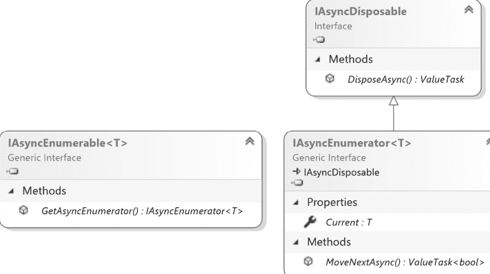

图 20.2：`IAsyncEnumerable<T>` 和相关接口

在列表 20.6 中，你提供了一个返回 `IAsyncEnumerable<T>` 接口的异步流方法。然而，与非异步迭代器一样，你也可以实现 `IAsyncEnumerable<T>` 接口及其 `GetAsyncEnumerator()` 方法。当然，任何实现该接口的类都可以通过 `await foreach` 语句进行迭代，如列表 20.7 所示。

## 列表 20.7：使用 `await foreach` 调用异步流

```csharp
public class AsyncEncryptionCollection : IAsyncEnumerable<string>
{
    public async IAsyncEnumerator<string> GetAsyncEnumerator(
        CancellationToken cancellationToken = default)
    {
        // ...
    }
    public static async Task Main()
```

```csharp
{
  AsyncEncryptionCollection collection =
    new();
  // ...
  await foreach (string fileName in collection)
  {
    Console.WriteLine(fileName);
  }
}
```

有一点需要注意：记住，声明一个 `async` 方法并不会导致执行自动并行运行。仅仅因为 `EncryptFilesAsync()` 方法是异步的，并不意味着遍历每个文件并调用 `File.ReadAllTextAsync()` 和 `Cryptographer.EncryptFilesAsync()` 会并行发生。为了保证这种行为，你需要利用 `Task` 调用或类似 `System.Threading.Tasks.Parallel.ForEach`（第 21 章）。

`IAsyncEnumerable<T>` 接口及其伴侣 `AsyncEnumerator<T>` 是图 20.2 所示的 C# 8.0 新增内容，它们与对应的同步版本相匹配。注意，`IAsyncDisposable.DisposeAsync()` 和 `IAsyncEnumerator<T>.MoveNextAsync()` 方法都是 `IEnumerator<T>` 等效方法的异步版本。`Current` 属性不是异步的。`Reset()` 方法在异步实现中不存在。

## IAsyncDisposable 和 await using

`IAsyncDisposable` 是 `IDisposable` 的异步等效，可以使用 C# 8.0 的 `await using` 语句或 `await using` 声明使用。在列表 20.6 中，我们使用后者，因为像 `IAsyncEnumerable<T>` 一样，`FileStream` 也实现了 `IAsyncDisposable`。意外的是，这适用于任何实现了 `DisposeAsync()` 方法的类型：

```csharp
await using FileStream outputStream =
new(encryptedFileName, FileMode.Create);
```

编译器会在声明周围插入一个 `try/finally` 块并调用 `DisposeAsync()`。这种方法确保了所有资源被清理。

注意 `IAsyncDisposable` 和 `IDisposable` 之间没有通过继承关系。因此，它们的实现并不相互依赖：可以实现一个而不另一个。

## 与 IAsyncEnumerable 使用 LINQ

在列表 20.6 的 `await foreach` 语句中，我们调用了 LINQ `AsyncEnumerable.Zip()` 方法将原始文件名与加密文件名进行配对。

```csharp
await foreach (
  string fileName, string encryptedFileName) in
  EncryptFilesAsync(files).Zip(ToAsyncEnumerable())
{
  Console.WriteLine($"{fileName}={encryptedFileName}");
}
```

`AsyncEnumerable` 为 `IAsyncEnumerable<T>` 提供了 LINQ 功能。然而，该库在 BCL 中并不可用。为了访问异步查询功能，你需要引用 `System.Linq.Async` NuGet 包。

## 第 20 章：基于任务的异步模式

`AsyncEnumerable` 定义在 `System.Linq` 中。令人惊讶，它包含了标准 LINQ 操作的异步版本，如 `Where()`、`Select()` 和上述使用的 `Zip()` 方法。它们被认为是“异步版本”，是因为它们是 `IEnumerable` 的扩展方法而不是 `IEnumerable<T>`。此外，`AsyncEnumerable` 包含了一系列 `*Async()`、``*AwaitAsync()` 和 `*AwaitWithCancellationAsync()`。这些方法的 `Select*` 版本如列表 20.8 所示。

## 列表 20.8：AsyncEnumerable Select*() 方法

```csharp
namespace System.Linq
// ...
public static class AsyncEnumerable
{
    // ...
    public static AsyncEnumerable<TResult> Select<TSource
```

与 `Enumerable` 等效的方法名（在本例中为 `Select()`）具有类似的“实例”签名，`TResult` 和 `TSource` 是不同的。两个带有“Await”的签名都接收异步签名，其中包含一个返回 `ValueTask<T>` 的选择器。例如，你可以

¹³ 排除 `SelectMany()` 方法类。
¹¹ 在 `finally` 块中使用 `await` 是 C# 6.0 添加的。
¹² 在此书编写时——根据 .NET Core 3.0 和 3.1。

## 从异步方法返回 void

如下所示，从 `SelectAwait()` 中调用列表 20.6 的 `EncryptFileAsync()` 方法：

```
IAsyncEnumerable<string> items = files.ToAsyncEnumerable(
items = items.SelectAwait(
(text, id) => EncryptFileAsync(text));
```

需要注意的是，`EncryptFileAsync()` 返回的是一个 `ValueTask<T>`，这正是 `Await()` 和 `AwaitWithCancellationAsync()` 所要求的。当然，后者也允许指定取消令牌。另一个值得提及的异步 LINQ 方法是列表 20.6 中使用的 `ToAsyncEnumerable()` 方法。由于异步 LINQ 与 `IAsyncEnumerable<T>` 接口配合，因此 `ToAsyncEnumerable(T)` 负责将 `IEnumerable<T>` 转换为 `IAsyncEnumerable<T>`。同样地，`ToEnumerable()` 方法执行相反的转换。

异步 LINQ 方法的标量版本同样匹配 `IEnumerable<T>`——具有 *Await()*、*AwaitAsync()* 和 *AwaitWithCancellation()* 组成员。关键区别在于它们都返回一个 `ValueTask<T>`。下面的代码段提供了使用 `AverageAsync()` 方法的示例：

```
double average = await AsynchronousEnumerable.Range(
0, 999).AverageAsync();
```

因此，我们可以使用 `await` 将返回值视为 `double` 而不是 `ValueTask<double>`。

## 从异步方法返回 void

我们已经查看了几种有效的异步返回类型，包括 `Task`、`Task<T>`、`ValueTask<T>`，以及现在的 `IAsyncEnumerable<T>`，它们都支持 `GetAwaiter()` 方法。只有一种允许的返回类型不支持 `GetAwaiter()`。这种返回选项在异步方法中可用，是 `void`——从此以后该方法被称为异步 void 方法。在大多数情况下，应该避免使用异步 void 方法，并更准确地将其描述为一种“非优选项”。与返回支持 `GetAwaiter` 的类型不同，当返回 `void` 时，方法何时完成执行是不确定的。如果发生异常，返回 `void` 意味着没有这样的容器来报告异常。在这种情况下，在异步 void 方法上抛出的任何异常都可能结束在 UI 同步上下文中——实际上变成一个未处理的异常。

如果异步 void 方法通常应该被避免，为什么最初还允许它们呢？这是因为异步 void 方法可以用于启用异步事件处理器。正如第 14 章所述，每个事件都应该声明为 `EventHandler<T>`，其中 `EventHandler<T>` 的签名如下：

```
void EventHandler<TEventArgs>(object sender, TEventArgs e)
```

为了符合事件匹配 `EventHandler<T>` 的约定，异步事件需要返回 `void`。人们可能会建议更改这一约定，但可能存在多个订阅者，从多个订阅者处获取返回值是非交互式且繁琐的。出于这个原因，准则是尽量避免异步 void 方法，除非它们是事件处理程序的订阅者——在这种情况下，它们不应该抛出异常。或者，你应该提供一个同步上下文来接收同步事件的通知，例如工作调度，例如 `Task.Run()`，以及可能更重要的，未处理的异常。列表 20.9 和相应的输出 20.2 提供了如何操作的示例。

## 列表 20.9：捕获异步 void 方法的异常

```csharp
using System;
using System.Threading;
using System.Threading.Tasks;
public class AsyncSynchronizationContext : SynchronizationContext
{
    public Exception? Exception { get; set; }
    public ManualResetEventSlim ResetEvent { get; } = new();
}
public static class Program
{
    public static bool EventTriggered { get; set; }
    public const string ExpectedExceptionMessage = "Expected Exception";
    public static void Main()
    {
        SynchronizationContext originalSynchronizationContext = 
        SynchronizationContext.Current;
        try {
            AsyncSynchronizationContext synchronizationContext = new();
```


```csharp
SynchronizationContext.SetSynchronizationContext(
    synchronizationContext
);

OnEvent(typeof(Program), EventArgs.Empty);

synchronizationContext.ResetEvent.Wait();

if (synchronizationContext.Exception != null)
{
    Console.WriteLine($@"Throwing expected exception {Thread.Current.ManagedThreadId}");
    System.Runtime.ExceptionServices.ExceptionDispatchInfo(
        synchronizationContext.Exception).Throw();
}
} catch (Exception exception)
{
    Console.WriteLine($@"{exception} thrown as expected.{Thread.Current.ManagedThreadId}");
}
finally {
    SynchronizationContext.SetSynchronizationContext(
        originalSynchronizationContext);
}
}
private static async void OnEvent(object sender, EventArgs e)
{
    // 为了简洁，省略实现细节
}
}
```

输出 20.2

`Invoking Task.Run...(Thread ID: 8)`
`Running task... (Thread ID: 9)`
`Post notification invoked..(Thread ID: 8)`
`Post notification invoked..(Thread ID: 8)`
`Throwing exception....(Thread ID: 8)`
`System.Exception: Expected Exception`
`at AddonWesley.Michaelis.EssentialCSharp.Chapter20.Listing20_09.Program.Main()`
`..Listing20.09.AsyncVoidReturn.cs:line 80 thrown as expected. (Thread ID 8)`

列表 20 中的代码按过程执行，直到 `OnEvent()` 中的 `await Task.Run()` 调用开始。在完成后，控制权被传递给 `AsyncSynchronizationContext` 中的 `Post()` 方法。在 `Post()` 方法执行并完成后，执行 `Console.WriteLine("throw Exception...")` 方法，然后抛出一个异常。该异常被 `AsyncSynchronizationContext.Post()` 方法捕获并传回 `Main()`。

在这个示例中，我们使用 `Task.Delay()` 调用来确保程序在 `Task.Run()` 调用之前不会结束。在现实世界中，如第 22 章所示，`ManualResetEventSlim` 是首选方法。

# 高级主题

## 有效异步返回类型

通常，`await` 关键字后面的表达式类型为 `Task<T>`、`ValueTask<T>`，或者在 C# 8.0 中为 `IAsyncEnumerable<T>`。然而，“通常”这个词是刻意引入的不确定性。事实上，关于 `await` 等待的类型的确切规则比这些类型更通用。此外，它还允许该类型为可等待类型——支持 `GetAwaiter()` 方法。

此方法产生一个具有编译器重写逻辑所需的某些属性和方法的对象——具体来说，是一个支持 `INotifyCompletion` 接口并增加了 `GetResult()` 方法的对象。通过允许可用类型，该系统可以由第三方进行扩展。换句话说，如果你想设计自己的使用其他类型表示异步工作的非 异步系统，你可以这样做并使用 `await` 语法。

在 C# 8.0 之前，无论方法内部是什么类型，异步方法无法返回 `void`、`Task` 或 `Task<T>`/`ValueTask<T>` 以上。利用更通用的 `GetAwaiter()` 方法，C# 8.0 在本章早期引入了 `IAsyncEnumerable<T>/IAsyncEnumerator<string>` 异步返回。

## 异步 Lambda 和本地函数

正如转换为委托的 lambda 表达式可以作为声明普通方法的简洁语法，包含 `await` 表达式的 lambda 也可以转换为委托。要这样做，只需在 lambda 表达式前加上 `async` 关键字。在列表 20.10 中，我们首先将一个异步 lambda 赋值给 `Func<string, Task> writeWebRequestSizeAsync` 变量。然后我们使用 `await` 操作符调用它。

```cs
{
  string url = "http://www.IntelliTect.com";
  if(args.Length > 0) {
    url = args[0];
  }
  Console.Write(url);
}
```

```cs
Func<string, Task> writeWebRequestSizeAsync =
  async (string webRequestUrl) => {
    // 为了便于说明，省略了错误处理
    WebRequest webRequest =
      WebRequest.Create(url);
    WebResponse response =
      await webRequest.GetResponseAsync();
    // 显式计数而不是调用
    // webRequest.ContentLength 以演示
    // 使用 await 操作符
    using (StreamReader reader =
      new(response.GetResponseStream())) {
      string text =
        await reader.ReadToEndAsync();
      Console.WriteLine(
        FormatBytes(text.Length));
    }
  }
```

```cs
Task task = writeWebRequestSizeAsync(url);

while (!task.Wait(100)) {
  Console.Write(".");
}

// ...
```

# 第 20 节：编写基于任务的异步模式

类似地，通过本地函数也可以实现相同的效果。15 例如，在列表 20.10 中，你可以将 lambda 表达式头部（从 `=>` 运算符开始直到结束的所有内容）更改为

```cs
async Task WriteWebRequestAsync(string webRequestUrl)
```

保持主体中的所有内容（包括大括号）不变。请注意，异步 lambda 表达式具有与命名 `async` 方法相同的限制：

- 异步 lambda 表达式必须转换为一个返回类型为有效异步返回类型的委托。
- lambda 表达式会被重写，使得 `return` 语句变为信号，表示由 lambda 返回的任务已使用给定结果完成。
- lambda 表达式内部的执行以同步方式进行，直到在对未完成的可等待对象上执行第一个 `await`。
- 在 `await` 之后的所有指令都将在调用的异步方法返回时作为延续执行（或者如果可等待对象已完成，则将直接作为同步执行，而不是作为延续执行）。
- 异步 lambda 表达式可以使用 `await` 操作符调用（如列表 20.10 所示）。

# 高级/初学者技巧

## 实现自定义异步方法

使用 `await` 关键字依赖其他异步方法（而这些方法又依赖于更多异步方法）来实现异步方法是相对容易的。然而，在调用层次结构的某处，有必要编写一个返回 `Task` 的“叶节点”异步方法。例如，考虑一个运行命令行程序的异步方法，其最终目标是能够访问其输出。此类方法的声明如下：

> 15. 从 C# 7.0 开始。

# 异步 Lambda 和本地函数

```cs
public static Task<Process> RunProcessAsync(string filename)
```

最简单的实现当然是再次依赖 `Task.Run()`，并同时调用 `System.Diagnostics.Process` 的 `Start()` 和 `WaitExit()` 方法。然而，当调用的进程本身拥有一 own或多个线程集合时，在当前进程中创建额外的线程是没有必要的。为了在调用的进程完成后实现 `RunProcessAsync()` 的上下文，我们可以依赖 `TaskCompletionSource<T>` 对象，如列表 20.11 所示。

# 列表 20.11：实现自定义异步方法

```cs
using System.Diagnostics;
using System.Threading;
using System.Threading.Tasks;
public class Program
{
    public static Task<Process> RunProcessAsync(
        string fileName,
        string arguments = "",
        CancellationToken cancellation = default)
    {
        TaskCompletionSource<Process> taskCS =
            new();
        Process process = new ProcessStartInfo(fileName)
        {
            UseShellExecute = false,
            Arguments = arguments
        };
        EnableRaisingEvents = true;
        process.Exited += (sender, localEventArgs) =>
        {
            taskCS.SetResult(process);
        };
        cancellationToken
        .ThrowIfCancellationRequested();
```

# 第 20 节：编写基于任务的异步模式

```cs
process.Start();
cancellationToken.Register(() =>
{
    Process.GetProcessById(process.Id).Kill();
});
```

```cs
return taskCS.Task;
//...
}
```

暂时忽略高亮，转而重点关注使用事件在进程完成时进行通知的模式。由于 `System.Diagnostics.Process` 包含退出时的通知，我们注册了此通知并将其用作回调，通过该回调我们可以调用 `TaskCompletionSource.SetResult()`。列表 20.11 中的代码遵循了一种通用的模式，你可以使用它来创建一个异步方法，而无需诉诸 `Task.Run()`。

异步方法可能需要的另一个重要特性是取消。TAP 依赖于与 TPL 相同的方法来执行取消——即 `System.Threading.CancellationToken`。列表 20.11 强调了支持取消所需的代码。在这个示例中，我们允许在进程启动之前取消，并尝试关闭应用程序的主窗口（如果有的话）。一种更激进的方法是调用 `Process.Kill()`，但这种方法可能会对执行中的程序产生潜在问题。

注意，我们是在进程启动之后才注册取消事件的。这避免了在进程实际开始之前触发取消操作时可能发生的任何竞态条件。

最后一个需要考虑支持的支持的功能是进度更新。列表 20.12 是 `RunProcessAsync()` 的完整版本，并包含了此类更新。

# 列表 20.12：实现带有进度支持的自定义异步方法

```cs
using System;
using System.Diagnostics;
using System.Threading;
using System.Threading.Tasks;
```

# 异步 Lambda 和本地函数

```cs
public static class
{
    public static Task<Process> RunProcessAsync(
        string fileName,
        string arguments = "",
        IProgress<ProcessEventArgs>? progress = null,
        object? objectState = null,
        CancellationToken cancellation = default(CancellationToken))
    {
        TaskCompletionSource<Process> taskCS = new();
        Process process = new Process{
            StartInfo = new ProcessStartInfo(fileName){
                UseShellExecute = false,
                Arguments = arguments,
                RedirectStandardOutput = progress != null ? null : null
            },
            EnableRaisingEvents = true
        };
        process.Exited += (sender, localEventArgs) => {
            taskCS.SetResult(process);
        };
        if (progress != null)
        {
            process.OutputDataReceived += (sender, localEventArgs) => {
                progress.Report(new ProcessEventArgs(
                    localEventArgs.Data,
                    objectState));
            };
        }
        cancellationToken.ThrowIfCancellationRequested();
        process.Start();
    }
```

```cs
if (progress != null)
{
    process.BeginOutputReadLine();
}
cancellationToken.Register(() =>
{
    Process.GetProcessById(process.Id).Kill();
});
return taskCS.Task;
}
//...
```


准确理解异步方法中究竟发生了什么可能是困难的，但要弄懂使用显式延续 lambda 编写的异步代码在做什么要容易得多。需要记住的关键点如下：

- 当控制到达 `await` 关键字时，其后的表达式会产生一个任务。16 控制随后返回给调用者，以便其在任务异步完成时继续工作（假设任务尚未完成）。
- 有时在任务完成后，控制将从 `await` 之后的位置恢复。如果被等待的任务产生了结果，则获取该结果。如果失败，则抛出异常。
- 异步方法中的 `return` 语句会导致与方法调用相关的任务变为完成；如果 `return` 语句有值，则返回的值将成为任务的结果。

16. 技术上，它是一个可等待类型，如“高级主题：有效的异步返回类型扩展”中所描述的。

## 任务调度器与同步上下文

在本章中，偶尔提到了任务调度器及其在决定如何高效将工作分配给线程方面的作用。在程序中，任务调度器是 `System.Threading.Tasks.TaskScheduler` 的实例。该类默认使用线程池来适时地调度任务，决定如何安全高效地执行它们——即何时使用它们、销毁它们或创建额外的任务。

你可以通过从 `TaskScheduler` 类派生一个新类型来创建自己的任务调度器，从而对如何调度任务做出不同的选择。你可以使用静态方法 `FromSynchronizationContext()` 获取一个 `TaskScheduler`，它会将任务调度到当前线程（或者更准确地说，调度到与当前线程关联的同步上下文），而不是另一个工作线程。

任务执行的同步上下文以及后续延续任务执行（`execute()`）的同步上下文非常重要，因为等待的任务会咨询同步上下文（假设存在），以便任务能够高效且安全地执行。列表 20.13（同输出 20.3）与列表 19.3 类似，不同之处在于在显示消息时会打印出线程 ID。

### 列表 20.13：调用 Task.ContinueWith()

```csharp
using System;
using System.Threading;
using System.Threading.Tasks;
public class Program
{
    public static void Main()
    {
        DisplayStatus("Before");
        Task taskA =
            Task.Run(() =>
                DisplayStatus("Starting..."))
            .ContinueWith(antecedent =>
                DisplayStatus("Continuing A..."));
        Task taskB = taskA.ContinueWith(antecedent =>
            DisplayStatus("Continuing B..."));
        Task taskC = taskA.ContinueWith(antecedent =>
            DisplayStatus("Continuing C..."));
    }
}
```

## 第 20 章：基于任务的异步模式编程

```csharp
Task.WaitAll(taskB, taskC);
    DisplayStatus("Finished!");
}
private static void DisplayStatus(string message)
{
    string text = $"{{Thread.CurrentThread.ManagedThreadId}}: {message}}";
    Console.WriteLine(text);
}
```

### 输出 20.3

- 1: Before
- 3: Starting...
- 4: Continuing A...
- 3: Continuing C...
- 4: Continuing B...
- 1: Finished!

此输出值得注意的是，线程 ID 有时会变化，而在其他时候会重复。在这种类简单的控制台应用程序中，同步上下文（可以通过 `SynchronizationContext.Current` 访问）为 null——默认的同步上下文会导致线程池处理线程分配。这解释了为什么任务之间的线程 ID 会发生变化：有时线程池认为使用新线程更高效，而有时它认为使用现有线程是最佳方案。

幸运的是，对于那些同步上下文至关重要的应用程序类型，同步上下文会自动设置。例如，如果创建任务的代码运行在由 ASP.NET 创建的线程中，该线程将有一个关联的 `AspSynchronizationContext` 同步上下文。同样，如果你的代码运行在 Windows UI 应用程序中——即 Windows Presentation Foundation (WPF) 或 Windows Forms——该线程将分别拥有 `DispatcherSynchronizationContext` 或 `WindowsSynchronizationContext` 实例。（对于控制台应用程序和 Windows 服务，线程将拥有默认 `SynchronizationContext` 实例。）由于 TPL 会咨询同步上下文，而该同步上下文视执行情况情况而异，因此 TPL 能够在既高效又安全的上下文中调度延续任务。

要修改代码以利用同步上下文，你必须 (1) 设置同步上下文并在 (2) 使用 `async/await` 以确保咨询同步上下文！¹17

可以定义自定义同步上下文，并与现有的同步上下文协作以提高在某些特定场景下的性能。然而，描述如何这样做超出了本文的范围。

### Windows UI 中使用 async/await

这是 UI 上下文中同步 特为重要的一个地方。例如，Windows UI 使用消息泵处理如鼠标点击和移动事件之类的消息。此外，UI 是单线程的，因此与任何 UI 组件（例如文本框）的交互必须始终在单 UI 线程上进行。`async/await` 模式的优势之一是它利用同步上下文来确保延续工作（即 `await` 语句之后的工作）将始终在调用 `await` 语句的同一个同步任务上执行。这种方法具有重要价值，因为它消除了显式切换到 UI 线程来更新控件的需求。

为了更好地理解这种好处，请考虑 WPF 中按钮点击的 UI 事件示例，如列表 20.14 所示。

#### 列表 20.14：WPF 中的同步高延迟调用

```csharp
private void PingButton_Click(
object sender, RoutedEventArgs e)
{
    StatusLabel.Content = "Pinging...";
    UpdateLayout();
}
```

¹7. 关于如何设置线程同步上下文以及如何使用任务调度器调度该线程的简单示例，请“C# 5.0 之前的多线程模式”中的列表 C.8，地址为：https://intellect.com/EssentialCSharpSharp

Ping ping = new Ping();
PingReply pingReply =
ping.Send("www.IntelliTect.com");
StatusLabel.Text = pingReply.Status.ToString();

由于 `StatusLabel` 是 WPF `System.Windows.Controls.TextBlock`，UI 线程处于忙状态且消息队列未被处理，因此用户在 ping 返回之前看不到“Pinging...”。事实上，由于 UI 是单线程的，消息泵未被处理，标签在 ping 返回之前不会更新。然而，因为调用是异步的，UI 线程被释放返回消息队列，从而处理更新，从而让用户看到“Pinging...”。

要使用 TAP 解决这个问题，请修改 20.15 中的代码。

**列表 20.15：使用 await 在 WPF 中的同步高延迟调用**

```csharp
private async void PingButton_Click(
object sender, RoutedEventArgs e)
{
    StatusLabel.Text = "Pinging...";
    UpdateLayout();
    Ping ping = new Ping();
    PingReply pingReply =
        await ping.SendAsync("www.IntelliTect.com");
    StatusLabel.Text = pingReply.Status.ToString();
}
```

这种更改有两个优势。首先，ping 的异步性质让调用者返回消息队列，由其处理更新。其次，由于同步上下文适用于 Windows UI，它是单线程的；因此返回将始终在调用者所在的线程。换句话说，TPL 不是立即执行延续任务，而是咨询同步上下文，后者将延续工作的消息到消息泵。接下来，由于 UI 线程监控消息泵，在拾取延续工作消息时，它会调用 await 之后的代码。

TAP 内了一个关键的可读性特性。注意 20.15 中返回 `pingReply.Status` 的代码自然地出现在 `await` 语句之后，表明它将紧随上一行执行。

### await 运算符

单个方法中可以放置 `await` 的次数没有限制。事实上，这些语句并不限于连续出现。相反，`await` 语句可以放置在循环中并连续地处理，从而遵循与代码外观一致的自然控制流。考虑列表 20.16 中的示例。

#### 列表 20.16：迭代一个 await 操作

```csharp
private async void PingButton_Click(
object sender, RoutedEventArgs e)
{
    List<string> urls = new List<string>(
    {
        "www.habitat-spokane.org",
        "www.partnersintl.org",
        "www.iassist.org",
        "www.fh.org",
        "www.worldVision.org"
    });
    foreach (string url in urls)
    {
        Ping ping = new Ping();
        PingReply pingReply =
            await ping.SendAsync(url);
        Console.WriteLine(pingReply.Status);
    }
}
```

## 第 20 章：基于任务的异步模式编程

```cs
Func<string, Task<IPStatus>> func =
    async (localUrl) =>
{
        Ping ping = new Ping();
        PingReply pingReply = await ping.SendPingAsync(localUrl);
        return pingReply.Status;
    }
```

StatusLabel.Content = "正在 Pinging...";

```cs
foreach (string url in urls)
{
    status = await func(url);
    StatusLabel.Text = 
        $"{url}: {status.ToString()} on {Thread.CurrentThread.ManagedThreadId}}";
}
```

无论 `await` 语句是在迭代内部还是在单独条目中，它们都会按照顺序执行，一个接一个，并按照被调用线程调用的顺序执行。其底层实现是将它们通过 `Task.ContinueWith()` 的语义等价方式连接起来，只不过在 `await` 算符之间的所有代码都将在调用者的同步上下文中执行。

从 UI 支持 TAP（基于任务的异步模式）是导致 TAP 产生的关键场景之一。另一个场景发生在服务器端，当客户端发送请求从数据库中查询整表数据时。由于查询数据可能非常耗时，应该创建一个新线程，而不是消耗分配给线程池的有限数量线程。这种方法的问题是，查询数据库的工作完全在另一台机器上执行。鉴于线程通常处于非活动状态，因此没有理由阻塞整个线程。

总结来说，TAP 的创建是为了解决这些关键问题：

- 需要允许长时间运行的活动发生，而不阻塞 UI 线程。
- 考虑到所有线程所做的只是等待活动完成，因此为非 CPU 密集型工作创建新线程（或任务）在开销上是相对昂贵的。
- 当活动完成时（无论是通过使用新线程还是通过回调完成），通常需要将线程同步上下文切换回启动该活动的原始调用者。

TAP 提供了一种新模式，它既适用于 CPU 密集型也适用于非 CPU 密集型的异步调用——这是一种所有 .NET 语言都显式支持的模式。

### 总结

本章大部分内容专注于基于任务的异步模式，其特点是 `async/await` 语法。它提供了详细的示例，展示了利用 TAP 而非仅依赖于 TPL 要简单得多，特别是在将代码从同步实现转换为异步实现时。在此过程中，它详细说明了 `async` 方法返回类型的要求。总之，`async/await` 特性通过自动重写你的程序来管理由小任务组成大任务的延续“布线”，使得使用 Task 对象编写复杂的工作流变得简单。

接下来，本章关注了异步流以及 C# 8.0 引入的 `IAsyncEnumerable<T>` 数据类型。它考虑了如何利用这些能力创建异步迭代器，以及如何使用 `async foreach` 语句消费它们。

到此时，读者对于如何编写异步代码应该已经有了坚实的基础，除了并行迭代（第 21 章的主题）和线程同步（在第 22 章中涵盖）。

# 21 并行迭代

在第 19 章中，我们提到了计算成本正在下降，导致计算机具有更快的 CPU、更多的 CPU，以及每个 CPU 中核心数量的增加。总之，这些趋势使得提高执行并行化以利用增加的计算能力变得越来越经济。在本章中，我们查看并行执行循环，这是利用增加的计算能力的最简单方法之一。本章大部分由初级和高级主题块组成。

| 取消 PLINQ 查询 | 2. 并行运行 LINQ 查询 | 并行迭代 | 1. 并行执行循环迭代 | 取消并行循环 |
| :--- | :--- | :--- | :--- | :--- |

考虑列表 21.1 显示的 `for` 语句和相关代码，以及输出 21.1 中的相应结果。该列表调用了一个方法来计算圆周率小数展开的某部分，其中参数是位数和起始数字。实际计算与讨论无关。该计算的有趣之处在于它具有高度的可并行化性；也就是说，它非常容易将一个大任务（例如，计算 100 万位圆周率小数）分成任意数量的可以并行运行的小任务。这些类型的计算最容易通过添加并行性来加速。

#### 列表 21.1：同步分段计算圆周率 PI 的循环

```cs
using System;
using AddisonWesley.Michaelis.EssentialCSharp.Shared;
public class Program {
    const int TotalDigits = 100;
    const int BatchSize = 10;
    public static void Main() {
        string pi = "";
        const int iterations = TotalDigits / BatchSize;
        for(int i = 0; i < iterations; i++) {
            pi += PiCalculator.Calculate(BatchSize, i * BatchSize);
        }
        Console.WriteLine(pi);
    }
// ...
using System;
public static class PiCalculator {
    public static string Calculate(int digits, int startingAt) {
        //...
    }
}
// ...
```


`for` 循环同步且顺序地执行每次迭代。但是，因为圆周率计算算法将圆周率计算划分为独立的片段，因此没有必要按顺序计算这些片段，只要结果满足

> 3.14159265358979323842643832795028841976

在第 19 章中，我们提到了计算成本正在下降，导致计算机具有更快的 CPU、更多的 CPU，以及每个 CPU 中核心数量的增加。总之，这些趋势使得提高执行并行化以利用增加的计算能力变得越来越经济。在本章中，我们查看并行执行循环，这是利用增加的计算能力的最简单方法之一。本章大部分由初级和高级主题块组成。

# 21 章：并行迭代

## 并行迭代

### 并行循环迭代

`for` 循环同步且顺序地执行每次迭代。但是，因为圆周率计算算法将圆周率计算划分为独立的片段，因此没有必要按顺序计算这些片段，只要结果满足

> 3.14159265358979323842643832795028841976

在第 19 章中，我们提到了计算成本正在下降，导致计算机具有更快的 CPU、更多的 CPU，以及每个 CPU 中核心数量的增加。总之，这些趋势使得提高执行并行化以利用增加的计算能力变得越来越经济。在本章中，我们查看并行执行循环，这是利用增加的计算能力的最简单方法之一。本章大部分由初级和高级主题块组成。

| 取消 PLINQ 查询 | 2. 并行运行 LINQ 查询 | 并行迭代 | 1. 并行执行循环迭代 | 取消并行循环 |
| :--- | :--- | :--- | :--- | :--- |

考虑列表 21.1 显示的 `for` 语句和相关代码，以及输出 21.1 中的相应结果。该列表调用了一个方法来计算圆周率小数展开的某部分，其中参数是位数和起始数字。实际计算与讨论无关。该计算的有趣之处在于它具有高度的可并行化性；也就是说，它非常容易将一个大任务（例如，计算 100 万位圆周率小数）分成任意数量的可以并行运行的小任务。这些类型的计算最容易通过添加并行性来加速。

### 列表 21.1：同步分段计算圆周率 PI 的循环

```cs
using System;
using AddisonWesley.Michaelis.EssentialCSharp.Shared;
public class Program {
    const int TotalDigits = 100;
    const int BatchSize = 10;
    public static void Main() {
        string pi = "";
        const int iterations = TotalDigits / BatchSize;
        for(int i = 0; i < iterations; i++) {
            pi += PiCalculator.Calculate(BatchSize, i * BatchSize);
        }
        Console.WriteLine(pi);
    }
}
using System;
public static class PiCalculator {
    public static string Calculate(int digits, int startingAt) {
        //...
    }
}
```

`for` 循环同步且顺序地执行每次迭代。但是，因为圆周率计算算法将圆周率计算划分为独立的片段，因此没有必要按顺序计算这些片段，只要结果满足

> 3.14159265358979323842643832795028841976

### 列表 21.2：并行分段计算圆周率 PI 的循环

```cs
using System;
using System.Threading.Tasks;
using AddisonWesley.Michaelis.EssentialCSharp.Shared;
public class Program
{
    const int TotalDigits = 100;
    const int BatchSize = 10;
    public static void Main()
    {
        string pi = "";
        const int iterations = TotalDigits / BatchSize;
        string[] sections = new string[iterations];
        Parallel.For(0, iterations, i =>
        {
            sections[i] = PiCalculator.Calculate(BatchSize, i * BatchSize);
        });
        pi = string.Join("", sections);
        Console.WriteLine(pi);
    }
}
```

任务并行库 `TPL` 提供了一个方便的方法 `Parallel.For()`，它精确地实现了这一点。`Parallel.For()` API 的设计类似于 `for` 循环。第一个参数是包含起始值，第二个参数是排除结束值，最后一个是作为循环体的 `Action()`。当使用表达式 Lambda 表达式操作时，代码看起来类似于 `for` 语句，只是每次迭代可以并行执行。与循环一样，`Parallel.For()` 的调用在所有迭代完成之前不会完成。换句话说，当执行到达 `string.Join()` 语句时，所有的圆周率部分都已计算。

注意，列表 21.2 中组合各种圆周率片段的代码不再出现在迭代（操作）内部。因为计算的片段可能不会按顺序完成，每当迭代完成时追加一个片段将导致顺序混乱。即使顺序不是问题，仍然存在潜在的竞态条件，因为列表 21.1 中的 `+=` 算符不是原子的。为了解决这两个问题，每个圆周率片段都存储在数组中，没有两个或多个迭代会同时访问数组中的单个元素。只有在所有圆周率部分计算完成后，`string.Join()` 将将它们组合。这避免了任何竞态条件。

`TPL` 使用与其调度任务时类似的线程池技术，以确保并行循环的性能：它会尝试确保 CPU 不被过度调度等。

## 指南

当所执行的计算可以很容易拆分为许多相互独立的、处理器密集型计算，且这些计算可以在任何顺序或在任何线程上执行时，请使用并行循环。

`TPL` 还提供了一个类似于 `foreach` 语句的并行版本，如列表 21.3 所示。

### 列表 21.3：foreach 循环的并行执行

```c
using System;
using System.Collections.Generic;
using System.IO;
using System.Threading.Tasks;
public class Program
{
    //
    public static void EncryptFiles(
        string directoryPath, string searchPattern
    )
    {
        IEnumerable<string> files = Directory.EnumerateFiles(
            directoryPath, searchPattern,
            SearchOption.AllDirectories);
        Parallel.ForEach(files, fileName =>
        {
            Encrypt(fileName);
        });
    }
    //
}
```

在此示例中，我们调用了一个加密 `files` 集合中每个文件的方法。它是并行执行的，执行的线程数量取决于 `TPL` 认为最高效率的数量。

## 高级主题

### TPL 如何调优自身的性能

`TPL` 的默认调度器目标是线程池，这产生了多种启发式策略，以确保在任何时刻都有正确数量的线程在执行。它使用的两种启发式策略是爬山算法（hill climbing）和工作窃取（work stealing）。

爬山算法涉及创建线程来运行任务，然后监控这些任务的性能，以实验性地确定增加更多线程开始导致性能下降的界点。一旦达到该点，线程数量就可以减少到产生最佳性能的数量。

`TPL` 不会将等待执行的顶层任务与任何特定线程关联。然而，如果运行在线程上的任务本身创建了另一个任务，则该新创建的任务将自动与该线程关联。当新的子任务最终被调度执行时，它通常会在创建它的任务所同一个线程上运行。工作窃取算法会识别出待处理工作异常多或异常少的线程；关联任务过少的线程有时会“窃取”那些有太多任务等待运行的线程中尚未执行的任务。

这些算法的关键特征是它们能够让 `TPL` 动态调优自身的性能，以缓解过度调度和调度不足的问题，并在可用处理器之间平衡工作。

`TPL` 通常在调优性能方面做得良好，但通过提供最佳行动方案的提示，可以帮助它做得更好。指定在第 19 章“长时间运行的任务”节中描述的 `TPL` `TaskCreationOptions.LongRunning` 选项就是此类提示的一个示例。你还可以显式地告诉任务调度器你认为多少线程最适合处理并行循环；参见本章后部分的“高级主题：并行循环选项”获取更多细节。

## 初学者主题

### 使用 AggregateException 处理并行循环异常

`TPL` 在 `AggregateException` 中捕获并保存与任务相关的异常，因为给定的任务可能会从其子任务中获取多个异常。并行执行循环也是如此：每次迭代都可能产生异常，因此需要将这些异常收集到一个聚合异常中。考虑列表 21.4 中的示例及其在输出 21.2 中的结果。

### 列表 21.4：并行迭代的未处理异常处理

```csharp
using System;
using System.Collections.Generic;
using System.IO;
using System.Threading.Tasks;
public static class Program
{
    static void EncryptFiles(
        string directoryPath, string searchPattern)
    {
        IEnumerable<string> files = Directory.EnumerateFiles(
            directoryPath, searchPattern,
            SearchOption.AllDirectories);
        try
        {
            Parallel.ForEach(files, fileName =>
            {
                Encrypt(fileName);
            });
        }
        catch (AggregateException exception)
        {
            Console.WriteLine(
                "ERROR: {0}",
                exception.GetType().Name);
            foreach(Exception item in exception.InnerExceptions)
            {
                Console.WriteLine("{0} - {1}",
                    item.GetType().Name, item.Message);
            }
        }
        // ...
    }
}
```

### 输出 21.2

```
ERROR: AggregateException:
UnauthorizedAccessException - Attempted to perform an unauthorized operation.
UnauthorizedAccessException - Attempted to perform an unauthorized operation.
UnauthorizedAccessException - Attempted to perform an unauthorized operation.
```

输出 21.2 显示在执行 `Parallel.ForEach<T>(...)` 循环时发生了三个异常。然而，代码只显示了一个类型为 `System.AggregateException` 的 catch 块。`UnauthorizedAccessExceptions` 是从 `AggregateException` 的 `InnerExceptions` 属性获取的。对于 `Parallel.ForEach<T>()` 循环，每次迭代都可能抛出异常，因此方法抛出的 `System.AggregateException` 将在其 `InnerExceptions` 属性中包含这些每一个异常。

## 取消并行循环

与任务不同，任务如果需要阻塞直到完成则需要显式调用，而并行循环并行执行迭代，但在整个并行循环完成之前它不会返回。因此，取消并行循环通常涉及从执行并行循环的线程之外线程调用取消请求。在列表 21.5 中，我们使用 `Task.Run()` 调用了 `Parallel.ForEach<T>()`。通过这种方式，查询不仅并行执行，而且是异步执行，允许代码提示用户“按任意键退出”。

### 列表 21.5：取消并行循环

```csharp
using System;
using System.Collections.Generic;
using System.IO;
using System.Threading;
using System.Threading.Tasks;
public class Program
{
    // ...
    static void EncryptFiles(
        string directoryPath, string searchPattern
    )
    {
        string stars = "*".PadRight(Console.WindowWidth - 1);
        IEnumerable<string> files = Directory.GetFiles(
            directoryPath, searchPattern,
            SearchOption.AllDirectories);
        CancellationToken cts = new CancellationToken();
        ParallelOptions parallelOptions = new ParallelOptions()
        {
            CancellationToken = cts.Token
        };
        cts.Token.Register(() => Console.WriteLine("Canceling..."));
        Console.WriteLine("Press ENTER to exit.");
        // 等待用户输入
        Console.ReadLine();
        // 取消查询
        cts.Cancel();
        Console.Write(stars);
    }
}
```


等等，并行循环使用了与任务相同的取消令牌模式。注意，如果你取消并行循环操作，任何尚未启动的迭代都将被防止启动。正在执行的迭代将运行到终止点。此外，即使在所有迭代完成后调用 `Cancel()`，仍然会导致注册的事件（通过 `cts.Token.Register()`）执行。`ForEach()` 方法确认循环已取消的唯一方法是通过 `OperationCanceledException`。鉴于此示例中的取消是预期的，该异常被捕获并忽略，允许应用程序显示“Canceling...”，随后是一行星号。

# 第 21 章：并行迭代

## 高级主题

### 并行循环选项

尽管通常是必要的，但可以通过 `Parallel.For()` 和 `Parallel.ForEach<T>()` 循环重载上的 `ParallelOptions` 参数来控制最大并行度（即同时调度运行的线程数量）。在某些特定情况下，开发者可能更了解特定的算法或情况，从而更改最大并行度是有意义的。这些情况包括：

- 你希望禁用并行以便更于调试或分析的场景。将最大并行度设置为 1 可以确保循环迭代不会并发运行。
- 你预先知道并行度将受外部因素限制的场景。例如，如果你的并行操作涉及多个 USB 端口，那么创建比可用端口更多的线程可能没有意义。
- 具有长时间运行循环迭代的场景（例如几分钟或几小时）。线程池无法区分长时间运行的迭代和阻塞操作，因此可能会引入许多新线程，所有这些线程将被循环消耗。这会导致随时间推移的增量增长，导致进程产生大量的线程。

要控制最大并行程度，请使用 `ParallelOptions` 对象上的 `MaxDegreeOfParallelism` 属性。

你还可以使用 `ParallelOptions` 对象的 `TaskScheduler` 属性，在调度与每个迭代相关的任务时指定自定义的任务调度器。例如，你可能有一个异步事件处理程序来响应用户点击“下一步”（Next）按钮。如果用户多次点击该按钮，你可能希望使用一个自定义的任务调度器，优先处理最近创建且等待时间最长的任务。任务调度器提供了一种指定任务之间如何相互执行的机制。

`ParallelOptions` 对象还具有 `Cancellation` 属性，它提供了一种机制，通知循环不应启动进一步的迭代。此外，迭代体可以监听取消令牌（cancellation token），以确定是否需要提前退出迭代。

## 中断并行循环

与标准的 `for` 循环一样，`Parallel.For()` 循环也支持“中断”（breaking）概念，用于退出循环并取消后续的所有迭代。然而，在并行 `for` 执行的上下文中，`break` 表示中断迭代之后的新迭代不应启动。但是，所有当前正在执行的迭代将运行到完成。

要中断并行循环，你可以提供一个取消令牌并在另一个线程上取消它，如前文“高级主题：并行循环选项”所述。你还可以使用 `Parallel.For()` 方法的重载，该方法的方法体委托两个参数：索引（index）和 `ParallelLoopState` 对象。想要中断循环的迭代可以调用传递给委托的循环状态对象上的 `Break()` 或 `Stop()` 方法。`Break()` 方法表示不再需要执行索引值大于当前值的迭代；`Stop(index)` 方法则表示不再需要运行任何迭代。

例如，假设你有一个正在执行迭代的 `Parallel.For()` 循环。其中某些迭代的运行速度比其他迭代快，且任务调度器不保证它们按特定顺序运行。假设第一次迭代已完成；迭代 3、5、7 和 9 正在“运行中”，已被调度到四个不同的线程；而迭代 5 和 7 都调用了 `Break()`。在这种情况下，迭代 6 和 8 永远不会启动，但迭代 2 和 4 仍然被调度运行。迭代 3 和 9 到完成，因为它们在中断发生时已经启动了。

`Parallel.For()` 和 `Parallel.ForEach<T>()` 方法返回 `ParallelLoopResult` 对象的引用，该对象包含了循环期间发生情况的有用信息。此结果对象具有以下属性：

- `Completed`：返回一个布尔值，指示所有迭代是否已启动。
- `LowestBreakIteration`：识别执行了中断的最小迭代。其值类型为 `long?`，其中值为 `null` 表示未遇到 `break` 语句。

回到十次迭代的示例，`IsCompleted` 属性返回 `false`，`LowestBreakIteration` 返回值为 5。

## 并行运行 LINQ 查询

既然可以使用 `Parallel.For()` 并行执行循环，那么也可以使用并行 LINQ API（简称 PLINQ）并行执行 LINQ 查询。一个简单的非并行 LINQ 表达式示例显示在列表 21.6 中；在列表 21.7 中，我们对其进行了修改以进行并行运行。

列表 21.6: LINQ Select()

```csharp
using System.Collections.Generic;
using System.Linq;
public class Program
{
    // ...
    public static List<string>
    Encrypt(IEnumerable<string> data)
    {
        return data.Select(
            item => Encrypt(item)).ToList();
    }
    // ...
}
```

在列表 21.6 中，LINQ 查询使用 `Select()` 标准查询操作符加密字符串序列中的每个字符串，并将生成的序列转换为列表。这看起来像是一个“尴尬的并行”（embarrassingly parallel）操作；每个加密操作可能都是高延迟的 CPU 密集型操作，可以派到另一个 CPU 上的工作线程执行。

列表 21.7: 并行 LINQ Select()

```csharp
using System.Linq;
public class Program
{
    // ...
    public static List<string>
    Encrypt(IEnumerable<string> data)
    {
        return data.AsParallel().Select(item => Encrypt(item)).ToList();
    }
    // ...
}
```

在列表 21.6 中，LINQ 查询使用 `Select()` 标准查询操作符加密字符串序列中的每个字符串，并将生成的序列转换为列表。这看起来像是一个“尴尬的并行”操作；每个加密操作可能都是高延迟的 CPU 密集型操作，可以派到另一个 CPU 上的工作线程执行。

列表 21.7 显示了如何修改列表 21.6，使加密字符串的代码并行执行。

`System.Linq.Parallel` 是 .NET 4.0 引入的引擎，包含了用于排序、过滤（`Where()`）、投影（`Select()`）、连接（joining）和聚合的常用查询操作符的超集。注意返回结果的类型为 `ParallelQuery<T>` 或 `OrderedParallelQuery<T>`；两者在 `System.Linq.Enumerable` 中可用。

鉴于查询表达式仅仅是方法调用的语法糖，列表 21.5 和 21.6 显示你只需要在表达式形式上使用 `AsParallel()`。列表 21.9 显示了使用查询语法执行分组操作的示例。

列表 21.9: 使用查询表达式的并行 LINQ

```csharp
//...
ParallelQuery<IGrouping<char, string>> parallelGroups =
    from text in data.AsParallel()
    orderby text
    group text by text[];
```

### 并行运行 LINQ 查询 1035

```csharp
// 显示项目的总计数
// 与原始计数匹配
if (data.Count() != parallelGroups.Sum(item => item.Count()))
{
    throw new Exception("data.Count() != parallelGroups.Sum(item => item.Count())");
}
//...
```

## 取消 PLINQ 查询

正如预期的，取消请求模式也适用于 PLINQ 查询。列表 21.10（带有输出 21.3）提供示例。与并行循环一样，取消的 PLINQ 查询会抛出 `System.OperationCanceledException`。与并行循环一样，执行 PLINQ 查询是调用线程上的同步操作。因此，一种常用技术是将并行查询封装在任务中。

在另一个线程上运行，如果需要，当前线程可以将其取消——这与列表 21.5 中使用的解决方案相同。

列表 21.10：取消 PLINQ 查询

```csharp
using System;
using System.Collections.Generic;
using System.Linq;
using System.Threading;
using System.Threading.Tasks;
public static class Program
{
    public static List<string> ParallelEncrypt(
        List<string> data,
        CancellationToken cancellationToken)
    {
        int governor = 0;
        return data.AsParallel().WithCancellation(
            cancellationToken).Select(
            (item) =>
            {
                if (Interlocked.CompareExchange(
                    ref governor, 0, 100) == 0)
                {
                    Console.Write('.');
                }
                Interlocked.Increment(ref governor);
                return Encrypt(item);
            })
        ).ToList();
    }
    public static async Task Main()
    {
        Console originalColor = Console.ForegroundColor;
        List<string> data = Utility.GetData(100000).ToList();
        using CancellationTokenSource cts = new();
        Task task = Task.Run(() =>
        {
            data = ParallelEncrypt(data, cts.Token);
        }, cts.Token);
        Console.WriteLine("Press any key to Exit.");
        Task<int> cancelTask = Console.ReadKeyAsync(cts.Token);
        try
        {
            Task.WaitAny(task, cancelTask);
            // 取消任何尚未完成的任务。
            cts.Cancel();
            await task;
            Console.ForegroundColor = ConsoleColor.Green;
            Console.WriteLine("completed successfully");
        }
        catch (OperationCanceledException taskCanceledException)
        {
            Console.ForegroundColor = ConsoleColor.Red;
            Console.WriteLine($"Cancelled: {taskCanceledException.Message}");
        }
        finally
        {
            Console.ForegroundColor = originalColor;
        }
    }
}
```

```csharp
private static async Task<int> ConsoleReadAsync(CancellationToken cancellationToken = default)
{
    return await Task.Run(async () =>
    {
        int maxDelay = 1025;
        int delay = 0;
        while (!cancellationToken.IsCancellationRequested)
        {
            if (Console.KeyAvailable)
            {
                return Console.Read();
            }
            else
            {
                await Task.Delay(delay, cancellationToken);
                if (delay < maxDelay) delay *= 2 + 1;
            }
        }
        cancellationToken.ThrowIfCancellationRequested();
        throw new InvalidOperationException(
            "Previous line should throw preventing this from ever executing");
    }, cancellationToken);
}
```

```csharp
}
private static string Encrypt(string item)
{
    Cryptographer cryptographer = new();
    return System.Text.UTF8.GetString(cryptographer);
}
Encrypt(item);
}
```

# 输出 21.3

按任意键退出。

已取消：查询已通过提供给 `WithCancellation` 的令牌取消。

与并行循环或任务一样，取消 PLINQ 查询需要一个 `CancellationToken`，该令牌可以通过 `CancellationTokenSource` 获取。然而，不需要为了支持取消令牌而重载每一个 PLINQ 查询，`As()` 方法返回的 `ParallelQuery<T>` 对象包含一个 `WithCancellation()` 扩展方法，该方法仅接受一个 `CancellationToken`。因此，在 `CancellationTokenSource` 对象上调用 `Cancel()` 将请求并行查询取消——因为它会检查 `CancellationToken` 上的 `IsCancellationRequested` 属性。

如所述，PLINQ 查询会抛出异常而不是返回完整结果。处理可能被取消的 PLINQ 查询的一种常用技术是将查询封装在 `try` 块中并捕获 `OperationCanceledException`。另一种常用技术是将查询封装在 `try` 块中并捕获 `OperationCanceledException`。

## 总结

在本章中，我们讨论了如何使用 TPL 来并行执行代码。通过 `AsParallel()` 扩展方法，我们展示了如何使用 PLINQ 进行并行查询。我们还讨论了 `Parallel.For` 和 `Parallel.ForEach`。此外，我们还学习了如何使用 `Task` 来并行执行操作。最后，我们讨论了如何使用 `CancellationToken` 来取消并行操作。

# 第 22 章：同步

在多线程编程中，多个线程可能会访问并修改共享数据。这可能会导致数据竞争，即程序的输出依赖于线程的执行顺序。为了防止这种情况，我们需要使用同步机制。

## 什么是数据竞争

数据竞争发生在两个或多个线程同时访问共享数据，并且至少有一个访问是写入操作时。这会导致数据不一致或不可预测的结果。

```csharp
int counter = 0;
Parallel.For(0, 10000, i => 
{
    counter++; 
});
Console.WriteLine(counter); 
```

在上面的代码中，`counter` 的最终值可能不是 10000。这是因为多个线程可能同时读取、增加并写入 `counter` 的值。`counter++` 操作并不是原子操作，它包含三个步骤：读取值、增加值、写入值。

## 锁（Lock）

解决数据竞争的一种简单方法是使用锁。锁可以确保同一时间只有一个线程可以执行特定的代码块。

```csharp
int counter = 0;
object lockObject = new();
Parallel.For(0, 10000, i => 
{
    lock (lockObject)
    {
        counter++;
    }
});
Console.WriteLine(counter);
```


在上面的代码中，`lock`语句确保了同一时间只有一个线程可以执行`counter++`。其他线程在进入代码块之前必须等待当前线程释放锁。

# 信号量（Semaphore）

信号量是一种更强大的同步机制，允许限制同时访问特定资源的线程数量。`SemaphoreSlim`是.NET中常用的轻量级实现。

```csharp
int counter = 0;
SemaphoreSlim semaphore = new(1, 1);
Parallel.For(0, 10000, i => 
{
    semaphore.Wait();
    try 
    {
        counter++;
    }
    finally 
    {
        semaphore.Release();
    }
});
Console.WriteLine(counter);
```

# 原子操作（Atomic Operations）

对于简单的计数器，使用原子操作比使用锁更高效。`Interlocked`类提供了许多执行原子性操作的方法。

```csharp
int counter = 0;
Parallel.For(0, 10000, i => 
{
    Interlocked.Increment(ref counter);
});
Console.WriteLine(counter);
```

# 线程安全（Thread Safety）

如果代码是线程安全的，那么它在多个线程中同时执行时也能产生正确的结果。实现线程安全的方法有许多：

1. **避免共享数据**：如果线程之间不共享数据，就不会有同步问题。
2. **使用锁**：如上所述，使用`lock`或`SemaphoreSlim`。
3. **使用原子操作**：对于简单的操作使用`Interlocked`。
4. **使用线程安全的数据结构**：.NET提供了许多线程安全的集合，如`ConcurrentDictionary`、`ConcurrentQueue`等。

## 总结

在本章中，我们讨论了多线程编程中的同步问题。我们学习了数据竞争的概念以及如何使用锁、信号量和原子操作来解决这些问题。最后，我们还讨论了线程安全的定义以及实现线程安全的多种方法。

# 为什么要同步？

结果`_Count`的值为0，不是1。将结果写回`_Count`实际上会抹除自同一线程读取`_Count`之后所发生的任何`_Count`值。

列表22.1中的问题是竞态条件，即多个线程同时访问相同的数据元素。此执行示例表明，允许多个线程访问相同的数据元素可能会破坏数据完整性，即使在单处理器计算机上也是如此。为了解决这一潜在问题，需要对数据进行同步。为了多线程同时访问而进行同步的代码或数据是线程安全的。

关于变量读取和写入的原子性，有一点重要的需要注意。运行时保证了大小不大于原生（指针大小）整数的变量不会被不恰当地读取或写入。在64位操作系统上，原子操作是原子的。然而，对`long`（64位）原子变量进行十进制读取和写入可能不是原子的。因此，对十进制变量的写入操作可能会在仅复制32位后被中断，导致读取到错误的值，这被称为撕裂读（torn read）。

## 初学者主题

### 多线程与局部变量

注意，没有必要对局部变量进行同步。局部变量被加载到栈上，每个线程都有自己的逻辑栈。因此，每个局部变量对于每个方法调用都有自己的实例。默认情况下，局部变量不会在方法调用之间共享；同样，它们也不会在多个线程之间共享。

这并不意味着局部变量完全没有并发问题——毕竟，代码很容易将局部变量暴露给多个线程。例如，一个在迭代之间共享局部变量的并行for循环会将该变量暴露在并发访问和竞态条件之下（参见列表22.2）。

> 虽然在C#级别它是局部变量，但在公共中间语言（CIL）级别它是一个字段——字段可以从多个线程访问。

# 1046 第22章：线程同步

## 列表22.2：未同步的局部变量

```csharp
using System;
using System.Threading.Tasks;

public class Program
{
    public static int Main(string[] args)
    {
        int total = int.MaxValue;
        if (args?.Length > 0) { _ = int.TryParse(args[0], out total); }
        Console.WriteLine("Increment and decrementing " +
            $"{total} times...");
        int x = 0;
        Parallel.For(0, total, i =>
        {
            x++;
            x--;
        });
        Console.WriteLine($"Count {x}");
        return x;
    }
}
```

在此示例中，`x`（局部变量）在并行循环中被访问，因此多个线程同时修改它，导致了类似于列表22.1中的竞态条件。尽管`x`增加和减少的次数相同，但输出也不可能产生预期的值。

# 使用 Monitor 进行同步

为了同步多个线程以便它们无法同时执行特定的代码段，你可以使用monitor来阻塞第二个线程在第一个线程退出该段之前进入保护的代码段。monitor功能是名为`System.Threading.Monitor`类的一部分，受保护代码段的开始和结束分别用静态方法`Monitor.Enter()`和`Monitor.Exit()`进行标记。

列表22.3（结果如输出22.2显示）演示了显式使用Monitor类进行同步。如此列表所示，重要的是`Monitor.Enter()`和`Monitor.Exit()`调用之间的所有代码都必须包含在`try/finally`块中。如果没有此块，保护段内可能会发生异常且`Monitor.Exit()`可能永远不会被调用，从而无限地阻塞其他线程。

## 列表22.3：显式使用 Monitor 同步

```csharp
using System;
using System.Threading;
using System.Threading.Tasks;

public class Program
{
    readonly static object _Sync = new();
    static int _Total = int.MaxValue;
    static int _Count = 0;

    public static int Main(string[] args)
    {
        if (args?.Length > 0) { _Total = int.TryParse(args[0], out _Total); }
        Console.WriteLine("increment and decrementing " + _Total + " times...");

        Task task = Task.Run(() => Decrement());

        for(int i = 0; i < _Total; i++)
        {
            bool lockTaken = false;
            try
            {
                Monitor.Enter(_Sync, ref lockTaken);
                _Count++;
            }
            finally
            {
                if(lockTaken)
                {
                    Monitor.Exit(_Sync);
                }
            }
        }

        task.Wait();
        Console.WriteLine($"Count = {_Count}");
        return _Count;
    }

    public static void Decrement() 
    {
        for(int i = 0; i < _Total; i++) 
        {
            bool lockTaken = false;
            try {
                Monitor.Enter(_Sync, ref lockTaken);
                _Count--;
            }
            finally {
                if(lockTaken) {
                    Monitor.Exit(_Sync);
                }
            }
        }
    }
}
```

# 输出22.2

`Count =`

注意，`Monitor.Enter()`和`Monitor.Exit()`的调用通过共享作为参数的相同对象引用（在本例中为`_Sync`）相关联。接受`lockTaken`参数的`Monitor.Enter()`载载方法仅在.NET4.0中才添加到框架中。在此之前，没有这种`lockTaken`参数，也没有办法可靠地捕获`Monitor.Enter()`和`try`块之间发生的异常。将`try`块紧跟在`Monitor.Enter()`调用之后在发布代码中是可靠的，因为即时编译器（JIT）阻止了异步异常的发生。然而，在`Monitor.Enter()`之后除了`try`块以外的任何内容（包括编译器在调试代码中注入的任何指令）都可能阻止JIT可靠地返回。因此，如果发生了异常，会导致锁泄漏（锁保持锁定状态），而不是执行`finally`块并释放它——导致其他线程尝试获取锁时死锁。总结，在.NET4.0之前的框架版本中，你应该始终在`Monitor.Enter()`之后跟随`try/finally {Monitor.Exit(_Sync)}`块。

`Monitor`还支持`Pulse()`方法允许线程进入就队列，表示它是下一个执行。这是同步生产者-消费者模式的常用方法，确保在没有“生产”的情况下不会“消费”。拥有monitor的生产者（通过调用`Monitor.Enter()`）调用`Monitor.Pulse()`来通知消费者线程（它可能已经调用了`Monitor.Enter()`）有可消费的项目，并且应该准备就绪。对于单个`Pulse()`调用，只有一个线程（在本例中为消费者线程）可以进入就绪队列。当生产者调用`Monitor.Exit()`时，消费者获取锁（`Monitor.Enter()`完成）并进入区域开始消费。一旦消费者处理了等待的项目，它就会调用`Exit()`，从而允许生产者（当前被`Monitor.Enter()`阻塞）再次生产。在此示例中，一次只有一个线程可以进入就绪队列，确保没有生产就没有消费，反之亦然。

# 使用 lock 关键字

由于多线程代码中经常需要使用Monitor进行同步，由于`try/finally`块很容易被忘记，C#提供了一个特殊的关键字来处理这种锁定同步模式。列表22.4演示了`lock`关键字的使用，输出22.3显示了结果。

# 第22章：线程同步

```csharp
{
    if (args?.Length > 0) { _ = int.TryParse(args[0], out _Total); }
    Console.WriteLine("Increment and decrementing " + 
        $"{_Total} times...");

    Task task = Task.Run(() => Decrement());

    for (int i = 0; i < _Total; i++)
    {
        lock (_Sync)
        {
            _Count++;
        }
    }
    task.Wait();
    Console.WriteLine($"Count = {_Count}");
    return _Count;
}

public static void Decrement()
{
    for (int i = 0; i < _Total; i++)
    {
        lock (_Sync)
        {
            _Count--;
        }
    }
}
```

# 输出22.3

`Count = 0`

# 为什么要同步？ 1051

通过锁定访问`_Count`的代码段（使用`lock`或`Monitor`），你使`Main()`和`Decrement()`方法变得安全，这意味着它们可以从多个线程同时安全地调用。

同步的代价是性能的下降。例如，列表22.4的执行时间比22.1长了一几个数量级，这证明了与增加和减少计数的执行操作相比，`lock`的执行速度相对较慢。

即使`lock`与其同步的工作相比显得微不足道，程序员也应该避免无节目的同步，以避免发生死锁的可能，并避免在可能并行执行代码的多处理器计算机上产生不必要的同步。对象设计的通用最佳实践是同步可变的静态状态，而不是任何实例数据。没有必要对永远不会改变的内容进行同步。允许多个线程访问特定对象的程序员必须为该对象提供同步保护机制。任何显式处理线程的类都可能希望在某种程度上安全地管理线程。

## 初学者主题

### 无 await 的任务返回类型

在列表22.1中，尽管`Task.Run(() => Decrement())`返回一个`Task`，但并没有使用`await`运算符。其原因是在C#7.1之前，`Main()`不支持使用`async`。然而，考虑到C#7.1，代码可以重构为`async/await`模式，如列表22.5所示。

## 列表22.5：使用 C# 7.1 的 async Main()

```csharp
using System;
using System.Threading.Tasks;

public class Program
{
```

- 3. 在C#4.0之前，概念是相同的，但编译器生成的代码取决于不带`lockTaken`的`Monitor.Enter()`方法，并且调用的`Monitor.Enter()`是在`try`块之前生成的。

# 第22章：线程同步

```csharp
readonly static object _Sync = new();
static int _Total = int.MaxValue;
static int _Count = 0;
```

```csharp
public static async Task<int> Main(string[] args)
{
    if (args.Length > 0) { _Total = int.TryParse(args[0], out _Total); }
    Console.WriteLine("Increment and decrementing " + 
        $"{_Total} times...");

    Task task = Task.Run(() => Decrement());

    for(int i = 0; i < _Total; i++)
    {
        lock(_Sync)
        {
            _Count++;
        }
    }
    await task;
    Console.WriteLine($"_Count}");
    return _Count;
}
```

```csharp
static void Decrement()
{
    for(int i = 0; i < _Total; i++)
    {
        lock(_Sync)
        {
            _Count--;
        }
    }
    Task.Run();
}
```

# 选择 lock 对象

无论是否显式使用`lock`关键字或`Monitor`类，程序员仔细选择`lock`对象都是至关重要的。

# 为什么要同步？

在之前的示例中，同步变量`_Sync`被声明为私有且只读。

# 第22章：线程同步

## 为什么要同步？

通过锁定访问`_Count`的代码段（使用`lock`或`Monitor`），你使`Main()`和`Decrement()`方法变得安全，这意味着它们可以从多个线程同时安全地调用。

同步的代价是性能的下降。例如，列表22.4的执行时间比22.1长了一几个数量级，这证明了与增加和减少计数的执行操作相比，`lock`的执行速度相对较慢。


即使 `lock` 与其同步的工作相比显得微不足道，程序员也应该避免无节目的同步，以避免发生死锁的可能，并避免在可能并行执行代码的多处理器计算机上产生不必要的同步。对象设计的通用最佳实践是同步可变的静态状态，而不是任何实例数据。（没有必要对永远不会改变的内容进行同步。）允许多个线程访问特定对象的程序员必须为该对象提供同步保护。任何显式处理线程的类都可能希望在某种程度上安全地管理线程。

# 无 await 的任务返回

在列表 22.1 中，尽管 `Task.Run(() => Decrement())` 返回一个 `Task`，但并没有使用 `await` 运算符。其原因是在 C# 7.1 之前，`Main()` 不支持使用 `async`。然而，考虑到 C# 7.1，代码可以重构为 `async/await` 模式，如列表 22.5 所示。

## 选择 lock 对象

无论是否显式使用 `lock` 关键字或 `Monitor` 类，程序员仔细选择 `lock` 对象都是至关重要的。

## 避免使用 MethodAttribute 进行同步

.NET 1.0 引入的一种同步机制是 `MethodAttribute`。通过结合 `MethodImplOptions.synchronized` 使用，该属性将方法标记为同步，以便同一时间只有一个线程可以执行该方法。

## 将字段声明为 volatile

有时，编译器或 CPU 可能会对代码进行优化，导致指令的执行顺序与代码编写不完全一致，或者某些指令被优化掉。这些优化在单线程执行时是无害的。然而，在多线程的情况下，此类优化可能会产生意外后果：优化可能会改变字段读写操作相对于另一个线程访问同一字段的执行顺序。

# 使用 System.Threading.Interlocked 类

到目前为止的互斥模式为处理进程（应用程序域）内的同步提供了最小的工具集。然而，使用 `System.Threading.Monitor` 进行同步是一项开销较大的操作，而处理器直接支持的替代方案针对的是同步模式。

列表 22.6 显示*只要前一个值为 null，则将 Data 设置为新值*。正如方法名所示，这种模式是比较/交换模式。`Interlocked.CompareExchange` 并不是在行为上等价的比较交换代码周围加锁，而是提供了一个内置的同步操作方法，对一个值（null）执行相同的操作，如果该值等于第二个参数，则更新第一个参数。表 22.2 显示了 `Interlocked` 支持的其他同步方法。

### 列表 22.6：使用 System.Threading.Interlocked 进行同步

```csharp
public class SynchronizationUsingInterlocked
{
    private static object? _Data;

    // 如果未赋值，则初始化数据
    public static void Initialize(object newValue)
    {
        // 如果 _Data 为 null，则将其设置为 newValue
        Interlocked.CompareExchange(
            ref _Data, newValue, null);
    }
    
    // ...
}
```

# 表 22.2：Interlocked 的同步相关方法

| 方法签名 | 描述 |
| :--- | :--- |
| public static T CompareExchange<T>(T location, T value, T comparand); | 检查 `location` 是否等于 `comparand` 中的值。如果值相等，则将 `location` 设置为 `value` 并返回存储在 `location` 中的原始数据。 |

# 为什么要同步？

### 表 22.2：Interlocked 的同步相关方法（续）

| 方法签名 | 描述 |
| :--- | :--- |
| public static T Exchange<T>(T location, T value); | 将 `location` 赋值为 `value` 并返回之前的值。 |
| public static int Decrement(ref int location); | 将 `location` 减 1。它等同于 `--` 运算符，不同在于 `Decrement()` 是线程安全的。 |
| public static int Increment(ref int location); | 将 `location` 加 1。它等同于 `++` 运算符，不同在于 `Increment()` 是线程安全的。 |
| public static int Add(ref int location, int value); | 将 `value` 加到 `location` 并将结果赋值给 `location`。它等同于 `+=` 运算符。 |
| public static long Read(ref int location); | 在单次原子操作中返回 64 位值。 |

这些方法中的大多数都重载了额外的数据类型签名，以支持 `Long`。表 22.2 提供了通用的签名和描述。

注意，你可以使用 `Increment()` 和 `Decrement()` 来替代列表 22.5 中的同步 `++` 和 `--` 运算符，这样做会产生更好的性能。此外，请注意，如果另一个线程使用非 `interlocked` 方法访问 `_Count`，那么这两个访问将不会被同步。

# 多线程中的事件通知

这是开发者在触发事件时经常忽略同步的一个领域。用于发布事件的非安全线程代码与列表 22.7 类似。

### 列表 22.7：触发事件通知

```csharp
// 线程安全
if (OnTemperatureChanged != null)
{
    // 调用订阅者
    OnTemperatureChanged(
```

# 第 22 章：线程同步

```csharp
    this, new TemperatureEventArgs(value);
}
```

只要此方法与事件订阅者之间没有产生竞态条件，此代码就是有效的。然而，代码不是原子的，因此多个线程可能会引入竞态条件。在检查 `OnTemperatureChange` 是否为 `null` 到到实际触发事件之间，`OnTemperatureChange` 可能会被设置为 `null`，从而抛出 `NullReferenceException`。换句话说，如果多个线程可能同时访问委托，则有必要对委托的赋值和触发进行同步。

所需要的仅仅是使用空条件操作符：

```csharp
OnTemperature?.Invoke(
    this, new TemperatureEventArgs( value ));
```

空条件操作符专门设计为是原子的，因此委托的调用实际上是原子的。关键点——显然——是记住利用空条件操作符。

尽管这需要更多的代码，但线程安全的委托调用并不困难。这种方法之所以有效，是因为添加和移除监听器的运算符是线程安全且静态的（运算符重载是通过静态方法完成的）。为了修正列表 22.7 并使其线程安全，请分配。

# 列表 22.8：线程安全的事件通知

```csharp
// 线程安全
var handler = OnTemperatureChanged;
if (handler != null)
{
    // 调用订阅者
    handler(this, new TemperatureEventArgs(value));
}
```

# 同步设计实践

随着同步的引入，出现了一些处理这些复杂性的最佳实践。

# 避免死锁

随着同步的引入，出现了死锁的可能。当两个或多个线程等待对方释放资源时就会发生死锁。例如，假设线程 1 请求 `_Sync1` 的锁，然后请求 `_Sync2` 的锁。同时，线程 2 请求 `_Sync2` 的锁，然后请求 `_Sync1` 的锁。这为死锁埋定了基础。要发生死锁，必须满足四个基本条件：

- **互斥**：一个线程（线程 A）独占一个资源，其他任何线程（线程 B）都无法获取。
- **持有并等待**：一个持有互斥资源的线程（线程 A）正在等待获取另一个线程（线程 B）持有的资源。
- **非抢夺**：线程（线程 A）持有的资源不能被强制移除（线程 A 需要释放其资源）。
- **循环等待条件**：两个或多个线程形成一个环形链，它们锁定同一个或多个资源，并且每个线程都在等待链中下一个线程持有的资源。

消除这些条件中的任何一个都可以防止死锁。一种可能导致死锁的情况是，两个或多个线程请求同一个或多个同步目标（资源）的所有权，并且请求锁的顺序不同。当开发者仔细确保多次锁获取始终以相同的顺序发生时，就可以避免这种情况。另一个潜在的死锁原因是是非重入锁。当一个线程的锁可能会阻塞该线程本身——即它重新请求同一个锁——由于锁已被占用（被自己）而被阻塞，它不是重入的，额外的请求会导致死锁。

由 `lock` 关键字（带有底层 `Monitor` 类）生成的代码是重入的。然而，正如我们在“更多同步类型”节中看到的，某些锁类型不是重入的。

# 何时提供同步

如前所述，所有静态数据都应该是线程安全的。因此，同步需要围绕可变的静态数据。通常，程序员应该声明私有变量并提供修改数据的公共方法。如果存在多线程访问，此类方法应在内部处理同步。

相反，实例状态预计不包含同步。同步可能会显著降低性能并增加锁竞争或死锁的概率。除了专门设计用于多线程访问的类外，在多个线程间共享对象的程序员被期望自行处理所共享数据的的同步。

## 避免不必要的锁定

在不损害数据完整性的前提下，程序员应尽可能避免不必要的同步。例如，在线程之间您应该使用不可变类型，这样就不需要任何同步了（这种方法在 F# 等函数式编程语言中被证明极具价值）。同样，您应该避免对线程安全的操作进行加锁，例如小于原生（指针大小）整数的值的简单读写操作，因为此类操作是自动原子的。

## 指南

- **不要**以不同的顺序请求同一两个或多个同步同步目标的独占所有权。
- **务必**确保并发持有多个锁的代码以相同的顺序获取这些锁。
- **务必**将可变静态数据封装在公共 API 的同步逻辑中。
- **避免**对不大于原生（指针大小）整数的值的简单读取或写入进行同步，因为此类操作是自动原子的。

# 更多同步类型

除了 `System.Threading.Monitor` 和 `System.Threading.Interlocked` 之外，还有其他同步技术可用。

## 使用 System.Threading.Mutex

`System.Threading.Mutex` 在概念上与 `System.Threading.Monitor` 类相似（但不支持 `Pulse()` 方法），不同之处在于 `lock` 关键字没有使用它，并且 `Mutex` 可以命名，以便支持跨进程的同步。使用 `Mutex` 类，您可以同步对文件或某些跨进程资源的访问。由于 `Mutex` 是一种跨进程资源，.NET 2.0 增加了支持，允许通过 `System.Security.AccessControl.MutexSecurity` 对象设置访问控制。`Mutex` 类的一个用途是限制应用程序使其无法同时运行多次，如列表 22.9 结合输出 22.4 所示。

### 列表 22.9：创建一个单实例应用程序

```csharp
using System;
using System.Reflection;
using System.Threading;

public class Program
{
    public static void Main()
    {
        // 从全程序集（assembly）
        // 名称中获取互斥锁（mutex）名称。
        string mutexName = Assembly.GetEntryAssembly()!.FullName!;

        // firstApplicationInstance 指明
        // 是否为第一个
        // 应用程序实例。
        using Mutex mutex = new(false, mutexName,
            out bool firstApplicationInstance);

        if (!firstApplicationInstance)
        {
            Console.WriteLine("此应用程序已经在运行。");
        }
        else
        {
            Console.WriteLine("ENTER 退出");
            Console.ReadLine();
        }
    }
}
```

### 输出 22.4

ENTER 退出

当第一个实例仍在运行时，运行应用程序的第二个实例的结果将出现在输出 22.5 中。

## 为什么需要同步？

### 输出 22.5

此应用程序已经在运行。

在这种情况下，应用程序在机器上只能运行一次，即使是由不同的用户启动的。要限制每个用户只能运行一次，请可以在分配 `mutexName` 时将 `System.Environment.UserName`（这需要 Microsoft .NET Framework 或 .NET Standard 2.0）作为后缀。

`Mutex` 继承自 `System.Threading.WaitHandle`，因此包含了 `WaitAll()`、`WaitAny()` 和 `SignalAndWait()` 方法。这些方法允许它自动获取多个锁——这是 `Monitor` 不支持的。

## WaitHandle

`Mutex` 的基类是 `System.Threading.WaitHandle`。它是 `Mutex`、`EventWaitHandle` 和 `Semaphore` 同步类使用的基础同步类。`WaitHandle` 上的方法是 `WaitOne()` 方法，它会阻塞执行，直到 `WaitHandle` 实例被信号或被设置。`WaitOne()` 方法包含多个重载，允许无限等待：`void WaitOne()`、`以毫秒计时的等待；bool WaitOne(int milliseconds)` 以及 `bool WaitOne(TimeSpan timeout)`（基于 `TimeSpan` 的等待）。返回布尔值的版本将在 `WaitHandle` 在超时之前接收到信号时始终返回 `true` 值。

除了 `WaitHandle` 实例方法外，还有两个静态成员：`WaitAll()` 和 `WaitAny()`。与它们的亲属方法不同，这些静态成员支持超时。此外，它们接收一个数组形式的 `WaitHandles` 集合，以便它们能够响应来自集合内部的信号。

注意，`WaitHandle` 包含一个实现了 `IDisposable` 的句柄（类型为 `SafeWaitHandle`）。因此，需要确保在 `WaitHandles` 不再需要时对其进行释放（dispose）。

## 重置事件：ManualResetEvent 和 ManualResetEventSlim

控制线程中特定指令相对于另一个线程指令的执行不确定性的一种方法是使用重置事件（reset events）。尽管使用了“事件（events）”一词，但重置事件与 C# 的委托（delegates）和事件没有关系。相反，重置事件是一种强制代码等待另一个线程执行，直到另一个线程发送信号的方法。它们在测试多线程代码时特别有用，因为可以在验证结果之前等待某个特定状态。

重置事件有 `System.Threading.ManualResetEvent` 和 Microsoft .NET Framework 4 添加的轻量级版本 `System.Threading.ManualResetEventSlim`。（在接后的“高级主题：优先使用 ManualResetEvent 和 Semaphores 而非 AutoResetEvent”中讨论，还有第三种类型 `System.Threading.AutoResetEvent`，但程序员应避免使用）。重置事件的关键方法是 `Set()` 和 `Wait`（在 `ManualResetEvent` 上调用）。`Wait` 方法会导致线程阻塞，直到另一个线程调用 `Set()` 或等待超时。列表 22.10 展示了其工作原理，输出 22.6 显示了结果。

### 列表 22.10：等待 ManualResetEvent


```csharp
using System;
using System.Threading;
using System.Threading.Tasks;

public class Program
{
    static ManualResetEventSlim _MainResetEvent = new();
    static ManualResetEventSlim _DoWorkResetEvent = new();

    public static void Main()
    {
        using (_MainResetEvent = new());
        using (_DoWorkResetEvent = new());
        Console.WriteLine("应用程序已启动...");
        Console.WriteLine("启动线程...");

        // 用于 .NET 4.0 的 Task 替换
        Task task = Task.Run(() => DoWork());

        // 等待 DoWork() 执行
        _DoWorkResetEvent.Wait();
        Console.WriteLine("等待线程执行...");
        _MainResetEvent.Set();
        task.Wait();
        Console.WriteLine("线程已完成");
        Console.WriteLine("应用程序正在退出...");
    }

    static void DoWork()
    {
        Console.WriteLine("DoWork 已启动...");
        _DoWorkResetEvent.Set();
        _MainResetEvent.Wait();
        Console.WriteLine("DoWork 结束...");
    }
}
```

### 输出 22.6

应用程序已启动...

启动线程...

DoWork 已启动...

等待线程执行...

DoWork 结束...

线程已完成

应用程序正在退出...

列表 22.10 首先实例化并启动新的 `Task`。表格 22.3 显示了执行路径，每列代表一个线程。在代码出现在同一行的情况下，不确定由哪侧先执行。

| 表格 22.3：带有 ManualResetEvent 同步的执行路径 | `Main()` | `DoWork()` |

| :--- | :--- |

| `Console.WriteLine("应用程序已启动...");` | |

| `Task task = new Task(DoWork);` | |

| `Console.WriteLine("启动线程...");` | |

| `task.Start();` | |

| `_DoWorkResetEvent.Wait();` | `Console.WriteLine("DoWork 已启动...");` |

| | `_DoWorkResetEvent.Set();` |

| `Console.WriteLine("等待线程执行...");` | `_MainResetEvent.Wait();` |

| `_MainResetEvent.Set();` | `Console.WriteLine("DoWork 结束...");` |

| `task.Wait();` | |

| `Console.WriteLine("应用程序正在退出...");` | |

# 为什么需要同步？

更多的 CPU 周期。出于这个原因，通常情况下你应该使用 `ManualResetEventSlim`，除非需要等待多个事件或进程。

请注意重位事件（reset events）实现了 `IDisposable` 接口，因此在不再需要它们时应该对其进行释放。在 22.10 中，我们可以使用语句来实现这一点。`CancellationToken` 包含一个 `ManualResetEvent`，这就是为什么它也实现了 `IDisposable`。

尽管功能完全相同，但 `System.Threading.Monitor` 的 `Wait()` 和 `Pulse()` 方法在某些情况下提供了与重位事件类似的功能。

## 进阶主题

### 优先使用 ManualResetEvent 和信号量而非 AutoResetEvent

第三种重位事件类型为 `System.Threading.AutoResetEvent`，它与 `ManualResetEvent` 一样，允许通过发送信号（调用 `Set()`）通知另一个到达代码中某个位置的线程。区别在于 `AutoResetEvent` 仅释放一个线程的 `Wait()` 调用：在第一个线程通过自动重位门后，它将重新回到锁定状态。使用自动重位事件时，非常很容易错误地让生产者线程的迭代次数多于消费者线程。因此，通常优先使用 `Monitor` 的 `Wait()/Pulse()` 模式或使用信号量（如果参与特定块的线程少于 $n$ 个）。

与 `AutoResetEvent` 不同，`ManualResetEvent` 在显式调用 `Reset()` 之前不会返回到未信号状态。

# Semaphore/SemaphoreSlim 和 CountdownEvent

`Semaphore` 和 `SemaphoreSlim` 的具有性能差异分别与 `ManualResetEvent` 和 `ManualResetEventSlim` 相同。与 `ManualResetEvent/ManualResetEventSlim` 不同，信号量提供了一个锁（类似于闸门），它可以是打开或关闭状态，信号量仅限制同时允许有 $N$ 次调用进入临界区域。信号量本质上维护了一个资源池的计数。当此计数达到零时，它会阻塞对池的进一步访问，直到其中一个资源被返回并供队列中的下一个被阻塞的请求使用。

`CountdownEvent` 的作用类似于信号量，但它实现的是相反的同步：与其防止对已耗尽资源池的进一步访问，`CountdownEvent` 仅在计数达到零时才允许访问。例如，考虑一个下载大量股票报价的并行操作。只有当所有报价都下载完成后，特定的搜索算法才能执行。可以使用 `CountdownEvent` 来同步搜索算法，在每个股票下载时递减计数，并在计数归零时释放搜索开始执行。

请注意 `SemaphoreSlim` 和 `CountdownEvent` 是随着 Microsoft .NET Framework 4 引入的。在 .NET 4.5 中，前者有了一个 `SemaphoreSlim.WaitAsync()` 方法，以便在等待进入信号量时可以使用基于任务的异步模式 (TAP)。

# 并发集合类

另一系列随着 Microsoft .NET Framework 4 引入的类是并发集合类。这些类经过专门设计，包含了内置的同步代码，因此它们可以支持多个线程的并发访问，而无需担心竞态条件。表 22.4 描述了并发集合类。

表 22.4：并发集合类

| 集合类 | 描述 |

| --- | --- |

| `BlockingCollection<T>` | 提供一个阻塞集合，能够在生产者/消费者场景中使用，其中生产者将数据写入集合，而消费者读取数据。该类提供了一种泛型集合类型，它可以同步所有添加和删除操作，而无需担心后端存储（无论是队列、栈、列表还是其他）。`BlockingCollection<T>` 为实现了 `IProducerConsumerCollection<T>` 接口的集合提供了阻塞和边界支持。 |

| `ConcurrentBag<T>*` | 一个对 T 类型对象的线程安全的无序集合。 |

# 表 22.4：并发集合类（续接）

| 集合类 | 描述 |

| --- | --- |

| `ConcurrentDictionary<TKey, TValue>` | 线程安全的字典；键值对集合。 |

| `ConcurrentQueue<T>*` | 一个支持 T 类型对象先进先出 (FIFO) 语义的线程安全队列。 |

| `ConcurrentStack<T>*` | 一个支持 T 类型对象后进先出 (LIFO) 语义的线程安全栈。 |

| `ConcurrentList<T>` | 一个线程安全的列表。 |

# 第 22 章：线程同步

```cs
{
    get { return Program._Count; }
    set { Program._Count = value; }
}

public static void Main()
{
    Thread thread = new(Decrement);
    thread.Start();

    // 增
    for(int i = 0; i < short.MaxValue; i++)
    {
        Count++;
    }

    thread.Join();
    Console.WriteLine("Main Count = {0}", Count);
}

public static void Decrement()
{
    for(int i = 0; i < short.MaxValue; i++)
    {
        Count--;
    }
    Console.WriteLine("Decrement Count = {0}", Count);
}
```

输出 22.8

Decrement Count = -32767

Main Count = 32767.01134

如列表 22.11 所示，执行 `Main()` 的线程的 `Count` 值永远不会被执行 `Decrement()` 的线程递减。对于 `Main()` 线程，初始值为负的 *Total*，最终值为 0。换句话说，使用 `ThreadStaticAttribute` 时，每个线程的 `Count` 值都是线程特定的，无法跨线程访问。

请注意，与列表 22.11 不同，显示的递减计数值没有小数位，这表明它从未被初始化为 0.01134。虽然 `_Count` 的值在声明期间已被赋值——在本示例中为 `private double _Count = 0.01134`——但只有与运行静态构造函数的线程相关的静态实例会被初始化。在列表 22.12 中，只有执行 `Main()` 的线程会将其线程本地存储变量初始化为 0.01134。`Decrement()` 中的 `_Count` 递减值始终会被初始化为 0 (`default(double)`)，因为 `_Count` 是一个 `double` 类型。

同样，如果构造函数初始化了线程本地存储实例，则只有调用该线程的构造函数会执行。因此，在每个线程初始调用的方法中初始化线程本地存储字段是一种良好的做法。然而，这并不总是合理的，特别是涉及到异步时：不同的计算部分可能运行在不同的线程上，导致每个部分上的线程本地存储值出现意料之外的差异。

使用线程本地存储的决策需要某种程度的成本分析。例如，考虑将本地存储用于数据库连接。取决于数据库管理系统，数据库连接相对昂贵，因此为每个线程创建一个连接可能成本高昂。同样，锁定连接以确保所有数据库调用同步会显著降低可扩展性的天花板。每种模式都有其成本和收益，最佳选择在很大程度上取决于具体的实现。

使用线程本地存储的另一个原因是让其他方法可以使用常用的所需的上下文信息，而无需显式地通过参数传递数据。例如，如果调用堆栈中的多个方法都需要用户安全信息，你可以使用线程本地存储字段代替参数来传递数据。这种技术在保持 API 整洁的同时，仍然以线程安全的方式为方法提供信息。这种方法要求线程本地数据始终被设置——这一步在任务或其他线程池线程上尤为重要，因为底层线程会被重用。

# 定时器

有时，有必要延迟代码执行一段时间，或者在一段特定时间后注册通知。例如，在数据频繁变化时，按特定的时间间隔刷新屏幕而不是立即刷新。实现计时器的一种方法是利用 .NET 4.5 添加的 async/await 模式和 `Task.Delay()` 方法。正如我们在第 19 章中指出的，TAP 的关键特性是，异步调用后执行的代码将在支持的线程上下文中继续，从而避免任何 UI 跨线程问题。列表 22.13 提供了如何使用 `Task.Delay()` 方法的示例。

列表 22.13：使用 Task.Delay() 作为计时器

```cs
using System;
using System.Threading.Tasks;

public class Pomodoro
{
    // ...

    private static async Task AsyncTask(System.Threading.CancellationToken token)
    {
        for(int minute = 0; minute < 25; minute++)
        {
            DisplayMinute(minute);
            for(int second = 0; second < 60; second++)
            {
                await Task.Delay(1000, token);
                if (token.IsCancellationRequested)
                {
                    break;
                }
                DisplaySecond();
            }
        }
    }
    // ...
}
```

`Task.Delay(1000)` 将设置在其之后的延续。坦率地说，TAP 对同步的使用专门解决了 UI 相关问题。在此之前，必须使用特定的 UI 线程计时器类。其他如 `System.Windows.Forms.Timer`（如果配置恰当）对 UI 是友好的。其他如 `System.Threading.Timer` 则针对性能进行了优化。

# 使用 STAThreadAttribute 控制 COM 线程

在 COM 中，不同的公寓（apartment）模型决定了与 COM 对象相关的线程规则。幸运的是，这些规则以及随之来的复杂性已从 .NET 中消失。此外，除非调用 COM，否则不会发生初始化。这种方法的警告是所有线程（包括 Task 的线程）默认都是多线程公寓 (MTA)。因此，从主线程之外的其他线程调用 COM 时需要小心。

为了确保这些调用始终从单线程公寓进行，通常在所有 Windows Forms 可执行文件的主方法上装饰 `System.STAThreadAttribute` 是一种良好的做法。

## 总结

在本章中，我们查看了各种同步机制，并看到可以使用各种类来防止竞态条件。涵盖了 `lock` 关键字，它在底层利用了 `System.Threading.Monitor`。其他同步类包括 `System.Threading.Interlocked`、`System.Threading.Mutex`、`System.Threading.WaitHandle`、重置事件、信号量以及并发集合类。

尽管 .NET 从早期版本到今天在改进多线程编程方面取得了巨大进步，但多线程编程的同步仍然非常复杂，许多陷阱等待着开发者。为了避免这些陷阱，已经确定了一些最佳实践，包括以相同的顺序获取同步目标并使用同步逻辑封装静态成员。在结束章节之前，我们考虑了 `Task.Delay()` 方法，这是一个 .NET 4.5 引入的基于 TAP 实现计时器的 API。

下一章将研究另一项复杂的 .NET 技术：使用 P/Invoke 将调用从 .NET 引出到非托管代码。此外，它还引入了一种称为不安全代码（unsafe code）的概念，C# 使用它直接访问内存指针，就像托管代码（例如 C++）一样。

# 23 平台互操作与不安全代码

C# 具有强大的能力，尤其是当你考虑到底层框架是完全托管的时。然而，有时你需要跳出 C# 提供的所有安全性，回到内存地址和指针的世界。C# 通过两种主要方式支持此操作。第一种方案是通过平台调用（P/Invoke）并调用由非托管动态链接库（DLLs）暴露的 API。第二种方法是使用不安全代码（unsafe code），它允许访问内存指针和地址。

| 不安全代码 | 3. 通过委托程序执行不安全代码 | 声明 SafeHandle 调用 |

|---|---|--|

| 指针声明与解引用 | 2. 指针与地址 | 平台互操作与不安全代码 1. 平台调用 |

本章的大部分内容讨论了与非托管代码的互操作性以及不安全代码的使用。这些讨论以一个确定计算机处理器 ID 的小程序作为最后的终点。该代码要求你执行以下操作：

# 第 23 章：平台互操作与不安全代码

- 1. 调用操作系统 DLL 并请求分配部分内存以执行指令。
- 2. 在分配的区域写入一些汇编指令。
- 3. 在汇编指令中注入一个地址位置。
- 4. 执行汇编代码。

除了这里涵盖的 P/Invoke 和不安全结构外，完整的列表展示了 C# 的完整威力，以及托管代码的能力仍然可以通过 C# 和托管代码访问的事实。

## 平台调用 (Platform Invoke)

无论开发者尝试调用现有的非托管代码库、访问操作系统中未在任何托管 API 中的的托管代码，还是试图通过避免类型检查和垃圾收集的运行时开销为算法实现最高性能，在某一点都必须调用非托管代码。通用语言基础（CLI）通过 PInvoke 提供了这种能力。通过 P/Invoke，你可以对非托管 DLL 导出的函数进行 API 调用。

本节调用的 API 是 Windows API。虽然相同的 API 在其他平台上并不可用，但开发者仍然可以使用 P/Invoke 调用其操作系统的原生 API 或调用它们自己的 DLL。其指南和语法是相同的。

## 声明外部函数

一旦确定了目标函数，P/Invoke 的下一步是在托管代码中声明该函数。就像属于类的所有普通方法一样，你需要在类的文中声明目标 API，但使用 `extern` 修饰符。列表 23.1 展示了如何这样做。


在这种情况下，类是 `VirtualMemoryManager`，因为它将包含与内存管理相关的函数。（此特定函数可以直接从 `System.Diagnostics.Processor` 类获取，因此没有需要……

# 列表 23.1：声明外部方法

```
using System;
using System.Runtime.InteropServices;
public class VirtualMemoryManager
{
    [DllImport("kernel32.dll", EntryPoint = "GetCurrentProcess")]
    internal static extern IntPtr GetCurrentProcessHandle();
}
```

在实际代码中声明它。）注意，该方法返回一个 `IntPtr`；这种类型将在下一节中解释。

`extern` 方法从不包含任何体，并且（几乎）总是静态的（`static`）。代替方法体，伴随方法声明的 `DllImport` 特性指向了实现。至少，该属性需要定义该函数的 DLL 名称。运行时根据方法名确定函数名，尽管你可以通过使用名为 `EntryPoint` 的命名参数提供函数名来覆盖此默认值。（.NET 框架将自动尝试调用 Unicode `...W` 或 ASCII `...A` 版本的 API。）

在这种情况下，外部函数 `GetCurrentProcess()` 获取当前进程的伪句（pseudohandle），你将在虚拟内存分配调用中使用它。以下是非托管的声明：

```
HANDLE GetCurrentProcess();
```

## 参数数据类型

假设开发者已经识别了目标 DLL 和导出函数，最困难的一步是识别或创建与外部函数中非托管类型对应的托管数据类型。列表 23.2 显示了一个更复杂的 API。

### 列表 23.2：VirtualAllocEx() API

```
LPVOID VirtualAllocEx(
    // 进程的句柄。
    HANDLE hProcess,
    // 期望的起始地址
    LPVOID lpAddress,
    // 要分配区域的大小。
    SIZE_T dwSize,
    // 内存分配类型
    DWORD flAllocationType,
    // 内存保护类型
    DWORD flProtect);
```

`VirtualAllocEx()` 分配操作系统专门指定用于执行或数据的虚拟内存。要调用它，你需要在托管代码中有相应的定义；`HANDLE`、`LPVOID`、`SIZE_T` 和 `DWORD` 在托管代码中是未定义的。因此，`VirtualAllocEx()` 的 C# 代码在列表 23.3 中。

托管代码的一个显著特征是，像 `int` 的原始类型不会根据处理器改变其大小。无论处理器是 32 位还是 64 位，`int` 始终是 32 位。在非托管代码中，1. 声明 Win32 API 的一个非常有用的资源是 `https://github.com/microsoft/CsWin32`。它为许多 API 提供了一个很好的起点，帮助你规避从零开始编写外部调用时出现的一些细微问题。

### 列表 23.3：在 C# 中声明 VirtualAllocEx() API

```csharp
using System;
using System.Runtime.InteropServices;
public class VirtualMemoryManager
{
    [DllImport("kernel32.dll")]
    internal static extern IntPtr GetCurrentProcess();

    [DllImport("kernel32.dll", SetLastError = true)]
    private static extern IntPtr VirtualAllocEx(
        IntPtr hProcess,
        IntPtr lpAddress,
        IntPtr dwSize,
        AllocationType flAllocationType,
        uint flProtect);
}
```

在列表 23.3 中一个值得注意的点是，`IntPtr` 不仅对指针有用——也就是说，它对数量等其他事物用。`IntPtr` 并不仅仅意味着“存储在整数中的指针”，它还意味着“与指针大小相同的整数”。`IntPtr` 不需要包含指针，只需要包含与指针大小相同的内容。

要将 `HANDLE` 和 `LPVOID` 简单地映射为 `int`，你需要映射到 `System.IntPtr`，其大小将根据处理器内存布局而异。此示例还使用了 `AllocationType` 枚举，我们将在本章稍后的“使用封装器简化 API 调用”部分讨论它。

#### 原生大小整数

C# 9.0 引入了新的上下文关键字 `nint` 和 `nuint`，它们代表原生机器大小的整数。这些都是根据运行进程可能是 32 位或 64 位的整数。在内部，`nint` 和 `nuint` 使用 `System.IntPtr` 和 `System.UIntPtr` 实现。在 C# 11 中，这些被更新为其所代表的类型的简单别名。

# 使用 ref 代替指针

通常，非托管代码使用指针作为引用传递的参数。在这些情况下，P/Invoke并不要求你将数据类型映射到托管情况中的指针。相反，请使用相应的参数进行 `ref`（或直接使用 `out`）。在列表 23.4 中，`lpProtect` 的数据类型为 `PDWORD`，它返回“指向接收指定区域第一页之前保护属性的变量的指针”。

### 列表 23.4：使用 ref 和 out 代替指针

```csharp
public class VirtualMemoryManager
{
    // ...
    [DllImport("kernel32.dll", SetLastError = true)]
    static extern bool VirtualProtectEx(
        IntPtr hProcess,
        IntPtr lpAddress,
        uint dwSize,
        uint flNewProtect,
        ref uint lpProtect);
}
```

尽管 `lpProtect` 被记录为 `out`（尽管签名并没有强制执行），但描述也提到该参数必须指向一个有效变量而不是 `NULL`。这种不一致性令人困惑但很常见。指南是对于 P/Invoke 参数使用 `ref` 而不是 `out`，因为调用者始终可以忽略通过 `ref` 传递的数据，但反之则不会成功。其他参数与 `VirtualAllocEx()` 基本相同，`lpAddress` 是 `VirtualAllocEx()` 返回的地址。此外，`flNewProtect` 指定内存保护的具体类型：执行、只读等。MSDN 文档。

# 使用 StructLayoutAttribute 进行顺序布局

某些 API 调用没有对应名称的类型。调用这些类型需要在托管代码中声明非托管结构体（参见列表 23.5）。

### 列表 23.5：从非托管结构体声明类型

```csharp
[StructLayout(LayoutKind.Sequential)]
struct ColorRef
{
    public byte Red;
    public byte Green;
    public byte Blue;
    // 关闭未使用的警告
    private byte Unused;

    public ColorRef(byte red, byte green, byte blue)
    {
        Blue = blue;
        Green = green;
        Red = red;
        Unused = 0;
    }
}
```

各种 Windows API 使用 `COLORREF` 来表示 RGB（即红、绿、蓝的级别）。列表 23.5 中的关键是 `StructLayoutAttribute`。默认情况下，托管代码可以优化类型的内存布局，为了使布局从一个字段到下一个字段是顺序的，你需要添加带有 `LayoutKind.Sequential` 枚举的 `StructLayoutAttribute`。这在对流读写数据时也有用。由于非托管 (C++) 定义没有映射到 C# 定义，开发者应该遵循指南，判断类型应该表现像值类型还是引用类型，以及大小是否较小（小于 16 字节）。

# 第 23 章：平台互操作与不安全代码

## 内联数组

将结构体声明为缓冲区是有帮助的。在 C# 12.0 中，结构体可以装饰为固定大小。内联数组可以隐式转换为 `Span<T>` 或 `ReadOnlySpan<T>`，作为与内联数组交互的简单方法。你也可以通过索引器访问内联数组中的元素，包括读取和写入索引。要创建一个内联数组，声明一个带有单个字段并使用 `System.Runtime.CompilerServices.InlineArrayAttribute` 的结构体。

## 跳过局部变量初始化

自 C# 1.0 以来，局部变量被初始化为零值。然而，在某些高性能情况下，这些零初始化值会被覆盖。C# 9.0 引入了新的 `SkipLocalsInit`。此属性将导致编译器输出 `localsinit` 标记。结果是局部变量可能未初始化。

## 错误处理

Win32 API 编程的一个不方面是 API 经常以不一致的方式报告错误。例如，某些 API 返回值（0、1、false 等）来指示错误，而另一些通过某种方式设置 `out` 参数。此外，错误的细节需要调用 `GetLastError()` API 然后调用 `FormatMessage()` 来获取错误消息。总之，非托管代码中的 Win32 错误很少通过异常发生。

幸运的是，P/Invoke 设计者提供了错误处理机制。如果 `DllImport` 属性的 `SetLastError` 参数为 `true`，则可以在 P/Invoke 调用后立即实例化带有错误数据的 `System.ComponentModel.Win32Exception()`（参见列表 23.6）。

### 列表 23.6：Win32 错误处理

```csharp
public class VirtualMemoryManager
{
    [DllImport("kernel32.dll", SetLastError = true)]
    private static IntPtr VirtualAllocEx(
        IntPtr hProcess,
        IntPtr lpAddress,
        uint dwSize,
        AllocationType fAllocationType,
        uint lProtect);
    // ...
    [DllImport("kernel32.dll", SetLastError = true)]
    static extern bool VirtualProtectEx(
        IntPtr hProcess,
        IntPtr lpAddress,
        uint dwSize,
        uint flNewProtect,
        ref uint lpProtect);

    public enum AllocationType
    {
        Reserve,
        Commit
    }

    public enum ProtectionOptions
    {
        PageExecute,
        PageReadOnly,
        PageReadWrite
    }

    public static IntPtr AllocExecutionBlock(int size, IntPtr hProcess)
    {
        uint lpOldProtect = 0;
        IntPtr codeBytesPtr = VirtualAllocEx(
            hProcess,
            IntPtr.Zero,
            (uint)size,
            AllocationType.Reserve | AllocationType.Commit,
            ref lpOldProtect);

        if (codeBytesPtr == IntPtr.Zero)
        {
            throw new System.ComponentModel.Win32Exception();
        }
        return codeBytesPtr;
    }

    internal static IntPtr GetCurrentHandle()
    {
        // 实现细节
        return IntPtr.Zero;
    }
}
```

### 指南

- 要为非托管方法创建公共托管包装器，使用托管代码的约定，例如结构化异常处理。

# 使用 SafeHandle

通常，P/Invoke 调用一个资源（例如句柄），代码在使用后需要清理。与其要求开发者记住这一步是必要的并每次手动编写代码，不如提供一个实现 `Disposable` 和析构函数的类是有帮助的。在列表 23.7 中，例如 `VirtualAllocEx()` 和 `VirtualProtectEx()` 返回的地址需要后续调用 `VirtualFreeEx()`。为此过程提供内置支持，你定义了一个派自 `System.Runtime.InteropServices.SafeHandle` 的 `VirtualMemoryPtr` 类。

### 列表 23.7：使用 SafeHandle 的托管资源

```csharp
public class VirtualMemoryPtr :
    System.Runtime.InteropServices.SafeHandle
{
    public VirtualMemoryPtr(int memorySize) :
        base(IntPtr.Zero, true)
    {
        _ProcessHandle = VirtualMemoryManager.GetCurrentHandle();
        _MemorySize = (IntPtr)memorySize;
        _AllocatedPointer = VirtualMemoryManager.AllocExecutionBlock(
            memorySize, _ProcessHandle);
        _Disposed = false;
    }

    public readonly IntPtr _AllocatedPointer;
    private readonly IntPtr _ProcessHandle;
    private readonly IntPtr _MemorySize;
    private bool _Disposed;

    public static implicit operator IntPtr(
        VirtualMemoryPtr virtualMemoryPointer)
```

# 第23 章：平台互操作性与不安全代码

```cs
{
    return virtualMemoryPointer.AllocatedPointer;
}

// SafeHandle 抽象成员
public override bool IsInvalid
{
    get {
        return _Disposed;
    }
}

// SafeHandle 抽象成员
protected override bool ReleaseHandle()
{
    if (!Disposed)
    {
        _Disposed = true;
        GC.SuppressFinalize(this);
        VirtualMemoryManager.VirtualFree(_ProcessHandle, _AllocatedPointer, _MemorySize);
    }
    return true;
}
```

`System.Runtime.InteropServices.SafeHandle` 包含抽象成员 `IsInvalid` 和 `ReleaseHandle()`。你将清理代码放置在后者中；前者指示该代码是否已执行。

通过 `VirtualMemoryPtr`，你可以通过通过实例化该类型并指定所需的内存分配来分配内存。

# 调用外部函数

一旦声明了 P/Invoke 函数，你就可以像调用其他类成员一样调用它们。然而，关键在于被导入的 DLL 必须在路径中（包括可执行文件目录），这样才能成功加载。列表 23.6 和列表 23.7 演示了这种方法。但是，它们依赖于某些常量。

由于存在 `flAllocationType` 和 `flProtect` 标志，为每个标志提供常量或枚举是一种良好的做法。与其期望调用者定义这些常量或枚举，不如封装建议你将它们作为 API 声明的一部分提供出来，如列表 23.8 所示。

# 列表 23.8：将 API 封装


```csharp
public class VirtualMemoryManager {
    // ...

    // <summary>
    // 内存分配的类型。此参数必须
    // 包含以下值之一。
    // </summary>
    [Flags]
    private enum AllocationType : uint {
        // <summary>
        // 在内存或磁盘上的分页文件中为指定的预留
        // 内存页分配物理存储。该函数将内存初始化为零。
        // </summary>
        Commit = 0x1000,
        // <summary>
        // 预留进程虚拟地址空间范围，
        // 而不在内存或磁盘上的分页文件中
        // 分配任何实际物理存储。
        // </summary>
        Reserve = 0x2000,
        // <summary>
        // 表示由 lpAddress 和 dwSize 指定的
        // 内存范围的数据不再受关注。
        // 不应向分页文件读取或写入页。
        // 然而，内存块稍后将被使用，
        // 因此不应取消提交（decommitted）。
        // 值不能与任何其他值一起。
        // </summary>
        Reset = 0x80000,
        // <summary>
        // 分配具有读写访问权限的物理内存。
        // 此值专门用于地址窗口扩展
        //（AWE）内存。
        // </summary>
        Physical = 0x400000,
    }
}
```

```csharp
/// <summary>
/// 在最高可能的地址分配内存。
/// </summary>
TopDown = 0x100000,

/// <summary>
/// 要分配的页区域的内存保护。
/// </summary>
[Flags]
private enum ProtectionOptions : uint
{
/// <summary>
/// 为已提交的页区域启用执行权限。
/// 尝试读取或写入已提交区域
/// 将导致访问冲突。
/// </summary>
Execute = 0x10,
/// <summary>
/// 为已提交的页区域启用执行和读取权限。
/// 尝试写入已提交区域
/// 将导致访问冲突。
/// </summary>
PageExecuteRead = 0x20,
/// <summary>
/// 为已提交的页区域启用执行、读取和写入权限。
/// </summary>
PageExecuteReadWrite = 0x40,
/// ...

/// <summary>
/// 释放操作的类型。
/// </summary>
[Flags]
private enum MemoryType : uint
{
/// <summary>
/// 取消提交指定的已提交页区域。
/// 操作后，这些页将处于预留状态。
/// </summary>
Decommit = 0x4000,
/// <summary>
/// 释放指定的页区域。在此之后
```

```csharp
/// 操作后，页将处于空闲状态。
/// </summary>
Release = 0x8000
}

// ...
}
```

枚举的优点是它们将各种值组合在一起。此外，它们可以将范围限制为除这些值之外的任何其他内容。

# 使用包装器简化 API 调用

无论它们关注的是错误处理、结构体还是常量值，有效 API 的一个目标是提供一个封装底层 Win32 API 的简化版 API。例如，列表 23.9 使用常量值重载了 `VirtualFreeEx()`。

## 列表 23.9：封装底层 API

```csharp
public class VirtualMemoryManager
{
    //...

    [DllImport("kernel32.dll", SetLastError = true)]
    static extern bool VirtualFreeEx(
        IntPtr hProcess, IntPtr lpAddress,
        IntPtr dwSize, IntPtr dwType);
    public static bool VirtualFreeEx(
        IntPtr hProcess, IntPtr lpAddress,
        IntPtr dwSize)
    {
        bool result = VirtualFreeEx(
            hProcess, lpAddress, dwSize,
            (IntPtr)MemoryFreeType.Commit);
        if (!result)
        {
            throw new System.ComponentModel.Win32Exception();
        }
        return result;
    }
}
```

# 第23 章：平台互操作性与不安全代码

```cs
return VirtualFreeEx(
    GetCurrentProcessHandle(), lpAddress, dwSize);
}

[DllImport("kernel32", SetLastError = true)]
static extern IntPtr VirtualAlloc(
    IntPtr hProcess,
    IntPtr lpAddress,
    IntPtr dwSize,
    AllocationType flAllocationType,
    uint flProtect);

// ...
```

与 P/Invoke 相关的最后一个关键点是，未托管代码中的函数指针映射到托管代码中的委托。例如，使用定时器时，你需要提供一个函数指针，定时器到期后进行回调。具体来说，你传递一个与回调签名匹配委托实例。

C# 11 引入了用于存储函数指针的额外结构。函数指针比使用委托调用方法提供了性能改进。这些仅在不安全代码中可用，本文将在稍后介绍。

## 指南

考虑到 P/Invoke 的特殊性，有一些指南可以帮助编写代码过程。

> 指南

- 不要不必要的复制已经执行未托管 API 功能的现有托管类。
- 将 `extern` 方法声明为私有或内部。
- 提供使用托管习惯的公共包装方法，例如结构化异常处理、使用枚举处理特殊值等。

# 指针和地址

- 通过为不必要的参数选择默认值来简化包装方法。
- 在 Windows 上使用 `SetLastErrorAttribute` 将使用 `SetLastError` 错误代码的 API 转换为抛出 `Win32Exception` 的方法。
- 扩展 `SafeHandle` 或实现 `IDisposable` 并创建终结器，确保有效清理未托管资源。
- 当未托管 API 需要函数指针时，使用与所需方法匹配的委托类型。
- 尽可能使用 `ref` 参数而不是指针类型。

# 第 23 章：平台互操作性与不安全代码

## 列表 23.10：为不安全代码指定方法

```c
public class Program
{
    unsafe static int Main(string[] args)
    {
        // ...
    }
}
```

此外，C# 允许将 `unsafe` 作为语句来标记代码块以允许使用不安全代码（参见列表 23.11）。

## 列表 23.11：为不安全代码指定代码块

```c
public class Program
{
    static int Main(string[] args)
    unsafe
    {
        // ...
    }
}
```

`unsafe` 块内的代码可以包含指针等不安全构造结构。

> 注意
> 有必要显式地指示编译器支持不安全代码。

当你编写不安全代码时，你的代码将容易受到缓冲区溢出的影响，并可能暴露安全漏洞。因此，有必要显式通知编译器存在不安全代码。要实现这一点，请在你的 `.csproj` 文件中将 `AllowUnsafeBlocks` 设置为 `true`，如列表 23.12 所示。或者，你可以在运行 `dotnet build` 时在命令行传递该属性（参见输出 23.1）。或者，如果直接调用 C# 编译器，你需要使用 `/unsafe` 选项（参见输出 23.2）。

## 列表 23.12：无效引用类型示例

```xml
<Project Sdk="Microsoft.NET.Sdk">
  <PropertyGroup>
    <OutputType>Exe</OutputType>
    <TargetFramework>netcoreapp1.0</TargetFramework>
    <ProductName>Chapter20</ProductName>
    <WarningLevel>2</WarningLevel>
    <AllowUnsafeBlocks>True</AllowUnsafeBlocks>
  </PropertyGroup>
  <Import Project="..\Versioning.targets" />
  <ItemGroup>
    <ProjectReference Include="..\SharedCode\SharedCode.csproj" />
  </ItemGroup>
</Project>
```

## 输出 23.1

```bash
dotnet build /property:AllowUnsafeBlocks=True
```

## 输出 23.2

```bash
csc.exe /unsafe Program.cs
```

使用 Visual Studio，你可以通过勾选项目属性窗口中“生成”选项卡下的“允许不安全代码”复选框来激活此功能。

`/unsafe` 选项允许你直接操作内存并执行未管理的指令。因此，要求使用 `/unsafe` 意味着显式暴露此类代码可能引入的潜在安全漏洞。能力越大，责任越大。

# 指针声明

现在你已经将代码块标记为 `unsafe`，现在是时候看看如何编写不安全代码了。首先，不安全代码允许声明指针。考虑以下示例：

```csharp
byte* pData;
```

假设 `pData` 不为空，它的值值指向一个包含一个或多个连续字节的位置；`pData` 的值代表这些字节的内存地址。在 `*` 之前的类型是被引用类型——即指针值所指向位置的类型。在这个示例中，`pData` 是指针，而 `byte` 是被引用类型，如图 23.1 所示。

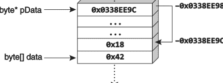

图 23.1：指针包含数据的地址

由于指针仅仅恰好引用内存地址的整数，因此它们不受垃圾回收的影响。C# 不允许除托管类型以外的引用类型（托管类型是指那些不是引用类型、不是泛型、且不包含引用类型的类型）。因此，以下命令是的：

```csharp
string* pMessage;
```

同样，该命令也是无效的：

```csharp
ServiceStatus* pStatus;
```

其中 `ServiceStatus` 的定义如列表 23.13 所示。问题再次在于 `ServiceStatus` 包含一个字符串字段。

## 列表 23.13：无效的被引用类型示例

```csharp
struct ServiceStatus
{
    int State;
    string Description; // Description 是引用类型
}
```

# 语言对比：C/C++——指针声明

在 C/C++ 中，同一条声明中的多个指针声明方式如下：

`int *p1, *p2;`

注意 `p2` 上的 `*`；这使得 `p2` 成为 `int*` 而不是 `int`。相比之下，C# 总是将 `*` 与数据类型放在一起：

`int* p1, p2;`

结果是两个 `int*` 类型的变量。这种语法与在单语句中声明多个数组的语法匹配：

```csharp
int[] array1, array2;
```

指针是一个全新的类型。与结构体、枚举和类不同，指针最终并不派生自 `System.Object`，甚至无法转换为 `System.Object`。相反，它们可以（显式地）转换为 `System.IntPtr`（该类型可以转换为 `System.Object`）。

除了仅包含托管类型的自定义结构体外，有效的指针还包括托管类型（非引用类型、int、float、double、decimal、bool、void）以及值类型（byte、ushort、int、uint、long、char）。

### 赋值

既然你已经将代码块标记为 `unsafe`，现在是时候看看如何编写不安全代码了。首先，不安全代码允许声明指针。考虑以下示例：

```csharp
byte* pData;
```

假设 `pData` 不为空，它的值指向一个包含一个或多个连续字节的位置；`pData` 的值代表这些字节的内存地址。在 `*` 之前的类型是被引用类型——即指针值所指向位置的类型。在这个示例中，`pData` 是指针，而 `byte` 是被引用类型，如图 23.1 所示。


图 23.1：指针包含数据的地址

由于指针仅仅恰好引用内存地址的整数，因此它们不受垃圾回收的影响。C# 不允许除托管类型以外的引用类型（托管类型是指那些不是引用类型、不是泛型、且不包含引用类型的类型）。因此，以下命令是无效的：

```csharp
string* pMessage;
```

同样，该命令也是无效的：

```csharp
ServiceStatus* pStatus;
```

其中 `ServiceStatus` 的定义如列表 23.13 所示。问题再次在于 `ServiceStatus` 包含一个字符串字段。

## 列表 23.13：无效的被引用类型示例

```csharp
struct ServiceStatus
{
    int State;
    string Description; // Description 是引用类型
}
```

# 第 23 章：平台互操作性与不安全代码

## 列表 23.10：为不安全代码指定方法

```c
public class Program
{
    unsafe static int Main(string[] args)
    {
        // ...
    }
}
```


此外，C# 允许将 `unsafe` 作为语句来标记代码块以允许使用不安全代码（参见列表 23.11）。

### 列表 23.11：为不安全代码指定代码块

```c
public class Program
{
    static int Main(string[] args)
    unsafe
    {
        // ...
    }
}
```

`unsafe` 块内的代码可以包含指针等不安全构造结构。

> 注意
>
> 有必要显式指示编译器支持不安全代码。

当你编写不安全代码时，你的代码将容易受到缓冲区溢出的影响，并可能暴露安全漏洞。因此，有必要显式通知编译器存在不安全代码。要实现这一点，请在你的 `.csproj` 文件中将 `AllowUnsafeBlocks` 设置为 `true`，如列表 23.12 所示。或者，你可以在运行 `dotnet build` 时在命令行传递该属性（参见输出 23.1）。或者，如果直接调用 C# 编译器，你需要使用 `/unsafe` 选项（参见输出 23.2）。

### 列表 23.12：无效引用类型示例

```xml
<Project Sdk="Microsoft.NET.Sdk">
  <PropertyGroup>
    <OutputType>Exe</OutputType>
    <TargetFramework>netcoreapp1.0</TargetFramework>
    <ProductName>Chapter20</ProductName>
    <WarningLevel>2</WarningLevel>
    <AllowUnsafeBlocks>True</AllowUnsafeBlocks>
  </PropertyGroup>
  <Import Project="..\Versioning.targets" />
  <ItemGroup>
    <ProjectReference Include="..\SharedCode\SharedCode.csproj" />
  </ItemGroup>
</Project>
```

### 输出 23.1

```bash
dotnet build /property:AllowUnsafeBlocks=True
```

### 输出 23.2

```bash
csc.exe /unsafe Program.cs
```

使用 Visual Studio，你可以通过勾选项目属性窗口中“生成”选项卡下的“允许不安全代码”复选框来激活此功能。

`/unsafe` 选项允许你直接操作内存并执行未管理的指令。因此，要求使用 `/unsafe` 意味着显式暴露此类代码可能引入的潜在安全漏洞。能力越大，责任越大。

## 指针声明

现在你已经将代码块标记为 `unsafe`，现在是时候看看如何编写不安全代码了。首先，不安全代码允许声明指针。考虑以下示例：

```csharp
byte* pData;
```

假设 `pData` 不为空，它的值指向一个包含一个或多个连续字节的位置；`pData` 的值代表这些字节的内存地址。在 `*` 之前的类型是被引用类型——即指针值所指向位置的类型。在这个示例中，`pData` 是指针，而 `byte` 是被引用类型，如图 23.1 所示。


图 23.1：指针包含数据的地址

由于指针仅仅恰好引用内存地址的整数，因此它们不受垃圾回收的影响。C# 不允许除托管类型以外的引用类型（托管类型是指那些不是引用类型、不是泛型、且不包含引用类型的类型）。因此，以下命令是无效的：

```csharp
string* pMessage;
```

同样，该命令也是无效的：

```csharp
ServiceStatus* pStatus;
```

其中 `ServiceStatus` 的定义如列表 23.13 所示。问题再次在于 `ServiceStatus` 包含一个字符串字段。

### 列表 23.13：无效的被引用类型示例

```csharp
struct ServiceStatus
{
    int State;
    string Description; // Description 是引用类型
}
```

### 语言对比：C/C++——指针声明

在 C/C++ 中，同一条声明中的多个指针声明方式如下：

`int *p1, *p2;`

注意 `p2` 上的 `*`；这使得 `p2` 成为 `int*` 而不是 `int`。相比之下，C# 总是将 `*` 与数据类型放在一起：

`int* p1, p2;`

结果是两个 `int*` 类型的变量。这种语法与在单语句中声明多个数组的语法匹配：

```csharp
int[] array1, array2;
```

指针是一个全新的类型。与结构体、枚举和类不同，指针最终并不派生自 `System.Object`，甚至无法转换为 `System.Object`。相反，它们可以（显式地）转换为 `System.IntPtr`（该类型可以转换为 `System.Object`）。

除了仅包含托管类型的自定义结构体外，有效的指针还包括托管类型（非引用类型、int、float、double、decimal、bool、void）以及值类型（byte、ushort、int、uint、long、char）。

### 赋值

既然你已经将代码块标记为 `unsafe`，现在是时候看看如何编写不安全代码了。首先，不安全代码允许声明指针。考虑以下示例：

```csharp
byte* pData;
```

假设 `pData` 不为空，它的值指向一个包含一个或多个连续字节的位置；`pData` 的值代表这些字节的内存地址。在 `*` 之前的类型是被引用类型——即指针值所指向位置的类型。在这个示例中，`pData` 是指针，而 `byte` 是被引用类型，如图 23.1 所示。


图 23.1：指针包含数据的地址

由于指针仅仅恰好引用内存地址的整数，因此它们不受垃圾回收的影响。C# 不允许除托管类型以外的引用类型（托管类型是指那些不是引用类型、不是泛型、且不包含引用类型的类型）。因此，以下命令是无效的：

```csharp
string* pMessage;
```

*(注：由于原始文本存在大量重复，此处译文已去重。)*

## 第 23 章：平台互操作性与不安全代码

你可能需要在一个方法体中固定一个对象，并让它保持固定状态直到另一个方法被调用；这通过 `fixed` 语句是无法实现的。如果你处于这种不幸的境地，可以使用 `GCHandle` 对象上的方法来无限固定一个对象。然而，只有在绝对必要时才这样做，因为长时间固定一个对象会导致垃圾回收器可能无法高效地紧凑内存。

### 在栈上分配内存

你应该在数组上使用 `fixed` 语句以防止垃圾回收器移动数据。然而，另一种方法是在调用栈上分配数组。栈分配的数据不受垃圾回收的影响，也不受随之而来的终结器模式的影响。与引用类型类似，要求是 `stackalloc` 必须是一个非托管类型的数组。例如，与其在堆上分配一个字节数组，不如将其放置在调用栈上，如列表 23.16 所示。

> 列表 23.16：在调用栈上分配数据

```
byte* bytes = stackalloc byte[42];
```

该数据类型是非托管类型的数组，运行时会为该数组分配一个固定大小的缓冲区，并在指针超出范围之前恢复缓冲区。具体来说，它分配了 `sizeof(T) * E`，其中 E 是数组大小，T 是引用类型。由于 `stackalloc` 只能用于非托管类型数组的要求，运行时通过简单地回溯栈来恢复系统缓冲区，从而消除了遍历 f-reachable 队列（见第 10 章“垃圾回收”部分和终结化的讨论）以及紧凑数据的复杂性。因此，没有办法可以显式释放 `stackalloc` 分配的数据。

栈是一个宝贵的资源。尽管它很小，但栈空间耗尽将产生巨大影响——即程序崩溃。出于此原因，你应该尽力避免耗尽栈空间。在这种情况下，最好的结果是程序立即关闭/崩溃。通常，程序的栈空间小于 1MB（甚至可能少得多）。因此，请务必小心避免在栈上分配任意大小的缓冲区。

### 指针解引用

访问存储在指针所指类型变量中的数据需要解引用该指针，在表达式之前放置间接操作符。例如，`byte data = *mData;` 解引用 `pData` 所指向的字节位置，并产生一个 `byte` 类型的变量。该变量提供了对该位置单个字节的读写访问权限。

使用这种不安全代码允许修改“不可变”字符串这一非常规的行为，如列表 23.17 和输出 23.3 所示。尽管这暴露了低级内存操作的潜力，但完全不推荐这种策略。

#### 列表 23.17：修改不可变字符串

```
string text = "S5280ft";
Console.Write("{0} = ", text);
unsafe // 需要 /unsafe 选项
{
    fixed(char* pText = text)
    {
        char* p = pText;
        *p = 'm';
        *p = 'i';
        *p = 'l';
        *p = 'e';
        *p = ' ';
        *p = '\0';
    }
}
Console.WriteLine(text);
```

### 输出 23.3

```
S5280ft = Smile
```

在这种情况下，你获取原始地址并使用预增操作符将其增加引用类型的大小（`sizeof(char)`）。接下来，你使用间接操作符解引用地址，然后用不同的字符赋值该位置。同样，在指针上使用 `+` 和 `-` 运算符会通过 `sizeof(T)` 操作数改变地址，其中 T 是引用类型。

比较操作符（`==`、`!=`、`< `<=` 和 `>=`）也可以用于比较指针。因此，它们的使用实际上等同于地址值的比较。

解引用操作符的一个限制是无法解引用 `void*`。`void*` 数据类型表示指向未知类型的指针。由于数据类型未知，因此无法通过解引用来产生变量。相反，要访问由 `void*` 引用的数据，你必须将其转换为另一种指针类型，然后解引用该类型。

你可以通过使用索引操作符而不是间接操作符来实现与列表 23.17 相同的行为（另见列表 23.18 和输出 23.4）。

#### 列表 23.18：在不安全代码中使用索引操作符修改不可变字符串

```
string text = "S5280ft";
Console.Write("{0} = ", text);
unsafe // 需要 /unsafe 选项
fixed(char* pText)
{
    pText[1] = 'm';
    pText[2] = 'i';
    pText[3] = 'l';
    pText[4] = 'e';
    pText[5] = 'f';
    pText[6] = 't';
}
Console.WriteLine(text);
```

### 输出 23.4

S5280ft = Smile

像列表 23.17 和列表 23.18 中的此类修改可能会导致意外行为。例如，如果在 `Console.WriteLine()` 语句之后将 `text` 重新赋值为 "Smile"，输出将是 Smile，因为字符串的内部已设置为预期的值。

### 指针与地址

### 访问引用类型的成员

解引用指针产生产生引用类型的变量。你可以使用点操作符访问成员。然而，为了方便访问指针成员，C# 提供了一个特殊操作符 `->`，如列表 23.19 所示。

#### 列表 23.19：访问引用类型的成员

```
unsafe {
    Angle angle = new(30, 18, 0);
    Angle* pAngle = &angle;
    Console.WriteLine("{0} {1} {2}", pAngle->Hours, pAngle->Seconds);
}
```

### 输出 23.5

30 18 0

### 通过委托执行不安全代码

正如章初承诺，我们用一个完整的示例来结束 C# 中可能最危险的操作：获取内存块指针，用机器代码填充它，创建一个指向新代码的函数指针并调用它。在这个示例中，我们使用汇编代码确定处理器 ID。如果在 Windows机器上运行，它将打印处理器 ID。列表 23.20 显示了如何实现。

#### 列表 23.20：为不安全代码分配块

```csharp
using System;
using System.Runtime.InteropServices;
using System.Text;

public class Program
{
    public unsafe static void Main()
    {
        if (RuntimeInformation.IsPlatform(OSPlatform.Windows))
        {
            unsafe
                byte[] codeBytes = new byte[] {
                0x49, 0x89, 0xd8, // mov %rbx,r8
                0x49, 0x89, 0xc9, // mov %rcx,r9
                0x48, 0x31, 0xc0, // xor %rax,%rax
                0x0f, 0xa2,       // %cpuid
                0x4c, 0x89, 0xc8, // mov %r9,%rax
                0x89, 0x18, 0x04, // mov %ebx,0x0(%rax)
                0x89, 0x48, 0x08, // mov %edx,0x4(%rax)
                0x4c, 0x89, 0xc3, // mov %ecx,0x8(%rax)
                0xc3,             // mov %r8,%rbx
                retq
            };

            Buffer buffer = new();
            using (VirtualMemoryPtr codeBytesPtr = new(codeBytes.Length))
            {
                Marshal.Copy(
                    codeBytes, 0,
                    codeBytesPtr, codeBytes.Length);
            }

            delegate<byte*, void> method = (delegate<byte*,
```

```csharp
void>(IntPtr)codeBytesPtr;
    method(&buffer[0]);
    }
    Console.Write("Processor Id: ");
    char[] chars = new char[Buffer.Length];
    Encoding.ASCII.GetChars(buffer, chars);
    Console.WriteLine(chars);
} unsafe
else
{
    Console.WriteLine("This sample is only valid for Windows");
    }
    return 0;
}
```

```csharp
[System.Runtime.CompilersServices.InlineArrayAttribute(Length)]
public struct Buffer
{
    public const int Length = 10;
    private byte _element0;
}
```

OUTPUT 23.6

Processor Id: GenuineIntel

## 总结

正如本书全程所示，C# 提供了强大的功能、灵活性、一致性以及极佳的结构。本章强调了 C# 程序执行非常底层的机器码操作的能力。

在结束本书籍之前，第 24 节简要描述了底层执行框架，并将重点从 C# 语言转移到 C# 程序执行的更广泛的背景。

本页特意留空

# 通用语言基础设施 (CLI)

C# 程序员在语法之外遇到的首要项目之一是 C# 程序执行的上下文环境。本章讨论了 C# 处理内存分配和释放、类型检查、与其他语言的互操作、跨平台执行以及对编程元数据支持的底层。换句话说，本章研究了 C# 在编译时和运行期间所依赖的通用语言基础设施。它涵盖了在运行时管理 C# 程序的执行引擎，并考虑了 C# 如何融入到由相同执行引擎管理的更广泛的语言集中。由于 C# 与此基础设施有紧密联系，该基础设施自带的大部分功能都提供了 C# 使用。

# 定义通用语言基础设施

C# 编译器不是生成处理器可以可以直接解释的指令，而是生成一种中间语言的指令，即通用中间语言 (CIL)。然后会发生第二次编译步骤（通常在执行时间进行），将 CIL 转换为处理器可以理解的机器码。然而，转换为机器码对于代码执行来说仍然是不够的。C# 程序还需要在代理（agent）的上下文中执行。负责管理 C# 程序执行的代理是虚拟执行系统（VES），通常称为运行时（runtime）。请注意，此处语境下的运行时不是指特定的时间，例如执行时间；

# 第 24 节：通用语言基础设施

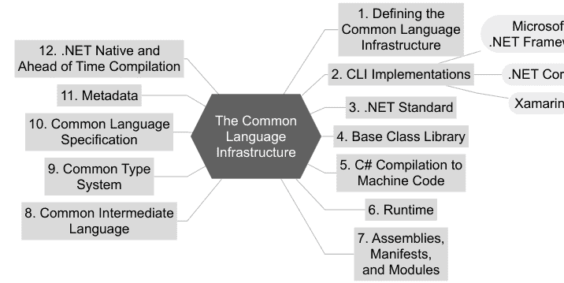

相反，运行时即 VES——是一个负责管理 C# 程序执行的代理。运行时负责加载和运行程序，并在程序执行时为其提供额外的服务（安全、垃圾回收等）。


CIL 和运行时的规范包含在一个名为“通用语言基础设施”（CLI）的国际标准中。¹ CLI 是理解 C# 程序执行上下文以及它如何与其它程序和库无缝交互的关键规范，即使这些程序和库是用其他语言编写的。请注意，CLI 并没有规定该标准的具体实现方式，而是确定了 CLI 框架在符合标准后应该如何行为的要求。这为 CLI 实现者提供了在时所需的灵活性，他们可以在需要时进行创新，同时仍然提供了足够的结构，使得由一个 CLI 实现创建的程序可以在另一个实现上执行，甚至在不同的操作系统上执行。

+ 1. 在整个章节中，CLI 指通用语言基础设施（Common Language Infrastructure），而不是 dotnet CLI 中的命令行界面（command-line interface）。

请注意 CIL 和 CLI 缩写及其代表的名称之间的相似性。现在区分它们将帮助你日后避免混淆。

CLI 标准中包含了以下内容的规范：

- 虚拟执行系统
- 通用中间语言
- 通用类型系统
- 通用语言规范
- 元数据
- 框架

本章拓宽了你对 C# 的视野，包含了 CLI，这对于 C# 程序如何运行以及如何与程序和操作系统进行交互至关重要。

# CLI 实现

今天 CLI 的主要实现是下一代 .NET（它运行在 Windows、Linux 和 Mac OS 上）；用于 Windows 的 .NET Framework；以及 .NET 多平台应用 UI (`MAUI`)，其旨在作为一种通用的跨平台解决方案，包括 iOS、macOS 和 Android 应用程序。CLI 的每种实现都包含一个 C# 编译器和一套框架类库。每个实现所支持的 C# 版本以及库中精确的类集合都有很大差异，许多实现现在仅具有历史意义。表 24.1 描述了这些实现。

# 第 24 节：通用语言基础设施

表 24.1：CLI 的实现

| 编译器 | 描述 |
| :--- | :--- |
| .NET | 在 .NET Core 版本 3.1 之后，下一次发布是 .NET 5。跳过了版本 4 以避免与现有的 .NET Framework 作品产生任何混淆。它是跨平台的，运行在 Microsoft Windows、Linux 上。 |
| .NET 多平台应用 UI (MAUI) | MAUI 旨在作为一种通用的跨平台解决方案，包括 iOS、macOS 和 Android 应用程序。 |

# 第 24 节：通用语言基础设施

表 24.1：CLI 的实现（）

| 编译器 | 描述 |
| :--- | :--- |
| .NET | 在 .NET Core 版本 3.1 之后，下一次发布是 .NET 5。跳过了版本 4 以避免与现有的 .NET Framework 作品产生任何混淆。它是跨平台的，运行在 Microsoft Windows、Linux 上。它支持桌面、服务器和云应用程序。 |
| .NET 多平台应用 UI (MAUI) | MAUI 是 Xamarin 的继任者，允许在 Microsoft Windows、iOS、macOS 和 Android 上编写跨平台原生应用程序。 |

- .NET Framework 基类库 (`BCL`): 提供表示内置 CLI 数据类型的类型，包括对文件 I/O、基础集合类、自定义属性、字符串操作的支持，并且 BCL 提供了如 `int` 和 `string` 等 C# 原生类型的定义。
- ASP.NET: 用于构建 Web 服务和基于 Web 的 API。自 2002 年发布以来，该框架已成为所有基于 Microsoft 的网站的基础。随着 2016 年 .NET Core 的引入，ASP.NET 提供了操作系统的移植性，并显著提升了性能，提供了具有更高模式一致性的更新 API。
- Windows Presentation Foundation (`WPF`): 一种用于构建运行在 Microsoft Windows 上的 UI 程序的图形用户界面。WPF 不仅提供了一 UI 组件，还提供了一种名为可扩展应用程序标记语言 (`XAML`) 的声明式语言，它能够对应用程序的用户界面进行分层定义。

你经常会听到 Microsoft .NET Framework 被简称为 .NET Framework。请注意大写的 F，它将其区别于 CLI 的通用实现以及 .net framework 术语。

## .NET Core

.NET Core 是未来 .NET CLI 的跨平台实现。此外，.NET Core 是 .NET Framework 的开源重写，侧重于高性能和跨平台兼容性。

.NET Core 由 .NET Core 运行时 (`CLR`)、.NET Core 框架库以及一组可创建和构建所有可用应用场景的 Dot 命令行工具组成。这些组件的组合包含在 .NET Core SDK 中。如果你一直跟着本书的示例，那么你已经使用过 .NET Core 和 Dot 工具了。

.NET Core API 通过 .NET Standard 兼容现有的 .NET Framework、Xamarin 和 Mono 实现，这将在本章节稍后部分进行详细讨论。

.NET Core 目前的重点是构建高性能且可移植的控制台应用程序，并为 .NET Foundation 的 ASP.NET Core 和 Windows 10 通用 平台 (`UWP`) 应用程序提供服务。随着支持的操作系统越来越多，更多的框架正从 .NET Core 中脱颖而出。

## .NET 多平台应用 UI (MAUI)

此跨平台开发工具包含了对 Microsoft Windows、Android、macOS 和 iOS 的应用程序 UI 开发支持。让 MAUI 特别强大之处在于，可以使用单一代码库在支持的每个操作系统上生成平台原生用户界面。

## .NET Standard

从历史上看，编写一个可以在多个操作系统上甚至是同一操作系统的不同 .NET 框架上使用的 C# 代码库是非常困难的。问题在于每个框架上的框架 API 可用的类（以及或这些类中的方法）不同。.NET Standard 通过定义一组通用的 .NET API 解决了这个问题，每个框架必须实现这些 API 以符合特定版本的 .NET Standard。这种统一性确保了开发者在符合其目标 .NET Standard 版本的每个 .NET 框架中拥有一组一致的 API 可用。

更多信息，包括 .NET 框架实现及其版本到相应 .NET Standard 版本的映射，请参见 http://it.lc/NETStandard。

## 基类库

除了提供一个可以执行 CIL 代码的运行时环境外，CLI 还定义了一组程序可能使用的核心类库，称为基类库 (`BCL`)。BCL 的类库提供了基础类型和 API，允许程序以一致的方式与运行时和底层操作系统进行交互。BCL 包含了对集合、简单文件访问、某些安全性、基础数据类型（string 等）以及流等的支持。

同样，一个名为框架类库 (`FCL`) 的 Microsoft 特有库包含了对富客户端用户界面、Web 用户界面、数据库访问、分布式通信等等的支持。

## C# 编译为机器码

第 1 章中的 HelloWorld 程序显然是 C# 代码，你使用 C# 编译器对其进行了编译以供执行：处理器仍然无法直接解释 C# 代码。还需要额外的编译步骤将 C# 编译结果转换为机器码。

# 垃圾回收

垃圾回收是根据程序需要自动释放内存的过程。对于那些没有自动化系统来执行此类清理的语言来说，这是一项重大的编程问题。如果没有垃圾回收器，程序员必须记住始终释放他们所分配的任何内存。忘记这样做，或者对同一次内存分配进行重复释放，可能会导致程序出现内存泄漏或损坏——得益于内置的垃圾回收支持，目标为运行时执行的程序员可以专注于添加程序功能，而不是关注与内存管理相关的“水利工程”工作。

# 语言对比：C++——确定性析构

垃圾回收器工作的具体机制并不是 CLI 规范的一部分；因此，每个实现可能会采取略有不同的方法。（事实上，垃圾回收是 CLI 未明确显式要求的项之一。）C++ 程序员可能需要熟悉确定性地（在定义良好的、编译时知的位置）析构的关键概念。事实上，对象可以在最后一次访问到程序关闭之间的任何时候被垃圾回收。这包括在离开作用域之前进行回收，以及在代码可以访问该对象很久之后进行回收。

垃圾回收器仅负责处理内存管理；也就是说，它不提供管理与内存无关资源的自动化系统。因此，如果需要显式操作释放资源（内存之外），使用该资源的程序员应该利用特殊的 CLI 兼容编程模式，这些模式将有助于清理这些资源（见第 10 章）。

# 第 24 章：通用语言体系

## 初学者主题

# .NET 中的垃圾回收

对于未按顺序阅读本章的读者，大多数 CLI 的实现使用分代、紧凑的标记-清除算法来回收内存。所谓“分代”，是指存活时间较短的对象将比那些已经由于仍在使用而跳过垃圾回收扫描的对象更快地被清理。由于它们仍在使用，它们会跳过扫描。这种约定符合内存分配的通用模式，即在该模式中，存在时间较长的对象将持续存在于最近实例化的对象之外。

此外，.NET 垃圾回收器使用标记-清除算法。在垃圾回收执行期间，它会标记要释放的对象，并将剩余的对象紧凑排列，以便它们之间没有“脏”空间。使用压缩来填充释放对象所留下的空间通常会导致新对象的实例化更快（这在非托管代码中是可能的），因为不需要搜索内存来定位新分配的空间。压缩还减少了分页的机会，因为更多对象位于相同的页面中，这同样提高了性能。

垃圾回收器会考虑机器上的资源以及在执行时对这些资源的需求。例如，如果计算机内存仍很大程度上未被开发，垃圾回收器就不可能运行并花时间清理那些资源。这种优化在不基于垃圾回收的执行环境和语言中很少被采用。

## 初学者主题

# 类型安全

同样，如果你未按顺序阅读本章，你可能还没有意识到运行时的关键优势之一是检查类型之间的转换，这被称为类型检查。通过类型检查，运行时防止程序员无意中引入无效的强制类型转换，这些转换可能会导致缓冲区溢出漏洞。此类漏洞是入侵计算机系统最常见的手段之一——让运行时防止这些漏洞的产生是一个巨大的收益。2 运行时提供的类型检查确保了以下点：

- 变量本身及其所引用的数据都是有类型的，并且变量的类型与其引用的数据类型兼容的。
- 可以对某种类型进行局部分析（而无需分析使用该类型的所有代码），以确定执行该类型的成员需要哪些权限。
- 每个类型都有一组在编译时定义的方法和它们包含的数据。运行时强制执行关于哪些类可以访问这些方法和数据的规则。例如，标记为“私有（private）”的方法仅供所属类型访问。

## 高级主题

# 绕过封装和访问修饰符

在权限适当的情况下，可以通过被称为反射的机制绕过封装和访问修饰符。反射通过允许浏览类型的成员、在对象的元数据中查找特定构造的名称以及调用类型的成员，来实现后期绑定。

# 平台移植性

C# 程序是平台可移植的，支持在不同的操作系统上执行（跨平台支持）——也就是说，C# 程序能够在多个操作系统上运行，并在不同的 CLI 实现上执行。在此语境下，移植性不仅限于为每个平台重新编译源代码，而是一个为特定框架编译的单一 CLI 模块可以在任何与 CLI 兼容的框架上运行，而无需重新编译。这种移植性的出现是因为代码移植的工作在运行时实现者手中，而不是应用程序开发者手中（多亏于 .NET Standard）。当然，限制是你的跨平台代码中不能使用任何特定平台的 API。在开发跨平台应用时，开发者可以将通用代码封装或重构为跨平台兼容的库，并从特定平台的代码中调用这些库，以减少支持跨平台应用所需的总代码量。

# 性能

许多习惯于编写非托管代码的程序员会正确指出，托管环境无论多简单，都会给应用带来开销。权衡是托管代码中开发生产力的提高和错误的减少与运行时性能之间的取舍。这种二元对立在编程从汇编语言转向高级语言（如 C），以及从结构化编程转向面向对象开发的过程中也曾出现。在大多数情况下，开发生产力更胜一筹，特别是当硬件的速度和价格下降超过了应用的需求时。在架构设计上花费的时间比低级开发的复杂性更有可能产生巨大的收益。在缓冲区溢出导致安全漏洞的背景下，托管执行变得更具吸引力。

毫无疑问，某些开发场景（例如设备驱动程序）可能尚不适合托管执行。然而，随着托管执行能力和复杂性的提高，许多此类性能考虑可能会消失。非托管执行将保留给那些被认为需要精确控制或绕过运行时的开发场景。³

此外，运行时还引入了几个有助于提高比原生编译性能的因素。例如，到机器码的翻译是在目标机器上进行的，生成的编译代码与该机器的处理器和内存布局匹配，从而产生了性能

2 假设你不是那种寻找此类漏洞的不道德之徒。

3 的的是，微软已经明确表示，未来托管开发将成为其 Windows 平台编写应用程序的主要手段，即使对于那些与操作系统集成的应用程序也是如此。

这些非 JIT 语言通常无法利用的优势。此外，运行时能够对执行条件做出响应，而直接编译为机器码很少会考虑到这些条件。例如，如果箱（box）拥有的内存大于所需的内存，非托管语言仍会在代码中确定的、编译时定义的执行点释放内存。相反，JIT 编译语言仅在内存不足或程序关机时才需要释放内存。即使 JIT 能够为执行过程添加一个编译步骤，但 JIT 插入可能导致代码效率提高，性能可以与直接编译为机器码的程序相媲。最终，CLI 程序并不一定比非 CLI 程序快，但它们的性能具有竞争性。

## 程序集 (Assemblies)、清单 (Manifests) 和模块 (Modules)

CLI 包含了源语言编译器的 CLI 输出规范，通常是一个程序集（assembly）。除了 CIL 指令本身，程序集还包含一个清单（manifest），它由以下组件组成：

- 程序集定义的导入的类型
- 程序集自身的版本信息
- 程序集依赖的附加文件
- 程序集的安全权限

清单本质上是程序集的头部，提供了关于程序集组成部分的所有信息，以及唯一标识它的信息。

程序集可以是类库，也可以是执行文件本身，一个程序集可以引用其他程序集（这些程序集反过来也可以引用更多程序集），从而建立一个由许多组件组成的应用程序，而不是一个大型的、单体的程序。这是现代编程框架理所当然的一个重要特性，因为它显著提升了可维护性，并允许单个组件在多个程序之间共享。

除了清单之外，程序集还包含在一个或多个模块中的 CIL 代码。通常，程序集和清单被合并到一个文件中，如第一章中的 `HelloWorld.exe` 那样。然而，也可以将模块放在各自单独的文件中，然后使用程序集链接器 (`al.exe`) 创建一个包含引用每个模块清单的程序集文件。这种方法不仅提供了将程序拆分为组件的另一种手段，还允许使用多种源语言开发一个程序集。

在通常，模块（module）和程序集（assembly）术语在某种程度上是可以互换的。然而，在谈论 CLI 兼容程序或库时，“程序集”一术语占主地位。图 24.2 展示了各种组件术语。

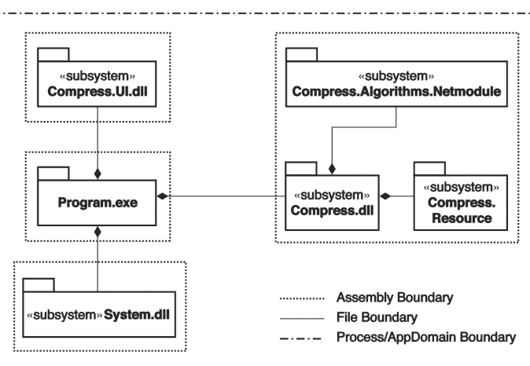

图 24.2：程序集及其引用的模块和文件

- 4. 这部分部分是因为一个主要的 CLI IDE 之一 Visual Studio .NET 缺乏处理由多个模块组成的程序集的功能。Visual Studio .NET 的当前实现没有构建多模块程序集的集成工具，并且当它们使用此类程序集时，IntelliSense 无法完全正常工作。

注意，程序集和模块都可以引用文件，例如已针对特定语言本地化的资源文件。虽然很罕见，但两个不同的程序集可以引用同一个模块或文件。

尽管程序集可以包含多个模块和文件，但整个文件组只有一个版本号，该版本号位于程序集清单中。因此，应用程序中最小的可版本组件是程序集；如果你更改了任何引用的文件——即使是为了发布补丁——而不更新程序集清单，你将违反清单本身以及程序集本身的完整性。因此，程序集构成了组件或单元部署的逻辑结构。

> 注意
> 程序集——而不是组成它的单个模块——是可以进行版本控制和安装的最小单元。

尽管程序集（逻辑结构）可以由多个模块组成，但大多数程序集只包含一个。此外，微软现在提供了 `ILMerge.exe` 实用程序将多个模块及其清单合并为单个文件程序集。

由于清单包含了对程序集依赖的所有文件的引用，因此可以使用清单来确定程序集的依赖关系。此外，在执行期间，运行时只需要检查清单来确定程序集的依赖项。此外，运行时需要检查清单以确定 CLI 应用程序的所支持的类型。

## COM 注册

与过去的 COM 注册不同，CLI 应用程序通常不需要任何类型注册。相反，通过拷贝类型定义，可以轻松将 CLI 部署到特定的目标。

## 公用中间语言 (Common Language)

与公用中间语言名称一致，CLI 的另一个重要特性是支持跨语言的交互。因此，CLI 不仅适用于 C#，还适用于许多语言，包括 Visual Basic .NET、Java 类的语言、Smalltalk、C++ 以及其他语言（在编写本文时超过 20 种，包括 COBOL 和 FORTRAN）。编译到 CLI 的语言被称为源语言，每种源语言都有一个将其转换为 CLI 的自定义编译器。这对于源语言是至关重要的。

> 注意
> CLI 的一个强大特性是它对多种语言的支持。这种支持允许使用多种语言开发跨操作系统的程序。

## 类型系统 (Common Type System)

无论使用何种编程语言，结果程序在内部对数据类型进行操作；因此，CLI 包含了类型系统（CTS）。CTS 定义了类型在内存中的结构和布局，以及围绕它们的概念和行为。它包含了有关存储数据的类型指令。CTS 标准适用于类型在语言边界的外观行为，因为 CTS 的目的是实现语言之间的互操作。运行时在运行时负责执行 CTS 建立的契约。

在 CTS 中，类型分为两类：

- **值 (Values)** 是表示基本类型（如整数和字符）以及结构形式的复杂数据的位模式。每个值类型对应一个不存储在位中的独立类型标记。独立的类型标记指向提供值中每个位含义以及该值支持的操作。
- **对象 (Objects)** 内部包含对象的类型标记。（这有助于类型检查。）对象具有身份，使得每个实例都是唯一的。此外，对象具有槽，可以存储其他类型（值或对象引用）。与值不同，更改槽的内容不会改变对象的身份。

这两类类型直接翻译为 C# 语法，提供了声明每种类型的方法。

# 第24 章：通用语言体系


无论使用该库的源语言是否符合`CTS`。它被称为通用语言规范（`Common Language Specification`），因为它旨在鼓励`CLI`语言提供一种创建可互操作库的方法，或者可以从其他语言访问的库。

例如，某种语言提供无符号整数的支持是完全合理的，因为这种类型并未包含在`CLS`中。因此，实现类库的开发者不应向外部暴露无符号整数，因为这样做会导致该库对于不支持无符号整数的符合`CTS`的源语言变得难以访问。理想情况下，任何可以从多种语言访问的库都应该符合`CLS`。请注意，`CLS`不关注未向程序集外部暴露的类型。

另请注意，当你创建一个不符合`CLS`的`API`时，编译器可能会发出警告。要实现这一点，你可以使用程序集特性`System.CLSCompliant`并将参数指定为`true`。

# 元数据

在执行指令中，`CIL`代码包含了关于程序中所包含的类型和文件的元数据。元数据包括以下条目：

- 程序或类库中每个类型的描述
- 清单（`Manifest`）信息，其中包含程序本身的数据以及它依赖的库
- 嵌入代码中的自定义特性，提供了有关这些特性所修饰结构的附加信息

元数据并非`CIL`中一个粗略的、非本质的附加组件，而是`CLI`实现的核心组件。它提供了关于类型的表示和行为，并包含了包含特定类型定义的程序集的位置信息。它在保存编译器生成的数据并使其在执行时供调试器和运行时访问方面起着关键作用。这些数据不仅在`CIL`代码中可用，而且在机器码执行期间也可以被访问，以便运行时继续进行任何必要的类型检查。

元数据为运行时提供了一种处理原生代码和托管代码混合执行的机制。此外，它增加了代码和执行的稳健性，因为它平滑了从一个库版本到下一个版本的迁移，将编译时定义的绑定替换为加载时实现。

关于库及其依赖项的所有头部信息都可以在元数据的称为“清单”的部分找到。因此，元数据的清单部分允许开发者确定模块的依赖关系，包括关于依赖项特定版本的信息以及指示创建该模块的签名。在执行时，运行时使用清单来确定加载哪些库、判断库或主程序是否被篡改，以及程序集是否缺失。

元数据还包含可能修饰代码的自定义特性。特性提供了关于`CLI`指令的附加元数据，可以在执行时通过程序访问。

元数据通过称为反射（`Reflection`）的机制在执行时可用。通过反射，可以在执行时查找类型或其成员，并调用该成员或确定某个结构是否被特定特性修饰。这提供了后期绑定，即系统在执行时（在编译时）确定执行哪种代码。反射甚至可以用于通过遍历元数据并将其复制到某种帮助文档中来生成文档（参见第 18 章）。

# .NET Native 与提前编译

`.NET Native`特性创建一个特定平台的的可执行文件。这被称为提前编译（`Ahead of Time`，简称`AOT`）。

`.NET Native`允许程序员继续使用`C#`编写代码，同时通过消除`JIT`编译代码来实现原生代码性能和更快的启动速度。当`.NET Native`编译应用程序时，`.NET FCL`会静态链接到应用程序中；还包含了针对静态预编译优化的`.NET Framework`运行时组件。这些专门构建的组件针对`.NET Native`进行了优化，并提供了比标准`.NET`运行时更好的性能。编译步骤不会以任何方式更改你的应用程序。你可以自由使用`.NET`的所有结构和`API`，并依赖托管内存和内存清理，因为`.NET Native`将`.NET Framework`的所有组件包含你的可执行文件中。

## 总结

本章描述了许多术语和缩写，这对理解`C#`程序运行的背景非常重要。大量的三字母缩写可能会令人困惑，因此表 24.2 总结了属于`CLI`的术语和缩写。

表 24.2：常见的`C#`缩写

| 缩写 | 定义 | 描述 |
| --- | --- | --- |
| .NET | 无 | Microsoft 对整个`CLI`栈的实现。包括`CLR`、`CIL`和各种语言，所有这些都符合`CLS`。 |
| BCL | 基类库 | `CLI`规范的一部分，定义了构建几乎所有程序所需的集合、线程、控制台和其他基类。 |
| C# | 无 | 一种编程语言。与`CLI`标准独立的是《`C#`语言规范》，该规范也由`ECMA`和`ISO`标准机构批准。 |
| CIL (IL) | 通用中间语言 | `CLI`规范的语言，定义了在`CLI`实现上执行的代码的指令。它有时被称为`IL`或`Microsoft IL (MSIL)`，以与其他中间语言区分来。（为了表示它是一个比`Microsoft`更广泛的标准，优先使用`CIL`而非`MSIL`或`IL`） |
| CLI | 通用语言体系 | 定义中间语言、基类和行为特性的规范，使实现者能够在通用执行环境中创建互操作源语言。 |

# 表 24.2：常见的 C# 相关缩写（续）

| 缩写 | 定义 | 描述 |
| --- | --- | --- |
| CLR | 通用语言运行时 | Microsoft 对运行时的实现。 |
| CLS | 通用语言规范 | `CLI`的一部分，定义了源语言必须支持的功能子集。 |
| CTS | 通用类型系统 | `CLI`中定义类型的部分。 |
| FCL | .NET Framework Library | 组成`.NET Framework`的大型库。 |
| VES | 虚拟执行系统 | 执行`CIL`的代理。 |

# 1132 索引

- 条件运算符，98-161, 175
- 空值合并运算符，82, 97-98, 173-178
- 空值条件运算符，82, 97-173-178
- getter 和 setter，316-317, 326, 330-333
- 类型声明，330, 547, 565-567

## 访问

- + + 数组，120, 123-124, 129-130
- 基类成员，306, 391-394, 407
- 实例字段，303-306, 317, 330
- 属性，319-320, 326, 330-333
- 引用类型成员，901, 921-922, 1097
- 静态字段，360-363, 367, 373
- 浮点值的精度，53-58, 92, 145-148
- + @ (at 符号)
- 标识符，16-19, 53, 65-67
- 字面量字符串，65-73
- + (方括号)
- 数组，115-116, 120-123, 132
- 属性标记，115-116, 886-899
- 索引器，122, 126-857-861
- 空值条件运算符，92, 97-178
- + \ 反斜杠
- 转义序列，65, 66-74
- as 作为字面量，65, 66-73
- a 转义序列，65-78, 71-160-161
- 缩写，17-19, 53, 59
- 动作声明，727, 741-747, 753
- 激活帧，66, 246, 935

## Add(方法)

- + 集合初始化器，339, 754-759, 845
- 字典，778, 832-834, 845-849
- 锁，528, 757, 1057
- 列表，417, 835-839
- + b 转义序列，65-73, 161
- lf 转义序列，65-73, 161

## 加法

- 二元运算符，138-143, 149, 550-552
- 复合赋值，139-143, 149, 736
- 增量运算符，138-139, 149, 153
- 字符串，67-69, 143, 514
- 一元运算符，138-139, 141-140, 1550
- + \n 转义序列，65-73
- 新类型，70-72, 160-161
- \ 转义序列，65-73, 160-161
- u 转义序列，64, 65-73
- 转义序列，64, 65-73
- 地址运算符 (&)，183-1085, 1098-
- 地址和指针，491-492, 1097, 1102-1103
- + ^ (异或或)，16, 65-67, 180
- _ (下划线)，17-19, 59, 322
- { (大括号)，24, 70-71, 162-163
- ~ (波浪号)

## 聚合类型

- 异步查询，958-960, 1028, 1035
- 并行循环，959, 1028, 1035-1039
- PLINQ 查询，823, 1034-1035, 1038
- 发布-订阅模式，740-743, 753, 959-960
- 任务，958-960, 975, 994
- 包装异常，622, 959-960, 1035
- + 取反运算符，143, 168-170, 187
- 终结器，581-584, 589-590, 596
- 列表搜索，815, 820-822, 843
- 重写，65, 237, 241

# A

- 抽象修饰符，444-444, 453-455, 484
- 模仿，405, 411, 414
- 聚合继承，297, 385-386, 463
- 访问修饰符，393-394, 398, 402
- 类，315-316, 330, 566-567
- 派生，330, 393-394, 566-567
- 终结器，341, 581-582, 583-584

# 索引 1133

- 别名
- 命令行选项，241, 269, 896
- 命名空间，221, 235, 567-570
- 前置任务，935, 952, 957
- Any() 运算符，143, 167-169, 800
- API（应用程序编程接口）文档，45, 444-445, 463
- 框架，45, 1078-1113, 1120
- 不安全代码选项，621, 1077, 1093-1095
- 允许域异常，612-615, 618-962
- 允许进程退出，590, 594-595, 962-964
- 允许多个，259-260, 269-270, 906-909
- 允许域未处理异常，274, 604, 962-964
- AllowNull 属性，82-83, 348-350, 354
- 允许不安全块，620-621, 1093-1094-1095
- Append(方法)，260, 462, 758
- AppendFormat(方法)，32-33, 75-77, 514
- 适用类型，270-271, 418-418
- if 语句的替代语句，158-163, 197, 225
- 应用程序列表键，19, 258, 601-603
- Name() 的参数，21-222, 243-245, 258
- 取符号 (&)
- 地址运算符，143, 149, 184-185
- 位运算运算符，169-170, 184-187, 552
- 复合赋值，140-141, 149, 184-185
- nameof 运算符，289, 803, 894
- 属性，333, 802, 901-903
- 逻辑运算符，143-160, 184-185
- 重写，17, 143, 407
- ArgumentOutOfRangeException，603, 654-656, 664
- 属性，347-350, 602
- 抛出异常，600-603, 612-624
- AND 操作
- 位运算运算符，169, 184-570
- 枚举，534, 540-552
- 逻辑运算符，163, 170, 184-185
- 泛型，623, 664, 677
- 方法，220, 224, 269-270
- 命名，224, 269-279
- 按值传递，224, 269-489
- 将方法作为传递，220, 224, 260
- 尖括号 (=>)
- 泛型，623, 630-635, 677
- XML，35-37, 571-574, 897
- 运算符，138-143, 149, 151
- ArithmeticException 类型，600-605, 622, 916
- 匿名函数，704-706, 797-800
- 匿名方法，755, 798-801
- lambda 表达式替换，697-706, 710
- 无参数，704-706, 797-805
- 匿名类型，339, 757-805
- 生成，705, 797-805
- 局部变量，705, 710, 799
- 概述，705, 754-756
- 存入，754, 756-797
- 类型安全和不可变性，505, 797-805
- 数量
- 泛型方法，642-645, 664, 676-677
- 元组，108, 642-645, 664
- 参数，642-645, 677-688

# 索引 1134

- 数组访问，112, 123-130, 320
- 匿名类型，705, 797-805
- 赋值，112, 115-120, 123-124
- 集合转换，30, 739-754, 853-837
- 常见错误，114, 124, 132
- 声明，112, 115-120, 193
- foreach 循环，194-195, 760, 103-1025
- 前向访问，112, 120-126, 130
- 实例成员，129-130, 302, 306
- 实例化和赋值，116-120, 299, 338-339
- 长度，115-116, 122, 125-129
- 方法，115, 124, 128-130
- 空值条件运算符，82, 98, 173-179
- 概述，116-123, 126, 856
- 参数，118-145, 224-260
- 范围，115-116, 120, 123, 124, 130-132
- 维度，115-120
- 反向访问，669-676, 708
- 使用，112, 123-124
- ArrayType 异常，124, 675, 1098
- as 运算符，885, 989-991, 1004-1008
- async Main(),21-22, 243-246, 258
- 返回类型，335, 439, 554
- async Parameter(),71-77, 971-972, 1023-1039
- SynchronizationType，944, 1013-1015, 1053-1054
- 程序集，881, 897-899, 905-907
- API，43-45, 898-899, 1122-1123
- 边界，557-559, 898-899, 1122-1123
- 构建，38, 898-899, 1122-1123
- IL，38-444, 1114, 1124
- CLI，557-560, 1109, 1121-1123
- 常量，373, 898-899, 1122-1123
- 扩展，371, 898-899, 1122-1123
- 引用，557-567, 868-899, 1122-1123
- CopyrightAttribute，897-899, 905-908
- FileVersionAttribute，897-900, 905-908, 914
- VersionAttribute，897-899, 905-908, 912-915
- Assert(),147, 462, 916-918
- 数组数组，112, 115-120, 123-124
- 空值到引用，82-83, 96, 100-101
- 空值到字符串，82-83, 176
- 指针，95-96, 997-999, 1002-1003
- 循环，106-108, 359
- 赋值运算符
- 结合性，140-142, 592
- 复合，139-143, 592
- 委托，548, 736
- 编码，98, 173-178, 286
- 重写，65, 237, 241, 149-151, 548-552
- 关联静态成员，502, 363, 367
- 实例字段，502-307, 363, 372
- 运算符结合性，138-143, 149
- AsSpan，463, 856-859, 1084
- 星 (*)
- 注释，34-36, 571-573, 955
- 复合赋值，140-142, 995
- 间接运算符，153, 955, 1102-1103
- 乘法，138-142, 949
- 重写，142-216, 255
- 指针，955, 1096-1103
- 优先级，140-142, 216, 955
- async Main 方法，21-22, 991, 1003-1005
- 返回类型，990-994, 1004-1006, 1019
- async Parameter 方法，71-77, 992, 1023-1039
- async/await 支持，985, 998, 1004-1018
- AsyncEnumerable 类，766, 994-1001, 1004
- 异步调用，984-985, 1003-1005
- 异步 lambdas，701-706, 1008, 1012
- 异步方法返回类型，990-994, 1002-1006, 1012
- 异步模式，935, 975, 1074
- 异步任务
- 复杂性，944-945, 975, 1012
- 任务问题，935-952, 975, 1074
- 任务异常，958-959, 975
- 任务，958-960, 975, 994
- 包装异常，622, 959-960, 1035

## 1136 索引

- 成员 (members), 397-410, 417-418
- 新修饰符 (new modifier), 397-398, 402-406
- 概述 (overview), 402, 417
- 密封修饰符 (sealed modifier), 397-398, 402-406
- 虚拟修饰符 (virtual modifier), 398-402, 405-455
- 基类 (Base classes)
- 派生对象转换 (derived object conversion to), 386-391, 410
- 实例 (instance), 295-297, 385-386


# 索引 1137

- `protected member access`, 393-394, 476
- `Base types`
  - `之间的转换 (casting between)`, 279, 381, 399, 402
- `类 (classes)`, 134, 391, 410
  - `描述 (description)`, 134, 391, 410
- `BCL (Base Class)`
  - `描述 (description)`, 110, 113-1114, 1124
  - `目的 (purpose)`, 557, 113-1114, 1124
  - `类型名称 (type names)`, 50, 53, 567-568
- `二进制位 (Binary digits)`, 54-55, 60-61
- `二进制表达式 (Binary expression)`, 141, 716-719, 723-725
- `二进制运算符 (Binary operators)`
  - `结合性 (associativity)`, 139-142, 599
  - `复合赋值 (compound assignment)`, 139-141, 599
  - `非数值类型 (non-numeric types)`, 63, 143, 552
  - `空值合并 (null-coalescing)`, 98, 173-178, 286
  - `重写 (overriding)`, 167-169, 548, 552
  - `运算符 (operator)`, 137-138, 184
  - `关系和相等运算符 (relational and equality)`, 63, 167-169, 548
- `二进制值 (Binary values)`
  - `转换 (conversions)`, 55, 60-63, 182-185
  - `浮点 (floating-point)`, 54-56, 145-148, 182-184
  - `字面量 (literals)`, 71, 63, 182-187
  - `移位运算符 (shift operators)`, 170, 182-187, 202
- `二进制树 (BinaryExpression trees)`, 139-141, 716-720, 723-725
- `二进制搜索 (BinarySearch(method))`
  - `数组 (arrays)`, 128-130, 685-687
  - `搜索 (searches)`, 687, 839, 842-848
- `BinaryTree<T>`
  - `约束 (constraints)`, 646-651, 662, 667
  - `索引运算符 (index operators)`, 648-650, 667, 866
  - `迭代器 (iterators)`, 856-866, 872-874
  - `参数 (parameters)`, 646-651, 667, 872
- `绑定 (Binding)`
  - `动态 (dynamic)`, 920-923, 926-931
  - `扩展方法 (extension methods)`, 371-372, 396-463
  - `延迟的 (late)`, 725-727, 920, 931
  - `数据 (data)`, 381-383, 911
- `位（二进制） (Bits (binary digits))`, 54, 60-61, 182-187
- `位运算运算符 (Bitwise operators)`
  - `与位运算 (bits and)`, 61, 170-187
  - `补码 (complement)`, 169-183, 187-552
  - `复合赋值 (compound assignment)`, 149, 183-187, 552
  - `枚举 (enums)`, 169, 184-187, 540
  - `用于位置 (for positions)`, 119, 183-202
  - `移位 (shift)`, 182-183, 202
  - `使用 (working with)`, 139, 170, 183-187
- `块语句 (Block statements)`, 162-164, 702
- `BlockingCollection<T> class`, 832-834, 1068-1069, 1076
- `布尔 (bool)`
  - `数组值 (array values)`, 63, 118-120, 554
  - `普通 (common)`, 63, 599-554
  - `控制 (flow control)`, 137, 169-190
  - `Lambda表达式 (lambdas)`, 166, 554, 703
  - `逻辑运算符 (logical operators)`, 63, 166-170, 184
  - `概述 (overview)`, 63, 166, 554
  - `关系和相等运算符 (relational and equality operators)`, 63, 167-170, 554
- `布尔表达式语句 (Boolean expressions for statements)`, 158, 166-171, 184
- `布尔运算符 (Boolean operators)`
  - `逻辑 (logical)`, 63, 167-170, 184-185
  - `重写 (overriding)`, 167-170, 184, 552-554
- `边界 (Bounds)`
  - `数组 (arrays)`, 115-120, 124, 135
  - `浮点类型 (floating-point types)`, 53-56, 145-148
- `装箱 (Boxing)`
  - `避免 (avoiding)`, 281, 527, 545
  - `泛型 (generics for)`, 524-527, 677, 681
  - `特性 (idiosyncrasies)`, 17, 527-527, 545
  - `在循环中 (in loops)`, 188, 192-194, 524-527
  - `概述 (overview)`, 517, 523-527, 545

## 索引 1137

- `命名空间的的驼峰命名 (Brand casing for namespaces)`, 50, 221, 568-570
- `预处理器指令 (preprocessor directives)`, 207-214
- `纯虚拟函数 (pure virtual functions)`, 207-401, 443, 599
- `short 类型 (short type)`, 53-84, 115

### `Break() 方法`
- `break 语句 (break statements)`, 13, 200-201, 875
- `lambda表达式 (lambda expressions)`, 697-702, 716, 857
- `查找 (look)`, 200-201, 875, 1031
- `switch 语句 (switch statements)`, 197-200, 205, 230
- `使用 (working with)`, 200-201, 875, 1031
- `yield break`, 870, 875, 1032
- `脆弱基类 (Brittle base class)`, 391-394, 402
- `重要性 (importance)`, 17, 63, 557
- `字面量 (literal)`, 53, 59, 67
- `后缀 (suffixes)`, 53, 59, 264
- `泡泡排序 (Bubble sorts)`, 68, 698-700, 710
- `byte 类型 (byte type)`, 53, 624
- `计算属性 (Calculated properties)`, 79, 318-322, 333
- `调用点 (Call sites)`, 246, 261, 923-925
- `调用栈 (Call stacks for)`, 245-246, 261, 624-626
- `C (Bytes)`
- `C# 语言和语法 (C# language and syntax)`, 14-15, 48, 150
- `回调函数 (Callback functions)`, 219, 737, 1090-1092
- `调用者属性 (CallerName attribute)`, 270, 895-991
- `C++ 值 (C++ value)`
  - `数组 (arrays)`, 112-117, 135
  - `布尔转换 (Boolean conversions)`, 63, 166-559, 154
  - `缓冲区溢出 (buffer overflows)`, 84-1077, 1120
  - `释放器 (deleter)`, 139, 150-161
  - `确定性析构 (deterministic destruction)`, 581, 1077-1108
  - `相等检查 (equality checks)`, 63, 168, 548
- `调用 (Calling)`
  - `构造函数 (constructors)`, 334-338, 341-344
  - `集合标识符 (collection identifiers)`, 339, 759-805
  - `外部函数 (external functions)`, 219, 232-233, 1078-1080
  - `对象初始化器 (object initializers)`, 334-338, 341
  - `全局方法 (global methods)`, 218, 232-233, 684
  - `全局变量和函数 (global variables and functions)`, 2, 164-232
  - `头文件 (header files)`, 12, 144
  - `隐式重写 (implicit overriding)`, 398, 402-403, 455-457
  - `递和递减运算符 (increment and decrement operators)`, 139, 149-154
- `CallSite`
  - `驼峰命名 (camelCase)`, 223, 678, 925
  - `描述 (description)`, 223, 678, 925
  - `参数名称 (parameter names)`, 635, 678, 923-925
  - `属性名称 (property names)`, 801, 804, 923
  - `元组 (tuples)`, 111, 642-645, 923-925
  - `变量名称 (variable names)`, 223, 798-799, 923-925
  - `"can do" 关系`, 651, 662-633, 923-925
  - `局部变量作用域 (local variable scope)`, 164-165, 233, 714
  - `Main()`, 24, 20-22, 243-245
  - `构建期间调方法 (methods called during construction)`, 333, 336
- `Cancel()`
  - `平行迭代 (parallel iterations)`, 1027-1032, 1038
  - `PLINQ 查询 (PLINQ queries)`, 963-968, 1034-1035
  - `任务 (tasks)`, 963, 979, 975
- `CancellationToken 类`
  - `异步方法 (asynchronous methods)`, 966-969, 997, 1038
  - `概述 (overview)`, 963-969, 1027-1029, 1038
  - `PLINQ 查询 (PLINQ queries)`, 963-969, 1035
  - `CancellationToken 属性 (CancellationToken property)`, 966-967, 968-969, 1038
  - `CancellationTokenSource 类`, 963-966, 968-969, 1027
- `列表容量 (Capacity of lists)`, 790, 835-837, 843-845
- `Capture (Capture(method))`, 228, 605-1074
- `捕获的值 (Captured values)`, 248, 710, 711-715
- `尖符号 (Carets)`
  - `数组 (arrays)`, 115-120, 121-122
  - `位运算运算符 (bitwise operators)`, 166, 178-183
  - `复合赋值 (compound assignment)`, 27, 149-151, 170
  - `从末尾开始索引 (index from end)`, 121-122, 125-127, 170
  - `逻辑运算符 (logical operators)`, 168-169, 170, 184
  - `重写 (overriding)`, 121, 127, 170
- `回车 (Carriage return)`
  - `转义序列 (escape sequence)`, 65-72
  - `换行 (newlines)`, 23, 65-72
- `卡尔卡积 (Cartesian products)`
  - `内连接 (inner joins)`, 780-784, 778-789, 828
  - `查询表达式 (query expressions)`, 708-812, 821
- `Case 标签 (Case labels)`
  - `goto 语句 (goto statements)`, 156-158, 198-200, 205-206
  - `switch 语句 (switch statements)`, 197-200, 205-206, 422-423
- `Casing`
  - `大写敏感性 (Case sensitivity)`, 17-18, 19, 523
  - `标识符形式 (identifier forms)`, 19, 53, 59-61
  - `局部变量 (local variables)`, 164-165, 710
- `Cast 和转换`
  - `基于派生类型 (based derived types)`, 390-391, 439-440, 555
  - `定义 (defining)`, 85, 439-440, 555
  - `枚举 (enums)`, 85, 521-530
  - `泛型方法 (generic methods)`, 85, 439-440, 555
  - `隐式转换 (implicit conversions)`, 85, 390-392, 555
  - `继承 (inheritance)`, 390-391, 439-440, 555
  - `重写 (overriding)`, 85, 439-440, 552
- `Catch 块 (Catch blocks)`
  - `异常 (exceptions)`, 275-280, 284-605
  - `普通 (general)`, 280-282, 609
  - `抛出异常 (throwing exceptions)`, 275, 601, 605
  - `捕获异常 (Catching exceptions)`, 280, 601, 605
  - `单元 (cells in)`, 114-115, 129-130, 195
- `中央处理器 (Central processing units (CPUs))`
  - `描述 (description)`, 333-338, 1021, 1017
  - `多线程 (multithreading)`, 334-338, 941, 973
  - `PLINQ 查询 (PLINQ queries)`, 333-335, 1021, 1114
- `构造函数初始化器 (constructor initializers)`, 336-346
- `Chains`
  - `构造函数 (constructors)`, 338, 344, 735
  - `循环的 (circular)`, 162, 735, 780
  - `委托 (delegates)`, 694-729, 727-735
  - `表达式 (expressions)`, 716-718, 724-825
  - `继承 (inheritance)`, 385-388, 398, 418
  - `迭代器 (iterators)`, 863-866, 873-878
- `死锁 (Circular wait in deadlocks)`, 940-943, 974, 1060-1062
- `类定义 (Class definitions)`
  - `描述 (description)`, 295, 298-299, 385
  - `指南 (guidelines)`, 293-295, 298, 568-570

## 索引 1139

- `class 关键字 (class keyword)`, 15, 19, 298-299
- `Classes`
  - `抽象 (abstract)`, 295, 410-411, 444-445
  - `访问修饰符 (access modifiers)`, 314-316, 330, 566-567
  - `关联数据 (associated data)`, 302, 363, 782
  - `具体的 (concrete)`, 410-412, 568
  - `构造函数 (constructors)`, 652, 665, 660-662
  - `构造函数 (See Constructors) 参见构造函数`
  - `声明 (declaring)`, 19, 298, 568-570
  - `析构函数 (deconstructors)`, 295, 341, 410
  - `定义的 (defined)`, 295, 298-599
  - `委托 (delegates)`, 726-728, 743
  - `封装 (encapsulation)`, 301, 314-317
  - `扩展方法 (extension methods)`, 371-372, 396, 461-463
  - `存储和加载文件 (files for storing and loading)`, 298, 311, 557-558
  - `泛型 (generics)`, 623, 635, 677
  - `层次结构 (hierarchy)`, 221
  - `可扩展的 (extensible)`, 376, 396, 463
  - `实例字段 (instance fields)`, 302-306


- 实例方法 (instance methods), 302-306, 376, 370
- 实例化 (instantiating), 293-295, 298, 568-570
- 接口 (interfaces), 314-316, 566-567
- 成员 (members), 302-306, 566-567
- 多个属性 (multiple attributes), 314-316, 566-567
- 多个迭代器 (multiple iterators), 314-316, 566-567
- 多个变量 (multiple variables), 314-316, 566-567
- 重写 (overriding), 314-316, 566-567
- 概述 (overview), 314-316, 566-567

# 1140 索引

队列, 832-837, 853-855
搜索, 808-810, 832-837, 843
共享状态, 858, 974, 1069
排序, 779, 821, 832-841
排序, 696-698, 821, 839-841
栈, 624, 631-634, 853-855
标准运算符。见标准查询操作符
线程同步, 1041, 1051, 1069
全排序, 777-779, 821, 839
+ 冲突, 780, 852, 941

### 冒号 (:)

条件运算符, 163, 162-172, 175
约束, 106, 344, 656
构造函数, 336-339, 344, 577
派生类, 384, 387, 463
十六进制格式, 59-61, 64-66, 344
表格, 106, 206, 344
COM 线程模型, 935-938, 973, 1075
`Combine(method)`
委托, 256-290, 653, 736
哈希码, 248, 259, 851-852
属性, 248-259, 653
`COMException` 类型, 284, 609-614, 617
命令行参数, 224, 243, 269
`CommandLine` 类, 886-890, 896, 1109
`CommandLineRequiredAttribute`, 269, 896, 900-908
`CommandLineSwitchAttribute`, 889, 895-906, 900
`CommandLineUtils` 包, 1-5, 886-889, 1109
+ 逗号 (,)
数组, 112, 115-120, 135
属性, 881, 897, 898-900
约束, 115-116, 193, 656
枚举, 533-537, 540-542, 1091
`for` 循环, 115-118, 188, 192-194
接口, 443-445, 461-463, 482
方法, 228, 291, 897
参数, 116, 228, 701
变量声明, 106, 115-116, 193

## 注释

指南, 17, 34-36, 571-574
概述, 34-36, 291, 571-573
XML, 34-37, 571-574

### 通用中间语言 (CIL)

匿名类型, 610, 697-798, 1124-1126
程序集, 38-40, 1114, 1124-1126
装箱, 524-526, 610, 1124
编译, 38-40, 1114, 1124
描述, 38, 1114, 1124
事件, 752, 1114, 1124
通用 catch 块, 524, 610, 1124
泛型表示, 677-678, 1114, 1124
`ILDASM`, 38, 1114, 1124-1126
索引器, 38, 1114, 1124
元数据, 1114, 1124, 1125-1126
外部变量, 38, 713, 1124-1126
输出, 38-41, 1114, 1124
属性, 322-333, 1114, 1124
目的, 38, 1114, 1124

### 通用语言基础设施 (CLI)

程序集, 1106-1109, 1114, 1121-1126
基础类库, 1109, 1113-1113, 1124-1126
`CIL`, 1106-1109, 1114, 1124
`CLS`, 1106-1109, 1113, 1124
编译, 1114, 1121, 1124
`CTS`, 109, 39, 1106-1109, 1124
描述, 39, 1106-1109, 1124
封装, 39, 1106-1109, 1124
垃圾回收, 39, 577, 1115-1128
实现, 39, 1106-1109, 1124
清单文件, 39, 1106-1109, 1124
元数据, 39, 1106-1109, 1124
Microsoft .NET Framework, 5, 1114-1114, 1124
模块, 39, 1109, 1124-1126
多路委托, 739, 1106-1109, 1124
命名空间, 1078, 1109, 1124-1126
.NET Core, 5, 1109-1114, 1124
.NET 原生特性, 1109, 1124, 1128
.NET Standard 版本, 1106-1109, 1113-1113, 1124
概述, 39, 1106-1109, 1124

### 通用语言运行时 (CLR)

描述, 38, 1106-1108, 1114-1116
枚举, 537, 1114-1126
命名空间, 44, 1106-1114

### 通用语言规范 (CLS)

描述, 1106-1109, 1124-1126
库, 39, 1124-1126
元数据, 39, 1124-1126

### 通用类型系统 (CTS), 1107, 1125, 1126

垃圾回收中的对象压缩, 576-578, 1100, 1115-1118
`Compare()` 方法, 515, 687, 850
`CompareExchange()` 方法, 515-518, 850-851, 1056
`CompareTo()` 方法, 647, 838-842, 850
接口, 455, 647, 850
树, 647-650, 988

### 比较

二叉树节点, 648-650, 724, 872
集合项, 808, 810-832, 837
比较/交换 模式, 423-425, 433, 1056
浮点类型, 53-56, 63, 145-147
字符串, 63, 168

## 比较运算符

重写, 167-169, 548-549, 552
指针, 167-168, 548-549, 1102
类型间的兼容性, 487, 533-538, 542

### 编译

提前, 207-208, 1114-1116, 1121
反汇编, 34, 48-1121
到机器码, 38-40, 1114-1116, 1121
示例输出, 6, 12, 56
源代码, 3-4, 10-12, 1114
静态 vs 动态, 367, 926, 1114
`CompilerGeneratedAttribute`, 333, 900, 906-908
补全运算符 (), 138-139, 170, 183-187
异步请求的复杂度, 975, 981-985, 1012
`ComponentModel` 类, 295, 394, 497
编译中的组件, 207, 1114-1116, 1121

### 复合格式化

描述, 32-33, 66, 75-77
模式, 77, 424, 433-435
字符串, 32-33, 75-777

### 复合赋值

149, 183-187, 552
数学运算符, 139-142, 552
重写, 149, 552, 736

### Concat()

`Concat()` 方法, 75, 143, 259-260
用于查询的 `Concat()`, 143, 808-812, 825-828
拼接字符串, 75-77, 143
具体类, 293-295, 298-299, 482
并发类, 832-837, 1069, 1076
并发操作, 154, 937-942, 1061
`ConcurrentBag<T>` 类, 634, 1068-1069, 1076
`ConcurrentDictionary<TKey, TValue>` 类, 659-832, 835-849
`ConcurrentQueue<T>` 类, 631-634, 853-855, 1068-1069
`ConcurrentStack<T>` 类, 624, 631-634, 853-855, 1068-1069
集合初始化器, 338-341, 754-759
约束, 337-338, 660-662
声明, 298, 338-338, 344-345
默认, 338-341, 345-510
终结器, 341, 581-584
泛型, 623, 638, 660
初始化器, 338-341, 344-346
调用的方法, 338-338, 344-346
`in` 块中, 275, 280-282, 605-606

### 条件

条件类, 166-172, 205
`ConditionalAttribute`, 354, 900-991-916
条件运算符, 169-172, 205
条件类型, 166-172, 205

### 条件

`for` 循环, 156, 168-194
`if` 语句, 156-161, 166, 205
从...传播异常, 280, 609, 622
静态, 359-360, 363, 366-369
结构体, 398, 455-510
结果的结果, 198, 203, 574

### Contains()

注释, 28, 34-36, 571-574
输入, 28, 31, 57
换行符, 34-36, 723
往返格式化, 62, 75-77
字符串, 28, 75, 225
搜索, 833, 842-848
栈搜索, 624, 846-848, 853-855
属性, 660, 777-778

# 索引

- 用于异步任务的 `CurrentId` 属性，366-368, 991, 1013-1016
- 自定义属性，881, 886-907, 914
- 自定义转换，88-89, 391-392, 523
- 自定义异常，280, 599-601, 612-615
- 动态规划中的自定义对象，293-295, 920, 926
- 结构体的的自定义值类型，487, 544-557, 1097

## D

- `Data` 命名空间，221, 567-570, 782
- 数据持久化，310-311, 314, 782
- 数据类型，25, 92-93, 134
- `DataBinder` 类，410, 683, 922-923
- 死锁
    - 避免避免，941-943, 1062-1074
    - 原因，940-943, 1062-1074
- `DEBUG` 调试器标识符，17, 207-214
- 调试
    - `debug(method)`，514, 564, 723
    - 相关的预处理器指令，207-214
    - 源代码，3-4, 12, 572
- `Decimal` 类型，53-58, 84, 144-145
- 代码块中的声明空间，24, 162-165, 569
- 声明
    - 数组，112, 115-120, 123
    - `await` 语句，988-999, 993-1003
    - `BinaryTree<T>` 类，648-651, 667, 865-866
    - 类约束，651-656, 660-663
    - 类，291-293, 268-570
    - 常量，269, 373
    - 构造函数，298, 338-343, 334
    - 解构造，341, 358-359, 512
    - 委托类型，689-693, 707, 716
    - 枚举，533-542, 1091
    - 事件，728, 743-747, 750-753
    - 外部方法，228, 232-233, 291
    - 泛型接口，444-445, 635-638, 663
    - 泛型方法，651, 663-664, 892
    - 实例字段，307-310, 363, 652
    - 接口约束，444-445, 651-652, 656
    - 局部变量，25-27, 164-165, 193
    - `Main(method)`，20-22, 227, 243-246
    - 方法，228, 291, 298
    - 命名空间，221-222, 235-239, 568-570
    - `out` 接口，26-27, 193-298
    - 参数，228-267, 270, 701
    - 指针，95, 1096-1103
    - 属性，318-322, 333, 367
    - 只读实现的属性，326, 374-375, 506-507
    - 只读字段，326, 374-376, 506-507
    - 返回类型，84, 228-231, 700
    - 静态构造函数，359-360, 370-377, 373
    - 静态字段，360-363, 367-373, 374
    - 结构体，506, 547, 1083
    - 元组，106-108, 359, 803
    - 非托管结构体，654, 1083-1084, 1097
    - 变量，25-27, 193, 298
    - 解构造，341, 357-358, 512
    - `Decre` 运算符
    - 描述，138-139, 150-154, 183
    - 循环示例，138-139, 150-154, 1044
    - 线程安全，150-154, 1044, 1071-1072
    - `Decrement(method)`，150-151, 1044, 1071-1072
    - 默认构造函数，337-338, 341-346, 510
- 默认接口成员
    - 扩展方法，461-463, 481, 484-485
    - 版本控制，446, 464-467, 481-484
    - 泛型默认运算符，630, 651, 662-663
    - `switch` 语句中的默认，197-200, 205-206, 422-424
- 默认类型，134, 269, 640
- 默认值泛型，269, 630-638, 641
- 默认结构体，269, 510, 640
- `DefaultIsEmpty()`,269, 288, 840
- 延迟执行
    - `LINQ`，775-777, 793-796, 806
    - 查询异常，718-720, 777, 806
- 定义
    - 抽象类，410-411, 453
    - 属性，886-900, 914
    - 计算属性，318-322, 333
    - 转换运算符，85, 439-440, 555
    - 自定义转换，88-89, 391-392, 555
    - 自定义扩展，599-601, 612-615, 618
    - 枚举，530-542, 1091
    - 终结器，341, 581-584, 596
    - 泛型类，631-634, 677-832
    - 泛型构造函数，635-638, 660, 677
    - 泛型方法，223, 663-664, 892
    - 索引，832, 860-864
    - 迭代器，760, 863-867, 883
    - 命名空间，221, 235-239, 567-580
    - 嵌套类，238, 376-568, 575
    - 部分类，379, 381-384, 388
    - 预处理器符号，15, 207-210, 214
    - 发布，725, 728, 743, 753
    - 栈，624-631, 854
    - 静态方法，360, 363-367, 380
    - 订阅者方法，727, 730-731, 753
    - `Delay()` 方法，1003-1005, 1066-1068, 1074
    - 委托类，683, 694, 753
    - 委托约束，651-657, 660-663
    - 委托关键字，716, 747, 750
    - 委托类型，692, 726-728, 738
    - 委托，693, 716, 727
    - 延迟执行，693, 716, 727
    - 事件通知，727, 737, 739
    - 事件处理程序，726, 748, 753
    - 表达式树，684, 693, 716, 725
    - 实例化，693-694, 726-728
    - 内部机制，693-694, 716
    - 介绍，693-694, 716, 727
    - 运行，693-694, 727, 739
    - 方法按引用传递，693-694, 727, 735
    - 空值条件运算符，173-175, 178-180, 733
    - 空引用，88, 98-101, 173-175
    - 空值，82-83, 98-100, 173-175
    - 点，95, 492, 1097-1103
- 派生
    - 基类与派生类型之间的转换，297, 389-391, 402
    - 自定义转换，88, 389-392, 555
    - 扩展方法，371-372, 396-397, 461-463


- 接口，444, 456, 458-463

- 概述，398, 397, 418

- 私有访问修饰符，315-316, 393-394, 566

- `do`/`循环`

    - 156, 188-194, 204

    - 概述，188-194, 203-204

- 动态编程

    - 绑定，725, 920-926, 931

    - 自定义对象，293-295, 926-928

    - 描述，725, 920, 926

    - 概述，725, 920, 926

    - 使用，203-204

- 文档

    - 反射，35, 44, 881-882

    - XML文件，10, 35-37, 571-574

    - 原理与行为，294-295, 920, 926

    - 反射，920, 922, 1119

    - 序列化，920-922, 1114

    - 美元符号 (`$`) 插值，66-67, 70-74, 777

    - `DynamicInvoke()`方法，733, 923-931, 1078

    - GNU .NET 编译器，12, 44, 1128

    - `dotnet`，5, 109-112, 1109

    - `DynamicObject` 类，295, 680-931

    - 构建与执行，5, 10-12, 1109

    - 引用，5, 558-561, 1112

- 双引号

    - 转义序列，65-67, 70-74, 143

    - 元素，60, 773, 1043-1045

    - 计数，160-163, 199

    - 集合，113-756, 863

    - 子句，160-163, 199

    - 事件，324, 431, 743-752

    - 概述，92-133, 1125

    - 特殊字符，53, 145, 1125

    - `GetData()`方法，580, 976-978, 981

    - `GetTaskAsync()`方法，975-978, 981, 984

- 封装

    - 类，294-295, 317-394, 406-1109

    - `const` 修饰符，314, 372-375, 394

    - 隐藏，301, 314-316, 394

    - 面对象编程，293-295, 313, 394

    - 保护的，394, 476, 484

    - `GetString()`方法，243-244, 976-978, 981

- `Enumerable` 类

    - 委托，463, 694

    - 元素计数，760-761, 765-776, 773-776

    - 过滤器，463, 769, 833-834

    - 内部连接，463, 780-784, 778-789

    - 方法，463, 762, 834

    - 并行查询，772, 833, 1033-1039

    - 查询表达式，463, 809-812, 831-833

    - 排序，777-779, 839, 1034

    - 标准查询运算符，777, 806-810, 833

- 迭代器参数，660, 836-868, 878

- `Environment` 类

    - 命令行参数，269, 886-889, 899

    - 换行符，67, 70-72, 78

- 等价

    - C# 与 C++，63, 168, 515

    - 集合，463, 755, 832-834

    - 委托，691-694, 707, 716

    - 字典键，832, 834-852

    - 浮点类型，53-56, 148

    - 与空值，82, 173-175, 493

    - 对象，167-168, 193, 194, 515

    - 运算符，167-170, 548

    - `比较器<T>` 类，651-657, 660-663

    - 复合赋值，63, 149, 168

    - 委托，693, 716, 727

    - 等价运算符，63, 167-168

    - 空值检查，98, 173-175

    - 空值合并运算符，98, 173-175

    - 覆盖，63, 167, 168

    - 指针，95, 1096-1103

    - 优先级，63, 140-142, 167-168

    - 属性，314, 322, 367

    - 移位运算符，49, 167-170

    - 变量赋值，63, 149, 168

# 索引 1149

`EventHandler<T>` 类, 726-728, 743, 746-753

事件

- 编码规范, 743-744, 747, 750-753

- 声明, 743-747, 750-753

- 泛型和委托, 726-728, 743

- 实现, 444, 744, 753

- 内部机制, 737, 743, 744, 750-753

- 监听器, 743-744, 747, 753

- 忽略, 743-744, 747, 753

- 发布封装, 743-746, 747-753

- 发布/订阅模式。参见发布/订阅模式

- 目的, 727, 743, 744

- 订阅封装, 727, 723, 753

- 线程同步, 932, 973, 1041

异常条件, 601-606, 612-614, 622

异常继续, 204, 825-827, 950-952

`ExceptionDispatchInfo` 类

- 异步请求, 608, 1014

- 目的, 599, 608, 618, 658

异常

- `catch` 块, 275, 251, 605

- 类继承, 280, 599-601, 605

- 自定义, 280, 599-601, 612-615

- 错误捕获, 274-275, 280, 601

- 预期情况, 280, 599-601, 605

- 指南, 599-601, 612-614, 622

- 概述, 280, 599-601, 622

- 并行循环, 1021-1023, 1028, 1035-1039

- PLINQ 查询, 796, 825-827, 1034-1035

- 从构造函数传播, 336, 338, 341-658

- 发布/订阅模式, 727, 743, 753

- 抛抛, 601-607, 602

- 可序列化, 461-463, 599, 617

- 任务, 599-601, 958, 975

- 线程, 937, 962-964, 972-973

- `throw` 语句, 283-284, 601, 607-609

- 类型, 280, 601, 622

`ExceptionClasses` 类, 461-463, 599-601, 617

`Exchange()` 方法, 463, 870-871, 1056

感叹号 (`!`)

- 等于运算符, 167-170, 175, 548

- 泛型, 66-67, 638, 678

- 不等运算符, 143-167, 170, 548

- 逻辑运算符, 143-166, 171, 184

- 允许空运算符 (`null-forgiving`), 98, 168-170, 173

- 重写, 66-67, 143-168

- 指针, 66-68, 170, 1102

- 包含代码, 161-163, 208, 213

- 独异或 (`XOR`)

- 位运算符, 168-169, 170, 184

- 逻辑, 167-179, 184

- 可执行的, 12, 557, 1121

- 执行任务继续, 951-953, 1003-1005

- 执行时间, 225, 933, 939-941

- 异常类型, 604-605, 613-618, 622

- 带监视器的 `Exit()` 方法, 528, 1047-1049, 1053

- 扩展形式, 228, 259-260, 701

- 显式转换和派生类型, 389-391, 457, 652

- 枚举, 536-539, 542, 885

- 指南, 85, 390-392, 457, 390-591, 555

- 确定性资源清理, 583-584, 595-596, 1088

- 显式成员实现, 454-457, 476, 485

- 指数计数法, 58-61, 150, 182

- 表达式体成员, 231, 697-699, 716-718

- 属性, 231, 333, 552

- 表达式体方法, 231, 716-719, 725

`Expression` 树

- 延迟执行, 716-720, 723-725, 775-777

- 描述, 716-720, 723-725, 831

- 对象图, 716-720, 723-825, 831

- SQL 查询, 718, 723-724, 831

`Expressions` (表达式), 154-155, 373, 425

- `lambda`。参见 `lambda` 表达式

- 扩展标记语言 (`XAML`), 35-372, 557, 1109

可扩展标记语言, 36, 37, 572-574

- 扩展方法类, 371-372, 396, 461-463

- 默认接口成员, 396, 461-463, 481

- 派生, 371-372, 396, 461-463

- 接口, 394-445, 461-463

- 扩展, 371-372, 396, 461-463

- 外部方法和函数调用, 253, 1078-1080

- 声明, 232-233, 1078

F

- `f` 可达（终化）队列, 582-584, 588, 595-596

- 构造函数约束的工厂接口, 651-652, 656-662, 673-674

`FailFast()` 方法, 604, 622, 1074

失败类型, 604-605, 619, 802

`false` 运算符, 63, 166-171, 554

- `lambda` 表达式的胖箭头记法 (`=`), 697-706, 716-718, 1008

FCL (框架类库), 557-558, 568, 1109-1114

斐波纳契数列, 188, 189, 1020-1022

字段

- 指南, 302-303, 375, 521

- 实例。参见实例字段

- 静态成员, 360-363, 367-370, 373

- 字符串, 80, 115-116, 143

- 线程同步, 1041, 1046, 1061

FIFO (先进先出, 14, 189, 624)

`FileInfo` 类

- 内部连接, 770, 782-784, 814

- 投影, 770, 808-810, 814-815

- 查询表达式, 808-810, 814-815, 821-822

Files

- 删除, 583-584, 770, 818

- 扩展, 10, 264, 770

- 项目, 10, 558-582, 818

- 存储和加载, 311-354, 772

`FileStream` 类

- 可释放的, 583-589, 596, 997

- 存储和加载, 311-312, 597-598, 770

- `ToString()`, 311, 513-514, 532

过滤器

- 浏览, 770, 808-812, 843

- 集合, 113, 682, 808-810

- 终化, 581-584, 591-596

- `f` 可达队列, 581-584, 588-590, 595

终析器

- 构造函数, 341, 581-584, 589-590

- 泛型, 341, 581-584, 595

- 资源清理, 582-584, 589-590, 595-596

- 结构体, 341, 511-584

- `finally` 块错误捕获, 279-282, 604-1047

- 第一个, 6, 639, 812

`fixed` 语句, 96, 491-492, 1096-1102

- 迭代器模式, 200, 760, 863-884

`Enumerator<T>`, 760, 765-766, 869-871

- 并行迭代, 1020-1025, 1035-1039

- 转义序列, 65-73, 160

`Flags`, 463, 540-544, 906-910

`FlagsAttribute`

- 枚举, 543, 540, 906-911

- 概述, 897, 905-908, 911

`Flattened()` 方法, 769-770, 782, 800

查询表达式中的平化, 808-810, 823-828, 831

`Format` 参数列表, 228, 664, 701

`Format` 项, 75, 747, 839

`Format` 字符串, 31-33, 75-77, 143

`Format()` 方法, 32-33, 75-77, 513-514

`FormatException` 类型, 24, 280-282, 619

`FormatMessage(方法)`, 32-77, 514

格式

- 十六进制格式, 60-61, 66, 77

- 往返, 62-65, 77

- 字符串插值, 32-33, 64-74-77

- 字符串, 32-33, 75-77, 143

`float` 类型

- 概述, 53, 56, 145

- 特性, 53-56, 92, 145-148

浮点类型

- 等于问题, 53-56, 145-148

- 概述, 53, 56, 92, 145-148

- 特性, 53, 56, 92, 148

流控制

- 布尔表达式, 137, 166

- 代码块, 156, 204, 950

- 描述, 156, 204, 950

- `for` 循环, 188-192, 203

- `foreach` 循环, 194-195, 204, 1023

- `if` 语句, 156-163, 204-205

- 介绍, 137, 156, 950

- 跳转语句, 156, 200, 204

- 预处理器指令, 137, 207-214

- 范围, 156, 164, 950

- `switch` 语句, 156, 197, 200, 204

- 任务继续, 204, 950-955, 975

- 线程, 938-964, 973

- `while` and `do` 循环, 156, 188-193, 203-204

Forward

- 访问数组, 112, 120-130

- 命令行, 269, 437

- 复合赋值, 67, 106, 149

- 优先级, 65-67, 142, 216

- XML 注释, 35-37, 571-572, 573-574

- XML 元素, 36-37, 571-572, 573-574

- 脆弱基, 397-398, 402

- `for` 循环, 188-194, 760, 1021

- 并行迭代, 193, 1020-1023, 1035

`For()` 方法, 190-194, 760, 1024

`For` 资源清理, 576-577, 583-584, 1115-1118

Framework 类类库 (`FCL`), 557-558, 568, 1109-1114

Framework 设计, 17-18, 52, 1110-1113

- `foreach` 循环, 192-195, 760, 1023

- 异步方法, 994-999, 1023-1035

- 集合, 194, 759-761, 863-884

- 查询表达式, 808-813, 823, 831

`CurrentSynchronizationContext`, 1011-1051, 1051-1076

- 外部连接, 780-784, 809

- 全限定名, 50, 228-895

`Func` 委托, 688-693, 727

Functions

- 外部, 1007, 1078-1080, 1086

- 指针向, 689-693, 727, 1090-1092

G

- 垃圾回收 CLI, 576-578, 584, 1115-1118

- 托管执行, 39, 576-578, 1115-1118

- Microsoft .NET 框架, 44, 576-578, 1115-1118

- 对象, 576, 596, 1115-1118

- 概述, 576-595, 1115-1118

- 弱引用, 576-577, 578, 1115-1118

`GC` 类

- 终化, 582-584, 596, 1118

- 终析器, 341, 582-584, 595-596

- 垃圾回收计时, 576-578, 1100, 1115-1118

- 资源清理, 576-578, 595, 1115-1118

General `catch` 块, 280-282, 605-606, 609-610

Generics

- 优势, 631-635, 637

- CIL 表示, 630, 677-708

- 类, 623, 631-634

- 约束。参见约束

- 构造函数, 623, 638

- 协变和逆协变, 669-676, 708

- 默认值, 630, 638-640

- 定义, 623, 631-635

- 删除, 690-693, 726-728

- 事件, 623, 677, 726-738

- 不带泛型的示例, 638, 677, 681

- 终析器, 581-584, 590-595

- 实例化, 623, 637, 681

- 接口和结构体, 444-445, 636-638, 651

- 内部机制, 631-633, 646, 677-681

- 介绍, 623, 677, 681

- Java, 623, 630-633, 639

- 懒性加载, 638, 677-681

- 链表, 624, 631-638, 835-837

- 方法, 623, 664, 681


- 嵌套, 631-633, 638, 643-646
- 概述, 576-595, 1115-1118
- 反射, 677, 882
- 元组, 677, 884
- 类型参数, 631-635, 664

# 索引 1153

- 描述, 883-888, 888-893
- 空值, 99-100, 356, 884-885
- 对象, 421, 883-888, 891-893
- 反射, 883-888, 888-893
- 594-595, 1010
- 硬编码值, 57-60, 94-96, 373
- `HasFlag()` 方法, 540-544, 888, 906-911
- `GetVal()` 方法, 329, 532, 888-890
- 哈希码和哈表
- Ghtool doc, 4-7, 576, 1118
- 集合相等性, 167, 515-519, 850
- 全局变量和函数, 232-233,
- `getHashCode()`, 418, 516-520, 851-852
- 237, 710
- 用于预处理指令的符号 (`#`)
- 进入解释器, 137-139, 143, 439, 19, 66-2074
- 用于数组的 Hat 运算符 (`^`), 121-122, 125-170
- `goto` 语句
- 头文件, 37, 207-210, 239
- `lambda` 表达式, 697-705, 716, 725

## 堆 (Heap)

- 概述, 156-205, 206-247
- 装箱 (`boxing`), 523-528, 1100, 1118
- `switch` 语句, 197-200, 205-206, 422
- `new` 运算符, 300, 335, 511
- 表达式图, 716-720,
- 引用类型, 95, 968-482, 1097
- 723, 831

## HelloWorld

- 大于符号 (`>`)
- 汇 (`assembles`), 125-561, 1122
- 泛型, 663-674, 678, 698
- CIL 输出, 38-40, 1114, 1124
- 重写 (`overriding`), 137-169, 698
- 编译, 2, 12-14, 557
- 指针, 137-170, 1102-1103
- 调试, 2, 20-51, 567
- 引用方法, 133, 167-169, 描述, 22, 50, 561
- 1102-1103
- `dot` CLI, 用于 4-5, 10-52, 561
- 关系运算符, 138-139, 167-168
- 准备, 2, 20, 557
- 移位运算符, 35-37, 169, 183
- 项目文件, 10-14, 20, 557
- XML, 35-37, 169, 698
- Visual Studio 2019 用于 2-4, 12
- 按类分组, 786, 809-812, 823-828
- `HelloWorld.dll` 文件, 10-52, 561, 1122
- 查询表达式中的 `group` 子句, 809-812

## 十进制数 (Hexadecimal numbers)

- 823-828, 831
- 数字格式化, 59-61, 66-182
- `GroupBy()` 方法, 786-788, 809, 823-828
- 记法, 60-61, 182-184
- 查询表达式, 808-811,
- Unicode 字符, 60-61, 66, 144
- 823-828, 831

## HScheduler 任务延续选项 (scheduler task continuation option)

- `JoinJoin()` 方法, 970-971, 1011-1013, 1031
- 内连接 (`inner joins`), 782-789, 809, 826
- 类层次结构, 295-298, 385-386

# H

- `Handle(method)` 方法, 568-570
- 异步请求, 975, 1003, 1074
- 高延迟操作
- 任务异常, 274, 604, 958-961
- `async/await` 语法, 985, 991, 1004
- 进程退出的处理器 (`Handlers`), 589-591
- 异步示例, 933-935, 975, 1074
- 同步示例, 933-939, 975
- WPF 示例, 933-934, 1016, 1074
- 爬山 (`Hill climbing`), 193, 2025, 1119
- 死锁中的持有等待 (`Hold and wait`), 941-934, 974, 1062
- 挂钩发布者和订阅者 (`Hooking up publishers and subscribers`), 726-728, 731-743
- 水平制表符序列 (`Horizontal tabs sequence`), 65, 66-67, 160
- 热点任务 (`Hot tasks`), 944, 947, 973-975
- 匈牙利记法 (`Hungarian notation`), 53, 59-61, 66
- 多线程 (`Threading`), 932-938, 941, 972-973
- 连字符 (`Hyphens`), 17-19, 59, 138-139

## I/o 操作 (I/o operations)

- 延迟, 933, 934, 937-941
- 性能, 524, 933-934, 1120
- `Iposable<T>` 接口, 584, 763-764, 995-1000
- `IEnumerator<T>` 异步返回, 994-997, 1000
- 异步流, 793-795, 994-997, 1098
- LINQ 查询, 793-796, 995-1000
- `IEnumerator<string>` 接口, 763, 994-997, 1000
- `ICollection<T>` 接口初始化器, 339, 754-759, 832-834
- 计数, 759-760, 765, 773
- 成员, 463, 759, 832-836
- `IComparable<T>` 接口, 463, 838-850
- `IComparable<T>` 接口, 647-650, 666, 837-842
- `IComparer<T>` 接口, 647-650, 832-842, 850
- 异步任务的 `Id` 属性, 333, 367-368, 1014
- IDE (集成开发环境) 调试, 7, 209, 572
- Visual Studio 2019, 1-4, 752

## 标识符 (Identifiers)

- 规范, 17-19, 298, 895
- 关键字 `as`, 15-19, 298, 811-813
- 对象的身份, 295, 299-302, 782
- `Dictionary<TKey, TValue>` 接口, 656, 832-836, 845-849
- `Iposable` 接口 资源清理, 583-584, 763-768
- 任务, 584, 763-764, 971
- `IMetaObject<T>` 接口, 463, 759-796, 1034-1035
- 委托 (`delegates`), 463, 832-834, 865
- 过滤器, 463, 769, 832-834
- `foreach` 循环, 760, 763-765, 868
- 迭代器, 760, 863-881
- PLINQ 查询, 463, 793-1034, 1035
- 投影, 463, 832-834
- 标准查询运算符, 463, 769, 833
- 基于任务的异步模式, 975, 994-997, 1074
- `IEnumerator<T>` 接口 `foreach` 循环, 760, 763, 865
- 迭代器, 763, 881, 995-997
- `yield` 语句, 866-870, 875-994
- `IComparable<T>` 接口, 515, 516, 515, 838-850, 851
- `IEquatable<T>` 接口, 515, 516, 793, 795, 850

## if 语句 (if statements)

- 布尔表达式, 158, 166, 168-171
- 代码块, 156-163, 166, 205
- `continue` 语句替换, 156-161, 203-206
- 嵌套 `if`, 158-163, 166, 205
- 概述, 156-161, 197, 205
- `switch` 语句, 197-220, 205-206, 428
- 使用, 158-162, 166, 205
- `File` 接口, 444, 445, 456-463
- `IGrouping` 类型, 463, 786-788, 823-826
- ILASM (反汇编器), 38-40, 41, 43-44
- `IList<T>` 接口, 463, 832-837, 854
- `IList<TValue>` 接口, 463, 832-837, 854

## 不变性 (Immutability)

- 匿名类型, 505-507, 797-798, 805
- 委托, 505-507
- 字符串, 28-69, 60-81
- 值, 96, 488-489, 505-507
- 不变库, 375, 524, 832-834
- 实现类, 444-445, 451-456

## 隐式转换 (Implicit conversions)

- 基类和派生类型, 389-391, 402, 652
- 规范, 88-89, 391-392, 457
- 类型, 88-89, 390-392
- 隐式资源清理, 583-584, 595-596, 1087
- 隐式成员实现, 455-458, 476
- 隐式运算符类型, 391, 439, 554-555
- 带有局部变量, 102, 714, 798-799
- 导入指令, 207-209, 213-214
- 修饰符, 315-316, 351, 405
- 参数, 224, 228, 701
- 包含代码, 4, 298, 772

## 增运算符 (Increment operators)

- 描述, 139, 150-154
- 前缀和后置, 139-142, 149, 153
- 线程安全, 154, 1043-1045
- `Increment(方法)`, 150-151, 154, 1056-1057
- 增减操作, 150-151, 154, 1056-1057

## 缩进代码 (Indent code)

- `if` 语句, 24, 158-163
- 可读性, 24, 36, 160-163
- 参数, 112, 153, 860

## 索引运算符 (Index operator)

- 列表, 122, 126, 860
- `Index` 类型, 112, 126, 860
- `IndexerAttribute`, 860, 895-899

## 索引 (Indexes)

- 808-810, 833, 864
- 数组, 115-116, 120-128
- 字典, 832-836, 845-849
- 搜索, 833, 843, 860
- 排序集合, 113, 832-837
- `IndexOfRangeException` 类型, 126-127, 600-603
- 指针间接接, 511, 997-1102

## 不等性 (Inequality)

- 浮点数类型, 53-56, 145-148
- 空, 82-98, 99-173
- 可扩展类, 396-397, 461-463
- 泛型方法的推断, 651, 660-666
- 无限递归错误, 246, 261-263, 802
- `Infinity` 值, 54-57, 139, 148
- 二元运算符的中缀记法, 138-142, 149, 153
- 信息隐藏, 314-316, 394, 476

## 继承 (Inheritance)

- 抽象类, 385-386, 410-411, 414
- 基类重写
- 内部转换, 85, 36, 390-391
- 约束, 386, 656, 660-662
- 定义, 294-297, 385-386, 599
- 派生。参见派生 (`Derivation`), 280, 599-601, 605
- 异常类, 443-445, 458, 461-463
- `is` 运算符, 386, 548, 599
- 概述, 294-297, 385-386, 599
- `System.Object` 类内部, 294, 299, 418
- 值类型, 96, 134, 487-489
- 排序的初始部分, 188-195, 383, 1021-1024

## 初始化 (Initializing)

- 初始化, 311, 346
- 集合, 339, 754-759
- 构造函数, 338, 341
- 对象, 338, 341, 757

## 初始化 (Initializing)

- 匿名类型, 505-507, 797-798, 805
- 委托, 505-507
- 字符串, 28-69, 60-81
- 值, 96, 488-489, 505-507
- 不变库, 375, 524, 832-834
- 实现类, 444-445, 451-456

## 初始化 (Initializing)

- 匿名类型, 505-507, 797-798, 805
- 数组, 112, 115-120, 120-128
- 字典, 832-836, 845-849
- 搜索, 833, 843, 860
- 排序集合, 113, 832-837
- `IndexOfRangeException` 类型, 126-127, 600-603
- 指针间接接, 511, 997-1102

## 实例化 (Instantiation)

- 数组, 129, 130, 790
- 类, 298-299, 410, 568
- 定义, 299, 338, 360
- 委托, 683, 693-694, 727
- 泛型, 623, 677-679, 892

# 索引 1157

`InteropServices` 类

`SafeHandle`, 1077-1081, 1078-1088, 1090-1092

未托管异常, 61, 107-1078, 1085-1087

可查询扩展方法, 463, 793-796, 833

是一种关系, 295-297, 385-386, 781-782

是一种关系

抽象成员, 302, 410-414, 456

类, 295-296, 302, 385-386

派生于, 296-385, 389

字符串插值, 31-32, 71-143

`Intersect(or)`, 167-170, 771, 780

查询表达式中的 `to` 子句, 809-812, 823-827, 831

`IntPtr` 类, 96, 523-524, 1081

`IsCancellationRequested`, 963-969, 1030, 1038

`IsCompleted` 属性

`InvalidAddress` 类型, 612-614, 618-619

描述, 84-885, 390-391, 647-651

泛型, 630, 648-656

`using`, 85, 391-648

多线程, 940, 1043-1046, 1051

并行循环, 1024, 1027-1032, 1035

`IsDefined(method)`, 269, 463, 515

`InvalidOperationException` 类型

`catch` 块, 280-282, 605-606, 609-610

集合, 754-756, 832-835

描述, 649-651, 656, 662

空值, 99-120, 630-630, 656

任务, 982, 975, 994

封装的异常, 612, 618, 622

`ISizable` 接口, 456-458, 461-463, 617

`IsGeneric` 属性, 891, 892, 893

无效成员, 324-325, 330, 440

调用

基构造函数, 402, 410, 660

委托, 693, 716, 727

`dynamic`, 716, 920-926, 931

引用的包和项目, 557-552, 568, 1078

`using` 语句, 702, 705, 716

迭代

循环, 188, 192-194, 1021-1023

并行。参见 Parallel 迭代

迭代器

`Invoke(method)`

委托, 1033, 1078, 1090-1092

动态调用, 733, 930-931, 1078

事件, 723, 753

编译, 675, 866-867, 878

定义, 863-868, 873-878

逃逸, 863-868, 871-878

元组, 760, 863-866, 871-873

源, 863-868, 871-873

递归, 863-866, 872-873, 878

迭代, 863-870, 873

语法, 760, 863-868, 878

`yield` 的值, 863, 873-878

J

锯型数组

定义, 120, 123, 132

赋值, 116-120, 130-132

长度, 120-125, 129-132

Java 语言

数组, 112, 115-116, 120-122

异常指示符, 599, 609-610, 622

文件名, 14, 17, 114

泛型, 623, 677, 681

隐式排序, 455-475, 475, 485

`import` 指令, 14, 193, 235-239

`IOException` 类型, 466, 482-617


`IEnumerable<T>` 接口, 463, 833, 995-997

`IProducer<T>` 接口, 832-834, 995, 1069

`IQueryable<T>` 接口

委托, 463, 793-796, 833

查询表达式, 793-796, 830, 833

# 索引 1158

内部类, 475, 524, 710

`Main()`, 14, 20-22, 245-246

性, 14, 193, 831

虚拟方法, 401, 455, 475

JIT（即时）编译器和连接

`CIL`, 38-40, 1114-1116, 1121

描述, 38-40, 1114-1116, 1121

线程同步, 941-942, 1114, 1121

Join 操作

内部连接, 780, 784, 778

外部连接, 780, 784, 778

概述, 143, 216, 808

`Join()`方法

内部连接, 780, 784, 778, 809

线程, 783, 943, 972

跳转语句

`break`, 160-161, 201-205, 206

`continue`, 160-161, 193, 203-206

`goto`, 150, 200, 256

lambda 表达式, 697-702, 705, 716-718

即时（JIT）编译器和连接

`CIL`, 38-40, 1114-1116, 1121

描述, 38-40, 1114-1116, 1121

线程同步, 941, 973, 1121

# K

`KeyNotFoundException` 类型, 600-605, 618-619, 622

字典, 832-834, 845-849, 852

质量, 493-494, 815-852

排序集合, 832-837, 845, 852-854

`KeyValuePair<TKey, TValue>`, 659, 845-849, 852-854

关键字

上下文相关的, 15, 811, 843

标识符, 15-19, 298, 811

列表, 813, 835-837, 843

概述, 15, 113, 831-833

类型, 49-50, 134, 813

# L

switch 语句的 Lambda, 197-200, 205-206, 423

Lambda 演算法, 697-699, 702-707, 716-719

Lambda 表达式

异步, 716-718, 725, 1008

数据, 716-720, 725, 796

延迟执行, 716-720, 725, 796

树表达式, 702-716, 720-724

过滤器, 697-699, 716-720

内部实现, 702-716, 720-725

懒性加载, 704-706, 716

示例, 702-706, 718

外部变量, 702, 710, 718-813

概述, 697-719, 716-725

谓词, 697-719, 718-725

目的, 697-719, 718-725

语句, 697-699, 712-720

Lambda 表达式树, 697-699, 712-725

集成查询 (LINQ)

匿名类型, 463, 755, 796

集合, 463, 755, 831-833

延迟执行, 777, 796, 806

委托, 463, 755, 796

扩展方法, 463, 755, 796

with AsyncEnumerable, 196, 1000, 1033-1034

并行查询, 796, 823, 1033-1035

语言互操作性, 17, 463, 1124

最后一个, 32, 194, 624

`IndexOf(method)`, 121-122, 125-127

晚绑定, 575, 931, 1127

延迟

`async/await` 语法, 985, 989-991, 1004-1008

异步示例, 933, 1003-1005

描述, 935, 938, 1074

多线程, 933-934, 1037

# 索引 1159

同步示例, 933, 1003-1005, 1074

1156

`LinkedList<T>` 类, 631-634, 832-837, 1016

`LinkedList<T>` 类, 631-633, 667, 865-866

懒初始化, 338-340, 346, 367

延迟取消任务, 951-953, 963-971, 1031

Liskov, 294-297, 443, 461-463

`List<T>` 概述, 631-634, 832-837

左外部连接, 780-784, 788

左结合性运算符, 138-143, 149, 183-184

事件监听器, 737, 743-744, 753

列表

数组, 115-116, 120-125, 69, 79-80

集合, 113, 790, 832-837

链接, 770, 782, 843

长度属性, 719-320, 333

搜索, 808-812, 833, 843

排序, 658-686, 821-839

小于 (`<`)

泛型, 638, 663-664, 677-678

重写, 138-139, 167-170, 698

指针, 138-139, 182-183, 1099-1103

依赖, 138-139, 167-170, 425-426

字面量

字符, 57, 64, 144

默认, 57, 510, 640

概述, 57, 638-489

字符串, 57, 66-71, 425

`Load(method)`, 314, 320

加载

通过文件, 10, 772-1123

懒性, 314, 367-597

移位运算符, 138-139, 167-180, 183

XML, 357-139, 572-574

`let` 类, 166, 193, 820

本地函数

.NET 框架, 44-233, 1110

库

BCL。参见 Base Class (BCL)

类, 295, 557-559, 568

创建, 11, 557-569, 1113

依赖, 11, 557-564, 1113

引用, 492, 557, 1124

TPL。参见 Task Library (TPL)

创建变量的生命周期, 248, 488-490, 710-716

本地变量

匿名类型, 710, 797, 800

赋值值, 25-27, 94, 106

声明, 25-27, 164-165, 193

隐式类型, 102, 249, 798-799

线程同步, 941-942, 1045-1046

1073

LIFO, 在, 121-122, 624, 854

逃逸序列, 65-67, 70-73

换行, 65-67, 70-72

类型, 25, 488-491, 798-799

使用, 164-165, 233, 710

Visual C# 中的行语句, 13-14, 70, 225

链接列表, 524, 624, 863

本地化应用, 39, 557, 1120-1123

`lock` 关键字

线程同步, 1046, 1050-1053, 1060

类型, 528, 813-1053

# Locks

死锁, 941-943, 974, 1060-1062

线程同步, 941-942, 1041-1042

类型, 487-488, 528, 545

# 循环运算符

Boolean, 63, 167-171, 184-185

重写, 167-170, 548-552

使用, 143, 167, 184

# Lollipops

特性, 53, 88-125

`long` 类型, 53, 88-89

长时间运行任务, 944, 970-975, 1026

# RunningTask 选项

延迟, 969-971, 1026

描述, 951-954, 970-971, 1024-1026

TPL 性能, 944, 973, 1026

lambda 表达式中的循环变量, 701-702, 210, 715-716

# 循环

`for`, 188-94, 1021-1023

`foreach`, 194, 760, 864

并行迭代, 1020-1023, 1032-1039

`while/while`, 150, 188-194, 204

`LowestBreak` 属性, 875, 878

1030-1032

# M

机器码, 38-40, 1114

# Main()

名称, 17, 20-212, 245

命名空间, 221, 245, 568-570

重载, 21-22, 243-246, 342

概述, 21-22, 243-246, 887-889

参数。参见 Parameters

部分, 21-22, 243-246, 379-390

作为参数传递, 21-22, 243-245

发布-订阅模式, 727, 737, 753

递归, 22, 243-246, 261-263

重构为, 21-22, 247-245

解析, 21-22, 227, 243-246

返回值, 21-22, 243-248

作用域, 21-22, 164, 243-247

vs. 语句, 14, 22, 225-247

静态成员, 21-22, 243-245

字符串, 17, 21-22, 243-254

结构体, 21-22, 243-273

类型, 21-22, 49, 243-257

`using` 指令, 21, 237-240, 243-247

`virtual`, 21, 243-245

# Main(method)

`async`, 22, 991, 1003

声明, 22, 227, 243-246

描述, 22, 227, 243-246

Java vs. C#, 14, 222-246, 243-246

多个, 22, 227, 243-246

返回值和参数, 21-

243-245, 248

`makerf` 关键字, 19-22, 257

# 索引 1161

## 成员

- 抽象类，410-411, 414, 453

- 基类重写，398, 401-402, 407-410

- 类变量，298, 302, 363

- 类，299-298, 302

- 默认接口，444-445, 467-469, 484

- 动态调用，920-923, 926-931

- 显式和隐式实现，333，静态，453-457, 485

- `MemberwiseClone()` 方法，338, 376, 508-509

## 内存

- 装箱，488-490, 523-524, 1118

- 终结器，581-584, 596, 1087

- 泛型，631-634, 618

- 多线程复杂度，934-972

- 对象，295, 363, 376-578

- 引用类型，93-491, 1092

- `Memory<T>`-95-96, 300, 389-490

## 元数据

- 特性，881, 896-898, 1127

- CLI，333, 882-1124

- CLI，4-7, 896, 1109-1111

- 反射，881-883, 931, 1127

- XML，35-37, 571-574

- 委托的方法组，689-693, 727, 735

- 方法调用，224, 733, 816-818

- `CallExpression` true，716-725, 830-831

- `MethodImplAttribute`，354, 897-899, 914

- `MethodImplOptions` 类，461-465, 888-890

- `MethodInfo` 类

  - 委托，683-684, 689-691, 694-695

  - 动态调用，920-921, 924, 928-931

  - 反射，882-883, 886-931

## 方法

- 匿名，704-706, 797-803

- 参数，220, 224, 243

- 特性，881-896-901, 932

- 调用栈，244, 624-626, 631-634

- 在构造期间调用，338, 341, 344-346

- 转换入，84, 395-390, 421

- 约束，651-652, 656-657, 660-663

- 构造函数。见构造函数

- 声明，291, 298, 689

- 描述，227, 291, 444

- 表达式体，231, 716-719, 723-725

- 扩展，371-372, 396-463

- 外部，330, 562-565, 1078

- 泛型，623-631, 635-664

- 实例，306, 373-465

- 接口重构，444-445, 461-483

- Microsoft

  - 程序集，38, 43-45, 1122-1123

  - CLI 实现，4-7, 1109, 1110-1112

  - 描述，2-4, 7, 564

  - 垃圾收集，576-578, 595, 1115-1118

  - 版本控制，7, 46-47, 1099-1111

  - Microsoft Silverlight 编译器，3, 4, 1114

  - `Min(function)`，139, 386, 665

- Minus (-)

  - 复合赋值，138-141, 149, 183

  - 递减运算符，138-139, 149-153, 183

  - 委托，128-139, 139-150

  - 标识符名称，17-19, 138-139, 150

  - 重写，86-87, 138-139, 182

  - 优先级，138-139, 140-142, 182

  - 引用成员访问，138-139, 330, 1102-1103

  - 减法，138-139, 148-150, 182

  - 一元运算符，138-139, 150, 170

- 模块

  - 特性，881, 897-900, 932

  - CLI，4-7, 1109-1113, 1121-1122

  - 依赖项，557-564, 1113, 1122-1123

  - `Monitor` 类

    - 锁，1046, 1050-1053, 1061-1062

    - 线程同步，1046, 1061, 1076

# 索引 1162

- Mono .NET 框架，44-47, 1109-1113, 1128

- Mono 编译器，38-40, 1114, 1121

- `Move(method)`，529-530, 626, 762

- `MoveNext(method)`

  - 鸭子类型，760, 762, 765

  - 迭代器，760-762, 865-871

  - `MoveNextAsync(method)`，762, 994-1000, 1003-1005

  - MTAs (多线程公寓)，944, 973, 1075

- Multicast delegate

  - 描述，693-695, 727, 738

  - 内部实现，726-728, 738, 739

  - 发布-订阅模式。见发布-订阅模式

- `MulticastDelegate`

  - 约束，693-695, 727, 738

  - 内部实现，693-695, 726-727, 738

- 多维数组，115-120, 123, 130-132

- 多重 .NET 框架，11, 44-47, 1009-1113

- 多重约束，651-656, 660-663, 843

- 多重继承 C++，386, 443, 599

- 多重接口，443-445, 458-463

- 单类多接口，443-445, 461-463, 638

- 多重迭代器，863-886, 871-873, 1023

- 多重 `Main(method)`，21-22, 227, 243-247

- 列表多重搜索，828, 843, 844-848

- 表达式多重选择，808-812, 823-828, 831

- 多线程同步，941-943, 1041, 1046

- 泛型多重类型参数，635-646, 663-664

- 乘法

  - 二元运算符，138-149, 183-185

  - 复合赋值，140-142, 149, 552

  - 移位运算符，140-142, 149, 183

- 多线程

  - 多线程公寓 (MTAs)，944, 973, 1075

- 多线程异步任务

  - 原子操作，944, 942-1061

  - 取消任务，937, 963-968, 1036

  - 锁锁，937, 940-943

  - 描述，932-938, 973

  - 任务的可释放性，937, 973-975, 1013-1014

  - 内存模型，934-943, 973

  - 性能考虑，934, 971

  - 目的，934-938, 941, 973

  - 竞态条件，940-942, 1041, 1046

  - `Threading` 类，932, 936-937, 972-973

- 可变值类型，487-489, 530, 545

- `Mutex` 类，1050-1053, 1061-1062

- `Mutex` 安全，1051-1055, 1060-1073

- 死锁中的互斥，1074, 1060-1062

# 索引 1163

- 命名项

- 命名命名参数，224, 269-270, 289

- 命名类，37, 394, 638

- 命名特性，881, 895-897, 906-909

- 命名委托，691-693, 716, 727

- 命名名称，269-270, 289, 383

- 命名泛型类型，631-633, 636-638, 643-646

- 命名语句，158-163, 166, 205

- 命名运算符，269, 289, 548

- 命名迭代器，760-762, 862-866, 872-873

- 命名命名空间，221, 235, 257-570


- 命名带有，143, 167-169, 548

- `nameof()`

  - 直接，234, 237-241, 843

  - .NET Framework，444-447, 175, 289, 1099-1114, 1128

  - .NET Core，4-5, 46-149, 17, 241, 568-507

  - .NET Micro Framework，44-47, 1099-1114

  - .NET 命名空间，221, 235, 257-570

  - .Native 特性，74, 1120, 1127-1128

  - .Standard Version，4-45, 1099-1113

- 名称

  - 常量值，57, 373, 425

  - 构造函数参数，228, 270, 344-345

  - 构造函数，178, 221, 568, 397-398, 401-407

  - 举ums，533, 535-538, 1042

  - 字段，303, 307, 323

  - 数组，126, 143, 335-536

  - 构造函数，143, 335, 511

  - 索引器，126, 833, 860-863

  - 对象，143, 335, 511

  - 局部变量，164-165, 233, 309

  - 投影，143, 800-810

  - 值类型，511, 545, 548

  - 范围，164, 221, 507

- 换行

  - 元组，104-111, 807

  - 转义序列，65, 67, 70, 78

  - 泛型参数，625, 643, 662-664

  - 预处理器指令，70, 207-209, 213-214

  - 变量，25-26, 107-108, 309

  - 变体，23, 70-73, 78

- 命名空间

  - 别名，221-222, 241, 568-570

  - 定义，221, 235, 568-570

  - 死锁，940-943, 974, 1060

  - 嵌套，221, 235, 568-570

  - `using` 指令，222, 235-240, 568-570

- NaN

  - 一个数字，82, 139-146, 148-150

  - 一个数字，82, 139-148, 168-175

  - 一个数字，82, 139-148, 182

- 原生代码

  - 代码，339-340, 519-520, 716-725

  - `for`，224, 269-270, 289, 548

- 通知

  - 特性，881, 895-897, 906-909

  - 特性，881, 896-898, 1127

  - 特性，881, 896-901, 932

- 无操作

  - 特性，881, 897-900, 932

  - CLI，4-7, 1109-1113, 1121-1122

  - 依赖项，557-564, 1113, 1122-1123

- 不

  - 不等号，138-139, 167-170, 184

  - 逻辑，138-139, 171, 182

- Null

  - 特性，881, 895-897, 906-909

  - 特性，881, 896-898, 1127

  - 特性，881, 896-901, 932

  - 特性，881, 897-900, 932

- NullReference 异常

  - 委托，99-101, 285, 603

  - 解引用空值，82, 83, 97-100, 173-175

  - 描述，97-101, 285, 603

  - 引用类型空引用，82-83, 97-101, 347

  - 线程同步，1014, 1053-1054, 1060-1061

- 可空类型值

  - 数组初始化，116-120, 135, 805

  - 默认值，82, 269, 640

  - 描述，82, 83, 505, 656

  - 示例，82, 173, 629

  - 结构体构造，505, 629, 654-656

- 可空-T 类型，630, 649-651, 655-656

- 数字类型

  - 十进制，53-59, 145

  - 浮点，53-58, 145-148

  - 十进制计数法，53-56, 59, 144

  - 整数，53-59, 88

- 字面量值，53-59, 63, 88

- 四舍五入格式化，54-58, 62, 145-146

- Object 类

  - 继承自，299-386, 389-418

  - 动态对象，293-295, 299, 920

- 面向对象编程

  - 封装，293-295, 314, 394

  - 继承，293-295, 386, 599

  - 概述，293-295, 302, 441

  - 多态，294-297, 415, 844

- 对象

  - 关联数据，301-302, 763-782

  - CTS，617, 681, 1125-1126

  - 定义，293-295, 299, 302

# 索引 1165

- 动态规划, 441, 920, 926

- 表达式树, 716-720, 723-725

- 过滤, 800-810, 820

- 操作数

- 恒等等性, 493-494, 515-517, 850

- 初始化器, 330-340, 346, 754-759

- 成员排序, 398, 418, 513

- 恢复, 576-578, 596, 1118

- `ObsoleteAttribute`, 897-900, 905-908, 914-915

- `OfType=C()` 运算符, 647, 800

- 一多关系

- 示例, 463-781, 782, 843

- 内部连接, 780-784, 788-789

- `OnlyCancelled` 任务延续选项, 953, 963-969, 1030-1031

- `OnlyFaulted` 任务延续选项, 951-955, 956-958, 961

- `OnlyRanToCompletion` 任务延续选项, 951, 956-971, 1023

- 操作数

- 描述, 137-143, 184-185

- 求值, 138-143, 149, 184-185

- 操作多态, 294-297, 415, 443

- `OperationCancelledException` 类型, 963-969, 1030, 1038

- `operator` 关键字, 138-149, 167-169

- 运算符重载, 398-399, 407-408, 548

- 运算符

- 赋值, 139-141, 151, 552

- 结合性, 140-143, 216, 552

- 二元, 138-143, 167, 184

- 位运算, 169-170, 183-187

- 算术运算中的字符, 138-149, 550

- 约束, 143, 651-656, 660-663

- 递减, 138-139, 150-154, 1044

- 委托, 726-727, 735-736, 743

- 描述, 138-143, 139, 167

- 求值, 138, 141-143, 149

- 浮点相等性, 145-148, 167-168, 548

- 递增, 133, 149, 154

- 逻辑, 136-170, 184

- 带有 null, 98, 173-178, 286

- null 合并, 98, 169-178, 283

- null 条件, 98, 169-178, 733

- null 忽略, 139, 143, 173-175

- 重写, 407, 418, 548

- 概述, 143, 216, 833

- 优先级, 138-143, 149, 216

- 关系和等等性, 167-169, 425, 548

- 移位, 138-143, 183, 216

- 特殊浮点特性, 54-55, 133, 148

- 线程安全, 972-973, 1057, 1061

- 一元, 138-143, 150, 719

- 操作参数, 267-270, 343-345, 701

- OR 操作

- 位位运算符, 169-170, 183, 184

- 约束, 143, 177, 184

- 枚举, 167-169, 184-185, 540-541

- 逻辑运算符, 167-170, 184

- `orderby` 子句, 809-812, 820-823, 831

- `OrderBy`, 696-698, 777-779, 821

- `OrderByDescending(method)`, 698, 777-779, 821

- 集合排序, 113, 754-756, 832-837

- `out` 参数, 224-270, 603

- `out` 参数

- 转换, 253, 392, 708

- 属性, 253, 331, 896

- `out` 类型参数修饰, 651, 663, 672-674

- 外连接, 708-784, 788, 809

- lambda 表达式中的变量, 702-704, 710-711, 715-718

- `OutOfMemory` 类型, 600-604, 622, 1118

- 输出, 600, 423

- 输出参数, 404, 723

- Overflow

- C# vs C++, 38-84, 1069

- 托管执行, 39, 86, 1116-1121

- 类型安全, 86-87, 490

- 不安全代码, 1077-1078, 1093-1104

- 整数溢出, 86-87, 148, 620-621

- `Overflow` 类型, 86, 601, 618-622

- 重载

- 构造函数, 336-345

- 方法, 260-266, 417-418

- `overload` 关键字, 398-403, 456

- 重写

- 赋值运算符, 149-151, 548, 552

- 基类

- 二元运算符, 138-141, 548, 552

- 比较运算符, 167-168, 548-549, 552-554

- 转换运算符, 391-392, 548, 555

- `Equals()`, 515-519, 548

- `GetHashCode()`, 408, 515-520, 851-852

- 逻辑运算符, 184, 548, 552-554

- 方法, 396-398, 417-418, 513

- 对象成员, 398, 418, 513

- 运算符, 167, 548, 552-555

- `ToString()`, 408, 513-516, 804

- 一元运算符, 138-139, 548, 552

- P/Invoke, 1077-1078, 1082, 1087-1092

- 引用访问, 921, 1077-1078, 1087-1092

- 栈, 1077-1078, 1082, 1086-1092

- 不安全代码, 1077-1078, 1086-1087, 1090-1092

- 包, 221, 557-562, 568

- `Pair<T>` 迭代器, 642, 866, 869-871

- `struct` vs. 636-637, 642-684

- 并行类, 934, 1020-1025, 1033-1039

- 并行循环, 1020-1023, 1032, 1035-1039

- 并行概述, 1021-1023, 1030-1032, 1035-1039

- 并行性能, 1020-1024, 1035-1039

- 并行 LINQ (PLINQ), 825-827, 1034-1039

- 取消查询, 796, 1033-1035, 1038

- 并行查询, 796, 823, 1033-1039

- 运行查询, 796, 823, 1033-1039

- 并行循环, 1020-1024, 1028-1031, 1032

- 间断, 1023, 1027-1032, 1035

- 异常处理, 1023, 1028-1032, 1035

- `for`, 1020-1024, 1035

- `foreach`, 1023-1025, 1028-1039

- 选项, 1020-1023, 1031, 1035-1039

- 性能, 1020-1024, 1035-1039

- 并行编程, 934, 1020-1023, 1035-1039

- 并行 Enumerable 类, 772, 1000, 1033-1039

- 并行 Result 类, 1022-1024, 1028-1032, 1035-1039

- 并行 State 类, 1023, 1030-1032, 1035-1039

- 并行 Options 类, 972, 1029-1031, 1034-1039

- `Parallel Query<T>`, 1023, 1028, 1034-1039

- 参数 表达式树, 716-725

- 参数化泛型, 663, 677, 892

- 匿名方法, 684, 704-706, 802

- 数组, 224, 259-260, 664

- `catch` 块, 281-282, 601, 605-606

- 约束, 338, 344-345, 903

- 声明, 224, 267-270

- 事件, 224, 743-750, 753

- 扩展方法, 371-372, 399, 361-463

- 终结器, 341, 581-584, 590-591

- 泛型, 635, 664, 677

- `in`, 224, 228

- 索引器, 126-127, 833, 860-861

- lambda 表达式, 697-701, 704-706, 716-720

- `Main()`, 221-243, 246-889

- 与变量匹配变量, 248-249, 267-291, 918

- 方法解析, 228, 269-271, 701

- 方法, 220, 224, 228

- 可选, 267-270, 343, 896

- `out`, 253-254, 358

- 引用类型, 96, 134, 117

- 传递, 224, 248-256

- 传递值, 224, 260, 269-270

- 类型, 134, 642-645, 664

- 值, 224, 267-269, 488

- 括号 `()`, 85, 141-142, 427

- 集合初始化器, 339, 427, 754-757

- 列表, 115-119, 123

- lambda 表达式, 697-706, 716-718

- 逻辑运算符, 141-142, 166-170, 427-429

- 优先级, 141-142, 216, 427

- 查询, 718, 809-812, 831

- `Parse()`, 88-91, 290, 538-539

- 对话, 88-91, 538-539

- 枚举, 90, 533-538, 880-882

- `FlagsAttribute`, 539, 543, 910

- 元数据, 539, 888-890

- 解析类型, 885-888, 1190

- 部分类, 379-384, 463, 476

- 定义, 379-384, 445, 463

- 方法, 371, 379-384, 462-463

- 接口重构, 383-384, 445, 465

- 描述, 379-384, 396, 462-463

- 部分方法, 379-384, 396, 463

- `PascalCase`, 18, 20, 323

- 字段名, 148, 308-309, 323

- 命名空间, 188, 321, 568-570

- 属性, 182, 323, 333

- 元组, 104-148, 807

- 传递引用, 96, 249-251, 492

- 传递值, 224, 248-251, 491, 888-891

- 传递, 224, 260, 269-270, 896

- 数组, 112, 115-120, 803

- 匿名方法, 684, 704-706, 803

- 命令行参数, 224, 243

- 声明, 224, 95, 996-1003

- 解引用, 95, 996-1003

- 修复数据, 95, 996-1002

- 函数, 990-992, 996-1004

- 轮询, 944, 963-965, 973-975

- `Polyfill`, 522-524, 1104, 1118-1120

- 多态

- 抽象类, 297, 214-415, 443

- 接口, 445, 433-445, 481

- 操作的, 294-297, 415, 453

- 概述, 294-297, 415, 453

- 模式匹配, 415, 433, 438

- 保护成员, 415, 443-445, 475-476

- 池池, 490, 973-974

- 临时, 935-947, 942-973

- `Pop()`, 624, 631-633, 853-855

- 位置

- 正无穷大, 86-87, 139, 148

- 正零值, 139, 148, 182

- 后置运算符, 138-143, 149, 153

- 运算符优先级, 138-142, 153, 216

- 浮点类型精度, 53-58, 92, 145-148

- 预定义属性, 881, 897-900, 914

- 预定义类型, 49-50, 53, 134

- 谓词

- 委托, 690, 716, 767

- 过滤器, 767, 808-810, 820

- lambda 表达式, 697-703, 716-720

- 优先任务延续选项, 953-957, 1026, 1031

- 前缀运算符, 138-143, 149, 153

- 十六进制表示法的 Pref, 17-19, 59-61, 66-67

- 预处理器指令


# 索引 1169

- 排除和包含代码, 207-214
- 行号, 207-214
- 列表, 207-214
- 可空引用, 83, 100-102, 214
- 目的, 207-210, 214
- 句号
- 全限定方法名, 50-53, 228, 383-384
- 嵌套命名空间, 51, 221, 567-570
- null 条件运算符, 98-99, 173-179, 863
- 分类法, 6, 948, 1020-1024
- 平台互操作性
- 委托, 443, 738, 1118-1120
- 概述, 443, 1118-1120
- P/Invoke, 443, 738, 1118-1120
- P/Invoke 概述, 443, 1118-1120
- P/Invoke 委托, 443, 738, 1118-1120
- P/Invoke 函数, 443, 738, 1118-1120
- P/Invoke 参数, 443, 738, 1118-1120
- P/Invoke 引用, 443, 738, 1118-1120
- SafeHandle, 1077-1078, 1087-1092
- 顺序布局, 10, 1077-1078, 1086-1092
- 委托, 443, 738, 1118-1120
- 包装, 44, 1077-1078, 1086-1092
- 平台移植性
- CLI, 5, 999-1113
- 托管执行, 39, 86, 1116-1121
- 预处理器指令, 207-211, 214-219
- PLINQ, 463, 823, 1034-1035
- 加号 (+)
- 加法, 138-142, 133-144
- 复合赋值, 139-142, 149-552
- 委托, 139, 736, 946
- 递增运算符, 139, 142, 143, 149
- 重写, 139, 142, 143, 182
- 运算符优先级, 138-142, 153, 216
- 字符串, 66-67, 139
- 一元运算符, 138, 139, 149, 150
- 指针
- 赋值, 95-96, 997-1099, 1102-1103
- 声明, 95, 996-1003
- 解引用, 95, 996-1003
- 修复数据, 95, 996-1002
- 函数, 990-992, 996-1004
- 轮询, 944, 963-965, 973-975
- Polyfill, 522-524, 1104, 1118-1120

## 索引 1169

符号, 207-214

`nameof` 运算符, 289, 584, 894

视觉代码编辑器, 4, 7, 207-214

重写, 398-399, 407-408

private（私有）访问饰符

概述, 113, 134, 333

描述, 314-316, 330, 566

模式匹配, 318, 424-428, 431-438

继承, 314-316, 394, 566

只读和只写, 326, 374-376, 506-507

接口重构, 444-446, 455, 683

嵌套类, 314-316, 378, 394

检索, 319-320, 333, 383

静态, 363, 370, 373

字符串, 143, 333, 896-897

private internal（私有内部）访问饰符, 314-316, 330, 566

structs（结构体）, 504-506, 510-511, 1083-1084

用于信息隐藏的私有成员, 314-317, 393-394, 566

不允许允许的参数值, 325-326, 348-350, 621

private protected（私有保护）访问饰符, 314-316, 330, 566

带验证, 322-325, 333

PropertyChanged 事件, 181, 745-748, 752-753

private protected 饰符, 315-316, 330, 566

PropertyClass

过程化编程, 188, 217, 441

Process 类

属性, 338-888, 991-904

动态调用, 695, 883-898

protected（保护）访问饰符

多线程, 934-938, 943, 973

标识符, 737, 1010

描述, 314-316, 536, 567

实例, 315-316, 386, 566

接口重构, 444-446, 455, 476

protected 接口成员, 444-446, 453-458, 475-476

Processes（进程）, 933-978, 1009

ProcessEvent exit（退出）, 590-591, 594-595, 1010

进程绑定容量, 933-934, 942, 973

Projections（投影）

protected internal（保护内部）访问饰符

描述, 314-316, 536, 567

接口重构, 444-446, 464-465

按类型声明, 315-316, 330, 365-567

public 常量, 154-155, 373, 425

发布-订阅模式

public 命令, 4-10, 12-560

匿名类型, 707, 797-805

集合, 800, 808-815

查询表达式, 808-810, 815, 831

Projects（项目）

创建, 10, 571, 808-810

调用, 245, 557-562, 808-810

引用, 134, 557-562, 808-810

Properties（属性）

属性, 333, 881, 896-903

自动实现属性

计算属性, 318, 322, 333

声明, 293, 336-897

getters 和 setters, 317-322, 326, 330-333

指南, 330, 333, 896-897

接口重构, 444-446, 458, 638

内部, 333, 367, 394

懒性加载, 333, 367, 597-598

委托调用, 727, 743, 753

委托运算符, 727, 743, 753

封装, 727, 743, 753

错误处理, 739-740, 753

连接发布者和订阅者, 727, 743, 753

方法返回值和按引用传递, 727, 741-743

多路委托术语, 727, 737-739, 753

空检查, 173-175, 180, 424

发布者, 727, 743, 753

订阅者方法, 727, 743, 753

Pulse(), 1016-1017, 1049, 1067

纯虚函数, 400-411, 485

Push() 方法, 624, 631-633, 853-855

线程同步, 941, 1041, 1061

var, 65-66, 转义序列, 65-73, 160

换行, 65-67, 70-73, 178

竞态条件

增/减运算符, 150-154, 1043-1045

多线程, 940-943, 1041

线程同步, 940-942, 1041, 1046

Quantums（量化/数量）, 54-55, 933, 980

Queries（查询）, 808-812, 815, 833

Query 子句, 809-812, 823-828

Range 类型, 93, 126-127, 134

表达式中的 Range, 126, 806-812

数组的 Ranges, 115-116, 120, 123-132

Ranks（排名/秩）, 129-130, 302-788

数组的 Ranks, 115-120, 129-132

Ranged 执行, 777, 796, 831

distinct 方法, 809-812, 823-828

过滤器, 708-812, 823-831

分组, 809-811, 823-828

简介, 718, 808-812, 831

async 方法, 718-719, 808-811, 830

views（视图）, 808-812, 823-831

projections（投影）, 808-812, 823-828

query 冲突, 809-812, 823-828

排序, 808-812, 821, 831

元组, 815, 828, 831

Read()

控制输入, 28-29, 30, 225

声明, 326, 374-375, 506-507

引用类型, 347, 374-375, 506

按引用传递, 331, 374-376, 506-508

按引用传递参数, 249-251, 374-376, 505-508

Read-nullable（可空）, 210, 437-438

null 合并运算符, 82, 97, 173-178

null 条件运算符, 82, 98, 171-178

nullable 饰符, 82-83, 97, 135

可读性, 34-35, 56, 571-574

委托, 36, 458-460, 696

数字分隔符, 59, 60-62

enums（枚举）, 533-534, 538-543, 1091

generics（泛型）, 623, 676-677, 681

if 语句, 158-163, 197, 204-205

缩进, 17, 34-36, 375

缩进, 24-34, 60-163

Queue<T> 类, 631, 633-834, 853-855

Queues（队列）, 755, 832-834, 1069

最终化, 584, 588-591, 595-596

方法, 36, 79, 291

括号, 141-142, 427, 701

重构, 36, 227-289

空白, 23-24, 36, 70-72

ReadAllText() 方法, 335, 976-978, 968-988

ReadAsync() 方法, 976-978, 968-988, 994-1001

ReadKey() 方法, 29-30, 77-779, 845-849

ReadLine(), 28-31, 78, 225

ReadLine() 方法

控制输入, 28-30, 31, 225

调用, 29-31, 225

readonly 饰符, 374-375, 405, 506-507

ReadOnlySpan<T>, 126, 856-859, 1084

Recursion（递归）

无限, 188-189, 261-273

迭代器, 261-866, 873

方法, 218-220, 261-273

模式匹配, 261-263, 424, 433-435

调整数组大小, 115-120, 123-129-132

重入锁, 974, 1046-1048, 1060-1062

属性的 ref 参数, 251, 330-333, 896-897

Refactoring（重构）

类, 227, 291, 295

接口特性, 227, 444-445, 444-446

重构方法, 218-219, 227-228, 291

ReferenceEquals() 方法

描述, 493-494, 515-518

带 null, 98, 173-175

References（引用）和引用类型

初始值, 96, 117, 517-520

协变, 96, 673-676, 707-708

默认值, 96, 100-101, 347-350

垃圾回收, 490-492, 576-578, 595-596, 1115-1118

实例化, 96, 677-680, 892

标识等性, 96, 493-494, 515-518

调用, 95-96, 249, 491

库, 96, 134, 557-559

new 运算符, 95-96, 511, 119

non-nullable（非可空）属性, 100-101, 347-350, 505

NuGet 包, 101, 134, 559-564

概述, 93-96, 134, 488

Reflection 类（反射类）

描述, 291, 880-882

动态编程, 920-926

generics（泛型）, 623, 677-671, 681

成员调用, 880-882, 921-925, 930

元数据, 880-883, 931, 1127

概述, 134, 880, 1119

委托, 683, 693, 707

元数据, 880-883, 931, 1119

ref type 关键字, 19, 375, 1083

value 关键字, 19, 965

Registration（注册）

活动, 581-584, 590-591, 595-596

令牌取消, 966-968, 1038

关系操作, 138-142, 149, 183-184

二元运算符, 138-141, 149, 183-184

复合赋值, 139-142, 149, 183

RegularExpressions 类（正则表达式）, 233-234, 424-426

ReleaseHandle() 方法, 594-595, 1079-1081

Reset 线程同步, 1064-1066, 1078

Reset() 方法, 324, 761-763, 1064-1067

Resize() 方法, 227, 1100, 118

Resolution（解析）方法, 218-220, 291, 418

复活对象, 576-578, 596, 920

抛出异常, 612-614, 618, 622

Return 属性, 881, 895-901, 931-932

按引用返回, 250-251, 254-257, 491-492

按引用传递参数, 224, 228, 249-256

Return 语句, 229-231, 428, 702

Return 类型, 134, 229-231, 990-992

Return values async, 990-994, 1002-1006

asynchronous void 方法, 990-994, 1002-1006

声明, 223-231, 253-254, 291

Main(), 22-24, 245-248

方法, 220, 224, 281

Reverse() 方法

数组, 121-124, 128-132

集合, 624, 761, 832-834

字符串, 80, 122, 130-132

Right outer joins, 780-784, 809

右结合性运算符, 138-142, 149, 183-184

垃圾回收中的根 引用, 576-578, 595-596, 1115-1118

Round-trip 格式（往返格式）, 62, 75-77, 104

舍入数字类型, 53-58, 145-146, 147-148

Run() 方法

异步任务, 947, 975, 1003

ContinuationsAsynchronous task（延续异步任务）, 951-957, 966-971

偏好, 475, 479-480, 969

运行源代码, 3, 10, 12, 562

RunProcess() 方法, 947, 1003-1005, 1009-1010

Runtime（运行时）

CLI, 4-7, 9, 1106-1109

定义, 38-39, 1106-1108

描述, 38-39, 1106-1108, 1120

目的, 38-39, 1107, 1120

Runtime 包装器 (RCWs), 39, 1086, 1119-1120

Runtime.InteropServices.Exception

类型, 601-604, 609-610, 1084-1085

RuntimeBinderException 类型, 617-618, 922-923, 930

# S

SafeHandle 类, 960, 1087-1088, 1093-1095

sbyte 类型, 53, 56, 272

任务调度器, 970, 973-975, 1011-1013

Scope（作用域）

捕获的外部变量, 164-165, 362, 710-715

块, 161-165, 247, 702

方法, 164, 218, 291

# 索引 1173

- 密封类 (sealed classes), 397, 406, 566-567
- 密封类 (Sealed classes), 394, 397, 406
- 825-828, 831
- 顺序布局 (Sequential layout), 737-739, 1018, 1023
- 顺序布局 (Sequential layout), 160-161, 777, 1023-1025
- 可序列化异常 (Serializable exceptions), 280, 617, 622
- 可序列化属性 SerializableAttribute, 617, 897, 900
- SerializationInfo 类型, 617, 655, 883-885

### 搜索

- 字典 (dictionaries), 832-836, 843-848
- 列表 (lists), 833, 1033

### 安全

- 缓冲区溢出 (buffer overflows), 86, 1094-1095, 1101
- 代码访问 (code access), 314-316, 330
- 暴露漏洞 (exposing holes in), 60, 1094-1095, 1119
- 哈希值 (hash codes), 60, 517-521, 852
- 混淆 (obfuscation), 41, 314-316, 394
- 属性的 set 关键字 (set keyword for properties), 309, 326
- 330-333


- 用于线程同步的 `Set(method)`, 1046, 1051-1053

- `SEHException` 类型, 280, 599-601, 609-610

- 在查询表达式中选择类 (`select classes in query expressions`), 809-813, 823-828, 831

### `Select(method)`

- 匿名类型 (`anonymous types`), 770-771, 792, 800

- LINQ 查询 (`LINQ queries`), 771, 792, 1033

- 外连接 (`outer joins`), 771, 788-789

- 投影 (`projections`), 772, 800, 815-818

### `SetResult(method)`

- `set`, 308, 317, 338-340

- 访问修饰符 (`access modifiers`), 315-317, 330-331, 566

- 属性 (`properties`), 308, 322-323

- `SetValue(method)`, 方法, 308, 317, 489

### 选择到匿名类型 (`Selecting into anonymous types`), 701, 770, 796-807

- 共享集合状态 (`Shared collection status`), 113, 790, 1069

- 共享源编译器 (`Shared Source compiler`), 3, 1114, 1124

- 移位运算符 (`Shift operators`), 138-139, 170, 183-184

- `short` 类型 (`short type`), 50, 53, 488-491

- 短路运算符 (`Short-circuiting operators`)

### `SelectMany(method)`

- 外连接 (`out joins`), 771, 788-789, 792

- 查询表达式 (`query expressions`), 771, 792, 809-812

- 语义关系 (`Semantic relationships`), 26, 302, 781-782

- 异步方法 (`asynchronous methods`), 989-993, 1008, 1012

- 条件的 (`conditional`), 166, 169-172, 178

- 逻辑的 (`logical`), 167-171, 184-185

- 空值合并的 (`null-coalescing`), 98, 173-180, 286

- 空值条件表达式 (`null-conditional expressions`), 98-99, 187

- `SignalAndWait(method)`, 1003-1005, 1049, 1063-1068

### `Semaphore` 类 (`Semaphore class`)

- 重置事件 (`reset events`), 1057, 1062, 1064-1068

- 线程同步 (`thread synchronization`), 1046, 1061-1062, 1068

### 签名 (`Signatures`)

- 构造函数 (`constructors`), 444, 664, 1057

- 析构函数 (`deconstructors`), 341, 358, 512

- 接口 (`interfaces`), 443-445, 458, 464-465

- 方法 (`methods`), 444, 664, 1057

- `SemaphoreSlim` 类 (`SemaphoreSlim class`), 972, 1061-1063, 1066-1068

- 分号结束 (`Semicolons ending`), 13, 23, 193

- `for` 循环 (`for loops`), 13, 188, 194

- 预处理器指令 (`preprocessor directives`), 13, 23, 207

- 有符号数字 (`Signed numbers`), 139, 182, 1057

- 浮点类型中的有效数字 (`Significant digits in floating-point types`), 53, 54-59, 145-148

- `SequenceEquals()` 运算符, 167-168, 515-518, 548-549

- 同时多线程 (`Simultaneous multithreading`), 934-943, 977

- 查询表达式中的序列 (`Sequences in query expressions`), 777

- 跨行拆分 (`Splitting statements across lines`), 13-70, 247

- 单引号 (`Single quotes`), 64-68, 71-73

- 方括号 (`Square brackets`), 65-73, 428

- 数组 (`arrays`), 112, 115-120

- 单行注释 (`Single-line comments`), 34-36, 70, 571-574

- 属性 (`attributes`), 37, 115-116, 897

- 单线程程序 (`Single-threaded programs`), 934-937, 940-941, 973

- 索引器 (`indexers`), 115-116, 121-122, 126

- 空值条件运算符 (`null-conditional operators`), 984

- 数组的大小 (`Size of arrays`), 115-120, 123-125, 139

- `Stack` 类 (`Stack class`), 624, 631, 634, 853

- `Sleep(method)`, 972-974, 1005, 1062

- 展开 (`Stack unfolding`), 246, 624-628, 1100

- 软件开发包 (`SDK`), 1-4, 7, 1110

- `Stack<T>`, 624, 631, 634, 853

- `Sort(method)`, 声明, 624-625, 631, 854

- 数组 (`arrays`), 685-687, 696, 839

- 泛型 (`generics`), 624-627, 631, 679

- 集合 (`collections`), 685-686, 833-841

- `StackOverflowException` 类型, 86, 620

- 列表 (`lists`), 696-721, 839-841

- 排序集合 (`Sorted collections`), 113, 807, 832-837

- `SortedDictionary<TKey, TValue>` 类, 659, 849-852, 834

- 集合 (`collections`), 624, 631, 634, 853

- 异常处理 (`exception handling`), 599-601, 605, 622

- `SortedList<T>` 类, 631-636, 837-852

- 方法 (`methods`), 624, 631, 634, 855

- 指针 (`pointers`), 95, 624-626, 1099-1101

- 冒泡 (`bubble`), 687-698, 710-711

- 抛抛异常 (`rethrowing exceptions`), 604-941, 972, 1061

- 查询表达式 (`query expressions`), 777, 808-812, 853-855

- 标准查询运算符 (`standard query operators`), 777, 808-812, 1034

- 值类型 (`value types`), 624-628, 631-637, 679

### 源代码 (`Source code`)

- 编译 (`compiling`), 3-4, 12, 1114

- 独立执行文件 (`Stand-alone executables`), 12-14, 557

- 创建 (`creating`), 3-4, 10-14, 557, 1112-1122

### 标准查询运算符 (`Standard query operators`)

- 调试 (`debugging`), 3-4, 12, 38

- 匿名类型 (`anonymous types`), 701-703, 800, 803

- 编辑概览 (`editing overview`), 2-4, 7, 1107

- 集合 (`collections`), 755, 776, 806, 810

- 使用 `dotnet` CLI 编辑 (`editing with dotnet CLI`), 4-5, 10, 109

- 延迟执行 (`deferred execution`), 777, 806, 810

- 使用 Visual Studio 编辑 (`editing with Visual Studio`), 19, 3-4, 7, 572

- 计数 (`counting`), 143, 808-810

- 关键 (`essential`), 3-4, 12, 39

- 示例代码 (`example code`), 777, 808-812

- 过滤器 (`filters`), 808-812, 820

- 连接 (`join`), 771, 808-811

- 运行 (`running`), 3-12, 38-39

- 概览 (`overview`), 777, 808-812, 831

- 投影查询扩展 (`projections, queryable extensions`), 755, 806-810, 833

### 语句 (`Statements`)

- Lambda 表达式 (`lambdas`), 697-699, 702-206

- 一行多条 (`multiple on one line`), 13-14, 70, 161-162

- 跨行拆分 (`splitting across lines`), 13-14, 70-72, 160-161

- 无语义的 (`without semantics`), 13-14, 23, 193

### 状态 (`State`)

- 集合 (`collections`), 113, 790, 832-837

- 迭代器 (`iterators`), 193, 863-870

- `HashMapAttribute`, 932, 1014, 1070-1075

- 静态类 (`Static classes`), 360-363, 367-370

- 静态编译与动态编程 (`Static compilation vs. dynamic programming`), 670, 920-926

- 静态信息 (`staticinfo`), 15-359, 367-370

### 静态成员 (`Static members`)

- 关联数据 (`associated data`), 360, 633, 367

- 构造函数 (`constructors`), 363-366, 370

- 字段 (`fields`), 359-363, 367-369

- 反射 (`reflection`), 367-369, 475, 482-484

- 方法 (`methods`), 363, 367, 370

- 概览 (`overview`), 363, 370-375

- 属性 (`properties`), 363, 370-7, 375

- 字符串 (`strings`), 669, 373

- `Stop(method)`, 312, 375

- `Store(method)`, 302, 310-314

### 存储 (`Storing`)

- 带有文件 (`with files`), 311, 770, 782

- 引用类型 (`reference type`), 95-96, 488-492, 997

- 值类型 (`value type`), 94-96, 487-490, 545

### `StreamingContext` 类型 (`StreamingContext type`), 990-997, 1064

### `StreamReader` 类 (`StreamReader class`)

- 异步方法 (`async methods`), 775, 994-997, 1012

- 读取 (`data retrieval`), 30, 311-313, 317

### `StringBuilder` 类型 (`StringBuilder type`), 80, 115, 489

### Strings

- 数组 (`arrays`), 112, 115-120, 130

- 比较 (`comparing`), 67-69, 143, 514

- 拼接 (`concatenating`), 32, 67-69, 143

- 转换 (`conversions`), 66, 89, 143

- 描述 (`description`), 32, 80, 143

- 指令 (`directives`), 207-210, 237-240

- 枚举转换 (`enum conversions`), 532-534, 538

- 格式化 (`format`), 32-33, 75-77, 143

- 格式化 (`formatting`), 32-33, 75-77, 143

- 不可变性 (`immutability`), 28, 80, 507

- 整数 (`integers`), 94-96, 488-489, 532

- 插值 (`interpolation`), 32-67, 143

- 长度 (`length`), 79, 122-125

- 字面量值 (`literal values`), 55, 66-69, 143

- 查找 (`looks`), 52, 80, 1060

- 方法 (`methods`), 55, 80, 143

- 修改 (`modifying`), 28, 804, 143

- 换行符 (`newlines`), 67-70, 783

- 空值 (`null values`), 82, 98, 173-175

- 可空修饰符 (`nullable modifier`), 82, 97, 135

- 可空引用类型 (`nullable reference types`), 83, 96, 100-101

- 属性 (`properties`), 79-80, 318-320, 333

- 反转 (`reversing`), 121-122, 128-139

- 空值 (`void values`), 587, 588-591

- 垃圾回收中的强引用 (`Strong references in garbage collection`), 576-578, 1100, 1115-1118

- 结构声明 (`struct declarations`), 115, 193, 298

- 结构 (`Structs`), 897-898, 906-908

- 结构相等委托 (`Structural equality delegates`), 691-694, 707, 716

- 结构化编程 (`Structured programming`), 14, 217, 441

### 订阅者 (`Subscribers`)

- 委托调用 (`delegate invocation`), 727, 737-739, 753

- 事件 (`events`), 736, 743, 753

- 挂 (`hooking up`), 726-727, 731, 753

- 订阅 (`Subscriptions`), 725-727, 743, 753

### 减法 (`Subtraction`)

- 二元运算符 (`binary operator`), 138-139, 170, 183-184

- 复合赋值 (`compound assignment`), 138-142, 149, 736

- 递减运算符 (`decrement operator`), 138-139, 149, 153, 183

- 一元运算符 (`unary operator`), 138-139, 143, 189

### 后缀 (`Suffices`)

- 子类型 (`subtypes`), 134, 295-297, 386

- 属性 (`attributes`), 881, 896-900, 914

- 字面量文字 (`literal literals`), 53, 57-59, 143

- 数值类型 (`numeric types`), 52-53, 56, 88

- `Sum(f)` 函数, 139, 413, 417

- 超类型 (`Super types`), 53, 134, 297

- `SuppressFinalize()`, 381, 584-588-591, 595-644

- 代理页 (`Surrogate pages`), 636, 642-644, 670-672

### `switch` 语句 (`switch statements`)

- 在 `goto` 中 (`goto in`), 197, 200-205, 206, 422

- 概览 (`overview`), 197, 200, 205-206

- 模式匹配 (`pattern matching`), 200, 422-424, 441

- 使用 (`working with`), 197, 200, 205-206, 428

### 符号 (`Symbols`), 15-19, 53, 64-66

### 同步 (`Synchronization`)

- `lock` 语句 (`lock statement`), 1051-1053, 1060-1061, 1076

- 带有任务调度器的同步上下文 (`Synchronization context with task schedulers`), 973-975, 1011-1015, 1041

- 同步方法 (`Synchronized method`), 1046, 1051-1057, 1061

- 同步委托 (`Synchronous delegates`), 727, 946, 1059

### 语法 (`Syntax`)

- 标识符 (`identifiers`), 15-19, 298, 811

- 迭代器 (`iterators`), 193, 863-870

- 关键字 (`keywords`), 15, 19, 811-813


# 索引 1177

- `Main()`, 14, 20-22, 243-347

- 方法 (methods), 14-15, 218-220

- 元组 (tuples), 106-108, 111, 807

`System.Collections.Generics` 命名空间, 631-634, 681-833

线程同步, 1014, 1061-1063, 1076

`System.Collections.IEnumerable` 接口, 463, 765-766, 832-834

`System.EventArgs` 类, 743, 746-748, 749-752

`System.Collections.IEnumerator` 接口, 760-766, 864-864, 868-870

`System.EventHandler<T>` 类, 737, 743-752, 1058

`System.Collections.Immutable` 列表, 507, 832-834

`System.Exception`

catch 块, 280, 601, 609-610

描述, 280, 601, 609-614

`System.Collections.Stack` 类, 624-626, 631-634, 853-855

`System.FormatException` 类型, 276, 280, 600-604

`System.ComponentModel` 类, 333, 463, 1075

`System.Func` 委托, 684, 688-691, 707

`System.GC` 类

`System.Console`

输入方法, 29-30, 220, 225

换行符, 30-31, 67, 78

输出方法, 78, 225, 20

往返格式化, 28-31, 62, 75-77

终化, 576-578, 583-584, 595-596

终结器, 577-578, 582-584, 595-596

垃圾回收时机, 576-578, 584, 1115-1118

资源清理, 576-578, 595, 1115-1118

`System.Convert` 类型, 88, 89, 538

`System.Index` 类型, 112, 126-127, 850

`System.Data` 命名空间, 45, 235, 567-568

`System.IndexOfOutOfRange` 类型, 126-127, 603, 847

`System.Delegate` 类

赋值运算符, 694-695, 736-738, 743

约束, 652, 738, 747

内部实现, 684-695, 738

`System.IntPtr` 类, 1077-1080, 1081, 1087-1090

`System.Diagnostics` 类

调试, 245, 514, 564

通知, 564, 537, 1010

可空属性, 101-102, 354, 912-914

进程, 564, 933, 1009-1010

`System.InvalidCastException`

描述, 391, 537, 618-614

泛型, 537, 630, 681

using, 85, 537, 619

`System.Drawing` 类, 45, 418, 462-463

`System.InvalidOperationException` 类型, 600-603, 612-614, 766

`System.Dynamic.DynamicObject` 类, 418-680, 681-920

`System.IO` 类, 78, 312-587

`System.IO.DirectoryInfo`

扩展方法, 365, 371, 770

内连接, 770, 782, 814

`System.Dynamic.IDynamicMetaObjectProvider` 接口, 443-920, 922-931

`System.IO.FileAttributes` 类, 770, 911, 914

`System.IO.Fileinfo`

内连接, 769-770, 814, 822

投影, 770-814, 822

查询表达式, 769-770, 814, 822

`System.Enum` 类, 533-542, 885, 1091

`System.Environment` 类

命令行参数, 243-245, 269, 886-889

新行符, 67, 70, 78

# 索引 1178

`System.IO.FileSystem` 类, 311-312, 586-587, 597-598

`System.Lazy<T>` 类, 597, 598, 659

`System.Linq` 类, 463, 794-796, 1033

`System.Linq.Asyne` NuGet 包, 560-561, 1000-1006, 1034

`System.Runtime.Enumerable` 类, 766, 1034

`System.Runtime.Extensions.Enumerable` 类, 463, 1000, 1034

`System.Runtime.ParallelEnumerable` 类, 772, 1033, 1034

`System.Linq.Queryable`

委托, 721, 796-830

Queryable 扩展, 721, 793-796, 834

`System.MulticastDelegate`

约束, 695, 727, 738

内部实现, 695, 727, 738

`System.Net` 命名空间, 44-45, 51, 235

`System.NotImplemented` 类型, 462, 601-604, 618

`System.NullReferenceException` 类型, 83, 99-101, 600-604

`System.Object` 类

派生, 387-389, 418

动态对象, 293-295, 299, 920

`System.ObsoleteAttribute`, 899-900, 905-908, 914-915

`System.OutOfMemoryException` 类型, 600-604, 612-624

`System.OverflowException` 类型, 86, 601-604, 620-621

`System.Range` 类型, 56, 126-128, 1081

`System.Reflection` 类

委托, 44, 695-709

数据, 882-883, 888-890, 931

`System.Runtime.CompilerServices`

未托管异常, 283, 609-610, 622

SafeHandle, 1077-1081, 1087-1088, 1093-1094

`System.Runtime.CompilersCallSite<T>` 类型, 678-679, 922, 923-925

`System.Runtime.CompilerServices.GeneratedAttribute`, 354, 899, 912-915

`System.Runtime.Exception` 类, 283, 601, 622

`System.Runtime.Serialization` 类, 617, 630, 883-884

`System.Security.AccessControlMutex` 类, 1051-1056, 1061-1063, 1076

`System.StackOverflow` 类型, 86, 246, 620-627

`System.STAThreadAttribute`, 932, 1055, 1070-1075

`System.String` 类型, 64-69, 80, 532

`System.Text` 类

描述, 49, 78-81, 190

类型参数, 49, 630-633, 892

`System.Text` 类, 51, 233-234, 424-426

`System.Text.StringBuilder` 类, 49-50, 80-81, 862

`System.Threading` 类, 972-973, 1013-1014, 1075-1076

`System.Threading.CancellationToken` 类, 963-966, 968-1039

`System.Threading.Interlocked` 类, 1056-1057, 1075-1076

`System.Threading.ManualResetEvent` 类, 1061-1063, 1064-1067

`System.Threading.Monitor` 类

锁, 1047-1049, 1053, 1063

线程同步, 1049-1053, 1056, 1061-1063

`System.Threading.Mutex` 类, 1049-1053, 1061-1063, 1076

协作式取消, 963-965, 973, 977-999

`System.Threading.Tasks` 类, 975, 1003-1005, 1040-1042

描述, 973-1025, 1037-1039

for并行迭代, 977-979, 1023-1025, 1035-1039

`System.Threading.Tasks.TaskCanceled` 类型, 966-961, 1003-1035

foreach并行迭代, 1023, 1025, 1035-1039

性能, 973-1025, 1037-1039

目的, 972-973, 1023-1025, 1037-1039

线程同步, 972-1023, 1025, 1041

`System.Threading.Tasks.TaskScheduler` 类, 975-1011, 1013-1014

线程, 944-1023, 972-1026

`Task.Factory` 类, 944-945, 969-970, 1011-1013

`System.Threading.Thread` 类, 96, 972-1033

`TaskCanceledException` 类型, 963-969, 1028-1030, 1038

`System.Threading.WaitHandle` 类, 1003-1005, 1063-1068, 1076

`TaskCompletionSource<T>` 类, 953, 968-1003, 1006

`System.Timers` 类, 242, 972, 1074-1076

`TaskContinuationOptions` 枚举, 540-542,Tasks

泛型参数, 663-677, 678-891

元数据, 882-891, 891-901

异步, 取消, 963-969, 975, 1036

延续, 935-944, 975

描述, 935-936, 944, 975

可释放性, 576, 583-584, 594-596

异常, 944, 958, 975

类型参数, 656, 678, 891-883

`System.ValueTuple` 类, 107-111, 254, 642-645

长时期运行, 944, 971, 1026

轮询, 944, 973, 1074

调度器, 935-937, 973-975

`TaskScheduler` 类, 970, 973, 1011-1013

`TaskScheduler` 属性, 970, 1011-1014, 1031

`System.Xml` 命名空间, 35-37, 571-574, 927-928

临时存储池

引用类型, 95-96, 488-490, 491-492

值类型, 96, 488-490, 545

# T

- Tabs 转义序列, 65, 66-73, 160

`Task` 类

- 异步任务, 944-947, 975, 1074

线程同步, 1013-1014, 1041, 1076

计时器, 242, 1065, 1074-1076

- 并行库 (TPL)

异步复杂度, 973, 977-979, 1023-1025

异步示例, 973, 977-979, 1023-1025

- `TemporaryFileStream` 类, 583, 586-587, 597-598

三元运算符, 94, 118, 119, 120

# 索引 1179

`System.Threading.Mutex` 类, 1049-1053, 1061-1063, 1076

协作式取消, 963-965, 973, 977-999

`System.Threading.Tasks` 类, 975, 1003-1005, 1040-1042

描述, 973-1025, 1037-1039

for并行迭代, 977-979, 1023-1025, 1035-1039

`System.Threading.Tasks.TaskCanceled` 类型, 966-961, 1003-1035

foreach并行迭代, 1023, 1025, 1035-1039

性能, 973-1025, 1037-1039

目的, 972-973, 1023-1025, 1037-1039

线程同步, 972-1023, 1025, 1041

`System.Threading.Tasks.TaskScheduler` 类, 975-1011, 1013-1014

线程, 944-1023, 972-1026

`Task.Factory` 类, 944-945, 969-970, 1011-1013

`System.Threading.Thread` 类, 96, 972-1033

`TaskCanceledException` 类型, 963-969, 1028-1030, 1038

`System.Threading.WaitHandle` 类, 1003-1005, 1063-1068, 1076

`TaskCompletionSource<T>` 类, 953, 968-1003, 1006

`System.Timers` 类, 242, 972, 1074-1076

`TaskContinuationOptions` 枚举, 540-542,Tasks

泛型参数, 663-677, 678-891

元数据, 882-891, 891-901

异步, 取消, 963-969, 975, 1036

延续, 935-944, 975

描述, 935-936, 944, 975

可释放性, 576, 583-584, 594-596

异常, 944, 958, 975

类型参数, 656, 678, 891-883

`System.ValueTuple` 类, 107-111, 254, 642-645

长时期运行, 944, 971, 1026

轮询, 944, 973, 1074

调度器, 935-937, 973-975

`TaskScheduler` 类, 970, 973, 1011-1013

`TaskScheduler` 属性, 970, 1011-1014, 1031

`System.Xml` 命名空间, 35-37, 571-574, 927-928

临时存储池

引用类型, 95-96, 488-490, 491-492

值类型, 96, 488-490, 545

# 索引 1180

`System.Threading.Mutex` 类, 1049-1053, 1061-1063, 1076

协作式取消, 963-965, 973, 977-999

`System.Threading.Tasks` 类, 975, 1003-1005, 1040-1042

描述, 973-1025, 1037-1039

for并行迭代, 977-979, 1023-1025, 1035-1039

`System.Threading.Tasks.TaskCanceled` 类型, 966-961, 1003-1035

foreach并行迭代, 1023, 1025, 1035-1039

性能, 973-1025, 1037-1039

目的, 972-973, 1023-1025, 1037-1039

线程同步, 972-1023, 1025, 1041

`System.Threading.Tasks.TaskScheduler` 类, 975-1011, 1013-1014

线程, 944-1023, 972-1026

`Task.Factory` 类, 944-945, 969-970, 1011-1013

`System.Threading.Thread` 类, 96, 972-1033

`TaskCanceledException` 类型, 963-969, 1028-1030, 1038

`System.Threading.WaitHandle` 类, 1003-1005, 1063-1068, 1076

`TaskCompletionSource<T>` 类, 953, 968-1003, 1006

`System.Timers` 类, 242, 972, 1074-1076

`TaskContinuationOptions` 枚举, 540-542,Tasks

泛型参数, 663-677, 678-891

元数据, 882-891, 891-901

异步, 取消, 963-969, 975, 1036

延续, 935-944, 975

描述, 935-936, 944, 975

可释放性, 576, 583-584, 594-596

异常, 944, 958, 975

类型参数, 656, 678, 891-883

# 索引 1181

- `ToEnumerable()` 方法, 766, 774-776, 867-881

- `ToList()` 方法, 770, 774-776

- `ToLookup()` 方法, 538, 774-778, 800

- `ToLower()` 方法, 17-18, 80-538

- 读 (Torn reads), 672, 941, 1041

- `ToString()` 转换, 89, 532, 538

- 描述, 89, 513-514, 532

- 枚举 (enum), 532-538, 539-539, 543


# 索引 1182

- `FlagsAttribute`, 543, 906-908, 910-911

- 重写 (`overriding`), 408, 513-514, 532

- 全排序集合 (`Total ordering collections`), 113, 754-756, 832-834

- `ToUpper()` 方法, 17-18, 80-518

- `TPL`, 943, 1023-1025

- `TRACE` 预处理器索引, 19, 207-214, 354

- `Trace()` 方法, 417, 514, 577

- 异常处理 (`Trapping errors`), 114, 274-275, 604-605

- `Trim()` 方法, 227-228, 288, 325

- `TrimEnd()` 方法, 122, 325, 514

- `TrimStart()` 方法, 29-32, 288, 325

- `ToSize()` 方法

- 列表 (`lists`), 129, 770, 835-839

- 队列 (`queues`), 538, 166-171, 554

- `true/false` 值, 63, 147, 166-171

- `Try` 块, 162, 275, 605

- `TryParse()` 方法

- 属性 (`attributes`), 90-931, 538-890

- 转换 (`conversions`), 89-931, 290, 538-539

- 动态调用 (`dynamic invocation`), 90-931, 538-539, 888-910

- 枚举 (`enum`), 90-931, 538-539, 880

- 声明与包含, 106-108, 112-359

- 泛型 (`generics`), 111, 642-805

- `GetHashCode()` 和 `Equals()` 重写, 515-520, 850-852

- 组 (`groups`), 106-108, 644, 807

- 模式匹配 (`pattern matching`), 106-108, 433-435, 438

- 元组 (`Tuples`)

- 投影 (`projections`), 770, 800, 815

- 查询表达式 (`query expressions`), 106-108, 796, 814-815

- 返回值, 111, 254, 644

- `System.ValueTuple` 类型, 170-111, 643-645, 803

- 匿名类型 (`anonymous type`), 111, 803, 807

- 泛型 (`generics`), 111, 642-645, 803

- 补码法法 (`Two's complement notation`), 138-139, 182, 183-187

- 二维数组 (`Two-dimensional arrays`), 115-120, 124-123, 130-132

- 类型检查 (`Type checking`), 419-421, 651, 1119

- 类型类 (`Type class`)

- 泛型参数, 635, 653-664, 891-893

- 元数据 (`metadata`), 655, 882-885, 1127-1127

- 类型参数 (`type parameters`), 655-656, 872

- 类型参数 (`Type parameters`)

- 级联 (`cascading`), 635, 642-646, 656

- 约束 (`Constraints`)。见 逆变 (`contravariance`), 651, 660, 672-675

- 协变 (`covariance`), 664, 669, 672-675

- 泛型 (`generics`), 635, 663-666, 892

- 列表 (`lists`), 631-635, 642, 664

- 多个 (`multiple`), 635, 642, 663-664

- 名字 (`names`), 228, 635, 664

- `null` 修饰符 (`null modifier`), 82-83, 97, 654-656

- 获取 (`obtaining`), 644, 664-666, 891-892

- 的类型 (`type of`), 635, 663-666, 891-893

- 类型安全 (`Type safety`)

- 匿名类型 (`anonymous types`), 703, 707-805

- `CLI`, 1109, 1119-1121, 1125

- 泛型 (`generics`), 638, 664, 681

- 管理执行 (`managed execution`), 922, 1093-1095, 1120

- `typeof()`

- 属性 (`attributes`), 885, 896-898, 901-903

- 锁 (`locks`), 828, 885, 1053-1057

- 反射 (`reflection`), 883, 885-888, 1119

- 类型 (`Types`)

- 匿名类型 (`anonymous types`)。见 匿名类型 (`Anonymous types`)

- 数组 (`arrays`)。见 数组 (`Arrays`)

- 布尔 (`Boolean`), 63, 166, 170

- 字符 (`character`), 64-66, 134, 144

- 转换概述 (`conversion overview`), 84, 88-539, 523

- `CTS`, 134, 1125, 1126

# 索引 1182

- 十进制 (`decimal`), 54-60, 145

- 声明 (`declarations`), 547, 885, 1125

- 默认值 (`default`), 52-53, 269, 640

- 定义 (`definitions`), 93, 1145

- 委托 (`delegates`), 690-694, 726-328

- 描述 (`description`), 93, 1125

- 动态 (`dynamic`), 664, 920-922, 926

- 异常 (`exceptions`), 280, 599-601, 605

- 浮点类型 (`floating-point types`), 53-56, 145-148

- 泛型 (`generics`), 623, 631-635, 677

- 硬编码值 (`hardcoding values`), 57, 94-96, 373

- 十六进制表示 (`hexadecimal notation`), 60-61, 64-66, 144

- 隐式类型变量 (`implicitly typed local variables`), 249, 488-798-799

- 整数 (`integers`), 56, 97, 144

- `lambda` 表达式 (`lambda expressions`), 699-702, 710-720

- 地变量 (`local variables`), 25-27, 164-165, 714

- 方法 (`methods`), 134, 295-297, 664

- 嵌套 (`nested`), 221, 570, 643-646

- 允许 `null` (`null allowed`), 82-83, 100, 173

- `null` 检查 (`null checks`), 83, 96-97, 100-102

- 可空引用 (`nullable reference`), 83, 96-97, 100-102

- 可空值 (`nullable values`), 96, 907, 525, 629

- 概述 (`overview`), 93, 134, 832-837

- 参数 (`parameters`), 635, 664, 891-893

- 解析 (`parsing`), 88, 91, 833-880

- 模式匹配 (`pattern matching`), 423-424, 433-438, 635

- 引用 (`reference`), 93-96, 134, 491-492

- 获取 (`retrieving`), 134, 800, 883-885

- 返回值 (`return values`), 84, 229-231, 254

- 字符串元组 (`String tuples`), 106-108, 111, 642-644

- `Unicode` 标准 (`Unicode standard`), 64, 1078-1083, 1093

- 非托管 (`unmanaged`), 654, 1078-1083, 1093

- 非托管结构 (`unmanaged structures`), 654, 1078-1084, 1097

- 值 (`value`)。见 值和类型 (`Values and value types`)

- 验证 (`verifying`), 421, 651, 1119

- 一元操作 (`Unary operations`)

- 重写 (`overriding`), 138-143, 548, 552

- 加和减法 (`plus and minus`), 138-139, 141-149, 150

- `UnauthorizedAccessException`, 315-316, 618, 1119

- 解箱操作 (`Unboxing operation`), 6, 523-527, 531-532

- 未检查转换 (`Unchecked conversions`), 88-89, 391-392, 523

- 未检查键 (`unchecked key`), 15-16, 19, 701

- 解压缩 (`Uncompress(it)`), 246-248, 357-358, 445

- 数字 (`digit`), 59, 66, 138-139

- 字段名 (`field names`), 17-19, 59, 323

- 标识符名 (`identifier names`), 17-19, 59, 323

- 可空变量 (`nullable variables`), 17-19, 59, 323

- 换延续 (`line continuation`), 59, 65-70, 213

- 撤销操作 (`Undo operations`)

- 泛型 (`generics for`), 624-623, 631-634, 681

- 栈 (`stacks for`), 624-626, 631-634, 1100

- 任务 (`tasks`), 604, 622, 958-964

- 线程 (`threads`), 622, 958-959, 962-964

- 未处理异常 (`Unhandled exceptions`), 604, 618, 962

- 并行循环 (`parallel loops`), 962-964, 1028-1030

- 端口迁移 (`porting`), 274, 604, 622-958

- 任务 (`tasks`), 604, 622, 958-964

- `UnhandledException` 类型, 604, 610, 614, 958-962

- `Unicode` 标准表示 (`Unicode standard representation`), 64-65, 66, 144

- 序列 (`sequence`), 64-69, 143-144

- 本地化应用 (`localized applications`), 64-66, 1113, 1128

- `Union()` 运算符, 139-143, 169, 788

- `.NET` 框架 (`.NET frameworks`), 44-47, 1109-1113, 1128

- 非托管代码和类型 (`Unmanaged code and types`)

- `uint` 类型, 56, 96, 1081

- `ulong` 类型, 53, 95-96, 1097

- 溢出 (`overflows`), 1080-1095, 1120

- 进入 (`into`), 1077-1080, 1083, 1120

- 约束 (`constraints`), 652-655, 1080-1093, 1090

- 结构 (`structs`), 1078-1080, 1083-1097

- 未观察任务类型 (`UnobservedTask type`), 958-961, 964

# 索引 1183

- 验证 (`Validation`), 324-325, 393, 478

- 值键属性 (`value key for properties`), 309, 318-320, 333

- 值和类型 (`Values and value types`)

- 装箱 (`boxing`), 523-524, 530-532, 545

- `CTS`, 92-93, 1125

- 描述 (`description`), 93, 134, 494

- 枚举 (`enums`)。见 枚举值 (`values`)

- 泛型实例化 (`generic instantiation`), 494, 630, 677-679

- 硬编码 (`hardcoding`), 75, 94-96, 487-489

- 不变 (`immutable`), 96, 488-489, 507

- 继承和接口 (`inheritance and interfaces`), 482, 487, 636

- 迭代器 (`iterators`), 488, 545, 863-868

- 锁机制 (`lock mechanism`), 97, 487-528

- 新运算符 (`new operator`), 494, 511, 548

- 概述 (`overview`), 134, 437-489

- 参数 (`parameters`), 134, 487-494

- 模式匹配 (`pattern matching`), 423-424, 433-438, 635

- 引用 (`reference`), 93-96, 134, 491-492

- 获取 (`retrieving`), 134, 800, 883-885

- 返回值 (`return values`), 84, 229-231, 254

- 字符串元组 (`String tuples`), 106-108, 111, 642-644

- `Unicode` 标准 (`Unicode standard`), 64, 1078-1083, 1093

- 非托管 (`unmanaged`), 654, 1078-1083, 1093

- 非托管结构 (`unmanaged structures`), 654, 1078-1084, 1097

- 值 (`value`)。见 值和类型 (`Values and value types`)

- 验证 (`verifying`), 421, 651, 1119

- 一元操作 (`Unary operations`)

- 重写 (`overriding`), 138-143, 548, 552

- 加和减法 (`plus and minus`), 138-139, 141-149, 150

- `UnauthorizedAccessException`, 315-316, 618, 1119

- 解箱操作 (`Unboxing operation`), 6, 523-527, 531-532

- 未检查转换 (`Unchecked conversions`), 88-89, 391-392, 523

- 未检查键 (`unchecked key`), 15-16, 19, 701

- 解压缩 (`Uncompress(it)`), 246-248, 357-358, 445

- 数字 (`digit`), 59, 66, 138-139

- 字段名 (`field names`), 17-19, 59, 323

- 标识符名 (`identifier names`), 17-19, 59, 323

- 可空变量 (`nullable variables`), 17-19, 59, 323

- 换延续 (`line continuation`), 59, 65-70, 213

- 撤销操作 (`Undo operations`)

- 泛型 (`generics for`), 624-623, 631-634, 681

- 栈 (`stacks for`), 624-626, 631-634, 1100

- 任务 (`tasks`), 604, 622, 958-964

- 线程 (`threads`), 622, 958-959, 962-964

- 未处理异常 (`Unhandled exceptions`), 604, 618, 962

- 并行循环 (`parallel loops`), 962-964, 1028-1030

- 端口迁移 (`porting`), 274, 604, 622-958

- 任务 (`tasks`), 604, 622, 958-964

- `UnhandledException` 类型, 604, 610, 614, 958-962

- `Unicode` 标准表示 (`Unicode standard representation`), 64-65, 66, 144

- 序列 (`sequence`), 64-69, 143-144

- 本地化应用 (`localized applications`), 64-66, 1113, 1128

- `Union()` 运算符, 139-143, 169, 788

- `.NET` 框架 (`.NET frameworks`), 44-47, 1109-1113, 1128

- 非托管代码和类型 (`Unmanaged code and types`)

- `uint` 类型, 56, 96, 1081

- `ulong` 类型, 53, 95-96, 1097

- 溢出 (`overflows`), 1080-1095, 1120

- 进入 (`into`), 1077-1080, 1083, 1120

- 约束 (`constraints`), 652-655, 1080-1093, 1090

- 结构 (`structs`), 1078-1080, 1083-1097

- 未观察任务类型 (`UnobservedTask type`), 958-961, 964

# 索引 1185

`WaitHandle` 类, 1063, 1066-1068, 1087-1088

带有 `API` 用的包装器, 45, 1078, 1086


`WaitOne()` 方法, 1003-1005, 1063, 1066-1068

`Write()` 方法

控制输出, 28-31, 225, 723

警告

方法重写, 211-212, 402-403, 915

预处理器指令, 207-214

调用, 31, 225, 311-312

换行符, 31, 78, 225

垃圾回收中的弱引用, 576-577, 578, 595-596

`Web` 类, 245, 577, 1113-1114

字符串, 31, 72, 554

只写属性, 326, 374-375, 506-507

良好的类型

程序集引用, 559, 568, 1097

封装, 394, 545, 547, 1119

垃圾回收, 576-578, 1101-1115

懒初始化, 50, 521, 567-570

重写成员, 401, 414, 547

重载运算符, 421, 545-548, 552-554

资源清理. 见资源清理

XML 注释, 35-37, 547, 571-574

`WriteLine()` 方法

控制输出, 31, 78, 225

调用, 78, 225, 240

换行符, 31, 78, 225

往返格式化, 32, 62, 75-78

字符串, 31, 78, 225

# X

Xamarin .NET 框架, 44-47, 1099-1113

Xamarin 编译器, 38-40, 44, 1114

XAML (扩展应用程序标记语言), 35-37, 1109, 1114

复制部署, 508-509, 557, 1123

XAML (可扩展标记语言)

绑定元素, 35-37, 571-574

注释, 35, 36, 571-574

定界注释, 35, 36, 571-574

文档文件, 35-37, 571-574

命名空间, 35-37, 521, 574

概述, 35-36, 571-574

反射, 35-37, 571-582

单行注释, 35-36, 571-574

`XmlSerializer` 类, 35-37, 571-617

`Where()` 运算符, 721, 677-781

`while` 循环, 188-194, 203-204, 1021

空白字符

概述, 15-17, 23, 72

字符串中的, 63-76, 288

修剪, 30-72, 288

`Win32Exception()` 方法, 601, 604, 1085

`Windows` 类, 4, 7, 221

Windows Forms, 7, 475

Windows Presentation Foundation (WPF)

描述, 45, 463, 1109

高延迟示例, 934, 1016, 1074

Windows UI , 7, 245, 1109

`WithCancellation()` 方法, 963-969, 1030

资源窃取, 317, 937, 975

WPF (Windows Presentation Foundation)

描述, 245, 463, 1109

高延迟示例, 934, 1016, 1074

封装的异常, 280, 618, 622

XOR (异或) 运算符

按位, 170, 183, 184

逻辑, 170, 184, 187

# Y

`yield` 语句

上下文关键字, 428, 811, 877-889

要求, 702, 870, 877-889

`yield break`, 13, 870, 875-879

`yield return`, 230, 866-870, 875-879

从迭代器产生值, 863-873, 877-879

零索引数组, 112, 118-127, 132

零

除以, 54-55, 138-140, 148

浮点类型, 53-56, 145-148

# Z

# 8.0 索引

# A

- 抽象类

定义, 476

与接口相比, 482

概述, 476

多态, 443

聚合, 478

`async` 返回, 994, 1004

异步流, 994, 1004

`await` 语句, 587, 784

非托管, 654

构造函数重载, 476, 478

委托调用, 467, 747

实现, 476

从末尾运算符, 121-122

接口

与抽象类相比, 482

与属性相比, 482

集合, 463

实现类之间的转换, 476

默认成员, 467

派生, 458

重复, 476

扩展方法, 461

泛型, 443

实现, 476

概述, 476

多态, 443

目的, 476

重构功能, 627

值类型, 482

# B

- 缓冲区溢出

托管执行, 86

类型安全, 86

不安全代码, 1094

# C

- 约束

类, 655

委托, 476

泛型方法, 476

继承, 443

局限性, 478

多个, 478

`nullopt`, 655

运算符, 143

概述, 478

结构体, 506

# C# 8 术语索引

- 模式匹配示例, 441

模式匹配概述, 441

位置模式匹配, 441

属性, 548

递归模式匹配, 441

元组, 815

类型, 419

`switch` 语句, 441

元组, 433

类型, 433

模式匹配类型, 433, 441

位置模式匹配, 435, 441

属性匹配, 476-478

- .NET 框架

描述, 46

垃圾回收, 577

标准, 46

版本化, 483

- 非可空引用类型, 83, 101

引用类型的空赋值, 83, 100

空合并运算符, 175-176

空合并运算符, 175-175

`null-for` 运算符, 173-175

可空修饰符, 83

类型声明, 101

默认值, 101

可空修饰符, 203

引入, 101

- 范围, 476-478

只读结构体成员, 506-507

只读结构体, 506-507

资源清理

描述, 576

确定性终结, 584

构造函数传播的异常, 584

强制, 576

垃圾回收, 576

准则, 478

反向访问数组, 125

`foreach` 循环支持, 760

必需成员, 350

初始化器, 512

顶级语句, 160

模式匹配增强, 433

# 10.0 主题索引

# A

允许任何类型, 241, 651

I

内联数组, 123, 1084

D

默认 lambda 参数, 269, 701

P

主构造函数, 512, 639

此页特留空白

# IntelliTect

IntelliTect 使用应用程序生命周期最佳实践，按时、按范围和预算交付优质软件解决方案。IntelliTect 专业提供以下服务：

- 使用先进平台（包括 `C#`、`NET`、`TypeScript`、`SQL Server`、`Oracle`、`Azure DevOps` 以及 `Azure`、`Amazon Web Services` 和 `Google Cloud` 云服务）进行软件开发咨询、实施和培训。

- 根据其客户的需求进行架构研讨会。参与项目包括战略设计、架构路线图、技术选择、安全评估、范围定义和解决方案部署蓝图。

- 与公司高效协作，提供 Office365/SharePoint 企业内容管理 (ECM) 服务，包括咨询、培训、部署、内部门户和自定义应用程序开发。

- 开发云、`BizTalk` 和 `SQL Server Integration Services` (`SSIS`) 解决方案，或集成和迁移大型企业应用程序和业务对交易。云解决方案包括 `Azure Data Factory`、`Logic Apps`、`Azure Functions`、`AWS Lambdas` 和 `Application Services`。`BizTalk` 集成包括用业务适配器和企业服务总线 (`ESB`)。

IntelliTect 人员包括 Microsoft 区域总和 Microsoft MVP。团队成员担任多个 Microsoft 委员会，频繁发表文章，并在 DevSum、Update 和 VSLive 等会议上进行演讲。

IntelliTect 致力于将公司大部分利润用于反对全球极端贫困的斗争。他们的目标是通过与当地及全球范围内消除贫困和不公的组织合作，为那些失去希望的人带来自由。

# 在 informit.com/register 注册您的产品

获取额外福利并在下次购买时立可节省高达 65%*

- 自动获得一张适用于书籍、电子书和网络版 65 折优惠以及视频课程 35 折优惠的优惠券，有效期为 30 天。请在您的 InformIT 购物车或账户页面的“管理优惠码（Manage Codes）”部分查找您的优惠码。

- 下载可用的产品更新。

- 如果可用，可获取赠送材料\*\*

- 勾选此框以接收我们的消息，并获取新版本及相关产品的专属优惠。

# InformIT—值得信赖的技术学习源

InformIT 是培得教育（Pearson，全球领先的学习公司）旗下的信息技术趋势在线平台。在 informit.com，您可以：

- 购买您的书籍、电子书和视频培训。大多数电子书均不受 DRM 限制，并包含 PDF 和 EPUB 文件。

- 利用我们的特别优惠和促销活动（informit.com/promotions）。

- 注册特别优惠和内容时事通讯（informit.com/newsletters）。

- 访问数千个免费章节和视频课程。

- 美国订单可享受免费地面运费*。

> * 信息可能会发生变动。

** 各产品的注册福利将列在您账户页的“已注册产品（Registered Products）”下。

# 与 InformIT 联系—访问 informit.com/community


