# C# 4.0 核心指南（第3版）（Microsoft Windows 开发系列）


> "如果你想成为一名 C# 开发人员，或者想提升你的 C# 编程技能，那么一本精心制作的相关书籍是再有用不过的工具了。你手中正握着这样一本书。"
>
> ——摘自查理·卡尔弗特撰写的序言。
> Visual C# 社区计划经理，Microsoft


致我的家人：伊丽莎白、本杰明、汉娜和阿比盖尔。

你们牺牲了一位丈夫和父亲，无数个小时用于写作，常常是在他最需要的时候。

谢谢！


此页故意留空


# 1 C# 简介 1

- Hello, World 2
- 编译和运行应用程序 3

## C# 语法基础 4

- 类型定义 7
- Main 8
- 语句和语句分隔符 10
- 空白 11

## 使用变量 12

- 数据类型 13
- 声明变量 14
- 赋值变量 14
- 使用变量 16

## 控制台输入和输出 16

- 从控制台获取输入 16
- 向控制台写入输出 18

## 注释 20

## 托管执行和公共语言基础结构 23

- C# 和 .NET 版本控制 26
- 公共中间语言和 ILDASM 27
- 摘要 30

# 2 数据类型 31

- 基本数值类型 32
- 整数类型 32
- 浮点类型 (float, double) 33
- 十进制类型 34
- 文本值 35
- 更多基本类型 40
- 布尔类型 (bool) 40
- 字符类型 (char) 41
- 字符串 43
- null 和 void 51
- null 51
- void 类型 52
- 类型类别 55
- 值类型 55
- 引用类型 56
- 可空修饰符 57
- 数据类型之间的转换 58
- 显式转换 58
- 隐式转换 62
- 无需转换的类型转换 62
- 数组 64
- 声明数组 65
- 实例化和赋值数组 66
- 使用数组 70
- 作为数组的字符串 76
- 常见错误 78
- 摘要 81

# 3 运算符和控制流 83

- 运算符 84
- 一元加减运算符 (+, -) 84
- 算术二元运算符 (+, -, *, /, %) 85
- 括号运算符 92
- 赋值运算符 (+=, -=, *=, /=, %=) 93
- 自增和自减运算符 (++, --) 94
- 常量表达式 (const) 98

## 引入流程控制 98

- if 语句 102
- 嵌套 if 103

## 代码块 ({}) 105

## 作用域和声明空间 107

## 布尔表达式 109

- 关系和相等运算符 110
- 逻辑布尔运算符 111
- 逻辑否定运算符 (!) 113
- 条件运算符 (?) 113
- 空合并运算符 (??) 114

## 位运算符 (<<, >>, |, &, ^, ~) 115

- 移位运算符 (<<, >>, <<=, >>=) 116
- 位运算符 (&, |, ^) 117
- 位赋值运算符 (&=, |=, ^=) 120
- 位取反运算符 (~) 120

## 控制流语句（续） 121

- while 和 do/while 循环 121
- for 循环 124
- foreach 循环 127
- switch 语句 130

## 跳转语句 132

- break 语句 132
- continue 语句 135
- goto 语句 137

## C# 预处理器指令 138

- 排除和包含代码 (#if, #elif, #else, #endif) 140
- 定义预处理器符号 (#define, #undef) 141
- 发出错误和警告 (#error, #warning) 141
- 关闭警告消息 (#pragma) 142
- nowarn:<warn List> 选项 143
- 指定行号 (#line) 143
- 可视化编辑器提示 (#region, #endregion) 144

## 摘要 145

# 4 方法和参数 149

- 调用方法 150
- 命名空间 152
- 类型名 154
- 作用域 155
- 方法名 155
- 参数 155
- 方法返回 155
- 语句与方法调用 156
- 声明方法 157
- 参数声明 159
- 方法返回声明 159
- using 指令 161
- 别名 164
- Main() 的返回值和参数 165
- 参数 168
- 值参数 168
- 引用参数 (ref) 170
- 输出参数 (out) 171
- 参数数组 (params) 173
- 递归 176
- 方法重载 179
- 可选参数 182
- 基于异常的基本错误处理 186
- 捕获错误 187
- 使用 throw 语句报告错误 196
- 摘要 199

# 5 类 201

- 声明和实例化类 205
- 实例字段 209
- 声明实例字段 209
- 访问实例字段 210
- 实例方法 211
- 使用 this 关键字 213
- 访问修饰符 220
- 属性 222
- 声明属性 223
- 自动实现的属性 225
- 命名约定 227
- 使用带验证的属性 228
- 只读和只写属性 230
- Getter 和 Setter 上的访问修饰符 231
- 作为虚拟字段的属性 232
- 不允许作为 ref 或 out 参数值的属性和方法调用 234
- 构造函数 236
- 声明构造函数 237
- 默认构造函数 239
- 对象初始化器 239


## 构造函数重载 241

## 构造函数链：使用 this 调用另一个构造函数 243

## 静态成员 247

## 静态字段 248

## 静态方法 251

## 静态构造函数 253

## 静态属性 254

## 静态类 255

## 扩展方法 256

## 封装数据 258

## const 258

## readonly 259

## 嵌套类 260

## 分部类 262

## 定义分部类 263

## 分部方法 264

## 小结 267

# 6 继承 269

## 派生 270

## 基类型与派生类型之间的强制转换 272

## private 访问修饰符 275

## protected 访问修饰符 276

## 扩展方法 278

## 单继承 278

## 密封类 281

## 重写基类 281

## virtual 修饰符 282

## new 修饰符 286

## sealed 修饰符 291

## base 成员 291

## 构造函数 292

## 抽象类 293

## 所有类都派生自 System.Object 299

## 使用 is 运算符验证基础类型 301

## 使用 as 运算符进行转换 302

## 小结 303

# 7 接口 305

## 接口简介 306

## 通过接口实现多态 307

## 接口实现 312

- 显式成员实现 314

- 隐式成员实现 315

- 显式与隐式接口实现 316

- 实现类与其接口之间的转换 318

- 接口继承 318

- 多接口继承 321

- 接口上的扩展方法 322

- 通过接口实现多重继承 323

- 版本控制 326

- 接口与类的比较 328

- 小结 329

# 8 值类型 331

## 结构体 332

## 初始化结构体 336

## 使用 default 运算符 338

## 值类型的继承与接口 338

## 装箱 339

## 枚举 346

## 枚举之间的类型兼容性 349

## 枚举与字符串之间的转换 350

## 作为标志的枚举 351

## 小结 356

# 9 规范类型 357

## 重写 object 成员 357

## 重写 ToString() 358

## 重写 GetHashCode() 358

## 重写 Equals() 361

## 实现相等性的准则 369

## 运算符重载 369

## 比较运算符 (==, !=, <, >, <=, >=) 370

## 二元运算符 (+, -, *, /, %, &, |, ^, <<, >>) 371

## 将赋值与二元运算符结合 (+=, -=, *=, /=, %=, &=...) 373

## 条件逻辑运算符 (&&, ||) 373

## 一元运算符 (+, -, !, ~, ++, --, true, false) 373

## 转换运算符 375

## 转换运算符准则 377

## 引用其他程序集 377

## 更改程序集目标 378

## 引用程序集 379

## 类型的封装 379

## 定义命名空间 382

## 命名空间别名限定符 384

## XML 注释 385

## 将 XML 注释与编程构造关联 386

## 生成 XML 文档文件 388

## 垃圾回收 390

## 弱引用 391

## 资源清理 393

## 终结器 393

## 使用 using 语句进行确定性终结 395

## 垃圾回收与终结 398

## 资源利用与终结准则 400

## 惰性初始化 400

## 小结 403

# 10 异常处理 405

## 多种异常类型 405

## 捕获异常 407

## 一般捕获块 409

## 异常处理准则 411

## 定义自定义异常 414

## 小结 419

# 11 泛型 421

## 没有泛型的 C# 422

## 泛型类型简介 427

## 使用泛型类 427

## 定义简单泛型类 429

## 泛型的优点 430

## 类型参数命名准则 431

## 泛型接口和结构体 432

## 定义构造函数和终结器 434

## 指定默认值 435

## 多个类型参数 436

## 参数个数繁多 437

## 嵌套泛型类型 438

## 约束 439

## 接口约束 442

## 基类约束 444

## struct/class 约束 445

## 多重约束 446

## 构造函数约束 446

## 约束继承 447

## 泛型方法 453

- 类型推断 454

- 指定约束 455

- 协变和逆变 457

- 在 C# 4.0 中使用 out 类型参数修饰符启用协变 458

- 在 C# 4.0 中使用 in 类型参数修饰符启用逆变 460

- 数组中对参数协变和逆变的支持 462

- 泛型内部机制 463

- 基于值类型实例化泛型 464

- 基于引用类型实例化泛型 465

- 小结 467

# 12 委托和 Lambda 表达式 469

## 委托简介 470

## 定义场景 470

## 委托数据类型 472

## 委托内部机制 473

## 定义委托类型 474

## 实例化委托 475

## 匿名方法 480

## 系统定义的委托：Func<> 483

## Lambda 表达式 486

## 语句 Lambda 486

## 表达式 Lambda 489

## 外部变量 495

## 表达式树 498

## 小结 506

# 13 事件 507

## 使用多播委托编写观察者模式 508

## 定义订阅者方法 508

## 定义发布者 510

## 连接发布者和订阅者 511

## 调用委托 512

## 检查 null 513

## 委托运算符 514

## 顺序调用 516

## 错误处理 519

## 方法返回值和按引用传递 522

## 事件 523

## 为什么使用事件？ 523

## 声明事件 525

## 编码约定 526

- 泛型和委托 528

- 自定义事件实现 532

## 小结 533

# 14 带有标准查询运算符的集合接口 535

## 匿名类型和隐式类型局部变量 536

## 匿名类型 537

## 隐式类型局部变量 (var) 538

## 关于匿名类型和隐式局部变量的更多内容 540

## 集合初始化器 543

## 什么使类成为集合：IEnumerable<T> 546

## 数组的 foreach 546

## IEnumerable<T> 的 foreach 547

## foreach 迭代期间不要修改集合 552

## 标准查询运算符 552

## 使用 Where() 进行筛选 556

## 使用 Select() 进行投影 557

## 使用 Count() 计数元素 561

## 延迟执行 562

## 使用 OrderBy() 和 ThenBy() 进行排序 566

## 使用 Join() 执行内连接 572

## 使用 GroupBy() 对结果进行分组 575

## 使用 GroupJoin() 实现一对多关系 577

## 调用 SelectMany() 580

## 更多标准查询运算符 582

## 小结 586

# 15 带查询表达式的 LINQ 589

## 查询表达式简介 590

## 投影 592

## 筛选 598

## 排序 599

## let 子句 600

## 分组 602

## 使用 into 进行查询延续 605

## 作为方法调用的查询表达式 608

## 小结 609

# 16 构建自定义集合 611

## 更多集合接口 612

## IList<T> 与 IDictionary<TKey, TValue> 614

## IComparable<T> 614

## ICollection<T> 616

## 目录

## 主要集合类 617

- 列表集合：List<T> 617

- 字典集合：Dictionary<TKey, TValue> 622

- 排序集合：SortedDictionary<TKey, TValue> 和 SortedList<T> 626

- 栈集合：Stack<T> 628

- 队列集合：Queue<T> 629

- 链表：LinkedList<T> 629

## 提供索引运算符 630

## 返回 null 或空集合 634

## 迭代器 634

- 定义迭代器 636

- 迭代器语法 636

- 从迭代器产生值 637

- 迭代器与状态 639

- 更多迭代器示例 641

- 在循环中放置 yield return 643

- 取消进一步迭代：yield break 645

- 在单个类中创建多个迭代器 648

- yield 语句特性 649

## 小结 650

# 17 反射、特性和动态编程 651

## 反射 652

- 使用 System.Type 访问元数据 653

- 成员调用 655

- 泛型类型的反射 660

## 特性 663

- 自定义特性 666

- 查找特性 667

- 通过构造函数初始化特性 668

- System.AttributeUsageAttribute 673

- 命名参数 674

## 使用动态对象进行编程 688

- 使用 dynamic 调用反射 689

- dynamic 原理和行为 690

- 为什么使用动态绑定？ 694

- 静态编译与动态编程 695

- 实现自定义动态对象 696

## 小结 699


# 18 多线程 701

- 运行和控制独立线程 706
- ContinueWith() 711
- 任务上的未处理异常处理 715
- 取消任务 718
- 长时间运行的任务 722
- 释放任务 723
- 并行执行迭代 724
- 使用System.AggregateException进行并行异常处理 728
- 取消并行循环 729
- 并行运行LINQ查询 734
- 取消PLINQ查询 736
- .NET Framework 4之前的多线程 738
- 使用System.Threading.Thread进行异步操作 738
- 线程管理 740
- 线程池 742
- AppDomain上的未处理异常 744
- 小结 746

# 19 同步和更多多线程模式 749

- 同步 750
- 使用Monitor进行同步 754
- 使用lock关键字 757
- 选择lock对象 758
- 为何应避免对this、typeof(type)和string进行锁定 759
- 将字段声明为volatile 760
- 使用System.Threading.Interlocked类 761
- 多线程事件通知 763
- 同步设计最佳实践 764
- 更多同步类型 766
- 线程本地存储 774
- 计时器 778
- 异步编程模型 783
- 调用APM 784
- 使用TPL调用APM 791
- 异步委托调用 797
- 在备用线程之间传递数据 799
- 基于事件的异步模式(EAP) 801
- 后台工作线程模式 804
- 建立模式 807
- 异常处理 808

## Windows UI编程 809

- Windows窗体 809
- Windows Presentation Foundation (WPF) 811
- 小结 814

# 20 平台互操作性和非安全代码 815

- 平台调用 816
- 声明外部函数 817
- 参数数据类型 818
- 使用ref而非指针 819
- 使用StructLayoutAttribute进行顺序布局 820
- 错误处理 821
- 使用SafeHandle 823
- 调用外部函数 826
- 使用包装器简化API调用 828
- 函数指针映射到委托 829
- 准则 829
- 指针和地址 830
- 非安全代码 830
- 指针声明 832
- 赋予指针 834
- 解引用指针 837
- 访问引用类型的成员 839
- 小结 839

# 21 公共语言基础结构 843

- 定义公共语言基础结构(CLI) 844
- CLI实现 845
- C#编译为机器代码 847
- 运行时 849
- 垃圾回收 849
- .NET上的垃圾回收 850
- 类型安全 851
- 代码访问安全 852
- 平台可移植性 852
- 性能 853
- 应用程序域 854
- 程序集、清单和模块 855
- 公共中间语言(CIL) 858
- 公共类型系统(CTS) 858
- 公共语言规范(CLS) 859
- 基类库(BCL) 860
- 元数据 860
- 小结 862

# A 下载和安装C#编译器和CLI平台 865

# B 完整源代码清单 869

# C System.Collections.Concurrent中的并发类 895

# D C# 2.0主题 899

# E C# 3.0主题 903

# F C# 4.0主题 905

# 索引 907

此页故意留空

## C# 4.0主题内容

## 4 方法和参数

- 常用命名空间 153
- 可选参数 182

## 9 格式良好的类型

- 泛型
- 延迟加载 401
- 使用System.Exception 412
- 元组泛型类型 437

## 11 泛型

- 泛型
- 启用协变 458
- 启用逆变 460
- 对协变和逆变的支持 462

## 12 委托和Lambda表达式

- 系统定义的委托: Func 483
- 并行LINQ (PLINQ) 559
- 使用动态对象编程 688

## 18 多线程 701

- 运行线程 706
- 任务上的未处理异常处理 715
- 取消任务 718
- 长时间运行的线程 722
- 释放任务 723
- 并行执行迭代 724
- 使用System.AggregateException进行并行异常处理 728
- 取消并行循环 729
- 并行运行LINQ查询 734
- 多线程，AppDomain上的未处理异常 744

## 19 同步和更多多线程模式 749

- Monitor类同步 754
- lock关键字 757
- 重置事件 768
- ManualResetEvent和基于AutoReset事件的信号量 772
- 并发集合类 773
- 线程本地存储 774
- 使用TPL（任务并行库）调用APM（异步编程模型） 791
- 异步委托调用 797

# 图表

- 图2.1: 值类型直接包含数据 55
- 图2.2: 引用类型指向堆 56
- 图3.1: 对应的占位符值 115
- 图3.2: 计算无符号字节的值 116
- 图3.3: 计算有符号字节的值 116
- 图3.4: 数字12和7的二进制表示 118
- 图3.5: Microsoft Visual Studio .NET中的折叠区域 145
- 图4.1: 异常处理程序流 190
- 图5.1: 类层次结构 204
- 图6.1: 重构为基类 271
- 图6.2: 使用聚合绕过多重继承 280
- 图7.1: 使用聚合和接口绕过单一继承 326
- 图8.1: 值类型直接包含数据 332
- 图8.2: 引用类型指向堆 333
- 图9.1: 标识 362
- 图9.2: Visual Studio IDE中的XML注释作为提示 386
- 图12.1: 委托类型对象模型 474
- 图12.2: 匿名函数术语 486
- 图12.3: Lambda表达式对象图 500
- 图12.4: 一元和二元表达式对象图 501
- 图13.1: 委托调用序列图 517
- 图13.2: 链在一起的多播委托 518
- 图13.3: 带异常的委托调用序列图 520
- 图14.1: IEnumerable<T>和IEnumerable接口 548
- 图14.2: IEnumerator<T>和IEnumerable接口 564
- 图14.3: 发明者和专利集合的维恩图 569
- 图16.1: 泛型集合接口层次结构 613
- 图16.2: List<>类图 618
- 图16.3: Dictionary类图 622
- 图16.4: SortedList<>和SortedDictionary<>类图 627
- 图16.5: Stack<>类图 629
- 图16.6: Queue<>类图 629
- 图16.7: LinkedList<>和LinkedListNode<>类图 630
- 图16.8: 带yield return的序列图 640
- 图17.1: MemberInfo派生类 660
- 图17.2: BinaryFormatter不加密数据 683
- 图18.1: 随时间变化的时钟速度 702
- 图18.2: CancellationTokenSource和CancellationToken类图 721
- 图19.1: APM参数分布 786
- 图19.2: 委托参数分布到BeginInvoke()和EndInvoke() 800
- 图20.1: 指针包含数据的地址 832
- 图21.1: 将C#编译为机器代码 848
- 图21.2: 带有其引用的模块和文件的程序集 856

# 表格

- 表1.1: C#关键字 5
- 表1.2: C#注释类型 21
- 表1.3: C#和.NET版本 26
- 表2.1: 整数类型 32
- 表2.2: 浮点类型 33
- 表2.3: decimal类型 34
- 表2.4: 转义字符 42
- 表2.5: string静态方法 46
- 表2.6: string方法 47
- 表2.7: 常见数组编码错误 79
- 表3.1: 控制流语句 99
- 表3.2: 关系和相等运算符 110
- 表3.3: XOR运算符的条件值 113
- 表3.4: 预处理器指令 139
- 表3.5: 运算符优先级顺序 146
- 表4.1: 常用命名空间 153
- 表4.2: 常见异常类型 193
- 表6.1: 为什么使用new修饰符？ 287
- 表6.2: System.Object的成员 299
- 表7.1: 比较抽象类和接口 328
- 表8.1: CIL中的装箱代码 340
- 表9.1: 可访问性修饰符 381


| 表格 | 标题 | 页码 |
|-------|-------|------|
| TABLE 12.1 | Lambda 表达式注释和示例 | 491 |
| TABLE 14.1 | 更简单的标准查询运算符 | 584 |
| TABLE 14.2 | System.Linq.Enumerable 上的聚合函数 | 585 |
| TABLE 17.1 | 新版本反序列化引发异常 | 685 |
| TABLE 18.1 | 可用的 TaskContinuationOptions 枚举列表 | 712 |
| TABLE 19.1 | 示例伪代码执行 | 752 |
| TABLE 19.2 | Interlocked 的同步相关方法 | 762 |
| TABLE 19.3 | 带 ManualResetEvent 同步的执行路径 | 770 |
| TABLE 19.4 | 并发集合类 | 773 |
| TABLE 19.5 | 各种计时器特性概述 | 779 |
| TABLE 21.1 | 主要 C# 编译器 | 845 |
| TABLE 21.2 | 常见 C# 相关缩写 | 862 |

# 前言

MARK MICHAELIS 对 C# 语言的概述已成为开发人员的标准参考。在第三版中，程序员将找到一本深思熟虑、写作精良的指南，介绍世界上最流行的计算机语言之一的复杂性。在本书早期版本奠定了坚实基础之后，Mark 新增了章节，解释了 C# 和 .NET Framework 中的最新功能。

本书最重要的两个新增内容涵盖了并行编程的最新工具以及 C# 4.0 中的新动态功能。向 C# 语言添加动态功能将使开发人员能够访问 Python 和 Ruby 等后期绑定语言。对 COM Interop 的改进支持将允许开发人员使用直观且易于使用的语法访问 Microsoft Office，使这些出色的工具易于使用。Mark 对这些重要主题的覆盖，以及他对并发开发最新进展的解释，使这本书成为 C# 开发人员磨练技能并掌握 C# 语言最佳和最重要部分的必读之作。

作为 C# 团队的社区项目经理，我致力于了解社区的需求。我一次又一次地听到同样的信息：“来自 Microsoft 的信息太多，我无法跟上。我需要能够解释技术的材料，并且需要以我能理解的方式呈现这些材料。”Mark Michaelis 是 C# 开发人员寻求了解 Microsoft 最新技术知识的一站式解决方案。

我最初在 2006 年夏天一个晴朗、阳光明媚的早晨，于华盛顿州雷德蒙德举行的早餐会上首次见到 Mark。那是一次早餐会，而我喜欢睡懒觉。但我被告知 Mark 是一位活跃的社区成员，于是我早早起床去见他。我很高兴自己这么做了。他那天早上给我留下的独特印象多年来始终未变。

Mark 是一位高大、健壮的男士，原籍南非，说话声音清晰、坚定、平稳，带有一种大多数美国人可能无法辨认的轻微口音。他参加铁人三项比赛，拥有与这项运动相关的精干、活跃的外表。他性格开朗、乐观，尽管如此仍带有一种公事公办的气质；人们感觉到他总是在努力找到最佳方式，将太多活动安排在有限的时间内。

Mark 经常前往 Microsoft 园区，参与即将推出的技术评审，或就团队的未来计划提供咨询。Mark 从华盛顿州斯波坎的家乘机飞来，行程安排明确。他知道自己来园区的目的，全身心投入工作，并期待返回斯波坎与家人团聚。有时他会抽出时间与我进行简短会面，我总是很享受这些会面。他性格开朗、精力充沛，几乎总是对 Microsoft 正在开发的某些新技术或项目有发人深省的看法。

对 Mark 的这幅简短肖像，能让你大致了解这本书会带给你什么。这是一本目标明确、以开朗、不拖泥带水的方式撰写的专注之作。Mark 努力发现需要解释的语言核心部分，然后以他说话的同样方式来写作：用清晰、有力的散文，易于理解且完全没有居高临下的态度。Mark 知道他的听众需要听到什么，并且他喜欢教学。

Mark 不仅精通 C# 语言，也精通英语。他知道如何构建句子，如何将思路分成段落和小节，以及如何介绍和总结一个主题。他始终能找到清晰、易于理解的方式来解释复杂主题。

我只用几个晚上的专注阅读就通读了 Mark 书的第一版。就像当前这卷一样，它读起来令人愉悦。Mark 精心选择主题，并用最简单的术语加以解释。他知道需要包含什么，以及可以省略什么。如果他想探讨高级主题，他会明确将其与文本其余部分区分开来。他从不通过以牺牲我们理解的欲望为代价来炫耀自己的才智来显摆。

本书新版中一个至关重要的部分继续是其对 LINQ 的覆盖。对于许多开发人员来说，LINQ 使用的声明式编程风格是一项新技术，需要培养新习惯和新思维方式。在后续章节中，您将了解其他方法，例如基于接口的编程、LINQ（及其对集合 API 的转换），以及最终通过属性实现声明式编程的初步形式（在第 17 章）。

本书有三个主要功能。

- 1. 它全面覆盖 C# 语言，超越教程范畴，为您开始有效的软件开发项目奠定基础。


- 2. 对于已经熟悉 C# 的读者，本书深入探讨了一些更复杂的编程范式，并全面介绍了该语言最新版本（C# 4.0 和 .NET Framework 4）中引入的功能。

- 3. 即使在你精通该语言之后，本书仍可作为一本永恒的参考书。

成功学习 C# 的关键是尽快开始编码。不要等到理论上成为“专家”才动手；立即开始编写软件。作为迭代开发的信奉者，我希望本书能让即使是初学者程序员也能在第 2 章结束时开始编写基本的 C# 代码。

本书未涵盖许多主题。你不会在这里找到诸如 ASP.NET、ADO.NET、智能客户端开发、分布式编程等主题的内容。虽然这些主题与 .NET Framework 相关，但要把它们讲透需要单独成书。幸运的是，Addison-Wesley 的 .NET Development 系列丛书对这些主题有大量论述。《Essential C# 4.0》专注于 C# 及基类库中的类型。阅读本书将使你能够专注于并掌握该系列其余部分涵盖的任何领域。

## 本书的目标读者

编写本书的挑战在于，既要让高级开发人员保持清醒，又不能使用诸如 assembly、link、chain、thread 和 fusion 等词汇而让初学者望而却步，仿佛这个话题更适合铁匠而非程序员。本书的主要读者是希望增添一门语言的资深开发人员。不过，我精心组织了本书，力求为各个水平的开发人员提供显著价值。

- 初学者：如果你是编程新手，本书可作为资源，帮助你从入门级程序员过渡为能够应对任何 C# 编程任务的 C# 开发人员。本书不仅教授语法，还会培养你在整个编程生涯中受益的良好编程实践。

- 结构化程序员：正如通过沉浸式学习是掌握外语的最佳方式一样，学习计算机语言最有效的方法是在了解所有细节之前就开始使用它。因此，本书以一个教程开头，对熟悉结构化编程的人来说会感到亲切，到第 4 章结束时，此类开发人员应该能够熟练编写基本的控制流程序。然而，C# 开发人员卓越的关键不在于死记硬背语法。要从简单程序过渡到企业级开发，C# 开发人员必须以对象及其关系为本原进行思考。为此，第 5 章的“初学者主题”介绍了类和面向对象开发。历史上结构化编程语言（如 C、COBOL 和 FORTRAN）的作用仍然重要，但正在缩小，因此软件工程师有必要熟悉面向对象开发。C# 是进行此过渡的理想语言，因为它在设计时就将面向对象开发作为其核心原则之一。

- 基于对象和面向对象的开发人员：C++ 和 Java 程序员，以及许多经验丰富的 Visual Basic 程序员，都属于此类。你们中的许多人已经对分号和花括号非常熟悉。简要浏览第 1 章中的代码即可发现，从本质上看，C# 与你已经熟悉的 C 和 C++ 风格语言相似。

- C# 专业人员：对于已经精通 C# 的人，本书提供了一个查阅不常遇到语法的便捷参考。此外，它还解答了鲜有涉及的语言细节和微妙之处。最重要的是，它介绍了编写健壮且可维护代码的准则和模式。本书也有助于将 C# 教给他人。随着 C# 3.0 和 C# 4.0 的出现，一些最突出的增强功能包括：
  - 隐式类型变量（参见第 2 章）
  - 扩展方法（参见第 5 章）
  - 分部方法（参见第 5 章）
  - 匿名类型（参见第 11 章）
  - 泛型（参见第 11 章）
  - Lambda 语句和表达式（参见第 12 章）
  - 表达式树（参见第 12 章）
  - 标准查询运算符（参见第 14 章）
  - 查询表达式（参见第 15 章）
  - 动态编程（第 17 章）
  - 使用任务并行库进行多线程编程（第 18 章）
  - 使用 PLINQ 进行并行查询处理
  - 并发集合（第 19 章）

这些主题会针对不熟悉它们的读者进行详细介绍。另外，与高级 C# 开发相关的主题还有指针，内容在第 21 章。即使是经验丰富的 C# 开发人员，也常常不太理解这个主题。

## 本书的特色

《Essential C# 4.0》是一本遵循核心 C# 语言 4.0 规范的语言书籍。为了帮助你理解各种 C# 构造，本书提供了大量示例来演示每个功能。每个概念都附带准则和最佳实践，确保代码能够编译、避免可能的陷阱，并实现最大可维护性。

为了提高可读性，代码经过了特殊格式化，章节大纲使用思维导图进行概述。

## 代码示例

本书大部分文本中的代码片段（参见下一页的示例清单）可以在任何公共语言基础结构（CLI）实现上运行，包括 Mono、Rotor 和 Microsoft .NET 平台。平台特定或供应商特定的库很少使用，除非在传达仅与这些平台相关的重要概念时（例如，恰当处理 Windows 的单线程用户界面）。任何专门要求 C# 3.0 或 4.0 合规性的代码，都会在书末的 C# 3.0 和 C# 4.0 索引中标注。

以下是一个示例代码清单。

## 清单 1.17：为代码添加注释

```
class CommentSamples
{
    static void Main()
    {
        string firstName; // Variable for storing the first name
        string lastName; // Variable for storing the last name
        System.Console.WriteLine("Hey you!");
        // delimited comment inside statement
        System.Console.Write("/* No New Line */ (");
        "Enter your first name: ");
        firstName = System.Console.ReadLine();
        System.Console.Write /* No New Line */ (
        "Enter your last name: ");
        lastName = System.Console.ReadLine();
        /* Display a greeting to the console
        using composite formatting. */ { delimited comment
        System.Console.WriteLine("Your full name is {0} {1}.",
        firstName, lastName);
        // This is the end
        // of the program listing
    }
}
```

格式如下。

- 注释以斜体显示。

```
/* Display a greeting to the console
using composite formatting. */
```

- 关键字以粗体显示。

```
static void Main()
```

- 高亮代码用于突出显示可能与早期清单有所变化的特定代码片段，或演示文本中描述的概念。

```
System.Console.Write /* No New Line */ (
```

高亮可以出现在整行上，也可以只出现在一行中的几个字符上。

```
System.Console.WriteLine(
 "Your full name is {0} {1}." ,

```

- 不完整的清单包含省略号，以表示已省略的无关代码。
  // ...

- 控制台输出是特定清单之后出现的输出内容。

## 输出 1.4：

```
>HeyYou.exe
Hey you!
Enter your first name: Inigo
Enter your last name: Montoya
```

- 程序的用户输入以斜体显示。

虽然提供可直接复制到你自己的程序中的完整代码示例可能很方便，但这样做会分散你对特定主题的学习。因此，你需要在将代码示例合并到自己的程序之前对其进行修改。核心缺失是错误检查，例如异常处理。此外，代码示例未显式包含 using System 语句。你需要假设所有示例中都存在该语句。

你可以在 intelliTecture.com/EssentialCSharp 和 informit.com/msdnetserseries 上找到示例代码和奖励材料。

## 思维导图

每章的介绍中都包含一个思维导图，它作为大纲，提供每章内容的速查参考。以下是一个示例（摘自第 5 章）。


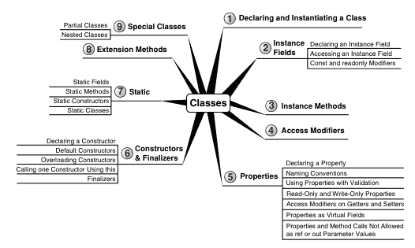

每个章节的主题出现在思维导图的中心。高层次主题从核心向外延伸。思维导图让你能够轻松地从高层次概念吸收到更详细的概念，且不太可能遇到你可能不在寻找的非常具体的知识。

## 有用的注释

根据您的经验水平，特殊的代码块和选项卡将帮助您浏览文本。

- 初学者主题提供专门面向入门级程序员的定义或解释。
- 高级主题使经验丰富的开发人员能够专注于与其最相关的材料。
- 提示注释在提示框中突出显示关键原则，以便读者轻松认识其重要性。
- 语言对比侧边栏识别 C# 及其前身之间的关键差异，以帮助熟悉其他语言的人。

## 本书的组织方式

从高层次来看，软件工程是关于管理复杂性的，我组织《Essential C# 4.0》一书正是为此目的。第 1–4 章介绍结构化编程，使您能够立即开始编写简单的可运行代码。第 5–9 章介绍 C# 的面向对象结构。初学者应在继续学习本书其余部分中更高级的主题之前，专注于充分理解这一部分。第 11–13 章介绍额外的降低复杂性的结构，处理几乎所有现代程序都需要的常见模式。这引出了使用反射和特性的动态编程，这在随后的章节中被广泛用于线程处理和互操作性。

本书以一章关于公共语言基础设施（Common Language Infrastructure）的内容结束，该章在 C# 运行的开发平台背景下描述了 C#。这一章出现在最后，因为它并非 C# 特有，并且偏离了本书其余部分的语法和编程风格。但是，这一章适合在任何时候阅读，也许最合适的是紧随第 1 章之后。

以下是每章的描述（在此列表中，**粗体**显示的章节号表示包含 C# 3.0 或 C# 4.0 材料）。

- **第 1 章—C# 简介**：介绍完 C# HelloWorld 程序后，本章将对其进行剖析。这将使读者熟悉 C# 程序的外观和感觉，并提供有关如何编译和调试自己的程序的详细信息。它还涉及 C# 程序的执行上下文及其中间语言。

- **第 2 章—数据类型**：可运行的程序操作数据，本章介绍 C# 的原始数据类型。这包括两种类型类别（值类型和引用类型）的介绍，以及类型之间的转换和对数组的支持。

- **第 3 章—运算符和控制流**：为了利用计算机的迭代能力，您需要知道如何在程序中包含循环和条件逻辑。本章还涵盖 C# 运算符、数据转换和预处理器指令。

- **第 4 章—方法和参数**：本章探讨方法及其参数的细节。包括按值传递、按引用传递以及通过参数返回数据。在 C# 4.0 中添加了默认参数支持，本章解释了如何使用它们。

- **第 5 章—类**：基于类的基本构建块，本章将这些构造组合在一起形成完全功能的类型。类通过定义对象的模板，构成面向对象技术的核心。

- **第 6 章—继承**：虽然继承对许多开发人员来说是编程基础，但 C# 提供了一些独特的构造，例如 new 修饰符。本章讨论继承语法的细节，包括重写。

- **第 7 章—接口**：本章演示如何使用接口来定义类之间的“可版本化”交互契约。C# 包含显式和隐式接口成员实现，从而实现大多数其他语言不支持的额外封装级别。

- **第 8 章—值类型**：虽然定义值类型不如定义引用类型普遍，但有时有必要定义与 C# 内置原始类型行为相似的值类型。本章描述如何定义结构，同时揭示它们可能引入的特性。

- **第 9 章—格式良好的类型**：本章讨论更高级的类型定义。它解释如何实现运算符（例如 + 和强制转换），并描述如何将多个类封装到单个库中。此外，本章演示如何定义命名空间和 XML 注释，并讨论如何为垃圾回收设计类。

- **第 10 章—异常处理**：本章扩展了第 4 章中的异常处理介绍，并描述了异常如何遵循层次结构，从而能够创建自定义异常。它还包含一些异常处理的最佳实践。

- **第 11 章—泛型**：泛型可能是 C# 1.0 中缺失的核心功能。本章全面介绍了这一 2.0 功能。此外，C# 4.0 添加了对协变和逆变的支持——本章将在泛型的上下文中介绍此内容。

- **第 12 章—委托和 Lambda 表达式**：委托通过定义在代码中处理事件的模式，开始明确区分 C# 及其前身。这几乎消除了编写轮询例程的需要。Lambda 表达式是使 C# 3.0 的 LINQ 成为可能的关键概念。本章解释了 Lambda 表达式如何通过提供更优雅、更简洁的语法在委托构造的基础上构建。本章为下一节讨论的新集合 API 奠定了基础。

- **第 13 章—事件**：封装的委托（即事件）是公共语言运行时的核心构造。匿名方法（另一个 C# 2.0 功能）也在此介绍。

- **第 14 章—带有标准查询运算符的集合接口**：C# 3.0 引入的简单而又优雅强大的变化在本章中开始显现，我们将查看新 Enumerable 类的扩展方法。该类提供了一种全新的集合 API，称为标准查询运算符，并在此详细讨论。

- **第 15 章—带有查询表达式的 LINQ**：仅使用标准查询运算符会产生一些难以解读的长语句。但是，查询表达式提供了一种与 SQL 非常接近的替代语法，如本章所述。

- **第 16 章—构建自定义集合**：在构建针对业务对象的自定义 API 时，有时有必要创建自定义集合。本章详细介绍了如何执行此操作，并在过程中引入了使自定义集合构建更容易的上下文关键字。

- **第 17 章—反射、特性和动态编程**：面向对象编程为 20 世纪 80 年代末程序结构的范式转移奠定了基础。同样，特性促进了声明式编程和嵌入式元数据，开启了新的范式。本章探讨特性，并讨论如何通过反射检索它们。它还涵盖通过基类库中的序列化框架进行文件输入和输出。在 C# 4.0 中，一种名为 dynamic 的新关键字已添加到语言中。这删除了直到运行时之前的所有类型检查，极大地扩展了 C# 的功能。

- **第 18 章—多线程**：大多数现代程序需要使用线程来执行长时间运行的任务，同时确保对同时发生的事件做出活跃响应。随着程序变得更加复杂，必须在这些高级环境中采取额外预防措施来保护数据。多线程应用程序编程很复杂。本章讨论如何使用线程，并提供最佳实践以避免困扰多线程应用程序的问题。

- **第 19 章—同步和其他多线程模式**：在前一章的基础上，本章演示了一些内置的线程模式支持，可以简化对多线程代码的显式控制。

- **第 20 章—平台互操作性和非安全代码**：鉴于 C# 是一种相对年轻的语言，用其他语言编写的代码远多于用 C# 编写的代码。为了利用这些预先存在的代码，C# 通过 P/Invoke 支持互操作性——即调用非托管代码。此外，C# 提供了使用指针和直接内存操作的功能。虽然带有指针的代码需要特殊权限才能运行，但它提供了与基于 C 的传统应用程序编程接口完全互操作的能力。

- **第 21 章—公共语言基础设施**：从根本上说，C# 是设计为在基础公共语言基础设施之上最有效的编程语言的语法。本章深入探讨了 C# 程序如何与底层运行时及其规范相关联。

- **附录 A—下载和安装 C# 编译器和 CLI 平台**：本附录提供设置 C# 编译器及运行代码的平台（Microsoft .NET 或 Mono）的说明。

- **附录 B—完整源代码清单**：在多种情况下，章节中包含完整的源代码清单会使章节过长。为了制


这些清单对读者仍然可用，本附录包含第 3、11、12、14 和 17 章的完整清单。

- 附录 C—System.Collections.Concurrent 中的并发类：本附录提供了添加到 .NET Framework 4 的并发集合的概览图。
- 附录 D-F：C# 2.0、C# 3.0、C# 4.0 主题：这些附录为任何 C# 2.0、C# 3.0 或 C# 4.0 内容提供快速参考。它们专门设计用于帮助程序员快速掌握 C# 功能。

我希望您能将本书视为建立 C# 专业知识的绝佳资源，并继续参考它来了解 C# 及其内部工作原理中较为晦涩的领域。

——Mark Michaelis

mark.michaelis.net

# 致谢

没有一本书能仅靠作者独自出版，我非常感谢所有帮助我完成此书的众多人士。

我感谢人们的顺序并不重要，除了那些排在最前面的人。毫无疑问，我的家人做出了最大的牺牲，才让我得以完成此书。Benjamin、Hanna 和 Abigail 经常有一个因这本书而心不在焉的爸爸，但 Elisabeth 承受得更多。她常常独自承担照顾家庭的责任，独自支撑起家庭的世界。我本想说每一版都会变得容易些，但唉，并非如此；随着孩子们长大，生活变得更加忙碌，没有我的 Elisabeth 几乎时时都处于濒临崩溃的边缘。深深的抱歉和巨大的谢谢！

许多技术编辑以极其细致的方式审阅了每一章，以确保技术准确性。我常常惊叹于这些人员仍能捕捉到的细微错误：Paul Bramsman、Kody Brown、Ian Davis、Doug Dechow、Gerard Frantz、Thomas Heyey、Anson Horton、Brian Jones、Shane Kercheval、Angelika Langer、Eric Lippert、John Michaelis、Jason Morse、Nicholas Paldino、Jon Skeet、Michael Stokesbary、Robert Stokesbary、John Timney 和 Stephen Toub。

特别是，Michael 在编辑技术内容方面提供了巨大帮助，并在我整理材料时充当了倾听者，更不用说他宝贵的友谊了。我也特别感谢 C# MVPs（Nicholas 和 John），他们在某些领域对语言的了解仅次于 C# 团队成员。

Eric 简直令人惊叹。他对 C# 词汇的掌握真的令人惊叹，我非常感激他的编辑工作，尤其是在他追求术语完美时。他对 C# 3.0 章节的改进非常重要，在第二版中，我唯一的遗憾是没有让他审阅所有章节。然而，这个遗憾不再存在。Eric 以惊人的细节和精度辛勤审阅了每一章 Essential C# 4.0。我对他为使本书比前两版更出色所做出的贡献表示极大的感谢。谢谢，Eric！我无法想象还有比他更适合这项工作的人。你应得所有功劳，将书本从优秀提升到了卓越。

就像 Eric 和 C# 一样，了解 .NET 多线程并不亚于 Stephen Toub 的人寥寥无几。因此，Stephen 专注于两个重写的多线程章节及其对并行编程的新关注。Stephen 的反馈以及 Beta 版本之间发生的变化，促使我要求他在我根据他第一次审阅意见更新章节后再次审阅——他接受了。我真的无法想象还有比他更适合审阅的人了。谢谢，Stephen！特别感谢你在我熟悉新 API 期间包容我。

Paul 和 Robert 是第二版的关键技术审阅人员，他们辛勤地重新编译并执行了每个清单。这是一项巨大的工作，你们发现的错误非常宝贵，你们的建议也是如此。

感谢 UCLA Extension 的 Scott Robertson 为本书创建了用于大学采用的教学材料。

感谢 Addison-Wesley 的所有人，尽管我经常专注于除手稿之外的一切，他们仍与我合作，耐心等待。感谢：Olivia Basagio、Sheri Cain、Curt Johnson、Joan Murray 和 Brandon Prebynski。

Joan，还要感谢你在第二版期间每周打电话让我保持专注——好吧，至少是在我不专注时让我感到内疚。还要感谢你愿意在第三版期间包容我。我希望能说这次我让你压力更小了，但我怀疑我做到了。谢谢！

感谢 Audrey Doyle。任何能引用《芝加哥格式手册》的人，都必定是担任你团队文字编辑的合适人选。她注意到并纠正的事情让我怀疑自己是否有资格使用电子邮件。特别感谢她在格式方面的所有帮助。

来自 Microsoft 开发人员部门的 Prashant Sridharan 是让我着手此书的人，他为材料提供了了不起的开端。谢谢，Prashant！

*此页故意留空*

# 关于作者

Mark Michaelis 最近创立了 IntelliTecture，这是一家在 Microsoft VSTS/TFS、BizTalk、SharePoint 和 .NET 方面拥有高端技能的软件工程和咨询公司。Mark 还担任 IDesign Inc. 的首席软件架构师和培训师。

Mark 拥有伊利诺伊大学的哲学学士学位和伊利诺伊理工学院的计算机科学硕士学位。2007 年，Mark 被评为 Microsoft 区域总监。自 1996 年以来，他一直是 C#、Visual Studio Team System 和 Windows SDK 的 Microsoft MVP。他担任多个 Microsoft 软件设计评审团队的成员，包括 C#、Connected Systems Division 和 VSTS。Mark 在开发者大会上发表演讲，并撰写了大量文章和书籍。

不与电脑亲密接触时，Mark 正忙于家庭事务或为另一场铁人三项训练（他于 2008 年完成了 Ironman 赛事）。Mark 与妻子 Elisabeth 以及三个孩子 Benjamin、Hanna 和 Abigail 住在华盛顿州斯波坎。

此页故意留空

# 1 C# 简介

C# 现在是一门成熟的语言，它建立在其前身 C 风格语言（C、C++ 和 Java）的特性之上，因此许多经验丰富的程序员都会觉得它非常熟悉。C# 是一种用于构建软件组件和应用程序的编程语言，属于名为公共语言基础结构 (CLI) 的更大、更复杂的执行平台的一部分。

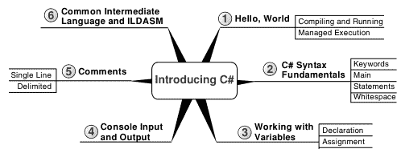

本章使用传统的 HelloWorld 程序介绍 C#。本章重点介绍 C# 语法基础，包括定义 C# 程序可执行文件的入口点。这将使您熟悉

- 1. 自第一次 C# 设计会议以来，现在已经过去十多年了。

C# 语法风格和结构，并使您能够编写最简单的 C# 程序。在讨论 C# 语法基础之前，首先概述了托管执行上下文，解释了 C# 程序在运行时如何执行。本章最后讨论了变量声明、从控制台写入和检索数据，以及 C# 中代码注释的基础知识。

### Hello, World

学习新编程语言的最佳方法是编写代码。第一个示例是经典的 HelloWorld 程序。在此程序中，您将向屏幕显示一些文本。

清单 11 显示了完整的 HelloWorld 程序；在以下部分中，您将编译代码。

```
LISTING 11: HelloWorld in C#

class HelloWorld
{
    static void Main()
    {
        System.Console.WriteLine("Hello. My name is Inigo Montoya.");
    }
}
```

> **注意**
> 
> C# 是区分大小写的语言：大小写不正确会阻止代码成功编译。

有 Java、C 或 C++ 编程经验的人会立即看到相似之处。与 Java 一样，C# 从 C 和 C++ 继承了其基本语法。语法标点（如分号和花括号）、特性（如区分大小写）和关键字（如 class、public 和 void）

- 2. 如果您对 Inigo Montoya 的引用感到困惑，请参考电影《公主新娘》。
- 3. 在创建 C# 时，语言创建者拿着 C/C++ 规范坐下来，字面上划掉了他们不喜欢的功能，并列出了他们喜欢的功能列表。该组还包括在其他语言方面有深厚背景的设计师。


## 编译和运行应用程序

C# 编译器允许包含 C# 源代码的文件使用任何文件扩展名，但通常使用 .cs。将源代码保存到文件后，开发者必须对其进行编译。（附录 A 提供了安装编译器的说明。）由于命令的机制不是 C# 标准的一部分，编译命令会因 C# 编译器实现而异。

如果将清单 1.1 放入名为 HelloWorld.cs 的文件中，输出 1.1 中的编译命令将适用于 Microsoft .NET 编译器（假设编译器的相应路径已设置）。4

### 输出 1.1:

```
>csc.exe HelloWorld.cs
Microsoft (R) Visual C# 2008 Compiler version 4.0.20506.1
for Microsoft (R) .NET Framework version 4.0
Copyright (C) Microsoft Corporation. All rights reserved.
```

确切的输出将取决于你使用的编译器版本。

运行生成的程序 HelloWorld.exe，将显示输出 1.2 中所示的消息。

### 输出 1.2:

```
>HelloWorld.exe
Hello. My name is Inigo Montoya.
```

C# 编译器创建的程序 HelloWorld.exe 是一个程序集。开发者不是创建可以独立执行的完整程序，而是可以创建可被另一个更大的程序引用的代码库。库（或类库）使用文件扩展名 .dll，代表动态链接库（DLL）。库也是一个程序集。换句话说，成功的 C# 编译输出是一个程序集，无论它是程序还是库。

4. 使用 Mono 编译器（由 Novell 赞助的开源编译器）进行编译几乎完全相同，只是编译器名称是 mcs.exe 而不是 csc.exe。虽然我很希望在此处放置每个平台的说明，但这样做会偏离介绍 C# 的主题。有关 Mono 的详细信息，请参见附录 A。

### 语言对比：Java—文件名必须与类名匹配

在 Java 中，文件名必须与类名一致。在 C# 中，经常遵循此约定，但不是必须的。在 C# 中，可以在一个文件中包含两个类，并且从 C# 2.0 开始，可以将单个类跨多个文件。

## C# 语法基础

一旦你成功编译并运行 HelloWorld 程序，就可以开始拆解代码以了解其各个部分。首先，考虑 C# 关键字以及开发者选择的标识符。

### 初学者主题

### 关键字

为了让编译器解释代码，C# 中的某些字词具有特殊的状态和意义。这些字词被称为**关键字**或**保留字**，它们提供了编译器用来解释程序员编写的表达式的具体语法。在 HelloWorld 程序中，class、static 和 void 是关键字的示例。

编译器使用关键字来识别代码的结构和组织。由于编译器以更高的重要性解释这些字词，你只能在语言识别的特定规则下使用关键字。换句话说，编程语言要求开发者仅在某些位置放置关键字。当程序员违反这些规则时，编译器会发出错误。

### C# 关键字

表 1.1 显示了 C# 关键字。

### 表 1.1：C# 关键字

| abstract | add* | alias* | as |
| :--- | :--- | :--- | :--- |
| ascending* | base | bool | break |
| by* | byte | case | catch |
| char | checked | class | const |
| continue | decimal | default | delegate |
| descending* | do | double | dynamic* |
| else | enum | equals* | event |
| explicit | extern | false | finally |
| fixed | float | for | foreach |
| from* | get* | global* | goto |
| group* | if | implicit | in |
| int | interface | internal | into* |
| is | join* | let* | lock |
| long | namespace | new | null |
| object | on* | operator | orderby* |
| out | override | params | partial* |
| private | protected | public | readonly |
| ref | remove* | return | sbyte |
| sealed | select* | set* | short |
| sizeof | stackalloc | static | string |
| struct | switch | this | throw |
| true | try | typeof | uint |
| ulong | unchecked | unsafe | ushort |
| using | value* | var* | virtual |
| void | volatile | where* | while |
| yield* | | | |

* 上下文关键字

C# 1.0 之后，C# 中未引入新关键字。但是，这些后续版本中的某些构造使用上下文关键字，这些关键字仅在特定位置有意义。在指定位置之外，上下文关键字没有特殊意义。5 通过此方法，所有 C# 1.0 代码与后续标准完全兼容。6（表 1.1 用 * 标记上下文关键字。）

- 5. 例如，在 C# 2.0 设计早期，语言设计师将 yield 指定为关键字，并向数千名开发者发布了带有 yield 作为指定关键字的 C# 2.0 编译器 alpha 版本。但是，语言设计师最终确定，通过使用 yield return 而不是 yield，他们最终可以避免将 yield 添加为关键字，因为它在 return 附近之外没有特殊意义。

- 6. 存在罕见且不幸的不兼容性，例如以下情况：
  - C# 2.0 要求使用 using 语句实现 IDisposable，而不仅仅是 Dispose() 方法
  - 一些罕见的泛型表达式，例如 F(G<A, B>(7))；在 C# 1.0 中，这表示 F((G<A, B>(7)))；而在 C# 2.0 中，这表示使用参数 7 调用泛型方法 G<A, B>，并将结果传递给 F

### 初学者主题

### 标识符

除了 C# 定义的关键字之外，开发者还可以提供自己的名称。编程语言将这些名称称为标识符，因为它们标识程序员编写的构造。在清单 1.1 中，HelloWorld 和 Main 是标识符的示例。可以为变量赋值，然后稍后使用其标识符引用它。因此，开发者分配的名称应当有意义而非任意。选择简洁且能指示含义的名称的敏锐能力是优秀程序员的重要特征，因为生成的代码更易于理解和重用。在某些罕见情况下，某些标识符（例如 Main）在 C# 语言中可能具有特殊含义。

### 高级主题

### 关键字

虽然罕见，但如果关键字以“@”作为前缀，则可以将其用作标识符。例如，你可以将局部变量命名为 @return。同样（尽管这不符合 C# 编码标准的大小写规范），也可以将方法命名为 @throw()。

Microsoft 实现中还有四个未记录的保留关键字：__arglist、__makeref、__reftype 和 __refvalue。这些仅在罕见的互操作场景中需要，在所有实际用途中你都可以忽略它们。

### 类型定义

C# 中的所有代码都出现在类型定义中，最常见的类型定义以关键字 class 开头。类定义通常以 class identifier { ... } 开头的代码部分，如清单 1.2 所示。

```
LISTING 1.2: Basic Class Declaration

class HelloWorld
{
    ...
}
```

用于类型的名称（在此例中为 HelloWorld）可以不同，但按惯例，应以大写字母和名词开头。如果名称包含多个连在一起的单词，则每个附加单词也应以大写字母开头。因此，对于此特定示例，其他可能的名称包括 Greetings、HelloInigoMontoya、Hello 或简单的 Program。（如果 Program 是包含下一节中描述的 Main() 方法的类，则它尤其合适。）CLI 创建者称这种大小写形式为 Pascal 大小写，因为它在 Pascal 编程


language. 替代方案是驼峰命名法（camel casing），遵循相同的约定，只是首字母小写。示例包括 quotient、firstName 和 theDreadPirateRoberts。

通常，程序包含多种类型，每种类型包含多个方法。

## 主方法

## 初学者主题

## 什么是方法？

从语法上讲，C# 中的方法是一个由方法声明（例如 static void Main()）引入的命名代码块，后跟花括号内的零个或多个语句。方法执行计算和/或操作。类似于书面语言中的段落，方法提供了一种结构化和组织代码的手段，使其更易读。更重要的是，方法避免了重复代码的需要。方法声明引入方法并定义方法名称以及传递到和从方法传递的数据。在清单 1.3 中，Main() 后跟 { ... } 是 C# 方法的示例。

C# 程序开始执行的位置是 Main 方法，它以 static void Main() 开头。当你在命令控制台键入 HelloWorld.exe 来执行程序时，程序启动，解析 Main 的位置，并开始执行清单 1.3 中的第一条语句。

```
LISTING 1.3: Breaking Apart HelloWorld

class HelloWorld
{
    static void Main()
    {
        System.Console.WriteLine("Hello, My name is Inigo Montoya");
    }
}
```

尽管 Main 方法声明在一定程度上可以有所变化，但 static 和方法名 Main 对于程序来说始终是必需的。

## 高级主题

## Main 方法的声明

虽然可以不带参数或返回类型声明 Main 方法，但 C# 支持指定其中之一。清单 1.4 显示了 Main 方法的完整声明。

```
LISTING 1.4: The Main Method, with Parameters and a Return

static int Main(string[] args)
{
    ...
}
```

args 参数是一个字符串数组，对应命令行参数。但是，数组的第一个元素不是程序名，而是可执行文件名之后出现的第一个命令行参数，这与 C 和 C++ 不同。要获取用于执行程序的完整命令，请使用 System.Environment.CommandLine。

Main 返回的 int 是状态码，指示程序执行的成功与否。返回非零值通常表示错误。

> **语言对比：C++/Java—main() 全小写**
> 
> 与其 C 风格的前身不同，C# 为 Main 方法使用大写 M，以保持与基于 Pascal 的 C# 命名约定一致。

将 Main 方法指定为 static 表示其他方法可以直接从类定义调用它。如果没有 static 指定，启动程序的命令控制台在调用方法之前需要执行额外工作（称为实例化）。（第 5 章包含一个专门讨论静态成员的完整章节。）

在 Main() 之前放置 void 表示此方法不返回任何数据（在第 2 章中进一步说明）。

C# 遵循的一个独特的 C/C++ 风格特征是使用花括号作为构造体（例如类或方法）的主体。例如，Main 方法包含围绕其实现的花括号；在此情况下，方法中只出现一条语句。

## 语句和语句分隔符

Main 方法包含一条语句，System.Console.WriteLine()，用于向控制台写入一行文本。C# 通常使用分号来表示语句的结束，语句由代码将执行的一个或多个操作组成。声明变量、控制程序流程和调用方法都是语句的示例。

### 语言对比：Visual Basic—基于行的语句

有些语言是基于行的，这意味着没有特殊注释时，语句不能跨行。在 Visual Basic 2010 之前，Visual Basic 是基于行语言的一个示例。它要求在行尾使用下划线来指示语句跨多行。从 Visual Basic 2010 开始，引入了许多情况，其中行延续字符是可选的。

## 高级主题

## 不带分号的语句

C# 中的许多编程元素以分号结尾。一个不包含分号的示例是 switch 语句。因为 switch 语句始终包含花括号，C# 不要求在语句后使用分号。事实上，代码块本身被视为语句（它们也由语句组成），不需要使用分号来结束。同样，存在一些情况，例如 using 声明，分号出现在末尾但它不是语句。

由于创建新行不会分隔语句，您可以将多个语句放在同一行上，C# 编译器将把该行解释为具有多个指令。例如，清单 1.5 在单行上包含两条语句，组合起来在两行上分别显示 Up 和 Down。

## 清单 1.5：同一行上的多个语句

```
System.Console.WriteLine("Up");System.Console.WriteLine("Down");
```

C# 还允许将语句拆分为多行。同样，C# 编译器查找分号来指示语句的结束（请参阅清单 1.6）。

## 清单 1.6：将单个语句拆分为多行

```
System.Console.WriteLine(
    "Hello. My name is Inigo Montoya.");
```

在清单 1.6 中，HelloWorld 程序中的原始 WriteLine() 语句被拆分为多行。

## 空白字符

分号使 C# 编译器能够忽略代码中的空白字符。除了少数例外，C# 允许开发者在代码中插入空白字符而不改变其语义含义。在清单 1.5 和清单 1.6 中，无论是在语句内部还是语句之间插入新行都无关紧要，并且这样做对编译器生成的最终可执行文件没有影响。

## 初学者主题

## 什么是空白字符？

空白字符是一个或多个连续格式字符（如制表符、空格和换行符）的组合。显然，消除单词之间的所有空白字符是重要的，引号字符串内的空白字符也是如此。

程序员经常使用空白字符来缩进代码以提高可读性。请考虑 HelloWorld 的两种变体，如清单 1.7 和清单 1.8 所示。

## 清单 1.7：无缩进格式

```
class HelloWorld
{
    static void Main()
    {
    System.Console.WriteLine("Hello Inigo Montoya");
    }
}
```

## 清单 1.8：删除空白字符

```
class HelloWorld(static void Main()
{System.Console.WriteLine("Hello Inigo Montoya");}}
```

尽管这两个示例与原始程序看起来有很大不同，但 C# 编译器将它们视为相同。

## 初学者主题

## 使用空白字符格式化代码

使用空白字符缩进代码对于提高可读性非常重要。在开始编写代码时，您需要遵循既定的编码标准和约定，以增强代码可读性。

本书使用的约定是将花括号放在单独一行上，并缩进花括号对之间的代码。如果在第一对花括号内出现另一对花括号，则第二组花括号内的所有代码也将缩进。

这不是统一的 C# 标准，而是一种风格偏好。

## 使用变量

现在您已经了解了最基本的 C# 程序，是时候声明一个局部变量了。声明变量后，您可以为其赋值、用新值替换该值，并在计算、输出等中使用它。但是，您不能更改变量的数据类型。在清单 1.9 中，string max 是一个变量声明。

## 清单 1.9：声明和赋值变量

```
class MiracleMax
{
    static void Main()
    {
        string max;
        max = "Have fun storming the castle!";
        System.Console.WriteLine(max);
    }
}
```

## 初学者主题

## 局部变量

变量通过名称引用存储位置，程序稍后可以对其进行赋值和修改。局部表示程序员在方法内声明了变量。

声明变量即定义它，具体方法如下：

- 1. 指定变量将包含的数据类型
- 2. 为其分配标识符（名称）

## 数据类型

清单 1.9 声明了数据类型为 string 的变量。本章中使用的其他常见数据类型是 int 和 char。

- int 是 C# 对 32 位整数类型的指定。
- char 用于字符类型。它是 16 位，足以容纳（非代理）Unicode 字符。

下一章将更详细地介绍这些及其他常见数据类型。


## 初学者主题

### 什么是数据类型？

变量声明所指定的数据类型称为数据类型（或对象类型）。数据类型，或简称类型，是对具有相似特征和行为的事物进行分类。例如，animal 是一种类型。它将所有具有动物特征（多细胞、运动能力等）的事物（猴子、疣猪和鸭嘴兽）进行分类。同样，在编程语言中，类型是对若干具有相似特质的项目的定义。

### 声明变量

在清单 1.9 中，string max 是声明名为 max 的字符串类型变量的语句。可以在同一条语句中声明多个变量，只需指定一次数据类型，并用逗号分隔每个标识符。清单 1.10 演示了这一点。

```
LISTING 1.10: Declaring Two Variables within One Statement

string message1, message2;
```

由于多变量声明语句允许开发人员在声明中只提供一次数据类型，因此所有变量都将是相同的类型。

在 C# 中，变量名可以以任何字母或下划线（_）开头，后面跟任意数量的字母、数字和/或下划线。但按照惯例，局部变量名采用驼峰命名法（每个单词的首字母大写，但第一个单词除外），且不包含下划线。

### 赋值给变量

声明局部变量后，必须在引用它之前为其赋值。一种方法是使用 = 运算符，也称为简单赋值运算符。运算符是用于标识代码要执行的功能的符号。清单 1.11 演示了如何使用赋值运算符来指定变量 max 和 valerie 将指向的字符串值。

7. 此处的 max 并非指数学函数，而是用作变量名。

```
LISTING 1.11: Changing the Value of a Variable

class MiracleMax
{
    static void Main()
    {
        string valerie;
        string max = "Have fun storming the castle!";
        valerie = "Think it will work";

        System.Console.WriteLine(max);
        System.Console.WriteLine(valerie);

        max = "It would take a miracle.";
        System.Console.WriteLine(max);
    }
}
```

从该清单可以观察到，可以在变量声明过程中为变量赋值（如 max 所示），也可以在之后的单独语句中赋值（如变量 valerie 所示）。所赋的值必须始终位于右侧。

运行编译后的 MiracleMax.exe 程序会产生输出 1.3 中所示的结果。

### 输出 1.3：

```
>MiracleMax.exe
Have fun storming the castle!
Think it will work
It would take a miracle.
```

C# 要求开发人员在访问局部变量之前为其赋值。此外，赋值会返回一个值。因此，C# 允许在同一条语句中进行两次赋值，如清单 1.12 所示。

### 清单 1.12：返回可再次赋值的值的赋值

```
class MiracleMax
{
    static void Main()
    {
        // ...
        string requirements, max;
        requirements = max = "It would take a miracle.";
        // ...
    }
}
```

### 使用变量

当然，赋值的结果是你可以使用变量标识符来引用该值。因此，当你在 System.Console.WriteLine(max) 语句中使用变量 max 时，程序会在控制台上显示 Have fun storming the castle!，即 max 的值。更改 max 的值并执行相同的 System.Console.WriteLine(max) 语句会导致显示新的 max 值，即 It would take a miracle.。

## 高级主题

### 字符串不可变

所有 string 类型的数据，无论是字符串字面量还是其他，都是不可变（或不可修改）的。例如，不可能将字符串 "Come As You Are" 更改为 "Come As You Are"。这样的更改要求你重新为变量赋值，使其指向内存中的新位置，而不是修改变量最初所引用的数据。

### 控制台输入和输出

本章已多次使用 System.Console.WriteLine 将文本写入命令控制台。除了能够输出数据外，程序还需要能够接受用户可能输入的数据。

### 从控制台获取输入

从控制台检索输入文本的方法之一是使用 System.Console.ReadLine()。此方法会停止程序执行，以便用户可以输入字符。当用户按下 Enter 键（创建换行符）时，程序将继续。System.Console.ReadLine() 方法的输出（也称为返回值）是输入的文本字符串。请参阅清单 1.13 及输出 1.4 中所示的相应输出。

### 清单 1.13：使用 System.Console.ReadLine()

```
class HeyYou
{
    static void Main()
    {
        string firstName;
        string lastName;
        System.Console.WriteLine("Hey you!");
        System.Console.Write("Enter your first name: ");
        firstName = System.Console.ReadLine();
        System.Console.Write("Enter your last name: ");
        lastName = System.Console.ReadLine();
        ...
    }
}
```

### 输出 1.4：

```
>HeyYou.exe
Hey you!
Enter your first name: Inigo
Enter your last name: Montoya
```

在每个提示之后，该程序都会使用 System.Console.ReadLine() 方法来检索用户输入的文本并将其分配给相应的变量。当第二个 System.Console.ReadLine() 赋值完成时，firstName 包含值 Inigo，lastName 引用值 Montoya。

## 高级主题

### System.Console.Read()

除了 System.Console.ReadLine() 方法外，还有 System.Console.Read() 方法。但是，System.Console.Read() 方法返回的数据类型是一个整数，对应读取的字符值，如果没有更多字符可用，则为 -1。要检索实际字符，有必要先将整数强制转换为字符，如清单 1.14 所示。

### 清单 1.14：使用 System.Console.Read()

```
int readValue;
char character;
readValue = System.Console.Read();
character = (char) readValue;
System.Console.Write(character);
```

System.Console.Read() 方法在用户按下 Enter 键之前不会返回输入；即使用户在按下 Enter 键之前输入了多个字符，也不会开始处理字符。

在 C# 2.0 中，CLR 设计师添加了一种名为 System.Console.ReadKey() 的新方法，与 System.Console.Read() 相反，它在单次按键后返回输入。它允许开发人员拦截按键并执行诸如键验证、将字符限制为数字等操作。

### 将输出写入控制台

在清单 1.13 中，你使用 System.Console.Write() 方法而不是 System.Console.WriteLine() 方法来提示用户输入其名和姓。System.Console.Write() 方法在显示文本后不会放置换行符，而是将当前位置保留在同一行上。这样，用户输入的任何文本都将与输入提示位于同一行。清单 1.13 的输出演示了 System.Console.Write() 的效果。

下一步是将使用 System.Console.Read() 检索到的值写回控制台。在清单 1.15 的情况下，程序会输出用户的全名。但是，与之前使用 System.Console.WriteLine() 不同，此代码将使用略有变化的方法。输出 1.5 显示了相应的输出。

### 清单 1.15：使用 System.Console.WriteLine() 进行格式化

```
class HeyYou
{
    static void Main()
    {
        string firstName;
        string lastName;

        System.Console.WriteLine("Hey you!");
        System.Console.Write("Enter your first name: ");
        firstName = System.Console.ReadLine();
        System.Console.Write("Enter your last name: ");
        lastName = System.Console.ReadLine();
        System.Console.WriteLine(
            "Your full name is {0} {1}.", firstName, lastName);
    }
}
```

### 输出 1.5：

```
Hey you!
Enter your first name: Inigo
Enter your last name: Montoya
Your full name is Inigo Montoya.
```

该清单没有先写出 Your full name is，然后再为 firstName 编写另一个 Write 语句，为空格编写第三个 write 语句，最后为 lastName 编写一个 WriteLine 语句，而是使用复合格式化写出整个输出。使用复合格式化时，代码首先提供一个格式字符串来定义输出格式。在此示例中，格式字符串是 "Your full name is {0} {1}."。它在字符串中标识两个用于数据插入的索引占位符。

请注意，索引值从零开始。每个插入的参数（称为格式项）都出现在格式字符串之后，顺序与索引值对应。在此示例中，由于 firstName 是紧跟在格式字符串之后的第一个参数，因此它对应索引值 0。同样，lastName 对应索引值 1。

请注意，格式字符串中的占位符不需要按顺序出现。例如，清单 1.16 交换了索引占位符的顺序并添加了一个逗号，这更改了名称的显示方式（请参阅输出 1.6）。

### 清单 1.16：交换索引占位符和相应变量

```
System.Console.WriteLine("Your full name is {1}, {0}",
    firstName, lastName);
```


## 输出 1.6:

```
Hey you!
Enter your first name: Inigo
Enter your last name: Montoya
Your full name is Montoya: Inigo
```

In addition to not having the placeholders appear consecutively within the format string, it is possible to use the same placeholder multiple times within a format string. Furthermore, it is possible to omit a placeholder. It is not possible, however, to have placeholders that do not have a corresponding parameter.

## Comments

In this section, you will modify the program in Listing 1.15 by adding comments. In no way does this vary the execution of the program; rather, providing comments within the code makes it more understandable. Listing 1.17 shows the new code, and Output 1.7 shows the corresponding output.

## LISTING 1.17: Commenting Your Code

```
class CommentSamples
{
    static void Main()
    {
        string firstName; // Variable for storing the first name
        string lastName; // Variable for storing the last name

        System.Console.WriteLine("Hey you!");

        delimited comment inside statement
        System.Console.Write(/* No new line */ (
        "Enter your first name: ");
        firstName = System.Console.ReadLine();

        System.Console.Write(/* No new line */ (
        "Enter your last name: ");
        lastName = System.Console.ReadLine();

        /* Display a greeting to the console
        using composite formatting. */ delimited comment
        System.Console.WriteLine("Your full name is {0} {1}.",
        FirstName, LastName);
        // This is the end
        // of the program listing
    }
}
```

## OUTPUT 1.7:

```
Hey you!
Enter your first name: Inigo
Enter your last name: Montoya
Your full name is Inigo Montoya.
```

In spite of the inserted comments, compiling and executing the new program produces the same output as before.

Programmers use comments to describe and explain the code they are writing, especially where the syntax itself is difficult to understand, or perhaps a particular algorithm implementation is surprising. Since comments are pertinent only to the programmer reviewing the code, the compiler ignores comments and generates an assembly that is devoid of any trace that comments were part of the original source code.

## TABLE 1.2: C# Comment Types

| Comment Type | Description | Example |
|---|---|---|
| Delimited comments | A forward slash followed by an asterisk, /*, identifies the beginning of a delimited comment. To end the comment use an asterisk followed by a forward slash: */. Comments of this form may span multiple lines in the code file or appear embedded within a line of code. The asterisks that appear at the beginning of the lines but within the delimiters are simply for formatting. | /*comment*/ |
| Single-line comments | Comments may also be declared with a delimiter comprising two consecutive forward slash characters: //. The compiler treats all text from the delimiter to the end of line as a comment. Comments of this form comprise a single line. It is possible, however, to place sequential single-line comments one after another, as is the case with the last comment in Listing 1.17. | // comment |
| XML delimited comments | Comments that begin with /** and end with */ are called XML delimited comments. They have the same characteristics as regular delimited comments, except that instead of ignoring XML comments entirely, the compiler can place them into a separate text file. XML delimited comments were only explicitly added in C# 2.0, but the syntax is compatible with C# 1.0. | /**comment**/ |
| XML single-line comments | XML single-line comments begin with /// and continue to the end of the line. In addition, the compiler can save single-line comments into a separate file with the XML delimited comments. | /// comment |

A more comprehensive discussion of the XML comments appears in Chapter 9, where I discuss the various XML tags that are explicitly part of the XML standard.

## BEGINNER TOPIC

### Extensible Markup Language (XML)

The Extensible Markup Language (XML) is a simple and flexible text format frequently used within web applications and for exchanging data between applications. XML is extensible because included within an XML document is information that describes the data, known as **metadata**. Here is a sample XML file.

```
<?xml version="1.0" encoding="utf-8" ?>
<body>
<book title="Essential C# 4.0">
<chapters>
<chapter title="Introducing C#"/>
<chapter title="Operators and Control Flow"/>
...
</chapters>
</book>
</body>
```

The file starts with a header indicating the version and character encoding of the XML file. After that appears one main "book" element. Elements begin with a word in angle brackets, such as `<body>`. To end an element, place the same word in angle brackets and add a forward slash to prefix the word, as in `</body>`. In addition to elements, XML supports attributes. `title="Essential C# 4.0"` is an example of an XML attribute. Note that the metadata (book title, chapter, and so on) describing the data ("Essential C# 4.0", "Operators and Control Flow") is included in the XML file. This can result in rather bloated files, but it offers the advantage that the data includes a description to aid in interpreting the data.

## Managed Execution and the Common Language Infrastructure

The processor cannot directly interpret an assembly. Assemblies consist mainly of a second language known as the Common Intermediate Language (CIL), or IL for short.

> **NOTE**
>
> A third term for CIL is *Microsoft IL (MSIL)*. This book uses the term *CIL* because it is the term adopted by the CLI standard. IL is prevalent in conversation among people writing C# code because they assume that IL refers to CIL rather than other types of intermediate languages.

The C# compiler transforms the C# source file into this intermediate language. An additional step, usually performed at execution time, is required to change the CIL code into machine code that the processor can understand. This involves an important element in the execution of a C# program: the Virtual Execution System (VES). The VES, also casually referred to as the runtime, compiles CIL code as needed (this process is known as just-in-time compilation or jitting). The code that executes under the context of an agent such as the runtime is managed code, and the process of executing under control of the runtime is managed execution. It is called managed code because the runtime controls significant portions of the program's behavior by managing aspects such as memory allocation, security, and just-in-time compilation. Code that does not require the runtime in order to execute is unmanaged code.

> **NOTE**
>
> The term _runtime_ can refer to either execution time or the Virtual Execution System. To help clarify, this book uses the term _execution time_ to indicate when the program is executing, and it uses the term _runtime_ when discussing the agent responsible for managing the execution of a C# program while it executes.

The specification for a VES is included in a broader specification known as the Common Language Infrastructure (CLI) specification.8 An international standard, the CLI includes specifications for

- The VES or runtime
- The CIL
- A type system that supports language interoperability, known as the Common Type System (CTS)
- Guidance on how to write libraries that are accessible from CLI-compatible languages (available in the Common Language Specification [CLS])

8. Miller, J., and S. Ragsdale. 2004. _The Common Language Infrastructure Annotated Standard_. Boston: Addison-Wesley.

- Metadata that enables many of the services identified by the CLI (including specifications for the layout or file format of assemblies)
- A common programming framework, the Base Class Library (BCL), which developers in all languages can utilize

Running within the context of a CLI implementation enables support for a number of services and features that programmers do not need to code for directly, including the following.

- Language interoperability: interoperability between different source languages. This is possible because the language compilers translate each source language to the same intermediate language (CIL).
- Type safety: checks for conversion between types, ensuring that only conversions between compatible types will occur. This helps prevent the occurrence of buffer overruns, a leading cause of security vulnerabilities.
- Code access security: certification that the assembly developer's code has permission to execute on the computer.
- Garbage collection: memory management that automatically de-allocates space for data allocated by the runtime.
- Platform portability: support for potentially running the same assembly on a variety of operating systems. One obvious restriction is that no platform-dependent libraries are used; therefore, as with Java, there are inevitably some idiosyncrasies that need to be worked out.
- BCL: provides a large foundation of code that developers can depend on (in all CLI implementations) so that they do not have to develop the code themselves.

> **NOTE**
>
> This section gives a brief synopsis of the CLI to familiarize you with the context in which a C# program executes. It also provides a summary of some of the topics that appear throughout this book. Chapter 21 is devoted to the topic of the CLI and its relevance to C# developers. Although the chapter appears last in the book, it does not depend on any earlier chapters, so if you want to become more familiar with the CLI, you can jump to it at any time.


## C# 和 .NET 版本控制

读者会注意到输出 1.1 引用的是“.NET Framework 版本 4.0”。在撰写本文时，Microsoft 对 .NET Framework 有五个主要版本，而 C# 编译器只有四个主要版本。.NET Framework 版本 3.0 是在 C# 编译器版本（以及 Visual Studio 2005 和 2008 版本）之间发布的一组额外的 API 库。因此，与 C# 3.0 对应的 .NET Framework 版本是 3.5。随着 C# 4.0 和 .NET Framework 4.0 的发布，版本号已同步。表 1.3 简要概述了 C# 和 .NET 的发布版本。

### 表 1.3：C# 和 .NET 版本

| 类型 | 描述 |
| :--- | :--- |
| C# 1.0 与 .NET Framework 1.0/1.1（Visual Studio 2002 和 2003） | C# 的初始版本。一种从头开始构建以支持 .NET 编程的语言。 |
| C# 2.0 与 .NET Framework 2.0（Visual Studio 2005） | C# 语言添加了泛型，.NET Framework 2.0 包含支持泛型的库。 |
| .NET Framework 3.0 | 一组用于分布式通信（Windows Communication Foundation—WCF）、富客户端展示（Windows Presentation Foundation）、工作流（Windows Workflow—WF）和 Web 身份验证（Cardspaces）的额外 API。 |
| C# 3.0 与 .NET Framework 3.5（Visual Studio 2008） | 添加了对 LINQ 的支持，LINQ 是用于编程集合的 API 的重大改进。.NET Framework 3.5 提供了扩展现有 API 以使 LINQ 成为可能的库。 |
| C# 4.0 与 .NET Framework 3.5（Visual Studio 2010） | 添加了对动态类型的支持，以及针对编写利用多处理器和处理器内多个内核的多线程程序的 API 的重大改进。 |

本文中绝大多数代码只要编译器版本与所需代码版本对应，即可在 Microsoft 以外的平台上运行。尽管我很希望提供每个 C# 平台的完整详细信息，以免分散学习 C# 的重点，但我将此类信息限制在 Microsoft 的 .NET 平台上。这仅仅是因为 Microsoft 拥有占绝对主导地位的实现。此外，移植到其他平台相当简单。

## 公共中间语言和 ILDASM

如前一节所述，C# 编译器将 C# 代码转换为 CIL 代码，而不是机器代码。处理器可以直接理解机器代码，但 CIL 代码需要在处理器执行之前进行转换。给定一个程序集（DLL 或可执行文件），可以使用 CIL 反汇编实用程序查看 CIL 代码，将程序集反构造为其 CIL 表示。（CIL 反汇编器通常通过其 Microsoft 特定的文件名 ILDASM 来引用，ILDASM 代表 IL Disassembler。）该程序将反汇编程序或其类库，显示由 C# 编译器生成的 CIL。

用于 CIL 反汇编器的确切命令取决于所使用的 CLI 实现。您可以从命令行执行 .NET CIL 反汇编器，如输出 1.8 所示。

输出 1.8：

```
>ildasm /text HelloWorld.exe
```

/text 部分用于使输出出现在命令控制台中，而不是在新窗口中。同样，默认输出到命令控制台的 Mono 反汇编器实现如输出 1.9 所示。

输出 1.9：

```
>monodis HelloWorld.exe
```

执行这些命令所产生的输出流是 HelloWorld.exe 程序中包含的 CIL 代码的转储。请注意，CIL 代码比机器代码容易理解得多。对于许多开发人员来说，这可能引发担忧，因为无需明确重新分发源代码，程序就更容易被反编译，算法也更容易被理解。

与任何程序（无论是否基于 CLI）一样，防止反汇编的唯一万无一失的方法是完全禁止访问编译后的程序（例如，仅在网站上托管程序，而不是分发到用户的计算机）。但是，如果只需要降低对源代码的可访问性，则有几种混淆器可用。这些混淆器打开 IL 代码并对代码进行混淆，使其执行相同的操作，但以更难以理解的方式。这防止普通开发人员访问代码，而是创建更难且更繁琐反编译为可理解代码的程序集。除非程序需要高度的算法安全性，否则这些混淆器通常就足够了。

### 高级主题

### HelloWorld.exe 的 CIL 输出

清单 1.18 显示了由 ILDASM 创建的 CIL 代码。

```
LISTING 1.18: Sample CIL Output
// Microsoft (R) .NET Framework IL Disassembler.
// Version 4.0.21006.1
// Copyright (C) Microsoft Corporation. All rights reserved.
//
// Metadata version: v4.0.21006
// assembly extern mscorlib
{
  .publickeytoken = (B7 7A 5C 56 19 34 E0 89 )
  // .ver 4:0:...
  // ver 4:0:0:0
}
.assembly HelloWorld
{
  .custom instance void
[mscorlib]System.Runtime.CompilerServices.CompilationRelaxationsAttribute::
ctor(int32) = ( 01 00 08 00 00 00 00 00 00 )
  .custom instance void
[mscorlib]System.Runtime.CompilerServices.RuntimeCompatibilityAttribute::
ctor() = ( 01 00 0E 00 54 02 16 57 72 61 69 70 4E 6F 6E 46 66 45 45 78
63 65 70 74 69 6F 6E 54 68 72 6F 77 73 . ) // ceptionThrows.
.hash algorithm 0x00008004
.ver 0:0:0:0
}
// module HelloWorld.exe
// MVID {1C349501-2133-A1D6-A82B-B4731061F3F8}
.imagebase 0x00400000
.file alignment 0x00000200
.stackreserve 0x00100000
.subsystem 0x0003 // WINDOWS_CUI
.corflags 0x00000001 // ILONLY
// Image base: 0x00160000
// =========================================================
// CLASS MEMBERS DECLARATION
// =========================================================
.class private auto ansi beforefieldinit HelloWorld
extends [mscorlib]System.Object
{
.method private hidebysig static void Main() cil managed
{
.entrypoint
// Code size 13 (0xd)
.maxstack 8
.locals init (
IL_0000: nop
IL_0001: ldstr "Hello. My name is Inigo Montoya."
IL_0006: call void [mscorlib]System.Console::WriteLine(string)
IL_000b: nop
IL_000c: ret
} // end of method HelloWorld::Main
.method public hidebysig specialname rtspecialname
instance void .ctor() cil managed
{
// Code size 7 (0x7)
.maxstack 8
IL_0000: ldarg.0
IL_0001: call instance void [mscorlib]System.Object::.ctor()
IL_0006: ret
} // end of method HelloWorld::.ctor
} // end of class HelloWorld
// =========================================================
// ***************** DISASSEMBLY COMPLETE ******************
```

清单开头是清单信息。它不仅包括反汇编模块（HelloWorld.exe）的全名，还包括其依赖的所有模块和程序集及其版本信息。

从这样的清单中您可以了解到的最有趣的事情或许是，与尝试阅读和理解机器代码（汇编）相比，跟踪程序正在做什么相对容易。在清单中，出现了对 System.Console.WriteLine() 的显式引用。CIL 代码清单中有大量周边信息，但如果开发人员想在没有原始源代码的情况下了解 C# 模块（或任何基于 CLI 的程序）的内部工作原理，除非使用混淆器，否则这相对容易。事实上，有几种免费工具可用（例如 Lutz Roeder/Red Gate 的 .NET Reflector），可以自动从 CIL 反编译为 C#。

## 摘要

本章作为 C# 的初步介绍。它提供了一种让您熟悉基本 C# 语法的方法。由于 C# 与 C++ 风格语言相似，我在此介绍的许多内容可能并非新材料。然而，C# 和托管代码确实有一些独特的特征，例如编译为 CIL。虽然这并非独有，但另一个关键特征是 C# 包含对面向对象编程的完整支持。即使是向控制台读取和写入数据等操作也是面向对象的。面向对象是 C# 的基础，您将在本书中贯穿地看到这一点。

下一章将探讨 C# 语言的一部分基本数据类型，并讨论如何使用这些数据类型与操作数形成表达式。


# 2 数据类型

从第 1 章的 HelloWorld 程序中，你对 C# 语言、其结构、基本语法特征以及如何编写最简单的程序有了初步了解。本章继续通过探讨 C# 的基本类型来讨论 C# 基础知识。

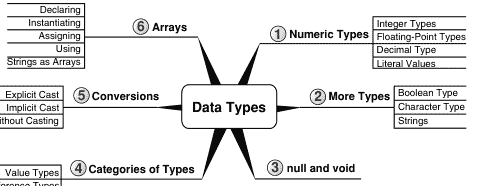

到目前为止，你仅使用过少数几种原始数据类型，且缺乏详细说明。在 C# 中，存在成千上万种类型，你可以组合类型来创建新类型。然而，C# 中有少数几种类型相对简单，被视为所有其他类型的构建块。这些是预定义类型或原始类型。C# 语言的原始类型包括八种整数类型、两种用于科学计算的二进制浮点类型和一种用于财务计算的十进制浮点类型，一种布尔类型和一种字符类型。本章将探讨这些原始类型，更深入地了解字符串类型，并介绍数组。

### 基本数值类型

C# 中的基本数值类型都有关联的关键字。这些包括整数类型、浮点类型，以及一种称为 decimal 的特殊浮点类型，用于存储没有表示误差的大数字。

### 整数类型

C# 有八种整数类型。这种多样性使你能够选择足够大的数据类型来容纳其预期的值范围，而不会浪费资源。表 2.1 列出了每种整数类型。

| 类型 | 大小 | 范围（包含） | BCL 名称 | 有符号 |
| :--- | :--- | :--- | :--- | :--- |
| sbyte | 8 bits | –128 到 127 | System.SByte | 是 |
| byte | 8 bits | 0 到 255 | System.Byte | 否 |
| short | 16 bits | –32,768 到 32,767 | System.Int16 | 是 |
| ushort | 16 bits | 0 到 65,535 | System.UInt16 | 否 |
| int | 32 bits | –2,147,483,648 到 2,147,483,647 | System.Int32 | 是 |
| uint | 32 bits | 0 到 4,294,967,295 | System.UInt32 | 否 |
| long | 64 bits | –9,223,372,036,854,775,808 到 9,223,372,036,854,775,807 | System.Int64 | 是 |
| ulong | 64 bits | 0 到 18,446,744,073,709,551,615 | System.UInt64 | 否 |

表 2.1（以及表 2.2 和 2.3）中包含一个列，用于列出每种类型的全名。C# 中的所有基本类型都有短名称和全名。全名对应于类型在基类库（BCL）中的名称。该名称在所有语言中都相同，并在程序集中唯一标识该类型。由于原始类型的基本性质，C# 还提供关键字作为基本类型全名的短名称或缩写。从编译器的角度来看，两个名称完全相同，生成完全相同的代码。事实上，检查生成的 CIL 代码也无法指示使用了哪个名称。

> **语言对比：C++ short 数据类型**
>
> 在 C/C++ 中，short 数据类型是 short int 的缩写。在 C# 中，short 本身就是实际的数据类型。

### 浮点类型（float, double）

浮点数具有不同程度的精度。如果你读取一个浮点数的值为 0.1，它很容易是 0.09999999999999999 或 0.100000000000000001 或其他非常接近 0.1 的数字。或者，像阿伏伽德罗常数 6.02E23 这样的大数，可能会偏差 9.9E9，考虑到其大小，这非常接近 6.02E23。浮点数的精度与其所表示数字的数量级成正比。因此，精度由有效数字的位数决定，而不是由 ±0.01 这样的固定值决定。换句话说，绝对精度是数量级和有效数字的函数；有效数字的位数告诉你相对精度。

C# 支持表 2.2 中列出的两种浮点数类型。

### 表 2.2：浮点类型

| 类型 | 大小 | 范围（包含） | BCL 名称 | 有效数字 |
| :--- | :--- | :--- | :--- | :--- |
| float | 32 bits | ±1.5 × 10⁻⁴⁵ 到 ±3.4 × 10³⁸ | System.Single | 7 |
| double | 64 bits | ±5.0 × 10⁻³²⁴ 到 ±1.7 × 10³⁰⁸ | System.Double | 15–16 |

二进制数以十进制数字的形式出现，以便人类可读。位数（二进制位）转换为 15 个十进制数字，余数有助于形成第十六个十进制数字，如表 2.2 所示。具体来说，介于 1.7 * 10^307 和小于 1 * 10^308 之间的数字只有 15 个有效数字。然而，介于 1 * 10^308 到 1.7 * 10^308 之间的数字将有 16 个有效数字。decimal 类型也存在类似的有效数字范围。

### 十进制类型

C# 包含一种具有 128 位精度的数值类型（参见表 2.3）。这适用于大型和精确的计算，通常是财务计算。

### 表 2.3：decimal 类型

| 类型 | 大小 | 范围（包含） | BCL 名称 | 有效数字 |
|---|---|---|---|---|
| decimal | 128 bits | 1.0 x 10^-28 到 约 7.9 x 10^28 | System.Decimal | 28–29 |

与浮点数不同，decimal 类型在其范围内对所有十进制数字保持精确精度。因此，使用 decimal 类型时，值 0.1 正好是 0.1。然而，虽然 decimal 类型的精度高于浮点类型，但其范围更小。因此，从浮点类型转换为 decimal 类型可能会导致溢出错误。此外，使用 decimal 进行计算稍慢一些。

### 高级主题

### 浮点类型和十进制类型剖析

除非超出范围，否则 decimal 数字精确表示十进制数字。相比之下，许多十进制数字的浮点表示会引入舍入误差。这类似于 1/3 在任何有限位数的十进制数字中都不精确，11/10 在任何有限位数的二进制数字中也不精确。在这两种情况下，我们最终都会产生某种舍入误差。decimal 类型与 C# 浮点类型之间的区别在于，decimal 类型的基数是十进制，而浮点类型的基数是二进制。

decimal 表示为 ±N * 10k，其中

- N，尾数，是由 96 位表示的正整数。
- k，指数，由 -28 <= k <= 0 给出。

相比之下，float 是任何数 ±N * 2k，其中

- N 是由固定位数表示的正整数（float 为 24 位，double 为 53 位）。
- k 是 float 中 -149 到 +104 之间的任何整数，double 中 -1075 到 +970 之间的任何整数。

### 文本值

文本值是源代码中常量值的表示。例如，如果你希望 System.Console.WriteLine() 输出整数值 42 和双精度值 1.618034（黄金分割率 Phi），可以使用清单 2.1 中所示的代码。

### 清单 2.1：指定文本值

```
System.Console.WriteLine(42);
System.Console.WriteLine(1.618034);
```

输出 2.1 显示了清单 2.1 的结果。

### 输出 2.1：

```
42
1.618034
```

### 初学者主题

### 硬编码值时需谨慎

将值直接放入源代码中的做法称为硬编码，因为更改值意味着需要重新编译代码。开发人员必须仔细考虑在代码中硬编码值与从外部源（例如配置文件）检索值之间的选择，以便值可以在不重新编译的情况下进行修改。

默认情况下，当你指定带有小数点的文本数字时，编译器将其解释为 `double` 类型。相反，没有小数点的文本值通常默认为 `int`，前提是该值不大到无法存储在整数中。如果值太大，则编译器将其解释为 `long`。此外，C# 编译器允许赋值给除 `int` 以外的数值类型，前提是文本值适合目标数据类型。例如，允许 `short s = 42` 和 `byte b = 77`。然而，这仅适用于文本值；没有额外语法时，`b = s` 是不合适的，如本章后面“转换”部分所述。

如前面“基本数值类型”部分所讨论的，C# 中有多种不同的数值类型。在清单 2.2 中，一个文本值被放置在 C# 代码中。由于带有小数点的数字默认为 double 数据类型，因此输出（如输出 2.2 所示）为 1.61803398874989（缺少最后一位数字 5），对应于 double 的预期精度。

### 清单 2.2：指定文本 double

```
System.Console.WriteLine(1.618033988749895);
```

### 输出 2.2：

```
1.61803398874989
```

要以完整精度查看预期的数字，必须通过附加 `m`（或 `M`）将文本值显式声明为 decimal 类型（参见清单 2.3 和输出 2.3）。

### 清单 2.3：指定文本 decimal

```
System.Console.WriteLine(1.618033988749895m);
```

### 输出 2.3：

```
1.618033988749895
```


现在，清单 2.3 的输出符合预期：1.618033988749895。请注意，d 表示 double。用于标识十进制数的 m 对应于其在货币计算中的频繁用法。

你也可以为值添加后缀，分别使用 F 和 D 后缀来显式声明字面量为 float 或 double。对于整数数据类型，后缀为 U、L、LU 和 UL。整数字面量的类型可按以下方式确定。

- 没有后缀的数值字面量按以下顺序解析为第一个能够存储该值的数据类型：int、uint、long 和 ulong。
- 带有后缀 U 的数值字面量按以下顺序解析为第一个能够存储该值的数据类型：uint，然后是 ulong。
- 带有后缀 L 的数值字面量按以下顺序解析为第一个能够存储该值的数据类型：long，然后是 ulong。
- 如果数值字面量带有后缀 UL 或 LU，则其类型为 ulong。

请注意，字面量的后缀不区分大小写。但是，通常更倾向于使用大写，因为小写字母 l 与数字 1 很相似。

在某些情况下，你可能希望使用指数记法，而不是在小数点前或后写出几个零。要使用指数记法，请提供 e 或 E 中缀，在中缀字符后跟一个正或负整数，并用适当的数据类型后缀完成字面量。例如，你可以将阿伏伽德罗常数作为 float 打印出来，如清单 2.4 和输出 2.4 所示。

## 清单 2.4：指数记法

```
System.Console.WriteLine(6.023E23f);
```

## 输出 2.4:

```
6.023E+23
```

### 初学者主题

## 十六进制记法

通常，你使用的是以 10 为基数表示的数字，这意味着数字的每一位都有十个符号（0–9）。如果数字以十六进制记法显示，则它以 16 为基数显示，这意味着使用了 16 个符号：0–9、A–F（也可以使用小写）。因此，0x000A 对应十进制值 10，0x002A 对应十进制值 42。实际数字是相同的。在十六进制和十进制之间切换不会改变数字本身，只会改变数字的表示形式。

每个十六进制数字是四位，因此一个字节可以表示两个十六进制数字。

在迄今为止讨论的所有数值字面量中，我只涵盖了基数为 10 的类型值。C# 还支持指定十六进制值。要指定十六进制值，请在值前加上前缀 0x，然后使用任何十六进制数字，如清单 2.5 所示。

## 清单 2.5：十六进制字面量值

```
// Display the value 42 using a hexadecimal literal.
System.Console.WriteLine(0x002A);
```

## 输出 2.5:

```
42
```

请注意，此代码仍然显示 42，而不是 0x002A。

### 高级主题

## 将数字格式化为十六进制

要以十六进制格式显示数值，有必要使用 x 或 X 数值格式说明符。大小写决定十六进制字母是以小写还是大写形式出现。清单 2.6 显示了如何执行此操作的示例。

## 清单 2.6：十六进制格式说明符示例

```
// Displays "0x2A"
System.Console.WriteLine("0x{0:X}", 42);
```

## 输出 2.6:

0x2A

请注意，数值字面量（42）可以是十进制或十六进制形式。结果将相同。

### 高级主题

## 往返格式化

默认情况下，System.Console.WriteLine(1.618033988749895); 显示 1.61803398874989，缺少最后一位数字。为了更准确地识别 double 值的字符串表示形式，可以使用格式字符串和往返格式说明符 R（或 r）将其转换。例如，string.Format("{0:R}", 1.618033988749895) 将返回结果 1.6180339887498949。

往返格式说明符返回一个字符串，如果将其转换回数值，则始终会得到原始值。因此，清单 2.7 将显示在没有往返格式的情况下，数字不相等。

## 清单 2.7：使用 R 格式说明符进行格式化

```
// ...
const double number = 1.618033988749895;
double result;
string text;
text = string.Format("{0}", number);
result = double.Parse(text);
System.Console.WriteLine("{0}: result != number", result != number);
result = number;
text = string.Format("{0:R}", number);
result = double.Parse(text);
System.Console.WriteLine("{0}: result == number", result == number);
// ...
```

## 输出 2.7:

```
True: result != number
True: result == number
```

第一次为 text 赋值时，没有往返格式说明符，因此 double.Parse(text) 返回的值与原始数字值不相同。相比之下，当使用往返格式说明符时，double.Parse(text) 返回原始值。

对于不熟悉基于 C 的语言中 == 语法的人来说，如果 result 等于 number，则 result == number 返回 true，而 result != number 则相反。赋值运算符和相等运算符将在下一章中讨论。

## 更多基本类型

迄今讨论的基本类型是数值类型。C# 还包括一些其他类型：bool、char 和 string。

## 布尔类型 (bool)

另一个 C# 原始类型是布尔或条件类型 bool，它在条件语句和表达式中表示 true 或 false。允许的值是关键字 true 和 false。bool 的 BCL 名称是 System.Boolean。例如，要以不区分大小写的方式比较两个字符串，你需要调用 string.Compare() 方法并传递一个值为 true 的 bool 字面量（参见清单 2.8）。

## 清单 2.8：两个字符串的不区分大小写比较

```
string option;
...
int comparison = string.Compare(option, "/Help", true);
```

在这种情况下，你将变量 option 的内容与文本 /Help 进行不区分大小写的比较，并将结果赋值给 comparison。

虽然理论上单个位可以保存布尔值，但 bool 的大小是一个字节。

## 字符类型 (char)

char 类型表示 16 位字符，其可能值集合对应于 Unicode 字符集。从技术上讲，char 的大小与 16 位无符号整数（ushort）相同，值介于 0 和 65,535 之间。但是，char 是 C# 中的独特类型，代码应将其视为如此。

char 的 BCL 名称是 System.Char。

### 初学者主题

## Unicode 标准

Unicode 是一种国际标准，用于表示大多数人类语言中存在的字符。它为计算机系统提供构建本地化应用程序的功能，这些应用程序为不同文化显示适当的语言和文化特征。

### 高级主题

## 16 位不足以容纳所有 Unicode 字符

不幸的是，并非所有 Unicode 字符都可以在 16 位 char 中表示。当 Unicode 首先启动时，其设计者认为 16 位就足够了，但随着支持的语言越来越多，人们意识到这一假设是不正确的。笨拙的结果是，某些 Unicode 字符由代理 char 对组成，总共 32 位。

要输入字面量字符类型，请将字符放在单引号内，例如 'A'。允许的字符包括键盘上的所有字符，包括字母、数字和特殊符号。

某些字符无法直接放入源代码，而是需要特殊处理。这些字符以反斜杠 (\) 开头，后跟特殊字符代码。组合起来，反斜杠和特殊字符代码构成转义序列。例如，'\n' 表示换行符，'\t' 表示制表符。由于反斜杠表示转义序列的开始，它不再能标识简单的反斜杠；相反，你需要使用 '\\' 来表示单个反斜杠字符。

## 清单 2.9：使用转义序列显示单引号

```
class SingleQuote
{
    static void Main()
    {
        System.Console.WriteLine('\'');
    }
}
```

除了显示转义序列外，表 2.4 还包含字符的 Unicode 表示形式。

## 表 2.4：转义字符

| 转义序列 | 字符名称 | Unicode 编码 |
|---|---|---|
| \' | 单引号 | \u0027 |
| \" | 双引号 | \u0022 |
| \\ | 反斜杠 | \u005C |
| \0 | 空字符 | \u0000 |
| \a | 警报（系统蜂鸣） | \u0007 |
| \b | 退格 | \u0008 |
| \f | 换页 | \u000C |
| \n | 换行（有时也称为新行） | \u000A |


### 表 2.4：转义字符（续）

| 转义序列 | 字符名称 | Unicode 编码 |
|---|---|---|
| \r | 回车 | \u000D |
| \t | 水平制表符 | \u0009 |
| \v | 垂直制表符 | \u0008 |
| \uxxxx | 十六进制 Unicode 字符 | \u0029 |
| \x[n][n][n]n | 十六进制 Unicode 字符（前三个占位符为可选；\uxxxx 的可变长度版本） | \u3A |
| \Uxxxxxxxx | 用于创建代理对的 Unicode 转义序列 | \UD840DC01 (𠮷) |

可以使用 Unicode 编码表示任何字符。为此，请在 Unicode 值前加上 \u。Unicode 字符以十六进制表示法表示。例如，字母 A 的十六进制值为 0x41。清单 2.10 使用 Unicode 字符显示笑脸（:))，输出 2.8 显示了结果。

### 清单 2.10：使用 Unicode 编码显示笑脸

```
System.Console.Write('\u003A');
System.Console.WriteLine('\u0029');
```

### 输出 2.8:

:)

## 字符串

C# 中的基本字符串类型是数据类型 string，其 BCL 名称为 System.String。字符串包含一些对熟悉其他编程语言的开发人员来说可能出乎意料的特性。这些特性包括字符串逐字前缀字符 @，以及字符串不可变的这一事实。

## 文本字符串

您可以通过将文本放在双引号 (") 中来在代码中输入字符串字面量，如您在 HelloWorld 程序中所见。字符串由字符组成，因此，转义序列可以嵌入字符串中。

例如，在清单 2.11 中，会显示两行文本。但是，代码清单没有使用 System.Console.WriteLine()，而是显示了带有换行字符 \n 的 System.Console.Write()。输出 2.9 显示了结果。

### 清单 2.11：使用 \n 字符插入换行

```
class Duel0Wits
{
    static void Main()
    {
        System.Console.Write(
            "Truly, you have a dizzying intellect.");
        System.Console.Write("\nwait 'til I get going!\n");
    }
}
```

### 输出 2.9:

```
"Truly, you have a dizzying intellect."
"Wait 'til I get going!"
```

双引号的转义序列用于区分打印的双引号和定义字符串开始和结束的双引号。

在 C# 中，您可以在字符串前使用 @ 符号，以指示反斜杠不应被解释为转义序列的开始。生成的逐字字符串字面量不会重新解释反斜杠字符。使用 @ 字符串语法时，空格也会按原样保留。例如，清单 2.12 中的三角形在控制台中会完全按照输入的方式出现，包括反斜杠、换行和缩进。输出 2.10 显示了结果。

如果没有 @ 字符，这段代码甚至无法编译。事实上，即使将形状改为正方形并消除反斜杠，代码仍然无法编译，因为不能将换行直接放在未以 @ 符号开头的字符串中。

### 清单 2.12：使用逐字字符串字面量显示三角形

```
class Triangle
{
    static void Main()
    {
        System.Console.Write(@"begin
             ^
            / \
           /   \
          /     \
         /       \
        /         \
       /           \
      /             \
     /               \
    /                 \
   /                   \
  /                     \
 /                       \
/                         \
end");
    }
}
```

### 输出 2.10:

```
begin
       ^
      / \
     /   \
    /     \
   /       \
  /         \
 /           \
/             \
end
```

逐字字符串支持的唯一转义序列是 `""`，它表示双引号且不会终止字符串。

## 语言对比：C++--编译时字符串连接

与 C++ 不同，C# 不会自动连接字符串字面量。例如，您不能按以下方式指定字符串字面量：

> "施特拉瑟少校已被击毙。" "拘捕惯常嫌疑人。"

相反，连接需要使用加法运算符。（但是，如果编译器可以在编译时计算结果，则生成的 CIL 代码将是单个字符串。）

如果同一字符串字面量在程序集中出现多次，编译器将在程序集中仅定义一次该字符串，所有变量都将引用同一字符串。这样，如果包含数千个字符的同一字符串字面量多次放置在代码中，生成的程序集将仅反映其中一个的大小。

## 字符串方法

字符串类型（如 System.Console 类型）包含多种方法。例如，有用于格式化、连接和比较字符串的方法。

表 2.5 中的 Format() 方法与 Console.Write() 和 Console.WriteLine() 方法的行为完全相同，只不过 string.Format() 不会在控制台窗口中显示结果，而是返回结果。

### 表 2.5：string 静态方法

| 语句 | 示例 |
|---|---|
| `static void string.Format(string format, ...)` | `string text, firstName, lastName;
text = string.Format("Your full name is {0} {1}.",
firstName, lastName);
// Display
// "Your full name is <FirstName> <LastName>."
System.Console.WriteLine(text);` |
| `static void string.Concat(string str0, string str1)` | `string text, firstName, lastName;
text = string.Concat(firstName, lastName);
// Display "<firstName><lastName>, notice
// that there is no space between names.
System.Console.WriteLine(text);` |
| `static int string.Compare(string str0, string str1)` | `string option;
// String comparison in which case matters.
int result = string.Compare(option, "/help");
// Display:
// 0 if equal
// negative if option < /help
// positive if option > /help
System.Console.WriteLine(result);` |

### 表 2.5：string 静态方法（续）

| 语句 | 示例 |
|---|---|
| | `string option;`<br>`/// Case-insensitive string comparison`<br>`int result = string.Compare(option, "Help", true);`<br>`// Display:`<br>`// 0 if equal`<br>`// < 0 if option < /help`<br>`// > 0 if option > /help`<br>`System.Console.WriteLine(result);` |

表 2.5 中的所有方法都是静态方法。这意味着，要调用方法，需要将方法名（例如 Concat）与包含该方法的类型（例如 string）加前缀。但是，如下所示，string 类中的一些方法是实例方法。实例方法不使用类型加前缀，而是使用变量名（或对实例的其他引用）。表 2.6 显示了其中一些方法及示例。

### 表 2.6：string 方法

| 语句 | 示例 |
|---|---|
| `bool StartsWith(string value)`<br>`bool EndsWith(string value)` | `string lastName;`<br>`bool isPhd = lastName.EndsWith("Ph.D.");`<br>`bool isDr = lastName.StartsWith("Dr.");` |
| `string ToLower()`<br>`string ToUpper()` | `string severity = "warning";`<br>`// Display the severity in uppercase`<br>`System.Console.WriteLine(severity.ToUpper());` |
| `string Trim()`<br>`string Trim(...)`<br>`string TrimEnd()`<br>`string TrimStart()` | `// Remove any whitespace at the start or end.`<br>`username = username.Trim();` |
| `string Replace(string oldValue, string newValue)` | `string filename;`<br>`// Remove ?'s altogether from the string`<br>`filename = filename.Replace("?", "");` |

## 新行

输出换行时，换行的精确字符取决于正在执行的操作系统。在 Microsoft Windows 平台上，换行是 '\r' 和 '\n' 字符的组合，而在 Unix 上则使用单个 '\n'。克服平台间差异的一种方法是简单地使用 System.Console.WriteLine() 来输出空行。另一种方法（在不输出到控制台但仍需在多个平台上执行时几乎是必不可少的）是使用 System.Environment.NewLine。换句话说，System.Console.WriteLine("Hello World") 和 System.Console.Write("Hello World" + System.Environment.NewLine) 是等效的。

## 高级主题

### C# 属性

从技术上讲，下一节中提到的 Length 成员并非实际方法，这一点从其调用后没有括号可见。Length 是 string 的属性，C# 语法允许像访问成员变量（在 C# 中称为字段）一样访问属性。换句话说，属性具有称为设置器和获取器的特殊方法的行为，但访问该行为的语法是字段的语法。

检查属性的底层 CIL 实现会发现，它会编译为两个方法：set_<PropertyName> 和 get_<PropertyName>。但是，这两个方法都无法直接从 C# 代码访问，除非通过 C# 属性构造。有关属性的更多详细信息，请参见第 5 章。

### 字符串长度

要确定字符串的长度，请使用名为 Length 的字符串成员。此特定成员称为只读属性。因此，它不能被设置，且调用它不需要任何参数。清单 2.13 演示了如何使用 Length 属性，输出 2.11 显示了结果。


## LISTING 2.13: 使用 string 的 Length 成员

```
class PalindromeLength
{
    static void Main()
    {
        string palindrome;

        System.Console.Write("Enter a palindrome: ");
        palindrome = System.Console.ReadLine();

        System.Console.WriteLine(
            "The palindrome, \"{0}\" is {1} characters.",
            palindrome, palindrome.Length);
    }
}
```

## 输出 2.11:

Enter a palindrome: Never odd or even
The palindrome, "Never odd or even" is 17 characters.

字符串的长度不能直接设置；它是根据字符串中的字符数计算的。此外，字符串的长度不能更改，因为字符串是不可变的。

## 字符串不可变

字符串类型的关键特征在于它是不可变的。字符串变量可以被赋予一个全新的值，但出于性能原因，没有修改字符串内容的设施。因此，无法将字符串转换为全大写字母。创建一个由旧字符串大写版本组成的新字符串很容易，但在此过程中旧字符串不会被修改。请参考清单 2.14 作为示例。

## LISTING 2.14: 错误；字符串不可变

```
class Uppercase
{
    static void Main()
    {
        string text;

        System.Console.Write("Enter text: ");
        text = System.Console.ReadLine();
    }
}
```

```
// UNEXPECTED: Does not convert text to uppercase
text.ToUpper();
System.Console.WriteLine(text);
}
}
```

## 输出 2.12:

```
Enter text: This is a test of the emergency broadcast system.
This is a test of the emergency broadcast system.
```

乍一看，text.ToUpper() 似乎应该将 text 中的字符转换为大写。但是，字符串是不可变的，因此 text.ToUpper() 不会进行此类修改。相反，text.ToUpper() 返回一个新字符串，该字符串需要保存到变量中或直接传递给 System.Console.WriteLine()。修正后的代码显示在清单 2.15 中，其输出显示在输出 2.13 中。

## Listing 2.15: 使用字符串

```
class Uppercase
{
    static void Main()
    {
        string text, uppercase;
        System.Console.Write("Enter text: ");
        text = System.Console.ReadLine();

        // Return a new string in uppercase
        uppercase = text.ToUpper();
        System.Console.WriteLine(uppercase);
    }
}
```

## 输出 2.13:

```
Enter text: This is a test of the emergency broadcast system.
THIS IS A TEST OF THE EMERGENCY BROADCAST SYSTEM.
```

如果忽略字符串的不可变性，则清单 2.14 中所示的类似错误也可能出现在其他字符串方法中。

要实际更改 text 中的值，请将 ToUpper() 的值重新赋给 text，如下所示：

```
text = text.ToUpper();
```

## System.Text.StringBuilder

如果需要进行大量的字符串修改，例如在多个步骤中构建一个长字符串，则应使用数据类型 System.Text.StringBuilder 而不是 string。System.Text.StringBuilder 包括 Append()、AppendFormat()、Insert()、Remove() 和 Replace() 等方法，其中一些方法也出现在 string 上。但是，关键区别在于，在 System.Text.StringBuilder 上，这些方法将修改 StringBuilder 本身中的数据，而不会简单地返回一个新字符串。

## null 和 void

与类型相关的另外两个关键字是 null 和 void。null 是一个值，指示变量不引用任何有效对象。void 用于指示没有类型或完全没有值。

### null

null 也可以用作一种字符串“字面量”。null 指示变量被设置为空。引用类型、指针类型和可空值类型可以被赋予 null 值。迄今为止本书中涵盖的唯一引用类型是 string；第 5 章详细介绍了创建类（即引用类型）的主题。目前，只需知道引用类型包含对内存位置的引用，该位置不同于实际数据所在的位置。将变量设置为 null 的代码会显式地将引用赋值为指向空。事实上，甚至可以检查引用类型是否指向空。清单 2.16 演示了将 null 赋给字符串变量。

## LISTING 2.16: 将 null 赋给字符串

```
static void Main()
{
    string faxNumber;

    // ...
    // Clear the value of faxNumber.
    faxNumber = null;
    // ...
}
```

重要的是要注意，将 null 值赋给引用类型与根本不赋值是不同的。换句话说，已赋予 null 的变量仍然被视为已设置，而未赋值的变量未被设置，因此如果在赋值前使用，通常会导致编译错误。

将 null 值赋给字符串与赋予空字符串 "" 截然不同。null 指示变量没有值。"" 指示存在一个值：空字符串。这种区别非常有用。例如，编程逻辑可以将 faxNumber 的 null 解释为传真号码未知，而 faxNumber 值为 "" 则可能表示没有传真号码。

## void 非类型

有时 C# 语法要求指定数据类型但不传递数据。例如，如果不需要方法返回值，C# 允许将 void 指定为数据类型。HelloWorld 程序中 Main 的声明就是一个示例。在这种情况下，要指定的数据类型是 void。将 void 用作返回类型表示该方法不返回任何数据，并告诉编译器不要期望一个值。void 本身并不是数据类型，而是标识没有数据类型的事实。

## 语言对比：C++--void 是数据类型

在 C++ 中，void 是一种常用作 void** 的数据类型。在 C# 中，void 不以同样的方式被视为数据类型。相反，它用于标识方法不返回值。

## 语言对比：Visual Basic--返回 void 类似于定义子程序

C# 中返回 void 的 Visual Basic 等效方法是定义子程序（Sub/End Sub），而不是返回值的函数。

## 高级主题

### 隐式类型局部变量

此外，C# 3.0 包含上下文关键字 var，用于声明隐式类型局部变量。只要代码在声明时用明确的类型初始化变量，C# 3.0 就允许隐含变量的数据类型。与显式指定数据类型不同，隐式类型局部变量是使用上下文关键字 var 声明的，如清单 2.17 所示。

## LISTING 2.17: 使用字符串

```
class Uppercase
{
    static void Main()
    {
        System.Console.Write("Enter text: ");
        var text = System.Console.ReadLine();

        // Return a new string in uppercase
        var uppercase = text.ToUpper();
        System.Console.WriteLine(uppercase);
    }
}
```

此清单与清单 2.15 有两点不同。首先，清单 2.17 使用 var 而不是使用显式数据类型 string 进行声明。生成的 CIL 代码与显式使用 string 相同。但是，var 指示编译器应从声明中分配的值（System.Console.ReadLine()）确定数据类型。

其次，变量 text 和 uppercase 在声明时不是未经赋值就声明。这样做会导致编译错误。如前所述，通过赋值，编译器检索右侧表达式的数据类型并相应地声明变量，就像程序员显式指定类型一样。

虽然允许使用 var 而不是显式数据类型，但当数据类型已知时，请考虑避免此类用法——例如，对 text 和 uppercase 的声明使用 string。这不仅使代码更易于理解，而且还验证了右侧表达式返回的数据类型是预期的类型。使用 var 声明的变量时，右侧数据类型应该是显而易见的；如果不是，则应避免使用 var 声明。

var 支持在 C# 3.0 中添加到语言中，以支持匿名类型。匿名类型是在方法中动态声明的数据类型，而不是通过显式类定义，如第 14 章所述（请参阅清单 2.18）。

## LISTING 2.18: 带匿名类型的隐式局部变量

```
class Program
{
    static void Main()
    {
        var patent1 =
            new { Title = "Bifocals",
                YearOfPublication = "1784" };
        var patent2 =
            new { Title = "Phonograph",
                YearOfPublication = "1877" };
        System.Console.WriteLine("{0} ({1})",
            patent1.Title, patent1.YearOfPublication);
        System.Console.WriteLine("{0} ({1})",
            patent2.Title, patent2.YearOfPublication);
    }
}
```

对应的输出显示在输出 2.14 中。

## 输出 2.14:

```
Bifocals (1784)
Phonograph (1874)
```


清单 2.18 演示了将匿名类型赋值给隐式类型（var）局部变量。这种操作提供了关键功能，利用 C# 3.0 对连接（关联）数据类型或将特定类型缩减为更少数据元素的支持。

## 类型分类

所有类型都分为两类：值类型和引用类型。每个类别中类型之间的差异源于它们的复制方式：值类型数据始终按值复制，而引用类型数据始终按引用复制。

## 值类型

除 string 之外，本书迄今介绍的所有预定义类型都是值类型。值类型直接包含值。换句话说，变量引用存储值的同一内存位置。因此，当将同一值赋给不同变量时，会将原始变量值的内存副本复制到新变量的位置。同一值类型的第二个变量不能引用与第一个变量相同的内存位置。因此，更改第一个变量的值不会影响第二个变量中的值。图 2.1 演示了这一点。number1 引用包含值 42 的特定内存位置。将 number1 赋给 number2 后，两个变量都将包含值 42。但是，修改任一变量的值都不会影响另一个变量。同样，将值类型传递给 Console.WriteLine() 等方法也会导致内存副本，方法内对参数的任何更改都不会影响调用函数中的原始值。由于值类型需要内存副本，通常应将其定义为占用少量内存（小于 16 字节）。

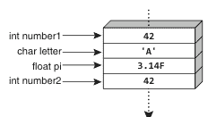

```
//...
int number1 = 42;
char letter = 'A';
float pi = 3.14f;
int number2 = number1;
//...
```

图 2.1：值类型直接包含数据

## 引用类型

引用类型及其引用的变量指向数据存储位置。引用类型存储数据所在位置的引用，而不是直接存储数据。因此，运行时会从变量中读取内存位置，然后跳转到包含数据的内存位置。引用类型指向的数据所在的内存区域是堆（请参阅图 2.2）。

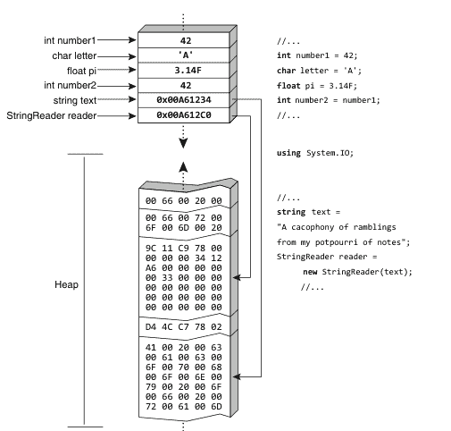

图 2.2：引用类型指向堆

引用类型不需要像值类型那样对数据进行相同的内存副本，因此在某些情况下效率更高。当将一个引用类型变量赋给另一个引用类型变量时，只会发生地址的内存副本，因此引用类型所需的内存副本始终是地址本身的大小。（32 位处理器会复制 32 位，64 位处理器会复制 64 位，以此类推。）显然，如果值类型的数据量较大，不复制数据的速度会比值类型的行为更快。

由于引用类型只复制数据的地址，因此两个不同的变量可以指向同一数据。此外，通过一个变量更改数据也会更改另一个变量的数据。这既适用于赋值，也适用于方法调用。因此，方法可以影响调用方处的引用类型数据。出于这个原因，在定义引用类型还是值类型之间的关键决定因素是，对象在逻辑上是否像固定大小的不可变值，因此是值类型。

除 string 和 Program 等自定义类之外，迄今讨论的所有类型都是值类型。但是，大多数类型都是引用类型。虽然可以定义自定义值类型，但与自定义引用类型的数量相比，这样做相对较少。

## 可空修饰符

如前所述，值类型不能赋值为 null，因为根据定义，它们不能包含引用（包括对无内容的引用）。然而，在现实世界中，值可能缺失，这会带来问题。例如，在指定计数时，如果计数未知，你应该输入什么？一种可能的解决方案是指定一个“魔法”值，例如 0 或 int.MaxValue，但这些都是有效的整数。相反，为值类型赋值为 null 是可取的，因为这不是有效的整数。

要声明可以存储 null 的变量，请使用可空修饰符 ?。

此功能从 C# 2.0 开始引入，如清单 2.19 所示。

### 清单 2.19：使用可空修饰符

```
static void Main()
{
    int? count = null;
}
```

```
do
{
    // ...
} while(count == null);
}
```

在数据库编程中，为值类型赋值为 null 特别有吸引力。数据库表中的值类型列经常允许为 null。检索此类列并将其赋给 C# 代码中的相应字段会出现问题，除非这些字段也可以包含 null。幸运的是，可空修饰符专门用于处理此类场景。

## 数据类型之间的转换

考虑到各种 CLI 实现中预定义了成千上万种类型，而代码可以定义的类型数量无限，因此类型在合理的情况下支持相互转换非常重要。导致转换的最常见操作是强制转换。

考虑两种数值类型之间的转换：将 long 类型的变量转换为 int 类型的变量。long 类型可以包含高达 9,223,372,036,854,775,808 的值；但是，int 的最大大小为 2,147,483,647。因此，该转换可能导致数据丢失——例如，如果 long 类型的变量包含大于 int 最大大小的值。任何可能导致数值丢失或因转换失败而引发异常的转换都需要显式转换。相反，无论操作数类型如何，都不会丢失数值且不会引发异常的强制转换操作是隐式转换。

## 显式转换

在 C# 中，你使用转换运算符进行强制转换。通过在括号内指定希望变量转换为的类型，你承认如果发生显式转换，可能会丢失精度和数据，或者可能会引发异常。清单 2.20 中的代码将 long 转换为 int，并明确告诉系统尝试该操作。

### 清单 2.20：显式转换示例

```
long longNumber = 50918390189;
int intNumber = (int) longNumber;
cast operator
```

使用转换运算符时，程序员实际上是在对编译器说：“相信我，我知道我在做什么。我知道转换可能不匹配，但我愿意冒这个险。”做出这样的选择会导致编译器允许转换。但是，在进行显式转换时，如果数据转换不成功，执行时仍有可能以异常形式发生错误。因此，程序员有责任确保数据能够成功转换，否则在转换失败时提供必要的错误处理代码。

### 高级主题

## 检查和未检查的转换

C# 提供了特殊关键字来标记代码块，以指示如果目标数据类型太小无法容纳赋值数据时应如何处理。默认情况下，如果目标数据类型无法容纳赋值数据，则数据在赋值期间会溢出截断。示例请参见清单 2.21。

### 清单 2.21：整数值溢出

```
public class Program
{
    public static void Main()
    {
        // int.MaxValue equals 2147483647
        int n = int.MaxValue;
        n = n + 1;
        System.Console.WriteLine(n);
    }
}
```

输出 2.15 显示了结果。

### 输出 2.15：

```
-2147483648
```

清单 2.21 将值 -2147483648 写入控制台。但是，将代码放在 checked 块中，或在运行编译器时使用 checked 选项，会导致运行时引发类型为 System.OverflowException 的异常。checked 块的语法使用 checked 关键字，如清单 2.22 所示。

### 清单 2.22：checked 块示例

```
public class Program
{
    public static void Main()
    {
        checked
        {
            // int.MaxValue equals 2147483647
            int n = int.MaxValue;
            n = n + 1;
            System.Console.WriteLine(n);
        }
    }
}
```

输出 2.16 显示了结果。

### 输出 2.16：

```
Unhandled Exception: System.OverflowException: Arithmetic operation resulted in an overflow at Program.Main() in ...Program.cs:line 12
```

结果是，如果在 checked 块内运行时发生溢出赋值，则会引发异常。

C# 编译器提供了一个命令行选项，用于将默认的未检查行为更改为检查行为。C# 还支持 unchecked 块，该块会溢出块内的赋值数据，而不是引发异常（请参见清单 2.23）。


## 清单 2.23：未检查块示例

```
using System;

public class Program
{
    public static void Main()
    {
        unchecked
        {
            // int.MaxValue equals 2147483647
            int n = int.MaxValue;
            n = n + 1;
            System.Console.WriteLine(n);
        }
    }
}
```

### 输出 2.17:

```
-2147483648
```

即使在编译期间启用了 checked 选项，前面代码中的 unchecked 关键字也会阻止运行时在执行期间抛出异常。

你不能仅仅因为使用强制转换运算符显式指定转换，就将任何类型转换为任何其他类型。编译器仍会检查该操作是否有效。例如，你不能将 long 转换为 bool。未定义此类强制转换运算符，因此编译器不允许此类转换。

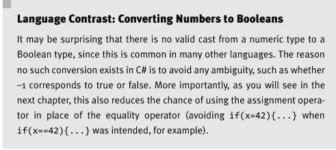

## 隐式转换

在其他情况下，例如从 int 类型转换为 long 类型，没有精度损失，类型的值也不会发生根本变化。在这些情况下，代码只需指定赋值运算符，转换即为隐式。换句话说，编译器能够确定此类转换将正确工作。清单 2.24 中的代码仅通过使用赋值运算符即可从 int 转换为 long。

### 清单 2.24：隐式转换时不使用强制转换运算符

```
int intNumber = 31416;
long longNumber = intNumber;
```

即使不需要显式强制转换运算符（因为允许隐式转换），仍然可以包含强制转换运算符（请参阅清单 2.25）。

### 清单 2.25：对隐式转换使用强制转换运算符

```
int intNumber = 31416;
long longNumber = (long) intNumber;
```

## 无需强制转换的类型转换

未定义从 string 到数值类型的转换，因此需要 Parse() 等方法。每个数值数据类型都包含一个 Parse() 函数，可实现从 string 到相应数值类型的转换。清单 2.26 演示了此调用。

### 清单 2.26：使用 int.Parse() 将 string 转换为数值数据类型

```
string text = "9.11e-31";
float kgElectronMass = float.Parse(text);
```

还有一种特殊类型可用于在一种类型和另一种类型之间进行转换。该类型为 System.Convert，其用法示例出现在清单 2.27 中。

### 清单 2.27：使用 System.Convert 进行类型转换

```
string middleText = "278.4375";
double middle = System.Convert.ToDouble(middleText);
bool boolean = System.Convert.ToBoolean(middle);
```

System.Convert 仅支持预定义的若干类型，且不可扩展。它允许从任何原始类型（bool、char、sbyte、short、int、long、ushort、uint、ulong、float、double、decimal、DateTime 和 string）转换为任何其他原始类型。

此外，所有类型都支持 ToString() 方法，可用于提供类型的字符串表示形式。清单 2.28 演示了如何使用此方法。结果输出如输出 2.18 所示。

### 清单 2.28：使用 ToString() 转换为 string

```
bool boolean = true;
string text = boolean.ToString();
// Display "True"
System.Console.WriteLine(text);
```

### 输出 2.18:


对于大多数类型，ToString() 方法将返回数据类型的名称，而不是数据的字符串表示形式。仅当类型具有 ToString() 的显式实现时，才会返回字符串表示形式。最后要指出的是，可以编写自定义转换方法，运行时的许多类中都提供了此类方法。

## 高级主题

### TryParse()

从 C# 2.0 (.NET 2.0) 开始，所有数值原始类型都包含静态 TryParse() 方法。（在 C# 1.0 中，只有 double 包含此类方法。）此方法与 Parse() 方法非常相似，区别在于：如果转换失败，TryParse() 方法返回 false，而不是抛出异常，如清单 2.29 所示。

### 清单 2.29：使用 TryParse() 代替无效强制转换异常

```
double number;
string input;

System.Console.Write("Enter a number: ");
input = System.Console.ReadLine();
if (double.TryParse(input, out number))
{
    // Converted correctly, now use number
    // ...
}
else
{
    System.Console.WriteLine(
        "The text entered was not a valid number.");
}
```

### 输出 2.19:

```
Enter a number: forty-two
The text entered was not a valid number.
```

代码从输入字符串解析出的结果值通过 out 参数返回——在此例中为 number。

Parse() 与 TryParse() 之间的关键区别在于：如果 TryParse() 失败，它不会抛出异常。频繁地，从 string 到数值类型的转换取决于用户输入的文本。在这些场景中，预计用户会输入无法成功解析的无效数据。通过使用 TryParse() 而不是 Parse()，可以在预期情况下避免抛出异常。（在此例中，预期情况是用户会输入无效数据。）

## 数组

第 1 章未涉及的变量声明的一个特定方面是数组声明。通过数组声明，可以使用单个变量存储同一类型的多个项目，并在需要时使用索引单独访问它们。在 C# 中，数组索引从零开始。因此，C# 数组是从零开始的。

数组提供了一种使用单个变量声明同一类型的数据项集合的方法。数组中的每个项目都使用称为索引的整数值进行唯一标识。C# 数组中的第一个项目使用索引 0 访问。程序员应小心指定小于数组大小的索引值。由于 C# 数组是从零开始的，数组中最后一个元素的索引比数组中的项目总数少 1。

对于初学者，有时将索引视为偏移量很有帮助。第一个项目距离数组起始位置为 0。第二个项目距离数组起始位置为 1，依此类推。

### 声明数组

在 C# 中，使用方括号声明数组。首先指定数组的元素类型，后跟一对方括号；然后输入变量名。清单 2.30 声明一个名为 Languages 的变量，使其成为 string 数组。

### 清单 2.30：声明数组

```
string[] languages;
```

显然，数组的第一部分标识数组中元素的数据类型。声明中包含的方括号标识数组的秩（即维数）；在此例中，它是秩为一的数组。这两部分构成了变量 languages 的数据类型。

### 语言对比：C++ 和 Java——数组声明

在 C# 中，数组的方括号紧跟在数据类型之后，而不是出现在变量声明之后。这样可以将所有类型信息保持在一起，而不是像在 C++ 和 Java 中那样将其分别拆分在标识符之前和之后。

清单 2.30 定义了一个秩为一的数组。方括号内的逗号定义了附加维度。例如，清单 2.31 为国际象棋或井字游戏定义了一个二维单元格数组。

### 清单 2.31：声明二维数组

```
// |
// +---+---+---+---+---+---+---+---+
// | | | | | | | | |
// +---+---+---+---+---+---+---+---+
// | | | | | | | | |
// +---+---+---+---+---+---+---+---+
int[,] cells;
```

在清单 2.31 中，数组的秩为二。第一个维度可能对应横向单元格，第二个维度表示纵向单元格。通过添加更多逗号来添加附加维度，总秩比逗号数多 1。请注意，特定维度中出现的项目数不是变量声明的一部分。这是在创建（实例化）数组并为每个元素分配空间时指定的。

### 实例化和赋值数组

声明数组后，可以使用一对花括号内的逗号分隔列表立即填充其值。清单 2.32 声明一个 string 数组，然后在花括号内分配九种语言的名称。

### 清单 2.32：带赋值的数组声明

```
string[] languages = { "C#", "COBOL", "Java",
"C++", "Visual Basic", "Pascal",
"Fortran", "Lisp", "J#"};
```

逗号分隔列表中的第一个项目成为数组中的第一个项目；列表中的第二个项目成为数组中的第二个项目，依此类推。花括号是定义数组字面量的表示法。

清单 2.32 中所示的赋值语法仅在声明和赋值在同一语句中完成时可用。在声明后赋值需要使用 new 关键字，如清单 2.33 所示。


## 清单 2.33: 声明后的数组赋值

```csharp
string[] languages;
languages = new string[]{"C#", "COBOL", "Java",
                         "C++", "Visual Basic", "Pascal",
                         "Fortran", "Lisp", "J#"};
```

从 C# 3.0 开始，在 `new` 之后指定数组的数据类型（string）变成可选的，只要数组中项的数据类型兼容即可——方括号仍然是必需的。

C# 还允许在声明语句中使用 `new` 关键字，因此它允许清单 2.34 中所示的赋值和声明。

## 清单 2.34: 声明期间使用 new 的数组赋值

```csharp
string[] languages = new string[]{
    "C#", "COBOL", "Java",
    "C++", "Visual Basic", "Pascal",
    "Fortran", "Lisp", "J#"};
```

使用 `new` 关键字告诉运行时为数据类型分配内存。它指示运行时实例化数据类型——在此例中，是一个数组。

每当在数组赋值中使用 `new` 关键字时，也可以在方括号内指定数组的大小。清单 2.35 演示了此语法。

## 清单 2.35: 使用 new 关键字的声明和赋值

```csharp
string[] languages = new string[9]{
    "C#", "COBOL", "Java",
    "C++", "Visual Basic", "Pascal",
    "Fortran", "Lisp", "J#"};
```

初始化语句中的数组大小和花括号内包含的元素数量必须匹配。此外，可以赋值数组但不指定数组的初始值，如清单 2.36 所示。

## 清单 2.36: 不带字面量的赋值

```csharp
string[] languages = new string[9];
```

赋值数组但不初始化初始值仍会初始化每个元素。运行时将元素初始化为其默认值，如下所示。

- 引用类型（例如 string）初始化为 null。
- 数值类型初始化为零。
- bool 初始化为 false。
- char 初始化为 '\0'。

非原始值类型通过将每个字段初始化为其默认值来递归初始化。

因此，在使用数组之前，无需单独为数组的每个元素赋值。

在 C# 2.0 中，可以使用 `default()` 运算符来确定数据类型的默认值。`default()` 将数据类型作为参数。例如，`default(int)` 返回 0，`default(char)` 返回 `\0`。

因为数组大小未包含在变量声明中，所以可以在运行时指定大小。例如，清单 2.37 根据 `Console.ReadLine()` 调用中指定的大小创建数组。

## 清单 2.37: 在运行时定义数组大小

```csharp
string[] groceryList;
System.Console.Write("How many items on the list? ");
int size = int.Parse(System.Console.ReadLine());
groceryList = new string[size];
// ...
```

C# 初始化多维数组的方式类似。逗号分隔每个维度的大小。清单 2.38 初始化一个没有任何移动的井字棋板。

## 清单 2.38: 声明二维数组

```csharp
int[,] cells = new int[3,3];
```

初始化带有特定位置的井字棋板可以按清单 2.39 所示完成。

## 清单 2.39: 初始化整数二维数组

```csharp
int[][] cells = {
    {1, 0, 2},
    {1, 2, 0},
    {1, 2, 1}
};
```

初始化遵循这样的模式：有一个包含三个 `int[]` 类型元素的数组，每个元素的大小相同；在此示例中，大小为 3。请注意，每个 `int[]` 元素的维度必须相同。因此，清单 2.40 中所示的声明无效。

## 清单 2.40: 大小不一致的多维数组，导致错误

```csharp
// ERROR: Each dimension must be consistently sized.
int[][] cells = {
    {1, 0, 2, 0},
    {1, 2, 0},
    {1, 2},
    {1}
};
```

表示井字棋不需要每个位置都有一个整数。一种替代方案是为每个玩家提供单独的虚拟板，每个板包含一个 `bool`，指示玩家选择了哪些位置。清单 2.41 对应于一个三维板。

## 清单 2.41: 初始化三维数组

```csharp
bool[,,] cells;
cells = new bool[2,3,3]
{
    // Player 1 moves    // x |   |
    {
        {true, false, false},    //   |---+---+---|
        {false, false, true},    //   |   |   |
        {true, false, true} },   //   |---+---+---|
                                   //   |   | x |
    // Player 2 moves    //   |   | o
    {
        {false, true, true},    //   |---+---+---|
        {false, true, false},   //   | o |   |
        {false, true, true} }   //   |---+---+---|
                                   //   |   | o |
};
```

在此示例中，板已初始化，并且每个维度的大小已明确标识。除了在 `new` 表达式中标识大小外，还提供了数组的字面值。`bool[,,]` 类型的字面值被分解为两个 `bool[, ]` 类型的数组，大小为 3x3。每个二维数组由三个 `bool` 数组组成，大小为 3。

如前所述，多维数组中的每个维度必须大小一致。但是，也可以定义交错数组，即数组的数组。交错数组语法与多维数组略有不同，而且，交错数组不需要大小一致。因此，可以按清单 2.42 所示初始化交错数组。

## 清单 2.42: 初始化交错数组

```csharp
int[][] cells = {
    new int[] { 0, 2, 0 },
    new int[] { 1, 2, 0 },
    new int[] { 1, 2 },
    new int[] { 1 }
};
```

交错数组不使用逗号来标识新维度。相反，交错数组定义一个数组的数组。在清单 2.42 中，`[]` 放在数据类型 `int[][]` 之后，从而声明一个 `int[][]` 类型的数组。

请注意，交错数组要求每个内部数组都有一个数组实例（或 null）。在此示例中，您使用 `new` 来实例化交错数组的内部元素。省略实例化会导致编译错误。

## 使用数组

您使用方括号表示法（称为数组访问器）访问数组中的特定项。要从数组中检索第一项，请将零指定为索引。在清单 2.43 中，`languages` 变量中第五项的值（使用索引 4，因为第一项是索引 0）存储在变量 `language` 中。

## 清单 2.43: 声明和访问数组

```csharp
string[] languages = new string[9]{
    "C#", "COBOL", "Java",
    "Pascal",
    "C++", "Visual Basic", "Pascal",
    "Fortran", "Lisp", "J#"};
// Retrieve 3rd item in languages array (Java)
string language = languages[4];
```

方括号表示法也用于将数据存储到数组中。清单 2.44 交换 "C++" 和 "Java" 的顺序。

## 清单 2.44: 交换数组位置之间的数据

```csharp
string[] languages = new string[9]{
    "C#", "COBOL", "Java",
    "C++", "Visual Basic", "Pascal",
    "Fortran", "Lisp", "J#"};
// Save "C++" to variable called language.
string language = languages[3];
// Assign "Java" to the C++ position.
languages[3] = languages[2];
// Assign language to location of "Java".
languages[2] = language;
```

对于多维数组，每个维度都有一个索引来标识元素，如清单 2.45 所示。

## 清单 2.45: 初始化整数二维数组

```csharp
int[,] cells = {
    {1, 0, 2},
    {0, 2, 0},
    {1, 2, 1}
};
// Set the winning tic-tac-toe move to be player 1.
cells[1,0] = 1;
```

交错数组元素赋值略有不同，因为它与交错数组声明一致。第一个元素是数组的数组中的数组。第二个索引指定所选数组元素中的项（请参见清单 2.46）。

## 清单 2.46: 声明交错数组

```csharp
int[][] cells = {
    new int[]{1, 0, 2},
    new int[]{0, 2, 0},
    new int[]{1, 2, 1}
};
cells[1][0] = 1;
// ...
```


## 长度

你可以获取数组的长度，如清单 2.47 所示。

```
LISTING 2.47: Retrieving the Length of an Array
Console.WriteLine("There are {0} languages in the array.",
languages.Length);
```

数组具有固定长度；它们被绑定，因此除非重新创建数组，否则无法更改长度。此外，越过数组的边界（或长度）会导致运行时报错。这种情况可能发生在使用不存在的索引访问（检索或赋值）数组时。当你使用数组长度作为数组的索引时，此类错误经常发生，如清单 2.48 所示。

```
LISTING 2.48: Accessing Outside the Bounds of an Array, Throwing an Exception
string[] languages = new string[9];
// ...
// RUNTIME ERROR: index out of bounds - should
// be 8 for the last element
languages[4] = languages[9];
```

> **注意**
> 
> Length 成员返回数组中的项数，而不是最高索引。languages 变量的 Length 成员为 9，但 languages 变量的最高索引为 8，因为索引是从 0 开始计数的。

> ### 语言对比：C++—缓冲区溢出错误
> 
> 非托管 C++ 不会始终检查你是否越过数组边界。这不仅难以调试，而且犯此错误还可能导致称为缓冲区溢出的潜在安全错误。相比之下，公共语言运行时保护所有 C#（和托管 C++）代码免于越过数组边界，几乎消除了托管代码中缓冲区溢出问题的可能性。

使用 Length 代替硬编码的数组大小是一种良好做法。例如，要将 Length 用作索引，需要减去 1 以避免越界错误（参见清单 2.49）。

### 清单 2.49: 在数组索引中使用 Length - 1

```
string[] languages = new string[9];
...
languages[4] = languages[languages.Length - 1];
```

为避免越过数组边界，请使用长度检查来验证其长度大于 0，并在访问数组中的最后一项时使用 Length - 1 代替硬编码值（参见清单 2.49）。

Length 返回数组中的元素总数。因此，如果你有一个大小为 2×3×3 的多维数组（如 bool [,] cells[,]），Length 将返回元素总数 18。

对于锯齿数组，Length 返回第一个数组中的元素数量——锯齿数组是数组的数组，因此 Length 仅计算外部包含数组并返回其元素计数，而不考虑内部数组中的内容。

## 更多数组方法

数组包含用于操作数组内元素的其他方法。这些方法包括 Sort()、BinarySearch()、Reverse() 和 Clear()（参见清单 2.50）。

### 清单 2.50: 其他数组方法

```
class ProgrammingLanguages
{
    static void Main()
    {
        string[] languages = new string[]{
        "C#", "COBOL", "Java",
        "C++", "Visual Basic", "Pascal",
        "Fortran", "Lisp", "J#"};
        System.Array.Sort(languages);
        searchString = "COBOL";
        Index = System.Array.BinarySearch(
            languages, searchString);
        System.Console.WriteLine(
            "The wave of the future, {0}, is at index {1}." ,
            searchString, index);
        System.Console.WriteLine();
        System.Console.WriteLine("{0,-20}{1,-20}",
            "First Element", "Last Element");
        System.Console.WriteLine("{0,-20}{1,-20}",
            "-------------", "----------");
        System.Console.WriteLine("{0,-20}{1,-20}",
            languages[0], languages[languages.Length-1]);
        System.Array.Reverse(languages);
        System.Console.WriteLine("{0,-20}{1,-20}",
            languages[0], languages[languages.Length-1]);
        // Note this does not remove all items from the array.
        // Rather it sets each item to the type's default value.
        System.Array.Clear(languages, 0, languages.Length);
        System.Console.WriteLine("{0,-20}{1,-20}",
            languages[0], languages[languages.Length-1]);
        System.Console.WriteLine(
            "After clearing, the array size is: {0}",
            languages.Length);
    }
}
```

清单 2.50 的结果如输出 2.20 所示。

### 输出 2.20:

```
The wave of the future: COBOL is at index 1.
First Element      Last Element
----------------   ----------
C#                 Visual Basic
Visual Basic       C#
After clearing, the array size is: 9
```

访问这些方法是在 System.Array 类上进行的。在大多数情况下，使用这些方法不言自明，但有两点值得注意。

- 在使用 BinarySearch() 方法之前，重要的是要先对数组进行排序。如果值不是按递增顺序排序，则可能返回错误的索引。如果搜索元素不存在，则返回的值为负数。（使用按位取反运算符 ~Index，如果有，则返回第一个大于所搜索值的索引。）

- Clear() 方法不会删除数组中的元素，也不会将长度设置为零。数组大小是固定的，无法修改。因此，Clear() 方法将数组中的每个元素设置为其默认值（false、0 或 null）。这解释了为什么在调用 Clear() 后，Console.WriteLine() 在输出数组时会创建一个空行。

> ### 语言对比：Visual Basic—重新设置数组大小
> 
> Visual Basic 包含用于更改数组中项数的 ReDim 语句。虽然没有等效的 C# 特定关键字，但 .NET 2.0 中有一个可用方法，它会重新创建数组，然后将所有元素复制到新数组。该方法称为 System.Array.Resize。

## 数组实例成员

与字符串一样，数组具有实例成员，这些成员不是从数据类型访问，而是直接从变量访问。Length 是实例成员的一个示例，因为对 Length 的访问是通过数组变量，而不是通过类。其他重要的实例成员包括 GetLength()、Rank 和 Clone()。

检索特定维度的长度不需要 Length 属性。要检索特定秩的大小，数组包含 GetLength() 实例方法。调用此方法时，需要指定要返回其长度的秩（参见清单 2.51）。

### 清单 2.51: 检索特定维度的大小

```
bool[,] cells;
cells = new bool[2,3,3];
System.Console.WriteLine(cells.GetLength(0)); // Displays 2
```

清单 2.51 的结果如输出 2.21 所示。

### 输出 2.21:

```
2
```

清单 2.51 显示 2，因为这是第一个维度中的元素数量。

也可以通过访问数组的 Rank 成员来检索整个数组的秩。例如，cells.Rank 将返回 3。

默认情况下，将一个数组变量赋值给另一个数组变量仅复制数组引用，而不复制数组的单个元素。要创建数组的完全新副本，请使用数组的 Clone() 方法。Clone() 方法将返回数组的副本；更改此新数组的任何成员都不会影响原始数组的成员。

## 字符串作为数组

字符串类型的变量可以像字符数组一样访问。例如，要检索名为 palindrome 的字符串的第四个字符，可以调用 palindrome[3]。请注意，由于字符串是不可变的，因此无法为字符串中的特定字符赋值。因此，C# 不允许 palindrome[3]='a'（其中 palindrome 声明为字符串）。清单 2.52 使用数组访问器来确定命令行参数是否为选项，其中选项由第一个字符为短横线来标识。

### 清单 2.52: 查找命令行选项

```
string[] args;
...
if(args[0][0] == '-')
{
    //This parameter is an option
}
```

此代码片段使用 if 语句（在第 3 章中介绍）。此外，它提供了一个有趣的示例，因为你使用数组访问器来检索字符串数组 args 中的第一个元素。在第一个数组访问器之后是第二个访问器，这次是为了检索字符串的第一个字符。因此，该代码等同于清单 2.53 中所示的代码。

### 清单 2.53: 查找命令行选项（简化）

```
string[] args;
...
string arg = args[0];
if(arg[0] == '-')
{
    //this parameter is an option
}
```

不仅可以使用数组访问器单独访问字符串字符，还可以使用字符串的 ToCharArray() 方法将整个字符串作为字符数组检索。使用此方法，你可以使用 System.Array.Reverse() 方法反转字符串，如清单 2.54 所示，该清单用于确定字符串是否为回文。

### 清单 2.54: 反转字符串

```
class Palindrome
{
    static void Main()
    {
        string reverse, palindrome;
        char[] temp;

        System.Console.Write("Enter a palindrome: ");
        palindrome = System.Console.ReadLine();

        // Remove spaces and convert to lowercase
        reverse = palindrome.Replace(" ", "");
        reverse = reverse.ToLower();

        // Convert to an array
        temp = reverse.ToCharArray();

        // Reverse the array
        System.Array.Reverse(temp);
    }
}


## 输出 2.22:

```
Enter a palindrome: NeverOddOrEven
"NeverOddOrEven" is a palindrome.
```

此示例使用 new 关键字；这次，它从字符的反转数组中创建一个新字符串。

## 常见错误

本节介绍了三种不同类型的数组：一维数组、多维数组和交错数组。若干规则和特性规定了数组的声明和使用。表 2.7 指出了一些最常见的错误，并有助于巩固这些规则。读者应考虑先查看“常见错误”列中的代码（不查看“错误描述”和“修正后的代码”列），以此作为验证其对数组及其语法理解的方法。

## 表 2.7: 常见数组编码错误

| 常见错误 | 错误描述 | 修正后的代码 |
| :--- | :--- | :--- |
| `int numbers[];` | 声明数组时，方括号出现在数据类型之后，而非变量标识符之后。 | `int[] numbers;` |
| `int[] numbers; numbers = { 42, 84, 168 };` | 在声明后为数组赋值时，需要使用 new 关键字，然后指定数据类型。 | `int[] numbers; numbers = new int[] { 42, 84, 168 };` |
| `int[3] numbers = { 42, 84, 168 };` | 在变量声明中无法指定数组大小。 | `int[] numbers = { 42, 84, 168 };` |
| `int[] numbers = new int[];` | 除非提供数组字面量，否则初始化时需要数组大小。 | `int[] numbers = new int[];` |
| `int[] numbers = new int[3]{}` | 数组大小指定为 3，但数组字面量中没有元素。数组大小必须与数组字面量中的元素数量匹配。 | `int[] numbers = new int[3] { 42, 84, 168 };` |
| `int[] numbers = new int[3]; Console.WriteLine( numbers[3] );` | 数组索引从零开始。因此，最后一项比数组大小小一。（请注意，这是运行时错误，而非编译时错误。） | `int[] numbers = new int[3]; Console.WriteLine( numbers[2] );` |

## 表 2.7: 常见数组编码错误（续）

| 常见错误 | 错误描述 | 修正后的代码 |
| :--- | :--- | :--- |
| `int[] numbers = new int[3]; numbers[numbers.Length] = 42;` | 与上一错误相同：访问最后一个元素时需要从 Length 中减去 1。（请注意，这是运行时错误，而非编译时错误。） | `int[] numbers = new int[3]; numbers[numbers.Length-1] = 42;` |
| `int[] numbers; Console.WriteLine( numbers[0]);` | numbers 尚未分配实例化的数组，因此无法访问。 | `int[] numbers = {42, 84}; Console.WriteLine( numbers[0]);` |
| `int[,] numbers = ({42}, {84, 42} );` | 多维数组必须结构一致。 | `int[,] numbers = ({42, 168}, {84, 42} );` |
| `int[][] numbers = ({42, 84}, {84, 42} );` | 交错数组要求为数组中的数组指定实例化的数组。 | `int[][] numbers = { new int[]{42, 84}, new int[]{84, 42} };` |

## 摘要

即使对于经验丰富的程序员，C# 也引入了几种新的编程结构。例如，作为数据类型部分的一部分，本章介绍了可用于财务计算的 decimal 类型。此外，本章介绍了布尔类型 bool 不会隐式转换为整数，从而防止在条件表达式中错误地使用赋值运算符。C# 与其许多前身相比的其他独特特性包括 @ 逐字字符串限定符（强制字符串忽略转义字符）以及字符串数据类型是不可变的这一事实。

为了在数据类型之间进行转换，C# 包含显式和隐式形式的强制转换运算符。在后续章节中，你将学习如何在自定义类型上定义这两种强制转换运算符。

本章最后介绍了 C# 中数组的语法，以及操作数组的各种方式。对许多开发人员来说，语法起初可能令人望而生畏，因此该部分包含了与编码数组相关的常见错误列表。

下一章将探讨表达式和控制流语句。if 语句（在本章末尾出现过几次）也将在其中讨论。

本页故意留空

# 运算符和控制流

本章内容：你将学习运算符和控制流语句。运算符提供语法，用于对计算中的操作数执行不同的计算或操作。控制流语句提供在程序中实现条件逻辑或多次循环执行代码段的手段。在介绍 if 控制流语句后，本章探讨了布尔表达式的概念，这些表达式嵌入在许多控制流语句中。其中提到整数不会转换（即使是显式转换）为 bool，以及

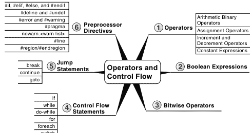

此限制的优势。本章以讨论 C#“预处理器”及其伴随指令结束。

## 运算符

既然你已经了解了预定义的数据类型（请参阅第 2 章），就可以开始学习如何将这些数据类型与运算符结合使用以执行计算。例如，你可以对已声明的变量进行计算。

### 初学者主题

### 运算符

运算符指定表达式（例如数学表达式）中要对一组称为操作数的值执行的操作，以产生新值或结果。例如，在清单 3.1 中，有两个操作数，即数字 4 和 2，它们使用减法运算符 - 组合在一起。你将结果赋给变量 difference。

```
LISTING 3.1: A Simple Operator Example
difference = 4 - 2;
```

运算符通常分为三类：一元、二元和三元，分别对应 1、2 和 3 个操作数。本节介绍了一些最基本的一元和二元运算符。三元运算符的介绍将出现在本章后面。

### 一元加法和减法运算符 (+, -)

有时你可能想更改数值变量的符号。在这种情况下，一元减法运算符 (-) 非常有用。例如，清单 3.2 将当前美国债务总额更改为负值，以表示这是一笔欠款。

```
LISTING 3.2: Specifying Negative Values'
//National Debt to the Penny
decimal debt = -1719258192538.99m;
```

使用减法运算符相当于从零中减去操作数。

- 截至 2009 年 8 月 21 日，根据 www.treasurydirect.gov。

一元加法运算符 (+) 很少² 对值产生任何影响。它是 C# 语言中多余的添加，仅出于对称性考虑而包含在内。

### 算术二元运算符 (+, -, *, /, %)

二元运算符需要两个操作数来处理方程：左侧操作数和右侧操作数。二元运算符还要求代码赋予结果值，以避免丢失它。

### 语言对比：C++ --仅运算符语句

C# 中的二元运算符需要赋值或调用；它们始终返回一个新结果。二元运算符表达式中的任何操作数都不能被修改。相比之下，C++ 允许单个语句（例如 4+5）在没有赋值的情况下编译。在 C# 中，调用、自增、自减和 new 对象表达式被允许用于仅运算符语句。

清单 3.3 中的减法示例是二元运算符的示例——更具体地说，是算术二元运算符。操作数出现在算术运算符的两侧，然后将计算出的值赋予变量。其他算术二元运算符包括加法 (+)、除法 (/)、乘法 (*) 和余数 (%；有时称为 mod 运算符)。

### 清单 3.3: 使用二元运算符

```
class Division
{
    static void Main()
    {
        int numerator;
        int denominator;
        int quotient;
        int remainder;

        System.Console.Write("Enter the numerator: ");
        numerator = int.Parse(System.Console.ReadLine());
    }
}
```

- 一元 + 运算符未在 short 上定义；它在 int、uint、long、ulong、float、double 和 decimal 上定义。因此，在 short 上使用它会根据需要将其转换为这些类型之一。


System.Console.Write("Enter the denominator: ");
denominator = int.Parse(System.Console.ReadLine());

quotient = numerator / denominator;
remainder = numerator % denominator;

System.Console.WriteLine(
    "{0} / {1} = {2} with remainder {3}",
    numerator, denominator, quotient, remainder);
}

输出 3.1 显示了清单 3.3 的结果。

### 输出 3.1：

```
Enter the numerator: 23
Enter the denominator: 3
23 / 3 = 7 with remainder 2.
```

使用二元运算符时要注意结合性的顺序。二元运算符的顺序是从左到右。相比之下，赋值运算符的顺序是从右到左。然而，仅凭结合性本身并不指定除法是在赋值之前还是之后进行。运算符优先级定义了这一点。目前为止所使用的运算符优先级如下：

- 1. *, /, 和 %
- 2. + 和 -
- 3. =

因此，你可以假设语句的行为符合预期，即除法和余数运算符在赋值之前发生。

如果你忘记为这些二元运算符之一的结果赋值，将会收到输出 3.2 中所示的编译错误。

### 输出 3.2：

```
... error CS0201: Only assignment, call, increment, decrement,
and new object expressions can be used as a statement
```

## 结合性和运算符优先级

与数学一样，编程语言支持结合性的概念。结合性是指操作数的分组方式，因此也是运算符求值的顺序。给定一个在表达式中出现多次的单个运算符，该运算符先结合第一个双元组，然后结合下一个操作数，直到所有运算符都被求值。例如，a-b-c 结合为 (a-b)-c，而不是 a-(b-c)。

结合性仅在所有运算符相同时才适用。当语句中出现不同的运算符时，这些运算符的优先级决定了哪些运算符首先被求值。例如，运算符优先级表示在表达式 a+b*c 中，乘法运算符应在加法运算符之前求值。

## 将加法运算符用于字符串

运算符也可以用于非数值类型。例如，可以使用加法运算符连接两个或多个字符串，如清单 3.4 所示。

### 清单 3.4：将二元运算符用于非数值类型

```
class FortyTwo
{
    static void Main()
    {
        short windSpeed = 42;
        System.Console.WriteLine(
            "The original Tacoma Bridge in Washington\\was"
            + "brought down by a "
            + windSpeed + " mile/hour wind.");
    }
}
```

输出 3.3 显示了清单 3.4 的结果。

### 输出 3.3：

```
The original Tacoma Bridge in Washington
was brought down by a 42 mile/hour wind.
```

由于不同文化中语言的句子结构各不相同，开发者应谨慎不要将加法运算符用于需要本地化的字符串。更推荐使用复合格式化（请参阅第 1 章）。

## 在算术运算中使用字符

在前一章介绍 char 类型时，我提到过，尽管它存储的是字符而不是数字，但 char 类型是整数类型（“整数”意味着它基于整数）。它可以与其他整数类型一起参与算术运算。然而，char 类型值的解释并非基于其存储的字符，而是基于其底层值。例如，数字 3 包含 Unicode 值 0x33（十六进制），在十进制中为 51。另一方面，数字 4 包含 Unicode 值 0x34，即十进制中的 52。在清单 3.5 中将 3 和 4 相加，结果为十六进制值 0x67，即十进制中的 103，相当于字母 g。

### 清单 3.5：将加法运算符用于 char 数据类型

```
int n = '3' + '4';
char c = (char)n;
System.Console.WriteLine(c); // Writes out g.
```

输出 3.4 显示了清单 3.5 的结果。

### 输出 3.4：

g

你可以利用字符类型的这一特性来确定两个字符相距多远。例如，字母 f 比字母 c 远三个字符。你可以通过用字母 f 减去字母 c 来确定这个值，如清单 3.6 所示。

### 清单 3.6：确定两个字符之间的字符差值

```
int distance = 'f' - 'c';
System.Console.WriteLine(distance);
```

输出 3.5 显示了清单 3.6 的结果。

### 输出 3.5：

3

## 特殊浮点特性

浮点类型 float 和 double 具有一些特殊特性，例如它们处理精度的方式。本节将探讨一些具体示例，以及一些独特的浮点类型特性。

float 具有七位精度，可以存储值 1,234,567 和值 0.1234567。但是，如果将这两个 float 相加，结果将被舍入为 1234567，因为数字的小数部分超过了 float 所能容纳的七位有效数字。这种舍入可能变得很重要，尤其是在重复计算或相等性检查时（请参阅即将介绍的高级主题，浮点类型的意外不等性）。

请注意，简单的赋值也可能出现不准确，例如 double number = 140.6f。由于 double 能够存储比 float 更精确的值，C# 编译器实际上会将此表达式求值为 double number = 140.600006103516；140.600006103516 作为 float 是 140.6，但作为 double 表示时并不完全是 140.6。

### 高级主题

### 浮点类型的意外不等性

浮点数的不准确性在比较值是否相等时可能非常令人困惑，因为它们可能会意外地不相等。请考虑清单 3.7。

### 清单 3.7：由于浮点不准确性导致的意外不等性

```
decimal decimalNumber = 4.2M;
double doubleNumber1 = 0.1F * 42F;
double doubleNumber2 = 0.1D * 42D;
float floatNumber = 0.1F * 42F;

Trace.Assert(decimalNumber == (decimal)doubleNumber1);
// Displays: 4.2 != 4.200000000000000025488
System.Console.WriteLine(
    "{0} != {1}", decimalNumber, (decimal)doubleNumber1);

Trace.Assert((double)decimalNumber == doubleNumber1);
// Displays: 4.2 != 4.2000006258488
System.Console.WriteLine(
    "{0} == {1}", (double)decimalNumber, doubleNumber1);

Trace.Assert((float)decimalNumber == floatNumber);
// Displays: 4.2M != 4.2F
System.Console.WriteLine(
    "{0} != {1}",
    (float)decimalNumber, floatNumber);

Trace.Assert(decimalNumber == (double)floatNumber);
// Displays: 4.2000006258488 == 4.20000028610229
System.Console.WriteLine(
    "{0} == {1}", decimalNumber, (double)floatNumber);

Trace.Assert(doubleNumber1 == doubleNumber2);
// Displays: 4.2000006258488 != 4.2
System.Console.WriteLine(
    "{0} == {1}", doubleNumber1, doubleNumber2);

Trace.Assert(floatNumber == doubleNumber2);
// Displays: 4.2F != 4.20;
System.Console.WriteLine(
    "{0}F != {1}D", floatNumber, doubleNumber2);

Trace.Assert((double)4.2F == 4.2D);
// Displays: 4.2F == 4.2D;
System.Console.WriteLine(
    "{0} == {1}", (double)4.2F, 4.2D);

Trace.Assert(4.2F == 4.2D);
// Displays: 4.2F != 4.2D
System.Console.WriteLine(
    "{0}F != {1}D", 4.2F, 4.2D);
```

输出 3.6 显示了清单 3.7 的结果。

### 输出 3.6：

```
4.2 != 4.2000006258488
4.2F != 4.20000028610229
(float)4.2M == 4.2F
4.2000006258488 == 4.20000028610229
4.2000006258488 != 4.2
4.2F != 4.2D
4.19999980926514 == 4.2
4.2F != 4.2D
```

Assert() 方法旨在每当参数求值为 false 时显示调试对话框。然而，此代码清单中的所有 Assert() 语句都将求值为 true。因此，尽管代码清单中的值看起来相等，但由于浮点数的不准确性，它们实际上并不等价。此外，这并非某种累积的舍入误差。C# 编译器执行计算，而不是运行时。即使你只是直接赋值 4.2F 而不是进行计算，比较结果也将保持不相等。

为了避免由浮点类型不准确性引起的意外结果，开发者应避免将这些类型用于相等条件判断。相反，相等性评估应包含容差。实现此目的的一个简单方法是用一个值（操作数）减去另一个值，然后评估结果的绝对值是否小于最大容差。更好的做法是使用 decimal 类型来替代 float 类型。

你还应了解一些其他独特的浮点特性。例如，你可能会预期将整数除以零会导致错误，对于 int 和 decimal 等原始数据类型确实如此。然而，float 和 double 允许某些特殊值。请考虑清单 3.8 及其生成的输出，输出 3.7。

### 清单 3.8：将浮点数除以零，显示 NaN

```
float n = 0;
// Displays: NaN
System.Console.WriteLine(n / 0);
```

### 输出 3.7：

```
NaN
```

在数学中，某些数学运算是未定义的。在 C# 中，将 0F 除以值 0 的结果是“不是数字”，所有尝试打印此类数字输出的操作都将导致 NaN。同样，对负数求平方根（System.Math.Sqrt(-1））也会导致 NaN。


浮点数也可能溢出其边界。例如，float 类型的上限是 3.4E38。如果数字溢出该边界，结果将存储为“正无穷”，打印该数字的输出将是 Infinity。同样，float 类型的下限是 -3.4E38，赋予低于该边界的值将导致“负无穷”，将由字符串 -Infinity 表示。清单 3.9 分别生成负无穷和正无穷，输出 3.8 显示了结果。

### LISTING 3.9: Overflowing the Bounds of a float

```
// Displays: -Infinity
System.Console.WriteLine(-1f / 0);
// Displays: Infinity
System.Console.WriteLine(3.402823E+38f * 2f);
```

### OUTPUT 3.8:

```
-Infinity
Infinity
```

对浮点数的进一步检查表明，它可以包含非常接近零但不等于零的值。如果该值超过了 float 或 double 类型的下限阈值，则该数字的值可以表示为“负零”或“正零”，具体取决于该数字是负数还是正数，并在输出中表示为 -0 或 0。

## Parenthesis Operator

圆括号允许你对操作数和运算符进行分组，以便它们一起求值。这一点很重要，因为它提供了一种覆盖默认优先级顺序的方法。例如，以下两个表达式的求值结果完全不同：

```
(60 / 10) * 2
60 / (10 * 2)
```

第一个表达式等于 12；第二个表达式等于 3。在这两种情况下，圆括号都会影响表达式的最终值。

有时圆括号运算符实际上不会改变结果，因为优先级规则会适当应用。但是，使用圆括号使代码更易读通常仍然是一种良好的做法。例如，这个表达式：

```
fahrenheit = (celsius * 9.0 / 5.0) + 32.0;
```

比这个表达式更容易一眼放心地解读：

```
fahrenheit = celsius * 9.0 / 5.0 + 32.0;
```

开发者应使用圆括号使代码更易读，明确消除表达式歧义，而不是依赖运算符优先级。

## Assignment Operators (+=, -=, *=, /=, %=)

第 1 章讨论了简单赋值运算符，它将运算符右侧的值放入左侧的变量中。其他赋值运算符将常见的二元运算符计算与赋值运算符相结合。以清单 3.10 为例。

### LISTING 3.10: Common Increment Calculation

```
int x;
x = x + 2;
```

在这个赋值中，首先计算 x + 2 的值，然后将计算出的值重新赋给 x。由于这种操作类型相对频繁，因此存在一个赋值运算符来用一个运算符同时处理计算和赋值。+= 运算符使用运算符右侧的值递增运算符左侧的变量，如清单 3.11 所示。

### LISTING 3.11: Using the += Operator

```
int x;
x += 2;
```

因此，此代码与清单 3.10 等效。

存在许多其他组合赋值运算符以提供类似功能。你可以将赋值运算符与不仅加法，还有减法、乘法、除法和余数运算符结合使用，如清单 3.12 所示。

### LISTING 3.12: Other Assignment Operator Examples

```
x -= 2;
x /= 2;
x *= 2;
x %= 2;
```

## Increment and Decrement Operators (++, --)

C# 包含用于递增和递减计数器的特殊运算符。自增运算符 ++ 每次使用时都会将变量递增 1。换句话说，清单 3.13 中显示的所有代码行都等效。

### LISTING 3.13: Increment Operator

```
spaceCount = spaceCount + 1;
spaceCount += 1;
spaceCount++;
```

同样，你也可以使用自减运算符 -- 将变量递减 1。因此，清单 3.14 中显示的所有代码行也等效。

### LISTING 3.14: Decrement Operator

```
lines = lines - 1;
lines -= 1;
lines--;
```

## BEGINNER TOPIC

### A Decrement Example in a Loop

自增和自减运算符在循环中尤其常见，例如本章后面描述的 while 循环。例如，清单 3.15 使用自减运算符来反向遍历字母表中的每个字母。

### LISTING 3.15: Displaying Each Character's ASCII Value in Descending Order

```
char current;
int asciiValue;

// Set the initial value of current.
current='z';
do
{
    // Retrieve the ASCII value of current.
    asciiValue = current;
    System.Console.WriteLine("{0}={1}\t", current, asciiValue);
    // Proceed to the previous letter in the alphabet;
    current--;
}
while(current>'a');
```

### OUTPUT 3.9:

| z=122 | y=121 | x=120 | w=119 | v=118 | u=117 | t=116 | s=115 | r=114 |
| :--- | :--- | :--- | :--- | :--- | :--- | :--- | :--- | :--- |
| q=113 | p=112 | o=111 | n=110 | m=109 | l=108 | k=107 | j=106 | i=105 |
| h=104 | g=103 | f=102 | e=101 | d=100 | c=99 | b=98 | a=97 |

自增和自减运算符用于计数执行特定操作的次数。还要注意，在此示例中，自增运算符用于字符（char）数据类型。只要为该数据类型的“下一个”或“前一个”概念赋予了一些含义，就可以在各种数据类型上使用自增和自减运算符。

与赋值运算符一样，自增运算符也返回一个值。换句话说，可以同时使用赋值运算符与自增或自减运算符（参见清单 3.16 和输出 3.10）。

### LISTING 3.16: Using the Post-Increment Operator

```
int count;
int result;
count = 0;
result = count++;
System.Console.WriteLine("result = {0} and count = {1}",
                         result, count);
```

### OUTPUT 3.10:

| result = 0 and count = 1 |
| :--- |

你可能会惊讶地发现，result 被赋予 count 在递增之前的值。换句话说，result 最终的值为 0，尽管 count 最终的值为 1。

你放置自增或自减运算符的位置决定了赋值应该是操作数在计算之前还是之后的值，这会影响代码的工作方式。如果你希望 result 的值包含自增（或自减）计算，则需要将运算符放置在被递增变量之前，如清单 3.17 所示。

### LISTING 3.17: Using the Pre-Increment Operator

```
int count;
int result;
count = 0;
result = ++count;
System.Console.WriteLine("result = {0} and count = {1}",
    result, count);
```

### OUTPUT 3.11:

```
result = 1 and count = 1
```

在此示例中，自增运算符出现在操作数之前，因此返回的值是递增后赋给变量的值。如果 x 是 1，则 ++x 将返回 2。但是，如果使用后缀运算符 x++，则表达式返回的值仍然是 1。无论运算符是后缀还是前缀，x 的结果值都会被递增。前缀和后缀行为的区别出现在清单 3.18 中。结果输出如输出 3.12 所示。

### LISTING 3.18: Comparing the Prefix and Postfix Increment Operators

```
class IncrementExample
{
    public static void Main()
    {
        int x;
        x = 1;
        // Displays 1, 2.
        System.Console.WriteLine("{0}, {1}, {2}", x++, ++x, x);
        // x now contains the value 3.

        // Displays 4, 5.
        System.Console.WriteLine("{0}, {1}, {2}", ++x, x++, x);
        // x now contains the value 5.
        // ...
    }
}
```

### OUTPUT 3.12:

```
1, 2, 3
4, 5, 5
```

如清单 3.18 所示，自增和自减运算符相对于操作数出现的位置可能会影响运算符返回的结果。前自增/自减运算符在递增/递减操作数后返回结果。后自增/自减运算符在更改操作数之前返回结果。开发者在将这些运算符嵌入语句中间时应谨慎。如果不确定会发生什么，请独立使用这些运算符，将它们放在各自的语句中。这样，代码也更易读，并且不会误解意图。

## ADVANCED TOPIC

### Thread-Safe Incrementing and Decrementing

尽管自增和自减运算符简洁，但这些运算符不是原子的。在运算符执行期间可能会发生线程上下文切换，并可能导致竞争条件。你可以使用 lock 语句来防止竞争条件。但是，对于简单的递增和递减，一种代价更低的替代方案是使用 System.Threading.Interlocked 类中的线程安全 Increment() 和 Decrement() 方法。这些方法依赖于处理器函数来执行快速的线程安全递增和递减（有关更多详细信息，请参见第 19 章）。


## 常量表达式 (const)

前一章讨论了文本值，即直接嵌入到代码中的值。可以使用运算符将多个文本值组合成一个**常量表达式**。按定义，常量表达式是C#编译器可以在编译时（而不是在程序运行时计算）求值的表达式，因为它由常量操作数组成。例如，一天中的秒数可以作为常量表达式赋值，其结果随后可用于其他表达式。

清单 3.19 中的 const 关键字在编译时锁定值。代码中稍后尝试修改该值会导致编译错误。

### 清单 3.19:

```
// ...
public long Main()
{
    const int secondsPerDay = 60 * 60 * 24;      Constant Expression
    const int secondsPerWeek = secondsPerDay * 7;
    // ... Constant
}
```

请注意，即使分配给 secondsPerWeek 的值也是常量表达式，因为表达式中的操作数也是常量，因此编译器可以确定结果。

## 引入流程控制

本章后面有一个代码清单（清单 3.43），展示了以二进制形式查看数字的简单方法。然而，即使是这样简单的程序，如果不使用流程控制语句也无法编写。此类语句控制程序的执行路径。本节讨论如何根据条件检查更改语句执行顺序。稍后，您将学习如何通过循环构造重复执行语句组。

控制流语句摘要见表 3.1。请注意，常规语法结构列指示常见语句用法，而非完整的词法结构。

### 表 3.1：控制流语句

| 语句 | 常规语法结构 | 示例 |
|---|---|---|
| if 语句 | `if(boolean-expression) embedded-statement` | `if (input == "quit") {<br>   System.Console.WriteLine(<br>      "Game end");<br>   return;<br>}` |
| | `if(boolean-expression) embedded-statement else embedded-statement` | `if (input == "quit") {<br>   System.Console.WriteLine(<br>      "Game end");<br>   return;<br>}<br>else<br>   GetNextMove();` |
| while 语句 | `while(boolean-expression) embedded-statement` | `while(count < total) {<br>   System.Console.WriteLine(<br>      "count = {0}", count);<br>   count++;<br>}` |

### 表 3.1：控制流语句（续）

| 语句 | 常规语法结构 | 示例 |
|---|---|---|
| do while 语句 | `do embedded-statement while(boolean-expression);` | `do { System.Console.WriteLine( "Enter name :"); input = System.Console.ReadLine(); } while(input != "exit");` |
| for 语句 | `for(for-initializer; boolean-expression; for-iterator) embedded-statement` | `for (int count = 1; count <= 10; count++) { System.Console.WriteLine( "count = {0}", count); }` |
| foreach 语句 | `foreach(type identifier in expression) embedded-statement` | `foreach (char letter in email) { if(!insideDomain) { if (letter == '@') { insideDomain = true; continue; } System.Console.Write( letter); } }` |
| continue 语句 | `continue;` | |

### 表 3.1：控制流语句（续）

| 语句 | 常规语法结构 | 示例 |
|---|---|---|
| switch 语句 | `switch(governing-type-expression) { ... case const-expression: statement-list jump-statement default: statement-list jump-statement }` | `switch(input) { case "exit": case "quit": System.Console.WriteLine("Exiting app...."); break; case "restart": Reset(); goto case "start"; case "start": GetMove(); break; default: System.Console.WriteLine(input); break; }` |
| break 语句 | `break;` | |
| goto 语句 | `goto identifier; goto case const-expression; goto default;` | |

表 3.1 中的嵌入式语句对应于任何语句，包括代码块（但不包括声明语句或标签）。

表 3.1 中的每个 C# 控制流语句都出现在附录 B 中的井字棋程序中。该程序显示井字棋棋盘，提示每位玩家，并随每一步棋更新。

本章余下部分将更详细地介绍每个语句。在介绍 if 语句后，它将介绍代码块、作用域、布尔表达式和按位运算符，然后再继续介绍其余控制流语句。由于 C# 与其他语言的相似性，觉得表格熟悉的读者可以跳转到标题为“C# 处理器指令”的章节，并跳到本章末尾的摘要部分。

## if 语句

if 语句是 C# 中最常见的语句之一。它求值一个布尔表达式（返回布尔值的表达式），如果结果为 true，则执行以下语句（或块）。一般形式如下：

```
if(condition)
 consequence
 [else
 alternative]
```

当布尔表达式为 false 时，还有一个可选的 else 子句。清单 3.20 显示了一个示例。

### 清单 3.20：if/else 语句示例

```
class TicTacToe // Declares the TicTacToe class.
{
    static void Main() // Declares the entry point of the program.
    {
        string input;

        // Prompt the user to select a 1- or 2- player game.
        System.Console.Write (
            "1 - Play against the computer\n" +
            "2 - Play against another player.\n" +
            "Choose: ");
        input = System.Console.ReadLine();
        if(input=="1")
            // The user selected to play the computer.
            System.Console.WriteLine(
                "Play against computer selected.");
        else
            // Default to 2 players (even if user didn't enter 2).
            System.Console.WriteLine(
                "Play against another player.");
    }
}
```

3. 美国以外的读者称为圈叉棋。

在清单 3.20 中，如果用户输入 1，程序显示“与电脑对战已选中。”。否则，它显示“与另一位玩家对战。”。

## 嵌套 if

有时代码需要多个 if 语句。清单 3.21 中的代码首先确定用户是否通过输入小于或等于 0 的数字选择退出；如果不是，它会检查用户是否知道井字棋的最大回合数。

### 清单 3.21：嵌套 if 语句

```
class TicTacToeTrivia
{
    static void Main()
    {
        int input; // Declare a variable to store the input.

        System.Console.Write(
            "What is the maximum number " +
            "of turns in tic-tac-toe?" +
            "(Enter 0 to exit.): ");
        // int.Parse() converts the ReadLine()
        // return to an int data type.
        input = int.Parse(System.Console.ReadLine());

        if (input <= 0)
            // Input is less than or equal to 0.
            System.Console.WriteLine("Exiting...");
        else
            if (input < 9)
                // Input is less than 9.
                System.Console.WriteLine(
                    "Tic-tac-toe has more than {0}" +
                    "maximum turns.", input);
            else
                if(input>9)
                    // Input is greater than 9.
                    System.Console.WriteLine(
                        "Tic-tac-toe has fewer than {0}" +
                        "maximum turns.", input);
                else
                    // Input equals 9.
                    System.Console.WriteLine(
                        "Correct. " +
                        "tic-tac-toe has a max. of 9 turns.");
    }
}
```

### 输出 3.13:

```
What's the maximum number of turns in tic-tac-toe? (Enter 0 to exit.): 9
Correct. tic-tac-toe has a max. of 9 turns.
```

假设用户在第 14 行提示时输入 9。以下是执行路径：

- 第 16 行：检查输入是否小于 0。由于不是，跳转到第 20 行。
- 第 20 行：检查输入是否小于 9。由于不是，跳转到第 26 行。
- 第 26 行：检查输入是否大于 9。由于不是，跳转到第 33 行。
- 第 33 行：显示答案正确。

清单 3.21 包含嵌套 if 语句。为了澄清嵌套，行进行了缩进。但是，如您在第 1 章所学，空白不影响执行路径。没有缩进和没有换行符，执行将相同。清单 3.22 中嵌套 if 语句出现的代码与清单 3.21 等效。

### 清单 3.22：按顺序格式化的 if/else

```
if (input < 0)
	System.Console.WriteLine("Exiting...");
else if (input < 9)
	System.Console.WriteLine(
```


```
"Tic-tac-toe has more than {0}" +
" maximum turns.", input);
else if(input>9)
System.Console.WriteLine(
"Tic-tac-toe has less than {0}" +
" maximum turns.", input);
else
System.Console.WriteLine(
"Correct. tic-tac-toe has a maximum of 9 turns.");
```

虽然后一种格式更常见，但在每种情况下都应使用能产生最清晰代码的格式。

## 代码块 ({})

在前面的 if 语句示例中，if 和 else 后面只跟一条语句：一条 System.Console.WriteLine()，类似于清单 3.23。

## 清单 3.23：没有代码块的 if 语句

```
if(input>9)
System.Console.WriteLine("Exiting");
```

不过，使用花括号，我们可以将语句组合成一个称为代码块的单元，从而允许为条件执行多条语句。例如，请参阅清单 3.24 中半径计算的高亮代码块。

## 清单 3.24：后跟代码块的 if 语句

```
class CircleAreaCalculator
{
static void Main()
{
double radius; // Declare a variable to store the radius.
double area; // Declare a variable to store the area.
System.Console.Write("Enter the radius of the circle: ");
// double.Parse converts the ReadLine()
// return to a double.
radius = double.Parse(System.Console.ReadLine());
if(radius>=0)
{
    // Calculate the area of the circle.
    area = 3.14*radius*radius;
    System.Console.WriteLine(
        "The area of the circle is: {0}", area);
}
else
{
    System.Console.WriteLine(
        "{0} is not a valid radius.", radius);
}
}
```

### 输出 3.14:

```
Enter the radius of the circle: 3
The area of the circle is: 28.26
```

在此示例中，if 语句检查半径是否为正数。如果是，则计算并显示圆的面积；否则，显示无效半径消息。

请注意，在此示例中，第一个 if 后面跟着两条语句。然而，这两条语句出现在花括号内。花括号将语句组合成一个代码块。

如果省略清单 3.24 中创建代码块的花括号，则只有紧随布尔表达式之后的语句会有条件地执行。后续语句将无论 if 语句的布尔表达式如何都会执行。无效代码如清单 3.25 所示。

## 清单 3.25：依赖缩进，导致无效代码

```
if(radius>0)
    area = 3.14*radius*radius;
    System.Console.WriteLine(
        // Logic Error!! Needs code block.
        "The area of the circle is: {0}", area);
```

在 C# 中，缩进仅用于代码可读性。编译器会忽略它，因此，前面的代码在语义上等同于清单 3.26。

## 清单 3.26：与清单 3.25 在语义上等效

```
if(radius>0)
{
    area = 3.14*radius*radius;
}
System.Console.WriteLine( // Error!! Place within code block.
    "The area of the circle is: {0}", area);
```

程序员应格外小心以避免此类微妙的错误，甚至可以养成在控制流语句后始终包含代码块的习惯，即使只有一条语句。

虽然不常见，但可以存在不直接作为控制流语句一部分的代码块。换句话说，单独放置花括号（例如，没有条件或循环）是合法语法。

## 高级主题

### 数学常量

在清单 3.25 和清单 3.26 中，pi 的值被硬编码为 3.14——这顶多只是一个粗糙的近似值。System.Math 类中为 pi 和 E 提供了更准确的定义。代码不应硬编码值，而应使用 System.Math.PI 和 System.Math.E。

## 作用域和声明空间

作用域和声明空间是由代码块界定的分层上下文。作用域是源代码中可以通过非限定名称合法引用某个项目的区域，因为该名称引用是唯一且明确的。

名称声明唯一的区域即为声明空间。C# 防止两个同名的局部变量声明出现在同一作用域中。同样，在同一个类中也不可能声明两个签名为 Main() 的方法（方法名的作用域包括完整签名）。作用域标识代码块中非限定名称所指代的内容；声明作用域指定声明同名内容会导致冲突的区域。

作用域限制可见性。例如，局部变量在其定义方法之外不可见。同样，在 if 块中声明变量的代码会使该变量在 if 块之外不可访问（即使在同一方法中）。在清单 3.27 中，在 if 语句内部定义 message 会将其作用域限制在该语句内。为避免错误，必须在 if 语句外部声明字符串。

## 清单 3.27：作用域之外不可访问的变量

```
class Program
{
    static void Main(string[] args)
    {
        int playerCount;
        System.Console.Write(
            "Enter the number of players (1 or 2):");
        playerCount = int.Parse(System.Console.ReadLine());
        if (playerCount == 1 && playerCount == 2)
        {
            string message =
                "You entered an invalid number of players.";
        }
        else
        {
            // ...
        }
        // Error: message is not in scope.
        System.Console.WriteLine(message);
    }
}
```

### 输出 3.15:

```
...
...\Program.cs(16,26): error CS0103: The name 'message' does not exist
in the current context
```

声明空间会向下级联到方法内的子（或嵌入）代码块。C# 编译器阻止在方法代码块内直接声明（或作为参数）的局部变量名称在子代码块中被重复使用。声明空间是变量的父代码块，包括父代码块内的任何子块。从清单 3.27 来看，因为 args 和 playerCount 在方法代码块内声明，所以它们不能在方法内的任何地方重复用于声明。

作用域也受父代码块约束。名称 message 仅在 if 块内适用，不在其外部。同样，playerCount 在变量声明后的整个方法中都指代同一个变量——包括在 if 和 else 子块内。

## 布尔表达式

if 语句括号内的部分是布尔表达式，有时也称为条件。在清单 3.28 中，布尔表达式已高亮显示。

## 清单 3.28：布尔表达式

```
if(input < 9)
{
    // Input is less than 9.
    System.Console.WriteLine(
        "Tic-tac-toe has more than {0}" +
        " maximum turns.", input);
}
// ...
```

布尔表达式出现在许多控制流语句中。其关键特征是始终求值为 true 或 false。为了允许 input<9 作为布尔表达式，它必须返回 bool。例如，编译器不允许 x=42，因为它会对 x 进行赋值并返回新值，而不是检查 x 的值是否为 42。

### 语言对比：C++ — 错误地使用 = 代替 ==

C# 中布尔表达式的重要特征是消除了历史上在 C/C++ 中常见的一种编码错误。在 C++ 中，清单 3.29 是允许的。

### 清单 3.29：C++ 允许，但 C# 不允许将赋值作为布尔表达式

```
if(input=9)    // COMPILE ERROR: Allowed in C++, not in C#.
    System.Console.WriteLine(
        "Correct, tic-tac-toe has a maximum of 9 turns.");
```

虽然这似乎在检查 input 是否等于 9，但第 1 章表明 = 表示赋值运算符，而不是相等性检查。赋值运算符的返回值是赋给变量的值——在此例中为 9。然而，9 是一个 int，因此不符合布尔表达式的条件，不被 C# 编译器允许。

### 关系和相等运算符

前面的代码示例中包含了关系运算符的用法。在这些示例中，关系运算符用于评估用户输入。表 3.2 列出了所有关系和相等运算符。

### 表 3.2：关系和相等运算符

| 运算符 | 描述 | 示例 |
|---|---|---|
| < | 小于 | input<9; |
| > | 大于 | input>9; |
| <= | 小于或等于 | input<=9; |
| >= | 大于或等于 | input>=9; |
| == | 相等运算符 | input==9; |
| != | 不等运算符 | input!=9; |


除了确定一个值是否大于或小于另一个值之外，运算符还用于确定等价性。你通过使用相等运算符来测试等价性。在 C# 中，语法遵循 C/C++/Java 模式，使用 ==。例如，要确定 input 是否等于 9，你使用 input==9。相等运算符使用两个等号，以将其与赋值运算符 = 区分开来。

在 C# 中，感叹号表示 NOT，因此要测试不等性，你使用不等运算符 !=。

关系运算符和相等运算符是二元运算符，这意味着它们比较两个操作数。更重要的是，它们始终返回布尔数据类型。因此，你可以将关系运算符的结果赋值给 bool 变量，如清单 3.30 所示。

**清单 3.30: 将关系运算符的结果赋值给 bool 变量**

```
bool result = 70 > 7;
```

在井字棋程序中（参见附录 B），你使用相等运算符来确定用户是否退出。清单 3.31 的布尔表达式包含一个 OR (||) 逻辑运算符，下一节将详细讨论它。

**清单 3.31: 在布尔表达式中使用相等运算符**

```
if (input == "" || input == "quit")
{
    System.Console.WriteLine("Player {0} quit!", currentPlayer);
    break;
}
```

## 逻辑布尔运算符

逻辑运算符具有布尔操作数并返回布尔结果。逻辑运算符允许你将多个布尔表达式组合成其他布尔表达式。逻辑运算符为 ||、&& 和 ^，分别对应 OR、AND 和异或。

### OR 运算符 (||)

在清单 3.31 中，如果用户输入 quit 或按下 Enter 键而未输入任何值，则假设她想退出程序。为了让用户有两种退出方式，你使用逻辑 OR 运算符 ||。|| 运算符计算布尔表达式，如果其中任何一个为 true，则返回 true 值（参见清单 3.32）。

**清单 3.32: 使用 OR 运算符**

```csharp
if ((hourOfTheDay > 23) || (hourOfTheDay < 0))
    System.Console.WriteLine("The time you entered is invalid.");
```

请注意，使用布尔 OR 运算符时，不需要对表达式的两边都进行求值。与 C# 中的所有运算符一样，OR 运算符从左到右求值，因此如果表达式的左部分计算结果为 true，则忽略右部分。因此，如果 hourOfTheDay 的值为 33，则 (hourOfTheDay > 23) 将返回 true，OR 运算符将忽略表达式的后半部分——即短路它。布尔 AND 运算符也会出现表达式短路的情况。

### AND 运算符 (&&)

布尔 AND 运算符 && 仅在两个操作数都计算结果为 true 时才返回 true。如果任一操作数为 false，则组合表达式将返回 false。清单 3.33 显示，只要当前小时既大于 10 又小于 24，就是上班时间。⁴ 如你在 OR 运算符中所见，AND 运算符并不总是对表达式的右侧进行求值。如果左操作数返回 false，那么无论右操作数如何，整体结果都将为 false，因此运行时会忽略右操作数。

**清单 3.33: 使用 AND 运算符**

```csharp
if ((10 < hourOfTheDay) && (hourOfTheDay < 24))
    System.Console.WriteLine(
        "Hi-Ho, Hi-Ho, it's off to work we go.");
```

⁴ 程序员通常的工作时间。

### 异或运算符 (^)

插入符号 ^ 是“异或”（XOR）运算符。当应用于两个布尔操作数时，XOR 运算符仅在恰好一个操作数为 true 时才返回 true，如表 3.3 所示。

与布尔 AND 和布尔 OR 运算符不同，布尔 XOR 运算符不会短路：它始终检查两个操作数，因为除非知道两个操作数的值，否则无法确定结果。

| 左操作数 | 右操作数 | 结果 |
|---|---|---|
| 真 | 真 | 假 |
| 真 | 假 | 真 |
| 假 | 真 | 真 |
| 假 | 假 | 假 |

### 逻辑否定运算符 (!)

有时也称为 NOT 运算符，逻辑否定运算符 ! 将 bool 数据类型反转为其相反值。该运算符是一元运算符，这意味着它只需要一个操作数。清单 3.34 演示了其工作原理，输出 3.16 显示了结果。

**清单 3.34: 使用逻辑否定运算符**

```
bool result;
bool valid = false;
result = !valid;
// Displays "result = True".
System.Console.WriteLine("result = {0}", result);
```

**输出 3.16:**

```
result = True
```

首先，valid 设置为 false。然后你对 valid 使用否定运算符，并将新值赋给 result。

### 条件运算符 (?)

作为用于从两个值中选择一个的 if-else 语句的替代方案，你可以使用条件运算符。条件运算符是一个问号 (?)，其一般格式如下：

```
conditional? consequence: alternative;
```

条件运算符是一个三元运算符，因为它有三个操作数：conditional、consequence 和 alternative。如果 conditional 计算结果为 true，则条件运算符返回 consequence。或者，如果 conditional 计算结果为 false，则它返回 alternative。清单 3.35 是使用条件运算符的示例。该程序的完整清单出现在附录 B 中。

**清单 3.35: 条件运算符**

```
public class TicTacToe
{
    public static string Main()
    {
        // Initially set the currentPlayer to Player 1;
        int currentPlayer = 1;

        // ...

        for (int turn = 1; turn <= 10; turn++)
        {
            // ...

            // Switch players
            currentPlayer = (currentPlayer == 2) ? 1 : 2;
        }
    }
}
```

该程序交换当前玩家。为此，它检查当前值是否为 2。这是条件语句的条件部分。如果结果为 true，则条件运算符返回值 1。否则，它返回 2。与 if 语句不同，条件运算符的结果必须被赋值（或作为参数传递）。它不能单独作为一个完整的语句出现。请谨慎使用条件运算符，因为可读性往往会受到影响，简单的 if/else 语句可能更合适。

### 空合并运算符 (??)

从 C# 2.0 开始，在检查 null 时有一个条件运算符的快捷方式。该快捷方式是空合并运算符，它对表达式求空值，如果值为 null，则返回第二个表达式。

```
expression1?? expression2;
```

如果表达式（expression1）不是 null，则返回 expression1。换句话说，除非 expression1 计算结果为 null，否则空合并运算符直接返回 expression1，在这种情况下返回 expression2。与条件运算符不同，空合并运算符是一个二元运算符。

清单 3.36 是使用空合并运算符的示例。

**清单 3.36: 空合并运算符**

```
string fileName;
// ...
string fullName = fileName??"default.txt";
// ...
```

在此清单中，我们使用空合并运算符，如果 fileName 为 null，则将 fullName 设置为“default.txt”。如果 fileName 不为 null，则 fullName 直接赋值为 fileName 的值。

## 位运算符 (<<, >>, |, &, ^, ~)

几乎所有编程语言都共有的一组额外运算符是用于以二进制格式操作值的运算符，即位运算符。

### 初学者主题

### 位和字节

计算机中的所有值都以 1 和 0 的二进制格式表示，称为二进制数位（位）。位被分成每组八位的集合，称为字节。在一个字节中，每个连续的位都对应 2 的幂次方的值，从右边的 2^0 开始，到左边的 2^7 结束，如图 3.1 所示。

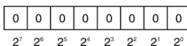

图 3.1: 对应的占位符值

在许多情况下，尤其是在处理低级或系统服务时，信息以二进制数据的形式检索。为了操作这些设备和服务，你需要对二进制数据进行操作。


如图 3.2 所示，每个方框对应 2 的指数所示的幂值。字节（8 位数字）的值是所有设置为 1 的八位的 2 的幂之和。

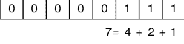

图 3.2：计算无符号字节的值

刚才描述的二进制转换对于有符号数有显著不同。有符号数（long、short、int）使用 2 的补码表示法来表示。这样做是为了确保在将负数加到正数时，加法仍然能够正常工作，就好像两者都是正操作数一样。使用这种表示法，负数的行为与正数不同。负数由最左侧位置的 1 来标识。如果最左侧位置包含 1，则应添加包含 0 的位置，而不是包含 1 的位置。每个位置对应负 2 的幂值。此外，从结果中还需要减去 1。图 3.3 演示了这一点。

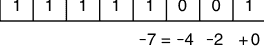

图 3.3：计算有符号字节的值

因此，1111 1111 1111 1111 对应 -1，1111 1111 1111 1001 的值为 -7。1000 0000 0000 0000 对应 16 位整数可以持有的最小负值。

## 移位运算符（<<、>>、<<=、>>=）

有时你希望将数字的二进制值向右或向左移位。在执行左移时，数字二进制表示中的所有位都将向左移位，移位位数由移位运算符右侧操作数指定。然后使用零来填充二进制数右侧的位置。右移运算符在相反方向执行几乎相同的操作。但是，如果数字为负，则用于填充二进制数左侧的值为 1 而不是 0。移位运算符为 >> 和 <<，分别是右移运算符和左移运算符。此外，还有组合移位和赋值运算符，即 <<= 和 >>=。

请考虑以下示例。假设你有一个 int 值 -7，其二进制表示为 1111 1111 1111 1111 1111 1111 1111 1001，如清单 3.37 所示。在清单 3.37 中，你将数字 -7 的二进制表示向右移位两个位置。

### 清单 3.37：使用右移运算符

```csharp
int x;
x = -7 >> 2; // 11111111111111111111111111111001 becomes
// 11111111111111111111111111111110
// Write out "x is -2."
System.Console.WriteLine("x = {0}.", x);
```

### 输出 3.17：

```
x = -2.
```

由于右移，最右侧位置的位值已“掉出”边缘，左侧的负位指示符向左移动两个位置并被 1 替换。结果为 -2。

## 位运算符（&、|、^）

在某些情况下，你可能需要对两个操作数按位执行逻辑运算，例如 AND、OR 和 XOR。你可以分别通过 &、| 和 ^ 运算符来实现。

### 初学者主题

### 逻辑运算符详解

如果你有两个数字，如图 3.4 所示，位运算将从最左侧的有效值开始，向右比较各位置的值，直到结束。位置中值为“1”被视为“真”，位置中值为“0”被视为“假”。

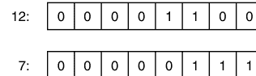

图 3.4：以二进制表示的数字 12 和 7

因此，图 3.4 中两个值的按位 AND 将是第一个操作数（12）的位与第二个操作数（7）的位逐位比较，结果为二进制值 00000100，即 4。或者，两个值的按位 OR 将产生 00001111，即 15 的二进制等效值。XOR 结果为 00001011，即十进制 11。

### 清单 3.38：使用位运算符

```csharp
byte and, or, xor;
and = 12 & 7;    // and = 4
or = 12 | 7;     // or = 15
xor = 12 ^ 7;    // xor = 11
System.Console.WriteLine(
    "and = {0} \nor = {1} \nxor = {2}",
    and, or, xor);
```

### 输出 3.18：

```
and = 4
or = 15
xor = 11
```

在清单 3.38 中，值 7 是掩码；它用于使用特定的运算符表达式来暴露或消除第一个操作数中的特定位。

为了将数字转换为其二进制表示，你需要遍历数字中的每一位。清单 3.39 是一个示例程序，用于将整数转换为其二进制表示的字符串。清单 3.39 的结果显示在输出 3.19 中。

### 清单 3.39：获取二进制显示的字符串表示

```csharp
public class BinaryConverter
{
    public static void Main()
    {
        const int size = 64;
        ulong value;
        char bit;

        System.Console.Write("Enter an integer: ");
        // Use Long.Parse() so as to support negative numbers
        // Assumes unchecked assignment to ulong.
        value = (ulong)long.Parse(System.Console.ReadLine());

        // Set initial mask to 100...
        ulong mask = 1ul << size - 1;
        for (int count = 0; count < size; count++)
        {
            bit = ((mask & value) > 0) ? '1' : '0';
            System.Console.Write(bit);
            // Shift mask one Location over to the right
            mask >>= 1;
        }
        System.Console.WriteLine();
    }
}
```

### 输出 3.19：

```
Enter an integer: 42
00000000000000000000000000000000000000000000000000000000101010
```

请注意，在 for 循环（稍后讨论）的每次迭代中，你都使用右移赋值运算符来创建与 value 中每一位对应的掩码。通过使用 & 位运算符来掩码特定位，你可以确定该位是否被设置。如果掩码返回正结果，则将相应位设置为 1；否则，将其设置为 0。通过这种方式，你创建一个表示无符号 long 二进制值的字符串。

## 位赋值运算符（&=、|=、^=）

不出所料，你可以将这些位运算符与赋值运算符组合，如下所示：&=、|= 和 ^=。因此，你可以获取一个变量，将其与一个数字进行 OR 运算，并将结果赋回原始变量，清单 3.40 演示了这一点。

### 清单 3.40：使用逻辑赋值运算符

```csharp
byte and, or, xor;
and = 12;
and &= 7; // and = 4
or = 12;
or |= 7; // or = 15
xor = 12;
xor ^= 7; // xor = 11
System.Console.WriteLine(
    "and = {0} \nor = {1} \nxor = {2}",
    and, or, xor);
```

### 输出 3.20：

```
and = 4
or = 15
xor = 11
```

将位图与掩码结合，例如使用 fields &= mask，会清除 fields 中未在掩码中设置的位。相反，fields &= ~mask 会清除 fields 中在掩码中设置的位。

## 位取补运算符（~）

位取补运算符获取操作数中每一位的补码，操作数可以是 int、uint、long 或 ulong。因此，~1 返回 1111 1111 1111 1111 1111 1111 1111 1110，而 ~(1<<31) 返回 0111 1111 1111 1111 1111 1111 1111 1111。

## 控制流语句，续

随着对布尔表达式的进一步介绍，是时候考虑 C# 支持的更多控制流语句了。如本章介绍中所述，许多语句对经验丰富的程序员来说会很熟悉，因此你可以浏览本节以获取特定于 C# 的信息。请特别注意 foreach 循环，因为这对许多程序员来说可能是新的。

### while 和 do/while 循环

到目前为止，你已经学习了如何编写只执行一次操作的程序。但是，计算机的重要功能之一是它可以多次执行相同的操作。为了做到这一点，你需要创建一个指令循环。我将讨论的第一个指令循环是 while 循环。while 语句的一般形式如下：

```csharp
while(boolean-expression )
statement
```

只要 boolean-expression 的求值结果为 true，计算机就会反复执行 statement。如果表达式的求值结果为 false，则代码执行将继续在 statement 之后的指令处。（请注意，即使 statement 导致 boolean-expression 为 false，它也会继续执行。只有在 while 条件中重新求值 boolean-expression 时，循环才会退出。）清单 3.41 中所示的斐波那契计算器演示了 while 循环。

### 清单 3.41：while 循环示例

```csharp
class FibonacciCalculator
{
    static void Main()
    {
        decimal current;
        decimal previous;
        decimal temp;
        decimal input;

        System.Console.Write("Enter a positive integer:");
```


```
// decimal.Parse convert the ReadLine to a decimal.
input = decimal.Parse(System.Console.ReadLine());

// Initialize current and previous to 1, the first
// two numbers in the Fibonacci series.
current = previous = 1;

// While the current Fibonacci number in the series is
// less than the value input by the user.
while(current <= input)
{
    temp = current;
    current = previous + current;
    previous = temp;
}

System.Console.WriteLine(
    "The Fibonacci number following this is {0}",
    current);
}
```

斐波那契数是斐波那契数列的一个成员，该数列包含所有等于前两个数之和的数，从 1 和 1 开始。在清单 3.41 中，你提示用户输入一个整数。然后你使用 while 循环来查找大于用户输入数字的斐波那契数。

## BEGINNER TOPIC

## 何时使用 while 循环

本章余下部分将探讨其他导致代码块重复执行的语句类型。循环一词指的是 while 语句中要执行的代码块，因为代码会在“循环”中执行，直到达到退出条件。了解应选择哪种循环结构非常重要。当条件求值为 true 时，你使用 while 结构进行迭代。当已知重复次数时（例如从 0 计数到 n），for 循环最为合适。do/while 与 while 循环类似，但它至少会循环一次。

do/while 循环与 while 循环非常相似，区别在于当重复次数为 1 到 n，且 n 在开始迭代时不确定时，更倾向于使用 do/while 循环。这种模式最常见于反复提示用户输入。清单 3.42 摘录自井字棋程序。

## 清单 3.42: do/while 循环示例

```
// Repeatedly request player to move until he
// enter a valid position on the board.
do
{
    valid = false;

    // Request a move from the current player.
    System.Console.Write(
        "Player {0}: Enter move.", currentplayer);
    input = System.Console.ReadLine();

    // Check the current player's input.
    // ...
} while (!valid);
```

在清单 3.42 中，你在每次迭代（或循环重复）开始时始终将 valid 初始化为 false。接下来，你提示并获取用户输入的数字。虽然此处未显示，但随后你会检查输入是否正确，如果正确，则将 valid 赋值为 true。由于代码使用的是 do/while 语句而不是 while 语句，因此用户至少会被提示输入一次。

do/while 循环的一般形式如下：

```
do
statement
while(boolean-expression );
```

与所有控制流语句一样，代码块不属于一般形式的一部分。但是，通常使用代码块来替代单个语句，以便允许多个语句。

## for 循环

递增和递减运算符经常在 for 循环中使用。for 循环以与 while 循环类似的方式迭代代码块，直到达到指定条件。区别在于 for 循环具有用于初始化、递增和测试计数器值的内置语法。

清单 3.43 展示了用于以二进制形式显示整数的 for 循环。该清单的结果显示在输出 3.21 中。

```
LISTING 3.43: Using the for Loop

public class BinaryConverter
{
    public static void Main()
    {
        const int size = 64;
        ulong value;
        char bit;

        System.Console.Write("Enter an integer: ");
        // Use long.Parse() so as to support negative numbers
        // Assumes unchecked assignment to ulong.
        value = (ulong)long.Parse(System.Console.ReadLine());

        // Set initial mask to 100....
        ulong mask = 1ul << size - 1;
        for (int count = 0; count < size; count++)
        {
            bit = ((mask & value) > 0) ? '1' : '0';
            System.Console.Write(bit);
            // Shift mask one location over to the right
            mask >>= 1;
        }
    }
}
```

输出 3.21:

Enter an integer: -42
111111111111111111111111111111111111111111111111111111111111111010

清单 3.43 执行 64 次位掩码操作，每次针对数字中的一位。for 循环声明并初始化变量 count，当 count 达到 64 时退出，并在每次迭代中递增 count。for 循环中的每个表达式对应一个语句。（很容易记住，表达式之间的分隔字符是分号而不是逗号，因为每个表达式都可以是一个语句。）

你可以按如下方式泛型编写 for 循环：

```
for(initial; boolean-expression; loop) statement
```

以下是 for 循环的详细说明。

- 初始表达式执行第一次迭代之前的操作。在清单 3.43 中，它声明并初始化变量 count。初始表达式不必是新变量的声明。例如，可以先声明变量，然后仅在 for 循环中对其进行初始化。但是，在此处声明的变量绑定在 for 语句的作用域内。

- for 循环的布尔表达式部分指定结束条件。当此条件为 false 时，循环退出，方式与 while 循环的终止类似。for 循环仅在布尔表达式求值为 true 时重复。在前面的示例中，当 count 递增到 64 时，循环退出。

- 循环表达式在每次迭代后执行。在前面的示例中，count++ 在掩码右移（mask >>= 1）之后、布尔表达式求值之前执行。在第六十四次迭代期间，count 递增到 64，导致布尔表达式为 false，从而终止循环。由于每个表达式可以被视为单独的语句，for 循环中的每个表达式都用分号分隔。

- for 循环的语句部分是条件表达式保持为 true 时执行的代码。

如果你不使用 for 循环表达式而用伪代码写出每个 for 循环执行步骤，它将如下所示：

- 1. 声明并将 count 初始化为 0。
- 2. 验证 count 是否小于 64。
- 3. 计算 bit 并显示它。
- 4. 移位掩码。
- 5. 将 count 递增 1。
- 6. 如果 count<64，则跳回第 3 行。

for 语句不要求括号内的任何元素。for(;;) { ... } 完全有效；尽管仍需要一种退出循环的方法以避免无限执行。同样，初始表达式和循环表达式可以是涉及多个子表达式的复杂表达式，如清单 3.44 所示。

## 清单 3.44: 使用多个表达式的 for 循环

```
for(int x=0, y=5; ((x<5) && (y>0)); y--, x++)
{
    System.Console.Write("{0}{1}{2}\t",
        x, (x<y ? '<' : '>'), y);
}
```

清单 3.44 的结果显示在输出 3.22 中。

## 输出 3.22:

```
0<5   1<4   2<3   3>2   4>1   5>0
```

在这种情况下，逗号的行为与在声明语句中完全相同，该声明语句声明并初始化多个变量。但是，程序员应避免使用此类复杂表达式，因为它们难以阅读和理解。

泛型地，你可以将 for 循环编写为 while 循环，如下所示：

```
initial;
while(boolean-expression)
{
    statement;
    loop;
}
```

## BEGINNER TOPIC

## 在 for 循环和 while 循环之间选择

虽然可以互换使用这两个语句，但通常当存在某种计数器，并且在循环初始化时已知总迭代次数时，你会使用 for 循环。相比之下，当迭代不基于计数，或者在开始迭代时迭代次数不确定时，你通常会使用 while 循环。

## foreach 循环

C# 语言中的最后一个循环语句是 foreach。foreach 旨在遍历项集合，并依次设置一个变量来表示每个项。在循环期间，可以对项执行操作。foreach 循环的一个特点是不可能意外计数错误并遍历集合末尾。

foreach 语句的一般形式如下：

```
foreach(type variable in collection)
statement;
```

以下是 foreach 语句的详细说明。

- type 用于声明集合中每个项的变量数据类型。
- variable 是一个只读变量，foreach 结构会自动将集合中的下一项赋值给它。变量的作用域仅限于 foreach 循环。
- collection 是一个表达式，例如数组，表示多个项。
- statement 是 foreach 循环中每次迭代执行的代码。

考虑清单 3.45 中所示的简单示例中的 foreach 循环。


## 清单 3.45：使用 foreach 循环确定剩余移动

```
class TicTacToe // Declares the TicTacToe class.
{
    static void Main() // Declares the entry point of the program.
    {
        // Hardcode initial board as follows
        // | 1 | 2 | 3
        // | 4 | 5 | 6
        // | 7 | 8 | 9
        char[] cells = {
            '1', '2', '3', '4', '5', '6', '7', '8', '9'
        };

        System.Console.Write(
            "The available moves are as follows: ");

        // Write out the initial available moves
        foreach (char cell in cells)
        {
            if (cell != 'O' && cell != 'X')
            System.Console.Write("{0} ", cell);
        }
    }
}
```

输出 3.23 显示了清单 3.45 的结果。

## 输出 3.23:

```
The available moves are as follows: 1 2 3 4 5 6 7 8 9
```

当执行引擎到达 foreach 语句时，它将 cells 数组的第一个项目赋值给变量 cell——在此例中为值 '1'。然后执行 foreach 语句块中的代码。if 语句确定 cell 的值是否为 'O' 或 'X'。如果都不是，则将 cell 的值写入控制台。下一次迭代则将下一个数组值赋给 cell，以此类推。

需要注意的是，编译器在 foreach 循环执行期间禁止修改变量（cell）。

## 初学者主题

## switch 语句更合适的场景

有时你可能会在多个连续的 if 语句中比较同一个值，如清单 3.46 中的输入变量所示。

## 清单 3.46：使用 if 语句检查玩家输入

```
// ...
bool valid = false;

// Check the current player's input.
if ((input == "1") ||
    (input == "2") ||
    (input == "3") ||
    (input == "4") ||
    (input == "5") ||
    (input == "6") ||
    (input == "7") ||
    (input == "8") ||
    (input == "9") )
{
    // Save/move as the player directed.
    ...

    valid = true;
}
else if ((input == "") || (input == "quit") )
{
    valid = true;
}
else
{
    System.Console.WriteLine(
        "\nERROR: Enter a Value from 1-9."
        + "Push ENTER to quit");
}

// ...
```

此代码验证输入的文本，以确保其为有效的井字棋移动。例如，如果 input 的值为 9，程序将需要执行九次不同的求值。最好只进行一次求值后即跳转到正确的代码。为实现此目的，你使用 switch 语句。

## switch 语句

给定一个要比较的变量和一组要比较的常量值，switch 语句比 if 语句更易于阅读和编写。switch 语句如下所示：

```
switch(test-expression)
{
    [case option-constant:
        statement
    [default:
        statement]
}
```

- test-expression 返回与控制类型兼容的值。允许的控制数据类型为 sbyte、byte、short、ushort、int、uint、long、ulong、char、string 以及枚举类型（第 8 章将介绍）。
- constant 是与控制类型的数据类型兼容的任何常量表达式。
- statement 是当控制类型表达式等于常量值时要执行的一个或多个语句。该语句或语句必须没有可到达的终点。换句话说，该语句（或如果有多个语句，则是最后一个语句）必须是跳转语句，例如 break、return 或 goto 语句。如果 switch 语句出现在循环中，则 continue 也是允许的。

switch 语句应至少包含一个 case 语句或 default 语句。换句话说，switch(x) {} 将生成警告。

带有 switch 语句的清单 3.47 在语义上等同于清单 3.46 中的一系列 if 语句。

## 清单 3.47：使用 switch 语句替换 if 语句

```
static bool ValidateAndMove(
    int[] playerPositions, int currentPlayer, string input)
{
    bool valid = false;

    // Check the current player's input.
    switch (input)
    {
    case "1":
    case "2":
    case "3":
    case "4":
    case "5":
    case "6":
    case "7":
    case "8":
    case "9":
        // Save/move as the player directed.
        ...
        valid = true;
        break;

    case "":
    case "quit":
        valid = true;
        break;
    default: // If none of the other case statements
        // is encountered then the text is invalid.
        System.Console.WriteLine(
            "\nERROR: Enter a value from 1-9."
            + " PRESS ENTER to quit");
        break;
    }

    return valid;
}
```

在清单 3.47 中，input 是控制类型表达式。由于 input 是字符串，所有常量均为字符串。如果 input 的值为 1、2、... 9，则移动有效，你将相应单元格更改为与当前用户的标记（X 或 O）匹配。一旦执行遇到 break 语句，它会立即跳转到 switch 语句之后的指令。

switch 的下一部分查找 "" 或 "quit"，如果 input 等于其中任何一个值，则将 valid 设置为 true。最终，如果没有先前的 case 常量与控制类型等价，则执行 default 标签。关于 switch 语句有几点需要注意。

- 在 switch 块中不放置任何内容将生成编译器警告，但该语句仍会编译。
- default 不必出现在 switch 语句的最后。default 之后出现的 case 语句会被求值。
- 当为一个 case 语句使用多个常量时，它们应连续出现，如清单 3.47 所示。
- 编译器要求一个跳转语句（通常是 break）。

## 语言对比：C++：switch 语句贯穿

与 C++ 不同，C# 不允许 switch 语句在 case 包含语句时从一个 case 块贯穿到下一个。在 case 内的语句之后始终需要一个跳转语句。C# 的创始人认为，明确要求跳转语句有利于代码可读性，因此更佳。如果程序员想要使用贯穿语义，可以通过 goto 语句显式实现，如本章后面的 goto 语句部分所示。

## 跳转语句

可以更改循环的执行路径。事实上，使用跳转语句，可以跳出循环，或跳过迭代的剩余部分并开始下一次迭代，即使条件表达式仍为真。本节探讨了从一个位置跳转执行路径到另一个位置的一些方式。

## break 语句

要跳出循环或 switch 语句，C# 使用 break 语句。每当遇到 break 语句时，执行路径会立即跳转到循环之后的第一条指令。清单 3.48 考察了井字棋程序中的 foreach 循环。

## 清单 3.48：一旦找到获胜者即使用 break 跳出

```
class TicTacToe // Declares the TicTacToe class.
{
static void Main() // Declares the entry point of the program.
{
// int winner=0;
// Stores locations each player has moved.
int[] playerPositions = {0,0};
// Hardcoded board position
// X | 2 | 0
// ---+---+---
// 0 | 0 | 6
// ---+---+---
// X | X | X
playerPositions[0] = 449;
playerPositions[1] = 28;
// Determine if there is a winner
int[] winningMasks = {
7, 56, 448, 73, 146, 292, 84, 273 };
// Iterate through each winning mask to determine
// if there is a winner.
foreach (int mask in winningMasks)
{
if ((mask & playerPositions[0]) == mask)
{
winner = 1;
break;
}
else if ((mask & playerPositions[1]) == mask)
{
winner = 2;
break;
}
}
System.Console.WriteLine(
"Player {0} was the winner", winner);
}
}
```

输出 3.24 显示了清单 3.48 的结果。

```
OUTPUT 3.24:
Player 1 was the winner
```

当玩家持有获胜位置时，清单 3.48 使用 break 语句。break 语句强制其封闭循环（或 switch 语句）停止执行，程序移动到循环外的下一行。对于此清单，如果位比较返回 true（如果棋盘持有获胜位置），break 语句会导致执行跳转并显示获胜者。

## 初学者主题

## 位置的位运算符

井字棋示例使用位运算符（附录 B）来确定哪个玩家获胜。首先，代码将每个玩家的位置保存到名为 playerPositions 的位图中。（它使用数组，以便可以保存两个玩家的位置。）

开始时，两个 playerPositions 均为 0。每个玩家移动时，会设置与移动对应的位。例如，如果玩家选择单元格 3，则 shifter 设置为 3 - 1。代码减去 1 是因为 C# 是从零开始的，你需要将 0 作为第一个位置而不是 1 进行调整。接下来，代码使用移位运算符 00000000000000000000000000000001 << shifter 设置 position（即单元格 3 对应的位），此时 shifter 的值为 2。最后，它将当前玩家的 playerPositions（再次减去 1 以转换为从零开始）设置为 00000000000000000000000000000100。清单 3.49 使用 |=，以便将先前的移动与当前移动合并。

## 清单 3.49：设置与每个玩家移动对应的位

```
int shifter; // The number of places to shift
int position; // Over in order to set a bit.
// The bit which is to be set.
// int.Parse() converts "input" to an integer.
// "int.Parse(input) - 1" because arrays
// are zero-based.
shifter = int.Parse(input) - 1;
// Shift mask of 00000000000000000000000000000001
// over by shifter.
```


```
position = 1 << shifter;

// Take the current player cells and OR them to set the
// new position as well.
// Since currentPlayer is either 1 or 2,
// subtract one to use currentPlayer as an
// index in a 0-based array.
playerPositions[currentPlayer-1] |= position;
```

稍后在程序中，您可以遍历棋盘上对应获胜位置的每个掩码，以确定当前玩家是否拥有获胜位置，如清单 3.48 所示。

## continue 语句

在某些情况下，循环中可能包含一系列语句。如果您确定某些条件要求仅在某些迭代中执行这些语句的一部分，则使用 continue 语句跳到当前迭代的末尾并开始下一次迭代。C# continue 语句允许您退出当前迭代（无论还有哪些其他语句）并跳转到循环条件。此时，如果循环条件仍为 true，则循环将继续执行。

清单 3.50 使用 continue 语句，以便仅显示电子邮件域部分的字母。输出 3.25 显示了清单 3.50 的结果。

### 清单 3.50：确定电子邮件地址的域

```
class EmailDomain
{
    static void Main()
    {
        string email;
        bool insideDomain = false;
        System.Console.WriteLine("Enter an email address: ");

        email = System.Console.ReadLine();

        System.Console.Write("The email domain is: ");

        // Iterate through each letter in the email address.
        foreach (char letter in email)
{
if (!insideDomain)
{
    if (letter == '@')
    {
        insideDomain = true;
        continue;
    }
    System.Console.Write(letter);
}
}
}
```

### 输出 3.25:

```
Enter an email address:
mark@dotnetprogramming.com
The email domain is: dotnetprogramming.com
```

在清单 3.50 中，如果您尚未进入电子邮件地址的域部分，则需要使用 continue 语句跳转到电子邮件地址中的下一个字符。

通常，您可以使用 if 语句代替 continue 语句，这通常更易读。continue 语句的问题在于它在迭代中提供了多个退出点，这会影响可读性。在清单 3.51 中，示例已重写，将 continue 语句替换为 if/else 结构，以演示不使用 continue 语句的更易读版本。

### 清单 3.51：使用 if 语句替换 continue

```
foreach (char letter in email)
{
    if (insideDomain)
    {
        System.Console.Write(letter);
    }
    else
    {
        if (letter == '@')
        {
            insideDomain = true;
        }
    }
}
```

## goto 语句

面向对象编程的出现和结构良好的代码的普及，使得 C# 中存在 goto 语句在许多经验丰富的程序员看来似乎是一种反常。然而，C# 支持 goto，并且它是支持 switch 语句中 fall-through 的唯一方法。在清单 3.52 中，如果设置了 /out 选项，代码执行将使用 goto 语句跳转到 default 分支；/f 亦然。

### 清单 3.52：演示带有 goto 语句的 switch

```
// ...
static void Main(string[] args)
{
    bool isOutputSet = false;
    bool isFiltered = false;

    foreach (string option in args)
    {
        switch (option)
        {
            case "/out":
                isOutputSet = true;
                isFiltered = false;
                goto default;

            case "/f":
                isFiltered = true;
                isRecursive = false;
                goto default;

            default:
                if (isRecursive)
                {
                    // Recurse down the hierarchy
                    // ...
                }
                else if (isFiltered)
                {
                    // Add option to list of filters.
                    // ...
                }
                break;
        }
    }

    // ...
}
```

输出 3.26 显示了清单 3.52 的结果。

### 输出 3.26:

```
C:\SAMPLES>Generate /out fizzbottle.bin /f "*.xml" "*.wsdl"
```

如清单 3.52 所示，goto 语句很丑陋。在这个特定示例中，这是获得 switch 语句所需行为的唯一方法。虽然您可以在 switch 语句外使用 goto 语句，但它们通常会导致程序结构不佳，您应该弃用它们，转而使用更易读的结构。还要注意，您不能使用 goto 语句从 switch 语句外部跳转到 switch 语句内部的标签。更一般地说，C# 防止使用 goto 跳转到某个东西内部，只允许在某个东西内部或外部使用它。通过实施此限制，C# 避免了其他语言中大多数严重的 goto 滥用。

## C# 预处理器指令

控制流语句在运行时计算条件表达式。相比之下，C# 预处理器在编译期间调用。预处理器命令是指令给 C# 编译器，指定要编译的代码部分或标识如何处理代码中的特定错误和警告。C# 预处理器命令还可以向 C# 编辑器提供有关代码组织的指令。

> ### 语言对比：C++—预处理
> 
> C 和 C++ 等语言包含一个预处理器，它是编译器之外的独立实用程序，会扫描代码并根据特殊标记执行操作。预处理器指令通常告诉编译器如何编译文件中的代码，并且不参与编译过程本身。相比之下，C# 编译器将预处理器指令作为源代码常规词法分析的一部分来处理。因此，C# 不支持定义常量以外的预处理器宏。事实上，预处理器一词对于 C# 来说通常是一个误称。

每个预处理器指令以井号 (#) 开头，所有预处理器指令都必须出现在同一行上。换行符而不是分号表示指令的结束。

表 3.4 列出了每个预处理器指令。

### 表 3.4：预处理器指令

| 语句或表达式 | 一般语法结构 | 示例 |
| :--- | :--- | :--- |
| #if 指令 | #if 预处理器表达式 代码 #endif | #if CSHARP2 Console.Clear(); #endif |
| #elif 指令 | #if 预处理器表达式1 代码 #elif 预处理器表达式2 代码 #endif | #if LINUX ... #elif WINDOWS ... #endif |
| #else 指令 | #if 代码 #else 代码 #endif | #if CSHARP1 ... #else ... #endif |
| #define 指令 | #define 条件符号 | #define CSHARP2 |
| #undef 指令 | #undef 条件符号 | #undef CSHARP2 |
| #error 指令 | #error 预处理器消息 | #error Buggy Implementation |
| #warning 指令 | #warning 预处理器消息 | #warning Needs code review |
| #pragma 指令 | #pragma warning | #pragma warning disable 1030 |
| #line 指令 | #line 原始行 新行 #line default | #line 467 "TicTacToe.cs" ... #line default |
| #region 指令 | #region 预处理器消息 代码 #endregion | #region Methods ... #endregion |

### 排除和包含代码 (#if, #elif, #else, #endif)

预处理器指令最常见的用途可能是控制代码何时以及如何被包含。例如，要编写既可以由 C# 2.0 及更高版本编译器编译，也可以由之前的 1.2 版本编译器编译的代码，您需要使用预处理器指令在使用 1.2 编译器编译时排除 C# 2.0 特定代码。您可以在井字棋示例和清单 3.53 中看到这一点。

#### 清单 3.53：从 C# 1.x 编译器中排除 C# 2.0 代码

```
#if CSHARP2
    System.Console.Clear();
#endif
```

在这种情况下，您会调用 System.Console.Clear() 方法，该方法仅在 2.0 CLI 版本及更高版本中可用。使用 #if 和 #endif 预处理器指令，仅当预处理器符号 CSHARP2 已定义时，才会编译此行代码。

预处理器指令的另一种用途是处理平台差异，例如使用 WINDOWS 和 LINUX #if 指令包围 Windows 特定和 Linux 特定的 API。开发人员经常使用这些指令来代替多行注释 (/* ... */)，因为通过定义适当的符号或使用查找和替换，它们更容易被移除。指令的最后一种常见用途是调试。如果使用 #if DEBUG 包围代码，大多数 IDE 会在发布构建中移除该代码。IDE 在调试编译中默认定义 DEBUG 符号，在发布构建中默认定义 RELEASE 符号。

要处理 else-if 条件，您可以在 #if 指令内使用 #elif 指令，而不是创建两个完全独立的 #if 块，如清单 3.54 所示。

#### 清单 3.54：使用 #if、#elif 和 #endif 指令

```
#if LINUX
...
#elif WINDOWS
...
#endif
```


## 定义预处理器符号 (#define, #undef)

可以通过两种方式定义预处理器符号。第一种是使用 #define 指令，如清单 3.55 所示。

### 清单 3.55：#define 示例

```
#define CSHARP2
```

第二种方法是在针对 .NET 编译时使用 define 选项，如输出 3.27 所示。

### 输出 3.27:

```
>csc.exe /define:CSHARP2 TicTacToe.cs
```

输出 3.28 显示了使用 Mono 编译器的相同功能。

### 输出 3.28:

```
>mcs.exe -define:CSHARP2 TicTacToe.cs
```

要添加多个定义，请用分号将它们分隔开。define 编译器选项的优点是无需更改源代码，因此可以使用相同的源文件生成两个不同的二进制文件。

要取消定义符号，请以与使用 #define 相同的方式使用 #undef 指令。

## 发出错误和警告 (#error, #warning)

有时您可能希望标记代码中的潜在问题。为此，请插入 #error 和 #warning 指令，分别发出错误或警告。清单 3.56 使用井字棋示例来警告代码尚未防止玩家多次输入相同的移动。清单 3.56 的结果显示在输出 3.29 中。

### 清单 3.56：使用 #warning 定义警告

```
#warning "Same move allowed multiple times."
```

### 输出 3.29:

```
Performing main compilation...
..\tictactoe.cs(47,14): warning CS1030: #warning: "Same move allowed
multiple times."
Build complete -- 0 errors, 1 warnings
```

通过包含 #warning 指令，您可以确保编译器会报告警告，如输出 3.29 所示。此特定警告是一种标记代码中存在潜在增强或错误的方法。它可以是提醒开发人员待办任务的一种简单方式。

## 关闭警告消息 (#pragma)

警告很有帮助，因为它们指向可能存在问题的代码。但是，有时最好显式关闭特定警告，因为它们可以合理地被忽略。C# 2.0 及更高版本的编译器提供了预处理器 #pragma 指令，专门用于此目的（请参阅清单 3.57）。

### 清单 3.57：使用预处理器 #pragma 指令禁用 #warning 指令

```
#pragma warning disable 1030
```

请注意，编译器输出中的警告编号前缀为字母 CS。但是，此前缀不用于 #pragma warning 指令。该编号对应于编译器在没有预处理器命令时发出的警告错误编号。

要重新启用警告，#pragma 支持在警告后使用 restore 选项，如清单 3.58 所示。

### 清单 3.58：使用预处理器 #pragma 指令恢复警告

```
#pragma warning restore 1030
```

结合使用，这两个指令可以围绕特定代码块，其中警告被明确确定为无关紧要。

也许最常见的要禁用的警告之一是 CS1591，因为当您选择使用 /doc 编译器选项生成 XML 文档，但忽略记录程序中的所有公共项时，就会出现此警告。

## nowarn:<warn list> 选项

除了 #pragma 指令之外，C# 编译器通常还支持 nowarn:<warn list> 选项。这与 #pragma 达到相同的结果，不同之处在于，您不需要将其添加到源代码中，而是可以将命令作为编译器选项插入。此外，nowarn 选项影响整个编译，而 #pragma 选项仅影响其出现的文件。例如，关闭 CS1591 警告将在命令行上显示为输出 3.30 所示。

### 输出 3.30:

```
> csc /doc:generate.xml /nowarn:1591 /out:generate.exe Program.cs
```

## 指定行号 (#line)

#line 指令控制 C# 编译器报告错误或警告的行号。它主要由发出 C# 代码的实用程序和设计器使用。在清单 3.59 中，文件中的实际行号显示在左侧。

### 清单 3.59：#line 预处理器指令

| 124 | #line 113 "TicTacToe.cs" |
| 125 | #warning "Same move allowed multiple times." |
| 126 | #line default |

包含 #line 指令会导致编译器将行 125 上发现的警告报告为位于行 113 上，如输出 3.31 中的编译器错误消息所示。

### 输出 3.31:

```
Performing main compilation...
..\tictactoe.cs(113,16): warning CS1030: #warning: "Same move allowed
multiple times."
Build complete -- 0 errors, 1 warnings
```

在 #line 指令后跟 default 会撤销所有先前 #line 指令的效果，并指示编译器报告真实行号，而不是先前 #line 指令指定的行号。

## 可视化编辑器提示 (#region, #endregion)

C# 包含两个预处理器指令，#region 和 #endregion，它们仅在可视化代码编辑器的上下文中有用。代码编辑器（例如 Microsoft Visual Studio .NET IDE 中的编辑器）可以搜索源代码并找到这些指令，以便在编写代码时提供编辑器功能。C# 允许您使用 #region 指令声明代码区域。您必须将 #region 指令与匹配的 #endregion 指令配对，两者都可以选择在指令后包含描述字符串。此外，您可以相互嵌套区域。再次，清单 3.60 以井字棋程序为例。

### 清单 3.60：#region 和 #endregion 预处理器指令

```
...
#region Display Tic-tac-Toe Board

#if CSHARP2
System.Console.Clear();
#endif

// Display the current board;
border = 0; // set the first border (border[0] = "/")

// Display the top line of dashes.
// ("\n-+---+---+---")
System.Console.Write(borders[2]);
foreach (char cell in cells)
{
    // Write out a cell value and the border that comes after it.
    System.Console.Write(" {0} {1}", cell, borders[border]);

    // Increment to the next border;
border++;
// Reset border to 0 if it is 3.
if (border == 3)
{
    border = 0;
}
}
#endregion Display Tic-tac-toe Board
...
```

这些预处理器指令的一个用法示例是 Microsoft Visual Studio .NET。Visual Studio .NET 检查代码并提供一个树控件，用于打开和折叠代码（在代码编辑器窗口的左侧），该代码与 #region 指令划定的区域匹配（请参见图 3.5）。

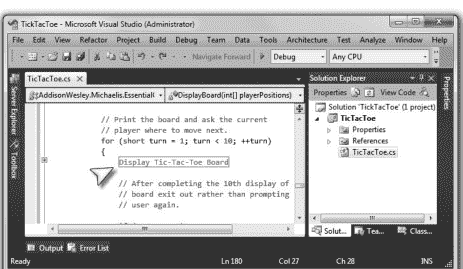

### 图 3.5：Microsoft Visual Studio .NET 中折叠的区域

## 摘要

本章首先介绍了与赋值和算术相关的 C# 运算符。接下来，您将运算符与 const 关键字一起用于声明常量表达式。然而，对所有 C# 运算符的介绍并非按顺序进行。在讨论关系和逻辑比较运算符之前，本章介绍了 if 语句以及代码块和作用域的重要概念。为了结束对运算符的介绍，我讨论了按位运算符，尤其是关于掩码的运算符。

运算符优先级在本章前面已讨论过，但表 3.5 总结了所有运算符的优先级顺序，包括一些尚未介绍的运算符。

### 表 3.5：运算符优先级顺序*

| 类别 | 运算符 |
| :--- | :--- |
| 主要 | x.y f(x) a[x] x++ x-- new typeof(T) checked(x) unchecked(x) default(T) delegate() () |
| 一元 | + - ! ~ ++x --x (T)x |
| 乘法 | * / % |
| 加法 | + - |
| 移位 | << >> |
| 关系和类型测试 | < > <= >= is as |
| 相等 | == != |
| 逻辑 AND | & |
| 逻辑 XOR | ^ |
| 逻辑 OR | \| |
| 条件 AND | && |
| 条件 OR | || |
| 空合并 | ?? |
| 条件 | ?: |
| 赋值 | = => *= /= %= += -= <<= >>= &= ^= |= |

* 行按从高到低的优先级顺序排列。

在介绍了大部分运算符之后，下一个主题是控制流语句。本章的最后几节详细介绍了预处理器指令和位运算符，其中包括代码块、作用域、布尔表达式和按位运算符。

也许回顾第 1–3 章所涵盖所有内容的最佳方法之一是查看附录 B 中的井字棋程序。通过审查该程序，您可以看到将所学所有内容整合到一个完整程序中的一种方法。


# 4 方法和参数

到目前为止，通过你对 C# 编程的学习，你应该能够编写由一系列语句组成的简单程序，类似于 20 世纪 70 年代创建程序的方式。自 20 世纪 70 年代以来，编程已经取得了长足进步；随着程序变得更加复杂，需要新的范式来管理这种复杂性。“过程式”或“结构化”编程提供了一种结构，将语句分组在一起形成一个单元。此外，通过结构化编程，可以将数据传递给一组语句，并在语句执行后返回数据。

本章介绍如何将语句分组到方法中。此外，还介绍如何调用方法，包括如何向方法传递数据以及从方法接收数据。

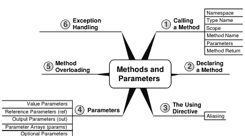

除了调用和定义方法的基础知识外，本章还介绍了一些稍微高级的概念——即递归和方法重载，以及一些新的 C# 4 特性，即可选参数和命名参数。迄今为止以及本章末尾讨论的所有方法调用都是静态的（第 5 章将详细探讨这一概念）。

即使早在第 1 章的 HelloWorld 程序中，你也学习了如何定义方法。在该示例中，你定义了 Main() 方法。在本章中，你将更详细地了解方法创建，包括用于向方法传递数据和从方法传回数据的特殊 C# 语法（使用单个参数 ref），以及仅将数据从方法传出的参数（out）。最后，我将简要介绍一些基本的错误处理。

### 调用方法

### 初学者主题

### 什么是方法？

到目前为止，你编写的程序中的所有语句都出现在一个称为 Main() 方法的分组中。随着程序变得稍微大一些，单个方法实现很快就会变得难以维护，并且难以阅读和理解。

方法是将一系列语句分组在一起以执行特定操作或计算特定结果的一种手段。这为构成程序的语句提供了更大的结构和组织。例如，考虑一个计算目录中源代码行数的 Main() 方法。与其拥有一个庞大的 Main() 方法，不如提供一个更短的版本，以便在必要时专注于每个方法实现的细节。清单 4.1 显示了一个示例。

```
LISTING 4.1: Grouping Statements into Methods

class LineCount
{
static void Main()
{
int lineCount;
string files;

DisplayHelpText();
    files = GetFiles();
    lineCount = CountLines(files);
    DisplayLineCount(lineCount);
}
// ...
}
```

与其将所有语句都放入 Main()，不如清单将它们分组为称为方法的组。与显示帮助文本相关的语句（一组 System.Console.WriteLine() 语句）已移动到 DisplayHelpText() 方法。所有用于确定要计算哪些文件的语句都出现在 GetFiles() 方法中。要实际计算文件，代码在使用 DisplayLineCount() 方法显示结果之前调用 CountLines() 方法。乍一看，很容易审查代码并获得概览，因为方法名称描述了实现。

方法始终与类相关联，类提供了一种将相关方法分组在一起的手段。从概念上讲，调用方法与向类发送消息相同。

方法可以通过参数接收数据。参数是用于将数据从调用者（包含方法调用的方法）传递到目标方法（Write()、WriteLine()、GetFiles()、CountLines() 等）的变量。在清单 4.1 中，files 和 lineCount 是传递给 CountLines() 和 DisplayLineCount() 方法的参数示例。方法还可以通过返回值将数据返回给调用者（在清单 4.1 中，GetFiles() 方法调用有一个返回值，该值被赋给 files）。

首先，你将重新审视第 1 章中的 System.Console.Write()、System.Console.WriteLine() 和 System.Console.ReadLine()。这次，将它们视为方法调用的一般示例，而不是关注从控制台打印和检索数据的具体细节。清单 4.2 显示了这三种方法的使用情况。

### 清单 4.2：简单的方法调用

```
class HeyYou
{
    static void Main()
    {
string firstName;
string lastName;

System.Console.WriteLine("Hey you!");

System.Console.WriteLine("Enter your first name :");
firstName = System.Console.ReadLine();
System.Console.WriteLine("Enter your last name :");
lastName = System.Console.ReadLine();
System.Console.WriteLine("Your full name is {0} {1}.",
    firstName, lastName);
}
```

方法调用的部分包括命名空间、类型名、方法名、参数和返回数据类型。句点分隔完全限定方法名的每个部分。

### 命名空间

方法调用中的第一项是命名空间。命名空间是一种分类机制，用于将与特定功能相关的所有类型分组在一起。通常，你希望外部命名空间是公司名称，然后是产品名称，然后是功能区域：Microsoft.Win32.Networking。命名空间有助于避免类型名称冲突。例如，只要每个类具有不同的命名空间，编译器就可以区分两个名为 "Program" 的类型。结果是，每个类中的 Main 方法可以使用 Awl.Windows.Program.Main() 或 Awl.Console.Program.Main() 来引用。System.Collections、System.Collections.Generic、System.IO 和 System.Runtime.Serialization.Formatters 都是有效的命名空间名称。命名空间名称中可以包含句点。这使得命名空间看起来具有层次结构。这仅提高了人类的可读性，因为编译器将所有命名空间视为单一级别。例如，System.Collections.Generic 出现在 System.Collections 命名空间层次结构中，但对编译器而言，这些只是两个完全不同的命名空间。

在清单 4.2 中，Console 类型的命名空间是 System。System 命名空间包含使程序员能够执行许多基本编程活动的类型。几乎所有 C# 程序都使用 System 命名空间中的类型。表 4.1 列出了其他常见命名空间。

### 表 4.1：常见命名空间

| 命名空间 | 描述 |
| :--- | :--- |
| System | 包含基本类型的定义、类型之间的转换、数学、程序调用和环境管理。 |
| System.Collections | 包括用于处理对象集合的类型。集合通常可以遵循列表或字典类型的存储机制。 |
| System.Collections.Generic | 这是 C# 2.0 添加的命名空间，用于处理依赖于泛型（类型参数）的强类型集合。 |
| System.Data | 包含用于处理存储在数据库中的数据的类型。 |
| System.Drawing | 包含用于绘制到显示设备和处理图像的类型。 |
| System.IO | 包含用于处理文件和目录的类型，并提供操作、加载和保存文件的功能。 |
| System.Linq | 提供类和接口，用于使用 C# 3.0 添加的 API（语言集成查询，Language Integrated Query）查询集合中的数据。 |
| System.Text | 包括用于处理字符串和各种文本编码以及在这些编码之间转换的类型。此命名空间包含一个名为 System.Text.RegularExpressions 的子命名空间，用于访问正则表达式相关 API。 |
| System.Threading | 处理线程操作和多线程编程。 |
| System.Threading.Tasks | 一组用于处理线程的类，首次出现在 .NET 4 中。 |


| Namespace | Description |
|---|---|
| System.Web | 一组使浏览器到服务器通信成为可能的类型，通常通过 HTTP。此命名空间中的功能用于支持一种称为 ASP.NET 的 .NET 技术。 |
| System.Web.Services | 包含使用简单对象访问协议 (SOAP) 通过 HTTP 发送和检索数据的类型。 |
| System.Windows.Forms | 包括用于创建丰富用户界面及其中组件的类型。 |
| System.Xml | 包含用于 XML 处理的基于标准的支持。 |

调用方法时，不一定总是需要提供命名空间。例如，如果你使用与目标方法位于同一命名空间中的类型，则编译器可以推断命名空间与调用者的命名空间相同。本章后面将介绍，using 指令也避免了对命名空间限定符的需求。

## 类型名

对静态方法的调用（第 5 章介绍静态方法与实例方法）需要类型名限定符，只要目标方法不在同一个类中（例如，从 HelloWorld.Main() 调用 Console.WriteLine()）。然而，与命名空间一样，C# 允许在方法可用于包含类型时，从方法调用中省略类型名。此类方法调用的示例出现在清单 4.4 中。类型名是不必要的，因为编译器从调用方法推断类型。如果编译器无法进行此类推断，则名称必须作为方法调用的一部分提供。

从本质上讲，类型是将方法及其关联数据分组在一起的一种方式。例如，Console 是包含 Write()、WriteLine() 和 ReadLine() 方法（以及其他方法）的类型名。所有这些方法都在同一个“组”中，因为它们属于 Console 类型。

- 或基类。

## 作用域

你已经了解，父代码块限定声明和可见性。作用域定义推断的调用上下文。同一类型中两个方法之间的方法调用不需要类型限定符，因为如果某项在作用域内，可以使用其非限定名来引用。同样，同一命名空间中两个类型之间的调用不需要命名空间限定符，因为作用域（在此例中为命名空间）是相同的。

## 方法名

在指定包含要调用的方法的类型后，现在是识别方法本身的时候了。C# 始终在类型名和方法名之间使用句点，并在方法名后使用一对括号。括号之间必须出现方法要求的任何参数。

## 参数

所有方法都可以有任意数量的参数，C# 中的每个参数都有特定的数据类型。例如，清单 4.2 中使用的以下方法调用有三个参数：

```
System.Console.WriteLine(
    "Your full name is {0} {1}", lastName, firstName)
```

第一个是字符串，后两个是 object 类型。尽管你也为后两个参数传递 string 类型的参数值，但编译器允许这样做，因为所有类型（包括 string）都与 object 数据类型兼容。

## 方法返回值

与 System.Console.WriteLine() 相反，清单 4.2 中的 System.Console.ReadLine() 没有任何参数。然而，此方法恰好有一个方法返回值。方法返回值是将已调用方法的结果传回给调用者的一种方式。因为 System.Console.ReadLine() 有返回值，所以可以将返回值赋给变量 firstName。此外，还可以将此方法返回值作为参数传递，如清单 4.3 所示。

## 清单 4.3：将方法返回值作为参数传递给另一个方法调用

```
class Program
{
    static void Main()
    {
        System.Console.Write("Enter your first name: ");
        System.Console.WriteLine("Hello {0}!",
            System.Console.ReadLine());
    }
}
```

与先赋值给变量，然后在对 System.Console.WriteLine() 的调用中使用它不同，清单 4.3 在对 System.Console.WriteLine() 的调用中调用 System.Console.ReadLine() 方法。在执行时，System.Console.ReadLine() 方法首先执行，其返回值直接传入 System.Console.WriteLine() 方法，而不是传入变量。

并非所有方法都返回数据。System.Console.Write() 和 System.Console.WriteLine() 的两个版本都是此类方法的示例。如你不久将看到，这些方法指定的返回类型为 void，就像 HelloWorld 中 Main 的声明返回 void 一样。

## 语句与方法调用

清单 4.3 演示了语句与方法调用之间的区别。尽管 System.Console.WriteLine("Hello {0}!", System.Console.ReadLine()); 是单个语句，但它包含两个方法调用。语句通常包含一个或多个表达式，在此示例中，每个表达式都是一个方法调用。因此，方法调用构成语句的一部分。

尽管在单个语句中编写多个方法调用通常会减少代码量，但不一定能提高可读性，并且很少能带来显著的性能优势。开发者应优先考虑可读性而非简洁性。

> **注意**
>
> 一般而言，开发者应优先考虑可读性而非简洁性。可读性对于编写自文档化代码至关重要，因此代码随着时间的推移更易于维护。

## 声明方法

本节扩展了声明方法（例如 Main()）的说明，以包括任何参数或返回类型。清单 4.4 包含这些概念的示例，输出 4.1 显示了结果。

## 清单 4.4：声明方法

```
class IntroducingMethods
{
    static void Main()
    {
        string firstName;
        string lastName;
        string fullName;

        System.Console.WriteLine("Hey you!");

        firstName = GetUserInput("Enter your first name: ");
        lastName = GetUserInput("Enter your last name: ");

        fullName = GetFullName(firstName, lastName);

        DisplayGreeting(fullName);
    }

    static string GetUserInput(string prompt)
    {
        System.Console.Write(prompt);
        return System.Console.ReadLine();
    }

    static string GetFullName(string firstName, string lastName)
    {
        return firstName + " " + lastName;
    }

    static void DisplayGreeting(string name)
    {
        System.Console.WriteLine("Your full name is {0}.", name);
        return;
    }
}
```

## 输出 4.1：

```
Hey you!
Enter your first name: Inigo
Enter your last name: Montoya
Your full name is Inigo Montoya.
```

清单 4.4 中声明了四个方法。从 Main() 开始，代码调用 GetUserInput()，然后调用 GetFullName()。这两个方法都返回值并接受参数。此外，清单还调用 DisplayGreeting()，该方法不返回任何数据。C# 中没有任何方法可以存在于封闭类之外。即使在第 1 章中检查的 Main 方法也必须位于类中。

> **语言对比：C++/Visual Basic—全局方法**
>
> C# 不提供全局方法支持；所有内容都必须出现在类定义中。这就是 Main() 方法被标记为 static 的原因——它是 C++ 全局方法和 Visual Basic 模块方法的 C# 等效项。

## 初学者主题

## 重构为方法

将一组语句移动到方法中，而不是将它们内联在较大的方法中，这是一种重构形式。重构减少了代码重复，因为你可以从多个位置调用该方法，而不是重复代码。重构还提高了代码可读性。作为编码过程的一部分，持续审查代码并寻找重构机会是最佳实践。这涉及查找一眼难以理解的代码块，并将其移动到一个名称能清楚定义代码行为的方法中。这种做法通常优于注释一段代码，因为方法名称用于描述实现的功能。

例如，清单 4.4 中显示的 Main() 方法产生的行为与第 1 章中清单 1.15 显示的 Main() 方法相同。也许更值得注意的是，尽管两个清单都易于遵循，但清单 4.4 更易于一目了然，只需查看 Main() 方法而无需担心每个被调用方法的实现细节。


## 参数声明

请考虑 `DisplayGreeting()` 和 `GetFullName()` 方法的声明。方法声明括号之间出现的文本是 **参数列表**。参数列表中的每个参数包括参数类型和参数名称。逗号分隔列表中的每个参数。

从行为上看，参数几乎与局部变量相同，参数的命名约定也随之而来。因此，参数名称采用驼峰命名法。此外，不可能声明一个与包含方法的参数同名的局部变量（在方法内部声明的变量），因为这会创建两个同名的“局部变量”。

## 方法返回值声明

除了 `GetUserInput()` 和 `GetFullName()` 需要指定参数之外，这两个方法还都包含 **方法返回值**。你可以通过方法声明中方法名称前紧跟一个数据类型来判断是否有方法返回值。对于 `GetUserInput()` 和 `GetFullName()`，数据类型均为 `string`。与参数不同，只允许有一个方法返回值。

一旦方法包含返回数据类型，且假设未发生错误，则有必要在方法声明中的每个 **代码路径**（或可能连续执行的一组语句）内指定 return 语句。return 语句以 return 关键字开头，后跟方法返回的值。例如，`GetFullName()` 方法的 return 语句是 `return firstName + " " + lastName`。C# 编译器强制要求返回类型必须与 return 关键字后指定的数据类型匹配。

return 语句可以出现在方法实现末尾以外的位置，只要方法有返回类型，所有代码路径都包含 return 即可。例如，方法实现开头的 `if` 或 `switch` 语句可以在条件或 case 语句中包含 return 语句；示例请参见清单 4.5。

## 清单 4.5：方法结束前的 return 语句

```
class Program
{
    static void Main()
    {
        string command;
        // ...
        switch(Command)
        {
            case "quit":
                return; // ...
        } // ...
    }
}
```

return 语句表示跳转到方法末尾，因此 switch 语句中不需要 break。一旦执行遇到 return，方法调用将结束。

如果特定代码路径在 return 之后包含语句，编译器将发出警告，指示这些额外语句永远不会执行。尽管 C# 允许提前返回，但如果方法中只有一个退出位置，而不是在各种代码路径中散布多个 return，代码通常更易读、更易维护。

将 void 指定为返回类型表示方法没有返回值。因此，该方法不支持在调用点赋值给变量或用作参数类型。此外，return 语句变为可选，当指定时，return 关键字后不跟任何值。例如，清单 4.4 中 Main() 的返回为 void，且方法内没有 return 语句。但是，DisplayGreeting() 包含一个不跟任何返回结果的 return 语句。

## 语言对比：C++ — 头文件

与 C++ 不同，C# 类从不将实现与声明分离。在 C# 中，没有头文件（.h）或实现文件（.cpp）。相反，声明和实现出现在同一文件中。从 C# 2.0 开始，可以将类分布在多个文件中，称为 partial 类型。但是即便如此，方法的声明和实现也必须保持在一起。C# 内联声明类型和方法，使语言更加简洁且易于维护。

## 初学者主题

## 命名空间

命名空间是所有类型的组织机制。它们提供嵌套分组机制，以便对类型进行分类。开发人员可以通过检查与初始类型位于同一命名空间中的其他类型来发现相关类型。此外，通过命名空间，两个或多个类型可以具有相同的名称，只要它们由不同的命名空间区分开来即可。

## using 指令

可以将一个命名空间中的类型导入到父命名空间代码块中，或者如果没有父代码块，则导入到整个文件中。结果是，程序员无需完全限定类型。为了实现这一点，C# 程序员包含一个 using 指令，通常位于文件顶部。例如，在清单 4.6 中，Console 没有 System 前缀。相反，它在清单顶部包含 using 指令，using System。

## 清单 4.6：using 指令示例

```
// The using directive imports all types from the
// specified namespace into the entire file.
using System;

class HelloWorld
{
    static void Main()
    {
        // No need to qualify Console with System
        // because of the using directive above.
        Console.WriteLine("Hello, my name is Inigo Montoya");
    }
}
```

清单 4.6 的结果显示在输出 4.2 中。

## 输出 4.2：

```
Hello, my name is Inigo Montoya
```

命名空间是嵌套的。这意味着诸如 using System 这样的 using 指令并不能允许在更具体的命名空间中的方法中省略 System。例如，如果代码访问 System.Text 命名空间中的类型，则必须要么为 System.Text 包含额外的 using 指令，要么完全限定该类型。using 指令不会导入任何嵌套命名空间。由命名空间中的句点标识的嵌套命名空间需要显式导入。

## 语言对比：Java — import 指令中的通配符

Java 允许使用通配符导入命名空间，例如：

```
import javax.swing.*;
```

相比之下，C# 不支持通配符 using 指令，而是要求每个命名空间都显式导入。

## 语言对比：Visual Basic .NET — 项目范围导入指令

与 C# 不同，Visual Basic .NET 支持指定 using 指令等效项（Imports）的功能，适用于整个项目，而不仅仅是特定文件。换句话说，Visual Basic .NET 提供了一种跨越整个编译的 using 指令命令行方式。

通常，在特定命名空间中广泛使用类型会导致为该命名空间添加 using 指令，而不是完全限定命名空间中的所有类型。遵循这一趋势，几乎所有文件都在顶部包含 using System 指令。然而，在本书的其余部分，代码清单通常会省略 using System 指令。其他命名空间指令将显式包含。

using System 指令的一个有趣效果是，string 数据类型可以用不同的大小写来标识：String 或 string。前者依赖于 using System 指令，后者使用 string 关键字。两者都是对 System.String 数据类型的有效 C# 引用，生成的 CIL 代码不受所选版本的影响。²

## 高级主题

## 嵌套 using 声明

你不仅可以在文件顶部使用 using 声明，还可以在命名空间声明顶部包含它们。例如，如果声明了一个新命名空间 Awl.Michaelis.EssentialCSharp，则可以在命名空间声明顶部添加一个 using 声明（请参见清单 4.7）。

## 清单 4.7：在命名空间声明内指定 using 指令

```
namespace Awl.Michaelis.EssentialCSharp
{
    using System;

    class HelloWorld
    {
        static void Main()
        {
            // No need to qualify Console with System
            // because of the using directive above.
            Console.WriteLine("Hello, my name is Inigo Montoya");
        }
    }
}
```

清单 4.7 的结果显示在输出 4.3 中。

## 输出 4.3：

```
Hello, my name is Inigo Montoya
```

将 using 声明放在文件顶部而不是命名空间声明顶部的区别在于，该声明是

2. 我更喜欢 string 关键字，但无论程序员选择哪种表示法，理想情况下，项目中的代码应保持一致。


仅在命名空间声明内有效。如果代码在 Awl.Michaelis.EssentialCSharp 声明的上方或下方包含新的命名空间声明，则不同命名空间中的 using System 指令将不再有效。代码很少以这种方式编写，尤其是考虑到每个文件单一类型声明的标准做法。

## 别名

using 指令还支持为命名空间或类型指定别名。别名是你可以在 using 指令适用的文本中使用的替代名称。别名的两个最常见原因是消除同名两个类型的歧义，以及缩写长名称。例如，在清单 4.8 中，CountDownTimer 别名被声明为引用 System.Timers.Timer 类型的一种方式。仅添加 using System.Timers 指令不足以使代码避免对 Timer 类型进行完全限定。原因是 System.Threading 也包含一个名为 Timer 的类型，因此，在代码中直接使用 Timer 将是歧义的。

```
LISTING 4.8: Declaring a Type Alias
using System;
using System.Threading;
using CountDownTimer = System.Timers.Timer;

class HelloWorld
{
    static void Main()
    {
        CountDownTimer timer;
        // ...
    }
}
```

清单 4.8 使用全新的名称 CountDownTimer 作为别名。但是，也可以将别名指定为 Timer，如清单 4.9 所示。

## 清单 4.9: 使用相同名称声明类型别名

```
using System;
using System.Threading;

// Declare alias Timer to refer to System.Timers.Timer to
// avoid code ambiguity with System.Threading.Timer
using Timer = System.Timers.Timer;

class HelloWorld
{
    static void Main()
    {
        Timer timer;

        // ...
    }
}
```

由于别名指令，“Timer”不是歧义引用。此外，要引用 System.Threading.Timer 类型，你必须要么限定该类型，要么定义不同的别名。

## Main() 的返回值和参数

到目前为止，可执行文件的 Main() 方法声明一直是最简单的声明。你在 Main() 方法声明中未包含任何参数或返回类型。但是，C# 支持在执行程序时检索命令行参数的功能，并且可以从 Main() 方法返回状态指示器。

运行时使用单个字符串数组参数将命令行参数传递给 Main()。要检索参数，你只需访问该数组，如清单 4.10 所示。此程序的目的是下载由 URL 指定位置的文件。第一个命令行参数标识 URL，可选的第二个参数是保存文件的文件名。该清单以 switch 语句开头，用于评估参数的数量（args.Length），如下所示。

- 1. 如果没有参数，则显示错误，指出必须提供 URL。
- 2. 如果只有一个参数，则从第一个参数计算第二个参数。
- 3. 存在两个参数表示用户已同时提供资源的 URL 和下载目标文件名。

## 清单 4.10: 将命令行参数传递给 Main

```
using System;
using System.IO;
using System.Net;

class Program
{
    static int Main(string[] args)
    {
        int result;
        string targetFileName = ParseCommandLineArgs(args);

        switch (args.Length)
        {
        case 0:
            // No URL specified, so display error.
            Console.WriteLine(
                "ERROR: You must specify the "
                + "URL to be downloaded");
            break;
        case 1:
            // No target filename was specified.
            targetFileName = Path.GetFileName(args[0]);
            break;
        case 2:
            targetFileName = args[1];
            break;
        }

        if (targetFileName != null)
        {
            WebClient webClient = new WebClient();
            webClient.DownloadFile(args[0], targetFileName);
            result = 0;
        }
        else
        {
            Console.WriteLine(
                "Downloader.exe <URL> <TargetFileName>");
            result = 1;
        }

        return result;
    }

    private static string ParseCommandLineArgs(string[] args)
    {
        string targetFileName = null;
        switch (args.Length)
        {
        case 0:
            // No URL specified, so display error.
            Console.WriteLine(
                "ERROR: You must specify the " +
                "URL to be downloaded");
            break;
        case 1:
            // No target filename was specified.
            targetFileName = Path.GetFileName(args[0]);
            break;
        case 2:
            targetFileName = args[1];
            break;
        }
        return targetFileName;
    }
}
```

## 输出 4.4:

```
>Downloader.exe
ERROR: You must specify the URL to be downloaded
Downloader.exe <URL> <TargetFileName>
```

如果成功计算出目标文件名，则会使用它来保存下载的文件。否则，将显示帮助文本。
Main() 方法还返回 int 而不是 void。这对于 Main() 声明是可选的，但如果使用，程序可以向调用者（例如脚本或批处理文件）返回状态代码。按照惯例，非零返回表示错误。

虽然所有命令行参数都可以通过字符串数组传递给 Main()，但有时从 Main() 以外的方法内部访问参数会很方便。System.Environment.GetCommandLineArgs() 方法以与 Main(string[] args) 将参数传递给 Main() 相同的形式返回命令行参数数组。

### 高级主题

### 消除多个 Main() 方法的歧义

如果程序包含两个带有 Main() 方法的类，则可以在命令行上指定用于 Main() 声明的类。csc.exe 包含 /m 选项，用于指定 Main() 的完全限定类名。

### 初学者主题

### 调用堆栈和调用站点

代码执行时，方法会调用更多方法，而这些方法又会调用其他方法，以此类推。在清单 4.4 的简单情况中，Main() 调用 GetUserInput()，后者又调用 System.Console.ReadLine()，而后者在内部又会调用更多方法。这种调用中嵌套调用、再嵌套调用的集合称为调用堆栈。随着程序复杂度增加，每个方法调用另一个方法，调用堆栈通常会越来越大。然而，随着调用完成，调用堆栈会缩小，直到调用另一系列方法。描述从调用堆栈中移除调用过程的术语称为堆栈展开。堆栈展开始终按方法调用的逆序进行。方法完成的结果是执行将返回到调用站点，即调用方法的位置。

## 参数

到目前为止，本章示例已通过方法返回值返回数据。本节演示了通过方法参数和可变数量的参数返回数据的选项。

### 初学者主题

### 将调用方变量与参数名称匹配

在之前的某些清单中，你将调用方中的变量名与被调用方（目标方法）中的参数名匹配。这种匹配仅出于可读性考虑；名称是否匹配完全不影响方法调用的行为。

### 值参数

默认情况下，参数按值传递，这意味着变量的堆栈数据会被复制到目标参数中。例如，在清单 4.11 中，Main() 在调用 Combine() 时使用的每个变量都会被复制到 Combine() 方法的参数中。输出 4.5 显示了此清单的结果。

## 清单 4.11: 按值传递变量

```
```csharp
class Program
{
    static void Main()
    {
        // ...
        string fullName;
        string driveLetter = "C:";
        string folderPath = @"Data";
        string fileName = "index.html";

        fullName = Combine(driveLetter, folderPath, fileName);

        Console.WriteLine(fullName);
        // ...
    }

    static string Combine(
        string driveLetter, string folderPath, string fileName)
    {
        string path;
        path = string.Format("{0}{1}{2}{0}{3}",
            System.IO.Path.DirectorySeparatorChar,
            driveLetter, folderPath, fileName);
        return path;
    }
}
```
```

## 输出 4.5:

```
C:\Data\index.html
```

即使 Combine() 方法在返回前将 driveLetter、folderPath 和 fileName 赋值为 null，Main() 中的相应变量也会保持其原始值，因为在调用方法时会复制变量。当调用结束时调用堆栈展开，副本会被丢弃。

### 高级主题

### 引用类型与值类型

出于本节的目的，传递的参数是值类型还是引用类型无关紧要。问题在于该


target method can assign the caller's original variable a new value. Since a copy is made, the caller's copy cannot be reassigned.

In more detail, a reference type variable contains an address of the memory location where the data is stored. If a reference type variable is passed by value, the address is copied from the caller to the method parameter. As a result, the target method cannot update the caller variable's address value but it may update the data within the reference type. Alternatively, if the method parameter is a value type, the value itself is copied into the parameter, and changing the parameter will not affect the original caller's variable.

## 引用参数 (ref)

Consider Listing 4.12, which calls a function to swap two values, and Output 4.6, which shows the results.

```
LISTING 4.12: Passing Variables by Reference

class Program
{
    static void Main()
    {
        // ...
        string first = "first";
        string second = "second";
        Swap(ref first, ref second);

        System.Console.WriteLine(
            @"first = ""{0}"", second = ""{1}""",
            first, second);
        // ...
    }

    static void Swap(ref string first, ref string second)
    {
        string temp = first;
        first = second;
        second = temp;
    }
}
```

```
OUTPUT 4.6:

first = "second", second = "first"
```

The values assigned to first and second are successfully switched, even though there is no return from the Swap() method. To do this, the variables are passed by reference. The obvious difference between the call to Swap() and Listing 4.11's call to Combine() is the use of the keyword ref in front of the parameter's data type. This keyword changes the call type to be by reference, so the called method can update the original caller's variable with a new value.

When the called method specifies a parameter as ref, the caller is required to place ref in front of the variables passed. In so doing, the caller explicitly recognizes that the target method could reassign any ref parameters it receives. Furthermore, it is necessary to initialize variables passed as ref because target methods could read data from ref parameters without first assigning them. In Listing 4.12, for example, temp is assigned the value of first, assuming that the variable passed in first was initialized by the caller. Effectively, a ref parameter is an alias for the variable passed. In other words, it is essentially giving a parameter name to an existing variable.

## 输出参数 (out)

In addition to passing parameters into a method only (by value) and passing them in and back out (by reference), it is possible to pass data out only. To achieve this, code needs to decorate parameter types with the keyword out, as shown in the GetPhoneButton() method in Listing 4.13 that returns the phone button corresponding to a character.

### 清单 4.13：仅传出变量

```
class ConvertToPhoneNumber
{
    static int Main(string[] args)
    {
        char button;

        if(args.Length == 0)
        {
            Console.WriteLine(
                "ConvertToPhoneNumber.exe <phrase>");
            Console.WriteLine(
                " -' indicates no standard phone button");
            return 1;
        }
        foreach(string word in args)
        {
            foreach(char character in word)
            {
                if(GetPhoneButton(character, out button))
                {
                    Console.Write(button);
                }
                else
                {
                    Console.Write('_');
                }
            }
            Console.WriteLine();
        }
        return 0;
    }

    static bool GetPhoneButton(char character, out char button)
    {
        bool success = true;
        switch(char.ToLower(character))
        {
            case '1':
                button = '1';
                break;
            case '2': case 'a': case 'b': case 'c':
                button = '2';
                break;

            // ...

            case '-':
                button = '-';
                break;
            default:
                // Set the button to indicate an invalid value
                button = '_';
                success = false;
                break;
        }
        return success;
    }
}
```

### 输出 4.7:

```
>ConvertToPhoneNumber.exe CSharpIsGood
2743E7794Nb3
```

In this example, the GetPhoneButton() method returns true if it can successfully determine the character's corresponding phone button. The function also returns the corresponding button by using the button parameter which is decorated with out.

Whenever a parameter is marked with out, the compiler will check that the parameter is set for all code paths within the method that return normally (without an explicit error). If, for example, the code does not assign button a value, the compiler will issue an error indicating that the code didn't initialize button. Listing 4.13 assigns button to _ because even though it cannot determine the correct phone button, it is still necessary to assign a value.

## 参数数组 (params)

In all the examples so far, the number of parameters is fixed by the target method declaration. However, sometimes the number of parameters may vary. Consider the Combine() method from Listing 4.11. In that method, you passed the drive letter, folder path, and filename. What if the number of folders in the path was more than one and the caller wanted the method to join additional folders to form the full path? Perhaps the best option would be to pass an array of strings for the folders. However, this would make the calling code a little more complex, because it would be necessary to construct an array to pass as a parameter.

For a simpler approach, C# provides a keyword that enables the number of parameters to vary in the calling code instead of being set by the target method. Before we discuss the method declaration, observe the calling code declared within Main(), as shown in Listing 4.14.

### 清单 4.14：传递可变参数列表

```
using System.IO;

class PathEx
{
    static void Main()
    {
        string fullName;

        // ...

        // Call Combine() with four parameters
        fullName = Combine(
            Directory.GetCurrentDirectory(),
            "bin", "config", "index.html");
        Console.WriteLine(fullName);

        // ...

        // Call Combine() with only three parameters
        fullName = Combine(
            Environment.SystemDirectory,
            "Temp", "index.html");
        Console.WriteLine(fullName);

        // ...

        // Call Combine() with an array
        fullName = Combine(
            new string[] {
            "C:\\", "Data",
            "HomeDir", "index.html" });
        Console.WriteLine(fullName);
        // ...
    }

    static string Combine(params string[] paths)
    {
        string result = string.Empty;
        foreach (string path in paths)
        {
            result = System.IO.Path.Combine(result, path);
        }
        return result;
    }
}
```

### 输出 4.8:

```
C:\Data\mark\bin\config\index.html
C:\WINDOWS\system32\Temp\index.html
C:\Data\HomeDir\index.html
```

In the first call to Combine(), four parameters are specified. The second call contains only three parameters. In the final call, parameters are passed using an array. In other words, the Combine() method takes a variable number of parameters, whether separated by a comma or as a single array. To allow this, the Combine() method

- Places params immediately before the last parameter in the method declaration
- Declares the last parameter as an array

With a parameter array declaration, it is possible to access each parameter as a member of the params array. In the Combine() method implementation, you iterate over the elements of the paths array and call System.IO.Path.Combine(). This method automatically combines the parts of the path appropriately using the platform-specific directory-separator-character. (PathEx.Combine() is identical to Path.Combine(), except that PathEx.Combine() handles a variable number of parameters rather than simply two.)

There are a few notable characteristics of the parameter array.

- The parameter array is not necessarily the only parameter on a method. However, the parameter array must be the last parameter in the method declaration. Since only the last parameter may be a parameter array, a method cannot have more than one parameter array.
- The caller can specify zero parameters for the parameter array, which will result in an array of zero items.


- 参数数组是类型安全的——类型必须与数组标识的类型匹配。
- 调用者可以使用显式数组，而不是逗号分隔的参数列表。生成的 CIL 代码是相同的。
- 如果目标方法实现要求最少数量的参数，则这些参数应显式出现在方法声明中，以便在缺少必需参数时强制编译错误，而不是依赖运行时错误处理。例如，使用 `int Max(int first, params int[] operands)` 而不是 `int Max(params int[] operands)`，以便至少向 `Max()` 传递一个值。

使用参数数组，您可以将相同类型的可变数量参数传递给方法。本章后面的“方法重载”部分讨论了支持不一定是相同类型的可变数量参数的方法。

## 递归

以递归方式调用方法或使用递归实现方法，是指方法调用自身。这有时是实现方法的最简单方式。清单 4.15 统计目录及其子目录中所有 C# 源文件 (*.cs) 的行数。

```csharp
Listing 4.15: Returning All the Filenames, Given a Directory
using System.IO;

public static class LineCounter
{
    // Use the first argument as the directory
    // to search, or default to the current directory.
    public static void Main(string[] args)
    {
        int totalLineCount = 0;
        string directory;
        if (args.Length > 0)
        {
            directory = args[0];
        }
        else
        {
            directory = Directory.GetCurrentDirectory();
        }
        totalLineCount = DirectoryCountLines(directory);
        System.Console.WriteLine(totalLineCount);
    }

    static int DirectoryCountLines(string directory)
    {
        int lineCount = 0;
        foreach (string file in Directory.GetFiles(directory, "*.cs"))
        {
            lineCount += CountLines(file);
        }
        foreach (string subdirectory in Directory.GetDirectories(directory))
        {
            lineCount += DirectoryCountLines(subdirectory);
        }
        return lineCount;
    }

    private static int CountLines(string file)
    {
        string line;
        int lineCount = 0;
        FileStream stream = new FileStream(file, FileMode.Open);
        StreamReader reader = new StreamReader(stream);
        line = reader.ReadLine();
        while (line != null)
        {
            if (line.Trim() != "")
            {
                lineCount++;
            }
            line = reader.ReadLine();
        }
        reader.Close(); // Automatically closes the stream
        return lineCount;
    }
}
```

- 3. 我可以使用 using 语句改进此代码，但我避免使用该结构，因为我尚未介绍它。

### 输出 4.9：

```
104
```

程序首先将第一个命令行参数传递给 DirectoryCountLines()，或者如果未提供参数，则使用当前目录。该方法首先遍历当前目录中的所有文件，并统计每个文件的源代码行数。在目录中的每个文件之后，代码通过将子目录传回 DirectoryCountLines() 方法来处理每个子目录，使用子目录重新运行该方法。同样的过程会递归地在每个子目录中重复，直到没有更多目录可供处理为止。

不熟悉递归的读者最初可能会觉得它很繁琐。无论如何，它通常是编码的最简单模式，尤其是对于文件系统等分层类型数据。但是，虽然它可能是最易读的，但通常不是最快的实现。如果性能成为问题，开发人员应寻求替代递归实现的解决方案。选择通常取决于在可读性与性能之间取得平衡。

## 初学者主题

### 无限递归错误

递归方法实现中常见的编程错误以程序执行期间的栈溢出形式出现。这通常是因为无限递归引起的，即方法不断调用自身，永远不会达到指示递归结束的点。程序员审查任何使用递归的方法并验证递归调用是有限的，这是一种良好的做法。

使用伪代码的递归常见模式如下：

```
M(x)
{
    if x is trivial
        Return the result
    else
        a. Do some work to make the problem smaller
        b. Recursively call M to solve the smaller problem
        c. Compute the result based on a. and b.
        return the result
}
```

当不遵循此模式时，事情就会出错。例如，如果您不使问题变小，或者不处理所有可能的“最小”情况，递归将永远不会终止。

## 方法重载

清单 4.15 调用了 DirectoryCountLines()，它统计了 *.cs 文件的行数。但是，如果您想统计 *.h/*.cpp 文件或 *.vb 文件中的代码，DirectoryCountLines() 将无法工作。相反，您需要一个接受文件扩展名的方法，但仍保留现有方法定义，以便默认处理 *.cs 文件。

类中的所有方法都必须具有唯一的签名，C# 通过方法名称、参数数据类型或参数数量的变化来定义唯一性。这不包括方法返回数据类型；定义只有返回数据类型不同的两个方法会导致编译错误。当类中有两个或多个同名方法，且重载方法之间的参数数量和/或数据类型不同时，就会发生方法重载。

方法重载是一种操作多态性。当同一逻辑操作因为数据不同而采用多种（“poly”）形式（“morphs”）时，就会发生多态性。调用 WriteLine() 并传递格式字符串和一些参数的实现方式，与调用 WriteLine() 并指定整数的实现方式不同。但是，从逻辑上讲，对于调用者来说，该方法负责写入数据，内部实现如何与其关系不大。清单 4.16 提供了一个示例，输出 4.10 显示了结果。

### 清单 4.16：给定目录，返回所有文件名

```csharp
using System.IO;

public static class LineCounter
{
    public static void Main(string[] args)
    {
        int totalLineCount;

        if (args.Length > 1)
        {
            totalLineCount =
                DirectoryCountLines(args[0], args[1]);
        }
        if (args.Length > 0)
        {
            totalLineCount = DirectoryCountLines(args[0]);
        }
        else
        {
            totalLineCount = DirectoryCountLines();
        }

        System.Console.WriteLine(totalLineCount);
    }

    static int DirectoryCountLines()
    {
        return DirectoryCountLines(
            Directory.GetCurrentDirectory());
    }

    static int DirectoryCountLines(string directory)
    {
        return DirectoryCountLines(directory, "*.cs");
    }

    static int DirectoryCountLines(
        string directory, string extension)
    {
        int lineCount = 0;
        foreach (string file in
            Directory.GetFiles(directory, extension))
        {
            lineCount += CountLines(file);
        }

        foreach (string subdirectory in
            Directory.GetDirectories(directory))
        {
            lineCount += DirectoryCountLines(subdirectory);
        }

        return lineCount;
    }

    private static int CountLines(string file)
    {
        int lineCount = 0;
        string line;
        FileStream stream =
            new FileStream(file, FileMode.Open);
        StreamReader reader = new StreamReader(stream);
        line = reader.ReadLine();
        while (line != null)
        {
            if (line.Trim() == "")
            {
                lineCount++;
            }
            line = reader.ReadLine();
        }
        reader.Close(); // Automatically closes the stream
        return lineCount;
    }
}
```

### 输出 4.10：

```
>LineCounter.exe *.cs
28
```

方法重载的效果是提供调用方法的可选方式。如 Main() 中所示，您可以调用 DirectoryCountLines() 方法，传递或不传递要搜索的目录和文件扩展名。

请注意，DirectoryCountLines() 的无参数实现已更改为调用单参数版本 (int DirectoryCountLines(string directory))。这是实现重载方法时的常见模式。其理念是开发人员仅在一个方法中实现核心逻辑，所有其他重载方法都会调用该单一方法。如果核心实现更改，只需在一个位置进行修改，而不是在每个实现中修改。当使用方法重载时，此模式尤其普遍，以

4. 此代码可以使用 using 语句改进，这是一个尚未介绍的结构，因此被避免。


启用那些没有编译时确定值的可选参数，因此无法使用可选参数来指定它们。

## 可选参数

自 C# 4.0 起，语言设计师为可选参数添加了有限支持。通过允许在方法声明中将参数赋值为常量值，可以在不传递方法的每个参数的情况下调用方法（请参阅清单 4.17）。

### 清单 4.17：带有可选参数的方法

```
using System.IO;

public static class LineCounter
{
    public static void Main(string[] args)
    {
        int totalLineCount;

        if (args.Length > 1)
        {
            totalLineCount =
                DirectoryCountLines(args[0], args[1]);
        }

        if (args.Length > 0)
        {
            totalLineCount = DirectoryCountLines(args[0]);
        }
        else
        {
            totalLineCount = DirectoryCountLines();
        }

        System.Console.WriteLine(totalLineCount);
    }

    static int DirectoryCountLines()
    {
        // ...
    }
}

/* static int DirectoryCountLines(string directory)
{
    ... }
*/
```

```
static int DirectoryCountLines(
    string directory, string extension = "*.cs")
{
    int lineCount = 0;
    foreach (string file in
        Directory.GetFiles(directory, extension))
    {
        lineCount += CountLines(file);
    }

    foreach (string subdirectory in
        Directory.GetDirectories(directory))
    {
        lineCount += DirectoryCountLines(subdirectory);
    }

    return lineCount;
}

private static int CountLines(string file)
{
    // ...
}
```

例如，在清单 4.17 中，带有单个参数的 DirectoryCountLines() 方法声明已被删除（注释掉），但来自 Main() 的调用（指定一个参数）仍然保留。当调用中未指定 extension 参数时，将使用声明中分配给 extension 的值（在此情况下为 *.cs）。这允许调用代码在需要时不指定值，并消除了 C# 3.0 及更早版本中所需的额外重载。请注意，可选参数必须出现在所有必需参数（即没有默认值的参数）之后。另外，默认值需要是常量、编译时可解析的值，这一点相当限制。例如，你不能使用以下方式声明方法：

```
DirectoryCountLines(
    string directory = Environment.CurrentDirectory,
    string extension = "*.cs")
```

因为 Environment.CurrentDirectory 不是文本。相比之下，由于 default(string) 是编译时确定的，C# 4.0 确实允许将其用作可选参数的默认值。

### 清单 4.18：按名称指定参数

C# 4.0 提供的第二个方法调用功能是使用命名参数。使用命名参数，调用者可以明确标识要分配值的参数名称，而不仅仅依赖参数顺序来关联（请参阅清单 4.18）。

```
class Program
{
    static void Main()
    {
        DisplayGreeting(
            firstName: "Inigo", lastName: "Montoya");
    }

    public void DisplayGreeting(
        string firstName,
        string middleName = default(string),
        string lastName = default(string))
    {
        // ...
    }
}
```

在清单 4.18 中，Main() 中对 DisplayGreeting() 的调用按名称向参数分配值。在两个可选参数（middleName 和 lastName）中，仅指定了 lastName。对于参数众多且其中许多为可选参数的情况（访问 Microsoft COM 库时很常见），使用命名参数语法确实是一种便利。然而，请注意，随之而来的便利性会对方法接口的灵活性产生影响。在过去（至少从 C# 来看），可以更改参数名称而不会导致其他调用代码无法编译。随着命名参数的加入，参数名称成为接口的一部分，因为更改名称会导致使用命名参数的代码无法再编译。

对于许多经验丰富的 C# 开发人员来说，这是一个令人惊讶的限制。然而，自 .NET 1.0 起，此限制一直作为公共语言规范的一部分被强制执行。因此，库开发人员应当已经遵循不更改参数名称的做法，以便与其他 .NET 语言在版本间成功互操作。C# 4.0 现在对参数名称更改施加了与许多其他 .NET 语言已要求的相同限制。

鉴于方法重载、可选参数和命名参数的组合，确定调用哪个方法变得不那么明显。如果所有参数都有且仅有一个对应的参数（按名称或按位置）与类型兼容，除非该参数是可选的，否则调用与方法适用（兼容）。虽然这限制了可能被调用的方法数量，但它并未识别出唯一的方法。为了进一步区分具体是哪个方法，编译器仅使用调用者中明确标识的参数，忽略调用者未指定的所有可选参数。因此，如果两个方法都适用，因为其中一个具有可选参数，编译器将解析为没有可选参数的方法。

### 高级主题

### 方法解析

从高层次来看，编译器决定调用哪个方法的选择取决于最具体的适用方法。只能有一个方法与调用者的参数完全匹配，因此这将始终优先。假设有两个适用方法，每个都需要隐式转换，则将使用匹配最派生类型的方法。（如果调用者传递 int，则使用 double 的方法将优先于使用 object 的方法。这是因为 double 比 object 更具体。）如果多个方法适用且无法确定唯一的最佳方法，则编译器将发出错误，指示调用存在歧义。

例如，给定以下方法

```
Method( thing ) // Fifth
Method( thing ) // Fourth
Method( thing ) // Third
Method( thing ) // First
```

Method(42) 调用将按升序解析，从 Method(int thing) 开始，一直进行到 Method(long thing)，依此类推，前提是前者方法不存在。

C# 规范包含关于 byte、ushort、uint、ulong 和其他数值类型之间隐式转换的其他规则，但通常最好使用强制转换来使目标方法更易识别。

## 使用异常进行基本错误处理

调用方法的一个重要方面涉及错误处理；具体来说，如何将错误报告回调用者。本节将探讨如何通过一种称为**异常处理**的机制来处理错误报告。

使用异常处理，方法可以将错误信息传递给调用方法，而无需显式提供任何参数来执行此操作。清单 4.19 对第 1 章中的 HeyYou 程序进行了轻微修改。它不再请求用户的姓氏，而是提示输入用户的年龄。

### 清单 4.19：将字符串转换为 int

```
using System;

class ExceptionHandling
{
    static void Main()
    {
        string firstName;
        string ageText;
        int age;

        Console.WriteLine("Hey you!");

        Console.Write("Enter your first name: ");
        firstName = System.Console.ReadLine();

        Console.Write("Enter your age: ");
        ageText = Console.ReadLine();
        age = int.Parse(ageText);

        Console.WriteLine(
            "Hi {0}! You are {1} months old.",
            firstName, age*12);
    }
}
```

输出 4.11 显示了清单 4.19 的结果。

### 输出 4.11

```
Hey you!
Enter your first name: Inigo
Enter your age: 42
Hi Inigo! You are 504 months old.
```

System.Console.ReadLine() 的返回值存储在名为 ageText 的变量中，然后传递给 int 数据类型上的名为 Parse() 的方法。该方法负责获取表示数字的字符串值并将其转换为 int 类型。

### 初学者主题

### 作为字符串的 42 与作为整数的 42

C# 要求每个值都有明确定义的关联类型。因此，不仅数据值很重要，与数据关联的类型也很重要。因此，字符串值 42 与整数值 42 截然不同。字符串由字符 4 和 2 组成，而 int 是数字 42。

有了转换后的字符串，最后的 System.Console.WriteLine() 语句将通过将年龄值乘以 12 来以月为单位打印年龄。

但是，如果用户没有输入有效的整数字符串会怎样？例如，如果用户输入“forty-two”会怎样？Parse() 方法无法处理此类转换。它期望用户输入仅包含数字的字符串。如果向 Parse() 方法发送无效值，它需要某种方式将此事实报告回调用者。

### 捕获错误

为了向调用方法指示参数无效，int.Parse() 将抛出异常。抛出异常将停止当前程序流中的进一步执行，而是跳转到调用堆栈中处理异常的第一个代码块。


由于你尚未提供此类处理，程序会将异常作为**未处理的异常**报告给用户。假设系统上没有注册的调试器，错误将出现在控制台中，消息如输出 4.12 所示。

```
OUTPUT 4.12:
Hey you!
Enter your first name: Inigo
Enter your age: forty-two
Unhandled Exception: System.FormatException: Input string was
not in a correct format.
 at System.Number.ParseInt32(String s, NumberStyles style,
 NumberFormatInfo info)
 at ExceptionHandling.Main()
```

显然，这样的错误并不特别有用。要修复这个问题，有必要提供一种处理错误的机制，也许可以向用户报告更有意义的错误消息。

这称为捕获异常。语法在清单 4.20 中演示，输出显示在输出 4.13 中。

## 清单 4.20：捕获异常

```
using System;
class ExceptionHandling
{
    static int Main()
    {
        string firstName;
        string ageText;
        int age;
        int result = 0;
        Console.Write("Enter your first name: ");
        firstName = Console.ReadLine();
        Console.Write("Enter your age: ");
        ageText = Console.ReadLine();
        try
        {
            age = int.Parse(ageText);
            Console.WriteLine(
                "Hi {0}! You are {1} months old.",
                firstName, age*12);
        }
        catch (FormatException)
        {
            Console.WriteLine(
                "The age entered, {0}, is not valid.",
                ageText);
            result = 1;
        }
        catch (Exception exception)
        {
            Console.WriteLine(
                "Unexpected error: {0}", exception.Message);
            result = 1;
        }
        finally
        {
            Console.WriteLine("Goodbye {0}",
                firstName);
        }

        return result;
    }
}
```

## 输出 4.13：

```
Enter your first name: Inigo
Enter your age: forty-two
The age entered, forty-two, is not valid.
Goodbye Inigo
```

首先，使用 try 块包围可能抛出异常的代码（age = int.Parse()）。该块以 try 关键字开头。它向编译器指示，开发者知道块内的代码可能会抛出异常，如果确实抛出，则其中一个 catch 块将尝试处理该异常。

一个或多个 catch 块（或 finally 块）必须紧跟在 try 块之后。catch 块标题（参见本章后面的高级主题“通用 catch”）可选地允许你指定异常的数据类型，只要数据类型与异常类型匹配，catch 块就会执行。但是，如果没有合适的 catch 块，异常将被跳过并未经处理，就好像没有异常处理一样。

## 图 4.1：异常处理程序流程

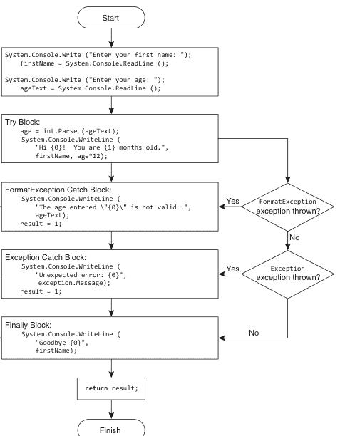

生成的程序流程如图 4.1 所示。
例如，假设用户为年龄输入“forty-two”。在这种情况下，int.Parse() 将抛出类型为 System.FormatException 的异常，控制权将跳转到 catch 块集合。（System.FormatException 表示字符串格式不正确，无法适当地进行解析。）由于第一个 catch 块与 int.Parse() 抛出的异常类型匹配，因此该块内的代码将执行。如果 try 块中的语句抛出不同的异常，则第二个 catch 块将执行，因为（从 C# 2.0 开始）所有异常都是 System.Exception 类型。

如果没有 System.FormatException catch 块，那么即使 int.Parse 抛出 System.FormatException，System.Exception catch 块也会执行。这是因为 System.FormatException 也是 System.Exception 类型。（System.FormatException 是通用异常 System.Exception 的更具体实现。）

尽管 catch 块的数量各不相同，但处理异常的顺序非常重要。catch 块必须从最具体到最不具体的顺序出现。System.Exception 数据类型最不具体，因此出现在最后。System.FormatException 出现在第一位，因为它是清单 4.20 处理的最具体的异常。

无论 try 块中的代码是否抛出异常，finally 代码块都会执行。finally 块的目的是提供一个位置来放置代码，无论 try/catch 块如何退出（有或没有异常），该代码都会执行。无论是否抛出异常，finally 块都有助于清理资源。事实上，可以有一个带有 finally 块但没有 catch 块的 try 块。无论 try 块是否抛出异常，或者是否甚至编写了 catch 块来处理异常，finally 块都会执行。清单 4.21 演示了 try/finally 块，输出 4.14 显示了结果。

## 清单 4.21：捕获异常

```
using System;

class ExceptionHandling
{
    static int Main()
    {
        string firstName;
        string ageText;
        int age;
        int result = 0;
        Console.Write("Enter your first name: ");
        firstName = Console.ReadLine();

        Console.Write("Enter your age: ");
        ageText = Console.ReadLine();

        try
        {
            age = int.Parse(ageText);
            Console.WriteLine(
                "Hi {0}! You are {1} months old.",
                firstName, age*12);
        }
        finally
        {
            Console.WriteLine("Goodbye {0}",
                firstName);
        }

        return result;
    }
}
```

## 输出 4.14：

```
Enter your first name: Inigo
Enter your age: forty-two

Unhandled Exception: System.FormatException: Input string was not in a
correct format.
   at System.Number.StringToNumber(String str, NumberStyles options,
   NumberBuffer& number, NumberFormatInfo info, Boolean parseDecimal)
   at System.Number.ParseInt32(String s, NumberStyles style,
   NumberFormatInfo info)
at ExceptionHandling.Main()
Goodbye Inigo
```

当此代码执行时，finally 块会在将未处理的异常打印到控制台之前执行（也可能出现未处理的异常对话框）。

## 高级主题

### 异常类继承

从 C# 2.0 开始，所有异常都派生自 System.Exception。因此，它们可以由 catch(System.Exception exception) 块处理。但是，最好包含一个针对最派生类型（例如 System.FormatException）的 catch 块，因为这样可以获取有关异常的最多信息，并以不那么通用的方式处理它。这样一来，使用最派生类型的 catch 语句就能具体处理异常类型，访问与抛出的异常相关的数据，并避免使用条件逻辑来确定发生了什么类型的异常。

这就是 C# 强制要求 catch 块从最派生到最不派生出现的原因。例如，捕获 System.Exception 的 catch 语句不能出现在捕获 System.FormatException 的语句之前，因为 System.FormatException 派生自 System.Exception。

方法可能会抛出多种异常类型。表 4.2 列出了框架中一些更常见的异常类型。

## 表 4.2：常见异常类型

| 异常类型 | 描述 |
| :--- | :--- |
| System.Exception | 其他异常派生自的通用异常。 |
| System.ArgumentException | 指示传递给方法的某个参数无效的一种方式。 |
| System.ArgumentNullException | 指示特定参数为 null，且这对该参数来说无效。 |
| System.ApplicationException | 应避免使用。最初的想法是，你可能希望对“系统”异常和“应用程序”异常采用不同的处理方式，虽然听起来合理，但在实际中效果并不理想。 |
| System.FormatException | 指示字符串格式无效，不适合转换。 |
| System.IndexOutOfRangeException | 指示尝试访问不存在的数组元素。 |

## 表 4.2：常见异常类型（续）

| 异常类型 | 描述 |
| :--- | :--- |
| System.InvalidCastException | 指示尝试从一种数据类型转换为另一种数据类型不是有效的转换。 |
| System.NotImplementedException | 指示虽然方法签名存在，但尚未完全实现。 |
| System.NullReferenceException | 当代码尝试查找由引用（例如变量）所引用的对象且该引用为 null 时抛出。 |
| System.ArithmeticException | 指示无效的数学运算，不包括除以零。 |
| System.ArrayTypeMismatchException | 尝试将错误类型的元素存储到数组中时发生。 |
| System.StackOverflowException | 通常指示存在无限循环，其中方法递归调用自身（称为递归）。 |

## 高级主题

### 通用 catch

可以指定一个不带参数的 catch 块，如清单 4.22 所示。

## 清单 4.22：通用 catch 块

```
...
try
{
    age = int.Parse(ageText);
    System.Console.WriteLine(
        "Hi {0}! You are {1} months old.",
        firstName, age*12);
}
catch (System.FormatException exception)
```


```
{
    System.Console.WriteLine(
        "The age entered {0} is not valid.",
        ageText);
    result = 1;
}
catch(System.Exception exception)
{
    System.Console.WriteLine(
        "Unexpected error: {0}", exception.Message);
    result = 1;
}
catch
{
    System.Console.WriteLine(
        "Unexpected error!");
    result = 1;
}
finally
{
    System.Console.WriteLine("Goodbye {0}",
        firstName);
}
...
```

一个没有数据类型的 catch 块，称为 **泛型 catch 块**，相当于指定一个接受 object 数据类型的 catch 块：例如，`catch(object exception){...}`。由于所有类最终都派生自 `object`，没有数据类型的 catch 块必须出现在最后。

泛型 catch 块很少使用，因为无法捕获有关异常的任何信息。此外，C# 不支持抛出 object 类型的异常。（仅用 C++ 等语言编写的库允许任何类型的异常。）

从 C# 2.0 开始的行为与早期 C# 行为略有不同。在 C# 2.0 中，如果语言允许非 `System.Exception`，则抛出的异常对象将被包装在 `System.Runtime.CompilerServices.RuntimeWrappedException` 中，它确实派生自 `System.Exception`。因此，所有异常，无论是否派生自 `System.Exception`，都将作为派生自 `System.Exception` 传播到 C# 程序集中。

结果是，`System.Exception` catch 块将捕获早期块未捕获的所有异常，而在 System.Exception catch 块之后的常规 catch 块永远不会被调用。因此，在 C# 2.0 或更高版本中，在 System.Exception catch 块之后跟一个常规 catch 块会导致编译器警告，指示常规 catch 块永远不会执行。

## 使用 throw 语句报告错误

正如 int.Parse() 可以抛出异常一样，C# 允许开发者从他们的代码中抛出异常，如清单 4.23 和输出 4.15 所示。

### 清单 4.23：抛出异常

```
using System;
class ThrowingExceptions
{
    static void Main()
    {
        try
        {
            Console.WriteLine("Begin executing");
            Console.WriteLine("Throw exception...");
            throw new Exception("Arbitrary exception.");
            Console.WriteLine("End executing");
        }
        catch (FormatException exception)
        {
            Console.WriteLine(
                "A FormatException was thrown");
        }
        catch(Exception exception)
        {
            Console.WriteLine(
                "Unexpected error: {0}", exception.Message);
        }
        catch
        {
            Console.WriteLine("Unexpected error!");
        }
        Console.WriteLine(
            "Shutting down...");
    }
}
```

```
Begin executing
Throw exception...
Unexpected error: Arbitrary exception
Shutting down...
```

如清单 4.23 中的箭头所示，抛出异常会将执行从抛出异常的位置跳转到堆栈中与抛出的异常类型兼容的第一个 catch 块。在这种情况下，第二个 catch 块处理异常并输出错误消息。在清单 4.23 中，没有 finally 块，因此执行会穿过到 try/catch 块之后的 System.Console.WriteLine() 语句。

为了抛出异常，需要有一个异常的实例。清单 4.23 使用 new 关键字后跟异常的数据类型来创建实例。大多数异常类型允许在抛出异常时包含一条消息，以便在发生异常时可以检索该消息。

有时，catch 块会捕获异常但无法适当或完全处理它。在这种情况下，catch 块可以使用不指定任何异常的 throw 语句重新抛出异常，如清单 4.24 所示。

### 清单 4.24：重新抛出异常

```
...
catch(Exception exception)
{
    Console.WriteLine(
        "Rethrowing unexpected error: {0}",
        exception.Message);
    throw;
}
...
```

## 避免使用异常处理来处理预期情况

开发者应努力避免为预期条件或正常控制流抛出异常。例如，开发者不应指望用户在指定年龄时输入有效文本。因此，开发者不应依赖异常来验证用户输入的数据，而应在尝试转换之前提供一种检查数据的方法。（更好的做法是，你应从一开始就防止用户输入无效数据。）异常专门用于跟踪异常、意外且潜在致命的情况。将其用于预期情况等非预期目的会导致你的代码难以阅读、理解和维护。

此外，（与大多数语言一样）C# 在抛出异常时会产生轻微的性能损耗——耗时微秒，而大多数操作耗时纳秒。这种延迟在人类时间中通常不可察觉——除非异常未被处理。例如，在执行清单 4.19 并输入无效年龄时，异常未被处理，运行时会搜索环境以查看是否有调试器要加载，因此会有明显的延迟。幸运的是，程序关闭时性能缓慢通常不是需要担心的因素。

## 高级主题

### 使用 TryParse() 进行数值转换

Parse() 方法的问题之一是，确定转换是否成功的唯一方法是尝试转换，如果不成功则捕获异常。由于抛出异常是一项相对昂贵的操作，因此最好在不使用异常处理的情况下尝试转换。在 C# 的第一个版本中，唯一支持此功能的数据类型是名为 double.TryParse() 的 double 方法。但是，CLI 在 CLI 2.0 版本中将此方法添加到了所有数值原始类型中。它需要使用 out 关键字，因为 TryParse() 函数的返回值是 bool 而不是转换后的值。下面是一个使用 int.TryParse() 演示转换的代码清单。

- 5. 一般来说，开发者应预期用户会执行意外操作，因此应采取防御性编码来处理“愚蠢的把戏”。

```
...
if (int.TryParse(ageText, out age))
{
    System.Console.WriteLine(
        "Hi {0}! You are {1} months old.", firstName,
        age * 12);
}
else
{
    System.Console.WriteLine(
        "The age entered {0} is not valid.", ageText);
}
...
```

在 .NET Framework 4 中，枚举类型也添加了 TryParse() 方法。

有了 TryParse() 方法，就不再需要仅为了处理字符串到数值转换而包含 try/catch 块。

## 摘要

本章讨论了声明和调用方法的细节。在许多方面，此构造与 C 类语言中的声明相同。但是，添加 out 和 ref 关键字在语法上更类似于 COM（CLI 技术的前身），而不是 C 类语言中使用的“&&”。除了方法声明，本章还介绍了异常处理。

方法是编写可读代码的关键基本构造。与其编写包含大量语句的大型方法，不如将方法用作代码中的“段落”，长度目标大约为十行或更少。将大型函数分解为较小的片段是重构代码以使其更易读和可维护的方法之一。

下一章将探讨类构造及其如何将方法（行为）和字段（数据）封装为一个单元。

*本页故意留空*

# 类

你在第 1 章中简要了解了如何声明名为 HelloWorld 的新类。在第 2 章中，你学习了 C# 包含的内置原始类型。既然你现在还学习了控制流以及如何声明方法，是时候讨论定义你自己的了

- 1 声明和实例化类
- 2 实例字段
  - 声明实例字段
  - 访问实例字段
  - const 和 readonly 修饰符
- 3 实例方法
- 4 访问修饰符
- 5 属性
  - 声明属性
  - 命名约定
  - 使用带验证的属性
  - 只读和只写属性
  - Getter 和 Setter 上的访问修饰符
  - 虚拟属性上的属性
  - 接口上的属性
  - 不允许作为 ref 或 out 参数值的调用
- 6 构造函数和终结器
  - 声明构造函数
  - 默认构造函数
  - 重载构造函数
  - 使用 this 调用一个构造函数
  - 终结器
- 7 静态
  - 静态字段
  - 静态方法
  - 静态构造函数
  - 静态类
- 8 扩展方法
- 9 特殊类
  - 分部类
  - 嵌套类


types. 这是任何 C# 程序的核心构造，对类及其从中创建的对象的完整支持定义了 C# 作为面向对象语言。

本章将向您介绍使用 C# 进行面向对象编程的基础知识。重点在于如何定义类，类是对象本身的模板。

前几章中的结构化编程所有构造在面向对象编程中仍然适用。但是，通过将这些构造封装在类中，您可以创建更大、更有组织且更易于维护的程序。从基于结构化控制流的程序向面向对象程序的过渡在一定程度上彻底改变了编程，因为它提供了额外的组织层级。结果是小型程序在某种程度上得到了简化；但更重要的是，有可能创建更大的程序，因为这些程序中的代码组织得更好。

面向对象编程的一个关键优势是，您不必完全从头开始创建新程序，而是可以从先前的工作中组装一组现有对象，通过新功能扩展类，添加更多类，然后重新组装一切以提供新功能。

不熟悉面向对象编程的读者应阅读“初学者主题”块以了解简介。初学者主题外的一般文本侧重于使用 C# 进行面向对象编程，并假设读者已经熟悉面向对象方法论。

本章深入探讨了 C# 如何通过对类、属性和访问修饰符等构造的支持来实现封装（我们在前一章中介绍了方法）。下一章在此基础上介绍了继承以及面向对象编程实现的多态性。

### 初学者主题
### 面向对象编程

当今成功编程的关键在于能够为越来越大的应用程序中复杂需求的实现提供组织和结构。面向对象编程是实现这一目标的关键方法论之一，以至于面向对象程序员很难设想回到结构化编程，除非是最简单的过渡情况。

面向对象编程中最基本的构造是类或对象本身。这些构造构成了通常是现实世界概念的编程抽象、模型或模板。例如，类 OpticalStorageMedia 可能具有一个 Eject() 方法，用于导致 CD/DVD 从播放器中弹出。OpticalStorageMedia 类是 CD 这一现实世界对象的编程抽象。

类是面向对象编程三个主要特征的基础：封装、继承和多态性。

## 封装

封装允许您隐藏细节。在必要时仍可以访问这些细节，但通过智能地封装细节，大型程序更易于理解，数据受到保护免受意外修改，代码也更易于维护，因为代码更改的影响被限定在封装范围内。方法是封装的示例。虽然可以将方法中的代码直接嵌入到调用方的代码中，但将代码重构为方法可以提供封装优势。

## 继承

请考虑以下示例：DVD 是一种光学媒体。它具有特定的存储容量，并能够存储数字电影。CD 也是一种光学媒体，但具有不同的特性。CD 上的版权实现与 DVD 版权保护不同，存储容量也不同。CD 和 DVD 都与硬盘驱动器、USB 驱动器和软盘驱动器不同（还记得那些吗？）。它们都属于存储媒体类别，但每种都有特殊特性，即使是支持的文件系统以及媒体实例是只读还是可读写等基本功能也是如此。

面向对象编程中的继承允许您在这些相似但不同的项目之间编写“是一种”关系。合理地假设 DVD“是一种”存储媒体，CD“是一种”存储媒体，因此每种都具有存储容量。

同样，CD 和 DVD 与光学媒体类型具有“是一种”关系，而光学媒体类型又与存储媒体类型具有“是一种”关系。如果为提到的每种存储媒体定义相应的类，则您已定义了类层次结构，即一系列“是一种”关系。所有存储媒体都派生自的基类型可以是类 StorageMedia。因此，CD、DVD、硬盘驱动器、USB 驱动器和软盘驱动器都是 StorageMedia 的类型。但是，CD 和 DVD 不需要直接从 StorageMedia 派生。相反，它们可以从中间类型 OpticalStorageMedia 派生。您可以使用类似于统一建模语言 (UML) 的类图以图形方式查看类层次结构，如图 5.1 所示。

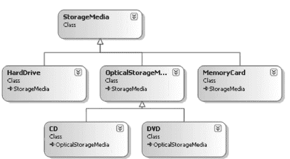

图 5.1：类层次结构

继承关系至少涉及两个类，其中一个类是另一个类的更通用版本；在图 5.1 中，StorageMedia 是 HardDrive 的更通用版本。尽管更专业化的类型 HardDrive 是 StorageMedia 的一种类型，但反之不成立；StorageMedia 类型不一定是 HardDrive。如图 5.1 所示，继承可以涉及多于两个类。

更专业化的类型是派生类型或子类型。更通用的类型是基类或有时称为超类型。继承关系中类的其他常用术语是 *父类* 和 *子类*；前者是更通用的类。

从另一个类型 **派生** 或 **继承** 是对该类型进行 **特化**，这意味着将基类型定制为用于特定目的。同样，基类型是派生类型的通用实现。

继承的关键特征是，所有派生类型都继承基类型的成员。通常，可以修改基成员的实现，但无论如何，派生类型包含基类型的成员，以及派生类型显式包含的任何其他成员。

派生类型允许您将类组织成一个连贯的层次结构，其中“子”类型比其“父”类型具有更高的特异性。

## 多态性

多态性由一个表示“许多”的词和一个表示“形式”的词组成。在对象上下文中，多态性意味着单个方法或类型可以有多种实现形式。假设您有一个媒体播放器。那么，媒体播放器既可以播放 CD 音乐光盘，也可以播放包含 MP3 的 DVD。但是，Play() 方法的精确实现会因媒体类型而异。在音乐 CD 对象上调用 Play() 或在音乐 DVD 上调用 Play() 都会播放音乐，因为每种类型都了解播放的复杂细节。媒体播放器所知道的只是公共基类型 opticalStorageMedia，以及它定义了 Play() 方法签名这一事实。多态性的原理是，一个类型可以处理方法实现的精确细节，因为该方法出现在多个派生类型上，这些派生类型共享一个公共基类型（或接口），后者也包含相同的方法签名。

## 声明和实例化类

定义类涉及首先指定关键字 class，然后是标识符，如清单 5.1 所示。

## 清单 5.1：定义类

```
class Employee
{
}
```

属于类的所有代码都将出现在类声明后的花括号之间。虽然这不是强制要求，但通常将每个类放在其自己的文件中。这样更容易找到定义特定类的代码，因为约定是使用类名命名文件。

定义新类后，您可以像使用框架内置类一样使用该类。换句话说，您可以声明该类型的变量，或定义接受新类类型参数的方法。清单 5.2 演示了这一点。

## 清单 5.2：声明类类型的变量

```
class Program
{
    static void Main()
    {
        Employee employee1, employee2;
        // ...

    }

    static void IncreaseSalary (Employee employee)
    {
        // ...
    }
}
```

### 初学者主题
### 对象和类定义

在日常交谈中，类和对象这两个术语似乎可以互换。但是，对象和类有明确的含义。类是对象在实例化时的外观模板。因此，对象是类的实例。类就像是小部件将呈现的外观的模具


诸如此类。对象对应由模具创建的小部件。从类创建对象的过程称为实例化，因为对象是类的一个实例。

现在你已经定义了新的类类型，是时候实例化该类型的对象了。效仿其前辈，C# 使用 new 关键字来实例化对象（参见清单 5.3）。

### 清单 5.3：实例化一个类

```
class Program
{
    static void Main()
    {
        Employee employee1 = new Employee();
        Employee employee2;
        employee2 = new Employee();
        IncreaseSalary(employee1);
    }
}
```

毫不奇怪，赋值可以在声明的同一行进行，也可以在单独的一行进行。

与你迄今为止使用过的原始类型不同，没有字面量方式来指定 Employee 类型。相反，new 运算符向运行时提供指令，为 Employee 对象分配内存、实例化该对象，并返回对实例的引用。

尽管有用于分配内存的显式运算符，但没有这样的运算符用于恢复内存。相反，运行时会在对象最后一次可访问之后、应用程序关闭之前的某个时间自动回收内存。垃圾回收器负责自动释放内存。它确定哪些对象不再被其他活动对象引用，然后释放这些对象的内存。结果是，没有编译时确定的位置来将内存恢复到系统中。

在这个简单的示例中，Employee 没有关联任何显式数据或方法，这使得对象基本上毫无用处。下一节将重点介绍向对象添加数据。

### 语言对比：C++—delete 运算符

程序员应将 new 运算符视为实例化对象的调用，而不是分配内存的调用。在堆上分配的对象和在栈上分配的对象都支持 new 运算符，强调 new 与内存分配以及是否需要释放内存无关。

因此，与 C++ 相反，C# 确实避免了对 delete 运算符或其等价物的需求。内存管理是运行时管理的一个细节，这使开发人员能够更多地专注于领域逻辑。但是，尽管内存管理由运行时处理，但资源管理（数据库连接、网络端口等）没有隐式机制。换句话说，没有隐式方式来编程确定性销毁（在代码中编译时定义的位置发生隐式对象销毁）。幸运的是，C# 确实通过 using 语句支持显式、确定性的资源管理，或使用终结器进行非确定性清理。

### 初学者主题

### 封装 第 1 部分：对象将数据与方法分组

如果你收到一叠印有员工名的索引卡、一叠印有员工姓的索引卡和一叠印有员工薪水的索引卡，除非你知道每叠卡片的顺序一致，否则这些卡片价值不大。即便如此，数据也很难处理，因为确定某人的全名需要搜索两叠卡片。更糟糕的是，如果你掉落其中一叠，就无法将名、姓和薪水重新关联起来。相反，你需要一叠员工卡片，所有数据都分组在同一张卡片上。这样一来，名、姓和薪水就会被封装在一起。

在面向对象编程语境之外，封装一组项目是指将这些项目封装在胶囊中。同样，面向对象编程将方法和数据一起封装到对象中。这提供了对所有类成员（类中的数据和方法）的分组，因此不再需要单独处理它们。与将名、姓和薪水作为三个独立参数传递给方法不同，对象允许调用传递对员工对象的引用。一旦被调用的方法收到对象引用，它就可以向对象发送消息（例如，它可以调用 AdjustSalary() 之类的方法）来执行特定操作。

### 实例字段

面向对象设计的关键方面之一是对数据进行分组以提供结构。本节讨论如何向 Employee 类添加数据。在类中存储数据的变量的通用面向对象术语是成员变量。这个术语在 C# 中被广泛理解，但更标准的术语以及规范中使用的术语是字段，它是与包含类型关联的命名存储单元。

实例字段是在类级别声明的变量，用于存储与对象关联的数据。因此，关联是字段数据类型与包含类型之间的关系。

### 声明实例字段

在清单 5.4 中，Employee 已修改为包含三个字段：FirstName、LastName 和 Salary。

### 清单 5.4：声明字段

```
class Employee
{
    public string FirstName;
    public string LastName;
    public string Salary;
}
```

添加这些字段后，可以为每个 Employee 实例存储一些基本数据。在这种情况下，你将访问修饰符 public 作为字段的前缀。字段上的 public 表示字段中的数据可从 Employee 以外的类访问（参见本章后面的访问修饰符部分）。

与局部变量声明一样，字段声明包括字段引用的数据类型。此外，可以在声明时为字段分配初始值，如清单 5.5 中的 Salary 字段所示。

### 清单 5.5：在声明时设置字段的初始值

```
class Employee
{
    public string FirstName;
    public string LastName;
    public string Salary = "Not enough";
}
```

### 访问实例字段

你可以设置和检索字段中的数据。但是，字段不包含 static 修饰符这一事实表明它是实例字段。你只能从包含类的实例（对象）访问实例字段。你不能直接从类访问它（换句话说，在先创建实例之前）。

清单 5.6 展示了 Program 类及其对 Employee 类的使用情况的更新视图。输出 5.1 显示了结果。

### 清单 5.6：访问字段

```
class Program
{
    static void Main()
    {
        Employee employee1 = new Employee();
        Employee employee2;
        employee2 = new Employee();

        employee1.FirstName = "Inigo";
        employee1.LastName = "Montoya";
        employee1.Salary = "Too little";
        IncreaseSalary(employee1);
        Console.WriteLine(
            "{0} {1}: {2}",
            employee1.FirstName,
            employee1.LastName,
            employee1.Salary);
        // ...
    }

    static void IncreaseSalary(Employee employee)
    {
        employee.Salary = "Enough to survive on";
    }
}
```

### 输出 5.1:

```
Inigo Montoya: Enough to survive on
```

清单 5.6 实例化了两个 Employee 对象，如你之前所见。接下来，它设置每个字段，调用 IncreaseSalary() 来更改薪水，然后显示与 employee1 引用的对象关联的每个字段。

请注意，你首先必须指定正在使用的 Employee 实例。因此，在赋值和访问字段时，employee1 变量作为字段名的前缀出现。

### 实例方法

在 Main() 中的 WriteLine() 方法调用内格式化名称的一个替代方案是在 Employee 类中提供一个负责格式化的方法。将功能放在 Employee 类中而不是作为 Program 的成员，这与类的封装一致。为什么不将与员工全名相关的方法与包含形成名称的数据的类分组在一起呢？

清单 5.7 演示了创建此类方法的过程。

### 清单 5.7：从包含类内部访问字段

```
class Employee
{
    public string FirstName;
    public string LastName;
    public string Salary;
}
```


```
public string GetName()
{
    return FirstName + " " + LastName;
}
```

与第4章中所学内容相比，此方法并无特别之处，唯一的区别在于，现在GetName()方法访问的是对象上的字段，而不仅仅是局部变量。此外，方法声明未标记为static。如本章后面所述，static方法不能直接访问类中的实例字段。相反，必须获取类的实例才能调用任何实例成员（无论是方法还是字段）。

添加GetName()方法后，可以更新Program.Main()以使用新方法，如清单5.8和输出5.2所示。

### 清单5.8：从包含类外部访问字段

```
class Program
{
    static void Main()
    {
        Employee employee1 = new Employee();
        Employee employee2;
        employee2 = new Employee();

        employee1.FirstName = "Inigo";
        employee1.LastName = "Montoya";
        employee1.Salary = "Too little";
        IncreasesSalary(employee1);
        Console.WriteLine(
            "{0} {1}",
            employee1.GetName(),
            employee1.Salary);
        // ...
    }
    // ...
}
```

### 输出5.2：

```
Inigo Montoya: Enough to survive on
```

## 使用this关键字

可以从属于该类的实例成员内部获取对类的引用。要在C#中明确指示所访问的字段或方法是包含类的实例成员，请使用关键字this。从概念上讲，this是每个实例方法中的隐式参数，返回对象本身的实例。

例如，考虑清单5.9中所示的SetName()方法。

### 清单5.9：使用this明确标识字段的所有者

```
class Employee
{
    public string FirstName;
    public string LastName;
    public string Salary;

    public string GetName()
    {
        return FirstName + " " + LastName;
    }

    public void SetName(string newFirstName, string newLastName)
    {
        this.FirstName = newFirstName;
        this.LastName = newLastName;
    }
}
```

此示例使用关键字this来指示字段FirstName和LastName是类的实例成员。

### 初学者主题

### 依赖编码风格避免歧义

在SetName()方法中，不必使用this关键字，因为FirstName显然与newFirstName不同。但是，如果将参数命名为"FirstName"（使用Pascal大小写），而不是"newFirstName"，则情况不同，如清单5.10所示。

### 清单5.10：使用this避免歧义

```
class Employee
{
    public string FirstName;
    public string LastName;
    public string Salary;

    public string GetName()
    {
        return FirstName + " " + LastName;
    }

    // Caution: Parameter names use Pascal case
    public void SetName(string FirstName, string LastName)
    {
        this.FirstName = FirstName;
        this.LastName = LastName;
    }
}
```

在此示例中，如果不明确指示Employee对象拥有该变量，则无法引用FirstName字段。this的作用就像Program.Main()方法中使用的employee1变量前缀一样（参见清单5.8）；它将引用标识为调用SetName()的对象。

清单5.10不遵循C#命名约定，该约定要求参数像局部变量一样声明，使用驼峰大小写。这可能导致微妙的错误，因为将FirstName（意指引用字段）赋值给FirstName（参数）仍然可以编译甚至运行。为避免此问题，最佳实践是为参数和局部变量采用与字段不同的命名约定。本章后面将演示一种此类约定。

> **语言对比：Visual Basic—使用Me访问类实例**
>
> C#关键字`this`与Visual Basic关键字`Me`相同。

在清单5.9和清单5.10中，GetName()方法未使用this关键字——它是可选的。但是，如果存在与字段同名的局部变量或参数（参见清单5.10中的SetName()方法），则省略this将导致访问局部变量/参数而不是字段，因此需要使用this。

还可以使用关键字this显式访问类的方法。例如，在SetName()方法中允许使用this.GetName()，这样可以打印新分配的名称（参见清单5.11和输出5.3）。

### 清单5.11：将this与方法一起使用

```
class Employee
{
// ...

public string GetName()
{
return FirstName + " " + LastName;
}

public void SetName(string newFirstName, string newLastName)
{
this.FirstName = newFirstName;
this.LastName = newLastName;
Console.WriteLine("Name changed to \"{0}\"",
this.GetName());
}
}

class Program
{
static void Main()
{
Employee employee = new Employee();
employee.SetName("Inigo", "Montoya");
// ...
}
// ...
}
```

```
Output 5.3:
Name changed to 'Inigo Montoya'
```

有时可能需要使用this来传递当前执行对象的引用。考虑清单5.12中的Save()方法。

### 清单5.12：在方法调用中传递this

```
class Employee
{
    public string FirstName;
    public string LastName;
    public string Salary;

    public void Save()
    {
        DataStorage.Store(this);
    }
}

class DataStorage
{
    // Save an employee object to a file
    // named with the Employee name.
    public static void Store(Employee employee)
    {
        // ...
    }
}
```

Save()方法调用DataStorage类上的名为Store()的方法。但是，Store()方法需要传递要持久化的Employee对象。这是通过使用关键字this完成的，它传递了调用Save()的Employee对象的实例。

### 高级主题

## 使用文件进行存储和加载

DataStorage类中Store()方法的实际实现涉及System.IO命名空间内的类，如清单5.13所示。在Store()中，首先实例化一个FileStream对象，并将其与对应员工全名的文件关联。FileMode.Create参数表示如果不存在名为<firstname><lastname>.dat的文件，则希望创建一个新文件；如果文件已存在，则将被覆盖。接下来，创建一个StreamWriter类。StreamWriter类负责将文本写入FileStream。使用WriteLine()方法写入数据，就像将数据写入控制台一样。

### 清单5.13：将数据持久化到文件

```
using System;
// IO namespace
using System.IO;

class DataStorage
{
    // Save an employee object to a file
    // named with the Employee name.
    // Error handling not shown
    public static void Store(Employee employee)
    {
        // Instantiate a FileStream using FirstNameLastName.dat
        // for the filename. FileMode.Create will force
        // a new file to be created or override an
        // existing file.
        FileStream stream = new FileStream(
            employee.FirstName + employee.LastName + ".dat",
            FileMode.Create);

        // Create a StreamWriter object for writing text
        // into the FileStream
        StreamWriter writer = new StreamWriter(stream);

        // Write all the data associated with the employee.
        writer.WriteLine(employee.FirstName);
        writer.WriteLine(employee.LastName);
        writer.WriteLine(employee.Salary);

        // Close the StreamWriter and its Stream.
        writer.Close(); // Automatically closes the stream

        // ...
    }
}
```

- 此代码可通过使用using语句来改进，该结构因尚未介绍而被避免。

完成写入操作后，FileStream和StreamWriter都需要关闭，以免在等待垃圾回收器运行时保持打开状态无限期。此清单不包含任何错误处理，因此如果抛出异常，不会调用任何Close()方法。

加载过程类似（参见清单5.14）。

### 清单5.14：从文件检索数据

```
class Employee
{
    // ...
}

// IO namespace
using System;
using System.IO;

class DataStorage
{
    // ...

    public static Employee Load(string firstName, string lastName)
    {
        Employee employee = new Employee();

        // Instantiate a FileStream using FirstNameLastName.dat
        // for the filename. FileMode.Open will open
        // an existing file or else report an error.
        FileStream stream = new FileStream(
            firstName + lastName + ".dat", FileMode.Open);

        // Create a StreamReader for reading text from the file.
        StreamReader reader = new StreamReader(stream);

        // Read each line from the file and place it into
        // the associated property.
        employee.FirstName = reader.ReadLine();
        employee.LastName = reader.ReadLine();
        employee.Salary = reader.ReadLine();

        // Close the StreamReader and its Stream.
        reader.Close(); // Automatically closes the stream
    }
}
```

- 此代码可通过使用using语句来改进，该结构因尚未介绍而被避免。


```
return employee;
}
```

```csharp
class Program
{
    static void Main()
    {
        Employee employee1;

        Employee employee2 = new Employee();
        employee2.SetName("Inigo", "Montoya");
        employee2.Save();

        // Modify employee2 after saving.
        IncreaseSalary(employee2);

        // Load employee1 from the saved version of employee2
        employee1 = DataStore.Load("Inigo", "Montoya");

        Console.WriteLine(
            "{0}: {1}",
            employee1.GetName(),
            employee1.Salary);

        // ...
    }
    // ...
}
```

输出 5.4 显示结果。

### 输出 5.4:

```
Name changed to 'Inigo Montoya'
Inigo Montoya
```

保存过程的逆过程出现在清单 5.14 中，该清单使用 StreamReader 而非 StreamWriter。同样，在读取数据后，需要对 FileStream 和 StreamReader 都调用 Close()。

输出 5.4 在“Inigo Montoya”之后未显示任何薪水，因为 Salary 直到在 Save() 调用之后才通过 IncreaseSalary() 调用被设置为“Enough to survive on”。

请注意在 Main() 中，我们可以从员工实例调用 Save()，但要加载新员工，我们调用 DataStorage.Load()。加载员工时，我们通常没有已有的员工实例可供加载，因此在 Employee 上使用实例方法并非理想之选。调用 DataStorage.Load 的替代方案是向 Employee 添加一个静态 Load() 方法（参见本章后面的“静态”部分），这样就可以调用 Employee.Load()（使用 Employee 类，而非 Employee 实例）。

请注意清单顶部包含 using System.IO 指令。这使得每个 IO 类都可以在不加完整命名空间前缀的情况下访问。

## 访问修饰符

在本章前面声明字段时，您在字段声明前加上了关键字 public。public 是一种访问修饰符，用于标识其装饰成员所关联的封装级别。可用的访问修饰符有五种：public、private、protected、internal 和 protected internal。本节将讨论前两者。

### 初学者专题

## 封装第 2 部分：信息隐藏

除了将数据和方法封装在一个单元中之外，封装还涉及隐藏对象数据和行为的内部细节。在某种程度上，方法也做到了这一点：从方法外部来看，调用者只能看到方法声明。内部实现不可见。然而，面向对象编程通过提供控制成员从类外部可见程度的机制，将这一点进一步实现。类外部不可见的成员是私有成员。

在面向对象编程中，封装不仅是指将数据和行为分组，还包括在类（胶囊）内部隐藏数据，以便将类的内部工作原理对外部暴露的最小访问量。这降低了调用者不当修改数据的可能性。

访问修饰符的目的是提供封装。通过使用 `public`，您明确表示修改后的字段可以从 `Employee` 类外部访问——换句话说，例如可以从 `Program` 类访问。

但是，请考虑一个包含 `Password` 字段的 `Employee` 类。应该可以调用 `Employee` 对象并使用 `Logon()` 方法验证密码。但是，不应该能够从类外部访问 `Employee` 对象上的 `Password` 字段。

要将 `Password` 字段定义为对包含类外部隐藏且不可访问，请为访问修饰符使用关键字 `private`，而非 `public`（参见清单 5.15）。结果是，`Password` 字段不打算从 `Program` 类等内部访问。

### 清单 5.15：使用 private 访问修饰符

```csharp
class Employee
{
    public string FirstName;
    public string LastName;
    public string Salary;
    private string Password;
    private bool IsAuthenticated;
}
```

```csharp
public bool Logon(string password)
{
    if (Password == password)
    {
        IsAuthenticated = true;
    }
    return IsAuthenticated;
}

public bool GetIsAuthenticated()
{
    return IsAuthenticated;
}
```

```csharp
class Program
{
    static void Main()
    {
        Employee employee = new Employee();

        employee.FirstName = "Inigo";
        employee.LastName = "Montoya";

        // ...

        // Password is private, so it cannot be
        // accessed from outside the class.
        // Console.WriteLine(
        // ("Password = {0}", employee.Password);
        // ...
    }
}
```

虽然清单 5.15 未显示，但也可以将方法的访问修饰符设置为 private。

请注意，如果类成员上未放置访问修饰符，则声明将默认为 private。换句话说，成员默认为私有，程序员需要明确指定成员为 public。

## 属性

前一节“访问修饰符”演示了如何使用 private 关键字封装密码，防止从类外部访问。然而，这种封装往往过于彻底。例如，有时您可能需要定义外部类只能读取但其值可在内部更改的字段。或者，也许您想允许写入类中的某些数据，但需要能够验证对数据所做的更改。还有一个例子是需要即时构建数据。

传统上，语言通过将字段标记为私有，然后提供 getter 和 setter 方法来访问和修改数据，从而实现了这些示例中的功能。清单 5.16 中的代码将 FirstName 和 LastName 都更改为私有字段。每个字段的公共 getter 和 setter 方法允许访问和更改其值。

### 清单 5.16：声明 Getter 和 Setter 方法

```csharp
class Employee
{
    private string FirstName;
    // FirstName getter
    public string GetFirstName()
    {
        return FirstName;
    }
    // FirstName setter
    public void SetFirstName(string newFirstName)
    {
        if (newFirstName != null && newFirstName != "")
        {
            FirstName = newFirstName;
        }
    }

    private string LastName;
    // LastName getter
    public string GetLastName()
    {
        return LastName;
    }
    // LastName setter
    public void SetLastName(string newLastName)
    {
        if (newLastName != null && newLastName != "")
        {
            LastName = newLastName;
        }
    }
    // ...
}
```

不幸的是，此更改影响了 Employee 类的可编程性。您不再能使用赋值运算器在类中设置数据，也不能在不调用方法的情况下访问数据。

### 声明属性

考虑到这种模式的频率，C# 设计师决定为其提供显式语法。这种语法称为 **属性**（参见清单 5.17 和输出 5.5）。

### 清单 5.17：定义属性

```csharp
class Program
{
    static void Main()
    {
        Employee employee = new Employee();

        // Call the FirstName property's setter.
        employee.FirstName = "Inigo";

        // Call the FirstName property's getter.
        System.Console.WriteLine(employee.FirstName);
    }
}
```

```csharp
class Employee
{
    // FirstName property
    public string FirstName
    {
        get
        {
            return _FirstName;
        }
        set
        {
            _FirstName = value;
        }
    }

    private string _FirstName;

    // LastName property
    public string LastName
    {
        get
        {
            return _LastName;
        }
        set
        {
            _LastName = value;
        }
    }

    private string _LastName;

    // ...
}
```


## 输出 5.5:

```
Inigo
```

在清单 5.17 中需要注意的第一点不是属性代码本身，而是 Program 类中的代码。虽然你不再拥有带有 FirstName 和 LastName 标识符的字段，但通过查看 Program 类无法看出这一点。访问员工名和姓的 API 完全没有改变。仍然可以使用简单的赋值运算符分配名称的各个部分，例如（employee.FirstName = "Inigo"）。

关键特性在于，属性提供的 API 在程序上看起来像字段。但实际上，并不存在这样的字段。属性声明看起来与字段声明完全一样，但其后跟有用于放置属性实现的花括号。属性实现由两个可选部分组成。get 部分定义属性的 getter 部分。它直接对应于清单 5.16 中定义的 GetFirstName() 和 GetLastName() 函数。要访问 FirstName 属性，请调用 employee.FirstName。同样，setter（实现的 set 部分）启用字段赋值的调用语法：

```
employee.FirstName = "Inigo";
```

属性定义语法使用三个上下文关键字。你使用 get 和 set 关键字分别标识属性的检索部分或赋值部分。此外，setter 使用 value 关键字来引用赋值操作的右侧。因此，当 Program.Main() 调用 employee.FirstName = "Inigo" 时，value 在 setter 内部被设置为 "Inigo"，并可用于赋值给 _FirstName。清单 5.17 的属性实现是最常见的。当调用 getter 时（例如在 Console.WriteLine(employee2.FirstName) 中），将返回字段 (_FirstName) 的值。

## 自动实现的属性

在 C# 3.0 中，属性语法包含一种简写版本。由于由 get 和 set 访问器分配和检索的带有单个支持字段的属性非常简单且常见（请参阅 FirstName 和 LastName 的实现），C# 3.0 编译器允许声明不带任何访问器实现或支持字段声明的属性。清单 5.18 演示了该语法，输出 5.6 显示了结果。

## 清单 5.18：自动实现的属性

```
class Program
{
    static void Main()
    {
        Employee employee1 =
            new Employee();
        Employee employee2 =
            new Employee();

        // Call the FirstName property's setter.
        employee1.FirstName = "Inigo";

        // Call the FirstName property's getter.
        System.Console.WriteLine(employee1.FirstName);

        // Assign an auto-implemented property
        employee2.Title = "Computer Nerd";
        employee1.Manager = employee2;

        // Print employee1 manager's title.
        System.Console.WriteLine(employee1.Manager.Title);
    }
}

class Employee
{
    // FirstName property
    public string FirstName
    {
        get
        {
            return _FirstName;
        }
        set
        {
            _FirstName = value;
        }
    }

    private string _FirstName;
}
```

```
// LastName property
public string LastName
{
    get
    {
        return _LastName;
    }
    set
    {
        _LastName = value;
    }
}

private string _LastName;

// ...

public string Title { get; set; }

public Employee Manager { get; set; }
}
```

## 输出 5.6:

```
Inigo
Computer Nerd
```

自动实现的属性除了读取属性外，还提供了一种更简单的编写属性的方式。此外，当需要向 setter 添加诸如验证之类的内容时，任何调用该属性的现有代码都不必更改，尽管属性声明将更改为包含实现。

在本书的其余部分，我将频繁使用此 C# 3.0 或更高版本的语法，而不表明它是 C# 3.0 引入的功能。

## 命名约定

因为属性名是 FirstName，所以字段名从早期的清单更改为 _firstName。支持属性的私有字段的其他常见命名约定是 _firstName 和 m_firstName（源自 C++，其中 _m_ 代表成员变量），以及与局部变量一样的驼峰式命名约定。³

无论你为私有字段使用哪种命名模式，公共字段和属性的编码标准都是 Pascal 大小写。因此，公共属性应使用 LastName 和 FirstName 类型模式。同样，如果在公共字段周围未创建封装属性，则应对字段使用 Pascal 大小写。

3. 我更喜欢 _firstName，因为与简单的 _ 相比，名称前面的 _m_ 是多余的，并且通过使用与属性相同的大小写，可以在 Visual Studio 代码模板扩展工具中只使用一个字符串，而不是为属性名和字段名各使用一个。

## 将属性与验证一起使用

请注意，在清单 5.19 中，Employee 的 Initialize() 方法也使用属性而不是字段进行赋值。虽然不是必需的，但结果是属性 setter 中的任何验证都将在类内外被调用。例如，考虑如果将 LastName 属性更改为在将其分配给 _lastName 之前检查 value 是否为 null 或空字符串，会发生什么情况。

## 清单 5.19：提供属性验证

```
class Employee
{
    // ...

    public void Initialize(
        string newFirstName,
        string newLastName)
    {
        // Use property inside the Employee
        // class as well.
        FirstName = newFirstName;
        LastName = newLastName;
    }

// LastName property
public string LastName
{
    get
    {
        return _LastName;
    }
    set
    {
        // Validate LastName assignment
        if (value == null)
        {
            // Report error
            throw new ArgumentNullException();
        }
        else
        {
            // Remove any whitespace around
            // the new Last name.
            value = value.Trim();
            if (value == "")
            {
                throw new ArgumentException(
                    "LastName cannot be blank.");⁴
            }
            else
                _LastName = value;
        }
    }
}
```

有了这个新实现，如果 LastName 被分配了无效值（无论是来自同一类的另一个成员，还是从 Program.Main() 内部直接分配给 LastName），代码都会抛出异常。通过提供类似字段的 API 来拦截赋值并验证参数的能力是属性的优势之一。

最佳实践是仅从属性实现内部访问属性支持字段。换句话说，始终使用属性，而不是直接调用字段。在许多情况下，即使来自与属性同一类中的代码，这也是正确的。如果遵循此做法，添加验证代码等代码时，整个类将立即受益。（如本章后面所述，一个例外是当字段标记为只读时，因为即使在属性 setter 中，类实例化完成后也无法设置值。）

虽然罕见，但在 setter 内部分配值是可能的，就像清单 5.19 所做的那样。在这种情况下，对 value.Trim() 的调用会删除新姓周围的任何空白。

4. 向 Teller、Cher、Sting、Madonna、Bono、Prince 和 Liberace 等人道歉。

## 只读和只写属性

通过删除属性的 getter 或 setter 部分，可以更改属性的可访问性。仅带有 setter 的属性是只写的，这种情况相对较少。同样，仅提供 getter 会导致属性为只读；任何尝试分配值的行为都会导致编译错误。例如，要使 Id 只读，你可以按清单 5.20 所示对其进行编码。

## 清单 5.20：定义只读属性

```
class Program
{
    static void Main()
    {
        Employee employee1 = new Employee();
        employee1.Initialize(42);

        // ERROR: Property or indexer 'Employee.Id'
        // cannot be assigned to -- it is read-only
        employee1.Id = "496";
    }
}

class Employee
{
    public void Initialize(int id)
    {
        // Use field because Id property has no setter,
        // it is read-only.
        _id = id.ToString();
    }

    // ...

    // Id property declaration
    public string Id
    {
        get
        {
            return _id;
        }
        // No setter provided.
    }

    private string _id;
}
```


清单 5.20 在 Employee 构造函数内部为字段赋值，而不是为属性赋值（_id = id）。通过属性赋值会导致编译错误，就像在 Program.Main() 中一样。

## Getter 和 Setter 上的访问修饰符

如前所述，最好不要从属性外部访问字段，因为这样做会绕过可能插入的任何验证或附加逻辑。不幸的是，C# 1.0 不允许属性的 getter 和 setter 部分之间具有不同的封装级别。因此，不可能创建公共 getter 和私有 setter，以便外部类对属性具有只读访问权限，而类内部的代码可以写入属性。

在 C# 2.0 中，添加了对在属性实现的 get 或 set 部分（而不是两者）上放置访问修饰符的支持，从而覆盖属性声明中指定的访问修饰符。清单 5.21 演示了如何执行此操作。

### 清单 5.21：在 setter 上放置访问修饰符

```
class Program
{
    static void Main()
    {
        Employee employee1 = new Employee();
        employee1.Initialize(42);

        // ERROR: The property or indexer 'Employee.Id'
        // cannot be used in this context because the set
        // accessor is inaccessible
        employee1.Id = "498";
    }
}

class Employee
{
    public void Initialize(int id)
    {
        // Set Id property
        Id = id.ToString();
    }

    // ...
}
// Id property declaration
public string Id
{
    get
    {
        return _id;
    }
    // Providing an access modifier is in C# 2.0
    // and higher only
    private set
    {
        _id = value;
    }
}
private string _id;
}
```

在 setter 上使用 private，该属性对于 Employee 以外的类来说显示为只读。从 Employee 内部，该属性显示为读/写，因此你可以在构造函数中为属性赋值。在 getter 或 setter 上指定访问修饰符时，请注意该访问修饰符应比整个属性上的访问修饰符更严格。例如，将属性声明为 private 而将 setter 声明为 public 是编译错误。

## 作为虚拟字段的属性

如你所见，属性的行为类似于虚拟字段。在某些情况下，你根本不需要后备字段。相反，属性 getter 返回计算值，而 setter 解析值并将其持久化到其他成员字段（如果存在的话）。例如，考虑清单 5.22 中显示的 Name 属性实现。输出 5.7 显示了结果。

### 清单 5.22：定义属性

```
class Program
{
    static void Main()
    {
        Employee employee1 = new Employee();
        employee1.Name = "Inigo Montoya";
        System.Console.WriteLine(employee1.Name);
    }
}
// ...
}
}

class Employee
{
    // ...
    // FirstName property
    public string FirstName
    {
        get
        {
            return _FirstName;
        }
        set
        {
            _FirstName = value;
        }
    }
    private string _FirstName;

    // LastName property
    public string LastName
    {
        get
        {
            return _LastName;
        }
        set
        {
            _LastName = value;
        }
    }
    private string _LastName;
    // ...

// Name property
public string Name
{
    get
    {
        return FirstName + " " + LastName;
    }
    set
    {
        // Split the assigned value into
// first and Last names.
string[] names;
names = value.Split(new char[] { ' ' });
if(names.Length == 2)
{
    FirstName = names[0];
    LastName = names[1];
}
else
{
    // Throw an exception if the full
    // name was not assigned.
    throw new System.ArgumentException(
        string.Format(
            "Assigned value '{0}' is invalid", value));
}
}
// ...
}
```

### 输出 5.7:

```
Inigo Montoya
```

Name 属性的 getter 将 FirstName 和 LastName 属性返回的值连接起来。实际上，分配的名称值并未实际存储。当为 Name 属性赋值时，右侧的值会被解析为其名和姓部分。

## 属性和方法调用不允许作为 ref 或 out 参数值

C# 允许属性与字段以相同的方式使用，但当它们作为 ref 或 out 参数值传递时除外。ref 和 out 参数值在内部通过将内存地址传递给目标方法来实现。但是，因为属性可以是没有后备字段的虚拟字段，或者可以是只读/只写属性，所以无法传递底层存储的地址。因此，你不能将属性作为 ref 或 out 参数值传递。方法调用也是如此。相反，当代码需要将属性或方法调用作为 ref 或 out 参数值传递时，代码必须先将值复制到变量中，然后传递该变量。方法调用完成后，代码必须将变量重新赋值给属性。

## 高级主题

## 属性内部

清单 5.23 显示，getter 和 setter 在 CIL 中公开为 get_FirstName() 和 set_FirstName()。

### 清单 5.23：属性生成的 CIL 代码

```
.method public hidebysig specialname instance string
get_FirstName() cil managed
{
    // Code size       12 (0xc)
    .maxstack  1
    .locals init ([0] string CS$1$0000)
    IL_0000:  nop
    IL_0001:  ldarg.0
    IL_0002:  ldfld      string Program::FirstName
    IL_0007:  stloc.0
    IL_0008:  br.s       IL_000a
    IL_000a:  ldloc.0
    IL_000b:  ret
} // end of method Program::get_FirstName

.method public hidebysig specialname instance void
set_FirstName(string value) cil managed
{
    // Code size       9 (0x9)
    .maxstack  8
    IL_0000:  nop
    IL_0001:  ldarg.0
    IL_0002:  ldarg.1
    IL_0003:  stfld      string Program::FirstName
    IL_0008:  ret
} // end of method Program::set_FirstName
```

与它们作为常规方法出现同样重要的是，属性也是 CIL 中的显式构造。如清单 5.24 所示，getter 和 setter 由 CIL 属性调用，CIL 属性是 CIL 代码中的显式构造。因此，语言和编译器不受限于始终根据命名约定解释属性。相反，CIL 属性为编译器和代码编辑器提供特殊语法的手段。

### 清单 5.24：属性是 CIL 中的显式构造

```
.property instance string FirstName()
{
    .get instance string Program::get_FirstName()
    .set instance void Program::set_FirstName(string)
} // end of property Program::FirstName
```

请注意，在清单 5.23 中，属性的一部分的 getter 和 setter 包含 specialname 元数据。IDE（例如 Visual Studio）使用此修饰符作为标志，以将成员从 IntelliSense 中隐藏。

自动实现的属性与你显式定义后备字段的属性几乎相同。C# 编译器会生成一个名为 <PropertyName>k__BackingField 的字段（在 IL 中），以替代手动定义的后备字段。此生成的字段包含一个名为 System.Runtime.CompilerServices.CompilerGeneratedAttribute 的特性（参见第 17 章）。getter 和 setter 都装饰了相同的特性，因为它们也是生成的——实现与清单 5.23 和 5.24 中相同。

## 构造函数

现在你已向类添加字段并可以存储数据，需要考虑该数据的有效性。如你在清单 5.3 中所见，可以使用 new 运算符实例化对象。然而，这会导致能够创建具有无效数据的员工。在对 employee 赋值后立即，你会得到一个名称和薪水未初始化的 Employee 对象。在这个特定的清单中，你在实例化员工后立即为未初始化的字段赋值，但如果你未执行初始化，则不会收到编译器的警告。结果，你可能会得到一个名称无效的 Employee 对象。


## 声明构造函数

要纠正此问题，您需要在创建对象时提供一种指定所需数据的方法。您可以使用构造函数来实现此目的，如清单 5.25 所示。

```
LISTING 5.25: Defining a Constructor

class Employee
{
    // Employee constructor
    public Employee(string firstName, string lastName)
    {
        FirstName = firstName;
        LastName = lastName;
    }

    public string FirstName { get; set; }
    public string LastName { get; set; }
    public string Salary { get; set; }

    // ...
}
```

要定义构造函数，需创建一个没有返回类型的方法，且该方法的名称与类名相同。

构造函数是代码用于创建对象实例的方法。在此示例中，构造函数将名和姓作为参数，允许程序员在实例化 Employee 对象时指定这些名称。清单 5.26 展示了如何调用构造函数。

```
LISTING 5.26: Calling a Constructor

class Program
{
    static void Main()
    {
        Employee employee;
        employee = new Employee("Inigo", "Montoya");
        employee.Salary = "Too Little";

        System.Console.WriteLine(
            "{0} {1}: {2}",
            employee.FirstName,
            employee.LastName,
            employee.Salary);
        // ...
    }
}
```

请注意，new 运算符返回正在实例化的对象的类型（即使在构造函数的声明或实现中未显式指定返回类型或 return 语句）。此外，您已删除名和姓的初始化代码，因为这些初始化在构造函数中完成。在此示例中，您未在构造函数中初始化 Salary，因此分配薪水的代码仍然存在。

开发者在同时使用声明时赋值和构造函数内赋值时应当小心。构造函数内的赋值将在字段声明时的任何赋值之后发生（例如清单 5.5 中的 string Salary = "Not enough"）。因此，构造函数内的赋值将覆盖在声明时分配的任何值。这种细微差别可能导致普通读者误解代码，认为实例化后的值是在声明时分配的。因此，值得考虑一种在同一个类中不混合使用声明赋值和构造函数赋值的编码风格。

## 高级主题

## new 运算符的实现细节

在内部，new 运算符与构造函数之间的交互过程如下。new 运算符从内存管理器获取内存，然后调用指定的构造函数，将已初始化的内存传递给构造函数。接下来，构造函数链的其余部分执行，在构造函数之间传递已初始化的内存。没有任何构造函数具有返回类型（从行为上看，它们都返回 void）。当构造函数链执行完成时，new 运算符返回内存引用，该引用现在指向已初始化形式的内存。

## 默认构造函数

重要的是，显式添加构造函数后，您将无法在 Main() 中不指定名和姓的情况下实例化 Employee。因此，清单 5.27 所示的代码将无法编译。

```
LISTING 5.27: Default Constructor No Longer Available

class Program
{
    static void Main()
    {
        Employee employee;
        // ERROR: No overload for method 'Employee'
        // takes '0' arguments.
        employee = new Employee();

        // ...
    }
}
```

如果类没有显式定义的构造函数，则 C# 编译器会在编译期间添加一个。该构造函数不接受任何参数，因此按定义是默认构造函数。一旦向类中添加显式构造函数，C# 编译器将不再提供默认构造函数。因此，在定义了 Employee(string firstName, string lastName) 后，编译器不会添加默认构造函数 Employee()。您可以手动添加这样的构造函数，但这样您又会允许在不指定员工姓名的情况下构造 Employee。

没有必要依赖编译器定义的默认构造函数。程序员也可以显式定义默认构造函数，例如将某些字段初始化为特定值。定义默认构造函数只需声明一个不接受参数的构造函数即可。

## 对象初始化器

从 C# 3.0 开始，C# 语言团队添加了使用对象初始化器初始化对象可访问字段和属性的功能。对象初始化器由一组成员初始化器组成，这些成员初始化器用花括号括起来，位于创建对象的构造函数调用之后。每个成员初始化器都是将可访问字段或属性名称赋予一个值（参见清单 5.28）。

```
Listing 5.28: Calling an Object Initializer

class Program
{
    static void Main()
    {
        Employee employee1 = new Employee("Inigo", "Montoya")
        { Title = "Computer Nerd", Salary = "Not enough" };
        // ...
    }
}
```

请注意，即使使用对象初始化器，相同的构造函数规则也适用。事实上，生成的 CIL 与在构造函数调用后立即在单独语句中分配字段或属性时完全相同。C# 中成员初始化器的顺序提供了在 CIL 中构造函数调用后的语句中属性和字段分配的顺序。

## 高级主题

## 集合初始化器

采用与对象初始化器类似的语法，集合初始化器在 C# 3.0 中被添加。集合初始化器为集合提供了类似的功能集支持。具体来说，集合初始化器允许在集合实例化时为集合中的项赋值。借用数组中使用的相同语法，集合初始化器在集合创建过程中初始化集合中的每个项。例如，初始化 Employee 列表涉及在构造函数调用后的花括号中指定每个项，如清单 5.29 所示。

```
Listing 5.29: Calling an Object Initializer

class Program
{
    static void Main()
    {
        List<Employee> employees = new List<Employee>()
        {
            new Employee("Inigo", "Montoya"),
            new Employee("Chuck", "McAtee")
        };
        // ...
    }
}
```

在分配新集合实例后，编译器生成的代码会按顺序实例化每个对象，并通过 Add() 方法将它们添加到集合中。

## 高级主题

## 终结器

构造函数定义了类实例化过程中的行为。要定义对象销毁时的行为，C# 提供了终结器构造。与 C++ 中的析构函数不同，终结器不会在对象超出作用域后立即运行。相反，终结器在对象最后一次活动后、程序关闭前执行。具体来说，垃圾回收器在垃圾回收周期中识别带有终结器的对象，并不立即释放这些对象，而是将它们添加到终结化队列中。一个单独的线程遍历终结化队列中的每个对象，在将其从队列中移除并再次提供给垃圾回收器之前调用该对象的终结器。第 9 章深入讨论了此过程以及资源清理。

## 重载构造函数

构造函数可以重载——只要参数的数量或类型不同，就可以有多个构造函数。例如，如清单 5.30 所示，您可以提供一个带有员工 ID 以及名和姓的构造函数，甚至只带有员工 ID 的构造函数。

```
LISTING 5.30: Overloading a Constructor

class Employee
{
    public Employee(string firstName, string lastName)
    {
        FirstName = firstName;
        LastName = lastName;
    }

    public Employee(
        int id, string firstName, string lastName )
    {
        Id = id;
        FirstName = firstName;
        LastName = lastName;
    }

    public Employee(int id)
    {
        Id = id;

        // Look up employee name...
        // ...
    }

    public int Id { get; set; }
    public string FirstName { get; set; }
    public string LastName { get; set; }
    public string Salary { get; set; }

    // ...
}
```

这使得 Program.Main() 可以通过仅传递员工 ID，或同时传递名、姓和 ID 来实例化员工。在系统中创建新员工时，您会使用同时包含名、姓和 ID 的构造函数。您会使用仅包含 ID 的构造函数从文件或数据库加载员工。


## 构造函数链：使用 this 调用另一个构造函数

请注意，在清单 5.30 中，Employee 对象的初始化代码现在在多个地方重复，因此需要在多个地方进行维护。代码量虽小，但可以通过从一个构造函数调用另一个构造函数——即构造函数链——使用构造函数初始化器来消除重复。构造函数初始化器在执行当前构造函数的实现之前确定要调用哪个构造函数（参见清单 5.31）。

### 清单 5.31：从一个构造函数调用另一个构造函数

```
class Employee
{
    public Employee(string firstName, string lastName)
    {
        FirstName = firstName;
        LastName = lastName;
    }

    public Employee(
        int id, string firstName, string lastName )
        : this(firstName, lastName)
    {
        Id = id;
    }

    public Employee(int id)
    {
        Id = id;

        // Look up employee name...
        // ...
    }

    // NOTE: Member constructors cannot be
    // called explicitly inline
    // this(id, firstName, lastName);

    public int Id { get; set; }
    public string FirstName { get; set; }
    public string LastName { get; set; }
    public string Salary { get; set; }

    // ...
}
```

要在同一个类中（针对同一对象实例）从一个构造函数调用另一个构造函数，C# 使用冒号，后跟 this 关键字，再后跟被调用构造函数声明中的参数列表。在这种情况下，接受三个参数的构造函数会调用接受两个参数的构造函数。通常，调用模式是相反的；参数最少的构造函数会调用参数最多的构造函数，并为未知参数传递默认值。

### 初学者主题

### 集中初始化

请注意，在清单 5.31 中 Employee(int id) 构造函数的实现里，你不能调用 this(firstName, lastName)，因为该构造函数不存在此类参数。要实现所有初始化代码都通过一个方法来处理的模式，你必须创建一个单独的初始化方法，如清单 5.32 所示。

### 清单 5.32：提供初始化方法

```
class Employee
{
    public Employee(string firstName, string lastName)
    {
        int id;
        // Generate an employee ID...
        // ...
        Initialize(id, firstName, lastName);
    }

    public Employee(int id, string firstName, string lastName )
    {
        Initialize(id, firstName, lastName);
    }

    public Employee(int id)
    {
        string firstName;
        string lastName;
        Id = id;

        // Look up employee data
        // ...

        Initialize(id, firstName, lastName);
    }

    private void Initialize(
        int id, string firstName, string lastName)
    {
        Id = id;
        FirstName = firstName;
        LastName = lastName;
    }

    // ...
}
```

在这种情况下，该方法名为 Initialize()，它同时接受姓名和员工 IDs。请注意，你可以继续从一个构造函数调用另一个构造函数，如清单 5.31 所示。

### 高级主题

### 匿名类型

C# 3.0 引入了对匿名类型的支持。这些数据类型由编译器（即时）生成，而不是通过显式类定义。清单 5.33 显示了这样的声明。

### 清单 5.33：带匿名类型的隐式局部变量

```
using System;

class Program
{
    static void Main()
    {
        var patent1 =
            new
            {
                Title = "Bifocals",
                YearOfPublication = "1784"
            };

        var patent2 =
            new
            {
                Title = "Phonograph",
                YearOfPublication = "1877"
            };

        var patent3 =
            new
            {
                patent1.Title,
                Year = patent1.YearOfPublication
            };

        System.Console.WriteLine("() ({1})",
            patent1.Title, patent1.YearOfPublication);
        System.Console.WriteLine("() ({1})",
            patent2.Title, patent2.YearOfPublication);

        Console.WriteLine();
        Console.WriteLine(patent1);
        Console.WriteLine(patent2);

        Console.WriteLine();
        Console.WriteLine(patent3);
    }
}
```

### 输出 5.8：

```
Bifocals (1784)
Phonograph (1877)
{ Title = Bifocals, YearOfPublication = 1784 }
{ Title = Phonograph, YearOfPublication = 1877 }
{ Title = Bifocals, Year = 1784 }
```

清单 5.33 演示了将匿名类型赋值给隐式类型（var）局部变量。

当编译器遇到匿名类型语法时，它会生成一个 CIL 类，其中包含与匿名类型声明中的命名值和数据类型相对应的属性。虽然 C# 中没有可用于生成类型的名称，但它仍然是静态类型的。例如，该类型的属性完全可访问。在清单 5.33 中，patent1.Title 和 patent2.YearOfPublication 在 Console.WriteLine() 语句中被调用。任何尝试调用不存在的成员都会导致编译错误。即使是 Visual Studio 2008 等 IDE 中的 IntelliSense 也支持匿名类型。

在清单 5.33 中，匿名类型上的成员名称是通过将值赋给名称来显式标识的（参见 patent1 和 patent2 赋值中的 Title 和 YearOfPublication）。但是，如果赋值的是属性或字段，且未显式指定名称，则名称将默认为字段或属性的名称。例如，patent3 是使用属性名称“Title”而不是赋值给隐式名称来定义的。如输出 5.8 所示，生成的属性名称由编译器确定，以匹配检索值的属性。

虽然编译器允许像清单 5.33 中所示的匿名类型声明，但通常应避免使用匿名类型声明，甚至避免使用与 var 相关的隐式类型，除非你正在处理关联不同类型数据的 lambda 和查询表达式，或者你正在水平投影数据，使得对于特定类型，整体数据更少。直到从集合中频繁查询数据使得显式类型声明变得繁琐之前，最好像本章所述那样显式声明类型。

## 静态成员

第 1 章中的 HelloWorld 示例首次介绍了 static 关键字；但是，它并未完全定义它。本节将完全定义 static 关键字。

首先，考虑一个示例。假设员工 Id 值需要对每个员工都是唯一的。实现此目的的一种方法是存储一个计数器来跟踪每个员工 ID。但是，如果该值作为实例字段存储，那么每次实例化对象时，都会创建一个新的 NextId 字段，导致 Employee 对象的每个实例都会为该字段消耗内存。最大的问题是，每次实例化 Employee 对象时，之前实例化的所有 Employee 对象上的 NextId 值都需要用下一个 ID 值进行更新。你需要的是一个由所有 Employee 对象实例共享的单个字段。

### 语言对比：C++/Visual Basic—全局变量和函数

与之前的许多语言不同，C# 没有全局变量或全局函数。C# 中的所有字段和方法都出现在类的上下文中。在 C# 领域中，全局字段或函数的等价物是静态字段或函数。全局变量/函数与 C# 静态字段/方法之间没有功能差异，除了静态字段/方法可以包含访问修饰符（例如 private），这些修饰符可以限制访问并提供更好的封装性。

### 静态字段

要定义可在多个实例中使用的数据，请使用 static 关键字，如清单 5.34 所示。

### 清单 5.34：声明静态字段

```
class Employee
{
    public Employee(string firstName, string lastName)
    {
        FirstName = firstName;
        LastName = lastName;
        Id = NextId;
        NextId++;
    }

    // ...

    public static int NextId;
    public int Id { get; set; }
    public string FirstName { get; set; }
    public string LastName { get; set; }
    public string Salary { get; set; }

    // ...
}
```

在此示例中，NextId 字段声明包含 static 修饰符，因此称为静态字段。与 Id 不同，NextId 的单个存储位置在所有 Employee 实例之间共享。在 Employee 构造函数内部，你将新 Employee 对象的 Id 赋值为 NextId 的值


在递增之前立即执行。当创建另一个 Employee 类时，NextId 将被递增，新 Employee 对象的 Id 字段将保存不同的值。

正如实例字段（非静态字段）可以在声明时初始化一样，静态字段也可以，如清单 5.35 所示。

### 清单 5.35：在声明时分配静态字段

```
class Employee
{
    // ...
    public static int NextId = 42;
    // ...
}
```

与实例字段不同，如果未为静态字段提供初始化，则该静态字段将自动分配其默认值（0、null、false 等等），并且即使从未显式赋值，也可以访问该静态字段。

非静态字段，或实例字段，为其所属的每个对象都有一个新值。相比之下，静态字段不属于实例，而是属于类本身。因此，你可以通过类名从类外部访问静态字段。请考虑清单 5.36 中显示的新 Program 类（使用清单 5.34 中的 Employee 类）。

### 清单 5.36：访问静态字段

```
using System;

class Program
{
    static void Main()
    {
        Employee.NextId = 1000000;

        Employee employee1 = new Employee(
            "Inigo", "Montoya");
        Employee employee2 = new Employee(
            "Princess", "Buttercup");

        Console.WriteLine(
            "{0} {1} ({2})",
            employee1.FirstName,
            employee1.LastName,
            employee1.Id);

        Console.WriteLine(
            "{0} {1} ({2})",
            employee2.FirstName,
            employee2.LastName,
            employee2.Id);
        Console.WriteLine("NextId = {0}", Employee.NextId);
    }
}
// ...
```

输出 5.9 显示了清单 5.36 的结果。

### 输出 5.9:

```
Inigo Montoya (1000000)
Princess Buttercup (1000001)
NextId = 1000002
```

要设置和检索 NextId 静态字段的初始值，请使用类名 Employee，而不是变量名。唯一可以省略类名的情况是出现在类本身内部的代码中。换句话说，Employee(...) 构造函数不需要使用 Employee.NextId，因为代码出现在 Employee 类本身的上下文中，因此上下文已从作用域中理解。事实上，上下文即作用域。

尽管引用静态字段的方式与实例字段略有不同，但在同一个类中不可能定义同名的静态字段和实例字段。错误引用错误字段的可能性很高，因此 C# 设计师决定禁止此类代码。因此，名称重叠将在声明空间中引入冲突。

## 初学者主题

### 数据可以同时与类和对象关联

类和对象都可以拥有关联数据，就像从它们创建的模具和小部件一样。

例如，模具可能拥有与其创建的小部件数量、下一个小部件的序列号、注入模具中的塑料当前颜色以及每小时生产的小部件数量相对应的数据。同样，一个小部件有自己的序列号、自己的颜色，以及创建小部件的日期和时间。尽管小部件的颜色对应于创建小部件时模具内塑料的颜色，但它显然不包含与模具中当前塑料颜色或下一个要生产的小部件序列号相对应的数据。

在设计对象时，程序员应谨慎将字段和方法适当地声明为静态或基于实例。通常，你应该将不访问任何实例数据的方法声明为静态方法，将访问实例数据（实例未作为参数传入）的方法声明为实例方法。静态字段存储与类对应的数据，例如新实例的默认值或已创建的实例数量。实例字段存储与对象关联的数据。

## 静态方法

与静态字段一样，你可以直接通过类名访问静态方法（例如 Console.ReadLine()）。此外，访问该方法不需要有实例。

清单 5.37 提供了声明和调用静态方法的另一个示例。

### 清单 5.37：在 DirectoryInfo 上定义静态方法

```
public static class DirectoryInfoExtension
{
    public static void CopyTo(
        DirectoryInfo sourceDirectory, string target,
        SearchOption option, string searchPattern)
    {
        if (target[target.Length - 1] !=
            Path.DirectorySeparatorChar)
        {
            target += Path.DirectorySeparatorChar;
        }
        if ((Directory.Exists(target))
        {
            Directory.CreateDirectory(target);
        }

        for (int i = 0; i < searchPattern.Length; i++)
        {
            foreach (string file in
            Directory.GetFiles(
            sourceDirectory.FullName, searchPattern))
            {
            File.Copy(file,
            target + Path.GetFileName(file), true);
            }
        }

        //Copy SubDirectories (recursively)
        if (option == SearchOption.AllDirectories)
        {
            foreach (string element in
            Directory.GetDirectories(
            sourceDirectory.FullName))
            {
            Copy(element,
            target + Path.GetFileName(element),
            searchPattern);
            }
        }
    }
}

// ...
DirectoryInfo directory = new DirectoryInfo(".\\Source");
directory.MoveTo(".\\Root");
DirectoryInfoExtension.CopyTo(
directory, ".\\Target",
SearchOption.AllDirectories, "**");
// ...
```

DirectoryInfoExtension.Copy() 方法接受一个 DirectoryInfo 对象，并将底层目录结构复制到新位置。

由于静态方法不是通过特定实例引用的，因此 this 关键字在静态方法内无效。此外，在没有对字段或方法所属特定实例的引用的情况下，不可能直接从静态方法内访问实例字段或实例方法。（请注意 Main() 是静态方法的另一个示例。）

有人可能期望此方法位于 System.IO.Directory 类上，或作为 System.IO.DirectoryInfo 上的实例方法。由于两者都不存在，清单 5.37 在一个全新的类上定义了此类方法。在本章后面的扩展方法部分中，我们将展示如何使其显示为 DirectoryInfo 上的实例方法。

## 静态构造函数

除了静态字段和方法，C# 还支持静态构造函数。静态构造函数提供了一种初始化类（而不是类实例）的方法。静态构造函数不会被显式调用；相反，运行时在首次访问类时会自动调用静态构造函数，无论是通过调用常规构造函数还是访问类上的静态方法或字段。你使用静态构造函数将类中的静态数据初始化为特定值，主要是在初始值涉及的复杂性高于声明时的简单赋值时。请考虑清单 5.38。

### 清单 5.38：声明静态构造函数

```
class Employee
{
    static Employee()
    {
        Random randomGenerator = new Random();
        NextId = randomGenerator.Next(101, 999);
    }

    // ...

    public static int NextId = 42;

    // ...
}
```

清单 5.38 将 NextId 的初始值设置为 100 到 1000 之间的随机整数。由于初始值涉及方法调用，因此 NextId 初始化代码出现在静态构造函数中，而不是作为声明的一部分。

如果 NextId 的赋值同时发生在静态构造函数和声明中，则初始化结束时的值并不明显。C# 编译器生成 CIL，其中声明赋值被移动为静态构造函数内的第一条语句。

因此，NextId 将包含 randomGenerator.Next(101, 999) 返回的值，而不是 NextId 声明期间分配的值。因此，静态构造函数内的赋值将优先于作为字段声明一部分发生的赋值，这与实例字段的情况相同。请注意，不支持定义静态终结器。

## 高级主题

### 优先在声明期间进行静态初始化

静态构造函数在首次访问类的任何成员之前执行，无论是静态字段、另一个静态成员还是构造函数。为了支持这一点，编译器将检查注入到所有类型静态成员和构造函数中，以确保静态构造函数首先运行。

如果没有静态构造函数，编译器则将所有静态成员初始化为其默认值，并避免添加静态构造函数检查。结果是，在访问任何静态字段之前会调用静态赋值初始化，但不一定在调用所有静态方法或任何实例构造函数之前调用。如果静态成员的初始化开销很大且在访问静态字段之前不需要，这可能会带来性能改进。

## 静态属性

你也可以将属性声明为静态。例如，清单 5.39 将下一个 ID 的数据封装到一个属性中。

### 清单 5.39：声明静态属性

```
class Employee
{
 // ...
 public static int NextId
 {
 get
 {
 return _NextId;
 }
 private set
 {
 _NextId = value;
 }
}
```


}
public static int _NextId = 42;
// ...
}
```

It is almost always better to use a static property rather than a public static field because public static fields are callable from anywhere whereas a static property offers at least some level of encapsulation.

## 静态类

有些类不包含任何实例字段。例如，考虑一个 Math 类，它包含与数学运算 Max() 和 Min() 对应的函数，如清单 5.40 所示。

### 清单 5.40：声明静态类

```csharp
// Static class introduced in C# 2.0
public static class SimpleMath
{
    // params allows the number of parameters to vary.
    static int Max(params int[] numbers)
    {
        // Check that there is at least one item in numbers.
        if (numbers.Length == 0)
            throw new ArgumentException(
                "numbers cannot be empty");

        int result;
        result = numbers[0];
        foreach (int number in numbers)
        {
            if (number > result)
            {
                result = number;
            }
        }
        return result;
    }

    // params allows the number of parameters to vary.
    static int Min(params int[] numbers)
    {
        // Check that there is at least one item in numbers.
        if (numbers.Length == 0)
            throw new ArgumentException(
                "numbers cannot be empty");

        int result;
        result = numbers[0];
        foreach (int number in numbers)
        {
            if (number < result)
                result = number;
        }

        return result;
    }
}
```

这个类没有任何实例字段（或方法），因此创建这样的类是没有意义的。出于这个原因，该类使用 static 关键字修饰。类上的 static 关键字提供两个功能。首先，它防止程序员编写实例化 SimpleMath 类的代码。其次，它防止在类中声明任何实例字段或方法。由于该类无法实例化，实例方法也是没有意义的。

静态类的另一个显著特征是，C# 编译器会在 CIL 中自动将其标记为 abstract 和 sealed。这将该类指定为不可扩展；换句话说，没有类可以从中派生或实例化它。

## 扩展方法

考虑 System.IO.DirectoryInfo 类，它用于操作文件系统目录。该类支持列出文件和子目录（DirectoryInfo.GetFiles()）的功能，以及移动目录（DirectoryInfo.Move()）的能力。它不直接支持的一项功能是复制。如果你需要这样的方法，则必须自行实现，如前面清单 5.37 所示。

DirectoryInfoExtension.Copy() 方法是一个标准的静态方法声明。但是，请注意，调用此 Copy() 方法与调用 DirectoryInfo.Move() 方法不同。这很遗憾。理想情况下，我们希望向 DirectoryInfo 添加一个方法，以便给定一个实例时，可以将 Copy() 作为实例方法调用——directory.Copy()。

C# 3.0 通过扩展方法模拟在不同类上创建实例方法。为此，我们只需更改静态方法的签名，使第一个参数（即我们要扩展的数据类型）前面加上 this 关键字（请参阅清单 5.41）。

### 清单 5.41：DirectoryInfo 的静态 Copy 方法

```csharp
public static class DirectoryInfoExtension
{
    public static void CopyTo(
        this DirectoryInfo sourceDirectory, string target,
        SearchOption option, string searchPattern)
    {
        // ...
    }
}
```

```csharp
// ...
DirectoryInfo directory = new DirectoryInfo(@".\Source");
directory.CopyTo(@".\Target",
    SearchOption.AllDirectories, "**");
// ...
```

通过对 C# 3.0 的这一简单添加，现在可以向任何类添加“实例方法”，即使该类不在同一程序集中也是如此。但是，生成的 CIL 代码与编译器在将扩展方法作为普通静态方法调用时创建的代码相同。

扩展方法的要求如下。

- 第一个参数对应于方法扩展或操作的类型。
- 要指定扩展方法，请使用 this 修饰符为扩展的类型加前缀。
- 要作为扩展方法访问该方法，请将扩展类型的命名空间作为 using 指令导入（或将扩展类放置与调用代码相同的命名空间中）。

如果扩展方法签名与扩展类型上的现有签名匹配（即，如果 CopyTo() 已经存在于 DirectoryInfo 上），则扩展方法永远不会被调用，除非作为普通静态方法调用。

请注意，通过继承（我将在第 6 章中介绍）对类型进行专门化优于使用扩展方法。扩展方法不提供干净的版本控制机制，因为向扩展类型添加匹配签名将优先于扩展方法，且不会发出更改警告。对于你不控制其源代码的扩展类，这种微妙之处更为明显。另一个小点是，尽管开发 IDE 支持扩展方法的 IntelliSense，但仅通过阅读调用代码，也无法明显看出某个方法是扩展方法。一般来说，应谨慎使用扩展方法。

## 封装数据

除了本章前面介绍的属性和访问修饰符之外，还有几种其他专门的方式来封装类中的数据。例如，还有两个字段修饰符。第一个是 const 修饰符，你在声明局部变量时已经遇到过它。第二个是字段可以定义为只读的功能。

### const

与 const 值一样，const 字段包含编译时确定的值，运行时无法更改。例如 pi 这样的值非常适合作为常量字段声明。清单 5.42 展示了声明 const 字段的示例。

### 清单 5.42：声明常量字段

```csharp
class ConvertUnits
{
    public const float CentimetersPerInch = 2.54F;
    public const int CupsPerGallon = 16;
    // ...
}
```

常量字段会自动成为静态字段，因为每个对象实例不需要新的字段实例。将常量字段显式声明为 static 会导致编译错误。

重要的是，公共常量表达式中使用的值的类型应随时间保持不变。例如 pi、阿伏伽德罗常数和地球周长等值是很好的示例。但是，随时间可能会更改的值则不适合。构建号、人口计数和汇率不适合作为常量。

### 高级主题

### 公共常量应为永久值

公共常量应为永久值，因为更改其值不一定会在使用它的程序集中生效。如果一个程序集引用另一个程序集中的常量，则常量的值会直接编译到引用程序集中。因此，如果引用程序集中的值发生了更改但引用程序集没有重新编译，则引用程序集仍将使用原始值，而不是新值。将来可能会更改的值应改为指定为 readonly。

### readonly

与 const 不同，readonly 修饰符仅适用于字段（不适用于局部变量），它声明字段值仅可从构造函数内部或在声明期间直接修改。清单 5.43 演示了如何声明 readonly 字段。

### 清单 5.43：将字段声明为 readonly

```csharp
class Employee
{
    public Employee(int id)
    {
        Id = id;
    }

    // ...

    public readonly int Id;
    public void SetId(int newId)
    {
        // ERROR: read-only fields cannot be set
        // outside the constructor.
        // Id = newId;
    }

    // ...
}
```

与常量字段不同，readonly 字段可以在不同实例之间有所不同。事实上，readonly 字段的值可以从声明时的值更改为构造函数中的新值。此外，readonly 字段可以是实例字段或静态字段。另一个关键区别是，你可以在执行时而不是仅在编译时为 readonly 字段赋值。

将 readonly 与数组一起使用不会冻结数组的内容。它冻结数组中的元素数量，因为无法将 readonly 字段重新分配给新实例。但是，数组的元素仍然是可写的。

## 嵌套类

除了在类中定义方法和字段之外，还可以在类中定义类。这样的类称为嵌套类。当类在其包含类的上下文之外几乎没有意义时，可以使用嵌套类。

考虑一个处理程序命令行选项的类。这样的类通常对每个程序都是唯一的，没有理由使 CommandLine 类可从包含 Main() 的类之外访问。清单 5.44 演示了这样的嵌套类。

### 清单 5.44：定义嵌套类

```csharp
class Program
{
    // Define a nested class for processing the command line.
    private class CommandLine
    {
        public CommandLine(string[] arguments)
        {
            for (int argumentCounter = 0;
                argumentCounter < arguments.Length;
                argumentCounter++)
            {
                switch (argumentCounter)
                {
                    case 0:
                        Action = arguments[0].ToLower();
                        break;
                    case 1:
                        Id = arguments[1];
                        break;
                }
            }
        }
    }
}
```


```csharp
case 2:
    FirstName = arguments[2];
    break;
case 3:
    LastName = arguments[3];
    break;
    }
    }
}
```

```csharp
public string Action;
public string Id;
public string FirstName;
public string LastName;
}
```

```csharp
static void Main(string[] args)
{
    CommandLine commandLine = new CommandLine(args);
    switch (commandLine.Action)
    {
    case "new":
        // Create a new employee
        // ...
        break;
    case "update":
        // Update an existing employee's data
        // ...
        break;
    case "delete":
        // Remove an existing employee's file.
        // ...
        break;
    default:
        Console.WriteLine(
        "Employee.exe " +
        "new|update|delete <id> [firstname] [lastname]");
        break;
    }
}
}
```

本示例中的嵌套类是 Program.CommandLine。与所有类成员一样，从包含类内部不需要包含类标识符，因此可以简单地将其称为 CommandLine。

嵌套类的一个独特特征是能够为类本身指定 private 作为访问修饰符。由于此类的目的是解析命令行并将每个参数放入单独的字段，因此 Program.CommandLine 仅与本应用程序中的 Program 类相关。使用 private 访问修饰符定义了类的预定义作用域，并防止从类外部访问。只有当类是嵌套类时，才能这样做。

嵌套类中的 this 成员引用的是嵌套类的实例，而不是包含类的实例。嵌套类访问包含类实例的一种方式是显式传递包含类实例，例如通过构造函数或方法参数。

嵌套类的另一个有趣特征是它们可以访问包含类上的任何成员，包括私有成员。然而，访问私有成员的逆命题不成立。包含类无法访问嵌套类上的私有成员。

嵌套类很少见。此外，对公共嵌套类要保持警惕；它们暗示可能存在代码质量差的问题，这类代码可能令人困惑且难以发现。

> ### 语言对比：Java—内部类
> 
> Java 不仅包含嵌套类的概念，还包含内部类的概念。内部类对应于与包含类实例关联的对象，而不仅仅是语法关系。在 C# 中，可以通过在外部类中使用嵌套类型的实例字段来实现相同的结构。工厂方法或构造函数可以确保外部类的相应实例引用也在内部类实例中设置。

## 部分类

C# 2.0 添加的另一项语言特性是部分类。部分类是类的一部分，编译器可以将其合并为一个完整的类。虽然你可以在同一文件中定义两个或多个部分类，但部分类的一般目的是允许将类定义拆分到多个文件中。这主要对生成或修改代码的工具很有用。使用部分类，工具可以在开发者手动编码的文件之外的文件上工作。

## 定义部分类

C# 2.0（及更高版本）允许通过在 class 关键字前立即加上上下文关键字 partial 来声明部分类，如清单 5.45 所示。

### 清单 5.45：定义部分类

```csharp
// File: Program1.cs
partial class Program
{
}
```

```csharp
// File: Program2.cs
partial class Program
{
}
```

在这种情况下，Program 的每个部分都放在单独的文件中，如注释所示。除了与代码生成器一起使用外，部分类的另一种常见用途是将任何嵌套类放入它们自己的文件中。这符合将每个类定义放在其自身文件中的编码约定。例如，清单 5.46 将 Program.CommandLine 类放在与核心 Program 成员分开的文件中。

### 清单 5.46：在单独的部分类中定义嵌套类

```csharp
// File: Program.cs
partial class Program
{
    static void Main(string[] args)
    {
        CommandLine commandLine = new CommandLine(args);
        switch (commandLine.Action)
        {
            // ...
        }
    }
}
```

```csharp
// File: Program+CommandLine.cs
partial class Program
{
    // Define a nested class for processing the command line.
    private class CommandLine
    {
        // ...
    }
}
```

部分类不允许扩展已编译的类或其他程序集中的类。它们只是在同一程序集内的多个文件之间拆分类实现的一种手段。

## 部分方法

从 C# 3.0 开始，语言设计师添加了部分方法的概念，扩展了 C# 2.0 的部分类概念。部分方法只允许在部分类中，并且与部分类一样，其主要目的是适应代码生成。

考虑一个代码生成工具，它根据数据库中的 Person 表为 Person 类生成 Person.Designer.cs 文件。该工具将检查表格并为表中的每个列创建属性。然而，问题是该工具通常无法生成可能需要的任何验证逻辑，因为该逻辑基于未嵌入数据库表定义的业务规则。相反，Person 类的开发者需要添加验证逻辑。直接修改 Person.Designer.cs 是不可取的，因为如果文件被重新生成（例如，为了容纳数据库中的额外列），更改将丢失。相反，Person 的代码结构需要分离出来，以便生成的代码出现在一个文件中，而自定义代码（带有业务规则）被放入不受任何重新生成影响的单独文件中。如前一节所示，部分类非常适合将文件拆分到多个文件的任务。然而，它们还不够。我们还经常需要部分方法。

部分方法允许声明方法而不需要实现。但是，当包含可选实现时，它可以位于其中一个姐妹部分类定义中，可能在单独的文件中。清单 5.47 显示了 Person 类的部分方法声明和实现。

### 清单 5.47：在单独的部分类中定义嵌套类

```csharp
// File: Person.Designer.cs
public partial class Person
{
    #region Extensibility Method Definitions
    partial void OnLastNameChanging(string value);
    partial void OnFirstNameChanging(string value);
    #endregion

    // ...

    public System.Guid PersonId
    {
        // ...
    }

    private System.Guid _PersonId;

    // ...

    public string LastName
    {
        get
        {
            return _LastName;
        }
        set
        {
            if ((_LastName != value))
            {
                OnLastNameChanging(value);
                _LastName = value;
            }
        }
    }

    private string _LastName;

    // ...

    public string FirstName
    {
        get
        {
            return _FirstName;
        }
        set
        {
            if ((_FirstName != value))
            {
                OnFirstNameChanging(value);
                _FirstName = value;
            }
        }
    }

    private string _FirstName;
}
```

```csharp
// File: Person.cs
partial class Person
{
    partial void OnLastNameChanging(string value)
    {
        if (value == null)
        {
            throw new ArgumentNullException("LastName");
        }
        if (value.Trim().Length == 0)
        {
            throw new ArgumentException(
                "LastName cannot be empty.");
        }
    }
}
```

在 Person.Designer.cs 的清单中，有 OnLastNameChanging() 和 OnFirstNameChanging() 方法的声明。此外，姓和名的属性会调用它们对应的更改方法。尽管更改方法的声明不包含实现，但此代码仍可成功编译。关键在于，方法声明除了包含此类方法的类之外，还带有上下文关键字 partial。

在清单 5.47 中，只有 OnLastNameChanging() 方法被实现。在这种情况下，实现会检查建议的新 LastName 值，如果无效则抛出异常。请注意，两个位置中 OnLastNameChanging() 的签名匹配。

需要注意的是，部分方法必须返回 void。如果方法不返回 void 且未提供实现，那么对未实现方法的调用预期返回值是什么？为了避免对返回值做出任何无效假设，C# 设计师决定不禁止返回非 void 的方法。同样，部分方法不允许使用 out 参数。如果需要返回值，可以使用 ref 参数。


总之，部分方法允许生成的代码调用未必已实现的方法。此外，如果未为部分方法提供实现，则该部分方法在公共中间语言 (CIL) 中不会留下任何痕迹。这有助于在保持高灵活性的同时使代码体积保持较小。

## 摘要

本章解释了 C# 中用于类和面向对象的构造。这包括对字段的讨论，以及如何在类实例上访问它们的讨论。

本章还讨论了是按实例存储数据还是跨类型的所有实例存储数据这一关键概念。静态数据与类相关联，而实例数据存储在每个对象上。

此外，本章探讨了在方法和数据的访问修饰符上下文中的封装。介绍了 C# 的属性构造，并展示了如何使用它来封装私有字段。

下一章将重点介绍如何通过继承将类相互关联，以及从中获得的面向对象构造的好处。

本页故意留空

# 6 继承

前一章讨论了一个类如何通过字段和属性引用其他类。本章讨论如何使用类之间的继承关系来构建类层次结构。

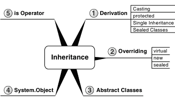

### 初学者主题

### 继承定义

前一章概述了继承。以下是对已定义术语的回顾。

- 派生/继承：将基类特化以包含其他成员或对基类成员进行自定义。

- 派生/子/子类型：继承更通用类型成员的特化类型。

- 基类/超类/父类型：派生类型继承其成员的通用类型。

继承形成一种“是一种”关系。派生类型始终隐式地也是基类型。正如硬盘驱动器“是一种”存储设备，任何从存储设备类型派生的其他类型“是一种”存储设备。

### 派生

通常希望扩展给定类型以添加行为和数据等功能。继承的目的正是为此。给定一个 Person 类，你可以创建一个额外包含 EmployeeId 和 Department 属性的 Employee 类。也可能出现相反的情况。例如，给定个人数字助理 (PDA) 中的 Contact 类，你决定还可以添加日历支持。为此，你创建一个 Appointment 类。但是，你没有重新定义两个类共有的方法和属性，而是对 Contact 类进行重构。具体来说，你将 Contact 上的共有方法和属性移动到名为 PdaItem 的基类中，Contact 和 Appointment 都从此类派生，如图 6.1 所示。

在此情况下，共有项包括 Created、LastUpdated、Name、ObjectKey 等。通过派生，定义在基类 PdaItem 上的方法可从 PdaItem 的所有子类访问。

定义派生类时，在类标识符后跟冒号，然后是基类，如清单 6.1 所示。

```
LISTING 6.1: Deriving One Class from Another
public class PdaItem
{
    public string Name { get; set; }
    public DateTime LastUpdated { get; set; }
}
```

// Define the Contact class as inheriting the PdaItem class
public class Contact : PdaItem
{
    public string Address { get; set; }
    public string Phone { get; set; }
}

清单 6.2 展示了如何访问在 Contact 中定义的属性。

LISTING 6.2: Using Inherited Methods

```
public class Program
{
    public static void Main()
    {
        Contact contact = new Contact();
        contact.Name = "Inigo Montoya";
        // ...
    }
}
```

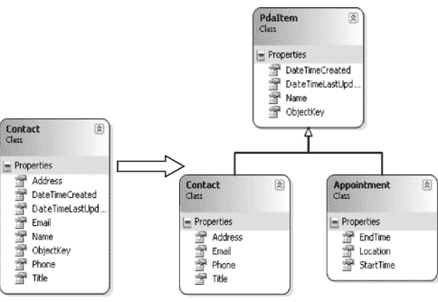

图 6.1：重构为基类

尽管 Contact 并不直接拥有名为 Name 的属性，但 Contact 的所有实例仍可访问来自 PdaItem 的 Name 属性，并将其视为 Contact 的一部分。此外，任何从 Contact 派生的其他类也将继承 PdaItem 的成员，或 PdaItem 派生自的任何类的成员。继承链没有实际限制，每个派生类都将拥有其基类继承链中所有公开成员的组合（请参阅清单 6.3）。

LISTING 6.3: Classes Deriving from Each Other to Form an Inheritance Chain

```
public class PdaItem : object
{
    // ...
}

public class Appointment : PdaItem
{
    // ...
}

public class Contact : PdaItem
{
    // ...
}

public class Customer : Contact
{
    // ...
}
```

换句话说，尽管 Customer 不直接从 PdaItem 派生，但它仍然继承 PdaItem 的成员。

在清单 6.3 中，PdaItem 显式地显示为从 object 派生。虽然 C# 允许这种语法，但它是不必要的，因为所有没有其他派生的类都将从 object 派生，无论是否指定。

### 基类型与派生类型之间的强制转换

如清单 6.4 所示，因为派生形成一种“是一种”关系，派生类型始终可以直接赋值给基类型。

LISTING 6.4: Implicit Base Type Casting

```
public class Program
{
    public static void Main()
    {
        // Derived types can be implicitly converted to
        // base types
        Contact contact = new Contact();
        PdaItem item = contact;
        // ...

        // Base types must be cast explicitly to derived types
        contact = (Contact)item;
        // ...
    }
}
```

派生类型 Contact 是 PdaItem，可以直接赋值给 PdaItem。这被称为 **隐式转换**，因为不需要成功的运算符，原则上转换始终会成功；它不会抛出异常。

然而，反之不成立。PdaItem 不一定是 Contact；它可能是 Appointment 或其他未定义的派生类型。因此，从基类型到派生类型的转换需要显式转换，在运行时可能会失败。要执行显式转换，请在原始引用之前的括号内标识目标类型，如清单 6.4 所示。

使用显式转换时，程序员本质上是在告诉编译器信任她，她知道自己在做什么，只要目标类型是从源类型派生的，C# 编译器就会允许转换。虽然 C# 编译器允许在编译时对潜在兼容类型进行显式转换，但公共语言运行库 (CLR) 仍会在执行时验证显式转换，如果对象实例实际上不是目标类型，则会抛出异常。

即使类型层次结构允许隐式转换，C# 编译器也允许使用强制转换运算符。例如，从 contact 到 item 的赋值可以按如下方式使用强制转换运算符：

```
item = (PdaItem)contact;
```

或者即使不需要转换：

```
contact = (Contact)contact;
```

### 初学者主题

### 继承链内的强制转换

向基类的隐式转换不会实例化新实例。相反，同一实例只是被引用为基类型，其功能（可访问的成员）是基类型的功能。这就像将 CD-ROM 驱动器（CDROM）称为存储设备一样。由于并非所有存储设备都支持弹出操作，因此被视为存储设备的 CDROM 也无法弹出，对 storageDevice.Eject() 的调用无法编译，即使实例化的对象可能是支持 Eject() 方法的 CDROM 对象。

同样，从基类向下转换为派生类只是开始更具体地引用类型，扩展了可用操作。限制是实际实例化的类型必须是目标类型（或其派生类型）的实例。

### 高级主题

### 定义自定义转换

类型之间的转换不仅限于单个继承链中的类型。也可以在完全不相关的类型之间进行转换。关键是在两种类型之间提供转换运算符。C# 允许类型包含显式或隐式转换运算符。任何操作可能失败的情况（例如从 long 到 int 的强制转换），开发人员都应选择定义显式转换运算符。这会警告执行转换的开发人员仅在确定转换会成功时才执行，否则要做好捕获异常的准备。当转换是有损的时，他们还应使用显式转换而非隐式转换。例如，从 float 转换为 int 会截断小数部分，而反向转换（从 int 转换回 float）无法恢复该小数部分。

清单 6.5 展示了 Address 到 string 及其反向的隐式和显式转换运算符。


## LISTING 6.5: 定义强制转换运算符

```
class GPSCoordinates
{
    // ...

    public static implicit operator UTMCoordinates(
        GPSCoordinates coordinates)
    {
        // ...
    }
}
```

在这种情况下，您拥有从 GPSCoordinates 到 UTMCoordinates 的隐式转换。可以编写类似的转换来反转该过程。请注意，也可以通过将 implicit 替换为 explicit 来编写显式转换。

## private 访问修饰符

基类的所有公共成员都可供派生类使用。但是，私有成员则不可用。例如，在清单 6.6 中，私有字段 _Name 在 Contact 上不可用。

## LISTING 6.6: 私有成员不被继承

```
public class PdaItem
{
    private string _Name;
    // ...
}

public class Contact : PdaItem
{
    // ...
}

public class Program
{
    public static void Main()
    {
        Contact contact = new Contact();

        // ERROR: 'PdaItem._Name' is inaccessible
        // due to its protection level
        contact._Name = "Inigo Montoya";
    }
}
```

作为封装原则的一部分，派生类无法访问声明为 private 的成员。这迫使基类开发人员做出明确选择，以决定派生类是否获得对成员的访问权限。在此示例中，基类定义了一个 API，其中 _Name_ 只能通过 Name 属性更改。这样，如果添加了验证，派生类将自动获得验证的好处，因为它从一开始就无法直接访问 _Name_。

## protected 访问修饰符

然而，封装的粒度比仅 public 或 private 更细。可以在基类中定义仅派生类可访问的成员。例如，请考虑清单 6.7 中显示的 ObjectKey 属性。

## LISTING 6.7: 受保护成员仅可从派生类访问

```
public class Program
{
    public static void Main()
    {
        Contact contact = new Contact();
        contact.Name = "Inigo Montoya";

        // ERROR: 'PdaItem.ObjectKey' is inaccessible
        // due to its protection level
        contact.ObjectKey = Guid.NewGuid();
    }
}

public class PdaItem
{
    protected Guid ObjectKey
    {
        get { return _ObjectKey; }
        set { _ObjectKey = value; }
    }

    private Guid _ObjectKey;

    // ...
}
```

- 除派生类同时也是基类嵌套类的极端情况外。

```
public class Contact : PdaItem
{
    void Save()
    {
        // Instantiate a FileStream using <ObjectKey>.dat
        // for the filename.
        FileStream stream = System.IO.File.OpenWrite(
            ObjectKey + ".dat");
    }

    void Load(PdaItem pdaItem)
    {
        // ERROR: 'pdaItem.ObjectKey' is inaccessible
        // due to its protection level
        pdaItem.ObjectKey = ...;

        Contact contact = pdaItem as Contact;
        if(contact != null)
        {
            contact.ObjectKey = ...;
        }
        // ...
    }
}
```

ObjectKey 使用 protected 访问修饰符定义。结果是，它在 PdaItem 之外仅可从派生自 PdaItem 的类中访问。Contact 派生自 PdaItem，因此 Contact 的所有成员都可以访问 ObjectKey。由于 Program 不派生自 PdaItem，在 Program 中使用 ObjectKey 属性会导致编译错误。

Contact.Load() 方法中显示的一个细节值得注意。开发人员常常惊讶地发现，即使 Contact 派生自 PdaItem，也无法从 Contact 内部的代码访问显式类型的 PdaItem 的受保护 ObjectKey。原因是 PdaItem 可能是 Address，而 Contact 不应能够访问 Address 的受保护成员。因此，封装防止 Contact 可能修改 Address 的 ObjectKey。如所示，成功转换为 Contact 将绕过此限制。管理规则是，从派生类访问受保护成员需要在编译时确定该受保护成员是派生类（或其子类之一）的实例。

## 扩展方法

扩展方法包含的一个特性是，它们也会被继承。如果扩展诸如 `PdaItem` 这样的基类，所有扩展方法也将在派生类中可用。然而，与所有扩展方法一样，实例方法优先级更高。如果兼容签名出现在继承链中的任何位置，它将优先于扩展方法。

在基类型上要求扩展方法的情况很少。与扩展方法的一般情况一样，如果基类型的代码可用，最好直接修改基类型。即使在基类型代码不可用的情况下，程序员也应考虑将扩展方法添加到基类型或单个派生类型实现的接口中。我将在下一章中介绍接口及其与扩展方法的配合使用。

## 单一继承

理论上，可以在继承树中放置无限数量的类。例如，`Customer` 派生自 `Contact`，后者派生自 `PdaItem`，再派生自 `object`。但是，C# 是一种 **单一继承** 编程语言（C# 编译为的 CIL 语言也是如此）。这意味着一个类不能直接派生自两个类。例如，不可能让 `Contact` 同时派生自 `PdaItem` 和 `Person`。

## 语言对比：C++ — 多重继承

C# 的单一继承是其与 C++ 的主要区别之一。这为从 Active Template Library (ATL) 等编程库迁移提供了重要路径，ATL 的整个方法都依赖于多重继承。

对于需要多重继承类结构的罕见情况，一种解决方案是使用聚合；即不继承第二个类，而是让类包含该类的一个实例。图 6.2 显示了这种类结构的示例。当关联关系定义了包含对象的核心部分时，就会发生聚合。对于多重继承，这涉及选择一个类作为主基类（PdaItem），并从中派生一个新类（Contact）。第二个所需的基类（Person）作为字段添加到派生类（Contact）中。接下来，字段（Person）上的所有非私有成员都在派生类（Contact）上重新定义，然后将调用委托给该字段（Person）。由于方法被重新定义，会出现一些代码重复；但是，这很少，因为实际方法主体仅在聚合类（Person）中实现。

在图 6.2 中，Contact 包含一个名为 InternalPerson 的私有属性，它被绘制为与 Person 类的关联。Contact 还包含 FirstName 和 LastName 属性，但没有相应的字段。相反，FirstName 和 LastName 属性只是分别将调用委托给 InternalPerson.FirstName 和 InternalPerson.LastName。清单 6.8 显示了生成的代码。

## LISTING 6.8: 使用聚合规避单一继承

```
public class Person
{
    // ...
}

public class Contact : PdaItem
{
    private Person InternalPerson { get; set; }

    public string FirstName
    {
        get { return InternalPerson.FirstName; }
        set { InternalPerson.FirstName = value; }
    }

    public string LastName
    {
        get { return InternalPerson.LastName; }
        set { InternalPerson.LastName = value; }
    }

    // ...
}
```

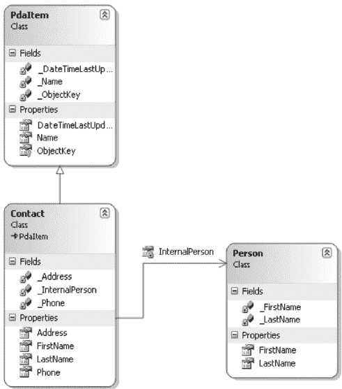

## 图 6.2：使用聚合规避多重继承

除了委托带来的额外复杂性之外，另一个缺点是，任何添加到字段类（Person）的方法都需要手动添加到派生类（Contact）；否则，Contact 不会公开添加的功能。

## 密封类

正确设计可供他人通过继承扩展的类可能是一项棘手的任务，需要通过示例进行测试以验证继承是否能成功工作。为了避免意外的继承场景和问题，可以将类标记为 sealed（请参阅清单 6.9）。

## LISTING 6.9: 使用密封类防止继承

```
public sealed class CommandLineParser
{
    // ...
}
```

```
// ERROR: Sealed classes cannot be derived from
public sealed class DerivedCommandLineParser :
    CommandLineParser
{
    // ...
}
```

密封类包含 sealed 修饰符，结果是它们不能被继承。string 类型是使用 sealed 修饰符来防止继承的类型示例。

## 重写基类

基类的所有公共和受保护成员都会在派生类中继承。但是，有时基类对特定成员的实现并非最优。例如，请考虑 PdaItem 上的 Name 属性。当被 Appointment 类继承时，其实现可能是可以接受的。但是，对于 Contact 类，Name 属性应返回合并的 FirstName 和 LastName 属性。同样，在赋值 Name 时，应将其拆分为 FirstName 和 LastName。换句话说，基类属性声明是合适的


对于派生类，但其实现并不总是有效。需要一种机制，在派生类中用自定义实现**重写**基类实现。

## virtual 修饰符

C#支持对实例方法和属性进行重写，但不支持对字段或任何静态成员进行重写。它要求在基类和派生类中都进行显式操作。基类必须将允许重写的每个成员标记为virtual。如果公共或受保护成员不包含virtual修饰符，则子类将无法重写这些成员。

> ## 语言对比：Java—默认为虚方法
>
> 默认情况下，Java中的方法是虚方法，如果希望非虚行为，则必须显式封装。相比之下，C#默认为非虚。

清单6.10展示了属性重写的示例。

## 清单6.10：重写属性

```
public class PdAItem
{
    public virtual string Name { get; set; }
    // ...
}

public class Contact : PdAItem
{
    public override string Name
    {
        get
        {
            return FirstName + " " + LastName;
        }
        set
        {
            string[] names = value.Split(' ');
            // Error handling not shown.
            FirstName = names[0];
            LastName = names[1];
        }
    }
}
} }
public string FirstName { get; set; }
public string LastName { get; set; }
// ...
}
```

PdAItem不仅在Name属性上包含virtual修饰符，而且Contact的Name属性还使用override关键字进行修饰。删除virtual会导致错误，省略override会导致警告，如您很快将看到的那样。C#要求重写的方法显式使用override关键字。

换句话说，virtual将方法或属性标识为可在派生类型中替换（重写）。

> ## 语言对比：Java和C++—隐式重写
>
> 与Java和C++不同，派生类上需要override关键字。C#不允许隐式重写。要重写方法，基类和派生类的成员必须匹配并具有相应的virtual和override关键字。此外，如果指定override关键字，则假定派生实现替换基类实现。

重写成员会导致运行时调用最派生的实现（参见清单6.11）。

## 清单6.11：运行时调用虚方法的最派生实现

```
public class Program
{
public static void Main()
{
Contact contact;
PdAItem item;
contact = new Contact();
item = contact;
// Set the name via PdaItem variable
item.Name = "Inigo Montoya";

// Display that FirstName & LastName
// properties were set.
Console.WriteLine("{0} {1}",
    contact.FirstName, contact.LastName);
}
```

输出6.1显示了清单6.11的结果。

## 输出6.1：

Inigo Montoya

在清单6.11中，调用了item.Name，其中item声明为PdAItem。但是，contact的FirstName和LastName仍然被设置。规则是，每当运行时遇到虚方法时，它会调用虚成员的最派生和重写实现。在此示例中，代码实例化一个Contact并调用Contact.Name，因为Contact包含Name的最派生实现。

在创建类时，程序员在选择是否允许重写方法时应谨慎，因为他们无法控制派生实现。虚方法不应包含关键代码，因为如果派生类重写了这些方法，则可能永远不会调用它们。此外，将方法从虚方法转换为非虚方法可能会破坏重写该方法的派生类。这是一个破坏性代码更改，您应避免此类更改，尤其是针对供第三方使用的程序集。

清单6.12包含一个虚Run()方法。如果Controller程序员调用Run()并期望关键的Start()和Stop()方法会被调用，他将遇到问题。

## 清单6.12：轻率地依赖虚方法实现

```
public class Controller
{
    public void Start()
    {
        // Critical code
}
public virtual void Run()
{
    Start();
    Stop();
}
public void Stop()
{
    // Critical code
}
}
```

在重写Run()时，开发人员可能不会调用关键的Start()和Stop()方法。为了强制执行Start()/Stop()的预期，Controller程序员应按清单6.13所示定义类。

## 清单6.13：强制执行所需的Run()语义

```
public class Controller
{
    public void Start()
    {
        // Critical code
    }

    private void Run()
    {
        Start();
        InternalRun();
        Stop();
    }

    protected virtual void InternalRun()
    {
        // Default implementation
    }

    public void Stop()
    {
        // Critical code
    }
}
```

通过这个新清单，Controller程序员防止用户随意调用InternalRun()，因为它是受保护的。另一方面，将Run()声明为public可确保适当调用Start()和Stop()。用户仍然可以通过在派生类中重写受保护的InternalRun()成员来修改Controller执行的默认实现。

虚方法仅提供默认实现，派生类可以完全重写这些实现。但是，由于继承设计的复杂性，考虑（并最好实现）需要虚方法定义的特定场景非常重要。

## 语言对比：C++ — 构造期间的方法调用分派

在C++中，构造期间调用的方法不会分派虚方法。相反，在构造期间，类型与基类型而非派生类型相关联，虚方法调用基实现。相比之下，C#将虚方法调用分派到最派生类型。这与调用最派生虚成员的原则一致，即使派生构造函数尚未完全执行。无论如何，在C#中应避免这种情况。

最后，只有实例成员可以是虚成员。CLR使用实例化时指定的具体类型来确定虚方法调用的分派位置，因此静态虚方法没有意义，编译器禁止它们。

## new 修饰符

当重写方法不使用override时，编译器会发出类似于输出6.2或输出6.3中所示的警告。

## 输出6.2：

```
warning CS0114: '<derived method name>' hides inherited member '<base method name>'. To make the current member override that implementation, add the override keyword. Otherwise add the new keyword.
```

## 输出6.3：

```
warning CS0108: The keyword new is required on '<derived property name>' because it hides inherited member '<base property name>'
```

明显的解决方案是添加override修饰符（假设基成员是虚成员）。但是，正如警告所指出的，new修饰符也是一种选择。考虑表6.1中所示的场景——这是更一般问题（称为脆弱基类或易碎基类问题）的一个特定示例。

## 表6.1：为什么使用new修饰符？

| 活动 | 代码 |
| :--- | :--- |
| 程序员A定义包含FirstName和LastName属性的Person类。 | `public class Person
{
    public string FirstName { get; set; }
    public string LastName { get; set; }
}` |
| 程序员B从Person派生并定义带有额外Name属性的Contact。此外，他定义了Program类，其Main()方法实例化Contact，分配Name，然后打印出名称。 | `public class Contact : Person
{
    public string Name
    {
        get
        {
            return FirstName + " " + LastName;
        }
        set
        {
            string[] names = value.Split(' ');
            // Error handling not shown.
            FirstName = names[0];
            LastName = names[1];
        }
    }
}` |


## TABLE 6.1: Why the New Modifier? (Continued)

| Activity | Code |
| :--- | :--- |
| 稍后，程序员 A 添加了 Name 属性，但她没有将 getter 实现为 FirstName + " " + LastName，而是将其实现为 LastName + ", " + FirstName。此外，她没有将 virtual 用作属性，并且她在 DisplayName() 方法中使用了该属性。 | public class Person
{
    public string Name
    {
        get
        {
            return LastName + ", " + FirstName;
        }
        set
        {
            string[] names = value.Split(';');
            // Error handling not shown.
            LastName = names[0];
            FirstName = names[1];
        }
    }
    public static void Display(Person person)
    {
        // Display <LastName>, <FirstName>
        Console.WriteLine( person.Name );
    }
} |

由于 Person.Name 不是 virtual，程序员 A 期望 Display() 使用 Person 的实现，即使传入的是 Person 派生的数据类型 Contact。但是，程序员 B 期望在变量数据类型为 Contact 的所有情况下都使用 Contact.Name。（程序员 B 不会有使用 Person.Name 的代码，因为最初不存在 Person.Name 属性。）为了在不破坏任一程序员预期行为的前提下添加 Person.Name，你不能假设意图是 virtual。此外，由于 C# 要求重写成员显式使用 override 修饰符，必须假设某种其他语义，而不是允许在基类中添加成员导致派生类不再编译。

该语义是 new 修饰符，它从基类中隐藏派生类的重新声明成员。基类中的成员不再调用最派生的成员，而是调用继承链中 new 修饰符成员之前的最派生成员。如果继承链仅包含两个类，则基类中的成员将表现得好像派生类中未声明任何方法一样（如果派生实现重写了基类成员）。尽管编译器会报告输出 6.2 或输出 6.3 中显示的警告，但如果既未指定 override 也未指定 new，则将假定为 new，从而维持所需的版本安全性。

例如，请参阅清单 6.14。其输出显示在输出 6.4 中。

## 清单 6.14: override 与 new 修饰符

```
public class Program
{
    public class BaseClass
    {
        public void DisplayName()
        {
            Console.WriteLine("BaseClass");
        }
    }

    public class DerivedClass : BaseClass
    {
        // Compiler WARNING: DisplayName() hides inherited
        // member. Use the new keyword if hiding was intended.
        public virtual void DisplayName()
        {
            Console.WriteLine("DerivedClass");
        }
    }

    public class SubDerivedClass : DerivedClass
    {
        public override void DisplayName()
        {
            Console.WriteLine("SubDerivedClass");
        }
    }

    public class SuperSubDerivedClass : SubDerivedClass
    {
        public new void DisplayName()
        {
            Console.WriteLine("SuperSubDerivedClass");
        }
    }

    public static void Main()
    {
        SuperSubDerivedClass superSubDerivedClass
            = new SuperSubDerivedClass();
        SubDerivedClass subDerivedClass = superSubDerivedClass;
        DerivedClass derivedClass = superSubDerivedClass;
        BaseClass baseClass = superSubDerivedClass;

        superSubDerivedClass.DisplayName();
        subDerivedClass.DisplayName();
        derivedClass.DisplayName();
        baseClass.DisplayName();
    }
}
```

```
OUTPUT 6.4:

SuperSubDerivedClass
SubDerivedClass
DerivedClass
BaseClass
```

出现这些结果的原因如下。

- SuperSubDerivedClass: SuperSubDerivedClass.DisplayName() 显示 SuperSubDerivedClass，因为没有派生类，因此没有重载。
- SubDerivedClass: SubDerivedClass.DisplayName() 是重写基类 virtual 成员的最派生成员。SuperSubDerivedClass.DisplayName() 因其 new 修饰符而被隐藏。
- SubDerivedClass: DerivedClass.DisplayName() 是 virtual，而 SubDerivedClass.DisplayName() 是重写它的最派生成员。与之前一样，SuperSubDerivedClass.DisplayName() 因 new 修饰符而被隐藏。
- BaseClass: BaseClass.DisplayName() 未重新声明任何基类成员，且不是 virtual；因此，它会被直接调用。

就 CIL 而言，new 修饰符对编译器生成的语句没有影响。但是，“new”方法会导致在方法上生成 newslot 元数据属性。从 C# 角度来看，其唯一效果是删除否则会出现的编译器警告。

## sealed 修饰符

正如可以使用类上的 sealed 修饰符来防止继承一样，virtual 成员也可以被 sealed（请参阅清单 6.15）。这防止子类重写继承链中较高位置最初声明为 virtual 的基类成员。当子类 B 重写基类 A 的成员，然后需要防止在子类 B 之下进行任何进一步重写时，就会出现这种情况。

## 清单 6.15: 密封成员

```
class A
{
    public virtual void Method()
    {
    }
}

class B : A
{
    public override sealed void Method()
    {
    }
}

class C : B
{
    // ERROR: Cannot override sealed members
    // public override void Method()
    // {
    // }
}
```

在此示例中，在类 B 的 Method() 声明上使用 sealed 修饰符可防止 C 重写 Method()。

## base 成员

在选择重写成员时，开发人员通常希望调用基类上的成员（请参阅清单 6.16）。

## 清单 6.16: 访问基类成员

```
public class Address
{
    public string StreetAddress;
    public string City;
    public string State;
    public string Zip;

    public override string ToString()
    {
        return string.Format("{0}" + Environment.NewLine +
            "{1}, {2} {3}",
            StreetAddress, City, State, Zip);
    }
}

public class InternationalAddress : Address
{
    public string Country;

    public override string ToString()
    {
        return base.ToString() + Environment.NewLine +
            Country;
    }
}
```

在清单 6.16 中，InternationalAddress 继承自 Address 并实现 ToString()。要调用父类的实现，请使用 base 关键字。语法与此几乎相同，包括支持将 base 用作构造函数的一部分（稍后讨论）。

顺便说一句，在 Address.ToString() 实现中，你也必须重写，因为 ToString() 也是 object 的成员。任何用 override 修饰的成员都会自动指定为 virtual，因此其他子类可以进一步特殊化该实现。

## 构造函数

在实例化派生类时，运行时首先调用基类的构造函数，以免绕过基类初始化。但是，如果基类上没有可访问的（非私有）默认构造函数，则不清楚如何构造基类，C# 编译器会报告错误。

为了避免因没有可访问的默认构造函数而导致的错误，程序员需要在派生类构造函数头中显式指定要运行的基类构造函数（请参阅清单 6.17）。

## 清单 6.17: 指定要调用的基类构造函数

```
public class PdaItem
{
    public PdaItem(string name)
    {
        Name = name;
    }

    // ...
}

public class Contact : PdaItem
{
    public Contact(string name) :
        base(name)
    {
        Name = name;
    }

    public string Name { get; set; }

    // ...
}
```

通过在代码中标识基类构造函数，你可以让运行时在调用派生类构造函数之前知道要调用哪个基类构造函数。

## 抽象类

迄今为止的许多继承示例都定义了一个名为 PdaItem 的类，该类定义了 Contact、Appointment 等（均为派生自 PdaItem 的类型对象）共有的方法和属性。但是，PdaItem 本身不打算被实例化。PdaItem 实例本身没有意义；只有在用作基类（以在从中派生的一组数据类型之间共享默认方法实现）时才有意义。这些特征表明 PdaItem 需要是抽象类而不是具体类。抽象类仅用于派生。除非在实例化从中派生的类的上下文中，否则无法实例化抽象类。非抽象且可以直接实例化的类是具体类。


## 初学者主题

## 抽象类

抽象类表示抽象实体。其抽象成员定义了从抽象实体派生的对象应包含的内容，但不包含实现。通常，抽象类中的许多功能未实现，在一个类能够成功从抽象类派生之前，它需要为其抽象基类中的抽象方法提供实现。

要定义抽象类，C#要求在类定义中使用abstract修饰符，如清单6.18所示。

### 清单 6.18：定义抽象类

```
// Define an abstract class
public abstract class PdaItem
{
    public PdaItem(string name)
    {
        Name = name;
    }

    public virtual string Name { get; set; }
}
```

```
public class Program
{
    public static void Main()
    {
        PdaItem item;
        // ERROR: Cannot create an instance of the abstract class
        item = new PdaItem("Inigo Montoya");
    }
}
```

虽然抽象类不能被实例化，但这一限制只是抽象类的次要特征。当抽象类包含抽象成员时，其主要意义才得以体现。抽象成员是没有实现的方法或属性。其目的是强制所有派生类提供实现。

请参阅清单6.19。

### 清单 6.19：定义抽象成员

```
// Define an abstract class
public abstract class PdaItem
{
    public PdaItem(string name)
    {
        Name = name;
    }

    public virtual string Name { get; set; }
    public abstract string GetSummary();
}

public class Contact : PdaItem
{
    public override string Name
    {
        get
        {
            return FirstName + " " + LastName;
        }
        set
        {
            string[] names = value.Split(' ');
            // Error handling not shown.
            FirstName = names[0];
            LastName = names[1];
        }
    }

    public string FirstName { get; set; }
    public string LastName { get; set; }
    public string Address { get; set; }

    public override string GetSummary()
    {
        return string.Format(
            "FirstName: {0}"
            + "LastName: {1}"
            + "Address: {2}", FirstName, LastName, Address);
    }
}
// ...
}
```

```
public class Appointment : PdaItem
{
    public Appointment(string name) :
        base(name)
    {
        Name = name;
    }

    public DateTime StartDateTime { get; set; }
    public DateTime EndDateTime { get; set; }
    public string Location { get; set; }

    // ...

    public override string GetSummary()
    {
        return string.Format(
            "*Subject: {0}"+ Environment.NewLine
            + "*Start: {1}"+ Environment.NewLine
            + "*End: {2}"+ Environment.NewLine
            + "*Location: {3}",
            Name, StartDateTime, EndDateTime, Location);
    }
}
```

清单6.19将GetSummary()成员定义为抽象成员，因此它不包含任何实现。随后，代码在Contact类中对其进行重写并提供实现。由于抽象成员旨在被重写，此类成员自动为虚拟成员，不能显式声明为虚拟。此外，抽象成员不能是私有的，因为派生类无法访问它们。

> **语言对比：C++ — 纯虚函数**
>
> C++允许使用神秘的=0符号定义抽象函数。这些函数在C++中称为纯虚函数。然而，与C#不同，C++不要求类本身有任何特殊声明。与C#的抽象类修饰符不同，当类包含纯虚函数时，C++没有类声明更改。

如果在Contact类中未提供GetSummary()实现，编译器将报告错误。

> **注意**
>
> 通过声明抽象成员，抽象类程序员表明，为了在具体类和抽象基类（即`PdaItem`）之间形成“是一种”关系，有必要实现抽象成员，即抽象类无法提供适当默认实现的那些成员。

## 初学者主题

## 多态

当同一成员签名的实现在两个或多个类之间有所不同时，你就拥有了面向对象的一个关键原则：**多态**。“Poly”意为“多”，“morph”意为“形式”，多态是指同一签名存在多个实现的事实。由于同一签名不能在单个类中多次使用，因此成员签名的每个实现都出现在不同的类中。

多态背后的理念是，对象本身最清楚如何执行特定操作，通过强制执行调用这些操作的通用方式，多态也是一种在利用共性时鼓励代码复用的技术。给定多种文档类型，每个文档类型类最清楚如何为其对应的文档类型执行`Print()`方法。因此，与其定义一个包含switch语句的单一打印方法（其中包含打印每种文档类型的特殊逻辑），不如使用多态来调用你希望打印的特定文档类型对应的`Print()`方法。例如，在文字处理文档类上调用`Print()`将根据文字处理特定行为进行操作，而在图形文档类上调用相同方法将导致特定于图形的打印行为。然而，鉴于文档类型，要打印文档，你只需调用`Print()`，而无需考虑类型。

将自定义打印实现移出switch语句带来了多个维护优势。首先，实现出现在每个文档类型类的上下文中，而不是在远离的位置；这符合封装原则。其次，添加新文档类型不需要更改switch语句。相反，只需让新文档类型类实现Print()签名即可。

抽象成员旨在实现多态的一种方式。基类指定方法的签名，派生类提供实现（参见清单6.20）。

### 清单 6.20：使用多态列出PdaItems

```
public class Program
{
    public static void Main()
    {
    PdaItem[] pda = new PdaItem[3];

    Contact contact = new Contact("Sherlock Holmes");
    contact.Address = "221B Baker Street, London, England";
    pda[0] = contact;

    Appointment appointment =
    new Appointment("Soccer tournament");
    appointment.StartDateTime = new DateTime(2008, 7, 18);
    appointment.EndDateTime = new DateTime(2008, 7, 19);
    appointment.Location = "Estádio da Machava";
    pda[1] = appointment;

    contact = new Contact("Anne Frank");
    contact.Address =
    "263 Prinsengracht, Amsterdam, Netherlands";
    pda[2] = contact;

    List(pda);
    }

    public static void List(PdaItem[] items)
    {
    // Implemented using polymorphism. The derived
    // type knows the specifics of implementing
    // GetSummary().
    foreach (PdaItem item in items)
    {
    Console.WriteLine("___________");
}
Console.WriteLine(item.GetSummary());
}
}
```

清单6.20的结果显示在输出6.5中。

### 输出 6.5：

```
FirstName: Sherlock
LastName: Holmes
Address: 221B Baker Street, London, England

Subject: Soccer tournament
Start: 7/16/2008 12:00:00 AM
End: 7/17/2008 12:00:00 AM
Location: Estádio da Machava

FirstName: Anne
LastName: Frank
Address: 263 Prinsengracht, Amsterdam, Netherlands
```

这样一来，你可以在基类上调用方法，但实现特定于派生类。

## 所有类都派生自System.Object

给定任何类，无论是自定义类还是系统内置类，表6.2所示的方法都将被定义。

### 表 6.2：System.Object的成员

| 方法名称 | 描述 |
| :--- | :--- |
| `public virtual bool Equals(object o)` | 如果作为参数提供的对象在值上（而不一定是引用上）与实例相等，则返回true。 |
| `public virtual int GetHashCode()` | 返回一个对应均匀分布哈希码的整数。这对于HashTable等集合很有用。 |


| | |
| :--- | :--- |
| public Type GetType() | 返回与对象实例类型对应的 System.Type 类型的对象。 |
| public static bool ReferenceEquals(object a, object b) | 如果两个提供的参数引用同一个对象，则返回 true。 |
| public virtual string ToString() | 返回对象实例的字符串表示形式。 |
| public virtual void Finalize() | 析构函数的别名；通知对象准备终止。C# 防止直接调用此方法。 |
| protected object MemberwiseClone() | 通过执行浅拷贝来克隆所涉及的对象；引用被复制，但引用类型内的数据不被复制。 |

所有这些方法都通过继承出现在所有对象上；所有类都（直接或通过继承链）从 object 派生。即使是字面量也包含这些方法，从而能够编写出有些古怪的代码，例如：

```
Console.WriteLine(42.ToString());
```

即使类定义没有显式从 object 派生，它们也仍然从 object 派生。因此，清单 6.21 中 PdaItem 的两个声明会生成相同的 CIL。

## LISTING 6.21: 当未显式指定派生时，隐式派生自 System.Object

```
public class PdaItem
{
    // ...
}
```

```
public class PdaItem : object
{
    // ...
}
```

当对象的默认实现不足以满足需求时，程序员可以重写三个虚方法中的一个或多个。第 9 章详细介绍了如何执行此操作。

## 使用 is 运算符验证基础类型

因为 C# 允许沿继承链向下强制转换，因此在尝试转换之前，有时有必要确定基础类型是什么。此外，在未实现多态性的情况下，检查类型可能对于类型特定操作是必要的。要确定基础类型，C# 提供了 is 运算符（请参阅清单 6.22）。

```
LISTING 6.22: is Operator Determining the Underlying Type

public static void Save(object data)
{
    if (data is string)
    {
        data = Encrypt((string) data);
    }
    // ...
}
```

清单 6.22 在基础类型为字符串时加密数据。这与仅因为成功强制转换为字符串而进行加密有显著不同，因为许多类型都支持强制转换为字符串，但它们的基础类型并非字符串。

尽管此功能很重要，但在使用 is 运算符之前，您应考虑多态性。多态性支持在不修改定义行为的实现的情况下，将行为扩展到其他数据类型。例如，从公共基类型派生，然后将该类型用作 Save() 方法的参数，可以避免显式检查字符串，并使其他数据类型能够通过从同一基类型派生来在保存期间支持加密。

## 使用 as 运算符进行转换

is 运算符的优势在于它能够验证数据项是否为特定类型。as 运算则更进一步。它尝试转换为特定数据类型，如果源类型在继承链中不固有属于目标类型，则分配 null。这一点很重要，因为它避免了可能由强制转换导致的异常。清单 6.23 演示了使用 as 运算符。

```
LISTING 6.23: Data Conversion Using the as Operator
object Print(IDocument document)
{
    if(thing != null)
    {
        // Print document...
    }
    else
    {
    }
}
static void Main()
{
    object data;
    // ...
    Print(data as Document);
}
```

通过使用 as 运算符，如果转换无效，您可以避免额外的 try/catch 处理代码，因为 as 运算符提供了一种尝试强制转换的方法，如果强制转换失败则不抛出异常。

is 运算符相对于 as 运算符的一个优势是，后者无法成功确定基础类型。后者可能沿继承链向上或向下强制转换，也可能跨支持强制转换运算符的类型进行转换。因此，与 as 运算符不同，is 运算符可以确定基础类型。

## 摘要

本章讨论了如何通过从类派生并添加其他方法和属性来特化类。这包括讨论控制封装级别的 private 和 protected 访问修饰符。

本章还调查了重写基类实现的详细信息，以及使用 new 修饰符隐藏基类实现的替代方法。为了控制重写，C# 提供了 virtual 修饰符，它向派生类开发者标识其打算用于派生的成员。为了完全防止任何派生，您了解了类上的 sealed 修饰符。同样，成员上的 sealed 修饰符防止子类进一步重写。

本章最后简要讨论了所有类型如何从 object 派生。第 9 章将进一步讨论这种派生，探讨 object 如何包含三个虚方法，并附有管理重载的特定规则和指南。不过，在到达那里之前，您需要考虑另一种建立在面向对象编程之上的编程范式：接口。这是第 7 章的主题。

此页故意留空

# 7 接口

多态性不仅可以通过继承（如前一章所述）实现，还可以通过接口实现。与抽象类不同，接口不能包含任何实现。然而，与抽象类一样，接口定义了一组调用者可以依赖的成员，以支持特定功能。

通过实现接口，类定义了其功能。接口实现关系是一种“能做”关系：类可以执行接口所要求的操作。接口定义了实现接口的类与使用接口的类之间的契约。实现接口的类定义与已实现接口具有相同签名的方法。本章讨论定义、实现和使用接口。

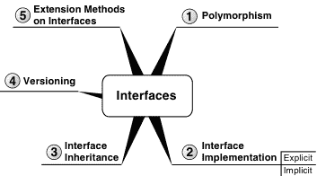

## 接口简介

### 初学者主题

### 为什么需要接口？

已实现的接口就像带有墙壁插头的电器。墙壁插头是电器用于接收交流电所支持的接口。电器可以以无数种方式使用该电力，但为了插入墙壁插座，电器必须提供兼容的墙壁插头。电器对电力的用途对应于接口实现从类到类的不同方式。定义墙壁插头的规范是电器要插入墙壁插头所必须支持的契约。同样，接口定义了类必须支持的契约，以便获得接口提供的功能。

请考虑以下示例：可用的文件压缩格式数不胜数（.zip、.7-zip、.cab、.lha、.tar、.tar.gz、.tar.bz2、.bh、.rar、.arj、.arc、.ace、.zoo、.gz、.bzip2、.xxe、.mime、.uue 和 .yenc，仅举几例）。如果您为每种压缩格式创建类，可能会为每种压缩实现得到不同的方法签名，并且无法在它们之间使用标准的调用约定。尽管方法签名可以定义在基类的抽象成员中，但从公共基类型派生会占用类唯一的继承，并且在各种压缩实现之间共享代码的可能性不大，从而使基类实现的潜力变得无用。因此，关键点是：基类允许您共享实现以及成员签名，而接口允许您共享成员签名而无需实现。

与共享公共基类相比，每个压缩类都需要实现一个公共接口。接口定义了类支持的契约，以便与期望该接口的其他类进行交互。尽管存在许多潜在的压缩算法，如果它们都能实现 IFileCompression 接口及其 Compress() 和 Uncompress() 方法，那么在任何特定压缩类上调用算法的代码只需涉及向 IFileCompression 接口强制转换并调用其成员，而无需考虑


是哪个类实现了这些方法。结果是多态，因为每个压缩类都有相同的方法签名，但对该签名有各自的实现。

接口的命名约定是使用 Pascal 大小写，并加上 I 前缀。清单 7.1 中所示的 IFileCompression 接口就是这样一个名称和接口定义的示例。

### 清单 7.1：定义接口

```
interface IFileCompression
{
    void Compress(string targetFileName, string[] filelist);
    void Uncompress(
        string compressedFileName, string expandDirectoryName);
}
```

IFileCompression 定义了类用于与其他压缩相关类协作的方法。定义接口的强大之处在于能够在不修改调用代码的情况下在不同实现之间切换，前提是每个压缩类都实现 IFileCompression 接口。

接口的一个关键特征是它没有实现也没有数据。方法声明在标题后使用单个分号代替花括号。字段（数据）不能出现在接口上。当接口要求派生类拥有某些数据时，它使用属性而不是字段。由于属性作为接口声明的一部分不包含任何实现，因此它不引用支持字段。

鉴于接口的目的是在多个类之间定义契约，定义私有或受保护成员会使其他类无法访问它们，从而违背了接口的目的。因此，C# 不允许在接口成员上使用访问修饰符，而是自动将它们定义为 public。

## 通过接口实现多态

考虑另一个示例（请参见清单 7.2）：IListable 定义了类需要支持的成员，以便 ConsoleListControl 类可以显示它。因此，任何实现 IListable 的类都将具有使用 ConsoleListControl 显示自身的能力。IListable 接口要求一个只读属性 ColumnValues。

### 清单 7.2：实现和使用接口

```
interface IListable
{
    // Return the value of each column in the row.
    string[] ColumnValues
    {
        get;
    }
}
```

```
public abstract class PdaItem
{
    public PdaItem(string name)
    {
        Name = name;
    }

    public virtual string Name { get; set; }
}
```

```
class Contact : PdaItem, IListable
{
    public Contact(string firstName, string lastName,
        string address, string phone) : base(null)
    {
        FirstName = firstName;
        LastName = lastName;
        Address = address;
        Phone = phone;
    }

    public string FirstName { get; set; }
    public string LastName { get; set; }
    public string Address { get; set; }
    public string Phone { get; set; }

    public string[] ColumnValues
    {
        get
        {
            return new string[]
            {
                FirstName,
                LastName,
                Phone,
                Address
            };
        }
    }

    public static string[] Headers
    {
        get
        {
            return new string[] {
                "First Name", "Last Name",
                "Phone",
                "Address"
            };
        }
    }
    // ...
}
```

```
class Publication : IListable
{
    public Publication(string title, string author, int year)
    {
        Title = title;
        Author = author;
        Year = year;
    }

    public string Title { get; set; }
    public string Author { get; set; }
    public int Year { get; set; }

    public string[] ColumnValues
    {
        get
        {
            return new string[]
            {
                Title,
                Author,
                Year.ToString()
            };
        }
    }

    public static string[] Headers
    {
        get
        {
            return new string[] {
                "Title",
                "Author",
                "Year"
            };
        }
    }
    // ...
}
```

```
class Program
{
    public static void Main()
    {
        Contact[] contacts = new Contact[6];
        contacts[0] = new Contact(
            "Dick", "Traci",
            "123 Main St., Spokane, WA 99037",
            "123-123-1234");
        contacts[1] = new Contact(
            "Andrew", "Littman",
            "1417 Palmy St., Dallas, TX 55555",
            "555-123-4567");
        contacts[2] = new Contact(
            "Mary", "Hartfelt",
            "1528 Thunder Way, Elizabethton, PA 44444",
            "444-123-4567");
        contacts[3] = new Contact(
            "John", "Lindhurst",
            "1 Aerial Way Dr., Monterey, NH 88888",
            "222-987-6543");
        contacts[4] = new Contact(
            "Pat", "Wilson",
            "565 Irving Dr., Parksdale, FL 22222",
            "123-456-7890");
        contacts[5] = new Contact(
            "Jane", "Doe",
            "123 Main St., Aurora, IL 66666",
            "333-345-0789");
        // Classes are cast implicitly to
        // their supported interfaces
        ConsoleListControl.List(Contact.Headers, contacts);
        Console.WriteLine();
        Publication[] publications = new Publication[3] {
            new Publication("Celebration of Discipline",
                "Richard Foster", 1978),
            new Publication("Orthodoxy",
                "G.K. Chesterton", 1908),
            new Publication(
                "The Hitchhiker's Guide to the Galaxy",
                "Douglas Adams", 1979
            );
        ConsoleListControl.List(
            Publication.Headers, publications);
    }
}
```

```
class ConsoleListControl
{
    public static void List(string[] headers, IList[] items)
    {
        int[] columnWidths = DisplayHeaders(headers);
        for (int count = 0; count < items.Length; count++)
        {
            string[] values = items[count].ColumnValues;
            DisplayItemRow(columnWidths, values);
        }
    }

    /// <summary>Displays the column headers</summary>
    /// <returns>Returns an array of column widths</returns>
    private static int[] DisplayHeaders(string[] headers)
    {
        // ...
    }

    private static void DisplayItemRow(
        int[] columnWidths, string[] values)
    {
        // ...
    }
}
```

清单 7.2 的结果显示在输出 7.1 中。

### 输出 7.1：

| 名 | 姓 | 电话 | 地址 |
| :--- | :--- | :--- | :--- |
| Dick | Traci | 123-123-1234 | 123 Main St., Spokane, WA 99037 |
| Andrew | Littman | 555-123-4567 | 1417 Palmy St., Dallas, TX 55555 |
| Mary | Hartfelt | 444-123-4567 | 1528 Thunder Way, Elizabethton, PA 44444 |
| John | Lindhurst | 222-987-6543 | 1 Aerial Way Dr., Monterey, NH 88888 |
| Pat | Wilson | 123-456-7890 | 565 Irving Dr., Parksdale, FL 22222 |
| Jane | Doe | 333-345-0789 | 123 Main St., Aurora, IL 66666 |

| 标题 | 作者 | 年份 |
| :--- | :--- | :--- |
| Celebration of Discipline | Richard Foster | 1978 |
| Orthodoxy | G.K. Chesterton | 1908 |
| The Hitchhiker's Guide to the Galaxy | Douglas Adams | 1979 |

在清单 7.2 中，ConsoleListControl 可以显示看似无关的类（Contact 和 Publication）。可显示的类仅由其是否实现所需接口来定义。因此，ConsoleListControl.List() 方法依赖多态来适当显示传递给它的任何一组对象。每个类都有 ColumnValues 的自己的实现，将类转换为 IListable 仍然允许调用该特定类的实现。

## 接口实现

声明类实现接口与从基类派生类似，因为已实现的接口出现在与基类一起的逗号分隔列表中（接口之间的顺序无关紧要）。唯一的区别是类可以实现多个接口。示例出现在清单 7.3 中。

### 清单 7.3：实现接口

```
public class Contact : PdaItem, IListable, IComparable
{
  // ...
}
#region IComparable Members
/// <summary>
/// </summary>
/// <param name="obj"></param>
/// <returns>
/// Less than zero:   This instance is less than obj.
/// Zero              This instance is equal to obj.
/// Greater than zero This instance is greater than obj.
/// </returns>
```

```
public int CompareTo(object obj)
{
    int result;
    Contact contact = obj as Contact;
    if (obj == null)
    {
        // This instance is greater than obj.
        result = 1;
    }
    else if (!(obj is Contact))
    {
        throw new ArgumentException("obj is not a Contact");
    }
    else if (Contact.ReferenceEquals(this, obj))
    {
        result = 0;
    }
    else
    {
        result = LastName.CompareTo(contact.LastName);
        if (result == 0)
            result = FirstName.CompareTo(contact.FirstName);
    }
    return result;
}
#endregion
```

```
#region IListable Members
string[] IListable.ColumnValues
{
    get
    {
        return new string[]
        {
            FirstName,
            LastName,
            Phone,
            Address
        };
    }
}
#endregion
```

一旦类声明实现接口，就必须实现接口的所有成员。成员实现可能会抛出一个


## 显式成员实现

显式实现的方法只能通过接口本身来调用；这通常是通过将对象转换为接口来实现的。例如，要调用清单 7.4 中的 IListable.ColumnValues，必须先将 contact 转换为 IListable，因为 ColumnValues 是显式实现的。

### 清单 7.4：调用显式接口成员实现

```
string[] values;
Contact contact1, contact2;

// ...

// ERROR: Unable to call ColumnValues() directly
// on a contact.
// values = contact1.ColumnValues();

// First cast to IListable.
values = ((IListable)contact2).ColumnValues;

// ...
```

在这种情况下，转换和对 ColumnValues 的调用发生在同一条语句中。或者，你也可以在调用 ColumnValues 之前将 contact2 赋值给一个 IListable 变量。

要声明显式接口成员实现，请在成员名称前加上接口名称（请参阅清单 7.5）。

### 清单 7.5：显式接口实现

```
public class Contact : PdaItem, IListable, IComparable
{
    // ...

    public int CompareTo(object obj)
    {
        // ...
    }

    #region IListable Members
    string[] IListable.ColumnValues
    {
        get
        {
            return new string[]
            {
                FirstName,
                LastName,
                Phone,
                Address
            };
        }
    }
    #endregion
}
```

例如，清单 7.5 通过在属性前加上 IListable 前缀来显式实现 ColumnValues。此外，由于显式接口实现与接口直接关联，因此无需使用 virtual、override 或 public 进行修饰，实际上也不允许使用这些修饰符。C# 编译器会假定这些修饰符；否则，该实现将毫无意义。

## 隐式成员实现

请注意，清单 7.5 中的 CompareTo() 不包含 IComparable 前缀；它是隐式实现的。使用隐式成员实现时，只需让类成员的签名与接口成员的签名匹配即可。接口成员实现不需要 override 关键字，也不需要任何表明该成员与接口相关的指示。此外，由于该成员的声明方式与其他类成员相同，调用隐式实现成员的代码可以直接调用，就像调用任何其他类成员一样：

```
result = contact1.CompareTo(contact2);
```

换句话说，隐式成员实现不需要转换，因为该成员对实现类的直接调用并未隐藏。

许多在显式成员实现中不允许的修饰符，在隐式实现中是必需的或可选的。例如，隐式成员实现必须是 public。此外，virtual 是可选的，具体取决于派生类是否可以重写该实现。消除 virtual 会导致该成员表现得像是 sealed 一样。有趣的是，override 不被允许，因为接口中该成员的声明不包含实现，因此 override 没有意义。

## 显式与隐式接口实现

隐式和显式成员接口实现之间的关键区别显然不在于方法声明，而在于从类外部的可见性。在构建类层次结构时，理想的做法是模拟现实世界中的“是一种”关系——例如，长颈鹿是一种哺乳动物。这些是“语义”关系。接口通常用于模拟“机制”关系。PdaItem “不是” “可比较的”，但它很可能是 IComparable。这个接口与语义模型无关；它是实现机制的一个细节。显式接口实现是一种技术，用于实现机制关注点与模型关注点的分离。强制调用方在将对象视为“可比较的”之前先将对象转换为 IComparable 之类的接口，这在代码中明确区分了何时在与模型交互，何时在处理其实现机制。

通常，最好将类的公共表面区域限制为“纯模型”，尽可能少地包含多余的机制。不幸的是，在 .NET 中，某些机制是不可避免的。你无法获取长颈鹿的哈希代码，也无法将长颈鹿转换为字符串。但是，你可以获取长颈鹿的哈希代码 (GetHashCode()) 并将其转换为字符串 (ToString())。通过使用 object 作为公共基类，.NET 将模型代码与机制代码混合在一起，即使只是在有限的程度上。

以下是几条准则，可帮助你在显式实现和隐式实现之间做出选择。

- 该成员是否是类功能的核心部分？

  考虑 Contact 类上的 ColumnValues 属性实现。该成员不是 Contact 类型的组成部分，而是一个外围成员，可能仅由 ConsoleListControl 类访问。因此，该成员立即显示在 Contact 对象上并不合理，这会使本可能已经很长的成员列表变得杂乱。

  或者，考虑 IFileCompression.Compress() 成员。在 ZipCompression 类上包含隐式 Compress() 实现是一个完全合理的选择，因为 Compress() 是 ZipCompression 类行为的核心部分，因此应该可以直接从 ZipCompression 类访问。

- 接口成员名称是否适合作为类成员？

  考虑一个具有名为 Dump() 的成员的 ITrace 接口，该成员将类的数据写入跟踪日志。在 Person 或 Truck 类上隐式实现 Dump() 会导致对该方法执行什么操作产生混淆。相反，最好显式实现该成员，这样只有在数据类型为 ITrace 时（其中含义更清晰）才能调用 Dump() 方法。如果成员在实现类上的目的不明确，请考虑使用显式实现。

- 是否已存在同名的类成员？

  显式接口成员实现将唯一地区分一个成员。因此，如果类上已存在一个方法实现，则可以提供一个同名的第二个实现，只要它是显式接口成员即可。

关于隐式与显式接口成员实现的许多决策都取决于直觉。然而，这些问题提供了在做出选择时应考虑的事项建议。

由于将实现从隐式更改为显式会导致破坏性版本更改，因此最好倾向于显式定义接口，以便以后可以将其更改为隐式。此外，由于隐式与显式的决策不必在所有接口成员之间保持一致，因此将某些方法定义为显式、另一些定义为隐式是完全支持的。

## 在实现类及其接口之间转换

就像派生类和基类型之间一样，从对象到其实现的接口的转换是隐式转换。不需要转换运算符，因为实现类的实例始终包含接口中的所有成员，因此，对象始终可以成功转换为接口类型。

尽管从实现类到其实现的接口的转换始终会成功，但许多不同的类都可以实现特定接口，因此你永远无法确定从接口到实现类的向下转换是否会成功。结果是，从接口转换到其实现类需要显式转换。

## 接口继承

接口可以相互派生，从而产生一个继承其基接口中所有成员的接口。如清单 7.6 所示，直接派生自 IReadableSettingsProvider 的接口是直接基接口。

### 清单 7.6：从另一个接口派生一个接口

```
interface IReadableSettingsProvider
{
    string GetSetting(string name, string defaultValue);
}

interface ISettingsProvider : IReadableSettingsProvider
{
    void SetSetting(string name, string value);
}
```


```csharp
class FileSettingsProvider : ISettingsProvider
{
    #region ISettingsProvider Members
    public void SetSetting(string name, string value)
    {
        // ...
    }
    #endregion

    #region IReadableSettingsProvider Members
    public string GetSetting(string name, string defaultValue)
    {
        // ...
    }
    #endregion
}
```

在这种情况下，ISettingsProvider 派生自 IReadableSettingsProvider，因此继承其成员。如果 ISettingsProvider 有一个显式基接口，ISettingsProvider 也将继承那些成员，派生层次结构中的完整接口集合将只是基接口的累积。

值得注意的是，如果显式实现 GetSetting()，必须使用 IReadableSettingsProvider。Listing 7.7 中使用 ISettingsProvider 的声明将无法编译。

### LISTING 7.7: 不包含包含接口的显式成员声明（失败）

```csharp
// ERROR: GetSetting() not available on ISettingsProvider
string ISettingsProvider.GetSetting(
    string name, string defaultValue)
{
    // ...
}
```

Listing 7.7 的结果显示在输出 7.2 中。

### 输出 7.2:

> 'ISettingsProvider.GetSetting' 在显式接口声明中不是接口的成员。

此输出还伴随着一个错误，指示未实现 IReadableSettingsProvider.GetSetting()。用于显式接口成员实现的完全限定接口成员名称必须引用最初声明它的接口名称。

尽管一个类实现了一个从基接口（IReadableSettingsProvider）派生的接口（ISettingsProvider），但该类仍然可以显式声明对两个接口的实现，如 Listing 7.8 所示。

### LISTING 7.8: 在类声明中使用基接口

```csharp
class FileSettingsProvider : ISettingsProvider,
    IReadableSettingsProvider
{
    #region ISettingsProvider Members
    public void SetSetting(string name, string value)
    {
        // ...
    }
    #endregion

    #region IReadableSettingsProvider Members
    public string GetSetting(string name, string defaultValue)
    {
        // ...
    }
    #endregion
}
```

在此列表中，类上的接口实现没有变化，尽管类标头上的额外接口实现声明是多余的，但它可以提供更好的可读性。

提供多个接口而非仅一个组合接口的决定，很大程度上取决于接口设计者希望实现类满足什么要求。通过提供 IReadableSettingsProvider 接口，设计者传达的意思是，实现者只需实现一个检索设置的设置提供程序即可。他们不必能够写入这些设置。这样通过不强加写入设置的复杂性，减少了实现负担。

相比之下，实现 ISettingsProvider 假设不存在一个可以写入设置而无需读取它们的类的理由。因此，ISettingsProvider 和 IReadableSettingsProvider 之间的继承关系强制 ISettingsProvider 类承担两个接口的全部内容。

最后但重要的一点：虽然继承是正确的术语，但从概念上讲，更准确的认识是接口代表一个契约；一个契约可以规定必须遵循另一个契约的条款。因此，代码 ISettingsProvider : IReadableSettingsProvider 在概念上表示 ISettingsProvider 契约还要求遵守 IReadableSettingsProvider 契约，而不是说 ISettingsProvider “是一种” IReadableSettingsProvider。话虽如此，本章余下部分将继续按照标准 C# 术语使用继承关系术语。

## 多接口继承

正如类可以实现多个接口一样，接口也可以从多个接口继承，语法与类派生和实现一致，如 Listing 7.9 所示。

### LISTING 7.9. 多接口继承

```csharp
interface IReadableSettingsProvider
{
    string GetSetting(string name, string defaultValue);
}

interface IWriteableSettingsProvider
{
    void SetSetting(string name, string value);
}

interface ISettingsProvider : IReadableSettingsProvider,
    IWriteableSettingsProvider
{
}
```

拥有一个没有成员的接口是不寻常的，但如果同时实现两个接口是主要情况，那么这是这种情况下的合理选择。Listing 7.9 与 Listing 7.6 的区别在于，现在可以在不提供任何读取功能的情况下实现 IWriteableSettingsProvider。Listing 7.6 的 FileSettingsProvider 不受影响，但如果它使用了显式成员实现，指定成员属于哪个接口会略有变化。

## 接口上的扩展方法

扩展方法最重要的特性之一是它们不仅适用于类，还适用于接口。语法与类的扩展方法相同。被扩展的类型（第一个参数和带有 this 前缀的参数）是我们要扩展的接口。Listing 7.10 显示了 IListable() 的扩展方法。它在 IListable 上声明。

### LISTING 7.10: 接口扩展方法

```csharp
class Program
{
    public static void Main()
    {
        Contact[] contacts = new Contact[6];
        contacts[0] = new Contact(
            "Dick", "Traci",
            "123 Main St., Spokane, WA 99037",
            "123-123-1234");
        // ...

        // Classes are implicitly converted to
        // their supported interfaces
        contacts.List(Contact.Headers);

        Console.WriteLine();

        Publication[] publications = new Publication[3] {
            new Publication("Celebration of Discipline",
                "Richard Foster", 1978),
            new Publication("Orthodoxy",
                "G.K. Chesterton", 1908),
            new Publication(
                "The Hitchhiker's Guide to the Galaxy",
                "Douglas Adams", 1979)
        };
        publications.List(Publication.Headers);
    }
}

static class Listable
{
    public static void List(
        this IListable[] items, string[] headers)
    {
        int[] columnWidths = DisplayHeaders(headers);

        for (int itemCount = 0; itemCount < items.Length; itemCount++)
        {
            string[] values = items[itemCount].ColumnValues;

            DisplayItemRow(columnWidths, values);
        }
    }

    // ...
    for (int count = 0; count < values.Length; count++)
    {
        Console.Write(
            "{0,-" + columnWidths[count] + "}",
            tab, values[count]);
        tab = "\t";
    }
    Console.WriteLine();
}
```

请注意，在此示例中，扩展方法不是针对 IListable 参数（虽然也可以），而是针对 IListable[] 参数。这表明 C# 允许不仅对特定对象的实例，还对对象集合定义扩展方法。对扩展方法的支持是 LINQ 实现的基础。IEnumerable 是所有集合实现的基本接口。通过为 IEnumerable 定义扩展方法，LINQ 支持被添加到所有集合中。这从根本上改变了对象集合的编程方式，该主题将在第 14 章中详细探讨。

## 通过接口实现多重继承

如 Listing 7.3 所示，单个类除了派生自单个类之外，还可以实现任意数量的接口。此功能为 C# 类缺乏多重继承支持提供了一种可能的解决方法。该过程使用前一章中描述的聚合，但可以通过添加接口来略微改变结构，如 Listing 7.11 所示。

### LISTING 7.11: 使用带接口的聚合绕过单继承

```csharp
public class PdaItem
{
    // ...
}

interface IPerson
{
    string FirstName
    {
        get;
        set;
    }

    string LastName
    {
        get;
        set;
    }
}

public class Person : IPerson
{
    // ...
}

public class Contact : PdaItem, IPerson
{
    private Person Person
    {
        get { return _Person; }
        set { _Person = value; }
    }

    private Person _Person;

    public string FirstName
    {
        get { return _Person.FirstName; }
        set { _Person.FirstName = value; }
    }
}
```


public string LastName
{
 get { return _Person.LastName; }
 set { _Person.LastName = value; }
}
// ...
}

IPerson 确保 Person 成员与复制到 Contact 的相同成员之间的签名保持一致。然而，实现仍不等同于多重继承，因为添加到 Person 的新成员不会添加到 Contact。

如果实现的成员是方法（而非属性），一种可能的改进是为从第二个基类“派生”的额外功能定义接口扩展方法。例如，IPerson 上的扩展方法可以提供一个名为 VerifyCredentials() 的方法，所有实现 IPerson 的类（甚至没有成员但只有扩展方法的 IPerson 接口）都将拥有 VerifyCredentials() 的默认实现。使这种方法可行的是，多态性仍然可用，重写也是如此。支持重写是因为任何方法的实例实现都将优先于具有等效静态签名的扩展方法。

## 初学者主题

### 接口图示

在类 UML 图中，接口有两种可能的形式。首先，你可以将接口显示为类似于类继承的继承关系，如图 7.1 中 IPerson 和 IContact 之间所示。或者，你可以使用一个小圆圈来显示接口，通常称为棒糖（lollipop），如图 7.1 中的 IPerson 和 IContact 所示。

- 统一建模语言（UML），一种使用图形符号对对象设计进行建模的标准规范。

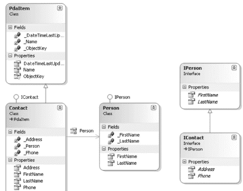

### 图 7.1：使用聚合和接口绕过单一继承

在图 7.1 中，Contact 派生自 PdaItem 并实现 IContact。此外，它聚合了实现 IPerson 的 Person 类。虽然 Visual Studio 2005 类设计器不支持此功能，但有时会使用指向类的派生类型箭头来显示接口。例如，Person 可以有一个指向 IPerson 的箭头，而不是棒糖。

## 版本控制

在为其他开发者编写代码的组件或应用程序创建新版本时，不应更改接口。因为接口定义了实现类与使用接口的类之间的契约，更改接口即更改契约，这可能会破坏针对该接口编写的任何代码。

更改或删除特定接口成员签名显然是破坏代码的更改，因为对该成员的任何调用在未经修改的情况下都将不再编译。更改类上的 public 或 protected 成员签名也是如此。然而，与类不同，向接口添加成员也可能阻止代码在未进行额外更改的情况下编译。问题在于，实现接口的任何类必须完全实现，并为所有成员提供实现。有了新的接口成员，编译器将要求开发者将新接口成员添加到实现该接口的类中。

清单 7.12 中 IDistributedSettingsProvider 的创建是以版本兼容方式扩展接口的一个好示例。假设最初只定义了 ISettingsProvider 接口（如清单 7.6 所示）。但在下一个版本中，确定需要每台计算机的设置。为此，创建了 IDistributedSettingsProvider 接口，它派生自 ISettingsProvider。

### 清单 7.12：从另一个接口派生

```
interface IDistributedSettingsProvider : ISettingsProvider
{
    // <summary>
    // Get the settings for a particular machine.
    // </summary>
    // <param name="machineName">
    // The machine name the setting is related to</param>
    // <param name="name">The name of the setting</param>
    // <param name="defaultValue">
    // The value returned if the setting is not found.</param>
    // <returns>The specified setting</returns>
    string GetSetting(string machineName, string name, string defaultValue);

    // <summary>
    // Set the settings for a particular machine.
    // </summary>
    // <param name="machineName">
    // The machine name the setting is related to</param>
    // <param name="name">The name of the setting</param>
    // <param name="value">The value to be persisted.</param>
    // <returns>The specified setting</returns>
    void SetSetting(string machineName, string name, string value);
}
```

关键在于，实现 ISettingsProvider 的类的程序员可以选择升级实现以包含 IDistributedSettingsProvider，也可以忽略它。

如果不创建新接口，而是将与计算机相关的方法添加到 ISettingsProvider，那么实现此接口的类将不再能与新接口定义成功编译，而是会发生版本破坏性更改。

在开发阶段更改接口显然是可以接受的，尽管如果大量实现可能会很费力。但是，一旦接口发布，就不应更改。相反，应该创建第二个接口，可能派生自原始接口。

（清单 7.12 包含描述接口成员的 XML 注释，将在第 9 章中进一步讨论。）

## 接口与类的比较

接口引入了另一类数据类型。（它们是不扩展 System.Object 的少数类型类别之一。）然而，与类不同，接口永远不能被实例化。接口实例只能通过对实现该接口的对象的引用来访问。不可能将 new 运算符与接口一起使用；因此，接口不能包含任何构造函数或终结器。此外，接口不允许有静态成员。

接口更接近抽象类，共享诸如无法实例化等特性。表 7.1 列出了更多比较。

### 表 7.1：比较抽象类和接口

| 抽象类 | 接口 |
| :--- | :--- |
| 不能独立于其派生类实例化。抽象类构造函数仅由其派生类调用。 | 不能实例化。 |
| 定义基类必须实现的抽象成员签名。 | 接口的所有成员实现都在基类中进行。不可能在实现类中仅实现某些成员。 |
| 比接口更具可扩展性，且不会破坏任何版本兼容性。使用抽象类，可以添加所有派生类都可继承的其他非抽象成员。 | 通过添加其他成员扩展接口会破坏版本兼容性。 |
| 可以包含存储在字段中的数据。 | 不能存储任何数据。字段只能在派生类上指定。解决此问题的方法是定义属性，但没有实现。 |
| 允许具有实现的（虚拟）成员，因此为派生类提供成员的默认实现。 | 所有成员自动为虚拟且不能包含任何实现。 |
| 从抽象类派生会占用子类唯一的基类选项。 | 虽然不能出现默认实现，但实现接口的类可以继续相互派生。 |

- 其他类型包括指针类型和类型参数类型。

鉴于抽象类和接口各有其优缺点，您必须根据表 7.1 中的比较进行成本效益决策，以便做出正确选择。

## 摘要

接口是面向对象编程的关键扩展。它们提供与抽象类类似的功能，但不占用单一继承选项，同时始终支持从多个接口派生。

在 C# 中，接口的实现可以是显式的或隐式的，具体取决于实现类是否要公开一个接口


成员直接或仅通过转换为接口。此外，实现是显式还是隐式的粒度在成员级别：一个成员可能是隐式的，而同一接口上的另一个成员可能是显式的。

下一章将探讨值类型，并讨论定义自定义值类型的重要性；同时，该章节指出它们可能引入的微妙缺陷。

# 值类型

在本书中，您一直在使用值类型。本章不仅讨论使用值类型，还讨论定义自定义值类型。值类型有两类。第一类是结构体。本章讨论结构体如何使程序员能够定义行为与第2章中大多数预定义类型非常相似的新值类型。关键在于，任何新定义的值类型都有自己的自定义数据和方法。值类型的第二类是枚举。本章讨论如何使用枚举定义常量值集合。

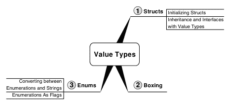

### 结构体

### 初学者主题

### 类型的类别

迄今讨论的所有类型都分为两类：引用类型和值类型。每类中的类型之间的差异源于复制策略的不同，进而导致每种类型在内存中存储方式不同。为回顾，此初学者主题重新介绍值类型/引用类型讨论，以使不熟悉它的人了解。

### 值类型

值类型直接包含其值，如图8.1所示。变量名等同于存储值的内存位置。因此，当将原始变量赋值给不同变量时，会将原始变量值的内存副本复制到新变量的位置。同一值类型的第二个变量不能引用与第一个变量相同的内存位置（同样假设没有out或ref参数）。因此，更改第一个变量的值不会影响第二个变量中的值，因为值类型等同于特定的内存位置。因此，更改一个值类型的值不能影响任何其他值类型的值。

同样，将值类型传递给Console.WriteLine()等方法也会导致内存副本，方法内对参数值的任何更改都不会影响调用函数中的原始值。由于值类型需要内存副本，它们通常应定义为占用少量内存（大约少于16字节）。

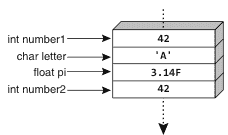

```csharp
//...
int number1 = 42;
char letter = 'A';
float pi = 3.14f;
int number2 = number1;
//...
```

图8.1：值类型直接包含数据

值类型所需的内存量在编译时固定，运行时不会改变。这种固定大小允许值类型存储在称为栈的内存区域中。

### 引用类型

相比之下，引用类型及其引用的变量指向数据存储位置（参见图8.2）。引用类型存储数据所在位置的引用（内存地址），而不是直接表示数据。因此，要访问数据，运行时会从变量中读取内存位置，然后取消引用以到达包含数据的内存位置。引用类型指向的数据的内存区域是堆。

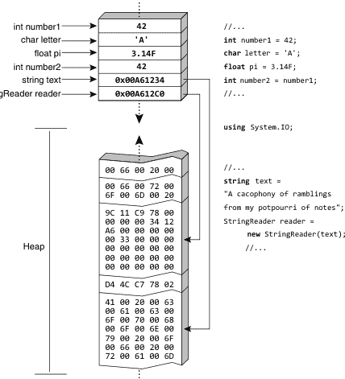

图8.2：引用类型指向堆

取消引用引用类型以访问其值需要额外的一次跳转。但是，引用类型不需要像值类型那样对数据进行相同的内存副本，因此在某些情况下引用类型更高效。当将一个引用类型变量赋值给另一个引用类型变量时，只会发生地址的内存副本，因此引用类型所需的内存副本始终是地址本身的大小。（32位处理器会复制32位，64位处理器会复制64位，以此类推。）显然，如果数据量很大，不复制数据会比值类型的行为更快。

由于引用类型只复制数据的地址，两个不同的变量可以指向相同的数据，通过一个变量更改数据也会更改另一个变量的数据。这既发生在赋值时，也发生在方法调用时。因此，方法可以影响调用者处的引用类型数据。

除了string和object之外，所有C#原始类型都是值类型。此外，框架中还提供了许多其他值类型。开发人员还可以定义表现得像用户定义原始类型的自定义值类型。

要定义自定义值类型，您使用与定义类和接口相同的结构。语法上的关键区别仅在于值类型使用关键字struct，如清单8.1所示。

### 清单8.1：定义结构体

```csharp
// Use keyword struct to declare a value type.
struct Angle
{
    public Angle(int hours, int minutes, int seconds)
    {
        _Hours = hours;
        _Minutes = minutes;
        _Seconds = seconds;
    }

    public int Hours
    {
        get { return _Hours; }
    }
}
```

```csharp
private int _Hours;
public int Minutes
{
    get { return _Minutes; }
}
private int _Minutes;
public int Seconds
{
    get { return _Seconds; }
}
private int _Seconds;
public Angle Move(int hours, int minutes, int seconds)
{
    return new Angle(
        Hours + hours,
        Minutes + minutes,
        Seconds + seconds)
}
}
```

```csharp
// Declaring a class - a reference type
// (declaring it as a struct would create a value type
// Larger than 16 bytes.)
class Coordinate
{
    public Angle Longitude
    {
        get { return _Longitude; }
        set { _Longitude = value; }
    }
    private Angle _Longitude;
    public Angle Latitude
    {
        get { return _Latitude; }
        set { _Latitude = value; }
    }
    private Angle _Latitude;
}
```

此清单将Angle定义为存储角度（无论是经度还是纬度）的小时、分钟和秒的值类型。生成的C#类型是一个结构体。

### 注意

虽然语言本身没有强制要求，但一个良好的准则是值类型应是不可变的：一旦实例化了值类型，就不应该能够修改同一个实例。在希望进行修改的场景中，您应该创建一个新实例。清单8.1提供了一个Move()方法，它不修改Angle的实例，而是返回一个全新的实例。

### 初始化结构体

除了属性和字段之外，结构体还可以包含方法和构造函数。但是，不允许默认（无参数）构造函数。有时（例如，在实例化数组时）不会调用值类型的构造函数，因为所有数组内存都用零初始化。为了避免默认构造函数只有时被调用的不一致性，C#完全禁止显式定义默认构造函数。因为编译器在声明时实现实例字段赋值的方式是将赋值放入类型的构造函数中，C#也禁止在声明时进行实例字段赋值（参见清单8.2）。

### 清单8.2：在声明中初始化结构体字段，导致错误

```csharp
struct Angle
{
    // ...

    // ERROR: Fields cannot be initialized at declaration time
    // int _Hours = 42;
    // ...
}
```

这并不消除初始化字段的必要性。事实上，与类一样，如果结构体字段在实例化后仍未初始化，并且无法从程序集外部访问（例如，因为它们装饰有internal或private修饰符），编译器会发出警告。

幸运的是，C#支持带参数的构造函数，并且它们附带一个有趣的初始化要求。它们必须初始化结构体中的所有字段。如果不这样做，会导致编译错误。例如，清单8.3中初始化属性而不是字段的构造函数会产生编译错误。


## LISTING 8.3: 在初始化所有字段之前访问属性

```
// ERROR: The 'this' object cannot be used before
// all of its fields are assigned to
// public Angle(int hours, int minutes, int seconds)
// {
// Hours = hours; // Shorthand for this.Hours = hours;
// Minutes = minutes; // Shorthand for this.Minutes = ...;
// Seconds = seconds; // Shorthand for this.Seconds = ...;
// }
```

错误报告称，在所有字段初始化之前访问了方法和属性（Hours 隐含 this.Hours）。要解决此问题，您需要直接初始化字段，如清单 8.1 所示。

## ADVANCED TOPIC

## 将 new 与值类型一起使用

对引用类型调用 new 运算符会编译为 CIL 指令 newobj。new 也可用于值类型，但相比之下，底层 CIL 指令是 initobj。该指令使用默认值初始化内存（相当于在 C# 2.0 中赋值 default(<type>））。

与类不同，结构不支持终结器。对于局部变量值类型，内存分配在堆栈上，因此垃圾回收器无需处理值类型的清理，并且在堆栈展开之前不会调用终结器。对于作为引用类型一部分的值类型，数据存储在堆上，内存作为引用对象垃圾回收的一部分进行清理。

## 语言对比：C++—struct 定义具有公共成员的类型

在 C++ 中，结构体和类之间的区别仅在于默认情况下，结构体的成员是公共的。C# 不包含这种细微差别。在 C# 中，对比要大得多，其中 struct 显著改变了与类不同的内存行为。

## 使用 default 运算符

提供一个不需要 _Seconds 的构造函数并不能避免仍需要初始化 _Seconds 的要求。您可以使用 0 显式分配 _Seconds 的默认值，或者在 C# 2.0 中使用 default 运算符。

清单 8.4 将默认值传递到包含 _Seconds 的 Angle 构造函数中。但是，default 运算符可以在此构造函数调用之外使用（例如 _Seconds = default(int)）。它是一种为特定类型指定默认值的方式。

### LISTING 8.4: 使用 default 运算符检索类型的默认值

```
// Use Keyword struct to declare a value type.
struct Angle
{
    public Angle(int hours, int minutes) : this(hours, minutes, default(int))
    {
    }
}
```

## 值类型的继承和接口

所有值类型都是密封的。此外，所有值类型都派生自 System.ValueType。这意味着结构体的继承链始终是从 object 到 ValueType 再到结构体。

值类型也可以实现接口。框架中内置的许多值类型实现了 IComparable 和 IFormattable 等接口。

ValueType 带来了值类型的行为，但它不包含任何额外成员（其所有成员都重写 object 的虚拟成员）。但是，与类一样，您可以重写 System.Object 的虚拟成员。重写规则与引用类型几乎相同（参见第 9 章）。然而，一个区别是，对于值类型，GetHashCode() 的默认实现是将调用转发到结构体中第一个非 null 字段。此外，Equals() 大量使用反射。这导致如下结论：如果值类型在集合中频繁使用，尤其是使用哈希码的字典类型集合，则值类型应同时包含 Equals() 和 GetHashCode() 的重写（参见第 9 章）。

## 装箱

因为局部变量值类型直接包含其数据，而它们的接口和 System.Object 包含对其数据的引用，所以需要考虑的一个重要问题是：当值类型转换为其实现的接口之一或其根基类 object 时会发生什么。这种转换称为装箱，并具有特殊行为。从直接引用其数据的值类型转换为指向堆上位置的引用类型涉及多个步骤。

- 首先，在堆上分配将包含值类型数据和少量开销（SyncBlockIndex 和方法表指针）的内存。
- 接下来，从堆栈上的值类型数据向堆上分配的位置进行内存复制。
- 最后，对象或接口引用被更新以指向堆上的位置。

逆操作是拆箱。按定义，unbox CIL 指令只是引用堆上的数据；它不包括从堆到堆栈的复制。但是，在大多数 C# 情况下，拆箱后仍会进行复制。

装箱和拆箱需要考虑，因为装箱具有性能和行为影响。除了学习如何在 C# 代码中识别它们之外，开发人员还可以通过查看 CIL 来计算特定代码片段中的 box/unbox 指令数量。每个操作都有特定的指令，如表 8.1 所示。

| C# 代码 | CIL 代码 |
| --- | --- |
| `static void Main()` | `.method private hidebysig static void Main() cil managed` |
| `{` | `{` |
| | `.entrypoint` |
| | `// Code size 21 (0x15)` |
| `int number;` | `.maxstack 1` |
| `object thing;` | `.locals init ([0] int32 number, [1] object thing)` |
| `number = 42;` | `IL_0000: nop` |
| | `IL_0001: ldc.i4.s 42` |
| | `IL_0003: stloc.0` |
| `// Boxing` | `IL_0004: ldloca.s` |
| `thing = number;` | `IL_0005: box [mscorlib]System.Int32` |
| | `IL_000a: stloc.1` |
| `// Unboxing` | `IL_000b: ldloc.1` |
| `number = (int)thing;` | `IL_000c: unbox.any [mscorlib]System.Int32` |
| | `IL_0011: stloc.0` |
| | `IL_0012: br.s IL_0014` |
| `return;` | `IL_0014: ret` |
| `}` | `} // end of method Program::Main` |

当装箱发生量较小时，性能问题无关紧要。但是，装箱有时很微妙，频繁发生会对性能产生影响。请考虑清单 8.5 和输出 8.1。

### LISTING 8.5: 微妙的装箱和拆箱指令

```
class DisplayFibonacci
{
    static void Main()
    {
        int totalCount;
        System.Collections.ArrayList list =
            new System.Collections.ArrayList();

        Console.Write("Enter a number between 2 and 1000:");
        totalCount = int.Parse(Console.ReadLine());

        // Execution-time error:
        // List.Add(0); // Cast to double or 'D' suffix required
        // whether cast or using 'D' suffix,
        // CIL is identical.
        list.Add((double)0);
        list.Add((double)1);

        for (int count = 2; count < totalCount; count++)
        {
            list.Add(
                ((double)list[count - 1] +
                (double)list[count - 2]));
        }

        foreach (double count in list)
        {
            Console.Write("{0}, ", count);
        }
    }
}
```

### 输出 8.1:

```
Enter a number between 2 and 1000:42
0, 1, 2, 3, 5, 8, 13, 21, 34, 55, 89, 144, 233, 377, 610, 987, 1597,
2584, 4181, 6765, 10946, 17711, 28657, 46368, 75025, 121393, 196418,
317811, 514229, 832040, 1346269, 2178309, 3524578, 5702887, 9227465,
14930352, 24157817, 39088169, 63245986, 102334155, 165580141,
```

清单 8.5 中显示的代码在编译后，在生成的 CIL 中会产生五个 box 指令和三个 unbox 指令。

- 前两个 box 指令出现在对 list.Add() 的初始调用中。ArrayList 方法的签名是 int Add(object value)。因此，传递给此方法的任何值类型都会被装箱。
- 接下来是 for 循环中对 Add() 调用中的两个 unbox 指令。ArrayList 索引运算符的返回始终是 object，因为 ArrayList 收集的就是 object。但是，为了相加两个值，您需要将它们强制转换回 double。从 object 强制转换回值类型是一个 unbox 调用。
- 现在，您将相加的结果放入 ArrayList 实例中，这又会导致一次 box 操作。请注意，前两个 unbox 指令和这个 box 指令都发生在循环中。
- 在 foreach 循环中，您遍历 ArrayList 中的每个项并将其分配给 count。但是，如前面所见，ArrayList 中的项是 object，因此将其分配给 double 会对每个项进行拆箱。


- 5. 在 foreach 循环中调用的 Console.WriteLine() 的签名为 void Console.Write(string format, object arg)。因此，每次调用它都会触发一个将 double 装箱为 object 的操作。

显然，你可以通过消除许多装箱操作来轻松改进此代码。在最后一个 foreach 循环中使用 object 而不是 double 是你可以采取的一项改进。另一项改进是将 ArrayList 数据类型更改为泛型集合（参见第 11 章）。然而，要点在于装箱可能相当隐蔽，因此开发人员需要特别注意，并留意可能重复发生并影响性能的情况。

与运行时装箱相关的另一个不幸问题是：如果你想修改最初的两个 Add() 调用，使其不使用强制转换（或 double 字面量），则必须将整数插入到数组列表中。由于 int 会隐式转换为 double，这看似是一个无害的修改。然而，for 循环内部以及 foreach 循环中对 count 的赋值处转换为 double 的操作将会失败。问题在于，拆箱操作后紧接着试图将 int 内存复制到 double 中。如果不先强制转换为 int，就无法这样做，因为代码在执行时会抛出 InvalidCastException。清单 8.6 展示了一个被注释掉的类似错误，随后是正确的强制转换。

```
Listing 8.6: Unboxing Must Be to the Underlying Type

// ...
int number;
object thing;
double bigNumber;

number = 42;
thing = number;
// ERROR: InvalidCastException
// bigNumber = (double)thing;
bigNumber = (double)(int)thing;
// ...
```

## lock 语句中的值类型

C# 支持 lock 语句用于同步代码。该语句编译为 System.Threading.Monitor 的 Enter() 和 Exit() 方法。这两个方法必须成对调用。Enter() 记录传递的唯一引用参数，以便在使用相同引用调用 Exit() 时，可以释放锁。使用值类型的问题在于装箱。因此，每次调用 Enter() 或 Exit() 时，都会在堆上创建一个新值。将一个副本的引用与另一个副本的引用进行比较始终会返回 false，因此你无法将 Enter() 与相应的 Exit() 配对。因此，lock 语句中不允许使用值类型。

清单 8.7 指出了几个运行时装箱的特殊之处，输出 8.2 显示了结果。

## 清单 8.7：隐蔽的装箱特性

```
interface IAngle
{
    void MoveTo(int hours, int minutes, int seconds);
}

struct Angle : IAngle
{
    // ...

    // NOTE: This makes Angle mutable, against the general
    // guideline
    public void MoveTo(int hours, int minutes, int seconds)
    {
        _Hours = hours;
        _Minutes = minutes;
        _Seconds = seconds;
    }
}

class Program
{
    static void Main()
    {
      // ...
      Angle angle = new Angle(25, 58, 23);
      object objectAngle = angle; // Box
      Console.WriteLine(((Angle)objectAngle).Hours);

      // Unbox and discard
      ((Angle)objectAngle).MoveTo(26, 58, 23);
      Console.WriteLine(((Angle)objectAngle).Hours);

      // Box, modify, and discard
      ((IAngle)angle).MoveTo(26, 58, 23);
      Console.WriteLine("" + ((Angle)angle).Hours);

      // Modify heap directly
      ((IAngle)objectAngle).MoveTo(26, 58, 23);
      Console.WriteLine("" + ((Angle)angle).Hours);

      // ...
    }
}
```

## 输出 8.2:

25, 25, 25, 26

清单 8.7 使用了清单 8.1 中的 Angle 结构体和 IAngle 接口。另请注意，IAngle.MoveTo() 接口将 Angle 更改为可变的。这揭示了一些特性，并在此过程中，演示了使结构体不可变的准则的重要性。

在前两行中，你初始化 angle，然后将其装箱到名为 objectAngle 的变量中。接下来，你调用 MoveTo 以将 Hours 更改为 26。然而，正如输出所示，第一次并未发生任何更改。问题在于，为了调用 MoveTo()，编译器会对 objectAngle 进行拆箱并（按定义）创建值的副本。尽管堆栈值在执行时已成功修改，但该值会被丢弃，objectAngle 引用的堆位置上不会发生任何更改。

在下一个示例中，类似的问题以相反的方式出现。值没有直接调用 MoveTo()，而是被强制转换为 IAngle。该强制转换会调用装箱指令，运行时将 angle 数据复制到堆上。接下来，在调用返回之前，堆上的数据会直接在堆上被修改。

结果是，不会从堆向堆栈复制回数据。相反，修改后的堆数据准备进行垃圾回收，而 angle 中的数据保持未修改。

在最后一种情况中，强制转换为 IAngle 时数据已经在堆上，因此不会发生复制。MoveTo() 更新 _Hours 值，代码按预期行为。

## 高级主题

## 避免拆箱

如前所述，拆箱指令不包括将数据复制回堆栈。虽然某些语言支持直接访问堆上的值类型，但在 C# 中，只有当值类型作为引用类型的字段访问时才有可能。由于接口是引用类型，因此通过其接口访问装箱值时，可以避免拆箱和复制。

当在值类型上调用接口方法时，实例必须是一个变量，因为该方法可能会修改值。由于拆箱会生成托管地址，运行时拥有一个存储位置，因此也就有了一个变量。结果是，运行时直接将该托管地址传递给接口，不需要执行拆箱操作。

清单 8.7 向 Angle 结构体添加了接口实现。清单 8.8 使用接口来避免拆箱。

```
LISTING 8.8: Avoiding Unboxing and Copying

int number;
object thing;
number = 42;
// Boxing
thing = number;
// No unbox instruction
string text = ((IFormattable)thing).ToString(
    "x", null);
Console.WriteLine(text);
```

接口本身就是引用类型，因此调用接口成员甚至不需要拆箱。此外，调用结构体的 ToString() 方法（该方法重写 object 的 ToString() 方法）也不需要拆箱。在编译时，很明显结构体重写的 ToString() 方法始终会被调用，因为所有值类型都是 sealed 的。结果是，C# 编译器可以指示直接调用该方法，而无需拆箱。

## 枚举

比较清单 8.9 中显示的两个代码片段。

```
int connectionState;
// ...
switch (connectionState)
{
    case 0:
    // ...
    break;
    case 1:
    // ...
    break;
    case 2:
    // ...
    break;
    case 3:
    // ...
    break;
}
ConnectionState connectionState;
// ...
switch (connectionState)
{
    case ConnectionState.Connected:
    // ...
    break;
    case ConnectionState.Connecting:
    // ...
    break;
    case ConnectionState.Disconnected:
    // ...
    break;
    case ConnectionState.Disconnecting:
    // ...
    break;
}
```

显然，可读性方面的差异巨大，因为在第二个片段中，case 语句在某种程度上是自文档化的。然而，运行时性能是相同的。为了实现这一点，第二个片段在每个 case 语句中使用枚举值。

枚举是开发人员可以定义的一种类型。枚举的关键特征在于它标识了一组在编译时定义的可能值，每个值都通过名称引用，从而使代码更易读。你使用类似于定义类的样式来定义枚举，如清单 8.10 所示。

```
enum ConnectionState
{
    Disconnected,
    Connecting,
    Connected,
    Disconnecting
}
```

> **注意**
> 
> 枚举对于布尔参数也很有帮助。例如，方法调用 SetState(true) 不如 SetState(DeviceState.On) 易读。

你通过在枚举值前加上枚举名称来引用枚举值；例如，要引用 Connected 值，请使用 ConnectionState.Connected。你不应该在枚举值名称中使用枚举名称，以避免出现类似 ConnectionState.ConnectionStateConnected 这样的冗余。按照惯例，枚举名称本身应该是单数形式，除非枚举是位标志（稍后讨论）。

默认情况下，第一个枚举值为 0（从技术上讲，它是 0 隐式转换为基础枚举类型），每个后续条目递增 1。然而，你可以为枚举分配显式值，如清单 8.11 所示。


## LISTING 8.11: 定义枚举类型

```
enum ConnectionState : short
{
    Disconnected,
    Connecting = 10,
    Connected,
    Joined = Connected,
    Disconnecting
}
```

Disconnected 的默认值为 0，Connecting 已被显式赋值为 10，因此 Connected 将被赋值为 11。Joined 被赋值为 11，即 Connected 所引用的值。（在这种情况下，您无需为 Connected 加上枚举名称前缀，因为它出现在其作用域内。）Disconnecting 的值为 12。

枚举始终具有基础类型，可以是 int、uint、long 或 ulong，但不能是 char。事实上，枚举类型的性能与基础值类型等效。默认情况下，基础值类型是 int，但您可以使用继承类型语法指定不同的类型。例如，Listing 8.11 使用 short 而不是 int。为保持一致性，该语法模拟继承语法，但这并不实际建立继承关系。所有枚举的基类是 System.Enum。此外，这些类是 sealed 的；您不能从现有枚举类型派生以添加更多成员。

成功转换不仅适用于有效的枚举值。可以将 42 强制转换为 ConnectionState，即使没有相应的 ConnectionState 枚举值。如果该值成功转换为基础类型，则转换将成功。

允许强制转换（即使没有相应的枚举值）的优势在于，枚举可以在后续 API 版本中添加新值，而不会破坏早期版本。此外，枚举值为已知值提供名称，同时仍允许在运行时分配未知值。负担在于，开发人员必须采取防御性编码来应对未匹配值的可能性。例如，用 default 替换 case ConnectionState.Disconnecting 并期望 default 情况的唯一可能值是 ConnectionState.Disconnecting 是不明智的。相反，您应该显式处理 Disconnect 情况，而 Default 情况应报告错误或无害行为。然而，如前所述，枚举与基础类型之间的转换（反之亦然）涉及显式强制转换，而非隐式转换。例如，代码不能调用 ReportState(10)，而其签名为 void ReportState(ConnectionState state)。（唯一的例外是传递 0，因为 0 到任何枚举存在隐式转换。）编译器将执行类型检查，如果类型不完全相同，则要求显式强制转换。

虽然您可以在代码的后续版本中向枚举添加其他值，但应谨慎操作。在枚举中间插入枚举值会提升所有后续枚举的值（例如，在 Connected 之前添加 Flooded 或 Locked 将更改 Connected 的值）。这将影响所有针对新版本重新编译的代码的版本。但是，任何针对旧版本编译的代码将继续使用旧值，使预期值完全不同。除了在列表末尾插入枚举值外，避免更改枚举值的一种方法是显式赋值。

枚举与其他值类型略有不同，因为枚举在派生自 System.ValueType 之前先派生自 System.Enum。

## 枚举之间的类型兼容性

C# 也不支持两个不同枚举数组之间的直接强制转换。但是，可以通过先强制转换为数组，再强制转换为第二个枚举来强制进行转换。要求是两个枚举共享相同的基础类型，诀窍是先强制转换为 System.Array，如 Listing 8.12 末尾所示。

## LISTING 8.12: 枚举数组之间的强制转换

```
enum ConnectionState1
{
    Disconnected,
    Connecting,
    Connected,
    Disconnecting
}
```

```
enum ConnectionState2
{
    Disconnected,
    Connecting,
    Connected,
    Disconnecting
}
```

```
class Program
{
    static void Main()
    {
        ConnectionState[] states =
            (ConnectionState[])(Array)new ConnectionState2[42];
    }
}
```

这利用了 CLR 的赋值兼容性概念比 C# 更宽松的事实。（同样的技巧也适用于非法转换，例如 int[] 到 uint[]。）但是，请谨慎使用此方法，因为没有 C# 规范详细说明这应该在不同 CLR 实现之间工作。

## 枚举与字符串之间的转换

枚举相关的便利之一在于，ToString() 方法（由 System.Console.WriteLine() 等方法调用）会输出枚举值标识符：

```
System.Diagnostics.Trace.WriteLine(string.Format(
    "The Connection is currently {0}.",
    ConnectionState.Disconnecting));
```

## 输出 8.3：

```
The Connection is currently Disconnecting.
```

从字符串转换为枚举稍微难找一些，因为这涉及 System.Enum 基类上的静态方法。Listing 8.13 提供了不使用泛型的示例（参见第 11 章），输出 8.4 显示了结果。

## LISTING 8.13: 使用 Enum.Parse() 将字符串转换为枚举

```
ThreadPriorityLevel priority = (ThreadPriorityLevel)Enum.Parse(
    typeof(ThreadPriorityLevel), "Idle");
Console.WriteLine(priority);
```

## 输出 8.4：

```
Idle
```

Enum.Parse() 的第一个参数是类型，使用关键字 typeof() 指定。这是一种编译时标识类型的方式，类似于类型值的字面量（参见第 17 章）。

在 .NET Framework 4 之前，没有 TryParse() 方法，因此之前的代码如果字符串可能不匹配枚举值标识符，会包含适当的异常处理。.NET Framework 4 的 TryParse<T>() 方法使用泛型，但类型参数可以推断，从而得出 Listing 8.14 中所示的到枚举转换示例。

## LISTING 8.14: 使用 Enum.TryParse<T>() 将字符串转换为枚举

```
System.Threading.ThreadPriorityLevel priority;
if(Enum.TryParse("Idle", out priority))
{
    Console.WriteLine(priority);
}
```

这种转换的优势在于，如果字符串无法转换，则无需使用异常处理。相反，代码可以检查 TryParse<T>() 调用返回的布尔结果。

无论代码使用“Parse”还是“TryParse”方法，将字符串转换为枚举的关键警告是，这种强制转换不可本地化。因此，开发人员应仅对不向用户公开的消息使用这种强制转换（假设本地化是一项要求）。

## 枚举作为标志

很多时候，开发人员不仅希望枚举值是唯一的，还希望能够将它们组合起来表示组合值。

例如，考虑 System.IO.FileAttributes。Listing 8.15 中所示的此枚举指示文件上的各种属性：只读、隐藏、存档等等。区别在于，与 ConnectionState 属性不同，其中每个枚举值是互斥的，而 FileAttributes 枚举值可以并且旨在组合：一个文件可以既是只读又是隐藏。为支持此功能，每个枚举值都是一个唯一位（或表示特定组合的值）。

## Listing 8.15: 将枚举用作标志

```
public enum FileAttributes
{
    ReadOnly = 1<<0, // 0000000000000001
    Hidden = 1<<1, // 0000000000000010
    System = 1<<2, // 0000000000000100
    Directory = 1<<4, // 0000000000010000
    Archive = 1<<5, // 0000000000100000
    Device = 1<<6, // 0000000001000000
    Normal = 1<<7, // 0000000010000000
    Temporary = 1<<8, // 0000000100000000
    SparseFile = 1<<9, // 0000001000000000
    ReparsePoint = 1<<10, // 0000010000000000
    Compressed = 1<<11, // 0000100000000000
    Offline = 1<<12, // 0001000000000000
    NotContentIndexed = 1<<13, // 0010000000000000
    Encrypted = 1<<14, // 1000000000000000
}
```

由于枚举支持组合值，位标志的枚举名称准则是使用复数。

要连接枚举值，请使用按位 OR 运算符，如 Listing 8.16 所示。

## Listing 8.16: 将按位 OR 和 AND 与标志枚举一起使用

```
using System;
using System.IO;

public class Program
{
    public static void Main()
    {
        // ...

        string fileName = @"enumtest.txt";
```


System.IO.FileInfo file =
    new System.IO.FileInfo(fileName);

file.Attributes = FileAttributes.Hidden |
    FileAttributes.ReadOnly;

Console.WriteLine("{0} | {1} = {2}",
    FileAttributes.Hidden, FileAttributes.ReadOnly,
    (int)FileAttributes.Hidden);

if ((file.Attributes & FileAttributes.Hidden) !=
    FileAttributes.Hidden)
{
    throw new Exception("File is not hidden.");
}

if ((file.Attributes & FileAttributes.ReadOnly) !=
    FileAttributes.ReadOnly)
{
    throw new Exception("File is not read-only.");
}

// ...

清单 8.16 的结果显示在输出 8.5 中。

## 输出 8.5：

```
Hidden | ReadOnly = 3
```

使用按位或运算符可以将文件同时设置为只读和隐藏。此外，可以使用按位与运算符检查特定设置。

枚举中的每个值不需要仅对应一个标志。定义对应常见值组合的其他标志是完全合理的。清单 8.17 显示了一个示例。

## 清单 8.17：为常见组合定义枚举值

```
enum DistributedChannel
{
    None = 0,
    Transacted = 1,
    Queued = 2,
    Encrypted = 4,
    Persisted = 16,
    FaultTolerant = Transacted | Queued | Persisted
}
```

此外，如果没有任何值是有效值的可能性，则 None 之类的标志是合适的。相比之下，避免将 Maximum 之类的值作为最后一个枚举值，因为 Maximum 可能被解释为有效的枚举值。要检查某个值是否包含在枚举中，请使用 System.Enum.IsDefined() 方法。

## 高级主题

## FlagsAttribute

如果决定使用标志类型的值，枚举应包含 FlagsAttribute。该属性出现在方括号中（参见第 17 章），紧跟在枚举声明之前，如清单 8.18 所示。

## 清单 8.18：使用 FlagsAttribute

```
// FileAttributes defined in System.IO.
[Flags] // Decorating an enum with FlagsAttribute.
public enum FileAttributes
{
    ReadOnly = 1 << 0, // 00000000000001
    Hidden = 1 << 1, // 00000000000010
    ... ...
}
```

```
using System;
using System.Diagnostics;
using System.IO;

class Program
{
    public static void Main()
    {
        string FileName = @"enumtest.txt";
        FileInfo file = new FileInfo(fileName);
        file.Open(FileMode.Create).Close();

        FileAttributes startingAttributes =
        file.Attributes;
```

```
file.Attributes = FileAttributes.Hidden |
FileAttributes.ReadOnly;
Console.WriteLine("{0}",
    file.Attributes.ToString().Replace(", ", " | "),
    file.Attributes);
FileAttributes attributes =
(FileAttributes) Enum.Parse(typeof(FileAttributes),
file.Attributes.ToString());
Console.WriteLine(attributes);
File.SetAttributes(fileName,
startingAttributes);
file.Delete();
}
}
```

清单 8.18 的结果显示在输出 8.6 中。

## 输出 8.6：

> "ReadOnly | Hidden" 输出为 "ReadOnly, Hidden"
> ReadOnly, Hidden

该标志表明枚举值可以组合。此外，它会更改 ToString() 和 Parse() 方法的行为。例如，对装饰有 FlagsAttribute 的枚举调用 ToString() 会写出每个已设置枚举标志的字符串。在清单 8.18 中，file.Attributes.ToString() 返回 ReadOnly, Hidden，而没有 FileAttributes 标志时本应返回 3。如果两个枚举值相同，ToString() 调用将返回第一个值。然而，如前所述，应谨慎使用此功能，因为它不可本地化。

将字符串值解析为枚举也可行。每个枚举值标识符之间用逗号分隔。

需要注意的是，FlagsAttribute 不会自动分配唯一的标志值或检查它们是否具有唯一值。这样做没有意义，因为重复项和组合通常是可取的。相反，必须显式分配每个枚举项的值。

## 摘要

本章首先讨论了如何定义自定义值类型。出现的关键准则之一是创建不可变值类型。装箱也是值类型讨论的一部分。

装箱引入的特性很微妙，绝大多数会导致运行时而非编译时出现问题。虽然了解这些以尽量避免它们很重要，但从许多方面来看，过分关注潜在陷阱会掩盖值类型的实用性和性能优势。程序员不应过度担心使用值类型。值类型渗透到本书几乎每一章，但这些特性并非如此。我已围绕每个问题准备了代码来演示相关顾虑，但实际上，这类模式很少出现。避免大多数问题的关键是遵循不创建可变值类型的准则；这就是为什么你在原始类型中不会遇到它们的原因。

也许唯一出现频率较高的问题是循环中重复的装箱操作。然而，C# 2.0 通过添加泛型大大降低了这种可能性，即使没有泛型，性能也很少受到影响到需要避免的程度，除非某个带有装箱的特定算法被识别为瓶颈。

此外，自定义结构（值类型）相对较少。它们在 C# 开发中显然扮演着重要角色，但与类的数量相比，自定义结构很少——当需要自定义结构时，通常是在面向与托管代码互操作或特定问题空间的框架中。

除了演示结构，本章还介绍了枚举。这是大多数编程语言中可用的标准构造，如果你想改善 API 可用性和代码可读性，它值得重点考虑。

下一章将介绍更多创建格式良好类型（包括结构体和其他类型）的准则。它首先探讨重写对象的虚拟成员和定义运算符重载方法。这两个主题都适用于结构体和类，但在完成结构体定义并使其格式良好方面，它们稍微更为关键。

# 9 格式良好的类型

前几章涵盖了定义类和结构体的大部分构造。然而，关于使用收尾功能完善类型定义，仍有几个细节。本章介绍如何为类型声明添加最终修饰。

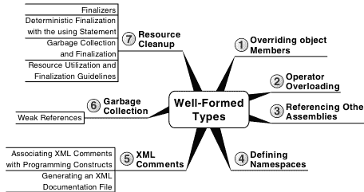

### 重写 object 成员

第 6 章讨论了所有类型都派生自 object。此外，它回顾了 object 上可用的每个方法，并讨论了其中一些是虚拟方法。本节讨论重写虚拟方法的细节。

#### 重写 ToString()

默认情况下，对任何对象调用 ToString() 都会返回类的完全限定名称。例如，对 System.IO.FileStream 对象调用 ToString() 将返回字符串 System.IO.FileStream。然而，对于某些类，ToString() 可能更有意义。例如，对 string 调用 ToString() 返回字符串值本身。同样，返回 Contact 的姓名会更有意义。清单 9.1 重写了 ToString() 以返回 Coordinate 的字符串表示形式。

## 清单 9.1：重写 ToString()

```
public struct Coordinate
{
    public Coordinate(Longitude longitude, Latitude latitude)
    {
        _Longitude = longitude;
        _Latitude = latitude;
    }

    public Longitude Longitude { get { return _Longitude; } }
    private readonly Longitude _longitude;

    public Latitude Latitude { get { return _Latitude; } }
    private readonly Latitude _latitude;

    public override string ToString()
    {
        return string.Format("{0} {1}", Longitude, Latitude);
    }
    // ...
```

编写诸如 Console.WriteLine() 之类的方法会调用对象的 ToString() 方法，因此重写它通常比默认实现输出更有意义的信息。

#### 重写 GetHashCode()

重写 GetHashCode() 比重写 ToString() 更复杂。无论如何，当你重写 Equals() 时，应该重写 GetHashCode()，并且编译器会发出警告指示这一点。重写


将 GetHashCode() 用作哈希表集合（例如 System.Collections.Hashtable 和 System.Collections.Generic.Dictionary）的键时，这也是一种良好做法。

哈希码的目的是通过生成与对象值对应的数字来高效平衡哈希表。以下是良好 GetHashCode() 实现的一些实现原则。

- 必需：相等对象必须具有相等的哈希码（如果 a.Equals(b)，则 a.GetHashCode() == b.GetHashCode()）。
- 必需：特定对象生命周期内 GetHashCode() 的返回值应保持不变（相同的值），即使对象的数据发生变化。在许多情况下，应缓存方法返回值以强制执行此要求。
- 必需：GetHashCode() 不应抛出任何异常；GetHashCode() 必须始终成功返回一个值。
- 性能：哈希码应尽可能唯一。但是，由于哈希码仅返回一个 int，对于可能拥有比 int 能容纳的更多值的对象（几乎是所有类型），哈希码必然存在重叠。（一个明显的例子是 long，因为可能的 long 值比 int 能唯一标识的更多。）
- 性能：可能的哈希码值应均匀分布在 int 的范围内。例如，创建一个不考虑拉丁语系语言中字符串分布主要集中在最初 128 个 ASCII 字符这一事实的哈希，会导致字符串值分布非常不均匀，并不是一个强大的 GetHashCode() 算法。
- 性能：GetHashCode() 应针对性能进行优化。GetHashCode() 通常用于 Equals() 实现中，以便在哈希码不同时短路完整的相等比较。因此，当类型用作字典集合中的键类型时，它会被频繁调用。
- 性能：两个对象之间的微小差异应导致哈希码值的巨大差异——理想情况下，对象中 1 位的差异平均会导致哈希码中约 16 位发生变化。这有助于确保无论哈希值如何“分桶”，哈希表都能保持平衡。

- 安全：攻击者很难构造出具有特定哈希码的对象。该攻击是通过向哈希表中大量注入所有哈希到相同值的数据来实现的。哈希表实现随后会从 O(1) 变为 O(n)，从而可能导致拒绝服务攻击。

请参考清单 9.2 中 Coordinate 类型的 GetHashCode() 实现。

### 清单 9.2：实现 GetHashCode()

```csharp
public struct Coordinate
{
    public Coordinate(Longitude longitude, Latitude latitude)
    {
        _Longitude = longitude;
        _Latitude = latitude;
    }

    public Longitude Longitude { get { return _Longitude; } }
    private readonly Longitude _Longitude;

    public Latitude Latitude { get { return _Latitude; } }
    private readonly Latitude _Latitude;

    public override int GetHashCode()
    {
        int hashCode = Longitude.GetHashCode();
        // As long as the hash codes are not equal
        if(Longitude.GetHashCode() != Latitude.GetHashCode())
        {
            hashCode ^= Latitude.GetHashCode(); // eXclusive OR
        }
        return hashCode;
    }
}
// ...
}
```

通常，关键是在相关类型的哈希码上使用 XOR 运算符，并确保 XOR 操作数不太可能接近或相等——否则结果将全部为零。（在操作数接近或相等的情况下，考虑改用位移和加法。）替代操作数 AND 和 OR 有类似限制，但这些限制出现的频率更多。多次应用 AND 会趋向于全 0 位，而应用 OR 会趋向于全 1 位。

为了更精细的控制，使用移位运算符拆分大于 int 的类型。例如，名为 value 的 long 的 GetHashCode() 实现如下：

```csharp
int GetHashCode() { return ((int)value ^ (int)(value >> 32)); };
```

另外，请注意，如果基类不是 object，则应将 base.GetHashCode() 包含在 XOR 赋值中。

最后，Coordinate 不会缓存哈希码的值。由于哈希码计算中的每个字段都是 readonly，因此该值无法更改。但是，如果计算出的值可能更改，或者缓存值能提供显著的性能优势，则实现应缓存哈希码。

## 重写 Equals()

重写 Equals() 而不重写 GetHashCode() 会导致类似于输出 9.1 中所示的警告。

### 输出 9.1：

```
warning CS0659: '<Class Name>' overrides Object.Equals(object o) but does not override Object.GetHashCode()
```

通常，程序员预期重写 Equals() 是微不足道的，但它包含出人意料的众多细微差别，需要仔细思考和测试。

### 对象标识与相等对象值

如果两个引用都指向同一实例，则它们是相同的。object 以及因此所有对象都包含一个名为 ReferenceEquals() 的静态方法，用于显式检查此对象标识（参见图 9.1）

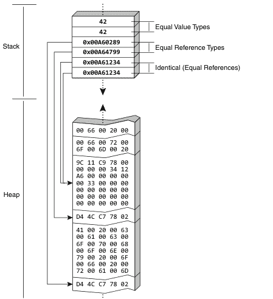

图 9.1：标识

但是，相同的引用不是唯一的相等类型。如果标识两个对象实例的值相等，则这两个对象实例也可以相等。请考虑清单 9.3 中两个 ProductSerialNumbers 的比较。

### 清单 9.3：相等

```csharp
public sealed class ProductSerialNumber
{
    // See Appendix B
}

class Program
{
    static void Main()
    {
        ProductSerialNumber serialNumber1 =
            new ProductSerialNumber("PV", 1008, 09187234);
        ProductSerialNumber serialNumber2 =
        ProductSerialNumber serialNumber3 =
            new ProductSerialNumber("PV", 1008, 09187234);

        // These serial numbers ARE the same object identity.
        if(ProductSerialNumber.ReferenceEquals(serialNumber1,
            serialNumber2))
        {
            throw new Exception(
                "serialNumber1 does NOT " +
                "reference equals serialNumber2");
        }
        // and, therefore, they are equal
        else if(serialNumber1.Equals(serialNumber2))
        {
            throw new Exception(
                "serialNumber1 does NOT equal serialNumber2");
        }
        else
        {
            Console.WriteLine(
                "serialNumber1 reference equals serialNumber2");
            Console.WriteLine(
                "serialNumber1 equals serialNumber2");
        }

        // These serial numbers are NOT the same object identity.
        if (ProductSerialNumber.ReferenceEquals(serialNumber1,
            serialNumber3))
        {
            throw new Exception(
                "serialNumber1 DOES reference " +
                "equal serialNumber3");
        }
        // but they are equal (assuming Equals is overloaded).
        else if((serialNumber1.Equals(serialNumber3) ||
            serialNumber1 == serialNumber3))
        {
            throw new Exception(
                "serialNumber1 does NOT equal serialNumber3");
        }

        Console.WriteLine( "serialNumber1 equals serialNumber3" );
        Console.WriteLine( "serialNumber1 == serialNumber3" );
    }
}
```

清单 9.3 的结果显示在输出 9.2 中。

### 输出 9.2：

```
serialNumber1 reference equals serialNumber2
serialNumber1 equals serialNumber3
serialNumber1 == serialNumber3
```

正如最后一条断言通过 ReferenceEquals() 所演示的，serialNumber1 和 serialNumber3 不是同一引用。但是，代码使用相同的值构造它们，并且两者在逻辑上都关联到同一物理产品。如果一个实例是从数据库中的数据创建的，而另一个是从手动输入的数据创建的，您会期望这些实例相等，因此产品不会在数据库中重复（重新输入）。两个相同的引用显然是相等的；但是，两个不同的对象可以相等但不是引用相等。此类对象不会具有相同的对象标识，但它们可能具有标识其为相等对象的关键数据。

只有引用类型可以引用相等，从而支持标识概念。对值类型调用 ReferenceEquals() 始终返回 false，因为按定义，值类型直接包含其数据，而不是引用。即使 ReferenceEquals() 将同一变量同时传递给两个（值类型）参数，结果仍然是 false，因为值类型的本质就是它们被复制到被调用方法的参数中。清单 9.4 演示了此行为。换句话说，ReferenceEquals() 会对值类型进行装箱。由于每个参数都被放入“不同的框”（堆栈上的位置）中，它们永远不是引用相等。

### 清单 9.4：值类型甚至不会自引用相等

```csharp
public struct Coordinate
{
    public Coordinate(Longitude longitude, Latitude latitude)
    {
```


```
_Longitude = longitude;
    _Latitude = latitude;
}

public Longitude Longitude { get { return _Longitude; } }
private readonly Longitude _Longitude;

public Latitude Latitude { get { return _Latitude; } }
private readonly Latitude _Latitude;

// ...
}
```

```
class Program
{
    public void Main()
    {
        //...

        Coordinate coordinate1 =
            new Coordinate(new Longitude(48, 52),
                new Latitude(-2, -20));

        // Value types will never be reference equal.
        if (Coordinate.ReferenceEquals(coordinate1,
            coordinate1))
        {
            throw new Exception(
                "coordinate1 reference equals coordinate1");
        }

        Console.WriteLine(
            "coordinate1 does NOT reference equal itself");
    }
}
```

与第 8 章中将 Coordinate 定义为引用类型不同，接下来的定义是值类型（struct），因为 Longitude 和 Latitude 数据的组合在逻辑上被视为一个值，且大小小于 16 字节。（在第 8 章中，Coordinate 聚合的是 Angle 而不是 Longitude 和 Latitude。）将 Coordinate 声明为值类型的一个促成因素是，它是一个（复杂的）数值，具有针对它的特定操作。相比之下，像 Employee 这样的引用类型不是你进行数值操作的值，而是指向现实生活中的对象。

## 实现 Equals()

要确定两个对象是否相等（它们具有相同的标识数据），你使用对象的 Equals() 方法。object 上此虚方法的实现使用 ReferenceEquals() 来评估相等性。由于此实现通常不够充分，有时有必要用更合适的实现重写 Equals()。

对于对象相互相等，预期是它们内部的标识数据相等。例如，对于 ProductSerialNumbers，ProductSeries、Model 和 Id 必须相同；然而，对于 Employee 对象，也许比较 EmployeeIds 就足以判断相等性。要纠正 object.Equals() 的实现，有必要重写它。例如，值类型重写 Equals() 实现，以改用类型包含的字段。

重写 Equals() 的步骤如下。

- 1. 检查 null。
- 2. 如果类型是引用类型，检查引用相等性。
- 3. 检查等效类型。
- 4. 调用一个类型化的帮助方法，它可以将操作数视为比较类型而不是对象（参见清单 9.5 中的 Equals(Coordinate obj) 方法）。
- 5. 可能检查等效哈希码以短路广泛的逐字段比较。（两个相等的对象不能有不同的哈希码。）
- 6. 如果基类重写了 Equals()，检查 base.Equals()。
- 7. 比较每个标识字段的相等性。
- 8. 重写 GetHashCode()。
- 9. 重写 == 和 != 运算符（参见下一节）。

清单 9.5 显示了 Equals() 实现的示例。

```
Listing 9.5: Overriding Equals()
public struct Longitude
{
    // ...
}
```

```
public struct Latitude
{
    // ...
}
```

```
public struct Coordinate
{
    public Coordinate(Longitude longitude, Latitude latitude)
    {
        _Longitude = longitude;
        _Latitude = latitude;
    }

    public Longitude Longitude { get { return _Longitude; } }
    private readonly Longitude _Longitude;

    public Latitude Latitude { get { return _Latitude; } }
    private readonly Latitude _Latitude;

    public override bool Equals(object obj)
    {
        // STEP 1: Check for null
        if (obj == null)
        {
            return false;
        }
        // STEP 3: equivalent data types
        if (this.GetType() != obj.GetType())
        {
            return false;
        }
        return Equals((Coordinate)obj);
    }

    public bool Equals(Coordinate obj)
    {
        // STEP 1: Check for null if a reference type
        // (e.g., a reference type)
        // if (obj == null)
        // {
        //     return false;
        // }

        // STEP 2: Check for ReferenceEquals if this
        // is a reference type
        // if (ReferenceEquals(this, obj))
        // {
        //     return true;
        // }
    }
}
```

```
// STEP 4: Possibly check for equivalent hash codes
// if (this.GetHashCode() != obj.GetHashCode())
//     return false;
// }

// STEP 5: Check base.Equals if base overrides Equals()
// System.Diagnostics.Debug.Assert(
//     Base.GetType() == typeof(object));
// if ( !base.Equals(obj) )
//     return false;
// }

// STEP 6: Compare identifying fields for equality
// return ( (Longitude.Equals(obj.Longitude) &&
//     (Latitude.Equals(obj.Latitude)) );
}

// STEP 7: Override GetHashCode.
public override int GetHashCode()
{
    int hashCode = Longitude.GetHashCode();
    hashCode ^= Latitude.GetHashCode(); // Xor (Exclusive OR)
    return hashCode;
}
}
```

在此实现中，前两个检查相对明显。检查 4-6 发生在专门接受 Coordinate 数据类型的 Equals() 重载中。这样，两个 Coordinates 的比较将完全避免 Equals(object obj) 及其 GetType() 检查。

由于 GetHashCode() 未缓存且效率不高于步骤 5，因此 GetHashCode() 比较被注释掉了。同样，base.Equals() 未被使用，因为基类未重写 Equals()。（断言检查基类不是 object 类型，但它不检查基类是否重写了 Equals()，而这是适当调用 base.Equals() 所必需的。）无论如何，由于 GetHashCode() 不一定返回唯一值（它只在操作数不同时识别），它本身不能确定性地识别相等对象。

与 GetHashCode() 类似，Equals() 也绝不应抛出任何异常。将任何对象与任何其他对象进行比较是有效的，这样做绝不应导致异常。

## 实现相等性的准则

在学习重写对象虚拟成员的细节时，会出现几条准则。

- Equals()、== 运算符和 != 运算符应一起实现。
- 类型应在 Equals()、== 和 != 实现中使用相同的算法。
- 实现 Equals()、== 和 != 时，还应实现类型的 GetHashCode() 方法。
- GetHashCode()、Equals()、== 和 != 绝不应抛出异常。
- 实现 IComparable 时，还应实现与相等性相关的方法。

## 运算符重载

前一节介绍了重写 Equals()，并提供了类还应实现 == 和 != 的准则。实现任何运算符的术语是运算符重载，本节描述了如何执行此操作，不仅适用于 == 和 !=，也适用于其他受支持的运算符。

例如，string 提供了一个 + 运算符来连接两个字符串。这也许并不令人惊讶，因为 string 是预定义类型，因此可能具有特殊的编译器支持。但是，C# 允许为类或结构体添加 + 运算符支持。事实上，所有运算符都受支持，除了 x.y、f(x)、new、typeof、default、checked、unchecked、delegate、as、is 和 =>。一个特别值得注意的无法实现的运算符是赋值运算符；无法更改 = 运算符的行为。

## 比较运算符 (==, !=, <, >, <=, >=)

重写 Equals() 后，可能存在不一致性。两个对象可能对 Equals() 返回 true，但对 == 运算符返回 false，因为 == 默认也执行引用相等性检查。要纠正这一点，还需要重载等于 (==) 和不等于 (!=) 运算符。

在大多数情况下，这些运算符的实现可以将逻辑委托给 Equals()，或者反过来。但是，首先需要进行一些初始 null 检查（参见清单 9.6）。

```
Listing 9.6: Implementing the == and != Operators

public sealed class Coordinate
{
    // ...

    public static bool operator ==(
        Coordinate leftHandSide,
        Coordinate rightHandSide)
    {
        // Check if LeftHandSide is null.
        // (operator== would be recursive)
        if (ReferenceEquals(leftHandSide, null))
        {
            // Return true if rightHandSide is also null
            // but false otherwise.
            return ReferenceEquals(rightHandSide, null);
        }

        return (leftHandSide.Equals(rightHandSide));
    }

    public static bool operator !=(
        Coordinate leftHandSide,
        Coordinate rightHandSide)
    {
        return !(leftHandSide == rightHandSide);
    }
}
```

请注意，要执行 null 检查，不能使用对 null 的相等性检查（leftHandSide == null）。这样做会递归地回调到该方法，导致循环直到栈溢出。为避免这种情况，请调用 ReferenceEquals() 来检查 null。


## 二元运算符 (+, -, *, /, %, &, |, ^, <<, >>)

你可以将 Arc 添加到 Coordinate。但是，目前为止的代码不支持加法运算符。相反，你需要定义这样的方法，如清单 9.7 所示。

### 清单 9.7：添加运算符

```
struct Arc
{
    public Arc(
        Longitude longitudeDifference,
        Latitude latitudeDifference)
    {
        _LongitudeDifference = longitudeDifference;
        _LatitudeDifference = latitudeDifference;
    }

    public Longitude LongitudeDifference
    {
        get
        {
            return _LongitudeDifference;
        }
    }
    private readonly Longitude _LongitudeDifference;

    public Latitude LatitudeDifference
    {
        get
        {
            return _LatitudeDifference;
        }
    }
    private readonly Latitude _LatitudeDifference;
}

struct Coordinate
{
    // ...
    public static Coordinate operator +(
        Coordinate source, Arc arc)
    {
        Coordinate result = new Coordinate(
            new Longitude(source.Longitude + arc.LongitudeDifference),
            new Latitude(source.Latitude + arc.LatitudeDifference));
        return result;
    }
}
```

+、-、*、/、%、&、|、^、<< 和 >> 运算符被实现为二元静态方法，其中至少一个参数是包含类型。方法名是以关键字 operator 为前缀的运算符。如清单 9.8 所示，给定 - 和 + 二元运算符的定义，你可以将 Arc 添加到坐标中或从坐标中减去 Arc。

请注意，Longitude 和 Latitude 也需要实现 + 运算符，因为它们分别由 source.Longitude + arc.LongitudeDifference 和 source.Latitude + arc.LatitudeDifference 调用。

### 清单 9.8：调用 - 和 + 二元运算符

```
public class Program
{
    public static void Main()
    {
        Coordinate coordinate1, coordinate2;
        coordinate1 = new Coordinate(
        new Longitude(48, 52), new Latitude(-2, -20));
        Arc arc = new Arc(new Longitude(3), new Latitude(1));
        coordinate2 = coordinate1 + arc;
        Console.WriteLine(coordinate2);
        coordinate2 = coordinate2 - arc;
        Console.WriteLine(coordinate2);
        coordinate2 += arc;
        Console.WriteLine(coordinate2);
    }
}
```

清单 9.8 的结果显示在输出 9.3 中。

### 输出 9.3：

| | |
|---|---|
| 51° 52' 0 东 | 1° 30' -20' 0 南 |
| 51° 52' 0 东 | 1° 30' -20' 0 南 |
| 54° 52' 0 东 | 0° 0' -20' 0 南 |

对于 Coordinate，实现 - 和 + 运算符以返回减去 Arc 后的坐标位置。这样可以将多个运算符和操作数串联在一起，例如 result = coordinate1 + coordinate2 + coordinate3 - coordinate4;。

这样可行是因为第一个操作数 (coordinate1 + coordinate2) 的结果是另一个 Coordinate，你可以将其添加到下一个操作数。

相比之下，假设你提供了一个 - 运算符，它以两个 Coordinate 作为参数并返回一个表示两个坐标之间距离的 double。将 double 添加到 Coordinate 是未定义的，因此你无法串联运算符和操作数。定义此类行为的运算符时需谨慎，因为这样做不符合直觉。

## 将赋值与二元运算符结合 (+=, -=, *=, /=, %=, &=...)

如前所述，不支持重载赋值运算符。但是，用于与二元运算符结合的赋值运算符 (+=、-=、*=、/=、%=、&=、|=、^=、<<= 和 >>=) 在重载二元运算符时实际上会被重载。给定不带赋值的二元运算符定义，C# 会自动允许与运算符结合的赋值。因此，使用清单 9.7 中的 Coordinate 定义，你可以编写如下代码：

```
coordinate += arc;
```

这等同于以下代码：

```
coordinate = coordinate + arc;
```

## 条件逻辑运算符 (&&, ||)

与赋值运算符一样，条件逻辑运算符不能显式重载。但是，由于逻辑运算符 & 和 | 可以重载，而条件运算符包含逻辑运算符，因此实际上可以重载条件运算符。x && y 被处理为 x & y，其中 y 必须求值为 true。同样，x || y 仅在 x 为 false 时才被处理为 x | y。要支持将类型求值为 true 或 false（例如在 if 语句中），有必要重载 true/false 一元运算符。

## 一元运算符 (+, -, !, ~, ++, --, true, false)

重载一元运算符与重载二元运算符非常相似，只是它们只接受一个参数，同样也是包含类型。

清单 9.9 为 Longitude 和 Latitude 重载了 + 和 - 运算符，然后在重载 Arc 中的相同运算符时使用这些运算符。

### 清单 9.9：重载 - 和 + 一元运算符

```
public struct Latitude
{
    // ...

    public static Latitude operator -(Latitude latitude)
    {
        return new Latitude(-latitude.DecimalDegrees);
    }

    public static Latitude operator +(Latitude latitude)
    {
        return latitude;
    }
}
```

```
public struct Longitude
{
    // ...

    public static Longitude operator -(Longitude longitude)
    {
        return new Longitude(-longitude.DecimalDegrees);
    }

    public static Longitude operator +(Longitude longitude)
    {
        return longitude;
    }
}
```

```
public struct Arc
{
    // ...

    public static Arc operator -(Arc arc)
    {
        // Uses unary - operator defined on
        // Longitude and Latitude
        return new Arc(arc.LongitudeDifference,
            -arc.LatitudeDifference);
    }

    public static Arc operator +(Arc arc)
    {
        return arc;
    }
}
```

与数值类型一样，此清单中的 + 运算符没有任何效果，仅为了对称而提供。

重载 true 和 false 的额外要求是两者都必须重载。签名与其他运算符重载相同；但是，返回值必须是 bool，如清单 9.10 所示。

### 清单 9.10：重载 true 和 false 运算符

```
public static bool operator false(IsValid item)
{
    // ...
}

public static bool operator true(IsValid item)
{
    // ...
}
```

你可以在 if、do、while 和 for 的控制表达式中使用重载了 true 和 false 运算符的类型。

## 转换运算符

目前不支持转换为备用类型。例如，无法将 double 转换为 Longitude 或 Latitude 实例。同样，不支持使用字符串赋值给 Coordinate。幸运的是，C# 提供了专门用于处理一种类型到另一种类型转换的方法定义。此外，方法声明允许指定转换是隐式还是显式。

### 高级主题

### 强制转换运算符 (())

实现显式和隐式转换运算符在技术上并不是重载强制转换运算符 (())。但是，这实际上就是所发生的情况，因此定义强制转换运算符是实现显式或隐式转换的常用术语。

定义转换运算符的风格与定义任何其他运算符相似，只不过“运算符”是转换的结果类型。此外，operator 关键字后面跟着一个指示转换是隐式还是显式的关键字（请参阅清单 9.11）。

### 清单 9.11：在 Latitude 和 double 之间提供隐式转换

```
public struct Latitude
{
    // ...

    public Latitude(double decimalDegrees)
    {
        _DecimalDegrees = Normalize(decimalDegrees);
    }

    public double DecimalDegrees
    {
        get { return _DecimalDegrees; }
    }
    private readonly double _DecimalDegrees;

    // ...

    public static implicit operator double(Latitude latitude)
    {
        return latitude.DecimalDegrees;
    }
    public static implicit operator Latitude(double degrees)
    {
        return new Latitude(degrees);
    }

    // ...
}
```

有了这些转换运算符，你现在可以隐式地在 double 和 Latitude 对象之间进行转换。假设 Longitude 也存在类似的转换，你可以通过指定每个坐标部分的十进制度数来简化 Coordinate 对象的创建（例如，coordinate = new Coordinate(43, 172)）。

> **注意**
>
> 实现转换运算符时，返回值或参数必须是封闭类型——以支持封装。C# 不允许你指定转换类型范围之外的转换。


## 转换运算符指南

定义隐式转换运算符和显式转换运算符的区别在于防止导致不良行为的无意隐式转换。你应该了解使用显式转换运算符的两种可能后果。首先，会抛出异常的转换运算符应始终为显式。例如，字符串很可能不符合从 string 到 Coordinate 转换所需的适当格式。鉴于转换可能失败，你应该将特定的转换运算符定义为显式，从而要求你对转换有意图，并确保格式正确，或提供代码来处理可能的异常。通常，转换的模式是一个方向（string 到 Coordinate）是显式的，而反向（Coordinate 到 string）是隐式的。

第二个考虑是某些转换会有损失。将 float (4.2) 转换为 int 是完全有效的，前提是意识到 float 的小数部分会丢失。任何会丢失数据且无法成功转换回原始类型的转换都应定义为显式。

## 引用其他程序集

与其将所有代码放入单个单体二进制文件中，C# 和底层 CLI 平台允许你将代码分布到多个程序集中。这使你可以在多个可执行文件中重用程序集。

### 初学者主题

### 类库

HelloWorld.exe 程序是你可以编写的最简单的程序之一。实际程序更复杂，随着复杂度增加，将程序拆分为多个部分有助于组织复杂度。为此，开发人员将程序的部分移动到称为类库（或简称库）的独立编译单元中。程序随后引用并依赖类库来提供其部分功能。这一概念的强大之处在于，两个程序可以依赖同一个类库，从而在两个程序之间共享该类库的功能并减少所需的代码总量。

换句话说，可以编写一次功能，将其放入类库中，并允许多个程序通过引用同一个类库来包含这些功能。后来，当开发人员修复类库中的错误或向其添加功能时，所有程序都可以访问增强后的功能，仅仅因为它们继续引用现在已改进的类库。

要在不同程序集中重用代码，运行 C# 编译器时需要引用该程序集。通常，被引用的程序集是类库，而创建类库需要与迄今创建的默认控制台可执行目标不同的程序集目标。

### 更改程序集目标

编译器允许你通过 /target 选项创建四种不同的程序集类型。

- 控制台可执行文件：这是默认的程序集类型，迄今所有编译均生成控制台可执行文件。（省略 /target 选项或指定 /target:exe 将创建控制台可执行文件。）
- 类库：跨多个可执行文件共享的类通常定义在类库中（/target:library）。
- Windows 可执行文件：Windows 可执行文件设计用于在 Microsoft Windows 操作系统系列中运行，并在命令控制台之外运行（/target:winexe）。
- 模块：为了在同一程序集中支持多种语言，代码可以编译为模块，多个模块可以组合成一个程序集（/target:module）。

跨多个应用程序共享的程序集通常编译为类库。例如，考虑一个专门用于经纬度坐标功能的库。要将 Coordinate、Longitude 和 Latitude 类编译到它们自己的库中，请使用输出 9.4 中显示的命令行。

### 输出 9.4:

```
>csc /target:library /out:Coordinates.dll Coordinate.cs IAngle.cs
Latitude.cs Longitude.cs Arc.cs
Microsoft (R) Visual C# 2010 Compiler version 4.0.20506.1
Copyright (C) Microsoft Corporation. All rights reserved.
```

假设你使用 .NET 且 C# 编译器在路径中，这将构建名为 Coordinates.dll 的程序集库。

### 引用程序集

要访问不同程序集中的代码，C# 编译器允许开发人员在命令行上引用该程序集。该选项为 /reference（/r 是缩写），后跟引用列表。清单 9.8 中的 Program 类使用 Coordinate 类，如果将其放入单独的可执行文件，则使用输出 9.5 中显示的 .NET 命令行引用 Coordinates.dll。

### 输出 9.5:

```
csc.exe /R:Coordinates.dll Program.cs
```

### 输出 9.6:

```
mcs.exe /R:Coordinates.dll Program.cs
```

### 类型封装

正如类作为行为和数据的封装边界一样，程序集在类型组之间提供类似的边界。开发人员可以将系统拆分为程序集，然后将这些程序集与多个应用程序共享，或将其与第三方提供的程序集集成。

默认情况下，没有任何访问修饰符的类定义为 internal。1 结果是该类从程序集外部不可访问。即使另一个程序集引用包含该类的程序集，被引用程序集中的所有 internal 类也将不可访问。

1. 嵌套类型除外，它们默认为 private。

正如 private 和 protected 为类内成员提供封装级别一样，C# 支持在类级别使用访问修饰符来控制程序集内类的封装。可用的访问修饰符为 public 和 internal，为了将类暴露到程序集外部，该类必须标记为 public。因此，在编译 Coordinates.dll 程序集之前，有必要将类型声明修改为 public（参见清单 9.12）。

### 清单 9.12: 使类型在程序集外部可用

```
public struct Coordinate
{
    // ...
}

public struct Latitude
{
    // ...
}

public struct Longitude
{
    // ...
}

public struct Arc
{
    // ...
}
```

同样，class 和 enum 等声明也可以是 public 或 internal。

### 高级主题

### 其他类访问修饰符

你可以使用其他类成员可用的任何访问修饰符（例如 private）来装饰嵌套类。但是，在类作用域之外，唯一可用的访问修饰符是 public 和 internal。

internal 访问修饰符不仅限于类型声明。它也可用于类型成员。因此，你可以将类型指定为 public，但将类型中的特定方法标记为 internal，以便成员仅从程序集内部可用。成员的可访问性不能大于类型。如果类声明为 internal，则类型上的 public 成员仅从程序集内部可访问。

protected internal 是另一种类型成员访问修饰符。可访问性修饰符为 protected internal 的成员将从包含程序集中的所有位置以及从派生自该类型的类中可访问，即使派生类不在同一程序集中。默认状态为 private，因此当你添加访问修饰符（public 除外）时，成员会变得稍微更可见。同样，添加两个修饰符会叠加效果。

### 初学者主题

### 类型成员可访问性修饰符

完整的访问修饰符列表见表 9.1。

### 表 9.1: 可访问性修饰符

| 修饰符 | 说明 |
| :--- | :--- |
| public | 声明成员在类型可访问的任何位置均可访问。如果类为 internal，则成员在内部可见。只有当包含类型为 public 时，public 成员才能从外部访问。 |
| internal | 成员仅从程序集内部可访问。 |
| private | 成员从包含类型内部可访问，但其他位置不可访问。 |
| protected | 成员在包含类型及其派生的任何子类型中可访问，无论程序集如何。 |
| protected internal | 成员从包含程序集中的任何位置以及从派生自包含类型的任何类型中可访问，即使派生类型在不同的程序集中。 |


## 定义命名空间

如前第 2 章所述，所有数据类型均由其命名空间和名称的组合来标识。事实上，在 CLR 中并不存在所谓的“命名空间”。类型的名称实际上是完全限定的类型名称。对于您之前定义的类，没有显式的命名空间声明。此类类会自动声明为默认全局命名空间的成员。此类类很可能会发生名称冲突，当您尝试定义两个同名类时就会发生名称冲突。一旦开始引用第三方的其他程序集，名称冲突的可能性会进一步增加。

为解决此问题，您应将类放入命名空间中。例如，System 命名空间之外的类通常会被放入与公司、产品名称或两者对应的命名空间中。例如，Addison-Wesley 的类会被放入 Aw1 或 AddisonWesley 命名空间，而 Microsoft 的类（非 System 类）则位于 Microsoft 命名空间中。您应使用 namespace 关键字来创建命名空间并将类分配给它，如清单 9.13 所示。

### 清单 9.13：定义命名空间
```
namespace AddisonWesley
{
    class Program
    {
        // ...
    }
}
```

命名空间声明的花括号之间的所有内容随后都将属于指定的命名空间。在清单 9.13 中，Program 被放入命名空间 AddisonWesley，使其全名为 AddisonWesley.Program。

与类一样，命名空间支持嵌套。这提供了类的层次化组织。例如，所有与网络 API 相关的 System 类都在命名空间 System.Net 中，而与 Web 相关的类则在 System.Web 中。

嵌套命名空间有两种方式。第一种方式是将它们相互嵌套（类似于类），如清单 9.14 所示。

### 清单 9.14：相互嵌套命名空间
```
namespace AddisonWesley
{
    namespace AddisonWesley.Michaelis
    {
        namespace AddisonWesley.Michaelis.EssentialCSharp
        {
            class Program
            {
                // ...
            }
        }
    }
}
```

这种嵌套将把 Program 类分配给命名空间 AddisonWesley.Michaelis.EssentialCSharp。

第二种方式是在单个命名空间声明中使用完整的命名空间，其中句点分隔每个标识符，如清单 9.15 所示。

### 清单 9.15：使用句点分隔每个标识符来嵌套命名空间
```
namespace AddisonWesley.Michaelis.EssentialCSharp
{
    class Program
    {
        // ...
    }
}
```

无论命名空间声明遵循清单 9.14、清单 9.15 还是两者的组合，生成的 CIL 代码都将相同。相同的命名空间可以出现多次，在多个文件中，甚至跨程序集。例如，按照文件与类一一对应的约定，您可以在每个文件中定义每个类，并用相应的命名空间声明将其包围。

## 命名空间别名限定符

仅靠命名空间本身就能处理可能出现的绝大多数命名冲突。但是，有时（虽然很少）会因为命名空间和类名重叠而产生冲突。为应对这种情况，C# 2.0 编译器包含一个选项，可通过 /reference 选项提供别名。例如，如果程序集 CoordinatesPlus.dll 和 Coordinates.dll 具有重叠的类型 Arc，您可以在命令行中引用这两个程序集，方法是为一个或两个引用分配命名空间别名限定符，以进一步区分一个类与另一个类。此类引用的结果显示在输出 9.7 中。

### 输出 9.7
```
csc.exe /R:CoordPlus=CoordinatesPlus.dll /R:Coordinates.dll Program.cs
```

但是，仅在编译期间添加别名是不够的。为了引用别名程序集中的类，有必要提供一个 extern 指令，声明命名空间别名限定符是外部提供给源代码的（参见清单 9.16）。

### 清单 9.16：使用 extern 别名指令
```
extern alias CoordPlus;

using System;
using CoordPlus = ::AddisonWesley.Michaelis.EssentialCSharp;
// Equivalent: also allowed
// using CoordPlus = ::AddisonWesley.Michaelis.EssentialCSharp

using global::AddisonWesley.Michaelis.EssentialCSharp;
// Equivalent NOT allowed
// using global.AddisonWesley.Michaelis.EssentialCSharp

public class Program
{
    // ...
}
```

一旦 CoordPlus 的 extern 别名出现，您就可以使用 CoordPlus 引用命名空间，后跟两个冒号或一个句点。

为确保类型查找发生在全局命名空间中，C# 2.0 允许项目具有 global:: 限定符（但不能是 global.，因为它可能与名为 global 的实际命名空间冲突）。

## XML 注释

第 1 章介绍了注释。但是，您可以使用 XML 注释，而不仅仅是向审查源代码的其他程序员做笔记。基于 XML 的注释遵循 Java 推广的做法。尽管 C# 编译器在生成可执行文件方面会忽略所有注释，但开发人员可以使用命令行选项指示编译器将 XML 注释提取到单独的 XML 文件中。通过利用 XML 文件生成，开发人员可以从 XML 注释生成 API 文档。此外，C# 编辑器可以解析代码中的 XML 注释，并将其显示为开发人员的不同区域（例如，与其余代码不同的颜色），或者解析 XML 注释数据元素并将其显示给开发人员。

图 9.2 演示了 IDE 如何利用 XML 注释来帮助开发人员获取关于他正在编写的代码的提示。

- C# 标准未指定是由 C# 编译器还是单独的实用程序负责提取 XML 数据。但是，所有主流 C# 编译器都通过编译开关（而非额外的实用程序）包含该功能。

```
/// <summary>
/// Display the text specified
/// </summary>
/// <param name="text">The text to be displayed in the console.</param>
private static void Display(string text)
{
    Console.WriteLine(text);
}

static void Main()
{
    Display(
    void Program.Display(string text)
    Display the text specified
    text: The text to be displayed in the console.
}
```

### 图 9.2：Visual Studio IDE 中的 XML 注释作为提示

这些编码提示在大型程序中提供了很大帮助，尤其是在多个开发人员共享代码时。但是，要使此功能正常工作，开发人员显然必须花时间在代码中输入 XML 注释，然后指示编译器创建 XML 文件。下一节将解释如何完成此操作。

## 将 XML 注释与编程构造关联

请参阅 DataStorage 类的清单，如清单 9.17 所示。

### 清单 9.17：使用 XML 注释对代码进行注释
```
/// <summary>
/// DataStorage is used to persist and retrieve
/// employee data from the files.
/// </summary>
class DataStorage
{
    /// <summary>
    /// Save an employee object to a file
    /// named with the Employee name.
    /// </summary>
    /// <remarks>
    /// This method uses
    /// <seealso cref="System.IO.FileStream"/>
    /// in addition to
    /// <seealso cref="System.IO.StreamWriter"/>
```

### 单行 XML 注释


```
/// <remarks>
/// <param name="employee">
/// The employee to persist to a file</param>
/// <date>January 1, 2008</date>
/// </remarks>
public static void Store(Employee employee)
{
    // ...
}

/** <summary>
* Loads up an employee object
* </summary>
* <remarks>
* This method uses
* <seealso cref="System.IO.FileStream"/>
* in addition to
* <seealso cref="System.IO.StreamReader"/>
* </remarks>
* <param name="firstName">
* The first name of the employee</param>
* <param name="lastName">
* The last name of the employee</param>
* <returns>
* The employee object corresponding to the names
* </returns>
* <date>January 1, 2008</date>*/
public static Employee Load(
    string firstName, string lastName)
{
    // ...
}
}

class Program
{
    // ...
}
```

清单 9.17 同时使用了跨多行的 XML 分隔注释和单行 XML 注释，后者每行都需要单独的三个正斜杠分隔符（///）。

由于 XML 注释旨在记录 API，它们仅用于与 C# 声明（如清单 9.17 中所示的类或方法）关联使用。任何尝试将 XML 注释与代码内联放置且未与声明关联的行为，都会导致编译器发出警告。编译器仅因为 XML 注释出现在声明之前即建立关联。

虽然 C# 允许注释中使用任何 XML 标记，但 C# 标准明确定义了一组要使用的标记。<seealso cref="System.IO.StreamWriter"/> 是使用 seealso 标记的示例。此标记在文本和 System.IO.StreamWriter 类之间创建链接。

## 生成 XML 文档文件

编译器会检查 XML 注释是否格式正确，如果不正确，会发出警告。要生成 XML 文件，编译时需要使用 /doc 选项，如输出 9.8 所示。

### 输出 9.8:

```
>csc /doc:Comments.xml DataStorage.cs
```

/doc 选项将根据冒号后指定的名称创建 XML 文件。使用前面列出的 CommentSamples 类和此处列出的编译器选项，生成的 CommentSamples.XML 文件如清单 9.18 所示。

### 清单 9.18: Comments.xml

```
<?xml version="1.0"?>
<doc>
<assembly>
<name>DataStorage</name>
</assembly>
<members>
<member name="T:DataStorage">
<summary>
DataStorage is used to persist and retrieve
employee data from the files.
</summary>
</member>
<member name="M:DataStorage.Store(Employee)">
<summary>
Save an employee object to a file named with the Employee name.
</summary>
<remarks>
This method uses
<seealso cref="T:System.IO.FileStream"/>
in addition to
<seealso cref="T:System.IO.StreamWriter"/>
</remarks>
<param name="employee">
The employee to persist to a file</param>
<date>January 1, 2008</date>
</member>
<member name="M:DataStorage.Load(
System.String,System.String)">
<summary>
Loads up an employee object
</summary>
<remarks>
This method uses
<seealso cref="T:System.IO.FileStream"/>
in addition to
<seealso cref="T:System.IO.StreamReader"/>
</remarks>
<param name="firstName">
The first name of the employee</param>
<param name="lastName">
The last name of the employee</param>
<returns>
The employee object corresponding to the names
</returns>
<date>January 1, 2008</date>
</member>
</members>
</doc>
```

生成的文件仅包含将元素关联回其对应 C# 声明所需的元数据量。需要注意的是，通常必须将 XML 输出与生成的程序集结合使用，才能生成任何有意义的文档。幸运的是，免费的 GhostDoc³ 和开源项目 NDoc⁴ 等工具可以生成文档。

- 有关 GhostDoc 的更多信息，请参阅 http://submain.com/。
- 有关 NDoc 的更多信息，请参阅 http://ndoc.sourceforge.net。

## 垃圾回收

垃圾回收显然是运行时的核心功能。其目的是恢复不再被引用的对象所占用的内存。此句的重点在于内存和引用。垃圾回收器仅负责恢复内存；它不处理其他资源，例如数据库连接、句柄（文件、窗口等）、网络端口以及串行端口等硬件设备。此外，垃圾回收器根据是否存在任何引用来决定清理什么。隐含地，这意味着垃圾回收器仅处理引用对象，并且仅在堆上恢复内存。此外，这意味着维护对对象的引用会延迟垃圾回收器重用该对象占用的内存。

### 高级主题

### .NET 中的垃圾回收

关于垃圾回收器的许多细节涉及特定的 CLI 实现，因此可能会有所不同。本节讨论 .NET 实现，因为它是最普遍的。

在 .NET 中，垃圾回收器使用标记-压缩算法。在每次迭代开始时，它会识别对象的所有根引用。根引用是来自静态变量、CPU 寄存器以及局部变量或参数实例（以及 f-reachable 对象）的任何引用。基于此列表，垃圾回收器能够遍历每个根引用标识的树，并递归确定根引用指向的所有对象。以这种方式，垃圾回收器识别出所有可达对象的图。

垃圾回收器不是枚举所有不可访问的对象，而是通过将所有可达对象彼此紧凑排列来执行垃圾回收，从而覆盖任何被不可访问对象（因此是垃圾）占用的内存。

查找和移动所有可达对象要求系统在垃圾回收器运行期间保持一致状态。为实现此目的，进程中的所有托管线程在垃圾回收期间都会停止。

这显然可能导致应用程序出现短暂停顿，除非需要特别大的垃圾回收周期，否则通常无关紧要。然而，为了降低在不合适的时间发生垃圾回收周期的可能性，System.GC 对象包含一个 Collect() 方法，可以在关键执行代码之前立即调用。这不会阻止垃圾回收器运行，但会降低其运行的可能性，前提是关键性能代码期间没有发生高强度内存使用。

.NET 垃圾回收行为中一个或许令人惊讶的方面是，并非所有垃圾都必然在一次迭代中被清理。对象生命周期的研究表明，最近创建的对象比长期存在的对象更可能需要垃圾回收。利用这一行为，.NET 垃圾回收器是分代的，它尝试比已经存活过一次垃圾回收迭代的对象更频繁地清理短生命周期对象。具体来说，对象分为三代。每次对象存活过一个垃圾回收周期后，它就会被移到下一代，直到最终进入第二代（计数从零开始）。随后，垃圾回收器对零代对象的运行频率高于对二代对象的运行频率。

最终，尽管 .NET 在早期 beta 版本中与非托管代码相比曾引发担忧，但时间已证明 .NET 的垃圾回收非常高效。更重要的是，开发效率带来的收益远远超过了为优化特定算法而放弃托管代码的少数情况所带来的开发成本。

## 弱引用

迄今讨论的所有引用都是强引用，因为它们维护对象的可访问性并阻止垃圾回收器清理对象占用的内存。然而，框架也支持弱引用的概念。弱引用不会阻止对象的垃圾回收，但它们会维护一个引用，以便如果垃圾回收器没有清理该对象，则可以重用它。

弱引用专为创建成本高昂且保留开销过大的对象而设计。例如，考虑一个大型


从数据库加载并显示给用户的对象。加载此列表可能代价高昂，一旦用户关闭列表，它就应当可供垃圾回收。然而，如果用户多次请求该列表，则始终需要再次进行代价高昂的加载调用。然而，使用弱引用，可以通过代码检查列表是否尚未被清理，如果未被清理，则重新引用同一列表。这样一来，弱引用充当缓存中对象的内存缓存，缓存中的对象可以快速检索，但如果垃圾回收器已回收了这些对象的内存，则需要重新创建它们。一旦对象（或对象集合）被识别为潜在的弱引用考虑对象，就需要将其分配给 System.WeakReference（参见清单 9.19）。

### 清单 9.19：使用弱引用

```
// ...

private WeakReference Data;

public FileStream GetData()
{
    FileStream data = (FileStream)Data.Target;
    if (data != null)
    {
        return data;
    }
    else
    {
        // Load data
        // ...

        // Create a weak reference
        // to data for use later.
        Data.Target = data;
    }
    return data;
}

// ...
```

鉴于对 WeakReference (Data) 的赋值，可以通过检查弱引用是否设置为 null 来检查垃圾回收。然而，这样做的关键是首先将弱引用赋值给强引用（FileStream data = Data），以避免在检查 null 和访问数据之间，垃圾回收器运行并清理弱引用的可能性。强引用显然会阻止垃圾回收器清理对象，因此必须先赋值（而不是检查 Target 是否为 null）。

## 资源清理

垃圾回收是运行时的关键职责。然而，需要注意的是，垃圾回收涉及内存利用率。它不涉及文件句柄、数据库连接字符串、端口或其他有限资源的清理。

## 终结器

终结器允许程序员编写用于清理类资源的代码。然而，与使用 new 运算符显式调用的构造函数不同，终结器不能在代码中显式调用。不存在类似 delete 运算符的新等价物。相反，垃圾回收器负责在对象实例上调用终结器。因此，开发人员无法在编译时确定终结器何时执行。他们所知道的是，终结器将在对象最后一次使用和应用程序关闭之间的某个时间点运行。（除非在进程自然关闭之前发生进程终止，否则终结器将执行。例如，计算机关闭或强制终止进程等事件将阻止终结器运行。）

### 清单 9.20：定义终结器

```
Listing 9.20: Defining a Finalizer
----------------------------------
using System.IO;

class TemporaryFileStream
{
    public TemporaryFileStream()
    {
        _File = new FileInfo(Path.GetTempFileName());
        _Stream = new FileStream(
            File.FullName, FileMode.OpenOrCreate,
            FileAccess.ReadWrite);
    }

    // Finalizer
    ~TemporaryFileStream()
    {
        Close();
    }

    public FileStream Stream
    {
        get { return _Stream; }
    }
    readonly private FileStream _Stream;

    public FileInfo File
    {
        get { return _File; }
    }
    readonly private FileInfo _File =
        new FileInfo(Path.GetTempFileName());

    public void Close()
    {
        if (Stream != null)
        {
            Stream.Close();
        }
        if (File != null)
        {
            File.Delete();
        }
    }
}
```

终结器不允许传递任何参数，因此终结器不能重载。此外，终结器不能显式调用。只有垃圾回收器可以调用终结器。因此，终结器上的访问修饰符没有意义，因而不受支持。基类中的终结器将作为对象终结化调用的一部分自动调用。

由于垃圾回收器处理所有内存管理，终结器不负责释放内存。相反，它们负责释放数据库连接和文件句柄等资源，这些资源需要垃圾回收器不知晓的显式操作。

请注意，终结器将在其自己的线程上执行，使其执行更具不确定性。这种不确定性使得终结器内的未处理异常（调试器之外）难以诊断，因为导致异常的情况不清楚。从用户的角度来看，未处理异常会相对随机地抛出，几乎不考虑用户正在执行的任何操作。出于此原因，请注意避免终结器内的异常。使用防御性编程技术，例如检查 null（参见清单 9.20）。

## 使用 using 语句进行确定性终结

仅使用终结器的问题是它们不支持确定性终结（即知道终结器何时运行的能力）。相反，终结器充当备份机制的重要角色，用于在使用类的开发人员忽略显式调用所需清理代码时清理资源。

例如，考虑 TemporaryFileStream，它不仅包含缓冲区，还包含 Close() 方法。该类使用可能会占用大量磁盘空间的文件资源。使用 TemporaryFileStream 的开发人员可以显式调用 Close() 以释放磁盘空间。

提供确定性终结方法很重要，因为它消除了对终结器不确定时序行为的依赖。即使开发人员未显式调用 Close()，终结器也会处理该调用。终结器运行的时间会晚于显式调用时，但它会被调用。

由于确定性终结的重要性，基类库包含针对该模式的特定接口，C# 将该模式集成到语言中。IDisposable 接口通过一个名为 Dispose() 的单一方法定义了该模式的详细信息，开发人员在资源类上调用该方法来“释放”已消耗的资源。清单 9.21 演示了 IDisposable 接口及调用它的一些代码。

### 清单 9.21：使用 IDisposable 进行资源清理

```
using System;
using System.IO;

class TemporaryFileStream : IDisposable
{
    public TemporaryFileStream()
    {
        _File = new FileInfo(Path.GetTempFileName());
        _Stream = new FileStream(
            File.FullName, FileMode.OpenOrCreate,
            FileAccess.ReadWrite);
    }

    ~TemporaryFileStream()
    {
        Close();
    }

    public FileStream Stream
    {
        get { return _Stream; }
    }
    readonly private FileStream _Stream;

    public FileInfo File
    {
        get { return _File; }
    }
    readonly private FileInfo _File;

    public void Close()
    {
        if (Stream != null)
        {
            Stream.Close();
        }
        if (File != null)
        {
            File.Delete();
        }
        // Turn off calling the finalizer
        System.GC.SuppressFinalize(this);
    }

    #region IDisposable Members
    public void Dispose()
    {
        Close();
    }
    #endregion
}
```

```
class Program
{
    // ...
    static void Search()
    {
        TemporaryFileStream fileStream =
            new TemporaryFileStream();

        // // temporary file stream;
        // ...

        fileStream.Dispose();

        // ...
    }
}
```

实现和调用 IDisposable 接口的步骤都相对简单。然而，有几点不容忘记。首先，在实例化 TemporaryFileStream 和调用 Dispose() 之间可能会发生异常。如果发生这种情况，Dispose() 将不会被调用，资源清理将不得不依赖终结器。为避免这种情况，调用者需要实现 try/finally 块。C# 提供了 using 语句专门用于此目的，无需显式编写此类块。生成的代码出现在清单 9.22 中。

### 清单 9.22：调用 using 语句

```
class Program
{
    // ...
    static void Search()
    {
        using (TemporaryFileStream fileStream1 =
            new TemporaryFileStream(),
            fileStream2 = new TemporaryFileStream())
        {
            // Use temporary file stream;
        }
    }
}
```

生成的 CIL 代码与显式 try/finally 块生成的代码相同，在其中 fileStream.Dispose() 会在


finally 块。但是，using 语句为 try/finally 块提供了语法快捷方式。

在 using 语句中，可以通过用逗号分隔每个变量来实例化多个变量。关键是所有变量都属于同一类型，并且都实现了 IDisposable。为强制使用相同类型，数据类型只需指定一次，而不必在每个变量声明前都指定。

## 垃圾回收与终结

IDisposable 模式包含一个额外的重要调用。回到清单 9.21，Close() 方法包含对 System.GC.SuppressFinalize() 的调用（在清单 9.23 中再次捕获）。其目的是将 TemporaryFileStream 类实例从终结（f-reachable）队列中移除。

### 清单 9.23：禁止终结

```
// ...
public void Close()
{
    if(Stream != null)
    {
        Stream.Close();
    }
    if(File != null)
    {
        File.Delete();
    }
    // Turn off calling the finalizer
    System.GC.SuppressFinalize(this);
}
// ...
```

f-reachable 队列是所有准备进行垃圾回收且同时具有终结实现的对象的列表。运行时在对象的终结方法被调用之前，不能对带有终结器的对象进行垃圾回收。但是，垃圾回收本身不会调用终结方法。相反，对终结对象的引用会被添加到 f-reachable 队列中，这反而讽刺地延迟了垃圾回收。这是因为 f-reachable 队列是“引用”的列表，因此，对象在其终结方法被调用且对象引用从 f-reachable 队列中移除之前，都不是垃圾。

### 语言对比：C++—确定性析构

虽然终结器与 C++ 中的析构函数相似，但由于其执行时间无法在编译时确定，因此两者有明显区别。垃圾回收器会在对象最后一次使用之后、程序关闭之前的某个时间点调用 C# 终结器；而 C++ 析构函数会在对象（而非指针）超出作用域时自动调用。

虽然运行垃圾回收器可能是一个相对昂贵的过程，但垃圾回收足够智能，可以在进程利用率有所降低后再运行，这相对于确定性析构函数具有一定优势，因为确定性析构函数会在编译时定义的位置运行，即使处理器负载很高。

### 高级主题

### 复活对象

在调用对象的终结方法时，对该对象的所有引用都已消失，垃圾回收前的唯一步骤是运行终结代码。但是，有可能会无意中将对终结对象的引用重新添加到根引用图中。这样一来，被引用的对象不再不可访问，因此也不再准备好进行垃圾回收。但是，如果该对象的终结方法已经运行过，除非显式标记为终结（使用 GC.ReRegisterForFinalize() 方法），否则不一定会再次运行。

显然，以这种方式复活对象是一种特殊的行为，通常应避免。终结代码应保持简单，并专注于清理其引用的资源。

## 资源利用与终结准则

在定义管理资源的类时，应考虑以下事项。

- 1. 仅在资源稀缺或昂贵的对象上实现 Finalize。终结会延迟垃圾回收。
- 2. 带有终结器的对象应实现 IDisposable 以支持确定性终结。
- 3. 终结方法通常会调用 IDisposable 调用的相同代码，可能只是简单地调用 Dispose() 方法。
- 4. 终结器应避免引起任何未处理的异常。
- 5. 诸如 Dispose() 和 Close() 之类的确定性终结方法应调用 System.GC.SuppressFinalize()，以便垃圾回收更早发生且资源清理不会重复。
- 6. 处理资源清理的代码可能会被多次调用，因此应当是可重入的。（例如，应可以多次调用 Close()。）
- 7. 资源清理方法应保持简单，并专注于仅清理由终结实例引用的资源。它们不应引用其他对象。
- 8. 如果基类实现了 Dispose，则派生类实现应调用基类实现。
- 9. 通常，对象在调用 Dispose() 后应被视为不可用。对象被释放后，除了 Dispose()（可能会被多次调用）之外的方法应抛出 ObjectDisposedException()。

## 惰性初始化

在前一节中，我们讨论了如何使用 using 语句确定性地释放对象，以及在未使用确定性方法的情况下，终结队列将如何释放资源。

一个相关的模式是懒加载或惰性初始化。使用懒加载，可以在需要对象时才创建（或获取）对象，而不是提前创建——尤其是在对象从未被使用时。请考虑清单 9.24 中的 FileStream 属性。

### 清单 9.24：懒加载属性

```
using System.IO;

class DataCache
{
    // ...

    public TemporaryFileStream FileStream
    {
        get
        {
            if (_FileStream == null)
            {
                _FileStream = new TemporaryFileStream();
            }
            return _FileStream;
        }
    }

    private TemporaryFileStream _FileStream = null;

    // ...
}
```

在 FileStream 属性中，只有在调用属性的 getter 时才会实例化 TemporaryFileStream 对象。如果从未调用 getter，则不会实例化 TemporaryFileStream 对象，从而节省实例化所需的执行时间。显然，如果实例化可忽略不计或不可避免（而且推迟不可避免的事情并不理想），那么在声明期间或构造函数中直接赋值是合理的。将对象的初始化推迟到需要时才进行，称为懒加载。

### 高级主题

### 使用泛型和 Lambda 表达式进行懒加载

从 .NET Framework 4.0 开始，CLR 中添加了一个新类来协助懒加载：System.Lazy<T>。清单 9.25 演示了如何使用它。

### 清单 9.25：懒加载属性

```
using System.IO;

class DataCache
{
    // ...

    public string FileStreamName { get; set; }

    public DataCache()
    {
        _FileStream = new Lazy<TemporaryFileStream>(
            () => new TemporaryFileStream(FileStreamName));
    }

    public TemporaryFileStream FileStream
    {
        get
        {
            return _FileStream.Value;
        }
    }

    private Lazy<TemporaryFileStream> _FileStream;

    // ...
}
```

System.Lazy<T> 类接受一个类型参数（T），用于标识 System.Lazy<T> 上的 Value 属性将返回什么类型。与其将完全构造的 TemporaryFileStream 赋值给 _FileStream 字段，不如赋值一个 Lazy<TemporaryFileStream> 实例（一个轻量级调用），从而推迟 TemporaryFileStream 本身的实例化，直到访问 Value 属性（因此也是 FileStream 属性）为止。

如果除了类型参数（泛型）之外还使用委托，则可以在访问 Value 属性时提供一个用于初始化对象的函数。清单 9.25 演示了将委托（在此示例中为 Lambda 表达式）传递给 System.Lazy<T> 构造函数。

需要注意的是，Lambda 表达式本身，即 () => new TemporaryFileStream(FileStreamName)，在调用 Value 之前不会执行。相反，Lambda 表达式提供了一种传递将要发生的操作指令的方式，但不会实际执行这些操作，直到明确请求为止。


## 摘要

本章对构建稳健类库相关的许多主题进行了快速概览。所有主题也适用于内部开发，但对于构建健壮的类来说，它们至关重要。归根结底，主题是关于形成更健壮、更可编程的 API。在健壮性类别中，包括命名空间和垃圾回收。这两项内容也属于可编程性类别，此外还包括：重写对象的虚拟成员、运算符重载以及用于文档的 XML 注释。

异常处理通过定义异常层次结构并强制自定义异常符合此层次结构，大量使用继承。此外，C# 编译器使用继承来验证 catch 块的顺序。在下一章中，您将了解为什么继承是异常处理中如此核心的部分。

本页故意留空

# 10 异常处理

第 4 章讨论了使用 try/catch/finally 块进行标准异常处理。在该章中，catch 块始终捕获 System.Exception 类型的异常。本章定义了异常处理的一些其他详细信息——具体来说，涉及其他异常类型、定义自定义异常以及用于处理每种类型的多个 catch 块的详细信息。本章还详细介绍了异常，因为它们依赖于继承。

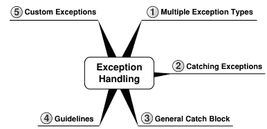

### 多种异常类型

清单 10.1 抛出 System.ArgumentException，而不是第 4 章演示的 System.Exception 类型。C# 允许代码抛出任何从 System.Exception 派生（可能是间接派生）的类型。

抛出任何异常的代码只是在异常实例前加上关键字 throw。所使用的异常类型显然是最能描述导致异常的错误周围情况的类型。

例如，请考虑清单 10.1 中的 TextNumberParser.Parse() 方法。

### 清单 10.1：抛出异常

```
public sealed class TextNumberParser
{
    public static int Parse(string textDigit)
    {
        string[] digitTexts = {
            "zero", "one", "two", "three", "four",
            "five", "six", "seven", "eight", "nine"};
        int result = Array.IndexOf(
            digitTexts, textDigit.ToLower());
        if (result < 0)
        {
            throw new ArgumentException(
                "The argument did not represent a digit",
                "textDigit");
        }
        return result;
    }
}
```

与抛出 System.Exception 相比，抛出 ArgumentException 更为合适，因为类型本身指示了出了什么问题，并包含用于识别哪个参数有误的特殊参数。

两个类似的异常是 ArgumentNullException 和 NullReferenceException。ArgumentNullException 应用于不当传递 null 参数的情况。这是无效参数异常的一种特例，通常（当参数不为 null 时）会作为 ArgumentException 或 ArgumentOutOfRangeException 抛出。NullReferenceException 通常仅由底层运行时抛出，当尝试取消引用 null 值（即对值为 null 的对象调用成员）时会发生。与其导致 NullReferenceException，程序员在访问参数之前应先检查参数是否为 null，然后抛出 ArgumentNullException，它可以提供更多上下文信息，例如参数名。

### 捕获异常

抛出特定异常类型使类型本身能够识别问题。换句话说，不需要捕获异常并对异常消息使用 switch 语句来确定针对异常应采取什么操作。相反，C# 允许使用多个 catch 块，每个针对特定异常类型，如清单 10.2 所示。

### 清单 10.2：捕获不同的异常类型

```
using System;

public sealed class Program
{
    public static void Main(string[] args)
    {
        try
        {
            // ...
            throw new InvalidOperationException(
                "Arbitrary exception");
            // ...
        }
        catch (NullReferenceException exception)
        {
            // Handle NullReferenceException
        }
        catch (ArgumentException exception)
        {
            // Handle ArgumentException
        }
        catch (InvalidOperationException exception)
        {
            // Handle ApplicationException
        }
        catch (SystemException)
        {
            // Handle SystemException
        }
        catch (Exception exception)
        {
            // Handle Exception
        }
    }
}
```

清单 10.2 有五个 catch 块，每个处理不同类型的异常。当发生异常时，执行将跳转到与异常类型最匹配的 catch 块。匹配的紧密程度由继承链决定。例如，即使抛出的异常是 System.Exception 类型，这种“是一种”关系也是通过继承发生的，因为 System.ApplicationException 派生自 System.Exception。由于 ApplicationException 最匹配抛出的异常，catch(ApplicationException ...) 将捕获异常，而不是 catch(Exception ...) 块。

catch 块必须按从最具体到最一般的顺序出现，以避免编译错误。例如，将 catch (Exception ...) 块移到任何其他异常之前将导致编译错误，因为所有先前的异常在其继承链的某个点上都派生自 System.Exception。

如 catch (System.Exception) { } 块所示，catch 块不需要命名参数。事实上，甚至不带类型参数的最终 catch 也是允许的，如下一节所示。

### 语言对比：Java — 异常说明符

C# 没有 Java 异常说明符的等效物。使用异常说明符，Java 编译器可以验证函数（或函数调用层次结构）中抛出的所有可能异常要么被捕获，要么被声明为可能重新抛出。C# 团队考虑过此选项，并得出结论：它带来的维护负担不值得所感知的收益。因此，不需要在特定调用堆栈中维护所有可能异常的列表，但也无法轻松确定可能的异常。（事实证明，Java 也无法做到这一点。调用虚拟方法或使用晚期绑定（如反射）使得在编译时无法完全解析方法可能抛出哪些异常。）

### 通用 catch 块

C# 要求代码抛出的任何对象都必须派生自 System.Exception。但是，此要求并不适用于所有语言。例如，C/C++ 允许抛出任何对象类型，包括不派生自 System.Exception 的托管异常。从 C# 2.0 开始，所有异常（无论是否派生自 System.Exception）都将作为派生自 System.Exception 传播到 C# 程序集中。结果是，System.Exception catch 块将捕获之前块捕获的所有异常。C# 还支持通用 catch 块（catch {}），其行为与 catch(System.Exception exception) 块相同，只是没有类型或变量名。此外，通用 catch 块必须出现在 catch 块列表的最后。由于通用 catch 块与 catch(System.Exception exception) 块相同，并且通用 catch 块必须出现在最后，如果两者都存在于同一个 try/catch 语句中，编译器将发出警告，因为通用 catch 块永远不会被调用（有关通用 catch 块的更多信息，请参阅高级主题：C# 1.0 中的通用 catch 块）。

### 高级主题

### C# 1.0 中的通用 catch 块

在 C# 1.0 中，如果从方法调用（位于非 C# 编写的程序集中）抛出了非 System.Exception 派生的异常，则 catch(System.Exception) 块不会捕获该异常。例如，如果另一种语言抛出字符串，则异常可能未被处理。为避免这种情况，C# 包含一个不带参数的 catch 块。此类 catch 块的术语是通用 catch 块，清单 10.3 包含一个。

### 清单 10.3：捕获不同的异常类型

```
using System

public sealed class Program
{
    public static void Main()
```


{
    try
    {
        // ...
        throw new InvalidOperationException (
            "Arbitrary exception");
        // ...
    }
    catch (NullReferenceException exception)
    {
        // Handle NullReferenceException
    }
    catch (ArgumentException exception)
    {
        // Handle ArgumentException
    }
    catch (InvalidOperationException exception)
    {
        // Handle ApplicationException
    }
    catch (SystemException exception)
    {
        // Handle SystemException
    }
    catch (Exception exception)
    {
        // Handle Exception
    }
    catch
    {
        // Any unhandled exception
    }
}

通用 catch 块会捕获所有异常，无论它们是否派生自 System.Exception，前提是较早的 catch 块未捕获它们。此类块的缺点仅在于无法访问异常实例，因此也无法知道应采取的适当措施。甚至无法识别这种异常无害的罕见情况。最佳做法是在关闭应用程序之前，使用一些清理代码来处理异常。例如，catch 块可以在关闭应用程序或重新抛出异常之前保存任何易失性数据。

## 高级主题

### 空 catch 块内部

与空 catch 块对应的 CIL 代码实际上是一个 catch(object) 块。这意味着无论抛出的类型是什么，空 catch 块都会捕获它。有趣的是，在 C# 代码中无法显式声明 catch(object) 异常块。因此，无法捕获非 System.Exception 派生的异常并拥有可供审查的异常实例。

具有讽刺意味的是，来自 C++ 等语言的非托管异常通常会导致 System.Runtime.InteropServices.SEHException 类型的异常，这些异常派生自 System.Exception 类型。因此，不仅可以使用通用 catch 块捕获非托管类型异常，还可以捕获抛出的非 System.Exception 托管类型——例如 string 等类型。

### 异常处理准则

异常处理为先前的错误处理机制提供了急需的结构。但是，如果使用不当，它仍可能产生一些笨拙的结果。以下准则提供了一些异常处理的最佳实践。

- 仅捕获你能处理的异常。
  通常可以处理某些类型的异常，但不能处理其他类型。例如，以独占读写方式打开文件可能会因为文件正在使用而抛出 System.IO.IOException。在捕获此类异常时，代码可以向用户报告文件正在使用，并允许用户选择取消操作或重试。只有有已知措施可采的异常才应被捕获。其他异常类型应留给调用栈中更高层的调用者处理。

- 不要隐藏（掩盖）你未完全处理的异常。
  新程序员常常想捕获所有异常，然后继续执行，而不是向用户报告未处理的异常。然而，这可能导致关键系统问题未被发现。除非代码采取显式操作来处理异常，或明确判定某些异常无害，否则 catch 块应重新抛出异常，而不是捕获并向调用者隐藏它们。绝大多数情况下，catch (System.Exception) 和通用 catch 块应出现在调用栈中较高的位置，除非该块以重新抛出异常结束。

- 很少使用 System.Exception 和通用 catch 块。
  几乎所有异常都派生自 System.Exception。但是，处理某些 System.Exception 的最佳方式是允许它们未被处理，或尽早优雅地关闭应用程序，而不是拖延。这些异常包括 System.OutOfMemoryException 和 System.StackOverflowException 等。在 CLR 4 中，此类异常默认为不可恢复，因此在不重新抛出的情况下捕获它们会导致 CLR 无论如何都会重新抛出。这些异常是运行时异常，开发人员无法编写代码来从中恢复。因此，最佳做法是关闭应用程序——CLR 4 中运行时会强制执行此操作。CLR 4 之前的代码应仅在关闭应用程序或使用 throw; 重新抛出异常之前，捕获此类异常以运行清理或紧急代码（例如保存任何易失性数据）。

- 避免在调用栈较低位置报告或记录异常。
  程序员常常想在调用栈中尽早的位置记录异常或向用户报告异常。然而，这些位置很少能完全处理异常，因此会采取重新抛出异常的方式。此类 catch 块不应在调用栈深处记录异常或向用户报告。如果异常被记录并重新抛出，调用栈中较高位置的调用者可能会做同样的事情，导致重复的异常日志条目。更糟的是，向用户显示异常可能不适合该类型的应用程序。（例如，在 Windows 应用程序中使用 System.Console.WriteLine() 用户永远看不到，在无人值守的命令行进程中显示对话框可能被忽略并导致应用程序冻结。）与日志记录和异常相关的用户界面应保留给调用栈中较高的位置。

- 在 catch 块中使用 throw; 而不是 throw <exception object>。

  可以在 catch 块内重新抛出异常。例如，catch(ArgumentNullException exception) 的实现可以包含对 throw exception 的调用。但是，这样重新抛出异常会将堆栈跟踪重置为重新抛出调用的位置，而不是重用原始抛出点位置。因此，除非你使用不同的异常类型重新抛出或故意隐藏原始调用堆栈，否则请使用 throw; 以允许相同的异常沿调用栈向上传播。

- 重新抛出不同异常时需谨慎。

  在 catch 块内部，重新抛出不同的异常不仅会重置抛出点，还会隐藏原始异常。要保留原始异常，请设置新异常的 InnerException 属性，通常可通过构造函数赋值。重新抛出不同的异常应仅限于以下情况。

  - 1. 更改异常类型能澄清问题。

    例如，在调用 Logon(User user) 时，当用户列表文件不可访问时，重新抛出不同的异常类型可能比传播 System.IO.IOException 更合适。

  - 2. 私有数据是原始异常的一部分。

    在前述场景中，如果文件路径包含在原始 System.IO.IOException 中，从而暴露了系统的私有安全信息，则应包装异常。当然，这假设 InnerException 未设置为原始异常。（有趣的是，CLR v1 的一个非常早期版本（甚至是 pre-alpha）曾有一个异常，内容类似于“安全异常：您无权确定 c:\temp\foo.txt 的路径”。）

  - 3. 异常类型过于特定，调用者无法适当处理。

    例如，与其抛出特定于特定数据库系统的异常，不如使用更通用的异常，以避免调用栈中更高位置的数据库特定代码。

### 定义自定义异常

一旦抛出异常成为最佳做法，最好使用框架异常，因为它们已得到充分确立和理解。例如，与其抛出自定义无效参数异常，不如使用 System.ArgumentException 类型。但是，如果使用特定 API 的开发人员会采取特殊操作——例如，异常处理逻辑会因处理自定义异常类型而有所不同——那么定义自定义异常是合适的。例如，如果映射 API 接收到一个邮政编码无效的地址，与其抛出 System.ArgumentException，不如抛出自定义 InvalidAddressException。关键在于调用者是否可能编写特定的 ValidAddressException catch 块并进行特殊处理，而不仅仅是编写通用的 System.ArgumentException catch 块。定义自定义异常只需从 System.Exception 或其他异常类型派生即可。清单 10.4 提供了一个示例。

```
LISTING 10.4: Creating a Custom Exception

class DatabaseException : System.Exception
{
    public DatabaseException(
        System.Data.SqlClient.SqlException exception)
    {
        InnerException = exception;
        // ...
    }

    public DatabaseException(
        System.Data.OracleClient.OracleException exception)
    {
        InnerException = exception;
        // ...
    }

    public DatabaseException()
    {
        // ...
    }

    public DatabaseException(string message)
    {
        // ...
    }
}
```


public DatabaseException(
    string message, Exception innerException)
    {
        InnerException = innerException;
        // ...
    }

这个自定义异常可能被创建用来封装专有的数据库异常。例如，Oracle 和 SQL Server 对类似错误会抛出不同的异常，因此应用程序可以定义一个自定义异常，将数据库特定的异常标准化为一个通用的异常包装器，以便应用程序以标准方式处理。这样一来，无论应用程序使用的是 Oracle 还是 SQL Server 后端数据库，都可以使用相同的 catch 块来处理调用栈上层的错误。

自定义异常的唯一要求是它必须继承自 System.Exception 或其后代之一。然而，针对自定义异常还有几条更好的实践。

- 所有异常都应使用“Exception”后缀。这样，从名称就能轻易确定其用途。
- 通常，所有异常都应包含不带参数的构造函数、带字符串参数的构造函数，以及带字符串和内部异常参数的构造函数。此外，由于异常通常在抛出它们的同一语句中构造，因此任何额外的异常数据也应作为构造函数的一部分被允许。（创建所有这些构造函数的明显例外是：如果某些数据是必需的，而构造函数绕过了这些要求。）
- 继承链应保持相对较浅（少于大约五个层级）。

在重新抛出与捕获的异常不同的异常时，内部异常起着重要作用。例如，如果数据库调用抛出 System.Data.SqlClient.SqlException，但在数据访问层中捕获并将其重新抛出为 DatabaseException，那么接受 SqlException（或内部异常）的 DatabaseException 构造函数会将原始 SqlException 保存在 InnerException 属性中。这样一来，当需要获取原始异常的更多详细信息时，开发人员可以从 InnerException 属性中检索该异常（例如，exception.InnerException）。

## 高级主题

### 可序列化异常

可序列化对象是运行时可以将其持久化到流（例如文件流）中，然后再从流中重新实例化的对象。在异常的情况下，某些分布式通信技术可能需要此功能。为了支持序列化，异常声明应包含 System.SerializableAttribute 特性，或者实现 ISerializable。此外，它们必须包含一个接受 System.Runtime.Serialization.SerializationInfo 和 System.Runtime.Serialization.StreamingContext 的构造函数。清单 10.5 展示了使用 System.SerializableAttribute 的示例。

```
LISTING 10.5: Defining a Serializable Exception

// Supporting serialization via an attribute
[Serializable]
class DatabaseException : System.ApplicationException
{
    // ...

    // Used for deserialization of exceptions
    public DatabaseException(
        SerializationInfo serializationInfo,
        StreamingContext context)
    {
        //...
    }
}
```

前面的 DatabaseException 示例演示了使异常可序列化所需的特性和构造函数。

### 检查和未检查转换

如前面在第 2 章“高级主题”中讨论的那样，C# 提供了特殊关键字，用于标记代码块，指示运行时如果目标数据类型太小无法容纳所赋值的数据时应如何处理。默认情况下，如果目标数据类型无法容纳所赋值的数据，则数据在赋值期间会被截断。示例请参见清单 10.6。

```
Listing 10.6: Overflowing an Integer Value

using System;

public class Program
{
    public static void Main()
    {
        // int.MaxValue equals 2147483647
        int n = int.MaxValue;
        n = n + 1;
        System.Console.WriteLine(n);
    }
}
```

清单 10.6 的结果显示在输出 10.1 中。

```
OUTPUT 10.1:

-2147483648
```

清单 10.6 中的代码将值 -2147483648 写入控制台。但是，将代码放在 checked 块中，或在运行编译器时使用 checked 选项，会导致运行时抛出类型为 System.OverflowException 的异常。checked 块的语法使用 checked 关键字，如清单 10.7 所示。

```
Listing 10.7: A Checked Block Example

using System;

public class Program
{
    public static void Main()
    {
        checked
        {
            // int.MaxValue equals 2147483647
            int n = int.MaxValue;
            n = n + 1;
            System.Console.WriteLine(n);
        }
    }
}
```

如果计算仅涉及常量，则默认情况下会对计算进行检查。清单 10.7 的结果显示在输出 10.2 中。

### 输出 10.2:

```
Unhandled Exception: System.OverflowException: Arithmetic operation resulted in an overflow. at Program.Main() in ..\Program.cs:line 12
```

此外，根据 Windows 的版本以及是否安装了调试器，可能会出现一个对话框，提示用户向 Microsoft 发送错误消息、检查解决方案或调试应用程序。另外，位置信息（Program.cs:line X）仅会在调试编译中出现——即使用 Microsoft csc.exe 编译器的 /Debug 选项进行的编译。

结果是，如果在 checked 块内在运行时发生溢出赋值，则会抛出异常。

C# 编译器提供了一个命令行选项，用于将默认的未检查行为更改为检查行为。C# 还支持 unchecked 块，该块会截断数据，而不是为块内的赋值抛出异常（请参见清单 10.8）。

### 清单 10.8: 未检查块示例

```
using System;

public class Program
{
    public static void Main()
    {
        unchecked
        {
            // int.MaxValue equals 2147483647
            int n = int.MaxValue;
            n = n + 1;
            System.Console.WriteLine(n);
        }
    }
}
```

清单 10.8 的结果显示在输出 10.3 中。

### 输出 10.3:

```
-2147483648
```

即使在编译期间启用了 checked 选项，清单 10.8 中代码里的 unchecked 关键字也会阻止运行时在执行期间抛出异常。

对于不允许使用语句的情况（例如字段初始化），存在等效的 checked 和 unchecked 表达式：

```
int _Number = unchecked(int.MaxValue + 1);
```

## 摘要

抛出异常会导致显著的性能损失。单个异常会导致大量运行时堆栈信息被加载和处理，这些数据原本不会被加载，并且需要花费相当长的时间。如第 4 章所述，仅在处理异常情况时才使用异常；API 应提供机制来检查是否会抛出异常，而不是强制调用特定 API 来确定是否会抛出异常。

下一章将介绍泛型，这是 C# 2.0 的一项功能，显著增强了 C# 1.0 中编写的代码。事实上，它基本上弃用了 System.Collections 命名空间的任何使用，该命名空间以前几乎在每个项目中都被使用。

本页故意留空

# 11 泛型

随着项目变得更加复杂，您需要一种更好的方式来重用和自定义现有软件。为了促进代码重用（尤其是算法的重用），C# 包含一项称为泛型的功能。就像方法之所以强大是因为它们可以接受参数一样，接受类型参数的类也具有显著更多的功能，而这正是泛型所实现的。与它们的前身模板一样，泛型允许一次定义算法和模式实现，而不是为每个类型分别定义。但是，C# 泛型是模板的类型安全实现，其语法略有不同，实现与 C++ 和 Java 中的前身大相径庭。请注意，泛型是在 2.0 版中添加到运行时和 C# 中的。

- 泛型
  - 1 没有泛型的 C#
  - 2 可空修饰符
  - 3 泛型类型
    - 使用
    - 定义
    - 优点
    - 命名准则
    - 接口
    - 结构体
  - 4 约束
    - 接口
    - 基类
    - 结构体/类
    - 多个
    - 构造函数
  - 5 泛型方法
  - 6 协变和逆变
    - 协变
    - 逆变
  - 7 泛型内部机制


## 没有泛型的 C#

我将通过检查一个不使用泛型的类来开始泛型的讨论。该类是 System.Collections.Stack，其目的是表示一组对象，其中最后添加到集合的项目是从集合中检索的第一个项目（称为后进先出，或 LIFO）。Push() 和 Pop() 是 Stack 类的两个主要方法，分别用于向堆栈添加项目和从堆栈中移除项目。堆栈类上 Pop() 和 Push() 方法的声明出现在清单 11.1 中。

### 清单 11.1: 使用数据类型对象的堆栈定义

```
public class Stack
{
    public virtual object Pop();
    public virtual void Push(object obj);
    // ...
}
```

程序经常使用堆栈类型集合来便于多次撤销操作。例如，清单 11.2 在模拟 Etch A Sketch® 游戏的程序中使用堆栈类来执行撤销操作。

### 清单 11.2: 在类似 Etch A Sketch 游戏的程序中支持撤销

```
using System;
using System.Collections;

class Program
{
    // ...

    public void Sketch()
    {
        Stack path = new Stack();
        Cell currentPosition;
        ConsoleKeyInfo key; // New with C# 2.0

        do
        {
            // Etch in the direction indicated by the
            // arrow keys that the user enters.
            key = Move();

            switch (key.Key)
            {

case ConsoleKey.Z:
    // Undo the previous Move.
    // if (path.Count > 1)
    {
        currentPosition = (Cell)path.Pop();
        Console.SetCursorPosition(
            currentPosition.X,
            currentPosition.Y);
        Undo();
    }
    break;

case ConsoleKey.DownArrow:
case ConsoleKey.UpArrow:
case ConsoleKey.LeftArrow:
case ConsoleKey.RightArrow:
    // SaveState()
    currentPosition = new Cell(
        Console.CursorLeft, Console.CursorTop);
    path.Push(currentPosition);
    break;

default:
    Console.Beep(); // New with C# 2.0
    break;
}

while (key.Key != ConsoleKey.X); // Use X to quit.
}
```

```
public struct Cell
{
    readonly public int X;
    readonly public int Y;
    public Cell(int x, int y)
    {
        X = x;
        Y = y;
    }
}
```

清单 11.2 的结果显示在输出 11.1 中。

使用声明为 System.Collections.Stack 的 path 变量，通过将自定义类型 Cell 传递到 Stack.Push() 方法（使用 path.Push(currentPosition)）来保存上一步操作。如果用户输入 Z（或 Ctrl+Z），则通过检索

### 输出 11.1:

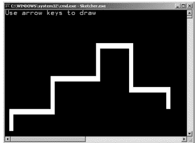

它从堆栈中使用 Pop() 方法检索出来，将光标位置设置为上一位置，并调用 Undo()。（注意，此代码还使用了一些特定于 CLR 2.0 的控制台函数。）

尽管代码功能正常，但 System.Collections.Stack 类存在一个根本缺陷。如清单 11.1 所示，Stack 类收集 object 类型的变量。因为 CLR 中的每个对象都派生自 object，Stack 不会验证放入其中的元素是否同质或为预期类型。例如，您可以传递一个字符串，其中 X 和 Y 用小数点连接，而不是传递 currentPosition。但是，编译器必须允许不一致的数据类型，因为在某些场景中这是可取的。

此外，使用 Pop() 方法从堆栈检索数据时，必须将返回值强制转换为 Cell。但是，如果 Pop() 方法返回的值不是 Cell 类型对象，则会引发异常。您可以测试数据类型，但到处添加此类检查会增加复杂性。在不使用泛型的情况下创建可处理多种数据类型的类时，根本问题是它们必须使用通用基类型，通常是 object 数据。

将结构或整数等值类型与使用 object 的类一起使用会加剧此问题。例如，如果将值类型传递给 Stack.Push() 方法，运行时会自动将其装箱。

同样，在检索值类型时，需要显式拆箱数据，并将从 Pop() 方法获得的对象引用强制转换为值类型。虽然引用类型的扩大操作（强制转换为基类）对性能影响可忽略不计，但值类型的装箱操作会引入非平凡的开销。

要使用前述 C# 编程构造将 Stack 类更改为强制存储特定数据类型，必须创建一个专用堆栈类，如清单 11.3 所示。

### 清单 11.3: 定义专用堆栈类

```
public class CellStack
{
    public virtual Cell Pop();
    public virtual void Push(Cell cell);
    // ...
}
```

因为 CellStack 只能存储 Cell 类型的对象，此解决方案需要对堆栈方法进行自定义实现，这并非理想方案。

### 初学者主题

### 另一个示例：可空值类型

第 2 章介绍了在声明值类型变量时使用可空修饰符 ? 来声明可以包含 null 的变量的功能。C# 仅从 2.0 版本开始支持此功能，因为正确实现需要泛型。在引入泛型之前，程序员基本面临两种选择。

第一个选项是为每个需要处理 null 值的值类型声明一个可空数据类型，如清单 11.4 所示。

### 清单 11.4: 声明存储 null 的各种值类型版本

```
struct NullableInt
{
    // <summary>
    // Provides the value when HasValue returns true.
    // </summary>
public int Value{ get; set; }

/// <summary>
/// Indicates whether there is a value or whether
/// the value is "null"
/// </summary>
public bool HasValue{ get; set; }

// ...

}

struct NullableGuid
{
    /// <summary>
    /// Provides the value when HasValue returns true.
    // </summary>
    public Guid Value{ get; set; }

    /// <summary>
    /// Indicates whether there is a value or whether
    // the value is "null"
    // </summary>
    public bool HasValue{ get; set; }

    ...
}
...
```

清单 11.4 仅显示了 NullableInt 和 NullableGuid 的实现。如果程序需要其他可空值类型，则必须创建带有其他值类型的副本。如果可空实现发生更改（例如，如果它支持从 null 到可空类型的强制转换），则必须将修改添加到所有可空类型声明中。

第二个选项是声明一个包含 object 类型 Value 属性的可空类型，如清单 11.5 所示。

### 清单 11.5: 声明包含 object 类型 Value 属性的可空类型

```
struct Nullable
{
    /// <summary>
    /// Provides the value when HasValue returns true.
    // </summary>
    public object Value{ get; set; }

/// <summary>
/// Indicates whether there is a value or whether
// the value is "null"
// </summary>
public bool HasValue { get; set; }
...
}
```

虽然此选项只需要一个可空类型实现，但运行时在设置 Value 属性时始终会对值类型进行装箱。此外，从 Nullable.Value 检索数据的调用不是强类型的，因此检索值类型需要强制转换操作，这在运行时可能无效。

这两种选择都不太吸引人。为了处理此类两难困境，C# 2.0 引入了泛型概念。事实上，可空修饰符 ? 在内部使用泛型。

## 引入泛型类型

泛型提供了一种机制，用于在声明变量时创建专门处理特定类型的数据结构。程序员定义这些参数化类型，以便特定泛型类型的每个变量都具有相同的内部算法，但数据类型和方法签名可以根据程序员偏好而有所不同。

为了最大限度地降低开发人员的学习曲线，C# 设计者选择了与 C++ 中类似模板概念相匹配的语法。因此，在 C# 中，泛型类和结构的语法使用相同的尖括号表示法来标识泛型声明专门化的数据类型。

### 使用泛型类

清单 11.6 显示了如何指定泛型类使用的实际类型。您通过在实例化和声明表达式中都在尖括号表示法内指定 Cell，来指示 path 变量使用 Cell 类型。换句话说，在使用泛型数据类型声明变量（本例中为 path）时，C# 要求开发人员标识实际类型。显示新 Stack 类的示例出现在清单 11.6 中。


## 清单 11.6：使用泛型堆栈类实现撤销功能

```csharp
using System;
using System.Collections.Generic;

class Program
{
    // ...

    // void Sketch()
    {
        Stack<Cell> path; // Generic variable declaration
        path = new Stack<Cell>(); // Generic object instantiation
        Cell currentPosition;
        ConsoleKeyInfo key; // New with C# 2.0

        do
        {
            // Etch in the direction indicated by the
            // arrow keys entered by the user.
            key = Move();

            switch (key.Key)
            {
                case ConsoleKey.Z:
                    // Undo the previous Move.
                    if (path.Count >= 1)
                    {
                        // No cast required.
                        currentPosition = path.Pop();
                        Console.SetCursorPosition(
                            currentPosition.X, currentPosition.Y);
                        Undo();
                    }

                    break;

                case ConsoleKey.DownArrow:
                case ConsoleKey.UpArrow:
                case ConsoleKey.LeftArrow:
                case ConsoleKey.RightArrow:
                    // SaveState(
                    currentPosition = new Cell(
                        Console.CursorLeft, Console.CursorTop);
                    // Only type Cell allowed in call to Push().
                    path.Push(currentPosition);
                    break;

                default:
                    Console.Beep(); // New with C# 2.0
                    break;
            }
        } while (key.Key != ConsoleKey.X); // Use X to quit.
    }
}
```

清单 11.6 的结果显示在输出 11.2 中。

## 输出 11.2:

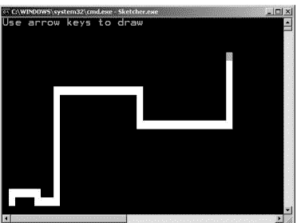

在清单 11.6 所示的 path 声明中，你声明并创建一个 System.Collections.Generic.Stack<T> 类的新实例，并在尖括号中指定 path 变量使用的数据类型为 Cell。因此，添加到 path 并从 path 检索的每个对象都是 Cell 类型。换句话说，你不再需要强制转换 path.Pop() 的返回值，或确保在 Push() 方法中仅将 Cell 类型对象添加到 path。在探讨泛型优势之前，下一节将介绍泛型类定义的语法。

## 定义简单泛型类

泛型允许你编写算法和模式，并为不同数据类型重用代码。清单 11.7 创建了一个与清单 11.6 代码中使用的 System.Collections.Generic.Stack<T> 类类似的泛型 Stack<T> 类。你在类声明后的尖括号中指定类型参数标识符或类型参数（在此例中为 T）。然后，泛型 Stack<T> 的实例会收集与变量声明对应的类型，而无需将收集的项转换为 object 类型。类型参数 T 是一个占位符，直到变量声明和实例化时，编译器才要求代码指定类型参数。在清单 11.7 中，你可以看到类型参数将用于内部 Items 数组、Push() 方法参数的类型以及 Pop() 方法的返回类型。

## 清单 11.7：声明泛型类 Stack<T>

```csharp
public class Stack<T>
{
    private T[] _Items;

    public void Push(T data)
    {
        ...
    }

    public T Pop()
    {
        ...
    }
}
```

## 泛型的优势

使用泛型类（例如前面使用的 System.Collections.Generic.Stack<T> 类，而不是原始的 System.Collections.Stack 类型）有多个优势。

- 1. 泛型有助于实现强类型编程模型，防止参数化类成员明确意图之外的数据类型。在清单 11.7 中，参数化堆栈类将所有 Stack<Cell> 实例限制为 Cell 数据类型。（语句 path.Push("garbage") 会生成编译时错误，指出没有适用于 System.Collections.Generic.Stack<T>.Push(T) 的重载方法可以处理字符串 garbage，因为它无法转换为 Cell。）
- 2. 编译时类型检查降低了运行时发生 InvalidCastException 类型错误的可能性。
- 3. 使用泛型类成员的值类型不再导致转换为 object；它们不再需要装箱操作。（例如，path.Pop() 和 path.Push() 在添加项时不需要装箱，在移除项时也不需要拆箱。）
- 4. C# 中的泛型减少了代码膨胀。泛型类型保留特定类版本的优势，而无需承担额外开销。（例如，不再需要定义 CellStack 这样的类。）
- 5. 性能提升，因为不再需要从 object 进行缓存，从而消除了类型检查操作。此外，由于值类型不再需要装箱，性能也得到提升。
- 6. 泛型通过避免装箱来减少内存消耗，从而在堆上占用更少的内存。
- 7. 由于强制转换检查减少，且不再需要那么多类型特定的实现，代码变得更易读。
- 8. 通过某种 IntelliSense® 协助编码的编辑器可直接使用泛型类的返回参数。无需强制转换返回数据，IntelliSense 即可正常工作。

从本质上讲，泛型提供了编写模式实现并在模式出现的任何地方重用这些实现的能力。模式描述代码中反复出现的问题，而模板为这些重复模式提供单一实现。

## 类型参数命名准则

与命名方法参数一样，命名类型参数时也应尽可能具有描述性。此外，为了将参数标识为类型参数，其名称应包含 T 前缀。例如，在定义 EntityCollection<TEntity> 这样的类时，使用类型参数名称“TEntity”。

唯一不使用描述性类型参数名称的情况是当该描述不会增加任何价值时。例如，在 Stack<T> 类中使用“T”是合适的，因为指示“T”是类型参数已足够具有描述性；堆栈适用于任何类型。

在下一节中，你将学习约束。使用约束描述性类型名称是一种良好实践。例如，如果类型参数必须实现 IComponent，请考虑使用类型名称“TComponent”。

## 泛型接口和结构体

C# 2.0 在 C# 语言中广泛支持泛型，包括接口和结构体。语法与类使用的语法相同。要定义带有类型参数的接口，请将类型参数放在尖括号中，如清单 11.8 中 IPair<T> 的示例所示。

## 清单 11.8：声明泛型接口

```csharp
interface IPair<T>
{
    T First { get; set; }
    T Second { get; set; }
}
```

此接口表示相似对象的对，例如点的坐标、某人的遗传父母或二叉树的节点。对中包含的类型对两个项目相同。

要实现该接口，你使用与非泛型类相同的语法。但是，在不标识类型参数的情况下实现泛型接口会强制类成为泛型类，如清单 11.9 所示。此外，此示例使用结构体而不是类，表明 C# 支持自定义泛型值类型。

## 清单 11.9：实现泛型接口

```csharp
public struct Pair<T>: IPair<T>
{
    public T First
    {
        get
        {
            return _First;
        }
        set
        {
            _First = value;
        }
    }

    private T _First;

    public T Second
    {
        get
        {
            return _Second;
        }
        set
        {
            _Second = value;
        }
    }
    private T _Second;
}
```

对泛型接口的支持对于集合类尤其重要，因为泛型在集合类中最为普遍。没有泛型时，开发人员依赖于 System.Collections 命名空间中的一系列接口。与其实现类一样，这些接口仅使用 object 类型，因此，接口强制所有对这些集合类的访问都需要强制转换。通过使用泛型接口，你可以避免强制转换操作，因为参数化接口可以实现更强的编译时绑定。

## 高级主题

## 在单个类上多次实现相同接口

模板接口的一个副作用是，你可以使用不同的类型参数多次实现相同的接口。请考虑清单 11.10 中的 IContainer<T> 示例。

## 清单 11.10：在单个类上重复实现接口

```csharp
public interface IContainer<T>
{
    ICollection<T> Items
    {
        get;
        set;
    }
}

public class Person: IContainer<Address>,
    IContainer<Phone>, IContainer<Email>
{
    ICollection<Address> IContainer<Address>.Items
    {
        get(...)
        set(...)
    }
}
```


```
}
ICollection<Phone> IContainer<Phone>.Items
{
    get { ... }
    set { ... }
}
ICollection<Email> IContainer<Email>.Items
{
    get { ... }
    set { ... }
}
}
```

在此示例中，Items 属性通过具有不同类型参数的显式接口实现多次出现。如果没有泛型，这是不可能的，编译器反而只允许一个显式的 IContainer.Items 属性。

对 Person 的一个可能改进是也实现 IContainer<object>，并让 items 返回所有三个容器（地址、电话和电子邮件）的组合。

## 定义构造函数和终结器

也许出人意料的是，泛型上的构造函数和析构函数不需要类型参数来匹配类声明（换句话说，不是 Pair<T>({...})。在清单 11.11 中的对示例中，构造函数使用 public Pair(T first, T second) 声明。

## 清单 11.11：声明泛型类型的构造函数

```
public struct Pair<T>: IPair<T>
{
    public Pair(T first, T second)
    {
        _Second = second;
        _Second = second;
    }

    public T First
    {
        get { return _First; }
        set { _First = value; }
    }
    private T _First;

    public T Second
    {
        get { return _Second; }
        set { _Second = value; }
    }
    private T _Second;
}
```

## 指定默认值

清单 11.1 包含一个构造函数，用于获取 First 和 Second 的初始值，并将它们分配给 _First 和 _Second。由于 Pair<T> 是结构体，你提供的任何构造函数都必须初始化所有字段。然而，这带来了一个问题。考虑一个在实例化时仅初始化一半对的 Pair<T> 构造函数。

定义这样的构造函数（如清单 11.12 所示）会导致编译错误，因为字段 _Second 在构造函数结束时未初始化。为 _Second 提供初始化会带来问题，因为你不知道 T 的数据类型。如果它是引用类型，则 null 可行，但如果 T 是值类型（除非可为 null），则这不够。

## 清单 11.12：未初始化所有字段，导致编译错误

```
public struct Pair<T>: IPair<T>
{
// ERROR: Field 'Pair<T>._Second' must be fully assigned
// before control leaves the constructor
// public Pair(T first)
// {
// _First = first;
// }
// ...
}
```

为处理此场景，C# 2.0 允许使用 default 运算符以动态方式对任何数据类型编码默认值，这在第 8 章中首次讨论过。在第 8 章中，我展示了如何使用 default(int) 指定 int 的默认值，而字符串的默认值使用 default(string)（对所有引用类型返回 null）。对于 _Second 所需的 T，你使用 default(T)（参见清单 11.13）。

## 清单 11.13：使用 default 运算符初始化字段

```
public struct Pair<T>: IPair<T>
{
    public Pair(T first)
    {
        _First = first;
        _Second = default(T);
    }

    // ...
}
```

default 运算符在泛型上下文之外也是允许的；任何语句都可以使用它。

## 多个类型参数

泛型类型可以使用任意数量的类型参数。最初的 Pair<T> 示例仅包含一个类型参数。要支持存储二元对象对（例如名称/值对），需要扩展 Pair<T> 以支持两个类型参数，如清单 11.14 所示。

## 清单 11.14：声明带有多个类型参数的泛型

```
interface IPair<TFirst, TSecond>
{
    TFirst First { get; set; }
    TSecond Second { get; set; }
}

public struct Pair<TFirst, TSecond>: IPair<TFirst, TSecond>
{
    public Pair(TFirst first, TSecond second)
    {
        _First = first;
        _Second = second;
    }

    public TFirst First
    {
        get { return _First; }
        set { _First = value; }
    }
    private TFirst _First;

    public TSecond Second
    {
        get { return _Second; }
        set { _Second = value; }
    }
    private TSecond _Second;
}
```

使用 Pair<TFirst, TSecond> 类时，需在声明和实例化语句的尖括号中提供多个类型参数，然后在调用方法时为方法参数提供匹配的类型，如清单 11.15 所示。

## 清单 11.15：使用带有多个类型参数的类型

```
Pair<int, string> historicalEvent =
    new Pair<int, string>(1914,
    "Shackleton leaves for South Pole on ship Endurance");
Console.WriteLine("({0}: {1}",
    historicalEvent.First, historicalEvent.Second);
```

类型参数的数量（即 arity）唯一区分了类。因此，可以在同一命名空间中定义 Pair<T> 和 Pair<TFirst, TSecond>，因为 arity 有所不同。

## Arity 丰富

在 C# 4.0 中，CLR 团队定义了九个名为 Tuple 的新泛型类。与 Pair<...> 一样，可以重用相同的名称，因为 arity 有所不同（每个类具有不同数量的类型参数），如清单 11.16 所示。

## 清单 11.16：使用 out 类型参数修饰符的协变

```
public class Tuple { ... }
public class Tuple<T1> : IStructuralComparable, IComparable { ... }
public class Tuple<T1, T2> : ... { ... }
public class Tuple<T1, T2, T3> : ... { ... }
public class Tuple<T1, T2, T3, T4> : ... { ... }
public class Tuple<T1, T2, T3, T4, T5> : ... { ... }
public class Tuple<T1, T2, T3, T4, T5, T6> : ... { ... }
public class Tuple<T1, T2, T3, T4, T5, T6, T7> : ... { ... }
public class Tuple<T1, T2, T3, T4, T5, T6, T7, TRest> : ... { ... }
```

Tuple... 类集的设计目的与 Pair<T> 和 Pair<TFirst, TSecond> 类相同，但它们共同可以处理七个类型参数。事实上，使用清单 11.16 中显示的最后一个 Tuple，TRest 可用于存储另一个 Tuple，从而使元组大小的潜在限制实际上是无限的。

元组类集的另一个有趣特性是 Tuple（无类型参数）。该类有八个静态 create 方法用于实例化各种泛型类型。虽然每个泛型类型都可以直接使用其构造函数进行实例化，但 Tuple 类型的 create 方法允许隐式类型参数。清单 11.17 显示了区别。

## 清单 11.17：使用 out 类型参数修饰符的协变

```
Tuple<string, Contact<KeyValuePair,
    KeyValuePair =
    Tuple.Create(
    "555-55-5555", new Contact("Inigo Montoya"));
KeyValuePair =
    new Tuple<string, Contact<(
    "555-55-5555", new Contact("Inigo Montoya"));
```

显然，当 Tuple 变得很大时，如果没有 Create() 方法，需要指定的类型参数数量可能会很麻烦。

## 嵌套泛型类型

包含类型上的类型参数会自动向下级联到嵌套类型。例如，如果包含类型包含类型参数 T，则类型 T 也可在嵌套类型上使用。如果嵌套类型包含其自己的名为 T 的类型参数，则这将隐藏包含类型中的类型参数，嵌套类型中对 T 的任何引用都将指向嵌套的 T 类型参数。幸运的是，在嵌套类型中重用相同的类型参数名称会导致编译器警告，以防止意外重叠（参见清单 11.18）。

## 清单 11.18：嵌套泛型类型

```
class Container<T, U>
{
    // Nested classes inherit type parameters.
    // Reusing a type parameter name will cause
    // a warning.
    class Nested<U>
    {
        void Method(T param0, U param1)
        {
        }
    }
}
```

将容器的类型参数在嵌套类型中可用的行为与嵌套类型行为一致，因为包含类型的私有成员也可从嵌套类型访问。规则很简单：类型在其出现的花括号内的任何位置都可用。

## 约束

泛型支持在类型参数上定义约束的功能。这些约束强制类型符合各种规则。以清单 11.19 中显示的 BinaryTree<T> 类为例。

## 清单 11.19：声明无约束的 BinaryTree<T> 类

```
public class BinaryTree<T>
{
    public BinaryTree( T item )
    {
        Item = item;
    }

    public T Item
    {
        get { return _item; }
        set { _item = value; }
    }

    private T _item;

    public Pair<BinaryTree<T>> SubItems
    {
        get { return _subItems; }
        set { _subItems = value; }
    }

    private Pair<BinaryTree<T>> _subItems;
}
```


(一个有趣的旁注是，BinaryTree<T> 在内部使用 Pair<T>，之所以可行是因为 Pair<T> 只是另一种类型。)

假设你希望在将值分配给 SubItems 属性时，对 Pair<T> 值中的值进行排序。为了实现排序，SubItems 设置访问器使用所提供键的 CompareTo() 方法，如清单 11.20 所示。

## LISTING 11.20: 需要类型参数支持接口

```
public class BinaryTree<T>
{
    ...
    public Pair<BinaryTree<T>> SubItems
    {
        get { return _SubItems; }
        set
        {
            IComparable<T> first;
            // ERROR: Cannot implicitly convert type...
            first = value.First.Item; // Explicit cast required
            if (first.CompareTo(value.Second.Item) < 0)
            {
                // first is less than second.
                ...
            }
            else
            {
                // first and second are the same or
                // second is less than first.
                ...
            }
            _SubItems = value;
        }
    }
    private Pair<BinaryTree<T>> _SubItems;
}
```

在编译时，类型参数 T 是泛型的。当代码按所示编写时，编译器假设 T 上可用的成员仅限于从基类型 object 继承的成员，因为每种类型都以 object 为祖先。（因此，仅 ToString() 等方法可用于类型参数 T 的键实例。）结果，编译器显示编译错误，因为 CompareTo() 方法未在类型 object 上定义。

你可以将 T 参数强制转换为 IComparable<T> 接口，以便访问 CompareTo() 方法，如清单 11.21 所示。

## LISTING 11.21: 需要类型参数支持接口或抛出异常

```
public class BinaryTree<T>
{
    ...
    public Pair<BinaryTree<T>> SubItems
    {
        get { return _SubItems; }
        set
        {
            IComparable<T> first;
            first = (IComparable<T>)value.First.Item;
            if (first.CompareTo(value.Second.Item) < 0)
            {
                // first is less than second.
                ...
            }
            else
            {
                // second is less than or equal to first.
                ...
            }
            _SubItems = value;
        }
    }
    private Pair<BinaryTree<T>> _SubItems;
}
```

不幸的是，如果你现在声明一个 BinaryTree 类变量并提供一个未实现 IComparable<T> 接口的类型参数，则会遇到执行时错误——具体来说，是 InvalidCastException。这抵消了泛型的一个优势。

为了避免此异常并改为提供编译时错误，C# 允许你为泛型类中声明的每个类型参数提供可选的约束列表。约束声明泛型所要求的类型参数特征。你使用 where 关键字声明约束，后跟一个“参数-要求”对，其中参数必须是泛型类型中定义的参数之一，而要求是限制类型“派生自”的类或接口、默认构造函数的存在，或引用/值类型限制。

## 语言对比：C++ — 模板

C# 和 CLR 中的泛型与其他语言中的类似构造不同。尽管其他语言提供类似功能，但 C# 的类型安全性要高得多。C# 中的泛型既是语言特性也是平台特性——底层 2.0 运行时在其引擎中为泛型提供了深度支持。

C++ 模板与 C# 泛型有显著不同，因为 C# 利用了 CIL。C# 泛型被编译为 CIL，导致特化仅在每个值类型使用时才在执行时发生，而引用类型仅发生一次。

C++ 模板不支持的一个独特功能是显式约束。C++ 模板允许你编译可能属于类型参数也可能不属于的方法调用。因此，如果成员不存在于类型参数中，则会发生错误，可能伴随着晦涩的错误消息并指向源代码中意外的位置。然而，C++ 实现的优势在于可以在类型上调用运算符（+、- 等等）。C# 不支持在类型参数上调用运算符，因为运算符是静态的——它们无法通过接口或基类约束来识别。

该错误的问题在于它仅在使用模板时发生，而不是在定义时发生。因为 C# 泛型可以声明约束，编译器可以在定义泛型时防止此类错误，从而更早地识别无效假设。此外，在声明泛型类型的变量时，错误将指向变量的声明，而不是泛型实现中使用成员的位置。

值得注意的是，Microsoft C++ 中的 CLI 支持同时包含泛型和 C++ 模板，因为两者各有独特的特性。

## 接口约束

为了满足排序要求，你需要在 BinaryTree 类中使用 CompareTo() 方法。为了最有效地做到这一点，你需要对 T 类型参数施加约束。你需要 T 类型参数实现 IComparable<T> 接口。此语法出现在清单 11.22 中。

## LISTING 11.22: 声明接口约束

```
public class BinaryTree<T>
    where T: System.IComparable<T>
{
    ...
    public Pair<BinaryTree<T>> SubItems
    {
        get { return _SubItems; }
        set
        {
            IComparable<T> first;
            // Notice that the cast can now be eliminated.
            first = value.First.Item;
            if (first.CompareTo(value.Second.Item) < 0)
            {
                // first is less than second
                ...
            }
            else
            {
                // second is less than or equal to first.
                ...
            }
            _SubItems = value;
        }
    }
    private Pair<BinaryTree<T>> _SubItems;
}
```

鉴于清单 11.22 中添加了接口约束，编译器确保每次使用 BinaryTree 类时，你都指定实现 IComparable<T> 接口的类型参数。此外，在调用 CompareTo() 方法之前，你不再需要显式将变量强制转换为 IComparable<T> 接口。甚至不需要强制转换即可访问使用显式接口实现的成员，在其他上下文中，如果没有强制转换，这些成员会被隐藏。为了解决调用哪个成员，编译器首先直接检查类成员，然后查看显式接口成员。如果没有约束解析参数，则仅允许 object 的成员。

如果你尝试使用 System.Text.StringBuilder 作为类型参数创建 BinaryTree<T> 变量，你会收到编译器错误，因为 StringBuilder 未实现 IComparable<T>。错误与输出 11.3 中显示的类似。

## 输出 11.3:

```
error CS0309: The type 'System.Text.StringBuilder' must be convertible
to 'System.IComparable<T>' in order to use it as parameter 'T' in the
generic type or method 'BinaryTree<T>'
```

要为约束指定接口，你需要声明接口约束。此约束甚至避免了为调用显式接口成员实现而进行强制转换的需要。

## 基类约束

有时你可能希望将构造类型限制为特定的类派生。你可以使用基类约束来实现这一点，如清单 11.23 所示。

## LISTING 11.23: 声明基类约束

```
public class EntityDictionary<TKey, TValue>
    : System.Collections.Generic.Dictionary<TKey, TValue>
    where TValue : EntityBase
{
        ...
}
```

与 System.Collections.Generic.Dictionary<TKey, TValue> 本身不同，EntityDictionary<TKey, TValue> 要求所有 TValue 类型都派生自 EntityBase 类。通过要求派生，可以在泛型实现中始终执行强制转换操作，因为约束将确保所有类型参数都派生自基类，因此，与 EntityDictionary 一起使用的所有 TValue 类型参数都可以隐式转换为基类。

基类约束的语法与接口约束相同，只是在指定多个约束时，基类约束必须首先出现。然而，与接口约束不同，


不允许有多个基类约束，因为无法从多个类派生。同样，不能为密封类或特定结构体指定基类约束。例如，C# 不允许类型参数的约束派生自 string 或 System.Nullable<T>。

## struct/class 约束

另一个有价值的泛型约束是能够将类型参数限制为值类型或引用类型。编译器不允许在约束中将 System.ValueType 指定为基类。相反，C# 提供了也适用于引用类型的特殊语法。与其指定 T 必须派生的类，不如直接使用关键字 struct 或 class，如清单 11.24 所示。

### 清单 11.24：将类型参数指定为值类型

```
public struct Nullable<T> :
    IFormattable, IComparable,
    IComparable<Nullable<T>>, INullable
    where T : struct
{
    // ...
}
```

由于基类约束要求特定的基类，因此将 struct 或 class 与基类约束一起使用是没有意义的，实际上还可能导致冲突约束。因此，不能将 struct 和 class 约束与基类约束一起使用。

struct 约束有一个特殊特征。它将可能的类型参数限制为仅值类型，同时防止类型参数为 System.Nullable<T> 类型参数。为什么？如果没有最后这一限制，就可以定义荒谬的类型 Nullable<Nullable<T>>，这是荒谬的，因为 Nullable<T> 本身就允许支持 null 的值类型变量，因此可空-可空类型变得毫无意义。由于可空运算符 (?) 是声明可空值类型的 C# 快捷方式，struct 约束提供的 Nullable<T> 限制也防止了诸如以下代码：

```
int? number // Equivalent to Nullable<Nullable<int> if allowed
```

## 多个约束

对于任何给定的类型参数，您可以指定任意数量的接口作为约束，但不超过一个类，就像一个类可以实现任意数量的接口但只能继承自另一个类一样。每个新约束都在泛型类型和冒号后的逗号分隔列表中声明。如果有多个类型参数，每个都必须由 where 关键字前置。在清单 11.25 中，EntityDictionary 类包含两个类型参数：TKey 和 TValue。TKey 类型参数有两个接口约束，TValue 类型参数有一个基类约束。

### 清单 11.25：指定多个约束

```
public class EntityDictionary<TKey, TValue>
    : Dictionary<TKey, TValue>
    where TKey : IComparable<TKey>, IFormattable
    where TValue : EntityBase
{
    ...
}
```

在这种情况下，TKey 本身有多个约束，TValue 有额外约束。在对一个类型参数指定多个约束时，默认假设为 AND 关系。例如，TKey 必须实现 IComparable<TKey> 和 IFormattable。

请注意，每个 where 子句之间没有逗号。

## 构造函数约束

在某些情况下，在泛型类内部创建类型参数的实例是可取的。在清单 11.26 中，EntityDictionary<TKey, TValue> 类的 New() 方法必须创建类型参数 TValue 的实例。

### 清单 11.26：要求默认构造函数约束

```
public class EntityBase<TKey>
{
    private TKey _Key;

    public TKey Key
    {
        get{ return _key; }
        set{ _key = value; }
    }
}

public class EntityDictionary<TKey, TValue> :
    Dictionary<TKey, TValue>
    where TKey : IComparable<TKey>, IFormattable
    where TValue : EntityBase<TKey>, new()
{
    // ...

    public TValue New(TKey key)
    {
        TValue newEntity = new TValue();
        newEntity.Key = key;
        Add(newEntity.Key, newEntity);
        return newEntity;
    }

    // ...
}
```

由于并非所有对象都保证具有公共默认构造函数，编译器不允许您在类型参数上调用默认构造函数。要覆盖此编译器限制，请在指定所有其他约束后添加文本 `new()`。此文本是 **构造函数约束**，它强制装饰有构造函数约束的类型参数具有默认构造函数。仅提供默认构造函数约束。您不能为带参数的构造函数指定约束。

## 约束继承

约束会被派生类继承，但必须在派生类上显式指定。请参阅清单 11.27。

### 清单 11.27：显式指定继承的约束

```
class EntityBase<T> where T : IComparable<T>
{
    // ...
}
```

```
// ERROR:
// The type 'T' must be convertible to 'System.IComparable<T>'
// In order to use it as parameter 'T' in the generic type or
// method.
```

```
// class Entity<T> : EntityBase<T>
// {
//     ...
// }
```

由于 EntityBase 要求 T 实现 IComparable<T>，Entity 类需要显式包含相同的约束。如果不这样做，将导致编译错误。这提高了程序员对派生类中约束的认识，避免在使用派生类并发现约束但不了解其来源时产生混淆。

相比之下，泛型重写（或显式接口）方法上的约束是隐式继承的，不能重复说明（请参见清单 11.28）。

### 清单 11.28：显式指定继承的约束

```
class EntityBase<T> where T : IComparable<T>
{
    public virtual void Method<T>(T t)
        where T : IComparable<T>
    {
        // ...
    }
}
```

```
class Entity<T> : EntityBase<T>
{
    public virtual void Method<T>(T t)
        // Error: Constraints may not be
        // repeated on overriding members
        where T : IComparable<T>
    {
        // ...
    }
}
```

在继承情况下，基类上的类型参数可以通过添加不仅基类上的约束（必需），还可以添加其他约束来进一步约束。但是，重写成员需要符合基类方法中定义的“接口”。其他约束可能会破坏多态性，因此不允许，重写方法上的类型参数约束是隐含的。

## 约束限制

约束被适当限制以避免荒谬的代码。例如，您不能将基类约束与 struct 或 class 约束结合使用，也不能在 struct 约束类型参数上使用 Nullable<T>。此外，您不能指定约束来将继承限制为 object、数组、System.ValueType、System.Enum（枚举）、System.Delegate 和 System.MulticastDelegate 等特殊类型。

在某些情况下，约束限制也许更可取，但它们仍然不受支持。以下小节提供了一些不允许的约束的其他示例。

## 不允许运算符约束

约束的另一限制是，您不能指定类支持特定方法或运算符的约束，除非该方法或运算符在接口上。正因为如此，清单 11.29 中的泛型 Add() 无法工作。

### 清单 11.29：约束表达式不能要求运算符

```
public abstract class MathEx<T>
{
    public static T Add(T first, T second)
    {
        // Error: Operator '+' cannot be applied to
        // operands of type 'T' and 'T'.
        return first + second;
    }
}
```

在这种情况下，该方法假设 + 运算符在所有类型上都可用。但是，由于所有类型仅支持 object 的方法（不包括 + 运算符），因此会发生错误。不幸的是，无法在约束中指定 + 运算符；因此，以这种方式创建 add 方法要麻烦得多。造成此限制的一个原因是，无法约束类型具有静态方法。例如，您无法在接口上指定静态方法。


## OR 条件不受支持

如果为类型参数提供多个接口或类约束，编译器始终假设约束之间为 AND 关系。例如，where T : IComparable<T>, IFormattable 要求同时支持 IComparable<T> 和 IFormattable。无法在约束之间指定 OR 关系。因此，不支持清单 11.30 的等效写法。

### 清单 11.30：不允许使用 OR 关系组合约束

```
public class BinaryTree<T>
    // Error: OR is not supported.
    where T : System.IComparable<T> | System.IFormattable
{
    ...
}
```

支持此功能将阻止编译器在编译时解析调用哪个方法。

## 类型委托和枚举约束无效

已熟悉 C# 1.0 并阅读本章以了解新特性的读者，对委托的概念不会陌生，委托在第 12 章中介绍。另一项不允许的约束是将任何委托类型用作类约束。例如，编译器会对清单 11.31 中的类声明输出错误。

### 清单 11.31：继承约束不能为 System.Delegate 类型

```
// Error: Constraint cannot be special class 'System.Delegate'
public class Publisher<T>
    where T : System.Delegate
{
    public event T Event;
    public void Publish()
    {
        if (Event != null)
        {
            Event(this, new EventArgs());
        }
    }
}
```

所有委托类型都被视为特殊类，不能指定为类型参数。这样做将阻止对 Event() 调用的编译时验证，因为使用 System.Delegate 和 System.MulticastDelegate 数据类型时，事件触发的签名未知。任何枚举类型都存在相同的限制。

## 构造函数约束仅允许用于默认构造函数

清单 11.26 包含一个构造函数约束，强制 TValue 支持默认构造函数。没有约束可以强制 TValue 支持除默认构造函数以外的构造函数。例如，仅使用约束无法将 EntityBase 键设为 protected，并且仅在接受 TKey 参数的 TValue 构造函数中设置它。清单 11.32 演示了无效代码。

### 清单 11.32：构造函数约束只能针对默认构造函数指定

```
public TValue New(TKey key)
{
    // Error: 'TValue': Cannot provide arguments
    // when creating an instance of a variable type.
    TValue newEntity = null;
    // newEntity = new TValue(key);
    Add(newEntity.Key, newEntity);
    return newEntity;
}
```

绕过此限制的一种方法是提供一个包含用于实例化类型的方法的工厂接口。实现该接口的工厂负责实例化实体，而不是 EntityDictionary 本身（请参阅清单 11.33）。

### 清单 11.33：使用工厂接口代替构造函数约束

```
public class EntityBase<TKey>
{
    public EntityBase(TKey key)
    {
        Key = key;
    }

    public TKey Key
    {
        get { return _key; }
        set { _key = value; }
    }

    private TKey _key;
}

public class EntityDictionary<TKey, TValue, TFactory> :
    Dictionary<TKey, TValue>
    where TKey : IComparable<T>, IFormattable
where TValue : EntityBase<TKey>
where TFactory : IEntityFactory<TKey, TValue>, new()
{
    ...
    public TValue New(TKey key)
    {
        TValue newEntity = new TFactory().CreateNew(key);
        Add(newEntity.Key, newEntity);
        return newEntity;
    }
    ...
}

public interface IEntityFactory<TKey, TValue>
{
    TValue CreateNew(TKey key);
}
...
```

这样的声明允许将新键传递到接受参数的 TValue 构造函数，而不是默认构造函数。它不再对 TValue 使用构造函数约束，因为 TFactory 负责实例化订单，而不是 EntityDictionary<...>。（对清单 11.33 中代码的一种修改是保存工厂的副本。这样您就可以重复使用工厂，而不是每次都重新实例化它。）

为 EntityDictionary<TKey, TValue, TFactory> 类型的变量声明会生成类似于清单 11.34 中 Order 实体的实体声明。

### 清单 11.34：声明要在 EntityDictionary<...> 中使用的实体

```
public class Order : EntityBase<Guid>
{
    public Order(Guid key) :
        base(key)
    {
        // ...
    }
}

public class OrderFactory : IEntityFactory<Guid, Order>
{
    public Order CreateNew(Guid key)
    {
        return new Order(key);
    }
}
```

## 泛型方法

您已经了解，当类是泛型类时，向类添加泛型方法相对简单。您在迄今的泛型类示例中已经这样做过，并且这对静态方法也同样适用。此外，您可以在泛型类中使用泛型类，就像您在之前的 BinaryTree 清单中使用以下代码行所做的那样：

```
public Pair<BinaryTree<T>> SubItems;
```

泛型方法是指即使包含类不是泛型类，或者方法包含不在泛型类类型参数列表中的类型参数时，仍使用泛型的方法。要定义泛型方法，请在方法名称后立即添加类型参数语法，如清单 11.35 中的 MathEx.Max<T> 和 MathEx.Min<T> 示例所示。

### 清单 11.35：定义泛型方法

```
public static class MathEx
{
    public static T Max<T>(T first, params T[] values)
    where T : IComparable<T>
    {
        T maximum = first;
        foreach (T item in values)
        {
            if (item.CompareTo(maximum) > 0)
            {
                maximum = item;
            }
        }
        return maximum;
    }

    public static T Min<T>(T first, params T[] values)
    where T : IComparable<T>
    {
        T minimum = first;
        foreach (T item in values)
        {
            if (item.CompareTo(minimum) < 0)
            {
                minimum = item;
            }
        }
        return minimum;
    }
}
```

当方法需要包含类类型参数列表中未包含的其他类型参数时，您在泛型类上使用相同的语法。在此示例中，方法是静态的，但 C# 不要求这样做。

请注意，泛型方法（如同类一样）可以包含多个类型参数。arity（类型参数的数量）是方法签名的另一个区分特征。

## 类型推断

用于调用 Min<T> 和 Max<T> 方法的代码如清单 11.36 所示。

### 清单 11.36：显式指定类型参数

```
Console.WriteLine(
MathEx.Max<int>(7, 490));
Console.WriteLine(
MathEx.Min<string>("R.O.U.S.", "Fireswamp"));
```

清单 11.36 的输出显示在输出 11.4 中。

### 输出 11.4：

```
490
Fireswamp
```

毫不奇怪，类型参数 int 和 string 对应于泛型方法调用中使用的实际类型。但是，指定类型是多余的，因为编译器可以从传递给方法的参数推断类型。为避免冗余，您可以从调用中排除类型参数。这称为类型推断，示例出现在清单 11.37 中。输出显示在输出 11.5 中。

### 清单 11.37：推断类型参数

```
Console.WriteLine(
MathEx.Max(7, 490));
Console.WriteLine(
MathEx.Min("R.O.U.S.", "Fireswamp"));
```

### 输出 11.5：

```
490
Fireswamp
```

要使类型推断成功，类型必须与方法签名匹配。但是，从 C# 3.0 开始，编译器添加了一项增强功能，只要类型隐式兼容，就可以推断类型参数。例如，使用 MathEx.Max(7.0, 490) 调用 Max<T>() 方法将成功编译。尽管参数不全是相同类型（int 和 double），但它们都将隐式转换为 double，因此方法调用可以编译。您可以通过显式转换或包含类型参数来解决错误。还要注意，您不能仅根据返回类型执行类型推断。允许类型推断需要参数。

## 指定约束

泛型方法还允许指定约束。例如，您可以限制类型参数实现 IComparable<T>。约束在方法标题后立即指定，位于方法块的花括号之前，如清单 11.38 所示。

### 清单 11.38：在泛型方法上指定约束

```
public class ConsoleTreeControl
{
    // Generic method Show<T>
    public static void Show<T>(BinaryTree<T> tree, int indent)
        where T : IComparable<T>
    {
        Console.WriteLine(new string(' ',
            "* -- ".PadLeft(5*indent) + " ",
            tree.Item.ToString()));
        if (tree.SubItems.First != null)
            Show(tree.SubItems.First, indent+1);
        if (tree.SubItems.Second != null)
            Show(tree.SubItems.Second, indent+1);
    }
}
```


请注意，Show<T> 实现本身并不使用 IComparable<T> 接口。但是，请回顾，BinaryTree<T> 类确实需要这个（参见清单 11.39）。

## LISTING 11.39: BinaryTree<T> 要求 IComparable<T> 类型参数

```
public class BinaryTree<T>
    where T: System.IComparable<T>
{
    ...
}
```

由于 BinaryTree<T> 类要求对 T 施加此约束，并且 Show<T> 使用 BinaryTree<T>，因此 Show<T> 也需要提供该约束。

## 高级主题

## 泛型方法中的强制转换

有时你应该谨慎使用泛型——例如，当特意用它来掩盖强制转换操作时。请考虑以下方法，它将流转换为对象：

```
public static T Deserialize<T>(
    Stream stream, IFormatter formatter)
{
    return (T)formatter.Deserialize(stream);
}
```

格式化程序负责从流中移除数据并将其转换为对象。格式化程序上的 Deserialize() 调用返回 object 类型的数据。使用泛型版本的 Deserialize() 的调用如下所示：

```
string greeting =
    Deserialize<string>(stream, formatter);
```

此代码的问题在于，对于方法的用户来说，Deserialize<T>() 看起来是强类型的。然而，强制转换操作仍然是隐式执行的，而不是像这里所示的非泛型等效项那样显式执行：

```
string greeting =
(string)Deserialize(stream, formatter);
```

使用显式强制转换的方法比带有隐藏强制转换的泛型版本更清楚地说明正在发生的事情。开发人员在泛型方法中进行强制转换时应当小心，如果没有约束来验证强制转换的有效性。

## 协变和逆变

如果使用同一个泛型类声明具有不同类型参数的两个变量，即使是从更具体的类型赋值到更通用的类型，这些变量也不是类型兼容的——换句话说，它们不是协变的。例如，泛型类 Pair<Contact> 和 Pair<PdaItem> 的实例，即使类型参数兼容，也不是类型兼容的。换句话说，编译器阻止将 Pair<Contact> 强制转换（隐式或显式）为 Pair<PdaItem>，即使 Contact 派生自 PdaItem。同样，将 Pair<Contact> 强制转换为 IPair<PdaItem> 也会失败（参见清单 11.40）。

## LISTING 11.40: 具有不同类型参数的泛型之间的转换

```
// ...
// Error: Cannot convert type ...
Pair<PdaItem> pair = (Pair<PdaItem>) new Pair<Contact>();
IPair<PdaItem> duple = (IPair<PdaItem>) new Pair<Contact>();
```

允许这样的协变将允许以下情况（参见清单 11.41）。

## LISTING 11.41: 防止协变保持同质性

```
//...
Address address;
Contact contact1, contact2;
Pair<Contact> contacts
// Initialize variables...
// Error: Cannot convert type ...
IPair<IPdaItem> pdalPair = (IPair<IPdaItem>) contacts;
pdalPair.First = address;
...
```

因此，将 Pair<Contact> 强制转换为 IPair<IPdaItem> 看似允许 Pair<Contact> 包含异构数据，而不仅仅是使用 Contact 作为指定的类型参数。虽然运行时仍会发生失败，但编译时验证更可取。

同样，编译器阻止逆变，即从更通用的类型赋值到更具体的类型。例如，以下代码会导致编译错误：

```
Pair<Contact> contacts = (IPair<IPdaItem>) pdalPair;
```

这样做会导致与协变类似的问题。pdalPair 中的项可能是异构的（地址和联系人），将其限制为所有联系人是无效的。

## 在 C# 4.0 中使用 out 类型参数修饰符启用协变

重要的是要注意，你可以定义一个不遇到协变问题的 IReadOnlyPair<T> 接口。IReadOnlyPair<T> 接口只会将 T 暴露到接口之外（返回参数或 get 属性成员），而永远不会暴露到接口之内（输入参数或 set 属性成员）。这样一来，刚才描述的协变问题就不会发生（参见清单 11.42）。

## LISTING 11.42: 可能的协变

```
interface IReadOnlyPair<T>
{
    T First { get; }
    T Second { get; }
}

interface IPair<T>
{
    T First { get; set; }
    T Second { get; set; }
}

public struct Pair<T> : IPair<T>, IReadOnlyPair<T>
{
    // ...
}

class Program
{
    static void Main()
    {
        // Error: Only theoretically possible without
        // the out type parameter modifier
        Pair<Contact> contacts =
            new Pair<Contact>(
                new Contact("Princess Buttercup"),
                new Contact("Inigo Montoya"));

        IReadOnlyPair<PdaItem> pair = contacts;
        PdaItem pdaItem1 = pair.First;
        PdaItem pdaItem2 = pair.Second;
    }
}
```

通过将泛型类型声明限制为仅将数据暴露到接口之外，编译器没有理由阻止协变。对 `IReadOnlyPair<PdaItem>` 实例的所有操作都会将联系人（来自原始 `Pair<Contact>` 对象）转换为基类 `PdaItem`——这是一个完全有效的转换。

对有效协变的支持（即仅将数据暴露到外部的赋值类型）是通过 `out` 类型参数修饰符在 C# 4 中添加的（参见清单 11.43）。

## LISTING 11.43: 使用 out 类型参数修饰符的协变

```
// ...
interface IReadOnlyPair<out T>
{
    T First { get; }
    T Second { get; }
}

interface IPair<T>
{
    T First { get; set; }
    T Second { get; set; }
}

public struct Pair<T> : IPair<T>, IReadOnlyPair<T>
{
    // ...
}

class Program
{
    static void Main()
    {
        // Allowed in C# 4.0
        Pair<Contact> contacts =
            new Pair<Contact>(
                new Contact("Princess Buttercup"),
                new Contact("Inigo Montoya"));

        IReadOnlyPair<IPdaItem> pair = contacts;
        PdaItem pdaItem1 = pair.First;
        PdaItem pdaItem2 = pair.Second;
    }
}
```

使用 out 修改 IReadOnlyPair<out T> 接口上的类型参数会导致编译器验证 T 确实仅用于成员返回和属性 getter，而从不用于输入参数或属性 setter。此后，编译器将允许对该接口的任何协变赋值。

## 在 C# 4.0 中使用 in 类型参数修饰符启用逆变

如前所述，逆变也是无效的。Pair<PdaItem> 可能是异构的（同时包含 Address 和 Contact），当它包含 Address 时将其限制为仅 Contact 是无效的。但是，想象一个 IWriteOnlyPair<T>（参见清单 11.44），通过该接口只能将 Contact 放入 First 和 Second。Pair<PdaItem> 中已存储的内容将无关紧要（因为 IWriteOnlyPair<T> 无法检索它），并且直接通过 Pair<PdaItem> 分配 Address 也不会影响 IWriteOnlyPair<T> 允许的内容的有效性。

## LISTING 11.44: 使用 out 类型参数修饰符的协变

```
interface IReadOnlyPair<out T>
{
    //...
}

interface IWriteOnlyPair<in T>
{
    T First { set; }
    T Second { set; }
}

interface IPair<T>
{
    T First { get; set; }
    T Second { get; set; }
}

public struct Pair<T>
    : IPair<T>, IReadOnlyPair<out T>, IWriteOnlyPair<in T>
{
    //...
}

class Program
{
    static void Main()
    {
        // Allowed in C# 4.0
        Pair<Contact> contacts = new Pair<PdaItem>(
            new Address("..."), new Contact("..."));

        IWriteOnlyPair<Contact> pairs = contacts;
        contacts.First = new Contact("Inigo Montoya");
        contacts.Second = new Contact("Princess Buttercup");
    }
}
```

由于 Pair<PdaItem> 可以安全地包含任何 PdaItem，因此强制仅插入 Contact 是有效的。无效操作仅在从 pair 中检索项时发生，而 IWriteOnlyPair<T> 不允许这样做，因为它只有属性 setter。

请注意，类似于协变支持，逆变在 IWriteOnlyPair<T> 接口上使用类型修饰符 in。这指示编译器检查 T 永远不会出现在属性 getter 上或作为方法的 out 参数，从而使接口支持逆变。

毫不奇怪，协变和逆变类型修饰符可以组合到同一个接口中。例如，想象清单 11.45 中定义的 IConvertible<TSource, out TTarget> 接口。


### 清单 11.45: 使用 out 类型参数修饰符的协变

```csharp
interface IConvertible<in TSource, out TTarget>
{
    TTarget Convert(TSource source);
}
```

使用带有指定类型参数修饰符的此接口，可以实现从 IConvertible<PdaItem, Contact> 到 IConvertible<Contact, PdaItem> 的成功转换。

最后，请注意，编译器将通过源代码检查协变和逆变类型参数修饰符的有效性。请参阅清单 11.46 中的 PairInitializer<T> 接口。

### 清单 11.46: 使用 out 类型参数修饰符的协变

```csharp
// ERROR: Invalid variance, the type parameter 'T' is not
//        invariantly valid
interface PairInitializer<in T>
{
    void Initialize(IPair<T> pair);
}
```

随意的观察者可能会认为，由于 IPair<T> 只是一个输入参数，因此将 PairInitializer 上的 T 限制为 in 是有效的。但是，在 Initialize() 的实现中，我们希望分配 First 和 Second，从而引入分配不转换为 T 的值的潜在可能性。

### 数组中对参数协变和逆变的支持

不幸的是，自 C# 1.0 以来，数组就允许协变和逆变。例如，尽管前面讨论了负面影响，但 PdaItem[] pdaItems = new Contact[] { } 和 Contact[] contacts = (Contact[])new PdaItem[] { } 都是有效的赋值。结果是，C# 2.0 中编译器施加的协变和逆变限制，以及 C# 4.0 中为启用有效场景而放宽的这些限制，都不适用于数组。尽管这令人遗憾，但可以避免这种情况。如第 14 章所述，有一系列接口和集合可用，它们实际上取代了数组并实现了超集功能。泛型支持与 C# 3.0 初始化数组语法相结合（参见第 14 章中的集合初始化器），消除了数组的任何最佳实践用法，除非现有接口要求使用。今后，数组可能被视为已弃用。

## 泛型内部

鉴于前几章中关于 CLI 类型系统中对象普遍性的讨论，泛型也是对象，这并不令人惊讶。事实上，泛型类上的类型参数成为运行时在需要时用来构建适当类的元数据。因此，泛型支持继承、多态性和封装。使用泛型，您可以定义方法、属性、字段、类、接口和委托。

要实现这一点，泛型需要底层运行时的支持。因此，将泛型添加到 C# 语言既是编译器的功能，也是平台的功能。例如，为了避免装箱，基于值的类型参数的泛型实现与带有引用类型参数的泛型实现不同。

### 高级主题

### 泛型的 CIL 表示

编译泛型类时，它与常规类别无二。编译结果无非是元数据和 CIL。CIL 是参数化的，以便在代码中的某个位置接受用户提供的类型。假设您有一个按清单 11.47 所示声明的简单 Stack 类。

### 清单 11.47: Stack<T> 声明

```csharp
public class Stack<T> where T : IComparable
{
    T[] items;
    // rest of the class here
}
```

编译该类后，生成的 CIL 是参数化的，类似于清单 11.48。

### 清单 11.48: Stack<T> 的 CIL 代码

```
.class private auto ansi beforefieldinit
    Stack<'1'([mscorlib]System.IComparable)>
    extends ([mscorlib]System.Object
{
    ...
}
```

第一个值得注意的项目是第二行 Stack 后面出现的 ‘1’。该数字是 arity。它声明泛型类将包含的参数类型数量。例如 EntityDictionary<TKey, TValue> 这样的声明将具有 arity 2。

此外，泛型 CIL 的第二行显示了对类施加的约束。T 类型参数装饰了用于 IComparable 约束的接口声明。

如果继续查看 CIL，您会发现类型 T 的项数组声明已更改为使用“感叹号表示法”包含类型参数，这是新的支持泛型的 CIL 版本。感叹号表示类中指定的第一个类型参数的存在，如清单 11.49 所示。

### 清单 11.49: 带有“感叹号表示法”以支持泛型的 CIL

```
.class public auto ansi beforefieldinit
    'Stack '1'(([mscorlib]System.IComparable) T>
    extends ([mscorlib]System.Object
{
    .field private int32 [] items
    ...
}
```

除了在类标题中包含 arity 和类型参数以及代码中用感叹号表示的类型参数之外，为泛型类生成的 CIL 与为非泛型类生成的 CIL 之间几乎没有区别。

### 基于值类型实例化泛型

当首次使用值类型作为类型参数构造泛型类型时，运行时会创建一个专用泛型类型，并将提供的类型参数适当地放置在 CIL 中。因此，运行时为每个新的参数值类型创建新的专用泛型类型。

例如，假设某些代码声明了一个由整数构成的 Stack，如清单 11.50 所示。

### 清单 11.50: Stack<int> 定义

```csharp
Stack<int> stack;
```

首次使用此类型 Stack<int> 时，运行时会生成 Stack 类的专用版本，并将 int 替换为其类型参数。此后，每当代码使用 Stack<int> 时，运行时都会重用生成的专用 Stack<int> 类。在清单 11.51 中，您声明了两个 Stack<int> 实例，两者都使用运行时为 Stack<int> 已生成的代码。

### 清单 11.51: 声明类型为 Stack<T> 的变量

```csharp
Stack<int> stackOne = new Stack<int>();
Stack<int> stackTwo = new Stack<int>();
```

如果代码稍后使用不同的值类型（例如 long 或用户定义的结构）作为类型参数创建另一个 Stack，则运行时会生成另一个版本的泛型类型。专用值类型类的好处是性能更好。此外，代码能够避免转换和装箱，因为每个专用泛型类“原生”包含值类型。

### 基于引用类型实例化泛型

泛型对引用类型的工作方式略有不同。首次使用引用类型构造泛型类型时，运行时会创建一个专用泛型类型，其中 CIL 中的类型参数被对象引用替换，而不是基于类型参数的专用泛型类型。此后，每次使用引用类型参数实例化构造类型时，运行时都会重用先前生成的泛型类型版本，即使引用类型与第一个引用类型不同。

例如，假设您有两个引用类型，一个 Customer 类和一个 Order 类，并且您创建一个 Customer 类型的 EntityDictionary，如下所示：

```csharp
EntityDictionary<Guid, Customer> customers;
```

在访问此类之前，运行时会生成 EntityDictionary 类的专用版本，该版本不将 Customer 作为指定数据类型存储，而是存储对象引用。假设下一行代码创建了另一个引用类型（称为 Order）的 EntityDictionary：

```csharp
EntityDictionary<Guid, Order> orders = new EntityDictionary<Guid, Order>();
```

与值类型不同，对于使用 Order 类型的 EntityDictionary，不会创建 EntityDictionary 类的新专用版本。相反，会实例化使用对象引用的 EntityDictionary 版本的一个实例，并将 orders 变量设置为引用它。

为了仍然获得类型安全的优势，对于替换类型参数的每个对象引用，都会专门分配 Order 类型的内存区域，并将指针设置为该内存引用。

假设您随后遇到一行代码，按如下方式实例化 Customer 类型的 EntityDictionary：

```csharp
customers = new EntityDictionary<Guid, Customer>();
```

与之前使用 Order 类型创建的 EntityDictionary 类一样，会实例化专用 EntityDictionary 类（基于对象引用的那个）的另一个实例，并将其中包含的指针设置为专门引用 Customer 类型。这种泛型实现大大减少了代码膨胀，将编译器为引用类型泛型类创建的专用类数量减少到一个。

尽管当泛型引用类型上的类型参数变化时，运行时使用相同的内部泛型类型定义，但如果类型参数是值类型，则此行为会被覆盖。Dictionary<int,


Customer>、Dictionary<Guid, Order> 和 Dictionary<long, Order> 将需要新的内部类型定义，例如。

## 语言对比：Java—泛型

Sun 对 Java 泛型的实现完全在编译器内进行，而不在 Java 虚拟机内。Sun 这样做是为了确保，因为使用了泛型，就不需要分发更新的 Java 虚拟机。

Java 的实现使用与 C++ 模板和 C# 泛型相似的语法，包括类型参数和约束。但由于它不对值类型和引用类型区别对待，未修改的 Java 虚拟机无法支持值类型的泛型。因此，Java 泛型无法获得 C# 的执行效率。事实上，每当 Java 编译器需要返回数据时，它都会注入从指定约束（如果已声明）或基础 Object 类型（如果未声明）的自动向下转换。此外，Java 编译器在编译时生成一个单一的专用类型，然后用它来实例化任何构造类型。最后，由于 Java 虚拟机不原生支持泛型，无法在执行时确定泛型类型实例的类型参数，反射的其他用途也受到严重限制。

## 摘要

泛型改变了 C# 1.0 的编码风格。在几乎所有 C# 1.0 代码中使用 object 的场景下，泛型在 C# 2.0 及更高版本中都成为了更好的选择，以至于在集合方面使用 object 至少应被视为可能需要泛型实现的信号。提高的类型安全性、避免强制转换以及减少代码膨胀带来了显著改进。同样，在代码传统上使用 System.Collections 命名空间的地方，应改为选择 System.Collections.Generic。

第 16 章将探讨最普遍的泛型命名空间之一 System.Collections.Generic。该命名空间几乎完全由泛型类型组成。它提供了清晰的示例，说明一些最初使用 object 的类型后来是如何转换为泛型的。然而，在探讨这些主题之前，我们将研究表达式，它们为使用集合提供了 C# 3.0（及更高版本）的重大改进。

# 委托和 Lambda 表达式

前几章广泛讨论了如何使用面向对象开发的许多内置 C# 语言设施来创建类。从类实例化的对象封装了数据和对数据的操作。随着你创建越来越多的类，你会看到这些类之间关系中的常见模式。

这种模式之一是传递一个表示接收者可以调用的方法的对象。将方法用作数据类型及其对发布-订阅模式的支持是本章的重点。C# 2.0 和 C# 3.0 都为该领域的编程引入了额外的语法。虽然 C# 3.0 完全支持之前的语法，但在许多情况下，C# 3.0 将弃用旧式语法的使用。然而，我将早期语法放入了高级主题块中，除非你需要支持早期编译器，否则可以大体忽略。

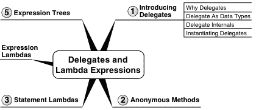

## 委托简介

资深 C 和 C++ 程序员长期以来一直使用方法指针作为将可执行步骤作为参数传递给另一个方法的手段。C# 使用委托实现相同的功能，委托将方法封装为对象，从而实现在运行时绑定的间接方法调用。考虑一下此方法有用的示例。

## 定义场景

虽然不一定高效，但也许最简单的排序例程之一是冒泡排序。清单 12.1 显示了 BubbleSort() 方法。

### 清单 12.1：BubbleSort() 方法

```csharp
static class SimpleSort1
{
    public static void BubbleSort(int[] items)
    {
        int i;
        int j;
        int temp;

        if(items==null)
        {
            return;
        }

        for (i = items.Length - 1; i > 0; i--)
        {
            for (j = 1; j <= i; j++)
            {
                if (items[j - 1] > items[j])
                {
                    temp = items[j - 1];
                    items[j - 1] = items[j];
                    items[j] = temp;
                }
            }
        }
    }
    // ...
}
```

此方法将按升序对整数数组进行排序。

但是，如果你想支持按降序排序整数的选项，基本上有两种选择。你可以复制代码并将大于运算符替换为小于运算符。或者，你可以传入一个额外参数，指示如何执行排序，如清单 12.2 所示。

### 清单 12.2：BubbleSort() 方法，升序或降序

```csharp
class SimpleSort2
{
    public enum SortType
    {
        Ascending,
        Descending
    }

    public static void BubbleSort(int[] items, SortType sortOrder)
    {
        int i;
        int j;
        int temp;

        if(items==null)
        {
            return;
        }

        for (i = items.Length - 1; i >= 0; i--)
        {
            for (j = 1; j <= i; j++)
            {
                switch (sortOrder)
                {
                    case SortType.Ascending :
                        if (items[j - 1] > items[j])
                        {
                            temp = items[j - 1];
                            items[j - 1] = items[j];
                            items[j] = temp;
                        }

                        break;
                    case SortType.Descending :
                        if (items[j - 1] < items[j])
                        {
                            temp = items[j - 1];
                            items[j - 1] = items[j];
                            items[j] = temp;
                        }
                        break;
                    }
                }
            }
        }
    }
    // ...
}
```

但是，这只能处理可能的排序顺序中的两种。如果你想按字母顺序排序、随机化集合或通过其他标准排序，那么 BubbleSort() 方法和相应的 SortType 值的数量很快就会变得难以管理。

## 委托数据类型

为了提高灵活性（并减少代码重复），你可以将比较方法作为参数传递给 BubbleSort() 方法。此外，为了将方法作为参数传递，需要有一种可以表示该方法的数据类型——换句话说，就是委托。清单 12.3 包含对 BubbleSort() 方法的修改，该修改接受一个委托参数。在此示例中，委托数据类型是 ComparisonHandler。

### 清单 12.3：带委托参数的 BubbleSort() 方法

```csharp
class DelegateSample
{
// ...
public static void BubbleSort(
int[] items, ComparisonHandler comparisonMethod)
{
int i;
int j;
int temp;
if(items==null)
{
return;
}
if(comparisonMethod == null)
{
throw new ArgumentNullException("comparisonMethod");
}
for (i = items.Length - 1; i >= 0; i--)
{
    for (j = 1; j <= i; j++)
    {
        if (comparisonMethod(items[j - 1], items[j]))
        {
            temp = items[j - 1];
            items[j - 1] = items[j];
            items[j] = temp;
        }
    }
}
// ...
}
```

ComparisonHandler 是一种表示用于比较两个整数的方法的数据类型。在 BubbleSort() 方法中，你在条件表达式内使用 ComparisonHandler 的实例，名为 comparisonMethod。由于 comparisonMethod 表示一个方法，调用该方法的语法与直接调用方法相同。在此示例中，comparisonMethod 接受两个整数参数，并返回一个布尔值，指示第一个整数是否大于第二个整数。

也许比特定算法更值得注意的是，ComparisonHandler 委托被强类型化为返回 bool 且仅接受两个整数参数。与任何其他方法一样，对委托的调用也是强类型化的，如果数据类型不匹配，C# 编译器会报告错误。让我们考虑一下委托在内部的工作原理。

## 委托内部

C# 将所有委托（包括 ComparisonHandler）定义为间接派生自 System.Delegate，如图 12.1.1 所示。

第一个属性的类型是 System.Reflection.MethodInfo，我将在第 17 章中介绍。MethodInfo 描述特定方法的签名，包括其名称、参数和返回值类型。此外

1. C# 标准不指定委托实现的类层次结构。但是，.NET 的实现确实间接派生自 System.Delegate。


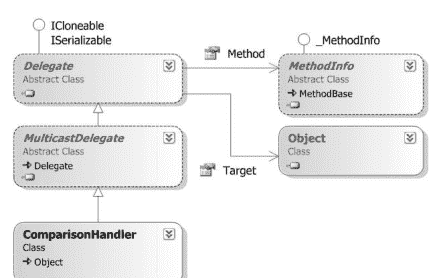

图 12.1：委托类型对象模型

MethodInfo，委托还需要包含要调用的方法的对象实例。这是第二个属性 Target 的用途。对于静态方法，Target 对应于类型本身。MulticastDelegate 类的用途是下一章的主题。

值得注意的是，所有委托都是不可变的。“更改”委托涉及实例化一个包含修改的新委托。

## 定义委托类型

你已了解如何定义使用委托的方法，并了解如何通过将委托变量视为方法来调用委托。然而，你尚未了解如何声明委托数据类型。例如，你尚未了解如何定义 ComparisonHandler，使其要求两个整数参数并返回 bool。

虽然所有委托数据类型都间接派生自 System.Delegate，但 C# 编译器不允许你定义直接或间接（通过 System.MulticastDelegate）派生自 System.Delegate 的类。因此，清单 12.4 无效。

### 清单 12.4：System.Delegate 不能显式作为基类

```
// ERROR: 'ComparisonHandler' cannot
// inherit from special class 'System.Delegate'
public class ComparisonHandler: System.Delegate
{
    // ...
}
```

取而代之的是，C# 使用 delegate 关键字。该关键字会导致编译器生成一个类似于清单 12.4 中所示的类。清单 12.5 显示了声明委托数据类型的语法。

### 清单 12.5：声明委托数据类型

```
public delegate bool ComparisonHandler (
    int first, int second);
```

换句话说，delegate 关键字是声明最终派生自 System.Delegate 的引用类型的简写。事实上，如果委托声明出现在另一个类中，那么委托类型 ComparisonHandler 将是一个嵌套类型（参见清单 12.6）。

### 清单 12.6：声明嵌套委托数据类型

```
class DelegateSample
{
    public delegate bool ComparisonHandler (
        int first, int second);
}
```

在这种情况下，数据类型将是 DelegateSample.ComparisonHandler，因为它定义为 DelegateSample 内的嵌套类型。

## 实例化委托

在使用委托实现 BubbleSort() 方法的最后一步中，你将学习如何调用该方法并传递委托实例——具体来说，是 ComparisonHandler 类型的实例。要实例化委托，你需要一个与委托类型本身签名对应的方法。在 ComparisonHandler 的情况下，该方法接受两个整数并返回 bool。方法名称并不重要。清单 12.7 显示了大于方法的代码。

### 清单 12.7：声明与 ComparisonHandler 兼容的方法

```
public delegate bool ComparisonHandler (
    int first, int second);

class DelegateSample
{
    public static void BubbleSort(
        int[] items, ComparisonHandler comparisonMethod)
    {
        // ...
    }

    public static bool GreaterThan(int first, int second)
    {
        return first > second;
    }
    // ...
}
```

定义此方法后，你可以调用 BubbleSort() 并传递包含此方法的委托实例。从 C# 2.0 开始，你只需指定委托方法的名称（参见清单 12.8）。

### 清单 12.8：在 C# 2.0 中将委托实例作为参数传递

```
public delegate bool ComparisonHandler (
    int first, int second);

class DelegateSample
{
    public static void BubbleSort(
        int[] items, ComparisonHandler comparisonMethod)
    {
        // ...
    }

    public static bool GreaterThan(int first, int second)
    {
        return first > second;
    }

    static void Main()
    {
        int[] items = new int[100];
        Random random = new Random();

        for (int i = 0; i < items.Length; i++)
        {
            items[i] = random.Next(int.MinValue, int.MaxValue);
        }

        BubbleSort(items, GreaterThan);

        for (int i = 0; i < items.Length; i++)
        {
            Console.WriteLine(items[i]);
        }
    }
}
```

请注意，ComparisonHandler 委托是引用类型，但你不一定使用 new 来实例化它。传递名称而不是使用显式实例化的功能称为委托推断，这是从 C# 2.0 开始的新语法。使用此语法，编译器使用方法名称查找方法签名并验证它是否与方法的参数类型匹配。

### 高级主题
### C# 1.0 中的委托实例化

早期版本的编译器要求实例化清单 12.9 中演示的委托。

### 清单 12.9：在 C# 2.0 之前将委托实例作为参数传递

```
public delegate bool ComparisonHandler (
    int first, int second);

class DelegateSample
{
    public static void BubbleSort(
        int[] items, ComparisonHandler comparisonMethod)
    {
        // ...
    }

    public static bool GreaterThan(int first, int second)
    {
        return first > second;
    }

    static void Main(string[] args)
    {
        int i;
        int[] items = new int[5];

        for (i=0; i<items.Length; i++)
        {
            Console.Write("Enter an integer: ");
            items[i] = int.Parse(Console.ReadLine());
        }

        BubbleSort(items,
        new ComparisonHandler(GreaterThan));

        for (i = 0; i < items.Length; i++)
        {
            Console.WriteLine(items[i]);
        }
    }

// ...
}
```

请注意，C# 2.0 及更高版本支持这两种语法，但除非你正在编写向后兼容的代码，否则 2.0 语法更可取。因此，在本书的其余部分，我将只展示 C# 2.0 及更高版本的语法。（这会导致部分剩余代码无法在 1.0 版编译器上编译，除非你修改这些编译器以使用显式委托实例化。）

传递委托以指定排序顺序的方法比本章开头列出的方法要灵活得多。使用委托方法，你可以通过添加替代委托来将整数转换为字符串作为比较的一部分，从而将排序顺序更改为字母顺序。清单 12.10 显示了演示字母排序的完整清单，输出 12.1 显示了结果。

### 清单 12.10：使用不同的与 ComparisonHandler 兼容的方法

```
using System;
class DelegatesSample
{

public delegate bool ComparisonHandler(int first, int second);

public static void BubbleSort(
    int[] items, ComparisonHandler comparisonMethod)
{
    int i;
    int j;
    int temp;

    for (i = items.Length - 1; i > 0; i--)
    {
        for (j = 1; j <= i; j++)
        {
            if (comparisonMethod(items[j - 1], items[j]))
            {
                temp = items[j - 1];
                items[j - 1] = items[j];
                items[j] = temp;
            }
        }
    }
}

public static bool GreaterThan(int first, int second)
{
    return first > second;
}

public static bool AlphabeticalGreaterThan(
    int first, int second)
{
    int comparison;
    comparison = (first.ToString()).CompareTo(
        second.ToString());

    return comparison > 0;
}

static void Main(string[] args)
{
    int i;
    int[] items = new int[5];

    for (i = 0; i < items.Length; i++)
    {
        Console.Write("Enter an integer: ");
        items[i] = int.Parse(Console.ReadLine());
    }

    BubbleSort(items, AlphabeticalGreaterThan);
    for (i = 0; i < items.Length; i++)
    {
        Console.WriteLine(items[i]);
    }
}
```

### 输出 12.1：

```
Enter an integer: 1
Enter an integer: 12
Enter an integer: 13
Enter an integer: 5
Enter an integer: 4
1
12
13
4
5
```

字母顺序与数字顺序不同。然而，添加此额外排序机制是多么简单，与本章开头使用的过程相比。

创建字母排序顺序的唯一更改是添加 AlphabeticalGreaterThan 方法，然后将该方法传递给 BubbleSort() 的调用。

## 匿名方法

C# 2.0 及更高版本包含一项称为匿名方法的功能。这些是没有实际方法声明的委托实例。相反，它们在代码中内联定义，如清单 12.11 所示。

### 清单 12.11：传递匿名方法

```
class DelegateSample
{
    // ...
    static void Main(string[] args)
    {
```


```csharp
int i;
int[] items = new int[5];
ComparisonHandler comparisonMethod;

for (i = 0; i < items.Length; i++)
{
    Console.Write("Enter an integer:");
    items[i] = int.Parse(Console.ReadLine());
}

comparisonMethod =
    delegate(int first, int second)
    {
        return first < second;
    };

BubbleSort(items, comparisonMethod);

for (i = 0; i < items.Length; i++)
{
    Console.WriteLine(items[i]);
}
}
```

在清单 12.11 中，你将对 BubbleSort() 的调用更改为使用匿名方法，以按降序对项目进行排序。请注意，未指定 LessThan() 方法。相反，delegate 关键字直接与代码内联放置。在此上下文中，delegate 关键字用于指定一种“委托文本”，类似于引号指定字符串文本。

你甚至可以直接调用 BubbleSort() 方法，而无需声明 comparisonMethod 变量（参见清单 12.12）。

## 清单 12.12：在不声明变量的情况下使用匿名方法

```csharp
class DelegateSample
{
    // ...

    static void Main(string[] args)
    {

        int i;
        int[] items = new int[5];
        for (i = 0; i < items.Length; i++)
        {
            Console.Write("Enter an integer:");
            items[i] = int.Parse(Console.ReadLine());
        }

        BubbleSort(items,
            delegate(int first, int second)
            {
                return first < second;
            }
        );

        for (i = 0; i < items.Length; i++)
        {
            Console.WriteLine(items[i]);
        }
    }
}
```

请注意，在所有情况下，参数类型和返回类型都必须与 ComparisonHandler 数据类型兼容，即 BubbleSort() 第二个参数的委托类型。

总之，C# 2.0 引入了一项新功能——匿名方法，它提供了一种声明无名称方法并将其转换为委托的方式。

## 高级主题

## 无参数匿名方法

方法签名与委托数据类型的兼容性并不排除没有参数列表的可能性。与 lambda 表达式、语句 lambda 和表达式 lambda（参见下一节）不同，匿名方法允许省略参数列表（例如，delegate { return Console.ReadLine() == "" }）。这不常见，但它确实允许相同的匿名方法出现在多个场景中，即使委托类型可能不同。但是请注意，尽管可以省略参数列表，但返回类型仍需与委托的返回类型兼容（除非抛出异常）。

## 系统定义的委托：Func<>

.NET 3.5（C# 3.0）包含一系列名为“Action”和“Func”的泛型委托。System.Func 表示带有返回类型的委托，而 System.Action 对应于没有返回类型的情况。这些委托的签名显示在清单 12.13 中（尽管 in/out 类型修饰符直到 C# 4.0 才添加，如稍后讨论）。

## 清单 12.13：Func 和 Action 委托声明

```csharp
public delegate void Action ();

public delegate void Action<in T>(T arg)

public delegate void Action<in T1, in T2>(
    in T1 arg1, in T2 arg2)

public delegate void Action<in T1, in T2, in T3>(
    T1 arg1, T2 arg2, T3 arg3)

public delegate void Action<in T1, in T2, in T3, in T4>(
    T1 arg1, T2 arg2, T3 arg3, T4 arg4)

...

public delegate void Action<
    in T1, in T2, in T3, in T4, in T5, in T6, in T7, in T8,
    in T9, in T10, in T11, in T12, in T13, in T14, in T15, in T16>(
    T1 arg1, T2 arg2, T3 arg3, T4 arg4,
    T5 arg5, T6 arg6, T7 arg7, T8 arg8,
    T9 arg9, T10 arg10, T11 arg11, T12 arg12,
    T13 arg13, T14 arg14, T15 arg15, T16 arg16)

public delegate TResult Func<out TResult>();

public delegate TResult Func<in T, out TResult>(T arg)

public delegate TResult Func<in T1, in T2, out TResult>(
    in T1 arg1, in T2 arg2)

public delegate TResult Func<in T1, in T2, in T3, out TResult>(
    T1 arg1, T2 arg2, T3 arg3)

public delegate TResult Func<in T1, in T2, in T3, in T4,
    out TResult>(T1 arg1, T2 arg2, T3 arg3, T4 arg4)

...

public delegate TResult Func<
    in T1, in T2, in T3, in T4, in T5, in T6, in T7, in T8,
    in T9, in T10, in T11, in T12, in T13, in T14, in T15, in T16,
    out TResult>(
    T1 arg1, T2 arg2, T3 arg3, T4 arg4,
    T5 arg5, T6 arg6, T7 arg7, T8 arg8,
    T9 arg9, T10 arg10, T11 arg11, T12 arg12,
    T13 arg13, T14 arg14, T15 arg15, T16 arg16)
```

由于清单 12.13 中的委托定义是泛型的，因此可以使用它们，而无需定义自定义委托。例如，与其声明 ComparisonHandler 委托类型，代码可以简单地使用 Func<int, int, bool> 声明 ComparisonHandler 委托。Func 的最后一个类型参数始终是委托的返回类型。较早的类型参数按顺序对应委托参数的类型。在 ComparisonHandler 的情况下，返回值为 bool（Func 声明中的最后一个类型参数），而类型参数 int 和 int 分别对应 ComparisonHandler 的第一个和第二个参数。在许多情况下，.NET 3.5 框架中包含 Func 委托消除了定义委托的必要性。对于没有返回值（TResult）且不接受参数的委托，应使用 System.Action 或其泛型版本之一。

但是，当此类类型能简化使用委托的编码时，仍应声明委托类型。例如，继续使用 ComparisonHandler 能更明确地指示委托的用途，而 Func<int, int, bool> 仅提供对方法签名的理解。

关于是否声明委托的评估仍然有意义，包括诸如委托标识符的名称是否足以指示意图、委托类型名称是否能澄清其用途，以及使用 .NET 3.5 类型是否会不必要地将程序集的使用限制为 .NET 3.5 客户端等考虑因素。

请注意，即使可以使用泛型 Func 委托替代显式定义的委托，这些类型也不兼容。即使类型参数匹配，也不能将一个委托类型赋给另一个委托类型的变量。例如，不能将 ComparisonHandler 变量赋给 Func<int, int, bool> 变量，也不能将它们互换地作为参数传递，尽管两者都表示接受两个 int 参数并返回 bool 的委托签名。

但是，请注意装饰清单 12.13 中委托的类型参数修饰符。得益于 C# 4.0 添加的协变支持，这些修饰符确实允许在它们之间进行一定程度的强制转换。请考虑以下逆变示例：因为 void Action<in T>(T arg) 带有 in 类型参数修饰符，所以可以将 Action<object> 类型的对象赋给 Action<string> 类型。换句话说，任何具有 void 返回和 object 参数的方法都会隐式转换为仅允许 string 类型参数的更严格委托类型。同样，对于协变和 Func 委托——由于 Func<out TResult>() 在 TResult 上包含 out 类型参数修饰符，因此可以将 Func<string> 的值隐式赋给 Func<object> 变量。（参见清单 12.14。）

## 清单 12.14：使用委托的协变

```csharp
// Covariance
Action<object> broadAction =
    delegate(object data)
    {
        Console.WriteLine(data);
    };

Action<string> narrowAction = broadAction;

// Contravariance
Func<string> narrowFunction =
    delegate()
    {
        return Console.ReadLine();
    };

Func<object> broadFunction = narrowFunction;

// Covariance & Contravariance Combined
Func<object, string> func1 =
    delegate(object data)
    {
        return data.ToString();
    };

Func<string, object> func2 = func1;
```

清单的最后一部分将两种协变概念结合到单个示例中，演示当同时涉及 in 和 out 类型参数时，它们如何同时发生。

在这些泛型委托中需要协变支持，是 C# 现在包含该功能的关键促成因素之一。²

2. 另一个是对 IEnumerable<T> 的协变支持。


## Lambda 表达式

Introduced in C# 3.0, lambda expressions are a more succinct syntax of **anonymous functions** than anonymous methods, where _anonymous functions_ is a general term that includes both lambda expressions and anonymous methods. Lambda expressions are themselves broken into two types: statement lambdas and expression lambdas. Figure 12.2 shows the hierarchical relationship between the terms.

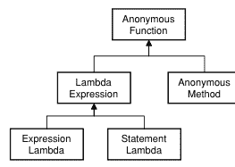

As mentioned earlier in the context of delegates, all anonymous functions are immutable.

## Statement Lambdas

With statement lambdas, C# 3.0 provides a reduced syntax for anonymous methods, a syntax that does not include the delegate keyword and adds the lambda operator, =>. Listing 12.15 shows equivalent functionality to Listing 12.12, except that Listing 12.15 uses a statement lambda rather than an anonymous method.

### Listing 12.15: Passing a Delegate with a Statement Lambda

```csharp
class DelegateSample
{
    // ...

    static void Main(string[] args)
    {
        int i;
        int[] items = new int[5];
        for (i = 0; i < items.Length; i++)
        {
            Console.Write("Enter an integer:");
            items[i] = int.Parse(Console.ReadLine());
        }
        BubbleSort(items,
            (int first, int second) =>
            {
                return first < second;
            });
        for (i = 0; i < items.Length; i++)
        {
            Console.WriteLine(items[i]);
        }
    }
}
```

When reading code that includes a lambda operator, you would replace the lambda operator with the words *go to goes to*. For example, you would read `n => { return n.ToString(); }` as “n goes to return n dot ToString.” In Listing 12.15, you would read the second `BubbleSort()` parameter as “integers first and second go to returning the result of first less than second.”

As readers will observe, the syntax in Listing 12.15 is virtually identical to that in Listing 12.12, apart from the changes already outlined. However, statement lambdas allow for an additional shortcut via type parameter inference. Rather than explicitly declaring the data type of the parameters, statement lambdas can omit parameter types as long as the compiler can infer the types. In Listing 12.16, the delegate data type is `bool ComparisonHandler(int first, int second)`, so the compiler verifies that the return type is a bool and infers that the input parameters are both integers (int).

### Listing 12.16: Omitting Parameter Types from Statement Lambdas

```csharp
// ...
BubbleSort(items,
(first, second) =>
{
    return first < second;
});
// ...
```

In general, statement lambdas do not need parameter types as long as the compiler can infer the types or can implicitly convert them to the requisite expected types. If the types are specified, however, there must be an exact match for the delegate type. In cases where inference is not possible, the data type is required, although even when it is not required, you can specify the data type explicitly to increase readability; once the statement lambda includes one type, all types are required.

In general, C# requires a lambda expression to have parentheses around the parameter list regardless of whether the data type is specified. Even parameterless statement lambdas, representing delegates that have no input parameters, are coded using empty parentheses (see Listing 12.17).

### Listing 12.17: Parameterless Statement Lambdas

```csharp
using System;
// ...
Func<string> getUserInput =
() =>
{
    string input;
    do
    {
        input = Console.ReadLine();
    }
    while(input.Trim().Length==0);
    return input;
};
// ...
```

The exception to the parenthesis rule is that if the compiler can infer the data type and there is only a single input parameter, the statement lambda does not require parentheses (see Listing 12.18).

### Listing 12.18: Statement Lambdas with a Single Input Parameter

```csharp
using System.Collections.Generic;
using System.Diagnostics;
using System.Linq;
// ...
IEnumerable<Process> processes = Process.GetProcesses().Where(
    // process => { return process.WorkingSet64 > 2^30; });
    ...
```

(In Listing 12.18, Where() returns a query for processes that have a physical memory utilization greater than 1GB)

Note that back in Listing 12.17, the body of the statement lambda includes multiple statements inside the statement block (via curly braces). Although a statement lambda can have any number of statements, typically a statement lambda uses only two or three statements in its statement block.

## Expression Lambdas

Unlike a statement lambda, which includes a statement block and, therefore, zero or more statements, an expression lambda has only an expression, with no statement block. Listing 12.19 is the same as Listing 12.15, except that it uses an expression lambda rather than a statement lambda.

### Listing 12.19: Passing a Delegate with an Expression Lambda

```csharp
class DelegateSample
{
    // ...
    static void Main(string[] args)
    {
        int i;
        int[] items = new int[5];
        for (i = 0; i < items.Length; i++)
        {
            Console.Write("Enter an integer:");
            items[i] = int.Parse(Console.ReadLine());
        }
        BubbleSort(items, (first, second) => first < second);
        for (i = 0; i < items.Length; i++)
        {
            Console.WriteLine(items[i]);
        }
    }
}
```

The difference between a statement and an expression lambda is that the statement lambda has a statement block on the right side of the lambda operator, whereas the expression lambda has only an expression (no return statement or curly braces, for example).

Generally, you would read a lambda operator in an expression lambda in the same way you would read a statement lambda: “goes to.” In addition, “becomes” is sometimes clearer. In cases such as the BubbleSort() call, where the expression lambda specified is a predicate (returns a Boolean), it is frequently clearer to replace the lambda operator with “such that.” This changes the pronunciation of the statement lambda in Listing 12.19 to read “first and second such that first is less than second.” One of the most common places for a predicate to appear is in the call to System.Linq.Enumerable's Where() function. In cases such as this, neither “such that” nor “goes to” is needed. We would read names.Where(name => name.Contains(" ")) as “names where names dot Contains a space,” for example. One pronunciation difference between the lambda operator in statement lambdas and in expression lambdas is that “such that” terminology applies more to expression lambdas than to statement lambdas since the latter tend to be more complex.

The anonymous function does not have any intrinsic type associated with it, although implicit conversion is possible for any delegate type as long as the parameters and return type are compatible. In other words, an anonymous method is no more a ComparisonHandler type than another delegate type such as LessThanHandler. As a result, you cannot use the typeof() operator (see Chapter 17) on an anonymous method, and calling GetType() is possible only after assigning or casting the anonymous method to a delegate variable.

Table 12.1 contains additional lambda expression characteristics.

### Table 12.1: Lambda Expression Notes and Examples

| Statement | Example |
| :--- | :--- |
| Lambda expressions themselves do not have type. In fact, there is no concept of a lambda expression in the CLR. Therefore, there are no members to call directly from a lambda expression. The . operator on a lambda expression will not compile, eliminating even the option of calls to object methods. | // ERROR: Operator '.' cannot be applied to // operand of type 'lambda expression' Type type = ((int x) => x).ToString(); |
| Given that a lambda expression does not have an intrinsic type, it cannot appear to the right of an is operator. | // ERROR: The first operand of an 'is' or 'as' // operator may not be a Lambda expression or // anonymous method bool boolean = (int x) => x is Func<int, int>; |
| Although there is no type on the lambda expression on its own, once assigned it or cast, the lambda expression takes on a type. Therefore, it is common for developers to informally refer to the type of the lambda expression concerning type compatibility, for example. | // ERROR: Lambda expression is not compatible with // Func<int, bool> type. Func<int, bool> expression = (int x) => x; |
| A lambda expression cannot be assigned to an implicitly typed local variable since the compiler does not know what type to make the variable given that lambda expressions do not have type. | // ERROR: Cannot assign lambda expression to an // implicitly typed local variable var thing = (x => x); |


## 表 12.1: Lambda 表达式注释和示例

| Statement | Example |
| :--- | :--- |
| C# 不允许在匿名函数中使用跳转语句（break、goto、continue），如果跳转目标位于 Lambda 表达式之外。同样，你也不能从 Lambda 表达式（或匿名方法）之外将跳转语句定向到 Lambda 表达式内部。 | `// ERROR: Control cannot leave the body of an<br>// anonymous method or Lambda expression<br>string[] args;<br>Func<string> expression;<br>switch(args[0])<br>{<br>    case "/File":<br>    expression = () =><br>    {<br>        if (!File.Exists(args[1]))<br>        {<br>            break;<br>        }<br>        // ...<br>        return args[1];<br>    };<br>    // ...<br>}` |
| Lambda 表达式内部引入的变量仅在 Lambda 表达式主体的作用域内可见。 | `// ERROR: The name 'first' does not<br>// exist in the current context<br>Func<int, int, bool> expression =<br>    (first, second) => first > second;<br>first++;` |
| 编译器的流分析无法检测 Lambda 表达式中局部变量的初始化。 | `int number;`<br>`Func<string, bool> expression =`<br>`text => int.TryParse(text, out number);`<br>`if (expression("1"))`<br>`{`<br>`// ERROR: Use of unassigned local variable`<br>`System.Console.Write(number);`<br>`}` |
| | `int number;`<br>`Func<int, bool> isFortyTwo =`<br>`x => 42 == (number = x);`<br>`if (isFortyTwo(42))`<br>`{`<br>`// ERROR: Use of unassigned local variable`<br>`System.Console.Write(number);`<br>`}` |

## 高级主题

### Lambda 表达式和匿名方法的内部实现

Lambda 表达式（和匿名方法）并非 CLR 中的内置构造。相反，C# 编译器在编译时生成其实现。Lambda 表达式为内联声明的委托模式提供了语言构造。因此，C# 编译器为该模式生成实现代码，以便编译器自动编写代码，而无需开发人员手动编写。鉴于前面的示例，因此，C# 编译器生成的 CIL 代码与清单 12.20 中显示的 C# 代码类似。

### 清单 12.20: 编译器为 Lambda 表达式生成的 CIL 的 C# 等效代码

```csharp
class DelegateSample
{
    // ...

    static void Main(string[] args)
    {
        int i;
        int[] items = new int[5];
        for (i = 0; i < items.Length; i++)
        {
            Console.Write("Enter an integer: ");
            items[i] = int.Parse(Console.ReadLine());
        }

        BubbleSort(items,
            DelegateSample.__AnonymousMethod_00000000());

        for (i = 0; i < items.Length; i++)
        {
            Console.WriteLine(items[i]);
        }
    }

    private static bool __AnonymousMethod_00000000(
        int first, int second)
    {
```

```csharp
return first < second;
}
}
```

在此示例中，匿名方法被转换为单独声明的静态方法，然后将其实例化为委托并作为参数传递。

## 外部变量

在 Lambda 表达式之外声明（包括参数）但被 Lambda 表达式捕获（访问）的局部变量，是该 Lambda 的外部变量。this 也是一个外部变量。匿名函数捕获的外部变量会一直存活，直到匿名函数的委托被销毁后。在清单 12.21 中，使用外部变量来计算 BubbleSort() 执行比较的次数相对简单。输出 12.2 显示了此清单的结果。

### 清单 12.21: 在 Lambda 表达式中使用外部变量

```csharp
class DelegateSample
{
    // ...

    static void Main(string[] args)
    {
        int i;
        int[] items = new int[5];
        int comparisonCount=0;

        for (i=0; i<items.Length; i++)
        {
            Console.Write("Enter an integer:");
            items[i] = int.Parse(Console.ReadLine());
        }

        BubbleSort(items,
            (int first, int second) =>
            {
                comparisonCount++;
                return first < second;
            }
```

```csharp
});
for (i = 0; i < items.Length; i++)
{
    Console.WriteLine(items[i]);
}

Console.WriteLine("Items were compared {0} times.",
    comparisonCount);
}
```

### 输出 12.2:

```
Enter an integer:5
Enter an integer:1
Enter an integer:4
Enter an integer:2
Enter an integer:3
5
4
3
2
1
Items were compared 10 times.
```

comparisonCount 出现在 Lambda 表达式之外，并在其中递增。调用 BubbleSort() 方法后，comparisonCount 会打印到控制台。

正如此代码所示，C# 编译器负责生成 CIL 代码，在匿名方法和调用站点之间共享 comparisonCount，尽管在匿名委托中没有传递 comparisonCount 的参数，BubbleSort() 方法中也没有。鉴于变量的共享，它在引用它的委托被垃圾回收之前不会被垃圾回收。换句话说，捕获变量的生命周期至少与捕获它的最长寿命委托对象一样长。

## 高级主题

### 外部变量的 CIL 实现

C# 编译器为外部变量生成的 CIL 代码比简单匿名方法的代码更复杂。清单 12.22 显示了用于实现外部变量的 CIL 代码的 C# 等效代码。

### 清单 12.22: 编译器为外部变量生成的 CIL 代码的 C# 等效代码

```csharp
class DelegateSample
{
    // ...

    private sealed class __LocalsDisplayClass_00000001
    {
        public int comparisonCount;
        public bool __AnonymousMethod_00000000(
            int first, int second)
        {
            comparisonCount++;
            return first < second;
        }
    }

    ...

    static void Main(string[] args)
    {
        int i;
        __LocalsDisplayClass_00000001 locals =
            new __LocalsDisplayClass_00000001();
        locals.comparisonCount=0;
        int[] items = new int[5];

        for (i=0; i<items.Length; i++)
        {
            Console.Write("Enter an integer:");
            items[i] = int.Parse(Console.ReadLine());
        }

        BubbleSort(items, locals.__AnonymousMethod_00000000);
        for (i = 0; i < items.Length; i++)
        {
            Console.WriteLine(items[i]);
        }

        Console.WriteLine("Items were compared {0} times.",
            locals.comparisonCount);
    }
}
```

请注意，捕获的局部变量从未被“传递”到任何地方，也从未被“复制”到任何地方。相反，捕获的局部变量（comparisonCount）是一个单一变量，我们通过将其实现为实例字段而非局部变量来扩展其生命周期。对局部变量的所有引用都重写为对字段的引用。

生成的类 __LocalsDisplayClass 是一个闭包——一种数据结构（C# 中的类），包含表达式以及计算表达式所需的变量（C# 中的公共字段）。变量（如 comparisonCount）使得在表达式的一次调用到下一次调用之间传递数据成为可能，而无需更改表达式的签名。

## 表达式树

Lambda 表达式为在代码中内联定义方法提供了简洁的语法。编译器会转换代码，使其稍后可执行和可调用，可能将委托传递给另一个方法。然而，它不提供内置支持的一个功能是将表达式表示为数据——可遍历甚至可序列化的数据。

## 将 Lambda 表达式用作数据

请考虑以下代码中的 Lambda 表达式：

```
persons.Where(
    person => person.Name.ToUpper() == "INIGO MONTOYA");
```

假设 persons 是 Persons 数组，编译器将 Lambda 表达式编译为 Func<Person, bool> 委托类型，然后将委托实例传递给 Where() 方法。这样的代码和执行效果很好。（Where() 方法是类 System.Linq.Enumerable 的 IEnumerable 扩展方法，但这在本节中无关紧要。）

如果 persons 不是 Person 数组，而是远程计算机或数据库中存放的 Person 对象集合，该怎么办？与其返回 persons 集合中的所有项目，不如通过网络发送描述表达式的数据，并在远程执行筛选，这样只有最终选择才会通过网络返回。在这种情况下，需要的是关于表达式的数据，而不是编译后的 CIL。然后远程计算机会编译或解释表达式数据。

解释是向语言添加表达式树的动机。表示关于表达式的数据而非


编译后的代码是表达式树。由于表达式树表示的是数据而非编译后的代码，因此可以将数据转换为替代格式——例如，将其从表达式数据转换为 SQL 代码（SQL 是通常用于从数据库查询数据的语言），该代码在数据库上执行。例如，Where() 接收到的表达式树可能会被转换为传递给数据库的 SQL 查询（参见清单 12.23）。

### Listing 12.23: Converting an Expression Tree to a SQL Where Clause

```
persons.Where( person => person.Name.ToUpper() == "INIGO MONTOYA");
select * from Person where upper(Name) = 'INIGO MONTOYA';
```

将 Where() 调用的原始参数视为数据，你可以看到它由以下部分组成：

- 对 Person 属性 Name 的调用
- 对名为 ToUpper() 的字符串方法的调用
- 常量值 "INIGO MONTOYA"
- 相等运算符 ==

Where() 方法获取这些数据，通过遍历数据并构建 SQL 查询字符串，将其转换为 SQL where 子句。不过，SQL 只是表达式树可能转换为的格式的一个示例。

## Expression Trees Are Object Graphs

表达式树转换为的数据是一个对象图，该对象图由 System.Linq.Expressions.Expression 表示。尽管表达式树包含一个可将其编译为委托构造函数调用（可执行 CIL 代码）的方法，但更有可能的是，表达式树（数据）会被转换为不同的格式或指令集。

例如，任何 lambda 表达式都是一种表达式，它具有一个只读的参数集合、一个返回类型和一个主体（主体本身也是另一个表达式）（参见图 12.3）。

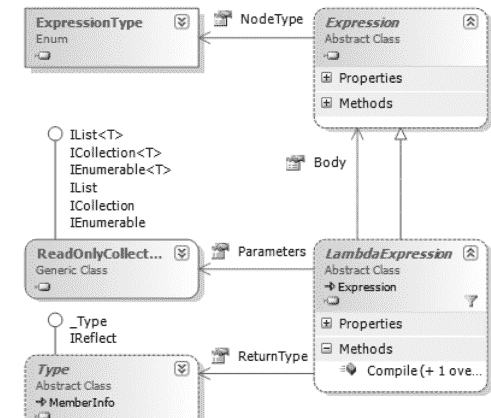

### Figure 12.3: Object Graph of a Lambda Expression

这个对象图是将 LambdaExpression 编译为 CIL（或转换为其他表示形式）所需的数据。同样，我们可以为一元表达式或二元表达式创建对象图（参见图 12.4）。

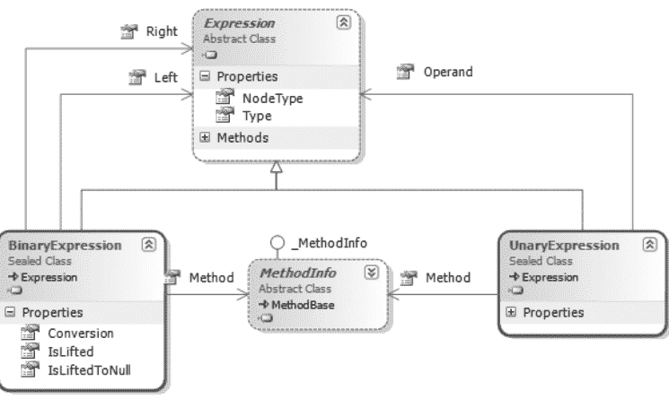

### Figure 12.4: Object Graph of Unary and Binary Expressions

一元表达式（例如 count++）是由一个操作数（Expression 类型）和一个方法（即运算符）组成的表达式。BinaryExpression 同样派生自 Expression，除了运算符（Method）之外，还有两个表达式关联（Left 和 Right）。这些对象图足以表示这些类型的表达式。不过，还有大约 30 种其他表达式类型，例如 NewExpression、ParameterExpression、MethodCallExpression、LoopExpression 等等。

## Lambda Expressions versus Expression Trees

用于委托的 lambda 表达式和用于表达式树的 lambda 表达式都会被编译，并且在两种情况下，表达式的语法都会在编译时经过完整的语义分析进行验证。然而，区别在于 lambda 表达式被编译为 CIL 中的委托。相比之下，表达式树被编译为类型为 System.Linq.Expressions.Expression 的数据结构。

让我们考虑一个示例，以突出委托与表达式树之间的区别。System.Linq.Enumerable 和 System.Linq.Queryable 非常相似。它们各自为其扩展的集合接口（分别是 IEnumerable 和 IQueryable）提供几乎相同的扩展方法。例如，考虑清单 12.23 中的 Where() 方法。给定支持 IEnumerable 的集合，对 Where() 的调用可能如下所示：

```
persons.Where( person => person.Name.ToUpper() ==
"INIGO MONTOYA");
```

从概念上讲，Enumerable 扩展方法签名定义在 IEnumerable<TSource> 上，如下所示：

```
public IEnumerable<TSource> Where<TSource>(
Func<TSource, bool> predicate);
```

不过，IQueryable<TSource> 上的等效 Queryable 扩展方法调用是相同的，尽管概念上的 Where() 方法签名（如所示）并不相同：

```
public IQueryable<TSource> Where<TSource>(
Expression<Func<TSource, bool>> predicate);
```

参数的调用代码是相同的，因为 lambda 表达式本身在被赋值/强制转换之前没有类型。

Enumerable 的 Where() 实现获取 lambda 表达式并将其转换为 Where() 方法实现所调用的委托。相比之下，在调用 Queryable 的 Where() 时，lambda 表达式会被转换为表达式树，以便编译器将 lambda 表达式转换为数据。实现 IQueryable 的对象接收表达式数据并对其进行操作。如前所述，Where() 接收到的表达式树可能会被转换为传递给数据库的 SQL 查询。

## Examining an Expression Tree

利用 lambda 表达式没有固有类型这一事实，将 lambda 表达式赋值给 System.Linq.Expressions.Expression<TDelegate> 会创建一个表达式树，而不是委托。

在清单 12.24 中，我们为 Func<int, int, bool> 表达式创建一个表达式树。（回顾一下，Func<int, int, bool> 在功能上等效于 ComparisonHandler 委托。）请注意，仅仅将表达式写入控制台，即 Console.WriteLine(expression)（其中 expression 的类型为 Expression<TDelegate>），会导致调用 expression 的 ToString() 方法。然而，这并不会导致表达式被求值，甚至不会输出 Func<int, int, bool> 的完全限定名称（如果我们使用委托实例，就会发生这种情况）。相反，显示表达式会输出与表达式树的值对应的数据（在此例中，即表达式代码）。

### Listing 12.24: Examining an Expression Tree

```
using System;
using System.Linq.Expressions;

class Program
{
    static void Main()
    {
        Expression<Func<int, int, bool>> expression;
        expression = (x, y) => x > y;
        Console.WriteLine("-----------------{0}-----------------",
            expression);
        PrintNode(expression.Body, 0);
        Console.WriteLine();
        Console.WriteLine();
        expression = (x, y) => x * y + x + y;
        Console.WriteLine("-----------------{0}-----------------",
            expression);
        PrintNode(expression.Body, 0);
        Console.WriteLine();
    }
}

public static void PrintNode(Expression expression,
    int indent)
{
    if (expression is BinaryExpression)
        PrintNode(expression as BinaryExpression, indent);
    else
        PrintSingle(expression, indent);
}

private static void PrintNode(BinaryExpression expression,
    int indent)
{
    PrintNode(expression.Left, indent + 1);
    PrintSingle(expression, indent);
    PrintNode(expression.Right, indent + 1);
}

private static void PrintSingle(Expression expression,
    int indent)
{
    Console.WriteLine("{0," + indent * 5 + "}{1}",
        "", NodeToString(expression));
}

private static string NodeToString(Expression expression)
{
    switch (expression.NodeType)
    {
        case ExpressionType.Multiply:
            return "*";
        case ExpressionType.Add:
            return "+";
        case ExpressionType.Divide:
            return "/";
        case ExpressionType.Subtract:
            return "-";
        case ExpressionType.GreaterThan:
            return ">";
        case ExpressionType.LessThan:
            return "<";
        default:
            return expression.ToString() +
                " (" + expression.NodeType.ToString() + ")";
    }
}
```

在输出 12.3 中，我们可以看到 Main() 中的 Console.WriteLine() 语句将表达式树的主体作为文本打印出来。

### Output 12.3:

```
------------------ (x, y) => x > y ------------------
>   x (Parameter)
>   y (Parameter)
------------------ (x, y) => (x * y) > (x + y) ------------------
>   * (Parameter)
>       y (Parameter)
>   + (Parameter)
>       x (Parameter)
>       y (Parameter)
```

将表达式作为文本输出是由于对表达式树底层数据的转换——这种转换类似于 PrintNode() 和 NodeTypeToString() 函数，只是更全面。需要注意的是，表达式树是一组数据，通过遍历数据，可以将数据转换为另一种格式。在 PrintNode() 方法中，清单 12.24 将数据转换为数据的水平文本解释。然而，解释可以是几乎任何内容。

使用递归，PrintNode() 函数演示了表达式树是零个或多个表达式树的树。包含的表达式树存储在 Expression 的 Body 属性中。此外，表达式树还包括一个名为 NodeType 的 ExpressionType 属性，其中 ExpressionType 是每种不同表达式类型的枚举。有多种表达式类型：BinaryExpression、ConditionalExpression、LambdaExpression（表达式树的根）、MethodCallExpression、ParameterExpression 和 ConstantExpression 只是示例。每种类型都派生自 System.Linq.Expressions.Expression。通常，你可以将语句 lambda 与表达式 lambda 互换使用。但是，你无法将语句 lambda 转换为表达式树。你只能使用表达式 lambda 语法来表示表达式树。


## 摘要

本章首先讨论了委托及其作为方法或回调引用的用法。它介绍了一个强大的概念，用于传递一组指令以在不同位置调用，而不是在编码指令时立即调用。

紧接着简要介绍了 C# 2.0 的匿名方法概念后，本章引入了 C# 3.0 的 Lambda 表达式概念，这是一种取代（但并未消除） C# 2.0 匿名方法语法的语法。无论语法如何，这些构造允许程序员直接将一组指令分配给变量，而无需定义包含指令的显式方法。这为在方法中动态编程指令提供了很大的灵活性——这是一个强大的概念，通过称为 LINQ（Language Integrated Query，语言集成查询）的 API 大大简化了集合的编程。

最后，本章以表达式树的概念结束，以及它们如何编译成表示 Lambda 表达式的数据，而不是委托实现本身。这是一个关键特性，使 LINQ to SQL 和 LINQ to XML 等库成为可能，这些库解释表达式树并在 CIL 以外的上下文中使用它。

Lambda 表达式一词涵盖了语句 Lambda 和表达式 Lambda。换句话说，语句 Lambda 和表达式 Lambda 都是 Lambda 表达式的类型。

本章提到但未详细阐述的一件事是多播委托。下一章将详细探讨多播委托，并解释它们如何通过事件实现发布-订阅模式。

# 13 事件

在前一章中，你学习了如何将单个方法存储在委托类型的实例中，并通过委托调用该方法。委托是称为发布-订阅的更大模式的构建块。委托的使用及其对发布-订阅模式的支持是本章的重点。本章中描述的几乎所有内容都可以仅使用委托来完成。但是，本章重点介绍的事件构造提供了额外的封装，使发布-订阅模式更容易实现且不易出错。

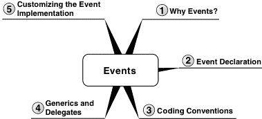

在前一章中，所有委托都用于单个回调（多重性为一）。但是，单个委托变量可以引用一系列委托，其中每个后续委托以链的形式指向下一个委托，有时称为多播委托。使用多播委托，你可以通过单个方法对象调用方法链，创建引用方法链的变量，并将委托作为参数传递以传递方法。

C# 中多播委托的实现是一种常见模式，否则需要大量手动代码。这种模式称为观察者或发布-订阅模式，它表示将单个事件（例如对象状态更改）的通知广播到多个订阅者的场景。

### 使用多播委托编写观察者模式

考虑一个温度控制示例，其中加热器和冷却器连接到同一个恒温器。为了使设备适当开启和关闭，你会通知设备温度变化。一个恒温器将温度变化发布到多个订阅者——加热和冷却设备。下一节将探讨代码。1

### 定义订阅者方法

首先定义 Heater 和 Cooler 对象（参见清单 13.1）。

### 清单 13.1: Heater 和 Cooler 事件订阅者实现

```csharp
class Cooler
{
    public Cooler(float temperature)
    {
        Temperature = temperature;
    }

    public float Temperature
    {
        get { return _Temperature; }
        set { _Temperature = value; }
    }

    private float _Temperature;

    public void OnTemperatureChanged(float newTemperature)
    {
        if (newTemperature > Temperature)
        {
            System.Console.WriteLine("Cooler: On");
        }
        else
        {
            System.Console.WriteLine("Cooler: Off");
        }
    }
}

class Heater
{
    public Heater(float temperature)
    {
        Temperature = temperature;
    }

    public float Temperature
    {
        get { return _temperature; }
        set { Temperature = value; }
    }

    private float _Temperature;

    public void OnTemperatureChanged(float newTemperature)
    {
        if (newTemperature < Temperature)
        {
            System.Console.WriteLine("Heater: On");
        }
        else
        {
            System.Console.WriteLine("Heater: Off");
        }
    }
}
```

1. 在此示例中，我使用恒温器一词，因为人们更常在供暖和制冷系统的语境下思考它。然而，从技术上讲，温度计会更合适。

这两个类基本相同，除了温度比较之外。（事实上，如果你在 OnTemperatureChanged 方法中使用委托作为比较的方法指针，可以消除其中一个类。）每个类存储开启设备的温度。此外，两个类都提供 OnTemperatureChanged() 方法。调用 OnTemperatureChanged() 方法是向 Heater 和 Cooler 类指示温度已更改的方式。方法实现使用 newTemperature 与存储的触发温度进行比较，以确定是否开启设备。

OnTemperatureChanged() 方法是订阅者方法。重要的是，它们的参数和返回类型必须与 Thermostat 类中的委托匹配，我将在下一节讨论。

### 定义发布者

Thermostat 类负责将温度变化报告给加热器和冷却器对象实例。Thermostat 类代码出现在清单 13.2 中。

### 清单 13.2: 定义事件发布者 Thermostat

```csharp
public class Thermostat
{
    // Define the delegate data type
    public delegate void TemperatureChangeHandler(
        float newTemperature);

    // Define the event publisher
    public TemperatureChangeHandler OnTemperatureChange
    {
        get { return _OnTemperatureChange; }
        set { _OnTemperatureChange = value; }
    }

    private TemperatureChangeHandler _OnTemperatureChange;

    public float CurrentTemperature
    {
        get { return _CurrentTemperature; }
        set
        {
            if (value != CurrentTemperature)
            {
                _CurrentTemperature = value;
            }
        }
    }

    private float _CurrentTemperature;
}
```

Thermostat 类的第一个成员是 TemperatureChangeHandler 委托。虽然不是必须的，但 Thermostat.TemperatureChangeHandler 是一个嵌套委托，因为其定义特定于 Thermostat 类。该委托定义了订阅者方法的签名。因此，请注意，在 Heater 和 Cooler 类中，OnTemperatureChanged() 方法都与 TemperatureChangeHandler 的签名匹配。

除了定义委托类型外，Thermostat 还包含一个名为 OnTemperatureChange 的属性，其类型为 OnTemperatureChangeHandler 委托。OnTemperatureChange 存储订阅者列表。请注意，只需要一个委托字段来存储所有订阅者。换句话说，Cooler 和 Heater 类都将从此单个发布者接收温度变化通知。

Thermostat 的最后一个成员是 CurrentTemperature 属性。它设置和获取 Thermostat 类报告的当前温度值。

### 连接发布者和订阅者

最后，将所有这些部分放在 Main() 方法中组合在一起。清单 13.3 显示了 Main() 可能的示例。

### 清单 13.3: 连接发布者和订阅者

```csharp
class Program
{
    public static void Main()
    {
        Thermostat thermostat = new Thermostat();
        Heater heater = new Heater(60);
        Cooler cooler = new Cooler(80);

        string temperature;

        // Using C# 2.0 or later syntax.
        thermostat.OnTemperatureChange +=
            heater.OnTemperatureChanged;
        thermostat.OnTemperatureChange +=
            cooler.OnTemperatureChanged;

        Console.Write("Enter temperature: ");
        temperature = Console.ReadLine();
        thermostat.CurrentTemperature = int.Parse(temperature);
    }
}
```


本清单中的代码通过直接使用 += 运算符将两个订阅者（heater.OnTemperatureChanged 和 cooler.OnTemperatureChanged）注册到 OnTemperatureChange 委托中。（如注释所述，如果您仅使用 C# 1.0，则需要使用 new 运算符来使用 TemperatureChangeHandler 构造函数。）通过获取用户输入的温度值，您可以设置恒温器的 CurrentTemperature。但是，您尚未编写任何代码来将温度变更事件发布给订阅者。

## 调用委托

每当 Thermostat 类上的 CurrentTemperature 属性更改时，您都希望调用委托以通知订阅者（加热器和冷却器）温度的变化。为此，请修改 CurrentTemperature 属性以保存新值并向每个订阅者发布通知。代码修改如清单 13.4 所示。

## 清单 13.4：未检查 null 即调用委托

```
public class Thermostat
{
    ...
    public float CurrentTemperature
    {
        get { return _CurrentTemperature; }
        set
        {
            if (value != CurrentTemperature)
            {
                _CurrentTemperature = value;
                // INCOMPLETE: Check for null needed
                // Call subscribers
                OnTemperatureChange(value);
            }
        }
    }
    private float _CurrentTemperature;
}
```

现在，CurrentTemperature 的赋值包含一些特殊逻辑，用于通知订阅者 CurrentTemperature 的变化。通知所有订阅者的调用只是单个 C# 语句，OnTemperatureChange(value)。

此单个语句将温度变更发布到冷却器和加热器对象。在这里，您可以在实践中看到，使用单个调用通知多个订阅者的能力就是委托更具体地被称为多播委托的原因。

## 检查 null

清单 13.4 中缺少一项重要的发布代码。如果没有订阅者注册以接收通知，则 OnTemperatureChange 将为 null，执行 OnTemperatureChange(value) 语句将引发 NullReferenceException。为避免这种情况，在触发事件之前有必要检查 null。清单 13.5 演示了如何执行此操作。

## 清单 13.5：调用委托

```
public class Thermostat
{
    ...
    public float CurrentTemperature
    {
        get { return _CurrentTemperature; }
        set
        {
            if (value != CurrentTemperature)
            {
                _CurrentTemperature = value;
                // If there are any subscribers
                // then notify them in changes in
                // temperature
                TemperatureChangeHandler localOnChange =
                    OnTemperatureChange;
                if (localOnChange != null)
                {
                    // Call subscribers
                    localOnChange(value);
                }
            }
        }
    }
    private float _CurrentTemperature;
}
```

与其直接检查 null，不如先将 OnTemperatureChange 赋值给第二个委托变量 handlerCopy。这一简单的修改确保，如果在检查 null 和发送通知之间，所有 OnTemperatureChange 订阅者都被移除（由另一个线程移除），您也不会引发 NullReferenceException。

再次提醒：在调用委托之前，请记住检查其值是否为 null。

## 高级主题

## 委托的 -- 运算符返回新实例

考虑到委托是引用类型，将局部变量赋值后再使用该局部变量就足以使 null 检查线程安全，这或许有些令人惊讶。由于 localOnChange 指向与 OnTemperatureChange 相同的位置，人们可能会认为 OnTemperatureChange 的任何更改也会反映在 localOnChange 中。

情况并非如此，因为实际上，对 OnTemperatureChange -= <listener> 的任何调用都不会仅仅从 OnTemperatureChange 中移除一个委托，使其比之前少一个委托。相反，它会分配一个全新的多播委托，而不会影响 localOnChange 也指向的原始多播委托。

## 委托运算符

要组合恒温器示例中的两个订阅者，您使用了 += 运算符。它获取第一个委托并将第二个委托添加到链中，使一个委托指向下一个。现在，在第一个委托的方法被调用后，它会调用第二个委托。要从委托链中移除委托，请使用 -= 运算符，如清单 13.6 所示。

## 清单 13.6：使用 += 和 -= 委托运算符

```
// ...
Thermostat thermostat = new Thermostat();
Heater heater = new Heater(60);
Cooler cooler = new Cooler(80);

Thermostat.TemperatureChangeHandler delegate1;
Thermostat.TemperatureChangeHandler delegate2;
Thermostat.TemperatureChangeHandler delegate3;

// use Constructor syntax for C# 1.0.
delegate1 = heater.OnTemperatureChanged;
delegate2 = cooler.OnTemperatureChanged;

Console.WriteLine("Invoke both delegates:");
delegate3 = delegate1;
delegate3 += delegate2;
delegate3(30);

Console.WriteLine("Invoke only delegate2");
delegate3 -= delegate1;
delegate3(30);

// ...
```

清单 13.6 的结果显示在输出 13.1 中。

## 输出 13.1：

```
Invoke both delegates:
Heater: Off
Cooler: On
Invoke only delegate2
Cooler: Off
```

此外，您还可以使用 + 和 - 运算符来组合委托，如清单 13.7 所示。

## 清单 13.7：使用 + 和 - 委托运算符

```
// ...
Thermostat thermostat = new Thermostat();
Heater heater = new Heater(60);
Cooler cooler = new Cooler(80);

Thermostat.TemperatureChangeHandler delegate1;
Thermostat.TemperatureChangeHandler delegate2;
Thermostat.TemperatureChangeHandler delegate3;

// Note: Use new Thermostat.TemperatureChangeHandler(
//       cooler.OnTemperatureChanged) for C# 1.0 syntax.
delegate1 = heater.OnTemperatureChanged;
delegate2 = cooler.OnTemperatureChanged;

Console.WriteLine("Combine delegates using + operator:");
delegate3 = delegate1 + delegate2;
delegate3(60);

Console.WriteLine("Uncombine delegates using - operator:");
delegate3 = delegate3 - delegate2;
delegate3(60);
// ...
```

使用赋值运算符会清除所有先前的订阅者，并允许您用新订阅者替换它们。这是委托的一个不幸特征。当您实际上打算使用 += 运算符时，很容易错误地编写赋值代码。解决方案称为事件，将在本章后面的“事件”部分中介绍。

应当注意的是，+ 和 - 运算符及其赋值等价运算符 += 和 -=，在内部是使用静态方法 System.Delegate.Combine() 和 System.Delegate.Remove() 实现的。这两个方法都接受两个委托类型的参数。第一个方法 Combine() 将两个参数连接起来，使第一个参数在委托列表中指向第二个参数。第二个方法 Remove() 会搜索第一个参数指定的委托链，然后移除第二个参数指定的委托。

关于 Combine() 方法值得注意的一个有趣之处是，其中一个或两个参数可以为 null。如果其中一个为 null，则 Combine() 返回非 null 参数。如果两者都为 null，则 Combine() 返回 null。这解释了为什么您可以调用 thermostat.OnTemperatureChange += heater.OnTemperatureChanged; 而不会引发异常，即使 thermostat.OnTemperatureChange 的值尚未赋值。

## 顺序调用

图 13.1 突出显示了对加热器和冷却器的顺序通知。

尽管您只编写了对 OnTemperatureChange() 的单个调用，但该调用会广播到两个订阅者，因此从这一个调用中，冷却器和加热器都会收到温度变更的通知。如果您添加了更多订阅者，它们也将通过 OnTemperatureChange() 收到通知。

尽管单个调用 OnTemperatureChange() 导致了对每个订阅者的通知，但订阅者仍然是按顺序调用，而不是同时调用，因为一个委托可以指向另一个委托，而该委托又可以指向更多委托。


actor : actor
1: Main()
2: Thermostat()
Thermostat() : Thermostat
3: Heater(temperature) ----------------------> heater : Heater
4: Cooler(temperature) ----------------------> cooler : Cooler
OnTemperatureChange-delegate-TemperatureChangeHandler
5: operator+=
6: operator+=
Console
7: Write("Enter temperature:") --------------->
8: ReadLine() -------------------------------->
9: CurrentTemperature(value)
10: OnTemperatureChange(value)
11: OnTemperatureChanged(newTemperature)
12: WriteLine("Heater off") -------------------->
13: OnTemperatureChanged(newTemperature)
14: WriteLine("Cooler on") -------------------->

图 13.1：委托调用序列图

## 多播委托内部

要了解事件的工作原理，需要重新审视 System.Delegate 类型内部的初步检查。请记住，delegate 关键字是派生自 System.MulticastDelegate 的类型的别名。同样，System.MulticastDelegate 派生自 System.Delegate，而 System.Delegate 由一个对象引用和一个方法指针（类型为 System.Reflection.MethodInfo）组成。当你创建委托时，编译器会自动使用 System.MulticastDelegate 类型，而不是 System.Delegate 类型。MulticastDelegate 类包含一个对象引用和一个方法指针，与其 Delegate 基类一样，但它还包含对另一个 System.MulticastDelegate 对象的引用。

当你向多播委托添加方法时，MulticastDelegate 类会创建委托类型的新实例，将添加方法的对象引用和方法指针存储到新实例中，并将新委托实例作为委托实例列表中的下一项添加进去。实际上，MulticastDelegate 类维护了一个 Delegate 对象的链表。从概念上讲，你可以像图 13.2 所示那样表示恒温器示例。

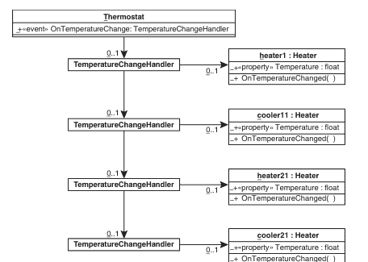

图 13.2：链在一起的多播委托

调用多播委托时，链表中的每个委托实例会被依次调用。通常，委托会按照添加顺序调用，但此行为未在 CLI 规范中指定，而且还可以被重写。因此，程序员不应依赖调用顺序。

## 错误处理

错误处理使得对顺序通知的认识变得至关重要。如果某个订阅者抛出异常，链中后续的订阅者将不会收到通知。例如，考虑如果你修改了 Heater 的 OnTemperatureChanged() 方法，使其抛出异常，会发生什么情况，如清单 13.8 所示。

### 清单 13.8: OnTemperatureChanged() 抛出异常

```
class Program
{
    public static void Main()
    {
        Thermostat thermostat = new Thermostat();
        Heater heater = new Heater(60);
        Cooler cooler = new Cooler(80);
        string temperature;

        // Using C# 2.0 or Later syntax.
        // thermostat.OnTemperatureChange +=
        //     heater.OnTemperatureChanged;

        // Using C# 3.0. Change to anonymous method
        // if using C# 2.0.
        // thermostat.OnTemperatureChange +=
        (newTemperature) =>
        {
            throw new ApplicationException();
        };

        thermostat.OnTemperatureChange +=
            cooler.OnTemperatureChanged;

        Console.Write("Enter temperature: ");
        temperature = Console.ReadLine();
        thermostat.CurrentTemperature = int.Parse(temperature);
    }
}
```

图 13.3 显示了更新后的序列图。

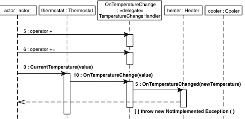

图 13.3：带异常的委托调用序列图

尽管 cooler 和 heater 都订阅了消息，但 lambda 表达式异常会终止链条，并阻止 cooler 对象接收通知。

为了避免这个问题，使所有订阅者都能接收通知，无论早期订阅者的行为如何，你都必须手动遍历订阅者列表并逐个调用它们。清单 13.9 显示了 CurrentTemperature 属性所需的更新。结果显示在输出 13.2 中。

### 清单 13.9: 处理来自订阅者的异常

```
public class Thermostat
{
    // Define the delegate data type
    public delegate void TemperatureChangeHandler(
        float newTemperature);

    // Define the event publisher
    public event TemperatureChangeHandler OnTemperatureChange;

    public float CurrentTemperature
    {
        get
        {
            return _CurrentTemperature;
        }
        set
        {
            if (value != CurrentTemperature)
            {
                _CurrentTemperature = value;
                if (OnTemperatureChange != null)
                {
                    foreach (
                        TemperatureChangeHandler handler in
                        OnTemperatureChange.GetInvocationList())
                    {
                        try
                        {
                            handler(value);
                        }
                        catch (Exception exception)
                        {
                            Console.WriteLine(exception.Message);
                        }
                    }
                }
            }
        }
    }
    private float _CurrentTemperature;
}
```

输出 13.2:
```
Enter temperature: 45
Heater: On
Error in the application
Cooler: Off
```

此清单演示了你可以从委托的 GetInvocationList() 方法中检索订阅者列表。遍历此列表中的每个项会返回各个订阅者。如果你随后将每个订阅者的调用放在 try/catch 块中，则可以在继续枚举循环之前处理任何错误条件。在此示例中，即使委托侦听器抛出异常，cooler 仍会接收温度变化的通知。

## 方法返回值和按引用传递

还有另一种场景，遍历委托调用列表比直接激活通知更有用。此场景涉及不返回 void 或带有 ref 或 out 参数的委托。在迄今为止的恒温器示例中，OnTemperatureChangeHandler 委托的返回类型为 void。此外，它不包含任何 ref 或 out 类型参数，即向调用方返回数据的参数。这一点很重要，因为委托调用可能会触发向多个订阅者发送通知。如果订阅者返回一个值，则不明确将使用哪个订阅者的返回值。

如果你将 OnTemperatureChangeHandler 更改为返回一个枚举值，指示设备是否因温度变化而开启，则新委托将如清单 13.10 所示。

### 清单 13.10: 声明带有方法返回值的委托

```
public enum Status
{
    On,
    Off
}

// Define the delegate data type
public delegate Status TemperatureChangeHandler(
    float newTemperature);
```

所有订阅者方法都必须使用与委托相同的方法签名，因此每个方法都需要返回一个状态值。假设你以类似之前的方式调用委托，例如，在清单 13.11 中 status 的值会是什么？

### 清单 13.11: 调用带有返回值的委托实例

```
Status status = OnTemperatureChange(value);
```

由于 OnTemperatureChange 可能对应于一个委托链，status 仅反映最后一个委托的值。所有其他值都将完全丢失。

为了解决这个问题，有必要遵循与错误处理中使用的相同模式。换句话说，你必须使用 GetInvocationList() 方法遍历每个委托调用列表，以检索每个单独的返回值。同样，使用 ref 和 out 参数的委托类型需要特别考虑。

## 事件

在本章中，你迄今使用的委托存在两个关键问题。为了解决这些问题，C# 使用 event 关键字。在本节中，你将了解为何要使用事件以及它们的工作原理。

### 为何使用事件？

本章和前一章涵盖了你了解委托工作原理所需的所有内容。但是，委托结构中的弱点可能会无意中允许程序员引入错误。这些问题与封装有关，事件的订阅和发布都无法充分控制封装。

### 封装订阅

如前所示，可以使用赋值运算符将一个委托赋值给另一个委托。不幸的是，此功能引入了错误的常见来源。考虑清单 13.12。

### 清单 13.12: 使用赋值运算符 = 而非 +=

```
class Program
{
    public static void Main()
    {
        Thermostat thermostat = new Thermostat();
        Heater heater = new Heater(60);
        Cooler cooler = new Cooler(80);
        string temperature;

        // Note: Use new Thermostat.TemperatureChangeHandler(
        //     cooler.OnTemperatureChanged) if C# 1.0
        thermostat.OnTemperatureChange =
            heater.OnTemperatureChanged;

        // Bug: assignment operator overrides
        // previous assignment.
        thermostat.OnTemperatureChange =
            cooler.OnTemperatureChanged;
    }
}
```


```
Console.Write("Enter temperature: ");
temperature = Console.ReadLine();
thermostat.CurrentTemperature = int.Parse(temperature);
}
```

清单 13.12 与清单 13.6 几乎相同，区别在于不再使用 += 运算符，而是使用简单的赋值运算符。因此，当代码将 cooler.OnTemperatureChanged 赋值给 OnTemperatureChange 时，heater.OnTemperatureChanged 会被清除，因为一个全新的链被赋值以替换之前的链。误用赋值运算符（而本意是使用 += 赋值）的可能性非常高，因此最好是除了在包含类内部之外，连对象的赋值运算符都不予支持。event 关键字的目的就是提供额外的封装，使你无法意外取消其他订阅者。

## 封装发布

委托与事件之间第二个重要的区别在于，事件确保只有包含类才能触发事件通知。请参阅清单 13.13。

### 清单 13.13：从事件容器外部触发事件

```
class Program
{
    public static void Main()
    {
        Thermostat thermostat = new Thermostat();
        Heater heater = new Heater(60);
        Cooler cooler = new Cooler(80);
        string temperature;

        // Note: Use new Thermostat.TemperatureChangeHandler(
        //       cooler.OnTemperatureChanged) if C# 1.0.
        thermostat.OnTemperatureChange +=
            heater.OnTemperatureChanged;

        thermostat.OnTemperatureChange +=
            cooler.OnTemperatureChanged;

        thermostat.OnTemperatureChange(42);
    }
}
```

在清单 13.13 中，尽管 thermostat 上的 CurrentTemperature 没有改变，Program 仍然能够调用 OnTemperatureChange 委托事件。因此，Program 向所有 thermostat 订阅者发送了温度已更改的通知，但实际上 thermostat 温度并未发生变化。与之前一样，委托的问题在于封装不足。Thermostat 应该阻止任何其他类调用 OnTemperatureChange 委托。

## 声明事件

C# 提供了 event 关键字来解决这两个问题。虽然 event 看起来像是一个字段修饰符，但它定义了一种新的成员类型（请参阅清单 13.14）。

### 清单 13.14：将 event 关键字与事件编码模式一起使用

```
public class Thermostat
{
    public class TemperatureArgs: System.EventArgs
    {
        public TemperatureArgs( float newTemperature )
        {
            NewTemperature = newTemperature;
        }
    }
    public float NewTemperature
    {
        get { return _newTemperature; }
        set { _newTemperature = value; }
    }
    private float _newTemperature;
}
// Define the delegate data type
public delegate void TemperatureChangeHandler(
    object sender, TemperatureArgs newTemperature);
// Define the event publisher
public event TemperatureChangeHandler OnTemperatureChange =
    delegate { };
public float CurrentTemperature
{
    ...
}
private float _CurrentTemperature;
}
```

新的 Thermostat 类与原始类有四处更改。首先，OnTemperatureChange 属性已被删除，取而代之的是将 OnTemperatureChange 声明为公共字段。这似乎与解决之前的封装问题背道而驰。更合理的做法是增加封装，而不是通过将字段设为公共来降低封装。然而，第二处更改是在字段声明前立即添加 event 关键字。这一简单的更改提供了所需的所有封装。通过添加 event 关键字，你可以防止在公共委托字段上使用赋值运算符（例如，thermostat.OnTemperatureChange = cooler.OnTemperatureChanged）。此外，只有包含类才能调用触发向所有订阅者发布的委托（例如，禁止从类外部调用 thermostat.OnTemperatureChange(42)）。换句话说，event 关键字提供了所需的封装，防止任何外部类发布事件或取消订阅他们未添加的先前订阅者。这解决了普通委托的两个问题，也是 C# 中 event 关键字的关键原因之一。

普通委托的另一个潜在陷阱是，在调用委托之前很容易忘记检查 null。这会导致意外的 NullReferenceException。幸运的是，event 关键字提供的封装使得在声明期间（或在构造函数中）出现另一种可能性，如清单 13.14 所示。请注意，在声明事件时，我们分配 delegate { }——一个表示零个监听器集合的空委托。通过分配空委托，我们可以引发事件而无需检查是否有任何监听器。（其行为类似于将变量分配给包含零个项的数组。这样做允许在不先检查变量是否为 null 的情况下调用数组成员。）当然，如果委托有可能被重新分配为 null，则仍然需要检查。但是，由于 event 关键字将赋值限制为仅在类内部进行，因此对委托的任何重新分配都只能从类内部进行。假设永远不会分配 null，那么每当代码调用委托时，就不需要检查 null 了。

## 编码约定

要获得所需的功能，只需将原始委托变量声明更改为字段，并添加 event 关键字。

做这两处更改后，你提供了必要的封装，所有其他功能保持不变。但是，清单 13.14 中的代码中委托声明还发生了额外的更改。为了遵循标准 C# 编码约定，你更改了 OnTemperatureChangeHandler，将单个温度参数替换为两个新参数 sender 和 temperatureArgs。C# 编译器不会强制执行此更改，但为事件声明委托时，传递这两种类型的参数是常规做法。

第一个参数 sender 应包含调用委托的类的实例。如果同一个订阅者方法注册到多个事件，这尤其有帮助——例如，如果 heater.OnTemperatureChanged 事件订阅了两个不同的 Thermostat 实例。在这种情况下，任一 Thermostat 实例都可以触发对 heater.OnTemperatureChanged 的调用。为了确定哪个 Thermostat 实例触发了事件，你可以在 Heater.OnTemperatureChanged() 内部使用 sender 参数。

第二个参数 temperatureArgs 的类型是 Thermostat.TemperatureArgs。使用嵌套类是合适的，因为它与 OnTemperatureChangeHandler 委托本身具有相同的作用域。就编码约定而言，TemperatureArgs 的重要部分在于它派生自 System.EventArgs。System.EventArgs 上唯一重要的属性是 Empty，用于指示没有事件数据。但是，当你将 TemperatureArgs 从 System.EventArgs 派生时，你会添加一个额外的属性 NewTemperature，作为将温度从 thermostat 传递给订阅者的一种方式。

总结事件的编码约定：第一个参数 sender 的类型为 object，包含调用委托的对象的引用。第二个参数的类型为 System.EventArgs 或派生自 System.EventArgs 的类型，但包含关于事件的其他数据。你调用委托的方式与之前完全相同，只是多了额外的参数。清单 13.15 显示了一个示例。

### 清单 13.15：触发事件通知

```
public class Thermostat
{
    ...
}
public float CurrentTemperature
{
    get { return _CurrentTemperature; }
    set
    {
        if (value != CurrentTemperature)
        {
            _CurrentTemperature = value;
            // If there are any subscribers
            // then notify them of changes in
            // temperature
            if (OnTemperatureChange != null)
            {
                // Call subscribers
                OnTemperatureChange(
                    this, new TemperatureArgs(value) );
            }
        }
    }
    private float _CurrentTemperature;
}
```

你通常使用容器类（this）来指定 sender，因为这是唯一能为事件调用委托的类。

在此示例中，订阅者可以将 sender 参数强制转换为 Thermostat，并通过该方式访问当前温度，也可以通过 TemperatureArgs 实例访问。但是，Thermostat 实例上的当前温度可能会通过不同的线程更改。对于由于状态更改而发生的事件，将先前值与新值一起传递是一种常用模式，用于控制允许哪些状态转换。

## 泛型和委托

前一节提到，定义委托数据的典型模式是指定第一个参数 sender（类型为 object）和第二个参数 eventArgs（为派生自 System.EventArgs 的类型）。C# 1.0 中委托更麻烦的方面之一是，每当处理程序的参数发生变化时，都必须声明新的委托类型。每次创建新的 System.EventArgs 派生（一种相对常见的情况）都需要声明新的委托数据


使用新的 EventArgs 派生类型的类型。例如，为了在清单 13.15 的事件通知代码中使用 TemperatureArgs，有必要声明一个以 TemperatureArgs 为参数的委托类型 TemperatureChangeHandler。

使用泛型，你可以在许多位置使用相同的委托数据类型，搭配大量不同的参数类型，同时保持强类型。考虑清单 13.16 中显示的委托声明示例。

## 清单 13.16：声明泛型委托类型

```
public delegate void EventHandler<T>(object sender, T e)
where T : EventArgs;
```

当你使用 EventHandler<T> 时，每个需要特定 sender-EventArgs 模式的类都不必声明自己的委托定义。相反，它们可以共享同一个委托，如清单 13.17 中所示的恒温器示例。

## 清单 13.17：将泛型与委托一起使用

```
public class Thermostat
{
    public class TemperatureArgs: System.EventArgs
    {
        public TemperatureArgs( float newTemperature )
        {
            NewTemperature = newTemperature;
        }

        public float NewTemperature
        {
            get { return _newTemperature; }
            set { _newTemperature = value; }
        }
        private float _newTemperature;
    }
}
// TemperatureChangeHandler no longer needed
// public delegate void TemperatureChangeHandler(
//     object sender, TemperatureArgs newTemperature);
// Define the event publisher without using
// TemperatureChangeHandler
public event EventHandler<TemperatureArgs>
OnTemperatureChanges;

public float CurrentTemperature
{
    ...
}
private float _CurrentTemperature;
}
```

当然，清单 13.17 假设 EventHandler<T> 在某个位置已定义。事实上，刚刚声明的 System.EventHandler<T> 包含在 2.0 版框架类库中。因此，在使用 C# 2.0 或更高版本中的事件时，大多数情况下都不需要声明自定义委托数据类型。

请注意，System.EventHandler<T> 使用约束将 T 限制为从 EventArgs 派生，这正是与 C# 1.0 中事件声明的一般约定相符所必需的。

## 高级主题

### 事件内部机制

事件限制外部类只能通过 += 运算符向发布者添加订阅方法，然后使用 -= 运算符取消订阅，除此之外不能做其他任何操作。此外，它们还限制除了包含类之外的其他类调用事件。为此，C# 编译器将带有 event 关键字修饰符的公共委托变量声明为私有委托。此外，它还添加了几个方法和两个特殊的事件块。本质上，event 关键字是生成适当封装逻辑的 C# 快捷方式。考虑清单 13.18 中显示的事件声明示例。

## 清单 13.18：声明 OnTemperatureChange 事件

```
public class Thermostat
{
    // Define the delegate data type
    public delegate void TemperatureChangeHandler(
        object sender, TemperatureArgs newTemperature);

    public event TemperatureChangeHandler OnTemperatureChange;

    ...
}
```

当 C# 编译器遇到 event 关键字时，它会生成与清单 13.19 中显示的 C# 代码等效的 CIL 代码。

## 清单 13.19：编译器生成的事件 CIL 代码的 C# 等效代码

```
public class Thermostat
{
    // Define the delegate data type
    public delegate void TemperatureChangeHandler(
        object sender, TemperatureArgs newTemperature);

    // Declaring the delegate field to save the
    // List of subscribers.
    private TemperatureChangeHandler OnTemperatureChange;

    public void add_OnTemperatureChange(
        TemperatureChangeHandler handler)
    {
        System.Delegate.Combine(OnTemperatureChange, handler);
    }

    public void remove_OnTemperatureChange(
        TemperatureChangeHandler handler)
    {
        System.Delegate.Remove(OnTemperatureChange, handler);
    }

    public event TemperatureChangeHandler OnTemperatureChange
    {
        add
        {
            add_OnTemperatureChange(value);
        }
        remove
        {
            remove_OnTemperatureChange(value);
        }
    }
}
```

换句话说，清单 13.18 中显示的代码是编译器用来触发清单 13.19 中所示代码展开的 C# 简写形式。

C# 编译器首先获取原始事件定义，并以其位置定义一个私有委托变量。结果，该委托对任何外部类（甚至派生自它的类）都不可用。

接下来，C# 编译器定义两个方法，add_OnTemperatureChange() 和 remove_OnTemperatureChange()，其中 OnTemperatureChange 后缀取自事件的原始名称。这些方法分别负责实现 += 和 -= 赋值运算符。如清单 13.19 所示，这些方法使用前面章节中讨论过的静态 System.Delegate.Combine() 和 System.Delegate.Remove() 方法实现。传递给每个方法的第一个参数是私有 TemperatureChangeHandler 委托实例 OnTemperatureChange。

event 关键字生成的代码中最引人好奇的部分可能是最后一部分。其语法与属性的 getter 和 setter 方法非常相似，只是方法为 add 和 remove。add 块负责通过将调用传递给 add_OnTemperatureChange() 来处理事件上的 += 运算符。同样，remove 块运算符通过将调用传递给 remove_OnTemperatureChange 来处理 -= 运算符。

注意此代码与为属性生成的代码之间的相似之处很重要。读者会回想起，C# 中属性的实现是创建 get_<propertyname> 和 set_<propertyname>，然后将对 get 和 set 块的调用传递给这些方法。显然，事件语法非常相似。

关于生成的 CIL 代码，另一个需要注意的重要特征是，event 关键字的 CIL 等效项保留在 CIL 中。换句话说，事件是 CIL 代码明确识别的东西，而不仅仅是 C# 构造。通过在 CIL 代码中保留等效的 event 关键字，所有语言和编辑器都能提供特殊功能，因为它们可以将事件识别为特殊类成员。

## 自定义事件实现

你可以自定义编译器生成的 += 和 -= 代码。例如，考虑将 OnTemperatureChange 委托的范围更改为 protected 而不是 private。当然，这将允许派生自 Thermostat 的类直接访问该委托，而不是受限于与外部类相同的限制。要启用此功能，C# 允许与清单 13.17 所示的语法相同的属性。换句话说，C# 允许你定义自定义 add 和 remove 块，以提供事件封装各个方面的实现。清单 13.20 提供了一个示例。

## 清单 13.20：自定义 add 和 remove 处理程序

```
public class Thermostat
{
    public class TemperatureArgs: System.EventArgs
    {
        ...
    }

    // Define the delegate data type
    public delegate void TemperatureChangeHandler(
        object sender, TemperatureArgs newTemperature);

    // Define the event publisher
    public event TemperatureChangeHandler OnTemperatureChange
    {
        add
        {
            System.Delegate.Combine(value, _OnTemperatureChange);
        }
        remove
        {
            System.Delegate.Remove(_OnTemperatureChange, value);
        }
    }
    protected TemperatureChangeHandler _OnTemperatureChange;

    public float CurrentTemperature
    {
        ...
    }
    private float _CurrentTemperature;
}
```

在此示例中，存储每个订阅者的委托 _OnTemperatureChange 已更改为 protected。此外，add 块的实现交换了委托存储，以便链中最后添加的委托是第一个接收通知的委托。

## 摘要

现在我已经描述了事件，值得注意的是，一般来说，方法指针是唯一建议使用 a 的情况。


在事件上下文之外委托变量。换句话说，考虑到事件的额外封装特性以及在必要时自定义实现的能力，最佳实践始终是为观察者模式使用事件。

可能需要一些练习才能在没有示例代码的情况下从头开始编写事件。然而，它们是后续章节中异步、多线程编程的关键基础。

# 14 带标准查询运算符的集合接口

C# 3.0 中添加的最重要特性集中在集合领域。扩展方法和 lambda 表达式为操作集合提供了远为优越的 API。事实上，在这本书的早期版本中，集合章节紧随泛型章节之后，并在委托章节之前。然而，lambda 表达式对集合 API 产生了如此重大的影响，以至于在不先介绍委托（lambda 表达式的基础）的情况下，已无法涵盖集合内容。既然你已从前一章中打下了 lambda 表达式的坚实基础，我们现在可以深入探讨集合的细节，这一主题在本版中跨越了三章。

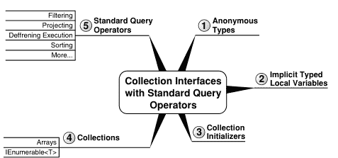

首先，本章介绍匿名类型和集合初始化器，这些主题我在第 5 章的几个高级主题部分中仅做了简要介绍。接下来，本章介绍各种集合接口及其相互关系。这是理解集合的基础，因此读者应认真学习本材料。集合接口部分包括介绍在 C# 3.0 中添加的 IEnumerable<T> 扩展方法，它为标准查询运算符的实现提供了基础——这是本章讨论的另一个 C# 3.0 特性。

与集合相关的类和接口分为两类：支持泛型的和不支持泛型的。本章主要讨论泛型集合接口。只有在编写需要与早期版本运行时互操作的组件时，才应使用不支持泛型的集合类。这是因为非泛型形式中可用的所有内容都有强类型的泛型替代品。对于《Essential C# 2.0》，我同时指出了类和接口的泛型版本和非泛型版本。然而，既然我们现在使用的是 C# 4.0，我就不再讨论非泛型类型了，这些类型几乎已被其泛型等效项所取代。虽然这些概念仍然适用于两种形式，但我不会明确列出非泛型版本的名称。1

### 匿名类型和隐式类型局部变量

C# 3.0 的变化对操作项集合提供了显著改进。令人惊奇的是，为了支持这个高级 API，所做的新语言增强不足九个。然而，这些增强正是 C# 3.0 成为语言如此出色改进的关键。其中两项增强是匿名类型和隐式局部变量。

### 匿名类型

匿名类型是由编译器声明的数据类型，而不是通过第 5 章中的显式类定义。与匿名函数类似，当编译器看到匿名类型时，它会为你完成创建该类的工作，然后让你像显式声明了它一样使用它。清单 14.1 显示了这样的声明。

### 清单 14.1：带匿名类型的隐式局部变量

```
using System;

class Program
{
    static void Main()
    {
        var patent1 =
            new
            {
                Title = "Bifocals",
                YearOfPublication = "1784"
            };
        var patent2 =
            new
            {
                Title = "Phonograph",
                YearOfPublication = "1877"
            };
        var patent3 =
            new
            {
                patent1.Title,
                // Renamed to show property naming.
                Year = patent1.YearOfPublication
            };

        Console.WriteLine("{0} ({1})",
            patent1.Title, patent1.YearOfPublication);
        Console.WriteLine("{0} ({1})",
            patent2.Title, patent2.YearOfPublication);

        Console.WriteLine();
        Console.WriteLine(patent1);
        Console.WriteLine(patent2);

        Console.WriteLine();
        Console.WriteLine(patent3);
    }
}
```

相应的输出显示在输出 14.1 中。

### 输出 14.1：

```
Bifocals (1784)
Phonograph (1877)
{ Title = Bifocals, YearOfPublication = 1784 }
{ Title = Phonograph, YearOfPublication = 1877 }
{ Title = Bifocals, Year = 1784 }
```

匿名类型的构造完全由 C# 编译器实现，运行时中没有显式的实现感知。相反，当编译器遇到匿名类型语法时，它会生成一个 CIL 类，其中包含与匿名类型声明中的命名值和数据类型相对应的属性。

### 隐式类型局部变量 (var)

由于匿名类型定义上没有名称，因此不可能声明一个明确为匿名类型的局部变量。相反，局部变量的类型被替换为 var。然而，这绝不意味着隐式类型变量没有类型。恰恰相反，它们被完整地类型化为所赋值的数据类型。如果隐式类型变量被赋予一个匿名类型，则局部变量声明的底层 CIL 代码将是编译器生成的类型。同样，如果隐式类型变量被赋予一个字符串，则其底层 CIL 中的数据类型将是字符串。事实上，对于赋值不是匿名类型（例如字符串）的隐式类型变量，其生成的 CIL 代码与声明为 string 类型的变量没有区别。如果声明语句是 string text = "This is a test of the..."，则生成的 CIL 代码将与隐式类型声明 var text = "This is a test of the..." 完全相同。编译器根据所赋值的数据类型来确定隐式类型变量的数据类型。在带有初始化器的显式类型局部变量（string s = "hello"）中，编译器首先根据左侧声明的类型确定 s 的类型，然后分析右侧并验证右侧表达式是否可赋给该类型。在隐式类型局部变量中，过程在某种意义上是相反的。首先分析右侧以确定其类型，然后在逻辑上将“var”替换为该类型。

尽管 C# 中没有匿名类型的可用名称，但它仍然是强类型的。例如，该类型的属性完全可访问。在清单 14.1 中，patent1.Title 和 patent2.YearOfPublication 在 Console.WriteLine 语句中被调用。任何尝试调用不存在的成员都会导致编译错误。即使是 Visual Studio 2008 等 IDE 中的 IntelliSense 也支持匿名类型。

应谨慎使用隐式类型变量声明。显然，对于匿名类型，无法指定数据类型，且必须使用 var。然而，对于数据类型不是匿名类型的情况，通常更倾向于使用显式数据类型。与通常情况一样，你应专注于使代码语义更具可读性，同时使用编译器验证生成的变量是你预期的类型。要使用隐式类型局部变量实现这一点，只有在赋给隐式类型变量的类型完全明显时才使用它们。例如，在 var items = new Dictionary<string, List<Account>>(); 中，生成的代码更简洁且易读。相比之下，当类型不明显时，例如当赋值为方法返回值时，开发人员应倾向于使用显式变量类型声明，如下所示：

```
Dictionary<string, List<Account>> dictionary = GetAccounts();
```

> **注意**
> 
> 隐式类型变量通常应保留用于匿名类型声明，而不是在编译时已知数据类型时随意使用，除非赋给变量的类型完全明显。


## 语言对比：C++/Visual Basic/JavaScript—void*、Variant 和 var

重要的是要理解，隐式类型变量并不等同于 C++ 中的 void*、Visual Basic 中的 Variant 或 JavaScript 中的 var。在这些情况下，变量声明并不十分严格，因为变量可以被重新赋予不同的类型，就像你可以在 C# 中使用类型为 object 的变量声明一样。相比之下，var 是由编译器明确类型化的，一旦在声明时确定，类型就不能更改，并且类型检查和成员调用会在编译时验证。

## 关于匿名类型和隐式局部变量的更多内容

在清单 14.1 中，匿名类型上的成员名称是通过将值赋给名称来明确标识的，用于 patent1 和 patent2（例如，Title = "Phonograph"）。但是，如果所赋的值是属性或字段调用，则名称可能默认为字段或属性的名称，而不是显式指定值。例如，patent3 是使用名为“Title”的属性定义的，而不是赋给显式名称。如输出 14.1 所示，生成的属性名称由编译器确定，以匹配检索值的属性。

patent1 和 patent2 具有相同的属性名称和相同的数据类型。因此，C# 编译器为这两个匿名声明生成只有一个数据类型。然而，patent3 迫使编译器创建第二个匿名类型，因为专利年份的属性名称与 patent1 和 patent2 中的不同。此外，如果 patent1 和 patent2 之间的属性顺序被互换，那么这两个匿名类型也不会类型兼容。换句话说，在同一程序集中，两个匿名类型类型兼容的要求是属性名称、数据类型和属性顺序匹配。如果满足这些条件，即使它们出现在不同的方法或类中，类型也是兼容的。清单 14.2 演示了类型不兼容性。

## LISTING 14.2：匿名类型的类型安全性和不可变性

```
class Program
{
    static void Main()
    {
        var patent1 =
        new
        {
            Title = "Bifocals",
            YearOfPublication = "1784"
        };

        var patent2 =
        new
        {
            YearOfPublication = "1877",
            Title = "Phonograph"
        };

        var patent3 =
        new
        {
            patent1.Title,
            Year = patent1.YearOfPublication
        };

        // ERROR: Cannot implicitly convert type
        // 'AnonymousType#1' to 'AnonymousType#2'
        patent1 = patent2;
        // ERROR: Cannot implicitly convert type
        // 'AnonymousType#3' to 'AnonymousType#2'
        patent1 = patent3;

        // ERROR: Property or indexer 'AnonymousType#1.Title'
        // cannot be assigned to -- it is read only'
        patent1.Title = "Swiss Cheese";
    }
}
```

生成的两个编译错误断言了类型不兼容的事实，因此它们不会成功相互转换。

第三个编译错误是由重新赋值 Title 属性引起的。匿名类型是不可变的，因此在匿名类型实例化后更改其属性是一个编译错误。

虽然清单 14.2 中未显示，但不可能声明带有隐式数据类型参数（var）的方法。因此，匿名类型的实例只能以两种方式传递到创建它们的方法之外。首先，如果方法参数的类型为 object，则匿名类型实例可以传递到方法之外，因为匿名类型会隐式转换。第二种方法是使用方法类型推断，即将匿名类型实例作为编译器可以成功推断的方法类型参数传递。因此，使用 Function(patent1) 调用 void Method<T>(T parameter) 将会成功，尽管 Function() 中对 parameter 的可用操作仅限于 object 支持的操作。

尽管 C# 允许像清单 14.1 中所示的匿名类型，但通常不建议以这种方式定义它们。匿名类型为 C# 3.0 对投影（例如连接/关联集合）的支持提供了关键功能，我们将在本章后面讨论。但是，通常应将匿名类型定义保留给需要它们的情况，例如从多种类型聚合数据。

## 高级主题

## 匿名类型生成

尽管 Console.WriteLine() 的实现是调用 ToString()，但请注意在清单 14.1 中，Console.WriteLine() 的输出不是默认的 ToString()，后者会写出完全限定的数据类型名称。相反，输出是一系列 PropertyName = value 对，每个属性对应一个。这是因为编译器在匿名类型代码生成中重写了 ToString()，并按所示格式化 ToString() 输出。同样，生成的类型包括 Equals() 和 GetHashCode() 的重写实现。

仅 ToString() 的实现就是属性顺序差异导致生成新数据类型的重要原因。如果两个独立的匿名类型（可能位于完全不同的类型甚至命名空间中）被统一，然后属性顺序发生变化，那么一个实现上的属性顺序变化会对其他实现的 ToString() 结果产生明显且可能不可接受的影响。此外，在执行时，可以反射回一个类型并检查类型上的成员——甚至可以动态调用其中一个成员（在运行时确定调用哪个成员）。两个看似相同的类型上成员顺序的差异可能会触发意外结果，为了避免这种情况，C# 设计师决定生成两个不同的类型。

## 集合初始化器

C# 3.0 版本添加的另一个功能是集合初始化器。集合初始化器允许程序员在实例化时以类似于数组声明的方式构建带有初始成员集合的集合。如果没有集合初始化，元素必须在集合实例化后显式添加到集合中——例如使用 System.Collections.Generic.ICollection<T> 的 Add() 方法。使用集合初始化时，Add() 调用由 C# 编译器生成，而不是由开发人员显式编码。清单 14.3 演示了如何使用集合初始化器而不是集合初始化来初始化集合。

```
LISTING 14.3: Filtering with System.Linq.Enumerable.Where()
using System;
using System.Collections.Generic;

class Program
{
    static void Main()
    {
        List<string> sevenWorldBlunders;
        sevenWorldBlunders = new List<string>
        {
            // Quotes from Gandhi
            "Wealth without work",
            "Pleasure without conscience",
            "Knowledge without character",
            "Commerce without morality",
            "Science without humanity",
            "Worship without sacrifice",
            "Politics without principle"
        };
        Print(sevenWorldBlunders);
    }

    private static void Print<T>(IEnumerable<T> items)
    {
        foreach (T item in items)
        {
            Console.WriteLine(item);
        }
    }
}
```

语法不仅类似于数组初始化，还类似于对象初始化器，即构造函数后跟花括号。如果构造函数中未传递参数，则数据类型后的括号是可选的（与对象初始化器一样）。

为了使集合初始化器成功编译，需要满足一些基本要求。理想情况下，应用集合初始化器的集合类型应实现 System.Collections.Generic.ICollection<T>。这确保集合包含编译器生成的代码可以调用的 Add()。但是，还存在一种放宽的要求，它只要求在实现 IEnumerable<T> 的类型上存在一个或多个 Add() 方法——即使集合不实现 ICollection<T>。Add() 方法需要接受与集合初始化器中指定的值兼容的参数。

允许对不支持 ICollection<T> 的集合使用初始化器之所以重要，有两个原因。首先，事实证明，大多数集合（实现 IEnumerable<T> 的类型）也不实现 ICollection<T>，这大大降低了集合初始化器的实用性。

其次，按方法名和与集合初始化项的签名兼容性进行匹配，使初始化到集合中的项目具有更大的多样性。例如，初始化器现在可以支持 new DataStore() { a, {b, c} }，只要存在一个与 a 兼容签名的 Add() 方法和第二个与 b, c 兼容的 Add() 方法即可。


请注意，不能为匿名类型使用集合初始化器，因为集合初始化器需要构造函数调用，且无法命名构造函数。解决方法是定义一个类似 `static List<T> CreateList<T>(T t) { return new List<T>(); }` 的方法。方法类型推断允许类型参数被推导而非显式指定，因此此解决方案成功允许创建匿名类型的集合。

初始化匿名类型集合的另一种方法是使用数组初始化器。由于无法在构造函数中指定数据类型，数组初始化语法允许使用 new[] 进行匿名数组初始化（参见清单 14.4）。

### 清单 14.4：初始化匿名类型数组

```
using System;
using System.Collections.Generic;
using System.Linq;

class Program
{
    static void Main()
    {
        var worldCup2006Finalists = new[]
        {
            new
            {
                TeamName = "France",
                Players = new string[]
                {
                    "Fabien Barthez", "Gregory Coupet",
                    "Mickael Landreau", "Eric Abidal",
                    // ...
                },
            },
            new
            {
                TeamName = "Italy",
                Players = new string[]
                {
                    "Gianluigi Buffon", "Angelo Peruzzi",
                    "Marco Amelia", "Cristian Zaccardo",
                    // ...
                },
            },
        };
        Print(worldCup2006Finalists);
    }

    private static void Print<T>(IEnumerable<T> items)
    {
        foreach (T item in items)
        {
            Console.WriteLine(item);
        }
    }
}
```

生成的变量是匿名类型项的数组，由于它是数组，因此必须是同质的。

## 什么使类成为集合：IEnumerable<T>

根据定义，.NET 中的集合是一个至少实现 IEnumerable<T> 的类（从技术上讲，它将是非泛型类型 IEnumerable）。这个接口是关键，因为实现 IEnumerable<T> 的方法是支持遍历集合所需的最低实现要求。

第 3 章展示了如何使用 foreach 语句遍历元素数组。语法简单，避免了需要知道元素数量的复杂性。然而，运行时并不直接支持 foreach 语句。相反，C# 编译器会按本节所述转换代码。

### 与数组一起使用 foreach

清单 14.5 演示了一个简单的 foreach 循环，用于遍历整数数组，然后将每个整数打印到控制台。

### 清单 14.5：与数组一起使用 foreach

```
int[] array = new int[]{ 1, 2, 3, 4, 5, 6};
foreach (int item in array)
{
    Console.WriteLine(item);
}
```

从这段代码中，C# 编译器创建了 for 循环的 CIL 等效代码，如清单 14.6 所示。

### 清单 14.6：与数组一起使用 foreach 的编译实现

```
int number;
int[] tempArray;
int[] array = new int[]{1, 2, 3, 4, 5, 6};
tempArray = array;
for (int counter = 0; (counter < tempArray.Length); counter++)
{
    int item = tempArray[counter];
    Console.WriteLine(item);
}
```

在此示例中，请注意 foreach 依赖于 Length 属性和索引运算符 ([]) 的支持。有了 Length 属性，C# 编译器可以使用 for 语句遍历数组中的每个元素。

### 与 IEnumerable<T> 一起使用 foreach

虽然清单 14.6 中所示的代码在长度固定且始终支持索引运算符的数组上效果良好，但并非所有类型的集合都有已知的元素数量。此外，许多集合类（包括 Stack<T>、Queue<T> 和 Dictionary<TKey, TValue> 类）都不支持按索引检索元素。因此，需要一种更通用的方法来遍历元素集合。迭代器模式提供了这种功能。假设你可以确定第一个、下一个和最后一个元素，那么知道数量并支持按索引检索元素就不是必需的。

System.Collections.Generic.IEnumerable<T> 和非泛型 System.Collections.IEnumerable 接口（参见清单 14.8）旨在为遍历元素集合启用迭代器模式，而不是清单 14.6 中所示的长度-索引模式。它们关系的类图如图 14.1 所示。

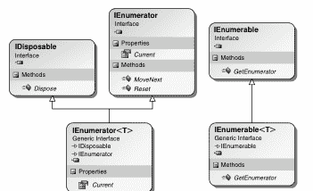

### 图 14.1：IEnumerable<T> 和 IEnumerator 接口

IEnumerator 是 IEnumerable<T> 派生自的接口，包含三个成员。第一个是 bool MoveNext()。使用此方法，你可以在集合中的一个元素和下一个元素之间移动，同时检测是否已遍历完每个项。第二个成员是名为 Current 的只读属性，返回当前正在处理的元素。Current 在 IEnumerable<T> 中被重载，提供了类型特定的实现。在集合类上拥有这两个成员后，可以简单地使用 while 循环遍历集合，如清单 14.7 所示。（Reset() 方法通常会引发 NotImplementedException，因此永远不应调用。如果需要重新开始枚举，只需创建一个新的枚举器。）

### 清单 14.7：使用 while 遍历集合

```
System.Collections.Generic.Stack<int> stack =
    new System.Collections.Generic.Stack<int>();
int number;
// ...
// This code is conceptual, not the actual code.
while (stack.MoveNext())
{
    number = stack.Current;
    Console.WriteLine(number);
}
```

在清单 14.7 中，MoveNext() 方法在移动到集合末尾之后时返回 false。这取消了循环期间计数元素的需要。

清单 14.7 使用 System.Collections.Generic.Stack<T> 作为集合类型。存在许多其他集合类型；这只是一个示例。Stack<T> 的关键特征是其设计为后进先出（LIFO）集合。需要注意的是，类型参数 T 标识集合中所有项的类型。在集合中收集一种特定类型的对象是泛型集合的关键特征。程序员在添加、删除或访问集合中的项时，了解集合中的数据类型非常重要。

前面的示例展示了 C# 编译器输出的要点，但它并不实际以这种方式编译，因为它省略了有关实现的两个重要细节：交错和错误处理。

### 状态是共享的

清单 14.7 这样的实现的问题是，如果两个这样的循环相互交错——一个 foreach 在另一个 foreach 内部，两者都使用同一个集合——集合必须维护当前元素的状态指示器，以便在调用 MoveNext() 时可以确定下一个元素。问题是，一个交错的循环可能会影响另一个循环。（多线程执行的循环也是如此。）

为解决此问题，集合类不直接支持 IEnumerable<T> 和 IEnumerator 接口。如图 14.1 所示，存在第二个接口，称为 IEnumerable<T>，其唯一方法是 GetEnumerator()。此方法的目的是返回支持 IEnumerable<T> 的对象。集合类不再维护状态，而是由另一个类（通常是嵌套类，以便它可以访问集合的内部）支持 IEnumerable<T> 接口并保持迭代循环的状态。枚举器就像序列中的“光标”或“书签”。你可以有多个书签，移动每个书签都会独立于其他书签遍历集合。使用此模式，foreach 循环的 C# 等效代码将如清单 14.8 所示。


## 清单 14.8: 在迭代期间维护状态的独立枚举器

```
System.Collections.Generic.Stack<int> stack =
    new System.Collections.Generic.Stack<int>();
int number;
System.Collections.Generic.Stack<int>.Enumerator
    enumerator;

// ...

// If IEnumerable<T> is implemented explicitly,
// then a cast is required.
// ((IEnumerable<int>)stack).GetEnumerator();
enumerator = stack.GetEnumerator();
while (enumerator.MoveNext())
{
    number = enumerator.Current;
    Console.WriteLine(number);
}
```

## 迭代后的清理

实现 IEnumerator<T> 接口的类会维护状态，因此有时你需要在循环退出后清理状态（无论是所有迭代都已完成，还是抛出了异常）。为实现此目的，IEnumerator<T> 接口继承自 IDisposable。实现 IEnumerator 的枚举器不一定实现 IDisposable，但如果实现了，Dispose() 也会被调用。这使得在 foreach 循环退出后可以调用 Dispose()。因此，最终 CIL 代码的 C# 等效代码如清单 14.9 所示。

## 清单 14.9: 集合上 foreach 的编译结果

```
System.Collections.Generic.Stack<int> stack =
    new System.Collections.Generic.Stack<int>();
System.Collections.Generic.Stack<int>.Enumerator
    enumerator;
IDisposable disposable;

enumerator = stack.GetEnumerator();
try
{
    int number;
    while (enumerator.MoveNext())
    {
        number = enumerator.Current;
        Console.WriteLine(number);
    }
}
finally
{
    // Explicit cast used for IEnumerable<T>.
    disposable = (IDisposable) enumerator;
    disposable.Dispose();
}
// IEnumerable will use the as operator unless IDisposable
// support is known at compile time.
// disposable = enumerator as IDisposable;
// if (disposable != null)
// {
//     disposable.Dispose();
// }
}
```

请注意，由于 IEnumerable<T> 支持 IDisposable 接口，using 语句可以将清单 14.9 中的代码简化为清单 14.10 所示的代码。

## 清单 14.10: 使用 using 进行错误处理和资源清理

```
System.Collections.Generic.Stack<int> stack =
    new System.Collections.Generic.Stack<int>();
int number;

using(
    System.Collections.Generic.Stack<int>.Enumerator
    enumerator = stack.GetEnumerator())
{
    while (enumerator.MoveNext())
    {
        number = enumerator.Current;
        Console.WriteLine(number);
    }
}
```

但是，请记住 CIL 也不直接支持 using 关键字，因此在实际中，清单 14.9 中的代码是 foreach CIL 代码更准确的 C# 表示。

## 高级主题

## 没有 IEnumerable 的 foreach

从技术角度讲，编译器并不要求支持 IEnumerable/IEnumerable<T> 才能使用 foreach 遍历数据类型。

相反，编译器使用一种称为“鸭子类型”的概念：如果未找到 IEnumerable/IEnumerable<T> 方法，它会查找 GetEnumerator() 方法，以返回具有 Current() 和 MoveNext() 方法的类型。鸭子类型涉及按名称查找方法，而不是依赖接口或对方法的显式调用。

## foreach 迭代期间不要修改集合

第 3 章表明，编译器禁止对 foreach 变量（number）进行赋值。如清单 14.10 所示，对 number 进行赋值并不会更改集合元素本身，因此 C# 编译器完全禁止此类赋值。

此外，在 foreach 循环执行期间，通常既不能修改集合中的元素数量，也不能修改元素本身。例如，如果你在 foreach 循环内部调用 stack.Push(42)，则迭代器是否应忽略或合并对 stack 的更改将变得模糊——换句话说，迭代器是应遍历新添加的项目，还是忽略它并假设与实例化时相同的状态。

由于这种歧义，如果在 foreach 循环内部修改了集合，则在访问枚举器时通常会抛出 System.InvalidOperationException 类型的异常，报告集合在枚举器实例化后已被修改。

## 标准查询运算符

除了 System.Object 上的方法之外，任何实现 IEnumerable<T> 的类型只有一个方法，即 GetEnumerator()。然而，它为所有实现 IEnumerable<T> 的类型提供了 50 多个方法（不包括重载）——而这无需显式实现除 GetEnumerator() 方法以外的任何方法。附加功能是通过 C# 3.0 的扩展方法提供的，且全部位于 System.Linq.Enumerable 类中。因此，只需包含 System.Linq 的 using 声明，即可使这些方法可用。

IEnumerable<T> 上的每个方法都是一个标准查询运算符；它为其操作的集合提供查询功能。在以下部分中，我们将探讨其中一些最突出的标准查询运算符。

许多示例将依赖于 Inventor 和/或 Patent 类，这两个类均在清单 14.11 中定义。

## 清单 14.11: 用于标准查询运算符的示例类

```
using System;
using System.Collections.Generic;
using System.Linq;

public class Patent
{
    // Title of the published application
    public string Title { get; set; }

    // The date the application was officially published
    public string YearOfPublication { get; set; }

    // A unique number assigned to published applications
    public string ApplicationNumber { get; set; }

    public long[] InventorIds { get; set; }

    public override string ToString()
    {
        return string.Format("{0}({1})",
            Title, YearOfPublication);
    }
}

public class Inventor
{
    public long Id { get; set; }
    public string Name { get; set; }
    public string City { get; set; }
    public string State { get; set; }
    public string Country { get; set; }

    public override string ToString()
    {
        return string.Format("{0}({1}, {2})",
            Name, City, State);
    }
}

class Program
{
    static void Main()
    {
        IEnumerable<Patent> patents = PatentData.Patents;
        Print(patents);

        Console.WriteLine();

        IEnumerable<Inventor> inventors = PatentData.Inventors;
        Print(inventors);
    }

    private static void Print<T>(IEnumerable<T> items)
    {
        foreach (T item in items)
        {
            Console.WriteLine(item);
        }
    }
}

public static class PatentData
{
    public static readonly Inventor[] Inventors = new Inventor[]
    {
        new Inventor(){
            Name="Benjamin Franklin", City="Philadelphia",
            State="PA", Country="USA", Id=1 },
        new Inventor(){
            Name="Orville Wright", City="Kitty Hawk",
            State="NC", Country="USA", Id=2 },
        new Inventor(){
            Name="Wilbur Wright", City="Kitty Hawk",
            State="NC", Country="USA", Id=3 },
        new Inventor(){
            Name="Samuel Morse", City="New York",
            State="NY", Country="USA", Id=4 },
        new Inventor(){
            Name="George Stephenson", City="Wylam",
            State="Northumberland", Country="UK", Id=5 },
        new Inventor(){
            Name="John Michaels", City="Chicago",
            State="IL", Country="USA", Id=6 },
        new Inventor(){
            Name="Mary Phelps Jacob", City="New York",
            State="NY", Country="USA", Id=7 },
    };

    public static readonly Patent[] Patents = new Patent[]
    {
        new Patent() {
            Title="Bifocals", YearOfPublication="1784",
            InventorIds=new long[] { 1 },
        },
        new Patent() {
            Title="Phonograph", YearOfPublication="1877",
            InventorIds=new long[] { 1 },
        },
        new Patent() {
            Title="Kinetoscope", YearOfPublication="1888",
            InventorIds=new long[] { 1 },
        },
        new Patent() {
            Title="Electrical Telegraph",
            YearOfPublication="1837",
            InventorIds=new long[] { 4 },
        },
        new Patent() {
            Title="Flying machine", YearOfPublication="1903",
            InventorIds=new long[] { 2, 3 },
        },
        new Patent() {
            Title="Steam Locomotive", YearOfPublication="1815",
            InventorIds=new long[] { 5 },
        },
        new Patent() {
            Title="Droplet deposition apparatus",
            YearOfPublication="1989",
            InventorIds=new long[] { 6 },
        },
        new Patent() {
            Title="Backless Brassiere",
            YearOfPublication="1914",
            InventorIds=new long[] { 7 },
        },
    };
}
```

清单 14.11 还提供了一组示例数据。输出 14.2 显示了结果。

## 输出 14.2:

```
Bifocals(1784)
Phonograph(1877)
Kinetoscope(1888)
Electrical Telegraph(1837)
Flying machine(1903)
Steam Locomotive(1815)
Droplet deposition apparatus(1989)
Backless Brassiere(1914)

Benjamin Franklin(Philadelphia, PA)
Orville Wright(Kitty Hawk, NC)
Wilbur Wright(Kitty Hawk, NC)
Samuel Morse(New York, NY)
George Stephenson(Wylam, Northumberland)
John Michaels(Chicago, IL)
Mary Phelps Jacob(New York, NY)


## 使用 Where() 进行筛选

为了从集合中筛选数据，我们需要提供一个筛选方法，该方法返回 true 或 false，以指示特定元素是否应包含在内。接受参数并返回布尔值的委托表达式称为 **谓词**，集合的 Where() 方法依赖谓词来识别筛选条件，如清单 14.12 所示。（从技术上讲，Where() 方法的结果是一个 **单子**，它封装了使用给定谓词对给定序列进行筛选的操作。）输出显示在输出 14.3 中。

### 清单 14.12：使用 System.Linq.Enumerable.Where() 进行筛选

```
Listing 14.12: Filtering with System.Linq.Enumerable.Where()

using System;
using System.Collections.Generic;
using System.Linq;

class Program
{
    static void Main()
    {
        IEnumerable<Patent> patents = PatentData.Patents;
        patents = patents.Where(
            patent => patent.YearOfPublication.StartsWith("18"));
        Print(patents);
    }

    // ...
}
```

```
OUTPUT 14.3:

Phonograph(1877)
Kinetoscope(1888)
Electrical Telegraph(1837)
Steam Locomotive(1815)
```

请注意，代码将 Where() 调用的输出重新赋值给 IEnumerable<T>。换句话说，IEnumerable<T>.Where() 的输出是一个新的 IEnumerable<T> 集合。在清单 14.12 中，它是 IEnumerable<Patent>。

不太明显的是，Where() 表达式参数不一定在赋值时执行。许多标准查询运算符也是如此。例如，在 Where() 的情况下，表达式被传递给集合并“保存”，但不会立即执行。相反，表达式的执行仅在需要开始遍历集合中的项目时才会发生。例如，Print()（在清单 14.11 中）中的 foreach 循环将触发对集合中每个项目求值。至少从概念上讲，Where() 方法应被理解为指定集合中应出现内容的查询的一种方式，而不是遍历以生成可能包含更少项目的新集合所涉及的实际工作。

## 使用 Select() 进行投影

由于 IEnumerable<T>.Where() 方法的输出是一个新的 IEnumerable<T> 集合，因此可以在同一集合上再次调用标准查询运算符。例如，我们不仅可以筛选原始集合中的数据，还可以转换数据（请参阅清单 14.13）。

### 清单 14.13：使用 System.Linq.Enumerable.Select() 进行投影

```
using System;
using System.Collections.Generic;
using System.Linq;

class Program
{
    static void Main()
    {
        IEnumerable<Patent> patents = PatentData.Patents;
        IEnumerable<Patent> patentsOf1800 = patents.Where(
            patent => patent.YearOfPublication.StartsWith("18"));
        IEnumerable<string> items = patentsOf1800.Select(
            patent => patent.ToString());

        Print(items);
    }

    // ...
}
```

在清单 14.13 中，我们创建了一个新的 IEnumerable<string> 集合。在这种情况下，添加 Select() 调用碰巧没有改变输出；但这仅是因为 Print() 的 Console.WriteLine() 调用无论如何都使用了 ToString()。显然，每个项目仍然从原始集合的 Patent 类型转换为 items 集合的 string 类型。

请参阅清单 14.14 中使用 System.IO.FileInfo 的示例。

### 清单 14.14：使用 System.Linq.Enumerable.Select() 和 new 进行投影

```
// ...
IEnumerable<string> fileList = Directory.GetFiles(
    rootDirectory, searchPattern);
IEnumerable<FileInfo> files = fileList.Select(
    file => new FileInfo(file));
// ...
```

fileList 的类型为 IEnumerable<string>。但是，使用 Select 提供的投影，我们可以将集合中的每个项目转换为 System.IO.FileInfo 对象。

最后，利用匿名类型，我们可以创建一个 IEnumerable<T> 集合，其中 T 是匿名类型（请参阅清单 14.15 和输出 14.4）。

### 清单 14.15：投影到匿名类型

```
// ...
IEnumerable<string> fileList = Directory.GetFiles(
    rootDirectory, searchPattern);
var items = fileList.Select(
    file =>
    {
        FileInfo fileInfo = new FileInfo(file);
        return new
        {
            FileName = fileInfo.Name,
            Size = fileInfo.Length
        };
    });
// ...
```

### 输出 14.4：

```
{ FileName = AssemblyInfo.cs, Size = 1704 }
{ FileName = CodeAnalysisRules.xml, Size = 735 }
{ FileName = CodeAnalysisRules-v3.xsd, Size = 199 }
{ FileName = EssentialSharp.xml, Size = 40415 }
{ FileName = EssentialSharp-vs2005.vsi, Size = 456565 }
{ FileName = EssentialSharp-vsmdi, Size = 499 }
{ FileName = EssentialSharp.vssscc, Size = 256 }
{ FileName = intellitrace-ConsoleTester.dll, Size = 24567 }
{ FileName = intellitrace-ConsoleTester.pdb, Size = 30208 }
{ FileName = LocalTestRun.testrunconfig, Size = 1368 }
```

匿名类型的输出会自动显示属性名称及其值，作为与匿名类型关联的生成 ToString() 方法的一部分。

使用 Select() 方法进行投影非常强大。我们已经了解了如何使用 Where() 标准查询运算符垂直筛选集合（减少集合中的项目数量）。现在，通过 Select() 标准查询运算符，我们还可以水平减少集合（减少列数）或完全转换数据。结合使用，Where() 和 Select() 提供了一种提取当前算法所需的原始集合片段的方法。仅这两种方法就提供了一个强大的集合操作 API，否则将导致大量可读性较差的代码。

## 高级主题

## 并行运行 LINQ 查询

随着拥有多处理器且这些处理器内部具有多核心的计算机大量普及，轻松利用额外处理能力的能力变得更加重要。为此，程序需要修改以支持多线程，以便工作可以在计算机的不同 CPU 上同时进行。清单 14.16 演示了使用并行 LINQ (PLINQ) 实现此目的的一种方法。

### 清单 14.16：并行执行 LINQ 查询

```
// ...
IEnumerable<string> fileList = Directory.GetFiles(
    rootDirectory, searchPattern);
var items = fileList.AsParallel().Select(
    file =>
    {
        FileInfo fileInfo = new FileInfo(file);
        return new
        {
            FileName = fileInfo.Name,
            Size = fileInfo.Length
        };
    });
// ...
```

如清单 14.16 所示，启用并行支持所需的代码更改很小。它使用的只是 .NET Framework 4 引入的标准查询运算符 AsParallel()，位于静态类 System.Linq.ParallelEnumerable 上。然而，使用这个简单的扩展方法，运行时开始在 fileList 集合的项目上执行并行返回结果对象。在这种情况下，每个并行操作并不特别昂贵（尽管这与正在进行的其他执行相对），但请考虑加密或压缩等 CPU 密集型操作。在多个 CPU 上并行化执行可以将执行时间减少与 CPU 数量相对应的数量级。

需要注意的一个重要注意事项（也是 AsParallel() 出现在高级块中而不是标准文本中的原因）是，并行执行可能会引入竞争条件，使得一个线程上的操作与另一个线程上的操作交错，从而导致数据损坏。为了避免这种情况，对多个线程共享访问的数据需要同步机制，以便在必要时强制操作原子化。然而，同步本身可能会引入死锁，冻结执行，进一步使有效的并行编程复杂化。

有关此内容及其他多线程主题的更多详细信息在第 18 章和第 19 章中介绍。


## 使用 Count() 计数元素

对项目集合执行的另一常见查询是检索计数。为支持此功能，LINQ 包含 Count() 扩展方法。

### 清单 14-17：使用 Count() 计数项目

```csharp
using System;
using System.Collections.Generic;
using System.Linq;

class Program
{
    static void Main()
    {
        IEnumerable<Patent> patents = PatentData.Patents;
        Console.WriteLine("Patent Count: {0}", patents.Count());
        Console.WriteLine("Patent Count in 1800s: {0}",
            patents.Count(patent =>
                patent.YearOfPublication.StartsWith("18")));
    }

    // ...
}
```

尽管编写 Count() 语句很简单，但 IEnumerable<T> 未发生变化，因此执行的代码仍涉及遍历集合中的所有项目。不过，集合上直接可用 Count 属性，使用该属性优于使用 LINQ 的 Count() 方法（这是一个微妙的差别）。幸运的是，ICollection<T> 包含 Count 属性，因此在支持 ICollection<T> 的集合上调用 Count() 方法的代码会将集合强制转换并直接调用 count。但是，如果不支持 ICollection<T>，Enumerable.Count() 将枚举集合中的所有项目，而不是调用内置的 Count 机制。如果检查计数的目的仅是查看其是否大于零（if(patents.Count() > 0){...}），更好的方法是使用 Any() 运算符（if(patents.Any()){...}）。Any() 尝试仅遍历集合中的一个项目以返回 true 结果，而不是遍历整个序列。

## 延迟执行

使用 LINQ 时需要牢记的最重要概念之一是延迟执行。请考虑清单 14.18 中的代码及输出 14.5 中的相应输出。

### 清单 14.18：使用 System.Linq.Enumerable.Where() 进行筛选

```csharp
using System;
using System.Collections.Generic;
using System.Linq;

// ...
IEnumerable<Patent> patents = PatentData.Patents;
bool result;
patents = patents.Where(
    patent =>
    {
        if (result =
            patent.YearOfPublication.StartsWith("18"))
        {
            // Side effects like this in a predicate
            // are used here to demonstrate a
            // principle and should generally be
            // avoided.
            Console.WriteLine("*" + patent);
        }
        return result;
    });
Console.WriteLine("1. Patents prior to the 1900s are:");
foreach (Patent patent in patents)
{
}
Console.WriteLine();
Console.WriteLine();
Console.WriteLine("2. A second listing of patents prior to the 1900s:");
Console.WriteLine(
    " There are {0} patents prior to 1900.",
    patents.Count());
Console.WriteLine();
Console.WriteLine();
Console.WriteLine("3. A third listing of patents prior to the 1900s:");
patents = patents.ToArray();

Console.Write(" There are ");
Console.WriteLine("{0} patents prior to 1900.",
patents.Count());

// ...
```

### 输出 14.5：

```
1. Patents prior to the 1900s are:
Phonograph(1877)
Kinetoscope(1888)
Electrical Telegraph(1837)
Steam Locomotive(1815)

2. A second listing of patents prior to the 1900s:
Phonograph(1877)
Kinetoscope(1888)
Electrical Telegraph(1837)
Steam Locomotive(1815)
There are 4 patents prior to 1900.

3. A third listing of patents prior to the 1900s:
Phonograph(1877)
Kinetoscope(1888)
Electrical Telegraph(1837)
Steam Locomotive(1815)
There are 4 patents prior to 1900.
```

请注意，Console.WriteLine("1. Patents prior...") 在 lambda 表达式之前执行。这是一个非常重要的特性，需要引起注意，因为对不了解其重要性的人来说，这并不明显。通常，谓词应该只做一件事——评估条件——并且不应有任何副效果（即使是向控制台打印，如本示例所示）。

要了解正在发生的事情，请回顾 lambda 表达式是委托——对方法的引用——可以在四处传递。在 LINQ 和标准查询运算符的上下文中，每个 lambda 表达式都构成了要执行的整体查询的一部分。

在声明时，lambda 表达式不会执行。只有在调用 lambda 表达式时，其中的代码才开始执行。图 14.2 显示了操作序列。

如图 14.2 所示，清单 14.18 中的三个调用会触发 lambda 表达式，每次触发都相当隐式。如果 lambda 表达式开销很大（例如对数据库的调用），则尽量减少 lambda 表达式的执行非常重要。

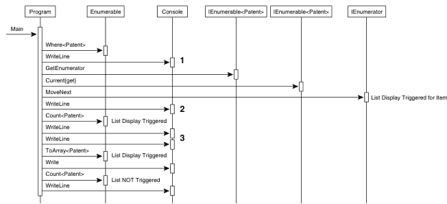

图 14.2：IEnumerable<T> 和 IEnumerator 接口

首先，执行在 foreach 循环内触发。如前所述，foreach 循环分解为 MoveNext() 调用，每次调用都会导致对原始集合中每个项目执行 lambda 表达式。在迭代过程中，运行时会为每个项目调用 lambda 表达式，以确定该项目是否满足谓词。

其次，对 Enumerable 的 Count()（函数）的调用会再次为每个项目触发 lambda 表达式。同样，这非常微妙，因为 Count（属性）在未使用标准查询运算符查询的集合上非常常见。

第三，对 ToArray()（或 ToList()、ToDictionary()、ToLookup()）的调用会为每个项目触发 lambda 表达式。但是，使用其中一种“To”方法转换集合非常有帮助。这样做会返回一个标准查询运算符已执行过的集合。在清单 14.18 中，转换为数组意味着在最终 Console.WriteLine() 中调用 Length 时，patents 指向的底层对象实际上是一个数组（显然实现了 IEnumerable<T>），因此会调用 System.Array 的 Length 实现，而不是 System.Linq.Enumerable 的实现。因此，在转换为“To”方法返回的集合类型之一后，通常可以安全地使用该集合（直到再次调用标准查询运算符）。但是，请注意，这会将整个结果集加载到内存中（在此之前，它可能由数据库或文件支持）。此外，“To”方法可能已对底层数据进行了快照，因此在重新查询“To”方法的结果时不会返回新结果。

我强烈建议读者查看图 14.2 中的序列图及其对应的代码，并理解标准查询运算符的延迟执行可能导致标准查询运算符被极其微妙地触发；因此，开发者应谨慎行事，以避免意外调用。查询对象表示查询，而不是结果。当你向查询请求结果时，整个查询会执行（甚至可能再次执行），因为查询对象不知道结果是否与之前执行期间（如果有的话）相同。

> **注意**
>
> 为避免此类重复执行，有必要缓存已执行查询检索的数据。为此，请使用“To”方法的集合方法之一将数据分配给本地集合。在“To”方法的赋值调用期间，查询会立即执行。但是，之后对分配的集合进行迭代将不再涉及查询表达式。通常，如果你希望获得内存中集合快照的行为，最佳实践是将查询表达式分配给缓存集合，以避免不必要的迭代。

## 使用 OrderBy() 和 ThenBy() 进行排序

对集合的另一常见操作是对其进行排序。这涉及对 System.Linq.Enumerable 的 OrderBy() 的调用，如清单 14.19 和输出 14.6 所示。

### 清单 14.19：使用 System.Linq.Enumerable.OrderBy()/ThenBy() 进行排序

```csharp
using System;
using System.Collections.Generic;
using System.Linq;

// ...

IEnumerable<Patent> items;
Patent[] patents = PatentData.Patents;
items = patents.OrderBy(
    patent => patent.YearOfPublication).ThenBy(
    patent => patent.Title);
Print(items);
Console.WriteLine();

items = patents.OrderByDescending(
    patent => patent.YearOfPublication).ThenByDescending(
    patent => patent.Title);
Print(items);

// ...
```


## 输出 14.6：

```
Bifocals (1784)
Steam Locomotive(1815)
Electrical Telegraph(1837)
Phonograph(1877)
Kinetoscope(1888)
Flying machine (1903)
Backless Brassiere(1914)
Droplet deposition apparatus(1989)
Droplet deposition apparatus(1989)
Backless Brassiere(1914)
Flying machine (1903)
Kinetoscope(1888)
Phonograph(1877)
Electrical Telegraph(1837)
Steam Locomotive(1815)
Bifocals (1784)
```

OrderBy() 调用采用 lambda 表达式，用于标识排序的键。在清单 14.19 中，初始排序使用专利发布的年份。

不过，请注意 OrderBy() 调用只接受一个参数，该参数使用名为 keySelector 的名称来进行排序。若要对第二列进行排序，则需要使用另一个方法：ThenBy()。同样，任何额外的排序都会使用 ThenBy()。

OrderBy() 返回 IOrderedEnumerable<T> 接口，而非 IEnumerable<T>。此外，IOrderedEnumerable<T> 派生自 IEnumerable<T>，因此所有标准查询运算符（包括 OrderBy()）都可在 OrderBy() 返回值上使用。但是，重复调用 OrderBy() 会撤销前一次调用的工作，导致最终结果仅按最后一次 OrderBy() 调用中的 keySelector 进行排序。因此，请小心不要在之前的 OrderBy() 调用上再次调用 OrderBy()。

相反，应使用 ThenBy() 指定其他排序条件。虽然 ThenBy() 是扩展方法，但它不是 IEnumerable<T> 的扩展，而是 IOrderedEnumerable<T> 的扩展。该方法也定义于 System.Linq.Extensions.Enumerable，声明如下：

```
public static IOrderedEnumerable<TSource>
ThenBy<TSource, TKey>(
this IOrderedEnumerable<TSource> source,
Func<TSource, TKey> keySelector)
```

总之，先使用 OrderBy()，然后再调用零次或多次 ThenBy() 来提供其他排序“列”。OrderByDescending() 和 ThenByDescending() 方法提供相同的功能，只是采用降序。混合使用升序和降序方法不是问题，但如果需要进一步排序，请使用 ThenBy() 调用（升序或降序均可）。

关于排序还有两点重要说明：首先，实际排序不会在你开始访问集合中的成员之前发生，此时整个查询才会被处理。这是因为除非拥有所有要排序的项，否则无法排序；否则，你无法确定是否拥有第一个项。排序被推迟到开始访问成员时才发生，这是由于延迟执行，如前面本章所述。其次，每次后续的数据排序调用（例如 OrderBy() 后跟 ThenBy() 再后跟 ThenByDescending()）都会涉及对早前排序调用的 keySelector lambda 表达式的额外调用。换句话说，OrderBy() 调用会在你遍历集合时调用其对应的 keySelector lambda 表达式。此外，后续的 ThenBy() 调用会再次对 OrderBy() 的 keySelector 进行调用。

## 初学者主题

## 连接操作

请考虑图 14.3 维恩图中所示的两个对象集合。

图中的左圆包含所有发明者，右圆包含所有专利。在交集中，我们既有发明者又有专利，并且每当发明者与专利匹配时就会形成一行。如图所示，每个发明者可能拥有多个专利，每个专利可以有一个或多个发明者。每个专利都有发明者，但在某些情况下，发明者尚未拥有专利。

将交集中的发明者与专利进行匹配是内连接。结果是一组发明者-专利对，其中每对都同时存在专利和发明。左外连接包含左圆中的所有项目，无论它们是否有对应的专利。在此

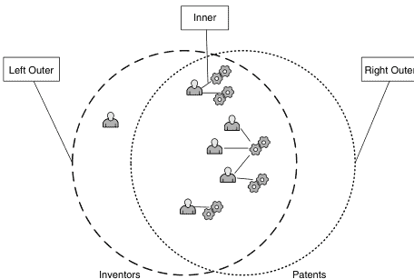

### 图 14.3：发明者和专利集合的维恩图

特定示例中，右外连接与内连接相同，因为没有没有发明者的专利。此外，左与右的指定是任意的，因此左连接和外连接之间实际上没有区别。但是，全外连接会包含两侧外部的记录；执行全外连接的情况相对较少。

发明者与专利之间关系的另一个重要特征是它是多对多关系。每个单独的专利可以有一个或多个发明者（例如，飞行器由奥维尔和威尔伯·赖特共同发明）。此外，每个发明者可以有一个或多个专利（例如，本杰明·富兰克林同时发明了双光眼镜和留声机）。

另一种常见的关系是一对多关系。例如，公司部门可能有许多员工。但是，每个员工在同一时间只能属于一个部门。（然而，与一对多关系常见的情况一样，加入时间因素可以将它们转换为多对多关系。特定员工可能会从一个部门转到另一个部门，因此随着时间的推移，她可能会与多个部门关联，从而形成另一种多对多关系。）

## 清单 14.20：员工和部门示例数据

```
public class Department
{
    public long Id { get; set; }
    public string Name { get; set; }
    public override string ToString()
    {
        return string.Format("{0}", Name);
    }
}

public class Employee
{
    public int Id { get; set; }
    public string Name { get; set; }
    public string Title { get; set; }
    public int DepartmentId { get; set; }
    public override string ToString()
    {
        return string.Format("{0} ({1})", Name, Title);
    }
}

public static class CorporateData
{
    public static readonly Department[] Departments =
    {
        new Department()
        {
            Name="Corporate", Id=0},
        new Department()
        {
            Name="Finance", Id=1},
        new Department()
        {
            Name="Engineering", Id=2},
        new Department()
        {
            Name="Information Technology",
            Id=3},
        new Department()
        {
            Name="Research",
            Id=4},
        new Department()
        {
            Name="Marketing",
            Id=5},
    };
}
```

```
public static readonly Employee[] Employees = new Employee[]
{
    new Employee(){
        Name="Mark Michaelis",
        Title="Chief Computer Nerd",
        DepartmentId = 0,
    },
    new Employee(){
        Name="Michael Stolesbury",
        Title="Senior Computer Wizard",
        DepartmentId=2,
    },
    new Employee(){
        Name="Brian Jones",
        Title="Enterprise Integration Guru",
        DepartmentId=2,
    },
    new Employee(){
        Name="Jewel Floch",
        Title="Bookkeeper Extraordinaire",
        DepartmentId=1,
    },
    new Employee(){
        Name="Curtis Stolesbury",
        Title="Expert Mainframe Engineer",
        DepartmentId = 3,
    },
    new Employee(){
        Name="Paul R. Bramsman",
        Title="Programmer Extraordinaire",
        DepartmentId = 2,
    },
    new Employee(){
        Name="Thomas Heavey",
        Title="Software Architect",
        DepartmentId = 2,
    },
    new Employee(){
        Name="John Michaelis",
        Title="Inventor",
        DepartmentId = 4
    }
};
```

```
class Program
{
    static void Main()
    {
        IEnumerable<Department> departments =
            CorporateData.Departments;
        Print(departments);

        Console.WriteLine();

        IEnumerable<Employee> employees =
            CorporateData.Employees;

        Print(employees);

    }

    private static void Print<T>(IEnumerable<T> items)
    {
        foreach (T item in items)
        {
            Console.WriteLine(item);
        }
    }
}
```

## 输出 14.7：

```
Corporate
Finance
Engineering
Information Technology
Research
Marketing

Mark Michaelis (Chief Computer Nerd)
Eric Lippert (Senior Computer Wizard)
Brian Jones (Enterprise Integration Guru)
Aldo Tosello (Enterprise Integration Guru)
Robert Stokesbury (Expert Mainframe Engineer)
Paul R. Bramsman (Programmer Extraordinaire)
Thomas Heavey (Software Architect)
John Michaelis (Inventor)
```

我们将在接下来关于连接数据的章节中使用相同的数据。

### 使用 Join() 执行内连接

在客户端对象世界中，对象之间的关系通常已经建立。例如，文件与其所在目录之间的关系是通过 DirectoryInfo.GetFiles() 方法和 FileInfo.Directory 方法预先建立的。但是，从非对象存储加载的数据通常并非如此。相反，需要将数据连接在一起，以便以符合数据含义的方式从一种对象类型导航到下一种对象类型。

请考虑员工和公司部门的示例。在清单 14.21 中，我们将每个员工与其部门连接，然后列出每个员工及其对应的部门。由于每个员工只属于一个（且仅一个）部门，项目总数


列表中的数量等于员工总数——每个员工只出现一次（每个员工都被认为是规范化的）。输出 14.8 如下。

### 清单 14.21: 使用 System.Linq.Enumerable.Join() 进行内部连接

```
using System;
using System.Linq;
// ...
Department[] departments = CorporateData.Departments;
Employee[] employees = CorporateData.Employees;
var items = employees.Join(
 departments,
 employee => employee.DepartmentId,
 department => department.Id,
 (employee, department) => new
 {
 employee.Id,
 employee.Name,
 employee.Title,
 Department = department
 });
foreach (var item in items)
{
 Console.WriteLine("{0} ({1})",
 item.Name, item.Title);
 Console.WriteLine("\t" + item.Department);
}
// ...
```

### 输出 14.8:

```
Mark Michaelis (Chief Computer Nerd)
Corporate
Michael Stokesbary (Senior Computer Wizard)
Engineering
Brian Jones (Enterprise Integration Guru)
Engineering
Jewel Flores (Bookkeeper Extraordinaire)
Finance
Robert Stokesbary (Expert Mainframe Engineer)
Information Technology
Paul R. Bramsman (Programmer Extraordinaire)
Engineering
Thomas Heavey (Software Architect)
Engineering
John Michaelis (Inventor)
Research
```

Join() 的第一个参数名为 inner。它指定 employees 连接到的集合 departments。接下来的两个参数是 lambda 表达式，用于指定两个集合如何连接。employee => employee.DepartmentId（参数名为 outerKeySelector）标识每个员工的键将是 DepartmentId。下一个 lambda 表达式 (department => department.Id) 将 Department 的 Id 属性指定为键。换句话说，对于每个员工，连接一个部门，其中 employee.DepartmentId 等于 department.Id。最后一个参数是匿名类型，即所选的结果项。在此示例中，它是一个带有 Employee 的 Id、Name 和 Title 以及带有连接部门对象的 Department 属性的类。

请注意在输出中，Engineering 出现多次——CorporateData 中每个员工一次。在此示例中，Join() 调用在所有部门和所有员工之间生成笛卡尔积，这样每当两个集合中都存在记录且指定的部门 ID 相同时，就会创建一条新记录。这种连接类型是内部连接。

数据也可以反向连接，使部门连接到每个员工，以列出每个部门到员工的匹配。请注意，输出中的记录数多于部门数，因为每个部门都有多个员工，且输出为每个匹配生成一条记录。如前所述，Engineering 部门出现多次，每个员工一次。

清单 14.22 和输出 14.9 中的代码与清单 14.21 中的代码类似，只是对象 Departments 和 Employees 颠倒了。传递给 Join() 的第一个参数是 employees，指示部门连接到的对象。接下来的两个参数是 lambda 表达式，用于指定两个集合如何连接：部门使用 department => department.Id，员工使用 employee => employee.DepartmentId。与之前一样，每当 department.Id 等于 employee.EmployeeId 时就会发生连接。最后一个匿名类型参数指定一个带有 int Id、string Name 和 Employee Employee 属性的类。

### 清单 14.22: 使用 System.Linq.Enumerable.Join() 的另一个内部连接

```
using System;
using System.Linq;
// ...
Department[] departments = CorporateData.Departments;
Employee[] employees = CorporateData.Employees;

var items = departments.Join(
    employees,
    department => department.Id,
    employee => employee.DepartmentId,
    (department, employee) => new
    {
        department.Id,
        department.Name,
        Employee = employee
    });

foreach (var item in items)
{
    Console.WriteLine("{0}",
        item.Name);
    Console.WriteLine("\t" + item.Employee);
}
// ...
```

### 输出 14.9:

```
Corporate
    Mark Michaelis (Chief Computer Nerd)
Finance
    Jewel Flores (Bookkeeper Extraordinaire)
Engineering
    Michael Stokesbary (Senior Computer Wizard)
    Marian Jones (Enterprise Integration Guru)
    Paul R. Bramsman (Programmer Extraordinaire)
Engineering
Information Technology
    Robert Stokesbary (Expert Mainframe Engineer)
Research
    John Michaelis (Inventor)
```

## 使用 GroupBy() 对结果进行分组

除了对对象集合进行排序和连接之外，您经常可能希望将具有相似特征的对象分组在一起。对于员工数据，您可能希望按部门、地区、职位等对员工进行分组。清单 14.23 展示了如何使用 GroupBy() 标准查询运算符来执行此操作（请参阅输出 14.10 以查看输出）。

### 清单 14.23: 使用 System.Linq.Enumerable.GroupBy() 对项目进行分组

```
using System;
using System.Linq;

// ...

IEnumerable<Employee> employees = CorporateData.Employees;

IEnumerable<IGrouping<int, Employee>> groupedEmployees =
    employees.GroupBy(employee => employee.DepartmentId);

foreach (IGrouping<int, Employee> employeeGroup in
    groupedEmployees)
{
    Console.WriteLine();
    foreach (Employee employee in employeeGroup)
    {
        Console.WriteLine("\t" + employee);
    }
    Console.WriteLine(
        "\tCount: " + employeeGroup.Count());
}

// ...
```

### 输出 14.10:

```
Mark Michaelis (Chief Computer Nerd)
Count: 1

Michael Stokesbary (Senior Computer Wizard)
Brian Jones (Enterprise Integration Guru)
Paul R. Bramsen (Programmer Extraordinaire)
Thomas Heavey (Software Architect)
Count: 4

Jewel Flores (Bookkeeper Extraordinaire)
Count: 1

Robert Stokesbary (Expert Mainframe Engineer)
Count: 1

John Michaelis (Inventor)
Count: 1
```

请注意，GroupBy() 调用输出的项类型为 IGrouping<TKey, TElement>，它具有一个属性，用于查询分组的键（employee.DepartmentId）。但是，它没有用于组内项的属性。相反，IGrouping<TKey, TElement> 派生自 IEnumerable<T>，允许使用 foreach 语句枚举组内的项，或将数据聚合为诸如项计数（employeeGroup.Count()）之类的内容。

## 使用 GroupJoin() 实现一对多关系

清单 14.21 和清单 14.22 几乎相同。只需更改匿名类型定义，任何 GroupJoin() 调用都可以生成相同的输出。在尝试创建员工列表时，清单 14.21 提供了正确的结果。department 最终成为表示连接员工的每个匿名类型的属性。但是，清单 14.22 并非最佳。考虑到对集合的支持，部门的首选表示形式应包含员工集合，而不是针对每个部门-员工关系的单个匿名类型记录。清单 14.24 演示了这一点；输出 14.11 显示了首选输出。

### 清单 14.24: 使用 System.Linq.Enumerable.GroupJoin() 创建子集合

```
using System;
using System.Linq;
// ...
Department[] departments = CorporateData.Departments;
Employee[] employees = CorporateData.Employees;
var items = departments.GroupJoin(
    employees,
    department => department.Id,
    employee => employee.DepartmentId,
    (department, departmentEmployees) => new
    {
        department.Id,
        department.Name,
        Employees = departmentEmployees
    });

foreach (var item in items)
{
    Console.WriteLine("{0}",
        item.Name);
    foreach (Employee employee in item.Employees)
    {
        Console.WriteLine("\t" + employee);
    }
}

// ...
```

### 输出 14.11:

```
Corporate
Mark Michaelis (Chief Computer Nerd)
Finance
Jewel Flores (Bookkeeper Extraordinaire)
Engineering
Michael Stokesbary (Senior Computer Wizard)
Brian Jones (Enterprise Integration Guru)
Paul R. Bramsman (Programmer Extraordinaire)
Thomas Heavey (Software Architect)
Information Technology
Robert Stokesbary (Expert Mainframe Engineer)
Research
John Michaelis (Inventor)
```

为了实现首选结果，我们使用 System.Linq.Enumerable 的 GroupJoin() 方法。参数与清单 14.21 中的相同，只是所选的最终匿名类型不同。在清单 14.21 中，lambda 表达式的类型为 Func<Department, IEnumerable<Employee>, TResult>，其中 TResult 是所选的匿名类型。请注意，我们使用第二个类型参数 (IEnumerable<Employee>) 将每个部门的员工集合投影到结果部门匿名类型上。

（熟悉 SQL 的读者会注意到，与 Join() 不同，GroupJoin() 没有 SQL 等价物，因为 SQL 返回的数据是基于记录的，而不是分层的。）


## 使用 GroupJoin() 实现外连接

之前的内连接都是等值连接，因为它们基于键的等价求值。只有当两个集合中都存在对象时，记录才会出现在结果集合中。不过，有时即使相应对象不存在，创建记录也是可取的。例如，与其仅因为市场部没有任何员工就将其从最终部门列表中排除，不如将其包含进去并附带一个空员工列表。要实现此目的，我们使用 GroupJoin() 和 SelectMany() 的组合以及 DefaultIfEmpty() 来执行左外连接。清单 14.25 和输出 14.12 演示了此过程。

### 清单 14.25：使用 GroupJoin() 和 SelectMany() 实现外连接

```csharp
using System;
using System.Linq;

// ...

Department[] departments = CorporateData.Departments;
Employee[] employees = CorporateData.Employees;

var items = departments.GroupJoin(
    employees,
    department => department.DepartmentID,
    employee => employee.DepartmentID,
    (department, departmentEmployees) => new
    {
        department.Id,
        department.Name,
        Employees = departmentEmployees
    }).SelectMany(
    departmentRecord => departmentRecord.Employees.DefaultIfEmpty(),
    (departmentRecord, employee) => new
    {
        departmentRecord.Id,
        departmentRecord.Name,
        Employees =
        departmentRecord.Employees
    }).Distinct();

foreach (var item in items)
{
    Console.WriteLine("{0}", item.Name);
    foreach (Employee employee in item.Employees)
    {
        Console.WriteLine("\t" + employee);
    }
}

// ...
```

### 输出 14.12：

```
Corporate
Mark Michaelis (Chief Computer Nerd)
Finance
Jewel Floch (Bookkeeper Extraordinaire)
Engineering
Michael Stokesbary (Senior Computer Wizard)
Brian Jones (Enterprise Integration Guru)
Paul R. Bramsen (Programmer Extraordinaire)
Thomas Heavey (Software Architect)
Information Technology
Robert Stokesbary (Expert Mainframe Engineer)
Research
John Michaelis (Inventor)
Marketing
```

### 调用 SelectMany()

有时，你可能会有集合的集合。清单 14.26 提供了这种场景的示例。teams 数组包含两个团队，每个团队都有一个字符串数组形式的球员列表。

### 清单 14.26：调用 SelectMany()

```csharp
using System;
using System.Collections.Generic;
using System.Linq;
// ...
var worldCup2006Finalists = new[]
{
    new
    {
        TeamName = "France",
        Players = new string[]
        {
            "Fabien Barthez", "Gregory Coupet",
            "Mickael Landreau", "Eric Abidal",
            "Jean-Alain Boumsong", "Pascal Chimbonda",
            "William Gallas", "Gael Givet",
            "Willy Sagnol", "Mikael Silvestre",
            "Lilian Thuram", "Vikas Dhorasoo",
            "Alou Diarra", "Claude Makelele",
            "Florent Malouda", "Patrick Vieira",
            "Zinedine Zidane", "Djibril Cisse",
            "Thierry Henry", "Franck Ribery",
            "Louis Saha", "David Trezeguet",
            "Sylvain Wiltord",
        },
    },
    new
    {
        TeamName = "Italy",
        Players = new string[]
        {
            "Gianluigi Buffon", "Angelo Peruzzi",
            "Marco Amelia", "Cristian Zaccardo",
            "Alessandro Nesta", "Gianluca Zambrotta",
            "Fabio Cannavaro", "Marco Materazzi",
            "Fabio Grosso", "Massimo Oddo",
            "Andrea Barzagli", "Andrea Pirlo",
            "Gennaro Gattuso", "Daniele De Rossi",
            "Mauro Camoranesi", "Simone Perrotta",
            "Simone Barone", "Luca Toni",
            "Alessandro Del Piero", "Francesco Totti",
            "Alberto Gilardino", "Filippo Inzaghi",
            "Vincenzo Iaquinta",
        }
    }
};

IEnumerable<string> players =
    worldCup2006Finalists.SelectMany(
        team => team.Players);

Print(players);

// ...
```

此清单的输出将每个球员的姓名按代码中出现的顺序，各自占一行显示。Select() 与 SelectMany() 之间的区别在于，Select() 将返回两个项目，分别对应原始集合中的每个项目。

Select() 可以从原始类型投影出一个转换，但项目数量不会改变。例如，teams.Select(team => team.Players) 将返回一个 IEnumerable<string[]>。

相比之下，SelectMany() 会遍历 lambda 表达式标识的每个项目（即之前由 Select() 选出的数组），并将每个项目提升到一个新集合中，该集合包含子集合中所有项目的并集。SelectMany() 不会生成两个球员数组，而是将每个选定的数组合并，生成一个包含所有项目的单一集合。

## 更多标准查询运算符

清单 14.27 显示了使用 Enumerable 启用的一些更简单 API 的代码；输出 14.13 显示了结果。

### 清单 14.27：更多 System.Linq.Enumerable 方法调用

```csharp
using System;
using System.Collections.Generic;
using System.Linq;
using System.Text;

class Program
{
    static void Main()
    {
        IEnumerable<object> stuff =
            new object[] { new object(), 1, 3, 5, 7, 9,
                "thing", new GuildWars() };
        Print("Stuff: {0}", stuff);

        IEnumerable<int> even = new int[] { 0, 2, 4, 6, 8 };
        Print("Even integers: {0}", even);

        IEnumerable<int> odd = stuff.OfType<int>();
        Print("Odd integers: {0}", odd);

        IEnumerable<int> numbers = even.Union(odd);
        Print("Union of odd and even: {0}", numbers);

        Print("Union with even: {0}", numbers.Union(even));
        Print("Concat with odd: {0}", numbers.Concat(odd));
        Print("Intersect with even: {0}",
            numbers.Intersect(even));
        Print("Distinct: {0}", numbers.Concat(odd).Distinct());
        if (numbers.SequenceEqual(
            numbers.Concat(odd).Distinct()))
        {
            throw new Exception("Unexpectedly unequal");
        }

        Console.WriteLine(
            @"Collection ""SequenceEquals"" + collection.Concat(odd.Distinct()));
        Print("Reverse: {0}", numbers.Reverse());
        Print("Average: {0}", numbers.Average());
        Print("Sum: {0}", numbers.Sum());
        Print("Max: {0}", numbers.Max());
        Print("Min: {0}", numbers.Min());
    }
}

private static void Print<T>(
    string format, IEnumerable<T> items)
{
    StringBuilder text = new StringBuilder();
    foreach (T item in items.Take(items.Count() - 1))
    {
        text.Append(item + ", ");
    }
    text.Append(items.Last());
    Console.WriteLine(format, text);
}

private static void Print<T>(string format, T item)
{
    Console.WriteLine(format, item);
}
```

### 输出 14.13：

```
Stuff: System.Object: 1, 3, 5, 7, 9, "thing", 24c24f41-ee05-41b9-958e-304d1e3e-Mbfe
Even integers: 2, 4, 6, 8
Odd integers: 3, 5, 7, 9
Union of odd and even: 2, 4, 6, 8, 1, 3, 5, 7, 9
Union with even: 2, 4, 6, 8, 1, 3, 5, 7, 9
Concat with odd: 2, 4, 6, 8, 1, 3, 5, 7, 9, 1, 3, 5, 7, 9
Intersection with even: 2, 4, 6, 8
Distinct: 2, 4, 6, 8, 1, 3, 5, 7, 9
Collection "SequenceEquals" collection.Concat(odd.Distinct())
Reverse: 9, 7, 5, 3, 1, 8, 6, 4, 2, 0
Average: 4.5
Sum: 95
Max: 9
Min: 0
```

清单 14.20 中的 API 调用均不需要 lambda 表达式。表 14.1 和表 14.2 描述了每个方法并提供了示例。

### 表 14.1：更简单的标准查询运算符

| 方法 | 描述 |
| :--- | :--- |
| OfType<T>() | 对集合形成查询，仅返回特定类型的项目，该类型由 OfType<T>() 方法调用的类型参数标识。 |
| Union() | 合并两个集合，形成包含两个集合中所有项目的超集。最终集合不包含重复项目，即使同一项目在开始时同时存在于两个集合中。 |
| Concat() | 合并两个集合，形成包含两个集合的超集。重复项目不会从结果集合中移除。Concat() 会保留顺序。也就是说，将 {A, B} 与 {C, D} 连接将生成 {A, B, C, D}。 |
| Intersect() | 提取同时存在于两个原始集合中的项目集合。 |
| Distinct() | 从集合中筛选出重复项目，使结果集合中的每个项目都是唯一的。 |
| SequenceEquals() | 比较两个集合并返回一个布尔值，指示集合是否相同，包括集合中项目的顺序。（在测试预期结果时，这是非常有用的消息。） |
| Reverse() | 反转集合中的项目，以便在遍历集合时按逆序出现。 |

System.Linq.Enumerable 中包含一组聚合函数，用于枚举集合并计算结果。Count 是本章中已展示的一个聚合函数示例。


## 表 14.2：System.Linq.Enumerable 上的聚合函数

| 注释类型 | 描述 |
| :--- | :--- |
| Count() | 提供集合中项目总数 |
| Average() | 计算数值键选择器的平均值 |
| Sum() | 计算数值集合中的求和值 |
| Max() | 确定数值集合中的最大值 |
| Min() | 确定数值集合中的最小值 |

请注意，表 14.1 和 14.2 中列出的每个方法都将触发延迟执行。

## 高级主题

## IQueryable<T> 的 Queryable 扩展

与 IEnumerable<T> 几乎完全相同的一个接口是 IQueryable<T>。因为 IQueryable<T> 派生自 IEnumerable<T>，所以它拥有 IEnumerable<T> 的所有成员，但仅限于直接声明的成员（例如 GetEnumerator()）。扩展方法不会被继承，因此 IQueryable<T> 没有任何 Enumerable 扩展方法。然而，它有一个名为 System.Linq.Queryable 的类似扩展类，该类为 IQueryable<T> 添加了与 Enumerable 为 IEnumerable<T> 添加的几乎相同的所有方法。因此，它提供了非常相似的编程接口。

使 IQueryable<T> 独一无二的是，它能够启用自定义 LINQ 提供程序。LINQ 提供程序将表达式细分为其组成部分。一旦被细分，该表达式可以被翻译成另一种语言、序列化以供远程执行、注入异步执行模式，以及更多功能。本质上，LINQ 提供程序允许拦截标准集合 API，并通过这种看似无限的功能，可以将与查询和集合相关的行为注入其中。

例如，LINQ 提供程序允许将 C# 中的查询表达式翻译成 SQL，然后在远程数据库上执行。这样一来，C# 程序员可以留在其主要的面向对象语言中，并将 SQL 翻译工作留给底层的 LINQ 提供程序。通过这种表达式，编程语言能够跨越面向对象世界与关系数据库之间的阻抗失配。

在 IQueryable<T> 的情况下，对延迟执行的警惕性更为关键。例如，设想一个从数据库返回数据的 LINQ 提供程序。与其无论选择条件如何都从数据库检索数据，不如 lambda 表达式提供一个 IQueryable<T> 实现，该实现可能包含上下文信息（如连接字符串），但不包含数据本身。数据检索不会在调用 GetEnumerator() 或甚至 MoveNext() 之前发生。然而，GetEnumerator() 调用通常是隐式的，例如在使用 foreach 遍历集合或调用 Count<T>() 或 Cast<T>() 等 Enumerable 方法时。显然，此类情况要求开发人员警惕延迟执行可能调用的任何昂贵操作的微妙且重复的调用。例如，如果调用 GetEnumerator() 涉及通过网络向数据库进行分布式调用，请避免使用 Count() 或 foreach 对迭代进行无意的重复调用。

## 摘要

在介绍匿名类型、隐式变量和集合初始化器之后，本章描述了 foreach 循环的工作原理及其执行所需的接口。此外，开发人员经常筛选集合以减少项目数量，并投影集合以使项目采用不同的形式。为此，本章讨论了如何使用标准查询运算符（即 System.Linq.Enumerable 类上的常见集合 API）来执行集合操作的详细信息。

在标准查询运算符的介绍中，我们花了几页篇幅详细说明了延迟执行，以及开发人员应如何小心避免通过枚举集合内容的微妙调用而无意中重新执行表达式。标准查询运算符的延迟执行及其产生的隐式执行是一项重要特性，尤其是在查询执行开销较大时。程序员应将查询对象视为查询对象，而非结果，并期望查询会完全执行，即使它已经执行过。查询对象不知道结果是否与上一次执行时相同。

清单 14.25 出现在高级主题部分，是因为连续调用多个标准查询运算符的复杂性。虽然类似执行的要求可能很常见，但没有必要直接依赖标准查询运算符。C# 3.0 包含查询表达式，这是一种类似 SQL 的语法，用以操作集合，通常更易于编码和阅读，我将在下一章中展示。

本页故意留空

# 15 使用查询表达式的 LINQ

第 14 章末尾展示了一个使用标准查询运算符（用于 GroupJoin()、SelectMany() 和 Distinct()）的查询，此外还创建了两个匿名类型。结果是一个跨多行的语句，相当难以理解，当然比 C# 2.0 中通常编写的语句复杂得多，尽管它似乎与 C# 2.0 语法完全兼容。标准查询运算符的引入促成了此类复杂语句可取的场景，尽管生成的代码可能复杂且难以阅读。此外，标准查询运算符实现的查询在功能上与通常在 SQL 中实现的查询非常相似。

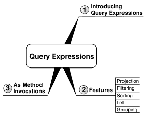

这两个因素的共同作用促使 C# 语言设计师在 C# 3.0 中添加了一种新语法：查询表达式。使用查询表达式，许多标准查询运算符语句被转换为更易读的代码，这种代码看起来非常像 SQL。

在本章中，我将介绍查询表达式的新语法，并使用该语法说明如何表达前一章中的许多查询。

### 查询表达式简介

除了遍历集合中的所有项目外，开发人员执行的最常见操作之一是筛选集合，以便减少要遍历的项目数量，或投影集合，以便项目采用不同的形式。例如，给定一个文件集合，我们可以垂直筛选它，创建一个仅包含扩展名为“.cs”的文件或仅包含十个最大文件的新集合。或者，我们可以跨文件集合进行投影，创建一个新集合，包含文件所在目录的路径及相应的目录大小。执行此类操作有多种方法，但其中最简单的一种是在 C# 3.0 中引入的：查询表达式。

查询表达式始终以“from 子句”开始，并以“select 子句”或“group by 子句”结束。每个子句分别由 from、select 或 group 上下文关键字标识。清单 15.1 显示了一个查询表达式示例，输出 15.1 显示了结果。

### 清单 15.1：简单查询表达式

```
using System;
using System.Collections.Generic;
using System.Linq;

// ...

static string[] Keywords = {
    "abstract", "add", "alias", "as", "ascending", "base",
    "bool", "break", "by", "byte", "case", "catch", "char",
    "checked", "class", "const", "continue", "decimal",
    "default", "delegate", "descending", "do", "double",
    "dynamic", "else", "enum", "event", "equals",
    "explicit", "extern", "false", "finally", "fixed",
    "from", "float", "for", "foreach", "get", "global",
    "group*", "goto", "if", "implicit", "in", "int",
    "into", "interface", "internal", "is", "lock", "long",
    "join", "let", "namespace", "new", "null", "object",
    "on", "operator", "orderby", "out", "override",
    "params", "partial", "private", "protected", "public",
    "readonly", "ref", "remove", "return", "sbyte", "sealed",
    "select", "set", "short", "sizeof", "stackalloc",
    "static", "string", "struct", "switch", "this", "throw",
    "true", "try", "typeof", "uint", "ulong", "unchecked",
    "unsafe", "ushort", "using", "value", "var", "virtual",
    "void", "volatile", "where", "while", "yield");
private static void ShowContextualKeywords1()
{
IEnumerable<string> selection = from word in Keywords
where !word.Contains("*")
select word;
foreach (string keyword in selection)
{
Console.WriteLine(" " + keyword);
}
}
// ...
```

### 输出 15.1：

```
abstract as base bool break byte case catch checked class const
continue decimal default delegate do double else enum explicit
extern false finally fixed float for foreach goto if implicit in
interface internal is lock for foreach goto if implicit in
out override params private protected public readonly ref return
sealed sizeof stackalloc string struct switch this throw
true try typeof uint ulong unchecked unsafe ushort using
virtual void volatile while yield
```

在此查询表达式中，selection 被赋值为 C# 关键字的集合，但不包括上下文关键字。本示例中的查询表达式包含一个 where 子句，用于筛选掉非上下文关键字。

熟悉 SQL 的开发人员会注意到，查询表达式的语法与 SQL 相似，以便成千上万懂 SQL 的程序员感到熟悉。然而，尽管存在相似之处，但仍有一些明显的不一致之处。最显著的一点是，与 SQL 经常以 select 开始表达式不同，C# 查询表达式以上下文关键字 from 开头。


之所以这样做，是为了启用 IntelliSense，即预测所选对象成员的能力。例如，因为 from 出现在第一位并将字符串数组 Keywords 标识为数据源，代码编辑器知道 word 是 string 类型。这启用了 IntelliSense——对 word 进行成员访问（点运算）将仅显示 string 的成员。如果 from 子句出现在 select 之后，那么 from 子句之前的任何点运算都不会知道 word 的数据类型是什么，因此也就无法显示 word 的成员列表。例如，在清单 15.1 中，将无法预测 Contains() 是 word 的可能成员。word 被称为范围变量；它表示集合中的每个项目。

## 投影

查询表达式的输出是 IEnumerable<T> 或 IQueryable<T> 集合。¹ T 的数据类型从 select 或 groupby 子句中推断。例如，在清单 15.1 中，string 的数据类型是从 select word 推断出来的，因为 word 是 string，word 的数据类型是 from 子句中 IEnumerable<T> 集合的类型参数。由于 Keywords 是字符串数组，它实现了 IEnumerable<string>，因此 word 是 string。

查询特定类型集合的表达式所产生的类型绝不局限于该原始类型的序列。相反，select 子句允许将数据投影到完全不同的类型。请考虑清单 15.2 中的查询表达式及其在输出 15.2 中的相应输出。

```
LISTING 15.2: Projection Using Query Expressions
using System;
using System.Collections.Generic;
using System.Linq;
using System.IO;

// ...

static void List1(string rootDirectory, string searchPattern)
{
    IEnumerable<FileInfo> files =
        from fileName in Directory.GetFiles(
            rootDirectory, searchPattern)
        select new FileInfo(fileName);

    foreach (FileInfo file in files)
    {
        Console.WriteLine("{0} ({1})",
            file.Name, file.LastWriteTime);
    }
}

// ...
```

1. 查询表达式的输出实际上总是 IEnumerable<T>，但理论上不一定。没有什么能阻止任何人实现返回其他内容的查询运算符。这样做有些乖张，但语言中没有要求查询运算符必须返回 IEnumerable<T>。

## 输出 15.2:

```
Account.cs(10/1/2007 11:56:11 AM)
Bill.cs(6/10/2007 9:33:55 PM)
Contact.cs(6/14/2007 11:40:30 PM)
Customer.cs(11/17/2007 2:02:52 AM)
Employee.cs(8/17/2007 1:33:22 AM)
Person.cs(10/22/2007 10:00:03 PM)
```

请注意，此查询表达式返回的是 IEnumerable<FileInfo>，而不是 System.IO.Directory.GetFiles() 返回的 IEnumerable<string> 数据类型。查询表达式的 select 子句可能会投影出与 from 子句表达式（Directory.GetFiles()）所收集的不同的数据类型。

事实上，这种投影正是 C# 3.0 将匿名类型纳入语言的关键驱动因素。通过匿名类型，可以在不定义显式类型的情况下选择出所需的确切数据。例如，清单 15.3 提供了与清单 15.2 类似的输出，但使用的是匿名类型而不是 FileInfo。

## 清单 15.3：查询表达式中的匿名类型

```
using System;
using System.Collections.Generic;
using System.Linq;
using System.IO;

// ...

static void List2(string rootDirectory, string searchPattern)
{
    var files =
        from fileName in Directory.GetFiles(
            rootDirectory, searchPattern)
        select new
        {
            Name = fileName,
            LastWriteTime = file.GetLastWriteTime(fileName)
        };

    foreach (var file in files)
    {
        Console.WriteLine("{0}({1})",
            file.Name, file.LastWriteTime);
    }
}

// ...
```

在此示例中，查询仅投影出文件名及其最后写入时间。在处理 FileInfo 之类的小对象时，像清单 15.3 这样的投影差别不大。但是，当数据量很大且检索数据（也许是通过 Internet 从不同计算机检索）代价高昂时，过滤掉集合中每个项目关联数据量的水平投影非常强大。与在查询执行时检索所有数据相比，使用匿名类型可以将仅所需的数据存储和检索到集合中。例如，想象一个包含 30 个或更多列的表的大型数据库。如果没有匿名类型，开发人员将不得不使用包含不必要信息的对象，或定义仅用于存储所需特定数据的小型专用类。相反，匿名类型支持由编译器定义类型——这些类型仅包含其直接场景所需的数据。其他场景可以有仅包含该场景所需属性的不同投影。

## 初学者主题

## 查询表达式中的延迟执行

延迟执行的主题在前一章中也出现过。相同的原则也适用于查询表达式。请再次考虑清单 15.1 中 selection 的赋值。赋值本身并不执行查询表达式。换句话说，在 selection 的赋值期间，不会调用 word.Contains("**")。相反，查询表达式会保存选择条件，以便在遍历 selection 变量标识的集合时使用。

为了说明这一点，请考虑清单 15.4 及其相应的输出（输出 15.3）。

## 清单 15.4：延迟执行和查询表达式（示例 1）

```
using System;
using System.Collections.Generic;
using System.Linq;

// ...

private static void ShowContextualKeywords2()
{
    IEnumerable<string> selection = from word in Keywords
                                    where IsKeyword(word)
                                    select word;

    foreach (string keyword in selection)
    {
        Console.Write(keyword);
    }
}

// Side effect (console output) included in predicate to show
// deferred execution not as a best practice.
private static bool IsKeyword(string word)
{
    if (word.Contains("**"))
    {
        Console.Write("");
        return true;
    }
    else
    {
        return false;
    }
}

// ...
```

## 输出 15.3:

```
add* alias* ascending* by* descending* dynamic* equals* from* get*
global* group* into* join* let* on* orderby* partial* remove* select*
set* value* var* where* yield*
```

请注意，在清单 15.4 中，foreach 循环内不会输出空格。上下文关键字之间的空格是在 IsKeyword() 函数中输出的，这表明 IsKeyword() 函数是在代码遍历 selection 时才被调用，而不是在 selection 赋值时调用。

关键在于，尽管 selection 是一个集合（毕竟它是 IEnumerable<T> 类型），但在赋值时，from 子句之后的所有内容都构成选择条件。只有在开始遍历 selection 时，才会应用这些条件。

请考虑第二个示例（请参见清单 15.5 和输出 15.4）。

## 清单 15.5：延迟执行和查询表达式（示例 2）

```
using System;
using System.Collections.Generic;
using System.Linq;

// ...

private static void CountContextualKeywords()
{
    int delegateInvocations = 0;
    Func<string, string> func =
        text =>
        {
            delegateInvocations++;
            return text;
        };

    IEnumerable<string> selection =
        from keyword in Keywords
        where keyword.Contains("*")
        select func(keyword);

    Console.WriteLine(
        "1. delegateInvocations={0}", delegateInvocations);

    // Executing count should invoke func once for
    // each item selected.
    Console.WriteLine(
        "2. Contextual keyword count={0}", selection.Count());

    Console.WriteLine(
        "3. delegateInvocations={0}", delegateInvocations);

    // Executing count should invoke func once for
```


```
// each item selected.
Console.WriteLine(
    "4. Contextual keyword count={0}", selection.Count()));

Console.WriteLine(
    "5. delegateInvocations={0}", delegateInvocations);

// Cache the value so future counts will not trigger
// another invocation of the query.
List<string> selectionCache = selection.ToList();

Console.WriteLine(
    "6. delegateInvocations={0}", delegateInvocations);

// Retrieve the count from the cached collection.
Console.WriteLine(
    "7. selectionCache count={0}", selectionCache.Count()));

Console.WriteLine(
    "8. delegateInvocations={0}", delegateInvocations);
// ...
```

输出 15.4:

- 1. delegateInvocations=0
- 2. Contextual keyword count=15
- 3. Contextual keyword count=15
- 4. delegateInvocations=15
- 5. delegateInvocations=30
- 6. delegateInvocations=45
- 7. selectionCache count=35
- 8. DelegateInvocations=45

与定义单独的方法不同，清单 15.5 使用匿名方法来统计方法被调用的次数。

输出中有三点值得注意。首先，注意在对 selection 赋值后，DelegateInvocations 仍保持为零。在将值赋给 selection 时，不会对 Keywords 进行迭代。如果 Keywords 是一个属性，则属性调用将会执行——换句话说，from 子句在赋值时执行。然而，投影、筛选以及 from 子句之后的任何内容，都要在代码遍历 selection 中的值之前都不会执行。仿佛在赋值时，selection 更适合被称为“query”。

但是，一旦我们调用 Count()，selection 或 items 这类表示容器或集合的术语就很合适，因为我们开始对集合中的项进行计数。换句话说，变量 selection 起着双重作用：既保存查询信息，又充当从中检索数据的容器。

需要注意的第二个重要特征是，两次调用 Count() 会导致 func 对每个选定的项再次被调用一次。由于 selection 既表现为查询又表现为集合，请求计数需要通过遍历 selection 引用的 IEnumerable<string> 集合并计算项来再次执行查询——返回最新的结果。同样，对 selection 进行 foreach 循环也会触发 func 对每个项再次被调用。所有通过 System.Linq.Enumerable 提供的其他扩展方法也是如此。

## 筛选

在清单 15.1 中，我们包含一个 where 子句，它筛选掉纯关键字但不包括上下文关键字。where 子句在垂直方向上筛选集合，使集合中的项更少。筛选条件通过谓词（一个返回 bool 的 lambda 表达式）来表达，例如 word.Contains()（如清单 15.1 所示）或 File.GetLastWriteTime(file) < DateTime.Now.AddMonths(-1)（如清单 15.6 所示，其输出显示在输出 15.5 中）。

## 清单 15.6：查询表达式中的匿名类型

```
using System;
using System.Collections.Generic;
using System.Linq;
using System.IO;

// ...

static void FindMonthOldFiles(
    string rootDirectory, string searchPattern)
{
    IEnumerable<FileInfo> files =
        from fileName in Directory.GetFiles(
            rootDirectory, searchPattern)
where File.GetLastWriteTime(fileName) <
DateTime.Now.AddMonths(-1);
select new FileInfo(fileName);

foreach (FileInfo file in files)
{
 // As simplification, current directory is
 // assumed to be a subdirectory of
 // rootDirectory
 string relativePath = file.FullName.Substring(
 Environment.CurrentDirectory.Length);
 Console.WriteLine("{0}({1})",
 relativePath, file.LastWriteTime);
 }
}

// ...
```

## 输出 15.5:

```
.\TestData\Bill.cs(6/10/2007 9:33:55 PM)
.\TestData\Contact.cs(6/19/2007 11:40:30 PM)
.\TestData\Employee.cs(6/17/2007 1:33:22 AM)
.\TestData\Person.cs(10/22/2007 10:00:03 PM)
```

## 排序

使用查询表达式对项进行排序时，我们依赖于 orderby 子句（参见清单 15.7）。

## 清单 15.7：使用带有 orderby 子句的查询表达式进行排序

```
using System;
using System.Collections.Generic;
using System.Linq;
using System.IO;

 // ...
 static void ListByFileSize1(
 string rootDirectory, string searchPattern)
 {
 IEnumerable<string> fileNames =
 from fileName in Directory.GetFiles(
 rootDirectory, searchPattern)
 orderby (new FileInfo(fileName)).Length descending,
 fileName
 select fileName;

foreach (string fileName in fileNames)
{
 Console.WriteLine("{0}", fileName);
 }
}
// ...
```

清单 15.7 使用 orderby 子句对 Directory.GetFiles() 返回的文件先按文件大小降序排序，然后按文件名升序排序。多个排序条件之间用逗号分隔，即先按大小对项进行排序，如果大小相同，则按文件名排序。ascending 和 descending 是表示排序方向的上下文关键字。指定升序或降序是可选的（文件名顺序可省略）；如果省略方向，默认值为升序。

## Let 子句

在清单 15.8 中，我们有一个与清单 15.7 中非常相似的查询，区别在于 IEnumerable<T> 的类型参数是 FileInfo。清单 15.8 中分组子句的一个问题是，为了计算文件大小，FileInfo 的实例需要同时在 orderby 子句和 select 子句中可用。

## 清单 15.8：投影 FileInfo 集合并按文件大小排序

```
using System;
using System.Collections.Generic;
using System.Linq;
using System.IO;

// ...
static void ListByFileSize2(
    string rootDirectory, string searchPattern)
{
    IEnumerable<FileInfo> files =
        from fileName in Directory.GetFiles(
            rootDirectory, searchPattern)
        orderby new FileInfo(fileName).Length, fileName
        select new FileInfo(fileName);
    foreach (FileInfo file in files)
    {
        // As simplification, current directory is
        // assumed to be a subdirectory of
        // rootDirectory
        string relativePath = file.FullName.Substring(
            Environment.CurrentDirectory.Length);
        Console.WriteLine("({0}){1}",
            relativePath, file.Length);
    }
}

// ...
```

不幸的是，尽管最终结果正确，但清单 15.8 最终会为源集合中的每个项实例化两次 FileInfo 对象。FileInfo 不仅在 select 子句中实例化，而且在求值 orderby 子句时也会实例化。为了避免这种不必要的开销——这种开销可能代价高昂——查询表达式语法包含 let 表达式，如清单 15.9 所示。

## 清单 15.9：对查询表达式中的结果进行排序

```
using System;
using System.Collections.Generic;
using System.Linq;
using System.IO;

// ...

static void listByFileSize(
    string rootDirectory, string searchPattern)
{
    IEnumerable<FileInfo> files =
        from fileName in Directory.GetFiles(
            rootDirectory, searchPattern)
        let file = new FileInfo(fileName)
        orderby file.Length, fileName
        select file;

foreach (FileInfo file in files)
{
    // As simplification, current directory is
    // assumed to be a subdirectory of
    // rootDirectory
    string relativePath = file.FullName.Substring(
        Environment.CurrentDirectory.Length);
    Console.WriteLine("({0}){1}",
        relativePath, file.Length);
}
}

// ...
```

let 子句提供了一个位置来放置在整个查询表达式中使用的表达式。要放置第二个 let 表达式，只需将其作为第一个 from 子句之后、最终 select/group by 子句之前的附加子句添加到查询中即可。无需运算符来分隔表达式。

## 分组

另一种常见的集合场景是对项进行分组。在 SQL 中，这通常涉及将项聚合到摘要标题或总计中——即聚合值。然而，C# 比这更具表现力。除了提供每个分组的聚合信息外，查询表达式还允许组中的单个项形成一系列子集，以对应整个父列表中的每个项。例如，可以将上下文关键字与常规关键字分开分组，并自动将关键字类型分组中的单个单词相互关联。清单 15.10 和输出 15.6 演示了查询表达式。

## 清单 15.10：将查询结果分组在一起

```
using System;
using System.Collections.Generic;
using System.Linq;

// ...

private static void GroupKeywords1()
{
    IEnumerable<IGrouping<bool, string>> selection =
        from word in Keywords
        group word by word.Contains('*');

    foreach (IGrouping<bool, string> wordGroup
        in selection)
    {
        Console.WriteLine(Environment.NewLine + "{0}:",
            wordGroup.Key ?
            "Contextual Keywords" : "Keywords");
        foreach (string keyword in wordGroup)
        {
            Console.Write(" * " +
                (wordGroup.Key ?
                keyword.Replace("*", null) : keyword));
        }
    }
}
```


```
// ...
```

## 输出 15.6:

```
Keywords:
abstract as base bool break byte case catch char checked class const
continue decimal default delegate do double else enum event explicit
extern false finally fixed float for foreach goto if implicit in int
interface internal is lock long namespace new null object operator out
override params private protected public readonly ref return sbyte
sealed short sizeof stackalloc static string struct switch this throw
true try typeof uint ulong unchecked unsafe ushort using virtual void
volatile while
Contextual Keywords:
add alias ascending by descending dynamic equals from get
global group into join let on orderby partial remove select
set value var where yield
```

在此清单中有几点需要注意。首先，列表中的每个项的类型均为 IGrouping<bool, string>。IGrouping<TKey, TElement> 的类型参数由 group 和 by 后面的数据类型决定——也就是说，TElement 是 string，因为 word 是 string。类型参数 TKey 由 by 后面的数据类型决定。在此示例中，word.Contains() 返回一个布尔值，因此 TKey 是 bool。

查询表达式的 groupby 子句的第二个特征是，它能够启用嵌套 foreach 循环，从而使代码能够遍历前文提到的子集合。在清单 15.10 中，我们首先遍历分组，并将关键字类型作为标题打印出来。在第一次迭代中嵌套了第二个 foreach 循环，用于在标题下方将每个关键字作为项打印出来。

第三，我们可以在 groupby 子句末尾追加 select 子句，从而支持投影（参见清单 15.11 和输出 15.7）。更一般地说，通过查询延续可以添加 select 子句——任何处理第一个查询元素的查询主体都可以追加到第一个查询主体中。

## 清单 15.11：在 groupby 子句后选择匿名类型

```
using System;
using System.Collections.Generic;
using System.Linq;

// ...

private static void GroupKeywords1()
{
    IEnumerable<IGrouping<bool, string>> keywordGroups =
        from word in Words
        group word by word.Contains("*");

    var selection = from groups in keywordGroups
                    select new
                    {
                        IsContextualKeyword = groups.Key,
                        Items = groups
                    };

    foreach (var wordGroup in selection)
    {
        Console.WriteLine(Environment.NewLine + "{0}:",
            wordGroup.IsContextualKeyword ?
            "Contextual Keywords" : "Keywords");
        foreach (var word in wordGroup.Items)
        {
            Console.WriteLine(" " +
                word.Replace("*", null));
        }
    }
}

// ...
```

## 输出 15.7:

```
Keywords:
abstract as base bool break byte case catch char checked class const
continue decimal default delegate do double else enum event explicit
extern false finally fixed float for foreach goto if implicit in int
interface internal is lock long namespace new null object operator out
override params private protected public readonly ref return sealed
short sizeof stackalloc static string struct switch this throw
true try typeof uint ulong unchecked unsafe ushort using virtual void
volatile while

Contextual Keywords:
add alias ascending by descending dynamic equals from get
global group into join let on orderby partial remove select
set value var where yield
```

groupby 子句返回一组 IGrouping<TKey, TElement> 对象——这与 GroupBy() 标准查询运算符的行为相同（参见第 14 章）。

select 子句定义了一个匿名类型，将 IGrouping<TKey, TElement>.Key 重命名为 IsContextualKeyword，并将子集合属性命名为 Items。经过此更改，嵌套 foreach 使用 wordGroup.Items 而非直接使用 wordGroup，如清单 15.10 所示。可添加到匿名类型的另一个潜在属性是子集合中的项数。不过，这可以通过 wordGroup.Items.Count() 获得，因此将其直接添加到匿名类型的好处值得商榷。

## 使用 into 的查询延续

在 groupby 查询之后，有一个第二个查询，用于从分组中投影出匿名类型。与其编写额外的查询，不如使用上下文关键字 into 的查询延续子句来扩展查询，这样可以用范围变量（清单 15.11 中的 groups）为 groupby 子句返回的每个项命名。into 子句充当附加查询命令的生成器——具体来说，就是 select 子句，如清单 15.12 所示。

## 清单 15.12：不使用查询延续进行选择

```
using System;
using System.Collections.Generic;
using System.Linq;

// ...

private static void GroupKeywords1()
{
    var selection =
        from word in Keywords
        group word by word.Contains("*")
        into groups
        select new
        {
            IsContextualKeyword = groups.Key,
            Items = groups
        };

    // ...
}

// ...
```

使用 into 在现有查询结果上运行附加查询的能力并非 groupby 子句特有，而是所有查询表达式的特性。查询延续提供了一种简写形式，用于替代编写多个独立的查询表达式。清单 15.12 中的查询与清单 15.11 中的查询相同，只是不使用 into。换句话说，into 省去了使用第一个查询结果编写第二个查询的需要；它充当管道运算符，将第一个查询的结果与第二个查询的结果合并。

## 初学者主题

### 不重复成员

通常，希望从集合中仅返回不重复的项——所有重复项都合并为单个项。查询表达式没有针对不重复成员的显式语法，但可以通过查询运算符 Distinct() 实现该功能，如前一章所介绍。清单 15.13 演示了如何直接从查询表达式调用它，输出 15.8 显示了结果。

## 清单 15.13：从查询表达式获取不重复成员

```
using System;
using System.Collections.Generic;
using System.Linq;

// ...

public static void ListMemberNames()
{
    IEnumerable<string> enumerableMethodNames = (
        from method in typeof(Enumerable).GetMethods(
            System.Reflection.BindingFlags.Static |
            System.Reflection.BindingFlags.Public)
        select method.Name).Distinct();

    foreach(string method in enumerableMethodNames)
    {
        Console.WriteLine("{0},", method);
    }
}

// ...
```

## 输出 15.8:

```
Enumerable methods are: First, FirstOrDefault, Last, LastOrDefault,
Single, SingleOrDefault, ElementAt, ElementAtOrDefault, Empty, Any,
All, Contains, Count, LongCount, Min, Max, Sum, Average,
Aggregate, Reverse, Select, SelectMany, Take, TakeWhile, Skip, SkipWhile, Join,
GroupJoin, OrderBy, OrderByDescending, ThenBy, ThenByDescending,
GroupBy, Concat, Distinct, Union, Intersect, Except, Reverse, SequenceEqual,
AsEnumerable, ToArray, ToList, ToDictionary, ToLookup,
DefaultIfEmpty, OfType, Cast, Range
```

在此示例中，typeof(Enumerable).GetMembers() 返回 System.Linq.Enumerable 上所有成员（方法、属性等）的列表。不过，其中许多成员都有重载，有时甚至不止一次。与其多次显示同一成员，不如从查询表达式调用 Distinct()。这样可以从列表中消除重复名称。（有关 typeof() 和 GetMembers() 的详细信息，我将在第 17 章中介绍。）

## 高级主题

### 查询表达式编译

在底层，查询表达式是对底层 API 的一系列方法调用。CIL 本身没有查询表达式的概念。事实上，除了表达式树中的一些特殊情况外，为了支持查询表达式，底层 CIL 并未进行任何更改。相反，查询表达式仅通过对 C# 编译器的更改来支持。

之所以可行，是因为编译器将查询表达式翻译为方法调用。例如，清单 15.1 中的查询表达式翻译为对 System.Linq.Enumerable.Where() 扩展方法的调用，并变为 Keywords.Where<string>()。where 子句标识的条件与前一章中描述的 Where()（或 FindAll()）方法中的条件完全相同。

## 高级主题

### 实现隐式执行

将选择条件保存到 selection（参见清单 15.1）而不是在赋值时执行查询的功能，是通过委托实现的。编译器将查询表达式翻译为方法


在目标（即 Keywords）上，该目标接受委托作为参数。委托是保存关于调用委托时要执行什么代码的信息的对象，并且由于委托仅包含关于要执行什么的数据，因此可以将它们存储到稍后执行的时间。

对于实现 IEnumerable<T>（LINQ 提供程序）的集合，lambda 表达式会被翻译为表达式树。表达式树是一种层次结构数据结构，会被递归地分解为子表达式。每个子表达式代表 lambda 表达式的一部分，该部分会被进一步分解，直到每个部分都是无法再分解的最基本单元。通常，随后会对表达式树进行枚举和重构，同时将原始表达式树翻译成另一种语言，例如 SQL。

## 将查询表达式作为方法调用

尽管查询表达式功能强大且相对简单，但 CLR 和 IL 并不要求实现查询表达式。相反，C# 编译器将查询表达式翻译为方法调用。例如，请考虑清单 15.1 中的查询表达式，其部分内容出现在清单 15.14 中。

```
LISTING 15.14: Simple Query Expression
private static void ShowContextualKeywords1()
{
    IEnumerable<string> selection = from word in Keywords
        where word.Contains("*")
        select word;
    // ...
}
// ...
```

编译后，清单 15.14 中的表达式被转换为来自 System.Linq.Enumerable 的 IEnumerable<T> 扩展方法调用，如清单 15.15 所示。

```
LISTING 15.15: Query Expression Translated to Standard Query Operator Syntax
private static void ShowContextualKeywords3()
{
    IEnumerable<string> selection =
        Keywords.Where(word => word.Contains("*"));
    // ...
}
// ...
```

此外，如第 14 章所讨论，lambda 表达式被翻译为对应于委托调用的 IL。

此外，扩展方法与 lambda 表达式的组合提供了查询表达式所能提供功能的超集。例如，扩展方法 TakeWhile<T>(Func<T, bool> predicate) 没有对应的查询表达式，只要谓词返回 true，它就会重复返回集合中的项。并非所有方法调用都可以翻译为查询表达式，但反过来，从查询表达式翻译为方法表达式始终是可能的。无论如何，无论哪个方向的翻译都可能可行，但并不一定更易于理解。有些查询更适合使用查询表达式，而另一些作为方法调用则更易读。我发现一般规则是：尽可能使用查询表达式，否则依赖方法调用。无论如何，将复杂查询重构为多个语句甚至方法通常很有帮助。

## 摘要

本章介绍了一种新语法，即查询表达式。熟悉 SQL 的读者会立即看到查询表达式与 SQL 之间的相似之处。但是，查询表达式还引入了其他功能，例如将对象分组为层次结构，而这在 SQL 中是不可用的。查询表达式的所有功能之前已通过标准查询运算符提供，但查询表达式通常为表达此类查询提供更简单的语法。然而，无论是通过标准查询运算符还是查询表达式语法，最终结果都是开发人员针对集合 API 进行编码方式的重大改进，这种改进最终为面向对象语言与关系数据库的交互方式带来了范式转变。

在下一章中，我们将继续讨论集合：探讨一些 .NET Framework 集合类型以及如何定义自定义集合。

# 16 构建自定义集合

第 14 章介绍了标准查询运算符，即一组在 IEnumerable<T> 上的扩展方法，为所有集合添加了一组通用方法。但是，这并没有使所有集合都相同。不同集合类型仍有强烈需求。有些集合更适合按键搜索，而有些集合更适合按索引检索。同样，有些集合遵循先进先出的队列行为，而另一些则更像栈，即后进先出。.NET Framework 包含大量不同的集合，适用于需要集合的各种场景。本章介绍了其中许多集合，以及更多集合接口。此外，本章介绍了如何定义支持标准集合功能（例如索引和通过迭代器进行 foreach 迭代）的自定义集合。迭代器不仅封装了集合类的内部数据结构，还改进了对最终用户访问和集合中数据使用的控制。

在任何语言中，泛型最普遍的用法或许就在集合领域。集合处理一组相似对象，并作为一组来管理这些对象。本章探讨运行时提供的集合类以及如何在应用程序中使用它们。它还涵盖各种集合接口及其相互关系，并讨论如何使用迭代器创建自定义集合。此 C# 2.0 功能简化了 foreach 语句遍历集合中元素的实现方式。

与集合相关的类有两种：支持泛型的类和不支持泛型的类。本章主要讨论泛型集合类。通常，只有在编写需要与早期版本运行时互操作的组件时，才应使用不支持泛型的集合类。这是因为非泛型形式中可用的所有内容都有强类型的泛型替代品。在本版中，我专注于泛型集合，不讨论非泛型集合类型。

### 集合

- ① 更多集合接口
  - IList<T>
  - IDictionary<TKey, TValue>
  - IComparable<T>
  - ICollection<T>

- ② 主要集合类
  - List<T>
  - Dictionary<TKey, TValue>
  - SortedDictionary<TKey, TValue>
  - SortedList<TKey, TValue>
  - Stack<T>
  - Queue<T>
  - LinkedList<T>

- ③ 提供索引运算符

- ④ 返回 null 或空集合

- ⑤ 迭代器
  - 定义语法
  - yield
  - yield return
  - yield break
  - 状态

### 更多集合接口

本节深入探讨与集合相关的接口，以帮助您了解所有集合类的通用功能以及共同点可能分歧的地方。

图 16.1 显示了构成集合类的接口层次结构。

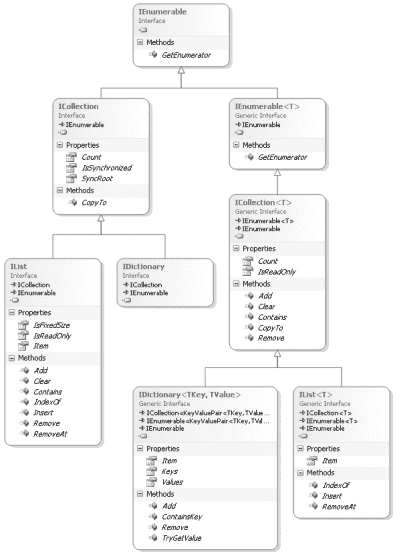

### 图 16.1：泛型集合接口层次结构

使用这些接口可以建立诸如使用 foreach 循环遍历集合、为集合编制索引以及确定集合中元素总数等功能。本节将从图 16.1 的底部开始，自下而上地探讨这些接口。

### IList<T> 与 IDictionary<TKey, TValue>

从某种意义上说，列表只是字典的特例，其中“键”始终是整数，且键集始终是从零开始的连续非负整数集合。但这足以成为显著差异，因此值得使用完全不同的类来表示它。在选择集合类时，首先要查找的两个接口是 `IList<T>` 和 `IDictionary<TKey, TValue>`。这些接口决定集合类型是侧重于通过索引检索还是通过键检索。如果使用的集合类型应以键为中心，请使用实现 `IDictionary<TKey, TValue>` 接口的集合类。或者，`IList<T>` 接口提供通过索引检索元素的支持。换句话说，尽管这两个接口都要求实现索引器，但其实现根本不同。在 `IList<T>` 的情况下，传递给数组运算符的参数对应于正在检索的元素的索引，即列表中的第 *n* 个元素。在 `IDictionary<TKey, TValue>` 接口的情况下，参数对应于先前插入的元素的键。使用键进行赋值时，如果指定键不存在，则会插入新项。

### IComparable<T>

在讨论图 16.1 中的下一个接口之前，我需要讨论一个不出现在图中但对 `IList<T>` 和 `IDictionary<TKey, TValue>` 同样重要的接口。`IComparable<T>` 接口对于实现这些接口的类执行任何排序操作都至关重要。例如，如果调用 `List<T>.Sort()` 方法，则需要一种手段来比较对象以确定其顺序。一种方法是通过 `IComparable<T>` 接口。该接口具有一个方法 `CompareTo()`。它返回一个整数，指示传递的元素是大于、小于还是等于当前元素。要使此操作正常工作，键数据类型需要实现 `IComparable<T>`。

### 高级主题

### 使用 IComparer<T> 进行排序

处理自定义排序的另一种方法是将实现 `IComparer<T>` 的元素传递给排序方法。该接口执行的功能类似


与 IComparable<T> 相比，但通常不直接由被收集的元素支持。例如，考虑为 Contact 提供 IComparable<T>.CompareTo() 方法。将使用什么排序顺序：年龄；姓氏；居住国家？问题在于排序顺序是变化的，因此，直接在 Contact 类上提供一个比较方法将是一个任意的选择。

更合适的解决方案是为每个比较实现提供一个特殊的排序类。比较方法不再在排序类实例和单个 Contact 实例之间执行比较，而是接受两个 Contact 参数，并在这两个实例之间执行比较。清单 16.1 展示了 LastName, FirstName 比较的示例实现。

## LISTING 16.1: Implementing IComparer<T>

```csharp
class Contact
{
    public string FirstName { get; set; }
    public string LastName { get; set; }
}
using System;
using System.Collections.Generic;
class NameComparer : IComparer<Contact>
{
    public int Compare(Contact x, Contact y)
    {
        int result;
        if (Contact.ReferenceEquals(x, y))
        {
            result = 0;
        }
        else
        {
            if (x == null)
            {
                result = 1;
            }
            else if (y == null)
            {
                result = -1;
            }
            else
            {
                result = String.Compare(x.LastName, y.LastName);
                if (result == 0)
                {
                    result =
                        String.Compare(x.FirstName, y.FirstName);
                }
            }
        }
        return result;
    }

    private static int StringCompare(string x, string y)
    {
        int result;
        if (x == null)
        {
            if (y == null)
            {
                result = 0;
            }
            else
            {
                result = 1;
            }
        }
        else
        {
            result = x.CompareTo(y);
        }
        return result;
    }
}
```

要使用新的 Compare() 函数，请将其传递给排序方法，例如 List<Contact>.Sort(IComparer<Contact> comparer)。

## ICollection<T>

IList<T> 和 IDictionary<TKey, TValue> 都实现了 ICollection<T>。既不实现 IList<T> 也不实现 IDictionary<TKey, TValue> 的集合更有可能实现 ICollection<T>（虽然不一定，因为集合可以实现较低要求的 IEnumerable 或 IEnumerable<T>）。

ICollection<T> 派生自 IEnumerable<T>，包含两个成员：Count 和 CopyTo()。

- Count 属性返回集合中元素的总数。起初，这似乎足以使用 for 循环遍历集合中的每个元素，但要实现这一点，集合还需要支持按索引检索，而 ICollection<T> 接口不包括此功能（尽管 IList<T> 包括它）。

- CopyTo() 方法提供将集合转换为数组的功能。该方法包含一个索引参数，以便您可以指定在目标数组中插入元素的位置。请注意，要使用该方法，必须用足够的容量初始化目标数组，从索引开始，以容纳 ICollection<T> 中的所有元素。

## 主要集合类

有五个关键的集合类别，它们在数据插入、存储和检索方式上有所不同。每个泛型类都位于 System.Collections.Generic 命名空间中，而它们的非泛型等效类位于 System.Collections 命名空间中。

## 列表集合：List<T>

List<T> 类具有类似于数组的属性。关键区别在于，这些类会随着元素数量的增加而自动扩展。（相比之下，数组大小是固定的。）此外，列表可以通过显式调用 TrimToSize() 或 Capacity 来缩小（参见图 16.2）。

这些类被归类为列表集合，其区别功能在于每个元素都可以像数组一样通过索引单独访问。因此，您可以使用索引运算器在列表集合类中设置和访问元素，其中索引参数值对应集合中元素的位置。清单 16.2 显示了一个示例，输出 16.1 显示了结果。

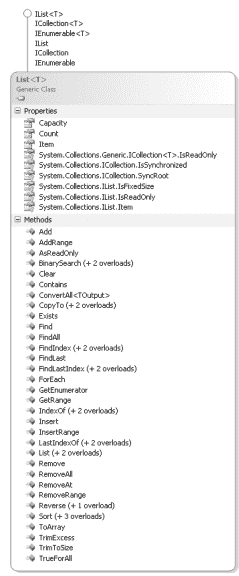

图 16.2: List<> 类图

## LISTING 16.2: Using List<T>

```csharp
using System;
using System.Collections.Generic;

class Program
{
    static void Main()
    {
        List<string> list = new List<string>();
        // lists automatically expand as elements
        // are added.
        list.Add("Sneezy");
        list.Add("Happy");
        list.Add("Dopey");
        list.Add("Doc");
        list.Add("Sleepy");
        list.Add("Bashful");
        list.Add("Grumpy");

        list.Sort();

        Console.WriteLine(
            "In alphabetical order {0} is the " +
            "first dwarf while {1} is the last.",
            list[0], list[6]);
        list.Remove("Grumpy");
    }
}
```

## 输出 16.1:

> 按字母顺序，Bashful 是第一个矮人，而 Sneezy 是最后一个。

C# 是基于零的索引；因此，清单 16.2 中的索引 0 对应第一个元素，索引 6 表示第七个元素。按索引检索元素不涉及搜索。它涉及到内存中位置的快速简单“跳转”操作。

使用 Add() 方法时，元素保持添加它们的顺序。因此，在清单 16.2 中调用 Sort() 之前，“Sneezy”排第一，“Grumpy”排最后。虽然 List<T> 支持 Sort() 方法，但没有规定所有列表集合都需要这样的方法。

不支持在添加元素时自动排序。换句话说，需要显式调用 Sort() 才能对元素进行排序（项必须实现 IComparable）。要删除元素，请使用 Remove() 方法。

要在 List<T> 中搜索特定元素，请使用 Contains()、IndexOf()、LastIndexOf() 和 BinarySearch() 方法。前三个方法在数组中搜索，从第一个元素开始（LastIndexOf() 从最后一个元素开始），并检查每个元素，直到找到等效元素为止。这些算法的执行时间与在命中之前搜索的元素数量成正比。请注意，集合类不要求集合中的所有元素都是唯一的。如果集合中有两个或多个相同的元素，则 IndexOf() 返回第一个索引，LastIndexOf() 返回最后一个索引。BinarySearch() 使用二分查找算法，并要求元素已排序。BinarySearch() 方法的一个有用功能是，如果未找到元素，则返回负整数。此值的按位补码 (~) 是大于所查找元素的下一个元素的索引，或者如果没有更大的值，则为元素总数。这提供了一种方便的方法，在特定位置将新值插入列表，以保持排序（参见清单 16.3）。

## LISTING 16.3: Using the Bit Complement of the BinarySearch() Result

```csharp
using System;
using System.Collections.Generic;

class Program
{
    static void Main()
    {
        List<string> list = new List<string>();
        int search;

        list.Add("public");
        list.Add("protected");
        list.Add("private");

        list.Sort();

        search = list.BinarySearch("protected internal");
        if (search < 0)
        {
            list.Insert(~search, "protected internal");
        }

        foreach (string accessModifier in list)
        {
            Console.WriteLine(accessModifier);
        }
    }
}
```

请注意，如果列表未首先排序，则即使元素在列表中，也不一定能找到它。清单 16.3 的结果显示在输出 16.2 中。

## 输出 16.2:

```
private
protected
internal
public
```

## 高级主题

## 使用 FindAll() 查找多个项

有时您必须在列表中查找多个项，并且搜索条件比查找特定值更复杂。为了支持这一点，System.Collections.Generic.List<T> 包含一个 FindAll() 方法。FindAll() 接受 Predicate<T> 类型的参数，这是对名为委托的方法的引用。清单 16.4 演示了如何使用 FindAll() 方法。

## 清单 16.4: 演示 FindAll() 及其 Predicate 参数

```csharp
using System;
using System.Collections.Generic;

class Program
{
    static void Main()
    {
        List<int> list = new List<int>();
        list.Add(1);
        list.Add(2);
        list.Add(3);
        list.Add(2);
        list.Add(2);

        List<int> results = list.FindAll(Even);

        foreach(int number in results)
        {
            Console.WriteLine(number);
        }
    }

    public static bool Even(int value)
    {
        return (value % 2) == 0;
    }
}
```

在清单 16.4 对 FindAll() 的调用中，您传递一个委托实例 Even()。当整数参数值为偶数时，此方法返回 true。


FindAll() 接受委托实例，并对列表中的每个项目调用 Even()（此示例使用 C# 2.0 的委托类型推断）。每次返回 true 时，它会将其添加到新的 List<T> 实例中，并在检查完 IList 中的每个项目后返回该实例。关于委托的完整讨论在第 12 章。

## 字典集合：Dictionary<TKey, TValue>

另一类集合类是字典类——具体来说，就是 Dictionary<TKey, TValue>（参见图 16.3）。与列表集合不同，字典类存储名称/值对。名称充当唯一键，可用于查找相应元素，其方式类似于使用主键访问数据库中的记录。这增加了字典元素访问的复杂性，但由于按键查找是高效操作，因此这是一个有用的集合。请注意，键可以是任何数据类型，而不仅仅是字符串或数值。

- Dictionary<TKey, TValue>
- IDictionary<TKey, TValue>
- IEnumerable<KeyValuePair<TKey, TValue>>
- IEnumerable
- ICollection
- IDictionary
- IEnumerable
- IDeserializable
- ISerializable
- IDeserializationCallback

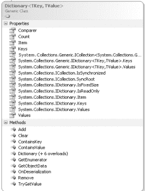

### 图 16.3：字典类图

向字典中插入元素的一种方法是使用 Add() 方法，同时传递键和值，如清单 16.5 所示。

### 清单 16.5：向 Dictionary<TKey, TValue> 添加项

```csharp
using System;
using System.Collections.Generic;

class Program
{
    static void Main()
    {
        Dictionary<Guid, string> dictionary =
            new Dictionary<Guid, string>();
        Guid key = Guid.NewGuid();

        dictionary.Add(key, "object");
    }
}
```

清单 16.5 使用 Guid 作为键插入字符串 "object"。如果已添加具有相同键的元素，则会引发异常。

另一种方法是使用索引器，如清单 16.6 所示。

### 清单 16.6：使用索引运算符向 Dictionary<TKey, TValue> 插入项

```csharp
using System;
using System.Collections.Generic;

class Program
{
    static void Main()
    {
        Dictionary<Guid, string> dictionary =
            new Dictionary<Guid, string>();
        Guid key = Guid.NewGuid();

        dictionary[key] = "object";
        dictionary[key] = "byte";
    }
}
```

在清单 16.6 中首先要注意的是，索引运算符不需要整数。相反，索引数据类型由第一个类型参数 TKey 指定，在声明 Dictionary<TKey, TValue> 变量时确定。在此示例中，使用的键数据类型是 Guid，值数据类型是 string。

在清单 16.6 中其次要注意的是，同一索引被重复使用。在第一次赋值中，没有字典元素对应于 key。与数组不同，字典集合类不会引发越界异常，而是插入一个新对象。在第二次赋值期间，具有指定键的元素已存在，因此不是插入额外元素，而是将对应于 key 的现有元素从 "object" 更新为 "byte"。

使用索引运算符 ([]) 和不存在的键从字典中访问值时，会引发类型为 System.Collections.Generic.KeyNotFoundException 的异常。但是，ContainsKey() 方法允许您在访问其值之前检查是否使用了特定键，从而避免异常。此外，由于键存储在哈希表中，搜索相对高效。

相比之下，检查字典中是否存在特定值是一个耗时操作，具有线性性能特征。为此，您使用 ContainsValue() 方法，它会顺序搜索集合中的每个元素。

您使用 Remove() 方法删除字典元素，传递键而不是元素值。

字典类没有特定顺序。元素使用哈希码排列在哈希表中，以便快速检索（通过对键调用 GetHashCode() 获得）。因此，使用 foreach 循环遍历字典类时，访问值的顺序不固定。因为向字典添加元素需要同时提供键和元素值，所以 foreach 循环返回的数据类型对于 Dictionary<TKey, TValue> 是 KeyValuePair<TKey, TValue>。清单 16.7 展示了使用 Dictionary<TKey, TValue> 集合类的 foreach 循环的代码片段。输出显示在输出 16.3 中。

### 清单 16.7：使用 foreach 遍历 Dictionary<TKey, TValue>

```csharp
using System;
using System.Collections.Generic;

class Program
{
   static void Main()
{
Dictionary<string,string> dictionary = new
Dictionary<string,string>();

int index = 0;

dictionary.Add(index++.ToString(), "object");
dictionary.Add(index++.ToString(), "byte");
dictionary.Add(index++.ToString(), "uint");
dictionary.Add(index++.ToString(), "ulong");
dictionary.Add(index++.ToString(), "float");
dictionary.Add(index++.ToString(), "char");
dictionary.Add(index++.ToString(), "bool");
dictionary.Add(index++.ToString(), "ushort");
dictionary.Add(index++.ToString(), "decimal");
dictionary.Add(index++.ToString(), "int");
dictionary.Add(index++.ToString(), "sbyte");
dictionary.Add(index++.ToString(), "short");
dictionary.Add(index++.ToString(), "long");
dictionary.Add(index++.ToString(), "void");
dictionary.Add(index++.ToString(), "double");
dictionary.Add(index++.ToString(), "string");

Console.WriteLine("Key Value Hashcode");
Console.WriteLine("--- ----- --------");

foreach (KeyValuePair<string, string> i in dictionary)
{
Console.WriteLine("{0,-5}{1,-9}{2}", i.Key, i.Value, i.Key.GetHashCode());
}
}
```

### 输出 16.3:

| 键 | 值 | 哈希码 |
|---|---|---|
| 0 | object | -843952752 |
| 1 | byte | -623352753 |
| 2 | uint | -642352754 |
| 3 | ulong | -842352755 |
| 4 | float | -842352756 |
| 5 | char | -842352757 |
| 6 | bool | -843952758 |
| 7 | ushort | -843952759 |
| 8 | decimal | -642352744 |
| 9 | int | -842352745 |
| 10 | sbyte | -842352749 |
| 11 | short | -643446585 |
| 12 | long | -843532401 |
| 13 | void | -843597937 |
| 14 | double | -843663473 |
| 15 | string | -843721009 |

如果您只想处理字典类中的键或元素，可以通过 Keys 和 Values 属性访问它们。这些属性返回的数据类型为 ICollection<T>。这些属性返回的数据是对原始字典集合中数据的引用，因此字典中的更改会自动反映在 Keys 和 Values 属性返回的 ICollection 类型中。

## 排序集合：SortedDictionary<TKey, TValue> 和 SortedList<T>

排序集合类（参见图 16.4）与未排序实现的区别在于，SortedDictionary<TKey, TValue> 的元素按键排序，而 SortedList<T> 的元素按值排序。（还有一个非泛型 SortedList 实现。）对排序集合的 foreach 迭代返回按键顺序排序的元素（参见清单 16.8）。

### 清单 16.8：使用 SortedDictionary<TKey, TValue>

```csharp
using System;
using System.Collections.Generic;

class Program
{
    static void Main()
    {
        SortedDictionary<string, string> sortedDictionary =
            new SortedDictionary<string, string>();

        int index = 0;

        sortedDictionary.Add(index++.ToString(), "object");
        // ...
        sortedDictionary.Add(index++.ToString(), "string");

        Console.WriteLine("Key Value Hashcode");
        Console.WriteLine("--- ----- --------");
        foreach (
            KeyValuePair<string, string> i in sortedDictionary)
        {
            Console.WriteLine("{0,-5}{1,-9}{2}",
                i.Key, i.Value, i.Key.GetHashCode());
        }
    }
}
```

清单 16.8 的结果显示在输出 16.4 中。


## 输出 16.4:

| 键 | 值 | 哈希码 |
|-----|-------|----------|
| 0 | object | -842352752 |
| 1 | byte | -642352753 |
| 10 | sbyte | -843401329 |
| 11 | short | -493463665 |
| 12 | long | -642352761 |
| 13 | ushort | -435997937 |
| 14 | double | -643653473 |
| 15 | string | -843720009 |
| 2 | uint | -642352754 |
| 3 | ulong | -42352755 |
| 4 | float | -642352756 |
| 5 | char | -642352757 |
| 6 | bool | -842352758 |
| 7 | ushort | -842352759 |
| 8 | decimal | -842352744 |
| 9 | int | -642352745 |

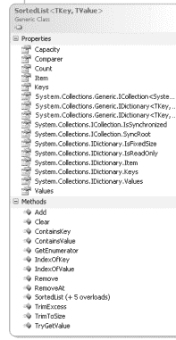

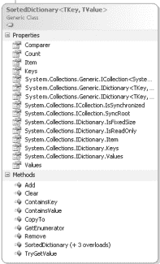

## 图 16.4: SortedList<> 和 SortedDictionary<> 类图

请注意，键（而非值）中的元素按字母顺序而非数值顺序排列，因为键的数据类型是字符串，而非整数。

与前面描述的普通字典类相比，在有序字典集合中插入或删除元素时，维护集合内的顺序会略微增加执行时间。从行为上看，有两个内部数组，一个用于键检索，一个用于索引检索。在 System.Collections.Sorted 排序列表中，通过 GetByIndex() 和 SetByIndex() 方法支持索引。使用 System.Collections.Generic.SortedList<TKey, TValue> 时，Keys 和 Values 属性分别返回 IList<TKey> 和 IList<TValue> 实例。这些方法使排序列表既能作为字典，也能作为列表类型集合。

## 堆栈集合：Stack<T>

第 11 章讨论了堆栈集合类（参见图 16.5）。堆栈集合类设计为后进先出（LIFO）集合。两个关键方法是 Push() 和 Pop()。

- Push() 将元素放入集合。元素不必是唯一的。
- Pop() 按添加的相反顺序检索并删除元素。

要在不修改堆栈的情况下访问堆栈上的元素，请使用 Peek() 和 Contains() 方法。Peek() 方法返回 Pop() 将检索的下一个元素。

与大多数集合类一样，使用 Contains() 方法来确定元素是否存在于堆栈中的任何位置。与所有集合一样，也可以使用 foreach 循环遍历堆栈中的元素。这允许你从堆栈的任何位置访问值。但是，请注意，通过 foreach 循环访问值不会将其从堆栈中删除。只有 Pop() 提供此功能。

## 队列集合：Queue<T>

图 16.6 所示的队列集合类与堆栈集合类相同，只是它们遵循先进先出（FIFO）的排序模式。Enqueue() 和 Dequeue() 方法取代了 Pop() 和 Push() 方法。队列集合的行为类似于循环数组或管道。你使用 Enqueue() 方法将对象放入队列的一端，并使用 Dequeue() 方法从另一端将其移除。与堆栈集合类一样，对象不必是唯一的，并且队列集合类会根据需要自动增大大小。当数据不再需要时，使用 TrimToSize() 方法恢复容量。

## 链表：LinkedList<T>

此外，System.Collections.Generic 支持一种链表集合，可实现正向和反向遍历。图 16.7 显示了类图。请注意，没有相应的非泛型类型。

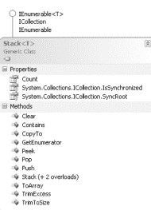

图 16.5: Stack<T> 类图

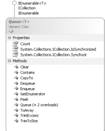

图 16.6: Queue<T> 类图

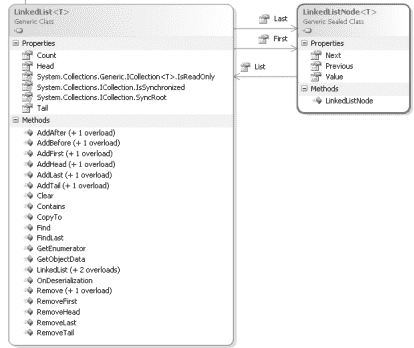

图 16.7: LinkedList<T> 和 LinkedListNode<T> 类图

## 提供索引运算符

常见集合接口为实现自定义集合所需的成员提供了大部分基础。但是，还有一个成员：索引运算符。

索引运算符是一对通常用于对集合进行索引的方括号。这不仅适用于每种集合类型，而且也是程序员可以添加到自定义类中的成员。清单 16.9 展示了使用 Pair<T> 的示例。

## 清单 16.9: 定义索引运算符

```
interface IPair<T>
{
    T First
    {
        get;
    }

    T Second
    {
        get;
    }

    T this[PairItem index]
    {
        get;
    }
}

public enum PairItem
{
    First,
    Second
}

public struct Pair<T> : IPair<T>
{
    public Pair(T first, T second)
    {
        _first = first;
        _second = second;
    }
    public T First
    {
        get { return _first; }
        private set { _first = value; }
    }
    private T _first;
    public T Second
    {
        get { return _second; }
        private set { _second = value; }
    }
    private T _second;
    public T this[PairItem index]
    {
        get
        {
            switch (index)
            {
                case PairItem.First:
                    return First;
                case PairItem.Second:
                    return Second;
                default:
                    throw new NotImplementedException(
                    string.Format(
                    "The enum {0} has not been implemented",
                    index.ToString())));
            }
        }

        set
        {
            switch (index)
            {
                case PairItem.First:
                    First = value;
                    break;
                case PairItem.Second:
                    Second = value;
                    break;
                default:
                    throw new NotImplementedException(
                    string.Format(
                    "The enum {0} has not been implemented",
                    index.ToString())));
            }
        }
    }
}
```

要定义索引运算符，必须将成员命名为 this，并跟随标识参数的方括号。实现类似于带有 get 和 set 块的属性。如清单 16.9 所示，参数不必是 int，事实上，索引可以接受多个参数，甚至可以重载。此示例使用枚举来降低调用者为不存在的项提供索引的可能性。

C# 编译器从索引运算符生成的结果 CIL 代码是一个名为 Item 的特殊属性，该属性接受参数。在 C# 中，不能显式创建接受参数的属性，因此 Item 属性在此方面是唯一的。这是因为任何带有标识符 Item 的其他成员，即使具有完全不同的签名，也会与编译器创建的成员冲突，因此不允许。

## 高级主题

## 使用 IndexerName 分配索引器属性名称

如前所述，索引器的 CIL 属性名称默认为 Item。但是，使用 IndexerNameAttribute 可以指定不同的名称。例如，清单 16.10 将名称更改为 "Entry"。

## 清单 16.10: 更改索引器的默认名称

```
[System.Runtime.CompilerServices.IndexerName("Entry")]
public T this[params PairItem[] branches]
{
    // ...
}
```

这对索引的 C# 调用者没有区别，但它为不直接支持索引器的语言指定了名称。

编译器会使用此特性并修改生成的 CIL 代码。

该特性本身不会出现在 CIL 输出中，因此无法通过反射访问。

## 高级主题

## 定义带可变参数的索引运算符

索引运算符也可以接受可变参数列表。例如，清单 16.11 为第 11 章（以及下一节）中讨论的 BinaryTree<T> 定义了一个索引运算符。

## 清单 16.11: 定义带可变参数的索引运算符

```
using System;
using System.Collections.Generic;

public class BinaryTree<T>:
    IEnumerable<T>
{
    // ...

    public T this[params PairItem[] branches]
    {
        get
        {
            BinaryTree<T> currentNode = this;
            int totalLevels =
                (branches == null) ? 0 : branches.Length;
            int currentLevel = 0;

            while (currentLevel < totalLevels)
            {
                currentNode = currentNode.SubItems[
                    branches[currentLevel]];
                if (currentNode == null)
```


{
    // The binary tree at this location is null.
    throw new IndexOutOfRangeException();
}
currentLevel++;
}
return currentNode.Value;
}
set
{
    // ...
}
}
}

branches 中的每个项目都是一个 PairItem，并指示在二叉树中应导航到哪个分支。

## 返回 null 或空集合

返回数组或集合时，必须通过返回 null 或一个不包含任何项的集合实例来指示项数为零。通常更好的选择是返回一个不包含任何项的集合实例。这样做可以避免强制调用者在遍历集合中的项之前检查是否为 null。例如，对于大小为零的 IEnumerable<T> 集合，调用者可以立即安全地对集合使用 foreach 循环，而无需担心生成的 GetEnumerator() 调用会引发 NullReferenceException。

偏离此准则的少数情况之一是，当 null 有意表示与零项不同的含义时。例如，字符串类型电话号码的 null 值可能表示电话号码未设置，而空字符串可以明确表示没有电话号码。

## 迭代器

本章前面详细介绍了 foreach 循环的内部工作原理。本节讨论如何使用迭代器为自定义集合创建 IEnumerable<T> 和非泛型 IEnumerable 接口的自有实现。迭代器提供了简洁的语法来指定如何遍历集合类中的数据，尤其是使用 foreach 循环时。迭代器允许集合的最终用户在不了解其内部结构的情况下导航该结构。

### 高级主题

### 迭代器的起源

1972 年，Barbara Liskov 及其在 MIT 的科学家团队开始研究编程方法论，专注于用户定义的数据抽象。为了证明其大部分工作，他们创建了一种名为 CLU 的语言，该语言具有名为“clusters”的概念（CLU 是其前三个字母），这是程序员今天使用的主要数据抽象（即对象）的前身。作为研究的一部分，该团队意识到，尽管他们能够使用 CLU 语言将某些数据表示从其类型的最终用户中抽象出来，但他们始终发现自己必须揭示数据的内部结构，才能让其他人智能地使用它。在困惑中，诞生了一种名为迭代器的语言构造。（CLU 语言为后来被称为面向对象编程的事物提供了许多洞察。）

如果类希望使用 foreach 循环构造支持迭代，则必须实现枚举器模式。如前一节所示，在 C# 中，foreach 循环构造由编译器根据从 IEnumerable<T> 接口获取的 IEnumerable<T> 接口展开为 while 循环构造。

枚举器模式的问题在于手动实现可能很麻烦，因为它维护一个内部状态机。对于列表集合类型类，这个内部状态机可能很简单，但对于需要递归遍历的数据结构（例如二叉树），状态机可能非常复杂。为了克服实现此模式所面临的挑战和工作量，C# 2.0 引入了一种构造，使类更容易规定 foreach 循环如何遍历其内容。

## 定义迭代器

迭代器是实现类方法的一种手段，它们是更复杂的枚举器模式的语法快捷方式。当 C# 编译器遇到迭代器时，它会将其内容展开为实现枚举器模式的 CIL 代码。因此，实现迭代器没有运行时依赖项。由于 C# 编译器通过 CIL 代码生成来处理实现，使用迭代器没有真正的运行时性能优势。但是，与手动实现枚举器模式相比，选择迭代器可以显著提高程序员的生产力。要开始，下一节将探讨如何在代码中定义迭代器。

## 迭代器语法

迭代器提供了迭代器接口的简写实现，即 `IEnumerable<T>` 和 `IEnumerator<T>` 接口的组合。清单 16.12 通过创建 `GetEnumerator()` 方法为泛型 `BinaryTree<T>` 类型声明了一个迭代器。接下来，您将为迭代器接口添加支持。

### 清单 16.12：迭代器接口模式

```csharp
using System;
using System.Collections.Generic;

public class BinaryTree<T>:
    IEnumerable<T>
{
    public BinaryTree ( T value )
    {
        Value = value;
    }

    #region IEnumerable<T>
    public IEnumerator<T> GetEnumerator()
    {
        ...
    }
    #endregion IEnumerable<T>

    public T Value
    {
        get{ return _value; }
        set{ _value = value; }
    }
}
private T _value;

public Pair<BinaryTree<T>> SubItems
{
    get{ return _subItems; }
    set{ _subItems = value; }
}

private Pair<BinaryTree<T>> _subItems;

}

public struct Pair<T>
{
    public Pair(T first, T second)
    {
        _first = first;
        _second = second;
    }

    public T First
    {
        get{ return _first; }
        private set{_first = value; }
    }

    private T _first;
    public T Second
    {
        get{ return _second; }
        private set{_second = value; }
    }

    private T _second;
}
```

首先，添加 IEnumerable<T>.GetEnumerator() 方法的声明。

## 从迭代器产生值

迭代器类似于函数，但它们不是返回值，而是产生值。对于 BinaryTree<T>，迭代器的产生类型对应于类型参数 T。如果使用非泛型版本的 IEnumerator，则返回类型将改为 object。为了正确实现迭代器模式，需要维护一个内部状态机，以便在枚举集合时跟踪当前位置。在 BinaryTree<T> 的情况下，需要跟踪树中哪些元素已被枚举，哪些尚未枚举。

迭代器具有内置状态机，用于跟踪当前元素和下一个元素。每次迭代器遇到 yield return 语句时，它都会返回一个值。然后，当下一次迭代开始时，代码将从上一个 yield return 语句之后立即开始执行。在清单 16.13 中，您将按顺序返回 C# 原始数据类型关键字。

### 清单 16.13：按顺序产生 C# 关键字

```csharp
using System;
using System.Collections.Generic;

public class CSharpPrimitiveTypes: IEnumerable<string>
{
    public IEnumerator<string> GetEnumerator()
    {
        yield return "object";
        yield return "byte";
        yield return "uint";
        yield return "ulong";
        yield return "float";
        yield return "char";
        yield return "bool";
        yield return "ushort";
        yield return "decimal";
        yield return "int";
        yield return "sbyte";
        yield return "short";
        yield return "long";
        yield return "void";
        yield return "double";
        yield return "string";
    }

    // IEnumerator also required because IEnumerable<T>
    // derives from it.
    System.Collections.IEnumerator
    System.Collections.IEnumerable.GetEnumerator()
    {
        // Invoke IEnumerable<string>.GetEnumerator() above
        return GetEnumerator();
    }
}

public class Program
{
    static void Main()
    {
        CSharpPrimitiveTypes primitives =
        new CSharpPrimitiveTypes();
        foreach (string primitive in primitives)
        {
            Console.WriteLine(primitive);
        }
    }
}
```

清单 16.13 的结果显示在输出 16.5 中。

### 输出 16.5：

```
object
byte
uint
ulong
float
char
bool
ushort
decimal
int
sbyte
short
long
void
double
string
```

此清单的输出是 C# 原始类型的列表。1

## 迭代器与状态

当迭代器首次在 foreach 语句中被调用时（例如清单 16.13 中的 foreach (string primitive in primitives)），其状态在枚举器中初始化。只要调用站点的 foreach 语句继续执行，迭代器就会维护其状态。当您产生一个值、处理它并恢复调用站点的 foreach 语句时，迭代器将从上次循环中断开的地方继续执行，并

1. 在 C# 2.0 编译器的 alpha 版本中，yield 是一个关键字，而不是上下文关键字。但是，此类更改可能会导致 C# 1.0 和 C# 2.0 之间不兼容。相反，yield 成为必须出现在 return 之前的上下文关键字。因此，未发生任何代码破坏性更改，因为 C# 1.0 不允许在 return 关键字之前出现任何文本（注释除外）。


继续处理。当调用站点处的 foreach 语句终止时，迭代器的状态不再保存。由于生成的代码永远不会重置迭代器的状态，而是在需要时创建一个新的迭代器，因此再次调用迭代器始终是安全的。

图 16.8 显示了发生情况的高级序列图。请记住，MoveNext() 方法出现在 IEnumerable<T> 接口上。

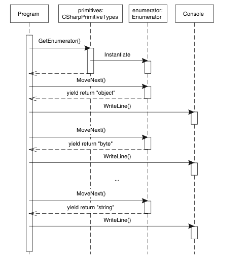

图 16.8: 带 yield return 的序列图

## 更多迭代器示例

在修改 BinaryTree<T> 之前，必须使用迭代器修改 Pair<T> 以支持 IEnumerable<T> 接口。清单 16.14 是一个示例，用于生成 Pair<T> 中的每个元素。

## 清单 16.14: 使用 yield 实现 BinaryTree<T>

```csharp
public struct Pair<T>: IPair<T>,
    IEnumerable<T>
{
    public Pair(T first, T second)
    {
        _first = first;
        _second = second;
    }

    public T First
    {
        get { return _first; }
        private set { _first = value; }
    }

    private T _first;
    public T Second
    {
        get { return _second; }
        private set { _second = value; }
    }

    private T _second;

#region IEnumerable<T>
public IEnumerator<T> GetEnumerator()
{
    yield return First;
    yield return Second;
}
#endregion IEnumerable<T>

#region IEnumerable Members
System.Collections.IEnumerator System.Collections.IEnumerable.GetEnumerator()
{
    return GetEnumerator();
}
#endregion
}
```

在清单 16.14 中，对 Pair<T> 数据类型的迭代循环两次：首先通过 yield return First，然后通过 yield return Second。每次在 GetEnumerator() 中遇到 yield return 语句时，状态都会被保存，执行似乎会“跳出” GetEnumerator() 方法上下文并进入调用站点上下文。当第二次迭代开始时，GetEnumerator() 将再次开始执行，使用 yield return Second 语句。

System.Collections.Generic.IEnumerable<T> 继承自 System.Collections.IEnumerable。因此，在实现 IEnumerable<T> 时，也有必要实现 IEnumerable。在清单 16.14 中，您是这样显式实现的，实现仅涉及对 IEnumerable<T> 的 GetEnumerator() 实现的调用。由于 IEnumerable<T> 和 IEnumerable 之间的类型兼容性（通过继承），从 IEnumerable.GetEnumerator() 到 IEnumerable<T>.GetEnumerator() 的调用始终有效。由于两个 GetEnumerator() 的签名相同（返回类型不区分签名），一个或两个实现必须是显式的。考虑到 IEnumerable<T> 版本提供的额外类型安全，您显式实现 IEnumerable 的实现。

清单 16.15 使用 Pair<T>.GetEnumerator() 方法，并在两行连续显示 "Inigo" 和 "Montoya"。

## 清单 16.15: 通过 foreach 使用 Pair<T>.GetEnumerator()

```csharp
Pair<string> fullname = new Pair<string>("Inigo", "Montoya");
foreach (string name in fullname)
{
    Console.WriteLine(name);
}
```

请注意，foreach 循环中对 GetEnumerator() 的调用是隐式的。

## 在循环中放置 yield return

无需像在 CSharpPrimitiveTypes 和 Pair<T> 中那样对每个 yield return 语句进行硬编码。使用 yield return 语句，您可以从循环构造内部返回值。清单 16.16 使用 foreach 循环。每次在 GetEnumerator() 中执行 foreach 时，它都会返回下一个值。

## 清单 16.16: 在循环中放置 yield return 语句

```csharp
public class BinaryTree<T>: IEnumerable<T>
{
    // ...

    #region IEnumerable<T>
    public IEnumerator<T> GetEnumerator()
    {
        // Return the item at this node.
        yield return Value;

        // Iterate through each of the elements in the pair.
        foreach (BinaryTree<T> tree in SubItems)
        {
            if (tree != null)
            {
                // Since each element in the pair is a tree,
                // traverse the tree and yield each
                // element.
                foreach (T item in tree)
                    yield return item;
            }
        }
    }

    #endregion IEnumerable<T>

#region IEnumerable Members
System.Collections.IEnumerator System.Collections.IEnumerable.GetEnumerator()
{
    return GetEnumerator();
}
#endregion
}
```

在清单 16.16 中，第一次迭代返回二叉树中的根元素。在第二次迭代期间，您遍历子元素对。如果子元素对包含非 null 值，则您遍历到该子节点并生成其元素。请注意，foreach(T item in tree) 是对子节点的递归调用。

与 CSharpPrimitiveTypes 和 Pair<T> 观察到的一样，您现在可以使用 foreach 循环遍历 BinaryTree<T>。清单 16.17 演示了这一点，输出 16.6 显示了结果。

## 清单 16.17: 将 foreach 与 BinaryTree<string> 一起使用

```csharp
// JFK
jfkFamilyTree = new BinaryTree<string>(
    "John Fitzgerald Kennedy");
jfkFamilyTree.SubItems = new Pair<BinaryTree<string>>(
    new BinaryTree<string>("Joseph Patrick Kennedy"),
    new BinaryTree<string>("Rose Elizabeth Fitzgerald"));
// Grandparents (Father's side)
jfkFamilyTree.SubItems.First.SubItems =
    new Pair<BinaryTree<string>>(
        new BinaryTree<string>("Patrick Joseph Kennedy"),
        new BinaryTree<string>("Mary Augusta Hickey")));
// Grandparents (Mother's side)
jfkFamilyTree.SubItems.Second.SubItems =
    new Pair<BinaryTree<string>>(
        new BinaryTree<string>("John Francis Fitzgerald"),
        new BinaryTree<string>("Mary Josephine Hannon")));
foreach (string name in jfkFamilyTree)
    Console.WriteLine(name);
}
```

输出 16.6:
John Fitzgerald Kennedy
Joseph Patrick Kennedy
Patrick Joseph Kennedy
Mary Augusta Hickey
Rose Elizabeth Fitzgerald
John Francis Fitzgerald
Mary Josephine Hannon

## 初学者主题

### struct 与类

将 Pair<T> 定义为 struct 而不是 class 的一个有趣副作用是，SubItems.First 和 SubItems.Second 不能直接赋值。以下代码会产生编译错误，指出 SubItems 无法修改，“因为它不是变量”：

```csharp
jfkFamilyTree.SubItems.First =
    new BinaryTree<string>("Joseph Patrick Kennedy");
```

问题在于 SubItems 是 Pair<T> 类型（一个 struct）的属性。因此，当属性返回值时，会创建 _SubItems 的副本，在副本上赋值 First 而该副本在语句结束时立即丢失，这会产生误导。幸运的是，C# 编译器阻止了这种情况。

要解决此问题，请勿直接赋值（请参阅清单 16.17 中的方法），为 Pair<T> 使用 class 而不是 struct，不要创建 SubItems 属性而改用字段，或在 BinaryTree<T> 中提供直接访问 _SubItems 成员的属性。

### 取消进一步迭代：yield break

有时您可能希望取消进一步迭代。可以通过包含 if 语句来实现，以便不再执行代码中的任何后续语句。但是，您也可以跳回调用站点，导致 MoveNext() 返回 false。清单 16.18 显示了此类方法的示例。


## 清单 16.18: 通过 yield break 跳出迭代

```csharp
public System.Collections.Generic.IEnumerable<T>
    GetNotNullEnumerator()
{
    if ((First == null) || (Second == null))
        yield break;
    yield return Second;
    yield return First;
}
```

如果 `Pair<T>` 类中的任一元素为 null，此方法会取消迭代。

`yield break` 语句类似于在确定无工作可做时将 `return` 语句放在函数顶部。它是一种在不将所有剩余代码包裹在 `if` 块中的情况下退出后续迭代的方式。因此，它允许多个退出点，因此你应谨慎使用，因为代码的随意阅读可能会遗漏早期退出。

## 高级主题

### 迭代器的工作原理

当 C# 编译器遇到迭代器时，它会将代码展开为相应枚举器设计模式的 CIL。在生成的代码中，C# 编译器首先创建一个嵌套私有类来实现 `IEnumerable<T>` 接口，以及其 `Current` 属性和 `MoveNext()` 方法。`Current` 属性返回与迭代器返回类型对应的类型。`Pair<T>` 的清单 16.14 包含一个返回 `T` 类型的迭代器。C# 编译器检查迭代器中包含的代码，并在 `MoveNext` 方法和 `Current` 属性中创建必要的代码以模拟其行为。对于 `Pair<T>` 迭代器，C# 编译器生成大致等效的代码（请参见清单 16.19）。

## 清单 16.19: 迭代器编译器生成的 C# 代码的 C# 等效代码

```csharp
using System;
using System.Collections.Generic;

public class Pair<T> : IPair<T>, IEnumerable<T>
{
    // ...

    // The iterator is expanded into the following
    // code by the compiler
    public virtual IEnumerator<T> GetEnumerator()
    {
        __ListEnumerator result = new __ListEnumerator(0);
        result._Pair = this;
        return result;
    }

    public virtual System.Collections.IEnumerator
        System.Collections.IEnumerable.GetEnumerator()
    {
        return new GetEnumerator();
    }

    private sealed class __ListEnumerator<T> : IEnumerator<T>
    {
        public __ListEnumerator(int itemCount)
        {
            _ItemCount = itemCount;
        }

        Pair<T> _Pair;
        T _Current;
        int _ItemCount;

        public object Current
        {
            get
            {
                return _Current;
            }
        }

        public bool MoveNext()
        {
            switch (_ItemCount)
            {
                case 0:
                    _Current = _Pair.First;
                    _ItemCount++;
                    return true;
                case 1:
                    _Current = _Pair.Second;
                    _ItemCount++;
                    return true;
                default:
                    return false;
            }
        }
    }
}
```

由于编译器获取 yield return 语句并生成与你可能手动编写的内容相对应的类，C# 中的迭代器表现出与手动实现枚举器设计模式的类相同的性能特征。虽然没有性能改进，但获得的程序员生产力是显著的。

## 在单个类中创建多个迭代器

之前的迭代器示例实现了 IEnumerable<T>.GetEnumerator()。这是 foreach 隐式查找的方法。有时你可能想要不同的迭代序列，例如逆向迭代、筛选结果或迭代除默认以外的对象投影。你可以通过将它们封装在返回 IEnumerable<T> 或 IEnumerator 的属性或方法中，在类中声明其他迭代器。例如，如果你想逆向迭代 Pair<T> 的元素，则提供 GetReverseEnumerator() 方法，如清单 16.20 所示。

## 清单 16.20: 在返回 IEnumerable<T> 的方法中使用 yield return

```csharp
public struct Pair<T>: IEnumerable<T>
{
    ...

    public IEnumerable<T> GetReverseEnumerator()
    {
        yield return Second;
        yield return First;
    }
    ...
}

public void Main()
{
    Pair<string> game = new Pair<string>("Redskins", "Eagles");
    foreach (string name in game.GetReverseEnumerator())
    {
        Console.WriteLine(name);
    }
}
```

请注意，你返回的是 IEnumerable<T>，而不是 IEnumerator<T>。这与返回 IEnumerator<T> 的 IEnumerable<T>.GetEnumerator() 不同。Main() 中的代码演示了如何使用 foreach 循环调用 GetReverseEnumerator()。

## yield 语句特性

你只能在返回 IEnumerator<T> 或 IEnumerable<T> 类型（或其非泛型等效项）的成员中声明 yield return 语句。更具体地说，你只能在返回 IEnumerator<T> 的 GetEnumerator() 方法中，或在返回 IEnumerable<T> 但不名为 GetEnumerator() 的方法中使用 yield。

包含 yield return 语句的方法不能有简单的 return。如果方法使用 yield return 语句，则 C# 编译器会生成必要的代码来维护迭代器的状态机。相比之下，如果方法使用 return 语句而不是 yield return，则程序员负责维护自己的状态机并返回迭代器接口的一个实例。此外，就像带有返回类型的方法中的所有代码路径都必须包含带有值的 return 语句（假设它们不抛出异常）一样，迭代器中的所有代码路径如果要返回任何数据，都必须包含 yield return 语句。

会导致编译器错误的 yield 语句的其他限制如下。

- yield 语句不能出现在方法、运算符或属性访问器之外。
- yield 语句不能出现在匿名方法中（请参见第 12 章）。
- yield 语句不能出现在 try 语句的 catch 和 finally 子句中。此外，只有在没有 catch 块的情况下，yield 语句才能出现在 try 块中。

## 摘要

C# 2.0 提供的泛型集合类和接口在各方面都优于其非泛型对应物；通过避免装箱开销并在编译时强制执行类型规则，它们更快、更安全。除非你局限于 C# 1.0，否则应将 System.Collections 的整个命名空间视为过时（事实上，它已被完全从 Silverlight CLR 中排除）。换句话说，不要回头并必然删除所有已使用此命名空间的代码。相反，为任何新代码使用 System.Collections.Generic，并随着时间的推移，考虑将现有代码迁移到使用包含用于处理对象集合的接口和类的相应泛型集合。

提供 System.Collections.Generic 命名空间并非 C# 2.0 带给集合的唯一变化。另一个重要的补充是迭代器。迭代器涉及一个新的上下文关键字 yield，C# 使用它来生成底层 CIL 代码，以实现 foreach 循环使用的迭代器模式。

# 17

### 反射、特性和动态编程

特性是将其他元数据插入程序集并将元数据与类、方法或属性等编程构造关联的一种手段。本章探讨了框架内置特性的相关细节，以及如何定义自定义特性。为了利用自定义特性，有必要识别它们。这是通过反射来处理的。本章首先介绍反射，包括如何使用它在运行时动态绑定并使用编译时的名称调用成员。这通常在代码生成器等工具中执行。此外，当调用目标在执行时未知时，会使用反射。


本章以讨论动态编程结束，这是 C# 4.0 中添加的一项功能，它大大简化了处理动态数据的工作，这类数据需要运行时绑定而非编译时绑定。

## 反射

使用反射，可以执行以下操作：

- 访问程序集中类型的元数据。这包括完整类型名称、成员名称以及装饰该构造的任何属性等构造。
- 在运行时使用元数据动态调用类型的成员，而不是使用编译时定义的绑定。

反射是检查程序集中元数据的过程。传统上，当代码编译为机器语言时，关于代码的所有元数据（例如类型和方法名称）都会被丢弃。相比之下，当 C# 编译为 CIL 时，它会保留关于代码的大部分元数据。此外，使用反射，可以枚举程序集中的所有类型并搜索符合特定条件的类型。你通过 System.Type 的实例访问类型的元数据，该对象包括用于枚举类型实例成员的方法。此外，可以在检查类型的特定对象上调用这些成员。

反射功能使许多原本不可用的新范式成为可能。例如，反射使你能够枚举程序集中的所有类型及其成员，在此过程中为程序集 API 的文档创建存根。然后，你可以将从反射检索到的元数据与从 XML 注释（使用 /doc 开关）创建的 XML 文档相结合，以创建 API 文档。同样，程序员使用反射元数据生成代码，以将业务对象持久化（序列化）到数据库中。它还可以用于显示对象集合的列表控件。给定集合后，列表控件可以使用反射迭代集合中对象的所有属性，为每个属性在列表中定义一列。此外，通过调用每个对象上的每个属性，列表控件可以用对象中包含的数据填充每一行和每一列，即使对象的数据类型在编译时未知。XmlSerializer、ValueType 和 DataBinder 是框架中使用反射实现部分功能的几个类。

### 使用 System.Type 访问元数据

读取类型元数据的关键是获取表示目标类型实例的 System.Type 实例。System.Type 提供了检索类型信息的所有方法。你可以使用它来回答以下问题，

- 类型的名称是什么（Type.Name）？
- 该类型是否为公共类型（Type.IsPublic）？
- 该类型的基类型是什么（Type.BaseType）？
- 该类型是否支持任何接口（Type.GetInterfaces（））？
- 该类型定义在哪个程序集中（Type.Assembly）？
- 类型的属性、方法、字段等是什么（Type.GetProperties()、Type.GetMethods()、Type.GetFields() 等）？
- 装饰该类型的特性有哪些（Type.GetCustomAttributes（））？

还有更多此类成员，但总体而言，它们都提供关于特定类型的信息。关键是获取类型 Type 对象的引用，主要有两种方法：通过 object.GetType() 和 typeof()。请注意，GetMethods() 调用不返回扩展方法。它们仅作为实现类型上的静态成员可用。

### GetType()

object 包含一个 GetType() 成员，因此所有类型都包含此函数。你调用 GetType() 来检索与原始对象对应的 System.Type 实例。清单 17.1 演示了这一点，使用 DateTime 的 Type 实例。输出 17.1 显示了结果。

### 清单 17.1：使用 Type.GetProperties() 获取对象的公共属性

```csharp
DateTime dateTime = new DateTime();

Type type = dateTime.GetType();
foreach (
    System.Reflection.PropertyInfo property in
    type.GetProperties())
{
    Console.WriteLine(property.Name);
}
```

### 输出 17.1：

```
Date
Day
DayOfWeek
DayOfYear
Hour
Kind
Millisecond
Minute
Month
Now
UtcNow
Second
Ticks
TimeOfDay
Today
Year
```

调用 GetType() 后，你将遍历 Type.GetProperties() 返回的每个 System.Reflection.PropertyInfo 实例并显示属性名称。调用 GetType() 的关键是你必须拥有一个对象实例。但是，有时没有这样的实例可用。例如，静态类无法实例化，因此无法调用 GetType()。

### typeof()

获取 Type 对象的另一种方法是使用 typeof 表达式。typeof 在编译时绑定到特定的 Type 实例，并直接将类型作为参数。清单 17.2 演示了 typeof 与 Enum.Parse() 的用法。

### 清单 17.2：使用 typeof() 创建 System.Type 实例

```csharp
using System.Diagnostics;

// ...
ThreadPriorityLevel priority;
priority = (ThreadPriorityLevel)Enum.Parse(
    typeof(ThreadPriorityLevel), "Idle");

// ...
```

Enum.Parse() 接受一个标识枚举的 Type 对象，然后将字符串转换为特定的枚举值。在此示例中，它将 "Idle" 转换为 System.Diagnostics.ThreadPriorityLevel.Idle。

### 成员调用

反射的可能性不仅限于检索元数据。下一步是获取元数据并动态调用其引用的成员。考虑定义一个表示应用程序命令行的类的可能性。像 CommandLineInfo 这样的类的难点在于用启动应用程序的实际命令行数据填充该类。但是，使用反射，你可以将命令行选项映射到属性名称，然后在运行时动态设置属性。清单 17.3 演示了此示例。

### 清单 17.3：动态调用成员

```csharp
using System;
using System.Diagnostics;

public partial class Program
{
    public static void Main(string[] args)
    {
        string errorMessage;
        CommandLineInfo commandLine = new CommandLineInfo();
        if (!CommandLineHandler.TryParse(
            args, commandLine, out errorMessage))
        {
            Console.WriteLine(errorMessage);
            DisplayHelp();
        }

        if (commandLine.Help)
        {
            DisplayHelp();
        }
        else
        {
            if (commandLine.Priority !=
                ProcessPriorityClass.Normal)
            {
                // Change thread priority
            }
        }
        // ...
    }

    private static void DisplayHelp()
    {
        // Display the command-line help.
    }
}

using System;
using System.Diagnostics;

public partial class Program
{
    private class CommandLineInfo
    {
        public bool Help { get; set; }

        public string Out { get; set; }

        public ProcessPriorityClass Priority
        {
            get { return _Priority; }
            set { _Priority = value; }
        }

        private ProcessPriorityClass _Priority =
            ProcessPriorityClass.Normal;
    }
}

using System;
using System.Diagnostics;
using System.Reflection;

public class CommandLineHandler
{
    public static void Parse(string[] args, object commandLine)
    {
        string errorMessage;
        if (!TryParse(args, commandLine, out errorMessage))
        {
            throw new ApplicationException(errorMessage);
        }
    }

    public static bool TryParse(string[] args, object commandLine,
        out string errorMessage)
    {
        bool success = false;
        errorMessage = null;
        foreach (string arg in args)
        {
            string option;
            if (arg[0] == '-' || arg[0] == '/')
            {
                string[] optionParts = arg.Split(
                    new char[] { ':' }, 2);
                // Remove the slash/dash
                option = optionParts[0].Remove(0, 1);
                PropertyInfo property =
                    commandLine.GetType().GetProperty(option,
                    BindingFlags.IgnoreCase |
                    BindingFlags.Instance |
                    BindingFlags.Public);
                if (property != null)
                {
                    if (property.PropertyType == typeof(bool))
                    {
                        // Last parameters for handling indexers
                        property.SetValue(
                        commandLine, true, null);
                        success = true;
                    }
                    else if (property.PropertyType == typeof(string))
                    {
                        property.SetValue(
                        commandLine, optionParts[1], null);
                        success = true;
                    }
                    else if (property.PropertyType.IsEnum)
                    {
                        try
                        {
                            property.SetValue(commandLine,
                            Enum.Parse(
```


```
typeof(ProcessPriorityClass),
optionParts[1], true),
null),
success = true;
}
catch (ArgumentException)
{
    success = false;
    errorMessage =
    string.Format(
    "The option '{0}' is invalid for '{1}'",
    optionParts[1], option);
}
else
{
    success = false;
    errorMessage = string.Format(
    "Data type '{0}' on {1} is not"
    + " supported.",
    property.PropertyType.ToString(),
    commandLine.GetType().ToString()));
}
else
{
    success = false;
    errorMessage = string.Format(
    "Option '{0}' is not supported.",
    option);
}
}
}
return success;
}
```

虽然清单 17.3 较长，但代码相对简单。Main() 首先实例化一个 CommandLineInfo 类。此类型专门用于包含此程序的命令行数据。每个属性都对应程序的一个命令行选项，命令行如输出 17.2 所示。

### 输出 17.2:

```
Compress.exe /Out:<file name> /Help
/Priority:RealTime|High|AboveNormal|Normal|BelowNormal|Idle
```

CommandLineInfo 对象被传递给 CommandLineHandler 的 TryParse() 方法。该方法首先枚举每个选项并分离出选项名称（例如 Help 或 Out）。确定名称后，代码会对 CommandLineInfo 对象进行反射，查找同名的实例属性。如果找到该属性，则通过调用 SetValue() 为其赋值，并指定与属性类型对应的数据。（对于参数，此调用接受要在其上设置值的对象、新值以及一个额外的索引参数，除非该属性是索引器，否则该参数为 null。）此清单处理三种属性类型：Boolean、string 和 enum。对于枚举，你解析选项值并将属性赋为文本的枚举等效值。假设 TryParse() 调用成功，则方法退出，CommandLineInfo 对象将使用命令行中的数据进行初始化。

有趣的是，尽管 CommandLineInfo 是 Program 内嵌的私有类，CommandLineHandler 仍能毫无困难地对其进行反射甚至调用其成员。换句话说，只要建立了适当的代码访问安全（CAS；参见第 21 章）权限，反射就能绕过可访问性规则。例如，即使 out 是私有的，TryParse() 方法仍然可以为其赋值。因此，可以将 CommandLineHandler 移至单独的程序集，并在多个程序之间共享，每个程序都有自己的 CommandLineInfo 类。

在此示例中，你使用 PropertyInfo.SetValue() 调用 CommandLineInfo 上的成员。不出所料，PropertyInfo 还包含一个 GetValue() 方法，用于从属性中检索数据。但是，对于方法，则有一个带有 Invoke() 成员的 MethodInfo 类。MethodInfo 和 PropertyInfo 均派生自 MemberInfo（虽然是间接派生），如图 17.1 所示。

在此示例中，CAS 权限设置为允许调用私有成员，因为程序从本地计算机运行，默认情况下，本地安装的程序属于受信任区域并已获得相应权限。从远程位置运行的程序需要显式授予此类权限。


### 图 17.1：MemberInfo 派生类

## 对泛型进行反射

正如你可以对非泛型类型使用反射一样，2.0 框架包含用于对泛型类型进行反射的机制。对泛型进行运行时反射可确定类或方法是否包含泛型类型，以及它可能包含的任何类型参数或参数。

### 确定类型参数的类型

与对非泛型类型使用 typeof 运算符以检索 System.Type 实例的方式相同，你可以对泛型类型或泛型方法中的类型参数使用 typeof 运算符。清单 17.4 将 typeof 运算符应用于 Stack 类 Add 方法中的类型参数。

### 清单 17.4：声明 Stack<T> 类

```
public class Stack<T>
{
    ...
    public void Add(T i)
    {
        ...
        Type t = typeof(T);
        ...
    }
    ...
}
```

获取类型参数的 Type 对象实例后，你可以对类型参数本身使用反射来确定其行为，并更有效地将 Add 方法定制为特定类型。

### 确定类或方法是否支持泛型

在 CLI 2.0 的 System.Type 类中，添加了一些方法来确定给定类型是否支持泛型参数和参数。泛型参数是在实例化泛型类时提供的类型参数。你可以通过查询 Type.ContainsGenericParameters 布尔属性来确定类或方法是否包含尚未设置的泛型参数，如清单 17.5 所示。

### 清单 17.5：带泛型的反射

```
using System;

public class Program
{
    static void Main()
    {
        Type type;
        type = typeof(System.Nullable<>);
        Console.WriteLine(type.ContainsGenericParameters);
        Console.WriteLine(type.IsGenericType);

        type = typeof(System.Nullable<DateTime>);
        Console.WriteLine(type.ContainsGenericParameters);
        Console.WriteLine(type.IsGenericType);
    }
}
```

输出 17.3 显示了清单 17.5 的结果。

### 输出 17.3:

```
True
True
True
True
```

Type.IsGenericType 是一个布尔属性，用于计算类型是否为泛型。

### 获取泛型类或方法的类型参数

你可以通过调用 GetGenericArguments() 方法从泛型类获取泛型参数（或类型参数）列表。结果是一个 System.Type 实例数组，对应于它们作为泛型类类型参数声明的顺序。清单 17.6 对泛型类型进行反射并获取每个类型参数。输出 17.4 显示结果。

### 清单 17.6：将反射用于泛型类型

```
using System;
using System.Collections.Generic;

public partial class Program
{
    public static void Main()
    {
        Stack<int> s = new Stack<int>();
        Type t = s.GetType();

        foreach(Type type in t.GetGenericArguments())
        {
            System.Console.WriteLine(
                "Type parameter: " + type.FullName);
        }
        // ...
    }
}
```

### 输出 17.4:

```
Type parameter: System.Int32
```

## 特性

在深入探讨如何编程特性之前，你应该考虑一个展示其实用性的用例。在清单 17.3 的 CommandLineHandler 示例中，你根据与属性名匹配的命令行选项动态设置类的属性。但是，当命令行选项是无效的属性名时，这种方法就不够了。例如，/? 无法得到支持。此外，这种机制没有提供任何方式来识别哪些选项是必需的，哪些是可选的。

与依赖选项名与属性名精确匹配不同，特性提供了一种识别装饰构造（在此例中为特性所装饰的选项）的其他元数据的方式。使用特性，你可以将属性装饰为 Required 并提供 /? 选项别名。换句话说，特性是将其他数据与属性（及其他构造）关联的一种手段。

特性出现在其装饰的构造之前的方括号内。例如，你可以修改 CommandLineInfo 类以包含特性，如清单 17.7 所示。

### 清单 17.7：使用特性装饰属性

```
class CommandLineInfo
{
    [CommandLineSwitchAlias("?")]
    public bool Help
    {
        get { return _Help; }
        set { _Help = value; }
    }

    private bool _Help;

    [CommandLineSwitchRequired]
    public string Out
    {
        get { return _Out; }
        set { _Out = value; }
    }

    private string _Out;

    public System.Diagnostics.ProcessPriorityClass Priority
    {
        get { return _Priority;
```


```
set { _Priority = value; }
}
private System.Diagnostics.ProcessPriorityClass _Priority =
System.Diagnostics.ProcessPriorityClass.Normal;
}
```

在清单 17.7 中，Help 和 Out 属性被特性装饰。这些特性的目的是允许将 /? 作为 /Help 的别名，并指示 /Out 是必需参数。其思路是，在 CommandLineHandler.TryParse() 方法内部，你可以启用对选项别名的支持，并且在假设解析成功的前提下，可以检查是否指定了所有必需的开关。

在同一构造上组合特性有两种方式。你可以在同一组方括号内用逗号分隔特性，也可以将每个特性放在各自的方括号内，如清单 17.8 所示。

### 清单 17.8：使用多个特性装饰属性

```
[CommandLineSwitchRequired]
[CommandLineSwitchAlias("FileName")]
public string Out
{
get { return _Out; }
set { _Out = value; }
}
```

```
[CommandLineSwitchRequired,
CommandLineSwitchAlias("FileName")]
public string Out
{
get { return _Out; }
set { _Out = value; }
}
```

除了装饰属性之外，开发者还可以使用特性来装饰类、接口、结构体、枚举、委托、事件、方法、构造函数、字段、参数、返回值、程序集、类型参数和模块。对于其中的大多数情况，应用特性都涉及清单 17.8 中所示的相同方括号语法。然而，这种语法不适用于返回值、程序集和模块。

程序集特性用于添加关于程序集的其他元数据。例如，Visual Studio 的项目向导会生成一个 AssemblyInfo.cs 文件，其中包含关于程序集的众多特性。清单 17.9 就是此类文件的示例。

### 清单 17.9：AssemblyInfo.cs 中的程序集特性

```
using System.Reflection;
using System.Runtime.CompilerServices;
using System.Runtime.InteropServices;

// General information about an assembly is controlled
// through the following set of attributes. Change these
// attribute values to modify the information
// associated with an assembly.
[assembly: AssemblyTitle("CompressionLibrary")]
[assembly: AssemblyDescription("")]
[assembly: AssemblyConfiguration("")]
[assembly: AssemblyCompany("Michaelis.net")]
[assembly: AssemblyProduct("CompressionLibrary")]
[assembly: AssemblyCopyright("Copyright © Michaelis.net 2006")]
[assembly: AssemblyTrademark("")]
[assembly: AssemblyCulture("")]

// Setting ComVisible to false makes the types in this
// assembly not visible to COM components. If you need to
// access a type in this assembly from COM, set the ComVisible
// attribute to true on that type.
[assembly: ComVisible(false)]

// The following GUID is for the ID of the typelib if this project is exposed to COM
[assembly: Guid("417a9609-24ae-4223-b1d6-cf0f878a42c3")]

// Version information for an assembly consists
// of the following four values:
//
//      Major Version
//      Minor Version
//      Build Number
//      Revision
//
// You can specify all the values or you can
// default the Revision and Build Numbers
// by using the '*' as shown below:
[assembly: AssemblyVersion("1.0.0.0")]
[assembly: AssemblyFileVersion("1.0.0.0")]
```

程序集特性定义了诸如公司、产品和程序集版本号之类的内容。与程序集类似，将特性用法标识为模块需要以 module: 前缀。程序集和模块特性的限制是，它们必须出现在 using 指令之后，但在任何命名空间或类声明之前。

返回特性（如清单 17.10 所示）出现在方法声明之前，但使用相同类型的语法结构。

### 清单 17.10：指定返回特性

```
[return: Description("Returns true if the object is in a valid state.")]
public bool IsValid()
{
    // ...
    return true;
}
```

除了 assembly: 和 return: 之外，C# 还允许对 module:、class: 和 method: 进行显式目标标识，分别对应装饰模块、类和方法的特性。然而，class: 和 method: 是可选的，如前面所示。

使用特性的便利之处之一在于，语言会考虑特性命名约定，即在名称末尾添加 Attribute。然而，在前面清单中所有的特性用法里，都没有出现这样的后缀，尽管每个使用的特性都遵循该命名约定。这是因为，虽然在应用特性时允许使用全名（如 DescriptionAttribute、AssemblyVersionAttribute 等），但 C# 使该后缀成为可选。通常，在应用特性时不会出现这样的后缀；它仅在定义特性或内联使用特性时出现（例如 typeof(DescriptionAttribute)）。

## 自定义特性

定义自定义特性相对简单。特性是对象；因此，要定义特性，你需要定义一个类。将普通类转变为特性的特征在于它继承自 System.Attribute。因此，你可以创建一个 CommandLineSwitchRequiredAttribute 类，如清单 17.11 所示。

### 清单 17.11：定义自定义特性

```
public class CommandLineSwitchRequiredAttribute : Attribute
{
}
```

有了这个简单的定义，你现在就可以像清单 17.7 中所示那样使用该特性了。到目前为止，没有代码响应该特性；因此，包含该特性的 Out 属性对命令行解析没有影响。

## 查找特性

除了提供用于反射类型成员的属性之外，Type 还包括用于检索装饰该类型的特性的方法。同样，所有反射类型（例如 PropertyInfo 和 MethodInfo）都包含用于检索装饰类型的特性列表的成员。清单 17.12 定义了一个方法，用于返回命令行中缺少的必需开关列表。

### 清单 17.12：检索自定义特性

```
using System;
using System.Collections.Specialized;
using System.Reflection;

public class CommandLineSwitchRequiredAttribute : Attribute
{
    public static string[] GetMissingRequiredOptions(
        object commandLine)
    {
        StringCollection missingOptions = new StringCollection();
        PropertyInfo[] properties =
            commandLine.GetType().GetProperties();

        foreach (PropertyInfo property in properties)
        {
            Attribute[] attributes =
                (Attribute[])property.GetCustomAttributes(
                    typeof(CommandLineSwitchRequiredAttribute),
                    false);
            if ((attributes.Length > 0) &&
                (property.GetValue(commandLine, null) == null))
            {
                if (property.GetValue(commandLine, null) == null)
                {
                    missingOptions.Add(property.Name);
                }
                return missingOptions.Add(property.Name);
            }
        }
    }
}
```

检查特性的代码相对简单。给定一个 PropertyInfo 对象（通过反射获得），你调用 GetCustomAttributes() 并指定要查找的特性，接着是是否检查任何重载方法。（或者，你可以不带特性类型调用 GetCustomAttributes() 方法以返回所有特性。）

虽然可以将查找 CommandLineSwitchRequiredAttribute 特性的代码直接放在 CommandLineHandler 的代码中，但将代码放在 CommandLineSwitchRequiredAttribute 类本身内可以实现更好的对象封装。这通常是自定义特性的模式。放置查找特性代码的位置，还有比特性类上的静态方法更好的选择吗？

## 通过构造函数初始化特性

GetCustomAttributes() 的调用返回一个对象数组，该数组可以成功转换为 Attribute 数组。然而，由于本示例中的特性没有任何实例成员，因此它在返回的特性中提供的唯一元数据信息就是它是否出现。不过，特性也可以封装数据。清单 17.13 定义了一个 CommandLineAliasAttribute 特性。这是另一个自定义特性，它提供别名命令行选项。例如，你可以为 /help 或 /? 提供命令行支持作为缩写。同样，/s 可以提供指向 /Subfolders 的别名，指示命令应遍历所有子目录。

为了支持此功能，你需要在特性上提供一个构造函数。具体来说，对于别名，你需要一个接受字符串参数的构造函数。（同样，如果你想允许多个别名，你需要定义一个将 params 字符串数组作为参数的特性。）


## 清单 17.13：提供属性构造函数

```csharp
public class CommandLineSwitchAliasAttribute : Attribute
{
    public CommandLineSwitchAliasAttribute(string alias)
    {
        Alias = alias;
    }

    public string Alias
    {
        get { return _Alias; }
        set { _Alias = value; }
    }
    private string _Alias;
}
```

```csharp
class CommandLineInfo
{
    [CommandLineSwitchAlias("?")]
    public bool Help
    {
        get { return _Help; }
        set { _Help = value; }
    }
    private bool _Help;
    // ...
}
```

构造函数的唯一限制是，在将特性应用于构造项时，仅允许使用文本值和类型（例如 typeof(int)）作为参数。这是为了使其能够序列化为生成的 CIL。因此，在应用特性时无法调用静态方法。此外，提供接受 System.DateTime 类型参数的构造函数价值不大，因为不存在 System.DateTime 文本值。给定构造函数调用后，PropertyInfo.GetCustomAttributes() 返回的对象将使用指定的构造函数参数进行初始化，如清单 17.14 所示。

## 清单 17.14：检索特定特性并检查其初始化

```csharp
PropertyInfo property =
    typeof(CommandLineInfo).GetProperty("Help");
CommandLineSwitchAliasAttribute attribute =
    (CommandLineSwitchAliasAttribute)
    property.GetCustomAttributes(
        typeof(CommandLineSwitchAliasAttribute), false)[0];
if(attribute.Alias == "?")
{
    Console.WriteLine("Help(?)");
};
```

此外，如清单 17.15 和清单 17.16 所示，您可以在 CommandLineSwitchAliasAttribute 上使用类似的 GetSwitches() 方法，该方法返回所有开关的字典集合（包括来自属性名称的开关），并将每个名称与命令行对象上的相应特性关联。

## 清单 17.15：检索自定义特性实例

```csharp
using System;
using System.Reflection;
using System.Collections.Generic;

public class CommandLineSwitchAliasAttribute : Attribute
{
    public CommandLineSwitchAliasAttribute(string alias)
    {
        Alias = alias;
    }

    public string Alias
    {
        get { return _Alias; }
        set { _Alias = value; }
    }
    private string _Alias;

    public static Dictionary<string, PropertyInfo> GetSwitches(
        object commandLine)
    {
        PropertyInfo[] properties = null;
        Dictionary<string, PropertyInfo> options =
            new Dictionary<string, PropertyInfo>();

        properties = commandLine.GetType().GetProperties(
            BindingFlags.Public | BindingFlags.NonPublic |
            BindingFlags.Instance);

        foreach (PropertyInfo property in properties)
        {
            options.Add(property.Name.ToLower(), property);
            foreach (CommandLineSwitchAliasAttribute attribute in
                property.GetCustomAttributes(
                    typeof(CommandLineSwitchAliasAttribute), false))
            {
                options.Add(attribute.Alias.ToLower(), property);
            }
        }
        return options;
    }
}
```

## 清单 17.16：更新 CommandLineHandler.TryParse() 以处理别名

```csharp
using System;
using System.Reflection;
using System.Collections.Generic;
public class CommandLineHandler
{
// ...
public static bool TryParse(
string[] args, object commandLine,
out string errorMessage)
{
bool success = false;
errorMessage = null;
Dictionary<string, PropertyInfo> options =
CommandLineSwitchAliasAttribute.GetSwitches(
commandLine);
foreach (string arg in args)
{
PropertyInfo property;
string option;
if (arg[0] == '/' || arg[0] == '-')
{
string[] optionParts = arg.Split(
new char[] { ':', ' ' }, 2);
option = optionParts[0].Remove(0, 1).ToLower();
if (options.TryGetValue(option, out property))
{
success = SetOption(
commandLine, property,
optionParts, ref errorMessage);
}
else
{
success = false;
errorMessage = string.Format(
    "Option '{0}' is not supported.",
    option);
}
}
return success;
}
```

```csharp
private static bool SetOption(
    object commandLine, PropertyInfo property,
    string[] optionParts, ref string errorMessage)
{
    bool success;

    if (property.PropertyType == typeof(bool))
    {
        // Last parameters for handling indexers
        property.SetValue(
            commandLine, true, null);
        success = true;
    }
    else
    {
        if ((optionParts.Length < 2)
            || optionParts[0] == "-"
            || optionParts[1] == ":")
        {
            // No setting was provided for the switch.
            success = false;
            errorMessage = string.Format(
                "You must specify the value for the {0} option.",
                property.Name);
        }
        else if (
            property.PropertyType == typeof(string))
        {
            property.SetValue(
                commandLine, optionParts[1], null);
            success = true;
        }
        else if (property.PropertyType.IsEnum)
        {
            success = TryParseEnumSwitch(
                commandLine, optionParts,
                property, ref errorMessage);
        }
        else
        {
            success = false;
            errorMessage = string.Format(
                "Data type '{0}' on {1} is not supported.",
                property.PropertyType.ToString(),
                commandLine.GetType().ToString());
        }
    }
    return success;
}
```

## System.AttributeUsageAttribute

大多数特性旨在仅装饰特定的构造项。例如，允许 CommandLineOptionAttribute 装饰类或程序集是没有意义的。那些上下文将毫无意义。为了避免特性的不当使用，自定义特性可以使用 System.AttributeUsageAttribute 进行装饰。清单 17.17（针对 CommandLineOptionAttribute）演示了如何执行此操作。

## 清单 17.17：限制特性可装饰的构造项

```csharp
[AttributeUsage(AttributeTargets.Property)]
public class CommandLineSwitchAliasAttribute : Attribute
{
    // ...
}
```

如果特性使用不当，如清单 17.18 所示，将导致编译时错误，如输出 17.5 所示。

## 清单 17.18：AttributeUsageAttribute 限制特性应用位置

```csharp
// // ERROR: The attribute usage is restricted to properties
[CommandLineSwitchAlias("**")]
class CommandLineInfo
{
}
```

## 输出 17.5:

```
..\Program\CommandLineInfo.cs(24,17): error CS0592: Attribute
'CommandLineSwitchAlias' is not valid on this declaration type. It is
valid on 'property, indexer' declarations only.
```

AttributeUsageAttribute 的构造函数接受一个 AttributeTargets 标志。此枚举提供了运行时允许特性装饰的所有可能目标的列表。例如，如果您还希望在字段上允许 CommandLineSwitchAliasAttribute，则应按清单 17.19 所示更新 AttributeUsageAttribute 类。

## 清单 17.19：使用 AttributeUsageAttribute 限制特性的用法

```csharp
// Restrict the attribute to properties and methods
[AttributeUsage(
    AttributeTargets.Field | AttributeTargets.Property)]
public class CommandLineSwitchAliasAttribute : Attribute
{
    // ...
}
```

## 命名参数

除了限制特性可以装饰的内容之外，AttributeUsageAttribute 还提供了一种机制，用于允许在单个构造项上重复使用同一特性。语法如清单 17.20 所示。

## 清单 17.20：使用命名参数

```csharp
[AttributeUsage(AttributeTargets.Property, AllowMultiple=true)]
public class CommandLineSwitchAliasAttribute : Attribute
{
    // ...
}
```

该语法与前面讨论的构造函数初始化语法不同。AllowMultiple 参数是一个命名参数，类似于用于可选方法参数（在 C# 4.0 中添加）的参数名称语法。命名参数提供了一种机制，用于在特性构造函数调用中设置特定的公共属性和字段，即使构造函数中不包含相应的参数。命名属性是可选的指定项，但它们提供了一种在不为该目的提供构造函数参数的情况下，在特性上设置其他实例数据的方法。在此示例中，AttributeUsageAttribute 包含一个名为 AllowMultiple 的公共成员。因此，在使用特性时，可以使用命名参数赋值来设置此成员。分配命名参数必须作为构造函数的最后部分出现，位于任何显式声明的构造函数参数之后。


命名参数允许为特性分配数据，而无需为每种可能指定哪些特性属性、哪些未指定的组合提供构造函数。由于特性的许多属性可能是可选的，这在许多情况下是一个有用的构造。

## BEGINNER TOPIC

### FlagsAttribute

第 8 章介绍了枚举，并包含了关于 FlagsAttribute 的高级主题。这是一个框架定义的特性，用于表示标志类型值的枚举。以下是作为初学者主题的类似文本，从清单 17.21 中显示的示例代码开始。

### LISTING 17.21: Using FlagsAttribute

```
// FileAttributes defined in System.IO.

[Flags] // Decorating an enum with FlagsAttribute.
public enum FileAttributes
{
    ReadOnly = 1<<0, // 0000000000000001
    Hidden = 1<<1, // 0000000000000010
    // ...
}
```

```
using System;
using System.Diagnostics;
using System.IO;

class Program
{
    public static void Main()
    {
        // ...

        string fileName = @"enumtest.txt";
        FileInfo file = new FileInfo(fileName);

        file.Attributes = FileAttributes.Hidden |
            FileAttributes.ReadOnly;

        Console.WriteLine("\"(0)\" outputs as \"{1}\"",
            file.Attributes.ToString().Replace(", ", " | "),
            file.Attributes);
    FileAttributes attributes =
        (FileAttributes)Enum.Parse(typeof(FileAttributes),
        file.Attributes.ToString());
    Console.WriteLine(attributes);
    // ...
    }
}
```

### Output 17.6:

```
"ReadOnly | Hidden" outputs as "ReadOnly, Hidden"
```

该标志记录枚举值可以组合。此外，它更改了 ToString() 和 Parse() 方法的行为。例如，对装饰有 FlagsAttribute 的枚举调用 ToString() 会输出每个已设置的枚举标志的字符串。在清单 17.21 中，FileAttributes.ToString() 返回 "ReadOnly, Hidden"，而不是如果没有 FlagsAttribute 标志时会返回的 3。如果两个枚举值相同，ToString() 调用将返回第一个。但是，如前所述，应谨慎使用此功能，因为它不可本地化。

将字符串值解析为枚举也可行，前提是每个枚举值标识符都用逗号分隔。

需要注意的是，FlagsAttribute 不会自动分配唯一的标志值或检查它们是否具有唯一值。每个枚举项的值仍必须显式分配。

## Predefined Attributes

AttributeUsageAttribute 特性具有一种您在迄今在本书中创建的自定义特性中未见过的特殊特征。此特性会影响编译器的行为，导致编译器有时会报告错误。与您之前为检索 CommandLineRequiredAttribute 和 CommandLineSwitchAliasAttribute 编写的反射代码不同，AttributeUsageAttribute 没有运行时代码；相反，它具有内置的编译器支持。

AttributeUsageAttribute 是一个预定义特性。此类特性不仅为其装饰的构造提供额外的元数据，而且运行时和编译器的行为也会有所不同，以便支持这些特性的功能。AttributeUsageAttribute、FlagsAttribute、ObsoleteAttribute 和 ConditionalAttribute 等特性是预定义特性的示例。它们包含只有 CLI 提供商或自定义实现才能提供的特殊行为，因为不存在用于其他非自定义特性的扩展点。相比之下，自定义特性完全是被动的。清单 17.21 包含几个预定义特性；第 18 章包含更多。

## System.ConditionalAttribute

在单个程序集中，System.Diagnostics.ConditionalAttribute 特性的行为有点像 #if/#endif 预处理器标识符。但是，System.Diagnostics.ConditionalAttribute 不是从程序集中消除 CIL 代码，而是会可选地导致调用表现得像 no-op（不执行任何操作的指令）。清单 17.22 演示了该概念，输出 17.7 显示了结果。

### LISTING 17.22: Using Reflection with Generic Types

```
#define CONDITION_A

using System;
using System.Diagnostics;

public class Program
{
    public static void Main()
    {
        Console.WriteLine("Begin...");
        MethodA();
        MethodB();
        Console.WriteLine("End...");
    }

    [Conditional("CONDITION_A")]
    static void MethodA()
    {
        Console.WriteLine("MethodA() executing...");
    }

    [Conditional("CONDITION_B")]
    static void MethodB()
    {
        Console.WriteLine("MethodB() executing...");
    }
}
```

### OUTPUT 17.7:

```
Begin...
MethodA() executing...
End...
```

此示例定义了 CONDITION_A，因此 MethodA() 正常执行。但是，CONDITION_B 未通过 #define 或使用 csc.exe /Define 选项定义。结果，从此程序集内对 Program.MethodB() 的所有调用都不会执行任何操作，甚至不会出现在代码中。

从功能上讲，ConditionalAttribute 类似于在方法调用周围放置 #if/#endif。但是，语法更简洁，因为开发人员通过将 ConditionalAttribute 特性添加到目标方法来创建该效果，而无需对调用者本身进行任何更改。

请注意，C# 编译器在编译期间会注意到被调用方法上的特性，并且假设预处理器标识符存在，它会消除对该方法的任何调用。还请注意，ConditionalAttribute 不会影响目标方法本身的已编译 CIL 代码（除了添加特性元数据之外）。相反，它在编译期间通过删除调用来影响调用站点。这进一步区分了跨程序集调用时的 ConditionalAttribute 与 #if/#endif。由于装饰的方法仍然被编译并包含在目标程序集中，因此是否调用方法的决定不是基于被调用程序集中的预处理器标识符，而是基于调用者程序集。换句话说，如果您创建一个定义 CONDITION_B 的第二个程序集，则从第二个程序集对 Program.MethodB() 的任何调用都将执行。这在许多跟踪和测试场景中是一个有用的特性。事实上，对 System.Diagnostics.Trace 和 System.Diagnostics.Debug 的调用利用 ConditionalAttribute 在 TRACE 和 DEBUG 预处理器标识符上使用此特性。

由于在未定义预处理器标识符时方法不会执行，因此 ConditionalAttribute 不可用于包含 out 参数或指定非 void 返回值的方法。这样做会导致编译时错误。这很合理，因为装饰方法中的代码可能根本不会执行，因此不知道应该向调用者返回什么。同样，属性不能装饰 ConditionalAttribute。ConditionalAttribute 的 AttributeUsage（参见本章前面的 System.AttributeUsageAttribute 节）为 AttributeTargets.Class（从 .NET 2.0 开始）和 AttributeTargets.Method。这允许该特性用于方法或类。但是，此类用法是特殊的，因为 ConditionalAttribute 仅允许用于 System.Attribute 派生类。

当 ConditionalAttribute 装饰自定义特性时（这是 .NET 2.0 引入的功能），只有在调用程序集中定义了条件字符串，后者才能通过反射检索。如果没有这样的条件字符串，查找自定义特性的反射将无法找到它。

## System.ObsoleteAttribute

如前所述，预定义特性会影响编译器和/或运行时的行为。ObsoleteAttribute 提供了特性影响编译器行为的另一个示例。ObsoleteAttribute 的目的是帮助代码版本控制，为向调用者指示特定成员或类型不再是最新提供了一种手段。清单 17.23 是 ObsoleteAttribute 用法的示例。如输出 17.8 所示，任何编译调用标记有 ObsoleteAttribute 的成员的代码的调用者都会导致编译时警告，可选地导致错误。

### LISTING 17.23: Using ObsoleteAttribute

```
class Program
{
    public static void Main()
    {
        ObsoleteMethod();
```


### 输出 17.8:

```
c:\SampleCode\ObsoleteAttributeTest.cs(24,17): warning CS0612:
'Program.ObsoleteMethod()' is obsolete
```

在这种情况下，ObsoleteAttribute 仅显示警告。但是，该属性上有两个额外的构造函数。其中之一，ObsoleteAttribute(string message)，将附加的 message 参数追加到编译器的过时消息中。此消息的最佳实践是提供有关替换过时代码的方向。第二个构造函数是一个 bool error 参数，它强制将警告记录为错误而不是警告。

ObsoleteAttribute 允许第三方通知开发者弃用的 API。警告（而非错误）允许原始 API 继续工作，直到开发者能够更新调用代码。

## 序列化相关属性

使用预定义属性，框架支持将对象序列化到流中，以便以后可以将其反序列化回对象。这提供了一种在关闭应用程序之前轻松将文档类型对象保存到磁盘的方法。之后，可以对文档进行反序列化，以便用户可以继续处理它。

尽管对象可能相对复杂，并且可能包含指向许多其他也需要序列化的对象类型的链接，但序列化框架易于使用。要使对象可序列化，唯一的要求是它包含 System.SerializableAttribute。给定该属性，格式化程序类会反射可序列化对象并将其复制到流中（请参阅 清单 17.24）。

### 清单 17.24: 使用 System.SerializableAttribute 保存文档

```
using System;
using System.IO;
using System.Runtime.Serialization.Formatters.Binary;

class Program
{
    public static void Main()
    {
        Stream stream;
        Document documentBefore = new Document();
        documentBefore.Title =
            "A cacophony of ramblings from my potpourri of notes";
        Document documentAfter;

        using (stream = File.Open(
            documentBefore.Title + ".bin", FileMode.Create))
        {
            BinaryFormatter formatter =
                new BinaryFormatter();
            formatter.Serialize(stream, documentBefore);
        }

        using (stream = File.Open(
            documentBefore.Title + ".bin", FileMode.Open))
        {
            BinaryFormatter formatter =
                new BinaryFormatter();
            documentAfter = (Document)formatter.Deserialize(
                stream);
        }

        Console.WriteLine(documentAfter.Title);
    }
}

// Serializable classes use SerializableAttribute.
[Serializable]
class Document
{
    public string Title = null;
    public string Data = null;

    [NonSerialized]
    public long _WindowHandle = 0;
}

class Image
{
    [NonSerialized]
    private Image Picture = new Image();
}
```

### 输出 17.9:

来自我笔记杂集的喧嚣杂语

清单 17.24 对 Document 对象进行序列化和反序列化。序列化涉及实例化格式化程序（本示例使用 System.Runtime.Serialization.Formatters.Binary.BinaryFormatter）并使用适当的流对象调用 Serialize()。反序列化对象只需调用格式化程序的 Deserialize() 方法，并将包含序列化对象的流作为参数指定。但是，由于 Deserialize() 的返回值为 object 类型，您还需要将其显式转换为序列化的类型。

请注意，序列化发生在整个对象图上（通过字段与序列化对象 [Document] 关联的所有项目）。因此，对象图中的所有字段也必须可序列化。

System.NonSerializable。不可序列化的字段应使用 System.NonSerializable 特性进行装饰。这告诉序列化框架忽略它们。出于用例原因不应持久化的字段也应出现相同的特性。密码和 Windows 句柄是不应序列化的字段的良好示例：Windows 句柄因为每次重新创建窗口时都会更改，密码因为序列化到流中的数据未加密且可以轻松访问。请考虑图 17.2 中序列化文档的记事本视图。

清单 17.24 设置了 Title 字段，生成的 *.BIN 文件以纯文本形式包含该文本。


### 图 17.2: BinaryFormatter 不加密数据

## 提供自定义序列化

添加加密的一种方法是提供自定义序列化。忽略加密和解密的复杂性，除了使用 SerializableAttribute 之外，还需要实现 ISerializable 接口。该接口只要求实现 GetObjectData() 方法。但是，这仅足以支持序列化。为了还支持反序列化，有必要提供一个接受 System.Runtime.Serialization.SerializationInfo 和 System.Runtime.Serialization.StreamingContext 类型参数的构造函数（请参阅 清单 17.25）。

### 清单 17.25: 实现 System.Runtime.Serialization.ISerializable

```
using System;
using System.Runtime.Serialization;

[Serializable]
class EncryptableDocument :
    ISerializable
{
    public EncryptableDocument() { }

    enum Field
    {
        Title,
        Data
    }

    public string Title;
    public string Data;

    public static string Encrypt(string data)
    {
        string encryptedData = data;
        // Key-based encryption ...
        return encryptedData;
    }

    public static string Decrypt(string encryptedData)
    {
        string data = encryptedData;

        // Key-based decryption...
        return data;
    }
}

#region ISerializable Members
public void GetObjectData(
    SerializationInfo info, StreamingContext context)
{
    info.AddValue(
        Field.Title.ToString(), Title);
    info.AddValue(
        Field.Data.ToString(), Encrypt(Data));
}

public EncryptableDocument(
    SerializationInfo info, StreamingContext context)
{
    Title = info.GetString(
        Field.Title.ToString());
    Data = Decrypt(info.GetString(
        Field.Data.ToString()));
}
#endregion
```

本质上，System.Runtime.Serialization.SerializationInfo 对象是名称/值对的集合。在序列化时，GetObjectData() 实现会调用 AddValue()。要逆转此过程，请调用 Get*() 成员之一。在此示例中，您在序列化和反序列化之前分别进行加密和解密。

## 序列化版本控制

值得提及的另一个序列化点是版本控制。诸如文档之类的对象可能使用某个程序集的一个版本进行序列化，并使用较新版本进行反序列化，有时则相反。但是，如果不加注意，很容易引入版本不兼容性，有时会出乎意料。请考虑表 17.1 中所示的场景。

令人惊讶的是，尽管您只是添加了一个新字段，但反序列化原始文件时会引发 System.Runtime.Serialization.Serialization

### 表 17.1: 新版本反序列化引发异常

| 步骤 | 描述 | 代码 |
| --- | --- | --- |
| 1 | 定义使用 System.SerializableAttribute 装饰的类。 | `[Serializable] class Document { public string Title; public string Data; }` |
| 2 | 添加一个或两个字段（公共、私有或可序列化）类型。 | |
| 3 | 将对象序列化到名为 *.v1.bin 的文件。 | `Stream stream; Document documentBefore = new Document(); documentBefore.Title = "A cacophony of ramblings from my potpourri of notes"; documentAfter = Document; using (stream = File.Open(documentBefore.Title + ".bin", FileMode.Create())) { BinaryFormatter formatter = new BinaryFormatter(); formatter.Serialize(stream, documentBefore); }` |
| 4 | 向可序列化类添加其他字段。 | `[Serializable] class Document { public string Title; public string Author; public string Data; }` |
| 5 | 将 *.v1.bin 文件反序列化到新对象 (Document) 版本。 | `using (stream = File.Open(documentBefore.Title + ".bin", FileMode.Open())) { BinaryFormatter formatter = new BinaryFormatter(); documentAfter = (Document)formatter.Deserialize(stream); }` |


异常。这是因为格式化程序在流中查找与新字段对应的数据。未能找到此类数据会抛出异常。

为避免此问题，2.0 框架及更高版本包含 System.Runtime.Serialization.OptionalFieldAttribute。当需要向后兼容性时，必须使用 OptionalFieldAttribute 装饰序列化字段——即使是私有字段也一样（当然，除非较新版本开始要求它）。

不幸的是，早期框架版本不支持 System.Runtime.Serialization.OptionalFieldAttribute。相反，有必要实现 ISerializable，就像你为加密所做的那样，只保存和检索可用的字段。例如，假设添加了 Author 字段，则清单 17.26 所示的实现是早于 2.0 框架的向后兼容性支持所必需的。

### 清单 17.26：早于 2.0 框架的向后兼容性

```
[Serializable]
public class VersionableDocument : ISerializable
{
    enum Field
    {
        Title,
        Author,
        Data,
    }

    public VersionableDocument()
    {
    }

    public string Title;
    public string Author;
    public string Data;

    #region ISerializable Members
    public void GetObjectData(SerializationInfo info, StreamingContext context)
    {
        info.AddValue(Field.Title.ToString(), Title);
        info.AddValue(Field.Author.ToString(), Author);
        info.AddValue(Field.Data.ToString(), Data);
    }
    public VersionableDocument(
SerializationInfo info, StreamingContext context)
{
    foreach(SerializationEntry entry in info)
    {
        switch ((Field)Enum.Parse(typeof(Field), entry.Name))
        {
            case Field.Title:
                Title = info.GetString(
                    Field.Title.ToString());
                break;
            case Field.Author:
                Author = info.GetString(
                    Field.Author.ToString());
                break;
            case Field.Data:
                Data = info.GetString(
                    Field.Data.ToString());
                break;
        }
    }
}
#endregion
}
```

在 GetObjectData() 中进行序列化只需序列化所有字段（此处假设版本 1 不需要打开版本 2 的文档）。然而，在反序列化时，你不能简单地调用 GetString("Author")，因为如果不存在此类条目，将会抛出异常。相反，应遍历 info 中的所有条目并逐个检索。

## 高级主题

## System.SerializableAttribute 和 CIL

从许多方面来看，序列化特性的行为与自定义特性相同。在运行时，格式化程序类会搜索这些特性，如果特性存在，则类会被适当格式化。然而，使 System.SerializableAttribute 不仅仅是一个自定义特性的一个特征是，CIL 为可序列化类具有特殊的头部表示法。清单 17.27 显示了 CIL 中 Person 类的类头部。

### 清单 17.27：SerializableAttribute 的 CIL

```
class auto ansi serializable nested private
    beforefieldinit Person
    extends [mscorlib]System.Object
{
    } // end of class Person
```

相比之下，特性（包括大多数预定义特性）通常出现在类定义中（参见清单 17.28）。

### 清单 17.28：特性的一般 CIL

```
.class private auto ansi beforefieldinit Person
    extends [mscorlib]System.Object
{
    .custom instance void CustomAttribute::.ctor() = 
        ( 01 00 00 00 )
} // end of class Person
```

在清单 17.28 中，CustomAttribute 是装饰特性的全名。SerializableAttribute 转换为元数据表中的一个设置位。这使得 SerializableAttribute 成为一个伪特性，即在元数据表中设置位或字段的特性。

## 使用动态对象进行编程

C# 4.0 中引入动态对象简化了大量编程场景，并实现了之前不可用的几个新场景。从本质上讲，使用动态对象进行编程使开发人员能够使用动态分发机制编写操作，该机制将在运行时由执行环境解析，而不是由编译器在编译时验证和绑定。

为什么？从高层次来看，有许多时候对象本质上不是静态类型的。示例包括从 XML/CSV 文件、数据库表、Internet Explorer DOM 或 COM 的 IDispatch 接口加载数据，或调用动态语言（如 IronPython 对象）中的代码。C# 4.0 的动态对象支持为与不一定具有编译时定义结构的运行时环境进行通信提供了通用解决方案。在 C# 4.0 中动态对象的初始实现中，有四种绑定方法可用：

- 1. 对基础 CLR 类型使用反射
- 2. 调用自定义 IDynamicMetaObjectProvider，它提供 DynamicMetaObject
- 3. 通过 COM 的 IUnknown 和 IDispatch 接口进行调用
- 4. 调用由 IronPython 等动态语言定义的类型

在这些方法中，我们将深入探讨前两种。那里的原则可以无缝转移到其余情况——COM 互操作性和动态语言互操作性。

## 使用 dynamic 调用反射

反射的关键特性之一是能够根据执行时对成员名称或其他属性（例如特性）的识别，动态查找并调用特定类型上的成员（参见清单 17.3）。然而，C# 4.0 添加动态对象提供了一种通过反射调用成员的更简单方式，前提是编译时知道成员签名。再说一遍：限制是，在编译时我们需要知道成员名称及其签名（参数数量以及指定参数是否与签名类型兼容）。清单 17.29（附输出 17.10）提供了一个示例。

### 清单 17.29：使用“反射”进行动态编程

```
using System;

// ...
dynamic data =
    "Hello! My name is Inigo Montoya";
Console.WriteLine(data);
data = (double)data.Length;
data = data*3.5 + 28.6;
if(data == 2.4 + 112 + 26.2)
{
    Console.WriteLine(
        "{0} makes for a long triathlon.", data);
}
else
{
    data.NonExistentMethodCallStillCompiles()
}
// ...
```

### 输出 17.10：
Hello! My name is Inigo Montoya
140-lb makes for a long triathlon.

在此示例中，没有用于确定对象类型、查找特定 MemberInfo 实例并调用它的显式代码。相反，data 被声明为 dynamic 类型，并直接对其调用方法。在编译时，不会检查指定的成员是否可用，甚至不会检查动态对象底层是什么类型。因此，在编译时，只要语法有效，就可以进行任何调用。在编译时，是否存在相应成员无关紧要。

然而，类型安全并未完全抛弃。对于标准 CLR 类型（例如清单 17.29 中使用的类型），通常在编译时用于非动态类型的相同类型检查器，会在执行时为动态类型调用。因此，在执行时，如果实际上没有此类成员可用，则调用将导致 Microsoft.CSharp.RuntimeBinder.RuntimeBinderException。

请再次注意，这远不如本章前面介绍的反射灵活，尽管 API 无疑更简单。使用动态对象的关键区别在于，有必要在编译时识别签名，而不是在运行时确定成员名称等内容（就像我们在解析命令行参数时所做的那样）。

## dynamic 的原则和行为

清单 17.29 及其伴随文本揭示了 dynamic 数据类型的几个特征。

- dynamic 是指示编译器生成代码的指令。
- dynamic 涉及拦截机制，以便当运行时遇到动态调用时，它可以将请求编译为 CIL


然后调用新编译的调用（参见本章后面的高级主题 dynamic Uncovered）。

将类型赋值给 dynamic 时工作的原理是从概念上“包装”原始类型，因此不会发生编译时验证。此外，在运行时调用成员时，“包装器”会拦截调用并适当分发（或拒绝）它。在 dynamic 对象上调用 GetType() 会揭示 dynamic 实例底层的类型——它不会将 dynamic 作为类型返回。

- 任何类型都将转换为 dynamic。

- 在清单 17.29 中，我们成功将值类型（double）和引用类型（string）都转换为 dynamic。事实上，所有类型都可以成功转换为 dynamic 对象。从任何引用类型到 dynamic 都存在隐式转换。同样，从值类型到 dynamic 也存在隐式转换（装箱转换）。此外，从 dynamic 到 dynamic 也存在隐式转换。这也许显而易见，但使用 dynamic 时，这比仅仅将“指针”（地址）从一个位置复制到下一个位置要复杂得多。

- 从 dynamic 到备选类型的成功转换取决于底层类型的支持。

- 从 dynamic 对象到标准 CLR 类型的转换是显式转换（例如，(double)data.Length）。毫不奇怪，如果目标类型是值类型，则需要拆箱转换。如果底层类型支持转换到目标类型，则从 dynamic 的转换也会成功。

- dynamic 类型底层的类型可以从一次赋值变到下一次赋值。

- 与不能重新赋值为不同类型的隐式类型变量（var）不同，dynamic 在底层类型的代码执行前涉及编译时的拦截机制。因此，可以将底层类型实例成功替换为完全不同的类型。这将导致另一个拦截调用点，在调用前需要对其进行编译。

- 验证指定签名是否存在于底层类型上，要等到运行时才会进行——但确实会进行。

- 正如对 person.NonExistentMethodCallStillCompiles() 的方法调用所演示的，编译器不对 dynamic 类型上的操作进行任何验证。这完全留给代码执行时的运行时来处理。而且，如果代码从未执行，即使周围代码执行了（如 person.NonExistentMethodCallStillCompiles() 的情况），也永远不会发生对成员的验证和绑定。

- 任何 dynamic 成员调用的返回值都是一个 dynamic 对象（data = data*3.5 + 28.6）。

- 对 dynamic 对象的任何成员调用都将返回一个 dynamic 对象。因此，诸如 data.ToString() 之类的调用将返回 dynamic 对象，而不是底层 string 类型。但是，在执行时，当在 dynamic 对象上调用 GetType() 时，代码已经过编译，因此返回编译后的类型。

- 如果指定的成员在运行时不存在，运行时将引发 Microsoft.CSharp.RuntimeBinderException 异常。

- 如果在执行时确实尝试调用成员，运行时将验证成员调用是否有效（例如，在反射的情况下，签名是否类型兼容）。如果方法签名不兼容，运行时将引发 Microsoft.CSharp.RuntimeBinderException。

- dynamic 与反射不支持扩展方法。

- 就像使用 System.Type 进行反射一样，使用 dynamic 进行反射也不支持扩展方法。扩展方法的调用仍可在实现类型上可用（例如 System.Linq.Enumerable），只是不能直接在扩展类型上使用。

- 从本质上讲，dynamic 是一个 System.Object。

- 鉴于任何对象都会成功转换为 dynamic，并且 dynamic 可以显式转换为不同的对象类型，dynamic 的行为类似于 System.Object。与 System.Object 一样，它甚至为其默认值（default(dynamic)）返回 null，表明它是引用类型。dynamic 的特殊 dynamic 行为（使其区别于 System.Object）仅在调用时出现。

## 高级主题

### dynamic 揭秘

ILDASM 揭示，在 CIL 中，dynamic 类型实际上是一个 System.Object。事实上，在没有任何调用的情况下，dynamic 类型的声明与 System.Object 无法区分。但是，在调用成员时，差异很明显。为了调用成员，编译器会声明类型为 System.Runtime.CompilerServices.CallSite<T> 的变量。T 根据成员签名而变化，但类似于调用 ToString() 这样简单的操作，将需要实例化以下类型：CallSite<Func<CallSite site, object dynamicTarget, string result>>，以及带有 CallSite site、object dynamicTarget 和 string result 参数的方法调用。site 是调用点本身，dynamicTarget 是调用方法的对象，result 是 ToString() 方法调用的底层返回值。与直接实例化 CallSite<Func<CallSite site, object dynamicTarget, string result>> 不同，有一个 Create() 工厂方法用于实例化它。（Create() 接受类型为 Microsoft.CSharp.RuntimeBinder.CSharpConvertBinder 的参数）给定 CallSite<T> 的实例后，最后一步是将对 CallSite<T>.Target() 的调用转换为调用实际成员。

在执行时，框架在底层使用“反射”来查找成员并验证签名是否匹配。接下来，运行时构建一个表示由调用点定义的 dynamic 表达式的表达式树。一旦表达式树被编译，我们就得到一个与编译器生成的类似的 CIL 结果。然后将此 CIL 代码注入到调用点中，并使用委托调用进行调用。由于 CIL 现在已注入到调用点中，下一次调用不再需要所有反射和编译开销。

## 为什么使用动态绑定？

除了反射之外，我们还可以定义自定义类型以动态方式调用。例如，考虑使用动态调用来检索 XML 元素的值。与使用清单 17.30 的强类型语法不同，使用动态调用，我们可以调用 person.FirstName 和 person.LastName。

### LISTING 17.30: 一般属性的 CIL

```
using System;
using System.Xml.Linq;

// ...
XElement person = XElement.Parse(
    @"<Person>
        <FirstName>Inigo</FirstName>
        <LastName>Montoya</LastName>
    </Person>");
Console.WriteLine("{0} {1}",
    person.Descendants("FirstName").FirstOrDefault().Value,
    person.Descendants("LastName").FirstOrDefault().Value);
// ...
```

虽然清单 17.30 中的代码并不过于复杂，但请将其与清单 17.31 进行比较——后者是一种使用动态类型对象的替代方法。

### LISTING 17.31: 一般属性的 CIL

```
using System;

// ...
dynamic person = DynamicXml.Parse(
    @"<Person>
        <FirstName>Inigo</FirstName>
        <LastName>Montoya</LastName>
    </Person>");
Console.WriteLine("{0} {1}",
    person.FirstName, person.LastName);
// ...
```

优势显而易见，但这是否意味着动态编程优于静态编译？

## 静态编译与动态编程

在清单 17.31 中，我们具有与清单 17.30 相同的功能，但有一个非常重要的区别。清单 17.30 完全是静态类型的。这意味着在编译时，所有类型及其成员签名都经过验证。方法名称必须匹配，所有参数都会检查类型兼容性。这是 C# 的关键特性，也是我在本书中一再强调的内容。

相比之下，清单 17.31 几乎没有静态类型的代码；变量 person 而是 dynamic。因此，没有编译时验证 person 是否具有 FirstName 或 LastName 属性，或者任何其他成员。此外，在 IDE 中编码时，没有 IntelliSense 来识别 person 上的任何成员。

丢失类型似乎会导致功能显著下降。为什么 C# 中甚至提供了这种可能性——事实上，这是 C# 4.0 中添加的功能？让我们再次检查清单 17.31。注意检索“FirstName”元素的调用：Element.Descendants(“LastName”).FirstOrDefault(). Value。该清单使用字符串（“LastName”）来标识元素名称。但是，没有编译时验证字符串是否正确。如果大小写与元素名称不一致或存在空格，编译仍然会成功，即使在调用 Value 属性时会发生 NullReferenceException。此外，编译器不验证“FirstName”元素是否存在，如果不存在，我们也会得到 NullReferenceException。换句话说，尽管有所有类型安全的优势，但类型安全对访问 XML 元素中存储的动态数据并没有太大优势。

在元素检索的编译时验证方面，清单 17.31 并不比清单 17.30 更好。如果存在大小写不匹配或 FirstName 元素不存在，仍然会发生异常。1 但是，将清单 17.31 中访问名的调用（person.FirstName）与清单 17.30 中的调用进行比较。该调用无疑要简单得多。总之，存在类型安全

1. 在 FirstName 属性调用中不能使用空格，但如果 XML 支持元素名称中的空格，这将是一个潜在的缺点，所以让我们忽略这一事实。


doesn’t—and likely can’t—make certain checks. And in such cases, being able to make a dynamic call that is only runtime-verified rather than also compile-time verified is significantly more readable and succinct. Obviously, if compile-time verification is possible, statically typed programming is preferred because readable and succinct APIs could accompany it. However, in the cases where it isn’t effective, C# 4.0 enables simpler code rather than the purity of type safety.

### 实现自定义动态对象

Listing 17.31 included a method call to DynamicXml.Parse(...) that was essentially a factory method call for DynamicXml—a custom type rather than one built into the CLR Framework. However, DynamicXml doesn’t implement a FirstName or LastName property. To do so would break the dynamic support for retrieving data from the XML file at execution time, rather than compile-time-based implementation of the XML elements. In other words, DynamicXml does not use reflection for accessing its members, but rather it dynamically binds to the values based on the XML content.

The key to defining a custom dynamic type is implementation of the System.Dynamic.IDynamicMetaObjectProvider interface. Rather than implementing the interface from scratch, however, the preferred approach is to derive the custom dynamic type from System.Dynamic.DynamicObject. This provides default implementation for a host of members and allows you to override the ones that don’t fit. Listing 17.32 shows the full implementation.

### Listing 17.32: Implementing a Custom Dynamic Object

```
using System;
using System.Dynamic;
using System.Xml.Linq;

public class DynamicXml : DynamicObject
{
    private XElement Element { get; set; }

    public DynamicXml(System.Xml.Linq.XElement element)
    {
        Element = element;
    }

    public static DynamicXml Parse(string text)
    {
        return new DynamicXml(XElement.Parse(text));
    }

    public override bool TryGetMember(
        GetMemberBinder binder, out object result)
    {
        bool success = false;
        result = null;
        XElement firstDescendant =
            Element.Descendants(binder.Name).FirstOrDefault();
        if (firstDescendant != null)
        {
            if (firstDescendant.Descendants().Count() > 0)
            {
                result = new DynamicXml(firstDescendant);
            }
            else
            {
                result = firstDescendant.Value;
            }
            success = true;
        }
        return success;
    }

    public override bool TrySetMember(
        SetMemberBinder binder, object value)
    {
        bool success = false;
        XElement firstDescendant =
            Element.Descendants(binder.Name).FirstOrDefault();
        if (firstDescendant != null)
        {
            if (value.GetType() == typeof(XElement))
            {
                firstDescendant.ReplaceWith(value);
            }
            else
            {
                firstDescendant.Value = value.ToString();
            }
            success = true;
        }
        return success;
    }
}
```

The key dynamic implementation methods for this use case are TryGetMember() and the TrySetMember() (assuming you also want to assign the elements as well). Only these two method implementations are necessary to support the invocation of the dynamic getter and setter properties. Furthermore, the implementations are straightforward. First, they examine the contained XElement, looking for an element with the same name as the binder.Name—the name of the member invoked. If a corresponding XML element exists, then the value is retrieved (or set). The return value is set to true if the element exists and false if it doesn't. Automatically, a return value of false will cause the runtime to throw a Microsoft.CSharp.RuntimeBinder.RuntimeBinderException at the call site of the dynamic member invocation.

System.Dynamic.DynamicObject supports additional virtual methods if additional dynamic invocations are required. Listing 17.33 shows the list of all the overridable members.

### Listing 17.33: Overridable Members on System.Dynamic.DynamicObject

```
using System.Dynamic;

public class DynamicObject : IDynamicMetaObjectProvider
{
    protected DynamicObject();

    public virtual IEnumerable<string> GetDynamicMemberNames();
    public virtual DynamicMetaObject GetMetaObject(
        Expression parameter);
    public virtual bool TryBinaryOperation(
        BinaryOperationBinder binder, object arg,
        out object result);
    public virtual bool TryConvert(
        ConvertBinder binder, out object result);
    public virtual bool TryCreateInstance(
        CreateInstanceBinder binder, object[] args,
        out object result);
    public virtual bool TryDeleteIndex(
        DeleteIndexBinder binder, object[] indexes);
    public virtual bool TryDeleteMember(
        DeleteMemberBinder binder);
    public virtual bool TryGetIndex(
        GetIndexBinder binder, object[] indexes,
        out object result);
    public virtual bool TryGetMember(
        GetMemberBinder binder, out object result);
    public virtual bool TryInvoke(
        InvokeBinder binder, object[] args,
        out object result);
    public virtual bool TryInvokeMember(
        InvokeMemberBinder binder, object[] args,
        out object result);
    public virtual bool TrySetIndex(
        SetIndexBinder binder, object[] indexes, object value);
    public virtual bool TrySetMember(
        SetMemberBinder binder, object value);
    public virtual bool TryUnaryOperation(
        UnaryOperationBinder binder, out object result);
}
```

As Listing 17.33 shows there are member implementations for everything—from casts and various operations, through to index invocations. In addition, there is a method for retrieving all the possible member names: GetDynamicMemberNames().

### SUMMARY

This chapter discussed how to use reflection to read the metadata that is compiled into the CIL. Using reflection, you saw how to provide a late binding in which the code to call is defined at execution time rather than at compile time. Although reflection is entirely feasible for deploying a dynamic system, it is considerably slower than statically linked (compile-time), defined code. This tends to make it more prevalent and useful in development tools.

Reflection also enables the retrieval of additional metadata decorating various constructs in the form of attributes. Typically, custom attributes are sought using reflection. It is possible to define your own custom attributes that insert additional metadata of your own choosing into the CIL. At runtime, it is then possible to retrieve this metadata and use it within the programming logic.

Many view attributes as a precursor to a concept known as aspect-oriented programming, in which you add functionality through constructs such as attributes instead of manually implementing the functionality wherever it is needed. It will take some time before you see true aspects within C# (if ever); however, attributes provide a clear steppingstone in that direction, without forcing a significant risk to the stability of the language.

Finally, the chapter included a C# 4.0 introduced feature—dynamic programming using the new type dynamic. This section included a discussion of why static binding, although preferred when the API is strongly typed, has limitations when working with dynamic data.

The next chapter looks at multithreading, where attributes are used for synchronization.

# 18 多线程

PRIOR TO 2004, increasing computer power primarily involved increasing the power of a single processor. Limits imposed by the physics of today’s silicon microchip technology have forestalled further increases in the power of single processors. Figure 18.1 shows the plateau and even a small drop back, as the threshold of computing power versus heat dissipation stabilized to more maintainable levels.

In spite of the plateau, computer power continues to grow and Moore’s Law remains on track as multiple cores (within a single processor) and multiple processors (the microchips that plug into the motherboard) became standard on mainstream servers, workstations, and now laptops. Microsoft Windows reflects this available power by showing eight processors on the Windows Task Manager for a four-core machine with Hyper-Threading.


图 18.1：随时间变化的时钟频率。（图表由 Herb Sutter 编译。经许可使用。原始地址 www.gotw.ca。）

虽然现在的普通计算机都配备多个处理单元或 CPU，但迄今为止讨论的程序一次只使用其中一个 CPU，因为每个程序都是单线程的。本章和下一章将讨论如何编写代码，以充分利用单台计算机中多个处理单元的处理潜力。

我们通过编写多线程代码来实现多个处理单元所能带来的额外吞吐量，这涉及深入研究 System.Threading 和 System.Threading.Tasks 命名空间。这些命名空间包含用于操作线程的 API。

.NET 4 为多线程编程引入了两组新的 API：任务并行库（TPL）和并行 LINQ（PLINQ）。尽管早期版本框架中的线程 API 仍然存在并得到完全支持，但未来的增强将集中在新 API 上，因此本章将重点介绍这些 API。但是，由于早期 API 对于面向早期框架的开发者仍然相关，本章的一个部分涵盖了 .NET Framework 4 之前的多线程内容。此外，本书前一版（Essential C# 3.5）中的多线程章节可在 http://intelliTecture.com/EssentialCSharp 下载，因为早期版本中的大部分材料在今天与当时一样相关和重要，如果你没有条件只面向 .NET Framework 4 的话。

此外（尽管不受支持），Microsoft 发布了面向 .NET 的 Reactive Extensions（Rx），这是一个单独的下载，用于在 .NET 3.5 框架中添加对 TPL 和 PLINQ 的支持。因此，本章和下一章中对 .NET Framework 4 引入的功能的任何引用，都意味着在 .NET 3.5 中具有类似的功能，前提是引用 Rx 库中的 System.Threading.dll 程序集。

## 初学者主题

## 线程基础

线程是一组可能与其他指令序列并发运行的指令。能够让多个指令序列并发执行的程序是多线程程序。例如，为了在导入大文件的同时允许用户单击“取消”，开发者会创建一个额外的线程来执行导入操作。通过在不同线程上执行导入，用户可以请求取消，而不是在导入完成前让用户界面冻结。

操作系统通过一种称为时间片的机制来模拟多个线程并发运行。即使有多个处理器，通常对线程的需求也多于处理器的数量，因此会发生时间片切换。时间片是一种机制，操作系统通过它从一个线程（指令序列）快速切换到下一个线程，以至于线程看起来是在同时执行。处理器在切换到另一个线程之前执行特定线程的这段时间称为时间片或量子。

这种效果类似于光纤电话线，其中光纤线代表处理器，每次通话代表一个线程。（单模）光纤电话线一次只能发送一个信号，但许多人可以通过该线路同时进行通话。光纤信道足够快，可以在对话之间快速切换，以至于每次对话看起来都是不间断的。同样，多线程进程中的每个线程看起来都与其他线程连续运行。

由于线程经常在等待各种事件（例如 I/O 操作），切换到不同线程可以实现更高效的执行，因为处理器不会空闲等待操作完成。但是，从一个线程切换到下一个线程确实会产生一些开销。如果线程太多，切换开销将开始显著影响性能，添加更多线程可能会进一步降低性能；处理器花费时间在线程之间切换，而不是完成每个线程的工作。

即使是编程新手也可能听说过多线程这个术语，很可能是在讨论其复杂性时听到的。在设计 C# 语言和框架时，花费了大量时间来简化围绕多线程编程的编程 API。然而，相当大的复杂性仍然存在，这并不在于编写具有多个线程的程序，而在于以一种保持原子性、避免死锁且不引入执行不确定性（例如竞态条件）的方式来进行。

### 原子性

考虑从银行账户转账的代码。首先，代码验证是否有足够的资金；如果有，则进行转账。如果在检查资金后，另一个线程移除了资金，当执行返回到初始线程时，可能会发生无效转账。通过控制账户访问，使同一时间只有一个线程可以访问账户，可以解决该问题并使转账具有原子性。如果满足以下两个条件之一，则一组操作是原子的：

- 整个操作集必须在任何操作看起来已执行之前完成。
- 系统的表面状态必须返回到任何操作执行之前的状态——仿佛没有执行任何步骤。

回到银行转账示例，尽管由多个步骤组成，但整个集合必须是一个原子操作。在执行每个步骤的过程中，直到整个集合完成之前，不应发生任何中断（例如借记）。如果整个集合未完成，则应该看起来没有任何步骤执行（例如，你不能从一个账户借记资金而不将其贷记到第二个账户）。识别和实现原子性是多线程编程的主要复杂性之一。

不幸的是，复杂性会增加，因为大多数 C# 语句都不是原子的。例如，Count++ 是 C# 中的一个简单语句，但它会转换为处理器的多条指令。

1. 处理器读取 Count 中的数据。
2. 处理器计算新值。
3. Count 被赋予新值（即使这可能也不是原子的）。

在访问数据之后，但在赋予新值之前，另一个线程可能会修改原始值（也许也会在修改前检查该值），从而创建一个竞态条件，因为 Count 中的值至少从一个线程的角度来看，发生了意外更改。

## 死锁

为了避免此类竞态条件，语言支持将代码块限制为指定数量的线程（通常是一个）的功能。但是，如果线程之间获取锁的顺序不同，可能会发生死锁，导致线程冻结，每个线程都在等待另一个线程释放其锁。

例如：

| 线程 A | 线程 B |
|---|---|
| 获取 a 上的锁 | 获取 b 上的锁 |
| 请求 b 上的锁 | 请求 a 上的锁 |
| 死锁，等待 b | 死锁，等待 a |

此时，每个线程在继续之前都在等待另一个线程，因此每个线程都被阻塞，导致该代码执行中出现整体死锁。

## 不确定性

非原子代码或导致死锁的代码的问题在于，它取决于多个线程中处理器指令发生的顺序。这种依赖性引入了关于程序执行的不确定性。一条指令相对于不同线程中的另一条指令的执行顺序是未知的。很多时候，代码看起来行为一致，但偶尔也不会，这就是多线程编程的核心所在。由于此类竞态条件在实验室中难以复制，多线程代码的质量保证很大程度上依赖于长期运行的压力测试、专门设计的代码分析工具以及对代码分析/评审的大量投入。

## 运行和控制独立线程

操作系统实现线程并提供各种非托管 API 来创建和管理这些线程。CLR 封装这些非托管线程，并通过 System.Threading.Tasks.Task 类在托管代码中公开它们，该类表示异步操作。但是，Task 不直接映射到非托管线程。相反，Task 为底层非托管线程构造提供了一定程度的抽象。

创建线程是一项相对昂贵的操作。因此，只要你能在两组或多组指令之间重用线程（而不是为每组指令重新创建线程），整体执行就可能更高效。在 .NET Framework 4 中，创建 Task 时不再每次都创建操作系统线程，而是由 Task 从线程池请求线程。线程池会评估是创建全新线程，还是将现有线程（例如之前已执行完毕的线程）分配给 Task 请求。


通过将线程的概念抽象为 Task，.NET 多线程 API 减少了高效管理线程的复杂性——也就是说，何时创建新的操作系统线程以及何时重用现有线程。同样，Task 的内部行为（通过 System.Threading.ThreadPool）管理何时将线程返回到线程池以供以后重用，以及何时取消分配线程并释放它可能消耗的任何资源。

编程 Task 的工作涉及分配 Task 将执行的指令集，然后启动 Task。不出所料，分配指令在很大程度上依赖于委托。清单 18.1 提供了一个简单示例，输出 18.1 显示了结果的部分列表。

## 清单 18.1：在单独线程中启动方法

```
using System;
using System.Threading.Tasks;

public class Program
{
    public static void Main()
    {
        const int repetitions = 10000;
        Task task = new Task(() =>
        {
            for (int count = 0; count < repetitions; count++)
                Console.Write('-');
        });

        task.Start();
        for (int count = 0; count < repetitions; count++)
        {
            Console.Write('.');
        }

        // Wait until the Task completes
        task.Wait();
    }
}
```

## 输出 18.1：


要在新线程中运行的代码定义在传递给 Task() 构造函数的委托（在此情况下为 Action 类型）中。此委托（以 lambda 表达式的形式）在循环中的每次迭代期间反复向控制台输出 .。Task 声明后面的 for 循环几乎完全相同，只是它显示 -。程序的结果输出是一系列短划线，直到发生线程上下文切换，此时程序显示句点，直到下一次线程切换，以此类推。（在 Windows 上，可以通过使用 Start /Low /b <program.exe> 来执行程序以增加线程上下文切换的机会。这将为整个进程分配较低优先级，导致其线程被更频繁地中断，从而导致更频繁的线程切换。）输出中句点和短划线交错的事实表明，两个 for 循环同时运行——并行。

请注意，在 Task 声明之后有一个对 Start() 的调用。在执行此调用之前，指定给 Task 的 Action 不会开始执行。此外，对 task.Wait() 的调用会强制主线程（执行第二个 for 循环的那个线程）停止并“等待”，直到分配给 task 的所有工作都执行完毕。

同样，如果在任务中执行的工作返回一个结果，那么对结果的任何请求都会自动阻塞，直到任务完成。清单 18.2 演示了 Task<TResult>，它通过执行 Func<TResult> 而不是简单的 Action 来返回一个值。

## 清单 18.2：从 Task<TResult> 返回结果

```
using System;
using System.Threading.Tasks;

public class Program
{
    public static void Main()
    {
        Task<string> task = Task.Factory.StartNew<string>(
            () => PiCalculator.Calculate(100));

        foreach (char busySymbol in Utility.BusySymbols())
        {
            if (task.IsCompleted)
            {
                Console.Write('\b');
                break;
            }
            Console.Write(busySymbol);
        }

        Console.WriteLine();
        // Blocks until task completes.
        Console.WriteLine(task.Result);
        System.Diagnostics.Trace.Assert(
            task.IsCompleted);
    }
}
```

```
public class Utility
{
    public static IEnumerable<char> BusySymbols()
    {
        string busySymbols = @"\-\|/";
        int next = 0;
        while (true)
        {
            yield return busySymbols[next];
            next = (++next) % busySymbols.Length;
        }
    }
}
```

```
yield return '\b';
}
}
}
```

此清单显示，任务的数据类型是 `Task<TResult>`（在此情况下具体为字符串）。任务的泛型版本包含一个 Result 属性，用于检索由 `Task<TResult>` 执行的 `Func<TResult>` 返回的值。

清单 18.2 的第二个值得注意的特征是，没有对 `Task.Start()` 的调用。相反，它使用 `Task` 上静态 `Factory` 属性的 `StartNew()` 方法。结果与实例化 `Task` 类似，只不过 `Task.Factory.StartNew<TResult>()` 的返回值已经启动。除非需要将 `Task` 的实例化与调度分开，否则使用 `StartNew()` 通常就足够了。

除了 `Task` 上的 `IsCompleted` 属性之外，还有几个值得注意的属性：

### 状态

`Status` 返回一个 `System.Threading.Tasks.TaskStatus` 枚举，指示任务的状态。值包括 `Created`、`WaitingForActivation`、`WaitingToRun`、`Running`、`WaitingForChildrenToComplete`、`RanToCompletion`、`Canceled` 和 `Faulted`。

### IsCompleted

当任务完成时（无论是否出错），`IsCompleted` 设置为 true。每当 `Status` 为 `RanToCompletion`、`Canceled` 或 `Faulted` 时，`IsCompleted` 即为 true。

### Id

`Id` 是任务的唯一标识符。在调试多线程问题（如竞态条件和死锁）时，这尤其有用。

### AsyncState

`Id` 属性用于标识任务——例如为其命名。此外，`AsyncState` 可以跟踪其他数据。例如，想象一个由各种任务正在计算的值的 `List<T>`。将结果放入列表正确位置的一种方法是，将目标包含结果的列表索引存储到 `AsyncState` 属性中。这样，当任务完成时，代码可以使用 `AsyncState`（先将其强制转换为 int）来索引列表。（请注意，跨多线程调用 `List<T>.Add()` 不是安全操作，调用它会导致竞态条件，很可能导致数据丢失。）

### Task.CurrentId

`Task.CurrentId` 是 `Task` 上的一个静态属性，返回当前正在执行的 `Task`（即执行 `Task.CurrentId` 调用的那个任务）的标识符。由于该属性是静态的，它可在任何地方使用，并且主要用于调试和诊断类型的活动。

如本章后面关于任务取消的上下文中所讨论的，`Task` 上还有其他可用属性。

## ContinueWith()

`Task` 包含一个 `ContinueWith()` 方法，用于将任务链接在一起，以便链中第一个任务一旦完成，就会触发已注册在其之后开始执行的任务。由于 `ContinueWith()` 方法返回另一个 `Task`，工作链可以继续添加。

值得注意的是，可以使用 `ContinueWith()` 添加多个任务，并且此类“继续执行”任务可以在前置任务完成后立即开始运行——即调用 `ContinueWith()` 方法的那个 `Task` 实例。此外，当在同一前置任务实例上多次调用 `ContinueWith()` 时，所有添加的任务都将在前置任务完成时并行运行。

MSDN `TaskContinuationOptions` 文档中可用标志的完整列表及其描述见表 18.1。这些值是标志，因此可以使用逻辑 OR 运算符 (|) 组合。

带星号 (*) 的项目对于“注册”前置任务行为的“通知”特别有用。清单 18.3 演示了这一点。

## 表 18.1：可用 TaskContinuationOptions 枚举列表¹

| Enum | Description |
| :--- | :--- |
| None | 默认的继续选项，指示异步继续且无特殊任务选项。它指定继续执行的任务应在“前置任务完成时执行，无论任务的最终 System.Threading.Tasks.TaskStatus 如何。” |
| PreferFairness | “向 System.Threading.Tasks.TaskScheduler 提示以尽可能公平的方式调度任务，这意味着较早调度的任务更有可能较早运行，较晚调度的任务更有可能较晚运行。” |
| LongRunning | “指定任务将是长期运行的粗粒度操作。它向 System.Threading.Tasks.TaskScheduler 提示可能需要超额订阅。” |
| AttachedToParent | 指定任务在任务层次结构中附加到父任务。 |
| NotOnRanToCompletion* | 指定如果前置任务已运行完成，则不应调度继续任务。此选项对多任务继续无效。 |
| NotOnFaulted* | 指定如果前置任务抛出了未处理的异常，则不应调度继续任务。此选项对多任务继续无效。 |
| OnlyOnCanceled* | 指定仅当前置任务被取消时才应调度继续任务。此选项对多任务继续无效。 |
| NotOnCanceled* | 指定如果前置任务被取消，则不应调度继续任务。此选项对多任务继续无效。 |


## 表 18.1: 可用 TaskContinuationOptions 枚举列表*（续）

| 枚举 | 说明 |
| --- | --- |
| OnlyOnFaulted* | 指定仅在前置任务抛出未处理异常时才调度继续任务。此选项不适用于多任务继续。 |
| OnlyOnRanToCompletion* | 指定仅在前置任务运行至完成时才调度继续任务。此选项不适用于多任务继续。 |
| ExecuteSynchronously | 指定同步执行继续任务。指定此选项后，继续任务将在导致前置任务进入最终状态的同一线程上运行。如果在创建继续任务时前置任务已完成，则继续任务将在创建继续任务的线程上运行。 |

* 指示何时运行任务。

## 清单 18.3: 使用 ContinueWith() 注册“通知”

```csharp
using System;
using System.Threading.Tasks;

public class Program
{
    public static void Main()
    {
        Task<string> task = Task.Factory.StartNew<string>(
            () => PiCalculator.Calculate(10));

        Task faultedTask = task.ContinueWith(
            (antecedentTask) =>
            {
                Trace.Assert(task.IsFaulted);
                Console.WriteLine("Task State: Faulted");
            },
            TaskContinuationOptions.OnlyOnFaulted);
        Task canceledTask = task.ContinueWith(
            (antecedentTask) =>
            {
                //Trace.Assert(task.IsCanceled);
                Console.WriteLine("Task State: Canceled");
            },
            TaskContinuationOptions.OnlyOnCanceled);
        Task completedTask = task.ContinueWith(
            (antecedentTask) =>
            {
                Trace.Assert(task.IsCompleted);
                Console.WriteLine("Task State: Completed");
            },
            TaskContinuationOptions.OnlyOnRanToCompletion);
        completedTask.Wait();
    }
}
```

在此清单中，我们实际上是在前置任务上注册“事件”，以便在事件发生时，特定的“监听”任务将开始执行。这是一项强大的功能，尤其是在对任务使用“发射即遗忘”行为时——任务上不会调用 Wait() 类型的行为。相反，我们可以只需调用 Start() 或 Factory.StartNew()，注册“通知”，然后丢弃对任务的引用。任务将异步开始执行，而无需任何“检查”状态的后续代码。在此示例中，我们保留 completedTask.Wait() 调用，以便程序在完成输出出现之前不会退出（请参阅输出 18.2）。

## 输出 18.2:

```
Task State: Completed.
```

即使任务尚未执行完毕，如果未指定显式等待，程序仍会退出。

Wait() 方法是将任务重新连接到调用线程的一种方式，因此调用 Wait() 的线程只有在另一个任务（调用 Wait() 的任务实例）完成后才会继续。通常，这是必要的，因为一个任务依赖于另一个任务的效果或结果。

请注意，我们可以在 canceledTask 或 faultedTask 上成功调用 Wait()；由于该任务既未完成也不会完成工作，因此无需等待。清单 18.3 中的继续选项恰好是互斥的，因此当前置任务运行完成且 completedTask 执行时，运行时会取消 canceledTask 和 faultedTask，因为它们永远不会运行。因此，在这两个任务中的任何一个上调用 Wait() 或任何其他任务完成方法（Result 或 Task.WaitAll()）都将抛出一个异常，指示它们不再可执行。

接下来我们来看看故障情况。

## 任务上的未处理异常处理

与单线程上的异常处理不同，我们不能简单地包装 Task.Start() 以捕获传递给 Task 的委托中的异常，因为任何异常显然都会在任务启动后发生。在任务执行中捕获和处理的异常也不是问题，因为 try/catch 块将像在任何其他地方一样工作。真正需要小心的是处理从不同线程抛出的未处理异常。

从 CLR 2.0 开始，终结器线程、线程池线程和用户创建线程上的未处理异常通常会向上冒泡，触发 Windows 错误报告对话框和应用程序退出，以明确识别可能存在需要解决的问题。因此，所有具有已知处理机制的异常都需要显式 catch 块，否则会导致程序关闭。

虽然向上冒泡所有未处理异常相对于忽略它们是一种改进，但仍然不够理想。如果在任务执行中没有适当的处理机制，但在任务外部有适当的处理逻辑，则需要能够在更高级别的处理程序中捕获异常，而不是使应用程序崩溃。幸运的是，Task 支持此功能。

任务执行期间的未处理异常将被抑制，直到调用任务完成成员之一：Wait()、Result、Task.WaitAll() 或 Task.WaitAny()。这些成员中的每一个都将抛出任务执行期间发生的任何未处理异常。清单 18.4 演示了此行为，其输出为消息“ERROR: Error in the application.”，证明确实抛出了异常（请参阅输出 18.3）。通过将任务完成成员放在 try/catch 块中，可以根据需要捕获和处理未处理异常。

## 清单 18.4: 处理任务的未处理异常

```csharp
using System;
using System.Threading.Tasks;

public class Program
{
    public static void Main()
    {
        Task task = Task.Factory.StartNew(() =>
        {
            throw new ApplicationException();
        });

        try
        {
            task.Wait();
        }
        catch (AggregateException exception)
        {
            foreach (Exception item in
                exception.InnerExceptions)
            {
                Console.WriteLine(
                    "ERROR: {0}", item.Message);
            }
        }
    }
}
```

## 输出 18.3:

```
ERROR: Error in the application.
```

清单 18.4 演示了未处理框架如何将任务的未处理异常传回主线程。请注意，异常的数据类型是 System.AggregateException——一组可能与根任务关联的（潜在）任务层次结构一起抛出的异常。（我们将在下一主要部分“并行执行迭代”中进一步讨论 System.AggregateException。）

## 高级主题

## 应用程序关闭期间被抑制的任务相关终结异常

在本节前面，我曾表示，“终结器线程上的未处理异常...通常会向上冒泡...，触发 Windows 错误报告对话框和应用程序退出，以明确识别可能存在需要解决的问题。”虽然相对罕见，但一般规则的例外之一恰好发生在 Task 上。程序执行期间完成的任务在应用程序关闭时可能仍有终结化队列中的项。应用程序退出期间从终结化队列抛出的任何基于 Task 的异常都将被抑制。之所以这样设置，是因为处理此类异常的工作通常过于复杂，无法抵消应用程序退出时发生的异常可能是良性的这一事实。

另一种不需要 try/catch 的未处理异常处理方法是使用 ContinueWith() 任务。ContinueWith() 委托上的任务参数允许评估前置任务的 Exception 属性以检查异常（请参阅清单 18.5 和输出 18.4）。

## 清单 18.5: 使用 ContinueWith() 处理未处理异常

```csharp
using System;
using System.Diagnostics;
using System.Threading.Tasks;

public class Program
{
    public static void Main()
    {
        bool parentTaskFaulted = false;
        Task task = new Task(() =>
        {
            throw new ApplicationException();
        });
        Task faultedTask = task.ContinueWith(
            (parentTask) =>
            {
                parentTaskFaulted = parentTask.IsFaulted;
            }, TaskContinuationOptions.OnlyOnFaulted);
    }
}
```


task.Start();
faultedTask.Wait();
Trace.Assert(parentTaskFaulted);
if (task.IsFaulted)
{
    task.Wait();
}
else
{
    Console.WriteLine(
        "ERROR: {0}", task.Exception.Message);
}
}
}

### 输出 18.4:

```
ERROR: in the application.
```

与调用 task.Wait() 并抛出异常不同，清单 18.5 使用一个 ContinueWith() 任务，并在该任务上调用 continueWithTask.Wait() 来确定原始任务已完成。此外，对 task.ContinueWith() 的调用传递了 TaskContinuationOptions.OnlyOnFaulted 参数，导致此延续任务仅在前置任务抛出异常时执行。如果没有此额外参数，代码执行将与清单 18.5 相同，因为它无论如何都会执行。通过指定 TaskContinuationOptions.OnlyOnFaulted 标志，我们能够为故障“通知”进行“注册”。

请注意，要检索原始任务上的未处理异常，我们使用 Exception 属性。结果是与输出 18.3 相同的输出。

## 取消任务

.NET 3.5 及更早版本 API 与 .NET Framework 4 API 之间的一个特定功能差异在于对线程取消请求的支持。.NET 3.5 及更早版本的线程 API 对取消请求支持甚少，而是依赖一种“粗鲁”的中断方法。在这种方法中，线程的取消是强制的，目标线程对此几乎没有或完全没有选择。调用线程中止、卸载 AppDomain 或终止进程都是“粗鲁”中断的示例。此类意外中断（例如中止线程）可能在关键代码块执行期间发生，威胁因部分数据更新或资源释放不足而导致的数据完整性。中止线程会在目标线程执行的任何位置导致 ThreadAbortException 异常。这给线程的行为带来了不确定性。（为了使事情复杂化，目标线程的中止调用可能通过处理 ThreadAbortException 异常并在中止目标线程内部发出重置中止方法调用而被拒绝——这使得发出中止的线程也存在不确定性。）同样，如果中止目标线程正在运行非托管代码，则 ThreadAbortException 异常将在代码返回到托管执行之前不会抛出。因此，除在罕见情况下，开发人员最好将粗鲁中断方法视为最后手段。

当然，早期 API 在 .NET Framework 4 中仍然完全可用，但基于 PLINQ 和 TPL 的其他 API 仅支持取消请求方法，其中目标 Task 选择加入取消请求——这一过程称为协作式取消。与一个“线程”中止另一个线程不同，取消 API“请求” Task 取消。通过检查取消标志——System.Threading.CancellationToken——被取消的目标任务可以适当响应取消请求。

清单 18.6 演示了请求和对请求的响应。请注意，此示例使用 PiCalculator.Calculate() 方法，我们将在“并行执行迭代”部分进一步深入探讨。

### 清单 18.6：使用 CancellationToken 取消任务

```
using System;
using System.Diagnostics;
using System.Threading;
using System.Threading.Tasks;

public class Program
{
    public static void Main()
    {
        string stars = "*".PadRight(Console.WindowWidth-1, '*');
        Console.WriteLine("Push ENTER to exit.");

        CancellationTokenSource cancellationTokenSource =
            new CancellationTokenSource();
        Task task = Task.Factory.StartNew(
            () =>
            {
                WritePi(cancellationTokenSource.Token);
            },
            cancellationTokenSource.Token);

        // Wait for the user's input
        Console.ReadLine();

        cancellationTokenSource.Cancel();
        Console.WriteLine(stars);
        task.Wait();
        Console.WriteLine();
    }

    private static void WritePi(
        CancellationToken cancellationToken)
    {
        const int batchSize = 1;
        string piSection = string.Empty;
        int i = 0;

        while (!cancellationToken.IsCancellationRequested
            || i == int.MaxValue)
        {
            piSection = PiCalculator.Calculate(
                batchSize, (i++) * batchSize);
            Console.Write(piSection);
        }
    }
}
```

启动 Task 后，Console.ReadLine() 会阻塞主线程。与此同时，任务继续执行，计算圆周率的下一位数并将其打印出来。一旦用户按下 Enter，执行就会遇到对 CancellationTokenSource.Cancel() 的调用。在清单 18.6 中，我们将对 cancellationTokenSource.Cancel() 的调用与对 task.Wait() 的调用分开，并在中间打印 *。这样做的目的是显示，在观察到取消令牌之前，很可能会发生一次额外的迭代——因此在星号后的输出 18.5 中会出现额外的 2。2 出现的原因是 CancellationTokenSource.Cancel() 并不会粗鲁地停止 Task 的执行。

### 输出 18.5:

```
Push ENTER to exit.
31.415926535897932384626433832795028841971693993751058209749445923078164
0A62B4B6796E810B3D5295291770879B2140B06513282D06A470938446095505822317253
97402062A1B17F0
*****************************************************************
2
```

相反，Cancel() 调用会设置从 CancellationTokenSource.Token 复制的所有取消令牌上的 IsCancellationRequested 属性。从上一句中有几点需要注意。

- 取消令牌：在异步任务中求值的是 CancellationToken，而不是 CancellationTokenSource。CancellationToken 看起来与 CancellationTokenSource 相似，但区别在于 CancellationToken 用于监视和响应取消请求，而 CancellationTokenSource 用于取消任务本身（参见图 18.2）。
- 复制：CancellationToken 是一个结构体，因此调用 CancellationTokenSource.Token 会创建令牌的副本。结果，所有取消令牌实例都是线程安全的。


### 图 18.2：CancellationTokenSource 和 CancellationToken 类图

要监视 IsCancellationRequested 属性，将从 CancellationTokenSource.Token 检索到的 CancellationToken 实例传递给并行任务。在清单 18.6 中，我们在每次计算数字后检查 CancellationToken 参数上的 IsCancellationRequested 属性。如果 IsCancellationRequested 返回 true，则 while 循环退出。

关于 CancellationToken 还有一点需要注意，即重载的 Register() 方法。通过此方法，您可以注册一个操作，该操作将在每次令牌被取消时调用。换句话说，调用 Register() 方法会在相应的 CancellationTokenSource 的 Cancel() 上订阅一个监听器（参见本章后面的清单 18.7）。

由于在完成前取消是该程序的预期行为，清单 18.6 不会抛出 System.Threading.Tasks.TaskCanceledException。因此，task.Status 将返回 TaskStatus.RanToCompletion——这并未指示任务的工作实际上已被取消。在此示例中，无需此类指示；但是，TPL 确实包含此功能。如果取消调用以某种方式造成干扰——例如，阻止有效结果返回——则抛出 TaskCanceledException（它派生自 System.OperationCanceledException）将是 TPL 报告此问题的模式。与显式抛出异常不同，CancellationToken 包含一个 ThrowIfCancellationRequested() 方法，以便更轻松地报告异常，前提是可用 CancellationToken 实例。

在执行的 Task 上抛出 TaskCanceledException 会导致在 Task 完成成员上抛出 AggregateException：task.Wait()、Task.WaitAny() 或 task.Result。

此示例演示了长时间运行的操作（几乎无限期地计算圆周率）如何监视取消请求并在发生请求时做出响应。但是，也有某些情况，取消可以在不在目标任务中显式编码的情况下发生。（例如，本章后面讨论的 Parallel 类默认提供此类行为。）

## 长时间运行的任务

如前所述，Tasks 提供了对操作系统线程的抽象，以便线程池可以高效地管理


线程的分配与释放。其结果是，Tasks 使用的底层线程是共享资源，预期任务会协作并及时归还线程，以便其他请求可以使用同一共享资源。

但是，如果开发者知道某个 Task 将长时间运行并长期占用底层线程资源，开发者需要通知线程池，该共享线程短期内不太可能被归还。这样，线程池就可以增加为任务创建专用线程的可能性，而不是从共享线程中获取一个。要实现这一点，在调用 StartNew() 时使用 TaskCreationOptions.LongRunning 选项，如清单 18.7 所示。

## 清单 18.7：协作式执行长时间运行的任务

```
using System.Threading.Tasks;

// ...

Task task = Task.Factory.StartNew(
    () =>
    WritePI(cancellationTokenSource.Token),
    TaskCreationOptions.LongRunning);

// ...
```

从技术角度看，TaskCreationOptions.LongRunning 实际上是调度器需要考虑的内容。但是，由于默认调度器是 ThreadPoolTaskScheduler，因此是线程池考虑了长时间运行参数。

## 释放 Task

在迄今为止依赖 Task 的清单中，我们通常调用任务的 Wait() 方法，以确保程序在任务完成执行之前不会退出。这符合 TPL 内置的协作式取消方法，因为我们不会在任务完成执行之前关闭程序。但是，如果程序在任务完成之前退出，会发生什么情况？

如果在应用程序开始退出时 Task 仍在运行，Task 依赖的底层线程将由 CLR 中止。因此，中止可能导致的任何不良影响都可能在应用程序退出时发生。更可取的方法是协作式取消，即 Task 支持取消，应用程序调用取消并等待任务完成。

请注意，Task 也支持 IDisposable。这是支持 Wait() 函数所必需的。Wait() 依赖于 WaitHandle，由于 WaitHandle 支持 IDisposable，因此 Task 也遵循最佳实践支持 IDisposable。但是，读者会注意到，前面的代码示例既不包含 Dispose() 调用，也不通过 using 语句隐式依赖此类调用。从技术上讲，调用 Dispose() 会是更好的代码，因此通常应尽合理努力这样做。

虽然任务实例化通常应包含相应的 Dispose() 调用，如果没有它，对 Wait() 的任何调用都可能导致未调用 Dispose() 的 WaitHandle 实例，但遗漏此调用并非关键。例如，本章中的清单不包含 Task.Dispose() 调用，而是依赖于程序退出时自动调用 WaitHandle 终结器。在这些示例中，任何 Dispose() 调用都无关紧要，因此为了阐述清晰而省略了它。但是，从技术上讲，它应该存在，开发者通常应包含它，除非代码变得难看，以至于依赖终结化队列是一种可接受的权衡。虽然调用 Dispose() 确实可以减轻后续对终结化队列的压力，除非存在大量的 Task 和相应的 WaitHandle，否则不尽快调用 Dispose() 也不会消耗显著资源。因此，让终结化负责资源清理并非不合理——例如，在希望使用“发射即忘”调用模式的情况下。

## 并行执行迭代

考虑 for 循环语句及使用此类循环的以下代码（参见清单 18.8 和相应的输出 18.6）。该清单调用一个方法来计算 pi 的一部分，其中第一个参数是位数（BatchSize），第二个参数是起始位数（i * BatchSize）。实际计算与讨论无关，因此完整清单出现在附录中。然而，使其非常适合多线程的一个特点是，计算可以拆分成多个部分。

## 清单 18.8：使用 for 循环同步分段计算 pi

```
using System;

const int TotalDigits = 100;
const int BatchSize = 10;

class Program
{
    void Main()
    {
        string pi = null;
        int iterations = TotalDigits / BatchSize;
        for (int i = 0; i < iterations; i++)
        {
            pi += PiCalculator.Calculate(
                BatchSize, i * BatchSize);
        }

        Console.WriteLine(pi);
    }
}
```

```
using System;

class PiCalculator
{
    public static string Calculate(int digits, int startingAt)
    {
        // ...
    }

    // ...
}
```

## 输出 18.6:

```
> 3.141592653589793238462643383279502884197169399375105820974944592307816
40628620899862803482534211706798214808651328230664709384460955058223172
5359408128481117450284102701938521105559644622948954930381964428810975
6659334461284756482337867831652712019091456485669234603486104543266482
1393607260249141273724587006606315588174881520920962829254091715364367
892590360011330530548820466521384146951941511609433057270365759591953
092186117381932611793105118548074462379962749567351885752724891227938
18301194912...
```

for 循环同步且按顺序执行每次迭代。但是，由于 pi 计算算法将 pi 计算拆分为独立的部分，只要所有部分仍按顺序追加，就不需要按顺序完成各个部分。因此，想象一下，如果可以让迭代同时运行并相互重叠，因为每个处理器可以获取一个迭代，并与其他处理器执行其他迭代并行执行它。鉴于迭代的同时执行，我们可以根据处理器数量越来越多地减少执行时间。

```
Parallel.For()
```

.NET 4 通过 System.Threading.Tasks.Parallel 上的 API 包含了此类并行 for 功能，如清单 18.9 所示。

## 清单 18.9：并行分段计算 pi 的 for 循环

```
using System;
using System.Threading;
// ...
class Program
{
    void Main()
    {
        string pi = null;
        int iterations = TotalDigits / BatchSize;
        string[] sections = new string[iterations];
        Parallel.For(0, iterations, (i) =>
        {
            sections[i] += PiCalculator.Calculate(
                BatchSize, i * BatchSize);
        });
        pi = string.Join("", sections);
        Console.WriteLine(pi);
    }
}
```

清单 18.9 的输出与输出 18.6 相同；但是，执行时间要快得多（假设有多个 CPU）。Parallel.For() API 的设计旨在与标准 for 循环相似。第一个参数是 fromInclusive 值，第二个是 toExclusive 值，最后一个是要执行的 Action<int>。当为操作使用表达式语句（带花括号）时，代码看起来类似于 for 循环语句，只不过现在每次迭代都可能并行执行。

与 for 循环一样，对 Parallel.For() 的调用在所有迭代完成之前不会完成。换句话说，当执行到达 string.Join() 语句时，所有 pi 部分都已计算完毕。

重要的是要注意，合并各个 pi 部分的代码不再发生在迭代（操作）内部。由于 pi 计算的各个部分很可能不会按顺序完成，因此每次迭代完成时追加一个部分可能会导致它们按顺序不当地追加。即使顺序不是问题，仍然存在潜在的竞态条件，因为 += 运算符不是原子的。为了解决这两个问题，每个 pi 部分都存储在数组中，且不会有两个或更多迭代同时访问数组中的同一个元素。只有在所有 pi 部分都计算完毕后，string.Join() 才会合并它们。换句话说，我们将部分的连接推迟到 Parallel.For() 循环完成之后。这避免了由尚未计算的部分或部分按顺序不当连接引起的任何竞态条件。

```
Parallel.ForEach()
```

循环的并行执行不仅限于 for 构造。Parallel.ForEach() 为 foreach 循环提供了类似的功能，如清单 18.10 所示。

## 清单 18.10：foreach 循环的并行执行

```
using System;
using System.Collections.Generic;
using System.IO;
using System.Threading.Tasks;

class Program
{
    // ...
    static void EncryptFiles(
        string directoryPath, string searchPattern)
    {
        IEnumerable<string> files = Directory.GetFiles(
            directoryPath, searchPattern,
            SearchOption.AllDirectories);

        Parallel.ForEach(files, (fileName) =>
        {
            Encrypt(fileName);
        });
    }
}


}

// ...

```

在此示例中，我们调用一个方法，该方法对 files 集合中的每个文件进行加密，并以并行方式执行，运行 API 确定为高效的尽可能多的线程。效率由一种“爬山”算法决定，该算法会不断创建额外线程，直到额外线程的开销开始降低整体性能为止——此时即确定了最优线程数（动态确定）。**并行度**对应于任何特定时间同时运行的线程数量。

## 使用 System.AggregateException 进行并行异常处理

在并行执行查询时，可能会出现多个异常——每个已启动的迭代一个。因此，请注意，如果在循环执行期间抛出异常，则异常类型为 System.AggregateException——一种包含多个内部异常的异常。这样一来，循环中的所有异常都可以通过单个 try/catch 块来处理。System.Threading.Task 命名空间始终使用 System.AggregateException 来组合未处理的异常，因为在并行操作中，经常存在多个异常的可能性。请参阅清单 18.11 及其在输出 18.7 中的输出。

## 清单 18.11：并行迭代的未处理异常处理

```
using System;
using System.Collections.Generic;
using System.IO;
using System.Threading;

class Program
{
    // ...

    static void EncryptFiles(
        string directoryPath, string searchPattern)
    {
        IEnumerable<string> files = Directory.GetFiles(
            directoryPath, searchPattern,
            SearchOption.AllDirectories);
        try
        {
            Parallel.ForEach(files, (fileName) =>
            {
                Encrypt(fileName);
            });
        }
        catch (AggregateException exception)
        {
            Console.WriteLine(
                "ERROR: {0} :",
                exception.GetType().Name);
            foreach (Exception item in
                exception.InnerExceptions)
            {
                Console.WriteLine(" {0} - {1}",
                    item.GetType().Name, item.Message);
            }
        }
        // ...
    }
}
```

## 输出 18.7：

> 错误：AggregateException:
> UnauthorizedAccessException - 尝试执行未授权的
> 操作。
> UnauthorizedAccessException - 尝试执行未授权的
> 操作。
> UnauthorizedAccessException - 尝试执行未授权的
> 操作。

输出 18.7 显示，在执行 Parallel.ForEach<T>(...) 循环时发生了三个异常。但是，在代码中，只有一个类型为 System.AggregateException 的 catch 块。这些 UnauthorizedAccessException 实例是从 AggregateException 的 InnerExceptions 属性中检索到的。使用 Parallel.ForEach<T>() 循环时，每个迭代都可能抛出异常，因此方法调用抛出的 System.AggregateException 将在其 InnerExceptions 属性中包含每个这样的异常。

## 取消并行循环

与任务不同，任务需要显式调用以阻塞直到其完成，而并行循环会并行执行迭代，但仍会阻塞直到整个 Parallel.For() 或 Parallel.ForEach<T>() 循环完成。因此，取消并行循环通常涉及从执行并行循环以外的线程调用取消请求。在清单 18.12 中，我们使用 Task.Factory.StartNew() 调用 Parallel.ForEach<T>()。这样一来，查询不仅并行执行，而且还异步执行，允许代码提示用户“按 Enter 键退出。”

## 清单 18.12：取消并行循环

```
using System;
using System.Diagnostics;
using System.Threading;
using System.Threading.Tasks;

public class Program
{
    // ...

    static void EncryptFiles(
        string directoryPath, string searchPattern)
    {
        IEnumerable<string> files = Directory.GetFiles(
            directoryPath, searchPattern,
            SearchOption.AllDirectories);

        CancellationTokenSource cts =
            new CancellationTokenSource();
        ParallelOptions parallelOptions =
            new ParallelOptions
            {
                CancellationToken = cts.Token
            };
        cts.Token.Register(
            () => Console.WriteLine("Canceling..."));

        Console.WriteLine("Push ENTER to exit.");

        Task task = Task.Factory.StartNew(() =>
        {
            try
            {
                Parallel.ForEach(
                    files, parallelOptions,
                    (fileName, loopState) =>
                    {
                        Encrypt(fileName);
                    });
            }
        }
        catch(OperationCanceledException){}

        // Wait for the user's input
        Console.Read();

        // Cancel the query
        cts.Cancel();
        Console.WriteLine(stars);
        task.Wait();
    }
}
```

并行循环使用与任务相同的取消令牌模式。CancellationTokenSource.Token 属性通过并行循环的重载与并行循环关联，这些重载接受 System.Threading.ParallelOptions 对象。此块包含类型为 CancellationTokenSource 的 Token 属性。

请注意，在内部，并行循环会通过 IsCancellationRequested 属性阻止尚未启动的新迭代开始。已执行的迭代将运行至各自的终止点。此外，即使在所有迭代完成后调用 Cancel()，仍会导致通过 cts.Token.Register() 注册的取消事件执行。

另外，Parallel 能够确认取消请求已被处理（而非成功完成）的唯一方式是通过 OperationCanceledException。鉴于在本示例中取消是用户的一个选项，该异常被捕获并忽略，从而允许应用程序显示“正在取消 ...”，后跟一行星号，然后退出。

## 高级主题

## 并行结果和选项

虽然不常见，但可以通过 Parallel.For() 和 Parallel.ForEach<T>() 循环重载上的 ParallelOptions 参数来控制最大并行度。尽管 Microsoft 在广泛的处理器数量范围内投入了大量资源，以确定并行度的最佳数字——至少在一般情况下——但存在特定情况，开发者对特定算法或环境了解更多，因此更改最大并行度是有意义的。情况包括：

- 将值设置为 1。这可以是关闭并行性以简化调试的一种方式。
- 知道算法无法超出某个上限进行扩展——例如，如果算法受到额外硬件约束（例如可用 USB 端口的数量）的限制。
- 如果迭代体被长时间阻塞，并且创建额外的并行迭代（可能也伴随延长阻塞）不会增加吞吐量，反而会导致不必要的上下文切换，几乎没有或没有进展。

要控制最大并行度，请使用 ParallelOptions.MaxDegreeOfParallelism 属性。

ParallelOptions 实例上可用的其他设置包括特定任务计划程序（ParallelOptions.TaskScheduler）和取消令牌（ParallelOptions.CancellationToken）。任务计划程序对 Task 的执行拥有完全控制权，包括任务何时、以什么顺序、在什么线程上执行。例如，如果用户反复单击“下一步”以进入下一屏幕——且所有屏幕均异步加载——您可能希望以后进先出（LIFO）顺序执行加载数据的迭代，因为用户可能只想查看他请求的最后一个屏幕。或者，如果保存操作多次发生，同样是异步的，您可能希望以先进先出（FIFO）顺序输入保存请求，以避免覆盖后来的更改。任务计划程序提供了一种指定任务之间如何执行的方法。

取消令牌提供了一种机制，用于向循环通知不应再启动任何迭代。此外，迭代体可以监视取消令牌，以确定是否需要提前退出迭代。与标准 for 循环一样，Parallel 的循环也支持中断以退出循环并取消任何进一步的


iterations. 在并行 for 执行的上下文中，然而，break 标识在中断迭代之后不应启动任何新迭代。当前正在执行的所有迭代都将运行至完成。

For example, given the following circumstances:

例如，给定以下情况：

- A total of ten iterations numbered sequentially from 1 to 10
- 总共十个迭代，按顺序从 1 编号到 10
- Iteration 7 has run to completion
- 迭代 7 已运行至完成
- Iterations 3, 5, 7, and 9 are currently executing (remember, the order of execution is determined by the task scheduler and is not necessarily sequential)
- 迭代 3、5、7 和 9 当前正在执行（请记住，执行顺序由任务调度程序决定，不一定是顺序的）
- A break (ParallelLoopState.Break()) executes on iterations 5 and 7 at the conclusion of the parallel loop, iterations 1 through 5, 7, and 9 will complete. Iterations 6 and 8 will not complete (they never even started before 5 was canceled).
- 在并行循环结束时，迭代 5 和 7 上执行 break（ParallelLoopState.Break()），迭代 1 到 5、7 和 9 将完成。迭代 6 和 8 不会完成（在 5 被取消之前它们甚至都未启动）。

To determine the lowest iteration to execute a break and identify whether the break prevented one or more iterations from starting, the parallel For()/ForEach() method returns a System.Threading.ParallelLoopResult object. This result object has the following properties:

要确定执行 break 的最低迭代，并识别 break 是否阻止了一个或多个迭代启动，并行 For()/ForEach() 方法返回一个 System.Threading.ParallelLoopResult 对象。此结果对象具有以下属性：

- IsCompleted: returns a Boolean indicating whether all iterations started.
- IsCompleted：返回一个布尔值，指示是否启动了所有迭代。
- LowestBreakIteration: identifies the lowest iteration that executed a break. The value is of type long?, where a value of null indicates no break statement was encountered.
- LowestBreakIteration：标识执行 break 的最低迭代。该值的类型为 long?，其中 null 值表示未遇到 break 语句。

Returning to the ten-iteration example, the IsCompleted property will return false and the LowestBreakIteration will return a value of 5. The C# break statement equivalent is possible using the ParallelLoopState.Break() method where the ParallelLoopState is a type parameter on the Action<int, ParallelLoopState> specified in some of the parallel For()/ForEach() loop overloads.

回到十个迭代的示例，IsCompleted 属性将返回 false，LowestBreakIteration 将返回值 5。C# break 语句的等效操作可以使用 ParallelLoopState.Break() 方法实现，其中 ParallelLoopState 是某些并行 For()/ForEach() 循环重载中指定的 Action<int, ParallelLoopState> 的类型参数。

In addition to ParallelLoopState.Break() there is also a ParallelLoopState.Stop(). The behavior is similar to break except that iterations that have not yet started, even those prior to the iteration executing the ParallelLoopState.Stop(), will not be allowed to start. Returning to the ten-iteration example but replacing the break with a stop (ParallelLoopState.Stop()) will vary the results slightly. Instead of iterations 1 through 7 executing through completion, only the odd iterations will run to completion.

除了 ParallelLoopState.Break() 之外，还有 ParallelLoopState.Stop()。其行为与 break 类似，不同之处在于尚未启动的迭代（即使是 ParallelLoopState.Stop() 所在迭代之前的迭代）也不允许启动。回到十个迭代的示例，但将 break 替换为 stop（ParallelLoopState.Stop()），结果会略有不同。迭代 1 到 7 不会全部运行至完成，只有奇数迭代会运行至完成。

Further overloads on both parallel functions include Func<TLocal>() and Action<TLocal> parameters for handling initialization and final execution expressions, respectively, for each task used in the parallel loop. Overloads are available for passing state regarding early exit to be passed between iterations.

两个并行函数的进一步重载包括 Func<TLocal>() 和 Action<TLocal> 参数，分别用于处理并行循环中每个任务的初始化和最终执行表达式。还提供用于在迭代之间传递早期退出状态的重载。

## 并行运行 LINQ 查询

With Listing 18.10, we enumerate over the collection using Parallel.ForEach<T>(). It is also possible to execute LINQ queries in parallel using the Parallel LINQ API, PLINQ. Consider Listing 18.13.

使用清单 18.10，我们使用 Parallel.ForEach<T>() 枚举集合。也可以使用并行 LINQ API（PLINQ）并行执行 LINQ 查询。请参考清单 18.13。

### LISTING 18.13: LINQ Select()
### 清单 18.13：LINQ Select()

```csharp
using System.Linq;
class Cryptographer
{
    // ...
    public List<string> SynchronousEncrypt(List<string> data)
    {
        return data.Select(
            (item) => Encrypt(item)).ToList();
    }
    // ...
}
```

In Listing 18.13, we have a LINQ query using the Select() standard query operator to encrypt each string within the collection.

在清单 18.13 中，我们有一个使用 Select() 标准查询运算符的 LINQ 查询，用于加密集合中的每个字符串。

Consider the same code in Listing 18.14, except that in this listing, the code encrypts the strings in parallel.

考虑清单 18.14 中的相同代码，但在此清单中，代码并行加密字符串。

### LISTING 18.14: Parallel LINQ Select()
### 清单 18.14：并行 LINQ Select()

```csharp
using System.Linq;
class Cryptographer
{
    // ...
    public List<string> ParallelEncrypt(List<string> data)
    {
        return data.AsParallel().Select(
            (item) => Encrypt(item)).ToList();
    }
    // ...
}
```

As Listing 18.14 shows, the change to enable parallel support is minimal.
All that it uses is a .NET Framework 4-introduced standard query operator,
AsParallel(), on the static class System.Linq.ParallelEnumerable.
Using this simple extension method, the runtime begins executing over
the items within the data collection and encrypting them in parallel.
The result is a completion time that gets noticeably shorter than the synchronous alternative over a significantly sized set when there are multiple processors.

如清单 18.14 所示，启用并行支持的更改非常小。
它仅使用 .NET Framework 4 引入的标准查询运算符
AsParallel()，该运算符位于静态类 System.Linq.ParallelEnumerable 上。
使用此简单扩展方法，运行时开始在数据集合中的项上执行并行加密。
结果是，在存在多个处理器的情况下，对于大小显著的集合，完成时间会明显短于同步替代方案。

System.Linq.ParallelEnumerable includes a superset of the query
operators available on System.Linq.Enumerable, resulting in possible performance improvements for all of the predominant query operators
including those used for filtering (Where()), projecting (Select()), joining,
grouping, and aggregating.

System.Linq.ParallelEnumerable 包含 System.Linq.Enumerable 上可用查询运算符的超集，从而可能提高所有主要查询运算符的性能，包括用于筛选 (Where())、投影 (Select())、联接、分组和聚合的运算符。

### LISTING 18.15: Parallel LINQ with Standard Query Operators
### 清单 18.15：带标准查询运算符的并行 LINQ

```csharp
// ...
ParallelQuery<IGrouping<char, string>>
parallelGroups;
parallelGroups = data.AsParallel().
    OrderBy(item => item).
// Get the total count of items still
// matches the original count
System.Diagnostics.Trace.Assert(
    data.Count == parallelGroups.Sum(
    item => item.Count()));
// ...
```

As Listing 18.15 shows, invoking the parallel version simply involves a call
to the IEnumerable<T>.AsParallel() extension method. Furthermore, the
result of calling a parallel standard query operator is a parallel enumerator,
usually ParallelQuery<T>, which means that further operations on the result of a PLINQ query will be performed in parallel.

如清单 18.15 所示，调用并行版本只需调用
IEnumerable<T>.AsParallel() 扩展方法。此外，调用并行标准查询运算符的结果是一个并行枚举器，
通常是 ParallelQuery<T>，这意味着对 PLINQ 查询结果的进一步操作将并行执行。

To use PLINQ with query expressions, the process is very similar (see Listing 18.16).

将 PLINQ 与查询表达式一起使用的过程非常相似（请参见清单 18.16）。

### LISTING 18.16: Parallel LINQ with Query Expressions
### 清单 18.16：带查询表达式的并行 LINQ

```csharp
// ...
ParallelQuery<IGrouping<char, string>> parallelGroups;
parallelGroups =
from text in data.AsParallel()
orderby text
group text by text[0];

// Matches the original count
System.Diagnostics.Trace.Assert(
data.Count == parallelGroups.Sum(
item => item.Count()));
// ...
```

As you saw in the previous examples, converting a query to execute in parallel is simple. There is one significant caveat, however. As we will discuss in depth in the next chapter, you must take care not to allow multiple threads to inappropriately access and modify the same memory simultaneously. Doing so will cause a race condition.

如您在前面的示例中所见，将查询转换为并行执行很简单。然而，有一个重要的注意事项。正如我们将在下一章中深入讨论的那样，您必须注意不要允许多个线程不当地同时访问和修改同一内存。这样做会导致竞态条件。

Just as with parallel for and foreach, PLINQ operations also have the potential of returning multiple exceptions for the exact same reason (simultaneous execution of iterations). Fortunately, the mechanism for catching the exceptions is the same as well; PLINQ exceptions are accessible via the InnerExceptions property of the AggregateException. Therefore, wrapping a PLINQ query in a try/catch block with the exception type of System.AggregateException will successfully handle any exceptions within each iteration that were unhandled.

与并行 for 和 foreach 一样，PLINQ 操作也有可能出于完全相同的原因（迭代的同时执行）返回多个异常。幸运的是，捕获异常的机制也是相同的；PLINQ 异常可通过 AggregateException 的 InnerExceptions 属性访问。因此，使用 System.AggregateException 异常类型将 PLINQ 查询包装在 try/catch 块中，将成功处理每个迭代中任何未处理的异常。

## 取消 PLINQ 查询

Not surprisingly, the cancellation request pattern is also available on PLINQ queries. Listing 18.16 (with Output 18.8) provides an example. Like the parallel loops, canceled PLINQ queries will throw a System.OperationCanceledException. Also, PLINQ queries block the calling thread until they complete. Therefore, Listing 18.17 also wraps the query in a task.

毫不奇怪，取消请求模式也可用于 PLINQ 查询。清单 18.16（附输出 18.8）提供了一个示例。与并行循环一样，已取消的 PLINQ 查询将抛出 System.OperationCanceledException。此外，PLINQ 查询会阻塞调用线程直到完成。因此，清单 18.17 也将查询包装在任务中。

### LISTING 18.17: Canceling a Parallel Loop
### 清单 18.17：取消并行循环

```csharp
using System;
using System.Collections.Generic;
using System.Linq;
using System.Threading;
using System.Threading.Tasks;

public class Program
{
    public static List<string> ParallelEncrypt(
        List<string> data,
        CancellationToken cancellationToken)
    {
        return data.AsParallel().WithCancellation(
            cancellationToken).Select(
            item => Encrypt(item)).ToList();
    }

    public static void Main()
    {
        List<string> data = Utility.GetData(1000000).ToList();

        CancellationTokenSource cts =
            new CancellationTokenSource();

        Console.WriteLine("Push ENTER to exit");

        Task task = Task.Factory.StartNew(() =>
        {
            data = ParallelEncrypt(data, cts.Token);
        }, cts.Token);

        // Wait for the user's input
        Console.Read();

        cts.Cancel();

        Console.WriteLine(stars);
        try { task.Wait(); }
        catch (AggregateException){} }

    // ...
}
```

### OUTPUT 18.8:
### 输出 18.8：

```
ERROR: The operation was canceled.
```

As with a parallel loop, canceling a PLINQ query requires a CancellationToken, which is available on a CancellationTokenSource.Token property. However, rather than overloading every PLINQ query to support the cancellation token, the ParallelQuery<T> object returned by IEnumerable's AsParallel() method includes a WithCancellation() extension method that simply takes a CancellationToken. As a result, calling Cancel() on the CancellationTokenSource object will request the parallel query to cancel—because it checks the IsCancellationRequested property on the CancellationToken.

与并行循环一样，取消 PLINQ 查询需要一个 CancellationToken，该令牌可在 CancellationTokenSource.Token 属性上获得。然而，与其为每个 PLINQ 查询重载以支持取消令牌，不如说，IEnumerable 的 AsParallel() 方法返回的 ParallelQuery<T> 对象包含一个 WithCancellation() 扩展方法，该方法仅接受一个 CancellationToken。因此，在 CancellationTokenSource 对象上调用 Cancel() 将请求并行查询取消——因为它检查 CancellationToken 上的 IsCancellationRequested 属性。

As mentioned, canceling a PLINQ query will throw an exception in place of returning the complete result. Therefore, all canceled PLINQ queries will need to be wrapped by try{...}catch(OperationCanceledException){...} blocks to avoid an unhandled exception. Alternatively, as shown in Listing 18.17, pass the CancellationToken to both ParallelEncrypt() and as a second parameter on StartNew(). This will cause task.Wait() to throw an AggregateException whose InnerException property will be set to a TaskCanceledException before.

如前所述，取消 PLINQ 查询会抛出异常，而不是返回完整结果。因此，所有已取消的 PLINQ 查询都需要用 try{...}catch(OperationCanceledException){...} 块包装，以避免未处理的异常。或者，如清单 18.17 所示，将 CancellationToken 传递给 ParallelEncrypt() 和 StartNew() 的第二个参数。这将导致 task.Wait() 抛出一个 AggregateException，其 InnerException 属性将设置为 TaskCanceledException。

## .NET Framework 4 之前的多线程

TPL is a fantastic library covering a multitude of multithreading patterns with extensibility points to handle even more. However, there is one significant drawback to TPL: It is available only for the .NET Framework 4 or for use with the Rx library in .NET 3.5. In this section, we cover multithreading technology before TPL.

TPL 是一个出色的库，涵盖了多种多线程模式，并提供扩展点以处理更多模式。然而，TPL 有一个显著缺点：它仅适用于 .NET Framework 4 或与 .NET 3.5 中的 Rx 库一起使用。在本节中，我们将介绍 TPL 之前的多线程技术。

## 使用 System.Threading.Thread 进行异步操作

Listing 18.18 (with Output 18.9) provides an example. Like TPL, there is a fundamental type, System.Threading.Thread, which is used to control an asynchronous operation. Like System.Threading.Tasks.Task in TPL, Thread includes a Start method and a wait equivalent, Join().

清单 18.18（附输出 18.9）提供了一个示例。与 TPL 类似，有一个基本类型 System.Threading.Thread，用于控制异步操作。与 TPL 中的 System.Threading.Tasks.Task 类似，Thread 包含 Start 方法和等效的等待方法 Join()。

### LISTING 18.18: Starting a Method Using System.Threading.Thread
### 清单 18.18：使用 System.Threading.Thread 启动方法

```csharp
using System;
using System.Threading;
public class RunningASeperateThread
```


```csharp
{
    public const int Repetitions = 1000;

    public static void Main()
    {
        ThreadStart threadStart = DoWork;
        Thread thread = new Thread(threadStart);
        thread.Start();

        for (int count = 0; count < Repetitions; count++)
        {
            Console.Write("-");
        }

        thread.Join();
    }

    public static void DoWork()
    {
        for (int count = 0; count < Repetitions; count++)
        {
            Console.Write(".");
        }
    }
}
```

## 输出 18.9:

```
......................................................................
......................................................................
......................................................................
......................................................................
......................................................................
......................................................................
......................................................................
......................................................................
......................................................................
......................................................................
......................................................................
......................................................................
......................................................................
......................................................................
......................................................................
......................................................................
----------------------------------------
----------------------------------------
----------------------------------------
----------------------------------------
----------------------------------------
----------------------------------------
----------------------------------------
----------------------------------------
----------------------------------------
----------------------------------------
----------------------------------------
----------------------------------------
----------------------------------------
----------------------------------------
----------------------------------------
----------------------------------------
......................................................................
......................................................................
......................................................................
......................................................................
......................................................................
......................................................................
......................................................................
......................................................................
......................................................................
......................................................................
......................................................................
......................................................................
......................................................................
......................................................................
......................................................................
......................................................................
----------------------------------------
----------------------------------------
----------------------------------------
----------------------------------------
----------------------------------------
----------------------------------------
----------------------------------------
----------------------------------------
----------------------------------------
----------------------------------------
----------------------------------------
----------------------------------------
----------------------------------------
----------------------------------------
----------------------------------------
----------------------------------------
......................................................................
......................................................................
......................................................................
......................................................................
......................................................................
......................................................................
......................................................................
......................................................................
......................................................................
......................................................................
......................................................................
......................................................................
......................................................................
......................................................................
......................................................................
......................................................................
----------------------------------------
----------------------------------------
----------------------------------------
----------------------------------------
----------------------------------------
----------------------------------------
----------------------------------------
----------------------------------------
----------------------------------------
----------------------------------------
----------------------------------------
----------------------------------------
----------------------------------------
----------------------------------------
----------------------------------------
----------------------------------------
```

与清单 18.9（使用了 TPL）的输出类似，清单 18.18 的代码（参见输出 18.9）在输出中交替插入 . 和 –。要在新线程中执行的代码出现在 `DoWork()` 方法中。`DoWork()` 方法在循环的每次迭代中输出一个 .。除了包含启动另一个线程的代码之外，`Main()` 方法在结构上几乎与 `DoWork()` 相同，只是它显示 -。生成的输出是一系列短划线，直到发生线程上下文切换，此时程序显示句点，直到下一次线程切换，依此类推。²

## 线程管理

线程包含多种用于管理其执行的方法和属性。

- Join(): 启动线程后，可以通过调用 `thread.Join()` 来实现“等待完成”。调用线程将等待，直到该线程实例终止。`Join()` 方法被重载，可接受 int 或 TimeSpan，以支持在继续执行前等待线程完成的最长时间。

2. 如前所述，可以通过使用 `Start /low </program.exe>` 来执行程序，从而增加线程上下文切换的机会。


- IsBackground: 另一个线程配置选项是 thread.IsBackground 属性。默认情况下，线程是前台线程，这意味着进程不会在线程完成之前终止。相反，将 IsBackground 属性设置为 true 将允许进程执行在线程完成之前终止。

- Priority: 使用 Join() 方法时，可以通过将 Priority 设置为新的 ThreadPriority 枚举值（Lowest、BelowNormal、Normal、AboveNormal 或 Highest）来提高或降低线程的优先级。

- ThreadState: 线程的状态可通过 ThreadState 属性访问，它是对布尔型 IsAlive 属性的更精确反映。ThreadState 枚举标志值包括 Aborted、AbortRequested、Background、Running、Stopped、SleepRequested、SuspendRequested、Unstarted 和 WaitSleepJoin。标志名称指示线程上可能发生的活动。两个值得注意的方法是 Thread.Sleep() 和 Abort()。

- Thread.Sleep(): Thread.Sleep() 是一个静态方法，用于暂停当前线程一段时间。单个参数（以毫秒为单位，或一个 TimeSpan）指定活动线程在继续执行前等待的时间。这使得可以在特定时间段内切换到不同的线程。此方法不用于精确计时。返回可能在指定时间之前或之后几百毫秒发生。

- Abort(): 线程的 Abort() 方法会在目标线程中抛出 ThreadAbortException，无论线程在调用 Abort() 时正在执行哪个位置。如前所述，中止线程会给线程行为带来不确定性，并可能导致数据完整性和资源清理问题。开发者应将 Abort() 方法视为最后的手段。相反，他们应依赖线程运行完成，并/或通过共享状态向其发出信号，使其退出正在运行的任何代码。

从 Thread 成员列表中，只有 Join() 和 ThreadState 有 Task 等效项。大部分情况下，这是因为通常有更可取的等效项，或者该成员的行为作为最佳实践是不希望的。例如，如前一章所述，中止线程可能威胁数据完整性或导致资源释放不足。因此，鉴于 .NET Framework 4，开发者通常应避免这些成员，而完全改用其任务等效项或替代模式。

总之，从异步类选项中进行选择的一般优先级是 Task、ThreadPool 和 Thread。换句话说，使用 TPL，但如果不适用，则使用 ThreadPool；如果仍然不够，则使用 Thread。

一个特别的 Thread 成员，由于没有 Task 或 ThreadPool 等效项，因此可能会更频繁地出现，即 Thread.Sleep()。但是，如果它不会引入太多不必要的复杂性，请考虑使用计时器来代替 Sleep()。

## 线程池

无论处理器数量如何，线程过多都会对性能产生负面影响。为了高效管理线程创建，TPL 大量使用 CLR 的线程池 System.Threading.ThreadPool。最重要的是，线程池会动态确定何时使用现有线程，而不是创建新线程。幸运的是，.NET 3.5 Framework 包含 System.Threading.ThreadPool 的一个版本，因此即使没有 TPL 也可以使用。

在 ThreadPool 中访问线程与显式使用 Thread 类类似，只是调用是通过静态方法 QueueUserWorkItem() 进行的（参见清单 18.19）。

### 清单 18.19：使用 ThreadPool 而非显式实例化线程

```
using System;
using System.Threading;

public class Program
{
    public const int Repetitions = 1000;
    public static void Main()
    {
        ThreadPool.QueueUserWorkItem(DoWork, '.');

        for (int count = 0; count < Repetitions; count++)
        {
            Console.Write("-");
        }
    // Pause until the thread completes
    Thread.Sleep(1000);
}
public static void DoWork(object state)
{
    for (int count = 0; count < Repetitions; count++)
    {
        Console.Write(state);
    }
}
```

输出类似于输出 18.9，即 . 和 - 的交错。这在单处理器和多处理器计算机上提供了更高效的执行。效率是通过反复重用线程来实现的，而不是为每个异步调用重新构建线程。

不幸的是，使用线程池并非没有陷阱。I/O 操作以及内部使用线程池的其他框架方法等活动也会消耗线程。耗尽池中所有线程会延迟执行，在极端情况下还会导致死锁。同样，如果异步代码执行时间较长，那么从线程池消耗共享线程是不合适的，而应倾向于显式 Thread 实例化（如前所述，使用 TPL 时使用 TaskCreationOptions.LongRunning）。

不幸的是，线程池的另一个缺点是，与 Thread 或 Task 不同，ThreadPool API 不会返回线程或任务本身的句柄。这阻止了调用线程使用前一章中描述的线程管理函数来控制它。如果没有显式添加自定义实现，则无法仅监控状态。假设这些缺陷不是关键问题，开发者应考虑使用线程池而非显式线程创建，因为其效率更高——至少在 .NET Framework 4 和 TPL 之前是这样；TPL 在内部使用线程池这一事实表明，在大多数多线程场景中使用它的重要性。

## AppDomain 上的未处理异常

要捕获来自线程的所有异常（已知适当的处理方式），您可以像对 Main() 中的所有代码一样，将根代码块用 try/catch/finally 块包围。但是，如果第三方组件创建一个备用线程并从该线程抛出未处理的异常，会发生什么情况？同样，如果线程池上的排队工作抛出异常，又该如何处理？Main() 中的 try/catch 块不会捕获备用线程上的异常。此外，如果没有访问调用线程的任何“句柄”（例如 Task），就无法捕获它可能抛出的任何异常。即使有，代码也永远无法恰当地从所有可能的异常中恢复并继续执行（事实上，这就是为什么在 .NET 4.0 中，例如 System.StackOverflowException 之类的异常不会被捕获，而是会拆卸应用程序。一般的未处理异常准则是，程序应以干净的状态关闭并重新启动，而不是因为无效状态而表现异常或挂起。

但是，如果未处理的异常发生在备用线程上，与其突然崩溃或完全忽略该异常，通常更可取的是保存任何工作数据和/或记录异常以供错误报告和未来调试。这需要一种机制来注册未处理异常的通知。

在主应用程序域上注册未处理异常是通过应用程序域的 UnhandledException 事件进行的。清单 18.20 演示了该过程，输出 18.10 显示了结果。

### 清单 18.20：注册未处理异常

```
using System;
using System.Threading;
public class Program
{
    public static void Main()
    {
        try
        {
            // Register a callback to
            // receive notifications
            // of any unhandled exception.
            AppDomain.CurrentDomain.UnhandledException
            += OnUnhandledException;
            ThreadPool.QueueUserWorkItem(
                state =>
                {
                    throw new Exception(
                        "Arbitrary Exception");
                });

            // ...
            // Wait for the unhandled exception to fire
            // ADVANCED: Use ManualResetEvent to avoid
            // timing dependent code.
            Thread.Sleep(100000);

            Console.WriteLine("Still running...");
        }
        finally
        {
            Console.WriteLine("Exiting...");
        }
    }
}
```

```
static void OnUnhandledException(
    object sender,
    UnhandledExceptionEventArgs eventArgs)
{
    Exception exception =
        (Exception)eventArgs.ExceptionObject;
    Console.WriteLine("ERROR ({0}): ---> {1}",
        exception.GetType().Name,
        exception.Message,
        exception.InnerException.Message);
}
```

```
public static void ThrowException()
{
    throw new ApplicationException(
        "Arbitrary exception");
}
```

输出 18.10:

```
Still running...
Exiting...
ERROR (AggregateException):One or more errors occurred. ---> Arbitrary
Exception
```


未处理异常回调将针对应用程序域中所有线程（包括主线程）上的未处理异常触发。这是一种通知机制，而不是用于捕获和处理异常以便应用程序能够继续运行的机制。事件发生后，应用程序将退出。事实上，未处理异常会导致显示 Windows 错误对话框（Dr. Watson）。对于控制台应用程序，异常将出现在控制台上。

敏锐的读者会注意到，在清单 18.20 中我们使用 ThreadPool 而不是 Task。这是因为在应用程序开始关闭之前，垃圾回收器可能尚未在 Task 上执行，而终结过程中的任何异常都会被抑制，而不是未经处理。大多数程序中这种情况的可能性通常较低，但在应用程序退出期间避免重大未处理异常的最佳实践是支持任务取消，以取消任务并在关闭应用程序之前等待其退出。

## 摘要

本章深入探讨了使用 .NET Framework 4 引入的任务并行库（TPL）创建和操作线程的细节。该库包括用于执行 for 和 foreach 循环的新 API，以便迭代可能并行运行。TPL 的基础是一个新的基本线程类，System.Threading.Tasks.Task，它是所有 TPL 所基于的基本线程单元。它提供标准的多线程编程和监控活动，并使其保持相对简单。鉴于 Task 构成了并行循环（Parallel.For() 和 Parallel.ForEach()）、PLINQ 等的基础，很明显，Task 及其同类类还通过 Task.ContinueWith<T> 实现了众多更复杂的线程场景——包括未处理异常处理和任务链接/通知。

此外，本章演示了并行 LINQ（PLINQ），其中单个扩展方法 AsParallel() 将所有后续 LINQ 查询转换为并行运行。它融入框架的优雅和简洁性非常出色。

本章最后有一节关于 TPL 之前的多线程编程。其基础类是 System.Threading.Thread，在适当时，ThreadPool 上的静态方法提供了重用线程而非创建新线程的高效手段——这是一个相对低效的操作。选择异步类的优先顺序是 Task、ThreadPool 和 Thread，例如，当两者都不提供等效功能时，才求助于 Thread.Sleep()。在进行此评估时，不要忘记考虑使用 Rx 库，以便在 .NET 3.5 中访问 TPL 和 PLINQ。

本章有一个明显的遗漏：同步。简介中提到了死锁和竞态条件等多线程问题，但本章从未讨论如何避免它们。这是下一章的主题。

# 19 同步和更多多线程模式

在前一章中，我们讨论了使用任务并行库（TPL）和并行 LINQ（PLINQ）进行多线程编程的细节。然而，特别回避的一个主题是线程同步，它在避免死锁的同时防止竞态条件。线程同步是本章的主题。


我们从一个围绕共享数据没有线程同步的多线程示例开始——这会导致数据完整性丢失的竞态条件。这作为我们需要线程同步的介绍，随后是大量执行此操作的机制和最佳实践。

本章的后半部分探讨了一些额外的多线程模式。这实际上是第 18 章中首次介绍的模式的延续，只不过它们依赖于本章介绍的几个同步工具。此外，本章还讨论了三个计时器和基于 Windows 的用户界面编程。

整本章都使用 TPL，因此示例无法在早于 .NET Framework 4 的框架上编译。但是，除非明确标识为 .NET Framework 4 API，否则 .NET Framework 4 限制的唯一原因是使用 System.Threading.Tasks.Task 类来执行异步操作。修改代码以实例化 System.Threading.Thread 并使用 Thread.Join() 等待线程执行，将使绝大多数示例能够在早期框架上编译。

此外（如前一章所述），Microsoft 发布了面向 .NET 的 Reactive Extensions (Rx)，这是一个单独的下载，用于在 .NET 3.5 框架中添加对 TPL 和 PLINQ 的支持。该框架还包括本章介绍的并发和同步类型。出于此原因，依赖于 Task 或引入 C# 4.0 同步类的代码清单，实际上可以通过 Rx 将功能回传到 .NET 3.5 框架并引用 System.Threading.dll 程序集，从 .NET 3.5 使用。

### 同步

运行新线程是一项相对简单的编程任务。然而，使多线程编程变得困难的是识别多个线程可能同时访问的数据。程序必须同步此类数据以防止同时访问。请参阅清单 19.1。

### 清单 19.1: 未同步状态

```
using System;
using System.Threading.Tasks;

class Program
{
    const int _Total = int.MaxValue;
    static long _Count = 0;

    public static void Main()
    {
        Task task = Task.Factory.StartNew(Decrement);
// Increment
for (int i = 0; i < _Total; i++)
{
    _Count++;
}

    task.Wait();
    Console.WriteLine("Count = {0}", _Count);
}

static void Decrement()
{
    // Decrement
    for (int i = 0; i < _Total; i++)
    {
        _Count--;
    }
}
}
```

清单 19.1 的一个可能结果显示在输出 19.1 中。

### 输出 19.1:

```
Count = 113449949
```

关于清单 19.1 重要的是要注意，输出不是 0。如果直接（顺序）调用 Decrement()，输出本应是 0。但是，异步调用 Decrement() 时，会发生竞态条件，因为 _Count++ 和 _Count-- 语句中的各个步骤交织在一起。（如前一章 18 早期的线程基础入门主题中所讨论，C# 中的单个语句可能涉及多个步骤。）请参阅表 19.1 中的示例执行。

表 19.1 显示了通过指令从一列到另一列的转换来实现的并行执行（或线程上下文切换）。特定行完成后 _Count 的值出现在最后一列。在此示例执行中，_Count++ 执行了两次，_Count-- 发生了一次。但是，结果 _Count 值为 0，而不是 1。将结果复制回 _Count 本质上会擦除自同一线程上读取 _Count 以来发生的任何 _Count 值更改。

### 表 19.1: 示例伪代码执行

| 主线程 | 递减线程 | 计数 |
|---|---|---|
| ... | ... | ... |
| 将值 0 从 _Count 复制出来。 | | 0 |
| 递增复制的值 (0)，结果为 1。 | | 0 |
| 将结果值 (1) 复制到 _Count。 | | 1 |
| 将值 1 从 _Count 复制出来。 | | 1 |
| | 将值 1 从 _Count 复制出来。 | 1 |
| 递增复制的值 (1)，结果为 2。 | | 1 |
| 将结果值 (2) 复制到 _Count。 | | 2 |
| | 递减复制的值 (1)，结果为 0。 | 2 |
| | 将结果值 (0) 复制到 _Count。 | 0 |
| ... | ... | ... |

清单 19.1 中的问题是竞态条件，其中多个线程同时访问相同的数据元素。正如此示例执行所示，允许多个线程访问相同的数据元素可能会破坏数据完整性，即使在单处理器计算机上也是如此。为纠正此问题，代码需要围绕数据进行同步。为多个线程同时访问而同步的代码或数据是线程安全的。

关于读取和写入变量的原子性，有一点需要注意。运行时保证大小不超过


比原生（指针大小）整数大的值不会被部分读取或写入。因此，假设是 64 位操作系统，对 long（64 位）的读取和写入将是原子的。但是，对 128 位变量（如 decimal）的读取和写入可能不是原子的。因此，更改 decimal 变量的写入操作可能在仅复制了 32 位后被中断，导致读取到错误的值，称为撕裂读。

## 初学者主题

### 多线程与局部变量

请注意，无需同步局部变量。局部变量被加载到堆栈上，每个线程都有自己的逻辑堆栈。因此，每个局部变量对每个方法调用都有自己的实例。默认情况下，局部变量不在方法调用之间共享；因此，它们也不在多个线程之间共享。

但是，这并不意味着局部变量完全没有并发问题，因为代码很容易将局部变量暴露给多个线程。例如，一个在迭代之间共享局部变量的并行 for 循环，会将变量暴露给并发访问和竞态条件（请参阅清单 19.2）。

### 清单 19.2: 未同步的局部变量

```csharp
using System;
using System.Threading.Tasks;

class Program
{
    public static void Main()
    {
        int x = 0;
        Parallel.For(0, int.MaxValue, i =>
        {
            x++;
            x--;
        });
        Console.WriteLine("Count = {0}", x);
    }
}
```

在此示例中，x（一个局部变量）在并行 for 循环中被访问，因此多个线程将同时修改它，创建一个与清单 19.1 非常相似的竞态条件。尽管 x 递增和递减的次数相同，输出不太可能产生值 0。

### 使用 Monitor 进行同步

要同步多个线程，使它们无法同时执行特定的代码段，请使用监视器在第一个线程退出该代码段之前阻止第二个线程进入受保护的代码段。监视器功能是名为 System.Threading.Monitor 的类的一部分，受保护代码段的开始和结束分别通过调用静态方法 Monitor.Enter() 和 Monitor.Exit() 来标记。

### 清单 19.3: 显式使用 Monitor 进行同步

```csharp
using System;
using System.Threading;
using System.Threading.Tasks;

class Program
{
    readonly static object _Sync = new object();
    const int _Total = int.MaxValue;
    static long _Count = 0;

    public static void Main()
    {
        Task task = Task.Factory.StartNew(Decrement);

        // Increment
        for (int i = 0; i < _Total; i++)
        {
            bool lockTaken = false;
            Monitor.Enter(_Sync, ref lockTaken);
            try
            {
                _Count++;
            }
            finally
            {
                if (lockTaken)
                {
                    Monitor.Exit(_Sync);
                }
            }
        }

        task.Wait();
        Console.WriteLine("Count = {0}", _Count);
    }

    static void Decrement()
    {
        for (int i = 0; i < _Total; i++)
        {
            bool lockTaken = false;
            Monitor.Enter(_Sync, ref lockTaken);
            try
            {
                _Count--;
            }
            finally
            {
                if (lockTaken)
                {
                    Monitor.Exit(_Sync);
                }
            }
        }
    }
}
```

清单 19.3 的结果显示在输出 19.2 中。

### 输出 19.2:

```
Count = 0
```

请注意，Monitor.Enter() 和 Monitor.Exit() 的调用通过共享作为参数传递的相同对象引用（在此例中为 _Sync）相互关联。

接受 lockTaken 参数的 Monitor.Enter() 重载方法仅在 .NET 4.0 中添加到框架。在此之前，没有这样的 lockTaken 参数可用，也无法可靠地捕获在 Monitor.Enter() 和 try 块之间发生的异常。将 try 块紧跟在 Monitor.Enter() 调用之后在发布代码中是可靠的，因为 JIT 阻止了任何此类异步异常混入。但是，除了紧跟在 Monitor.Enter() 之后的 try 块之外的任何内容（包括编译器可能在调试代码中注入的任何指令）都可能阻止 JIT 可靠地将执行返回到 try 块中。因此，如果确实发生异常，它将泄漏锁（锁保持获取状态），而不是执行 finally 块并释放它——这可能会在另一个线程尝试获取锁时导致死锁。

Monitor 还支持 Pulse() 方法，允许线程进入“就绪队列”，表明它是下一个要执行的线程。这是同步生产者-消费者模式的常见手段，以确保在有“生产”之前不会发生“消费”。拥有监视器的生产者线程（通过调用 Monitor.Enter()）调用 Monitor.Pulse() 来向消费者线程（可能已经调用了 Monitor.Enter()）发出信号，表明有项目可供消费，所以“准备好”。对于单个 Pulse() 调用，只有一个线程（在此例中为消费者）可以进入就绪队列。当生产者线程调用 Monitor.Exit() 时，消费者线程获取锁（Monitor.Enter() 完成）并进入临界区以开始“消费”项目。一旦消费者处理完等待的项目，它就会调用 Exit()，从而允许生产者（当前因 Monitor.Enter() 而阻塞）再次生产。在此示例中，一次只能有一个线程进入就绪队列，确保没有“生产”就不会有“消费”，反之亦然。

## 使用 lock 关键字

由于多线程代码中频繁需要使用 Monitor 进行同步，而且 try/finally 块很容易被遗忘，C# 提供了一个特殊关键字来处理这种锁定同步模式。清单 19.4 演示了 lock 关键字的用法，输出 19.3 显示了结果。

### 清单 19.4: 使用 lock 关键字进行同步

```csharp
using System;
using System.Threading;
using System.Threading.Tasks;

class Program
{
    readonly static object _Sync = new object();
    const int _Total = int.MaxValue;
    static long _Count = 0;

    public static void Main()
    {
        Task task = Task.Factory.StartNew(Decrement);

        // Increment
        for (int i = 0; i < _Total; i++)
        {
            lock (_Sync)
            {
                _Count++;
            }
        }

        task.Wait();
        Console.WriteLine("Count = {0}", _Count);
    }

    static void Decrement()
    {
        for (int i = 0; i < _Total; i++)
        {
            lock (_Sync)
            {
                _Count--;
            }
        }
    }
}
```

### 输出 19.3:

```
Count = 0
```

通过锁定访问 _Count 的代码段（使用 lock 或 Monitor），您使 Main() 和 Decrement() 方法成为线程安全的，这意味着它们可以从多个线程同时安全调用。（在 C# 4.0 之前，概念是相同的，只是编译器生成的代码依赖于不带 lockTaken 参数的 Monitor.Enter() 方法，并且 Monitor.Enter() 调用是在 try 块之前发出的。）

同步会带来性能开销。例如，清单 19.4 的执行时间比清单 19.1 长一个数量级，这表明 lock 的执行相对较慢，相比于递增和递减计数的执行。

即使 lock 与其同步的工作相比微不足道，程序员也应避免不加选择地进行同步，以避免死锁的可能性，以及在多处理器计算机上本可以并行执行代码时进行不必要的同步。对象设计的一般最佳实践是同步可变的静态状态（无需同步永不更改的内容），而不是任何实例数据。允许多个线程访问特定对象的程序员必须为该对象提供同步。任何显式处理线程的类都可能希望在一定程度上使其实例成为线程安全的。

### 选择 lock 对象

无论是否显式使用 lock 关键字或 Monitor 类，程序员仔细选择锁对象都至关重要。

在前面的示例中，同步变量 _Sync 被声明为 private 和 readonly。它被声明为 readonly 是为了确保在 Monitor.Enter() 和 Monitor.Exit() 调用之间值不会更改。这使得进入和退出同步块之间能够相互关联。


同样，代码将 _Sync 声明为私有，以便类外部的同步块无法同步同一个对象实例，从而导致代码阻塞。

如果数据是公共的，那么同步对象也可能是公共的，以便其他类可以使用同一个对象实例进行同步。这使得避免死锁变得更加困难。幸运的是，这种模式的需求很少。对于公共数据，最好将同步完全留在类之外，允许调用代码使用其自己的同步对象获取锁。

重要的是，同步对象不能是值类型。如果在值类型上使用 lock 关键字，编译器将报告错误。（在显式访问 System.Threading.Monitor 类 [而非通过 lock] 的情况下，编译时不会发生此类错误。相反，代码在调用 Monitor.Exit() 时会抛出异常，指示没有相应的 Monitor.Enter() 调用。）问题在于，当使用值类型时，运行时会对值进行副本，将其放置在堆上（发生装箱），并将装箱后的值传递给 Monitor.Enter()。同样，Monitor.Exit() 接收原始变量的装箱副本。结果是 Monitor.Enter() 和 Monitor.Exit() 接收不同的同步对象实例，因此两次调用之间没有关联。

## 为何应避免对 this、typeof(type) 和 string 进行锁定

一种常见的模式是为类中的实例数据对 this 关键字进行锁定，并为静态数据对从 typeof(type) 获得的类型实例进行锁定（例如，typeof(MyType)）。当使用 this 时，这种模式为与特定对象实例关联的所有状态提供同步目标；当使用 typeof(type) 时，则为类型的所有静态数据提供同步目标。问题在于，this（或 typeof(type)）所指向的同步目标可能会参与在不相关的代码块中创建的完全不同的同步块的同步目标。换句话说，虽然只有实例内部的代码可以使用 this 关键字进行阻塞，但创建该实例的调用者可以将该实例传递给同步锁。

结果是，同步两组完全不同数据的两个不同同步块可能会互相阻塞。虽然这种情况可能性不大，但共享同一个同步目标可能会产生意想不到的性能影响，在极端情况下甚至会导致死锁。与其对 this 或甚至 typeof(type) 进行锁定，不如定义一个私有、只读字段，只有有权访问它的类才会对其进行阻塞。

另一种应避免的锁类型是 string，原因是字符串驻留。如果同一个字符串常量出现在多个位置，那么所有位置很可能都引用同一个实例，这会使锁的范围远大于预期。

总结来说，为锁定目标使用每个同步上下文的 object 类型实例。

## 高级主题

### 避免使用 MethodImplAttribute 进行同步

.NET 1.0 引入的一种同步机制是 MethodImplAttribute。该属性与 MethodImplOptions.Synchronized 方法配合使用，用于将方法标记为同步，以便同一时间只有一个线程可以执行该方法。为了实现这一点，即时编译器基本上将该方法视为被 lock(this) 包围（对于静态方法则是对类型进行锁定）。这种实现意味着，实际上，同一个类上使用相同属性和枚举参数装饰的方法及其他所有方法都是同步的，而不仅仅是每个方法相对于自身。换句话说，对于同一个类上装饰了该属性的两个或多个方法，同一时间只能有一个方法能够执行，正在执行的方法会阻塞其他线程对其自身或类中任何其他带有相同装饰的方法的调用。此外，由于同步是在 this 上（或者更糟的是，在类型上），它会遭受与前一节讨论的 lock(this)（对于静态方法则更糟）相同的弊端。因此，最佳实践是完全避免使用该属性。

### 将字段声明为 volatile

有时，编译器和/或 CPU 可能会以这种方式优化代码，使得指令不按照编写的精确顺序发生，或者某些指令被优化掉。当代码在单个线程上执行时，此类优化是无害的。然而，在多线程情况下，此类优化可能会产生意想不到的后果，因为优化可能会改变字段读取或写入操作的执行顺序，相对于另一个线程对同一字段的访问。

稳定这一点的一种方法是使用 volatile 关键字声明字段。该关键字强制所有对 volatile 字段的读取和写入都发生在代码标识的精确位置，而不是优化产生的某个其他位置。volatile 修饰符标识该字段易受硬件、操作系统或另一个线程的修改。因此，数据是“易变”的，该关键字指示编译器和运行时更精确地处理它。

## 使用 System.Threading.Interlocked 类

迄今描述的互斥模式为在进程（应用程序域）内处理同步提供了最少的工具。然而，使用 System.Threading.Monitor 进行同步是一项相对昂贵的操作，而处理器直接支持的替代方案则针对特定的同步模式。

清单 19.5 在前一个值为 null 的情况下将 _Data 设置为新值。正如方法名所指示的，这种模式是比较/交换模式。与其在行为等效的比较和交换代码周围手动放置锁，不如使用 Interlocked.CompareExchange() 方法，它提供了一个用于同步操作的内置方法，用于对值（null）执行相同的检查，并在值相等时交换前两个参数。表 19.2 显示了 Interlocked 支持的其他同步方法。

### 清单 19.5：使用 System.Threading.Interlocked 进行同步

```
class SynchronizationUsingInterlocked
{
    private static object _Data;

    // Initialize data if not yet assigned.
    static void Initialize(object newValue)
    {
        // If _Data is null then set it to newValue.
        Interlocked.CompareExchange(
            ref _Data, newValue, null);
    }

    // ...
}
```

### 表 19.2：Interlocked 的同步相关方法

| 方法签名 | 描述 |
|---|---|
| `public static T CompareExchange<T>( T location, T value, T comparand );` | 检查 location 中的值是否等于 comparand。如果相等，则将 location 设置为 value 并返回 location 中原始存储的数据。 |
| `public static T Exchange<T>( T location, T value );` | 将 value 赋给 location 并返回先前的值。 |
| `public static int Decrement( ref int location );` | 将 location 减一。它相当于 -- 运算符，但 Decrement() 是线程安全的。 |
| `public static int Increment( ref int location );` | 将 location 加一。它相当于 ++ 运算符，但 Increment() 是线程安全的。 |
| `public static long Add( ref int location, int value );` | 将 value 添加到 location 并将结果赋给 location。它相当于 += 运算符。 |
| `public static long Read( ref long location );` | 在单个原子操作中返回一个 64 位值。 |

这些方法中的大多数都带有其他数据类型签名进行重载，例如对 long 的支持。表 19.2 提供了通用签名和描述。例如，System.Threading 命名空间直到 C# 2.0 才包含泛型方法签名，尽管早期版本包含非泛型等效项。

请注意，可以使用 Increment() 和 Decrement() 来代替清单 19.5 中同步的 ++ 和 -- 运算符，这样做可以获得更好的性能。还请注意，如果另一个线程访问了


使用非互锁方法定位时，则两次访问将无法正确同步。

## 多线程中的事件通知

开发人员经常忽略同步的一个领域是在触发事件时。发布事件的非线程安全代码类似于清单 19.6。

### 清单 19.6：触发事件通知

```
// Not thread-safe
if(OnTemperatureChanged != null)
{
    // Call subscribers
    OnTemperatureChanged(
        this, new TemperatureEventArgs(value) );
}
```

只要此方法与修改事件之间不存在竞态条件，此代码就是有效的。但是，该代码不是原子的，因此多个线程可能会引入竞态条件。在检查 OnTemperatureChanged 是否为 null 与实际触发事件之间，OnTemperatureChanged 可能会被设置为 null，从而抛出 NullReferenceException。换句话说，如果多个线程可能同时访问委托，则有必要同步委托的赋值和触发。

幸运的是，添加和移除监听器的运算符是线程安全且静态的（运算符重载通过静态方法实现）。要纠正清单 19.6 并使其线程安全，请赋值一个副本，检查副本是否为 null，并触发副本（请参见清单 19.7）。

### 清单 19.7：线程安全的事件通知

```
// ...
TemperatureChangedHandler localOnChange =
    OnTemperatureChanged;
if(localOnChange != null)
{
    // Call subscribers
    localOnChange(
        this, new TemperatureEventArgs(value) );
}
// ...
```

鉴于委托是引用类型，分配局部变量并使用该局部变量触发就足以使 null 检查线程安全，这或许令人惊讶。由于 localOnChange 指向与 OnTemperatureChanged 相同的位置，人们可能会认为 OnTemperatureChanged 的任何更改也会反映在 localOnChange 中。

然而，情况并非如此，因为对 OnTemperatureChanged += <listener> 的任何调用都不会向 OnTemperatureChanged 添加新委托，而是会将其赋值为全新的多播委托，而不会影响 localOnChange 所指向的原始多播委托。这使得代码线程安全，因为只有一个线程会访问 localOnChange 实例，并且如果添加或移除监听器，OnTemperatureChanged 将是一个全新的实例。

## 同步设计最佳实践

### 避免死锁

引入同步后，死锁成为潜在风险。死锁发生在两个或多个线程相互等待对方释放同步锁时。例如，线程 1 请求 _Sync1 的锁，然后在释放 _Sync1 锁之前又请求 _Sync2 的锁。同时，线程 2 请求 _Sync2 的锁，然后在释放 _Sync2 锁之前又请求 _Sync1 的锁。这为死锁埋下了伏笔。如果线程 1 和线程 2 都在获取第二个锁之前成功获取了各自的初始锁（分别为 _Sync1 和 _Sync2），则实际发生死锁。

死锁发生必须满足四个基本条件：

- 1. 互斥：一个线程（ThreadA）独占拥有一个资源，以至于其他任何线程（ThreadB）都无法获取同一资源。
- 2. 占有并等待：一个拥有互斥的线程（ThreadA）正在等待获取由另一个线程（ThreadB）持有的资源。
- 3. 非抢占：线程（ThreadA）持有的资源不能被强制移除（ThreadA 需要释放其自己锁定的资源）。
- 4. 循环等待条件：两个或多个线程形成一个循环链，它们锁定相同的两个或多个资源，并且每个线程都在等待链中下一个线程持有的资源。

消除其中任何一个条件都可以防止死锁。

可能导致死锁的场景是，两个或多个线程请求对同一两个或多个同步目标（资源）的独占所有权，并且锁的请求顺序不同。当开发人员小心确保多次锁获取始终按相同顺序进行时，可以避免这种情况。死锁的另一个原因是不可重入锁。当一个线程的锁可以阻塞同一线程（即正在重新请求同一锁）时，该锁不可重入。例如，如果 ThreadA 获取一个锁，然后重新请求同一锁但被阻塞，因为该锁已被拥有，则该锁不可重入，额外的请求将导致死锁。因此，不可重入锁仅可能在单个线程中发生。

由 lock 关键字（基础 Monitor 类）生成的代码是可重入的。但是，如我们在“更多同步类型”部分将看到的，存在不可重入的锁类型。

### 何时提供同步

如前所述，所有静态数据都应为线程安全。因此，需要对可变的静态数据进行同步保护。通常，这意味着程序员应声明私有静态变量，然后提供用于修改数据的公共方法。此类方法应在内部处理同步。

相比之下，实例状态不应包含同步。同步可能会显著降低性能并增加锁竞争或死锁的可能性。除了明确为多线程访问设计的类之外，跨多个线程共享对象的程序员应自行处理所共享数据的同步。

### 避免不必要的锁定

在不影响数据完整性的前提下，程序员应尽可能避免不必要的同步。例如，在线程之间使用不可变类型，以便无需同步（这种方法在 F# 等函数式编程语言中已被证明非常有价值）。同样，避免对线程安全操作（例如 int 的简单读取和写入）进行锁定。

## 更多同步类型

除了 System.Threading.Monitor 和 System.Threading.Interlocked 之外，还有几种其他同步技术可用。

### System.Threading.Mutex

System.Threading.Mutex 在概念上与 System.Threading.Monitor 类类似（不支持 Pulse() 方法），不同之处在于 lock 关键字不使用它，并且 Mutex 可以命名，因此支持跨多个进程的同步。使用 Mutex 类，可以同步对文件或其他跨进程资源的访问。由于 Mutex 是跨进程资源，.NET 2.0 添加了支持，允许通过 System.Security.AccessControl.MutexSecurity 对象设置访问控制。Mutex 类的一个用途是限制应用程序，使其无法同时运行多次，如清单 19.8 所示。

### 清单 19.8 创建单实例应用程序

```
using System;
using System.Threading;
using System.Reflection;

class Program
{
    public static void Main()
    {
        // Indicates whether this is the first
        // application instance
        bool firstApplicationInstance;

        // Obtain the mutex name from the full
        // assembly name.
        string mutexName =
            Assembly.GetEntryAssembly().FullName;

        using (Mutex mutex = new Mutex(false, mutexName,
            out firstApplicationInstance )
        {
            if(!firstApplicationInstance)
            {
                Console.WriteLine(
                    "This application is already running.");
            }
            else
            {
                Console.WriteLine("ENTER to shutdown");
                Console.ReadLine();
            }
        }
    }
}
```

运行应用程序的第一个实例的结果显示在输出 19.4 中。

### 输出 19.4：

ENTER to shutdown

当第一个实例仍在运行时，运行应用程序的第二个实例的结果显示在输出 19.5 中。

### 输出 19.5：

此应用程序已在运行。

在这种情况下，应用程序在计算机上只能运行一次，即使由不同用户启动。要将实例限制为每用户一个，请改用 System.Windows.Forms.Application.UserAppDataPath.Replace( "\\", "+" ) 作为前缀加到 Assembly.GetEntryAssembly().FullName。这需要引用 System.Windows.Forms 程序集。

Mutex 派生自 System.Threading.WaitHandle，因此包含 WaitAll()、WaitAny() 和 SignalAndWait() 方法，使其能够自动获取多个锁（Monitor 不支持此功能）。

### WaitHandle

Mutex 的基类是 System.Threading.WaitHandle。这是一种基本的同步类，由 Mutex、EventWaitHandle 和


信号量同步类。WaitHandle 上的关键方法是 WaitOne() 方法。这些方法会阻塞执行，直到 WaitHandle 实例被信号或设置。WaitOne() 方法包含多个重载，允许无限期等待：void WaitOne()，毫秒定时等待；bool WaitOne(int milliseconds)；和 bool WaitOne(TimeSpan timeout)，TimeSpan 等待。返回布尔值的版本，只要 WaitHandle 在超时前被信号，就会返回 true。

除了 WaitHandle 实例方法外，还有两个关键的静态成员：WaitAll() 和 WaitAny()。与它们的实例成员类似，静态成员也支持超时。此外，它们接受一个 WaitHandle 集合，形式为数组，以便可以响应集合中任何最后一点发出的信号。

关于 WaitHandle 最后需要注意的是，它包含一个句柄（类型为 SafeWaitHandle），该句柄实现了 IDisposable。因此，需要小心确保在不再需要 WaitHandle 时将其释放。

## 重置事件：ManualResetEvent 和 ManualResetEventSlim

控制某个线程中的特定指令相对于另一个线程中的指令何时执行的不确定性的一种方法是使用重置事件。尽管名为“事件”，但重置事件与 C# 委托和事件无关。相反，重置事件是一种强制代码等待另一个线程执行，直到另一个线程发出信号的方式。这些对于测试多线程代码尤其有用，因为可以在验证结果之前等待特定状态。

重置事件类型为 System.Threading.ManualResetEvent 和 .NET Framework 4 中添加的轻量级版本 System.Threading.ManualResetEventSlim。（如第 772 页的高级主题中所述，还有第三种类型 System.Threading.AutoResetEvent，但程序员应避免使用它，而应优先使用前两者之一。）重置事件上的关键方法是 Set() 和 Wait()（在 ManualResetEvent 上称为 WaitOne()）。调用 Wait() 方法会导致线程阻塞，直到另一个线程调用 Set()，或者等待期超时。清单 19.9 演示了此过程的工作原理，输出 19.6 显示了结果。

## 清单 19.9：等待 ManualResetEventSlim

```
using System;
using System.Threading;
using System.Threading.Tasks;

public class Program
{
    static ManualResetEventSlim MainSignaledResetEvent;
    static ManualResetEventSlim DoWorkSignaledResetEvent;

    public static void DoWork()
    {
        Console.WriteLine("DoWork() started.....");
        DoWorkSignaledResetEvent.Set();
        MainSignaledResetEvent.Wait();
        Console.WriteLine("DoWork() ending.....");
    }

    public static void Main()
    {
        using (MainSignaledResetEvent =
            new ManualResetEventSlim())
        using (DoWorkSignaledResetEvent =
            new ManualResetEventSlim())
        {
            Console.WriteLine(
                "Application started.....");
            Console.WriteLine("Starting task.....");
            Task task = Task.Factory.StartNew(DoWork);

            // Block until DoWork() has started.
            DoWorkSignaledResetEvent.Wait();
            Console.WriteLine("Thread executing.....");
            MainSignaledResetEvent.Set();
            task.Wait();
            Console.WriteLine("Thread completed");
            Console.WriteLine(
                "Application shutting down.....");
        }
    }
}
```

## 输出 19.6:

```
Application started....
Starting thread....
DoWork() started....
Waiting while thread executes....
DoWork() ending...
Thread completed.
Application shutting down....
```

清单 19.9 首先实例化并启动一个新 Task。表 19.3 显示了执行路径，其中每一列代表一个线程。在代码出现在同一行的情况下，无法确定哪一侧先执行。

## 表 19.3：带 ManualResetEvent 同步的执行路径

| Main() | DoWork() |
| :--- | :--- |
| ... | |
| Console.WriteLine("Application started...."); | |
| Task task = new Task(DoWork); | |
| Console.WriteLine("Starting thread...."); | |
| task.Start(); | |
| DoWorkSignaledResetEvent.Wait(); | Console.WriteLine("DoWork() started....");<br>DoWorkSignaledResetEvent.Set(); |
| Console.WriteLine("Thread executing..."); | MainSignaledResetEvent.Wait(); |
| MainSignaledResetEvent.Set(); | |
| task.Wait(); | Console.WriteLine("DoWork() ending...."); |
| Console.WriteLine("Thread completed"); | |
| Console.WriteLine("Application exiting..."); | |

调用重置事件的 Wait() 方法（对于 ManualResetEvent 则称为 WaitOne()）会阻塞调用线程，直到另一个线程发出信号并允许被阻塞的线程继续。与无限期阻塞不同，Wait()/WaitOne() 重载包含一个参数，可以是毫秒或 TimeSpan 对象，用于指定阻塞的最大时间。在指定超时期间时，如果超时发生在重置事件被信号之前，WaitOne() 的返回值将为 false。ManualResetEvent.Wait() 还包含一个接受取消令牌的版本，允许取消请求，如前一章中所述。

ManualResetEventSlim 与 ManualResetEvent 的区别在于，后者默认使用内核同步，而前者经过优化，可避免前往内核，除非作为最后手段。因此，ManualResetEventSlim 性能更好，尽管它可能会使用更多 CPU 周期。因此，除非需要等待多个事件或跨进程等待，否则一般应使用 ManualResetEventSlim。

请注意，重置事件实现了 IDisposable，因此在不再需要时应将其释放。在清单 19.9 中，我们通过 using 语句来实现这一点。（CancellationTokenSource 包含一个 ManualResetEvent，因此它也实现了 IDisposable。）

虽然不完全相同，但 System.Threading.Monitor 的 Wait() 和 Pulse() 方法在某些情况下提供了与重置事件类似的功能。

## 高级主题

### 优先使用 ManualResetEvent 和信号量，而非 AutoResetEvent

还有一种重置事件，System.Threading.AutoResetEvent，它与 ManualResetEvent 类似，允许一个线程（通过调用 Set()）向另一个线程发出信号，表明该第一个线程已到达代码中的某个位置。区别在于，AutoResetEvent 只会取消阻塞一个线程的 Wait() 调用，因为在第一个线程通过自动重置门后，它会重新锁定。然而，使用自动重置事件时，很容易错误地让生产者线程的迭代次数多于消费者线程。因此，通常更倾向于使用 Monitor 的 Wait()/Pulse() 模式，或使用信号量（如果少于 n 个线程可以参与特定块）。

与 AutoResetEvent 不同，ManualResetEvent 在显式调用 Reset() 之前不会返回到未信号状态。

## 信号量/SemaphoreSlim 和 CountdownEvent

Semaphore 和 SemaphoreSlim 具有与 ManualResetEvent 和 ManualResetEventSlim 相同的性能差异。与 ManualResetEvent/ManualResetEventSlim 不同，后者提供一个锁（类似于门），要么打开要么关闭，信号量仅限制同时通过临界区的调用次数。信号量本质上对资源池保持一个计数。当计数达到零时，它会阻止对池的任何进一步访问，直到其中一个资源被归还，从而使其可用于排队的下一个被阻塞的请求。

CountdownEvent 与信号量非常相似，但它实现的是相反的同步。与保护对已用尽的资源池的进一步访问不同，CountdownEvent 仅在计数达到零时才允许访问。例如，考虑一个下载大量股票报价的并行操作。只有在下载完所有报价后，特定的搜索算法才能执行。CountdownEvent 可用于同步搜索算法，在每只股票下载时递减计数，然后在计数达到零时释放搜索以开始。

请注意，SemaphoreSlim 和 CountdownEvent 是随 .NET Framework 4 引入的。


## 并发集合类

另一个在 .NET Framework 4 中引入的类系列是并发集合类。这些类经过特别设计，内置了同步代码，以便支持多线程同时访问而无需担心竞态条件。并发集合类的列表如表 19.4 所示。

### 表 19.4：并发集合类

| 集合类 | 说明 |
| --- | --- |
| BlockingCollection<T> | 提供一个阻塞集合，用于生产者/消费者场景，生产者将数据写入集合，而消费者读取数据。此类提供一个泛型集合，支持阻塞和有界移除操作，无需关心后端存储（无论是队列、栈、列表等）。BlockingCollection<T> 为实现 IProducerConsumerCollection<T> 接口的集合提供阻塞和边界支持。 |
| *ConcurrentBag<T> | 线程安全的 T 类型对象的无序集合。 |
| ConcurrentDictionary<TKey, TValue> | 线程安全的字典；键和值的集合。 |
| *ConcurrentQueue<T> | 支持对 T 类型对象先进先出 (FIFO) 语义的线程安全队列。 |
| *ConcurrentStack<T> | 支持对 T 类型对象先进后出 (FILO) 语义的线程安全栈。 |

* 实现 IProducerConsumerCollection<T> 的集合类。

并发集合支持的一种常见模式是允许生产者和消费者进行线程安全的访问。实现 IProducerConsumerCollection<T>（在表 19.4 中由 * 标识）的类专门用于支持此功能。这使得一个或多个类可以将数据泵入集合，而另一组类则读取并移除数据。数据添加和移除的顺序由实现 `IProducerConsumerCollection<T>` 接口的各个集合类决定。

## 线程本地存储

在某些情况下，使用同步锁会导致不可接受的性能和可扩展性限制。在其他情况下，为特定数据元素提供同步可能过于复杂，尤其是在原始编码之后添加时。

同步的一种替代方案是隔离，实现隔离的一种方法是 `thread local storage`。使用 `thread local storage`，每个线程都有自己的变量专用实例。因此，不需要同步，因为同步仅在单个线程上下文中发生的数据没有意义。`thread local storage` 的两个实现示例是 `ThreadLocal<T>` 和 `ThreadStaticAttribute`。

## `ThreadLocal<T>`

在 .NET Framework 4 中使用 `thread local storage` 需要声明类型为 `ThreadLocal<T>` 的字段（或在编译器闭包情况下的变量）。结果是每个线程都有一个字段的不同实例，如清单 19.10 和输出 19.7 所示。请注意，即使字段是静态的，也会存在不同的实例。

### 清单 19.10：使用 `ThreadLocal<T>` 进行线程本地存储

```
using System;
using System.Threading;

class Program
{
    static ThreadLocal<double> _Count =
        new ThreadLocal<double>(() => 0.01134);

    public static double Count
    {
        get { return _Count.Value; }
        set { _Count.Value = value; }
    }

    public static void Main()
    {
        Thread thread = new Thread(Decrement);
        thread.Start();

        // Increment
        for (double i = 0; i < short.MaxValue; i++)
        {
            Count++;
        }

        thread.Join();
        Console.WriteLine("Main Count = {0}", Count);
    }

    static void Decrement()
    {
        Count = -Count;
        for (double i = 0; i < short.MaxValue; i++)
        {
            Count--;
        }

        Console.WriteLine(
            "Decrement Count = {0}", Count);
    }
}
```

### 输出 19.7：

```
Decrement Count = -32767.01134
Main Count = 32767.01134
```

如输出 19.7 所示，执行 Main() 的线程的 Count 值永远不会被执行 Decrement() 的线程递减。对于 Main() 的线程，初始值为 0.01134，最终值为 32767.01134。Decrement() 具有类似的值，只是它们是负数。由于 Count 基于类型为 ThreadLocal<T> 的静态字段，运行 Main() 的线程和运行 Decrement() 的线程在 Count.Value 中存储独立的值。

## ThreadStaticAttribute

使用 ThreadStaticAttribute 装饰静态字段（如清单 19.11 所示）是将静态变量指定为每线程实例的第二种方法。与 ThreadLocal<T> 相比，此技术有一个注意事项，但它也有优势，即可在 .NET Framework 4 之前使用。（此外，由于 ThreadLocal<T> 基于 ThreadStaticAttribute，在足够频繁地重复小型迭代时，它会消耗更少的内存并提供轻微的性能优势。）

### 清单 19.11：使用 ThreadStaticAttribute 进行线程本地存储

```
using System;
using System.Threading;

class Program
{
    [ThreadStatic]
    static double _Count = 0.01134;
    public static double Count
    {
        get { return Program._Count; }
        set { Program._Count = value; }
    }

    public static void Main()
    {
        Thread thread = new Thread(Decrement);
        thread.Start();

        // Increment
        for (int i = 0; i < short.MaxValue; i++)
        {
            Count++;
        }

        thread.Join();
        Console.WriteLine("Main Count = {0}", Count);
    }

    static void Decrement()
    {
        for (int i = 0; i < short.MaxValue; i++)
        {
            Count--;
        }
        Console.WriteLine("Decrement Count = {0}", Count);
    }
}
```

清单 19.11 的结果显示在输出 19.8 中。

### 输出 19.8：

```
Decrement Count = -32767
Main Count = 32767.01134
```

与前一个清单一样，执行 Main() 的线程的 Count 值永远不会被执行 Decrement() 的线程递减。对于 Main() 的线程，初始值为 0.01134，最终值为 32767.01134。换句话说，使用 ThreadStaticAttribute 时，每个线程的 Count 值特定于该线程且不可跨线程访问。

请注意，与清单 19.10 不同，显示的“Decrement Count”值没有任何小数位，表明它从未初始化为 0.01134。尽管 _count 的值在声明时被赋值——在本示例中为 private double _count = 0.01134——但只有与运行静态构造函数的线程关联的线程静态实例才会被初始化。在清单 19.11 中，只有执行 Main() 的线程才会拥有初始化为 0.01134 的线程本地存储变量。Decrement() 递减的 _count 值始终初始化为 0（因为 _count 是 int 类型，所以是 default(double)）。同样，如果构造函数初始化线程本地存储字段，只有调用该线程的构造函数才会初始化线程本地存储实例。出于此原因，最佳实践是在每个线程最初调用的方法中初始化线程本地存储字段。

决定使用线程本地存储需要一定程度的成本效益分析。例如，考虑为数据库连接使用线程本地存储。取决于数据库管理系统，数据库连接相对昂贵，因此为每个线程创建连接可能代价高昂。同样，锁定连接以使所有数据库调用同步会大大降低可扩展性的上限。每种模式都有其成本和收益，正确的选择很大程度上取决于具体实现。

使用线程本地存储的另一个原因是，无需通过参数显式传递数据，即可使其他方法可用常用的上下文信息。例如，如果调用堆栈中的多个方法需要用户安全信息，可以使用线程本地存储字段而不是参数来传递数据。这使得 API 更加简洁，同时仍以线程安全的方式将信息提供给方法。这要求您确保线程本地数据始终已设置，在 Tasks 或其他线程池线程上尤其重要，因为底层线程会被重用。


## 计时器

与用户界面相关的线程问题可能在使用计时器类时意外出现。问题在于，当计时器通知回调触发时，线程可能不是用户界面线程，因此无法安全地访问用户界面控件和窗体。

有多种计时器类可用，包括 System.Windows.Forms.Timer、System.Timers.Timer 和 System.Threading.Timer。在创建 System.Windows.Forms.Timer 时，开发团队专门为其在富客户端用户界面中的使用进行了设计。程序员可以将其作为非可视控件拖放到窗体上，并从“属性”窗口中控制其行为。最重要的是，它始终会从能够与用户界面交互的线程中安全地触发事件。

另外两个计时器非常相似。System.Timers.Timer 是 System.Threading.Timer 的包装器，对功能进行了抽象和分层。具体来说，System.Threading.Timer 不派生自 System.ComponentModel.Component，因此，你无法将其作为组件容器（实现 System.ComponentModel.IContainer 的对象）中的组件使用。另一个区别是，System.Threading.Timer 允许从启动计时器的调用中传递状态（一个对象参数），然后传递到触发计时器通知的调用中。其余差异仅在于 API 可用性，System.Timers.Timer 支持同步对象，并且其调用略显更直观。System.Timers.Timer 和 System.Threading.Timer 均设计用于服务器类型进程，但 System.Timers.Timer 包含一个同步对象，以允许其与 UI 交互。此外，两个计时器都使用系统线程池。表 19.5 提供了各种计时器的总体比较。

### 表 19.5：各种计时器特性概述

| 功能描述 | System.Timers.Timer | System.Threading.Timer | System.Windows.Forms.Timer |
|---|---|---|---|
| 在计时器实例化后支持添加和移除监听器 | 是 | 否 | 是 |
| 支持在用户界面线程上进行回调 | 是 | 否 | 是 |
| 从线程池获取的线程中进行回调 | 是 | 是 | 否 |
| 支持在 Windows 窗体设计器中拖放 | 是 | 否 | 是 |
| 适合在多线程服务器环境中运行 | 是 | 是 | 否 |
| 包含从计时器初始化到回调传递任意状态的支持 | 否 | 是 | 否 |
| 实现 IDisposable | 是 | 是 | 是 |
| 支持一次性回调以及周期性重复回调 | 是 | 是 | 是 |
| 可跨应用程序域边界访问 | 是 | 是 | 是 |
| 支持 IContainer；可托管在 IContainer 中 | 是 | 否 | 是 |

对于用户界面编程，使用 System.Windows.Forms.Timer 是一个相对明显的选择。唯一需要注意的一点是，用户界面线程上的长时间运行操作可能会延迟计时器到期的到达。在另外两个选项之间进行选择则不那么明显，通常两者之间的差异微不足道。如果需要在 IContainer 中托管，则 System.Timers.Timer 是正确的选择。但是，如果不需要特定的 System.Timers.Timer 功能，则默认选择 System.Threading.Timer，仅仅因为它是一个稍微轻量级的实现。

清单 19.12 和清单 19.13 分别提供了使用 System.Timers.Timer 和 System.Threading.Timer 的示例代码。它们的代码非常相似，包括两者都支持 IDisposable，因此都支持在 using 语句中实例化。两个清单的输出相同，并显示在输出 19.9 中。

### 清单 19.12：使用 System.Timers.Timer

```csharp
using System;
using System.Timers;
using System.Threading;
// Because Timer exists in both the System.Timers and
// System.Threading namespaces, you disambiguate "Timer"
// using an alias directive.
using Timer = System.Timers.Timer;

class UsingSystemTimersTimer
{
    private static int _Count = 0;
    private static readonly ManualResetEvent _ResetEvent =
        new ManualResetEvent(false);
    private static int _AlarmThreadId;

    public static void Main()
    {
        using (Timer timer = new Timer())
        {
            // Initialize Timer
            timer.AutoReset = true;
            timer.Interval = 1000;
            timer.Elapsed +=
                new ElapsedEventHandler(Alarm);

            timer.Start();

            // Wait for Alarm to fire for the 10th time.
            _ResetEvent.WaitOne();
        }

        // Verify that the thread executing the alarm
        // Is different from the thread executing Main
        if (_AlarmThreadId !=
            Thread.CurrentThread.ManagedThreadId)
        {
            throw new ApplicationException(
                "Thread IDs are the same.");
        }

        if (_Count < 9)
        {
            throw new ApplicationException(
                " _Count < 9");
        }

        Console.WriteLine(
            "(Alarm Thread Id) {0} != {1} (Main Thread Id)",
            _AlarmThreadId,
            Thread.CurrentThread.ManagedThreadId);
        Console.WriteLine(
            "Final Count = {0}", _Count);
    }

    static void Alarm(
        object sender, ElapsedEventArgs eventArgs)
    {
        _Count++;
        Console.WriteLine("{0}:- {1}",
            eventArgs.SignalTime.ToString("T"),
            _Count);

        if (_Count >= 9)
        {
            _AlarmThreadId =
                Thread.CurrentThread.ManagedThreadId;
            _ResetEvent.Set();
        }
    }
}
```

在清单 19.12 中，你同时拥有 System.Threading 和 System.Timers 的 using 指令。这使得 Timer 类型变得模棱两可。因此，请使用别名将 Timer 显式关联到 System.Timers.Timer。

System.Threading.Timer 的一个值得注意的特性是，它在构造函数中接收回调委托和间隔。

### 清单 19.13：使用 System.Threading.Timer

```csharp
using System;
using System.Threading;

class UsingSystemThreadingTimer
{
    private static int _Count = 0;

    private static readonly AutoResetEvent _ResetEvent =
        new AutoResetEvent(false);
    private static int _AlarmThreadId;

    public static void Main()
    {
        // Timer(callback, state, dueTime, period)
        using (Timer timer =
            new Timer(Alarm, null, 0, 1000))
        {
            // Wait for Alarm to fire for the 10th time.
            _ResetEvent.WaitOne();

            // Verify that the thread executing the alarm
            // Is different from the thread executing Main
            if (_AlarmThreadId ==
                Thread.CurrentThread.ManagedThreadId)
            {
                throw new ApplicationException(
                    "Thread Ids are the same.");
            }
            if (_Count < 9)
            {
                throw new ApplicationException(
                    "_Count < 9");
            };

            Console.WriteLine(
                "Alarm Thread Id {0} != {1} (Main Thread Id)",
                _AlarmThreadId,
                Thread.CurrentThread.ManagedThreadId);
            Console.WriteLine(
                "Final Count = {0}", _Count);
        }
    }

    static void Alarm(object state)
    {
        _Count++;
        Console.WriteLine("{0}:- {1}",
            DateTime.Now.ToString("T"),
            _Count);
        if (_Count >= 9)
        {
            _AlarmThreadId =
                Thread.CurrentThread.ManagedThreadId;
            _ResetEvent.Set();
        }
    }
}
```

### 输出 19.9:

```
12:19:36 AM: - 1
12:19:37 AM: - 2
12:19:38 AM: - 3
12:19:39 AM: - 4
12:19:40 AM: - 5
12:19:41 AM: - 6
12:19:42 AM: - 7
12:19:43 AM: - 8
12:19:44 AM: - 9
(Alarm Thread Id) 4 != 1 (Main Thread Id)
Final Count = 9
```

你可以通过 Change() 方法在实例化后更改 System.Threading.Timer 的间隔或到期时间。但是，你无法在实例化后更改回调监听器。相反，必须创建一个新实例。

## 异步编程模型

多线程编程包括以下复杂性：

- 1. 监视异步操作状态以完成：这包括确定异步操作何时完成，最好不是通过轮询线程状态或阻塞等待来实现。
- 2. 线程池：这避免了启动和销毁线程的高昂成本。此外，线程池避免创建过多线程，以免系统花费更多时间在线程切换上而非运行线程。
- 3. 避免死锁：这涉及在尝试保护数据免受两个不同线程同时访问时，防止死锁的发生。
- 4. 跨操作提供原子性并同步数据访问：在操作组周围添加同步可确保操作作为一个单元执行，并由另一个线程适当交错。提供锁定，以便两个不同的线程不会同时访问数据。


此外，每当方法耗时较长时，很可能需要进行多线程编程——异步调用该耗时方法。随着开发者编写更多多线程代码，一组常见的场景和处理这些场景的编程模式应运而生。关键场景涉及执行耗时操作的线程完成时的通知。

一个特别突出的既定模式是异步编程模型（APM）模式。给定一个耗时的同步方法 X()，APM 使用 BeginX() 方法异步启动等效于 X() 的工作，并使用 EndX() 方法结束它。（此后我们将这些方法命名为 X、BeginX 和 EndX。）

## 调用 APM

清单 19.14 演示了使用 System.Net.WebRequest 类下载网页的模式。处理 Web 请求是一项相对耗时的任务，因为它们涉及网络 I/O，并且很可能跨越互联网。WebRequest 通过 BeginGetResponse()（BeginX）和 EndGetResponse()（EndX）方法支持 APM 模式——它们是同步 GetResponse()（X）方法的异步版本。

## 清单 19.14：在 WebRequest 上调用 APM

```
using System;
using System.IO;
using System.Net;
using System.Linq;

public class Program
{
    public static void Main(string[] args)
    {
        string url = "http://www.intelliTecture.com";
        if (args.Length > 0)
        {
            url = args[0];
        }

        Console.WriteLine(url);
        WebRequest webRequest = WebRequest.Create(url);

        IAsyncResult asyncResult =
            webRequest.BeginGetResponse(null, null);

        // Indicate busy using dots
        while (
            !asyncResult.AsyncWaitHandle.WaitOne(100))
        {
            Console.Write('.');
        }

        // Retrieve the results when finished
        // downloading
        WebResponse response =
            webRequest.EndGetResponse(asyncResult);
        using (StreamReader reader =
            new StreamReader(response.GetResponseStream()))
        {
            int length = reader.ReadToEnd().Length;
            Console.WriteLine(FormatBytes(length));
        }
    }

    static public string FormatBytes(long bytes)
    {
        string[] magnitudes =
            new string[] { "GB", "MB", "KB", "Bytes" };
        long max =
            (long)Math.Pow(1024, magnitudes.Length);

        return string.Format("{0:###.#} {1}",
            magnitudes.FirstOrDefault(
                magnitude =>
                bytes > (max /= 1024) ?? "0 Bytes",
            (decimal)bytes / (decimal)max).Trim());
    }
}
```

清单 19.14 的结果显示在输出 19.10 中。

## 输出 19.10:

```
http://www.intelliTecture.com ........29.3k KB
```

如前所述，APM 的关键在于具有既定签名的 BeginX 和 EndX 方法对。BeginX 返回一个 System.IAsyncResult 对象，用于访问异步调用的状态，以便等待或轮询完成。然后 EndX 方法将此返回值作为输入参数。这样将两个方法配对，从而清楚哪个 BeginX 方法调用与哪个 EndX 方法调用配对。APM 的性质要求，对于所有 BeginX 调用，必须恰好有一个 EndX 调用，因此不应对同一 IAsyncResult 实例发生两次 EndX 调用。

在清单 19.14 中，我们还使用 IAsyncResult 的 WaitHandle 来确定异步方法何时完成。在迭代轮询 WaitHandle 时，我们向控制台输出句点，指示下载正在运行。随后，我们调用 EndGetResponse()。

EndX 方法有四个用途。首先，调用 EndX 会阻塞后续执行，直到请求的工作成功完成（或因异常而出错）。其次，如果方法 X 返回数据，则该数据可从 EndX 方法调用中访问。第三，如果在执行请求的工作时发生异常，则该异常将在 EndX 调用时重新抛出，确保异常对调用代码可见，就好像它发生在同步调用中一样。最后，如果由于 X 的调用需要清理任何资源，EndX 将负责清理这些资源。

## APM 签名

总体而言，BeginX 和 EndX APM 方法的组合应与同步版本的签名匹配。因此，EndX 上的返回参数应与 X 方法（本例中为 GetResponse()）的返回参数匹配。此外，BeginX 方法上的输入参数也需要匹配。在 WebRequest.GetResponse() 的情况下没有参数，但让我们考虑一个虚构的同步方法，bool TryDoSomething(string url, ref string data, out string[] links)。参数将同步方法映射到 APM 方法，如图 19.1 所示。

```
System.IAsyncResult BeginTryDoSomething(
    string url, ref string data, out string[] links,
    System.AsyncCallback callback, object state)

bool TryDoSomething(
    string url, ref string data, out string[] links)

bool EndTryDoSomething(ref string data, out string[] links,
    System.IAsyncResult result);
```

## 图 19.1：APM 参数分布

所有输入参数都映射到 BeginX 方法。同样，返回参数映射到 EndX 返回参数。还要注意，由于 ref 和 out 参数返回结果，因此它们包含在 EndX 方法签名中。相比之下，由于 url 仅是输入参数，因此它不包含在 EndX 方法中。

## 带 AsyncCallback 的延续传递风格（CPS）

BeginX 方法上有两个同步方法中未包含的附加参数。这些是回调参数，即在方法完成时调用的 System.AsyncCallback 委托，以及类型为 object 的 state 参数。清单 19.15 演示了如何使用它们。（输出与输出 19.10 相同。）

## 清单 19.15：使用回调和状态调用 APM

```
using System;
using System.IO;
using System.Net;
using System.Linq;
using System.Threading;

public class Program
{
    public static void Main(string[] args)
    {
        string url = "http://www.intelliTecture.com";
        if (args.Length > 0)
        {
            url = args[0];
        }

        Console.WriteLine(url);
        WebRequest webRequest = WebRequest.Create(url);
        State state = new State(webRequest);
        IAsyncResult asyncResult =
            webRequest.BeginGetResponse(
                GetResponseAsyncCompleted, state);

        // Indicate busy using dots
        while (
            !asyncResult.AsyncWaitHandle.WaitOne(100))
        {
            Console.Write('.');
        }

        state.ResetEvent.Wait();
    }

    // Retrieve the results when finished downloading
    private static void GetResponseAsyncCompleted(
        IAsyncResult asyncResult)
    {
        State completedState =
            (WebRequestState)asyncResult.AsyncState;
        HttpWebResponse response =
            (HttpWebResponse)completedState.WebRequest
            .EndGetResponse(asyncResult);

        Stream stream = response.GetResponseStream();
        StreamReader reader = new StreamReader(stream);
        int length = reader.ReadToEnd().Length;

        Console.WriteLine(FormatBytes(length));
        completedState.ResetEvent.Set();
        completedState.Dispose();
    }

    // ...
}

class WebRequestState : IDisposable
{
    public WebRequestState(WebRequest webRequest)
    {
        WebRequest = webRequest;
    }

    public WebRequest WebRequest { get; private set; }

    private ManualResetEventSlim _ResetEvent =
        new ManualResetEventSlim();

    public ManualResetEventSlim ResetEvent
    {
        get { return _ResetEvent; }
    }

    public void Dispose()
    {
        ResetEvent.Dispose();
        GC.SuppressFinalize(this);
    }
}
```

请注意，在清单 19.15 中，我们为 BeginGetResponse() 的两个参数都传递了数据。第一个参数是类型为 System.IAsyncCallback 的委托，它接受一个类型为 System.IAsyncResult 的单个参数。AsyncCallback 标识异步调用完成后将执行的代码。注册回调可启用一种称为延续传递风格（CPS）的发射即忘调用模式，而不是将 EndGetResponse() 和 Console.WriteLine() 代码按顺序放在 BeginGetResponse() 下方。使用 CPS，我们可以“注册”在异步方法完成后将执行的代码。请注意，仍然需要调用 EndGetResponse()，但通过将其放在回调中，我们确保它在异步调用完成时不会阻塞主线程。

## 在异步方法之间传递状态

除了 AsyncCallback 参数之外，还有 state 参数，用于在回调执行时向其传递其他数据。清单 19.15 包含一个 WebRequestState 类，用于向回调传递其他数据，在此示例中还包含 WebRequest 本身，以便我们可以使用它来调用 EndGetResponse()。WebRequestState 类本身的一个替代方案是使用带有闭包的匿名方法（包括 lambda 表达式）来传递其他数据，如清单 19.16 所示。

## 清单 19.16：使用匿名方法上的闭包传递状态

```
using System;
using System.IO;
using System.Net;
using System.Linq;
using System.Threading;

public class Program
{
    public static void Main(string[] args)
    {
        string url = "http://www.intelliTecture.com";
        if (args.Length > 0)
        {
            url = args[0];
        }

        Console.WriteLine(url);
        WebRequest webRequest = WebRequest.Create(url);
        ManualResetEventSlim resetEvent =
            new ManualResetEventSlim();
        IAsyncResult asyncResult =
            webRequest.BeginGetResponse(
```


(completedAsyncResult) =>
{
    HttpWebResponse response =
    (HttpWebResponse)WebRequest.EndGetResponse(
    completedAsyncResult);
    Stream stream =
    response.GetResponseStream();
    StreamReader reader =
    new StreamReader(stream);
    int length = reader.ReadToEnd().Length;
    Console.WriteLine(FormatBytes(length));
    resetEvent.Set();
},
null);
// Indicate busy using dots
while (!resetEvent.WaitOne(100))
{
    Console.Write('.');
}
resetEvent.Wait();
resetEvent.Dispose();
// ...

无论我们是否通过闭包传递状态，请注意我们使用 ManualResetEvent 来指示 AsyncCallback 已完成。这有些特殊，因为 IAsyncResult 已经包含一个 WaitHandle。然而，区别在于 IAsyncResult 的 WaitHandle 在异步方法完成但 AsyncCallback 执行之前被设置。如果我们仅阻塞在 IAsyncResult 的 WaitHandle 上，很可能在 AsyncCallback 执行之前就退出程序。出于这个原因，我们使用一个单独的 ManualResetEvent。

## 资源清理

另一条重要的 APM 规则是，即使错误地未调用 EndX 方法，也不应发生资源泄漏。由于 WebRequestState 拥有 ManualResetEvent，它特别拥有一个需要此类清理的资源。为处理此问题，状态对象使用带有 Dispose() 方法的标准 IDisposable 模式。

## 使用 TPL 调用 APM

尽管 TPL 大大简化了对长时间运行方法进行异步调用，但通常使用 API 提供的 APM 方法，而不是针对同步版本编写 TPL 代码，效果更好。原因在于 API 开发人员最了解应编写的最高效线程代码、需要同步的数据以及应使用的同步类型。幸运的是，TPL 的 TaskFactory 上有专门用于调用 APM 方法的特殊方法。

## 使用 TPL 和 CPS 的 APM

TPL 包含一组用于调用 APM 的 FromAsync 重载。清单 19.17 提供了一个示例。同一清单扩展了其他 APM 示例以支持下载多个 URL；请参见输出 19.11。

## 清单 19.17：使用 TPL 调用 APM

```csharp
using System;
using System.IO;
using System.Net;
using System.Linq;
using System.Threading.Tasks;
using System.Collections.Generic;

public class Program
{
    static private object ConsoleSyncObject =
        new object();

    public static void Main(string[] args)
    {
        string[] urls = args;
        if (args.Length == 0)
        {
            urls = new string[]
            {
                "http://www.habitat-spokane.org",
                "http://www.partnersintl.org",
                "http://www.iaissist.org",
                "http://www.fn.org",
                "http://www.worldvision.org"
            };
        }

        int line = 0;
        Task<WebResponse>[] tasksWithState =
            urls.Select(
                url => DisplayPageSizeAsync(url, line++)
            ).ToArray();

        while (!Task.WaitAll(tasksWithState, 50))
        {
            DisplayProgress(tasksWithState);
        }
        Console.SetCursorPosition(0, line);
    }

    private static Task<WebResponse> DisplayPageSizeAsync(string url, int line)
    {
        lock (ConsoleSyncObject)
        {
            Console.WriteLine(url);
        }

        WebRequest webRequest = WebRequest.Create(url);
        WebRequestState state =
            new WebRequestState(webRequest, line);

        Task<WebResponse> task =
            Task<WebResponse>.Factory.FromAsync(
                webRequest.BeginGetResponse,
                GetResponseAsyncCompleted,
                state);

        return task;
    }

    private static WebResponse GetResponseAsyncCompleted(
        IAsyncResult asyncResult)
    {
        WebRequestState completedState =
            (WebRequestState)asyncResult.AsyncState;
        HttpWebResponse response =
            (HttpWebResponse)completedState.WebRequest
            .EndGetResponse(asyncResult);

        Stream stream =
            response.GetResponseStream();
        using (StreamReader reader =
            new StreamReader(stream))
        {
            int length = reader.ReadToEnd().Length;
            DisplayPageSize(completedState, length);
        }

        return response;
    }

    private static void DisplayProgress(
        IEnumerable<Task<WebResponse>> tasksWithState)
    {
        foreach (
            WebRequestState state in tasksWithState
            .Where(task => !task.IsCompleted)
            .Select(task => (WebRequestState)task.AsyncState))
        {
            DisplayProgress(state);
        }
    }

    private static void DisplayPageSize(
        WebRequestState completedState, int length)
    {
        lock (ConsoleSyncObject)
        {
            Console.SetCursorPosition(
                completedState.ConsoleColumn,
                completedState.ConsoleLine);
            Console.Write(FormatBytes(length));
            completedState.ConsoleColumn +=
                length.ToString().Length;
        }
    }

    private static void DisplayProgress(
        WebRequestState state)
    {
        int left = state.ConsoleColumn;
        int top = state.ConsoleLine;
        lock (ConsoleSyncObject)
        {
            if (left >= Console.BufferWidth -
                int.MaxValue.ToString().Length)
            {
                left = state.Url.Length;
                Console.SetCursorPosition(left, top);
                Console.Write("".PadRight(
                    Console.BufferWidth -
                    state.Url.Length);
                state.ConsoleColumn = left;
            }
            else
            {
                state.ConsoleColumn++;
            }
            Console.SetCursorPosition(left, top);
            Console.Write('.');
        }
    }

    static public string FormatBytes(long bytes)
    {
        string[] magnitudes =
            new string[] { "GB", "MB", "KB", "Bytes" };
        long max =
            (long)Math.Pow(1024, magnitudes.Length);
        return string.Format("{0:#.#} {1}",
            bytes / (decimal)max,
            magnitudes.FirstOrDefault(
                magnitude => { max /= 1024; return bytes > max; }) ?? "Bytes");
    }

    class WebRequestState
    {
        public WebRequestState(
            WebRequest webRequest, int line)
        {
            WebRequest = webRequest;
            ConsoleLine = line;
            ConsoleColumn = Url.Length + 1;
        }
        public WebRequestState(WebRequest webRequest)
        {
            WebRequest = webRequest;
        }
        public WebRequest WebRequest { get; private set; }
        public string Url
        {
            get
            {
                return WebRequest.RequestUri.ToString();
            }
        }
        public int ConsoleLine { get; set; }
        public int ConsoleColumn { get; set; }
    }
}
```

## 输出 19.11：

| URL | 大小 |
|-----|------|
| http://www.habitat-spokane.org | 9.16 KB |
| http://www.partnersintl.org | 14.74 KB |
| http://www.assist.org | 17.32 KB |
| http://www.fh.org | 35.09 KB |
| http://www.world-vision.org | 54.56 KB |

将 Task 与 APM 方法对连接起来相对容易。清单 19.17 中使用的重载接受三个参数。首先是 BeginX 方法委托 (webRequest.BeginGetResponse)。接下来是与 EndX 方法匹配的委托。虽然可以直接使用 EndX 方法 (webRequest.EndGetResponse)，但传递委托 (GetResponseAsyncCompleted) 并使用 CPS 允许执行额外的完成活动。最后一个参数是状态参数，类似于 BeginX 方法所接受的参数。

使用 TPL 调用 APM 方法对的一个优点是，我们不必担心发出 AsyncCallback 方法结束的信号。相反，我们监视 Task 的完成情况。因此，WebRequestState 不再需要包含 ManualResetEventSlim。

## 使用 TPL 和 ContinueWith() 调用 APM

调用 TaskFactory.FromAsync() 的另一种选择是直接传递 EndX 方法，然后对任何后续代码使用 ContinueWith()。这种方法的优点在于，您可以查询 continue-with-Task 参数（请参见清单 19.18 中的 continueWithTask）以获取结果（continueWithTask.Result），而不是通过异步状态对象存储访问 EndX 方法的手段，或使用闭包和匿名委托（我们在清单 19.17 中存储 WebRequest）。

## 清单 19.18：使用 ContinueWith() 通过 TPL 调用 APM

```csharp
// ...
```

```csharp
private static Tuple<Task<WebResponse>, WebRequestState>
    DisplayPageSizeAsync(string url, int line)
{
    lock (ConsoleSyncObject)
{


```
Console.WriteLine(url);
}

WebRequest webRequest = WebRequest.Create(url);
WebRequestState state = new WebRequestState(url, line);
Task<WebResponse> task =
    Task<WebResponse>.Factory.FromAsync(
        webRequest.BeginGetResponse,
        webRequest.EndGetResponse, state)
    .ContinueWith(continueWithTask =>
    {
        // Optional since state is available
        // with close
        WebRequestState completedState =
            (WebRequestState)continueWithTask.AsyncState;
        Stream stream =
            continueWithTask.Result.
                GetResponseStream();
        using (StreamReader reader =
            new StreamReader(stream))
        {
            int length = 0;
            reader.ReadToEnd().Length;
            DisplayPageSize(
                completedState, length);
        }
        return continueWithTask.Result;
    });

return new Tuple<
    Task<WebResponse>, WebRequestState>(
    task, state);
}
// ...
```

不幸的是，ContinueWith() 方法同样存在一个注意事项。由 ContinueWith() 返回的 Task 上的 AsyncState 属性包含 null，而不是在调用 FromAsync() 时指定的状态。在 ContinueWith() 之外访问状态需要将其保存到备用位置。清单 19.18 通过将其放入 Tuple<T1, T2> 并返回该对象来实现这一点。

## 使用 lock 同步控制台

在清单 19.17 中，我们反复更改控制台光标的位置，然后向控制台写入文本。由于有多个线程在执行，我们也在向控制台写入内容，可能还会更改光标位置，因此需要将光标位置的更改与写入操作同步，以便二者合起来是原子的。

清单 19.17 包含一个 ConsoleSyncObject 类型的对象，作为同步锁标识符。在移动光标或向控制台写入内容时，在 lock 构造中使用它，可以防止控制台移动和写入操作之间出现中间更新。请注意，即使是单行的 Console.WriteLine() 语句也被 lock 包围。虽然它们本身是原子的，但我们不希望它们打断另一个非原子的代码块。因此，只要存在多个执行线程，所有代码更改都需要同步。

## 异步委托调用

存在一种名为异步委托调用的派生 APM 模式，它利用所有委托数据类型上特殊的 C# 编译器生成代码。例如，给定一个 Func<string, int> 类型的委托实例，该实例上可用的一对 APM 方法如下：

```
System.IAsyncResult BeginInvoke(
    string arg, AsyncCallback callback, object @object)
int EndInvoke(IAsyncResult result)
```

其结果是，你可以通过使用 C# 编译器生成的方法，同步调用任何委托（因此也是任何方法）。

不幸的是，异步委托调用模式所使用的底层技术是一种名为 remoting 的分布式编程已停止进一步开发的技术。尽管 Microsoft 仍然支持使用异步委托调用，并且在可预见的未来它将继续像今天一样运行，但与其他方法（即 Thread、ThreadPool 和 TPL）相比，其性能特征属于次优。因此，开发者应倾向于选择其中一种替代方案，而不是使用异步委托调用 API 实现新开发。有关该模式的进一步讨论包含在高级主题文本中，以便遇到它的开发者了解其工作原理。

## 高级主题

## 异步委托调用详解

使用异步委托调用时，你不需要显式引用 Task 或 Thread 进行编码。相反，你使用委托实例和编译器生成的 BeginInvoke() 和 EndInvoke() 方法——其实现会从 ThreadPool 请求线程。请参考清单 19.19 中的代码。

### 清单 19.19：异步委托调用

```
using System;

public class Program
{
    public static void Main(string[] args)
    {
        Console.WriteLine("Application started...");

        Console.WriteLine("Starting thread...");
        Func<int, string> workerMethod =
            PiCalculator.Calculate;
        IAsyncResult asyncResult =
            workerMethod.BeginInvoke(500, null, null);

        // Display progress as progress bar.
        while (!asyncResult.AsyncWaitHandle.WaitOne(
            100, false))
        {
            Console.Write('.');
        }
        Console.WriteLine();

        Console.WriteLine("Thread ending...");
        Console.WriteLine(
            workerMethod.EndInvoke(asyncResult));
        Console.WriteLine(
            "Application shutting down...");
    }
}
```

### 输出 19.12:

```
Application started...
Starting thread...
Thread ending...
3.1415926535897932384626433832795028841971693993751058209749445923078164
062862089986280348253421170679821480865132823066470938446095505822317253
594081284811174502841027019385211055596446229489549303819644288109756659
334461464407632323767217512912010945456456428446430310404549284462133936
072602491412737245870066063155881748815209209628292540917153643678925903
600113305305488204665213841469519415116094330572703657595919530921861173
8193261179310511854807446237996274956735188575272489122793818301194912
Application shutting down...
```

Main() 首先创建一个指向 PiCalculator.Calculate(int digits) 的 Func<string, int> 类型委托。

接下来，代码调用 BeginInvoke()。该方法将在线程池的一个线程上启动 PiCalculator.Calculate() 方法，然后立即返回。这样允许其他代码与圆周率计算并行运行。在此示例中，我们在等待 PiCalculator.Calculate() 方法完成时打印句点。

我们使用 IAsyncResult.AsyncWaitHandle.WaitOne() 在 asyncResult 上轮询委托的状态——这是 APM 上可用的相同机制。因此，在 PiCalculator.Calculate() 方法执行期间，代码每秒向屏幕打印句点。

一旦等待句柄发出信号，代码就会调用 EndInvoke()。与所有 APM 实现一样，将调用 BeginInvoke() 时返回的相同 IAsyncResult 引用传递给 EndInvoke() 非常重要。在此示例中，EndInvoke() 没有阻塞，因为我们在 while 循环中轮询线程状态，并且仅在线程完成后才调用 EndInvoke()。

## 在备用线程之间传递数据

清单 19.18 中的示例传递了一个整数并接收了一个字符串——即 Func<int, string> 的签名。异步委托调用的关键特征在于，向目标调用传入和传出数据非常简单；它就像 APM 模式中那样，与同步方法签名对齐。请考虑包含 out 和 ref 参数的委托类型，如图 19.2 所示。（虽然此示例故意未使用 Func 或 Action，因为泛型不允许在类型参数上使用 ref 和 out 修饰符。）


BeginInvoke() 方法与委托签名匹配，只是多了 AsyncCallback 和 object 参数。与 IAsyncResult 返回值一样，这些额外参数对应于标准 APM 参数，用于指定回调并传递状态对象。同样，EndInvoke() 方法与原始签名匹配，只是只出现出参。由于 object[] 数据仅为传入，因此它不会出现在 EndInvoke() 方法中。此外，由于 EndInvoke() 方法结束异步调用，其返回值也与原始委托的返回值匹配。

由于所有委托都包含异步委托调用模式所使用的 C# 编译器生成的 BeginInvoke() 和 EndInvoke() 方法，因此同步调用任何方法（尤其是使用 Func 和 Action 委托时）变得相对容易。此外，无论 API 程序员是否显式实现了它，调用者都可以简单地异步调用方法。

在 TPL 出现之前，异步委托调用模式比替代方案简单得多，因此当 API 未提供显式异步调用模式时，这是一种常见做法。但是，除了对 .NET 3.5 及更早版本框架的支持之外，TPL 的出现


如果确实存在，则减少了对使用异步委托调用方法的需求。

## 基于事件的异步模式 (EAP)

与 APM 相比，更典型的高级编程模式是基于事件的异步模式 (EAP)。与 APM 一样，API 开发者为耗时较长的方法实现 EAP。

以最简单形式实现 EAP 模式涉及复制一个耗时方法的签名，并将“Async”追加到方法名，同时移除任何输出参数和返回值。“Async”后缀向调用者表明，此方法版本将同步执行，而不是阻塞直到方法工作完成。移除输出参数是必需的，因为方法在调用结束时不一定会完成。

例如，考虑 EAP 调用约定中 PiCalculator.Calculate(int digits) 方法的签名：

```
void PiCalculator.CalculateAsync(int digits)
```

与 APM 不同，EAP 模型不需要返回 IAsyncResult 对象。但是，API 实现者可以通过添加 object state 参数来支持传递任意状态：

```
void PiCalculator.CalculateAsync(int digits, object state)
```

或者甚至可能是泛型版本

```
void PiCalculator.CalculateAsync<T>(int digits, T state)
```

在 .NET Framework 4 中，接受 CancellationToken 的版本也将是受欢迎的补充（参见清单 19.20）。

公开“Async”方法允许调用者开始执行，但其本身并不允许监控或使用 CPS。要做到这一点，需要添加一个完成事件和适当的 EventArgs 实现来传回输出结果（参见清单 19.20）。

- 《Windows 并发编程》 by Joe Duffy (Addison-Wesley, 2009)，第 421–426 页。

## 清单 19.20：基于事件的异步模式

```csharp
using System;
using System.ComponentModel;
using System.Threading;
using System.Threading.Tasks;

partial class PiCalculation
{
    public void CalculateAsync(
        int digits)
    {
        CalculateAsync(digits, null);
    }

    public void CalculateAsync(
        int digits, object userState)
    {
        CalculateAsync(
            digits, default(CancellationToken),
            userState);
    }

    public void CalculateAsync<TState>(
        int digits,
        CancellationToken cancelToken,
        TState userState)
    {
        if (SynchronizationContext.Current == null)
        {
            SynchronizationContext.
                SetSynchronizationContext(
                    new SynchronizationContext());
        }

        TaskScheduler scheduler =
            TaskScheduler.
                FromCurrentSynchronizationContext();

        Task<string>.Factory.StartNew(
            () =>
            {
                return PiCalculator.Calculate(digits);
            }, cancelToken)
            .ContinueWith<string>(
            continueTask =>
            {
                CalculateCompleted(
                    typeof(PiCalculator),
                    new CalculateCompletedEventArgs(
                        continueTask.Result,
                        continueTask.Exception,
                        cancelToken,
                        IsCancellationRequested,
                        userState));
                return continueTask.Result;
            }, scheduler);
    }

    public event
    EventHandler<CalculateCompletedEventArgs>
    CalculateCompleted = delegate { };

    public class CalculateCompletedEventArgs
    : AsyncCompletedEventArgs
    {
        public CalculateCompletedEventArgs(
            string value,
            Exception error,
            bool cancelled,
            object userState) : base(
            error, cancelled, userState)
        {
            Result = value;
        }
        public string Result { get; private set; }
    }
}
```

在清单 19.20 中，此支持通过 CalculateCompleted 事件提供。注册此事件将允许调用者在计算完成时接收通知。计算结果将位于 CalculateCompletedEventArgs 类（派生自 AsyncCompletedEventArgs）的 Result 属性上。同一个类将允许调用者检查错误（通过 Error 属性）、取消（通过 Canceled 属性）和用户状态（通过 UserState 属性）。

过去，EAP 中的取消支持是通过添加 CancelAsync 方法实现的，该方法可选地接受 object objectState 参数。但是，使用 .NET Framework 4 时，使用 CancellationToken 是首选方法，因为它可以避免保存状态的需要。

在多线程操作中，你通常不仅希望在线程完成时收到通知，还希望方法提供操作状态的更新。EAP 通过声明 ProgressChangedEventHandler 类型的事件（或其派生类型，得益于 C# 4.0 对协变和逆变的支持）并将事件命名为 ProgressChanged 来支持此功能。然而，这将使 EAP 类进入保存状态。为了避免这种情况，开发者也可以将进度监听器传递给 Async 方法。

关于清单 19.20，最后有几点需要注意。首先，PiCalculation 是实例类而不是静态类。由于实现依赖于事件与初始 Async 成员调用之间的协调，使用实例类有助于避免与多个调用和同一事件的多个监听器相关的复杂性。例如，如果不使用实例方法，支持 CancelAsync(object state) 成员将是次优的（至少需要同步），因为需要查找与状态关联的调用。更糟糕的是，进度更改通知（使用标准签名）将是不可能的。

其次，PiCalculator 是线程安全的，因为它不存储任何状态信息。如果添加了 CancelAsync() 或进度监控支持，以至于需要状态，则应注意保持类的线程安全特性。

## 后台工作线程模式

另一种提供操作状态和取消可能性的模式是后台工作线程模式，这是 EAP 的特定实现。.NET Framework 2.0（或更高版本）包含 BackgroundWorker 类，用于编程此类模式。

## 清单 19.21：使用后台工作线程模式

```csharp
using System;
using System.Threading;
using System.ComponentModel;
using System.Text;

public class PiCalculator
{
    public static BackgroundWorker calculationWorker =
        new BackgroundWorker();
    public static AutoResetEvent resetEvent =
        new AutoResetEvent(false);

    public static void Main()
    {
        int digitCount;

        Console.Write(
            "Enter the number of digits to calculate:");
        if (int.TryParse(Console.ReadLine(), out digitCount))
        {
            Console.WriteLine("ENTER to cancel");

            // CP 2.0 Syntax for registering delegates
            calculationWorker.DoWork += CalculatePi;
            // Register the ProgressChanged callback
            calculationWorker.ProgressChanged +=
                UpdateDisplayWithMoreDigits;
            calculationWorker.WorkerReportsProgress =
                true;
            // Register a callback for when the
            // calculation completes
            calculationWorker.RunWorkerCompleted +=
                new RunWorkerCompletedEventHandler(
                    Complete);
            calculationWorker.WorkerSupportsCancellation =
                true;

            // Begin calculating pi for up to
            // digitCount digits
            calculationWorker.RunWorkerAsync(
                digitCount);

            Console.ReadLine();
            // If cancel is called after the calculation
            // has completed it doesn't matter.
            calculationWorker.CancelAsync();
            // Wait for Complete to run.
            resetEvent.WaitOne();
        }
        else
        {
            Console.WriteLine(
                "The value entered is an invalid integer.");
        }
    }
}
```


```csharp
private static void CalculatePi(
    object sender, DoWorkEventArgs eventArgs)
{
    int digits = (int)eventArgs.Argument;

    StringBuilder pi =
        new StringBuilder("3.", digits + 2);
    calculationWorker.ReportProgress(
        0, pi.ToString());

    // Calculate rest of pi, if required
    if (digits > 0)
    {
        for (int i = 0; i < digits; i += 9)
        {
            // Calculate next i decimal places
            // nextDigit =
            //     PIDigitCalculator.StartingAt(
            //         i + 1);

            int digitCount =
                Math.Min(digits - i, 9);

            string ds =
                String.Format("{0:D9}", nextDigit);
            pi.Append(ds.Substring(0, digitCount));

            // Show current progress
            calculationWorker.ReportProgress(
                0, ds.Substring(0, digitCount));

            // Check for cancellation
            if (
                calculationWorker.CancellationPending)
            {
                // Need to set Cancel if you need to
                // distinguish how a worker thread
                // completed
                // i.e., by checking
                // RunWorkerCompletedEventArgs.Cancelled
                eventArgs.Cancel = true;
                break;
            }
        }
    }
    eventArgs.Result = pi.ToString();
}
```

```csharp
private static void UpdateDisplayWithMoreDigits(
    object sender,
    ProgressChangedEventArgs eventArgs)
{
    string digits = (string)eventArgs.UserState;
    Console.Write(digits);
}

static void Complete(
    object sender,
    RunWorkerCompletedEventArgs eventArgs)
{
    // ...
}
}

public class PIDigitCalculator
{
    // ...
}
```

## 建立模式

- 1. 将长时间运行的方法注册到 BackgroundWorker 的 DoWork 事件。在此示例中，长时间运行的任务是对 CalculatePi() 的调用。
- 2. 若要接收进度或状态通知，请将监听器挂钩到 BackgroundWorker.ProgressChanged，并将 BackgroundWorker.WorkerReportsProgress 设置为 true。在清单 19.8 中，UpdateDisplayWithMoreDigits() 方法负责在更多数字可用时更新显示。
- 3. 将方法 (Complete()) 注册到 BackgroundWorker 的 RunWorkerCompleted 事件。
- 4. 将 WorkerSupportsCancellation 属性设置为支持取消。一旦此属性被赋值为 true，对 BackgroundWorker.CancelAsync 的调用将设置 DoWorkEventArgs.CancellationPending 标志。
- 5. 在 DoWork 提供的方法 (CalculatePi()) 中，检查 DoWorkEventArgs.CancellationPending 属性，当其为 true 时退出方法。
- 6. 一切设置完毕后，可以通过调用 BackgroundWorker.RunWorkerAsync() 并提供一个状态参数来启动工作，该参数将传递给指定的 DoWork() 方法。

将其分解为步骤后，后台工作线程模式相对容易遵循，并且忠实于 EAP，它为进度通知提供了显式支持。缺点是您不能随意将其用于任何方法。相反，DoWork() 方法必须符合 System.ComponentModel.DoWorkEventHandler 委托，该委托接受 object 和 DoWorkEventArgs 类型的参数。如果不是这种情况，则需要一个包装函数——使用匿名方法实现相当简单。与取消和进度相关的方法也需要特定的签名，但这些由设置后台工作线程模式的程序员控制。

### 异常处理

如果在后台工作线程执行期间发生未处理的异常，则 RunWorkerCompleted 委托的 RunWorkerCompletedEventArgs 参数（Completed 的 eventArgs）将设置带有异常的 Error 属性。因此，在清单 19.22 的 RunWorkerCompleted 回调中检查 Error 属性提供了一种处理异常的方法。

### 清单 19.22：处理工作线程中的未处理异常

```csharp
// ...
static void Complete(
    object sender, RunWorkerCompletedEventArgs eventArgs)
{
    Console.WriteLine();
    if (eventArgs.Cancelled)
    {
        Console.WriteLine("Cancelled");
    }
    else if (eventArgs.Error != null)
    {
        // IMPORTANT: check error to retrieve any
        // exceptions.
        Console.WriteLine(
            "ERROR: {0}", eventArgs.Error.Message);
    }
    else
    {
        Console.WriteLine("Finished");
    }
    resetEvent.Set();
}
// ...
```

代码在 RunWorkerCompleted 回调中检查 eventArgs.Error 很重要。否则，异常将不被发现；它甚至不会向 AppDomain 报告。

## Windows UI 编程

另一个重要的线程概念与使用 System.Windows.Forms 和 System.Windows 命名空间进行用户界面开发有关。Microsoft Windows 操作系统套件使用基于单线程消息处理的用户界面。这意味着同一时间只有一个线程应访问用户界面，并且代码应通过 Windows 消息泵对任何替代线程交互进行封送。

### Windows 窗体

在针对 Windows 窗体进行编程时，检查线程是否允许 UI 调用的过程涉及调用组件的 InvokeRequired 属性以确定是否需要封送。如果 InvokeRequired 返回 true，则需要封送，并可以通过调用 Invoke() 来实现。在内部，Invoke() 无论如何都会检查 InvokeRequired，但事先显式检查可能更高效。清单 19.23 演示了此模式。

### 清单 19.23：通过 Invoke() 访问用户界面

```csharp
using System;
using System.Drawing;
using System.Threading;
using System.Windows.Forms;

class Program : Form
{
    private System.Windows.Forms.ProgressBar _ProgressBar;

    [STAThread]
    static void Main()
    {
        Application.Run(new Program());
    }

    public Program()
    {
        InitializeComponent();
        // Prior to TPL use:
        // ThreadPool.QueueUserWorkItem(state => Increment());
        Task.Factory.StartNew(Increment);
    }

    void UpdateProgressBar()
    {
        if (_ProgressBar.InvokeRequired)
        {
            MethodInvoker updateProgressBar =
                UpdateProgressBar;
            _ProgressBar.BeginInvoke(updateProgressBar);
        }
        else
        {
            _ProgressBar.Increment(1);
        }
    }

    private void Increment()
    {
        for (int i = 0; i < 100; i++)
        {
            UpdateProgressBar();
            Thread.Sleep(100);
        }
    }

    if (InvokeRequired)
    {
        // Close cannot be called directly from
        // a non-UI thread.
        Invoke(new MethodInvoker(Close));
    }
    else
    {
        Close();
    }
}

    private void InitializeComponent()
    {
        _ProgressBar = new ProgressBar();
        SuspendLayout();

        _ProgressBar.Location = new Point(13, 17);
        _ProgressBar.Size = new Size(267, 19);

        ClientSize = new Size(292, 53);
        Controls.Add(this._ProgressBar);
        Text = "Multithreading in Windows Forms";
        ResumeLayout(false);
    }
}
```

此程序显示一个包含进度条的窗口，该进度条会自动开始递增。一旦进度条达到 100%，对话框将关闭。

从清单 19.23 可以看出，您需要检查 InvokeRequired 两次，如果返回 true，则将封送调用跨越到用户界面线程。在这两种情况下，封送都涉及实例化一个 MethodInvoker 委托，然后将其传递给 Invoke()。由于跨线程封送可能相对较慢，因此也可以通过 BeginInvoke() 和 EndInvoke() 进行异步调用。

Invoke()、BeginInvoke()、EndInvoke() 和 InvokeRequired 构成了 System.ComponentModel.ISynchronizeInvoke 接口的成员，该接口由 System.Windows.Forms.Control 实现，Windows 窗体控件均派生自此类。

### Windows Presentation Foundation (WPF)

在 Windows Presentation Foundation (WPF) 平台上实现相同的封送检查涉及略有不同的方法。WPF 在 System.Windows.Application 类上包含一个名为 Current 的静态成员属性，类型为 DispatcherObject。在调度程序上调用 CheckAccess() 起到与 Windows 窗体控件上的 InvokeRequired 相同的作用。

清单 19.24 使用静态 UIAction 对象演示了此方法。每当开发人员想要调用可能与用户界面交互的方法时，她只需调用 UIAction.Invoke() 并传递她希望调用的 UI 代码的委托。这反过来会检查调度程序以查看是否需要封送，然后相应地响应。


## 清单 19.24：安全调用用户界面对象

```csharp
using System;
using System.Windows;
using System.Windows.Threading;

public static class UIAction
{
    public static void Invoke<T>(
        Action<T> action, T parameter)
    {
        Invoke(() => action(parameter));
    }

    public static void Invoke(Action action)
    {
        DispatcherObject dispatcher =
            Application.Current;

        if (dispatcher == null
            || dispatcher.CheckAccess()
            || dispatcher.Dispatcher == null
        )
        {
            action();
        }
        else
        {
            SafeInvoke(action);
        }
    }

    // We want to catch all exceptions here
    // so we can rethrow
    private static void SafeInvoke(Action action)
    {
        Exception exceptionThrown = null;
        Action target = () =>
        {
            try
            {
                action();
            }
            catch (Exception exception)
            {
                exceptionThrown = exception;
            }
        };

        Application.Current.Dispatcher.Invoke(target);
        if (exceptionThrown != null)
        {
            throw exceptionThrown;
        }
    }
}
```

Listing 19.24 中的 UIAction 的一个额外功能是对可能发生在 UI 线程上的任何异常进行“封送”。SafeInvoke() 将所有请求的委托调用包装在 try/catch 块中，如果抛出异常，它会保存异常，然后在上下文返回到调用线程后重新抛出它。这样一来，UIAction 就避免了在 UI 线程上抛出未处理的异常。

## 高级主题

### 使用 STAThreadAttribute 控制 COM 线程模型

使用 COM 时，四种不同的单元线程模型决定了 COM 对象之间调用的线程规则。幸运的是，只要程序不调用 COM 组件，这些规则——以及随之而来的复杂性——就已从 .NET 中消失。处理 COM Interop 的一般方法是通过用 System.STAThreadAttribute 装饰进程的 Main 方法，将所有 .NET 组件置于主单线程单元中。这样一来，调用大多数 COM 组件时就不需要跨越单元边界。此外，除非进行 COM Interop 调用，否则不会发生单元初始化。这种方法的注意事项是，所有其他线程（包括 Task 的线程）都将默认使用多线程单元（MTA）。因此，从主线程以外的其他线程调用 COM 组件时需要小心。

COM Interop 不一定是开发者的显式操作。Microsoft 通过创建运行时可调用包装器（RCW）而不是在托管代码中重写所有 COM 功能，实现了 .NET Framework 中的许多组件。因此，COM 调用往往是在不知情的情况下进行的。为了确保这些调用始终从单线程单元进行，通常的良好做法是将所有 Windows Forms 可执行文件的主方法用 System.STAThreadAttribute 装饰。

## 摘要

本章首先介绍了各种同步机制以及可用于防止竞态条件的多种类。掌握这些知识后，我们能够进一步深入研究多种额外的多线程模式，包括以下内容：

- 异步编程模型 (APM)：通常由低级库公开，作为异步调用长时间运行方法的一种方式。
- 基于事件的异步模式 (EAP)：类似于 EAP，但用于更高级别的编程。EAP 公开了一种用于异步编程的 API，包括对取消和进度通知的支持。
- 后台工作线程模式：BackgroundWorker 类提供的 API，允许调用者将异步模式强加于长时间运行的方法，即使设计者未实现此类模式。

鉴于除了 TPL 提供的模式之外还有众多模式可供选择，知道该选择哪一种可能会有些令人困惑。通常，选择 API 提供的模式（例如 APM 或 EAP）比使用 TPL 来异步执行方法更好。但是，在 EAP 的情况下，TPL 提供了利用 EAP 的调用支持，因此如果 TPL 可用，建议使用两者的组合。选择使用后台工作线程模式而不是 TPL 则要微妙一些。只要 BackgroundWorker 提供了您所需的一切，开发者偏好就是一个可接受的决定因素。一旦您需要额外功能，TPL 就更合适。但是，如果所有注册的侦听器（用于取消、进度和完成）都是通过仔细使用匿名方法和闭包来完成的，也请考虑使用 TPL，因为 TPL 可能更易于维护。但是，如果情况并非如此，请考虑改用 BackgroundWorker，因为您可以轻松注册成员而无需依赖闭包。

下一章将探讨另一种复杂的 .NET 技术：使用 P/Invoke 将调用从 .NET 封送到托管代码。此外，它还介绍了一种称为不安全代码的概念，C# 使用它直接访问内存指针，如同在非托管代码（例如 C++）中一样。

## 20 平台互操作性和不安全代码

C# 功能强大，但有时仍然不够，您需要摆脱其提供的所有安全性，回到内存地址和指针的世界中。C# 以三种方式支持这一点。第一种方式是通过平台调用 (P/Invoke) 调用非托管 DLL 公开的 API。第二种是通过不安全代码，它能够访问内存指针和地址。代码经常组合使用这些功能。第三种方式（本文未涉及）是通过 COM 互操作性。


本章以一个小程序作为高潮，用于确定计算机是否为虚拟计算机。该代码要求您执行以下操作。

- 1. 调用操作系统 DLL 并请求分配一部分内存用于执行指令。
- 2. 将一些汇编指令写入分配的区域。
- 3. 将地址位置注入汇编指令中。
- 4. 执行汇编代码。

除了此处介绍的 P/Invoke 和不安全代码结构之外，最终清单展示了 C# 的全部功能，以及非托管代码的功能仍可从 C# 和托管代码中访问的事实。

### 初学者主题

### 什么是虚拟计算机？

虚拟计算机（或虚拟机），也称为客户机计算机，是通过在主机操作系统上运行并与主机计算机硬件交互的软件进行虚拟化或模拟的。例如，虚拟计算机软件（如 VMware Workstation 和 Microsoft Virtual PC）可以安装在运行较新版本 Windows 的计算机上。安装软件后，用户可以在软件中配置客户机计算机，启动它，并安装操作系统，就像它是一台真实计算机，而不仅仅是通过软件虚拟化的计算机一样。

### 平台调用

无论开发者是试图调用其现有非托管代码的库、访问操作系统中未在任何托管 API 中公开的非托管代码，还是试图为特定算法实现最大性能（该算法通过避免类型检查和垃圾回收的运行时开销而运行得更快），总有一天她必须调用非托管代码。CLI 通过 P/Invoke 提供此功能。使用 P/Invoke，您可以调用非托管 DLL 中导出函数的 API。

本节中调用的所有 API 都是 Windows API。尽管相同的 API 在其他平台上不可用，但开发者仍可针对其平台原生的 API 或调用其自身 DLL 时使用 P/Invoke。准则和语法相同。

### 声明外部函数

一旦确定了目标函数，P/Invoke 的下一步就是使用托管代码声明该函数。与属于类的所有常规方法一样，您需要在类的上下文中声明目标 API，但使用 extern 修饰符。清单 20.1 演示了如何执行此操作。

```
LISTING 20.1: Declaring an External Method

using System;
using System.Runtime.InteropServices;

class VirtualMemoryManager
{
    [DllImport("kernel32.dll", EntryPoint="GetCurrentProcess")]
    internal static extern IntPtr GetCurrentProcessHandle();
}
```

在此示例中，该类是 VirtualMemoryManager，因为它将包含与内存管理相关的函数。（此特定函数可直接从 System.Diagnostics.Process 类获取，因此在实际代码中无需声明它。）

extern 方法始终是静态的，并且不包含任何实现。相反，随方法声明一起提供的 DllImport 特性指向实现。至少，该特性需要定义该函数的 DLL 名称。运行时从方法名称确定函数名称。但是，可以使用 EntryPoint 命名参数提供函数名称来覆盖此默认值。（.NET 平台将自动尝试调用 Unicode [...W] 或 ASCII [...A] API 版本。）

在此示例中，外部函数 GetCurrentProcess() 为当前进程检索一个伪句柄，您将在虚拟内存分配调用中使用它。以下是非托管声明：

```
HANDLE GetCurrentProcess();
```


## 参数数据类型

假设开发者已确定目标 DLL 和导出函数，最困难的步骤是识别或创建与外部函数中非托管类型对应的托管数据类型。清单 20.2 展示了一个更复杂的 API。

```
LISTING 20.2: The VirtualAllocEx() API

LPVOID VirtualAllocEx(
 HANDLE hProcess,
 // The handle to a process. The
 // function allocates memory within
 // the virtual address space of this
 // process.
 LPVOID lpAddress,
 // The pointer that specifies a
 // desired starting address for the
 // region of pages that you want to
 // allocate. If lpAddress is NULL,
 // the function determines where to
 // allocate the region.
 SIZE_T dwSize,
 // The size of the region of memory to
 // allocate, in bytes. If lpAddress
 // is NULL, the function rounds dwSize
 // up to the next page boundary.
 DWORD flAllocationType,
 // The type of memory allocation.
 DWORD flProtect); // The type of memory allocation.
```

VirtualAllocEx() 分配操作系统专门用于执行或数据的虚拟内存。要调用它，还需要在托管代码中为每个数据类型提供相应的定义；虽然在 Win32 编程中很常见，但 HANDLE、LPVOID、SIZE_T 和 DWORD 在 CLI 托管代码中未定义。因此，VirtualAllocEx() 在 C# 中的声明如清单 20.3 所示。

```
LISTING 20.3: Declaring the VirtualAllocEx() API in C#

using System;
using System.Runtime.InteropServices;
class VirtualMemoryManager
{
    [DllImport("kernel32.dll")]
    internal static extern IntPtr GetCurrentProcess();

    [DllImport("kernel32.dll", SetLastError = true)]
    private static extern IntPtr VirtualAllocEx(
        IntPtr hProcess,
        IntPtr lpAddress,
        IntPtr dwSize,
        AllocationType flAllocationType,
        uint flProtect);
}
```

- 声明 Win32 API 特别有用的资源是 www.pinvoke.net。它为许多 API 提供了很好的起点，帮助避免从头开始编写外部 API 调用时可能出现的一些微妙问题。

## 使用 ref 而非指针

非托管代码经常使用指针来传递按引用的参数。在这些情况下，P/Invoke 不要求将数据类型映射到托管代码中的指针。相反，你将相应的参数映射到 ref（或 out），具体取决于参数是输入输出还是仅输出。在清单 20.4 中，数据类型为 PDWORD 的 lpflOldProtect 是一个示例，它返回“指向接收指定页面区域中第一页之前的访问保护的变量的指针”。

### 清单 20.4：使用 ref 和 out 而非指针

```
class VirtualMemoryManager
{
    // ...
    [DllImport("kernel32.dll", SetLastError = true)]
    static extern bool VirtualProtectEx(
        IntPtr hProcess, IntPtr lpAddress,
        IntPtr dwSize, uint flNewProtect,
        ref uint lpflOldProtect);
}
```

尽管 lpflOldProtect 被文档记录为 [out]（尽管签名并未强制执行），但描述继续说明该参数必须指向有效变量且不能为 NULL。这种不一致令人困惑，但很常见。准则是为 P/Invoke 类型参数使用 ref 而非 out，因为被调用方始终可以忽略通过 ref 传递的数据，但反之不一定会成功。

其他参数与 VirtualAllocEx() 几乎相同，只是 lpAddress 是从 VirtualAllocEx() 返回的地址。此外，flNewProtect 指定确切的内存保护类型：页面执行、页面只读等等。

## 使用 StructLayoutAttribute 实现顺序布局

某些 API 涉及没有相应托管类型的类型。要调用这些 API，需要在托管代码中重新声明该类型。例如，你在托管代码中声明非托管 COLORREF 结构体（请参阅清单 20.5）。

### 清单 20.5：从非托管结构体声明类型

```
[StructLayout(LayoutKind.Sequential)]
struct ColorRef
{
    public byte Red;
    public byte Green;
    public byte Blue;
    // Turn off warning about not accessing Unused.
    #pragma warning disable 414
    private byte Unused;
    #pragma warning restore 414

    public ColorRef(byte red, byte green, byte blue)
    {
        Blue = blue;
        Green = green;
        Red = red;
        Unused = 0;
    }
}
```

各种 Microsoft Windows 颜色 API 使用 COLORREF 表示 RGB 颜色（红、绿、蓝级别）。

此声明的关键是 StructLayoutAttribute。默认情况下，托管代码可以优化类型的内存布局，因此字段之间的布局可能不是顺序的。要强制顺序布局，以便类型直接映射并可以在托管代码和非托管代码之间按位复制（blit），你需要添加带有 LayoutKind.Sequential 枚举值的 StructLayoutAttribute。（这在向文件流写入和读取数据时也很有用，因为可能需要顺序布局。）

由于非托管（C++）中 struct 的定义不映射到 C# 定义，因此非托管结构体与托管结构体之间没有直接映射。相反，开发者应遵循常规 C# 准则，判断类型应表现为值类型还是引用类型，以及大小是否较小（大约小于 16 字节）。

## 错误处理

Win32 API 编程的一个不便特点是，它经常以不一致的方式报告错误。例如，某些 API 返回值（0、1、false 等）以指示错误，而其他 API 则以某种方式设置输出参数。此外，要了解出了什么问题，需要额外调用 GetLastError() API，然后再调用 FormatMessage() 来检索与错误对应的错误消息。总之，非托管代码中的 Win32 错误报告很少通过异常发生。

幸运的是，P/Invoke 设计者提供了一种处理此问题的机制。要启用此功能，只要 DllImport 特性的 SetLastError 命名参数为 true，就可以实例化一个 System.ComponentModel.Win32Exception()，它会在 P/Invoke 调用后立即自动用 Win32 错误数据进行初始化（请参阅清单 20.6）。

### 清单 20.6：Win32 错误处理

```
class VirtualMemoryManager
{
    [DllImport("kernel32.dll", "", SetLastError = true)]
    private static extern IntPtr VirtualAllocEx(
        IntPtr hProcess,
        IntPtr lpAddress,
        IntPtr dwSize,
        AllocationType flAllocationType,
        uint flProtect);

    // ...

    [DllImport("kernel32.dll", SetLastError = true)]
    static extern bool VirtualProtectEx(
        IntPtr hProcess, IntPtr lpAddress,
        IntPtr dwSize, uint flNewProtect,
        ref uint lpflOldProtect);
}

[Flags]
private enum AllocationType : uint
{
    // ...
}

[Flags]
private enum ProtectionOptions
{
    // ...
}

[Flags]
private enum MemoryFreeType
{
    // ...
}

public static IntPtr AllocExecutionBlock(
    int size, IntPtr hProcess)
{
    IntPtr codeBytesPtr;
    codeBytesPtr = VirtualAllocEx(
        hProcess, IntPtr.Zero,
        (IntPtr)size,
        AllocationType.Reserve | AllocationType.Commit,
        (uint)(ProtectionOptions.PageExecuteReadWrite));
    if (codeBytesPtr == IntPtr.Zero)
    {
        throw new System.ComponentModel.Win32Exception();
    }

    uint lpflOldProtect = 0;
    if (!(VirtualProtectEx(
        hProcess, codeBytesPtr,
        (IntPtr)size,
        (uint)(ProtectionOptions.PageExecuteReadWrite),
        ref lpflOldProtect))
    {
        throw new System.ComponentModel.Win32Exception();
    }
}


}
return codeBytesPtr;
}

public static IntPtr AllocExecutionBlock(int size)
{
    return AllocExecutionBlock(
        size, GetCurrentProcessHandle());
}

这使开发人员能够提供每个API使用的自定义错误检查，同时仍以标准方式报告错误。

清单20.1和清单20.3将P/Invoke方法声明为internal或private。除最简单的API外，将方法封装在公共包装器中以降低P/Invoke API调用的复杂性，是一条良好的准则，可提高API可用性并朝着面向对象类型结构发展。清单20.6中AllocExecutionBlock()的声明提供了一个很好的示例。

## 使用SafeHandle

P/Invoke经常涉及需要在使用后清理的资源，例如窗口句柄。与其要求开发人员记住这一点并每次手动编写代码，不如提供一个实现IDisposable和终结器的类。例如，在清单20.7中，VirtualAllocEx()和VirtualProtectEx()返回后的地址需要后续调用VirtualFreeEx()。为提供对此的内置支持，您可以定义一个继承自System.Runtime.InteropServices.SafeHandle的VirtualMemoryPtr类（这是.NET 2.0中的新功能）。

## 清单20.7：使用SafeHandle的托管资源

```csharp
public class VirtualMemoryPtr :
    System.Runtime.InteropServices.SafeHandle
{
    public VirtualMemoryPtr(int memorySize) :
        base(IntPtr.Zero, true)
    {
        ProcessHandle =
            VirtualMemoryManager.GetCurrentProcessHandle();
        MemorySize = (IntPtr)memorySize;
        AllocatedPointer =
            VirtualMemoryManager.AllocExecutionBlock(
                memorySize, ProcessHandle);
        Disposed = false;
    }

    public readonly IntPtr AllocatedPointer;
    readonly IntPtr ProcessHandle;
    readonly IntPtr MemorySize;
    bool Disposed;

    public static implicit operator IntPtr(
        VirtualMemoryPtr virtualMemoryPointer)
    {
        return virtualMemoryPointer.AllocatedPointer;
    }

    // SafeHandle abstract member
    public override bool IsInvalid
    {
        get
        {
            return Disposed;
        }
    }

    // SafeHandle abstract member
    protected override bool ReleaseHandle()
    {
        if (!Disposed)
        {
            Disposed = true;
            GC.SuppressFinalize(this);
            VirtualMemoryManager.VirtualFreeEx(ProcessHandle,
                AllocatedPointer, MemorySize);
        }
        return true;
    }
}
```

System.Runtime.InteropServices.SafeHandle包含抽象成员IsInvalid和ReleaseHandle()。在后者中，您放置清理代码；前者指示清理代码是否已执行。

使用VirtualMemoryPtr，您可以通过实例化类型并指定所需的内存分配来简单地分配内存。

## 显式使用IDisposable而非SafeHandle

在C# 1.0中，System.Runtime.InteropServices.SafeHandle不可用。相反，如清单20.8所示，需要自定义IDisposable实现。

## 清单20.8：不使用SafeHandle但使用IDisposable的托管资源

```csharp
public struct VirtualMemoryPtr : IDisposable
{
    public VirtualMemoryPtr(int memorySize)
    {
        ProcessHandle =
            VirtualMemoryManager.GetCurrentProcessHandle();
        MemorySize = (IntPtr)memorySize;
        AllocatedPointer =
            VirtualMemoryManager.AllocExecutionBlock(
                memorySize, ProcessHandle);
        Disposed = false;
    }

    public readonly IntPtr AllocatedPointer;
    readonly IntPtr ProcessHandle;
    readonly IntPtr MemorySize;
    bool Disposed;

    public static implicit operator IntPtr(
        VirtualMemoryPtr virtualMemoryPointer)
    {
        return virtualMemoryPointer.AllocatedPointer;
    }

    #region IDisposable Members
    public void Dispose()
    {
        if (!Disposed)
        {
            Disposed = true;
            GC.SuppressFinalize(this);
            VirtualMemoryManager.VirtualFreeEx(ProcessHandle,
                AllocatedPointer, MemorySize);
        }
    }
    #endregion
}
```

为了使VirtualMemoryPtr具有值类型语义，您需要将其实现为结构体。然而，这的后果是不能有终结器，因为垃圾回收器不管理值类型。这意味着使用该类型的开发人员必须记住清理代码。如果他不这样做，就没有回退机制。

第二个限制是不要将实例传递或复制到方法外部。这是实现IDisposable的类型的常见准则。它们的作用域应保留在using语句内，不应作为参数传递给可能将其保存超出using作用域生命周期的其他方法。

## 调用外部函数

声明P/Invoke函数后，您可以像调用任何其他类成员一样调用它们。然而，关键在于导入的DLL必须在路径中（包括可执行目录），以便成功加载。清单20.6和清单20.7对此进行了演示。然而，它们依赖于一些常量。

由于flAllocationType和flProtect是标志，为每个提供常量或枚举是良好的做法。与其期望调用者定义这些，封装建议您将它们作为API声明的一部分提供，如清单20.9所示。

## 清单20.9：一起封装API

```csharp
class VirtualMemoryManager
{
    // ...

    /// <summary>
    /// The type of memory allocation. This parameter must
    /// contain one of the following values.
    /// </summary>
    [Flags]
    private enum AllocationType : uint
    {
        /// <summary>
        /// Allocates physical storage in memory or in the
        /// paging file on disk for the specified reserved
        /// memory pages. The function initializes the memory
        /// to zero.
        /// </summary>
        Commit = 0x1000,
        /// <summary>
        /// Reserves a range of the process's virtual address
        /// space without allocating any actual physical
        /// storage in memory or in the paging file on disk.
        /// </summary>
        Reserve = 0x2000,
        /// <summary>
        /// Indicates that data in the memory range specified by
        /// lpAddress and dwSize is no longer of interest. The
        /// pages should not be read from or written to the
        /// paging file. However, the memory block will be used
        /// again later, so it should not be decommitted. This
        /// value cannot be used with any other value.
        /// </summary>
        Reset = 0x80000,
        /// <summary>
        /// Allocates physical memory with read-write access.
        /// This value is solely for use with Address Windowing
        /// Extensions (AWE) memory.
        /// </summary>
        Physical = 0x400000,
        /// <summary>
        /// Allocates memory at the highest possible address.
        /// </summary>
        TopDown = 0x100000,
    }

    /// <summary>
    /// The memory protection for the region of pages to be
    /// allocated.
    /// </summary>
    [Flags]
    private enum ProtectionOptions : uint
    {
        /// <summary>
        /// Enables execute access to the committed region of
        /// pages. An attempt to read or write to the committed
        /// region results in an access violation.
        /// </summary>
        Execute = 0x10,
        /// <summary>
        /// Enables execute and read access to the committed
        /// region of pages. An attempt to write to the committed
        /// region results in an access violation.
        /// </summary>
        PageExecuteRead = 0x20,
        /// <summary>
        /// Enables execute, read, and write access to the
        /// committed region of pages.
        /// </summary>
        PageExecuteReadWrite = 0x40,
        /// ...
    }
    /// <summary>
    /// The type of free operation
    /// </summary>
    [Flags]
    private enum MemoryFreeType : uint
    {
        /// <summary>
        /// Decommits the specified region of committed pages.
        /// After the operation, the pages are in the reserved
        /// state.
        /// </summary>
        Decommit = 0x4000,
        /// <summary>
        /// Releases the specified region of pages. After this
        /// operation, the pages are in the free state.
        /// </summary>
        Release = 0x8000
    }
    // ...
```

枚举的优点是将每个值分组在一起。此外，它们可以将范围限制为仅这些值，而不包括其他内容。

## 使用包装器简化API调用

无论是错误处理、结构体还是常量值，优秀API开发人员的一个目标是提供封装底层Win32 API的简化托管API。例如，清单20.10使用公共版本重载VirtualFreeEx()以简化调用。

## 清单20.10：封装底层API

```csharp
class VirtualMemoryManager
{
 // ...
 [DllImport("kernel32.dll", SetLastError = true)]
 static extern bool VirtualFreeEx(
 IntPtr hProcess, IntPtr lpAddress,
 IntPtr dwSize, IntPtr dwFreeType);
}
```


public static bool VirtualFreeEx(
    IntPtr hProcess, IntPtr lpAddress,
    IntPtr dwSize)
{
    bool result = VirtualFreeEx(
        hProcess, lpAddress, dwSize,
        (IntPtr)MemoryFreeType.Decommit);
    if (!(result))
    {
        throw new System.ComponentModel.Win32Exception();
    }
    return result;
}

public static bool VirtualFreeEx(
    IntPtr lpAddress, IntPtr dwSize)
{
    return VirtualFreeEx(
        GetCurrentProcessHandle(), lpAddress, dwSize);
}

[DllImport("kernel32", SetLastError = true)]
static extern IntPtr VirtualAllocEx(
    IntPtr hProcess,
    IntPtr lpAddress,
    IntPtr dwSize,
    AllocationType flAllocationType,
    uint flProtect);
// ...

## 函数指针映射到委托

P/Invoke 的最后一个关键点是，非托管代码中的函数指针映射到托管代码中的委托。例如，要设置 Microsoft Windows 计时器，您需要提供一个函数指针，以便计时器在过期后可以回调。具体来说，您需要传递一个与回调签名匹配的委托实例。

## 准则

- 检查是否已有托管类公开了这些 API。
- 将 API 外部方法定义为 private，或者在简单情况下定义为 internal。
- 在外部方法周围提供公共包装器方法，用于处理数据类型转换和错误处理。
- 重载包装器方法，并通过为外部方法调用插入默认值来减少所需参数的数量。
- 使用 enum 或 const 为 API 声明中的 API 提供常量值。
- 对于所有支持 GetLastError() 的 P/Invoke 方法，请务必将 SetLastError 命名属性设置为 true。这样可以通过 System.ComponentModel.Win32Exception 报告错误。
- 将句柄等资源封装到派生自 System.Runtime.InteropServices.SafeHandle 或支持 IDisposable 的类中。
- 非托管代码中的函数指针映射到托管代码中的委托实例。通常，这需要声明与非托管函数指针签名匹配的特定委托类型。
- 将输入/输出和输出参数映射到 ref 参数，而不是依赖指针。

最后一条要点暗示了 C# 对指针的支持，将在下一节中描述。

## 指针和地址

偶尔，开发人员希望能够直接访问和操作内存以及内存位置的指针。这对于某些操作系统交互以及某些类型的时间关键算法都是必要的。为了支持这一点，C# 要求使用 unsafe 代码构造。

## 不安全代码

C# 的一个优秀特性是它是强类型的，并在运行时执行过程中支持类型检查。使此功能尤其出色的是，可以绕过此支持并直接操作内存和地址。当您处理内存映射设备之类的东西，或者想要实现时间关键算法时，就会这样做。关键是将一部分代码指定为 unsafe。

不安全代码是一个显式代码块和编译选项，如清单 20.11 所示。`unsafe` 修饰符对生成的 CIL 代码本身没有影响。它只是编译器的指令，允许在不安全块内进行指针和地址操作。此外，`unsafe` 不意味着非托管。

### 清单 20.11：将方法指定为不安全代码

```
class Program
{
    unsafe static int Main(string[] args)
    {
        // ...
    }
}
```

您可以将 `unsafe` 用作类型的修饰符，或用作类型中特定成员的修饰符。

此外，C# 允许 `unsafe` 作为语句，用于标记允许不安全代码的代码块（请参阅清单 20.12）。

### 清单 20.12：将代码块指定为不安全代码

```
class Program
{
    static int Main(string[] args)
    {
        unsafe
        {
            // ...
        }
    }
}
```

`unsafe` 块中的代码可以包含不安全的构造，例如指针。

> **注意** 重要的是要注意，有必要明确向编译器指示支持不安全代码。

从命令行，这需要 /unsafe 开关。例如，要编译前面的代码，您需要使用输出 20.1 中所示的命令。

### 输出 20.1：

```
csc.exe /unsafe Program.cs
```

在 Visual Studio 中，可以通过检查项目属性窗口“生成”选项卡中的“允许不安全代码”复选框来激活此功能。

您需要使用 /unsafe 开关，因为不安全代码打开了缓冲区溢出和类似可能性的大门，这些可能性会暴露出安全漏洞的潜在风险。/unsafe 开关包括直接操作内存和执行非托管指令的功能。因此，要求 /unsafe 使潜在暴露的选择变得明确。

## 指针声明

现在您已将代码块标记为 unsafe，是时候了解如何编写不安全代码了。首先，不安全代码允许声明指针。请考虑以下示例：

```
byte* pData;
```

假设 pData 不为 null，其值指向包含一个或多个连续字节的位置；pData 的值表示字节的内存地址。在 * 之前指定的类型是引用类型，即指针值所指向位置的类型。在此示例中，pData 是指针，byte 是引用类型，如图 20.1 所示。


### 图 20.1：指针包含数据的地址

因为指针只是碰巧引用内存地址的整数，所以它们不受垃圾回收的影响。C# 不允许除非托管类型以外的引用类型，非托管类型是指不是引用类型、不是泛型且不包含引用类型的类型。因此，以下内容无效：

```
string* pMessage
```

以下内容也无效：

```
ServiceStatus* pStatus
```

其中 ServiceStatus 定义如清单 20.13 所示；问题同样在于 ServiceStatus 包含一个 string 字段。

### 清单 20.13：无效引用类型示例

```
struct ServiceStatus
{
    int State;
    string Description; // Description is a reference type
}
```

除了仅包含非托管类型的自定义结构体之外，有效的引用类型还包括枚举、预定义的值类型（sbyte、byte、short、ushort、int、uint、long、ulong、char、float、double、decimal 和 bool）以及指针类型（例如 byte**）。最后，有效语法包括 void* 指针，它们表示指向未知类型的指针。

## 语言对比：C/C++ — 指针声明

在 C/C++ 中，同一声明中的多个指针按以下方式声明：

```
int *p1, *p2;
```

注意 p2 上的 *；这使 p2 成为 int* 而不是 int。相比之下，C# 始终将 * 与数据类型放在一起：

```
int* p1, p2;
```

结果是两个 int* 类型的变量。语法与在单个语句中声明多个数组的语法匹配：

```
int[] array1, array2;
```

指针是一种全新的类型范畴。与结构体、枚举和类不同，指针最终不派生自 System.Object，甚至无法转换为 System.Object。相反，它们可以转换为 System.IntPtr（它可以转换为 System.Object）。

## 分配指针

代码定义指针后，在访问它之前需要为其赋值。与引用类型一样，指针可以保存 null 值；这是它们的默认值。指针存储的值是位置的地址。因此，为了为其赋值，您必须先检索数据的地址。

您可以显式将整数或 long 强制转换为指针，但除非有办法在执行时确定特定数据值的地址，否则这种情况很少发生。相反，您需要使用地址运算符 (&) 来检索值类型的地址：

```
byte* pData = &bytes[0]; // Compile error
```

问题是，在托管环境中，数据可以移动，从而使地址失效。错误消息是“只能在 fixed 语句初始值设定项内获取非固定表达式的地址。”在此示例中，引用的 byte 出现在数组中，而数组是引用类型（可移动类型）。引用类型出现在堆上，并受垃圾回收或重定位的影响。当引用可移动类型上的值类型字段时，也会出现类似问题：

```
int* a = "message".Length;
```

无论如何，要为某些数据分配地址，需要满足以下条件。

- 数据必须被分类为变量。
- 数据必须是非托管类型。
- 变量需要被分类为 fixed，而不是可移动。


如果数据是非托管变量类型但未固定，则使用 fixed 语句来固定可移动变量。

## 固定数据

要检索可移动数据项的地址，有必要修复（或固定）数据，如清单 20.14 所示。

### 清单 20.14: Fixed 语句

```
byte[] bytes = new byte[24];
fixed (byte* pData = &bytes[0]) // pData = bytes also allowed
{
    // ...
}
```

在 fixed 语句的代码块中，赋值的数据不会移动。在此示例中，bytes 至少将在 fixed 语句结束前保持相同地址。

fixed 语句要求在其作用域内声明指针变量。这样可以避免在 fixed 语句之外访问该变量（此时数据不再固定）。然而，程序员有责任确保不会将指针赋给超出 fixed 语句作用域的另一个变量——例如，在 API 调用中。同样，对不会超出方法调用的数据使用 ref 或 out 参数会出现问题。

由于字符串是无效的引用类型，定义指向字符串的指针看似无效。然而，如同 C++ 一样，在内部字符串是指向字符数组首字符的指针，并且可以使用 char* 声明指向字符的指针。因此，C# 允许声明 char* 类型的指针，并在 fixed 语句中将其赋给字符串。fixed 语句可防止在指针生命周期内移动字符串。同样，在 fixed 语句中，它还允许任何支持隐式转换为其他类型指针的可移动类型。

可以使用缩写的 bytes 替换冗长的 &bytes[0] 赋值，如清单 20.15 所示。

### 清单 20.15: 不带地址或数组索引器的 Fixed 语句

```
byte[] bytes = new byte[24];
fixed (byte* pData = bytes)
{
    // ...
}
```

取决于执行频率和时间，fixed 语句有可能导致堆中出现碎片，因为垃圾回收器无法压缩固定对象。为减轻此问题，最佳实践是在执行早期固定块，并尽量固定较少的大块而非许多小块。不幸的是，这需要与尽可能少地、尽可能短时间地固定相权衡，以最大限度降低在数据被固定期间发生垃圾回收的可能性。在一定程度上，.NET 2.0 通过一些额外的碎片感知代码减轻了此问题。

## 在堆栈上分配

应在数组上使用 fixed 语句，以防止垃圾回收器移动数据。然而，另一种方法是将数组分配在调用堆栈上。堆栈分配的数据不受垃圾回收或伴随它的终结器模式的约束。与引用类型类似，要求是 stackalloc 数据是非托管类型的数组。例如，与其在堆上分配字节数组，不如将其放在调用堆栈上，如清单 20.16 所示。

### 清单 20.16: 在调用堆栈上分配数据

```
byte* bytes = stackalloc byte[42];
```

由于数据类型是非托管类型的数组，运行时可以为数组分配固定缓冲区大小，并在指针超出作用域后恢复该缓冲区。具体来说，它分配 sizeof(T) * E，其中 E 是数组大小，T 是引用类型。鉴于 stackalloc 仅用于非托管类型数组的要求，运行时仅通过展开堆栈将缓冲区恢复给系统，从而消除了遍历 f-reachable 队列（参见第 9 章中的垃圾回收和终结）和压缩可达数据的复杂性。因此，无法显式释放 stackalloc 数据。

请注意，堆栈是宝贵资源，尽管较小，但耗尽堆栈空间会导致程序崩溃；应尽一切努力避免耗尽。如果程序确实耗尽堆栈空间，最好的情况是程序立即关闭/崩溃。通常，程序的堆栈空间小于 1MB（可能少得多）。因此，请务必小心避免在堆栈上分配任意大小的缓冲区。

## 解引用指针

访问指针所引用类型的变量中存储的数据，需要对数据进行解引用，将间接运算符置于表达式之前。例如，`byte data = *pData;` 解引用 `pData` 所引用的字节位置，并返回该位置的单个字节。

在不安全代码中使用此原理允许修改“不可变”字符串的非正统行为，如清单 20.17 所示。绝不推荐这样做，但它确实揭示了低级内存操作的潜力。

### 清单 20.17: 修改不可变字符串

```
string text = "S5280ft";
Console.WriteLine("{0} = ", text);
unsafe // Requires /unsafe switch.
{
    fixed (char* pText = text)
    {
        char* p = pText;
        *++p = 'm';
        *++p = 'i';
        *++p = 'l';
        *++p = 'e';
        *++p = ' ';
        *++p = '.';
    }
}
Console.WriteLine(text);
```

清单 20.17 的结果显示在输出 20.2 中。

### 输出 20.2:

```
S5280ft = Smile
```

在此示例中，您获取原始地址，并使用前增运算符按引用类型的大小（sizeof(char)）递增它。接下来，使用间接运算符解引用地址，然后用不同字符赋值该位置。同样，在指针上使用 + 和 - 运算符会按 * sizeof(T) 操作数更改地址，其中 T 是引用类型。

同样，比较运算符（==、!=、<、>、<= 和 >=）用于比较指针，实际上相当于比较地址位置值。

解引用运算器的一项限制是无法解引用 void*。void* 数据类型表示指向未知类型的指针。由于数据类型未知，无法将其解引用为其他类型。相反，要访问 void* 引用的数据，必须先将其转换为任何其他指针类型变量，然后再解引用后者，例如。

可以通过使用索引运算符而非间接运算符来实现与清单 20.17 相同的行为（参见清单 20.18）。

### 清单 20.18: 在不安全代码中使用索引运算符修改不可变内容

```
string text;
text = "55280ft";
Console.Write("({0} = ", text);
unsafe // Requires /unsafe switch.
{
    fixed (char* pText = text)
    {
        pText[1] = 'm';
        pText[2] = 'i';
        pText[3] = 'l';
        pText[4] = 'e';
        pText[5] = 's';
        pText[6] = ' ';
    }
}
Console.WriteLine(text);
```

清单 20.18 的结果显示在输出 20.3 中。

### 输出 20.3:

```
55280ft = Smile
```

清单 20.17 和清单 20.18 中的此类修改会导致意外行为。例如，如果在 Console.WriteLine() 语句后将 text 重新赋值为 "55280ft" 然后再次显示 text，输出仍将是 Smile，因为两个相等字符串字面量的地址被优化为由两个变量引用的同一个字符串字面量。尽管在清单 20.17 的不安全代码后出现了明显的赋值

```
text = "55280ft";
```

但字符串赋值的内部是对修改后的 "55280ft" 位置的地址赋值，因此 text 永远不会被设置为预期值。

## 访问引用类型的成员

解引用指针使代码能够访问引用类型的成员。然而，无需使用间接运算符 (&) 也可以实现这一点。如清单 20.19 所示，可以使用 -> 运算符直接访问引用类型的成员（即，a->b 是 (*a).b 的简写）。

### 清单 20.19: 直接访问引用类型的成员

```
unsafe
{
    Angle angle = new Angle(30, 18, 0);
    Angle* pAngle = &angle;
    System.Console.WriteLine("0° {1}' {2}''",
        pAngle->Hours, pAngle->Minutes, pAngle->Seconds);
}
```

清单 20.19 的结果显示在输出 20.4 中。

### 输出 20.4:

```
30° 18' 0
```

## 摘要

本章介绍概述了 C# 公开的对底层操作系统的低级访问。为总结这一点，请考虑 Main()


用于确定执行是否在虚拟计算机上进行的函数清单（参见清单 20.20）。

### 清单 20.20：指定不安全代码块

```
using System.Runtime.InteropServices;

class Program
{
    unsafe static int Main(string[] args)
    {
        // Assign redpill
        byte[] redpill = (
            0x0f, 0x01, 0x0d, // asm SIDT instruction
            0x00, 0x00, 0x00, 0x00, 0x00, // placeholder for an address
            0xc3); // asm return instruction

        unsafe
        {
            fixed (byte* matrix = new byte[6],
                     redpillPtr = redpill)
            {
                // Move the address of matrix immediately
                // following the SIDT instruction.
                *(uint*)&redpillPtr[3] = (uint)&matrix[0];

                using (VirtualMemoryPtr codeBytesPtr =
                    new VirtualMemoryPtr(redpill.Length))
                {
                    Marshal.Copy(
                        redpill, 0,
                        codeBytesPtr, redpill.Length);

                    MethodInvoker method =
                        (MethodInvoker)Marshal.GetDelegateForFunctionPointer(
                        codeBytesPtr, typeof(MethodInvoker));

                    method();

                    if (matrix[5] > 0x0d)
                    {
                        Console.WriteLine("Inside Matrix\n");
                        return 1;
                    }
                    else
                    {
                        Console.WriteLine("Not in Matrix.\n");
                        return 0;
                    }
                }
            }
        }
    }
}
} // fixed
} // unsafe
}
```

清单 20.20 的结果显示在输出 20.5 中。

### 输出 20.5:

```
Inside Matrix!
```

在此示例中，您使用委托来触发汇编代码的执行。委托声明如下：

```
delegate void MethodInvoker();
```

本书展示了 C# 的强大、灵活、一致性和出色结构。本章展示了，尽管具有如此高级的编程能力，仍然可以执行非常底层的操作。

在结束本书之前，下一章将简要介绍底层执行平台，并将重点从 C# 语言转移到 C# 程序在其中执行的更广泛平台上。

此页故意留空

# 公共语言基础结构

超出语法层面，C# 程序员首先遇到的事项之一是 C# 程序执行的上下文。本章讨论了 C# 如何处理内存分配和释放、类型检查、与其他语言的互操作性、跨平台执行以及对编程元数据的支持的基础。换句话说，本章探讨了 C# 在编译时和执行期间都依赖的公共语言基础结构 (CLI)。它涵盖了运行时管理 C# 程序的执行引擎，以及 C# 如何融入由同一执行引擎管理的更广泛语言集合。由于 C# 与该基础结构有着紧密的联系，因此随该基础结构提供的大多数功能都可供 C# 使用。

- **公共语言基础结构**
  - 1 什么是 CLI？
    - 基类库
    - 公共语言规范
    - 公共类型系统
    - 公共中间语言
  - 2 CLI 实现
  - 3 C# 编译
  - 4 运行时
    - 垃圾回收
    - 类型安全
    - 代码访问安全
    - 平台可移植性
    - 性能
  - 5 组件
    - 元数据
    - 应用程序域
    - 程序集
    - 清单
    - 模块

### 定义公共语言基础结构 (CLI)

C# 编译器不直接生成处理器可解释的指令，而是生成一种中间语言（即公共中间语言 CIL）中的指令。通常在执行时会发生第二次编译步骤，将 CIL 转换为处理器可理解的机器代码。然而，转换为机器代码仍不足以执行代码。C# 程序还需要在代理的上下文中执行。负责管理 C# 程序执行的代理是虚拟执行系统 (VES)，通常更随意地称为运行时。（请注意，此处的运行时并非指某个时间点，例如执行时间；相反，运行时——即虚拟执行系统——是负责管理 C# 程序执行的代理。）运行时负责加载和运行程序，并在程序执行期间为其提供额外服务（安全性、垃圾回收等）。

CIL 和运行时的规范包含在一项名为公共语言基础结构 (CLI) 的国际标准中。这是理解 C# 程序执行上下文及其如何与其他程序和库无缝交互（即使它们是用其他语言编写的）的关键规范。请注意，CLI 并不规定标准的实现，而是确定 CLI 平台符合标准后应如何行为的要求。这为 CLI 实现者提供了在必要时进行创新的灵活性，同时仍提供足够的结构，使一个平台创建的程序可以在不同的 CLI 实现上运行，甚至可以在不同的操作系统上运行。

> **注意**
> 
> 请注意这两个缩写词与它们所代表的名称之间的相似之处。请务必提前理解这些内容，以免日后产生混淆。

CLI 标准中包含以下内容的规范：

- 虚拟执行系统 (VES，或运行时)
- 公共中间语言 (CIL)
- 公共类型系统 (CTS)
- 公共语言规范 (CLS)
- 元数据
- 框架

本章将您对 C# 的视野扩展到包括 CLI，这对于 C# 程序如何运行以及如何与程序和操作系统交互至关重要。

### CLI 实现

目前 CLI 有七种主要实现（其中四种来自 Microsoft），每种都配有相应的 C# 编译器实现。表 21.1 描述了这些实现。

### 表 21.1：主要 C# 编译器

| 编译器 | 描述 |
|---|---|
| Microsoft Visual C#.NET 编译器 | Microsoft 的 .NET C# 编译器在行业中占据主导地位，但仅限于在 Windows 操作系统系列上运行。您可以免费下载它，作为 Microsoft .NET Framework SDK 的一部分，网址为 http://msdn.microsoft.com/en-us/netframework/default.aspx。 |
| Microsoft Silverlight | 这是一种跨平台的 CLI 实现，可在 Windows 操作系统系列和 Macintosh 上运行。有关在该平台上开始开发的资源可于 http://silverlight.net/getstarted 获取。 |
| Microsoft Compact Framework | 这是一种精简版的 .NET Framework 实现，旨在在 PDA 和手机上运行。 |
| Microsoft XNA | 这是一种面向面向 Xbox 和 Windows Vista 的游戏开发人员的 CLI 实现。有关更多信息，请参阅 www.xna.com。 |
| Mono 项目 | Mono 项目是由 Ximian 赞助的开源实现，旨在提供与 Windows、Linux 和 Unix 兼容的 CLI 规范和 C# 编译器版本。源代码和二进制文件可于 www.go-mono.com 获取。 |
| DotGNU | 此实现专注于创建可在 .NET 和 DotGNU Portable.NET 的 CLI 实现下运行的平台可移植应用程序。该实现可从 www.dotgnu.org 获取。支持的操作系统包括 GNU/Linux、*BSD、Cygwin/Mingw32、Mac OS X、Solaris、AIX 和 PARISC。DotGNU 和 Mono 在不同时间曾使用过对方的部分库。 |
| Rotor | Rotor 程序（也称为共享源代码 CLI）是 Microsoft 开发的一种 CLI 实现，用于在 Windows、Mac OS X 和 FreeBSD 上运行。该实现及其源代码可免费从 http://msdn.microsoft.com/en-us/library/ms973880.aspx 获取。请注意，尽管源代码可供下载，但 Microsoft 未将 Rotor 许可用于开发商业应用程序，而是将其定位为学习工具。 |

尽管这些平台和编译器都能处理第 1 章中显示的源代码，但请注意，每个 CLI 和 C# 编译器实现对规范的符合程度处于不同阶段。例如，某些实现不会编译所有较新的语法。然而，所有实现都旨在符合 C# 1.0 的 ECMA-334 规范¹和 CLI 1.2 的 ECMA-335 规范²。此外，许多实现包含在标准确立这些功能之前的原型功能。

1. 此内容可通过邮件免费获取，或从 www.ecma-international.org/publications/standards/Ecma-334.htm 下载。
2. 此内容可通过邮件免费获取，或从 www.ecma-international.org/publications/standards/Ecma-335.htm 下载。


## C# 编译为机器代码

第 1 章中的 HelloWorld 程序清单显然是 C# 代码，你使用 C# 编译器将其编译以供执行。然而，处理器仍然无法直接解释编译后的 C# 代码。需要额外的编译步骤将 C# 编译的结果转换为机器代码。此外，执行需要一个代理的参与，该代理为 C# 程序添加额外服务，这些服务无需显式编码。

所有计算机语言都为编程定义语法和语义。由于 C 和 C++ 等语言编译为机器代码，这些语言的平台是底层操作系统和机器指令集，无论是 Microsoft Windows、Linux、Unix 还是其他系统。C# 等语言则不同；底层平台是运行时（或 VES）。CIL 是 C# 编译器编译后产生的内容。它被称为“公共中间语言”（CIL），因为需要经过额外步骤将 CIL 转换为处理器可理解的内容。图 21.1 显示了该过程。

- 换句话说，C# 编译需要两个步骤：
  - 1. 由 C# 编译器将 C# 转换为 CIL
  - 2. 将 CIL 转换为处理器可执行的指令

运行时能够理解 CIL 语句并将其编译为机器代码。通常，运行时内的一个组件执行从 CIL 到机器代码的此编译。该组件是即时（JIT）编译器，JIT 编译可在程序安装或执行时发生。大多数 CLI 实现倾向于在执行时编译 CIL，但 CLI 未指定编译需要在何时进行。事实上，CLI 甚至允许 CIL 被解释而非编译，类似于许多脚本语言的工作方式。此外，.NET 包含一个名为 NGEN 的工具，它能够在实际运行程序之前将其编译为机器代码。这种预执行时间编译需要在将要执行程序的计算机上进行，因为它将评估机器特性（处理器、内存等），以生成更高效的代码。使用

```
class HelloWorld
{
    static void Main()
    {
        System.Console.WriteLine(
            "Hello. My name is Inigo Montoya");
    }
}
```

```
.method private hidebysig static void Main() cil managed
{
    .entrypoint
    // Code size       11 (0xb)
    .maxstack  8
    IL_0000:  ldstr     "Hello. My name is Inigo Montoya"
    IL_0005:  call      void [mscorlib]System.Console::WriteLine(string)
    IL_000a:  ret
} // end of method HelloWorld::Main
```

```
00000000  push        ebp
00000001  mov         ebp,esp
00000003  sub         esp,28h
00000006  mov         dword ptr [ebp-4],0
0000000d  mov         dword ptr [ebp-0Ch],0
00000014  cmp         dword ptr ds:[008313E0h],0
0000001b  je          00000022
0000001d  call        7F5FC5E8
00000022  mov         ecx,dword ptr ds:[01C31418h]
00000028  call        dword ptr ds:[03CE854h]
0000002e  nop
0000002f  mov         esp,ebp
00000031  pop         ebp
00000032  ret
```

图 21.1：将 C# 编译为机器代码

在安装时（或在执行前的任何时间）使用 NGEN，可以减少启动时运行 JIT 编译器的需求，从而缩短启动时间。

## 运行时

即使在运行时将 CIL 代码转换为机器代码并开始执行之后，它仍继续保持对执行的控制。在运行时等代理的上下文中执行的代码是托管代码，在运行时控制下执行的过程是托管执行。对执行的控制转移到数据；这使其成为托管数据，因为数据的内存由运行时自动分配和释放。

有些不一致的是，术语公共语言运行时（CLR）在技术上并不是 CLI 的一部分的通用术语。相反，CLR 是 .NET 平台的 Microsoft 特定运行时实现。无论如何，CLR 通常被非正式地用作运行时的通用术语，而技术上准确的术语虚拟执行系统（Virtual Execution System）在 CLI 规范上下文之外很少使用。

因为代理控制程序执行，所以可以将额外服务注入程序中，即使程序员没有显式地为它们编码。因此，托管代码提供信息以允许附加这些服务。在其他项目中，托管代码能够定位类型成员的元数据、异常处理、访问安全信息以及遍历堆栈的功能。本节的其余部分包括通过运行时和托管执行提供的一些额外服务的描述。CLI 并未明确要求所有这些服务，但已建立的 CLI 平台都有每个服务的实现。

## 垃圾回收

垃圾回收是根据程序需求自动释放内存的过程。对于没有自动化系统来执行此操作的语言来说，这是一个重要的编程问题。没有垃圾回收器，程序员必须记住始终释放他们分配的任何内存。忘记这样做，或反复针对同一内存分配这样做，会将内存泄漏或损坏引入程序，而长时间运行的程序（如 Web 服务器）会加剧这一问题。由于运行时内置了对垃圾回收的支持，面向运行时执行的程序员可以专注于添加程序功能，而不是与内存管理相关的“管道”工作。

## 语言对比：C++ — 确定性析构

垃圾回收器工作的具体机制不是 CLI 规范的一部分；因此，每个实现可以采用略有不同的方法。（事实上，垃圾回收是 CLI 未明确要求的一项内容。）C++ 程序员可能需要一点时间来适应的一个关键概念是，垃圾回收的对象不一定会被确定性地回收（在明确定义的、编译时已知的位置）。事实上，对象可以在从最后一次访问到程序关闭之间的任何时间被垃圾回收。这包括在超出作用域之前进行回收，或在对象实例可由代码访问很久之后才进行回收。

应当注意的是，垃圾回收器仅负责处理内存管理。它不提供用于管理与内存无关的资源的自动化系统。因此，如果需要显式操作来释放资源（内存除外），使用该资源的程序员应利用特殊的 CLI 兼容编程模式，这些模式将有助于清理这些资源（参见第 9 章）。

## .NET 上的垃圾回收

.NET 平台的垃圾回收实现使用基于分代、压缩、标记-清除的算法。它是分代的，因为仅存活了很短时间的对象将比已经存活垃圾回收扫描的对象更早被清理，因为它们仍在使用。这符合内存分配的一般模式，即存在时间较长的对象将继续比仅最近实例化的对象存活更久。

此外，.NET 垃圾回收器使用标记-清除算法。在每次垃圾回收执行期间，它会标记要释放的对象，并将剩余对象压缩在一起，使它们之间没有“脏”空间。使用压缩来填充已释放对象留下的空间，通常会导致比非托管代码更快地实例化新对象，因为不需要在内存中搜索以定位新分配的空间。这也减少了分页的机会，因为更多对象位于同一页中，从而提高了性能。

垃圾回收器会考虑计算机上的资源以及执行时对这些资源的需求。例如，如果计算机上的内存仍然大部分未被利用，垃圾回收器不太可能运行并花时间清理这些资源。这是非基于垃圾回收的平台和语言很少采用的一种优化。

## 类型安全

运行时提供的关键优势之一是检查类型之间的转换，即类型检查。通过类型检查，运行时防止程序员无意中引入可能导致缓冲区溢出漏洞的无效强制转换。此类漏洞是入侵计算机系统最常见的手段之一，而由运行时自动防止这一点是一个重大收益。3 运行时提供的类型检查确保以下几点。

- 变量和变量引用的数据都有类型，且变量的类型与其引用的数据兼容。
- 可以在本地分析类型（而无需分析使用该类型的所有代码）以确定执行该类型成员所需的权限。
- 每个类型都有一组在编译时定义的方法及其包含的数据。运行时强制执行关于哪些类可以访问这些方法和数据的规则。例如，标记为“私有”的方法仅可由包含类型访问。


## ADVANCED TOPIC

### 绕过封装和访问修饰符

在拥有适当权限的情况下，可以通过一种称为**反射**的机制来绕过封装和访问修饰符。反射通过支持浏览类型的成员、在对象元数据中查找特定构造的名称以及调用类型的成员，从而提供晚期绑定。

### 代码访问安全

运行时在程序执行过程中可以进行安全检查，根据权限允许或禁止特定类型的操作。执行特定函数的权限不仅限于运行程序的用户身份验证。运行时还根据程序的创建者以及她是否为受信任的提供者来控制执行。同样，你可能需要注意，代码访问安全（CAS）还根据代码的位置应用安全策略——默认情况下，安装在本地计算机上的代码比来自局域网的代码更受信任，而局域网代码又比互联网上的代码更受信任。可以调整权限，使部分受信任的提供者可以读写磁盘上受控位置的文件，但禁止他们访问其他位置（例如电子邮件程序中的电子邮件地址），除非提供者已获得相应权限。提供者的身份由证书标识，这些证书在提供者编译代码时嵌入到程序中。

### 平台可移植性

运行时的一个理论特性是，它为C#代码及其生成的程序提供了**平台可移植性**，能够在多个操作系统上运行并在不同的CLI实现上执行。在此上下文中，可移植性不仅限于源代码（以至于需要重新编译）。为一个平台编译的单个CLI模块应该可以在任何CLI兼容平台上运行，而无需重新编译。这种可移植性之所以发生，是因为移植代码的工作在于运行时实现，而不在于应用程序开发人员。

当然，限制是不能使用平台特定的API。由于这一限制，许多开发人员放弃CLI平台中立代码，转而访问底层平台功能，而不是从头开始编写所有内容。

.NET、DotGNU、Rotor和Mono提供的平台可移植性因平台开发人员的目标而异。出于显而易见的原因，.NET仅面向Microsoft系列操作系统。Rotor同样由Microsoft生产，主要设计为一种教学手段，用于促进对未来CLI开发的研究。其对FreeBSD的支持证明了CLI的可移植性特征。.NET中包含的一些库（例如WinForms、ASP.NET、ADO.NET等）在Rotor中不可用。

DotGNU和Mono最初面向Linux，但此后已移植到许多不同的操作系统。此外，这些CLI的目标是提供一种手段，用于将.NET应用程序移植到Microsoft控制之外的操作系统。在这样做时，.NET中发现的API与Mono和DotGNU中可用的API之间存在很大重叠。

不幸的是，仅基类库的差异（即使仅限于Microsoft开发的CLI平台）也使得可移植性变得困难。也许最好的选择是让Silverlight开发与完整的.NET Framework兼容（但除非开发限于兼容API集，否则反过来不太可能奏效）。

### 性能

许多习惯于编写非托管代码的程序员会正确指出，托管环境会给应用程序带来开销，无论多么简单。这种权衡在于托管代码的开发效率提高和错误减少与运行时性能之间。同样的两难局面在编程从汇编语言发展到C等高级语言，以及从结构化编程发展到面向对象开发时出现过。在绝大多数场景中，开发效率占据上风，尤其是随着硬件速度的提升和价格的降低超越了应用程序的需求。花在架构设计上的时间比在低级开发平台的复杂性上更有可能带来巨大的性能提升。在由缓冲区溢出导致的安全漏洞环境下，托管执行更具说服力。

毫无疑问，某些开发场景（例如设备驱动程序）可能尚不适合托管执行。然而，随着托管执行能力和复杂性的提高，许多这些性能考虑因素可能会消失。非托管执行将保留用于被认为需要精确控制或绕过运行时的开发场景。

4. 确实，Microsoft已指示托管开发将是未来为其Windows平台编写应用程序的主要手段，即使是那些与操作系统集成的应用程序也是如此。

此外，运行时引入了几个因素，可以有助于比原生编译获得更好的性能。例如，因为转换为机器码在目标机器上进行，因此生成的编译代码与该机器的处理器和内存布局相匹配，从而带来非即时编译语言通常无法利用的性能提升。此外，运行时能够响应直接编译为机器码很少考虑的执行条件。例如，如果机器上的内存多于所需，非托管语言仍将在代码中的确定性、编译时定义的执行点释放内存。自动地，即时编译语言只需在内存运行低或程序关闭时才需要释放内存。尽管即时编译可以为执行过程增加一个编译步骤，但即时编译器可以插入的代码效率可使性能与直接编译为机器码的程序相媲美。最终，CLI程序不一定比非CLI程序更快，但其性能具有竞争力。

### 应用程序域

通过在程序和操作系统之间引入一个层，可以实现称为应用程序域（app domains）的虚拟进程或应用程序。应用程序域的行为类似于操作系统进程，因为它在其他应用程序域之间提供了一定程度的隔离。例如，一个应用程序域有自己的虚拟内存分配，应用程序域之间的通信需要分布式通信范式，就像在两个操作系统进程之间一样。同样，静态数据在应用程序域之间不共享，因此静态构造函数为每个应用程序域运行，并且假设每个应用程序域一个线程，则无需同步静态数据，因为每个应用程序都有自己的数据实例。此外，每个应用程序域都有自己的线程，就像操作系统进程一样，线程不能跨越应用程序域边界。

应用程序域的要点在于，进程被认为相对昂贵。通过应用程序域，您可以在单个进程中运行多个应用程序域，从而避免这笔额外开销。例如，您可以使用单个进程来托管一系列网站。但是，您可以通过将网站放在各自的应用程序域中来使它们相互隔离。总之，应用程序域代表了操作系统进程和线程之间层上的虚拟进程。

### 程序集、清单和模块

CLI中包含源语言编译器（通常是程序集）的CIL输出规范。除了CIL指令本身，程序集还包括一个**清单**，它由以下内容组成：

- 程序集定义和导入的类型
- 关于程序集本身的版本信息
- 程序集依赖的其他文件
- 程序集的安全权限

清单本质上是程序集的标头，提供了关于程序集组成的所有信息，以及唯一标识它的信息。

程序集可以是类库或可执行文件本身，一个程序集可以引用其他程序集（这些程序集又可以引用更多程序集），从而建立由许多组件组成的应用程序，而不是一个大型的单体程序。这是现代编程平台视为理所当然的重要功能，因为它显著提高了可维护性，并允许单个组件在多个程序之间共享。


除了清单之外，程序集还包含一个或多个模块中的 CIL 代码。通常，程序集和清单被合并到一个文件中，如第 1 章中的 HelloWorld.exe 所示。但是，可以将模块放入各自的独立文件中，然后使用程序集链接器 (al.exe) 创建一个包含引用每个模块的清单的程序集文件。5 这不仅提供了将程序拆分为组件的另一种方式，还能够使用多种源语言开发一个程序集。非正式地说，模块和程序集这两个术语在某种程度上可以互换。但是，对于讨论 CLI 兼容程序或库的人来说，程序集一词占主导地位。图 21.2 描绘了各种组件术语。


图 21.2: 带有其引用的模块和文件的程序集

5. 这部分是因为主要的 CLI IDE 之一 Visual Studio .NET 缺乏处理由多个模块组成的程序集的功能。Visual Studio .NET 的当前实现没有用于构建多模块程序集的集成工具，并且在使用此类程序集时，IntelliSense 无法完全正常工作。

请注意，程序集和模块都可以引用已本地化到特定语言的文件（如资源文件）。虽然这种情况很少见，但两个不同的程序集可以引用同一个模块或文件。

尽管程序集可以包含多个模块和文件，但整个文件组只有一个版本号，并且该版本号位于程序集清单中。因此，应用程序中最小的可版本化组件是程序集，即使该程序集由多个文件组成。如果在不更新程序集清单的情况下更改任何引用的文件（即使是为了发布补丁），将违反清单和整个程序集本身的完整性。因此，程序集构成了组件或部署单元的逻辑结构。

**注意**
程序集构成了可版本化和安装的最小单元，而不是构成它们的各个模块。

尽管程序集（逻辑结构）可以由多个模块组成，但大多数程序集只包含一个。此外，Microsoft 现在提供 ILMerge.exe 实用程序，用于将多个模块及其清单合并为单文件程序集。

由于清单包含对程序集所依赖的所有文件的引用，因此可以使用清单来确定程序集的依赖项。此外，在执行时，运行时只需检查清单即可确定它需要哪些文件。只有分发多个应用程序共享库的工具供应商（例如 Microsoft）才需要在部署时注册这些文件。这使得部署变得容易得多。通常，基于 CLI 的应用程序的部署被称为 xcopy 部署，源自 Windows xcopy 命令，该命令只需将文件复制到所选目标。

## 语言对比：COM DLL 注册

与过去的 Microsoft COM 文件不同，CLI 程序集很少需要任何类型的注册。相反，可以通过将构成程序的所有文件复制到特定目录，然后执行该程序来部署应用程序。

## 公共中间语言 (CIL)

考虑到公共语言基础结构 (CLI) 名称，CIL 和 CLI 的另一个重要功能是支持同一应用程序中多种语言的交互（而不是源代码在多个操作系统之间的可移植性）。因此，CIL 不仅是 C# 的中间语言，也是许多其他语言的中间语言，包括 Visual Basic .NET、类似 Java 的语言 J#、Smalltalk 的某些实现、C++ 以及许多其他语言（编写本书时超过 20 种，包括 COBOL 和 FORTRAN 的版本）。编译为 CIL 的语言是源语言，每种语言都有一个自定义编译器，用于将源语言转换为 CIL。一旦编译为 CIL，源语言就无关紧要了。这一强大功能使不同开发组织的不同开发团队能够开发库，而无需关心特定团队的语言选择。因此，CIL 既实现了编程语言互操作性，也实现了平台可移植性。

> **注意**
> 
> CLI 的一项强大功能是支持多种语言。这使得可以使用多种语言创建程序，并可以从用另一种语言编写的代码中访问用一种语言编写的库。

## 公共类型系统 (CTS)

无论使用何种编程语言，生成的程序在内部都会对数据类型进行操作；因此，CLI 包含公共类型系统 (CTS)。CTS 定义了类型在内存中的结构和布局，以及围绕类型的概念和行为。它包括与类型中存储的数据相关的类型操作指令。CTS 标准适用于类型在语言外部边界的显示和行为方式，因为 CTS 的目的是实现语言之间的互操作性。在执行时，运行时负责强制执行 CTS 建立的协议。在 CTS 中，类型分为两类。

- 值是用于表示基本类型（如整数和字符）以及以结构形式存在的更复杂数据的位模式。每个值类型对应一个单独的类型指定，该指定不存储在位本身中。单独的类型指定引用类型定义，该定义提供值中每个位的含义以及值支持的操作。
- 对象内部包含对象的类型指定。（这有助于启用类型检查。）对象具有标识，使每个实例独一无二。此外，对象具有可以存储其他类型（值或对象引用）的槽。与值不同，更改槽的内容不会更改对象的标识。

这两类类型直接对应 C# 语法，提供了声明每种类型的方法。

## 公共语言规范 (CLS)

由于 CTS 提供的语言集成优势通常超过其实现成本，因此大多数源语言都支持 CTS。但是，还有一个称为公共语言规范 (CLS) 的 CTS 语言符合性子集。其重点在于库实现。它面向库开发人员，为他们提供编写库的标准，这些库可以从大多数源语言访问，无论使用该库的源语言是否符合 CTS。之所以称其为公共语言规范，是因为它旨在鼓励 CLI 语言提供创建互操作库（即可从其他语言访问的库）的方法。

例如，虽然语言提供对无符号整数的支持是完全合理的，但此类类型不包含在 CLS 中。因此，实现类库的开发人员不应对外公开无符号整数，因为这样做会导致库从不支持无符号整数的 CLS 兼容源语言访问的程度降低。因此，理想情况下，任何旨在从多种语言访问的库开发都应符合 CLS 规范。请注意，CLS 不关心未对外公开到程序集的类型。

请注意，在创建不符合 CLS 的 API 时，可以让编译器发出警告。要实现此目的，请使用程序集属性 System.CLSCompliant 并为参数指定 true 值。

## 基类库 (BCL)

除了提供可执行 CIL 代码的平台之外，CLI 还定义了一组程序可以使用的核心类库，称为基类库 (BCL)。这些库提供基础类型和 API，允许程序以一致的方式与运行时和底层操作系统进行交互。BCL 包含对集合、简单文件访问、某些安全性、基本数据类型（字符串等）、流等的支持。

同样，还有一个名为框架类库 (FCL) 的 Microsoft 特定库，它在此基础上增加了对富客户端用户界面、Web 用户界面、数据库访问、分布式通信等的支持。

## 元数据

除了执行指令之外，CIL 代码还包括关于程序中包含的类型和文件的元数据。元数据包括以下内容：

- 程序或类库中每个类型的描述
- 包含程序本身数据以及其依赖库的清单信息


- 代码中嵌入的自定义特性，提供关于特性所装饰的构造的附加信息

元数据并非 CIL 的表面化、非必要的附加内容。相反，它构成了 CLI 实现的核心部分。它提供了关于类型的表示和行为信息，并包含有关哪个程序集包含特定类型定义的位置信息。它在从编译器保存数据并在执行时将其提供给调试器和运行时方面发挥着关键作用。这些数据不仅在 CIL 代码中可用，而且在机器代码执行期间也可访问，以便运行时可以继续进行任何必要的类型检查。

元数据为运行时处理本机代码和托管代码混合执行提供了一种机制。此外，它提高了代码和执行的稳健性，因为它平滑了从一个库版本迁移到下一个版本的过程，用加载时实现替换了编译时定义的绑定。

关于库及其依赖项的所有标头信息都位于元数据中称为清单的部分。因此，元数据的清单部分使开发人员能够确定模块的依赖项，包括有关依赖项特定版本以及谁创建了模块的签名的信息。在执行时，运行时使用清单来确定要加载哪些依赖库，库或主程序是否被篡改，以及是否缺少程序集。

元数据还包含可能装饰代码的自定义特性。特性提供了关于 CIL 指令的附加元数据，这些元数据可在执行时通过程序访问。

元数据可通过一种称为反射的机制在执行时使用。通过反射，可以在执行时查找类型或其成员，然后调用该成员或确定构造是否装饰了特定特性。这提供了晚期绑定，即在执行时而非编译时确定要执行的代码。反射甚至可以通过遍历元数据并将其复制到某种帮助文档中来用于生成文档（参见第 17 章）。

## 摘要

本章介绍了许多理解 C# 程序运行上下文所需的新术语和缩写。大量三字母缩写可能会令人困惑。表 21.2 提供了属于 CLI 的术语和缩写摘要列表。

## 表 21.2: 常见 C# 相关缩写

| 缩写 | 定义 | 描述 |
|---|---|---|
| .NET | 无 | Microsoft 对整个 CLI 堆栈的实现。包括 CLR、CIL 和各种语言，所有这些语言均符合 CLS 规范。 |
| BCL | 基类库 | CLI 规范中定义集合、线程、控制台以及构建几乎所有程序所需的其他基类的部分。 |
| C# | 无 | 一种编程语言。请注意，独立于 CLI 标准，还有一个 C# 语言规范，也已由 ECMA 和 ISO 标准组织批准。 |
| CIL (IL) | 公共中间语言 | CLI 规范的语言，定义了可在 CLI 实现上执行的代码的指令。这有时也称为 IL 或 Microsoft IL (MSIL)，以将其与其他中间语言区分开来。（对大多数开发人员而言，C# 是标准语言；Microsoft IL 优于 MSIL 和甚至 CIL。） |
| CLI | 公共语言基础结构 | 定义中间语言、基类和行为特性的规范，这些特性使实现者能够创建虚拟执行系统和编译器，在其中源执行语言可以在共同执行环境之上互操作。 |
| CLR | 公共语言运行时 | Microsoft 对 CLI 规范中定义的运行时的实现。 |
| CLS | 公共语言规范 | CLI 规范中定义源语言必须支持的核心功能子集的部分，以便这些语言可以在根据 CLI 规范实现的运行时上执行。 |
| CTS | 公共类型系统 | 通常由符合 CLI 的语言实现的标准，定义语言在模块外可见地公开的类型的表示和行为。它包括关于如何将类型组合以形成新类型的概念。 |
| FCL | .NET Framework 类库 | 构成 Microsoft .NET Framework 的类库。它包括 Microsoft 对 BCL 的实现，以及用于 Web 开发、分布式通信、数据库访问、富客户端用户界面开发等方面的大量类库。 |
| VES (运行时) | 虚拟执行系统 | 管理为 CLI 编译的程序执行的代理。 |

# 下载和安装 C# 编译器和 CLI 平台

要编译和运行 C# 程序，需要安装编译器和 CLI 平台的一个版本。

### Microsoft 的 .NET

- 包含编译器和支持 C# 2.0 语法的 .NET Framework 的最小安装是 .NET Framework 2.0 或更高版本的可再分发包。可在 http://msdn.microsoft.com/en-us/netframework/default.aspx 获取。
- 要获取包含 IntelliSense 和项目文件支持的功能丰富的 IDE，请安装 Visual Studio IDE 的一个版本。这包括 Visual C# Express，可在 http://lab.msdn.microsoft.com/express 免费获取。

对于命令行编译，无论是否安装了 Visual Studio 或仅安装了运行时，都必须将 PATH 环境变量设置为包含 C# 编译器 CSC.EXE。

## 使用 Microsoft .NET 设置编译器路径

如果计算机上安装了 Visual Studio .NET，请从“开始”菜单中依次选择“所有程序”、“Microsoft Visual Studio .NET”、“Visual Studio 工具”、“Visual Studio 命令提示符”来打开命令提示符。此命令提示符会将 CSC.EXE 放入路径中，以便从任何目录执行。

如果未安装 Visual Studio .NET，则“开始”菜单中不会出现特殊的编译器命令提示符项。相反，您需要显式引用完整的编译器路径名或将其添加到路径中。编译器位于 %windir%\Microsoft.NET\Framework\<version>，其中 <version> 是 .NET Framework 的版本（v1.0.3705、v1.1.4322、v2.0.50727 等等），而 %windir% 是指向 Windows 目录位置的环境变量。要将此位置添加到路径，请使用 Set PATH=%PATH%;%windir%\Microsoft.NET\Framework\<version>，再次适当替换 <version> 的值。输出 A.1 提供了一个示例。

输出 A.1：

```
Set PATH=%PATH%;%windir%\Microsoft.NET\Framework\v2.0.50727
```

一旦路径包含框架，就可以在不提供其完整位置的情况下使用 .NET C# 编译器 CSC.EXE。

## Mono

对于 Microsoft Windows 以外平台上的 CLI 开发，请考虑 Mono，这是一个可在 www.mono-project.com 下载的平台。与 .NET 平台一样，如果 C# 编译器不在搜索路径中，Mono 也需要其完整路径。Linux 上的默认安装路径为 /usr/lib/mono/<version>，编译器是 gmcs.exe 或 mcs.exe，具体取决于版本。（如果在 Microsoft Windows 上安装了 Mono，默认路径为 %ProgramFiles%\Mono-<version>\lib\mono\<version>。）

包含 Mono 安装的 Linux 版本的一个选项是 Monopixx。它基于名为 Knoppix 的可 CD 启动的 Linux 发行版，可在 www.monopixx.com 下载。

与 CSC.EXE 不同，Mono 平台的编译器是 MCS.EXE 或 GMCS.EXE，具体取决于编译器版本。因此，编译 HelloWorld.cs 的命令如输出 A.2 所示。

## 输出 A.2：

```
C:\SAMPLES>mcs.exe HelloWorld.cs
```

不幸的是，Linux 环境无法直接运行生成的二进制文件；相反，它需要使用 mono.exe 显式执行运行时，如输出 A.3 所示。

## 输出 A.3：

```
C:\SAMPLES>mono.exe HelloWorld.exe
Hello. My name is Inigo Montoya.
```


本页故意留空

# 完整源代码清单

本书许多章节的源代码分布在多个清单中。当清单较大时，这会使代码难以跟随。本附录将代码清单作为一个程序包含在内，使各个清单作为一个整体更易于理解。

## 第 3 章和第 4 章

## 清单 B.1：井字棋

```csharp
#define CSHARP2

using System;

#pragma warning disable 1030 // Disable user-defined warnings

// The TicTacToe class enables two players to
// play tic-tac-toe.
class TicTacToeGame // Declares the TicTacToeGame class
{
    static void Main() // Declares the entry point to the program
    {
        // Stores locations each player has moved.
        int[] playerPositions = { 0, 0 };

        // Initially set the currentPlayer to Player 1;
        int currentPlayer = 1;

        // Winning player
        int winner = 0;

        string input = null;

        // Display the board and
        // prompt the current player
        // for his next move.
        for (int turn = 1; turn <= 10; ++turn)
        {
            DisplayBoard(playerPositions);

            #region Check for End Game
            if (EndGame(winner, turn, input))
            {
                break;
            }
            #endregion Check for End Game

            input = NextMove(playerPositions, currentPlayer);
            winner = DetermineWinner(playerPositions);

            // Switch players
            currentPlayer = (currentPlayer == 2) ? 1 : 2;
        }
    }

    private static string NextMove(int[] playerPositions,
        int currentPlayer)
    {
        string input;

        // Repeatedly prompt the player for a move
        // until a valid move is entered.
        bool validMove;
        do
        {
            // Request a move from the current player.
            System.Console.Write("\nPlayer {0} - Enter move:",
                currentPlayer);
            input = System.Console.ReadLine();
            validMove = ValidateAndMove(playerPositions,
                currentPlayer, input);
        } while ((validMove));

        return input;
    }

    static bool EndGame(int winner, int turn, string input)
    {
        bool endGame = false;
        if (winner > 0)
        {
            System.Console.WriteLine("\nPlayer {0} has won!!!", winner);
            endGame = true;
        }
        else if (turn == 10)
        {
            // After completing the 10th display of the
            // board, exit out rather than prompting the
            // user again.
            System.Console.WriteLine("\nThe game was a tie!");
            endGame = true;
        }
        else if (input == "" || input == "quit")
        {
            // Check if user quit by hitting Enter without
            // any characters or by typing "quit".
            System.Console.WriteLine("The last player quit");
            endGame = true;
        }
        return endGame;
    }

    static int DetermineWinner(int[] playerPositions)
    {
        int winner = 0;

        // Determine if there is a winner
        int[] winningMasks = {
            7, 56, 448, 73, 146, 292, 84, 273};

        foreach (int mask in winningMasks)
        {
            if ((mask & playerPositions[0]) == mask)
            {
                winner = 1;
                break;
            }
            else if ((mask & playerPositions[1]) == mask)
            {
                winner = 2;
                break;
            }
        }

        return winner;
    }

    static bool ValidateAndMove(
        int[] playerPositions, int currentPlayer, string input)
    {
        bool valid = false;
        // Check the current player's input.
        switch (input)
        {
            case "1":
            case "2":
            case "3":
            case "4":
            case "5":
            case "6":
            case "7":
            case "8":
            case "9":
            #warning "Same move allowed multiple times."
            // Int shifter; // The number of places to shift
            // over in order to set a bit.
            // Int position; // The bit which is to be set.
            // int.Parse() converts "input" to an integer.
            // "int.Parse(input) - 1" because arrays
            // are zero-based.
            shifter = int.Parse(input) - 1;
            // Shift mask of 00000000000000000000000000000001
            // over by cellPositions.
            position = 1 << shifter;
            // Take the current player cells and OR them
            // to set the new position as well.
            // Since currentPlayer is either 1 or 2 you
            // subtract one to use currentPlayer as an
            // index in a 0-based array.
            playerPositions[currentPlayer - 1] |= position;
            valid = true;
            break;
            case "":
            case "quit":
            valid = true;
            break;
            default:
                // If none of the other case statements
                // is encountered, then the text is invalid.
                System.Console.WriteLine(
                    "\nERROR: Enter a value from 1-9. "
                    + "Push ENTER to quit");
                break;
        }
        return valid;
    }

    static void DisplayBoard(int[] playerPositions)
    {
        // This represents the borders between each cell
        // for one row.
        string[] borders = {
            "|", "|", "|", "\n-|-", "|", "\n-|-", "|", "|",
            "\n-+-+-+", "|", "|", "|",
        };

        // Display the current board;
        int border = 0; // set the first border (border[0] = "|")

#if CSHARP2
        System.Console.Clear();
#endif

        for (int position = 1;
             position <= 256;
             position <<= 1, border++)
        {
            char token = CalculateToken(
                playerPositions, position);

            // Write out a cell value and the border that
            // comes after it.
            System.Console.Write("{0} {1}",
                token, borders[border]);
        }
    }

    static char CalculateToken(
        int[] playerPositions, int position)
    {
        // Initialize the players to 'X' and 'O'
        char[] players = { 'X', 'O' };

        char token;
        // If player has the position set,
        // then set the token to that player.
        if ((position & playerPositions[0]) == position)
        {
            // Player 1 has that position marked
            token = players[0];
        }
        else if ((position & playerPositions[1]) == position)
        {
            // Player 2 has that position marked
            token = players[1];
        }
        else
        {
            // The position is empty.
            token = ' ';
        }
        return token;
    }
}
#line 113 "TicTacToe.cs"
// Generated code goes here
#line default

## 第 9 章

## 清单 B.2：ProductSerialNumber

```csharp
public sealed class ProductSerialNumber
{
    public ProductSerialNumber(
        string productSeries, int model, long id)
    {
        ProductSeries = productSeries;
        Model = model;
        Id = id;
    }

    public readonly string ProductSeries;
    public readonly int Model;
    public readonly long Id;

    public override int GetHashCode()
    {
        int hashCode = ProductSeries.GetHashCode();
        hashCode ^= Model; // Xor (exclusive OR)
        hashCode ^= Id.GetHashCode(); // Xor (exclusive OR)
        return hashCode;
    }

    public override bool Equals(object obj)
    {
        if (obj == null)
        {
            return false;
        }

        if (ReferenceEquals(this, obj))
        {
            return true;
        }

        if (this.GetType() != obj.GetType())
        {
            return false;
        }

        return Equals((ProductSerialNumber)obj);
    }

    public bool Equals(ProductSerialNumber obj)
    {
        // STEP 3: Possibly check for equivalent hash codes
        // if (this.GetHashCode() != obj.GetHashCode())
        // {
        //     return false;
        // }
        //
        //

        // STEP 4: Check base.Equals if base overrides Equals()
        // System.Diagnostics.Debug.Assert(
        //     base.GetType() == typeof(object);
        //     if ( base.Equals(obj) )
        //     {
        //         return false;
        //     }
        // }

        // STEP 1: Check for null
        return (obj != null)
            // STEP 5: Compare identifying fields for equality.
            && (ProductSeries == obj.ProductSeries) &&
            (Model == obj.Model) &&
            (Id == obj.Id);
    }

    public static bool operator ==(
        ProductSerialNumber leftHandSide,
        ProductSerialNumber rightHandSide)
    {
        // Check if leftHandSide is null.
        // (operator== would be recursive)
        if (ReferenceEquals(leftHandSide, null))
        {
            // Return true if rightHandSide is also null
            // but false otherwise.
            return ReferenceEquals(rightHandSide, null);
        }
        return (leftHandSide.Equals(rightHandSide));
    }

    public static bool operator !=(
        ProductSerialNumber leftHandSide,
        ProductSerialNumber rightHandSide)
    {
        return !(leftHandSide == rightHandSide);
    }
}
```

## 第 12 章

## 清单 B.3：二叉树和 Pair

```csharp
public enum PairItem
{
    First,
    Second
}

interface IPair<T>
{
    T First
    {
        get;
        set;
    }

    T Second
    {
        get;
        set;
    }

    T this[PairItem index]
    {
        get;
        set;
    }
}
```


```csharp
using System.Collections;
using System.Collections.Generic;

public struct Pair<T> : IPair<T>, IEnumerable<T>
{
    public Pair(T first)
    {
        _First = first;
        _Second = default(T);
    }

    public Pair(T first, T second)
    {
        _First = first;
        _Second = second;
    }

    public T First
    {
        get
        {
            return _First;
        }
        set
        {
            _First = value;
        }
    }

    private T _First;

    public T Second
    {
        get
        {
            return _Second;
        }
        set
        {
            _Second = value;
        }
    }

    private T _Second;

    [System.Runtime.CompilerServices.IndexerName("Entry")]
    public T this[PairItem index]
    {
        get
        {
            switch (index)
            {
                case PairItem.First:
                    return First;
                case PairItem.Second:
                    return Second;
                default:
                    throw new NotImplementedException(
                        string.Format(
                            "The enum {0} has not been implemented",
                            index.ToString()));
            }
        }

        set
        {
            switch (index)
            {
                case PairItem.First:
                    First = value;
                    break;
                case PairItem.Second:
                    Second = value;
                    break;
                default:
                    throw new NotImplementedException(
                        string.Format(
                            "The enum {0} has not been implemented",
                            index.ToString()));
            }
        }
    }

    #region IEnumerable<> Members
    public IEnumerator<T> GetEnumerator()
    {
        yield return First;
        yield return Second;
    }
    #endregion

    #region IEnumerable Members
    IEnumerator IEnumerable.GetEnumerator()
    {
        return GetEnumerator();
    }
    #endregion

    #region
    public IEnumerable<T> GetReverseEnumerator()
    {
        yield return Second;
        yield return First;
    }
    #endregion

    // Listing 12.24
    public IEnumerable<T> GetNotNullEnumerator()
    {
        if ((First == null) || (Second == null))
        {
            yield break;
        }
        yield return Second;
        yield return First;
    }
}
```

```csharp
using System.Collections;
using System.Collections.Generic;

public interface IBinaryTree<T>
{
    T Item
    {
        get;
        set;
    }

    Pair<IBinaryTree<T>> SubItems
    {
        get;
        set;
    }
}

public class BinaryTree<T> : IEnumerable<T>
{
    public BinaryTree(T value)
    {
        Value = value;
    }

    public T Value
    {
        get { return _Value; }
        set { _Value = value; }
    }

    private T _Value;

    public Pair<IBinaryTree<T>> SubItems
    {
        get { return _SubItems; }
        set
        {
            IComparable first;
            first = (IComparable)value.First.Value;

            if (first.CompareTo(value.Second.Value) < 0)
            {
                // first is less than second.
            }
            else
            {
                // first and second are the same or
                // second is less than first.
            }
            _SubItems = value;
        }
    }

    private Pair<BinaryTree<T>> _SubItems;

    public T this[params PairItem[] branches]
    {
        get
        {
            BinaryTree<T> currentNode = this;
            int totallevels =
                (branches == null) ? 0 : branches.Length;
            int currentlevel = 0;

            while (currentlevel < totallevels)
            {
                currentNode =
                    currentNode._SubItems[branches[currentlevel]];

                if (currentNode == null)
                {
                    // The binary tree at this Location is null.
                    throw new IndexOutOfRangeException();
                }

                currentlevel++;
            }

            return currentNode.Value;
        }
    }
    #region IEnumerable<T>
    // Listing 12.22
    public IEnumerator<T> GetEnumerator()
    {
        // Return the item at this node.
        yield return Value;

        // Iterate through each of the elements in the pair.
        foreach (BinaryTree<T> tree in SubItems)
        {
            if (tree != null)
            {
                // Since each element in the pair is a tree,
                // traverse the tree and yield each
                // element.
                foreach (T item in tree)
                    yield return item;
            }
        }
    }
    #endregion IEnumerable<T>

    #region IEnumerable Members
    IEnumerator IEnumerable.GetEnumerator()
    {
        return GetEnumerator();
    }
    #endregion
}
```

## 第 14 章

### 清单 B.4：命令行属性

```csharp
using System;
using System.Diagnostics;

public partial class Program
{
    public static void Main(string[] args)
    {
        string errorMessage;
        CommandLineInfo commandLine = new CommandLineInfo();
        if (CommandLineHandler.TryParse(
            args, commandLine, out errorMessage))
        {
            Console.WriteLine(errorMessage);
            DisplayHelp();
        }

        if (commandLine.Help)
            DisplayHelp();
    }

    else
    {
        if (commandLine.Priority !=
            ProcessPriorityClass.Normal)
        {
            // Change thread priority
        }
        // ...
    }

    private static void DisplayHelp()
    {
        // Display the command-line help.
        Console.WriteLine(
            "Thankyou for contacting the help text");
    }

    private class CommandLineInfo
    {
        [CommandLineSwitchAlias("?")]
        public bool Help
        {
            get { return _Help; }
            set { _Help = value; }
        }

        private bool _Help;

        [CommandLineSwitchRequired]
        [CommandLineSwitchAlias("FileName")]
        public string Out
        {
            get { return _Out; }
            set { _Out = value; }
        }

        private string _Out;

        public ProcessPriorityClass Priority
        {
            get { return _Priority; }
            set { _Priority = value; }
        }

        private ProcessPriorityClass _Priority =
            ProcessPriorityClass.Normal;
    }
}
```

```csharp
using System;
using System.Diagnostics;
using System.Reflection;

public class CommandLineHandler
{
    public static void Parse(string[] args, object commandline)
    {
        string errorMessage;
        if (!TryParse(args, commandline, out errorMessage))
            throw new ApplicationException(errorMessage);
    }

    public static bool TryParse(string[] args, object commandline,
        out string errorMessage)
    {
        bool success = false;
        errorMessage = null;
        foreach (string arg in args)
        {
            string option;
            if (arg[0] == '/' || arg[0] == '-')
            {
                string[] optionParts = arg.Split(
                    new char[] { ':', ' ' }, 2);
                // Remove the slash/dash
                option = optionParts[0].Remove(0, 1);
                PropertyInfo property =
                    commandline.GetType().GetProperty(option,
                    BindingFlags.IgnoreCase |
                    BindingFlags.Instance |
                    BindingFlags.Public);
                if (property != null)
                {
                    if (property.PropertyType == typeof(bool))
                    {
                        // Last parameters for handling indexers
                        property.SetValue(
                            commandline, true, null);
                        success = true;
                    }
                    else if (
                        property.PropertyType == typeof(string))
                    {
                        property.SetValue(
                            commandline,
                            optionParts[1], null);
                        success = true;
                    }
                    else if (property.PropertyType.IsEnum)
                    {
                        try
                        {
                            property.SetValue(commandline,
                                Enum.Parse(
                                    typeof(ProcessPriorityClass),
                                    optionParts[1], true),
                                null);
                            success = true;
                        }
                        catch (ArgumentException )
                        {
                            success = false;
                            errorMessage =
                                string.Format(
                                    "The option '{0}' is " +
                                    "invalid for '{1}'",
                                    optionParts[1], option);
                        }
                    }
                    else
                    {
                        success = false;
                        errorMessage = string.Format(
                            "Data type '{0}' on {1} is not" +
                            " supported.",
                            property.PropertyType.ToString(),
                            commandline.GetType().ToString()));
                    }
                }
                else
                {
                    success = false;
                    errorMessage = string.Format(
                        "Option '{0}' is not supported.",
                        option);
                }
            }
        }
        return success;
    }
}
```


using System;
using System.Collections.Specialized;
using System.Reflection;

[AttributeUsage(AttributeTargets.Property, AllowMultiple = false)]
public class CommandLineSwitchRequiredAttribute : Attribute
{
    public static string[] GetMissingRequiredOptions(
        object commandLine)
    {
        StringCollection missingOptions = new StringCollection();
        PropertyInfo[] properties =
            commandLine.GetType().GetProperties();

        foreach (PropertyInfo property in properties)
        {
            Attribute[] attributes =
                (Attribute[])property.GetCustomAttributes(
                    typeof(CommandLineSwitchRequiredAttribute),
                    false);
            if ((attributes.Length > 0) &&
                (property.GetValue(commandLine, null) == null))
            {
                if (property.GetValue(commandLine, null) == null)
                    missingOptions.Add(property.Name);
            }
        }

        string[] results = new string[missingOptions.Count];
        missingOptions.CopyTo(results, 0);
        return results;
    }
}

using System;
using System.Reflection;
using System.Collections.Generic;

[AttributeUsage(AttributeTargets.Property)]
public class CommandLineSwitchAliasAttribute : Attribute
{
    public CommandLineSwitchAliasAttribute(string alias)
    {
        Alias = alias;
    }

    public string Alias
    {
        get { return _Alias; }
        set { _Alias = value; }
    }
    private string _Alias;

    public static Dictionary<string, PropertyInfo> GetSwitches(
        object commandLine)
    {
        PropertyInfo[] properties = null;
        Dictionary<string, PropertyInfo> options =
            new Dictionary<string, PropertyInfo>();

        properties = commandLine.GetType().GetProperties(
            BindingFlags.Public | BindingFlags.NonPublic |
            BindingFlags.Instance);

        foreach (PropertyInfo property in properties)
        {
            options.Add(property.Name.ToLower(), property);
            foreach (CommandLineSwitchAliasAttribute attribute in
                property.GetCustomAttributes(
                typeof(CommandLineSwitchAliasAttribute), false))
            {
                options.Add(attribute.Alias.ToLower(), property);
            }
        }
        return options;
    }
}

using System;
using System.Reflection;
using System.Collections.Generic;

public class CommandLineHandler
{
    // ...

    public static bool TryParse(
        string[] args, object commandLine,
        out string errorMessage)
    {
        bool success = false;
        errorMessage = null;

        Dictionary<string, PropertyInfo> options =
            CommandLineSwitchAliasAttribute.GetSwitches(
            commandLine);

        foreach (string arg in args)
        {
            PropertyInfo property;
            string option;
            if (arg[0] == '/' || arg[0] == '-')
            {
                string[] optionParts = arg.Split(
                    new char[] { ':', '=' }, 2);
                option = optionParts[0].Remove(0, 1).ToLower();
                if (options.TryGetValue(option, out property))
                {
                    success = SetOption(
                        commandLine, property,
                        optionParts, ref errorMessage);
                }
                else
                {
                    success = false;
                    errorMessage = string.Format(
                        "Option '{0}' is not supported.",
                        option);
                }
            }
        }
        return success;
    }

    private static bool SetOption(
        object commandline, PropertyInfo property,
        string[] optionParts, ref string errorMessage)
    {
        bool success;
        if (property.PropertyType == typeof(bool))
        {
            // Last parameters for handling indexers
            property.SetValue(commandline, true, null);
            success = true;
        }
        else
        if ((optionParts.Length < 2)
            || optionParts[1] == ""
            || optionParts[1] == string.Empty)
        {
            // No setting was provided for the switch.
            success = false;
            errorMessage = string.Format(
                "You must specify the value for the {0} option.",
                property.Name);
        }
        else if (
            property.PropertyType == typeof(string))
        {
            property.SetValue(
                commandline, optionParts[1], null);
            success = true;
        }
        else if (property.PropertyType.IsEnum)
        {
            success = TryParseEnumSwitch(
                commandline, optionParts,
                property, ref errorMessage);
        }
        else
        {
            success = false;
            errorMessage = string.Format(
                "Data type '{0}' on {1} is not supported.",
                property.PropertyType.ToString(),
                commandline.GetType().ToString());
        }
        return success;
    }
}

## 第 17 章

### 清单 B.5: 使用 P/Invoke 进行虚拟机检测

```
using System.Runtime.InteropServices;

class Program
{
    delegate void MethodInvoker();

    unsafe static int Main(string[] args)
    {
        // Assign redpill
        byte[] redpill = {
            0x0f, 0x01, 0x0d, 0x0d,    // asm SIDT instruction
            0x00, 0x00, 0x00, 0x00, 0x00,  // placeholder for an address
            0xc3};    // asm return instruction

        unsafe
        {
            fixed (byte* matrix = new byte[6],
                redpillPtr = redpill)
            {
                // Move the address of matrix immediately
                // following the SIDT instruction of memory.
                /*(uint*)&redpillPtr[3] = (uint)&matrix[0];
                using (VirtualMemoryPtr codeBytesPtr =
                    new VirtualMemoryPtr(redpill.Length))
                {
                    Marshal.Copy(
                        redpill, 0,
                        codeBytesPtr, redpill.Length);
                    MethodInvoker method =
                        (MethodInvoker)Marshal.GetDelegateForFunctionPointer(
                            codeBytesPtr, typeof(MethodInvoker));
                    method();
                    if (matrix[5] > 0x0d)
                    {
                        Console.WriteLine("Inside Matrix! \n");
                        return 1;
                    }
                    else
                    {
                        Console.WriteLine("Not in Matrix. \n");
                        return 0;
                    }
                } // fixed
            } // unsafe
        }
    }
}

public class VirtualMemoryPtr :
    System.Runtime.InteropServices.SafeHandle
{
    public VirtualMemoryPtr(int memorySize) :
        base(IntPtr.Zero, true)
    {
        ProcessHandle =
            VirtualMemoryManager.GetCurrentProcessHandle();
        MemorySize = (IntPtr)memorySize;
        AllocatedPointer =
            VirtualMemoryManager.AllocExecutionBlock(
            memorySize, ProcessHandle);
        Disposed = false;
    }
    public readonly IntPtr AllocatedPointer;
    readonly IntPtr ProcessHandle;
    readonly IntPtr MemorySize;
    bool Disposed;

    public static implicit operator IntPtr(
        VirtualMemoryPtr virtualMemoryPointer)
    {
        return virtualMemoryPointer.AllocatedPointer;
    }

    // SafeHandle abstract member
    public override bool IsInvalid
    {
        get
        {
            return Disposed;
        }
    }

    // SafeHandle abstract member
    protected override bool ReleaseHandle()
    {
        if (!Disposed)
        {
            Disposed = true;
            GC.SuppressFinalize(this);
            VirtualMemoryManager.VirtualFreeEx(ProcessHandle,
            AllocatedPointer, MemorySize);
        }
        return true;
    }
}

class VirtualMemoryManager
{
    /// <summary>
    /// The type of memory allocation. This parameter must
    /// contain one of the following values.
    /// </summary>

    [Flags]
    private enum AllocationType : uint
    {
        /// <summary>
        /// Allocates physical storage in memory or in the
        /// paging file on disk for the specified reserved
        /// memory pages. The function initializes the memory
        /// to zero.
        /// </summary>
        Commit = 0x1000,
        /// <summary>
        /// Reserves a range of the process's virtual address
        /// space without allocating any actual physical
        /// storage in memory or in the paging file on disk.
        /// </summary>
        Reserve = 0x2000,
        /// <summary>
        /// Indicates that data in the memory range specified by
        /// lpAddress and dwSize is no longer of interest. The
        /// pages should not be read from or written to the
        /// paging file. However, the memory block will be used
        /// again later, so it should not be decommitted. This
        /// value cannot be used with any other value.
        /// </summary>
        Reset = 0x80000,
        /// <summary>
        /// Allocates physical memory with read-write access.
        /// This value is solely for use with Address Windowing
        /// Extensions (AWE) memory.
        /// </summary>
        Physical = 0x400000,
        /// <summary>
        /// Allocates memory at the highest possible address.
        /// </summary>
        TopDown = 0x100000,
    }

    /// <summary>
    /// The memory protection for the region of pages to be
    /// allocated.
    /// </summary>
    [Flags]
    private enum ProtectionOptions : uint
    {
        /// <summary>
        /// Enables execute access to the committed region of
        /// pages. An attempt to read or write to the committed
        /// region results in an access violation.
        /// </summary>
```


```csharp
Execute = 0x10,
// <summary>
// Enables execute and read access to the committed
// region of pages. An attempt to write to the
// committed region results in an access violation.
// </summary>
PageExecuteRead = 0x20,
// <summary>
// Enables execute, read, and write access to the
// committed region of pages.
// </summary>
PageExecuteReadWrite = 0x40,
// ...
}
```

```csharp
/// <summary>
// The type of free operation
/// </summary>
[Flags]
private enum MemoryFreeType : uint
{
    /// <summary>
    // Decommits the specified region of committed pages.
    // After the operation, the pages are in the reserved
    // state.
    /// </summary>
    Decommit = 0x4000,
    /// <summary>
    // Releases the specified region of pages. After this
    // operation, the pages are in the free state.
    /// </summary>
    Release = 0x8000
}
```

```csharp
[DllImport("kernel32.dll", EntryPoint="GetCurrentProcess")]
internal static extern IntPtr GetCurrentProcessHandle();

[DllImport("kernel32.dll")]
internal static extern IntPtr GetCurrentProcess();

[DllImport("kernel32.dll", SetLastError = true)]
private static extern IntPtr VirtualAllocEx(
    IntPtr hProcess,
    IntPtr lpAddress,
    IntPtr dwSize,
    AllocationType flAllocationType,
    uint flProtect);

// ...
[DllImport("kernel32.dll", SetLastError = true)]
static extern bool VirtualProtectEx(
    IntPtr hProcess, IntPtr lpAddress,
    IntPtr dwSize, uint flNewProtect,
    ref uint lpflOldProtect);

public static IntPtr AllocExecutionBlock(
    int size, IntPtr hProcess)
{
    IntPtr codeBytesPtr;
    codeBytesPtr = VirtualAllocEx(
        hProcess, IntPtr.Zero,
        (IntPtr)size,
        AllocationType.Reserve | AllocationType.Commit,
        (uint)ProtectionOptions.PageExecuteReadWrite);

    if (codeBytesPtr == IntPtr.Zero)
    {
        throw new System.ComponentModel.Win32Exception();
    }

    uint lpflOldProtect = 0;
    if (!(VirtualProtectEx(
        hProcess, codeBytesPtr,
        (IntPtr)size,
        (uint)ProtectionOptions.PageExecuteReadWrite,
        ref lpflOldProtect)))
    {
        throw new System.ComponentModel.Win32Exception();
    }

    return codeBytesPtr;
}

public static IntPtr AllocExecutionBlock(int size)
{
    return AllocExecutionBlock(
        size, GetCurrentProcessHandle());
}

[DllImport("kernel32.dll", SetLastError = true)]
static extern bool VirtualFreeEx(
    IntPtr hProcess, IntPtr lpAddress,
    IntPtr dwSize, uint dwFreeType);
public static bool VirtualFreeEx(
    IntPtr hProcess, IntPtr lpAddress,
    IntPtr dwSize)
{
    bool result = VirtualFreeEx(
        hProcess, lpAddress, dwSize,
        (IntPtr)MemoryFreeType.Decommit);
    if (!result)
{
    throw new System.ComponentModel.Win32Exception();
}
    return result;
}

public static bool VirtualFreeEx(
    IntPtr lpAddress, IntPtr dwSize)
{
    return VirtualFreeEx(
        GetCurrentProcessHandle(), lpAddress, dwSize);
}
}
```

# System.Collections.Concurrent 中的并发类

并发类出现在图 C.1 到 C.6 中，并在第 19 章中讨论。

![img/ef1bd88b5fdf5fb56f8510479607fe66_943_0.png]

图 C.1: System.Collections.Concurrent.ConcurrentQueue<T>

```
ProducerConsumerCollection<T>
IProducerConsumerCollection<T>
IEnumerable<T>
IEnumerable
ICollection
IReadOnlyCollection<T>
ConcurrentStack<T>
Public Class
Constructors
ConcurrentStack()
ConcurrentStack(IEnumerable<T>)
Properties
Count
IsEmpty
Methods
Clear()
Contains(T)
CopyTo(T[], Int32)
CopyTo(T[], Int32, Int32)
GetEnumerator()
Peek()
Pop()
Push(T)
PushRange(IEnumerable<T>)
ToArray()
TryPeek(T)
TryPop(T)
TryPush(T)
TryPushRange(IEnumerable<T>)
```

图 C.2: System.Collections.Concurrent.ConcurrentStack<T>

```
ProducerConsumerCollection<T>
IProducerConsumerCollection<T>
IEnumerable<T>
IEnumerable
ICollection
IReadOnlyCollection<T>
ConcurrentBag<T>
Public Class
Constructors
ConcurrentBag()
ConcurrentBag(IEnumerable<T>)
Properties
Count
IsEmpty
Methods
Add(T)
Clear()
Contains(T)
CopyTo(T[], Int32)
GetEnumerator()
ToArray()
TryPeek(T)
TryTake(T)
ToString()
```

图 C.3: System.Collections.Concurrent.ConcurrentBag<T>

![img/ef1bd88b5fdf5fb56f8510479607fe66_945_0.png]

图 C.4: System.Collections.Concurrent.ConcurrentLinkedList<T>

![img/ef1bd88b5fdf5fb56f8510479607fe66_945_1.png]

图 C.5: System.Collections.Concurrent.BlockingCollection<T>

- SortedList<TKey, TValue>
- SortedList<TKey, TValue>(...)
- SortedDictionary<TKey, TValue>
- SortedDictionary<TKey, TValue>(...)
- Stack<T>
- Stack<T>(...)
- StringComparer
- StringComparer(...)
- Synchronized...
- SynchronizedReadOnly...
- ThreadSafe...
- ThreadSafe...
- ThreadSafe...
- ThreadSafe...
- ThreadSafe...

![img/ef1bd88b5fdf5fb56f8510479607fe66_946_0.png]

图 C.6: System.Collections.Concurrent.ConcurrentDictionary<TKey, TValue>

# C# 2.0 主题

| 主题标题 | 页码 |
|---|---|
| getter 和 setter 上的访问修饰符 | 231–232 |
| 匿名方法 | 480–482 |
| 将 XML 注释与编程构造关联 | 386–388 |
| BackgroundWorker 模式 | 804–809 |
| 约束 | 440–457 |
| 上下文关键字 | 6–7 |
| 自定义集合 | |
| 构建 | 611–612 |
| IComparable<T> 接口 | 614–617 |
| IDictionary<TKey, TValue> 接口 | 614–617 |
| IList<T> 接口 | 614–617 |
| 迭代器 | 634–650 |
| 链表 | 629–630 |
| 主要集合类 | 617–630 |
| 提供索引运算符 | 630–634 |
| 队列 | 629 |
| 返回 null | 634 |
| 排序 | 626–628 |
| 栈 | 628 |
| default() 运算符 | 68, 338 |
| 委托, 事件 | 528–530 |
| 字典集合 | 622–626 |
| FindAll() 方法 | 621–622 |
| 一般 catch 块 | 409–410 |
| 泛型 | 422–439 |
| 约束 | 439–452 |
| 逆变 | 457–463 |
| 协变 | 457–463 |
| 事件 | 528–530 |
| 内部实现 | 463–467 |
| 方法 | 453–457 |
| 类型 | 427–439 |
| Java, 文件名必须与类名匹配 | 4 |
| List<T> 类 | 617–621 |
| 命名空间别名限定符 | 384–385 |
| 可空修饰符 | 57–58 |
| 使用 TryParse() 方法进行数值转换 | 198–199 |
| 分部类 | 262–264 |
| 泛型类型的反射 | 660–662 |
| SafeHandle, 应用 | 823–824 |
| 静态属性 | 254–256 |
| System.Console.ReadKey() 方法 | 18 |
| System.Exception catch 块 | 195–196 |
| System.Runtime.Serialization.OptionalField-Attribute 特性 | 686 |
| System.Threading.Interlocked 类方法 | 762 |
| System.Threading.Mutex | 766 |
| TryParse() 方法 | 63–64 |
| 关闭警告消息 (#pragma) | 142–143 |

此页故意留空

# C# 3.0 主题

| 主题标题 | 页码 |
|---|---|
| 匿名类型 | 245–246 |
| 自动实现的属性 | 225–227 |
| 集合接口 | |
| 匿名类型和隐式类型的局部变量 | 536–543 |
| 集合初始化器 | 543–546 |
| 错误处理 | 519–520 |
| 扩展方法 | 256–258, 278 |
| 在接口上 | 322–323 |
| 隐式类型的局部变量 | 53–55 |
| LINQ | |
| 编译查询表达式 | 607 |
| 使用查询表达式的延迟执行 | 593–598 |
| Distinct 成员 | 606–607 |
| 筛选查询表达式 | 598–599 |
| 分组查询表达式 | 602–605 |
| 实现隐式执行 | 607–608 |
| Let 子句 | 600–602 |
| 查询表达式概述 | 590–592 |
| 使用 into 子句的查询延续 | 605–606 |
| 查询表达式 | 589–590 |
| 作为方法调用的查询表达式 | 608–609 |
| 排序查询表达式 | 599–600 |
| .NET 版本控制 | 26–27 |
| 对象初始化器 | 239–241 |
| 无参数匿名方法 | 482 |
| 分部方法 | 264–267 |
| 标准查询运算符 | 552–586 |
| 调用 SelectMany() 方法 | 580–582 |
| 使用 Count() 方法计数元素 | 561 |
| 延迟执行 | 562–566 |
| 使用 Where() 方法进行筛选 | 556–557 |
| 使用 GroupBy() 方法对结果分组 | 575–577 |
| 实现一对多关系 | 577–580 |
| 使用 Join() 方法执行内部联接 | 572–575 |
| 使用 Select() 方法进行投影 | 557–560 |
| 使用 OrderBy() 方法和 ThenBy() 方法进行排序 | 566–572 |
| System.Runtime.CompilerServices.CompilerGeneratedAttribute | 236 |


# C# 4.0 主题

| 主题标题 | 页码 |
| --- | --- |
| 异步委托调用 | 797-798 |
| 使用 TPL（任务并行库）调用 APM（异步编程模型） | 791-796 |
| 取消并行循环 | 729-734 |
| 常用命名空间 | 153-154 |
| 并发集合类 | 773-774 |
| 在 Parallel 中执行迭代 | 724-734 |
| 泛型 | |
| 启用逆变 | 460-462 |
| 启用协变 | 458-460 |
| 使用...的延迟加载 | 401-402 |
| 对协变和逆变的支持 | 462-463 |
| lock 关键字 | 757 |
| ManualResetEvent 和基于 AutoResetEvent 的信号量 | 772 |
| Monitor 类同步 | 754-757 |
| 多线程，AppDomain 上的未处理异常 | 744-746 |
| 可选参数 | 182-185 |
| 使用 System.AggregateException 进行并行异常处理 | 728-729 |
| Parallel LINQ (PLINQ) | 559-560 |
| 使用动态对象进行编程 | 688-699 |
| 重置事件 | 768-771 |
| 并行运行 LINQ 查询 | 734-738 |
| 运行线程 | 706-738 |
| 取消任务 | 718-722 |
| 释放任务 | 723-724 |
| 长期运行的线程 | 722-723 |
| Task 上的未处理异常处理 | 715-718 |
| 系统定义的委托：Func | 483-485 |
| 线程本地存储 | 774-775 |
| Tuple 泛型类型 | 437-438 |
| 使用 System.Exception | 412 |

# 索引

16 位字符，41
作为字符串与作为整数的 42，187
;（分号）
  没有分号的语句，10-11
  空白，11-12
~（按位取反）
  运算符，120
#（哈希）符号，139
-（减）运算符，84-92
+（加）运算符，84-92
=（赋值）运算符
  （参见运算符重载），14
_（下划线），15
!=（不等）运算符，110, 370
!（逻辑非）运算符，113
%（余数）运算符，85>
&&（与）运算符，112, 373
（单引号），42
'（强制转换）运算符，375-376
*（乘）运算符，85
+（加法）运算符，85, 371-373
++（自增）运算符，94-97
--（自减）运算符，94-97
/（除）运算符，85

//（三斜杠），387
<（小于）运算符，110
<=（小于或等于）运算符，110
==（相等）运算符，110, 370
>（大于）运算符，110
>=（大于或等于）运算符，110
?（条件）运算符，113-114
??（空合并）运算符，114-115
@ 符号，45
\（反斜杠）字符，42
\n（换行）字符，42, 48
^（异或）运算符，112
{ }（代码块），105-107
||（或）运算符，111-112, 373
约束，450

### A
抽象类，继承，293-299
抽象成员，294
  声明，297
可访问性修饰符，381
访问
  数组，70

CAS（代码访问安全性），659, 852
带 this 关键字的类实例，214
实例字段，210-211
成员，引用类型，839
元数据，反射，652-662
安全代码，25
访问修饰符，220-222
绕过，852
类，380-381
在 getter 和 setter 上，222-223
private，275
protected，276
发音，常用缩写，常用 C#，862-863
操作，System.Action，483-484
Active Template Library (ATL)，278
添加注释，20-23
向 Dictionary<TKey, TValue> 添加项，623
运算符，371-373
加法 (+) 运算符，85, 371-373
Add() 方法，543
地址，指针和，830-839

- 聚合
  - 多重继承，280
  - 单一继承，279
- 别名，164-165
  - 限定符，命名空间，384-385
- 在调用堆栈上分配数据，836
- AllowMultiple 参数，674
- 歧义，避免，213-217
- AND 运算符 (&&)，112, 373
- 匿名函数，486
- 匿名方法，480-482
  - 内部，494-495
  - 无参数，482
- 匿名类型，245-246
  - 数组，初始化，545-546
  - 收集接口，536-538
  - 生成，542-543
  - 隐式局部变量，54
  - 投影到，558
  - 在查询表达式中，593
- API（应用程序编程接口）
  - 封装，826-828
  - VirtualAllocEx()，声明，818-819
  - 包装器，使用它们简化调用，828-829
- APM（异步编程模型），783-797
  - TPL（任务并行库），调用，791-796
- AppDomain，上的未处理异常，744-746
- 适用调用，185
- 应用程序
  - 域
    - CLI（公共语言基础结构），854-855
  - HelloWorld 程序，2-4, 28-30
- 单实例，766-767
- 任务相关的终结
  - 关闭期间被抑制的异常，717
- 应用
  - 数组，70-76
  - 位运算符，118
  - 算术运算中的字符，88-89
  - 工厂继承，451
  - FlagsAttribute，354-355
  - 泛型类，427-429
  - 作为数据的 Lambda 表达式，498-499
  - 后自增运算符，95
  - 前自增运算符，96
  - SafeHandle，823-824
  - 字符串，50
  - 结构
    - 用于 LayoutAttribute
    - 用于顺序布局，820-821
  - System.Threading.Interlocked 类，761-763
  - 对属性的验证，228-229
  - 变量，12-16
  - 委托中的协变/逆变，485
  - 弱引用，391-393
- ArgumentNullException，407
- 算术运算符，85
- 数组，64-80
  - 访问，70
  - 匿名类型，初始化，545-546
  - 应用，70-76
  - 赋值，66-70
  - 常见错误，78-80
  - 声明，65-66, 70
  - 错误，69
  - foreach 循环，546-547
  - for each 循环，75-76
  - 实例方法
    - 长度，66-70
    - 长度，72
  - 方法，73-75
  - 参数，173-176
  - 重新维度，75
  - 作为字符串，76-78
  - 对协变和逆变的支持，462-463
  - 作为运算符，302
- 程序集，3
- 特性，665
- CLI（公共语言基础结构），855-858
- 元数据反射，652-662
- 多线程，构建，856n5
- 引用，377-381
- 目标，修改，378-379
- Assert() 方法，91
- 赋值
  - 数组，66-70
  - 属性名称，索引器，632-633
  - 向字符串赋 null，51
  - 指针，834-837
  - 变量，13, 14-16
- 赋值运算符，92-98
- 二元运算符，组合，373
- 位运算，120
- 关联
  - 类中的数据，250
  - 与编程构造的 XML 注释，386-388
- 结合性，顺序，86
- 异步委托调用，797-801
- 异步操作
  - 使用 System.Threading.Thread，738-740
- 异步编程模型
  - Async 属性，710
- ATL（Active Template Library），278
- 原子性，704-705, 752
- 特性，663-688
  - 命令行，881-888
  - 构造函数，初始化，668-673
  - 自定义，666-667
  - FlagAttribute，354-355, 675
  - 限制，674
  - 元数据反射，652-662
  - 预定义，676-677
  - 返回，指定，666
  - 搜索，667-668
  - 序列化，680-682
  - System.ConditionalAttribute，677-679
  - System.NonSerializableAttribute，682-683
  - System.ObsoleteAttribute，677-680
  - System.Runtime.Serialization.Formatters.Binary，可选 FieldAttribute，686
  - ThreadStaticAttribute，775-777
- 程序集，665
- 自动实现的属性，225-227
- AutoResetEvent，基于它的信号量，772
- 类型的可用性，380
- Average 函数，585
- 避免歧义，213-217
- 复制，345
- 死锁，759, 764-765
- 相等条件，91
- 字符串类型，759-760
- 同步，760
- this 类型，759-760
- typeof 类型，759-760
- 拆箱，345
- 不必要的锁定，765-766

### B
Backgroundworker 类模式
  术语，804-809
\（反斜杠）字符，42
基类，204
  约束，444-445
  重写，281-293
  重构，271
基类库。参见 BCL
基接口，在类声明中使用，320
基成员，291-292
基类型，在派生类型之间强制转换，272-273
BCL（基类库），25
CLI（公共语言基础结构），860
行为，动态数据类型，690-693
泛型的优点，430-431
最佳实践，同步设计，674
二元运算符，85, 371-373
BinarySearch() 方法，75, 620
二叉树和 Pair，完整源代码清单，876-881
没有约束的 BinaryTree<T> 类，声明，439
绑定，动态，694
位，115
位运算符，115-121
  赋值，120
  取反 (~) 运算符，120
catch 块，常规，409-410
代码块，831
代码块 ()，105-107
System.Exception，195-196
unchecked，418
布尔表达式，109-115
布尔类型，40-41
装箱，339-346
break 语句，132-135
Bubblesort() 方法，470-472
缓冲区溢出，72
溢出，72
构建自定义集合，611-612
多模式程序集，856n5
字节，115

### C
C#
  缩写，862-863
  CLI（公共语言基础结构）
    编译为机器代码，847-849
  编译器下载，865
  安装，865-867
  自定义集合接口，612-613
  委托实例化，477-480
  中的常规 catch 块，409-410
  LINQ，使用查询表达式进行投影，592-593
  概述，1-2
  预处理器指令，138-145
  属性，48
  语法基础，4-12
  VirtualAllocEx() API，声明，818-819
  不使用泛型，422-439
C++
  数组声明，66
  缓冲区溢出错误，72
  delete 运算符，208
  确定性销毁，399, 850
  构造期间的方法调用分派，286
  全局方法，158
  全局变量和函数，248
  头文件，160
  隐式重写，283
  多重继承，278
  运算符，错误，110
  指针，声明，833
  预处理，138
  纯虚函数，297


- C++（续）
- struct 定义带公共成员的类型，337
- switch 语句，132
- 模板，442
- var，540
- Variant，540
- void*，540
- void 作为数据类型，52
- 计算圆周率，725
- 值，115
- 回调，调用，787
- 调用方变量与参数名匹配，168
- 调用
  - API（异步编程模型），784-786，791-796
- 适用的，185
- 二元运算符，372-373
- 调用点，168
- 构造函数，237，243-244
- 外部函数，826-828
- 方法，150-156
- 对象初始化器，240
- SelectMany() 方法，580-582
- 栈，168
- 在其上分配数据，836
- 异常，412
- 包装器，使用包装器简化 API，828-829
- 取消，719
- 协作式，719
- 并行循环，729-734
- 任务，718-722
- CancellationTokenSource，token 属性，731
- CAS（代码访问安全），659，852
- 敏感性，2
- 强制转换
  - 在基类型和派生类型之间，272-273
  - 在继承链中，274
  - 在泛型方法中，456-457
- 强制转换运算符 ((T))，58，375-376
- catch 块
  - 一般，409-410
  - System.Exception，195-196
- 捕获异常，191-192，196，407-408，411
- 类型的类别，55-57，332-339
- CD-ROM 驱动器，274
- Cell 类型，427
- 集中初始化，244-245
- 链，继承中的强制转换，274
- 特性
  - 应用算术运算，88-89
  - 转义，42，43
  - 换行符 (\n)，42，48
  - Unicode，41-43
- char 类型，41
- 检查转换，59-61，417-419
- 检查
  - 检查 null，513-514
  - 类型，851
- 子类，205
- 子集合，创建，578
- CIL（公共中间语言），23
- 在其中装箱代码，340
- CLI（公共语言基础结构），588
- 动态数据类型，693
- 与 ILDASM，27-30
- out 变量初始化，396-498
- 泛型的表示，463-464
- System.SerializableAttribute，687-688
- 循环等待条件，765
- 类迭代器，645
- 类，201-202
  - 抽象继承，293-299
  - 访问修饰符，220-222，380-381
  - 关联数据，250
  - BackgroundWorker 模式，804-809
  - 基类，204
  - 约束，444-445
  - 重写，281-293
  - 重构，271
  - BinaryTree<T>，声明无约束，439
  - 具体类，293
  - 并发集合，773-774
  - 来自 System.Collections.Concurrent 的并发集合，895-898
  - ConsoleListControl，307
  - 构造函数，236-247
  - 声明，205-209
  - 定义，206
  - 定义，7
  - 派生，270
  - 封装，258-260
  - 异常，继承，192
  - 扩展方法，256-258
  - 泛型，427-429，661-662
  - 层次结构，204，473-474
  - 内部类，262
  - 实例字段，209-211
  - 方法，211-212
  - 实例化，205-209
  - 与接口相比，328-329
  - 复制，433-434
  - 迭代，在其中创建多个，648-649
  - 库，377-378，378
  - LinkedList<T>，629
  - List<T>，617-621
  - 成员，209
  - Monitor，同步，754-758
  - 嵌套类，260-262，265
  - 面向对象编程，203-205
  - 分部类，262-267
  - 主要集合，617-630
  - 属性，222-236
  - Queue<>，629
  - 密封类，281
  - SortedDictionary<TKey, TValue>，626-628
  - SortedList<>，626-628
  - Stack，422，425
  - Stack<T>，628
  - 静态类，255
  - 静态成员，247-256
  - System.Threading.Interlocked，761-763
  - System.Threading.Mutex，768-769
  - this 关键字，213-220
- into，使用 into 进行查询延续，605-606
- let，600-602
- 查询表达式，590
- where，将表达式树转换为 where，499
- 清理，资源，790-791，823-824
- 格式正确的类型，393-400
- Clear() 方法，75
- CLI（公共语言基础结构），1，24，843-844
  - 应用程序域，854-855
  - 程序集，855-858
  - BCL（基类库），860
  - C#，编译为机器代码，847-849
  - CIL（公共中间语言），858
  - CLS（公共语言规范），859-860
  - CTS（公共类型系统），858-859
  - 定义，844-845
  - 实现，845-846
  - 清单，855-858
  - 元数据，860-861
  - 模块，855-858
  - P/Invoke，816-830
  - 运行时，849-854
- CLS（公共语言规范），24
- CLI（公共语言基础结构），859-860
- CLU 语言，635
- 群集，635
- 代码安全，25
  - 二叉树和 Pair，876-881
  - CAS（代码访问安全），659
  - CIL，装箱，340
  - 命令行特性，881-888
- 注释，20-23
  - 约定，事件，526-528
  - 声明空间，107-109
  - HelloWorld 程序，2-4
  - 无效，缩进，106
  - 机器，844，847-849
  - 管理，24
  - 多线程，参见多线程
  - 路径，159
  - P/Invoke，816-830
  - ProductSerialNumber，874-876
  - 伪代码，执行，752
  - 重用，378
  - 作用域，107-109
  - 样式，命名歧义，213-217
  - 井字游戏，869-874
  - 不安全，831-832
  - 值，硬编码，35-37
  - 使用 P/Invoke 检测虚拟计算机，888-894
  - 空白，格式化，11-12
- 代码访问安全 (CAS)，659，852
- 代码块 ({})，105-107
- 并发集合，773-774
  - 自定义，构建，611-612
  - 字典，622-626
  - IComparable<T> 接口，614-617
  - IDictionary<TKey, TValue> 接口，614-617
  - IList<T> 接口，614-617
  - 索引运算符，630-634
  - 初始化器，240-241，543-546
  - 接口，612-613
  - 匿名数组，536-538
  - IEnumerable<T>，546-552
  - 隐式类型的局部变量，538-540
  - 与标准查询运算符一起，535-536
  - 迭代器，634-650
  - 链表，629-630
  - null，返回，634
  - 主要集合类，617-630
  - 队列，629
  - 排序，626-628
  - 栈，628
- Collect() 方法，391
- COM 控制，813
  - DLL 注册，858
- 组合二元运算符和赋值运算符，375
- 向 Main() 方法传递命令行参数，166
  - 特性，完整源代码清单，881-888
  - 选项，76
- CommandLineHandler.TryParse() 方法，671
- 注释，20-23
  - 分隔注释，21
  - 单行注释，22
  - XML 注释，385-389
- 常见错误，数组，78-80
- 公共中间语言。参见 CIL
- 公共语言基础结构。参见 CLI
- 公共语言规范。参见 CLS
- CompareTo() 方法，442
- ComparisonHandler.Compatible 方法，478-479
- 兼容性，枚举之间的类型，349-350
- 编译器：C# 下载，865
  - 安装，865-867
  - 提取 XML 数据，385-389
- 编译区分大小写，2
- C# 到机器代码，847-849
- HelloWorld 程序，3-4
- JIT（即时）编译器，848
- LINQ 查询表达式，607
- 静态编译与动态编程，695-696
- 字符串连接，45
- 计算机，虚拟，816
- 字符串连接，编译时，45
- Concat() 标准查询运算符，584
- 具体类，293
- 来自 System.Collections.Concurrent 的具体类，895-898
- 并发集合类，773-774
- 条件 (?) 运算符，113-114
- 条件，109。另请参见布尔表达式
- 连接，移除，765
- 连接发布者，511-512
- 订阅者，511-512
- 控制台可执行文件，378
- ConsoleListControl 类，307
- 控制台，输入和输出，16-20
- ConsoleSyncObject，797
- 常量：表达式，98
  - 数学，107
- const 字段，258-259
- 约束：基类，444-445
  - 基构造函数，446-447，451
  - 泛型，439-457
  - 继承，447-448，450
  - 接口，442-444
  - 限制，449-452
  - 多个，446
  - struct/class，445
- 构造函数：特性，初始化，668-673
  - 调用，237，243-244
  - 类，236-247
  - 构造函数，446-447，451
  - 声明，237-238
  - 默认，239
  - 定义，434-435
  - 继承，292-293
  - 重载，241-242
  - 静态，253-254
- 构造元数据反射，652-662
- 编程，将 XML 注释与之关联，386-388
- 上下文关键字，6-7
- Continuation 传递样式。参见 CPS
- continue 语句，135-136
- ContinueWith() 方法，711-715，717，795-796
- 协变：泛型，457-463
- 控制流：语句，121-132
- 控制：COM，813
  - 线程，706-738
- 约定：代码，事件，526-528
- 命名。另请参见命名约定
- 转换：as 运算符，302
  - 检查，59-61，417-419
  - C# 到 CIL，847
  - 自定义，274
  - 在数据类型之间，58-64
  - 在枚举和字符串之间，348，350-351
  - 表达式到 SQL where 子句，499
  - 泛型到类型参数，457
  - 隐式，62，273
  - 实现类与接口之间，318
  - 数值到布尔值，61
  - 使用 TryParse() 方法转换数字，198-199
  - 运算符，375
  - 准则，377
  - 实现，376
  - 字符串，63
  - 未检查，59-61，417-419
- 协作式取消，719
- 复制，避免，345
- Copy() 方法，257
- CopyTo() 方法，617
- Count() 事件，772
- Count() 函数，585
- 使用 Count() 方法计数元素，561
- Count 属性，617
- 协变：438
  - 泛型，457-463


- IEnumerable<T>, 485n2

## C

- C 指针，声明，833
- CPS（延续传递风格），787-789
- CTS（公共类型系统），858-859
- 与 Windows 的当前编程，801n1
- 自定义特性，666-667
- 自定义集合
  - 构建，611-612
  - IComparable<T> 接口，614-617
  - IDictionary<TKey, TValue> 接口，614-617
  - IList<T> 接口，614-617
  - 索引运算符，630-634
  - 接口，612-613
  - 迭代器，634-650
  - 链表，629-630
  - 返回 null，634
  - 主要集合类，617-630
  - 队列，629
  - 排序，626-628
  - 栈，628
- 自定义动态对象实现，696-699
- 自定义
  - 定义转换，274
  - 自定义事件实现，532-533
  - 定义异常，414-419
  - LINQ，585
  - 序列化，683-684

## D

- 数据
  - 在调用堆栈上分配，836
  - 向备用线程传递及从中接收，799-801
  - 修复数据，835
  - 持久性，217
  - 从文件检索，218
- DataStore() 方法，545
- 数据类型，13-14, 31-32, 40-57
  - 数组，64-80
  - 类别，55-57
  - 之间的转换，58-64
  - 委托，472-473
  - dynamic，原则和行为，690-695
  - 基本数值类型，32-40
  - 可空修饰符，57-58
  - null 关键字，51-52
  - 参数，818-819
  - short，33
  - 字符串，43-51
  - System.Text StringBuilder，51
  - void 关键字，52-55
- 死锁，705-706, 760
  - 避免，759, 764-765
- decimal 类型，34-35
- 声明空间，107-109
- 声明
  - 抽象成员，297
  - 数组，65-66, 70
  - 没有约束的 BinaryTree<T> 类，439
  - 类，8, 205-209
  - 常量字段，258
  - 构造函数，237-238
  - 委托
    - 数据类型，475
    - 带方法返回值，522
  - 事件，525-526
  - 外部函数，817
  - 将字段声明为 volatile，760-761
  - 终结器，399
  - 泛型
    - 类，430
    - 委托类型，529
    - 接口，432
    - 多个类型参数，436
  - 实例字段，209-210
  - 接口约束，443-444
  - 交错数组，71
  - Main() 方法，9-10
  - 方法，157-161, 159-160
  - 参数，159
  - 指针，832-834
  - 属性，223-225
  - 静态构造函数，253-254
  - 静态属性，254
  - 二维数组，68
  - 类型别名，164
  - 变量，13, 14
    - 应用匿名方法，481
    - 类类型，206
  - VirtualAllocEx() API，818-819
  - Win32 API，818n1
- 装饰属性，663, 664
- 递减 (-) 运算符，94-97
- 默认构造函数，239
- default() 运算符，68, 338, 435
- 指定默认值，435-436
- 延迟执行
  - 使用 LINQ 查询表达式，593-598
  - 标准查询运算符，562-566
- 定义
  - 抽象类，294
  - 抽象成员，295
  - 强制转换运算符，275, 375
  - 类，7, 206
  - CLI（公共语言基础结构），844-845
  - 构造函数，434-435
  - 自定义转换，274
  - 自定义异常，414-419
  - 委托，474-475
  - 终结器，397
  - 字段，393-395, 434-435
  - 泛型方法，453
  - 索引运算符，631-632
  - 继承，269-270
  - 接口，307
  - 迭代器，636
  - 命名空间，格式正确的类型，382-385
  - 嵌套类，260, 265
  - 对象，206
  - 预处理器符号，141
  - 属性，224
  - 发布者，事件，510-511
  - 简单泛型类，429-430
  - 专用堆栈类，425
  - struct，334
  - 子例程，53
  - 订阅者方法，508-510
  - 类型，7-8
- 委托
  - 类层次结构，431n
  - 数据类型，472-473
  - 事件，528-530
  - 初始化，475-480
  - 内部，473-474
  - 调用，512-513
  - 多播，508
  - 使用委托编码观察者模式，508-523
  - 内部，518-519
  - 运算符，514-516
  - 概述，470-480
  - 传递，829
  - 定义类型，474-475
  - 应用协变，485
- delete 运算符，208
- 删除空白，12
- 分隔注释，21
  - XML，387
- 分隔符，语句，10
- 解引用
  - 指针，837-839
  - 引用类型，334
- 派生
  - 在基类型之间强制转换，272-273
  - 继承，270-281
  - 从另一个接口派生，318
  - 防止派生，281
- 设计，同步最佳实践，674
- 销毁，确定性，208, 399, 850
- 使用 P/Invoke 检测虚拟计算机，888-894
- 确定性销毁，208, 399, 850
- 确定性终结，395-398
- 图表
  - 接口，325
  - 序列，520
  - Venn，568
- 对话框，Windows 错误报告，715
- 字典集合，622-626
- 指令
  - import，通配符在其中，162
  - 预处理器，C#，138-145
  - using，161-168
- 消除歧义，多重继承，168
- Main() 方法，167
- 构造期间调度方法调用，286
- Dispose() 方法，397
- 处置任务，723-724
- 不同成员，606-607
- Distinct() 标准查询运算符，584
- 将 float 除以零，91
- 除法 (/) 运算符，85
- 文档，生成 XML，388-389
- 应用程序域，854-855
- double 类型，36
- do/while 循环，121-123
- 下载 C# 编译器，865
- Duffy, Joe，801n
- 重复接口，433-434
- 动态绑定，694
- 动态类型设计原则和行为，690-693
- 动态对象
  - 自定义实现，696-699
  - 使用动态对象编程，688-699
  - 反射，调用，689-690
- 动态编程，静态编译与动态编程，695-696

## E

- EAP（基于事件的异步模式），801-804
- 编辑器，可视化提示，144-145
- Eject() 方法，274
- 发出错误，141-142
- 空 catch 块内部，411
- 返回空集合，634
- 启用 IntelliSense，592
- 封装，203
  - API，826-828
  - 绕过，852
  - 类，258-260
  - 信息隐藏，220
  - 对象将数据与方法分组，208-209
  - 发布，524-535
  - 订阅，523-524
  - 类型的封装，379-380
- 枚举
  - 定义，347
  - 标志，351-355
  - FlagsAttribute，354-355
  - 字符串转换，350-351
  - 之间的类型兼容性，349-350
  - 值类型，346-355
- 相等条件，避免，91
- 相等 (==) 运算符，110-111, 370
- Equals() 方法，重写，361-369
- 错误
  - 数组，69, 78-80
  - 发出，141-142
  - 处理
    - C# 3.0，519-520
    - P/Invoke，821-823
  - 无限递归，178
  - 方法，186-199
  - 运算符，110
  - 报告，196
  - 捕获，187-192
- 转义序列，42
- 基于事件的异步模式。另见 EAPs
- 事件，507-508
  - 代码约定，526-528
  - 声明，525-526
  - 委托，528-530
  - 泛型，528-530
  - 实现，自定义，532-533
  - 内部，523-530
  - 多播委托，编码观察者模式，与，508-523
  - 通知，527-528
  - 触发，527-528
  - 与多个线程，763-764
  - 概述，523-533
  - 发布者，定义，510-511
  - 重置，768-771
- 异常，捕获，191-192, 196, 407-408, 411
  - 类继承，192
  - 自定义，定义，414-419
  - 错误处理，186-199
  - 一般 catch 块，409-410
  - 处理，405-419
    - 后台工作线程模式，808-809
    - 订阅者，520
    - Task 上的未处理异常处理，715-718
  - 隐藏，412
  - 内部异常，415
  - 多种类型，405-407
  - 报告，412
  - 再次抛出，197, 413
  - 可序列化，416
  - 抛出，406-407
  - 类型，193-194
  - AppDomain 上的未处理异常，744-746
- 独占 OR (^) 运算符，112
- 使用 LINQ 查询表达式执行延迟，593-598
- 标准查询运算符，562-566
- 隐式执行，实现，607-608
- Parallel 中的迭代，724-734
- 管理，23-30
- ManualResetEvent 同步，770
- 伪代码，726
- 线程，704。另见 时间，24
- VES（虚拟执行系统），844
- 显式强制转换，58-59
- 显式成员实现，314-315
- 指数表示法，37
- 公开 Async 方法，810
- 表达式。另请参阅 LINQ
  - 布尔，109-115
  - 常量，98
  - lambda，401, 486-505
  - LINQ 查询，589-590
  - PLINQ（并行 LINQ），736
  - 表达式树，498-505
    - 转换为 SQL where 子句，499
    - 对象图，499-501
    - 查看，503-505
  - typeof，654-655
- 可扩展标记语言。另见 XML
- 扩展
  - 接口，322-323
  - IEnumerable<T>，585
  - 方法，256-258, 278
- 调用外部函数，826-828
- 提取 XML 数据，385n2

## F

- 工厂继承，451
- false 运算符，373-375
- FCL（框架类库），860
- 字段
  - const，258-259
  - 实例，209-211, 249
  - 静态，248-250
  - 作为字段的虚拟属性，232-234
  - 声明为 volatile，760-761
- 文件名，必须与类名匹配 (Java)，4
- 文件
  - 数据检索，218
  - 标头，160
  - 加载，216
  - XML，22-23, 388-389。另见 XML
- 筛选 LINQ 查询表达式，598-599
  - 使用 System.Linq.Enumerable.Where()，562
  - 使用 where() 方法，556-557
- 终结
  - 确定性，395-398
  - 垃圾回收与，398-399
  - 准则，400
  - 任务相关，717
- 终结器，241, 393-395
  - 定义，434-435
  - Finalize() 方法，621-622
- 触发事件通知，527-528
- 修复数据，853
- 标志，枚举，351-355
- FlagsAttribute，354-355, 675


- 浮点类型, 33–34
  - 与浮点类型的不等式, 89–92
  - 浮点类型的特殊特征, 89
- 流程。另见 控制流程
- foreach 循环
  - 与 IEnumerable<T>, 547–551
  - 不带 IEnumerable<T>, 551–552
- foreach 循环, 127–130
  - 与数组, 546–547
  - 集合，遍历, 613
  - 修改, 552
  - 并行执行, 722
- for 循环, 124–127
- 格式项, 19
- Format() 方法, 46
- 格式化
  - 代码，避免歧义, 213–217
  - 缩进, 12
- Java
  - 小写, 9
  - 大写, 9
  - 十六进制数字, 38–39
- PLINQ (Parallel LINQ), 736–738
- 往返, 39–40
- 单实例
  - 应用程序, 766–767
- 空白字符, 11–12
- 窗体, Windows, 809–811
- 框架类库 (FCL), 860
- f-可达对象, 390
- from 子句, 590
- 全外部联接, 569
- 完整源代码清单
  - 二叉树和 Pair, 876–881
  - 公共类型特性, 881–888
  - ProductSerialNumber, 874–876
  - 井字棋, 869–874
  - 使用 P/Invoke 进行虚拟机检测, 888–894

- 函数
  - 匿名, 486
  - Average, 585
  - Count(), 585
  - 外部
    - 调用, 826–828
    - 声明, 817
  - 全局变量和, 248
  - Max(), 585
  - Min(), 585
  - 指针，传递委托, 829
  - 纯虚拟, 297
  - Sum(), 585
- 基本数值类型, 32–40

### G
- 垃圾回收, 25, 849–851
  - 与终结, 398–399
  - 格式正确的类型, 390–393
- 一般捕获块, 409–410
- 生成
  - 匿名类型, 542–543
  - XML 文档文件, 388–389
- 泛型, 421
  - 优点, 430–431
  - 捕获, 194
  - 类, 427–429
  - 集合接口层次结构, 613
  - 约束, 439–457
  - 逆变, 457–463
  - 协变, 457–463
  - 没有泛型的 C#, 422–439
  - 事件, 528–530
  - 接口, 432–433
  - 内部机制, 463–467
  - 惰性加载, 401
  - 方法, 453–457
  - 字符串, 432–433
  - 类型, 427–439
  - 嵌套, 427–439
  - 反射, 660–662
  - Tuple, 437–438
- GetHashCode() 方法，重写, 358–361

- GetSummary() 成员, 296
- 获取器，访问修饰符, 231–232
- GetType() 成员, 653–654
- GhostDoc, 838–839
- 全局变量和函数, 248
- goto 语句, 137–138
- 图，对象, 499–501
- 大于 (>) 运算符, 110
- 大于或等于 (>=) 运算符, 110
- groupby 子句, 590
- groupby 运算符, 590
- GroupBy() 方法，使用...对结果分组, 575–577
- 分组
  - LINQ 查询表达式, 602–605
  - 使用 GroupBy() 方法对结果分组, 575–577
  - 将语句分组到方法中, 150
- GroupJoin() 方法, 577–580
- 准则
  - 对于转换运算符, 377
  - 对于异常处理, 411–413
  - 终结, 400
  - P/Invoke, 829–830

### H
- 堆，引用类型, 333
- HelloWorld 程序, 2–4
  - 的 CIL 输出, 28–30
- 十六进制表示法, 38
- 隐藏
  - 异常, 411–412
  - 信息, 220
- 层次结构
  - 类, 204, 473–474
  - 集合, 613
- 可视化编辑器提示, 144–145
- 占用并等待条件, 764
- 连接后台工作线程模式, 807–808

### I
- ICollection<T> 接口, 616–617
- IComparable<T> 接口, 445, 614–617
- IComparer 接口，排序, 614–615
- 标识符, 6–7
  - 用作关键字, 7
  - 类型参数, 429
- IDictionary<TKey, TValue> 接口, 614–617
- IDisposable 接口，显式使用以替代 SafeHandle, 825–826
- Id 属性, 710
- IEnumerable<T>-集合接口, 546–552
  - 与...的 foreach 循环, 547–551
  - 不带...的 foreach 循环, 551–552
- IEnumerable<T>，协变, 485n2
- if 语句, 102–103 后跟代码块, 105
- IDisposable 与 CIL, 27–30
- IList<T> 接口, 614–617
- 不可变匿名类型, 511
- 不可变字符串, 16, 49–51
- 不可变值类型, 336
- 实现
  - CLI（公共语言基础结构）, 845–846
  - 转换运算符, 376
  - 自定义动态对象, 696–699
  - Equals() 方法, 366
  - 相等，自定义, 532–533
  - 显式成员, 314–315
  - 泛型接口, 432
  - GetHashCode() 方法, 359
  - 隐式执行, 607–608
  - 隐式转换, 308–315, 316–318
  - 互操作性, 312–318, 433–434
  - 多重继承, 324–326
  - new 运算符, 238
  - 一对多关系, 577–580
  - 外部联接, 579
  - 虚方法, 283
- 隐式基类型转换, 273
- 隐式转换, 62, 273
  - 强制转换运算符, 376
- 实现隐式执行, 607–608
- 隐式类型局部变量, 53–55, 358–540
- 隐式成员实现, 315–316
- 隐式重写, 283
- import 指令，中的通配符, 162
- 不兼容性, 6n
- 自增 (++) 运算符, 94–97
- 缩进, 12
- 无效代码, 106
- 索引器属性名称，分配, 632–633
- 索引运算符, 630–634

- 向 Dictionary<TKey, TValue> 添加项, 623
- 无差别同步, 758
- 不等 (!=) 运算符, 110, 370
- 与浮点类型的不等式, 89–92
- 推断, 454–455
- 无限递归错误, 178
- 无穷大，负, 92
- 信息隐藏, 220
- 基础结构，语言, 23–30。另见 CLI
- 基础结构, 203, 269–270
  - 抽象类, 293–299
  - 作为对象, 302
  - 基类，重写, 281–293
  - 链，在其中进行强制转换, 274
  - 约束，在其中进行强制转换, 440
  - 定义, 269–270
  - 派生, 270–281
  - 异常，类, 192
  - 工厂, 451
  - 接口, 318–321
  - Is 运算符, 301
  - 方法, 271
  - 多重, 278
  - 多重接口, 321–322, 324–326
  - 多态性, 297–299
  - 单一, 278–281
  - System.Object, 299–301
  - 类型, 205
  - 值类型, 338–339
- 初始化器
  - 集合, 240–241, 543–546
  - 对象, 239–241
- 初始化
  - 匿名类型数组, 545–546
  - 通过构造函数的特性, 668–673
  - 集中化, 244–245
  - 交错数组, 70
  - 惰性初始化，格式正确的类型, 400–402
  - 结构, 336–337
  - 三维数组, 69
  - 二维数组, 69
- 内部类, 262
- 内部异常, 415
- 内部联接, 568
  - 使用 Join() 方法执行, 572–575
- 输入，控制台, 16–20
- 安装 C# 编译器, 865–867
- 实例
  - 数组方法, 75–76
  - 自定义特性，检索, 670
  - 字段, 209–211, 249
  - 方法, 47, 211–212
  - 单实例应用程序, 766–767
- 实例化
  - 数组, 69–70
  - 数组, 66–70
  - 类, 205–209
  - 委托, 475–480
  - 泛型
    - 基于引用类型, 465–467
    - 基于值类型, 464–465
  - 整数
    - 类型, 32–33
    - 值，溢出, 59
- Intellisense，启用, 592
- 接口, 305–307
  - 集合, 535–536。另见 集合接口
  - 与类相比, 328–329
  - 约束, 442–444
  - 实现类之间的转换, 318
  - 自定义集合, 612–613
  - 定义, 307
  - 图示, 325
  - 重复, 433–434
  - 显式实现, 314–315
  - 上的扩展方法, 322–323
  - 泛型, 432–433
  - ICollection<T>, 616–617
  - IComparable<T>, 443, 614–617
  - IComparer<T>, 614–615
  - IDictionary<TKey, TValue>, 614–617
  - IDisposable，显式使用以替代 SafeHandle, 825–826
  - IList<T>, 614–617
  - 实现, 312–318
  - 隐式成员实现, 315–316
  - 继承, 318–321
  - 多重继承, 321–322, 324–326
  - Parallel.For()，API, 726
  - 通过...的多态性, 307–309
  - 超集, 440
  - 值类型, 338–339
  - 版本控制, 327–328
- 声明 VirtualAllocEx(), 818–819
- Windows UI 编程, 809–813
- 内部机制
  - 匿名方法, 494–495
  - 委托, 473–474
  - 事件, 523–530
  - 泛型, 463–467
  - Lambda 表达式, 494–495
  - 多播委托, 518–519
  - 属性, 235–236
- 语言互操作性, 25
- Intersect() 标准查询运算符, 584
- into 子句，查询在...之后继续, 605–606
- in 类型参数，使用...启用逆变, 460–462
- 无效代码，缩进, 106
- 无效引用类型, 833

- 调用
  - 回调, 787
  - 委托, 512–513, 532
  - 成员, 655–660
  - P/Invoke（平台调用）, 816–830
  - 反射，动态对象, 689–690
  - 顺序调用, 516–517
  - using 语句, 397
- IQueryable<T>, 585
- IsCompleted 属性, 710
- is 运算符, 301
- 项，格式化, 19
- 迭代
  - Dictionary<TKey, TValue>, 624
  - 在 Parallel 中执行, 724–734
  - 修改 foreach 循环, 555
  - 对 foreach 循环, 613
- 迭代器
  - 类, 645
  - 在...中创建多个类, 648–649
  - 集合, 634–650
  - 定义, 636
  - 示例, 641–643
  - 概述, 646–648
  - 与状态, 639–641
  - 结构, 645
  - 语法, 636–637
  - 生成值, 637–639
  - yield break, 645–646
  - yield 语句, 649

### J
- 交错数组。另见 数组
  - 声明, 71
  - 初始化, 70
- Java
  - 数组声明, 66
  - 异常说明符, 408
  - 文件名必须与类名匹配, 4
  - 泛型, 467
  - 隐式重写, 283
  - 内部类, 262


- 默认虚方法, 282
- 导入指令中的通配符, 162
- JavaScript
- `var`, 540
- 变体, 540
- `void*`, 540
- JIT (即时) 编译器, 848
- 即时编译, 24
- `join()` 方法，执行内部连接, 572–575
- 连接, 568, 569
- 跳转语句, 132–138
- 即时 (JIT) 编译器, 848

## K

- 关键字, 4–6
- 上下文关键字, 6–7
- lock, 757–758
- Me，通过访问类实例, 214
- new, 67
- null, 51–52
- string, 163n2
- this, 类, 213–220
- 用户标识符, 7
- var, 53
- void, 52–55
- yield, 6n5
- Knoppix, 867

## L

- Lambda 表达式
- 表达式, 401, 486–505
- 语句, 486–489
- 语言, 158
- 使用 Me 关键字访问类实例, 214
- 缓冲区溢出错误, 72
- CIL (公共中间语言), 23
- COM DLL 注册, 858
- delete 运算符, 208
- 确定性销毁, 399, 850
- 构造期间调度方法调用, 286
- 异常说明符, 408
- 泛型, 467
- 全局变量和函数, 248
- 头文件, 160
- 隐式重写, 283
- 基础结构, 23–30
- 内部类, 262
- 互操作性, 25
- Java
- 文件名必须与类名匹配, 4
- main() 全小写, 9
- 多重继承, 278
- 运算符错误, 110
- 迭代起源, 635
- 属性, 138
- 项目范围 Imports 指令, 162
- 纯虚函数, 297
- 重新定义数组大小, 75
- 返回 void, 53
- 短整型数据类型, 33
- 编译时字符串连接, 45
- struct 定义带公共成员的类型, 337
- 模板, 442
- UML (统一建模语言), 325n1
- 默认虚方法, 282
- Visual Basic 基于行的语句, 10
- `void*`, 540
- void 作为数据类型, 52
- 导入指令中的通配符, 162
- 后进先出 (LIFO), 422
- 初始化，规范类型, 400–402
- 左外连接, 658
- 数组长度, 72
- 字符串, 48–49
- 小于 (-) 运算符, 110
- 小于或等于 (<=) 运算符, 110
- Let 子句, 600–602
- 库
- 类, 378
- 类, 377–378
- LIFO (后进先出), 422
- 限制特性, 674
- 约束, 499–452
- 基于行的语句, 10
- 行，指定行号, 143–144
- 链接列表，集合, 629–630
- LinkedList<T> 类, 629
- LINQ
- 自定义, 585
- 不同成员, 606–607
- 隐式执行, 606
- 实现, 607–608
- Let 子句, 600–602
- 带 into 子句的查询延续, 605–606
- 并行运行, 734–738
- 查询表达式, 589–590
- 编译, 607
- 延迟执行, 593–598
- 筛选, 598–599
- 分组, 602–605
- 作为方法调用, 608–609
- 概述, 590–592
- 投影, 592–593
- 排序, 599–600
- Linux, 867
- Linux, Barbara, 635
- List<T> 类, 617–621
- 字符串字面量, 44–46
- 值, 35, 68
- 加载文件, 216
- 本地存储，线程, 774–777
- 局部变量, 13
- 隐式类型, 53–55, 538–540
- 在多个线程中, 753–753
- lock 关键字, 757–758
- ConsoleSyncObject, 797
- 对象，选择, 758–79
- 锁，避免不必要的, 765–766
- Lock 语句中的值类型, 343
- 逻辑布尔运算符, 111–113
- 逻辑非 (!) 运算符, 113
- 逻辑运算符, 117–118
- 日志，异常, 412
- 长期运行的线程, 722–723
- 循环
- for, 124–127
- 递减 (--) 运算符, 94
- do/while, 121–123
- foreach, 127–130
- 与数组一起, 546–547
- 与 IEnumerable<>, 547–551
- 迭代, 613
- 修改, 552
- 并行执行, 722
- 不带 IEnumerable<>, 551–552
- 并行，取消, 729–734
- while, 121–123
- yield 返回，在其中放置, 643–645
- 小写，Java, 9

## M

- 机器代码, 844, 847–849
- Main() 方法, 8
- 声明, 9–10
- 参数, 165–168
- 返回值, 165–168
- 管理
- 代码, 24
- 执行, 23–30
- 资源, 823–824
- 线程, 740–742
- 清单，CLI (公共语言基础结构), 855–858
- ManualResetEvent, 768–771
- ManualResetEventSlim, 768–771
- 多对多关系, 569
- 将调用方变量与参数名匹配, 168
- 数学常数, 107
- Max() 函数, 585
- Me 关键字，访问类实例, 214
- 成员
- 抽象, 294
- 基, 291–292
- 类, 209
- 处置, 606–607
- 显式成员实现, 314–315
- GetSummary(), 296
- GetType(), 653–654
- 隐式成员实现, 315–316
- 调用, 655–660
- 对象，重写, 357–369
- 私有, 220
- 引用类型，访问, 839
- 静态, 247–256
- System.Object, 299–301
- 变量, 209
- 消息，关闭警告 (pragma), 142–143
- 元数据, 25
- CLI (公共语言基础结构), 860–861
- 反射, 652–662
- MethodImplAttribute，避免同步, 760
- 方法, 149–150
- Add(), 543
- 匿名, 480–482
- 内部, 494–495
- 无参数, 482
- 数组, 73–75
- Assert(), 91
- BinarySearch(), 75, 620
- BubbleSort(), 470–472
- 调用, 150–156
- Clear(), 75
- Collect(), 391
- CommandLineHandler.TryParse(), 671
- CompareTo(), 442
- ComparisonHandler-Compatible(), 478–479
- ContinueWith(), 711–715, 717, 795–796
- Copy(), 257
- CopyTo(), 117
- Count()，使用计数对象, 561
- DataStore(), 545
- 声明, 157–161
- Dispose(), 397
- Equals(), 274
- Equals()，重写, 361–369
- 错误处理, 186–199
- 扩展, 256–258
- 扩展, 278
- FindAll(), 621–622
- Format(), 46
- 泛型, 453–457
- 内部强制转换, 456–457
- 确定支持, 461–462
- GetHashCode()，重写, 358–361
- GroupBy()，使用分组结果, 575–577
- GroupJoin(), 577–580
- 继承, 471–476
- 实例, 211–215
- Join()，执行内部连接, 572–575
- Main(), 8. 另请参阅 Main() 方法
- 声明, 9–10
- 可选参数, 182–185
- OrderBy()，使用排序, 566–572
- 重载, 179–182
- 概述, 150–152
- 参数, 168–176
- 分部, 264–267
- Pop(), 422
- Push(), 756
- Push(), 422
- 作为调用的查询表达式, 608–609
- 递归, 176–179
- 重构为, 158
- 解析, 185
- 返回值, 155–156, 522–523
- Run(), 288, 587
- Select(), 557–560, 734
- SelectMany(), 580–582
- SetName(), 213
- 启动, 707
- 静态, 251–253
- Store(), 216
- 字符串, 46–47
- 字符串静态, 46
- 订阅者，定义, 508–510
- System.Console.ReadKey(), 18
- System.Console.ReadLine(), 16
- System.Console.Write(), 18–20
- System.Threading.Interlocked, 762
- ThenBy()，使用排序, 566–572
- ToString()，重写, 358
- ToUpper(), 50
- TryParse(), 63, 198–199
- 类型名, 154
- 类型安全代码, 831
- where()，使用筛选, 556–557
- Min(), 557, 585
- 减号 (-) 运算符, 84–92
- 模型，APM (异步编程模型), 783–797
- 修饰符
- 访问, 220–222, 852
- 可访问性, 381
- new, 286–291
- 可空, 57–58
- readonly, 259
- sealed, 291
- virtual, 282–286
- 修改
- foreach 循环, 552
- 目标，程序集, 378–379
- 值，变量, 15
- 模块, 378
- CLI (公共语言基础结构), 855–858
- Monitor 类，线程同步, 754–758
- Mono 编译器, 3n4, 866–867
- MTA (多线程单元), 813
- 多播委托, 508
- 使用编码观察者模式, 508–523
- 内部, 518–519
- 多维数组错误, 69
- 多文件程序集，生成, 586n5
- 多重约束, 466
- 接口的多重重复, 433–434
- 多重异常类型, 405–407
- 多重继承, 278
- 多重接口继承, 321–322
- 实现, 324–326
- 多重构造函数，创建, 648–649
- 多个 Main() 方法，消除歧义, 167
- 多个线程
- 使用事件通知, 763–764
- 与局部变量, 753–753
- 线程安全, 752
- 多个类型参数, 436
- 乘法 (*) 运算符, 85
- 多线程单元 (MTA), 813
- 多线程, 701–706
- .NET Framework 4 之前, 738–743
- 不确定性, 706
- AppDomain 上的未处理异常, 744–746
- 互斥条件, 764

## N

- 名称
- 索引器属性，分配, 632–633
- 参数, 184, 674–676
- 类型方法, 154
- 命名空间, 152–154, 161
- 别名, 164–165
- 别名限定符, 384–385
- 嵌套, 383
- 规范类型，定义, 382–385
- 命名约定
- 参数类型, 431
- 属性, 228–229
- 类型, 7
- NDoc, 889n4
- 负无穷, 92
- 嵌套
- 类, 260–262, 265
- 委托数据类型，声明, 475
- 声明, 438–439
- 泛型类型, 404–405
- if 语句, 385
- using 声明, 163
- .NET, 865–866
- 框架，版本 4 之前的多线程, 738–743
- 垃圾回收, 849–850


- .NET（续）
- 垃圾回收，390–391
- 延迟初始化，401
- 版本控制，26–27
- new 关键字，67
- 换行符（\n）字符，42, 48
- new 修饰符，286–291
- new 运算符
  - 实现，238
  - 值类型，337
- NGEN 工具，848
- 非抢占条件，764
- 表示法
  - 指数，37
  - 十六进制，38
- 通知，事件触发，527–528
  - 与多线程一起，763–764
- Novell，364
- nowarn:<warn> 选项，143
- null
  - 检查，513–514
  - 返回，634
- 可空修饰符，57–58
- 可空值类型，425–427
- null 合并 (??) 运算符，114–115
- null 关键字，51–52
- 数字
  - 转换为布尔值，61
  - TryParse() 方法，198–199
  - 十六进制，格式化，38–39
  - 行，指定，143–144
  - 类型，32–40

## O

- 对象成员，重写，357–369
- 面向对象编程，类，203–205

- 对象
  - 关联数据，250
  - CTS（公共类型系统），859
  - 定义，206
  - 动态实现自定义，696–699
  - 调用反射，689–690
  - 使用对象进行编程，688–699
  - 不可达，390
  - 图，499–501
  - 使用方法分组数据，208–209
  - 初始化器，239–241
  - 锁，选择，758–759
  - 复活，399–400
  - 观察者，508
  - 模式，使用收集多播委托，508–523

- OfType<>()（标准查询运算符），584
- 从语句 lambda 中省略参数类型，488
- 一对多关系，569
  - 实现，577–580
- 运算符，84, 92
  - AND (&&)，84–84, 98–98
  - 添加，371–373
  - 加法 (+)，85, 371–373
  - 算术，85
  - as，302
  - 赋值，92–98, 120
  - 二元，371–373
  - 位运算，115–121
  - 位取反 (~)，120
  - 强制转换，88, 275
  - cast()，375–376
  - 条件 (?)，113–114
  - 约束，449
  - 转换，375, 377
  - 自减 (--)，94–97
  - default()，68, 338, 435
  - 委托，514–516
  - 删除，208
  - 除法 (/)，85
  - 相等 (==)，110–111, 370
  - 错误，110
  - 异或 (^)，112
  - false，373–375
  - 大于 (>)，110
  - 大于或等于 (>=)，110
  - 自增 (++)，94–97
  - 索引，623, 630–634
  - 不等 (!=)，110, 370
  - is，301
  - 小于 (<)，110
  - 小于或等于 (<=)，110
  - 逻辑，117–118
  - 逻辑布尔，111–113
  - 逻辑表示法，()，113
  - 减法 (-)，94–97
  - 乘法 (*)，85
    - 实现，238
    - 值类型，337
  - null 合并 (??)，114–115
  - OR (||)，111–112, 373, 450
  - 重载，369–377
  - 括号，92–98
  - 加法 (+)，84–92
  - 后缀自增，96
  - 后自增，95
  - 优先级，86
  - 前缀自增，96
  - 前自增，96
  - 取余 (%)，85
  - 移位，116–117
  - 简单赋值 (=)，14
  - 标准查询，535–536
    - 另请参阅 集合接口，标准查询运算符
  - true，373–375
  - 一元运算符，373–375

- 可选参数，182–185
  - 命令行，76
  - nowarn:<warn>，143
- 并行，731–734

- OrderBy() 方法，使用 ThenBy() 方法进行排序，556–572
- 结合顺序，86
- 迭代器的起源，635
- OR (|) 运算符，111–112, 373
  - 约束，450
- 外部联接，568
  - 实现，579
- 外部变量，495–496
- out 参数值，234–235
- 输出
  - 控制台，16–20
  - 参数，171–173
  - out 类型参数，使用它启用协变，458–460
- 重载
  - float 的边界，92
  - float 的带，59
- 重写
  - 构造函数，241–242
  - 方法，179–182
  - 运算符，369–377
  - System.Threading.Interlocked 类方法，762
  - 基类，281–293
  - Equals() 方法，361–369
  - GetHashCode() 方法，358–361
  - 隐式，283
  - 对象成员，357–369
  - 属性，282
  - ToString() 方法，358
- 缓冲区溢出，72

## P

- 并行
  - 使用 System.AggregateException 进行异常处理，728–729
  - 迭代，并行执行，724–734
  - 循环，取消，729–734
  - 结果和选项，731–734
- Parallel.For() API，726
- 并行 LINQ (PLINQ)，559–560, 703, 736–738
- 参数化类型，427
- 无参数匿名方法，482
- 无参数语句 lambda，488
- 参数，149–150
  - AllowMultiple，674
  - 数组，173–176
  - 数据类型，818–819
  - 声明，159
  - Main() 方法，165–168
  - 方法，155, 168–176
  - 命名，184, 674–676
  - 可选，182–185
  - 输出，171–173
  - 引用，170–171
  - 单输出语句 lambda，479–481, 489
  - 类型，429, 660–661
  - in，460–462
  - 推断，454–455
  - 多个，436
  - 命名约定，431
  - out，458–460
  - 值，168–169
  - 变量，定义索引运算符，633–634
- 父类，205
- 括号运算符，92–98
- 分部类，262–267
- 分部方法，264–267
- 按引用传递，522
- 传递
  - 匿名方法，480–481
  - 向 Main() 方法传递命令行参数，166
  - 在备用线程之间传递数据，799–801
  - 委托，486–487
  - 委派，489–490
  - APM（异步编程模型）方法之间的状态，789–790
- 代码路径，159
- 模式
  - BackgroundWorker 类，804–809
  - EAPs (基于事件的异步模式)，801–804
  - 观察者，使用编码多播委托，508–523
  - 发布-订阅，508
- 性能，853–854
  - 同步，对性能的影响，758
- 使用 Join() 方法执行内部联接，572–575
- 永久值，259
- 权限 (CAS) 代码访问安全，659
- 持久数据，217
- 计算 pi，725
- P/Invoke (平台调用)，816–830
  - 错误，处理，821–823
  - 使用 P/Invoke 进行虚拟机检测，888–894
- 占位符，19
  - 值，115
- 平台调用。另请参阅 P/Invoke
- Invoke
- 平台可移植性，852–853
- 平台，865–867
- 可移植性，25
- PLINQ (并行 LINQ)，559–560, 703, 736–738
- 加法 (+) 运算符，84–92
- 指针
  - 与地址，830–839
  - 赋值，834–837
  - 声明，832–834
  - 解引用，837–839
  - 函数，传递委托，289
- 多态性，205
  - 继承，297–299
  - 通过接口，307–312
- 线程池，706, 742–743
- Pop() 方法，422
- 可移植性
  - 平台，852–853
  - 平台，25
- 后缀自增运算符，96
- 应用后自增运算符，95
- 运算符优先级，86
- 预定义特性，676–677
- 预定义类型，31
- 前缀自增运算符，96
- 应用前自增运算符，96
- C# 预处理器指令，138–145
- 防止
  - 协变保持同质性，457
  - 派生，281
- 主要集合类，617–630
- 原始类型，31
- 动态数据类型原则，690–693
- 私有访问修饰符，275
- 私有成员，220
- ProductSerialNumber，874–876
- 编程
  - APM（异步编程模型），783–797
  - 二叉树和对，876–881
  - 命令行特性，881–888
  - 注释，20–23
  - 构造，关联 XML 注释，386–388
  - 动态，静态内容与动态内容，695–696
  - 使用动态对象，688–699
  - HelloWorld 程序，2–4
  - 面向对象，类，203–205
  - ProductSerialNumber，874–876
  - 井字游戏，869–874
  - 值，硬编码，35–37
  - 使用 P/Invoke 进行虚拟机检测，888–894
  - Windows UI，809–813
- 程序
  - CIL 输出，28–30
  - HelloWorld，2–4
- 投影
  - LINQ 查询表达式，592–593
  - 使用 select() 方法，557–560
- 项目范围 Imports 属性指令，162
- 属性，663, 664
  - 特性，
  - 自动实现，225–227
  - C#，48
  - 类，222–236
  - Count，617
  - 声明，223–225
  - 定义，224
  - 索引器属性名称，赋值，632–633
  - 内部，235–236
  - 延迟加载，402
  - 命名约定，228–229
  - 重写，282
  - 只读，230–231
  - 静态，254–256
  - 验证，应用，228–229
  - 作为虚拟字段，232–234
  - 只写，230–231
- 受保护访问修饰符，276
- 执行伪代码，752
- 发布，封装，524–535
- 公共常量，259
- 发布者连接，511–512
  - 事件
    - 定义，510–511
    - 发布-订阅模式，508
- Pulse() 方法，756
- 纯虚函数，297
- Push() 方法，422

## Q

- 限定符，别名命名空间，384–385
- 时间片，704
- 查询。另请参阅 带 Into 子句的 LINQ 继续，605–606
- LINQ，589–590, 734–738
- PLINQ (并行 LINQ)，559–560, 736–738
- 标准查询运算符。另请参阅 标准查询运算符
- 队列，集合，629
- Queue<T> 类，629

## R

- RCW (运行时可调用包装器)，813
- 只读修饰符，259
- 只读属性，230–231
- 递归
  - 无限递归错误，178
  - 方法，176–179
- 重新定义数组大小，75
- 可重入 (锁)，765
- 重构
  - 基类，271
  - 重构为方法，158
- 引用，377–381
  - 程序集，参数，170–171
  - 按引用传递，722
  - 根，390
  - 强引用，391
  - 类型，56–57, 169–170, 333–336, 465–467
  - 弱引用，391–393


- 引用类型, 832
- 成员, 访问, 839
- 反射, 662-662
  - 动态对象, 调用, 689-690
  - 在泛型类型上, 660-662
- ref 参数值, 234-235, 819-820
- 注册
  - COM DLL, 858
  - 未处理异常, 744-745
- 关系运算符, 110-111
- 关系
  - 多对多, 569
  - 一对多, 569, 577-580
- 余数 (%) 运算符, 85
- 移除
  - 条件, 765
  - 空白字符, 12
- 报告, 196
- 异常, 412
- 异常, 412
- 保留字, 4。另请参阅 关键字
- 重置事件, 768-771
- 方法解析, 185
- 资源
  - 清理, 393-400, 790-791
  - 管理, 823-824
  - 利用, 400
- 结果
  - GroupBy() 方法, 575-577
  - 并行, 731-734
  - 任务, 返回, 709
- 对象复活, 399-400
- 再次抛出异常, 197, 413
- 检索
  - 特性, 667-668
  - 特定特性, 669
  - 指定返回特性, 666
- 返回
  - 空集合, 634
  - null, 634
  - 任务结果, 709
  - void, 53
- 返回
  - Main() 方法, 165-168
  - 方法, 159-160, 522-523
  - yield 返回, 在循环中放置, 643-645
- return 语句, 160
- 返回值, 15
- 重用代码, 378
- Reverse() 标准查询运算符, 584
- 字符串反转, 77
- 右外部联接, 569
- 根引用, 390
- 往返格式化, 39-40
- Run() 方法, 285
- 运行
  - HelloWorld 程序, 3-4
  - 并行 LINQ 查询, 734-738
  - 并行 LINQ (PLINQ) 查询, 559-560
  - 线程, 706-738
    - 取消任务, 718-722
    - 处置任务, 723-724
    - 长期运行的线程, 722-723
    - Task 上的未处理异常处理, 715-718
- 运行时, 24
  - 数组, 在运行时定义数组大小, 68
  - CLI (公共语言基础结构), 849-854
  - 元数据, 反射, 652-662
  - 虚方法, 283
- 运行时可调用包装器 (RCW), 813

## S

- SafeHandle, 应用, 823-824
- 类型安全, 25, 541, 851
- 作用域, 107-109, 155
- 密封类, 281
- 密封修饰符, 291
- 搜索, 667-668
  - List<T> 类, 619
- 安全
  - 访问, 25
  - CAS (代码访问安全), 659, 852
- select 子句, 590
- 选择锁对象, 758-759
- 调用 SelectMany() 方法, 580-582
- Select() 方法, 734
  - 使用 Select() 进行投影, 557-560
- SemaphoreSlim, 772
- 基于 AutoResetEvent 的信号量, 772
- 没有分号 (;) 的语句, 10-11
- 空白字符, 11-12
- SequenceEquals() 标准查询运算符, 584
- 序列
  - 延迟执行, 565
  - 转义, 42
  - 调用, 516-517
  - 布局
    - 用于顺序布局的 StructLayoutAttribute, 820-821
  - 多线程, 703。另请参阅 多线程
- 序列化
  - 特性, 680-682
  - 自定义, 683-684
  - 异常, 416
  - 版本控制, 684-687
- SetName() 方法, 213
- set 访问器, 访问修饰符, 231-232
- 移位运算符, 116-117
- short 数据类型, 33
- 关闭, 应用程序, 717
- 签名, APM (异步编程模型), 786-787
- Silverlight, 530n1
- 简单赋值 (=) 运算符, 14
- 定义简单泛型类, 29-43
- 使用简化运算符简化 API 调用, 828-829
- 单一继承, 278-281
- 带有单个输入参数的语句 lambda, 489
- 创建单实例应用程序, 766-767
- 单行注释, 22
- 单行 XML 注释, 386-387
- 单引号, 42
- 调用站点, 168
- 在运行时调整数组大小, 68
- 类型, 752
- SortedDictionary<TKey, TValue> 类, 626-628
- SortedList<T> 类, 626-628
- 对集合进行排序, 626-628
  - IComparer<T> 接口, 614-615
  - LINQ 查询表达式, 599-600
  - 使用 Sort() 方法, 596-597
  - 和 ThenBy() 方法, 566-572
- 声明空间, 107-109
- 定义专用 Stack 类, 425
- 类型特化, 205
- 异常说明符, 408
- 指定约束, 455
  - 默认值, 435-436
  - 行号, 143-144
  - 文本, 36
  - 多个约束, 446
  - 按名称指定参数, 184
  - 返回特性, 666
  - SQL 查询表达式, 592
  - where 子句, 转换, 将表达式树转换为, 499
- Stack 类, 422
- 定义堆栈, 425
- 调用堆栈, 168, 836
  - 集合, 628
  - 展开, 168
- Stack<T> 类, 628
- 标准查询运算符, 552-586
  - 与集合接口一起使用, 535-536。另请参阅 集合接口
  - 使用 Count() 方法计算元素数, 561
  - 延迟执行, 562-566
  - 使用 GroupBy() 方法对结果分组, 575-577
  - 实现一对多关系, 577-580
  - 使用 Join() 方法执行内部联接, 572-575
  - 使用 Select() 方法进行投影, 557-560
  - 使用 ThenBy() 方法进行排序, 566-572
  - 使用 where() 方法进行筛选, 556-557
- 启动方法, 707
- 语句, 10
  - Assert(), 92
  - break, 132-135
  - continue, 135-136
  - 控制流, 121-132
  - 分隔符, 10
  - goto, 137-138
  - 分组到方法中, 150
  - if, 102-103, 105
  - 跳转, 132-138
  - lambda 表达式, 486-489
  - 基于行, 10
  - lock, 343
  - 与方法调用相比, 156
  - 嵌套 if, 103-105
  - return, 160
  - switch, 126-130
  - System.IO 命名空间的仅写入 Line(), 10
  - Throw, 196
  - using, 217n1, 395-398
  - 没有分号, 10-11
  - yield, 649
- 在 APM (异步编程模型) 方法之间传递状态, 789-790
  - 调用回调, 787
  - 迭代器和状态, 639-641
  - 未同步, 750
- 使用 STAThreadAttribute() 控制 COM 线程模型, 813
- 静态类, 255
- 静态编译与动态编程, 695-696
- 静态构造函数, 253-254
- 静态字段, 248-250
- 静态成员, 247-256
- 静态属性, 251-253
- 静态属性, 254-256
- Status 属性, 710
- 本地存储, 774-777
- Store() 方法, 216
- string 关键字, 163n2
- 字符串, 43-51
  - 应用, 50
  - 作为数组, 76-78
  - 编译时串联, 45
  - 转换, 63
  - 枚举, 350-351
  - 不可变, 16, 49-51
  - 长度, 48-49
  - 文本, 44-46
  - 方法, 46-47
  - 将 + 运算符与字符串一起使用, 87-88
  - 反转, 77
  - 静态方法, 46
  - 避免使用 string 类型, 759-760
  - 字符串引用, 391
- 强命名类约束, 445
  - 定义, 334
  - 泛型, 423-433
  - 初始化, 336-337
  - 迭代器, 645
- 应用用于顺序布局的 StructLayoutAttribute, 820-821
- 避免代码样式中的歧义, 213-217
- CPS (延续传递样式), 787-789
- 定义子例程, 53
- 连接订阅者, 511-512
  - 异常处理, 520
  - 定义方法, 508-510
  - 封装订阅, 523-524
- 子类型, 204
- Sum() 函数, 585
- 超类型, 204
- 接口支持, 440
- switch 语句, 130-132, 160
- 同步设计最佳实践, 644
  - lock, ConsoleSyncObject, 797
  - 避免使用 MethodImplAttribute, 760
  - Monitor 类, 754-758
  - 线程, 750-774
  - 类型, 766-774
  - 何时提供, 765
- 语法, 1-2
  - 基础知识, 4-12
  - 迭代器, 636-637
- System.Action, 483-484
- System.ArgumentException, 405
- System.AsyncCallback, 787-789
- System.AttributeUsageAttribute, 673-674
- 特性, 673-674
- System.Collections.Generic, ICollection<T>, 544
- System.Collections.Generic 命名空间, 153
- System.Collections 命名空间, 153
- System.Collections.Stack, 423
- System.ConditionalAttribute, 677-679
- System.Console.ReadKey() 方法, 18
- System.Console.ReadLine() 方法, 16
- System.Console.WriteLine() 语句, 10
- System.Console.Write() 方法, 18-20
- System.Data 命名空间, 153
- 系统定义的委托: Func, 483-485
- System.Drawing 命名空间, 153
- System.Exception 块, 195-196
  - 使用, 412
- System.IO 命名空间, 153
- System.Linq.Enumerable.Where(), 562
- System.Linq 命名空间, 153
- System.Linq.Queryable, 585
- System 命名空间, 153
- System.NonSerializable 特性, 682-683
- System.Object 继承, 299-301
- System.ObsoleteAttribute, 679-680
- System.Runtime.CompilerServices.CompilerGeneratedAttribute, 236
- System.Runtime.Serialization.FieldOffsetAttribute, 686
- System.Collections.Generic 命名空间, 595-998
- System.SerializableAttribute, 687-688
- System.Timer.Timer, 780
- System.Text 命名空间, 153
- System.Text.StringBuilder 数据类型, 51
- System.Threading.Interlocked 类, 761-763
- System.Threading.Mutex, 766-767
- System.Threading 命名空间, 153
- System.Threading.Tasks 命名空间, 153
- System.Threading.Thread, 738-740
- System.Threading.WaitHandle 类, 768-769
- System.Type, 访问元数据, 653-655
- System.Web 命名空间, 154
- System.Web.Services 命名空间, 154
- System.Windows.Forms 命名空间, 154
- System.Xml 命名空间, 154

## T

- 修改程序集的目标, 378-379
- CurrentID 属性, 711
- 任务并行库 (TPL), 703
- 任务相关的终止, 717
- 任务
  - 取消, 718-722
  - 处置, 723-724
  - 返回结果, 709
- C++ 模板, 442
- 文本, 注释, 20-23
- ThenBy() 方法, 使用 orderby() 进行排序, 566-567
- 热限制, 808-810
- this 关键字, 213-220
- 避免使用 this 类型, 759-760
- ThreadLocal<T>, 774-775
- 线程。另请参阅 多线程
  - 控制, 706-738
  - 在备用线程之间传递数据, 799-801
  - 本地存储, 774-777
  - 长期运行, 722-723
  - 管理, 740-742


### 线程 (续)
- 多个。另请参阅 多线程
- 概述，703–706
- 线程池，706, 742–743
- 运行，706–738
  - 取消任务，718–722
  - 释放任务，723–724
  - 长时间运行的线程，722–723
  - 未处理的异常
    - 在 Task 上的处理，715–718
- 同步，750–777
- 线程安全，752
  - 递增和递减，96
- ThreadStaticAttribute，775–777
- 三维数组
  - 初始化，69
- 正斜杠 (//)，387
- 抛出异常，406–407
- Throw 语句，196
- 井字棋，869–874
- 计时器，778–783
- 时间片，704
- 撕裂读，753
- ToString() 方法
  - 重写，358
- Tuple() 方法，50
- TPL (任务并行库)，703
  - APMs (异步编程模型)，调用，791–796
- 捕获错误，187–192
- 树，表达式，498–505
  - 对象图
    - 查看，503–505
- 前瞻数组，69, 785–80
- true 运算符，373–375
- TryParse() 方法，63
  - 使用它进行数值转换，198–199
- Tuple 泛型类型，437–438
- 关闭警告消息 (#pragma)，142–143
- 二维数组。另请参阅 数组
  - 声明，68
  - 初始化，69
- 类型别名，声明，164
- typeof 表达式，654–655
- 类型安全类型，避免，759–760

### 类型
- 别名，164–165
- 匿名，245–246
- 集合接口，536–538
- 隐式局部变量，54
- 投影到，558
- 基类，在派生类和基类之间进行强制转换，272–273
- 布尔型，40–41
- 类别，55–57, 332–339
- Cell，427
- 字符型，41
- 检查，851
- 注释，21–22
- 枚举之间的兼容性，349–350
- 无需强制转换的转换，62
- 数据，13–14。另请参阅 数据类型
- 委托，472–473
  - 参数，818–819
- 十进制型，34–35
- 定义，7–8
- 委托，定义，474–475
- 封装，379–380
- 枚举，命名，348
- 异常，193–194
- 浮点型，33–34
- 不等式，89–92
  - 特殊特性，89
- 泛型，427–439
  - 嵌套，438–439
  - 反射，660–662
  - Tuple，437–438
  - 推理，454–455
- 继承，205
- 整型，32–33
- 元数据，反射，652–662
- 多重异常，405–407
- 名称，方法，154
- 数值型，32–40
- 参数化，427
- 参数，429
  - in，460–462
    - 确定类型，660–661
  - 多个，436
  - 命名约定，431
  - out，458–460
- 预定义，31
- 引用，56–57, 169–170, 333–336, 465–467
- 引用对象，832, 839
- 安全性，25, 541, 851
- 大小，752
- 特化，205
- 字符串，避免，759–760
- 同步，766–774
- this，避免，759–760
- typeof，避免，759–760
- 底层
  - 拆箱，342
  - 验证，301
- 非托管，833
- 值，55–56, 169–170, 331, 332
  - 装箱，339–346
  - 枚举，346–355
  - 继承，338–339
  - 实例化泛型
    - 装箱，464–465
  - 接口，338–339
  - 可空类型，425–427
- 格式正确，357。另请参阅 格式正确的类型

## U
- UML (统一建模语言)，204, 325n1
- 一元运算符，373–375
  - 减号 (-)，84–92
  - 加号 (+)，84–92
- 拆箱，339, 342
  - 避免，345
- 一元多线程，706
- 未检查的转换，59–61, 417–419
- 底层类型
  - 拆箱，342
  - 验证，301
- 下划线 (_)，15
- 未处理的异常
  - 在 AppDomain 上，744–746
  - 在 Task 上的处理，715–718
- Unicode 字符，41–43
- 统一建模语言。另请参阅 UML
- Union() 标准查询运算符，584
- 非托管类型，833
- 避免不必要的锁定，765–766
- 不安全代码，832–851
- 未同步状态，750
- 堆栈展开，168
- 更新语句
  - LINQ to PLINQ-to-Entities 方法，671
- 大写，Java 9
- using 指令，161–168
- using 语句，217n1, 395–398
- 资源利用，400

## V
- 验证，应用属性，228–229
- 值
  - 计算，115
  - CTS (公共类型系统)，859
  - 默认值，指定，435–436
  - 硬编码，35–37
  - 十六进制表示法，38
  - 整数，溢出，59
  - 迭代器，产生值，637–639
  - 文本，35, 68
  - 参数，168–169
  - 持久值，259
  - 占位符，115
  - 类型，55–56, 169–170, 331, 332
    - 装箱，339–346
    - 枚举，346–355
    - 继承，338–339
    - 基于它实例化泛型，464–465
    - 接口，338–339
    - 可空类型，425–427
- 变量，修改，15
  - 应用，12–16
  - 赋值，13, 14–16
  - 声明，13, 14
    - 应用方法，481
    - 类类型的变量，206
  - 隐式类型的局部变量，53–55
  - 局部变量，13
    - 隐式类型，538–540
  - 多线程，753–753
  - 成员，209
  - out，495–496
  - 参数，定义索引运算符，633–634
  - 值，修改，15
- 协变性，应用委托，485
- var 关键字，53
- 文氏图，568
- 逐字字符串文本，44
- 验证底层类型，301
- 版本控制
  - 接口，327–328
  - .NET，26–27
  - 序列化，684–687
- VES (虚拟执行系统)，24, 844
- 查看表达式树，503–505
- VirtualAllocEx() API，声明，818–819
- 虚拟计算机，816
  - 使用 P/Invoke 进行检测，888–894
- 虚拟执行系统。另请参阅 VES
- 虚拟字段，作为属性，232–234
- 虚拟方法，282–286
- Visual Basic
  - 使用 Me 关键字访问类实例，214
  - 全局方法，158
  - 全局变量和函数，248
  - 基于行的语句，10
  - 重新设置数组大小，75
  - var，540
  - Variant，540
  - var*，540
- Visual Studio.NET 项目范围，162
  - Imports 指令，162
- 可视化编辑器，提示，144–145
- Visual Studio 中的 XML 注释，386
- void 关键字，52–55
- volatile，将字段声明为，760–761

## W
- 弱引用，391–393
- 格式正确的类型，357
  - 可访问性修饰符，381
  - 程序集，引用，377–381
  - 垃圾回收，390–393
  - 惰性初始化，400–402
  - 命名空间，定义，382–385
  - 对象成员，重写，357–369
  - 运算符，重载，369–377
  - 资源清理，393–400
  - XML 注释，385–389
- where 子句，将表达式树转换为，499
- where() 方法，使用它进行筛选，556-557
- while 循环，121-123
- 空白，格式化，11-12
- import 指令中的通配符，162
- Win32 API，声明，818n1
- Windows
  - 错误报告对话框，715
  - 可执行文件，378
  - 窗体，809-811
  - 演示框架 (WPF)，811-813
  - UI 编程，809-813
  - WPF (Windows Presentation Foundation)，811-813
- 包装器
  - RCW (运行时可调用包装器)，813
  - 使用它简化 API 调用，828-829
- 只写属性，230-231
- 编写
  - 注释，20-23
  - 向控制台输出，18-20
  - www.pinvoke.net，818n1
- 单行注释，22
### XOR (异或) 运算符，112

## Y
- yield break，迭代器，645-646
- 生成迭代器值，637-639
- yield 关键字，6n5
- yield 返回，在循环中放置，643-645
- yield 语句，649
