# C# 7.0 实用指南

**马克·迈克尔斯**

**埃里克·利普特**，*技术编辑*

前言由 **马兹·托尔格森** 撰写，C# 项目经理，微软

*此页故意留白*

> *献给我的家人：Elisabeth, Benjamin, Hanna 和 Abigail。*
>
> *你们为了我无数小时的写作牺牲了一位丈夫和父亲，尤其是在我最需要他们的时候。*
>
> *感谢！*


*此页故意留白*

## 8. 接口 353

# 前言

欢迎进入 C# 书籍领域中最受尊敬和值得信赖的系列之一——甚至可能远超于此！Mark Michaelis 的《Essential C#》系列多年来一直是一部经典之作，但在我最初认识 Mark 时，它尚未面世。

2005 年，当 LINQ（语言集成查询）首次披露时，我刚加入微软，我有机会陪同参加微软专业开发者大会，见证这一重大发布。尽管我几乎没有为这项技术做出贡献，但我非常享受当时的轰动效应。演讲座无虚席，宣传册被像免费煎饼一样一扫而空：对于 C# 和 .NET 来说，这是个大日子，我玩得很开心。

不过，在动手实验室区域，那里人们可以尝试通过精心设计的演练来体验技术预览，那里却相对安静。我在那里遇到了 Mark。不用说，他并没有遵循脚本。他在进行自己的实验，查阅文档，与其他人交谈，忙着构建自己的认知图景。

作为一个 C# 社区的新人，我想我可能在那次会议上第一次遇见了许多人——这些人后来与我建立了密切的关系。但说实话，我不记得细节了——一切都模糊不清。我唯一记得的人是 Mark。原因如下：当我问他是否喜欢新特性时，他并没有盲目跟风。他非常理性：“我还不知道。我还没有对此下定论。”他想要吸收并理解全套内容，在此之前，他不愿让别人告诉他想什么。

因此，我没有得到预期的快速肯定，而是进行了一场坦率且有益的对话，这是多年来许多对话中的第一次，探讨这项新技术的细节、后果和担忧。如今依然如此：对我们语言设计者来说，Mark 是一位极具价值的社区成员，因为他非常聪明，坚持深入理解一切，并对这些事物如何影响实际开发者有着非凡的洞察力。但或许更重要的是，他直言不讳，从不害怕表达自己的观点。如果某样东西通过了“Mark 测试”，那我们就可以对此感到相当满意了！

这些品质也使 Mark 成为一位出色的作家。他直击本质，以极大的诚信进行沟通——不粉饰太平——并对实用价值和现实问题有着敏锐的眼光。Mark 在提供清晰度和阐明方面有着天赋，没有人能像他一样帮助你理解 C# 7.0。

请享受！

—Mads Torgersen，

C# 项目经理，

微软

# 前言

纵观软件工程的历史，编写计算机程序所使用的方法论经历了几次范式转变，每次都在前者的基础上增加代码组织性并降低复杂性。本书将带你经历这些相同的范式转变。

前面的章节带你了解顺序编程结构，其中语句按书写顺序执行。这种模型的缺点是随着需求增加，复杂性呈指数级增长。为了降低这种复杂性，代码块被移入方法中，从而创建结构化编程模型。这允许你从程序中的多个位置调用同一代码块，而无需重复代码。然而，即使使用这种结构，程序也会迅速变得笨重，需要进一步的抽象。第 6 章介绍的对象导向编程就是对此的回应。在后续章节中，你将学习其他方法论，如基于接口的编程、LINQ（以及它对集合 API 的变革），以及最终的声明式编程的初级形式（第 18 章通过特性实现）。本书有三大主要功能。

- 它全面覆盖 C# 语言，不仅限于教程，还提供了你可以开始有效软件开发项目的基础。
- 对于已经熟悉 C# 的读者，本书深入介绍了一些更复杂的编程范式，并提供对最新版本的语言 C# 7.0 以及 .NET Framework 4.7 / .NET Core 2.0 中引入的功能进行深入讲解。
- 即使您对编程语言熟练之后，它也是一份永恒的参考指南。

成功学习 C# 的关键在于尽早开始编写代码。不要等到理论上成为“专家”才开始行动，应立即开始编写软件。作为一名迭代开发的信奉者，我希望这本书能让初学者在第 2 章结束时就能开始编写基本的 C# 代码。

本书未涵盖许多主题。您不会找到关于 ASP.NET、ADO.NET、Xamarin、智能客户端开发、分布式编程等主题的介绍。虽然这些主题与 .NET 相关，但要对其进行全面阐述需要独立的书籍。幸运的是，Addison-Wesley 的 Microsoft Windows 开发系列提供了大量关于这些主题的著作。Essential C# 7.0 专注于 C# 和基础类库中的类型。阅读本书将为您专注于该系列其余部分涵盖的任何领域并发展专业知识做好准备。

## 本书的目标读者

我在写这本书时面临的挑战是，在使用诸如程序集（assembly）、链接（link）、链（chain）、线程（thread）和融合（fusion）等术语时，既要让高级开发者保持清醒，又不要抛弃初学者，仿佛这些话题更适合铁匠而非程序员。本书的主要受众是希望将另一种语言加入其技能库的资深开发者。然而，我精心编写了本书，以为所有层级的开发者提供重大价值。

- *初学者*：如果您是编程新手，本书作为资源帮助您从入门级程序员转变为 C# 开发者，能够从容应对任何抛给您的 C# 编程任务。本书不仅教您语法，还培训您在整个编程生涯中将受益的良好编程实践。
- *结构化程序员*：正如学习外语时沉浸式效果最佳一样，学习计算机语言最有效的方法是在尚未掌握所有细节之前就开始使用它。本着这种精神，本书从一个教程开始，对于熟悉结构化编程的人来说会感到舒适，到第 5 章结束时，此类开发者应该对编写基本的控制流程序感到得心应手。然而，C# 开发者通往卓越的关键并非记忆语法。要从简单程序过渡到企业级开发，C# 开发者必须原生地以对象及其关系进行思考。为此，第 6 章的初学者主题介绍了类和面向对象开发。历史上结构化编程语言如 C、COBOL 和 FORTRAN 的作用仍然重要但正在缩小，因此软件工程师熟悉面向对象开发是有裨益的。C# 是进行这种过渡的理想语言，因为其设计将面向对象开发作为核心信条之一。
- 基于对象和面向对象的开发者：C++、Java、Python、TypeScript、Visual Basic 和 Java 程序员属于此类。你们中的许多人已经对分号和花括号完全适应。快速浏览第 1 章中的代码就会发现，从根本上说，C# 就像您已经熟悉的其他 C 和 C++ 风格语言。
- C# 专业人士：对于已经精通 C# 的人来说，本书提供了较少遇到的语法的便捷参考。此外，它还回答了很少涉及的语言细节和微妙之处。最重要的是，它展示了编写健壮且可维护代码的准则和模式。本书还有助于向他人教授 C#。随着 C# 3.0 到 7.0 的出现，一些最突出的增强功能包括
  - 字符串插值（参见第 2 章）
  - 隐式类型变量（参见第 3 章）
  - 元组（参见第 3 章）
  - 模式匹配（参见第 4 章）
  - 扩展方法（参见第 6 章）
  - 分部方法（参见第 6 章）
  - 匿名类型（参见第 12 章）
  - 泛型（参见第 12 章）
  - Lambda 语句和表达式（参见第 13 章）
  - 表达式树（参见第 13 章）
  - 标准查询运算符（参见第 15 章）
  - 查询表达式（参见第 16 章）
  - 动态编程（第 18 章）
  - 使用任务编程库和 async 的多线程编程（第 19 章）
  - 使用 PLINQ 的并行查询处理（第 19 章）
  - 并发集合（第 20 章）

对于尚未熟悉这些主题的人，这些内容将被详细涵盖。与高级 C# 开发相关的另一个主题是第 21 章中的指针。即使是有经验的 C# 开发者往往也未能很好地理解这一主题。

## 本书特色

Essential C# 7.0 是一本遵循 C# 语言 7.0 规范核心内容的语言书籍。为了帮助您理解各种 C# 结构，它提供了大量演示每个特性的示例。每个概念都伴随着准则和最佳实践，确保代码能够编译，避免潜在的陷阱，并实现最大的可维护性。

为了提高可读性，代码经过特殊格式化，章节使用思维导图进行概述。

## C# 编码准则

Essential C# 7.0 中包含的一个显著增强功能是 C# 编码准则，如下例所示（取自第 17 章）：

**准则**

- 确保相等的对象具有相等的哈希码。
- 确保对象在哈希表中时，其哈希码永不改变。
- 确保哈希算法能快速生成分布良好的哈希值。
- 确保哈希算法在任何可能的对象状态下都是健壮的。

这些准则是将知道语法的程序员与能够根据情况判断编写最有效代码的专家区分开来的关键。这样的专家不仅能让代码编译通过，而且在遵循最小化错误并确保未来长期可维护性的最佳实践的同时做到这一点。编码准则强调了读者希望在开发中务必融入的一些关键原则。

## 代码示例

本书中大部分代码片段可以在通用语言基础结构（CLI）的大多数实现上运行，但重点在于 Microsoft .NET Framework 和 .NET Core 实现。平台或供应商特定的库很少使用，除非在传达仅与那些平台相关的重要概念时（例如，适当地处理 Windows 的单线程用户界面）。任何特定于 C# 5.0、6.0 或 7.0 的代码都会在书末的 C# 版本索引中指出。

下面是一个代码列表示例。

**列表 1.19：注释您的代码**

```csharp
class Comment Samples
{
    static void Main()
    {
        string firstName; //Variable for storing the first name
        string lastName;  //Variable for storing the last name

        System.Console.WriteLine("Hey you!");

        System.Console.Write /* No new line */ (
            "Enter your first name: ");
        firstName = System.Console.ReadLine();

        System.Console.Write /* No new line */ (
            "Enter your last name: ");
        lastName = System.Console.ReadLine();

        /* Display a greeting to the console
           using composite formatting. */
        System.Console.WriteLine("Your full name is {0} {1}.",
            firstName, lastName);
        // This is the end
        // of the program listing
    }
}
```

格式如下。

- 注释以*斜体*显示。

  ```csharp
  /* Display a greeting to the console
  using composite formatting */
  ```

- 关键字以**粗体**显示。

  ```csharp
  static void Main()
  ```

- 高亮代码指出了可能从较早列表中变化的特定代码片段，或演示文本中描述的概念。

  ```csharp
  System.Console.WriteLine(valerie);
  miracleMax = "It would take a miracle.";
  System.Console.WriteLine(miracleMax);
  ```

  高亮可以出现在整行，也可以出现在行内的几个字符上。

  ```csharp
  System.Console.WriteLine(
      "Your full name is {0} {1}.", firstName, lastName);
  ```

- 不完整的列表包含省略号，以表示被省略的不相关代码。

  ```csharp
  // ...
  ```

- 控制台输出是特定列表之后出现的输出。程序的**用户输入**以粗体显示。

#### 输出 1.7


虽然提供您可以复制到程序中的完整代码样本可能很方便，但这会妨碍您对特定主题的学习。因此，在将代码样本纳入您的程序之前，您需要对其进行修改。核心省略部分是错误检查，如异常处理。此外，代码样本

请勿明确包含使用 System 的语句。你需要假设在所有示例中该语句始终存在。

你可以在 https://IntelliTect.com/EssentialCSharp 找到示例代码。

## 思维导图

每章的介绍部分都包含一个**思维导图**，它充当大纲，为各章内容提供一目了然的参考。这是一个示例（取自第 6 章）。

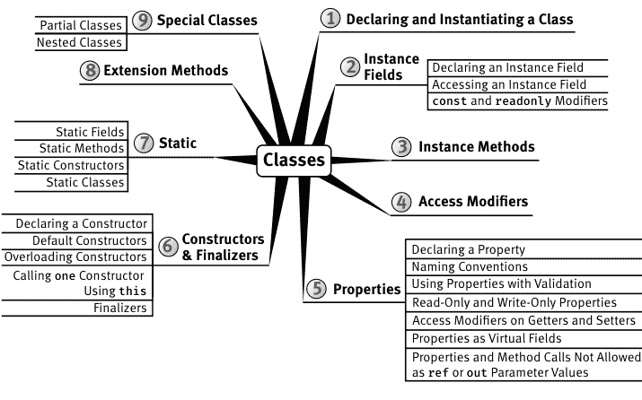

每章的主题出现在思维导图的中心。高层级主题从核心向外辐射。思维导图让你能够轻松地从高层级概念到更详细的概念吸收内容流向，从而降低遇到你可能不需要的非常具体的知识的几率。

## 实用注释

根据你经验的水平，特殊功能将帮助你浏览文本。

- 初学者主题提供专门针对入门级程序员的定义或解释。
- 高级主题使经验丰富的开发人员能够专注于对他们最相关的材料。
- 标注注释在标注框中高亮显示关键原则，以便读者轻松识别其重要性。
- 语言对比侧边栏指出 C# 与其前身之间的关键差异，以帮助熟悉其他语言的读者。

## 本书的组织结构

在高层面上，软件工程是关于管理复杂性的，我正是为此目的而组织*Essential C# 7.0*的。第 1–5 章介绍了结构化编程，这使你能够立即开始编写简单的可运行代码。第 6–10 章介绍了 C# 的面向对象构造。初学者读者应专注于完全理解这部分内容，然后再继续阅读本书其余部分中更高级的主题。第 12–14 章介绍了额外的减少复杂性的构造，处理几乎所有现代程序所需的常见模式。这引出了后续章节中广泛使用的基于反射和特性的动态编程，用于线程和互操作性。

本书以关于通用语言基础设施（Common Language Infrastructure）的一章结束，该章在 C# 所运行的开发平台背景下描述 C#。这一章出现在末尾，因为它并不专属于 C#，并且偏离了书中其余部分的语法和编程风格。然而，这一章适合在任何时间阅读，或许最适合紧接第 1 章之后阅读。

以下是各章的描述（在此列表中，以**粗体**显示的章节号表示包含 C# 6.0–7.0 内容）。

- **第 1 章——介绍 C#**：在展示 C# HelloWorld 程序之后，本章继续对其进行剖析。这应使读者熟悉 C# 程序的外观和感觉，并提供有关如何编译和调试自己程序的详细信息。它还介绍了 C# 程序的执行上下文及其中间语言。
- **第 2 章——数据类型**：可运行的程序操作数据，本章介绍了 C# 的原始数据类型。
- **第 3 章——更多关于数据类型**：本章涵盖两种类型类别：值类型和引用类型。在此基础上，它深入探讨了可空修饰符和 C# 7.0 引入的特性——元组。最后，它深入查看了一种原始数组结构。
- **第 4 章——运算符和控制流**：为了利用计算机的迭代能力，你需要知道如何在程序中包含循环和条件逻辑。本章还涵盖了 C# 运算符、数据转换和预处理器指令。
- **第 5 章——方法和参数**：本章研究方法和其参数的细节。它包括按值传递、按引用传递以及通过 out 参数返回数据。在 C# 4.0 中，添加了默认参数支持，本章解释了如何使用默认参数。
- **第 6 章——类**：给定类的基本构建块，本章将这些构造结合起来形成完全可用的类型。类通过定义对象的模板形成面向对象技术的核心。
- **第 7 章——继承**：虽然继承对许多开发人员来说是一个基本的编程概念，但 C# 提供了一些独特的构造，例如 new 修饰符。本章讨论继承语法的细节，包括重写。
- **第 8 章——接口**：本章演示如何使用接口来定义类之间可版本化的交互契约。C# 包含显式和隐式接口成员实现，从而实现大多数其他语言不支持的额外封装级别。
- **第 9 章——值类型**：虽然定义引用类型不如普遍，但有时有必要定义行为类似于 C# 内置原始类型的值类型。本章描述如何定义结构，同时揭示其可能引入的特殊性。
- **第 10 章——规范类型**：本章讨论更高级的类型定义。它解释如何实现运算符（如 + 和转换），并描述如何将多个类封装到单个库中。此外，本章演示了命名空间定义和 XML 注释，并讨论了如何为垃圾回收设计类。
- **第 11 章——异常处理**：本章扩展了第 5 章中关于异常处理的介绍，并描述异常如何遵循一种层次结构，从而能够创建自定义异常。它还包含一些关于异常处理的最佳实践。
- **第 12 章——泛型**：泛型可能是 C# 1.0 中缺失的核心功能。本章全面覆盖了这个 2.0 特性。此外，C# 4.0 添加了对协变和逆变的支持——本章未在泛型上下文中涵盖这些内容。
- **第 13 章——委托和 Lambda 表达式**：委托通过定义处理代码中事件的模式，开始清晰地使 C# 与其前身区分开来。这几乎消除了编写轮询例程的需求。Lambda 表达式是使 C# 3.0 的 LINQ 成为可能的关键概念。本章解释 Lambda 表达式如何通过提供更优雅和简洁的语法来构建在委托构造之上。本章为接下来讨论的新集合 API 奠定基础。
- **第 14 章——事件**：封装的委托，即事件，是通用语言运行时（Common Language Runtime）的核心构造。匿名方法，另一个 C# 2.0 特性，也在此处介绍。
- **第 15 章——带有标准查询运算符的集合接口**：C# 3.0 引入的简单却优雅而强大的变更在本章开始显现，当我们查看新的 Enumerable 类的扩展方法时。此类提供了一种全新的集合 API，称为标准查询运算符，并在本章中详细讨论。


### 第 16 章——使用查询表达式的 LINQ
仅使用标准查询运算符会导致一些冗长且难以理解的语句。然而，查询表达式提供了一种替代语法，与 SQL 紧密匹配，如本章所述。

### 第 17 章——构建自定义集合
在构建针对业务对象的自定义 API 时，有时有必要创建自定义集合。本章详细说明如何做到这一点，并在过程中引入了使自定义集合构建更容易的上下文关键字。

### 第 18 章——反射、特性和动态编程
面向对象编程在 20 世纪 80 年代末形成了程序结构范式转变的基础。同样，特性促进了声明式编程和嵌入式元数据，带来了新的范式。本章查看特性并讨论如何通过反射检索它们。它还涵盖了通过基类库中的序列化框架进行文件输入和输出。在 C# 4.0 中，一个新的关键字 `dynamic` 被添加到语言中。这移除了直到运行时的所有类型检查，极大地扩展了使用 C# 可以完成的内容。

### 第 19 章——多线程
大多数现代程序需要在线程中执行长时间运行的任务，同时确保对并发事件的积极响应。随着程序变得更加复杂，它们必须采取额外的预防措施来保护这些高级环境中的数据。多线程应用程序编程很复杂。本章讨论如何操作线程，并提供避免困扰多线程应用程序的问题的最佳实践。

### 第 20 章——线程同步
基于前一章，本章演示了一些内置的线程模式支持，可以简化多线程代码的显式控制。

### 第 21 章——平台互操作性和非安全代码
鉴于 C# 是一种相对年轻的语言，用其他语言编写的代码远多于 C#。为了利用这些现有代码，C# 通过 P/Invoke 支持互操作性——调用非托管代码。此外，C# 允许使用指针和直接内存操作。虽然使用指针的代码需要特殊权限才能运行，但它提供了与非传统基于 C 的应用程序接口完全互操作的强大功能。

### 第 22 章——通用语言基础设施
从根本上说，C# 是设计为底层通用语言基础设施上最有效的编程语言的语法。本章深入探讨 C# 程序与底层运行时及其规范之间的关系。

### C# 5.0、6.0 和 7.0 主题索引
这些索引为 C# 4.0 到 7.0 添加的功能提供快速参考。它们专门设计用于帮助程序员快速将语言技能更新到较新的版本。

我希望这本书能成为你建立 C# 专业知识的宝贵资源，并且即使在你已经精通 C# 之后，你仍会继续参考其中那些你不经常使用的部分。

—Mark Michaelis

IntelliTect.com/mark

Twitter: @IntelliTect, @MarkMichaelis

> 在 InformIT 网站注册你的《Essential C# 7.0》副本，以便在更新和/或勘误表可用时方便地获取。要开始注册过程，请访问 `informit.com/register` 并登录或创建一个账户。输入产品 ISBN（`9781509303588`）并点击提交。在“已注册产品”选项卡上查看此产品旁边的“访问奖励内容”链接，并遵循该链接访问可用的奖励材料。如果你希望收到有关新版和更新的独家优惠通知，请勾选接收我们电子邮件的复选框。

## 致谢

一本书不可能仅靠作者独自出版，我对帮助我的众多人员表示极度感激。感谢顺序并不重要，除了那些排在前面的人。鉴于这是该书的第六版，你可以想象在过去 10 年里（更别说之前的书了）我的家人为我写作牺牲了多少。Benjamin、Hanna 和 Abigail 经常面对的是一个被这本书分心了的爸爸，但 Elisabeth 受的苦更多。她常常独自承担着照顾家庭的责任，维持着家庭的世界。（2017 年休假期间，我在室内花费数天写作，而他们更想去海滩。）巨大的抱歉和巨大的感谢！

多年来，许多技术编辑对每一章进行了细致的审查，以确保技术准确性。我经常惊讶于这些人仍然设法捕获的细微错误：Paul Bramsman、Kody Brown、Ian Davis、Doug Dechow、Gerard Frantz、Thomas Heavey、Anson Horton、Brian Jones、Shane K. Ercheval、Angelika Langer、Eric Lippert、John Michaelis、Jason Morse、Nicholas Paldino、Jon Skeet、Michael Stokesbary、Robert Stokesbary、John Timney、Neal Lundby、Andrew Comb、Jason Peterson、Andrew Scott、Dan Haley、Phil Spokas（他帮助完成了第 22 章部分的写作），以及 Kevin Bost。

当然，Eric Lippert 卓越非凡。他对 C# 的掌握令人惊叹，我非常感激他的编辑，尤其是当他在术语方面追求完美时。他对 C# 3.0 章节的改进意义非凡，而在第二版中，我唯一的遗憾是没有让他审查所有章节。然而，那个遗憾现在不再存在。Eric 仔细审查了每一章 *Essential C# 4.0*，甚至担任了 *Essential C# 5.0* 和 *Essential C# 6.0* 的合著者。我极度感激他在 *Essential C# 7.0* 中担任技术编辑的角色。谢谢你，Eric！我想象不出还有谁更适合这个职位。将标准从良好提升到卓越，所有的功劳都属于你。

就像 Eric 和 C# 一样，对 .NET 多线程了解得如此之好的人屈指可数，Stephen Toub 就是其中之一。因此，Stephen 专注于两章重写（第三次）的多线程章节，以及它们在 C# 5.0 中对异步支持的新重点。谢谢你，Stephen！

感谢 Pearson/Addison-Wesley 的每一位人员，尽管我经常关注手稿以外的一切，他们仍然耐心地与我合作。感谢 Trina Fletcher Macdonald、Anna Popick、Julie Nahil 和 Carol Lallier。Trina 理应获得一枚特别奖牌，因为她明显在处理众多其他更重要的事情的同时，忍受了我这样的人。此外，Carol 对细节的关注是无价的，她改进写作和红线潜在写作失误的能力（即使在代码列表中发现它们时也能捕捉到）非常令人感激。

### 作者简介

**Mark Michaelis** 是 IntelliTect 的创始人，这是一家高端软件工程和咨询公司，他在该公司担任首席技术架构师和培训师。Mark 在开发者大会上发表演讲，并撰写了众多文章和书籍。目前，他是 *MSDN Magazine* 的 Essential .NET 专栏作家。

自 1996 年以来，Mark 一直是 C#、Visual Studio Team System 和 Windows SDK 的 Microsoft MVP。2007 年，他被认可为 Microsoft 区域总监。他还担任多个 Microsoft 软件设计审查团队的成员，包括 C# 和 VSTS。

Mark 拥有伊利诺伊大学的哲学文学学士学位和伊利诺伊理工学院的计算机科学硕士学位。

当没有与电脑相处时，Mark 忙着照顾家人或玩壁球（自 2016 年起暂停参加铁人三项比赛）。Mark 和他的妻子 Elisabeth 以及三个孩子 Benjamin、Hanna 和 Abigail 住在华盛顿州斯波坎。

### 技术编辑简介

**Eric Lippert** 在 Facebook 从事开发者工具工作；他曾是 Microsoft C# 语言设计团队的前成员。在不回答 StackOverflow 上的 C# 问题或编辑编程书籍时，Eric 尽最大努力保持他那艘小帆船直立。他和妻子 Leah 住在华盛顿州西雅图。

# 1 介绍 C#

C# 现在是一种成熟稳定的语言，它建立在其前身 C 风格语言（C、C++ 和 Java）中的功能之上，使许多经验丰富的程序员立即感到熟悉。¹ 此外，C# 编程语言可用于构建在多种操作系统（平台）上运行的软件组件和应用。

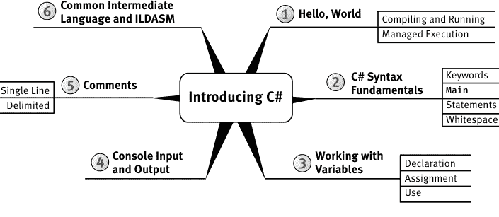

本章使用传统的 Hello World 程序介绍 C#。它专注于 C# 语法基础，包括定义 C# 程序的入口点，这将使你熟悉 C# 的语法风格和结构，并使你能够编写最简单的 C# 程序。在讨论 C# 语法基础之前，是对托管执行环境的概述，它解释了 C# 程序在运行时如何执行。本章以讨论变量声明、从控制台写入和检索数据以及 C# 中注释代码的基础知识结束。

### Hello, World

学习新编程语言的最佳方法是编写代码。第一个示例是经典的 Hello World 程序。在这个程序中，你将在屏幕上显示一些文本。

列表 1.1 显示了完整的 Hello World 程序；在以下部分中，你将编译并运行代码。

**列表 1.1: C# 中的 Hello World**²

```csharp
class HelloWorld
{
    static void Main()
    {
        System.Console.WriteLine("Hello. My name is Inigo Montoya.");
    }
}
```

> **注意**
>
> C# 是一种区分大小写的语言：错误的大小写会导致代码无法成功编译。

那些有 Java、C 或 C++ 编程经验的人会立即看到相似之处。与 Java 一样，C# 从 C 和 C++³ 继承了其基本语法，句法标点（如分号和花括号）、功能（如区分大小写）和关键字（如 `class`、`public` 和 `void`）对于这些语言有经验的程序员来说是熟悉的。初学者和其他语言的程序员会很快发现这些结构是直观的。

¹ 第一次 C# 设计会议于 1998 年举行。

² 如果你对在伊尼戈·蒙托亚的引用感到困惑，请参考电影《公主新娘》。

³ 在创建 C# 时，语言创建者审查了 C/C++ 的规范，字面上划掉了他们不喜欢的功能，并创建了一个他们喜欢的功能列表。该小组还包括在其他语言方面有强大背景的开发者。

### 创建、编辑、编译和运行 C# 源代码

一旦你编写了 C# 代码，就是编译和运行它的时候了。你可以选择使用哪个 .NET 实现——有时被称为 .NET 框架。通常，实现被打包成软件开发工具包（SDK）。SDK 包括编译器、运行时执行引擎、运行时可以访问的实用功能框架（见本章后面的“应用程序编程接口”），以及可能与 SDK 捆绑的任何额外工具（例如用于自动构建步骤的构建引擎）。鉴于 C# 自 2000 年以来已公开可用，有几种不同的 .NET 框架可供选择（见本章后面的“多个 .NET 框架”）。

对于每个 .NET 框架，安装说明因你正在开发所使用的操作系统和你选择的 .NET 框架而异。因此，我建议你访问 `https://www.microsoft.com/net/download` 获取下载和安装说明，首先选择 .NET 框架，然后根据你要开发的操作系统选择要下载的包。虽然我可以在此提供更多细节，但 .NET 下载站点拥有每个受支持组合的最新说明。

如果你不确定要使用哪个 .NET 框架，默认选择 .NET Core。它在 Linux、macOS 和 Microsoft Windows 上运行，是 .NET 开发团队将大部分投资应用于的实现。此外，由于跨平台能力，我将在章节中偏向使用 .NET Core 说明。

还有许多编辑源代码的方法，包括使用最基础的工具，如 Windows 上的记事本、Mac/macOS 上的文本编辑，或 Linux 上的 vi。但是，你很可能需要更高级的工具，至少使你的代码被着色。任何支持 C# 的编程编辑器都足够了。如果你还没有偏好，我建议你考虑开源编辑器 Visual Studio Code (`https://code.visualstudio.com`)。或者，如果你正在 Windows 或 Mac 上工作，考虑 Microsoft Visual Studio 2017（或更高版本）——参见 `https://www.visualstudio.com`。两者均可免费获得。

在接下来的两个部分中，我提供了两种编辑器的说明。对于 Visual Studio Code，我们依赖命令行（Dotnet CLI）来创建初始 C# 程序脚手架，除了编译和运行程序。对于 Windows 和 Mac，我们专注于使用 Visual Studio 2017。

### 使用 Dotnet CLI


Dotnet 命令 `dotnet.exe` 是 Dotnet 命令行界面（即 Dotnet CLI），它可用于为 C# 程序生成初始代码库，此外还可用于编译和运行该程序。（为了避免 CLI 指代通用语言基础结构（Common Language Infrastructure）还是命令行界面时产生歧义，在整个书中，当指代 Dotnet CLI 时，我都会在 CLI 前加上 Dotnet 前缀；而没有 Dotnet 前缀的 CLI 则指代通用语言基础结构。）安装完成后，请验证 `dotnet` 是否可以从命令提示符作为可用命令执行，从而确认安装成功。

以下是在 Windows、macOS 或 Linux 上通过命令行创建、编译并执行 HelloWorld 程序的说明：

- 1. 在 Microsoft Windows 上打开命令提示符，或在 Mac/macOS 上打开终端应用。（可选：考虑使用跨平台命令行界面 PowerShell）[^4]

- 2. 创建一个新目录，用于放置代码。可以考虑使用类似 `./HelloWorld` 或 `./EssentialCSharp/HelloWorld` 的名称。在命令行中使用：

  ```bash
  mkdir ./HelloWorld
  ```

- 3. 导航到新的目录，使其成为命令提示符的当前位置：

  ```bash
  cd ./HelloWorld
  ```

- 4. 在 HelloWorld 目录内执行 `dotnet new console`，以生成程序的初始脚手架。虽然会生成多个文件，但两个主要文件是 `Program.cs` 和项目文件：

  ```bash
  dotnet new console
  ```

- 5. 运行生成的程序。这将编译并运行由 `dotnet new console` 命令创建的默认 `Program.cs`。`Program.cs` 的内容与清单 1.1 相似，但输出的是“Hello World!”：

  ```bash
  dotnet run
  ```

[^4]: `https://github.com/PowerShell/PowerShell`

即使我们没有显式请求应用程序进行编译（或构建），该步骤仍然会发生，因为在执行 `dotnet run` 命令时隐式调用了它。

- 6. 编辑 `Program.cs` 文件，修改代码以匹配清单 1.1 所示的内容。如果您使用 Visual Studio Code 打开并编辑 `Program.cs`，您将体会到支持 C# 的编辑器的优势，因为代码会被着色，以显示程序中不同类型的结构。（输出 1.1 展示了一种适用于 Bash 和 PowerShell 的命令行方法。）

- 7. 重新运行程序：

  ```bash
  dotnet.exe run
  ```

输出 1.1 展示了执行上述步骤后的输出。[^5]

### 输出 1.1

```text
1>
2> mkdir ../HelloWorld
3> cd ../HelloWorld/
4> dotnet new console
The template "Console Application" was created successfully.

    Processing post-creation actions...
    Running 'dotnet restore' on ....\EssentialCSharp\HelloWorld\
    HelloWorld.csproj...
    Restoring packages for ....\EssentialCSharp\HelloWorld\
    HelloWorld.csproj...
    Generating MSBuild file ....\EssentialCSharp\HelloWorld\obj\
    HelloWorld.csproj.nuget.g.props.
    Generating MSBuild file ....\EssentialCSharp\HelloWorld\obj\
    HelloWorld.csproj.nuget.g.targets.
    Restore completed in 184.46 ms for ....\EssentialCSharp\
    HelloWorld\HelloWorld.csproj.

    Restore succeeded.
5> dotnet run
Hello World!
6> echo '
class HelloWorld
{
    static void Main()
    {
        System.Console.WriteLine("Hello. My name is Inigo Montoya.");
    }
}' > Program.cs
7> dotnet run
Hello. My name is Inigo Montoya.
8>
```

[^5]: 输出 1.1 展示了执行上述步骤后的输出。

## 使用 Visual Studio 2017

使用 Visual Studio 2017 时，步骤相似，但您不是使用命令行，而是使用**集成开发环境**（IDE），它提供了您可以选择的菜单，而不是在命令行中执行所有操作：

- 1. 启动 Visual Studio 2017。

- 2. 使用**文件->新建项目** (`Ctrl+Shift+N`) 菜单打开新建项目对话框。

- 3. 在**搜索框** (`Ctrl+E`) 中，输入 *Console App* 并选择 **Console App (.NET Core)—Visual C#** 项。对于**名称**文本框，使用 *HelloWorld*；对于**位置**，选择您希望使用的工作目录。参见图 1.1。

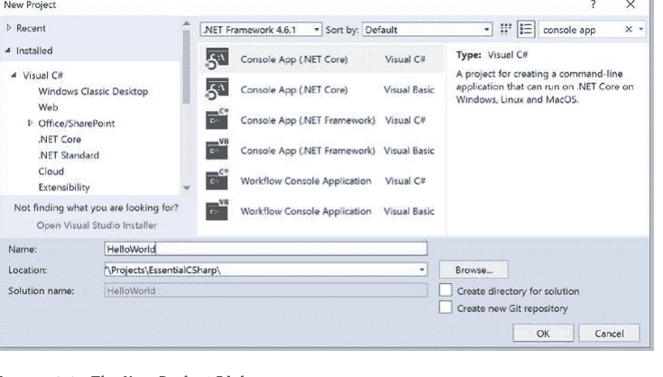

**图 1.1：新建项目对话框**


- 4. 项目创建完成后，您应该会看到一个 `Program.cs` 文件，如图 1.2 所示。

- 5. 使用**调试->不调试启动** (`Ctrl+F5`) 菜单运行生成的程序。这将显示一个包含输出 1.2 中所示文本的命令窗口，除了第一行只显示 "Hello World!" 之外。

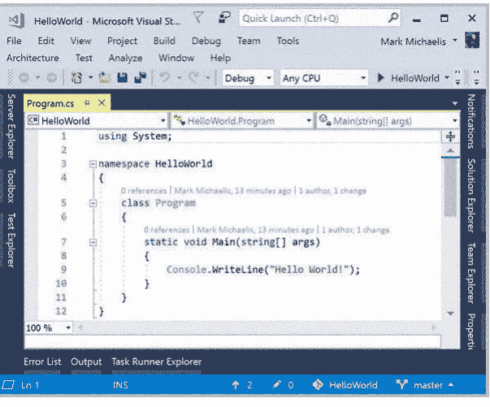

**图 1.2：** 显示 `Program.cs` 文件的对话框

- 6. 修改 `Program.cs` 以匹配清单 1.1。

- 7. 重新运行程序，以查看输出 1.2 中所示的输出。

**输出 1.2**

```text
> Hello. My name is Inigo Montoya.
Press any key to continue . . .
```

使用 IDE 的一个显著功能是其对调试的支持。要尝试此功能，请遵循以下额外步骤：

- 8. 将光标定位在 `System.Console.WriteLine` 行上，并点击 调试->切换断点 菜单项，在该行激活一个断点。

- 9. 点击 调试->开始调试 菜单以重新启动应用程序，但这次启用了调试功能。注意，程序将在您设置断点的行停止执行。然后，您可以将鼠标悬停在变量（例如，`args`）上以查看其值。您还可以通过拖动文件窗口左边距中的黄色箭头，将程序的当前执行位置从当前行移动到方法内的另一行。

- 10. 要继续程序执行，请使用 调试>继续 (`Ctrl+F5`) 菜单（或继续按钮）。

调试时，输出窗口中不再显示“按任意键继续...”文本。相反，控制台窗口会自动关闭。

请注意，Visual Studio Code 也可以作为 IDE 使用，如 https://code.visualstudio.com/docs/languages/csharp 中所述——其中包含使用 Visual Studio Code 进行调试的链接。

## 创建项目

无论使用 `Dotnet CLI` 还是 Visual Studio，都会创建几个文件。第一个文件是约定俗成命名为 `Program.cs` 的 C# 文件。即使可以使用任何名称，`Program` 通常用作控制台程序的起点。`.cs` 扩展名是所有 C# 文件的标准约定，也是编译器默认用于编译为最终程序的扩展名。要使用清单 1.1 中所示的代码，请打开 `Program.cs` 文件并用清单 1.1 替换其内容。在保存更新的文件之前，请观察清单 1.1 与默认生成内容之间唯一的实质性区别是引号内的文本，以及 `System` 出现位置的语义差异。

虽然不一定需要，但通常会在生成的 C# 项目源代码中包含一个名为项目文件的配置文件。项目文件的内容因应用程序类型和 .NET 框架而异。然而，至少来说，它通常指定编译时要包含哪些文件、要构建哪种应用程序类型（控制台、Web、移动、测试项目等）、支持哪个 .NET 框架、调试或启动应用程序可能需要的相关设置，以及代码可能依赖的其他依赖项（称为库）。例如，一个简单的 .NET Core 控制台应用程序项目文件如清单 1.2 所示。

**清单 1.2：示例 .NET Core 控制台项目文件**

```xml
<Project Sdk="Microsoft.NET.Sdk">
  <PropertyGroup>
    <OutputType>Exe</OutputType>
    <TargetFramework>netcoreapp2.0</TargetFramework>
  </PropertyGroup>
</Project>
```

在清单 1.2 中，应用程序类型被标识为 .NET Core 2.0（`netcoreapp2.0`）控制台应用程序（`Exe`）。所有其他设置（如编译哪些 C# 文件）均按约定识别。例如，默认情况下，项目文件所在目录（或子目录）中的所有 `*.cs` 文件都会包含在编译中。我们将在第 10 章中详细介绍项目文件。

## 编译与执行

由 `dotnet build` 命令创建的编译输出是一个名为 `HelloWorld.dll` 的程序集。该扩展代表动态链接库（DLL），在 .NET Core 中，即使是控制台程序（如本例所示），所有程序集都具有 `.dll` 扩展名。默认情况下，.NET Core 应用程序的编译输出被放置在子目录（`./bin/Debug/netcoreapp2.0/`）中。使用 `Debug` 目录是因为默认配置是 `debug`。此配置使输出针对调试进行优化，而非针对最佳性能。编译输出本身无法执行，它需要 CLI 来托管代码。对于 .NET Core 应用程序，这需要将 `Dotnet.exe` 进程作为应用程序的主机进程使用。

除了创建可以直接使用 `dotnet run` 执行的控制台程序外，开发者还可以创建一个代码库，供其他更大的程序引用。库也是一个程序集。换句话说，无论它是程序还是库，C# 编译成功的输出都是程序集。

## 语言对比：Java——文件名必须匹配类名

在 Java 中，文件名必须遵循类的名称。在 C# 中，虽然经常遵循这一约定，但并非强制要求。在 C# 中，可以在一个文件中有两个类，并且从 C# 2.0 开始，可以使用称为分部类（`partial class`）的功能，使单个类跨越多个文件。

[^6]: 注意，如果您使用 Microsoft .NET Framework 创建控制台程序，编译后的代码将被放置在 `HelloWorld.exe` 文件中，只要计算机上安装了 Microsoft .NET Framework，就可以直接执行该文件。

## 必备的 C# 源代码

与本书相关的源代码包含一个解决方案文件 `EssentialCSharp.sln`，该文件将所有章节的代码归类在一起。使用 Visual Studio 或 `Dotnet.exe` 都可以构建、运行和测试这些源代码。

也许最简单的方法是将在本章前面创建的 `HelloWorld` 程序中的源代码进行传递，然后执行该源代码。或者，源代码包含每章的项目文件，并包含一个菜单，该菜单允许你在执行程序时选择要运行的哪个列表，如下两节所示。

### 使用 Dotnet CLI


若要使用 `Dotnet CLI` 构建和执行代码，请打开命令提示符，并将当前目录设置为与 `EssentialCSharp.sln` 文件所在的目录相同。然后，使用 `dotnet build` 命令编译所有项目。

若要运行特定项目的源代码，请导航到包含项目文件的目录，并运行 `dotnet run` 命令。或者，从任意目录，使用 `dotnet run -p <projectfile>` 命令，其中项目文件是你想要执行的项目文件的路径（例如 `dotnet run -p .\src\Chapter01\Chapter01.csproj`）。一旦开始执行，程序将提示你要执行哪个列表，然后继续执行该列表。


许多列表在 `Chapter [??] .Tests` 目录中有相应的单元测试，其中 `[??]` 表示章节号。若要执行测试，请从你要执行的测试的项目测试目录中使用 `dotnet test` 命令（或者从 `EssentialCSharp.sln` 文件目录使用相同命令来执行所有测试）。

### 使用 Visual Studio

打开解决方案文件后，使用 **Build->Build Solution** 菜单在 Visual Studio 中编译代码。在执行源代码之前，你需要选择要执行哪个项目，方法是选择相关章节的项目作为启动项目。例如，若要执行第 1 章中的示例，请右键单击 **Chapter01** 项目并选择 **Set As Startup Project**（设为启动项目）。如果没有选择正确的章节，当你指定要执行的列表号时，将会抛出异常，并显示“Error, could not run the Listing…”（错误，无法运行列表…）的消息。

选定正确的项目后，你可以从 **Debug->Start Without Debugging**（调试 -> 启动但不进行调试）菜单运行该项目。或者，如果你想调试该项目，可以使用 **Debug->Start Debugging**（调试 -> 启动调试）。开始运行后，程序将提示你要执行的列表（例如 18.33）。如前所述，你只能输入设置为启动的项目中的列表。

许多列表都有相应的单元测试。若要执行测试，请打开测试项目，并导航到与你想要执行的列表对应的测试。然后，右键单击测试方法并选择 **Run Tests**（运行测试）(`Ctrl+R, T`) 或 **Debug Tests**（调试测试）(`Ctrl+R, Ctrl+T`)。

## C# 语法基础

成功编译并运行 **HelloWorld** 程序后，你就可以开始剖析代码，学习其各个组成部分。首先，考虑 C# 关键字以及开发人员选择的标识符。

## 入门主题

### 关键字

为了使编译器能够解释代码，C# 中的某些单词具有特殊的状态和含义。这些词被称为**关键字**，它们提供了编译器用来解释程序员编写的表达式的具体语法。在 **HelloWorld** 程序中，**class**、**static** 和 **void** 是关键字的例子。

编译器使用关键字来识别代码的结构和组织。由于编译器以更高的重要性解释这些单词，C# 要求开发人员仅在特定位置放置关键字。当程序员违反这些规则时，编译器将发出错误。

### C# 关键字

表 1.1 显示了 C# 关键字。

**表 1.1: C# 关键字**

| abstract | enum | long | static |

| :--- | :--- | :--- | :--- |

| add* (1) | equals* (3) | nameof* (6) | string |

| alias* (2) | event | namespace | struct |

| as | explicit | new | switch |

| ascending* (3) | extern | null | this |

| async* (5) | false | object | throw |

| await* (5) | finally | on* (3) | true |

| base | fixed | operator | try |

| bool | float | orderby* (3) | typeof |

| break | for | out | uint |

| by* (3) | foreach | override | ulong |

| byte | from* (3) | params | unchecked |

| case | get* (1) | partial* (2) | unsafe |

| catch | global* (2) | private | ushort |

| char | goto | protected | using |

| checked | group* (3) | public | value* (1) |

| class | if | readonly | var* (3) |

| const | implicit | ref | virtual |

| continue | in | remove* (1) | void |

| decimal | int | return | volatile |

| default | interface | sbyte | where* (2) |

| delegate | internal | sealed | when* (6) |

| descending* (3) | into* (3) | select* (3) | while |

| do | is | set* (1) | yield* (2) |

| double | join* (3) | short | |

| dynamic* (4) | let* (3) | sizeof | |

| else | lock | stackalloc | |

* 上下文关键字。括号中的数字 (n) 标识添加该上下文关键字的版本。

在 **C# 1.0** 之后，没有引入新的**保留关键字**到 C# 中。然而，后续版本中的一些构造使用**上下文关键字**，这些关键字仅在特定位置有意义。在这些指定位置之外，上下文关键字没有特殊含义。通过这种方法，大多数 C# 1.0 代码与后续标准兼容。

# 标识符

与其他语言一样，C# 包含**标识符**，用于标识程序员编码的构造。在列表 1.1 中，`HelloWorld` 和 `Main` 是标识符的示例。分配给构造的标识符稍后用于引用该构造，因此重要的是，开发人员分配的名称应具有意义，而不是随意的。

选择简洁且指示性名称的能力是优秀程序员的重要特征，因为这意味着生成的代码将更容易理解和重用。清晰与一致性的重要性足以让框架设计指南 (http://bit.ly/ dotnetguidelines) 建议在标识符名称中避免使用缩写或缩略语，甚至建议避免使用未广泛接受的缩略语。如果某个缩略语已经足够广泛接受（例如 HTML），你应该一致地使用该缩略语：避免在某些情况下拼写接受的缩略语，而在其他情况下不拼写。通常，添加所有缩略语都应包含在术语表中的约束会在使用缩略语时带来足够的开销，从而避免随意使用。最终，选择清晰、甚至可能冗长的名称——尤其是在团队合作或开发供他人编程的库时。

1. 本书可用的源代码（以及早期版本 C# 的一些相关章节）可在 https://IntelliTect.com/EssentialCSharp 下载。你也可以直接从 GitHub 下载代码，地址为 https://github.com/IntelliTect/EssentialCSharp。

2. 例如，在 C# 2.0 设计的早期阶段，语言设计者将 `yield` 指定为关键字，并且 Microsoft 向数千名开发人员发布了包含 `yield` 作为指定关键字的 C# 2.0 编译器 Alpha 版本。然而，语言设计者最终确定，通过改用 `yield` return 而不是 `yield`，他们可以最终避免将 `yield` 添加为关键字，因为它在 `return` 附近之外没有特殊含义。

3. 存在一些罕见且不兼容的情况，例如：

   - C# 2.0 要求使用 `using` 语句实现 `IDisposable`，而不是简单地使用 `Dispose()` 方法。

   - 某些罕见的泛型表达式在不同版本之间存在差异。例如，`F(G<A,B>(7))` 在 C# 1.0 中表示 `F (G(<A>, (B)>7) )`，但在 C# 2.0 中，表示调用泛型方法 `G<A,B>`，参数为 7，并将结果传递给 `F`。

标识符有两种基本的命名大小写格式。**Pascal 命名法**（下文简称 PascalCase），.NET 框架创建者因其源自 Pascal 编程语言的流行性而如此称呼它，它要求标识符名称中每个单词的首字母大写；示例包括 `ComponentModel`、`Configuration` 以及 `HttpFileCollection`。正如 `HttpFileCollection` 在 HTTP 中所演示的那样，当使用长度超过两个字母的首字母缩略词时，只有第一个字母大写。第二种格式，**camel 命名法**（下文简称 camelCase），遵循相同的约定，区别在于第一个字母小写；示例包括 `quotient`、`firstName`、`httpFileCollection`、`iostream` 以及 `theDreadPirateRoberts`。

## 指南

- **务必（DO）** 在为标识符命名时，优先选择清晰性而非简洁性。

- **切勿（DO NOT）** 在标识符名称中使用缩写或缩略语。

- **切勿（DO NOT）** 使用任何首字母缩略词，除非它们已被广泛接受，即便那样，也只在必要时使用。

请注意，尽管下划线是合法的，但标识符名称中通常没有下划线、连字符或其他非字母数字字符。此外，C# 没有遵循其前身的做法，即不使用匈牙利记法（用数据类型缩写作为名称的前缀）。这种约定避免了当数据类型改变时必须进行的变量重命名，或者因未能调整使用匈牙利记法时的数据类型前缀而导致的不一致。

在极少数情况下，某些标识符（如 `Main`）在 C# 语言中可能有特殊含义。

## 指南

- **务必（DO）** 将两个字符的首字母缩略词的两个字母都大写，但在 camelCase 标识符的第一个单词中除外。

- **务必（DO）** 仅将三个或更多字符的首字母缩略词的第一个字符大写，但在 camelCase 标识符的第一个单词中除外。

- **切勿（DO NOT）** 将位于 camelCase 标识符开头的缩略词中的任何字母大写。

- **切勿（DO NOT）** 使用匈牙利记法（即不要在变量名中编码变量的类型）。

## 高级主题

### 关键字

虽然罕见，但如果包含 `@` 作为前缀，关键字可以作为标识符使用。例如，你可以将局部变量命名为 `@return`。类似地（尽管这不符合 C# 编码标准的大小写规范），将方法命名为 `@throw()` 也是可能的。

在 Microsoft 的实现中还有四个未文档化的保留关键字：`__arglist`、`__makeref`、`__reftype` 和 `__refvalue`。这些仅在罕见的互操作场景中是必需的，你在所有实际用途中都可以忽略它们。注意这四个特殊关键字以两个下划线开头。C# 的设计者保留在 future 版本中将任何以两个下划线开头的标识符变成关键字的权利；为了安全起见，避免自己创建这样的标识符。

### 类型定义

C# 中的所有可执行代码都出现在类型定义内部，最常见的类型定义以关键字 `class` 开头。**类定义**通常指以 `class identifier { … }` 开头的代码部分，如清单 1.3 所示。

#### 清单 1.3：基本类声明

```
class HelloWorld
{
    //...
}
```


用于类型的名称（在本例中为 `HelloWorld`）可以变化，但根据惯例，它必须使用 PascalCase。因此，对于这个特定示例，其他可能的名称是 `Greetings`、`HelloInigoMontoya`、`Hello` 或简单地 `Program`。（当类包含 `Main()` 方法（将在下一节中描述）时，`Program` 是一个值得遵循的良好惯例。）

## 指南

- 务必使用名词或名词短语为类命名。
- 务必对所有类名称使用 PascalCase。

通常，程序包含多个类型，每个类型又包含多个方法。

### Main 方法

## 入门主题

#### 什么是方法？

在语法上，C# 中的方法是一个由方法声明（例如 `static void Main()`）引入的代码块，并且（通常）后面跟着零个或多个位于花括号内的语句。方法执行计算和/或操作。类似于书面语言中的段落，方法提供了一种组织和结构化代码的手段，使其更具可读性。更重要的是，方法可以重复使用并从多个位置调用，从而避免重复代码的需求。方法声明引入方法，并定义方法名称以及传递到方法和从方法传递的数据。在清单 1.4 中，`Main()` 后跟 `{ … }` 是一个 C# 方法的示例。

C# 程序开始执行的位置是 Main 方法，它以 `static void Main()` 开始。当你在命令控制台输入 `HelloWorld.exe` 执行程序时，程序启动，解析 `Main` 的位置，并开始执行清单 1.4 中的第一条语句。

#### 清单 1.4：拆解 HelloWorld

```
class HelloWorld
{
    static void Main() } Method Declaration
    {
        System.Console.WriteLine("Hello, My name is Inigo Montoya");
    }
Main->
Class Definition
Statement
```

尽管 Main 方法的声明可以在一定程度上变化，但 `static` 和方法名称 `Main` 对于程序来说始终是必需的。

## 高级主题

### Main 方法的声明

C# 要求 Main 方法返回 `void` 或 `int`，并且要么不接收参数，要么接收一个字符串数组。清单 1.5 展示了 Main 方法的完整声明。

#### 清单 1.5：带有参数和返回值的 Main 方法

```
static int Main(string[] args)
{
    //...
}
```

`args` 参数是一个字符串数组，对应于命令行参数。然而，与 C 和 C++ 不同，数组的第一个元素不是程序名称，而是出现在可执行文件名之后的第一个命令行参数。要检索用于执行程序的完整命令，请使用 `System.Environment.CommandLine`。

从 `Main` 返回的 `int` 是状态码，它指示程序执行的成功与否。返回非零值通常表示发生错误。

> **语言对比：C++/Java——main() 全小写**

与 C 风格的前身不同，C# 使用大写的 *M* 作为 `Main` 方法，以符合 C# 的 PascalCase 命名约定。

将 `Main` 方法指定为 `static` 表示其他方法可以直接在类定义上调用它。如果没有 `static` 指定符，启动程序的命令控制台在调用方法之前需要执行额外的工作（称为实例化）。（第 6 章包含专门讨论静态成员主题的一个章节。）

在 `Main()` 之前放置 `void` 表示此方法不返回任何数据。（这将在第 2 章中进一步解释。）

C# 遵循的一个独特的 C/C++ 风格特征是结构体（如类或方法）主体使用花括号。例如，`Main` 方法包含包围其实现的花括号；在这种情况下，方法中只有一条语句。

### 语句和语句定界符

`Main` 方法包含一条单一语句 `System.Console.WriteLine()`，它用于向控制台写出一行文本。C# 通常使用分号来指示语句的结束，语句由代码将执行的一个或多个操作组成。声明变量、控制程序流程以及调用方法是语句的典型用途。

#### 语言对比：Visual Basic——基于行的语句

某些语言是基于行的，这意味着没有特殊注释，语句不能跨越行。直到 Visual Basic 2010 之前，Visual Basic 是一个基于行的语言的例子。它要求在一行的末尾使用下划线来指示语句跨越多行。从 Visual Basic 2010 开始，引入了许多行连接符可选的情况。

## 高级主题

### 没有分号的语句

C# 中的许多编程元素以分号结尾。一个不包含分号的示例是 switch 语句。由于 switch 语句中始终包含花括号，因此 C# 不要求在该语句后跟分号。事实上，代码块本身被视为语句（它们也由语句组成），它们不需要使用分号来闭合。类似地，在诸如 using 声明等情况下，末尾虽然出现分号，但它本身不是一个语句。

由于创建新行并不分隔语句，你可以在同一行上放置多个语句，C# 编译器会将该行解释为包含多条指令。例如，清单 1.6 包含位于同一行上的两条语句，它们结合在一起在两个单独的行上显示 Up 和 Down。

#### 清单 1.6：一行上的多个语句

```
System.Console.WriteLine("Up");System.Console.WriteLine("Down");
```

C# 还允许将语句拆分到多行。同样，C# 编译器寻找分号来指示语句的结束（参见清单 1.7）。

#### 清单 1.7：将单个语句拆分到多行

```
System.Console.WriteLine(
 "Hello. My name is Inigo Montoya.");
```

在清单 1.7 中，`HelloWorld` 程序原本的 `WriteLine()` 语句被拆分成了多行。

## 入门主题

#### 什么是空白符？

空白符是一个或多个连续格式化字符（如制表符、空格和换行符）的组合。消除单词之间的所有空白符显然意义重大，同样，在引号字符串内部包含空白符也同样重要。

### 空白符

分号使得 C# 编译器能够忽略代码中的空白符。除了少数例外情况外，C# 允许开发者在代码中插入空白符而不会改变其语义含义。在清单 1.6 和 1.7 中，无论是在语句内部插入换行符还是在语句之间插入换行符都无关紧要，这样做对编译器生成的最终可执行文件没有任何影响。

通常，程序员会使用空白符对代码进行缩进以提高可读性。请考虑清单 1.8 和 1.9 中展示的 `HelloWorld` 的两个变体。

#### 清单 1.8：无缩进格式

```csharp
class HelloWorld
{
    static void Main()
    {
        System.Console.WriteLine("Hello Inigo Montoya");
    }
}
```

#### 清单 1.9：移除空白符

```csharp
class HelloWorld{static void Main()
{System.Console.WriteLine("Hello Inigo Montoya");}}
```

尽管这两个示例与原始程序在外观上差异巨大，但 C# 编译器会将它们视为完全相同。

## 入门主题

#### 使用空白符格式化代码

使用空白符对代码进行缩进对于提高可读性非常重要。当你开始编写代码时，你需要遵循既定的编码标准和约定以增强代码的可读性。

本书采用的约定是将大括号放在单独的一行，并对大括号对之间的代码进行缩进。如果在第一对大括号内出现另一对大括号，则第二对大括号内的所有代码也会进行缩进。

这并非统一的 C# 标准，而是一种风格偏好。

#### 使用变量

既然您已经接触过最基本的 C# 程序，现在是时候声明一个局部变量了。一旦声明了变量，您可以为其分配值，用新值替换该值，并将其用于计算、输出等。但是，您不能改变变量的数据类型。在清单 1.10 中，`string max` 是一个变量声明。

#### 清单 1.10：声明和赋值变量

```csharp
class miracleMax
{
    static void Main()
    {
        Data Type
        string max; // Variable
        max = "Have fun storming the castle!";
        System.Console.WriteLine(max);
    }
}
```

## 入门主题

#### 局部变量

变量是一个名称，它指向一个随时间变化的值。局部 表示程序员在方法内部声明了该变量。

声明变量就是定义变量，其做法如下：

- 指定变量将包含的数据类型
- 为其分配一个标识符（名称）

## 数据类型

清单 1.10 声明了一个数据类型为 `string` 的变量。本章中使用的其他常见数据类型包括 `int` 和 `char`。

- `int` 是 C# 中 32 位整数类型的指定。
- `char` 用于字符类型。它是 16 位，足以容纳（非代理）Unicode 字符。

下一章将更详细地介绍这些以及其他常见数据类型。

## 入门主题

#### 什么是数据类型？

变量声明中指定的数据类型称为数据类型（或对象类型）。数据类型，或简称为类型，是对具有相似特征和行为的物品进行分类。例如，动物 是一种类型。它对具有动物特征（多细胞、具有运动能力等）的所有物品（猴子、疣猪和鸭嘴兽）进行分类。同样，在编程语言中，类型是对具有相似品质的多个项目的定义。

#### 声明变量

在清单 1.10 中，`string max` 是一个字符串类型的变量声明，其名称为 `max`。可以通过指定一次数据类型并使用逗号分隔每个标识符，在同一语句中声明多个变量。清单 1.11 演示了这样的声明。

#### 清单 1.11：在一个语句中声明两个变量

```csharp
string message1, message2;
```

由于多变量声明语句允许开发者在声明中只提供一次数据类型，因此所有变量都将是相同类型的。

在 C# 中，变量名称可以以任意字母或下划线 `_` 开头，后跟任意数量的字母、数字和/或下划线。然而，按照惯例，局部变量名称采用驼峰命名法（每个单词的首字母大写，除了第一个单词），且不包含下划线。

## 准则

应该 使用驼峰命名法来命名局部变量。

### 变量赋值

在声明局部变量后，在读取其值之前，必须为其分配一个值。实现这一点的一种方式是使用运算符，也称为简单赋值运算符。运算符是用于标识代码要执行的功能的符号。清单 1.12 演示了如何使用赋值运算符指定变量 `miracleMax` 和 `valerie` 将指向的字符串值。

#### 清单 1.12：改变变量的值

```csharp
class StormingTheCastle
{
    static void Main()
    {
        string valerie;
        string miracleMax = "Have fun storming the castle!";

        valerie = "Think it will work?";

        System.Console.WriteLine(miracleMax);
        System.Console.WriteLine(valerie);

        miracleMax = "It would take a miracle.";
        System.Console.WriteLine(miracleMax);
    }
}
```

从该清单中可以观察到，可以在变量声明过程中为变量赋值（如 `miracleMax` 所示），也可以在之后的单独语句中赋值（如变量 `valerie` 所示）。赋值的值必须始终位于声明的右侧。

运行编译后的程序会产生输出 1.3 中显示的代码。

#### 输出 1.3

```text
dotnet run
Have fun storming the castle!
Think it will work?
It would take a miracle.
```

在此示例中，我们明确显示了命令 `dotnet run`。在后续的输出清单中，除非用于执行程序的特殊命令有特殊情况，否则我们将省略此行。

C# 要求编译器在读取局部变量之前确定其已被“明确赋值”。此外，赋值会产生一个值。因此，C# 允许在同一语句中进行两次赋值，如清单 1.13 所示。

#### 清单 1.13：赋值返回可再次赋值的值

```csharp
class StormingTheCastle
{
    static void Main()
    {
        // ...
        string requirements, miracleMax;
        requirements = miracleMax = "It would take a miracle.";
        // ...
    }
}
```

#### 使用变量

赋值的结果当然就是你可以通过变量标识符来引用该值。因此，当你在 `System.Console.WriteLine(miracleMax)` 语句中使用变量 `miracleMax` 时，程序会在控制台上显示 `Have fun storming the castle!`，即 `miracleMax` 的值。改变 `miracleMax` 的值并执行相同的 `System.Console.WriteLine(miracleMax)` 语句会导致显示新的 `miracleMax` 值，即 `It would take a miracle.`。

## 高级主题

### 字符串是不可变的

所有类型为 `string` 的值，无论是字符串字面量还是其他形式，都是不可变的（或不可修改的）。例如，不可能将字符串 `Come As You Are.` 更改为 `Come As You Age.` 这样的更改要求你重新分配变量，而不是修改变量最初指向的数据。

### 控制台输入和输出

本章已经反复使用 `System.Console.WriteLine` 将文本写入命令控制台。除了能够写入数据外，程序还需要能够接受用户可能输入的数据。

#### 从控制台获取输入

从控制台获取输入文本的一种方法是使用 `System.Console.ReadLine()`。此方法会停止程序执行，以便用户可以输入字符。当用户按下回车键创建新行时，程序继续执行。`System.Console.ReadLine()` 方法的输出，也称为返回值，是输入的文本字符串。请考虑清单 1.14 及其在输出 1.4 中显示的相关输出。

#### 清单 1.14：使用 `System.Console.ReadLine()`

```csharp
class HeyYou
{
    static void Main()
    {
        string firstName;
        string lastName;

        System.Console.WriteLine("Hey you!");

        System.Console.Write("Enter your first name: ");
        firstName = System.Console.ReadLine();

        System.Console.Write("Enter your last name: ");
        lastName = System.Console.ReadLine();
    }
}
```

### 输出 1.4

```
Hey you!
Enter your first name: Inigo
Enter your last name: Montoya
```

在每个提示之后，该程序使用 `System.Console.ReadLine()` 方法获取用户输入的文字，并将其赋值给相应的变量。当第二个 `System.Console.ReadLine()` 赋值完成时，`firstName` 指向值 `Inigo`，而 `lastName` 指向值 `Montoya`。

### 高级主题：System.Console.Read()

除了 `System.Console.ReadLine()` 方法外，还有一个 `System.Console.Read()` 方法。然而，`System.Console.Read()` 方法返回的数据类型是一个整数，对应读取的字符值；如果没有更多可用字符，则返回 -1。为了获取实际字符，必须先将整数转换为字符，如清单 1.15 所示。

#### 清单 1.15：使用 System.Console.Read()

```
int readValue;
char character;
readValue = System.Console.Read();
character = (char) readValue;
System.Console.Write(character);
```

`System.Console.Read()` 方法不会在用户按下回车键之前返回输入；即使用户在按下回车键之前输入了多个字符，也不会开始处理这些字符。

在 C# 2.0 及更高版本中，可以使用 `System.Console.ReadKey()`，与 `System.Console.Read()` 相比，它在单次击键后返回输入。它允许开发人员拦截击键并执行操作，例如验证按键或将字符限制为数字。

> 从 2.0 开始

> 结束于 2.0

### 向控制台写入输出


在清单 1.14 中，您使用 `System.Console.Write()` 方法而不是 `System.Console.WriteLine()` 来提示用户输入其名字和姓氏。`System.Console.Write()` 方法不会在显示文本后放置换行符，而是将光标保留在同一行的当前位置。这样，用户输入的任何文本都将与输入提示位于同一行。清单 1.14 的输出展示了 `System.Console.Write()` 的效果。

下一步是将使用 `System.Console.ReadLine()` 获取的值写回控制台。以清单 1.16 为例，程序输出用户的完整姓名。然而，与之前使用 `System.Console.WriteLine()` 不同，这段代码使用了一种略微变化的形式，利用了 C# 6.0 的一个特性，称为**字符串插值**。请注意 `Console.WriteLine` 调用中字符串字面量前的美元符号；它表示将使用字符串插值。输出 1.5 显示了相应的输出结果。

### 清单 1.16：使用字符串插值进行格式化

```csharp
class HeyYou
{
    static void Main()
    {
        string firstName;
        string lastName;

        System.Console.WriteLine("Hey you!");

        System.Console.Write("Enter your first name: ");
        firstName = System.Console.ReadLine();

        System.Console.Write("Enter your last name: ");
        lastName = System.Console.ReadLine();

        System.Console.WriteLine(
            $"Your full name is { firstName } { lastName }.");
    }
}
```

### 输出 1.5

```
Hey you!
Enter your first name: Inigo
Enter your last name: Montoya
Your full name is Inigo Montoya.
```

清单 1.16 没有写出 "Your full name is" 后跟随另一个用于 `firstName` 的 `Write` 语句，再第三个用于空格的 `Write` 语句，最后是用于 `lastName` 的 `WriteLine` 语句，而是使用 C# 6.0 的字符串插值写出整个输出。使用字符串插值时，编译器将字符串内花括号内部的内容解释为可以嵌入代码（表达式）的区域，编译器将评估这些表达式并将其转换为字符串。字符串插值允许您一次性完成这些操作，而不是分别执行许多代码片段并在最后将结果组合为一个字符串。这使得代码更容易理解。

在 C# 6.0 之前，C# 使用另一种方法，即**复合格式化**。使用复合格式化时，代码首先提供一个**格式字符串**来定义输出格式——参见清单 1.17。

### 清单 1.17：使用 System.Console.WriteLine() 的复合格式化进行格式化

```csharp
class HeyYou
{
    static void Main()
    {
        string firstName;
        string lastName;

        System.Console.WriteLine("Hey you!");

        System.Console.Write("Enter your first name: ");
        firstName = System.Console.ReadLine();

        System.Console.Write("Enter your last name: ");
        lastName = System.Console.ReadLine();

        System.Console.WriteLine(
            "Your full name is {0} {1}.", firstName, lastName);
    }
}
```

在这个例子中，格式字符串是 `Your full name is {0} {1}`。它标识了字符串中两个用于数据插入的索引占位符。每个占位符对应格式字符串后出现的参数的顺序。

请注意，索引值从零开始。每个插入的参数（称为**格式项**）按照与索引值对应的顺序出现在格式字符串之后。在本例中，由于 `firstName` 是紧跟在格式字符串后的第一个参数，因此它对应索引值 0。类似地，`lastName` 对应索引值 1。

请注意，格式字符串内的占位符不必按顺序出现。例如，清单 1.18 交换了索引占位符的顺序并添加了一个逗号，这改变了姓名的显示方式（参见输出 1.6）。

### 清单 1.18：交换索引占位符及对应变量

```csharp
System.Console.WriteLine("Your full name is {1}, {0}", firstName, lastName);
```

### 输出 1.6

```
Hey you!
Enter your first name: Inigo
Enter your last name: Montoya
Your full name is Montoya, Inigo
```

除了格式字符串中的占位符不必连续出现外，还可以在格式字符串中多次使用同一个占位符。此外，可以省略某个占位符。但是，不能有不对应任何参数的占位符。

#### 注意

由于 C# 6.0 风格的字符串插值几乎总是比替代的复合字符串方法更容易理解，因此在本书的其余部分，我们默认使用字符串插值。

## 注释

在本节中，我们通过添加注释来修改清单 1.17 中的程序。这种修改在没有任何改变程序执行方式的情况下；相反，在代码中提供注释可以简单地使代码在原本不直观的地方更加易于理解。清单 1.19 显示了新代码，输出 1.7 显示了相应的输出结果。

### 清单 1.19：为你的代码添加注释

```csharp
class CommentSamples
{
    static void Main()
    {
        string firstName; // 用于存储名字的变量
        string lastName; // 用于存储姓氏的变量

        System.Console.WriteLine("Hey you!");
        System.Console.Write /* 不换行 */ ("Enter your first name: ");
        firstName = System.Console.ReadLine();
        System.Console.Write /* 不换行 */ ("Enter your last name: ");
        lastName = System.Console.ReadLine();

        /* 使用复合格式化向控制台显示问候语。 */
        System.Console.WriteLine("Your full name is {0} {1}", firstName, lastName);

        // 这是
        // 程序清单的结尾
    }
}
```

### 输出 1.7

```
Hey you!
Enter your first name: Inigo
Enter your last name: Montoya
Your full name is Inigo Montoya.
```

尽管插入了注释，编译并执行新程序所产生的输出与之前相同。

程序员使用注释来描述和解释他们正在编写的代码，特别是在语法本身难以理解，或者某个特定算法实现令人意外的地方。由于注释仅对审查代码的程序员相关，编译器会忽略注释，并生成一个不包含任何注释痕迹的程序集，这些注释原本是新源代码的一部分。

### 表 1.2：C# 注释类型

| 注释类型 | 描述 | 示例 |
| --- | --- | --- |
| 分隔注释 | 前导斜杠后跟一个星号 `/*` 标识分隔注释的开始。要结束该注释，请在一个星号后跟一个前导斜杠：`*/`。此形式的注释可以跨越代码文件中的多行，或者嵌入在代码行的内部。出现在行首但在分隔符内部的星号仅用于格式化。 | `/*comment*/` |
| 单行注释 | 注释可以使用由两个连续的前导斜杠字符组成的分隔符 `//` 来声明。编译器将从分隔符到行尾的所有文本视为注释。此形式的注释被视为单行。然而，可以连续放置单行注释，如清单 1.18 中的最后一个注释所示。 | `//comment` |
| XML 分隔注释 | 以 `/**` 开头并以 `**/` 结尾的注释称为 XML *分隔* 注释。它们具有与普通分隔注释相同的特征，不同之处在于编译器不会完全*忽略* XML 注释，而是可以将其放入单独的文本文件中。† | `/**comment**/` |
| XML 单行注释 | XML 单行注释以 `///` 开头，并持续到行尾。此外，编译器可以将单行注释保存到包含 XML 分隔注释的单独文件中。 | `///comment` |

† XML 分隔注释仅在 C# 2.0 中被显式添加，但其语法与 C# 1.0 兼容。

第 10 章中对 XML 注释进行了更全面的讨论，其中进一步讨论了各种 XML 标签。

在编程历史上曾有一个时期，大量繁复的注释意味着程序员纪律严明且经验丰富。这种情况已不再存在。相反，无需注释即可阅读的代码比需要注释来澄清其功能代码更有价值。如果开发人员发现有必要输入注释来澄清特定代码块正在做什么，他们应该倾向于重写代码使其更清晰，而不是添加注释。仅仅重复代码明显展示的内容的注释只会使代码杂乱无章，降低其可读性，并增加注释因代码更改而未更新而过时的可能性。

## 准则

- **不要**使用注释，除非它们描述了除编写代码的开发人员之外的人不明显的内容。**要**倾向于编写更清晰的代码，而不是输入注释来澄清复杂的算法。

### 初学者专题

#### 可扩展标记语言

可扩展标记语言（XML）是一种简单且灵活的文本格式，常用于 Web 应用程序内部以及应用程序之间的数据交换。XML 是可扩展的，因为 XML 文档中包含描述数据的信息，即 **元数据**。以下是一个 XML 文件的示例：

```xml
<?xml version="1.0" encoding="utf-8" ?>
<body>
    <book title="Essential C# 7.0">
        <chapters>
            <chapter title="Introducing C#"/>
            <chapter title="Data Types"/>
            ...
        </chapters>
    </book>
</body>
```

文件以一个指示 XML 文件版本和字符编码的标头开始。接下来是一个主要的“book”元素。元素以尖括号中的单词开始，例如 `<body>`。要结束一个元素，请将相同的单词放在尖括号中，并在单词前添加前导斜杠，如 `</body>`。除了元素之外，XML 还支持属性。`title="Essential C# 7.0"` 是一个 XML 属性的示例。请注意，描述数据（“Essential C# 7.0”，“Data Types”）的元数据（书名、章节等）包含在 XML 文件中。这可能导致文件相当臃肿，但它提供了数据包含描述以辅助解释的优势。

#### 托管执行和公共语言基础结构

处理器无法直接解释程序集。程序集主要由一种称为 **公共中间语言（Common Intermediate Language，CIL）** 的第二语言组成，简称为 IL。¹⁰ C# 编译器将 C# 源文件转换为这种中间语言。通常在执行时执行的额外步骤是将 CIL 代码转换为处理器能够理解的 **机器代码** 所必需的。这涉及到 C# 程序执行的一个重要组成部分：**虚拟执行系统（Virtual Execution System，VES）**。VES 也被通俗地称为 **运行时（runtime）**，它按需编译 CIL 代码（该过程被称为 **即时编译** 或 **jitting**）。在运行时等代理的上下文环境中执行的代码称为 **托管代码**，在运行时控制下执行的过程称为 **托管执行**。代码之所以被称为“托管”，是因为运行时通过管理内存分配、安全性和即时编译等方面来控制程序行为的很大一部分。不需要运行时即可执行的代码称为 **本机代码**（或 **非托管代码**）。

运行时的规范包含在一个更广泛的规范中，即 **公共语言基础结构（Common Language Infrastructure，CLI）** 规范。¹¹ 作为一个国际标准，CLI 包含以下方面的规范：

- VES 或运行时
- CIL
- 支持语言互操作性的类型系统，称为 **公共类型系统（Common Type System，CTS）**
- 关于如何编写可从 CLI 兼容语言访问的库的指导（在 **公共语言规范 [CLS]** 中提供）
- 使 CLI 识别的许多服务（包括程序集的布局或文件格式的规范）成为可能的元数据

> 10. CIL 的第三个术语是微软 IL（MSIL）。本书使用 CIL 这一术语，因为它是 CLI 标准采用的术语。由于编写 C# 代码的人通常假设 IL 指的是 CIL 而非其他类型的中间语言，因此 IL 在对话中很常见。
> 11. Miller, J. and S. Ragsdale. 2004. *The Common Language Infrastructure Annotated Standard*. Boston: Addison-Wesley.

> **注意**
> 术语 *运行时* 可以指执行时或 VES。为了帮助澄清 intended 含义，本书使用术语 *执行时* 来表示程序正在执行的时候，并在讨论负责管理 C# 程序执行期间的代理时使用术语 *运行时*。

在运行时执行引擎的上下文中运行，使得程序员无需直接编码即可支持几项服务和功能，包括：

- *语言互操作性*：不同源语言之间的互操作性。这是可能的，因为语言编译器将每种源语言翻译为相同的中间语言（CIL）。
- *类型安全*：检查类型之间的转换，确保只发生兼容类型之间的转换。这有助于防止缓冲区溢出，缓冲区溢出是安全漏洞的主要原因。
- *代码访问安全性*：认证程序集开发者的代码在计算机上具有执行权限。
- *垃圾回收*：自动释放之前由运行时分配的内存的内存管理。
- *平台可移植性*：支持在多种操作系统上潜在地运行相同的程序集。一个明显的限制是不使用依赖平台的库；因此，需要单独解决依赖平台的特殊性。
- *基础类库（BCL）*：提供开发人员可以依赖的代码基础（在所有 .NET 框架中），因此他们不必自己开发这些代码。

> **注意**
> 本节简要概述了 CLI，使您对 C# 程序执行的环境有所了解。它还总结了本书中出现的某些术语。第 22 章专门讨论 CLI 及其对 C# 开发者的相关性。尽管该章节出现在书的最后，但它不依赖于之前的任何章节，因此如果您希望更熟悉 CLI，可以随时跳转至该章节。

#### 公共中间语言和 ILDASM

如本节的引言所述，C# 编译器将 C# 代码转换为 CIL 代码，而不是机器代码。处理器可以直接理解机器代码；因此，在处理器执行 CIL 代码之前需要对其进行转换。给定一个程序集，可以使用 CIL 反汇编实用程序将程序集分解为其 CIL 表示形式。（CIL 反汇编器亲切地被称为其 Microsoft .NET Framework 特定的文件名 ILDASM，即 IL 反汇编器。）ILDASM 将反汇编程序集并将 C# 编译器生成的 CIL 提取为文本。

反汇编 .NET 程序集产生的输出比机器代码容易理解得多。对于许多开发人员来说，这可能引起担忧，因为程序更容易被反编译，并且可以在不显式重新分发源代码的情况下理解算法。与任何程序一样，无论是基于 CLI 的还是非基于 CLI 的，防止反汇编的唯一万全方法是完全禁止访问编译后的程序（例如，仅将程序托管在网站上，而不是分发到用户的机器上）。然而，如果只需要降低源代码的可访问性，就有几种混淆器可用。混淆器打开 IL 代码并对其进行转换，使其执行相同的功能，但以更难以理解的方式。此技术阻止普通开发人员访问代码，并创建更难、更繁琐才能反编译成可理解代码的程序集。除非程序需要高度的算法安全性，否则混淆器通常就足够了。

## 高级主题

#### HelloWorld.exe 的 CIL 输出

用于 CLI 反汇编器的确切命令取决于使用的是哪个 CLI 实现。对于 .NET Core，相关说明可在 http://itl.tc/ildasm 找到。列表 1.20 展示了运行 ILDASM 后生成的 CLI 代码。

**列表 1.20：示例 CLI 输出**


```assembly
.assembly extern System.Runtime
{
    .publickeytoken = ( B0 3F 5F 7F 11 D5 0A 3A )
    .ver 4:2:0:0
}

.assembly extern System.Console
{
    .publickeytoken = ( B0 3F 5F 7F 11 D5 0A 3A )
    .ver 4:1:0:0
}

.assembly 'HelloWorld'
{
    .custom instance void [System.Runtime]System.Runtime.CompilerServices.CompilationRelaxationsAttribute::.ctor(int32) = ( 01 00 08 00 00 00 00 00 00 )
    .custom instance void [System.Runtime]System.Runtime.CompilerServices.RuntimeCompatibilityAttribute::.ctor() = ( 01 00 01 00 54 02 16 57 72 61 70 4E 6F 6E 45 78 63 65 74 79 64 6F 65 54 68 72 6F 77 73 01 )
    .custom instance void [System.Runtime]System.Runtime.Versioning.TargetFrameworkAttribute::.ctor(string) = ( 01 00 18 2E 4E 45 54 43 6F 72 65 41 70 2C 56 65 72 73 69 6F 6E 3D 30 31 2E 30 31 00 54 00 14 46 72 61 6D 65 77 6F 72 6B 44 69 73 70 6C 61 79 4E 61 6D 65 00 )
    .custom instance void [System.Runtime]System.Reflection.AssemblyCompanyAttribute::.ctor(string) = ( 01 00 0A 48 65 6C 6C 6F 57 6F 72 6C 64 00 00 )
    .custom instance void [System.Runtime]System.Reflection.AssemblyConfigurationAttribute::.ctor(string) = ( 01 00 05 44 65 62 75 67 00 00 )
    .custom instance void [System.Runtime]System.Reflection.AssemblyDescriptionAttribute::.ctor(string) = ( 01 00 13 50 61 63 6B 61 67 65 20 44 65 73 63 72 69 70 74 69 6F 6E 00 00 )
    .custom instance void [System.Runtime]System.Reflection.AssemblyFileVersionAttribute::.ctor(string) = ( 01 00 07 31 2E 30 2E 30 2E 30 00 00 )
    .custom instance void [System.Runtime]System.Reflection.AssemblyInformationalVersionAttribute::.ctor(string) = ( 01 00 05 31 2E 30 2E 30 00 00 )
    .custom instance void [System.Runtime]System.Reflection.AssemblyProductAttribute::.ctor(string) = ( 01 00 0A 48 65 6C 6C 6F 57 6F 72 6C 64 00 00 )
    .custom instance void [System.Runtime]System.Reflection.AssemblyTitleAttribute::.ctor(string) = ( 01 00 0A 48 65 6C 6C 6F 57 6F 72 6C 64 00 00 )
    .hash algorithm 0x00080004
    .ver 1:0:0:0
}

.module 'HelloWorld.dll'
// MVID: {c0fe557b-4474-4563-94e1-95c9ead4e3c9}
.imagebase 0x00400000
.file alignment 0x00000200
.stackreserve 0x00100000
.subsystem 0x0003 // WindowsCui
.corflags 0x00000001 // ILOnly

.class private auto ansi beforefieldinit HelloWorld extends [System.Runtime]System.Object
{
    .method private hidebysig static void Main() cil managed
    {
        .entrypoint
        // Code size 13
        .maxstack 8
        IL_0000: nop
        IL_0001: ldstr "Hello. My name is Inigo Montoya."
        IL_0006: call void [System.Console]System.Console::WriteLine(string)
        IL_000b: nop
        IL_000c: ret
    } // End of method System.Void HelloWorld::Main()

    .method public hidebysig specialname rtspecialname instance void .ctor() cil managed
    {
        // Code size 8
        .maxstack 8
        IL_0000: ldarg.0
        IL_0001: call instance void [System.Runtime]System.Object::.ctor()
        IL_0006: nop
        IL_0007: ret
    } // End of method System.Void HelloWorld::.ctor()
} // End of class HelloWorld
```

列表的开头部分是清单信息。它不仅包含被反汇编模块（`HelloWorld.exe`）的全名，还包含它依赖的所有模块和程序集，以及它们的版本信息。

也许从这样的列表中你能获得的最有趣的信息是，与尝试阅读和理解机器代码（汇编器）相比，跟踪程序正在做什么相对容易得多。在列表中，出现了显式对 `System.Console.WriteLine()` 的引用。CIL 代码列表中有许多外围信息，但如果开发人员想在没有访问原始源代码的情况下理解 C# 模块（或任何基于 CLI 的程序）的内部工作机制，除非使用了混淆器，否则这相对容易。事实上，有许多免费工具可用（例如 Red Gate 的 Reflector、ILSpy、JustDecompile、dotPeek 和 CodeReflect），它们可以自动从 CIL 反编译为 C#。

## 多个 .NET 框架

正如本章前面简要提到的，存在多个 .NET 框架。众多产品供应主要源于在多个操作系统上提供 .NET 实现的需求，甚至可能还包括不同的硬件平台。表 1.3 展示了其中主要的几种。

**表 1.3：主要的 .NET 框架实现**

| 类型 | 描述 |
| :--- | :--- |
| .NET Core | 一个真正的跨平台且开源的 .NET 框架，支持为服务器和命令行应用程序提供高度模块化的 API 集。 |
| Microsoft .NET Framework | 第一个、最大且部署最广泛的 .NET 框架。 |
| Xamarin | .NET 的移动平台实现，适用于 iOS 和 Android，允许从单一代码库开发移动应用程序，同时仍能访问本地平台 API。 |
| Mono | 最古老的 .NET 开源实现，是 Xamarin 和 Unity 构建的基础。Mono 已在新开发中被 .NET Core 取代。 |
| Unity | 一个跨平台游戏引擎，用于开发针对游戏主机、PC、移动设备甚至网站的游戏。（Unity 引擎是第一个支持投影到 Microsoft Hologres 增强现实领域的公共实现。） |

除非另有明确说明，本书中的所有示例都至少适用于 .NET Core 和 Microsoft .NET Framework。然而，由于 .NET Core 是 .NET 未来投资的主要方向，随书提供的示例源代码（可从 `https://IntelliTect.com/EssentialCSharp/` 获取）将默认为支持 .NET Core 进行配置。

> **注意**
>
> 在整本书中，.NET framework（小写）泛指 .NET 实现所支持的框架。相比之下，Microsoft .NET Framework 指的是仅在 Microsoft Windows 上运行的特定 .NET 框架实现，该实现于 2001 年由 Microsoft *首次* 发布。

## 应用程序编程接口

在数据类型（如 `System.Console`）上发现的所有方法（或更一般地说是成员）定义了 `System.Console` 的 **应用程序编程接口 (API)**。API 定义了软件程序如何与组件交互。因此，API 不仅存在于单个数据类型中，而是更一般地存在；一组数据类型的所有 API 的组合被称为为该组件集合创建了一个 API。例如，在 .NET 中，程序集中的所有类型（以及这些类型内的成员）被称为构成了程序集的 API。同样，给定一组程序集（如 .NET Core 或 Microsoft .NET Framework 中找到的那些），这些程序集的集合构成了一个更大的 API。通常，这个更大的 API 组被称为 **框架**——因此 .NET *framework* 一词指的是 Microsoft .NET Framework 中所有程序集所包含的 API。从通用意义上讲，API 由针对一组组件进行编程的接口和协议（或指令）集组成。事实上，在 .NET 中，这些协议本身就是 .NET 程序集执行规则。

## C# 和 .NET 的版本控制

由于 .NET 框架的开发生命周期与 C# 语言不同，底层 .NET 框架的版本和相应的 C# 语言版本最终会有不同的编号。

这意味着如果你使用 C# 5.0 编译器进行编译，它默认将针对 Microsoft .NET Framework 版本 4.6 进行编译（例如）。表 1.4 简要概述了 Microsoft .NET Framework 和 .NET Core 的 C# 和 .NET 发布版本。

**表 1.4：C# 和 .NET 版本**

| 类型 | 描述 |
| :--- | :--- |
| C# 1.0 配 Microsoft .NET Framework 1.0/1.1 (Visual Studio 2002 和 2003) | C# 的初始版本。一种从头开始构建以支持 .NET 编程的语言。 |
| C# 2.0 配 Microsoft .NET Framework 2.0 (Visual Studio 2005) | 为 C# 语言添加了泛型，并为 Microsoft .NET Framework 2.0 添加了支持泛型的库。 |
| Microsoft .NET Framework 3.0 | 增加了用于分布式通信（Windows 通信基础 [WCF]）、富客户端呈现（Windows 呈现基础 [WPF]）、工作流（Windows 工作流 [WF]）和 Web 身份验证（CardSpaces）的 API 集。 |
| C# 3.0 配 Microsoft .NET Framework 3.5 (Visual Studio 2008) | 增加了对 LINQ 的支持，并显著改进了用于编程集合的 API。Microsoft .NET Framework 3.5 提供了扩展现有 API 以使 LINQ 成为可能的库。 |
| C# 4.0 配 Microsoft .NET Framework 4 (Visual Studio 2010) | 增加了对动态类型的支持，并显著改进了编写多线程程序的 API，充分利用处理器及其内部的多核。 |
| C# 5.0 配 Microsoft .NET Framework 4.5 (Visual Studio 2012) 和 WinRT 集成 | 增加了对异步方法调用的支持，无需显式注册委托回调。框架中的另一项变更是支持 Windows Runtime (WinRT) 的互操作性。 |
| C# 6.0 配 Microsoft .NET Framework 4.6 和 .NET Core 1.X (Visual Studio 2015) | 增加了字符串插值、空传播成员访问、异常筛选器、字典初始化器以及众多其他功能。 |
| C# 7.0 配 Microsoft .NET Framework 4.7 和 .NET Core 1.1 或 2.0 (Visual Studio 2017) | 增加了元组、解构器、模式匹配、局部函数、按引用返回等功能。 |

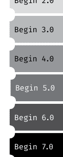

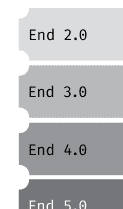

C# 6.0 引入的最重要的框架特性之一是支持跨平台编译。换言之，不仅微软 .NET Framework 可以运行在 Windows 上，微软还提供了 .NET Core 实现，使其能够在 Linux 和 macOS 上运行。尽管 .NET Core 的功能集与完整的微软 .NET Framework 并不对等，但它包含了足够的功能，使得整个（ASP.NET）网站都可以托管在除 Windows 及其 Internet Information Services（IIS）之外的操作系统上。这意味着使用相同的代码库，可以编译并执行运行在多个平台上的应用程序。.NET Core 是一个完整的 SDK，包括从 .NET 编译器平台（“Roslyn”——它本身可在 Linux 和 macOS 上运行）到 .NET Core 运行时，以及诸如 Dotnet 命令行工具（`dotnet.exe`，于 C# 7.0 前后引入）等工具。

## .NET 标准

由于存在多种不同的 .NET 实现，且每种单独的 .NET 框架都有多个版本，导致各框架变得支离破碎，因为每种实现支持不同的、仅部分重叠的 API 集合。结果是，编写可跨多个 .NET 框架重用的代码变得困难，因为必须不断添加条件检查，以判断特定 API 是否可用。为了降低这种复杂性，.NET Standard 应运而生，作为一种定义哪些 API 被标准的哪个版本所支持的手段。因此，**.NET 标准**定义了 .NET 框架需要支持哪些内容，才能符合每个 .NET 标准版本号的要求。然而，由于许多实现已经发布，确定哪些 API 纳入哪个标准的决策树在一定程度上是基于现有实现及其与 .NET 标准版本号的关联。

撰写本文时最新发布的版本是 .NET Standard 2.0。该特定版本的优势在于，所有基础框架都已实现（或正在努力实现）此标准，因此，实际上 .NET Standard 2.0 代表了各框架旧版本中支离破碎的 API 的重新统一。

## 摘要

本章作为 C# 的入门介绍。它提供了一种帮助你熟悉基本 C# 语法的方法。由于 C# 与 C++ 风格语言的相似性，本章的许多内容对你来说可能并不陌生。然而，C# 和托管代码确实具有一些独特的特征，例如编译为 CIL。虽然这并非独一无二，但 C# 的另一个关键特征是其对面向对象编程的完整支持。即使是向控制台读写数据这类任务也是面向对象的。面向对象是 C# 的基础，正如你将在这本书中看到的那样。

下一章将探讨 C# 语言的基本数据类型，并讨论如何使用这些数据类型与运算符构成表达式。

## 2 数据类型

从第 1 章的 HelloWorld 程序中，你对 C# 语言、其结构、基本语法特征以及如何编写最简单的程序有了初步了解。本章将继续讨论 C# 基础知识，通过研究基本的 C# 类型。

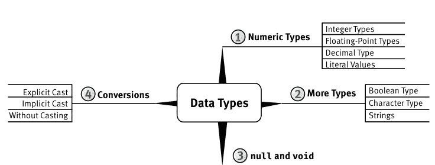

到目前为止，你只使用了少量的内置数据类型，且几乎没有解释。在 C# 中，存在数千种类型，你可以组合类型来创建新类型。然而，C# 中的某些类型相对简单，被视为所有其他类型的构建块。这些类型是**预定义类型**。C# 语言的预定义类型包括八种整数类型、两种用于科学计算的二进制浮点数类型、一种用于财务计算的十进制浮点数、一种布尔类型和一个字符类型。本章将研究这些类型，并更详细地查看字符串类型。

### 基本数值类型

C# 中的基本数值类型有关键字与之关联。这些类型包括整数类型、浮点数类型以及一种名为 `decimal` 的特殊浮点数类型，用于存储没有表示误差的大数。

#### 整数类型

C# 中有八种整数类型。这种多样性允许你选择一个足够大的数据类型来容纳其预期的值范围，同时不浪费资源。表 2.1 列出了每种整数类型。

**表 2.1：整数类型**

| 类型 | 大小 | 范围（包含边界） | BCL 名称 | 有符号 | 字面量后缀 |
| :--- | :--- | :--- | :--- | :--- | :--- |
| `sbyte` | 8 位 | −128 到 127 | `System.SByte` | 是 | |


| `byte` | 8 位 | 0 到 255 | `System.Byte` | 否 | |

| `short` | 16 位 | −32,768 到 32,767 | `System.Int16` | 是 | |

| `ushort` | 16 位 | 0 到 65,535 | `System.UInt16` | 否 | |

| `int` | 32 位 | −2,147,483,648 到 2,147,483,647 | `System.Int32` | 是 | |

| `uint` | 32 位 | 0 到 4,294,967,295 | `System.UInt32` | 否 | U 或 u |

| `long` | 64 位 | −9,223,372,036,854,775,808 到 9,223,372,036,854,775,807 | `System.Int64` | 是 | L 或 l |

| `ulong` | 64 位 | 0 到 18,446,744,073,709,551,615 | `System.UInt64` | 否 | UL 或 ul |

表 2.1（以及表 2.2 和 2.3）中包含一列，列出了每个类型的完整名称；我们将在本章稍后讨论字面量后缀。C# 中所有基本类型都有一个短名称和一个完整名称。完整名称对应于该类型在基础类库（BCL）中的命名。这个名称在所有语言中都是相同的，并在程序集内唯一标识该类型。由于这些类型的根本性，C# 还为基本类型的完整名称提供关键字作为短名称或缩写。从编译器的角度来看，这两个名称指的是同一种类型，产生相同的代码。事实上，检查结果生成的通用中间语言（CIL）代码将不会显示使用了哪个名称。

尽管 C# 支持同时使用完整的 BCL 名称和关键字，但作为开发者，我们需要选择何时使用哪一个。与其来回切换，不如始终如一地使用其中一种。因此，C# 开发者通常使用 C# 关键字形式——例如，选择 `int` 而不是 `System.Int32`，选择 `string` 而不是 `System.String`（或可能的简写 `String`）。

> **指南**
>
> - 在指定数据类型时，请**使用 C# 关键字**而非 BCL 名称（例如，使用 `string` 而非 `String`）。
>
> - **优先保持一致性**，而不是在代码中追求多样性。

保持一致性的选择有时可能与其他指南相冲突。例如，根据使用 C# 关键字替代 BCL 名称的指南，你可能会发现自己需要维护一个采用相反风格的文件（或文件库）。在这种情况下，与之前的风格保持一致比引入新风格和不一致的约定更好。即便如此，如果该“风格”是一种可能导致引入错误并阻碍成功维护的不良编程实践，那么务必全面修正该问题。

> **语言对比：C++ — short 数据类型**
>
> 在 C/C++ 中，`short` 数据类型是 `short int` 的缩写。在 C# 中，单独使用的 `short` 是实际的数据类型。

### 浮点数类型（`float`, `double`）

浮点数具有不同程度的精度，二进制浮点数类型只有在分母是 2 的幂次的分数时才能精确表示数字。如果你将一个浮点变量的值设为 0.1，它很容易表示为 0.099999999999999999 或 0.10000000000000001 或某个非常接近 0.1 的其他数字。类似地，将一个变量设为阿伏伽德罗常数等较大的数字，$6.02 \times 10^{23}$，可能会导致大约 $10^{8}$ 的表示误差，而这毕竟只是该数字的微小部分。浮点数的精度与其所表示数字的数量级成正比。浮点数精确到一定的有效位数，而不是像 $\pm 0.01$ 这样的固定值。

C# 支持表 2.2 中列出的两种二进制浮点数类型。

**表 2.2：浮点数类型**

| 类型 | 大小 | 范围（包含边界） | BCL 名称 | 有效位数 | 字面量后缀 |
| :--- | :--- | :--- | :--- | :--- | :--- |
| `float` | 32 位 | $\pm 1.5 \times 10^{-45}$ 到 $\pm 3.4 \times 10^{38}$ | `System.Single` | 7 | F 或 f |
| `double` | 64 位 | $\pm 5.0 \times 10^{-324}$ 到 $\pm 1.7 \times 10^{308}$ | `System.Double` | 15–16 | |

二进制数以十进制（denary）数字的形式呈现，以便人类阅读。位数（二进制数字）转换为 15 个十进制数字，余数贡献于第 16 个十进制数字，如表 2.2 所示。具体来说，介于 $1.7 \times 10^{307}$ 和小于 $1 \times 10^{308}$ 之间的数字只有 15 个有效位数。然而，范围从 $1 \times 10^{308}$ 到 $1.7 \times 10^{308}$ 的数字将有 16 个有效位数。十进制类型也出现类似的有效位数范围。

### 十进制类型

C# 还提供具有 128 位精度的十进制浮点类型（见表 2.3）。此类型适用于财务计算。

**表 2.3：十进制类型**

| 类型 | 大小 | 范围（包含边界） | BCL 名称 | 有效位数 | 字面量后缀 |
| :--- | :--- | :--- | :--- | :--- | :--- |
| `decimal` | 128 位 | $1.0 \times 10^{-28}$ 到约 $7.9 \times 10^{28}$ | `System.Decimal` | 28–29 | M 或 m |

与二进制浮点数不同，`decimal` 类型在其范围内对所有的十进制数都保持精确的准确性。因此，使用 `decimal` 类型时，数值 0.1 就是精确的 0.1。然而，虽然 `decimal` 类型的精度高于浮点类型，但其范围较小。因此，从浮点类型到 `decimal` 类型的转换可能会导致溢出错误。此外，使用 `decimal` 进行的计算速度略慢（通常这种差异微乎其微）。

## 高级主题

### 浮点类型剖析

在 `decimal` 类型的范围和精度限制内的十进制数是精确表示的。相比之下，许多十进制数的二进制浮点表示引入了舍入误差。正如 $\frac{1}{3}$ 无法在任何有限位数的十进制数字中精确表示一样，$\frac{11}{10}$ 也无法在任何有限位数的二进制数字中精确表示。在这两种情况下，我们最终都会得到某种形式的舍入误差。

十进制数由 $\pm N \times 10^k$ 表示，其中满足以下条件：

- N（尾数）是一个正 96 位整数。
- k（指数）的取值范围为 -28 <= k <= 0。

相比之下，二进制浮点数是任何形如 $\pm N \times 2^k$ 的数，其中满足以下条件：

- N 是一个正 24 位（对于 `float`）或 53 位（对于 `double`）整数。
- k 是一个整数，对于 `float` 取值范围为 -149 到 +104，对于 `double` 取值范围为 -1074 到 +970。

## 字面量值

字面量值是源代码中常数值的一种表示形式。例如，如果你希望 `System.Console.WriteLine()` 打印出整数值 42 和 `double` 值 1.618034，可以使用清单 2.1 中显示的代码。

### 清单 2.1：指定字面量值

```csharp
System.Console.WriteLine(42);
System.Console.WriteLine(1.618034);
```

输出 2.1 显示了清单 2.1 的结果。

### 输出 2.1

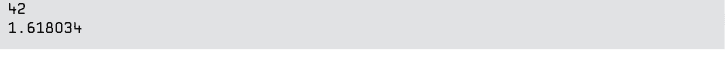

### 初学者主题

### 硬编码值时需谨慎

将值直接放置在源代码中的做法被称为**硬编码（hardcoding）**，因为更改这些值需要重新编译代码。开发人员必须仔细考虑是在代码中硬编码值，还是从外部源（例如配置文件）检索值，以便在无需重新编译的情况下修改这些值。

默认情况下，当你指定带有小数点的字面数字时，编译器将其解释为 `double` 类型。相反，没有小数点的字面量值通常默认为 `int`，假设该值不过大而无法存储在整数中。如果值过大，编译器将其解释为 `long`。此外，假设字面量值适用于目标数据类型，C# 编译器允许赋值给 `int` 以外的其他数值类型。例如，`short s = 42` 和 `byte b = 77` 都是允许的。然而，这只适用于常量值；如本章后面“数据类型之间的转换”部分所述，没有额外的语法不允许执行 `b = s`。

正如本节之前所讨论的，C# 中有许多不同的数值类型。在清单 2.2 中，一个字面量值被放置在 C# 代码中。由于带有小数点的数字默认使用 `double` 数据类型，输出（如输出 2.2 所示）为 1.61803398874989（缺少最后一位数字 5），这与 `double` 的预期精度相对应。

### 清单 2.2：指定字面量 double

```csharp
System.Console.WriteLine(1.618033988749895);
```

### 输出 2.2

1.61803398874989

若要查看具有完整精度的预期数字，你必须通过添加 M（或 m）来显式将字面量值声明为 `decimal` 类型（参见清单 2.3 和输出 2.3）。

### 清单 2.3：指定字面量 decimal

```csharp
System.Console.WriteLine(1.618033988749895M);
```

### 输出 2.3

1.618033988749895

现在，清单 2.3 的输出符合预期：1.618033988749895。请注意，d 是 `double` 的缩写。要记住应该使用 m 来标识 `decimal`，请记住“m 代表货币计算（monetary calculations）”。

你还可以通过使用 F 和 D 后缀，分别为值显式声明为 `float` 或 `double`。对于整数数据类型，后缀为 U、L、LU 和 UL。整数字面量的类型可以按以下方式确定：

- 没有后缀的数字字面量解析为能够存储该值的第一个数据类型，顺序为：`int`, `uint`, `long`, 和 `ulong`。
- 带有后缀 U 的数字字面量解析为能够存储该值的第一个数据类型，顺序为 `uint` 然后是 `ulong`。
- 带有后缀 L 的数字字面量解析为能够存储该值的第一个数据类型，顺序为 `long` 然后是 `ulong`。
- 如果数字字面量带有后缀 UL 或 LU，其类型为 `ulong`。

请注意，字面量后缀不区分大小写。然而，通常建议使用大写形式，以避免小写字母 l 和数字 1 之间的任何歧义。

## 准则

> **应该**使用大写字面量后缀（例如 `1.618033988749895M`）。

#### 从 7.0 开始

偶尔，数字会变得非常大且难以阅读。为了解决可读性问题，C# 7.0 添加了对**数字分隔符**的支持，即在表示数字字面量时使用下划线（`_`），如清单 2.4 所示。

### 清单 2.4：指定数字分隔符

```csharp
System.Console.WriteLine(9_814_072_356);
```

在这种情况下，我们将数字分成千位（三位一组），但这并不是 C# 的要求。只要下划线出现在第一个和最后一个数字之间，你可以使用数字分隔符创建任何喜欢的分组。事实上，你甚至可以让多个下划线并排出现——中间没有数字。

#### 7.0 结束

此外，你可能希望使用指数表示法，而不是在 `decimal` 点前或后写出几个零（无论是否使用数字分隔符）。要使用指数表示法，提供 `e` 或 `E` 中缀，在中缀字符后跟随一个正或负整数，并使用适当的数据类型后缀完成字面量。例如，你可以如清单 2.5 和输出 2.4 所示，将阿伏伽德罗常数打印为 `float`。

### 清单 2.5：指数表示法

```csharp
System.Console.WriteLine(6.023E23F);
```

### 输出 2.4

```
6.023E+23
```

### 初学者主题

### 十六进制表示法

通常你处理的是以 10 为底表示的数字，这意味着数字的每个位值都有 10 个符号（0–9）。如果数字以十六进制表示法显示，则是以 16 为底，意味着使用 16 个符号：0–9, A–F（也可以使用小写）。因此，`0x000A` 对应十进制值 10，而 `0x002A` 对应十进制值 42，即 $2 \times 16 + 10$。实际的数字是相同的。从十六进制切换到十进制，或反之，并不改变数字本身，只是改变了数字的表示形式。

每个十六进制位是四位二进制，因此一个字节可以表示两个十六进制位。

在迄今为止关于字面数值的所有讨论中，我们只覆盖了 10 进制类型的值。C# 也支持指定十六进制值的能力。要指定十六进制值，请在值前加上 `0x`，然后使用任何十六进制数字，如清单 2.6 所示。

### 清单 2.6：十六进制字面量值

```csharp
// 使用十六进制字面量显示值 42
System.Console.WriteLine(0x002A);
```

输出 2.5 显示了清单 2.6 的结果。

### 输出 2.5

42

请注意，此代码仍然显示 42，而不是 `0x002A`。

从 C# 7.0 开始，你还可以将数字表示为二进制值（参见清单 2.7）。

### 清单 2.7：二进制备量值

```csharp
// 使用二进制字面量显示值 42
System.Console.WriteLine(0b101010);
```

其语法与十六进制语法类似，只是前缀为 `0b`（也允许使用大写字母 B）。有关二进制表示法及二进制与十进制之间转换的完整解释，请参见第 4 章标题为“位与字节”的初学者主题。

请注意，从 C# 7.2 开始，你可以通过在十六进制字面量的 `x` 或二进制字面量的 `b` 之后放置数字分隔符来使用它。

## 高级主题

### 以十六进制格式化数字

要在十六进制格式下显示数值，必须使用 `x` 或 `X` 数字格式化说明符。字母的大小写决定了十六进制字母是以小写还是大写形式出现。列表 2.8 展示了一个示例。

```
LISTING 2.8: Example of a Hexadecimal Format Specifier
// Displays "0x2A"
System.Console.WriteLine($"0x{42:X}");
```

输出 2.6 展示了结果。


请注意，数字字面量 (`42`) 可以是十进制或十六进制形式。结果将是相同的。此外，为了实现十六进制格式化，我们依赖格式化说明符，它用冒号与字符串插值表达式分隔。

## 高级主题

### 往返格式化

默认情况下，`System.Console.WriteLine(1.618033988749895);` 显示 1.61803398874989，最后一位数字缺失。为了更准确地标识 `double` 值的字符串表示形式，可以使用格式字符串和往返格式化说明符 `R`（或 `r`）进行转换。例如，`string.Format("{0:R}", 1.618033988749895)` 将返回结果 1.6180339887498949。

往返格式化说明符返回的字符串，如果转换回数值，将始终产生原始值。列表 2.9 显示，如果没有使用往返格式，这些数字是不相等的。

### 列表 2.9：使用 R 格式化说明符进行格式化

```
/// ...
const double number = 1.618033988749895;
double result;
string text;

text = $"{number}";
result = double.Parse(text);
System.Console.WriteLine($"{result == number}: result == number");

text = string.Format("{0:R}", number);
result = double.Parse(text);
System.Console.WriteLine($"{result == number}: result == number");
/// ...
```

输出 2.7 显示了结果输出。

### 输出 2.7

```
False: result == number
True: result == number
```

在第一次分配给 `text` 时，没有使用往返格式化说明符；因此，`double.Parse(text)` 返回的值与原始数字值不同。相反，当使用往返格式化说明符时，`double.Parse(text)` 返回原始值。

对于不熟悉基于 C 的语言中 `==` 语法的读者，如果 `result` 等于 `number`，则 `result == number` 评估为 `true`，而 `result != number` 则相反。赋值和相等运算符将在下一章中讨论。

## 更多基本类型

迄今为止讨论的基本类型是数字类型。C# 还包括一些额外的类型：`bool`、`char` 和 `string`。

### 布尔类型 (`bool`)

C# 的另一种原始类型是布尔或条件类型，`bool`，它在条件语句和表达式中表示 `true` 或 `false`。允许的值是关键字 `true` 和 `false`。`bool` 的 BCL 名称是 `System.Boolean`。例如，要以不区分大小写的方式比较两个字符串，你调用 `string.Compare()` 方法并传递 `bool` 字面量 `true`（参见列表 2.10）。

### 列表 2.10：两个字符串的不区分大小写的比较

```
string option;
...
int comparison = string.Compare(option, "/Help", true);
```

在这种情况下，你对变量 `option` 的内容与字面文本 `/Help` 进行不区分大小写的比较，并将结果赋值给 `comparison`。

虽然从理论上讲，单个位可以容纳布尔值，但 `bool` 的大小是 1 字节。

### 字符类型 (`char`)


`char` 类型表示 16 位字符，其可能值的集合取自 Unicode 字符集的 UTF-16 编码。`char` 的大小与 16 位无符号整数 (`ushort`) 相同，表示 0 到 65,535 之间的值。然而，`char` 是 C# 中的独特类型，代码应将其视为此类。

`char` 的 BCL 名称是 `System.Char`。

# 初学者主题

## Unicode 标准

Unicode 是表示大多数人类语言中找到的字符的国际标准。它为计算机系统提供构建**本地化**应用程序的功能——也就是说，为不同文化显示适当的语言和文化特征的应用程序。

# 高级主题

## 16 位对于所有 Unicode 字符来说太小了

不幸的是，并非所有 Unicode 字符都可以仅用单个 16 位 `char` 表示。最初的 Unicode 设计者认为 16 位足够了，但随着支持的语言越来越多，人们意识到这个假设是错误的。因此，一些（很少使用的）Unicode 字符由两个 char 值的“代理对”组成。

要构造字面量字符，请将字符放在单引号内，如 `'A'`。允许的字符包括键盘字符的完整范围，包括字母、数字和特殊符号。

某些字符无法直接放置在源代码中，而是需要特殊处理。这些字符以前缀反斜杠 (`\`) 开头，后跟一个特殊字符代码。组合起来，反斜杠和特殊字符代码构成一个**转义序列**。例如，`\n` 代表换行符，`\t` 代表制表符。由于反斜杠指示转义序列的开始，它不能再标识一个简单的反斜杠；相反，你需要使用 `\\` 来表示单个反斜杠字符。

列表 2.11 写出一个单引号，因为由 `\'` 表示的字符对应于单引号。

### 列表 2.11：使用转义序列显示单引号

```
class SingleQuote
{
    static void Main()
    {
        System.Console.WriteLine('\'');
    }
}
```

除了显示转义序列外，表 2.4 还包括字符的 Unicode 表示。

### 表 2.4：转义字符

| 转义序列 | 字符名称 | Unicode 编码 |
| :--- | :--- | :--- |
| \' | 单引号 | \u0027 |
| \" | 双引号 | \u0022 |
| \\ | 反斜杠 | \u005C |
| \0 | 空字符 | \u0000 |
| \a | 警报（系统蜂鸣） | \u0007 |
| \b | 退格 | \u0008 |
| \f | 换页符 | \u000C |
| \n | 换行符（有时称为换行） | \u000A |
| \r | 回车 | \u000D |
| \t | 水平制表符 | \u0009 |
| \v | 垂直制表符 | \u000B |
| \uxxxx | 十六进制 Unicode 字符 | \u0029 |
| \x[n][n][n]n | 十六进制 Unicode 字符（前三个占位符是可选的）；\uxxxx 的可变长度版本 | \u3A |
| \uxxxxxxxx | 用于创建代理对的 Unicode 转义序列 | \UD840DC01 (弓) |

你可以使用 Unicode 编码表示任何字符。为此，请使用 `\u` 前缀 Unicode 值。你使用十六进制表示法表示 Unicode 字符。例如，字母 A 是十六进制值 `0x41`。列表 2.12 使用 Unicode 字符显示一个笑脸 (`:`)，输出 2.8 显示了结果。

### 列表 2.12：使用 Unicode 编码显示笑脸

```
System.Console.Write('\u003A');
System.Console.WriteLine('\u0029');
```

### 输出 2.8

:)

## 字符串

零个或多个字符的有限序列称为**字符串**。C# 中的字符串类型是 `string`，其 BCL 名称是 `System.String`。字符串类型包含一些特殊特性，对于熟悉其他编程语言的开发者来说可能出乎意料。除了第 1 章中讨论的字符串字面量格式外，字符串还包括“逐字字符串”前缀字符 `@`，支持带有 `$` 前缀字符的字符串插值，以及一个可能令人惊讶的事实，即字符串是不可变的。

### 字面量

你可以通过将文本放在双引号 (`"`) 中在代码中输入字面字符串，正如你在 `HelloWorld` 程序中所见。字符串由字符组成，因此，字符转义序列可以嵌入在字符串中。

例如，在列表 2.13 中，显示了两行文本。然而，代码列表没有使用 `System.Console.WriteLine()`，而是显示了带有换行符 `\n` 的 `System.Console.Write()`。输出 2.9 显示了结果。

### 列表 2.13：使用 
 字符插入换行

```
class DuelOfWits
{
    static void Main()
    {
        System.Console.Write(
            "\"Truly, you have a dizzying intellect.\"");
        System.Console.Write("\n\"Wait 'til I get going!\"\n");
    }
}
```

### 输出 2.9

```
"Truly, you have a dizzying intellect."
Wait 'til I get going!
```

双引号的转义序列将打印的双引号与定义字符串开始和结束的双引号区分开来。

在 C# 中，你可以在字符串前使用 `@` 符号，表示反斜杠不应被解释为转义序列的开头。由此产生的**逐字字符串字面量**（verbatim string literal）不会重新解释反斜杠字符。当使用 `@` 字符串语法时，空白符也会按原样保留。例如，列表 2.14 中的三角形在控制台中会按照输入的形式原样显示，包括反斜杠、换行符和缩进。输出 2.10 展示了运行结果。

### 列表 2.14：使用逐字字符串字面量显示三角形

```csharp
class Triangle
{
    static void Main()
    {
        System.Console.Write(@"begin
          ^
         / \\
        /___\\"
                  end");
    }
}
```

### 输出 2.10


如果没有 `@` 字符，这段代码甚至无法编译。事实上，即使将形状改为正方形并去掉了反斜杠，代码仍然无法编译，因为未在字符串前添加 `@` 符号的字符串不能直接包含换行符。

逐字字符串支持的唯一转义序列是 `""`，它表示双引号，且不会终止字符串。

## 语言对比：C++——编译时的字符串连接

与 C++ 不同，C# 不会自动连接字符串字面量。例如，你不能像下面这样指定字符串字面量：

```
"Major Strasser has been shot."
"Round up the usual suspects."
```

相反，字符串连接需要使用加号运算符。（不过，如果编译器能在编译时计算出结果，生成的 CIL 代码将是一个单一的字符串。）

如果同一个字符串字面量在程序集中出现多次，编译器只会在程序集内定义一次该字符串，所有变量都将引用同一个字符串。这样，如果同一个包含数千个字符的字符串字面量在代码中多次出现，生成的程序集的大小将仅反映其中一个的大小。

### 字符串插值

如第 1 章所述，从 C# 6.0 开始，使用字符串插值格式时，字符串可以支持嵌入表达式。字符串插值语法在逐字字符串字面量前加一个美元符号，然后在花括号内嵌入表达式。以下是一个示例：

```csharp
System.Console.WriteLine($"Your full name is {firstName} {lastName}.");
```

其中 `firstName` 和 `lastName` 是引用变量的简单表达式。请注意，可以通过在 `@` 符号前指定 `$` 来将逐字字符串字面量与字符串插值结合使用，如下例所示：

```csharp
System.Console.WriteLine(@"Your full name is:
{ firstName } { lastName }");
```

由于这是一个逐字字符串字面量，文本会在两行输出。但是，你可以通过在花括号内放置换行符，在代码中制造类似的换行而不影响输出中的换行，如下所示：

```csharp
System.Console.WriteLine($@"Your full name is: {
firstName } { lastName }");
```

请注意，即使只是在花括号内放置换行符，仍然需要 `@` 符号。

# 高级主题

## 理解字符串插值的内部机制

字符串插值是调用 `string.Format()` 方法的简写方式。例如，像这样的语句：

```csharp
System.Console.WriteLine($"Your full name is { firstName } { lastName }.");
```

将被转换为 C# 中等价的：

```csharp
object[] args = new object[] { firstName, lastName }; 
Console.WriteLine(string.Format("Your full name is {0} {1}.", args));
```

这与复合字符串的工作方式相同，保留了本地化支持，并且不会通过字符串引入编译后的代码注入。

## 字符串方法

与 `System.Console` 类型类似，`string` 类型包含若干方法。例如，有用于格式化、连接和比较字符串的方法。

表 2.5 中的 `Format()` 方法的行为类似于 `Console.Write()` 和 `Console.WriteLine()` 方法，不同之处在于 `string.Format()` 将结果返回给调用者，而不是在控制台窗口中显示结果。当然，随着字符串插值的使用，对 `string.Format()` 的需求大幅减少（除了本地化支持外）。但在底层，字符串插值最终编译为利用 `string.Format()` 的 CIL 代码。

表 2.5 中的所有方法都是**静态**的。这意味着，要调用这些方法，需要在方法名前加上包含该方法所属类型的名称（例如 `string`）。然而，正如本章后面所示，`string` 类中的一些方法是**实例**方法。实例方法使用变量名（或其他对实例的引用）而不是类型名称作为前缀。表 2.6 展示了其中的一些方法及其示例。

## 表 2.5：`string` 静态方法

| 语句 | 示例 |
| :--- | :--- |
| `static string string.Format(string format, ...)` | `string text, firstName, lastName;`<br>`//...`<br>`text = string.Format("Your full name is {0} {1}.", firstName, lastName);`<br>`// 显示 "Your full name is <firstName> <lastName>."`<br>`System.Console.WriteLine(text);` |
| `static string string.Concat(string str0, string str1)` | `string text, firstName, lastName;`<br>`//...`<br>`text = string.Concat(firstName, lastName);`<br>`// 显示 "<firstName><lastName>"，注意名字之间没有空格`<br>`System.Console.WriteLine(text);` |
| `static int string.Compare(string str0, string str1)` | `string option;`<br>`//...`<br>`// 区分大小写的字符串比较`<br>`int result = string.Compare(option, "/help");`<br>`// 显示：`<br>`// 如果相等则为 0`<br>`// 如果 option < /help 则为负数`<br>`// 如果 option > /help 则为正数`<br>`System.Console.WriteLine(result);` |
| | `string option;`<br>`//...`<br>`// 不区分大小写的字符串比较`<br>`int result = string.Compare(option, "/Help", true);`<br>`// 显示：`<br>`// 如果相等则为 0`<br>`// 如果 option < /help 则 < 0`<br>`// 如果 option > /help 则 > 0`<br>`System.Console.WriteLine(result);` |

## 表 2.6：`string` 方法

| 语句 | 示例 |
| :--- | :--- |
| `bool StartsWith(string value)`<br>`bool EndsWith(string value)` | `string lastName;`<br>`//...`<br>`bool isPhD = lastName.EndsWith("Ph.D.");`<br>`bool isDr = lastName.StartsWith("Dr.");` |
| `string ToLower()` | `string severity = "warning";` |
| `string ToUpper()` | `// 以大写字母显示严重程度`<br>`System.Console.WriteLine(severity.ToUpper());` |
| `string Trim()`<br>`string Trim(...)`<br>`string TrimEnd()`<br>`string TrimStart()` | `// 移除开头或结尾的空白符`<br>`username = username.Trim();` |
| `string Replace(string oldValue, string newValue)` | `string filename;`<br>`//...`<br>`// 从字符串中移除 '?'`<br>`filename = filename.Replace("?", "");` |

# 高级主题

## using 指令和 using static 指令

目前我们调用静态方法的方式总是需要在方法名前加上命名空间，再加上类型名称。例如，在调用 `System.Console.WriteLine` 时，尽管调用的方法是 `WriteLine()` 且上下文中没有其他同名方法，但仍然需要在方法名前加上命名空间（System）和类型名称（Console）。有时，你可能希望使用一种简捷方式来避免这种显式写法；为此，可以利用 C# 6.0 的 using static 指令，如列表 2.15 所示。

### 列表 2.15：using static 指令

```csharp
// using 指令允许你省略命名空间
using static System.Console;

class HeyYou
{
    static void Main()
    {
        string firstName;
        string lastName;

        WriteLine("Hey you!");

        Write("Enter your first name: ");
        firstName = ReadLine();
```

```csharp
Write("Enter your last name: ");
lastName = ReadLine();

WriteLine(
    $"Your full name is {firstName} {lastName}.");
}
}
```

`using static` 指令必须出现在文件的顶部。¹ 每次使用 `System.Console` 类时，都不再需要同时使用 `System.Console` 前缀。相反，我们只需直接编写方法名即可。关于 `using static` 指令，有一点重要注意事项：它仅适用于静态方法和属性，不适用于实例成员。

另一个类似的指令是 `using` 指令，它允许消除命名空间前缀——例如 `System.`。与 `using static` 指令不同，`using` 指令在其所在的文件（或命名空间）内普遍适用（不仅限于静态成员）。使用 `using` 指令，你可以（选择性地）消除对命名空间的所有引用，无论是在实例化过程中、静态方法调用中，还是在 C# 6.0 中的 `nameof` 运算符中。

### 字符串格式化

无论你使用 `string.Format()` 还是 C# 6.0 的字符串插值功能来构建复杂的格式化字符串，都有一套丰富且复杂的格式化模式可用于显示数字、日期、时间、时间跨度等。例如，如果 `price` 是一个类型为 `decimal` 的变量，那么 `string.Format("{0,20:C2}", price)` 或等效的插值表达式 `$"{price,20:C2}"` 都会使用默认的货币格式化规则将 `decimal` 值转换为字符串，结果保留小数点后两位，并在 20 个字符宽的字符串中右对齐。篇幅有限，无法详细讨论所有可能的格式化字符串；请参阅 `string.Format()` 的 MSDN 文档以获取格式化字符串的完整列表。


如果你想在插值字符串或格式化字符串中实际包含左花括号或右花括号，可以加倍花括号（双花括号）来表示它不引入模式。例如，插值字符串 `$"{{ {price:C2} }}"` 可能会生成字符串 `"{ $1,234.56 }"`。

- 或者在命名空间声明的顶部。

### 换行符

在输出换行符时，具体的换行字符取决于你正在其上执行代码的操作系统。在 Microsoft Windows 操作系统中，换行符是回车符（`\r`）和换行符（`\n`）的组合，而在 UNIX 系统中仅使用单个换行符。克服不同操作系统之间差异的一种方法是简单地使用 `System.Console.WriteLine()` 来输出一个空行。另一种几乎必不可少的做法（当需要针对同一代码库在多个操作系统上处理换行符时），是使用 `System.Environment.NewLine`。换句话说，`System.Console.WriteLine("Hello World")` 和 `System.Console.Write($"Hello World{System.Environment.NewLine}")` 是等效的。然而，在 Windows 上，`System.Console.WriteLine()` 和 `System.Console.Write(System.Environment.NewLine)` 等效于 `System.Console.Write("\r\n")`——而不是 `System.Console.Write("\n")`。总之，请依赖 `System.Console.WriteLine()` 和 `System.Environment.NewLine`，而不是 `\n`，以便使用相同的代码适配 Windows 特有的操作系统特性，同时该代码也能在 Linux 和 iOS 上运行。

> **准则**
>
> 请依赖 `System.Console.WriteLine()` 和 `System.Environment.NewLine`，而不是 `\n`，以便使用相同的代码适配 Windows 特有的操作系统特性，同时该代码也能在 Linux 和 iOS 上运行。

### C# 属性

以下部分中提到的 `Length` 成员实际上并不是一个方法，这一点从其调用后没有跟随括号的事实中可以看出。`Length` 是 `string` 的一个属性，C# 语法允许像访问成员变量（在 C# 中称为**字段**）一样访问属性。换句话说，属性具有称为 setter 和 getter 的特殊方法的行为，但访问这些行为的语法却是像访问字段一样。

检查属性的底层 `CIL` 实现可以发现，它被编译为两个方法：`set_<PropertyName>` 和 `get_<PropertyName>`。然而，从 C# 代码中无法直接访问这两个方法，只能通过 C# 属性构造来访问。有关属性的更多细节，请参阅第 6 章。

### 字符串长度

要确定字符串的长度，需要使用称为 `Length` 的字符串成员。这个特定的成员被称为**只读属性**。因此，它不能被设置，调用它也不需要任何参数。清单 2.16 演示了如何使用 `Length` 属性，输出 2.11 展示了结果。

**清单 2.16：使用字符串的 Length 成员**

```csharp
class PalindromeLength
{
    static void Main()
    {
        string palindrome;

        System.Console.Write("Enter a palindrome: ");
        palindrome = System.Console.ReadLine();

        System.Console.WriteLine(
            $"The palindrome \"{palindrome}\" is"
            + $" {palindrome.Length} characters.");
    }
}
```

**输出 2.11**

```text
Enter a palindrome: Never odd or even
The palindrome "Never odd or even" is 17 characters.
```

字符串的长度不能直接设置；它是由字符串中的字符数计算得出的。此外，字符串的长度不能改变，因为字符串是**不可变的**。

### 字符串是不可变的

字符串类型的一个关键特征是不可变性。可以为字符串变量分配一个全新的值，但没有机制来修改字符串的内容。因此，不可能将字符串转换为全大写字母。创建一个由旧字符串的大写版本组成的新字符串是很简单的，但在此过程中旧字符串并没有被修改。请考虑清单 2.17 作为一个例子。

**清单 2.17：错误；字符串是不可变的**

```csharp
class Uppercase
{
    static void Main()
    {
        string text;

        System.Console.Write("Enter text: ");
        text = System.Console.ReadLine();

        // UNEXPECTED: Does not convert text to uppercase
        text.ToUpper();

        System.Console.WriteLine(text);
    }
}
```

输出 2.12 展示了清单 2.17 的结果。

**输出 2.12**

```text
Enter text: This is a test of the emergency broadcast system.
This is a test of the emergency broadcast system.
```

乍一看，似乎 `text.ToUpper()` 应该将 `text` 中的字符转换为大写。然而，字符串是不可变的，因此 `text.ToUpper()` 不会进行这样的修改。相反，`text.ToUpper()` 返回一个新的字符串，该字符串需要被保存到变量中或直接传递给 `System.Console.WriteLine()`。修正后的代码显示在清单 2.18 中，其输出显示在输出 2.13 中。

**清单 2.18：处理字符串**

```csharp
class Uppercase
{
    static void Main()
    {
        string text, uppercase;

        System.Console.Write("Enter text: ");
        text = System.Console.ReadLine();

        // Return a new string in uppercase
        uppercase = text.ToUpper();

        System.Console.WriteLine(uppercase);
    }
}
```

**输出 2.13**

```text
Enter text: This is a test of the emergency broadcast system.
THIS IS A TEST OF THE EMERGENCY BROADCAST SYSTEM.
```

如果忽略字符串的不可变性，清单 2.17 中显示的那类错误也可能发生在其他字符串方法中。

要实际更改 `text` 的值，请将 `ToUpper()` 的值重新赋给 `text`，如下面的代码所示：

```csharp
text = text.ToUpper();
```

### System.Text.StringBuilder

如果需要大量的字符串修改，例如在多个步骤中构建一个长字符串时，应使用数据类型 `System.Text.StringBuilder` 而不是 `string`。`StringBuilder` 类型包含诸如 `Append()`、`AppendFormat()`、`Insert()`、`Remove()` 和 `Replace()` 等方法，其中一些方法在 `string` 中也可用。然而，关键区别在于，使用 `StringBuilder` 时，这些方法会修改 `StringBuilder` 本身中的数据，而不仅仅是返回一个新的字符串。

### null 和 void

与类型相关的两个额外关键字是 `null` 和 `void`。由 `null` 关键字标识的 `null` 值表示该变量不指向任何有效对象。`void` 用于指示没有类型或根本没有值。

### null

`null` 也可以作为字符串“字面量”的类型使用。`null` 表示变量被设置为空。引用类型、指针类型和可空值类型可以被赋值为 `null`。到目前为止，本书中涵盖的唯一引用类型是 `string`；第 6 章详细讨论了创建类（即引用类型）的主题。简而言之，引用类型的变量包含一个指向内存位置的引用，该位置不同于变量的值。将变量设置为 `null` 的代码显式地将引用分配为指向无有效值。实际上，甚至可以检查一个引用是否指向空值。清单 2.19 演示了将 `null` 赋给字符串变量的操作。

[1] 或者在命名空间声明的顶部。

## 第二章：数据类型

### 列表 2.19：将 null 赋值给 String

```csharp
static void Main()
{
    string faxNumber;
    // ...

    // 清除 faxNumber 的值
    faxNumber = null;

    // ...
}
```

将值 `null` 赋值给引用类型并不等同于完全未赋值。换句话说，一个被赋值为 `null` 的变量仍然被视为已设置，而一个未进行赋值的变量则处于未设置状态，因此如果在使用前未赋值，通常会引发编译错误。

将 `null` 值赋值给字符串变量与赋值为空字符串 `""` 有着本质的区别。使用 `null` 表示变量没有值，而 `""` 表示存在一个值——即一个空字符串。这种区别可能非常有用。例如，编程逻辑可以解释 `homePhone` 为 `null` 意味着家庭电话号码未知，而 `homePhone` 值为 `""` 则可能表示没有家庭电话号码。

## void“类型”

有时，C# 语法要求指定一个数据类型，但实际上并没有传递任何数据。例如，如果方法不需要返回，C# 允许你指定 `void` 作为数据类型。HelloWorld 程序中 `Main` 的声明就是一个例子。使用 `void` 作为返回类型表示该方法不返回任何数据，并告诉编译器不要期待有值返回。`void` 本身不是一个数据类型，而是一种指示，表示没有数据被返回。

## 语言对比：C++

在 C++ 和 C# 中，`void` 都有两个含义：一是标记方法不返回任何数据；二是表示指向未知类型存储位置的指针。在 C++ 程序中，经常可以看到诸如 `void*` 这样的指针类型。C# 也可以使用相同的语法来表示指向未知类型存储位置的指针，但这种用法在 C# 中相对罕见，通常仅在与非托管代码库进行互操作时遇到。

语言对比：Visual Basic——返回 void 类似于定义子程序

C# 中返回 `void` 的 Visual Basic 等效操作是定义一个子程序（Sub/End Sub），而不是定义一个返回值的函数。

## 数据类型之间的转换

鉴于各种 CLI 实现中预定义了数千种类型，且代码可以定义无限多的类型，让类型在合理的情况下支持从一个类型转换到另一个类型至关重要。最常见的导致转换的操作是**强制转换（casting）**。

考虑两种数值类型之间的转换：将 `long` 类型变量转换为 `int` 类型变量。`long` 类型可以包含高达 9,223,372,036,854,775,808 的值；然而，`int` 的最大值为 2,147,483,647。因此，这种转换可能会导致数据丢失——例如，如果 `long` 类型变量包含的值大于 `int` 的最大值。任何可能导致量级丢失或因转换失败而引发异常的转换都需要**显式转换**。相反，如果转换操作不会丢失量级，且无论操作数类型如何都不会引发异常，则这种转换是**隐式转换**。

## 显式转换

在 C# 中，你使用**强制转换运算符（cast operator）**进行转换。通过在括号内指定希望变量转换成的类型，你承认如果正在进行显式转换，可能会丢失精度和数据，或者可能会产生异常。列表 2.20 中的代码将 `long` 转换为 `int`，并显式地告诉系统尝试执行此操作。

**列表 2.20：显式转换示例**

```csharp
long longNumber = 50918309109;
int intNumber = (int) longNumber;
// 强制转换运算符
```

使用强制转换运算符时，程序员实际上是在告诉编译器：“相信我，我知道我在做什么。我知道该值适合目标类型。”做出这种选择会使编译器允许该转换。但是，对于显式转换，如果数据未能成功转换，在执行过程中仍有可能以异常的形式发生错误。因此，程序员有责任确保数据成功转换，或者在转换失败时提供必要的错误处理代码。

## 高级主题

### 检查与未检查的转换

C# 提供了特殊关键字，用于标记代码块以指示当目标数据类型太小而无法容纳分配的数据时应发生什么。默认情况下，如果目标数据类型无法容纳所分配的数据，数据将在分配期间被截断。示例请参见列表 2.21。

**列表 2.21：整数值的溢出**

```csharp
class Program
{
 static void Main()
 {
// int.MaxValue 等于 2147483647
int n = int.MaxValue;
n = n + 1;
System.Console.WriteLine(n);
 }
}
```

输出 2.14 显示了结果。

**输出 2.14**

-2147483648

列表 2.21 将值 -2147483648 写入控制台。然而，将代码放置在 `checked` 块中，或者在运行编译器时使用 `checked` 选项，将导致运行时抛出 `System.OverflowException` 类型的异常。`checked` 块的语法使用 `checked` 关键字，如列表 2.22 所示。

**列表 2.22：checked 块示例**

```csharp
class Program
{
    static void Main()
    {
        checked
        {
            // int.MaxValue 等于 2147483647
            int n = int.MaxValue;
            n = n + 1 ;
            System.Console.WriteLine(n);
        }
    }
}
```

输出 2.15 显示了结果。

**输出 2.15**

```
Unhandled Exception: System.OverflowException: Arithmetic operation
resulted in an overflow at Program.Main() in ...Program.cs:line 12
```

结果是，如果在 `checked` 块内部运行时发生溢出赋值，将抛出异常。

C# 编译器提供了一个命令行选项，用于将默认的 `checked` 行为从 `unchecked` 更改为 `checked`。C# 还支持 `unchecked` 块，该块对于块内的赋值操作会溢出数据而不是抛出异常（参见列表 2.23）。

**列表 2.23：unchecked 块示例**

```csharp
using System;

class Program
{
    static void Main()
    {
        unchecked
        {
            // int.MaxValue 等于 2147483647
            int n = int.MaxValue;
            n = n + 1 ;
            System.Console.WriteLine(n);
        }
    }
}
```

输出 2.16 显示了结果。

**输出 2.16**

-2147483648

即使在编译期间启用了 `checked` 选项，上述代码中的 `unchecked` 关键字也会阻止运行时在执行过程中抛出异常。

读者可能会好奇，为什么在对 `unchecked` 的 `int.MaxValue` 加 1 时，结果会得到 -2147483648。这种行为是由回绕语义（wraparound semantics）引起的。`int.MaxValue` 的二进制表示为 01111111111111111111111111111111，其中第一位（0）表示该值为正。对该值进行递增操作会得到下一个值 10000000000000000000000000000000，即最小整数（`int.MinValue`），其中第一位（1）表示该数为负。对 `int.MinValue` 加 1 将得到 10000000000000000000000000000001（-2147483647），以此类推。

你并不能仅仅因为使用强制转换运算符显式指定转换，就可以将任何类型转换为任何其他类型。编译器仍会检查该操作是否有效。例如，你不能将 `long` 转换为 `bool`。没有定义这样的转换，因此编译器不允许这样的强制转换。

> **语言对比：将数字转换为布尔值**
>
> 你可能会惊讶地发现，从数值类型到布尔类型的有效强制转换是不存在的，因为这在许多其他语言中很常见。C# 中不存在这种转换的原因是为了避免任何歧义，例如 -1 对应 `true` 还是 `false`。更重要的是，正如你在下一章中看到的，这一约束减少了误用赋值运算符代替相等运算符的机会（例如，避免在意图为 `if(x==42){...}` 时写成 `if(x=42){...}`）。

## 隐式转换

在其他情况下，例如从 `int` 类型到 `long` 类型，不会丢失精度，且类型的值不会发生根本变化。在这些情况下，代码只需指定赋值运算符；该转换是**隐式（implicit）**的。换句话说，编译器能够


以确定此类转换能够正确执行。列表 2.24 中的代码通过简单使用赋值运算符，将 `int` 转换为 `long`。

## 列表 2.24：未使用转换运算符进行隐式转换

```csharp
int intNumber = 31416;
long longNumber = intNumber;
```

即使不需要显式转换运算符（因为允许隐式转换），仍然可以包含转换运算符（参见列表 2.25）。

## 列表 2.25：使用转换运算符进行隐式转换

```csharp
int intNumber = 31416;
long longNumber = (long) intNumber;
```

## 无需转换的类型转换

从字符串到数值类型的转换未定义，因此需要使用诸如 `Parse()` 之类的方法。每种数值数据类型都包含一个 `Parse()` 函数，可用于从字符串转换为相应的数值类型。列表 2.26 演示了此调用。

## 列表 2.26：使用 `float.Parse()` 将字符串转换为数值数据类型

```csharp
string text = "9.11E-31";
float kgElectronMass = float.Parse(text);
```

还有一个特殊的类型可用于将一种类型转换为下一种类型。该类型是 `System.Convert`，其使用示例见列表 2.27。

## 列表 2.27：使用 `System.Convert` 进行类型转换

```csharp
string middleCText = "261.626";
double middleC = System.Convert.ToDouble(middleCText);
bool boolean = System.Convert.ToBoolean(middleC);
```

`System.Convert` 仅支持少量类型，且不可扩展。它允许从 `bool`、`char`、`sbyte`、`short`、`int`、`long`、`ushort`、`uint`、`ulong`、`float`、`double`、`decimal`、`DateTime` 和 `string` 中的任何类型转换为这些类型中的任何其他类型。

此外，所有类型都支持 `ToString()` 方法，该方法可用于提供类型的字符串表示。列表 2.28 演示了如何使用该方法。输出结果如输出 2.17 所示。

## 列表 2.28：使用 `ToString()` 转换为字符串

```csharp
bool boolean = true;
string text = boolean.ToString();
// Display "True"
System.Console.WriteLine(text);
```

## 输出 2.17

```
True
```

对于大多数类型，`ToString()` 方法返回数据类型的名称，而不是数据的字符串表示。只有当类型具有 `ToString()` 的显式实现时，才会返回字符串表示。最后需要指出的一点是，可以编写自定义转换方法，并且运行时中的许多类都提供了此类方法。

## 高级主题

### TryParse()

从 C# 2.0 (.NET 2.0) 开始，所有数值原始类型都包含一个静态 `TryParse()` 方法。该方法与 `Parse()` 方法类似，不同之处在于，如果转换失败，`TryParse()` 方法不会抛出异常，而是返回 `false`，如列表 2.29 所示。

## 列表 2.29：使用 `TryParse()` 替代无效转换异常

```csharp
double number;
string input;

System.Console.Write("Enter a number: ");
input = System.Console.ReadLine();
if (double.TryParse(input, out number))
{
    // Converted correctly, now use number
    // ...
}
else
{
    System.Console.WriteLine(
        "The text entered was not a valid number.");
}
```

输出 2.18 显示了列表 2.29 的结果。

## 输出 2.18

```
Enter a number: forty-two
The text entered was not a valid number.
```

代码从输入字符串中解析出的结果值通过 `out` 参数返回——在这种情况下，即为 `number`。

值得注意的是，从 C# 7.0 开始，不再需要在将变量用作 `out` 参数之前声明它。使用此特性，`number` 的声明如列表 2.30 所示。

## 列表 2.30：在 C# 7.0 中使用内联 `out` 声明调用 `TryParse()`

```csharp
// double number;
string input;

System.Console.Write("Enter a number: ");
input = System.Console.ReadLine();
if (double.TryParse(input, out double number))
{
    System.Console.WriteLine(
        $"{input} was parsed successfully to {number}.");
}
else
{
    // Note: number scope is here too (although not assigned)
    System.Console.WriteLine(
        "The text entered was not a valid number.");
}
```

请注意，`number` 的数据类型在 `out` 修饰符之后、它所声明的变量之前指定。结果是，`number` 变量在 `if` 语句的 `true` 和 `false` 分支中均可用，但在 `if` 语句外部不可用。

`Parse()` 和 `TryParse()` 之间的主要区别在于，如果 `TryParse()` 失败，它不会抛出异常。通常，从字符串到数值类型的转换取决于用户输入文本。在此类场景中，预计用户会输入无法成功解析的无效数据。通过使用 `TryParse()` 而不是 `Parse()`，可以避免在预期情况下抛出异常。（此处的预期情况是用户输入无效数据，我们试图避免在预期场景中抛出异常。）

## 总结

即使对于经验丰富的程序员，C# 也引入了几种新的编程结构。例如，作为数据类型部分的一部分，本章介绍了类型 `decimal`，可用于执行金融计算而不会浮点异常。此外，本章介绍了布尔类型 `bool` 不会隐式转换到或从整数类型这一事实，从而防止在条件表达式中错误地使用赋值运算符。C# 与其他许多前置语言的区别特征还包括 `@` 逐字字符串限定符，它强制字符串忽略转义字符；字符串插值，通过在字符串中嵌入代码使代码更易读；以及 `string` 数据类型的不可变性质。

在第 3 章中，我们将继续讨论数据类型，详细阐述两种数据类型：值类型和引用类型。此外，我们将查看如何将数据元素组合为元组和数组。

# 3 更多数据类型

在第 2 章中，我们涵盖了所有 C# 预定义类型，并简要讨论了引用类型与值类型的区别。在本章中，我们将继续讨论数据类型，进一步解释类型的类别。

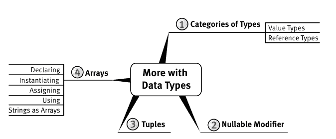

此外，我们将深入探讨将数据元素组合为元组——这是 C# 7.0 引入的一个功能——的细节，随后将数据分组为称为数组的集合。首先，让我们更深入地理解值类型和引用类型。

## 类型类别

所有类型都属于两个类别之一：值类型和引用类型。每个类别中类型的差异源于它们的复制方式：值类型数据总是按值复制，而引用类型数据总是按引用复制。

### 值类型

除了 `string` 之外，书中迄今为止介绍的所有预定义类型都是值类型。值类型的变量直接包含值。换句话说，变量引用存储值的同一内存位置。因此，当不同的变量被赋予相同的值时，原始变量的值会被复制到新变量的位置。同一值类型的第二个变量不能引用与第一个变量相同的内存位置。因此，改变第一个变量的值不会影响第二个变量的值，如图 3.1 所示。在图中，`number1` 指向内存中的特定位置，该位置包含值 42。将 `number1` 分配给 `number2` 后，两个变量都将包含值 42。但是，修改任何一个变量的值都不会影响另一个变量。

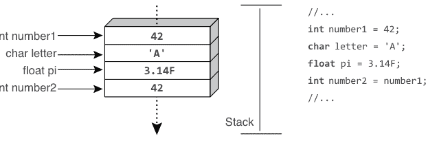

**图 3.1：** 值类型直接包含数据

类似地，将值类型传递给诸如 `Console.WriteLine()` 之类的方法会导致内存复制，方法内对参数的任何更改都不会影响调用函数内的原始值。由于值类型需要内存复制，它们通常应定义为消耗少量内存；值类型的大小几乎总是应小于 16 字节。

## 引用类型

相比之下，引用类型变量的值是包含数据的存储位置的引用。引用类型存储数据位置的引用，而不是像值类型那样直接存储数据。

因此，为了访问数据，运行时从变量中读取内存位置，然后“跳转”到包含数据的内存位置。引用类型所指向的数据的内存区域称为**堆**（参见图 3.2）。

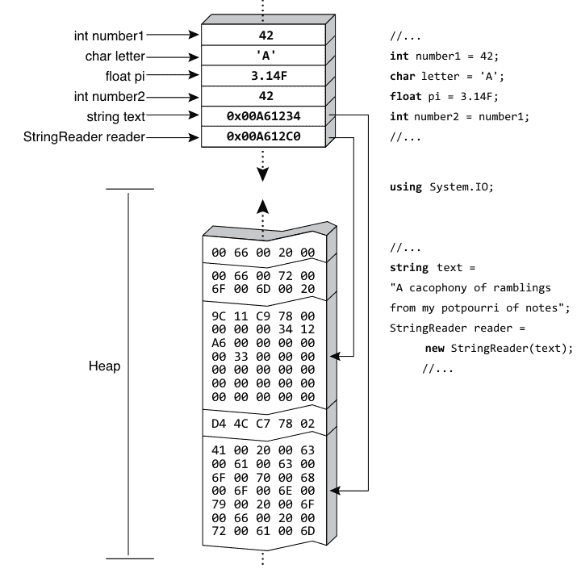

## 图 3.2：引用类型指向堆

引用类型不像值类型那样需要数据的一份相同内存副本，这使得复制引用类型比复制大型值类型高效得多。将一个引用类型变量的值赋值给另一个引用类型变量时，只复制引用，而不复制所引用的数据。在实践中，引用的大小始终与处理器的“原生大小”相同：32 位处理器复制 32 位引用，64 位处理器复制 64 位引用，等等。显然，复制指向大块数据的小引用比像值类型那样复制整个数据块要快。

由于引用类型复制的是指向数据的引用，两个不同的变量可以引用同一数据。如果两个变量引用同一个对象，通过其中一个变量修改对象的字段，在通过另一个变量访问该字段时就能看到这种变化。这种情况既发生在赋值时，也发生在方法调用时。因此，方法可以影响引用类型的数据，并且当控制返回到调用者时，可以观察到这种变化。因此，在选择定义引用类型还是值类型时，一个关键因素是对象在逻辑上是否像一个固定大小的不可变值（因此可能是值类型），还是逻辑上是一个可变的、可被引用的事物（因此很可能是引用类型）。

除了字符串和诸如 `Program` 等自定义类外，到目前为止讨论的所有类型都是值类型。然而，大多数类型是引用类型。虽然可以定义自定义值类型，但与自定义引用类型的数量相比，这样做相对少见。

## 可空修饰符

值类型通常不能被赋值为 `null`，因为根据定义，它们不能包含引用，包括指向空事物的引用。然而，这带来了一个问题，因为我们经常希望表示“缺失”的值。例如，在指定数量时，如果数量未知，该输入什么？一种可能的解决方案是指定一个“魔法”值，例如 -1 或 `int.MaxValue`，但这些是有效的整数。相反，将 `null` 赋值给值类型是可取的，因为它不是一个有效的整数。

要声明可以存储 `null` 的值类型变量，请使用可空修饰符 `?`。此功能在 C# 2.0 中引入，如列表 3.1 所示。

**列表 3.1：使用可空修饰符**

```
static void Main()
{
    int? count = null;
    do
    {
        // ...
    }
    while(count == null);
}
```

将 `null` 赋值给值类型在数据库编程中尤其有吸引力。通常，数据库表中的值类型列允许 `null` 值。检索这些列并将它们赋值给 C# 代码中对应的字段会有问题，除非字段也能包含 `null`。幸运的是，可空修饰符正是为处理这种情况而设计的。

### 隐式类型局部变量

C# 3.0 添加了一个上下文关键字 `var`，用于声明**隐式类型局部变量**。只要代码在声明时用类型明确的表达式初始化变量，C# 3.0 及更高版本就允许隐含变量数据类型而不是明确说明，如列表 3.2 所示。

## 列表 3.2：操作字符串

```
class Uppercase
{
    static void Main()
    {
        System.Console.Write("Enter text: ");
        var text = System.Console.ReadLine();

        // Return a new string in uppercase
        var uppercase = text.ToUpper();

        System.Console.WriteLine(uppercase);
    }
}
```

此列表与列表 2.18 有两点不同。首先，不是使用显式数据类型 `string` 进行声明，列表 3.2 使用了 `var`。生成的 CIL 代码与显式使用 `string` 相同。然而，`var` 向编译器表明，它应该从声明中赋值的值（`System.Console.ReadLine()`）中确定数据类型。

其次，变量 `text` 和 `uppercase` 由其声明初始化。如果不这样做，将在编译时导致错误。如前所述，编译器确定初始化表达式的数据类型并相应地声明变量，就像程序员显式指定类型时所做的那样。

虽然允许使用 `var` 而不是显式数据类型，但当数据类型已知时，请考虑避免这种使用——例如，对 `text` 和 `uppercase` 的声明使用 `string`。这不仅使代码更易理解，还验证了右侧表达式返回的数据类型是否为预期类型。使用 `var` 声明的变量时，右侧的数据类型应当显而易见；如果不是，应避免使用 `var` 声明。

## 准则

除非所赋值的数据类型显而易见，否则**避免**使用隐式类型局部变量。

## 语言对比：C++/Visual Basic/JavaScript——void*、Variant 和 var

隐式类型变量并不等同于 C++ 中的 `void*`、Visual Basic 中的 `Variant` 或 JavaScript 中的 `var`。在这些情况中，变量声明的限制性不强，因为变量可以被赋值任意类型的值，就像在 C# 中使用类型为 `object` 的变量声明所做的那样。相比之下，`var` 由编译器确定类型；一旦在声明时确定，类型就不能改变，并且类型检查和成员调用在编译时进行验证。

## 高级主题

### 匿名类型

C# 3.0 在语言中添加了对 `var` 的支持，以允许使用匿名类型。匿名类型是那些在方法内部“即时”声明的数据类型，而不是通过显式的类定义，如列表 3.3 所示。（有关匿名类型的更多细节，请参见第 15 章。）

## 列表 3.3：带有匿名类型的隐式局部变量

```
class Program
{
    static void Main()
    {
        var patent1 =
            new { Title = "Bifocals",
                  YearOfPublication = "1784" };
        var patent2 =
            new { Title = "Phonograph",
                  YearOfPublication = "1877" };
        
        System.Console.WriteLine(
            "{0} ({1})", patent1.Title, patent1.YearOfPublication);
        System.Console.WriteLine(
            "{0} ({1})", patent2.Title, patent2.YearOfPublication);
    }
}
```

相应的输出如输出 3.1 所示。

## 输出 3.1

```
Bifocals (1784)
Phonograph (1877)
```

列表 3.3 演示了将匿名类型赋值给隐式类型（`var`）局部变量。这种操作与 C# 3.0 支持连接（关联）数据类型或将特定类型的大小减少到更少的数据元素的支持相结合，提供了关键功能。然而，C# 7.0 引入了元组语法，几乎取代了对匿名类型的需求。

## 元组

偶尔，你会发现将数据元素组合在一起是有用的。例如，考虑一个国家的信息，如 2017 年世界上最贫穷的国家：马拉维，其首都是利隆圭，人均 GDP 为 226.50 美元。根据我们目前建立的构造，我们可以将每个数据元素存储在单独的变量中，但结果将是这些数据元素之间没有关联。也就是说，除了可能在变量名称中共享后缀或前缀外，226.50 美元与马拉维之间没有关联。另一个选项是将所有数据合并到单个字符串中，缺点是要单独处理每个数据元素就需要将其解析出来。

C# 7.0 提供了第三种选项，即元组。元组允许你在单个语句中组合对每个变量的赋值，如下面的国家数据所示：

```
(string country, string capital, double gdpPerCapita) =
    ("Malawi", "Lilongwe", 226.50);
```

元组有几种额外的语法可能性，每个都在表 3.1 中展示。

## 表 3.1：元组声明和赋值的示例代码

| 示例 | 描述 | 示例代码 |

| :--- | :--- | :--- |

| 1. | 将元组分配给单独声明的变量。 | `(string country, string capital, double gdpPerCapital) =`<br>`("Malawi", "Lilongwe", 226.50);`<br>`System.Console.WriteLine(`<br>`$@"The poorest country in the world in 2017 was {`<br>`country}, {capital}: {gdpPerCapital}");` |


| 2. | 将元组分配给预先声明的单独变量。 | `string country;`<br>`string capital;`<br>`double gdpPerCapital;`<br><br>`(country, capital, gdpPerCapital) =`<br>`("Malawi", "Lilongwe", 226.50);`<br>`System.Console.WriteLine(`<br>`$@"The poorest country in the world in 2017 was {`<br>`country}, {capital}: {gdpPerCapital}");` |

| 3. | 将元组分配给单独声明且隐式类型的变量。 | `(var country, var capital, var gdpPerCapital) =`<br>`("Malawi", "Lilongwe", 226.50);`<br>`System.Console.WriteLine(`<br>`$@"The poorest country in the world in 2017 was {`<br>`country}, {capital}: {gdpPerCapital}");` |

| 4. | 使用分发语法将元组分配给隐式类型的单独声明变量。 | `var (country, capital, gdpPerCapital) =`<br>`("Malawi", "Lilongwe", 226.50);`<br>`System.Console.WriteLine(`<br>`$@"The poorest country in the world in 2017 was {`<br>`country}, {capital}: {gdpPerCapital}");` |

| 5. | 声明具名项元组并为其分配元组值，然后通过名称访问元组项。 | `(string Name, string Capital, double GdpPerCapital) countryInfo =`<br>`("Malawi", "Lilongwe", 226.50);`<br>`System.Console.WriteLine(`<br>`$@"The poorest country in the world in 2017 was {`<br>`countryInfo.Name}, {countryInfo.Capital}: {`<br>`countryInfo.GdpPerCapital}");` |

| 6. | 将具名项元组分配给单个隐式类型变量，然后通过名称访问元组项。 | ```csharp
var countryInfo =
    (Name: "Malawi", Capital: "Lilongwe", GdpPerCapita: 226.50);
System.Console.WriteLine(
    $@"The poorest country in the world in 2017 was {
        countryInfo.Name}, {countryInfo.Capital}: {
        countryInfo.GdpPerCapita}");
``` |

在前四个示例中，尽管右侧表示一个元组，但左侧仍然是通过元组语法一起赋值的个别变量。这种语法涉及由逗号分隔并用括号关联在一起的两个或更多元素。（我使用术语“元组语法”是因为编译器在左侧生成的潜在数据类型在技术上并不是一个元组。）结果是，尽管我们从右侧组合在一起的元组值开始，但对左侧的赋值会破坏该元组并提取其组成部分。在示例 2 中，左侧的赋值指向预先声明的变量。然而，在示例 1、3 和 4 中，变量是在元组语法内部声明的。鉴于我们只是在声明变量，命名和大小写约定遵循我们在第 1 章中讨论的指南，例如：`应使用小驼峰命名法（camelCase）作为局部变量名`。

请注意，尽管隐式类型（`var`）可以分布在元组语法内的每个变量声明中，如示例 4 所示，但你不能用显式类型（例如 `string`）做同样的事情。由于元组允许每个项具有不同的数据类型，除非所有项的数据类型都相同（即使如此，编译器也不允许），否则将显式类型名称分布在所有元素上并不一定能工作。

在示例 5 中，我们在左侧声明一个元组，然后分配右侧的元组。请注意，该元组具有具名项，我们可以引用这些名称以从元组中检索项值。这就是使得 `System.Console.WriteLine` 语句中可以使用 `countryInfo.Name`、`countryInfo.Capital` 和 `countryInfo.GdpPerCapita` 语法的原因。左侧元组声明的结果是将变量分组为单个变量（`countryInfo`），然后你可以访问其组成部分。这很有用，因为正如我们在第 4 章中讨论的那样，你可以将这个单个变量传递给其他方法，而那些方法也将能够访问元组内的各个项。

如前所述，使用元组语法定义的变量使用小驼峰命名法。然而，元组项名称的约定并未明确定义。建议包括：当元组表现得像参数时（例如返回多个值，这在元组语法之前会使用 `out` 参数），使用参数命名约定。另一种选择是使用大驼峰命名法（PascalCase），遵循类型的成员（属性、函数和公共字段）的命名约定，如第 5 章和第 6 章中讨论的那样。我强烈支持后一种使用大驼峰命名法的方法，这与 C# 和 .NET 中所有成员标识符的大小写约定保持一致。即便如此，由于该约定并未得到广泛共识，我在指南中使用的词是`考虑`而不是`应`：`考虑对所有的元组项名称使用大驼峰命名法`。


## 指南

- **应** 使用 *小驼峰命名法（camelCasing）* 进行使用元组语法的变量声明。
- **考虑** 对所有的元组项名称使用 *大驼峰命名法（PascalCasing）*。

示例 6 提供了与示例 5 相同的功能，尽管它在右侧元组值中使用了具名元组项，并在左侧使用了隐式类型声明。然而，这些项的名称会持久化到隐式类型变量中，因此它们仍然可用于 `WriteLine` 语句。当然，这开放了可能性，你可能在左侧使用与右侧不同的名称来命名项。虽然 C# 编译器允许这样做，但它会发出警告，指出右侧的项名称将被忽略，因为左侧的名称将优先。

如果未指定项名称，分配的元组变量中的单个元素仍然可用。然而，名称将是 `Item1`、`Item2` 等，如示例 7 所示。事实上，即使在提供了自定义名称的情况下，`ItemX` 名称在元组中始终可用（参见示例 8）。然而，当使用集成开发环境（IDE）工具（例如支持 C# 7.0 的近期版本之一的 Visual Studio）时，`ItemX` 属性不会出现在 IntelliSense 下拉列表中——这是好事，因为提供的名称显然是更可取的。如示例 9 所示，可以使用下划线丢弃元组赋值的部分——称为 **discard（丢弃项）**。

示例 10 中展示的推断元组项名称的能力直到 C# 7.1 才引入。该示例表明，元组内的项名称可以从变量名甚至属性名中推断出来。

元组是一种轻量级解决方案，用于像袋子可能捕获你在商店捡起的各种物品一样，将数据封装到单个对象中。与数组不同（我们将在下一部分讨论），元组包含项数据类型，这些类型可以无约束地变化¹，除了它们由代码识别且无法在运行时更改。此外，与数组不同，元组中项的数量也在编译时硬编码。最后，你不能向元组添加自定义行为（扩展方法除外）。如果你需要与封装数据相关的行为，那么利用面向对象编程并定义类是首选方法——我们将从第 6 章开始深入探讨这一概念。

### 高级主题：`System.ValueTuple<...>` 类型

C# 编译器生成依赖于一组泛型值类型（结构体）的代码，例如 `System.ValueTuple<T1, T2, T3>`，作为表 3.1 中所有示例右侧元组实例的元组语法的底层实现。同样，从示例 5 开始，同一组 `System.ValueTuple<...>` 泛型值类型用于左侧数据类型。正如我们对元组类型的预期那样，包含的唯一方法与比较和相等性相关。

鉴于自定义项名称及其类型不包含在 `System.ValueTuple<...>` 定义中，每个自定义项名称似乎如何成为 `System.ValueTuple<...>` 类型的成员并可作为该类型的成员访问？令人惊讶的是（特别是对于熟悉匿名类型实现的人来说），编译器不为对应自定义名称的成员生成底层 CIL 代码。然而，即使没有底层自定义名称成员，从 C# 的角度来看，似乎存在这样一个成员。

对于表 3.1 中所有的具名元组示例，名称显然可以被编译器在元组作用域的其余部分知晓，因为所述作用域限定在声明它的成员内。事实上，编译器（和 IDE）简单地依赖此作用域来允许通过名称访问每个项。换句话说，编译器查看元组声明中的项名称，并利用它们来允许在该范围内使用这些名称的代码。这也是为什么 IDE IntelliSense 中不显示 `Item×` 名称作为元组的可用成员的原因（IDE 简单地忽略它们，并用显式具名项替换它们）。

¹ 严格来说，它们不能是指针——这个话题我们直到第 21 章才会介绍。

对于编译器而言，从成员作用域内的项目中确定元素名称是合理的，但如果一个元组被暴露在成员外部，例如作为另一个程序集中的方法的参数或返回值（此时可能没有可用的源代码），会发生什么？对于构成 API 的所有元组（无论是公共 API 还是私有 API），编译器都会以属性的形式将元素名称添加到成员的元数据中。例如，编译器为以下代码生成的 C# 等效内容：

```
public (string First, string Second) ParseNames(string fullName)
```

如清单 3.4 所示。

### 清单 3.4：编译器生成的 CIL 代码中 ValueTuple 返回值的 C# 等效表示

```
[return: System.Runtime.CompilerServices.TupleElementNames(new string[]
{@ "First", "Second"})]
public System.ValueTuple<string, string> ParseNames(string fullName)
{
// ...
}
```

相关说明是，在 C# 7.0 中，使用显式的 `System.ValueTuple<...>` 数据类型时，不支持使用自定义元素名称。因此，如果将表 3.1 中示例 8 中的 `var` 替换为显式类型，将会产生警告，指出每个元素名称将被忽略。

以下是关于 `System.ValueTuple<...>` 的一些其他杂项事实，需要牢记。

- 有八个泛型 `System.ValueTuple<...>`，对应于支持最多七项元组的可能性。对于第八个元组，`System.ValueTuple<T1, T2, T3, T4, T5, T6, T7, Trest>`，最后一个类型参数允许指定额外的 `ValueTuple`，从而支持 *n* 个元素。例如，如果你指定了一个包含 8 个参数的元组，编译器将自动生成为底层实现类型的 `System.ValueTuple<T1, T2, T3, T4, T5, T6, T7, System.ValueTuple<TSub1>>`。（为了完整性，`System.Value<T1>` 是存在的，但很少被使用，因为 C# 元组语法至少要求两个元素）。
- 有一个非泛型的 `System.ValueTuple`，作为元组工厂，具有对应于每种 `ValueTuple` 元度的 `Create()` 方法。使用元组字面量 `var t1 = ("Inigo Montoya", 42)` 的便捷性在 `C# 7.0`（或更高版本）程序员中取代了 `Create()` 方法。
- 就实际用途而言，`C#` 开发人员基本上可以忽略 `System.ValueTuple` 和 `System.ValueTuple<>`。

还有一种元组类型最初包含在 Microsoft .NET Framework 4.5 中：`System.Tuple<...>`。当时它被纳入时，预期将成为未来核心的元组实现。然而，一旦 `C#` 支持元组语法，人们意识到值类型通常性能更好，因此引入了 `System.ValueTuple<...>`——实际上在所有情况下都取代了 `System.Tuple<...>`，除了需要向后兼容依赖 `System.Tuple<...>` 的现有 API 的情况。

### 数组

变量声明的一个特殊方面在第 1 章中未涵盖，即数组声明。通过数组声明，你可以使用单个变量存储多个相同类型的项，并在需要时通过索引单独访问它们。在 `C#` 中，数组索引从零开始。因此，`C#` 中的数组是基于零的。

### 初学者主题

### 数组

数组提供了一种使用单个变量声明相同类型的数据项集合的手段。数组中的每个项都使用称为`索引`的整数值来唯一标识。`C#` 数组中的第一个元素使用索引 0 来访问。程序员应小心指定小于数组长度的索引值。由于 `C#` 数组是基于零的，数组中最后一个元素的索引比数组中的总元素数少 1。

对于初学者来说，有时将索引视为偏移量是有帮助的。第一个元素距离数组起始位置为零。第二个元素距离数组起始位置为一——等等。

数组几乎是所有编程语言的基本组成部分，因此对于几乎所有开发人员来说都是必须学习的内容。虽然数组在 C# 编程中经常被使用，并且初学者需要理解，但现在大多数程序在存储数据集合时使用泛型集合类型而不是数组。因此，读者应略读以下部分“声明数组”，以熟悉其实例化和赋值。表 3.2 提供了需要注意的要点。泛型集合在第 15 章中详细介绍。

### **表 3.2：** 数组要点

| 描述 | 示例 |
| :--- | :--- |
| **_声明_**<br>请注意，方括号出现在数据类型旁边。多维数组使用逗号声明，其中逗号加 1 指定维度数量。 | `string[] languages; // 一维`<br>`int[, ] cells; // 二维` |
| **_赋值_**<br>**new** 关键字和相应的数据类型在声明时是可选的。在声明之后，实例化数组时需要 new 关键字。数组可以在没有字面值的情况下赋值。结果，数组中每个项的值初始化为其默认值。如果未提供字面值，则必须指定数组的大小。（大小不必是常数；它可以是运行时计算出的变量。）<br>从 C# 3.0 开始，指定数据类型是可选的。 | `string[] languages = { "C#", "COBOL", "Java", "C++", "Visual Basic", "Pascal", "Fortran", "Lisp", "J#"};`<br>`languages = new string[9];`<br>`languages = new string[] {"C#", "COBOL", "Java", "C++", "Visual Basic", "Pascal", "Fortran", "Lisp", "J#" };`<br><br>`// 多维数组赋值 // 和初始化`<br>`int[, ] cells = int[3,3];`<br>`cells = { {1, 0, 2}, {1, 2, 0}, {1, 2, 1} };` |
| **_default 关键字_**<br>任何数据类型的显式默认值都可以使用 default 运算符获得。 | `int count = default(int);` |

| 描述 | 示例 |
| :--- | :--- |
| 访问数组<br>数组是基于零的，因此数组中的第一个元素位于索引 0。<br>方括号用于从数组中存储和检索数据。 | `string[] languages = new string[9] {<br>  "C#", "COBOL", "Java",<br>  "C++", "Visual Basic", "Pascal",<br>  "Fortran", "Lisp", "J#"};<br>// 将 "C++" 保存到名为 language 的变量<br>string language = languages[3];<br>// 将 "Java" 赋值给 C++ 的位置<br>languages[3] = languages[2];<br>// 将 language 赋值给 "Java" 的位置<br>languages[2] = language;` |

此外，本章最后一节“常见数组错误”回顾了一些数组的怪癖。

## 声明数组

在 C# 中，你使用方括号声明数组。首先，你指定数组的元素类型，接着是开闭方括号；然后输入变量名称。清单 3.5 声明一个名为 languages 的变量为字符串数组。

### 清单 3.5：声明数组

```
string[] languages;
```

显然，数组的第一部分标识数组中元素的数据类型。声明中的一部分方括号标识数组的**秩**（rank），即维度数量；在这种情况下，它是秩为 1 的数组。这两部分构成了变量 languages 的数据类型。

> **语言对比：C++ 和 Java——数组声明**
>
> C# 中数组的方括号直接出现在数据类型之后，而不是在变量声明之后。这种做法将所有类型信息集中在一起，而不是像 C++ 和 Java 中那样在标识符前后分散。

清单 3.5 定义了一个秩为 1 的数组。方括号内的逗号定义额外的维度。例如，清单 3.6 定义了一个二维的 cells 数组，用于国际象棋或井字棋游戏。

### 清单 3.6：声明二维数组

```
int[ , ] cells;
```

在清单 3.6 中，数组的秩为 2。第一个维度可以对应横向的单元格，第二个维度对应纵向的单元格。通过添加额外的逗号来增加额外的维度，总秩比逗号数量多 1。请注意，特定维度中出现的项数不是变量声明的一部分。这是在创建（实例化）数组并为每个元素分配空间时指定的。

## 实例化和赋值数组

一旦声明了数组，你可以立即使用逗号分隔的项列表填充其值，这些项包含在一对花括号内。清单 3.7 声明了一个字符串数组，然后在大括号内赋值九种语言的名称。

### 清单 3.7：带有赋值的数组声明

```


`string[] languages = { "C#", "COBOL", "Java",`

`"C++", "Visual Basic", "Pascal",`

`"Fortran", "Lisp", "J#"};`

逗号分隔列表中的第一项成为数组中的第一项，列表中的第二项成为数组中的第二项，等等。花括号是定义数组字面量的符号。

清单 3.6 中显示的赋值语法仅在你在一个语句中声明并赋值时可用。在声明后赋值需要使用 `new` 关键字，如清单 3.8 所示。

### 清单 3.8：在声明后进行数组赋值

```csharp
string[] languages;
languages = new string[]{"C#", "COBOL", "Java",
"C++", "Visual Basic", "Pascal",
"Fortran", "Lisp", "J#"};
```

从 C# 3.0 开始，只要编译器能够根据数组初始化器中元素的类型推断出数组的元素类型，那么在 `new` 关键字后指定数组的数据类型（如 `string`）就是可选的。但方括号仍然是必需的。

C# 还允许在声明语句中使用 `new` 关键字，因此它允许执行清单 3.9 中所示的赋值和声明。

### 清单 3.9：在声明时使用 new 进行数组赋值

```csharp
string[] languages = new string[]{
"C#", "COBOL", "Java",
"C++", "Visual Basic", "Pascal",
"Fortran", "Lisp", "J#"};
```

使用 `new` 关键字会告诉运行时为数据类型分配内存。它指示运行时实例化该数据类型——在本例中，即为一个数组。

每当在数组赋值中作为 `new` 关键字的一部分使用时，也可以在方括号内指定数组的大小。清单 3.10 演示了这种语法。

### 清单 3.10：使用 new 关键字进行声明和赋值

```csharp
string[] languages = new string[9]{
"C#", "COBOL", "Java",
"C++", "Visual Basic", "Pascal",
"Fortran", "Lisp", "J#"};
```

初始化语句中的数组大小与大括号内包含的元素数量必须匹配。此外，如清单 3.11 所示，可以分配数组但不指定数组的初始值。

### 清单 3.11：不含字面值的赋值

```csharp
string[] languages = new string[9];
```

分配数组但不初始化初始值时，每个元素仍会被初始化。运行时将元素初始化为其默认值，如下所示：

- 引用类型（例如 `string`）被初始化为 `null`。
- 数值类型被初始化为 `0`。
- `bool` 被初始化为 `false`。
- `char` 被初始化为 `\0`。

非基元值类型通过将其每个字段初始化为默认值来递归初始化。因此，在使用数组之前，无需单独为每个元素赋值。

> **注意**
在 C# 2.0 中，可以使用 `default()` 运算符来产生数据类型的默认值。`default()` 以数据类型作为参数。例如，`default(int)` 产生 0，而 `default(bool)` 产生 `false`。

由于数组大小不作为变量声明的一部分包含在内，因此可以在运行时指定大小。例如，清单 3.12 根据 `Console.ReadLine()` 调用中指定的大小创建数组。

### 清单 3.12：在运行时定义数组大小

```csharp
string[] groceryList;
System.Console.Write("How many items on the list? ");
int size = int.Parse(System.Console.ReadLine());
groceryList = new string[size];
// ...
```

C# 以类似方式初始化多维数组。每个维度的大小由逗号分隔。清单 3.13 初始化了一个没有走步的井字游戏棋盘。

### 清单 3.13：声明二维数组

```csharp
int[,] cells = new int[3,3];
```

带有特定位置的井字游戏棋盘初始化可以如清单 3.14 所示进行。

### 清单 3.14：初始化整型二维数组

```csharp
int[,] cells = {  {1, 0, 2},  {1, 2, 0},  {1, 2, 1} };
```

初始化遵循一种模式，其中有一个包含三个 `int[]` 类型元素的数组，并且每个元素的大小相同；在本例中，大小为 3。注意，每个 `int[]` 元素的大小必须完全相同。因此，清单 3.15 中所示的声明是无效的。

### 清单 3.15：尺寸不一致的多维数组导致错误

```csharp
// ERROR: Each dimension must be consistently sized 
int[,] cells = {  {1, 0, 2, 0},  {1, 2, 0},  {1, 2}  {1} };
```

表示井字游戏并不需要在每个位置都使用整数。一种替代方案是为每个玩家构建一个单独的虚拟棋盘，每个棋盘包含一个 `bool`，用于指示玩家选择了哪些位置。清单 3.16 对应一个三维棋盘。

### 清单 3.16：初始化三维数组

```csharp
bool[,] cells;
cells = new bool[2,3,3]
{
        // Player 1 moves                 // X |   |
        { {true, false, false},          //  -------
          {true, false, false},          // X |   |
          {true, false, true} },         //  -------
                                   // X |   | X
        // Player 2 moves                 //   |   | O
        { {false, false, true},          //  -----
          {false, true, false},          //   | O |
          {false, true, false} }         //  -----
                                   //   | O |
};
```

在此示例中，棋盘被初始化，并且每个维度的大小被明确标识。除了作为 `new` 表达式的一部分标识大小外，还提供了数组的字面值。类型为 `bool[,]` 的字面值被分解为两个大小为 3 × 3 的 `bool[,]` 数组。每个二维数组由三个大小为 3 的 `bool` 数组组成。

如前所述，多维数组中的每个维度必须具有一致的大小。然而，也可以定义**锯齿数组（jagged array）**，它是数组的数组。锯齿数组的语法与多维数组略有不同；此外，锯齿数组不需要具有一致的大小。因此，可以如清单 3.17 所示初始化锯齿数组。

### 清单 3.17：初始化锯齿数组

```csharp
int[][] cells = { 
  new int[]{1, 0, 2, 0}, 
  new int[]{1, 2, 0}, 
  new int[]{1, 2}, 
  new int[]{1} 
};
```

锯齿数组不使用逗号来标识新维度。相反，锯齿数组定义了数组的数组。在清单 3.17 中，`[]` 放置在数据类型 `int[]` 之后，从而声明了类型为 `int[]` 的数组。

请注意，锯齿数组需要每个内部数组都有一个数组实例（或 `null`）。在上面的示例中，您使用 `new` 来实例化锯齿数组的内部元素。省略实例化会导致编译错误。

## 使用数组

您使用方括号表示法（也称为**数组访问器**）来访问数组中的特定项。要从数组中检索第一项，您指定索引为零。在清单 3.18 中，`languages` 变量中第五项的值（由于第一项的索引为 0，因此使用索引 4）存储在变量 `language` 中。

### 清单 3.18：声明和访问数组

```csharp
string[] languages = new string[9]{ 
 "C#", "COBOL", "Java", 
 "C++", "Visual Basic", "Pascal", 
 "Fortran", "Lisp", "J#"};

// Retrieve fifth item in languages array (Visual Basic)
string language = languages[4];
```

方括号表示法也用于向数组存储数据。清单 3.19 交换了 "C++" 和 "Java" 的顺序。

### 清单 3.19：交换数组中位置之间的数据

```csharp
string[] languages = new string[9]{
    "C#", "COBOL", "Java",
    "C++", "Visual Basic", "Pascal",
    "Fortran", "Lisp", "J#"};

// Save "C++" to variable called language
string language = languages[3];
// Assign "Java" to the C++ position
languages[3] = languages[2];
// Assign language to location of "Java"
languages[2] = language;
```

对于多维数组，每个维度使用一个索引来标识元素，如清单 3.20 所示。

### 清单 3.20：初始化整型二维数组

```csharp
int[,] cells = {
    {1, 0, 2},
    {0, 2, 0},
    {1, 2, 1}
};
// Set the winning tic-tac-toe move to be player 1
cells[1,0] = 1;
```

锯齿数组的元素赋值略有不同，因为它与锯齿数组的声明保持一致。第一个元素是数组中的数组；第二个索引指定所选数组元素中的项（参见清单 3.21）。

### 清单 3.21：声明锯齿数组

```csharp
int[][] cells = {
    new int[]{1, 0, 2},
    new int[]{0, 2, 0},
    new int[]{1, 2, 1}
};
cells[1][0] = 1;
// ...
```

## 长度

你可以获取数组的长度，如清单 3.22 所示。

**清单 3.22：获取数组长度**

```
Console.WriteLine(
    $"There are { languages.Length } languages in the array.");
```

数组具有固定长度；它们被约束为在重新创建数组之前无法更改长度。此外，超出数组的**边界**（或长度）将导致运行时报告错误。当你试图使用一个在数组中不存在元素的索引来访问（检索或赋值）数组时，可能会发生这种情况。这种错误经常发生在你将数组长度用作数组索引时，如清单 3.23 所示。

**清单 3.23：访问数组边界之外，抛出异常**

```
string languages = new string[9];
...
// RUNTIME ERROR: index out of bounds – should
// be 8 for the last element
languages[4] = languages[9];
```

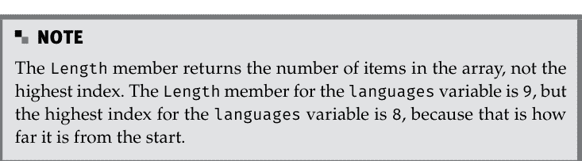

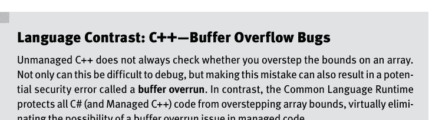

使用 `Length` 代替硬编码的数组大小是一种良好的实践。例如，若要将 `Length` 用作索引，有必要减去 1 以避免越界错误（参见清单 3.24）。

**清单 3.24：在数组索引中使用 Length - 1**

```csharp
string languages = new string[9];
...
languages[4] = languages[languages.Length - 1];
```

为了避免超出数组边界，请使用长度检查来验证数组长度是否大于 0，并在访问数组中的最后一个元素时，使用 `Length - 1` 代替硬编码值（参见清单 3.24）。

`Length` 返回数组中的总元素数。因此，如果你有一个多维数组，例如尺寸为 2 × 3 × 3 的 `bool cells[ , ]`，`Length` 将返回总元素数 18。

对于锯齿数组（jagged array），`Length` 返回第一个数组中的元素数量。由于锯齿数组是数组的数组，`Length` 仅评估外部包含数组并返回其元素计数，无论内部数组中包含什么。

### 更多数组方法

数组包含用于操作数组内元素的附加方法——例如，`Sort()`、`BinarySearch()`、`Reverse()` 和 `Clear()`（参见清单 3.25）。

**清单 3.25：额外的数组方法**

```csharp
class ProgrammingLanguages
{
    static void Main()
    {
        string[] languages = new string[]{
            "C#", "COBOL", "Java",
            "C++", "Visual Basic", "Pascal",
            "Fortran", "Lisp", "J#"};
        System.Array.Sort(languages);
        string searchString = "COBOL";
        int index = System.Array.BinarySearch(
            languages, searchString);
        System.Console.WriteLine(
            "The wave of the future, "
            + $"{ searchString }, is at index { index }");
        System.Console.WriteLine();
        System.Console.WriteLine(
            $"{ \"First Element\",-20 }{t{ \"Last Element\",-20 }");
        System.Console.WriteLine(
            $"{ \"-----------\",-20 }{t{ \"-----------\",-20 }");
        System.Console.WriteLine(
            $"{ languages[0],-20 }\t{ languages[languages.Length-1],-20 "});
        System.Array.Reverse(languages);
        System.Console.WriteLine(
            $"{ languages[0],-20 }\t{ languages[languages.Length-1],-20 }");
        // Note this does not remove all items from the array.
        // Rather, it sets each item to the type's default value.
        System.Array.Clear(languages, 0, languages.Length);
        System.Console.WriteLine(
            $"{ languages[0],-20 }\t{ languages[languages.Length-1],-20 }");
        System.Console.WriteLine(
            $"After clearing, the array size is: { languages.Length }");
    }
}
```

清单 3.25 的结果如图 3.2 所示。

**输出 3.2**

```
The wave of the future, COBOL, is at index 2.
First Element       Last Element
----------          ----------
C#                  Visual Basic
Visual Basic         C#
After clearing, the array size is: 9
```


通过 `System.Array` 类访问这些方法。在大多数情况下，使用这些方法是不言自明的，除了两个值得注意的项目：

- 在使用 `BinarySearch()` 方法之前，对数组进行排序很重要。如果值未按递增顺序排序，可能会返回错误的索引。如果搜索元素不存在，返回的值为负数。（使用取反运算符，`~index`，将返回任何大于搜索值的第一个索引。）
- `Clear()` 方法不会移除数组元素，也不会将长度设置为零。数组大小是固定的，无法修改。因此，`Clear()` 方法将数组中的每个元素设置为默认值（`false`、`0` 或 `null`）。这解释了为什么在调用 `Clear()` 后写出数组时，`Console.WriteLine()` 会创建一个空白行。

### 语言对比：Visual Basic——重新调整数组维度

Visual Basic 包含一个用于更改数组中项目数量的 `ReDim` 语句。虽然 C# 没有等价的特定关键字，但在 .NET 2.0 中有一个可用的方法，它会重新创建数组，然后将所有元素复制到新数组中。该方法名为 `System.Array.Resize`。

### 数组实例方法

与字符串类似，数组拥有实例成员，这些成员不是从数据类型而是直接从变量访问的。`Length` 是实例成员的一个例子，因为对 `Length` 的访问是通过数组变量进行的，而不是通过类。其他重要的实例成员包括 `GetLength()`、`Rank` 和 `Clone()`。

获取特定维度的长度不需要 `Length` 属性。若要获取特定秩的大小，数组包含一个 `GetLength()` 实例方法。调用此方法时，需要指定要返回其长度的秩（参见清单 3.26）。

**清单 3.26：获取特定维度的大小**

```csharp
bool[,] cells;
cells = new bool[2,3,3];
System.Console.WriteLine(cells.GetLength(0));   // Displays 2
```

清单 3.26 的结果如图 3.3 所示。

**输出 3.3**

```
2
```

清单 3.26 显示 2，因为这是第一个维度中的元素数量。

还可以通过访问数组的 `Rank` 成员来获取整个数组的秩。例如，`cells.Rank` 将返回 3。

默认情况下，将一个数组变量赋值给另一个数组变量仅复制数组引用，而不复制数组的各个元素。为了创建数组的全新副本，请使用数组的 `Clone()` 方法。`Clone()` 方法将返回数组的一个副本；更改此新数组的任何成员都不会影响原始数组的成员。

### 作为数组的字符串

类型为 `string` 的变量可以像字符数组一样访问。例如，要检索名为 `palindrome` 的字符串的第四个字符，你可以调用 `palindrome[3]`。然而请注意，由于字符串是不可变的，因此无法对字符串内的特定字符进行赋值。因此，C# 不允许执行 `palindrome[3]='a'`，其中 `palindrome` 被声明为字符串。清单 3.27 使用数组访问器来确定命令行参数是否是一个选项，其中选项由第一个字符处的破折号标识。

**清单 3.27：查找命令行选项**

```csharp
string[] args;
...
if(args[0][0] == '-')
{
    // This parameter is an option
}
```

该代码片段使用了 `if` 语句，这在第 4 章中有所介绍。此外，它是一个有趣的示例，因为你使用数组访问器来检索字符串数组 `args` 中的第一个元素。第一个数组访问器之后是第二个访问器，它检索字符串的第一个字符。因此，该代码等价于清单 3.28 中所示的代码。

**清单 3.28：查找命令行选项（简化版）**

```csharp
string[] args;
...
string arg = args[0];
if(arg[0] == '-')
{
    // This parameter is an option
}
```

不仅可以单独使用数组访问器访问字符串中的字符，还可以使用字符串的 `ToCharArray()` 方法将整个字符串作为字符数组检索出来。采用这种方法，你可以使用 `System.Array.Reverse()` 方法反转字符串，正如列表 3.29 中所示，它用于判断字符串是否为回文。

### 列表 3.29：反转字符串

```csharp
class Palindrome
{
    static void Main()
    {
        string reverse, palindrome;
        char[] temp;
        System.Console.Write("Enter a palindrome: ");
        palindrome = System.Console.ReadLine();
        // Remove spaces and convert to lowercase
        reverse = palindrome.Replace(" ", "");
        reverse = reverse.ToLower();
        // Convert to an array
        temp = reverse.ToCharArray();
        // Reverse the array
        System.Array.Reverse(temp);
        // Convert the array back to a string and
        // check if reverse string is the same
        if (reverse == new string(temp))
        {
            System.Console.WriteLine(
                $"\"{palindrome}\" is a palindrome.");
        }
        else
        {
            System.Console.WriteLine(
                $"\"{palindrome}\" is NOT a palindrome.");
        }
    }
}
```

列表 3.29 的结果如输出 3.4 所示。

### 输出 3.4

```text
Enter a palindrome: NeverOdd0rEven
"NeverOdd0rEven" is a palindrome.
```

此示例使用了 `new` 关键字；这次，它从反转后的字符数组创建了一个新字符串。

## 常见数组错误

本节介绍了三种类型的数组：一维数组、多维数组和锯齿状数组。一些规则和特性规定了数组的声明和使用。表 3.3 指出了一些最常见的错误，并有助于巩固这些规则。试着先审查“常见错误”列中的代码（不要查看“错误描述”和“更正代码”列），作为验证你对数组及其语法理解的一种方式。

### 表 3.3：常见的数组编码错误

| 常见错误 | 错误描述 | 更正代码 |
| :--- | :--- | :--- |
| `int numbers[ ];` | 用于声明数组的方括号出现在数据类型之后，而不是变量标识符之后。 | `int[ ] numbers;` |
| `int[ ] numbers; numbers = {42, 84, 168};` | 在声明后分配数组时，必须使用 `new` 关键字，然后指定数据类型。 | `int[ ] numbers; numbers = new int[ ]{ 42, 84, 168 }` |
| `int[3] numbers = { 42, 84, 168 };` | 不可能在变量声明中指定数组大小。 | `int[ ] numbers = { 42, 84, 168 };` |
| `int[ ] numbers = new int[ ];` | 除非提供数组字面量，否则在初始化时需要指定数组大小。 | `int[ ] numbers = new int[3];` |
| `int[ ] numbers = new int[3]{} ` | 数组大小指定为 3，但数组字面量中没有元素。数组大小必须与数组字面量中的元素数量匹配。 | `int[ ] numbers = new int[3] { 42, 84, 168 };` |
| `int[] numbers = new int[3]; Console.WriteLine(numbers[3]);` | 数组索引从零开始。因此，最后一项比数组大小小 1。（请注意，这是一个运行时错误，而不是编译时错误。） | `int[] numbers = new int[3]; Console.WriteLine(numbers[2]);` |
| `int[] numbers = new int[3]; numbers[numbers.Length] = 42;` | 与上一个错误相同：需要减去 1 才能访问最后一个元素。（请注意，这是一个运行时错误，而不是编译时错误。） | `int[] numbers = new int[3]; numbers[numbers.Length-1] = 42;` |
| `int[] numbers; Console.WriteLine(numbers[0]);` | `numbers` 尚未分配实例化的数组，因此无法访问。 | `int[] numbers = {42, 84}; Console.WriteLine(numbers[0]);` |
| `int[,] numbers = { {42}, {84, 42} };` | 多维数组必须具有一致的结构。 | `int[,] numbers = { {42, 168}, {84, 42} };` |
| `int[][] numbers = { {42, 84}, {84, 42} };` | 锯齿状数组要求为数组中的数组指定实例化数组。 | `int[][] numbers = { new int[]{42, 84}, new int[]{84, 42} };` |

## 摘要

本章以讨论两种不同类型类别开始：值类型和引用类型。这些是基本概念，对 C# 程序员来说很重要，因为即使阅读代码时不明显，它们也会改变类型的基本行为方式。

在讨论数组之前，我们看了两个在后续版本中添加的语言结构。首先，我们引入了可空修饰符，`?`，它是 C# 2.0 中添加到语言中的，允许值类型存储 `null`。其次，我们引入了元组以及 C# 7.0 引入的一种新语法，它提供了语言支持，用于处理元组，而无需显式处理底层数据类型。

本章以涵盖 C# 数组语法以及各种操纵数组的方法结束。对于许多开发者来说，这些语法一开始可能会显得相当令人望而生畏，因此该部分包含了一个与编码数组相关的常见错误列表。

下一章将查看表达式和控制流语句。在章末出现的几次 `if` 语句也将被讨论。

# 4 运算符与控制流

在本章中，你将了解运算符、控制流语句和 C# 预处理器。运算符提供了语法，用于对计算中的操作数执行适当的不同计算或操作。控制流语句提供了在程序中进行条件逻辑或对代码段多次循环的手段。在引入 `if` 控制流语句后，本章探讨了布尔表达式的概念，这些表达式嵌入在许多控制流语句中。其中包括对整数无法转换（即使是显式转换）为 `bool` 以及此限制的优势的提及。本章以对 C# 预处理器指令的讨论结束。

### 运算符

既然已经介绍了预定义数据类型（参见第 2 章），你可以开始更多地了解如何使用这些数据类型与运算符结合来执行计算。例如，你可以对已声明的变量进行计算。

### 初学者主题

### 运算符

**运算符** 用于对称为 **操作数** 的值（或变量）执行数学或逻辑运算，以产生一个新值，称为 **结果**。例如，在列表 4.1 中，减法运算符 `-` 用于减去两个操作数，即数字 4 和 2。减法的结果存储在变量 `difference` 中。

### 列表 4.1：一个简单的运算符示例

```csharp
int difference = 4 - 2;
```

运算符通常分为三类——单目、双目和三目，对应于操作数的数量（分别为一个、两个和三个）。本节涵盖了一些最基本的单目和双目运算符。三目运算符将在本章后面介绍。

### 加法和减法单目运算符 (+, -)

有时你可能想更改数值符号。在这些情况下，单目减法运算符 `-` 很有用。例如，列表 4.2 将当前美国债务总额更改为负值，以表示这是一笔欠款。

### 列表 4.2：指定负值

```csharp
// National debt to the penny
decimal debt = -20203668853807.76M;
```

1. 截至 2017 年 10 月 1 日，根据 `www.treasurydirect.gov`。

使用减号运算符相当于将操作数从零中减去。

一元加号运算符 `+` 通常对值没有影响。它是 C# 语言中多余的添加，为了对称性而被纳入语言。

## 算术二元运算符 (+, -, *, /, %)

二元运算符需要两个操作数。C# 对二元运算符使用后缀表示法：运算符出现在左操作数和右操作数之间。除赋值以外的所有二元运算符的结果都必须以某种方式使用——例如，将其用作赋值等表达式中的操作数。

> **语言对比：C++——纯运算符语句**
>
> 与前述规则相反，C++ 允许单个二元表达式构成整个语句，例如 `4+5;`，并能通过编译。在 C# 中，只有赋值、调用、递增、递减、await 以及对象创建表达式才被允许作为整个语句。

代码清单 4.3 中的减法示例说明了一个二元运算符的使用——更具体地说，是一个算术二元运算符。操作数分别位于算术运算符的两侧，然后进行赋值计算所得的值。其他的算术二元运算符包括加法 `+`、除法 `/`、乘法 `*` 和取模 `%` [有时称为 mod 运算符]。

### 代码清单 4.3: 使用二元运算符

```csharp
class Division
{
    static void Main()
    {
        int numerator;
        int denominator;
        int quotient;
        int remainder;
        System.Console.Write("Enter the numerator: ");
        numerator = int.Parse(System.Console.ReadLine());
        System.Console.Write("Enter the denominator: ");
        denominator = int.Parse(System.Console.ReadLine());
        quotient = numerator / denominator;
        remainder = numerator % denominator;
        System.Console.WriteLine(
            $"{numerator} / {denominator} = {quotient} with remainder {remainder}");
    }
}
```

2. 一元 `+` 运算符定义为接受 `int`、`uint`、`long`、`ulong`、`float`、`double` 和 `decimal` 类型（以及这些类型的可空版本）的操作数。在其他数值类型（如 `short`）上使用它时，会根据情况将操作数转换为这些类型之一。

### 输出 4.1

```text
Enter the numerator: 23
Enter the denominator: 3
23 / 3 = 7 with remainder 2
```

在突出显示的赋值语句中，除法和取模操作在赋值之前执行。运算符执行的顺序由其优先级和结合性决定。目前使用的运算符的优先级如下：

- 1. `*, /, and %` 具有最高的优先级。
- 2. `+` 和 `-` 具有较低的优先级。
- 3. `=` 在这六个运算符中具有最低的优先级。

因此，你可以假设该语句按预期行为运行，除法和取模运算符在赋值之前执行。

如果你忘记分配这些二元运算符之一的结果，你将收到输出 4.2 中显示的编译错误。

### 输出 4.2

```text
... error CS0201: Only assignment, call, increment, decrement, and new object expressions can be used as a statement
```


### 初学者主题

## 括号、结合性、优先级求值

当表达式包含多个运算符时，每个运算符的操作数具体是什么可能并不明确。例如，在表达式 `x+y*z` 中，显然表达式 `x` 是加法的操作数，`z` 是乘法操作数。但 `y` 是加法还是乘法操作数？

**括号** 允许你无歧义地将操作数与其运算符关联起来。如果你希望 `y` 是被加数，可以将表达式写为 `(x+y)*z`；如果你希望它是被乘数，可以写为 `x*(y+z)`。

然而，C# 并不要求你对每个包含多个运算符的表达式使用括号；相反，编译器可以利用结合性和优先级从上下文中推断你省略了哪些括号。**结合性** 决定了相似运算符的括号化方式；**优先级** 决定了不同运算符的括号化方式。

二元运算符可以是 *左结合* 或 *右结合*，这取决于“中间”表达式是属于左侧运算符还是右侧运算符。例如，`a-b-c` 被假设为 `(a-b)-c`，而不是 `a-(b-c)`；因此减法被称为左结合。C# 中的大多数运算符是左结合的；赋值运算符是右结合的。

当运算符不同时，使用这些运算符的 **优先级** 来确定中间操作数属于哪一侧。例如，乘法的优先级高于加法，因此表达式 `x+y*z` 被评估为 `x+(y*z)` 而不是 `(x+y)*z`。

即使使用括号不会改变表达式的含义，使用括号使代码更具可读性仍然是良好的做法。例如，在执行摄氏到华氏温度的转换时，`(c*9.0/5.0)+32.0` 比 `c*9.0/5.0+32.0` 更易读，尽管括号完全是不必要的。

**准则**

**应** 使用括号使代码更具可读性，特别是当运算符优先级对普通读者不明确时。

显然，较高优先级的运算符必须在相邻的较低优先级运算符之前执行：在 `x+y*z` 中，乘法必须在加法之前执行，因为乘法的结果是加法的右操作数。然而，重要的是要认识到，优先级和结合性仅影响 *运算符* 本身的执行顺序；它们并不以任何方式影响 *操作数* 的求值顺序。

在 C# 中，操作数始终从左到右求值。在包含三个方法调用的表达式中，如 `A()*B()*C()`，首先求值 `A()`，然后求值 `B()`，最后求值 `C()`；然后乘法运算符确定乘积；最后加法运算符确定和。仅因为 `C()` 参与乘法而 `A()` 参与较低优先级的加法，并不意味方法调用 `C()` 发生在方法调用 `A()` 之前。

## 语言对比：C++: 操作数的求值顺序

> 与这里提到的规则相反，C++ 规范允许实现方在决定操作数的求值顺序时拥有很大的自由度。当给出如 `A()+B()*C()` 这样的表达式时，C++ 编译器可以选择以任何顺序求值函数调用，只要乘积是加数之一即可。例如，合法的编译器可以先求值 `B()`，然后 `A()`，然后 `C()`；然后求乘积；最后求和。

## 使用加法运算符处理字符串

运算符也可以与非数值操作数一起工作。例如，如代码清单 4.4 所示，可以使用加法运算符连接两个或多个字符串。

### 代码清单 4.4: 在非数值类型上使用二元运算符

```csharp
class FortyTwo
{
    static void Main()
    {
        short windSpeed = 42;
        System.Console.WriteLine(
            "The original Tacoma Bridge in Washington\nwas "
            + "brought down by a "
            + windSpeed + " mile/hour wind.");
    }
}
```

输出 4.3 显示了代码清单 4.4 的结果。

### 输出 4.3

```text
The original Tacoma Bridge in Washington
was brought down by a 42 mile/hour wind.
```

由于不同文化的语言句子结构各异，开发人员应小心不要将加法运算符用于可能需要本地化的字符串。同样，虽然我们可以使用 C# 6.0 的字符串内联将表达式嵌入字符串，但本地化到其他语言仍需将字符串移至资源文件，从而消除字符串内联。因此，当可能存在本地化需求时，应谨慎使用加法运算符，优先使用复合格式化。

## 准则

**应** 当可能存在本地化需求时，优先使用复合格式化而不是加法运算符来连接字符串。

## 在算术运算中使用字符

在第 2 章介绍 `char` 类型时，我们提到尽管它存储的是字符而非数字，但 `char` 类型是一种 **整数** 类型（*整数* 意味着它基于整数）。它可以与其他整数类型参与算术运算。然而，`char` 类型的值解释不是基于其中存储的字符，而是基于其底层值。例如，数字 3 由 Unicode 值 0x33（十六进制）表示，这在十进制中是 51。数字 4 由 Unicode 值 0x34 表示，即十进制的 52。在代码清单 4.5 中添加 3 和 4 的结果是十六进制值 0x67，即十进制的 103，这是字母 `g` 的 Unicode 值。

### 代码清单 4.5: 在 char 数据类型上使用加号运算符

```csharp
int n = '3' + '4';
char c = (char)n;
System.Console.WriteLine(c); // Writes out g
```

### 输出 4.4

```
9
```

你可以利用字符类型的这一特性来确定两个字符之间的距离。例如，字母 `f` 与字母 `c` 之间相隔三个字符。你可以通过将字母 `c` 从字母 `f` 中减去来确定这个值，如清单 4.6 所示。

## 清单 4.6：确定两个字符之间的字符差

```
int distance = 'f' - 'c';
System.Console.WriteLine(distance);
```

输出 4.5 展示了清单 4.6 的结果。

### 输出 4.5

```
3
```

### 特殊浮点特性

二进制浮点类型 `float` 和 `double` 具有一些特殊特性，例如它们处理精度的方式。本节将查看一些具体示例，以及一些独特的浮点类型特性。

精度为七位小数的 `float` 可以容纳值 1,234,567 和 0.1234567。然而，如果你将这两个浮点数相加，结果将被四舍五入为 1234567，因为精确结果所需的精度超过了 `float` 可以容纳的七个有效数字。由于四舍五入到七位小数而引入的错误可能与计算出的值相比变得很大，特别是在重复计算时。（请参见本节稍后的高级主题“浮点类型中的意外不等性”。）

在内部，二进制浮点类型实际上存储的是二进制小数，而不是十进制小数。因此，在简单赋值（如 `double number = 140.6f;`）中可能会出现“表示误差”不准确的情况。140.6 的精确值是分式 703/5，但该分式的分母不是 2 的幂，因此无法用二进制浮点数精确表示。实际表示的值是分子分母为 2 的幂且能适配 `float` 的 16 位存储的最接近的分式。

由于 `double` 比 `float` 能够存储更精确的值，C# 编译器实际上会将此表达式评估为 `double number = 140.600006103516`，因为 140.600006103516 作为 `float` 时是 140.6 最接近的二进制小数。当表示为 `double` 时，这个小数比 140.6 略大。

## 准则

- 当需要精确的十进制算术时，避免使用二进制浮点类型；请改用 `decimal` 浮点类型。

## 高级主题

#### 浮点类型中的意外不等性

由于浮点数可能会被意外地四舍五入为十进制非整数，比较浮点值是否相等可能会引起混淆。请考虑清单 4.7。

### 清单 4.7：由于浮点不准确导致的意外不等性

```csharp
decimal decimalNumber = 4.2M;
double doubleNumber1 = 0.1F * 42F;
double doubleNumber2 = 0.1D * 42D;
float floatNumber = 0.1F * 42F;
Trace.Assert(decimalNumber != ((decimal)doubleNumber1));
// 1. 显示: 4.2 != 4.2000000625488
System.Console.WriteLine(
    $"{decimalNumber} != {(decimal)doubleNumber1}");
Trace.Assert(((double)decimalNumber != doubleNumber1));
// 2. 显示: 4.2 != 4.2000000625488
System.Console.WriteLine(
    $"{(double)decimalNumber} != {doubleNumber1}");
Trace.Assert((float)decimalNumber != floatNumber);
// 3. 显示: (float)4.2M != 4.2F
System.Console.WriteLine(
    $"(float){(float)decimalNumber}M != {floatNumber}F");
Trace.Assert(doubleNumber1 != ((double)floatNumber));
// 4. 显示: 4.2000000625488 != 4.2000002861029
System.Console.WriteLine(
    $"{doubleNumber1} != {(double)floatNumber}");
Trace.Assert(doubleNumber1 != doubleNumber2);
// 5. 显示: 4.20000006258488 != 4.2
System.Console.WriteLine(
    $"{doubleNumber1} != {doubleNumber2}");
Trace.Assert(floatNumber != doubleNumber2);
// 6. 显示: 4.2F != 4.2D
System.Console.WriteLine(
    $"{floatNumber}F != {doubleNumber2}D");
Trace.Assert((double)4.2F != 4.2D);
// 7. 显示: 4.19999980926514 != 4.2
System.Console.WriteLine(
    $"{(double)4.2F} != {4.2D}");
Trace.Assert(4.2F != 4.2D);
// 8. 显示: 4.2F != 4.2D
System.Console.WriteLine(
    $"{4.2F}F != {4.2D}D");
```

输出 4.6 展示了清单 4.7 的结果。

### 输出 4.6

```
4.2 != 4.20000006258488
4.2 != 4.20000006258488
(float)4.2M != 4.2F
4.20000006258488 != 4.20000028610229
4.20000006258488 != 4.2
4.2F != 4.2D
4.19999980926514 != 4.2
4.2F != 4.2D
```

`Assert()` 方法在参数评估为假时向开发人员发出警报。然而，在此代码清单中的所有 `Assert()` 调用中，只有一半的参数评估为真。尽管代码清单中的值看起来相等，但由于与 `float` 值相关的不准确，它们实际上并不等同。

## 准则

- 避免使用相等条件表达式来比较二进制浮点类型。可以减去两个值并查看其差值是否小于容差，或者使用 `decimal` 类型。

你也应该了解一些其他独特的浮点特性。例如，你或许会认为整数除以零会导致错误——对于 `int` 和 `decimal` 等数据类型确实如此。然而，`float` 和 `double` 类型允许某些特殊值。请考虑清单 4.8 及其输出结果 4.7。

### 清单 4.8：将浮点数除以零，显示 NaN

```csharp
float n = 0f;
// 显示: NaN
System.Console.WriteLine(n / 0);
```

### 输出 4.7

```
NaN
```

在数学中，某些数学运算未定义，包括零除以零。在 C# 中，将 `float` 零除以零的结果是 **非数字 (Not a Number)** 值；所有尝试打印该数字输出的操作都将得到 `NaN`。类似地，使用 `System.Math.Sqrt(-1)` 对负数求平方根也将得到 `NaN`。

浮点数也可能溢出其边界。例如，`float` 类型的上界大约为 $3.4 \times 10^{38}$。如果数值溢出该界限，结果将被存储为 **正无穷大**，打印该数字的输出将为 `Infinity`。类似地，`float` 类型的下界为 $-3.4 \times 10^{38}$，计算低于该界限的值将导致 **负无穷大**，在输出中由字符串 `-Infinity` 表示。清单 4.9 分别产生负无穷大和正无穷大，输出 4.8 展示了结果。

### 清单 4.9：超出 float 的边界

```csharp
// 显示: -Infinity
System.Console.WriteLine(-1f / 0);
// 显示: Infinity
System.Console.WriteLine(3.402823e+38f * 2f);
```

### 输出 4.8

```
-Infinity
Infinity
```

进一步检查浮点数可以发现，它可以包含一个非常接近零的值，而实际上并不包含零。如果值超过了 *float* 或 *double* 类型的下界阈值，该数字的值可以表示为 **负零** 或 **正零**，具体取决于该数字是负数还是正数，并在输出中表示为 `-0` 或 `0`。

### 复合数学赋值运算符 (+=, -=, *=, /=, %=)

第 1 章讨论了简单赋值运算符，它将运算符右侧的值放入左侧变量中。**复合数学赋值运算符** 将常见的二元运算符计算与赋值运算符相结合。例如，请考虑清单 4.10。

### 清单 4.10：常见的增量计算

```csharp
int x = 123;
x = x + 2;
```

在此赋值中，首先计算 `x + 2` 的值，然后将计算出的值分配回 `x`。由于这种类型的操作执行得相对频繁，因此存在一种赋值运算符来同时处理计算和赋值。`+=` 运算符使用运算符右侧的值来增加运算符左侧的变量，如清单 4.11 所示。

### 清单 4.11：使用 += 运算符

```csharp
int x = 123;
x += 2;
```

因此，这段代码等效于清单 4.10。

存在许多其他复合赋值运算符，以提供类似的功能。你还可以使用赋值运算符与减法、乘法、除法和取余运算符（如清单 4.12 所示）。

### 清单 4.12：其他赋值运算符示例

```csharp
x -= 2;
x /= 2;
x *= 2;
x %= 2;
```

### 自增和自减运算符（++、--）

C# 包含用于递增和递减计数器的特殊一元运算符。**自增运算符** `++` 每次使用时都会将变量加一。换句话说，清单 4.13 中显示的所有代码行都是等价的。

#### 清单 4.13：自增运算符

```
spaceCount = spaceCount + 1;
spaceCount += 1;
spaceCount++;
```

同样地，你可以使用**自减运算符** `--` 将变量减一。因此，清单 4.14 中显示的所有代码行也是等价的。

#### 清单 4.14：自减运算符

```
lines = lines - 1;
lines -= 1;
lines--;
```

### 初学者专题

#### 循环中的自减示例

自增和自减运算符在循环中非常常见，例如本章后面描述的 *while 循环*。例如，清单 4.15 使用自减运算符来反向遍历字母表中的每个字母。

#### 清单 4.15：按降序显示每个字符的 Unicode 值

```
char current;
int unicodeValue;
// 设置 current 的初始值
current = 'z';
do
{
    // 获取 current 的 Unicode 值
    unicodeValue = current;
    System.Console.Write($"{current}={unicodeValue}	");
    // 前进到字母表中的前一个字母
    current--;
}
while(current >= 'a');
```

输出 4.9 显示了清单 4.15 的结果。

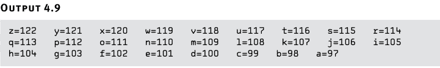

清单 4.15 中使用了自增和自减运算符来控制特定操作执行的次数。在这个示例中，请注意自增运算符也被用于字符 (`char`) 数据类型。只要为某个数据类型的“下一个”或“前一个”值的概念赋予了意义，你就可以在该数据类型上使用自增和自减运算符。

我们看到赋值运算符首先计算要赋的值，然后执行赋值。赋值运算符的结果就是所赋的值。自增和自减运算符与此类似：它们计算要赋的值，执行赋值，并返回一个结果值。因此，可以将赋值运算符与自增或自减运算符一起使用，虽然如此操作如果不小心会造成极大的困惑。请参见清单 4.16 和输出 4.10 中的示例。

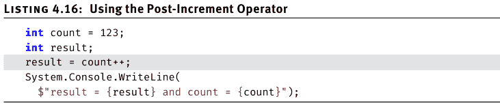


你可能会惊讶地发现，赋给 `result` 的值是 `count` 在自增*之前*的值。放置自增或自减运算符的位置决定了被赋值的值应该是操作数在计算之前还是之后的值。如果你希望 `result` 的值是分配给 `count` 的值，你需要像清单 4.17 中那样，将运算符放在被自增的变量之前。

#### 清单 4.17：使用前缀自增运算符

```
int count = 123;
int result;
result = ++count;
```


`System.Console.WriteLine(`

    `"$result = {result} and count = {count}"`);

```

输出 4.11 显示了清单 4.17 的结果。

#### 输出 4.11

```
result = 124 and count = 124
```

在这个示例中，自增运算符出现在操作数之前，因此表达式的结果是变量自增后赋值的值。如果 `count` 是 123，`++count` 会将 124 赋值给 `count` 并产生结果 124。相比之下，后缀自增运算符 `count++` 将 124 赋值给 `count`，并产生 `count` 在自增前持有的值：123。无论运算符是后缀还是前缀，变量 `count` 都会在产生值之前被自增；唯一的区别在于产生的是哪个值。前缀和后缀行为的区别在清单 4.18 中有所说明。相应的输出显示在输出 4.12 中。

#### 清单 4.18：比较前缀和后缀自增运算符

```
class IncrementExample
{
    static void Main()
    {
        int x = 123;
        // 显示 123, 124, 125
        System.Console.WriteLine($"{x++}, {x++}, {x}");
        // x 现在包含值 125
        // 显示 126, 127, 127
        System.Console.WriteLine($"{++x}, {++x}, {x}");
        // x 现在包含值 127
    }
}
```

#### 输出 4.12

```
123, 124, 125
126, 127, 127
```

正如清单 4.18 所示，自增和自减运算符相对于操作数的位置可能会影响表达式产生的结果。前缀运算符的结果是变量在自增或自减之前所持有的值。后缀运算符的结果是变量在自增或自减之后所持有的值。在语句中间嵌入这些运算符时要小心。当不确定会发生什么时，独立使用这些运算符，将它们放在它们自己的语句中。这样，代码的可读性也会更好，而且意图不会引起误解。

### 语言对比：C++—实现定义的行为

前面我们讨论了在 C++ 中表达式中的操作数可以以任何顺序求值，而在 C# 中它们总是从左到右求值。同样，在 C++ 中，实现可以在任何顺序下合法地执行自增和自减的副作用。例如，在 C++ 中，形式为 `M(x++, ++x)` 的调用，其中 `x` 初始值为 1，编译器可以合法地调用 `M(1,2)` 或 `M(2,1)`。相比之下，C# 总是调用 `M(1,2)`，因为 C# 提供了两个保证：(1) 调用参数总是从左到右计算，以及 (2) 自增值的赋值始终发生在表达式值被使用之前。C++ 不提供任何保证。

## 准则

- 避免混淆自增和自减运算符的使用。
- 当在 C、C++ 和 C# 之间移植使用自增和自减运算符的代码时要谨慎；C 和 C++ 的实现无需遵循与 C# 相同的规则。

### 高级专题

#### 线程安全的自增和自减

尽管自增和自减运算符非常简洁，但这些运算符并不是原子操作。在运算符执行过程中可能会发生线程上下文切换，从而导致竞争条件。你可以使用 `lock` 语句来防止竞争条件。然而，对于简单的自增和自减，使用 `System.Threading.Interlocked` 类中线程安全的 `Increment()` 和 `Decrement()` 方法是一种成本更低的替代方案。这些方法依赖于处理器函数来执行快速的线程安全自增和自减。更多细节请参见第 19 章。

### 常量表达式和常量局部变量

前一章讨论了字面值，即直接嵌入代码中的值。可以使用运算符将多个字面值组合成一个**常量表达式**。根据定义，常量表达式是 C# 编译器可以在编译时评估的表达式（而不是在程序运行时评估），因为它完全由常量操作数组成。然后可以使用常量表达式来初始化常量局部变量，这允许你为常量值命名（类似于局部变量允许你为存储位置命名）。例如，一天中秒数的计算可以是一个常量表达式，然后可以在其他表达式中通过名称使用它。

清单 4.19 中的 `const` 关键字声明了一个常量局部变量。由于常量局部变量根据定义是**变量**的反义词——*constant* 意味着“不能变化”——因此在代码后面试图修改该值会导致编译时错误。

## 准则

**不要**将常量用于任何可能随时间变化的值。圆周率 pi 的值和黄金原子中的质子数是常量；黄金的价格、你公司的名称以及你程序的版本号可能会变化。

请注意，清单 4.19 中赋给 `secondsPerWeek` 的表达式是一个常量表达式，因为表达式中的所有操作数也都是常量。

## 引言：流程控制

本章稍后部分包含一个代码列表（Listing 4.45），展示了以二进制形式查看数字的一种简单方法。然而，即使是如此简单的程序，若不使用控制流语句也无法编写。这类语句用于控制程序的执行路径。本节讨论如何基于条件检查来更改语句执行的顺序。稍后，你将学习如何通过循环结构重复执行语句组。

表 4.1 汇总了控制流语句。请注意，“通用语法结构”列指示的是语句的常见用法，而非完整的词法结构。表 4.1 中的嵌入语句可以是除带标签语句或声明之外的任何语句，但通常是一个块语句。

表 4.1 中的每个 C# 控制流语句都出现在井字棋³程序中，并可在第 4 章的源代码文件 `TicTacToe.cs` 中找到（参见 http://itl.tc/EssentialCSharpSCC）。该程序显示井字棋棋盘，提示每位玩家输入，并随着每一步更新状态。

本章的其余部分将更详细地查看每个语句。在介绍 if 语句之后，它会在继续讨论剩余的控制流语句之前，介绍代码块、作用域、布尔表达式和按位运算符。由于 C# 与其他语言相似，如果读者觉得表 4.1 很熟悉，可以跳至标题为“C# 预处理器指令”的章节，或直接跳到章末的摘要部分。

### 表 4.1：控制流语句

| 语句 | 通用语法结构 | 示例 |
| :--- | :--- | :--- |
| `if` 语句 | `if(boolean-expression)`<br>`embedded-statement` | `if (input == "quit")`<br>{<br>    `System.Console.WriteLine(`<br>    `"Game end");`<br>    `return;`<br>} |
| | `if(boolean-expression)`<br>`embedded-statement`<br>`else`<br>`embedded-statement` | `if (input == "quit")`<br>{<br>    `System.Console.WriteLine(`<br>    `"Game end");`<br>    `return;`<br>}<br>`else`<br>`GetNextMove();` |
| `while` 语句 | `while(boolean-expression)`<br>`embedded-statement` | `while(count < total)`<br>{<br>    `System.Console.WriteLine(`<br>    `$"count = {count}");`<br>    `count++;`<br>} |

*表 4.1 续*

| 语句 | 通用语法结构 | 示例 |
| :--- | :--- | :--- |
| `do while` 语句 | `do`<br>    `embedded-statement`<br>`while(*boolean-expression*);` | `do`<br>{<br>    `System.Console.WriteLine(`<br>    `"Enter name:");`<br>    `input =`<br>    `System.Console.ReadLine();`<br>}<br>`while(*input != "exit"*);` |
| `for` 语句 | `for(*for-initializer*;<br>    *boolean-expression*;<br>    *for-iterator*)`<br>    *embedded-statement* | `for (**int** count = 1;<br>    count <= 10;<br>    count++)`<br>{<br>    `System.Console.WriteLine(`<br>    `$"count = {count}");`<br>} |
| `foreach` 语句 | `foreach(*type identifier* **in**<br>    *expression*)`<br>    *embedded-statement* | `foreach (**char** letter **in** email)`<br>{<br>    `**if**(!insideDomain)`<br>    `{`<br>    `**if** (letter == '@')`<br>    `{`<br>    `insideDomain = **true*;<br>}<br>**continue**;<br>}<br>`System.Console.Write(`<br>letter);<br>} |
| `continue` 语句 | `**continue** ;` | |

*表 4.1 续*

| 语句 | 通用语法结构 | 示例 |
| :--- | :--- | :--- |
| `switch` 语句 | `switch(governing-type-expression)`<br>{<br>...<br>`case const-expression :`<br>`statement-list`<br>`jump-statement`<br>`default :`<br>`statement-list`<br>`jump-statement`<br>} | `switch(input)`<br>{<br>`case "exit":`<br>`System.Console.WriteLine(`<br>`"Exiting app....");`<br>`break;`<br>`case "restart":`<br>`Reset();`<br>`goto case "start";`<br>`case "start":`<br>`GetMove();`<br>`break;`<br>`default :`<br>`System.Console.WriteLine(`<br>`input);`<br>`break;`<br>} |
| `break` 语句 | `break;` | |
| `goto` 语句 | `goto identifier;`<br>`goto case const-expression;`<br>`goto default;` | |


# if 语句

**if** 语句是 C# 中最常见的语句之一。它评估一个**布尔表达式**（结果为**true** 或 **false** 的表达式），称为**条件**。如果条件为真，则执行**后续语句**。**if** 语句可选择性包含一个 **else** 子句，其中包含如果条件为假时执行的**替代语句**。一般形式如下：

```
if (condition)
   consequence-statement
else
   alternative-statement
```

在 Listing 4.20 中，如果用户输入 1，程序显示“选择与计算机对战”。否则，显示“选择与另一名玩家对战”。

**LISTING 4.20：if/else 语句示例**

```csharp
class TicTacToe     // 声明 TicTacToe 类
{
   static void Main() // 声明程序的入口点
   {
      string input;
      // 提示用户选择 1 人或 2 人游戏
      System.Console.Write(
         "1 - 与计算机对战\n" +
         "2 - 与另一名玩家对战。\n" +
         "请选择：");
      input = System.Console.ReadLine();
      if(input=="1")
         // 用户选择与计算机对战
         System.Console.WriteLine(
            "已选择与计算机对战。");
      else
         // 默认设为 2 人游戏（即使用户未输入 2）
         System.Console.WriteLine(
            "已选择与另一名玩家对战。");
   }
}
```

#### 嵌套 if

有时代码需要多个 **if** 语句。Listing 4.21 中的代码首先确定用户是否通过输入小于或等于 0 的数字来选择退出；如果没有，则检查用户是否知道井字棋的最大回合数。

**LISTING 4.21：嵌套 if 语句**

```csharp
class TicTacToeTrivia
{
    static void Main()
    {
        int input;    // 声明一个变量以存储输入
        System.Console.Write(
            "井字棋的最大回合数是多少？" +
            "（输入 0 退出。）");
        // int.Parse() 将 ReadLine() 的返回值
        // 转换为 int 数据类型
        input = int.Parse(System.Console.ReadLine());
        if (input <= 0) // 第 16 行
            // 输入小于或等于 0
            System.Console.WriteLine("正在退出...");
        else
            if (input < 9)  // 第 20 行
                // 输入小于 9
                System.Console.WriteLine(
                    $"井字棋的最大回合数多于 {input}");
            else
                if(input > 9) // 第 26 行
                    // 输入大于 9
                    System.Console.WriteLine(
                        $"井字棋的最大回合数少于 {input}");
                else
                    // 输入等于 9
                    System.Console.WriteLine(  // 第 33 行
                        "正确，井字棋最多有 9 个回合。");
    }
}
```

输出 4.13 展示了 Listing 4.21 的结果。

**OUTPUT 4.13**

井字棋的最大回合数是多少？（输入 0 退出。）：9
正确，井字棋最多有 9 个回合。

假设用户在第 14 行的提示下输入 9。这是其执行路径：

1.  *第 16 行*：检查输入是否小于 0。由于并非如此，跳转至第 20 行。
2.  *第 20 行*：检查输入是否小于 9。由于并非如此，跳转至第 26 行。
3.  *第 26 行*：检查输入是否大于 9。由于并非如此，跳转至第 33 行。
4.  *第 33 行*：显示答案正确。

Listing 4.21 包含嵌套的 `if` 语句。为了澄清嵌套关系，代码行进行了缩进。然而，如你在第 1 章所学，空白符不影响执行路径。如果此代码在没有缩进和换行的情况下编写，执行结果将相同。出现在 Listing 4.22 嵌套 `if` 语句中的代码与 Listing 4.21 等效。

**LISTING 4.22：顺序格式化的 if/else**

```csharp
if (input < 0)
    System.Console.WriteLine("正在退出...");
else if (input < 9)
    System.Console.WriteLine(
        $"井字棋的最大回合数多于 {input}");
else if(input < 9)
    System.Console.WriteLine(
        $"井字棋的最大回合数少于 {input}");
else
    System.Console.WriteLine(
        "正确，井字棋最多有 9 个回合。");
```

尽管后一种格式更常见，但在每种情况下，都应使用能产生最清晰代码的格式。

两个 `if` 语句列表都省略了花括号。然而，如下文讨论，这不符合指导原则，该原则提倡使用代码块，也许除了最简单的单行场景之外。

#### 代码块 ({ })

在前面的 `if` 语句示例中，`if` 和 `else` 后面只跟随一条语句：类似于 Listing 4.23 的单个 `System.Console.WriteLine()`。

### 列表 4.23：没有代码块的 if 语句

```
if(input < 9)
    System.Console.WriteLine("Exiting");
```


然而，使用花括号，我们可以将语句合并为一个称为**块语句**或**代码块**的单一语句，从而允许将多个语句分组为一个作为结果的单一语句。例如，请参见列表 4.24 中半径计算中高亮的代码块。

### 列表 4.24：后跟代码块的 if 语句

```
class CircleAreaCalculator

{

    static void Main()

    {

        double radius;    // Declare a variable to store the radius

        double area;      // Declare a variable to store the area

        System.Console.Write("Enter the radius of the circle: ");

        // double.Parse converts the ReadLine()
        // return to a double
        radius = double.Parse(System.Console.ReadLine());

        if(radius >= 0)

        {

            // Calculate the area of the circle
            area = Math.PI * radius * radius;
            System.Console.WriteLine(
                $"The area of the circle is: { area :0.00 }");

        }
        else

        {

            System.Console.WriteLine(
                $"{ radius } is not a valid radius.");

        }
    }

}
```

输出 4.14 展示了列表 4.24 的结果。

### 输出 4.14

```
Enter the radius of the circle: 3
The area of the circle is: 28.27
```

在此示例中，*if* 语句检查半径是否为正数。如果是，则计算并显示圆的面积；否则，显示无效半径的消息。

请注意，在此示例中，第一条 *if* 语句后面跟随两个语句。然而，这两个语句出现在花括号内。花括号将这些语句组合成一个代码块，该代码块本身是一个单一语句。

如果在列表 4.24 中省略创建代码块的花括号，则只有紧跟在布尔表达式后面的语句才会根据条件执行。后续的语句将无论 *if* 语句的布尔表达式如何都会执行。无效代码如列表 4.25 所示。

### 列表 4.25：依赖缩进，导致无效代码

```
if(radius >= 0)
    area = Math.PI * radius * radius;
    System.Console.WriteLine(
        $"The area of the circle is: { area:0.00}");
```

在 C# 中，缩进仅用于增强代码可读性。编译器会忽略它，因此上述代码在语义上等同于列表 4.26。

### 列表 4.26：带花括号且与列表 4.25 语义等效

```
if(radius >= 0)
{
    area = Math.PI * radius * radius;
}
System.Console.WriteLine(
    $"The area of the circle is: { area:0.00}");
```

程序员应格外小心以避免此类细微的 bug，甚至可能走到始终在控制流语句之后包含代码块的程度，即使只有一个语句。一个被广泛接受的编码准则是避免省略花括号，除了最简单的单行 *if* 语句可能例外。

虽然不寻常，但确实可能存在在词法上不是控制流语句直接部分的代码块。换句话说，单独放置花括号（例如，没有条件或循环）是合法的语法。

在列表 4.25 和 4.26 中，圆周率值由 `System.Math` 类中的 `PI` 常量表示。不要硬编码 $\tau$ 和 e（自然对数的底）的值，代码应使用 `System.Math.PI` 和 `System.Math.E`。

> **准则**
> - 避免省略花括号，除了最简单的单行 `if` 语句。

### 代码块、作用域和声明空间

代码块通常被称为*作用域*，但这两个术语并不完全可互换。**作用域**是指命名实体的区域，在该区域内可以使用非限定名称合法地引用该实体。例如，局部变量的作用域正是包围它的代码块文本，这解释了为什么通常将代码块称为作用域。

作用域经常与声明空间混淆。**声明空间**是命名实体的逻辑容器，其中两个实体不能有相同的名称。代码块不仅定义了一个作用域，还定义了一个局部变量声明空间。在同一声明空间中出现两个具有相同名称的局部变量声明是非法的。同样，不可能在同一个类中声明两个签名均为 `Main()` 的方法。（此规则对于方法略有放宽：只要它们具有不同的签名，两个方法可以在声明空间内具有相同的名称。方法的签名包括其名称以及参数的数量和类型。）在块内，可以通过名称引用局部变量，并且它必须是块内以该名称声明的唯一实体。在声明块之外，无法通过名称引用局部变量；局部变量在块之外被认为是“超出作用域”。

*总之*，作用域用于确定名称引用的是什么实体；声明空间确定何时两个以相同名称声明的实体会相互冲突。在列表 4.27 中，在嵌入 *if* 语句的块语句内部声明局部变量 `message` 将其作用域限制为仅该块语句；当稍后在方法中使用其名称时，该局部变量超出了作用域。为避免错误，必须在块外部声明变量。

### 列表 4.27：在作用域外部无法访问的变量

```csharp
class Program
{
    static void Main(string[] args)
    {
        int playerCount;
        System.Console.Write(
            "Enter the number of players (1 or 2):");
        playerCount = int.Parse(System.Console.ReadLine());
        if (playerCount != 1 && playerCount != 2)
        {
            string message =
                "You entered an invalid number of players.";
        }
        else
        {
            // ...
        }
        // Error: message is not in scope
        System.Console.WriteLine(message);
    }
}
```

输出 4.15 展示了列表 4.27 的结果。

### 输出 4.15

```
...
....\Program.cs(18,26): error CS0103: The name 'message' does not exist in the current context
```

局部变量名称必须唯一的声明空间涵盖了文本上封闭在最初声明该局部变量的块内的所有子代码块。C# 编译器防止在方法代码块内直接声明（或作为参数）的局部变量名称在子代码块内被重用。在列表 4.27 中，由于 `args` 和 `playerCount` 是在方法代码块内声明的，因此不能在方法内的任何地方再次声明它们。

名称 `message` 在整个局部变量的作用域内都指向这个局部变量——也就是说，直接包围声明的块。同样，`playerCount` 在包含声明的块内（包括 *if* 语句的后果和备选分支这两个子块内）都指向同一个变量。

### 语言对比：C++——局部变量作用域

在 C++ 中，在块中声明的局部变量从声明语句点开始到块结束都在作用域内。因此，试图在其声明前引用局部变量会失败，因为该变量不在作用域内。如果另一个具有该名称的实体“在作用域内”，C++ 语言会将名称解析为该实体，这可能不是你所期望的。在 C# 中，规则略有不同：局部变量在整个声明它的块中都在作用域内，但在其声明前引用局部变量是非法的。也就是说，查找局部变量的尝试会成功，然后该使用将被视为错误。这只是 C# 的众多规则之一，旨在防止 C++ 程序中常见的错误。

### 布尔表达式

`if` 语句中的括号条件是**布尔表达式**。在列表 4.28 中，条件被高亮显示。

### 列表 4.28：布尔表达式

```csharp
if (input < 9)
{
    // Input is less than 9
    System.Console.WriteLine(
        $"Tic-tac-toe has more than { input }" +
        " maximum turns.");
}
// ...
```

布尔表达式出现在许多控制流语句中。它们的关键特征是始终求值为 true 或 false。为了使 `input < 9` 作为布尔表达式被允许，它必须结果为 `bool`。编译器不允许 `x = 42`，例如，因为该表达式为 `x` 赋值，结果是被赋值的值，而不是检查变量的值是否为 42。

### 语言对比：C++——错误地将 = 用作 ==

C# 消除了 C 和 C++ 中常见的编码错误。在 C++ 中，允许使用清单 4.29 中的代码。

### 清单 4.29：C++ 允许将赋值用作条件，但 C# 不允许

```csharp
if (input = 9)    // C++ 允许，C# 不允许
    System.Console.WriteLine(
        "正确，井字棋最多有 9 回合。");
```

乍一看，这段代码似乎是在检查 `input` 是否等于 9，但第 1 章指出，`=` 代表赋值运算符，而不是相等性检查。赋值运算符的返回值是分配给变量的值——在这种情况下是 9。然而，9 是一个 `int` 类型，因此它不符合布尔表达式的要求，C# 编译器不允许这样做。C 和 C++ 语言将非零整数视为 **true**，将零视为 **false**。相比之下，C# 要求条件实际上必须是布尔类型；不允许使用整数。

### 关系运算符和相等运算符

**关系运算符和相等运算符**用于确定一个值是否大于、小于或等于另一个值。表 4.2 列出了所有的关系和相等运算符。它们都是二元运算符。

**表 4.2：关系和相等运算符**

| 运算符 | 描述 | 示例 |
| :------- | :------------------------ | :---------- |
| `<` | 小于 | `input < 9;` |
| `>` | 大于 | `input > 9;` |
| `<=` | 小于或等于 | `input <= 9;` |
| `>=` | 大于或等于 | `input >= 9;` |
| `==` | 相等运算符 | `input == 9;` |
| `!=` | 不等运算符 | `input != 9;` |

C# 中相等性的语法使用 `==`，就像许多其他编程语言一样。例如，要确定 `input` 是否等于 9，请使用 `input == 9`。相等运算符使用两个等号，以区别于赋值运算符 `=`。感叹号在 C# 中表示 NOT（非），因此要测试不等式，请使用不等运算符 `!=`。

关系和相等运算符总是产生一个 `bool` 值，如清单 4.30 所示。

#### 清单 4.30：将关系运算符的结果分配给 bool 变量

```csharp
bool result = 70 > 7;
```

在完整的井字棋程序清单中，你使用相等运算符来确定用户是否已退出。清单 4.31 中的布尔表达式包含一个 OR（|）逻辑运算符，下一节将对此进行详细讨论。

#### 清单 4.31：在布尔表达式中使用相等运算符

```csharp
if (input == "" || input == "quit")
{
    System.Console.WriteLine($"玩家 {currentPlayer} 退出了！！");
    break;
}
```

### 逻辑布尔运算符

**逻辑运算符**具有布尔操作数，并产生布尔结果。逻辑运算符允许你结合多个布尔表达式以形成更复杂的布尔表达式。逻辑运算符是 `|`、`||`、`&`、`&&` 和 `^`，分别对应 OR（或）、AND（与）和 exclusive OR（异或）。`|` 和 `&` 版本的 OR 和 AND 在布尔逻辑中很少使用，原因我们在本节中讨论。

#### OR 运算符 ( | )

在清单 4.31 中，如果用户输入 `quit` 或者在未输入值的情况下按下 Enter 键，则假设她希望退出程序。为了允许用户以两种方式退出，你可以使用逻辑 OR 运算符，`||`。`||` 运算符评估布尔表达式，如果*任一*操作数为 true，则结果为 true（参见清单 4.32）。

#### 清单 4.32：使用 OR 运算符

```csharp
if ((hourOfTheDay > 23) || (hourOfTheDay < 0))
    System.Console.WriteLine("你输入的时间无效。");
```

没有必要评估 OR 表达式的两侧，因为如果任一操作数为 true，结果已知为 true，无论另一个操作数的值如何。与 C# 中的所有运算符一样，左操作数在右操作数之前评估，因此如果表达式的左侧部分评估为 true，则右侧部分会被忽略。在清单 4.32 的示例中，如果 `hourOfTheDay` 的值为 33，那么 `(hourOfTheDay > 23)` 将评估为 true，OR 运算符将忽略表达式的后半部分，从而短路它。对表达式进行短路也会发生在布尔 AND 运算符中。（注意，这里的括号不是必需的；逻辑运算符的优先级高于关系运算符。然而，将子表达式括起来会使初学者读者更清晰。）

#### AND 运算符 (&&)

布尔 AND 运算符 `&&` 仅在两个操作数都评估为 true 时才评估为 true。如果任一操作数为 false，结果将为 false。清单 4.33 如果给定的变量既大于 10 又小于 24，则写入一条消息。[^4] 与 OR 运算符类似，AND 运算符并不总是评估表达式的右侧。如果确定左操作数为 false，则无论右操作数的值如何，整体结果将为 false，因此运行时将跳过对右操作数的评估。

[^4]: 程序员每天通常工作的小时数。

#### 清单 4.33：使用 AND 运算符

```csharp
if ((10 < hourOfTheDay) && (hourOfTheDay < 24))
    System.Console.WriteLine(
        "Hi-Ho, Hi-Ho, 我们要去上班了。");
```

#### Exclusive OR 运算符 (^)

脱字符符号 `^` 是异或（XOR）运算符。当应用于两个布尔操作数时，XOR 运算符仅在恰好一个操作数为 true 时返回 true，如表 4.3 所示。

**表 4.3：XOR 运算符的条件值**

| 左操作数 | 右操作数 | 结果 |
| :--- | :--- | :--- |
| True | True | False |
| True | False | True |
| False | True | True |
| False | False | False |

与布尔 AND 和布尔 OR 运算符不同，布尔 XOR 运算符不会短路：它始终检查两个操作数，因为除非知道两个操作数的值，否则无法确定结果。注意，XOR 运算符与布尔不等运算符完全相同。

#### 逻辑否定运算符 (!)

**逻辑否定运算符**，或 **NOT 运算符** `!`，会反转一个 `bool` 值。该运算符是一个一元运算符，意味着它只需要一个操作数。清单 4.34 演示了它是如何工作的，输出 4.16 显示了结果。

#### 清单 4.34：使用逻辑否定运算符

```csharp
bool valid = false;
bool result = !valid;
// 显示 "result = True"
System.Console.WriteLine($"result = { result }");
```

#### 输出 4.16

```
result = True
```

在清单 4.34 的开始，`valid` 被设置为 `false`。然后你对 `valid` 使用否定运算符，并将值分配给 `result`。

你可以使用条件运算符来替代用于选择两个值之一的 if-else 语句。条件运算符同时使用问号和冒号；通用格式如下：

```
condition ? consequence : alternative
```

条件运算符是一个三元运算符，因为它有三个操作数：`condition`（条件）、`consequence`（结果）和 `alternative`（替代值）。（由于它是 C# 中唯一的三元运算符，它通常被称为三元运算符，但通过名称而不是操作数数量来称呼它会更清晰。）与逻辑运算符一样，条件运算符使用一种短路形式。如果条件评估为 true，条件运算符仅评估 `consequence`。如果条件评估为 false，它仅评估 `alternative`。运算符的结果是已评估的表达式。

清单 4.35 说明了条件运算符的使用。该程序的完整清单出现在源代码的 `Chapter04\TicTacToe.cs` 中。

#### 清单 4.35：条件运算符

```csharp
```


```csharp
class TicTacToe
{
    static string Main()
    {
        // 初始将 currentPlayer 设置为 Player 1
        int currentPlayer = 1;
        // ...
        for (int turn = 1; turn <= 10; turn++)
        {
            // ...
            // 切换玩家
            currentPlayer = (currentPlayer == 2) ? 1 : 2;
        }
    }
}
```

该程序交换当前玩家。为此，它检查当前值是否为 2。这是条件表达式中的条件部分。如果条件的结果为 true，条件运算符产生结果值，即 1。否则，它产生替代值，即 2。与 `if` 语句不同，条件运算符的结果必须被分配（或作为参数传递）；它不能单独作为一个完整的语句出现。

### 空合并运算符 (`??`)

**空合并运算符**是一种简洁的表达方式，用于表示“如果此值为 null，则使用其他值”。其形式如下：

*expression1 ?? expression2*

空合并运算符也使用一种短路求值形式。如果 *expression1* 不为 null，其值即为运算结果，另一个表达式不会被求值。如果 *expression1* 求值为 null，则 *expression2* 的值即为运算结果。与条件运算符不同，空合并运算符是一个二元运算符。

示例 4.36 说明了空合并运算符的用法。

#### 示例 4.36：空合并运算符

```csharp
string fileName = GetFileName();
// ...
string fullName = fileName ?? "default.txt";
// ...
```

在此示例中，我们使用空合并运算符，如果 `fileName` 为 null，则设置 `fullName` 为 "default.txt"。如果 `fileName` 不为 null，`fullName` 将直接被赋值为 `fileName` 的值。

空合并运算符可以很好地“串联”使用。例如，形式为 `x ?? y ?? z` 的表达式，如果 `x` 不为 null，则结果为 `x`；否则，如果 `y` 不为 null，则结果为 `y`；否则，结果为 `z`。也就是说，它从左到右选择第一个非 null 表达式，如果之前所有表达式都为 null，则使用最后一个表达式。

空合并运算符在 C# 2.0 版本中引入，与可空值类型同时出现。该运算符适用于可空值类型和引用类型的操作数。

- 6.0 入门

### 空条件运算符 (`?.`)

每当你对 null 值调用方法时，运行时将抛出 `System.NullReferenceException`，这几乎总是表明编程逻辑中存在错误。鉴于此模式的频率（即在调用成员之前检查是否为 null），C# 6.0 引入了 `?.` 运算符，即空条件运算符，如示例 4.37 所示。

#### 示例 4.37：空条件运算符

```csharp
class Program
{
    static void Main(string[] args)
    {
        if (args?.Length == 0)
        {
            System.Console.WriteLine(
                "ERROR: File missing. "
                + "Use:\n\tfind.exe file:<filename>");
        }
        else
        {
            if (args[0]?.ToLower().StartsWith("file:")?
                false)
            {
                string fileName = args[0]?.Remove(0, 5);
                // ...
            }
        }
    }
}
```

空条件运算符在调用方法或属性之前（在示例 4.37 中是第一个 `args`，在本示例的第一个例子中是 `Length`），检查操作数是否为 null。逻辑上等价的显式代码如下（虽然在 C# 6.0 语法中，`args` 的值只会被求值一次）：

```csharp
(args != null) ? (int?)args.Length : null
```

空条件运算符特别方便的地方在于它可以串联。例如，如果你调用 `args[0]?.ToLower().StartsWith("file:")`，只有当 `args[0]` 不为 null 时，`ToLower()` 和 `StartsWith()` 才会被调用。当表达式串联时，如果第一个操作数为 null，表达式求值会被短路，调用链中后续的调用将不会发生。

但是，请小心，以免无意中遗漏额外的空条件运算符。例如，假设（在这种情况下是假设性的）`args[0]?.ToLower()` 也可能返回 null。在这种情况下，调用 `StartsWith()` 时会发生 `NullReferenceException`。这并不意味着你必须使用一连串的空条件运算符，而是你应该有意地处理逻辑。在此示例中，因为 `ToLower()` 永远不为 null，所以不需要额外的空条件运算符。

- 6.9

关于空条件运算符，需要重点注意的是，当它与返回值类型的成员一起使用时，它总是返回该类型的可空版本。例如，`args?.Length` 返回 `int?`，而不仅仅是 `int`。类似地，`args[0]?.ToLower().StartsWith("file:")` 返回 `bool?`（即 `Nullable<bool>`）。另外，由于 `if` 语句需要 `bool` 数据类型，因此必须在 `StartsWith()` 表达式后跟随空合并运算符（`??`）。

尽管这可能有点特别（与其他运算符的行为相比），但可空值类型的返回只在调用链的末端产生。因此，在 `Length` 上调用点（.）运算符允许调用 `int`（而不是 `int?`）的成员。然而，将 `args?.Length` 包裹在括号中——从而通过括号运算符优先级强制得到 `int?` 结果——将调用 `int?` 返回，并使 `Nullable<T>` 的特定成员（`HasValue` 和 `Value`）可用。

空条件运算符也可以与索引运算符结合使用，如示例 4.38 所示。

#### 示例 4.38：与索引运算符一起使用的空条件运算符

```csharp
class Program
{
    public static void Main(string[] args)
    {
        // 注意：未验证 args?.Length
        string directoryPath = args?[0];
        string searchPattern = args?[1];
        // ...
    }
}
```

在此示例中，*args* 的第一个和第二个元素仅在其不为 null 时才被赋给相应的变量。如果为 null，则会被赋值为 null。

不幸的是，这个例子如果说不危险，至少也是天真的，因为空条件运算符给人一种虚假的安全感，暗示如果 *args* 不为 null，则元素必须存在。当然，事实并非如此：即使 *args* 不为 null，元素也可能不存在。此外，由于使用 *args*?.*Length* 检查元素数量可以验证 *args* 不为 null，因此在检查长度之后，你实际上从不需要在对集合进行索引时使用空条件运算符。

总之，如果索引运算符在索引不存在时抛出 *IndexOutOfRangeException*，你应该避免将空条件运算符与索引运算符结合使用。这样做会导致对代码有效性的虚假安全感。

### 进阶主题

#### 结合委托利用空条件运算符

空条件运算符本身是一个很好的特性。然而，将其与委托调用结合使用，解决了自 C# 1.0 以来一直存在的 C# 痛点。请注意下面 *PropertyChanged* 事件处理程序在检查 null 值并最终触发事件之前，是如何被赋给局部副本 (*propertyChanged*) 的。这是在不运行风险的情况下调用事件的最简单的线程安全方式，即在检查 null 和触发事件之间发生事件取消订阅。不幸的是，这种方法不直观，开发人员经常忽略遵循此模式——结果是不一致地抛出 *NullPointerExceptions*。幸运的是，随着 C# 6.0 中引入空条件运算符，这个问题已经得到解决。

在 C# 6.0 中，委托值的检查从

```csharp
PropertyChangedEventHandler propertyChanged =
    PropertyChanged;
if (propertyChanged != null)
{
    propertyChanged(this,
        new PropertyChangedEventArgs(nameof(Name)));
}
```

变为简单地

```csharp
PropertyChanged?.Invoke(propertyChanged(
    this, new PropertyChangedEventArgs(nameof(Name))));
```

因为事件只是一个委托，所以通过空条件运算符和 `Invoke()` 调用委托的相同模式始终可行。

### 按位运算符 (`<<`, `>>`, `|`, `&`, `^`, `~`)

几乎所有编程语言都共用的一组额外运算符是用于操作二进制格式值的运算符：按位运算符。

### 初学者主题

#### 位与字节

计算机内的所有值都表示为 1 和 0 的二进制格式，称为**二进制位（bits）**。位被分组为八个一组，称为**字节**。在一个字节中，每个后续位对应 $2$ 的幂次值，从右边的 $2^{0}$ 开始，向左移动到 $2^{7}$，如图 4.1 所示。

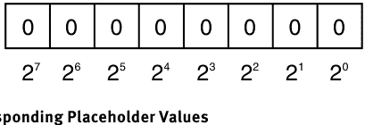

在许多场景中，特别是处理低级或系统服务时，信息以二进制数据的形式检索。要操作这些设备和服务，你需要执行二进制数据操作。

在图 4.2 中，每个方框对应于 $2$ 的所示指数次幂的值。一个字节（8 位数字）的值是所有设置为 $1$ 的八个比特位对应的 $2$ 的幂值之和。

| 0 | 0 | 0 | 0 | 0 | 1 | 1 | 1 |
|---|---|---|---|---|---|---|---|
$7 = 4 + 2 + 1$

**图 4.2：** 计算无符号字节的值

上述描述的二进制转换对于有符号数而言有显著不同。有符号数（long, short, int）使用补码表示法进行表示。这种做法确保了在将负数加到正数时，加法运算依然有效，仿佛两个操作数都是正数一样。在这种表示法中，负数的行为与正数不同。如果最左侧位置为 $1$，则识别为负数。如果最左侧位置包含 $1$，则需将包含 $0$ 的位置相加，而不是包含 $1$ 的位置。每个位置对应 $2$ 的负指数值。此外，还需要从结果中减去 $1$。这一点在图 4.3 中进行了演示。

| 1 | 1 | 1 | 1 | 1 | 0 | 0 | 1 |
|---|---|---|---|---|---|---|---|
$-7 = -4 - 2 + 0 - 1$

**图 4.3：** 计算有符号字节的值

因此，1111 1111 1111 1111 对应 $-1$，而 1111 1111 1111 1001 存储的值为 $-7$。二进制表示 1000 0000 0000 0000 对应 16 位整数可以容纳的最小负值。

### 移位运算符（`<<`, `>>`）

有时，你可能希望将数字的二进制值向右或向左移位。执行左移时，数字二进制表示中的所有比特位都会向左移动移位运算符右侧操作数指定的位置数。然后使用 0 来填补二进制数右侧的位置。右移运算符在相反方向执行几乎相同的操作。然而，如果数字是有符号类型的负值，则用于填补二进制数左侧位置的值是 1 而不是 0。移位运算符分别是 `>>` 和 `<<`，已知为右移和左移运算符。此外，还有复合移位赋值运算符 `<<=` 和 `>>=`。

考虑以下示例。假设你有一个 int 值 -7，其二进制表示为 1111 1111 1111 1111 1111 1111 1111 1001。在列表 4.39 中，你将数字 $-7$ 的二进制表示向右移动两个位置。

**列表 4.39：使用右移运算符**

```csharp
int x;
x = (-7 >> 2);  // 11111111111111111111111111001 变为
                 // 1111111111111111111111111110
// 输出 "x is -2,"
System.Console.WriteLine($"x is {x}.");
```

输出 4.17 展示了列表 4.39 的结果。

**输出 4.17**

```
x is -2.
```

由于右移操作，最右侧位置的比特值“掉出”了边缘，左侧的负位指示符向左移动两个位置并用 1 替换。结果是 $-2$。

虽然传说 `x << 2` 比 `x * 4` 更快，但你不应使用位移位运算符进行乘法或除法。这种差异可能在 1970 年代的某些 C 编译器上是成立的，但现代编译器和现代微处理器完全有能力优化算术运算。使用移位进行乘法或除法令人困惑，并且当代码维护者忘记移位运算符的优先级低于算术运算符时，经常会导致错误。

### 按位运算符（`&`, `|`, `^`）

在某些情况下，你可能需要对两个操作数按位执行逻辑运算，例如 AND（与）、OR（或）和 XOR（异或）。你分别通过 `&`、`|` 和 `^` 运算符来实现这些操作。

### 初学者主题

#### 逻辑运算符详解

如果你有两个数字，如图 4.4 所示，按位运算将从最左侧最高有效位开始比较位置的值，并一直向右比较直到末尾。位置中的值 “1” 被视为 “真”，位置中的值 “0” 被视为 “假”。


**图 4.4：** 用二进制表示的数字 12 和 7

因此，图 4.4 中两个值的按位 AND 运算涉及将第一个操作数（12）中的比特位与第二个操作数（7）中的比特位进行逐位比较，结果为二进制值 000000100，即 4。或者，两个值的按位 OR 运算将产生 000011111，这是 15 的二进制等价物。XOR 的结果将是 000010111，即十进制 11。

列表 4.40 展示了这些按位运算符的使用。列表 4.40 的结果出现在输出 4.18 中。

**列表 4.40：使用按位运算符**

```csharp
byte and, or, xor;
and = 12 & 7;    // and = 4
or = 12 | 7;     // or = 15
xor = 12 ^ 7;    // xor = 11
System.Console.WriteLine(
    $"and = {and} \nor = {or} \nxor = {xor}");
```

**输出 4.18**

```
and = 4
or = 15
xor = 11
```

在列表 4.40 中，值 7 是掩码；它使用特定的运算符表达式来暴露或消除第一个操作数内的特定比特位。注意，与 AND（`&&`）运算符不同，`&` 运算符总是评估 *两者*，即使左侧部分为假。类似地，OR 运算符的 `|` 版本 *不* 进行“短路”评估。即使左侧操作数为真，它也会评估两个操作数。因此，AND 和 OR 运算符的按位版本不进行短路评估。

要将数字转换为其二进制表示，你需要遍历数字中的每个比特位。列表 4.41 是一个将整数转换为其二进制表示字符串的程序示例。列表 4.41 的结果出现在输出 4.19 中。

**列表 4.41：获取二进制显示字符串表示**

```csharp
class BinaryConverter
{
    static void Main()
    {
        const int size = 64;
        ulong value;
        char bit;
        System.Console.Write("Enter an integer: ");
        // 使用 long.Parse() 以支持负数
        // 假设 unchecked 赋值给 ulong
        value = (ulong)long.Parse(System.Console.ReadLine());
        // 将初始掩码设置为 100...
        ulong mask = 1UL << size - 1;
        for (int count = 0; count < size; count++)
        {
            bit = ((mask & value) != 0) ? '1' : '0';
            System.Console.Write(bit);
            // 将掩码向右移动一个位置
            mask >>= 1;
        }
        System.Console.WriteLine();
    }
}
```


**输出 4.19**

Enter an integer: 42
00000000000000000000000000000000000000000000000000000000000000000101010

在列表 4.41 的 `for` 循环的每次迭代中（本章后面会讨论），我们使用右移赋值运算符来创建对应于 `value` 中每个比特位置的掩码。通过使用 `&` 按位运算符对特定比特进行掩码处理，我们可以确定该比特是否已设置。如果掩码测试产生非零结果，我们将 1 写入控制台；否则，我们写入 0。通过这种方式，我们创建描述 `unsigned long` 二进制值的输出。

另外请注意，`(mask & value) != 0` 中的括号是必需的，因为不等式的优先级高于 `AND` 运算符。如果没有显式的括号，该表达式将等同于 `mask & (value != 0)`，这没有任何意义；`&` 的左侧是 `ulong`，而右侧是 `bool`。

这个特定示例仅用于学习目的。实际上，有一个内置的 CLR 方法 `System.Convert.ToString(value, 2)` 可以进行这样的转换。事实上，第二个参数指定了基数（例如，二进制为 2，十进制为 10，十六进制为 16），允许不仅限于转换为二进制。

### 按位复合赋值运算符（`&=`, `|=`, `^=`）

不出所料，你可以将这些按位运算符与赋值运算符结合使用，如下所示：`&=`、`|=` 和 `^=`。结果是，你可以取一个变量，将其与一个数字进行 OR 运算，并将结果重新赋值回原始变量，列表 4.42 演示了这一点。

**列表 4.42：使用逻辑赋值运算符**

```csharp
byte and = 12, or = 12, xor = 12;

and &= 7;    // and = 4

or  |= 7;    // or = 15

xor ^= 7;    // xor = 11

System.Console.WriteLine(
    $"and = {and} \nor = {or} \nxor = {xor}");
```

列表 4.42 的结果出现在输出 4.20 中。

**输出 4.20**

```
and = 4
or = 15
xor = 11
```

将位图与掩码结合，使用类似 `fields &= mask` 的语句会清除 `fields` 中未在 `mask` 中设置的位。相反，`fields &= ~mask` 会清除 `fields` 中在 `mask` 中设置的位。

### 按位补运算符 (~)

**按位补运算符** 获取操作数中每个位的补数，其中操作数可以是 `int`、`uint`、`long` 或 `ulong`。因此，表达式 `~1` 返回二进制表示为 1111 1111 1111 1111 1111 1111 1111 1110 的值，而 `~(1<<31)` 返回二进制表示为 0111 1111 1111 1111 1111 1111 1111 1111 的数字。

### 控制流语句（续）

现在我们已经更详细地描述了布尔表达式，我们可以更清晰地描述 C# 支持的控制流语句。对于经验丰富的程序员来说，其中许多语句都很熟悉，因此您可以快速浏览本节，寻找特定于 C# 的细节。请特别注意 `foreach` 循环，因为对于许多程序员来说，它可能是新接触的。

### while 和 do/while 循环

到目前为止，你已学习了如何编写仅执行一次的程序。然而，计算机可以轻松地多次执行类似的操作。为此，你需要创建一个指令循环。我们要讨论的第一个指令循环是 `while` 循环，因为它是简单的条件循环。`while` 语句的一般形式如下：

```
while (condition)
    statement
```

只要条件（必须是一个布尔表达式）评估为 `true`，计算机将反复执行作为循环“主体”的语句。如果条件评估为 `false`，代码执行将跳过主体并执行循环语句之后的代码。请注意，即使 `statement` 导致条件变为 `false`，它仍将继续执行。只有当条件在“循环顶部”重新评估时，循环才会退出。清单 4.43 中展示的斐波那契计算器演示了 `while` 循环。

**清单 4.43：while 循环示例**

```
class FibonacciCalculator
{
    static void Main()
    {
        decimal current;
        decimal previous;
        decimal temp;
        decimal input;
        System.Console.Write("Enter a positive integer:");
        // decimal.Parse converts the Readline to a decimal
        input = decimal.Parse(System.Console.ReadLine());
        // Initialize current and previous to 1, the first
        // two numbers in the Fibonacci series
        current = previous = 1;
        // While the current Fibonacci number in the series is
        // less than the value input by the user
        while (current <= input)
        {
            temp = current;
            current = previous + current;
            previous = temp; // Executes even if previous
            // statement caused current to exceed input
        }
        System.Console.WriteLine(
            $"The Fibonacci number following this is { current }");
    }
}
```

**斐波那契数** 是 **斐波那契数列** 的成员，该数列包含所有前两个数之和的数，从 1 和 1 开始。在清单 4.43 中，你提示用户输入一个整数。然后使用 `while` 循环找到大于用户输入的第一个斐波那契数。

**初学者话题**

**何时使用 while 循环**

本章的剩余部分考虑其他导致代码块反复执行的语句。术语 *循环主体* 指的是在 `while` 语句中要执行的语句（通常是代码块），因为代码在“循环”中执行，直到满足退出条件为止。理解选择哪种循环结构很重要。当你使用 `while` 结构时，是在条件评估为 true 时进行迭代。当重复次数已知时，例如从 0 计数到 n，最适当地使用 `for` 循环。`do/while` 类似于 `while` 循环，不同之处在于它至少会执行一次循环主体。

`do/while` 循环与 `while` 循环非常相似，只是当重复次数从 1 到 $n$ 且迭代开始时 $n$ 未知时，首选 `do/while` 循环。这种模式在提示用户输入时经常出现。清单 4.44 取自井字棋程序。

**清单 4.44：do/while 循环示例**

```
// Repeatedly request player to move until he
// enters a valid position on the board
bool valid;
do
{
    valid = false;
    // Request a move from the current player
    System.Console.Write(
        $"\nPlayer {currentPlayer}: Enter move:");
    input = System.Console.ReadLine();
    // Check the current player's input
    // ...
} while (!valid);
```

在清单 4.44 中，你在每次迭代或循环重复的开始时将 `valid` 初始化为 `false`。接下来，你提示并获取用户输入的号码。虽然这里未显示，然后你检查输入是否正确，如果正确，你将 `valid` 赋值为 `true`。由于代码使用 `do/while` 语句而不是 `while` 语句，用户至少会被提示输入一次。

`do/while` 循环的一般形式如下：

```
do
    statement
while (condition);
```

与所有控制流语句一样，通常使用代码块作为单个语句，以便将多个语句作为循环主体执行。但是，除了带标签的语句或局部变量声明外，可以使用任何单个语句。

# for 循环

`for` 循环迭代代码块，直到达到指定条件。以此方式，它与 `while` 循环非常相似。不同之处在于，`for` 循环具有内置语法用于初始化、递增和测试计数器的值，称为 **循环变量**。由于循环语法中有一个特定位置用于递增操作，递增和递减运算符经常作为 `for` 循环的一部分使用。

清单 4.45 展示了用于以二进制形式显示整数的 `for` 循环。此清单的结果显示在输出 4.21 中。

**清单 4.45：使用 for 循环**

```
class BinaryConverter
{
    static void Main()
    {
        const int size = 64;
        ulong value;
        char bit;
        System.Console.Write("Enter an integer: ");
        // Use long.Parse()to support negative numbers
        // Assumes unchecked assignment to ulong
        value = (ulong)long.Parse(System.Console.ReadLine());
        // Set initial mask to 100...
        ulong mask = 1UL << size - 1;
        for (int count = 0; count < size; count++)
        {
            bit = ((mask & value) > 0) ? '1' : '0';
            System.Console.Write(bit);
            // Shift mask one location over to the right
            mask >>= 1;
        }
    }
}
```

**输出 4.21**

```
Enter an integer: -42
111111111111111111111111111111111111111111111111111111111111010110
```

清单 4.45 执行位掩码 64 次，对应数字中的每一位。`for` 循环头部的三部分首先声明并初始化变量 `count`，然后描述执行循环主体必须满足的条件，最后描述更新循环变量的操作。`for` 循环的一般形式如下：

```
for (initial ; condition ; loop)
statement
```

以下是 `for` 循环的分解：

- 初始部分执行先于第一次迭代的操作。在清单 4.45 中，它声明并初始化变量 `count`。初始表达式不一定要声明新变量（尽管经常如此）。例如，可以预先声明变量并仅在 `for` 循环中初始化，或者通过留空完全跳过初始化部分。在此处声明的变量在 `for` 语句的头部和主体范围内有效。
- `for` 循环的条件部分指定结束条件。当此条件为 `false` 时循环退出，正如 `while` 循环那样。只要条件评估为 `true`，`for` 循环将执行主体。在前面的示例中，当 `count` 大于或等于 64 时，循环退出。
- 循环表达式在每次迭代后执行。在前面的示例中，`count++` 在掩码右移 `mask >>= 1` 之后但在条件评估之前执行。在第 64 次迭代期间，`count` 递增到 64，导致条件变为 `false`，从而终止循环。
- `for` 循环的语句部分是当条件表达式保持为 `true` 时执行的“循环主体”代码。

如果你用伪代码写出每个 `for` 循环执行步骤而不使用 `for` 循环表达式，它会看起来像这样：

1. 声明并初始化 `count` 为 0。
2. 如果 `count` 小于 64，继续到步骤 3；否则，转到步骤 7。
3. 计算位并显示它。
4. 移动掩码。
5. 将 `count` 加 1。
6. 跳回第 2 行。
7. 循环结束后，继续执行程序的剩余部分。

`for` 语句并不要求其头部包含任何元素。表达式 `for(;;){ ... }` 是完全有效的，尽管仍需要一种机制来跳出循环，以防止它无限期地执行下去。（如果缺少条件，则假设其值为常量 `true`。）初始化和循环表达式具有独特的语法，以支持需要多个循环变量的循环，如清单 4.46 所示。

**清单 4.46：使用多个表达式的 `for` 循环**

```
for (int x = 0, y = 5; ((x <= 5) && (y >= 0)); y--, x++)
{
    System.Console.Write(
        "$ { x } {( (x > y) ? '↓' : '↔' )} { y } \t";
    }
}
```

清单 4.46 的结果显示在输出 4.22 中。


在此，初始化子句包含一个复杂的声明，用于声明并初始化两个循环变量，但这至少类似于声明多个局部变量的声明语句。循环子句则非常不寻常，因为它可以由逗号分隔的表达式列表组成，而不仅仅是一个单独的表达式。

**准则**
如果你发现自己在编写具有复杂条件和多个循环变量的 `for` 循环，请考虑重构该方法，使控制流更容易理解。

`for` 循环不过是编写 `while` 循环的一种更便捷的方式；你可以始终将 `for` 循环重写如下：

```
{
    initial;
    while (condition)
    {
        statement;
        loop;
    }
}
```

## 准则

- **应当** 在预先知道循环迭代次数且循环中需要表示已执行迭代次数的“计数器”时，使用 **for** 循环。
- **应当** 在未知预先循环迭代次数且不需要计数器时，使用 **while** 循环。

### **foreach** 循环

C# 语言中的最后一个循环语句是 **foreach**。 **foreach** 循环遍历项目集合，将循环变量依次设置为集合中的每个项目。在循环体中，可以对项目进行各种操作。 **foreach** 循环的一个优点是每个项目恰好被迭代一次；它不会像其他循环那样，因意外计数错误而导致迭代超出集合末尾。

**foreach** 语句的一般形式如下：

```
foreach(type variable in collection)
statement
```

以下是 **foreach** 语句的解析：

- **type** 用于声明集合中每个项目变量的数据类型。它可以是 **var**，此时编译器会根据集合的类型推断项目的类型。
- **variable** 是一个只读变量，**foreach** 循环会自动将集合中的下一个项目赋值给它。该变量的作用域仅限于循环体。
- **collection** 是一个表达式，例如数组，表示任意数量的项目。
- **statement** 是循环体，它在每次循环迭代时执行。

请在清单 4.47 所示的简单示例的上下文中考虑 `foreach` 循环。

**清单 4.47：使用 foreach 循环确定剩余步数**

```
class TicTacToe   // 声明 TicTacToe 类
{ static void Main() // 声明程序入口点
{
    // 硬编码初始棋盘如下：
    // -------
    // 1 | 2 | 3
    // -------
    // 4 | 5 | 6
    // -------
    // 7 | 8 | 9
    // -------
    char[] cells = {
        '1', '2', '3', '4', '5', '6', '7', '8', '9'
    };
    System.Console.Write(
        "可用的步数如下： ");
    // 输出初始可用步数
    foreach (char cell in cells)
    {
        if (cell != 'O' && cell != 'X')
        {
            System.Console.Write($"{ cell } ");
        }
    }
}
}
```


输出 4.23 显示了清单 4.47 的结果。

**输出 4.23**
可用的步数如下：1 2 3 4 5 6 7 8 9

当执行引擎到达 `foreach` 语句时，它会将 `cells` 数组中的第一个项目（在本例中为值 `'1'`）赋值给变量 `cell`。然后，它执行构成 `foreach` 循环体的块内的代码。`if` 语句判断 `cell` 的值是 `'O'` 还是 `'X'`。如果两者都不是，则将 `cell` 的值输出到控制台。下一次迭代然后将下一个数组值赋值给 `cell`，依此类推。

请注意，编译器会防止在 `foreach` 循环执行期间修改变量（`cell`）。此外，从 C# 5 开始，循环变量的行为与此前版本略有不同；这种差异仅在循环体包含使用循环变量的 lambda 表达式或匿名方法时才会显现。详情请参见第 13 章。

## 入门主题

### switch 语句更适用的场景

有时你可能会在几个连续的 `if` 语句中比较同一个值，如清单 4.48 中的输入变量所示。

**清单 4.48：使用 if 语句检查玩家输入**

```
// ...
bool valid = false;

// 检查当前玩家的输入
if( (input == "1") ||
    (input == "2") ||
    (input == "3") ||
    (input == "4") ||
    (input == "5") ||
    (input == "6") ||
    (input == "7") ||
    (input == "8") ||
    (input == "9") )
{
    // 按玩家指示保存/移动
    // ...
    valid = true;
}
else if( (input == "") || (input == "quit"))
{
    valid = true;
}
else
{
    System.Console.WriteLine(
        "\n错误：请输入 1-9 之间的值。 "
        + "按 ENTER 键退出");
}
// ...
```

此代码验证输入的文本，以确保它是有效的井字棋步数。例如，如果 `input` 的值为 9，程序必须执行九次不同的评估。理想情况下，应在仅经过一次评估后跳转到正确的代码。为了实现这一点，你使用 `switch` 语句。

### 基本的 switch 语句

当你必须将某个值与不同的常量值进行比较时，基本的 `switch` 语句比复杂的 `if` 语句更易于理解。 `switch` 语句看起来像这样：

```
switch (expression)
{
    case constant:
        statements
    default:
        statements
}
```

以下是 `switch` 语句的解析：

- **`expression`** 是用于与不同常量进行比较的值。该表达式的类型决定了 `switch` 的“管辖类型”。允许的管辖数据类型包括 `bool`、`sbyte`、`byte`、`short`、`ushort`、`int`、`uint`、`long`、`ulong`、`char`、任意枚举类型（在第 9 章中介绍）、这些值类型对应的可空类型，以及 `string`。
- **`constant`** 是与管辖类型兼容的任意常量表达式。
- 一个或多个 `case` 标签（或 `default` 标签）后跟一个或多个语句的组称为 `switch` 段。之前给出的模式有两个 `switch` 段；清单 4.49 展示了一个具有三个 `switch` 段的 `switch` 语句。
- **`statements`** 是当表达式等于 `switch` 段中某标签提到的常量值时执行的一个或多个语句。语句组的终点必须是不可达的。通常，最后一条语句是跳转语句，例如 `break`、`return` 或 `goto` 语句。

## 准则

- **不要** 在退出 `switch` 段时使用 `continue` 作为跳转语句。当 `switch` 位于循环内部时，这是合法的，但这容易让人混淆后续 `switch` 段中 `break` 的含义。

`switch` 语句应至少有一个 `switch` 段；`switch(x){}` 是合法的，但会产生警告。此外，之前的准则建议一般避免省略大括号。这条经验法则的一个例外是，对于 `case` 和 `break` 语句可以省略大括号，因为它们起到指示块开始和结束的作用。

清单 4.49 中的 `switch` 语句在语义上等效于清单 4.48 中的一系列 `if` 语句。

**清单 4.49：** 用 `switch` 语句替换 `if` 语句

```csharp
static bool ValidateAndMove(
    int[] playerPositions, int currentPlayer, string input)
{
    bool valid = false;
    // 检查当前玩家的输入
    switch (input)
    {
        case "1" :
        case "2" :
        case "3" :
        case "4" :
        case "5" :
        case "6" :
        case "7" :
        case "8" :
        case "9" :
            // 按玩家指示保存/移动
            ...
            valid = true;
            break;
        case "" :
        case "quit" :
            valid = true;
            break;
        default :
            // 如果未遇到其他任何 case 语句
            // 则文本无效
```

```csharp
System.Console.WriteLine(
    "\nERROR: Enter a value from 1-9. "
    + "Push ENTER to quit");
break;
}
return valid;
}
```

在列表 4.49 中，`input` 是测试表达式。由于 `input` 是字符串，其支配类型为字符串。如果 `input` 的值是字符串 1、2、3、4、5、6、7、8 或 9 之一，则该移动有效，你会将相应的单元格更改为与当前用户的标记（X 或 O）相匹配。一旦执行遇到 `break` 语句，控制权就会离开 `switch` 语句。

下一个 `switch` 部分描述了如何处理空字符串或字符串 `quit`；如果 `input` 等于这两个值中的任何一个，它将 `valid` 设置为 `true`。如果没有其他 `switch` 部分的 `case` 标签与测试表达式匹配，则执行 `default` `switch` 部分。

### 语言对比：C++——switch 语句的贯穿（Fall-Through）

在 C++ 中，如果某个 `switch` 部分未以跳转语句结束，控制权会“贯穿”到下一个 `switch` 部分并执行其代码。由于非预期的贯穿是 C++ 中常见的错误，C# 不允许控制权意外地从上一个 `switch` 部分贯穿到下一个。C# 的设计者认为，防止这种常见的错误根源并鼓励更好的代码可读性，比模仿 C++ 中可能令人困惑的行为要好。如果你确实希望一个 `switch` 部分执行另一个 `switch` 部分的语句，可以显式地通过 `goto` 语句实现，本章稍后会有演示。

关于 `switch` 语句，有几点需要注意：

- 没有 `switch` 部分的 `switch` 语句会产生编译器警告，但该语句仍可编译。
- `Switch` 部分可以按任何顺序出现；`default` 部分不一定非要出现在最后。事实上，`default` `switch` 部分甚至不一定非出现不可——它是可选的。
- C# 语言要求每个 `switch` 部分（包括最后一个部分）都必须以跳转语句结束（参见下一节）。这意味着 `switch` 部分通常以 `break`、`return`、`throw` 或 `goto` 结束。

C# 7.0 引入了一项对 `switch` 语句的改进，它启用模式匹配，使得任何数据类型（而不仅仅是前文提到的少数几种）都可以用于 `switch` 表达式。模式匹配允许基于 `switch` 表达式的类型使用 `switch` 语句，并使用也声明变量的 `case` 标签。最后，模式匹配 `switch` 语句支持条件表达式，因此不仅类型，`case` 标签末尾的布尔表达式也可以确定应该执行哪个 `case` 标签。有关模式匹配 `switch` 语句的更多信息，请参阅第 7 章。

### 跳转语句

可以更改循环的执行路径。事实上，借助跳转语句，即使循环条件仍为真，也可以跳出循环，或者跳过当前迭代的剩余部分并开始下一次迭代。本节讨论了一些将执行路径从一个位置跳转到另一个位置的方式。

#### break 语句

为了跳出循环或 `switch` 语句，C# 使用 `break` 语句。每当遇到 `break` 语句时，控制权立即离开循环或 `switch`。列表 4.50 检查了三子棋程序中的 `foreach` 循环。

##### 列表 4.50：一旦找到获胜者，使用 break 跳出

```csharp
class TicTacToe		// 声明 TicTacToe 类
{
    static void Main() // 声明程序的入口点
    {
        int winner = 0;
        // 存储每位玩家移动的位置
        int[] playerPositions = { 0, 0 };
        // 硬编码的棋盘位置：
        //  X | 2 | 0
        //  -------
        //  0 | 0 | 6
        //  -------
        //  X | X | X
        playerPositions[0] = 449;
        playerPositions[1] = 28;
        // 确定是否有获胜者
        int[] winningMasks = {
            7, 56, 448, 73, 146, 292, 84, 273};
        // 遍历每个获胜掩码，以确定
        // 是否有获胜者
        foreach (int mask in winningMasks)
        {
            if ((mask & playerPositions[0]) == mask)
            {
                winner = 1;
                break;
            }
            else if ((mask & playerPositions[1]) == mask)
            {
                winner = 2;
                break;
            }
        }
        System.Console.WriteLine(
            $"Player { winner } was the winner");
    }
}
```

输出 4.24 显示了列表 4.50 的结果。

##### 输出 4.24

```
Player 1 was the winner
```

列表 4.50 在某位玩家占据获胜位置时使用了 `break` 语句。`break` 语句强制其外围循环（或 `switch` 语句）停止执行，控制权移动到循环外的下一行。对于此列表，如果位比较返回 true（如果棋盘占据获胜位置），`break` 语句会使控制权跳转并显示获胜者。

#### 新手主题

**用于位置的位运算符**

完整的三子棋列表使用位运算符来确定哪位玩家赢得比赛。首先，代码将每位玩家的位置保存到称为 `playerPositions` 的位图中。（它使用数组以便可以保存两位玩家的位置。）

一开始，两个 `playerPositions` 均为 0。随着每位玩家移动，对应于该移动的位被设置。例如，如果玩家选择单元格 3，`shifter` 被设置为 3 - 1。代码减去 1 是因为 C# 是基于零的，你需要调整以 0 作为第一个位置，而不是 1。接下来，代码使用移位运算符 `0000000000001 << shifter` 设置 `position`（对应于单元格 3 的位），此时 `shifter` 的值为 2。最后，它将为当前玩家（再次减去 1 以调整为基于零的索引）的 `playerPositions` 设置为 `000000000000100`。列表 4.51 使用 `|` 将之前的移动与当前移动结合。

##### 列表 4.51：设置对应每位玩家移动的位

```csharp
int shifter;   // 需要移位的位数
               // 以设置某位
int position;  // 要设置的位
// int.Parse() 将 "input" 转换为整数。
// int.Parse(input) - 1 因为数组
// 是基于零的。
shifter = int.Parse(input) - 1;
// 将 000000000000000000000000000001 的掩码
// 移过 cellLocations
position = 1 << shifter;
// 获取当前玩家的单元格并使用 OR 来设置
// 新位置。
// 由于 currentPlayer 是 1 或 2，
// 减去 1 以在基于零的数组中
// 将 currentPlayer 用作索引。
playerPositions[currentPlayer-1] |= position;
```

稍后在程序中，你可以遍历对应于棋盘上获胜位置的每个掩码，以确定当前玩家是否拥有获胜位置，如列表 4.50 所示。

## continue 语句

你可能有一个循环中包含一系列语句的代码块。如果你确定某些条件值得在某些迭代中仅执行这些语句的一部分，可以使用 `continue` 语句跳转到当前迭代的末尾并开始下一次迭代。`continue` 语句退出当前迭代（无论是否还有剩余语句）并跳转到循环条件。此时，如果循环条件仍为真，循环将继续执行。

列表 4.52 使用 `continue` 语句，仅显示电子邮件域名部分的字母。输出 4.25 显示了列表 4.52 的结果。

##### 列表 4.52：确定电子邮件地址的域名

```csharp
class EmailDomain
{
    static void Main()
    {
        string email;
        bool insideDomain = false;
        System.Console.WriteLine("Enter an email address: ");
        email = System.Console.ReadLine();
        System.Console.Write("The email domain is: ");
        // 遍历电子邮件地址中的每个字母
        foreach (char letter in email)
        {
            if (!insideDomain)
            {
                if (letter == '@')
                {
                    insideDomain = true;
                }
                continue;
            }
            System.Console.Write(letter);
        }
    }
}
```

##### 输出 4.25

```
Enter an email address:
mark@dotnetprogramming.com
The email domain is: dotnetprogramming.com
```

在列表 4.52 中，如果你尚未进入电子邮件地址的域名部分，可以使用 `continue` 语句将控制权移动到循环的末尾，并处理电子邮件地址中的下一个字符。

几乎所有情况下，都可以使用 `if` 语句来替代 `continue` 语句，而且这通常更具可读性。使用 `continue` 的问题在于

陈述的核心在于它在单次迭代中提供了多种控制流路径，这损害了代码的可读性。在清单 4.53 中，示例代码已被重写，用 `if/else` 结构替换了 `continue` 语句，以展示一个不使用 `continue` 语句且可读性更高的版本。

### 清单 4.53：使用 if 语句替换 continue 语句

```csharp
foreach (char letter in email)
{
    if (insideDomain)
    {
        System.Console.Write(letter);
    }
    else
    {
        if (letter == '@')
        {
            insideDomain = true;
        }
    }
}
```


# goto 语句

早期编程语言缺乏现代语言（如 `C#`）中普遍存在的相对复杂的“结构化”控制流，而是主要依赖简单的条件分支（`if`）和非条件分支（`goto`）语句来满足大部分控制流需求。由此产生的程序往往难以理解。对于许多经验丰富的程序员来说，`C#` 中保留 `goto` 语句似乎显得格格不入。然而，`C#` 确实支持 `goto`，且它是支持 `switch` 语句中 `fall-through`（贯穿）行为的唯一方法。在清单 4.54 中，如果设置了 `/out` 选项，代码执行会通过 `goto` 语句跳转到 `default` 分支，`/f` 选项的处理方式类似。

### 清单 4.54：演示带有 goto 语句的 switch

```csharp

// ...

static void Main(string[] args)

{

    bool isOutputSet = false;

    bool isFiltered = false;

    foreach (string option in args)

    {

        switch (option)

        {

            case "/out":

                isOutputSet = true;

                isFiltered = false;

                goto default;

            case "/f":

                isFiltered = true;

                isRecursive = false;

                goto default;

            default:

                if (isRecursive)

                {

                    //Recurse down the hierarchy

                    //

                }

                else if (isFiltered)

                {

                    //Add option to list of filters

                    // ...

                }

                break;

        }

    }

    //...

}

```

输出 4.26 展示了如何执行清单 4.54 中的代码。

### 输出 4.26

```text

C:\SAMPLES>Generate /out f1zbottle.bin /f"*.xml" "*.wsdl"

```

若要跳转到 `default` 标签之外的 `switch` 其他部分标签，可以使用语法 `goto case constant;`，其中 `constant` 是你希望跳转到的 `case` 标签所关联的常量。若要跳转到与 `switch` 部分无关的语句，请在目标语句前加上任意标识符后跟一个冒号；然后你可以使用 `goto` 语句配合该标识符。例如，你可以有一个带标签的语句 `myLabel: Console.WriteLine();`。那么语句 `goto myLabel;` 就会跳转到该带标签的语句。幸运的是，`C#` 禁止使用 `goto` 跳转到代码块内部；相反，`goto` 只能用于在代码块内部或跳转到外部包围的代码块。通过实施这些限制，`C#` 避免了其他语言中可能出现的多数严重 `goto` 滥用问题。

尽管有所改进，但 `goto` 的使用通常被认为是不优雅的、难以理解的，并且是代码结构不良的症状。如果你需要多次或在不同情况下执行某段代码，请使用循环或将代码提取到其自身的方法中。

## 准则

- 避免使用 `goto`。

## C# 预处理器指令

控制流语句在运行时求值表达式。相比之下，`C#` 预处理器在编译期间调用。预处理器命令是指向 `C#` 编译器的指令，指定要编译的代码部分，或标识如何处理代码中的特定错误和警告。`C#` 预处理器命令还可以为 `C#` 编辑器提供关于代码组织的指令。

> **语言对比：C++——预处理**
>
> `C` 和 `C++` 等语言使用**预处理器**基于特殊标记对代码执行操作。预处理器指令通常告诉编译器如何编译文件中的代码，并不直接参与编译过程本身。相比之下，`C#` 编译器将“预处理器”指令作为源代码常规词法分析的一部分进行处理。因此，`C#` 不支持定义常量之外的预处理器宏。事实上，*预处理器* 这一术语对 `C#` 来说通常是误称。

每个预处理器指令都以井号 (`#`) 开始，且所有预处理器指令必须独占一行。换行符而非分号指示指令的结束。

表 4.4 列出了每个预处理器指令。

## 表 4.4：预处理器指令

| 语句或表达式 | 一般语法结构 | 示例 |
| :--- | :--- | :--- |
| `#if` 指令 | `#if` 预处理器表达式 | `#if` CSHARP2PLUS |
| | 代码 | Console.Clear(); |
| | `#endif` | `#endif` |
| `#elif` 指令 | `#if` 预处理器表达式1 | `#if` LINUX |
| | 代码 | ... |
| | `#elif` 预处理器表达式2 | `#elif` WINDOWS |
| | 代码 | ... |
| | `#endif` | `#endif` |
| `#else` 指令 | `#if` | `#if` CSHARP1 |
| | 代码 | ... |
| | `#else` | `#else` |
| | 代码 | ... |
| | `#endif` | `#endif` |
| `#define` 指令 | `#define` 条件符号 | `#define` CSHARP2PLUS |
| `#undef` 指令 | `#undef` 条件符号 | `#undef` CSHARP2PLUS |
| `#error` 指令 | `#error` 预处理消息 | `#error` Buggy implementation |
| `#warning` 指令 | `#warning` 预处理消息 | `#warning` Needs code review |
| `#pragma` 指令 | `#pragma` 警告 | `#pragma` warning disable 1030 |
| `#line` 指令 | `#line` 原始行 新行 | `#line` 467 "TicTacToe.cs" ... |
| | `#line` default | `#line` default |
| `#region` 指令 | `#region` 预处理消息 | `#region` Methods |
| | 代码 | ... |
| | `#endregion` | `#endregion` |

### 排除和包含代码 (`#if`, `#elif`, `#else`, `#endif`)

预处理器指令最常见的用途之一是控制代码何时以及如何被包含。例如，要编写既能被 `C#` 2.0 及更高版本的编译器编译，又能被之前的 1.0 版本编译器编译的代码，你需要使用预处理器指令，以便在使用 1.0 版本编译器编译时排除 `C#` 2.0 特定的代码。你可以在井字棋示例和清单 4.55 中看到这一点。

#### 清单 4.55：从 C# 1.x 编译器中排除 C# 2.0 代码

```csharp

#if CSHARP2PLUS

    System.Console.Clear();

#endif

```

在这种情况下，你调用 `System.Console.Clear()` 方法。使用 `#if` 和 `#endif` 预处理器指令，只有当预处理器符号 `CSHARP2PLUS` 被定义时，这行代码才会被编译。

预处理器指令的另一个用途是处理平台间的差异，例如围绕 Windows 和 Linux 特定的 API 使用 `WINDOWS` 和 `LINUX` `#if` 指令。开发人员通常使用这些指令代替多行注释（`/* ... */`），因为通过定义适当的符号或使用搜索和替换功能，它们更容易被移除。

这些指令最后一种常见用途是用于调试。如果你用 `#if DEBUG` 包围代码，大多数 IDE 会在正式发布构建中移除该代码。IDE 在调试编译时默认定义 `DEBUG` 符号，在发布构建时默认定义 `RELEASE`。

若要处理 else-if 条件，你可以在 `#if` 指令内部使用 `#elif` 指令，而不是创建两个完全独立的 `#if` 块，如清单 4.56 所示。

#### 清单 4.56：使用 #if, #elif 和 #endif 指令

```csharp

#if LINUX

    ...

#elif WINDOWS

    ...

#endif

```

### 定义预处理器符号 (`#define`, `#undef`)

定义预处理器符号有两种方法。第一种是使用 `#define` 指令，如清单 4.57 所示。

#### 清单 4.57：一个 #define 示例

```csharp

#define CSHARP2PLUS

```

第二种方法使用 `define` 命令行参数。输出 4.27 展示了使用 Dotnet 命令行接口的这种用法。

#### 输出 4.27

```text

>dotnet.exe -define:CSHARP2PLUS TicTacToe.cs

```

输出 4.28 展示了直接使用 `csc.exe` 编译器实现相同功能。

#### 输出 4.28

```text

>csc.exe -define:CSHARP2PLUS TicTacToe.cs

```

若要添加多个定义，请使用分号将它们分开。使用 `define` 编译器选项的优点在于无需修改源代码，因此你可以使用相同的源文件生成两个不同的二进制文件。

若要取消定义一个符号，你使用 `#undef` 指令的方式与使用 `#define` 相同。

### 发出错误和警告 (`#error`, `#warning`)

有时你可能想要标记代码中的潜在问题。你可以通过插入 `#error` 和 `#warning` 指令来分别发出错误或警告。清单 4.58 使用井字棋示例发出警告，指出代码尚未防止玩家多次输入相同的移动。清单 4.58 的结果显示在输出 4.29 中。

#### 清单 4.58：使用 #warning 定义一个警告

```csharp

#warning "Same move allowed multiple times."

```

#### 输出 4.29

```text

Performing main compilation...

...\ticactoe.cs(471,16): warning CS1030: #warning: 'Same move allowed

multiple times.'

Build complete -- 0 errors, 1 warnings

```

通过包含 `#warning` 指令，你确保编译器会报告一个警告，如输出 4.29 所示。这个特定的警告是一种方式指出代码中存在潜在增强或错误这一事实。它可能是一种提醒开发人员有待处理任务简单方式。

### 关闭警告消息 (`#pragma`)

警告很有帮助，因为它们指向可能潜在存在问题的代码。然而，有时显式关闭特定警告是更可取的，因为可以合理地忽略它们。`C#` 2.0 及更高版本的编译器为此目的提供了预处理器 `#pragma` 指令（参见清单 4.59）。

> 始于 2.0

**清单 4.59：使用预处理器 #pragma 指令禁用 #warning 指令**

```csharp

#pragma warning disable 1030

```

请注意，警告编号在编译器输出中带有 `CS` 前缀。然而，在 `#pragma warning` 指令中不使用此前缀。该编号对应于在没有预处理器命令时编译器发出的警告错误编号。

要重新启用警告，`#pragma` 支持在警告后使用 `restore` 选项，如清单 4.60 所示。

**清单 4.60：使用预处理器 #pragma 指令恢复警告**

```csharp

#pragma warning restore 1030

```

结合使用这两个指令可以包围某段代码，其中该警告被显式判定为无关。

 perhaps 最常禁用的警告之一是 `CS1592`。当您选择使用 `/doc` 编译器选项生成 XML 文档，但忽略文档化程序中的所有公共项时，会出现此警告。

#### nowarn:<warn list> 选项

除了 `#pragma` 指令外，`C#` 编译器通常支持 `nowarn:<warn list>` 选项。这与 `#pragma` 实现相同的结果，除了它不是添加到源代码中，而是作为编译器选项插入命令。`nowarn` 选项影响整个编译过程，而 `#pragma` 选项仅影响其所在的文件。

例如，关闭 `CS1592` 警告在命令行上显示如输出 4.30 所示。

**输出 4.30**

```bash

csc /doc:generate.xml /nowarn:1592 /out:generate.exe Program.cs

```

##### 指定行号 (`#line`)

`#line` 指令控制 `C#` 编译器报告错误或警告的行号。它主要被发出 `C#` 代码的工具和设计器使用。在清单 4.61 中，文件内的实际行号显示在左侧。

**清单 4.61：#line 预处理器指令**

```csharp

124  #line 113 "TicTacToe.cs"

125  #warning "Same move allowed multiple times."

126  #line default

```

包含 `#line` 指令会导致编译器报告位于第 125 行的警告，就好像它位于第 113 行，如输出 4.31 中的编译器错误消息所示。

**输出 4.31**

```text

Performing main compilation...

...TicTacToe.cs(113,18): warning CS1030: #warning: "Same move allowed

multiple times."

Build complete -- 0 errors, 1 warnings

```

在 `#line` 指令后跟随 `default` 会逆转先前所有 `#line` 指令的效果，并指示编译器报告真实行号，而不是由先前使用 `#line` 指令指定的行号。

##### 可视编辑器提示 (`#region`, `#endregion`)

`C#` 包含两个预处理器指令，`#region` 和 `#endregion`，它们仅在可视代码编辑器的上下文中有用。代码编辑器，如 Microsoft Visual Studio，可以搜索源代码并查找这些指令，以在编写代码时提供编辑器功能。`C#` 允许您使用 `#region` 指令声明代码区域。您必须将 `#region` 指令与匹配的 `#endregion` 指令配对，两者都可以选择性地包含跟随指令的描述字符串。此外，您可以嵌套区域。

清单 4.62 以井字棋程序为例。

**清单 4.62：#region 和 #endregion 预处理器指令**

```csharp

...

#region Display Tic-tac-toe Board

#if CSHARP2PLUS

    System.Console.Clear();

#endif

// Display the current board

border = 0;    // set the first border (border[0] = "|")

// Display the top line of dashes

// ("\n----+----\n")

System.Console.Write(borders[2]);

foreach (char cell in cells)

{

    // Write out a cell value and the border that comes after it

    System.Console.Write($" {cell} {borders[border] }");

    // Increment to the next border

    border++;

    // Reset border to 0 if it is 3

    if (border == 3)

    {

        border = 0;

    }

}

#endregion Display Tic-tac-toe Board

...
```


进入`/path/to/xxx`目录，找到`xxx.json`。

在表达式`cvar = avar + bvar`中，加法运算符（`+`）将`avar`与`bvar`相加，得到它们的和`cvar`

在`List.of(arg0, arg1, arg2)`中，`List`接口的工厂方法`of()`接受一系列的元素，返回包含它们的只读列表。

之后我们这样调用`cmd`命令：`cmd arg0 arg1 arg2`。

```
if (condVar > someVal) {console.log("xxx")}
```

这些预处理器指令例如与 Microsoft Visual Studio 一起使用。Visual Studio 检查代码并提供一个树控件，用于打开和折叠与 `#region` 指令标记的区域匹配的代码（在代码编辑器窗口的左侧）（参见图 4.5）。

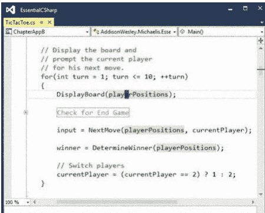

**图 4.5：** Microsoft Visual Studio .NET 中折叠的区域

## 摘要

本章从介绍与赋值和算术相关的 C# 运算符开始。接下来，我们使用运算符和 `const` 关键字来声明常量。但是，对 C# 所有运算符的介绍并非按顺序进行。在讨论关系和逻辑比较运算符之前，本章介绍了 `if` 语句以及代码块和作用域等重要概念。为了结束运算符的介绍，我们讨论了位运算符，特别是关于掩码。我们还讨论了其他控制流语句，如循环、`switch` 和 `goto`，并以 C# 预处理器指令的讨论结束本章。运算符优先级在本章早些时候已经讨论过；表 4.5 总结了所有运算符的优先级顺序，包括尚未涵盖的几个。

**表 4.5：** 运算符优先级顺序*

| 类别 | 运算符 |
| :--- | :--- |
| 基本 | `x`, `y` `f(x)` `a[x]` `x++` `x--` `new` `typeof(T)` `checked(x)` `unchecked(x)` `default(T)` `nameof(x)` `delegate{} ()` |
| 一元 | `+` `-` `!` `~` `++x` `--x` `(T)x` `await x` |
| 乘法 | `*` `/` `%` |
| 加法 | `+` `-` |
| 移位 | `<<` `>>` |
| 关系和类型测试 | `<` `>` `<=` `>=` `is` `as` |
| 相等 | `==` `!=` |
| 逻辑 AND | `&` |
| 逻辑 XOR | `^` |
| 逻辑 OR | `|` |
| 条件 AND | `&&` |
| 条件 OR | `||` |
| 空合并 | `??` |
| 条件 | `?:` |
| 赋值和 lambda | `=` `*=` `/=` `%=` `+=` `-=` `<<=` `>>=` `&=` `^=` `|=` `=>` |

* 行按优先级从高到低排序。

回顾第 1、2 和 3 章所涵盖的所有内容的一个最佳方式或许是查看位于 `Chapter04\TicTacToe.cs` 中的井字棋程序。通过回顾此程序，您可以看到一种将所有所学内容结合到一个完整程序中的方法。

此页有意留空

# 方法 和 参数

根据您对 C# 编程迄今为止的学习，您应该能够编写由语句列表组成的简单程序，类似于 20 世纪 70 年代创建程序的方式。然而，自 20 世纪 70 年代以来，编程已经取得了长足的进步；随着程序变得更加复杂，新范式出现以管理这种复杂性。*过程化或结构化* 编程提供了将语句组合成单位的结构。此外，通过结构化编程，可以将数据传递给一组语句，然后在语句执行后返回数据。

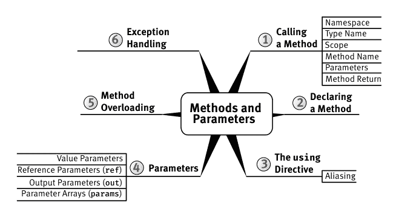

除了调用和定义方法的基本知识外，本章还涵盖了一些稍微高级的概念——即递归、方法重载、可选参数和命名参数。到目前为止以及本章结尾处讨论的所有方法调用都是静态的（第 6 章将详细探讨这一概念）。

即使在第 1 章的 HelloWorld 程序中，您也学习了如何定义方法。在该示例中，您定义了 `Main()` 方法。在本章中，您将更详细地了解方法创建，包括用于将变量而不是值传递给方法的特殊 C# 语法（`ref` 和 `out`）。最后，我们将介绍一些基本的错误处理。

## 调用 方法

### 初学者 主题

#### 什么是 方法？

到目前为止，您编写的所有程序中的语句都出现在一个称为 `Main()` 方法的组合中。当程序比我们迄今为止看到的更复杂时，单个方法实现很快就会变得难以维护，并且难以阅读和理解。

**方法** 是将语句序列组合在一起以执行特定操作或计算特定结果的手段。这为构成程序的语句提供了更大的结构和组织。例如，考虑一个计算目录中源代码行数的 `Main()` 方法。代替拥有一个大的 `Main()` 方法，您可以提供一个较短的版本，让您根据需要关注每个方法实现的细节。清单 5.1 显示了一个示例。

**清单 5.1：将 语句 组合 到 方法 中**

```csharp
class LineCount
{
    static void Main()
    {
        int lineCount;
        string files;

        DisplayHelpText();
        files = GetFiles();
        lineCount = CountLines(files);
        DisplayLineCount(lineCount);
    }
    // ...
}
```

将所有语句都放在 `Main()` 中，列表将其拆分为称为方法（methods）的组。用于显示帮助文本的 `System.Console.WriteLine()` 语句已被移至 `DisplayHelpText()` 方法中。所有用于确定要统计哪些文件的语句都出现在 `GetFiles()` 方法中。为了实际统计文件，代码在通过 `DisplayLineCount()` 方法显示结果之前调用了 `CountLines()` 方法。只需粗略一瞥，就很容易审阅代码并获取概览，因为方法名称描述了该方法的用途。

## 准则

- 务必（DO）使用动词或动词短语为方法命名。
- 方法总是与提供将相关方法分组之手段的类型——通常是一个类——相关联。
- 方法可以通过为其参数提供参数（arguments）来接收数据。参数（Parameters）是用于将数据从调用者（包含方法调用的代码）传递给被调用方法（`Write()`、`WriteLine()`、`GetFiles()`、`CountLines()` 等）的变量。在列表 5.1 中，`files` 和 `lineCount` 是通过 `CountLines()` 和 `DisplayLineCount()` 方法的参数传递给它们的参数的示例。方法还可以通过返回值（return value）向调用者返回数据（在列表 5.1 中，`GetFiles()` 方法调用有一个返回值，它被赋值给 `files`）。

首先，我们重新审视第 1 章中的 `System.Console.Write()`、`System.Console.WriteLine()` 和 `System.Console.ReadLine()`。这次，我们将它们视为方法调用的一般示例，而不是查看从控制台打印和检索数据的具体细节。列表 5.2 展示了这三个方法的每一个的使用情况。

## 列表 5.2：一个简单的方法调用

```csharp
class HeyYou
{
    static void Main()
    {
        string firstName;
        string lastName;
        System.Console.WriteLine("Hey you!");
        System.Console.Write("Enter your first name: ");
        firstName = System.Console.ReadLine();
        System.Console.Write("Enter your last name: ");
        lastName = System.Console.ReadLine();
        System.Console.WriteLine(
            $"Your full name is { firstName } { lastName }.");
    }
}
```

方法调用由方法名、参数列表和返回值组成。完全限定方法名包括命名空间、类型名称和方法名称；句点分隔完全限定方法名的每一部分。正如我们将看到的，方法通常仅使用其完全限定名称的一部分进行调用。

### 命名空间

命名空间（Namespaces）是一种分类机制，用于将与此功能区域相关的所有类型分组。命名空间是分层的，并且可以在分层中具有任意数量的级别，尽管具有超过十几个层级的命名空间很少见。通常，分层以公司名称开始，然后是产品名称，然后是功能区域。例如，在 `Microsoft.Win32.Networking` 中，最外层的命名空间是 `Microsoft`，其中包含内部命名空间 `Win32`，后者又包含嵌套更深的 `Networking` 命名空间。

命名空间主要用于按功能区域组织类型，以便更容易查找和理解。然而，它们也可以用于避免类型名称冲突。例如，只要每个类型具有不同的命名空间，编译器就可以区分两个名称为 `Button` 的类型。因此，你可以消除类型 `System.Web.UI.WebControls.Button` 和 `System.Windows.Controls.Button` 之间的歧义。

在列表 5.2 中，**Console** 类型位于 **System** 命名空间内。**System** 命名空间包含使程序员能够执行许多基本编程活动的类型。几乎每个 C# 程序都使用 **System** 命名空间内的类型。表 5.1 提供了其他常见命名空间的列表。

## 表 5.1：常见命名空间

| 命名空间 | 描述 |
|---|---|
| System | 包含基本类型以及用于类型转换、数学、程序调用和环境管理的类型。 |
| System.Collections.Generic | 包含使用泛型的强类型集合。 |
| System.Data | 包含用于处理数据库的类型。 |
| System.Drawing | 包含用于向显示设备绘制以及处理图像的类型。 |
| System.IO | 包含用于处理目录以及操作、加载和保存文件的类型。 |
| System.Linq | 包含用于使用语言集成查询（Language Integrated Query）查询集合中数据的类和接口。 |
| System.Text | 包含用于处理字符串和各种文本编码以及在这些编码之间转换的类型。 |
| System.Text.RegularExpressions | 包含用于处理正则表达式的类型。 |
| System.Threading | 包含用于多线程编程的类型。 |
| System.Threading.Tasks | 包含用于基于任务的异步的类型。 |
| System.Web | 包含用于启用浏览器到服务器通信（通常通过 HTTP）的类型。此命名空间内的功能用于支持 ASP.NET。 |
| System.Windows | 包含用于创建富用户界面的类型，自 .NET 3.0 起使用称为 Windows 呈现框架（Windows Presentation Framework, WPF）的用户界面技术，该技术利用可扩展应用程序标记语言（Extensible Application Markup Language, XAML）进行 UI 的声明式设计。 |
| System.Xml | 包含基于标准的 XML 处理支持。 |

在调用方法时，并不总是需要提供命名空间。例如，如果调用表达式出现在与被调用方法相同命名空间中的类型内，编译器可以推断出命名空间为包含该类型的命名空间。在本章稍后，您将看到 `using` 指令如何消除对命名空间限定符的需求。

> ## 准则
> - 务必（DO）使用 PascalCasing（帕斯卡命名法）为命名空间命名。
> - 考虑（CONSIDER）组织源代码文件的目录层次结构以匹配命名空间层次结构。

# 类型名称

对静态方法的调用需要类型名称限定符，只要目标方法不在同一类型中。¹（正如本章稍后所述，`using static` 指令允许您省略类型名称。）例如，在方法 `HelloWorld.Main()` 中找到的 `Console.WriteLine()` 调用表达式需要说明类型 `Console`。然而，与命名空间一样，C# 允许在方法是包含调用表达式的类型的成员时，从方法调用中省略类型名称。（此类方法调用的示例出现在列表 5.4 中。）在这种情况下，类型名称是不必要的，因为编译器从调用的位置推断出类型。如果编译器无法进行此类推断，则必须在方法调用中提供名称作为方法调用的一部分。

从核心上讲，类型是将方法及其相关数据分组在一起的一种手段。例如，`Console` 是包含 `Write()`、`WriteLine()` 和 `ReadLine()` 方法（以及其他方法）的类型。所有这些方法都在同一组中，因为它们属于 `Console` 类型。

# 作用域

在上一章中，您了解到程序元素的作用域是指可以使用其非限定名称进行引用的文本区域。出现在类型声明内部并针对该类型中声明的方法的调用不需要类型限定符，因为该方法在其包含类型的作用域内。同样，类型在其声明它的命名空间内都在作用域中；因此，出现在特定命名空间中的类型内的方法调用无需在方法调用名称中指定该命名空间。

# 方法名称

每个方法调用都包含一个方法名称，正如我们讨论的那样，该方法名称可能带有也可能不带命名空间和类型名称限定符。方法名称之后是参数列表；参数列表是一个用括号括起来的、逗号分隔的值列表，这些值对应于方法的参数。

# 参数与实参

方法可以接受任意数量的参数，并且每个参数都具有特定的数据类型。调用者为参数提供的值称为实参（arguments）；每个实参都必须对应于特定的参数。例如，以下方法调用有三个实参：

```csharp
System.IO.File.Copy(
    oldFileName, newFileName, false)
```

该方法位于 `File` 类中，该类位于 `System.IO` 命名空间中。它被声明为具有三个参数，第一个和第二个参数类型为 `string`，第三个参数类型为 `bool`。在此示例中，我们使用 `string` 类型的变量（`oldFileName` 和 `newFileName`）作为旧和新文件名，然后指定 `false` 以指示如果新文件名已存在，则复制应失败。

---
1. 或基类。

## 方法返回值

与 `System.Console.WriteLine()` 不同，清单 5.2 中的方法调用 `System.Console.ReadLine()` 没有任何参数，因为该方法声明为不接收任何参数。然而，这个方法恰好有一个**方法返回值**。方法返回值是将结果从被调用方法传回给调用方的一种手段。由于 `System.Console.ReadLine()` 具有返回值，因此可以将其赋值给变量 `firstName`。此外，还可以将此方法返回值本身作为参数传递给另一个方法调用，如清单 5.3 所示。

### 清单 5.3：将方法返回值作为参数传递给另一个方法调用

```csharp
class Program
{
    static void Main()
    {
        System.Console.Write("Enter your first name: ");
        System.Console.WriteLine("Hello {0}!",
            System.Console.ReadLine());
    }
}
```

清单 5.3 没有将返回的值赋给变量，然后再将该变量作为参数传递给对 `System.Console.WriteLine()` 的调用，而是直接在 `System.Console.WriteLine()` 的调用中调用了 `System.Console.ReadLine()` 方法。在执行时，`System.Console.ReadLine()` 方法会先执行，其返回值会直接传递给 `System.Console.WriteLine()` 方法，而不是传递给一个变量。

并非所有方法都返回数据。`System.Console.Write()` 和 `System.Console.WriteLine()` 的两个版本都是此类方法的示例。正如你稍后将看到的，这些方法指定了 `void` 返回类型，就像第一章中 `Main` 的 `HelloWorld` 声明返回 `void` 一样。

## 语句与方法调用

清单 5.3 演示了语句和方法调用之间的区别。虽然 `System.Console.WriteLine("Hello {0}!", System.Console.ReadLine());` 是一条单独的语句，但它包含两个方法调用。一条语句通常包含一个或多个表达式，在这个例子中，其中两个表达式是方法调用。因此，方法调用构成了语句的一部分。

尽管在一条语句中编码多个方法调用通常减少了代码量，但这并不一定提高可读性，也很少提供显著的性能优势。开发人员应优先考虑可读性而非简洁性。

> **注意**
> 一般来说，开发人员应优先考虑可读性而非简洁性。可读性对于编写自我文档化的代码至关重要，从而使其在长期内更具可维护性。

## 声明方法

本节扩展了关于声明方法的说明，以包含参数或返回类型。清单 5.4 包含了这些概念的示例，输出 5.1 显示了结果。

### 清单 5.4：声明方法

```csharp
class IntroducingMethods
{
    public static void Main()
    {
        string firstName;
        string lastName;
        string fullName;
        string initials;
        System.Console.WriteLine("Hey you!");
        firstName = GetUserInput("Enter your first name: ");
        lastName = GetUserInput("Enter your last name: ");
        fullName = GetFullName(firstName, lastName);
        initials = GetInitials(firstName, lastName);
        DisplayGreeting(fullName, initials);
    }
```


```csharp
static string GetUserInput(string prompt)
{
    System.Console.Write(prompt);
    return System.Console.ReadLine();
}

static string GetFullName( // C# 6.0 表达式体方法
    string firstName, string lastName) =>
    $"{firstName} {lastName}";

static void DisplayGreeting(string fullName, string initials)
{
    System.Console.WriteLine(
        $"Hello {fullName}! Your initials are {initials}");
    return;
}

static string GetInitials(string firstName, string lastName)
{
    return $"{firstName[0]}. {lastName[0]}.";
}
}
```

### 输出 5.1

```
Hey you!

Enter your first name: Inigo

Enter your last name: Montoya

Your full name is Inigo Montoya.
```

清单 5.4 中声明了五个方法。从 `Main()` 开始，代码调用 `GetUserInput()`，随后调用 `GetFullName()` 和 `GetInitials()`。最后三个方法都返回一个值并接受参数。此外，该清单调用了 `DisplayGreeting()`，该方法不返回任何数据。C# 中的方法不能存在于其封装类型（enclosing type）的范围之外；在这种情况下，封装类型是 `IntroducingMethods` 类。甚至第一章中检查的 `Main` 方法也必须在一个类型内部。

### 语言对比：C++/Visual Basic——全局方法

C# 不提供全局方法支持；所有内容都必须出现在类型声明中。这就是为什么 `Main()` 方法被标记为 `static`——它是 C++ 全局方法和 Visual Basic “Shared” 方法的 C# 等效项。

### 初学者主题

### 重构为方法

将一组语句移动到方法中，而不是将其内联保留在较大的方法中，是**重构**的一种形式。重构减少了代码重复，因为你可以从多个地方调用该方法，而不是重复代码。重构还提高了代码的可读性。作为编码过程的一部分，最佳实践是不断审查你的代码，寻找重构的机会。这包括寻找那些乍一看难以理解的代码块，并将它们移入一个名称能明确定义代码行为的方法中。这种做法通常比注释代码块更受青睐，因为方法名称有助于描述实现的功能。

例如，清单 5.4 中显示的 `Main()` 方法与第一章中清单 1.16 中显示的 `Main()` 方法产生相同的行为。更值得注意的是，虽然这两个清单都很容易跟踪，但通过仅查看 `Main()` 方法而不担心每个被调用方法的实现细节，清单 5.4 更易于快速理解。

在早期版本的 Visual Studio 中，你可以选择一组语句，右键单击，然后从上下文菜单的重构部分中选择“提取方法（Extract Method）”重构，自动将一组语句移动到一个新方法中。在 Visual Studio 2015 中，重构操作可从上下文菜单的快速操作部分访问。

## 形式参数声明

考虑 `DisplayGreeting()`、`GetFullName()` 和 `GetInitials()` 方法的声明。出现在方法声明括号内的文本是**形式参数列表**。（当我们讨论泛型时，我们还会看到方法也可能有**类型参数列表**。当从上下文中明确我们在讨论哪种参数时，我们简单地称它们为*参数列表*中的*参数*。）参数列表中的每个参数包括参数的类型以及参数名称。逗号分隔列表中的每个参数。

在行为上，大多数参数与局部变量几乎相同，因此参数的命名约定也随之进行。因此，参数名称使用 camelCase（小驼峰命名法）。此外，不可能声明一个与包含方法参数同名局部变量（声明在方法内部的变量），因为这会创建两个同名*局部变量*。


## 方法返回类型声明

除了 `GetUserInput()`、`GetFullName()` 和 `GetInitials()` 方法需要指定参数外，这些方法中的每一个还包括一个**方法返回类型**。你可以从方法声明中方法名称立即前面的数据类型判断方法是否返回值。这些方法示例中的每一个都指定了 `string` 返回类型。与参数可以有任意数量不同，只允许一个方法返回类型。

与 `GetUserInput()` 和 `GetInitials()` 一样，具有返回类型的方法几乎总是包含一个或多个将控制权传回给调用者的 `return` 语句。`return` 语句由 `return` 关键字后跟一个计算该方法返回值的表达式组成。例如，`GetInitials()` 方法的 `return` 语句是 `return $"{firstName[0]}. {lastName[0]}.";`。在 `return` 关键字后面的表达式（在这种情况下是一个插值字符串）必须与方法指定的返回类型兼容。

如果方法具有返回类型，构成方法主体的语句块必须有一个*不可达的端点*。也就是说，控制流不能有方法在不返回值的情况下*“掉出”*方法末尾的情况。确保满足此条件的最简单方法通常是将方法的最后一条语句设为 `return` 语句。然而，`return` 语句可以出现在方法实现的其他位置。例如，方法实现中的 `if` 或 `switch` 语句可以包含其中的 `return` 语句；有关示例请参见清单 5.5。

### 清单 5.5：方法末尾之前的 return 语句

```csharp
class Program
{
    static bool MyMethod()
    {
        string command = ObtainCommand();
        switch(command)
        {
            case "quit":
                return false;
            // ... Omitted, other cases
            default:
                return true;
        }
    }
}
```

（请注意，`return` 语句会将控制权转移出 `switch`，因此在一个以 `return` 语句结束的 `switch` 块中，不需要 `break` 语句来防止非法的贯穿执行。）

在清单 5.5 中，该方法的最后一条语句不是 `return` 语句，而是一条 `switch` 语句。然而，编译器可以推断出该方法中所有可能的代码路径都会导致 `return`，因此该方法的终点是不可达的。因此，即使该方法没有以 `return` 语句结束，它也是合法的。

如果特定的代码路径在 `return` 之后包含不可达的语句，编译器将发出警告，指出这些额外语句永远不会执行。

虽然 C# 允许方法包含多个 `return` 语句，但通常当方法拥有单一出口位置而不是在各种代码路径中散布多个 `return` 语句时，代码的可读性和可维护性会更好。

指定 `void` 作为返回类型表明该方法没有返回值。因此，对该方法的调用不能赋值给变量，也不能在调用处用作参数类型。`void` 方法调用只能用作语句。此外，在方法体内，`return` 语句变为可选，并且当指定它时，`return` 关键字后面不能跟随任何值。例如，清单 5.4 中 `Main()` 的 `return` 是 `void`，且方法内没有 `return` 语句。然而，`DisplayGreeting()` 包含一个（可选的）`return` 语句，后面没有跟随任何返回结果。

虽然从技术上讲，一个方法只能有一个返回类型，但该返回类型可以是一个元组（tuple）。因此，从 C# 7.0 开始，可以使用 C# 元组语法将多个值打包为元组并返回。例如，您可以声明一个 `GetName()` 方法，如清单 5.6 所示。

### 清单 5.6：使用元组返回多个值

```csharp
class Program
{
    static string GetUserInput(string prompt)
    {
        System.Console.Write(prompt);
        return System.Console.ReadLine();
    }
    static (string First, string Last) GetName()
    {
        string firstName, lastName;
        firstName = GetUserInput("Enter your first name: ");
        lastName = GetUserInput("Enter your last name: ");
        return (firstName, lastName);
    }
    static public void Main()
    {
        (string first, string last) name = GetName();
        System.Console.WriteLine($"Hello { name.First } { name.Last }!");
    }
}
```

当然，从技术角度看，我们仍然只返回一种数据类型，即 `ValueTuple<string, string>`；但是，实际上，您可以返回任意数量（最好是合理的数量）的值。

### 表达式体方法

为了支持最简单的没有方法体形式的方法声明，C# 6.0 引入了表达式体方法（expression-bodied methods），它们使用表达式而非完整的方法体来声明。清单 5.4 中的 `GetFullName()` 方法提供了表达式体方法的一个示例：

```csharp
static string GetFullName( string firstName, string lastName) =>
  $"{ firstName } { lastName }";
```

表达式体方法使用“转到”运算符（在第 13 章中完整介绍）代替方法体中典型的花括号，该运算符产生的结果数据类型必须与方法声明的返回类型匹配。换句话说，尽管表达式体方法的实现中没有显式的 `return` 语句，但表达式的返回类型仍然必须与方法声明的返回类型匹配。

表达式体方法是完整方法体声明的语法快捷方式。因此，其使用应限于最简单的方法实现——通常可以在一行内表达。

## 语言对比：C++——头文件

与 C++ 不同，C# 类从不将实现与声明分离。在 C# 中，没有头文件（.h）或实现文件（.cpp）。相反，声明和实现一起出现在同一个文件中。（C# 支持一种称为 *partial methods* 的高级特性，其中方法的定义声明与其实现是分离的，但就本章而言，我们只考虑非 partial 方法。）

C# 中声明和实现的合并消除了维护冗余声明信息的需求，这些信息在具有分离头文件和实现文件的语言（如 C++）中通常存在于两个位置。

### 初学者主题

### 命名空间

如前所述，命名空间是用于分类和分组相关类型的组织机制。开发者可以通过检查与已知类型位于同一命名空间中的其他类型来发现相关类型。此外，通过命名空间，两个或更多类型可以拥有相同的名称，只要它们通过不同的命名空间加以区分。

### using 指令

完全限定的命名空间名称可能变得非常长且难以管理。但是，可以导入一个或多个命名空间中的所有类型到文件中，以便在不完全限定名称的情况下使用它们。为了实现这一点，C# 程序员通常在文件顶部包含一个 using 指令。例如，在清单 5.7 中，`Console` 前面没有 `System` 前缀。由于清单顶部存在 `using System` 指令，因此可以省略命名空间。

## 清单 5.7：using 指令示例

```csharp
// The using directive imports all types from the
// specified namespace into the entire file
using System;
class HelloWorld
{
  static void Main()
  {
    // No need to qualify Console with System
    // because of the using directive above
    Console.WriteLine("Hello, my name is Inigo Montoya");
  }
}
```

清单 5.7 的结果显示在输出 5.2 中。

## 输出 5.2

Hello, my name is Inigo Montoya

像 `using System` 这样的 using 指令并不能允许你省略在 System 的子命名空间中声明的类型中的 System。例如，如果代码访问 `System.Text` 命名空间中的 `StringBuilder` 类型，你必须要么包含额外的 `using System.Text;` 指令，要么完全限定类型为 `System.Text.StringBuilder`，而不仅仅是 `Text.StringBuilder`。简而言之，using 指令不会导入任何嵌套命名空间中的类型。嵌套命名空间（由命名空间中的点标识）始终需要显式导入。

## 语言对比：Java——导入指令中的通配符

Java 允许使用通配符导入命名空间，例如：

```java
import javax.swing.*;
```

相比之下，C# 不支持通配符 using 指令，而是要求显式导入每个命名空间。

## 语言对比：Visual Basic .NET——项目范围导入指令

与 C# 不同，Visual Basic .NET 支持指定 using 指令的等效物 Imports，其范围可以是整个项目，而不仅仅是特定文件。换句话说，Visual Basic .NET 提供了 using 指令的命令行方式，其范围可以覆盖整个编译过程。

频繁使用特定命名空间内的类型暗示，为该命名空间添加 using 指令是一个好主意，而不是完全限定该命名空间内的所有类型。相应地，几乎所有 C# 文件都在顶部包含 `using System` 指令。在本书的其余部分，代码清单通常省略 `using System` 指令。然而，其他命名空间指令会被明确包含。

`using System` 指令的一个有趣效果是，string 数据类型可以用不同的大小写来识别：`String` 或 `string`。前者依赖于 `using System` 指令，后者使用 `string` 关键字。两者都是对 `System.String` 数据类型的有效 C# 引用，且所选版本不影响生成的公共中间语言（CIL）代码。²

## 高级主题

### 嵌套 using 指令

不仅可以在文件顶部拥有 using 指令，还可以在命名空间声明的顶部包含它们。例如，如果声明了一个新的命名空间 `EssentialCSharp`，那么可以添加一个 using 声明在命名空间声明的顶部（参见清单 5.8）。

### 清单 5.8：在命名空间声明中指定 using 指令

```csharp
namespace EssentialCSharp
{
    using System;
    class HelloWorld
    {
        static void Main()
        {
            // No need to qualify Console with System
            // because of the using directive above
            Console.WriteLine("Hello, my name is Inigo Montoya");
        }
    }
}
```

清单 5.8 的结果显示在输出 5.3 中。

### 输出 5.3

```
Hello, my name is Inigo Montoya
```

将 using 指令放在文件顶部与放在命名空间声明顶部的区别在于，该指令仅在命名空间声明内部有效。如果代码包含一个新的

1. 我更喜欢 `string` 关键字，但无论程序员选择哪种表示方式，项目内的代码理想情况下应当保持一致。

在 `EssentialCSharp` 声明上方或下方的命名空间声明中，位于不同命名空间内的 using System 指令不会生效。代码很少这样编写，尤其是在遵循“每个文件包含单一类型声明”这一标准实践的情况下。

### using static 指令

using 指令允许你通过省略类型名称中的命名空间部分来缩写类型名称——这样，对于所指定命名空间内的任何类型，只需指定类型名称即可。相比之下，using static 指令允许你省略所指定类型中任何成员的命名空间和类型名称。例如，`using static System.Console` 指令允许你指定 `WriteLine()`，而不是完全限定方法名 `System.Console.WriteLine()`。沿用这个例子，我们可以更新代码清单 5.2 以利用 `using static System.Console` 指令，从而创建代码清单 5.9。

### 代码清单 5.9：using static 指令

```csharp
```


```csharp
using static System.Console;

class HeyYou

{

    static void Main()

    {

        string firstName;

        string lastName;

        WriteLine("Hey you!");

        Write("Enter your first name: ");

        firstName = ReadLine();

        Write("Enter your last name: ");

        lastName = ReadLine();

        WriteLine(
            $"Your full name is { firstName } { lastName }.");

    }

}
```

在这种情况下，代码的可读性没有损失：`WriteLine()`、`Write()` 和 `ReadLine()` 都明确与控制台指令相关。实际上，有人可能会认为由此产生的代码更简洁，因此比之前更清晰。

然而，有时情况并非如此。例如，如果你的代码使用了具有重叠行为名称的类，比如文件上的 `Exists()` 方法和目录上的 `Exists()` 方法，那么当你调用 `Exists()` 时，使用 `using static` 指令可能会降低清晰度。同样，如果你编写的类拥有具有重叠行为名称的自身成员——例如，`Display()` 和 `Write()`——那么读者可能会失去清晰度。

编译器不允许这种歧义。如果两个具有相同签名的成员可用（通过 `using static` 指令或单独声明的成员），任何有歧义的调用都会导致编译错误。

### 别名

`using` 指令还允许为命名空间或类型创建别名。别名是你可以在 `using` 指令适用的文本内使用的替代名称。创建别名的两个最常见原因是消除两个同名类型的歧义以及缩写长名称。例如，在代码清单 5.10 中，`CountdownTimer` 别名被声明为引用类型 `System.Timers.Timer` 的一种方式。仅仅添加一个 `using System.Timers` 指令不足以使代码避免完全限定 `Timer` 类型。原因是 `System.Threading` 也包含一个名为 `Timer` 的类型；因此，在代码中仅使用 `Timer` 将产生歧义。

```csharp

// 代码清单 5.10：声明类型别名

using System;

using System.Threading;

using CountdownTimer = System.Timers.Timer;

class HelloWorld

{

    static void Main()

    {

        CountdownTimer timer;

        // ...

    }

}

```

代码清单 5.10 使用了一个全新的名称 `CountdownTimer` 作为别名。然而，如代码清单 5.11 所示，也可以将别名为 `Timer`。

```csharp

// 代码清单 5.11：声明同名的类型别名

using System;

using System.Threading;

// 声明别名 Timer 以引用 System.Timers.Timer，
// 以避免与 System.Threading.Timer 的代码歧义

using Timer = System.Timers.Timer;

class HelloWorld

{

    static void Main()

    {

        Timer timer;

        // ...

    }

}

```

由于别名指令的存在，“Timer”不再是含糊不清的引用。此外，若要引用 `System.Threading.Timer` 类型，你必须限定该类型或定义另一个别名。

### Main() 的返回值和参数

到目前为止，可执行文件的 `Main()` 方法声明是最简单的声明形式。你的 `Main()` 方法声明中未包含任何参数或非 void 返回类型。然而，C# 支持在程序执行时获取命令行参数的能力，并且可以从 `Main()` 方法返回状态指示器。

运行时使用单个 `string` 数组参数将命令行参数传递给 `Main()`。获取参数所要做的只是访问该数组，如代码清单 5.12 所示。此程序的目的是下载一个位置由 URL 给出的文件。第一个命令行参数标识 URL，可选的第二个参数是保存文件的文件名。代码清单以一个 `switch` 语句开始，该语句根据以下评估参数的数量（`args.Length`）：

- 如果没有两个参数，显示错误，表明需要提供 URL 和文件名。
- 两个参数的存在表明用户提供了资源的 URL 和下载目标文件名。

```csharp

// 代码清单 5.12：将命令行参数传递给 Main

using System;

using System.Net;

class Program

{

    static int Main(string[] args)

    {

        int result;

        string targetFileName;

        string url;

        switch (args.Length)

        {

            default:

                // 必须指定恰好两个参数；给出错误

                Console.WriteLine(
                    "ERROR: You must specify the "
                    + "URL and the file name");

                targetFileName = null;

                url = null;

                break;

            case 2:

                url = args[0];

                targetFileName = args[1];

                break;

        }

        if (targetFileName != null && url != null)

        {

            WebClient webClient = new WebClient();

            webClient.DownloadFile(url, targetFileName);

            result = 0;

        }

        else

        {

            Console.WriteLine(
                "Usage: Downloader.exe <URL> <TargetFileName>");

            result = 1;

        }

        return result;

    }

}

```

代码清单 5.12 的结果显示在输出 5.4 中。

```text

// 输出 5.4

> Downloader.exe

ERROR: You must specify the URL to be downloaded

Downloader.exe <URL> <TargetFileName>

```

如果你成功计算出了目标文件名，你会使用它来保存下载的文件。否则，你将显示帮助文本。`Main()` 方法还返回一个 `int` 而不是 `void`。这对于 `Main()` 声明是可选的，但如果使用，程序可以向调用者（例如脚本或批处理文件）返回状态码。根据惯例，非零的返回值表示错误。

尽管所有命令行参数都可以通过字符串数组传递给 `Main()`，但有时从 `Main()` 以外的方法内部访问参数会更方便。`System.Environment.GetCommandLineArgs()` 方法以与 `Main(string[] args)` 将参数传入 `Main()` 相同的形式返回命令行参数数组。

## 高级主题

### 消除多个 Main() 方法的歧义

如果一个程序包含两个具有 `Main()` 方法的类，可以在命令行上指定使用哪个类用于 `Main()` 声明。`csc.exe` 包含一个 `/m` 选项，用于指定 `Main()` 的完全限定类名。

### 初学者主题

### 调用栈和调用点

随着代码执行，方法调用更多方法，进而调用其他方法，依此类推。在代码清单 5.4 的简单情况下，`Main()` 调用 `GetUserInput()`，后者进而调用 `System.Console.ReadLine()`，后者内部又调用更多方法。每次调用新方法时，运行时都会创建一个*激活帧*，其中包含关于传递给新调用的参数、新调用的局部变量以及新方法返回时控制应恢复位置的信息。这种调用中嵌套调用的集合，依此类推，产生了一系列被称为*调用栈*的激活帧。

1. 除了异步方法或迭代器方法，它们将激活记录移动到堆上。

## 高级方法参数

到目前为止，本章的示例均通过方法的返回值返回数据。本节演示方法如何通过方法参数返回数据，以及方法如何接受可变数量的参数。

### 值参数

方法调用的参数通常是通过**值传递**的，这意味着参数表达式的值会被复制到目标参数中。例如，在清单 5.13 中，当 `Main()` 调用 `Combine()` 时，`Main()` 使用的每个变量的值都会被复制到 `Combine()` 方法的参数中。输出 5.5 展示了该清单的运行结果。

**清单 5.13：按值传递变量**

```csharp

class Program

{

    static void Main()

    {

        // ...

        string  fullName;

        string  driveLetter = "C:";

        string  folderPath  = "Data";

        string  fileName    = "index.html";

        fullName = Combine(driveLetter, folderPath, fileName);

        Console.WriteLine(fullName);

        // ...

    }

    static string Combine(
        string driveLetter, string folderPath, string fileName)

    {

        string path;

        path = string.Format("{1}{0}{2}{0}{3}",
            System.IO.Path.DirectorySeparatorChar,
            driveLetter, folderPath, fileName);

        return path;

    }

}

```

**输出 5.5**

```
C:\Data\index.html
```

即使 `Combine()` 方法在返回前将 *null* 赋值给 `driveLetter`、`folderPath` 和 `fileName`，`Main()` 中对应的变量仍将保持其原始值，因为变量在调用方法时会被复制。当调用堆栈在调用结束时展开时，复制的数据会被丢弃。

### 初学者专题

**将调用者变量与参数名称匹配**

在清单 5.13 中，调用者中的变量名称与被调用方法中的参数名称完全匹配。这种匹配仅仅是为了可读性提供的；名称是否匹配与方法调用的行为完全无关。被调用方法的参数和调用方法的局部变量位于不同的声明空间中，彼此毫无关系。

### 高级专题

**引用类型与值类型**

就本节的用途而言，传入的参数是值类型还是引用类型并不重要。相反，重要的问题是：被调用的方法是否可以向调用者的原始变量写入值。由于会对调用者变量的值进行复制，因此调用者的变量不能被重新赋值。尽管如此，理解包含值类型的变量与包含引用类型的变量之间的区别仍然很有帮助。

引用类型变量的值，顾名思义，是指向数据所存储位置的引用。运行时如何表示引用类型变量的值是运行时的实现细节；通常它表示为对象数据存储内存位置的地址，但也未必如此。

如果引用类型变量按值传递，引用本身会从调用者复制到方法参数中。因此，目标方法无法更新调用者变量的值，但它可以更新引用所指向的数据。

或者，如果方法参数是值类型，则值本身会被复制到参数中，在被调用方法中修改该参数不会影响调用者的原始变量。

### 引用参数 (ref)

请考虑清单 5.14，它调用了一个函数来交换两个值，以及输出 5.6，它展示了结果。

**清单 5.14：按引用传递变量**

```csharp

class Program

{

    static void Main()

    {

        // ...

        string first = "hello";

        string second = "goodbye";

        Swap(ref first, ref second);

        // ...

    }

    static void Swap(string ref a, string ref b)

    {

        string temp = a;

        a = b;

        b = temp;

    }

}

```

**输出 5.6**

```
first = "goodbye", second = "hello"
```

分配给 **first** 和 **second** 的值成功互换了。为了做到这一点，变量是**按引用传递**的。对 `Swap()` 的调用与清单 5.13 中对 `Combine()` 的调用之间最明显的区别在于，在参数的数据类型前面包含了关键字 `ref`。该关键字更改了调用方式，使得用作参数的变量按引用传递，从而被调用的方法可以用新值更新调用者的原始变量。

当被调用的方法指定某个参数为 `ref` 时，调用者必须提供一个变量（而不是一个值）作为参数，并在传入的变量前加上 `ref`。通过这样做，调用者明确承认目标方法可能会重新分配它接收的任何 `ref` 参数所关联的变量的值。此外，有必要初始化作为 `ref` 传入的任何局部变量，因为目标方法可以在未首先为其赋值的情况下从 `ref` 参数中读取数据。例如，在清单 5.14 中，`temp` 被分配了 `first` 的值，假设调用者初始化了传入的 `first` 变量。实际上，`ref` 参数是传入变量的别名。换言之，它本质上是给一个现有变量分配一个参数名称，而不是创建一个新变量并将参数的值复制进去。

### 输出参数 (out)

如前所述，用作 `ref` 参数的变量必须在传递给被调用方法之前进行赋值，因为被调用方法可能会从该变量中读取。前面给出的“交换”示例必须读写传入的两个变量。然而，通常有一种情况是，接受变量引用的方法意在向变量写入而不从其读取。在这种情况下，显然可以安全地按引用传递未初始化的局部变量。

为实现此目的，代码需要使用关键字 `out` 来修饰参数类型。这在清单 5.15 的 `TryGetPhoneButton()` 方法中进行了演示，该方法返回对应于某个字符的电话按钮。

**清单 5.15：仅传出变量**

```csharp

class ConvertToPhoneNumber

{

    static int Main(string[] args)

    {

        if(args.Length == 0)

        {

            Console.WriteLine(
                "ConvertToPhoneNumber.exe <phrase>");

            Console.WriteLine(
                "'_' indicates no standard phone button");

            return 1;

        }

        foreach(string word in args)

        {

            foreach(char character in word)

            {

                if(TryGetPhoneButton(character, out char button))

                {

                    Console.Write(button);

                }

                else

                {

                    Console.Write('_');

                }

            }

        }

        Console.WriteLine();

        return 0;

    }

    static bool TryGetPhoneButton(char character, out char button)

    {

        bool success = true;

        switch(char.ToLower(character))

        {

            case '1':

                button = '1';

                break;


```csharp
case '2': case 'a': case 'b': case 'c':
    button = '2';
    break;
// ...
case '-':
    button = '-';
    break;
default:
    // Set the button to indicate an invalid value
    button = '_';
    success = false;
    break;
}
return success;
}
}
```

输出 5.7 展示了清单 5.15 的结果。

### 输出 5.7

```
C:\# C\#C\#
>ConvertToPhoneNumber.exe CSharpIsGood
274277474663
```

在这个例子中，`TryGetPhoneButton()` 方法如果成功确定字符对应的电话按钮，则返回 `true`。该函数还通过使用带有 `out` 修饰的 `button` 参数返回对应的按钮。

`out` 参数在功能上与 `ref` 参数相同；唯一的区别在于语言对别名变量的读取和写入方式施加的要求不同。每当参数被标记为 `out` 时，编译器会检查该参数是否在方法中所有正常返回的代码路径（即不抛出异常的代码路径）中都已赋值。例如，如果代码在某些代码路径中未给 `button` 赋值，编译器将发出错误，指示代码未初始化 `button`。清单 5.15 将 `button` 赋值为下划线字符，因为即使无法确定正确的电话按钮，仍然需要分配一个值。

处理 `out` 参数时常见的编码错误是忘记在使用 `out` 变量之前声明它。从 C# 7.0 开始，可以在调用函数时内联声明 `out` 变量。清单 5.15 使用了此功能，通过语句 `TryGetPhoneButton(character, out char button)` 使用了它，而从未预先声明 `button` 变量。在 C# 7.0 之前，必须先声明 `button` 变量，然后使用 `TryGetPhoneButton(character, out button)` 调用函数。

C# 7.0 的另一个功能是能够完全丢弃 `out` 参数。例如，如果你只想知道某个字符是否是有效的电话按钮，而不需要实际返回数值，你可以使用下划线丢弃 `button` 参数：`TryGetPhoneButton(character, out _)`。

在 C# 7.0 引入元组语法之前，方法开发者可能会声明一个或多个 `out` 参数以绕过方法只能有一个返回类型的限制；一个需要返回两个值的方法可以通过正常返回一个值（作为方法的返回值）来实现并且通过将其写入作为 `out` 参数传递的别名变量来设置第二个值。虽然这种模式既常见又合法，但通常有实现该目标的更好方法。例如，如果你考虑从方法中返回两个或更多值，并且 C# 7.0 可用，那么使用 C# 7.0 元组语法可能是更可取的。在此之前，考虑编写两个方法，每个方法对应一个值，或者继续使用 `System.ValueTuple` 类型（这将需要引用 `System.ValueTuple` NuGet 包）但不使用 C# 7.0 语法。

> **注意**
>
> 每个普通的代码路径都必须导致所有 `out` 参数的赋值。

## 只读按引用传递 `in`

在 C# 7.2 中，增加了对按引用传递只读值类型的支持。而不是将值类型传递给函数以便其可以修改，只读按引用传递被添加，使得值类型可以通过引用传递，从而不产生值类型的副本，同时，被调用的方法也不能修改该值类型。换句话说，该功能的目的是在减少传递值时内存复制量的同时，仍将其标识为只读，从而改进性能。该语法是在参数前添加一个 `in` 修饰符。例如：

```csharp
int Method(in int number) { ... }
```

使用 `in` 修饰符，任何尝试重新分配 `number` 的行为（例如 `number++`）都会导致编译错误，指出 `number` 是只读的。

## 按引用返回

C# 7.0 的另一个新增特性是支持返回变量的引用。例如，考虑一个返回图像中与红眼关联的第一个像素的函数，如清单 5.16 所示。

### 清单 5.16：`ref` 返回和 `ref` 局部变量声明

```csharp
// 返回引用
public static ref byte FindFirstRedEyePixel(byte[] image)
{
    // 执行复杂的图像检测，或许使用机器学习
    for (int counter = 0; counter < image.Length; counter++)
    {
        if (image[counter] == (byte)ConsoleColor.Red)
        {
            return ref image[counter];
        }
    }
    throw new InvalidOperationException("No pixels are red.");
}

public static void Main()
{
    byte[] image = new byte[254];
    // 加载图像
    int index = new Random().Next(0, image.Length - 1);
    image[index] = (byte)ConsoleColor.Red;
    System.Console.WriteLine($"image[{index}]={(ConsoleColor)image[index]}");
    // ...
    // 获取第一个红色像素的引用
    ref byte redPixel = ref FindFirstRedEyePixel(image);
    // 将其更新为黑色
    redPixel = (byte)ConsoleColor.Black;
    System.Console.WriteLine($"image[{index}]={(ConsoleColor)image[index]}");
}
```

通过返回变量的引用，调用者随后能够将该像素更新为不同的颜色，如清单 5.16 中高亮行所示。通过数组检查更新结果显示，该值现在是黑色。

按引用返回有两个重要的限制——均与对象生命周期有关：对象引用在仍被引用时不应被垃圾回收，并且当它们不再有任何引用时，它们不应消耗内存。为了执行这些限制，你只能从按引用返回的函数中返回以下内容：

- 字段或数组元素的引用
- 其他按引用返回的属性或函数
- 作为按引用返回函数的参数传入的引用

例如，`FindFirstRedEyePixel()` 返回对 `image` 数组中某一项的引用，该数组是函数的参数。类似地，如果 `image` 存储为类中的字段，你可以按引用返回该字段：

```csharp
byte[] _Image;
public ref byte[] Image { get { return ref _Image; } }
```

其次，`ref` 局部变量被初始化为指向特定变量，并且不能修改为指向不同的变量。

有几种按引用返回的特性需要牢记：

- 如果你返回的是一个引用，显然你必须返回它。因此，在清单 5.16 的示例中，即使不存在红眼像素，你仍然需要返回一个引用字节。唯一的变通方法是抛出异常。相比之下，按引用参数方法允许你保持参数不变，并返回一个表示成功与否的 `bool`。在许多情况下，这可能是更可取的。

- 在声明引用局部变量时，需要初始化。这涉及将其赋值为函数的 `ref` 返回值或变量的引用：

```csharp
ref string text; // 错误
```

- 虽然在 C# 7.0 中声明引用局部变量是可能的，但声明类型为 `ref` 的字段是不允许的：

```csharp
class Thing { ref string _Text; /* 错误 */ }
```

- 你不能为自动实现的属性声明按引用类型：

```csharp
class Thing { ref string Text {get;set; } /* 错误 */ }
```

- 允许返回引用的属性：

```csharp
class Thing {
    string _Text = "Inigo Montoya";
    ref string Text { get { return ref _Text; } }
}
```

- 引用局部变量不能用值（如 `null` 或常量）初始化。它必须从按引用返回的成员或局部变量、字段、数组元素进行赋值：

```csharp
ref int number = null;
ref int number = 42; // 错误
```

## 参数数组 `params`

在迄今为止的示例中，必须传递的参数数量由目标方法声明中声明的参数数量固定。然而，有时允许参数数量变化会更方便。考虑来自清单 5.13 的 `Combine()` 方法。在该方法中，你传递了驱动器盘符、文件夹路径和文件名。如果路径包含多个文件夹，并且调用者希望方法连接额外的文件夹以形成完整路径怎么办？也许最好的选择是传递一个字符串数组作为文件夹。但是，这会使调用代码变得稍微复杂，因为需要构建一个数组作为参数传递。

为了简化此类方法的调用者，C# 提供了一个关键字，允许在调用代码中参数数量变化，而不是由目标方法设定。在我们讨论方法声明之前，观察在 `Main()` 中声明的调用代码，如清单 5.17 所示。

### 清单 5.17：传递可变参数列表

```csharp
using System;
using System.IO;
class PathEx
{
    static void Main()
    {
        string fullName;
        // ...
        // 使用四个参数调用 Combine()
        fullName = Combine(
            Directory.GetCurrentDirectory(),
            "bin", "config", "index.html");
        Console.WriteLine(fullName);
        // ...
        // 仅使用三个参数调用 Combine()
        fullName = Combine(
            Environment.SystemDirectory,
            "Temp", "index.html");
        Console.WriteLine(fullName);
        // ...
        // 使用数组调用 Combine()
        fullName = Combine(
            new string[] {
                "C:\\", "Data",
                "HomeDir", "index.html"
            });
        Console.WriteLine(fullName);
        // ...
    }
    static string Combine(params string[] paths)
    {
        string result = string.Empty;
        foreach (string path in paths)
        {
            result = Path.Combine(result, path);
        }
        return result;
    }
}
```

输出 5.8 显示了清单 5.17 的结果。

### 输出 5.8

```text
C:\Data\mark\bin\config\index.html
C:\WINDOWS\system32\Temp\index.html
C:\Data\HomeDir\index.html
```

在对 `Combine()` 的第一次调用中，指定了四个参数。第二次调用仅包含三个参数。在最后一次调用中，使用数组传递单个参数。换句话说，`Combine()` 方法接受可变数量的参数——既可以表现为由逗号分隔的任意数量的字符串参数，也可以表现为单个字符串数组。前者语法称为方法调用的*展开*形式，后者称为*常规*形式。

为了允许使用任一形式调用，`Combine()` 方法执行以下操作：

1. 在方法声明中最后一个参数之前立即放置 `params`
2. 将最后一个参数声明为数组

使用**参数数组**声明，可以将每个对应的参数访问为 `params` 数组的成员。在 `Combine()` 中

在方法实现中，你遍历 `paths` 数组的元素并调用 `System.IO.Path.Combine()`。该方法会自动组合路径的各部分，并使用特定于平台的目录分隔符。请注意，`PathEx.Combine()` 与 `Path.Combine()` 的唯一区别在于，`PathEx.Combine()` 可以处理可变数量的参数，而不仅仅是两个。

参数数组具有几个显著特性：

- 参数数组不一定是方法中唯一的参数。
- 参数数组必须是方法声明中的最后一个参数。由于只有最后一个参数可以是参数数组，因此一个方法不能拥有多个参数数组。
- 调用者可以指定与参数数组参数对应的零个参数，这将导致传递一个包含零个项的数组作为参数数组。
- 参数数组是类型安全的：所提供的参数必须与参数数组的元素类型兼容。
- 调用者可以使用显式数组，而不是逗号分隔的参数列表。生成的 CIL 代码是相同的。
- 如果目标方法实现要求最小参数数量，这些参数应显式地出现在方法声明中，这样当缺少必需参数时会引发编译错误，而不是依赖运行时错误处理。例如，如果你有一个方法需要至少一个整数参数，应将其声明为 `int Max(int first, params int[] operands)` 而不是 `int Max(params int[] operands)`，以确保至少传递一个值给 `Max()`。

使用参数数组，你可以将可变数量的同类型参数传递给方法。本章稍后出现的“方法重载”部分讨论了支持可变数量参数的方法，这些参数不一定具有相同的类型。

## 指南

**必须**在方法可以处理任意数量（包括零个）附加参数时使用参数数组。

### 递归

以**递归**方式调用方法或采用递归方式实现方法，指的是使用自身调用的方法。递归有时是实现特定算法最简单的方式。列表 5.18 统计了目录及其子目录中所有 C# 源文件（`*.cs`）的行数。

```
Listing 5.18: 统计指定目录中 *.cs 文件的行数
using System.IO;
public static class LineCounter
{
    // 使用第一个参数作为要搜索的目录，
    // 或者默认为当前目录
    public static void Main(string[] args)
    {
        int totalLineCount = 0;
        string directory;
        if (args.Length > 0)
        {
            directory = args[0];
        }
        else
        {
            directory = Directory.GetCurrentDirectory();
        }
        totalLineCount = DirectoryCountLines(directory);
        System.Console.WriteLine(totalLineCount);
    }
    static int DirectoryCountLines(string directory)
    {
        int lineCount = 0;
        foreach (string file in
                 Directory.GetFiles(directory, "*.cs"))
        {
            lineCount += CountLines(file);
        }
        foreach (string subdirectory in
                 Directory.GetDirectories(directory))
        {
            lineCount += DirectoryCountLines(subdirectory);
        }
        return lineCount;
    }
    private static int CountLines(string file)
    {
        string line;
        int lineCount = 0;
        FileStream stream =
            new FileStream(file, FileMode.Open); 
        StreamReader reader = new StreamReader(stream);
        line = reader.ReadLine();
```


输出 5.9 展示了列表 5.18 的结果。

### 输出 5.9

`104`

程序首先将第一个命令行参数传递给 `DirectoryCountLines()`，如果没有提供参数，则使用当前目录。该方法首先遍历当前目录中的所有文件，并统计每个文件的源代码行数。在处理完目录中的每个文件后，代码通过将子目录传回 `DirectoryCountLines()` 方法，对每个子目录进行处理，并使用该子目录重新运行该方法。相同的递归过程在每个子目录中重复，直到没有剩余的目录需要处理为止。

对递归不熟悉的读者起初可能会感到困惑。尽管如此，它通常是最简单的编码模式，特别是对于像文件系统这样的分层类型数据。然而，尽管这可能是最易读的编程方式，但它通常不是最快的实现方式。如果性能成为问题，开发者应寻求替代递归实现的方案。选择通常取决于在可读性与性能之间取得平衡。

1. 如果代码使用 `using` 语句，可能会得到改进，这是一种我们之前避免使用的结构，因为尚未引入该概念。

### 初学者主题

### 无限递归错误

递归方法实现中常见的编程错误表现为程序执行期间的栈溢出。这通常是由于**无限递归**造成的，即方法持续地回调自身，始终无法达到触发递归终止的条件。良好的做法是程序员审阅任何使用递归的方法，并验证递归调用是有限的。

使用伪代码的递归常见模式如下：

```
M(x)
{
    如果 x 是平凡情况
        返回结果
    否则
        a. 进行一些操作以减小问题规模
        b. 递归调用 M 以解决较小的问题
        c. 根据 a. 和 b. 计算结果
        返回结果
}
```

当未遵循此模式时，问题就会发生。例如，如果你没有减小问题规模，或者没有处理所有可能的“最小”情况，递归将永远不会终止。

### 方法重载

列表 5.18 调用了 `DirectoryCountLines()`，用于统计 `*.cs` 文件的行数。然而，如果你想统计 `*.h`/`.cpp` 文件 or `*.vb` 文件中的代码行数，`DirectoryCountLines()` 将不起作用。相反，你需要一个可以接受文件扩展名的方法，同时保留现有的方法定义，使其默认处理 `*.cs` 文件。

类中的所有方法必须具有唯一的签名，C# 通过方法名、参数数据类型或参数数量上的变化来定义唯一性。这不包括方法返回数据类型；定义两个仅返回数据类型不同的方法会导致编译错误。即使返回类型是两个不同的元组，这也是成立的。**方法重载**发生在类中存在两个或更多同名方法，并且这些重载方法之间参数数量和数据类型有变化时。

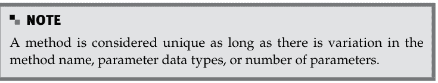

方法重载是**操作多态性**的一种形式。当相同逻辑操作因数据差异而呈现多种（“poly”）形式（“morphs”）时，就会发生多态性。调用 `WriteLine()` 并传递格式字符串及一些参数，与调用 `WriteLine()` 并指定整数的实现方式不同。然而，逻辑上，对于调用者而言，该方法负责写入数据，内部实现方式相对无关紧要。列表 5.19 提供了一个示例，输出 5.10 显示了结果。

### 列表 5.19: 使用重载统计 .cs 文件中的行数

```csharp
using System.IO;

public static class LineCounter
{
public static void Main(string[] args)
{
int totalLinesCount;
if (args.Length > 1)
{
totalLinesCount =
DirectoryCountLines(args[0], args[1]);
}
if (args.Length > 0)
{
totalLinesCount = DirectoryCountLines(args[0]);
}
else
{
totalLinesCount = DirectoryCountLines();
}
System.Console.WriteLine(totalLinesCount);
}
}
```

```csharp
static int DirectoryCountLines()
{
    return DirectoryCountLines(
        Directory.GetCurrentDirectory());
}

static int DirectoryCountLines(string directory)
{
    return DirectoryCountLines(directory, "*.cs");
}

static int DirectoryCountLines(
    string directory, string extension)
{
    int lineCount = 0;
    foreach (string file in
        Directory.GetFiles(directory, extension))
    {
        lineCount += CountLines(file);
    }
    foreach (string subdirectory in
        Directory.GetDirectories(directory))
    {
        lineCount += DirectoryCountLines(subdirectory);
    }
    return lineCount;
}

private static int CountLines(string file)
{
    int lineCount = 0;
    string line;
    FileStream stream =
        new FileStream(file, FileMode.Open);
    StreamReader reader = new StreamReader(stream);
    line = reader.ReadLine();
    while(line != null)
    {
        if (line.Trim() != "")
        {
            lineCount++;
        }
        line = reader.ReadLine();
    }
    reader.Close(); // Automatically closes the stream
    return lineCount;
}
```

*   这段代码可以通过使用 `using` 语句进行改进，这是一种我们之前回避使用的结构，因为该结构尚未在文中介绍。

### 输出 5.10

```bash
>LineCounter.exe .\*.cs
28
```

方法重载的效果是提供调用方法的可选方式。如在 `Main()` 中所示，你可以调用 `DirectoryCountLines()` 方法，无论是否传递要搜索的目录和文件扩展名。

请注意，`DirectoryCountLines()` 的无参数实现已被更改为调用单参数版本 `int DirectoryCountLines (string directory)`。这是在实现重载方法时的一种常见模式。其思想是开发人员仅在一个方法中实现核心逻辑，所有其他重载方法都将调用该单一方法。如果核心实现发生变更，只需在一个位置进行修改，而不是在每个实现中修改。当使用方法重载来启用可选参数时，这种模式尤其普遍，因为这些参数没有编译时确定的值，因此无法使用可选参数指定。

> **注意**
>
> 将核心功能放在一个被所有其他重载方法调用的单一方法中，意味着你可以在核心方法中进行更改，其他方法将自动从中受益。

## 可选参数

从 C# 4.0 开始，语言设计人员添加了对**可选参数**的支持。通过允许在方法声明中将参数与常量值相关联，可以在不传递方法每个参数的参数的情况下调用该方法（参见列表 5.20）。

```csharp
using System.IO;

public static class LineCounter
{
    public static void Main(string[] args)
    {
        int totalLineCount;
        if (args.Length > 1)
        {
            totalLineCount =
                DirectoryCountLines(args[0], args[1]);
        }
        else if (args.Length > 0)
        {
            totalLineCount = DirectoryCountLines(args[0]);
        }
        else
        {
            totalLineCount = DirectoryCountLines();
        }
        System.Console.WriteLine(totalLineCount);
    }
    static int DirectoryCountLines()
    {
        // ... 
    }
    /*
    static int DirectoryCountLines(string directory)
    { ... }
    */
    static int DirectoryCountLines(
        string directory, string extension = "*.cs")
    {
        int lineCount = 0;
        foreach (string file in
            Directory.GetFiles(directory, extension))
        {
            lineCount += CountLines(file);
        }
        foreach (string subdirectory in
            Directory.GetDirectories(directory))
        {
            lineCount += DirectoryCountLines(subdirectory);
        }
        return lineCount;
    }
    private static int CountLines(string file)
    {
        // ...
    }
}
```

在列表 5.20 中，单参数的 `DirectoryCountLines()` 方法声明已被移除（被注释掉），但从 `Main()` 的调用（指定一个参数）仍然存在。当调用中未指定扩展名参数时，将使用声明中分配给 `extension` 的值（在这种情况下是 `*.cs`）。这允许调用代码在需要时不指定值，并且消除了在 C# 3.0 及更早版本中所需的额外重载。请注意，可选参数必须出现在所有必需参数（那些没有默认值的参数）之后。此外，默认值必须是一个常量、在编译时解析的值，这一事实相当严格。例如，你不能声明像下面的方法：

```csharp
DirectoryCountLines(
    string directory = Environment.CurrentDirectory,
    string extension = "*.cs")
```

因为 `Environment.CurrentDirectory` 不是一个常量。相比之下，由于 `*.cs` 是一个常量，C# 允许将其用作可选参数的默认值。

> **准则**
>
> - **务必**在可能的情况下为所有参数提供好的默认值。
> - **务必**提供具有少量必需参数的简单方法重载。
> - **考虑**将重载从最简单的到最复杂的进行组织。

C# 4.0 提供的第二个方法调用特性是使用命名参数。通过命名参数，调用者可以显式标识要分配值的参数名称，而不仅仅依赖于参数和参数的顺序来关联它们（参见列表 5.21）。

## 列表 5.21：按名称指定参数

```csharp
class Program
{
    static void Main()
    {
        DisplayGreeting(
            firstName: "Inigo", lastName: "Montoya");
    }
    public static void DisplayGreeting(
        string firstName,
        string middleName = default(string),
        string lastName = default(string))
    {
        // ...
    }
}
```

在列表 5.21 中，从 `Main()` 内部对 `DisplayGreeting()` 的调用通过名称将值分配给参数。在两个可选参数（`middleName` 和 `lastName`）中，只有 `lastName` 被作为参数提供。对于拥有许多参数且其中许多是可选的情况（在访问 Microsoft COM 库时很常见），使用命名参数语法确实是一种便利。然而，随着便利而来的是对方法接口灵活性的影响。过去，更改参数名称不会导致调用该方法的 C# 代码不再编译。随着命名参数的添加，参数名称成为接口的一部分，因为更改名称会导致使用命名参数的代码不再编译。

> **准则**
>
> - **务必**将参数名称视为 API 的一部分，如果 API 之间的版本兼容性很重要，则避免更改名称。

对于许多有经验的 C# 开发人员来说，这是一个令人惊讶的限制。然而，自 .NET 1.0 以来，这一限制就作为通用语言规范的一部分被强制执行。此外，Visual Basic 一直支持使用命名参数调用方法。因此，库开发人员应该已经遵循不更改参数名称的做法，以成功地在版本之间与其他 .NET 语言互操作。从本质上讲，C# 4.0 现在对更改参数名称施加了与其他许多 .NET 语言已经要求的相同的限制。

鉴于方法重载、可选参数和命名参数的组合，确定调用哪个方法变得不那么明显。如果所有参数都有恰好一个对应的参数（通过名称或位置）且类型兼容，除非参数是可选的（或参数数组），否则调用与方法是**适用的**（兼容的）。虽然这限制了可能被调用的方法数量，但它并没有确定唯一的方法。为了进一步区分将调用哪个特定方法，编译器仅使用调用者中明确标识的参数，忽略调用者中未指定的所有可选参数。因此，如果两个方法适用，因为其中一个具有可选参数，编译器将解析为没有可选参数的方法。

## 高级主题

### 方法解析

当编译器必须从多个适用方法中选择最适合特定调用的方法时，将选择具有*最具体*参数类型的方法。假设有两个适用方法，每个方法都需要从参数到参数类型的隐式转换，将使用参数类型为更派生类型的方法。

例如，如果调用者传递类型为 `int` 的参数，将选择接受 `double` 参数的方法，而不是接受 `object` 参数的方法。这是因为 `double` 比 `object` 更具体。有一些对象不是 double，但没有 double 不是对象，所以 double 必须更具体。

如果多个方法适用且无法确定唯一的最佳方法，编译器将发出错误，指示调用是模棱两可的。

例如，给定以下方法：

```csharp
static void Method(object thing){}
static void Method(double thing){}
static void Method(long thing){}
static void Method(int thing){}
```

形如 `Method(42)` 的调用将解析为 `Method(int thing)`，因为参数类型与方法参数类型是完全匹配的。如果该方法被移除，重载决议将选择 `long` 版本，因为 `long` 比 `double` 或 `object` 都更具体。

C# 规范包含关于 `byte`、`ushort`、`uint`、`ulong` 及其他数值类型之间隐式转换的额外规则。不过，通常最好使用强制类型转换，以使预期的目标方法更易于识别。

## 使用异常进行基础错误处理

本节探讨如何通过一种称为 **异常处理** 的机制来处理错误报告。

通过异常处理，方法能够向调用者方法传递有关错误的信息，而无需使用返回值或显式提供参数来实现这一点。列表 5.22 包含了对列表 1.16（第 1 章中的 HeyYou 程序）的轻微修改。它不再请求用户的姓氏，而是提示输入用户的年龄。

### 列表 5.22：将字符串转换为 int

```csharp
using System;

class ExceptionHandling
{
    static void Main()
    {
        string firstName;
        string ageText;
        int age;
        Console.WriteLine("Hey you!");


```
        Console.Write("Enter your first name: ");

        firstName = System.Console.ReadLine();

        Console.Write("Enter your age: ");

        ageText = Console.ReadLine();

        age = int.Parse(ageText);

        Console.WriteLine(

            $"Hi {firstName}! You are {age + 12} months old.");

    }

}
```

输出 5.11 显示了列表 5.22 的结果。

### 输出 5.11

```
Hey you!

Enter your first name: Inigo

Enter your age: 42

Hi Inigo! You are 504 months old.
```

`System.Console.ReadLine()` 的返回值被存储在一个名为 `ageText` 的变量中，然后传递给一个名为 `Parse()` 的方法，该方法具有 `int` 数据类型。该方法负责接收一个代表数字的字符串值并将其转换为 `int` 类型。

## 初学者话题

#### 字符串 42 与整数 42

C# 要求每个非空值都有一个明确定义的类型与之相关联。因此，不仅数据值，而且与数据关联的类型也很重要。因此，字符串值 42 与整数值 42 有着明显的不同。字符串由两个字符 4 和 2 组成，而 `int` 是数字 42。

给定转换后的字符串，最后的 `System.Console.WriteLine()` 语句将通过将年龄值乘以 12 来打印以月为单位的年龄。

但如果用户没有输入有效的整数字符串会发生什么？例如，如果用户输入“forty-two”（四十二）会发生什么？`Parse()` 方法无法处理这样的转换。它期望用户输入一个仅包含数字的字符串。如果 `Parse()` 方法接收到无效值，它需要一种方式将这一事实报告给调用者。

### 捕获错误

为了向调用方法指示参数无效，`int.Parse()` 将抛出异常。抛出异常会停止当前控制流中的进一步执行，并跳转到调用堆栈中处理该异常的第一个代码块。

由于你尚未提供任何此类处理，程序将向用户报告该异常作为未处理的异常。假设系统上没有注册调试器，错误将以类似于输出 5.12 中显示的消息形式出现在控制台上。

### 输出 5.12

```
Hey you!

Enter your first name: Inigo

Enter your age: forty-two

Unhandled Exception: System.FormatException: Input string was
    not in a correct format.
    at System.Number.parseInt32(String s, NumberStyles style,
    NumberFormatInfo info)
    at ExceptionHandling.Main()
```

显然，这样的错误并没有太大的帮助。为了解决这个问题，有必要提供一种处理错误的机制，也许向用户报告一个更有意义的错误消息。

这个过程被称为 **捕获异常**。语法在列表 5.23 中演示，输出显示在输出 5.13 中。

### 列表 5.23：捕获异常

```csharp
using System;

class ExceptionHandling
{
    static int Main()
    {
        string firstName;
        string ageText;
        int age;
        int result = 0;
        Console.Write("Enter your first name: ");
        firstName = Console.ReadLine();
        Console.Write("Enter your age: ");
        ageText = Console.ReadLine();
        try
        {
            age = int.Parse(ageText);
            Console.WriteLine(
                $"Hi {firstName}! You are {age * 12} months old.");
        }
        catch (FormatException)
        {
            Console.WriteLine(
                $"The age entered, {ageText}, is not valid.");
            result = 1;
        }
        catch (Exception exception)
        {
            Console.WriteLine(
                $"Unexpected error: {exception.Message}");
            result = 1;
        }
        finally
        {
            Console.WriteLine($"Goodbye {firstName}");
        }
        return result;
    }
}
```

### 输出 5.13

> Enter your first name: Inigo
> Enter your age: forty-two
> The age entered, forty-two, is not valid.
> Goodbye Inigo

首先，使用 `try` 块包围可能抛出异常的代码（`age = int.Parse()`）。该块以 `try` 关键字开头。它向编译器表明开发者意识到块内的代码可能会抛出异常，如果确实抛出异常，其中一个 `catch` 块将尝试处理该异常。

一个或多个 `catch` 块（或 `finally` 块）必须立即跟在 `try` 块之后。`catch` 块头（参见本章稍后题为“通用捕获”的高级话题）允许你可选地指定异常的数据类型，只要数据类型与异常类型匹配，`catch` 块就会执行。然而，如果没有合适的 `catch` 块，异常将未被处理而穿透，就好像没有异常处理一样。结果的控制流如图 5.1 所示。

例如，假设用户在上面的示例中输入“forty-two”作为年龄。在这种情况下，`int.Parse()` 将抛出类型为 `System.FormatException` 的异常，控制权将跳转到 `catch` 块集合。（`System.FormatException` 表示字符串的格式不正确，无法被适当解析。）由于第一个 `catch` 块匹配 `int.Parse()` 抛出的异常类型，该块内部的代码将执行。如果 `try` 块内的语句抛出了不同的异常，第二个 `catch` 块将执行，因为所有异常的类型都是 `System.Exception`。

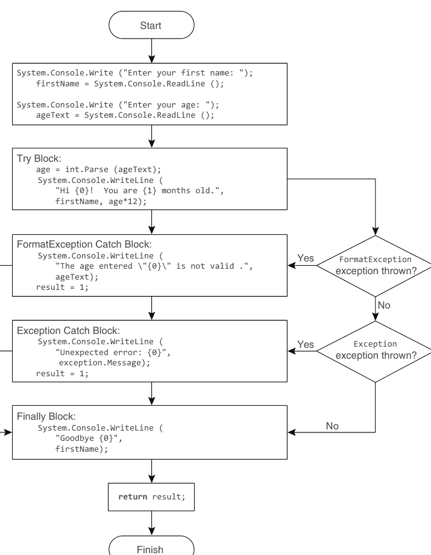

### 图 5.1：异常处理控制流

如果没有 `System.FormatException` `catch` 块，`System.Exception` `catch` 块将执行，即使 `int.Parse` 抛出的是 `System.FormatException`。这是因为 `System.FormatException` 也是 `System.Exception` 类型。（`System.FormatException` 是通用异常 `System.Exception` 的一个更具体的实现。）

你处理异常的顺序很重要。`Catch` 块必须从最具体到最不具体排列。`System.Exception` 数据类型是最不具体的，因此它出现在最后。`System.FormatException` 出现在首先，因为它是列表 5.23 处理的最具体的异常。

无论控制权是正常离开 `try` 块，还是因为 `try` 块中的代码抛出异常而离开，**`finally` 块**中的代码将在控制权离开 `try` 保护区域后执行。`finally` 块的目的是提供一个位置来放置无论 `try/catch` 块如何退出（无论是否抛出异常）都会执行的代码。`Finally` 块对于清理资源非常有用，无论是否抛出异常。事实上，可以有一个 `try` 块带有 `finally` 块而没有 `catch` 块。无论 `try` 块是否抛出异常，或者是否编写了 `catch` 块来处理异常，`finally` 块都会执行。列表 5.24 演示了 `try/finally` 块，输出 5.14 显示了结果。

### 列表 5.24：没有 Catch 块的 Finally 块

```csharp
using System;

class ExceptionHandling
{
    static int Main()
    {
        string firstName;
        string ageText;
        int age;
        int result = 0;
        Console.Write("Enter your first name: ");
        firstName = Console.ReadLine();
        Console.Write("Enter your age: ");
        ageText = Console.ReadLine();
        try
        {
            age = int.Parse(ageText);
            Console.WriteLine(
                $"Hi {firstName}! You are {age * 12} months old.");
        }
        finally
        {
            Console.WriteLine($"Goodbye {firstName}");
        }
        return result;
    }
}
```

```csharp
finally
{
    Console.WriteLine($"Goodbye { firstName }");
}
return result;
}
```

# 输出 5.14

```text
Enter your first name: Inigo
Enter your age: forty-two
Unhandled Exception: System.FormatException: Input string was not in a correct format.
   at System.Number.StringToNumber(String str, NumberStyles options,
                  NumberBuffer& number, NumberFormatInfo info)
   at System.Number.ParseInt32(String s, NumberStyles style,
                  NumberFormatInfo info)
   at ExceptionHandling.Main()
Goodbye Inigo
```

细心的读者会注意到这里有一些有趣的现象：运行时首先报告了未处理的异常，然后才执行了 `finally` 块。是什么解释了这种不寻常的行为？

首先，这种行为是合法的，因为当异常未被处理时，运行时的行为是实现定义的；任何行为都是合法的！运行时选择这种特定行为，是因为它在决定运行 `finally` 块之前就已经知道该异常将未被处理；运行时已经检查了调用堆栈上的所有激活帧，并确定其中没有任何一个与匹配该抛出异常的 `catch` 块相关联。

一旦运行时确定该异常将未被处理，它就会检查机器上是否安装了调试器，因为您可能是正在分析此故障的软件开发人员。如果存在调试器，它会向用户提供机会，在 `finally` 块运行之前将调试器附加到该进程。如果没有安装调试器，或者用户拒绝调试该问题，默认行为是将未处理的异常打印到控制台，然后查看是否有可以运行的 `finally` 块。由于这种情况的“实现定义”性质，运行时并不要求在这种情况下运行 `finally` 块；实现可以选择运行或不运行。

## 准则

-   **避免**从 `finally` 块中显式抛出异常。（由方法调用引发的隐式抛出异常是可以接受的。）
-   **应当**优先使用 `try/finally`，避免在编写整洁代码时使用 `try/catch`。
-   **应当**抛出描述发生了哪种异常情况的异常，并且如果可能，说明如何防止该情况。

## 高级主题

## 异常类继承

从 C# 2.0 开始，所有作为异常抛出的对象都继承自 `System.Exception`。（从其他语言抛出的、不继承自 `System.Exception` 的对象会被自动“包装”在一个继承自该类的对象中。）因此，它们可以由 `catch(System.Exception exception)` 块处理。不过，最好包含一个针对最派生类型（例如 `SystemFormatException`）的特定 `catch` 块，因为这样可以获取关于异常的更多信息，并以更具体的方式处理异常。这样做时，使用最派生类型的 `catch` 语句能够具体处理异常类型，访问与抛出异常相关的数据，并避免使用条件逻辑来确定发生了什么类型的异常。

这就是为什么 C# 强制规定 `catch` 块必须按照从最派生到最少派生的顺序出现的原因。例如，捕获 `System.Exception` 的 `catch` 语句不能出现在捕获 `System.FormatException` 的语句之前，因为 `System.FormatException` 派生自 `System.Exception`。

一个方法可以抛出许多类型的异常。表 5.2 列出了框架中一些更常见的异常类型。

表 5.2：常见异常类型

| 异常类型 | 描述 |
| :--- | :--- |
| System.Exception | 所有其他异常派生自的“基类”异常。 |
| `System.ArgumentException` | 指示传递给方法的一个参数无效。 |
| `System.ArgumentNullException` | 指示某个参数为 `null`，而该值对于该参数无效。 |
| `System.ApplicationException` | 应避免使用。最初的想法是您可能希望对系统异常和应用程序异常采用不同的处理方式，这虽然听起来合理，但在现实世界中效果并不好。 |
| `System.FormatException` | 指示字符串格式无效，无法转换。 |
| `System.IndexOutOfRangeException` | 指示尝试访问不存在的数组或其他集合元素。 |
| `System.InvalidCastException` | 指示将一种数据类型转换为另一种数据类型的尝试不是有效的转换。 |
| `System.InvalidOperationException` | 指示发生了意外情况，导致应用不再处于有效的操作状态。 |
| `System.NotImplementedException` | 指示虽然方法签名存在，但尚未完全实现。 |
| `System.NullReferenceException` | 当代码试图查找由为 `null` 的引用所引用的对象时抛出。 |
| `System.ArithmeticException` | 指示无效数学操作，但不包括除以零。 |
| `System.ArrayTypeMismatchException` | 在尝试将错误类型的元素存储到数组中时发生。 |
| `System.StackOverflowException` | 指示意外的深层递归。 |

## 高级主题

### 通用 Catch

可以指定一个不带参数的 `catch` 块，如清单 5.25 所示。

**清单 5.25：通用 Catch 块**

```csharp
try
{
    age = int.Parse(ageText);
    System.Console.WriteLine(
        $"Hi { firstName }! You are { age+12 } months old.");
}
catch (System.FormatException exception)
{
    System.Console.WriteLine(
        $"The age entered ,{ ageText }, is not valid.");
    result = 1;
}
catch(System.Exception exception)
{
    System.Console.WriteLine(
        $"Unexpected error: { exception.Message }");
    result = 1;
}
catch
{
    System.Console.WriteLine("Unexpected error!");
    result = 1;
}
finally
{
    System.Console.WriteLine($"Goodbye { firstName }");
}
```


不带数据类型的 `catch` 块，称为通用 catch 块，等效于指定一个接受对象数据类型的 `catch` 块——例如 `catch(object exception){...}`。由于所有类最终都派生自 `object`，因此不带数据类型的 `catch` 块必须最后出现。

通用 `catch` 块很少使用，因为没有办法获取关于异常的任何信息。此外，C# 不支持抛出类型为 `object` 的异常。（只有用 C++ 等语言编写的库才允许任何类型的异常。）

C# 2.0 开始的行为与早期 C# 行为略有不同。在 C# 2.0 中，如果某种语言允许抛出非 `System.Exception` 类型的对象，那么抛出的异常对象会被包装在一个继承自 `System.Exception` 的 `System.Runtime.CompilerServices.RuntimeWrappedException` 中。因此，所有异常，无论是否继承自 `System.Exception`，都会像继承自 `System.Exception` 一样传播到 C# 程序中。

其结果是，`System.Exception` `catch` 块将捕获前面所有块未捕获的所有异常，而跟随在 `System.Exception` `catch` 块之后的通用 `catch` 块永远不会被调用。因此，在 C# 2.0 或更高版本中，在 `System.Exception` `catch` 块之后跟随通用 `catch` 块将导致编译器警告，指示通用 `catch` 块永远不会执行。

## 准则

- 避免使用通用 `catch` 块，而用捕获 `System.Exception` 的 `catch` 块来替代。
- 避免捕获那些不确定适当处理方式的异常。让异常未被处理比错误地处理它更好。
- 避免在重新抛出异常之前捕获并记录异常。相反，让异常逃逸，直到它可以被适当处理。

### 使用 `throw` 语句报告错误

C# 允许开发人员从代码中抛出异常，如清单 5.26 和输出 5.15 所示。

**清单 5.26：** 抛出异常

```csharp
using System;  
public class ThrowingExceptions  
{  
    public static void Main()  
    {  
        try  
        {  
            Console.WriteLine("Begin executing");
```

```csharp
Console.WriteLine("Throw exception");
throw new Exception("Arbitrary exception");
Console.WriteLine("End executing");
}
catch (FormatException exception)
{
Console.WriteLine("A FormatException was thrown");
}
catch (Exception exception)
{
Console.WriteLine($"Unexpected error: { exception.Message }");
}
catch
{
Console.WriteLine("Unexpected error!");
}
}
Console.WriteLine("Shutting down...");
}
```

### 输出 5.15

```text
Begin executing
Throw exception...
Unexpected error: Arbitrary exception
Shutting down...
```

如图 5.26 中的箭头所示，抛出异常会导致执行流程从异常抛出的位置跳转到调用栈中第一个与所抛出异常类型兼容的 `catch` 块。⁶ 在这种情况下，第二个 `catch` 块处理该异常并输出错误消息。在图 5.26 中，没有 `finally` 块，因此执行流程会穿过 `try/catch` 块，继续执行随后的 `System.Console.WriteLine()` 语句。

若要抛出异常，需要有一个异常实例。图 5.26 使用关键字 `new` 后跟异常类型来创建实例。大多数异常类型都允许在抛出异常时生成消息，以便在发生异常时可以检索该消息。

> ⁶. 从技术上讲，它也可以被兼容的 `catch` 过滤器捕获。

有时，`catch` 块会捕获异常，但无法适当或完全处理它。在这种情况下，`catch` 块可以使用 `throw` 语句重新抛出异常，而无需指定任何异常，如图 5.27 所示。

### 图 5.27：重新抛出异常

```csharp
...
catch (Exception exception)
{
    Console.WriteLine(
        $@"Rethrowing unexpected error: {
            exception.Message }");
    throw;
}
...
```

在图 5.27 中，`throw` 语句是“空”的，而不是指定抛出由 `exception` 变量引用的异常。这说明了细微的差别：`throw;` 保留了异常中的 *调用栈* 信息，而 `throw exception;` 则用当前的调用栈信息替换了该信息。出于调试目的，通常了解原始调用栈会更好。

## 指南

- 应当 在捕获并重新抛出异常时优先使用空 `throw`，以保留调用栈。
- 应当 通过抛出异常来报告执行故障，而不是返回错误代码。
- 不应当 让公共成员将异常作为返回值或 `out` 参数返回。使用异常来指示错误；不要将它们用作返回值来指示错误。

### 避免使用异常处理来处理预期情况

开发人员应努力避免为预期条件或正常控制流抛出异常。例如，当指定年龄时，开发人员不应期望用户输入有效的文本。⁷

> ⁷. 通常，开发人员应预期用户会执行意外操作；相应地，他们应编写防御性代码来处理“愚蠢的用户技巧”。

因此，开发人员不应依赖异常来验证用户输入的数据，而应提供一种在尝试转换之前检查数据的手段。（更好的做法是，首先防止用户输入无效数据。）异常是专门为跟踪异常、意外和潜在致命情况而设计的。将其用于预期情况等非预期目的会导致代码难以阅读、理解和维护。

此外，与大多数语言一样，C# 在抛出异常时会带来轻微的性能损失——与大多数操作所需的纳秒相比，这需要微秒级时间。这种延迟通常在人看来并不明显——除非异常未被处理。例如，当执行图 5.22 时，如果用户输入了无效年龄，该异常未被处理，并且运行时会搜索环境以查看是否有要加载的调试器，从而导致明显的延迟。幸运的是，程序关闭时性能缓慢通常不是一个需要担心的因素。

## 指南

- 不应当 使用异常来处理正常的、预期的情况；应使用它们来处理异常的、意外的情况。

## 高级主题

### 使用 `TryParse()` 进行数值转换

`Parse()` 方法的问题之一是，确定转换是否成功的唯一方法是尝试转换，然后在失败时捕获异常。由于抛出异常是一个相对昂贵的操作，因此最好在不使用异常处理的情况下尝试转换。在 C# 的首次发行版本中，唯一支持此行为的数据类型是一种名为 `double.TryParse()` 的 `double` 方法。然而，从 Microsoft .NET Framework 2.0 开始，该方法包含在所有数值基元类型中。它需要使用 `out` 关键字，因为 `TryParse()` 函数的返回值是 `bool`，而不是转换后的值。图 5.28 是一个代码片段，演示了使用 `int.TryParse()` 进行转换。

### 图 5.28：使用 `int.TryParse()` 进行转换

```csharp
if (int.TryParse(ageText, out int age))
{
    Console.WriteLine(
        $"Hi { firstName }! "
        + $"You are { age*12 } months old.");
}
else
{
    Console.WriteLine(
        $"The age entered, { ageText }, is not valid.");
}
```

在 Microsoft .NET Framework 4 中，枚举类型也添加了 `TryParse()` 方法。

使用 `TryParse()` 方法后，不再需要仅仅为了处理字符串到数值的转换而包含 `try/catch` 块。

## 摘要

本章讨论了声明和调用方法的细节，包括使用关键字 `out` 和 `ref` 来传递和返回变量本身而不是它们的值。除了方法声明外，本章还介绍了异常处理。

方法是一个基本结构，是编写可读代码的关键。不要编写包含大量语句的大型方法，而应使用方法在代码中创建大约 10 条或更少语句的“段落”。将大型函数分解为更小的部分是重构代码以使其更具可读性和可维护性的方式之一。

下一章讨论类结构，并描述如何将其封装方法（行为）和字段（数据）为一个单元。

此页有意留空

# 6 类

你在第 1 章中简要看到了如何声明一个名为 `HelloWorld` 的新类。在第 2 章和第 3 章中，你学习了 C# 包含的内置基元类型。既然现在你也学习了控制流以及如何声明方法，是时候讨论定义自己的类型了。类型定义是任何 C# 程序的核心结构；对类及其创建的对象的支持使 C# 成为面向对象的语言。

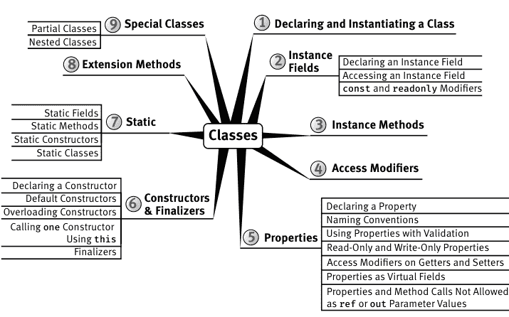

本章介绍使用 C# 进行面向对象编程的基础知识。重点在于如何定义类，类本身就是对象的模板。

前面章节中结构化编程的所有结构仍然适用于面向对象编程。然而，通过将这些结构封装在类中，你可以创建更大、更有序且更具可维护性的程序。从基于控制流的结构化程序到面向对象程序的转变彻底改变了编程，因为它提供了额外的组织层次。结果是较小的程序得到了简化。更重要的是，由于程序内的代码组织得更好，因此更容易创建更大的程序。

面向对象编程的一个关键优势是，你不必完全从头开始创建新程序，而是可以组装来自先前工作的现有对象集合，扩展类的新功能，添加更多的类，从而提供新的功能。

不熟悉面向对象编程的读者应阅读“初学者主题”块以获取介绍。初学者主题之外的一般文本侧重于使用 C# 进行面向对象编程，假设读者已经熟悉面向对象概念。

本章深入探讨 C# 如何通过支持类、属性和访问修饰符等结构来支持封装；我们在第 5 章中讨论了方法。第 7 章在此基础上引入了继承以及面向对象编程实现的多态性。

### 初学者主题

### 面向对象编程

当今成功编程的关键在于为大型应用程序复杂需求的实现提供组织和结构。面向对象编程是实现这一目标的关键方法论之一，以至于面向对象程序员很难想象转回结构化编程，除非是最简单的程序。

面向对象编程中最基本的构造是类。一组类构成了编程抽象、模型或模板，通常对应于现实世界的概念。例如，`OpticalStorageMedia` 类可能拥有一个 `Eject()` 方法，该方法可使光盘从播放器中弹出。`OpticalStorageMedia` 类是 CD 或 DVD 播放器这一现实世界对象的编程抽象。

类体现了面向对象编程的三大主要特征：封装、继承和多态。

## 封装

封装允许你隐藏细节。必要时仍然可以访问这些细节，但通过智能地封装细节，大型程序变得更容易理解，数据受到保护免受无意修改，并且由于代码更改的影响仅限于封装范围内，因此代码变得更容易维护。方法是封装的一个例子。虽然可以将方法中的代码提取出来并直接嵌入调用方的代码中，但将代码重构为方法可以提供封装的好处。

## 继承

考虑以下示例：DVD 驱动器是一种光媒体设备。它具有特定的存储容量，并且可以容纳数字电影。CD 驱动器也是一种光媒体设备，但它具有不同的特性。CD 的复制保护与 DVD 的复制保护不同，存储容量也不同。CD 驱动器和 DVD 驱动器都与硬盘驱动器、USB 驱动器和软盘驱动器（还记得它们吗？）不同。它们都符合存储设备的类别，但每个设备都有特殊特性，即使是基本功能，如支持的文件系统和介质实例是只读还是可读/写。

面向对象编程中的继承允许你在这些相似但不同的项之间形成“是一种（is a kind of）”关系。可以说 DVD 驱动器“是一种”存储介质，CD 驱动器“是一种”存储介质，因此，每个驱动器都有存储容量。我们同样可以合理地认为，两者都与“光存储介质”存在“是一种”的关系，而“光存储介质”又“是一种”存储介质。

如果你为提到的每种存储设备类型定义相应的类，你将定义了一个类层次结构，这是一系列“是一种”关系。所有存储设备派生自的基类可以是类 `StorageMedia`。因此，代表 CD 驱动器、DVD 驱动器、硬盘驱动器、USB 驱动器和软盘驱动器的类都派生自 `StorageMedia` 类。然而，CD 和 DVD 驱动器的类不必直接派生自 `StorageMedia`。相反，它们可以派生自一个中间类，`OpticalStorageMedia`。你可以使用统一建模语言（UML）风格的类图以图形方式查看类层次结构，如图 6.1 所示。

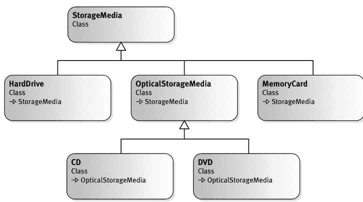

图 6.1：类层次结构

继承关系至少涉及两个类，其中一个类是另一个类更具体的类型；在图 6.1 中，`HardDrive` 是 `StorageMedia` 更具体的类型。虽然更专门的类型 `HardDrive` 是 `StorageMedia` 的一种，但反过来则不然——也就是说，`StorageMedia` 的实例不一定是 `HardDrive`。如图 6.1 所示，继承可以涉及两个以上的类。

更专门的类型被称为派生类型或子类型。更通用的类型被称为基类型或超类型。基类型也经常被称为父类型，其派生类型经常被称为其子类型。虽然这种用法很常见，但它可能会引起混淆：毕竟，孩子不是父类的一种！在这本书中，我们坚持使用派生类型和基类型。

从另一个类型派生或继承是专门化该类型，这意味着定制基类型使其更适合特定用途。基类型可能包含所有派生类型共有的实现细节。

继承的关键特性是所有派生类型都继承基类型的成员。通常，基成员的可以实现可以被修改，但无论如何，派生类型除了显式包含的其他成员外，还包含基类型的成员。

派生类型允许你将类组织成一个连贯的层次结构，其中派生类型比其基类型具有更高的具体性。

## 多态

多态由 poly，意为“多”，和 morph，意为“形式”组成。在对象上下文中，多态意味着单个方法或类型可以有许多实现形式。

假设你有一个媒体播放器，可以播放音乐 CD 和包含 MP3 的 DVD。然而，`Play()` 方法的具体实现将根据媒体类型而变化。在代表音乐 CD 的对象或代表音乐 DVD 的对象上调用 `Play()` 都会播放音乐，因为每个对象的类型都了解播放的复杂性。媒体播放器所了解的只是公共基类型 `OpticalStorageMedia`，以及它定义了 `Play()` 方法这一事实。多态是这样一个原则：一个类型可以处理方法实现的具体细节，因为该方法出现在多个派生类型上，这些派生类型都共享一个公共基类型（或接口），该接口也包含相同的方法签名。

## 声明和实例化类

定义类首先涉及指定关键字 `class`，随后是一个标识符，如清单 6.1 所示。

### 清单 6.1：定义一个类

```text
class Employee
{
}
```

属于该类的所有代码都将出现在类声明后面的大括号之间。虽然这不是必须的，但通常你将每个类放入其自己的文件中。这使得更容易找到定义特定类的代码，因为惯例是使用类名来命名文件。

## 准则

- 不要在单个源文件中放置多个类。
- 要使用其包含的公共类型的名称来命名源文件。

一旦你定义了一个新类，你就可以使用该类，就像它是框架内置的一样。换句话说，你可以声明该类型的变量，或定义一个接受新类类型参数的方法。清单 6.2 演示了这样的声明。

### 清单 6.2：声明类类型的变量

```csharp
class Program
{
    static void Main()
    {
        Employee employee1, employee2;
        // ...
    }
    static void IncreaseSalary(Employee employee)
    {
        // ...
    }
}
```

### 初学者主题

### 对象和类的定义

在随意的交谈中，class（类）和 object（对象）这两个术语经常互换使用。然而，对象和类具有不同的含义。类是对象在实例化时将呈现样式的模板。因此，对象是类的实例。类类似于小工具将呈现样式的模具。对象对应于由模具创建的小工具。从类创建对象的过程被称为实例化，因为对象是类的实例。

既然你定义了一个新的类类型，现在是实例化该类型对象的时候了。模仿其前身，C# 使用 `new` 关键字来实例化对象（参见清单 6.3）。

### 清单 6.3：实例化一个类

```csharp
class Program
{
    static void Main()
    {
        Employee employee1 = new Employee();
        Employee employee2;
        employee2 = new Employee();
        IncreaseSalary(employee1);
    }
}
```


不出所料，赋值可以在声明所在的同一语句中发生，也可以在一个单独的语句中发生。

与到目前为止你处理的原始类型不同，没有字面方式来指定一个 `Employee`。相反，`new` 操作符向运行时提供了一条指令，用于为 `Employee` 对象分配内存，实例化对象，并返回对实例的引用。

虽然存在显式用于分配内存的操作符，但没有用于解除分配内存的操作符。相反，运行时在对象变得不可访问后的某个时间自动回收内存。`垃圾回收器`负责自动解除分配。它确定哪些对象不再被其他活动对象引用，然后解除分配这些对象的内存。结果是，没有编译时确定的程序位置来回收内存并将其还原给系统。

在这个简单的示例中，没有与 `Employee` 相关的显式数据或方法，这使得对象基本上是无用的。下一节专注于向对象添加数据。

## 入门主题

## 封装第一部分：对象将数据与方法分组

如果你收到三叠索引卡片，分别写着员工的 `firstName`（名）、`lastName`（姓）和 `salary`（薪水），除非你知道这三叠卡片的顺序一致，否则这些卡片几乎没有价值。即便如此，由于需要翻阅两叠卡片才能确定一个人的全名，处理这些数据也会相当困难。更糟糕的是，如果你掉落了一叠卡片，就再也没有办法将名字、姓氏和薪水重新关联起来。相反，你需要一叠员工卡片，每张卡片上包含每位员工的所有数据。通过这种方法，名字、姓氏和薪水将被封装在一起。

在面向对象编程语境之外，`封装`一组项目是指将这些项目封闭在一个胶囊内。类似地，面向对象编程将方法和`数据`一起封装进对象。这为类的所有`成员`（类中的数据和方法）提供了分组，使它们不再需要单独处理。你不再需要将名字、姓氏和薪水作为三个独立的参数传递给方法，而是可以通过对象调用传递一个指向员工对象的引用。一旦被调用的方法接收到对象引用，它就可以向该对象发送消息（例如，调用像 `AdjustSalary()` 这样的方法）以执行特定操作。

## 语言对比：C++—delete 运算符

C# 程序员应将 `new` 运算符视为实例化对象的调用，而不是分配内存的调用。无论是堆上分配的对象还是栈上分配的对象都支持 `new` 运算符，这强调了 `new` 关注的不是内存分配应如何进行，也不是是否需要释放内存。

因此，C# 不需要 C++ 中的 `delete` 运算符。内存的分配和释放是运行时管理的细节，这让开发人员可以更专注于领域逻辑。然而，尽管内存由运行时管理，但运行时并不管理其他资源，例如数据库连接、网络端口等。与 C++ 不同，C# 不支持`隐式确定性资源清理`（在代码中编译时定义的位置发生隐式对象销毁）。幸运的是，C# 支持通过 `using` 语句进行`显式确定性资源清理`，以及使用 `finalizers`（终结器）进行`隐式非确定性资源清理`。

## 实例字段

面向对象设计的一个关键方面是将数据分组以提供结构。本节讨论如何向 `Employee` 类添加数据。类内部存储数据的变量在面向对象术语中称为成员变量。这个术语在 C# 中很常见，但更标准的术语——也是规范中使用的术语——是 `field`（字段），它与包含类型相关联的命名存储单元。实例字段是在类级别声明的变量，用于存储与对象关联的数据。因此，关联是指字段数据类型与包含字段之间的关系。

### 声明实例字段

在清单 6.4 中，`Employee` 类已被修改以包含三个字段：`FirstName`、`LastName` 和 `Salary`。

**清单 6.4：声明字段**

```csharp
class Employee
{
    public string FirstName;
    public string LastName;
    public string Salary;
}
```

添加这些字段后，可以存储与每个 `Employee` 实例相关的基本数据。在此情况下，我们在字段前加上了 `public` 访问修饰符。在字段上使用 `public` 表示字段中的数据可以被 `Employee` 之外的类访问（参见本章稍后关于“访问修饰符”的部分）。

与局部变量声明一样，字段声明包含字段所引用的数据类型。此外，还可以在声明时为字段赋初始值，如清单 6.5 中 `Salary` 字段所示。

**清单 6.5：在声明时设置字段的初始值**

```csharp
class Employee
{
    public string FirstName;
    public string LastName;
    public string Salary = "Not enough";
}
```

我们将关于命名和编码字段的指南推迟到本章后面介绍 C# 属性之后。简而言之，清单 6.5 *没有* 遵循通用约定。

### 访问实例字段

你可以设置和获取字段内的数据。然而，字段不包含 `static` 修饰符这一事实表明它是一个实例字段。你只能从包含类的实例（即对象）访问实例字段。不能直接从类访问它（换句话说，即必须先创建一个实例）。

清单 6.6 展示了更新后的 `Program` 类及其对 `Employee` 类的利用方式，而输出 6.1 显示了结果。

**清单 6.6：访问字段**

```csharp
class Program
{
    static void Main()
    {
        Employee employee1 = new Employee();
        Employee employee2;
        employee2 = new Employee();
        employee1.FirstName = "Inigo";
        employee1.LastName = "Montoya";
        employee1.Salary = "Too Little";
        IncreaseSalary(employee1);
        Console.WriteLine(
            "{0} {1}: {2}",
            employee1.FirstName,
            employee1.LastName,
            employee1.Salary);
        // ...
    }
    static void IncreaseSalary(Employee employee)
    {
        employee.Salary = "Enough to survive on";
    }
}
```

**输出 6.1**

```text
Inigo Montoya: Enough to survive on
```

清单 6.6 实例化了两个 `Employee` 对象，如前所述。然后，它设置每个字段，调用 `IncreaseSalary()` 来更改薪水，并显示与 `employee1` 引用的对象关联的每个字段。

请注意，你必须首先指定你正在处理哪个 `Employee` 实例。因此，在分配和访问字段时，`employee1` 变量作为前缀出现在字段名称之前。

## 实例方法

在 `Main()` 方法中的 `WriteLine()` 方法调用中格式化姓名的一种替代方案是在 `Employee` 类中提供处理格式化的方法。将功能更改为在 `Employee` 类中而不是 `Program` 的成员中，这与类的封装是一致的。为什么不将与员工全名相关的方法与包含形成该名字的数据的类分组在一起呢？

清单 6.7 演示了如何创建这样的方法。

**清单 6.7：从包含类内部访问字段**

```csharp
class Employee
{
    public string FirstName;
    public string LastName;
    public string Salary;
    public string GetName()
    {
        return $"{ FirstName } { LastName }";
    }
}
```

除了现在 `GetName()` 方法访问的是对象上的字段而不仅仅是局部变量外，这个方法与你在第 4 章中学到的内容没有什么特别之处。此外，方法声明未标记为 `static`。正如你将在本章稍后看到的那样，`static` 方法不能直接访问类内部的实例字段。相反，必须获取类的实例才能调用任何实例成员，无论是方法还是字段。

鉴于增加了 `GetName()` 方法，你可以更新 `Program.Main()` 以使用该方法，如清单 6.8 和输出 6.2 所示。

**清单 6.8：从包含类外部访问字段**

```csharp
class Program
{
    static void Main()
    {
        Employee employee1 = new Employee();
        Employee employee2;
        employee2 = new Employee();
        employee1.FirstName = "Inigo";
        employee1.LastName = "Montoya";
        employee1.Salary = "Too Little";
        IncreaseSalary(employee1);
        Console.WriteLine(
            $"{ employee1.GetName() }:{ employee1.Salary }");
        // ...
    }
    // ...
}
```

**输出 6.2**

```text
Inigo Montoya: Enough to survive on
```

## 使用 this 关键字

你可以通过属于该类的实例成员，从类内部获取类的引用。在 C# 中，为了明确表示访问的字段或方法是包含类的实例成员，使用 `this` 关键字。当调用任何实例成员时，对 `this` 的使用是隐式的，它返回对象本身的实例。

例如，考虑清单 6.9 中显示的 `SetName()` 方法。（注：原文此处描述提到 `SetName`，但代码块显示的是 `GetName`，此处保留原文意译，但代码块按原文展示）

**清单 6.9：使用 this 明确标识字段的所有者**

```csharp
class Employee
{
    public string FirstName;
    public string LastName;
    public string Salary;
    public string GetName()
    {
        return $"{ FirstName } { LastName }";
    }
}
```

```csharp
public void SetName(
    string newFirstName, string newLastName)
{
    this.FirstName = newFirstName;
    this.LastName = newLastName;
}
```

此示例使用关键字 `this` 来表明字段 `FirstName` 和 `LastName` 是类的实例成员。

尽管 `this` 关键字可以加在任何对本地类成员的引用之前，但一般准则是，当没有额外价值时，不要使代码杂乱。因此，除非必要，否则应避免使用 `this` 关键字。本章后面的列表 6.12 是存在这种必要性的少数情况之一。然而，列表 6.9 和 6.10 并不是好的例子。在列表 6.9 中，可以完全去掉 `this` 而不改变代码的含义。而在列表 6.10（下面介绍）中，通过更改字段的命名约定，我们可以避免局部变量和字段之间的任何歧义。

## 初学者话题

### 依靠编码风格来避免歧义

在 `SetName()` 方法中，你不需要使用 `this` 关键字，因为 `FirstName` 显然与 `newFirstName` 不同。但假设，你并不将参数称为“newFirstName”，而是将其称为“FirstName”（使用 PascalCase），如列表 6.10 所示。

**列表 6.10：使用 this 来避免歧义**

```csharp
class Employee
{
    public string FirstName;
    public string LastName;
    public string Salary;
    public string GetName()
    {
        return $"{ FirstName } { LastName }";
    }
    // 注意：参数名称使用 PascalCase
    public void SetName(string FirstName, string LastName)
    {
        this.FirstName = FirstName;
        this.LastName = LastName;
    }
}
```

在此示例中，如果不明确指示 `Employee` 对象拥有该变量，就不可能引用 `FirstName` 字段。`this` 的作用就像 `Program.Main()` 方法中使用的 `employee1` 变量前缀（参见列表 6.8）；它将该引用标识为调用 `SetName()` 的那个引用。

列表 6.10 并不遵循 C# 命名约定，该约定要求参数像局部变量一样声明，使用 `camelCase`。这可能导致微妙的 bug，因为将 `FirstName`（意图指代字段）赋给 `FirstName`（参数）会导致代码仍然可以编译甚至运行。为了避免这个问题，为参数和局部变量使用与字段不同的命名约定是一种良好的实践。我们稍后在本章中演示了其中一种约定。

### 语言对比：Visual Basic——使用 Me 访问类实例

C# 关键字 `this` 等同于 Visual Basic 关键字 `Me`。

在列表 6.9 和 6.10 中，`GetName()` 方法中没有使用 `this` 关键字——它是可选的。但是，如果存在与字段同名的局部变量或参数（参见列表 6.10 中的 `SetName()` 方法），省略 `this` 将导致访问局部变量/参数，而意图是访问字段；在这种场景下，必须使用 `this`。

你还可以使用关键字 `this` 来显式访问类的方法。例如，在 `SetName()` 方法内，`this.GetName()` 是允许的，这允许你打印出新分配的名称（参见列表 6.11 和输出 6.3）。

### 列表 6.11：使用 this 与方法

```csharp
class Employee
{
    // ...
    public string GetName()
    {
        return $"{ FirstName } { LastName }";
    }
    public void SetName(string newFirstName, string newLastName)
    {
        this.FirstName = newFirstName;
        this.LastName = newLastName;
        Console.WriteLine(
            $"Name changed to '{ this.GetName() }'");
    }
}
class Program
{
    static void Main()
    {
        Employee employee = new Employee();
        employee.SetName("Inigo", "Montoya");
        // ...
    }
    // ...
}
```

**输出 6.3**

> Name changed to 'Inigo Montoya'

有时可能需要使用 `this` 来传递对当前执行对象的引用。考虑列表 6.12 中的 `Save()` 方法。

### 列表 6.12：在方法调用中传递 this

```csharp
class Employee
{
    public string FirstName;
    public string LastName;
    public string Salary;
    public void Save()
    {
        DataStorage.Store(this);
    }
}
class DataStorage
{
    // 将 employee 对象保存到以 Employee 名称命名的文件
    public static void Store(Employee employee)
    { // ...
    }
}
```

列表 6.12 中的 `Save()` 方法调用 `DataStorage` 类中的一个方法，称为 `Store()`。然而，需要向 `Store()` 方法传递需要持久化的 `Employee` 对象。这是通过关键字 `this` 完成的，它传递了调用 `Save()` 的 `Employee` 对象实例。

## 使用文件进行存储和加载

`DataStorage` 内部 `Store()` 方法的实际实现涉及 `System.IO` 命名空间中的类，如列表 6.13 所示。在 `Store()` 中，你首先实例化一个 `FileStream` 对象，并将其与对应于员工全名的文件相关联。`FileMode.Create` 参数表示你希望创建新文件，如果不存在名为 `<firstname><lastname>.dat` 的文件；如果文件已存在，它将被覆盖。接下来，你创建一个 `StreamWriter` 类。`StreamWriter` 类负责将文本写入 `FileStream`。你使用 `WriteLine()` 方法写入数据，就像写入控制台一样。

**列表 6.13：将数据持久化到文件**

```csharp
```


```csharp
using System;

using System.IO;

class DataStorage

{

    // 将 employee 对象保存到以 Employee 名称命名的文件。

    // 未显示错误处理。

    public static void Store(Employee employee)

    {

        // 使用 FirstNameLastName.dat 作为文件名实例化 FileStream

        // FileMode.Create 将强制创建新文件或覆盖现有文件。

        FileStream stream = new FileStream(

            employee.FirstName + employee.LastName + ".dat", 

            FileMode.Create);

        // 创建 StreamWriter 对象用于向 FileStream 写入文本

        StreamWriter writer = new StreamWriter(stream);

        // 写入与 employee 相关的所有数据

        writer.WriteLine(employee.FirstName);

        writer.WriteLine(employee.LastName);

        writer.WriteLine(employee.Salary);

        // 关闭 StreamWriter 及其流

        writer.Dispose(); // 自动关闭流

    }

    // ...

}
```

一旦写操作完成，`FileStream` 和 `StreamWriter` 都需要关闭，以免它们无限期地保持打开状态，等待垃圾回收器运行。列表 6.13 不包含任何错误处理，因此如果抛出异常，`Close()` 方法将不会被调用。

加载过程类似（参见列表 6.14）。

### 列表 6.14：从文件检索数据

```csharp
using System;

using System.IO;

class Employee

{

    // ...

}

class DataStorage

{

    // ...

    public static Employee Load(string firstName, string lastName)

    {

        Employee employee = new Employee();

        // 使用 FirstNameLastName.dat 作为文件名实例化 FileStream

        // FileMode.Open 将打开现有文件或报告错误。

        FileStream stream = new FileStream(

            firstName + lastName + ".dat", FileMode.Open);

        // 创建 StreamReader 用于从文件读取文本

        StreamReader reader = new StreamReader(stream);

        // 从文件读取每一行并将其放入相关的属性

        employee.FirstName = reader.ReadLine();

        employee.LastName = reader.ReadLine();

        employee.Salary = reader.ReadLine();

        // 关闭 StreamReader 及其流

        reader.Dispose(); // 自动关闭流

        return employee;

    }

}

class Program

{

    static void Main()

    {

        Employee employee1;

        Employee employee2 = new Employee();

        employee2.SetName("Inigo", "Montoya");

        employee2.Save();

        // 在保存后修改 employee2

        IncreaseSalary(employee2);

        // 从 employee2 的保存版本中加载 employee1

        employee1 = DataStorage.Load("Inigo", "Montoya");

        Console.WriteLine(

            $"{ employee1.GetName() } : { employee1.Salary }");

        // ...

    }

    // ...

}
```

1. 使用 `using` 语句可以改进此代码，这是一种我们避免使用的结构，因为尚未介绍。

2. 使用 `using` 语句可以改进此代码，这是一种我们避免使用的结构，因为尚未介绍。

输出 6.4 展示了结果。

### 输出 6.4

名称已更改为 'Inigo Montoya'
Inigo Montoya:

保存过程的逆向操作见列表 6.14，该操作使用 `StreamReader` 而不是 `StreamWriter`。同样，一旦数据读取完成，需要对 `FileStream` 和 `StreamReader` 都调用 `Close()` 方法。

输出 6.4 在 "Inigo Montoya:" 之后没有显示任何薪资，因为直到调用 `Save()` 之后，才通过调用 `IncreaseSalary()` 将薪资设置为足以维持生活。

请注意 `Main()` 中，我们可以从员工实例调用 `Save()`，但要加载一个新员工，我们调用 `DataStorage.Load()`。要加载员工，通常我们手中并没有一个已有的员工实例可供加载，因此在 `Employee` 上使用实例方法远非理想。在 `DataStorage` 上调用 `Load` 的一个替代方案是在 `Employee` 中添加一个静态的 `Load()` 方法（参见本章稍后的“静态成员”部分），这样就可以调用 `Employee.Load()`（使用 `Employee` 类，而不是 `Employee` 的实例）。

请注意列表顶部的 `using System.IO` 指令的包含。此指令使得每个 IO 类无需加前缀的全限定命名空间即可访问。

# 访问修饰符

在本章前面声明字段时，你在字段声明前加了 `public` 关键字。`public` 是一个 **访问修饰符**，它标识与其修饰的成员相关联的封装级别。共有五种访问修饰符可用：*public*、*private*、*protected*、*internal* 和 *protected internal*。本节将讨论前两种。

### 初学者主题

### 封装第二部分：信息隐藏

除了将数据和方法包装在一起形成单一单元外，封装还涉及隐藏对象内部的数据和行为细节。

在一定程度上，方法已经做到了这一点；在方法外部，调用者只能看到方法声明。内部的实现细节是不可见的。然而，面向对象编程通过提供控制类外部成员可见程度的机制，进一步实现了这一目标。在类外部不可见的成员称为私有成员。

在面向对象编程中，*封装* 一词不仅指将数据和行为分组，还指在类（胶囊）内部隐藏数据和行为的实现细节，从而不暴露类的内部工作机制。这降低了调用者不当修改数据或根据当前实现进行编程（而该实现未来可能会发生变化）的可能性。

访问修饰符的目的是提供封装。通过使用 `public`，你明确表示被修饰的字段可以从 *Employee* 类外部访问是可以接受的——换句话说，例如它们可以从 *Program* 类访问。

不过，考虑一个包含 *Password* 字段的 *Employee* 类。应该能够调用 *Employee* 对象并使用 *Logon()* 方法验证密码。相反，不应该能够 *从类外部* 访问 *Employee* 对象的 *Password* 字段。

要将 *Password* 字段定义为隐藏的并且无法从包含它的类外部访问，你使用 *private* 关键字作为访问修饰符，以代替 *public*（参见列表 6.15）。结果是，例如 *Password* 字段无法从 *Program* 类内部访问。

## 列表 6.15：使用 *private* 访问修饰符

```csharp
class Employee
{
   public string FirstName;
   public string LastName;
   public string Salary;
   private string Password;
   private bool IsAuthenticated;
   public bool Logon(string password)
   {
      if(Password == password)
      {
         IsAuthenticated = true;
      }
      return IsAuthenticated;
   }
}

public bool GetIsAuthenticated()
{
    return IsAuthenticated;
}

// ...
class Program
{
    static void Main()
    {
        Employee employee = new Employee();
        employee.FirstName = "Inigo";
        employee.LastName = "Montoya";
        // ...
        // Password is private, so it cannot be
        // accessed from outside the class
        // Console.WriteLine(
        //     $"Password = { employee.Password}");
    }
    // ...
}
```

尽管列表 6.15 中没有显示这种选项，但也可以将方法装饰为具有 `private` 访问修饰符。

如果在类成员上没有放置任何访问修饰符，声明默认为 `private`。换句话说，成员默认为私有的，程序员需要显式指定某个成员为 `public`。

### 属性

前一小节“访问修饰符”演示了如何使用 `private` 关键字封装密码，防止类外部访问。然而，这种类型的封装往往过于严格。例如，有时你可能需要定义那些外部类只能读取但你可以在内部更改值的字段。或者，你可能希望允许写入类中的某些数据，但你需要能够验证对该数据所做的更改。在另一种场景中，也许你需要即时构造数据。传统上，语言通过标记字段为 `private`，然后提供 getter 和 setter 方法来访问和修改数据来实现这些示例中的功能。列表 6.16 中的代码将 `FirstName` 和 `LastName` 都更改为私有字段。每个字段的公共 getter 和 setter 方法允许访问和更改它们的值。

## 列表 6.16：*声明 Getter 和 Setter 方法*

```csharp
class Employee
{
  private string FirstName;
  // FirstName getter
  public string GetFirstName()
  {
    return FirstName;
  }
  // FirstName setter
  public void SetFirstName(string newFirstName)
  {
    if(newFirstName != null && newFirstName != "")
    {
      FirstName = newFirstName;
    }
  }
  private string LastName;
  // LastName getter
  public string GetLastName()
  {
    return LastName;
  }
  // LastName setter
  public void SetLastName(string newLastName)
  {
    if(newLastName != null && newLastName != "")
    {
      LastName = newLastName;
    }
  }
  // ...
}
```

不幸的是，这种更改影响了 Employee 类的可编程性。你不再能使用赋值运算符来设置类内的数据，也不得不通过调用方法来访问数据。

## 声明属性

认识到这种模式出现的频率，C# 设计者为它提供了显式语法。这种语法称为属性（参见列表 6.17 和输出 6.5）。

## 列表 6.17：定义属性

```csharp
class Program
{
    static void Main()
    {
        Employee employee = new Employee();
        // Call the FirstName property's setter
        employee.FirstName = "Inigo";
        // Call the FirstName property's getter
        System.Console.WriteLine(employee.FirstName);
    }
}

class Employee
{
    // FirstName property
    public string FirstName
    {
        get
        {
            return _FirstName;
        }
        set
        {
            _FirstName = value;
        }
    }
    private string _FirstName;
    // ...
}
```

## 输出 6.5

Inigo

在列表 6.17 中首先需要注意的不是属性代码本身，而是 Program 类中的代码。尽管你不再具有 FirstName 和 LastName 标识符的字段，但从 Program 类中你看不到这一点。访问员工名字和姓氏的 API 完全没有改变。仍然可以使用简单的赋值运算符来分配名字的各个部分，例如（`employee.FirstName = "Inigo"`）。

关键特性是属性提供了一个在编程外观上类似于字段的 API。实际上，并不存在这样的字段。属性声明看起来完全像字段声明，但紧随其后的是花括号，其中放置属性实现。属性实现由两个可选部分组成。`get` 部分定义属性的 getter 部分。它直接对应于列表 6.16 中定义的 `GetFirstName()` 和 `GetLastName()` 函数。要访问 `FirstName` 属性，你调用 `employee.FirstName`。类似地，setter（实现的 set 部分）支持字段的调用语法：

```csharp
employee.FirstName = "Inigo";
```

属性定义语法使用了三个上下文关键字。你使用 `get` 和 `set` 关键字来分别标识属性的检索部分或赋值部分。此外，setter 使用 `value` 关键字来引用赋值操作的右侧。因此，当 `Program.Main()` 调用 `employee.FirstName = "Inigo"` 时，setter 内部的 `value` 被设置为 "Inigo"，并可用于分配 `_FirstName`。列表 6.17 中的属性实现是最常用的。当调用 getter 时（例如在 `Console.WriteLine(employee.FirstName)` 中），获取来自字段（`_FirstName`）的值并写入控制台。

从 C# 7.0 开始，也可以使用表达式主体成员来声明属性的 getter 和 setter，如列表 6.18 所示。


## 列表 6.18：定义属性

```csharp
class Employee
{
    // FirstName property
    public string FirstName
    {
        get
        {
            return _FirstName;
        }
        set
        {
            _FirstName = value;
        }
    }
    // LastName property
    public string LastName
    {
        get => _FirstName;
    }
}
```


`set => _FirstName = value;`
}
private string `_LastName`;
// ...
}

在清单 6.18 中，我们对相同的属性实现使用了两种不同的语法。在实际代码中，请尽量保持语法选择的一致性。

## 自动实现的属性

在 C# 3.0 中，属性语法包含了另一个语法捷径。由于只有一个后备字段的属性通过 get 和 set 访问器进行赋值和检索非常简单且常见（参见 `FirstName` 和 `LastName` 的实现），C# 3.0（及更高版本）编译器允许声明属性时无需提供任何访问器实现或后备字段声明。清单 6.19 演示了使用 `Title` 和 `Manager` 属性的语法，输出 6.6 展示了结果。

### 清单 6.19：自动实现的属性

```csharp
class Program
{
    static void Main()
    {
        Employee employee1 =
            new Employee();
        Employee employee2 =
            new Employee();
        // Call the FirstName property's setter
        employee1.FirstName = "Inigo";
        // Call the FirstName property's getter
        System.Console.WriteLine(employee1.FirstName);
        // Assign an auto-implemented property
        employee2.Title = "Computer Nerd";
        employee1.Manager = employee2;
        // Print employee1's manager's title
        System.Console.WriteLine(employee1.Manager.Title);
    }
}

class Employee
{
    // FirstName property
    public string FirstName
    {
        get
        {
            return _FirstName;
        }
        set
        {
            _FirstName = value;
        }
    }
    private string _FirstName;
    // LastName property
    public string LastName
    {
        get => _LastName;
        set => _LastName = value;
    }
    private string _LastName;
    public string Title { get; set; }
    public Employee Manager { get; set; }
    public string Salary { get; set; } = "Not Enough";
    // ...
}
```

**输出 6.6**

```
Inigo
Computer Nerd
```

自动实现的属性除了读取之外，提供了一种更简单的编写属性的方式。此外，当到了需要向 setter 添加诸如验证等功能的时候，即使属性声明已更改以包含实现，调用该属性的现有代码也不需要更改。

在本书的其余部分，我们经常使用这种 C# 3.0 或更高版本的语法，而不会特别指出这是 C# 3.0 引入的特性。

关于自动声明的属性，最后还有一点值得注意：在 C# 6.0 中，可以像清单 6.19 中对 `Salary` 那样初始化它们：

```csharp
public string Salary { get; set; } = "Not Enough";
```

在 C# 6.0 之前，属性初始化仅能通过方法完成（包括构造函数，我们将在本章后面讨论）。然而，通过 C# 6.0，你可以在声明时使用类似于字段初始化的语法来初始化自动实现的属性。

## 属性和字段指南

鉴于有可能编写显式的 setter 和 getter 方法而不是属性，有时可能会出现关于使用属性还是方法更好的问题。一般指南是方法应表示操作，而属性应表示数据。属性旨在提供对简单数据及简单计算结果的简单访问。期望调用属性的开销不会显著高于访问字段。

关于命名，请注意，在清单 6.19 中，属性名为 `FirstName`，而字段名从之前的清单更改为 `_FirstName`——即带有下划线前缀的 PascalCase。支持属性的私有字段的另一种常见命名约定是 `_firstName` 和 `m_FirstName`（这是从 C++ 沿袭下来的，其中 m 代表成员变量），偶尔也会使用驼峰式命名法，就像局部变量一样。³ 然而，应避免使用驼峰式命名法。用于属性名称的驼峰式命名法与用于局部变量和参数的命名约定相同，这意味着名称重叠的可能性极高。此外，为了尊重封装原则，字段不应声明为 `public` 或 `protected`。

## 指南

- **务必** 使用属性来简单访问具有简单计算的简单数据。
- **避免** 从属性 getter 中抛出异常。
- **务必** 如果属性抛出异常，保留原始属性值。
- **务必** 在不需要额外逻辑时，优先使用自动实现的属性，而不是带有简单后备字段的属性。

> 3. 我们更喜欢 `_FirstName`，因为与下划线 (`_`) 相比，名称前的 `m` 是不必要的。此外，通过使用与属性相同的命名法，在 Visual Studio 代码模板扩展工具中，我们只需要一个字符串，而无需分别为属性名和字段名各准备一个字符串。

无论您对私有字段使用哪种命名模式，属性的编码标准均为 PascalCase。因此，属性应使用 `LastName` 和 `FirstName` 模式，其名称应为名词、名词短语或形容词。属性名与类型名相同的情况并不少见。例如，`Person` 对象上类型为 `Address` 的 `Address` 属性。

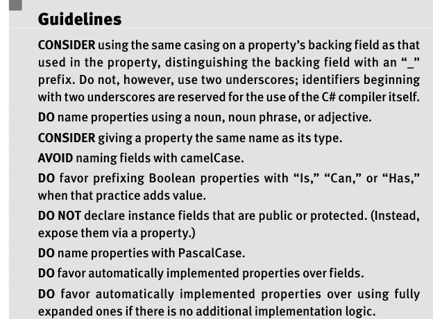

## 使用带验证的属性

注意清单 6.20 中，`Employee` 的 `Initialize()` 方法在赋值时也使用了属性而不是字段。虽然这不是必须的，但结果是，属性 setter 中的任何验证都会在类和类外被调用。例如，考虑一下如果你修改 `LastName` 属性，使其在将值分配给 `_LastName` 之前检查 `value` 是否为 null 或空字符串，会发生什么。

**清单 6.20：提供属性验证**

```csharp
class Employee
{
    // ...
    public void Initialize(
        string newFirstName, string newLastName)
    {
        // Use property inside the Employee
        // class as well
        FirstName = newFirstName;
        LastName = newLastName;
    }
    // LastName property
    public string LastName
    {
        get => _LastName;
        set
        {
            // Validate LastName assignment
            if (value == null)
            {
                // Report error
                // In C# 6.0 replace "value" with nameof(value)
                throw new ArgumentNullException("value");
            }
            else
            {
                // Remove any whitespace around
                // the new last name
                value = value.Trim();
                if (value == "")
                {
                    // Report error
                    // In C# 6.0 replace "value" with nameof(value)
                    throw new ArgumentException(
                          "LastName cannot be blank.", "value");
                }
                else
                {
                    _LastName = value;
                }
            }
        }
    }
    private string _LastName;
    // ...
}
```

通过这种新的实现，如果 `LastName` 被分配了无效值，无论是来自同一类的其他成员，还是通过 `Program.Main()` 内部对 `LastName` 的直接赋值，代码都会抛出异常。通过提供类似字段的 API 来拦截赋值并验证参数的能力，是属性的一大优势。

- 1. 向 `Teller`、`Cher`、`Sting`、`Madonna`、`Bono`、`Prince`、`Liberace` 等人道歉。

良好的实践是仅在属性实现内部访问属性的后备字段。换句话说，你应该始终使用属性，而不是直接调用字段。在许多情况下，即使是在与该属性相同的类内的代码中，这一原则也适用。如果你遵循这种做法，当你添加诸如验证代码之类的代码时，整个类立即就能从中受益。⁵

虽然罕见，但可以在 setter 内部对 `value` 进行赋值，如清单 6.20 所示。在这种情况下，对 `value.Trim()` 的调用会移除新姓氏值周围的空白字符。

## 指南

- **避免** 在属性外部（即使是在包含类内部）访问属性的后备字段。
- **务必** 在创建 `ArgumentException()` 或 `ArgumentNullException()` 类型的异常时，使用 `"value"` 作为 `paramName` 参数（`"value"` 是属性 setter 中参数的隐式名称）。

## 高级主题

### nameof 操作符

如果在属性验证过程中确定新值的赋值无效，则有必要抛出异常——通常为 `ArgumentException()` 或 `ArgumentNullException()` 类型。这两种异常都接受一个名为 `paramName` 的字符串参数，用于标识无效参数的名称。在清单 6.20 中，我们将 `"value"` 作为此参数的参数传递，但 C# 6.0 提供了使用 `nameof` 操作符的改进。`nameof` 操作符接受一个标识符，如 `value` 变量，并返回该名称的字符串表示——在本例中为 `"value"`。

5. 如本章后面所述，存在一个例外情况，即当字段被标记为只读时，因为那时值只能在构造函数中设置。在 C# 6.0 中，可以直接赋值只读属性的值，从而完全消除对只读字段的需求。

使用 `nameof` 运算符的优势在于，如果标识符名称发生变化，重构工具会自动更改 `nameof` 的参数。如果未使用重构工具，代码将不再编译，从而强制开发人员手动更改该参数。

对于属性验证器的情况，参数始终是 `value` 且无法更改，因此可以说利用 `nameof` 运算符带来的好处已经消失。尽管如此，为了与以下准则保持一致，仍应考虑在所有 `paramName` 参数的情况下继续使用 `nameof` 运算符：对于接受此参数的异常（如 `ArgumentNullException` 和 `ArgumentException`），始终对传入的 `paramName` 参数使用 `nameof`。

## 只读和只写属性

通过移除属性的 getter 或 setter 部分，你可以改变属性的可访问性。仅带有 setter 的属性是只写属性，这是一种相对罕见的情况。同样，仅提供 getter 会使属性成为只读属性；任何尝试赋值的行为都会导致编译错误。例如，要使 `Id` 变为只读，你可以按照清单 6.21 中所示的方式编写代码。

### 清单 6.21：在 C# 6.0 之前定义只读属性

```csharp
class Program
{
    static void Main()
    {
        Employee employee1 = new Employee();
        employee1.Initialize(42);
        // 错误：属性或索引器 'Employee.Id'
        // 不能被赋值；它是只读的
        // employee1.Id = "498";
    }
}

class Employee
{
    public void Initialize(int id)
    {
        // 因为 Id 属性没有 setter，所以使用字段
        // 它是只读的
        _Id = id.ToString();
    }
}
```

```csharp
// ...

// Id 属性声明
public string Id
{
    get => _Id;
    // 未提供 setter
}
private string _Id;
}
```

清单 6.21 在 `Employee` 的 `Initialize()` 方法内部而不是通过属性来分配字段值（`_Id = id`）。通过属性进行赋值会导致编译错误，就像在 `Program.Main()` 中那样。

从 C# 6.0 开始，还支持**自动实现的只读属性**，如下所示：

```csharp
public bool[,] Cells { get; } = new bool[2, 3, 3];
```

这显然是对 C# 6.0 之前方法的重大改进，特别是考虑到只读属性在诸如项目数组或清单 6.21 中的 `Id` 等场景中非常常见。

关于自动实现的只读属性，有一个重要的注意事项是，与只读字段类似，编译器要求必须通过初始化器（或在构造函数中）进行初始化。在前面的代码片段中，我们使用了初始化器，但如我们稍后将看到的，在构造函数内部对 `Cells` 进行赋值也是允许的。

鉴于准则规定不应从外部访问字段，在 C# 6.0 环境中编程的人会发现，几乎没有必要使用 C# 6.0 之前的语法；相反，程序员始终可以使用自动实现的只读属性。唯一的例外可能是当只读修改字段的 `dataType` 与属性的 `dataType` 不匹配时——例如，如果字段类型为 `int`，而只读属性类型为 `double`。

## 准则

- 如果属性值不应被更改，则应创建只读属性。
- 在 C# 6.0（或更高版本）中，如果属性值不应被更改，应创建自动实现的只读属性，而不是带有后台字段的只读属性。

## 作为虚字段的属性

如前所述，属性表现得像虚字段。在某些情况下，你甚至不需要后台字段。相反，属性 getter 返回计算出的值，而 setter 解析该值并将其持久化到其他成员字段（如果存在的话）。例如，考虑清单 6.22 中显示的 `Name` 属性实现。输出 6.7 显示了结果。

### 清单 6.22：定义属性

```csharp
class Program
{
    static void Main()
    {
        Employee employee1 = new Employee();
        employee1.Name = "Inigo Montoya";
        System.Console.WriteLine(employee1.Name);
        // ...
    }
}

class Employee
{
    // ...
    // FirstName 属性
    public string FirstName
    {
        get
        {
            return _FirstName;
        }
        set
        {
            _FirstName = value;
        }
    }
    private string _FirstName;
    // LastName 属性
    public string LastName
    {
        get => _LastName;
        set => _LastName = value;
    }
    private string _LastName;
    // ...
    // Name 属性
    public string Name
    {
        get
        {
            return $"{ FirstName } { LastName }";
        }
        set
        {
            // 将赋值的字符串拆分为
            // 名和姓
```


```csharp
string[] names;

names = value.Split(new char[]{' '});

if(names.Length == 2)
{
    FirstName = names[0];
    LastName = names[1];
}
else
{
    // 如果未分配全名，
    // 则抛出异常
    throw new System.ArgumentException(
        $"分配的值 '{ value }' 无效", "value");
}
}
}
public string Initials => $"{ FirstName[0] } { LastName[0] }";
// ...
}
```

### 输出 6.7

Inigo Montoya

`Name` 属性的 getter 将 `FirstName` 和 `LastName` 属性返回的值连接起来。事实上，分配的名称值实际上并没有被存储。当对 `Name` 属性进行赋值时，右侧的值会被解析为名和姓的部分。

## Getter 和 Setter 上的访问修饰符

如前所述，不从属性外部访问字段是一种良好的实践，因为这样做会绕过可能插入的任何验证或额外逻辑。不幸的是，`C#` 1.0 不允许在属性的 getter 和 setter 部分之间具有不同的封装级别。因此，无法创建公共的 getter 和私有的 setter，使得外部类对属性具有只读访问权限，而类内部的代码可以写入该属性。

在 `C#` 2.0 中，支持在属性实现的 get 或 set 部分（而不是两者都指定）上放置访问修饰符，从而覆盖在属性声明上指定的访问修饰符。清单 6.23 演示了如何做到这一点。

### 清单 6.23：在 Setter 上放置访问修饰符

```csharp
class Program
{
    static void Main()
    {
        Employee employee1 = new Employee();
        employee1.Initialize(42);
        // 错误：属性或索引器 'Employee.Id'
        // 在此上下文中不能使用，因为 set
        // 访问器不可访问
        employee1.Id = "490";
    }
}

class Employee
{
    public void Initialize(int id)
    {
        // 设置 Id 属性
        Id = id.ToString();
    }
    // ...
    // Id 属性声明
    public string Id
    {
        get => _Id;
        // 提供访问修饰符仅在 C# 2.0 及
        // 更高版本中是可能的
        private set => _Id = value;
    }
    private string _Id;
}
```

通过在 setter 中使用 `private`，该属性对于 `Employee` 以外的类表现为只读。在 `Employee` 内部，该属性表现为可读/可写，因此你可以在类本身内部分配该属性。在 getter 或 setter 上指定访问修饰符时，请确保该访问修饰符比整个属性的访问修饰符更具限制性。例如，将属性声明为 *private* 而将 setter 声明为 *public* 会导致编译错误。

## 准则

- 应在所有属性的 getter 和 setter 实现上应用适当的可访问性修饰符。
- 不要仅提供 setter 的属性，或不要提供 setter 具有比 getter 更宽泛的可访问性的属性。

## 不允许将属性和方法调用作为 *ref* 或 *out* 参数值

`C#` 允许属性像字段一样使用，但作为 *ref* 或 *out* 参数值传递时除外。*ref* 和 *out* 参数值在内部是通过将内存地址传递给目标方法来实现的。然而，由于属性可以是没有后台字段的 *virtual* 字段，或者是 *read-only* 或 *write-only*，因此无法传递底层存储的地址。因此，你无法将属性作为 *ref* 或 *out* 参数值传递。方法调用也是如此。相反，当代码需要将属性或方法调用作为 *ref* 或 *out* 参数值传递时，代码必须先将值复制到变量中，然后传递该变量。一旦方法调用完成，代码必须将该变量重新赋值给属性。

## 高级主题

## 属性内部结构

清单 6.24 表明，getter 和 setter 在公共中间语言（CIL）中分别显示为 `get_FirstName()` 和 `set_FirstName()`。

### 清单 6.24：由属性生成的 CIL 代码

```cil
// ...
.field private string _FirstName
.method public hidebysig specialname instance string
    get_FirstName() cil managed
```

```cil
// Code size 12 (0xc)
.maxstack 1
.locals init (string V_0)
IL_0000: nop
IL_0001: ldarg.0
IL_0002: ldfld string Employee::FirstName
IL_0007: stloc.0
IL_0008: br.s IL_000a
IL_000a: ldloc.0
IL_000b: ret
} // End of method Employee::get_FirstName
```

```cil
.method public hidebysig specialname instance void
set_FirstName(string 'value') cil managed
{
// Code size 9 (0x9)
.maxstack 8
IL_0000: nop
IL_0001: ldarg.0
IL_0002: ldarg.1
IL_0003: stfld string Employee::FirstName
IL_0008: ret
} // End of method Employee::set_FirstName
```

```cil
.property instance string FirstName()
{
.get instance string Employee::get_FirstName()
.set instance void Employee::set_FirstName(string)
} // End of property Employee::FirstName
```

```cil
// ...
```

与常规方法的外观一样重要的是，属性在 CIL 中也是一个显式的结构。正如清单 6.25 所示，getter 和 setter 是通过 CIL 属性调用的，而 CIL 属性是 CIL 代码中的一个显式结构。正因为如此，语言和编译器并不局限于始终基于命名约定来解释属性。相反，CIL 属性为编译器和代码编辑器提供了一种提供特殊语法的手段。

## 清单 6.25：属性在 CIL 中是一个显式结构

```cil
.property instance string FirstName()
{
.get instance string Program::get_FirstName()
.set instance void Program::set_FirstName(string)
} // End of property Program::FirstName
```

请注意，在清单 6.24 中，作为属性一部分的 getter 和 setter 包含 `SpecialName` 元数据。此修饰符是诸如 Visual Studio 等 IDE 用作隐藏 IntelliSense 中成员的标志。

自动实现的属性与你显式定义后台字段的属性几乎相同。`C#` 编译器会在后台字段的生成字段中生成一个名为 `<PropertyName>k__BackingField` 的字段在 `CIL` 中，取代了手动定义的后台字段。此生成的字段包含一个名为 `System.Runtime.CompilerServices.CompilerGeneratedAttribute` 的特性（参见第 18 章）。getter 和 setter 都装饰有相同的特性，因为它们也是生成的——实现方式与清单 5.23 和 5.24 中的相同。

## 构造函数

现在你已经向类中添加了字段并可以存储数据，你需要考虑该数据的有效性。正如你在清单 6.3 中看到的，使用 `new` 运算符实例化对象是可能的。然而，结果是你可以创建一个具有无效数据的 `employee`。在 `employee` 赋值之后，你有一个 `Employee` 对象，其姓名和薪水尚未初始化。在这个特定的清单中，你在实例化 `employee` 后立即分配了未初始化的字段，但如果你没有执行初始化，编译器不会发出警告。结果，你可能会得到一个具有无效名称的 `Employee` 对象。

### 声明构造函数

为了纠正这个问题，你需要提供一种在创建对象时指定所需数据的方法。你可以使用构造函数来完成这一点，如清单 6.26 所示。

**清单 6.26：** 定义构造函数

```csharp
class Employee
{
    // Employee constructor
    public Employee(string firstName, string lastName)
    {
        FirstName = firstName;
        LastName = lastName;
    }
}
```

```csharp
public string FirstName{ get; set; }
public string LastName{ get; set; }
public string Salary{ get; set; } = "Not Enough";
// ...
```

如图所示，要定义构造函数，你需要创建一个没有返回类型的方法，其方法名与类名相同。

构造函数是运行时调用以初始化对象实例的方法。在这种情况下，构造函数以名字和姓氏作为参数，允许程序员在实例化 `Employee` 对象时指定这些名字。清单 6.27 是一个调用构造函数的示例。

## 清单 6.27：调用构造函数

```csharp
class Program
{
    static void Main()
    {
        Employee employee;
        employee = new Employee("Inigo", "Montoya");
        employee.Salary = "Too Little";
        System.Console.WriteLine(
            "{0} {1}: {2}",
            employee.FirstName,
            employee.LastName,
            employee.Salary);
    }
    // ...
```

请注意，`new` 运算符返回正在实例化的对象的类型（即使在构造函数的声明或实现中没有显式指定返回类型或 return 语句）。此外，你已删除了名字和姓氏的初始化代码，因为该初始化发生在构造函数内部。在这个示例中，你未在构造函数中初始化 `Salary`，因此分配薪水的代码仍然存在。

开发人员在同时使用声明时的赋值和构造函数内的赋值时应当小心。构造函数内的赋值将在字段声明时进行的任何赋值（例如清单 6.5 中的 `string Salary = "Not enough"`）之后发生。因此，构造函数内的赋值将覆盖在声明时分配的任何值。这种细微差别可能会使粗心读者误读代码，他们可能会假设实例化后的值是字段声明中分配的值。因此，值得考虑一种不混合同一类中声明赋值和构造函数赋值的编码风格。

## 高级主题

### new 运算符的实现细节

内部而言，`new` 运算符与构造函数之间的交互如下。`new` 运算符从内存管理器获取“空”内存，然后调用指定的构造函数，并将空内存的引用作为隐式 `this` 参数传递给构造函数。接下来，构造函数链的其余部分执行，在构造函数之间传递引用。没有构造函数有返回类型；从行为上看，它们都返回 void。当构造函数链执行完毕时，`new` 运算符返回内存引用，现在指向已初始化的内存形式。

### 默认构造函数

当你显式添加构造函数时，你不能再从 `Main()` 中实例化 `Employee` 而不指定名字和姓氏。因此，清单 6.28 中显示的代码将无法编译。

**清单 6.28：** 默认构造函数不再可用

```csharp
class Program
{
    static void Main()
    {
        Employee employee;
        // ERROR: No overload because method 'Employee'
        // takes '0' arguments
        employee = new Employee();
        // ...
    }
}
```

如果类没有显式定义的构造函数，`C#` 编译器在编译期间会添加一个。此构造函数不接受参数，因此按定义它是**默认构造函数**。一旦你向类中添加显式构造函数，`C#` 编译器就不再提供默认构造函数。因此，当定义了 `Employee(string firstName, string lastName)` 时，编译器不会添加默认构造函数 `Employee()`。你可以手动添加这样的构造函数，但你又允许在不指定员工姓名的情况下构建 `Employee`。

没有必要依赖编译器定义的默认构造函数。程序员也可以显式定义默认构造函数——也许是一个将某些字段初始化为特定值的构造函数。定义默认构造函数只需声明一个不接受参数的构造函数即可。

## 对象初始化器

从 `C#` 3.0 开始，`C#` 语言团队添加了使用**对象初始化器**来初始化对象可访问字段和属性的功能。对象初始化器由一组成员初始化器组成，这些成员初始化器封装在创建对象后的构造函数调用后面的花括号中。每个成员初始化器是将被访问的字段或属性名与值的赋值（参见清单 6.29）。


**清单 6.29：调用对象初始化器**

```csharp
class Program
{
    static void Main()
    {
        Employee employee1 = new Employee("Inigo", "Montoya")
        { Title = "Computer Nerd", Salary = "Not enough"};
        // ...
    }
}
```

请注意，即使用对象初始化器，相同的构造函数规则也适用。事实上，生成的 CIL 与如果在构造函数调用后立即在单独语句中分配字段或属性是完全相同的。`C#` 中成员初始化器的顺序提供了 CIL 中构造函数调用后语句中属性和字段赋值的序列。

通常，在构造函数退出之前，所有属性都应初始化为合理的默认值。此外，通过在 setter 中使用验证逻辑，可以限制将无效数据赋值给属性。在某些情况下，一个或多个属性的值可能导致同一对象上的其他属性包含无效值。当这种情况发生时，源自无效状态的异常应推迟到相关的无效属性值变得相关时才抛出。

## 准则

- 应为所有属性提供合理的默认值，确保默认值不会导致安全漏洞或显著低效的代码。对于自动实现的属性，通过构造函数设置默认值。
- 应允许按任意顺序设置属性，即使这会导致对象处于暂时的无效状态。

## 高级主题

## 集合初始化器

使用与对象初始化器类似的语法，`C#` 3.0 中添加了集合初始化器。集合初始化器支持与对象初始化器类似的功能集，只不过作用于集合。具体来说，集合初始化器允许在集合实例化时分配集合内的项。借用数组所使用的相同语法，集合初始化器在创建集合时初始化集合内的每个项。例如，初始化一个员工列表涉及在构造函数调用后的大括号内指定每个项，如列表 6.30 所示。

### 列表 6.30：调用对象初始化器

```csharp
class Program
{
    static void Main()
    {
        List<Employee> employees = new List<Employee>()
        {
            new Employee("Inigo", "Montoya"),
            new Employee("Kevin", "Boost")
        };
        // ...
    }
}
```


在分配新的集合实例后，编译器生成的代码将依次实例化每个对象，并通过 `Add()` 方法将它们添加到集合中。

# 高级主题

## 终结器

构造函数定义了在类的实例化过程中发生什么。为了定义对象销毁时发生什么，C# 提供了终结器构造。与 C++ 中的析构函数不同，终结器并不会在对象超出作用域后立即运行。相反，终结器在对象被确定为“不可达”后的某个未指定时间执行。具体来说，垃圾回收器在垃圾回收周期中识别具有终结器的对象，并立即不释放这些对象，而是将它们添加到终结队列中。一个独立的线程遍历终结队列中的每个对象，并在将其从队列中移除并使其可供垃圾回收器再次使用之前调用该对象的终结器。第 10 章将详细讨论这个过程以及资源清理。顺便一提，C# 7.0 允许将终结器实现为表达式体成员。

## 重载构造函数

构造函数可以重载——只要参数数量或类型不同，就可以拥有多个构造函数。例如，如列表 6.31 所示，你可以提供一个包含员工 ID、名和姓的构造函数，或者甚至只包含员工 ID 的构造函数。

### 列表 6.31：重载构造函数

```csharp
class Employee
{
    public Employee(string firstName, string lastName)
    {
        FirstName = firstName;
        LastName = lastName;
    }
    public Employee(
        int id, string firstName, string lastName )
    {
        Id = id;
        FirstName = firstName;
        LastName = lastName;
    }
    public Employee(int id) => Id = id;
    public int Id
    {
        get => Id;
        private set
        {
            // 查找员工姓名...
            // ...
        }
    }
    public string FirstName { get; set; }
    public string LastName { get; set; }
    public string Salary { get; set; } = "Not Enough";
    // ...
}
```

这种方法使得 `Program.Main()` 能够通过仅传入员工 ID 或同时传入姓名和 ID 的方式，从名和姓实例化员工。在系统中创建新员工时，你会使用包含姓名和 ID 的构造函数。你会使用仅包含 ID 的构造函数从文件或数据库中加载员工。

与方法重载类似，使用多个构造函数是为了支持使用少量参数的简单场景以及使用额外参数的复杂场景。考虑使用可选参数来替代重载，以便在 API 中显示“默认”属性的默认值。例如，`Person(string firstName, string lastName, int? age = null)` 的构造函数签名提供了签名文档，说明如果未指定 `Person` 的 `Age`，它将默认为 `null`。

此外，请注意，从 C# 7.0 开始，构造函数可以具有表达式体成员实现，例如：

```csharp
public Employee(int id) => Id = id;
```

### 准则

- 如果构造函数参数仅用于设置属性，则应为构造函数参数 `camelCase` 和属性 `PascalCase` 使用相同的名称。
- 应提供构造函数可选参数和/或便捷构造函数重载，以良好的默认值初始化属性。
- 应允许按任意顺序设置属性，即使这会导致对象处于暂时的无效状态。

## 构造函数链接：使用 `this` 调用另一个构造函数

注意在列表 6.31 中，`Employee` 对象的初始化代码现在在多个地方重复，因此需要在多个地方维护。代码量很小，但有一些方法可以通过使用构造函数初始化器从一个构造函数调用另一个构造函数——即构造函数链接——来消除重复。构造函数初始化器决定在执行当前构造函数的实现之前调用哪个构造函数（参见列表 6.32）。

### 列表 6.32：从一个构造函数调用另一个构造函数

```csharp
class Employee
{
    public Employee(string firstName, string lastName)
    {
        FirstName = firstName;
        LastName = lastName;
    }
    public Employee(
        int id, string firstName, string lastName)
        : this(firstName, lastName)
    {
        Id = id;
    }
    public Employee(int id)
    {
        Id = id;
        // 查找员工姓名...
        // ...
        // 注意：成员构造函数不能显式内联调用。
        // this(id, firstName, lastName);
    }
    public int Id { get; private set; }
    public string FirstName { get; set; }
    public string LastName { get; set; }
    public string Salary { get; set; } = "Not Enough";
    // ...
}
```

要在同一类内从一个构造函数调用另一个构造函数（针对同一对象实例），C# 使用冒号后跟 `this` 关键字，再跟被调用构造函数声明中的参数列表。在这种情况下，接受所有三个参数的构造函数调用了接受两个参数的构造函数。通常，这种调用模式是相反的——也就是说，参数最少的构造函数调用参数最多的构造函数，并为未知的参数传递默认值。

### 初学者主题

#### 集中初始化

注意在列表 6.32 的 `Employee(int id)` 构造函数实现中，你不能调用 `this(firstName, lastName)`，因为这个构造函数没有这样的参数。为了启用所有初始化代码都通过一个方法执行的模式，你必须创建一个单独的方法，如列表 6.33 所示。

### 列表 6.33：提供初始化方法

```csharp
class Employee
{
    public Employee(string firstName, string lastName)
    {
        int id;
        // 生成员工 ID...
        // ...
        Initialize(id, firstName, lastName);
    }
    public Employee(int id, string firstName, string lastName)
    {
        Initialize(id, firstName, lastName);
    }
    public Employee(int id)
    {
        string firstName;
        string lastName;
        Id = id;
        // 查找员工数据
        // ...
        Initialize(id, firstName, lastName);
    }
    private void Initialize(
        int id, string firstName, string lastName)
    {
        Id = id;
        FirstName = firstName;
        LastName = lastName;
    }
    // ...
}
```

在这种情况下，该方法名为 `Initialize()`，它接受姓名和员工 ID。请注意，你仍然可以如列表 6.32 所示，从一个构造函数调用另一个构造函数。

## 解构器

构造函数允许你接受多个参数并将它们全部封装到一个对象中。在 C# 7.0 之前，没有明确的构造用于实现相反的操作——将封装的项拆分为其组成部分。当然，你可以手动将每个属性赋值给一个变量；然而，如果存在大量这样的变量，它将需要许多单独的语句。随着 C# 7.0 对元组语法的引入，这变得容易得多。例如，你可以声明一个像列表 6.34 所示的 `Deconstruct()` 方法那样的方法。

### 提供初始化方法

```csharp
class Employee
{
  public void Deconstruct(
    out int id, out string firstName,
    out string lastName, out string salary)
  {
    (id, firstName, lastName, salary) =
      (Id, FirstName, LastName, Salary);
  }
  // ...
}
```

```csharp
class Program
{
  static void Main()
  {
    Employee employee;
    employee = new Employee("Inigo", "Montoya");
    employee.Salary = "Too Little";
    employee.Deconstruct(out _, out string firstName,
                         out string lastName, out string salary);
    System.Console.WriteLine(
      "{0}: {1}: {2}",
      firstName, lastName, salary);
  }
}
```

你可以直接调用此类方法，正如在第 5 章中所预期的那样，可以内联声明 `out` 参数。

从 C# 7.0 开始，通过直接将对象实例分配给元组，可以隐式调用 `Deconstruct()` 方法——即**解构器**（此时假设被分配的变量已经声明过）：

```csharp
(_, firstName, lastName, salary) = employee;
```

该语法产生的 CIL 代码与列表 6.34 中高亮显示的部分完全相同——它只是一种更简单的语法（并且不太能体现出调用了 `Deconstruct()` 方法）。

注意，该语法允许使用元组语法来匹配 `out` 参数赋值中的变量。它也不允许分配给元组类型，例如：

```csharp
(int, string, string, string) tuple = employee;
```

或者使用命名字项，例如：

```csharp
(int id, string firstName, string lastName, string salary) tuple = employee;
```

要声明一个解构器，方法名必须是 `Deconstruct`，并且具有返回 `void` 且仅接受两个或更多 `out` 参数的签名。并且，给定这样的签名，可以直接将对象实例分配给元组，而无需显式的方法调用。

## 静态成员

第 1 章中的 `HelloWorld` 示例简要涉及了关键字 `static`。本节更完整地定义了 `static` 关键字。

首先，让我们考虑一个例子。假设每个员工的 `Id` 值需要是唯一的。实现这一点的一种方法是存储一个计数器来跟踪每个员工的 `ID`。然而，如果将值存储为实例字段，那么每次实例化对象时，都会创建一个新的 `NextId` 字段，这意味着每个 `Employee` 对象实例都会为该字段消耗内存。最大的问题是，每次实例化一个 `Employee` 对象时，之前实例化的所有 `Employee` 对象上的 `NextId` 值都需要用下一个 `ID` 值进行更新。在这种情况下，你需要的是一个由所有 `Employee` 对象实例共享的单个字段。

### 语言对比：C++/Visual Basic——全局变量和函数

与之前的许多语言不同，C# 没有全局变量或全局函数。C# 中的所有字段和方法都出现在类的上下文中。在 C# 领域中，全局字段或函数的等价物是静态字段或函数。全局变量/函数与 C# 静态字段/方法之间没有功能差异，除了静态字段/方法可以包含访问修饰符（例如 `private`），从而限制访问并提供更好的封装。

### 静态字段

要定义跨多个实例可用的数据，你使用 `static` 关键字，如列表 6.35 所示。

**列表 6.35：声明静态字段**

```csharp
class Employee
{
    public Employee(string firstName, string lastName)
    {
        FirstName = firstName;
        LastName = lastName;
        Id = NextId;
        NextId++;
    }
    // ...
    public static int NextId;
    public int Id { get; set; }
    public string FirstName { get; set; }
    public string LastName { get; set; }
    public string Salary { get; set; } = "Not Enough";
    // ...
}
```

在这个例子中，`NextId` 字段声明包含 `static` 修饰符，因此被称为**静态字段**。与 `Id` 不同，`NextId` 在所有的 `Employee` 实例之间共享单一的存储位置。在 `Employee` 构造函数内部，在递增 `Id` 之前，你立即将新 `Employee` 对象的 `Id` 分配为 `NextId` 的值。当创建另一个 `Employee` 类实例时，`NextId` 将会递增，并且新的 `Employee` 对象的 `Id` 字段将持有不同的值。

正如**实例字段**（非静态字段）可以在声明时初始化一样，静态字段也可以，如列表 6.36 所示。

**列表 6.36：在声明时分配静态字段**

```csharp
class Employee
{
    // ...
    public static int NextId = 42;
    // ...
}
```

与实例字段不同，如果没有为静态字段提供初始化，静态字段将自动分配其默认值 `0`、`null`、`false` 等——相当于 `default(T)`，其中 `T` 是类型名称。因此，即使从未在 C# 代码中显式分配，也可以访问静态字段。

非静态字段，或实例字段，为所属的每个对象提供一个新的存储位置。相比之下，静态字段不属于实例，而是属于类本身。因此，你通过类名从类外部访问静态字段。考虑列表 6.37 中显示的新 `Program` 类（使用列表 6.35 中的 `Employee` 类）。

**列表 6.37：访问静态字段**

```csharp
using System;
class Program
{
    static void Main()
    {
        Employee.NextId = 1000000;
        Employee employee1 = new Employee(
            "Inigo", "Montoya");
        Employee employee2 = new Employee(
            "Princess", "Buttercup");
        Console.WriteLine(
            "{0} {1} {2}",
            employee1.FirstName,
            employee1.LastName,
            employee1.Id);
        Console.WriteLine(
            "{0} {1} {2}",
            employee2.FirstName,
            employee2.LastName,
            employee2.Id);
        Console.WriteLine(
            $"NextId = { Employee.NextId }");
    }
    // ...
}
```

**输出 6.8**

```
Inigo Montoya (1000000)
Princess Buttercup (1000001)
NextId = 1000002
```


为了设置和检索 `NextId` 静态字段的初始值，你使用类名 `Employee`，而不是类型的实例引用。唯一可以省略类名的地方是在类本身内部（或派生类中）。换句话说，`Employee(...)` 构造函数不需要使用 `Employee.NextId`，因为代码出现在 `Employee` 类本身的上下文中，因此上下文已经明确。变量的范围是可以通过其未限定名称引用的程序文本；静态字段的范围是类的文本（以及任何派生类）。

尽管你引用静态字段的方式与引用实例字段的方式略有不同，但在同一个类中不能定义一个静态字段和一个同名实例字段。错误引用错误字段的可能性很高，因此 C# 设计者决定阻止此类代码。因此，名称重叠会在声明空间中引入冲突。

### 初学者主题

#### 数据可以关联到类和对象

类和对象都可以有关联数据，就像模具和由模具创建的组件一样。

例如，模具可以拥有对应于它创建的组件数量的数据、下一个组件的序列号、注入模具中塑料的当前颜色以及每小时生产的组件数量。同样，组件有自己的序列号、自己的颜色，以及可能的创建组件的日期和时间。虽然组件的颜色对应于创建组件时模具内塑料的颜色，但它显然不包含对应于模具中当前塑料颜色或下一个要生产的组件序列号的数据。

在设计对象时，程序员应小心地适当地声明字段和方法，基于静态或实例。通常，你不应该将不访问任何实例数据的方法声明为静态方法，而应该将访问实例数据（实例不作为参数传入）的方法声明为实例方法。静态字段存储与类相关的数据，例如新实例的默认值或已创建的实例数量。实例字段存储与对象相关的数据。

## 静态方法

与静态字段一样，你直接通过类名来访问静态方法——例如，作为 `Console.ReadLine()`。此外，无需拥有实例即可访问该方法。

代码清单 6.38 提供了另一个声明和调用静态方法的示例。

### 代码清单 6.38：在 DirectoryInfo 上定义静态方法

```csharp

public static class DirectoryInfoExtension

{

    public static void CopyTo(

        DirectoryInfo sourceDirectory, string target,

        SearchOption option, string searchPattern)

    {

        if (target[target.Length - 1] !=

            Path.DirectorySeparatorChar)

        {

            target += Path.DirectorySeparatorChar;

        }

        if (!Directory.Exists(target))

        {

            Directory.CreateDirectory(target);

        }

        for (int i = 0; i < searchPattern.Length; i++)

        {

            foreach (string file in

                Directory.GetFiles(

                    sourceDirectory.FullName, searchPattern))

            {

                File.Copy(file,

                    target + Path.GetFileName(file), true);

            }

        }

        // Copy subdirectories (recursively)

        if (option == SearchOption.AllDirectories)

        {

            foreach (string element in

                Directory.GetDirectories(

                    sourceDirectory.FullName))

            {

                Copy(element,

                    target + Path.GetFileName(element),

                    searchPattern);

            }

        }

    }

}

```

```csharp

// ...

DirectoryInfo directory = new DirectoryInfo("\\Source");

directory.MoveTo(".\\Root");

DirectoryInfoExtension.CopyTo(

    directory, ".\\Target", 

    SearchOption.AllDirectories, "*");

// ...

```

在代码清单 6.38 中，`DirectoryInfoExtension.CopyTo()` 方法接受一个 `DirectoryInfo` 对象，并将底层的目录结构复制到新位置。

由于静态方法不通过特定实例引用，因此 `this` 关键字在静态方法内部无效。此外，在没有指向字段或方法所属的特定实例的引用的情况下，不可能直接从静态方法内部访问实例字段或实例方法。（请注意，`Main()` 也是静态方法的另一个示例。）

人们可能期望此方法位于 `System.IO.Directory` 类中，或者作为 `System.IO.DirectoryInfo` 上的实例方法。由于两者都不存在，代码清单 6.38 在一个全新的类上定义了这样一个方法。在本章后面“扩展方法”部分中，我们将展示如何使其表现为 `DirectoryInfo` 上的实例方法。

## 静态构造函数

除了静态字段和方法之外，C# 还支持静态构造函数。静态构造函数提供作为初始化类本身而非类实例的手段。此类构造函数不会显式调用；相反，运行时会在首次访问该类时自动调用静态构造函数，无论是通过调用常规构造函数还是通过访问类上的静态方法或字段。由于静态构造函数不能显式调用，因此静态构造函数不允许有参数。

你使用静态构造函数将类内的静态数据初始化为特定值，主要是在初始值涉及比声明时的简单赋值更复杂的逻辑时。请参见代码清单 6.39。

### 代码清单 6.39：声明静态构造函数

```csharp

class Employee

{

    static Employee()

    {

        Random randomGenerator = new Random();

        NextId = randomGenerator.Next(101, 999);

    }

    // ...

    public static int NextId = 42;

    // ...

}

```

代码清单 6.39 将 `NextId` 的初始值分配为 100 到 1,000 之间的一个随机整数。由于初始值涉及方法调用，因此 `NextId` 的初始化代码出现在静态构造函数中，而不是声明的一部分。

如果在静态构造函数和声明中都发生 `NextId` 的赋值，当初始化完成时其值是什么并不明显。C# 编译器生成的 CIL 会将声明赋值移动为静态构造函数内的第一条语句。因此，`NextId` 将包含由 `randomGenerator.Next(101, 999)` 返回的值，而不是在 `NextId` 声明期间分配的值。因此，静态构造函数内的赋值将优先于作为字段声明一部分发生的赋值，这与实例字段的情况相同。请注意，不支持定义静态终结器。

小心不要从静态构造函数中抛出异常，因为这将在应用程序剩余的生命周期内使该类型不可用。⁷

## 高级主题

#### 优先在声明期间进行静态初始化

静态构造函数在访问类的任何成员之前执行，无论它是静态字段、其他静态成员还是实例构造函数。为了支持这一实践，编译器在所有类型静态成员和构造函数中注入检查，以确保静态构造函数首先运行。

如果没有静态构造函数，编译器将所有静态成员初始化为其默认值，并避免添加静态构造函数检查。结果是，静态赋值初始化在任何静态字段被访问之前被调用，但未必在所有静态方法或任何实例构造函数被调用之前。如果静态成员的初始化成本高昂且不需要在访问静态字段之前执行，这可能提供性能改进。因此，你应该考虑内联初始化静态字段，而不是使用静态构造函数或在声明时初始化。

#### 准则

- 考虑内联初始化静态字段，而不是显式使用静态构造函数或声明赋值。
- 始于 2.0

## 静态属性

你还将属性声明为静态。例如，代码清单 6.40 将下一个 ID 的数据封装到一个属性中。

代码清单 6.40：声明静态属性

```csharp

class Employee

{

    // ...

    public static int NextId

    {

        get

        {

            return _NextId;

        }

        private set

        {

            _NextId = value;

        }

    }

    public static int _NextId = 42;

    // ...

}

```

几乎总是最好使用静态属性而不是公共静态字段，因为公共静态字段可以从任何地方调用，而静态属性至少提供了一定程度的封装。

- 始于 6.0

在 C# 6.0 中，包括不可访问的后备字段在内的整个 `NextId` 实现可以简化为带初始化的自动实现属性：

- 结束于 6.0

```csharp

public static int NextId { get; private set; } = 42;

```

## 静态类

某些类不包含任何实例字段。例如，考虑一个 `Math` 类，它包含对应于数学操作 `Max()` 和 `Min()` 的函数，如代码清单 6.41 所示。

### 代码清单 6.41：声明静态类

```csharp

// Static class introduced in C# 2.0

public static class SimpleMath

{

    // params allows the number of parameters to vary

    public static int Max(params int[] numbers)

    {

        // Check that there is at least one item in numbers

        if(numbers.Length == 0)

        {

            throw new ArgumentException(

                "numbers cannot be empty", "numbers");

        }

        int result;

        result = numbers[0];

        foreach (int number in numbers)

        {

            if(number > result)

            {

                result = number;

            }

        }

        return result;

    }

    // params allows the number of parameters to vary

    public static int Min(params int[] numbers)

    {

        // Check that there is at least one item in numbers

        if(numbers.Length == 0)

        {

            throw new ArgumentException(

                "numbers cannot be empty", "numbers");

        }

        int result;

        result = numbers[0];

        foreach (int number in numbers)

        {

            if(number < result)

            {

                result = number;

            }

        }

        return result; 

    }

}

```

[脚注 7 说明]
7. 严格来说，是应用程序域的生命周期——公共语言运行时中操作系统的虚拟等价进程。

```csharp
return result;
}
}

public class Program
{
public static void Main(string[] args)
{
int[] numbers = new int[args.Length];
for (int count = 0; count < args.Length; count++)
{
numbers[count] = args[count].Length;
}

Console.WriteLine($"Longest argument length = { SimpleMath.Max(numbers) }");
Console.WriteLine($"Shortest argument length = { SimpleMath.Min(numbers) }");
}
```

由于此类没有实例字段（或方法），创建这样的类将毫无意义。因此，该类被 `static` 关键字修饰。类上的 `static` 关键字提供了两种机制。首先，它阻止程序员编写实例化 `SimpleMath` 类的代码。其次，它阻止在类内声明任何实例字段或方法。由于该类不能被实例化，实例成员将毫无用处。前述列表中的 `Program` 类是另一个适合使用 `static` 类的良好候选者，因为它同样只包含 `static` 成员。

结束 2.0

`static` 类的另一个显著特征是，C# 编译器会自动在 `CIL` 中将其标记为抽象且密封。这将该类指定为**不可扩展**的；换句话说，没有其他类可以从该类派生，甚至无法实例化该类。

开始 3.0

开始 6.0

在上一章中，我们看到 `using static` 指令可以与 `SimpleMath` 等 `static` 类一起使用。例如，在列表 6.41 的顶部添加 `using static SimpleMath;` 声明后，你就可以无需 `SimpleMath` 前缀直接调用 `Max`：

结束 6.0

```csharp
Console.WriteLine($"Longest argument length = { Max(numbers) }");
```

# 扩展方法

考虑 `System.IO.DirectoryInfo` 类，它用于操作文件系统目录。该类支持列出文件和子目录（`DirectoryInfo.GetFiles()`）的功能，以及移动目录（`DirectoryInfo.Move()`）的功能。它直接不支持的一个功能是复制功能。如果你需要这样一个方法，你就必须自己实现它，如之前列表 6.38 所示。

`DirectoryInfoExtension.Copy()` 方法是一个标准的静态方法声明。然而，请注意调用这个 `Copy()` 方法与调用 `DirectoryInfo.Move()` 方法是不同的。这是不幸的。理想情况下，我们希望在 `DirectoryInfo` 上添加一个方法，这样给定一个实例，我们就可以将其作为实例方法调用：`directory.Copy()`。

C# 3.0 通过**扩展方法**模拟在不同类上创建实例方法。为了做到这一点，我们只需修改静态方法的签名，使其第一个参数——即我们要扩展的数据类型——前面加上 `this` 关键字（参见列表 6.42）。

### 列表 6.42: DirectoryInfo 的静态 Copy 方法

```csharp
public static class DirectoryInfoExtension

{

    public static void CopyTo(

        this DirectoryInfo sourceDirectory, string target,

        SearchOption option, string searchPattern)

    {

        // ...

    }

    // ...

    DirectoryInfo directory = new DirectoryInfo(".\\Source");

    directory.CopyTo(".\\Target",

        SearchOption.AllDirectories, "*");

    // ...

}
```


随着 `C# 3.0` 的这个简单添加，现在可以向任何类添加“实例方法”，包括不在同一程序集中的类。然而，生成的 CIL 代码与编译器在将扩展方法作为普通静态方法调用时生成的代码完全相同。

扩展方法的要求如下：

- 第一个参数对应于方法扩展或操作其上的类型。
- 要指定扩展方法，在扩展类型前加上 `this` 修饰符。
- 要作为扩展方法访问该方法，通过 `using` 指令导入扩展类型的命名空间（或将扩展类放在与调用代码相同的命名空间中）。

如果扩展方法的签名与扩展类型上已存在的签名匹配（即，如果 `CopyTo()` 已经存在于 `DirectoryInfo` 上），扩展方法将永远不会被调用，除非作为普通静态方法调用。

请注意，通过继承特化类型（在第 7 章中详细讨论）比使用扩展方法更可取。扩展方法没有提供干净的版本控制机制，因为向扩展类型添加匹配的签名将优先于扩展方法，且不会警告此变更。对于源代码不受你控制的扩展类，这种行为的微妙性更为明显。另一个次要点是，尽管开发 IDE 支持扩展方法的 IntelliSense，但简单地阅读调用代码并不能使方法是否扩展方法显而易见。

一般来说，你应该谨慎使用扩展方法。例如，不要在 `object` 类型上定义它们。第 8 章讨论了如何将扩展方法与接口关联使用。如果没有这种关联，定义扩展方法的情况很少见。

## 准则

避免随意定义扩展方法，特别是对于你并不拥有的类型。

## 封装数据

除了前面章节中提到的属性和访问修饰符外，类内数据还有几种其他专门的封装方式。例如，还有两个字段修饰符。第一个是 `const` 修饰符，你在声明局部变量时已经遇到过。第二个是字段可以被定义为只读的功能。

### const

与 `const` 值一样，`const` 字段包含一个编译时确定的值，不能在运行时更改。像 `pi` 这样的值是常量字段声明的良好候选者。列表 6.43 展示了声明 `const` 字段的示例。

#### 列表 6.43: 声明常量字段

```csharp
class ConvertUnits
{
    public const float CentimetersPerInch = 2.54f;
    public const int CupsPerGallon = 16;
    // ...
}
```

常量字段自动是静态的，因为每个对象实例不需要新的字段实例。显式地将常量字段声明为 `static` 会导致编译错误。此外，常量字段通常只为具有字面值的类型（例如 `string`、`int` 和 `double`）声明。像 `Program` 或 `System.Guid` 这样的类型不能用于常量字段。

重要的是，公共常量表达式中使用的值类型必须随时间永久不变。像 `pi`、阿伏加德罗常数和地球周长之类的值是好的例子。然而，可能随时间变化的值则不然。构建编号、人口统计数据和汇率将是不当的常量选择。

## 准则

- **应当**使用常量字段存储永远不会改变的值。
- **不应当**使用常量字段存储随时间改变的值。

## 高级主题

### 公共常量应为永久值

公共可访问的常量应当是永久的，因为更改常量的值不一定会在使用它的程序集中生效。如果一个程序集引用另一个程序集中的常量，该常量的值会被直接编译进引用程序集。因此，如果引用程序集中常量的值改变了，但引用程序集未重新编译，引用程序集仍将使用原始值，而不是新值。未来可能会改变的值应指定为 `readonly`。

### readonly

与 `const` 不同，`readonly` 修饰符仅适用于字段（不适用于局部变量）。它声明字段值只能在构造函数内部或通过声明时的初始化器修改。列表 6.44 演示了如何声明只读字段。

#### 列表 6.44: 将字段声明为 readonly

```csharp
class Employee
{
    public Employee(int id)
    {
        _Id = id;
    }
    // ...
    public readonly int _Id;
    public int Id
    {
        get { return _Id; }
    }
    // 错误：只读字段不能赋值
    // （除了在构造函数或变量初始化器中）
    // public void SetId(int id) =>
    //     _Id = id;
    // ...
}
```

与常量字段不同，带有 `readonly` 修饰符的字段可以在不同的实例之间有所不同。事实上，只读字段的值可以在构造函数内部发生变化。此外，只读字段可以作为实例字段或静态字段存在。另一个关键区别是，你可以在执行时而不是仅在编译时分配只读字段的值。鉴于只读字段必须在构造函数或初始化器中设置，这类字段是唯一一种编译器要求从对应属性之外的代码中访问该字段的情况。除了这一例外情况，你应避免在包裹属性以外的任何地方访问后备字段。

相较于 `const` 字段，带有 `readonly` 修饰符的字段的一个重要特性是，只读字段并不局限于具有字面值的类型。例如，可以声明一个 `readonly` 的 `System.Guid` 实例字段：

```csharp
public static readonly Guid ComIUnknownGuid =
    new Guid("00000000-0000-0000-C000-000000000046");
```

然而，使用常量是无法做到这一点的，因为 C# 中没有 GUID 的字面量表示。

鉴于指南指出字段不应从包裹属性外部访问，在 C# 6.0（或更高版本）环境下编程的人会发现，几乎从未需要过使用 `readonly` 修饰符。相反，更推荐使用只读自动实现属性，正如本章前文所讨论的那样。

请参见清单 6.45 以获取更多只读示例。

## 清单 6.45：声明只读自动实现属性

```csharp
class TicTacToeBoard
{
    // 将两位玩家的移动设置为全为 false（空白）
    //  |   |
    //  |---|
    //  |   |
    //  |---|
    //  |   |
    public bool[,,] Cells { get; } = new bool[2, 3, 3];
    // 错误：属性 Cells 是只读的，
    // 因此无法赋值
    //public void SetCells(bool[,,] value) =>
    //    Cells = new bool[2, 3, 3];
    // ...
}
```

无论是使用 C# 6.0 的只读自动实现属性，还是使用字段上的 `readonly` 修饰符，确保数组引用的不可变性是一种有用的防御性编程技术。它确保数组实例保持不变，同时允许数组内的元素发生变化。如果没有只读约束，人们太容易错误地分配一个新数组给该成员，从而丢弃现有数组而不是更新单个数组元素。换句话说，对数组使用只读方法并不会冻结数组的内容。相反，它冻结了数组实例（因此也冻结了数组中元素的数量），因为不可能将值重新分配给新实例。数组的元素仍然是可写的。

## 指南

- **应该（DO）** 在 C# 6.0（或更高版本）中优先使用只读自动实现属性，而不是只读字段。
- **应该（DO）** 在 C# 6.0 之前，使用带有 `public static readonly` 修饰的字段来表示预定义的对象实例。
- **避免（AVOID）** 如果需要版本 API 兼容性，不要将 C# 6.0 之前 `public readonly` 修饰的字段更改为 C# 6.0（或更高版本）中的只读自动实现属性。

## 嵌套类

除了定义方法、类内部还可以定义类。这样的类称为**嵌套类**。当某个类在其包含类之外没有太大意义时，你就需要使用嵌套类。

考虑一个处理程序命令行选项的类。这样的类通常对每个程序都是独一无二的，因此没有理由让 `CommandLine` 类在包含 `Main()` 方法的类之外可访问。清单 6.46 展示了这样一个嵌套类。

## 清单 6.46：定义嵌套类

```csharp
// CommandLine 嵌套在 Program 中
class Program
{
    // 定义一个用于处理命令行的嵌套类
    private class CommandLine
    {
        public CommandLine(string[] arguments)
        {
            for (int argumentCounter = 0;
                argumentCounter < arguments.Length;
                argumentCounter++)
            {
                switch (argumentCounter)
                {
                    case 0:
                        Action = arguments[0].ToLower();
                        break;
                    case 1:
                        Id = arguments[1];
                        break;
                    case 2:
                        FirstName = arguments[2];
                        break;
                    case 3:
                        LastName = arguments[3];
                        break;
                }
            }
        }
        public string Action;
        public string Id;
        public string FirstName;
        public string LastName;
    }
    static void Main(string[] args)
    {
        CommandLine commandLine = new CommandLine(args);
        switch (commandLine.Action)
        {
            case "new":
                // 创建新员工
                // ...
                break;
            case "update":
                // 更新现有员工的数据
                // ...
                break;
            case "delete":
                // 删除现有员工的文件
                // ...
                break;
            default:
                Console.WriteLine(
                    "Employee.exe " +
                    "new|update|delete <id> [firstname] [lastname]");
                break;
        }
    }
}
```

在这个示例中，嵌套类是 `Program.CommandLine`。与所有类成员一样，在包含类内部引用嵌套类时无需包含类标识符，因此你只需将其称为 `CommandLine` 即可。

嵌套类的一个独特特性是能够指定 `private` 作为类本身的访问修饰符。由于此类目的是解析命令行并将每个参数放入单独的字段中，因此在本应用程序中，`Program.CommandLine` 仅与 `Program` 类相关。使用 `private` 访问修饰符定义了该类的预期可访问性，并防止从类外部访问。只有当类是嵌套时，你才可以这样做。

嵌套类内部的 `this` 成员指的是嵌套类的实例，而不是包含类的实例。嵌套类访问包含类实例的一种方式是通过显式传递包含类实例，例如通过构造函数或方法参数。

嵌套类的另一个有趣特性是它们可以访问包含类的任何成员，包括私有成员。然而，反之则不然：包含类无法访问嵌套类的私有成员。

嵌套类并不常见。如果它们很可能在包含类型外部被引用，则不应定义它们。此外，请谨慎对待公共嵌套类；它们可能表明代码质量较差，容易令人困惑且难以发现。

## 指南

> **避免（AVOID）** 公开暴露的嵌套类型。唯一的例外是，此类类型的声明不太可能发生，或者涉及高级自定义场景。

## 语言对比：Java—内部类

Java 不仅包含嵌套类的概念，还包含内部类（inner class）的概念。内部类对应于与包含类实例相关联的对象，而不仅仅是具有语法关系。在 C# 中，你可以通过在外层类中包含嵌套类型的实例字段来实现相同的结构。工厂方法或构造函数可以确保在内部类实例中也设置了对外层类相应实例的引用。

## 分部类

C# 2.0 中增加的另一个语言特性是**分部类（partial classes）**。分部类是类的一部分，编译器可以将这些部分组合起来形成完整的类。虽然你可以在同一个文件中定义两个或多个分部类，但分部类的一般目的是允许将类定义拆分到多个文件中。这主要对于生成或修改代码的工具非常有用。使用分部类后，工具可以在一个单独的文件上工作，而开发人员则在手动编码另一个文件。

## 定义分部类

C# 2.0（及更高版本）允许通过在 `class` 关键字之前立即添加上下文关键字 `partial` 来声明分部类，如清单 6.47 所示。

## 清单 6.47：定义分部类

```csharp
// 文件: Program1.cs
partial class Program
{
}
```
```csharp
// 文件: Program2.cs
partial class Program
{
}
```

在这种情况下，`Program` 的每个部分都被放置到单独的文件中，正如注释所标识的那样。

除了与代码生成器配合使用外，分部类的另一个常见用途是将任何嵌套类放入它们自己的文件中。这符合

遵循每个类定义位于独立文件中的编码约定。例如，列表 6.48 将 `Program.CommandLine` 类放入一个与核心 `Program` 成员分开的文件中。

### 列表 6.48：在独立的分部类中定义嵌套类

```csharp
// File: Program.cs
partial class Program
{
    static void Main(string[] args)
    {
        CommandLine commandLine = new CommandLine(args);
        switch (commandLine.Action)
        {
            // ...
        }
    }
}
```
```csharp
// File: Program+CommandLine.cs
partial class Program
{
    // Define a nested class for processing the command line
    private class CommandLine
    {
        // ...
    }
}
```

分部类不允许扩展已编译的类或其他程序集中的类。它们仅仅是一种将类实现拆分到同一程序集内多个文件中的手段。

# 分部方法

从 C# 3.0 开始，语言设计者引入了分部方法的概念，扩展了 C# 2.0 的分部类概念。分部方法仅允许在分部类中定义，且与分部类类似，其主要目的是适应代码生成。

考虑一个代码生成工具，它根据数据库中的 `Person` 表为 `Person` 类生成 `Person.Designer.cs` 文件。该工具会检查表并为表中的每一列创建属性。然而问题在于，该工具通常无法生成所需的任何验证逻辑，因为这种逻辑基于未嵌入到数据库表定义中的业务规则。为了克服这一困难，Person 类的开发人员需要添加验证逻辑。直接修改 Person.Designer.cs 是不可取的，因为如果该文件被重新生成（例如，为了适应数据库中的新增列），更改将会丢失。相反，需要将 Person 的代码结构分离出来，使得生成的代码出现在一个文件中，而自定义代码（包含业务规则）被放置在一个不受重新生成影响的独立文件中。正如我们在前一节中看到的，分部类非常适合将类拆分到多个文件中的任务，但它们并不总是足够的。在许多情况下，我们还需要分部方法。

分部方法允许声明方法而不要求提供实现。然而，当包含可选实现时，它可能位于其中一个姊妹分部类定义中，很可能在另一个文件中。列表 6.49 显示了 Person 类的分部方法声明及其实现。

### 列表 6.49：定义分部方法

```csharp
// File: Person.Designer.cs
public partial class Person
{
    #region Extensibility Method Definitions
    partial void OnLastNameChanging(string value);
    partial void OnFirstNameChanging(string value);
    #endregion
    // ...
    public System.Guid PersonId
    {
```


```csharp
// ...
}

private System.Guid _PersonId;

// ...

public string LastName
{
    get
    {
        return _LastName;
    }
    set
    {
        if (_LastName != value)
        {
            OnLastNameChanging(value);
            _LastName = value;
        }
    }
}

private string _LastName;

// ...

public string FirstName
{
    get
    {
        return _FirstName;
    }
    set
    {
        if (_FirstName != value)
        {
            OnFirstNameChanging(value);
            _FirstName = value;
        }
    }
}

private string _FirstName;
}
```

```csharp
// File: Person.cs
partial class Person
{
    partial void OnLastNameChanging(string value)
    {
        if (value == null)
        {
            throw new ArgumentNullException("value");
        }
        if (value.Trim().Length == 0)
        {
            throw new ArgumentException(
                "LastName cannot be empty.",
                "value");
        }
    }
}
```

在 `Person.Designer.cs` 的列表中，包含了 `OnLastNameChanging()` 和 `OnFirstNameChanging()` 方法的声明。此外，姓氏和名字属性会调用其对应的 changing 方法。尽管这些 changing 方法的声明不包含实现，但该代码仍会成功编译。关键在于，这些方法声明除了包含它们的类之外，还以上下文关键字 `partial` 作为前缀。

在列表 6.49 中，仅实现了 `OnLastNameChanging()` 方法。在这种情况下，实现会检查建议的新 `LastName` 值，如果无效则抛出异常。请注意，两个位置的 `OnLastNameChanging()` 签名是匹配的。

任何分部方法必须返回 `void`。如果方法不返回 `void` 且未提供实现，那么调用未实现方法的预期返回值会是什么？为了避免对返回值的任何无效假设，C# 设计者决定禁止使用除 `void` 以外的返回类型。类似地，分部方法也不允许使用 `out` 参数。如果需要返回值，可以使用 `ref` 参数。

总之，分部方法允许生成的代码调用那些不一定已实现的方法。此外，如果没有为分部方法提供实现，那么该分部方法在 CIL 中不会留下任何痕迹。这有助于在保持高度灵活性的同时保持代码体积小巧。

## 摘要

本章解释了 C# 中关于类及面向对象的构造。其涵盖内容包括声明字段的讨论，以及如何访问类实例上的字段。

本章还讨论了关于是否按实例存储数据或跨类型的所有实例存储数据这一关键决策。静态数据与类相关联，而实例数据则存储在每个对象上。

此外，本章结合方法和数据的访问修饰符探讨了封装。介绍了 C# 的属性构造，并展示了如何使用它来封装私有字段。

下一章将重点讲解如何通过继承将类相互关联，并探讨这种面向对象构造所带来的好处。

# 7

## 继承

第 6 章讨论了类如何通过字段和属性引用其他类。本章讨论如何利用类之间的继承关系来构建形成“是一种”（IS A）关系的类层次结构。

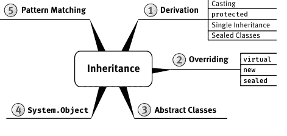

### 初学者主题

## 继承定义

前一章提供了继承的概述。以下是已定义术语的复习：

- **派生/继承**：特化基类，以包含额外的成员或对基类成员进行自定义。

继承形成了一种“是某种”（is a kind of）关系。派生类型始终隐式地也是基类型。正如硬盘是一种存储设备一样，从存储设备类型派生的任何其他类型也是一种存储设备。请注意，反之并不一定成立：存储设备不一定是硬盘。

> **注意**
> 代码中的继承用于定义两个类之间的“是某种”关系，其中派生类是基类的特化。

## 派生

通常我们希望扩展给定类型以增加功能，例如行为和数据。继承的目的正是如此。给定一个 `Person` 类，你创建一个 `Employee` 类，其中额外包含 `EmployeeId` 和 `Department` 属性。也可以应用相反的方法。例如，给定个人数字助理（PDA）中的一个 `Contact` 类，你可能决定添加日历支持。为此，你创建一个 `Appointment` 类。然而，与其重新定义两个类共有的方法和属性，你可能选择重构 `Contact` 类。具体来说，你可以将 `Contact` 中共有的方法和属性移动到一个名为 `PdaItem` 的基类中，`Contact` 和 `Appointment` 都从中派生，如图 7.1 所示。

在此情况下，共同的项目包括 `Created`、`LastUpdated`、`Name`、`ObjectKey` 等。通过派生，定义在基类 `PdaItem` 上的方法可以从所有从 `PdaItem` 派生的类中访问。

在声明派生类时，在类标识符后加上冒号，然后是基类，如列表 7.1 所示。

# 图 7.1：重构为基类

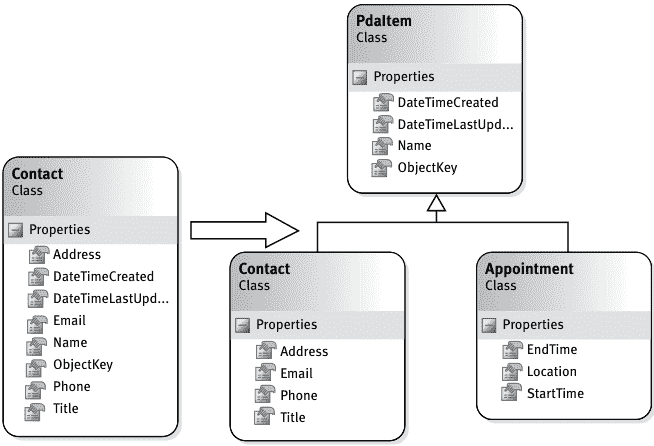

# 清单 7.1：从一个类派生另一个类

```csharp
public class PdaItem
{
    public string Name { get; set; }
    public DateTime LastUpdated { get; set; }
}

// 定义 Contact 类以继承 PdaItem 类
public class Contact : PdaItem
{
    public string Address { get; set; }
    public string Phone { get; set; }
}
```

清单 7.2 展示了如何访问在 `Contact` 中定义的属性。

# 清单 7.2：使用继承的方法

```csharp
public class Program
{
    public static void Main()
    {
        Contact contact = new Contact();
        contact.Name = "Inigo Montoya";
        // ...
    }
}
```

尽管 `Contact` 本身没有直接名为 `Name` 的属性，但 `Contact` 的所有实例仍然可以访问 `PdaItem` 中的 `Name` 属性，并像它是 `Contact` 的一部分一样使用它。此外，任何从 `Contact` 派生的额外类也将继承 `PdaItem` 的成员，或者 `PdaItem` 所继承的任何类的成员。继承链没有实际限制，每个派生类都将拥有其基类继承链的所有成员的合集（参见清单 7.3）。换句话说，尽管 `Customer` 并没有直接派生自 `PdaItem`，它仍然继承了 `PdaItem` 的成员。

> **注意**
>
> 通过继承，基类的每个成员也会出现在派生类的链中。

# 清单 7.3：类相互派生以形成继承链

```csharp
public class PdaItem : object {  // ... }
public class Appointment : PdaItem {  // ... }
public class Contact : PdaItem {  // ... }
public class Customer : Contact {  // ... }
```

在清单 7.3 中，`PdaItem` 被显式显示为派生自 `object`。虽然 C# 允许这种语法，但这是不必要的，因为所有没有指定其他派生的类都将派生自 `object`，无论是否明确指定。

## 基类与派生类型之间的强制转换

如清单 7.4 所示，由于派生形成了一种“是”的关系，派生类型的值始终可以直接赋值给基类型变量。

# 清单 7.4：隐式基类型强制转换

```csharp
public class Program
{
    public static void Main()
    {
        // 派生类型可以隐式转换
        // 为基类型
        Contact contact = new Contact();
        PdaItem item = contact;
        // ...
        // 基类型必须显式强制转换
        // 为派生类型
        contact = (Contact)item;
        // ...
    }
}
```

派生类型 `Contact` 是一个 `PdaItem`，并且可以直接赋值给 `PdaItem` 类型的变量。这被称为**隐式转换**，因为不需要强制转换运算符，原则上转换总是会成功；也就是说，它不会抛出异常。

然而，反过来并不成立。`PdaItem` 不一定是一个 `Contact`；它可能是 `Appointment` 或其他派生类型。因此，从基类型到派生类型的强制转换需要**显式强制转换**，这在运行时可能会失败。要进行显式强制转换，需要在原始引用之前的括号内指定目标类型，如清单 7.4 所示。

通过显式强制转换，程序员基本上是在向编译器传达信任——她知道自己在做什么——如果目标类型是从源类型派生的，C# 编译器允许该转换继续进行。虽然 C# 编译器在编译时允许潜在兼容类型之间的显式转换，但公共语言运行时（CLR）仍会在执行时验证显式强制转换，如果对象实例实际上不是目标类型，则会抛出异常。

即使类型层次结构允许隐式转换，C# 编译器也允许使用强制转换运算符。例如，从 `contact` 到 `item` 的赋值可以按如下方式使用强制转换运算符：

```csharp
item = (PdaItem)contact;
```

或者即使不需要转换时：

```csharp
contact = (Contact)contact;
```

> **注意**
>
> 派生对象可以隐式转换为其基类。相比之下，从基类到派生类的转换需要显式强制转换运算符，因为转换可能会失败。虽然编译器会允许潜在有效的显式强制转换，但运行时仍将通过在执行时抛出异常来防止无效强制转换。

## 内部主题

### 继承链内的强制转换

向基类的隐式转换不会实例化一个新实例。相反，相同的实例只是作为基类型被引用，其能力（可访问的成员）是基类型的。这就像将 CD-ROM 驱动器称为“存储设备”一样。由于并非所有存储设备都支持弹出操作，被视为存储设备的 CD-ROM 驱动器也无法弹出，即使实例化对象可能是支持 `Eject()` 方法的 `CDROM` 对象，调用 `storageDevice.Eject()` 也不会通过编译。

同样，从基类到派生类的向下强制转换只是开始更具体地引用该类型，扩展了可用的操作。限制在于，实际实例化的类型必须是目标类型的实例（或由其派生的类型）。

## 高级主题

### 定义自定义转换

类型之间的转换不仅限于单个继承链内的类型。也可以在不相关的类型之间进行转换，例如从 `Address` 转换为 `string`，反之亦然。关键在于提供两种类型之间的转换运算符。C# 允许类型包含显式或隐式转换运算符。如果操作可能会失败，例如从 `long` 强制转换为 `int`，开发者应选择定义显式转换运算符。这警告执行转换的开发者仅在确定转换会成功时才这样做，或者准备好捕获可能发生的异常。当转换是有损时，也应使用显式转换而非隐式转换。例如，从 `float` 转换为 `int` 会截断小数部分，而从 `int` 回转 `float` 无法恢复丢失的小数部分。

清单 7.5 展示了隐式转换运算符签名的一个示例。

# 清单 7.5：定义强制转换运算符

```csharp
class GPSCoordinates
{
    // ...
}
public static implicit operator UTMCoordinates(
    GPSCoordinates coordinates)
{
    // ...
}
```

在这种情况下，你有一个从 `GPSCoordinates` 到 `UTMCoordinates` 的隐式转换。可以编写类似的转换来反转这个过程。请注意，将 `implicit` 替换为 `explicit` 也可以编写显式转换。

## private 访问修饰符

基类的所有成员（构造器和析构器除外）都会被派生类继承。然而，仅仅因为一个成员被继承并不意味着它是可访问的。例如，在清单 7.6 中，私有字段 `_Name` 在 `Contact` 上不可用，因为私有成员仅在声明它们的类型内部的代码位置可访问。

# 清单 7.6：私有成员被继承但不可访问

```csharp
public class PdaItem
{
    private string _Name;
    // ...
}
public class Contact : PdaItem
{
    // ...
}
public class Program
{
    public static void Main()
    {
        Contact contact = new Contact();
        // 错误：'PdaItem._Name' 因其保护级别而不可访问
        // contact._Name = "Inigo Montoya";
    }
}
```

作为尊重封装原则的一部分，派生类无法访问声明为 `private` 的成员。¹ 这迫使基类开发者明确选择派生类是否获得对某个成员的访问权限。在这种情况下，基类定义了一个 API，其中 `_Name` 只能通过 `Name` 属性进行修改。这样，如果添加了验证，派生类将自动获得验证的好处，因为它从一开始就无法直接访问 `_Name`。

> **注意**
>
> 派生类无法访问基类中声明为 `private` 的成员。

1. 除了派生类也是基类的嵌套类的特殊情况外。

## 受保护访问修饰符

不过，封装的粒度比仅使用 `public` 或 `private` 更细。可以在基类中定义仅派生类可以访问的成员。例如，考虑列表 7.7 中所示的 `ObjectKey` 属性。

### 列表 7.7：受保护成员仅可从派生类访问

```csharp
public class Program
{
    public static void Main()
    {
        Contact contact = new Contact();
        contact.Name = "Inigo Montoya";
        // 错误：'PdaItem.ObjectKey' 不可访问
        // 原因：其保护级别
        // contact.ObjectKey = Guid.NewGuid();
    }
}
public class PdaItem
{
    protected Guid ObjectKey { get; set; }
    // ... 
}
public class Contact : PdaItem
{
    void Save()
    {
        // 使用 <ObjectKey>.dat
        // 作为文件名实例化一个 FileStream
        FileStream stream = System.IO.File.OpenWrite(
            ObjectKey + ".dat");
    }
    void Load(PdaItem pdaItem)
    {
        // 错误：'pdaItem.ObjectKey' 不可访问
        // 原因：其保护级别
        // pdaItem.ObjectKey = ...;
        Contact contact = pdaItem as Contact;
        if(contact != null)
        {
            contact.ObjectKey = ...;
        }
        // ... 
    }
}
```


`ObjectKey` 是使用受保护访问修饰符定义的。结果是在 `PdaItem` 外部，只有从 `PdaItem` 派生的类才能访问它。`Contact` 派生自 `PdaItem`，因此 `Contact` 的所有成员都可以访问 `ObjectKey`。相比之下，`Program` 并不派生自 `PdaItem`，因此在 `Program` 中使用 `ObjectKey` 属性会导致编译时错误。

> **注意**
> 基类中的受保护成员只能从基类以及继承链中的其他类访问。

`Contact.Load()` 方法中展示的一个微妙之处值得注意。开发人员常常感到意外的是，即使 `Contact` 派生自 `PdaItem`，在 `Contact` 内部的代码中也无法访问显式 `PdaItem` 的受保护 `ObjectKey`。原因是 `PdaItem` 有可能是一个 `Address`，而 `Contact` 不应该能够访问 `Address` 的受保护成员。因此，封装防止 `Contact` 潜在地修改 `Address` 的 `ObjectKey`。成功转换为 `Contact` 可以绕过此限制，如所示。主导规则是，从派生类访问受保护成员要求编译时确定该受保护成员是派生类的实例（或从派生类进一步派生的类的实例）。

# 扩展方法

扩展方法在技术上不是其扩展类型的成员，因此它们不会被继承。尽管如此，由于每个派生类都可以用作其任何基类的实例，一种类型上的扩展方法也会扩展所有派生类型。如果我们扩展一个如 `PdaItem` 这样的基类，所有扩展方法也将可用于派生类。然而，与所有扩展方法一样，实例方法具有优先权。如果在继承链的任何地方出现兼容的签名，它将优先于扩展方法。

在基类型上要求扩展方法的情况很少见。与扩展方法通常的情况一样，如果基类型的代码可用，最好直接修改基类型。即使基类型的代码不可用，程序员也应考虑是否要添加扩展方法到基类型或单个派生类型实现的接口上。我们将在下一章中介绍接口以及如何使用扩展方法。

## 单继承

理论上，你可以在继承树中放置无限数量的类。例如，`Customer` 派生自 `Contact`，`Contact` 派生自 `PdaItem`，`PdaItem` 派生自 `object`。然而，C# 是一种单继承编程语言（C# 编译到的 CIL 语言也是如此）。这意味着一个类不能直接从两个类派生。例如，不可能让 `Contact` 同时从 `PdaItem` 和 `Person` 派生。

### 语言对比：C++——多继承

C# 的单继承是其与 C++ 的主要面向对象差异之一。

对于需要多继承类结构的极少数情况，一种解决方案是使用聚合；不是一个类继承自另一个类，而是一个类包含另一个类的实例。图 7.2 展示了这种类结构的一个示例。当关联关系定义了包含对象的核心部分时，就会发生聚合。对于多继承，这涉及选择一个类作为主要基类（`PdaItem`）并从中派生一个新类（`Contact`）。第二个期望的基类（`Person`）作为派生类（`Contact`）中的一个字段添加。接下来，该字段（`Person`）上的所有非私有成员在派生类（`Contact`）中重新定义，然后委托调用到该字段（`Person`）。由于方法被重新声明，会发生一些代码重复；然而，这是最小的，因为真正的方法体仅在聚合的类（`Person`）中实现。

在图 7.2 中，`Contact` 包含一个名为 `InternalPerson` 的私有属性，该属性被绘制为与 `Person` 类的关联。`Contact` 还包含 `FirstName` 和 `LastName` 属性，但没有相应的字段。相反，`FirstName` 和 `LastName` 属性简单地将其调用委托给 `InternalPerson.FirstName` 和 `InternalPerson.LastName`，分别。列表 7.8 显示了相应的代码。

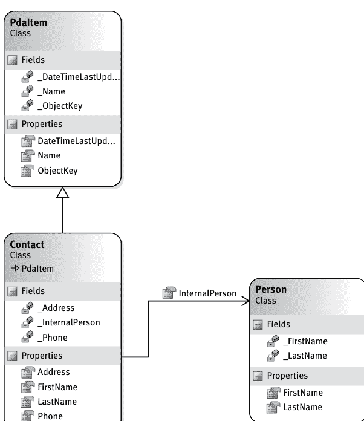

**图 7.2：使用聚合模拟多继承**

### 列表 7.8：使用聚合规避单继承限制

```csharp
public class PdaItem
{
    // ...
}
public class Person
{
    // ...
}
public class Contact : PdaItem
{
    private Person InternalPerson { get; set; }
    public string FirstName
    {
        get { return InternalPerson.FirstName; }
        set { InternalPerson.FirstName = value; }
    }
    public string LastName
    {
        get { return InternalPerson.LastName; }
        set { InternalPerson.LastName = value; }
    }
    // ...
}
```

除了委托带来的额外复杂性之外，另一个缺点是，添加到字段类（`Person`）的任何方法都需要手动添加到派生类（`Contact`）中；否则，`Contact` 将不会暴露新增的功能。

## 密封类

正确设计一个类以便其他人可以通过派生进行扩展可能是一个棘手的任务，需要通过示例进行测试以验证派生是否成功。列表 7.9 展示了如何通过将类标记为密封来避免意外的派生场景和问题。

### 列表 7.9：使用密封类防止派生

```csharp
public sealed class CommandLineParser
{
    // ...
}
// 错误：不能从密封类派生
public sealed class DerivedCommandLineParser :
    CommandLineParser
{
    // ...
}
```

密封类包含 `sealed` 修饰符，结果是不能从它们派生。`string` 类型是一个使用 `sealed` 修饰符来防止派生的类型示例。

## 重写基类

基类的所有成员在派生类中都被继承，除了构造器和析构器。然而，有时基类没有特定成员的最优实现。例如，考虑 `PdaItem` 上的 `Name` 属性。当被 `Appointment` 类继承时，该实现可能是可以接受的。然而，对于 `Contact` 类，`Name` 属性应该返回组合的 `FirstName` 和 `LastName` 属性。类似地，当 `Name` 被赋值时，它应该在 `FirstName` 和 `LastName` 之间拆分。换句话说，基类的属性声明对于派生类是合适的，但实现并不总是有效的。需要一个机制，以便在派生类中使用自定义实现**重写**基类的实现。

### *virtual* 修饰符

C# 支持实例方法和属性的重写，但不支持字段或任何静态成员。它需要在基类和派生类中都有显式操作。基类必须将允许重写的每个成员标记为 `virtual`。如果 `public` 或 `protected` 成员不包含 `virtual` 修饰符，子类将无法重写这些成员。

> **语言对比：** Java---默认虚方法
> 默认情况下，Java 中的方法是虚的，如果偏好非虚行为，必须显式密封它们。相比之下，C# 默认为非虚。

列表 7.10 展示了属性重写的示例。

### 列表 7.10：重写属性

```csharp
public class PdaItem
{
    public virtual string Name { get; set; }
    // ...
}
```


```csharp
public class Contact : PdaItem
{
public override string Name
{
get
{
return $"{ FirstName } { LastName }";
}
set
{
string[] names = value.Split(' ');
// Error handling not shown
FirstName = names[0];
LastName = names[1];
}
}
public string FirstName { get; set; }
public string LastName { get; set; }
// ...
}
```

`PdaItem` 不仅在 `Name` 属性上包含了 `virtual` 修饰符，`Contact` 的 `Name` 属性还使用了 `override` 关键字。如果去掉 `virtual`，会导致错误；如果省略 `override`，则会生成一个警告，这一点很快就会看到。C# 要求重写方法必须显式使用 `override` 关键字。换句话说，`virtual` 标识一个方法或属性可在派生类型中被替换（重写）。

### 语言对比：Java 和 C++——隐式重写

与 Java 和 C++ 不同，派生类中必须使用 `override` 关键字。C# 不允许隐式重写。若要重写一个方法，基类和派生类的成员必须匹配，并且分别具有相应的 `virtual` 和 `override` 关键字。此外，当指定了 `override` 关键字时，假设派生类的实现将取代基类的实现。

重写成员会导致运行时调用最派生的实现（参见代码清单 7.11）。

### 代码清单 7.11：运行时调用虚方法的最派生实现

```csharp
public class Program
{
    public static void Main()
    {
        Contact contact;
        PdaItem item;

        contact = new Contact();
        item = contact;

        // Set the name via PdaItem variable
        item.Name = "Inigo Montoya";

        // Display that FirstName & LastName
        // properties were set
        Console.WriteLine(
            $"{ contact.FirstName }{ contact.LastName }");
    }
}
```

输出 7.1 显示了代码清单 7.11 的结果。

### 输出 7.1

Inigo Montoya

在代码清单 7.11 中，调用了 `item.Name`；在那里 `item` 被声明为 `PdaItem`。然而，`contact` 的 `FirstName` 和 `LastName` 仍然被设置了。规则是，每当运行时遇到虚方法时，它都会调用该虚成员最派生的重写实现。在这种情况下，代码实例化了一个 `Contact` 并调用了 `Contact.Name`，因为 `Contact` 包含了 `Name` 的最派生实现。

在创建类时，程序员在允许方法被重写时应格外小心，因为他们无法控制派生类的实现。虚方法不应包含关键代码，因为如果派生类重写了这些方法，它们可能永远不会被调用。此外，将方法从虚方法转换为非虚方法可能会破坏重写了该方法的派生类。应避免这种破坏代码的更改，特别是对于旨在供第三方使用的程序集。

代码清单 7.12 包含一个虚方法 `Run()`。如果控制器程序员调用 `Run()` 并期望关键的 `Start()` 和 `Stop()` 方法会被调用，他将遇到一个问题。

### 代码清单 7.12：随意依赖虚方法实现

```csharp
public class Controller
{
    public void Start()
    {
        // Critical code
    }
    public virtual void Run()
    {
        Start();
        Stop();
    }
    public void Stop()
    {
        // Critical code
    }
}
```

在重写 `Run()` 时，开发者可能不会调用关键的 `Start()` 和 `Stop()` 方法。为了强制 `Start()`/`Stop()` 的预期行为，控制器程序员应定义该类，如代码清单 7.13 所示。

### 代码清单 7.13：强制期望的 Run() 语义

```csharp
public class Controller
{
    public void Start()
    {
        // Critical code
    }

    private void Run()
    {
        Start();
        InternalRun();
        Stop();
    }

    protected virtual void InternalRun()
    {
        // Default implementation
    }

    public void Stop()
    {
        // Critical code
    }
}
```

在这个新的代码清单中，一方面，由于它是受保护的，控制器程序员可以防止用户错误地调用 `InternalRun()`。另一方面，将 `Run()` 声明为 public 确保了 `Start()` 和 `Stop()` 被适当调用。用户仍然可以通过在派生类中重写受保护的 `InternalRun()` 成员来修改控制器的默认执行实现。

虚方法仅提供默认实现——也就是说，派生类可以完全重写的实现。然而，由于继承设计的复杂性，考虑（并最好实现）需要虚方法定义而不是默认将成员声明为虚的特定场景非常重要。

### 语言对比：C++——在构造期间调度方法调用

在 C++ 中，构造期间调用的方法不会调度虚方法。相反，在构造期间，类型与基类而不是派生类相关联，并且虚方法调用基类实现。相比之下，C# 将虚方法调用调度到最派生类型。这与调用最派生虚成员的原则一致，即使派生构造函数尚未完全执行也是如此。无论如何，在 C# 中应避免出现这种情况。

最后，只有实例成员可以是虚的。CLR 使用在实例化时指定的具体类型来确定如何调度虚方法调用，因此静态虚方法没有意义，编译器禁止它们。

### new 修饰符

当重写方法不使用 `override` 时，编译器会发出类似于输出 7.2 或输出 7.3 的警告。

### 输出 7.2

warning CS0114: '<derived method name>' hides inherited member
'<base method name>'. To make the current member override that
implementation, add the override keyword. Otherwise add the new
keyword.

### 输出 7.3

warning CS0108: The keyword new is required on '<derived property
name>' because it hides inherited member '<base property name>'

显然的解决方案是添加 `override` 修饰符（假设基类成员是 `virtual` 的）。然而，正如警告指出的那样，`new` 修饰符也是一个选项。考虑表 7.1 中显示的场景——这是已知为**基类脆弱性**或**脆弱基类**问题的更一般性问题的一个具体例子。

### 表 7.1：为什么使用 new 修饰符？

| 活动 | 代码 |
| :--- | :--- |
| 程序员 A 定义了包含 `FirstName` 和 `LastName` 属性的类 `Person`。 | `public class Person<br>{<br>    public string FirstName { get; set; }<br>    public string LastName { get; set; }<br>}` |
| 程序员 B 从 `Person` 派生并定义了带有额外属性 `Name` 的 `Contact`。此外，他定义了 `Program` 类，其 `Main()` 方法实例化 `Contact`，赋值 `Name`，然后打印出名称。 | `public class Contact : Person<br>{<br>    public string Name<br>    {<br>        get<br>        {<br>            return FirstName + " " + LastName;<br>        }<br>        set<br>        {<br>            string[] names = value.Split(' ');<br>            // Error handling not shown<br>            FirstName = names[0];<br>            LastName = names[1];<br>        }<br>    }<br>}` |

### 表 7.1：为什么使用 new 修饰符？（续）

| 活动 | 代码 |
| :--- | :--- |
| 稍后，程序员 A 添加了 `Name` 属性，但她没有将 getter 实现为 `FirstName + " " + LastName`，而是实现为 `LastName + "," + FirstName`。此外，她没有将该属性定义为 `virtual`，并且她在 `DisplayName()` 方法中使用了该属性。 | `// ... <br> public class Person <br> { <br> &nbsp;&nbsp;&nbsp;&nbsp;public string Name <br> &nbsp;&nbsp;&nbsp;&nbsp;{ <br> &nbsp;&nbsp;&nbsp;&nbsp;&nbsp;&nbsp;&nbsp;&nbsp;get <br> &nbsp;&nbsp;&nbsp;&nbsp;&nbsp;&nbsp;&nbsp;&nbsp;{ <br> &nbsp;&nbsp;&nbsp;&nbsp;&nbsp;&nbsp;&nbsp;&nbsp;&nbsp;&nbsp;&nbsp;&nbsp;return LastName + "," + FirstName; <br> &nbsp;&nbsp;&nbsp;&nbsp;&nbsp;&nbsp;&nbsp;&nbsp;} <br> &nbsp;&nbsp;&nbsp;&nbsp;&nbsp;&nbsp;&nbsp;&nbsp;set <br> &nbsp;&nbsp;&nbsp;&nbsp;&nbsp;&nbsp;&nbsp;&nbsp;{ <br> &nbsp;&nbsp;&nbsp;&nbsp;&nbsp;&nbsp;&nbsp;&nbsp;&nbsp;&nbsp;&nbsp;&nbsp;string[] names = value.Split(","); <br> &nbsp;&nbsp;&nbsp;&nbsp;&nbsp;&nbsp;&nbsp;&nbsp;&nbsp;&nbsp;&nbsp;&nbsp;// Error handling not shown <br> &nbsp;&nbsp;&nbsp;&nbsp;&nbsp;&nbsp;&nbsp;&nbsp;&nbsp;&nbsp;&nbsp;&nbsp;LastName = names[0]; <br> &nbsp;&nbsp;&nbsp;&nbsp;&nbsp;&nbsp;&nbsp;&nbsp;&nbsp;&nbsp;&nbsp;&nbsp;FirstName = names[1]; <br> &nbsp;&nbsp;&nbsp;&nbsp;&nbsp;&nbsp;&nbsp;&nbsp;} <br> &nbsp;&nbsp;&nbsp;&nbsp;} <br> &nbsp;&nbsp;&nbsp;&nbsp;public static void Display(Person person) <br> &nbsp;&nbsp;&nbsp;&nbsp;{ <br> &nbsp;&nbsp;&nbsp;&nbsp;&nbsp;&nbsp;&nbsp;&nbsp;// Display <LastName>, <FirstName> <br> &nbsp;&nbsp;&nbsp;&nbsp;&nbsp;&nbsp;&nbsp;&nbsp;Console.WriteLine( person.Name ); <br> &nbsp;&nbsp;&nbsp;&nbsp;} <br> }` |

由于 `Person.Name` 不是 `virtual` 的，即使传入的是 Person 派生的数据类型 `Contact`，程序员 A 也会期望 `Display()` 使用 `Person` 的实现。然而，程序员 B 会期望在所有变量数据类型为 `Contact` 的情况下使用 `Contact.Name`。（程序员 B 的代码中不会使用 `Person.Name`，因为最初不存在 `Person.Name` 属性。）为了允许添加 `Person.Name` 而不破坏两位程序员期望的行为，你不能假设 `virtual` 是预期的。此外，由于 C# 要求重写成员必须显式使用 `override` 修饰符，必须假设某种其他语义，而不是允许在基类中添加成员导致派生类不再编译。

这种语义就是 **new** 修饰符，它隐藏了派生类中重新声明的基类成员。与其调用最派生成员，基类成员调用的是基类中定义的成员，继承链中位于具有新修饰符成员之前的部分。如果继承链仅包含两个类，基类中的成员将表现得好像派生类没有声明任何方法一样（如果派生类实现覆盖了基类成员）。虽然编译器会报告在输出 7.2 或输出 7.3 中显示的警告，但如果既未指定 `override` 也未指定 `new`，则默认假定为 `new`，从而保持所需的版本安全性。

请以清单 7.14 为例。其输出见输出 7.4。

### 清单 7.14: `override` 与 `new` 修饰符

```csharp
public class Program
{
    public class BaseClass
    {
        public void DisplayName()
        {
            Console.WriteLine("BaseClass");
        }
    }
    public class DerivedClass : BaseClass
    {
        // Compiler WARNING: DisplayName() hides inherited
        // member. Use the new keyword if hiding was intended.
        public virtual void DisplayName()
        {
            Console.WriteLine("DerivedClass");
        }
    }
    public class SubDerivedClass : DerivedClass
    {
        public override void DisplayName()
        {
            Console.WriteLine("SubDerivedClass");
        }
    }
    public class SuperSubDerivedClass : SubDerivedClass
    {
        public new void DisplayName()
        {
            Console.WriteLine("SuperSubDerivedClass");
        }
    }
    public static void Main() 
    {
        SuperSubDerivedClass superSubDerivedClass 
                 = new SuperSubDerivedClass();
        SubDerivedClass subDerivedClass = superSubDerivedClass;
        DerivedClass derivedClass = superSubDerivedClass;
        BaseClass baseClass = superSubDerivedClass;
        superSubDerivedClass.DisplayName();
        subDerivedClass.DisplayName();
        derivedClass.DisplayName();
        baseClass.DisplayName();
    }
}
```


**输出 7.4**

> SuperSubDerivedClass  
> SubDerivedClass  
> SubDerivedClass  
> BaseClass

产生这些结果的原因如下：

- `SuperSubDerivedClass`: `SuperSubDerivedClass.DisplayName()` 显示 `SuperSubDerivedClass`，因为不存在派生类，因此没有重载。
- `SubDerivedClass`: `SubDerivedClass.DisplayName()` 是用于覆盖基类虚成员的最派生成员。`SuperSubDerivedClass.DisplayName()` 因其具有 `new` 修饰符而被隐藏。
- `SubDerivedClass`: `DerivedClass.DisplayName()` 是虚方法，而 `SubDerivedClass.DisplayName()` 是用于覆盖它的最派生成员。与之前一样，`SuperSubDerivedClass.DisplayName()` 因具有 `new` 修饰符而被隐藏。
- `BaseClass`: `BaseClass.DisplayName()` 未重新声明任何基类成员，且它不是虚方法；因此，它被直接调用。

就 CIL 而言，`new` 修饰符对编译器生成的语句没有影响。然而，“new” 方法会导致在该方法上生成 `newslot` 元数据属性。从 C# 的角度来看，其唯一的效果是消除否则会出现的编译器警告。

### sealed 修饰符

正如可以使用 `sealed` 修饰符防止类继承一样，虚成员也可以被标记为 `sealed`（参见清单 7.15）。这种方法可以防止子类覆盖在继承链更上方最初被声明为 `virtual` 的基类成员。当子类 B 覆盖了基类 A 的成员，然后需要防止在子类 B 之下进行任何进一步的覆盖时，就会出现这种情况。

#### 清单 7.15: 密封成员

```csharp
class A
{
    public virtual void Method()
    {
    }
}

class B : A
{
    public override sealed void Method()
    {
    }
}

class C : B
{
    // ERROR: Cannot override sealed members
    // public override void Method()
    // {
    // }
}
```

在此示例中，在类 B 的 `Method()` 声明上使用 `sealed` 修饰符可以防止类 C 覆盖 `Method()`。

一般来说，将类标记为 `sealed` 很少见，且仅应保留在那些有强烈理由支持此类限制的情况中。事实上，保持类型未密封的趋势越来越强烈，因为单元测试已成为主流，以支持使用模拟（测试替身）对象创建代替真实实现。一种可能允许密封类的场景是，当密封单个虚成员的成本超过了保持类未密封的好处时。然而，更针对性地密封单个成员——也许是因为基础实现中存在某些依赖关系以确保正确行为——可能更可取。

### base 成员

在选择覆盖某个成员时，开发人员通常希望调用基类中的该成员（参见清单 7.16）。

#### 清单 7.16: 访问基类成员

```csharp
using static System.Environment;

public class Address
{
    public string StreetAddress;
    public string City;
    public string State;
    public string Zip;
    public override string ToString()
    {
        return $"{ StreetAddress + NewLine }"
             + $"{ City }, { State } { Zip }";
    }
}

public class InternationalAddress : Address
{
    public string Country;
    public override string ToString()
    {
        return base.ToString() +
               NewLine + Country;
    }
}
```

在清单 7.16 中，`InternationalAddress` 继承自 `Address` 并实现了 `ToString()`。要调用父类的实现，请使用 `base` 关键字。其语法与此几乎相同，包括支持将 `base` 用作构造函数的一部分（稍后讨论）。

附带一提，在 `Address.ToString()` 实现中，你必须进行覆盖，因为 `ToString()` 也是 `object` 的成员。任何用 `override` 标记的成员都会自动被指定为虚方法，因此额外的子类可以进一步特化其实现。

> **注意**
> 任何用 `override` 标记的方法都是自动变为虚方法的。只有当基类方法是虚方法时，才能被覆盖，因此覆盖的方法也是虚方法。

## 构造函数

在实例化派生类时，运行时首先调用基类的构造函数，以确保基类的初始化不会被绕过。然而，如果基类没有可访问的（非私有的）默认构造函数，则不清楚如何构造基类；反过来，C# 编译器会报告错误。

为了避免因缺少可访问的默认构造函数而导致的错误，程序员需要在派生类构造函数头中明确指定要运行哪个基类构造函数（参见清单 7.17）。

#### 清单 7.17: 指定调用的基类构造函数

```csharp
public class PdaItem
{
    public PdaItem(string name)
    {
        Name = name;
    }
    // ...
}

public class Contact : PdaItem
{
    public Contact(string name) :
        base(name)
    {
        Name = name;
    }
    public string Name { get; set; }
    // ...
}
```

通过在代码中识别基类构造函数，你让运行时知道在调用派生类构造函数之前应该调用哪个基类构造函数。

##### 抽象类

到目前为止的许多继承示例都定义了一个名为 `PdaItem` 的类，该类定义了 `Contact`、`Appointment` 等类型对象所共有的方法和属性，这些类型对象派生自 `PdaItem`。然而，`PdaItem` 本身并不打算被实例化。单独的 `PdaItem` 实例没有意义；只有当它被用作基类时，它才有意义——用于在派生自它的一组数据类型之间共享默认方法实现。这些特征表明 `PdaItem` 需要是一个抽象类，而不是一个具体类。抽象类专为派生而设计。除了实例化一个从其派生的类的情况下，不可能实例化抽象类。非抽象且可以直接实例化的类是具体类。

### 初学者主题

##### 抽象类

抽象类代表抽象实体。它们的抽象成员定义了从抽象实体派生的对象应包含的内容，但不包含实现。通常，抽象类中的许多功能都是未实现的。然而，在一个类成功从抽象类派生之前，它需要提供其抽象基类中抽象方法的实现。

要定义抽象类，C# 要求类定义具有 `abstract` 修饰符，如清单 7.18 所示。

#### 清单 7.18: 定义抽象类

```csharp
// Define an abstract class
public abstract class PdaItem
{
    public PdaItem(string name)
    {
        Name = name;
    }
    public virtual string Name { get; set; }
}
```

# 示例 7.19：定义抽象成员

```csharp
public class Program
{
    public static void Main()
    {
        PdaItem item;
        // 错误：无法创建抽象类的实例
        // item = new PdaItem("Inigo Montoya");
    }
}
```

尽管抽象类不能被实例化，但这种限制只是抽象类的一个次要特征。它们的主要意义在于包含**抽象成员**。抽象成员是指没有实现的方法或属性。其目的是强制所有派生类提供实现。

请以示例 7.19 为例。

```csharp
// 定义一个抽象类
public abstract class PdaItem
{
    public PdaItem(string name)
    {
        Name = name;
    }
    public virtual string Name { get; set; }
    public abstract string GetSummary();
}

using static System.Environment;

public class Contact : PdaItem
{
    public override string Name
    {
        get
        {
            return $"{ FirstName } { LastName }";
        }
        set
        {
            string[] names = value.Split(' ');
            // 未显示错误处理
            FirstName = names[0];
            LastName = names[1];
        }
    }
    public string FirstName { get; set; }
    public string LastName { get; set; }
    public string Address { get; set; }
    public override string GetSummary()
    {
        return @"FirstName: " + $"{ FirstName }" + NewLine +
               $"LastName: { LastName }" + NewLine +
               $"Address: { Address }" + NewLine;
    }
    // ...
}

public class Appointment : PdaItem
{
    public Appointment(string name) :
        base(name)
    {
        Name = name;
    }
    public DateTime StartDateTime { get; set; }
    public DateTime EndDateTime { get; set; }
    public string Location { get; set; }
    // ...
    public override string GetSummary()
    {
        return $"Subject: { Name }" + NewLine +
             $"Start: { StartDateTime }" + NewLine +
             $"End: { EndDateTime }" + NewLine +
             $"Location: { Location }";
    }
}
```

示例 7.19 将 `GetSummary()` 成员定义为抽象，因此它不包含任何实现。然后代码在 `Contact` 中重写该成员并提供实现。由于抽象成员旨在被重写，因此这些成员自动被视为虚方法，不能显式声明为虚方法。此外，抽象成员不能是私有的，因为派生类将无法看到它们。

开发设计良好的对象层次结构出奇地困难。因此，在编程处理抽象类型时，您应该确保至少实现一个（最好更多）继承自该抽象类型的具体类型，以验证设计。

> **注意**
> 抽象成员必须被重写，因此它们自动是虚成员，不能显式声明为虚成员。

# 语言对比：C++ —— 纯虚函数

C++ 允许使用晦涩的符号 `=0` 定义抽象函数。这些函数在 C++ 中称为纯虚函数。然而与 C# 不同的是，C++ 不要求类本身有任何特殊声明。与 C# 的 `abstract` 类修饰符不同，当类包含纯虚函数时，C++ 中的类声明没有任何变化。

如果你没有在 `Contact` 中提供 `GetSummary()` 的实现，编译器将报告错误。

> **注意**
> 通过声明抽象成员，抽象类程序员表明，要在具体类与抽象基类（即 `PdaItem`）之间建立“是一种”关系，必须实现这些抽象成员，这些成员是抽象类无法提供适当默认实现的成员。

### 初学者主题

# 多态性

当同一成员签名在两个或更多类中的实现存在差异时，这种场景展示了一个关键的面向对象原则：**多态性**。Poly 意为“多”，morph 意为“形态”，因此多态性指的是同一签名存在多种实现。此外，由于同一签名不能在单个类内使用多次，因此该成员签名的每个实现都出现在不同的类中。

多态性的理念在于，对象本身最知道如何执行特定操作。此外，通过强制执行调用这些操作的通用方式，多态性是一种利用共性时鼓励代码重用的技术。给定多种类型的文档，每种文档类型类都知道如何最好地为其对应的文档类型执行 `Print()` 方法。因此，而不是定义一个包含 switch 语句和特殊逻辑来打印每种文档类型的单一打印方法，利用多态性你可以调用与你要打印的特定文档类型对应的 `Print()` 方法。例如，在文字处理文档类上调用 `Print()` 会按照文字处理的具体方式进行操作，而在图形文档类上调用相同的方法将产生特定于图形的打印行为。然而，给定这些文档类型，你只需调用 `Print()` 即可打印文档，无论类型如何。

将自定义打印实现从 switch 语句中移出带来许多维护优势。首先，实现出现在每种文档类型类的上下文中，而不是在远离的地方；这符合封装原则。其次，添加新的文档类型不需要更改 switch 语句。相反，新文档类型类只需实现 `Print()` 签名即可。

抽象成员旨在成为实现多态性的一种方式。基类指定方法的签名，派生类提供实现（参见示例 7.20）。

# 示例 7.20：使用多态性列出 PdaItems

```csharp
public class Program
{
    public static void Main()
    {
        PdaItem[] pda = new PdaItem[3];
        Contact contact = new Contact("Sherlock Holmes");
        contact.Address = "221B Baker Street, London, England";
        pda[0] = contact;
        Appointment appointment =
            new Appointment("Soccer tournament");
        appointment.StartDateTime = new DateTime(2008, 7, 18);
        appointment.EndDateTime = new DateTime(2008, 7, 19);
        appointment.Location = "Estádio da Machava";
        pda[1] = appointment;
        contact = new Contact("Hercule Poirot");
        contact.Address =
            "Apt 56B, Whitehaven Mansions, Sandhurst Sq, London";
        pda[2] = contact;
        List(pda);
    }
    public static void List(PdaItem[] items)
    {
        // 使用多态性实现。派生类型
        // 知道实现 GetSummary() 的具体细节。
        foreach (PdaItem item in items)
        {
            Console.WriteLine("---------");
            Console.WriteLine(item.GetSummary());
        }
    }
}
```

示例 7.20 的结果如输出 7.5 所示。

# 输出 7.5

```text
FirstName: Sherlock
LastName: Holmes
Address: 221B Baker Street, London, England
Subject: Soccer tournament
Start: 7/18/2008 12:00:00 AM
End: 7/19/2008 12:00:00 AM
Location: Estádio da Machava
FirstName: Hercule
LastName: Poirot
```


Address: Apt 56B, Whitehaven Mansions, Sandhurst Sq, London

这样，你可以调用基类上的方法，但实现是针对派生类特有的。输出 7.5 表明，示例 7.20 中的 `List( )` 方法能够成功显示联系人和地址，并以自定义于每种类型的方式显示它们。调用抽象的 `GetSummary( )` 方法实际上调用的是针对该实例特有的重写方法。

# 所有类都从 System.Object 继承

无论给定任何类，是自定义类还是系统内置类，表 7.2 中显示的方法都会被定义。

**表 7.2: System.\object 的成员**

| 方法名 | 描述 |
| :--- | :--- |
| `public virtual bool Equals(object o)` | 如果作为参数提供的对象在值上等于该实例（不一定是引用相同），则返回 true。 |
| `public virtual int GetHashCode()` | 返回对应于均匀分布的哈希码的整数。这对 HashTable 等集合很有用。 |
| `public Type GetType()` | 返回对应于对象实例类型的 `System.Type` 对象。 |
| `public static bool ReferenceEquals(object a, object b)` | 如果提供的两个参数引用同一个对象，则返回 true。 |
| `public virtual string ToString()` | 返回对象实例的字符串表示形式。 |
| `public virtual void Finalize()` | 析构函数的别名；通知对象准备终止。C# 禁止你直接调用此方法。 |
| `protected object MemberwiseClone()` | 通过执行浅拷贝来克隆该对象；引用被复制，但引用类型内部的数据不被复制。 |

表 7.2 中列出的所有方法通过继承出现在所有对象上；所有类都从 `object` 继承（直接或通过继承链）。即使是字面量也包含这些方法，使得可以编写出一些看起来有点奇怪的代码，例如：

```csharp
Console.WriteLine(42.ToString());
```

即使没有显式从 `object` 继承的类定义，它们实际上也是从 `object` 继承的。因此，示例 7.21 中 `PdaItem` 的两个声明将产生相同的 CLI。

## 示例 7.21：当未显式指定派生时，隐式派生自 System.Object

```csharp
public class PdaItem
{
    // ...
}
```

```csharp
public class PdaItem : object
{
    // ...
}
```

当对象的默认实现不足以满足需求时，程序员可以重写三个虚方法中的一个或多个。第 10 章将详细介绍如何执行此操作。

### 使用 is 运算符验证底层类型

由于 C# 允许向下继承链进行转换，因此在尝试转换之前确定底层类型有时是必要的。此外，在未实现多态性的类型特定操作中，检查类型也可能是必需的。为了确定底层类型，C# 提供了 `is` 运算符（参见示例 7.22）。

## 示例 7.22：使用 is 运算符确定底层类型

```csharp
public static void Save(object data)
{
    if (data is string)
    {
        string text = (string)data;
        if (text.Length > 0)
        {
            data = Encrypt(text);
            // ...
        }
    }
    else if (data == null)
    {
        throw new ArgumentNullException(nameof(data));
    }
    // ...
}
```

示例 7.22 在底层类型为字符串时对数据进行加密。这与加密任何能够成功转换为字符串的数据类型有显著不同，因为许多类型支持转换为字符串，但它们的底层类型并非字符串。

虽然可能在方法开始时检查 null 会更清晰，但在此处我们稍后进行检查，以证明即使目标为 null，`is` 运算符也会返回 false，因此 null 检查仍会执行。

请注意，在使用显式转换时，程序员有责任充分理解代码逻辑以避免无效的转换异常。如果存在发生无效转换的可能性，那么最好利用 `is` 运算符来完全避免异常。其优势在于，`is` 运算符为显式转换可能失败的情况提供了一种代码路径，而不必承担异常处理的开销。

尽管 `is` 运算符的功能很重要，但在使用 `is` 运算符之前，你应该考虑与多态性相关的问题。多态性支持将行为扩展到其他数据类型，而无需修改定义该行为的实现。例如，从公共基类派生，然后使用该类型作为 `Save( )` 方法的参数，可以避免显式检查字符串的需求，并使其他数据类型通过从相同的基类派生在保存操作期间支持加密。

### 使用 `is` 运算符进行模式匹配

从 C# 7.0 开始，`is` 运算符得到改进，以支持一种称为模式匹配的概念。之前描述的 `is` 运算符的问题在于，在检查数据确实是字符串之后，我们仍然必须将其强制转换为字符串（假设我们要将其作为字符串访问）。更可取的方法是既进行检查，又在检查为真时将结果分配给一个新变量。随着 C# 7.0 引入**模式匹配**，这成为可能，如示例 7.23 所示。实际上，模式匹配的 `is` 运算符在绝大多数场景中取代了更基本的 `is` 运算符。

## 示例 7.23：使用 `is` 运算符确定底层类型

```csharp
public static void Save(object data)
{
    if (data is string text && text.Length > 0)
    {
        data = Encrypt(text);
        // ...
    }
    else if (data is null)
    {
        throw new ArgumentNullException(nameof(data));
    }
    // ...
}
```

请注意，带有模式匹配的 is 运算符包括检查类型是否为 string，声明一个新变量 (`text`)，以及将 `data` 强制转换为 string，然后代码利用这一点来检查长度是否大于 0。

还要注意，使用模式匹配时，可以使用 is 运算符来检查 null。使用 is 运算符和使用相等运算符来检查 null 之间没有可读性差异。然而，我的建议是一致地选择其中一种。

### switch 语句中的模式匹配

示例 7.23 是一个简单的 if-else 语句，但你可以想象一个类似的例子，其中我们检查的不仅仅是一个字符串。而且，虽然 if 语句可以工作，但带有匹配表达式的 switch 语句（该匹配表达式可以处理任何类型）可以提供显著更好的可读性。示例 7.24 提供了一个使用 Storage 类的例子。

## 示例 7.24：switch 语句中的模式匹配

```csharp
static public void Eject(Storage storage)
{
    switch (storage)
    {
        case null: // case null 的位置不重要
            throw new ArgumentNullException(nameof(storage));
        // ** 导致编译错误，因为下面的 case 语句
        // ** 不可达
        case Storage tempStorage:
        //    throw new Exception();
        //    break;
        case UsbKey usbKey when usbKey.IsPluggedIn:
            usbKey.Unload();
            Console.WriteLine("USB Drive Unloaded!");
            break;
        case Dvd dvd when dvd.IsInserted:
            dvd.Eject();
            Console.WriteLine("DVD Ejected!");
            break;
        case Dvd dvd when !dvd.IsInserted:
            throw new ArgumentException("There was no DVD present.", nameof(storage));
        case HardDrive hardDrive:
            throw new InvalidOperationException();
        default:  // case default 的位置不重要
            throw new ArgumentException(nameof(storage));
    }
}
```

switch 语句的模式匹配支持提供了大量的功能（特别是与第 4 章介绍的前几版 C# 语言版本中的**基本 switch 语句**相比）。

- 与基本 switch 语句不同，模式匹配 case 子句不限于具有常量值的类型（字符串、int、long、枚举等）。相反，可以使用任何类型。
- 模式匹配 case 标签包括在类型后面声明一个变量。例如：
  ```csharp
  case HardDrive hardDrive:
  ```
- 此变量的作用域限制在 switch 段（case 标签后跟一个或多个以跳转语句结尾的语句）的作用域内。
- 模式匹配 case 标签支持条件，允许代码使用附加表达式进一步筛选类型条件。例如：
  ```csharp
  case UsbKey usbKey when usbKey.IsPluggedIn:
  ```
- 在模式匹配 switch 段中，段的顺序变得很重要。没有条件的基类的 case 标签（如 case Storage storage）将阻止后续任何派生类的 switch 块的执行。如果没有过滤条件，编译器会将此问题标记为错误。然而，如果基类的 case 标签有条件（在编译时无法简单解决），那么任何后续派生类型的 case 标签都会被遮蔽。[^2]
- `switch` 段中 `null` 的位置不重要，因为其解析为 `true` 的条件始终是唯一的。（与基本 `switch` 语句一样，`default` case 标签的位置也不重要。）
- 如果不超过一个具有过滤条件，则允许同一类型的多个模式匹配 case 标签。例如，`case Dvd dvd ...`
- 可以将常量 `switch` 段与模式匹配 `switch` 段混合使用，但显然简单性更可取。例如，`case 42` 和 `case int i when i == 42`
- 模式匹配 `switch` 语句的 `Switch` 段仍然需要跳转语句。例如：
  ```csharp
  case HardDrive hardDrive:
      throw new InvalidOperationException();
  ```
- case 子句中不允许使用可空类型（例如，`int?`）。请改用非可空版本。这是有意义的，因为 `null` 值将由 `case null` 匹配，而永远不会由可空类型的 case 子句匹配。

与 `is` 运算符一样，只有在多态性不是选项时才应使用模式匹配。因此，就本示例而言，假设我们没有存储类的源代码，且没有合适的公共基类方法——因此多态性不是一种可行的方法。

## 使用 as 运算符进行转换

`is` 运算符的优势在于它允许验证数据项是否为特定类型。`as` 运算符更进一步：它尝试转换为特定数据类型，如果源类型在继承链中不固有地属于目标类型，则分配 `null`。这一策略很重要，因为它避免了强制转换可能导致的异常。示例 7.25 展示了 `as` 运算符的使用。

## 代码清单 7.25：使用 as 运算符进行数据转换

```csharp
object Print(IDocument document)
{
    if (document != null)
    {
        // Print document...
    }
    else
    {
    }
}

static void Main()
{
    object data;
    // ...
    Print(data as Document);
}
```

通过使用 `as` 运算符，如果转换无效，你可以避免额外的 try/catch 处理代码，因为 `as` 运算符提供了一种尝试强制转换的方法，如果强制转换失败则不会抛出异常。

`is` 运算符相对于 `as` 运算符的一个优势在于，后者无法成功确定底层类型。`as` 运算符也可以隐式地向上或向下进行继承链的强制转换，或者转换到支持 `cast` 运算符的类型。与 `as` 运算符不同，`is` 运算符可以确定底层类型。

更重要的是，`as` 运算符通常需要额外的一步，即检查赋值变量是否为 null。由于模式匹配 `is` 运算符自动包含此条件检查，因此它有效地消除了对 `as` 运算符的需求——前提是 C# 7.0 或更高版本可用。

## 总结

本章讨论了如何通过从类派生并添加额外的方法和属性来特化一个类。该讨论包括对控制封装级别的 private（私有）和 protected（受保护）访问修饰符的讲解。

本章还研究了重写基类实现的细节，或者作为替代方案，使用 new 修饰符隐藏基类实现。为了控制重写，C# 提供了 virtual（虚拟）修饰符，它向派生类开发者表明哪些成员是打算用于派生的。为了防止任何派生，可以在类上使用 sealed（密封）修饰符。类似地，在成员上放置 sealed 修饰符可以防止子类进一步重写。

本章简要讨论了所有类型如何从 object 派生。第 10 章将进一步讨论这种派生，并介绍 object 中包含的具有特定规则和准则以控制重载的三个虚方法。但在到达那里之前，你需要考虑另一种建立在面向对象编程之上的编程范式：接口。这是第 8 章的主题。

本章最后介绍了使用 is 和 as 运算符进行类型转换的细节。其中包括对 C# 7.0 模式匹配功能及其在 if 和 switch 语句中使用的讨论。

# 8 接口

多态性不仅可以通过继承（如第 7 章所述）实现，还可以通过接口实现。与抽象类不同，接口不能包含任何实现。然而，与抽象类一样，接口定义了一组成员，调用者可以依赖这些成员已被实现。

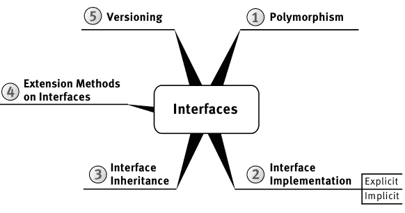

通过实现一个接口，类型定义了其能力。**接口实现关系是一种“能做”的关系。** 类型能够做接口要求实现类型所做之事。接口定义了实现该接口的类型与使用该接口的代码之间的契约。实现接口的类型必须声明具有与所实现接口中声明的方法相同签名的方法。本章讨论了接口的实现和使用。

### 介绍接口

**入门主题：为什么需要接口？**

接口很有用，因为——与抽象类不同——它们能够实现实现细节与所提供服务的完全分离。举个现实世界的例子，考虑一下作为“接口”的电气墙壁插座。电力如何到达插座是一个实现细节：它可能由化学能、核能或太阳能产生；发电机可能在隔壁房间或很远的地方；等等。插座提供了一个“契约”：它同意以特定的频率提供特定的电压，作为回报，它要求使用该接口电器提供一个兼容的插头。电器不需要关心将电力输送到插座的实现细节；它只需要担心自己提供了兼容的插头。

考虑以下例子：现在有大量的文件压缩格式可用（.zip、.7-zip、.cab、.lha、.tar、.tar.gz、.tar.bz2、.bh、.rar、.arj、.arc、.ace、.zoo、.gz、.bzip2、.xxe、.mime、.uae 和 .venc，仅举几例）。如果你为每种压缩格式创建类，你可能会为每种压缩实现得到不同的方法签名，并且无法在它们之间应用标准的调用约定。所需的方法可以在基类中声明为抽象。然而，从常见的基类派生会耗尽类唯一的一次继承机会。各种压缩实现之间可能没有可以放在基类中的公共代码，从而排除了拥有基类实现的潜在好处。关键点是，基类允许你共享实现以及成员签名，而接口允许你仅共享成员签名而不包含实现。

代替共享公共基类，每个压缩类需要实现一个公共接口。接口定义了一个类支持的契约，以便与期望该接口的其他类交互。如果所有类都实现了 `IFileCompression` 接口及其 `Compress()` 和 `Uncompress()` 方法，那么调用任何特定压缩类算法的代码将只需转换为 `IFileCompression` 接口并调用其成员。结果是多态性，因为每个压缩类具有相同的方法签名，但该签名具有各自的实现。

代码清单 8.1 中显示的 `IFileCompression` 接口是接口实现的一个例子。按照惯例——这个约定如此强大以至于成为通用规则——接口名称使用帕斯卡命名法（PascalCase）并带有一个大写“I”前缀。

**代码清单 8.1：定义一个接口**

```csharp
interface IFileCompression
{
    void Compress(string targetFileName, string[] fileList);
    void Uncompress(
        string compressedFileName, string expandDirectoryName);
}
```


`IFileCompression` 定义了一个类型必须实现的方法，以便以与其他压缩相关类相同的方式使用。接口的强大之处在于，它允许调用者在实现之间切换，而无需修改调用代码。

接口的一个关键特征是它没有实现和数据。接口中的方法声明在头部之后用单个分号代替花括号。字段（数据）不能出现在接口声明中。当接口要求派生类具有某些数据时，它声明一个属性而不是字段。由于属性作为接口声明的一部分不包含任何实现，它不引用后备字段。

接口中声明的成员描述了在实现类型上必须可访问的成员。非公共成员的目的是使这些成员对其他代码不可访问。因此，C# 不允许在接口成员上使用访问修饰符；相反，它自动将它们定义为 `public`（公共）。

- **准则**：请使用帕斯卡命名法（`PascalCasing`）和“I”前缀为接口命名。

### 通过接口实现多态性

考虑另一个例子，如代码清单 8.2 所示：`IListable` 定义了一个类需要支持的成员，以便 `ConsoleListControl` 类可以显示它。因此，任何实现 `IListable` 的类都可以使用 `ConsoleListControl` 来显示自身。`IListable` 接口需要一个只读属性，`ColumnValues`。

**代码清单 8.2：实现和使用接口**

```csharp

interface IListable

{

    // Return the value of each column in the row
    string[] ColumnValues
    {
        get;
    }
}

public abstract class PdaItem
{
    public PdaItem(string name)
    {
        Name = name;
    }
    public virtual string Name { get; set; }
}

class Contact : PdaItem, IListable
{
    public Contact(string firstName, string lastName,
                   string address, string phone) : base(null)
    {
        FirstName = firstName;
        LastName = lastName;
        Address = address;
        Phone = phone;
    }
    public string FirstName { get; set; }
    public string LastName { get; set; }
    public string Address { get; set; }
    public string Phone { get; set; }
    public string[] ColumnValues
    {
        get
        {
            return new string[]
            {
                FirstName,
                LastName,
                Phone,
                Address
            };
        }
    }
}

```

# 接口实现

声明一个类以实现某个接口，类似于从基类派生：所实现的接口与基类一起出现在一个逗号分隔的列表中。如果有基类规范，它必须放在第一位，但除此之外，顺序并不重要。类可以实现多个接口，但只能直接从一个基类派生。一个示例见清单 8.3。

```csharp

// Listing 8.3: Implementing an Interface
public class Contact : PdaItem, IListable, IComparable
{
    // ...
    #region IComparable Members
    /// <summary>
    /// Compares the current instance with another object.
    /// </summary>
    /// <param name="obj">The object to compare with the current instance.</param>
    /// <returns>
    /// Less than zero: This instance is less than obj
    /// Zero: This instance is equal to obj
    /// Greater than zero: This instance is greater than obj
    /// </returns>
    public int CompareTo(object obj)
    {
        int result;
        Contact contact = obj as Contact;
        if (obj == null)
        {
            // This instance is greater than obj
            result = 1;
        }
        else if (obj.GetType() != typeof(Contact))
        {
            // Use C# 6.0 nameof operator in message to
            // ensure consistency in the Type name
            throw new ArgumentException(
                $"The parameter is not a value of type { nameof(Contact) }",
                nameof(obj));
        }
        else if (Contact.ReferenceEquals(this, obj))
        {
            result = 0;
        }
        else
        {
            result = LastName.CompareTo(contact.LastName);
            if (result == 0)
            {
                result = FirstName.CompareTo(contact.FirstName);
            }
        }
        return result;
    }
    #endregion
    #region IListable Members
    string[] IListable.ColumnValues
    {
        get
        {
            return new string[]
            {
                FirstName,
                LastName,
                Phone,
                Address
            };
        }
    }
    #endregion
}

```

一旦一个类声明它实现了某个接口，就必须实现该接口的所有成员。抽象类允许为接口成员提供抽象实现。非抽象实现可以在方法体中抛出 `NotImplementedException` 类型的异常，但必须以某种方式提供该成员的实现。

接口的一个重要特征是它们永远不能被实例化；你不能用 `new` 来创建接口，因此接口没有构造函数或终结器。接口实例只能通过实例化实现了该接口的类型来获得。此外，接口不能包含静态成员。接口的一个关键目的是多态性，而没有实现类型的实例的多态性价值不大。

每个接口成员的行为就像一个抽象方法，强制派生类实现该成员。因此，不可能显式地在接口成员上使用 `abstract` 修饰符。

在类型中实现接口成员时，有两种方式：**显式或隐式**。到目前为止，我们只见过隐式实现，其中实现接口成员的类成员是实施类的公共成员。

## 显式成员实现

显式实现的方法只能通过通过接口本身来调用它们；这通常通过将对像转换为接口来实现。例如，要调用清单 8.4 中的 `IListable.ColumnValues`，由于 `ColumnValues` 的显式实现，你必须先将联系人转换为 `IListable`。

```csharp

// Listing 8.4: Calling Explicit Interface Member Implementations
string[] values;
Contact contact1, contact2;
// ...
// ERROR: Unable to call ColumnValues() directly
// on a contact
// values = contact1.ColumnValues;
// First cast to IListable
values = ((IListable)contact2).ColumnValues;
// ...

```

在这种情况下，转换和对 `ColumnValues` 的调用发生在同一个语句中。或者，你可以在调用 `ColumnValues` 之前将 `contact2` 赋值给一个 `IListable` 变量。

要声明显式接口成员实现，请在成员名称前加上接口名称（参见清单 8.5）。

```csharp

// Listing 8.5: Explicit Interface Implementation
public class Contact : PdaItem, IListable, IComparable
{
    // ...
    public int CompareTo(object obj)
    {
        // ...
    }
}

```

# 接口的多态性

在清单 8.2 中，`ConsoleListControl` 可以显示看似不相关的类（`Contact` 和 `Publication`）。只要实现了所需的接口，任何类都可以被显示。结果，`ConsoleListControl.List()` 方法依赖于多态性来适当显示传入的对象集。每个类都有自己对 `ColumnValues` 的实现，而将类转换为 `IListable` 仍然允许调用特定类的实现。

```csharp

public static string[] Headers
{
    get
    {
        return new string[] {
            "First Name", "Last Name", 
            "Phone", 
            "Address"
        };
    }
}
// ...

```

```csharp

class Publication : IListable
{
    public Publication(string title, string author, int year)
    {
        Title = title;
        Author = author;
        Year = year;
    }
    public string Title { get; set; }
    public string Author { get; set; }
    public int Year { get; set; }
    public string[] ColumnValues
    {
        get
        {
            return new string[]
            {
                Title,
                Author,
                Year.ToString()
            };
        }
    }
    public static string[] Headers
    {
        get
        {
            return new string[] {
                "Title", 
                "Author", 
                "Year"
            };
        }
    }
    // ...
}

```

```csharp

class Program
{
    public static void Main()
    {
        Contact[] contacts = new Contact[]
        {
            new Contact(
                "Dick", "Traci",
                "123 Main St., Spokane, WA  99037",
                "123-123-1234"),
            new Contact(
                "Andrew", "Littman",
                "1417 Palmary St., Dallas, TX  55555",
                "555-123-4567"),
            new Contact(
                "Mary", "Hartfelt",
                "1520 Thunder Way, Elizabethton, PA  44444",
                "444-123-4567"),
            new Contact(
                "John", "Lindherst",
                "1 Aerial Way Dr., Monteray, NH  88888",
                "222-987-6543"),
            new Contact(
                "Pat", "Wilson",
                "565 Irving Dr., Parksdale, FL  22222",
                "123-456-7890"),
            new Contact(
                "Jane", "Doe",
                "123 Main St., Aurora, IL  66666",
                "333-345-6789")
        };
        // Classes are implicitly convertible to
        // their supported interfaces
        ConsoleListControl.List(Contact.Headers, contacts);
        Console.WriteLine();
        Publication[] publications = new Publication[3] {
            new Publication(
                "The End of Poverty: Economic Possibilities for Our Time",
                "Jeffrey Sachs", 2006),
            new Publication("Orthodoxy",
                "G.K. Chesterton", 1908),
            new Publication(
                "The Hitchhiker's Guide to the Galaxy",
                "Douglas Adams", 1979)
        };
        ConsoleListControl.List(
            Publication.Headers, publications);
    }
}

```

```csharp

class ConsoleListControl
{
    public static void List(string[] headers, IList<object> items)
    {
        int[] columnWidths = DisplayHeaders(headers);
        for (int count = 0; count < items.Count; count++)
        {
            string[] values = ((IListable)items[count]).ColumnValues;
            DisplayItemRow(columnWidths, values);
        }
    }
}
```


```csharp
/// <summary>Displays the column headers</summary>
/// <returns>Returns an array of column widths</returns>
private static int[] DisplayHeaders(string[] headers)
{
    // ...
}
private static void DisplayItemRow(
    int[] columnWidths, string[] values)
{
    // ...
}
}
```

清单 8.2 的结果出现在输出 8.1 中。

# 输出 8.1

| First Name | Last Name | Phone | Address |
| :--- | :--- | :--- | :--- |
| Dick | Traci | 123-123-1234 | 123 Main St., Spokane, WA 99037 |
| Andrew | Littman | 555-123-4567 | 1417 Palmary St., Dallas, TX 55555 |
| Mary | Hartford | 444-123-4567 | 1520 Thunder Way, Elizabethton, PA 44444 |
| John | Lindherst | 222-987-6543 | 1 Aerial Way Dr., Monteray, NH 88888 |
| Pat | Wilson | 123-456-7890 | 565 Irving Dr., Parksdale, FL 22222 |
| Jane | Doe | 333-345-6789 | 123 Main St., Aurora, IL 66666 |

| Title | Author | Year |
| :--- | :--- | :--- |
| The End of Poverty: Economic Possibilities for Our Time | Jeffrey Sachs | 2006 |
| Orthodoxy | G.K. Chesterton | 1908 |
| The Hitchhiker's Guide to the Galaxy | Douglas Adams | 1979 |

```csharp
#region IListable 成员
string[] IListable.ColumnValues
{
    get
    {
        return new string[]
        {
            FirstName,
            LastName,
            Phone,
            Address
        };
    }
}
#endregion
}
```

列表 8.5 通过在属性名前缀 `IListable` 显式实现了 `ColumnValues`。此外，由于显式接口实现直接与接口关联，因此无需使用 `virtual`、`override` 或 `public` 修饰符对其进行修改。事实上，这些修饰符是禁止使用的。该方法不被视为类的公共成员，因此将其标记为 `public` 会产生误导。

## 隐式成员实现

请注意，列表 8.5 中的 `CompareTo()` 不包含 `IComparable` 前缀；它是通过隐式方式实现的。在隐式成员实现中，成员必须是 `public` 的，且成员的签名必须与接口成员的签名匹配。接口成员实现不需要使用 `override` 关键字，也不需要对成员与接口的绑定关系进行任何指示。此外，由于该成员像其他类成员一样声明，因此调用隐式实现成员的代码可以直接调用，就像调用其他类成员一样：

```csharp
result = contact1.CompareTo(contact2);
```

换句话说，隐式成员实现不需要强制类型转换，因为该成员不会从实现类的直接调用中隐藏。

许多在显式成员实现中被禁止的修饰符，在隐式实现中是必需的或可选的。例如，隐式成员实现必须是 `public` 的。此外，`virtual` 是可选的，具体取决于派生类是否可能重写该实现。省略 `virtual` 将使该成员表现得像是密封（sealed）的一样。

## 显式与隐式接口实现

隐式和显式接口成员实现的关键区别不在于方法声明的语法，而在于能否通过类型的实例按名称访问该方法，而不是通过接口访问。

在构建类层次结构时，建模现实世界中的“是一种”关系（is a relationships）是理想的——例如，长颈鹿是一种哺乳动物。这些是*语义*关系。接口通常用于建模*机制*关系。`PdaItem` 并不是“可比较的”（comparable），但它完全可以实现 `IComparable`。这个接口与语义模型无关；它是实现机制的一个细节。显式接口实现是一种将机制关注点与模型关注点分离的技术。强制调用者在将对象视为可比较之前，先将其转换为诸如 `IComparable` 等接口，从而在代码中明确区分何时在与模型打交道，何时在处理其实现机制。

一般来说，最好将类的公共表面限制为“全模型”，并尽可能减少无关的机制。（不幸的是，在 .NET 中某些机制是不可避免的。在现实世界中，例如，你无法获取长颈鹿的哈希代码或将长颈鹿转换为字符串。然而，在 .NET 中，你可以获取 `Giraffe` 的哈希代码 `[GetHashCode()]` 并将其转换为字符串 `[ToString()]`。通过 `object` 作为公共基类，.NET 将模型代码与机制代码混合在一起，即使只是有限度的混合。）

以下是几条有助于你在显式实现和隐式实现之间做出选择的准则。

- 该成员是否是类功能的核心部分？
    - 考虑 `Contact` 类上 `ColumnValues` 属性的实现。此成员不是 `Contact` 类型的完整组成部分，而是一个外围成员，可能仅由 `ConsoleListControl` 类访问。因此，让该成员直接可见于 `Contact` 对象没有意义，这可能会扰乱本已庞大的一长串成员列表。
    - 或者，考虑 `IFileCompression.Compress()` 成员。在 `ZipCompression` 类中包含隐式的 `Compress()` 实现是一个完全合理的选择：`Compress()` 是 `ZipCompression` 类行为的核心部分，因此它应该可以从 `ZipCompression` 类直接访问。
- 接口成员名称作为类成员是否合适？
    - 考虑一个名为 `ITrace` 的接口，其中有一个名为 `Dump()` 的成员，它将类的数据写入跟踪日志。在 `Person` 或 `Truck` 类中隐式实现 `Dump()` 会导致混淆，无法弄清该方法执行的是哪个操作。相反，最好显式实现该成员，这样只有在使用 `ITrace` 数据类型（此时含义更清晰）时，才能调用 `Dump()` 方法。如果成员在实现类中的用途不明确，请考虑使用显式实现。
- 是否已经存在具有相同签名的类成员？
    - 显式接口成员实现不会向类型的声明空间添加命名单元。因此，如果类型中已经存在潜在冲突的成员，只要它是显式接口成员，就可以提供第二个具有相同名称或签名的成员。

关于隐式与显式接口成员实现的大部分决策取决于直觉。然而，这些问题提供了在选择时应考虑哪些问题的建议。由于将实现从隐式更改为显式会导致版本破坏性更改，因此最好倾向于显式定义接口，以便后续可以更改为隐式实现。此外，由于隐式和显式之间的选择不必在所有接口成员之间保持一致，因此将某些方法定义为显式，将其他方法定义为隐式是完全受支持的。

## 指南

如果没有正当理由，请避免显式实现接口成员。然而，如果你不确定，请优先考虑显式实现。

# 在实现类与其接口之间转换

就像派生类型和基类一样，从实现类型到其所实现接口的转换是隐式转换。不需要转换运算符，因为实现类型的实例将始终提供接口中的所有成员；因此，对象始终可以成功转换为接口类型。

虽然从实现类型到已实现接口的转换总是成功的，但许多不同的类型可以实现特定的接口。因此，你永远无法确定从接口到其实现类型之一的“向下”强制类型转换会成功。因此，从接口到其实现类型之一的转换需要显式强制类型转换。

# 接口继承

接口可以从其他接口继承，从而生成继承其基接口中所有成员的接口。如列表 8.6 所示，直接派生自 `IReadableSettingsProvider` 的接口是显式基接口。

## 列表 8.6：从一个接口派生另一个接口

```csharp
interface IReadableSettingsProvider
{
    string GetSetting(string name, string defaultValue);
}
interface ISettingsProvider : IReadableSettingsProvider
{
    void SetSetting(string name, string value);
}
class FileSettingsProvider : ISettingsProvider
{
    #region ISettingsProvider 成员
    public void SetSetting(string name, string value)
    {
        // ...
    }
    #endregion
    #region IReadableSettingsProvider 成员
    public string GetSetting(string name, string defaultValue)
    {
        // ...
    }
    #endregion
}
```

在这种情况下，`ISettingsProvider` 派生自 `IReadableSettingsProvider`，因此继承了其成员。如果 `IReadableSettingsProvider` 也有显式基接口，`ISettingsProvider` 将继承这些成员，而派生层次结构中的完整接口集仅仅是基接口的累加。

请注意，如果显式实现了 `GetSetting()`，则必须使用 `IReadableSettingsProvider` 来完成。列表 8.7 中带有 `ISettingsProvider` 的声明无法编译。

## 列表 8.7：没有包含接口的显式成员声明（失败）

```csharp
// 错误：GetSetting() 在 ISettingsProvider 上不可用
string ISettingsProvider.GetSetting(
     string name, string defaultValue)
{
    // ...
}
```

列表 8.7 的结果显示在输出 8.2 中。

## 输出 8.2

```text
'ISettingsProvider.GetSetting' in explicit interface declaration
is not a member of interface.
```

此输出除了指示 `IReadableSettingsProvider.GetSetting()` 未实现错误外还会出现。用于显式接口成员实现的完全限定接口成员名称必须引用最初声明该成员的接口名称。

即使类实现了一个从基接口（`IReadableSettingsProvider`）派生的接口（`ISettingsProvider`），该类仍然可以显式地声明这两个接口的实现，如列表 8.8 所示。

## 列表 8.8：在类声明中使用基础接口

```csharp
class FileSettingsProvider: ISettingsProvider, IReadableSettingsProvider
```

在此列表中，类对接口实现没有变化。虽然类头部中额外的接口实现声明是多余的，但它提供了更好的可读性。

提供多个接口而不是单个组合接口的决策主要取决于接口设计者要求实现类做什么。通过提供 `IReadableSettingsProvider` 接口，设计者传达出实现者只需实现一个用于获取设置的设置提供程序。他们不需要能够向这些设置写入。这也减少了实现负担，因为不再强加写入设置的复杂性。

相比之下，实现 `ISettingsProvider` 假设没有任何理由需要一个可以写入设置但不能读取设置的类。因此，`ISettingsProvider` 和 `IReadableSettingsProvider` 之间的继承关系，迫使将这两个接口的总和施加到 `ISettingsProvider` 类上。

最后但同样重要的一点：虽然*继承*是正确术语，但从概念上说，更准确的说法是接口代表一个契约，一个契约可以规定必须同时遵循另一个契约的条款。因此，代码 `ISettingsProvider : IReadableSettingsProvider` 在概念上声明 `ISettingsProvider` 契约要求同时尊重 `IReadableSettingsProvider` 契约，而不是说 `ISettingsProvider` 是 `IReadableSettingsProvider` 的“一种”。话虽如此，本章其余部分将继续使用继承关系术语，以符合标准的 C# 术语。

## 多接口继承

就像类可以实现多个接口一样，接口也可以从多个接口继承。为此使用的语法与类派生和实现保持一致，如列表 8.9 所示。

### 列表 8.9：多接口继承

```csharp
interface IReadableSettingsProvider
{
    string GetSetting(string name, string defaultValue);
}
interface IWritableSettingsProvider
{
    void SetSetting(string name, string value);
}
interface ISettingsProvider : IReadableSettingsProvider,
                           IWritableSettingsProvider
{
}
```

拥有一个没有成员的接口是不寻常的，但如果同时实现这两个接口是主要的，那么这是一个合理的选择。列表 8.9 和列表 8.6 的区别在于，现在可以不提供读取能力而实现 `IWritableSettingsProvider`。列表 8.6 中的 `FileSettingsProvider` 不受影响，但如果它使用了显式成员实现，指定成员所属的接口会略有不同。

## 接口上的扩展方法

扩展方法最重要的特性之一是它们不仅适用于类，还适用于接口。使用的语法与类扩展方法使用的语法完全相同。扩展类型（第一个参数以及带有 `this` 前缀的参数）是我们扩展的接口。列表 8.10 显示了 `IListable()` 的一个扩展方法。它声明在 `Listable` 类上。

### 列表 8.10：接口扩展方法

```csharp
class Program
{
    public static void Main()
    {
        Contact[] contacts = new Contact{
            new Contact(
                "Dick", "Traci",
                "123 Main St., Spokane, WA  99037",
                "123-123-1234")
            // ...
        };
        // 类隐式转换为
        // 它们支持的接口
        contacts.List(Contact.Headers);
        Console.WriteLine();
        Publication[] publications = new Publication[3] {
            new Publication(
                "The End of Poverty: Economic Possibilities for Our Time",
                "Jeffrey Sachs", 2006),
            new Publication("Orthodoxy",
                "G.K. Chesterton", 1908),
            new Publication(
                "The Hitchhiker's Guide to the Galaxy",
                "Douglas Adams", 1979)
        };
        publications.List(Publication.Headers);
    }
}
static class Listable
{
    public static void List(
        this IListable[] items, string[] headers)
    {
        int[] columnWidths = DisplayHeaders(headers);
        for (int itemCount = 0; itemCount < items.Length; itemCount++)
        {
            string[] values = items[itemCount].ColumnValues;
            DisplayItemRow(columnWidths, values);
        }
        // ...
    }
}
```


在此示例中，扩展方法不是针对 `IListable` 参数（尽管它也可以是），而是针对 `IListable[]` 参数。这表明 C# 允许扩展方法不仅作用于特定类型的实例，还作用于这些对象的集合。对扩展方法的支持是语言集成查询 `LINQ` 实现的基础。`IEnumerable` 是所有集合实现的基本接口。通过为 `IEnumerable` 定义扩展方法，`LINQ` 支持被添加到所有集合中。这彻底改变了集合编程；我们将在第 15 章中详细探讨这个话题。

## 通过接口实现多重继承

如列表 8.3 所示，单个类除了从单个类派生外，还可以实现任意数量的接口。此特性为 C# 类缺乏多重继承支持提供了解决方案。该过程使用第 7 章中描述的聚合，但你可以通过在混合中添加接口来稍微改变结构，如列表 8.11 所示。

### 列表 8.11：使用带接口的聚合来绕过单一继承

```csharp
public class PdaItem
{
    // ...
}
interface IPerson
{
    string FirstName
    {
        get;
        set;
    }
    string LastName
    {
        get;
        set;
    }
}
public class Person : IPerson
{
    // ...
}
public class Contact : PdaItem, IPerson
{
    private Person Person
    {
        get { return _Person; }
        set { _Person = value; }
    }
    private Person _Person;
    public string FirstName
    {
        get { return _Person.FirstName; }
        set { _Person.FirstName = value; }
    }
    public string LastName
    {
        get { return _Person.LastName; }
        set { _Person.LastName = value; }
    }
    // ...
}
```

`IPerson` 确保 `Person` 成员和重复到 `Contact` 上的相同成员之间的签名是一致的。然而，实现仍然与多重继承不同，因为添加到 `Person` 的新成员不会被添加到 `Contact`。

如果实现的成员是方法（而不是属性），则一种可能的改进是为从第二个基类“派生”出的额外功能定义接口扩展方法。例如，`IPerson` 上的扩展方法可以提供名为 `VerifyCredentials()` 的方法，所有实现 `IPerson` 的类——即使是一个没有任何成员只有扩展方法的 `IPerson` 接口——都将拥有 `VerifyCredentials()` 的默认实现。使这种方法可行的原因是多态性仍然可用，并且重写也是支持的。重写之所以受支持，是因为任何实例的方法实现都将优先于具有等效静态签名的扩展方法。

> **准则**
> 考虑定义接口以实现与多重继承类似的效果。

## 初学者话题

## 接口图示

UML 风格[^1]图中的接口有两种可能的形式。首先，你可以像类继承那样显示接口为继承关系，如图 8.1 中 `IPerson` 和 `IContact` 之间的演示所示。或者，你可以使用小圆圈（通常称为棒棒糖）来表示接口，如图 8.1 中 `IPerson` 和 `IContact` 所示。

在图 8.1 中，`Contact` 从 `PdaItem` 派生并实现 `IContact`。此外，它聚合 `Person` 类，该类实现了 `IPerson`。虽然 Visual Studio 类设计器不支持这种做法，但接口有时显示为使用派生类型的箭头指向类。例如，`Person` 可以使用指向 `IPerson` 的箭头而不是棒棒糖。

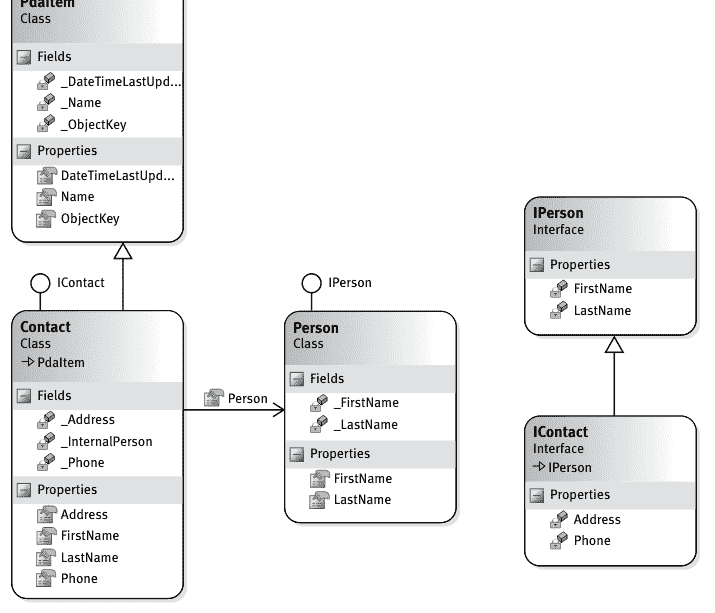

**图 8.1：使用聚合和接口绕过单一继承**

[^1]: 统一建模语言 `UML`，一种使用图形符号对对象设计进行建模的标准规范。

## 版本控制

当创建组件或应用程序的新版本，而其他开发人员已经基于其编写代码时，你不应该更改接口。因为接口定义了实现类和使用该接口的类之间的契约，更改接口等同于更改契约，这可能会破坏任何基于该接口编写的代码。

更改或删除接口成员签名显然是破坏代码的更改，因为对该成员的任何调用在没有修改的情况下都无法再编译。当你更改类中的公共或受保护成员签名时，情况也是如此。然而，与类不同，向接口添加成员也可能导致代码无法在没有额外更改的情况下编译。问题在于，实现接口的任何类都必须完全实现它，并且必须为所有成员提供实现。有了新的接口成员后，编译器将要求开发人员将新的接口成员添加到实现该接口的类中。

> **准则**
> - 请勿向已经发布的接口中添加成员。

清单 8.12 中创建 `IDistributedSettingsProvider` 是扩展接口并保持版本兼容性的良好示例。假设起初只定义了 `ISettingsProvider` 接口（如清单 8.6 所示）。然而，在下一个版本中，确定需要按机器配置。为了实现此约束，创建了 `IDistributedSettingsProvider` 接口，它继承自 `ISettingsProvider`。

### 清单 8.12：从一个接口派生另一个接口

```csharp
interface IDistributedSettingsProvider : ISettingsProvider
{
    /// <summary>
    /// Get the settings for a particular machine.
    /// </summary>
    /// <param name="machineName">
    /// The machine name the setting is related to.</param>
    /// <param name="name">The name of the setting.</param>
    /// <param name="defaultValue">
    /// The value returned if the setting is not found.</param>
    /// <returns>The specified setting.</returns>
    string GetSetting(
        string machineName, string name, string defaultValue);
    /// <summary>
    /// Set the settings for a particular machine.
    /// </summary>
    /// <param name="machineName">
    /// The machine name the setting is related to.</param>
    /// <param name="name">The name of the setting.</param>
    /// <param name="value">The value to be persisted.</param>
    /// <returns>The specified setting.</returns>
    void SetSetting(
        string machineName, string name, string value);
}
```

关键问题在于，拥有实现 `ISettingsProvider` 的类的程序员可以选择将实现升级为包含 `IDistributedSettingsProvider`，或者忽略它。

如果不创建新的接口，而是将与机器相关的方法添加到 `ISettingsProvider` 中，则实现该接口的类将不再能成功编译新的接口定义。相反，这将导致版本破坏性变更。

在开发阶段更改接口显然是可以接受的，尽管如果广泛实施，可能显得繁琐。然而，一旦接口发布，就不应更改。相反，应该创建第二个接口，该接口可能从原始接口派生。

（清单 8.12 包含描述接口成员的 XML 注释，这将在第 10 章中进一步讨论。）

## 接口与类的比较

接口引入了另一类数据类型。（它们是少数几种不继承自 `System.Object` 的类型类别之一。）² 然而，与类不同，接口永远不能被实例化。接口实例只能通过引用实现该接口的对象来访问。不能对接口使用 `new` 运算符；因此，接口不能包含任何构造函数或终结器。此外，接口中不允许有静态成员。

+   2. 其他的是指针类型和类型参数类型。然而，每个接口类型都可以转换为 `System.Object`，并且允许在接口的任何实例上调用 `System.Object` 的方法，所以这可能是一个细枝末节的区别。

接口更接近抽象类，具有诸如无法实例化等共同特征。表 8.1 列出了额外的比较。

鉴于抽象类和接口各有优缺点，你必须根据表 8.1 中的比较和以下准则做出成本效益决策，以做出正确的选择。

## 准则

- **应当** 通常优先选择类而非接口。使用抽象类将契约（类型做什么）与实现细节（类型怎么做）解耦。
- **可以考虑** 如果你需要在已经继承自其他类型的类型上支持其功能，则定义一个接口。

**表 8.1：比较抽象类和接口**

| 抽象类 | 接口 |
| :--- | :--- |
| 不能直接实例化，只能通过实例化派生类来实现。 | 不能直接实例化，只能通过实例化实现类型来实现。 |
| 派生类本身必须是抽象的，或者必须实现所有抽象成员。 | 实现类型必须实现所有接口成员。 |
| 可以添加额外的非抽象成员，所有派生类都可以继承这些成员，而不会破坏跨版本兼容性。 | 向接口添加额外成员会破坏版本兼容性。 |
| 可以声明方法、属性和字段（以及其他所有成员类型，包括构造函数和终结器）。 | 只能声明方法和属性，不能声明字段、构造函数或终结器。 |
| 成员可以是实例的、虚的、抽象的或静态的，并且可以为非抽象成员提供实现，供派生类使用。 | 所有成员都是基于实例的（非静态的），并且自动被视为抽象，因此不能包含任何实现。 |
| 派生类只能从单个基类派生。 | 实现类型可以任意实现许多接口。 |

## 接口与特性的比较

没有任何成员（无论是继承的还是其他的）的接口有时被用来表示关于类型的信息。例如，你可能会创建一个标记 `IObsolete` 接口来表示某个类型已被另一个类型取代。这通常被认为是滥用接口机制；接口应用于表示类型可以执行哪些功能，而不是用于指示关于特定类型的事实。对于这种用途，请使用特性而非标记接口。更多详情请参阅第 18 章。

> **准则**
> - 避免使用没有成员的“标记”接口；请改用特性。

## 总结

接口是 C# 面向对象编程的关键元素。它们提供与抽象类类似的功能，但不消耗单继承选项。类也可以实现多个接口。

在 C# 中，接口的实现可以是显式的或隐式的，这取决于实现类是直接暴露接口成员还是仅通过转换为接口来暴露。此外，实现是显式还是隐式的粒度在于成员级别：一个成员可以是隐式实现的，而同一接口的另一个成员可以是显式实现的。

下一章将探讨值类型，并讨论定义自定义值类型的重要性。同时，该章节指出了这类类型可能引入的微妙问题。

## 9 值类型

你在本书中已经使用了值类型；例如，`int` 是一种值类型。本章不仅讨论使用值类型，还讨论定义自定义值类型。自定义值类型有两类：结构体和枚举。本章讨论了结构体如何使程序员能够定义与第 2 章中讨论的大多数预定义类型行为非常相似的新值类型。关键是所有新定义的值类型都有自己独特的自定义数据和方法。本章还讨论了如何使用枚举来定义常量值集合。

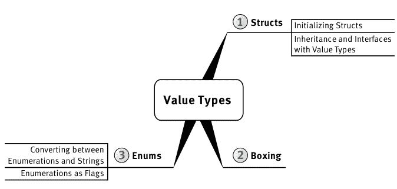

# **初学者主题**

## **类型类别**

到目前为止讨论的所有类型都属于两个类别之一：引用类型和值类型。每个类别中类型之间的差异源于复制策略的不同，这进而导致每种类型在内存中的存储方式不同。作为复习，本初学者主题为那些不熟悉这些问题的读者重新介绍了值类型/引用类型的讨论。

## **值类型**

**值类型**的变量直接包含它们的值，如图 9.1 所示。变量名直接与内存中存储该值的位置相关联。因此，当第二个变量被赋以原始变量的值时，原始变量的值的副本会被复制到与第二个变量相关联的存储位置。两个变量永远不会引用相同的存储位置（除非其中一个或两者是 *out* 或 *ref* 参数，根据定义，它们是另一个变量的别名）。更改原始变量的值不会影响第二个变量的值，因为每个变量都关联着不同的存储位置。因此，更改一个值类型变量的值不会影响任何其他值类型变量的值。

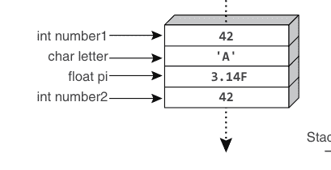

```csharp
// ...
int number1 = 42;
char letter = 'A';
float pi = 3.14F;
int number2 = number1;
// ...
```

**图 9.1：** 值类型直接包含数据

值类型变量就像一张写有数字的纸。如果你想改变数字，你可以擦掉它并用不同的数字替换。如果你有一张第二张纸，你可以从第一张纸上复制数字，但这两张纸随后就是独立的；擦掉并替换其中一张纸上的数字不会改变另一张纸。

类似地，将值类型的实例传递给诸如 `Console.WriteLine()` 等的方法，也会导致从与参数相关联的存储位置到与形参相关联的存储位置的内存复制，方法内部对形参变量的任何更改都不会影响调用者中的原始值。由于值类型需要内存复制，它们通常应被定义为消耗少量内存（通常 16 字节或更少）。

> **准则**
>
> 不要创建消耗超过 16 字节内存的值类型。

值类型的值通常是短寿命的；在许多情况下，值仅在表达式的某一部分或方法的激活期间是必需的。在这些情况下，值类型的变量和临时值通常可以存储在**临时存储池**中，称为*堆栈*。（这个术语实际上是个误称：没有要求临时池必须从堆栈分配存储。事实上，作为一个实现细节，它经常选择从可用寄存器中分配存储。）

临时堆比垃圾回收堆清理成本更低；然而，值类型倾向于比引用类型复制更多，这种复制本身可能会带来性能成本。不要陷入认为值类型更快因为它们可以分配在堆栈上的陷阱中。

## 引用类型

相比之下，引用类型变量的值是对象实例的引用（见图 9.2）。引用类型变量存储引用（通常实现为内存地址），该地址指向对象实例数据所在的位置，而不是像值类型变量那样直接存储数据。因此，为了访问数据，运行时从变量中读取引用，然后解引用以到达实际包含实例数据的内存位置。

因此，引用类型变量有两个相关的存储位置：与变量直接相关的存储位置，以及由变量中存储的值（即引用）所指向的存储位置。

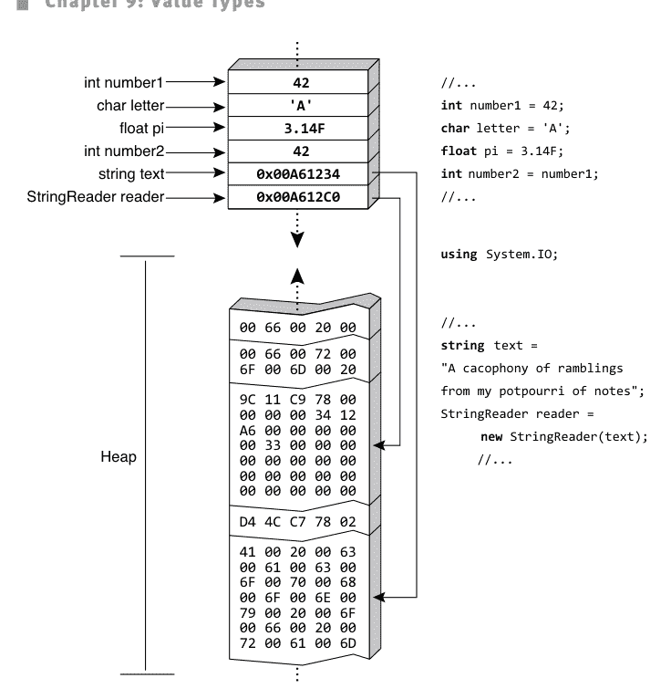

**图 9.2：** 引用类型指向堆

引用类型变量，再次类比，就像一张总是写有东西的纸。想象一张纸上写着一个家庭住址——例如，“纽约市芝麻街 123 号”。这张纸是一个变量；地址是对一栋建筑物的引用。纸张本身或上面写的地址都不是建筑物，纸张的位置与其内容所指的建筑物位置没有任何关系。如果你在另一张纸上复制该引用，那么两张纸的内容都指向同一栋建筑物。如果你随后将这栋建筑物漆成绿色，那么两张纸所指的建筑物都可以被观察到变成了绿色，因为引用指向的是同一个东西。

与变量（或临时值）直接相关的存储位置，其处理方式与值类型变量相关联的存储位置没有区别：如果已知变量是短寿命的，它会被分配到短期存储池中。引用类型变量的值总是指向垃圾回收堆中某个存储位置的引用，或者为 null。

与直接存储实例数据的值类型变量相比，访问引用关联的数据涉及额外的跳转：首先必须解引用以找到实际数据的存储位置，然后才能读取或写入数据。复制引用类型的值仅复制引用，它是小量的。（引用的大小保证不大于处理器的位宽；32 位机器有 4 字节的引用，64 位机器有 8 字节的引用，等等。）复制值类型的值会复制所有数据，这可能是大量的。因此，在某些情况下，引用类型复制效率更高。这就是为什么值类型的准则是确保它们绝不超过 16 字节左右；如果一个值类型比引用复制贵四倍以上，它可能应该只是一个引用类型。

由于引用类型仅复制数据的引用，两个不同的变量可以引用相同的数据。在这种情况下，通过一个变量更改数据也会被观察到更改了另一个变量的数据。这在赋值和方法调用中都会发生。

继续我们之前的类比，如果你将建筑物的地址传递给一个方法，你会复制包含引用的纸张并将副本交给该方法。该方法不能更改原始纸张的内容以指向不同的建筑物。然而，如果该方法将所引用的建筑物漆成新的颜色，当方法返回时，调用者可以观察到它仍在指向的建筑物现在是不同的颜色。

### 结构体

所有的 C# 内置类型，如 `bool` 和 `decimal`，都是值类型，除了 `string` 和 `object` 是引用类型。框架中提供了许多额外的值类型。开发人员也可以定义自己的值类型。

要定义自定义值类型，你使用类似于定义类和接口类型的语法。语法上的关键区别在于值类型使用关键字 `struct`，如图 9.1 所示。这里我们有一个值类型，用度、分、秒来描述高精度角度。（*分*是一度的六分之一，*秒*是一分的六分之一。这个系统用于导航，因为它有一个很好的特性：在赤道上的海面上，一弧分正好是一海里。）

**代码 9.1：声明 struct**

```csharp
// Use keyword struct to declare a value type
struct Angle
{
    public Angle(int degrees, int minutes, int seconds)
    {
```


```csharp
Degrees = degrees;

Minutes = minutes;

Seconds = seconds;

}

// Using C# 6.0 read-only, automatically implemented properties

public int Degrees { get; }

public int Minutes { get; }

public int Seconds { get; }

public Angle Move(int degrees, int minutes, int seconds)

{

return new Angle(

Degrees + degrees,

Minutes + minutes,

Seconds + seconds);

}

}

// Declaring a class as a reference type
// (declaring it as a struct would create a value type
//  larger than 16 bytes)
class Coordinate

{

public Angle Longitude { get; set; }

public Angle Latitude { get; set; }

}
```

此代码定义 `Angle` 为值类型，存储角度的度、分、秒，可以是经度或纬度。生成的 C# 类型是一个 `struct`。

请注意，代码清单 9.1 中的 `Angle` 结构体是不可变的，因为其所有属性都使用 C# 6.0 的只读自动实现属性功能进行声明。若要在不使用 C# 6.0 的情况下创建只读属性，程序员需要声明一个仅具有 getter 的属性，该属性从一个使用 `readonly` 修饰的字段中访问数据（参见代码清单 9.3）。在定义不可变类型时，C# 6.0 显著减少了代码量。

从 C# 7.2 开始，你可以通过将结构体声明为只读来验证你确实成功定义了一个只读结构体：

```csharp
readonly struct Angle {}
```

现在，编译器将验证整个结构体是不可变的，如果存在非只读字段或具有 setter 的属性，则报告错误。

> **注意**
> 虽然语言本身并不强制要求，但一条良好的准则是让值类型保持不可变：一旦你实例化了一个值类型，就不应该再能够修改同一个实例。在需要修改的场景中，你应该创建一个新实例。代码清单 9.1 提供了一个 `Move()` 方法，该方法不会修改 `Angle` 的实例，而是返回一个完全新的实例。
> 遵循这一准则有两个很好的理由。首先，值类型应该表示值。人们不会认为将两个整数相加会改变其中的任何一个；相反，这两个加数是不可变的，结果会产生第三个值。
> 其次，因为值类型是按值复制的，而不是按引用复制的，所以很容易混淆并错误地认为对一个值类型变量的修改可以观察到导致另一个变量的修改，就像引用类型那样。

**准则**
- 请创建不可变的值类型。

## 初始化结构体

除了属性和字段外，结构体还可以包含方法和构造函数。但是，不能定义默认构造函数。相反，C# 编译器会自动生成一个默认构造函数，将所有字段初始化为其默认值。对于引用类型数据的字段，默认值为 `null`；对于数值类型字段，为零值；对于布尔类型字段，为 `false`，等等。

为了确保本地值类型变量可以完全由构造函数初始化，结构体中的每个构造函数都必须初始化结构体内的所有字段（以及只读的自动实现属性）。（在 C# 6.0 中，通过只读自动实现属性进行初始化就足够了，因为底层字段未知，且无法对其进行初始化。）未能初始化结构体内的所有数据会导致编译时错误。为了稍微增加一些复杂性，C# 不允许在结构体中初始化字段。例如，如果取消注释代码清单 9.2 中的 `_Degrees = 42` 这一行，它就不会编译通过。

### 代码清单 9.2：在声明中初始化结构体字段，导致错误

```csharp
struct Angle
{
// ...
// 错误：字段不能在声明时初始化
// int _Degrees = 42;
// ...
}
```

如果没有通过调用 `new` 运算符的构造函数显式实例化，结构体内包含的所有数据都会隐式初始化为该数据的默认值。然而，为了避免编译器错误，必须显式初始化值类型内的所有数据。这就引出了一个疑问：什么时候值类型会被隐式初始化但不会被显式实例化？这种情况发生在实例化一个包含未分配值类型字段的引用类型，以及实例化一个没有数组初始化的值类型数组时。

为了满足结构体的初始化要求，所有显式声明的字段都必须被初始化。这种初始化必须直接完成。例如，在代码清单 9.3 中，如果取消注释，初始化属性而不是字段的构造函数会产生编译错误。

### 代码清单 9.3：在初始化所有字段之前访问属性

```csharp
struct Angle
{
// 错误：在分配其所有字段之前不能使用 "this" 对象
// public Angle(int degrees, int minutes, int seconds)
// {
//     Degrees = degrees;
//     Minutes = minutes;
//     Seconds = seconds;
// }
public Angle(int degrees, int minutes, int seconds)
{
    _Degrees = degrees;
    _Minutes = minutes;
    _Seconds = seconds;
}
public int Degrees { get { return _Degrees; } }
readonly private int _Degrees;
public int Minutes { get { return _Minutes; } }
readonly private int _Minutes;
public int Seconds { get { return _Seconds; } }
readonly private int _Seconds;
// ...
}
```

在编译器知道所有字段都已初始化之前，访问 `this` 是不合法的；`Degrees` 的使用隐式为 `this.Degrees`。为了解决这个问题，你需要直接初始化字段，如代码清单 9.3 中未注释掉的构造函数所示。

由于结构体的字段初始化要求、C# 6.0 中只读自动实现属性支持的简洁性，以及避免从外部访问字段的准则（即访问应通过其包裹的属性进行），从 C# 6.0 开始，你应该在结构体中优先使用只读自动实现属性而不是字段。

## 准则

- 请确保结构体的默认值是有效的；总是可以获得结构体的默认“全零”值。

## 高级主题

### 对值类型使用 new

对引用类型调用 `new` 运算符会使运行时在垃圾回收堆上创建对象的新实例，将其所有字段初始化为默认值，并调用构造函数，将实例的引用作为 `this` 传递。结果是实例的引用，然后可以复制到其最终目标。相比之下，对值类型调用 `new` 运算符会使运行时在临时存储池中创建对象的新实例，将其所有字段初始化为默认值，并调用构造函数（将临时存储位置作为 `ref` 变量作为 `this` 传递），导致值存储在临时存储位置中，然后可以复制到其最终目标。

与类不同，结构体不支持终结器。结构体是按值复制的；它们没有引用类型那样的引用身份。因此，很难知道何时执行终结器并释放结构体拥有的非托管资源是安全的。垃圾回收器知道何时没有引用类型的“活动”引用，并可以在没有更多活动引用后的任何时间选择为引用类型实例运行终结器。尽管如此，运行时没有部分跟踪任意时刻存在给定值类型的多少副本。

> **语言对比：C++——struct 定义具有公共成员的类型**
>
> 在 C++ 中，使用 `struct` 声明的类型与使用 `class` 声明的类型之间的区别在于默认可访问性是公共的还是私有的。在 C# 中，这种对比更为显著，区别在于类型的实例是按值复制还是按引用复制。

### 使用 default 运算符

如上所述，不能在结构体上定义默认构造函数。相反，所有值类型都有一个自动定义的默认构造函数，它将值类型的存储初始化为其默认状态。因此，使用 `new` 运算符创建值类型实例总是合法的。

作为一种替代语法，你可以使用 `default` 运算符来生成结构体的默认值。在代码清单 9.4 中，我们为 `Angle` 结构体添加了一个第二个构造函数，该构造函数将 `int` 的 `default` 运算符作为参数传递给先前声明的三参数构造函数。

### 代码清单 9.4：使用 default 运算符获取类型的默认值

```csharp
// 使用关键字 struct 声明值类型
struct Angle
{
    public Angle(int degrees, int minutes)
        : this( degrees, minutes, default(int) )
    {
    }
    // ...
}
```

表达式 `default(int)` 和 `new int()` 都产生相同的值。此外，访问隐式初始化的值类型是有效操作；相比之下，访问引用类型的默认值将产生 `NullReferenceException`。因此，如果 `default(T)` 值对于该类型不是有效状态，你应该在实例化后小心地显式初始化值类型。

请注意，在 C# 7.1 中，`default` 可以不带 `(int)` 使用，如下所示：

```csharp
public Angle(int degrees, int minutes)
    : this( degrees, minutes, default ) { ... }
```

有关 `default` 运算符的更多信息，请参见第 12 章。

## 值类型的继承和接口

所有值类型都隐式地被密封。此外，所有非枚举值类型都派生自 `System.ValueType`。因此，结构体的继承链始终是从 `object` 到 `System.ValueType`，再到该结构体。

值类型也可以实现接口。框架内置的许多值类型实现了诸如 `IComparable` 和 `IFormattable` 等接口。

`System.ValueType` 带来了值类型的行为，但不包含任何额外的成员。`System.ValueType` 的自定义专注于重写 `object` 的所有虚成员。在结构体中重写这些方法的规则与类几乎相同（参见第 10 章）。然而，一个区别是，对于值类型，`GetHashCode()` 的默认实现是将调用转发到结构体内的第一个非空字段。此外，`Equals()` 大量使用反射。因此，如果值类型经常用于集合内部，特别是使用哈希代码的字典类型集合，值类型应包含 `Equals()` 和 `GetHashCode()` 的重写，以确保良好的性能。更多详情请参见第 10 章。

## 指南

- **应当**在值类型上重载相等运算符（`Equals()`、`=` 和 `!=`），如果相等性是有意义的。（也请考虑实现 `IEquatable<T>` 接口。）

## 装箱

我们知道，值类型变量直接包含其数据，而引用类型变量包含对另一个存储位置的引用。但是，当值类型被转换为其实现的接口之一或其根基类 `object` 时会发生什么？转换的结果必须是一个指向包含某种看起来像引用类型实例的内容的存储位置的引用，但该变量包含的是值类型数据。这种被称为**装箱**的转换具有特殊的行为。将一个直接引用其数据的值类型变量转换为引用垃圾回收堆上位置的引用类型涉及几个步骤。

- 在堆上分配内存，该内存将包含值类型的数据以及使该对象看起来像其他引用类型托管对象实例所必需的其他开销（即 `SyncBlockIndex` 和方法表指针）。
- 值类型的数据从其当前位置复制到堆上新分配的内存位置。
- 转换的结果是堆上新存储位置的引用。

逆操作是**拆箱**。拆箱转换检查装箱值的类型是否要与被拆箱值的类型兼容，然后结果是堆位置中存储值的副本。

装箱和拆箱是必须重点考虑的因素，因为装箱会带来一些性能和行为上的影响。除了学习如何在 C# 代码中识别这些转换之外，开发人员还可以通过查看通用中间语言（CIL）来统计特定代码片段中的装箱/拆箱指令数量。每个操作都有特定的指令，如表 9.1 所示。

### 表 9.1：CIL 中的装箱代码

| C# 代码 | CIL 代码 |
| :--- | :--- |
| `static void` Main() | .method private hidesig<br>static void Main() cil managed<br>{<br>.entrypoint<br>// Code size 21 (0x15)<br>.maxstack 1<br>`int` number;<br>`object` thing; | .locals init ([0] int32 number,<br>[1] object thing)<br>IL_0000: nop<br>IL_0001: ldc.i4.s 42<br>IL_0003: stloc.0<br>// Boxing<br>IL_0004: ldloc.0<br>IL_0005: box [mscorlib]System.Int32<br>IL_000a: stloc.1<br>// Unboxing<br>IL_000c: ldloc.1<br>IL_000c: unbox.any [mscorlib]System.Int32<br>IL_0011: stloc.0<br>`return`;<br>IL_0012: br.s IL_0014<br>IL_0014: ret<br>} |

当装箱和拆箱不频繁发生时，其对性能的影响无关紧要。然而，装箱可能会发生在某些意想不到的情况下，且频繁发生会对性能产生重大影响。请考虑清单 9.5 和输出 9.1。`ArrayList` 类型维护一个对象引用列表，因此向列表中添加整数或浮点数会对该值进行装箱，以便获得引用。

### 清单 9.5：微妙的装箱和拆箱指令

```csharp
class DisplayFibonacci
{
    static void Main()
    {
        int totalCount;
        System.Collections.ArrayList list = new System.Collections.ArrayList();
        Console.Write("Enter a number between 2 and 1000:");
        totalCount = int.Parse(Console.ReadLine());
        // Execution-time error:
        // list.Add(0); // Cast to double or 'D' suffix required.
        // Whether cast or using 'D' suffix,
        // CIL is identical.
        list.Add((double)0);
        list.Add((double)1);
        for (int count = 2; count < totalCount; count++)
        {
            list.Add(
                ((double)list[count - 1] +
                (double)list[count - 2]) );
        }
        foreach (double count in list)
        {
            Console.Write("{0}, ", count);
        }
    }
}
```

输出 9.1

```text
Enter a number between 2 and 1000:42
0, 1, 1, 2, 3, 5, 8, 13, 21, 34, 55, 89, 144, 233, 377, 610, 987, 1597,
2584, 4181, 6765, 10946, 17711, 28657, 46368, 75025, 121393, 196418,
317811, 514229, 832040, 1346269, 2178309, 3524578, 5702887, 9227465,
14930352, 24157817, 39088169, 63245986, 102334155, 165580141,
```


清单 9.5 中显示的代码在编译后，在生成的 CIL 中会产生五个装箱指令和三个拆箱指令。

- 前两个装箱指令出现在对 `list.Add()` 的初始调用中。`ArrayList` 方法的签名为 `int Add(object value)`。因此，传递给此方法的任何值类型都会被装箱。
- 接下来是在 `for` 循环内调用 `Add()` 时的两个拆箱指令。`ArrayList` 索引运算符的返回类型始终是 `object`，因为 `ArrayList` 包含的就是 `object`。为了相加这两个值，你需要将它们转换回 `double`。这种从 `object` 引用到值类型的转换实现为拆箱调用。
- 现在你将加法的结果放入 `ArrayList` 实例中，这再次导致装箱操作。请注意，前两个拆箱指令和这个装箱指令都发生在循环内。
- 在 `foreach` 循环中，你遍历 `ArrayList` 中的每个项目并将其赋值给 `count`。如前所述，`ArrayList` 中的项目是对象引用，因此将它们赋值给 `double` 实际上是对每个项目进行拆箱。
- 在 `foreach` 循环中调用的 `Console.WriteLine()` 的签名是 `void Console.Write(string format, object arg)`。因此，每次调用都会将 `double` 装箱为 `object`。

每次装箱操作都涉及分配和复制；每次拆箱操作都涉及类型检查和复制。使用未装箱的类型执行等效的工作将消除分配和类型检查。显然，你可以通过消除许多装箱操作轻松提高此代码的性能。在最后一个 `foreach` 循环中使用 `object` 而不是 `double` 就是这种改进之一。另一种改进是将 `ArrayList` 的数据类型更改为泛型集合（参见第 12 章）。这里要说明的要点是，装箱可能相当微妙，因此开发人员需要特别注意并注意到它可能反复发生并影响性能的情况。

另一个不幸的装箱相关问题也发生在运行时：如果你想要修改初始的两个 `Add()` 调用，使其不使用转换（或 `double` 字面量），你就必须向数组列表插入整数。由于 `int` 会隐式转换为 `double`，这看起来是一个无害的修改。然而，`for` 循环内的 `double` 转换以及 `foreach` 循环中赋值给 `count` 时的转换将会失败。问题在于拆箱操作紧接着就是尝试将装箱的 `int` 值复制到 `double` 中。如果不先转换为 `int`，就无法完成此操作，因为代码在运行时将抛出 `InvalidCastException`。清单 9.6 展示了一个类似的错误（已注释掉）以及正确的转换方式。

### 清单 9.6：拆箱必须基于底层类型

```csharp

// ...

int number;

object thing;

double bigNumber;

number = 42;

thing = number;

// ERROR: InvalidCastException

// bigNumber = (double)thing;

bigNumber = (double)(int)thing;

// ...

```

### 进阶主题

### Lock 语句中的值类型

C# 支持 `lock` 语句来同步代码。该语句编译为 `System.Threading.Monitor` 的 `Enter()` 和 `Exit()` 方法。必须成对调用这两个方法。`Enter()` 会记录传入的唯一引用参数，以便当使用相同引用调用 `Exit()` 时，可以释放锁。使用值类型的问题在于装箱。因此，每次调用 `Enter()` 或 `Exit()` 时，都会在堆上创建一个新值。将一个副本的引用与另一个副本的引用进行比较始终返回 `false`，因此你无法将 `Enter()` 与对应的 `Exit()` 连接起来。因此，不允许在 `lock()` 语句中使用值类型。

清单 9.7 指出了更多运行时装箱的特异行为，输出 9.2 展示了结果。

### 清单 9.7：微妙的装箱特异行为

```csharp

interface IAngle

{

    void MoveTo(int degrees, int minutes, int seconds);

}

struct Angle : IAngle

{

    // ...

    // NOTE: This makes Angle mutable, against the general guideline

    public void MoveTo(int degrees, int minutes, int seconds)

    {

        _degrees = degrees;

        _Minutes = minutes;

        _Seconds = seconds;

    }

}

```

### 清单 9.7

```csharp

class Program

{

    static void Main()

    {

        // ...

        Angle angle = new Angle(25, 58, 23);

        // 示例 1：简单的装箱操作

        object objectAngle = angle;  // 装箱

        Console.Write( ((Angle)objectAngle).Degrees);

        // 示例 2：拆箱，修改拆箱后的值，并丢弃该值

        ((IAngle)objectAngle).MoveTo(26, 58, 23);

        Console.Write(", " + ((Angle)objectAngle).Degrees);

        // 示例 3：装箱，修改装箱后的值，并丢弃对装箱对象的引用

        ((IAngle)angle).MoveTo(26, 58, 23);

        Console.Write(", " + ((Angle)angle).Degrees);

        // 示例 4：直接修改装箱后的值

        ((IAngle)objectAngle).MoveTo(26, 58, 23);

        Console.WriteLine(", " + ((Angle)objectAngle).Degrees);

        // ...

    }

}

```

**输出 9.2**

```
25, 25, 25, 26
```

清单 9.7 使用了 `Angle` 结构体和 `IAngle` 接口。此外请注意，`IAngle.MoveTo()` 接口使 `Angle` 变得可修改。这一变化揭示了可变值类型的一些特异性，并借此展示了遵循“使结构体不可变”这一准则的重要性。

在清单 9.7 的示例 1 中，初始化 `angle` 后，将其装箱到一个名为 `objectAngle` 的变量中。接下来，示例 2 调用 `MoveTo()` 试图将 `Hours` 修改为 26。然而，正如输出结果所示，第一次操作实际上并未发生更改。问题在于，为了调用 `MoveTo()`，编译器会对 `objectAngle` 进行拆箱，并（根据定义）创建该值的一个副本。值类型是按值复制的——这正是它们被称为值类型的原因。尽管在运行时该副本的值被成功修改了，但这个值的副本随后被丢弃，因此 `objectAngle` 引用的堆内存位置没有发生任何变化。

回想一下我们的类比：建议将值类型变量想象成写有值的纸片。当你装箱一个值时，你复印了这张纸片并将副本放入盒子中。当你拆箱该值时，你复印了盒子中的纸片。修改第二张副本（拆箱得到的副本）并不会改变盒子中保留的那张副本。

在示例 3 中，类似的问题以相反的方式发生。没有直接调用 `MoveTo()`，而是将该值强制转换为 `IAngle`。转换为接口类型会对该值进行装箱，因此运行时会将 `angle` 中的数据复制到堆上，并提供对该盒子的引用。接着，方法调用修改了引用盒子中的值。存储在变量 `angle` 中的值保持不变。

在最后一个示例中，转换为 `IAngle` 是引用转换，而不是装箱转换。在这种情况下，该值已经通过转换为 `object` 被装箱了，因此在此转换过程中不会发生值的复制。对 `MoveTo()` 的调用更新了存储在盒子中的 `Hours` 值，代码的表现符合预期。

从这个示例中可以看出，可变值类型非常令人困惑，因为通常很难判断你是在修改值的副本，还是实际想要更改的存储位置。通过从一开始就避免使用可变值类型，你可以消除这类困惑。

## 准则
- 避免使用可变值类型。

## 高级主题

### 如何在方法调用中避免装箱

每当在值类型上调用方法时，接收调用（在方法体中由 `this` 表示）的值类型必须是一个变量，而不是一个值，因为该方法可能试图修改接收者。显然，它必须修改接收者的存储位置，而不是修改接收者值的副本然后丢弃它。清单 9.7 中的示例 2 和示例 4 说明了这一事实如何影响对装箱值类型进行方法调用的性能。

在示例 2 中，拆箱转换在逻辑上产生的是装箱值，而不是指向堆内存中包含装箱副本的存储位置的引用。那么，哪个存储位置被作为 `this` 传递给修改型方法调用？它不可能是堆内存中盒子的存储位置，因为拆箱转换产生的是该值的副本，而不是指向该存储位置的引用。

当出现这种情况——需要一个值类型变量但只有值可用时——会发生以下两种情况之一：要么 C# 编译器生成代码创建一个新的临时存储位置，并将值从盒子中复制到新位置，使得该临时存储位置成为所需的变量；要么编译器产生错误并禁止该操作。在这种情况下，采用了前一种策略。新的临时存储位置成为调用的接收者；在它被修改后，临时存储位置被丢弃。

这个过程——执行装箱值的类型检查、拆箱以产生装箱值的存储位置、分配临时变量、将值从盒子复制到临时变量、然后使用临时存储位置的地址调用方法——每次使用“拆箱然后调用”模式时都会发生，无论该方法是否实际修改变量。显然，如果该方法不修改变量，则可以避免其中的一些工作。由于 C# 编译器不知道你所调用的特定方法是否会试图修改接收者，它必须谨慎行事。

在对装箱值类型调用接口方法时，上述所有开销都被消除了。在这种情况下，预期接收者是盒子中的存储位置；如果接口方法修改存储位置，则应该是修改那个装箱的位置。因此，避免了执行类型检查、分配新的临时存储以及创建副本的开销。相反，运行时直接使用该盒子中的存储位置作为调用结构体方法的接收者。

在清单 9.8 中，我们调用了 `IFormattable` 接口上的双参数版本 `ToString()`，该接口由 `int` 值类型实现。在此示例中，调用的接收者是装箱值类型，但没有进行拆箱以调用接口方法。

### 清单 9.8：避免拆箱和复制

```csharp

int number;

object thing;

number = 42;

// 装箱

thing = number;

// 没有拆箱转换

string text = ((IFormattable)thing).ToString(

      "X", null);

Console.WriteLine(text);

```

此时你可能会想：假设我们改用值类型的实例作为接收者，调用了由 `object` 声明的虚方法 `ToString()`，会发生什么？实例是被装箱、拆箱，还是其他情况？根据具体情况，可能会发生几种不同的场景：

- 如果接收者是已拆箱的，并且结构体重写了 `ToString()`，则直接调用重写的方法。由于该方法无法被更派生的类进一步重写（所有值类型自动密封），因此不需要虚调用。
- 如果接收者是已拆箱的，并且结构体未重写 `ToString()`，则必须调用基类的实现，而基类实现期望接收一个 `object` 的引用作为接收者。因此，接收者会被装箱。
- 如果接收者是已装箱的，并且结构体重写了 `ToString()`，则盒子中的存储位置会直接传递给重写方法，而不会进行拆箱。
- 如果接收者是已装箱的，并且结构体未重写 `ToString()`，则盒子的引用会传递给该方法基类的实现，而基类实现期望的是一个引用。

## 枚举类型

比较清单 9.9 中显示的两个代码片段。

### 清单 9.9：比较整数 Switch 语句和枚举类型 Switch 语句

```csharp

int connectionState;

// ...

switch (connectionState)

{

    case 0:

        // ...

        break;

    case 1:

        // ...

        break;

    case 2:

        // ...

        break;

    case 3:

        // ...

        break;

}

ConnectionState connectionState;

// ...

switch (connectionState)

{

    case ConnectionState.Connected:

        // ...

        break;

    case ConnectionState.Connecting:

        // ...

        break;

    case ConnectionState.Disconnected:

        // ...

        break;

    case ConnectionState.Disconnecting:

        // ...

        break;

}

```

显然，在可读性方面的差异是巨大的——在第二个片段中，各情况分支具有自文档化特性。然而，运行时的性能是相同的。为了达到这一结果，第二个片段在每个分支中使用了**枚举值**。

枚举类型是一种开发人员可以声明的值类型。枚举类型的关键特性在于它在编译时声明了一组可以通过名称引用的可能常量值，从而使代码更易读。典型枚举类型声明的语法如清单 9.10 所示。

### 清单 9.10：定义枚举类型

```csharp

enum ConnectionState

{

    Disconnected,

    Connecting,

    Connected,

    Disconnecting

}

```

> **注意**
枚举也可以用作布尔值的更具可读性的替代方案。例如，像 `SetState(true)` 这样的方法调用，其可读性不如 `SetState(DeviceState.On)`。

使用枚举值时，需要在其前面加上枚举名称。例如，若要使用 `Connected` 值，你应使用语法 `ConnectionState.Connected`。请勿将枚举类型名作为值名的一部分，以避免出现诸如 `ConnectionState.ConnectionStateConnected` 这样的冗余。按照惯例，枚举名称本身应为单数（除非枚举是位标志，这一点将在后面讨论）。也就是说，命名规范应为 `ConnectionState`，而不是 `ConnectionStates`。

枚举值实际上只是整数常量。默认情况下，第一个枚举值被赋予 0，随后的每一项递增 1。但是，你可以为枚举分配显式值，如清单 9.11 所示。

## 清单 9.11：定义枚举类型

```
enum ConnectionState : short
{
    Disconnected,
    Connecting = 10,
    Connected,
    Joined = Connected,
    Disconnecting
}
```


在这段代码中，`Disconnected` 的默认值为 0，而 `Connecting` 被显式分配为 10；因此，`Connected` 将被分配为 11。`Joined` 被分配为 11，即 `Connected` 的值。（在这种情况下，你不需要在 `Connected` 前加上枚举名称，因为它出现在其作用域内。）`Disconnecting` 为 12。

枚举始终具有基础类型，它可以是除 `char` 以外的任何整数类型。事实上，枚举类型的性能与基础类型完全相同。默认情况下，基础值类型为 `int`，但你可以使用继承类型语法指定其他类型。例如，清单 9.11 没有使用 `int`，而是使用了 `short`。为了保持一致性，枚举的语法模仿了继承的语法，但这实际上并不建立继承关系。所有枚举的基类是 `System.Enum`，而 `System.Enum` 又派生自 `System.ValueType`。此外，这些类是密封的；你不能从现有的枚举类型派生以添加更多成员。

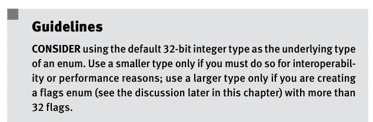

枚举本质上只是在基础类型上叠加的一组名称；没有机制将枚举类型变量的值限制在声明中命名的值范围内。例如，由于可以将整数 42 强制转换为 `short`，因此也可以将整数 42 强制转换为 `ConnectionState` 类型，尽管没有对应的 `ConnectionState` 枚举值。如果值可以转换为基础类型，则到枚举类型的转换也会成功。

这一独特特性的优势在于，枚举可以在后续 API 版本中添加新值，而不会破坏早期版本。此外，枚举值为已知值提供了名称，同时仍允许在运行时分配未知值。负担在于开发人员必须针对未命名值的可能性进行防御性编程。例如，将 `case ConnectionState.Disconnecting` 替换为 `default` 并期望 `default` 情况中唯一可能的值是 `ConnectionState.Disconnecting` 是不明智的。相反，你应该显式处理 `Disconnecting` 情况，而 `default` 情况应报告错误或保持无害行为。然而，如前所述，枚举与其基础类型之间（以及反之）的转换需要显式强制转换；它不是隐式转换。例如，如果方法签名为 `void ReportState(ConnectionState state)`，代码不能调用 `ReportState(10)`。唯一的例外是传递 0，因为存在从 0 到任何枚举的隐式转换。

虽然你可以在代码的后续版本中为枚举添加更多值，但应谨慎操作。在枚举中间插入一个枚举值会提升后续所有枚举值的值（例如，在 `Connected` 之前添加 `Flooded` 或 `Locked` 会改变 `Connected` 的值）。这将影响所有针对新版本重新编译的代码版本。但是，针对旧版本编译的任何代码将继续使用旧值，使得预期的值完全不同。除了在列表末尾插入枚举值外，避免更改枚举值的一种方法是显式分配值。

## 准则

- **考虑** 向现有枚举添加新成员，但请记住兼容性的风险。
- **避免** 创建表示“不完整”值集的枚举，例如产品版本号。
- **避免** 在枚举中创建“保留供将来使用”的值。
- **避免** 包含单个值的枚举。
- **应** 为简单枚举提供值为 0（无）的值，知道在未提供显式初始化时，0 将是默认值。

枚举与其他值类型略有不同，因为它们先派生自 `System.Enum`，然后才派生自 `System.ValueType`。

### 枚举之间的类型兼容性

C# 也不支持在两种不同枚举的数组之间进行直接强制转换。但是，CLR 支持，前提是两个枚举共享相同的基础类型。为了绕过 C# 的这一限制，技巧是先强制转换为 `System.Array`，如清单 9.12 末尾所示。

## 清单 9.12：在枚举数组之间进行强制转换

```
enum ConnectionState1
{
   Disconnected,
   Connecting,
   Connected,
   Disconnecting
}
enum ConnectionState2
{
Disconnected,
Connecting,
Connected,
Disconnecting
}
class Program
{
static void Main()
{
ConnectionState1[] states =
(ConnectionState1[])(Array)new ConnectionState2[42];
}
}
```

此示例利用了这样一个事实：CLR 的赋值兼容性概念比 C# 的概念更宽松。（其他非法转换，如 `int[ ]` 到 `uint[ ]`，也可以采用相同的技巧。）然而，请谨慎使用这种方法，因为没有 C# 规范要求这种行为在不同的 CLR 实现中必须有效。

### 在枚举和字符串之间转换

枚举的便利之一在于，`ToString()` 方法（由 `System.Console.WriteLine()` 等方法调用）会写出枚举值标识符：

```
System.Diagnostics.Trace.WriteLine(
$"The connection is currently { ConnectionState.Disconnecting }");
```

上述代码会将文本（如输出 9.3 所示）写入跟踪缓冲区。

### 输出 9.3

> The connection is currently Disconnecting.

从字符串到枚举的转换实现起来要复杂一些，因为它涉及 `System.Enum` 基类上的静态方法。清单 9.13 提供了一个不使用泛型（参见第 12 章）的示例，输出 9.4 显示了结果。

## 清单 9.13：使用 Enum.Parse() 将字符串转换为枚举

```csharp
ThreadPriorityLevel priority = (ThreadPriorityLevel)Enum.Parse(
    typeof(ThreadPriorityLevel), "Idle");
Console.WriteLine(priority);
```

### 输出 9.4

Idle

在这段代码中，`Enum.Parse()` 的第一个参数是类型，你使用 `typeof()` 关键字指定它。此示例展示了在编译时识别类型的一种方式，类似于类型值的字面量（参见第 18 章）。

在 Microsoft .NET Framework 4 之前，没有 `TryParse()` 方法，因此针对早期版本编写的代码如果字符串可能不对应于枚举值标识符，则需要包含适当的异常处理。Microsoft .NET Framework 4 的 `TryParse<T>()` 方法使用泛型，但类型参数可以被推断，从而实现清单 9.14 所示的到枚举的转换行为。

## 清单 9.14：使用 Enum.TryParse<T>() 将字符串转换为枚举

```csharp
System.Diagnostics.ThreadPriorityLevel priority;
if(Enum.TryParse("Idle", out priority))
{
    Console.WriteLine(priority);
}
```

如果字符串可能无法成功转换，此技术消除了使用异常处理的需要。相反，代码可以检查从 `TryParse<T>()` 调用返回的布尔结果。

无论代码使用“Parse”还是“TryParse”方法，从字符串转换为枚举的关键注意事项是，这种强制转换不具有本地化特性。因此，开发人员应仅将此类强制转换用于未向用户展示的消息（假设本地化是要求）。

## 准则

- **避免** 在字符串必须本地化为用户语言的情况下进行直接的枚举/字符串转换。

## 枚举作为标志

很多时候，开发人员不仅希望枚举值具有唯一性，还希望能够表示值的组合。例如，考虑 `System.IO.FileAttributes`。此枚举如清单 9.15 所示，指示文件的各种属性：只读、隐藏、归档等。与 `ConnectionState` 属性不同（其中每个枚举值是互斥的），`FileAttributes` 枚举值可以并且旨在进行组合：一个文件既可以只读又可以隐藏。为了支持这种行为，每个枚举值都是一个唯一的位。

**清单 9.15：使用枚举作为标志**

```csharp
[Flags] public enum FileAttributes
{
    ReadOnly       = 1<<0,   // 000000000000000001
    Hidden         = 1<<1,   // 000000000000000010
    System         = 1<<2,   // 000000000000000100
    Directory      = 1<<4,   // 000000000000010000
    Archive        = 1<<5,   // 000000000000100000
    Device         = 1<<6,   // 000000000001000000
    Normal         = 1<<7,   // 000000000100000000
    Temporary      = 1<<8,   // 000000010000000000
    SparseFile     = 1<<9,   // 000000100000000000
    ReparsePoint   = 1<<10,  // 000001000000000000
    Compressed     = 1<<11,  // 000010000000000000
    Offline        = 1<<12,  // 000100000000000000
    NotContentIndexed = 1<<13, // 001000000000000000
    Encrypted      = 1<<14,  // 010000000000000000
    IntegrityStream = 1<<15, // 100000000000000000
    NoScrubData    = 1<<17,  // 100000000000000000
}
```

> **注意**
> 请注意，位标志枚举的名称通常是复数形式，表明该类型的值表示一组标志。

要组合枚举值，使用按位 OR 运算符。要测试特定标志的存在，使用 `HasFlag()` 方法（这是在 Microsoft .NET Framework 4.0 中添加的）或使用按位 AND 运算符。这两种情况都在清单 9.16 中进行了说明。

**清单 9.16：使用按位 OR 和 AND 处理标志枚举**

```csharp
using System;
using System.IO;
public class Program
{
    public static void Main()
    {
        // ...
        string fileName = @"enumtest.txt";
        System.IO.FileInfo file =
            new System.IO.FileInfo(fileName);
        file.Attributes = FileAttributes.Hidden |
            FileAttributes.ReadOnly;
        Console.WriteLine($"{file.Attributes} = {(int)file.Attributes}");
        // Added in .NET 4.0/Microsoft .NET Framework 4.0
        if (!file.Attributes.HasFlag(FileAttributes.Hidden))
        {
            throw new Exception("File is not hidden.");
        }
        // Use bit operators prior to .NET 4.0
        if ((file.Attributes & FileAttributes.ReadOnly) !=
            FileAttributes.ReadOnly)
        {
            throw new Exception("File is not read-only.");
        }
        // ...
    }
}
```

清单 9.16 的结果如输出 9.5 所示。

**输出 9.5**

```text
Hidden | ReadOnly = 3
```

使用按位 OR 运算符允许你将文件设置为既只读又隐藏。

枚举内的每个值不需要仅对应一个标志。定义对应于常见值组合的额外标志是完全合理的。清单 9.17 给出了一个示例。

**清单 9.17：为常见组合定义枚举值**

```csharp
[Flags] enum DistributedChannel
{
    None = 0,
    Transacted = 1,
    Queued = 2,
    Encrypted = 4,
    Persisted = 16,
    FaultTolerant = 
        Transacted | Queued | Persisted
}
```

在标志枚举中拥有一个值为零的 `None` 成员是一个好习惯，因为枚举类型字段或枚举类型数组元素的初始默认值为 0。避免对应于诸如 Maximum 之类项目的枚举值作为最后一个枚举，因为 Maximum 可以被解释为有效的枚举值。要检查某个值是否包含在枚举中，使用 `System.Enum.IsDefined()` 方法。

## 指南

- **要**使用 `FlagsAttribute` 标记包含标志的枚举。
- **要**为所有标志枚举提供一个等于 0 的 `None` 值。
- **避免**创建零值具有除“未设置任何标志”以外含义的标志枚举。
- **考虑**为常用的标志组合提供特殊值。
- **不要**包含“哨兵”值（例如名为 Maximum 的值）；此类值可能会让用户感到困惑。
- **要**使用 2 的幂，以确保所有标志组合都是唯一表示的。

### 进阶主题

# FlagsAttribute

如果你决定使用位标志枚举，该枚举的声明应使用 `FlagsAttribute` 进行标记。在这种情况下，该属性出现在方括号中（参见第 18 章），紧接在枚举声明之前，如清单 9.18 所示。

**清单 9.18：使用 FlagsAttribute**

```csharp
// FileAttributes defined in System.IO
[Flags] // Decorating an enum with FlagsAttribute
public enum FileAttributes
{
    ReadOnly =        1<<0,        // 00000000000001
    Hidden =          1<<1,        // 00000000000010
    // ...
}
using System;
using System.Diagnostics;
using System.IO;
class Program
{
    public static void Main()
    {
        string fileName = @"enumtest.txt";
        FileInfo file = new FileInfo(fileName);
        file.Open(FileMode.Create).Close();
        FileAttributes startingAttributes =
             file.Attributes;
        file.Attributes = FileAttributes.Hidden |
            FileAttributes.ReadOnly;
        Console.WriteLine("\"{0}\" outputs as \"{1}\"",
            file.Attributes.ToString().Replace(",", " |"),
            file.Attributes);
        FileAttributes attributes =
            (FileAttributes)Enum.Parse(typeof(FileAttributes),
            file.Attributes.ToString());
        Console.WriteLine(attributes);
        File.SetAttributes(fileName,
            startingAttributes);
        file.Delete();
    }
}
```

清单 9.18 的结果如输出 9.6 所示。

**输出 9.6**

```text
"ReadOnly | Hidden" outputs as "ReadOnly, Hidden"
ReadOnly, Hidden
```


该属性记录了枚举值可以组合。此外，它改变了 `ToString()` 和 `Parse()` 方法的行为。例如，在对使用 `FlagsAttribute` 装饰的枚举调用 `ToString()` 时，会写出每个已设置的枚举标志的字符串。在清单 9.18 中，`file.Attributes.ToString()` 返回 `ReadOnly, Hidden`，而不是在没有 FileAttributes 标志时会返回的 3。如果两个枚举值相同，`ToString()` 调用将返回第一个值。然而，如前所述，依赖此行为时应谨慎，因为它不具有本地化特性。

从字符串解析值到枚举也是可行的。每个枚举值标识符用逗号与其他标识符分隔。

请注意，`FlagsAttribute` 不会自动分配唯一的标志值，也不检查它们是否具有唯一值。鉴于重复和组合通常是期望的，这样做没有意义。相反，你必须显式分配每个枚举项的值。

## 摘要

本章从讨论如何定义自定义值类型开始。由于在变更值类型时编写令人困惑或存在 bug 的代码很容易，并且值类型通常用于建模不可变值，因此使值类型不可变是一个好主意。我们还描述了当值类型需要作为引用类型进行多态处理时，它们是如何被装箱的。

装箱引入的特殊性是微妙的，其中绝大多数导致执行时而不是编译时的问题。虽然了解这些怪癖以避免它们很重要，但在很多方面，过度关注潜在陷阱会掩盖值类型的有用性和性能优势。程序员不应过度担心使用值类型。值类型渗透了本书的几乎每一章，但与它们相关的特殊性很少发挥作用。我们已围绕每个问题放置代码以展示该顾虑，但实际上这些模式的 occurrence 很少。避免其中大部分的关键是遵循不创建可变值类型指南，遵循此约束解释了你为什么不会在内置值类型中遇到它们。

在某些情况下，重复的装箱操作可能会频繁发生。然而，泛型极大地减少了装箱，即使没有使用泛型，性能也很少会受到影响，以至于需要在特定算法中识别出装箱操作成为瓶颈之前避免使用泛型。

此外，自定义结构体相对较少。它们显然在 C# 开发中扮演着重要角色，但与自定义类的数量相比，典型开发者声明的自定义结构体数量通常极少。大量使用自定义结构体最常见于旨在与非托管代码互操作的代码中。

> **准则**
>
> **不要**定义结构体，除非它在逻辑上代表单个值，占用 16 字节或更少的存储空间，是不可变的，并且很少被装箱。

本章还介绍了枚举。枚举类型是许多编程语言中的一种标准构造。它们有助于提高 API 可用性和代码可读性。

下一章将提供更多关于创建格式良好的类型的准则——包括值类型和引用类型。它从查看重写对象的虚拟成员和定义运算符重载方法开始。这两个主题适用于结构体和类，但在完成结构体定义并使其格式良好时，它们的重要性略有增加。

# 10 格式良好的类型

**前几章**涵盖了定义类和结构体的多数构造。然而，仍有几个细节需要完善类型定义，以实现“适应与完成”类的功能。本章解释了如何为类型声明画上最终的句号。

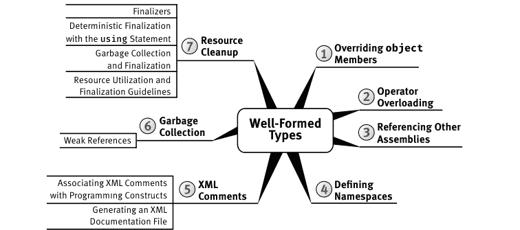

## 重写对象成员

第 6 章讨论了所有类和结构体如何从 `object` 派生。此外，它回顾了 `object` 上的每个可用方法，并讨论了一些方法如何是虚拟的。本节讨论关于重写虚拟方法的细节。

### 重写 ToString()

默认情况下，在任何对象上调用 `ToString()` 都会返回类的完全限定名称。例如，在 `System.IO.FileStream` 对象上调用 `ToString()` 将返回字符串 `System.IO.FileStream`。然而，对于一些类，`ToString()` 可能更有意义。例如，在字符串上，`ToString()` 返回字符串值本身。类似地，返回联系人名称会更合理。列表 10.1 重写了 `ToString()` 以返回坐标的字符串表示。

**列表 10.1: 重写 ToString()**

```csharp
public struct Coordinate
{
    public Coordinate(Longitude longitude, Latitude latitude)
    {
        Longitude = longitude;
        Latitude = latitude;
    }
    public Longitude Longitude { get; }
    public Latitude Latitude { get; }
    public override string ToString()
    {
        return $"{Longitude} {Latitude}";
    }
    // ...
}
```

诸如 `Console.WriteLine()` 和 `System.Diagnostics.Trace.Write()` 这样的方法会调用对象的 `ToString()` 方法，因此重写该方法通常比默认实现输出更有意义的信息。只要能够提供相关的诊断信息，就应该考虑重写 `ToString()` 方法——特别是当目标受众是开发人员时，因为默认的 `object.ToString()` 输出是类型名称，对最终用户不友好。`ToString()` 对于在开发人员 IDE 内进行调试或写入日志文件非常有用。因此，字符串应保持相对较短（一屏长度），以免被截断。然而，由于缺乏本地化和其他高级格式化功能，这种方法不太适合一般的最终用户文本显示。

## 准则

- **应**在能够返回有用的面向开发人员的诊断字符串时，始终重写 `ToString()`。
- **应**尽量保持 `ToString()` 返回的字符串简短。
- **不要**从 `ToString()` 返回空字符串或 null。
- **避免**从 `ToString()` 抛出异常或产生可观察的副作用（改变对象状态）。
- **应**如果返回值对文化敏感或需要格式化（例如，`DateTime`），则提供重载的 `ToString(string format)` 或实现 `IFormattable`。
- **考虑**从 `ToString()` 返回唯一的字符串，以标识对象实例。

### 重写 GetHashCode()

重写 `GetHashCode()` 比重写 `ToString()` 更复杂。即便如此，当重写 `Equals()` 时，你也应该重写 `GetHashCode()`，如果未重写，编译器会发出警告以指示此步骤是推荐的。在将 `GetHashCode()` 用作哈希表集合（例如，`System.Collections.Hashtable` 和 `System.Collections.Generic.Dictionary`）的键时，重写它也是一种良好的实践。

哈希代码的目的是通过生成对应于对象值的数字，从而*高效地平衡哈希表*。以下是良好的 `GetHashCode()` 实现的一些原则：

- ***必需：*** 相等的对象必须具有相等的哈希代码（如果 `a.Equals(b)`，则 `a.GetHashCode() == b.GetHashCode()`）。
- ***必需：*** 特定对象在其生命周期内 `GetHashCode()` 的返回值应该是常数（相同的值），即使对象的数据发生变化。在许多情况下，你应该缓存方法返回值以强制此约束。
- ***必需：*** `GetHashCode()` 不应抛出任何异常；`GetHashCode()` 必须始终成功返回一个值。
- ***性能：*** 哈希代码应在尽可能时唯一。然而，由于哈希代码仅返回一个 `int`，对于值可能超过 `int` 所能持有的类型，哈希代码不可避免地会重叠，这几乎是所有类型。（一个明显的例子是 long，因为可能的 long 值比 int 能唯一识别的多。）
- ***性能：*** 可能的哈希代码值应在 int 范围内均匀分布。例如，创建一个不考虑拉丁语系语言中字符串分布主要集中在前 128 个 ASCII 字符这一事实的哈希，将导致字符串值的分布非常不均匀，并且不会是一个强大的 `GetHashCode()` 算法。
- ***性能：*** `GetHashCode()` 应针对性能进行优化。`GetHashCode()` 通常用于 `Equals()` 实现中，如果哈希代码不同则短路完整的相等比较。结果，当类型用作字典集合中的键类型时，它经常被调用。
- ***性能：*** 两个对象之间的微小差异应导致哈希代码值之间的大差异——理想情况下，对象中的 1 位差异应导致哈希代码中平均约 16 位的改变。这有助于确保无论哈希值如何“分桶”，哈希表都保持平衡。
- ***安全性：*** 攻击者应难以制作具有特定哈希代码的对象。攻击是通过向哈希表填充大量数据，这些数据的哈希值都相同。哈希表实现可能变得低效，导致可能的拒绝服务攻击。

当然，这些准则和规则是相互矛盾的：提出一个既快速又满足所有这些准则的哈希算法非常困难。与任何设计问题一样，你需要结合良好的判断力和现实的性能测量来提出一个良好的解决方案。考虑列表 10.2 中显示的 Coordinate 类型的 `GetHashCode()` 实现。

**列表 10.2: 实现 GetHashCode()**

```csharp
public struct Coordinate
{
    public Coordinate(Longitude longitude, Latitude latitude)
    {
        Longitude = longitude;
        Latitude = latitude;
    }
    public Longitude Longitude { get; }
    public Latitude Latitude { get; }
    public override int GetHashCode()
    {
        int hashCode = Longitude.GetHashCode();
        // 只要哈希代码不相等
        if (Longitude.GetHashCode() != Latitude.GetHashCode())
        {
            hashCode ^= Latitude.GetHashCode(); // 异或
        }
        return hashCode;
    }
    // ...
}
```

通常，关键是对相关类型的哈希代码使用 XOR 运算符，并确保 XOR 操作数不太可能接近或相等——否则结果将全为零。（在操作数接近或相等的情况下，考虑使用位移和加法代替。）替代操作数 AND 和 OR 具有类似的限制，但这些限制更频繁地发挥作用。多次应用 AND 倾向于全 0 位，而应用 OR 倾向于全 1 位。

为了进行更精细的控制，使用移位运算符拆分大于 int 的类型。例如，名为 value 的 long 的 `GetHashCode()` 实现如下：

```csharp
int GetHashCode() { return ((int)value ^ (int)(value >> 32)); }
```

此外，如果基类不是 object，应在 XOR 赋值中包含 `base.GetHashCode()`。

最后，Coordinate 不缓存哈希代码的值。由于哈希代码计算中的每个字段都是只读的，值无法更改。然而，如果计算值可能会更改，或者缓存值可以提供显著的性能优势，实现应缓存哈希代码。

### 重写 Equals()

重写 `Equals()` 而不重写 `GetHashCode()` 会导致类似于输出 10.1 中显示的警告。

## 输出 10.1

```
warning CS0659: '<Class Name>' overrides Object.Equals(object o) but
does not override Object.GetHashCode()
```

通常，开发者认为重写 Equals() 很琐碎，但它包含了许多令人惊讶的细节，需要仔细思考和测试。

#### 对象标识与相等对象值

如果两个引用都指向同一个实例，则这两个引用是相同的。`object`（以及通过继承的所有派生类型）包含一个名为 `ReferenceEquals()` 的静态方法，它显式检查这种对象标识（参见图 10.1）。

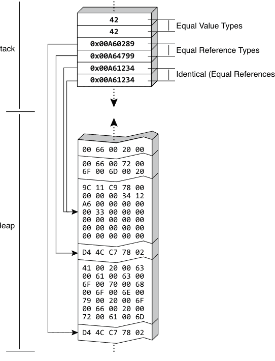

**图 10.1：标识**

然而，引用相等并非唯一的相等类型。如果两个对象实例的某些或所有成员的值相等，它们也可以被称为相等。考虑一下列表 10.3 中展示的两个 `ProductSerialNumbers` 的比较。

### 列表 10.3：重写相等运算符

```csharp
public sealed class ProductSerialNumber
{
    // ...
}
class Program
{
    static void Main()
    {
        ProductSerialNumber serialNumber1 =
            new ProductSerialNumber("PV", 1000, 09187234);
        ProductSerialNumber serialNumber2 = serialNumber1;
        ProductSerialNumber serialNumber3 =
            new ProductSerialNumber("PV", 1000, 09187234);
        // These serial numbers ARE the same object identity
        if (!ProductSerialNumber.ReferenceEquals(serialNumber1,
                serialNumber2))
        {
            throw new Exception(
                "serialNumber1 does NOT " +
                "reference equal serialNumber2");
        }
        // And, therefore, they are equal
        else if (!serialNumber1.Equals(serialNumber2))
        {
            throw new Exception(
                "serialNumber1 does NOT equal serialNumber2");
        }
        else
        {
            Console.WriteLine(
                "serialNumber1 reference equals serialNumber2");
            Console.WriteLine(
                "serialNumber1 equals serialNumber2");
        }
        // These serial numbers are NOT the same object identity
        if (ProductSerialNumber.ReferenceEquals(serialNumber1,
                serialNumber3))
        {
            throw new Exception(
                "serialNumber1 DOES reference " +
                "equal serialNumber3");
        }
        // But they are equal (assuming Equals is overloaded)
        else if(!serialNumber1.Equals(serialNumber3) ||
                serialNumber1 != serialNumber3)
        {
            throw new Exception(
                "serialNumber1 does NOT equal serialNumber3");
        }
        Console.WriteLine( "serialNumber1 equals serialNumber3 ");
    }
}
```

列表 10.3 的结果显示在输出 10.2 中。

### 输出 10.2

```
serialNumber1 reference equals serialNumber2
serialNumber1 equals serialNumber3
```


正如最后通过 `ReferenceEquals()` 所做的断言所展示的，`serialNumber1` 和 `serialNumber3` 不是同一个引用。然而，代码使用相同的值构造了它们，并且两者在逻辑上都与同一个物理产品相关联。如果一个实例是从数据库中的数据创建的，而另一个是从手动输入的数据创建的，你会期望这些实例是相等的，因此，该产品不应该在数据库中重复（重新输入）。两个相同的引用显然是相等的；然而，两个不同的对象可以相等但不引用相等。这样的对象不会有相同的对象标识，但它们可能拥有关键数据，将其识别为相等对象。

只有引用类型可以引用相等，从而支持标识的概念。对值类型调用 `ReferenceEquals()` 将始终返回 `false`，因为当值类型转换为对象以进行调用时，它们会被装箱。即使将同一个变量传入 `ReferenceEquals()` 的两个（值类型）参数，结果仍然将是 `false`，因为值是独立装箱的。列表 10.4 演示了这种行为：在这个例子中，因为每个参数都被放入“不同的盒子”中，它们永远不引用相等。

> **注意**
>
> 对值类型调用 `ReferenceEquals()` 将始终返回 `false`。

### 列表 10.4：值类型从不引用相等自身

```csharp

public struct Coordinate

{

    public Coordinate(Longitude longitude, Latitude latitude)

    {

        Longitude = longitude;

        Latitude = latitude;

    }

    public Longitude Longitude { get; }

    public Latitude Latitude { get; }

    // ...

}

class Program

{

    public void Main()

    {

        //...

        Coordinate coordinate1 =

            new Coordinate( new Longitude(48, 52),

                            new Latitude(-2, -20));

        // Value types will never be reference equal

        if ( Coordinate.ReferenceEquals(coordinate1,

                coordinate1) )

        {

            throw new Exception(

                "coordinate1 reference equals coordinate1");

        }

        Console.WriteLine(

            "coordinate1 does NOT reference equal itself" );

    }

}

```

与第 9 章中 `Coordinate` 作为引用类型的定义相比，接下来的定义是值类型（`struct`），因为经度和纬度数据的组合在逻辑上被视为一个值，且其大小小于 16 字节。（在第 9 章中，`Coordinate` 聚合了 `Angle` 而不是经度和纬度。）将 `Coordinate` 声明为值类型的一个促成因素是，它是一个（复杂的）数值，对其有操作。相比之下，像 `Employee` 这样的引用类型并不是你进行数值操作的值，而是指向现实生活中的对象。

## 实现 Equals()

要确定两个对象是否相等（即它们是否具有相同的标识数据），你可以使用对象的 `Equals()` 方法。`object` 上此虚方法的实现使用 `ReferenceEquals()` 来评估相等性。由于这种实现通常是不充分的，有时需要用更合适的实现来重写 `Equals()`。

> **注意**
>
> `object.Equals()` 的实现，即所有对象在重载前的默认实现，仅依赖 `ReferenceEquals()`。

对于对象要*相等*，期望是它们内部的标识数据相等。例如，对于 `ProductSerialNumbers`，`ProductSeries`、`Model` 和 `Id` 必须相同；然而，对于 `Employee` 对象，也许比较 `EmployeeId` 就足以判断相等。为了纠正 `object.Equals()` 的实现，有必要重写它。值类型，例如，重写 `Equals()` 实现，改为使用该类型包含的字段。

重写 `Equals()` 的步骤如下：

- 1. 检查 `null`。
- 2. 如果类型是引用类型，检查引用相等。
- 3. 检查等效类型。
- 4. 调用一个类型化的辅助方法，该方法可以操作数作为被比较类型而不是对象（参见列表 10.5 中的 `Equals(Coordinate obj)` 方法）。
- 5. 可能检查等效的哈希码以短路广泛的逐字段比较。（两个相等的对象不能具有不同的哈希码。）
- 6. 如果基类重写了 `Equals()`，则检查 `base.Equals()`。
- 7. 比较每个标识字段的相等性。
- 8. 重写 `GetHashCode()`。
- 9. 重写 `==` 和 `!=` 运算符（参见下一节）。

列表 10.5 显示了一个 `Equals()` 实现的示例。

### 列表 10.5：重写 Equals()

```csharp

public struct Longitude

{

    // ...

}

public struct Latitude

{

    // ...

}

public struct Coordinate : IEquatable<T>

{

    public Coordinate(Longitude longitude, Latitude latitude)

    {

        Longitude = longitude;

        Latitude = latitude;

    }

    public Longitude Longitude { get; }

    public Latitude Latitude { get; }

    public override bool Equals(object obj)

    {

        // STEP 1: Check for null

        if (obj == null)

        {

            return false;

        }

        // STEP 3: Equivalent data types;

        // can be avoided if type is sealed

        if (this.GetType() != obj.GetType())

        {

            return false;

        }

        return Equals((Coordinate)obj);

    }

    public bool Equals(Coordinate obj)

    {

        // STEP 1: Check for null if a reference type

        // (e.g., a reference type)

        // if (ReferenceEquals(obj, null))

        // {

        //     return false;

        // }

    }

}

```

// 步骤 2：检查 ReferenceEquals，如果
// 这是一个引用类型
// if (ReferenceEquals(this, obj))
// {
//	return true;
// }
//
// 步骤 4：可能检查等价的哈希码
// if (this.GetHashCode() != obj.GetHashCode())
// {
//	return false;
// }
//
// 步骤 5：检查 base.Equals，如果基类重写了 Equals()
// System.Diagnostics.Debug.Assert(
//	base.GetType() != typeof(object));
// if ( !base.Equals(obj) )
// {
//	return false;
// }
//
// 步骤 6：使用 Longitude 上的 Equals 重载
// 比较标识字段的相等性
return ( Longitude.Equals(obj.Longitude) &&
	Latitude.Equals(obj.Latitude) );

// 步骤 7：重写 GetHashCode
public override int GetHashCode()
{
	int hashCode = Longitude.GetHashCode();
	hashCode ^= Latitude.GetHashCode(); // 异或 (Xor, eXclusive OR)
	return hashCode;
}
}
```

在此实现中，前两个检查相对直观。然而，值得一提的是，如果该类型是密封类，则可以避免步骤 3。

步骤 4 到 6 发生在接受 `Coordinate` 数据类型的 `Equals()` 重载中。这样，两个 `Coordinate` 的比较将完全避免使用 `Equals(object obj)` 及其 `GetType()` 检查。

由于 `GetHashCode()` 未被缓存，且效率并不比步骤 5 高，因此 `GetHashCode()` 的比较被注释掉了。同样，`base.Equals()` 也未被使用，因为基类并未重写 `Equals()`。（该断言检查 `base` 不是 `object` 类型，但并未验证基类是否重写了 `Equals()`，这是正确调用 `base.Equals()` 所必需的。无论如何，由于 `GetHashCode()` 不一定返回唯一值（它仅用于标识操作数是否不同），因此单凭它无法确定性地识别相等的对象。）

与 `GetHashCode()` 类似，`Equals()` 绝不应该抛出任何异常。任何对象都可以与任何其他对象进行比较，这样做绝不应导致异常。

## 准则

- 应同时实现 `GetHashCode()`、`Equals()`、`==` 运算符和 `!=` 运算符，而不能只实现其中某一个而忽略其他三个。

- 在实现 `Equals()`、`==` 和 `!=` 时，请使用相同的算法。

- 避免在 `GetHashCode()`、`Equals()`、`==` 和 `!=` 的实现中抛出异常。

- 避免对可变引用类型进行相等性运算符重载，或者当实现会显著更慢时。

- 在实现 `IComparable` 时，应实现所有与相等性相关的方法。

## 使用元组重写 GetHashCode() 和 Equals()

如前面两节所示，`Equals()` 和 `GetHashCode()` 的实现相当复杂，但实际代码通常是样板代码。对于 `Equals()`，需要在避免无限递归或空引用异常的同时比较所有包含的标识数据结构。对于 `GetHashCode()`，需要通过异或操作组合每个非空标识数据结构的唯一哈希码。使用 C# 7.0 元组，结果证明这非常简单。

对于 `Equals(Coordinate coordinate)`，你可以将每个标识成员分组到一个元组中，并将它们与同类型的目标参数进行比较：

```csharp
public bool Equals(Coordinate coordinate) =>
    return (Longitude, Latitude).Equals(
        (coordinate.Longitude, coordinate.Latitude));
```

（有人可能会认为，如果显式比较每个标识成员会更易读，但我留给读者自行判断）。内部元组 (`System.ValueTuple<...>`) 使用 `EqualityComparer<T>`，这依赖于类型参数的 `IEquatable<T>` 实现（其中只包含一个 `Equals<T>(T other)` 成员）。因此，为了正确重写 `Equals`，你需要遵循准则：在重写 `Equals()` 时实现 `IEquatable<T>`。这样，你自己的自定义数据类型将利用你自定义的 `Equals()` 实现，而不是 `Object.Equals()`。

两个重载中更具说服力的可能是 `GetHashCode()` 及其元组的使用。而不是参与对非空标识成员进行复杂异或操作，你可以简单地实例化一个包含所有标识成员的元组，并返回该元组的 `GetHashCode()` 值，如下所示：

```csharp
public override int GetHashCode() =>
return (Radius, StartAngle, SweepAngle).GetHashCode();
```

请注意，在 C# 7.3 中，元组现在实现了 `==` 和 `!=`，这应该是其在最初实现时就应具备的特性，这是我们要在下一节中研究的主题。

## 运算符重载

前一节介绍了重写 `Equals()`，并提供了该类型也应实现 `==` 和 `!=` 的准则。实现任何运算符称为运算符重载。本节描述了如何执行这种重载，不仅针对 `==` 和 `!=`，还包括其他受支持的运算符。

例如，`string` 提供了一个连接两个字符串的 `+` 运算符。这也许并不令人惊讶，因为 `string` 是预定义类型，所以可能具有特殊的编译器支持。然而，C# 允许为类或结构体添加 `+` 运算符支持。实际上，除了 `x.y`、`f(x)`、`new`、`typeof`、`default`、`checked`、`unchecked`、`delegate`、`is`、`as`、`=` 和 `=>` 之外，所有运算符都受支持。其中一个特别值得注意的无法实现的运算符是赋值运算符；没有办法改变 `=` 运算符的行为。

在执行实现运算符重载的练习之前，请考虑这样一个事实：这类运算符无法通过 IntelliSense 发现。除非意图是让类型表现得像基本类型（例如，数值类型），否则应避免重载运算符。

## 比较运算符 (==, !=, <, >, <=, >=)

一旦重写了 `Equals()`，就可能存在不一致性。也就是说，两个对象可能为 `Equals()` 返回 `true`，但为 `==` 运算符返回 `false`，因为 `==` 默认执行引用相等性检查。为了纠正这个缺陷，重写等于 (`==`) 和不等于 (`!=`) 运算符也很重要。

在大多数情况下，这些运算符的实现可以将逻辑委托给 `Equals()`，或者反之。然而，对于引用类型，首先需要进行一些初始的空值检查（参见列表 10.6）。

### 列表 10.6：实现 == 和 != 运算符

```csharp
public sealed class ProductSerialNumber
{
    // ...

    public static bool operator ==(
        ProductSerialNumber leftHandSide,
        ProductSerialNumber rightHandSide)
    {
        // 检查 leftHandSide 是否为 null
        // (operator== 将是递归的)
        if(ReferenceEquals(leftHandSide, null))
        {
            // 如果 rightHandSide 也是 null 则返回 true，否则返回 false
            return ReferenceEquals(rightHandSide, null);
        }
        
        return (leftHandSide.Equals(rightHandSide));
    }

    public static bool operator !=(
        ProductSerialNumber leftHandSide,
        ProductSerialNumber rightHandSide)
    {
        return !(leftHandSide == rightHandSide);
    }
}
```

请注意，在此示例中，我们使用 `ProductSerialNumber` 而不是 `Coordinate` 来演示引用类型的逻辑，引用类型具有空值的额外复杂性。

请务必避免在相等性运算符 (`leftHandSide == null`) 中使用空值检查。这样做会递归地调用回该方法，导致循环持续直到堆栈溢出。为避免此问题，可以调用 `ReferenceEquals()` 来检查空值。

**准则**

- 避免在 `==` 运算符重载的实现中使用相等性比较运算符 (`==`)。

## 二进制运算符 (*, -, *, /, %, &, |, ^, <<, >>)

你可以将 `Arc` 添加到 `Coordinate` 中。然而，迄今为止的代码并未提供加法运算符支持。相反，你需要定义这样一个方法，如列表 10.7 所示。

### 列表 10.7：添加运算符


```csharp
struct Arc
{
    public Arc(
        Longitude longitudeDifference,
        Latitude latitudeDifference)
    {
        LongitudeDifference = longitudeDifference;
        LatitudeDifference = latitudeDifference;
    }

    public Longitude LongitudeDifference { get; }
    public Latitude LatitudeDifference { get; }
}

struct Coordinate
{
    // ...
    public static Coordinate operator +(
        Coordinate source, Arc arc)
    {
        Coordinate result = new Coordinate(
            new Longitude(
                source.Longitude + arc.LongitudeDifference),
            new Latitude(
                source.Latitude + arc.LatitudeDifference));
        return result;
    }
}
```

`*`, `-`, `*`, `/`, `%`, `&`, `|`, `^`, `<<` 和 `>>` 运算符实现为二进制静态方法，其中至少一个参数是包含类型。方法名称是运算符加上 `operator` 关键字作为前缀。如列表 10.8 所示，给定

—— 和 `+` 二元运算符的定义，你可以向坐标添加或减去一个 `Arc`（弧长）。注意，`Longitude`（经度）和 `Latitude`（纬度）也需要实现 `+` 运算符，因为它们会被 `source.Longitude + arc.LongitudeDifference` 和 `source.Latitude + arc.LatitudeDifference` 调用。

## 清单 10.8：调用 – 和 + 二元运算符

```csharp
public class Program
{
    public static void Main()
    {
        Coordinate coordinate1, coordinate2;
        coordinate1 = new Coordinate(
                    new Longitude(48, 52), new Latitude(-2, -20));
        Arc arc = new Arc(new Longitude(3), new Latitude(1));

        coordinate2 = coordinate1 + arc;
        Console.WriteLine(coordinate2);

        coordinate2 = coordinate2 - arc;
        Console.WriteLine(coordinate2);

        coordinate2 += arc;
        Console.WriteLine(coordinate2);
    }
}
```

清单 10.8 的结果显示在输出 10.3 中。

## 输出 10.3

```text
51°  52' 0 E  -1°  -20' 0 N
48°  52' 0 E  -2°  -20' 0 N
51°  52' 0 E  -1°  -20' 0 N
```

对于 `Coordinate`（坐标），你实现了 – 和 + 运算符，以返回添加/减去 `Arc` 后的坐标位置。这允许你将多个运算符和操作数串联起来，例如 `result = ((coordinate1 + arc1) + arc2) + arc3`。此外，通过在 `Arc` 上支持相同的运算符（`+/-`）（参见清单 10.9），你可以消除括号。这种方法有效的原因是，第一个操作数（`arc1 + arc2`）的结果是另一个 `Arc`，然后你可以将其加到下一个类型为 `Arc` 或 `Coordinate` 的操作数上。

相反，考虑一下如果你提供一个 – 运算符，其参数是两个 `Coordinate`，并返回对应于两个坐标之间距离的 `double`，会发生什么情况。将 `double` 加到 `Coordinate` 上是未定义的，因此你不能将运算符和操作数串联起来。在定义返回不同类型的运算符时需要谨慎，因为这样做违反直觉。

## 结合赋值与二元运算符 (+=, -=, *=, /=, %=, &=, ...)

如前所述，不支持重载赋值运算符。然而，当重载二元运算符时，结合赋值运算符（`+=`, `-=`, `*=`, `/=`, `%=`, `&=`, `|=`, `^=`, `<<=` 和 `>>=`）实际上是被重载了。根据不带赋值的二元运算符定义，C# 自动允许将赋值与该运算符结合使用。因此，使用清单 10.7 中 `Coordinate` 的定义，你可以编写如下代码：

```csharp
coordinate += arc;
```

它等同于以下代码：

```csharp
coordinate = coordinate + arc;
```

## 条件逻辑运算符 (&&, ||)

与赋值运算符类似，条件逻辑运算符不能显式重载。然而，由于逻辑运算符 `&` 和 `|` 可以被重载，且条件运算符由逻辑运算符组成，实际上是可以重载条件运算符的。`x && y` 被处理为 `x & y`，其中 `y` 必须评估为 `true`。类似地，`x || y` 仅在 `x` 为 `false` 时被处理为 `x | y`。为了支持将类型评估为 `true` 或 `false`——例如在 `if` 语句中——需要重写 `true/false` 一元运算符。

## 一元运算符 (+, -, !, ~, ++, --, true, false)

重载一元运算符与重载二元运算符非常相似，只是它们只接受一个参数，且该参数也是包含类型。清单 10.9 重载了 `Longitude` 和 `Latitude` 的 `+` 和 `-` 运算符，然后在 `Arc` 中重载相同运算符时使用这些运算符。

## 清单 10.9：重载 – 和 + 一元运算符

```csharp
public struct Latitude
{
    // ...
    public static Latitude operator -(Latitude latitude)
    {
        return new Latitude(-latitude.DecimalDegrees);
    }
    public static Latitude operator +(Latitude latitude)
    {
        return latitude;
    }
}

public struct Longitude
{
    // ...
    public static Longitude operator -(Longitude longitude)
    {
        return new Longitude(-longitude.DecimalDegrees);
    }
    public static Longitude operator +(Longitude longitude)
    {
        return longitude;
    }
}

public struct Arc
{
    // ...
    public static Arc operator -(Arc arc)
    {
        // Uses unary - operator defined on
        // Longitude and Latitude
        return new Arc(-arc.LongitudeDifference,
            -arc.LatitudeDifference);
    }
    public static Arc operator +(Arc arc)
    {
        return arc;
    }
}
```

与数值类型一样，此清单中的 `+` 运算符没有任何效果，提供它是为了对称性。重载 `true` 和 `false` 受到额外限制，即必须同时重载这两个运算符——而不能只重载其中一个。其签名与其他运算符重载相同；但是，返回值必须是 `bool`，如清单 10.10 所示。

## 清单 10.10：重载 true 和 false 运算符

```csharp
public static bool operator false(IsValid item)
{
    // ...
}
public static bool operator true(IsValid item)
{
    // ...
}
```

你可以在 `if`、`do`、`while` 和 `for` 控制表达式中使用具有重载 `true` 和 `false` 运算符的类型。

## 转换运算符

目前，`Longitude`、`Latitude` 和 `Coordinate` 不支持转换到另一种类型。例如，没有方法将 `double` 转换为 `Longitude` 或 `Latitude` 实例。同样，不支持使用字符串来赋值 `Coordinate`。幸运的是，C# 提供了专门用于处理类型转换的方法定义。此外，方法声明允许指定转换是隐式还是显式的。

## 高级主题

## 转换运算符 (())

实现显式和隐式转换运算符在技术上并不是重载转换运算符 `()`。但是，这实际上就是发生的情况，因此定义转换运算符是描述实现显式或隐式转换的常用术语。

定义转换运算符的风格与定义其他运算符类似，区别在于 `operator` 是转换后的结果类型。此外，`operator` 关键字后面跟随一个指示转换是隐式还是显式的关键字（参见清单 10.11）。

## 清单 10.11：在 Latitude 和 double 之间提供隐式转换

```csharp
public struct Latitude
{
    // ...
    public Latitude(double decimalDegrees)
    {
        DecimalDegrees = Normalize(decimalDegrees);
    }

    public double DecimalDegrees { get; }

    // ...
    public static implicit operator double(Latitude latitude)
    {
        return latitude.DecimalDegrees;
    }
    public static implicit operator Latitude(double degrees)
    {
        return new Latitude(degrees);
    }
    // ...
}
```

有了这些转换运算符，你现在可以隐式地在 `double` 和 `Latitude` 对象之间进行转换。假设 `Longitude` 存在类似的转换，你可以通过指定每个坐标部分的十进制度数来简化 `Coordinate` 对象的创建（例如，`coordinate = new Coordinate(43, 172)`）。

> **注意**
>
> 在实现转换运算符时，返回值或参数必须是外部类型（封装性支持）。C# 不允许你在被转换类型的范围之外指定转换。

## 转换运算符准则

定义隐式和显式转换运算符之间的区别在于防止意外的隐式转换导致不良行为。你应该意识到使用显式转换运算符的两个可能后果。首先，抛出异常的转换运算符应该总是显式的。例如，字符串很可能不符合从 `string` 到 `Coordinate` 的转换所需的格式。鉴于转换可能失败，你应该将特定的转换运算符定义为显式，从而要求你有意识地执行转换并确保格式正确，或者提供代码来处理可能的异常。通常，转换的模式是一个方向（`*string*` 到 `*Coordinate*`）是显式的，而反向（`*Coordinate*` 到 `*string*`）是隐式的。

第二个考虑因素是某些转换会导致数据丢失。将 `*float*` (`4.2`) 转换为 `*int*` 是完全有效的，前提是认识到 `*float*` 的小数部分会丢失。任何会丢失数据且无法成功转换回原始类型的转换都应定义为显式。如果显式转换意外导致数据丢失或无效，请考虑抛出 `System.InvalidCastException`。

## 准则

- **不要** 在转换会导致数据丢失的情况下提供隐式转换运算符。
- **不要** 从隐式转换中抛出异常。

## 引用其他程序集

C# 和底层的 CLI 框架允许你将代码分布在多个程序集中，而不是将所有代码放入一个庞大的二进制文件中。这种方法使你可以跨多个可执行文件重用程序集。

## 入门主题

## 类库

`*HelloWorld*` 程序是你所能编写的最简单程序之一。现实世界的程序更复杂，随着复杂性的增加，通过将程序分解为多个部分来组织复杂性会有帮助。为此，开发者将程序的一部分移动到称为 **类库** 或简称 **库** 的独立编译单元中。然后，程序引用并依赖于类库来提供其功能的部分。这个概念的优势在于两个程序可以依赖同一个类库，从而在两个程序中共享该功能并减少所需的总代码量。

换言之，我们可以编写一次功能特性，将它们放入类库中，并允许多个程序通过引用同一个类库来包含这些功能特性。在开发周期的后期，当开发者修复类库中的错误或为其添加新功能时，所有程序都能访问到这些增强后的功能，仅仅是因为它们继续引用了那个现已改进的类库。

通常，我们编写的代码可能对多个程序都有用。例如，想象一下使用映射程序和数字照片地理编码程序中的经度、纬度和坐标类，或者编写一个命令行解析器类。像这样的类和类集只需编写一次，然后就可以从许多不同的程序中复用。因此，它们需要被组合到一个名为库或类库的程序集中，并且其编写目的不仅是用于单个程序内部，更是为了复用。

要创建一个库而不是控制台项目，请遵循第 1 章中提供的相同步骤，但对于 .NET CLI，请使用 `Class Library` 或 `classlib` 作为模板。

同样，在 Visual Studio 2017 中，从“文件”->“新建项目...”菜单项（`Ctrl+Shift+N`）开始，使用搜索文本框找到所有“类库”模板，然后选择“类库 (.NET Standard)”——当然是 Visual C# 版本。将项目名称设为 `GeoCoordinates`。从“解决方案”组合框中，选择“添加到解决方案”。最后这一步很重要，因为它简化了从程序项目（例如 `HelloWorld` 项目）添加项目引用的过程。

接下来，将清单 10.9 中的源代码放入每个结构体（`struct`）单独的文件的文件中，并以结构体名称命名这些文件，然后构建该项目。构建项目会将 C# 代码编译成一个程序集——一个 `GeoCoordinates.dll` 文件——并将其放入 `.\bin\` 的子目录中。

## 引用库

有了库，我们需要从程序中引用它。假设有一个使用清单 10.8 中 `Program` 类的新控制台程序，我们需要添加对 `GeoCoordinates.dll` 程序集的引用，以标识库的位置并将唯一标识库的元数据嵌入到程序中。有几种方法可以做到这一点。首先，你可以引用库的项目文件，从而标识包含库源代码的项目，并在两个项目之间形成依赖关系。在库编译之前，无法编译引用该库的程序。这种依赖关系导致在程序编译时，如果库尚未编译，则会先编译库。

第二种方法是引用程序集文件本身。换句话说，引用编译后的库而不是项目。当库与程序分开编译时（例如由你组织内的另一个团队编译），这样做是有道理的。

第三，你可以引用 NuGet 包，如下节所述。

请注意，不仅控制台程序可以引用库和包。实际上，任何程序集都可以引用任何其他程序集。通常，一个库会引用另一个库，从而创建依赖链。

## 使用 .NET CLI 引用项目或库

在第 1 章中，我们讨论了创建控制台程序。这创建了一个包含 `Main` 方法的程序——程序开始执行的入口点。要为新创建的程序集添加引用，我们在之前的基础上继续，使用一个用于添加引用的额外命令：

```text
dotnet add .\HelloWorld\HelloWord.csproj package .\GeoCoordinates\bin\Debug\netcoreapp2.0\GeoCoordinates.dll
```

在 `add` 参数之后是项目引用的编译后程序集的文件路径。

与其引用程序集，你可以引用项目文件。如前所述，这将项目链接在一起，因此构建程序时，如果类库尚未编译，会先触发类库的编译。其优势在于，当程序编译时，它会自动定位编译后的类库程序集——例如，无论它在调试目录还是发布目录中。引用项目文件的命令是：

```text
dotnet add .\HelloWorld\HelloWord.csproj reference .\GeoCoordinates\GeoCoordinates.csproj
```

如果你拥有类库的源代码并且源代码经常更改，请考虑使用类库项目文件而不是编译后的程序集来引用该类库。

完成项目或编译后程序集的引用后，你的项目就可以使用清单 10.8 中的 `Program` 类源代码进行编译了。

## 使用 Visual Studio 2017 引用项目或库

同样，在第 1 章中，我们讨论了使用 Visual Studio 创建控制台程序。这创建了一个包含 `Main` 的程序。要为 `GeoCoordinates` 程序集添加引用，请单击“项目”->“添加引用...”菜单项。接下来，从“项目”\“解决方案”选项卡中，选择 `GeoCoordinates` 项目并单击“确定”以确认引用。

同样，要添加程序集引用，请遵循之前的过程，单击“项目”->“添加引用...”菜单项。但是，这次单击“浏览...”按钮，导航到并选择 `GeoCoordinates.dll` 程序集。

与 .NET CLI 一样，你可以使用清单 10.8 中的 `Program` 类源代码编译程序项目。


## NuGet 打包

从 Visual Studio 2010 开始，微软引入了一个名为 NuGet 的库打包系统。该系统的目的是提供一种手段，使库能够轻松地在项目之间以及公司之间共享。通常，库程序集不仅仅是单个编译文件。它可能包含相关的配置文件、额外资源和元数据。然而不幸的是，在 NuGet 之前，没有清单来标识所有依赖项。此外，也没有标准提供程序或包库来查找被引用的程序集。

NuGet 解决了这两个问题。NuGet 不仅包含一个标识作者、公司、依赖项等的清单，它还附带了一个位于 NuGet.org 的默认包提供程序，在那里可以上传、更新、索引包，然后供希望利用这些包的项目下载。借助 NuGet，你可以引用一个 NuGet 包（`.nupkg`），并让其自动从你预先配置的 NuGet 提供程序 URL 之一进行安装。

NuGet 包附带一个清单（一个 `*.nuspec` 文件），其中包含包中包含的所有额外元数据。此外，它提供你可能需要的任何额外资源——本地化文件、配置文件、内容文件等。最终，NuGet 包是所有单个资源组合在一个单一的 ZIP 文件中的存档——尽管扩展名为 `.nupkg`。因此，如果你将文件重命名为 `*.ZIP` 扩展名，你可以使用任何常见的压缩实用程序打开并查看该文件。

### 使用 .NET CLI 的 NuGet 引用

使用 .NET CLI 将 NuGet 包添加到你的项目中，只需执行单个命令：

```
>dotnet add .\HelloWorld\HelloWorld.csproj package Microsoft.Extensions.CommandLineUtils
```

此命令检查每个已注册的 NuGet 包提供程序以查找指定包并下载它。（你也可以使用命令 `dotnet restore` 显式触发下载。）

要创建本地 NuGet 包，请使用 `dotnet pack` 命令。此命令生成一个 `GeoCoordinates.1.0.0.nupkg` 文件，你可以使用 `add ... package` 命令引用它。

程序集名称后的数字对应于包版本号。要显式指定版本号，请编辑项目文件（`*.csproj`）并添加 `<Version>...</Version>` 子元素到 `PropertyGroup` 元素中。

### 使用 Visual Studio 2017 的 NuGet 引用

按照第 1 章中列出的说明，你已经有一个 HelloWorld 项目。从该项目开始，你可以按以下方式使用 Visual Studio 2017 添加 NuGet 包：

- 1. 单击“项目”->“管理 NuGet 包...”菜单项（参见图 10.2）。

- 2. 选择“浏览”筛选器，然后在“搜索”（Ctrl+E）文本框中输入 `Microsoft.Extensions.CommandLineUtils`。请注意，部分命令，如 `CommandLineUtils`，也会过滤列表（参见图 10.3）。

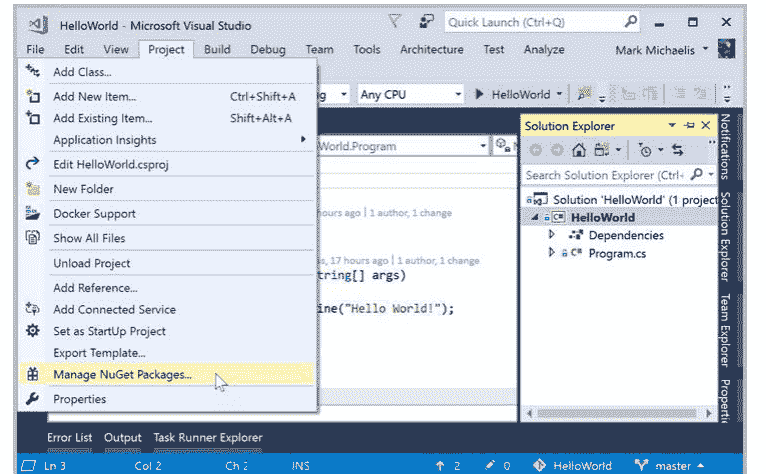

**图 10.2：项目菜单**

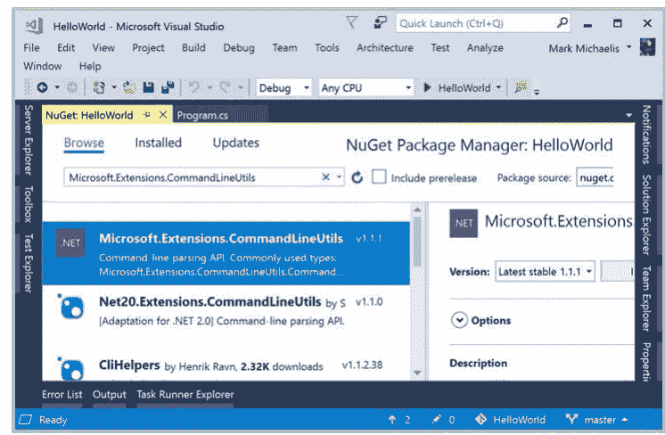

**图 10.3：浏览筛选器**

3. 点击**安装**按钮，将包安装到项目中。

完成这些步骤后，即可开始使用 `Microsoft.Extensions.CommandLineUtils` 库。

与 .NET CLI 一样，你可以使用 Visual Studio 2017 通过**生成 -> 打包 <项目名称>**菜单项构建自己的 NuGet 包。类似地，你可以在**项目属性**的**包**选项卡中指定包的版本号。

## 调用 NuGet 包

一旦引用了该包，就可以像所有源代码都包含在项目中使用它一样开始使用它。例如，列表 10.12 展示了如何使用 `Microsoft.Extensions.CommandLineUtils` 库，而输出 10.4 展示了示例输出。

```csharp
Listing 10.12: Invoking a NuGet Package Reference
public class Program
{
    public static void Main(string[] args)
    {
        CommandLineApplication commandLineApplication =
            new CommandLineApplication(throwOnUnexpectedArg: false);
        CommandLineArgument name = commandLineApplication.Argument(
            "name", "Enter the full name of the person to be greeted.");
        CommandLineOption greeting = commandLineApplication.Option(
            "-g|g|--greeting <greeting>",
            "The greeting to display. The greeting supports"
            + " a format string where '{name}' will be "
            + "substituted with the name.",
            CommandLineOptionType.SingleValue);
        commandLineApplication.HelpOption("? | -h | --help");
        commandLineApplication.Execute(args);
        if (!greeting.HasValue())
        {
            Console.WriteLine($"Hello {name.Value}.");
        }
        else
        {
            Console.WriteLine(
                greeting.Value().Replace("{name}", name.Value));
        }
    }
}
```

```text
OUTPUT 10.4
>dotnet run "Inigo Montoya" -g "Hello {name}. Welcome!"
Hello Inigo Montoya. Welcome!"
```

该库用于解析命令行中的参数和选项，其中选项具有开关以识别它们，而参数则没有此类开关。有关示例，请参见表 10.1。

### 表 10.1：Microsoft.Extensions.CommandLineUtils 示例

| 参数类型 | 示例 | 说明 |

| :-- | :-- | :-- |

| 选项 | `Program.exe -f=Inigo -L Montoya -hello` | 选项 -f，值为 "Inigo"<br>选项 -L，值为 "Montoya"<br>选项 -hello，值为 "on" |

| 带有参数的命令 | `Program.exe hello "Inigo" "Montoya"` | 命令 "hello"<br>参数 "Inigo"<br>参数 "Montoya" |

| 符号 | `Program.exe -?` | 显示帮助 |

## 高级主题

### 类型的封装

正如类作为行为和数据的封装边界一样，程序集也为类型组提供了类似的边界。开发者可以将系统分解为程序集，然后将这些程序集与多个应用程序共享，或将它们与第三方提供的程序集进行集成。

### 类型声明上的 public 或 internal 访问修饰符

默认情况下，没有访问修饰符的类被定义为*internal*（内部）。¹ 其结果是，该类在程序集外部不可访问。即使另一个程序集引用了包含该类的程序集，被引用程序集中的所有内部类都将是不可访问的。

正如 *private*（私有）和 *protected*（受保护）为类内的成员提供封装级别一样，C# 也支持在类级别使用访问修饰符，以控制程序集内类的封装。可用的访问修饰符是 *public*（公共）和 *internal*（内部）。要在程序集外部公开一个类，必须将该程序集标记为 *public*。因此，在编译 `Coordinates.dll` 程序集之前，有必要将类型声明修改为 public（参见列表 10.13）。

```csharp
Listing 10.13: Making Types Available outside an Assembly

public struct Coordinate
{
// ...
}

public struct Latitude
{
// ...
}

public struct Longitude
{
// ...
}

public struct Arc
{
// ...
}
```

同样，如 `class` 和 `enum` 等声明可以是 public 或 internal。²

`internal` 访问修饰符不仅限于类型声明；也就是说，它也可用于类型成员。因此，你可以将类型指定为 public，但将类型内的特定方法标记为 internal，以便成员仅在程序集内部可用。成员的可访问性不能大于其类型的可访问性。如果类被声明为 internal，则类型上的 public 成员只能从程序集内部访问。

### protected internal 类型修饰符

另一个类型成员访问修饰符是 `protected internal`。具有 `protected internal` 可访问性修饰符的成员在包含程序集内的所有位置以及从该类型派生的类中都可访问，即使派生类不在同一程序集中。默认状态是 private，因此当你添加访问修饰符（public 除外）时，成员会变得稍微更可见。添加两个修饰符会叠加这种效果。

> **注意**
>
> 具有 *protected internal* 可访问性修饰符的成员在包含程序集内的所有位置*以及*从该类型派生的类中都可访问，即使派生类不在同一程序集中。

### 初学者主题

### 类型成员的可访问性修饰符

完整的可访问性修饰符列表出现在表 10.2 中。

**表 10.2：可访问性修饰符**

| 修饰符 | 描述 |

| :--- | :--- |

| public | 声明成员在该类型可访问的任何位置都是可访问的。如果类是 *internal*，该成员将在内部可见。如果包含类型是 public，公共成员将在程序集外部可访问。 |

| internal | 该成员仅在程序集内部可访问。 |

| private | 该成员在包含类型内部可访问，但其他位置不可访问。 |

| protected | 该成员在包含类型内部以及从它派生的任何子类型中可访问，无论是否在同一程序集中。 |

| protected internal | 该成员在包含程序集内的任何位置*以及*从包含类型派生的任何类型中都可访问，即使派生类型位于不同的程序集中。 |

| private protected | 该成员在包含类型的派生类型中可访问，且这些派生类型也必须在同一程序集中。（此功能是在 C# 7.2 中增加的。） |

## 定义命名空间

如第 2 章所述，所有数据类型都由其命名空间和名称的组合来标识。然而，在 CLR 中，并不存在“命名空间”这样的东西。类型的名称实际上是包括命名空间在内的完全限定类型名称。对于你之前定义的类，没有显式的命名空间声明。像这样的类会自动声明为默认全局命名空间的成员。此类类可能会遇到名称冲突，即当你尝试定义两个同名类时发生的情况。一旦你开始引用第三方的其他程序集，名称冲突的可能性就会进一步增加。

更重要的是，CLI 框架中有成千上万的类型，而框架外部则多几个数量级。因此，为特定问题找到合适的类型可能是一场艰巨的斗争。

解决这两个问题的方法是将所有类型组织起来，将它们分组到称为命名空间的逻辑相关类别中。例如，`System` 命名空间之外的类通常被放入与公司、产品名称或两者对应的命名空间中。例如，Addison-Wesley 的类被放入 `Awl` 或 `AddisonWesley` 命名空间中，而来自 Microsoft（非 `System` 类）的类位于 `Microsoft` 命名空间中。命名空间的第二层应该是一个稳定的产品名称，该名称在不同版本之间不会变化。事实上，稳定性在所有层级都是关键。更改命名空间名称是一种版本不兼容的更改，应避免。因此，避免在命名空间名称中使用易变的名称（组织层级、短暂的品牌等）。

命名空间应使用 PascalCase（帕斯卡命名法），但如果你的品牌使用非传统的命名法，使用品牌命名法也是可以接受的。（一致性是关键，因此如果那样会有问题——无论是使用 PascalCase 还是基于品牌的命名法——请优先使用能产生更大一致性的惯例。）你应该使用 `namespace` 关键字来创建命名空间并为其分配类，如下列列表 10.14 所示。

## 列表 10.14：定义命名空间

```csharp
// 定义命名空间 AddisonWesley
namespace AddisonWesley
{
    class Program
    {
        // ...
    }
}
// AddisonWesley 命名空间声明结束
```

命名空间声明花括号内的所有内容将归属于指定的命名空间。例如，在列表 10.14 中，`Program` 被放置在 `AddisonWesley` 命名空间中，使其全名为 `AddisonWesley.Program`。

### ■ 注意

在 CLR 中并没有“命名空间”这种东西。相反，类型名称是全限定类型名称。

与类一样，命名空间支持嵌套。这提供了类的层次化组织。例如，所有与网络 API 相关的 System 类都在 `System.Net` 命名空间中，而与 Web 相关的类在 `System.Web` 中。

嵌套命名空间有两种方式。第一种方法是将它们相互嵌套（类似于类），如列表 10.15 所示。

## 列表 10.15：相互嵌套命名空间

```csharp
// 定义命名空间 AddisonWesley
namespace AddisonWesley
{
    // 定义命名空间 AddisonWesley.Michaelis
    namespace Michaelis
    {
        // 定义命名空间
        // AddisonWesley.Michaelis.EssentialCSharp
        namespace EssentialCSharp
        {
            // 声明类
            // AddisonWesley.Michaelis.EssentialCSharp.Program
            class Program
            {
                // ...
            }
        }
    }
} // AddisonWesley 命名空间声明结束
```

这种嵌套会将 `Program` 类分配到 **`AddisonWesley.Michaelis.EssentialCSharp`** 命名空间。

第二种方法是在单个命名空间声明中使用完整的命名空间，其中每个标识符之间用点号分隔，如列表 10.16 所示。

## 列表 10.16：使用点号分隔每个标识符来嵌套命名空间

```csharp
// 定义命名空间 AddisonWesley.Michaelis.EssentialCSharp
namespace AddisonWesley.Michaelis.EssentialCSharp
{
    class Program
    {
        // ...
    }
} // AddisonWesley 命名空间声明结束
```

无论命名空间声明遵循列表 10.15 所示的模式、列表 10.16 中的模式，还是两者的组合，生成的 CIL 代码都将相同。相同的命名空间可以在多个文件中多次出现，甚至可以跨越程序集。例如，根据文件与类一一对应的约定，您可以在自己的文件中定义每个类，并用相同的命名空间声明包裹它。

鉴于命名空间对于组织类型至关重要，使用命名空间来组织所有类文件通常很有帮助。因此，为每个命名空间创建一个文件夹很有帮助，将诸如 **`AddisonWesley.Fezzik.Services.Registration`** 这样的类放入与名称对应的文件夹层次结构中。

在使用 Visual Studio 项目时，如果项目名称为 **`AddisonWesley.Fezzik`**，您应该创建一个名为 **`Services`** 的子文件夹，将 **`RegistrationService.cs`** 放入其中。然后，您可以创建另一个子文件夹——例如 **`Data`**——将程序中与实体相关的类放入其中——例如 **`RealestateProperty`**、**`Buyer`** 和 **`Seller`**。

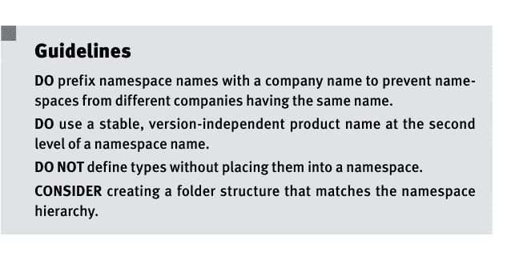

## XML 注释

第 1 章介绍了注释。但是，XML 注释不仅仅用于给审查源代码的其他开发人员做笔记。基于 XML 的注释遵循在 Java 中普及的一种实践。尽管 C# 编译器忽略所有注释（就最终的可执行文件而言），但开发人员可以使用命令行选项指示编译器³ 将 XML 注释提取到单独的 XML 文件中。通过利用 XML 文件生成，开发人员可以从 XML 注释生成 API 文档。此外，C# 编辑器可以解析代码中的 XML 注释并将其显示为不同的区域（例如，与其余代码不同的颜色）或解析 XML 注释数据元素并将其显示给开发人员。


图 10.4 展示了 IDE 如何利用 XML 注释来协助开发人员获取有关其试图编写的代码的提示。对于大型程序，特别是当多个开发人员共享代码时，这样的编码提示提供了很大的帮助。但是，为了让这起作用，开发人员显然必须花费时间输入代码中的 XML 注释，然后指示编译器创建 XML 文件。下一节解释了如何实现这一点。

### C# 标准没有指定是由 C# 编译器还是单独的实用工具负责提取 XML 数据。但是，所有主流 C# 编译器都通过编译开关（而不是通过额外的实用工具）包含必要的功能。


## 将 XML 注释与编程构造关联

考虑 `DataStorage` 类的列表，如列表 10.17 所示。

### 列表 10.17：使用 XML 注释注释代码

```csharp
/// <summary>
/// DataStorage 用于从文件中持久化和检索
/// 员工数据
/// </summary>
class DataStorage
{
    /// <summary>
    /// 将员工对象保存到以员工姓名命名
    /// 的文件中
    /// </summary>
    /// <remarks>
    /// 此方法使用
    /// <seealso cref="System.IO.FileStream"/>
    /// 以及
    /// <seealso cref="System.IO.StreamWriter"/>
    /// </remarks>
    /// <param name="employee">
    /// 要持久化到文件的员工</param>
    /// <data>2000年1月1日</data>
    public static void Store(Employee employee)
    {
        // ...
    }

    /** <summary>
     * 加载一个员工对象
     * </summary>
     * <remarks>
     * 此方法使用
     * <seealso cref="System.IO.FileStream"/>
     * 以及
     * <seealso cref="System.IO.StreamReader"/>
     * </remarks>
     * <param name="firstName">
     * 员工的名</param>
     * <param name="lastName">
     * 员工的姓</param>
     * <returns>
     * 与姓名对应的员工对象
     * </returns>
     * <date>2000年1月1日</date>**/
    public static Employee Load(
        string firstName, string lastName)
    {
        // ...
    }
}

class Program
{
    // ...
}
```

列表 10.17 既使用了跨多行的 XML 分隔注释，也使用了单行 XML 注释，其中每行都需要单独的三个斜杠分隔符（`///`）。

鉴于 XML 注释旨在文档化 API，它们仅打算与 C# 声明（如列表 10.17 中所示的类或方法）一起使用。尝试将 XML 注释内联放在代码中而未与声明关联，将导致编译器发出警告。编译器之所以进行关联，仅因为 XML 注释出现在声明之前。

尽管 C# 允许任何 XML 标签出现在注释中，但 C# 标准明确定义了一组要使用的标签。`<seealso cref="System.IO.StreamWriter"/>` 是使用 `<seealso>` 标签的一个示例。此标签在文本和 `System.IO.StreamWriter` 类之间创建链接。

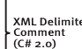


## 生成 XML 文档文件

编译器检查 XML 注释是否格式良好，如果格式不良则发出警告。要生成 XML 文件，请在 `ProjectProperties` 元素中添加 `DocumentationFile` 子元素：

```xml
<DocumentationFile>$(OutputPath)\$(TargetFramework)\$(AssemblyName).xml</DocumentationFile>
```

此子元素会导致在构建期间在输出目录中生成 XML 文件，文件名使用 `<assemblyname>.xml`。使用上面列出的 `CommentSamples` 类和这里列出的编译器选项，生成的 `CommentSamples.XML` 文件如列表 10.18 所示。

### 列表 10.18：Comments.xml

```xml
<?xml version="1.0"?>
<doc>
  <assembly>
    <name>
      DataStorage
    </name>
  </assembly>
  <members>
    <member name="T:DataStorage">
      <summary>
        DataStorage 用于从文件中持久化和检索
        员工数据。
      </summary>
    </member>
    <member name="M:DataStorage.Store(Employee)">
      <summary>
        将员工对象保存到以员工姓名命名的文件中。
      </summary>
      <remarks>
        此方法使用
        <seealso cref="T:System.IO.FileStream"/>
        以及
        <seealso cref="T:System.IO.StreamWriter"/>
      </remarks>
      <param name="employee">
        要持久化到文件的员工
      </param>
      <date>
        2000年1月1日
      </date>
    </member>
    <member name="M:DataStorage.Load(System.String,System.String)">
      <summary>
        ...
      </summary>
    </member>
  </members>
</doc>
```

## XML 文档示例

```xml
<summary>
Loads up an employee object
</summary>
<remarks>
This method uses
<seealso cref="T:System.IO.FileStream"/>
in addition to
<seealso cref="T:System.IO.StreamReader"/>
</remarks>
<param name="firstName">
The first name of the employee</param>
<param name="lastName">
The last name of the employee</param>
<returns>
The employee object corresponding to the names
</returns>
<date>January 1, 2000</date>
</member>
</members>
</doc>
```

结果文件仅包含将某个元素关联回其对应 C# 声明所需的最少元数据。这一点很重要，因为通常需要将 XML 输出与生成的程序集结合使用，才能生成有意义的文档。幸运的是，诸如免费工具 `GhostDoc`⁴ 和开源项目 `NDoc`⁵ 等工具可以生成文档。

## 指南

- 应当在公共 API 提供比 API 签名本身更多的上下文时提供 XML 注释。这包括成员描述、参数描述以及调用 API 的示例。

# 垃圾回收

垃圾回收显然是运行时的一项核心功能。其目的是恢复不再被引用的对象所占用的内存。此声明的重点在于内存和引用：垃圾回收器只负责恢复内存；它不处理其他资源，例如数据库连接、句柄（文件、窗口等）、网络端口以及串行端口等硬件设备。此外，垃圾回收器根据是否仍存在引用来确定要清理哪些内容。隐含地讲，这意味着垃圾回收器只处理引用对象，并且只恢复堆上的内存。另外，这意味着保持对对象的引用会延迟垃圾回收器重用该对象所占用的内存。

### 进阶主题：.NET 中的垃圾回收

关于垃圾回收器的许多细节都涉及特定的 CLI 框架，因此可能存在差异。本节讨论的是 Microsoft .NET 框架的实现，因为它们是应用最广泛的。

在 .NET 中，垃圾回收器使用 `标记和压缩` 算法。在每次迭代开始时，它识别所有指向对象的 `根引用`。根引用是来自静态变量、CPU 寄存器和局部变量或参数实例（以及本节稍后描述的可达对象）的任何引用。给定此列表，垃圾回收器能够遍历由每个根引用标识的树，并递归地确定所有根引用指向的对象。以这种方式，垃圾回收器创建了一个包含所有可达对象的图。

垃圾回收器不会枚举所有不可访问的对象，而是通过将所有可达对象紧凑地放置在一起来进行垃圾回收，从而覆盖由不可访问对象（因此符合垃圾条件）所消耗的内存。

定位并移动所有可达对象要求系统在垃圾回收器运行期间保持状态一致性。为实现此目标，进程中的所有托管线程在垃圾回收期间都会暂停。显然，这种行为会导致应用程序出现短暂的停顿，除非需要进行特别大规模的垃圾回收循环，否则这些停顿通常微不足道。为了降低垃圾回收循环在不适当时间发生的可能性，`System.GC` 对象包含一个 `Collect()` 方法，可以在关键性能代码之前立即调用。此方法并不能阻止垃圾回收器运行，但它确实降低了其在关键性能代码期间运行的概率，假设没有发生 intense 的内存使用。

关于 .NET 垃圾回收行为，一个可能令人惊讶的方面是并非所有垃圾都必然在迭代期间被清理。对对象生命周期的研究表明，最近创建的对象比长期存在的对象更有可能需要垃圾回收。利用这种行为，.NET 垃圾回收器是世代化的，它尝试更频繁地清理短命对象，而不是已经经历过之前垃圾回收迭代的对象。具体来说，对象被组织到三代中。每当对象在一次垃圾回收循环中幸存下来，它就会被移动到下一代，直到最终进入第 2 代（从 0 开始计数）。因此，垃圾回收器对第 0 代中的对象的运行频率高于第 2 代中的对象。

随着时间的推移，尽管在早期 beta 版本中 .NET 与非托管代码相比曾引起一些担忧，但 .NET 的垃圾回收已被证明极其高效。更重要的是，开发生产力方面的收益远远超过了在少数因管理代码而优化特定算法的情况下所带来的开发成本。

### 弱引用

到目前为止讨论的所有引用都是 `强引用`，因为它们保持对象的可访问性，并阻止垃圾回收器清理对象所占用的内存。框架还支持 `弱引用` 的概念。弱引用不会阻止对对象进行垃圾回收，但它们确实保持一个引用，因此如果垃圾回收器没有清理该对象，它就可以被重用。

弱引用设计用于创建昂贵但保留成本过高的对象。例如，考虑一个从数据库加载并显示给用户的大型对象列表。加载此列表可能是昂贵的，一旦用户关闭列表，它就应该可供垃圾回收。然而，如果用户多次请求该列表，第二次昂贵的加载调用将总是需要。借助弱引用，使用代码检查列表是否已被清理变得可能，如果没有，则可以重新引用同一个列表。以这种方式，弱引用作为对象的内存缓存。缓存中的对象可以快速检索，但如果垃圾回收器已回收这些对象的内存，则需要重新创建它们。

一旦某个对象（或对象集合）被识别为有弱引用考虑的价值，它就需要被分配给 `System.WeakReference`（参见清单 10.19）。

#### 清单 10.19：使用弱引用

```csharp
// ...

private WeakReference Data;

public FileStream GetData()
{
    FileStream data = (FileStream)Data.Target;
    if (data != null)
    {
        return data;
    }
    else
    {
        // Load data
        // ...
        
        // Create a weak reference
        // to data for use later
        Data.Target = data;
    }
    return data;
}
// ...
```

给定对 `WeakReference`（`Data`）的分配，您可以通过检查弱引用是否被设置为 null 来检查是否发生了垃圾回收。关键在于首先要将弱引用分配给强引用（`FileStream data = Data.Target`），以避免在检查 null 和访问数据之间垃圾回收器运行并清理弱引用的可能性。强引用显然会阻止垃圾回收器清理该对象，因此必须首先进行分配（而不是直接检查 `Target` 是否为 null）。

## 资源清理

垃圾回收是运行时的一项关键职责。然而，重要的是要认识到垃圾回收过程以代码的内存利用为中心。它并不涉及文件句柄、数据库连接字符串、端口或其他有限资源的清理。

# 终结器

终结器允许开发者编写代码来清理类的资源。与使用 `new` 运算符显式调用的构造函数不同，终结器不能从代码内部显式调用。没有类似于 `delete` 运算符的 `new` 对应物。相反，垃圾回收器负责调用对象实例的终结器。因此，开发者无法在编译时间确切确定终结器何时执行。他们只知道终结器将在对象最后一次使用之后到应用程序正常关机之间的某个时间运行。（如果进程异常终止，终结器可能不会执行。例如，计算机关机或强制终止进程等事件将阻止终结器运行。）

> 注意
>
> 您无法在编译时间确切确定终结器何时执行。

终结器的声明与 C# 的前身——即 C++ 的析构函数语法相同。如清单 10.20 所示，终结器的声明在类名前加一个波浪号前缀。

#### 清单 10.20：定义一个终结器

```csharp
using System.IO;

class TemporaryFileStream
{
    public TemporaryFileStream(string fileName)
    {
        File = new FileInfo(fileName);
        Stream = new FileStream(
            File.FullName, FileMode.OpenOrCreate,
            FileAccess.ReadWrite);
    }

    public TemporaryFileStream()
        : this(Path.GetTempFileName()) { }

    // Finalizer
    ~TemporaryFileStream()
    {
        Close();
    }
}
```

### 脚注

- 4. 请访问 http://submain.com/ 了解有关 `GhostDoc` 的更多信息。
- 5. 请访问 http://ndoc.sourceforge.net 了解有关 `NDoc` 的更多信息。

## 使用 `using` 语句实现确定性终结

```csharp
public FileStream Stream { get; }
public FileInfo File { get; }

public void Close()
{
    Stream?.Close();
    File?.Delete();
}
```

终结器不允许传递任何参数，因此不能进行重载。此外，终结器不能显式调用——也就是说，只有垃圾回收器才能调用终结器。因此，终结器上的访问修饰符没有意义，从而不被支持。基类中的终结器会在对象终结调用过程中被自动调用。

> 注意
>
> 终结器不能显式调用；只有垃圾回收器才能调用终结器。

由于垃圾回收器负责所有内存管理，终结器不负责释放内存。相反，它们负责释放数据库连接和文件句柄等资源——这些资源需要垃圾回收器不知道的具体显式操作来释放。

终结器在其自身的线程上执行，这使得其执行的确定性更低。这种不确定性使得终结器内部（在调试器之外）的未处理异常难以诊断，因为导致异常的情况并不明确。从用户的角度来看，未处理异常相对随机地抛出，且很少考虑用户当时正在执行的操作。因此，你应尽量避免在终结器中引发异常。相反，你应该使用防御性编程技术，例如检查空值（参见列表 10.20）。

单独使用终结器的问题是，它们不支持 `确定性终结`（即知道终结器何时运行的能力）。相反，终结器发挥着重要的后备机制作用，用于清理资源，以防使用类的开发者忘记显式调用相应的清理代码。

例如，考虑 `TemporaryFileStream`，它包含一个终结器，还有一个 `Close()` 方法。该类使用可能占用大量磁盘空间的文件资源。使用 `TemporaryFileStream` 的开发者可以显式调用 `Close()` 来恢复磁盘空间。

提供确定性终结的方法很重要，因为它消除对终结器不确定时序行为的依赖。即使开发者未能显式调用 `Close()`，终结器也会处理该调用。在这种情况下，终结器的运行时间会比显式调用时晚——但最终会被调用。

鉴于确定性终结的重要性，基础类库包含了一个专门针对此模式的接口，并且 C# 将此模式整合到了语言中。`IDisposable` 接口通过一个名为 `Dispose()` 的单方法定义了该模式的详细信息，开发者在资源类上调用它来“释放”已消耗的资源。列表 10.21 展示了 `IDisposable` 接口以及调用它的一些代码。

### 列表 10.21：使用 IDisposable 进行资源清理


```csharp
using System;
using System.IO;

class Program
{
    // ...
    static void Search()
    {
        TemporaryFileStream fileStream =
            new TemporaryFileStream();

        // 使用临时文件流
        // ...

        fileStream.Dispose();

        // ...
    }
}
```

```csharp
class TemporaryFileStream : IDisposable
{
    public TemporaryFileStream(string fileName)
    {
        File = new FileInfo(fileName);
        Stream = new FileStream(
            File.FullName, FileMode.OpenOrCreate,
            FileAccess.ReadWrite);
    }

    public TemporaryFileStream()
        : this(Path.GetTempFileName()) { }

    ~TemporaryFileStream()
    {
        Dispose(false);
    }

    public FileStream Stream { get; }
    public FileInfo File { get; }

    public void Close()
    {
        Dispose();
    }
}
```

```csharp
#region IDisposable 成员
public void Dispose()
{
    Dispose(true);

    // 关闭调用终结器
    System.GC.SuppressFinalize(this);
}
#endregion

public void Dispose(bool disposing)
{
    // 如果由成员 finalize 调用，则不要释放拥有的托管对象（带终结器的对象），
    // 因为拥有的托管对象的终结方法
    // 已经（或将被）由终结队列处理调用
    if (disposing)
    {
        Stream?.Close();
    }
    File?.Delete();
}
```

在 `Program.Search()` 中，在使用 `TemporaryFileStream` 之后有一个对 `Dispose()` 的显式调用。`Dispose()` 是负责清理资源的方法（在此情况下，是一个文件），这些资源与内存无关，因此受垃圾回收器隐式清理的影响。尽管如此，这里的执行中存在一个漏洞，它会阻止 `Dispose()` 的执行——即，在 `TemporaryFileStream` 实例化和调用 `Dispose()` 之间发生异常的可能性。如果发生这种情况，`Dispose()` 将不会被调用，资源清理将不得不依赖终结器。为了避免这个问题，调用者需要实现 `try/finally` 块。C# 提供 `using` 语句，专门用于此目的，而不是要求程序员显式编写这样的块（参见列表 10.22）。

### 列表 10.22：调用 using 语句

```csharp
class Program
{
    // ...
    static void Search()
    {
        using (TemporaryFileStream fileStream1 =
               new TemporaryFileStream(),
               fileStream2 = new TemporaryFileStream())
        {
            // 使用临时文件流
        }
    }
}
```

生成的 CIL 代码与程序员显式指定 `try/finally` 块时生成的代码完全相同，其中在 `finally` 块中调用了 `fileStream.Dispose()`。然而，`using` 语句为 `try/finally` 块提供了语法快捷方式。

在 `using` 语句中，你可以通过用逗号分隔每个变量来实例化多个变量。关键考虑因素是所有变量必须是相同的类型，并且它们实现了 `IDisposable`。为了强制执行相同类型的使用，数据类型只指定一次，而不是在每个变量声明之前。

## 垃圾回收、终结和 `IDisposable`

列表 10.21 中还有几个值得注意的事项。首先，`IDisposable.Dispose()` 方法包含对 `System.GC.SuppressFinalize()` 的重要调用。其目的是将 `TemporaryFileStream` 类实例从终结（f-reachable）队列中移除。这是可能的，因为所有清理都在 `Dispose()` 方法中完成，而不是等待终结器执行。

如果没有调用 `SuppressFinalize()`，对象实例将被包含在 f-reachable 队列中——这是所有基本上准备好进行垃圾回收的对象的列表，除了它们还有终结实现。运行时不能垃圾回收带有终结器的对象，直到其终结方法被调用。然而，垃圾回收本身并不调用终结方法。相反，对终结对象的引用被添加到 f-reachable 队列中，并根据执行上下文在适当的时间由额外线程处理。讽刺的是，这种方法延迟了对托管资源的垃圾回收——而这些资源很可能应该更早被清理。延迟的原因是 f-reachable 队列是“引用”的列表；因此，在调用其终结方法并从 f-reachable 队列中移除对象引用之前，这些对象不被视为垃圾。

> **注意**
>
> 未显式释放的带有终结器的对象将具有延长的对象生命周期。即使所有显式引用都超出作用域，f-reachable 队列仍然具有引用，使对象保持活动状态，直到 f-reachable 队列处理完成。

正因为如此，`Dispose()` 调用 `System.GC.SuppressFinalize`。调用此方法会通知运行时不要将此对象添加到终结队列，而是允许垃圾回收器在对象不再拥有任何引用（包括任何 f-reachable 引用）时释放该对象。

其次，`Dispose()` 调用带有参数 `true` 的 `Dispose(bool disposing)`。其结果是 `Stream` 上的 `Dispose()` 方法被调用（清理其资源并抑制其终结处理）。接下来，临时文件本身在调用 `Dispose()` 时立即被删除。这个重要调用消除了等待终结队列处理完毕后再清理潜在昂贵资源的必要性。

第三，终结方法现在调用带有参数 `false` 的 `Dispose(bool disposing)`，而不是调用 `Close()`。其结果是，尽管文件已被删除，但 `Stream` 并未关闭（释放）。围绕关闭 `Stream` 的条件确保，如果 `Dispose(bool disposing)` 从终结方法中调用，`Stream` 实例本身也将被加入等待终结处理的队列（或者根据执行顺序，它可能已经执行过了）。因此，在执行终结方法时，不应清理由托管资源拥有的对象，因为该操作将是终结队列的责任。

第四，在创建 `Close()` 类型和 `Dispose()` 方法时，你应当谨慎。仅通过查看 API 并不清楚 `Close()` 是否调用了 `Dispose()`，因此开发者会困惑是否需要显式调用 `Close()` 和 `Dispose()`。

## 准则

- 应当仅对拥有稀缺或昂贵资源的对象实现终结方法，即使终结处理会延迟垃圾收集。
- 应当实现对具有终结方法的类的 `IDisposable`，以支持确定性终结。
- 应当在对实现 `IDisposable` 的类上实现终结方法，以防 `Dispose()` 未被显式调用。
- 应当重构终结方法以调用与 `IDisposable` 相同的代码，或许只是简单地调用 `Dispose()` 方法。
- 不要在终结方法中抛出异常。
- 应当从 `Dispose()` 中调用 `System.GC.SuppressFinalize()`，以避免重复资源清理并延迟对象的垃圾收集。
- 应当确保 `Dispose()` 是幂等的（应允许多次调用 `Dispose()`）。
- 保持 `Dispose()` 简单，专注于终结所需的资源清理。
- 避免对拥有终结方法的自有对象调用 `Dispose()`。相反，依靠终结队列来清理该实例。
- 避免在终结过程中引用未处于终结过程的其他对象。
- 在重写 `Dispose()` 时，应当调用基类的 `Dispose()` 方法。
- 考虑在调用 `Dispose()` 后使对象变为不可用状态。对象被释放后，除 `Dispose()`（可能会被多次调用）之外的其他方法应抛出 `ObjectDisposedException`。
- 应当在对拥有可释放字段（或属性）的类型上实现 `IDisposable`，并释放这些实例。

### 语言对比：C++——确定性析构

尽管终结方法与 C++ 中的析构函数相似，但由于其执行时间无法在编译时确定，它们有着本质的区别。垃圾收集器会在最后使用 C# 终结方法后的一段时间内调用它们，但在程序关闭之前；C++ 析构函数在对象（而非指针）超出作用域时自动被调用。

虽然运行垃圾收集器可能是一个相对昂贵的过程，但垃圾收集足够智能，能够推迟执行直到进程利用率有所降低，这比确定性析构函数具有优势，后者会在编译时定义的位置运行，即使处理器处于高负载状态也是如此。

## 高级主题

#### 从构造函数传播的异常

即使异常从构造函数中传播出去，对象仍然会被实例化，尽管 `new` 运算符没有返回新的实例。如果类型定义了终结方法，当对象变得可被垃圾收集时，该方法将会运行（这提供了确保终结方法可以在部分构造的对象上运行的额外动机）。另外请注意，如果构造函数过早共享其 `this` 引用，即使构造函数抛出异常，该引用仍然是可访问的。不要让这种情况发生。

## 高级主题

## 对象复活

当对象的终结方法被调用时，所有指向该对象的引用都已消失，垃圾收集前的唯一步骤是运行终结代码。即便如此，仍有可能无意中将终结对象的引用重新添加回根引用图中。在这种情况下，被重新引用的对象将不再不可访问；反过来，它将不再准备好进行垃圾收集。然而，如果对象的终结方法已经运行过，除非显式标记为终结（使用 `GC.ReRegisterFinalize()` 方法），否则它不一定会再次运行。

显然，以这种方式复活对象是一种特殊的行为，通常应避免这种情况。终结代码应当简单，并专注于清理它所引用的资源。

## 延迟初始化

在前面的部分中，我们讨论了如何使用 `using` 语句确定性地释放对象，以及在没有使用确定性方法的情况下，终结队列将如何释放资源。

一个相关的模式被称为 *延迟初始化* 或 *延迟加载*。使用延迟初始化，你可以在需要时（而不是之前）创建（或获取）对象——后者在那些对象从未被使用的情况下可能是一个特别有问题的情况。考虑列表 10.23 中的 `FileStream` 属性。

### 列表 10.23：延迟加载属性

```csharp
using System.IO;

class DataCache
{
    // ...
    public TemporaryFileStream FileStream =>
        InternalFileStream ?? (InternalFileStream = new TemporaryFileStream());
}

private TemporaryFileStream InternalFileStream
{ get; set; } = null;

// ...
```

在 `FileStream` 表达式体属性中，我们在直接返回其值之前检查 `InternalFileStream` 是否为 null。如果 `InternalFileStream` 为 null，我们先实例化 `TemporaryFileStream` 对象并将其分配给 `InternalFileStream`，然后返回新实例。因此，`FileStream` 属性所需的 `TemporaryFileStream` 仅在调用该属性的 getter 时创建。如果 getter 从未被调用，`TemporaryFileStream` 对象将不会被实例化，我们会节省这种实例化所需的任何执行时间。显然，如果实例化开销可忽略不计或不可避免（且推迟不可避免的操作并不理想），在声明时或在构造函数中直接赋值是有意义的。

## 高级主题

## 使用泛型和 lambda 表达式的延迟加载

从 Microsoft .NET Framework 4.0 开始，CLR 中新增了一个类来辅助延迟初始化：`System.Lazy<T>`。列表 10.24 演示了如何使用它。

### 列表 10.24：使用 System.Lazy<T> 延迟加载属性

```csharp
using System.IO;

class DataCache
{
    // ...
    public TemporaryFileStream FileStream =>
        InternalFileStream.Value;
    private Lazy<TemporaryFileStream> InternalFileStream { get; }
        = new Lazy<TemporaryFileStream>(
            () => new TemporaryFileStream());
    // ...
}
```

`System.Lazy<T>` 类接受一个类型参数 `T`，用于标识 `System.Lazy<T>` 上的 `Value` 属性将返回哪种类型。不再将完全构造好的 `TemporaryFileStream` 分配给 `_FileStream` 字段，而是分配一个 `Lazy<TemporaryFileStream>` 实例（这是一个轻量级调用），从而延迟 `TemporaryFileStream` 本身的实例化，直到访问 `Value` 属性（因此也是 `FileStream` 属性）时为止。

除了类型参数（泛型）之外，如果你使用委托，你甚至可以提供如何在访问 `Value` 属性时初始化对象的功能。列表 10.24 演示了将委托——在此情况下是一个 lambda 表达式——传递给 `System.Lazy<T>` 的构造函数。

请注意，lambda 表达式本身，`() => new TemporaryFileStream (FileStreamName)`，直到调用 `Value` 时才执行。相反，lambda 表达式提供了一种传递将要发生之指令的手段；它不会实际执行这些指令，除非被明确要求这样做。

一个显而易见的问题是，何时应使用 `System.Lazy<T>` 而不是列表 10.23 中概述的方法。差异微乎其微：事实上，列表 10.23 可能更简单。也就是说，简单到有多个线程参与时，关于实例化可能会发生竞态条件。在列表 10.23 中，在实例化之前可能会发生多次 null 检查，导致创建多个实例。相比之下，`System.Lazy<T>` 提供了线程安全的机制，确保只创建一个对象。

## 总结

本章对许多与构建坚固类库相关的主题进行了快速回顾。所有主题都涉及内部开发，但对于构建稳健的类更为关键。最终，这里的重点是形成更坚固和可编程的 API。在稳健性类别中，我们可以包括命名空间和垃圾收集。这两个主题也属于可编程性类别，along with 重写 `object` 的虚成员、运算符重载以及用于文档的 XML 注释。

异常处理通过定义异常层次结构并强制自定义异常符合该层次结构，大量使用了继承。此外，`C#` 编译器使用继承来验证 `catch` 块的顺序。在下一章中，你将看到为什么继承是异常处理的核心部分。

# 11 异常处理

第 5 章讨论了使用 `try/catch/finally` 块进行标准异常处理。在该章节中，`catch` 块始终捕获类型为 `System.Exception` 的异常。本章定义了异常处理的一些额外细节——具体包括额外的异常类型、定义自定义异常，以及用于处理每种类型的多个 `catch` 块。本章还详述了异常，因为它们依赖于继承。

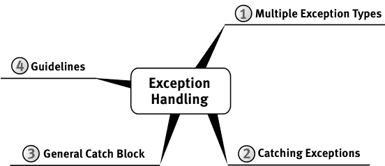

### 多种异常类型

列表 11.1 抛出的是 `System.ArgumentException`，而不是第 5 章中演示的 `System.Exception` 类型。C# 允许代码抛出任何派生自（可能是间接派生自）`System.Exception` 的类型。

要抛出异常，只需在异常实例前加上关键字 `throw` 即可。所使用的异常类型显然是最能描述导致异常的错误的周围情况的类型。

例如，考虑列表 11.1 中的 `TextNumberParser.Parse()` 方法。

**列表 11.1：抛出异常**


```csharp
public sealed class TextNumberParser
{
    public static int Parse(string textDigit)
    {
        string[] digitTexts =
            { "zero", "one", "two", "three", "four",
              "five", "six", "seven", "eight", "nine" };

        int result = Array.IndexOf(
            digitTexts,
            // Leveraging C# 2.0's null coalesce operator
            textDigit ??
            // Leveraging C# 7.0's throw expression
            throw new ArgumentNullException(nameof(textDigit))
            ).ToLower());
        if (result < 0)
        {
            // Leveraging C# 6.0's nameof operator
            throw new ArgumentException(
                "The argument did not represent a digit",
                nameof(textDigit));
        }

        return result;
    }
}
```

在对 `Array.IndexOf()` 的调用中，当 `textDigit` 参数为 null 时，我们利用了 C# 7.0 的 throw 表达式。在 C# 7.0 之前，不允许使用 throw 表达式；只允许使用 throw 语句。因此，需要两条独立的语句：一条用于检查 null，另一条用于抛出异常。例如，你不能将 throw 嵌入到使用空值合并运算符的同一语句中。

抛出 `System.Exception` 不如抛出 `ArgumentException` 合适，因为该类型本身指示了出了什么问题，并且包含用于识别哪个参数出错的特殊参数。

两个类似的异常是 `ArgumentNullException` 和 `NullReferenceException`。`ArgumentNullException` 应针对不当传递的 null 参数进行抛出。这是无效参数异常的一个特例，在更一般的情况下（当它不是 null 时），通常会作为 `ArgumentException` 或 `ArgumentOutOfRangeException` 抛出。`NullReferenceException` 通常是底层运行时仅在尝试取消引用 null 值时抛出的异常——也就是说，尝试访问值为 null 的对象成员。为了避免触发 `NullReferenceException` 的抛出，程序员应在访问参数之前检查其是否为 null，然后抛出 `ArgumentNullException`，后者可以提供更多的上下文信息，例如参数名称。如果即使参数为 null 也有无害的方式继续执行，请务必使用 C# 6.0 的空值传播运算符，以避免运行时抛出 `NullReferenceException`。

参数异常类型（包括 `ArgumentNullException`、`ArgumentException` 和 `ArgumentOutOfRangeException`）的一个重要特征是，每种类型都有一个构造函数参数，允许以字符串形式识别参数名称。在 C# 6.0 之前，这意味着需要硬编码一个魔法字符串（例如 `"textDigit"`）来识别参数名称。这种方法的问题在于，如果参数名称发生变化，开发人员必须记得更新魔法字符串。幸运的是，C# 6.0 及更高版本提供了 `nameof` 运算符，它接受参数名称标识符并在编译时生成参数名称（参见列表 11.1 中的 `nameof(textDigit)`）。这种方法的优势在于，现在 IDE 可以使用重构工具（如自动重命名）在所有地方更改标识符，包括将其用作 `nameof` 运算符参数的情况。此外，如果参数名称更改（未使用重构工具），如果传递给 `nameof` 运算符的标识符不再存在，编译器将生成错误。今后，对于 C# 6.0（及更高版本），一般准则是始终对参数类型异常的参数名称使用 `nameof` 运算符。第 18 章将对 `nameof` 运算符提供完整的解释。在此之前，只需理解 `nameof` 简单地返回已识别参数的名称即可。

其他一些异常仅旨在供运行时使用，并派生自（有时是间接派生自）`System.SystemException`。它们包括 `System.StackOverflowException`、`System.OutOfMemoryException`、`System.Runtime.InteropServices.COMException`、`System.ExecutionEngineException` 和 `System.Runtime.InteropServices.SEHException`。不要抛出这些类型的异常。同样，应避免抛出 `System.Exception` 或 `System.ApplicationException`，因为这些异常过于通用，以至于对问题的原因或解决方案提供的指示很少。相反，请抛出最适合该场景的最派生异常。显然，开发人员应避免创建可能导致系统故障的 API。然而，如果执行的代码达到某种状态，使得继续执行是不安全的或不可恢复的，则应调用 `System.Environment.FailFast()`。这将在向 Windows 应用程序事件日志写入消息后立即终止进程，并且如果用户选择，还将该消息作为 Windows 错误报告的一部分包含在内。

## 准则

- **应该** 在成员接收到不良参数时抛出 `ArgumentException` 或其子类型之一。如果适用，优先使用最派生的异常类型（例如 `ArgumentNullException`）。

- **应该** 在抛出 `ArgumentException` 或其子类之一时设置 `ParamName` 属性。

- **应该** 抛出最有意义（最派生）的最具体异常。

- **不应该** 抛出 `NullReferenceException`。相反，当值意外为 null 时，请抛出 `ArgumentNullException`。

- **不应该** 抛出 `System.SystemException` 或派生自它的异常类型。

- **不应该** 抛出 `System.Exception` 或 `System.ApplicationException`。

- **可以考虑** 如果程序遇到进一步执行不安全的场景，通过调用 `System.Environment.FailFast()` 来终止进程。

- **应该** 对接受此类参数的参数异常类型传入的 `paramName` 参数使用 `nameof`。此类异常的示例包括 `ArgumentException`、`ArgumentOutOfRangeException` 和 `ArgumentNullException`。

## 捕获异常

抛出特定的异常类型使得捕获者能够使用异常类型本身来识别问题。换句话说，没有必要捕获异常并使用 switch 语句对异常消息进行操作来确定在异常情况下应采取哪些操作。相反，C# 允许多个 catch 块，每个针对特定的异常类型，如列表 11.2 所示。

### 列表 11.2：捕获不同的异常类型

```csharp
using System;

public sealed class Program
{
    public static void Main(string[] args)
    {
        try
        {
            // ...
            throw new InvalidOperationException(
                "Arbitrary exception");
            // ...
        }
        catch (Win32Exception exception)
            when (exception.NativeErrorCode == 42)
        {
            // Handle Win32Exception where
            // ErrorCode is 42
        }
        catch (NullReferenceException exception)
        {
            // Handle NullReferenceException
        }
        catch (ArgumentException exception)
        {
            // Handle ArgumentException
        }
        catch (InvalidOperationException exception)
        {
            bool exceptionHandled = false;
            // Handle InvalidOperationException
            // ...
            if (exceptionHandled)
            {
                throw;
            }
        }
    }
}
```

```csharp
catch (Exception exception)
{
      // 处理异常
}
finally
{
      // 在此处处理任何清理代码，因为它无论如何都会执行
      // 不管是否发生异常
}
```

清单 11.2 包含五个 catch 块，每个块处理不同类型的异常。当发生异常时，执行流程将跳转到异常类型与当前异常最匹配的 catch 块。匹配程度由继承链决定。例如，虽然抛出的异常类型是 `System.Exception`，但由于 `System.InvalidOperationException` 最终继承自 `System.Exception`，因此通过这种“是一种”的继承关系产生了联系。由于异常类型 `InvalidOperationException` 与抛出的异常匹配度最高，因此 `catch(InvalidOperationException...)` 块将捕获该异常，而不是 `catch(Exception...)` 块。

从 C# 6.0 开始，catch 块提供了额外的条件表达式。不再仅限于基于异常类型匹配来决定是否执行 catch 块，C# 6.0 及更高版本支持使用条件子句。`when` 子句允许你提供一个布尔表达式；只有当条件为真时，catch 块才会处理该异常。在清单 11.2 中，这是一个相等性比较运算符。尽管如此，例如，你可以调用方法来验证某个条件。

当然，你也可以简单地将条件检查作为一个 if 块放在 catch 主体内部。然而，这样做会导致 catch 块在检查条件之前成为该异常的处理程序。很难编写代码，使得在条件不满足的情况下让不同的 catch 块来处理异常。然而，通过异常条件，现在可以在无需捕获并重新抛出异常的情况下检查程序状态（包括异常）。

谨慎使用条件子句；如果条件表达式本身抛出异常，那么该新异常将被忽略，并且该条件被视为假。因此，应避免在异常条件表达式中抛出异常。

Catch 块必须按顺序排列，从最具体到最通用，以避免编译时错误。例如，将 `catch(Exception...)` 块移动到任何其他异常之前会导致编译错误，因为所有先前的异常在其继承链的某个点上都继承自 `System.Exception`。

如 `catch (SystemException){ }` 块所示，catch 块不需要命中的参数。事实上，甚至没有类型参数的最终 catch 也是允许的，如下一节所示。

## 重新抛出已有异常

在 `InvalidOperationException` 的 catch 块中，出现了一个没有指定要抛出哪个异常的 `throw` 语句（`throw` 是独立存在的），即使在 catch 块的作用域中出现了异常实例（`exception`）可以重新抛出。抛出特定异常会更新所有堆栈信息以匹配新的抛出位置。结果是，指示异常最初发生位置的调用站点的所有堆栈信息都会丢失，这使得诊断问题变得更加困难。因此，C# 支持在 catch 块内使用没有显式异常引用的 `throw` 语句或表达式（C# 7.0 或更高版本）。这样，代码可以检查异常以确定是否可能完全处理它，如果不能，则重新抛出异常（即使没有明确指定），就好像它从未被捕获过，并且不替换任何堆栈信息。

## 高级主题

### 重新抛出已有异常而不替换堆栈信息

在 C# 5.0 中，增加了一种机制，允许在不丢失原始异常中的堆栈跟踪信息的情况下，抛出之前已抛出的异常。这允许你重新抛出异常，例如，即使在 catch 块外部，因此无需使用 `throw;`。虽然很少需要这样做，但在某些情况下，异常会被包装或保存，直到程序执行移动到 catch 块之外。例如，多线程代码可能会用 `AggregateException` 包装异常。Microsoft .NET Framework 4.5 提供了一个专门的 `System.Runtime.ExceptionServices.ExceptionDispatchInfo` 类，通过其静态 `Catch()` 和实例 `Throw()` 方法来处理这种场景。（不幸的是，截至 2.0 版本，该类在 .NET Core 中不可用。）清单 11.3 展示了如何重新抛出异常，而无需重置堆栈跟踪信息或使用空的 `throw` 语句。

### 清单 11.3：使用 ExceptionDispatchInfo 重新抛出异常

```csharp
using System
using System.Runtime.ExceptionServices;
using System.Threading.Tasks;
Task task = WriteWebRequestSizeAsync(url);
try
{
    while (!task.Wait(100))
    {
        Console.Write(".");
    }
}
catch (AggregateException exception)
{
    exception = exception.Flatten();
    ExceptionDispatchInfo.Capture(
        exception.InnerException).Throw();
}
```

使用 `ExceptionDispatchInfo.Throw()` 方法时，编译器不会像对待普通 `throw` 语句那样将其视为返回语句。例如，如果方法签名返回一个值，但代码路径在使用 `ExceptionDispatchInfo.Throw()` 时没有返回值，编译器将发出错误，指示没有返回值。因此，在某些情况下，开发人员可能被迫在 `ExceptionDispatchInfo.Throw()` 之后跟一个 `return` 语句，即使这样的语句在运行时永远不会执行——取而代之的是会抛出异常。

## 语言对比：Java——异常说明符

C# 没有相当于 Java 异常说明符的功能。利用异常说明符，Java 编译器能够验证函数（或函数的调用层级）中抛出的所有可能异常要么被捕获，要么被声明为可能重新抛出。C# 团队考虑过这个选项，并认为其所带来的维护负担不值得预期的好处。因此，没有必要在整个特定调用栈中维护所有可能异常的列表，但也无法轻松地确定可能的异常。（事实证明，这在 Java 中也是不可能的。调用虚方法或使用延迟绑定，例如反射，使得在编译时完全解析方法可能抛出的异常变得不可能。）

## 通用 Catch 块

C# 要求代码抛出的任何对象都必须继承自 `System.Exception`。然而，这一要求并非所有语言通用。例如，C 和 C++ 允许抛出任何对象类型，包括未从 `System.Exception` 继承的托管异常。从 C# 2.0 开始，无论是否继承自 `System.Exception`，所有异常都将作为 `System.Exception` 的派生类传播到 C# 程序集中。结果是，`System.Exception` 的 catch 块将捕获未被先前块捕获的所有异常。

C# 还支持**通用 catch 块**（`catch{ }`），其行为与 `catch(System.Exception exception)` 块完全相同，只是没有类型或变量名。此外，通用 catch 块必须出现在 catch 块列表的最后。由于通用 catch 块与 `catch(System.Exception exception)` 块相同，且通用 catch 块必须最后出现，如果两者存在于同一个 try/catch 语句中，编译器会发出警告，因为通用 catch 块永远不会被调用（有关通用 catch 块的更多信息，请参见标题为“C# 1.0 中的通用 Catch 块”的高级主题）。

## 高级主题

### C# 1.0 中的通用 Catch 块

在 C# 1.0 中，如果从方法调用中抛出了一个非 `System.Exception` 派生的异常（该方法调用所在的程序集并非用 C# 编写），该异常

不会被 `catch(System.Exception)` 块捕获。如果另一种语言抛出字符串，例如，异常可能未被处理。为避免这种情况，C# 包含一个不取参数的 catch 块。这种 catch 块的术语是 *通用 catch 块*，且清单 11.4 中包含了这样一个块。

## 清单 11.4：捕获任何异常


```csharp
using System;

public sealed class Program
{
    public static void Main()
    {
        try
        {
            // ...
            throw new InvalidOperationException (
                "Arbitrary exception");
            // ...
        }
        catch (NullReferenceException exception)
        {
            // Handle NullReferenceException
        }
        catch (ArgumentException exception)
        {
            // Handle ArgumentException
        }
        catch (InvalidOperationException exception)
        {
            // Handle ApplicationException
        }
        catch (Exception exception)
        {
            // Handle Exception
        }
        catch
        {
            // Any unhandled exception
        }
        finally
        {
            // Handle any cleanup code here as it runs
            // regardless of whether there is an exception
        }
    }
}
```

通用 `catch` 块将捕获所有异常，无论它们是否派生自 `System.Exception`，前提是前面的 `catch` 块没有捕获它们。这种块的缺点仅仅是没有异常实例可供访问，因此没有方法来知道适当的应对措施。甚至不可能识别出这种异常是无害的罕见情况。最好的应对方式是在关闭应用程序之前，通过一些清理代码来处理异常。例如，`catch` 块可以在关闭应用程序或重新抛出异常之前保存任何易失性数据。

## 高级主题

### 通用 Catch 块内部机制

通用 `catch` 块对应的公共中间语言 `CIL` 代码实际上是一个 `catch(object)` 块。因此，无论抛出的是什么类型，通用 `catch` 块都会捕获它。有趣的是，在 C# 代码中无法显式声明一个 `catch(object)` 异常块。因此，没有办法捕获非 `System.Exception` 派生的异常并拥有一个异常实例来审查。

事实上，来自 C++ 等语言的未托管异常通常会导致 `System.Runtime.InteropServices.SEHException` 类型的异常，这些异常派生自 `System.Exception` 类型。因此，不仅可以使用通用 `catch` 块捕获未托管类型的异常，还可以捕获抛出的非 `System.Exception` 托管类型——例如，诸如 `string` 这样的类型。

## 异常处理指南

异常处理为之前错误处理机制提供了急需的结构。然而，如果随意使用，它仍然可能导致一些笨拙的结果。以下指南提供了一些异常处理的最佳实践。

- *仅捕获你可以处理的异常。*

通常，可以处理某些类型的异常，但不能处理其他类型。例如，以独占读写方式打开文件可能会抛出 `System.IO.IOException`，因为文件已在使用中。在捕获此类型的异常时，代码可以报告给用户该文件已在使用，并允许用户选择取消操作或重试。仅应捕获已知有应对措施的其他异常类型。其他异常类型应留给调用栈中更高层级的调用者。

- *不要隐藏（*埋葬*）你未完全处理的异常。*

新程序员常常倾向于捕获所有异常，然后继续执行，而不是向用户报告未处理的异常。然而，这种做法可能导致严重的系统问题未被检测到。除非代码采取明确措施来处理异常，或明确确定某些异常是无害的，否则 `catch` 块应重新抛出异常，而不是捕获它们并将它们从调用者那里隐藏起来。在大多数情况下，捕获 `System.Exception` 和通用 `catch` 块应位于调用栈中的较高层级，除非该块以重新抛出异常结束。

- *很少使用 `System.Exception` 和通用 `catch` 块。*

几乎所有异常都派生自 `System.Exception`。然而，处理某些 `System.Exception` 的最佳方式是让它们未被处理，或尽早优雅地关闭应用程序。这些异常包括诸如 `System.OutOfMemoryException` 和 `System.StackOverflowException` 等。在公共语言运行时 `CLR` 4 中，这些异常默认设为不可恢复，这意味着如果不重新抛出就捕获它们，`CLR` 仍然会重新抛出它们。这些异常是运行时异常，开发人员无法编写代码来从中恢复。因此，最佳措施是关闭应用程序——这是在 `CLR` 4 及更高版本中运行时强制执行的操作。`CLR` 4 之前的代码仅在关闭应用程序或重新抛出异常之前运行清理或紧急代码（例如保存任何易失性数据）时才应捕获此类异常，并使用 `throw;` 重新抛出异常。

- *避免在调用栈较低层级进行异常报告或记录。*

通常，程序员倾向于在调用栈中尽可能早的位置记录异常或向用户报告异常。然而，这些位置很少能够完全处理异常；相反，它们诉诸于重新抛出异常。此类 `catch` 块在调用栈内部时不应记录异常或向用户报告。如果异常被记录并重新抛出，调用栈中较高层级的调用者可能会执行相同的操作，导致异常的日志条目重复。更糟糕的是，向用户显示异常可能不适合应用程序类型。例如，在 Windows 应用程序中使用 `System.Console.WriteLine()` 永远不会被用户看到，而在无人值守的命令行进程中显示对话框可能不会被注意到并冻结应用程序。日志记录和与异常相关的用户界面应保留用于调用栈中的较高位置。

- *在 *catch 块* 内部使用 *throw* 而不是 *throw* <i><异常对象></i>。*

可以在 `catch` 块内部重新抛出异常。例如，`catch (ArgumentNullException *exception*)` 的实现可以包含对 *throw exception* 的调用。然而，像这样重新抛出异常会将堆栈跟踪重置到重新抛出调用的位置，而不是重用原始抛出点位置。因此，除非你要使用不同的异常类型重新抛出或有意隐藏原始调用堆栈，否则使用 *throw* 让相同的异常沿调用栈向上传播。

- *优先使用 *异常条件* 以避免在 *catch 块* 内部重新抛出 *异常*。*

当你发现自己捕获了一个实际上无法适当处理的异常，因此需要重新抛出时，优先考虑使用异常条件来避免一开始就捕获该异常。

- *避免从 *异常条件* 中 *抛出异常*。*

在提供异常条件时，避免抛出异常的代码。从异常条件中抛出异常会导致错误的条件，并且异常发生将被忽略。因此，考虑将复杂的条件检查放入一个单独的方法中，该方法被包裹在一个明确处理异常的 `try/catch` 块中。

- *避免可能随时间变化的异常条件。*

如果异常条件评估诸如异常消息等可能会随本地化或消息更改而变化的条件，预期的异常条件将不会被捕获，从而意外地改变业务逻辑。因此，确保异常条件在时间上是有效的。

- *重新抛出不同异常时需谨慎。*

从 `catch` 块内部重新抛出不同的异常不仅会重置抛出点，还会隐藏原始异常。为了保留原始异常，设置新异常的 `InnerException` 属性，通常可以通过构造函数赋值。重新抛出不同的异常应保留用于以下情况：

1. *更改异常类型使问题更清晰。*

    例如，在对 `Logon(User user)` 的调用中，当用户列表文件不可访问时，重新抛出不同的异常类型可能比传播 `System.IO.IOException` 更合适。

2. *私有数据是原始异常的一部分。*

    在前面的场景中，如果原始 `System.IO.IOException` 中包含了文件路径，从而暴露了关于系统的私有安全信息，则应包装异常。当然，这假设 `InnerException` 未设置为原始异常。（有趣的是，`CLR` v1 的一个非常早期的版本 [即使是预发布版] 有一个异常，其中写着类似“安全异常：您没有权限确定 `c:\temp\foo.txt` 的路径”的内容）

3. *异常类型对于调用者来说太具体，无法适当处理。*

    例如，而不是抛出特定于特定数据库系统的异常，使用更通用的异常，以便避免调用栈中较高层级的数据库特定代码。

## 指南

避免在调用堆栈的下层进行异常报告或日志记录。

不要过度捕获异常。除非明确了解如何在堆栈下层通过编程方式处理这些错误，否则应允许异常沿调用堆栈向上传播。

当你了解在特定上下文中抛出异常的原因，并且能够通过编程方式对失败做出响应时，考虑捕获特定的异常。

避免捕获 `System.Exception` 或 `System.SystemException`，除非是在执行最终清理操作后再重新抛出异常的最高层异常处理程序中。

在 `catch` 块中，请使用 `throw` 而不是 `throw <异常对象>`。

使用异常条件来避免从 `catch` 块内部重新抛出异常。

重新抛出不同的异常时要谨慎。

不要抛出 `NullReferenceException`，当值意外为空时，优先使用 `ArgumentNullException`。

避免在异常条件判断中抛出异常。

避免使用可能会随时间变化的异常条件判断。

## 定义自定义异常

一旦确定抛出异常是最佳方案，最好使用框架异常，因为它们已经过充分验证且广为人知。例如，不要抛出自定义的无效参数异常，而是优先使用 `System.ArgumentException` 类型。然而，如果使用特定 API 的开发者需要采取特殊行动——例如，异常处理逻辑会因处理自定义异常类型而有所不同——那么定义自定义异常是合适的。例如，如果映射 API 接收到邮政编码无效的地址，与其抛出 `System.ArgumentException`，不如抛出自定义的 `InvalidAddressException` 可能更好。关键在于调用方是否更有可能编写针对特定 `InvalidAddressException` 的 `catch` 块并进行特殊处理，而不是仅仅使用通用的 `System.ArgumentException` `catch` 块。

定义自定义异常通常涉及从 `System.Exception` 或其他异常类型派生。代码清单 11.5 提供了一个示例。

### 代码清单 11.5：创建自定义异常

```csharp
class DatabaseException : System.Exception
{
    public DatabaseException(
        System.Data.SqlClient.SQLException exception)
    {
        InnerException = exception;
        // ...
    }

    public DatabaseException(
        System.Data.OracleClient.OracleException exception)
    {
        InnerException = exception;
        // ...
    }

    public DatabaseException()
    {
        // ...
    }

    public DatabaseException(string message)
    {
        // ...
    }

    public DatabaseException(
        string message, Exception innerException)
    {
        InnerException = innerException;
        // ...
    }
}
```

创建此自定义异常可能是为了包装专有数据库异常。例如，由于 Oracle 和 SQL Server 在类似错误中抛出不同的异常，应用程序可以定义一个自定义异常，将数据库特有的异常标准化为一个常见的异常包装器，以便应用程序以标准方式进行处理。这样，无论应用程序使用的是 Oracle 还是 SQL Server 后端数据库，都可以使用相同的 `catch` 块在堆栈的上层处理错误。

自定义异常的唯一要求是必须从 `System.Exception` 或其子类派生。但是，自定义异常还有几项最佳实践：

- 所有异常都应使用“Exception”后缀。这样，可以通过名称轻松明确其用途。

- 通常，所有异常都应包含接受无参数、字符串参数以及由字符串和内部异常组成的参数集的构造函数。此外，由于异常通常在抛出的同一语句中构造，因此额外的异常数据也应允许作为构造函数的一部分。（创建所有这些构造函数的明显例外是，当某些数据是必需的，而某个构造函数绕过了这些要求时。）

- 继承链应保持相对较浅（大约少于五个层级）。

在重新抛出与捕获到的异常不同的异常时，内部异常起着重要作用。例如，如果数据库调用抛出了 `System.Data.SqlClient.SqlException`，但在数据访问层被捕获并作为 `DatabaseException` 重新抛出，那么接受 `SqlException`（或内部异常）的 `DatabaseException` 构造函数会将原始 `SqlException` 保存在 `InnerException` 属性中。这样，当需要有关原始异常的更多详细信息时，开发人员可以从 `InnerException` 属性中检索该异常（例如，`exception.InnerException`）。

## 指南

- 如果异常的处理方式与现有 `CLR` 异常没有不同，则不要创建新的异常类型。改为抛出现有的框架异常。

- 创建新的异常类型以传达无法使用现有 `CLR` 异常传达的独特程序错误，并且可以以不同于任何其他现有 `CLR` 异常类型的方式进行编程处理。

- 在所有自定义异常类型上提供无参数构造函数。同时提供接受消息和内部异常的构造函数。

- 异常类名应以“Exception”后缀结尾。

- 使异常支持运行时序列化。

- 考虑为异常提供属性，以便对与异常相关的额外信息进行编程访问。

- 避免过深的异常层次结构。

## 高级主题

### 可序列化异常

可序列化对象是运行时可以持久化到流中（例如文件流）然后从流中重新实例化的对象。对于异常而言，这种行为在某些分布式通信技术中可能是必要的。为了支持序列化，异常声明应包含 `System.SerializableAttribute` 特性或实现 `ISerializable`。此外，它们必须包含一个接受 `System.Runtime.Serialization.SerializationInfo` 和 `System.Runtime.Serialization.StreamingContext` 的构造函数。代码清单 11.6 展示了使用 `System.SerializableAttribute` 的示例。

#### 代码清单 11.6：定义可序列化异常

```csharp
// Supporting serialization via an attribute
[Serializable]
class DatabaseException : System.Exception
{
    // ...

    // Used for deserialization of exceptions
    public DatabaseException(
        SerializationInfo serializationInfo,
        StreamingContext context)
    {
        // ...
    }
}
```

上述 `DatabaseException` 示例展示了使异常可序列化的特性和构造函数要求。

请注意，对于 .NET Core，`System.SerializableAttribute` 直到支持 .NET Standard 2.0 之前都不可用。如果你编写的代码将在包括 .NET Standard 2.0 以下版本的多个框架中编译，请考虑定义你自己的 `System.SerializableAttribute` 作为**填充实现（polyfill）**。填充实现是一种代码，用于填补特定版本技术中的空白，从而添加功能或至少提供缺失功能的垫片。

## 重新抛出包装后的异常

有时，在堆栈下层抛出的异常在被上层捕获时不再有意义。例如，考虑由于服务器磁盘空间不足而发生的 `System.IO.IOException`。捕获此类异常的客户端未必能够理解为什么会有 I/O 活动的上下文。同样，考虑一个抛出 `System.UnauthorizedAccessException`（与所调用的 API 完全无关的异常）的地理坐标请求 API。在第二个示例中，调用者没有上下文来理解 API 调用与安全有什么关系。从调用 API 的代码角度来看，这些异常带来的困惑多于诊断帮助。而不是向客户端暴露此类异常，最好先捕获该异常，然后抛出不同的异常，例如 `InvalidOperationException`（甚至可能是自定义异常），作为传达系统处于无效状态的一种方式。在此类场景中，请确保设置包装异常的 `InnerException` 属性（通常通过构造函数调用，如 `new InvalidOperationException(String, Exception)`），以便在更接近被调用框架的地方，有人可以利用额外的上下文信息进行诊断。


在考虑是否包装并重新抛出异常时，需要记住的一个重要细节是，原始堆栈跟踪——提供异常抛出位置的上下文——将被包装异常抛出位置的新堆栈跟踪替换（假设未使用 `ExceptionDispatchInfo`）。幸运的是，当原始异常嵌入到包装异常中时，原始堆栈跟踪仍然可用。

## 指南

- 如果下层异常在高层操作的上下文中没有意义，请考虑将下层抛出的特定异常包装到更合适的异常中。
- 包装异常时，请指定内部异常。
- 将开发人员作为异常的目标受众，尽可能明确问题及解决机制。

最终，异常的预期接收者是编写调用你 API 代码的程序员——她可能调用得并不正确。因此，你应该向她提供尽可能多的信息，以表明程序员做错了什么，以及——或许更重要的是——如何修复它。异常类型是沟通机制中的关键组成部分。因此，你必须仔细选择异常类型。

### 初学者主题

#### 受检转换和非受检转换

正如我们在第 2 章的高级主题中首次讨论的那样，C# 提供了特殊关键字，用于标记代码块并给出指令，告知运行时当目标数据类型太小而无法容纳所分配的数据时应该发生什么。默认情况下，如果目标数据类型无法容纳所分配的数据，数据在赋值时将被截断。示例请参见清单 11.7。

**清单 11.7：** 整数值溢出

```csharp
using System;

public class Program
{
    public static void Main()
    {
        // int.MaxValue 等于 2147483647
        int n = int.MaxValue;
        n = n + 1;
        System.Console.WriteLine(n);
    }
}
```

清单 11.7 的结果显示在输出 11.1 中。

**输出 11.1**

`-2147483648`

清单 11.7 中的代码将值 -2147483648 写入控制台。然而，将代码放在 `checked` 块中，或者在运行编译器时使用 `checked` 选项，会导致运行时抛出类型为 `System.OverflowException` 的异常。`checked` 块的语法使用 `checked` 关键字，如清单 11.8 所示。

### 重新抛出包装的异常

#### 一个 Checked 块的示例

**清单 11.8：**

```csharp
using System;

public class Program
{
    public static void Main()
    {
        checked
        {
            // int.MaxValue 等于 2147483647
            int n = int.MaxValue;
            n = n + 1;
            System.Console.WriteLine(n);
        }
    }
}
```

如果计算仅涉及常量，该计算默认会被检查。清单 11.8 的结果显示在输出 11.2 中。

**输出 11.2**

```
Unhandled Exception: System.OverflowException: Arithmetic operation
resulted in an overflow. at Program.Main() in ...Program.cs:line 12
```

此外，根据 Windows 版本以及是否安装了调试器，可能会出现一个对话框，提示用户将错误消息发送给 Microsoft、查找解决方案或调试应用程序。另外，位置信息 `Program.cs:line X` 仅在调试编译中出现——即使用 Microsoft `csc.exe` 编译器的 `/Debug` 选项进行的编译。结果是，如果在 `checked` 块内发生了溢出赋值，运行时将抛出异常。

C# 编译器提供了一个命令行选项，可将默认的 `checked` 行为从 `unchecked` 更改为 `checked`。C# 还支持 `unchecked` 块，它会对块内的赋值进行数据截断，而不是抛出异常（参见清单 11.9）。

**清单 11.9：一个 Unchecked 块的示例**

```csharp
using System;

public class Program
{
    public static void Main()
    {
        unchecked
        {
            // int.MaxValue 等于 2147483647
            int n = int.MaxValue;
            n = n + 1;
            System.Console.WriteLine(n);
        }
    }
}
```

清单 11.9 的结果显示在输出 11.3 中。

**输出 11.3**

`-2147483648`

即使在编译期间开启了 `checked` 选项，清单 11.9 代码中的 `unchecked` 关键字也会阻止运行时在执行期间抛出异常。

对于不允许使用语句的情况，可以使用等效的 `checked` 和 `unchecked` 表达式。例如，字段初始化器可以由表达式而不是语句组成：

```csharp
int _Number = unchecked(int.MaxValue + 1);
```

## 摘要

抛出异常会导致显著的性能下降。单个异常会导致大量运行时栈信息被加载和处理——这些数据在其他情况下不会被加载——这需要相当长的时间来处理。正如在第 5 章中指出的那样，你应该仅使用异常来处理异常情境；API 应提供机制来检查是否会抛出异常，而不是强制调用某个特定 API 来确定是否会抛出异常。

下一章介绍泛型——这是 C# 2.0 的一项功能，极大地增强了用 C# 1.0 编写的代码。事实上，它基本上使任何对 `System.Collections` 命名空间的使用都过时了，该命名空间过去几乎在每个项目中都被使用。

# 12 泛型

随着你的项目变得更加复杂，你需要一种更好的方式来重用和定制现有软件。为了促进代码重用，特别是算法的重用，C# 包含了一项名为**泛型**的功能。正如方法因为可以接受参数而具有强大功能一样，接受类型参数的类型和方法也具有显著更多的功能。

泛型在词汇上类似于 Java 中的泛型类型和 C++ 中的模板。在这三种语言中，这些功能使得算法和模式只需实现一次，而不需要针对算法或模式操作的每种类型单独实现。然而，C# 泛型在实现细节及其各自语言对类型系统的影响方面与 Java 泛型和 C++ 模板有很大不同。泛型是在版本 2.0 中添加到运行时和 C# 中的。

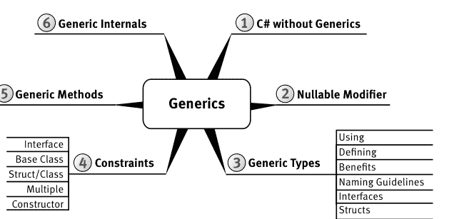

### 没有泛型的 C#

我们通过检查一个不使用泛型的类来开始讨论泛型。这个类，`System.Collections.Stack`，代表一个对象集合，其中最后添加到集合中的项是从集合中检索的第一项（后进先出 [LIFO]）。`Stack` 类的两个主要方法 `Push()` 和 `Pop()` 分别用于将项添加到堆栈中并将其从堆栈中移除。`Stack` 类方法的声明显示在清单 12.1 中。

**清单 12.1：System.Collections.Stack 方法签名**

```csharp
public class Stack
{
    public virtual object Pop() { ... }
    public virtual void Push(object obj) { ... }
    // ...
}
```

程序经常使用堆栈类型的集合来促进多重撤销操作。例如，清单 12.2 使用 `System.Collections.Stack` 类在模拟 Etch A Sketch 游戏的程序中进行撤销操作。

**清单 12.2：在类似 Etch A Sketch 游戏的程序中支持撤销**

```csharp
using System;
using System.Collections;

class Program
{
    // ...
    public void Sketch()
    {
        Stack path = new Stack();
        Cell currentPosition;
        ConsoleKeyInfo key; // C# 2.0 中新增
        do
        {
            // 沿用户输入的箭头键指示的方向刻画
            key = Move();
            switch (key.Key)
            {
                case ConsoleKey.Z:
                    // 撤销上一次的 Move
                    if (path.Count >= 1)
                    {
                        currentPosition = (Cell)path.Pop();
                        Console.SetCursorPosition(
                            currentPosition.X, currentPosition.Y);
                        Undo();
                    }
                    break;

                case ConsoleKey.DownArrow:
                case ConsoleKey.UpArrow:
                case ConsoleKey.LeftArrow:
                case ConsoleKey.RightArrow:
                    // SaveState()
                    currentPosition = new Cell(
                        Console.CursorLeft, Console.CursorTop);
                    path.Push(currentPosition);
                    break;

                default:
                    Console.Beep(); // C# 2.0 中新增
                    break;
            }
        }
        while (key.Key != ConsoleKey.X); // 使用 X 退出
    }

    public struct Cell
    {
        // 在 C# 6.0 之前使用只读字段
        public int X { get; }
        public int Y { get; }
        public Cell(int x, int y)
        {
            X = x;
            Y = y;
        }
    }
}
```

清单 12.2 的结果显示在输出 12.1 中。

**输出 12.1**

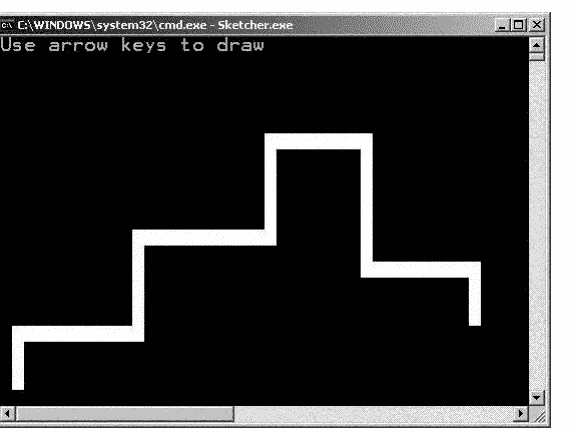

使用声明为 `System.Collections.Stack` 的变量 `path`，你通过将自定义类型 `Cell` 传递给 `Stack.Push()` 方法（使用 `path.Push(currentPosition)`）来保存上一步移动。如果用户输入 Z（或按 Ctrl+Z），你通过从堆栈中检索该移动（使用 `Pop()` 方法）、将光标位置设置为上一位置并调用 `Undo()` 来撤销上一步移动。

虽然这段代码功能正常，但 `System.Collections.Stack` 类存在一个根本缺陷。如清单 12.1 所示，`Stack` 类收集类型为 `object` 的值。由于公共语言运行时 `CLR` 中的每个对象都派生自 `object`，因此 `Stack` 不提供任何验证，以确保放入其中的元素是同质的或属于预期类型。例如，你可以传递一个 `字符串`，其中 X 和 Y 之间用小数点连接，而不是传递 `currentPosition`。然而，编译器必须允许不一致的数据类型，因为堆栈类被编写为接受任何对象，无论其更具体的类型如何。

此外，在使用 `Pop()` 方法从堆栈中检索数据时，你必须将返回值强制转换为 `Cell`。但是，如果 `Pop()` 方法返回值的类型不是 `Cell`，则会抛出异常。通过使用强制转换将类型检查推迟到运行时，你使得使程序更加脆弱。创建一个没有使用泛型却能处理多种数据类型的类，其根本问题在于它必须基于一个公共基类（通常是 `object`，即接口）来工作。

使用值类型（例如结构体或整数）时，那些基于 `object` 类的类会加剧这一问题。例如，如果你将一个值类型传递给 `Stack.Push()` 方法，运行时会自动对其进行装箱 `boxing`。同样，当检索值类型时，你需要显式地取消装箱，并将从 `Pop()` 方法获取的对象引用强制转换为值类型。将引用类型强制转换为基类或接口的性能影响微乎其微，但值类型的装箱操作会引入更多开销，因为它必须分配内存、复制值，然后稍后由垃圾回收器回收该内存。

C# 是一门鼓励类型安全的语言：该语言的设计使得许多类型错误（例如将整数赋值给类型为 `string` 的变量）可以在编译时被捕获。根本问题在于 `Stack` 类的类型安全性不如人们期望 C# 程序所具备的那样高。要将 `Stack` 类改为强制类型安全，以限制堆栈内容必须是特定的数据类型（在不使用泛型类型的情况下），你必须创建一个专门的堆栈类，如清单 12.3 所示。

## 清单 12.3：定义一个专门的堆栈类

```csharp
public class CellStack
{
    public virtual Cell Pop();
    public virtual void Push(Cell cell);
    // ...
}
```

由于 `CellStack` 只能存储类型为 `Cell` 的对象，这种解决方案需要自定义堆栈方法的实现，这不是理想的方案。实现一个类型安全的整数堆栈需要另一个自定义实现；每个实现看起来都惊人地相似。这将导致大量重复和冗余的代码。

## 入门主题

### 另一个示例：可空值类型

第 3 章介绍了使用可空修饰符 `?` 声明可以包含 `null` 的变量的功能。C# 直到 2.0 版本才开始支持此功能，因为正确的实现需要泛型。在引入泛型之前，程序员基本上面临两个选择。

第一个选项是为每个需要处理 `null` 值的值类型声明一个可空数据类型，如清单 12.4 所示。

## 清单 12.4：声明存储 null 的各种值类型版本

```csharp
struct NullableInt
{
    /// <summary>
    /// 当 HasValue 返回 true 时提供值
    /// </summary>
    public int Value { get; private set; }

    /// <summary>
    /// 指示是否存在值，
    /// 或者值是否为 "null"
    /// </summary>
    public bool HasValue { get; private set; }

    // ...
}

struct NullableGuid
{
    /// <summary>
    /// 当 HasValue 返回 true 时提供值
    /// </summary>
    public Guid Value { get; private set; }

    /// <summary>
    /// 指示是否存在值，
    /// 或者值是否为 "null"
    /// </summary>
    public bool HasValue { get; private set; }

    // ...
}
```

清单 12.4 展示了 `NullableInt` 和 `NullableGuid` 的可能实现。如果程序需要额外的可空值类型，你就必须创建另一个结构体，并将其属性修改为使用所需的值类型。对该实现的任何改进（例如，添加从基础类型到可空类型的用户定义隐式转换）都将需要修改所有可空类型声明。

在没有泛型的情况下实现可空类型的另一种策略是创建一个具有类型为 `object` 的 `Value` 属性的单一类型，如清单 12.5 所示。

## 清单 12.5：声明包含类型为 object 的 Value 属性的可空类型

```csharp
struct Nullable
{
    /// <summary>
    /// 当 HasValue 返回 true 时提供值
    /// </summary>
    public object Value { get; private set; }

    /// <summary>
    /// 指示是否存在值，
    /// 或者值是否为 "null"
    /// </summary>
    public bool HasValue { get; private set; }

    // ...
}
```

虽然这种选项只需要一个可空类型的实现，但在设置 `Value` 属性时，运行时总是会对值类型进行装箱。此外，从 `Value` 属性中检索底层值需要强制转换操作，这在运行时可能是无效的。

这两个选项都不是很吸引人。为了解决这个问题，C# 2.0 向 C# 引入了泛型。（实际上，可空类型是通过泛型类型 `Nullable<T>` 实现的。）

## 介绍泛型类型


泛型提供了一种创建可以专门用于处理特定类型的数据结构的机制。程序员定义这些参数化类型，使得特定泛型类型的每个变量都具有相同的内部算法，但数据和方法签名的类型可以根据提供给类型参数的类型参数而变化。

为了最小化开发人员的学习曲线，C# 设计者选择了在表面上类似于 C++ 模板的语法。在 C# 中，泛型类和结构体的语法使用尖括号来在类型声明中声明泛型类型参数，并在使用该类型时指定泛型类型实参。

## 使用泛型类

清单 12.6 展示了如何指定泛型类使用的实际类型实参。通过在对象创建表达式和声明语句中的尖括号表示法内指定 `Cell`，你指示 `path` 变量为“Cell 堆栈”类型。换句话说，当使用泛型数据类型声明变量（在本例中为 `path`）时，C# 要求开发人员指定泛型类型使用的实际类型实参。清单 12.6 通过新的泛型 `Stack` 类展示了这一过程。

### 清单 12.6：使用泛型堆栈类实现撤销功能

```csharp
using System;
using System.Collections.Generic;

class Program
{
    // ...

    public void Sketch()
    {
        Stack<Cell> path;     // 泛型变量声明
        path = new Stack<Cell>();  // 泛型对象实例化
        Cell currentPosition;
        ConsoleKeyInfo key;

        do
        {
            // 沿用户输入的箭头键指示的方向刻蚀
            key = Move();

            switch (key.Key)
            {
                case ConsoleKey.Z:
                    // 撤销上一步移动
                    if (path.Count >= 1)
                    {
                        // 不需要强制转换
                        currentPosition = path.Pop();
                        Console.SetCursorPosition(
                            currentPosition.X, currentPosition.Y);
                        Undo();
                    }
                    break;

                case ConsoleKey.DownArrow:
                case ConsoleKey.UpArrow:
                case ConsoleKey.LeftArrow:
                case ConsoleKey.RightArrow:
                    // SaveState()
                    currentPosition = new Cell(
                        Console.CursorLeft, Console.CursorTop);
                    // 调用 Push() 时仅允许 Cell 类型
                    path.Push(currentPosition);
                    break;

                default:
                    Console.Beep(); // 在 C# 2.0 中添加
                    break;
            }
        } while (key.Key != ConsoleKey.X); // 使用 X 退出
    }
}
```

清单 12.6 的结果如输出 12.2 所示。

## 输出 12.2

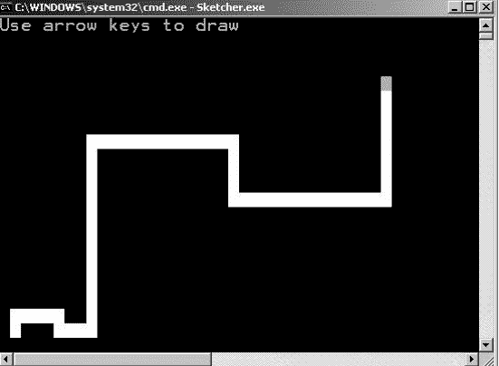

在清单 12.6 中显示的 `path` 声明中，你声明了一个变量，并用 `System.Collections.Generic.Stack<Cell>` 类的新实例对其进行初始化。你用尖括号指定堆栈元素的数据类型为 `Cell`。结果是，添加到 `path` 并从其中检索的每个对象都是 `Cell` 类型。反过来，你不再需要强制转换 `path.Pop()` 的返回值，也不需要确保在 `Push()` 方法中只向 `path` 添加 `Cell` 类型对象。

## 定义一个简单的泛型类

泛型允许你编写算法和模式，并为不同的数据类型重用代码。清单 12.7 创建了一个与清单 12.6 代码中使用的 `System.Collections.Generic.Stack<T>` 类类似的泛型 `Stack<T>` 类。你在类名后的尖括号内指定一个类型参数（在本例中为 `T`）。然后，可以为泛型 `Stack<T>` 提供单个类型实参，该实参将替换类中出现的所有 `T`。因此，堆栈可以存储任何指定类型的项，而无需重复代码或将项转换为 `object` 类型。类型参数 `T` 是一个占位符，必须提供类型实参。在清单 12.7 中，你可以看到类型参数将用于内部的 `Items` 数组、`Push()` 方法的参数类型以及 `Pop()` 方法的返回类型。

### 清单 12.7：声明泛型类 Stack<T>

```csharp
public class Stack<T>
{
    // 在 C# 6.0 之前使用只读字段
    private T[] InternalItems { get; }

    public void Push(T data)
    {
        ...
    }

    public T Pop()
    {
        ...
    }
}
```

## 泛型的优势

与非泛型版本（例如使用早先提到的 `System.Collections.Generic.Stack<T>` 类而不是原始的 `System.Collections.Stack` 类型）相比，使用泛型类有以下几个优点：

- 泛型增强了类型安全性，防止使用参数化类成员中未明确指定的数据类型。在代码清单 12.7 中，参数化栈类将 `Stack<Cell>` 的使用限制为 Cell 数据类型。例如，语句 `path.Push("garbage")` 会产生编译时错误，指出 `System.Collections.Generic.Stack<T>.Push(T)` 没有可用于处理字符串的重载方法，因为它无法转换为 `Cell`。
- 编译时类型检查减少了运行时发生 `InvalidCastException` 类型错误的可能性。
- 在泛型类成员中使用值类型不再导致装箱转换为 `object`。例如，`path.Pop()` 和 `path.Push()` 在添加或删除项时不需要进行装箱或拆箱操作。
- C# 中的泛型减少了代码膨胀。泛型类型保留了特定类版本的优点，且没有额外开销。例如，不再需要定义如 `CellStack` 这样的类。
- 由于不再需要从 `object` 进行转换，从而消除了类型检查操作，因此性能得到提升。此外，由于值类型不再需要装箱，性能也有所提高。
- 泛型通过避免装箱从而减少堆上的内存消耗，降低内存使用量。
- 由于减少了转换检查以及对特定类型实现的需求，代码变得更具可读性。
- 通过某种 IntelliSense 辅助编码的编辑器可以直接处理来自泛型类的返回参数。为了让 IntelliSense 工作，无需转换返回数据。

在本质上，泛型提供了编码模式实现并在模式出现的地方重用这些实现的能力。模式描述了代码中反复出现的问题，而模板为这些重复模式提供了单一实现。

## 类型参数命名准则

就像为方法的形参命名一样，在为类型参数命名时应尽可能具有描述性。此外，为了将参数标识为类型参数，其名称应包含 `T` 前缀。例如，在定义如 `EntityCollection<TEntity>` 这样的类时，使用类型参数名称 "`TEntity`"。

只有一种情况下，你不会使用描述性的类型参数名称，即这种描述不会增加任何价值时。例如，在 `Stack<T>` 类中使用 `T` 是合适的，因为表示 `T` 是类型参数已经足够具有描述性；栈适用于任何类型。

在下一节中，你将了解约束。使用约束描述性的类型名称是一个良好的实践。例如，如果类型参数必须实现 `IComponent`，请考虑使用 "`TComponent`" 这样的类型名称。

### 准则

- 务必为类型参数选择有意义的名称，并以 `T` 为前缀。
- 考虑在类型参数的名称中指示约束。

## 泛型接口和结构

C# 支持在整个语言范围内使用泛型，包括接口和结构。其语法与类所使用的语法完全相同。要声明带有类型参数的接口，请像代码清单 12.8 中 `IPair<T>` 的示例那样，将类型参数放在紧跟接口名称后的尖括号中。

**代码清单 12.8：声明泛型接口**

```csharp
interface IPair<T>
{
  T First { get; set; }
  T Second { get; set; }
}
```

此接口表示相同类型对象的配对，例如点的坐标、一个人的基因父母或二叉树的节点。配对中包含的类型对于两个项目都是相同的。

要实现该接口，使用与非泛型类相同的语法。请注意，一个泛型类型的类型参数是另一个泛型类型的类型参数是合法的，并且实际上很常见，如代码清单 12.9 所示。接口的类型参数是由类声明的类型参数。此外，此示例使用结构而不是类，表明 C# 支持自定义泛型值类型。

**代码清单 12.9：实现泛型接口**

```csharp
public struct Pair<T> : IPair<T>
{
    public T First { get; set; }
    public T Second { get; set; }
}
```

对泛型接口的支持对于集合类尤为重要，泛型在集合类中最为普遍。在引入泛型之前，开发人员依赖 `System.Collections` 命名空间中的一系列接口。与它们的实现类一样，这些接口只与类型 `object` 一起工作，因此接口强制对所有这些集合类的访问都需要转换。通过使用类型安全的泛型接口，可以避免转换操作。

### 进阶主题：在单个类上多次实现相同接口

同一泛型接口的不同构建被视为不同的类型。因此，“相同”的泛型接口可以被类或结构实现多次。考虑代码清单 12.10 中的示例。

**代码清单 12.10：在单个类上重复接口实现**

```csharp
public interface IContainer<T>
{
    ICollection<T> Items { get; set; }
}

public class Person : IContainer<Address>, IContainer<Phone>, IContainer<Email>
{
    IContainer<Address>.Items
    {
        get { ... }
        set { ... }
    }

    IContainer<Phone>.Items
    {
        get { ... }
        set { ... }
    }

    IContainer<Email>.Items
    {
        get { ... }
        set { ... }
    }
}
```

在此示例中，`Items` 属性使用显式接口实现出现多次，且类型参数各不相同。如果没有泛型，这是不可能的；编译器只会允许一个显式 `IContainer.Items` 属性。

然而，实现同一接口的多个版本的技术被许多人认为是一种“坏代码异味”，因为它具有潜在的混淆性（特别是如果接口允许协变或逆变转换）。此外，这里的 `Person` 类似乎设计得不太好；通常不会将人视为“能够提供电子邮件地址集合的东西”。当你感到有理由让一个类实现同一接口的三个版本时，请考虑是否更好地实现三个属性——例如，`EmailAddresses`、`PhoneNumbers` 和 `MailingAddresses`——每个属性返回泛型接口的适当构建。

### 准则

- 避免在一个类型中实现同一泛型接口的多个构建。

## 定义构造函数和终结器

令人惊讶的是，泛型类或结构的构造函数（以及终结器）不需要类型参数；换句话说，它们不需要 `Pair<T>(){...}`。在代码清单 12.11 的配对示例中，构造函数使用 `public Pair(T first, T second)` 声明。

**代码清单 12.11：声明泛型类型的构造函数**

```csharp
public struct Pair<T>: IPair<T>
{
    public Pair(T first, T second)
    {
        First = first;
        Second = second;
    }

    public T First { get; set; }
    public T Second { get; set; }
}
```

## 指定默认值

代码清单 12.11 包含一个构造函数，该构造函数接收 `First` 和 `Second` 的初始值并将其分配给 `First` 和 `Second`。由于 `Pair<T>` 是结构，你提供的任何构造函数都必须初始化所有字段和自动实现的属性。然而，这带来了一个问题。考虑一个在实例化时只初始化配对一半的 `Pair<T>` 构造函数。

如代码清单 12.12 所示，定义这样的构造函数会导致编译时错误，因为在构造函数结束时字段 `Second` 仍然未初始化。为 `Second` 提供初始化也存在一个问题，因为你不知道 T 的数据类型。如果它是引用类型，`null` 将有效，但如果 T 是不可空值类型，这种方法将不起作用。

**代码清单 12.12：未初始化所有字段，导致编译时错误**

```csharp
public struct Pair<T>: IPair<T>
{
    // ERROR: Field 'Pair<T>.Second' must be fully assigned
    // before control leaves the constructor
    // public Pair(T first)
    // {
    //     First = first;
    // }
    // ...
}
```

为了处理这种情况，C# 提供了 `default` 运算符，该运算符在第 9 章中首次被讨论。在那里，我们展示了如何使用 `default(int)` 来指定 int 的默认值。对于 `Second` 所需的 T 的情况，你可以使用 `default(T)`，如清单 12.13 所示。

## 清单 12.13：使用 default 运算符初始化字段

```csharp
public struct Pair<T> : IPair<T>
{
    public Pair(T first)
    {
        First = first;
        Second = default(T);
    }
    // ...
}
```

`default` 运算符可以为任何类型提供默认值，包括类型参数。

C# 7.1 包含了一种选项，只要能够推断数据类型，就可以使用不指定参数的 `default`。例如，在变量初始化或赋值时，你可以使用 `Pair<T> pair = default` 来代替 `Pair<T> pair = default(Pair<T>)`。此外，如果一个方法返回 `int`，可以简单地使用 `return default`，让编译器从方法的返回中推断出 `default(int)`。其他可以进行此类推断的场景包括默认参数（可选值）和方法调用参数。

## 多个类型参数

泛型类型可以声明任意数量的类型参数。最初的 `Pair<T>` 示例只包含一个类型参数。为了支持存储二分对象对，例如名称/值对，你可以创建该类型的一个新版本，声明两个类型参数，如清单 12.14 所示。

### 清单 12.14：声明具有多个类型参数的泛型

```csharp
interface IPair<TFirst, TSecond>
{
    TFirst First { get; set; }
    TSecond Second { get; set; }
}

public struct Pair<TFirst, TSecond> : IPair<TFirst, TSecond>
{
    public Pair(TFirst first, TSecond second)
    {
        First = first;
        Second = second;
    }

    public TFirst First { get; set; }
    public TSecond Second { get; set; }
}
```

当你使用 `Pair<TFirst, TSecond>` 类时，你在声明和实例化语句的角度括号内提供多个类型参数；然后在调用方法时，向方法的参数提供匹配的类型。清单 12.15 说明了这种方法。

### 清单 12.15：使用具有多个类型参数的类型


```csharp
Pair<int, string> historicalEvent =
    new Pair<int, string>(1914,
    "Shackleton leaves for South Pole on ship Endurance");
Console.WriteLine("{0}: {1}",
    historicalEvent.First, historicalEvent.Second);
```

类型参数的数量——即**元数（arity）**——将该类与其他同名类唯一区分开来。因此，由于元数的变化，在同一命名空间中定义 `Pair<T>` 和 `Pair<TFirst, TSecond>` 是可能的。此外，由于它们之间的密切语义关系，仅因元数不同的泛型应放在同一个 C# 文件中。

## 准则

- **应当** 如果多个泛型类仅通过泛型参数的数量不同，则将它们放在单个文件中。

## 初级主题

### 元组：元数丰富之地

我们在第 3 章中介绍了 C# 7.0 对元组语法的支持。内部实现元组语法的基础类型实际上是一个泛型——具体来说是 `System.ValueTuple`。与 `Pair<...>` 一样，由于元数的变化（每个类具有不同数量的类型参数），重用相同的名称是可能的，如清单 12.16 所示。

### 清单 12.16：使用元数重载类型定义

```csharp
public class ValueTuple { ... }
public class ValueTuple<T1> :
    IStructuralEquatable, IStructuralComparable, IComparable { ... }
public class ValueTuple<T1, T2> : ... { ... }
public class ValueTuple<T1, T2, T3> : ... { ... }
public class ValueTuple<T1, T2, T3, T4> : ... { ... }
public class ValueTuple<T1, T2, T3, T4, T5> : ... { ... }
public class ValueTuple<T1, T2, T3, T4, T5, T6> : ... { ... }
public class ValueTuple<T1, T2, T3, T4, T5, T6, T7> : ... { ... }
public class ValueTuple<T1, T2, T3, T4, T5, T6, T7, TRest> : ... { ... }
```

`ValueTuple<...>` 类集的设计目的与 `Pair<T>` 和 `Pair<TFirst, TSecond>` 类相同，除了它们一起可以处理八个类型参数。实际上，使用清单 12.16 中显示的最后一个 `ValueTuple`，`TRest` 可以用来存储另一个 `ValueTuple`，使元组元素的数量实际上没有限制。而且，如果你使用 C# 7.0 的元组语法定义这样的元组，编译器将生成的是那个结构。

元组类族的另一个有趣成员是非泛型 `ValueTuple` 类。该类具有八个静态工厂方法，用于实例化各种泛型元组类型。虽然每个泛型类型都可以使用其构造函数直接实例化，但 `ValueTuple` 类型的工厂方法允许通过 `Create()` 方法推断类型参数。这在 C# 7.0 中并不重要，因为代码像 `var keyValuePair = ("555-55-5555", new Contact("Inigo Montoya"))` 一样简单（假设没有命名字项）。然而，如清单 12.17 所示，结合类型推断使用 `Create()` 方法在 C# 6.0 中更简单。

### 清单 12.17：比较 System.ValueTuple 实例化方法

```csharp
#if !PRECSHARP7
(string, Contact) keyValuePair =
    new ValueTuple<string, Contact>(
        "555-55-5555", new Contact("Inigo Montoya"));
#endif // !PRECSHARP7
```

显然，当 `ValueTuple` 变得很大时，如果没有 `Create()` 工厂方法，需要指定的类型参数数量可能会很繁琐。

请注意，C# 4.0 中添加了类似的元组类：`System.Tuple`。然而，由于 C# 7.0 元组语法的广泛使用及其将带来的元组普及性，由于它提供的性能改进，创建 `System.ValueTuple` 类型是有必要的。

正如你可能从框架库声明了八个不同的泛型 `System.ValueTuple` 类型这一事实中推断出来的那样，CLR 类型系统中没有对*可变*（variadic）泛型类型的支持。方法可以使用*参数数组*（parameter arrays）来接受任意数量的参数，但对于泛型类型没有相应的技术；每个泛型类型必须具有特定的元数。（参见标题为“元组：元数丰富之地”的初级主题，其中有一个示例，你可能想象会有这样的功能。）

## 嵌套泛型类型

包含泛型类型上的类型参数会自动“级联”到任何嵌套类型。如果包含类型声明了一个类型参数 `T`，例如，所有嵌套类型也将是泛型，并且嵌套类型上也将有可用的类型参数 `T`。如果嵌套类型包含其自身的名为 `T` 的类型参数，这将隐藏包含类型内的类型参数，并且嵌套类型中对 `T` 的任何引用都将指代嵌套的 `T` 类型参数。幸运的是，在嵌套类型中重用相同的类型参数名称会导致编译器警告，以防止意外重叠（参见清单 12.18）。

### 清单 12.18：嵌套泛型类型

```csharp
class Container<T, U>
{
   // Nested classes inherit type parameters.
   // Reusing a type parameter name will cause
   // a warning.
   class Nested<U>
   {
      void Method(T param0, U param1)
      {
      }
   }
}
```

包含类型的类型参数在嵌套类型中是可访问的，其方式与包含类型的成员在嵌套类型中可访问的方式相同。规则很简单：类型参数在其声明的类型的任何主体内都是可用的。

## 准则

- 避免使用嵌套类型中同名类型参数来遮蔽外部类型的类型参数。

## 约束

泛型支持定义类型参数约束的能力。这些约束确保作为类型参数提供的类型符合各种规则。以清单 12.19 中显示的 `BinaryTree<T>` 类为例。

### 清单 12.19：声明无约束的二叉树<T>类

```csharp
public class BinaryTree<T>
{
  public BinaryTree ( T item)
  {
    Item = item;
  }
  public T Item { get; set; }
  public Pair<BinaryTree<T>> SubItems { get; set; }
}
```

（一个有趣的旁注是，`BinaryTree<T>` 内部使用了 `Pair<T>`，这是可能的，因为 `Pair<T>` 只是另一个类型。）

假设你希望树在将值赋值给 SubItems 属性时，对 `Pair<T>` 值内的值进行排序。为了实现排序，

the SubItems set accessor uses the CompareTo() method of the supplied key, as shown in Listing 12.20.

## LISTING 12.20: Needing the Type Parameter to Support an Interface

```csharp
public class BinaryTree<T>
{
    public T Item { get; set; }
    public Pair<BinaryTree<T>> SubItems
    {
        get { return _SubItems; }
        set
        {
            IComparable<T> first;
            // ERROR: Cannot implicitly convert type ...
            first = (IComparable<T>)value.First; // Explicit cast required

            if (first.CompareTo(value.Second) < 0)
            {
                // first is less than second
                // ...
            }
            else
            {
                // first and second are the same or
                // second is less than first
                // ...
            }
            _SubItems = value;
        }
    }
    private Pair<BinaryTree<T>> _SubItems;
}
```

At compile time, the type parameter T is an unconstrained generic. When the code is written as shown in Listing 12.20, the compiler assumes that the only members available on T are those inherited from the base type object, since every type has object as a base class. Only methods such as ToString(), therefore, are available to call on an instance of the type parameter T. As a result, the compiler displays a compilation error because the CompareTo() method is not defined on type object.

You can cast the T parameter to the IComparable<T> interface to access the CompareTo() method, as shown in Listing 12.21.

Fortunately, if you now declare a BinaryTree<SomeType> class variable but the type argument does not implement the IComparable<SomeType> interface, you will encounter an execution-time error—specifically, an InvalidCastException. This eliminates a key reason for having generics in the first place: to improve type safety.

To avoid this exception and instead generate a compile-time error if the type argument does not implement the interface, C# allows you to supply an optional list of **constraints** for each type parameter declared in the generic type. A constraint declares the characteristics that the generic type requires of the type argument supplied for each type parameter. You declare a constraint using the where keyword, followed by a parameter-requirements pair, where the parameter must be one of those declared in the generic type and the requirements describe the class or interfaces to which the type argument must be convertible, the presence of a default constructor, or a reference/value type restriction.

## Interface Constraints

To ensure that a binary tree has its nodes correctly ordered, you can use the CompareTo() method in the BinaryTree class. To do this most effectively, you should impose a constraint on the T type parameter. That is, you need the T type parameter to implement the IComparable<T> interface. The syntax for declaring this constraint appears in Listing 12.22.

### LISTING 12.22: Declaring an Interface Constraint

```csharp
public class BinaryTree<T>
    where T : System.IComparable<T>
{
    public T Item { get; set; }
    public Pair<BinaryTree<T>> SubItems
    {
        get { return _SubItems; }
        set
        {
            IComparable<T> first;
            // Notice that the cast can now be eliminated
            first = value.First.Item;

            if (first.CompareTo(value.Second.Item) < 0)
            {
                // first is less than second
                ...
            }
            else
            {
                // second is less than or equal to first
                ...
            }
            _SubItems = value;
        }
    }
    private Pair<BinaryTree<T>> _SubItems;
}
```

When given the interface constraint addition in Listing 12.22, the compiler ensures that each time you use the BinaryTree<T> class, you specify a type parameter that implements the corresponding construction of the IComparable<T> interface. Furthermore, you no longer need to explicitly cast the variable to an IComparable<T> interface before calling the CompareTo() method. Casting is not even required to access members that use explicit interface implementation, which in other contexts would hide the member without a cast. When calling a method on a value typed as a generic type parameter, the compiler checks whether the method matches any method on any of the interfaces declared as constraints.

If you tried to create a `BinaryTree<>` variable using `System.Text.StringBuilder` as the type parameter, you would receive a compiler error because `StringBuilder` does not implement `IComparable<StringBuilder>`. The error is similar to the one shown in Output 12.3.

### OUTPUT 12.3


```
error CS0311: The type 'System.Text.StringBuilder' cannot be used as type parameter 'T' in the generic type or method 'BinaryTree<T>'. There is no implicit reference conversion from 'System.Text.StringBuilder' to 'System.IComparable<System.Text.StringBuilder>'.
```

To specify an interface for the constraint, you declare an **interface type constraint**. This constraint even circumvents the need to cast to call an explicit interface member implementation.

## Class Type Constraints

Sometimes you might want to constrain a type argument to be convertible to a particular class type. You do this using a **class type constraint**, as shown in Listing 12.23.

### LISTING 12.23: Declaring a Class Type Constraint

```csharp
public class EntityDictionary<TKey, TValue>
    : System.Collections.Generic.Dictionary<TKey, TValue>
    where TValue : EntityBase
{
    ...
}
```

In Listing 12.23, `EntityDictionary<TKey, TValue>` requires that all type arguments provided for the type parameter `TValue` be implicitly convertible to the `EntityBase` class. By requiring the conversion, it becomes possible to use the members of `EntityBase` on values of type `TValue` within the generic implementation, because the constraint will ensure that all type arguments can be implicitly converted to the `EntityBase` class.

The syntax for the class type constraint is the same as that for the interface type constraint, except that class type constraints must appear before any interface type constraints (just as the base class must appear before implemented interfaces in a class declaration). However, unlike interface constraints, multiple base class constraints are not allowed, since it is not possible to derive from multiple unrelated classes. Similarly, base class constraints cannot specify sealed classes or nonclass types. For example, C# does not allow a type parameter to be constrained to string or `System.Nullable<T>` because there would then be only one possible type argument for that type parameter—that's hardly "generic." If the type parameter is constrained to a single type, there is no need for the type parameter in the first place; just use that type directly.

Certain "special" types are not legal as class type constraints. See the Advanced Topic titled "Constraint Limitations," later in this chapter, for details.

## struct/class Constraints

Another valuable generic constraint is the ability to restrict type arguments to be any non-nullable value type or any reference type. Rather than specifying a class from which T must derive, you simply use the keyword struct or class, as shown in Listing 12.24.

### LISTING 12.24: Specifying the Type Parameter as a Value Type

```csharp
public struct Nullable<T> :
    IFormattable, IComparable,
    IComparable<Nullable<T>>, INullable
{
    where T : struct
    // ...
}
```

Note that the class constraint—somewhat confusingly—does not restrict the type argument to class types; rather, it restricts it to reference types. A type argument supplied for a type parameter constrained with the class constraint may be any class, interface, delegate, or array type.

Because a class type constraint requires a reference type, using a struct constraint with a class type constraint would be contradictory. Therefore, you cannot combine struct and class constraints.

The struct constraint has one special characteristic: Nullable value types do not satisfy the constraint. Why? Nullable value types are implemented as the generic type `Nullable<T>`, which itself applies the struct

2.0

约束到 T。如果可空值类型满足该约束，那么定义无意义类型 `Nullable<Nullable<int>>` 将成为可能。双重可空整数令人困惑，以至于毫无意义。（正如预期的那样，简写语法 `int??` 也是被禁止的。）

## 多个约束

对于任何给定的类型参数，你可以指定任意数量的接口类型约束，但只能指定一个类类型约束（就像类可以实现任意数量的接口，但只能继承自另一个类一样）。每个新约束都在泛型类型参数和冒号之后的逗号分隔列表中声明。如果有多个类型参数，每个前面都必须加上 `where` 关键字。在 Listing 12.25 中，泛型 `EntityDictionary` 类声明了两个类型参数：`TKey` 和 `TValue`。`TKey` 类型参数有两个接口类型约束，而 `TValue` 类型参数有一个类类型约束。

### LISTING 12.25: 指定多个约束

```csharp
public class EntityDictionary<TKey, TValue>
    : Dictionary<TKey, TValue>
    where TKey : IComparable<TKey>, IFormattable
    where TValue : EntityBase
{
...
}
```

在这种情况下，`TKey` 本身有多个约束，并且 `TValue` 还有一个额外的约束。当为一个类型参数指定多个约束时，假设存在 AND（与）关系。例如，如果类型 C 作为 `TKey` 的类型参数提供，则 C 必须实现 `IComparable<C>` 和 `IFormattable`。

注意，每个 `where` 子句之间没有逗号。

## 构造函数约束

在某些情况下，期望在泛型类内部创建类型参数类型的实例。例如，在 Listing 12.26 中，`EntityDictionary<TKey, TValue>` 类的 `MakeValue()` 方法必须创建对应于类型参数 `TValue` 的类型参数的实例。

### LISTING 12.26: 要求默认构造函数约束

```csharp
public class EntityBase<TKey>
{
    public TKey Key { get; set; }
}

public class EntityDictionary<TKey, TValue>
    : Dictionary<TKey, TValue>
    where TKey : IComparable<TKey>, IFormattable
    where TValue : EntityBase<TKey>, new()
{
    // ...
    public TValue MakeValue(TKey key)
    {
        TValue newEntity = new TValue();
        newEntity.Key = key;
        Add(newEntity.Key, newEntity);
        return newEntity;
    }
    // ...
}
```

由于并非所有对象都保证具有公共默认构造函数，编译器不允许你对未加约束的类型参数调用默认构造函数。要覆盖此编译器限制，可以在指定完所有其他约束后添加文本 `new()`。此文本是一个构造函数约束，它要求受约束类型参数对应的类型参数具有公共默认构造函数。只有默认构造函数约束是可用的。你无法指定一个确保提供的类型参数提供一个接受形式参数的构造函数的约束。

## 约束继承

泛型类型参数及其约束都不会被派生类继承，因为泛型类型参数不是成员。（请记住，类继承意味着派生类拥有基类的所有成员。）创建继承自其他泛型类型的新泛型类型是一种常见做法。在这种情况下，由于派生泛型类型的类型参数成为泛型基类的类型参数，类型参数必须具有与基类相同（或更强）的约束。困惑了？请考虑 Listing 12.27。

### LISTING 12.27: 显式指定的继承约束

```csharp
class EntityBase<T> where T : IComparable<T>
{
    // ...
}

// 错误：
// 类型 'U' 必须可以转换为
// 'System.IComparable<U>' 才能用作泛型类型或方法
// 中的参数 'T'
// class Entity<U> : EntityBase<U>
// {
//     ...
// }
```

在 Listing 12.27 中，`EntityBase<T>` 要求由基类说明符 `EntityBase<U>` 为 `T` 提供的类型参数 `U` 实现 `IComparable<>`。因此，`Entity<U>` 类需要要求对 `U` 施加相同的约束。未能这样做会导致编译时错误。这种模式增强了程序员在派生类中对基类类型约束的意识，避免了当程序员使用派生类并发现约束但不理解其来源时可能发生的困惑。

我们尚未介绍泛型方法；我们将在本章后面部分涉及它们。目前，只需认识到方法也可以是泛型的，并且也可以为其类型参数提供的类型参数设置约束。那么，当虚拟泛型方法被继承并覆盖时，约束是如何处理的？与在泛型类上声明的类型参数的情况相反，覆盖虚拟泛型方法（或显式接口）方法的约束是隐式继承的，并且不得重新陈述（参见 Listing 12.28）。

### LISTING 12.28: 在虚拟成员上重复继承约束是被禁止的

```csharp
class EntityBase
{
    public virtual void Method<T>(T t)
        where T : IComparable<T>
    {
        // ...
    }
}

class Order : EntityBase
{
    public override void Method<T>(T t)
    //    约束不得在覆盖
    //    成员上重复
    //    where T : IComparable<T>
    {
        // ...
    }
}
```

在泛型类继承的情况下，可以通过不仅添加基类上的约束（这是必需的），还可以添加其他约束，从而对派生类上的类型参数进行进一步约束。然而，覆盖虚拟泛型方法需要完全符合基类方法定义的约束。额外的约束可能会破坏多态性，因此不被允许，覆盖方法上的类型参数约束是隐含的。

## 高级主题

## 约束限制

约束被适当地限制，以避免无意义的代码。例如，你不能将类类型约束与 struct 或 class 约束组合。此外，你无法指定约束来将继承限制为特殊类型，如 `Object`、数组、`System.ValueType`、`System.Enum`（枚举）、`System.Delegate` 或 `System.MulticastDelegate`。

在某些情况下，限制约束可能更合乎期望，但它们仍然不被支持。以下小节提供了一些不允许的约束的额外示例。

## 不允许运算符约束

你不能将类型参数约束为实现了特定方法或运算符的类型，除了通过接口类型约束（对于方法）或类类型约束（对于方法和运算符）之外。由于此原因，Listing 12.29 中的泛型 `Add()` 不起作用。

### LISTING 12.29: 约束表达式不能要求运算符

```csharp
public abstract class MathEx<T>
{
    ...
    public static T Add(T first, T second)
    {
        // 错误：运算符 '+' 不能应用于
        // 类型 'T' 和 'T' 的操作数
        // return first + second;
    }
}
```

在这种情况下，该方法假设所有可能作为 `T` 的类型参数提供的类型都具有 `+` 运算符。但没有约束阻止你提供一个没有关联加法运算符的类型参数，因此会发生错误。不幸的是，除了使用实现了加法运算符的类类型约束外，没有方法可以在约束内指定需要加法运算符。

更一般地说，没有方法将类型约束为具有静态方法。

## 不支持 OR 标准

如果你为类型参数提供多个接口或类约束，编译器始终假设约束之间存在 AND（与）关系。例如，`T : IComparable<>, IFormattable` 要求同时支持 `IComparable<>` 和 `IFormattable`。没有方法指定约束之间的 OR（或）关系。因此，Listing 12.30 的等效形式不被支持。

### LISTING 12.30: 不允许使用 OR 关系组合约束

```csharp
public class BinaryTree<T>
    // 错误：不支持 OR
    // where T: System.IComparable<T> || System.IFormattable
{
    ...
}
```

支持此功能将阻止编译器在编译时确定调用哪个方法。

## 类型为 Delegate 和 Enum 的约束无效

委托类型、数组类型和枚举类型不能作为类类型约束使用，因为它们实际上都是“密封”类型。（如果你不熟悉委托类型，请参阅第 13 章。）它们的基类型——`System.Delegate`、`System.MultiCastDelegate`、`System.Array`，

以及 `System.Enum`——也可能不被用作约束。例如，当编译器遇到列表 12.31 中的类声明时，会生成一个错误。

## 列表 12.31：继承约束不能为 `System.Delegate` 类型


```csharp
// 错误：约束不能是特殊类 'System.Delegate'
public class Publisher<T>
       where T : System.Delegate
{
    public event T Event;
    public void Publish()
    {
        if (Event != null)
        {
            Event(this, new EventArgs());
        }
    }
}
```

所有委托类型都被视为不能指定为类型参数的特殊类。这样做会阻止对 `Event()` 调用的编译时验证，因为在使用 `System.Delegate` 和 `System.MulticastDelegate` 数据类型时，事件触发的签名是未知的。同样的限制也适用于任何枚举类型。

## 构造器约束仅允许用于默认构造器

列表 12.26 包含一个构造器约束，该约束强制为 `TValue` 提供的类型参数必须提供一个公共的无参构造器。没有约束可以强制类型参数提供一个接受其他形式参数的构造器。例如，你可能希望约束 `TValue`，使得为其提供的类型参数必须提供一个接受 `TKey` 类型参数的构造器，但这是不可能的。列表 12.32 展示了无效的代码。

### 列表 12.32：构造器约束只能为默认构造器指定

```csharp
public TValue New(TKey key)
{
// 错误：'TValue'：创建变量类型实例时
// 不能提供参数
TValue newEntity = null;
// newEntity = new TValue(key);
Add(newEntity.Key, newEntity);
return newEntity;
}
```

规避此限制的一种方法是提供一个工厂接口，其中包含一个用于实例化该类型的方法。实现该接口的工厂负责实例化实体，而不是 `EntityDictionary` 本身（参见列表 12.33）。

### 列表 12.33：使用工厂接口替代构造器约束

```csharp
public class EntityBase<TKey>
{
    public EntityBase(TKey key)
    {
        Key = key;
    }
    public TKey Key { get; set; }
}

public class EntityDictionary<TKey, TValue, TFactory> :
    Dictionary<TKey, TValue>
    where TKey : IComparable<TKey>, IFormattable
    where TValue : EntityBase<TKey>
    where TFactory : IEntityFactory<TKey, TValue>, new()
{
    ...
    public TValue New(TKey key)
    {
        TFactory factory = new TFactory();
        TValue newEntity = factory.CreateNew(key);
        Add(newEntity.Key, newEntity);
        return newEntity;
    }
    ...
}

public interface IEntityFactory<TKey, TValue>
{
    TValue CreateNew(TKey key);
}
```

像这样的声明允许你将新键传递给接受参数的 `TValue` 工厂方法，而不是被迫依赖默认构造器。它不再对 `TValue` 使用构造器约束，因为 `TFactory` 负责实例化值。（对列表 12.33 中代码的一种修改是缓存工厂方法的引用——如果需要多线程支持，可能利用 `Lazy<T>`。这将使你能够重用工厂方法，而不是每次重新实例化它。）

声明一个类型为 `EntityDictionary<TKey, TValue, TFactory>` 的变量将产生一个类似于列表 12.34 中 `Order` 实体的实体声明。

### 列表 12.34：声明要在 `EntityDictionary<...>` 中使用的实体

```csharp
public class Order : EntityBase<Guid>
{
    public Order(Guid key) :
        base(key)
    {
        // ...
    }
}

public class OrderFactory : IEntityFactory<Guid, Order>
{
    public Order CreateNew(Guid key)
    {
        return new Order(key);
    }
}
```

# 泛型方法

前面，你看到当类型是泛型时，向该类型添加方法是一个相对简单的事情；这样的方法可以使用由该类型声明的泛型类型参数。例如，我们在迄今为止见过的泛型类示例中做了这件事。

泛型方法使用泛型类型参数，这与泛型类型非常相似。它们可以声明在泛型或非泛型类型中。如果声明在泛型类型中，它们的类型参数与其包含的泛型类型的类型参数是不同的。要声明一个泛型方法，你指定泛型类型参数的方式与泛型类型相同：在方法名后立即添加类型参数声明语法，如列表 12.35 中的 `MathEx.Max<T>` 和 `MathEx.Min<T>` 示例所示。

## 列表 12.35：定义泛型方法

```csharp
public static class MathEx
{
    public static T Max<T>(T first, params T[] values)
        where T : IComparable<T>
    {
        T maximum = first;

        foreach (T item in values)
        {
            if (item.CompareTo(maximum) > 0)
            {
                maximum = item;
            }
        }
        return maximum;
    }

    public static T Min<T>(T first, params T[] values)
        where T : IComparable<T>
    {
        T minimum = first;

        foreach (T item in values)
        {
            if (item.CompareTo(minimum) < 0)
            {
                minimum = item;
            }
        }

        return minimum;
    }
}
```

在这个例子中，方法是静态的，尽管 C# 并不要求必须如此。

与泛型类型一样，泛型方法可以包含多个类型参数。元数（类型参数的数量）是方法签名的另一个区分特征。也就是说，只要它们在方法类型参数元数上不同，具有相同名称和相同形式参数类型的两个方法是合法的。

## 泛型方法类型推断

就像在使用泛型类型时，类型参数在类型名称之后提供一样，方法类型参数也在方法类型名称之后提供。用于调用 `Min<T>` 和 `Max<T>` 方法的代码看起来像列表 12.36 中所示的那样。

### 列表 12.36：显式指定类型参数

```csharp
Console.WriteLine(
    MathEx.Max<int>(7, 490));
Console.WriteLine(
    MathEx.Min<string>("R.O.U.S.", "FireSwamp"));
```

列表 12.36 的输出显示在输出 12.4 中。

### 输出 12.4

490

Fireswamp

不出所料，类型参数 `int` 和 `string` 对应于在泛型方法调用中使用的实际类型。然而，指定类型参数是多余的，因为编译器可以根据传递给方法的形式参数推断类型参数。显然，列表 12.36 中 `Max` 的调用者打算类型参数为 `int`，因为两个方法参数都是 `int` 类型。为了避免冗余，在所有编译器能够逻辑推断出你 intended 的类型参数的情况下，你可以从调用中排除类型参数。这种实践的一个例子，即**方法类型推断**，出现在列表 12.37 中。输出显示在输出 12.5 中。

### 列表 12.37：从参数中推断类型参数

```csharp
Console.WriteLine(
    MathEx.Max(7, 490)); // 没有类型参数！
Console.WriteLine(
    MathEx.Min("R.O.U.S", "Fireswamp"));
```

### 输出 12.5

490

Fireswamp

为了使方法类型推断成功，参数的类型必须以这样一种方式与泛型方法的形式参数“匹配”，使得可以推断出所需的类型参数。一个有趣的问题是，当做出矛盾的推断时会发生什么。例如，当你使用 `MathEx.Max(7.0, 490)` 调用 `Max<T>` 方法时，编译器可以从第一个参数推断出类型参数应该是 `double`，并可以从第二个参数推断出类型参数是 `int`，这是一个矛盾。在 C# 2.0 中，这会生成一个错误。更复杂的分析会注意到，由于每个 `int` 都可以转换为 double，因此这个矛盾可以解决，所以 double 是类型参数的最佳选择。C# 3.0 和 C# 4.0 都包含了对方法类型推断算法的改进，允许编译器进行这些更复杂的分析。

在方法类型推断仍然不够复杂以推断出类型参数的情况下，你可以通过在参数上插入类型转换来澄清编译器应使用哪种参数类型进行推断，或者通过放弃类型推断并显式包含类型参数来解决错误。

请注意，方法类型推断算法在进行推断时，只考虑参数、参数的类型以及泛型方法的形式参数类型。在实践中可用于分析的其他因素——例如泛型方法的返回类型、方法返回值被赋值给变量的类型，或方法泛型类型参数的约束——完全不被方法类型推断算法考虑。

## 指定约束

泛型方法的类型参数可以像泛型类型的类型参数一样被约束。例如，你可以限制方法类型参数实现某个接口或可转换为某个类类型。约束在参数列表和方法体之间指定，如列表 12.38 所示。

### 列表 12.38：在泛型方法上指定约束

```csharp
public class ConsoleTreeControl
{
    // 泛型方法 Show<T>
    public static void Show<T>(BinaryTree<T> tree, int indent)
    where T : IComparable<T>
    {
        Console.WriteLine("\n{0}{1}",
            "+ --".PadLeft(5 * indent, ' '),
            tree.Item.ToString());
        if (tree.SubItems.First != null)
            Show(tree.SubItems.First, indent + 1);
        if (tree.SubItems.Second != null)
            Show(tree.SubItems.Second, indent + 1);
    }
}
```

在此处，`Show<>` 的实现本身并未直接使用 `IComparable<>` 接口的任何成员，因此你可能会疑惑为何需要该约束。然而请记住，`BinaryTree<>` 类确实需要此约束（参见列表 12.39）。

#### 列表 12.39：要求 IComparable<> 类型参数的 BinaryTree<>

```csharp
public class BinaryTree<>
where T: System.IComparable<>
{
...
}
```

由于 `BinaryTree<>` 类要求其类型参数 T 具有此约束，且 `Show<>` 使用其类型参数 T 作为对应于受约束类型参数的类型实参，因此 `Show<>` 需要确保类类型参数上的约束在其方法类型实参上得到满足。

## 高级主题

### 泛型方法内的类型转换

在某些情况下，使用泛型时需要谨慎——例如，当专门使用泛型来掩盖类型转换操作时。考虑以下方法，它将流转换为指定类型的对象：

```csharp
public static T Deserialize<>(
    Stream stream, IFormatter formatter)
{
    return (T)formatter.Deserialize(stream);
}
```

格式化程序负责从流中移除数据并将其转换为对象。格式化程序上的 `Deserialize()` 调用返回类型为 `object` 的数据。使用 `Deserialize()` 的泛型版本的调用看起来如下所示：

```csharp
string greeting =
    Deserialization.Deserialize<>(stream, formatter);
```

这段代码的问题在于，对于方法的调用者来说，`Deserialize<>()` 看起来是类型安全的。然而，实际上在调用者背后仍然执行了类型转换操作，这与此处所示的非泛型等价情况类似：

```csharp
string greeting =
    (string)Deserialization.Deserialize(stream, formatter);
```

该转换可能在运行时失败；该方法可能并不像表面看起来那样类型安全。`Deserialize<T>` 方法之所以是泛型的，仅仅是为了向调用者隐藏转换操作的存在，这似乎具有危险性的欺骗性。最好让该方法是非泛型的并返回 `object`，从而使调用者意识到它不是类型安全的。如果没有任何约束来验证转换的有效性，开发人员在泛型方法中进行类型转换时应格外小心。

## 准则

避免使用那些看似类型安全但实际上并非如此泛型方法误导调用者。

## 协变与逆变

泛型类型的新用户经常问的一个问题是，为什么类型为 `List<string>` 的表达式不能赋值给类型为 `List<object>` 的变量——既然 `string` 可以转换为 `object` 类型，那么字符串列表应该也与对象列表兼容，对吗？但就一般情况而言，这既不是类型安全的，也不合法。如果你使用相同的泛型类声明两个具有不同类型参数的变量，即使是从更具体的类型赋值给更通用的类型，这些变量在类型上也不兼容——换句话说，它们不是协变的。

协变是范畴论中的一个技术术语，但其基本概念很简单：假设两个类型 X 和 Y 具有特殊关系——即类型 X 的每个值都可以转换为类型 Y。如果类型 `I<X>` 和 `I<Y>` 总是也保持这种相同的特殊关系，我们就说“`I<T>` 在 T 上是协变的”。在处理仅有一个类型参数的简单泛型类型时，可以理解类型参数，我们简单地称“`I<T>` 是协变的”。从 `I<X>` 到 `I<Y>` 的转换称为协变转换。

例如，泛型类 `Pair<Contact>` 和 `Pair<PdaItem>` 的实例即使在类型实参本身兼容的情况下，在类型上也不兼容。换句话说，编译器阻止将 `Pair<Contact>` 转换为 `Pair<PdaItem>`（无论是隐式还是显式），即使 `Contact` 继承自 `PdaItem`。类似地，将 `Pair<Contact>` 转换为接口类型 `IPair<PdaItem>` 也会失败。参见列表 12.40 中的示例。

#### 列表 12.40：具有不同类型参数的泛型之间的转换

```csharp
// ...
// 错误：无法转换类型 ...
Pair<PdaItem> pair = (Pair<PdaItem>) new Pair<Contact>();
IPair<PdaItem> duple = (IPair<PdaItem>) new Pair<Contact>();
```

但这为什么是不合法的？为什么 `List<T>` 和 `Pair<T>` 不是协变的？列表 12.41 展示了如果 C# 语言允许不受限制的泛型协变会发生什么。

#### 列表 12.41：防止协变保持同质性

```csharp
//...
Contact contact1 = new Contact("Princess Buttercup"),
Contact contact2 = new Contact("Inigo Montoya");
Pair<Contact> contacts = new Pair<Contact>(contact1, contact2);

// 这会给出错误：无法转换类型 ...
// 但假设它没有
// IPair<PdaItem> pdaPair = (IPair<PdaItem>) contacts;
// 这完全合法但不是类型安全的
// pdaPair.First = new Address("123 Sesame Street");
...
```

`IPair<PdaItem>` 可以包含一个地址，但该对象实际上是一个只能包含联系人而不能包含地址的 `Pair<Contact>`。如果允许不受限制的泛型协变，类型安全将被完全破坏。现在也应该很清楚为什么字符串列表不能用作对象列表。你不能将整数插入字符串列表，但你可以将整数插入对象列表；因此，将字符串列表转换为对象列表必须是非法的，这是编译器可以强制执行的一个错误。

## 在 C# 4.0（及更高版本）中通过 out 类型参数修饰符启用协变


你可能已经注意到，之前描述的两个由不受限制的协变引起的问题，是因为泛型对（pair）和泛型列表允许向其内容写入。假设我们通过创建一个只读接口 `IReadOnlyPair<T>` 来消除这种可能性，该接口仅将 `T` 作为从接口“输出”（即用作方法返回类型或只读属性）而绝不“输入”（即用作形式参数或可写属性类型）。如果我们将自己限制在关于 `T` 的“仅输出”接口上，那么刚刚描述的协变问题就不会发生（参见列表 12.42）。

### 列表 12.42：可能实现的协变

```csharp
interface IReadOnlyPair<T>
{
  T First { get; }
  T Second { get; }
}

interface IPair<T>
{
  T First { get; set; }
  T Second { get; set; }
}

public struct Pair<T> : IPair<T>, IReadOnlyPair<T>
{
  // ...
}

class Program
{
  static void Main()
  {
    // 错误：在没有 out 类型参数修饰符的情况下，这只是理论上可能
    Pair<Contact> contacts =
      new Pair<Contact>(
        new Contact("Princess Buttercup"),
        new Contact("Inigo Montoya") );
    IReadOnlyPair<PdaItem> pair = contacts;
    PdaItem pdaItem1 = pair.First;
    PdaItem pdaItem2 = pair.Second;
  }
}
```

当我们限制泛型类型声明仅作为数据从接口输出时，编译器没有理由阻止协变。对 `IReadOnlyPair<PdaItem>` 实例的所有操作都会将联系人（来自原始的 `Pair<Contact>` 对象）向上转换为基类 `PdaItem`——这是一个完全有效的转换。没有方法将地址“写入”该对象，因为该对象实际上是一对联系人，而接口未公开任何可写属性。

列表 12.42 中的代码仍然无法编译。然而，C# 4 增加了对安全协变的支持。要指示某个泛型接口旨在其某个类型参数上是协变的，你可以使用 `out` 类型参数修饰符声明该类型参数。列表 12.43 展示了如何修改接口声明以指示应允许协变。

### 列表 12.43：使用 out 类型参数修饰符实现协变

```csharp
  ...
interface IReadOnlyPair<out T>
{
  T First { get; }
  T Second { get; }
}
```

通过 `out` 修改 `IReadOnlyPair<out T>` 接口上的类型参数，将导致编译器验证 `T` 确实仅用于“输出”——方法返回类型和只读属性返回类型——而绝不用于形式参数或属性设置器。从此以后，编译器将允许涉及该接口的任何协变转换成功。当对列表 12.42 中的代码进行此修改时，它将成功编译并执行。

对协变转换施加了几个重要限制：

- 只有泛型接口和泛型委托（在第 13 章中描述）可以是协变的。泛型类和结构体永远不是协变的。
- 源和目标泛型类型的可变类型实参必须是引用类型，而不是值类型。也就是说，`IReadOnlyPair<string>` 可以协变地转换为 `IReadOnlyPair<object>`，因为 `string` 和 `IReadOnlyPair<object>` 都是引用类型。`IReadOnlyPair<int>` 不能转换为 `IReadOnlyPair<object>`，因为 `int` 不是引用类型。


+ • 该接口或委托必须被声明为支持协变，并且编译器必须能够验证被注释的类型参数实际上仅用于“输出”位置。

## 在 C# 4.0（及更高版本）中使用 in 类型参数修饰符启用逆变

反过来的协变被称为 **逆变**。同样，假设两个类型 *X* 和 *Y* 之间存在一种关系，使得类型 *X* 的任何值都可以转换为类型 *Y*。如果类型 `I<X>` 和 `I<Y>` 始终具有相同的这种“反向”特殊关系——也就是说，类型 `I<Y>` 的任何值都可以转换为类型 `I<X>`——我们就说“`I<T>` 关于 *T* 是逆变的”。

大多数人觉得逆变比协变更难理解。逆变的经典例子是比较器。假设你有一个派生类型 *Apple*（苹果）和一个基类型 *Fruit*（水果）。显然，它们之间具有特殊关系：每个 *Apple* 类型的值都可以转换为 *Fruit*。

现在假设你有一个接口 `ICompareThings<T>`，其中有一个方法 `bool FirstIsBetter(T t1, T t2)`，该方法接受两个 *T* 并返回一个 *bool*，用于说明第一个是否优于第二个。

当我们提供类型实参时会发生什么？`ICompareThings<Apple>` 有一个方法，接受两个苹果并进行比较。`ICompareThings<Fruit>` 有一个方法，接受两个水果并进行比较。但由于每个 *Apple* 都是 *Fruit*，显然一个类型为 `ICompareThings<Fruit>` 的值可以安全地用于任何需要 `ICompareThings<Apple>` 的地方。可转换性的方向被反转了；因此称为 *逆变*。

也许毫不意外的是，要确保安全的逆变，需要协变接口限制条件的对立面。如果一个接口在其某个类型参数上是逆变的，则该类型参数必须仅用于输入位置，例如形参（或仅写入属性的类型，后者极其罕见）。你可以通过使用 *in* 修饰符声明类型参数来标记一个接口为逆变，如清单 12.44 所示。

**清单 12.44：使用 in 类型参数修饰符实现逆变**

```csharp
class Fruit {}
class Apple : Fruit {}
class Orange : Fruit {}

interface ICompareThings<in T>
{
    bool FirstIsBetter(T t1, T t2);
}

class Program
{
    class FruitComparer : ICompareThings<Fruit>
    { ... }
    static void Main()
    {
        // Allowed in C# 4.0 and later
        ICompareThings<Fruit> fc = new FruitComparer();
        Apple apple1 = new Apple();
        Apple apple2 = new Apple();
        Orange orange = new Orange();
        // A Fruit comparer can compare apples and oranges:
        bool b1 = fc.FirstIsBetter(apple1, orange);
        // or apples and apples:
        bool b2 = fc.FirstIsBetter(apple1, apple2);
        // This is legal because the interface is
        // contravariant
        ICompareThings<Apple> ac = fc;
        // This is really a Fruit comparer, so it can
        // still compare two apples
        bool b3 = ac.FirstIsBetter(apple1, apple2);
    }
}
```

就像对协变的支持一样，逆变使用了一种类型参数修饰符：`in`，它出现在接口的类型参数声明中。这指示编译器检查 `T` 从不作为属性 getter 或方法的返回类型出现，从而启用该接口的逆变转换。

逆变转换具有与前文描述的协变转换类似的所有限制：它们仅对泛型接口和委托类型有效，变化的类型实参必须是引用类型，并且编译器必须能够验证接口对于逆变转换是安全的。

一个接口可以在一个类型参数上是协变的，而在另一个类型参数上是逆变的，但这在实践中很少出现，除了委托。例如，`Func<A1, A2, . . . , R>` 委托系列在返回类型 `R` 上是协变的，而在所有参数类型上是逆变的。

最后，请注意，编译器将在整个源代码中检查协变和逆变类型参数修饰符的有效性。考虑清单 12.45 中的 `IPairInitializer<in T>` 接口。

**清单 12.45：编译器对变性的验证**

```csharp
// ERROR: Invalid variance; the type parameter 'T' is not
//                 invariantly valid
interface IPairInitializer<in T>
{
    void Initialize(IPair<T> pair);
}

// Suppose the code above were legal, and see what goes
// wrong:
class FruitPairInitializer : IPairInitializer<Fruit>
{
    // Let's initialize our pair of fruit with an
    // apple and an orange:
    public void Initialize(IPair<Fruit> pair)
    {
        pair.First = new Orange();
        pair.Second = new Apple();
    }
}

// ... later ...
var f = new FruitPairInitializer();
// This would be legal if contravariance were legal:
IPairInitializer<Apple> a = f;
// And now we write an orange into a pair of apples:
a.Initialize(new Pair<Apple>());
```

一位随意的观察者可能会认为，由于 `IPair<T>` 仅作为输入形参使用，因此 `IPairInitializer` 上的逆变 `in` 修饰符是有效的。然而，`IPair<T>` 接口无法安全地变异，因此不能用可以变异的类型实参来构造它。如你所见，这不会保持类型安全，因此编译器首先不允许将 `IPairInitializer<T>` 接口声明为逆变。

## 对数组中不安全协变的支持

到目前为止，我们将协变和逆变描述为泛型类型的属性。在所有非泛型类型中，数组最像泛型；也就是说，正如我们将泛型“T 的列表”或泛型“T 的对”一样，我们也可以将“T 的数组”视为同一种模式。由于数组显然支持读和写，根据你对协变和逆变的了解，你可能会假设数组既不能安全地实现逆变，也不能安全地实现协变。也就是说，你可能会想象数组只有在从未被写入时才能安全地实现协变，在从未被读取时才能安全地实现逆变——尽管这两种情况似乎都不是现实的限制。

不幸的是，尽管这样做在类型上是不安全的，但 C# 确实支持数组协变。例如，`Fruit[] fruits = new Apple[10];` 在 C# 中是完全合法的。如果你随后包含表达式 `fruits[0] = new Orange()`，运行时将发出类型安全违规，表现为异常。这是一种令人深感不安的情况，因为将 `Orange` 赋值给 `Fruit` 数组并不总是合法的，因为它可能实际上是一个 `Apple` 数组，但这不仅是 C# 中，而是在所有使用运行时数组实现的 CLR 语言中的状况。

尽量避免使用不安全的数组协变。每个数组都可以转换为只读（因此是安全协变）的接口 `IEnumerable<>`；也就是说，`IEnumerable<Fruit> fruits = new Apple[10]` 既是安全的也是合法的，因为如果你只有只读接口，就没有办法向数组中插入 `Orange`。

## 准则

- 避免不安全数组协变。相反，考虑将数组转换为只读接口 `IEnumerable<T>`，该接口可以通过协变转换安全地转换。

# 泛型内部机制

鉴于前面章节中关于 CLI 类型系统中对象普遍性的讨论，得知泛型也是对象应该不会令人惊讶。实际上，泛型类上的类型参数变成了元数据，运行时使用这些元数据在需要时构建相应的类。因此，泛型支持继承、多态和封装。通过泛型，你可以定义方法、属性、字段、类、接口和委托。

为了实现这一点，泛型需要底层运行时的支持。反过来，将泛型添加到 C# 语言中既是编译器也是框架的一个特性。例如，为了避免装箱，基于值类型参数和具有引用类型参数的泛型在实现上是不同的。

**高级主题**

### 泛型的 CIL 表示

当泛型类被编译时，它与非泛型类没有显著不同。编译的结果只不过是元数据和 CIL。CIL 被参数化，以在代码的某处接受用户提供的类型。作为一个例子，假设你有一个简单的 `Stack` 类，其声明如清单 12.46 所示。

**清单 12.46：Stack<T> 声明**

```csharp
public class Stack<T> where T : IComparable
{
    T[] items;
    // rest of the class here
}
```

当你编译该类时，生成的 CIL 被参数化，看起来像清单 12.47。

**清单 12.47：Stack<T> 的 CIL 代码**

```cil
.class private auto ansi beforefieldinit
    Stack`1<[[mscorlib]System.IComparable]>
    extends [[mscorlib]System.Object
{
    ...
}
```

第一个值得注意的项是出现在第二行 `Stack` 之后的 `` `1``。那个数字是元数（arity）。它声明了泛型类需要类型实参的类型参数数量。诸如 `EntityDictionary<TKey, TValue>` 这样的声明将具有元数 2。

生成的 CIL 的第二行显示了强加在类上的约束。`T` 类型参数装饰有一个用于 `IComparable` 约束的接口声明。

如果你继续浏览 CIL，你会发现，类型为 T 的项数组声明被修改为使用感叹号表示法的类型参数，这是 CIL 支持泛型版本中的特征。感叹号表示该类中指定的第一个类型参数的存在，如清单 12.48 所示。

```
LISTING 12.48: CIL with Exclamation Point Notation to Support Generics
```

.class public auto ansi beforefieldinit

    'Stack'1'< [mscorlib]System.IComparable) T>

    extends [mscorlib]System.Object

{

    .field private !0[ ] items

    ...   

}

```

除了类头部中包含的参数数量（arity）和类型参数，以及代码中以感叹号表示的类型参数外，为泛型类生成的 CIL 与为非泛型类生成的 CIL 之间几乎没有区别。

## 高级主题

### 基于值类型实例化泛型

当泛型类型首次使用值类型作为类型参数进行构造时，运行时环境会创建一个专门的泛型类型，并将提供的类型参数适当地放置在 CIL 中。因此，运行时环境会为每个新的参数值类型创建新的专门泛型类型。

例如，假设某些代码声明了一个由整数构成的 Stack，如清单 12.49 所示。

```

LISTING 12.49: Stack<int> Definition

Stack<int> stack;

```

首次使用此类型 `Stack<int>` 时，运行时环境会生成 `Stack` 类的专门版本，其中类型参数被类型实参 `int` 替换。从那时起，每当代码使用 `Stack<int>` 时，运行时环境都会复用已生成的专门 `Stack<int>` 类。在清单 12.50 中，你声明了 `Stack<int>` 的两个实例，两者都使用运行时环境已为 `Stack<int>` 生成的代码。

```

LISTING 12.50: Declaring Variables of Type Stack<T>

Stack<int> stackOne = new Stack<int>();

Stack<int> stackTwo = new Stack<int>();

```

如果在代码后面，你创建了另一个具有不同类型参数值类型（例如 `long` 或用户定义的 struct）的 Stack，运行时环境将生成该泛型类型的另一个版本。专门值类型类的优点是具有更好的性能。此外，由于每个专门泛型类原生包含该值类型，因此代码可以避免转换和装箱。

## 高级主题

### 基于引用类型实例化泛型

泛型对于引用类型的工作方式略有不同。首次使用引用类型构造泛型类型时，运行时环境会创建一个专门的泛型类型，其中在 CIL 中使用对象引用替换类型参数，而不是基于类型实参的专门泛型类型。每次后续使用引用类型参数实例化构造类型时，即使引用类型与第一个引用类型不同，运行时环境也会复用之前生成的泛型类型版本。

例如，假设有两个引用类型：一个 `Customer` 类和一个 `Order` 类。接下来，你创建一个 `Customer` 类型的 `EntityDictionary`：

```

EntityDictionary<Guid, Customer> customers;
```


在访问此类之前，运行时环境会生成 `EntityDictionary` 类的专门版本，该版本存储的不是指定数据类型的 `Customer`，而是对象引用。假设下一行代码创建了一个另一种引用类型（称为 `Order`）的 `EntityDictionary`：

```
EntityDictionary<Guid, Order> orders =
 new EntityDictionary<Guid, Order>();
```

与值类型不同，对于使用 `Order` 类型的 `EntityDictionary`，不会创建新的专门 `EntityDictionary` 类版本。相反，会实例化一个使用对象引用的 `EntityDictionary` 版本，并将 `orders` 变量设置为引用该实例。

为了仍然获得类型安全的优势，对于每个替代类型参数的对象引用，都会专门分配一个用于 `Order` 类型的内存区域，并且指针设置为该内存引用。

假设你随后遇到一行代码，实例化一个 `Customer` 类型的 `EntityDictionary`，如下所示：

```
customers = new EntityDictionary<Guid, Customer>();
```

与之前使用 `Order` 类型创建的 `EntityDictionary` 类的用法类似，另一个专门 `EntityDictionary` 类（基于对象引用的那个）的实例被实例化，其中包含的指针被设置为专门引用 `Customer` 类型。这种泛型实现通过将编译器为引用类型的泛型类创建的专门类数量减少到一个，从而极大地减少了代码膨胀。

尽管当泛型引用类型上的类型参数变化时，运行时环境使用相同的内部泛型类型定义，但如果类型参数是值类型，此行为将被覆盖。例如，`Dictionary<int, Customer>`、`Dictionary<Guid, Order>` 和 `Dictionary<long, Order>` 将需要新的内部类型定义。

## 语言对比：Java—泛型

Java 中泛型的实现完全发生在编译器内部，而不是在 Java 虚拟机（JVM）中。最初开发 Java 的 Sun Microsystems（在 Oracle 接管之前很久）采用这种方法，以确保因为使用了泛型，不需要分发更新的 Java 虚拟机。

Java 实现使用了类似 C++ 模板和 C# 泛型的语法，包括类型参数和约束。然而，由于它不区分值类型和引用类型，因此未修改的 Java 虚拟机无法支持值类型的泛型。因此，Java 中的泛型无法提供与 C# 中相同的执行效率提升。确实，每当 Java 编译器需要返回数据时，如果声明了约束，它会注入从指定约束的自动向下转换；如果未声明，则注入从基本 `Object` 类型的自动向下转换。此外，Java 编译器在编译时生成单个专门类型，然后使用它来实例化任何构造类型。最后，由于 Java 虚拟机不原生支持泛型，因此无法在运行时确定泛型类型实例的类型参数，并且反射的其他用途受到严重限制。

## 总结

泛型类型和泛型方法的引入从根本上改变了 C# 2.0 开发者的编码风格。在程序员在 C# 1.0 代码中使用 `object` 的几乎所有情况下，泛型都成为了 C# 2.0 中的更好选择。在现代 C# 程序中，使用 `object`（特别是在任何集合类型的上下文中）应该让你考虑该问题是否更适合用泛型来解决。通过消除类型转换而提高类型安全性，消除装箱的性能开销，以及减少重复代码，这些都是一项重大改进。

第 15 章将更深入地介绍最普遍使用的泛型命名空间 `System.Collections.Generic`。顾名思义，此命名空间几乎完全由泛型类型组成。它提供了清晰的示例，展示了一些最初使用对象然后转换为使用泛型的类型。然而，在我们探讨这些主题之前，我们将研究表达式，这为处理集合提供了 C# 3.0（及更高版本）的重要改进。

# 13 委托与 lambda 表达式

前面的章节广泛讨论了如何创建类来封装数据以及对数据的操作。随着你创建越来越多的类，你会发现它们之间的关系中存在常见的模式。一种常见模式是向方法传递一个对象，仅仅为了让该方法反过来调用对象上的一个方法。例如，如果你向方法传递一个 `IComparable<int>` 的引用，那么被调用的方法很可能本身就会调用你提供的对象上的 `Compare()` 方法。在这种情况下，该接口不过是一种传递单个可调用方法引用的方式。考虑第二个例子，其中你启动一个新进程。而不是阻塞或反复检查（轮询）进程何时完成，理想情况下，你希望方法异步运行，然后调用一个 `callback`（回调）函数，被调用的方法将在异步调用完成时调用该函数以通知调用者。

每次想要传递方法时都需要定义一个新的接口，这似乎是多余的。在本章中，我们将描述如何创建和使用一种称为 `delegate`（委托）的特殊类，它允许你将方法引用像其他任何数据一样进行处理。然后，我们将展示如何使用 `lambda` 表达式快速轻松地创建自定义委托实例。

Lambda 表达式在 C# 3.0 中被添加到语言中；之前的版本 C# 2.0 支持一种不太优雅的自定义委托语法

这种构造被称为*匿名方法*。C# 2.0 之后的每个 C# 版本都支持匿名方法以保持向后兼容性，但在新的代码中，建议使用 lambda 表达式来取代它们。本章包含高级主题块，描述了如何在需要处理遗留的 C# 2.0 代码时使用匿名方法；如果你只处理较新的代码，则可以基本上忽略这些部分。

我们将以讨论*表达式树*作为本章的结尾，表达式树使你可以在运行时使用编译器对 lambda 表达式的分析。

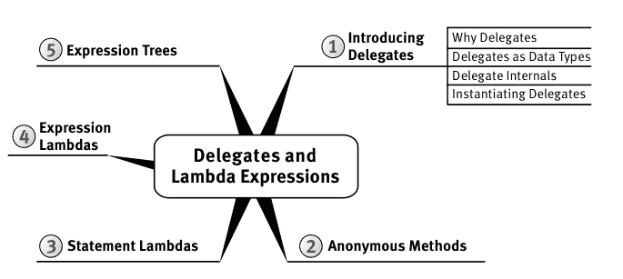

## 介绍委托

资深 C 和 C++ 程序员长期以来一直使用函数指针作为一种机制，将一个方法的引用作为参数传递给另一个方法。C# 通过使用**委托**实现了类似的功能。委托允许你捕获对方法的引用，并像其他对象一样传递它，以及像其他方法一样调用被捕获的方法。让我们考虑一个示例，说明这种技术可能如何有用。

## 定义场景

虽然效率不高，但最简单的排序例程之一是冒泡排序。代码清单 13.1 展示了 `BubbleSort()` 方法。

```csharp
// LISTING 13.1: BubbleSort() Method

static class SimpleSort1
{
    public static void BubbleSort(int[] items)
    {
        int i;
        int j;
        int tmp;
        if (items == null)
        {
            return;
        }
        for (i = items.Length - 1; i >= 0; i--)
        {
            for (j = 1; j <= i; j++)
            {
                if (items[j - 1] > items[j])
                {
                    tmp = items[j - 1];
                    items[j - 1] = items[j];
                    items[j] = tmp;
                }
            }
        }
        // ...
    }
}
```

此方法将按升序对整数数组进行排序。

假设你需要按升序或降序排列代码清单 13.1 中的整数。你可以复制代码并将大于号替换为小于号，但仅仅为了更改一个操作符就复制几十行代码似乎是个坏主意。作为一个更简洁的替代方案，你可以传入一个额外的参数来指示如何执行排序，如代码清单 13.2 所示。

### 代码清单 13.2: `BubbleSort()` 方法，升序或降序

```csharp
class SimpleSort2
{
    public enum SortType
    {
        Ascending,
        Descending
    }
    public static void BubbleSort(int[] items, SortType sortOrder)
    {
        int i;
        int j;
        int tmp;
        if (items == null)
        {
            return;
        }
        for (i = items.Length - 1; i >= 0; i--)
        {
            for (j = 1; j <= i; j++)
            {
                bool swap = false;
                switch (sortOrder)
                {
                    case SortType.Ascending:
                        swap = items[j - 1] > items[j];
                        break;
                    case SortType.Descending:
                        swap = items[j - 1] < items[j];
                        break;
                }
                if (swap)
                {
                    tmp = items[j - 1];
                    items[j - 1] = items[j];
                    items[j] = tmp;
                }
            }
        }
        // ...
    }
}
```

然而，这段代码只处理了两种可能的排序顺序。如果你想按字典顺序排序（即，1, 10, 11, 12, 2, 20, ...），或通过其他标准进行排序，`SortType` 值的数量以及相应的 `switch` 案例很快就会变得繁琐。

### 委托数据类型

为了增加前面代码清单的灵活性并减少代码重复，你可以将比较方法作为参数传递给 `BubbleSort()` 方法。要将方法作为参数传递，需要一种数据类型来表示该方法；这种数据类型通常被称为*委托*，因为它将调用“委托”给由对象引用的方法。你可以使用方法的名称作为委托实例。而且，从 C# 3.0 开始，你也可以使用 lambda 表达式作为委托，以就地表达一小段代码，而不是为其创建一个方法。（在 C# 7.0 中，你可以创建局部函数，然后使用函数名作为委托。）代码清单 13.3 包含了对 `BubbleSort()` 方法的修改，该方法接受一个 lambda 表达式参数。在这种情况下，委托数据类型是 `Func<int, int, bool>`。

### 代码清单 13.3: 带有委托参数的 `BubbleSort()`

```csharp
class DelegateSample
{
    // ...
    public static void BubbleSort(
        int[] items, Func<int, int, bool> compare)
    {
        int i;
        int j;
        int temp;
        if (compare == null)
        {
            throw new ArgumentNullException(nameof(compare));
        }
        if (items == null)
        {
            return;
        }
        for (i = items.Length - 1; i >= 0; i--)
        {
            for (j = 1; j <= i; j++)
            {
                if (compare(items[j - 1], items[j]))
                {
                    temp = items[j - 1];
                    items[j - 1] = items[j];
                    items[j] = temp;
                }
            }
        }
        // ...
    }
}
```

类型为 `Func<int, int, bool>` 的委托代表一个比较两个整数的方法。在 `BubbleSort()` 方法中，然后使用由 `compare` 参数引用的 `Func<int, int, bool>` 实例来确定哪个整数更大。由于 `compare` 代表一个方法，调用该方法的语法与调用其他任何方法相同。在这种情况下，`Func<int, int, bool>` 委托接受两个整数参数并返回一个布尔值，该值指示第一个整数是否大于第二个整数：

```csharp
if (compare(items[j - 1], items[j])) { ... }
```

请注意，`Func<int, int, bool>` 委托是强类型的，表示它返回一个 `bool` 并恰好接受两个整数参数的方法。与任何其他方法调用一样，委托调用也是强类型的，如果参数的数据类型与形参不兼容，C# 编译器将报告错误。

### 声明委托类型

你刚刚看到了如何定义一个使用委托的方法，并学习了如何通过将委托变量视为方法来简单地调用委托。然而，你尚未学习如何声明委托类型。要声明委托类型，你使用 `delegate` 关键字，后面跟随看起来像方法声明的内容。该方法的签名是委托可以引用的方法的签名，并且委托类型的名称出现在方法声明中会出现方法名称的位置。例如，代码清单 13.3 中的 `Func<...>` 委托声明为：

```csharp
public delegate TResult Func<in T1, in T2, out TResult>(
    in T1 arg1, in T2 arg2)
```

（`in`/`out` 类型修饰符是在 C# 4.0 中才添加的，我们将在本章后面讨论它们。）

### 通用委托类型：`System.Func` 和 `System.Action`

幸运的是，从 C# 3.0 开始，事实证明你很少（甚至从未）需要声明自己的委托。.NET 3.5 运行时库（对应于 C# 3.0）中包含了一组通用委托（大多是泛型的），有效地消除了定义自定义委托类型的需要。`System.Func` 委托族用于引用返回值的成员方法；`System.Action` 委托族用于引用返回 `void` 的方法。这些委托的签名如代码清单 13.4 所示。

### 代码清单 13.4: `Func` 和 `Action` 委托声明

```csharp
public delegate void Action();
public delegate void Action<in T>(T arg)
public delegate void Action<in T1, in T2>(
    in T1 arg1, in T2 arg2)
public delegate void Action<in T1, in T2, in T3>(
    T1 arg1, T2 arg2, T3 arg3)
public delegate void Action<in T1, in T2, in T3, in T4>(
    T1 arg1, T2 arg2, T3 arg3, T4 arg4)
// ...
public delegate void Action<
    in T1, in T2, in T3, in T4, in T5, in T6, in T7, in T8,
    in T9, in T10, in T11, in T12, in T13, in T14, in T15, in T16>(
    T1 arg1, T2 arg2, T3 arg3, T4 arg4,
    T5 arg5, T6 arg6, T7 arg7, T8 arg8,
    T9 arg9, T10 arg10, T11 arg11, T12 arg12,
    T13 arg13, T14 arg14, T15 arg15, T16 arg16)
public delegate TResult Func<out TResult>();
public delegate TResult Func<in T, out TResult>(T arg)
public delegate TResult Func<in T1, in T2, out TResult>(
    in T1 arg1, in T2 arg2)
public delegate TResult Func<in T1, in T2, in T3, out TResult>(
    T1 arg1, T2 arg2, T3 arg3)
public delegate TResult Func<in T1, in T2, in T3, in T4,
    out TResult>(T1 arg1, T2 arg2, T3 arg3, T4 arg4)
// ...
```


`public delegate TResult Func<`

`    in T1, in T2, in T3, in T4, in T5, in T6, in T7, in T8,`

`    in T9, in T10, in T11, in T12, in T13, in T14, in T15, in T16,`

`    out TResult>(`

`    T1 arg1, T2 arg2, T3 arg3, T4 arg4,`

`    T5 arg5, T6 arg6, T7 arg7, T8 arg8,`

`    T9 arg9, T10 arg10, T11 arg11, T12 arg12,`

`    T13 arg13, T14 arg14, T15 arg15, T16 arg16)`

`public delegate bool Predicate<in T>(T obj)`

由于委托定义是泛型的，因此可以将其用于替代定义自己的自定义委托（我们将稍后讨论）。

代码清单 13.4 中的第一个委托类型是 `Action<...>`。它用于表示没有返回值的成员方法，并支持最多 16 个参数的方法。对于需要返回结果的委托，可以使用 `Func<...>` 委托。`Func<...>` 的最后一个类型参数是 `TResult`——返回值的类型。`Func<...>` 上的其他类型参数依次对应于委托参数的类型。

例如，Listing 13.3 中的 `BubbleSort` 方法需要一个返回 `bool` 且接受两个 `int` 参数 的委托。

列表中列出的最后一个委托是 `Predicate<int>`。当使用 lambda 表达式来返回 `bool` 时，该 lambda 表达式被称为 `谓词（predicate）`。然而，这种谓词通常用于从集合中筛选或识别项——你将一个项传入其中，它返回 true 或 false 以指示是否要筛选该项。相比之下，我们的 `BubbleSort()` 示例接受两个参数以便进行比较，因此使用的是 `Func<int, int, bool>` 而不是谓词类型。

> **准则**
> 请 `考虑` 定义自己的委托类型所带来的可读性优势是否 outweighs（超过/大于）使用预定义泛型委托类型的便利性。

## 高级主题

### 声明委托类型

如前所述，在许多情况下，Microsoft .NET Framework 3.5 中引入的 `Func` 和 `Action` 委托，以及后来在 .NET Standard 中的引入，几乎消除了定义自定义委托类型的需要。然而，当这样做能显著提高代码可读性时，您应该考虑声明自己的委托类型。例如，一个名为 `Comparer` 的委托明确表明了该委托的用途，而使用 `Func<int, int, bool>` 仅标识了委托的参数和返回类型。Listing 13.5 展示了如何声明 `Comparer` 委托类型，使其要求两个整数并返回一个布尔值。

**Listing 13.5：声明委托类型**

```csharp
public delegate bool Comparer (
    int first, int second);
```

有了这个新的委托数据类型，您可以更新 Listing 13.3，使用一个签名将 `Func<int, int, bool>` 替换为 `Comparer`：

```csharp
public static void BubbleSort(int[] items, Comparer compare)
```

正如类可以嵌套在其他类中一样，委托也可以嵌套在类中。如果委托声明出现在另一个类中，那么该委托类型就是一个嵌套类型，如 Listing 13.6 所示。

**Listing 13.6：声明嵌套委托类型**

```csharp
class DelegateSample
{
    public delegate bool ComparisonHandler (
        int first, int second);
}
```

在这种情况下，该数据类型将是 `DelegateSample.ComparisonHandler`，因为它是在 `DelegateSample` 内部定义为嵌套类型的。当预期只需要在包含类内部使用该委托时，应考虑使用嵌套。

### 实例化委托

在实现 `BubbleSort()` 方法的最后一步中，通过委托，您将学习如何调用该方法并传递一个委托实例——具体来说，是一个类型为 `Func<int, int, bool>` 的实例。要实例化一个委托，您需要一个方法，其参数和返回类型必须与该委托类型本身的签名匹配。该方法的名称不需要与委托的名称匹配，但该方法的其余签名必须与委托签名兼容。Listing 13.7 展示了一个与该委托类型兼容的大于方法的代码。

**Listing 13.7：声明与 `Func<int, int, bool>` 兼容的方法**

```csharp
class DelegateSample
{
    public static void BubbleSort(
        int[] items, Func<int, int, bool> compare)
    {
        // ...
    }
    public static bool GreaterThan(int first, int second)
    {
        return first > second;
    }
    // ...
}
```

定义了此方法后，您可以调用 `BubbleSort()`，并将要由委托捕获的方法名称作为参数传入，如 Listing 13.8 所示。

**Listing 13.8：使用方法名称作为参数**

```csharp
class DelegateSample
{
    public static void BubbleSort(
        int[] items, Func<int, int, bool> compare)
    {
        // ...
    }
    public static bool GreaterThan(int first, int second)
    {
        return first > second;
    }
    static void Main()
    {
        int i;
        int[] items = new int[5];
        for (i=0; i < items.Length; i++)
        {
            Console.Write("Enter an integer: ");
            items[i] = int.Parse(Console.ReadLine());
        }
        BubbleSort(items, GreaterThan);
        for (i = 0; i < items.Length; i++)
        {
            Console.WriteLine(items[i]);
        }
    }
}
```

请注意，委托是引用类型，但你并不一定需要使用 `new` 来实例化它们。在 C# 2.0 及更高版本中，从 `方法组`（即命名方法的表达式）到委托类型的转换会自动创建一个新的委托对象。

## 高级主题

### C# 1.0 中的委托实例化

在 Listing 13.8 中，通过简单地将所需方法的名称 `GreaterThan` 作为参数传递给 `BubbleSort()` 方法的调用来实例化委托。C# 的第一个版本要求使用更冗长的语法来实例化委托，如 Listing 13.9 所示。

**Listing 13.9：在 C# 1.0 中将委托作为参数传递**

```csharp
BubbleSort(items,
    new Comparator(GreaterThan));
```

在这种情况下，我们使用 `Comparer` 而不是 `Func<int, int, bool>`，因为后者在 C# 1.0 中不可用。

后续版本支持这两种语法；在本书的剩余部分，我们将仅展示现代的简洁语法。

## 高级主题

### 委托内部机制

委托实际上是一种特殊类型的类。尽管 C# 标准没有确切指定类层次结构是什么，但委托必须直接或间接派生自 `System.Delegate`。事实上，在 .NET 中，委托类型始终派生自 `System.MulticastDelegate`，而 `System.MulticastDelegate` 又派生自 `System.Delegate`，如图 13.1 所示。

第一个属性是 `System.Reflection.MethodInfo` 类型。`MethodInfo` 描述了方法的签名，包括其名称、参数和返回类型。除了 `MethodInfo`，委托还需要包含要调用的方法的对象实例。这就是第二个属性 `Target` 的用途。对于静态方法，`Target` 对应于类型本身。`MulticastDelegate` 类的用途是下一章的主题。

请注意，所有委托都是不可变的；也就是说，一旦创建，您就不能更改委托。如果您有一个包含对委托的引用的变量，并希望它引用不同的方法，您必须创建一个新的委托并将其分配给该变量。

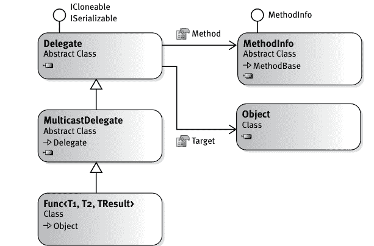

图 13.1：`委托类型对象模型`

尽管所有委托数据类型都间接派生自 `System.Delegate`，但 C# 编译器不允许您声明一个直接或间接派生自 `System.Delegate` 或 `System.MulticastDelegate` 的类。因此，Listing 13.10 中显示的代码是无效的。

**Listing 13.10：`System.Delegate` 不能显式作为基类**

```csharp
// ERROR: Func<T1, T2, TResult> cannot
// inherit from special class System.Delegate
public class Func<T1, T2, TResult> : System.Delegate
{
    // ...
}
```

通过传递委托来指定排序顺序，是一种比本章开头描述的更具灵活性的策略。通过传递委托，您可以简单地通过添加一个替代委托来改变排序顺序为字母顺序，该委托将整数转换为字符串作为比较的一部分。Listing 13.11 展示了一个完整的列表，演示了字母排序，而 Output 13.1 展示了结果。

**Listing 13.11：使用不同的与 `Func<int, int, bool>` 兼容的方法**

```csharp
using System;
class DelegateSample
{
    public static void BubbleSort(
        int[] items, Func<int, int, bool> compare)
    {
        int i;
        int j;
        int temp;
        for (i = items.Length - 1; i >= 0; i--)
        {
            for (j = 1; j <= i; j++)
            {
                if (compare(items[j - 1], items[j]))
                {
                    temp = items[j - 1];
                    items[j - 1] = items[j];
                    items[j] = temp;
                }
            }
        }
    }
    public static bool GreaterThan(int first, int second)
    {
        return first > second;
    }
    public static bool AlphabeticalGreaterThan(
        int first, int second)
    {
        int comparison;
        comparison = (first.ToString()).CompareTo(
            second.ToString());
        return comparison > 0;
    }
    static void Main(string[] args)
    {
        int i;
        int[] items = new int[5];
        for (i=0; i<items.Length; i++)
        {
            Console.Write("Enter an integer: ");
            items[i] = int.Parse(Console.ReadLine());
        }
    }
}
```

`BubbleSort(items, AlphabeticalGreaterThan);`
`for (i = 0; i < items.Length; i++)`
`{`
`    Console.WriteLine(items[i]);`
`}`
`}`

### 输出 13.1

输入一个整数：1
输入一个整数：12
输入一个整数：13
输入一个整数：5
输入一个整数：4
1
12
13
4
5

字母顺序与数字顺序不同。尽管如此，请注意与本章开头所使用的过程相比，添加这种额外的排序机制是多么简单。要创建字母排序顺序，唯一的变化是添加了 `AlphabeticalGreaterThan` 方法，然后将该方法传递给对 `BubbleSort()` 的调用。

## Lambda 表达式

在列表 13.7 和 13.10 中，我们看到可以将表达式 `GreaterThan` 和 `AlphabeticalGreaterThan` 转换为与命名方法的参数类型和返回类型兼容的委托类型。您可能已经注意到，`GreaterThan` 方法的声明——即说明它是一个具有两个名为 `first` 和 `second` 的 `int` 类型参数的公共静态布尔返回方法的代码——比方法体大得多，而方法体只是比较其两个参数并返回结果。不幸的是，仅仅为了能够转换为委托类型，如此简单的方法周围必须有那么多仪式性的步骤。

为了解决这个问题，C# 2.0 引入了一种更紧凑的语法来创建委托，而 C# 3.0 引入了比 C# 2.0 语法甚至更紧凑的几种语法。C# 2.0 中的特性称为 `匿名方法`，而 C# 3.0 中的特性称为 `Lambda 表达式`。当泛指这两种语法时，我们将它们统称为 `匿名函数`。这两种语法仍然合法，但对于新代码，`Lambda 表达式` 语法比匿名方法语法更受青睐。全书中，我们通常使用 `Lambda 表达式` 语法，除非在专门描述 C# 2.0 匿名方法时。

`Lambda 表达式` 本身分为两种类型：`语句 Lambda` 和 `表达式 Lambda`。图 13.2 展示了这些术语之间的层次关系。

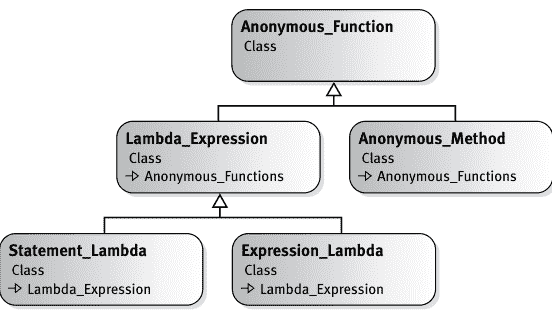

## 语句 Lambda

`Lambda 表达式` 的目的是消除在需要从非常简单的方法创建委托时声明一个全新成员的麻烦。存在几种不同形式的 `Lambda 表达式`。例如，语句 `Lambda` 由形式参数列表组成，后跟 `Lambda` 运算符 `=>`，再后跟一个代码块。

列表 13.12 展示了与列表 13.8 中对 `BubbleSort` 调用等效的功能，除了列表 13.12 使用语句 `Lambda` 来表示比较方法，而不是创建 `GreaterThan` 方法。如您所见，出现在 `GreaterThan` 方法声明中的许多信息都包含在语句 `Lambda` 中；形式参数声明和代码块是相同的，但缺少方法名称及其修饰符。

### 列表 13.12：使用语句 Lambda 创建委托

```csharp
// ...
BubbleSort(items,
    (int first, int second) =>
    {
        return first < second;
    }
);
// ...
```


当阅读包含 Lambda 运算符的代码时，你可以将 Lambda 运算符替换为 *go/goes to*（转到/去向）。例如，在列表 13.12 中，你会将 `BubbleSort()` 的第二个参数读作“*整数 first 和 second 转为返回 first 小于 second 的结果*。”

读者会观察到，列表 13.12 中的语法与列表 13.8 几乎相同，除了比较方法现在在转换为委托类型时的词法位置被找到，而不是在其他地方找到并通过名称查找。方法名称缺失，这解释了为什么这样的方法被称为*匿名函数*。返回类型缺失，但编译器可以看到 Lambda 表达式正被转换为一个其签名要求返回类型 `bool` 的委托。编译器验证语句 Lambda 代码块中每个 `return` 语句的表达式在返回 `bool` 的方法中都是合法的。`public` 修饰符缺失；鉴于该方法不再是包含类中可访问的成员，因此没有必要描述其可访问性。类似地，`static` 修饰符也不再必要。围绕方法的仪式步骤已经大大减少。

然而，语法仍然过于冗长。我们已经从委托类型推断出 Lambda 表达式必须是返回 `bool` 的；我们可以类似地推断出两个参数必须都是 `int` 类型，如列表 13.13 所示。

### 列表 13.13：省略语句 Lambda 中的参数类型

```csharp

// ...

BubbleSort(items,

    (first, second) =>

{

    return first < second;

}

);

// ...

```

通常，如果编译器能够从 Lambda 表达式正在转换成的委托中推断出类型，则所有 Lambda 表达式中显式声明的参数类型都是可选的。然而，对于指定类型使代码更具可读性的情况，C# 允许你这样做。在无法进行推断的情况下，C# 语言要求必须显式说明 Lambda 参数类型。如果一个 Lambda 参数类型被显式指定，则必须显式指定所有类型，并且它们必须与委托参数类型完全匹配。

> **指南**
>
> **考虑** 在类型对读者显而易见或是不重要的细节时，省略 Lambda 形式参数列表中的类型。

还有另一种减少语法的方式是可能的，如列表 13.14 所示：具有恰好一个参数且类型是推断出的 Lambda 表达式可以省略参数列表周围的括号。如果参数为零个或多个参数多于一个，或者如果单个参数是显式类型的，Lambda 必须在参数列表周围有括号。

### 列表 13.14：具有单个输入参数的语句 Lambda

```csharp

using System.Collections.Generic;

using System.Diagnostics;

using System.Linq;

// ...

IEnumerable<Process> processes = Process.GetProcesses().Where(

    process => { return process.WorkingSet64 > 1000000000; });

// ...

```

在列表 13.14 中，`Where()` 方法返回一个查询，该查询针对物理内存使用量大于 10 亿字节的进程。请将其与列表 13.15 进行对比，该列表包含一个无参数语句 Lambda。空参数列表需要括号。注意，在列表 13.15 中，语句 Lambda 的主体在语句块（通过花括号）内包含多个语句。虽然语句 Lambda 可以包含任意数量的语句，但通常语句 Lambda 在其语句块中只使用两三个语句。

### 列表 13.15：无参数语句 Lambda

```csharp

// ... 

Func<string> getUserInput = 

    () =>

    {

        string input;

        do

        {

            input = Console.ReadLine();

        }

        while(input.Trim().Length == 0);

        return input;

    }; 

// ...

```

## 表达式 Lambda

语句 Lambda 语法已经比相应的方法声明简短得多；如我们所见，它无需声明方法名称、可访问性、返回类型或参数类型。然而，通过使用表达式 Lambda，我们可以使其更加简洁。在列表 13.12、13.13 和 13.14 中，我们看到由单个 return 语句组成的代码块的语句 Lambda。如果我们消除围绕该代码块的仪式步骤会怎样？这种 Lambda 代码块中唯一相关的信息是返回的表达式。表达式 Lambda 仅包含该返回表达式，没有语句块。列表 13.16 与列表 13.12 相同，除了它使用表达式 Lambda 而不是语句 Lambda。

### 列表 13.16：使用表达式 Lambda 传递委托

```csharp

// ...

BubbleSort(items, (first, second) => first < second );

// ...

```

通常，你在表达式 Lambda 中阅读 Lambda 运算符 `=>` 的方式与阅读语句 Lambda 相同：作为 *goes to* 或

*成为*，尽管在这些委托是谓词的情况下，通常将 lambda 运算符读作 *满足* 或 *其中*。你可能会将清单 13.16 中的 lambda 读作“*第一个和第二个，满足第一个小于第二个*”。

与 `null` 字面量类似，匿名函数没有与之关联的类型；相反，其类型由它被转换到的目标类型决定。换句话说，我们之前看到的 lambda 表达式在本质上并非 `Func<int, int, bool>`（或 `Comparer`）类型，但它们与该类型兼容，并可以被转换为该类型。因此，你无法在匿名方法上使用 `typeof()` 运算符，并且只有在将匿名方法转换为特定类型之后，才能调用 `GetType()`。

表 13.1 提供了有关 lambda 表达式特性的补充说明。

## 表 13.1：Lambda 表达式注意事项与示例

| 陈述 | 示例 |
| :---------- | :-------- |
| Lambda 表达式本身没有类型。因此，无法直接从 lambda 表达式访问任何成员，甚至包括 object 的方法。 | `// ERROR: Operator "." cannot be applied to // operand of type "lambda expression"`\n`string s = ((int x) => x).ToString();` |
| Lambda 表达式没有类型，因此不能出现在 `is` 运算符的左侧。 | `// ERROR: The first operand of an "is" or "as"`\n`// operator may not be a lambda expression or`\n`// anonymous method`\n`bool b = ((int x) => x) is Func<int, int>;` |
| Lambda 表达式只能转换为兼容的委托类型；在此处，一个返回 `int` 的 lambda 不能转换为表示返回 `bool` 方法的委托类型。 | `// ERROR: lambda expression is not compatible`\n`// with Func<int, bool> type`\n`Func<int, bool> f = (int x) => x;` |
| Lambda 表达式没有类型，因此不能用于推断局部变量的类型。 | `// ERROR: Cannot assign lambda expression to`\n`// an implicitly typed local variable`\n`var v = x => x;` |
| 位于 lambda 表达式内部的跳转语句（break, goto, continue）不能用于跳转到 lambda 表达式外部的位置，反之亦然。在此处，lambda 内部的 break 语句将跳转到 lambda 外部的 switch 语句的末尾。 | `// ERROR: Control cannot leave the body of an anonymous method or lambda expression<br>string[] args;<br>Func<string> f;<br>switch(args[0])<br>{<br>&nbsp;&nbsp;&nbsp;&nbsp;case "File":<br>&nbsp;&nbsp;&nbsp;&nbsp;&nbsp;&nbsp;&nbsp;&nbsp;f = ( ) =><br>&nbsp;&nbsp;&nbsp;&nbsp;&nbsp;&nbsp;&nbsp;&nbsp;{<br>&nbsp;&nbsp;&nbsp;&nbsp;&nbsp;&nbsp;&nbsp;&nbsp;&nbsp;&nbsp;&nbsp;&nbsp;if (!File.Exists(args[1]))<br>&nbsp;&nbsp;&nbsp;&nbsp;&nbsp;&nbsp;&nbsp;&nbsp;&nbsp;&nbsp;&nbsp;&nbsp;&nbsp;&nbsp;&nbsp;&nbsp;break;<br>&nbsp;&nbsp;&nbsp;&nbsp;&nbsp;&nbsp;&nbsp;&nbsp;&nbsp;&nbsp;&nbsp;&nbsp;return args[1];<br>&nbsp;&nbsp;&nbsp;&nbsp;&nbsp;&nbsp;&nbsp;&nbsp;};<br>&nbsp;&nbsp;&nbsp;&nbsp;&nbsp;&nbsp;&nbsp;&nbsp;// ...<br>&nbsp;&nbsp;&nbsp;&nbsp;}` |
| 由 lambda 表达式引入的参数和局部变量仅在 lambda 主体内处于作用域中。 | `// ERROR: The name "first" does not exist in the current context<br>Func<int, int, bool> expression =<br>(first, second) => first > second;<br>first++;` |
| 编译器的确定赋值分析无法检测 lambda 表达式中“外部”局部变量的初始化。 | `int number;<br>Func<string, bool> f =<br>text => int.TryParse(text, out number);<br>if (f("1"))<br>{<br>&nbsp;&nbsp;&nbsp;&nbsp;// ERROR: Use of unassigned local variable<br>&nbsp;&nbsp;&nbsp;&nbsp;System.Console.Write(number);<br>}` |
| 编译器的确定赋值分析无法检测 lambda 表达式中“外部”局部变量的初始化。 | `int number;<br>Func<int, bool> isFortyTwo =<br>x => 42 == (number = x);<br>if (isFortyTwo(42))<br>{<br>&nbsp;&nbsp;&nbsp;&nbsp;// ERROR: Use of unassigned local variable<br>&nbsp;&nbsp;&nbsp;&nbsp;System.Console.Write(number);<br>}` |

# 匿名方法

C# 2.0 不支持 lambda 表达式。相反，C# 2.0 使用一种称为*匿名方法*的语法。匿名方法类似于语句 lambda，但缺少使 lambda 如此紧凑的许多特性。匿名方法必须显式地为每个参数指定类型，并且必须具有语句块。匿名方法在参数列表和代码块之间不使用 lambda 运算符 `->`，而是将关键字 `delegate` 放在参数列表之前，强调匿名方法必须被转换为 `delegate` 类型。清单 13.17 展示了使用匿名方法重写的清单 13.7、13.12 和 13.15 中的代码。

### 清单 13.17：在 C# 2.0 中传递匿名方法

```
// ...

BubbleSort(items,

    delegate(int first, int second)

    {

        return first < second;

    }

);

// ...
```

遗憾的是，在 C# 3.0 及更高版本中定义匿名函数有非常相似的两种方法。

- **指南**
  - 在新代码中**避免**使用匿名方法语法；请优先使用更紧凑的 lambda 表达式语法。

然而，匿名方法支持一个小特性，而 lambda 表达式并不支持：在某些情况下，匿名方法可以完全省略参数列表。

## 高级主题

### 无参数匿名方法

与 lambda 表达式不同，只要匿名方法体不使用任何参数，并且 `delegate` 类型仅需要“值”参数（即，它不需要将参数标记为 `out` 或 `ref`），匿名方法就可以完全省略参数列表。例如，匿名方法表达式 `delegate { return Console.ReadLine() != ";"; }` 可以转换为任何需要返回类型为 `bool` 的委托类型，无论该委托需要多少个参数。这个特性使用频率不高，但你在阅读遗留代码时可能会遇到它。


## 高级主题

### 为什么叫“Lambda”表达式？

匿名方法之所以这样命名是显而易见的：它们看起来非常类似于方法声明，但没有关联的声明名称。但是，“lambda 表达式”中的 lambda 是从哪里来的？

lambda 表达式的概念源自逻辑学家 Alonzo Church 的工作，他在 20 世纪 30 年代发明了一种称为 lambda 演算的技术来研究函数。在 Church 的记号中，一个接受参数 $x$ 并产生表达式 $y$ 的函数，通过在表达式前加上小希腊字母 lambda 并用点分隔参数和值来表示。C# 的 lambda 表达式 `x=>y` 在 Church 的记号中表示为 $\lambda x.y$。由于在 C# 程序中使用希腊字母不方便，且点在 C# 中已有许多含义，C# 的设计者选择了使用“胖箭头”记号而不是原始记号。Lambda 表达式的名称表明，匿名函数概念的理论基础是基于 lambda 演算，即使文本中实际上没有 lambda 字母出现。

## 委托不具有结构相等性

.NET 中的委托类型不表现出**结构相等性**。也就是说，你无法将一个委托类型对象的引用转换为不相关的委托类型，即使两个委托的正式参数和返回类型都相同。例如，即使两个委托类型都表示接受两个 int 参数并返回 `bool` 的方法，你也无法将 `Comparer` 的引用分配给类型为 `Func<int, int, bool>` 的变量。不幸的是，当需要使用结构相同但不相关的委托类型时，使用给定类型委托的唯一方法是

## 高级主题

### lambda 表达式和匿名方法内部机制

需要创建一个新的委托，该委托引用旧委托的 `Invoke` 方法。例如，如果你有一个类型为 `Comparer` 的变量 `c`，并且需要将其值赋给类型为 `Func<int, int, bool>` 的变量 `f`，你可以这样写：`f = c.Invoke;`。但是，得益于 C# 4.0 中新增的方差（variance）支持，在某些委托类型之间进行引用转换成为可能。考虑以下逆变（contravariant）示例：由于 `void Action<in T>(T arg)` 具有 `in` 类型参数修饰符，可以将类型为 `Action<object>` 的委托的引用赋给类型为 `Action<string>` 的变量。许多人觉得委托的逆变概念令人困惑；只需记住，能够作用于任何对象的操作（action）可以用作作用于任何字符串的操作。但反过来则不成立：只能作用于字符串的操作无法作用于任何对象。类似地，`Func` 委托族中的每个类型在其返回类型上都是协变的（covariant），如 `TResult` 上的 `out` 类型参数修饰符所示。因此，可以将类型为 `Func<string>` 的委托的引用赋给类型为 `Func<object>` 的变量。

**列表 13.18**：使用委托的方差

```csharp

// Contravariance

Action<object> broadAction =

    (object data) =>

    {

        Console.WriteLine(data);

    };

Action<string> narrowAction = broadAction;

// Covariance

Func<string> narrowFunction =

    () => Console.ReadLine();

Func<object> broadFunction = narrowFunction;

// Contravariance and covariance combined

Func<object, string> func1 =

    (object data) => data.ToString();

Func<string, object> func2 = func1;
```


该列表的最后一部分将两种方差概念结合在一个示例中，展示了当同时涉及 `in` 和 `out` 类型参数时，它们如何可以同时发生。

允许对泛型委托类型进行引用转换是将协变和逆变转换添加到 C# 4.0 的关键驱动场景之一。（另一个场景是对 `IEnumerable<out T>` 的协变支持。）

Lambda 表达式（和匿名方法）并不是 CLR 内置的。相反，当编译器遇到匿名函数时，它会将其转换为实现所需语义的特殊隐藏类、字段和方法。C# 编译器生成该模式的实现代码，因此开发人员无需自行编写。给定列表 13.12、13.13、13.16 或 13.17 中的代码，C# 编译器生成的 CIL 代码类似于列表 13.19 中显示的 C# 代码。

### 列表 13.19：编译器为 Lambda 表达式生成的 CIL 的 C# 等效代码

```csharp
class DelegateSample
{
    // ...
    static void Main(string[] args)
    {
        int i;
        int[] items = new int[5];
        for (i=0; i<items.Length; i++)
        {
            Console.Write("Enter an integer:");
            items[i] = int.Parse(Console.ReadLine());
        }
        BubbleSort(items,
            DelegateSample._AnonymousMethod_00000000);
        for (i = 0; i < items.Length; i++)
        {
            Console.WriteLine(items[i]);
        }
    }
}
private static bool __AnonymousMethod_00000000(
    int first, int second)
{
    return first < second;
}
```

在这个示例中，编译器将匿名函数转换为单独声明的静态方法，然后将其实例化为委托并作为参数传递。不出所料，编译器生成的代码与列表 13.8 中的原始代码非常相似，而匿名函数语法旨在简化该过程。然而，如果涉及外部变量，编译器执行的代码转换可能比仅仅将匿名函数重写为静态方法要复杂得多。

## 外部变量

在 lambda 表达式外部声明的局部变量（包括包含方法中的参数）被称为该 lambda 的外部变量。（`this` 引用虽然在技术上不是一个变量，但也被视为外部变量。）当 lambda 体使用外部变量时，该变量就被视为被 lambda 捕获（captured）（或等价地，封闭（closed over））。在列表 13.20 中，我们使用一个外部变量来统计 `BubbleSort()` 执行比较的次数。输出 13.2 显示了该列表的结果。

### 列表 13.20：在 Lambda 表达式中使用外部变量

```csharp
class DelegateSample
{
    // ...
    static void Main(string[] args)
    {
        int i;
        int[] items = new int[5];
        int comparisonCount = 0;
        for (i=0; i<items.Length; i++)
        {
            Console.Write("Enter an integer:");
            items[i] = int.Parse(Console.ReadLine());
        }
        BubbleSort(items,
            (int first, int second) =>
            {
                comparisonCount++;
                return first < second;
            });
        for (i = 0; i < items.Length; i++)
        {
            Console.WriteLine(items[i]);
        }
        Console.WriteLine("Items were compared {0} times.",
            comparisonCount);
    }
}
```

### 输出 13.2

```
Enter an integer:5
Enter an integer:1
Enter an integer:4
Enter an integer:2
Enter an integer:3
5
4
3
2
1
Items were compared 10 times.
```

请注意，`comparisonCount` 出现在 lambda 表达式之外，并在其中递增。调用 `BubbleSort()` 方法后，`comparisonCount` 会打印到控制台。

通常，局部变量的生命周期与其作用域绑定；当控制流离开作用域时，与该变量关联的存储位置不再有效。但是，由捕获外部变量的 lambda 创建的委托可能具有比局部变量通常更长的（或更短的）生命周期，并且委托必须能够每次被调用时都安全地访问外部变量。因此，被捕获变量的生命周期会被延长；保证它至少与捕获它的寿命最长的委托对象一样长。（它甚至可以存活更长时间——编译器生成代码以确保延长外部变量生命周期的具体方式是实现细节，可能会发生变化。）

## 高级主题

### 外部变量的 CIL 实现

C# 编译器负责生成 CIL 代码，在匿名方法和声明它的方法之间共享 `comparisonCount`。

C# 编译器为捕获外部变量的匿名函数生成的 CIL 代码比不捕获任何内容的简单匿名函数的代码更复杂。列表 13.21 显示了用于实现列表 13.20 中代码的外部变量的 CIL 代码的 C# 等效代码。

### 列表 13.21：编译器为外部变量生成的 CIL 代码的 C# 等效代码

```csharp
class DelegateSample
{
    // ...
    private sealed class __LocalsDisplayClass_00000001
    {
        public int comparisonCount;
        public bool __AnonymousMethod_00000000(
            int first, int second)
        {
            comparisonCount++;
            return first < second;
        }
    }
    // ...
    static void Main(string[] args)
    {
        int i;
        __LocalsDisplayClass_00000001 locals =
            new __LocalsDisplayClass_00000001();
        locals.comparisonCount = 0;
        int[] items = new int[5];
        for (i=0; i<items.Length; i++)
        {
            Console.Write("Enter an integer:");
            items[i] = int.Parse(Console.ReadLine());
        }
        BubbleSort(items, locals.__AnonymousMethod_00000000);
        for (i = 0; i < items.Length; i++)
        {
            Console.WriteLine(items[i]);
        }
        Console.WriteLine("Items were compared {0} times.",
            locals.comparisonCount);
    }
}
```

请注意，被捕获的局部变量从未“传递”到任何地方，也从未“复制”到任何地方。相反，被捕获的局部变量（`comparisonCount`）是一个单一变量，编译器通过将其实现为实例字段而不是局部变量来延长了其生命周期。局部变量的所有用法都被重写为字段的用法。

生成的类 `__LocalsDisplayClass` 是一个闭包（closure）——一种数据结构（在 C# 中是类），包含一个表达式以及评估该表达式所需的变量（在 C# 中是公共字段）。

### 意外捕获循环变量

你认为列表 13.22 的输出应该是什么？

### 列表 13.22：在 C# 5.0 中捕获循环变量

```csharp
class CaptureLoop
{
  static void Main()
  {
      var items = new string[] { "Moe", "Larry", "Curly" };
      var actions = new List<Action>();
      foreach (string item in items)
      {
          actions.Add(( )=> { Console.WriteLine(item); } });
      }
      foreach (Action action in actions)
      {
          action();
      }
  }
}
```

大多数人期望输出如输出 13.3 所示，在 C# 5.0 中确实如此。然而，在之前的 C# 版本中，输出如输出 13.4 所示。

### 输出 13.3：C# 5.0 的输出

```
Moe
Larry
Curly
```

### 输出 13.4：C# 4.0 的输出

```
Curly
Curly
Curly
```

Lambda 表达式会捕获一个变量，并且始终使用该变量的最新值；它不会捕获并保留委托创建时该变量的值。这通常是你想要的——毕竟，在清单 13.20 中捕获 `comparisonCount` 的目的就是为了确保在自增时使用其最新值。循环变量并不例外；当你捕获一个循环变量时，每个委托都捕获同一个循环变量。当循环变量发生变化时，所有捕获了该循环变量的委托都会看到这一变化。因此，C# 4.0 的行为虽然有其合理性，但几乎从不是代码作者的初衷。

在 C# 5.0 中，C# 语言发生了变化，`foreach` 循环的循环变量现在被视为每次循环迭代时都是一个新的变量；因此，每个委托创建都捕获一个不同的变量，而不是所有迭代共享同一个变量。然而，这一变更并未应用于 `for` 循环：如果你使用 `for` 循环编写类似代码，在 `for` 语句头部声明的任何循环变量在被捕获时都会被视为单一的外部变量。如果你需要编写在 C# 5.0 和早期 C# 版本中表现相同的代码，请使用清单 13.23 中所示的模式。

### 清单 13.23：C# 5.0 之前的循环变量捕获变通方法

```csharp
class DoNotCaptureLoop
{
    static void Main()
    {
        var items = new string[] { "Moe", "Larry", "Curly" };
        var actions = new List<Action>();
        foreach (string item in items)
        {
            string _item = item;
            actions.Add(
                () => { Console.WriteLine(_item); } );
        }
        foreach (Action action in actions)
        {
            action();
        }
    }
}
```

现在，显然每次循环迭代都有一个全新的变量；每个委托依次封闭在一个不同的变量上。

## 准则

**避免**在匿名函数中捕获循环变量。

## 表达式树

到目前为止，我们看到 Lambda 表达式是声明一种可以转换为委托类型的“内联”方法的简洁语法。表达式 Lambda（但不是语句 Lambda 或匿名方法）也可以转换为**表达式树**。委托是一种对象，它允许你将方法像其他对象一样传递并在任意时间调用它。表达式树是一种对象，它允许你传递编译器对 Lambda 主体的分析结果。那你为什么需要这种能力呢？显然，编译器在生成 CIL 时，编译器的分析结果对编译器很有用，但在执行时拥有一个表示该分析结果的对象对开发人员有什么用呢？让我们看一个例子。

### 将 Lambda 表达式用作数据

考虑以下代码中的 Lambda 表达式：

```csharp
persons.Where(
    person => person.Name.ToUpper() == "INIGO MONTOYA");
```

假设 `persons` 是一个 `Person` 类型的数组，并且 `Where` 方法中对应 Lambda 表达式参数的形参是委托类型 `Func<Person, bool>`。编译器会发出一个包含 Lambda 主体代码的方法。它生成代码，创建一个指向发出方法的委托，并将该委托传递给 `Where` 方法。`Where` 方法返回一个查询对象，当执行该对象时，它将委托应用于数组的每个成员以确定查询结果。

现在假设 `persons` 不是 `Person []` 类型，而是一个代表远程数据库表的对象，该表包含数百万人的数据。表中每一行信息的记录都可以从服务器流式传输到客户端，然后客户端可以创建对应于该行的 `Person` 对象。对 `Where` 的调用返回一个代表查询的对象。当在客户端请求该查询的结果时，结果是如何确定的？

一种技术是将数百万行数据从服务器传输到客户端。你可以从每一行创建一个 `Person` 对象，从 Lambda 创建一个委托，并在每个 `Person` 上执行该委托。这在概念上与数组场景没有不同，但成本高得多得多。

第二种更好的技术是设法将 Lambda 的含义（“过滤掉所有姓名不是 `Inigo Montoya` 的行”）发送到服务器。数据库服务器针对快速执行此类过滤进行了优化。然后，服务器可以选择仅将匹配行中数量很少的部分流式传输到客户端；客户端只需创建那些已经由服务器判定匹配查询的对象，而不是创建数百万个 `Person` 对象并拒绝其中几乎所有的对象。但是，Lambda 的含义是如何发送到服务器的呢？

此场景是将表达式树添加到语言中的动机。转换为表达式树的 Lambda 表达式变成了表示描述 Lambda 表达式的数据的对象，而不是实现匿名函数的已编译代码。由于表达式树表示的是数据而非已编译代码，因此可以在运行时分析 Lambda 并利用该信息来构建在数据库上执行的查询（例如）。接收到的表达式树（通过 `Where()`）可能被转换为传递给数据库的 `SQL` 查询，如清单 13.24 所示。

### 清单 13.24：将表达式树转换为 SQL where 子句

```
persons.Where( person => person.Name.ToUpper() == "INIGO MONTOYA");
select * from Person where upper(Name) = 'INIGO MONTOYA';
```


传递给 `Where()` 调用的表达式树表明，Lambda 参数由以下元素组成：

- 读取 `Person` 对象的 `Name` 属性
- 调用名为 `ToUpper()` 的 `string` 方法
- 一个常量值，`"INIGO_MONTOYA"`
- 一个相等运算符，`==`

`Where()` 方法接收这些数据，通过检查数据并构建 `SQL` 查询字符串将其转换为 `SQL where` 子句。然而，`SQL` 只是一种可能性；你可以构建一个表达式树评估器，将表达式转换为任何查询语言。

### 表达式树是对象图

在运行时，转换为表达式树的 Lambda 变成包含来自 `System.Linq.Expressions` 命名空间的对象的对象图。图中的根对象代表 Lambda 本身。该对象引用代表参数、返回类型和主体表达式的对象，如图 13.3 所示。对象图包含了编译器关于 Lambda 推导出的所有信息。然后可以在运行时使用该信息来创建查询。或者，根 Lambda 表达式有一个名为 `Compile` 的方法，它可以即时生成 `CIL` 并创建一个实现所描述 Lambda 的委托。

图 13.4 显示了在 Lambda 主体中一元和二元表达式的对象图中找到的类型。

`UnaryExpression` 表示如 `−count` 这样的表达式。它有一个类型为 `Expression` 的单个子节点 `Operand`。`BinaryExpression` 有两个子表达式，`Left` 和 `Right`。这两种类型都有一个 `NodeType` 属性，用于标识特定的运算符，并且都继承自基类 `Expression`。还有大约 30 种其他表达式类型，如 `NewExpression`、`ParameterExpression`、`MethodCallExpression` 和 `LoopExpression`，用于表示（几乎）`C#` 和 `Visual Basic` 中所有可能的表达式。

## 匿名方法

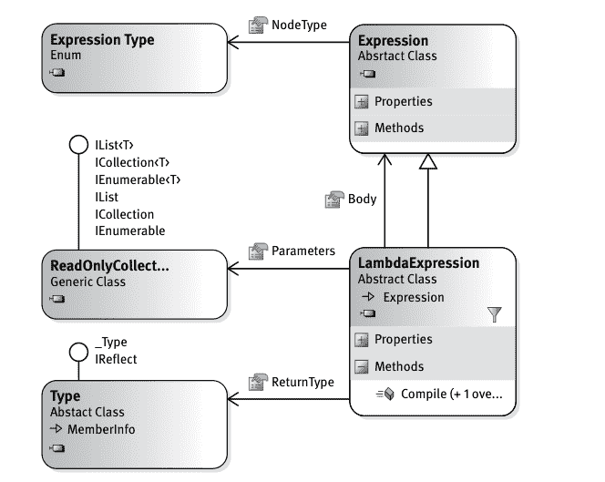

**图 13.3：** Lambda 表达式树类型

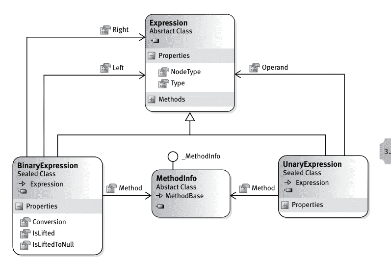

**图 13.4：** 一元和二元表达式树类型


## 委托与表达式树

无论 Lambda 表达式是转换为委托还是表达式树，其有效性都会在编译时通过完整的语义分析进行验证。转换为委托的 Lambda 会导致编译器发出 Lambda 作为方法，并生成代码在运行时创建指向该方法的委托。转换为表达式树的 Lambda 会导致编译器生成代码在运行时创建 `LambdaExpression` 的一个实例。但是，当使用语言集成查询 `LINQ` API 时，编译器如何知道是生成委托以在本地执行查询，还是生成表达式树以便将有关查询的信息发送到远程数据库服务器？

用于构建 `LINQ` 查询的方法（如 `Where()`）是扩展方法。扩展 `IEnumerable<T>` 接口的这些方法版本接受委托参数；而扩展 `IQueryable<T>` 接口的方法接受表达式树参数。因此，编译器可以根据被查询集合的类型来确定是从作为参数提供的 Lambda 创建委托还是表达式树。

例如，考虑以下代码中的 `Where()` 方法：

```
persons.Where( person => person.Name.ToUpper() == "INIGO MONTAYA");
```

在 `System.Linq.Enumerable` 类中声明的扩展方法签名是

```csharp
public IEnumerable<TSource> Where<TSource>(
  this IEnumerable<TSource> collection,
  Func<TSource, bool> predicate);
```


在 `System.Linq.Queryable` 类中声明的扩展方法签名是

```csharp
public IQueryable<TSource> Where<TSource>(
  this IQueryable<TSource> collection,
  Expression<Func<TSource, bool>> predicate);
```

编译器根据 `persons` 的编译时类型决定使用哪个扩展方法；如果它是可转换为 `IQueryable<Person>` 的类型，则选择来自 `System.Linq.Queryable` 的方法。它将 Lambda 转换为表达式树。在运行时，该被 `persons` 引用的对象会接收表达式树数据，并可能使用这些数据来构建 `SQL` 查询，该查询在请求查询结果时会被传递给数据库。对 `Where` 的调用结果是一个对象，当请求查询结果时，它会将查询发送到数据库并生成结果。

如果 `persons` 无法隐式转换为 `IQueryable<Person>`，但能隐式转换为 `IEnumerable<Person>`，则会选择 `System.Linq.Enumerable` 中的方法，并且 lambda 会被转换为委托。对 `Where` 的调用结果是一个对象，当请求查询结果时，它会将生成的委托作为谓词应用于集合中的每个成员，并生成符合谓词的结果。

### 检查表达式树

如前所述，将 lambda 表达式转换为 `Expression<TDelegate>` 会创建一个表达式树，而不是委托。在本章前面的部分，我们看了如何将像 `(x,y)=>y` 这样的 lambda 转换为像 `Func<int, int, bool>` 这样的委托类型。要将同样的 lambda 转换为表达式树，只需将其转换为 `Expression<Func<int, int, bool>>`，如清单 13.25 所示。然后我们可以检查生成的对象，并显示关于其结构以及更复杂的表达式树的信息。

请注意，将表达式树实例传递给 `Console.WriteLine()` 会自动将表达式树转换为描述性的字符串形式；为表达式树生成的对象都重写了 `ToString()` 方法，以便在调试时能够一眼看出表达式树的内容。

#### 清单 13.25：检查表达式树

```csharp
using System;
using System.Linq.Expressions;
public class Program
{
    public static void Main()
    {
        Expression<Func<int, int, bool>> expression;
        expression = (x, y) => x > y;
        Console.WriteLine("-------------- {0} --------------",
            expression);
        PrintNode(expression.Body, 0);
        Console.WriteLine();
        Console.WriteLine();
        expression = (x, y) => x * y > x + y;
        Console.WriteLine("------------ {0} ------------", expression);
        PrintNode(expression.Body, 0);
    }
    public static void PrintNode(Expression expression, int indent)
    {
        if (expression is BinaryExpression)
            PrintNode(expression as BinaryExpression, indent);
        else
            PrintSingle(expression, indent);
    }
    private static void PrintNode(BinaryExpression expression, int indent)
    {
        PrintNode(expression.Left, indent + 1);
        PrintSingle(expression, indent);
        PrintNode(expression.Right, indent + 1);
    }
    private static void PrintSingle(Expression expression, int indent)
    {
        Console.WriteLine("{0," + indent * 5 + "}{1}",
            "", NodeToString(expression));
    }
    private static string NodeToString(Expression expression)
    {
        switch (expression.NodeType)
        {
            case ExpressionType.Multiply:
                return "*";
            case ExpressionType.Add:
                return "+";
            case ExpressionType.Divide:
                return "/";
            case ExpressionType.Subtract:
                return "-";
            case ExpressionType.GreaterThan:
                return ">";
            case ExpressionType.LessThan:
                return "<";
            default:
                return expression.ToString() +
                       " (" + expression.NodeType.ToString() + ")";
        }
    }
}
```


在输出 13.5 中，我们可以看到 `Main()` 中的 `Console.WriteLine()` 语句以文本形式打印出表达式树的主体。

#### 输出 13.5

```text
---------------- (x, y) => (x > y) ----------------
        x (Parameter)
>       y (Parameter)
---------------- (x, y) => ((x * y) > (x + y)) ------------
        *       x (Parameter)
>               y (Parameter)
                >       x (Parameter)
                +       y (Parameter)
```

需要注意的是，表达式树是一个数据集合，通过遍历这些数据，可以将其转换为另一种格式；在本例中，我们将表达式树转换为描述性字符串，但也可以将其转换为另一种查询语言中的表达式。

通过使用递归，`PrintNode()` 函数展示了表达式树中的节点本身也是包含零个或多个子表达式树的树。代表 lambda 的根树通过其 `Body` 属性引用 lambda 的主体表达式。每个表达式树节点都包含一个枚举类型 `ExpressionType` 的 `NodeType` 属性，用于描述它是哪种类型的表达式。存在许多类型的表达式：`BinaryExpression`、`ConditionalExpression`、`LambdaExpression`、`MethodCallExpression`、`ParameterExpression` 和 `ConstantExpression` 都是例子。每种类型都派生自 `Expression`。

请注意，虽然表达式树库现在包含代表 `C#` 和 `Visual Basic` 大多数语句的对象，但这两种语言都不支持将语句 lambda 转换为表达式树。只有表达式 lambda 才能被转换为表达式树。

## 摘要

本章从委托及其作为方法或回调引用的用途开始讨论。这一强大概念使您能够在一组指令中传递调用指令，而不是在编写指令时立即调用，而是在其他地方调用。

Lambda 表达式的概念是一种替代（但未淘汰）`C# 2.0` 匿名方法语法的语法。这些构造允许程序员直接将一组指令赋值给变量，而无需定义包含这些指令的显式方法。这种构造为在方法内部动态编程指令提供了巨大的灵活性——这是一个强大的概念，极大地简化了通过 `LINQ` API 对集合的编程。

本章以表达式树概念及其如何编译为代表 lambda 表达式语义分析而非委托实现本身的对象的讨论结束。这一重要功能支持了诸如实体框架 `Entity Framework` 和 `LINQ to XML` 等库——即解释表达式树并在 `CIL` 以外的上下文中使用它们的库。

Lambda 表达式涵盖语句 lambda 和表达式 lambda。换句话说，语句 lambda 和表达式 lambda 都是 lambda 表达式的类型。

本章提到但未详细阐述的一点是多播委托。下一章将详细探讨多播委托，并解释它们如何启用事件中的发布-订阅模式。

# 14 事件

在第 13 章中，您看到了如何使用委托类型的实例引用方法并通过该委托调用该方法。委托是称为*发布-订阅*或*观察者*的更大模式的构建模块。本章重点讨论使用委托实现发布-订阅模式。本章描述的大部分内容都可以仅使用委托来完成。然而，本章重点强调的事件构造提供了额外的封装，使发布-订阅模式更容易实现且更少出错。

在前一章中，所有委托都引用单个方法。更广泛地说，单个委托值可以引用整个要在顺序中调用的方法集合；这样的委托被称为**多播委托**。它的应用使得能够发布单一事件（例如对象状态变化）的通知给多个订阅者。

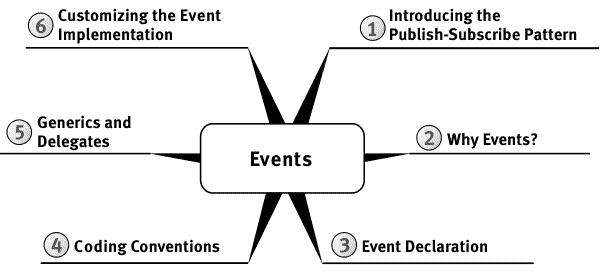

尽管事件在 `C# 1.0` 中已经存在，但 `C# 2.0` 中泛型的引入显著改变了编码约定，因为使用泛型委托数据类型意味着不再需要为每种可能的事件签名声明一个委托。因此，本章在整个过程中假设最低版本为 `C# 2.0`。仍生活在 `C# 1.0` 世界的读者也可以使用事件，但他们必须声明自己的委托数据类型（如第 13 章所述）。

## 使用多播委托编码发布-订阅模式

考虑一个温度控制，其中加热器和冷却器连接到同一个恒温器。为了让设备适当地开启和关闭，您必须通知设备温度的变化。一个恒温器向多个订阅者——加热和冷却设备——发布温度变化。下一节研究相关代码。[1]

### 定义订阅者方法

首先，定义 `Heater` 和 `Cooler` 对象（参见清单 14.1）。

#### 清单 14.1：Heater 和 Cooler 事件订阅者实现

```csharp
class Cooler
{
    public Cooler(float temperature)
    {
        Temperature = temperature;
    }
    // Cooler is activated when ambient temperature is higher than this
    public float Temperature { get; set; }
    // Notifies that the temperature changed on this instance
    public void OnTemperatureChanged(float newTemperature)
    {
        if (newTemperature > Temperature)
        {
            System.Console.WriteLine("Cooler: On");
        }
```

1. 在这个例子中，我们使用恒温器（thermostat）这个词，因为人们更习惯于在供暖和冷却系统的背景下思考它。技术上，*温度计*（thermometer）可能更合适。

```csharp
        else
        {
            System.Console.WriteLine("Cooler: Off");
        }
    }
}
class Heater
{
    public Heater(float temperature)
    {
        Temperature = temperature;
    }
    public float Temperature { get; set; }
    public void OnTemperatureChanged(float newTemperature)
    {
        if (newTemperature < Temperature)
        {
            System.Console.WriteLine("Heater: On");
        }
```


```csharp
        else

        {

            System.Console.WriteLine("Heater: Off");

        }

    }

}
```

除了温度比较逻辑不同外，这两个类本质上完全相同。（事实上，如果你在 `OnTemperatureChanged` 方法中使用指向比较方法的委托，就可以消除其中一个类。）每个类都存储单元应开启时的温度。此外，两个类都提供了一个 `OnTemperatureChanged()` 方法。调用 `OnTemperatureChanged()` 方法是通知 `Heater` 和 `Cooler` 类温度已发生变化的手段。该方法实现使用 `newTemperature` 与存储的触发温度进行比较，以确定是否开启设备。

`OnTemperatureChanged()` 方法是订阅者（也称为监听者）方法。它们的参数和返回类型必须与 `Thermostat` 类中的委托相匹配，我们将在下一节讨论该类。

## 定义发布方

`Thermostat` 类负责向加热器和冷却器对象实例报告温度变化。`Thermostat` 类的代码如清单 14.2 所示。

### 清单 14.2：定义事件发布方 Thermostat

```csharp
public class Thermostat
{
    // 定义事件发布方（初始不带发送者）
    public Action<float> OnTemperatureChange { get; set; }
    public float CurrentTemperature { get; set; }
}
```

`Thermostat` 包含一个名为 `OnTemperatureChange` 的属性，其类型为 `Action<float>` 委托。`OnTemperatureChange` 存储了一个订阅者列表。请注意，只需要一个委托属性即可存储所有订阅者。换句话说，`Cooler` 和 `Heater` 实例都将从这个单一发布方接收温度变化的通知。

`Thermostat` 的最后一个成员是 `CurrentTemperature` 属性。该属性设置和获取由 `Thermostat` 类报告的当前温度值。

## 连接发布方和订阅者

最后，我们在 `Main()` 方法中将这些部分组合在一起。清单 14.3 展示了 `Main()` 方法可能呈现的样子。

### 清单 14.3：连接发布方和订阅者

```csharp
class Program
{
    public static void Main()
    {
        Thermostat thermostat = new Thermostat();
        Heater heater = new Heater(60);
        Cooler cooler = new Cooler(80);
        string temperature;
        thermostat.OnTemperatureChange +=
            heater.OnTemperatureChanged;
        thermostat.OnTemperatureChange +=
            cooler.OnTemperatureChanged;
        Console.WriteLine("Enter temperature: ");
        temperature = Console.ReadLine();
        thermostat.CurrentTemperature = int.Parse(temperature);
    }
}
```

此清单中的代码通过直接使用 `+=` 运算符赋值，将两个订阅者（`heater.OnTemperatureChanged` 和 `cooler.OnTemperatureChanged`）注册到 `OnTemperatureChange` 委托上。

通过获取用户输入的温度值作为输入，你可以设置 `thermostat` 的 `CurrentTemperature`。然而，你尚未编写任何代码来向订阅者发布温度变化事件。

## 调用委托

每次 `Thermostat` 类中的 `CurrentTemperature` 属性发生变化时，你都想**调用委托**以通知订阅者（加热器和冷却器）温度已发生变化。为了实现这一目标，你必须修改 `CurrentTemperature` 属性，以保存新值并向每个订阅者发布通知。代码修改如清单 14.4 所示。

### 清单 14.4：调用委托而不检查 null

```csharp
public class Thermostat
{
    // ...
    public float CurrentTemperature
    {
        get { return _CurrentTemperature; }
        set
        {
            if (value != CurrentTemperature)
            {
                _CurrentTemperature = value;
                // 不完整：需要检查 null
                // 调用订阅者
                OnTemperatureChange(value);
            }
        }
    }
    private float _CurrentTemperature;
}
```

现在，`CurrentTemperature` 的赋值包含一些特殊逻辑，用于通知订阅者 `CurrentTemperature` 的变化。通知所有订阅者的调用仅仅是一行 C# 语句：`OnTemperatureChange(value)`。这一行语句向 `cooler` 和 `heater` 两个对象都发布了温度变化。在这里，你实际上看到，使用单次调用通知多个订阅者的能力正是委托更具体地被称为多播委托的原因，本章后面将进一步讨论这一点。

## 检查 null

清单 14.4 中缺少事件发布代码的一个重要部分。如果没有订阅者注册接收通知，`OnTemperatureChange` 将为 `null`，执行 `OnTemperatureChange(value)` 语句将抛出 `NullReferenceException`。为了避免这种情况，有必要在触发事件前检查 `null`。清单 14.5 演示了如何在调用 `Invoke()` 之前使用 C# 6.0 的空条件运算符来实现这一点。

### 清单 14.5：调用委托

```csharp
public class Thermostat
{
    // ...
    public float CurrentTemperature
    {
        get { return _CurrentTemperature; }
        set
        {
            if (value != CurrentTemperature)
            {
                _CurrentTemperature = value;
                // 如果有任何订阅者，
                // 通过调用这些订阅者通知它们温度变化
                OnTemperatureChange?.Invoke(value); // C# 6.0
            }
        }
    }
    private float _CurrentTemperature;
}
```

请注意，空条件后面跟随对 `Invoke()` 方法的调用。虽然该方法可以仅通过点运算符调用，但这没有太大意义，因为这等同于直接调用委托（参见清单 14.4 中的 `OnTemperatureChange(value)`）。空条件运算符背后的关键优势在于其特殊逻辑，确保在检查 null 之后，不可能出现订阅者调用了过时的处理程序（即在检查 null 之后发生变更的那些处理程序），从而导致委托再次变为 null 的情况。

不幸的是，在 C# 6.0 之前并不存在这种特殊的不可中断的空值检查逻辑。因此，在较早的 C# 版本中，实现显得更为冗长，如清单 14.6 所示。

### 清单 14.6：在 C# 6.0 之前进行带有 null 检查的委托调用

```csharp
public class Thermostat
{
    // ...
    public float CurrentTemperature
    {
        get { return _CurrentTemperature; }
        set
        {
            if (value != CurrentTemperature)
            {
                _CurrentTemperature = value;
                // 如果有任何订阅者，
                // 通过调用这些订阅者通知它们温度变化
                Action<float> localOnChange =
                    OnTemperatureChange;
                if (localOnChange != null)
                {
                    // 调用订阅者
                    localOnChange(value);
                }
            }
        }
    }
    private float _CurrentTemperature;
}
```

这段代码没有直接检查 null，而是首先将 `OnTemperatureChange` 赋值给第二个委托变量 `localOnChange`。这种简单的修改确保了即使在检查 null 和发送通知之间所有 `OnTemperatureChange` 订阅者都被移除（由另一个线程执行）的情况，也不会引发 `NullReferenceException`。

本书剩余部分的所有示例都依赖 C# 6.0 的空条件运算符来进行委托调用。

## 指南

- **务必**在调用委托之前检查其值是否为 null。
- **务必**从 C# 6.0 开始，在调用 `Invoke()` 之前使用空条件运算符。

### 高级主题：委托的 `-=` 运算符返回一个新实例

鉴于委托是一种引用类型，将一个局部变量赋值并随后使用该局部变量足以使空值检查具备线程安全性，这或许有些令人惊讶。既然 `OnTemperatureChange` 引用的位置与 `OnTemperatureChange` 相同，你可能会认为 `OnTemperatureChange` 中的任何变化都会反映在 `localOnChange` 中。

事实并非如此。因为从本质上讲，任何对 `OnTemperatureChange -= <subscriber>` 的调用都不会简单地从一个包含比之前少一个委托的 `OnTemperatureChange` 中移除一个委托。相反，这样的调用将分配一个全新的多播委托，而对 `localOnChange` 也引用的原始多播委托没有任何影响。

### 高级主题：线程安全的委托调用

如果订阅者可以在不同的线程上从委托中添加或移除，那么（如前所述）在检查 null 之前有条件地调用委托或将委托引用复制到局部变量中是明智的。虽然这种方法防止了 null 委托的调用，但它并不能避免所有可能的竞态条件。例如，一个线程可以执行复制，然后另一个线程可以将委托重置为 null，接着原始线程可以调用委托的先前值，从而通知一个不再在订阅者列表中的订阅者。多线程程序中的订阅者应确保其代码在此场景下保持健壮；始终有可能调用一个“过期”的订阅者。

## 委托运算符

为了组合恒温器示例中的两个订阅者，你使用了 `+=` 运算符。该运算符接收第一个委托并将第二个委托添加到链中。现在，在第一个委托的方法返回后，第二个委托将被调用。要从委托链中移除委托，使用 `-=` 运算符，如清单 14.7 所示。

### 清单 14.7：使用 `+=` 和 `-=` 委托运算符

```csharp
// ...
Thermostat thermostat = new Thermostat();
Heater heater = new Heater(60);
Cooler cooler = new Cooler(80);
Action<float> delegate1;
Action<float> delegate2;
Action<float> delegate3;
delegate1 = heater.OnTemperatureChanged;
delegate2 = cooler.OnTemperatureChanged;
Console.WriteLine("Invoke both delegates:");
delegate3 = delegate1;
delegate3 += delegate2;
delegate3(90);
Console.WriteLine("Invoke only delegate2");
delegate3 -= delegate1;
delegate3(30);
// ...
```

清单 14.7 的结果显示在输出 14.1 中。

### 输出 14.1

```text
Invoke both delegates:
Heater: Off
Cooler: On
Invoke only delegate2
Cooler: Off
```

此外，你还可以使用 `+` 和 `–` 运算符来组合委托，如清单 14.8 所示。

### 清单 14.8：使用 `+` 和 `–` 委托运算符

```csharp
// ...
Thermostat thermostat = new Thermostat();
Heater heater = new Heater(60);
Cooler cooler = new Cooler(80);
Action<float> delegate1;
Action<float> delegate2;
Action<float> delegate3;
// Note: Use new Action (cooler.OnTemperatureChanged)
// for C# 1.0 syntax
delegate1 = heater.OnTemperatureChanged;
delegate2 = cooler.OnTemperatureChanged;
Console.WriteLine("Combine delegates using + operator:");
delegate3 = delegate1 + delegate2;
delegate3(60);
Console.WriteLine("Uncombine delegates using - operator:");
delegate3 = delegate3 - delegate2;
delegate3(60);
// ...
```


使用赋值运算符会清除所有先前的订阅者，并允许你用新的订阅者替换它们。这是委托的一个不幸的特性。在实际上想要使用 `+=` 运算符时，人们太容易错误地编写赋值语句了。解决方案，即称为事件（events），出现在本章后面的“理解事件”部分。

`+` 和 `–` 运算符及其赋值等价物 `+=` 和 `-=` 内部均通过静态方法 `System.Delegate.Combine()` 和 `System.Delegate.Remove()` 实现。这些方法接收两个委托类型的参数。第一个方法 `Combine()` 将两个参数合并，使得第一个参数在委托列表中指向第二个参数。第二个方法 `Remove()` 遍历第一个参数中指定的委托链，然后移除第二个参数指定的委托。

关于 `Combine()` 方法，有一个有趣的现象值得注意，即它的两个参数中任意一个或两个都可以为 null。如果其中一个为 null，`Combine()` 返回非 null 的参数。如果两者都为 null，`Combine()` 返回 null。这解释了为什么你可以调用 `thermostat.OnTemperatureChange += heater.OnTemperatureChanged;` 而不抛出异常，即使 `thermostat.OnTemperatureChange` 的值仍为 null。

## 顺序调用

图 14.1 突出了对加热器和冷却器的顺序通知。

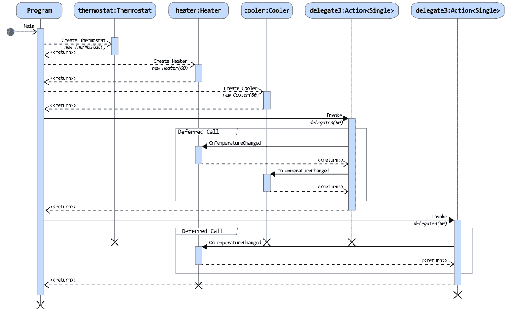

**图 14.1：委托调用序列图**

虽然你只编写了对 `OnTemperatureChange()` 的单个调用，但该调用会广播到两个订阅者。因此，仅通过一次调用，冷却器和加热器都会收到温度变化的通知。如果你添加更多订阅者，`OnTemperatureChange()` 也会通知它们。

虽然单次调用 `OnTemperatureChange()` 引起了每个订阅者的通知，但订阅者仍然是按顺序调用的，而不是同时调用，因为它们都在同一执行线程上被调用。

## 高级主题：多播委托内部机制

要了解事件如何工作，你需要重新审视对 `System.Delegate` 类型内部结构的初次检查。请记住，`delegate` 关键字是源自 `System.MulticastDelegate` 的类型的别名。反过来，`System.MulticastDelegate` 派生自 `System.Delegate`，而 `System.Delegate` 由一个对象引用（非静态方法所需）和一个方法引用组成。当你创建一个委托时，编译器自动使用 `System.MulticastDelegate` 类型而不是 `System.Delegate` 类型。`MulticastDelegate` 类包含一个对象引用和一个方法引用，与其 `Delegate` 基类类似，但它还包含指向另一个 `System.MulticastDelegate` 对象的引用。

当你向多播委托添加方法时，`MulticastDelegate` 类创建该委托类型的新实例，将添加方法的对象引用和方法引用存储到新实例中，并将新的委托实例作为委托实例列表中的下一项添加。从本质上讲，`MulticastDelegate` 类维护了一个 `Delegate` 对象的链表。概念上，你可以将恒温器示例表示为图 14.2 所示的形式。

在调用多播委托时，链表中的每个委托实例按顺序被调用。通常，委托按照添加的顺序被调用，但在公共语言基础结构（CLI）规范中并未指定此行为。此外，此行为可以被覆盖。因此，程序员不应依赖于调用顺序。

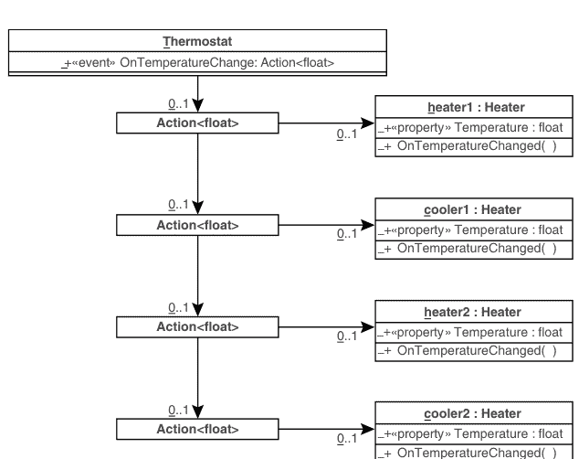

**图 14.2：串联的多播委托**

## 错误处理

错误处理使得意识到顺序通知的重要性至关重要。如果一个订阅者抛出异常，链中后续的订阅者将不会收到通知。例如，考虑如果你更改 `Heater` 的 `OnTemperatureChanged()` 方法使其抛出异常会发生什么，如清单 14.9 所示。

**清单 14.9：`OnTemperatureChanged()` 抛出异常**

```csharp
class Program
{
    public static void Main()
    {
        Thermostat thermostat = new Thermostat();
        Heater heater = new Heater(60);
        Cooler cooler = new Cooler(80);
        string temperature;
        thermostat.OnTemperatureChange +=
            heater.OnTemperatureChanged;
        // Using C# 3.0, Change to anonymous method
    }
}
```

// 如果使用 C# 2.0
`thermostat.OnTemperatureChange +=`
    `(newTemperature) =>`
    `{`
        `throw new InvalidOperationException();`
    `};`
`thermostat.OnTemperatureChange +=`
    `cooler.OnTemperatureChanged;`
`Console.Write("Enter temperature: ");`
`temperature = Console.ReadLine();`
`thermostat.CurrentTemperature = int.Parse(temperature);`
}

图 14.3 展示了一个更新后的序列图。尽管 `cooler` 和 `heater` 都订阅了消息接收，但 lambda 表达式抛出的异常终止了调用链，并阻止了 `cooler` 对象接收到通知。


## 图 14.3：带异常的委托调用序列图

为避免此问题，确保所有订阅者都能接收到通知（无论先前订阅者的行为如何），您必须手动遍历订阅者列表并单独调用它们。代码清单 14.10 展示了在 `CurrentTemperature` 属性中所需的更新。结果如输出 14.2 所示。

## 代码清单 14.10：处理来自订阅者的异常

```csharp
public class Thermostat
{
    // 定义事件发布者
    public Action<float> OnTemperatureChange;
    public float CurrentTemperature
    {
        get { return _CurrentTemperature; }
        set
        {
            if (value != CurrentTemperature)
            {
                _CurrentTemperature = value;
                Action<float> onTemperatureChange = OnTemperatureChange;
                if (onTemperatureChange != null)
                {
                    List<Exception> exceptionCollection =
                        new List<Exception>();
                    foreach (
                        Action<float> handler in
                        onTemperatureChange.GetInvocationList())
                    {
                        try
                        {
                            handler(value);
                        }
                        catch (Exception exception)
                        {
                            exceptionCollection.Add(exception);
                        }
                    }
                    if (exceptionCollection.Count > 0)
                    {
                        throw new AggregateException(
                            "There were exceptions thrown by "
                            + "OnTemperatureChange event subscribers.",
                            exceptionCollection);
                    }
                }
            }
        }
    }
    private float _CurrentTemperature;
}
```

## 输出 14.2

```
Enter temperature: 45
Heater: On
Error in the application
Cooler: Off
```

此代码清单演示了你可以从委托的 `GetInvocationList()` 方法中获取订阅者列表。枚举该列表中的每一项会返回各个独立的订阅者。如果你将每个订阅者的调用放在 try/catch 块中，就可以在继续枚举循环之前处理任何错误条件。在这个示例中，尽管委托订阅者抛出了异常，`cooler` 仍然接收到了温度变化的通知。在所有通知发送完毕后，代码清单 14.10 通过抛出 `AggregateException` 来报告任何异常，该异常封装了一个异常集合，可通过 `InnerExceptions` 属性访问。通过这种方式，所有异常仍然会被报告，同时所有订阅者也都得到了通知。

实际上，本示例中没有使用空条件运算符，因为大量代码依赖于非空委托。

## 方法返回值和引用传递

还有另一种场景，在这种情况下，遍历委托调用列表比直接激活通知更为有用。该场景与那些不返回 void 或具有 ref 或 out 参数的委托相关。在恒温器示例中，`OnTemperatureChange` 委托的类型是 `Action<float>`，它返回 void 且没有 out 或 ref 参数。因此，没有数据返回给发布者。这一考量很重要，因为委托的调用可能会触发向多个订阅者的通知。如果每个订阅者都返回一个值，那么使用哪个订阅者的返回值将是模棱两可的。

如果你将 `OnTemperatureChange` 更改为返回一个枚举值，以指示设备是否因温度变化而开启，那么新的委托类型将是 `Func<float, Status>`，其中 `Status` 是一个具有 On 和 Off 元素的枚举。所有订阅者方法都必须使用与委托相同的方法签名，因此，每个方法都需要返回一个状态值。此外，由于 `OnTemperatureChange` 可能对应一个委托链，有必要遵循你用于错误处理的相同模式。换句话说，你必须使用 `GetInvocationList()` 方法遍历每个委托调用列表，以获取每个独立的返回值。同样，使用 ref 和 out 参数的委托类型需要特别考虑。然而，尽管在特殊情况下可以使用这种方法，但准则是尽量避免这种场景，仅返回 void。

## 理解事件

到目前为止，本章中使用的委托存在两个关键问题。为克服这些问题，C# 使用了 `event` 关键字。在本节中，你将了解为什么要使用事件以及它们如何工作。

### 为什么要使用事件？

本章和前一章涵盖了你需要了解的所有关于委托工作原理的知识。不幸的是，委托结构的弱点可能会无意中允许程序员引入 bug。这些问题与封装有关，订阅或发布事件都无法充分控制这种封装。

### 封装订阅

如前所示，可以使用赋值运算符将一个委托赋值给另一个委托。不幸的是，这种能力引入了常见的 bug 来源。请考虑代码清单 14.11。

## 代码清单 14.11：使用赋值运算符 = 而不是 +=

```csharp
class Program
{
    public static void Main()
    {
        Thermostat thermostat = new Thermostat();
        Heater heater = new Heater(60);
        Cooler cooler = new Cooler(80);
        string temperature;
        // 注意：如果使用 C# 1.0，请使用 new Action (cooler.OnTemperatureChanged)
        thermostat.OnTemperatureChange =
            heater.OnTemperatureChanged;
        // Bug: 赋值运算符覆盖了
        // 之前的赋值
        thermostat.OnTemperatureChange =
            cooler.OnTemperatureChanged;
        Console.Write("Enter temperature: ");
        temperature = Console.ReadLine();
        thermostat.CurrentTemperature = int.Parse(temperature);
    }
}
```

代码清单 14.11 与代码清单 14.7 几乎相同，不同之处在于这里没有使用 `+=` 运算符，而是使用了简单的赋值运算符。因此，当代码将 `cooler.OnTemperatureChanged` 赋值给 `OnTemperatureChange` 时，`heater.OnTemperatureChanged` 会被清除，因为一个新的完整调用链被分配以替换之前的调用链。当意图使用 `+=` 赋值时，错误地使用赋值运算符的可能性极高，因此最好不支持对对象使用赋值运算符，除非在包含类内部。`event` 关键字提供了这种额外的封装，使你无法无意中取消其他订阅者。

### 封装发布

委托和事件之间的第二个重要区别是，事件确保只有包含类才能触发事件通知。请考虑代码清单 14.12。

## 代码清单 14.12：在事件容器外部触发事件

```csharp
class Program
{
    public static void Main()
    {
        Thermostat thermostat = new Thermostat();
        Heater heater = new Heater(60);
        Cooler cooler = new Cooler(80);
        string temperature;
        // 注意：如果使用 C# 1.0，请使用 new Action (cooler.OnTemperatureChanged)
        thermostat.OnTemperatureChange +=
            heater.OnTemperatureChanged;
        thermostat.OnTemperatureChange +=
            cooler.OnTemperatureChanged;
        thermostat.OnTemperatureChange(42);
    }
}
```

在代码清单 14.12 中，尽管 `thermostat` 的 `CurrentTemperature` 没有改变，`Program` 仍然可以调用 `OnTemperatureChange` 委托。因此，`Program` 向所有 `thermostat` 订阅者触发温度已变化的通知，尽管 `thermostat` 的温度并未发生变化。与之前一样，委托存在的问题

这是因为封装性不足。恒温器类应当阻止任何其他类调用 `OnTemperatureChange` 委托。

## 声明事件

C# 提供了 `event` 关键字来处理这两个问题。尽管它看似像是一个字段修饰符，但 `event` 定义了一种新的成员类型（参见列表 14.13）。

### 列表 14.13：使用 event 关键字配合事件编码模式

```csharp
public class Thermostat
{
    public class TemperatureArgs: System.EventArgs
    {
        public TemperatureArgs( float newTemperature )
        {
            NewTemperature = newTemperature;
        }
        public float NewTemperature { get; set; }
    }
    // 定义事件发布者


```csharp
public event EventHandler<TemperatureArgs> OnTemperatureChange = delegate { };

public float CurrentTemperature
{
    ...
}

private float _CurrentTemperature;
}
```

新的 `Thermostat` 类相对于原始类有四处更改。首先，`OnTemperatureChange` 属性已被移除，取而代之的是将 `OnTemperatureChange` 声明为一个公共字段。这看起来似乎与解决早期的封装性问题相悖。将字段设为公共来降低封装性似乎没有道理，增加封装性才更合理。然而，第二处更改是在字段声明前立即添加了 `event` 关键字。这个简单的更改提供了所有需要的封装性。通过添加 `event` 关键字，你阻止了对公共委托字段使用赋值运算符（例如，`thermostat.OnTemperatureChange = cooler.OnTemperatureChanged`）。此外，只有包含类才能触发发布给所有订阅者的委托（例如，禁止在类外部执行 `thermostat.OnTemperatureChange(42)`）。换句话说，`event` 关键字提供了所需的封装性，防止任何外部类发布事件或退订之前未添加的订阅者。这解决了先前提到的普通委托的两个问题，也是 C# 中包含 `event` 关键字的主要原因之一。

普通委托的另一个潜在陷阱是，在调用委托之前忘记检查 `null` 值（理想情况下使用 C# 6.0 代码中的 `null` 条件运算符）非常容易。这一疏忽可能导致意外的 `NullReferenceException`。幸运的是，`event` 关键字提供的封装性使得在声明时（或在构造函数中）启用替代可能性成为可能，如列表 14.13 所示。注意，在声明事件时，我们赋值了 `delegate { }`——一个非 `null` 的委托，它什么也不做。通过赋值这个空委托，我们可以无需检查是否存在订阅者即可触发事件。（这种行为类似于将零个元素的数组赋值给变量。这样做允许在不先检查变量是否为 `null` 的情况下调用数组成员。）当然，如果委托有可能被重新赋值为 `null`，仍然需要进行检查。然而，由于 `event` 关键字将赋值限制在类内部进行，因此委托的任何重新赋值都只能发生在类内部。假设从未将 `null` 赋值给该委托，那么在代码调用委托时就不需要检查 `null`。

## 编码规范

要获得所需功能，你只需将原始的委托变量声明更改为字段并添加 `event` 关键字。通过这两处更改，你提供了必要的封装性，且其他所有功能保持不变。但是，列表 14.13 代码中的委托声明发生了额外更改。为了遵循标准的 C# 编码规范，你应该用一个新的委托类型 `EventHandler<TemperatureArgs>` 替换 `Action<float>`，这是一种公共语言运行时（CLR）类型，其声明如列表 14.14 所示。


### 列表 14.14：通用事件处理程序类型

```csharp
public delegate void EventHandler<TEventArgs>(
    object sender, TEventArgs e);
```

结果是，`Action<TEventArgs>` 委托类型中的单个温度参数被两个新参数取代——一个用于发布者或“发送者”，另一个用于事件数据。这种更改不是 C# 编译器强制执行的内容，但对于旨在作为事件使用的委托，传递这两个类型的参数是常规做法。

第一个参数 `sender` 包含调用该委托的类的实例。如果同一个订阅者方法注册了多个事件，这特别有用——例如，如果 `heater.OnTemperatureChanged` 事件订阅了两个不同的 `Thermostat` 实例。在这种情况下，任何一个 `Thermostat` 实例都可以触发对 `heater.OnTemperatureChanged` 的调用。要确定是哪个 `Thermostat` 实例触发了事件，你使用 `Heater.OnTemperatureChanged()` 内部的 `sender` 参数。如果事件是静态的，此选项将不可用，因此请为 `sender` 参数值传递 `null`。

第二个参数 `TEventArgs e` 指定为类型 `Thermostat.TemperatureArgs`。就编码规范而言，`TemperatureArgs` 的重要部分是它继承自 `System.EventArgs`。（事实上，在 Microsoft .NET Framework 4.5 之前，框架通过泛型约束强制要求继承自 `System.EventArgs`。）`System.EventArgs` 上唯一的显著属性是 `Empty`，用于指示没有事件数据。然而，当你让 `TemperatureArgs` 继承自 `System.EventArgs` 时，你添加了一个额外属性 `NewTemperature`，用于将恒温器的温度传递给订阅者。

总结事件的编码规范：第一个参数 `sender` 是 `object` 类型，包含对调用委托的对象（如果是静态事件则为 `null`）的引用。第二个参数是 `System.EventArgs` 类型或从 `System.EventArgs` 继承且包含有关事件的额外数据的类型。你调用委托的方式与之前完全相同，只是多了额外的参数。列表 14.15 展示了一个示例。

### 列表 14.15：触发事件通知

```csharp
public class Thermostat
{
    ...
    public float CurrentTemperature
    {
        get { return _CurrentTemperature; }
        set
        {
            if (value != CurrentTemperature)
            {
                _CurrentTemperature = value;
                // 如果存在任何订阅者，
                // 通过调用这些订阅者通知它们温度变化
                OnTemperatureChange?.Invoke(  // 使用 C# 6.0
                    this, new TemperatureArgs(value));
            }
        }
    }
    private float _CurrentTemperature;
}
```

通常使用容器类（`this`）指定 `sender`，因为只有该类可以触发事件的委托。

在此示例中，订阅者可以将 `sender` 参数转换为 `Thermostat`，从而通过这种方式以及通过 `TemperatureArgs` 实例访问当前温度。然而，`Thermostat` 实例上的当前温度可能会通过另一个线程改变。对于因状态改变而发生的事件，将旧值与新值一起传递是控制哪些状态转换被允许的常用模式。

## 指南

- **DO** 在调用委托之前检查其值是否为 `null`（可能通过 C# 6.0 中的 `null` 条件运算符）。
- **DO NOT** 为非静态事件的 `sender` 值传递 `null`，但 **DO** 为静态事件的相同值传递 `null`。
- **DO NOT** 为 `eventArgs` 参数传递 `null`。
- **DO** 对事件使用 `EventHandler<TEventArgs>` 类型的委托。
- **DO** 对 `TEventArgs` 类型使用 `System.EventArgs` 或从 `System.EventArgs` 继承的类型。
- **CONSIDER** 使用 `System.EventArgs` 的子类作为事件参数类型（`TEventArgs`），除非你确定该事件永远不会携带任何数据。

## 泛型与委托

前文讨论了定义事件类型的准则，即使用 `EventHandler<TEventArgs>` 委托类型。理论上，可以使用任何委托类型，但按照惯例，第一个参数 `sender` 的类型为 `object`，而第二个参数 `e` 的类型应派生自 `System.EventArgs`。在 C# 1.0 中，委托的一个较为繁琐之处在于，每当处理器的参数发生变化时，你都需要声明一个新的委托类型。每一次从 `System.EventArgs` 派生出新类型（这是一种相对常见的情况）时，都需要声明使用这种新的派生自 `EventArgs` 类型的委托数据类型。例如，要在列表 14.15 中的事件通知代码中使用 `TemperatureArgs`，就需要声明委托类型 `TemperatureChangeHandler`，该类型以 `TemperatureArgs` 作为参数（参见列表 14.16）。

### 列表 14.16：使用自定义委托类型

```csharp
public class Thermostat
{
    public class TemperatureArgs : System.EventArgs
    {
        public TemperatureArgs(float newTemperature)
        {
            NewTemperature = newTemperature;
        }
        public float NewTemperature
        {
            get { return _NewTemperature; }
            set { _NewTemperature = value; }
        }
        private float _NewTemperature;
    }
    public delegate void TemperatureChangeHandler(
        object sender, TemperatureArgs newTemperature);
    public event TemperatureChangeHandler
        OnTemperatureChange;
    public float CurrentTemperature
    {
        ...
    }
    private float _CurrentTemperature;
}
```

尽管通常推荐使用 `EventHandler<TEventArgs>` 而不是创建如 `TemperatureChangeHandler` 这样的自定义委托类型，但后者有一个优势。具体来说，如果使用自定义类型，参数名称可以针对事件进行具体化。例如在列表 14.16 中，当调用委托以触发事件时，第二个参数名称将显示为 `newTemperature`，而不仅仅是 `e`。

使用自定义委托类型的另一个原因涉及 CLR API 中在 C# 2.0 之前定义的部分。因此，在来自 CLR API 的事件中，遇到特定的委托类型而不是泛型形式并不罕见。无论如何，在 C# 2.0 及更高版本中使用事件的大多数情况下，都没有必要声明自定义委托数据类型。

**准则**

- 除非自定义类型的参数名称能提供显著清晰的说明，否则请使用 `System.EventHandler<T>` 而不是手动为事件处理器创建新的委托类型。

## 高级主题

### 事件内部机制

事件限制外部类除了通过 `+=` 运算符添加订阅方法给发布者，并使用 `-=` 运算符取消订阅外，不能做其他任何事情。此外，它们还限制除包含类以外的类调用事件。为了实现这一点，C# 编译器将带有 `event` 关键字修饰符的公共委托变量声明为私有的。此外，它还添加了几个方法和两个特殊的事件块。本质上，`event` 关键字是生成适当封装逻辑的 C# 快捷方式。请考虑列表 14.17 中事件声明的示例。

#### 列表 14.17：声明 OnTemperatureChange 事件

```csharp
public class Thermostat
{
public event EventHandler<TemperatureArgs> OnTemperatureChange;
...
}
```

当 C# 编译器遇到 `event` 关键字时，它会生成与列表 14.18 中所示 C# 代码等效的 CIL 代码。

#### 列表 14.18：编译器生成的事件 CIL 代码的 C# 概念等价物

```csharp
public class Thermostat
{
    // ...
    // Declaring the delegate field to save the
    // list of subscribers
    private EventHandler<TemperatureArgs> _OnTemperatureChange;
    public void add_OnTemperatureChange(
        EventHandler<TemperatureArgs> handler)
    {
        _OnTemperatureChange = (EventHandler<TemperatureArgs>)
            System.Delegate.Combine(_OnTemperatureChange, handler);
    }
    public void remove_OnTemperatureChange(
        EventHandler<TemperatureArgs> handler)
    {
        _OnTemperatureChange = (EventHandler<TemperatureArgs>)
            System.Delegate.Remove(_OnTemperatureChange, handler);
    }
    public event EventHandler<TemperatureArgs> OnTemperatureChange
    {
        add
        {
            add_OnTemperatureChange(value);
        }
        remove
        {
            remove_OnTemperatureChange(value);
        }
    }
}
```

换句话说，列表 14.17 中显示的代码（概念上）是编译器用来触发展示在列表 14.18 中的代码展开的 C# 简写形式。（需要“概念上”这一限定词，因为为了阐明，已经省略了有关线程同步的一些细节。）

C# 编译器首先采用原始的事件定义，并在其位置定义一个私有委托变量。结果是，委托对任何外部类都不可用——甚至包括从它派生的类。

接下来，C# 编译器定义两个方法 `add_OnTemperatureChange()` 和 `remove_OnTemperatureChange()`，其中 `OnTemperatureChange` 后缀取自事件的原始名称。这些方法分别负责实现 `+=` 和 `-=` 赋值运算符。如列表 14.18 所示，这些方法使用本章前面讨论过的静态 `System.Delegate.Combine()` 和 `System.Delegate.Remove()` 方法实现。传递给这些方法中每一个的第一个参数是私有的 `EventHandler<TemperatureArgs>` 委托实例 `_OnTemperatureChange`。

由 `event` 关键字生成的代码中最奇怪的部分可能是最后一段。该语法与属性的 `getter` 和 `setter` 方法非常相似，区别在于这些方法被称为 `add` 和 `remove`。`add` 块通过将其调用传递给 `add_OnTemperatureChange()` 来处理事件上的 `+=` 运算符。类似地，`remove` 块通过将调用传递给 `remove_OnTemperatureChange()` 来处理 `-=` 运算符。

请仔细注意此代码与为属性生成的代码之间的相似之处。回想一下，C# 属性的实现是创建 `get_<propertyname>` 和 `set_<propertyname>`，然后将 `get` 和 `set` 块的调用传递到这些方法。显然，在这种情况下，事件语法非常相似。

关于生成的 CIL 代码，另一个值得注意的重要特征是，`event` 关键字的 CIL 等价物保留在 CIL 中。换句话说，事件是 CIL 代码明确识别的东西；它不仅仅是一个 C# 构造。通过在 CIL 代码中保留等效的 `event` 关键字，所有语言和编辑器都可以提供特殊功能，因为它们可以将事件识别为特殊的类成员。

### 自定义事件实现

你可以自定义编译器为 `+=` 和 `-=` 生成的代码。例如，考虑更改 `OnTemperatureChange` 委托的作用域，使其变为受保护而不是私有。当然，这将允许从 `Thermostat` 派生的类直接访问该委托，而不是像外部类那样受到相同的限制。为了启用此行为，C# 允许使用与列表 14.16 中所示语法相同的属性。换句话说，C# 允许你定义自定义的 `add` 和 `remove` 块，为事件封装的每个方面提供独特的实现。列表 14.19 提供了一个示例。

#### 列表 14.19：自定义 add 和 remove 处理器

```csharp
public class Thermostat
{
    public class TemperatureArgs : System.EventArgs
    {
        ...
    }
    // Define the event publisher
```


```csharp
public event EventHandler<TemperatureArgs> OnTemperatureChange
{
    add
    {
        _OnTemperatureChange = (EventHandler<TemperatureArgs>)
            System.Delegate.Combine(value, _OnTemperatureChange);
    }
    remove
    {
        _OnTemperatureChange = (EventHandler<TemperatureArgs>)
            System.Delegate.Remove(_OnTemperatureChange, value);
    }
}
protected EventHandler<TemperatureArgs> _OnTemperatureChange;
public float CurrentTemperature
{
    ...
}
private float _CurrentTemperature;
}
```

在这种情况下，存储每个订阅者的委托 `_OnTemperatureChange` 被更改为受保护。此外，`add` 块的实现交换了委托存储的顺序，使得链中最后添加的委托是第一个接收通知的委托。

## 总结

既然我们已经描述了事件，值得提一下，通常方法引用是唯一建议在事件上下文之外处理委托变量的情况。换句话说，鉴于事件的额外封装功能以及在必要时自定义实现的能力，最佳实践始终是使用事件来实现发布-订阅模式。

在能够不参考示例代码而从零开始编写事件代码之前，你可能需要进行一些练习。然而，事件是后续章节中异步、多线程编程的重要基础。

# 15 使用标准查询运算符的集合接口

C# 3.0 中增加的最显著功能在于集合，这归功于一个名为**语言集成查询**（LINQ）的编程 API。通过一组扩展方法和 lambda 表达式，LINQ 为处理集合提供了更优越的 API。事实上，在这本书的早期版本中，关于集合的章节紧跟在关于泛型的章节之后，并且位于关于委托的章节之前。然而，由于 lambda 表达式对 LINQ 至关重要，如果不先讲解委托（lambda 表达式的基石），就不可能再像以前那样讲解集合了。既然你在前面两章中已经对 lambda 表达式有了坚实的基础，我们现在就可以深入探讨集合的细节——这是一个横跨三章的主题。本章的重点从**标准查询运算符**开始，这是一种通过直接调用扩展方法来利用 LINQ 的手段。

在介绍集合初始化器之后，本章涵盖了各种集合接口，并探讨了它们之间的关系。这是理解集合的基础，因此你应该仔细研读相关材料。关于集合接口的章节还包括 C# 3.0 中为实施标准查询运算符而添加的 `IEnumerable<T>` 扩展方法的讲解。


与集合相关的类和接口分为两类：支持泛型的和不支持泛型的。本章主要讨论泛型集合接口。只有在你编写需要与早期版本运行时互操作的组件时，才应使用不支持泛型的集合类。这是因为以前非泛型形式中可用的所有内容都有强类型的泛型替代方案。虽然这些概念仍然适用于两种形式，但我们不会明确讨论非泛型版本。¹

本章最后对匿名类型进行了深入的讨论——这些主题我们在第 3 章的几个高级主题章节中仅做了简要介绍。匿名类型有趣之处在于，它们被 C# 7.0 中的元组所掩盖——我们将在本章末尾进一步讨论这一主题。

## 集合初始化器

集合初始化器允许程序员在实例化时以类似于数组声明的方式构建具有初始成员集合的集合。在集合初始化可用之前，必须在集合实例化后显式地向集合添加元素——使用类似 `System.Collections.Generic.ICollection<T>` 的 `Add()` 方法。使用集合初始化后，`Add()` 调用是由 C# 编译器生成的，而不是由开发者明确编码的。代码清单 15.1 展示了如何使用集合初始化器来初始化集合。

**代码清单 15.1：集合初始化**

```csharp
using System;
using System.Collections.Generic;
class Program
{
    static void Main()
    {
        List<string> sevenWorldBlunders;
        sevenWorldBlunders = new List<string>()
        {
            // Quotes from Ghandi
            "Wealth without work",
            "Pleasure without conscience",
            "Knowledge without character",
            "Commerce without morality",
            "Science without humanity",
            "Worship without sacrifice",
            "Politics without principle"
        };
        Print(sevenWorldBlunders);
    }
    private static void Print<T>(IEnumerable<T> items)
    {
        foreach (T item in items)
        {
            Console.WriteLine(item);
        }
    }
}
```

这种语法不仅类似于数组初始化，还类似于对象初始化器，即跟随在构造函数之后的花括号。如果在构造函数中没有传入参数，则数据类型后面的括号是可选的（这与对象初始化器一样）。

集合初始化器要成功编译，需要满足一些基本要求。理想情况下，应用集合初始化器的集合类型应该是实现了 `System.Collections.Generic.ICollection<T>` 的类型。这确保了集合包含编译器生成的代码可以调用的 `Add()` 方法。然而，也存在一种放松版的要求，它仅要求存在一个或多个 `Add()` 方法，这些方法可以作为扩展方法（C# 6.0）或作为实现了 `IEnumerable<T>` 类型的实例方法——即使该集合没有实现 `ICollection<T>`。`Add()` 方法需要接受与集合初始化器中指定的值兼容的参数。

对于字典，集合初始化器语法稍微复杂一些，因为字典中的每个元素都需要键和值。这种语法如代码清单 15.2 所示。

**代码清单 15.2：使用集合初始化器初始化 Dictionary<>**

```csharp
using System;
using System.Collections.Generic;
#if !PRECsharp6
// C# 6.0 or later
Dictionary<string, ConsoleColor> colorMap =
    new Dictionary<string, ConsoleColor>
    {
        ["Error"] = ConsoleColor.Red,
        ["Warning"] = ConsoleColor.Yellow,
        ["Information"] = ConsoleColor.Green,
        ["Verbose"] = ConsoleColor.White
    };
#else
// Before C# 6.0
Dictionary<string, ConsoleColor> colorMap =
    new Dictionary<string, ConsoleColor>
    {
        { "Error", ConsoleColor.Red },
        { "Warning", ConsoleColor.Yellow },
        { "Information", ConsoleColor.Green },
        { "Verbose", ConsoleColor.White}
    };
#endif
```

此代码清单包含初始化的两个不同版本。第一个展示了 C# 6.0 中引入的新语法，通过允许赋值运算符表达哪个值与哪个键相关联，从而表达名称/值对的意图。第二种语法（在 C# 6.0 或更高版本中仍然有效）使用花括号将名称和值配对。

允许在不支持 `ICollection<T>` 的集合上使用初始化器是重要的，原因有两个。首先，大多数集合（实现了 `IEnumerable<T>` 的类型）并不同时实现 `ICollection<T>`，这大大降低了集合初始化器的实用性。其次，通过匹配方法名称和签名与集合初始化器项的兼容性，使得初始化到集合中的项目具有更大的多样性。例如，只要存在一个签名与 `a` 兼容的 `Add()` 方法以及第二个签名与 `b, c` 兼容的 `Add()` 方法，初始化器现在就可以支持 `new DataStore(){ a, {b, c}}`。

### 什么使一个类成为集合：`IEnumerable<T>`

根据定义，.NET 中的集合是一个至少实现了 `IEnumerable<T>`（或非泛型类型 `IEnumerable`）的类。该接口至关重要，因为实现 `IEnumerable<T>` 的方法是对集合进行迭代所需的最小条件。

第 4 章展示了如何使用 `foreach` 语句迭代元素数组。这种语法简单，避免了必须知道有多少个元素的复杂性。然而，运行时并不直接支持 `foreach` 语句。相反，C# 编译器将按照本节描述的方式转换代码。

#### 带有数组的 foreach

代码清单 15.3 演示了一个简单的 `foreach` 循环，它迭代一个整数数组，然后将每个整数打印到控制台。

**代码清单 15.3：带有数组的 foreach**

```csharp
int[] array = new int[]{1, 2, 3, 4, 5, 6};
foreach (int item in array)
{
    Console.WriteLine(item);
}
```

从这段代码中，C# 编译器创建了 `for` 循环的等效 CIL，如代码清单 15.4 所示。

**代码清单 15.4：带有数组的 foreach 的编译实现**

```csharp
int[] tempArray;
int[] array = new int[]{1, 2, 3, 4, 5, 6};
tempArray = array;
for (int counter = 0; (counter < tempArray.Length); counter++)
{
    int item = tempArray[counter];
    Console.WriteLine(item);
}
```

在此示例中，请注意 `foreach` 依赖于对 `Length` 属性和索引运算符（`[ ]`）的支持。通过 `Length` 属性，C# 编译器可以使用 `for` 语句迭代遍历数组中的每个元素。

## 具有 `IEnumerable<T>` 的 foreach

尽管清单 15.4 中显示的代码在处理长度固定且始终支持索引运算符的数组时运行良好，但并非所有类型的集合都具有已知的元素数量。此外，许多集合类（包括 `Stack<T>`、`Queue<T>` 和 `Dictionary<TKey, TValue>` 类）不支持按索引检索元素。因此，需要一种更通用的方法来迭代遍历元素集合。迭代器模式提供了这种能力。假设你可以确定第一个、下一个和最后一个元素，那么知道数量并支持按索引检索元素就不再必要了。

`System.Collections.Generic.IEnumerator<T>` 和非通用的 `System.Collections.IEnumerator` 接口旨在为迭代元素集合启用迭代器模式，而非清单 15.4 中所示的长度-索引模式。它们的类关系图见 图 15.1。


图 15.1：`IEnumerator<T>` 和 `IEnumerator` 接口的类图

`IEnumerator<T>` 继承自 `IEnumerator`，后者包含三个成员。第一个成员是 `bool MoveNext()`。使用该方法，你可以从集合中的一个元素移动到下一个，同时检测是否已枚举完所有项目。第二个成员是一个名为 `Current` 的只读属性，它返回当前正在处理的元素。`Current` 在 `IEnumerator<T>` 中被重载，提供了具体的类型实现。在集合类具有这两个成员的情况下，仅使用 `while` 循环即可迭代遍历集合，如清单 15.5 所示。（`Reset()` 方法通常抛出 `NotImplementedException`，因此绝不应调用它。如果需要重新开始枚举，只需创建一个新的枚举器。）

### 清单 15.5：使用 while 迭代遍历集合

```csharp
System.Collections.Generic.Stack<int> stack = new System.Collections.Generic.Stack<int>();
int number;
// ...
// 此代码为概念性代码，并非实际代码
while (stack.MoveNext())
{
    number = stack.Current;
    Console.WriteLine(number);
}
```

在清单 15.5 中，当 `MoveNext()` 方法移动到集合末尾之后时返回 `false`。这取代了在循环中统计元素的需求。

清单 15.5 使用 `System.Collections.Generic.Stack<T>` 作为集合类型。存在许多其他集合类型；这只是一个例子。`Stack<T>` 的关键特征是其作为后进先出（LIFO）集合的设计。请注意，类型参数 `T` 标识了集合内所有项目的类型。在一个集合中收集一种类型的对象是泛型集合的关键特征。程序员在添加、删除或访问集合内的项目时，必须知道集合内的数据类型。

前面的示例展示了 C# 编译器输出的要点，但由于省略了有关实现过程的两个重要细节——交错执行和错误处理——它实际上并不是那样编译的。

## 状态是共享的

像清单 15.5 这样的实现存在一个问题，即如果两个这样的循环彼此交错——一个 `foreach` 嵌套在另一个内部，且都使用同一个集合——集合必须维护当前元素的状态指示器，以便在调用 `MoveNext()` 时能够确定下一个元素。在这种情况下，一个交错执行的循环可能会影响另一个循环。（对于由多个线程执行的循环，情况也是同样的。）

为了解决这个问题，集合类并不直接支持 `IEnumerator<T>` 和 `IEnumerator` 接口。如图 15.1 所示，存在第二个名为 `IEnumerable<T>` 的接口，其唯一方法是 `GetEnumerator()`。该方法的目的是返回一个支持 `IEnumerator<T>` 的对象。代替集合类维护状态，一个不同的类（通常是嵌套类，以便能够访问集合的内部结构）将支持 `IEnumerator<T>` 接口并保持迭代循环的状态。枚举器就像序列中的一个“光标”或“书签”。你可以有多个书签，每个书签的移动都会独立地枚举集合。使用这种模式，`foreach` 循环的 C# 等效形式将类似于清单 15.6 中显示的代码。

### 清单 15.6：在迭代期间维护状态的独立枚举器

```csharp
System.Collections.Generic.Stack<int> stack =
    new System.Collections.Generic.Stack<int>();
int number;
System.Collections.Generic.Stack<int>.Enumerator enumerator;
// ...
// 如果 IEnumerable<T> 是显式实现的，
// 则需要强制转换：
// ((IEnumerable<int>)stack).GetEnumerator();
enumerator = stack.GetEnumerator();
while (enumerator.MoveNext())
{
    number = enumerator.Current;
    Console.WriteLine(number);
}
```

## 进阶主题：迭代后的清理

鉴于实现 `IEnumerator<T>` 接口的类维护状态，有时你需要在退出循环后清理状态（因为要么所有迭代都已完成，要么抛出了异常）。为了实现这一点，`IEnumerator<T>` 接口继承自 `IDisposable`。实现 `IEnumerator` 的枚举器不一定实现 `IDisposable`，但如果它们实现了，`Dispose()` 也会被调用。这使得在 `foreach` 循环退出后可以调用 `Dispose()`。因此，最终通用中间语言 (CIL) 代码的 C# 等效形式如清单 15.7 所示。

### 清单 15.7：在集合上编译 `foreach` 的结果

```csharp
System.Collections.Generic.Stack<int> stack = new System.Collections.Generic.Stack<int>();
System.Collections.Generic.Stack<int>.Enumerator enumerator;
IDisposable disposable;
enumerator = stack.GetEnumerator();
try
{
    int number;
```


```csharp
while (enumerator.MoveNext())
{
    number = enumerator.Current;
    Console.WriteLine(number);
}
}
finally
{
    // 用于 IEnumerator<T> 的显式强制转换
    disposable = (IDisposable) enumerator;
    disposable.Dispose();
    // 除非在编译时已知支持 IDisposable，否则 IEnumerator 将使用 as 运算符
    // disposable = (enumerator as IDisposable);
    // if (disposable != null) 
    // {
    //     disposable.Dispose();
    // }
}
```

请注意，由于 `IDisposable` 接口受 `IEnumerator<T>` 支持，`using` 语句可以将清单 15.7 中的代码简化为清单 15.8 中所示的形式。

### 清单 15.8：使用 using 进行错误处理和资源清理

```csharp
System.Collections.Generic.Stack<int> stack =
new System.Collections.Generic.Stack<int>();
int number;
using(
System.Collections.Generic.Stack<int>.Enumerator enumerator = stack.GetEnumerator())
{
while (enumerator.MoveNext())
{
number = enumerator.Current;
Console.WriteLine(number);
}
}
```

然而，请记住 CIL 并不直接支持 `using` 关键字。因此，清单 15.7 中的代码实际上是 `foreach` CIL 代码更准确的 C# 表示形式。

## 进阶主题：没有 IEnumerable 的 foreach

C# 并不要求实现 `IEnumerable`/`IEnumerable<T>` 才能使用 `foreach` 迭代数据类型。相反，编译器使用一种称为**鸭子类型**的概念；它寻找一个返回具有 `Current` 属性和 `MoveNext()` 方法的类型的 `GetEnumerator()` 方法。鸭子类型涉及按名称搜索，而不是依赖接口或对方法的显式调用。（“鸭子类型”这个名称源于一个异想天开的想法：要被当作鸭子，对象只需实现一个 `Quack()` 方法即可；它无需实现 `IDuck` 接口。）如果鸭子类型未能找到可枚举模式的合适实现，编译器将检查该集合是否实现了这些接口。

## 在 foreach 迭代过程中不要修改集合

第 4 章指出，编译器禁止对 foreach 变量（`number`）进行赋值。正如清单 15.7 所示，对 `number` 的赋值并不会改变集合元素本身，因此 C# 编译器完全禁止此类赋值。

此外，在 foreach 循环执行期间，通常既不能修改集合中的元素数量，也不能修改元素本身。例如，如果在 foreach 循环内部调用 `stack.Push(42)`，那么迭代器是否应该忽略或纳入对 `stack` 的这一更改将会变得模糊不清——换句话说，迭代器是应该遍历新添加的元素，还是应该忽略该更改并假定其状态与实例化时相同。

由于这种模糊性，如果在 foreach 循环中修改了集合，通常在访问枚举器时会抛出类型为 `System.InvalidOperationException` 的异常，并报告该集合在枚举器实例化之后已被修改。

### 标准查询运算符

除了 `System.Object` 上的方法外，任何实现了 `IEnumerable<T>` 的类型都只需要再实现一个方法，即 `GetEnumerator()`。然而，这样做使得所有实现 `IEnumerable<T>` 的类型都可以使用 50 多个方法（不包括任何重载），而这甚至不需要显式实现除 `GetEnumerator()` 方法以外的任何方法。这些额外功能是通过 C# 3.0 的扩展方法提供的，并且位于类 `System.Linq.Enumerable` 中。因此，只需包含 `System.Linq` 的 `using` 声明即可使这些方法可用。

`IEnumerable<T>` 上的每个方法都是一个标准查询运算符；它提供了对其所操作的集合的查询能力。在以下几节中，我们将考察其中一些最突出的标准查询运算符。这些示例中的许多将依赖于 `Inventor` 和/或 `Patent` 类，这两个类都定义在清单 15.9 中。


### 清单 15.9：用于标准查询运算符的示例类

```csharp
using System;
using System.Collections.Generic;
using System.Linq;
public class Patent
{
    // Title of the published application
    public string Title { get; set; }
    // The date the application was officially published
    public string YearOfPublication { get; set; }
    // A unique number assigned to published applications
    public string ApplicationNumber { get; set; }
    public long[] InventorIds { get; set; }
    public override string ToString()
    {
        return $"{ Title } ({ YearOfPublication })";
    }
}
public class Inventor
{
    public long Id { get; set; }
    public string Name { get; set; }
    public string City { get; set; }
    public string State { get; set; }
    public string Country { get; set; }
    public override string ToString()
    {
        return $"{ Name } ({ City }, { State })";
    }
}
class Program
{
    static void Main()
    {
        IEnumerable<Patent> patents = PatentData.Patents;
        Print(patents);
        Console.WriteLine();
        IEnumerable<Inventor> inventors = PatentData.Inventors;
        Print(inventors);
    }
    private static void Print<T>(IEnumerable<T> items)
    {
        foreach (T item in items)
        {
            Console.WriteLine(item);
        }
    }
}
public static class PatentData
{
    public static readonly Inventor[] Inventors = new Inventor[]
    {
        new Inventor(){
            Name="Benjamin Franklin", City="Philadelphia",
            State="PA", Country="USA", Id=1 },
        new Inventor(){
            Name="Orville Wright", City="Kitty Hawk",
            State="NC", Country="USA", Id=2},
        new Inventor(){
            Name="Wilbur Wright", City="Kitty Hawk",
            State="NC", Country="USA", Id=3},
        new Inventor(){
            Name="Samuel Morse", City="New York",
            State="NY", Country="USA", Id=4},
        new Inventor(){
            Name="George Stephenson", City="Wylam",
            State="Northumberland", Country="UK", Id=5},
        new Inventor(){
            Name="John Michaelis", City="Chicago",
            State="IL", Country="USA", Id=6},
        new Inventor(){
            Name="Mary Phelps Jacob", City="New York",
            State="NY", Country="USA", Id=7},
    };
    public static readonly Patent[] Patents = new Patent[]
    {
        new Patent(){
            Title="Bifocals", YearOfPublication="1784",
            InventorIds=new long[] {1}},
        new Patent(){
            Title="Phonograph", YearOfPublication="1877",
            InventorIds=new long[] {1}},
        new Patent(){
            Title="Kinetoscope", YearOfPublication="1888",
            InventorIds=new long[] {1}},
        new Patent(){
            Title="Electrical Telegraph",
            YearOfPublication="1837",
            InventorIds=new long[] {4},
        },
        new Patent(){
            Title="Flying Machine", YearOfPublication="1903",
            InventorIds=new long[]{2,3}},
        new Patent(){
            Title="Steam Locomotive",
            YearOfPublication="1815",
            InventorIds=new long[]{5}},
        new Patent(){
            Title="Droplet Deposition Apparatus",
            YearOfPublication="1989",
            InventorIds=new long[]{6}},
        new Patent(){
            Title="Backless Brassiere",
            YearOfPublication="1914",
            InventorIds=new long[]{7}},
    };
}
```

清单 15.9 还提供了一些示例数据。输出 15.1 显示了运行此代码的结果。

### 输出 15.1

```text
Bifocals (1784)
Phonograph (1877)
Kinetoscope (1888)
Electrical Telegraph (1837)
Flying Machine (1903)
Steam Locomotive (1815)
Droplet Deposition Apparatus (1989)
Backless Brassiere (1914)
Benjamin Franklin (Philadelphia, PA)
Orville Wright (Kitty Hawk, NC)
Wilbur Wright (Kitty Hawk, NC)
Samuel Morse (New York, NY)
George Stephenson (Wylam, Northumberland)
John Michaelis (Chicago, IL)
Mary Phelps Jacob (New York, NY)
```

## 使用 Where() 进行筛选

要从集合中筛选数据，我们需要提供一个返回 true 或 false 的筛选方法，以指示某个特定元素是否应被包含。接受一个参数并返回布尔值的委托表达式被称为**谓词**，而集合的 `Where()` 方法依赖于谓词来确定筛选条件，如清单 15.10 所示。（从技术上讲，`Where()` 方法的结果是一个**对象**，它封装了使用给定谓词筛选给定序列的操作。）结果如输出 15.2 所示。

### 清单 15.10：使用 System.Linq.Enumerable.Where() 进行筛选

```csharp
using System;
using System.Collections.Generic;
using System.Linq;
class Program
{
    static void Main()
    {
        IEnumerable<Patent> patents = PatentData.Patents;
        patents = patents.Where(
            patent => patent.YearOfPublication.StartsWith("18"));
        Print(patents);
    }
    // ...
}
```

### 输出 15.2

```text
Phonograph (1877)
Kinetoscope (1888)
Electrical Telegraph (1837)
Steam Locomotive (1815)
```

请注意，代码将 `Where()` 调用的输出重新赋值给 `IEnumerable<T>`。换句话说，`IEnumerable<T>.Where()` 的输出是一个新的 `IEnumerable<T>` 集合。在清单 15.10 中，它是 `IEnumerable<Patent>`。

一个不那么明显的事实是，`Where()` 表达式的参数并不一定在赋值时就已经执行。这对于许多标准查询运算符都是正确的。以 `Where()` 为例，表达式会被传入集合并被“保存”但尚未执行。相反，只有当需要开始迭代集合中的项目时，表达式的执行才会发生。例如，像清单 15.9 中 `Print()` 方法里的 `foreach` 循环，将触发针对集合中每个项目对该表达式求值。至少在概念上，`Where()` 方法应被理解为一种指定查询的手段，即关于集合中应包含什么内容，而不是实际涉及迭代以生成可能包含更少项目的新集合的工作。

## 使用 Select() 进行投影

由于 `IEnumerable<T>.Where()` 方法的输出是一个新的 `IEnumerable<T>` 集合，因此可以在同一集合上再次调用标准查询运算符。例如，我们不仅可以简单地从原始集合中过滤数据，还可以转换数据（参见列表 15.11）。

### 列表 15.11：使用 System.Linq.Enumerable.Select() 进行投影

```csharp
using System;
using System.Collections.Generic;
using System.Linq;
class Program
{
    static void Main()
    {
        IEnumerable<Patent> patents = PatentData.Patents;
        IEnumerable<Patent> patentsOf1800 = patents.Where(
            patent => patent.YearOfPublication.StartsWith("18"));
        IEnumerable<string> items = patentsOf1800.Select(
            patent => patent.ToString());
        Print(items);
    }
```


    // ...

}

```

在列表 15.11 中，我们创建了一个新的 `IEnumerable<string>` 集合。在这种情况下，添加 `Select()` 调用恰好不会改变输出——但这仅仅是因为 `Print()` 中的 `Console.WriteLine()` 调用本身也使用了 `ToString()`。显然，原始集合中 `Patent` 类型的每个项都发生了转换，变为项集合中的 `string` 类型。

请考虑使用 `System.IO.FileInfo` 的示例，如列表 15.12 所示。

### 列表 15.12：使用 System.Linq.Enumerable.Select() 和 new 进行投影

```csharp

// ...

IEnumerable<string> fileList = Directory.GetFiles(

    rootDirectory, searchPattern);

IEnumerable<FileInfo> files = fileList.Select(

    file => new FileInfo(file));

// ...

```

这里 `fileList` 的类型是 `IEnumerable<string>`。然而，通过使用 `Select` 提供的投影功能，我们可以将集合中的每个项转换为 `System.IO.FileInfo` 对象。最后，利用元组（tuples），我们可以创建一个 `IEnumerable<T>` 集合，其中 `T` 是一个元组（参见列表 15.13 和输出 15.3）。

### 列表 15.13：投影到元组

```csharp

// ...

IEnumerable<string> fileList = Directory.EnumerateFiles(

    rootDirectory, searchPattern);

IEnumerable<(string FileName, long Size)> items = fileList.Select(

    file =>

    {

        FileInfo fileInfo = new FileInfo(file);

        return (

            FileName: fileInfo.Name,

            Size: fileInfo.Length

        );

    });

// ...

```

### 输出 15.3

```
FileName = AssemblyInfo.cs, Size = 1704
FileName = CodeAnalysisRules.xml, Size = 735
FileName = CustomDictionary.xml, Size = 199
FileName = EssentialCSharp.sln, Size = 40415
FileName = EssentialCSharp.suo, Size = 454656
FileName = EssentialCSharp.vsmnd, Size = 499
FileName = EssentialCSharp.vssscc, Size = 256
FileName = IntelliTechture.ConsoleTester.dll, Size = 24576
FileName = IntelliTechture.ConsoleTester.pdb, Size = 30208
```

匿名类型的输出会自动显示属性名称及其值，这是与匿名类型关联的生成的 `ToString()` 方法的一部分。使用 `Select()` 方法进行投影非常强大。我们已经看到了如何使用 `Where()` 标准查询运算符纵向过滤集合（减少集合中的项数）。现在，通过 `Select()` 标准查询运算符，我们还可以横向减少集合（减少列数）或完全转换数据。结合使用 `Where()` 和 `Select()` 提供了一种提取原始集合中当前算法所需的特定部分的方法。仅这两个方法就提供了一个强大的集合操作 API，否则这将导致代码量显著增加且可读性降低。

## 并行运行 LINQ 查询

随着拥有多处理器且这些处理器内部拥有多核心的计算机日益普及，轻松利用额外处理能力的能力变得至关重要。为此，程序需要修改以支持多线程，以便不同的 CPU 可以同时执行工作。列表 15.14 展示了使用并行 LINQ（PLINQ）实现此目的的一种方法。

### 列表 15.14：并行执行 LINQ 查询

```csharp

// ...

IEnumerable<string> fileList = Directory.EnumerateFiles(

    rootDirectory, searchPattern);

var items = fileList.AsParallel().Select(

    file =>

    {

        FileInfo fileInfo = new FileInfo(file);

        return new

        {

            FileName = fileInfo.Name,

            Size = fileInfo.Length

        };

    });

// ...

```

如列表 15.14 所示，启用并行支持的代码变更微乎其微。它仅使用了由 Microsoft .NET Framework 4 引入的标准查询运算符 `AsParallel()`，位于静态类 `System.Linq.ParallelEnumerable` 上。然而，使用这个简单的扩展方法，运行时开始并行处理 `fileList` 集合中的项并返回结果对象。在这种情况下，每个并行操作并不特别昂贵（尽管相对于其他正在执行的操作而言），但请考虑加密或压缩等 CPU 密集型操作。在多个 CPU 上并行运行查询可以按 CPU 数量的倍数减少执行时间。

需要意识到的一个重要注意事项（也是 `AsParallel()` 出现在高级主题而非标准文本中的原因）是并行执行可能会引入竞态条件（race conditions），即一个线程上的操作可能与另一个线程上的操作交织在一起，从而导致数据损坏。为了避免这个问题，对于来自多个线程共享访问的数据，需要同步机制来强制在必要时使操作成为原子操作。然而，同步本身可能会引入导致执行冻结的死锁，进一步增加了有效并行编程的复杂性。

关于此主题及额外多线程主题的更多细节在第 19 章和第 20 章中提供。

## 使用 Count() 统计元素

在项的集合上经常执行的另一种查询是获取计数。为了支持这种类型的查询，LINQ 包含 `Count()` 扩展方法。

列表 15.15 表明 `Count()` 被重载以简单地统计所有元素（无参数）或接受一个谓词，仅统计由谓词表达式识别的项。

### 列表 15.15：使用 Count() 统计项

```csharp

using System;

using System.Collections.Generic;

using System.Linq;

class Program

{

    static void Main()

    {

        IEnumerable<Patent> patents = PatentData.Patents;

        Console.WriteLine($"Patent Count: { patents.Count() }");

        Console.WriteLine($"Patent Count in 1800s: { patents.Count(patent => patent.YearOfPublication.StartsWith("18")) }");

        // ...

    }

}

```

尽管 `Count()` 语句看似简单，但 `IEnumerable<T>` 并未改变，因此执行的代码仍然遍历集合中的所有项。每当集合上直接可用 `Count` 属性时，最好使用它而不是 LINQ 的 `Count()` 方法（这是一个细微的差别）。幸运的是，`ICollection<T>` 包含 `Count` 属性，因此在对支持 `ICollection<T>` 的集合调用 `Count()` 方法的代码会将集合强制转换并直接调用 `Count`。然而，如果不支持 `ICollection<T>`，`Enumerable.Count()` 将继续枚举集合中的所有项，而不是调用内置的 `Count` 机制。如果检查计数的目的仅仅是查看其是否大于零（`if(patents.Count() > 0){...}`），首选的方法是使用 `Any()` 运算符（`if(patents.Any()){...}`）。`Any()` 试图仅遍历集合中的一项以返回 true 结果，而不是遍历整个序列。

## 准则

- 当检查是否有超过零项时，请使用 `System.Linq.Enumerable.Any()` 而不是调用 `patents.Count()`。
- 请使用集合的 `Count` 属性（如果可用），而不是调用 `System.Linq.Enumerable.Count()` 方法。

## 延迟执行

使用 LINQ 时需要记住的最重要的概念之一是延迟执行。考虑列表 15.16 中的代码以及输出 15.4 中的相应输出。

### 列表 15.16：使用 System.Linq.Enumerable.Where() 进行过滤

```csharp

using System;

using System.Collections.Generic;

using System.Linq;

// ...

IEnumerable<Patent> patents = PatentData.Patents;

bool result;

patents = patents.Where(

    patent =>

    {

        if (result =

            patent.YearOfPublication.StartsWith("18"))

        {

            // Side effects like this in a predicate
            // are used here to demonstrate a
            // principle and should generally be
            // avoided
            Console.WriteLine("\t" + patent);
        }
        return result;
    });

```

## 控制台代码示例

```csharp

Console.WriteLine("1. Patents prior to the 1900s are:");
foreach (Patent patent in patents)
{
    // ...
}

Console.WriteLine();

Console.WriteLine(
    "2. A second listing of patents prior to the 1900s:");
Console.WriteLine(
    $@"    There are { patents.Count()
    } patents prior to 1900.");

Console.WriteLine();

Console.WriteLine(
    "3. A third listing of patents prior to the 1900s:");
patents = patents.ToArray();
Console.Write("    There are ");
Console.WriteLine(
    $"{ patents.Count() } patents prior to 1900.");

// ...

```

### 输出 15.4

```text

1. Patents prior to the 1900s are:
    Phonograph (1877)
    Kinetoscope (1888)
    Electrical Telegraph (1837)
    Steam Locomotive (1815)
2. A second listing of patents prior to the 1900s:
    Phonograph (1877)
    Kinetoscope (1888)
    Electrical Telegraph (1837)
    Steam Locomotive (1815)
    There are 4 patents prior to 1900.
3. A third listing of patents prior to the 1900s:
    Phonograph (1877)
    Kinetoscope (1888)
    Electrical Telegraph (1837)
    Steam Locomotive (1815)
    There are 4 patents prior to 1900.

```

请注意，`Console.WriteLine("1. Patents prior...")` 在 lambda 表达式之前执行。这是一个非常重要的特性，需要引起注意，因为对于不了解其重要性的人来说，这一点并不显而易见。通常，谓词应当只做一件事——评估一个条件——并且不应有任何副作用（甚至不应该向控制台打印内容，如本例所示）。

要理解正在发生的事情，请记住 lambda 表达式是委托——即指向方法的引用——它们可以被传递。在 LINQ 和标准查询运算符的上下文中，每个 lambda 表达式都是待执行的总体查询的一部分。

在声明时，lambda 表达式并未执行。事实上，直到 lambda 表达式被调用时，其中的代码才开始执行。图 15.2 展示了操作序列。


**图 15.2：调用 Lambda 表达式的操作序列**

如图 15.2 所示，列表 15.14 中的三次调用触发了 lambda 表达式，且每次触发都相当隐晦。如果 lambda 表达式开销很大（例如调用数据库），那么最小化 lambda 表达式的执行次数就显得尤为重要。

- 首先，执行是在 `foreach` 循环内触发的。正如本章前面所述，`foreach` 循环分解为 `MoveNext()` 调用，每次调用都会导致 lambda 表达式针对原始集合中的每个项执行一遍。在迭代过程中，运行时针对每个项调用 lambda 表达式，以确定该项是否满足谓词条件。

- 其次，对 `Enumerable` 的 `Count()`（函数）的调用会再次针对每个项触发 lambda 表达式。同样，这是一种细微的行为，因为 `Count`（属性）在未使用标准查询运算符进行查询的集合中非常常见。

- 第三，对 `ToArray()`（或 `ToList()`、`ToDictionary()`、或 `ToLookup()`）的调用会针对每个项触发 lambda 表达式。然而，使用这些“To”方法之一转换集合是非常有帮助的。这样做返回的集合中，标准查询运算符已经执行完毕。在列表 15.14 中，转换为数组意味着当在最后的 `Console.WriteLine()` 中调用 `Length` 时，`patents` 指向的底层对象实际上是一个数组（显然实现了 `IEnumerable<T>`）；进而，调用的是 `System.Array` 的 `Length` 实现，而不是 `System.Linq.Enumerable` 的实现。因此，在转换为 `To` 方法返回的集合类型之后，通常可以安全地处理该集合（直到调用另一个标准查询运算符为止）。但是，请注意，这会将整个结果集加载到内存中（在此之前，它可能由数据库或文件支持）。此外，`To` 方法会对底层数据采取快照，因此当需要 `To` 方法的结果时，不会返回新的结果。

我们强烈建议您结合相应的代码查看图 15.2 中的序列图，并认识到标准查询运算符的延迟执行可能导致极其细微的标准查询运算符触发机制；因此，开发人员应谨慎使用，并尽量避免意外的调用。查询对象代表的是查询本身，而不是结果。当您向查询请求结果时，整个查询会被执行（甚至再次执行），因为查询对象并不知道结果与前一次执行（如果存在）的结果相同。

### 注意

> 为了避免这种重复执行，您必须缓存已执行查询检索到的数据。为此，请使用其中一个 `To` 集合方法将数据赋值给本地集合。在调用 `To` 方法进行赋值时，查询显然会执行。然而，在该点之后迭代已赋值的集合将不再涉及查询表达式。通常，如果您希望获得内存集合快照的行为，将查询表达式赋值给缓存的集合以避免不必要的迭代是一种最佳实践。

## 使用 `OrderBy()` 和 `ThenBy()` 进行排序

对集合的另一个常见操作是对其进行排序。排序涉及调用 `System.Linq.Enumerable` 的 `OrderBy()`，如列表 15.17 和输出 15.5 所示。

### 列表 15.17：使用 `System.Linq.Enumerable.OrderBy()/ThenBy()` 排序


```csharp

using System;

using System.Collections.Generic;

using System.Linq;

// ... 

IEnumerable<Patent> items;

Patent[] patents = PatentData.Patents;

items = patents.OrderBy(

    patent => patent.YearOfPublication).ThenBy(

    patent => patent.Title);
```


`Print(items);`

`Console.WriteLine();`

`items = patents.OrderByDescending(`

`patent => patent.YearOfPublication).ThenByDescending(`

`patent => patent.Title);`

`Print(items);`

// ...

### 输出 15.5

```text

Bifocals (1784)

Steam Locomotive (1815)

Electrical Telegraph (1837)

Phonograph (1877)

Kinetoscope (1888)

Flying Machine (1903)

Backless Brassiere (1914)

Droplet Deposition Apparatus (1989)

Droplet Deposition Apparatus (1989)

Backless Brassiere (1914)

Flying Machine (1903)

Kinetoscope (1888)

Phonograph (1877)

Electrical Telegraph (1837)

Steam Locomotive (1815)

Bifocals (1784)

```

`OrderBy()`调用接收一个 lambda 表达式，该表达式标识用于排序的关键字。在列表 15.17 中，初始排序使用专利发布的年份。

然而，请注意，`OrderBy()`调用只接收一个名为 `keySelector` 的参数用于排序。若要按第二列排序，需要使用另一个方法：`ThenBy()`。同样，代码若要添加更多排序条件，也应使用 `ThenBy()`。

`OrderBy()`返回一个 `IOrderedEnumerable<T>` 接口，而不是 `IEnumerable<T>`。此外，`IOrderedEnumerable<T>`继承自 `IEnumerable<T>`，因此所有标准查询运算符（包括 `OrderBy()`）都可用于 `OrderBy()` 的返回值。然而，重复调用 `OrderBy()`会撤销前一次调用的工作，最终结果仅按最后一次 `OrderBy()`调用中的 `keySelector`排序。因此，您应小心避免在前一个 `OrderBy()`调用之后再次调用 `OrderBy()`。

相反，您应使用 `ThenBy()`指定额外的排序标准。虽然 `ThenBy()`是扩展方法，但它不是 `IEnumerable<T>`的扩展，而是 `IOrderedEnumerable<T>`的扩展。该方法同样定义在 `System.Linq.Enumerable`上，声明如下：

```csharp
public static IOrderedEnumerable<TSource>
ThenBy<TSource, TKey>(
this IOrderedEnumerable<TSource> source,
Func<TSource, TKey> keySelector)
```

总之，先使用 `OrderBy()`，然后零次或多次调用 `ThenBy()`以提供额外的排序“列”。方法 `OrderByDescending()`和 `ThenByDescending()`提供相同的功能，但为降序。混合使用升序和降序方法没有问题，但如果要进一步排序，请使用 `ThenBy()`调用（升序或降序均可）。

关于排序还有两个重要注意事项。第一，实际的排序直到您开始访问集合中的成员时才发生，此时整个查询才会被处理。除非拥有要排序的所有项目，否则无法排序，因为无法确定是否拥有了第一个项目。排序延迟到您开始访问成员这一事实是由于延迟执行，正如我们本章前面所述。第二，每次后续调用数据排序（例如 `OrderBy()`后接 `ThenBy()`，再接 `ThenByDescending()`）都会导致对之前排序调用的 `keySelector`lambda 表达式的额外调用。换句话说，一旦开始迭代集合，`OrderBy()`调用就会调用其对应的 `keySelector`lambda 表达式。此外，后续对 `ThenBy()`的调用又会调用 `OrderBy()`的 `keySelector`。

## 指南

- **不要** 在前一个 `OrderBy()`方法调用后调用 `OrderBy()`。请使用 `ThenBy()`按多个值对项进行排序。

### 初学者主题

### 联接操作

考虑两个对象集合，如图 15.3 中的维恩图所示。图中的左圆包含所有发明者，右圆

外圈包含所有专利。交集部分同时包括发明人和专利，每存在一次发明人与专利的匹配，便会生成一条连线。如图所示，每位发明人可能拥有多项专利，而每项专利可以有一位或多位发明人。每项专利都有发明人，但在某些情况下，发明人尚未拥有专利。


# 图 15.3：发明人与专利集合的维恩图

将交集中的发明人与专利进行匹配即为内连接。其结果是一个发明人/专利对的集合，在该集合中，每一对既存在专利也存在发明。左外连接包含左圆内的所有项，无论它们是否有对应的专利。在此示例中，右外连接与内连接相同，因为不存在没有发明人的专利。此外，左与右的指定是任意的，因此左右外连接之间实际上没有区别。然而，全外连接将包含两侧外部的记录；执行全外连接相对少见。

发明人与专利关系中的另一个重要特征是，它是一种多对多关系。每项单独的专利可以有一位或多位发明人（例如，飞行器的发明既归于奥维尔·莱特也归于威尔伯·莱特）。此外，每位发明人也可以拥有一项或多项专利（例如，本杰明·富兰克林既发明了双光眼镜也发明了留声机）。

另一种常见的关系是**一对多**关系。例如，公司的某个部门可能有许多员工。然而，每位员工在同一时间只能隶属于一个部门。（不过，与常见的一对多关系一样，加入时间因素后，它们可转化为多对多关系。某位员工可能从一个部门调到另一个部门，因此，随着时间推移，她可能与多个部门相关联，从而构成另一个多对多关系。）

代码清单 15.18 提供了员工和部门数据的示例清单，输出 15.6 展示了结果。

**代码清单 15.18：示例员工和部门数据**

```csharp
public class Department
{
    public long Id { get; set; }
    public string Name { get; set; }
    public override string ToString()
    {
        return Name;
    }
}
public class Employee
{
    public int Id { get; set; }
    public string Name { get; set; }
    public string Title { get; set; }
    public int DepartmentId { get; set; }
    public override string ToString()
    {
        return $"{ Name } ({ Title })";
    }
}
public static class CorporateData
{
    public static readonly Department[] Departments =
        new Department[]
        {
            new Department(){
                Name="Corporate", Id=0},
            new Department(){
                Name="Human Resources", Id=1},
            new Department(){
                Name="Engineering", Id=2},
            new Department(){
                Name="Information Technology",
                Id=3},
            new Department(){
                Name="Philanthropy",
                Id=4},
            new Department(){
                Name="Marketing",
                Id=5},
        };
    public static readonly Employee[] Employees = new Employee[]
    {
        new Employee(){
            Name="Mark Michaelis",
            Title="Chief Computer Nerd",
            DepartmentId = 0},
        new Employee(){
            Name="Michael Stokesbury",
            Title="Senior Computer Wizard",
            DepartmentId=2},
        new Employee(){
            Name="Brian Jones",
            Title="Enterprise Integration Guru",
            DepartmentId=2},
        new Employee(){
            Name="Anne Beard",
            Title="HR Director",
            DepartmentId=1},
        new Employee(){
            Name="Pat Dever",
            Title="Enterprise Architect",
            DepartmentId = 3},
        new Employee(){
            Name="Kevin Bost",
            Title="Programmer Extraordinaire",
            DepartmentId = 2},
        new Employee(){
            Name="Thomas Heavey",
            Title="Software Architect",
            DepartmentId = 2},
        new Employee(){
            Name="Eric Edmonds",
            Title="Philanthropy Coordinator",
            DepartmentId = 4}}
};
class Program
{
    static void Main()
    {
        IEnumerable<Department> departments =
            CorporateData.Departments;
        Print(departments);
        Console.WriteLine();
        IEnumerable<Employee> employees =
            CorporateData.Employees;
        Print(employees);
    }
    private static void Print<T>(IEnumerable<T> items)
    {
        foreach (T item in items)
        {
            Console.WriteLine(item);
        }
    }
}
```

> **输出 15.6**
>
> 公司总部
> 人力资源
> 工程
> 信息技术
> 慈善
> 市场营销
>
> 马克·迈克尔伊斯 (首席计算机极客)
> 迈克尔·斯托克斯伯里 (高级计算机巫师)
> 布莱恩·琼斯 (企业集成大师)
> 安妮·比尔德 (人力资源总监)
> 帕特·德弗 (企业架构师)
> 凯文·博斯特 (卓越程序员)
> 托马斯·希维 (软件架构师)
> 埃里克·埃德蒙兹 (慈善协调员)

我们在下一节关于数据连接的示例中使用这些数据。

## 使用 Join() 执行内连接

在客户端的对象世界中，对象之间的关系通常已经建立。例如，文件与其所在目录之间的关系分别通过 `DirectoryInfo.GetFiles()`方法和 `FileInfo.Directory`方法预先建立。然而，对于从非对象存储加载的数据，这种情况并不常见。相反，需要将数据连接起来，以便能够以符合数据逻辑的方式从一种对象导航到另一种对象。

以员工和公司部门为例。在代码清单 15.19 中，我们将每位员工与其所在部门连接，然后列出每位员工及其对应的部门。由于每位员工仅属于一个（且恰好一个）部门，因此列表中的总条目数等于员工总数——每位员工仅出现一次（即每位员工都处于规范化状态）。输出 15.7 展示了结果。

**代码清单 15.19：使用 System.Linq.Enumerable.Join() 的内连接**

```csharp
using System;
using System.Linq;
// ... 
Department[] departments = CorporateData.Departments;
Employee[] employees = CorporateData.Employees;
IEnumerable<(int Id, string Name, string Title, Department Department)> items =
    employees.Join(
        departments,
        employee => employee.DepartmentId,
        department => department.Id,
        (employee, department) => (
            employee.Id,
            employee.Name,
            employee.Title,
            department
    ));
foreach (var item in items)
{
    Console.WriteLine(
        $"{ item.Name } ({ item.Title })");
    Console.WriteLine("\t" + item.Department);
}
// ...
```

**输出 15.7**

```text
马克·迈克尔伊斯 (首席计算机极客)
    公司总部
迈克尔·斯托克斯伯里 (高级计算机巫师)
    工程
布莱恩·琼斯 (企业集成大师)
    工程
安妮·比尔德 (人力资源总监)
    人力资源
帕特·德弗 (企业架构师)
    信息技术
凯文·博斯特 (卓越程序员)
    工程
托马斯·希维 (软件架构师)
    工程
埃里克·埃德蒙兹 (慈善协调员)
    慈善
```


`Join()` 的第一个参数名为 `inner`。它指定了员工所连接的集合，即 `departments`。接下来的两个参数是 Lambda 表达式，用于指定两个集合如何连接：`employee => employee.DepartmentId`（参数名为 `outerKeySelector`）表明在每个 `employee` 中，键将是 `DepartmentId`。下一个 Lambda 表达式（`department => department.Id`）将 `Department` 的 `Id` 属性指定为键——换句话说，对于每位员工，连接 `DepartmentId` 等于 `department.Id` 的部门。最后一个参数是选定的结果项。在此情况下，它是一个元组，包含 `Employee` 的 `Id`、`Name` 和 `Title`，以及包含已连接部门对象的 `Department` 属性。

注意在输出中，`Engineering` 出现了多次——`CorporateData` 中的每位员工各出现一次。在这种情况下，`Join()` 调用在所有部门和所有员工之间产生笛卡尔积，使得每当两个集合中均存在记录且指定的部门 ID 相同时，就会创建一条新记录。这种连接类型是内连接。

数据也可以反向连接，使部门连接到每位员工，以列出每个部门到员工的匹配项。注意输出中的记录数多于部门数：每个部门有多名员工，输出是每条匹配的记录。正如我们之前所见，`Engineering` 部门出现多次，每位员工各出现一次。

代码清单 15.20 中的代码（产生输出 15.8）与代码清单 15.19 类似，只是对象 `Departments` 和 `Employees` 的顺序被颠倒了。`Join()` 的第一个参数是 `employees`，表明 `departments` 连接到什么。接下来的两个参数是 Lambda 表达式，用于指定两个集合如何连接：`departments` 使用 `department => department.Id`，`employees` 使用 `employee => employee.DepartmentId`。与之前一样，连接

只要 `department.Id` 等于 `employee.EmployeeId`，就会发生这种情况。最终的元组参数指定了一个类，其中包含 `int Id`、`string Name` 和 `Employee Employee` 项。（在表达式中指定名称是可选的，但此处用于增强清晰度。）

## 清单 15.20：使用 System.Linq.Enumerable.Join() 进行另一种内部连接

```csharp
using System;
using System.Linq;
// ... 
Department[] departments = CorporateData.Departments;
Employee[] employees = CorporateData.Employees;
IEnumerable<(long Id, string Name, Employee Employee)> items =
    departments.Join(
        employees,
        department => department.Id,
        employee => employee.DepartmentId,
        (department, employee) => (
            department.Id,
            department.Name,
            employee
        ));
foreach (var item in items)
{
    Console.WriteLine(item.Name);
    Console.WriteLine("\t" + item.Employee); 
}
// ...
```

## 输出 15.8

```
Corporate
	Mark Michaelis (Chief Computer Nerd)
Human Resources
	Anne Beard (HR Director)
Engineering
	Michael Stokesbary (Senior Computer Wizard)
Engineering
	Brian Jones (Enterprise Integration Guru)
Engineering
	Kevin Bost (Programmer Extraordinaire)
Engineering
	Thomas Heavey (Software Architect)
Information Technology
	Pat Dever (Enterprise Architect)
Philanthropy
	Eric Edmonds (Philanthropy Coordinator)
```

## 使用 GroupBy() 对结果进行分组

除了对对象集合进行排序和连接外，您通常可能还需要将具有相似特征的对象进行分组。对于员工数据，您可能希望按部门、地区、职位等对员工进行分组。清单 15.21 展示了如何使用 `GroupBy()` 标准查询运算符来实现这一点（参见输出 15.9 以查看输出）。

## 清单 15.21：使用 System.Linq.Enumerable.GroupBy() 对项目进行分组

```csharp
using System;
using System.Linq;
// ...
IQueryable<Employee> employees = CorporateData.Employes;
IQueryable<IGrouping<int, Employee>> groupedEmployees =
    employees.GroupBy((employee) => employee.DepartmentId);
foreach (IGrouping<int, Employee> employeeGroup in
    groupedEmployees)
{
    Console.WriteLine();
    foreach (Employee employee in employeeGroup)
    {
        Console.WriteLine("\t" + employee);
    }
    Console.WriteLine(
        "\tCount: " + employeeGroup.Count());
}
// ...
```

## 输出 15.9

```
Mark Michaelis (Chief Computer Nerd)
    Count: 1
Michael Stokesbary (Senior Computer Wizard)
Brian Jones (Enterprise Integration Guru)
Kevin Bost (Programmer Extraordinaire)
Thomas Heavey (Software Architect)
    Count: 4
Anne Beard (HR Director)
    Count: 1
Pat Dever (Enterprise Architect)
    Count: 1
Eric Edmonds (Philanthropy Coordinator)
    Count: 1
```

请注意，`GroupBy()` 调用输出的项类型为 `IGrouping<TKey, TElement>`，它有一个用于查询分组依据的键的属性（`employee.DepartmentId`）。但是，它没有用于组内项的属性。相反，`IGrouping<TKey, TElement>` 继承自 `IEnumerable<>`，允许使用 `foreach` 语句枚举组内的项，或将数据聚合为某种形式，例如项的计数（`employeeGroup.Count()`）。

## 使用 `GroupJoin()` 实现一对多关系

清单 15.19 和 15.20 几乎相同。任何 `Join()` 调用只需更改元组定义即可产生相同的输出。在尝试创建员工列表时，清单 15.19 提供了正确的结果。`Department` 最终成为代表连接后的员工的两个元组中的项。然而，清单 15.20 并不理想。鉴于对集合的支持，部门的更可取表示形式应该包含一个员工集合，而不是为每个部门–员工关系提供一个单独的元组。清单 15.22 展示了这一点；输出 15.10 展示了理想的输出结果。

## 清单 15.22：使用 System.Linq.Enumerable.GroupJoin() 创建子集合

```csharp
using System;
using System.Linq;
// ...
Department[] departments = CorporateData.Departments;
Employee[] employees = CorporateData.Employees;
IEnumerable<(long Id, string Name, IEnumerable<Employee> Employees)>
items =
    departments.GroupJoin(
        employees,
        department => department.Id,
        employee => employee.DepartmentId,
        (department, departmentEmployees) => (
            department.Id,
            department.Name,
            departmentEmployees
        )
);
foreach (var item in items)
{
    Console.WriteLine(item.Name);
    foreach (Employee employee in item.Employees)
    {
      Console.WriteLine("\t" + employee);
    }
}
// ...
```

## 输出 15.10

```
Corporate
   Mark Michaelis (Chief Computer Nerd)
Human Resources
   Anne Beard (HR Director)
Engineering
   Michael Stokesbary (Senior Computer Wizard)
   Brian Jones (Enterprise Integration Guru)
   Kevin Bost (Programmer Extraordinaire)
   Thomas Heavey (Software Architect)
Information Technology
   Pat Dever (Enterprise Architect)
Philanthropy
   Eric Edmonds (Philanthropy Coordinator)
```

为了达到理想的结果，我们使用 `System.Linq.Enumerable` 的 `GroupJoin()` 方法。参数与清单 15.19 中的相同，除了最终选择的元组。在清单 15.19 中，Lambda 表达式的类型为 `Func<Department, IEnumerable<Employee>>`，`(long Id, string Name, IEnumerable<Employee> Employees)`。请注意，我们使用第二个类型参数（`IEnumerable<Employee>`）将每个部门的员工集合投影到结果部门元组上；因此，结果集合中的每个部门都包含一个员工列表。

（熟悉 SQL 的读者会注意到，与 `Join()` 不同，`GroupJoin()` 没有 SQL 等效方法，因为 SQL 返回的数据是基于记录的，而不是分层的。）

## 高级主题

### 使用 GroupJoin() 实现外部连接

前面的内部连接是*等值连接*，因为它们基于键的等效评估。只有当两个集合中都有对象时，记录才会出现在结果集合中。然而，在某些情况下，即使对应的对象不存在，创建记录也是可取的。例如，仅仅因为市场部没有任何员工，而从最终部门列表中排除市场部可能并不合适，如果我们将其包含在内并附带一个空员工列表会更好。为了实现这一点，我们使用 `GroupJoin()` 和 `SelectMany()` 以及 `DefaultIfEmpty()` 的组合来执行左外部连接。这在清单 15.23 和输出 15.11 中进行了演示。

## 清单 15.23：使用 SelectMany() 和 GroupJoin() 实现外部连接

```csharp
using System;
using System.Linq;
// ...
Department[] departments = CorporateData.Departments;
Employee[] employees = CorporateData.Employees;
var items = departments.GroupJoin(
    employees,
    department => department.Id,
    employee => employee.DepartmentId,
    (department, departmentEmployees) => new
    {
        department.Id,
        department.Name,
        Employees = departmentEmployees
    }).SelectMany(
    departmentRecord =>
        departmentRecord.Employees.DefaultIfEmpty(),
    (departmentRecord, employee) => new
    {
        departmentRecord.Id,
        departmentRecord.Name,
        Employees =
            departmentRecord.Employees
    }).Distinct();
foreach (var item in items)
{
    Console.WriteLine(item.Name);
    foreach (Employee employee in item.Employees)
    {
        Console.WriteLine("\t" + employee);
    }
}
// ...
```

## 输出 15.11

```
Corporate
    Mark Michaelis (Chief Computer Nerd)
Human Resources
    Anne Beard (HR Director)
Engineering
    Michael Stokesbary (Senior Computer Wizard)
    Brian Jones (Enterprise Integration Guru)
    Kevin Bost (Programmer Extraordinaire)
    Thomas Heavey (Software Architect)
Information Technology
    Pat Dever (Enterprise Architect)
Philanthropy
    Eric Edmonds (Philanthropy Coordinator)
Marketing
```

## 调用 SelectMany()

在某些情况下，您可能拥有集合的集合。清单 15.24 提供了此类场景的一个示例。`teams` 数组包含两个团队，每个团队都有一个包含球员姓名的字符串数组。

## 清单 15.24：调用 SELECTMANY()

```csharp
using System;
using System.Collections.Generic;
using System.Linq;
// ...
(string Team, string[] Players)[] worldCup2006Finalists = new[]
{
    (
        TeamName: "France",
        Players: new string[]
        {
            "Fabien Barthez", "Gregory Coupet",
            "Mickael Landreau", "Eric Abidal",
            "Jean-Alain Boumsong", "Pascal Chimbonda",
            "William Gallas", "Gael Givet",
            "Willy Sagnol", "Mikael Silvestre",
            "Lilian Thuram", "Vikash Dhorasoo",
            "Alou Diarra", "Claude Makelélé",
            "Florent Malouda", "Patrick Vieira",
            "Zinedine Zidane", "Djibril Cisse",
            "Thierry Henry", "Franck Ribery",
            "Louis Saha", "David Trezeguet",
            "Sylvain Wiltord",
        }
```


进入`/path/to/xxx`目录，找到`xxx.json`。

在表达式`cvar = avar + bvar`中，加法运算符（`+`）将`avar`与`bvar`相加，得到它们的和`cvar`

在`List.of(arg0, arg1, arg2)`中，`List`接口的工厂方法`of()`接受一系列的元素，返回包含它们的只读列表。

之后我们这样调用`cmd`命令：`cmd arg0 arg1 arg2`。

```
if (condVar > someVal) {console.log("xxx")}
```

`TeamName`: `"Italy"`,
`IEnumerable<string>` `players` =
`worldCup2006Finalists.SelectMany`(
`team` => `team.Players`);
`Print`(players);
// ...

此列表的输出会在单独的行中按代码中出现的顺序显示每个球员的名字。`Select()` 和 `SelectMany()` 之间的区别在于，`Select()` 将返回两个项，分别对应原始集合中的每个项。`Select()` 可能会从原始类型中投影出转换，但项的数量不会改变。例如，`teams.Select(team => team.Players)` 将返回一个 `IEnumerable<string[]>`。

相比之下，`SelectMany()` 会遍历由 lambda 表达式标识的每个项（即之前由 `Select()` 选择的数组），并将每个子集合中的项提升到一个包含所有子集合中项的并集的新集合中。`SelectMany()` 不是选择两个球员数组，而是结合每个选定的数组，生成包含所有项的单个集合。

## 更多标准查询运算符

列表 15.25 展示了使用由 `Enumerable` 启用的某些简单 API 的代码；输出 15.12 显示了结果。

### 列表 15.25：更多 System.Linq.Enumerable 方法调用

```csharp
using System;
using System.Collections.Generic;
using System.Linq;
using System.Text;
class Program
{
    static void Main()
    {
        IEnumerable<object> stuff =
            new object[] { new object(), 1, 3, 5, 7, 9,
                "\"thing\"", Guid.NewGuid() };
        Print("Stuff: {0}", stuff);
        IEnumerable<int> even = new int[] { 0, 2, 4, 6, 8 };
        Print("Even integers: {0}", even);
        IEnumerable<int> odd = stuff.OfType<int>();
        Print("Odd integers: {0}", odd);
        IEnumerable<int> numbers = even.Union(odd);
        Print("Union of odd and even: {0}", numbers);
        Print("Union with even: {0}", numbers.Union(even));
        Print("Concat with odd: {0}", numbers.Concat(odd));
        Print("Intersection with even: {0}",
            numbers.Intersect(even));
        Print("Distinct: {0}", numbers.Concat(odd).Distinct());
        if (!numbers.SequenceEqual(
                numbers.Concat(odd).Distinct()))
        {
            throw new Exception("Unexpectedly unequal");
        }
        else
        {
            Console.WriteLine(
                @"Collection ""SequenceEquals""" +
                $" {nameof(numbers)}.Concat(odd).Distinct()"
            );
        }
        Print("Reverse: {0}", numbers.Reverse());
        Print("Average: {0}", numbers.Average());
        Print("Sum: {0}", numbers.Sum());
        Print("Max: {0}", numbers.Max());
        Print("Min: {0}", numbers.Min());
    }
    private static void Print<T>(
        string format, IEnumerable<T> items) =>
        Console.WriteLine(format, string.Join(
            ", ", items.Select(x => x.ToString())));
    private static void Print<T>(string format, T item)
    {
        Console.WriteLine(format, item);
    }
}
```

### 输出 15.12

```
Stuff: System.Object, 1, 3, 5, 7, 9, "thing"
24c24a41-ee05-41b9-958e-50dd12e3981e
Even integers: 0, 2, 4, 6, 8
Odd integers: 1, 3, 5, 7, 9
Union of odd and even: 0, 2, 4, 6, 8, 1, 3, 5, 7, 9
Union with even: 0, 2, 4, 6, 8, 1, 3, 5, 7, 9
Concat with odd: 0, 2, 4, 6, 8, 1, 3, 5, 7, 9, 1, 3, 5, 7, 9
Intersection with even: 0, 2, 4, 6, 8
Distinct: 0, 2, 4, 6, 8, 1, 3, 5, 7, 9
Collection "SequenceEquals" numbers. Concat(odd). Distinct()
Reverse: 9, 7, 5, 3, 1, 8, 6, 4, 2, 0
Average: 4.5
Sum: 45
Max: 9
Min: 0
```

列表 15.25 中的 API 调用均不需要 lambda 表达式。表 15.1 和 15.2 描述了每种方法并提供了一个示例。`System.Linq.Enumerable` 包含一组聚合函数，它们枚举集合并计算结果（如表 15.2 所示）。`Count` 是本章中已经展示的一个聚合函数的例子。

### 表 15.1：更简单的标准查询运算符

| 注释类型 | 描述 |
| :--- | :--- |
| `OfType<T>()` | 对集合形成一个查询，该查询仅返回特定类型的项，其中类型在 `OfType<T>()` 方法调用的类型参数中指定。 |
| `Union()` | 组合两个集合以形成两个集合中所有项的超集。即使最初两个集合中存在相同的项，最终集合也不包含重复项。 |
| `Concat()` | 组合两个集合以形成两个集合的超集。结果集合中不删除重复项。`Concat()` 将保留顺序。也就是说，将 `{A, B}` 与 `{C, D}` 连接将产生 `{A, B, C, D}`。 |
| `Intersect()` | 提取存在于两个原始集合中的项的集合。 |
| `Distinct()` | 从集合中过滤出重复项，使得结果集合中的每个项都是唯一的。 |
| `SequenceEquals()` | 比较两个集合，并返回一个布尔值，指示集合是否相同，包括集合内项的顺序。（这在测试预期结果时非常有帮助。） |
| `Reverse()` | 反转集合内的项，使得在遍历集合时它们以相反顺序出现。 |

### 表 15.2：System.Linq.Enumerable 上的聚合函数

| 注释类型 | 描述 |
| :--- | :--- |
| `Count()` | 提供集合中项数的总计数 |
| `Average()` | 计算数字键选择器的平均值 |
| `Sum()` | 计算数字集合内的总和值 |
| `Max()` | 确定一组数字值中的最大值 |
| `Min()` | 确定一组数字值中的最小值 |

请注意，表 15.1 和 15.2 中列出的每个方法都将触发延迟执行。

## 高级主题

## IQueryable<T> 的可查询扩展

`IQueryable<T>` 是 `IEnumerable<T>` 的一个几乎完全相同的接口。由于 `IQueryable<T>` 继承自 `IEnumerable<T>`，它拥有 `IEnumerable<>` 的所有成员，但仅指直接声明的成员（例如 `GetEnumerator()`）。扩展方法不被继承，因此 `IQueryable<>` 没有任何 `Enumerable` 扩展方法。然而，它有一个类似的扩展类，称为 `System.Linq.Queryable`，该类为 `IQueryable<>` 添加了与 `Enumerable` 为 `IEnumerable<>` 添加的几乎相同的方法。因此，它提供了非常相似的编程接口。

使 `IQueryable<>` 独特的地方在于它支持自定义 LINQ 提供程序。LINQ 提供程序将表达式分解为其组成部分。分解后，表达式可以被翻译成另一种语言、序列化以用于远程执行、注入异步执行模式等。本质上，LINQ 提供程序允许对标准集合 API 进行拦截机制，并借此看似无限的功能，可以注入与查询和集合相关的行为。

例如，LINQ 提供程序允许将查询表达式从 C# 翻译成 SQL，然后在远程数据库上执行。通过这种方式，C# 程序员可以保持在她的主要面向对象语言中，并将到 SQL 的翻译留给底层的 LINQ 提供程序。通过这种类型的表达式，编程语言可以跨越面向对象世界和关系数据库之间的阻抗失配。

在 `IQueryable<>` 的情况下，关于延迟执行的警惕性甚至更加关键。例如，想象一个从数据库返回数据的 LINQ 提供程序。无论选择标准如何，lambda 表达式都会提供 `IQueryable<>` 的实现，可能包括上下文信息（如连接字符串），但不包括数据本身。数据检索不会发生，直到调用 `GetEnumerator()` 甚至 `MoveNext()`。然而，`GetEnumerator()` 调用通常是隐式的，例如在 `foreach` 遍历集合或调用 `Count<>()` 或 `Cast<>()` 等 `Enumerable` 方法时。显然，像这样的情况需要开发人员警惕延迟执行可能涉及的昂贵操作的微妙且重复的调用。例如，如果调用 `GetEnumerator()` 涉及通过网络对数据库进行分布式调用，明智的做法是避免对 `Count()` 或 `foreach` 进行意外的重复迭代调用。

## 使用 LINQ 处理匿名类型

C# 3.0 极大地改善了使用 LINQ 处理项目集合的支持。令人惊叹的是，为了支持这个高级 API，仅仅增加了八项新的语言增强功能。然而，这些增强功能对于 C# 3.0 为何成为该语言的重大改进至关重要。其中两项增强功能分别是匿名类型和隐式局部变量。尽管如此，截至 C# 7.0，由于 C# 元组（tuple）语法的引入，匿名类型基本上已被其取代。事实上，在这本书的第六版中，之前利用匿名类型的所有 LINQ 示例都已更新为使用元组。即便如此，本章的剩余部分仍涵盖匿名类型主题，以便如果你无法访问 C# 7.0（或更高版本），或者你正在处理 C# 7.0 之前编写的代码，你仍然可以理解匿名类型这一语言特性。（然而，如果你并不认为自己会处于 C# 6.0 或更早版本的编程环境中，你可能可以考虑完全跳过这一部分。）

### 匿名类型

匿名类型是由编译器声明的数据类型，而不是通过第 6 章中的显式类定义声明的。与匿名函数一样，当编译器看到匿名类型时，它会执行工作为你创建该类，然后让你可以像显式声明它一样使用它。列表 15.26 展示了这样一个声明。

**列表 15.26：使用匿名类型的隐式局部变量**

```csharp
using System;
class Program
{
  static void Main()
  {
    var patent1 =
      new
      {
        Title = "Bifocals",
        YearOfPublication = "1784"
      };
    var patent2 =
      new
      {
        Title = "Phonograph",
        YearOfPublication = "1877"
      };
    var patent3 =
      new
      {
        patent1.Title,
        // Renamed to show property naming.
        Year = patent1.YearOfPublication
      };
    Console.WriteLine(
        $"{ patent1.Title } ({ patent1.YearOfPublication })");
    Console.WriteLine(
        $"{ patent2.Title } ({ patent2.YearOfPublication })");
    Console.WriteLine();
    Console.WriteLine(patent1);
    Console.WriteLine(patent2);
    Console.WriteLine();
    Console.WriteLine(patent3);
  }
}
```

相应的输出显示在输出 15.13 中。

**输出 15.13**

```
Bifocals (1784)
Phonograph (1877)
{ Title = Bifocals, YearOfPublication = 1784 }
{ Title = Phonograph, YearOfPublication = 1877 }
{ Title = Bifocals, Year = 1784 }
```

匿名类型纯粹是 C# 的一个特性，而不是运行时中的新类型种类。当编译器遇到匿名类型语法时，它会生成一个具有与匿名类型声明中命名值和数据类型相对应的属性的 CIL 类。

### 初学者主题

### 隐式类型局部变量回顾（var）

由于匿名类型没有名称，因此不可能声明一个局部变量明确为匿名类型。相反，局部变量的类型被替换为 `var`。然而，这绝不代表隐式类型变量没有类型。相反，它们完全根据所赋值值的类型进行类型化。如果隐式类型变量被分配了一个匿名类型，该局部变量声明的底层 CIL 代码将是编译器生成的类型。同样，如果隐式类型变量被分配了一个字符串，其在底层 CIL 中的数据类型将是字符串。事实上，对于赋值不是匿名类型（例如 `string`）的隐式类型变量和那些使用显式类型声明的变量，其结果 CIL 代码没有区别。如果声明语句是 `string text = "This is a test of the..."`，结果 CIL 代码将与隐式类型声明 `var text = "This is a test of the..."` 相同。编译器根据赋值的表达式确定隐式类型变量的数据类型。在带有初始化器的显式类型局部变量中（`string s = "hello";`），编译器首先从左侧的声明类型确定 `s` 的类型，然后分析右侧并验证右侧的表达式是否可赋值给该类型。在隐式类型局部变量中，该过程在某种程度上是相反的。首先分析右侧以确定其类型，然后在逻辑上用该类型替换 “var”。

虽然 C# 不为匿名类型包含名称，但它仍然是强类型的。例如，该类型的属性完全可以访问。在列表 15.26 中，`patent1.Title` 和 `patent2.YearOfPublication` 在 `Console.WriteLine` 语句中被调用。任何试图调用不存在的成员的尝试都将导致编译时错误。即使是 Visual Studio 等 IDE 中的 IntelliSense 也能与匿名类型配合使用。

你应该谨慎使用隐式类型变量声明。显然，对于匿名类型，不可能指定数据类型，并且必须使用 `var`。然而，对于数据类型不是匿名类型的情况，通常最好使用显式数据类型。通常一样，你应该专注于使代码的语义更具可读性，同时使用编译器来验证结果变量是你期望的类型。为了使用隐式类型局部变量实现这一点，仅当分配给隐式类型变量的类型完全明显时使用它们。例如，在 `var items = new Dictionary<string, List<Account>>();` 中，结果代码更简洁且可读。相反，当类型不明显时，例如当方法返回值被赋值时，开发人员应倾向于使用显式变量类型声明，如下所示：

```csharp
Dictionary<string, List<Account>> dictionary = GetAccounts();
```

### 使用 LINQ 选择到匿名类型

最后，利用匿名类型，我们可以创建一个 `IEnumerable<T>` 集合，其中 `T` 是匿名类型（参见列表 15.27 和输出 15.14）。

**列表 15.27：投影到匿名类型**

```csharp
/// ...
IEnumerable<string> fileList = Directory.EnumerateFiles(
    rootDirectory, searchPattern);
var items = fileList.Select(
    file =>
    {
        FileInfo fileInfo = new FileInfo(file);
```


```csharp
return new
{
    FileName = fileInfo.Name,
    Size = fileInfo.Length
};
```
/// ...

**输出 15.14**

```
{ FileName = AssemblyInfo.cs, Size = 1704 }
{ FileName = CodeAnalysisRules.xml, Size = 735 }
{ FileName = CustomDictionary.xml, Size = 199 }
{ FileName = EssentialCSharp.sln, Size = 40415 }
{ FileName = EssentialCSharp.suo, Size = 454656 }
{ FileName = EssentialCSharp.vsmdb, Size = 499 }
{ FileName = EssentialCSharp.vssscc, Size = 256 }
{ FileName = IntelliTechturo.ConsoleRestorer.dll, Size = 24576 }
{ FileName = IntelliTechturo.ConsoleRestorer.pdb, Size = 30208 }
```

匿名类型的输出自动显示属性名称及其值，作为与匿名类型关联的生成的 `ToString()` 方法的一部分。

使用 `Select()` 方法进行的投影非常强大。我们已经看到了如何使用 `Where()` 标准查询运算符垂直过滤集合（减少集合中的项目数量）。现在，通过 `Select()` 标准查询运算符，我们还可以水平减少集合（减少列数）或完全转换数据。通过增加对匿名类型的支持，我们可以 `Select()` 任意“对象”，仅提取原始集合中当前算法所需的部分，而无需甚至声明一个类来包含它们。

### 更多关于匿名类型和隐式局部变量

在列表 15.26 中，匿名类型上的成员名称通过为 `patent1` 和 `patent2` 的值分配名称来显式标识（例如，`Title = "Phonograph"`）。然而，如果分配的值是属性或字段调用，名称可以默认为该字段或属性的名称，而不是显式指定值。例如，`patent3` 是使用名为 `Title` 的属性定义的，而不是分配给显式名称。如输出 15.13 所示，结果属性名称由编译器确定为与从中检索值的属性匹配。

`patent1` 和 `patent2` 都具有相同的属性名称和相同的数据类型。因此，C# 编译器仅为这两个匿名声明生成一个数据类型。然而，`patent3` 迫使编译器创建第二个匿名类型，因为专利年份的属性名称与 `patent1` 和 `patent2` 中的不同。此外，如果在 `patent1` 和 `patent2` 之间交换属性的顺序，这两个匿名类型也将不是类型兼容的。换句话说，两个匿名类型在同一程序集中类型兼容的要求是属性名称、数据类型和属性顺序匹配。如果满足这些标准，即使它们出现在不同的方法或类中，类型也是兼容的。列表 15.28 演示了类型不兼容性。

**列表 15.28：匿名类型的类型安全性和不可变性**

```csharp
class Program
{
    static void Main()
    {
        var patent1 =
            new
            {
                Title = "Bifocals",
                YearOfPublication = "1784"
            };
    }
}
```

## 3.0 高级主题

### 匿名类型的生成

尽管 `Console.WriteLine()` 的实现是调用 `ToString()`，但请注意示例 15.26 中，`Console.WriteLine()` 的输出结果并不是默认的 `ToString()`（后者会输出完全限定的数据类型名称）。相反，其输出是 `PropertyName = value` 对的列表，匿名类型的每个属性对应一对。这是因为编译器在匿名类型的代码生成中重写了 `ToString()` 方法，从而将其输出格式化为所示的形式。类似地，生成的类型还包括 `Equals()` 和 `GetHashCode()` 的重写实现。

`ToString()` 自身的实现是一个重要原因，它解释了为什么属性顺序的变化会导致生成新的数据类型。如果两个独立的匿名类型（可能位于完全不同的类型甚至命名空间中）被统一，然后属性顺序发生改变，那么其中一个实现中属性顺序的变化会对另一个的 `ToString()` 结果产生显著且可能不可接受的影响。此外，在执行时，可以通过反射查看某个类型的成员——甚至动态调用其中一个成员（在运行时确定要调用哪个成员）。两个看似相同的类型之间成员顺序的差异可能会触发意外结果。为避免此问题，C# 设计者决定生成两个不同的类型。

## 高级主题

### 使用匿名类型的集合初始化器

你不能为匿名类型使用集合初始化器，因为集合初始化器需要一个构造函数调用，而匿名类型的构造函数是无法命名的。变通方法是定义一个方法，例如 `static List<T> CreateList<T>(T t) { return new List<T>(); }`。方法类型推断允许隐含类型参数，而不必显式指定，因此这种变通方法可以成功创建匿名类型的集合。

另一种初始化匿名类型集合的方法是使用数组初始化器。由于无法在构造函数中指定数据类型，数组初始化语法允许使用 `new[]` 进行匿名数组初始化（参见示例 15.29）。

**示例 15.29：初始化匿名类型数组**

```csharp
using System;
using System.Collections.Generic;
using System.Linq;
class Program
{
    static void Main()
    {
        var worldCup2006Finalists = new[]
        {
            new
            {
                TeamName = "France",
                Players = new string[]
                {
                    "Fabien Barthez", "Gregory Coupet",
                    "Mickael Landreau", "Eric Abidal",
                    // ...
                }
            },
            new
            {
                TeamName = "Italy",
                Players = new string[]
                {
                    "Gianluigi Buffon", "Angelo Peruzzi",
                    "Marco Amelia", "Cristian Zaccardo",
                    // ...
                }
            }
        };
        Print(worldCup2006Finalists);
    }
    private static void Print<T>(IEnumerable<T> items)
    {
        foreach (T item in items)
        {
            Console.WriteLine(item);
        }
    }
}
```

生成的变量是一个由匿名类型项组成的数组，由于它是数组，因此这些项必须是同构的。

## 摘要

本章描述了 *foreach* 循环的内部工作原理，并解释了执行该循环所需哪些接口。此外，开发人员经常过滤集合以减少项目数量，并投影集合使项目采取不同形式。为此，本章讨论了如何使用标准查询操作符——LINQ 在 `System.Linq.Enumerable` 类上引入了集合扩展方法——来执行集合操作。

在介绍标准查询操作符时，我们详细阐述了延迟执行的过程，并强调了开发人员应注意避免通过枚举集合内容的细微调用无意中重新执行表达式。标准查询操作符的延迟执行及其导致的隐式执行是影响代码效率的重要因素，尤其是当查询执行开销较大时。程序员应将查询对象视为查询对象，而不是结果，并应预期即使之前已经执行过，查询也会完全执行。查询对象不知道结果会与之前执行时的结果相同。

示例 15.23 出现在高级主题部分，是因为连续调用多个标准查询操作符的复杂性。虽然类似执行的需求可能很常见，但并非总是需要直接依赖标准查询操作符。C# 3.0 引入了查询表达式，这是一种类似于 SQL 的语法，用于以通常更易于编码和阅读的方式操作集合，我们将在下一章中展示。

本章以详细审视匿名类型结束，并解释了如果你使用的是 C# 7.0 或更高版本，元组（tuples）实际上是一种更可取的替代方案。

## 第 16 章 LINQ 查询表达式

第 15 章末尾展示了一个使用标准查询运算符 `GroupJoin()`、`SelectMany()` 和 `Distinct()` 的查询。结果是一个跨越多行且相当复杂的语句，比仅使用早期 C# 版本特性的典型语句更难以理解。现代程序操作丰富的数据集，通常需要此类复杂查询；因此，如果语言能让这些查询更易读，将是很有利的。SQL 等领域特定查询语言使得查询更容易阅读和理解，但缺乏 C# 语言的完整功能。这就是 C# 语言设计者将**查询表达式**语法添加到 C# 3.0 的原因。借助查询表达式，许多标准查询运算符表达式被转换为更可读的代码，类似于 SQL。


在本章中，我们将介绍查询表达式，并使用它们来表达前一章中的许多查询。

### 介绍查询表达式

开发人员最常执行的两个操作是**筛选**集合以排除不需要的项，以及**投影**集合以使项采取不同的形式。例如，给定一个文件集合，我们可以筛选它以创建一个新的集合，仅包含具有 .cs 扩展名的文件，或者仅包含大于 100 万字节的文件。我们还可以通过投影文件集合来创建一个新的集合，该集合包含文件所在目录的路径以及相应的目录大小。查询表达式为这两个常见操作提供了直观的语法。示例 16.1 展示了一个筛选字符串集合的查询表达式；输出 16.1 展示了结果。

#### 示例 16.1：简单查询表达式

```csharp
using System;
using System.Collections.Generic;
using System.Linq;
// ...
static string[] Keywords = {
    "abstract", "add", "alias", "as", "ascending",
    "async", "await", "base", "bool", "break",
    "by", "byte", "case", "catch", "char", "checked",
    "class", "const", "continue", "decimal", "default",
    "delegate", "descending", "do", "double",
    "dynamic", "else", "enum", "event", "equals",
    "explicit", "extern", "false", "finally", "fixed",
    "from", "float", "for", "foreach", "get", "global",
    "group", "goto", "if", "implicit", "in", "int",
    "into", "interface", "internal", "is", "lock", "long",
    "join", "let", "nameof", "namespace", "new", "null",
    "object", "on", "operator", "orderby", "out",
    "override", "params", "partial", "private", "protected",
    "public", "readonly", "ref", "remove", "return", "sbyte",
    "sealed", "select", "set", "short", "sizeof",
    "stackalloc", "static", "string", "struct", "switch",
    "this", "throw", "true", "try", "typeof", "uint", "ulong",
    "unsafe", "ushort", "using", "value", "var", "virtual",
    "unchecked", "void", "volatile", "where", "while", "yield"};

private static void ShowContextualKeywords1()
{
    IEnumerable<string> selection =
        from word in Keywords
        where !word.Contains('*')
        select word;
    foreach (string keyword in selection)
    {
        Console.Write(keyword + " ");
    }
}
```


## 输出 16.1

`abstract` `as` `base` `bool` `break` `byte` `case` `catch` `char` `checked` `class` `const` `continue` `decimal` `default` `delegate` `do` `double` `else` `enum` `event` `explicit` `extern` `false` `finally` `fixed` `float` `for` `foreach` `goto` `if` `implicit` `in` `int` `interface` `internal` `is` `lock` `long` `namespace` `new` `null` `object` `operator` `out` `override` `params` `private` `protected` `public` `readonly` `ref` `return` `sbyte` `sealed` `short` `sizeof` `stackalloc` `static` `string` `struct` `switch` `this` `throw` `true` `try` `typeof` `uint` `ulong` `unchecked` `unsafe` `ushort` `using` `virtual` `void` `volatile` `while`

在此查询表达式中，`selection` 被赋值为 C# 保留关键字的集合。此示例中的查询表达式包含一个 `where` 子句，用于过滤掉非上下文关键字。

查询表达式始终以 `from` 子句开始，并以 `select` 子句或 `group` 子句结束，分别由上下文关键字 `from`、`select` 或 `group` 标识。`from` 子句中的标识符 `word` 被称为`范围变量`；它代表集合中的每个项，正如 `foreach` 循环中的循环变量代表集合中的每个项一样。

熟悉 SQL 的开发人员会注意到，查询表达式的语法与 SQL 相似。这种设计是刻意为之——目的是让已经熟悉 SQL 的程序员更容易学习 LINQ。然而，存在一些明显的差异。大多数有 SQL 经验的开发人员首先会注意到的是，此处展示的 C# 查询表达式中子句的顺序为：先是 `from`，然后是 `where`，最后是 `select`。等效的 SQL 查询将 `SELECT` 子句放在首位，然后是 `FROM` 子句，最后是 `WHERE` 子句。

改变这一顺序的一个原因是为了启用 IntelliSense，这是 IDE 的一项功能，编辑器通过它生成有用的用户界面元素，例如描述给定对象成员的列表。由于 `from` 出现在首位并标识字符串数组 `Keywords` 作为数据源，代码编辑器可以推断出范围变量 `word` 的类型为 `string`。当你在编辑器中输入代码并到达 `word` 后面的点时，编辑器将仅显示 `string` 的成员。

如果 `from` 子句出现在 `select` 之后，如 SQL 中那样，当你在查询中输入时，编辑器不知道 `word` 的数据类型，因此无法显示 `word` 成员列表。例如，在示例 16.1 中，将无法预测 `Contains()` 是 `word` 的一个可能成员。

C# 查询表达式的顺序也更紧密地符合逻辑上执行操作的顺序。在评估查询时，你首先标识集合（由 `from` 子句描述），然后筛选出不需要的项（通过 `where` 子句），最后描述所需结果（通过 `select` 子句）。

最后，C# 查询表达式的顺序确保了“where”（范围）变量的作用域规则与局部变量的作用域规则大致一致。例如，（范围）变量必须由某个子句（通常是 `from` 子句）声明后才能使用，这就像局部变量在使用前必须始终被声明一样。

### 投影

查询表达式的结果是类型为 `IEnumerable<T>` 或 `IQueryable<T>` 的集合。实际类型 `T` 是从 `select` 或 `group by` 子句推断出来的。例如，在示例 16.1 中，编译器知道 `Keywords` 的类型为 `string[]`，它可以转换为 `IEnumerable<string>`，并推断出 `word` 因此类型为 `string`。查询以 `select word` 结尾，这意味着查询表达式的结果必须是字符串集合，因此查询表达式的类型为 `IEnumerable<string>`。

- 1. 实际上，查询表达式的结果几乎总是 `IEnumerable<T>` 或其派生类型。虽然创建返回其他类型的查询方法实现是合法的，但有些不合理；语言中*没有要求*查询表达式的结果必须可转换为 `IEnumerable<T>`。

在这种情况下，查询的“输入”和“输出”都是字符串集合。然而，如果 *select* 子句中的表达式类型完全不同，输出类型可能与输入类型有很大不同。请考虑示例 16.2 中的查询表达式及其在输出 16.2 中对应的输出。

#### 示例 16.2：使用查询表达式进行投影

```csharp
using System;
using System.Collections.Generic;
using System.Linq;
using System.IO;
// ...
static void List1(string rootDirectory, string searchPattern)
{
    IEnumerable<string> fileNames = Directory.GetFiles(
        rootDirectory, searchPattern);
    IEnumerable<FileInfo> fileInfos =
        from fileName in fileNames
        select new FileInfo(fileName);
    foreach (FileInfo fileInfo in fileInfos)
    {
        Console.WriteLine(
            "{0} {1}", fileInfo.Name, fileInfo.LastWriteTime);
    }
}
```

**输出 16.2**

```
Account.cs (11/22/2011 11:56:11 AM)
Bill.cs (8/10/2011 9:33:55 PM)
Contact.cs (8/19/2011 11:40:30 PM)
Customer.cs (11/17/2011 2:02:52 AM)
Employee.cs (8/17/2011 1:33:22 AM)
Person.cs (10/22/2011 10:00:03 PM)
```

此查询表达式产生的结果是 `IEnumerable<FileInfo>`，而不是 `Directory.GetFiles()` 返回的 `IEnumerable<string>` 数据类型。查询表达式的 select 子句可能会投影出与 from 子句表达式收集的数据类型不同的数据类型。


在本例中，选择 FileInfo 类型是因为它具有所需输出的两个相关字段：文件名和最后写入时间。如果你需要 FileInfo 对象中未包含的其他信息，可能就没有这样方便的数据类型了。元组（或在 C# 7.0 之前的匿名类型）提供了一种便捷且简洁的方式，让你能够投影出恰好所需的数据，而无需查找或创建显式类型。列表 16.3 提供了与列表 16.2 相似的输出，但通过元组语法而非 FileInfo 实现。

## 列表 16.3：查询表达式中的元组

```csharp
using System;
using System.Collections.Generic;
using System.Linq;
using System.IO;
// ...
static void List2(string rootDirectory, string searchPattern)
{
    var fileNames = Directory.EnumerateFiles(
        rootDirectory, searchPattern);
    var fileResults =
        from fileName in fileNames
        select
        (
            Name: fileName,
            LastWriteTime: File.GetLastWriteTime(fileName)
        );
    foreach (var fileResult in fileResults)
    {
        Console.WriteLine(
            $"{fileResult.Name} ({fileResult.LastWriteTime})");
    }
}
// ...
```

在此示例中，查询仅投影出文件名及其最后文件写入时间。像列表 16.3 中这样的投影，在操作小对象（如 FileInfo）时差别不大。然而，当数据量大且获取成本高昂（例如通过互联网从另一台计算机获取）时，“横向”投影（即筛选集合中每个项目相关数据量的功能）就极其强大。使用元组（或 C# 7.0 之前的匿名类型），可以避免在查询执行时检索所有数据，而是能够仅将所需数据存储到集合中并从中检索。

例如，想象一个大型数据库，其中包含具有 30 列或更多列的表。如果没有元组，开发人员要么必须使用包含不必要信息的对象，要么必须定义小的专用类，这些类仅用于存储所需的具体数据。而元组允许编译器定义类型——这些类型仅包含其即时场景所需的数据。其他场景可以拥有仅包含该场景所需属性的不同投影。

### 初学者主题

### 查询表达式的延迟执行

使用查询表达式符号编写的查询表现出延迟执行特性，正如第 15 章中编写的查询一样。再次考虑列表 16.1 中将查询对象赋值给变量 `selection`。创建查询并将其赋值给变量并不会执行查询；相反，它们只是构建一个代表查询的对象。在创建查询对象时，并不会调用 `word.Contains(" * ")` 方法。相反，查询表达式保存了选择标准，以便在遍历由 `selection` 变量标识的集合时使用。

为了说明这一点，请参考列表 16.4 及其对应的输出（输出 16.3）。

## 列表 16.4：延迟执行和查询表达式（示例 1）

```csharp
using System;
using System.Collections.Generic;
using System.Linq;
// ...
private static void ShowContextualKeywords2()
{
    IEnumerable<string> selection = from word in Keywords
                                    where IsKeyword(word)
                                    select word;
    Console.WriteLine("Query created.");
    foreach (string keyword in selection)
    {
        // No space output here
        Console.Write(keyword);
    }
    // The side effect of console output is included
    // in the predicate to demonstrate deferred execution;
    // predicates with side effects are a poor practice in
    // production code
    private static bool IsKeyword(string word)
    {
        if (word.Contains(' '))
        {
            Console.Write(" ");
            return true;
        }
        else
        {
            return false;
        }
    }
    // ...
}
```

## 输出 16.3

```
Query created.
add* alias* ascending* async* await* by* descending* dynamic* equals* from* get* global* group* into* join* let* nameof* on* orderby* partial* remove* select* set* value* var* where* yield*
```

在列表 16.4 中，`foreach` 循环内没有输出空格。当执行谓词 `IsKeyword()` 时打印空格的副作用发生在查询被遍历时——而不是查询创建时。因此，尽管 `selection` 是一个集合（毕竟它的类型是 `IEnumerable<T>`），但在赋值时，`from` 子句之后的所有内容都构成了选择标准。直到我们开始遍历 `selection` 时，这些标准才会被应用。

现在考虑第二个示例（参见列表 16.5 和输出 16.4）。

## 列表 16.5：延迟执行和查询表达式（示例 2）

```csharp
using System;
using System.Collections.Generic;
using System.Linq;
// ...
private static void CountContextualKeywords()
{
    int delegateInvocations = 0;
    Func<string, string> func =
        text =>
        {
            delegateInvocations++;
            return text;
        };
    IEnumerable<string> selection =
        from keyword in Keywords
        where keyword.Contains('*')
        select func(keyword);
    Console.WriteLine(
        $"1. delegateInvocations={delegateInvocations}");
    // Executing count should invoke func once for
    // each item selected
    Console.WriteLine(
        $"2. Contextual keyword count={selection.Count()}");
    Console.WriteLine(
        $"3. delegateInvocations={delegateInvocations}");
    // Executing count should invoke func once for
    // each item selected
    Console.WriteLine(
        $"4. Contextual keyword count={selection.Count()}");
    Console.WriteLine(
        $"5. delegateInvocations={delegateInvocations}");
    // Cache the value so future counts will not trigger
    // another invocation of the query
    List<string> selectionCache = selection.ToList();
    Console.WriteLine(
        $"6. delegateInvocations={delegateInvocations}");
    // Retrieve the count from the cached collection
    Console.WriteLine(
        $"7. selectionCache count={selectionCache.Count()}");
    Console.WriteLine(
        $"8. delegateInvocations={delegateInvocations}");
}
```


## 输出 16.4

1. `delegateInvocations`=0
2. Contextual keyword count=27
3. `delegateInvocations`=27
4. Contextual keyword count=27
5. `delegateInvocations`=54
6. `delegateInvocations`=81
7. `selectionCache` count=27
8. `delegateInvocations`=81

列表 16.5 没有定义单独的方法，而是使用了一个语句 lambda 来统计方法被调用的次数。

输出中有三点值得关注。首先，请注意在 `selection` 被赋值后，`DelegateInvocations` 仍保持为零。在赋值给 `selection` 时，并未对 `Keywords` 进行遍历。如果 `Keywords` 是一个属性，属性调用将会运行——换句话说，`from` 子句在赋值时执行。然而，无论是投影、筛选还是 `from` 子句之后的任何内容，直到代码遍历 `selection` 中的值之前都不会执行。这就好像在赋值时，将 `selection` 称为“查询”更为合适。

然而，一旦我们调用 `Count()`，像 `selection` 或 `items` 这样指示容器或集合的术语就是合适的，因为我们开始统计集合中的项目。换句话说，变量 `selection` 具有双重用途：保存查询信息并充当从中检索数据的容器。

第二个值得注意的重要特征是，两次调用 `Count()` 会导致 `func` 再次对每个选定项目调用一次。鉴于 `selection` 既表现为查询又表现为集合，请求计数需要再次通过遍历 `selection` 引用的 `IEnumerable<string>` 集合并统计项目来执行查询。C# 编译器不知道是否有人修改了数组中的字符串，导致计数结果不同，因此为了确保答案正确且最新，每次都需要重新进行计数。同样，对 `selection` 的 `foreach` 循环也会触发对每个项目再次调用 `func`。通过 `System.Linq.Enumerable` 提供的其他所有扩展方法也是如此。

## 高级主题

### 实现延迟执行

延迟执行是通过使用委托和表达式树来实现的。委托提供了创建和操纵指向包含可稍后调用的表达式的方法的引用的能力。类似地，表达式树也提供了创建和操纵关于表达式信息的能力，这些信息可以稍后进行检查和操纵。

在清单 16.5 中，`where` 子句的谓词表达式和 `select` 子句的投影表达式由编译器转换为表达式 lambda 表达式，然后这些 lambda 表达式被转换为委托创建。查询表达式的结果是一个持有这些委托引用的对象。只有当查询结果被迭代时，查询对象才实际执行这些委托。

### 过滤

在清单 16.1 中，我们包含了一个 `where` 子句，用于过滤保留关键字但不过滤上下文关键字。这个 `where` 子句对集合进行“垂直”过滤；如果你把集合想象成一个项目的垂直列表，`where` 子句会让这个垂直列表变短，使得集合包含的项目更少。过滤条件用**谓词**表示——这是一个返回 `bool` 的 lambda 表达式，例如 `word.Contains()`（如清单 16.1 所示）或 `File.GetLastWriteTime(file) < DateTime.Now.AddMonths(-1)`。后者在清单 16.6 中展示，其输出见输出 16.5。

#### 清单 16.6：使用 where 进行查询表达式过滤

```csharp
using System;
using System.Collections.Generic;
using System.Linq;
using System.IO;
// ...
static void FindMonthOldFiles(
    string rootDirectory, string searchPattern)
{
    IEnumerable<FileInfo> files =
        from fileName in Directory.EnumerateFiles(
            rootDirectory, searchPattern)
        where File.GetLastWriteTime(fileName) <
            DateTime.Now.AddMonths(-1)
        select new FileInfo(fileName);
    foreach (FileInfo file in files)
    {
        //  As simplification, current directory is
        //  assumed to be a subdirectory of
        //  rootDirectory
        string relativePath = file.FullName.Substring(
                Environment.CurrentDirectory.Length);
        Console.WriteLine(
               $".{relativePath} ({file.LastWriteTime})");
    }
}
// ...
```

**输出 16.5**

```text
.\TestData\Bill.cs (8/10/2011 9:33:55 PM)
.\TestData\Contact.cs (8/19/2011 11:40:30 PM)
.\TestData\Employee.cs (8/19/2011 1:33:22 AM)
.\TestData\Person.cs (10/22/2011 10:00:03 PM)
```

### 排序

若要使用查询表达式对项进行排序，可以使用 `orderby` 子句，如清单 16.7 所示。

**清单 16.7：使用带有 orderby 子句的查询表达式进行排序**

```csharp
using System;
using System.Collections.Generic;
using System.Linq;
using System.IO;
// ...
static void ListByFileSize(
    string rootDirectory, string searchPattern)
{
    IEnumerable<string> fileNames =
        from fileName in Directory.EnumerateFiles(
            rootDirectory, searchPattern)
        orderby (new FileInfo(fileName)).Length descending,
            fileName
        select fileName;
    foreach (string fileName in fileNames)
    {
        Console.WriteLine(fileName);
    }
}
// ...
```

清单 16.7 使用 `order by` 子句对 `Directory.GetFiles()` 返回的文件进行排序，首先按文件大小降序排列，然后按文件名升序排列。多个排序标准用逗号分隔，因此首先按大小对项进行排序，然后，如果大小相同，则按文件名进行排序。`ascending` 和 `descending` 是指示排序方向的上下文关键字。指定排序为 `ascending` 或 `descending` 是可选的；如果省略方向（如这里的 `fileName`），默认为 `ascending`。

### Let 子句

清单 16.8 包含一个与清单 16.7 中的查询非常相似的查询，除了 `IEnumerable<T>` 的类型参数是 `FileInfo`。请注意，这个查询存在一个问题：我们必须冗余地创建两次 `FileInfo`，既在 `order by` 子句中，也在 `select` 子句中。

**清单 16.8：投影 FileInfo 集合并按文件大小排序**

```csharp
using System;
using System.Collections.Generic;
using System.Linq;
using System.IO;
// ...
static void ListByFileSize2(
    string rootDirectory, string searchPattern)
{
    IEnumerable<FileInfo> files =
        from fileName in Directory.EnumerateFiles(
            rootDirectory, searchPattern)
        orderby new FileInfo(fileName).Length, fileName
        select new FileInfo(fileName);
    foreach (FileInfo file in files)
    {
        // As a simplification, the current directory
        // is assumed to be a subdirectory of
        // rootDirectory
        string relativePath = file.FullName.Substring(
            Environment.CurrentDirectory.Length);
        Console.WriteLine(
            $".{relativePath}({file.Length})");
    }
}
// ...
```

不幸的是，虽然最终结果是正确的，但清单 16.8 最终会为源集合中的每个项实例化两次 `FileInfo` 对象，这是浪费和不必要的。为了避免这种不必要且可能昂贵的开销，你可以使用 `let` 子句，如清单 16.9 所示。

#### 清单 16.9：在查询表达式中对结果进行排序

```csharp
// ...
IEnumerable<FileInfo> files = 
    from fileName in Directory.EnumerateFiles(
            rootDirectory, searchPattern)
    let file = new FileInfo(fileName)
    orderby file.Length, fileName
    select file;
// ...
```

`let` 子句引入一个新的范围变量，它可以持有在查询表达式的剩余部分中使用的表达式的值。你可以添加任意数量的 `let` 子句；只需将每个作为额外的子句添加到查询中，位于第一个 `from` 子句之后，但在最终的 `select`/`group by` 子句之前。

### 分组

常见的数据操作场景是对相关项进行分组。在 SQL 中，这通常涉及聚合项以生成汇总、总计或其他聚合值。然而，LINQ 的表达性明显更强。LINQ 表达式允许将单个项分组到一系列子集合中，然后这些组可以与正在查询的集合中的项关联。例如，清单 16.10 和输出 16.6 展示了如何将上下文关键字和常规关键字组合在一起。

#### 清单 16.10：组合查询结果

```csharp
using System;
using System.Collections.Generic;
using System.Linq;
// ...
private static void GroupKeywords1()
{
    IEnumerable<IGrouping<bool, string>> selection =
        from word in Keywords
        group word by word.Contains('*');
    foreach (IGrouping<bool, string> wordGroup
        in selection)
    {
        Console.WriteLine(Environment.NewLine + "{0}:",
            wordGroup.Key ?
                "Contextual Keywords" : "Keywords");
        foreach (string keyword in wordGroup)
        {
            Console.Write(" " +
                (wordGroup.Key ?
                    keyword.Replace("*", null) : keyword));
        }
    }
}
// ...
```

**输出 16.6**


在这个清单中有几件事需要注意。首先，查询结果是类型为 `IGrouping<bool, string>` 的元素序列。第一个类型参数表示 `by` 之后的“组键”表达式的类型为 `bool`，第二个类型参数表示 `group` 之后的“组元素”表达式的类型为 `string`。也就是说，查询产生一系列组，其中每个组中每个字符串的布尔键是相同的。

因为带有 `group by` 子句的查询产生集合序列，所以迭代结果的常见模式是创建嵌套的
`foreach` 循环。在清单 16.10 中，外层循环遍历分组并打印关键字类型作为标题。嵌套的 `foreach` 循环在标题下方将组中的每个关键字作为项目打印出来。

此查询表达式的结果本身是一个序列，然后你可以像查询其他任何序列一样查询它。清单 16.11 和输出 16.7 展示了如何创建一个额外的查询，将投影添加到生成组序列的查询中。（下一节关于查询续延的内容，展示了使用更令人愉悦的语法向完整查询添加更多查询子句。）

## 清单 16.11：在 group 子句后选择元组

```csharp
using System;
using System.Collections.Generic;
using System.Linq;
// ...
private static void GroupKeywords1()
{
    IEnumerable<IGrouping<bool, string>> keywordGroups =
        from word in Keywords
        group word by word.Contains('*');
    IEnumerable<(bool IsContextualKeyword, IGrouping<bool, string> Items)>
    selection =
        from groups in keywordGroups
        select
        (
            IsContextualKeyword: groups.Key,
            Items: groups
        );
    foreach (
        (bool IsContextualKeyword, IGrouping<bool, string> Items)
        wordGroup in selection)
    {
        Console.WriteLine(Environment.NewLine + "{0}",
            wordGroup.IsContextualKeyword ?
                "Contextual Keywords" : "Keywords");
        foreach (string keyword in wordGroup.Items)
        {
            Console.Write(" " +
                keyword.Replace("*", ""));
        }
    }
// ...
```

## 输出 16.7

```
Keywords:
abstract as base bool break byte case catch char checked class
const continue decimal default delegate do double else enum
event explicit extern false finally fixed float for foreach goto if
implicit in int interface internal is lock long namespace new null
operator out override object params private protected public
readonly ref return sbyte sealed short sizeof stackalloc static
string struct switch this throw true try typeof uint ulong unsafe
ushort using virtual unchecked void volatile while
Contextual Keywords:
add alias ascending async await by descending dynamic equals from
```


`get` `global` `group` `into` `join` `let` `nameof` `on` `orderby` `partial` `remove`

`select` `set` `value` `var` `where` `yield`

`group` 子句产生的查询生成一个 `IGrouping<TKey, TElement>` 对象的集合——正如标准查询运算符 `GroupBy()` 所做的那样（参见第 15 章）。后续查询中的 `select` 子句使用元组有效地将 `IGrouping<TKey, TElement>.Key` 重命名为 `IsContextualKeyword`，并将子集合属性命名为 `Items`。通过这种更改，嵌套的 `foreach` 循环使用 `wordGroup.Items` 而不是直接使用 `wordGroup`，如清单 16.10 所示。可以添加到元组中的另一个潜在项目是子集合中项目的计数。然而，此功能已经通过 LINQ 的 `wordGroup.Items.Count()` 方法可用，因此直接将其添加到匿名类型中的好处是值得怀疑的。

## 使用 `into` 的查询续延

正如我们在清单 16.11 中看到的，你可以将现有查询用作第二个查询的输入。然而，当你希望将一个查询的结果用作另一个查询的输入时，并不一定需要编写一个全新的查询表达式。你可以使用上下文关键字 `into` 通过 **查询续延** 子句扩展任何查询。查询续延只不过是创建两个查询并使用第一个查询作为第二个查询输入的语法糖。由 `into` 子句引入的范围变量（清单 16.11 中的 `groups`）成为查询剩余部分的范围变量；任何之前的范围变量逻辑上属于较早查询的一部分，不能用于查询续延。清单 16.12 展示了如何重写清单 16.11 中的代码以使用查询续延而不是两个查询。

### 清单 16.12：不使用查询续延进行选择

```csharp
using System;
using System.Collections.Generic;
using System.Linq;
// ...
private static void GroupKeywords1()
{
    IEnumerable<(bool IsContextualKeyword, IGrouping<bool, string> Items)>
    selection =
        from word in Keywords
        group word by word.Contains('*')
        into groups
        select
        (
            IsContextualKeyword: groups.Key,
            Items: groups
        );
    // ...
    // ...
}
// ...
```

使用 `into` 对现有查询结果运行额外查询的能力并非特定于以 `group` 子句结束的查询，而是可以应用于所有查询表达式。查询续延只是编写消费其他查询表达式结果的查询表达式的简写形式。你可以将 `into` 视为“管道运算符”，因为它将第一个查询的结果“管道”到第二个查询中。你可以任意地以这种方式将许多查询链接在一起。

### 使用多个 `from` 子句扁平化序列的序列

通常，“扁平化”序列的序列为单个序列是令人期待的。例如，客户序列的每个成员可能都有相关联的订单序列，或者目录序列的每个成员可能都有相关联的文件序列。`SelectMany` 序列运算符（在第 15 章中讨论）将所有子序列连接在一起；要用查询表达式语法做同样的事情，你可以使用多个 `from` 子句，如清单 16.13 所示。

### 清单 16.13：多重选择

```csharp
var selection = 
    from word in Keywords
    from character in word
    select character;
```

上述查询将生成字符序列 a, b, s, t, r, a, c, t, a, d, d, `*`, a, l, i, a, ....

多个 `from` 子句也可以用于生成 **笛卡尔积**——多个序列所有可能组合的集合——如清单 16.14 所示。

### 清单 16.14：笛卡尔积

```csharp
var numbers = new[] { 1, 2, 3 };
IEnumerable<(string Word, int Number)> product =
    from word in Keywords
    from number in numbers
    select (word, number);
```

这将生成一个对序列 `(abstract, 1)`, `(abstract, 2)`, `(abstract, 3)`, `(as, 1)`, `(as, 2)`, ... 。

## 初学者话题

### 不同成员

通常，我们只希望从集合中返回不同的（即唯一的）项，丢弃任何重复项。查询表达式没有显式的不同成员语法，但通过查询运算符 `Distinct()` 可以提供该功能，该功能在第 15 章中介绍。要将查询运算符应用于查询表达式，表达式必须用括号括起来，以便编译器不会认为对 `Distinct()` 的调用是 `select` 子句的一部分。清单 16.15 给出了一个示例；输出 16.8 显示了结果。

### 清单 16.15：从查询表达式中获取不同成员

```csharp
using System;
using System.Collections.Generic;
using System.Linq;
// ...
public static void ListMemberNames()
{
    IEnumerable<string> enumerableMethodNames = (
        from method in typeof(Enumerable).GetMembers(
            System.Reflection.BindingFlags.Static |
            System.Reflection.BindingFlags.Public)
        orderby method.Name
        select method.Name).Distinct();
    foreach(string method in enumerableMethodNames)
    {
        Console.Write($"{ method }, ");
    }
}
// ...
```

### 输出 16.8

```
Aggregate, All, Any, AsEnumerable, Average, Cast, Concat, Contains,
Count, DefaultIfEmpty, Distinct, ElementAt, ElementAtOrDefault,
Empty, Except, First, FirstOrDefault, GroupBy, GroupJoin,
Intersect, Join, Last, LastOrDefault, LongCount, Max, Min, OfType,
OrderBy, OrderByDescending, Range, Repeat, Reverse, Select, Select,
SelectMany, SequenceEqual, Single, SingleOrDefault, Skip,
SkipWhile, Sum, Take, TakeWhile, ThenBy, ThenByDescending, ToArray,
ToDictionary, ToList, ToLookup, Union, Where, Zip,
```

在这个例子中，`typeof(Enumerable).GetMembers()` 返回 `System.Linq.Enumerable` 上所有成员（方法、属性等）的列表。然而，其中许多成员是重载的，有时甚至重载多次。与其多次显示相同的成员，不如从查询表达式中调用 `Distinct()`。这从列表中消除了重复的名称。（我们在第 18 章中介绍了 `typeof()` 和反射的细节 [像 `GetMembers()` 这样的方法在哪里可用]。）

## 查询表达式只是方法调用

有些惊讶的是，向 C# 3.0 添加查询表达式不需要对公共语言运行时 `CLR` 或公共中间语言 `CIL` 进行任何更改。相反，C# 编译器只是将查询表达式翻译为一组方法调用。例如，考虑以下情况，

清单 16.1 中的查询表达式的一部分在清单 16.16 中显示。

### 清单 16.16：简单查询表达式

```csharp
private static void ShowContextualKeywords1()
{
    IEnumerable<string> selection =
        from word in Keywords
        where word.Contains('*')
        select word;
    // ...
}
```

编译后，清单 16.16 中的表达式被转换为 `System.Linq.Enumerable` 中 `IEnumerable<T>` 的扩展方法调用，如清单 16.17 所示。

### 清单 16.17：查询表达式转换为标准查询运算符语法

```csharp
private static void ShowContextualKeywords3()
{
    IEnumerable<string> selection =
        Keywords.Where(word => word.Contains('*'));
    // ...
}
```


正如在第 15 章中讨论的那样，编译器随后会将 lambda 表达式本身转换，以发出一个包含 lambda 主体的方法，而其使用则变成对该方法的委托分配。

每个查询表达式都（且必须）可以转换为方法调用，但并非每个方法调用序列都有对应的查询表达式。例如，扩展方法 `TakeWhile<T>(Func<T, bool> predicate)` 没有等价的查询表达式，该方法只要谓词返回 true，就会反复从集合中返回项。

对于那些既有方法调用形式又有查询表达式形式的查询，哪一种更好？这是一种判断；一些查询更适合使用查询表达式，而另一些查询作为方法调用更具可读性。

## 准则

请[使用]查询表达式语法使查询更易于阅读，特别是当它们涉及复杂的 `from`、`let`、`join` 或 `group` 子句时。

如果查询涉及没有查询表达式语法的操作，如 `Count()`、`TakeWhile()` 或 `Distinct()`，则[考虑]使用标准查询运算符（方法调用形式）。

## 摘要

本章介绍了一种新的语法——即查询表达式。熟悉 SQL 的读者会立即发现查询表达式与 SQL 之间的相似性。然而，查询表达式也引入了额外的功能，例如分组到新的对象层次集合中，这在 SQL 中是不可用的。查询表达式的所有功能之前已经可以通过标准查询运算符获得，但查询表达式通常提供了一种更简单的语法来表达这样的查询。然而，无论是通过标准查询运算符还是查询表达式语法，最终结果都是开发者如何针对集合 API 编码方式的显著改进——这种改进最终提供了一种范式转变，改变了面向对象语言与关系数据库交互的方式。

在下一章中，我们将通过研究 .NET 框架的一些集合类型并探索如何定义自定义集合，继续讨论集合。

# 17 构建自定义集合

第 15 章涵盖了标准查询运算符，即 `IEnumerable<T>` 上的扩展方法，提供了所有集合通用的方法。然而，这些运算符并未使所有集合都同样适合所有任务；仍然需要不同的集合类型。一些集合更适合按键搜索，而另一些更适合按位置访问项。一些集合表现得像队列：第一个进入的元素是第一个出去的。其他的更像栈：第一个进入的元素是最后一个出去的。其他则完全没有顺序。


.NET 框架提供了大量的集合类型，适用于许多需要集合的场景。本章介绍了其中一些集合类型及其实现的接口。它还描述了如何创建支持标准功能（如索引）的自定义集合。此外，它探讨了使用 `yield return` 语句来创建实现 `IEnumerable<T>` 的类和方法。这一 C# 2.0 特性极大地简化了可以通过 `foreach` 语句枚举的集合的实现。

Microsoft .NET 框架中提供有许多非泛型集合类和接口，但通常这些今天仅存在以向后兼容在泛型投入使用之前编写的代码。泛型集合类型既更快，因为它们避免了装箱成本，又比非泛型集合更具类型安全性。因此，新代码几乎应该始终仅使用泛型集合类型。在本书中，我们假设你主要使用泛型集合类型。

## 更多集合接口

我们之前已经看到集合如何实现 `IEnumerable<T>`，这是启用遍历集合元素的主要接口。存在许多额外的接口，由更复杂的集合实现。图 17.1 显示了集合类实现的接口层次结构。

这些接口提供了一种标准方式来执行常见任务，如遍历、索引和计算集合中的元素。本节检查这些接口（至少是所有泛型接口），从图 17.1 的底部开始向上移动。

### IList<T> 与 IDictionary<TKey, TValue>

英语词典可以被视为定义集合。可以通过查找其关联的“键”——即被定义的单词——快速访问特定的定义。词典集合类同样是一个值的集合，其中每个值都可以通过使用其关联的唯一键快速访问。然而请注意，语言词典通常按键的字母顺序存储定义；词典类可能会选择这样做，但通常不会。


**图 17.1**：集合类层次结构

除非特别记录为有序，否则词典集合最好被视为无序的键和关联值的列表。同样，人们通常不会想到查找“字典中的第六个定义”；词典类通常只提供按键索引，而不是按位置索引。

相比之下，列表按特定顺序存储值，并通过其位置访问它们。从某种意义上说，列表只是字典的特殊情况，其中“键”始终是整数，“键集”始终是以下标零点开始的非负整数连续集合。尽管如此，这种差异足够大，以至于值得拥有一个完全不同的类型来表示它。

因此，在选择集合类来解决某些数据存储或检索问题时，要查找的前两个接口是 `IList<T>` 和 `IDictionary<TKey, TValue>`。这些接口表明集合类型是专注于给定其位置索引时检索值，还是给定其关联键时检索值。

这两个接口都要求实现它们的类提供一个索引器。在 `IList<T>` 的情况下，索引器的操作数对应于被检索元素的位置：索引器接受一个整数，让你访问列表中的第 *n* 个元素。在 `IDictionary<TKey, TValue>` 接口的情况下，索引器的操作数对应于与值关联的键，让你访问该值。

## ICollection<T>

`IList<T>` 和 `IDictionary<TKey, TValue>` 都实现 `ICollection<T>`。未实现 `IList<T>` 或 `IDictionary<TKey, TValue>` 的集合很可能会实现 `ICollection<T>`（尽管不一定，因为集合可能实现较低要求的 `IEnumerable` 或 `IEnumerable<T>`）。`ICollection<T>` 派生自 `IEnumerable<T>`，并包含两个成员：`Count` 和 `CopyTo()`。

- `Count` 属性返回集合中元素的总数。最初，这似乎足以使用 `for` 循环遍历集合中的每个元素，但事实上，集合还需要支持通过索引检索，而 `ICollection<T>` 接口不包含它（尽管 `IList<T>` 包含它）。
- `CopyTo()` 方法提供了将集合转换为数组的能力。该方法包含一个 `index` 参数，因此你可以指定在目标数组中插入元素的位置。要使用该方法，你必须将数组目标初始化为具有足够的容量（从 `index` 开始），以容纳 `ICollection<T>` 中的所有元素。

## 主要集合类

存在五个主要类别的集合类，它们在数据如何插入、存储和检索方面彼此不同。每个泛型类都位于 `System.Collections.Generic` 命名空间中，它们的非泛型等价物在 `System.Collections` 命名空间中。

## 列表集合：`List<T>`

`List<T>` 类具有与数组类似的属性。主要区别在于，随着元素数量的增加，这些类会自动扩展。（相比之下，数组大小是恒定的。）此外，列表可以通过显式调用 `TrimToSize()` 或 `Capacity` 来缩小（见图 17.2）。

这些类被归类为**列表集合**，其区分功能是每个元素都可以像数组一样通过索引单独访问。因此，你可以使用 `index` 运算符设置和访问列表集合类中的元素，其中 `index` 参数值对应于集合中元素的位置。清单 17.1 显示了一个示例，输出 17.1 显示了结果。

2.0


## List<T> 泛型类

### 属性

- Capacity
- Count
- Item
- System.Collections.Generic.ICollection<T>.IsReadOnly
- System.Collections.ICollection.IsSynchronized
- System.Collections.ICollection.SyncRoot
- System.Collections.IList.IsFixedSize
- System.Collections.IList.IsReadOnly
- System.Collections.IList.Item

### 方法

- Add
- AddRange
- AsReadOnly
- BinarySearch（含 2 个重载）
- Clear
- Contains
- ConvertAll<TOutput>
- CopyTo（含 2 个重载）
- Exists
- Find
- FindAll
- FindIndex（含 2 个重载）
- FindLast
- FindLastIndex（含 2 个重载）
- ForEach
- GetEnumerator
- GetRange
- IndexOf（含 2 个重载）
- Insert
- InsertRange
- LastIndexOf（含 2 个重载）
- List（含 2 个重载）
- Remove
- RemoveAll
- RemoveAt
- RemoveRange
- Reverse（含 1 个重载）
- Sort（含 3 个重载）
- ToArray
- TrimExcess
- TrimToSize
- TrueForAll

## 图 17.2：List<> 类图

## 代码列表 17.1：使用 List<T>

```csharp
using System;
using System.Collections.Generic;
class Program
{
    static void Main()
    {
        List<string> list = new List<string>();
        // 当添加元素时，列表会自动扩展
        list.Add("Sneezy");
        list.Add("Happy");
        list.Add("Dopecy");
        list.Add("Doc");
        list.Add("Sleepy");
        list.Add("Bashful");
        list.Add("Grumpy");
        list.Sort();
        Console.WriteLine(
            $"In alphabetical order { list[0] } is the "
            + $"first dwarf while { list[6] } is the last.");
        list.Remove("Grumpy");
    }
}
```

## 输出 17.1

> In alphabetical order Bashful is the first dwarf while Sneezy is the last.

C# 采用零索引机制；因此，代码列表 17.1 中的索引 0 对应第一个元素，索引 6 表示第七个元素。通过索引检索元素不涉及搜索操作。相反，它是一种快速的、简单的对内存位置的“跳转”操作。

`List<T>` 是一个有序集合；`Add()` 方法将给定的项目添加到列表的末尾。在代码列表 17.1 中调用 `Sort()` 之前，"Sneezy" 位于首位，"Grumpy" 位于末尾；调用后，列表按字母顺序排序，而不是按项目添加的顺序排序。一些集合会在添加元素时自动排序，但 `List<T>` 并非如此；要使元素排序，需要显式调用 `Sort()`。

要移除一个元素，你可以使用 `Remove()` 或 `RemoveAt()` 方法，分别用于移除给定的元素或移除特定索引处的元素。

## 高级主题

### 自定义集合排序

你可能好奇代码列表 17.1 中的 `List<T>.Sort()` 方法是如何知道如何按字母顺序对列表中的元素进行排序的。字符串类型实现了 `IComparable<string>` 接口，该接口包含一个方法 `CompareTo()`。它返回一个整数，指示传入的元素是大于、小于还是等于当前元素。如果元素类型实现了泛型 `IComparable<T>` 接口（或非泛型 `IComparable` 接口），排序算法默认将使用该接口来确定排序顺序。

但是如果元素类型未实现 `IComparable<T>`，或者比较两个事物的默认逻辑不符合你的需求呢？为了指定非默认排序顺序，你可以调用接受 `IComparer<T>` 作为参数的 `List<T>.Sort()` 重载方法。

`IComparable<T>` 和 `IComparer<T>` 之间的区别微妙但很重要。第一个接口的含义是：“我知道如何比较*我自己*与我类型的另一个实例。” 后者的含义是：“我知道如何比较给定类型的*两个事物*。”

`IComparer<T>` 接口通常用于存在许多不同排序方式且没有哪一种明显最优的情况。例如，你可能有一个 `Contact` 对象的集合，有时希望按姓名、地点、生日、地理区域或其他多种可能性进行排序。与其选择一种排序策略并让 `Contact` 类实现 `IComparable<Contact>`，不如创建多个实现 `IComparer<Contact>` 的不同类更为明智。代码列表 17.2 展示了一个按姓氏、名字排序的示例实现。

## 代码列表 17.2：实现 IComparer<T>

```csharp
class Contact
{
    public string FirstName { get; private set; }
    public string LastName { get; private set; }
    public Contact(string firstName, string lastName)
    {
        this.FirstName = firstName;
        this.LastName = lastName;
    }
}
using System;
using System.Collections.Generic;
class NameComparison : IComparer<Contact>
{
    public int Compare(Contact x, Contact y)
    {
        if (Object.ReferenceEquals(x, y))
            return 0;
        if (x == null)
            return 1;
        if (y == null)
            return -1;
        int result = StringCompare(x.LastName, y.LastName);
        if (result == 0)
            result = StringCompare(x.FirstName, y.FirstName);
        return result;
    }
    private static int StringCompare(string x, string y)
    {
        if (Object.ReferenceEquals(x, y))
            return 0;
        if (x == null)
            return 1;
        if (y == null)
            return -1;
        return x.CompareTo(y);
    }
}
```

要按照姓氏和名字对 `List<Contact>` 进行排序，你可以调用 `contactList.Sort(new NameComparer());`。

### 全序关系

在实现 `IComparable<>` 或 `IComparer<T>` 时，你需要生成一个**全序关系**。你的 `CompareTo` 实现必须为任何可能的物品对提供完全一致的排序。此排序需要具备若干基本特性。例如，每个元素都必须被视为与自身相等。如果元素 X 被视为等于元素 Y，且元素 Y 被视为等于元素 Z，那么所有三个元素 X、Y 和 Z 都必须被视为彼此相等。如果元素 X 被视为大于 Y，Y 必须被视为小于 X。并且不得存在“传递性悖论”——即，不能出现 X 大于 Y，Y 大于 Z，且 Z 大于 X 的情况。如果你未能提供全序关系，排序算法的行为将未定义；它可能会产生混乱的排序，可能会崩溃，可能会陷入无限循环，等等。

例如，请注意代码列表 17.2 中的比较器如何确保全序关系，即使参数是 null 引用。例如，说“如果任一元素为 null，则返回零”是不合法的，因为这会导致两个非 null 的事物等于 null 但不等于彼此。

> **准则**
>
> 请确保自定义比较逻辑产生一致的“全序关系”。

## 搜索 List<T>

要在 `List<T>` 中搜索特定元素，你可以使用 `Contains()`、`IndexOf()`、`LastIndexOf()` 和 `BinarySearch()` 方法。前三种方法从第一个元素开始（对于 `LastIndexOf()` 则是最后一个元素）搜索数组，并检查每个元素，直到找到目标元素为止。这些算法的执行时间与命中前搜索的元素数量成正比。（请注意，集合类并不要求集合中的所有元素都是唯一的。如果集合中有两个或更多元素相同，`IndexOf()` 返回第一个索引，`LastIndexOf()` 返回最后一个索引。）

`BinarySearch()` 使用速度更快的二进制搜索算法，但要求元素已排序。`BinarySearch()` 方法的一个有用特性是，如果未找到元素，则返回一个负整数。该值的按位补数（¬）是比正在查找的元素大的下一个元素的索引，如果不存在更大的值，则为总元素计数。这提供了一种方便的手段，以便在特定位置将新值插入列表中，从而保持排序状态。代码列表 17.3 提供了一个示例。

## 清单 17.3：使用 BinarySearch() 结果的按位补码

```csharp
using System;
using System.Collections.Generic;
class Program
{


```csharp
static void Main()
{
    List<string> list = new List<string>();
    int search;
    list.Add("public");
    list.Add("protected");
    list.Add("private");
    list.Sort();
    search = list.BinarySearch("protected internal");
    if (search < 0)
    {
        list.Insert(~search, "protected internal");
    }
    foreach (string accessModifier in list)
    {
        Console.WriteLine(accessModifier);
    }
}
```

请注意，如果列表未先进行排序，即使元素在列表中，使用此代码也不一定能找到该元素。清单 17.3 的结果显示在输出 17.2 中。

## 输出 17.2
private
protected
protected internal
public

# 高级主题

## 使用 FindAll() 查找多个项

有时你需要在列表中查找多个项，且搜索条件比单纯查找特定值更复杂。为了支持这种场景，`System.Collections.Generic.List<>` 包含了一个 `FindAll()` 方法。`FindAll()` 接受一个类型为 `Predicate<T>` 的参数，它是一个指向称为委托的方法的引用。清单 17.4 演示了如何使用 `FindAll()` 方法。

### 清单 17.4：演示 FindAll() 及其 Predicate 参数

```csharp
using System;
using System.Collections.Generic;
class Program
{
    static void Main()
    {
        List<int> list = new List<int>();
        list.Add(1);
        list.Add(2);
        list.Add(3);
        list.Add(2);
        List<int> results = list.FindAll(Even);
        foreach (int number in results)
        {
            Console.WriteLine(number);
        }
    }
    public static bool Even(int value) =>
        (value % 2) == 0;
}
```

在清单 17.4 对 `FindAll()` 的调用中，你传递了一个委托实例 `Even()`。当整型参数 `value` 为偶数时，该方法返回 true。`FindAll()` 接收该委托实例，并对列表中的每个项调用 `Even()`（此清单使用了 C# 2.0 的委托类型推断）。每当返回值 true 时，它会将其添加到一个新的 `List<>` 实例中，并在检查完 `list` 中的每个项后返回此实例。关于委托的完整讨论见第 13 章。

# 字典集合：Dictionary<TKey, TValue>

另一类集合类是字典类——具体而言，是 `Dictionary<TKey, Tvalue>`（见图 17.3）。与列表集合不同，字典类存储名称/值对。名称充当唯一的键，可用于以类似于使用主键访问数据库记录的方式查找对应的元素。这为访问字典元素增加了一些复杂性，但由于按键查找是高效的运算，因此这是一种有用的集合。请注意，键可以是任何数据类型，而不仅仅是字符串或数值。


## 图 17.3：字典类图

向字典中插入元素的一个选项是使用 `Add()` 方法，传入键和值，如清单 17.5 所示。

### 清单 17.5：向 Dictionary<TKey, TValue> 添加项

```csharp
using System;
using System.Collections.Generic;
class Program
{
    static void Main()
    {
        // C# 6.0 (C# 6.0 之前使用 {"Error", ConsoleColor.Red})
        var colorMap = new Dictionary<string, ConsoleColor>
        {
            ["Error"] = ConsoleColor.Red,
            ["Warning"] = ConsoleColor.Yellow,
            ["Information"] = ConsoleColor.Green
        };
        colorMap.Add("Verbose", ConsoleColor.White);
        // ...
    }
}
```

在使用 C# 6.0 字典初始化程序（参见第 15 章“集合初始化程序”部分）初始化字典后，清单 17.5 为键“Verbose”插入了字符串和值为白色的 `ConsoleColor`。如果已经添加了具有相同键的元素，则抛出异常。

添加元素的另一种替代方法是使用索引器，如清单 17.6 所示。

### 清单 17.6：使用索引运算符向 Dictionary<TKey, TValue> 插入项

```csharp
using System;
using System.Collections.Generic;
class Program
{
    static void Main()
    {
        // C# 6.0 (C# 6.0 之前使用 {"Error", ConsoleColor.Red})
        var colorMap = new Dictionary<string, ConsoleColor>
        {
            ["Error"] = ConsoleColor.Red,
            ["Warning"] = ConsoleColor.Yellow,
            ["Information"] = ConsoleColor.Green
        };
        colorMap["Verbose"] = ConsoleColor.White;
        colorMap["Error"] = ConsoleColor.Cyan;
        // ...
    }
}
```

在清单 17.6 中需要注意的第一点是，索引运算符不需要整型。相反，索引操作数的类型由第一个类型参数（`string`）指定，而由索引器设置或检索的值的类型由第二个类型参数（`ConsoleColor`）指定。

在清单 17.6 中需要留意的第二点是，相同的键（"*Error*"）被使用了两次。在第一个赋值中，没有字典值对应于给定的键。当这种情况发生时，字典集合类会使用提供的键插入一个新值。在第二个赋值中，具有指定键的元素已经存在。字典不会插入额外的元素，而是将键 "*Error*" 之前的 `ConsoleColor` 值替换为 `ConsoleColor.Cyan`。

尝试使用不存在的键从字典中读取值会抛出 `KeyNotFoundException`。`ContainsKey()` 方法允许你在访问其值之前检查特定键是否已被使用，从而避免异常。

`Dictionary<Key, T value>` 被实现为 `哈希表`；这种数据结构在按键搜索时提供极快的访问速度，无论字典中存储了多少值。相比之下，检查字典集合中是否存在特定值是一个耗时操作，具有线性性能特征，类似于搜索未排序的列表。为此，你需要使用 `ContainsValue()` 方法，该方法依次搜索集合中的每个元素。

使用 `Remove()` 方法移除字典元素时，传入的是键，而不是元素值。

由于向字典添加值需要键和值两者，枚举字典元素的 `foreach` 循环的循环变量必须是 `KeyValuePair<TKey, T value>`。清单 17.7 展示了一段代码片段，演示了如何使用 `foreach` 循环来枚举字典中的键和值。输出显示在输出 17.3 中。

### 清单 17.7：使用 foreach 遍历 Dictionary<TKey, T value>

```csharp
using System;
using System.Collections.Generic;
class Program
{
    static void Main()
    {
        // C# 6.0 (C# 6.0 之前使用 {"Error", ConsoleColor.Red})
        Dictionary<string, ConsoleColor> colorMap =
            new Dictionary<string, ConsoleColor>
            {
                ["Error"] = ConsoleColor.Red,
                ["Warning"] = ConsoleColor.Yellow,
                ["Information"] = ConsoleColor.Green,
                ["Verbose"] = ConsoleColor.White
            };
        Print(colorMap);
    }
    private static void Print(
        IEnumerable<KeyValuePair<string, ConsoleColor>> items)
    {
        foreach (KeyValuePair<string, ConsoleColor> item in items)
        {
            Console.ForegroundColor = item.Value;
            Console.WriteLine(item.Key);
        }
    }
}
```

## 输出 17.3

Error
Warning
Information
Verbose

请注意，此处显示的项的顺序是它们被添加到字典中的顺序，就好像它们被添加到列表中一样。字典的实现通常会按键和值被添加到字典中的顺序来枚举它们，但这个特性既非强制要求也未在文档中说明，因此你不应该依赖它。

# 准则

不要对集合中元素的枚举顺序做任何无根据的假设。如果集合未文档化声明按特定顺序枚举其元素，则它不保证以特定顺序生成元素。

# 高级主题

## 自定义字典相等性比较

为了判断给定的键是否与字典中任何现有键匹配，字典必须能够对两个键进行相等性比较。这与列表必须能够比较两个元素以确定其顺序的方式类似。（示例参见本章前面题为“自定义集合排序”的高级主题。）默认情况下，值类型的两个实例通过检查它们是否包含完全相同的数据进行比较，而引用类型的两个实例则通过检查它们是否引用同一个对象进行比较。然而，在某些情况下，即使两个实例不是完全相同的值或完全相同的引用，也可能会需要能够比较它们是否相等。

例如，假设你希望使用列表 17.2 中的 `Contact` 类型创建一个 `Dictionary<Contact, string>`。但是，你希望任何两个 `Contact` 对象只要拥有相同的姓氏和名字即被视为相等，而无论这两个对象是否在引用上相等。就像你可以提供 `IComparer<T>` 的实现来对列表进行排序一样，你也可以类似地提供 `IEqualityComparer<T>` 的实现来确定两个键是否应被视为相等。该接口要求两个方法：一个返回两个元素是否相等，另一个返回字典可用于促进快速索引的“哈希代码”。列表 17.8 展示了一个示例。

### 列表 17.8：实现 IEqualityComparer<T>

```csharp
using System;
using System.Collections.Generic;
class ContactEquality : IEqualityComparer<Contact>
{
    public bool Equals(Contact x, Contact y)
    {
        if (Object.ReferenceEquals(x, y))
            return true;
        if (x == null || y == null)
            return false;
        return x.LastName == y.LastName &&
               x.FirstName == y.FirstName;
    }
    public int GetHashCode(Contact x)
    {
        if (Object.ReferenceEquals(x, null))
            return 0;
        int h1 = x.FirstName == null ? 0 : x.FirstName.GetHashCode();
        int h2 = x.LastName == null ? 0 : x.LastName.GetHashCode();
        return h1 * 23 + h2;
    }
}
```

要创建一个使用此相等性比较器的字典，你可以使用构造函数 `new Dictionary<Contact, string>(new ContactEquality)`。

# 入门主题

## 相等性比较的要求

如第 10 章所述，相等性和哈希代码算法有一些重要的规则。在集合上下文中，符合这些规则至关重要。就像正确地对列表进行排序需要自定义顺序比较提供全序一样，哈希表也需要自定义相等性比较满足某些保证。最重要的要求是，如果 `Equals()` 对两个对象返回 true，那么 `GetHashCode()` 必须对这两个对象返回相同的值。请注意，反之则不然：两个不相等的项可能拥有相同的哈希代码。（事实上，由于只有 $2^{32}$ 种可能的哈希代码，而不相等的对象数量超过了这个数字，因此*必须*存在两个不相等的项拥有相同的哈希代码！）

第二重要的要求是对同一项进行两次 `GetHashCode()` 调用必须产生相同的结果，至少在该项位于哈希表中期间。但是，请注意，两个“看起来相等”的对象在程序的两次独立运行中并不要求给出相同的哈希代码。例如，完全合法的情况是，某个联系人今天被分配了一个哈希代码，两周后当你第二次运行程序时，“相同”的联系人被赋予了不同的哈希代码。不要将哈希代码持久化到数据库并期望它们在程序的不同运行中保持稳定。

理想情况下，`GetHashCode()` 的结果应该看起来是随机的。也就是说，输入的小幅变化应该导致输出的大幅变化，并且结果应该大致均匀地分布在所有可能的整数值中。然而，要设计一个极其快速且产生分布极好的哈希算法是困难的；尽量找到一个好的折中点。

最后，`GetHashCode()` 和 `Equals()` 不应抛出异常。请注意列表 17.8 中的代码如何仔细处理以避免引用空引用，例如。

总结来说，以下是关键原则：

- 相等的对象必须具有相等的哈希代码。
- 对象的哈希代码在其实例的生命周期内不应改变（至少在它位于哈希表中时）。
- 哈希算法应快速生成分布良好的哈希值。
- 哈希算法应避免在所有可能的对象状态下抛出异常。

# 排序集合：SortedDictionary<TKey, TValue> 和 SortedList<T>

排序集合类（见图 17.4）按照 `SortedDictionary<TKey, TValue>` 的键和 `SortedList<T>` 的值对元素进行排序存储。如果我们将列表 17.7 中的代码修改为使用 `SortedDictionary<string, string>` 而不是 `Dictionary<string, string>`，程序的输出如输出 17.4 所示。

```
OUTPUT 17.4
Error
Information
Verbose
Warning
```


请注意，元素是按键排序的，而不是按值排序的。

由于排序集合必须额外工作以维持元素的排序顺序，因此插入和删除通常比无序字典中值的插入和删除稍慢。

由于排序集合必须按特定顺序存储其项，因此可以通过键和索引访问值。要通过排序列表中的索引访问键或值，使用 `Keys` 和 `Values` 属性。它们分别返回 `IList<TKey>` 和 `IList<TValue>` 实例；结果集可以像其他列表一样进行索引。


图 17.4：排序集合

## 栈集合：Stack<T>

第 12 章讨论了栈集合类（见图 17.5）。栈集合类被设计为后进先出（LIFO）集合。两个关键方法是 `Push()` 和 `Pop()`。

- `Push()` 将元素插入到集合中。元素不需要唯一。
- `Pop()` 按添加的相反顺序移除元素。


图 17.5：`Stack<T>` 类图

要访问栈上的元素而不修改栈，你可以使用 `Peek()` 和 `Contains()` 方法。`Peek()` 方法返回 `Pop()` 将获取的下一个元素。

与大多数集合类一样，你使用 `Contains()` 方法来确定栈中是否存在某个元素。与所有集合一样，也可以使用 `foreach` 循环来迭代栈中的元素。这允许你访问栈中任何位置的值。但是，请注意，通过 `foreach` 循环访问值不会将其从栈中移除——只有 `Pop()` 提供此功能。

## 队列集合：Queue<T>

队列集合类，如图 17.6 所示，与栈集合类完全相同，除了它们遵循先进先出（FIFO）的顺序模式。队列中不使用 `Pop()` 和 `Push()` 方法，而是使用 `Enqueue()` 和 `Dequeue()` 方法。队列集合的行为像一根管道：你使用 `Enqueue()` 方法将对象放入队列的一端，并使用 `Dequeue()` 方法从另一端移除它们。与栈集合类一样，对象不需要唯一，并且队列集合类会根据需要自动增加大小。当队列缩小时，它不一定重新占用之前使用的存储空间，因为这样会使插入新元素可能更加昂贵。但是，如果你恰好知道队列将在很长一段时间内保持相同的大小，你可以通过使用 `TrimToSize()` 方法提示它你希望回收存储空间。


## 链表：LinkedList<T>

`System.Collections.Generic` 还支持链表集合，该集合允许向前和向后遍历。图 17.7 展示了类图。（没有对应的非泛型类型。）


图 17.7：`LinkedList<T>` 和 `LinkedListNode<T>` 类图

## 提供索引器

数组、字典和列表都提供了`索引器`，这是一种根据键或索引获取或设置集合成员的便捷方式。如前所述，要使用索引器，只需在集合名称后面的方括号中放入索引（或多个索引）即可。可以定义自己的索引器；清单 17.9 展示了一个使用 `Pair<T>` 的示例。

**清单 17.9：定义索引器**

```csharp
interface IPair<T>
{
    T First { get; }
    T Second { get; }
    T this[PairItem index] { get; }
}
public enum PairItem
{
    First,
    Second
}
public struct Pair<T> : IPair<T>
{
    public Pair(T first, T second)
    {
        First = first;
        Second = second;
    }
    public T First { get; }
    public T Second { get; }
    public T this[PairItem index]
    {
        get
        {
            switch (index)
            {
                case PairItem.First:
                    return First;
                case PairItem.Second:
                    return Second;
                default :
                    throw new NotImplementedException(
                        $"The enum { index.ToString() } has not been implemented");
            }
        }
    }
}
```

索引器的声明方式与属性类似，只是用关键字 `this` 后跟方括号中的参数列表来代替属性名称。其主体也类似于属性，包含 `get` 和 `set` 块。如清单 17.9 所示，参数不必是 `int`。事实上，索引可以接受多个参数，甚至可以重载。此示例使用 `enum` 来降低调用者提供不存在项的索引的可能性。

C# 编译器从索引运算符生成的公共中间语言（CIL）代码是一种名为 `Item` 的特殊属性，它接受一个参数。接受参数的属性不能在 C# 中显式创建，因此 `Item` 属性在这方面是独一无二的。任何具有标识符 `Item` 的额外成员，即使其签名完全不同，也会与编译器生成的成员发生冲突，因此是不允许的。

## 高级主题

### 使用 IndexerName 指定索引器属性名称

如前所述，索引器的 CIL 属性名称默认为 `Item`。但是，使用 `IndexerNameAttribute` 可以指定不同的名称。例如，清单 17.10 将名称更改为“Entry”。

**清单 17.10：更改索引器的默认名称**

```csharp
[System.Runtime.CompilerServices.IndexerName("Entry")]
public T this[params PairItem[] branches]
{
    // ...
}
```

这对 C# 调用者没有影响，但它指定了那些不直接支持索引器的语言的名称。

该属性仅仅是指示编译器使用不同的索引器名称；编译器实际上并未将该属性输出到元数据中，因此无法通过反射访问它。

### 定义具有可变参数的索引运算符

索引运算符还可以接受可变参数列表。例如，清单 17.11 定义了 `BinaryTree<>` 的索引运算符，该结构在第 12 章（以及下一节中）中有所讨论。

**清单 17.11：定义具有可变参数的索引运算符**

```csharp
using System;
public class BinaryTree<T>
{
    // ...
    public BinaryTree<T> this[params PairItem[] branches]
    {
        get
        {
            BinaryTree<T> currentNode = this;
            int totalLevels = branches?.Length ?? 0;
            int currentLevel = 0;
            while (currentLevel < totalLevels)
            {
                System.Diagnostics.Debug.Assert(branches != null,
                    $"{ nameof(branches) } != null");
                currentNode = currentNode.SubItems[
                    branches[currentLevel]];
                if (currentNode == null)
                {
                    throw new IndexOutOfRangeException();
                }
                currentLevel++;
            }
            return currentNode;
        }
    }
}
```

`branches` 中的每一项都是一个 `PairItem`，并指示在二叉树中向下导航哪个分支。例如，`tree[PairItem.Second, PairItem.First].Value` 将获取位于第一个分支中的第二项，以及该分支内的第一个分支中的值。

## 返回 null 或空集合

当返回数组或集合时，必须通过返回 `null` 或没有项的集合实例来表示零个项。通常更好的选择是返回没有项的集合实例。这样，你可以避免强制调用者在遍历集合中的项目之前检查 `null`。例如，给定一个零大小的 `IEnumerable<T>` 集合，调用者可以立即安全地对集合使用 `foreach` 循环，而不必担心生成的 `GetEnumerator()` 调用会抛出 `NullReferenceException`。考虑使用 `Enumerable.Empty<T>()` 方法来轻松生成给定类型的空集合。

偏离此准则的少数情况之一是当 `null` 有意表示与零个项不同的含义时。例如，网站的用户名集合可以是 `null`，以表示由于某种原因无法获取最新的集合；这在语义上不同于空集合。

> **准则**
>
> **不要** 使用 `null` 引用来表示空集合。
> **考虑** 使用 `Enumerable.Empty<T>()` 方法代替。

## 迭代器

第 15 章详细介绍了 `foreach` 循环的内部机制。本节讨论如何使用`迭代器`为自定义集合创建 `IEnumerator<T>`、`IEnumerable<T>` 及对应的非泛型接口的实现。迭代器提供了简洁的语法来指定如何在集合类中遍历数据，特别是使用 `foreach` 循环。迭代器允许集合的最终用户在不知晓其内部结构的情况下导航其内部结构。

### 迭代器的起源

1972 年，芭芭拉·利斯科（Barbara Liskov）和麻省理工学院（MIT）的一支科学家团队开始研究编程方法论，重点在于用户定义的数据抽象。

为了证明他们的大部分工作成果，他们创造了一种名为 CLU 的语言，其中有一个称为“簇”（clusters）的概念（CLU 是“cluster”的前三个字母）。簇是程序员今天使用的主要数据抽象——对象的前身。在研究过程中，团队意识到，虽然他们能够使用 CLU 语言将某些数据表示从类型的使用者中抽象出来，但他们发现自己始终需要揭示其数据的内部结构，以便其他人能够明智地消费这些数据结构。这种苦恼的结果是创建了一种称为*迭代器*的语言结构。（CLU 语言为最终普及为面向对象编程提供了许多见解。）

如果类希望支持使用 `foreach` 循环结构进行迭代，它们必须实现枚举器模式。正如第 15 章所述，在 C# 中，`foreach` 循环结构被编译器展开为基于从 `IEnumerable<T>` 接口获取的 `IEnumerator<T>` 接口的 `while` 循环结构。

枚举器模式的问题在于手动实现可能很繁琐，因为它必须维护描述集合中当前位置所需的所有状态。对于列表集合类型类，这种内部状态可能很简单；当前位置的索引就足够了。相比之下，对于需要递归遍历的数据结构（如二叉树），状态可能会相当复杂。为了减轻与此模式实现相关的挑战，C# 2.0 包含了一个结构，使类更容易指定 `foreach` 循环如何遍历其内容。

## 定义迭代器

迭代器是实现类方法的一种手段，它们是比更复杂的枚举器模式更简洁的语法快捷方式。当 C# 编译器遇到迭代器时，它会将其内容展开为实现枚举器模式的 CIL 代码。因此，实现迭代器没有运行时依赖关系。由于 C# 编译器通过 CIL 代码生成处理实现，使用迭代器并没有真正的运行时性能优势。然而，在选择迭代器而非手动实现枚举器模式时，程序员的效率会有显著提高。为了了解这种改进，我们首先考虑在代码中如何定义迭代器。

## 迭代器语法

迭代器提供了迭代器接口的简写实现，即 `IEnumerable<T>` 和 `IEnumerator<T>` 接口的组合。示例 17.12 通过创建 `GetEnumerator()` 方法，为泛型 `BinaryTree<T>` 类型声明了一个迭代器。接下来，我们将为迭代器接口添加支持。

**示例 17.12：迭代器接口模式**

```csharp
using System;
using System.Collections.Generic;
public class BinaryTree<T> : IEnumerable<T>
{
    public BinaryTree(T value)
    {
        Value = value;
    }
    #region IEnumerable<T>
    public IEnumerator<T> GetEnumerator()
    {
        // ...
    }
    #endregion IEnumerable<T>
    public T Value { get; }
    public Pair<BinaryTree<T>> SubItems { get; set; }
}
public struct Pair<T>
{
    public Pair(T first, T second) : this()
    {
        First = first;
        Second = second;
    }
    public T First { get; }
    public T Second { get; }
}
```

如示例 17.12 所示，我们需要为 `GetEnumerator()` 方法提供实现。

## 从迭代器中产出值

迭代器类似于函数，但它们不返回单个值，而是*依次产出*一系列值。对于 `BinaryTree<T>` 而言，迭代器将产出类型为 `T` 的类型参数所指定的一系列值。如果使用非泛型的 *IEnumerator*，则产出的值类型将为 *object*。

为了正确实现迭代器模式，您需要维护一些内部状态以跟踪在枚举集合时的当前位置。在 *BinaryTree<T>* 的情况下，您需要跟踪树中哪些元素已经被枚举，哪些元素尚未枚举。迭代器会被编译器转换为“状态机”，它跟踪当前位置并知道如何“移动”到下一个位置。

每当迭代器遇到 `yield return` 语句时，都会产出一个值；控制权立即返回给请求该元素的调用者。（这里有一个有趣的事实是，控制权确实*立即*返回，这 ironic 地与 `return` 语句相反。一个 `return` 语句会执行沿途的 finally 块；而 `yield return` 则不会。）当调用者请求下一个元素时，代码将从之前执行的 `yield return` 语句之后立即开始执行。在示例 17.13 中，我们按顺序返回 C# 内置数据类型的关键字。

**示例 17.13：按顺序产出一些 C# 关键字**

```csharp
using System;
using System.Collections.Generic;
public class CSharpBuiltInTypes : IEnumerable<string>
{
    public IEnumerator<string> GetEnumerator()
    {
        yield return "object";
        yield return "byte";
        yield return "uint";
        yield return "ulong";
        yield return "float";
        yield return "char";
        yield return "bool";
        yield return "ushort";
        yield return "decimal";
        yield return "int";
        yield return "sbyte";
        yield return "short";
        yield return "long";
```


```csharp
yield return "void";

yield return "double";

yield return "string";

}

// 由于 IEnumerable<T> 继承自 IEnumerable
// 因此也需要同步实现 IEnumerable.GetEnumerator 方法
System.Collections.IEnumerator
    System.Collections.IEnumerator.GetEnumerator()
{
    // 调用上述的 IEnumerator<string> GetEnumerator()
    return GetEnumerator();
}
}

public class Program
{
    static void Main()
    {
        var keywords = new CSharpBuiltInTypes();
        foreach (string keyword in keywords)
        {
            Console.WriteLine(keyword);
        }
    }
}
```

示例 17.13 的结果显示在输出 17.5 中。

**输出 17.5**


此示例的输出是 C# 内置类型的列表。

## 迭代器与状态

当在 `foreach` 语句中首次调用 `GetEnumerator()` 时（例如示例 17.13 中的 `foreach (string keyword in keywords)`），会创建一个迭代器对象，并将其状态初始化为特殊的“开始”状态，表示迭代器中尚未执行任何代码，因此尚未产出任何值。只要调用点处的 `foreach` 语句继续执行，迭代器就会保持其状态。每次循环请求下一个值时，控制权都会进入迭代器，并从上轮循环结束的位置继续；存储在迭代器对象中的状态信息用于确定控制权必须恢复的位置。当调用点处的 `foreach` 语句终止时，迭代器的状态将不再保存。

再次调用 `GetEnumerator()` 始终是安全的；必要时会创建“新的”枚举器对象。

图 17.8 展示了发生过程的高层序列图。请记住，`MoveNext()` 方法出现在 `IEnumerator<T>` 接口上。


**图 17.8：包含 yield return 的序列图**

在示例 17.13 中，调用点处的 `foreach` 语句发起了对名为 `keywords` 的 `CSharpBuiltInTypes` 实例的 `GetEnumerator()` 调用。给定迭代器实例（由 `iterator` 引用），`foreach` 每次迭代开始时都会调用 `MoveNext()`。在迭代器内部，我们将值返回给调用点处的 `foreach` 语句。在 `yield return` 语句之后，`GetEnumerator()` 方法似乎暂停，直到下一个 `MoveNext()` 请求。回到循环体中，`foreach` 语句在屏幕上显示产出的值。然后它再次循环回去，再次在迭代器上调用 `MoveNext()`。请注意，第二次时，控制权从第二个 `yield return` 语句处恢复。同样，`foreach` 在屏幕上显示 `CSharpBuiltInTypes` 产出的值并重新开始循环。此过程将持续到迭代器内没有更多的 `yield return` 语句为止。此时，调用点处的 `foreach` 循环终止，因为 `MoveNext()` 返回 `false`。

## 更多迭代器示例

在修改 `BinaryTree<T>` 之前，必须先修改 `Pair<T>` 以使用迭代器支持 `IEnumerable<T>` 接口。示例 17.14 是一个依次产出 `Pair<T>` 中每个元素的示例。

**示例 17.14：使用 yield 实现 BinaryTree<T>**

```csharp
public struct Pair<T> : IPair<T>, IEnumerable<T>
{
    public Pair(T first, T second) : this()
    {
        First = first;
        Second = second;
    }
    public T First { get; } // C# 6.0 只读自动属性
    public T Second { get; } // C# 6.0 只读自动属性
    #region IEnumerable<T>
    public IEnumerator<T> GetEnumerator()
    {
        yield return First;
        yield return Second;
    }
    #endregion IEnumerable<T>
    #region IEnumerable 成员
    System.Collections.IEnumerator
        System.Collections.IEnumerator.GetEnumerator()
    {
        return GetEnumerator();
    }
    #endregion
}
```

在示例 17.14 中，对 `Pair<T>` 数据类型的迭代循环执行两次：首先通过 `yield return First`，然后通过 `yield return Second`。每次遇到 `GetEnumerator()` 内的 `yield return` 语句时，状态都会保存，执行似乎会从 `GetEnumerator()` 方法上下文中“跳出”并进入循环体。当第二次迭代开始时，`GetEnumerator()` 会从 `yield return Second` 语句再次开始执行。

`System.Collections.Generic.IEnumerable<T>` 继承自 `System.Collections.IEnumerable`。因此，当实现 `IEnumerable<T>` 时，也需要同步实现 `IEnumerable`。在示例 17.14 中，我们显式地做到了这一点，实现简单涉及对 `IEnumerable<T>` 的 `GetEnumerator()` 实现的调用。由于 `IEnumerable<T>` 和 `IEnumerable` 之间存在类型兼容性（通过继承），这种从 `IEnumerable.GetEnumerator()` 到 `IEnumerable<T>.GetEnumerator()` 的调用始终有效。由于两个 `GetEnumerator()` 的签名相同（返回类型不区分签名），其中一个或两个实现必须是显式的。鉴于 `IEnumerable<T>` 版本提供的额外类型安全性，我们显式实现了 `IEnumerable` 的实现。

示例 17.15 使用 `Pair<T>.GetEnumerator()` 方法，并在两行连续行上显示 "Inigo" 和 "Montoya"。

**示例 17.15：通过 foreach 使用 Pair<T>.GetEnumerator()**

```csharp
var fullname = new Pair<string>("Inigo", "Montoya");
foreach (string name in fullname)
{
    Console.WriteLine(name);
}
```

请注意，对 `GetEnumerator()` 的调用在 `foreach` 循环中是隐式的。

## 在循环内放置 yield return

没有必要像我们在 `CSharpPrimitiveTypes` 和 `Pair<T>` 中那样硬编码每个 `yield return` 语句。使用 `yield return`。在语句中，你可以在循环结构内部返回数值。清单 17.16 使用了一个 `foreach` 循环。每次 `GetEnumerator()` 内部的 `foreach` 执行时，它都会返回下一个值。

## 清单 17.16：在循环内放置 yield return 语句

```csharp
public class BinaryTree<T> : IEnumerable<T>
{
    // ...
    #region IEnumerable<T>
    public IEnumerator<T> GetEnumerator()
    {
        // Return the item at this node
        yield return Value;
        // Iterate through each of the elements in the pair
        foreach (BinaryTree<T> tree in SubItems)
        {
            if (tree != null)
            {
                // Since each element in the pair is a tree,
                // traverse the tree and yield each element
                foreach (T item in tree)
                {
                    yield return item;
                }
            }
        }
    }
    #endregion IEnumerable<T>
    #region IEnumerable Members
    System.Collections.IEnumerator
        System.Collections.IEnumerable.GetEnumerator()
    {
        return GetEnumerator();
    }
    #endregion
}
```

在清单 17.16 中，第一次迭代返回二叉树内的根元素。在第二次迭代期间，你遍历子元素对。如果子元素对包含一个非 null 值，你就进入该子节点并产出其元素。请注意，`foreach (T item in tree)` 是对子节点的递归调用。

正如在 `CSharpBuiltInTypes` 和 `Pair<T>` 中观察到的那样，你现在可以使用 `foreach` 循环来迭代 `BinaryTree<T>`。清单 17.17 演示了此过程，输出 17.6 显示了结果。

## 清单 17.17：使用 foreach 配合 BinaryTree<string>

```csharp
// JFK
var jfkFamilyTree = new BinaryTree<string>(
    "John Fitzgerald Kennedy");
jfkFamilyTree.SubItems = new Pair<BinaryTree<string>>(
    new BinaryTree<string>("Joseph Patrick Kennedy"),
    new BinaryTree<string>("Rose Elizabeth Fitzgerald"));
// Grandparents (Father's side)
jfkFamilyTree.SubItems.First.SubItems =
    new Pair<BinaryTree<string>>(
    new BinaryTree<string>("Patrick Joseph Kennedy"),
    new BinaryTree<string>("Mary Augusta Hickey"));
// Grandparents (Mother's side)
jfkFamilyTree.SubItems.Second.SubItems =
    new Pair<BinaryTree<string>>(
    new BinaryTree<string>("John Francis Fitzgerald"),
    new BinaryTree<string>("Mary Josephine Hannon"));

foreach (string name in jfkFamilyTree)
{
    Console.WriteLine(name);
}
```

**输出 17.6**

> John Fitzgerald Kennedy
> Joseph Patrick Kennedy
> Patrick Joseph Kennedy
> Mary Augusta Hickey
> Rose Elizabeth Fitzgerald
> John Francis Fitzgerald
> Mary Josephine Hannon

## 高级主题

### 递归迭代器的危险

清单 17.16 中的代码在遍历二叉树时创建新的“嵌套”迭代器。因此，当值由某个节点产出时，该值首先由该节点的迭代器产出，然后由其父节点的迭代器产出，接着由其父节点的父节点的迭代器产出，依此类推，直到最终由根节点的迭代器产出给原始循环。实际上，深度为 *n* 层的值必须向上穿过一个包含 $n$ 个迭代器的链。如果二叉树相对较浅，这通常不是问题；然而，不平衡的二叉树可能极其深，因此递归迭代的成本很高。

## 准则

- 在迭代潜在较深的数据结构时，考虑使用非递归算法。

### 初学者主题

### 结构体与类

将 `Pair<T>` 定义为结构体（struct）而不是类（class）的一个有趣副作用是，即使 setter 是 public 的，也无法直接分配 `SubItems.First` 和 `SubItems.Second`。如果你将 setter 修改为 public，以下代码会产生编译错误，指出无法修改 `SubItems`，“因为它不是一个变量”：

```csharp
jfkFamilyTree.SubItems.First =
new BinaryTree<string>("Joseph Patrick Kennedy");
```

问题在于 `SubItems` 是一个类型为 `Pair<T>` 的结构体属性。因此，当属性返回值时，会制作 `SubItems` 的副本，而在语句结束时立即丢失的副本上分配 `First` 是具有误导性的。幸运的是，C# 编译器防止了这种错误。

为了克服这个问题，不要直接分配 `First`（参见清单 17.17 中的方法），或者对 `Pair<T>` 使用 `class` 而不是 `struct`，或者不要创建 `SubItems` 属性而使用字段，或者在 `BinaryTree<T>` 中提供属性以直接访问 `SubItems` 成员。

## 取消进一步迭代：`yield break`

有时你可能想要取消进一步的迭代。你可以通过包含一个 `if` 语句来做到这一点，使得代码内的后续语句不再执行。然而，你也可以使用 `yield break` 使 `MoveNext()` 返回 `false`，并使控制立即返回给调用者以结束循环。清单 17.18 展示了此类方法的一个示例。

## 清单 17.18：通过 `yield break` 退出迭代

```csharp
public System.Collections.Generic.IEnumerable<string>
    GetNotNullEnumerator()
{
    if ((First == null) || (Second == null))
    {
        yield break;
    }
    yield return Second;
    yield return First;
}
```

如果 `Pair<T>` 类中的任意一个元素为 null，此方法会取消迭代。

`yield break` 语句类似于当确定没有工作要做时，在函数顶部放置一个 `return` 语句。它是一种在不使用 if 块包裹所有剩余代码的情况下退出进一步迭代的方式。因此，它允许多个出口。请谨慎使用，因为随意阅读代码可能会忽略这种早期退出。

## 高级主题

### 迭代器的工作原理

当 C# 编译器遇到迭代器时，它会将代码展开为对应枚举器设计模式的适当 CIL。在生成的代码中，C# 编译器首先创建一个嵌套的私有类来实现 `IEnumerator<T>` 接口，以及其 `Current` 属性和一个 `MoveNext()` 方法。`Current` 属性返回与迭代器返回类型对应的类型。`Pair<T>` 的清单 17.14 包含一个返回 `T` 类型的迭代器。C# 编译器检查迭代器内的代码，并在 `MoveNext` 方法和 `Current` 属性中创建必要的代码来模拟其行为。对于 `Pair<T>` 迭代器，C# 编译器生成大致等效的代码（参见清单 17.19）。

## 清单 17.19：编译器生成的 C# 迭代器代码的等效 C# 代码

```csharp
using System;
using System.Collections.Generic;
public class Pair<T> : IPair<T>, IEnumerable<T>
{
    // ...
```


```csharp
// The iterator is expanded into the following
// code by the compiler
public virtual IEnumerator<T> GetEnumerator()
{
    __ListEnumerator result = new __ListEnumerator(0);
    result._Pair = this;
    return result;
}
public virtual System.Collections.IEnumerator
    System.Collections.IEnumerable.GetEnumerator()
{
    return new GetEnumerator();
}
private sealed class __ListEnumerator<T> : IEnumerator<T>
{
    public __ListEnumerator(int itemCount)
    {
        _ItemCount = itemCount;
    }
    Pair<T> _Pair;
    T _Current;
    int _ItemCount;
    public object Current
    {
        get
        {
            return _Current;
        }
    }
    public bool MoveNext()
    {
        switch (_ItemCount)
        {
            case 0:
                _Current = _Pair.First;
                _ItemCount++;
                return true;
            case 1:
                _Current = _Pair.Second;
                _ItemCount++;
                return true;
            default:
                return false;
        }
    }
}
```

由于编译器接受 `yield return` 语句并生成对应于你通常会手动编写的类的代码，C# 中的迭代器表现出与手动实现枚举器设计模式的类相同的性能特征。虽然没有性能提升，但程序员生产力的提升是显著的。

# 高级主题

## 上下文关键字

许多 C# 关键字是“保留”的，除非在前面加上 `@` 符号，否则不能用作标识符。`yield` 关键字是一个上下文关键字，而不是保留关键字；声明名为 `yield` 的局部变量是合法的（尽管令人困惑）。事实上，C# 1.0 版本之后添加的所有关键字都是上下文关键字；这有助于防止在将现有程序升级以使用语言新版本时意外破坏代码。

如果 C# 设计者选择使用 `yield value;` 而不是 `yield return value;` 作为迭代器产出的语法，将会引入一种可能的歧义：`yield(1+2);` 现在可能是在产出一个值，也可能是在将值传递给名为 `yield` 的方法作为参数。

由于以前从未合法地允许标识符 `yield` 紧挨在 `return` 或 `break` 之前，C# 编译器知道这种 `yield` 的用法必须是作为关键字，而不是标识符。

## 在单个类中创建多个迭代器

之前的迭代器示例实现了 `IEnumerable<T>.GetEnumerator()`——这是 `foreach` 隐式寻找的方法。有时你可能希望有不同的迭代序列，例如反向迭代、过滤结果或迭代对象的其他投影（而不是默认的）。你可以通过将它们封装在返回 `IEnumerable<T>` 或 `IEnumerable` 的属性或方法中，在类中声明额外的迭代器。例如，如果你想反向迭代 `Pair<T>` 的元素，你可以提供一个 `GetReverseEnumerator()` 方法，如清单 17.20 所示。

### 列表 17.20：在返回 `IEnumerable<T>` 的方法中使用 `yield return`

```csharp
public struct Pair<T> : IEnumerable<T>
{
    // ...
    public IEnumerable<T> GetReverseEnumerator()
    {
        yield return Second;
        yield return First;
    }
    // ...
}
public void Main()
{
    var game = new Pair<string>("Redskins", "Eagles");
    foreach (string name in game.GetReverseEnumerator())
    {
        Console.WriteLine(name);
    }
}
```

请注意，你返回的是 `IEnumerable<T>`，而不是 `IEnumerator<T>`。这与 `IEnumerable<T>.GetEnumerator()` 不同，后者返回 `IEnumerator<T>`。`Main()` 中的代码演示了如何使用 `foreach` 循环调用 `GetReverseEnumerator()`。

## `yield` 语句要求

你只能在对 `IEnumerator<T>` 或 `IEnumerable<T>` 类型（或其非泛型等价物）进行返回的成员中使用 `yield return` 语句。包含 `yield return` 语句的成员体中不能有简单的 `return`。如果成员使用了 `yield return` 语句，C# 编译器会生成必要的代码来维护迭代器的状态。相反，如果成员使用的是 `return` 语句而非 `yield return`，则程序员负责维护其自身的状态机并返回迭代器接口之一的实例。此外，正如在具有 `return` 类型的方法中，所有代码路径必须包含伴随值的 `return` 语句（假设它们不抛出异常），如果迭代器要返回任何数据，其所有代码路径也必须包含 `yield return` 语句。

如果对 `yield` 语句的以下额外限制被违反，将导致编译器错误：

- `yield` 语句只能出现在方法、用户定义运算符或索引器或属性的 get 访问器内部。该成员不能接受任何 ref 或 out 参数。
- `yield` 语句不能出现在匿名方法或 lambda 表达式（见第 13 章）内部的任何位置。
- `yield` 语句不能出现在 `try` 语句的 catch 和 finally 子句中。此外，只有当没有 catch 块时，`yield` 语句才能出现在 try 块中。

## 总结

在本章中，我们回顾了主要的集合类，以及它们如何根据所支持的接口归入不同类别。每个类都专注于向集合中插入项目以及从集合中检索项目，使用的机制包括按键、按索引，或者按 FIFO（先进先出）或 LIFO（后进先出）等。我们还探讨了如何迭代集合。此外，本章还解释了如何定义带有自定义迭代器的自定义集合，以便枚举集合内的项目。（迭代器涉及一个上下文关键字 `yield`，C# 用它来生成实现 `foreach` 循环所使用的迭代器模式的底层 CIL 代码。）

在第 18 章中，我们将探讨反射（Reflection），这是一个在前面简要提及但几乎没有解释的话题。反射允许我们在运行时检查 CIL 代码中类型的结构。

# 18 反射、特性与动态编程

特性（Attributes）是一种向程序集插入额外元数据并将该元数据与诸如类、方法或属性等编程构造关联起来的手段。本章将调查内置于框架中的特性的细节，并描述如何定义自定义特性。为了利用自定义特性，必须识别它们。这通过反射来实现。本章从介绍反射开始，包括如何使用它在执行时基于成员调用的名称（或元数据）在编译时进行动态绑定。反射经常在代码生成器等工具中被利用。此外，当调用目标未知时，会在执行时使用反射。


本章以对动态编程的讨论结束，这是 C# 4.0 中新增的一项功能，极大地简化了处理动态数据以及需要执行时而非编译时绑定的情况。

## 反射

使用反射，可以做到以下几点。

- 访问程序集内类型的元数据。这包括诸如完整类型名称、成员名称以及装饰该构造的任何特性等构造。
- 使用元数据在运行时动态调用类型的成员，而不是使用编译时定义的绑定。

反射是检查程序集内元数据的过程。传统上，当代码编译成机器语言时，关于代码的所有元数据（如类型和方法名称）都会被丢弃。相比之下，当 C# 编译成公共中间语言（CIL）时，它会保留关于代码的大部分元数据。此外，使用反射，可以枚举程序集内的所有类型，并搜索符合某些条件的类型。你通过 `System.Type` 的实例访问类型的元数据，该对象包含用于枚举类型实例成员的方法。此外，可以在属于被检查类型的对象上调用这些成员。

反射设施使许多否则无法使用的新范式成为可能。例如，反射允许你枚举程序集内的所有类型及其成员，并在此过程中创建存根以记录程序集 API。然后，你可以将从反射获取的元数据与从 XML 注释生成的 XML 文档（使用 `/doc` 开关）结合，创建 API 文档。类似地，程序员使用反射元数据来生成将业务对象持久化（序列化）到数据库的代码。它还可以用于显示对象集合的列表控件。给定一个集合，列表控件可以使用反射迭代集合中对象的所有属性，为每个属性定义列表中的一列。此外，通过在每个对象上调用每个属性，即使对象的数据类型在编译时未知，列表控件也可以将每个行和列填充为对象中包含的数据。

`XmlSerializer`、`ValueType` 和 Microsoft .NET Framework 的 `DataBinder` 也是框架中几个使用反射作为其实现部分的类。

## 使用 System.Type 访问元数据

读取类型元数据的关键是获取代表目标类型实例的 `System.Type` 实例。`System.Type` 提供了检索类型信息的所有方法。你可以用它来回答如下的问题：

- 类型的名称是什么 (`Type.Name`)？
- 类型是否是公共的 (`Type.IsPublic`)？
- 类型的基础类型是什么 (`Type.BaseType`)？
- 类型是否支持任何接口 (`Type.GetInterfaces()`)？
- 类型定义在哪个程序集中 (`Type.Assembly`)？
- 类型的属性、方法、字段等是什么 (`Type.GetProperties()`, `Type.GetMethods()`, `Type.GetFields()`, 等等)？
- 哪些特性装饰该类型 (`Type.GetCustomAttributes()`)？

还有更多这样的成员，但它们都提供关于特定类型的信息。关键是获取对该类型的 `Type` 对象的引用，主要方法是通过 `object.GetType()` 和 `typeof()`。

请注意，`GetMethods()` 调用不返回扩展方法。这些方法只能作为实现类型上的静态成员可用。

### GetType()

`object` 包含一个 `GetType()` 成员，因此，所有类型都包含此函数。你调用 `GetType()` 以检索对应于原始对象的 `System.Type` 实例。列表 18.1 演示了这一过程，使用了来自 `DateTime` 的 `Type` 实例。输出 18.1 显示了结果。

**列表 18.1：** 使用 `Type.GetProperties()` 获取对象的公共属性

```csharp
DateTime dateTime = new DateTime();
Type type = dateTime.GetType();
foreach (
    System.Reflection.PropertyInfo property in
    type.GetProperties() )
{
    Console.WriteLine(property.Name);
}
```

**输出 18.1**


调用 `GetType()` 后，你遍历从 `Type.GetProperties()` 返回的每个 `System.Reflection.PropertyInfo` 实例并显示属性名称。调用 `GetType()` 的关键是你必须有一个对象实例。然而，有时并没有这样的实例可用。例如，静态类不能被实例化，因此没有方法调用 `GetType()`。

### typeof()

获取 `Type` 对象的另一种方式是使用 `typeof` 表达式。`typeof` 在编译时绑定到特定的 `Type` 实例，并直接接受一个类型作为参数。列表 18.2 演示了将 `typeof` 与 `Enum.Parse()` 一起使用。

**列表 18.2：** 使用 `typeof()` 创建 `System.Type` 实例

```csharp
using System.Diagnostics;
// ...
ThreadPriorityLevel priority;
priority = (ThreadPriorityLevel)Enum.Parse(
            typeof(ThreadPriorityLevel), "Idle");
// ...
```

在此列表中，`Enum.Parse()` 接收一个标识枚举的 `Type` 对象，然后将字符串转换为特定的枚举值。在这种情况下，它将 `"Idle"` 转换为 `System.Diagnostics.ThreadPriorityLevel.Idle`。

类似地，下一节的列表 18.3 使用 `CompareTo(object obj)` 方法内的 `typeof` 表达式来验证 `obj` 参数的类型确实符合预期：

```csharp
if(obj.GetType() != typeof(Contact)) { ... }
```

`typeof` 表达式在编译时解析，以便类型比较——例如比较对 `GetType()` 调用的返回类型——可以确定对象是否为特定类型。

## 成员调用

反射的可能性不仅仅限于检索元数据。下一步是获取元数据并动态调用其引用的成员。考虑定义一个类来表示应用程序的命令行这一可能性。¹ 像这样的 `CommandLineInfo` 类的难点在于用启动应用程序的实际命令行数据来填充该类。然而，使用反射，你可以将命令行选项映射到属性名称，然后在运行时动态设置这些属性。列表 18.3 演示了这一过程。

### 列表 18.3：动态调用成员

```csharp
using System;
using System.Diagnostics;
public partial class Program
{
    public static void Main(string[] args)
    {
        string errorMessage;
        CommandLineInfo commandLine = new CommandLineInfo();
        if (!CommandLineHandler.TryParse(
    args, commandLine, out errorMessage))
{
    Console.WriteLine(errorMessage);
    DisplayHelp();
}
if (commandLine.Help)
{
    DisplayHelp();
}
else
{
    if (commandLine.Priority !=
        ProcessPriorityClass.Normal)
    {
        // Change thread priority
    }
}
// ...
    }
    private static void DisplayHelp()
    {
        // Display the command-line help
        Console.WriteLine(
        "Compress.exe / Out:< file name > / Help \n"
        + " / Priority:RealTime | High | "
        + " AboveNormal | Normal | BelowNormal | Idle");
    }
    public partial class CommandLineInfo
    {
        public bool Help { get; set; }
        public string Out { get; set; }
        public ProcessPriorityClass Priority { get; set; }
            = ProcessPriorityClass.Normal;
    }
}
```


1. .NET Standard 1.6 添加了 `CommandLineUtils` NuGet 包，它也提供了一种命令行解析机制。有关更多信息，请参见我在 MSDN 上关于该主题的文章，地址为 `http://itl.tc/sept2016`。

```csharp
using System;

using System.Diagnostics;

using System.Reflection;

public class CommandLineHandler
{
    public static void Parse(string[] args, object commandLine)
    {
        string errorMessage;
        if (!TryParse(args, commandLine, out errorMessage))
        {
            throw new ApplicationException(errorMessage);
        }
    }
    public static bool TryParse(string[] args, object commandLine,
        out string errorMessage)
    {
        bool success = false;
        errorMessage = null;
        foreach (string arg in args)
        {
            string option;
            if (arg[0] == '/' || arg[0] == '-')
            {
                string[] optionParts = arg.Split(
                    new char[] { ':' }, 2);
                // Remove the slash/dash
                option = optionParts[0].Remove(0, 1);
                PropertyInfo property =
                    commandLine.GetType().GetProperty(option,
                        BindingFlags.IgnoreCase |
                        BindingFlags.Instance |
                        BindingFlags.Public);
                if (property != null)
                {
                    if (property.PropertyType == typeof(bool))
                    {
                        // Last parameters for handling indexers
                        property.SetValue(
                            commandLine, true, null);
                        success = true;
                    }
                    else if (
                        property.PropertyType == typeof(string))
                    {
                        property.SetValue(
                            commandLine, optionParts[1], null);
                        success = true;
                    }
                    else if (property.PropertyType.IsEnum)
                    {
        try
        {
            property.SetValue(commandLine,
                Enum.Parse(
                    typeof(ProcessPriorityClass),
                    optionParts[1], true),
                null);
            success = true;
        }
        catch (ArgumentException )
        {
            success = false;
            errorMessage =
                $"The option '{
                    optionParts[1]
                }' is invalid for '{
                    option }'";
        }
                    }
                    else
                    {
                        success = false;
                        errorMessage =
                            $"Data type '{
                                property.PropertyType.ToString()
                            }' on {
                                commandLine.GetType().ToString()
                            } is not supported.";
                    }
                }
                else
                {
                    success = false;
                    errorMessage =
                        $"Option '{ option }' is not supported.";
                }
            }
        }
        return success;
    }
}
```

虽然列表 18.3 较长，但代码相对简单。`Main()` 通过实例化 `CommandLineInfo` 类开始。该类型专门用于包含此程序的命令行数据。每个属性对应于程序的一个命令行选项，其中命令行如输出 18.2 所示。

### 输出 18.2

```
Compress.exe /Out:<file name> /Help
/Priority:RealTime|High|AboveNormal|Normal|BelowNormal|Idle
```

`CommandLineInfo` 对象传递给 `CommandLineHandler` 的 `TryParse()` 方法。该方法通过枚举每个选项并分离出选项名称（例如，`Help` 或 `Out`）开始。一旦确定了名称，代码就会对 `CommandLineInfo` 对象进行反射，寻找同名实例属性。如果找到该属性，则通过调用 `SetValue()` 并指定对应于属性类型的数据来分配该属性。（对于参数，此调用接受要设置值的对象、新值，以及除非属性是索引器否则为 `null` 的额外索引参数。）此列表处理三种属性类型：`Boolean`、`string` 和 `enum`。对于枚举，你解析选项值并将属性的文本 `enum` 等价物分配给它。假设 `TryParse()` 调用成功，方法退出，`CommandLineInfo` 对象使用来自命令行的数据初始化。

有趣的是，尽管 `CommandLineInfo` 是嵌套在 `Program` 内的一个私有类，但 `CommandLineHandler` 在对其进行反射甚至调用其成员时没有任何困难。换句话说，只要建立了适当的权限，反射就可以绕过访问规则。例如，如果 `Out` 是私有的，`TryParse()` 方法仍然可以为其赋值。正因为如此，可能将 `CommandLineHandler` 移入单独的组件并跨多个程序共享，每个程序都有自己的 `CommandLineInfo` 类。

在此示例中，你使用 `PropertyInfo.SetValue()` 调用 `CommandLineInfo` 上的成员。不出所料，`PropertyInfo` 还包含一个 `GetValue()` 方法用于从属性中检索数据。然而，对于方法，有一个带有 `Invoke()` 成员的 `MethodInfo` 类。`MethodInfo` 和 `PropertyInfo` 都（虽然间接地）继承自 `MemberInfo`，如图 18.1 所示。

权限（由运行时中的一个名为 `Code Access Security [CAS]` 的组件管理）在此设置为允许调用私有成员，因为程序是从本地计算机运行的。默认情况下，本地安装的程序属于受信任区域

并且已授予相应的权限。从远程位置运行的程序需要显式授予此类权限。


**图 18.1：MemberInfo 派生类**


## 泛型类型的反射

公共语言运行时（CLR）2.0 版本引入了泛型类型，这使得需要增加额外的反射特性。对泛型的运行时反射用于确定类或方法是否包含泛型类型以及它可能包含的任何类型参数或实参。

### 确定类型参数的类型

就像你可以使用 `typeof` 运算符配合非泛型类型来获取 `System.Type` 的实例一样，你也可以在泛型类型或泛型方法的类型参数上使用 `typeof` 运算符。列表 18.4 展示了在 `Stack` 类的 `Add` 方法中对类型参数应用 `typeof` 运算符的例子。

**列表 18.4：声明 Stack<> 类**

```csharp
public class Stack<T>
{
 // ...
 public void Add(T i)
 {
 // ...
 Type t = typeof(T);
 // ...
 }
 // ...
}
```

一旦你获得了类型参数 `Type` 对象的实例，你就可以对该类型参数本身使用反射来确定其行为，并更有效地将 `Add` 方法定制到特定类型。

### 确定类或方法是否支持泛型

在 CLR 2.0 版本的 `System.Type` 类中，添加了几个方法来确定给定的类型是否支持泛型参数和实参。泛型实参是在实例化泛型类时提供的类型参数。你可以通过查询 `Type.ContainsGenericParameters` 属性来确定类或方法是否包含尚未设置的泛型参数，如列表 18.5 所示。

**列表 18.5：使用泛型进行反射**

```csharp
using System;

public class Program
{
    static void Main()
    {
        Type type;
        type = typeof(System.Nullable<>);
        Console.WriteLine(type.ContainsGenericParameters);
        Console.WriteLine(type.IsGenericType);
        type = typeof(System.Nullable<DateTime>);
        Console.WriteLine(!type.ContainsGenericParameters);
        Console.WriteLine(type.IsGenericType);
    }
}
```

输出 18.3 展示了列表 18.5 的结果。

**输出 18.3**

```
True
True
True
True
```

`Type.IsGenericType` 是一个布尔属性，用于评估类型是否为泛型。

### 获取泛型类或方法的类型参数

你可以通过调用 `GetGenericArguments()` 方法从泛型类中获取泛型实参（或类型参数）的列表。结果是一个 `System.Type` 实例数组，其顺序对应于它们作为泛型类的类型参数声明的顺序。列表 18.6 对泛型类型进行反射并获取每个类型参数；输出 18.4 展示了结果。

**列表 18.6：使用泛型类型进行反射**

```csharp
using System;
using System.Collections.Generic;
public partial class Program
{
    public static void Main()
    {
        Stack<int> s = new Stack<int>();
        Type t = s.GetType();
        foreach (Type type in t.GetGenericArguments())
        {
            System.Console.WriteLine(
                "Type parameter: " + type.FullName);
        } // ...
    }
}
```

**输出 18.4**

```
Type parameter: System.Int32
```

## nameof 运算符

我们在第 11 章中简要提到了 `nameof` 运算符，其中它被用于提供参数异常中参数的名称：

```
throw new ArgumentException(
    "The argument did not represent a digit", nameof(textDigit));
```

该上下文关键字在 C# 6.0 中引入，它生成一个包含指定为参数的程序元素非限定名称的常量字符串。在这种情况下，`textDigit` 是方法的参数，因此 `nameof(textDigit)` 返回“textDigit”。（鉴于此活动发生在编译时，`nameof` 从技术上讲不是反射。我们将它包含在此处，因为它最终会接收有关程序集及其结构的数据。）

你可能会问，与简单地使用 `"textDigit"` 相比，使用 `nameof(textDigit)` 有什么优势（特别是对于某些程序员来说，后者甚至可能看起来更容易使用）。优势有两个方面：

- C# 编译器确保 `nameof` 运算符的参数实际上是一个有效的程序元素。这有助于在程序元素名称更改时防止错误，帮助防止拼写错误等等。
- IDE 工具在处理 `nameof` 运算符时比处理字面字符串表现得更好。例如，“查找所有引用”工具可以找到 `nameof` 表达式中提到的程序元素，但找不到字面字符串中提到的。自动重命名重构也表现得更佳，等等。

在之前给出的片段中，`nameof(textDigit)` 生成了参数的名称。然而，`nameof` 运算符可以与任何程序元素一起工作。例如，列表 18.7 使用 `nameof` 将属性名称传递给 `INotifyPropertyChanged.PropertyChanged`。

**列表 18.7：动态调用成员**

```csharp
using System.ComponentModel;

public class Person : INotifyPropertyChanged
{
    public event PropertyChangedEventHandler PropertyChanged;
    public Person(string name)
    {
        Name = name;
    }
    private string _Name;
    public string Name
    {
        get { return _Name; }
        set
        {
            if (_Name != value)
            {
                _Name = value;
                // 使用 C# 6.0 条件空引用
                PropertyChanged?.Invoke(
                    this,
                    new PropertyChangedEventArgs(
                        nameof(Name)));
            }
        }
    }
    // ...
}
```


请注意，无论提供的是非限定的“Name”（因为它在作用域内）还是完全（或部分）限定名称（如 `Person.Name`），结果都只是最终的标识符（点号名称中的最后一个元素）。你仍然可以使用 C# 5.0 的 `CallerMemberName` 参数特性来获取属性的名称；参见 http://itl.tc/CallerMemberName 查看示例。

## 特性

在深入了解如何编程特性之前，我们应该考虑一个用例来展示它们的实用性。在列表 18.3 的 `CommandLineHandler` 示例中，你根据与属性名称匹配的命令行选项动态设置类的属性。然而，当命令行选项是无效的属性名称时，这种方法是不够的。例如，`/?` 无法得到支持。此外，这种机制没有提供区分哪些选项是必需的，哪些是可选的方法。

与其依赖于选项名称和属性名称之间的精确匹配，你可以使用特性来标识被修饰构造的额外元数据——在这种情况下，是特性所修饰的选项。使用特性，你可以将一个属性标记为 `Required` 并提供一个 `/ ?` 选项别名。换句话说，特性是一种将额外数据与属性（以及其他构造）关联起来的手段。

特性出现在方括号内，位于它们修饰的构造之前。例如，你可以修改 `CommandLineInfo` 类以包含特性，如列表 18.8 所示。

### 列表 18.8：使用特性修饰属性

```csharp
class CommandLineInfo
{
    [CommandLineSwitchAlias("?")]
    public bool Help { get; set; }
    [CommandLineSwitchRequired]
    public string Out { get; set; }
    public System.Diagnostics.ProcessPriorityClass Priority { get; set; } =
    System.Diagnostics.ProcessPriorityClass.Normal;
}
```

在列表 18.8 中，`Help` 和 `Out` 属性被特性修饰。这些特性的目的是允许 `/Help` 的别名 `/?`，并指示 `/Out` 是必需参数。其思想是在 `CommandLineHandler.TryParse()` 方法内部，你启用对选项别名的支持，并且在假设解析成功的情况下，检查是否指定了所有必需的开关。

在同一构造上组合属性有两种方式。首先，你可以在同一个方括号内使用逗号分隔属性。或者，你可以将每个属性放在各自独立的方括号中。列表 18.9 提供了示例。

### 列表 18.9：使用多个属性修饰属性

```csharp
[CommandLineSwitchRequired]
[CommandLineSwitchAlias("FileName")]
public string Out { get; set; }

[CommandLineSwitchRequired,
 CommandLineSwitchAlias("FileName")]
public string Out { get; set; }
```

除了修饰属性外，开发人员还可以使用属性来修饰类、接口、结构体、枚举、委托、事件、方法、构造函数、字段、参数、返回值、程序集、类型参数和模块。对于这些情况中的大多数，应用属性涉及的语法与列表 18.9 中所示的方括号语法相同。然而，这种语法不适用于返回值、程序集和模块。

程序集属性用于添加关于程序集的元数据。例如，Visual Studio 的项目向导会生成一个 `AssemblyInfo.cs` 文件，其中包含许多关于程序集的属性。列表 18.10 就是这样一个文件的示例。

### 列表 18.10：`AssemblyInfo.cs` 中的程序集属性

```csharp
using System.Reflection;
using System.Runtime.CompilerServices;
using System.Runtime.InteropServices;
// General information about an assembly is controlled
// through the following set of attributes. Change these
// attribute values to modify the information
// associated with an assembly.
[assembly: AssemblyTitle("CompressionLibrary")]
[assembly: AssemblyDescription("")]
[assembly: AssemblyConfiguration("")]
[assembly: AssemblyCompany("IntelliTect")]
[assembly: AssemblyProduct("Compression Library")]
[assembly: AssemblyCopyright("Copyright© IntelliTect 2006-2018")]
[assembly: AssemblyTrademark("")]
[assembly: AssemblyCulture("")]
// Setting ComVisible to false makes the types in this
// assembly not visible to COM components. If you need to
// access a type in this assembly from COM, set the ComVisible
// attribute to true on that type.
[assembly: ComVisible(false)]
// The following GUID is for the ID of the typelib
// if this project is exposed to COM
[assembly: Guid("417a9609-24ae-4323-b1d6-cef0f874a2c3")]
// Version information for an assembly consists
// of the following four values:
//      Major Version
//      Minor Version
//      Build Number
//      Revision
// You can specify all the values or you can
// default the Revision and Build Numbers
// by using the '*' as shown below:
// [assembly: AssemblyVersion("1.0.*")]
[assembly: AssemblyVersion("1.0.0.0")]
[assembly: AssemblyFileVersion("1.0.0.0")]
```

程序集属性定义了诸如公司、产品和程序集版本号等信息。与程序集类似，将属性用法标识为模块需要加上 `module::` 前缀。程序集和模块属性的限制是，它们必须出现在 `using` 指令之后，但在任何命名空间或类声明之前。列表 18.10 中的属性是由 Visual Studio 项目向导生成的，应包含在所有项目中，以标记生成的二进制文件，使其包含关于可执行文件或动态链接库（DLL）内容的相关信息。

返回属性，如列表 18.11 所示，出现在方法声明之前，但使用相同类型的语法结构。

### 列表 18.11：指定返回属性

```csharp
[return: Description(
        "Returns true if the object is in a valid state.")]
public bool IsValid()
{
    // ...
    return true;
}
```

除了 `assembly:` 和 `return:`，C# 还允许显式目标识别 `module:`、`class:` 和 `method:`，分别对应修饰模块、类和方法的属性。然而，正如前文所述，`class:` 和 `method:` 是可选的。

使用属性的一大便利在于，语言会考虑属性命名约定，该约定要求在名称末尾加上 `Attribute`。然而，在前面的所有列表中的属性使用中，尽管每个使用的属性都遵循了命名约定，但都没有出现这种后缀。这是因为虽然应用属性时允许使用完整名称（如 `DescriptionAttribute`、`AssemblyVersionAttribute` 等），但 C# 使该后缀变为可选。通常，应用属性时不会出现这种后缀；相反，它只在定义属性或内联使用属性（如 `typeof(DescriptionAttribute)`）时出现。

## 准则

- **DO** 对包含公共类型的程序集应用 `AssemblyVersionAttribute`。
- **CONSIDER** 应用 `AssemblyFileVersionAttribute` 和 `AssemblyCompanyCopyrightAttribute` 以提供有关程序集的额外信息。
- **DO** 应用以下信息程序集属性：
  - `System.Reflection.AssemblyTitleAttribute`,
  - `System.Reflection.AssemblyCompanyAttribute`,
  - `System.Reflection.AssemblyProductAttribute`,
  - `System.Reflection.AssemblyDescriptionAttribute`,
  - `System.Reflection.AssemblyFileVersionAttribute`, 和
  - `System.Reflection.AssemblyCopyrightAttribute`.

## 自定义属性

定义自定义属性相对简单。属性是对象；因此，要定义一个属性，你需要定义一个类。使一般类变成属性的特征是它派生自 `System.Attribute`。因此，你可以创建一个 `CommandLineSwitchRequiredAttribute` 类，如列表 18.12 所示。

### 列表 18.12：定义自定义属性

```csharp
public class CommandLineSwitchRequiredAttribute : Attribute
{
}
```

通过那个简单的定义，你现在就可以像列表 18.8 中展示的那样使用该属性。到目前为止，还没有代码对该属性做出响应；因此，包含该属性的 `Out` 属性对命令行解析没有任何影响。

## 准则

- DO 在自定义属性类名称后加上 `Attribute` 后缀。

## 查找属性

除了提供用于反射类型成员的特性外，`Type` 还包括用于检索修饰该类型的属性的方法。类似地，所有反射类型（例如，`PropertyInfo` 和 `MethodInfo`）都包含用于检索修饰类型的属性列表的成员。列表 18.13 定义了一个方法，用于返回命令行中缺失的必需开关列表。

### 列表 18.13：检索自定义属性

```csharp
using System;
using System.Collections.Specialized;
using System.Reflection;
public class CommandLineSwitchRequiredAttribute : Attribute
{
    public static string[] GetMissingRequiredOptions(
        object commandLine)
    {
        List<string> missingOptions = new List<string>();
        PropertyInfo[] properties =
            commandLine.GetType().GetProperties();
        foreach (PropertyInfo property in properties)
        {
            Attribute[] attributes =
                (Attribute[])property.GetCustomAttributes(
                    typeof(CommandLineSwitchRequiredAttribute),
                    false);
            if ((attributes.Length > 0) &&
                (property.GetValue(commandLine, null) == null))
            {
                missingOptions.Add(property.Name);
            }
        }
        return missingOptions.ToArray();
    }
}
```

检查属性的代码相对简单。给定一个 `PropertyInfo` 对象（通过反射获得），你调用 `GetCustomAttributes()` 并指定所需的属性，然后指示是否检查任何重载方法。（或者，你可以调用不带属性类型的 `GetCustomAttributes()` 方法来返回所有属性。）

虽然可以将查找 `CommandLineSwitchRequiredAttribute` 属性的代码直接放在 `CommandLineHandler` 的代码中，但将代码放在 `CommandLineSwitchRequiredAttribute` 类本身中可以实现更好的对象封装。这通常是自定义属性的模式。在属性类的静态方法中放置查找属性的代码，还有什么比这更好的位置呢？

## 通过构造函数初始化属性

对 `GetCustomAttributes()` 的调用返回一个对象数组，可以将其强制转换为 `Attribute` 数组。由于我们示例中的属性没有实例成员，因此返回的属性中提供的唯一元数据信息是它是否存在。然而，属性也可以封装数据。列表 18.14 定义了一个 `CommandLineAliasAttribute` 属性——一个提供别名命令行选项的自定义属性。例如，你可以提供对 `/Help` 或 `/?` 作为缩略语的命令行支持。类似地，`/S` 可以提供 `/Subfolders` 的别名，表示命令应遍历所有子目录。

要支持此功能，你需要为该属性提供一个构造函数。具体而言，对于别名，你需要一个接受字符串参数的构造函数。（类似地，如果你希望允许多个别名，你需要定义一个具有 `params` 字符串数组作为参数的属性。）

### 示例 18.14：提供属性构造函数

```csharp
public class CommandLineSwitchAliasAttribute : Attribute
{
    public CommandLineSwitchAliasAttribute(string alias)
    {
        Alias = alias;
    }
    public string Alias { get; private set; }
}
class CommandLineInfo
{
    [CommandLineSwitchAlias("?")]
    public bool Help { get; set; }
    // ...
}
```

将属性应用到构造体时，仅允许使用常数值和 `typeof()` 表达式作为参数。此约束旨在支持将它们序列化到生成的 CIL 中。这意味着属性构造函数应要求使用合适类型的参数；创建一个接受 `System.DateTime` 类型参数的构造函数几乎没有价值，因为 C# 中没有 `System.DateTime` 常量。

从 `PropertyInfo.GetCustomAttributes()` 返回的对象将使用指定的构造函数参数进行初始化，如示例 18.15 所示。

### 示例 18.15：检索特定属性并检查其初始化

```csharp
PropertyInfo property =
    typeof(CommandLineInfo).GetProperty("Help");
CommandLineSwitchAliasAttribute attribute =
    (CommandLineSwitchAliasAttribute)
        property.GetCustomAttributes(
            typeof(CommandLineSwitchAliasAttribute), false)[0];
if (attribute.Alias == "?")
{
    Console.WriteLine("Help(?)");
}
```

此外，如示例 18.16 和 18.17 所示，你可以在 `CommandLineSwitchAliasAttribute` 的 `GetSwitches()` 方法中使用类似的代码，该方法返回一个包含所有开关（包括来自属性名的开关）的字典集合，并将每个名称与命令行对象上的对应属性关联起来。

### 示例 18.16：检索自定义属性实例

```csharp
using System;
using System.Reflection;
using System.Collections.Generic;
public class CommandLineSwitchAliasAttribute : Attribute
{
    public CommandLineSwitchAliasAttribute(string alias)
    {
```


```csharp
Alias = alias;
}

public string Alias { get; set; }

public static Dictionary<string, PropertyInfo> GetSwitches(
    object commandLine)
{
    PropertyInfo[] properties = null;
    Dictionary<string, PropertyInfo> options =
        new Dictionary<string, PropertyInfo>();
    properties = commandLine.GetType().GetProperties(
        BindingFlags.Public | BindingFlags.NonPublic |
        BindingFlags.Instance);
    foreach (PropertyInfo property in properties)
    {
        options.Add(property.Name.ToLower(), property);
        foreach (CommandLineSwitchAliasAttribute attribute in
            property.GetCustomAttributes(
                typeof(CommandLineSwitchAliasAttribute), false))
        {
            options.Add(attribute.Alias.ToLower(), property);
        }
    }
    return options;
}
}
```

## 示例 18.17：更新 `CommandLineHandler.TryParse()` 以处理别名

```csharp
using System;
using System.Reflection;
using System.Collections.Generic;
public class CommandLineHandler
{
    // ...
    public static bool TryParse(
        string[] args, object commandLine,
        out string errorMessage)
    {
        bool success = false;
        errorMessage = null;
        Dictionary<string, PropertyInfo> options =
            CommandLineSwitchAliasAttribute.GetSwitches(
                commandLine);
        foreach (string arg in args)
        {
            PropertyInfo property;
            string option;
            if (arg[0] == '/' || arg[0] == '-')
            {
                string[] optionParts = arg.Split(
                    new char[] { ':', 2});
                option = optionParts[0].Remove(0, 1).ToLower();
                if (options.TryGetValue(option, out property))
                {
                    success = SetOption(
                        commandLine, property,
                        optionParts, ref errorMessage);
                }
                else
                {
                    success = false;
                    errorMessage =
                        $"Option '{option}' is not supported.";
                }
            }
        }
        return success;
    }

    private static bool SetOption(
        object commandLine, PropertyInfo property,
        string[] optionParts, ref string errorMessage)
    {
        bool success;
        if (property.PropertyType == typeof(bool))
        {
            // Last parameters for handling indexers
            property.SetValue(
                commandLine, true, null);
            success = true;
        }
        else
        {
            if ((optionParts.Length < 2)
                || optionParts[1] == ""
                || optionParts[1] == ":")
            {
                // No setting was provided for the switch
                success = false;
                errorMessage =
                    $"You must specify the value for the {property.Name} option.";
            }
            else if (property.PropertyType == typeof(string))
            {
                property.SetValue(
                    commandLine, optionParts[1], null);
                success = true;
            }
            else if (property.PropertyType.IsEnum)
            {
                success = TryParseEnumSwitch(
                    commandLine, optionParts,
                    property, ref errorMessage);
            }
            else
            {
                success = false;
                errorMessage =
                    $"Data type '{property.PropertyType.ToString()}' on {commandLine.GetType().ToString()} is not supported.";
            }
        }
        return success;
    }
}
```

## 准则

- 对于具有必需属性值的属性，应提供只读属性（带有私有 setter）。
- 对于具有必需属性的属性，应提供构造函数参数来初始化属性。每个参数应与对应的属性具有相同的名称（尽管大小写可能不同）。
- 避免为初始化对应可选参数（因此，避免重载自定义属性构造函数）的属性属性提供构造函数参数。

## `System.AttributeUsageAttribute`

大多数属性旨在装饰特定的构造体。例如，允许 `CommandLineOptionAttribute` 装饰类或程序集是没有意义的。在这些上下文中，该属性将是毫无意义的。为了避免不当使用属性，可以用 `System.AttributeUsageAttribute` 装饰自定义属性（是的，属性正在装饰一个自定义属性声明）。示例 18.18（针对 `CommandLineOptionAttribute`）演示了如何执行此操作。

## 示例 18.18：限制属性可装饰的构造体

```csharp
[AttributeUsage(AttributeTargets.Property)]
public class CommandLineSwitchAliasAttribute : Attribute
{
    // ...
}
```

如果属性被不当使用，如示例 18.19 所示，它将导致编译时错误，如输出 18.5 所示。

## 示例 18.19：`AttributeUsageAttribute` 限制应用属性的位置

```csharp
// ERROR: The attribute usage is restricted to properties
[CommandLineSwitchAlias("?")]
class CommandLineInfo
{
}
```

**输出 18.5**

...Program+CommandLineInfo.cs(24,17): error CS0592: Attribute 'CommandLineSwitchAlias' is not valid on this declaration type. It is valid on 'property, indexer' declarations only.

`AttributeUsageAttribute` 的构造函数接受一个 `AttributeTargets` 标志。此枚举提供了运行时允许属性装饰的所有可能目标列表。例如，如果你也允许在字段上使用 `CommandLineSwitchAliasAttribute`，你将更新 `AttributeUsageAttribute` 类，如示例 18.20 所示。

## 示例 18.20：使用 `AttributeUsageAttribute` 限制属性的使用

```csharp
// Restrict the attribute to properties and methods
[AttributeUsage(
  AttributeTargets.Field | AttributeTargets.Property)]
public class CommandLineSwitchAliasAttribute : Attribute
{
  // ...
}
```

## 准则

- 应将 `AttributeUsageAttribute` 类应用于自定义属性。

## 命名参数

除了限制属性可以装饰的对象之外，`AttributeUsageAttribute` 提供了一种机制，允许在单个构造体上拥有相同属性的重复项。语法如示例 18.21 所示。

## 示例 18.21：使用命名参数

```csharp
[AttributeUsage(AttributeTargets.Property, AllowMultiple=true)]
public class CommandLineSwitchAliasAttribute : Attribute
{
  // ...
}
```

这种语法不同于之前讨论的构造函数初始化语法。`AllowMultiple` 参数是一个命名参数，类似于用于可选方法参数的命名参数语法（在 C# 4.0 中添加）。命名参数提供了一种在属性构造函数调用中设置特定公共属性和字段的机制，即使构造函数不包含对应的参数。命名字是可选的指定项，但它们提供了一种在属性上设置额外实例数据的机制，而不必为此目的提供构造函数参数。在这种情况下，`AttributeUsageAttribute` 包含一个名为 `AllowMultiple` 的公共成员。因此，当你使用属性时，可以使用命名参数赋值来设置此成员。命名字参数必须作为构造函数的最后一部分，位于任何显式声明的构造函数参数之后。

命名参数允许在不为所有可设想的属性属性组合提供构造函数的情况下分配属性数据。鉴于许多属性可能是可选的，这在许多情况下是一个有用的结构。

## 入门主题

### `FlagsAttribute`

第 9 章介绍了枚举，并包含了一个涵盖 `FlagsAttribute` 的高级主题。这个框架定义的属性用于标记表示标志类型值的枚举。此处的入门主题也涉及 `FlagsAttribute`，从清单 18.22 中显示的示例代码开始。

```csharp
// FileAttributes defined in System.IO
[Flags] // Decorating an enum with FlagsAttribute
public enum FileAttributes
{
    ReadOnly = 1<<0, // 00000000000001
    Hidden = 1<<1, // 00000000000010
    // ...
}
using System;
using System.Diagnostics;
using System.IO;
class Program
{
    public static void Main()
    {
        // ...
        string fileName = @"enumtest.txt";
        FileInfo file = new FileInfo(fileName);
        file.Attributes = FileAttributes.Hidden | FileAttributes.ReadOnly;
        Console.WriteLine("{0}\" outputs as \"{1}\"",
            file.Attributes,
            file.Attributes);
        FileAttributes attributes =
            (FileAttributes)Enum.Parse(typeof(FileAttributes),
            file.Attributes.ToString());
        Console.WriteLine(attributes);
        // ...
    }
}
```


输出 18.6 显示了清单 18.22 的结果。

### 输出 18.6

`"ReadOnly | Hidden"` 输出为 `"ReadOnly, Hidden"`

该标志表明枚举值可以组合使用。此外，它改变了 `ToString()` 和 `Parse()` 方法的行为。例如，对使用 `FlagsAttribute` 修饰的枚举调用 `ToString()` 会输出每个已设置枚举标志的字符串。在清单 18.22 中，`file.Attributes.ToString()` 返回 `"ReadOnly, Hidden"`，而不是如果没有 `FlagsAttribute` 标志，它本应返回的 3。如果两个枚举值相同，`ToString()` 调用将返回第一个。然而，如前所述，依赖此结果时应谨慎，因为它不可本地化。

将字符串解析为枚举值也有效，前提是每个枚举值标识符之间用逗号分隔。

请注意，`FlagsAttribute` 不会自动分配唯一的标志值，也不检查标志是否具有唯一值。每个枚举项的值仍必须显式分配。

## 预定义属性

`AttributeUsageAttribute` 属性具有一个您在本书中创建的自定义属性中尚未见过的特殊特性。该属性会影响编译器的行为，导致编译器有时报告错误。与之前编写的用于检索 `CommandLineRequiredAttribute` 和 `CommandLineSwitchAliasAttribute` 的反射代码不同，`AttributeUsageAttribute` 没有运行时代码；相反，它具有内置的编译器支持。

`AttributeUsageAttribute` 是一个预定义属性。不仅这类属性提供了关于其装饰结构的额外元数据，而且运行时和编译器也会表现出不同的行为，以促进这些属性的功能。`AttributeUsageAttribute`、`FlagsAttribute`、`ObsoleteAttribute` 和 `ConditionalAttribute` 等属性是预定义属性的示例。它们实现了只有 CLI 提供程序或编译器才能提供的特殊行为，因为不存在用于额外非自定义属性的扩展点。相比之下，自定义属性完全是被动的。清单 18.22 包含几个预定义属性；第 19 章包含更多。

### System.ConditionalAttribute

在单个程序集内，`System.Diagnostics.ConditionalAttribute` 属性的行为有点类似于 `#if/#endif` 预处理器标识符。然而，它不会从程序集中消除 CIL 代码，`System.Diagnostics.ConditionalAttribute` 会可选地导致调用行为像空操作（no-op），即一条什么都不做的指令。清单 18.23 演示了该概念，输出 18.7 显示了结果。

#### 清单 18.23：使用 ConditionalAttribute 消除调用

```csharp

#define CONDITION_A

using System;

using System.Diagnostics;

public class Program

{

    public static void Main()

    {

        Console.WriteLine("Begin...");

        MethodA();

        MethodB();

        Console.WriteLine("End...");

    }

    [Conditional("CONDITION_A")]

    static void MethodA()

    {

        Console.WriteLine("MethodA() executing...");

    }

    [Conditional("CONDITION_B")]

    static void MethodB()

    {

        Console.WriteLine("MethodB() executing...");

    }

}

```

#### 输出 18.7

```text

Begin...

MethodA() executing...

End...

```

此示例定义了 `CONDITION_A`，因此 `MethodA()` 正常执行。然而，`CONDITION_B` 既未通过 `#define` 定义，也未通过使用 `csc.exe /Define` 选项定义。结果是，在此程序集内部对 `Program.MethodB()` 的所有调用将什么都不做。

在功能上，`ConditionalAttribute` 类似于在方法调用周围放置 `#if/#endif`。然而，语法更简洁，因为开发人员通过向目标方法添加 `ConditionalAttribute` 属性来创建这种效果，而无需对调用者本身进行任何更改。

C# 编译器在编译期间会注意到被调用方法上的该属性，并假设预处理器标识符存在，它会消除对该方法的所有调用。然而，`ConditionalAttribute` 不会影响目标方法本身的已编译 CIL 代码（除了添加属性元数据之外）。相反，它通过移除调用来影响编译期间的调用点。这进一步将 `ConditionalAttribute` 与跨程序集调用时的 `#if/#endif` 区分开来。由于装饰方法仍被编译并包含在目标程序集中，因此是否调用方法的决定不是基于被调用方的程序集中的预处理器标识符，而是基于调用方的程序集。换句话说，如果你创建一个定义 `CONDITION_B` 的第二个程序集，从第二个程序集到 `Program.MethodB()` 的任何调用都将执行。这在许多跟踪和测试场景中是一个有用的特性。事实上，对 `System.Diagnostics.Trace` 和 `System.Diagnostics.Debug` 的调用使用 `ConditionalAttributes` 在 `TRACE` 和 `DEBUG` 预处理器标识符上使用这一特性。

由于当预处理器标识符未定义时方法不会执行，`ConditionalAttribute` 不能用于包含 `out` 参数或指定 `void` 以外的返回类型的方法。这样做会导致编译时错误。这是有道理的，因为装饰方法内的代码可能完全不执行，因此不知道要向调用者返回什么。同样，属性不能装饰 `ConditionalAttribute`。`ConditionalAttribute` 的 `AttributeUsage`（参见本章前面“System.AttributeUsageAttribute”一节）是 `AttributeTargets.Class` 和 `AttributeTargets.Method`，这允许该属性用于方法或类。然而，类的用法是特殊的，因为 `ConditionalAttribute` 仅允许用于从 `System.Attribute` 派生的类。

当 `ConditionalAttribute` 装饰自定义属性时，只有当条件字符串在调用程序集中定义时，后者才能通过反射检索。如果没有这样的条件字符串，寻找自定义属性的反射将无法找到它。

### System.ObsoleteAttribute

如前所述，预定义属性会影响编译器和/或运行时的行为。`ObsoleteAttribute` 提供了属性影响编译器行为的另一个示例。其目的是帮助代码的版本控制，提供一种向调用者指示成员或类型不再使用当前版本的方法。清单 18.24 是 `ObsoleteAttribute` 使用的一个示例。如输出 18.8 所示，任何编译调用被标记为 `ObsoleteAttribute` 的成员或类型的代码的调用者都将导致编译时警告，可选地是错误。

#### 清单 18.24：使用 ObsoleteAttribute

```csharp

class Program

{

    public static void Main()

    {

        ObsoleteMethod();

    }

    [Obsolete]

    public static void ObsoleteMethod()

    {

    }

}

```

2. 这项功能始于 Microsoft .NET Framework 2.0。

#### 输出 18.8

```
c:\SampleCode\ObsoleteAttributeTest.cs(24,17): warning CS0612:
        Program.ObsoleteMethod()' is obsolete
```

在这种情况下，`ObsoleteAttribute` 仅显示一个警告。然而，该特性还有两个额外的构造函数。其中一个，`ObsoleteAttribute(string message)`，会将附加的消息参数追加到编译器的过期消息中。关于此消息的最佳实践是提供关于替代过期代码的指引。第二个构造函数是一个 `bool` 类型的 `error` 参数，它强制将警告记录为错误。

`ObsoleteAttribute` 允许第三方通知开发人员有关已弃用的 API。该警告（而非错误）允许原始 API 继续工作，直到开发人员能够更新调用代码为止。

## 与序列化相关的特性

使用预定义的特性，框架支持将对象序列化到流中的能力，以便稍后能够反序列化回对象。这提供了一种在关闭应用程序之前轻松将文档类型对象保存到磁盘的方法。之后，可以对文档进行反序列化，以便用户继续处理它。

尽管对象可能相对复杂，并且可以包含指向许多其他类型对象的链接，而这些对象也需要被序列化，但序列化框架使用起来非常简单。要使对象可序列化，唯一的要求是它包含 `System.SerializableAttribute`。给定该特性，格式化程序类会对可序列化对象进行反射，并将其复制到流中（参见清单 18.25）。

#### 清单 18.25：使用 System.SerializableAttribute 保存文档

```csharp

using System;

using System.IO;

using System.Runtime.Serialization.Formatters.Binary;

class Program

{

    public static void Main()

    {

        Stream stream;

        Document documentBefore = new Document();

        documentBefore.Title = "A cacophony of ramblings from my potpourri of notes";

        Document documentAfter;

        using (stream = File.Open(documentBefore.Title + ".bin", FileMode.Create))

        {

            BinaryFormatter formatter = new BinaryFormatter();

            formatter.Serialize(stream, documentBefore);

        }

        using (stream = File.Open(documentBefore.Title + ".bin", FileMode.Open))

        {

            BinaryFormatter formatter = new BinaryFormatter();

            documentAfter = (Document)formatter.Deserialize(stream);

        }

        Console.WriteLine(documentAfter.Title);

    }

}

// 可序列化类使用 SerializableAttribute

[Serializable]

class Document

{

    public string Title = null;

    public string Data = null;

    [NonSerialized]

    public long _WindowHandle = 0;

    [NonSerialized]

    private Image Picture = new Image();

    class Image

    {

    }

}

```

#### 输出 18.9

```
A cacophony of ramblings from my potpourri of notes
```

清单 18.25 序列化和反序列化了一个 `Document` 对象。序列化涉及实例化一个格式化程序（在本例中为 `System.Runtime.Serialization.Formatters.Binary.BinaryFormatter`）并调用 `Serialization()` 方法，传入适当的流对象。反序列化该对象只需调用格式化程序的 `Deserialize()` 方法，并指定包含已序列化对象的流作为参数。但是，鉴于 `Deserialize()` 的返回类型是 `object`，你还需要将其具体转换为被序列化的类型。

请注意，序列化发生在整个对象图（通过字段与已序列化对象 [`Document`] 关联的所有项）上。因此，对象图中的所有字段也必须是可序列化的。

### System.NonSerialized

不可序列化的字段应装饰有 `System.NonSerialized` 特性，该特性告诉序列化框架忽略它们。相同的特性也应出现在由于用例原因不应持久化的字段上。密码和 Windows 句柄是不应序列化的字段的典型示例：Windows 句柄是因为它们在每次窗口重新创建时都会改变，而密码是因为序列化到流中的数据未加密且可以轻松访问。请参见图 18.2 中记事本查看序列化文档的视图。


**图 18.2：BinaryFormatter 不对数据进行加密**

清单 18.25 设置了 `Title` 字段，生成的 `*.BIN` 文件以明文形式包含该文本。

### 提供自定义序列化

添加加密的一种方法是提供自定义序列化。忽略加密和解密的复杂性，这需要除了使用 `SerializableAttribute` 外，还实现 `ISerializable` 接口。该接口仅要求实现 `GetObjectData()` 方法。然而，这仅足以支持序列化。为了同时支持反序列化，必须提供一个接受 `System.Runtime.Serialization.SerializationInfo` 和 `System.Runtime.Serialization.StreamingContext` 类型参数的构造函数（参见清单 18.26）。

#### 清单 18.26：实现 System.Runtime.Serialization.ISerializable

```csharp

using System;

using System.Runtime.Serialization;

[Serializable]

class EncryptableDocument : ISerializable

{

    public EncryptableDocument() { }

    enum Field

    {

        Title,

        Data

    }

    public string Title;

    public string Data;

    public static string Encrypt(string data)

    {

        string encryptedData = data;

        // Key-based encryption ...

        return encryptedData;

    }

    public static string Decrypt(string encryptedData)

    {

        string data = encryptedData;

        // Key-based decryption...

        return data;

    }

    #region ISerializable Members

    public void GetObjectData(SerializationInfo info, StreamingContext context)

    {

        info.AddValue(Field.Title.ToString(), Title);

        info.AddValue(Field.Data.ToString(), Encrypt(Data));

    }

    public EncryptableDocument(SerializationInfo info, StreamingContext context)

    {

        Title = info.GetString(Field.Title.ToString());

        Data = Decrypt(info.GetString(Field.Data.ToString()));

    }

    #endregion

}
```


基本上，`System.Runtime.Serialization.SerializationInfo`对象是一个名称/值对的集合。序列化时，`GetObject()`的实现调用`AddValue()`。要逆转该过程，你调用其中一个`Get*()`成员。在这种情况下，你分别在序列化和反序列化之前进行加密和解密。

### 序列化版本控制

还有一个序列化点值得一提：版本控制。像文档这样的对象可能使用某个版本的程序集进行序列化，并使用较新的版本进行反序列化；反过来也可能发生。然而，如果程序员没有给予足够的关注，在此过程中很容易引入版本不兼容性，有时甚至是意外的。请考虑表 18.1 中显示的场景。

**表 18.1：反序列化新版本时抛出异常**

| 步骤 | 描述 | 代码 |
| :--- | :--- | :--- |
| 1 | 定义一个装饰有 `System.SerializableAttribute` 的类。 | `[Serializable]`<br>`class Document`<br>`{` |
| 2 | 添加一两个（公共或私有的）任意可序列化类型的字段。 | `public string Title;`<br>`public string Data;`<br>`}` |
| 3 | 将对象序列化到一个名为 *.v1.bin 的文件中。 | `Stream stream;`<br>`Document documentBefore = new`<br>`Document();`<br>`documentBefore.Title =`<br>`"A cacophony of ramblings from`<br>`my potpourri of notes";`<br>`Document documentAfter;`<br><br>`using (stream = File.Open(`<br>`documentBefore.Title + ".bin",`<br>`FileMode.Create))`<br>`{`<br>`    BinaryFormatter formatter =`<br>`    new BinaryFormatter();`<br>`    formatter.Serialize(`<br>`    stream, documentBefore);`<br>`}` |
| 4 | 向可序列化类添加一个额外的字段。 | `[Serializable]`<br>`class Document`<br>`{`<br>`    public string Title;`<br>`    public string Author;`<br>`    public string Data;`<br>`}` |
| 5 | 将 *.v1.bin 文件反序列化到新的对象（Document）版本中。 | `using (stream = File.Open(`<br>`documentBefore.Title + ".bin",`<br>`FileMode.Open))`<br>`{`<br>`    BinaryFormatter formatter =`<br>`    new BinaryFormatter();`<br>`    documentAfter =`<br>`    (Document)formatter.`<br>`    Deserialize(`<br>`    stream);`<br>`}` |

令人惊讶的是，尽管你只是添加了一个新字段，反序列化原始文件时仍会抛出 `System.Runtime.Serialization.SerializationException`。这是因为格式化程序在流中寻找与新字段对应的数据。如果未能找到此类数据，就会抛出异常。

为避免此问题，Microsoft .Net Framework 2.0 及更高版本中包含了 `System.Runtime.Serialization.OptionalFieldAttribute`。当需要向后兼容性时，您必须为序列化的字段添加 `OptionalFieldAttribute` 装饰——即使是私有字段也不例外（除非后续版本开始要求它）。

## 高级主题

### `System.SerializableAttribute` 与 CIL

在许多方面，序列化属性的行为与自定义属性完全一致。在运行时，格式化器类会搜索这些属性，如果属性存在，则类会被适当格式化。然而，使 `System.SerializableAttribute` 不仅仅是一个自定义属性的一个特征，是 CIL 为可序列化类提供了特殊的头部注释。清单 18.27 展示了 CIL 中 `Person` 类的类头。

### 清单 18.27：`SerializableAttribute` 的 CIL

```text

    class auto ansi serializable nested private

      beforefieldinit Person

    extends [mscorlib]System.Object

    {

    } // end of class Person

```

相比之下，属性（包括大多数预定义属性）通常出现在类定义内部（参见清单 18.28）。

### 清单 18.28：属性通用的 CIL

```text

    .class private auto ansi beforefieldinit Person

    extends [mscorlib]System.Object

    {

    .custom instance void CustomAttribute::.ctor() =

     ( 01 00 00 00 )

    } // end of class Person

```

在清单 18.28 中，`CustomAttribute` 是被装饰属性的完整名称。

`SerializableAttribute` 翻译为元数据表中的一个置位。这使得 `SerializableAttribute` 成为一个*伪属性*——即，一种在元数据表中设置位或字段的属性。

## 使用动态对象进行编程

C# 4.0 中动态对象的引入简化了大量编程场景，并启用了一些以前不可用的新场景。其核心在于，使用动态对象进行编程允许开发者使用动态分发机制来编码操作，该机制由运行时在执行时解析，而不是由编译器在编译时验证和绑定。

为什么？很多时候，对象本质上不是静态类型的。例子包括从 XML/CSV 文件、数据库表、Internet Explorer DOM 或 COM 的 `IDispatch` 接口加载数据，或者调用动态语言（如 `IronPython` 对象）中的代码。C# 4.0 的动态对象支持提供了一种通用解决方案，用于与不一定具有编译时定义结构的运行时环境通信。在 C# 4.0 中动态对象的初始实现中，提供了四种绑定方法：

- 1. 针对底层 CLR 类型使用反射
- 2. 调用自定义 `IDynamicMetaObjectProvider`，该提供者使 `DynamicMetaObject` 可用
- 3. 通过 COM 的 `IUnknown` 和 `IDispatch` 接口调用
- 4. 调用由 `IronPython` 等动态语言定义的类型

在这四种方法中，我们将深入探讨前两种。它们的原理可以无缝地转化为其余的情况——COM 互操作和动态语言互操作。

## 使用 `dynamic` 调用反射

反射的一个关键特性是基于执行时对成员名称或其他特征（如属性）的标识，动态查找并调用类型上的成员（参见清单 18.3）。然而，C# 4.0 添加的动态对象提供了一种更简单的方法来通过反射调用成员，前提是已知编译时的成员签名。重申一下，这个限制意味着在编译时我们需要知道成员名称以及签名（参数的数量以及指定参数是否与签名类型兼容）。清单 18.29（带有输出 18.10）提供了一个示例。

### 清单 18.29：使用反射的动态编程

```csharp

using System;

// ...

dynamic data =

    "Hello! My name is Inigo Montoya";

Console.WriteLine(data);

data = (double)data.Length;

data = data * 3.5 + 28.6;

if (data == 2.4 + 112 + 26.2)

{

    Console.WriteLine(

        $"{ data } makes for a long triathlon.");

}

else

{

    data.NonExistentMethodCallStillCompiles();

}

// ...

```

### 输出 18.10

```plain

Hello! My name is Inigo Montoya

140.6 makes for a long triathlon.

```

在这个示例中，没有显式代码来确定对象类型，查找特定的 `MemberInfo` 实例，然后调用它。相反，`data` 被声明为 `dynamic` 类型，并直接对其调用方法。在编译时，不会检查指定的成员是否可用，也不会检查动态对象底层的类型。因此，在编译时，只要语法有效，就可以进行任何调用。在编译时，是否真的存在对应的成员无关紧要。

然而，类型安全并未完全放弃。对于标准 CLR 类型（如清单 18.29 中使用的类型），通常在编译时用于非动态类型的类型检查器会在执行时用于动态类型。因此，在执行时，如果没有这样的成员可用，调用将导致 `Microsoft.CSharp.RuntimeBinder.RuntimeBinderException`。

请注意，这种能力远不如本章前面描述的反射灵活，尽管 API 无疑更简单。使用动态对象的关键区别在于，需要在编译时识别签名，而不是在运行时确定成员名称等内容（就像我们在解析命令行参数时所做的那样）。

### `dynamic` 原理和行为

清单 18.29 及 accompanying 文本揭示了 `dynamic` 数据类型的几个特征：

- * `dynamic` 是向编译器发出的指令，以生成代码。`dynamic` 涉及一种拦截机制，以便当运行时遇到动态调用时，它可以编译请求到 cil，然后调用新编译的调用。（更多细节请参阅本章后面标题为“`dynamic` Uncovered”的高级主题）。

当类型被分配给 `dynamic` 时，其工作原理是概念上“包装”原始类型，从而不发生编译时验证。此外，当在运行时调用成员时，包装器会拦截调用并适当分发它（或拒绝它）。在动态对象上调用 `GetType()` 会揭示动态实例底层的类型——它不会返回 `dynamic` 作为类型。

- * 任何可以转换为 `object` 的类型都可以转换为 `dynamic`。在清单 18.28 中，我们成功地将值类型（`double`）和引用类型（`string`）强制转换为 `dynamic`。事实上，所有类型都可以成功转换为 `dynamic` 对象。从任何引用类型到 `dynamic` 存在隐式转换。类似地，从值类型到 `dynamic` 存在隐式转换（装箱转换）。此外，从 `dynamic` 到 `dynamic` 存在隐式转换。这也许很明显，但对于 `dynamic` 来说，这个过程比简单地将“指针”（地址）从一个位置复制到下一个位置要复杂得多。

- * 从 `dynamic` 成功转换为另一种类型取决于底层类型的支持。从 `dynamic` 对象到标准 CLR 类型的转换是显式强制转换（例如，`(double)data.Length`）。毫不奇怪，如果目标类型是值类型，则需要非装箱转换。如果底层类型支持到目标类型的转换，则从 `dynamic` 的转换也会成功。

- * `dynamic` 类型底层的类型可以从一次赋值变化到下一次。

与不能重新分配给不同类型的隐式类型变量（*`var`*）不同，*`dynamic`* 涉及在底层类型的代码执行之前的编译拦截机制。因此，可以将底层类型实例成功替换为完全不同的类型。这将导致另一个拦截调用站点，需要在调用前进行编译。

- * 对底层类型上指定签名存在的验证直到运行时才发生——但它确实发生。

编译器几乎不对 *`dynamic`* 类型的操作进行验证，正如对 `person.NonExistentMethodCallStillCompiles()` 的方法调用所演示的那样。这一步完全留给运行时在代码执行时完成。此外，如果代码从未执行，即使周围代码执行了（如 `person.NonExistentMethodCallStillCompiles()`），也不会进行任何对成员的验证和绑定。

- * 任何动态成员调用的结果在编译时类型为 `dynamic`。

对 *`dynamic`* 对象上任何成员的调用将返回一个 *`dynamic`* 对象。因此，诸如 `data.ToString()` 这样的调用将返回一个 *`dynamic`* 对象，而不是底层的 *`string`* 类型。然而，在执行时，当在 *`dynamic`* 对象上调用 `GetType()` 时，会返回一个表示运行时类型的对象。

- * 如果在运行时指定的成员不存在，运行时将抛出 `Microsoft.CSharp.RuntimeBinder.RuntimeBinderException` 异常。

如果在执行时确实尝试调用成员，运行时将验证成员调用是否真正有效（例如，在反射情况下，签名是否类型兼容）。如果方法签名不兼容，运行时将抛出 *`Microsoft.CSharp.RuntimeBinder.RuntimeBinderException`*。

- * 带有反射的 `dynamic` 不支持扩展方法。

就像使用 *`System.Type`* 进行反射一样，使用 *`dynamic`* 进行反射也不支持扩展方法。调用

`extension methods` 仍然可以在实现类型上（例如 `System.Linq.Enumerable`）使用，只是不能直接在扩展类型上使用。

-  * 在其核心层面，`dynamic` 是一种 `System.Object`。

鉴于任何对象都可以成功转换为 `dynamic`，并且 `dynamic` 可以被显式转换为不同的对象类型，因此 `dynamic` 的行为类似于 `System.Object`。与 `System.Object` 类似，它甚至为其默认值（`default(dynamic)`）返回 `null`，表明这是一种引用类型。区别于 `System.Object` 的 `dynamic` 的特殊行为仅在编译时显现。

## 高级主题

### 揭示 `dynamic` 的本质

CIL 反汇编器揭示，在 CIL 内部，`dynamic` 类型实际上是一个 `System.Object`。事实上，没有任何调用时，`dynamic` 类型的声明与 `System.Object` 无法区分。然而，当调用某个成员时，差异便显现出来。为了调用成员，编译器会声明一个类型为 `System.Runtime.CompilerServices.CallSite<T>` 的变量。`T` 取决于成员签名，但对于像调用 `ToString()` 这样的简单操作，需要实例化 `CallSite<Func<CallSite, object, string>>` 类型，并伴随一个方法调用，其参数为 `CallSite site`、`object dynamicTarget` 和 `string result`。`site` 是调用点本身，`dynamicTarget` 是执行方法调用的对象，而 `result` 是 `ToString()` 方法调用的底层返回值。而不是直接实例化 `CallSite<Func<CallSite site, object dynamicTarget, string result>>`，可以使用 `Create()` 工厂方法来进行实例化。（`Create()` 接受一个类型为 `Microsoft.CSharp.RuntimeBinder.CSharpConvertBinder` 的参数。）给定一个 `CallSite<T>` 实例，最后一步涉及调用 `CallSite<T>.Target()` 以调用实际成员。

在执行时间底层，框架使用反射来查找成员并验证签名是否匹配。接下来，运行时构建一个表达式树，表示由调用点定义的动态表达式。一旦表达式树被编译，我们就得到一个 CIL 方法体，它类似于如果调用不是动态的，编译器会生成的结果。然后，该 CIL 代码被缓存在调用点中，并且使用委托调用发生调用。由于 CIL 现在被缓存在调用点中，下一次调用不再需要重复所有的反射和编译开销。

## 为什么使用动态绑定？

除了反射之外，我们还可以定义自定义类型，并以动态方式调用它们。例如，我们可能会考虑使用动态调用检索 XML 元素的值。与使用 清单 18.30 中的强类型语法相比，使用动态调用我们可以调用 `person.FirstName` 和 `person.LastName`。

### 清单 18.30：不使用 `dynamic` 的 XML 元素运行时绑定

```text

using System;

using System.Xml.Linq;

// ...

XElement person = XElement.Parse(

  @"<Person>

    <FirstName>Inigo</FirstName>

    <LastName>Montoya</LastName>

</Person>");

Console.WriteLine("{0} {1}",

  person.Descendants("FirstName").FirstOrDefault().Value,

  person.Descendants("LastName").FirstOrDefault().Value);

// ...

```

尽管 清单 18.30 中的代码并不复杂，但请将其与 清单 18.31 进行比较——这是一种使用动态类型对象的替代方法。

### 清单 18.31：使用 `dynamic` 的 XML 元素运行时绑定

```text

using System;

// ...

dynamic person = DynamicXml.Parse(

  @"<Person>

    <FirstName>Inigo</FirstName>

    <LastName>Montoya</LastName>

</Person>");

Console.WriteLine(

  $"{ person.FirstName } { person.LastName }");

// ...
```


优势显而易见，但这是否意味着动态编程优于静态编译？

### 静态编译与动态编程

在 清单 18.31 中，我们拥有与 清单 18.30 相同的功能，尽管有一个非常重要的区别：清单 18.30 完全是静态类型的。因此，在编译时，该方法验证了所有类型及其成员签名。方法名称必须匹配，并且所有参数都会检查类型兼容性。这是 C# 的一个关键特性，也是我们在整本书中强调的内容。

相比之下，清单 18.31 几乎没有静态类型代码；变量 `person` 反而是动态的。因此，没有编译时验证 `person` 具有 `FirstName` 或 `LastName` 属性——或者说其他任何成员。此外，在 IDE 中编码时，没有 IntelliSense 标识 `person` 上的任何成员。

类型的缺失似乎会导致功能显著下降。那么，为什么这种可能性在 C# 中甚至可用——事实上这是在 C# 4.0 中添加的功能？

要理解这种表面上的矛盾，让我们重新检查 清单 18.31。注意检索 "FirstName" 元素的调用：`Element.Descendants("LastName").FirstOrDefault().Value`。该清单使用字符串（"LastName"）来标识元素名称，但没有编译时验证该字符串是否正确。如果大小写与元素名称不一致，或者存在空格，编译仍会成功，尽管在调用 `Value` 属性时会发生 `NullReferenceException`。此外，编译器不尝试验证 "FirstName" 元素是否存在；如果不存在，我们也会得到 `NullReferenceException` 消息。换句话说，尽管拥有所有这些类型安全优势，当访问存储在 XML 元素内的动态数据时，类型安全并不提供太多好处。

在关于元素检索的编译时验证方面，清单 18.31 并不比 清单 18.30 更好。如果发生大小写不匹配，或者 `FirstName` 元素不存在，仍然会出现异常。³ 然而，比较 清单 18.31 中访问名字（`person.FirstName`）的调用与 清单 18.30 中的调用。后者的调用无疑简单得多。

总之，存在某些情况，在这些情况下类型安全不能——而且可能无法——进行某些检查。在这种情况下，仅在执行时验证、而非也在编译时验证的动态调用代码，其可读性和简洁性要高得多。显然，如果编译时验证是可能的，静态类型编程更受青睐，因为可读和简洁的 API 可以伴随它。然而，在无效的情况下，C# 4.0 的动态功能使程序员能够编写更简单的代码，而不是强调类型安全的纯粹性。

³. 你不能在 `FirstName` 属性调用中使用空格，但 XML 也不支持元素名称中的空格，所以让我们忽略这一事实。

## 实现自定义动态对象

清单 18.31 包含对 `DynamicXml.Parse(…)` 的方法调用，这基本上是对 `DynamicXml` 的工厂方法调用——一种自定义类型，而非 CLR 框架内置的类型。然而，`DynamicXml` 没有实现 `FirstName` 或 `LastName` 属性。这样做会破坏在执行时（而非促进编译时实现 XML 元素）从 XML 文件检索数据的动态支持。换句话说，`DynamicXml` 不使用反射来访问其成员，而是根据 XML 内容动态绑定到值。

定义自定义动态类型的关键是实现 `System.Dynamic.IDynamicMetaObjectProvider` 接口。然而，不是从头实现接口，首选方法是从 `System.Dynamic.DynamicObject` 派生自定义动态类型。这为许多成员提供了默认实现，并允许你重写不适合的那些。清单 18.32 显示了完整实现。

### 清单 18.32：实现自定义动态对象

```text
using    System;
using    System.Dynamic;
using    System.Xml.Linq;
public class DynamicXml : DynamicObject
{
    private XElement Element { get; set; }
    public DynamicXml(System.Xml.Linq.XElement element)
    {
        Element = element;
    }
}
```

## 18. 动态编程（续）

```csharp
public static DynamicXml Parse(string text)
{
    return new DynamicXml(XElement.Parse(text));
}
public override bool TryGetMember(
    GetMemberBinder binder, out object result)
{
    bool success = false;
    result = null;
    XElement firstDescendant =
        Element.Descendants(binder.Name).FirstOrDefault();
    if (firstDescendant != null)
    {
        if (firstDescendant.Descendants().Count() > 0)
        {
            result = new DynamicXml(firstDescendant);
        }
        else
        {
            result = firstDescendant.Value;
        }
        success = true;
    }
    return success;
}
public override bool TrySetMember(
    SetMemberBinder binder, object value)
{
    bool success = false;
    XElement firstDescendant =
        Element.Descendants(binder.Name).FirstOrDefault();
    if (firstDescendant != null)
    {
        if (value.GetType() == typeof(XElement))
        {
            firstDescendant.ReplaceWith(value);
        }
        else
        {
            firstDescendant.Value = value.ToString();
        }
        success = true;
    }
    return success;
}
```

对于此用例，关键的动态实现方法是 `TryGetMember()` 和 `TrySetMember()`（假设你也希望赋值元素）。仅需实现这两个方法即可支持动态 getter 和 setter 属性的调用。此外，这些实现非常直观。首先，它们检查包含的 `XElement`，寻找与 `binder.Name`（即被调用的成员名称）同名的元素。如果存在相应的 XML 元素，则获取（或设置）其值。如果元素存在，返回值为 `true`；如果不存在，则为 `false`。如果返回值为 `false`，运行时将立即在动态成员调用的调用点抛出 `Microsoft.CSharp.RuntimeBinder.RuntimeBinderException`。

如果需要进行更多的动态调用，`System.Dynamic.DynamicObject` 支持额外的虚方法。代码列表 18.33 列出了所有可重写成员。

### 代码列表 18.33：System.Dynamic.DynamicObject 上的可重写成员

```csharp
using System.Dynamic;
public class DynamicObject : IDynamicMetaObjectProvider
{
    protected DynamicObject();
    public virtual IEnumerable<string> GetDynamicMemberNames();
    public virtual DynamicMetaObject GetMetaObject(
        Expression parameter);
    public virtual bool TryBinaryOperation(
        BinaryOperationBinder binder, object arg,
        out object result);
    public virtual bool TryConvert(
        ConverterBinder binder, out object result);
    public virtual bool TryCreateInstance(
        CreateInstanceBinder binder, object[] args,
        out object result);
    public virtual bool TryDeleteIndex(
        DeleteIndexBinder binder, object[] indexes);
    public virtual bool TryDeleteMember(
        DeleteMemberBinder binder);
    public virtual bool TryGetIndex(
        GetIndexBinder binder, object[] indexes,
        out object result);
    public virtual bool TryGetMember(
        GetMemberBinder binder, out object result);
    public virtual bool TryInvoke(
        InvokeBinder binder, object[] args, out object result);
    public virtual bool TryInvokeMember(
        InvokeMemberBinder binder, object[] args,
        out object result);
    public virtual bool TrySetIndex(
        SetIndexBinder binder, object[] indexes, object value);
    public virtual bool TrySetMember(
        SetMemberBinder binder, object value);
    public virtual bool TryUnaryOperation(
        UnaryOperationBinder binder, out object result);
}
```


如代码列表 18.33 所示，对于所有操作都有成员实现——从强制转换和各种运算，到索引调用。此外，还有一个用于检索所有可能成员名称的方法：`GetDynamicMemberNames()`。

## 总结

本章讨论了如何使用反射来读取编译到 CLR 中的元数据。利用反射，可以提供后期绑定，即要在执行时而非编译时定义要调用的代码。虽然反射完全适用于部署动态系统，但其执行速度比静态链接（编译时）定义的代码慢得多。这使其在开发工具中更为常见和有用，因为在这些场景中性能可能不是最关键的因素。

反射还允许以属性的形式检索装饰各种构造的额外元数据。通常，自定义属性是通过反射来查找的。你可以定义自己的自定义属性，将自己选择的额外元数据插入到 CLR 中。在运行时，你可以检索此元数据并在程序逻辑中使用它。

许多程序员将属性视为一种被称为面向切面编程的概念的前奏，在这种概念中，你通过属性等构造来添加功能，而不是在需要该功能的地方手动实现。要看到 C# 中真正的切面（如果有的话）还需要一段时间；然而，属性提供了一个清晰的垫脚石，朝这个方向迈进，而不会对语言的稳定性造成重大风险。

*4.0 结束*

最后，本章包括在 C# 4.0 中引入的一个功能——使用新类型 `dynamic` 进行动态编程。这些内容包括对为何静态绑定虽然在 API 强类型化时更受青睐，但在处理动态数据时存在局限性的讨论。

下一章将探讨多线程，其中属性被用于同步。

# 19 多线程

过去十年中的两大重要趋势对软件开发领域产生了巨大影响。首先，计算成本的持续下降不再由时钟速度和晶体管密度的增加驱动，如图 19.1 所示。相反，由于制造具有多个 CPU 的硬件在经济上是可行的，因此计算成本现在正在下降。


**图 19.1：随时间变化的时钟速度**

（图表由 Herb Sutter 编制。经许可使用。原文见 www.gotw.ca。）

其次，现在的计算通常涉及巨大的**延迟**。简单来说，延迟是获取期望结果所需的时间。延迟有两个主要原因。**处理器受限的延迟**发生在计算任务复杂时；如果计算需要执行 120 亿次算术操作，而可用的总处理能力仅为每秒 60 亿次操作，那么在请求结果和获取结果之间将产生至少 2 秒的处理器受限延迟。相比之下，**I/O 受限的延迟**是由于需要从磁盘驱动器、Web 服务器等外部来源获取数据而产生的延迟。任何需要从物理位置远离客户端机器的 Web 服务器获取数据的计算都将产生相当于数百万个处理器周期的延迟。

这两个趋势共同给现代软件开发者带来了巨大的挑战。鉴于机器拥有比以往更多的计算能力，我们如何利用这种能力快速向用户交付结果，同时不牺牲用户体验？我们如何避免创建在触发高延迟操作时会冻结的令人沮丧的用户界面？此外，我们如何进行拆分，以便在多个处理器之间分配 CPU 密集型工作，从而减少计算所需的时间？

用于编写保持用户界面响应能力并提高 CPU 利用率的软件的标准技术是编写**多线程**程序，以并行执行多个计算。不幸的是，多线程逻辑众所周知很难做对；我们将用接下来的两章来探讨什么使多线程变得困难，并学习如何使用高级抽象和新的语言特性来减轻这种负担。

我们讨论的高级抽象首先是随 .NET 4.0¹ 发布的并行扩展库的两个主要组件——**任务并行库**（**TPL**）和**并行 LINQ**（**PLINQ**）——以及其次是 C# 5.0 及更高版本中的**基于任务的异步模式**（**TAP**）及其配套的语言支持。虽然我们强烈建议你使用这些高级抽象，但我们在本章中也涵盖了一些来自之前 .NET 运行时版本较低级别的线程 API。C# 5.0 之前的额外多线程模式可在 [https://IntelliTech.com/EssentialCSharp](https://IntelliTech.com/EssentialCSharp) 上下载，附带 *Essential C# 3.0* 的章节。因此，如果你想完全理解多线程编程的资源而不包含较新的特性，你仍然可以访问那些材料。

我们本章从几个入门主题开始，以防你是多线程的新手。然后，我们简要讨论不使用并行扩展库的传统线程操作，以确保你对线程操作有基本的理解；下一章将更详细地讨论该主题。然后，我们将本章的大部分时间用于按顺序覆盖 TPL、TAP 和 PLINQ。

- 1. 这些库可通过下载 .NET 3.5 的响应式扩展库在 .NET 3.5 中获取。

## 多线程基础

### 多线程术语

与多线程相关的术语繁多且容易混淆，因此我们在此定义几个术语。

CPU（中央处理单元）或 **核心** 是实际执行特定程序的硬件单元。每台机器至少有一个 CPU，尽管如今多 CPU 机器已很常见。许多现代 CPU 支持 **同时多线程**（Intel 将其注册商标为 **超线程**），在这种模式下，单个 CPU 可以表现为多个“虚拟” CPU。

一个 **进程** 是给定程序的当前执行实例；操作系统的基本目的是管理进程。每个进程包含一个或多个线程。在 `System.Diagnostics` 命名空间中，进程可以通过 `Process` 类的一个实例以编程方式访问。

在语句和表达式层面的 C# 编程，从根本上说就是描述 **控制流**，而在此之前，本书一直隐含地假设给定的程序只有一个控制点。你可以将控制点想象成一个光标，当程序启动时，它会从 `Main` 方法进入程序文本，然后随着各种条件、循环、方法调用等的执行而在程序中移动。**线程** 就是这个控制点。`System.Threading` 命名空间包含了操作线程的 API，特别是 `System.Threading.Thread` 类。

**单线程** 程序是指进程中只有一个线程的程序。**多线程** 程序是指进程中有两个或更多线程的程序。

如果代码在多线程程序中运行时行为正确，则称该代码是 **线程安全** 的。代码的 **线程模型** 是指代码对其调用者提出的一组要求，以换取对其线程安全性的保证。例如，许多类的线程模型是：“静态方法可以从任何线程调用，但实例方法只能由分配该实例的线程调用。”

**任务** 是潜在高延迟工作的单位，会产生结果值或期望的副作用。任务和线程之间的区别如下：任务代表一个需要完成的工作，而线程代表执行该工作的工人。任务仅因其副作用而有价值，并由 `Task` 类的实例表示。用于生成给定类型值的任务由 `Task<T>` 类表示，该类继承自非泛型 `Task` 类型。这些可以在 `System.Threading.Tasks` 命名空间中找到。

**线程池** 是线程的集合，以及确定如何向这些线程分配工作的逻辑。当你的程序有任务要执行时，它可以从池中委派一个工作线程，分配该线程执行任务，然后在工作完成后释放它，从而使其在下次请求额外工作时可用。

### 多线程的原因和方法

多线程有两个主要场景：实现多任务处理和应对延迟。

用户毫无察觉地同时运行数十个进程。他们可能在编辑演示文稿和电子表格的同时，还在互联网上浏览文档、听音乐、接收即时消息和电子邮件到达通知，并观看角落里的小时钟。尽管不是机器唯一需要处理的任务，但每个进程都必须继续完成其工作。这种多任务处理通常在进程级别实现，但存在一些希望在单个进程内进行这种多任务处理的情况。

然而，就本书而言，我们将主要考虑多线程作为应对延迟的技术。例如，为了在允许用户单击取消按钮的同时导入大文件，开发人员创建一个额外的线程来执行导入。通过在不同的线程上执行导入，用户可以请求取消，而不是冻结用户界面直到导入完成。

如果有足够的核心使每个线程都能被分配到一个核心，那么每个线程基本上都会获得自己的小机器。然而，通常情况下，线程比核心多。即使相对常见的多核心机器，也只有少数几个核心，而每个进程完全有可能运行数十个线程。

为了克服众多线程和少数核心之间的差异，操作系统通过 **时间片** 来模拟多个线程并发运行。操作系统从一个线程切换到下一个线程的速度如此之快，以至于看起来线程是同时执行的。处理器执行特定线程直到切换到另一个线程之前的时间段称为 **时间片** 或 **量子**。在给定核心中更改执行线程的行为称为 **上下文切换**。

其效果类似于光纤电话线，其中光纤线代表处理器，每个对话代表一个线程。（单模）光纤电话线一次只能发送一个信号，但许多人可以通过该线路进行同时对话。光纤通道切换对话的速度足够快，以至于每个对话看起来都是不间断的。类似地，多线程进程中的每个线程看起来都是与其他线程一起连续运行的。

如果两个操作通过真正的多核并行性或使用时间片模拟的并行性并行运行，则称它们是 **并发** 的。为了实现这种并发性，你以 **异步** 方式调用它，使得被调用操作的执行和完成都独立于调用它的控制流。因此，当异步调度的工作与控制流并行执行时，就会发生并发。**并行编程** 是接受单个问题并将其拆分为片段的行为，从而 **异步** 启动每个片段的处理过程，使所有片段都可以并发处理。

### 性能考虑

正在处理 I/O 受限操作的线程基本上可以被操作系统忽略，直到 I/O 子系统返回结果；从 I/O 受限线程切换到处理器受限线程会导致更高效的处理器利用率，因为 CPU 在等待 I/O 操作完成时并不空闲。

然而，上下文切换并非没有代价；必须将 CPU 的当前内部状态保存到内存，并加载与新线程相关的状态。类似地，如果线程 A 正在对一块内存进行大量工作，而线程 B 正在对另一块内存进行大量工作，在它们之间进行上下文切换很可能意味着从线程 A 加载到缓存中的所有数据都会被线程 B 的数据（或反之）替换。如果线程过多，切换开销开始明显影响性能。增加更多线程可能会进一步降低性能，以至于处理器花在从一个线程切换到另一个线程上的时间比完成每个线程的工作还多。

即使我们忽略上下文切换的成本，时间片本身也会对性能产生巨大影响。例如，假设你有两个处理器受限的高延迟任务，每个任务都在计算两个各含 10 亿个数字列表的平均值。假设处理器每秒可以执行 10 亿次操作。如果两个任务各自关联一个线程，且两个线程各自拥有一个核心，显然我们可以在 1 秒内获得两个结果。

然而，如果我们有一个处理器供两个线程共享，时间片将在一个线程上执行几十万次数操作，然后切换到另一个线程，再切换回来，等等。每个任务总共将消耗 1 秒的处理器时间，因此两个结果将在 2 秒后可用，导致平均完成时间为 2 秒。（同样，我们忽略上下文切换的成本。）

如果我们将这些任务分配给一个单线程，该线程执行第一个任务，并且在第一个任务完成后才开始第二个任务，那么第一个任务的结果将在 1 秒后获得，后续任务的结果将在其后 1 秒获得，导致平均时间为 1.5 秒（一个任务在 1 秒或 2 秒完成，因此平均在 1.5 秒完成）。

## 准则

- **不要** 犯常见的错误，认为更多的线程总是使代码更快。
- **要** 在尝试通过多线程加速处理器受限问题时仔细测量性能。

> 2. 严格来说，我们应该说 *CPU* 总是指物理芯片，而 *核心* 可以指物理或虚拟 CPU。这种区别对于本书的目的来说并不重要，因此我们互换使用这些术语。

## 线程问题

我们多次说过，编写多线程程序复杂且困难，但尚未说明原因。简而言之，问题在于许多在单线程程序中成立的合理假设，在多线程程序中都会被打破。这些问题包括缺乏原子性、竞态条件、复杂的内存模型以及死锁。

### 大多数操作并非原子操作

原子操作是指该操作始终表现为尚未开始或已经完成的两种状态。其状态在外部永远不会被观察为“进行中”。例如，考虑以下代码片段：

```csharp
if (bankAccounts.Checking.Balance >= 1000.00m)
{
    bankAccounts.Checking.Balance -= 1000.00m;
    bankAccounts.Savings.Balance += 1000.00m;
}
```

此操作——检查可用资金，然后有条件地从账户扣款并转入另一个账户——需要是原子的。换句话说，为了正确执行，我们必须确保操作从未被观察到处于部分完成的状态。想象一下，例如，有两个线程并发运行在此代码上。有可能两个线程都验证账户中有足够资金，然后两个线程都执行资金转账，即使账户中仅够执行一次转账。事实上，情况还要糟糕得多：此代码片段中的*没有*任何操作是原子的！即使在 C# 中，诸如复合加减法或读写十进制类型属性等看似简单的操作，也是非原子操作。因此，在多线程场景中，它们都可能被观察到处于“部分完成”的状态——即仅部分增加或减少。由于非原子操作部分完成而导致的不一致状态观察，是一个更普遍问题——称为**竞态条件**的一个特例。

### 竞态条件引发的不确定性

正如我们之前讨论的，并发通常通过时间片来模拟。在没有特殊的线程同步机制（我们将在下一章详细讨论）的情况下，操作系统可以按任意选择的时机在任意两个线程之间切换上下文。因此，当两个线程访问同一个对象时，哪个线程赢得竞态并首先运行是不可预测的。例如，如果两个线程在先前给出的代码片段中运行，有可能一个线程赢得竞态并在第二个线程有机会运行之前一直执行到末尾。也有可能上下文切换发生在第一个线程完成余额检查之后，而第二个线程随后赢得竞率并首先执行到末尾。

包含竞态条件的代码行为取决于上下文切换的时机。这种依赖性引入了对程序执行的不确定性。一条指令相对于另一线程中指令的执行顺序是未知的。最糟糕的是，包含竞态条件的代码在 99.9% 的情况下通常行为正确，但千分之一的情况下，由于时机上的偶然因素，另一个线程赢得了竞态。这种不可预测性使得多线程编程如此困难。

由于这类竞态条件在实验室中难以复现，多线程代码的许多质量保证依赖于长时间运行的压力测试、专门设计的代码分析工具以及专家在代码分析和代码审查上的大量投入。也许比这些更重要的是，保持尽可能简单的纪律性。通常，为了假设的性能，开发人员会试图避免使用锁这种简单方法，转而使用更低层级的原语，如互锁操作和易失变量，这大大增加了代码出错的可能性。“保持简单”可能是良好的多线程编程最重要的准则之一。

第 20 章讨论了处理竞态条件的技术。

### 内存模型是复杂的

竞态条件的存在，使得两个控制点可以以不可预测和不一致的速度“竞赛”通过一段代码，这已经够糟糕了，但情况会更糟。考虑两个运行在不同处理器上但访问同一个对象相同字段的线程。现代处理器并不总是每次使用变量时都直接访问主内存。相反，它们在处理器的特殊高速缓存内存中创建一个本地副本；这些高速缓存随后会定期与主内存同步。这意味着，在两个不同处理器上读写同一位置的两个线程，实际上可能无法观察到对方对该内存的更新，或者观察到不一致的结果。本质上，这里存在一个依赖于处理器选择何时同步其高速缓存的竞态条件。

### 加锁会导致死锁

显然，必须存在机制将非原子操作变为原子操作，指示操作系统调度线程以避免竞态，并确保在必要时同步处理器高速缓存。在 C# 程序中解决所有这些问题的主要机制是 lock 语句。该语句允许开发人员将一段代码标识为仅允许一个线程同时存在的“关键”代码；如果多个线程尝试进入临界区，操作系统将挂起³除一个线程外的所有线程。操作系统还确保在遇到锁时处理器高速缓存得到正确同步。

然而，锁引入了自身的问题（以及性能开销）。最值得注意的是，如果线程之间锁获取的顺序不同，可能会发生**死锁**，导致线程冻结，每个线程都在等待其他线程释放其锁。

例如，请参见图 19.2。

| **线程 A** | **线程 B** |
| --- | --- |
| 获取 A 的锁 | 获取 B 的锁 |
| 请求 B 的锁 | 请求 A 的锁 |
| 死锁，等待 B | 死锁，等待 A |

**图 19.2：死锁时间线**

在此时，每个线程都在等待另一个线程才能继续，因此每个线程都被阻塞，导致该代码执行的整体死锁。

我们在第 20 章中详细讨论了各种加锁技术。

³ 通过让线程进入睡眠、自旋线程，或者先自旋线程再将其放回睡眠模式并重复执行。

## 准则

- 不要**随意**假设在任何常规代码中原子的操作在多线程代码中也是原子的。
- 不要**假设**所有线程都会以一致的顺序观察共享内存上操作的所有副作用。
- 确保并发持有多个锁的代码始终以相同顺序获取它们。
- 避免所有竞态条件——即程序行为取决于操作系统如何调度线程的条件。

## 使用 System.Threading

Parallel Extensions 库非常有用，因为它允许你操作更高级别的抽象——任务，而不是直接处理线程。然而，你可能需要处理在 TPL 和 PLINQ 可用之前（.NET 4.0 之前）编写的代码，或者你遇到的编程问题没有直接由它们解决。在本节中，我们简要介绍一些用于直接操作线程的基本底层 API。

### 使用 System.Threading.Thread 进行异步操作

操作系统实现线程并提供各种非托管 API 来创建和管理这些线程。公共语言运行时 (CLR) 封装了这些非托管线程，并通过 **System.Threading.Thread** 类在托管代码中暴露它们，其实例代表程序中的一个控制点。如前所述，你可以将线程视为一个独立执行组成你程序的指令的工人。

列表 19.1 提供了一个示例。独立的控制点由一个并发运行的 Thread 实例表示。线程需要知道启动时运行哪段代码，因此其构造函数接受一个指向待执行代码的委托。在这种情况下，我们将方法组 DoWork 转换为适当的委托类型 ThreadStart。然后我们通过调用 Start() 开始线程运行。当新线程运行时，主线程尝试向控制台打印 10,000 个连字符。我们通过调用 Join() 指示主线程等待工作线程完成其工作。结果如图 19.1 所示。

## 清单 19.1：使用 System.Threading.Thread 启动方法

```csharp
using System;
using System.Threading;
public class RunningASeperateThread
{
    public const int Repetitions = 1000;
    public static void Main()
    {
        ThreadStart threadStart = DoWork;
        Thread thread = new Thread(threadStart);
        thread.Start();
```


```csharp
for(int count = 0; count < Repetitions; count++)
{
    Console.Write('-');
}
thread.Join();
}
public static void DoWork()
{
    for(int count = 0; count < Repetitions; count++)
    {
        Console.Write('+');
    }
}
}
```

**输出 19.1**

```
++++++++++++++++++++++++++++++++------------------------------------------------
------------------------------------------------
------------------------------------------------
------------------------------------------------
------------------------------------------------
------------------------------------------------
------------------------------------------------
------------------------------------------------
------------------------------------------------
------------------------------------------------
------------------------------------------------
------------------------------------------------
------------------------------------------------
------------------------------------------------
------------------------------------------------
------------------------------------------------
------------------------------------------------
------------------------------------------------
------------------------------------------------
------------------------------------------------
------------------------------------------------
------------------------------------------------
------------------------------------------------
------------------------------------------------
------------------------------------------------
------------------------------------------------
------------------------------------------------
------------------------------------------------
------------------------------------------------
------------------------------------------------
------------------------------------------------
------------------------------------------------
------------------------------------------------
------------------------------------------------
------------------------------------------------
------------------------------------------------
------------------------------------------------
------------------------------------------------
------------------------------------------------
------------------------------------------------
------------------------------------------------
```

如你所见，线程似乎在轮流执行，每个线程在上下文切换之前都会打印出几百个字符。这两个循环是并行运行的，而不是第一个循环执行完毕后才开始第二个循环（如果委托是同步执行的，情况就会是这样）。

为了让代码在不同的线程上下文中运行，你需要一个类型为 `ThreadStart` 或 `ParameterizedThreadStart` 的委托来标识要执行的代码。（后者允许传入一个 `object` 类型的单个参数；两者都位于 `System.Threading` 命名空间中。）给定一个使用线程启动委托构造函数创建的 `Thread` 实例，你可以通过调用 `thread.Start()` 来启动线程执行。（清单 19.1 显式创建了一个 `ThreadStart` 类型的变量，以在源代码中展示委托类型。方法组 `DoWork` 本可以直接传递给线程构造函数。）对 `Thread.Start()` 的调用通知操作系统开始新线程的并发执行；主线程上的控制权立即从该调用返回，并执行 `Main()` 方法中的 `for` 循环。此时线程相互独立，彼此互不等待，直到调用 `Join()`。

## 线程管理

线程包含若干用于管理其执行的方法和属性。以下是一些基本方法：

- 正如我们在清单 19.1 中看到的那样，你可以使用 `Join()` 使一个线程等待另一个线程。这会通知操作系统暂停当前线程的执行，直到另一个线程终止。`Join()` 方法被重载以接受 `int` 或 `TimeSpan` 参数，以支持在继续执行之前等待线程完成的最大时间。
- 默认情况下，新线程是*前台*线程；当所有前台线程完成时，操作系统将终止该进程。通过设置 `IsBackground` 属性为 `true`，你可以将线程标记为*后台*线程。此时，即使后台线程仍在运行，操作系统也将允许终止该进程。然而，仍然建议在进程退出之前确保所有线程都未被终止并正常退出；有关更多详细信息，请参见本章稍后的“取消任务”一节。
- 每个线程都有一个相关的优先级，你可以通过将 `Priority` 属性设置为新的 `ThreadPriority` 枚举值来更改它。可能的值包括 `Lowest`、`BelowNormal`、`Normal`、`AboveNormal` 和 `Highest`。操作系统倾向于将时间片调度给优先级较高的线程。请小心；如果设置优先级不当，可能会出现“饥饿”情况，其中一个高优先级线程阻止了许多低优先级线程永远无法运行。
- 如果你只是想了解线程是仍然存活还是已完成所有工作，可以使用布尔值 `IsAlive` 属性。通过 `ThreadState` 属性可以获得关于线程状态的更详尽信息。`ThreadState` 枚举值包括 `Aborted`、`AbortRequested`、`Background`、`Running`、`Stopped`、`StopRequested`、`Suspended`、`SuspendRequested`、`Unstarted` 和 `WaitSleepJoin`。这些是标志位；其中某些值可以组合使用。

有两种常用——但也常被滥用的——控制线程的方法值得单独讨论：`Sleep()` 和 `Abort()`（后者在 .NET Core 中不可用）。

## 不要在生产代码中将线程置为睡眠状态

静态方法 `Thread.Sleep(...)` 使当前线程进入睡眠状态，实质上是在告诉操作系统，在给定的时间过去之前不要为该线程安排任何时间片。单个参数——毫秒数或 `TimeSpan`——指定操作系统在继续执行之前等待多长时间。在等待期间，操作系统当然会为其他可能正在等待轮到的线程安排时间片。这听起来似乎合理，但这是一种“坏代码异味”，表明程序设计可能可以做得更好。

线程通常被置为睡眠状态，试图将线程与时间上的某些事件进行同步。然而，操作系统不保证其计时有任何精度的水平。也就是说，如果你说，“让这个线程睡眠 123 毫秒”，操作系统会使其睡眠至少 123 毫秒，甚至可能更久。线程进入睡眠到再次唤醒之间的实际时间是不确定的，并且可能任意长。不要试图将 `Thread.Sleep()` 用作高精度计时器，因为它并不是。

更糟糕的是，`Thread.Sleep()` 常被用作一种“穷人的同步系统”。也就是说，如果你有一些异步工作单元，并且当前线程在该工作完成之前无法继续，你可能会受引诱将该线程睡眠的时间设置得比你认为异步工作所需时间要长得多，希望当前线程唤醒时工作已经完成。这是坏主意：异步工作由其本质决定，可能需要比你想的更长的时间。使用下一节中描述的适当的线程同步机制来同步线程。（我们稍后会在清单 19.2 中给出一个这种滥用的示例。）

将线程置为睡眠状态也是一种糟糕的编程实践，因为这意味着睡眠线程显然对在其上运行代码的尝试无响应。如果你将 Windows 应用的主线程置为睡眠，该线程将不再处理来自用户界面的消息，因此会表现为挂起。

更普遍地说，将线程置为睡眠状态是一种糟糕的编程实践，因为分配线程这种昂贵资源的整个目的就是为了让该资源完成工作。你不会付钱给一个员工让他睡觉，所以不要支付分配昂贵线程的代价只为了让它数百万或数十亿个处理器周期里处于睡眠状态。

话虽如此，`Thread.Sleep()` 有一些合理的用法。首先，以零时间延迟将线程置为睡眠状态告诉操作系统“当前线程正在礼貌地将剩余的时间片让给其他线程（如果有其他线程可以使用的话）。” 该礼貌线程随后将正常被调度，不再有任何延迟。其次，`Thread.Sleep()` 常用于测试代码中，模拟一个正在执行高延迟操作的线程，而无需实际上消耗处理器进行无意义的算术运算。在生产代码中的其他用途应仔细审查，以确保没有更好的方法来实现期望的效果。

在 C# 5 的任务基异步编程中，你可以使用 `Task.Delay()` 方法的结果上的 `await` 运算符来引入异步延迟，而不会阻塞当前线程。有关更多详情，请参见第 20 章中的“计时器”一节。

**准则**

避免在生产代码中调用 `Thread.Sleep()`。

## 请勿在生产代码中中止线程

`Thread` 对象有一个 `Abort()` 方法（尽管在 .NET Core 中不可用），执行该方法时，会尝试销毁线程。其实现方式是通过使运行时在该线程中抛出 `ThreadAbortException`。该异常可以被捕获，但即使被捕获并被忽略，它也会自动重新抛出，以确保线程实际上被销毁。有很多理由表明，尝试中止线程是一个非常糟糕的主意。以下是其中的一些原因：

- 该方法只是承诺*尝试*中止线程；没有任何保证它会成功。例如，如果线程的控制点当前位于 `finally` 块内（因为此时可能正在运行关键的清理代码，不应被中断），或者位于非托管代码中（因为这样做可能会损坏 CLR 本身），运行时将不会尝试引发 `ThreadAbortException`。相反，CLR 会推迟抛出异常，直到控制离开 `finally` 块或返回到托管代码。但没有任何保证这种情况一定会发生。被中止的线程可能在 `finally` 块中包含一个无限循环。（讽刺的是，线程中存在无限循环这一事实可能正是你最初尝试中止它的原因。）
- 被中止的线程可能位于由 `lock` 语句保护的临界代码中。（详情请参见第 20 章。）与 `finally` 块不同，`lock` 不会阻止异常。临界代码将在中途被异常打断，`lock` 对象将被自动释放，从而允许其他正在等待该 `lock` 对象的代码进入临界区，并观察到代码执行到一半的状态。锁定的全部意义就是防止这种情况发生，因此中止线程可以将看似线程安全的代码转化为危险错误的代码。
- CLR 保证如果线程被中止，其内部数据结构永远不会损坏，但基础类库（BCL）并未提供此保证。如果在错误的时间抛出异常，中止线程可能会使您的任何数据结构或 BCL 的数据结构处于任意糟糕的状态。运行在其他线程上或中止线程的 `finally` 块中的代码可能会看到这种损坏的状态，从而导致崩溃或表现不佳。

简而言之，除非万不得已，否则您永远不应该中止线程；理想情况下，您应该仅在整个 AppDomain 或整个进程被销毁的更大紧急关闭过程的一部分中中止线程。幸运的是，基于任务的异步使用更健壮且更安全的协作式取消模式来终止不再需要结果的线程，这在下一个主要章节“异步任务”中有所讨论。

## 准则

> 避免在生产代码中中止线程；这样做会产生不可预测的结果，并可能导致程序不稳定。

## 线程池

如前所述，在标题为“性能考量”的基础主题中，过多的线程可能会对性能产生负面影响。线程是一种昂贵的资源，线程上下文切换并非没有成本，通过时间片轮转运行两个作业以模拟并行性可能比按顺序运行它们慢得多。

为了解决这些问题，BCL 提供了一个线程池。您可以指示线程池您想要执行的工作，而不是直接分配线程。当工作完成时，线程不会终止并被销毁，而是返回到池中，从而节省了当有更多工作到来时分配新线程的成本。列表 19.2 展示了如何完成与列表 19.1 相同的事情，但这次使用了一个池化线程。

**列表 19.2：使用 ThreadPool 而不是显式实例化线程**

```csharp
using System;
using System.Threading;
public class Program
{
    public const int Repetitions = 1000;
    public static void Main()
    {
        ThreadPool.QueueUserWorkItem(DoWork, '+');
        for (int count = 0; count < Repetitions; count++)
        {
            Console.Write('-');
        }
        // Pause until the thread completes.
        // This is for illustrative purposes; do not
        // use Thread.Sleep for synchronization in
        // production code.
        Thread.Sleep(1000);
    }
    public static void DoWork(object state)
    {
        for (int count = 0; count < Repetitions; count++)
        {
            Console.Write(state);
        }
    }
}
```


列表 19.2 的输出类似于输出 19.1，即点和连字符的交错混合。如果我们有很多不同的异步作业要执行，这种池化技术将在单处理器和多处理器计算机上提供更高效的执行。这种效率是通过反复重用线程而不是为每个异步调用重建线程来实现的。不幸的是，线程池的使用并非没有陷阱：使用线程池时仍需考虑性能问题和同步问题。

为了高效利用处理器，线程池假设您安排在线程池上的所有工作都会及时完成，以便线程可以返回线程池并被另一个任务重用。线程池还假设所有工作的持续时间相对较短（即消耗毫秒或秒级的处理器时间，而不是小时或天）。通过做出这一假设，它可以确保每个处理器都在全速处理任务，而不是低效地对多个任务进行时间片轮转，如基础主题中所述。线程池试图通过确保线程创建受到“节流”来防止过度的时间片轮转，以免任何单个处理器被过多的线程过度占用。当然，作为结果，耗尽池中的所有线程可能会延迟排队工作的执行。如果池中的所有线程都被长时间运行或 I/O 受限的工作消耗，排队的工作将被延迟。

与可以直接操作的 `Thread` 和 `Task` 对象不同，线程池不会提供用于执行给定工作的线程引用。这阻止了调用线程通过本章前面描述的线程管理功能与工作线程进行同步或控制。在列表 19.2 中，我们使用了之前不推荐的简单同步方法；在生产代码中这是一个坏主意，因为我们实际上并不知道工作需要多长时间才能完成。

简而言之，线程池很好地完成了它的任务，但该任务不包括提供处理长时间作业或需要与主线程或彼此同步的作业的服务。我们真正需要做的是构建一个更高层次的抽象，可以将线程和线程池作为实现细节使用；该抽象由 `TPL` 实现，这是本章剩余大部分内容的主题。

有关 `.NET 4` 之前常用的其他管理工作线程技术的更多详细信息，请参阅 `https://IntelliTect.com/EssentialCSharp` 上 `Essential C# 3.0` 的多线程章节。

## 准则

- 应当使用线程池来高效地为处理器受限的任务分配处理器时间。
- 避免将池化工作线程分配给 I/O 受限或长时间运行的任务；请改用 `TPL`。

# 异步任务

多线程编程包括以下复杂性：

1. 监控异步操作状态以确认完成：这包括确定异步操作何时完成，最好不是通过轮询线程状态或通过阻塞等待来实现。
2. 线程池：这避免了启动和销毁线程的显著成本。此外，线程池避免了创建过多的线程，以免系统花费更多时间在切换线程上而不是运行线程上。
3. 避免死锁：这涉及在尝试保护数据免受两个不同线程同时访问的同时，防止死锁的发生。

### 4. 提供操作之间的原子性并同步数据访问

在操作组周围添加同步机制，可确保这些操作作为单个单元执行，并适当地被其他线程中断。通过提供锁定机制，确保两个不同的线程不会同时访问数据。

此外，每当方法运行时间较长时，通常可能需要多线程编程——也就是说，以异步方式调用这些长时间运行的方法。随着开发人员编写更多的多线程代码，处理这些场景的常见模式和编程范式也随之浮现。

`C# 5.0` 通过利用 `.NET 4.0` 中的 `TPL`（任务并行库）并增强 `C#` 语言以支持新的构造，提升了其中一种模式——`TAP`（任务异步编程）的可编程性。本节及下一节将深入探讨 `TPL` 自身的细节，以及带有简化 `TAP` 编程的 `async/await` 上下文关键字的 `TPL`。

## 从线程到任务

创建线程是一个相对昂贵的操作，每个线程都会消耗大量虚拟内存（例如，在 Windows 上默认为 1 兆字节）。我们之前在本章中看到，使用线程池在需要时分配线程、将异步工作分配给线程、运行工作直至完成，然后重用该线程处理后续的异步工作，相比于在工作完成后销毁线程并稍后创建新线程，可能效率更高。

在 `Microsoft .NET Framework 4` 及更高版本中，每次启动异步工作时，`TPL` 不再每次都创建一个操作系统线程，而是创建一个 `Task`（任务）并告知**任务调度器**有异步工作需要执行。任务调度器可能会使用许多不同的策略来实现这一目的，但默认情况下，它会从线程池请求一个工作线程。线程池，正如我们已经看到的，可能会决定在部分当前正在执行的任务完成后稍后运行该任务更高效，或者它可能会决定将该任务的工作线程调度到特定的处理器上。线程池会判断是创建一个全新的线程还是重用之前已完成执行的那个现有线程更高效。

通过将异步工作的概念抽象为 `Task` 对象，`TPL` 提供了一个表示异步工作的对象，并提供了一个面向对象的 `API` 来与该工作交互。此外，通过提供表示工作单元的对象，`TPL` 使得能够以编程方式构建工作流，将小任务组合成较大的任务，正如我们将看到的。

任务是一个封装了异步执行工作的对象。这听起来应该很熟悉：*委托*也是一个表示代码的对象。任务和委托之间的区别在于，委托是**同步**的，而任务是*异步*的。执行委托，例如一个 `Action`，会立即将当前线程的控制权转移到委托的代码中；直到委托完成之前，控制权不会返回给调用者。相比之下，启动任务几乎立即将控制权返回给调用者，无论任务必须执行多少工作。任务异步执行，通常在另一个线程上（尽管，正如我们将在本章稍后看到的，使用单线程异步执行任务也是可能的，甚至是有利的）。任务本质上是将委托从同步执行模式转换为异步执行模式。

## 介绍异步任务

你知道委托在当前线程上何时完成执行，因为直到委托完成之前，调用者无法做任何事情。但是你如何知道任务何时完成，以及如何获取结果（如果有结果）？让我们考虑将同步委托转换为异步任务的示例。我们将像在列表 19.1 中对线程和列表 19.2 中对线程池所做的那样，但这次使用任务：工作线程将向控制台写入句号，而主线程写入连字符。

启动任务会从线程池获取一个线程，创建第二个控制点，并在该线程上执行委托。主线程上的控制点在调用启动任务（`Task.Run()`）后正常继续。列表 19.3 的结果与输出 19.1 几乎相同。

### 列表 19.3：调用异步任务

```csharp
using System;
using System.Threading.Tasks;
public class Program
{
    public static void Main()
    {
        const int Repetitions = 10000;
        // 对于 .NET 4.5 之前的 TPL，
        // 使用 Task.Factory.StartNew<string>()
        Task task = Task.Run(() =>
        {
            for (int count = 0; count < Repetitions; count++)
            {
                Console.Write('-');
            }
        });
        for (int count = 0; count < Repetitions; count++)
        {
            Console.Write('+');
        }
        // 等待 Task 完成
        task.Wait();
    }
}
```

将在新线程中运行的代码由传递给 `Task.Run()` 方法的委托（在这种情况下类型为 `Action`）定义。此委托（以 lambda 表达式形式）在控制台上反复打印破折号。跟随在任务启动之后的循环几乎相同，只是它显示加号。

请注意，在调用 `Task.Run()` 之后，作为参数传递的 `Action` 立即开始执行。该 `Task` 被称为“热的”，意味着它已经被触发开始执行——这与“冷的”任务相反，后者需要显式启动后才开始异步工作。

虽然 `Task` 也可以通过 `Task` 构造函数实例化为冷状态，但这样做通常仅作为 `API` 内部实现细节是合适的，该 `API` 返回一个已经运行（热）的 `Task`，该 `Task` 由对 `Task.Start()` 的调用触发。

请注意，在调用 `Run()` 之后，热任务的确切状态是不确定的。其行为由操作系统及其负载、`.NET` 框架以及配套的任务库的组合决定。这种组合决定了 `Run()` 是选择立即执行任务的工作线程，还是将其延迟直到有额外的资源可用。实际上，当调用线程再次轮到执行时，热任务可能已经完成了。对 `Wait()` 的调用强制主线程等待，直到分配给该任务的所有工作完成执行。这与我们在列表 19.1 中对工作线程调用 `Join()` 类似。

在此场景中，我们只有一个任务，但也可能有许多任务在异步运行。常见的是拥有一组任务，希望在继续执行当前线程之前，等待所有任务完成，或其中任意一个任务完成。`Task.WaitAll()` 和 `Task.WaitAny()` 方法可以做到这一点。

到目前为止，我们已经看到任务如何接受一个 `Action` 并异步运行它。但如果任务中执行的工作返回结果怎么办？我们可以使用 `Task<T>` 类型来异步运行 `Func<T>`。当同步执行委托时，我们知道在结果可用之前控制权不会返回。当异步执行 `Task<T>` 时，我们可以从一个线程轮询它以查看它是否完成，并在完成时获取结果。⁴ 列表 19.4 演示了如何在控制台应用程序中这样做。请注意，此示例使用一个我们将在“并行执行循环迭代”一节中进一步探讨的 `PiCalculator.Calculate()` 方法。

### 列表 19.4：轮询 Task<T>

```csharp
using System;
using System.Threading.Tasks;
public class Program
{
    public static void Main()
    {
        // 对于 .NET 4.5 之前的 TPL，
        // 使用 Task.Factory.StartNew<string>()
        Task<string> task =
            Task.Run<string>(
                () => PiCalculator.Calculate(100));
    }
}
```

4. 使用这种轮询技术时要谨慎。当我们从委托创建任务（如这里所示）时，任务将被调度在线程池中的工作线程上运行。因此，当前线程将循环，直到工作线程上的工作完成。这种技术可行，但可能会不必要地消耗 CPU 资源。如果将任务调度为在当前线程上的未来执行，而不是调度为在工作线程上运行，这种轮询技术就会变得危险且失效。由于当前线程正在循环中轮询任务，它将永远循环，因为任务直到当前线程退出循环才会完成。

## 代码示例：忙碌指示器

```csharp
foreach(
    char busySymbol in Utility.BusySymbols())
{
    if(task.IsCompleted)
    {
        Console.Write('\b');
        break;
    }
    Console.Write(busySymbol);
}
Console.WriteLine();
Console.WriteLine(task.Result);
System.Diagnostics.Trace.Assert(
    task.IsCompleted);
```

```csharp
public class PiCalculator
{
    public static string Calculate(int digits = 100)
    {
        // ...
    }
}
```

```csharp
public class Utility
{
    public static IEnumerable<char> BusySymbols()
    {
        string busySymbols = @"-~\/|";
        int next = 0;
        while(true)
        {
            yield return busySymbols[next];
            next = (next + 1) % busySymbols.Length;
            yield return '\b';
        }
    }
}
```

此列表表明该任务的数据类型为 `Task<string>`。泛型类型包含一个 `Result` 属性，用于检索由 `Task<string>` 执行的 `Func<string>` 返回的值。

注意，列表 19.4 并未调用 `Wait()`。相反，从 `Result` 属性读取值会自动导致当前线程阻塞，直到结果可用为止（如果结果尚未可用）；在这种情况下，我们知道在获取结果时任务已经完成。

除了 `Task<T>` 上的 `IsCompleted` 和 `Result` 属性外，还有几个值得注意的属性：

- 当任务完成时，无论是正常完成还是发生故障（即因抛出异常而结束），`IsCompleted` 属性都会被设置为 `true`。通过读取返回 `TaskStatus` 类型值的 `Status` 属性，可以获得有关任务状态的更详细信息。可能的值包括 `Created`、`WaitingForActivation`、`WaitingToRun`、`Running`、`WaitingForChildrenToComplete`、`RanToCompletion`、`Canceled` 和 `Faulted`。每当 `Status` 为 `RanToCompletion`、`Canceled` 或 `Faulted` 时，`IsCompleted` 均为 `true`。当然，如果任务在另一个线程上运行，并且你读取的状态为运行中，该状态可能会随时变为已完成状态，包括在读取属性值之后立即发生。许多其他状态也是如此——甚至 `Created` 状态也可能因另一个线程启动任务而改变。只有 `RanToCompletion`、`Canceled` 和 `Faulted` 可以被视为不再发生状态转换的最终状态。

- 可以通过 `Id` 属性的值唯一标识一个任务。静态 `Task.CurrentId` 属性提供当前正在执行的 `Task` 的标识符（即执行 `Task.CurrentId` 调用所在的线程对应的任务）。这些属性在调试时特别有用。

- 你可以使用 `AsyncState` 将与任务关联的附加数据。例如，假设有一个 `List<T>`，其值将由各种任务计算得出。每个任务都可以在 `AsyncState` 属性中包含该值在列表中的索引。这样，当任务完成时，代码可以使用 `AsyncState`（先将其强制转换为 `int`）来索引该列表。¹

我们稍后会在本章中“取消任务”部分讨论其他有用的属性。

> 5. 使用任务异步修改集合时要小心。任务可能在工作者线程上运行，而集合可能不是线程安全的。更安全的做法是在任务完成后，从主线程填充集合。

## 任务延续

我们多次讨论过程序的控制流，却从未提及控制流最基本的本质：控制流决定了接下来会发生什么。当你拥有一个简单的控制流，如 `Console.WriteLine(x.ToString());` 时，控制流告诉你，当 `ToString` 正常完成后，接下来发生的事情是调用 `WriteLine`，并将返回值作为参数传入。“接下来发生什么”的概念被称为**延续**；控制流中的每个点都有一个延续。在我们的示例中，`ToString` 的延续是 `WriteLine`（而 `WriteLine` 的延续是下一条语句中运行的任何代码）。延续的概念对于 `C#` 编程来说非常基础，以至于大多数程序员甚至不会去思考它；它是他们呼吸的看不见空气的一部分。`C#` 编程的过程就是构建一个又一个延续，直到整个程序的控制流完成。

注意，在普通的 `C#` 程序中，给定代码的延续会在该代码完成后*立即*执行。当 `ToString()` 返回时，当前线程的控制点会立即同步调用 `WriteLine`。还要注意，给定代码实际上有两个可能的延续：*正常*延续和如果当前代码抛出异常时将执行的*异常*延续。

异步方法调用，如启动一个 `Task`，为控制流增加了另一个维度。在异步 `Task` 调用中，控制流立即仅指向 `Task.Start()` 之后的语句，与此同时，它开始在 `Task` 委托的主体内执行。换句话说，涉及异步性时，接下来发生什么是多维的。与异常不同（其延续只是另一条路径），异步性的延续是一条额外的并行路径。

异步任务还允许通过描述异步延续将较小的任务组合成较大的任务。与常规控制流类似，任务可以有不同的延续来处理错误情况，并且可以通过操作其延续将任务合并在一起。有几种技术可以做到这一点，其中最明确的是 `ContinueWith()` 方法（参见列表 19.5 及其对应输出，输出 19.2）。

### 列表 19.5：调用 Task.ContinueWith()

```csharp
using System;
using System.Threading.Tasks;
public class Program
{
    public static void Main()
    {
        Console.WriteLine("Before");
        // 在 .NET 4.5 之前的 TPL 中，
        // 使用 Task.Factory.StartNew<string>()
        Task taskA =
            Task.Run(() =>
                Console.WriteLine("Starting..."))
                .ContinueWith(antecedent =>
                    Console.WriteLine("Continuing A..."));
        Task taskB = taskA.ContinueWith(antecedent =>
            Console.WriteLine("Continuing B..."));
        Task taskC = taskA.ContinueWith(antecedent =>
```


```
            Console.WriteLine("Continuing C..."));

        Task.WaitAll(taskB, taskC);

        Console.WriteLine("Finished!");

    }

}
```

### 输出 19.2


`ContinueWith()` 方法允许将两个任务“链接”在一起，使得当前序任务——即**前置任务**——完成时，第二个任务——即**延续任务**——会自动异步启动。例如，在列表 19.5 中，`Console.WriteLine("Starting...")` 是前置任务主体，而 `Console.WriteLine("Continuing A...")` 是其延续任务主体。延续任务以一个 `Task` 作为其参数（前置任务），从而允许延续任务的代码访问前置任务的完成状态。当前置任务完成时，延续任务自动启动，异步执行第二个委托，并将刚刚完成的前置任务作为参数传递给该委托。此外，由于 `ContinueWith()` 方法也返回一个 `Task`，该 `Task` 可以用作另一个 `Task` 的前置任务，依此类推，形成一个可以任意长度的任务延续链。

如果你对同一个前置任务调用两次 `ContinueWith()`（如列表 19.5 所示，`taskB` 和 `taskC` 代表 `taskA` 的延续任务），那么前置任务（`taskA`）将有两个延续任务，当前置任务完成时，这两个延续任务都会异步执行。请注意，来自单个前置任务的延续任务的执行顺序在编译时是不确定的。输出 19.2 恰好显示 `taskC` 在 `taskB` 之前执行，但在程序的第二次运行中，顺序可能会反转。然而，`taskA` 总是会先于 `taskB` 和 `taskC` 执行，因为后者是 `taskA` 的延续任务，因此在 `taskA` 完成之前不能启动。同样，`Console.WriteLine("Starting...")` 委托总是会先于 `taskA`（`Console.WriteLine("Continuing A...")`）执行完毕，因为后者是前者的延续任务。此外，由于对 `Task.WaitAll(taskB, taskC)` 的调用会阻塞控制流，直到 `taskB` 和 `taskC` 都完成，因此 `Finished!` 总是最后出现。

`ContinueWith()` 有许多不同的重载，其中一些接受 `TaskContinuationOptions` 值来调整延续链的行为。这些值是标志，因此可以使用逻辑或运算符（`|`）进行组合。表 19.1 简要介绍了一些可能的标志值；有关更多细节，请参阅在线 MSDN 文档²。

**表 19.1：可用的 TaskContinuationOptions 枚举列表**

| 枚举 | 描述 |
| :--- | :--- |
| None | 这是默认行为。无论前置任务的状态如何，当前置任务完成时，都会执行延续任务。 |

> ² MSDN .NET Framework 开发人员中心，http://msdn.microsoft.com/en-us/library/system.threading.tasks.taskcontinuationoptions(v=vs.110).aspx

### 表 19.1：可用的 TaskContinuationOptions 枚举列表

| 枚举 | 描述 |
| --- | --- |
| `PreferFairness` | 如果两个任务都是异步启动的，且一个在另一个之前启动，那么先启动的任务并不保证会先执行。此标志请求任务调度器尝试提高先启动的任务最先执行的可能性——当所描述的两个任务是由不同的线程池线程创建时，这一点尤其相关。 |
| `LongRunning` | 这告知任务调度器，该任务很可能是 I/O 受限的高延迟任务。调度器随后可以允许处理其他排队的工作，而不是因为长时间运行的任务导致饥饿。此选项应谨慎使用。 |
| `AttachedToParent` | 这指定任务应尝试附加到任务层次结构中的父任务。 |
| `DenyChildAttach` (.NET 4.5) | 如果尝试创建子任务，这将抛出异常。如果延续体中的代码试图使用 `AttachedToParent`，它将表现得好像没有父任务一样。 |
| `NotOnRanToCompletion`* | 这指定如果其先行任务已运行至完成，则不应调度该延续任务。此选项对多任务延续无效。 |
| `NotOnFaulted`* | 这指定如果其先行任务抛出了未处理的异常，则不应调度该延续任务。此选项对多任务延续无效。 |
| `OnlyOnCanceled`* | 这指定仅当其先行任务被取消时才应调度该延续任务。此选项对多任务延续无效。 |
| `NotOnCanceled`* | 这指定如果其先行任务被取消，则不应调度该延续任务。此选项对多任务延续无效。 |
| `OnlyOnFaulted`* | 这指定仅当其先行任务抛出了未处理的异常时才应调度该延续任务。此选项对多任务延续无效。 |
| `OnlyOnRanToCompletion`* | 这指定仅当其先行任务已运行至完成时才应调度该延续任务。此选项对多任务延续无效。 |
| `ExecuteSynchronously` | 这指定延续任务应同步执行。指定此选项时，调度的延续体将尝试在使先行任务进入最终状态的那个线程上执行工作。如果在创建延续体时先行任务已经完成，则延续体将在创建该延续体的线程上运行。 |
| `HideScheduler` (.NET 4.5) | 这防止环境调度器被创建的任务视为当前调度器。这意味着在创建的任务中执行的操作，如 `Run/StartNew` 和 `ContinueWith`，将看到 `TaskScheduler.Default` (null) 作为当前调度器。当延续体应在特定调度器上运行，但延续体调用的额外代码不应在同一调度器上安排工作时，这很有用。 |
| `LazyCancellation` (.NET 4.5) | 这导致延续体延迟监视提供的取消令牌，直到先行任务完成后才检测取消请求。考虑任务 `t1`、`t2` 和 `t3`，其中后者是前者的延续体。如果在 `t1` 完成之前 `t2` 被取消，`t3` 有可能在 `t1` 完成之前开始。设置 `LazyCancellation` 可以避免这种情况。 |
| `RunContinuationsAsynchronously` (.NET 4.6) | 当任务以 `RunContinuationsAsynchronously` 选项创建时，这告知任务应强制其延续体异步运行。即使该任务本身是一个延续体，此选项也不影响该任务本身的运行方式，仅影响其延续体的运行方式。延续任务可以同时使用 `TaskContinuationOptions.ExecuteSynchronously` 和 `TaskContinuationOptions.RunContinuationsAsynchronously` 创建。前者使得延续体在其先行任务完成时同步执行，并使该延续体的延续体在该延续体完成时异步运行。 |

在表 19.1 中，用星号 (*) 标记的项目指示在何种条件下会执行延续任务；因此，它们对于创建像先行任务行为的事件处理程序一样的延续体特别有用。列表 19.6 演示了如何为先行任务提供多个有条件执行的延续体，这取决于先行任务是如何完成的。

### 列表 19.6：使用 ContinueWith() 注册任务行为通知

```csharp
using System;
using System.Threading.Tasks;
using System.Diagnostics;
using AddisonWesley.Michaelis.EssentialCSharp.Shared;
public class Program
{
    public static void Main()
    {
        // Use Task.Factory.StartNew<string>() for
        // TPL prior to .NET 4.5
        Task<string> task =
            Task.Run<string>(
                () => PiCalculator.Calculate(10));
        Task faultedTask = task.ContinueWith(
            (antecedentTask) =>
            {
                Trace.Assert(antecedentTask.IsFaulted);
                Console.WriteLine(
                    "Task State: Faulted");
            },
            TaskContinuationOptions.OnlyOnFaulted);
        Task canceledTask = task.ContinueWith(
            (antecedentTask) =>
            {
                Trace.Assert(antecedentTask.IsCanceled);
                Console.WriteLine(
                    "Task State: Canceled");
            },
            TaskContinuationOptions.OnlyOnCanceled);
        Task completedTask = task.ContinueWith(
            (antecedentTask) =>
            {
                Trace.Assert(antecedentTask.IsCompleted);
                Console.WriteLine(
                    "Task State: Completed");
            }, TaskContinuationOptions.
            OnlyOnRanToCompletion);
        completedTask.Wait();
    }
}
```

在此列表中，我们为先行任务的有效*监听器*注册了*事件*，以便当任务正常或异常完成时，特定的“监听”任务将开始执行。这是一个强大的功能，特别是如果原始任务是一个即发即忘任务——即，我们启动它，将其连接到延续任务，然后不再引用它。

在列表 19.6 中，注意最后的 `Wait()` 调用是在 `completedTask` 上，而不是在 `task`——即使用 `Task.Run()` 创建的原始先行任务——上。尽管每个委托的 `antecedentTask` 都是对先行任务 (`task`) 的引用，但从委托监听器外部，我们可以有效地丢弃对原始任务的引用。然后，我们可以完全依赖于那些异步开始执行的延续任务，而不需要任何后续代码来检查原始任务的状态。
在这种情况下，我们调用 `completedTask.Wait()`，以便主线程在完成的输出出现之前不退出程序（参见输出 19.3）。

### 输出 19.3

```
Task State: Completed.
```

在这种情况下，调用 `completedTask.Wait()` 有些牵强，因为我们要知道原始任务将成功完成。然而，在 `canceledTask` 或 `faultedTask` 上调用 `Wait()` 将导致异常。这些延续任务仅在先行任务被取消或抛出异常时才会运行；鉴于这些情况不会在本程序中发生，这些任务将永远不会被调度运行，等待它们完成将抛出异常。列表 19.3 中的延续选项恰好是互斥的，因此当先行任务运行至完成并与 `completedTask` 关联的任务执行时，任务调度器会自动取消与 `canceledTask` 和 `faultedTask` 关联的任务。被取消的任务以其状态设置为 `Canceled` 结束。因此，在这两个任务中的任何一个上调用 `Wait()`（或任何会导致当前线程等待任务完成的调用）将抛出异常，指示它们已被取消。

一种不那么牵强的方法可能是调用 `Task.WaitAny(completedTask, canceledTask, faultedTask)`，这将抛出一个需要处理的 `AggregateException`。

### 使用 AggregateException 对任务进行未处理异常处理

在同步调用方法时，我们可以将其包裹在带有 catch 子句的 try 块中，以向编译器指明当发生异常时我们希望执行哪些代码。然而，这对异步调用不起作用。我们不能简单地用一个 try 块包裹 `Start()` 调用来捕获异常，因为控制权立即从调用返回，随后离开 try 块，可能远远早于异常发生的时候

这发生在工作者线程上。一种解决方案是将任务委托的主体包裹在 try/catch 块中。随后被工作者线程抛出并捕获的异常不会引发问题，因为 try 块在工作者线程上可以正常工作。然而，对于未处理的异常——即工作者线程未捕获的异常——情况并非如此。

通常（从 CLR 版本 2.07 开始），任何线程上的未处理异常都被视为致命错误，会触发操作系统错误报告对话框，并导致应用程序异常终止。必须捕获所有线程上的所有异常，否则不允许应用程序继续运行。（有关处理未处理异常的一些高级技术，请参阅即将介绍的高级主题“处理线程上的未处理异常”。）幸运的是，对于异步运行任务中的未处理异常，情况并非如此。相反，任务调度器会在委托周围插入一个全能异常处理程序，因此如果任务抛出其他未处理的异常，全能处理程序会捕获它并在任务中记录该异常的详细信息，从而避免触发 CLR 自动终止进程。

正如我们在清单 19.6 中看到的，处理失败任务的一种技术是显式创建一个作为该任务故障处理器的延续任务；任务调度器检测到前置任务抛出了未处理异常时，会自动调度该延续任务。然而，如果不存在这样的处理程序，并且对失败任务执行了 `Wait()`（或尝试获取 `Result`），则会抛出 `AggregateException`（参见清单 19.7 和输出 19.4）。

## 清单 19.7：处理任务的未处理异常

```csharp
using System;
using System.Threading.Tasks;
public class Program
{
    public static void Main()
    {
        // 在 .NET 4.5 之前的 TPL 中，
        // 请使用 Task.Factory.StartNew<string>()
        Task task = Task.Run(() =>
        {
            throw new InvalidOperationException();
        });
        try
        {
            task.Wait();
        }
        catch (AggregateException exception)
        {
            exception.Handle(eachException =>
            {
                Console.WriteLine($"ERROR: {eachException.Message}");
                return true;
            });
        }
    }
}
```

> 7. 在 CLR 版本 1.0 中，工作者线程上的未处理异常会终止该线程，但不会终止应用程序。因此，可能出现一个有缺陷的程序导致其所有工作者线程死亡，但主线程继续运行的情况，尽管该程序实际上已不再执行任何工作。这种情况对用户来说令人困惑；更好的做法是向用户发出信号，表明应用程序处于不良状态，并在其造成进一步危害之前将其终止。


**输出 19.4**
```
ERROR: Operation is not valid due to the current state of the object.
```


聚合异常之所以这样命名，是因为它可能包含从多个失败任务中收集的许多异常。例如，想象并行异步执行十个任务，其中五个抛出异常。为了报告所有五个异常并在单个 `catch` 块中处理它们，框架使用 `AggregateException` 作为收集异常并将它们作为单个异常报告的手段。此外，由于在编译时无法确定工作者任务将抛出一个还是多个异常，因此未处理的失败任务总是会抛出 `AggregateException`。清单 19.7 和输出 19.4 演示了这种行为。尽管在工作者线程上抛出的未处理异常类型为 `InvalidOperationException`，但在主线程上捕获的异常类型仍然是 `AggregateException`。此外，正如预期的那样，要捕获该异常需要 `AggregateException` `catch` 块。

可以从 `InnerExceptions` 属性中获取 `AggregateException` 所包含的异常列表。因此，你可以遍历此属性来检查每个异常并确定适当的行动方案。或者，如清单 19.7 所示，你可以使用 `AggregateException.Handle()` 方法，指定一个针对包含在 `AggregateException` 中的每个单个异常执行的表达式。然而，需要考虑 `Handle()` 方法的一个重要特性是它是一个谓词函数。因此，对于 `Handle()` 委托成功处理的任何异常，谓词函数应返回 `true`。如果任何异常处理调用对某个异常返回 `false`，`Handle()` 方法将抛出一个包含此类相应异常组合列表的新 `AggregateException`。

你还可以通过查看任务的 `Exception` 属性来观察失败任务的状态，而不会导致异常在当前线程上重新抛出。清单 19.8 演示了这种方法，它等待一个我们已知会抛出异常的失败任务⁸ 的故障延续完成。

## 清单 19.8：使用 ContinueWith() 观察任务上的未处理异常

```csharp
using System;
using System.Diagnostics;
using System.Threading.Tasks;
public class Program
{
    public static void Main()
    {
        bool parentTaskFaulted = false;
        Task task = new Task(() =>
        {
            throw new InvalidOperationException();
        });
        Task continuationTask = task.ContinueWith(
            (antecedentTask) =>
            {
                parentTaskFaulted =
                    antecedentTask.IsFaulted;
            }, TaskContinuationOptions.OnlyOnFaulted);
        task.Start();
        continuationTask.Wait();
        Trace.Assert(parentTaskFaulted);
        Trace.Assert(task.IsFaulted);
        task.Exception.Handle(eachException =>
        {
            Console.WriteLine(
                $"ERROR: {eachException.Message}");
            return true;
        });
    }
}
```

> 8. 正如我们之前讨论的，等待故障延续完成是一件很奇怪的事，因为大多数情况下它一开始就不会被调度运行。此代码仅用于说明目的。

请注意，要获取原始任务上的未处理异常，我们使用 `Exception` 属性。输出的结果与输出 19.4 相同。

如果任务内发生的异常完全未被观察——即：(1) 它未被任务内部捕获；(2) 任务的完成从未被观察，例如通过 `Wait()`、`Result` 或访问 `Exception` 属性；并且 (3) 失败的 `ContinueWith()` 从未被观察——那么该异常很可能完全未被处理，从而导致进程范围的未处理异常。在 .NET 4.0 中，此类失败任务会被终结器线程重新抛出，并可能导致进程崩溃。相比之下，在 .NET 4.5 中，这种崩溃行为已被抑制（尽管可以将 CLR 配置为崩溃行为，如果偏好此行为的话）。

在任一情况下，你都可以通过 `TaskScheduler.UnobservedTaskException` 事件注册未处理的任务异常。

## 高级主题

### 处理线程上的未处理异常

正如我们之前讨论的，任何线程上的未处理异常默认都会导致应用程序关闭。未处理异常是一种致命的意外错误，该异常可能是因为关键数据结构损坏而发生的。因此，你无法预知程序可能在做什么，所以最安全的做法是立即关闭整个程序。

理想情况下，任何程序都不应在任何线程上抛出未处理异常；这样做程序就有 bug，最佳行动方案是在软件发布给客户之前找到并修复该 bug。然而，与其在发生未处理异常时尽快关闭应用程序，不如保存任何工作数据/或记录异常以用于错误报告和将来调试。这需要一种注册未处理异常通知的机制。

在 Microsoft .NET Framework 和 .NET Core 2.0（或更高版本）中，每个 `AppDomain` 都提供这样的机制，并且要观察 `AppDomain` 中发生的未处理异常，你必须为 `UnhandledException` 事件添加处理程序。无论未处理异常发生在应用程序域中的主线程还是工作者线程上，`UnhandledException` 事件都会触发。请注意，此机制的目的是通知；它不允许应用程序从未处理异常中恢复并继续执行。在事件处理程序运行后，应用程序将显示操作系统的错误报告对话框，然后应用程序将退出。（对于控制台应用程序，异常详细信息还将显示在控制台上。）

在清单 19.9 中，我们展示了如何创建一个抛出异常的第二个线程，然后由应用程序域的未处理异常事件处理程序处理该异常。为了演示目的，为确保线程计时问题不会产生影响，我们使用 `Thread.Sleep` 插入了一些人为延迟。输出 19.5 显示了结果。

## 清单 19.9：注册未处理异常

```csharp
using System;
using System.Diagnostics;
using System.Threading;
public class Program
{
    public static Stopwatch clock = new Stopwatch();
    public static void Main()
    {
        try
        {
            clock.Start();
            // 注册回调以接收
            // 任何未处理异常的通知
            AppDomain.CurrentDomain.UnhandledException += (s, e) =>
            {
                Message("Event handler starting");
                Delay(4000);
            };
            Thread thread = new Thread(() =>
            {
                Message("Throwing exception.");
                throw new Exception();
            });
            thread.Start();
            Delay(2000);
        }
        finally
        {
            Message("Finally block running.");
        }
    }
    static void Delay(int i)
    {
        Message($"Sleeping for {i} ms");
        Thread.Sleep(i);
        Message("Awake");
    }
    static void Message(string text)
    {
        Console.WriteLine("{0}:{1:0000}:{2}",
            Thread.CurrentThread.ManagedThreadId,
            clock.ElapsedMilliseconds, text);
    }
}
```

### 输出 19.5

```
3:0047:Throwing exception.
3:0052:Unhandled exception handler starting.
3:0055:Sleeping for 4000 ms
1:0058:Sleeping for 2000 ms
1:2059:Awake
1:2060:Finally block running.
3:4059:Awake
Unhandled Exception: System.Exception: Exception of type 'System.Exception' was thrown.
```

如**输出 19.5**所示，新线程被分配了线程 ID 3，而主线程被分配了线程 ID 1。操作系统调度线程 3 运行一段时间；它抛出一个未处理的异常，事件处理程序被调用，然后它进入睡眠。紧随其后，操作系统意识到可以调度线程 1，但其代码立即使其进入睡眠。线程 1 先醒来并运行 `finally` 块，然后在 2 秒后线程 3 醒来，未处理的异常最终导致进程崩溃。

这种事件顺序——事件处理程序执行，进程在其完成后崩溃——是典型的，但并不保证总是发生。一旦你的程序中出现了未处理的异常，所有既定的行为都不可预测了；程序现在处于一个未知且可能极不稳定的状态，因此其行为可能是不可预测的。在这种情况下，如你所见，CLR（公共语言运行时）允许主线程继续运行并执行其 `finally` 块，尽管它知道在控制权到达 `finally` 块时，另一个线程正位于 `AppDomain` 的未处理异常事件处理程序中。

为了强调这一点，请尝试更改延迟时间，使主线程的睡眠时间比事件处理程序更长。在那种场景中，`finally` 块将永远不会执行！在线程 1 醒来之前，进程就会被未处理的异常销毁。此外，根据抛出异常的线程是否由线程池创建，你也可能得到不同的结果。因此，最佳实践是避免所有可能的未处理异常，无论是发生在工作线程还是主线程中。

这与任务有何关系？如果你希望关闭系统时，系统中还有未完成的任务挂起怎么办？我们在下一节中讨论任务取消。

> **准则**
> 避免编写会在任何线程上产生未处理异常的程序。
> 考虑注册一个未处理异常事件处理程序，用于调试、日志记录和紧急关闭目的。
> 在应用程序关闭期间，取消未完成的任务，而不是允许它们运行。

### 取消任务

在本章前面，我们描述了为什么粗暴地中止一个线程以取消该线程正在执行的任务是一个坏主意。TPL（任务并行库）使用协作式取消，这是一种更礼貌、健壮且可靠的技术，用于安全地取消不再需要的任务。支持取消的任务会通过定期轮询 `CancellationToken` 对象（位于 `System.Threading` 命名空间中）来监视是否发出了取消请求。**清单 19.10** 演示了取消请求以及对请求的响应。**输出 19.6** 显示了结果。

#### 清单 19.10：使用 CancellationToken 取消任务

```csharp
using System;
using System.Threading;
using System.Threading.Tasks;
using AddisonWesley.Michaelis.EssentialCSharp.Shared;
public class Program
{
    public static void Main()
    {
        string stars =
            "=".PadRight(Console.WindowWidth-1, '*');
        Console.WriteLine("Push ENTER to exit.");
        CancellationTokenSource cancellation_tokenSource=
            new CancellationTokenSource();
        // Use Task.Factory.StartNew<string>() for
        // TPL prior to .NET 4.5
        Task task = Task.Run(
            () =>
            {
                WritePi(cancellation_tokenSource.Token),
                cancellation_tokenSource.Token);
            }
        // Wait for the user's input
        Console.ReadLine();
        cancellation_tokenSource.Cancel();
        Console.WriteLine(stars);
        task.Wait();
        Console.WriteLine();
    }
    private static void WritePi(
        CancellationToken cancellation_token)
    {
        const int batchSize = 1;
        string piSection = string.Empty;
        int i = 0;
        while (!cancellation_token.IsCancellationRequested || i == int.MaxValue)
        {
            piSection = PiCalculator.Calculate(
                batchSize, (i++) * batchSize);
            Console.Write(piSection);
        }
    }
}
```


#### **输出 19.6**

Push ENTER to exit.
3.141592653589793238462643383279502884197169399375105820974944592307816
40628620899862803482534211706798214808651328230664709384460955058223172
5359408128481117450\n***********************************************
2

在启动任务后，`Console.Read()` 阻塞了主线程。与此同时，任务继续执行，计算圆周率的下一位数字并将其打印出来。一旦用户按下回车键，执行流会遇到对 `CancellationTokenSource.Cancel()` 的调用。在清单 19.10 中，我们将对 `task.Cancel()` 的调用与对 `task.Wait()` 的调用分开，并在中间打印一行星号。这一步的目的是表明，在观察到取消令牌之前，很可能还会发生一次额外的迭代——因此，**输出 19.6** 中星号后面多了一个 2。出现 2 的原因在于，`CancellationTokenSource.Cancel()` 不会粗暴地阻止任务执行。任务会继续运行，直到它检查该令牌，当它看到令牌的所有者正在请求取消该任务时，它会礼貌地关闭。

`Cancel()` 调用实际上设置了从 `CancellationTokenSource.Token` 复制的所有取消令牌上的 `IsCancellationRequested` 属性。不过，有几点需要注意：

- 传递给异步任务的是 `CancellationToken`，而不是 `CancellationTokenSource`。`CancellationToken` 允许轮询取消请求；`CancellationTokenSource` 提供令牌并在取消时发出信号（参见图 19.3）。通过传递 `CancellationToken` 而不是 `CancellationTokenSource`，我们不必担心 `CancellationTokenSource` 上的线程同步问题，因为后者仅对原始线程可访问。
- `CancellationToken` 是一个结构体，因此它是按值复制的。`CancellationTokenSource.Token` 返回的值会产生令牌的一个副本。由于 `CancellationToken` 是值类型且创建了一个副本，因此对 `CancellationTokenSource.Token` 的访问是线程安全的——它仅在 `WritePi()` 方法内部可用。


#### **图 19.3：CancellationTokenSource 和 CancellationToken 类图**

为了监视 `IsCancellationRequested` 属性，一个 `CancellationToken` 的副本（从 `CancellationTokenSource.Token` 获取）被传递给任务。在清单 19.9 中，我们随后会不时检查 `CancellationToken` 参数上的 `IsCancellationRequested` 属性；在这种情况下，我们在每次数字计算后进行检查。如果 `IsCancellationRequested` 返回 true，while 循环将退出。与线程中止不同，后者基本上会在随机点抛出异常，我们通过正常的控制流退出循环。我们通过频繁轮询来保证代码对取消请求的响应性。

关于 `CancellationToken` 的另一点需要注意的是重载的 `Register()` 方法。通过此方法，你可以注册一个操作，该操作将在令牌被取消时调用。换句话说，调用 `Register()` 方法相当于订阅了对应 `CancellationTokenSource` 的 `Cancel()` 上的监听委托。

鉴于在此程序中，完成前取消是预期行为，清单 19.9 中的代码不会抛出 `System.Threading.Tasks.TaskCanceledException`。因此，`task.Status` 将返回 `TaskStatus.RanToCompletion`——这表明任务的工作实际上已被取消这一事实没有指示。在此示例中，无需这样的指示；然而，TPL
确实包含了执行此操作的能力。如果取消调用以某种方式具有破坏性——例如，阻止有效结果返回——那么抛出 `TaskCanceledException`（它继承自 `System.OperationCanceledException`）将是 TPL 报告此问题的标准模式。`CancellationToken` 包含一个 `ThrowIfCancellationRequested()` 方法，在存在 `CancellationToken` 实例的情况下，可以更轻松地报告异常，而无需显式抛出异常。

如果您尝试对已抛出 `TaskCanceledException` 的任务调用 `Wait()`（或获取 `Result`），其行为与在任务中抛出任何其他异常时相同：该调用将抛出 `AggregateException`。异常是一种通信机制，表明任务之后的执行状态可能不完整。与成功完成的任务（其中所有预期工作均成功执行）不同，已取消的任务可能具有部分完成的工作——工作状态不可信。

本示例展示了长时间运行的处理器密集型操作（几乎无限地计算圆周率）如何监控取消请求并在发生取消请求时作出响应。然而，在某些情况下，即使目标任务内部没有显式地编码处理，取消也可能发生。例如，本章后面讨论的 `Parallel` 类默认提供了这种行为。

## Task.Run()：Task.Factory.StartNew() 的快捷方式和简化

在 .NET 4.0 中，获取任务的一般做法是调用 `Task.Factory.StartNew()`。在 .NET 4.5 中，提供了更简单的调用结构 `Task.Run()`。与 `Task.Run()` 类似，`Task.Factory.StartNew()` 可以在 C# 4.0 场景中用于调用需要创建额外线程的 CPU 密集型方法。

在 .NET 4.5 中，除非证明 `Task.Run()` 不够用，否则应默认使用它。例如，如果您需要使用 `TaskCreationOptions` 控制任务、需要指定备用调度器，或者出于性能原因想要传入对象状态，那么应考虑使用 `Task.Factory.StartNew()`。只有在极少数需要分离创建和调度的情况下，才应考虑先通过构造函数实例化然后调用 `Start()`。

代码清单 19.11 提供了使用 `Task.Factory.StartNew()` 的示例。

### 代码清单 19.11：使用 Task.Factory.StartNew()

```csharp
public Task<string> CalculatePiAsync(int digits)
{
    return Task.Factory.StartNew<string>(
           () => CalculatePi(digits));
}
private string CalculatePi(int digits)
{
    // ...
}
```

## 长时间运行的任务

正如我们在代码清单 19.2 的注释中之前讨论的那样，线程池假设工作项将是处理器密集型且生命周期相对较短；它做出这些假设以有效限制创建的线程数。这既防止了昂贵线程资源的过度分配，也防止了处理器的过度订阅，后者会导致过多的上下文切换和时间切片。

但如果开发者知道任务将长时间运行，因此会占用底层线程资源很长时间怎么办？在这种情况下，开发者可以通知调度器该任务不太可能很快完成其工作。这有两个影响。首先，它提示调度器可能应该专门为此任务创建一个专用线程，而不是尝试使用线程池中的线程。其次，它提示调度器这也许是允许调度比处理器数量更多的任务的好时机。这将导致更多的时间切片，这是好事。我们不希望一个长时间运行的任务独占整个处理器并阻止较短任务使用它。短任务将能够利用其时间切片完成大部分工作，而长时间运行的任务不太可能注意到与其他任务共享处理器导致的相对轻微的延迟。为了实现这一点，在调用 `StartNew()` 时使用 `TaskCreationOptions.LongRunning` 选项，如代码清单 19.12 所示。（`Task.Run()` 不支持 `TaskCreationOptions` 参数。）

### 代码清单 19.12：协作执行长时间运行的任务

```csharp
using System.Threading.Tasks;
// ...
    Task task = Task.Factory.StartNew(
        () =>
            WritePi(cancellationTokenSource.Token),
        TaskCreationOptions.LongRunning);
// ...
```

> **准则**
- 告知任务工厂新创建的任务可能是长时间运行的，以便其可以适当地管理它。
- 谨慎使用 `TaskCreationOptions.LongRunning`。

## 任务是可释放的

注意，`Task` 还支持 `IDisposable`。这是必要的，因为 `Task` 在等待其完成时可能会分配一个 `WaitHandle`；由于 `WaitHandle` 支持 `IDisposable`，因此根据最佳实践，`Task` 也支持 `IDisposable`。然而，请注意，前面的代码示例不包含 `Dispose()` 调用，也不依赖于通过 `using` 语句隐式进行此类调用。这些清单实际上依赖于程序退出时 `WaitHandle` 终结器的自动调用。

这种方法导致两个显著结果。首先，句柄存活时间更长，因此消耗的资源比应有的多。其次，由于终结对象存活到下一代，垃圾回收器的效率略有降低。然而，除非正在终结极其大量的任务，否则在 `Task` 的情况下，这两个问题都不重要。因此，虽然从技术上讲所有代码都应该释放任务，但除非性能指标要求且操作简便——即您确定 `Task` 已完成且没有其他代码正在使用它们——否则您不必费心去做。

## 基于任务的异步模式

到目前为止，我们看到任务为异步操作的操控提供了比线程更好的抽象。任务会自动调度到正确数量的线程，并且可以通过将小任务链接在一起组成大任务，就像大型程序可以由多个小方法组成一样。

然而，任务也有一些缺点。使用任务的主要困难在于它们将你的程序逻辑“翻转”。为了说明这一点，我们首先考虑一个被阻塞在基于 I/O 的高延迟操作（网络请求）上的同步方法。接下来，我们将其与 C# 5.0 和 TAP 之前的异步版本进行比较。最后，我们使用 C# 5.0（及更高版本）和 async/await 上下文关键字来修订同一个示例。

### 同步调用高延迟操作

在代码清单 19.13 中，代码使用 `WebRequest` 下载网页并显示其大小。如果操作失败，将抛出异常。

### 代码清单 19.13：同步网络请求

```csharp
using System;
using System.IO;
using System.Net;
using System.Linq;
public class Program
{
    public static void Main(string[] args)
    {
        string url = "http://www.IntelliTect.com";
        if (args.Length > 0)
        {
            url = args[0];
        }
        try
        {
            Console.Write(url);
            WebRequest webRequest =
                WebRequest.Create(url);
            WebResponse response =
                webRequest.GetResponse();
            Console.Write("……");
            using (StreamReader reader =
                new StreamReader(
                    response.GetResponseStream()))
            {
                string text =
                reader.ReadToEnd();
                Console.WriteLine(
                    FormatBytes(text.Length));
            }
        }
        catch(WebException)
        {
            // ... }
        catch(IOException)
        {
            // ... }
        catch(NotSupportedException)
        {
            // ... }
    }
    static public string FormatBytes(long bytes)
    {
        string[] magnitudes =
            new string[] { "GB", "MB", "KB", "Bytes" };
        long max =
            (long)Math.Pow(1024, magnitudes.Length);
        return string.Format("{1:#,##} {0}",
                magnitudes.FirstOrDefault(
                    magnitude =>
                        bytes > (max /= 1024)) ? "0 Bytes",
                        (decimal)bytes / (decimal)max);
    }
}
```

代码清单 19.13 中的逻辑相对直接——使用常见的 C# 惯用法（如 try/catch 块和 return 语句）来描述控制流。给定一个 `WebRequest`，此代码调用 `GetResponse()` 来下载页面。为了获取页面的流访问，它调用 `GetResponseStream()` 并将结果分配给 `StreamReader`。最后，它通过 `ReadToEnd()` 读取到流的末尾以确定页面大小，然后将其打印到屏幕上。

这种方法的问题当然是，调用线程会阻塞直到 I/O 操作完成；这浪费了本可以在异步操作执行期间执行有用工作的线程。因此，例如，我们无法执行任何其他代码，如指示进度的代码。

## 使用 TPL 异步调用高延迟操作

为了解决这个问题，代码清单 19.14 采用了类似的方法，但转而使用基于 TPL 的任务异步模式。

### 代码清单 19.14：异步 Web 请求

```csharp
using System;
using System.IO;
using System.Net;
using System.Linq;
using System.Threading.Tasks;
using System.Runtime.ExceptionServices;
public class Program
{
    public static void Main(string[] args)
    {
        string url = "http://www.IntelliTect.com";
        if(args.Length > 0)
        {
            url = args[0];
        }
        Console.Write(url);
        Task task = WriteWebRequestSizeAsync(url);
        try
        {
            while(!task.Wait(100))
            {
                Console.Write(". ");
            }
        }
        catch(AggregateException exception)
        {
            exception = exception.Flatten();
            try
            {
                exception.Handle(innerException =>
                {
                    // Rethrowing rather than using
                    // if condition on the type
                    ExceptionDispatchInfo.Capture(
                        exception.InnerException)
                        .Throw();
                    return true;
                });
            }
```


```csharp
catch(WebException)

{

    // ...

}

}

catch(IOException)

{

    // ...

}

catch(NotSupportedexception)

{

    // ...

}

}

private static Task WriteWebRequestSizeAsync(string url)

{

    StreamReader reader = null;

    WebRequest webRequest = WebRequest.Create(url);

    Task task = webRequest.GetResponseAsync()

        .ContinueWith(antecedent =>

        {

            WebResponse response = antecedent.Result;

            reader = new StreamReader(response.GetResponseStream());

            return reader.ReadToEndAsync();

        })

        .Unwrap()

        .ContinueWith(antecedent =>

        {

            if (reader != null) reader.Dispose();

            string text = antecedent.Result;

            Console.WriteLine(FormatBytes(text.Length));

        });

    return task;

}

// ...

}
```

与代码清单 19.13 不同，当执行代码清单 19.14 时，它在页面下载期间会在控制台上打印点号。结果是，代码清单 19.14 不再只是在控制台打印四个点号（`. . . .`），而是能够持续打印点号，直到完成文件下载、从流中读取并确定其大小为止。

不幸的是，这种异步性以复杂性为代价。代码中穿插着与 TPL 相关的代码，打断了流程。而不是简单地跟随 `WebRequest.GetResponseAsync()` 调用去获取 `StreamReader` 并调用 `ReadToEndAsync()`，代码的异步版本需要 `ContinueWith()` 语句。第一个 `ContinueWith()` 语句指定在 `WebRequest.GetResponseAsync()` 之后执行什么。请注意，第一个 `ContinueWith()` 表达式中的返回语句返回的是 `StreamReader.ReadToEndAsync()`，而该函数又返回另一个 `Task`。

因此，如果没有 `Unwrap()` 调用，第二个 `ContinueWith()` 语句中的前驱项（antecedent）将是一个 `Task<Task<string>>`，这本身就表明了其复杂性。因此，有必要调用两次 `Result`——一次直接作用于前驱项，第二次作用于返回的 `Task<string>.Result` 属性 `antecedent.Result`，其中后者会阻塞后续执行，直到 `ReadToEnd()` 操作完成。为了避免 `Task<Task<Result>>` 结构，我们在调用 `ContinueWith()` 之前先调用 `Unwrap()`，从而剥离外层的 `Task`，并适当地处理任何错误或取消请求。

然而，复杂性并不止于 `Tasks` 和 `ContinueWith()`：异常处理为复杂性增加了一个全新的维度。如前所述，TPL 通常会抛出 `AggregateException` 异常，因为异步操作可能会遇到多个异常。但是，由于我们在 `ContinueWith()` 块内部调用了 `Result` 属性，因此在工作线程中也可能抛出 `AggregateException`。

正如本章前文所述，处理这些异常有多种方法：

1. 我们可以为所有 *返回任务的 Async 方法* 添加延续任务，并在每个 `ContinueWith()` 方法调用中一并处理。然而，这样做将阻止我们使用流式 API，即那些将 `ContinueWith()` 语句一个接一个链接在一起的 API。此外，这将迫使我们将错误处理逻辑深深嵌入控制流中，而不是简单地依赖异常处理。

2. 我们可以用 `try/catch` 块包围每个委托体，以确保没有来自任务的未处理异常。不幸的是，这种方法也不太理想。首先，某些异常（例如调用 `antecedent.Result` 时触发的异常）会抛出 `AggregateException`，我们需要从中解包 `InnerException(s)` 以单独处理它们。在解包后，我们要么重新抛出异常以便捕获特定类型，要么有条件地单独检查异常类型，与任何其他 `catch` 块（甚至相同类型的 `catch` 块）分开。其次，即使某些异常类型在块之间相同，每个委托体也需要其自己的独立 `try/catch` 处理器。第三，`Main` 中对 `task.Wait()` 的调用仍可能抛出异常，因为 `WebRequest.GetResponseAsync()` 可能会抛出异常，而且没有方法用 `try/catch` 块将其包围。因此，无法消除包围 `task.Wait()` 的 `Main` 中的 `try/catch` 块。

3. 我们可以忽略 `WriteWebRequestSizeAsync()` 内部的所有异常处理，而是仅依赖包围 `Main` 中 `task.Wait()` 的 `try/catch` 块。鉴于我们知道异常将是 `AggregateException`，我们只需要针对该异常设置一个 `catch`。在 `catch` 块中，我们可以通过调用 `AggregateException.Handle()` 并使用 `ExceptionDispatchInfo` 对象抛出每个异常来处理该异常，以免丢失原始堆栈跟踪。这些异常随后由预期的异常处理器捕获并相应处理。不过请注意，在处理 `AggregateException` 的 `InnerExceptions` 之前，我们先调用了 `AggregateException.Flatten()`。这一步解决了 `AggregateException` 包裹着其他也是 `AggregateException` 类型的内部异常（以此类推）的问题。通过调用 `Flatten()`，我们确保所有异常都被移至第一层，并且所有包含的 `AggregateException` 都被移除。

如代码清单 19.14 所示，选项 3 可能是首选方法，因为它大部分时候将异常处理保持在控制流之外。这并没有完全消除错误处理的复杂性；相反，它只是最小化了在常规控制流中穿插错误处理的机会。

尽管代码清单 19.14 中的异步版本与代码清单 19.13 中的同步版本具有几乎相同的逻辑控制流，且两个版本都试图从服务器下载资源，并在下载成功时返回结果。（如果下载失败，则通过询问异常的类型来确定正确的操作路径。）然而，显然代码清单 19.14 的异步版本比代码清单 19.13 中对应的同步版本更难阅读、理解和修改。与使用标准控制流语句的同步版本不同，异步版本被迫创建多个 lambda 表达式，以委托的形式表达延续逻辑。

而且这是一个相当简单的例子！想象一下，如果同步代码中包含一个循环，在操作失败时重试三次，或者如果它尝试联系多个不同的服务器，或者如果它采用资源集合而不是单个资源，或者如果所有这些可能的功能同时发生，那么异步代码会是什么样子。将这些功能添加到同步版本中是直接的，但如何在异步版本中实现则完全不清楚。通过明确指定每个任务的延续将同步方法重写为异步方法，即使同步延续看起来非常简单，也会变得极其复杂。

## 使用 async 和 await 的任务异步模式

幸运的是，事实证明，编写一个能为您执行这些复杂代码转换的计算机程序并不太难。C# 语言的设计者意识到这种需求会出现，并将此功能添加到了 C# 5.0 编译器中。从 C# 5.0 开始，您可以更容易地利用 TAP 将之前给出的同步程序重写为异步程序；然后 C# 编译器完成将您的方法转换为一系列任务延续的繁琐工作。代码清单 19.15 展示了如何在没有代码清单 19.14 中重大结构变更的情况下，将代码清单 19.13 重写为异步方法。

### 代码清单 19.15：使用任务异步模式的异步 Web 请求

```csharp
using System;
using System.IO;
using System.Net;
using System.Linq;
using System.Threading.Tasks;
```

public class Program
{
    private static async Task WriteWebRequestSizeAsync(
        string url)
    {
        try
        {
            WebRequest webRequest =
                WebRequest.Create(url);
            WebResponse response =
                await webRequest.GetResponseAsync();
            using (StreamReader reader =
                new StreamReader(
                    response.GetResponseStream()))
            {
                string text =
                    await reader.ReadToEndAsync();
                Console.WriteLine(
                    FormatBytes(text.Length));
            }
        }
        catch (WebException)
        {
            // ...
        }
        catch (IOException)
        {
            // ...
        }
        catch (NotSupportedException)
        {
            // ...
        }
    }

    public static void Main(string[] args)
    {
        string url = "http://www.IntelliTect.com";
        if (args.Length > 0)
        {
            url = args[0];
        }

        Console.Write(url);

        Task task = WriteWebRequestSizeAsync(url);

        while (!task.Wait(100))
        {
            Console.Write(".");
        }

        // ...
    }
}
```

注意观察 Listing 19.13 和 Listing 19.15 之间的细微差异。首先，我们将 Web 请求功能的主体重构为一个新方法（`*WriteWebRequestSizeAsync()*`），并在方法的声明中添加了新的上下文关键字 *async*。装饰了该关键字的方法必须返回 *void*、*Task*、*Task<T>*，或者如 C# 7.0 中的 *ValueTask<T>*，9

在这种情况下，由于方法主体没有返回数据，但我们仍然希望具备向调用者返回有关异步活动的信息的能力，`*WriteWebRequestSizeAsync()*` 返回 *Task*。注意方法名的后缀是 *Async*；这个后缀并非必要，但通过这种方式标记异步方法是一种惯例，以便识别其异步行为。最后，在同步方法存在异步等价版本的所有位置，我们在调用异步版本之前插入新的上下文关键字 *await*。

注意，Listing 19.13 和 19.15 之间没有其他变化。异步方法版本似乎仍然返回与之前相同的数据类型——尽管实际上每个方法都返回一个 *Task<T>*。这并不是通过某种神奇的隐式类型转换实现的，*也不是*。`*GetResponseAsync()*` 的声明如下：

```csharp
public virtual Task<WebResponse> GetResponseAsync() { ... }
```

在调用点，我们将返回值赋值给 *WebResponse*：

```csharp
WebResponse response = await webRequest.GetResponseAsync()
```


*async* 上下文关键字扮演着关键角色，它向编译器发出信号，表明编译器应将表达式重写为一个状态机，以表示我们在 Listing 19.14 中看到的（以及更多的）所有控制流。

还要注意到 Listing 19.15 中相较于 Listing 19.14 的 *try/catch* 逻辑改进。在 Listing 19.15 中，没有捕获 *AggregateException*。*catch* 子句继续捕获预期的确切异常类型，无需解包内部异常。为了做到这一点，*await* 重写逻辑会获取任务中的第一个异常并抛出该异常——因此，被捕获的就是该异常。（相比之下，当你调用任务的 *Wait()* 方法时，异常会被收集到一个 *AggregateException* 中，并抛出该聚合异常。）其目的是让异步代码尽可能看起来像同步代码。

9. 从技术上讲，你还可以返回任何实现了 *GetAwaiter* 方法的类型。请参阅本章后面标题为“Awaiting Non-Task<T> or Values”的高级主题。

为了更好地解释控制流，Table 19.2 在单独的列中显示了每个任务，以及在每个任务上发生的执行过程。表格有助于消除一些重要的误解：

- **误解 #1：** 使用 `async` 关键字装饰的方法在被调用时会自动在工作线程上执行。这绝对是错误的；该方法正常执行，在调用线程上运行，如果实现中没有等待任何未完成的可等待任务，它将在同一线程上同步完成。是该方法的实现负责启动任何异步工作。仅仅使用 `async` 关键字并不会改变方法代码的执行位置。此外，从调用者的角度来看，对 `async` 方法的调用也没有什么特别之处；它是一个返回类型为 `Task` 的方法，被正常调用，并正常返回其返回类型的对象。
- **误解 #2：** `await` 关键字会导致当前线程阻塞，直到被等待的任务完成。这也绝对是错误的。如果你希望当前线程阻塞直到任务完成，请调用 `Wait()` 方法，正如我们之前描述的那样。事实上，`Main` 线程在等待其他任务完成时反复这样做。每次执行 `task.Wait(100)` 时，它都会阻塞。然而，一旦该调用完成，`while` 循环的主体与其他任务并发执行——而不是同步执行。`await` 关键字评估其后的表达式（通常类型为 `Task` 或 `Task<T>`），将延续体（continuation）添加到结果任务中，然后 *立即* 将控制权返回给调用者。任务的创建已启动了异步工作；`await` 关键字意味着开发人员希望该方法的调用者在此线程上继续执行其工作，同时异步工作被处理。在该异步工作完成后的某个时间点，执行将从 `await` 表达式后的控制点恢复。

事实上，`async` 关键字存在的主要原因有两个。首先，它向代码读者非常清晰地表明，后续的方法将被编译器自动重写。其次，它告知编译器，方法中 *await* 上下文关键字的使用应被视为异步控制流，而不是普通标识符。

## TABLE 19.2: 各任务内的控制流

| 描述 | Main() 线程 | GetResponseAsync() 任务 | ReadToEndAsync() 任务 |
| :--- | :--- | :--- | :--- |
| 执行正常进入 Main 并一直运行到第一个 Console.Write(url) 语句。调用了 WriteWebRequestSizeAsync()，因此控制流正常进入该方法。WriteWebRequestSizeAsync() 内的指令正常执行（仍在 Main() 线程上），包括调用 WebRequest.Create(url)。 | string url = "http://www.IntelliTect.com"; if (args.Length > 0) { url = args[0]; } Console.Write(url); Task task = WriteWebRequestSizeAsync(url); WebRequest webRequest = WebRequest.Create(url); | | |
| 第一个 await 修饰符开始生效，生成一个新的 Task，GetResponseAsync() 将在其中执行。假设它没有几乎瞬间执行完毕，控制流返回到 Main() 并开始执行 while 循环。一旦 GetResponseAsync() 任务完成，在同一任务内的执行继续，将所述任务的结果隐式赋值给 response 变量。然后从响应实例化 StreamReader。 | while (!task.Wait(100)) { Console.Write("."); } | WebResponse response = await webRequest.GetResponseAsync(); StreamReader reader = new StreamReader(response, GetResponseStream()); | |
| 当发生另一个 await 时，又创建了一个任务，这次是为了执行 ReadToEndAsync()。（在此期间，Main 的 while 循环继续执行。）一旦 ReadToEndAsync() 任务完成，结果被赋值给 text，然后其 Length 在控制台上显示。最后，task.Wait() 返回 true，进程执行完毕。 | | | string text = (await reader.ReadToEndAsync()); Console.WriteLine(FormatBytes(text.Length)); |

# 基于 Task 的异步模式

4.9

827

从 C# 7.1 开始，可以拥有异步的 `Main` 方法。因此，代码片段 19.15 中 `Main` 的签名可以是 `private static async Task Main(string[] args)`，我们可以将 `WriteWebRequestSizeAsync` 的调用更改为 `await WriteWebRequestSizeAsync(url)`。在这种情况下，缺点是我们将无法再使用超时机制（如 `task.Wait(100)`）。

## 异步方法的返回值

当 C# 5.0 添加对 TAP（任务异步模式）的语言支持时，只有三种可能的数据类型可以返回：`void`、`Task` 和 `Task<T>`。在这些选项中，`Task`/`Task<T>` 存在缺点，而 `void` 实际上几乎不可取。

### 介绍 ValueTask<T> 的异步返回

我们将异步方法用于长时间运行、高延迟的操作。并且（显然），由于返回值是 `Task`/`Task<T>`，我们总是需要获取其中一个对象以进行返回。另一种选择，即返回 `null`，将迫使调用者始终在调用方法之前检查 `null`——从可用性角度来看，这是一个不合理且令人沮丧的 API。通常，创建 `Task`/`Task<T>` 的成本与长时间运行的高延迟操作相比微不足道。

然而，如果操作可以短路（short-circuit）并立即返回结果，会发生什么？例如，考虑压缩缓冲区。如果数据量很大，异步执行操作是有意义的。但是，如果数据长度为 0，那么操作可以立即返回，此时获取（缓存的或新实例的）`Task`/`Task<T>` 是没有意义的，因为当操作立即完成时，不需要任务。不幸的是，当 C# 5.0 引入 `async/await` 时，没有其他替代方案。然而，C# 7.0 添加了对满足特定标准的任意类型的支持——具体来说，即支持 `GetAwaiter()` 方法，详情见名为“等待非 Task<T> 或值”的进阶主题。例如，与 C# 7.0 相关的 .NET 框架包含 `ValueTask<T>`，这是一种值类型，当长时间运行的操作可以短路时，它会向下扩展以支持轻量级实例化，否则支持任务的完整功能。代码片段 19.16 提供了一个文件压缩的示例，如果压缩可以短路，则通过 `ValueTask<T>` 逃逸。

### 代码片段 19.16：从异步方法返回 ValueTask<T>

```csharp
using System;
using System.IO;
using System.Net;
using System.Linq;
using System.Threading.Tasks;
public class Program
{
    private static async ValueTask<byte[]> CompressAsync(byte[] buffer)
    {
        if (buffer.Length == 0)
        {
            return buffer;
        }
        using (MemoryStream memoryStream = new MemoryStream())
        using (System.IO.Compression.GZipStream gZipStream =
            new System.IO.Compression.GZipStream(
                memoryStream, System.IO.Compression.CompressionMode.Compress))
        {
            await gZipStream.WriteAsync(buffer, 0, buffer.Length);
            buffer = memoryStream.ToArray();
        }
        return buffer;
    }
    // ...
}
```

注意，即使异步方法（如 `GZipStream.WriteAsync()`）可能返回 `Task<T>`，`await` 实现仍然可以在返回 `ValueTask<T>` 的方法中工作。例如，在代码片段 19.16 中，将返回类型从 `ValueTask<T>` 更改为 `Task<T>` 不涉及其他代码更改。

`ValueTask<T>` 引发了何时使用它而非 `Task`/`Task<T>` 的问题。如果你的操作不返回值，只需使用 `Task`（因为没有非泛型的 `ValueTask`，因为它没有好处）。如果你的操作很可能异步完成，或者无法缓存常见结果值，则更喜欢使用 `Task<T>`。然而，如果操作很可能同步完成，且你无法合理地缓存所有常见返回值，则 `ValueTask<T>` 可能是合适的。例如，通常返回 `ValueTask<bool>` 而不是 `Task<bool>` 没有好处，因为你可以轻松地为 `true` 和 `false` 值缓存 `Task<bool>`——实际上，异步基础设施会自动执行此操作。换句话说，当返回一个同步完成的异步 `Task<bool>` 方法时，无论如何都会返回缓存的 `Task<bool>` 结果。

### 从异步方法返回 void

`async` 方法可用的最后一个返回选项是 `void`——从此以后，该方法被称为**异步 void 方法**。然而，通常应避免使用 `async void` 方法。与返回 `Task`/`Task<T>` 不同，当存在返回值时，方法完成执行的时间是不确定的，如果发生异常，返回 `void` 意味着没有容器来报告异常。在异常情况下，在 `async void` 方法上抛出的任何异常很可能最终出现在 UI `SynchronizationContext` 上——实际上作为未处理的异常（参见名为“处理线程上的未处理异常”的进阶主题）。

如果通常应避免 `async void` 方法，那么为什么一开始要允许它们？这是因为 `async void` 方法可用于启用异步事件处理器。如第 14 章所述，事件应声明为 `EventHandler<T>`，其中 `EventHandler<T>` 的签名为：

```csharp
void EventHandler<TEventArgs>(object sender, TEventArgs e)
```

因此，为了符合事件匹配 `EventHandler<T>` 签名的约定，异步事件需要返回 `void`。有人可能会建议更改这一约定，但（如第 14 章所述）可能存在多个订阅者，而从多个订阅者处获取返回值既非直观又繁琐。因此，准则是避免使用 `async void` 方法，除非它们是事件处理器的订阅者——在这种情况下，它们不应抛出异常。或者，你应该提供同步上下文来接收同步事件的通知，例如工作的调度（例如 `Task.Run()`）以及可能更重要的未处理异常。代码片段 19.17 和相应的输出 19.7 提供了如何做到这一点的示例。

### 代码片段 19.17：捕获来自 async void 方法的异常

```csharp
using System;
using System.Threading;
using System.Threading.Tasks;
public class AsyncSynchronizationContext : SynchronizationContext
{
    public Exception Exception { get; set; }
    public ManualResetEventSlim ResetEvent { get; } = new ManualResetEventSlim();
    public override void Send(SendOrPostCallback callback, object state)
    {
        try
        {
            Console.WriteLine($"Send notification invoked...(Thread ID: {Thread.CurrentThread.ManagedThreadId})");
            callback(state);
        }
        catch (Exception exception)
        {
            Exception = exception;
#if !WithoutUsingResetEvent
            ResetEvent.Set();
#endif
        }
    }
    public override void Post(SendOrPostCallback callback, object state)
    {
        try
        {
            Console.WriteLine($"Post notification invoked...(Thread ID: {Thread.CurrentThread.ManagedThreadId})");
            callback(state);
        }
        catch (Exception exception)
        {
            Exception = exception;
#if !WithoutUsingResetEvent
            ResetEvent.Set();
#endif
        }
    }
}
public class Program
{
    static bool EventTriggered { get; set; }
    public const string ExpectedExceptionMessage = "Expected Exception";
    public static void Main()
    {
        AsyncSynchronizationContext synchronizationContext =
            new AsyncSynchronizationContext();
        SynchronizationContext.SetSynchronizationContext(synchronizationContext);
        try
        {
            OnEvent(null, null);
#if WithoutUsingResetEvent
            Task.Delay(1000); //
#else
            synchronizationContext.ResetEvent.Wait();
#endif
            if (synchronizationContext.Exception != null)
            {
                Console.WriteLine($"Throwing expected exception...(Thread ID: {Thread.CurrentThread.ManagedThreadId})");
                System.Runtime.ExceptionServices.ExceptionDispatchInfo
                    .Capture(synchronizationContext.Exception).Throw();
            }
        }
        catch (Exception exception)
        {
            Console.WriteLine($"{exception} thrown as expected.(Thread ID: {Thread.CurrentThread.ManagedThreadId})");
        }
    }
    static async void OnEvent(object sender, EventArgs eventArgs)
    {


`Console.WriteLine($"Invoking Task.Run...(Thread ID: {Thread.CurrentThread.ManagedThreadId})");`

`await Task.Run(() =>`

`{`

`    Console.WriteLine($"Running task... (Thread ID: {Thread.CurrentThread.ManagedThreadId})");`

`    throw new Exception(ExpectedExceptionMessage);`

`});`

`}`

`}`

**输出 19.7**

```
Invoking Task.Run...(Thread ID: 8)

Running task... (Thread ID: 9)

Post notification invoked...(Thread ID: 8)

Post notification invoked...(Thread ID: 8)

Throwing expected exception... (Thread ID: 8)

System.Exception: Expected Exception

at AddisonWesley.Michaelis.EssentialCSharp.Chapter19.Listing19_17.Program.Main() in ...Listing19.17.AsyncVoidReturn.cs:line 80 thrown as expected.(Thread ID: 8)
```

代码按顺序执行，直到 `OnEvent()` 内部的 `await Task.Run()` 调用开始。在其完成后，控制被传递给 `AsyncSynchronizationContext` 中的 `Post()` 方法。在 `Post()` 调用执行并完成后，`Console.WriteLine("throw Exception...")` 被执行，然后抛出一个异常。该异常被 `AsyncSynchronizationContext.Post()` 方法捕获，并传回 `Main()`。

在这个示例中，我们使用 `Task.Delay()` 调用，以确保程序在 `Task.Run()` 调用之前不会结束；但如下一章所示，`ManualResetEventSlim` 是更推荐的方法。

## 异步 Lambda 和局部函数

正如转换为委托的 lambda 表达式可以作为声明普通方法的简洁语法一样，C# 5.0（及更高版本）也允许将包含 await 表达式的 lambda 转换为委托。为此，只需在 lambda 表达式前加上 `async` 关键字即可。在示例 19.18 中，我们将示例 19.15 中的 `GetResourceAsync()` 方法从异步方法重写为异步 lambda。

### 示例 19.18：作为 Lambda 表达式的异步客户端-服务器交互

```csharp
using System;
using System.IO;
using System.Net;
using System.Linq;
using System.Threading.Tasks;
public class Program
{
    public static void Main(string[] args)
    {
        string url = "http://www.IntelliTect.com";
        if (args.Length > 0)
        {
            url = args[0];
        }
        Console.Write(url);
        Func<string, Task> writeWebRequestSizeAsync =
            async (string webRequestUrl) =>
{
    // 为了清晰起见，
    // 省略了错误处理
    WebRequest webRequest =
        WebRequest.Create(url);
    WebResponse response =
        await webRequest.GetResponseAsync();
    using (StreamReader reader =
        new StreamReader(
            response.GetResponseStream()))
    {
        string text =
            (await reader.ReadToEndAsync());
        Console.WriteLine(
            FormatBytes(text.Length));
    }
};
Task task = writeWebRequestSizeAsync(url);
while (!task.Wait(100))
{
    Console.Write(".");
}
// ...
}
}
```

类似地，在 C# 7.0 或更高版本中，可以使用局部函数实现相同的效果。例如，在示例 19.18 中，你可以将 lambda 表达式头部（包括 `=>` 运算符之前的所有内容）更改为：

```csharp
async Task WriteWebRequestSizeAsync(string webRequestUrl)
```

主体部分（包括大括号）保持不变。

请注意，异步 lambda 表达式与命名异步方法具有完全相同的限制：

- 异步 lambda 表达式必须转换为返回类型为 void、`Task`、`Task<T>` 的委托，或者从 C# 7.0 开始，`ValueTask<T>`。
- Lambda 被重写，使得 return 语句成为信号，表示由 lambda 返回的任务已带有给定结果完成。
- Lambda 表达式内的执行是同步的，直到执行对未完成可等待对象的第一个 await。
- `await` 之后的所有指令作为续延执行，当调用的异步方法返回时执行（或者，如果可等待对象已经完成，则直接同步执行而不是作为续延）。
- 可以使用 `await` 调用 `async` lambda 表达式（未在示例 19.18 中展示）。

## 高级主题

### 实现自定义异步方法

依靠其他异步方法（这些方法反过来又依赖于更多异步方法）来实现异步方法，使用 `await` 关键字相对容易。然而，在调用层次的某个点，有必要编写一个“叶子”异步 `Task` 返回方法。例如，考虑一个用于运行命令行程序的异步方法，最终目标是能够访问其输出。这样的方法将声明如下：

```csharp
static public Task<Process> RunProcessAsync(string filename)
```

当然，最简单的实现是再次依靠 `Task.Run()`，并调用 `System.Diagnostics.Process` 的 `Start()` 和 `WaitForExit()` 方法。但是，当调用的进程本身将有属于它的一个或多个线程集合时，在当前进程中创建额外的线程是多余的。为了实现 `RunProcessAsync()` 方法并在调用的进程完成时返回到调用方的同步上下文，我们可以依靠 `TaskCompletionSource<T>` 对象，如示例 19.19 所示。

#### 示例 19.19：实现自定义异步方法

```csharp
using System.Diagnostics;
using System.Threading;
using System.Threading.Tasks;
class Program
{
    static public Task<Process> RunProcessAsync(
        string fileName,
        string arguments = null,
        CancellationToken cancellationToken =
            default(CancellationToken))
    {
        TaskCompletionSource<Process> taskCS =
            new TaskCompletionSource<Process>();
        Process process = new Process()
        {
            StartInfo = new ProcessStartInfo(fileName)
            {
                UseShellExecute = false,
                Arguments = arguments
            },
            EnableRaisingEvents = true
        };
        process.Exited += (sender, localEventArgs) =>
        {
            taskCS.SetResult(process);
        };
        cancellationToken.ThrowIfCancellationRequested();
        process.Start();
        cancellationToken.Register(() =>
        {
            process.CloseMainWindow();
        });
        return taskCS.Task;
    }
    // ...
}
```

暂时忽略高亮显示的部分，而是关注使用事件在进程完成时进行通知的模式。由于 `System.Diagnostics.Process` 包含退出时的通知，我们注册此通知并将其用作回调，从中我们可以调用 `TaskCompletionSource.SetResult()`。示例 19.19 中的代码遵循了一种相当常见的模式，你可以使用它来创建异步方法，而无需诉诸于 `Task.Run()`。

异步方法可能需要的另一个重要特征是取消。TAP 依靠与 TPL 相同的取消方法——即 `System.Threading.CancellationToken`。示例 19.19 高亮了支持取消所必需的代码。在这个示例中，我们允许在进程开始之前进行取消，以及尝试关闭应用程序的主窗口（如果有的话）。一种更激进的方法是调用 `Process.Kill()`，但这种方法可能会对正在执行的程序造成问题。

请注意，我们直到进程启动后才注册取消事件。这避免了在进程实际开始之前触发取消时可能出现的任何竞争条件。

最后一个需要考虑支持的功能是进度更新。示例 19.20 是带有这种进度更新的 `RunProcessAsync()` 的完整版本。

#### 示例 19.20：实现支持进度的自定义异步方法

```csharp
using System;
using System.Diagnostics;
using System.Threading;
using System.Threading.Tasks;
class Program
{
    static public Task<Process> RunProcessAsync(
        string fileName,
        string arguments = null,
        CancellationToken cancellationToken =
            default(CancellationToken),
        IProgress<ProcessProgressEventArgs> progress =
            null,
        object objectState = null)
    {
        TaskCompletionSource<Process> taskCS =
            new TaskCompletionSource<Process>();
        Process process = new Process()
        {
            StartInfo = new ProcessStartInfo(fileName)
            {
                UseShellExecute = false,
                Arguments = arguments,
                RedirectStandardOutput =
                    progress != null
            },
            EnableRaisingEvents = true
        };
        process.Exited += (sender, localEventArgs) =>
        {
            taskCS.SetResult(process);
        };
    }
}
```

### 等待非 Task<T> 或值

通常，`await` 关键字后面的表达式类型为 `Task` 或 `Task<T>`。在本章迄今展示的 `await` 示例中，关键字后面的表达式都返回了 `Task<T>`。

从语法角度来看，作用于 Task 类型的 await 本质上等同于返回 void 的表达式。实际上，由于编译器甚至不知道任务是否有结果，更不知道其类型是什么，因此这类表达式被归类为类似于调用返回 void 方法的方式；也就是说，你只能在语句上下文中使用它。清单 19.21 展示了用作语句表达式的几个 await 表达式。

#### 清单 19.21：await 表达式可能是语句表达式

```csharp
async Task<int> DoStuffAsync()
{
    await DoSomethingAsync();
    await DoSomethingElseAsync();
    return await GetAnIntegerAsync() + 1;
}
```

这里我们假设前两个方法返回的是 Task 而不是 Task<T>。由于前两个任务没有关联的结果值，等待它们不会产生任何值；因此该表达式必须作为语句出现。第三个任务假设其类型为 Task<int>，其值可用于计算 DoStuffAsync() 返回的任务的值。

本高级主题以“通常”一词开头——这是刻意引入的不确定性。事实上，关于 await 所需的返回类型的精确规则比仅仅是 Task 或 Task<T> 更通用。相反，它要求该类型支持 GetAwaiter。此方法生成一个具有编译器重写逻辑所需的特定属性和方法的对象。这使得系统可以被第三方扩展。但是，如果你希望设计自己的基于非 Task 的异步系统，并使用其他类型来表示异步工作，你可以这样做，并且仍然可以使用 await 语法。

然而需要注意的是，在 C# 7.0 引入 ValueTask<T> 之前，无论方法内部等待的是哪种类型，async 方法都不允许返回 void、Task 或 Task<T> 以外的任何内容。

1. 这种通过查找具有特定签名的方法来允许第三方扩展的技术用于其他两个 C# 特性：LINQ 通过名称查找如 Select() 和 Where() 等方法来实现 select 和 where 上下文关键字，而 foreach 循环并不要求集合实现 IEnumerable，只要求它具有适当的 GetEnumerator() 方法。

理解 async 方法中正在发生的具体事情可能很困难，但比试图弄清楚使用 lambda 中的显式延续编写的异步代码在做什么要容易得多。需要记住的关键点如下：

- 当控制流到达 `await` 关键字时，其后的表达式生成一个任务。然后控制流返回给调用者，以便在任务异步完成的同时可以继续执行工作。
- 在任务完成一段时间后的某个时间点，控制流在 `await` 之后的点恢复。如果被等待的任务产生结果，则获取该结果。如果发生故障，则抛出异常。
- `async` 方法中的 `return` 语句会使与方法调用关联的任务变为已完成状态；如果 `return` 语句有值，则返回的值成为任务的结果。

## 任务调度器和同步上下文

本章偶尔提到了任务调度器及其在确定如何高效地将工作分配给线程方面的作用。在编程上，任务调度器是 `System.Threading.Tasks.TaskScheduler` 的一个实例。默认情况下，该类使用线程池来适当地调度任务，决定如何安全和有效地执行它们——何时重用它们、销毁它们或创建额外的线程。

通过从 `TaskScheduler` 类派生新类型，可以创建自己的任务调度器，从而对任务调度的方式做出不同的选择。你可以使用静态方法 `FromCurrentSynchronizationContext()` 获取一个 `TaskScheduler`，它将任务调度到当前线程（或更准确地说，调度到与当前线程关联的**同步上下文**），而不是调度到不同的工作线程。

任务在其下执行的同步上下文，进而，延续任务在其下执行的同步上下文，非常重要，因为等待的任务会咨询同步上下文（假设存在同步上下文），以便任务能够高效且安全地执行。清单 19.22（连同输出 19.8）类似于清单 19.5，不同之处在于它在显示消息时也打印线程 ID。

#### 清单 19.22：调用 Task.ContinueWith()

```csharp
using System;
using System.Threading;
```


```csharp
using System.Threading.Tasks;

public class Program
{
    public static void Main()
    {
        DisplayStatus("Before");
        Task taskA =
            Task.Run(() =>
                DisplayStatus("Starting..."))
            .ContinueWith( antecedent =>
                DisplayStatus("Continuing A..."));

        Task taskB = taskA.ContinueWith( antecedent =>
            DisplayStatus("Continuing B..."));

        Task taskC = taskA.ContinueWith( antecedent =>
            DisplayStatus("Continuing C..."));

        Task.WaitAll(taskB, taskC);
        DisplayStatus("Finished!");
    }

    private static void DisplayStatus(string message)
    {
        string text = string.Format(
            $@"{ Thread.CurrentThread.ManagedThreadId 
              }: { message }");
        Console.WriteLine(text);
    }
}
```

#### 输出 19.8

```
1: Before
3: Starting...
4: Continuing A...
3: Continuing C...
4: Continuing B...
1: Finished!
```

这个输出值得注意的是，线程 ID 有时会改变，有时又会重复。在这种普通的控制台应用程序中，同步上下文（可从 `SynchronizationContext.Current` 访问）为 `null`——默认的同步上下文导致线程池处理线程分配。这解释了为什么线程 ID 在任务之间会改变：有时线程池确定使用新线程更高效，有时它决定最好的行动是重用现有线程。

幸运的是，对于同步上下文至关重要的应用程序类型，它会自动设置。例如，如果创建任务的代码在由 ASP.NET 创建的线程中运行，该线程将有一个类型为 *AspNetSynchronizationContext* 的同步上下文与之关联。相反，如果你的代码在 Windows UI 应用程序（Windows Presentation Foundation [WPF] 或 Windows 窗体）中创建的线程中运行，该线程将有一个 *DispatcherSynchronizationContext* 的实例与之关联。（对于控制台应用程序，默认情况下没有同步上下文。）由于 TPL 咨询同步上下文，且同步上下文会根据执行环境的变化而变化，TPL 能够调度在既高效又安全的环境中执行的延续。

为了修改代码以利用同步上下文，你必须 (1) 设置同步上下文，并且 (2) 使用 *async / await*，以便咨询同步上下文。可以定义自定义同步上下文并与现有同步上下文合作，以提高某些特定场景下的性能。然而，描述如何做到这一点超出了本书的范围。

### 在 Windows UI 中使用 async/await

同步特别重要的一个领域是 UI 和 Web 编程的上下文。例如，在 Windows UI 中，消息泵处理诸如鼠标点击和移动事件等消息。此外，UI 是单线程的，因此与任何 UI 组件（例如文本框）的交互必须始终从单个 UI 线程发生。*async / await* 模式的一个主要优点是，它利用同步上下文来确保延续工作——出现在 *await* 语句之后的工作——始终将在调用 *await* 语句的同一个同步任务上执行。这种方法意义重大

1. 从技术上讲，它是一个可等待类型，如题为“等待非 Task<T> 值”的高级主题中所述。
2. 示例请参阅 *《C# 5.0 之前的多线程模式》* 中的清单 C.8，可在 https://IntelliTect.com/EssentialCSharp 获取。
3. 关于如何设置线程的同步上下文以及如何使用任务调度器将任务调度到该线程的简单示例，请参阅 *《C# 5.0 之前的多线程模式》* 中的清单 C.8，可在 https://IntelliTect.com/EssentialCSharp 获取。

其价值在于，它消除了显式切换回 UI 线程以更新控件的需要。

为了更好地理解这一优势，请考虑 WPF 中按钮点击 UI 事件的示例，如清单 19.23 所示。

## 清单 19.23：WPF 中的同步高延迟调用

```csharp
using System;
private void PingButton_Click(object sender, RoutedEventArgs e)
{
    StatusLabel.Content = "Pinging...";
    UpdateLayout();
    Ping ping = new Ping();
    PingReply pingReply = ping.Send("www.IntelliTect.com");
    StatusLabel.Text = pingReply.Status.ToString();
}
```

已知 `StatusLabel` 是一个 WPF 的 `System.Windows.Controls.TextBlock` 控件，并且我们在 `PingButton_Click()` 事件订阅者中两次更新了 `Content` 属性，因此可以合理假设：首先会显示“Pinging...”，直到 `Ping.Send()` 返回，然后标签会更新为 `Send()` 回复的状态。然而，正如熟悉 Windows UI 框架的人所熟知的那样，实际发生的情况并非如此。相反，一条消息被发布到 Windows 消息泵中，用于将内容更新为“Pinging...”，但由于 UI 线程正忙于执行 `PingButton_Click()` 方法，Windows 消息泵并未得到处理。等到 UI 线程空闲下来查看 Windows 消息泵时，第二个 `Text` 属性更新请求已被排队，因此用户能够观察到的唯一消息是最终的状态。

若要使用 TAP 修复此问题，我们修改了清单 19.24 中高亮的代码。

## 清单 19.24：使用 await 的 WPF 同步高延迟调用

```csharp
using System;
async private void PingButton_Click(object sender, RoutedEventArgs e)
{
    StatusLabel.Content = "Pinging...";
    UpdateLayout();
    Ping ping = new Ping();
    PingReply pingReply = await ping.SendPingAsync("www.IntelliTect.com");
    StatusLabel.Text = pingReply.Status.ToString();
}
```

这一更改带来了两个优势。首先，`ping` 调用的异步特性释放了调用者线程，使其返回到 Windows 消息泵的调用者同步上下文，并处理对 `StatusLabel.Content` 的更新，从而使用户看到“Pinging…”。其次，当等待 `ping.SendTaskAsync()` 完成时，它始终会在与调用者相同的同步上下文中执行。此外，由于同步上下文专门适用于 Windows UI，它是单线程的，因此返回总是回到同一线程——即 UI 线程。换句话说，TAP 不会立即执行延续任务，而是咨询同步上下文，后者将关于延续工作的消息发布到消息泵。接下来，由于 UI 线程监控消息泵，在拾取延续工作消息后，它会调用 `await` 调用之后的代码。（结果是，延续代码的调用发生在处理消息泵的同一线程上，与调用者线程相同。）

TAP 语言模式中内置了一个关键的代码可读性特性。请注意清单 19.24 中，返回 `pingReply.Status` 的调用在 `await` 之后自然地流动，清晰地表明它将在上一行之后立即执行。然而，从头开始编写实际发生的内容会因多种原因而更难理解。

### await 运算符

在一个方法中放置 `await` 的次数没有限制。事实上，这些语句并不限于一个接一个地出现。相反，`await` 语句可以放在循环中并依次连续处理，从而像代码外观那样遵循自然控制流。请考虑清单 19.25 中的示例。


## 清单 19.25：迭代 await 操作

```csharp
async private void PingButton_Click(object sender, RoutedEventArgs e)
{
    List<string> urls = new List<string>()
    {
        "www.habitat-spokane.org",
        "www.partnersinl.org",
        "www.iaassist.org",
        "www.fh.org",
        "www.worldvision.org"
    };
    IPStatus status;
    Func<string, Task<IPStatus>> func = async (localUrl) =>
    {
        Ping ping = new Ping();
        PingReply pingReply = await ping.SendPingAsync(localUrl);
        return pingReply.Status;
    };
    StatusLabel.Content = "Pinging…";
    foreach(string url in urls)
    {
        status = await func(url);
        StatusLabel.Text = $@"{ url }: { status.ToString() } ({ Thread.CurrentThread.ManagedThreadId })";
    }
}
```

无论 `await` 语句是在迭代内发生还是作为独立条目，它们都会串行执行，一个接一个，并且按照从调用线程调用的相同顺序执行。底层实现是将它们在语义上串联起来，类似于 `Task.ContinueWith()`，不同之处在于 `await` 运算符之间的所有代码都将在调用者的同步上下文中执行。

UI 对 TAP 的支持是促使 TAP 创建的关键场景之一。第二个场景发生在服务器端，当客户端请求查询数据库中的一整个表的数据时。由于查询数据可能耗时较长，应该创建一个新的线程，而不是消耗线程池中分配的有限数量的线程。这种方法的缺点在于，查询数据库的工作完全在另一台机器上执行。考虑到线程通常本来就不活跃，没有理由阻塞整个线程。

总之，TAP 的创建旨在解决以下关键问题：

- 需要允许长时间运行的活动发生，而不阻塞 UI 线程。
- 考虑到线程所做的只是等待活动完成，为非 CPU 密集型工作创建新线程（或 `Task`）相对来说是昂贵的。
- 当活动完成时（无论是使用新线程还是通过回调），通常有必要进行线程同步上下文切换，以回到发起活动的原始调用者。
- TAP 提供了一种新的模式，适用于 CPU 密集型和非 CPU 密集型的异步调用——所有 .NET 语言都明确支持这种模式。


顺便一提，在 C# 5.0 和 6.0 中有一个限制，`await` 不能出现在异常处理的 `catch` 或 `finally` 语句中。然而，从 C# 7.0 开始，这一限制已被移除。考虑到你可能会希望在调用堆栈中最外层的异常处理程序中记录异常，而记录日志是一个相对昂贵的操作，因此使用异步 `await` 来执行此操作是有益的，这一改进非常有帮助。

## 并行执行循环迭代

请考虑清单 19.26 中显示的 `for` 循环语句及相关代码，以及对应的输出 19.9。该清单调用了一个用于计算圆周率小数展开部分的方法，其参数是小数位数和起始位数。实际计算内容与讨论无关。这个计算有趣之处在于它非常容易并行化；也就是说，将一个大型任务——比如计算圆周率的 100 万位小数——分割成任意数量的小任务以并行运行，这是 remarkably 容易的。这类计算是最容易通过添加并行性来加速的。

## 清单 19.26：同步分片计算圆周率的 For 循环

```csharp
using System;
using AddisonWesley.Michaelis.EssentialCSharp.Shared;
class Program
{
    const int TotalDigits = 100;
    const int BatchSize = 10;
    static void Main()
    {
        string pi = null;
        const int iterations = TotalDigits / BatchSize;
        for(int i = 0; i < iterations; i++)
        {
            pi += PiCalculator.Calculate(BatchSize, i * BatchSize);
        }
        Console.WriteLine(pi);
    }
}
using System;
class PiCalculator
{
    public static string Calculate(int digits, int startingAt)
    {
        // ...
    }
    // ...
}
```

## 输出 19.9

3.1415926535897932384626433832795028841971693993751058209749445923078164062862089986280348253421170679821480865132823066470938446095505822317253594081284811174502841027019385211055596446229489549303819644288109756659334461284756482337867831652712019091456485669234603486104543266482133936072602491412737548207381687188836920972445941050481623885791367954

`for` 循环同步且顺序地执行每次迭代。然而，由于圆周率计算算法将圆周率计算划分为独立的部分，因此没有必要按顺序计算这些部分。

只要结果按照正确的顺序追加即可。想象一下，如果该循环的所有迭代都能并发运行会发生什么：每个处理器都可以负责单个迭代，并与其他正在执行其他迭代的处理器并行运行。基于迭代的同时执行，我们可以根据处理器数量的增加进一步缩短执行时间。

TPL 提供了一种便捷的方法 `Parallel.For()`，正好可以实现这一目标。列表 19.27 展示了如何修改列表 19.26 中的顺序单线程程序以使用该辅助方法。

### 列表 19.27：并行分块计算圆周率

```csharp
using System;
using System.Threading.Tasks;
using AddisonWesley.Michaelis.EssentialCSharp.Shared;
// ...
class Program
{
    static void Main()
    {
        string pi = null;
        const int iterations = TotalDigits / BatchSize;
        string[] sections = new string[iterations];
        Parallel.For(0, iterations, (i) =>
        {
            sections[i] = PiCalculator.Calculate(BatchSize, i * BatchSize);
        });
        pi = string.Join("", sections);
        Console.WriteLine(pi);
    }
}
```


列表 19.27 的输出与输出 19.9 完全相同；但是，如果您拥有多个 CPU，执行时间会显著加快（如果没有多个 CPU，则可能会更慢）。`Parallel.For()` API 的设计看起来类似于标准的 for 循环。第一个参数是 `fromInclusive` 值，第二个参数是 `toExclusive` 值，最后一个参数是作为循环体执行的 `Action<int>`。当使用表达式 lambda 作为动作时，代码看起来类似于 for 循环语句，只不过现在每次迭代都可能并行执行。与 for 循环一样，对 `Parallel.For()` 的调用在所有迭代完成之前不会结束。换句话说，当执行到达 `string.Join()` 语句时，圆周率的所有部分都已计算完毕。

请注意，列表 19.27 中合并圆周率各部分的代码不再发生在迭代（动作）内部。由于圆周率计算的各部分很可能不会按顺序完成，因此每当一个迭代完成时追加该部分，极有可能导致追加顺序错乱。即使顺序不成问题，由于 `+=` 运算符并非原子操作，仍然可能存在潜在的竞态条件。为了解决这两个问题，圆周率的每个部分都存储在一个数组中，且没有两个或更多的迭代会同时访问数组中的单个元素。只有当圆周率的所有部分都计算完毕后，`string.Join()` 才会将它们合并。换句话说，我们将各部分的拼接推迟到 `Parallel.For()` 循环完成之后。这避免了因部分尚未计算或拼接顺序错乱而导致的任何竞态条件。

TPL 使用与任务调度相同的线程池技术来确保并行循环具有良好的性能：它将尝试确保 CPU 不会过度调度等等。

## 准则

- 当所执行的计算可以轻松拆分为许多相互独立的、受处理器限制的运算，且这些运算可以以任何顺序在任何线程上执行时，请务必使用并行循环。

TPL 还提供了一种类似的 `foreach` 语句的并行版本，如列表 19.28 所示。

### 列表 19.28：foreach 循环的并行执行

```csharp
using System;
using System.Collections.Generic;
using System.IO;
using System.Threading.Tasks;
class Program
{
    // ...
    static void EncryptFiles(
        string directoryPath, string searchPattern)
    {
        IEnumerable<string> files = Directory.EnumerateFiles(
            directoryPath, searchPattern,
            SearchOption.AllDirectories);
        Parallel.ForEach(files, (fileName) =>
        {
            Encrypt(fileName);
        });
    }
    // ...
}
```

在此示例中，我们调用一个方法来加密 `files` 集合中的每个文件。它以并行方式执行，运行 TPL 认为效率最高的尽可能多的线程。

## 高级主题

### TPL 如何调节自身的性能

TPL 中的默认调度器面向线程池，因此产生了一系列启发式算法，以尝试确保在任何时刻都有适当数量的线程在执行。它使用的两个启发式算法是爬山法和工作窃取。

爬山算法涉及创建线程来运行任务，然后监控这些任务的性能，尝试通过实验确定在何种情况下增加更多线程反而会使性能变差。一旦达到该点，线程数就可以减少回产生最佳性能时的数量。

TPL 将等待执行的一级任务与任何特定线程不相关联。但是，如果在某个线程上运行的任务本身又创建了另一个任务，则新创建的任务会自动与该线程相关联。当新的子任务最终被调度运行时，它通常在与创建它的任务相同的线程上运行。工作窃取算法识别那些拥有异常多或异常少待处理工作的线程；关联任务过少的线程有时会“窃取”那些拥有过多等待运行任务的线程中尚未执行的任务。

这些算法的关键特性在于，它们使 TPL 能够动态调节自身性能，以缓解处理器的过度调度和调度不足问题，并在可用的处理器之间平衡工作负载。

TPL 通常能很好地调节自身性能，但您可以通过提供关于最佳行动方案的建议来帮助其做得更好。例如，指定前面“长运行任务”部分中描述的 TPL `TaskCreationOptions.LongRunning` 选项就是这样一个建议。您还可以明确告知任务调度器您认为服务并行循环的最佳线程数量；有关更多详细信息，请参见本章后面标题为“并行循环选项”的高级主题。

### 初学者主题

### 使用 AggregateException 处理并行循环中的异常

我们已经知道，TPL 会捕获并保存与任务相关的异常到 `AggregateException` 中，因为某个任务可能会从其子任务中获得多个异常。并行执行循环的情况也是如此：每次迭代都可能产生一个异常，因此需要将这些异常收集到一个聚合异常中。请考虑列表 19.29 的示例及其输出（输出 19.10）。

### 列表 19.29：并行迭代的未处理异常处理

```csharp
using System;
using System.Collections.Generic;
using System.IO;
using System.Threading;
using System.Threading.Tasks;
class Program
{
    // ...
    static void EncryptFiles(
        string directoryPath, string searchPattern)
    {
        IEnumerable<string> files = Directory.EnumerateFiles(
            directoryPath, searchPattern,
            SearchOption.AllDirectories);
        try
        {
            Parallel.ForEach(files, (fileName) =>
            {
                Encrypt(fileName);
            });
        }
        catch (AggregateException exception)
        {
            Console.WriteLine(
                "ERROR: {0}:",
                exception.GetType().Name);
            foreach (Exception item in
                exception.InnerExceptions)
            {
                Console.WriteLine(
                    "{0} - {1}",
                    item.GetType().Name,
                    item.Message);
            }
        }
    }
}
```

### 输出 19.10

```
ERROR: AggregateException:
    UnauthorizedAccessException -  Attempted to perform an unauthorized
    operation.
    UnauthorizedAccessException -  Attempted to perform an unauthorized
    operation.
    UnauthorizedAccessException -  Attempted to perform an unauthorized
    operation.
```

输出 19.10 表明，在执行 `Parallel.ForEach<T>(...)` 循环时发生了三个异常。然而，代码中只有一个类型为 `System.AggregateException` 的 catch 块。`UnauthorizedAccessExceptions` 是从 `AggregateException` 的 `InnerExceptions` 属性中检索到的。对于 `Parallel.ForEach<T>()` 循环，每次迭代都可能抛出异常，因此该方法调用抛出的 `System.AggregateException` 将在其 `InnerExceptions` 属性中包含这些异常中的每一个。

### 取消并行循环

与任务不同，任务如果需要阻塞直到完成，则需要进行显式调用；而并行循环在并行执行迭代，但自身不会返回，直到整个并行循环完成。因此，取消并行循环通常涉及从执行并行循环以外的线程发起取消请求。在列表 19.30 中，我们使用 `Task.Run()` 调用 `Parallel.ForEach<T>()`。通过这种方式，查询不仅并行执行，而且异步执行，允许代码提示用户“按 ENTER 键退出”。

## 列表 19.30：取消并行循环

```csharp
using System;
using System.Collections.Generic;
using System.IO;
using System.Threading;
using System.Threading.Tasks;
public class Program
{
    // ...
    static void EncryptFiles(
        string directoryPath, string searchPattern)
    {
        string stars =
            "*".PadRight(Console.WindowWidth-1, '*');
        IEnumerable<string> files = Directory.GetFiles(
            directoryPath, searchPattern,
            SearchOption.AllDirectories);
        CancellationTokenSource cts =
            new CancellationTokenSource();
        ParallelOptions parallelOptions =
            new ParallelOptions
                { CancellationToken = cts.Token };
        cts.Token.Register(
            () => Console.WriteLine("Canceling..."));
        Console.WriteLine("Press ENTER to exit.");
        Task task = Task.Run(() =>
        {
            try
            {
                Parallel.ForEach(
                    files, parallelOptions,
                    (fileName, loopState) =>
                    {
                        Encrypt(fileName);
                    });
            }
            catch(OperationCanceledException){}
        });
        // Wait for the user's input
        Console.Read();
        // Cancel the query
        cts.Cancel();
        Console.Write(stars);
        task.Wait();
    }
}
```


并行循环使用了与任务相同的取消令牌模式。从 `CancellationTokenSource` 获取的令牌通过调用 `ForEach()` 方法的某个重载与并行循环相关联，该方法具有类型为 `ParallelOptions` 的参数。此对象包含取消令牌。

请注意，如果您取消并行循环操作，任何尚未开始的迭代都会通过检查 `IsCancellationRequested` 属性而被阻止开始。正在执行迭代将继续运行到各自的终止点。此外，即使在所有迭代都完成后调用 `Cancel()`，仍会导致注册的取消事件（通过 `cts.Token.Register()`）执行。

`ForEach()` 方法承认循环已被取消的唯一手段是通过 `OperationCanceledException`。鉴于在此示例中取消是预期的，该异常会被捕获并忽略，从而允许应用程序在退出前显示“Canceling...”后跟一行星号。

### 高级主题：并行循环选项

虽然通常不需要，但可以通过 `Parallel.For()` 和 `Parallel.ForEach<T>()` 循环的重载中的 `ParallelOptions` 参数来控制最大并行度（即计划同时运行的线程数）。在某些特定情况下，开发人员可能对特定算法或情况有更多了解，使得改变最大并行度是有意义的。这些情况包括以下情形：

- 希望禁用并行性以简化调试或分析的场景。将最大并行度设置为 1 可确保循环迭代不会并发运行。
- 提前知道并行度将受外部因素（如硬件约束）限制的场景。例如，如果您的并行操作涉及使用多个 USB 端口，那么创建比可用端口更多的线程可能没有意义。
- 具有非常长的循环迭代时间（例如，几分钟或几小时）的场景。线程池无法区分长时间运行的迭代和阻塞操作，因此最终可能会引入许多新线程，所有线程都会被 `for` 循环消耗。这可能导致线程随时间逐渐增长，结果进程中拥有大量的线程。
- 等等。

要控制最大并行度，请使用 `ParallelOptions` 对象上的 `MaxDegreeOfParallelism` 属性。

您还可以使用 `ParallelOptions` 对象的 `TaskScheduler` 属性来指定用于安排与每个迭代相关的任务的自定义任务调度器。例如，您可能有一个异步事件处理器，响应用户单击“Next”按钮。如果用户多次单击该按钮，您可能希望使用一个自定义任务调度器，该调度器优先考虑最近创建的任务，而不是优先考虑等待时间最长的任务。任务调度器提供了一种指定任务之间如何执行的方式。

`ParallelOptions` 对象还有一个 Cancellation Token 属性，提供了一种向循环通信不再开始更多迭代的机制。此外，迭代的主体可以监视取消令牌，以确定是否应该提前退出迭代。

### 高级主题：终止并行循环

与标准 `for` 循环一样，`Parallel.For()` 循环支持“break”概念以退出循环并取消任何进一步的迭代。然而，在并行 `for` 执行上下文中，break 表示在发生 break 的迭代之后的任何新迭代都不应开始。不过，当前正在执行的所有迭代都将继续运行到完成。

要终止并行循环，您可以提供一个取消令牌并在另一个线程上取消它，如前面的高级主题中所述。

您还可以使用 `Parallel.For()` 方法的一个重载，其主体委托接受两个参数：索引和一个 `ParallelLoopState` 对象。希望终止循环的迭代可以调用传递给委托的循环状态对象上的 `Break()` 或 `Stop()` 方法。`Break()` 方法表示不需要再执行索引值高于当前值的迭代；`Stop()` 方法表示完全不需要再执行任何迭代。

例如，假设您有一个执行十次并行迭代的 `Parallel.For()` 循环。其中一些迭代可能比其他迭代运行得更快，且任务调度器不保证它们会以任何特定顺序运行。假设第一次迭代已完成；迭代 3、5、7 和 9 正在“进行中”，调度到四个不同的线程；并且迭代 5 和 7 都调用了 `Break()`。在这种情况下，迭代 6 和 8 永远不会开始，但迭代 2 和 4 仍会被调度运行。迭代 3 和 9 将运行到完成，因为它们在发生 break 时已经开始。

`Parallel.For()` 和 `Parallel.ForEach<T>()` 方法返回指向 `ParallelLoopResult` 对象的引用，其中包含有关循环期间发生情况的有用信息。此结果对象具有以下属性：

- `IsCompleted` 返回一个布尔值，指示是否已启动所有迭代。
- `LowestBreakIteration` 标识执行了 break 的最低迭代。该值类型为 `long?`，其中 `null` 值表示未遇到 break 语句。

回到十次迭代的例子中，`IsCompleted` 属性将返回 `false`，而 `LowestBreakIteration` 将返回值为 5。

## 并行运行 LINQ 查询

正如可以使用 `Parallel.For()` 并行执行循环一样，也可以使用并行 LINQ API（简称为 PLINQ）并行执行 LINQ 查询。列表 19.31 中展示了一个简单的非并行 LINQ 表达式示例；在列表 19.32 中，我们修改它以并行运行。

### 列表 19.31：LINQ Select()

```csharp
using System.Collections.Generic;
using System.Linq;
```


```csharp
class Cryptographer
{
    // ...
    public List<string>
        Encrypt(IEnumerable<string> data)
    {
        return data.Select(
            item => Encrypt(item)).ToList();
    }
    // ...
}
```

在列表 19.31 中，LINQ 查询使用 `Select()` 标准查询操作符加密字符串序列中的每个字符串，并将结果序列转换为列表。这似乎是一个令人尴尬的并行操作；每个加密可能是一个高延迟的处理器密集型操作，可以分派给另一 CPU 上的工作线程。

列表 19.32 展示了如何修改列表 19.31，使得加密字符串的代码并行执行。

### 列表 19.32：并行 LINQ Select()

```csharp
using System.Linq;
class Cryptographer
{
    // ...
    public List<string> Encrypt (IEnumerable<string> data)
    {
        return data.AsParallel().Select(
            item => Encrypt(item)).ToList();
    }
    // ...
}
```

正如列表 19.32 所示，启用并行支持的更改极小！它仅使用了一个标准查询操作符 `AsParallel()`，它可以在静态类 `System.Linq.ParallelEnumerable` 中找到。这个简单的扩展方法告知运行时可以并行执行查询。其结果是，在具有多个可用 CPU 的机器上，执行查询所需的总时间可以显著缩短。

`System.Linq.ParallelEnumerable` 是 Microsoft .NET Framework 4.0 中引入的用于启用 PLINQ 的引擎，它包含了 `System.Linq.Enumerable` 上可用的查询操作符的超集。因此，它为所有常见的查询操作符提供了 API，从而实现了潜在的性能提升，包括用于排序、过滤、`Where()`、投影、`Select()`、联接、分组和聚合的操作。清单 19.33 展示了如何执行并行排序。

## 清单 19.33：使用标准查询操作符的并行 LINQ

```csharp
// ...
OrderedParallelQuery<string> parallelGroups =
data.AsParallel().OrderBy(item => item);
// Show the total count of items still
// matches the original count
System.Diagnostics.Assert(
data.Count == parallelGroups.Sum(
item => item.Count()));
// ...
```

正如清单 19.33 所示，调用并行版本仅需调用 `AsParallel()` 扩展方法。请注意，由并行标准查询操作符返回的结果类型是 `ParallelQuery<T>` 或 `OrderedParallelQuery<T>`；这两者都通知编译器应继续使用可用的标准查询操作的并行版本。

鉴于查询表达式仅仅是清单 19.30 和 19.31 中使用的查询方法调用形式的语法糖，你可以同样轻松地使用表达式形式与 `AsParallel()` 配合使用。清单 19.34 展示了使用查询表达式语法并行执行分组操作的示例。

## 清单 19.34：使用查询表达式的并行 LINQ

```csharp
// ...
ParallelQuery<IGrouping<char, string>> parallelGroups;
parallelGroups =
from text in data.AsParallel()
orderby text
group text by text[0];
// Show the total count of items still
// matches the original count
System.Diagnostics.Trace.Assert(
   data.Count == parallelGroups.Sum(
      item => item.Count()));
// ...
```

如前例所示，将查询或迭代循环转换为并行执行非常简单。但是，有一个重要的注意事项：如我们将在第 20 章中深入讨论的那样，你必须小心，避免允许多个线程同时不恰当地访问和修改相同的内存。这样做会导致竞争条件。

如本章前面所述，`Parallel.For()` 和 `Parallel.ForEach<T>` 方法将收集在并行迭代期间抛出的任何异常，然后抛出一个包含所有原始异常的聚合异常。PLINQ 操作也不例外。也就是说，它们也具有返回多个异常的潜在可能，原因完全相同：当查询逻辑在每个元素上并行运行时，在每个元素上执行的代码可以独立抛出异常。不出所料，PLINQ 以与并行循环和 TPL 完全相同的方式处理这种情况：并行查询期间抛出的异常可以通过 `AggregateException` 的 `InnerExceptions` 属性访问。因此，使用异常类型 `System.AggregateException` 的 try/catch 块包装 PLINQ 查询，将成功处理每次迭代中未被处理的任何异常。

## 取消 PLINQ 查询

如预期那样，取消请求模式也可用于 PLINQ 查询。清单 19.35（配合输出 19.11）提供了一个示例。与并行循环类似，被取消的 PLINQ 查询将抛出 `System.OperationCanceledException`。同样，执行 PLINQ 查询是调用线程上的同步操作。因此，一种常见技术是将并行查询包装在一个运行于另一线程的任务中，以便当前线程在必要时取消它——这与清单 19.30 中使用的解决方案相同。

## 清单 19.35：取消 PLINQ 查询

```csharp
using System;
using System.Collections.Generic;
using System.Linq;
using System.Threading;
using System.Threading.Tasks;
public class Program
{
    public static List<string> ParallelEncrypt(
        List<string> data,
        CancellationToken cancellationToken)
    {
        return data.AsParallel().WithCancellation(
        cancellationToken).Select(
        (item) => Encrypt(item)).ToList();
    }
    public static void Main()
    {
        ConsoleColor originalColor = Console.ForegroundColor;
        List<string> data = Utility.GetData(1000000).ToList();
        CancellationTokenSource cts =
            new CancellationTokenSource();
        Console.WriteLine("Push ENTER to Exit.");
        // Use Task.Factory.StartNew<string>() for
        // TPL prior to .NET 4.5
        Task task = Task.Run(() =>
        {
            data = ParallelEncrypt(data, cts.Token);
        }, cts.Token);
        // Wait for the user's input
        Console.Read();
        if (!task.IsCompleted)
        {
            cts.Cancel();
            try { task.Wait(); }
            catch (AggregateException exception)
            {
                Console.ForegroundColor = ConsoleColor.Red;
                TaskCanceledException taskCanceledException =
                    (TaskCanceledException)exception.Flatten()
                        .InnerExceptions
                        .FirstOrDefault(
                            innerException =>
                            innerException.GetType() ==
                            typeof(TaskCanceledException));
                if(taskCanceledException != null){
                    Console.WriteLine($@"Canceled: {
                        taskCanceledException.Message }");
                }
                else
                {
                    /// ...
                }
            }
        }
        else
        {
            task.Wait();
            Console.ForegroundColor = ConsoleColor.Green;
            Console.Write("Completed successfully");
        }
        Console.ForegroundColor = originalColor;
    }
}
```

**输出 19.11**
Canceled: A task was canceled.

与并行循环或任务一样，取消 PLINQ 查询需要一个 `CancellationToken`，它可以从 `CancellationTokenSource` 中获取。然而，PLINQ 没有重载每个查询以支持取消令牌，而是由 `IEnumerable` 的 `AsParallel()` 方法返回的 `ParallelQuery<T>` 对象包含一个 `WithCancellation()` 扩展方法，该方法仅接收一个 `CancellationToken`。结果是，对 `CancellationTokenSource` 对象调用 `Cancel()` 将请求取消并行查询——因为它检查 `CancellationToken` 上的 `IsCancellationRequested` 属性。

如前所述，取消 PLINQ 查询将抛出异常而不是返回完整结果。处理可能被取消的 PLINQ 查询的一种常见技术是将查询包装在 try 块中并捕获 `OperationCanceledException`。第二种常见技术，如清单 19.35 中所示，是将 `CancellationToken` 同时传递给 `ParallelEncrypt()` 和作为 `Run()` 的第二个参数。这将导致 `task.Wait()` 抛出一个 `AggregateException`，其 `InnerException` 属性将被设置为 `TaskCanceledException`。然后可以捕获该聚合异常，就像捕获并行操作中的其他任何异常一样。

## 摘要

在本章中，我们首先考察了多线程程序的基本组成部分：`Thread` 类，它代表程序中的一个独立控制点；以及 `ThreadPool`，它鼓励高效地将线程分配和调度到多个 CPU 上。然而，这些 API 是低层实体，直接操作起来比较困难。从版本 4.0 开始，Microsoft .NET Framework 提供了并行扩展库，其中包含任务并行库（TPL）和并行 LINQ（PLINQ）。两者都提供了新的 API，用于创建和调度由 `Task` 对象表示的工作单元，使用 `Parallel.For()` 和 `Parallel.ForEach()` 并行执行循环，以及使用 `AsParallel()` 自动并行化 LINQ 查询。

我们还讨论了 C# 5.0（及更高版本）如何使使用 `Task` 对象编程复杂工作流变得更容易，通过自动重写你的程序来管理将小任务组合成大任务的延续“接线”。

在本章开始时，我们简要掠过了一些开发者在编写多线程程序时经常面临的棘手问题：原子性问题、死锁以及引入不确定性和不良行为的其他竞争条件。避免这些问题的标准方法是仔细编写使用锁来同步访问共享资源的代码；这是下一章的主题。

# 第20章 线程同步

在第19章中，我们讨论了使用任务并行库（Task Parallel Library, TPL）和并行LINQ（PLINQ）进行多线程编程的细节。然而，我们特意回避了一个主题：线程同步。线程同步旨在防止竞态条件的同时避免死锁。本章的主题就是线程同步。

我们从一个多线程示例开始，该示例对共享数据没有任何线程同步机制，导致出现竞态条件，进而造成数据完整性丢失。这段讨论作为引言，解释了为什么我们需要线程同步。随后，我们将详细介绍实现同步的众多机制和最佳实践。

本书的早期版本中包含了一个关于额外多线程模式的重要章节，以及另一个关于各种计时器回调机制的章节。然而，随着 async/await 模式的引入，除非你在使用早于 C# 5.0/.NET 4.5 的框架进行编程，否则这些方法基本上已被取代。但是，关于 C# 5.0 之前内容的资料仍可在本书网站上找到：https://IntelliTect.com/EssentialCSharp.

本章整体使用 TPL，因此示例无法在早于 Microsoft .NET Framework 4 的框架上编译。不过，除非特别指明是 Microsoft .NET Framework 4 API，否则对 Microsoft .NET Framework 4 的限制仅仅是因为使用了 `System.Threading.Tasks.Task` 类来执行异步操作。如果修改代码以实例化 `System.Threading.Thread` 并使用 `Thread.Join()` 等待线程执行，绝大多数示例都能在较早的框架上编译。

话虽如此，本章中用于启动任务的具体 API 是 .NET 4.5（或更高版本）的 `System.Threading.Tasks.Task.Run()`。正如我们在第19章中讨论的，这种方法优于 `System.Threading.Tasks.Task.Factory.StartNew()`，因为它更简单，且足以应对大多数场景。如果你受限于 .NET 4，可以在不做其他修改的情况下，用 `Task.Factory.StartNew()` 替换 `Task.Run()`。（出于这个原因，当仅使用此方法时，本章不会明确强调此类代码是 .NET 4.5 特有的代码。）

## 为什么要同步？

启动新线程是一个相对简单的编程任务。然而，使多线程编程变得困难的，是识别哪些数据可以被多个线程安全地同时访问。程序必须对这类数据进行同步，以防止同时访问，从而创建“安全性”。请参见列表 20.1。

### 列表 20.1：未同步的状态

```csharp
using System;
using System.Threading.Tasks;
public class Program
{
    const int _Total = int.MaxValue;
    static long _Count = 0;
    public static void Main()
    {
        // 在 .NET 4.0 中请使用 Task.Factory.StartNew
        Task task = Task.Run(() => Decrement());
        // 递增
        for (int i = 0; i < _Total; i++)
        {
            _Count++;
        }
        task.Wait();
        Console.WriteLine("Count = {0}", _Count);
    }
    static void Decrement()
    {
        // 递减
        for (int i = 0; i < _Total; i++)
        {
            _Count--;
        }
    }
}
```


列表 20.1 的一种可能结果如输出 20.1 所示。

### 输出 20.1


关于列表 20.1 的重要注意事项是，输出结果不是 0。如果直接（顺序地）调用 `Decrement()`，结果本应是 0。然而，当异步调用 `Decrement()` 时，由于 `_Count++` 和 `_Count--` 语句内部的各个步骤相互交错，因此发生了竞态条件。（如第19章中名为“多线程术语”的初学者主题所述，C# 中的单条语句可能涉及多个步骤。）请考虑表 20.1 中的示例执行过程。

### 表 20.1：示例伪代码执行

| 主线程 | 递减线程 | 计数 |
| :--- | :--- | :---: |
| ... | ... | ... |
| 将值 0 从 `_Count` 中复制出来。 | | 0 |
| 将复制的值（0）递增，结果为 1。 | | 0 |
| 将结果值（1）复制回 `_Count`。 | | 1 |
| 将值 1 从 `_Count` 中复制出来。 | | 1 |
| | 将值 1 从 `_Count` 中复制出来。 | 1 |
| 将复制的值（1）递增，结果为 2。 | | 1 |
| 将结果值（2）复制回 `_Count`。 | | 2 |
| | 将复制的值（1）递减，结果为 0。 | 2 |
| | 将结果值（0）复制回 `_Count`。 | 0 |
| ... | ... | ... |

表 20.1 通过指令从一列转移到另一列，展示了并行执行（或线程上下文切换）。特定行完成后的 `_Count` 值显示在最后一列。在这个示例执行中，`_Count++` 执行了两次，而 `_Count--` 发生了一次。然而，`_Count` 的结果值是 0，而不是 1。将结果复制回 `_Count` 本质上会抹去自同一线程读取 `_Count` 以来发生的任何 `_Count` 值的变化。

列表 20.1 中的问题是竞态条件，即多个线程同时访问相同的数据元素。如该示例执行所示，允许多个线程访问相同的数据元素很可能会破坏数据完整性，即使在单处理器计算机上也是如此。为了纠正这个潜在问题，代码需要在数据周围进行同步。针对多个线程同时访问而进行同步的代码或数据是线程安全的。

关于读取和写入变量的原子性，有一个重要的点需要注意。运行时保证大小不大于本机（指针大小）整数的类型不会被部分读取或写入。因此，在 64 位操作系统上，对 `long`（64 位）的读取和写入将是原子的。然而，对 128 位变量（如 `decimal`）的读取和写入可能不是原子的。因此，对 `decimal` 变量进行写操作时，可能在仅复制了 32 位后被中断，导致读取到错误的值，这种现象被称为撕裂读取（torn read）。

### 初学者主题

### 多线程与局部变量

请注意，不需要对局部变量进行同步。局部变量被加载到栈上，并且每个线程都有自己的逻辑栈。因此，每个局部变量在每次方法调用中都有自己独立的实例。默认情况下，局部变量不在方法调用之间共享；同样，它们也不在多个线程之间共享。

然而，这并不意味着局部变量完全没有并发问题——毕竟，代码很容易将局部变量暴露给多个线程。¹ 例如，如果在并行 for 循环中在迭代之间共享局部变量，则该变量将暴露于并发访问和竞态条件（参见列表 20.2）。

### 列表 20.2：未同步的局部变量

```csharp
using System;
using System.Threading.Tasks;
public class Program
{
    public static void Main()
    {
        int x = 0;
        Parallel.For(0, int.MaxValue, i =>
        {
            x++;
            x--;
        });
        Console.WriteLine("Count = {0}", x);
    }
}
```

¹ 虽然在 C# 层面它是局部变量，但在公共中间语言（Common Intermediate Language）层面它是字段——而字段可以从多个线程访问。

在这个示例中，`x`（一个局部变量）在并行 for 循环中被访问，因此多个线程将同时修改它，产生与列表 20.1 中非常相似的竞态条件。即使 `x` 递增和递减的次数相同，输出结果也不太可能是 0。

## 使用 Monitor 进行同步

为了使多个线程无法同时执行特定的代码段，可以使用**监视器**（monitor）来阻止第二个线程在第一个线程退出该段之前进入受保护的代码段。监视器功能是类 `System.Threading.Monitor` 的一部分，受保护代码段的开始和结束分别由对静态方法 `Monitor.Enter()` 和 `Monitor.Exit()` 的调用来标记。

列表 20.3 演示了如何使用 `Monitor` 类显式地进行同步。正如该列表所示，在 `Monitor.Enter()` 和 `Monitor.Exit()` 调用之间的所有代码都必须用 try/finally 块包围这一点非常重要。如果没有这个块，受保护段内可能会发生异常，导致 `Monitor.Exit()` 从未被调用，从而无限期地阻塞其他线程。

### 列表 20.3：显式使用 Monitor 进行同步

```csharp
using System;
using System.Threading;
using System.Threading.Tasks;
public class Program
{
    readonly static object _Sync = new object();
    const int _Total = int.MaxValue;
    static long _Count = 0;
Begin 4.0
```

## 输出 20.2

```csharp
public static void Main()
{
    // Use Task.Factory.StartNew for .NET 4.0
    Task task = Task.Run(() => Decrement());
    // Increment
    for(int i = 0; i < _Total; i++)
    {
        bool lockTaken = false;
        try
        {
            Monitor.Enter(_Sync, ref lockTaken);
            _Count++;
        }
        finally
        {
            if (lockTaken)
            {
                Monitor.Exit(_Sync);
            }
        }
    }
    task.Wait();
    Console.WriteLine($"Count = {_Count}");
}
```

```csharp
static void Decrement()
{
    for(int i = 0; i < _Total; i++)
    {
        bool lockTaken = false;
        try
        {
            Monitor.Enter(_Sync, ref lockTaken);
            _Count--;
        }
        finally
        {
            if(lockTaken)
            {
                Monitor.Exit(_Sync);
            }
        }
    }
}
```

列表 20.3 的结果显示在输出 20.2 中。

```text
Count = 0
```

请注意，`Monitor.Enter()` 和 `Monitor.Exit()` 的调用通过共享作为参数传递的同一对象引用（在这种情况下为 `_Sync`）而相互关联。接受 `lockTaken` 参数的 `Monitor.Enter()` 重载方法仅在 .NET 4.0 中加入到框架中。在此之前，没有可用的 `lockTaken` 参数，也没有可靠捕获发生在 `Monitor.Enter()` 和 try 块之间的异常的方法。将 try 块紧随 `Monitor.Enter()` 调用之后在发布代码中是可靠的，因为即时编译器（JIT）会防止任何此类异步异常潜入。然而，除了紧随 `Monitor.Enter()` 之后的 try 块之外，包括编译器可能在调试代码中注入的任何指令，都可能阻止 JIT 可靠地在 try 块内恢复执行。因此，如果确实发生了异常，它将导致锁泄漏（锁仍然处于获取状态），而不是执行 finally 块并释放锁——这极有可能导致当另一个线程尝试获取该锁时发生死锁。总之，在 .NET 4.0 之前的框架版本中，您始终应在 `Monitor.Enter()` 之后使用 try/finally {`Monitor.Exit(_Sync)`} 块。

Monitor 还支持 `Pulse()` 方法，允许线程进入就绪队列，表明它接下来将被执行。这是同步生产者-消费者模式的常用手段，确保在发生“生产”之前不会发生“消费”。拥有监视器的生产者线程（通过调用 `Monitor.Enter()`）调用 `Monitor.Pulse()` 以向消费者线程（可能已经调用了 `Monitor.Enter()`）发出信号，表示有项目可供消费，它应该做好准备。对于单次 `Pulse()` 调用，只有一个线程（在这种情况下是消费者线程）可以进入就绪队列。当生产者线程调用 `Monitor.Exit()` 时，消费者线程获取锁（`Monitor.Enter()` 完成）并进入临界区开始消费该项目。一旦消费者处理了等待的项目，它就调用 `Exit()`，从而使生产者（当前正阻塞在 `Monitor.Enter()`）再次进行生产。在此示例中，每次只有一个线程可以进入就绪队列，确保没有无生产消费的无消费生产，反之亦然。

### 使用 lock 关键字

由于多线程代码中频繁需要使用 Monitor 进行同步，且 try/finally 块容易被遗忘，C# 提供了一个特殊的关键字来处理这种锁定同步模式。列表 20.4 展示了 `lock` 关键字的使用，输出 20.3 显示了结果。

## 列表 20.4：使用 lock 关键字进行同步

```csharp
using System; 
using System.Threading; 
using System.Threading.Tasks;
public class Program
{
    readonly static object _Sync = new object();
    const int _Total = int.MaxValue;
    static long _Count = 0;
    public static void Main()
    {
        // Use Task.Factory.StartNew for .NET 4.0
        Task task = Task.Run(() => Decrement());
        // Increment
        for(int i = 0; i < _Total; i++)
        {
            lock(_Sync)
            {
                _Count++;
            }
        }
        task.Wait();
        Console.WriteLine($"Count = {_Count}");
    }
    static void Decrement()
    {
        for(int i = 0; i < _Total; i++)
        {
            lock(_Sync)
            {
                _Count--;
            }
        }
    }
}
```

## 输出 20.3

```text
Count = 0
```

通过锁定访问 `_Count` 的代码段（使用 `lock` 或 `Monitor`），您使 `Main()` 和 `Decrement()` 方法变得线程安全，这意味着可以安全地从多个线程同时调用它们。（在 C# 4.0 之前，概念相同，但编译器生成的代码依赖于没有 lockTaken 的 `Monitor.Enter()` 方法，且调用的 `Monitor.Enter()` 生成在 try 块之前。）

同步的代价是性能下降。例如，列表 20.5 比列表 20.1 的执行时间长一个数量级，这说明了与递增和递减计数的执行相比，lock 的相对缓慢执行速度。

即使与它同步的工作相比锁显得微不足道，程序员也应避免不加选择地同步，以避免死锁的可能性以及在多处理器计算机上本可以并行执行代码的不必要同步。对象设计的一般最佳实践是同步*可变静态*状态，而不是任何实例数据。（没有必要同步从不改变的东西。）允许多个线程访问特定对象的程序员必须为该对象提供同步。任何明确处理线程的类很可能希望以某种程度使实例变得线程安全。

## 无 Await 的 Task 返回

在列表 20.1 中，虽然 `Task.Run(() => Decrement())` 返回一个 `Task`，但未使用 `await` 运算符。原因是直到 C# 7.1，`Main()` 不支持使用 `async`。然而，在 C# 7.1 中，代码可以重构为使用 `async/await` 模式，如列表 20.5 所示。

### 列表 20.5：C# 7.1 中的 async Main()

```csharp
using System;
using System.Threading.Tasks;
public class Program
{
    readonly static object _Sync = new object();
    const int _Total = int.MaxValue;
    static long _Count = 0;
    public static async Task Main()
    {
        // Use Task.Factory.StartNew for .NET 4.0
        Task task = Task.Run(() => Decrement());
        // Increment
        for (int i = 0; i < _Total; i++)
        {
            lock (_Sync)
            {
                _Count++;
            }
        }
        await task;
        Console.WriteLine($"Count = {_Count}");
    }
    static void Decrement()
    {
        for (int i = 0; i < _Total; i++)
        {
            lock (_Sync)
            {
                _Count--;
            }
        }
    }
}
```


## 选择锁对象

无论是显式使用 `lock` 关键字还是 `Monitor` 类，程序员仔细选择锁对象都是至关重要的。

在之前的示例中，同步变量 `_Sync` 被声明为私有的且只读的。将其声明为只读是为了确保在 `Monitor.Enter()` 和 `Monitor.Exit()` 的调用之间值不会改变。这允许在进入和退出同步块之间建立关联。

类似地，代码将 `_Sync` 声明为私有，以便类外部的任何同步块都不能同步相同的对象实例，从而导致代码阻塞。

如果数据是公有的，同步对象可以是公有的，以便其他类可以使用相同的对象实例进行同步。然而，这使得避免死锁变得更加困难。幸运的是，这种模式的需求很少。对于公有数据，最好完全将同步留在类外，允许调用代码使用其自己的同步对象获取锁。

同步对象不能是值类型这一点很重要。如果对值类型使用 `lock` 关键字，编译器将报告错误。（在显式访问 `System.Threading.Monitor` 类的情况下 [而非通过 `lock`]，编译时不会发生此类错误。相反，代码将在调用 `Monitor.Exit()` 时抛出异常，表明没有对应的 `Monitor.Enter()` 调用。）问题在于使用值类型时，运行时创建值的副本，将其放置到堆中（发生装箱），并将装箱后的值传递给 `Monitor.Enter()`。类似地，`Monitor.Exit()` 接收原始变量的装箱副本。结果是 `Monitor.Enter()` 和 `Monitor.Exit()` 接收不同的同步对象实例，因此两次调用之间不存在关联。

## 为什么应避免对 this、typeof(type) 和 string 进行锁定

一种看似合理的模式是对类中的实例数据锁定 `this` 关键字，对静态数据锁定从 `typeof(type)` 获得的类型实例（例如，`typeof(MyType)`）。当使用 `this` 时，这种模式为与特定对象实例关联的所有状态提供同步目标；当使用 `typeof(type)` 时，则为类型的静态数据提供同步目标。问题是 `this`（或 `typeof(type)`）指向的同步目标可能会参与在无关代码块中创建的完全不同同步块的同步目标。换句话说，虽然只有实例内部的代码可以使用 `this` 关键字进行阻塞，但创建该实例的调用者可以将该实例传递给同步锁。

结果是，同步两个完全不同数据集的两个不同同步块可能会相互阻塞。虽然这种情况可能不太可能发生，但共享相同的同步目标可能会产生非预期的性能影响，在极端情况下甚至可能导致死锁。与对 `this` 甚至 `typeof(type)` 进行锁定相比，最好定义一个私有、只读的字段，除了拥有访问权限的类之外，没有其他人会在其上阻塞。

另一种应避免的锁类型是 `string`，因为字符串驻留的原因。如果相同的 `string` 常量出现在多个位置，这些位置很可能都引用同一个实例，从而使锁的范围比预期的要广泛得多。

总而言之，你应该使用类型为 `object` 的每同步上下文实例作为锁目标。

## 准则

- 避免对 `this`、`typeof()` 或字符串进行加锁。
- 请声明一个单独的、只读的、类型为 `object` 的同步变量，用作同步目标。

## 高级主题

## 避免使用 MethodImplAttribute 进行同步

在 .NET 1.0 中引入的一种同步机制是 `MethodImplAttribute`。当与 `MethodImplOptions.Synchronized` 方法结合使用时，该属性将方法标记为同步方法，以便一次只有一个线程可以执行该方法。为了实现这一点，JIT 基本上将该方法视为被 `lock(this)` 包围，或者在静态方法的情况下，对类型进行加锁。这种实现意味着，事实上，该方法和同一类上所有装饰有相同属性和枚举参数的其他方法都是同步的——而不是每个方法相对于自身进行同步。换句话说，给定同一类上装饰有该属性的两个或多个方法，一次只能执行其中一个，正在执行的那个会阻塞其他线程对该方法本身或类中具有相同装饰的其他方法的所有调用。此外，由于同步是基于 `this`（甚至更糟的是基于 `type`）进行的，它遭受了前面部分讨论过的 `lock(this)`（或者更糟的是，对于静态方法）带来的同样弊端。因此，避免使用该属性是最佳实践。

## 准则

- 避免使用 `MethodImplAttribute` 进行同步。

## 将字段声明为 volatile

在某些情况下，编译器或 CPU 可能会优化代码，使得指令不会按编码的确切顺序执行，或者某些指令被优化掉。当代码在单个线程上执行时，这类优化是无害的。然而，在多个线程的情况下，这类优化可能会产生意想不到的后果，因为优化可能会改变某个字段的读取或写入操作相对于另一个线程对同一字段的访问的执行顺序。

稳定此行为的一种方法是使用 `volatile` 关键字声明字段。该关键字强制所有对 `volatile` 字段的读取和写入在代码标识的确切位置发生，而不是在优化产生的其他位置。`volatile` 修饰符标识该字段容易受到硬件、操作系统或另一个线程的修改。因此，数据是“易变的”，关键字指示编译器和运行时更精确地处理它。（参见 http://bit.ly/CSharpReorderingOptimizations 以获取更多详细信息。）

总体而言，`volatile` 修饰符的使用很少见，且伴随复杂的并发症，很可能导致错误的使用。除非你绝对确定 `volatile` 的使用情况，否则优先推荐使用 `lock` 而不是 `volatile` 修饰符。

## 使用 System.Threading.Interlocked 类

迄今为止描述的互斥模式提供了处理进程（应用程序域）内同步的最小工具集。然而，使用 `System.Threading.Monitor` 进行同步是一个相对昂贵的操作，而处理器直接支持的替代方案针对特定的同步模式。

代码清单 20.6 将 `_Data` 设置为新值，只要前面的值为 null。如方法名所示，此模式是比较/交换模式。不需要手动对行为等效的比较和交换代码加锁，`Interlocked.CompareExchange()` 方法提供了一种内置的同步操作方法，执行相同的值（null）检查，如果值等于第二个参数，则更新第一个参数。表 20.2 显示了 `Interlocked` 支持的其他同步方法。

## 代码清单 20.6：使用 System.Threading.Interlocked 进行同步

```csharp
public class SynchronizationUsingInterlocked
{
    private static object _Data;
    // Initialize data if not yet assigned
    static void Initialize(object newValue)
    {
        // If _Data is null, then set it to newValue
        Interlocked.CompareExchange(
            ref _Data, newValue, null);
    }
    // ...
}
```

## 表 20.2：Interlocked 的同步相关方法

| 方法签名 | 描述 |
| :--- | :--- |
| `public static T CompareExchange<T>(ref T location, T value, T comparand)` | 检查 `location` 中 `comparand` 的值。如果值相等，则将 `location` 设置为 `value` 并返回存储在 `location` 中的原始数据。 |
| `public static T Exchange<T>(ref T location, T value)` | 将 `location` 赋值为 `value` 并返回先前的值。 |
| `public static int Decrement(ref int location)` | 将 `location` 递减 1。它等效于前缀 `--` 运算符，除了 `Decrement()` 是线程安全的。 |
| `public static int Increment(ref int location)` | 将 `location` 递增 1。它等效于前缀 `++` 运算符，除了 `Increment()` 是线程安全的。 |
| `public static int Add(ref int location, int value)` | 将 `value` 加到 `location` 并将结果赋值给 `location`。它等效于 `+=` 运算符。 |
| `public static long Read(ref long location)` | 在单个原子操作内返回 64 位值。 |

这些方法中的大部分都具有额外的数据类型签名重载，例如对 `long` 的支持。表 20.2 提供了一般签名和描述。

请注意，你可以使用 `Increment()` 和 `Decrement()` 来替代代码清单 20.5 中同步的 `++` 和 `--` 运算符，这样做会产生更好的性能。另外请注意，如果另一个线程使用非 Interlocked 方法访问 `_Count`，这两个访问将不会正确同步。

## 多线程的事件通知

开发人员经常忽略同步的一个领域是触发事件。发布事件的不安全线程代码类似于代码清单 20.7。

### 代码清单 20.7：触发事件通知

```csharp
// Not thread-safe
if (OnTemperatureChanged != null)
{
    // Call subscribers
    OnTemperatureChanged(
        this, new TemperatureEventArgs(value));
}
```

只要此方法与事件订阅者之间没有竞态条件，这段代码就是有效的。然而，代码不是原子的，因此多个线程可能会引入竞态条件。有可能在检查 `OnTemperatureChange` 是否为 `null` 和实际触发事件之间，`OnTemperatureChange` 可能被设置为 `null`，从而抛出 `NullReferenceException`。换句话说，如果多个线程可能同时访问委托，则有必要对委托的分配和触发进行同步。

C# 6.0 对此困境的解决方案很简单。只需使用空条件运算符即可：

```csharp
OnTemperature?.Invoke(
    this, new TemperatureEventArgs(value));
```

空条件运算符是专门设计为原子的，因此该委托调用实际上是原子的。关键，显然，是记住利用空条件运算符。

虽然需要更多的代码，但在 C# 6.0 之前线程安全的委托调用也不特别困难。这种方法有效是因为添加和移除监听者的运算符是线程安全的且是静态的（运算符重载是通过静态方法完成的）。为了更正代码清单 20.7 并使其线程安全，请分配一个副本，检查该副本是否为 null，并触发该副本（参见代码清单 20.8）。

### 代码清单 20.8：线程安全的事件通知

```csharp
// ...
TemperatureChangedHandler localOnChange =
    OnTemperatureChanged;
if (localOnChange != null)
{
    // Call subscribers
    localOnChange(
        this, new TemperatureEventArgs(value));
}
// ...
```

鉴于委托是引用类型，也许令人惊讶的是，分配一个局部变量然后使用局部变量触发就足以使空检查线程安全。由于 `localOnChange` 指向 `OnTemperatureChange` 指向的相同位置，你可能会认为 `OnTemperatureChange` 中的任何变化都会反映在 `localOnChange` 中。

然而，事实并非如此：任何对 `OnTemperatureChange += <listener>` 的调用都不会向 `OnTemperatureChange` 添加一个新的委托，而是将其赋值为一个完全新的多播委托，而对 `localOnChange` 也指向的原始多播委托没有任何影响。这使得代码线程安全，因为只有单个线程会访问 `localOnChange` 实例，而如果添加或移除监听者，`OnTemperatureChange` 将是一个完全新的实例。

## 同步设计最佳实践

伴随着多线程编程的复杂性，也带来了处理这些复杂性的若干最佳实践。

## 避免死锁

随着同步的引入，死锁的可能性也随之而来。死锁发生在两个或多个线程相互等待对方释放

同步锁。例如，假设线程 1 请求 `_Sync1` 的锁，然后在释放 `_Sync1` 的锁之前又请求了 `_Sync2` 的锁。与此同时，线程 2 请求了 `_Sync2` 的锁，然后在释放 `_Sync2` 的锁之前请求了 `_Sync1` 的锁。这为死锁的发生埋下了伏笔。如果线程 1 和线程 2 都成功获取了各自的初始锁（分别为 `_Sync1` 和 `_Sync2`），然后再去获取第二把锁时，死锁实际上就会发生。

要发生死锁，必须同时满足以下四个基本条件：

- *互斥条件（Mutual exclusion）：* 一个线程（线程 A）独占某个资源，使得其他任何线程（线程 B）都无法获取相同的资源。
- *持有并等待（Hold and wait）：* 一个已经持有互斥资源的线程（线程 A）正在等待获取由另一个线程（线程 B）持有的资源。
- *不可剥夺（No preemption）：* 线程（线程 A）持有的资源不能被强制移除（线程 A 需要主动释放其锁定的资源）。
- *循环等待（Circular wait condition）：* 两个或更多线程形成一个循环链，它们锁定了相同的两个或更多资源，并且每个线程都在等待链中下一个线程持有的资源。

移除上述任何一个条件都可以防止死锁。

一种容易导致死锁的场景是：当两个或更多线程请求对相同的两个或更多同步目标（资源）的独占所有权，并且这些锁的请求顺序不同。当开发人员小心确保多次获取锁的操作始终按相同顺序进行时，可以避免这种情况。导致死锁的另一个原因是锁不是**可重入的（reentrant）**。如果一个线程的锁能够阻塞该线程本身——即当它重新请求同一把锁时——那么该锁就不是可重入的。例如，如果线程 A 获取了锁，然后重新请求同一把锁，但因为锁已被其自身拥有而处于阻塞状态，则该锁不可重入，额外的请求将导致死锁。

由 `lock` 关键字（基于底层的 `Monitor` 类）生成的代码是可重入的。但是，正如我们将在“更多同步类型”一节中所见，某些锁类型是不可重入的。

## 何时提供同步

正如前文所述，所有静态数据都应该是线程安全的。因此，需要同步机制来包围可变的静态数据。通常，程序员应声明私有静态变量，然后提供公有方法用于修改数据。如果可能涉及多线程访问，此类方法应在内部处理同步。

相反，实例状态通常不被期望包含同步机制。同步可能会显著降低性能，并增加锁竞争或死锁的可能性。除了那些明确设计为支持多线程访问的类之外，跨多个线程共享对象的程序员被期望自行处理共享数据的同步。

## 避免不必要的锁定

在不损害数据完整性的前提下，程序员应尽可能避免不必要的同步。例如，你应在线程之间使用不可变类型，这样就不需要同步（这种方法在 F# 等功能性编程语言中已被证明极具价值）。同样，你也应避免对线程安全操作（如读写小于原生（指针大小）整数值）进行锁定，因为这类操作本身就是自动原子的。

## 指导原则

- **切勿（DO NOT）** 以不同的顺序请求对相同的两个或更多同步目标的独占所有权。
- **应当（DO）** 确保并发持有多个锁的代码总是按相同顺序获取它们。
- **应当（DO）** 在公共 API 中封装可变静态数据，并包含同步逻辑。
- **避免（AVOID）** 对不大于原生（指针大小）整数的值的简单读取或写入进行同步，因为这类操作是自动原子的。

## 更多同步类型

除了 `System.Threading.Monitor` 和 `System.Threading.Interlocked` 之外，还有几种同步技术可供使用。

### 使用 System.Threading.Mutex

`System.Threading.Mutex` 在概念上类似于 `System.Threading.Monitor` 类（但不支持 `Pulse()` 方法），不同之处在于 `lock` 关键字并不使用 `Mutex`，并且 `Mutex` 可以被命名，从而支持跨多个进程的同步。使用 `Mutex` 类，你可以同步对文件或其他跨进程资源的访问。由于 `Mutex` 是一种跨进程资源，.NET 2.0 添加了支持，允许通过 `System.Security.AccessControl.MutextSecurity` 对象设置访问控制。`Mutex` 类的一个用途是限制应用程序只能同时运行一次，如清单 20.9 所示。

#### 清单 20.9：创建单实例应用程序

```
using System;
using System.Threading;
using System.Reflection;
public class Program
{
    public static void Main()
    {
        // Indicates whether this is the first
        // application instance
        bool firstApplicationInstance;
        // Obtain the mutex name from the full
        // assembly name
        string mutexName =
            Assembly.GetEntryAssembly().FullName;
        using(Mutex mutex = new Mutex(false, mutexName,


```csharp
out firstApplicationInstance))

        {

            if(!firstApplicationInstance)

            {

                Console.WriteLine(

                    "This application is already running.");

            }

            else

            {

                Console.WriteLine("ENTER to shut down");

                Console.ReadLine();

            }

        }

    }

}
```

运行应用程序第一个实例的结果显示在输出 20.4 中。

#### 输出 20.4

```
ENTER to shut down
```

在第一个实例仍在运行时，应用程序第二个实例的结果显示在输出 20.5 中。

#### 输出 20.5

```
This application is already running.
```

在这种情况下，该应用程序只能在机器上运行一次，即使它是由不同用户启动的。若要限制每个用户只能运行一次实例，请在分配 `mutexName` 时添加 `System.Environment.UserName` 作为后缀（这需要 Microsoft .NET Framework 或 .NET Standard 2.0）。

`Mutex` 派生自 `System.Threading.WaitHandle`，因此它包含 `WaitAll()`、`WaitAny()` 和 `SignalAndWait()` 方法。这些方法允许它自动获取多个锁——这是 `Monitor` 不支持的功能。

### WaitHandle

`Mutex` 的基类是 `System.Threading.WaitHandle`。这是一个基本的同步类，被 `Mutex`、`EventWaitHandle` 和 `Semaphore` 等同步类所使用。`WaitHandle` 的关键方法是 `WaitOne()` 方法。这些方法会阻塞执行，直到 `WaitHandle` 实例被发出信号或设置为止。`WaitOne()` 方法包括几个重载，允许无限期等待：`void WaitOne()`，毫秒计时的等待：`bool WaitOne(int milliseconds)`；以及 `TimeSpan` 等待：`bool WaitOne(TimeSpan timeout)`。返回布尔值的版本在 `WaitHandle` 在超时之前被发出信号时始终返回 true。

除了 `WaitHandle` 的实例方法外，还有两个关键的静态成员：`WaitAll()` 和 `WaitAny()`。与它们的实例方法类似，这些静态成员也支持超时。此外，它们接受 `WaitHandle` 集合（以数组形式），以便对来自集合内的信号做出响应。

请注意，`WaitHandle` 包含一个句柄（类型为 `SafeWaitHandle`），该句柄实现了 `IDisposable`。因此，需要小心确保在不再需要 `WaitHandles` 时对其进行释放。

## 重置事件：ManualResetEvent 和 ManualResetEventSlim

控制线程中特定指令相对于另一线程中的指令何时执行的不确定性的一种方式是使用重置事件。尽管名为“事件”，重置事件与 C# 中的委托和事件没有任何关系。相反，重置事件是一种强制代码等待另一个线程执行，直到该线程发出信号的方法。它们在测试多线程代码时特别有用，因为可以在验证结果之前等待特定状态。

重置事件的类型是 `System.Threading.ManualResetEvent` 和 Microsoft .NET Framework 4 中添加的轻量级版本 `System.Threading.ManualResetEventSlim`。（如即将讨论的高级主题“优先使用 ManualResetEvent 和 Semaphore 而非 AutoResetEvent”中所述，还有第三种类型 `System.Threading.AutoResetEvent`，但程序员应避免使用它，而倾向于使用前两者之一。）重置事件的关键方法是 `Set()` 和 `Wait()`（在 `ManualResetEvent` 上称为 `WaitOne()`）。调用 `Wait()` 方法会导致线程阻塞，直到另一个线程调用 `Set()` 或等待期间超时。清单 20.10 演示了这是如何工作的，输出 20.6 显示了结果。

#### 清单 20.10：等待 ManualResetEventSlim

```
using System;
using System.Threading;
using System.Threading.Tasks;
public class Program
{
    static ManualResetEventSlim MainSignaledResetEvent;
    static ManualResetEventSlim DoWorkSignaledResetEvent;
```

public static void DoWork()
{
    Console.WriteLine("DoWork() started....");
    DoWorkSignaledResetEvent.Set();
    MainSignaledResetEvent.Wait();
    Console.WriteLine("DoWork() ending....");
}

public static void Main()
{
    using (MainSignaledResetEvent = new ManualResetEventSlim())
    using (DoWorkSignaledResetEvent = new ManualResetEventSlim())
    {
        Console.WriteLine("Application started....");
        Console.WriteLine("Starting task....");
        // Use Task.Factory.StartNew for .NET 4.0
        Task task = Task.Run(() => DoWork());
        // Block until DoWork() has started
        DoWorkSignaledResetEvent.Wait();
        Console.WriteLine("Waiting while thread executes...");
        MainSignaledResetEvent.Set();
        task.Wait();
        Console.WriteLine("Thread completed");
        Console.WriteLine("Application shutting down....");
    }
}
```

**输出 20.6**

Application started....
Starting thread....
DoWork() started....
Waiting while thread executes...
DoWork() ending....
Thread completed
Application shutting down....

清单 20.10 通过实例化并启动一个新的 `Task` 开始。表 20.3 展示了执行路径，其中每一列代表一个线程。如果代码出现在同一行，则无法确定哪一侧先执行。

## 表 20.3：使用 ManualResetEvent 同步的执行路径

| Main() | DoWork() |
| :--- | :--- |
| `...` | |
| `Console.WriteLine(` | |
| `"Application started....");` | |
| `Task task = new Task(DoWork);` | |
| `Console.WriteLine(` | |
| `"Starting thread....");` | |
| `task.Start();` | |
| `DoWorkSignaledResetEvent.Wait();` | `Console.WriteLine(` |
| | `"DoWork() started....");` |
| | `DoWorkSignaledResetEvent.Set();` |
| `Console.WriteLine(` | `MainSignaledResetEvent.Wait();` |
| `"Thread executing...");` | |
| `MainSignaledResetEvent.Set();` | |
| `task.Wait();` | `Console.WriteLine(` |
| | `"DoWork() ending....");` |
| `Console.WriteLine(` | |
| `"Thread completed");` | |
| `Console.WriteLine(` | |
| `"Application exiting...");` | |

调用重置事件的 `Wait()` 方法（对于 `ManualResetEvent`，该方法称为 `WaitOne()`）会阻塞调用线程，直到另一个线程发出信号并允许被阻塞的线程继续执行。为了避免无限期阻塞，`Wait()`/`WaitOne()` 的重载版本包含一个参数，该参数以毫秒或 `TimeSpan` 对象的形式指定最大阻塞时间。当指定超时期间时，如果在重置事件发出信号之前发生超时，`WaitOne()` 的返回值将为 `false`。`ManualResetEvent.Wait()` 还包含一个接受取消令牌的版本，允许取消请求，如第 19 章中所述。

`ManualResetEventSlim` 和 `ManualResetEvent` 之间的区别在于，后者默认使用内核同步，而前者经过优化，尽可能避免访问内核，除非作为最后的手段。因此，`ManualResetEventSlim` 的性能更高，尽管它可能会消耗更多的 CPU 周期。出于这个原因，通常应使用 `ManualResetEventSlim`，除非需要等待多个事件或跨进程。

请注意，重置事件实现了 `IDisposable`，因此当不再需要它们时应该进行释放。在清单 20.10 中，我们通过 `using` 语句来执行此操作。（`CancellationTokenSource` 包含一个 `ManualResetEvent`，这就是为什么它也实现了 `IDisposable` 的原因。）

虽然不完全相同，但 `System.Threading.Monitor` 的 `Wait()` 和 `Pulse()` 方法在某些情况下为重置事件提供了类似的功能。

## 高级主题

### 优先使用 `ManualResetEvent` 和信号量，而不是 `AutoResetEvent`

第三种重置事件是 `System.Threading.AutoResetEvent`，它与 `ManualResetEvent` 一样，允许一个线程通过调用 `Set()` 来向另一个线程发出信号，表明第一个线程已在代码中到达某个位置。区别在于，`AutoResetEvent` 只解除一个线程的 `Wait()` 调用：在第一个线程通过自动重置门后，它会自动回到锁定状态。使用自动重置事件时，很容易错误地使生产者线程比消费者线程多运行迭代次数。因此，通常更推荐使用 `Monitor` 的 `Wait()`/`Pulse()` 模式或信号量（如果参与特定代码块的线程数少于 *n* 个）。

与 `AutoResetEvent` 相反，`ManualResetEvent` 在显式调用 `Reset()` 之前不会返回到未发信号状态。

### Semaphore/SemaphoreSlim 和 CountdownEvent

`Semaphore` 和 `SemaphoreSlim` 具有与 `ManualResetEvent` 和 `ManualResetEventSlim` 相同的性能差异。与提供类似门的锁（要么打开，要么关闭）的 `ManualResetEvent`/`ManualResetEventSlim` 不同，信号量仅限制在关键区内同时通过的 *N* 次调用。信号量本质上维护资源池的计数。当此计数达到零时，它会阻止对资源池的任何进一步访问，直到某个资源被归还，使其可供队列中下一个被阻塞的请求使用。

`CountdownEvent` 很像信号量，但它实现的是相反的同步。也就是说，它不是在保护已被用尽的资源池的进一步访问，而是允许在计数达到零时才允许访问。例如，考虑一个并行操作，它下载大量股票报价。只有当所有报价都下载完成后，特定的搜索算法才能执行。可以使用 `CountdownEvent` 来同步搜索算法，随着每个股票报价的下载而递减计数，并在计数达到零时释放搜索算法以开始运行。

请注意，`SemaphoreSlim` 和 `CountdownEvent` 是在 Microsoft .NET Framework 4 中引入的。在 .NET 4.5 中，前者包含一个 `SemaphoreSlim.WaitAsync()` 方法，以便在等待进入信号量时可以使用基于 Task 的异步模式（TAP）。

### 并发集合类

Microsoft .NET Framework 4 中引入的另一组类是并发集合类。这些类专门设计为包含内置的同步代码，从而能够支持多线程同时访问，而无需担心竞态条件。并发集合类的列表显示在表 20.4 中。

| 集合类 | 描述 |
| :--- | :--- |
| BlockingCollection<T> | 提供一种阻塞集合，支持生产者/消费者场景，其中生产者将数据写入集合，而消费者读取数据。此类提供通用的集合类型，在同步添加和移除操作时无需考虑后端存储（无论是队列、堆栈、列表或其他）。BlockingCollection<T> 为实现了 IProducerConsumerCollection<T> 接口的集合提供阻塞和支持有界限制的功能。 |
| ConcurrentBag<T>* | 线程安全的无序 T 类型对象集合。 |
| ConcurrentDictionary<TKey, TValue> | 线程安全的字典；键和值的集合。 |
| ConcurrentQueue<T>* | 线程安全的队列，支持对 T 类型对象先入先出 (FIFO) 语义。 |
| ConcurrentStack<T>* | 线程安全的堆栈，支持对 T 类型对象先入后出 (FILO) 语义。 |

* 实现了 IProducerConsumerCollection<T> 的集合类。

并发集合启用的一种常见模式是支持生产者和消费者的线程安全访问。实现了 `IProducerConsumerCollection<T>` 的类（在表 20.4 中用 * 标识）是专门设计为提供这种支持的。这使得一个或多个类可以将数据泵入集合，同时另一组类将其读取并移除。数据添加和移除的顺序由实现 `IProducerConsumerCollection<T>` 接口的各个集合类决定。

虽然未内置于标准的 .NET/.NET Core 框架中，但有一个额外的不可变集合库可作为 NuGet 包引用使用，称为 `System.Collections.Immutable`。不可变集合的优势在于，它可以自由地在线程之间传递，而无需担心死锁或中间更新。由于不可变集合无法被修改，中间更新不会发生；因此，这样的集合是自动线程安全的（因此无需锁定访问）。更多信息，请访问 http://itl.tc/SystemCollectionsImmutable。

# 线程本地存储

在某些情况下，使用同步锁会导致不可接受的性能和可扩展性限制。在其他实例中，围绕特定数据元素提供同步可能过于复杂，尤其是在原始编码完成后才添加时。

同步的一种替代解决方案是隔离，实现隔离的一种方法是**线程本地存储**。通过线程本地存储，每个线程都有一个专用的变量实例。

由于每个线程内的数据仅在单个线程的上下文中发生，因此没有同步的必要，因为同步这类数据没有意义。线程本地存储的两个实现示例是 `ThreadLocal<T>` 和 `ThreadStaticAttribute`。

## ThreadLocal<T>

在 Microsoft .NET Framework 4 或更高版本中使用线程本地存储涉及声明一个类型为 `ThreadLocal<T>` 的字段（在编译器进行闭包的情况下为变量）。其结果是每个线程拥有该字段的一个不同实例，如列表 20.11 和输出 20.7 所示。请注意，即使该字段是静态的，仍然会存在不同的实例。

### 列表 20.11：使用 `ThreadLocal<T>` 进行线程本地存储

```csharp
using System;
using System.Threading;
public class Program
{
    static ThreadLocal<double> _Count = 
        new ThreadLocal<double>(() => 0.01134);
    public static double Count
    {
        get { return _Count.Value; }
        set { _Count.Value = value; }
    }
    public static void Main()
    {
        Thread thread = new Thread(Decrement);
        thread.Start();
        // Increment
        for(double i = 0; i < short.MaxValue; i++)
        {
            Count++;


```
        }

        thread.Join();

        Console.WriteLine("Main Count = {0}", Count);

    }

    static void Decrement()

    {

        Count = -Count;

    }

}
```

### 输出 20.7

```text

Decrement Count = -32767.01134

Main Count = 32767.01134

```

正如输出 20.7 所示，执行 `Main()` 的线程中 `Count` 的值从未被执行 `Decrement()` 的线程递减。对于 `Main()` 的线程，初始值为 0.01134，最终值为 32767.01134。`Decrement()` 具有相似的值，只是它们为负值。由于 `Count` 基于类型为 `ThreadLocal<T>` 的静态字段，因此执行 `Main()` 的线程和执行 `Decrement()` 的线程在 `_Count.Value` 中存储着独立的值。

## 使用 ThreadStaticAttribute 实现线程本地存储

如列表 20.12 所示，使用 `ThreadStaticAttribute` 装饰静态字段是将静态变量指定为每线程一个实例的第二种方式。与 `ThreadLocal<T>` 相比，这种技术有一些注意事项，但它也有一个优势，即在 Microsoft .NET Framework 4 之前就可以使用。（此外，由于 `ThreadLocal<T>` 基于 `ThreadStaticAttribute`，在经常重复的小循环中，它会消耗更少的内存并提供轻微的性能优势。）

### 列表 20.12：使用 ThreadStaticAttribute 进行线程本地存储

```csharp

using System;

using System.Threading;

public class Program

{

    [ThreadStatic]

    static double _Count = 0.01134;

    public static double Count

    {

        get { return Program._Count; }

        set { Program._Count = value; }

    }

    public static void Main()

    {

        Thread thread = new Thread(Decrement);

        thread.Start();

        // Increment

        for(int i = 0; i < short.MaxValue; i++)

        {

            Count++;

        }

        thread.Join();

        Console.WriteLine("Main Count = {0}", Count);

    }

    static void Decrement()

    {

        for(int i = 0; i < short.MaxValue; i++)

        {

            Count--;

        }

        Console.WriteLine("Decrement Count = {0}", Count);

    }

}
```

列表 20.12 的结果显示在输出 20.8 中。

### 输出 20.8

```text

Decrement Count = -32767

Main Count = 32767.01134

```

与列表 20.11 类似，执行 `Main()` 的线程中 `Count` 的值从未被执行 `Decrement()` 的线程递减。对于 `Main()` 的线程，初始值是一个负的 _Total（注：原文如此，可能指代上下文中的初始值），最终值为 0。换句话说，使用 `ThreadStaticAttribute` 时，每个线程的 `Count` 值是该线程特有的，无法跨线程访问。

请注意，与列表 20.11 不同，递减计数显示的值没有小数部分，这表明它从未被初始化为 0.01134。虽然 `_Count` 的值在声明时被赋值——本例中为 `private double _Count = 0.01134`——但只有与运行静态构造函数的线程关联的线程静态实例会被初始化。在列表 20.12 中，只有执行 `Main()` 的线程的线程本地存储变量会被初始化为 0.01134。`Decrement()` 递减的 `_Count` 值始终初始化为 0（因为 `_Count` 是 `double` 类型，所以是 `default(double)`）。类似地，如果构造函数初始化了线程本地存储字段，只有调用该构造函数的线程才会初始化线程本地存储实例。因此，在初始调用该方法的方法内初始化线程本地存储字段是一种良好的实践。然而，这并不总是合理的，特别是在涉及 `async` 的情况下，不同的计算片段可能会在不同的线程上运行，导致每个片段上的线程本地存储值意外不同。

决定使用线程本地存储需要一定程度的成本效益分析。例如，考虑为数据库连接使用线程本地存储。根据数据库管理系统，数据库连接相对昂贵，因此为每个线程创建连接可能代价很高。类似地，锁定连接以便同步所有数据库调用会显著降低可扩展性的上限。每种模式都有其成本和好处，最佳选择在很大程度上取决于具体的实现。

使用线程本地存储的另一个原因是使常用上下文信息可供其他方法使用，而无需通过参数显式传递数据。例如，如果调用栈中的多个方法需要用户安全信息，可以使用线程本地存储字段而不是作为参数来传递数据。这种技术在保持 API 简洁的同时，以线程安全的方式使信息对方法可用。这种方法要求确保线程本地数据始终被设置——这一步在 `Tasks` 或其他线程池线程上尤为重要，因为底层线程是复用的。

## 定时器

有时，需要延迟代码执行特定时间，或在特定时间后注册通知。示例包括在频繁数据更改发生时，以特定间隔而不是立即刷新屏幕。实现定时器的一种方法是利用 C# 5.0 的 `async/await` 模式以及在 .NET 4.5 中添加的 `Task.Delay()` 方法。正如我们在第 19 章中指出，TAP（任务并行库）的一个关键特性是，在异步调用之后执行的代码将在受支持的线程上下文中继续执行，从而避免任何 UI 跨线程问题。列表 20.13 提供了如何使用 `Task.Delay()` 方法的示例。

### 列表 20.13：使用 Task.Delay() 作为定时器

```csharp

using System;

using System.Threading.Tasks;

public class Pomodoro

{

    // ...

    private static async Task TickAsync(

        System.Threading.CancellationToken token)

    {

        for(int minute = 0; minute < 25; minute++)

        {

            DisplayMinuteTicker(minute);

            for(int second = 0; second < 60; second++)

            {

                await Task.Delay(1000);

                if(token.IsCancellationRequested) break;

                DisplaySecondTicker();

            }

            if(token.IsCancellationRequested) break;

        }

    }

}
```

对 `Task.Delay(1000)` 的调用将设置一个倒计时器，在 1 秒后触发并执行位于其后的继续代码。

幸运的是，在 C# 5.0 中，TAP 对同步上下文的使用专门解决了仅在 UI 线程上执行与 UI 相关的代码的问题。在此之前，需要使用特定的 UI 线程安全定时器类——或者可以将其配置为 UI 线程安全。诸如 `System.Windows.Forms.Timer`、`System.Windows.Threading.DispatcherTimer` 和 `System.Timers.Timer`（如果配置得当）等定时器对 UI 线程友好。其他定时器，如 `System.Threading.Timer`，则针对性能进行了优化。

## 高级主题

## 使用 STA[hread]Attribute 控制 COM 线程模型

在 COM 中，四种不同的单元线程模型决定了 COM 对象之间调用的线程规则。幸运的是，这些规则——以及随之而来的复杂性——已经消失

只要程序不调用任何 COM 组件，.NET 就一直是这样。处理 COM 互操作性问题的一般方法是，通过为进程的 `Main` 方法添加 `System.STAThreadAttribute`，将所有 .NET 组件置于主单线程单元内。这样做之后，调用大多数 COM 组件时就不需要跨越单元边界了。此外，除非发起 COM 互操作调用，否则不会进行单元初始化。这种方法的注意事项是，所有其他线程（包括 `Task` 的线程）默认都会使用多线程单元（MTA）。相应地，除了主线程之外的其他线程在调用 COM 组件时需要格外小心。

COM 互操作性并不一定是开发者的显式操作。Microsoft 在实现 .NET Framework 中的许多组件时，是创建了运行时可调用包装器（RCW），而不是用托管代码重写所有的 COM 功能。因此，COM 调用往往是在不知情的情况下被执行的。为了确保这些调用始终从单线程单元发起，通常的良好做法是为所有 Windows 窗体可执行文件的主方法添加 `System.STAThreadAttribute`。

## 摘要

在本章中，我们查看了各种同步机制，并了解到有许多类可用于防止竞态条件。内容涵盖了 `lock` 关键字，它在底层利用了 `System.Threading.Monitor`。其他同步类包括 `System.Threading.Interlocked`、`System.Threading.Mutex`、`System.Threading.WaitHandle`、重置事件、信号量以及并发集合类。

尽管在 .NET 早期版本到今天之间，多线程编程取得了巨大进步，但多线程编程的同步仍然复杂且充满陷阱。为了避免这些“流沙陷阱”，已确定了若干最佳实践。包括以相同的顺序一致地获取同步目标，以及将静态成员包裹在同步逻辑中。

在结束本章之前，我们讨论了 `Task.Delay()` 方法，这是一个在 .NET 4.5 中引入的、基于 TAP 实现定时器的 API。

下一章将探讨另一项复杂的 .NET 技术：使用 P/Invoke 将调用从 .NET 跨接到非托管代码。此外，它还介绍了一个称为“不安全代码”的概念，C# 利用它直接访问内存指针，正如非托管代码（例如 C++）所做的那样。

# 第 21 章 平台互操作与不安全代码

C# 拥有强大的功能，尤其考虑到其底层框架完全是托管的。然而，有时确实需要跳出 C# 提供的所有安全性，回到内存地址和指针的世界。C# 通过两种重要方式支持这一操作。第一种选择是通过平台调用（P/Invoke）调用由非托管动态链接库（DLL）暴露的 API。第二种方式是通过不安全代码，它允许访问内存指针和地址。


本章的大部分内容讨论与非托管代码的互操作以及不安全代码的使用。这一讨论最终以一个小型程序告终，该程序用于确定计算机的处理器 ID。该代码要求你执行以下操作：

- 1. 调用操作系统的 DLL，并请求分配一部分内存用于执行指令。
- 2. 将一些汇编指令写入已分配的区域。
- 3. 将地址位置注入到汇编指令中。
- 4. 执行汇编代码。

除了这里涵盖的 P/Invoke 和不安全结构外，完整的列表展示了 C# 的全部实力，以及非托管代码的功能仍然可以从 C# 和托管代码中访问这一事实。

## 平台调用

无论开发者是试图调用现有的非托管代码库，访问未在任何托管 API 中暴露的操作系统中的非托管代码，还是试图通过避免类型检查和垃圾收集的运行时开销来实现算法的最大性能，在某个时刻必须调用非托管代码。通用语言基础设施（CLI）通过 P/Invoke 提供此功能。使用 P/Invoke，你可以调用非托管 DLL 导出函数的 API。

本节中调用的 API 是 Windows API。虽然其他平台上没有相同的 API，但开发者仍然可以使用 P/Invoke 来访问其操作系统的原生 API，或者调用他们自己的 DLL。指南和语法是相同的。

### 声明外部函数

一旦确定了目标函数，P/Invoke 的下一步就是用托管代码声明该函数。与属于类的所有常规方法一样，你需要在类的上下文中声明目标 API，但使用 `extern` 修饰符。清单 21.1 展示了如何做到这一点。

**清单 21.1：声明外部方法**

```csharp

using System;

using System.Runtime.InteropServices;

class VirtualMemoryManager

{

    [DllImport("kernel32.dll", EntryPoint = "GetCurrentProcess")]

    internal static extern IntPtr GetCurrentProcessHandle();

}
```

在这种情况下，类是 `VirtualMemoryManager`，因为它将包含与内存管理相关的函数。（这个特定函数可以直接从 `System.Diagnostics.Process` 类获取，因此在实际代码中无需声明它。）注意该方法返回一个 `IntPtr`；该类型将在下一节中解释。

外部方法从不包含任何方法体，且（几乎）总是静态的。代替方法体的是，伴随方法声明的 `DllImport` 属性指向实现。至少，该属性需要定义该函数的 DLL 名称。运行时从方法名确定函数名称，但你可以通过使用 `EntryPoint` 命名参数提供函数名来覆盖此默认设置。（.NET 框架将自动尝试调用 Unicode [...W] 或 ASCII [...A] API 版本。）

在这种情况下，外部函数 `GetCurrentProcess()` 获取当前进程的伪句柄，你将在虚拟内存分配调用中使用它。这是非托管声明：

```c

HANDLE GetCurrentProcess();
```

### 参数数据类型

假设开发者已确定目标 DLL 和导出函数，最困难的步骤是识别或创建与外部函数中非托管类型相对应的托管数据类型。清单 21.2 展示了一个更复杂的 API。

> 一个特别有用的声明 Win32 API 的资源是 www.pinvoke.net。它为许多 API 提供了很好的起点，帮助你避免从头编码外部 API 调用时可能出现的一些细微问题。

**清单 21.2：VirtualAllocEx() API**

```c

LPVOID VirtualAllocEx(

    HANDLE hProcess, // 进程句柄。该

                    // 函数在此进程的虚拟地址空间内

                    // 分配内存。

    LPVOID lpAddress, // 指定要分配的

                    // 页区域的期望起始地址的

                    // 指针。如果 lpAddress 为 NULL，

                    // 函数将决定在哪里分配该区域。

    SIZE_T dwSize, // 要分配的内存区域大小，

                  // 以字节为单位。如果 lpAddress

                  // 为 NULL，函数将 dwSize 向上

                  // 舍入到下一个页边界。

    DWORD flAllocationType, // 内存分配类型

    DWORD flProtect); // 内存保护类型
```

`VirtualAllocEx()` 分配操作系统专门指定用于执行或数据的虚拟内存。要调用它，你需要为每种数据类型在托管代码中提供相应的定义；虽然这在 Win32 编程中很常见，但 `HANDLE`、`LPVOID`、`SIZE_T` 和 `DWORD` 在 CLI 托管代码中是未定义的。因此，`VirtualAllocEx()` 在 C# 中的声明如清单 21.3 所示。

**清单 21.3：在 C# 中声明 VirtualAllocEx() API**

```csharp

using System;

using System.Runtime.InteropServices;

class VirtualMemoryManager

{

    [DllImport("kernel32.dll")]

    internal static extern IntPtr GetCurrentProcess();

    [DllImport("kernel32.dll", SetLastError = true)]

    private static extern IntPtr VirtualAllocEx(

        IntPtr hProcess,

        IntPtr lpAddress,

        IntPtr dwSize,

        AllocationType flAllocationType,

        uint flProtect);

}
```


托管代码的一个显著特征是，像 `int` 这样的原始数据类型的大小不会根据处理器而变化。无论处理器是 16、32 还是 64 位，`int` 始终是 32 位。在非托管代码不同，内存指针会根据处理器的不同而变化。因此，对于像 `HANDLE` 和 `LPVOID` 这样的类型，不要简单地将它们映射到 `int`，而是需要将其映射到 `System.IntPtr`，其大小将随处理器的内存布局而变化。本示例还使用了 `AllocationType` 枚举，我们将在本章后面“使用封装简化 API 调用”一节中讨论该枚举。

关于列表 21.3 有一个有趣的点是，`IntPtr` 不仅对指针有用，也就是说，它对数量等其他内容也有用。`IntPtr` 并不意味着仅指“存储在整数中的指针”，它还意味着“大小与指针相同的整数”。一个 `IntPtr` 不必包含指针，只需包含与指针大小相同的内容即可。许多东西的大小与指针相同，但它们并不是指针。

### 使用 ref 而非指针

经常有非托管代码使用指针作为引用传递参数。在这种情况下，P/Invoke 并不要求你在托管代码中将数据类型映射为指针。相反，你需要将相应的参数映射为 `ref`（或者 `out`，具体取决于参数是 in/out 还是仅为 out）。在列表 21.4 中，数据类型为 `PDWORD` 的 `lpflOldProtect` 是一个示例，它返回“指向接收指定页面区域中第一页先前访问保护的变量的指针”²。

**列表 21.4：使用 ref 和 out 而非指针**

```csharp
class VirtualMemoryManager
{
    // ...
    [DllImport("kernel32.dll", SetLastError = true)]
    static extern bool VirtualProtectEx(
        IntPtr hProcess, IntPtr lpAddress,
        IntPtr dwSize, uint flNewProtect,
        ref uint lpflOldProtect);
}
```

尽管 `lpflOldProtect` 被文档标记为 [out]（尽管签名并未强制执行这一点），但描述继续提到该参数必须指向一个有效变量，而不是 NULL。这种不一致性令人困惑，但很常见。指南是对于 P/Invoke 类型参数，应使用 `ref` 而不是 `out`，因为被调用方始终可以忽略通过 `ref` 传递的数据，但反之则不一定成功。

² MSDN 文档。

其他参数几乎与 `VirtualAllocEx()` 相同，除了 `lpAddress` 是来自 `VirtualAllocEx()` 的地址。此外，`flNewProtect` 指定了确切的内存保护类型：页执行、页只读等。

### 使用 StructLayoutAttribute 进行顺序布局

一些 API 涉及没有对应托管类型的类型。调用这些类型需要重新声明托管代码中的类型。例如，你在托管代码中声明非托管的 `COLORREF` 结构体（见列表 21.5）。

**列表 21.5：从非托管结构体声明类型**

```csharp
[StructLayout(LayoutKind.Sequential)]
struct ColorRef
{
public byte Red;
public byte Green;
public byte Blue;
// Turn off warning about not accessing Unused
#pragma warning disable 414
private byte Unused;
#pragma warning restore 414
public ColorRef(byte red, byte green, byte blue)
{
Blue = blue;
Green = green;
Red = red;
Unused = 0;
}
}
```

各种 Microsoft Windows 颜色 API 使用 `COLORREF` 来表示 RGB 颜色（即红色、绿色和蓝色的水平）。

此声明的关键是 `StructLayoutAttribute`。默认情况下，托管代码可以优化类型的内存布局，因此从一个字段到下一个字段的布局可能不是顺序的。为了强制顺序布局，使类型能够直接映射，并可以从托管代码逐位复制（blit）到非托管代码，反之亦然，你需要添加带有 `LayoutKind.Sequential` 枚举值的 `StructLayoutAttribute`。（这在向文件流写入和读取数据时也很有用，因为那时可能期望顺序布局。）

由于非托管（C++）的结构体定义并不映射到 C# 定义，因此非托管结构体到托管结构体没有直接的映射。相反，开发人员应遵循关于类型应表现为值类型还是引用类型，以及大小是否较小（大约小于 16 字节）的常见 C# 指南。

## 错误处理

Win32 API 编程的一个不便方面是 API 经常以不一致的方式报告错误。例如，一些 API 返回一个值（0、1、false 等）来表示错误，而另一些则以某种方式设置输出参数。此外，了解出错详情的额外调用需要 `GetLastError()` API，然后再调用 `FormatMessage()` 来获取对应于该错误的错误消息。总之，非托管代码中的 Win32 错误报告很少通过异常发生。

幸运的是，P/Invoke 设计者提供了一种错误处理机制。要启用它，如果 `DllImport` 属性的 `SetLastError` 命名参数为 `true`，则可以实例化 `System.ComponentModel.Win32Exception()`，它会自动用紧随 P/Invoke 调用之后的 Win32 错误数据进行初始化（见列表 21.6）。

**列表 21.6：Win32 错误处理**

```csharp
class VirtualMemoryManager
{
  [DllImport("kernel32.dll", SetLastError = true)]
  private static extern IntPtr VirtualAllocEx(
    IntPtr hProcess,
    IntPtr lpAddress,
    IntPtr dwSize,
    AllocationType flAllocationType,
    uint flProtect);
  // ...
  [DllImport("kernel32.dll", SetLastError = true)]
  static extern bool VirtualProtectEx(
    IntPtr hProcess, IntPtr lpAddress,
    IntPtr dwSize, uint flNewProtect,
    ref uint lpflOldProtect);
}
```

```csharp
[Flags]
private enum AllocationType : uint
{
    // ...
}
[Flags]
private enum ProtectionOptions
{
    // ...
}
[Flags]
private enum MemoryFreeType
{
    // ...
}
public static IntPtr AllocExecutionBlock(
    int size, IntPtr hProcess)
{
    IntPtr codeBytesPtr;
    codeBytesPtr = VirtualAllocEx(
        hProcess, IntPtr.Zero,
        (IntPtr)size,
        AllocationType.Reserve | AllocationType.Commit,
        (uint)ProtectionOptions.PageExecuteReadWrite);
    if (codeBytesPtr == IntPtr.Zero)
    {
        throw new System.ComponentModel.Win32Exception();
    }
    uint lpfOldProtect = 0;
    if (!VirtualProtectEx(
        hProcess, codeBytesPtr,
        (IntPtr)size,
        (uint)ProtectionOptions.PageExecuteReadWrite,
        ref lpfOldProtect))
    {
        throw new System.ComponentModel.Win32Exception();
    }
    return codeBytesPtr;
}
public static IntPtr AllocExecutionBlock(int size)
{
    return AllocExecutionBlock(
        size, GetCurrentProcessHandle());
}
```

此代码使开发人员能够按照每个 API 使用的特定错误检查提供自定义检查，同时以标准方式报告错误。

列表 21.1 和 21.3 将 P/Invoke 方法声明为 `internal` 或 `private`。除了最简单的 API 之外，将方法封装在公共包装器中，以减少 P/Invoke API 调用的复杂性，是一个提高 API 可用性并朝着面向对象类型结构发展的良好准则。列表 21.6 中 `AllocExecutionBlock()` 的声明提供了这种方法的一个良好示例。

> **指南**
>
> **要（DO）** 创建公共托管包装器来包装使用托管代码惯例的非托管方法，例如结构化异常处理。

## 使用 SafeHandle

P/Invoke 经常涉及资源，例如句柄，代码在使用后需要清理。而不是要求开发人员记住这一步骤是必要的并在每次手动编码，提供一个实现了 `IDisposable` 和终结器的类是很有帮助的。例如，在列表 21.7 中，`VirtualAllocEx()` 和 `VirtualProtectEx()` 返回后的地址需要后续调用 `VirtualFreeEx()`。为了提供对此过程的内置支持，你定义一个继承自 `System.Runtime.InteropServices.SafeHandle` 的 `VirtualMemoryPtr` 类。

**列表 21.7：使用 SafeHandle 的托管资源**

```csharp
public class VirtualMemoryPtr : System.Runtime.InteropServices.SafeHandle
{
    public VirtualMemoryPtr(int memorySize) :
        base(IntPtr.Zero, true)
    {
        ProcessHandle = VirtualMemoryManager.GetCurrentProcessHandle();
        MemorySize = (IntPtr) memorySize;
        AllocatedPointer = VirtualMemoryManager.AllocExecutionBlock(
                          memorySize, ProcessHandle);
        Disposed = false;
    }
}
```

```csharp
public readonly IntPtr AllocatedPointer;
readonly IntPtr ProcessHandle;
readonly IntPtr MemorySize;
bool Disposed;
public static implicit operator IntPtr(
VirtualMemoryPtr virtualMemoryPointer)
{
return virtualMemoryPointer.AllocatedPointer;
}
// SafeHandle 抽象成员
public override bool IsValid
{
get
{
return Disposed;
}
}
// SafeHandle 抽象成员
protected override bool ReleaseHandle()
{
if (!Disposed)
{
Disposed = true;
GC.SuppressFinalize(this);
VirtualMemoryManager.VirtualFreeEx(ProcessHandle,
AllocatedPointer, MemorySize);
}
return true;
}
```

`System.Runtime.InteropServices.SafeHandle` 包含抽象成员 `IsValid` 和 `ReleaseHandle()`。您在后者中放置清理代码；前者指示该代码是否已经执行。使用 `VirtualMemoryPtr`，您只需实例化该类型并指定所需的内存分配即可简单地分配内存。

## 调用外部函数

一旦您声明了 P/Invoke 函数，您就可以像调用任何其他类成员一样调用它们。然而，关键在于，导入的 DLL 必须位于路径中（包括可执行文件目录），以便其能够成功加载。清单 21.6 和 21.7 演示了这种方法。但是，它们依赖于一些常量。

由于 `flAllocationType` 和 `flProtect` 是标志，因此为每个标志提供常量或枚举是一种良好的做法。相反，如果期望调用者定义这些常量或枚举，封装建议您将它们作为 API 声明的一部分提供，如清单 21.8 所示。

### 清单 21.8：一起封装 API

```csharp
class VirtualMemoryManager
{
    // ...
    /// <summary>
    /// 内存分配的类型。此参数必须
    /// 包含以下值之一。
    /// </summary>
    [Flags]
    private enum AllocationType : uint
    {
        /// <summary>
        /// 为指定的保留内存页分配物理
        /// 存储空间在内存或磁盘上的分页文件中。该函数将内存
        /// 初始化为零。
        /// </summary>
        Commit = 0x1000,
        /// <summary>
        /// 保留进程虚拟地址
        /// 空间范围，而不分配任何实际物理
        /// 存储到内存或磁盘上的分页文件中
        /// </summary>
        Reserve = 0x2000,
        /// <summary>
        /// 表示 lpAddress 和 dwSize 指定的内存范围中的数据不再感兴趣。
        /// 不应该从分页文件中读取或写入
        /// 这些页。但是，内存块稍后
        /// 将再次使用，因此不应取消提交。此
        /// 值不能与其他任何值一起使用。
        /// </summary>
        Reset = 0x80000,
        /// <summary>
        /// 分配具有读写访问权限的物理内存。
        /// 此值仅用于地址窗口扩展（AWE）内存。
        /// </summary>
        Physical = 0x400000,
        /// <summary>
        /// 在最高可能的地址处分配内存
        /// </summary>
        TopDown = 0x100000,
    }
```

```csharp
/// <summary>
/// 要分配的页面区域的内存保护
/// </summary>
[Flags]
private enum ProtectionOptions : uint
{
    /// <summary>
    /// 对已提交的页面区域启用执行访问权限。尝试读取或写入已提交
    /// 区域会导致访问冲突。
    /// </summary>
    Execute = 0x10,
    /// <summary>
    /// 对已提交的页面区域启用执行和读取访问权限。尝试写入
    /// 已提交区域会导致访问冲突。
    /// </summary>
    PageExecuteRead = 0x20,
    /// <summary>
    /// 对已提交的页面区域启用执行、读取和写入访问权限
    /// </summary>
    PageExecuteReadWrite = 0x40,
    /// ...
}
```

```csharp
/// <summary>
/// 释放操作的类型
/// </summary>
[Flags]
private enum MemoryFreeType : uint
{
    /// <summary>
    /// 取消提交指定的已提交页面区域。
    /// 操作之后，页面处于保留
    /// 状态。
    /// </summary>
    DeCommit = 0x4000,
    /// <summary>
    /// 释放指定的页面区域。在此
    /// 操作之后，页面处于释放状态。
    /// </summary>
    Release = 0x8000
    /// ...
}
```

枚举的优势在于它们将各种值分组在一起。此外，它们可以将作用域限制为除这些值以外的其他任何内容。

## 使用封装简化 API 调用

无论是错误处理、结构体还是常量值，有效的 API 开发者的一个目标都是提供一个简化的托管 API 来包装底层的 Win32 API。例如，清单 21.9 通过提供简化调用的公共版本对 `VirtualFreeEx()` 进行了重载。

### 清单 21.9：包装底层 API

```csharp
class VirtualMemoryManager
{
   // ...
```


### 函数指针映射到委托

与 P/Invoke 相关的最后一个关键点是，非托管代码中的函数指针映射到托管代码中的委托。例如，为了设置定时器，您需要提供一个函数指针，以便定时器过期时可以回调它。具体来说，您需要传递一个与回调签名匹配的委托实例。

### 指南

鉴于 P/Invoke 的特殊性，有几项指南可以帮助编写此类代码的过程。


### 指针和地址

在某些情况下，开发人员可能希望直接访问和操作内存以及对内存位置的指针。这对于某些操作系统交互以及某些类型的实时关键算法是必需的。为了支持此功能，C# 要求使用 `unsafe` 代码结构。

### 非安全代码

C# 的一大优势在于它是强类型的，并且在整个运行时执行期间支持类型检查。使此功能特别有益的一点是，可以绕过这种支持并直接操作内存和地址。例如，当处理内存映射设备时，或者如果您想要实现实时关键算法时，您需要这样做。关键在于将代码的一部分指定为 *不安全*。

非安全代码是一个显式的代码块和编译选项，如清单 21.10 所示。`*unsafe*` 修饰符对生成的 CIL 代码本身没有影响，但它只是向编译器发出的指令，允许在 `*unsafe*` 块内进行指针和地址操作。此外，`*unsafe*` 并不意味着 `*unmanaged*`。

#### 清单 21.10：指定非安全代码的方法

```csharp
class Program
{
    unsafe static int Main(string[] args)
    {
        // ...
    }
}
```

您可以将 `*unsafe*` 作为类型的修饰符，或作为类型内特定成员的修饰符。

此外，C# 允许将 `*unsafe*` 作为语句来标记代码块以允许非安全代码（参见清单 21.11）。

#### 清单 21.11：指定非安全代码的代码块

```csharp
class Program
{
    static int Main(string[] args)
    {
        unsafe
        {
            // ...
        }
    }
}
```

`*unsafe*` 块内的代码可以包含非安全结构，例如指针。

### 注意事项

有必要显式地向编译器表明支持不安全代码。

在编写不安全代码时，您的代码将面临缓冲区溢出等潜在风险，这些风险可能会暴露安全漏洞。因此，必须显式地通知编译器存在不安全代码。为此，需要在您的 `CSPROJ` 文件中将 `AllowUnsafeBlocks` 设置为 `true`。参见示例 21.12。

#### 示例 21.12：无效引用类型示例

```xml
<Project Sdk="Microsoft.NET.Sdk">
  <PropertyGroup>
    <OutputType>Exe</OutputType>
    <TargetFramework>netcoreapp1.0</TargetFramework>
    <ProductName>Chapter20</ProductName>
    <WarningLevel>2</WarningLevel>
    <AllowUnsafeBlocks>True</AllowUnsafeBlocks>
  </PropertyGroup>
  <Import Project="..\Versioning.targets" />
  <ItemGroup>
    <ProjectReference Include="..\SharedCode\SharedCode.csproj" />
  </ItemGroup>
</Project>
```

或者，在执行 `dotnet build` 时，可以通过命令行传递该属性（参见输出 21.1）。

#### 输出 21.1

```
dotnet build /property:AllowUnsafeBlocks=True
```

或者，如果直接调用 C# 编译器，则需要 `/unsafe` 开关（参见输出 21.2）。

#### 输出 21.2

```
csc.exe /unsafe Program.cs
```

在使用 Visual Studio 时，可以通过勾选“项目属性”窗口中“生成”选项卡下的“允许不安全代码”复选框来启用此功能。

`/unsafe` 开关允许您直接操作内存并执行非托管指令。因此，要求使用 `/unsafe` 使得此类代码可能引入的潜在安全漏洞变得显性化。能力越大，责任越大。

### 指针声明

既然已将代码块标记为不安全，现在是时候看看如何编写不安全代码了。首先，不安全代码允许声明指针。考虑以下示例：

```
byte* pData;
```

假设 `pData` 不为 `null`，其值指向包含一个或多个连续字节的位置；`pData` 的值代表这些字节的内存地址。星号 `*` 之前指定的类型是**被引用类型**（referent type），即指针值所指向位置的类型。在本例中，`pData` 是指针，`byte` 是被引用类型，如图 21.1 所示。


**图 21.1：指针包含数据的地址**

由于指针只是恰好引用内存地址的整数，因此它们不受垃圾回收机制的影响。C# 不允许除了**非托管类型**（unmanaged types）以外的被引用类型，这些类型不是引用类型，不是泛型，且不包含引用类型。因此，以下命令是无效的：

```
string* pMessage;
```

同样，以下命令也是无效的：

```
ServiceStatus* pStatus;
```

其中 `ServiceStatus` 的定义如示例 21.13 所示。问题再次在于 `ServiceStatus` 包含一个字符串字段。

#### 语言对比：C/C++ 指针声明

在 C/C++ 中，同一声明中的多个指针声明如下：

```
int *p1, *p2;
```

注意 `p2` 上的 `*`；这使得 `p2` 成为 `int*` 而不是 `int`。相比之下，C# 总是将 `*` 与数据类型放在一起：

```
int* p1, p2;
```

结果是两个类型为 `int*` 的变量。这种语法与在单个语句中声明多个数组的语法相匹配：

```
int[] array1, array2;
```

指针是一种全新的类型类别。与结构体、枚举和类不同，指针最终不派生自 `System.Object`，甚至不能转换为 `System.Object`。相反，它们可以（显式地）转换为 `System.IntPtr`（后者可以转换为 `System.Object`）。

#### 示例 21.13：无效被引用类型示例

```
struct ServiceStatus
{
    int State;
    string Description; // Description 是引用类型
}
```

除了仅包含非托管类型的自定义结构体外，有效的被引用类型还包括枚举、预定义值类型（`sbyte`, `byte`, `short`, `ushort`, `int`, `uint`, `long`, `ulong`, `char`, `float`, `double`, `decimal`, 和 `bool`）以及指针类型（如 `byte**`）。最后，有效语法还包括 `void*` 指针，它代表指向未知类型的指针。

### 指针赋值

一旦代码定义了指针，在访问它之前需要为其赋值。就像引用类型一样，指针可以持有值 `null`；这是它们的默认值。指针存储的值是某个位置的地址。因此，要赋值指针，必须首先获取数据的地址。

您可以显式地将整数或长整型转换为指针，但这很少在没有确定特定数据值地址的执行时手段的情况下发生。相反，您需要使用地址运算符（`&`）来获取值类型的地址：

```
byte* pData = &bytes[0]; // 编译错误
```

问题是，在托管环境中，数据可能会移动，从而使地址失效。错误消息是“您只能在 fixed 语句初始化器中获取[未固定的]表达式的地址。”在这种情况下，引用的 byte 出现在数组中，而数组是引用类型（可移动类型）。引用类型位于堆上，并且受垃圾回收或重新定位的影响。当引用可移动类型上的值类型字段时也会发生类似问题：

```
int* a = &"message".Length;
```

总之，要为某些数据分配地址，需要满足以下条件：

- 数据必须被归类为变量。
- 数据必须是非托管类型。
- 变量必须被归类为固定（fixed），不可移动。

如果数据是非托管变量类型但未固定，请使用 `fixed` 语句来固定可移动变量。

### 固定数据

为了获取可移动数据项的地址，需要固定或钉住（pin）数据，如示例 21.14 所示。

#### 示例 21.14：fixed 语句

```
byte[] bytes = new byte[24];
fixed (byte* pData = &bytes[0])  // 也允许 pData = bytes
{
    // …
}
```

在 `fixed` 语句的代码块内，被分配的数据不会移动。在本例中，`bytes` 将保持在同一地址，至少直到 `fixed` 语句结束。

`fixed` 语句要求在其作用域内声明指针变量。这避免在 `fixed` 语句外部访问该变量，此时数据已不再固定。然而，作为程序员，您的责任是确保不将指针分配给在 `fixed` 语句作用域之外仍然存活的另一个变量——例如，可能在 API 调用中。之所以称不安全代码为“不安全”，是有原因的；您需要确保安全使用指针，而不是依赖运行时为您强制安全。同样，使用 `ref` 或 `out` 参数对于在方法调用之后不会存活的数据也会有问题。

由于字符串是无效的被引用类型，因此似乎定义指向字符串的指针是无效的。然而，就像在 C++ 中一样，内部字符串是指向字符数组第一个字符的指针，并且可以使用 `char*` 声明指向字符的指针。因此，C# 允许声明类型为 `char*` 的指针，并在 `fixed` 语句内将其赋值给字符串。`fixed` 语句防止在指针生命周期内字符串发生移动。类似地，给定一个 `fixed` 语句，它允许任何支持隐式转换到另一类型指针的可移动类型。

您可以将冗长的赋值 `&bytes[0]` 替换为简化的 `bytes`，如示例 21.15 所示。

#### 示例 21.15：无地址或数组索引器的 fixed 语句

```
byte[] bytes = new byte[24];
fixed (byte* pData = bytes)
{
   // . . .
}
```

根据其执行频率和执行所需时间，`fixed` 语句可能会导致堆碎片化，因为垃圾回收器无法压实固定对象。为减少此问题，最佳实践是在执行早期固定块，并固定较少的大块而不是许多小块。不幸的是，这种偏好必须与尽可能少固定、尽可能短时间固定的实践相平衡，以最小化在数据固定期间发生收集的可能性。在某种程度上，.NET 2.0 通过包含一些额外的碎片感知代码来减少这个问题。

您可能需要在某个方法体中固定某个对象，并使其保持固定状态直到另一个方法被调用；这在 `fixed` 语句中是不可能实现的。如果您处于这种不幸的情况下，可以使用 `GCHandle` 对象的方法来无限期地固定对象。但是，仅当绝对必要时才应这样做；长时间固定对象极有可能导致垃圾回收器无法有效压实内存。

### 在栈上分配内存

你应该在数组上使用 `*fixed*` 语句，以防止垃圾回收器移动数据。然而，另一种方法是在调用栈上分配数组。栈上分配的数据不受垃圾回收的影响，也不受伴随它的终结器模式的影响。与引用类型一样，要求是 `*stackalloc*` 数据必须是非托管类型的数组。例如，与其在堆上分配一个字节数组，不如将其放置在调用栈上，如列表 21.16 所示。

#### 列表 21.16：在调用栈上分配数据

```csharp
byte* bytes = stackalloc byte[42];
```

由于数据类型是非托管类型的数组，运行时可以为数组分配一个固定大小的缓冲区，然后在该指针超出作用域后恢复该缓冲区。具体来说，它分配 `sizeof(T) * E`，其中 `E` 是数组大小，`T` 是被引用类型。鉴于 `*stackalloc*` 仅用于非托管类型数组的要求，运行时通过简单地展开栈将缓冲区归还给系统，从而消除了遍历 f-可达队列（参见第 10 章中题为“垃圾回收”的章节以及关于终结化的讨论）和压缩可达数据的复杂性。因此，没有办法显式释放 `*stackalloc*` 数据。

栈是一种宝贵的资源。虽然它很小，但栈空间耗尽会产生巨大影响——即程序会崩溃。因此，你应该尽力避免栈空间耗尽。如果程序确实耗尽了栈空间，最好的情况是程序立即关闭/崩溃。通常，程序拥有的栈空间少于 1MB（甚至可能少得多）。因此，务必小心避免在栈上分配任意大小的缓冲区。

### 解引用指针

访问存储在指针所引用类型的变量中的数据需要解引用指针，将间接引用运算符放在表达式之前。例如，`*byte data = *pData;*` 解引用了 `*pData*` 所引用的 `*byte*` 的位置，并生成一个类型为 `*byte*` 的变量。该变量提供了对该位置单个 `*byte*` 的读写访问权限。

在 `unsafe` 代码中使用此原理允许对“不可变”字符串进行非常规的修改，如列表 21.17 所示。尽管这确实暴露了低级内存操作的可能性，但这绝不推荐采用此策略。

#### 列表 21.17：修改不可变字符串

```csharp
string text = "S5280ft"; 
Console.Write("{0} = ", text); 
unsafe 
{ 
fixed (char* pText = text) 
{ 
char* p = pText; 
***p = 'm'; 
***p = 'i'; 
***p = 'l'; 
***p = 'e'; 
***p = ' '; 
***p = ' '; 
} 
} 
Console.WriteLine(text);
```

列表 21.17 的结果显示在输出 21.3 中。

#### 输出 21.3


在这种情况下，你获取原始地址并将其递增被引用类型的大小（`sizeof(char)`），使用前缀递增运算符。接下来，你使用间接引用运算符解引用该地址，然后用不同的字符赋值该位置。类似地，在指针上使用 `*` 和 `-` 运算符会改变地址，变化量为 `* sizeof(T)`，其中 `T` 是被引用类型。

类似地，比较运算符（`=`、`!=`、`<`、`>`、 `<=` 和 `>=`）用于比较指针，实际上转换为比较地址位置的值。

对解引用运算符的一个限制是无法解引用 `void*`。`void*` 数据类型表示指向未知类型的指针。由于数据类型未知，无法解引用以生成变量。相反，要访问 `void*` 引用的数据，你必须将其转换为其他任何指针类型，然后解引用后者类型。

你可以通过使用索引运算符而不是间接引用运算符来实现与列表 21.17 中相同的行为（参见列表 21.18）。

#### 列表 21.18：在 unsafe 代码中使用索引运算符修改不可变字符串

```csharp
string text;
text = "S$280ft";
Console.Write("{0} = ", text);
unsafe // Requires /unsafe switch
{
  fixed (char* pText = text)
  {
    pText[1] = 'm';
    pText[2] = 'i';
    pText[3] = 'l';
    pText[4] = 'e';
    pText[5] = ' ';
    pText[6] = ' ';
  }
}
Console.WriteLine(text);
```

```
[DllImport("kernel32.dll", SetLastError = true)]
static extern bool VirtualFreeEx(
   IntPtr hProcess, IntPtr lpAddress,
   IntPtr dwSize, IntPtr dwFreeType);
public static bool VirtualFreeEx(
   IntPtr hProcess, IntPtr lpAddress,
   IntPtr dwSize)
{
   bool result = VirtualFreeEx(
      hProcess, lpAddress, dwSize,
      (IntPtr)MemoryFreeType.Decommit);
   if (!result)
   {
      throw new System.ComponentModel.Win32Exception();
   }
   return result;
}
public static bool VirtualFreeEx(
   IntPtr lpAddress, IntPtr dwSize)
{
   return VirtualFreeEx(
      GetCurrentProcessHandle(), lpAddress, dwSize);
}
[DllImport("kernel32", SetLastError = true)]
static extern IntPtr VirtualAllocEx(
   IntPtr hProcess,
   IntPtr lpAddress,
   IntPtr dwSize,
   AllocationType flAllocationType,
   uint flProtect);
// ...
}
```


列表 21.18 的结果显示在输出 21.4 中。

### 输出 21.4

> S$280ft = Smile

如列表 21.17 和列表 21.18 中的修改可能会导致意外行为。例如，如果在 `Console.WriteLine()` 语句之后将 `text` 重新赋值为 `"S$280ft"`，然后再次显示 `text`，输出仍然会是 `Smile`，因为两个相等字符串字面量的地址被优化为同一个字符串字面量，由两个变量引用。尽管表面上有赋值

```csharp
text = "S$280ft";
```

在列表 21.17 的 `unsafe` 代码之后，字符串赋值的内部操作是对修改后的 `"S$280ft"` 位置的地址赋值，因此 `text` 从未被设置为预期值。

## 访问被引用类型的成员

解引用指针会生成指针基础类型的变量。然后，你可以使用成员访问点运算符以通常方式访问基础类型的成员。然而，运算符优先级规则要求 `*x.y` 意味着 `*(x.y)`，这可能不是你想要的。如果 `x` 是指针，正确的代码是 `(*x).y`，这是一种令人不快的语法。为了更容易地访问已解引用指针的成员，C# 提供了一个特殊的成员访问运算符：`x->y` 是 `(*x).y` 的简写，如列表 21.19 所示。

### 列表 21.19：直接访问被引用类型的成员

```csharp
unsafe
{
    Angle angle = new Angle(30, 18, 0);
    Angle* pAngle = @angle;
    System.Console.WriteLine("{0}' {1}' {2}",
        pAngle->Hours, pAngle->Minutes, pAngle->Seconds);
}
```

列表 21.19 的结果显示在输出 21.5 中。

### 输出 21.5

`30° 18' 0`

## 通过委托执行 unsafe 代码

正如本章开头所承诺的，我们将以一个完整的可运行示例作为结尾，展示你在 C# 中可能做的最“不安全”的事情：获取内存块的指针，用机器代码字节填充它，创建一个引用新代码的委托，并执行它。在这个示例中，我们使用汇编代码来确定处理器 ID。如果在 Windows 机器上运行，它会打印处理器 ID。列表 21.20 展示了如何做到这一点。

### 列表 21.20：指定用于 unsafe 代码的块

```csharp
using System;
using System.Runtime.InteropServices;
using System.Text;
class Program
{
    public unsafe delegate void MethodInvoker(byte* buffer);
    public unsafe static int ChapterMain()
    {
        if (RuntimeInformation.IsOSPlatform(OSPlatform.Windows))
        {
            unsafe
            {
                byte[] codeBytes = new byte[] {
                    0x49, 0x89, 0xd8, // mov %rbx,%r8
                    0x49, 0x89, 0xc9, // mov %rcx,%r9
                    0x48, 0x31, 0xc0, // xor %rax,%rax
                    0xf, 0xa2, // cpuid
                    0x4c, 0x89, 0xc8, // mov %r9,%rax
                    0x89, 0x18, // mov %ebx,0x0(%rax)
                    0x89, 0x50, 0x04, // mov %edx,0x4(%rax)
                    0x89, 0x48, 0x08, // mov %ecx,0x8(%rax)
                    0x4c, 0x89, 0xc3, // mov %r8,%rbx
                    0xc3 // retq
                };
                byte[] buffer = new byte[12];
                using (VirtualMemoryPtr codeBytesPtr =
                    new VirtualMemoryPtr(codeBytes.Length))
                {
                    Marshal.Copy(
                        codeBytes, 0,
                        codeBytesPtr, codeBytes.Length);
                    MethodInvoker method =
                        Marshal.GetDelegateForFunctionPointer<MethodInvoker>(codeBytesPtr);
                    fixed (byte* newBuffer = &buffer[0])
                    {
                        method(newBuffer);
                    }
                    Console.Write("Processor Id: ");
                    Console.WriteLine(ASCIIEncoding.ASCII.GetChars(buffer));
                } // unsafe
            }
        }
        else
        {
            Console.WriteLine("This sample is only valid for Windows");
        }
        return 0;
    }
}
```

列表 21.20 的结果显示在输出 21.6 中。

### 输出 21.6

```
Processor Id: GenuineIntel
```


## 摘要

正如整本书所展示的那样，`C#` 提供了强大的功能、灵活性、一致性以及出色的结构。本章重点强调了 `C#` 程序执行非常低层机器代码操作的能力。

在结束本书之前，第 22 章简要介绍了底层的执行框架，并将重点从 `C#` 语言转移到 `C#` 程序执行的更广泛上下文。

## 22

### 公共语言基础设施

`C#` 程序员在语法之外遇到的首要事项之一是 `C#` 程序执行的上下文。本章讨论了 `C#` 如何处理内存分配与释放、类型检查、与其他语言的互操作性、跨平台执行以及对编程元数据的支持的基础。换句话说，本章探讨了 `C#` 在编译时和运行时所依赖的公共语言基础设施。它介绍了在运行时管理 `C#` 程序的执行引擎，并考虑了 `C#` 如何融入由同一执行引擎管理的一组更广泛的语言中。由于 `C#` 与该基础设施的紧密联系，该基础设施提供的许多功能都可以供 `C#` 使用。


### 定义公共语言基础设施

`C#` 编译器并不直接生成处理器可以解释的指令，而是生成中间语言 **公共中间语言** (`CIL`) 的指令。在通常发生在执行时间，会产生第二次编译步骤，将 `CIL` 转换为处理器可以理解的 **机器代码**。然而，转换为机器代码对于代码执行来说仍然不够。`C#` 程序也需要在某个代理的上下文中执行。负责管理 `C#` 程序执行的代理是 **虚拟执行系统** (`VES`)，通常更通俗地称为 **运行时**。（请注意，在此上下文中，运行时并不指时间，如执行时间；而是指负责管理 `C#` 程序执行的虚拟执行系统。）运行时负责加载和运行程序，并在程序执行过程中为程序提供额外的服务（安全、垃圾回收等）。

`CIL` 和运行时的规范包含在一个称为 **公共语言基础设施** (`CLI`) 的国际标准中。¹ `CLI` 是理解 `C#` 程序执行上下文以及如何与其他程序和库无缝交互（即使它们是用其他语言编写的）的关键规范。请注意，`CLI` 并未规定标准的具体实现，而是标识出 `CLI` 框架一旦符合标准后应如何行为的要求。这为 `CLI` 实现者提供了在必要之处进行创新的灵活性，同时提供了足够的结构，使得由一种 `CLI` 实现创建的程序可以在不同的实现甚至不同的操作系统上执行。

> **注意**
> 请注意 `CIL` 和 `CLI` 缩写与其全称之间的相似性。现在就区分它们将有助于你避免后期的混淆。

`CLI` 标准中包含以下规范：

- 虚拟执行系统
- 公共中间语言
- 公共类型系统
- 公共语言规范
- 元数据
- 框架

本章拓宽了你对 `C#` 的看法，将其包含 `CLI`，这对 `C#` 程序的运行方式及其与程序和操作系统的交互至关重要。

### CLI 实现

当今 `CLI` 的主要实现包括 `.NET Core`，它运行在 Windows 以及 UNIX/Linux 和 Mac OS 上；用于 Windows 的 `.NET Framework`；以及 `Xamarin`，它旨在用于 iOS、Mac OS 和 Android 应用程序。每个 `CLI` 实现都包含一个 `C#` 编译器，一组框架类库；每个实现支持的 `C#` 版本以及库中确切的类集差异很大，许多实现现在只有历史意义。表 22.1 描述了这些实现。

**表 22.1：CLI 的实现**

| 编译器 | 描述 |
| :------- | :---------- |
| Microsoft .NET Framework | 这是传统（也是第一个）版本的 CLR，用于创建在 Windows 上运行的应用程序。它包含对 Windows Presentation Foundation、Windows Forms 和 ASP.NET 的支持。它使用 .NET Framework 基类库 (`BCL`)。 |
| .NET Core/CoreCLR | .NET Core 项目，顾名思义，包含了所有新的 .NET 实现中通用的核心功能。它是 .NET Framework 的开源和跨平台可移植重写版本，专为高性能应用程序设计。CoreCLR 是该项目的 CLR 实现。在本书写作时，.NET Core 2.0 已发布在 Windows、macOS、Linux、FreeBSD 和 NetBSD 上。更多详情见 https://github.com/dotnet/coreclr。 |

**表 22.1：CLI 的实现（续）**

| 编译器 | 描述 |
| :--- | :--- |
| Xamarin | Xamarin 是一套开发工具和跨平台可移植的 .NET 框架库，以及 CLR 的实现，帮助开发者创建在 Microsoft Windows、iOS、Mac OS 和 Android 平台上运行的应用程序，具有非常高的代码重用率。Xamarin 使用 Mono BCL。 |
| Microsoft Silverlight | 此跨平台的 CLI 实现曾用于创建基于浏览器的 Web 客户端应用程序。Microsoft 已于 2013 年停止开发 Silverlight。 |
| .NET Compact Framework | 这是 .NET Framework 的精简版本，设计用于在 PDA、手机和 Xbox 360 上运行。用于开发 Xbox 360 应用程序的 XNA 库和工具基于 Compact Framework 2.0 版本；Microsoft 已于 2013 年停止开发 XNA。 |
| .NET Micro Framework | Micro Framework 是 Microsoft 针对资源受限到无法运行 Compact Framework 的设备而提供的开源 CLI 实现。 |
| Mono | Mono 是针对许多基于 UNIX 的操作系统、Android 等移动操作系统以及 PlayStation 和 Xbox 等游戏主机的开源跨平台 CLI 实现。 |
| DotGNU Portable.NET | 这项创建跨平台 CLI 实现的尝试已于 2012 年停止。 |
| 共享源代码 CLI (Rotor) | 在 2001 年至 2006 年间，Microsoft 发布了 CLI 的共享源代码参考实现，授权用于非商业用途。 |

尽管实现 `CLI` 所需的工作量很大，但这份列表还是很长的。然而，有三个框架在未来的发展中最为相关。

### Microsoft .NET Framework

Microsoft `.NET Framework` 是第一个 `.NET CLI` 实现（于 2000 年 2 月发布）。因此，它是最成熟的框架，拥有最大的 API 集。它支持构建 Web、控制台和 Microsoft Windows 客户端应用程序。`.NET Framework` 最大的限制是它仅在 Microsoft Windows 上运行——实际上，它是与 Microsoft Windows 捆绑在一起的。Microsoft `.NET Framework` 中包含许多子框架，其中最突出的是：

- **.NET Framework 基类库 (`BCL`)**：提供表示内置 `CLI` 数据类型的类型，包括对文件 IO、基本集合类、自定义特性、字符串操作等的支持。`BCL` 为 `C#` 原生类型（如 `int` 和 `string`）的每一个提供了定义。
- **ASP.NET**：用于构建网站和基于 Web 的 API。自 2002 年发布以来，该框架构成了基于 Microsoft 的网站基础，但正逐渐被其替代品 `ASP.NET Core` 取代，后者提供了操作系统可移植性、显著的性能改进以及具有更高模式一致性的更新 API。
- **Windows Presentation Foundation (`WPF`)**：一种图形用户界面框架，用于构建在 Microsoft Windows 上运行的富 UI 应用程序。`WPF` 不仅提供了一组 UI 组件，还提供了一种称为 **可扩展应用程序标记语言 (`XAML`)** 的声明式语言，该语言允许以层次结构方式定义应用程序的用户界面。

你会经常听到 Microsoft `.NET Framework` 被简称为 **.NET Framework**。注意大写 *F*，这使它区别于通用的 `CLI` 实现以及术语 `.NET` *framework*。

### .NET Core

`.NET Core` 是未来跨平台的 `.NET CLI` 实现。此外，`.NET Core` 是 `.NET Framework` 的开源重写版本，专注于高性能和跨平台兼容性。

`.NET Core` 由 `.NET Core` 运行时 (`Core CLR`)、`.NET Core` 框架库以及一组 Dotnet 命令行工具组成，可用于创建和构建所有可用的应用程序场景。这些组件的组合包含在 `.NET Core SDK` 中。如果你跟随了本书的示例，你已经在 `.NET Core` 和 Dotnet 工具上了。

`.NET Core` API 通过 `.NET Standard` 与现有的 `.NET Framework`、`Xamarin` 和 `Mono` 实现兼容，关于此的更详细讨论将在本章后面进行。

`.NET Core` 当前的重点在于构建高性能、可移植的控制台应用程序，并作为 `ASP.NET Core` 和 Windows 10 通用 Windows 平台 (`UWP`) 应用程序的 `.NET` 基础。随着越来越多的操作系统获得支持，还有更多基于 `.NET Core` 的框架正在涌现。

## Xamarin

这款跨平台开发工具包含针对 Android、Mac OS 和 iOS 的应用程序 UI 开发支持，并且（随着 `.NET Standard 2.0` 的发布）具备构建通用 Windows 应用程序（Universal Windows Applications）的能力，这些应用程序可以运行在 Windows 10、Windows 10 Mobile、Xbox One 和 HoloLens 上。`Xamarin` 特别强大之处在于，相同的代码库可用于在每个支持的操作系统上生成具有平台原生外观的用户界面。

## .NET Standard

历史上，编写一个可以在多个操作系统上使用的，甚至在同一操作系统上的不同 `.NET` 框架上使用的 `C#` 代码库是非常困难的。问题在于每个框架的 API 中可用的类（和/或这些类中的方法）各不相同。`.NET Standard` 通过定义一组每个框架都必须实现的通用 `.NET` API 来解决这一问题，以符合指定版本的 `.NET` 标准。这种统一性确保了开发者在每个兼容其所目标的 `.NET Standard` 版本的 `.NET` 框架中都能拥有一致可用的 API 集合。如果您希望只编写一次核心应用程序逻辑并确保其可用于任何现代的 `.NET` 实现，最简单的方法是创建一个 `.NET Standard` 库项目（在 Visual Studio 2017 中可作为项目类型提供，或通过 Dotnet CLI 中的类库模板创建）。`.NET Core` 编译器将确保库中的任何代码仅引用与您目标的 `.NET Standard` 版本通用的类和方法。

类库作者在选择要支持的标准时应仔细考虑。您所目标的 `.NET` 标准版本号越高，您就越不需要担心编写自己的 API 实现来弥补较低 `.NET Standard` 版本中可能缺失的 API。然而，目标较高的 `.NET Standard` 版本的缺点是，其在不同 `.NET` 框架之间的可移植性较低。例如，如果您希望您的库能够与 `.NET Core 1.0` 配合使用，那么您需要目标 `.NET Standard 1.6`，因此将无法访问所有微软 `.NET` 框架中常见的反射 API。总结这一二重性：如果您比较懒惰，就目标较高的 `.NET Standard` 版本；如果可移植性比减少工作量更重要，就目标较低的 `.NET Standard` 版本。

欲了解更多信息，包括 `.NET` 框架实现及其版本与相应 `.NET Standard` 版本的映射，请参阅 http://itl.tc/.NETStandard。

## 基础类库

除了提供一个可以执行 `CIL` 代码的运行时环境外，`CLI` 还定义了一组核心类库，供程序使用，称为 **基础类库 (`BCL`)**。`BCL` 中包含的类库提供了基础类型和 API，使程序能够以一致的方式与运行时和底层操作系统进行交互。`BCL` 包括对集合、简单文件访问、部分安全性、基本数据类型（`string` 等）、流等的支持。

类似地，一个名为 **框架类库 (`FCL`)** 的 Microsoft 专有库包含对富客户端用户界面、Web 用户界面、数据库访问、分布式通信等的支持。

## C# 编译为机器代码

第 1 章中的 `HelloWorld` 程序列表显然是 `C#` 代码，你使用 `C#` 编译器对其进行编译以执行。然而，处理器仍然无法直接解释编译后的 `C#` 代码。需要额外的编译步骤将 `C#` 编译的结果转换为机器代码。此外，执行需要一个代理的参与，该代理向 `C#` 程序添加了更多服务——这些服务在显式编码时并非必要。

所有计算机语言都定义了编程的语法和语义。由于 `C` 和 `C++` 等语言编译为机器代码，这些语言的底层平台是操作系统和机器指令集，无论是 Microsoft Windows、Linux、macOS 还是其他。相比之下，对于 `C#` 等语言，底层上下文是运行时（或 `VES`）。

`CIL` 是 `C#` 编译器编译后产生的产物。它被称为 *通用中间语言*，是因为还需要额外的步骤将 `CIL` 转换为处理器能够理解的东西。图 22.1 展示了这一过程。

换言之，`C#` 编译需要两个步骤：

- 1. 由 `C#` 编译器进行的从 `C#` 到 `CIL` 的转换
- 2. 从 `CIL` 到处理器可执行指令的转换

运行时理解 `CIL` 语句并将其编译为机器代码。通常，运行时内部的一个 **组件** 执行这种从 `CIL` 到机器代码的编译。该组件是 **即时编译器 (`JIT`)**，*Jitting* 可以在程序安装或执行时发生。大多数 `CLI` 实现倾向于在执行时编译 `CIL`，但 `CLI` 并未指定编译必须发生的时间。事实上，`CLI` 甚至允许像许多脚本语言那样解释 `CIL` 而不是编译它。此外，`.NET` 包含一个名为 `NGEN` 的工具，它能够在运行程序之前将代码编译为机器代码。这种执行前编译需要在程序将要运行的计算机上进行，因为它会评估机器特性（处理器、内存等）作为其生成更高效代码努力的一部分。在安装时（或执行前的任何时间）使用 `NGEN` 的优势是，可以减少启动时 `JIT` 的必要性，从而缩短启动时间。

从 Visual Studio 2015 开始，`C#` 编译器还支持 `.NET` 原生编译，即在创建应用程序的部署版本时将 `C#` 代码编译为原生机器代码，很像使用 `NGEN` 工具。通用 Windows 应用程序利用了此功能。

`C#` 代码

```csharp
class HelloWorld
{
    static void Main()
    {
        System.Console.WriteLine(
            "Hello. My name is Inigo Montoya");
    }
}
```


`CIL` 代码

```
.method private hidebysig static void Main() cil managed
{
    .entrypoint
    //Code size 11 (0xb)
    .maxstack 8
    IL_0000: ldstr "Hello. My name is Inigo Montoya"
    IL_0005: call void
        [mscorlib]System.Console::WriteLine(string)
    IL_000a: ret
} // end of method HelloWorld::Main
```


机器代码

```
00000000 push ebp
00000001 mov ebp,esp
00000003 sub esp,28h
00000006 mov dword ptr [ebp-4],0
0000000d mov dword ptr [ebp-0Ch],0
00000014 cmp dword ptr ds:[001833E0h],0
0000001b je 00000022
0000001d call 75F9C9E0
00000022 mov ecx,dword ptr ds:[01C31418h]
00000028 call dword ptr ds:[03C8E854h]
0000002e nop
0000002f mov esp,ebp
00000031 pop ebp
00000032 ret
```


## 图 22.1：将 C# 编译为机器代码

## 运行时

即使运行时将 CIL 代码转换为机器代码并开始执行后，它仍然保持对执行的控制。在运行时等代理上下文下执行的代码是 **托管代码**，在运行时控制下执行的过程是 **托管执行**。对执行的控制转移到数据；这使其成为 **托管数据**，因为数据的内存由运行时自动分配和释放。

有点不一致的是，*通用语言运行时* 这个词在技术上并不是 CLI 的一部分的通用术语。相反，`CLR` 是 .NET 框架运行时的 Microsoft 专有实现。尽管如此，`CLR` 被随意用作 *运行时* 的通用术语，而技术准确的术语 *虚拟执行系统* 在 CLI 规范语境之外很少被使用。

由于代理控制程序执行，因此可以将额外服务注入程序中，即使程序员没有显式地为此进行编码。因此，托管代码提供信息以允许附加这些服务。除其他事项外，托管代码允许定位关于 *类型* 成员的元数据、异常处理、访问安全信息以及遍历堆栈的能力。本节其余部分包括对通过运行时和托管执行提供的某些额外服务的描述。CLI 并未明确要求所有这些，但既定的 CLI 框架都有每个功能的实现。

# 垃圾回收

**垃圾回收** 是根据程序需求自动释放内存的过程。对于没有自动执行此清理系统的语言来说，这是一个重大的编程难题。如果没有垃圾回收器，程序员必须记得始终释放所做的任何内存分配。忘记这样做，或者对同一内存分配反复释放，会向程序中引入内存泄漏或损坏——这在长期运行的程序（如 Web 服务器）中尤为严重。由于运行时内置的垃圾回收支持，目标运行时执行的程序员可以专注于添加程序功能，而不是与内存管理相关的“管道”工作。

## .NET 上的垃圾回收

垃圾回收器的具体工作机制并非 CLI 规范的一部分；因此，每个实现可以采取略有不同的方法。（事实上，垃圾回收是 CLI 未明确要求的一项内容）C++ 程序员可能需要熟悉的一个关键概念是，垃圾回收对象并不一定以确定性方式被回收（即在定义良好、编译时已知的位置被回收）。实际上，对象可以在其最后一次被访问到程序关闭之间的任何时间被回收。这包括在作用域结束前进行回收，以及在对象实例对代码可访问后很久才进行回收。

垃圾回收器只负责内存管理；也就是说，它不提供用于管理与内存无关的资源的自动化系统。因此，如果需要显式操作来释放资源（除内存外），使用该资源的程序员应利用特殊的 CLI 兼容编程模式来协助清理这些资源（参见第 10 章）。

大多数 CLI 实现使用基于代际、压缩、标记和扫描的算法来回收内存。之所以称为“代际”，是因为那些只存活了很短时间的对象会比那些已经存活了垃圾回收扫描周期且仍然在使用的对象更早被清理。这种惯例符合内存分配的一般规律：存活时间较长的对象通常比刚被实例化的对象存活时间更长。

此外，.NET 垃圾回收器使用标记和扫描算法。在每次垃圾回收执行期间，它会标记出需要被解除分配的对象，并将保留的对象紧凑在一起，使得它们之间没有“脏”空间。使用压缩来填充由解除分配的对象留下的空间，通常会使得新对象的实例化速度更快（比非托管代码所能实现的更快），因为无需搜索内存来定位新分配的空间。压缩还降低了页面调度的可能性，因为更多的对象位于同一页面中，从而也提高了性能。

垃圾回收器会考虑机器上的资源以及执行时对这些资源的需求。例如，如果计算机上的内存仍然大量未使用，垃圾回收器运行的可能性较低，因为它不会花时间清理这些资源。这种优化在那些不基于垃圾回收的执行环境和语言中很少被采用。

## 类型安全

运行时提供的关键优势之一是检查类型之间的转换，这被称为**类型检查**。通过类型检查，运行时防止程序员无意中引入可能导致缓冲区溢出漏洞的无效转换。此类漏洞是入侵计算机系统最常见的手段之一，而让运行时自动阻止这些漏洞的产生是一项重大增益。² 运行时提供的类型检查确保了以下几点：

- 变量以及变量所引用的数据都是带类型的，并且变量的类型与其所引用数据的类型兼容。
- 可以局部地分析一个类型（无需分析使用该类型的所有代码），以确定执行该类型的成员所需的权限。
- 每个类型都有一个在编译时定义的方法集合及其包含的数据。运行时强制执行关于哪些类可以访问这些方法和数据的规则。例如，标记为“private”的方法只能由包含该方法的类型访问。

### 进阶主题

### 绕过封装和访问修饰符

在获得适当权限的情况下，可以通过一种被称为**反射**的机制来绕过封装和访问修饰符。反射通过支持浏览类型的成员、在对象的元数据中查找特定构造的名称以及调用类型的成员，实现了后期绑定。

2. 假设你不是那种正在寻找此类漏洞的不道德的人。

## 平台可移植性

C# 程序具有平台可移植性，支持在不同操作系统上执行（跨平台支持）——也就是说，能够在多个操作系统上运行并在不同的 CLI 实现上执行。在此语境下，可移植性不仅限于为每个平台重新编译源代码，而是一个为某个框架编译的单个 CLI 模块可以在任何 CLI 兼容框架上运行，无需重新编译。这种可移植性的发生是因为移植代码的工作在于运行时实现，而不是应用程序开发者（这得益于 .NET Standard）。当然，限制是不能在你的跨平台代码中使用平台特定的 API。在开发跨平台应用程序时，开发人员可以将通用代码打包或重构为兼容跨平台的库，然后从平台特定代码中调用这些库，以减少支持跨平台应用程序所需的代码总量。

## 性能

许多习惯于编写非托管代码的程序员会正确地指出，托管环境会对应用程序施加开销，无论其多么简单。这种权衡在于，托管代码中提高的开发生产力和减少的缺陷与运行时性能之间的平衡。同样的二元对立也出现在编程从汇编语言发展到 C 等高级语言，以及从结构化编程发展到面向对象开发的过程中。在大多数场景中，开发生产力胜出，特别是随着硬件速度的提高和价格的降低超越了应用程序的需求。花在架构设计上的时间比低级开发的复杂性更有可能带来巨大的性能提升。在由缓冲区溢出导致的安全漏洞环境中，托管执行更是具有吸引力。

毫无疑问，某些开发场景（例如设备驱动程序）可能尚不适合托管执行。然而，随着托管执行能力的增强和复杂度的提高，许多这些性能考虑因素可能会消失。届时，非托管执行将保留用于被认为需要对运行时进行精确控制或绕过的开发。³

此外，运行时引入了几个因素，可能有助于比原生编译更优的性能。例如，由于到机器代码的转换发生在目标机器上，因此生成的编译代码匹配该机器的处理器和内存布局，从而带来通常非 JIT 语言无法利用的性能提升。此外，运行时能够响应在直接编译到机器代码时很少考虑的执行条件。例如，如果机器的内存比所需的多，非托管语言仍会在代码中确定的、编译时定义的执行点解除分配内存。相反，JIT 编译的语言只有在内存不足或程序关闭时才需要解除分配内存。即使 JIT 可能为执行过程增加一个编译步骤，JIT 器可以插入的代码效率可能会导致与直接编译到机器代码的程序相媲美的性能提升。最终，CLI 程序并不一定比非 CLI 程序更快，但其性能具有竞争力。

## 程序集、清单和模块

CLI 包括源语言编译器输出的 CIL 规范，通常是一个程序集。除了 CIL 指令本身，程序集还包括一个由以下组件组成的清单：

- 程序集定义和导入的类型
- 关于程序集本身的版本信息
- 程序集依赖的附加文件
- 程序集的安全权限

## 程序集

清单（Manifest）本质上是程序集的头部，它提供了关于程序集由哪些部分组成的所有信息，以及唯一标识该程序集的信息。

程序集可以是类库，也可以是可执行文件本身，并且一个程序集可以引用其他程序集（这些程序集进而可以引用更多程序集），从而建立由许多组件组成的应用程序，而不是作为一个大型、模块化的程序存在。这是现代编程框架视为理所当然的一个重要特性，因为它显著提高了可维护性，并允许单个组件在多个程序之间共享。

除了清单之外，程序集还包含在一个或多个模块内的 CIL 代码。通常，程序集和清单被合并到一个文件中，正如第 1 章中的 `HelloWorld.exe` 的情况。然而，也可以将模块放入各自的单独文件中，然后使用程序集链接器（`al.exe`）创建一个包含清单的程序集文件，该清单引用每个模块。[^1] 这种方法不仅提供了将程序分解为组件的另一种手段，还允许使用多种源语言开发一个程序集。

[^1]: 这部分的另一个原因是主要的 CLI IDE 之一，Visual Studio .NET，缺乏处理由多个模块组成的程序集的功能。当前版本的 Visual Studio .NET 没有用于构建多模块程序集集成的工具，并且当使用此类程序集时，IntelliSense 无法完全正常工作。


# 图 22.2：程序集及其引用的模块和文件

> **注意**
> 程序集——而不是组成它们的单个模块——构成了可以版本化和安装的最小单位。

尽管一个程序集（逻辑结构）可以由多个模块组成，但大多数程序集只包含一个模块。此外，微软现在提供了一个 `ILMerge.exe` 实用工具，用于将多个模块及其清单合并到单个文件程序集中。

由于清单包含对程序集依赖的所有文件的引用，因此可以使用清单来确定程序集的依赖关系。此外，在执行时，运行时只需检查清单即可确定它需要哪些文件。只有分发由多个应用程序共享的库的工具厂商（例如微软）需要在部署时注册这些文件。这使得部署变得更加容易。通常，基于 CLI 的应用程序部署被称为 **xcopy 部署**，以 Windows 的 `xcopy` 命令命名，该命令只是将文件复制到选定的目标位置。

## 语言对比：COM DLL 注册

与过去微软的 COM 文件不同，CLI 程序集很少需要任何类型的注册。相反，可以通过将组成程序的所有文件复制到特定目录，然后执行程序来部署应用程序。

## 公共中间语言

顺应公共语言基础设施（Common Language Infrastructure）的名称，CIL 和 CLI 的另一个重要特性是支持同一应用程序内多种语言的交互（而不是源代码在多个操作系统之间的可移植性）。因此，CIL 不仅是 C# 的中间语言，也是许多其他语言的中间语言，包括 Visual Basic .NET、类似 Java 的语言 J#、Smalltalk 的某些变体、C++ 以及其他许多语言（在撰写本文时超过 20 种，包括 COBOL 和 FORTRAN 的版本）。编译到 CIL 的语言被称为**源语言**，每种语言都有一个自定义编译器，将源语言转换为 CIL。一旦编译为 CIL，源语言就不再重要。这一强大的特性使得不同的开发团队可以在多个组织中开发库，而无需担心特定团队的语言选择。因此，CIL 实现了编程语言互操作性以及操作系统可移植性。

> **注意**
> CLI 的一个强大特性是其对多种语言的支持。这种支持使得使用多种语言创建程序成为可能，并使得在一个语言中编写的库可以从用不同语言编写的代码中访问。

## 公共类型系统

无论使用哪种编程语言，最终生成的程序都在内部操作数据类型；因此，CLI 包含**公共类型系统**（Common Type System，CTS）。CTS 定义了类型在内存中的结构和布局，以及围绕类型的概念和行为。它包含类型操作指令以及关于存储在类型中的数据的信息。CTS 标准适用于类型在语言外部边界上的外观和行为，因为 CTS 的目的是实现语言之间的互操作性。在执行时，强制执行 CTS 建立契约是运行时的责任。

在 CTS 中，类型被分为两类：

- **值**是位模式，用于表示基本类型，如整型和字符，以及以结构形式表示的更复杂的数据。每种值类型都对应于一个单独的未存储在位本身中的类型指定。该单独的类型指定引用提供值中每位含义以及值支持的操作的类型定义。
- **对象**内部包含其类型指定。（这有助于启用类型检查。）对象具有使每个实例唯一的身份。此外，对象具有可以存储其他类型（值或对象引用）的槽。与值不同，更改槽的内容不会更改对象的身份。

这两类类型直接对应于 C# 语法，该语法提供了声明每种类型的方法。

## 公共语言规范

由于 CTS 提供的语言集成优势通常超过了实现它的成本，大多数源语言都支持 CTS。然而，还有一个称为**公共语言规范**（Common Language Specification，CLS）的 CTS 语言一致性子集，其重点在于库实现。CLS 面向库开发人员，为他们提供编写可从大多数源语言访问的库的标准，无论使用库的源语言是否符合 CTS。它被称为*公共语言规范*，因为它的目的也是鼓励 CLI 语言提供一种创建可互操作库（或可从其他语言访问的库）的方法。

例如，虽然语言提供无符号整型支持是完全合理的，但这种类型不作为 CLS 的一部分包含在内。因此，实现类库的开发人员不应在外部公开无符号整型，因为这样做会导致该库无法从不支持无符号整型的 CLS 兼容源语言中轻松访问。理想情况下，任何要可供多种语言访问的库都应符合 CLS。请注意，CLS 不关心未向程序集外部公开的类型。

还请留意，编译器可以在创建不符合 CLS 的 API 时发出警告是可能的。为此，您可以使用程序集属性 `System.CLSCompliant` 并为其参数指定值 `true`。

## 元数据

除了执行指令外，CIL 代码还包含关于程序中类型和文件的**元数据**。元数据包括以下各项：

- 程序中每个类型的描述或类库
- 包含关于程序本身及其依赖库的数据的清单信息
- 嵌入在代码中的自定义特性，提供有关特性所装饰的构造的附加信息

元数据不是 CIL 的粗略、非必需的附加组件。相反，它是 CLI 实现的核心组件。它提供了关于类型的表示和行为信息，并包含关于哪个程序集包含特定类型定义的位置信息。它在保存编译器数据并使调试器和运行时在执行时能够访问该数据方面起着关键作用。这些数据不仅在 CIL 代码中可用，而且在机器代码执行期间也可访问，以便运行时可以继续进行必要的类型检查。

元数据提供了一组机制，使运行时能够处理本地代码和管理代码执行的混合。此外，它增加了代码和执行稳健性，因为它平滑了从一个库版本到下一个库版本的迁移过程，用加载时实现替代了编译时定义的绑定。

关于库及其依赖项的所有头部信息都包含在元数据的一个部分中，该部分称为 **manifest**（清单）。因此，元数据的 manifest 部分使开发人员能够确定模块的依赖项，包括关于依赖项特定版本的信息以及指示模块创建者的签名。在执行时，运行时使用 manifest 来确定要加载哪些依赖库、库或主程序是否被篡改，以及是否缺少程序集。

元数据还包含可用于修饰代码的 **custom attributes**（自定义特性）。特性提供了关于 CIL 指令的额外元数据，这些元数据可以在执行时通过程序访问。

元数据通过一种称为 **reflection**（反射）的机制在执行时可用。借助反射，可以在执行时查找类型或其成员，然后调用该成员或确定某个结构是否被特定的特性修饰。这提供了 **late binding**（后期绑定），即系统在执行时而非编译时确定要执行的代码。反射甚至可以用于生成文档，方法是遍历元数据并将其复制到某种帮助文档中（参见第 18 章）。

## .NET 原生和即时预编译（AOT）

.NET 原生功能（受 .NET Core 和最近的 .NET Framework 实现支持）创建平台特定的可执行文件。这被称为即时预编译（Ahead of Time, AOT）编译。

.NET 原生允许程序员继续以 C# 编写代码，同时通过消除对即时编译（JIT）代码的需求，实现原生代码性能和更快的启动时间。

当 .NET 原生编译应用程序时，.NET FCL 会被静态链接到应用程序中；针对静态预编译优化的 .NET Framework 运行时组件也会被包含在内。这些专门构建的组件针对 .NET 原生进行了优化，相比标准 .NET 运行时提供了更好的性能。编译步骤不会以任何方式改变你的应用程序。你可以自由使用 .NET 的所有结构和 API，并依赖托管内存和内存清理，因为 .NET 原生会在你的可执行文件中包含 .NET Framework 的所有组件。

## 摘要

本章描述了许多对于理解 C# 程序运行环境至关重要的重要术语和缩写。大量的三字母缩写可能会令人困惑。表 22.2 提供了作为 CLI 一部分的术语和缩写的摘要列表。

**表 22.2：常见的 C# 相关缩写**

| 缩写 | 定义 | 描述 |
| :--- | :--- | :--- |
| .NET | 无 | 微软对整个 CLI 堆栈的实现。包括 CLR、CIL 以及各种语言，所有这些均符合 CLS 规范。 |
| BCL | Base Class Library（基础类库） | CLI 规范中定义了集合、线程、控制台以及其他构建几乎所有程序所需的基础类的那部分。 |
| C# | 无 | 一种编程语言。独立于 CLI 标准的是 C# 语言规范，该规范也由 ECMA 和 ISO 标准机构通过。 |
| CIL (IL) | Common Intermediate Language（公共中间语言） | CLI 规范中定义可在 CLI 实现上执行的代码指令的语言。有时也称为 IL 或 Microsoft IL (MSIL)，以将其与其他中间语言区分开来。（为了表明它是一个比 Microsoft 更广泛的通用标准，优先使用 CIL 而非 MSIL，甚至而非 IL。） |
| CLI | Common Language Infrastructure（公共语言基础设施） | 定义中间语言、基础类和行为特征规范的规格，这些使实现者能够创建虚拟执行系统（Virtual Execution System）和编译器，使得源语言在公共执行环境之上具有互操作性。 |
| CLI | Common Language Runtime（公共语言运行时） | 微软对 CLI 规范中定义的运行时环境的实现。 |
| CLS | Common Language Specification（公共语言规范） | CLI 规范中定义源语言*必须*支持的核心功能子集，以便在根据 CLI 规范实现的运行时上执行。 |
| CTS | Common Type System（公共类型系统） | 由符合 CLI 的语言普遍实现的标准，定义了该语言在模块外部明显暴露的类型表示和行为。它包括关于如何将类型组合成新类型的概念。 |
| FCL | .NET Framework Class Library（.NET 框架类库） | 构成微软 .NET Framework 的类库。它包括微软对 BCL 的实现，以及大量用于 Web 开发、分布式通信、数据库访问和丰富的客户端用户界面开发等的类库。 |
| VES (runtime) | Virtual Execution System（虚拟执行系统） | 管理为 CLI 编译的程序的执行的代理。 |

## 索引

### 符号

- . (点) 运算符，145, 920
- ?: (问号，冒号) 条件运算符，142–143
- ? . (问号，点) 空条件运算符，144–146
- /// (正斜杠)，XML 注释分隔符，447
- - (连字符)，在标识符名称中，14
- - (减号)
  - 算术二元运算符，111–112
  - 委托运算符，583–584
  - 优先级，112
  - 减法运算符，重载，426–428
  - 一元运算符，110–111, 428–430
- -= (减号，等号)
  - 委托运算符，583–584
  - 减去赋值运算符，428
- -- (减号)，递减运算符
  - C++ 与 C# 对比，124
  - 循环中的递减，121–124
  - 描述，121
  - 准则，124
  - lock 语句，125
  - 后置递减运算符，122–124
  - 后缀递减运算符，123–124
  - 前置递减运算符，123–124
  - 前缀递减运算符，123–124
  - 竞态条件，125
  - 线程安全，125
  - 一元运算符，428–430
- <> (尖括号)，在 XML 中，31
- & (与号) 按位与运算符，149–152, 151, 405–406
- && (与号) 逻辑与运算符，140, 428
- &= (与号，等号) 按位与赋值运算符，152–153
- * (星号) 乘法运算符，111–112, 426–428
- *= (星号，等号) 乘法赋值运算符，428
- @ (at 符号)
  - 编写逐字字符串，57–58
  - 关键字前缀，15
- \ (反斜杠)，作为字面量，58
- / (正斜杠) 除法运算符
  - 描述，111–112
  - 重载，426–428
  - 优先级，112
- / (正斜杠) 在 XML 中，31
- /= (斜杠，等号) 除法赋值运算符，428
- /unsafe switch，912–913
- ^ (脱字符) 按位异或运算符，140–141, 149–152, 426–428
- ^= (脱字符，等号) 按位异或赋值运算符，152–153
- () (强制类型转换运算符)，重载，430–431
- () (括号)，结合性/优先级，430–431
- {} (花括号)
  - C/C++ 代码风格，2
  - 定义数组字面量，93
  - 格式化代码，20
  - 形成代码块，133
  - 方法定义，16
  - 省略，134
  - 字符串内插，27, 59
  - 字符串格式化，63
  - 类型定义，15
  - 在 switch 语句中，18
- [] (方括号)，数组声明，92
- $ (美元符号)，字符串内插，26, 59
- $$ (美元符号，at 符号)，逐字字符串
  - 带内插的，59–60
- "" (双引号)
  - 字符串，57–58
  - 字符串字面量的转义序列，58
- = (等号) 赋值运算符
  - 与 == (相等运算符) 的对比，C++ 与 C#，138
  - 变量赋值，22
  - 定义，22
  - 重载，424, 428
  - 优先级，112
- >= (等号，大于号) Lambda 运算符，551, 554–555, 557
- == (双等号) 相等运算符
  - 作为真/假评估器，53
  - 重载，390, 424–425
  - 替代 = (等号) 赋值运算符，138
- ! (感叹号)
  - 逻辑非运算符，141
  - 一元运算符，428–430
- != (感叹号，等号)
  - 不等于运算符
  - 重载，390, 424–425
  - 测试不等于，138–139
- < (小于号) 小于运算符，138, 424–426
- <= (小于号，等号) 小于或等于运算符，138, 424–426
- << (双小于号) 左移运算符，148–149, 426–428
- <<= (双小于号，等号) 左移赋值运算符，148–149
- > (大于号)，大于运算符，138, 424–425
- >= (大于号，等号)，大于或等于运算符，138, 424–425
- >> (双大于号)，右移运算符，148–149, 426–428
- >>= (双大于号，等号) 右移赋值运算符，148–149
- () (括号)
  - 为提高代码可读性，113–114
  - 对操作数和运算符进行分组，113–114
  - 准则，114
- % (百分号) 取模运算符，111–112, 426–428
- %= (百分号，等号) 取模赋值运算符，428
- + (加号)
  - 加法运算符，重载，426–428
  - 算术二元运算符，111–112
  - 与 char 类型数据一起使用，115
  - 连接字符串，114–115
  - 委托运算符，583–584
  - 确定两个字符之间的距离，116
  - 与非数字操作数一起使用，114–115
  - 优先级，112
  - 一元运算符，110–111
  - 一元运算符，重载，428–430
- += (加号，等号)
  - 加法赋值运算符，428
  - 委托运算符，583–584
- ++ (双加号) 递增运算符
  - C++ 与 C# 对比，124
  - 循环中的递增，121–124
  - 描述，121
  - 准则，124
  - lock 语句，125
  - 后置递增运算符，122–124
  - 后缀递增运算符，123–124
  - 前置递增运算符，123–124
  - 前缀递增运算符，123–124
  - 竞态条件，125
  - 线程安全，125
  - 一元运算符，428–430
- ? (问号) 可空修饰符，80–83, 492
- ?? (双问号) 空合并运算符，143–144
- ~ (波浪号)，按位补运算符，153
  - 一元运算符，428–430
- _ (下划线)
  - 作为数字分隔符，50, 72–73


945
