# C# 8.0 核心指南

> “欢迎来到 C# 书籍领域你可以梦到的最古老、最受信任的系列之一——可能远不止于此！”

——来自 Mads Torgersen 的序言，微软 C# 首席设计师


本页故意留白

ScoutAutomatedPrintCode

致我的家人：Elisabeth, Benjamin, Hanna 和 Abigail。

为了我无数小时的写作，你们牺牲了一个丈夫和父亲，而且经常在我最需要他的时候。

谢谢！

同时也感谢 IntelliTect 的朋友和同事。感谢你们在我写作而非工作时为我顶班，并帮助处理改进内容和 devops 流程中的无数细节，帮助保持这样的代码库顺利运行。

本页故意留白

+ 1 简介 C# 1

`Hello World` 2

`C#` 语法基础 13

使用变量 22

控制台输入输出 26

托管执行与通用语言基础 34

多个 .NET 框架 39

+ 2 数据类型 45

基础类型 46

更多类型 55

类型之间的转换 72

+ 3 数据类型的更多用法 81

类型分类 81

允许的类型 84

隐式类型变量 89

元组 92

数组 98

# 4 运算符和流控制 122

运算符 122

简介流控制 138

代码块 ({}) 144

代码块、作用域和空间 147

布尔表达式 149

位运算符 (`<<`, `>>`, `|`, `~`) 162

控制语句延续 168

跳转语句 180

`C#` 预处理器指令 186

总结 193

# 5 方法和参数 195

调用方法 196

声明方法 203

`Using` 指令 209

`Main()` 的返回值和参数 214

高级参数 217

递归 229

方法重载 231

可选参数 234

异常基础处理 239

总结 253

# 6 类 255

声明和实例化类 259

实例字段 262

实例方法 265

使用 `this` 关键字 269

访问修饰符 274

属性 276

构造函数 293

可空引用类型属性 303

可空属性 306

析构函数 309

静态成员 311

扩展方法 321

封装数据 323

嵌套类 326

部分类 329

总结 333

# 7 继承 335

派生 336

重写基类 346

抽象类 357

所有类派派自 `System.Object` 363

模式匹配运算符 365

`switch` 表达式中的模式匹配 371

可能多态时避免模式匹配 377

总结 374

# 8 接口 377

简介接口 378

通过接口实现多态 384

接口实现 390

实现类转换 390

多接口继承 393

接口上的扩展方法 394

版本控制 396

默认接口成员 411

带抽象类的接口 413

带属性的接口 415

# 9 值类型 417

结构体 422

装箱 428

# 10 良好的类型 451

重写对象成员 451

运算符重载 464

引用其他程序集 472

类型封装 479

定义命名空间 481

`XML` 注释 485

垃圾收集 489

资源清理 493

延迟初始化 508

总结 510

# 11 异常处理 511

多种异常类型 511

捕获异常 514

抛出现有异常 517

通用 `catch` 块 518

异常处理指南 519

定义自定义异常 523

抛出封装异常 527

总结 530

总结 585

# 13 委托和 Lambda 表达式 587

- 简介委托 588

声明委托类型 592

`Lambda` 表达式 600

语句 `Lambda` 601

匿名方法 606

委托不具有结构等性 608

外部变量 611

表达式树 616

总结 625

# 14 事件 625

- 使用多路委托编写发布-订阅模式 626

理解事件 641

总结 651

# 15 带查询运算符的接口 653

- 集合初始化器 654

什么是集合：`IEnumerable` 657

标准查询运算符 663

带 `LINQ` 的匿名类型 695

总结 704

# 16 LINQ 查询表达式 705

- 简介查询表达式 706

查询表达式只是方法调用 724

总结 726

# 17 构建自定义集合 727

- 更多集合接口 728

主要集合类 731

提供索引器 750

返回空或空集合 753

迭代器 753

总结 768

# 反射、属性与动态编程 769

## 反射 770

## `nameof` 运算符 781

## 属性 783

## 使用动态对象编程 800

## 总结 811

# 导论多线程 813

## 多线程基础 815

## 异步任务 822

## 取消任务 843

## 使用 `System.Threading` 850

## 总结 851

# 编写基于任务的异步模式 (TAP) 853

## 同步调用高延迟操作 854

## 使用 `TPL` 异步调用高延迟操作 856

## 使用 `async` 和 `await` 的基于任务的异步模式 861

## 引入 `ValueTask<T>` 的异步返回 867

## 异步流 870

## `IAsyncDisposable` 与 `await using` 声明和语句 874

## 在 `IAsyncEnumerable` 上使用 `LINQ` 875

## 从异步方法返回 `void` 877

## 异步 `Lambda` 和本地函数 881

## 任务调度器与同步上下文 887

## 在 Windows UI 中使用 `async/await` 890

## 总结 893

# 并行迭代 895

## 并行执行循环迭代 895

## 并行运行 `LINQ` 查询 905

## 总结 911

# 22 线程同步 913

## 为什么同步？ 914

## 定器 943

## 总结 945

# 23 平台互操作与不安全代码 947

## 平台调用 (`PInvoke`) 948

## 指针与地址 960

## 通过委托执行不安全代码 971

## 总结 972

# 24 通用语言基础设施 (CLI) 973

## 定义通用语言基础设施 974

## `CLI` 实现 975

## `.NET Standard` 978

## 基类库 (`BCL`) 979

## 将 `C#` 编译为机器码 979

## 运行时 (`Runtime`) 982

## 程序集、清单和模块 986

## 通用中间语言 (`CIL`) 989

## 通用类型系统 (`CTS`) 990

## 通用语言规范 (`CLS`) 991

## 元数据 991

## `.NET Native` 与提前编译 (`AOT`) 993

## 总结 993

# 表格

- 表 1.1: `C#` 关键字 14

# 序言

欢迎 `C#` 领域最受推崇且值得信赖的书之一！Mark Michaelis 的《Essential C#》多年来一直是经典之，但当我第一次认识他时，这本书尚未问世。在 2005 年当 `LINQ`（语言集成查询）发布时，我刚刚加入微软，并幸运参加了 `PDC` 大会。尽管我对这项技术几乎没有贡献，但我非常享受那种热烈氛围。实操实验室非常精彩，配有精美的脚本演示。

作为 `C#` 社区的新人，我可能在那个会上认识了许多人，并与他们建立了良好的关系。但坦白说，我不记得他们了——一切都是一片模糊。我唯一记得 Mark。原因如下：当我问他是否喜欢这些新东西时，他并没有盲从大流。他非常冷静：“我还不知道。我还没有下定论。”他想要吸收并理解整个包，在此之前，他不会让任何人左右他的想法。

所以，我得到的并不是预期中的那种糖式的认可，而是一场关于细节、后果和疑虑的坦诚且建设性的对话，这种对话在多年后一直持续。事实证明，Mark 是我们我们语言设计人员来说极其宝贵的社区成员，因为他极其聪明，坚持理解核心问题，并且对事物如何影响真实开发者有着深刻的洞察力。但最重要的是，他为人直率，从不害怕表达自己的观点。如果某个东西通过了“Mark 测试”，那么我们就可以相当放心了。

祝阅读愉快！

——Mads Torgorsen，

`C#` 主设计师，

微软

# 前言

在软件工程的历史中，编写计算机程序的方法论经历了几次范式转移，每一次范式转移都通过增加代码组织性和降低复杂性，在前者的基础上进行构建。本书将带你经历这些相同的范式转移。

起始章节将带你了解顺序编程结构，其中语句按照它们编写的顺序执行。这种模型的问题在于，复杂性会随着需求的增加而呈指数级增长。为了减少这种复杂性，将代码块移动到方法中，创建了结构化编程模型。这允许你在程序中的多个位置调用同一个代码块，而无需重复代码。然而，即使有了这种结构，程序也会很快变得难以管理，需要进一步的抽象。第 6 节引入的面向对象编程正是这种应对。在随后的章节中，你将学习其他方法论，例如基于接口的编程、`LINQ`（以及它对集合 API 的转换），以及最终通过属性在第 18 节中实现的声明式编程的原始形式。

本书有三个主要功能。

- 它对 `C#` 语言提供了全面的涵盖，不仅是一本教程，还提供了一个让你能够开始有效的软件开发项目的基础。

- 对于已经熟悉 `C#` 的读者，本书提供了某些更复杂编程范式的见解，并对语言最新版本 `C# 8.0` 和 `.NET Framework 4.8/.NET Core 3.1` 中引入的特性进行了深入介绍。

- 即使在你精通了该语言后，它也可以作为一份永恒的参考。

成功学习 `C#` 的关键是尽早开始编码。不要等到你成为理论上的“专家”；立即开始编写软件。作为迭代开发的支持者，我希望这本书能让初级程序员在第 2 节结束时开始编写基础的 `C#` 代码。

本书没有涵盖许多主题。你将找不到诸如 `ASP.NET`、`Entity Framework`、`Xamarin`、智能客户端开发、分布式编程等主题的内容。虽然这些主题与 `.NET` 相关，但要讲好它们需要专门的书籍。Addison-Wesley 的微软 Windows 开发系列经常提供了关于这些主题丰富阅读材料。《Essential C# 8.0》侧重于 `C#` 以及基类库（Base Class Library）中的类型。阅读本书将为你能够专注于并培养该系列其他任何涵盖领域的专业知识做好准备。

# 本书的读者

我在本书中的挑战是，既要让高级开发人员保持专注，又要通过使用如汇编、链接、链、线程和融合等词汇（尽管这些主题听起来更适合铁匠而不是程序员）等词而不抛弃初学者。本书的主要读者群是希望在自己的武器库中增加另一种语言的经验丰富的开发人员。然而，我精心编写了这本书，旨在为所有层次的开发者提供重大价值。

- 初学者：如果你是编程初学者，这本书将作为一种资源，帮助你从初级程序员转变为 `C#` 开发者，并能够胜任任何交给你的 `C#` 编程任务。这本书不仅教你语法，还将训练你良好的编程习惯，这些习惯将贯穿你的整个编程生涯。

- 结构化编程程序员：正如通过沉浸来学习外语是最好的 own，在了解所有细节之前开始使用计算机语言，学习计算机语言是最高有效的。沿着这条思路，本书从一个教程开始，这对于熟悉结构化编程的人来说会很舒服，到第 5 节结束时，这一类别的开发者应该在编写基础控制流程序时感到自如。然而，`C#` 开发者追求卓越的关键不在于记忆语法。要从简单程序过渡到企业级开发，`C#` 开发者必须以对象及其关系进行原生思考。为此，第 6 节的“初学者主题”引入了类和面向对象开发。历史上的结构化编程语言（如 `C`、`COBOL` 和 `FORTRAN`）的作用仍然重要但正在萎缩，软件工程师有必要熟悉面向对象开发。`C#` 是进行这种过渡的理想语言，因为它在设计时就将面向对象开发作为其核心原则之一。

- 面向对象的开发者：`Java`、`Python`、`TypeScript` 属于这一类。

- `C#` 专业人士：对于已经精通 `C#` 的人，本书提供了见解。最重要的是，`C#` 在核心上与其它语言相似。类似的

这些主题将进行详细介绍。

《Essential C# 8.0》是一本遵循语言规范的书。为了帮助你理解各种结构，它提供了大量的示例。每个概念都有指南和最佳实践，确保代码可以编译、避免陷阱并实现最大的可维护性。

重要的指南之一是：

> 确保相等的对象具有相同的哈希值。

> 确保对象的哈希值在哈希表中改变。

> 确保哈希算法产生良好的分布。

> 确保哈希算法在任何可能的状态下都是稳健的。

这些指南是区分了解语法的程序员和能够根据情况判断最有效代码的专者的关键。这样的专家不仅让代码编译，而且遵循最佳实践以确保未来的维护。访问 `https://Text.com/Guidelines` 获取所有指南列表。

本书大部分代码片段可以在通用语言运行时（`CLI`）的实现上运行，但重点是微软 `.NET Framework` 和 `.NET Core` 实现。很少使用平台或供应商特定的库，除非沟通重要的概念（例如，适当处理 Windows 单线程接口）。任何与 `C# 5.0`、`6.0`、`7.0` 或 `8.0` 相关的代码将在书末的 `C#` 版本索引中列出。

这是一个示例列表。

```
class CommentSamples
{
    static void Main() // 单行注释
        string firstName; //存储姓名的变量
        string lastName; //存储姓名的变量
        System.Console.WriteLine("Hey you!"); //语句内部的边界注释
        System.Console.Write(/* No new line + /(
            "Enter your first name: ");
        firstName = System.Console.ReadLine();
        System.Console.Write(/* No new line + /(
            "Enter your last name: ");
        lastName = System.Console.ReadLine();
        /* 在控制台显示问候 */ // 边界注释
           使用复合格式化。 */
        System.Console.WriteLine("Your full name is {0} {1}.",
            firstName, lastName);
        // 这是程序列表的结束
        // 的结束部分
    }
}
```

## xxviii 前言

格式如下。

- 注释以*斜体*显示。

```
/* 使用复合格式化
向控制台显示问候 */
```

- 关键字以**粗体**显示。

```
static void Main()
```

- 高亮显示的调用使用了我们特定的代码片段，这些片段可能与之前的列表有所不同，或者用于演示正文中提到的概念。

```
System.Console.WriteLine(Valerie);
miracleMax = "It would take a miracle";
System.Console.WriteLine(miracleMax);
```

- 不完整的列表包含省略号，用于表示已省略的无关代码。

// ...

- 控制台输出是特定列表的输出，显示在相应列表之后。程序的用户输入以**粗体**显示。

输出 1.7

嘿，你！

输入你的名字：Inigo

输入你的姓：Montoya

**你的全名是 Inigo Montoya。**

虽然提供可以直接复制到你自己程序中的完整代码示例可能很方便，但这样做会影响你对特定主题的学习。因此，在将代码示例整合到你的程序之前，你需要对其进行修改。核心的省略是错误检查，例如异常处理。此外，代码示例没有显式包含 `using System` 语句。你需要在所有示例中假设该语句存在。

你可以在 `https://IntelliTect.com/EssentialCSharp` 找到示例代码。

每个章节的引言都包含一张思维导图，它作为大纲，提供了每个章节内容的概览参考。这是一个示例（摘自第 6 章）。

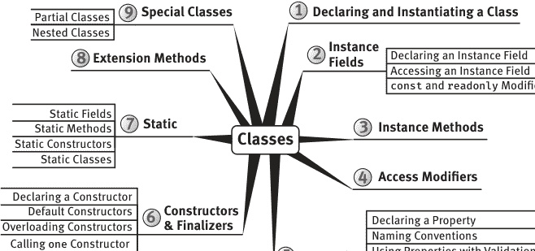

每个章节的主题出现在思维导图中心。高级主题从核心展开。思维导图允许你轻松地吸收从高级到更详细的概念流，减少了遇到你可能需要的非常具体的知识的概率。

根据你的经验水平，特殊功能将帮助你阅读本文。

- *初级主题*提供了专门针对初级程序员的定义或解释。

- *高级主题*让经验丰富的开发者能够关注与他们最相关的材料。

# 前言

- *注意框注释*在框中突出显示关键原则，以便读者轻松识别其重要性。

- *语言对比*侧栏识别了 `C#` 与其前身语言之间的关键区别，以帮助熟悉其他语言的人。

从高层次来说，软件工程是关于管理复杂性的，为了这一目标，我组织了《Essential C# 8.0》。第 1–5 章介绍了基本的结构化编程，使你能够立即开始编写简单的功能代码。第 6–10 章介绍了 `C#` 的面向对象结构。初学者在继续学习书中其余部分的更高级主题之前，应该重点关注理解这一部分。第 12–14 章引入了额外的减少复杂性的结构，处理几乎所有现代程序所需的通用模式。这引出了带有反射和属性的动态编程，它在随后的章节中被广泛用于线程和互操作性。

本书以第 24 章“通用语言体系（CLI）”结束，该章节描述了在 `C#` 运行开发平台背景下的 `C#`。该章节出现在最后，是因为它不是 `C#` 特有的，而且它与书中其他部分的语法和编程风格不同。然而，该章节适用于任何时间阅读，可能最合适是在第 1 章之后立即阅读。

以下是每个章节的描述（在此列表中，用**粗体**显示的章节编号表示存在 `C# 7.0-8.0` 的内容）。

- *第 1 章，C# 简介*：在展示 `C# HelloWorld` 程序后，本章将对其进行解构。它应该让读者熟悉 `C` 语言的外观和感受，并提供有关编译和调试程序的详细信息。它还介绍了如何编译和调试他们的程序。

- *第 2 章，数据类型*：本章介绍了 `C#` 的基本结构和数据类型。

- *第 3 章，更多数据类型*：本章深入探讨了值类型、引用类型，以及 `C# 3.0` 引入的元组类型、可空引用类型。

- *第 4 章，运算符与控制流*：为了利用迭代能力，你需要了解循环和条件逻辑。本章还涵盖了运算符、类型转换以及 预处理指令。


- *第 5 章，方法与参数*：本章研究了方法。它包括值传递、引用传递以及通过返回数据。`C# 4.0` 引入了默认参数，本章介绍了如何使用它们。

- *第 6 章，类*：由于类是对象的构建块，本章结合了这些结构形成对象。本章还介绍了 `C# 8.0` 引入的属性。

- *第 7 章，继承*：继承是许多开发者的核心概念。本章讨论了继承的语法，包括重写。

- *第 8 章，接口*：本章展示了如何使用接口进行类之间的交互。`C# 8.0` 引入了默认接口成员。

- *第 9 章，值类型*：虽然值类型不像引用类型那样流行，但有时需要定义具有类似行为的结构。

- *第 10 章，良好的类型*：本章讨论了更高级的类型。它包含了数组，并介绍了命名空间和 XML 注释。

- *第 11 章，异常处理*：本章扩展了异常处理的介绍，并描述了创建自定义异常。它还包含关于异常处理的最佳实践。

- *第 12 章，泛型*：泛型可能是 `C# 1.0` 缺失的核心功能。本章完全涵盖了 `2.0` 特性。此外，`C# 4.0` 增加了协变和逆变的支持——这是在泛型文中提到的。

- *第 13 章，委托与 Lambda 表达式*：委托通过定义处理内部事件的模式开始将 `C#` 与之前区分。`Lambda` 表达式是使 `C# 3.0 LINQ` 可能的关键概念。本章解释了 `Lambda` 表达式如何通过提供更优雅简洁的语法来构建委托。本章为下一节的集合 API 奠定了基础。

- *第 14 章，事件*：封装委托是通用语言运行时的核心结构。另一种 `C# 2.0` 特性匿名方法也在此介绍。

- *第 15 章，使用标准查询运算符的集合接口*：`C# 3.0` 引入的简单而强大的变化在本章开始大放异彩，我们查看 `Enumerable` 的扩展方法。该类提供了名为标准查询运算符的集合 API，并在此处详细讨论。

- *第 16 章，使用查询表达式的 LINQ*：仅使用标准查询运算符会导致一些难以理解的长语句。然而，查询表达式提供了一种与 SQL 密切匹配的替代语法，如本章所述。

# 前言

- * 第 18 章，反射、属性与动态编程：面向对象的编程是 20 世纪 80 年代后期编程结构范式转变的基础。类似于，属性促进了声明式编程和嵌入式元数据，开启了新的范式。本章介绍了属性并讨论了如何通过反射检索它们。它还涵盖了通过基类库（Base Class Library）中的序列化框架进行文件输入输出。在 `C# 4.0` 中引入了一个新关键字 `dynamic`。这消除了运行之前的所有类型检查，极大地扩展了 `C#` 的功能。

- * 第 19 章，引入多线程：大多数现代程序都需要使用线程来执行耗时任务，同时确保对并发事件做出积极响应。随着程序变得越来越复杂，它们必须采取额外的措施来保护这些高级环境中的数据。编写多线程应用程序是复杂的。本章介绍了如何与任务（tasks）一起工作，包括取消，以及如何处理在任务上下文中执行的异常。

- * 第 20 章，编写基于任务的异步模式：本章深入探讨了基于任务的异步模式及其配套的 `async/await` 语法。它为多线程编程提供了一种显著简化的方法。此外，还包含了 `C# 8.0` 的异步流概念。

- * 第 21 章，并行迭代：引入改进的一种简单方法是使用 `Parallel` 对象或 Parallel LINQ 库对数据进行并行迭代。

- * 第 22 章，线程同步：在前的基础上，本章演示了一些内置的线程模式，这些模式可以简化多线程代码的显式控制。

- * 第 23 章，平台互操作与不安全代码：由于 `C#` 是一种相对年轻的语言，用其他语言编写的代码多于 `C#`。为了利用这些现有代码，`C#` 通过 P/Invoke 支持互操作性——即调用非托管代码。此外，`C#` 还允许使用指针和直接内存操作。虽然带有指针的代码需要特殊权限才能运行，但它提供了与传统的基于 C 的应用程序接口完全交互的能力。

- * 第 24 章，通用语言体系：从根本上说，`C#` 是设计为在底层通用语言体系（Common Language Infrastructure）之上的最有效编程语言。本章深入探讨了 `C#` 程序与底层运行时及其规范的关系。

- * `C# 6.0`、`7.0` 和 `8.0` 索引：这些索引为 `C# 6.0` 到 `8.0` 中添加的功能提供了快速参考。它们专门设计用于帮助程序员快速将其语言技能更新到较新版本。

我希望你发现这本书是建立 `C#` 专业知识的极佳资源，并在你精通 `C#` 很久之后，继续参考它来处理那些不频繁使用的领域。

> —Mark Michaelis

IntelliText.com/mark

Twitter: @Intelligent, @MarkMichaelis

在 InformIT 网站上注册您的《Essential C# 8.0》，以便在更新和/或更出现时方便地访问。要开始注册过程，请访问 informit.com/register 并登录或创建账户。输入产品 ISBN（9780135972267）并点击提交。在“注册产品”（Registered Products）选项卡中查找该产品旁边的“访问奖励”（Access Bonus）链接，并点击该链接访问任何可用奖励材料。如果您希望接收新版本和更新的独家优惠，请勾选接收我们的邮件。

# 致谢

任何书籍都无法由作者独立出版，我对比帮助我完成这本书的许多人深表感谢。我感谢人的顺序并不重要，排在最前面的除外。鉴于这是该书的第七版，你可以想象我的家庭为了让我在过去的 14 年里写作付出了多少牺牲（更不用之前的书了）。Benjamin、Hanna 和 Abigail 觉得爸爸被这本书分散了心神，但 Elisabeth 遭受的甚至更多。她经常被留下来独自处理各项事务，独自支撑起家庭的世界。（2017 年在度假期间，我花了好几天时间在室内写作，而他们本更想去海滩。）

我编写《Essential C# 8.0》时的不同在于，与其牺牲这么多家庭生活，我的工作真正遭受了损失。我非常感谢自己被一个优秀的软件工程师团队包围，他们独立于我产出卓越的作品。如果这不够，几位工程师伸出来帮助我处理无数细节，从错误检查、DevOps、列表编号到技术编辑。特别感谢 Cameron Osborn、Phil Spokas（他帮助了第 24 章的部分写作）、Andres Scott，以及最近的 Austen Frost。

自 2013 年以来，我一直在 IntelliText 与 Kevin Bost 合作，他不断用他在软件开发方面惊人的天赋令我惊喜。他不仅 `C#` 知识的深度令人惊叹，而且在许多其他开发技术上都是 10 级专家。出于此及其他，我邀请 Kevin Bost 在今年担任正式编辑审阅这本书，我对此深表感谢。他对书中自早期版本以来一直存在的内容提出了见解和改进，而其他人都没有提到过。这种对细节的关注，结合他对卓越的无懈追求，真正使《Essential C# 8.0》成为那些想要专注于该语言的人的精辟典典 `C#` 著作。

当然，Eric Lippert 同样非常出色。他对 `C#` 的掌握着令人惊叹，我非常感谢他的编辑，尤其是当他追求完美时。他对 `C# 3.0` 章节的改进意义重大，在第二版中我非常遗憾没有在那里。然而，这种遗憾现在已经消除了；他细心地审查了《Essential C# 4.0》的所有章节，并一直担任 `C# 5.0` 和 `6.0` 的贡献作者。非常感激他担任《Essential C# 8.0》的技术编辑。感谢你，Eric！我无法想象比你更合适的人。你为标准从优秀提升到卓越赢了全部荣誉。

正如 Eric 和 `C#` 一样，极少数人像 Stephen Toub 一样精 .NET 多线程。因此，Stephen 专注于了重写（第三次）的多线程章节以及它们对 `C# 5.0` 异步的支持。感谢你，Stephen！

多年来，许多技术编辑都详细地审查了每一章以确保技术准确性。我对这些人人员仍然捕捉到的错误感到非常惊讶：Paul Bramsman, Kody Brown, Andrew Comb, Ian Davis, Doug Dochoch, Gerard Frantz, Dan Haley, Thomas Heavy, Angus Horton, Brian Jones, Shane Kercheval, Angelika Langer, Neal Lundby, John Michaels, Jason Morse, Nicholas Palermo, Jason Peterson, Jon Skeet, Michael Stokesbury, Robert Stokes 和 John Timney。

# 关于作者

Mark Michaelis 是 IntelliTect 的创始人，这是一家创新的软件架构和开发公司，他在其中担任首席架构师和培训师。Mark 在领导他成功的公司的同时，也遍布全球进行关于领导力和技术的专题会议演讲，并代表微软或其他客户进行活动。他还撰写了大量的文章和书籍，是东华华盛顿大学的兼职教授、斯波波尔 .NET 用户组的创始人，以及年度 TEDx Coeur d'Alpine 活动的共同组织者。

作为世界级的 `C#` 专家，Mark 从 2007 年起一直担任微软区域总（Regional Director），并拥有超过 25 年的微软 MVP 身份。

Mark 拥有伊利诺伊大学的哲学学士学位和伊利诺伊理工学院的计算机科学硕士学位。

在不折腾他的电脑时，Mark 忙于在其他国家追逐他的孩子们，或者玩壁球（他在 2016 年停止了参加铁人三项比赛）。Mark 与他的妻子 Elisabeth 以及三个孩子 Benjamin、Hanna 和 Abigail 生活。

`C#` 编程语言可以用于构建在各种操作系统（平台）上的软件组件和应用程序——包括移动设备、游戏主机、物联网（IoT）、微服务和桌面应用程序。`C#` 是免费的；事实上，它是完全开源的，你可以查看、修改、分发并贡献任何改进。作为一种语言，`C#` 构建在其先身语言（C、C++ 和 Java）的特征之上，让许多经验丰富的程序员感到非常熟悉。

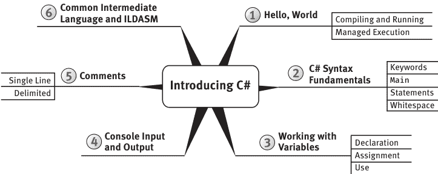

1. 第一次 `C#` 设计会议发生在 1998 年。

# 第 1 章：介绍 C#

本章介绍了 `C#`，通过传统的 HelloWorld 程序，它将让你熟悉 `C#` 的语法风格和结构，并让你能够生成简单的 `C#` 程序。在讨论 `C#` 基础知识之前，托管执行上下文概述解释了 `C#` 程序如何在运行时执行。本章以讨论变量声明、从控制台检索数据以及 `C#` 注释结束。

## Hello World

学习新编程语言的最佳方法是编写代码。第一个示例是经典的 HelloWorld 程序。在这个程序中，你将在屏幕上显示一些文本。列表 1.1 显示了完整的 HelloWorld 程序；在接下来的章节中，你将编译并运行代码。

# 列表 1.1：C# 中的 HelloWorld

```
class HelloWorld
{
    System.Console.WriteLine("Hello. My name is Inigo Montoya.");
}
```

> 注意

> `C#` 是一种区分大小写的语言：错误的大小写会导致代码无法编译。

拥有 Java、C 或 C++ 编程经验的人会立即看到相似之处。就像 Java 一样，`C#` 继承了 C 和 C++ 的基本语法。

1. 如果你对 Inigo Montoya 感到困惑，请参考电影《新娘》。

2. 在创建 `C#` 时，语言创建者审查了 C/C++ 的规范，删除了他们不喜欢的特征，并创建了他们喜欢的列表。该小组包含了具有其他语言强大背景的设计师。

# Hello World 3

语法符号（如分号和大括号）、特性（如大小写敏感性）和关键字（如 `class`、`public` 和 `void`）对于熟悉这些语言的程序员来说是熟悉的。初学者和其他语言的程序员会很快发现这些结构非常直观。

## 创建、编辑、编译和运行 C# 代码

一旦写好了 `C#` 代码，就可以编译并运行它了。你可以选择使用哪些 .NET 实现——有时被称为 .NET 框架。通常情况下，该实现被封装成软件开发工具包（SDK）。SDK 包含了编译器、运行时执行引擎、运行时可以访问的实用功能框架（后文将介绍“应用程序编程接口”）以及 SDK 可能封装的任何额外工具（例如用于自动化构建步骤的构建引擎）。考虑到 `C#` 自 2000 年起即可公开，有很多不同的 .NET 框架供选择（后文将介绍“多个 .NET 框架”）。

对于每个 .NET 框架，安装说明取决于你正在哪个操作系统上开发以及你选择了哪个 .NET 框架。因此，我建议你有时访问 https://microsoft.com/download 获取下载和安装说明，选择第一个 .NET 框架，然后根据操作系统下载包。如果你不确定使用哪个 .NET 框架，请默认选择 .NET Core。它适用于 Linux、macOS 和 Windows。此外，由于跨平台能力，我将在书中优先使用 .NET Core 实例。

还有许多编辑源代码的方法，包括最原始的工具，如 Windows 上的记事本、Mac 上的文本编辑或 Linux 工具。然而，你可能想要更高级的工具以便至少让你的代码有颜色。任何支持 `C#` 的编程编辑器都胜任。如果你还没有偏好的工具，我建议你考虑开源编辑器 Visual Studio Code (https://code.visualstudio.com)。为了优化在 Studio 中进行 `C#` 工作，你需要安装如图 1.1 所示的 `C#` 扩展，或者如果你在 Windows 或 Mac 上工作，请考虑 Microsoft Visual Studio 2019（或更高版本）——参见 https://visualstudio.microsoft.com/vs/。两者都是免费的。

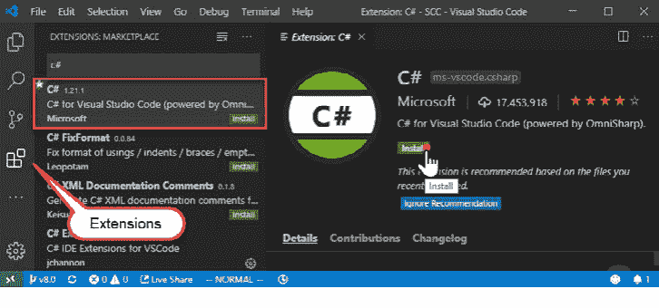

图 1.1：为 Visual Studio Code 安装 `C#` 扩展

接下来的章节提供了编辑器的说明。对于 Visual Studio Code，我们依靠命令行界面 (CLI) 工具 `dotnet CLI` 来创建初始 `C#` 程序脚架并编译和运行程序。对于 Windows 和 Mac，我们重点介绍使用 Visual Studio 2019。

1. 在 Microsoft Windows 上打开命令提示符，或在 Mac/macOS 上打开终端应用程序。（可选，可以考虑使用跨平台的命令行界面 PowerShell。⁵）

2. 创建一个你想放置代码的新目录。考虑使用如 `./HelloWorld` 或 `./EssentialCSharp/HelloWorld` 的名称。从命令行使用：

```
mkdir ./HelloWorld
```

3. 进入该新目录，使其成为命令提示符的当前位置。

```
cd ./HelloWorld
```

4. 在 HelloWorld 目录中执行 `dotnet new console` 为你的程序生成初始脚手架（或项目）。虽然生成了几个文件，但两个主要文件是 Program.cs 和项目文件：

```
dotnet new console
```

5. 运行生成的程序。这将编译并运行由 `dotnet new console` 命令创建的默认 Program.cs。Program.cs 的内容与代码清单 1.1 类似，但它输出的是“Hello World!”。

```
dotnet run
```

尽管我们没有显式地请求编译（生成），但该步骤仍然会发生，因为它在执行 `dotnet run` 命令时被隐式地调用了。

6. 编辑 Program.cs 文件并修改代码以匹配代码清单 1.1 所示的内容。如果你使用 Visual Studio 打开并编辑 Program.cs，你将看到感知 `C#` 编辑器的优势，因为代码会着色，指示程序中不同类型的结构。要打开并编辑，请使用命令：

```
code
```

（或者，输出 1.1 显示了一种仅使用命令行的方法，它适用于 Bash 和 PowerShell。）⁶

7. 重新运行程序：

```
dotnet run
```

⁵ https://github.com/PowerShell/PowerShell

# 第 1 章：引入 C#

输出 1.1 显示了执行上述步骤后的输出。

```

Processing post-creation actions...
Running dotnet restore on C:\Data\EssentialCSharp\YogaX1\1\SCC\
Chapter01HelloWorld\HelloWorld.csproj
Restore completed in 100.38 ms for C:\Data\EssentialCSharp\YogaX1\1\SCC\
Restore succeeded.
5> dotnet run
Hello World!
6> echo
class HelloWorld
{
    static void Main()
    {
        System.Console.WriteLine("Hello. my name is Inigo Montoya.");
    }
}
Hello. My name is Inigo Montoya.
```

使用 Visual Studio 2019，过程是类似的，但不是使用命令行，而是使用集成开发环境 (IDE)，它有你可以选择的菜单，而不是从命令行执行所有操作：

- 1. 启动 Visual Studio 2019。

- 2. 点击**创建新项目**按钮（如果启动窗口可见，你可以从文件->启动窗口菜单打开它，或直接通过**文件->新建项目**（Ctrl+Shift+N 菜单）创建项目）。

- 3. 在**搜索框**（Ctrl+E）中输入 *Console App* 并选择 **Console App (.NET Core)—Visual C#** 项（见图 1.2）。

- 4. 对于**项目名称**文本框，使用 *HelloWorld*，对于**位置**，选择你自定义的工作目录（见图 1.3）。

- 6. 输出中的粗体格式表示用户输入的内容。

最近的项目模板

- 类库 (NET Core)

- 类测试项目 (NET Core)

- 类库 (NET Standard)

- MSTest 测试项目 (NET Core)

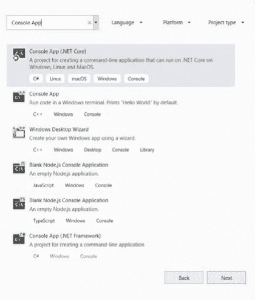


图 1.2：创建新项目的对话框

## 配置你的新项目

`Console App (.NET Core)`

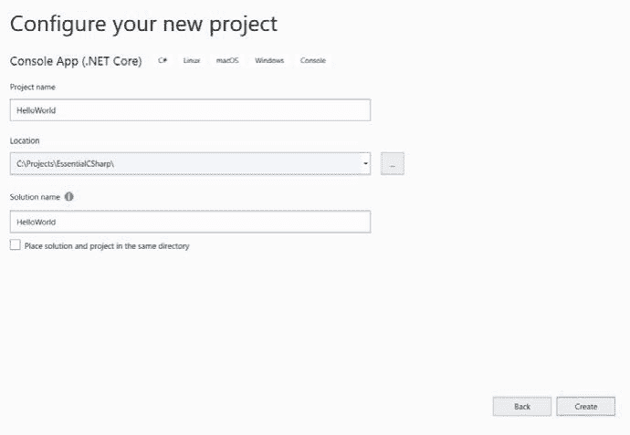

图 1.3：新项目对话框

# 第 1 章：引入 C#

5. 一旦项目创建，你就应该看到一个 `Program.cs` 文件，如图 1.4 所示。

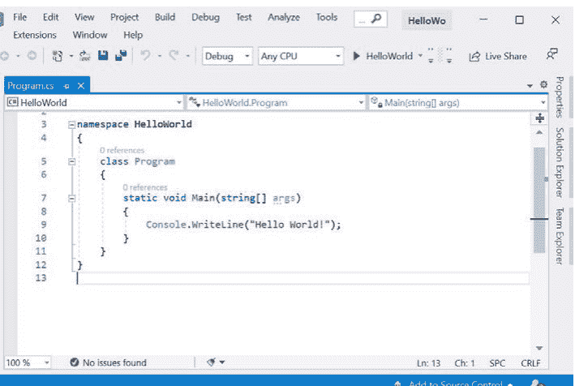

图 1.4：显示 `Program.cs` 文件的对话框

- 6. 使用调试->不调试启动菜单运行生成的程序。这将显示命令行窗口并带有输出 1.2 所示文本，但第一行将仅显示“Hello World!”

7. 修改 `Program.cs` 以匹配代码清单 1.1。

8. 重新运行程序以查看输出 1.2 所示的输出。

```
> Hello. My name is Inigo Montoya.More output
按任意键关闭此窗口 . .
```

使用 IDE 的一个重要特性是它支持调试。要尝试一下，请在 Visual Studio 或 Visual Studio Code 中遵循以下额外步骤：

- 1. 打开 `Program.cs` 后，

- 2. 打开 `Program.cs` 后，

- 3. 打开 `Program.cs` 后，

## 语言对比：Java——文件名必须为类名

在 Java 中，文件名必须遵循类名。在 C# 中，经常遵循这一约定，但并非强制。在 C# 中，可以在一个文件中包含两个类，甚至一个类可以跨越多个文件。

虽然不是一定需要，但通常会包含一个配置文件作为 C# 项目源代码的一部分。项目内容会根据应用程序类型和 .NET 框架的不同而异。然而，它至少识别了包含哪些文件、要构建什么类型的应用程序（控制台、Web、移动、测试项目等）、支持哪个 .NET 框架，以及调试或启动应用程序所需的潜在设置，以及代码可能依赖的其他依赖（称为库）。例如，在本节创建的简单 .NET Core 应用程序项目文件位于代码清单 1.2。

代码清单 1.2：示例 .NET Core 控制台项目文件

```
<Project Sdk="Microsoft.NET.Sdk">
  <PropertyGroup>
    <OutputType>Exe</OutputType>
    <TargetFramework>netcoreapp3.1</TargetFramework>
  </PropertyGroup>
</Project>
```

由 `dotnet build` 创建的编译输出是一个程序集 `HelloWorld.dll`。扩展名代表动态链接

- 1. 注意，如果你使用 Microsoft .NET Framework 创建控制台程序，编译代码被放在 `HelloWorld.exe` 文件，只要计算机安装了 Microsoft .NET Framework，就可以直接执行它。

库（DLL），在 .NET Core 中，即使是像这样的控制台程序，所有程序都具有 .dll 扩展名。默认情况下，.NET Core 应用程序的编译输出放置在子目录（`./bin/debug/netcoreapp3/`）中。使用 Debug 目录是因为默认配置是调试。此配置使输出针对调试进行了优化，而不是优化性能。编译输出不会独立运行。相反，它需要 CLI 来托管代码。对于 .NET Core 应用程序，这需要使用 `dotnet.exe` 进程（Linux 和 Mac 上为 `dotnet`）作为应用程序的宿主。这就是为什么使用 `dotnet run` 命令执行程序。尽管如此，有一种方法可以生成一个包含必要运行时文件的独立可执行文件，但这需要安装 dotnet 运行时——请参阅“高级主题：发布独立执行文件”。

## 高级主题

## 发布独立执行文件

可以输出一个可以独立于 `dotnet` 命令运行的独立可执行文件。要实现这一点，请运行 `dotnet publish` 命令并带有 `--runtime (-r)` 参数，该参数指定了输出兼容的目标平台（操作系统）。例如，在大多数 Linux 平台上，你可以在与 `CSPROJ` 文件相同的目录中使用 `linux-x64`：

```
dotnet publish --runtime linux-x64
```

执行此命令将创建一个目录（`./bin/Debug/netcoreapp3.1/linux-x64/publish/`），该目录包含了无需先安装运行时即可运行 `HelloWorld` 控制台程序的所有文件。要执行 `HelloWorld` 程序，如果当前目录不是发布目录，请指定路径：

```
.bin/Debug/netcoreapp3.1/linux-x64/publish/HelloWorld
```

（在 Windows 上，可执行文件名为将包含 .exe 扩展名，但在运行程序时不需要指定它。）

请注意，生成的可执行文件将只能在 `linux-x64` 平台上运行。你需要为你目标的每个平台执行 `dotnet publish` 命令。其他平台的常见运行时标识符包括 `win-x64` 和 `osx-x64`（完整列表请参阅 http://itl.tc/ridcatalog）。

也可以将独立可执行文件发布到单个文件中（而不是通常所需的约 200 个文件）。对于单个可执行文件，在命令末尾附加 `/p:PublishSingleFile=true`：

```
dotnet publish --runtime linux-x64 -p:PublishSingleFile=true
```

关于 `-p` 参数的更多信息出现在第 10 章。

## 核心 C# 源代码

与本书相关的源代码包含一个 `EssentialCSharp.sln`，它将所有章节的代码组合在一起。可以使用 Visual Studio 或 dotnet CLI 对源代码进行构建、运行和测试。

也许简单的方法是将源代码粘贴到本节早些创建的 `HelloWorld` 程序中，然后执行源代码。或者，源代码包含了每个章节的项目文件以及一个菜单，在执行程序时可以从该菜单选择要运行的列表项（listing），如接下来的两个章节所示。

## 使用 Dotnet CLI

要使用 dotnet CLI 构建并执行代码，请打开命令提示符，并将当前目录设置为与 `EssentialCSharp.sln` 文件相同的目录。从那里使用 `dotnet build` 命令编译所有项目。

要运行特定项目的源代码，导航到包含项目文件的目录并运行 `dotnet run` 命令。或者，从任何目录，使用 `dotnet run -p <project>` 命令，其中项目文件是你尝试执行的文件的路径（例如，`dotnet run -p .\src\Chapter01\Chapter01.csproj`）。执行后，程序将提示要执行哪个列表项，然后继续执行该项。

许多列表项在 `Chapter?? Tests` 目录中有相应的单元测试，其中 `[?]` 表示章节号。要执行测试，请从要执行的测试所在的项目目录运行 `dotnet test`（或从 `EssentialCSharp.sln` 文件所在运行相同的命令来执行所有测试）。

- 本书提供的源代码（以及一些与 C# 早期版本相关的章节）可以在 //IntelliText.com/EssentialCSharp 下载。你也可以直接从 GitHub 下载代码：https://github.com/IntelliText/EssentialCSharp。

## C# 语法基础

### 使用 Visual Studio
打开解决方案文件后，使用“Build->Build Solution”（生成->生成解决方案）菜单用 Visual Studio 编译代码。在执行源代码之前，你需要通过将关联项目设置为“启动项目”来选择要执行哪个项目。例如，要执行第 1 章中的示例，你会右键点击 `Chapter01` 项目并选择“Set as StartUp Project”（设为启动项目）。如果没有选择正确的项目，在执行时指定列表项编号将导致出现带有消息“Error, could not run the Listing...”的异常。

一旦你选择了正确的项目，就可以从“Debug->Start Without Debugging”（调试->不调试启动）菜单运行项目。或者，如果你想调试项目，可以使用“Debug->Start Debugging”（调试->开始调试）。运行后，程序将提示你想要执行的列表项（例如 18.33）。如前文所述，你只能输入设为启动的项目中的列表项。

许多列表项都有相应的单元测试。要执行测试，打开测试项目并导航到要执行的列表项对应的对应位置。从那里，右键点击测试方法并选择“Run Tests”（Ctrl+R, T）或“Debug”（Ctrl+R, T）。

## C# 语法基础
为了启用编译器，某些词具有特殊状态。这些被称为关键字的词提供了意义。在 C# 中考虑这些关键字。由于这些规则，编译器会发出错误。在 `HelloWorld` 程序中，关键字是组织的示例。编译器使用关键字来解释结构。

## C# 关键字

| 1.1 | | |
| :--- | :--- | :--- |
| abstract | enum | stackalloc |
| alias | event | string |
| as | explicit | struct |
| async | finally | switch |
| await | false | object |
| base | fixed | order |
| break | group | try |
| bool | get | this |
| byte | in | uint |
| char | goto | unsafe |
| class | global | volatile |
| const | internal | virtual |
| continue | int | void |
| catch | long | ref |
| default | remove | var |
| delegate | into | where |
| descending | is | when |
| do | join | set |
| double | let | while |
| else | lock | short |
| dynamic | lock | sizeof |
| decimal | namespace | yield |
| event | new | typeof |
| extern | null | keyword (n) |

## C# 语法基础

在 C# 1.0 之后，引入了新的关键字。然而，后续版本的某些构造使用了上下文关键字，它们仅在指定位置具有意义。在这些位置之外，上下文关键字没有意义。

## 标识符

与其他语言一样，C# 包含标识符来识别构造。在列表 1.1 中，`HelloWorld` 和 `Main` 是标识符的示例。标识符随后会被分配给构造，因此开发者分配的名称是有意义的，而不是任意的。

选择简洁且指示性名称的能力是优秀程序员的重要特征，因为这意味着结果更容易被理解和重用。清晰度和一致性非常重要，以至于框架设计指南（http://bitly/dotnetguidelines）建议不要在标识符中使用缩写。

标识符有两种大小写格式。Pascal 命名法（称为 PascalCase），.NET 框架创建者如是称为

9. 存在一些罕见且不幸的不兼容之处，例如：
* C# 2.0 使用 语句实现 `IDisposable`，而不是简单地使用 `Dispose()` 方法。
* 某些罕见的泛型表达式在版本之间存在差异。例如，C# 1.0 中的 `F(G<A,B>(B>7))`，但在 C# 2.0 中，它意味着调用泛型 `G<A,B>` 并传入参数 7，然后将结果传递给 F。

# 第 1 章：引入 C#

在 Pascal 编程语言中，流行的做法是将标识符名称中每个单词的首字母大写；示例包括 `ComponentModel`、`Configuration` 和 `HttpFileCollection`。正如 `HttpFileCollection` 在 HTTP 中所示的，当使用超过两个字母的缩写词时，仅首字母大写。第二种格式是驼峰命名法（下称为 camelCase），遵循相同的约定，不同之处第一个字母是小写的；示例包括 `firstName`、`iStream` 和 `DreadPirateRoberts`。

### 指南
- 在命名标识符时，**优先**考虑清晰性而非简洁。
- **不要**在标识符名称中使用缩写或收缩形式。
- 除非被广泛接受，否则**不要**使用任何缩写，如果使用，请保持一致性。

请注意，虽然下划线是合法的，但标识符名称中通常没有下划线、连字符或其他非字母数字字符。此外，C# 不遵循其前身的匈牙利命名法（即在名称前加上数据类型的缩写）。这种约定避免了在数据类型更改时必要的重命名，也避免了在使用匈牙利命名法时未调整数据类型前缀所导致的不一致。

在少数情况下，某些标识符（如 `Main`）在 C# 语言中具有特殊含义。

### 指南
- 对于两个字母的缩写词，两个字母都要大写，驼峰命名标识符的首单词除外。
- 对于三个或更多字母的缩写词，仅大写第一个字母，驼峰命名标识符的首单词除外。
- **不要**大写驼峰命名标识符开头缩写中的任何字符。
- **不要**使用匈牙利命名法（即不要在变量名中编码其类型）。

## 高级主题

### 关键字
虽然很少见，但如果关键字包含 @ 作为前缀，则可以作为标识符。例如，你可以将本地变量命名为 `@return`。同样（尽管它不符合 C# 标准的大小写规范），可以将方法命名为 `@throw`，并在后面跟上括号：`@throw()`。

Microsoft 的实现中还有四个未文档的关键字：`__arglist`、`__makeref`、`__reftype` 和 `__refvalue`。这些关键字仅在罕见的互操作场景中需要，在所有实际用途中你可以忽略它们。请注意，这四个特殊关键字以两个下划线开头。C# 的设计者保留在未来版本中将任何以两个下划线开头的标识符变为关键字的权利；为了安全，请避免自己创建此类标识符。

# 类型定义

C# 中的可执行代码出现在类型定义中，最常见的类型定义以 `class` 关键字开始。类定义是代码中通常以 `class` 标识符 `{ ... }` 开始的部分，如列表 1.3 所示。

列表 1.3：基本类声明

```
class HelloWorld
{
    ...
}
```

用于该类型的名称（在本例中为 `HelloWorld`）可以变化，根据约定，它必须是 PascalCase。因此，对于此示例，其他可能的名称有 `HelloInigoMontoya`、`Hello` 或简单的 `Program`。（当类包含下文描述的 `Main()` 方法时，使用 `Program` 是一个值得遵循的良好约定）

# 指南
- 使用名词或名词短语来命名类。
- 所有类名均使用 PascalCase 驼峰命名法。

通常，程序包含多个类型，每个类型都包含方法。

# 第 1 章：引入 C#

## Main 方法

## 初学者主题

## 什么是方法？
在实践中，C# 中的方法是由方法声明（例如 `static void Main()`）引入的命名代码块，并（通常）后跟大括号内的零或多个语句。用于执行计算和/或操作。像面语言中的段落一样，方法提供了一种结构化和组织代码的方法，使其具可读性。更重要的是方法可以重复使用并从多个地方调用，从而避免了重复代码的需求。方法声明引入了方法，并定义了方法名称以及在方法之间传递的数据。在列表 1.4 中，`Main()` 后接 `{ ... }` 是一个 C# 方法的示例。C# 开始执行的位置是方法，它以 `static Main()` 开始。当你在控制台输入 `dotnet run` 时，程序启动，解析 `Main` 的位置并执行列表 1.4 所示的第一条语句。

列表 1.4：拆分 HelloWorld

```
class HelloWorld
{
    static void Main() { /* 方法声明 */
    {
        System.Console.WriteLine("Hello, My name is Inigo");
    }
}
```

虽然 `Main` 方法

## 高级主题

## 方法的声明
`Main` 方法声明是一个执行操作的代码块。在 C# 中，方法通过返回类型、名称和可选的参数列表定义。列表 1.5 显示了带参数的方法。

列表 1.5：带参数和返回类型的方法

```c
static int Main(string[] args)
{
    // ...
}
```

C# 开始执行的位置是方法，它以 `static void Main()` 开始。当你在控制台输入 `dotnet run` 时，程序启动，解析 `Main` 的位置并执行列表 1.4 所示的第一条语句。虽然 `Main` 方法声明可以发生变化，但 C# 始终使用大括号作为方法体。

## 高级主题

## 无分号的语句
C# 中的许多编程元素以分号结束。一个不包含分号的示例是 `switch` 语句。因为 `switch` 语句始终包含大括号，所以 C# 不需要在该语句后的分号。事实上，代码块本身也被视为语句（它们由语句组成），并且不需要使用分号来结束。同样，在某些情况下（例如使用声明时），分号作为后缀出现，但它并不是语句。

## 语句和语句分隔符

`Main` 方法包含单个语句 `System.Console.WriteLine()`，它用于向控制台写入行文本。C# 通常使用分号来表示语句的结束。声明变量、控制程序流和调用方法都是语句的典型用途。

创建换行符并不分隔语句，你可以将多个语句放在同一行，C# 编译器将把该行解释为多条指令。例如，列表 1.6 在单行内包含两个语句，组合在一起可以显示 Up 和两个独立的行。

列表 1.6：单行多条语句

```
System.Console.WriteLine("Up");System.Console.WriteLine("Down");
```


C# 允许跨行拆分语句。再次，C# 编译器寻找分号来表示语句的结束。在列表 1.7 中，例如，`HelloWorld` 程序中的原始 `WriteLine()` 语句被拆成了多行。

# 列表 1.7: 将单条语句跨多行拆

```csharp
System.Console.WriteLine(
    "Hello. My name is Inigo Montoya.");
```

## 初学者主题

## 什么是空白符？
空白符是一个或多个连续的格式字符（如制表符、空格和换行符）的组合。消除单词之间所有的空白符显然具有重要意义，反之在引号字符串内包含空白符也是如此。

## 空白符

分号使得 C# 编译器能够忽略代码中的空白符。除了少数例外情况，C# 允许开发者在代码的任何地方插入空白符，而不改变其语义含义。在列表 1.6 和 1.7 中，在语句内部插入换行符、在语句之间插入换行符或完全删除并不重要，并且对编译器创建的结果的可执行文件没有影响。

程序员经常使用空白符对代码进行缩进以提高可读性。请考虑列表 1.8 和 1.9 中的两种变体。虽然这两个示例看起来与原始程序不同，但 C# 编译器认为它们在语义上是等价的。

# 列表 1.8: 无缩进

```csharp
class HelloWorld
{
    static void Main()
    {
        System.Console.WriteLine("Hello Inigo Montoya");
    }
}
```

# 列表 1.9: 空白符

```csharp
class HelloWorld{static void Main(){System.Console.WriteLine("Hello Inigo Montoya");}}
```

# 第 1 章：引入 C#

## 初学者主题

## 使用空白符格式化代码
使用空白符对代码进行缩进对于提高可读性很重要。当你开始编写代码时，需要遵循建立的标准和约定来增强代码的可读性。本书使用的约定是将大括号单独放在一行，并对括号对之间包含的代码进行缩进。如果第一对括号内部出现另一个括号，则第二组括号内的所有代码也都要缩进。这并不是一个统一的标准，而是一种风格上的偏好。

## 操作变量
现在你已经接触了最基本的 C# 程序，是时候声明局部变量了。一旦声明了变量，就可以给它赋值、将该值替换为新值，并将其用于计算、输出等。然而，你不能更改变量的数据类型。列表 1.10 中的 `string` 就是变量声明。

# 列表 1.10: 声明并赋值变量

```csharp
class HelloWorld
{
    string max;
    max = "Have fun storing the castle!";
    System.Console.WriteLine(max);
}
```

## 初学者主题

## 局部变量
变量是一个指向可以随时间改变的值的名称。声明变量是在方法内部定义局部变量，通过以下方式实现：
- 指定变量将包含的数据类型
- 为其分配一个标识符（名称）

## 数据类型
列表 1.10 声明了一个 `string` 类型的变量。本章中使用的其他常用数据类型是 `int` 和 `char`：
- `int` 是 C# 中整数类型的 own法，大小为 32 位。
- `char` 用于字符类型。它是 16 位，足以容纳 Unicode 字符。

下一章将更详细地查看这些和其他数据类型。

## 初学者主题

## 什么是数据类型？
变量指定的数据类型称为数据类型（或对象类型）。数据类型，简单称为类型，是对具有相似特征和行为的事物的分类。例如，`string` 是一种对所有具有容量的事物（单词、句子、段落）的分类。同样，在编程语言中，类型是对赋予相似属性的项的定义。

### 声明变量
在列表 1.10 中，`max` 是一个 `string` 类型的变量声明，其名称为 `max`。通过指定一次数据类型并用逗号分隔每个标识符，可以在同一语句中声明多个变量。列表 1.11 展示了这种声明。

# 列表 1.11: 在一个语句中声明两个变量

```csharp
string message1, message2;
```

多变量声明允许开发者仅提供一次数据类型，所有变量将具有相同的类型。在 C# 中，变量名可以以任何字母或下划线 `_` 开头，随后是任意数量的字母、数字和下划线。然而根据约定，局部变量名使用驼峰命名法（每个单词的首字母大写）。

## 赋值
要声明局部变量，必须在读取它之前给它赋值。实现此操作的一种方法是使用 `=` 运算符，也称为赋值运算符。运算符是用于标识要执行的功能代码的符号。列表 1.12 展示了如何使用赋值运算符。

# 列表 1.12: 修改变量的值

```csharp
class StormingCastle
{
    static void Main()
    {
        string max;
        max = "Have fun storing the castle!";
        max = "Think it will work?";
        System.Console.WriteLine(max);
        max = "It would take a miracle.";
        System.Console.WriteLine(max);
    }
}
```

从此列表中可以观察，可以在变量声明的一部分进行赋值（如 `max` 所示），也可以在随后的单独语句中赋值（如 `max` 所示）。赋值的值必须始终在声明的右侧。运行编译后的程序会产生输出 1.3 所示的代码。

# 输出 1.3

```
dotnet run
Have fun storing the castle!
Think it will work?
It would take a miracle.
```

在这个列表中，我们显式地展示了 `dotnet run`。在未来的输出中，除非该命令有特殊之处，否则省略此行。C# 要求在读取局部变量之前（由编译器确定）必须“已赋值”。此外，赋值产生一个值。因此，C# 允许在同一语句中进行赋值，如列表 1.13 所示。

# 列表 1.13: 返回可再次赋值的值

```csharp
class StormingCastle
{
    static void Main()
    {
        // ...
        string requirements, max;
        requirements = max = "It would take a miracle.";
        // ...
    }
}
```

## 使用变量
赋值的结果可以使用变量标识符引用该值。因此，当你在 `System.Console.WriteLine(max)` 语句中使用变量 `max` 时，程序会显示“Have fun storing the castle!”，即 `max` 的值。更改 `max` 的值并执行相同的 `System.Console.WriteLine(max)` 语句将显示新的 max 值“It would take a miracle.”。

# 第 1 章：引入 C#

## 高级主题

### 字符串是不可变的
所有 `string` 类型的值（无论是字符串字面量还是其他的）都是不可变的（或不可修改的）。例如，无法将“Come As You Are.”更改为“Come As You Age.”。此类更改需要你重新分配变量，而不是修改变量最初引的数据。

## 控制台输入和输出
本章已经多次使用 `System.Console.WriteLine` 向控制台输出。除了能够输出数据外，程序还需要能够接受用户输入的数据。

### 从控制台获取输入
获取控制台输入的文本的一种方法是使用 `System.Console.ReadLine()`。该方法会停止程序执行，让用户输入字符。当用户按下按键创建换行时，程序继续。`System.Console.ReadLine()` 方法的输出（也称为返回值）是输入的文本字符串。

# 输出 1.4

```
Hey you!
Enter your first name: Inigo
Enter your last name: Montoya
```

在每个提示之后，此程序使用 `System.Console.ReadLine()` 方法来获取用户输入并将其赋值给相应的变量。当第二次 `System.Console.ReadLine()` 赋值完成时，`firstName` 指向值 Inigo，而 `lastName` 指向值 Montoya。

## ■ 进阶主题

## System.Console.Read()

除了 `System.Console.ReadLine()` 方法外，还有一个 `System.Console.Read()` 方法。然而，`System.Console.Read()` 方法返回的数据类型是一个与读取到的字符对应的整数，如果没有可用字符，则返回 -1。要获取实际字符，需要先将整数强制转换为字符，如列表 1.15 所示。

### 列表 1.15: 使用 System.Console.Read()

```csharp
int readValue;
char character;
readValue = System.Console.Read();
character = (char)readValue;
System.Console.Write(character);
```

`System.Console.Read()` 方法在用户按下 Enter 键之前不会返回输入；如果用户输入多个字符，则不会开始处理字符。在 C# 2.0 及以上版本中，你可以使用 `System.Console.ReadKey()`，它与 `System.Console.Read()` 不同，会在单个按键后返回输入。它允许开发者拦截按键并执行操作，例如按键验证、限制字符为数字等

### 向控制台写入输出

在列表 1.14 中，你使用 `System.Console.Write()` 方法而不是 `System.Console.WriteLine()` 来提示用户输入姓和名。`System.Console.Write()` 方法在显示文本后不会换行，而是将当前位置留在与提示相同的同一行。通过这种方式，用户从列表 1.14 中输入的任何文本都展示了 `System.Console.Write()` 的效果。

下一步是将使用 `System.Console.ReadLine()` 获取的值写回控制台。在列表 1.16 中，程序输出了用户的全名。然而，此代码没有像以前那样使用 `System.Console.WriteLine()`，而是使用了一种利用 C# 6.0 特性——字符串插值（string interpolation）的微变体。注意 `Console.WriteLine` 调用中字符串字面量前的美元符号；它表示将使用字符串插值。输出 1.5 显示了相应的输出。

### 列表 1.16: 使用字符串插值

```csharp
class HeyYou
{
    static void Main()
    {
        string firstName;
        string lastName;
        System.Console.WriteLine("Hey you!");
        System.Console.Write("Enter your first name: ");
        firstName = System.Console.ReadLine();
        System.Console.Write("Enter your last name: ");
        lastName = System.Console.ReadLine();
        System.Console.WriteLine($"Your full name is {firstName} {lastName}.");
    }
}
```

### 输出 1.5

```
Hey you!
Enter your first name: Inigo
Enter your last name: Montoya
Your full name is Inigo Montoya.
```

列表 16 没有先写 "Your full name is" 然后再跟另一个用于 `firstName` 的 Write 语句、用于空格的第三个 Write 语句，最后是用于 `lastName` 的 WriteLine 语句，而是使用 C# 6.0 的字符串插值显示了整个输出。通过字符串插值，编译器会将括号内部的内容解释为你可以在其中区域内嵌入代码（表达式），编译器将评估这些代码并转换为字符串。与其逐个执行大量代码并在最后将结果组合成字符串，字符串插值允许你一步完成操作。这使得代码更易理解。

在 C# 6.0 之前，C# 使用的是不同的方法：复合格式化（composite formatting）。使用复合格式化，代码首先提供一个格式字符串来定义输出——参见列表 1.17。

### 列表 1.17: 使用 System.Console.WriteLine() 的复合格式化进行格式
在此示例中，格式字符串为 `Your full name is {0} {1}`。它识别了字符串中用于插入数据的两个索引占位符。每个占位符对应于格式字符串之后出现的参数顺序。

注意，索引值从零开始。每个插入的参数（称为格式项）按照与索引值对应的顺序出现在格式字符串之后。在这个示例中，由于 `firstName` 是紧跟在格式字符串后的第一个参数，它对应于索引值 0。同样，`lastName` 对应索引值 1。

注意格式字符串中的占位符并不是顺序出现的。例如，列表 1.18 交换了索引占位符和逗号的顺序，改变了名字的方式（参见输出 1.6）。

### 列表 1.18: 交换索引占位符和相应的变量

```csharp
System.Console.WriteLine("Your full name is {1}, {0}", firstName, lastName);
```

### 输出 1.6

```
Hey!
Enter your first name: Inigo
Enter your last name: Montoya
Your full name is Montoya, Inigo
```

除了占位符在格式字符串中不连续出现外，还可以在格式字符串中多次使用同一个占位符。此外，可以省略某个占位符。但是，让占位符没有对应的参数是不可能的。

> 注意：由于 C# 6.0 风格的字符串插值几乎总是比替代的复合字符串方法更容易理解，因此在本书的剩余部分中，我们默认使用字符串插值。

### 注释

在本节中，我们通过添加注释修改了列表 1.17 中的程序。这种修改完全不会改变程序的执行；相反，在代码中提供注释可以使不清楚的地方更易理解。列表 1.19 显示了新代码，输出 1.7 显示了相应的输出。

### 控制台输入与输出

### 列表 1.19: 为代码添加注释

```csharp
class CommentSamples
{
    static void Main()
    {
        string firstName; // 名字变量
        string lastName;  // 姓变量
        System.Console.WriteLine("Hey you!"); // 显示问候
        System.Console.Write("Enter your first name: "); // 提示输入
        firstName = System.Console.ReadLine(); // 读取输入
        System.Console.Write("Enter your last name: "); // 提示输入
        lastName = System.Console.ReadLine(); // 读取输入
        // 使用字符串插值输出全名
        System.Console.WriteLine($"Your full name is {firstName} {lastName}.");
    }
}
```

### 输出 1.7

```
Hey you!
Enter your first name: Inigo
Enter your last name: Montoya
Your full name is Inigo Montoya.
```


### 表 1.2: C# 注释类型

| 注释类型 | 描述 | 示例 |
| :--- | :--- | :--- |
| 定界注释 | 斜杠后跟一个星号，`/*` 标识定界注释的开始。要结束它，使用星号后跟斜杠：`*/`。这种形式的注释可以跨越代码的多行，也可以出现在代码的一行内。行开头但在定界符内的星号仅用于格式化。 | `/*comment*/` |
| 单行注释 | 注释可以使用由两个连续的正斜杠字符组成的分符来声明：`//`。编译器将从分隔符到行尾的所有文本视为这种形式的注释。此类注释被视为单行。然而，可以将顺序的单行注释放在另一个单行注释之后，正如列表 19 中的最后一条注释所示。 | `//comment` |
| XML 定界注释 | 以 `/**` 开始并以 `*/` 结束的注释称为 XML 注释。它们与普通定界注释具有相同的特征，不同之处在于编译器不是完全忽略 XML 注释，而是可以将它们放置在单独的文件中。 | `/**comment*/` |
| XML 单行注释 | XML 单行注释以 `//` 开始并持续到行尾。此外，编译器可以将单行注释保存到与 XML 注释相同的单独文件中。 | `//comment` |

那些仅仅重复代码的注释显然只会使代码臃肿，降低其可读性，并由于代码发生变化而注释未更新，增加了注释过时的概率。

## 指南

- 除非注释描述了除编写代码的开发者以外的人显而易见的内容，否则不要使用注释。
- 优先编写更清晰的代码，而不是通过输入条目来解释复杂的算法。

## 初学者主题

### 可扩展标记语言

可扩展标记语言 (XML) 是一种简单且灵活的文本格式，经常用于 Web 应用程序内部以及以及应用程序之间的数据交换。XML 是可扩展的，因为 XML 文档中包含了描述数据的信息，这些信息被称为元数据。以下是一个 XML 文件示例：

```xml
<xml version="1.0" encoding="utf-8" ?>
<body>
  <book title="Essential C# 8.0">
    <chapters>
      <chapter title="Introducing C#"/>
      <chapter title="Data Types"/>
      ...
    </chapters>
  </book>
</body>
```

该文件以头文件开头，指示了 XML 文件的版本和字符编码。之后是一个主“book”（书籍）元素。元素以角括号中的单词开始，如 `<body>`。要添加元素，请在角括号中放置相同的单词并在单词前加上一个正斜杠，如 `</body>`。除了元素外，XML 还支持属性。`title="Essential C#"` 是一个 XML 属性的示例。请注意，描述数据“Essential C#”和“Data Types”的元数据（书名、章节等）已被包含在 XML 文件中。这可能导致文件相当臃肿，但它的优势是数据包含了有助于解释其自身的描述。

### 托管执行与通用语言体系

处理器无法直接解释程序集。程序集主要由一种称为通用中间语言（Common Intermediate Language，简称 CIL 或 IL）的第二种语言组成¹¹。C# 编译器将 C# 源文件转换为这种中间语言。还需要额外的额外的步骤（通常在执行时完成）将 CIL 代码转换为处理器可以理解的机器码。这涉及到 C# 程序执行中的一个重要元素：虚拟机执行系统（VES）。VES 也也被称为运行时（runtime），它会根据需要编译 CIL 代码（此过程被称为即时编译或 jitting）。在托管代码等代理的语文中执行的代码，以及在运行时控制下执行的过程被称为托管执行。代码之所以是“托管”的，是因为运行时通过管理内存分配、安全和即时编译等方面方面控制了程序行为的大部分。不需要运行时即可执行的代码被称为原生代码（或未托管代码）。

运行时的规范包含在一个更广泛的规范中，称为通用语言体系（Common Language Infrastructure，CLI）规范¹²。作为一项国际标准，CLI 包含了以下内容的规范：

- VES 和运行时
- CIL
- 支持语言互操作性的类型系统，称为通用类型系统 (CTS)
- 关于如何编写可从 CLI 兼容语言访问的库的指南（可在通用语言规范 (CLS) 中找到）

11. CIL 的第三术语是 Microsoft IL (MSIL)。本书使用 CIL 术语，因为这是 CIL 标准采用的术语。在编写 C# 代码的人员的对话中，IL 盛流行，因为他们指的是 CIL 而不是其他类型的中间语言。

12. Miller, J., and S. Ragsdale. 2004. The Common Language Infrastructure Annotated Standard. Boston: Addison-Wesley.

#### 托管执行与通用语言体系 35

- 启用 CLI 标识的许多服务的元数据（包括程序集的布局或文件格式的规范）

> 注意
> “runtime”一词可以指执行时间，也可以指 VES。为了澄清意图，本书使用“execution time”（执行时间）来表示程序正在执行的时候，并在讨论负责管理 C# 程序执行的代理时使用“runtime”（运行时）一词。

在运行时的语文中运行允许程序员直接编写的若干服务和功能，包括：

- 语言互操作性：不同语言之间的互操作。这是因为它们都转换为相同的中间语言 (CIL)。
- 类型安全：检查类型之间的转换，这有助于防止溢出的发生。
- 代码安全：确保代码具有执行的权限。
- 垃圾回收：运行时自动管理内存。
- 平台移植性：支持在各种操作系统上运行。一个限制是平台相关的库，它们需要单独处理。
- 基类库 (BCL)：为提供了可以依赖的框架。

# 第 1 章：介绍 C#

> 注意
> 本节提供了对 CLI 的简要概述，并介绍了在书中出现的一些术语。第 24 节专门讨论 CLI 及其相关性。尽管该章节位于最后，但它并不依赖于之前的章节，如果你想熟悉 CLI，可以跳转到那里。

## 通用中间语言和 ILASM

在本节的介绍中，C# 编译器将 C# 代码转换为机器码；因此，CIL 需要由处理器转换。给定一个程序集，可以使用 ILASM 查看 CIL。ILDASM 的输出是从文本提取 CIL。对于许多开发者来说，反汇编程序集比反编译代码简单得多。反编译代码的唯一方法是使用工具。

## 托管执行与通用语言

## 高级主题

### CIL 输出

```assembly
.assembly Runtime
{
.publickey = 00 3F 7F 11 0B
.ver = 4:2
}
```
```assembly
.assembly Console
{
.publickey = 00 3F 7F 11 0B
.ver = 4:1
}
```
```assembly
.assembly 'HelloWorld'
{
.custom instance void [System.Runtime]System.Runtime.CompilerServices.ctor(int32) = (01 00 00 00 00 00)
.custom instance void [System.Runtime]System.Reflection.RuntimeAttribute.ctor() = (01 00 01 00)
.custom instance void [System.Runtime]System.Reflection.Versioning.TargetFrameworkAttribute.ctor(string) = (01 00 18 22 4E 25 4A 6F 72 61 70 20 26 26 69 6E 73 00 00 00 04 14 64 61 61 62 62 49 63 63 71 61 6D 65 00)
.custom instance void [System.Runtime]System.Reflection.AssemblyConfigurationAttribute.ctor(string) = (01 00 0A 48 65 6C 6F 57 72 6C 64)
.custom instance void [System.Runtime]System.Reflection.AssemblyFileVersionAttribute.ctor(string) = (01 00 07 31 2E 32 0E 20 3E 20 00 00)
.custom instance void [System.Runtime]System.Reflection.AssemblyInformationVersionAttribute.ctor(string) = (01 00 05 31 2E 32 00 00 00)
.custom instance void [System.Runtime]System.Reflection.AssemblyProductAttribute.ctor(string) = (01 00 0A 48 65 6C 6F 57 72 6C 64)
.custom instance void [System.Runtime]System.Reflection.AssemblyTitleAttribute.ctor(string) = (01 00 0A 40 65 6C 6F 57 72 6C 64)
}
```

# 第 1 章：介绍 C#

```
.hash algorithm 0x00008004
.ver 1:0:0
}
```

```
.module 'HelloWorld.dll'
// MVID: [05b2d1a7-c150-4f20-bd96-c065e4f97a31]
.imagebase 0x00400000
.file alignment 0x00000200
.stackreserve 0x00010000
.subsystem 0x0003 // WindowsCUI
.corflags 0x00000001 // ILOnly
```

```
.class private auto ansi beforeHelloWorld.Program extends [System.Runtime]System.Object
{}
```

```
.method private hidebysig static void Main(string[] args) cil managed
{
  .entrypoint
  // Code size 13
  maxstack 8
  IL_0000: nop
  IL_0001: ldr "Hello. My name is Inigo Montoya."
  IL_0006: call void
  System.Console::System.Console::WriteLine(string)
  IL_000b: nop
  IL_000c: ret
  // End of method System.Void HelloWorld.Program::Main(System.String[])
```

```
.method public hidebysig specialname rtspecialname instance void .ctor() cil managed
{
  // Code size 8
  maxstack 8
  IL_0000: ldarg.0
  IL_0001: call instance void [System.Runtime]System.Object::.ctor()
  IL_0006: nop
  IL_0007: ret
  // End of method System.Void HelloWorld.Program::.ctor()
}
// End of class HelloWorld.Program
```


进入`/path/to/xxx`目录，找到`xxx.json`。

在表达式`cvar = avar + bvar`中，加法运算符（`+`）将`avar`与`bvar`相加，得到它们的和`cvar`

在`List.of(arg0, arg1, arg2)`中，`List`接口的工厂方法`of()`接受一系列的元素，返回包含它们的只读列表。

之后我们这样调用`cmd`命令：`cmd arg0 arg1 arg2`。

```
if (condVar > someVal) {console.log("xxx")}
```

列表的开头是清单信息（manifest）。它不仅包含了反汇编模块（`HelloWorld.dll`）的全名，还包含了它依赖的所有程序集以及版本信息。

从此类列表中你可以获得的最有趣的信息可能是，与尝试阅读和理解机器码（汇编语言）相比，追踪程序正在做什么要容易得多。在列表中，出现了对 `System.Console.WriteLine()` 的显式引用。对于一个想要在无法访问源代码的情况下理解 C# 程序集（或任何基于 CLI 的程序）内部工作机制的开发者来说，CLI 代码列表中有很多外围信息，除非使用了混淆器，否则处理起来会比较不方便。事实上，目前有多种工具（如 Red Gate 的 Reflector、ILSpy、JustDecompile、dot-Peek 和 CodeReflect）可以自动从 CIL 反编译编译为 C#。

# 多个 .NET Framework

正如本章早期提到的，存在多个 .NET 框架。之所以提供这么多版本，主要是由于在多个操作系统甚至是不同的硬件平台上提供 .NET 实现的愿望。表 1.3 显示了主流的框架。

表 1.3：主流 .NET 框架实现

| 类型类型 | 描述 |
| --- | --- |
| .NET Core | 一种真正的跨平台且开源的 .NET 框架，为服务器端和命令行应用程序提供高度模块化的 API 集合。 |
| Microsoft .NET Framework | 第一个 .NET 框架——正逐渐被 .NET Core 取代。 |
| Xamarin | .NET 的移动平台实现，可在 iOS 和 Android 上运行，允许从单一代码库开发移动应用，而同时允许访问原生平台 API。 |
| Mono | 最早的 .NET 开源实现，是 Xamarin 和 Unity 构建的基础。在新的开发中，Mono 已被 .NET Core 代替。 |
| Unity | 一种跨平台游戏引擎，用于游戏主机、PC、移动设备甚至网站开发视频游戏。Unity 引擎是第一个支持进入 HoloLens 增强现实世界的公开实现。 |

书中的所有示例最少都适用于 .NET Core 和 Microsoft .NET Framework，除非另有说明。然而，由于 .NET Core 是 .NET 未来投资主要发生的地方，伴随本书的源代码（来自 `https://intellitect.com/CSharp`）被配置为与 .NET Core 配合。

在本书中，NET framework（小写）指的是由 .NET 实现支持的框架。相比之下，Microsoft .NET Framework 指的是仅在 Windows 上运行的特定 .NET 框架，由微软于 2001 年首次发布。

# 应用程序接口 (API)

在 `System.Console` 等数据类型上找到的所有方法（或更泛地说，成员）定义了 `System.Console` 的编程接口 (API)。API 定义了软件程序如何与组件交互。因此，包含 .NET 的所有程序集的组合创建了一个更大的 API。通常，这个较大的组被称为框架——因此，相对于 .NET 暴露的 API。泛泛地说，API 包含了用于针对 .NET 编程的接口（或指令）。

# C# 和 .NET 版本化

由于 .NET 框架的开发周期与 C# 语言不同，底层 .NET 框架的版本与相应的 C# 语言版本不同。这意味着如果你使用 C# 5.0 编译器编译，它默认将针对 Microsoft .NET Framework 4.6 进行编译。例如，表 1.4 是 C# 和 .NET 发布版本的简要概述。

表 1.4：C# 和 .NET 版本

| 类型 | 描述 |
| --- | --- |
| C# 1.0 与 Microsoft .NET Framework 1.0/1.1 (Visual Studio 2002 和 2003) | C# 的初始版本。一种从零开始构建以支持 .NET 编程的语言。 |
| C# 2.0 与 Microsoft .NET Framework 2.0 (Visual Studio 2005) | 在 C# 语言中增加了泛型，库支持了 .NET Framework 2.0。 |
| Microsoft .NET Framework 3.0 | 用于分布式通信（Windows Communication Foundation [WCF]）、丰富演示（Windows Presentation Foundation [WPF]）、工作流（Windows Workflow [WF]）和 Web 身份验证的额外 API 集合。 |
| C# 3.0 与 Microsoft .NET Framework 3.5 (Visual Studio 2008) | 增加了对 LINQ 的支持，这是对用于集合的 API 的显著改进。Microsoft .NET Framework 3.5 提供的库使得 LINQ 成为可能。 |
| C# 4.0 与 Microsoft .NET Framework 4 (Visual Studio 2010) | 增加了动态类型的支持，并在编写多线程程序的 API 进行了显著改进。 |
| C# 5.0 与 Microsoft .NET Framework 4.5 (Visual Studio 2012) 和 WinRT 集成 | 在没有显式注册委托回调的情况下增加了异步调用的支持。框架的另一个变化是支持与 Windows Runtime (WinRT) 互操作。 |
| C# 6.0 与 Microsoft .NET Framework 4.6 和 .NET Core 1.X (Visual Studio 2015) | 增加了字符串插值、空传播成员访问、异常过滤器、字典初始化许多其他功能。 |
| C# 7.0 与 Microsoft .NET Framework 4.7 和 .NET Core 1.1 或 2.0 (Visual Studio 2017) | 增加了元组、析构函数、模式匹配、本地函数、引用返回等更多。 |
| C# 8.0 与 Microsoft .NET Framework 4.8 和 .NET Core 3.0 | 增加了对可空引用类型、高级模式匹配、using 声明、静态本地函数、可丢 ref struct、范围和索引以及异步流的支持（尽管 .NET Framework 4.8 不支持最后两个特性）。 |

可能是 C# 6.0 同时增加的最重要的框架特性——即跨平台编译。换句话说，现在不仅在 Windows 上有 Microsoft .NET Framework，微软还提供了可以在 Linux 和 macOS 上运行的 .NET Core 实现。虽然 .NET Core 不是完整 .NET Framework 的功能集，但它包含了足够的功能确保 (ASP.NET) 网站托管在 Windows 及其互联网信息服务器 (IIS) 以外的操作系统上。这意味着可以使用相同的代码编译并运行跨多个平台的应用程序。.NET Core 是一个完整的 SDK，包含了从在 Linux 和 macOS 上本身执行的 .NET 编译器平台 (`Roslyn`) 到 .NET Core 运行时的所有内容，并带有如 `dotnet` 命令实用工具 `dotnet CLI` 等（后者在 C# 7.0 左右引入）。.NET Core 和 `dotnet CLI` 都在持续成熟，直到随着 C# 8.0 和 .NET Core 3.0 成为主流。

## .NET Standard

由于许多不同的 .NET 实现（包括每个单独 .NET 框架的多个版本），框架变得支碎片化，因为每个实现都支持一组部分重叠的 API。结果是编写跨多个 .NET 框架的可重用代码变得困难，因为需要在代码中填充条件检查以判断特定 API 是否可用。为了减少这种复杂性，.NET Standard 应而生，作为定义哪些 API 被哪些版本的标准支持的手段。.NET Standard 定义了 .NET 框架需要支持什么才能符合每个 .NET Standard 版本号。然而，由于许多实现已经发布，哪个 API 属于哪个标准的决策树在某种程度上基于现有实现以及这些现有实现与 .NET Standard 的关联。

编写时最新的 .NET Standard 版本是 2.1。遗憾的是，最新的 .NET Framework 版本——4 将保持在 .NET Standard 2.0，导致不支持 C# 8.0 的范围/索引和异步流。撇开这一点，所有的基础框架都实现了 .NET Standard 2.0；因此，它代表了对旧版本框架中碎片化 API 的重新统一。

允许针对每个 .NET 框架实现的最新版本进行交叉编译。

微软的愿景是，未来分化的 .NET 框架源代码将合并到一个代码库中，形成 .NET 5.0——这是 .NET Framework、.NET Core 和 Xamarin/Mono 的统一。而且，随着这种合并的到来，.NET Standard 将变得不再——也就是说，如果所有的 .NET 框架都是从同一个代码库创建的，它们的 API 将自动成为统一的 API，因此不再需要一个它们必须遵循的标准。更多信息，请参阅 `http://iltc.tc/net5unification`。

## 总结

本章是对 C# 的入门介绍。它提供了一种让你熟悉基础 C# 语法的方法。由于 C# 与 C++ 风格的语言相似，本章的大部分内容对你来说可能不是新材料。然而，C# 和托管代码具有一些独特的特性，例如编译为 CIL。尽管这并非独有，但 C# 的另一个关键特性是它对面向对象编程的完全支持。即使是向控制台读写数据等任务，也是面向对象的。正如你将在本书中所看到的的那样，面向对象是 C# 的基础。

下一章将检查 C# 语言中的基本数据类型，并讨论你如何将这些数据类型与操作数结合形成表达式。

## 2 数据类型

通过第 1 章的 HelloWorld 程序，你已经对 C# 语言、其结构、基本语法特性以及如何编写最简单的程序有了了解。本章将通过研究基础 C# 类型继续讨论 C# 基础。

| 数值类型 | 整数类型 |
|---|---|
| | 浮点类型 |
| | 十进制类型 |
| | 字面量值 |

| 显式类型转换 | 更多类型 | 布尔类型 |
|---|---|---|
| 隐式类型转换 | | 字符类型 |
| 无需转换 | | 字符串 |

`null`（空）和 `void`（空）

到为止，你只处理了少数几种内置数据类型，且没有多少解释。在 C# 中，存在成千上万种类型，你可以通过组合类型来创建新类型。然而，C# 中的某些类型相对简单，被认为是所有其他类型的构建块。这些类型就是预定义类型。C# 语言的预定义类型包括八种整数类型、两种用于科学计算的二进制浮点类型、一种用于财务计算的十进制浮点类型、一种布尔类型和一种字符类型。本章将研究这些类型并更仔细地观察字符串类型。

## 基础数值类型

C# 中的基本数值类型具有相关的关键字。这些类型包括整数类型、浮点类型以及一种名为 `decimal` 的特殊浮点类型，用于存储无表示误差的大型数字。

## 整数类型

C# 有八种整数类型，如表 2.1 所示。这种多样性允许你选择足够大的数据类型来容纳目标值范围，而不浪费资源。

表 2.1: 整数类型

| 类型 | 大小 | 范围（包含） | BCL 名称 | 符号位 | 字面量后缀 |
| --- | --- | --- | --- | --- | --- |
| sbyte | 8 位 | -128 到 127 | System.SByte | 是 | |
| byte | 8 位 | 0 到 255 | System.Byte | 否 | |
| short | 16 位 | -32,768 到 32,767 | System.Int16 | 是 | |
| ushort | 16 位 | 0 到 65,535 | System.UInt16 | 否 | |
| int | 32 位 | -2,147,483,648 到 2,147,483,647 | System.Int32 | 是 | |
| uint | 32 位 | 0 到 4,294,967,295 | System.UInt32 | 否 | U 或 u |
| long | 64 位 | -9,223,372,036,854,775,808 到 9,223,372,036,854,775,807 | System.Int64 | 是 | L 或 l |
| ulong | 64 位 | 0 到 18,446,744,073,709,551,615 | System.UInt64 | 否 | UL 或 ul |

表 2.1（以及表 2.2 和 2.3）包含一列每种类型的全称；我们将在章的稍后部分讨论字面量后缀。C# 中的所有基础类型都有短名称和全称。全称对应于该类型在基类库（BCL）中的名称。该名称在所有语言中都是相同的，它在程序集内唯一地标识该类型。由于这些类型的基础性质，C# 提供了提供了关键字，作为基础类型全称的短名称或缩写。从编译器的角度来看，这两个名称都指向同一种类型，产生相同的代码。事实上，检查生成的公共中间语言（CIL）代码将无法指示使用了哪种名称。尽管 C# 支持同时使用 BCL 名称和关键字，但作为开发者，我们留下了选择使用哪一个权利。与其来回切换，不如保持一致。

## 指南

- 在需要清晰度时，**请使用** BCL 名称。
- 为了简洁，**请使用**关键字。
- **请避免**在同一个文件中混合使用。

## 浮点类型 (`float`, `double`)

浮点数的准确性与数字的大小成正比。从 .NET Core 3.0 开始，`double` 最多有 17 位有效位，`float` 最多有 9 位有效位。

## 十进制类型

在 `decimal` 类型范围和精度限制内的十进制数字被精确表示。相比之下，许多十进制数字的二进制浮点表示会引入舍入误差。由于 1/3 无法用有限的十位数精确表示，1/2 也无法用有限的二进制位数精确表示（其二进制表示为 1.0000011001100110...）。在这两种情况下，我们都会得到某种舍入误差。

表 2.2: 浮点类型

| 类型 | 大小 | 范围（包含） | BCL 名称 | 有效位 | 字面量后缀 |
|---|---|---|---|---|---|
| float | 32 位 | ±1.5 × 10⁻⁴⁵ 到 ±3.4 × 10³⁸ | System.Single | 7 | F 或 f |
| double | 64 位 | ±5.0 × 10⁻³²⁴ 到 ±1.7 × 10³⁰⁸ | System.Double | 15–16 | D 或 d |

## 基础数值类型

小数表示为 ±N * 10^k，其中满足以下条件：

- N，即尾数，是一个正的 96 位整数。
- k，即指数，取值范围为 -28 <= k <= 0。

相比之下，二进制浮点数是任何满足以下条件的 ±N * 2^k 形式的数字：-

- N 是一个正的 24 位（对于 `float`）或 53 位（对于 `double`）整数。
- k 是整数，对于 `float` 范围从 -149 到 +104，对于 `double` 范围从 -1074 到 +970。

## Decimal 类型

C# 还提供了一种具有 128 位精度的小数浮点类型（如表 2.3 所示）。该类型适用于财务计算。

表 2.3：Decimal 类型

| 类型 | 大小 | 范围（包含边界值） | BCL 名称 | 有效数字 | 字面量后缀 |
|---|---|---|---|---|---|
| decimal | 128 位 | 1.0 × 10^-28 到大约 7.9 × 10^28 | System.Decimal | 28–29 | M |

与二进制浮点数不同，`decimal` 类型对于其范围内的所有小数都能保持绝对精确。使用 `decimal` 类型时，值 0.1 正好就是 0.1。然而，`decimal` 类型比浮点类型具有更高的精度，但其范围较小。因此，从浮点类型转换为 `decimal` 类型可能会导致溢出错误。此外，使用 `decimal` 进行计算的速度略慢（通常情况下是察觉不到的）。

## 字面量值

字面量值是源代码中常量值的表示形式。例如，如果你想让 `System.Console.WriteLine()` 打印整数值 42 和双精度浮值 1.618034，可以使用列表 2.1 所示的代码。

# 第 2 章：数据类型

# 列表 2.1：指定字面量值

```
System.Console.WriteLine(42);
```

```
System.Console.WriteLine(1.618034);
```

输出 2.1 显示了列表 2.1 的结果。

# 输出 2.1

```
42
1.618034
```

## 初学者主题

# 硬编码值时要小心

将值直接放置在源代码中的做法被称为**硬编码（hard-coding）**，因为更改这些值需要重新编译代码。开发者必须仔细考虑在代码中硬编码值与从外部源（如配置文件）检索值之间进行权衡，以便在不重新编译代码的情况下修改这些值。

默认情况下，当您指定一个带有小数点的字面量数字时，编译器会将其解释为 `double` 类型。相反，没有小数点的字面量值通常默认为 `int`，前提是该值没有大到无法存储在 32 位整数中。如果该值太大，编译器将将其解释为 `long`。此外，C# 编译器允许将其赋值给除 `int` 以外的数值类型，前提是该字面量值适用于目标数据类型。例如，`short s = 42` 和 `byte b = 77` 是允许的。然而，这适用于常量；在没有额外语法的情况下，`b = s` 是不允许的，这正如本章“数据类型转换”节节讨论的。

正如本节之前讨论的，C# 中有许多不同的数值类型。在列表 2.2 中，字面量值被放置在 C# 代码中。由于带有小数点的数字默认为 `double` 数据类型，输出 2.2 显示的结果为 1.61803398874989（最后一位数字 5 丢失），这对应于 `double` 的预期精度。

# 列表 2.2：指定字面量 double

```
System.Console.WriteLine(1.618033988749895);
```

# 输出 2.2

```
1.61803398874989
```


要查看完整的预期数字，必须通过附加 `M`（或 `m`）显式地将字面量声明为 `decimal` 类型（见列表 2.3）。

# 列表 2.3：指定字面量 decimal

```
System.Console.WriteLine(1.618033988749895M);
```

# 输出 2.3

```
1.618033988749895
```

列表 2.3 的输出是预期的：`1.618033988749895`。注意，`d` 是 `double` 的缩写。记住使用“`m`”来识别 `decimal`。

您也可以通过使用 `F` 和 `D` 后缀分别将字面量值显式声明为 `float` 或 `double`。对于整数类型，后缀为 `U`、`L` 和 `UL`。

- 不带后缀的数值字面量解析为可以存储该值的第一个类型：`int`、`uint`、`long` 等。
- 带有后缀 `U` 的数值字面量解析为可以存储该值的第一个类型：`uint` 和 `ulong`。
- 带有后缀 `L` 的数值字面量解析为可以存储该值的第一个类型：`long` 和 `ulong`。
- 如果数值字面量带有 `UL` 或 `LU`，则是无符号类型。

注意，字面量的后缀不区分大小写。但为了避免小写 `l` 与数字之间的混淆，通常推荐大写。

# 第 2 章：数据类型

> **指南**
> **请**使用大写后缀（例如 `1.618033988749895M`）。偶尔数字会很大且难以阅读。为了解决可读性问题，C# 7.0 在表示数值字面量时增加了**数字分隔符**（下划线 `_`），如列表 2.4 所示。

# 列表 2.4：指定数字分隔符

```
System.Console.WriteLine(9_814_072_356);
```

在这种情况下，您将数字分节，但 C# 并非强制要求的。只要下划线出现在第一个和最后一个数字之间，您就可以使用数字分隔符创建任何分组。事实上，您甚至可以在它们之间有多个划线。

此外，您可能希望使用指数法而不是在小数点前写多个零（无论是否使用数字分隔符）。要使用指数法，请提供 `e` 或 `E` ，后跟一个正负数，并用适当的数据类型后缀完成字面量。例如，您可以如列表 2.5 所示以 `float` 格式打印阿伏加德数。

# 列表 2.5：指数法

```
System.Console.WriteLine(6.023E+23);
```

# 输出 2.4

```
6.023E23
```

## 初学者主题

## 十六进制法

通常您处理的是以十进制表示的数字，这意味着数字的每个位都有 10 个符号（0–9）。如果数字以十六进制法显示，则以十六进制底显示，意味着使用了 16 个符号：0-9、A-F（或小写）。因此，`0x00A` 对应十进制值 10，`0x002A` 对应十进制值 42（2x16+10）。数字本身相同。从十六进制转换为十进制或反之都不会改变数字本身，只改变表示形式。每个十六进制位四位，因此一个字节可以表示两个数字。

在目前对所有数值的讨论中，我们只涵盖了十进制。C# 也支持指定十六进制值。要指定十六进制值，请在值前加上 `0x` 并使用任何十六进制数字序列，如列表 2.6 所示。

# 列表 2.6：十六进制字面量值

```
// 使用十六进制字面量显示值 42
System.Console.WriteLine(0x002A);
```

输出 2.5 显示了列表 2.6 的结果。注意，这段代码执行的是 42，而不是 `0x002A`。

# 输出 2.5

```
42
```

从 C# 7.0 开始，您还可以将数字表示为二进制值（见列表 2.7）。

# 列表 2.7：二进制字面量值

```
// 使用二进制字面量显示值 42
System.Console.WriteLine(0b101010);
```

该语法与十六进制语法相似，只是使用 `0b` 作为前缀（也允许大写的 `B`）。请参阅第 4 章中的初学者主题“位与字节”，以了解二进制法以及二进制与十进制之间的转换。

注意，从 C# 7.2 开始，您可以在十六进制字面量的 `x` 之后或二进制字面量的 `b` 之后放置数字分隔符。

# 第 2 章：数据类型

## 高级主题

# 将数字格式化为十六进制

要以十六进制格式显示数值值，可以使用 `x` 或 `X` 数值格式化符。大小写决定了十六进制字母显示小写还是大写。列表 2.8 显示了如何这样做的示例。

# 列表 2.8：十六进制格式化符示例

```csharp
// 显示 "2A"
System.Console.WriteLine($"{42:X}");
```

输出 2.6 显示了结果。

```
2A
```

注意数值字面量（`42`）可以是十进制或十六进制形式。结果是相同的。此外，为了实现十六进制格式化，我们依赖格式化符，它通过冒号与插值分开。

## 高级主题

# 往返格式化

默认情况下，`System.Console.WriteLine(1.618033988749895);` 显示为 `1.618033988749894`，丢失了一位。为了更准确地识别双 的字符串表示，可以使用格式化字符串和往返格式化符（`R` 或 `r`）对其进行转换。例如，`string.Format("{:R}", 1.618033988749895)` 将返回结果 `1.618033988749894`。

往返格式化符返回一个字符串，如果该字符串转换回数值值，将始终得到原始值。列表 2.9 显示在不使用往返格式化的情况下，这些数字是不等的。

# 列表 2.9：使用 R 格式指定符进行格式化

```c
// ...
const double number = 1.618033988749895;
double result;
string text;
text = "${number}";
result = double.Parse(text);
System.Console.WriteLine("${result == number}: result == number");
text = string.Format("{0:R}", number);
result = double.Parse(text);
System.Console.WriteLine("${result == number}: result == number");
// ...
```

输出 2.7 显示了结果。

# 输出 2.7

```
False: result == number
True: result == number
```

在第一次赋值时，没有使用往返（round-trip）格式指定符；因此，`double.Parse(text)` 返回的值与原始值不同。相比之下，当使用往返格式指定符时，`double.Parse(text)` 返回原始值。

对于熟悉 C 基语言中 `==` 语法的读者，如果 `result` 等于 `number`，则 `result == number` 结果为 `true`，而 `result != number` 则相反。赋值运算符和相等运算符都将在下一章中讨论。

## 更多基础类型

到目前为止讨论的基础类型是数值类型。C# 还包含一些额外的类型：`bool`、`char` 和 `string`。

## 布尔类型 (bool)

C# 的另一个原始类型是布尔或条件类型 `bool`，它在条件语句和表达式中表示真或假。允许的值的值是关键字 `true` 和 `false`。`bool` 的 BCL（基础类类库）名称为 `System.Boolean`。例如，为了以不区分大小写的方式比较两个字符串，你可以调用 `string.Compare()` 方法并传递一个布尔字面量 `true`（参见列表 2.10）。

# 列表 2.10：两个字符串的不区分大小写比较

```csharp
string option;
...
int comparison = string.Compare(option, "/Help", true);
```

在这种情况下，你对变量 `option` 的内容与字面量文本 `/Help` 进行了不区分大小写的比较，并将结果赋值给 `comparison`。

虽然从理论上讲一个位就可以存储布尔值，但 `bool` 的大小为 1 字节。

## 字符类型 (char)

`char` 代表 16 位字符，其可能的值集源自 Unicode 字符的 UTF-16 编码。`char` 的大小与 16 位无符号整数 (`ushort`) 相同，后者表示 0 到 65,535 之间的值。然而，`char` 是 C# 中的一个独特类型，并应该像那样对待它。

`char` 的 BCL 名称为 `System.Char`。

## 初学者主题

# Unicode 标准

Unicode 是一种用于表示大多数人类语言中找到字符的国际标准。它为计算机系统提供了构建本地化应用程序的功能——即为不同文化显示适当的语言和文化特征的应用程序。

## 高级主题

# 16 位对于所有 Unicode 字符来说太小了

遗憾的是，并不是所有的 Unicode 字符都可以仅通过一个 16 位 `char` 表示。原始的 Unicode 设计者认为 16 位足够了，但随着支持的语言增加，人们意识到这一假设是错误的。因此，某些（极少使用的）Unicode 字符是由两个 `char` 值的“代理对”组成的。

要构造一个 `char` 字面量，请将字符置于单引号内，例如 `'A'`。允许的字符包括键盘字符的完整范围，包括字母、数字和符号。某些字符不能直接放入源代码中，而是需要特殊处理（`\`）。这些字符以反斜杠为开头，后跟一个特殊字符。反斜杠和特殊字符结合形成一个转义序列。例如，`\n` 代表换行，`\t` 代表制表符。反斜杠表示转义序列的开始，它不再能识别简单的反斜杠；相反，你需要使用 `\\` 来表示单个反斜杠。

列表 2.11 显示了使用转义序列的单引号。由于反斜杠表示转义序列的开始，它不再识别简单的反斜杠。

# 列表 2.11：使用转义序列显示单引号

```csharp
class SingleQuote
{
    static void Main()
    {
        System.WriteLine('\');
    }
}
```

除了转义序列，表 2.4 包含了 Unicode 编码。

| 转义序列 | 字符名称 | Unicode 编码 |
|---|---|---|
| `\'` | 单引号 | u0027 |
| `\"` | 双引号 | u0022 |
| `\\` | 反斜杠 | u005C |
| `\0` | 空字符 | u0000 |

# 表 2.4：字符（续）

| 转义序列 | 字符名称 | Unicode 编码 |
|---|---|---|
| `\a` | 警报 | u0007 |
| `\b` | 退格 | u0008 |
| `\f` | 换页 | u000C |
| `\n` | 换行（有时称为行符） | u000A |
| `\r` | 回车 | u000D |
| `\t` | 制表符 | u0009 |
| `\v` | 垂直制表符 | u000B |

你可以使用 Unicode 编码表示任何字符。为了这样做，在值前加上前缀。例如，字母 A 是十六进制值 u41。列表 2.12 使用 显示笑脸，输出 2.8 显示了结果。

# 列表 2.12：使用 Unicode 显示笑脸

```csharp
class SmileyFace
{
    static void Main()
    {
        System.WriteLine('\u');
    }
}
```

# 输出 2.8

:)

## 字符串

一个或多个字符的有限序列被称为字符串。C# 中的字符串类型（其 BCL 名称为 `System.String`）包含一些其他语言实现者可能意想不到的特征。

## 字面量

你可以通过将文本放在双引号中输入字面量，正如你在 HelloWorld 程序中所。字符串由字符组成，因此转义序列可以嵌入字符串中。

在列表 2.13 中，例如，显示了两行文本。然而，并没有使用 `WriteLine()`，代码显示了带有换行符的 `Write()`。输出 2.9 显示了结果。

# 列表 2.13：使用 \n 字符插入换行

```csharp
class DuelOfWits
{
    static void Main()
    {
        System.Console.Write(
            "\"True, you have a dizzying intellect.\"\nWait 'til going!'"));
    }
}
```

# 输出 2.9

"True, you have a dizzying intellect."
"Wait 'til going!"

在 C# 中，你可以在字符串前面使用 `@` 符号表示反斜杠不被解释为转义序列的开始。结果的原始字符串字面量不会重新解释反斜杠字符。当使用 `@` 语法时，空格也是原样保留的，例如，在控制台中显示与输入完全相同，包括反斜杠、换行和缩进。输出 2.10 显示了结果。

# 列表 2.14：使用原始字符串字面量显示三角形

```csharp
class Triangle
{
    static void Main()
    {
        System.Console.Write(@"begin
       /\
      /  \
     /____\
    end");
    }
}
```

# 输出 2.10


如果没有 `@` 字符，这段代码将无法编译。事实上，即使你将形状改为正方形并消除了反斜杠，代码仍然无法编译，因为换行符不能直接放在没有以 `@` 符号前缀的字符串中。原始字符串字面量唯一支持的转义序列是 `""`，它表示双引号且不会终止字符串。

## 语言对比：C++—编译时的字符串拼接

与 C++ 不同，C# 不会自动拼接字符串字面量。例如，你不能像下面这样指定字符串字符串字面量：

- "Major Strasser has been shot."
- "Round up the usual suspects."

相反，拼接需要使用加法运算符 (`+`)。然而，如果编译器可以在编译时计算结果，那么生成的 CIL 代码将是一个单一字符串。

如果同一个字符串字面量在同一个程序集中出现多次，编译器将会在程序集中只定义一次字符串，且所有变量将引用同一个字符串。这样一来，如果一个包含数千个字符的相同字符串字面量被多次放置在代码中，生成的程序集将仅反映其中一个字符串的大小。

## 字符串插值

如第 1 节所述，从 C# 6.0 开始，使用字符串插值格式时，字符串可以支持嵌入表达式。字符串插值语法在逐字字符串字面量前加上一个美元符号 (`$`)，然后将表达式嵌入到大括号中。以下是一个示例：

```csharp
System.Console.WriteLine("Your full name is {firstName}{lastName}");
```

其中 `firstName` 和 `lastName` 是引用变量的简单表达式。

注意，从 C# 8.0 开始，可以通过在 `@` 符号（或 `@""`...")之前指定 `$` 符号将逐字字符串字面量与字符串插值相结合，例如所示：

```csharp
System.Console.WriteLine($"Your full name is:
    {firstName} {lastName}");
```

由于这是一个逐字字符串字面量，文本将输出两行。然而，你可以通过在大括号内放置换行符在代码中实现类似的换行，而输出中不包含换行：

```csharp
System.Console.WriteLine($"Your full name is:
    {firstName} {lastName}");
```

## 第 2 节：数据类型

注意，即使仅在大括号内放置换行符，仍然需要 `@` 符号。

## 高级主题

## 深入字符串插值的内部原理

字符串插值是调用 `string.Format()` 方法的简写。例如，如下条语句：

```csharp
System.Console.WriteLine($"Your full name is {firstName} {lastName}");
```

将转换为 C# 的等效代码：

```csharp
object[] args = new object[] { firstName, lastName };
Console.WriteLine(string.Format("Your full name is {0} {1}", args));
```


这以处理复合字符串的方式为本地化留下了空间，并且不会通过字符串引入任何编译后的代码注入。

## 字符串方法

字符串类型类似于 `System.Console` 类型，包含了几个方法。例如，有用于格式化、拼接和比较字符串的方法。

表 2.5 中的 `Format()` 方法的行为与 `Console.Write()` 和 `Console.WriteLine()` 方法类似，不同之处在于不是在控制窗口中显示结果，而是 `string.Format()` 将值返回给调用者。不过，通过使用字符串插值，对 `Format()` 的需求显著减少（本地化支持除外）。但是，字符串插值编译为常量加上 `string.Concat()` 和 `string.Format()` 调用的 CIL 。

表 2.5 中的所有方法都是静态的。这意味着，要调用该方法，必须在方法名（例如 `string`）之前加上包含该方法的类型。然而，如本章后文所示，string 类中的某些方法是实例方法。实例方法不是在方法名前前加上类型，而是使用变量名（或其他对实例的引用）。表 2.6 显示了这些方法的几个及其用法示例。

## 表 2.5：string 静态方法

| 语句 | 示例 |
| --- | --- |
| static string string.Format(string format, ...) | `string text, firstName, lastName; // text = string.Format("Your full name is {0} {1}", firstName, lastName); // Display // "Your full name is <firstName><lastName>". System.Console.WriteLine(text);` |
| static string string.Concat(string str0, string str1) | `string text, firstName, lastName; // text = string.Concat(firstName, lastName); // Display "<firstName><lastName>", notice // that there is no space between names System.Console.WriteLine(text);` |
| static int string.Compare(string str0, string str1) | `string option; //... // 分写敏感的字符串比较 int result = string.Compare(option, "")); // Display: ` |

## 表 2.6：string 方法

| 语句 | 示例 |
| --- | --- |
| bool StartsWith(string value) | `string option; //... // 分写敏感的字符串比较 int result = string.Compare(option, "")); // Display: ` |
| bool EndsWith(string value) | `severity = "warning"; // 显示大写的严重程度` |
| string ToLower() | `severity.ToLower()` |
| string ToUpper() | `severity.ToUpper()` |
| string Trim() | `username = username.Trim()` |
| string Trim(...) | `text = text.Trim()` |
| string TrimEnd() | `text = text.TrimEnd()` |
| string TrimStart() | `text = text.TrimStart()` |
| string Replace(string old, string newValue) | `filename = filename.Replace("?", "");` |

## 高级主题

### using 指令和 static 指令

我们目前为止使用的静态方法调用总是涉及命名空间前缀后跟类型名称。例如，在调用 `System.Console.WriteLine` 时，尽管上下文中没有该名称的方法，但仍然需要在方法名前加上命名空间（System）。在情况下，你可能希望有一个快捷方式来避免显式写法。这样做，你可以利用 C# 6.0 的 `static` 指令，如列表 2.15 所示。

`static` 指令需要出现在文件顶部。每当我们使用 `System.Console` 类时，就不再需要使用 `System.Console` 前缀。相反，我们可以直接编写方法名。关于 `static` 指令的一个重要点是，它仅适用于静态方法和属性，而不适用于实例成员。

## 列表 2.15：using static

```csharp
// static 指令允许你省略命名空间

using static System.Console;

class HeyYou
{
    static void Main()
    {
        string firstName;
        string lastName;
    }
}
```

```csharp
WriteLine("Hey you!");
Write("Enter your first name: ");
firstName = ReadLine();
Write("Enter your last name: ");
lastName = ReadLine();
WriteLine($"Your full name is {firstName}{lastName}");
```

## 字符串格式化

无论我们使用 `string.Format()` 还是 C# 6 的字符串插值功能来构建复杂的格式字符串，都有一套丰富的复合格式模式可显示数字、日期、时间、范围等。例如，如果 `price` 是 `decimal` 类型，`string.Format("{0,20:C2}", price)` 和等效的插值 `"{price,20:C2}"` 都会使用默认货币格式规则将小数值转换为字符串，保留小数点后两位数字，并在 20 个字符宽的字符串中右对齐。空间不允许对所有可能的格式字符串进行详细讨论；请参阅关于复合格式的 MSDN 文档获取完整的列表。

# 第 2 章：数据类型

如果你想在插值字符串内部包含真正的左或右大括号，可以双写括号来表示字符串或格式化字符串。例如，插值字符串 `"${{{{{price:C2}}}"` 可能会产生字符串 "{ $1,234.56}"。

# 换行

在编写换行时，换行的确切字符取决于你执行的操作系统。在 Microsoft 操作系统，换行是回车符（`\r`）和换行符（`\n`）字符的组合，而 UNIX 系统则使用单个换行符。克服操作系统之间差异的一种方法是使用 `System.Console.WriteLine()` 输出空行。另一种方法（对于在多个操作系统上从同一代码库处理换行来说至关重要）是使用 `System.Environment.NewLine`。换句话说，`System.Console.WriteLine("Hello World")` 和 `System.Console.Write("System.Environment.NewLine")` 是等价的。然而，在 Windows 上，`System.Console.WriteLine()` 和 `System.Console.Write(System.Environment.NewLine)` 等同于 `System.Console.Write("\r\n")`——而不是 `System.Console.Write("\n")`。总之，请依赖 `System.WriteLine()` 和 `System.Environment.NewLine` 而不是 `\n`，以便让可以在 Linux 和 iOS 上运行的相同代码适应 Windows 特有的操作系统特性。

> 指南
> 请依赖 `System.WriteLine()` 和 `System.Environment.NewLine` 而不是 `\n`，以便让可以在 Linux 和 iOS 上运行的相同代码适应 Windows 特有的操作系统特性。

## 高级主题

## C# 属性

下节中提到的 `Length` 成员实际上并不是一个方法，这一点从其调用后没有括号可以判断出来。`Length` 是字符串的一个属性，C# 语法允许像访问成员变量一样访问属性（在 C# 中称为字段）。换句话说，属性具有称为设置器（setters）和取值器（getters）的特殊方法的行为，但访问该行为的语法是字段的语法。检查属性的底层 CIL 实现可以发现，它被编译为两个方法：`set_<PropertyName>` 和 `get_<PropertyName>`。然而，这两个方法都无法直接从 C# 代码访问，除非通过 C# 属性结构进行访问。有关属性的更多详细信息，请参见第 6 章。

## 字符串长度

要确定字符串的长度，使用名为 `Length` 的字符串成员。这个特定成员被称为只读属性。正如你可能知道的，它无法被设置，调用它也不任何参数。列表 2.16 展示了如何使用 `Length` 属性，输出 2.11 显示了结果。

# 2.16：使用字符串的 Length 成员

输出 2.11
输入一个回文：Never odd or even
回文 "Never odd or even" 有 17 个字符。

字符串的长度不能直接设置；它是根据字符串中的字符数计算的。此外，字符串的长度不能改变，因为字符串是不可变的。

# 字符串是不可变的

字符串类型的一个关键特性是它是不可变的。字符串变量可以分配一个全新的值，但没有修改字符串内容的机制。因此，无法将字符串转换为所有大写字母。创建一个由旧字符串的大写版本组成的新字符串是轻而易见的，但在过程中旧字符串并没有被修改。以列表 2.17 为例。

列表 2.17：错误；字符串是不可变的

```c
class Uppercase
{
    static void Main()
    {
        string text;
        System.Console.Write("Enter text: ");
        text = System.Console.ReadLine();
        // 意外之外：没有将文本转换为大写
        text.ToUpper();
        System.Console.WriteLine(text);
    }
}
```

输出 2.12 显示了列表 2.17 的结果。

输出 2.12
输入文本：This is a test of the broadcast system.
This is a test of the broadcast system.

乍看，`text.ToUpper()` 似乎应该将 text 中的字符转换为大写。然而，字符串是不可变的，因此 `text.ToUpper()` 不会任何修改。相反，`text.ToUpper()` 返回一个新的字符串，需要将其保存到变量或直接传递给 `System.Console.WriteLine()`。修正后的代码见列表 2.18，其输出见输出 2.13。

列表 2.18：处理字符串

```c
class Uppercase
{
    static void Main()
    {
        string text, uppercase;
        System.Console.Write("Enter text: ");
        text = System.Console.ReadLine();
        // 返回一个大写的新字符串
        uppercase = text.ToUpper();
        System.Console.WriteLine(uppercase);
    }
}
```

# 输出 2.13

输入：This is a test of the broadcast system.
THIS IS A TEST OF THE EMERGENCY BROADCAST SYSTEM.

如果忽略了字符串的不可变性，像列表 2.17 所示的错误也会出现在其他字符串方法中。
要实际更改 `text` 的值，可以将 `ToUpper()` 的值赋值回 `text`，如下所示：

```csharp
text = text.ToUpper();
```

## System.Text.StringBuilder

如果需要大量的字符串修改（例如在构建字符串时），请使用 `System.Text.StringBuilder`。`StringBuilder` 类允许你修改字符串而无需每次都创建一个新对象，这对于频繁修改要高效得多。

# 第 2 章：数据类型

## 语言对比：Visual Basic——返回 void 相当于定义一个子程序

在 C# 中返回 `void` 的 Visual Basic 等效方法是定义一个子程序（Sub/End Sub），而不是一个返回值的函数。

## 数据类型之间的转换

鉴于 .NET 框架中预定义的数千种类型，以及代码可以定义的无限数量的类型，因此让类型在合理的情况下支持从一种类型到另一种类型的转换是非常关重要的。导致转换的最常见操作是强制类型转换（casting）。

考虑两种数值类型之间的转换：将 `long` 类型的变量转换为 `int` 类型的变量。`long` 类型可以包含大达 `9,223,372,036,854,775,808` 的值；然而，`int` 的最大大小为 `2,147,483,647`。因此，该转换可能会导致数据丢失——例如，如果 `long` 类型变量包含的值大于 `int` 的最大值。任何可能导致数据丢失（如数量级和/或精度）或因转换失败而导致异常的转换都需要显式强制转换（explicit cast）。相反，一种不会丢失数量级且无论操作数类型如何都不会抛出异常的转换操作是——

## 显式强制转换

在 C# 中，使用强制转换运算符。通过在括号内指定你想要转换变量的类型，你承认了如果发生显式强制转换，可能会导致精度和数据的丢失，或者可能会产生异常。列表 2.20 中的代码将 `long` 转换为 `int`，并显式地告诉系统尝试该操作。

### 列表 2.20：显式强制转换示例

```cs
long longNumber = 50918309109;
int intNumber = (int) longNumber;
```

使用强制转换运算符，程序员本质上是在对编译器说：“相信我，我知道我在做什么。我知道该值可以放入目标类型中。” 做出这种选择将导致编译器允许转换。然而，通过显式转换，如果数据没有被成功转换，在执行期间仍可能以异常的形式发生错误。因此，确保数据成功转换，或在转换失败时提供必要的错误处理代码，是程序员的责任。

## 高级主题

## 检查（Checked）与未检查（Unchecked）转换

C# 提供了特殊的关键字来标记代码块，以指示如果目标数据类型小到无法包含分配的数据会发生什么。默认情况下，如果目标数据类型无法包含分配的数据，数据将在赋值期间被截断。例如列表 2.21所示。

### 列表 2.21：整数值溢出

```cs
class Program
{
    static void Main()
    {
        // int.MaxValue 等于 2147483647
        int n = int.MaxValue;
        n = n + 1;
        System.Console.WriteLine(n);
    }
}
```

输出 2.14

```
-2147483648
```

列表 2.21 将值 -2147483648 写入控制。然而，将代码放在 `checked` 块中，或在运行编译器时使用 `checked` 选项，会导致运行时抛出 `System.OverflowException` 异常。`checked` 块的语法使用 `checked` 关键字，如列表 2.22 所示。

### 列表 2.22：Checked 块示例

```cs
class Program
{
    static void Main()
    {
        checked
        {
            // int.MaxValue 等于 2147483647
            int n = int.MaxValue;
            n = n + 1;
            System.Console.WriteLine(n);
        }
    }
}
```

此外，所有类型都支持 `ToString()` 方法，该方法可提供类型的字符串表示。列表 2.28 展示了如何使用此方法。结果如输出 2.17 所示。

# 列表 2.28：使用 ToString() 转换为字符串

```c
bool boolean = true;
string text = boolean.ToString();
// Display "True"
System.Console.WriteLine(text);
```


# 输出 2.17

True

对于大多数类型，`ToString()` 方法返回数据类型的名称，而不是数据的字符串表示。只有当该类型对 `ToString()` 有显式实现时，才会返回字符串表示。最后一点是，可以编写自定义的转换方法，运行时许多类已经提供了许多此类方法。

## 高级主题

### TryParse()

从 C# 2.0 `.NET 2.0` 开始，所有的数值基数据类型都包含一个静态的 `TryParse()` 方法。该方法与 `Parse()` 方法相似，区别在于如果转换失败，`TryParse()` 方法不会抛出异常，而是返回 `false`，如列表 2.29 所示。

# 列表 2.29：使用 TryParse() 代替无效转换异常

```c
double number;

string input;

System.Console.Write("Enter a number: ");

input = System.Console.ReadLine();

if (double.TryParse(input, out number))
{
    // Converted correctly, now use number
    // ...
}
else
{
    System.Console.WriteLine(
        "The text entered was not a valid number.");
}
```

输出 2.18 显示了列表 2.29 的结果。

# 输出 2.18

Enter a number: forty-two
The text entered was not a valid number.

代码从输入字符串中解析出的结果通过 `out` 参数返回——在本例中为 `number`。

除了各种数值类型外，`TryParse()` 方法也适用于枚举。

从 C# 7.0 开始，不再需要在在使用作为 `out` 参数之前声明变量。使用此特性，`number` 的声明在列表 2.30 所示。

# 列表 2.30：在 C# 7.0 中结合内联声明使用 TryParse()

```csharp
// double number;
string input;

System.Console.Write("Enter a number: ");
input = System.Console.ReadLine();

if (double.TryParse(input, out double number))
{
    System.Console.WriteLine(
        $"{number} was parsed successfully.");
}
else
{
    // Note: number 在这里也是作用范围内，并且被赋值为 0.0。
    System.Console.WriteLine(
        $"{text entered was not a valid number.");
}

System.Console.WriteLine(
    $"{number} currently has the value: {number}");
```

注意 `number` 的数据类型指定在 `out` 修饰符声明的变量之后。结果是 `number` 变量在 `if` 语句的 `true` 和 `false` 分支中可用，甚至在 `if` 语句之外可用。

`Parse()` 和 `TryParse()` 关键区别是 `TryParse()` 在失败时不会抛出异常。字符串到数值类型的转换通常取决于用户输入的文本。在这种情况下，预计用户会输入无法成功解析的无效数据。通过使用 `TryParse()` 而不是 `Parse()`，你可以避免在预期情况下抛出异常。（在这种情况下，预期情况是用户会输入无效数据，而我们试图避免为预期场景抛出异常。）

## 总结

即使对于经验丰富的程序员来说，C# 也引入了许多新的编程构造结构。例如，作为数据类型的一部分，本章涵盖了 `decimal` 类型，它可以用于财务计算而不会产生浮点异常。此外，本章还介绍了 `Boolean` 类型（`bool`）不会与整数类型进行隐式转换，从而防止了在条件表达式中误用赋值运算符。C# 与其许多前身区别的特点是：`@` 字面量限定符（它强制字符串忽略转义字符）；通过将代码嵌入字符串来使代码更易读的字符串插值；以及字符串数据类型的不可变性。

在第 3 章中，我们将通过继续讨论数据类型话题

# 第 3 章：数据类型进阶

复制一个 32 位引用，64 位处理器将复制一个 64 位引用，依此类推。显然，将一个小的引用复制到大数据块比复制整个数据块（如值类型那样）要快。

由于引用类型复制的是指向数据的引用，两个不同的变量可以引用相同的数据。如果两个变量引用同一个对象，对对象中数据的更改将导致通过另一个变量访问相同数据时观察到该影响。这在赋值和方法调用中都会发生。因此，方法可以影响引用类型的数据，这种影响在控制权返回调用者时可以观察到。由于这个原因，选择引用类型或值类型的关键因素是：该对象在逻辑上是一个固定大小的不可变值（因此可能是值类型），还是逻辑上一个可以被引用的可变实体（因此可能是引用类型）。

除了字符串和像 `Program` 这样的自定义类，之前讨论的所有类型都是值类型。然而，大多数类型都是引用类型。虽然可以定义自定义值类型，与引用类型的数量相比，这样做相对较少。

## 允许 null 的类型声明

通常，我们希望表示“缺失”的值。例如，在指定计数时，如果计数未知或未分配，你会存储什么？一种可能的解决方案是指定一个“魔术值”，例如 `-1` 或 `int.MaxValue`。然而，这些有效整数可能会产生歧义，无法判断该魔术值是普通的 `int` 还是意味着值缺失。一种更好的方法是分配 `null` 来表示该值无效或未赋值。分配 `null` 在数据库编程中特别有用。数据库表中的列经常允许 `null` 值。在检索列并将其赋值给 C 代码中的对应的变量时是有问题的，除非 C 中的数据类型可以包含 `null` 值。

你可以将类型声明为可空（nullable）或不可可空，这意味着你可以通过可空修饰符来声明类型是否允许 `null` 值。（从技术上说，C# 仅在 C# 2.0 中支持值类型的可空修饰符，在 C# 8.0 中支持引用类型。）要启用可空，只需在类型声明后紧跟可空修饰符——即紧跟在名称后的问号。例如，`int? number = null` 将声明一个可空的 `int` 类型变量并将其赋值为 `null`。不幸的是，可空性包含一些陷阱，在启用可空性时需要使用特殊处理。

## 解引用空引用

虽然支持为变量分配 `null` 是非常有价值的（此处双双关），但它并不是没有缺点。虽然将 `null` 值复制或传递给其他变量和方法是无关痒的，但对 `null` 实例进行解引用（调用其成员）将抛出 `System.NullReferenceException`——例如，当 `text` 的值为 `null` 时调用 `text.GetType()`。生产代码任何时候抛出 `System.NullReferenceException` 始终是一个 bug。该异常表明编写代码的开发者忘记了检查 `null`（由于我们还未讨论，检查 `null` 的细节出现在“高级主题：检查 null”中），或者 `null` 是可能存在的，这需要开发者意识到 `null` 值是可能的，因此需要显式操作。正因如此，声明可空变量需要显式使用可空修饰符——而不是默认允许 `null` 值的相反方法（见本节稍后部分的“C# 8.0 引用类型的可空性”）。换句话说，当程序员选择允许变量为 `null` 时，他或她承担了确保避免解引用值为 `null` 变量的额外责任。然而，完整的解释将在第 4 章中出现。

## 高级主题

## 检查 null

开发者可以使用许多语句和运算符来检查 `null`。列表 3.1 提供了一些示例。检查 `null` 最清晰的方法是使用 `if` 语句和 `is` 运算符，如列表 3.1 所示。

# 列表 3.1：检查 null

```csharp
static void Main()
{
    int? number = null;
    // ...
    if(number is null)
    {
        Console.WriteLine("Number is null");
    }
    else
    {
        Console.WriteLine($"Number is {number}");
    }
}
```

`if` 语句用于检查变量是否为 `null`。`is` 运算符提供了一种易于阅读的方法。你也可以使用 `==` 运算符，但通常更倾向于使用 `is`，因为它处理 `null` 检查更加清晰。

检查 `null` 的另一种方法是空条件运算符 `?.`。该运算符允许仅在对象不为 `null` 时访问成员。如果对象为 `null`，表达式将求值为 `null` 而不是抛出异常。

合并运算符 `??` 可用于在变量为 `null` 时提供默认值。

```csharp
int length = text?.Length ?? 0;
```

# 可空值类型

技术上说，用可空修饰符声明的值类型仍然是值类型，因此尽管它们具有 `null` 行为，但在底层它们拥有值。（它们实际上是 `Nullable<T>`）。如 `HasValue`、`ToString()` 甚至与相等相关的成员（`GetHashCode()` 和 `Equals()`）都是在 `Nullable<T>` 上实现的，因此当值表示 `null` 时，它们不会抛出异常。（相反，解引用空值会抛出 `InvalidOperation` 而不是 `NullReference`——以提醒开发者在解引用之前应该检查值。）然而，当值表示 `null` 时调用 `GetType()` 确实会抛出 `NullReferenceException`。这种不一致性是因为 `GetType()` 不是虚方法，因此 `Nullable<T>` 无法重载该行为。这留下了默认行为——抛出 `NullReferenceException`。

# 可空引用类型

在 C# 8.0 之前，所有引用类型都允许 `null`。不幸的是，这导致了许多 bug，因为避免空引用异常需要开发者意识到检查 `null` 的必要并进行防御性编程以避免解引用空值。更严重的问题是，引用类型默认是可空的。如果未给引用类型赋值，该值将默认默认为 `null`。此外，如果你在未赋值时解引用引用类型的局部变量，编译器将（恰当地地）发出“使用未赋值的局部变量”错误，最简单的修复方法是在声明期间简单地分配 `null`，而不是确保无论执行可能遵循什么路径都分配更合适的值（见列表 3.2）。换句话说，开发者很容易掉入陷阱：声明变量并分配 `null` 作为该错误的最简单解决方法，并可能（错误地）期望代码在解引用之前会重新赋值该变量。

# 列表 3.2：可空引用类型

```csharp
string text = null; // 简单的修复，但可能存在危险
if (text != null)
{
    Console.WriteLine(text.Length);
}
else
{
    Console.WriteLine("Text is null");
}
```

可空值类型是在 C# 2.0 中引入的。

# 第 3 章：数据类型进阶

## 列表 3.2：对未赋值变量进行解引用

```csharp
#nullable enable
static void Main()
{
    string? text;
    //
    // 编译错误：使用了未赋值的局部变量 'text'
    System.Console.WriteLine(text.length);
}
```

总之，默认情况下引用类型的可空性是产生 `System.NullReferenceException` 缺陷的频繁来源，除非编译器开发者采取明确行动来避免这一陷阱，否则它们的行为就会被误导。

为了显著改善这一局面，C# 团队在 C# 8.0 中为引用类型引入了可空性概念——这一功能被称为**可空引用类型**（当然，引用类型也可以是非可空的）。可空引用类型使得引用类型与值类型平起平坐；引用类型的声明可以带有或不带有可空性修饰符。在 C# 8.0 中，声明变量时不带可空性修饰符，则意味着它是非可空的。

遗憾的是，支持带有可空修饰符的引用类型声明，并将未带修饰符的引用类型声明默认为非空，对于从早期 C# 版本升级的代码具有重大影响。考虑到 C# 7.0 及更早版本允许为所有引用类型声明赋值 `null`（即 `string text = null`），所有代码在 C# 8.0 中都会编译失败吗？

幸运的是，后兼容性对 C# 团队极其重要，因此默认未启用引用类型的可空支持。相反，有两种方法可以启用它：`#nullable` 指令和项目属性。

首先，在此示例中通过 `#nullable` 指令激活了可空引用类型功能：

```csharp
#nullable enable
```

该指令支持 `enable`、`disable` 和 `restore` 值——最后一个会将可空上下文恢复为项目范围的设置。列表 3.2 提供了一个使用可空指令将 `nullable` 设置为 `enable` 的示例。这样做，将 `text` 声明为 `string?` 被启用，且不再导致编译器警告。

## 隐式类型局部变量

或者，程序员可以使用项目属性来启用类型可空性。默认情况下，项目文件（`csproj`）的项目范围范围设置是禁用可空的。要启用它，请添加项目属性 `Nullable` 为 `enable`，如列表 3.3 所示。

### 列表 3.3：在 csproj 文件中启用项目范围可空

```xml
<Project Sdk="Microsoft.NET.Sdk">
  <PropertyGroup>
    <OutputType>Exe</OutputType>
    <TargetFramework>netcoreapp3.0</TargetFramework>
    <Nullable>enable</Nullable>
  </PropertyGroup>
</Project>
```

本书中的所有示例代码（可在 https://github.com/EssentialCSharp 获取）在项目级别上都启用了可空性。或者，你也可以通过 `dotnet` 命令行使用 `/p:参数` 来设置项目属性：

```bash
dotnet build /p:Nullable=enable
```

在命令行上指定 `Nullable` 的值将覆盖项目文件中设置的任何值。

## 隐式类型局部变量

C# 3.0 增加了一个上下文关键字 `var`，用于声明隐式类型局部变量。如果代码在声明时初始化了变量，那么 C# 3.0 及更高版本允许变量的数据类型被推断出来而非显式说明，如列表 3.4 所示。

### 列表 3.4：处理字符串

```csharp
class Program
{
  static void Main()
  {
    System.Console.Write("Enter text: ");
    var text = System.Console.ReadLine();
    // 返回一个大写的新字符串
    var uppercase = text.ToUpper();
    System.Console.WriteLine(uppercase);
  }
}
```

# 第 3 章：数据类型进阶

此列表与列表 2.18 有两处不同。首先，列表 3.4 并没有使用显式数据类型 `string` 进行声明，而是使用了 `var`。生成的 CIL 代码与显式使用 `string` 完全相同。然而，`var` 告诉编译器它应该根据声明内部赋值的 `System.Console.ReadLine()` 值来确定数据类型。

其次，变量 `text` 和 `uppercase` 通过其声明进行了初始化。如果不这样做会导致编译时出现错误。如前所述，编译器会确定初始化表达式的数据类型并据此声明变量，就像程序员显式指定了类型一样。

虽然允许使用 `var` 而不是显式数据类型，但当数据类型不明显时应考虑避免这种用法——例如，为 `text` 和 `uppercase` 的声明使用 `string`。这不仅使代码更易理解，还允许编译器验证你的意图，即右侧表达式返回的数据类型是预期的类型。在使用 `var` 声明的变量时，右侧的数据类型应该是显而易见的；如果不是，应避免使用 `var` 声明。

> 指南
> 除非赋值值的数据类型显而可见，否则避免使用隐式类型局部变量。

> 语言对比：C++/Visual Basic/JavaScript–void*, Variant, 和 var
> 隐式类型变量并不等同于 C++ 中的 `void*`、Visual Basic 中的 `Variant` 或 JavaScript 中的 `var`。在这些种情况下，变量声明都是限制性的，因为变量可以被赋值为任何类型的值，就像在 C# 中使用类型为 `object` 的变量声明所样。相比之下，`var` 是由编译器确定类型的；一旦在声明时确定，其类型可能不会更改，且类型检查和成员...

## 高级主题

## 匿名类型

C# 3.0 在语言中增加了对 `var` 的支持，以允许使用匿名类型。匿名类型是在方法内部“即时”声明的数据类型，而不是通过显式的类定义，如列表 3.5 所示。（有关匿名类型的更多细节请参见第 15 章。）

### 列表 3.5：带有匿名类型的隐式局部变量

```csharp
class Program
{
  static void Main()
  {
    var patent1 = 
      new { Title = "Bifocals",
      YearOfPublication = "1784" };
    var patent2 = 
```


```csharp
new { Title = "Phonograph",
      YearOfPublication = "1877" };

System.Console.WriteLine(
  $"{patent1.Title} ({patent1.YearOfPublication})");

System.Console.WriteLine(
  $"{patent2.Title} ({patent2.YearOfPublication})");
```

相应的输出见输出 3.1。

| Bifocals (1784) |
| Phonograph (1877) |

列表 3.5 展示了隐式类型 (`var`) 赋值。

# 第 3 章：数据类型进阶

## 元组

在有时，你会发现将数据元素组合在一起是有用的。例如，考虑关于国家的信息，例如 2019 年最贫穷的国家：苏丹，其首都是喀尔答，人均 GDP 为 275。根据目前为止建立的结构，我们可以将每个数据元素存储在单独变量中，但结果除了共同的后缀或前缀外没有任何关联。另一种选择是将所有数据合并为单个字符串，但缺点是单独处理数据元素时需要对其解析。

C# 7 提供了第三种选择，元组。元组允许在单个语句中组合对每个变量的赋值，如下文国家数据所示：

```csharp
(string country, string capital, double gdpPerCapita) = ("South Sudan", "Juba", 275);
```

元组具有多种语法可能性，如表 3.1 所示。

在前四个示例中，尽管右侧表示元组，但左侧表示使用元组语法赋值的独立变量。在示例 2 中，左侧赋值的是预先声明的变量。然而，在示例 1、3 和 4 中，变量是在元组语法内声明的。注意，隐式类型 (`var`) 可以分布到元组语法中的每个变量声明中，如示例 4 所示，你不能对显式类型（如 `string`）执行这样做。由于元组允许每个项目具有不同的数据类型，除非项目数据类型相同，否则将显式类型名称分配到所有元素上并不可行。

# 元组 (Tuples)

## 表 3.1: 元组声明与赋值的示例代码

| 示例 | 说明 | 示例代码 |
| --- | --- | --- |
| 1. | 将元组赋值给单独声明的变量。 | (`string country` |
| 6. | 将命名项赋值给单个隐式类型的隐式变量 | |

# 元组

在示例 5 中，我们在左侧声明一个元组并在右侧赋值该元组。注意，该元组具有命名项——这些名称可以通过这些名称来从元组中检索项。这就是为什么可以在 `System.Console.WriteLine` 语句中使用 `countryInfo.Name`、`countryInfo.Capital` 和 `countryInfo.GdpPerCapital` 语法的原因。左侧元组声明的结果是将变量分组为单个变量（`countryInfo`），你可以从该变量访问组成部分。这非常有用，因为正如我们在第 4 章中讨论的样，你可以将这个单个变量传递给其他方法，而这些方法也能访问元组内的各个项目。

如前所述，使用元组语法定义的变量使用驼峰命名法（camelCase）。然而，元组项名称的约定并没有很好定义。建议在元组表现得像参数时使用参数命名规范——例如返回使用了输出参数的多个值时。另一种方法是使用帕斯卡命名法（PascalCase），遵循类型成员的命名约定（如第 5 和 6 章讨论的属性、函数和公共字段）。我严格倾向于后者的 PascalCase 方法，这与 C# 和 .NET 中所有成员标识符的大小约定一致。尽管如此，由于该约定尚未广泛达成一致，我在指南中使用“考虑”（CONSIDER）而不是“必须”（DO）：“考虑对所有元组项名称使用 PascalCase”。

| 指南 |
| --- |
| 使用元组语法进行变量声明时，请使用 camelCase。 |
| 考虑对所有元组项名称使用 PascalCase。 |

示例 6 提供了与示例 5 相同的功能，尽管它在右侧值使用了命名元组项，并在左侧使用了隐式类型声明。然而，项的名称被持久化到隐式变量中，它们仍然可以用于 `WriteLine` 语句。当然，这使得你可能为左侧的项命名与右侧不同的名称成为可能。虽然 C# 编译器允许这样做，但它会发出警告，说明右侧的项名称将被忽略，因为左侧的名称具有优先级。

# 第 3 章：数据类型进阶

如果没有指定项名称，仍然可以从赋值的元组变量访问各个元素。然而，它们的名称为 `Item1`、`Item2` 等，如示例 7 所示。事实上，当提供自定义名称时，元组上的 ItemX 名称始终始终可用（参见示例 8）。但是，当使用集成开发环境（IDE）工具（例如 Visual Studio 的最新版本，支持 C# 7.0）时，`ItemX` 属性不会出现在 IntelliSense 下拉菜单中——这是一件好事，因为提供的名称应该是更优的。如示例 9 所示，可以使用下划线丢弃元组赋值的一部分——被称为丢弃（discard）。

示例 10 所示的推断元组项名称的能力直到 C# 7.1 才引入。如示例所示，元组内的项名称可以从变量名甚至属性名中推断。

元组是封装单个对象的轻量级解决方案，就像袋子捕捉你从商店买回的各种杂物品一样。与数组（我们将讨论讨论）不同，元组包含的数据类型可以不受限制地变化，但它们由代码识别且在运行时不能更改。此外，与数组不同，元组内的项数在编译时是硬编码的。最后，你无法为元组添加自定义行为（扩展方法除外）。如果你需要与封装数据相关的行为，利用面向对象的编程并定义类是首选方法——我们将在第 6 章开始深入探讨这一概念。

## 高级主题

# The System.ValueTuple<...> 类型

C# 编译器生成的代码依赖于一组泛型值类型（结构体），例如 `System.ValueTuple<T1, T2, T3>`，作为表 3.1 中示例右侧所有元组实例的元组语法的底层实现。同样地，从示例 5 开始，同一组 `System.ValueTuple<...>` 泛型值类型也被用于左侧的数据类型。正如我们预期的元组类型一样，包含的方法只有与比较和等性相关的方法。

由于自定义项名称及其类型未包含在 `System.ValueTuple<...>` 的定义中，为什么每个项名称似乎都是 `System.ValueTuple<...>` 类型的成员并可以作为该类型的成员访问呢？令人惊讶（特别是对于那些熟悉匿名类型实现的人）的是，编译器没有为对应自定义名称的成员生成任何底层 CIL 代码。然而，即使没有具有自定义名称的底层成员，从 C# 的角度来看，似乎（存在）这样一个成员。

对于表 3.1 中的所有命名元组示例，这些名称在元组的剩余作用范围内对编译器显然是已知的，因为该作用范围被限制在声明它的成员内部。事实上，编译器（和 IDE）非常依赖此作用范围来允许访问每个项名称。其他方面，编译器查看元组声明中的项名称，并利用它们允许在作用域内使用这些名称的代码。这也就是为什么 `ItemX` 名称不会在 IDE IntelliSense 中作为元组的可用成员显示的原因（IDE 简单地忽略了它们并将其替换为显式命名的项）。

从成员内部的作用域内确定项名称对于编译器来说是合理的，但当元组被暴露在成员外部时（例如作为不同程序集的方法的参数或返回值，该程序集可能没有源代码），会发生什么呢？对于 API 部分的元组（无论是公共 还是私有 API），编译器以属性的形式将项名称添加到成员的元数据中。例如，编译器生成的 C# 等效代码如下

```csharp
public (string First, string Second) ParseNames(string fullName)
```

位于列表 3.6：ValueTuple 编译器生成的 CIL 代码的 C# 等效代码

```csharp
[return: System.Runtime.CompilerServices.TupleNames(new string[] {"First", "Second"})]
public System.ValueTuple<string, string> ParseNames(string fullName)
{
    // ...
}
```

# 第 3 章：数据类型进阶

此外，C# 7.0 在使用 `System.ValueTuple<...>` 数据类型并未启用项名称。因此，如果你替换表 3.1 示例 8 中的 `var`，你将得到每个项被忽略的警告。

关于 `System.ValueTuple<...>` 还有一些额外的事实：

- 技术上讲，它们不是指针——我们在第 23 章介绍该主题。
- 存在对应的泛型 `System.ValueTuple<...>` 以对应支持七项元组的可能性。第八个元组 `ValueTuple<T1, T2, T3, T4, T5, T6, T7, TRest>`，最后一个类型参数允许指定 n 项。例如，如果你指定了一个 8 项的元组，编译器将自动生成 `System.ValueTuple<T1, T2, T3, T4, T5, T6, T7, ValueTuple<TSub1>>` 作为底层实现类型。（为了完整性，`System.Value<T1>` 存在但很少使用，因为 C# 元组语法至少需要两个项）
- 存在非泛型的 `System.Tuple` 作为元组工厂，具有与每个 ValueTuplearity 对应的 `Create()` 方法。对于 C# 7.0（或更高版本）程序员来说，使用元组字面量的便利超过了 `Create()` 方法。
- 在实际情况下，C# 开发者可以完全忽略 `System.ValueTuple` 和 `System.ValueTuple<T>`。

# 数组

第一章未涵盖变量声明的一个特殊方面。通过数组声明，你可以使用单个变量存储多个相同类型的项，并单独访问它们

在需要时使用索引。在 C# 中，数组索引从零开始。因此，C# 中的数组是基于零的。

## 初学者主题

## 数组
数组提供了一种使用单个变量声明相同类型数据项的方法的方法数组中的每个项都使用一个称为“索引”的整数值进行唯一标识。C# 数组中的第一个项通过索引 0 访问。程序员应该注意指定一个小于数组大小的索引值。由于 C# 数组是基于零的，数组中最后一个元素的索引比数组中的总项数少一。在 C# 8.0 中，有一个“从末尾开始的索引”运算符。例如，索引值 `^1` 将访问数组的最后一个元素。

对于初学者来说，有时将索引视为一种偏移量（offset）是有帮助的。第一个项距离数组开头距离为 0。第二个项距离数组开头距离为 1——依此类推。

数组是几乎每种编程语言的基础部分，因此它们对于几乎所有开发者都是必须学习的知识。虽然数组在 C# 编程中频繁使用，且对于初学者理解它们是必要的，但大多数 C# 程序现在存储数据集合时使用的是泛型集合类型而不是数组。读者应该简单浏览下面的“声明数组”部分，仅为了熟悉它们的实例化和赋值。表 3.2 提供了需要注意的重点。泛型集合将在第 15 章中详细介绍。

# 表 3.2：数组亮点

| 描述 | 示例 |
| --- | --- |
| **声明** | `string[] languages; // 一维`<br>`int[] cells; // 二维` |

注意括号出现在数据类型后面。多维数组使用逗号声明，其中逗号的数量加 1 指定了维数。 |

# 第 3 章：数据类型的进阶用法

表 3.2：数组亮点（续）

| 描述 | 示例 |
| --- | --- |
| 赋值 在声明时，`new` 关键字和相应对应的数据类型是可选的。如果在声明期间未进行赋值，则在实例化数组时需要 `new` 关键字。数组可以在没有字面值的情况下进行赋值。结果是数组中的每个项都将初始化为其默认值。如果没有提供字面值，则必须指定数组的大小。（大小不必是常量；可以在运行时计算。）从 C# 3.0 开始，指定数据类型是可选的。 | `string[] languages = { "C#", "COBOL", "Java", "C++", "Typescript", "Pascal", "Python", "Lisp", "JavaScript" }; languages = new string[0]; languages = new string["C#", "COBOL", "Java", "C++", "Typescript", "Pascal", "Python", "Lisp", "JavaScript"]; // 多维数组赋值 // 初始化 int[,][] cells = new int[3,3] { {1, 0, 2}, {1, 2, 0}, {1, 2, 1} }; |
| 正向访问数组 数组是基于零的，因此数组中的第一个元素位于索引 0。使用方括号用于从数组中存储和检索数据。 | `string[] languages = new string[]{ "C#", "COBOL", "Java", "C++", "Typescript", "Visual Basic", "Python", "Lisp", "JavaScript"}; // 获取数组中的第五个项 (Typescript) string language = languages[4]; // 写入 "Typescript" System.Console.WriteLine(language); // 获取从末尾开始的第二个项 (Python) language = languages[3]; // 写入 "python" System.Console.WriteLine(language); |
| 反向访问数组 从 C# 8.0 开始，你也可以也可以从末尾对数组进行索引。例如，项 `^1` 对应索引数组的最后一个元素，`^3` 对应索引倒数第三个元素。 | |

# 表 3.2：数组亮点（续）

| 描述 | 示例 |
| --- | --- |
| 范围 C# 8.0 允许你使用范围运算符（range operator）识别并提取元素数组，该运算符识别从起始项到不包含结束项的范围。 | `System.Console.WriteLine($"[3..0]: { // Python, Lisp, JavaScript string.Join(", ", languages[3..0]) } System.Console.WriteLine($"[3..]: { // Python, Lisp, JavaScript string.Join(", ", languages[3..]) } System.Console.WriteLine($"[3..3]: { // C C++, TypeScript, Visual Basic string.Join(", ", languages[3..3]) } System.Console.WriteLine($"[..6]: { // C#, COBOL, Java string.Join(", ", languages[..6]) });` |

此外，本章的最后部分“常见数组错误”对某些数组特性进行了回顾。

# 声明数组

在 C# 中，你使用方括号声明数组。首先，你指定数组的元素类型，然后是左、右方括号；然后你输入变量名称。列表 3.7 声明变量 `languages` 为一个字符串数组。

# 列表 3.7：声明数组

```
string[] languages;
```

显然，数组的第一部分标识了数组内元素的数据类型。方括号是声明的一部分，用于标识数组的秩（rank）或维数；在这种情况下，它是一个...的数组。

*(注：由于提供的原始文本包含大量重复的 OCR 识别碎片，上述翻译已根据逻辑进行了清理和去重。)*

# 第 3 章：数据类型的进阶

列表 3.13：不使用字面量值赋值

```csharp
string[] languages = new string[9];
```

为数组赋值但不初始化初始值仍然会初始化每个元素。运行时会将数组元素初始化为它们的默认值，如下：

- 引用类型——无论是否可空（如 `string` 和 `string?`）都初始化为 `null`。
- 可空值类型均初始化为 `null`。
- 不可为空的数值类型初始化为 `0`。
- `bool` 初始化为 `false`。
- `char` 初始化为 `\0`。

非基元值类型通过将它们的每个字段初始化为默认值来递归地初始化。因此，在使用数组之前，没有单独为数组的每个元素赋值。

由于数组的大小未包含在变量声明中，因此可以在运行时指定大小。例如，列表 3.14 根据 `Console.ReadLine()` 调用中指定的尺寸创建一个数组。

列表 3.14：在运行时定义数组大小

```csharp
string[] groceryList;

System.Console.Write("How many items are on the list?");
int size = int.Parse(System.Console.ReadLine());

groceryList = new string[size];
//...
```

C# 初始化多维数组的方式类似。用逗号分隔每个维的大小。列表 3.15 初始化了一个没有任何棋子的井棋盘。

列表 3.15：声明一个二维数组

```csharp
int[,] cells = new int[3,3];
```

可以如列表 3.16 所示初始化带有特定位置的井棋盘。

# 数组

列表 3.16：初始化一个整数二维数组

```csharp
int[,] cells = {
    {1, 0, 2},
    {1, 2, 0},
    {1, 2, 1}
};
```

初始化遵循这种模式：有一个类型为 `int[]` 的三个元素的数组，且每个元素的大小相同；在此示例中，大小为 3。注意，每个 `int[]` 元素的大小必须相同。因此，列表 3.17 所示的声明是无效的。

列表 3.17：尺寸不一致导致错误的多维数组

```csharp
// 每个维度必须保持尺寸一致
int[,] cells = {
    {1, 0, 2},
    {1, 2, 0},
    {1, 2}
    {1}
};
```


表示井棋并不需要每个位置都是整数。另一种方法是为每个玩家构建一个虚拟棋盘，每个棋盘包含一个 `bool` 来指示哪些位置被选中。列表 3.18 对应于一个三维数组。

### 列表 3.18：初始化一个三维数组

```csharp
bool[,,] cells;

cells = new bool[2,3,3]{

// 玩家 1 移动               // X | |
// +------+-----
    {true, false, false},      // X | |
    {true, false, false},
    {true, false, true},
                            // X | | X
// 玩家 2 移动               // 0 |
// +------+-----
    {false, false, true},      // 0 |
    {true, false, false},
    {false, true, false}
// +------+-----
                            // |0 |
};
```

在此示例中，棋盘已初始化，并且明确标识了每个维度的大小。除了在 `new` 表达式中标识大小外，还提供了数组的字面量值。`bool[,,]` 类型的字面量值被分为两个 `bool[]` 数组，大小为 3 x 3。每个二维数组由三个大小为 3 的 `bool` 数组组成。

正如前面提到的，多维数组中的每个维度必须保持尺寸一致。然而，也可以定义交错数组（jagged array），即数组的数组。交错数组的语法与多维数组略有不同；此外，交错数组不需要尺寸一致。因此，可以如列表 3.19 所示初始化交错数组。

### 列表 3.19：初始化交错数组

```csharp
int[][] cells = {
new int[]{1, 0, 2, 0},
new int[]{1, 2, 0},
new int[]{1, 2},
new int[]{1}
};
```

交错数组不使用逗号来识别新维度。相反，它定义了一个数组的数组。在列表 3.19 中，`[]` 放在数据类型 `int[]` 之后，从而声明了一个类型为 `int[]` 的数组。

注意，交错数组的每个内部数组都需要一个数组实例（或 `null`）。在前一个示例中，你使用 `new` 来实例化交错数组的内部元素。省略实例化会导致编译错误。

## 使用数组

你使用方括号符号（称为数组访问器）访问数组中的特定项。要从数组中获取第一个项，将索引指定为零。在列表 3.20 中，`languages` 变量中的第五项（使用索引 4，因为第一个项的索引为 0）的值存储在变量 `language` 中。

### 列表 3.20：声明并访问数组

```csharp
string[] languages = new string[9]{
"C#", "COBOL", "Java",
"C++","TypeScript","Visual Basic",
"Python", "Lisp", "JavaScript"};

// 获取 languages 数组中的第五项 (TypeScript)
string language = languages[4];
```

```csharp
// 输出 "TypeScript"
Console.WriteLine(language);

// 获取从末尾开始的第三项 (Python)
language = languages[^3];

// 输出 "Python"
Console.WriteLine(language);
```

从 C# 8.0 开始，你还可以使用从索引运算符（也称为 `^` 索引符号运算符）相对于数组末尾访问项。例如，索引 `^1` 可获取数组的最后一项，而使用从索引运算符的第一个元素则是 `^9`（其中 9 是数组中的项数）。在列表 3.20 中，`^3` 将 `languages` 变量中从末尾开始的第三项（"Python"）的值赋值给 `language`。

由于 `^1` 是最后一个元素，`^0` 是无效的（它指向数组长度），而 `^2` 是倒数第二个。从索引运算符是一种无需手动计算长度即可从数组背面访问元素的方便方法。

## 数组

```csharp
new int[]{1, 2, 1}
};
```

```csharp
cells[1][0] = 1;
// ...
```

### Length

你可以获取数组的长度，如列表 3.24 所示。

### 列表 3.24：检索数组的长度

```csharp
Console.WriteLine(
  "There are {languages.Length} languages in the array.");
```

数组具有固定长度；它们的绑定方式使得在不重新创建数组的情况下无法更改长度。此外，越数组的边界（或长度）会导致运行时报告错误。当你尝试使用数组中不存在元素的索引来访问（检索或分配）数组时，就会发生这种错误。当你使用数组长度作为索引访问数组时，这种错误经常发生，如列表 3.25 所示。

### 列表 3.25：访问数组边界外抛出异常

```csharp
string[] languages = new string[9];
// 运行时错误：索引越界 - 最后一个元素
// 应该是 8
languages[4] = languages[9];
```

> 注意
`Length` 成员返回数组中项的数量，而不是最高索引。变量 `languages` 的 `Length` 成员为 9，但 `languages` 变量在运行时允许的最高索引为 8，因为这是它从开始位置计算的距离。

### 语言对比：C++—缓冲区溢出漏洞

非托管 C++ 并不总是检查你是否越过了数组边界。这不仅难以调试，而且这种错误还可能导致所谓的缓冲区溢出的潜在安全错误。相比之下，通用语言运行时（CLR）保护所有 C#（以及托管 C++）代码越越数组边界，从上消除了托管代码发生缓冲区溢出的可能性。

在 C# 8.0 中，访问 `^0` 项也会发生相同的问题：由于 `^1` 是最后一个项，因此 `^0` 是数组末之后的项——而这并不。

为了避免在访问最后一个元素时越数组边界，请使用长度检查来验证数组长度是否大于 0，并在访问数组最后一项时使用 `^1`（从 C# 8.0 开始）或 `Length - 1` 代替硬编码。使用 `Length` 作为索引时，必须减去 1 以避免越界错误（参见列表 3.26）。

### 列表 3.26：在数组索引中使用 Length - 1

```csharp
string[] languages = new string[9];
...
languages[4] = languages[languages.Length - 1];
```

（当然，如果可能根本没有数组实例，在访问数组之前首先检查是否为空。）

> 指南
- 考虑在访问数组之前检查是否为空，而不是假设存在数组实例。
- 考虑在对数组进行索引操作之前检查数组长度，而不是假设长度。
- 在 C# 8.0 或更高版本中，考虑使用从索引索引运算符 (`^`) 而不是 `Length - 1`。

`Length` 返回数组中元素的总数。因此，如果你有一个大小为 2 x 3 x 3 的多维数组 `cells[,,]`，`Length` 将返回元素的总数 18。

对于交错数组（jagged array），`Length` 返回第一个数组中的元素数量。因为交错数组是数组的数组，`Length` 仅评估外部包含数组并返回其元素计数，无论内部数组内部是什么。

### 数组 111

## 范围

C# 8.0 添加的另一个与索引相关的特性是支持数组切片——即将数组的一个切片提取到新数组中。指定范围的语法是 `..` 范围运算符，它可以可选地放置索引之间（包括从末尾开始的索引）。列表 3.27 提供了示例。

### 3.27：范围运算符的示例

```csharp
string[] languages = new string[]{
    "C#", "COBOL", "Java",
    "C++", "TypeScript", "Visual Basic",
    "Python", "Lisp", "JavaScript";
};

System.Console.WriteLine("0..3", {
    string.Join(", ", languages[0..3]) // C#, COBOL, Java
});

System.Console.WriteLine("3..0", {
    string.Join(", ", languages[3..0]) // Python, Lisp, JavaScript
});

System.Console.WriteLine("3..3", {
    string.Join(", ", languages[3..3]) // C++, TypeScript, Visual Basic
});

System.Console.WriteLine("..6", {
    string.Join(", ", languages[..6]) // C#, COBOL, Java
});

System.Console.WriteLine("6..", {
    string.Join(", ", languages[6..]) // Python, Lisp, JavaScript
});

System.Console.WriteLine("..", {
    // C#, COBOL, Java, C++, TypeScript, Visual Basic, Python, Lisp, JavaScript
    string.Join(", ", languages[..]);
});
```

关于范围运算符需要注意的重要点是，它通过指定从第一个（包含）到结束（不包含）来识别项。因此，在列表 3.27 的 `0..3` 示例中，它切片的内容包含了从第一个项到但不包括第四个项的内容。

# 第3章：数据类型进阶

返回的值为负数。（使用取反运算符 `~index` 会返回第一个大于搜索值的索引，如果存在的话。）

- `Clear()` 方法不会删除数组中的元素，也不会将长度设置为零。数组的大小是固定的，无法修改。因此，`Clear()` 方法将数组的每个元素都设置为其默认值（`null`、`0` 或 `false`）。这解释了为什么在调用 `Clear()` 后写入数组时 `Console.WriteLine()` 会创建一个空行。

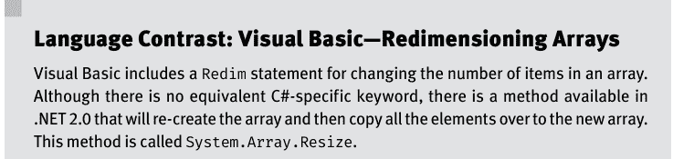

## 数组实例成员

与字符串一样，数组拥有实例成员，无法通过变量直接从数据类型访问。`Length` 就是实例成员的一个示例，因为对 `Length` 的访问是通过数组变量进行的，而不是类。其他重要的实例成员是 `GetLength()`、`Rank` 和 `Clone()`。

获取特定维度的长度不需要属性。为了获取特定秩数的大小，数组包含了 `GetLength()` 实例方法。调用此方法时，必须指定要返回长度的秩（参见列表 3.29）。

### 列表 3.29：获取特定维度的尺寸

```csharp
bool[][][] cells;
cells = new bool[2,3,3];
System.Console.WriteLine(cells.GetLength()); // 显示 2
System.Console.WriteLine(cells.Rank); // 显示 3
```

列表 3.29 的结果出现在输出 3.3 中。

### 输出 3.3

2

列表 3.29 显示 2，因为这是第一维中的元素数量。

也可以通过访问数组的 `Rank` 来获取整个数组的秩，例如，`cells.Rank` 将返回 3（参见列表 3.29）。

默认情况下，将一个数组变量赋值给另一个变量只会复制数组的引用，而不是数组的单个元素。要创建数组的完整副本，请使用数组的 `Clone()` 方法。`Clone()` 方法将返回数组的副本；更改此新数组的任何成员都不会影响原始数组的成员。

## 作为数组的字符串

`string` 类型的变量可以像字符数组一样访问。例如，要获取名为 `palindrome` 的字符串的第四个字符，可以调用 `palindrome[3]`。但注意，由于字符串是不可变的，无法为字符串中的特定字符赋值。因此，C# 不允许在 `palindrome` 声明为字符串的情况下情况下执行 `palindrome[3]='a'`。列表 3.30 使用数组访问器来判断命令行上的选项是否为有效选项，其中选项以连字符作为第一个字符来标识。

### 列表 3.30：查找命令行选项

```csharp
string[] args;
...
if(args[0] == '-')
{
    // 此参数是一个选项
}
```

此代码段使用了 `if` 语句，该语句将在第 4 章中介绍。此外，它还展示了一个有趣的示例，因为你使用数组访问器来获取字符串数组 `args` 中的第一个元素。紧跟第一个数组访问器之后的是第二个访问器，它获取字符串的第一个字符。因此，该代码等同于列表 3.31 所示的代码。

### 列表 3.31：查找命令行选项（简化版）

```csharp
string[] args;
...
string arg = args[0];
```

# 第3章：数据类型进阶

```csharp
if(arg[0] == '-')
{
    // 此参数是一个选项
}
```

不仅可以使用数组访问器单独获取字符串字符，还可以使用字符串的 `ToCharArray()` 方法将整个字符串作为字符数组进行获取。使用这种方法，你可以通过列表 3.32 所示的 `Reverse` 方法反转字符串。

### 列表 3.32：反转字符串

```csharp
class Palindrome
{
    static void Main()
    {
        string reverse, palindrome;
        char[] temp;
        System.Console.Write("Enter a palindrome: ");
        palindrome = System.Console.ReadLine();
        // 移除空格并转换为小写
        reverse = palindrome.Replace(" ", "");
        reverse = reverse.ToLower();
        // 转换为数组
        temp = reverse.ToCharArray();
        // 反转数组
        Array.Reverse(temp);
        // 检查反转后的字符串是否相同
        if(reverse == new string(temp))
        {
            System.Console.WriteLine($"{palindrome} is a palindrome.");
        }
        else
        {
            System.Console.WriteLine($"{palindrome} is NOT a palindrome.");
        }
    }
}
```


列表 3.32 的结果出现在输出 3.4 中。

# 数组

# 输出 3.4

Enter a palindrome: NeverOddEven
"NeverOddEven" is a palindrome.

此示例使用了 `new` 关键字；此处它从反转的数组创建了一个新字符串。

# 常见数组错误

本节介绍了三种数组：单维、多维和交错数组。数组的使用遵循一些规则和特殊性。表 3.3 列出了常见错误，有助于你理解数组。

# 表 3.3：常见错误

| 错误 | 错误描述 | 修正后的代码 |
| :--- | :--- | :--- |
| int[] numbers[]; | 声明方括号应出现在类型之后。 | `int[] numbers;` |
| int[] numbers = {42, 84, 168}; | 数组大小应在变量而不是类型之后。 | `int[] numbers;` |
| int[] numbers = {42, 84, 168}; | 数组大小应在初始化时指定。 | `int[3];` |
| int[] numbers = []; | 除非提供了数组字面量，否则必须指定数组大小。 | `int[3];` |

# 第3章：数据类型进阶

# 表 3.3：常见错误（续）

| 错误 | 错误描述 | 修正后的代码 |
| :--- | :--- | :--- |
| int[] numbers = {42, 84}, {84, 42}; | 交错数组需要为数组内的数组指定实例化数组。 | `int[][] numbers = { new int[]{42, 84}, new int[]{84, 42} };` |

本章从讨论两种不同的类型开始：值类型和引用类型。这些基本概念对于 C# 程序员来说非常重要，因为它们改变了类型的底层行为方式，尽管在阅读代码时可能并不明显。

在讨论数组之前，我们查看了两个最初并不是 C# 一部分的语言结构。首先，我们引入了可空修饰符 `?`，值类型在 C# 2.0 中支持，引用类型在 C# 8.0 中支持。可空修饰符允许声明可空性以存储空值。其次，我们引入了元组以及 C# 7.0 引入的新语法，该语法为处理元组提供了语言支持，无需显式处理底层数据类型。

本章以 C# 数组语法的介绍结束，介绍了各种操作数组的方法。对于许多开发者来说，初看语法可能非常复杂，因此本部分包含了与数组编码相关的常见错误。

下一章将介绍表达式和控制流语句。在本章末尾几处的 `if` 语句也将被讨论。

# 运算符与控制流

在本章中，你将学习运算符、控制流语句以及 C# 预处理器。运算符提供了语法，用于根据计算中的操作数执行适当的各种计算或操作。控制流语句为程序内部的条件逻辑或多次循环执行某段代码提供了手段。在介绍了 `if` 控制流语句后，本章将讨论了布尔表达式的概念，这些表达式嵌入在许多控制流语句中。书中还提到了许多整数无法（即使是显式地）转换为 `bool` 类型，以及这种限制的优点。本章以对 C# 预处理器指令的讨论作为结束。

```
#if, #elif, #else, #endif

#define and #undef

#error and #warning

#pragma

#nowarn:cwarn list>

#line

#region/#endregion

break

continue

goto

if

while

do-while

for

foreach

switch

控制流语句
```

| 预处理器指令 | 运算符 | 布尔表达式 |
| --- | --- | --- |
| | 算术二元运算符 赋值运算符 递增和递减运算符 常量表达式 |

| 运算符与控制流 | 位运算符 | |

# 第 4 章：运算符与控制流

# 运算符

现在你已经接触了预定义数据类型（请参见第 2 章），你可以开始学习如何将这些数据类型与运算符结合使用以执行计算。例如，你可以对已声明的变量进行计算。

## 初学者主题

运算符用于对称为操作数（变量）的值执行数学或逻辑操作，以产生一个新值，称为结果。例如，在列表 4.1 中，减法运算符 `-` 被用于减去两个操作数，即数字 4 和 2。减法的结果存储在变量 `difference` 中。

列表 4.1：简单的运算符示例

```
int difference = 4 - 2;
```

运算符通常分为三类——一元运算符、二元运算符和三元运算符，分别对应于操作数的数量（分别为一个、两个和 三个）。此外，虽然某些运算符用如 `+`、`?` 和 `??` 等符号表示，但其他运算符则以关键字的形式存在，如 `default` 和 `is`。本节涵盖了一些最常用的一元和二元运算符。三元运算符将出现在本章稍后的部分。

# 加和减法一元运算符 (+, -)

有时你可能想要更改数值的正负号。在这种情况下，一元减运算符 `(-)` 就派上用场了。例如，列表 4.2 将总债务更改为负值，以表示它是欠款。

列表 4.2：指定负值！

```
// 精确到分计算的国家债务
decimal debt = -2645709712930.80M;
```

+   1. 截至 2020 年 7 月 1 日，根据 www.treasurydirect.gov。

使用减法运算符等于从零中减去操作数。
一元加运算符 `(+)` 对值几乎没有产生任何影响。它是 C# 语言中一个多余的添加，为了对称性而包含在。

# 算术二元运算符 (+, -, *, %)

二元运算符需要两个操作数。C# 对二元运算符使用中置符号：运算符出现在左、右操作数之间。除了赋值之外，每个二元运算符的结果必须以某种方式使用——例如，将其作为另一个表达式（如赋值）中的操作数。


语言对比：C++——仅运算符的语句
与之前提到的规则相反，C++ 允许单个二元表达式构成整个语句，例如 `4+5;` 编译。在 C# 中，只允许赋值、递增、递减、`await` 和对象创建表达式构成整个语句。

列表 4.3 中的减法示例说明了二元运算符的使用。二元运算符的结果除了赋值外，必须以某种方式使用——例如，操作数出现在算术运算符的两侧。然后结果被赋值。其他二元运算符是加法 (`+`)、除法 (`/`)、乘法 (`*`) 和取模 (`%`，有时称为模运算运算符）。

列表 4.3：使用二元运算符

```
class Division
{
    static void Main()
    {
        int numerator;
        int denominator;
        int quotient;
        int remainder;
    }
}
```

# 第 4 章：运算符与控制流

```
System.Console.Write("Enter the numerator: ");
```

```
System.Console.Write("Enter the denominator: ");
```

```
System.Console.WriteLine($"{quotient} / {remainder}");
```

输出 4.1
输入分子：23
输入分母：3
23 / 3 = 7

在语句中，除法取模操作在赋值之前执行。这些运算符的优先级如下：

1. `*`、`/` 和 `%` 优先级最高。
2. `+` 和 `-` 优先级较低。
3. `=` 优先级最低。

如果你忘记赋值这些运算符的结果，将收到输出 4.2 所示的错误。

# 输出 4.2

```
... 错误 CS0201: 只有赋值、调用、递增、递减
```

括号、结合性、优先级与求值
当一个表达式包含多个运算符时，每个运算符的操作数可能并不明确。例如，在表达式 `x+y*z` 中，显然 `x` 是加法的操作数，`z` 是乘法的操作数。但 `y` 是加法还是乘法的操作数？

括号允许你明确地将操作数与其运算符关联。如果你希望 `y` 是加数，可以将表达式写为 `(x+y)*z`；如果你希望它是乘数，可以写为 `x+(y*z)`。

C 不要求对每个包含多个运算符的表达式加括号；相反，编译器可以使用结合性和优先级来确定你省略的上下文。结合性决定相同运算符如何加括号；优先级决定不同运算符之间如何加括号。

二元运算符可能是左结合的，也可能是右结合的，取决于“中间”的表达式属于左侧还是右侧运算符。例如，`a-b-c` 被假设为 `(a-b)-c`而不是 `a-(b-c)`；因此减法是左结合的。C# 中的大多数运算符都是左结合的；赋值运算符是右结合的。

当运算符不同时，使用这些运算符的优先级来确定中间操作数的所属。例如，乘法的优先级高于加法，因此表达式 `x+y*z` 的求值结果是 `x+(y*z)` 而不是 `(x+y)*z`。

即使使用括号不会改变表达式的含义，使用括号来提高代码的可读性通常也是良好的做法。例如，在进行摄氏到华氏的温度转换时，`(c*9.0/5.0)+32.0` 比 `c*9.0/5.0+32.0` 更易读。

> 指南
> 使用括号来提高代码的可读性，特别是当运算符优先级对普通读者来说并不清晰时。

## 第 4 章：运算符与流程控制

显然，高优先级的运算符必须在相邻的低优先级运算符之前执行：在 `x+y*z` 中，乘法必须在加法之前执行，因为乘法的结果是加法的右侧操作数。然而，重要的是，优先级和结合性只影响运算符本身的执行顺序；它们并不会以任何方式影响操作数的求值顺序。

在 C# 中，操作数始终从左到右求值。在一个包含三个方法调用的表达式 `A()+B()+C()` 中，首先求值 `A()`，然后是 `B()`，最后是 `C()`；乘法运算符确定乘积；最后加法运算符确定和。仅仅因为 `C()` 参与了乘法而 `A()` 参与了低优先级的加法，并不意味着方法调用 `C()` 发生在方法调用 `A()` 之前。

## 语言对比：C++：操作数的求值顺序

与上述规则不同，C++ 规范允许实现具有较大的自由来决定操作数的求值顺序。当给定如 `A()+B()+C()` 的表达式时，C++ 编译器可以选择以任何顺序求值函数，只要乘积是加数之一即可。例如，一个法的编译器可以先求值 `B()`，然后是 `A()`，最后是 `C()`；乘积；最后是和。

## 在字符串中使用加法运算符

运算符也可以用于非数值操作数。例如，可以使用加法运算符连接两个或多个字符串，如列表 4.4 所示。

### 列表 4.4：对非数值类型使用二元运算符

```csharp
class FortyTwo {
    static void Main() {
        short windSpeed = 42;
        Console.WriteLine(
            "The original Tacoma Bridge in Washington\nwas "
            + "brought down by a "
            + windSpeed + " mile/hour wind.");
    }
}
```

输出 4.3 显示了列表 4.4 的结果。

### 输出 4.3

> 华盛顿州的塔科马大桥被 42 英里小时的风吹毁了。

由于不同文化的语言中句子结构有所不同，开发者应该小心不要对可能需要本地化的字符串使用加法运算符。同样，尽管我们可以使用 C# 6.0 的字符串插值在字符串中嵌入表达式，但本地化到其他语言仍然需要将字符串移动资源文件中，这会使字符串插值失效。因此，你应该节少使用加法运算符，在可能需要本地化时优先使用复合格式化（composite formatting）。

## 指南

- 在可能需要本地化时，优先使用复合格式化代替加法运算符连接字符串。

## 在算术运算中使用字符

在第 2 章引入 `char` 类型时，我们提到尽管它存储的是字符而不是数字，但 `char` 类型是一种整型类型（整型意味着它是基于整数的）。它可以与其他整数类型参与算术运算。然而，对 `char` 类型值的解释并不是基于其内部存储的字符，也不是基于其底层值。例如，数字 3 用 Unicode 值 `0x33`（十六进制）表示，这在十进制中为 51。数字 4 用 Unicode 值 `0x34` 表示，或在十进制中为 52。在列表 4.5 中将 3 和 4 相加得到十六进制值 `0x67`，或十进制的 103，这是字母 g 的 Unicode 值。

### 列表 4.5：对 char 类型使用加号运算符

```csharp
int n = '3' + '4';
char c = (char)n;
System.Console.WriteLine(c); // 输出 g
```

输出 4.4 显示了列表 4.5 的结果。

### 输出 4.4

你可以利用字符类型的特性确定两个字符之间的距离。例如，字母 `f` 和字母 `c` 之间的距离，你可以通过从 `f` 减去 `c` 来确定这个值。

### 列表 4.6：确定两个字符之间的差异

```csharp
int distance = 'f' - 'c';
System.Console.WriteLine(distance);
```

输出 4.5 显示了列表 4.6 的结果。

## 浮点数的特殊特性

浮点类型（`float` 和 `double`）具有某些特殊特性，取决于它们处理精度的方式。本节将介绍一些特定示例。`float` 具有 7 位有效精度，可以存储值。然而，如果你将这两个浮点数相加，结果将被四舍入到 1234567，因为精确结果比 `float` 能够存储的 7 位有效数字更多。舍入到 7 位引入的误差与计算值相比可能很大，特别是在重复计算时。（参见本节后文的：浮点数的意外不等问题）。

你还应该注意一些额外的独特浮点特性。例如，你可能期望除以零会导致错误——在用整数除以 `int` 和 `decimal` 等数据类型时，情况确实如此。然而，`float` 和 `double` 类型允许某些特殊值。考虑列表 4.8 及其结果输出输出 4.7。

# 列表 4.8：浮点数除以零，显示 NaN

```csharp
float n=0f;
// Displays: NaN
System.Console.WriteLine(n / 0);
```

# 输出 4.7

NaN

在数学中，某些数学运算是未定义的，包括零除以零本身。在 C# 中，浮点数除以零的结果是一个特殊的“不是数字”（Not a Number）值；所有尝试将此类数字的输出的操作都将导致 NaN。同样，使用 `System.Math.Sqrt()` 对负数求平方根将导致 NaN。

浮点数也可能溢出其范围。例如，`float` 类型的上限约为 $3.4 \times 10^{38}$。如果数字超过了该界限，结果将是正无穷，而打印该数字的输出将是 Infinity。同样，`float` 类型的下限为 $-3.4 \times 10^{38}$，计算低于该界限的值将导致负无穷，它将由字符串 -Infinity 表示。列表 4.9 分别产生了负无穷和正无穷，输出 4.8 显示了这些结果。

# 列表 4.9：溢出 float 的界限

```csharp
// Displays: -Infinity
System.Console.WriteLine(-1f / 0);
// Displays: Infinity
System.Console.WriteLine(3.402823E+38 * 2);
```

# 输出 4.8

-Infinity
Infinity

# 第 4 章：运算符与流程控制

对浮点数的进一步检查表明，它可以包含一个非常接近零的值而不包含零。如果该值超过了 `float` 或 `double` 类型的下限值，则数字的值可以表示为负零或正零，取决于数字是负的还是正，并在输出中表示为 -0 或 0。

## 复合数学赋值运算符 (+=, -=, *=, %=)

第 1 章讨论了简单的赋值运算符，它将运算符右侧的值赋给左侧的变量。复合数学赋值运算符将常见的二元运算符计算与赋值运算符结合。例如，列表 4.10。

# 列表 4.10：常见的增加计算

```csharp
int x = 123;
x = x + 2;
```

在此赋值中，你首先计算 `x + 2` 的值，然后将计算出的值赋回 `x`。由于这种操作执行频率较高，因此存在一种赋值运算符可以用一个运算符同时处理计算和赋值。`+=` 运算符增加运算符左侧变量的值，如列表 4.11 所示。

# 列表 4.11：使用 += 运算符

```csharp
int x = 123;
x += 2;
```

因此，这段代码等同于列表 4.10。
存在许多其他复合赋值运算符提供类似的功能。你也可以结合减法、乘法、除法和取模运算符使用赋值运算符（如列表 4.12 所示）。

# 列表 4.12：其他赋值运算符示例

```csharp
x -= 2;
x /= 2;
x *= 2;
x %= 2;
```

## 递增和递减运算符 (++, --)

C# 包含了用于计数器增加和减少的特殊单元运算符。**递增运算符** `++` 每次使用时会将变量加1。换句话说，列表 4.13 显示的所有代码行都是等价的。

# 列表 4.13：递增运算符

```csharp
spaceCount = spaceCount + 1;
spaceCount += 1;
spaceCount++;
```

同样，你可以使用**递减运算符** `--` 将变量减 1。因此，列表 4.14 显示的所有代码行也是等价的。

# 列表 4.14：递减运算符

```csharp
lines = lines - 1;
lines -= 1;
lines--;
```

## 初学者主题

### 循环中的递减示例

递增和递减运算符在循环中特别常见，例如本章后面描述的 `while` 循环。例如，列表 4.15 使用递减运算符反向遍历字母表中的每个字母。

# 列表 4.15：按顺序显示每个字符的 Unicode 值

```csharp
char current;
int unicodeValue;
// 设置 current 的初始值
```


`current = 'z'`;

```
do
{
    // 获取 current 的 Unicode 值
    unicodeValue = current;
    System.Console.Write($"{current}={unicodeValue}\t");
    // 继续到字母表中的上字母
    current--;
}
while(current >= 'a');
```

输出 4.9 显示了列表 4.15 的结果。

# 输出 4.9

| z=122 | y=121 | x=120 | w=119 | v=118 | u=117 | t=116 | s=115 | r=114 |
| :--- | :--- | :--- | :--- | :--- | :--- | :--- | :--- | :--- |
| q=113 | p=112 | o=111 | n=110 | m=109 | l=108 | k=107 | j=106 | i=105 |
| h=104 | g=103 | f=102 | e=101 | d=100 | c=99 | b=98 | a=97 | |


## 高级主题

## 线程安全的递增和递减

尽管加减运算符非常简洁，但这些运算符并不是原子的。在执行运算符期间可能会发生线程上下文切换，并导致竞态条件。你可以使用 `lock` 语句来防止竞态条件。然而，对于简单的加减，一种开销更小的方案是使用 `System.Threading.Interlocked` 类中线程安全的 `Increment()` 和 `Decrement()` 方法。这些方法依赖处理器功能来实现快速、线程安全的加减。更多细节请参阅第 19 章。

## 常数表达式和常量局部变量

第 3 章讨论了字面量，即直接嵌入到代码中的值。可以使用运算符在常量表达式中组合多个字面量。根据定义，常量表达式是指 C# 编译器可以在编译时进行求值（而不是在程序运行时进行求值）的表达式，因为它完全由常数操作数组成。常量表达式可以用于初始化常量局部变量，这允许你为常量值指定一个名称（类似于局部变量 `variables` 允许你为存储位置指定名称）。例如，一天的秒数可以是一个常量表达式，在其他表达式中通过名称使用。

列表 4.19 中的 `const` 关键字声明了一个常量局部变量。由于常量局部变量在定义上是变量的相反面——常量意味着“无法改变”——因此在代码后续修改该值的任何尝试都会导致编译错误。

### 列表 4.19：声明常量

```cs
// ...
public long Main()
{
    // 常量表达式
    const int secondsDay = 60 * 60 * 24;
    const int secondsPerWeek = secondsDay * 7;
    // 常量
    // ...
}
```

## 第 4 章：运算符与流程控制

## 指南原则

不要对任何可能随时间改变的值使用常量。π 的值和金原子中的质子数是常量；金价、你的公司名称以及程序版本号则可能会改变。

请注意，列表 4.19 中赋值给 `secondWeek` 的表达式是一个常量表达式，因为表达式中的所有操作数也是常数。

## 介绍流程控制

在本章稍后有一个代码列表（列表 4.45），展示了以二进制形式查看数字的简单方法。然而，即使是这样简单的程序，如果不使用流程控制语句也无法编写。此类语句控制程序的执行路径。本节将讨论如何根据条件检查来更改语句的执行顺序。之后，你将学习如何通过循环结构重复执行语句组。

表 4.1 列出了流程控制语句的摘要。请注意，“通用语法结构”（General Syntax Structure）一列表示常见的语句用法，而不是完整的词法结构。表 4.1 中的嵌入语句（embedded-statement）可以是除标记语句或声明外的任何语句，但通常是一个块语句。

表 4.1 中的每个 C# 流程控制语句都出现在井棋程序中，并可以在第 4 章源代码的 `TicTacToe.cs` 文件中找到（访问 https://itlc.com/EssentialCSharp.cs）。该程序显示井棋盘，提示每位玩家，并随着每次走棋进行更新。

本章的其余部分将更详细地查看每条语句。在介绍了 `if` 语句后，它引入了代码块、作用域、布尔表达式和位运算符，以继续介绍剩余的流程控制语句。由于 C# 与其他语言具有相似性而对表 4.1 熟悉的读者，可以直接跳到标题为“C# 预处理器指令”的部分，或跳到章节末尾的总结。

- 3. 在美国外的读者称为 "nought and crosses"。

### 表 4.1：流程控制语句

| 语句 | 通用语法结构 | 示例 |
| --- | --- | --- |
| if 语句 | if(boolean-expression) 嵌入语句 | if (input == "quit") { System.Console.WriteLine("game end"); return; } |
| else 语句 | if(boolean-expression) 嵌入语句 else 嵌入语句 | if (input == "quit") { System.Console.WriteLine("game end"); return; } else { } |
| while 语句 | while(boolean-expression) 嵌入语句 | while (count < total) { System.Console.WriteLine("count: " + count); count++; } |

### 表 4.1：流程控制语句（续）

| 语句 | 通用语法结构 | 示例 |
| --- | --- | --- |
| do while 语句 | while(boolean-expression); 嵌入语句 | do { System.Console.WriteLine("Enter name:"); string input = Console.ReadLine(); while (input != "exit") { // 嵌入语句 } |
| for 语句 | for(initializer; boolean-expression; for-iterator) 嵌入语句 | for (int count = 0; count < 10; count++) { System.Console.WriteLine("count: " + count); } |
| foreach 语句 | foreach(type identifier in expression) 嵌入语句 | foreach (char letter in email) { if (letter == '@') { bool insideDomain = true; continue; } } |
| continue 语句 | | continue; |

### 表 4.1：流程控制语句（续） |

| 语句 | 通用语法结构 | 示例 |
| --- | --- | --- |
| switch 语句 | switch(expression) { case constant: 语句; ... } | switch (expression) { case 1: // 语句 break; default: // 语句 } |

## if 语句

`if` 语句是 C# 中最常见的语句之一。它评估一个布尔表达式（结果为 true 或 false）。如果条件为真，则执行结果语句。它可能包含一个 `else` 子句，在条件为假时执行。其通用形式如下：

```cs
if (condition)
    consequence-statement
else
    alternative-statement
```

**列表 4.20：if/else 示例**

```cs
class TicTacToe
{
    static void Main()
    {
        string input; // 声明变量以存储输入
        System.Console.Write(
            "1 - Play against computer\n" +
            "2 - Play another player.\n" +
            "Choice:"
        );
        input = Console.ReadLine();
        if(input=="1") {
            // 用户选择了与电脑游戏
            System.Console.WriteLine("Play against computer.");
        }
        else {
            // 默认 2 人玩家（即使户没有输入 2）
            System.Console.WriteLine("Play another player.");
        }
    }
}
```

## 嵌套 if

有时代码需要多个 `if` 语句。列表 4.21 中的代码首先确定用户是否通过输入数字选择退出；如果用户没有选择退出，则检查用户是否知道最大回合数。

### 列表 4.21：嵌套 if 语句

```cs
class TicTacToeTrivia
{
    static void Main()
    {
        int input; // 声明变量以存储输入
        System.Console.Write(
            "What is the maximum number "
            "of turns in tic-tac-toe?" +
            "(Enter 0 to exit.)"
        );
        // Parse() 将 ReadLine() 的
        // 返回转换为 int 类型
        input = int.Parse(Console.ReadLine());
        if (input < 0) // 第 16 行
            // 输入小于等于 0
            System.Console.WriteLine("Exiting...");
        else
            if (input < 9) // 第 20 行
                // 输入小于 9
                System.Console.WriteLine(
                    "$Tic-tac-toe has more {input}" +
                    "maximum turns.");
            else
                if(input > 9) // 第 26 行
                    // 输入大于 9
                    System.Console.WriteLine(
                        "$Tic-tac-toe has fewer {input}" +
                        "maximum turns.");
                else
                    // 输入等于 9
                    System.Console.WriteLine( // 第 33 行
                        "Correct, tic-tac-toe " +
                        "has a maximum of 9 turns.");
    }
}
```

输出 4.13 显示了列表 4.21 的结果。

# 输出 4.13

```
What is the maximum number of turns in tic-tac-toe? (Enter 0 to exit): 9
Correct, tic-tac-toe has a maximum of 9 turns.
```

假设用户在第 14 行提示时输入了 9。以下是执行路径：

- 1. 第 16 行：检查输入是否小于 0。由于不是如此，跳转到第 20 行。
- 2. 第 20 行：检查输入是否小于 9。由于不是如此，跳转到第 26 行。
- 3. 第 26 行：检查输入是否大于 9。由于不是如此，跳转到第 33 行。
- 4. 第 33 行：显示答案正确。

列表 4.21 包含了嵌套的 `if` 语句。为了清楚嵌套关系，对代码行进行了缩进。然而，正如你在第 1 章中所学到的那样，空白并不影响执行路径。如果这段代码在编写时没有刻意使用这些换行符，其执行结果将是相同的。列表 4.22 中嵌套 `if` 语句中出现的代码等同于列表 4.21。

代码列表 4.22: 顺序格式化的 if/else 形式

```
if (input < 0)
    System.Console.WriteLine("Exiting...")
else if (input < 9)
    System.Console.WriteLine(
        "Tic-tac-toe has more {input}" +
        " maximum turns.")
else if (input < 9)
    System.Console.WriteLine(
        "Tic-tac-toe has less than {input}" +
        " maximum turns.")
else
    System.Console.WriteLine(
        "Correct, tic-tac-toe has a maximum " +
        " of 9 turns.")
```

虽然后者的格式更为常见，但在任何情况下你都应该使用使代码最清晰的格式。

这两个 `if` 列表都省略了大括号。然而，接下来的讨论将说明，这并不符合指南 true。指南建议使用代码块，也许在最简单的单行场景下除外。

## 代码块 ({})

在之前的 `if` 语句示例中，`if` 和 `else` 后面只跟了一个语句：单个 `System.Console.WriteLine()`，类似于列表 4.23。

### 列表 4.23: 无代码块的 if 语句

```
if(input < 9)
System.Console.WriteLine("Exiting");
```

然而，通过大括号，我们可以将多个语句组合成单一语句，称为**块语句**或**代码块**，允许将多个语句分组为一个作为结果的单一语句。以列表 4.24 中半径计算中高亮的代码块为例。

### 列表 4.24: 紧跟代码块的 if 语句

```
class CircleAreaCalculator
{
    static void Main()
    {
        double radius; // 声明一个存储半径的变量
        double area; // 声明一个存储面积的变量
        System.Console.WriteLine("Enter the radius of the circle:");
        // double.Parse 将 ReadLine() 
        // 返回转换为 double
        radius = double.Parse(System.Console.ReadLine());
        if (radius > 0)
        {
            // 计算圆的面积
            area = Math.PI * radius;
            System.Console.WriteLine(
$"The area of the circle is: { area : 0.00}");
        }
        else
        {
            System.Console.WriteLine(
$"{ radius } is not a valid radius.");
        }
    }
}
```

输出 4.14 显示了列表 4.24 的结果。

### 输出 4.14

```
Enter the radius of the circle: 3
The area of the circle is: 28.27
```

在这个示例中，`if` 语句检查半径是否为正。计算并显示圆的面积；否则，显示无效半径的提示。

注意，在这个示例中，第一个 `if` 后面跟着两个语句。然而，这两个语句都出现在大括号内。

在这个示例中，第一个 `if` 后面跟着两个语句。然而，这两个语句都出现在大括号内。

在这个示例中，第一个 `if` 后面跟着两个语句。然而，这两个语句都出现在大括号内。

### 列表 4.25: 依赖缩进的错误代码

```
if (input < 0)
    . = .
System.Console.WriteLine(
    "
 of of is is  ..0)
```

在这个示例中，第一个 `if` 后面跟着两个语句。然而，这两个语句都出现在大括号内。

### 列表 4.26: 使用大括号的 if 语句

```
if (input < 0)
{
    area = Math.PI * radius;
}
System.Console.WriteLine(
    "The area of the circle is: " + area);
```


`name` 消息在局部变量的作用域范围内始终指向该局部变量——即紧接声明声明的块。同样，`player` 在包含该声明的整个块中都指向同一个变量，包括 `if` 语句的执行分支和备选分支两个子块内部。

## 语言对比：C++—局部变量作用域

在 C++ 中，在块中声明的局部变量从声明语句开始到该块结束都一直处于作用域内。因此，尝试在声明之前引用该局部变量将无法找到它，因为其不在作用域内。如果存在另一个名为“作用域内”（in scope）的实体，C++ 语言会将该名称解析为该实体，这可能不是你的本意。在 C# 中，规则略有不同：局部变量在它声明的整个块中都处于作用域内，但在声明之前引用该局部变量是非合法的。也就是说，尝试查找该局部变量会成功，但该用法会被视为一个错误。这是 C# 的规则之一，旨在防止 C++ 程序员中常见的错误。

## 布尔表达式

`if` 语句的括号内条件是一个布尔表达式。在列表 4.28 中，该条件被高亮显示。

### 列表 4.28：布尔表达式

```csharp
if (input < 9)
{
    // 输入小于 9
    System.Console.WriteLine(
        $"{tic-toe has max {input}" + 
        " maximum turns.");
}
// ...
```

布尔表达式出现在许多控制流语句中。它们的关键特征是始终求值为 `true` 或 `false`。为了让 `input < 9` 允许作为布尔表达式，它必须产生一个 `bool` 类型。例如，编译器不允许 `x = 42`，因为这个表达式赋值了 `x` 并返回了被赋值的值，而不是检查变量的值是否为 42。

# 第 4 章：运算符与流程控制

## 语言对比：C++—误用：用 = 代替 ==

C# 消除了 C 和 C++ 中常见的编码错误。在 C++ 中，列表 4.29 是允许的。

### 列表 4.29：C++ 允许，但 C# 不允许将赋值作为条件

```c
if (input = 9) // 在 C++ 中允许，在 C# 中不允许
System.Console.WriteLine(
    "Correct, tic-tac-toe has a maximum of 9 turns.");
```

虽然乍看之下检查 `input` 是否等于 9 很有吸引力，但第 1 章已经说明 `=` 代表赋值运算符，而不是相等性检查。赋值运算符的返回值是赋值给变量的值——在这种情况下是 9。然而，9 是一个 `int` 类型，因此它不符合布尔表达式的条件，且不被 C# 编译器允许。C 和 C++ 语言将非零整数视为 `true`，将零整数视为 `false`。相比之下，C# 要求条件实际上必须是 `Boolean` 类型；不允许整数。

## 关系运算符与相等运算符

关系运算符和相等运算符确定一个值是否大于、小于或等于另一个值。表 4.2 列出了所有的关系和相等运算符。它们都是二元运算符。

### 表 4.2：关系和相等运算符

| 运算符 | 描述 | 示例 |
|---|---|---|
| `<` | 小于 | `input < 9;` |
| `>` | 大于 | `input > 9;` |
| `<=` | 小于或等于 | `input <= 9;` |
| `>=` | 大于或等于 | `input >= 9;` |
| `==` | 相等运算符 | `input == 9;` |
| `!=` | 不等运算符 | `input != 9;` |

C# 的相等性语法使用 `==`，就像许多其他编程语言一样。例如，要确定 `input` 是否等于 9，你使用 `input == 9`。相等运算符使用两个等号来与赋值运算符 `=` 区分开来。感叹号在 C# 中表示“非”（NOT），因此为了测试不相等，你使用 `!=`。C# 的相等语法使用 `==`。

## 关系运算符的结果赋值赋值一个 `bool`

### 列表 4.30：将关系运算符的结果赋值给变量

```csharp
bool result = true;
```

在井井棋程序中，你使用 `!=` 运算符来确定是否退出。`||` 运算符产生 `bool` 值，下一节将详细讨论。

### 列表 4.31：使用相等运算符

```csharp
if (input.Length == 0)
{
    System.Console.WriteLine("Player quit!!");
    break;
}
```

## 逻辑运算符

逻辑运算符具有多个操作数并产生布尔结果。逻辑运算符允许你组合多个布尔表达式以形成复杂的表达式。逻辑运算符有 `||`、`&&` 和 `^`，分别对应或、与和异或。我们将在本节讨论这些运算符。

### 或运算符 (`||`)

在列表 4.31 中，如果用户输入 `quit`，可以使用 `||` 逻辑运算符。`||` 运算符计算布尔表达式，如果任一操作数为真，则结果为真（见列表 4.32）。

### 列表 4.32：使用或运算符

```csharp
if (hourOfDay > 23 || hourOfDay < 0)
    System.Console.WriteLine("你输入的时间无效.");
```

与布尔与和或或运算符不同，异或运算符不进行短路。它总是检查两个操作数，因为在未知两个操作数值的情况下无法确定结果。

### 与运算符 (`&&`)

布尔与运算符 `&&` 只有在两个操作数都求值为真时才求值为真。如果任一操作数为假，结果将为假。与或运算符类似，如果左侧操作数为假，与运算符不会计算右侧。

### 列表 4.33：使用与运算符

```csharp
if (10 < hourOfDay && hourOfDay < 24)
    System.Console.WriteLine("嘿嘿，该去工作了.");
```

### 异或运算符 (`^`)

符号符号 `^` 是异或（XOR）运算符。当应用于两个布尔操作数时，只有当其中一个为真时，异或运算符返回真，如表 4.3 所示。

### 表 4.3：异或运算符的条件值

| 左操作数 | 右操作数 | 结果 |
| --- | --- | --- |
| True | True | False |
| True | False | True |
| False | True | True |
| False | False | False |

## 逻辑否定运算符 (`!`)

逻辑否定运算符，或非运算符 `!`，会反转 `bool` 值。该运算符是一个一元运算符，意味着它只需要一个操作数。列表 4.34 展示了它是如何工作的，输出 4.16 显示了结果。

### 列表 4.34：使用逻辑否定运算符

```csharp
bool valid = false;
bool result = !valid;
// 显示 "result = True"
System.Console.WriteLine("result = " + result + "");
```

# 输出 4.16

```
result = True
```

## 条件运算符 (`?`)

作为使用 `if-else` 语句从两个值中选择一个的替代方案，可以使用条件运算符。条件运算符同时使用问号和冒号；其通用格式如下：

```
condition ? consequence : alternative
```

条件运算符是一个三元运算符，因为它有三个操作数：条件（condition）、结果（consequence）和备选（alternative）。由于它是 C# 中唯一的三元运算符，因此通常称为三元运算符，但通过它的名称而非其操作数数量来引用它更清晰。参考逻辑运算符，条件运算符使用一种短路形式。如果条件求值为 `true`，则条件运算符只求值结果。如果条件求值为 `false`，则只求值备选。运算符的结果是求值的表达式。

列表 4.35 展示了条件运算符的使用。该程序的完整列表出现在源代码的 `Chapter 04\TicToe.cs` 中。

### 列表 4.35：条件运算符

```csharp
class TicToe
{
    static void Main()
    {
        // 将当前玩家设置为玩家 1
        int currentPlayer = 1;
        ...
        for (int turn = 1; turn <= 10; turn++)
        {
            ...
            // 切换玩家
            currentPlayer = (currentPlayer == 2) ? 1 : 2;
        }
    }
}
```

该程序交换当前玩家。为了做到这一点，它检查当前值是否为 2。这是条件表达式的条件部分。如果条件的结果为 `true`，则条件运算符的结果为结果值 1。否则，结果为备选值 2。与 `if` 语句不同，条件运算符的结果必须赋值（或作为参数传递）；它不能作为一个独立的语句出现。

> 考虑使用 `if-else` 语句代替过于复杂的条件表达式。

C# 语言要求条件运算符中的结果表达式和备选表达式必须具有一致的类型，并且结果的类型必须在不检查表达式周围上下文的情况下被确定。例如，`f ? "abc" : 123` 不是一个合法的条件表达式，因为结果和备选值是一个字符串和一个数字，二者都无法相互转换。即使你说 `object result = f ? "abc" : 123;` 也是非法的，因为与两个表达式一致的类型（即 `object`）是在条件表达式之外找到的。

## 处理 null

如第 3 章所述，虽然 `null` 可以是一个非常有用的值，但它也带来了一些挑战——即在调用对象的成员或将值从 `null` 改为更符合情况的值之前，需要检查该值是否为 `null`。

虽然可以使用相等运算符甚至关系运算符来检查 `null`，但有多种方法可以实现，包括 C# 7.0 增强运算符。此外，还有几个运算符专门为处理潜在的 `null` 值设计。这些包括空合并运算符（以及 C# 8.0 的空合并赋值运算符）和空条件运算符。甚至有一个运算符可以在你认为某个值不是 `null` 时告诉编译器，即使这在编译器看来显而易见——这就是空忽略运算符。让我们先从检查一个值是否为 `null` 开始。

## 检查 null 和非 null

事实上有多种检查 `null` 的方法，如表 4.4 所示。

### 表 4.4：检查 null

| 描述 | 示例 |
| --- | --- |
| **相等/不相等** | `string uri = null; // ...` 使用相等和不相等运算符适用于所有版本的 C#。此外，这样检查 `null` 非常易于读。可以重写相等/不相等运算符，可能会引入轻微的性能影响。 | `if (uri != null)
{
    System.Console.WriteLine($"Uri is: {uri}");
}
else // (uri == null)
{
    System.Console.WriteLine($"Uri is: {uri}");
}` |
| **ReferenceEquals()** 虽然 `object.ReferenceEquals()` 对于简单操作来说语法稍显冗，但相等/不相等运算符适用于所有版本的 C#，并且具有不允许重写的优势；因此，它始终执行其名称所描述的内容。 | `string uri = null; // ...
if (object.ReferenceEquals(uri, null))
{
    System.Console.WriteLine($"Uri is: {uri}");
}` |
| **is null 运算符匹配** | 模式匹配提供了一种通过操作数 (`uri`) 是否为对象来检查 `null` 的方法。C# 7.0 通过添加 "is null" 语法来增强了这一点，以进行相反的检查。 | `if (uri is object)
{
    System.Console.WriteLine($"Uri is: {uri}");
}
else // (uri is null)
{
    System.Console.WriteLine($"Uri is: {uri}");
}` |
| **is { } 属性模式** | 最后一种方法（从 C# 8.0 开始可用）是使用属性匹配来检查操作数是否为 `null`。虽然语法看起来可能不直观，但它与使用 `object` 相比有一个主要优势：`is { }` 在你检查不可空值类型（如 `int`）时会发出警告。换句话说，你保证检查 `null` 没有意义的，因为作为不可空值类型，该值永远不可能是 `null`。与此相反，对不可空值类型使用 `is object` 不会发出警告。 | `if (uri is { })
{
    System.Console.WriteLine($"Uri is: {uri}");
}
else // (uri is null)
{
    System.Console.WriteLine($"Uri is: {uri}");
}` |


```csharp
for (int turn = 1; turn <= 10; turn++)
{
    ...
    // 切换玩家
    currentPlayer = (currentPlayer == 2) ? 1 : 2;
}
}
```

该程序交换当前玩家。为了做到这一点，它检查当前值是否为 `2`。这是条件表达式的条件部分。如果条件的结果为 `true`，则条件运算符的结果为结果值 `1`。否则，结果为备选值 `2`。与 `if` 语句不同，条件运算符的结果必须赋值（或作为参数传递）；它不能作为一个独立的语句出现。

# 指南

> 考虑使用 `if-else` 语句代替过于复杂的条件表达式。

C# 语言要求条件运算符中的结果表达式和备选表达式必须具有一致的类型，并且结果的类型必须在不检查表达式周围上下文的情况下被确定。例如，`f ? "abc" : 123` 不是一个合法的条件表达式，因为结果和备选值是一个字符串和一个数字，二者都无法相互转换。即使你说 `object result = f ? "abc" : 123;` 也是非法的，因为与两个表达式一致的类型（即 `object`）是在条件表达式之外找到的。

# 处理 null

正如第 3 章所述，虽然 `null` 可以是一个非常有值，但它也带来了一些挑战——即在调用对象的成员或将值从 `null` 改为更符合情况的值之前，需要检查该值是否为 `null`。

虽然可以使用相等运算符甚至关系运算符来检查 `null`，但有多种方法可以实现，包括 C# 7.0 增强运算符。此外，还有几个运算符专门为处理潜在的 `null` 值设计。这些包括空合并运算符（以及 C# 8.0 的空合并赋值运算符）和空条件运算符。甚至有一个运算符可以在你认为某个值不是 `null` 时告诉编译器，即使这在编译器看来显而易见——这就是空忽略运算符。让我们先从检查一个值是否为 `null` 开始。

# 检查 null 和非 null

事实上有多种检查 `null` 的方法，如表 4.4 所示。

# 表 4.4：检查 null

| 描述 | 示例 |
| --- | --- |
| **相等/不相等** | `string uri = null; // ...` 使用相等和不相等运算符适用于所有版本的 C#。此外，这样检查 `null` 非常易于读。可以重写相等/不相等运算符，可能会引入轻微的性能影响。 | `if (uri != null)
{
    System.Console.WriteLine($"Uri is: {uri}");
}
else // (uri == null)
{
    System.Console.WriteLine($"Uri is: {uri}");
}` |
| **ReferenceEquals()** 虽然 `object.ReferenceEquals()` 对于简单操作来说语法稍显冗，但相等/不相等运算符适用于所有版本的 C#，并且具有不允许重写的优势；因此，它始终执行其名称所描述的内容。 | `string uri = null; // ...
if (object.ReferenceEquals(uri, null))
{
    System.Console.WriteLine($"Uri is: {uri}");
}` |
| **is null 运算符匹配** | 模式匹配提供了一种通过操作数 (`uri`) 是否为对象来检查 `null` 的方法。C# 7.0 通过添加 "is null" 语法来增强了这一点，以进行相反的检查。 | `if (uri is object)
{
    System.Console.WriteLine($"Uri is: {uri}");
}
else // (uri is null)
{
    System.Console.WriteLine($"Uri is: {uri}");
}` |
| **is { } 属性模式** | 最后一种方法（从 C# 8.0 开始可用）是使用属性匹配来检查操作数是否为 `null`。虽然语法看起来可能不直观，但它与使用 `object` 相比有一个主要优势：`is { }` 在你检查不可空值类型（如 `int`）时会发出警告。换句话说，你保证检查 `null` 没有意义的，因为作为不可空值类型，该值永远不可能是 `null`。与此相反，对不可空值类型使用 `is object` 不会发出警告。 | `if (uri is { })
{
    System.Console.WriteLine($"Uri is: {uri}");
}
else // (uri is null)
{
    System.Console.WriteLine($"Uri is: {uri}");
}` |

*(注：由于提供的文本中存在大量重复内容，以下为 LISTING 4.35 之后的部分翻译)*

# 空条件运算符

考虑到在调用成员之前检查 `null` 的频率，C# 8.0 引入了 `?.` 运算符，称为**空条件运算符**，如列表 4.37 所示。

列表 4.37：空条件运算符

```csharp
string[]? segments = null;

// ...
int? length = segments?.Length;

if (length is int length && length != 0)
    uri = string.Join('/', segments);

// 空条件配合数组访问器
// 假设我们知道至少有一个元素
// uri = segments?[0];

if (uri is null || length is 0)
    System.Console.WriteLine(
        "There were no segments to combine.");
```
```csharp
else
{
  System.Console.WriteLine(
    $"Uri: {uri}");
}
```

空条件运算符在调用操作数（列表 4.37 中的 `segments`）或属性（在本例中为 `Length`）之前，会检查其是否为 `null`。逻辑等价的显式代码如下（尽管在 C# 6.0 语法中，`segments` 的值只会被求一次）：

```csharp
int length =
    (segments == null) ? (int?)segments.Length : null
```

关于空条件运算符需要注意的一点是，它总是产生一个可空值。在这个示例中，尽管 `string.Length` 成员产生一个不可空的 `int`，但使用空条件运算符调用 `Length` 会产生一个可空的 `int` (`int?`)。

你也可以对数组访问器使用空条件运算符。例如，如果 `segments` 数组不为 `null`，`segments?[0]` 将产生 `segments` 的第一个元素。然而，使用数组访问器的空条件运算符相对常见，因为当你不知道操作数是否为 `null` 但知道元素的数量（或者至少知道某个元素是否存在）时，它是很有用的。

空条件运算符特别方便的地方在于它可以进行链式调用（带或不带空合并运算符）。例如，在下面的代码中，只有当 `segments` 和 `segments?[0]` 都不为 `null` 时，才会调用 `ToLower()` 和 `StartsWith()`：

```csharp
segments?[0]?.ToLower().StartsWith("file:");
```

在这个示例中，我们我们假设 `segments` 可能为 `null`，因此声明（假设使用 C# 8.0）应该是：

```csharp
string?[]? segments;
```

也就是说，`segments` 数组是可空的，它的它的每个元素都是可空的字符串。

当链式调用空条件表达式时，如果第一个操作数为 `null`，表达式求值将短路，不会在表达式调用链中发生进一步的调用。你还可以在表达式末尾链空合并运算符，这样当操作数为 `null` 时，你可以指定使用的默认值：

```csharp
string uri = segments?[0]?.ToLower().StartsWith("file:") ?? "intellect.com";
```

注意，空合并运算符产生的数据类型不是可空的（假设此示例中运算符右侧的 "intellect.com" 不是 `null`——这几乎没有意义）。

然而，要小心无意中忽略额外的 `null` 值。例如，考虑如果 `ToLower()`（在这种假设）返回 `null` 会发生什么。在这种情况下，在调用 `StartsWith()` 时会发生 `NullReferenceException`。这并不意味着你必须使用空条件运算符链，而是你应该对逻辑有刻意。在这个示例中，因为 `ToLower()` 永远不会是 `null`，所以不需要额外的空条件运算符。

尽管（与其他运算符的行为相比很特殊），可空值类型的返回只发生在调用链的末尾。因此，在 `Length` 上调用点 (.) 运算符仅允许调用 `int`（而不是 `int?`）成员。然而，将 `segments?.Length` 封装在括号中——从而通过括号运算符优先级强制产生 `int?` 结果——将使 `Nullable<T>` 特有的成员（HasValue 和 Value）变得可用。

## 强制非空运算符 (!)

注意列表 4.37 中的 `Join()` 调用在 `segments` 之后包含一个感叹号：

```csharp
uri = string.Join('/', segments?.Length);
```

在代码的此时，`segments.Length` 被赋值给 `length` 变量，使其不为 `null`。此外，由于 `length` 不为 `null`，语句验证了它不为 `null`。

```csharp
if (length is object length != 0){}
```

然而，编译器有能力做出同样的判断。由于 `Join()` 需要一个不可空的字符串数组，当你传递一个声明为可空的未修改的 `segments` 变量时，它会发出警告。为了避免警告，我们可以添加强制非空运算符 (`!`)，

由于事件仅仅是一个委托，因此通过空条件运算符和 `Invoke()` 调用委托的相同模式总是可能的。

## 位运算运算符 (<<, >>, |, ^, ~)

几乎所有编程语言中通用的另一组运算符是用于在它们的二进制格式中操作值的运算符算集：即位运算运算符。

## 初学者主题

### 位和字节

计算机中的所有值都以 1 和 0 的二进制格式表示，称为二进制位（bits）。位以八一组的形式组合，称为字节（bytes）。在一个字节中，每个连续的位对应于 2 的幂次值，从右侧的 `$2^0$` 开始移动到 `$2^7$`，如图 4.1 所示。

| 0 | 0 | 0 | 0 | 0 | 0 |
|---|---|---|---|---|---|
| $2^7$ | $2^6$ | $2^5$ | $2^4$ | $2^3$ | $2^2$ | $2^1$ |

**图 4.1:** 对应值

在许多场景中，特别是在处理低级设备时，信息是以二进制数据检索的。为了操作服务，你需要对二进制数据进行操作。在图 4.2 中，每个框对应于 2 的幂次。字节（8 位数）的值是所有设置为 1 的位的幂次之和。

| 0 | 0 | 0 | 0 | 1 | 1 |
|---|---|---|---|---|---|
| $2^7$ | $2^6$ | $2^5$ | $2^4$ | $2^3$ | $2^2$ | $2^1$ |

**图 4.2:** 对应值

空条件运算符在调用操作数（列表 4.37 中的 `segments`）或属性（在本例中为 `Length`）之前，会检查其是否为 `null`。逻辑等价的显式代码如下（尽管在 C# 6.0 语法中，`segments` 的值只会被求一次）：

```csharp
int length =
    (segments == null) ? (int?)segments.Length : null
```


# 关于空条件运算符需要注意的一点

进入`/path/to/xxx`目录，找到`xxx.json`。

关于空条件运算符需要注意的一点是，它总是产生一个可空值。在这个示例中，尽管 `string.Length` 成员产生一个不可空的 `int`，但使用空条件运算符调用 `Length` 会产生一个可空的 `int` (`int?`)。

你也可以对数组访问器使用空条件运算符。例如，如果 `segments` 数组不为 `null`，`segments?[0]` 将产生 `segments` 的第一个元素。使用数组访问器的空条件运算符相对常见，因为当你不知道操作数是否为 `null` 但知道元素的数量（或者至少知道某个元素是否存在）时，它是很有用的。

空条件运算符特别方便的地方在于它可以进行链式调用（带或不带空合并运算符）。例如，在下面的代码中，只有当 `segments` 和 `segments?[0]` 都不为 `null` 时，才会调用 `ToLower()` 和 `StartsWith()`：

```csharp
segments?[0]?.ToLower().StartsWith("file:");
```

在这个示例中，我们假设 `segments` 可能为 `null`，因此声明（假设使用 C# 8.0）应该是：

```csharp
string?[]? segments;
```

也就是说，`segments` 数组是可空的，它的它的每个元素都是可空的字符串。

当链式调用空条件表达式时，如果第一个操作数为 `null`，表达式求值将短路，不会在表达式调用链中发生进一步的调用。你还可以在表达式末尾链空合并运算符，这样当操作数为 `null` 时，你可以指定使用的默认值：

```csharp
string uri = segments?[0]?.ToLower().StartsWith("file:") ?? "intellect.com";
```

注意，空合并运算符产生的数据类型不是可空的（假设此示例中运算符右侧的 `"intellect.com"` 不是 `null`——这几乎没有意义）。

然而，要小心无意中忽略额外的 `null` 值。例如，考虑如果 `ToLower()`（在这种假设）返回 `null` 会发生什么。在这种情况下，在调用 `StartsWith()` 时会发生 `NullReferenceException`。这并不意味着你必须使用空条件运算符链，而是你应该对逻辑有刻意。在这个示例中，因为 `ToLower()` 永远不会是 `null`，所以不需要额外的空条件运算符。

尽管（与其他运算符的行为相比很特殊），可空值类型的返回只发生在调用链的末尾。因此，在 `Length` 上调用点 (`.`) 运算符仅允许调用 `int`（而不是 `int?`）成员。然而，将 `segments?.Length` 封装在括号中——从而通过括号运算符强制产生 `int?` 结果——将使 `Nullable<T>` 特有的成员（`HasValue` 和 `Value`）变得可用。

## 强制非空运算符 (`!`)

注意列表 4.37 中的 `Join()` 调用在 `segments` 之后包含一个感叹号：

```csharp
uri = string.Join('/', segments?.Length);
```

在代码的此时，`segments.Length` 被赋值给 `length` 变量，使其不为 `null`。此外，由于 `length` 不为 `null`，语句验证了它不为 `null`。

```csharp
if (length is object length != 0){}
```

然而，编译器有能力做出同样的判断。由于 `Join()` 需要一个不可空的字符串数组，当你传递一个声明为可空的未修改的 `segments` 变量时，它会发出警告。为了避免警告，我们可以添加强制非空运算符 (`!`)，

由于事件仅仅是一个委托，因此通过空条件运算符和 `Invoke()` 调用委托的相同模式总是可能的。

## 位运算运算符 (`<<`, `>>`, `|`, `^`, `~`)

几乎所有编程语言中通用的另一组运算符是用于在它们的二进制格式中操作值的运算符集：即位运算运算符。

### 初学者主题

#### 位和字节

计算机中的所有值都以 1 和 0 的二进制格式表示，称为二进制位（bits）。位以八一组的形式组合，称为字节（bytes）。在一个字节中，每个连续的位对应于 2 的幂次值，从右侧的 `$2^0$` 开始移动到 `$2^7$`，如图 4.1 所示。

| 0 | 0 | 0 | 0 | 0 | 0 |
|---|---|---|---|---|---|
| `$2^7$` | `$2^6$` | `$2^5$` | `$2^4$` | `$2^3$` | `$2^2$` | `$2^1$` |

**图 4.1:** 对应值

在许多场景中，特别是在处理低级设备时，信息是以二进制数据检索的。为了操作服务，你需要对二进制数据进行操作。在图 4.2 中，每个框对应于 2 的幂次值。字节（8 位数）的值是所有设置为 1 的位的幂次之和。

| 0 | 0 | 0 | 0 | 1 | 1 |
|---|---|---|---|---|---|
| `$2^7$` | `$2^6$` | `$2^5$` | `$2^4$` | `$2^3$` | `$2^2$` | `$2^1$` |

*(注：由于输入文本中存在重复且表格格式混乱，翻译已针对核心逻辑进行对齐)*

#### 位运算运算符

| 数值 | 二进制 |
| :--- | :--- |
| 12: | 0 0 0 0 1 1 0 |
| 7: | 0 0 0 0 0 1 1 |

图 4.4: 以二进制形式表示的数字 12 和 7

图 4.4 中两个值的位与（bitwise AND）操作涉及对第一个操作数（12）的位与第二个操作数（7）的位进行逐位比较，结果为二进制值 `00000100`，即 4。或者，这两个值进行位或（bitwise OR）操作将产生 `00001111`，即 15 的二进制等价值。位异或（XOR）的结果将是 `00001011`，或 de十进制的 11。

列表 4.40 展示了这些位运算运算符的使用。列表 4.40 的结果显示在输出 4.18 中。

### 列表 4.40：使用位运算运算符

```csharp
byte and
```

### 输出 4.18

```
and = 4
or = 15
xor = 11
```

在列表 4.40 中，值 7 是掩码（mask）；它被用于通过特定的运算符表达式暴露并消除第一个操作数中的特定位。注意，与与运算符 (`&`) 不同，即使左侧部分为假（false），`&` 运算符也会评估两边。同样，或运算符的 `|` 版本不是“短路”的；它始终会评估两个操作数，即使左操作数为为真。因此，与运算符和或运算符的位不是短路的。

要将一个数字转换为其二进制表示，你需要遍历数字中的每一个位。列表 4.41 是一个将整数转换为二进制表示字符串的程序示例。列表 4.41 的结果显示在输出 4.19 中。

### 列表 4.41：获取二进制显示的字符串表示

```csharp
class BinaryConverter{
    static void Main(){
        const int size = 64;
        ulong value;
        char bit;
        System.Console.Write("Enter an integer: ");
        // 使用 long.Parse() 以支持负数
        // 假设对 ulong 进行 unchecked赋值
        value = (ulong)long.Parse(System.Console.ReadLine());
        // 设置初始掩码为 100...
        ulong mask = 1UL << size - 1;
        for (int count = 0; count < size; count++) {
            bit = ((mask & value) != 0) ? '1' : '0';
            System.Console.Write(bit);
            // 将掩码向右移动一位
            mask >>= 1;
        }
        System.Console.WriteLine();
    }
}
```

### 输出 4.19

```
Enter an integer: 42
000000000000000000000000000000101010
```

在列表 4.41 的 `for` 循环的每次迭代中（本章稍后会讨论），使用右移赋值运算符创建一个与每个位位置值对应的掩码。通过使用 `&` 运算符来掩码特定位，我们可以确定该位是否被设置。如果掩码测试产生非零结果，我们在控制台中写入 1；否则，我们写入 0。通过这种方式，我们创建了描述无符号长整型二进制值的输出。

注意，`(mask & value) != 0` 中的括号是必要的，因为不等运算符的优先级高于与运算符。如果没有这个显式的括号，该表达式将等同于

`mask & (value != 0),`

## 位运算运算符 (`<<`, `>>`, `|`, `&`, `~`)

## 位复合运算符 (`=`, `|=`)

令人的是，你可以如下将这些位运算运算符与赋值运算符结合：

### 列表 4.42：使用赋值运算符

```csharp
byte and
```

列表 4.42 的结果显示在输出 20 中。

## 位取反 (`~`)

位取反运算符获取位的取反。

# 第 4 章：运算符与流控制

## 控制流语句

既然我们已经详细描述了布尔表达式，现在可以更清晰地描述流语句。

### while 和 do/while 循环

到为止你已经学习了如何执行一次操作。然而，计算机可以执行多次。为此，你需要循环。我们讨论的第一个循环是 `while` 循环。它的通用形式为：

```csharp
while (condition)
    statement
```

只要条件为真，计算机就会重复执行。如果条件为假，它将跳过主体。

### 列表 4.43：while 循环示例

```csharp
class FibonacciConverter
{
    static void Main()
    {
        decimal current;
        decimal previous;
        decimal temp;
        decimal input;
        Console.Write("Enter a positive integer:");
        // decimal.Parse 将 ReadLine 转换为 decimal
        input = decimal.Parse(Console.ReadLine());
        // 将 current 和 previous 初始化为 1，序列
        // 中的两个数字
        current = previous = 1;
        // 当序列当前的斐波那契数小于
        // 用户输入时
        while (current <= input) {
            temp = current;
            current = previous + current;
            previous = temp;
        }
        Console.WriteLine($"The Fibonacci number following this is {current}");
    }
}
```

斐波那契数是斐波那契序列的成员，该序列包含所有前两个数字之和，，从 1 和 1 开始。在列表 4.43 中，你提示用户输入一个整数。然后你使用 `while` 循环找到大于输入的第一个斐波那契数。

### 代码列表 4.44：do/while 循环示例

```cs
// 重复请求玩家移动，直到
// 进入棋盘上的有效位置
bool valid;
do{
    valid = false;
    // 向当前玩家请求移动
    Console.Write("Player {currentPlayer}: Enter move:");
    input = System.Console.ReadLine();
    // 检查当前玩家的输入
    // ...
} while (!valid);
```

在列表 4.44 中，你会在每次**迭代**（或循环重复）开始时将 `valid` 初始化为 `false`。接下来，你提示并获取用户输入的数字。虽然这里没有显示，但随后你会检查输入是否正确，如果是，则将 `valid` 设置为 `true`。由于代码使用了 `do/while` 语句而不是 `while` 语句，用户至少会被提示一次。

`do/while` 循环的通用形式如下：

```cs
do
    statement
while (condition);
```

对于所有的控制流语句，通常使用代码块作为单个语句，允许执行多个语句作为循环体。然而，除了标记语句或局部变量声明外，任何单个语句都可以使用。

## for 循环

`for` 循环迭代代码块，直到达到指定的条件。通过这种方式，它与 `while` 循环非常相似。区别在于 `for` 循环具有内置的语法，用于初始化、递增和测试计数器的值，计数器被称为**循环变量**。由于循环语法中有专门用于递增操作的位置，递增和递减运算符经常作为 `for` 循环的一部分使用。

### 控制流语句（续）

列表 4.45 显示了使用 `for` 循环以二进制形式显示整数。该列表的结果出现在输出 4.21 中。

### 代码列表 4.45：使用 for 循环

```cs
class BinaryConverter
{
    static void Main()
    {
        const int size = 64;
        ulong value;
        char bit;
        System.Console.Write("Enter integer: ");
        // 使用 long.Parse(to) 支持负数
        // 假设对 ulong 进行非检查赋值
        value = (ulong)long.Parse(System.Console.ReadLine());
        // 设置初始掩码为 100...
        ulong mask = 1UL << size - 1;
        for (int count = 0; count < size; count++)
        {
            bit = ((mask & value) > 0) ? '1' : '0';
            System.Console.Write(bit);
            // 将掩码向右移动一位
            mask >>= 1;
        }
    }
}
```

| 输入一个整数：-42 |
| :--- |
| 1111111111111111111111111111111111101010 |

列表 4.45 执行了 64 次位掩操作——对应数字中的每个位执行一次。`for` 循环头部的三个部分声明并初始化了变量 `count`，然后描述了执行循环体必须满足的条件，最后描述了更新循环变量的操作。循环的通用形式如下：

```cs
for (initial ; condition ; loop)
    statement
```

以下是 `for` 循环的拆解：

- 初始部分执行在第一次迭代之前的操作。在列表 4.45 中，它声明并初始化了变量 `count`。初始表达式不必非是新变量的声明（尽管通常如此）。例如，可以预先声明变量，仅在 `for` 循环中对其进行初始化，或者通过留空来完全跳过初始化部分。在这里声明的变量在整个 `for` 语句的头部和体部范围内都是有效的。
- `for` 循环的条件部分指定了一个结束条件。当该条件为假时，循环退出，就像 `while` 循环一样。`for` 循环只有在条件评估为真时才会执行循环体。在列表 4.45 中，当 `count` 大于或等于 64 时，循环退出。
- 循环表达式在每次迭代后执行。在列表 4.45 中，`count++` 在掩码右移（`mask >>= 1`）之后、条件评估之前执行。在第 64 次迭代期间，`count` 增加到 64，导致条件变为假，从而终止循环。
- `for` 循环的语句部分是当条件保持真时执行的“循环体”代码。

如果你用不使用循环表达式的伪代码写出每个循环执行步骤，它看起来像这样：

1. 声明并初始化 `count` 为 0。
2. 如果 `count` 小于 64，继续到第 3 步；否则，跳转到第 7 步。
3. 计算位并显示它。
4. 移动掩码。
5. `count` 加 1。
6. 回到第 2 行。
7. 循环后继续执行程序。

语句不需要其头部中的任何元素。`for(;;){ ... }` 表达式是完全有效的，但仍然需要一种退出循环的方法，以便其不会无限执行。（如果缺少条件，则假设为真。）

初始和循环表达式具有不特殊的语法，以支持需要多个循环变量的循环，如列表 4.46 所示。

### 代码列表 4.46：使用多个表达式的 for 循环

```cs
for (int x = 0, y = 5; ((x <= 5) && (y >= 0)); y--, x++)
{
    System.Console.Write($"{x} {(x > y) ? '>' : '<'} {y}\t");
}
```


# foreach 循环

C# 语言的最后一个语句是 `foreach`。`foreach` 循环遍历集合，将循环变量赋值给每个项。在循环体中，可以对该项执行操作。`foreach` 语句的通用形式是：

```cs
foreach(type variable in collection)
```

以下是 `foreach` 语句的拆解：

- `type` 用于声明变量的数据类型。可以是 `var`，在这种情况下编译器从集合中推断类型。
- `variable` 是一个只读变量，`foreach` 循环将自动分配下一个项。该变量的作用范围限于体部。
- `collection` 是一个表达式，例如数组。
- `statement` 是每次迭代执行的循环体。

在列表 4.47 所示的简单示例背景下考虑 `foreach` 循环。

列表 4.47：使用 foreach 循环确定剩余移动

```cs
class TicTacToe
{
    static void Main()
    {
        // 硬编码初始棋盘如下：
        // +------+
        // 1 | 2 | 3
        // +------+
        // 4 | 5 | 6
        // +------+
        // 7 | 8 | 9
        // +------+
        char[] cells = {
            '1', '2', '3', '4', '5', '6', '7', '8', '9'
        };
        System.Console.Write(
            "The available moves are as follows: " +
        );
    }
}
```

```cs
// 写出初始可用移动
foreach (char cell in cells) {
    if (cell != ' ' && cell != 'X') {
        System.Console.Write($"{ cell } ");
    }
}
```

输出 4.23 显示了列表 4.47 的结果。

# 输出 4.23

可用移动如下：1 2 3 4 5 6 7 8 9

# 第 4 章：运算符与流程控制

## 初学者主题

### switch 语句更合适的场合
有时，你可能会在多个连续的语句中比较同一个值，如列表 4.48 中的输入变量所示。

列表 4.48：使用 if 语句检查玩家输入

```csharp
// ...
// 检查当前玩家的输入
if(input == "1") ||
    (input == "2") ||
    (input == "3") ||
    (input == "4") ||
    (input == "5") ||
    (input == "6") ||
    (input == "7") ||
    (input == "8") ||
    (input == "9"))
{
    // 根据玩家指示保存/移动
    // ...
} else if(input.Length == 0 || (input == "quit"))
{
    // 重试或退出
    // ...
} else
{
    System.Console.WriteLine(
    "\nERROR: 输入 1-9 之间的值。 *"
    + "按下 ENTER 退出");
}
// ...
```

这段代码验证了输入的文本，以确保它是有效的井字棋走法。例如，如果 `input` 的值为 9，程序将必须执行九次不同的评估。最好是在只进行一次评估后就跳转到正确的代码。为了实现这一点，你可以使用 `switch` 语句。

## 基础 switch 语句

当你有一个必须与不同常量值进行比较的值时，基础的 `switch` 语句比复杂的语句更容易理解。`switch` 语句如下：

```csharp
switch (expression)
{
    case constant:
        statements
    default:
        statements
}
```

以下是 `switch` 语句的详细说明：

- `expression` 是与不同常量进行比较的值。该表达式的类型决定了 switch 的“主导类型”。允许的主导数据类型有 bool、sbyte、byte、short、ushort、int、uint、long、char、任何枚举类型（在第 9 章中介绍）、这些值类型中对应的可空类型，以及 string。
- `constant` 是任何与主导类型兼容的常量表达式。
- 一组一个或多个 case 标签（或 default 标签）后跟一组一个或多个语句，被称为 switch section（switch 部分）。之前给出的模式有两个 switch section；列表 4.49 显示了一个具有三个 switch section 的 switch 语句。
- `statements` 是当表达式等于 switch section 中标签提到的任一个常量时要执行的一个或多个语句。语句组的终点不能是可达的。通常，最后语句是一个跳转语句，如 `break`、`return` 或 `goto` 语句。

> 指南
> 不要继续作为退出 switch section 的跳转语句执行。当 switch 位于循环内部时，这是合法的，但在随后的 switch 语句中，很容易对 break 的含义产生困惑。

一个 `switch` 语句应该至少有一个 switch section；`switch(x){}` 是合法的，但会产生警告。此外，之前提供的指南是通上避免省略大括号。此规则的一个例外是省略 case 和 break 语句的大括号，因为它们的作用是标示代码块的开始和结束。

列表 4.49 中的 switch 语句在语义上与列表 4.48 中的一系列 if 语句等价的。

列表 4.49：用 switch 语句替换 if 语句

```csharp
static bool ValidateAndMove(
    int[] playerPositions, int currentPlayer, string input)
{
    bool valid = false;
    // 检查当前玩家的输入
    switch (input)
    {
        case "1" :
        case "2" :
        case "3" :
        case "4" :
        case "5" :
        case "6" :
        case "7" :
        case "8" :
        case "9" :
            // 根据玩家指示保存/移动
            ..
            valid = true;
            break;
        case "":
        case "quit" :
            valid = true;
            break;
        default:
            // 如果没有遇到其他 case 语句
            // 那么文本无效的
            System.Console.WriteLine("\nERROR: 输入 1-9 之间的值.");
            break;
    }
    return valid;
}
```

这段代码验证了输入的文本，以确保它是有效的井字棋走法。例如，如果 `input` 的值为 9，程序将必须执行九次不同的评估。最好是在只进行一次评估后就跳转到正确的代码。为了实现这一点，你可以使用 `switch` 语句。

## 跳转语句

改变循环的执行路径是可能的。事实上，通过跳转语句，可以跳出循环或跳过迭代的剩余部分并开始下一次迭代，即使循环条件仍然真。本节考虑了将执行路径从一个位置跳转到另一个位置的一些方法。

## break 语句

为了跳出循环或 switch 语句，C# 使用 `break` 语句。每当遇到 `break` 语句时，控制立即离开循环或 switch。列表 4.50 检查了井字棋程序中的 foreach 循环。

# 跳跃语句 181

```csharp
winner = 2;
break;
}
}
```

```csharp
System.Console.WriteLine(
"Player { winner } was the winner");
}
}
```

输出 4.24 显示了列表 4.50 的结果。

# 输出 4.24

```
Player 1 was the winner
```

列表 4.50 在玩家处于胜利位置时使用了 `break` 语句。`break` 语句强制其包含的循环（或 switch 语句）停止执行，并将控制移到循环外的下一行。对于此列表，如果位比较返回 true（如果棋盘持有胜利位置），`break` 语句将导致控制跳转并显示胜利者。

## 初学者主题 # 用于位置的位运算符

整个井字游戏使用位运算符来确定哪位玩家赢得了游戏。首先，代码将每个玩家的位置保存到一个名为 `playerPositions` 的位图中。（它使用数组，以便可以同时保存两个玩家的位置）。

开始时，两个 `playerPositions` 均为 0。随着每个玩家的移动，对应移动位置的位会被设置。例如，如果玩家选择了单元格 3，`shifter` 被设置为 3 - 1。代码减去 1 是因为 C# 是基于零索引的，你需要将 0 调整为第一个位置而不是 1。接下来，代码使用移位运算符设置对应单元格 3 的位：`00000000000000001 << shifter`，此时 `shifter` 的值为 2。最后，它将当前玩家的 `playerPositions` 设置（再次减去 1 以移到零索引）为 `00000000000000010`。列表 4.51 使用 `|=` 以便之前的移动与当前移动结合。

# 第 4 章：运算符与流程控制

列表 4.51：设置对应于每个玩家的位

```csharp
int shifter; // 移位的位数
int position; // 要设置的位
// int.Parse(input) 将 "input" 转换为整数。
// int.Parse(input) - 1 是因为数组
// 是基于零索引的。
shifter = int.Parse(input) - 1;
// 将掩码 000000000000000000000000001
// 移位 cellLocations 位
position = 1 << shifter;
// 获取当前玩家的单元格并将它们与新位置
// 进行按位或。
// 因为 currentPlayer 是 1 或 2，
// 减去 1 将 currentPlayer 用作
// 零索引数组的索引。
playerPositions[currentPlayer-1] |= position;
```

在程序的后面，你可以遍历对应于棋盘上胜利位置的每个掩码，以确定当前玩家是否拥有胜利位置，如列表 4.50 所示。

# continue 语句

你可能在循环内部有一个包含一系列语句的代码块。如果你确定某些条件在某些迭代中仅需要执行这些语句的一部分，你可以使用 `continue` 语句跳转到当前迭代的末尾并开始下一次迭代。`continue` 语句退出当前迭代（无论是否留有额外的语句）并跳转到循环条件。在此时，如果循环条件仍为真，循环将继续执行。

列表 4.52 使用 `continue` 语句，使得只显示电子邮件域名部分的字母。输出 4.25 显示了列表 4.52 的结果。

列表 4.52：确定电子邮件地址的域名

```csharp
class EmailDomain
{
    static void Main()
    {
        string email;
        bool insideDomain = false;
        System.Console.WriteLine("Enter an email address: ");
```

```csharp
email = System.Console.ReadLine();
System.Console.Write("The email domain is: ");
```

# 输出 4.25

Enter an email address:
mark@IntelliTect.com
The email domain is: IntelliTect.com

在列表 4.52 中，如果你尚未进入电子邮件地址的域名部分，可以使用 `continue` 语句将控制移到循环末尾，并处理电子邮件地址中的下一个字符。

你始终可以使用 `if` 语句代替 `continue` 语句，这种格式通常更具可读性。`continue` 语句的问题在于它在单次迭代中提供了多个控制流，这损害了可读性。在列表 4.53 中，列表 4.52 的示例通过将 `continue` 语句替换为 `if/else` 结构进行了重写，以演示不使用 `continue` 语句的可读性更高的版本。

# 列表 4.53：用 if 语句替换 continue 语句

```csharp
foreach (char letter in email)
{
    if (insideDomain)
    {
        System.Console.Write(letter);
    }
}
```

# 第 4 章：运算符与流程控制

```csharp
else
{
    if (letter == 'a')
    {
        insideDomain = true;
    }
}
```


# goto 语句

早期语言缺乏现代语言如 C# 中固有的复杂的结构化控制流。相反，它们依赖 `goto`。尽管有了改进，使用 `goto` 通常被认为是不优雅的、难以理解的，并且是代码结构的问题。如果你需要在不同情况下多次执行某部分代码，请使用循环或将其提取。

## 指南

- 避免使用 goto。

# C# 预处理器指令

控制流语句在运行时求值。相比之下，C# 预处理器在编译期间调用。预处理器命令是 C# 编译器的指令，指定要编译的代码段或处理代码中特定错误和警告的方法。C# 预处理器命令还可以为 C# 编辑器提供组织指令。

> 语言对比：C++—预处理
C 和 C++ 等语言使用预处理器根据特殊标记对代码执行操作。预处理器指令告诉编译器如何编译文件，而不参与编译过程。相反，C# 编译器将“预处理器”指令视为源代码词法分析的一部分。因此，C# 不支持定义常量之外的预处理器宏。事实上，“预处理器”一词在 C# 中通常是一个误称。

每个预处理器指令以井号（`#`）开头，所有预处理器指令必须单独一行。使用换行而不是分号表示指令的结束。

每个预处理器指令的列表见表 4.5。

# 表 4.5

| 语句或表达式 | 通用语法结构 | 示例 |
|---|---|---|
| `#if` 指令 | `#if preprocessor-expression` `code` `#endif` | `#if CSHARPPLUS` `Console.Clear();` `#endif` |
| `#elif` 指令 | `#if preprocessor-expression1` `...` `#elif` `preprocessor-expression2` `code` `#endif` | `#if LINUX` `...` `#elif WINDOWS` `...` `#endif` |
| `#else` 指令 | `#if` `code` `#else` `code` `#endif` | `#if CSHARP1` `...` `#else` `...` `#endif` |

## 表 4.5: 预处理器指令（续）

| 语句或表达式 | 通用语法结构 | 示例 |
|---|---|---|
| `#define` 指令 | `#define conditional-symbol` | `#define CSHARP2PLUS` |
| `#undef` 指令 | `#undef conditional-symbol` | `#undef CSHARP2PLUS` |
| `#error` 指令 | `#error preproc-message` | `#error implementation` |
| `#warning` 指令 | `#warning preproc-message` | `#warning Needs code review` |
| `#pragma` 指令 | `#pragma warning` | `#pragma warning disable 1030` |
| `#line` 指令 | `#line org-line new-line` `#line default` | `#line 467 "TicTacToe.cs"` `...` `#line default` |
| `#region` 指令 | `#region preproc-message` `code` `#endregion` | `#region Methods` `#endregion` |
| `#nullable` 指令 | `#nullable enable` `disable` `restore` | `#nullable enable` `...;string? text = null;` `#nullable restore` |

书中经常出现代码警告，因为列表通常是不完整的——也就是说，我们展示的是尚未完全开发的初始代码片段。为了抑制这些警告（因为它们在示例代码场景中并不相关），我们在文件中添加 `pragma` 指令。表 4.6 提供了第 4 章中各种代码片段内禁用的警告示例。

## 表 4.6: 示例警告

| 类别 | 警告 |
|---|---|
| CS0168 | 变量已声明但未使用 |
| CS0219 | 变量已赋值但其值从未被使用 |
| IDE0059 | 无意义的赋值 |

## 第 4 章：运算符与流程控制

`#pragma disable-warning` 指令通常嵌入在书的源码中，用于解决由于示例代码并非完全开发（而是为了阐明目的之目的）而产生的警告。

## 排除和包含代码 (`#if`, `#elif`, `#else`, `#endif`)

预处理器指令最常见的用途可能是控制代码何时以及如何被包含。例如，为了编写既能被 C# 2.0 及更高版本的编译器编译，又能被之前的 1.0 版本编译器编译的代码，你会使用预处理器指令在用版本 1.0 编译器编译时排除 C# 2.0 特有的代码。你可以在列表 4.55 的井字跳示例中看到这一点。

### 列表 4.55：从 C# 1.x 编译器中排除 C# 2.0 代码

```sharp
#if SHARP2PLUS
System.Console.Clear();
#endif
```

在这种情况下，你调用了 `System.Console.Clear()` 方法。使用 `#if` 和 `#endif` 预处理器指令，只有在定义了预处理器符号 `SHARP2PLUS` 时，这行代码才会被编译。

预处理器指令的另一个用途是处理平台之间的差异，例如使用 `WINDOWS` 和 `LINUX` `#if` 指令包围特定于 Windows 和 Linux 的 API。开发者经常使用这些指令来代替多个注释（...*），因为通过定义适当的符号或通过搜索替换，这些指令更容易移除。

指令的最后一个用途是用于调试。如果你用 `#if DEBUG` 包围代码，那么在大多数 IDE 中，你将从发布生成（release build）中移除这些代码。IDE 在调试编译中默认定义 `DEBUG` 符号，在发布生成中默认定义 `RELEASE` 符号。

要处理 else-if 条件，你可以使用 `#elif` 指令而不是创建两个完全独立的 `#if` 块，如列表 4.56 所示。

### 列表 4.56：使用 `#if`, `#elif` 和 `#endif` 指令

```sharp
#if LINUX
#elif WINDOWS
...
#endif
```

## C# 预处理器指令

## 定义预处理器符号 (`#define`, `#undef`)

你可以通过两种方式定义预处理器符号。第一种是通过 `#define` 指令，如列表 4.57 所示。

### 列表 4.57：一个 `#define` 示例

```sharp
#define CSHARP2PLUS
```

第二种方法使用 define 命令行。输出 4.27 通过 Dotnet 命令行界面演示了这一点。

### 输出 4.27

```bash
>dotnet.exe -define:CSHARP2PLUS TicToe.cs
```

要添加多个定义，请用分号分隔。define 编译器的优点是不需要更改源代码。

要取消定义一个符号，使用 `#undef` 指令。

## 输出错误和警告 (`#error`, `#warning`)

有时你可能想标记一个问题。你通过分别插入 `#error` 和 `#warning` 来做到。列表 4.58 使用井字跳示例演示了这一点。

### 列表 4.58：使用 `#warning` 定义警告

```sharp
#warning "Move multiple times."
```

### 输出 4.28

```bash
Performing compilation...
tictoe.cs(47,16): warning CS1030: #warning: "Move multiple times."
Build complete 0 errors
```

## 关闭警告消息 (`#pragma`)

警告是有用的，因为它们指向可能存在问题的代码。然而，有时优于关闭特定的警告。代码编辑器使用 `#pragma` 指令来实现此目的。

### 列表 4.59：使用预处理器指令禁用

```sharp
#pragma warning disable CS030
```

注意，在编译器输出中，警告编号以字母 CS 为前，跟在警告之后，如列表 4.60 所示。

### 列表 4.60：使用预处理器指令恢复警告

```sharp
#pragma warning restore CS030
```

## 指定行号 (`#line`)

`#line` 指令控制 C# 编译器在哪个行号上报告错误或警告。它主要由生成 C# 代码的工具和设计器使用。在列表 4.61 中，文件的行号显示在左侧。

### 列表 4.61：`#line` 预处理器指令

```sharp
124 #line 113 "TicTacToe.cs"
125 #warning "Move multiple times."
126 #line default
```

包含 `#line` 指令会导致编译器报告第 125 行为第 113 行，如输出 4.27 中的错误消息所示。

跟随 `#line` 指令将消除之前所有 `#line` 指令的作用，并指示编译器报告真实的行号，而不是之前使用 `#line` 指定的号。

## nowarn:<warn list> 选项

除了 `#pragma` 指令外，C# 编译器通常还支持 `nowarn=< list>` 选项。这与 `#pragma` 效果相同，区别在于不需要将其添加到源代码中，而是可以将其作为编译器选项插入。`nowarn` 选项影响整个编译，而 `#pragma` 选项仅影响其出现的文件。例如，要关闭 CS219 警告，你将如输出 4.29 所示使用命令行。

### 输出 4.29

```bash
> dotnet build /p:NoWarn="0219"
```

## 可视化编辑器提示 (`#region`, `#endregion`)

C# 包含两个预处理器指令 `#region` 和 `#endregion`，它们仅在可视化代码编辑器的上下文中有用。代码编辑器，

# 第 4 章：运算符与流程控制

诸如 Microsoft Visual Studio 等工具可以搜索源代码并找到这些指令，以便在编写代码时提供编辑器功能。C# 允许你使用 `#region` 指令来声明一段代码区域。你必须将 `#region` 指令与匹配的 `#endregion` 指令配对，两者都可以可选地在指令后包含一个描述性字符串。此外，你还可以在区域内部嵌套区域。

列表 4.62 以井井棋程序作为示例。

# 列表 4.62：`#region` 和 `#endregion` 预处理器指令

这些预处理器指令被用于（例如）Microsoft Visual Studio。Visual Studio 会检查代码并提供一个树控件（在代码编辑器窗口的左侧），用于展开和折叠与 `#region` 指令界定的区域匹配（见图 4.5）。

## 总结

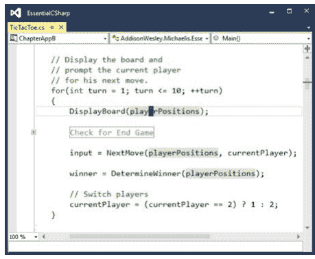

图 4.5：Microsoft Visual Studio .NET 中的折叠区域

# 激活可空引用类型 (`#nullable`)

如第 3 章所述，`#nullable` 预处理器指令会激活（或禁用）对可空引用类型的支持。`#nullable enable` 开启可空引用类型功能，而 `#nullable disable` 将其关闭。此外，`#nullable restore` 将可空引用类型恢复为项目文件中 `Nullable` 元素中确定的默认值。

## 总结

本章首先介绍了与赋值和算术相关的 C# 运算符。接下来，我们使用了这些运算符结合 `const` 关键字来声明常量。然而，对所有 C# 运算符的涵盖并不是按顺序的。在讨论关系和逻辑比较之前，本章引入了 `if` 以及代码块和作用域等重要概念。在结束对运算符的介绍之前，我们讨论了位运算符，特别是关于掩码的内容。我们还讨论了其他控制流语句，如循环、`switch` 和 `goto`，并以讨论 C# 预处理器指令结束了本章。

运算符优先级在章的早些部分讨论过；表 4.7 总结了所有运算符的优先级顺序，包括几个尚未涵盖的运算符。

# 第 4 章：运算符与流程控制

表 4.7：运算符优先级顺序*

| 类别 | | | | | | | | |
|---|---|---|---|---|---|---|---|---|
| 原始 | x.y | f(x) | a[x] | x++ | x-- | new | | |
| | typeof(T) | checked(x) | unchecked(x) | default(T) | | | |
| | nameof(x) | delegate(x) | | | | | | |
| 元运算符 | + | ! | ++x | --x | (T)x | await | x |
| 乘法 | * | / | % | | | | | |
| 加法 | + | | | | | | | | |
| 移位 | << | >> | | | | | | | |
| 关系和类型测试 | < | > | <= | >= | is | as | | | |
| 等于 | == | != | | | | | | | |
| 逻辑与 | && | | | | | | | | |
| 逻辑异或 | ^ | | | | | | | | |
| 逻辑或 | || | | | | | | | | |
| 条件与 | && | | | | | | | | | |
| 条件或 | || | | | | | | | | | |
| 空合并 | ?? | | | | | | | | | |
| 条件 | ?: | | | | | | | | | |
| 赋值和 lambda | = | *= | /= | %= | += | -= | <= | >= | &= | ^= | |= | >> | | | |

* 行按优先级从高到低的顺序出现。

回顾第 1、2、3 章所涵盖的所有内容的最佳方法之一，是查看第 04 章 `\TicTacToe.cs` 中的井井棋程序。通过复习这个程序，你可以看到一种将所学到的所有知识组合成一个完整程序的方法。

# 方法与参数

根据你到目前为止所学到的 C# 编程知识，你应该能够编写出由语句列表组成的简单程序，类似于 20 世纪 70 年创建程序的方式。然而，自 70 年代以来，编程领域已经取得了巨大的进步；随着程序变得越来越复杂，出现了新的范式来管理这种复杂性。过程化或结构化编程提供了构造，可以将这些语句组合成单元。此外，通过结构化编程，可以将数据传递给一组语句，并在语句执行后返回数据。

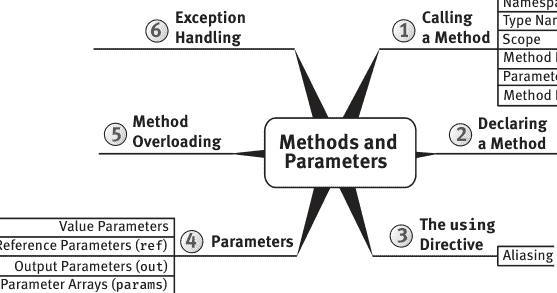

# 第 5 章：方法与参数

除了调用和定义方法的知识之外，本章还涵盖了一些高级的概念——即递归、方法重载、可选参数和命名参数。到目前为止以及本章结束的所有方法调用都是静态的（第 6 章详细探讨了这一概念）。

早在第 1 章的 HelloWorld 程序中，你就学会了如何定义方法。例如，你定义了 `Main()` 方法。在本章中，你将更详细地学习方法的创建，包括用于向方法传递变量而非值的特殊 C# 语法（`ref` 和 `out`）。最后，我们将触及一些基础的错误处理。

# 调用方法

## 什么是方法？

到目前为止，我们看到方法是一组执行特定任务的语句，通过方法名和参数界定。例如，你定义了 `Main()` 方法。在本章中，你将更详细地学习方法的创建，包括用于向方法传递变量而非值的特殊 C# 语法（`ref` 和 `out`）。最后，我们将触及一些基础的错误处理。

方法是执行特定操作的代码块，通过名称识别并可以接受参数作为输入并返回值。要调用方法，你使用其名称并提供所需的参数。列表 5.1 显示了方法调用的示例。

# 列表 5.1：语句分组

```csharp
class Program
{
    static void Main()
    {
        string name = Console.ReadLine("输入你的名字：");
        SayHello(name);
    }
    static void SayHello(string name)
    {
        Console.WriteLine($"Hello, {name}!");
    }
}
```


# 指南

方法的命名应使用描述其作用的动词。例如，`CalculateTotal`、`PrintReport` 或 `SaveData`。方法应该简洁且具有描述性。每个方法理想情况下只做一件事。如果一个方法太复杂，最好将其拆分为更小的方法。

参数用于将数据传递给方法。它们在方法签名中定义并在方法体中使用。`ref` 和 `out` 关键字允许按引用传递，这意味着方法可以修改原始变量。

方法还可以向调用者返回一个值。返回类型在方法签名中指定。如果方法不返回值，则返回类型为 `void`。

递归是指方法调用自身。这可以是解决复杂问题的强大工具，但必须小心使用以避免无限递归。

方法重载允许具有相同名的多个方法，只要它们的参数列表不同。这提供了灵活性，并允许使用不同类型的参数调用方法。

可选参数允许为方法签名中的参数提供默认值。这减少了对方法重载的需求。

命名参数允许你通过名称而非位置指定传递的参数。这在方法有许多参数时特别有用。

在列表 5.2 中，`Console` 类型位于 `System` 命名空间内。`System` 命名空间包含了程序执行许多基础编程活动的类型。几乎所有的 C# 程序都会使用 `System` 命名空间中的类型。表 5.1 提供了其他常用命名空间的列表。

## 表 5.1：常用命名空间

| 命名空间 | 说明 |
| --- | --- |
| System | 包含基本类型以及用于类型转换、数学计算、程序调用和环境管理的类型。 |
| System.Collections.Generics | 包含使用泛型的强类型集合。 |
| System.Data | 包含用于处理数据库的类型。 |
| System.Drawing | 包含用于向显示设备绘制和处理图像的类型。 |
| System.IO | 包含用于处理目录以及操作、加载和保存文件的文件的类型。 |
| System.Linq | 包含使用集成语言查询（LINQ）查询集合中数据的类和接口。 |
| System.Text | 包含处理字符串和各种文本编码以及在编码之间进行转换的类型。 |
| System.Text.RegularExpressions | 包含处理正则表达式的类型。 |
| System.Threading | 包含用于多线程编程的类型。 |
| System.Threading.Tasks | 包含基于任务的异步的类型。 |
| System.Web | 包含允许浏览器与服务器通信（通常通过 HTTP）的类型。此命名空间内的功能用于支持 ASP.NET。 |

## 第 5 章：方法与参数

## 表 5.1：常用命名空间（续）

| 命名空间 | 说明 |
| --- | --- |
| System.Windows | 包含从 .NET 3.0 开始创建富用户界面的类型，使用了名为 Windows 呈现框架 (WPF) 的 UI 技术，该技术利用可扩展应用程序标记语言 (XAML) 进行 UI 的声明式设计。 |
| System.Xml | 包含对 XML 处理的基于支持。 |

调用方法时并不总是需要提供命名空间。例如，如果调用表达式出现在与被调用方法处于相同命名空间的类型中，编译器可以推导出包含该类型的命名空间。在本章的后面，你还将看到 `using` 指令如何同样消除对命名空间限定符的需求。

> 指南
> 命名空间名称应使用 PascalCasing（帕斯卡命名法）。
> 考虑组织源文件的目录层次结构，以与命名空间层次结构匹配。

## 类型名

只要目标方法不在同一类型中，对静态方法的调用就需要类型名限定符。（正如在本章稍后讨论的，使用 `static` 指令允许你省略名称）。例如，在 `HelloWorld.Main()` 方法中找到 `Console.WriteLine()` 调用表达式需要指定类型 `Console`。然而，与命名空间一样，当方法是包含调用表达式的类型的成员时，C# 允许在方法调用中省略类型名。（此类方法调用的示例出现在列表 5.4 中）。在这些情况下，类型名是不必要的，因为编译器 + 1. 或基类。

## 调用方法

推断类型从调用的位置。从调用位置推断类型。如果编译器无法进行此类推断，则必须作为方法调用的一部分提供名称。

从本质上讲，类型是将方法及其相关数据分组在一起的手段。例如，`Console` 是包含 `Write()`、`WriteLine()` 和 `ReadLine()` 方法的。所有这些方法都在同一个组中，因为它们属于 `Console` 类型。

## 作用域

在第 4 章中，你学习了程序元素的作用域是其可以通过未限定名称被引用的文本区域。在类型声明内部出现的对该类型中声明方法的调用不需要类型限定符，因为该方法在整个容器类型内都处于作用域中。同样，类型在其声明的整个命名空间内都是有效的；因此，出现在特定命名空间类型中的方法调用不需要在方法名中指定该命名空间。

## 方法名

每个方法调用包含一个方法名，正如我们所讨论的，该方法名可能可能被命名空间和类型名限定。方法名之后是参数列表，这是一个括号括、逗号分隔的值列表，对应于方法的参数。

## 参数与参数

方法可以接受任意数量的参数，每个参数都有特定的数据类型。调用者为参数提供的值称为参数；每个参数必须对应一个特定的参数。例如，以下方法有三个参数：

```
System.IO.File.Copy(oldFileName, false)
```

该方法位于 `File` 类中，该类位于 `System` 命名空间。它被声明有三个参数，前两个是 `string` 类型，第三个是 `bool` 类型。在这个示例中，我们使用 `string` 类型的变量（`oldFileName` 和 `fileName`）作为旧和新文件名，然后指定 `false` 表示如果新文件名已存在则复制应失败。

## 方法返回值

与 `System.Console.WriteLine()` 相，列表 5.2 中的方法调用 `System.Console.ReadLine()` 没有任何参数，因为该方法被声明为没有参数。然而，此方法恰好有一个返回值。方法返回值是将结果从被调用方法传回给调用者的手段。由于 `System.Console.ReadLine()` 有返回值，因此可以将返回值赋值给变量 `firstName`。此外，可以将此方法的返回值本身作为参数传递给另一个方法调用，如列表 5.3 所示。

列表 5.3：将返回值作为参数传递给另一个方法调用

```
class Program
{
    static void Main()
{
        System.Console.Write("Enter your first name: ");
        System.Console.WriteLine("Hello {0}!", System.Console.ReadLine());
    }
}
```

与其将返回值赋值给变量然后将其作为 `WriteLine` 调用的参数，列表 5.3 直接调用了 `System.Console.ReadLine()` 方法。

并不是所有方法都返回数据。`System.Console.Write()` 和 `System.Console.WriteLine()` 的两个版本都是此类方法的示例。正如你很快看到的，这些方法的返回类型为 `void`，就像 `HelloWorld` 声明一样。

## 语句与方法调用

列表 5.3 展示了语句与方法调用之间的差异。虽然 `System.Console.WriteLine("Hello {0}!", System.Console.ReadLine());` 是一个语句，但它包含多个表达式，在这个示例中，这些表达式中的两个是方法调用。因此，方法调用构成了语句的一部分。

虽然单个语句中的多次调用减少了代码量，但并不一定能带来显著的性能优势。开发者应该考虑可读性而非简洁性。

> 注意 通常情况下，开发者应该考虑可读性而非简洁性。可读性对于编写自文档式的代码至关重要，从而提高了长期推移的可维护性。

## 声明方法

本节扩展了声明方法的说明，包含了参数或返回类型。列表 5.4 包含了这些概念的示例，输出 5.1 显示了结果。

# 第 5 章：方法与参数

```sharp
static void DisplayGreeting(string fullName, string initials)
{
    System.Console.WriteLine(
        $"Hello {fullName}! Your initials are {initials}");
    return;
}
static string GetInitials(string firstName, string lastName)
{
    return $"{firstName[0]} {lastName[0]}";
}
```

# 输出 5.1

嘿，你！
输入你的名字：Inigo
输入你的姓：Montoya
你好 Inigo！你的首字母是 I. M.。

列表 5.4 中声明了五个方法。从 `Main()` 开始调用了 `GetUserInput()`，接着调用了 `GetFullName()` 和 `GetInitials()`。这三个方法都有返回值并接受参数。此外，列表还调用了 `DisplayGreeting()`，它不返回任何数据。在 C# 中，任何方法都不存在于包含类型的范围之外；在这种情况下，包含类型是 `IntroducingMethods` 类。即使是第 1 章中检查的方法也必须位于类型内部。

> 语言对比：C++/Visual Basic—全局方法
# C# 不支持全局方法；一切都必须出现在类型声明内部。这就是为什么 `Main()` 方法被标记为 `static`——这是 C# 对应的 C++ 全局方法和 Visual Basic “shared”方法。

## 初学者主题

# 重构为方法

将一组语句移动到方法中，而不是让它们在较大的方法内内联，是一种重构的形式。重构减少了代码重复，因为你可以从多个地方调用该方法，而不是重复代码。重构还提高了代码的可读性。作为编码过程的一部分，一种最佳实践是持续检查你的代码并寻找重构的机会。这涉及到寻找一眼难以理解的代码块，并将它们移动到一个能够清晰定义代码行为的方法中。这种做法通常比对代码块添加注释更受欢迎，因为方法名本身就描述了实现的功能。

例如，列表 5.4 所示的 `Main()` 方法产生的行为与第 1 章列表 1.6 所示的 `Main()` 方法相同。或许值得注意的是，尽管这两个列表都易于理解，但通过查看 `Main()` 方法而不必担心每个被调用方法的实现细节，列表 5.4 更加更容易一眼了然。

Visual Studio 允许你右键点击方法中的代码块，并选择“快速操作和重构... (Ctrl+)”将该代码块提取到自己的方法中，自动从原位置向新方法中插入代码。

# 形式参数的声明

考虑 `DisplayGreeting()`、`GetFullName()` 和 `GetInitials()` 方法的声明。方法声明括号之间出现的文本是形式参数列表。（正如我们在讨论泛型时将看到的，方法也可以有类型参数列表。当从上下文可以清楚我们正在讨论哪种参数时，我们简单地将其称为参数列表中的参数。）参数列表中的每个参数都包含参数类型以及参数名。逗号分隔列表中的每个参数。

从行为上说，大多数参数与局部变量几乎相同，且参数的命名约定遵循驼峰命名法（camelCase）。此外，无法声明局部变量（在方法内部声明的变量）与包含该方法的参数具有相同的名称，因为这将创建两个同名的局部变量。

> 指南
> - 请使用驼峰命名法（camelCase）作为参数名。

# 方法返回值声明

除了 `GetUserInput()`、`GetFullName()` 和 `GetInitials()` 方法需要指定参数外，这些方法中的每一个都包含一个**方法返回值**。你重视这一点是因为在方法声明中，数据类型紧邻方法名出现。这些方法示例都指定了 `string` 返回类型。与可以是任意数量的参数不同，只允许一个方法返回值。

与 `GetUserInput()` 和 `GetInitials()` 一样，具有返回值的方法几乎包含一个或多个返回给调用者的 `return` 语句。一个 `return` 语句由 `return` 关键字以及计算返回值的表达式组成。例如，`GetInitials()` 的返回语句是 `return $"{firstName[0]}"`。return 关键字后面的表达式（在这种情况下是插值字符串）必须与方法的指定返回类型兼容。

如果方法有返回值，组成方法体的语句块不能有*无法到达的终点*。这意味着控制流不能在不返回值的情况下从方法末尾。确保这一条件实现的简单方法是将最后一个语句设为 `return` 语句。然而，返回语句可以出现在方法实现之外的其他位置。例如，方法实现中的 `if` 或 `switch` 语句内部可以包含 `return` 语句；参见列表 5.5。

# 列表 5.5：方法结束前的返回语句

```sharp
class Program {
  static bool MyMethod() {
    string command = ObtainCommand();
    switch(command) {
      case "quit":
        return false;
      // ... 省略其他情况
      default:
        return true;
    }
  }
}
```

# 声明方法

（注意，`return` 语句会将控制传出 switch，因此在 `return` 语句结尾的 switch 部分不需要 `break` 语句来防止非法穿透。）

列表 5.5 中，方法的最后一个语句不是 `return` 语句；而是 `switch` 语句。然而，编译器可以推导出方法的所有可能代码路径都会返回。如果方法有返回值，组成方法体的语句块不能有*无法到达的终点*。这意味着控制流不能在不返回值的情况下从方法末尾。确保这一条件实现的简单方法是将最后一个语句设为 `return` 语句。然而，返回语句可以出现在方法实现之外的其他位置。例如，方法实现中的 `if` 或 `switch` 语句内部可以包含 `return` 语句；参见列表 5.5。

## using 指令

## 初学者主题

### 命名空间

如前所述，**命名空间**（namespaces）是一种用于分类和归类相关类型的组织机制。开发者可以通过检查与熟悉类型相同的命名空间下的类型来发现相关类型。此外，通过命名空间，只要通过不同的命名空间进行区分，两个或多个命名空间可以具有相同的名称。

## using 指令

完全限定命名空间名称可能会变得非常长且难以处理。然而，你可以将一个或多个命名空间中的所有类型导入到文件中，以便无需使用完全限定名称即可使用。为了实现这一点，C# 程序员通常在文件顶部包含一个 `using` 指令。例如，在列表 5.7 中，`Console` 没有带有 `System.` 前缀。由于列表顶部出现了 `using System` 指令，因此可以省略命名空间。

列表 5.7：using 指令示例

```csharp
// using 指令将指定命名空间的所有类型
// 导入到整个文件
using System;
class HelloWorld
{
    static void Main()
    {
        // 不需要用 System 限定 Console
        // 因为有上面的 using 指令
        Console.WriteLine("Hello, my name is Inigo Montoya");
    }
}
```

列表 5.7 的结果显示在输出 5.2 中。

# 输出 5.2

```
Hello, my name is Inigo Montoya
```

像 `using System` 这样的指令并不能让你在 System 的子命名空间内声明的类型中省略 `System`。例如，如果你的代码访问来自 `System.Text` 命名空间的 `StringBuilder` 类型，你必须包含额外的 `using System.Text;` 指令，或者将类型完全限定为 `System.Text.StringBuilder`，而不仅仅是 `Text.StringBuilder`。简而言之，`using` 指令不会导入嵌套命名空间类型（通过命名空间中的点识别），这些必须显式导入。

# 语言对比：Java——导入指令中的通配符

Java 允许使用通配符导入命名空间，例如：

```
import javax.swing.*;
```


相比之下，C# 不支持使用通配符 `using` 指令，而是要求显式导入每个命名空间。

# 语言对比：Visual Basic .NET——项目范围导入指令

与 C# 不同，Visual Basic .NET 支持为整个项目指定 `using` 指令的等项 `Imports`，而不是特定文件。换句话说，Visual Basic .NET `using` 指令的命令行版本，适用于整个编译过程。

在特定命名空间内频繁使用类型意味着为该命名空间添加 `using` 指令是一个好主意，而不是完全限定该命名空间内的所有类型。因此，几乎所有的 C# 文件在顶部都包含 `using System` 指令。在本书的其余部分，代码列表经常省略 `System` 指令。然而，其他命名空间指令是显式包含的。

`using System` 指令的一个有趣效果是字符串数据类型可以使用不同的大小识别：`String` 或 `string`。前者依赖于 `using System` 指令，而后者使用 `string` 关键字。两者都是对 `System.String` 数据类型的有效 C# 引用，生成的公共中间语言 `CIL` 代码不受选择哪一个版本的影响。²

## 高级主题

### 嵌套 using 指令

你不仅可以在文件顶部拥有 `using` 指令，还可以将其包含在命名空间声明的顶部。例如，如果声明了一个新的命名空间 `EssentialCSharp`，可以在命名空间声明顶部添加 `using` 指令（参见列表 5.8）。

列表 5.8：在命名空间声明内部指定 using 指令

```csharp
namespace EssentialCSharp
{
    using System;
}
class HelloWorld
{
    static void Main()
    {
        // 不需要用 System 限定 Console
        // 因为有上面的 using 指令
        Console.WriteLine("Hello, my name is Inigo Montoya");
    }
}
```

列表 5.8 的结果显示在输出 5.3 中。

# 输出 5.3

Hello, my name is Inigo Montoya

将 `using` 指令放在文件顶部与放在命名空间声明顶部的区别是，该指令仅在命名空间声明内部有效。如果代码在 `EssentialCSharp` 声明上方或下方包含新的命名空间，我倾向于使用 `string` 关键字，但无论程序员选择哪种表示形式，项目中的代码理想情况下应一致。

# 第 5 章：方法与参数

到为止，可执行程序的 `Main()` 方法的声明是最简单的声明。你没有在 `Main()` 方法声明中包含任何参数或非 void 返回类型。然而，C# 支持在执行程序时检索命令行参数，并且可以从 `Main()` 方法返回状态指示。

# 起名 (Aliasing)

`using` 指令还允许为命名空间或类型起别名。别名是在指令作用文本内部使用的替代名称。起别名的两个常见理由是区分两个同名类型，以及缩短长名称。在列表 5.10 中，`CountdownTimer` 别名被声明为 `System.Timers.Timer`。仅仅添加 `System.Timers` 指令不足以让代码避免完全限定类型，因为 `System.Threading` 也包含一个名为 `Timer` 的类型；因此，在代码中使用 `Timer` 可能会产生义。

列表 5.10：声明类型别名

```csharp
using System;
using System.Threading;
using CountdownTimer = System.Timers.Timer;
```

```csharp
class HelloWorld {
    static void Main() {
        CountdownTimer timer;
        // ...
    }
}
```

列表 5.10 使用了全新的名称 `CountdownTimer` 作为别名。然而，可以将别名指定为 `Timer`，如列表 5.11 所示。

## Main() 的返回值与参数

LISTING 5.12: 向 Main 传递命令行参数

```csharp
using System;
using System.IO;
using System.Net.Http;
class Program
{
    static int Main(string[] args)
    {
        int result;
        switch (args.Length)
        {
            default:
                // 必须指定两个参数；输出错误
                Console.WriteLine(
                    "ERROR: You must specify the "
                    + "URL and the file name");
                Console.WriteLine(
                    "Usage: Downloader.exe <URL> <TargetFileName>");
                result = 1;
                break;
            case 2:
                WebClient webClient = new WebClient();
                webClient.DownloadFile(args[0], args[1]);
                result = 0;
                break;
        }
        return result;
    }
}
```

Listing 5.12 的结果显示在 输出 5.4 中。

# 输出 5.4

```
Downloader.exe
ERROR: You must specify the URL to be downloaded
Downloader.exe <URL> <TargetFileName>
```

如果你成功计算了目标文件名，你将使用它来保存下载的文件。否则，将显示帮助文本。`Main()` 方法返回的是一个 `int` 而不是 `void`。这对于 `Main()` 声明是可选的，但如果使用它，程序可以向调用者（如脚本或批处理文件）返回状态码。按照惯例，非零返回值表示错误。

虽然所有的命令行参数都可以通过字符串数组传递给 `Main()`，但有时在 `Main()` 其他方法内部访问参数会更方便。`System.Environment.CommandLineArgs()` 方法返回命令行参数的形式与 `Main(string[]) args` 将参数传入 `Main()` 的形式相同。

## 高级主题

### 区分多个 Main() 方法，可以指定使用哪一个方法作为入口点。在 Visual Studio 中，从解决方案管理器中右键点击项目并选择“属性”，这会在项目文件上方提供一个用户界面。通过选择左侧的“应用程序（Application）”选项卡，你可以编辑“启动对象（Startup Object）”，并选择哪种类型的 `Main()` 方法启动程序。在命令行上，你可以在运行构建时通过设置 `StartupObject` 属性来指定相同的值。例如：

```
dotnet /p:StartupObject=AddisonWesley.Program2
```

其中 `AddisonWesley.Program2` 是包含所选 `Main()` 方法的命名空间和类。

## 初学者主题

### 调用栈与调用点

随着代码的执行，方法调用更多方法，方法又调用其他方法，以此此类推。在 Listing 5.4 的简单情况下，`Main()` 调用 `GetUserInput()`，后者又调用 `System.Console.ReadLine()`，进而进一步调用了更多方法。每当调用一个新方法时，运行时都会创建一个激活帧（activation frame），其中包含传递给新方法的参数信息、新方法的局部变量，以及当新方法返回时应恢复控制的位置信息。这种调用中的调用中的调用产生了一系列激活帧，称为调用栈（call stack）³。

> ¹ 异步或迭代器方法外，这些方法会将激活器记录移动到堆上。

# 高级方法参数

随着程序复杂性的增加，由于每个方法调用另一个方法，调用栈通常变得越来越大。然而，随着调用完成，调用栈会缩小，直到另一个方法被调用。从调用栈中移除激活帧的过程被称为栈回溯（stack unwinding）。栈回溯总是按照方法调用的相反顺序发生。当方法完成时，执行返回到调用点——即调用该方法的位置。

到目前为止，本章的示例都是通过方法的返回值返回数据的。本节演示了方法如何通过方法参数返回数据，以及方法如何接受变数量的参数。

# 值参数

方法调用的参数通常按值传递，这意味着参数表达式的值被复制到目标参数中。例如，在 Listing 5.13 中，`Main()` 调用 `Combine()` 时使用的每个变量的值都将被复制到 `Combine()` 方法的参数中。输出 5.5 显示了该列表的结果。

> Listing 5.13: 按值传递变量

```csharp
class Program
{
    static void Main() {
        // ...
        string fullName = "C:";
        string driveLetter = "Data";
        string folderPath = "index.html";
        string fileName;
        fullName = Combine(driveLetter, folderPath, fileName);
        Console.WriteLine(fullName);
        // ...
    }
static string Combine(string driveLetter, string folderPath, string fileName) {
        string path;
    }
```

# 第 5 章：方法与参数

```csharp
path = string.Format("{1}{0}{2}{3}",
System.IO.Path.DirectorySeparatorChar,
driveLetter, folderPath, fileName);
return path;
}
```

# 输出 5.5

```
C:\Data\index.html
```

即使 `Combine()` 方法在返回之前为 `driveLetter`、`folderPath` 和 `fileName` 赋值为 `null`，`Main()` 内部对应的变量仍保持其原始值，因为变量在调用方法时被复制了。当调用结束时栈回溯时，复制的数据会被丢弃。

## 初学者主题

# 匹配调用者变量与参数名

在 Listing 5.13 中，`Main()` 调用 `Combine()` 时使用的每个变量的值将被复制到 `Combine()` 方法的参数中。输出 5.5 显示了该列表的结果。

到目前为止，本章的示例都是通过方法的返回值返回数据的。本节演示了方法如何通过方法参数返回数据，以及方法如何接受变数量的参数。

## 高级主题

# 引用类型与值

方法调用的参数通常按值传递，这意味着参数表达式的值被复制到目标参数中。例如，在 Listing 5.13 中，`Main()` 调用 `Combine()` 时使用的每个变量的值将被复制到 `Combine()` 方法的参数中。输出 5.5 显示了该列表的结果。

# 引用参数 (ref)

在 Listing 5.14 中，赋值给 `first` 和 `second` 的值成功交换了。为了实现这一点，变量按引用传递。

LISTING 5.14: 按引用传递变量

```csharp
class Program {
  static void Main() {
    // ...
    string first = "hello";
    string second = "goodbye";
    Swap(ref first, ref second);
    Console.WriteLine($"{first}", second = "{second}");
  }
  static void Swap(ref string x, ref string y) {
    string temp = x;
    x = y;
    y = temp;
  }
}
```

输出 5.6

```
first = "goodbye", second = "hello"
```

# 输出参数 (out)

如前，作为 `ref` 参数的变量在传递给调用方法之前必须赋值，因为被调用方法可能会读取该变量。然而，通常情况下，接收变量引用的方法旨在写入它而不是读取它。在这种情况下，按引用传递未初始化的局部变量显然安全的。

要实现这一点，代码需要在参数类型上装饰 `out` 关键字。这在 Listing 5.15 的 `TryGetPhoneButton()` 方法中得到了演示，该方法返回字符对应的按键。

LISTING 5.15: 仅输出变量

```csharp
class ConvertToPhoneNumber
{
    static int Main(string[] args)
    {
        if(args.Length == 0)
```

# 高级方法参数

```csharp
if (args.Length == 0)
{
  Console.WriteLine(
    "ConvertToPhoneNumber.exe <phrase>"
  );
  Console.WriteLine(
    "_' indicates no standard phone button");
  return 1;
}
foreach (string word in args) {
  foreach (char character in word) {
    if (TryGetPhoneButton(character, out char button)) {
      Console.Write(button);
    } else {
      Console.Write('_');
    }
  }
  Console.WriteLine();
}
return 0;
}
```

```csharp
static bool TryGetPhoneButton(char character, out char button) {
  bool success = true;
  switch (char.ToLower(character)) {
    case '1':
      button = '1';
      break;
    case '2': case 'a': case 'b': case 'c':
      button = '2';
      break;
    // ..
    case '-':
      button = '-';
      break;
    default:
      // Set the button to indicate an invalid value
      button = '_';
      success = false;
      break;
  }
  return success;
}
```

# 第 5 章：方法与参数

输出 5.7 显示了列表 5.15 的结果。

# 输出 5.7

```
>ConvertToPhoneNumber.exe CSharpIsGood
274277474663
```


在这个示例中，如果 `TryGetPhoneButton()` 方法能够成功确定字符对应的手机按钮，则返回 `true`。该函数还通过带有 `out` 修饰符的 `button` 参数返回相应的按钮。

`out` 参数功能上与 `ref` 参数相同；唯一的区别在于语言强制执行别名变量读写的时间点。每当参数被标记为 `out` 时，编译器会检查在方法中所有正常返回的代码路径（即不抛出异常的代码路径）内，该参数是否已赋值。例如，如果代码在某些路径中没有为 `button` 赋值，编译器将抛出错误，指示代码未初始化 `button`。列表 5.15 即使在无法确定正确手机按钮的情况下，也将 `button` 赋值为下划线字符，这种赋值是必要的。

使用 `out` 参数时一个常见的错误是在在使用之前忘记声明 `out` 变量。从 C# 7.0 开始，可以在调用函数时内联声明 `out` 变量。列表 5.15 使用了这一特性，语句 `TryGetPhoneButton(character, out char button)`，而无需在此之前声明该变量。在 C# 7.0 之前，需要先声明 `button` 变量，然后使用 `TryGetPhoneButton(character, out button)` 调用函数。

另一个 C# 7.0 的特性是完全禁用 `out` 参数。例如，如果你只是想知道一个字符是否为有效的手机按钮，而不需要实际上返回数值值，可以使用下划线丢弃 `button` 参数：`TryGetPhoneButton(character, out)`。

在 C# 7.0 语法之前，方法的开发者可能会声明一个或多个参数，以获得一个方法只能有一个返回类型的限制；需要返回两个值的方法可以通过正常返回一个值（作为方法的返回值），并将第二个值写入写入作为 `out` 参数传递的别名变量中。尽管这种模式很常见且合法，但通常有更好的方法来实现该目标。例如，如果你正在考虑从方法返回两个或多个值，且可以使用 C# 7.0，那么使用 C# 7.0 的元组语法可能更好。在此之前，可以考虑两个方法（每个值对应一个方法），或者在没有 C# 7.0 语法的情况下仍使用 `System.ValueTuple` 类型。

# 注意

每一个正常的代码路径都必须导致所有 `out` 参数赋值。

# 只读引用传递 (in)

在 C# 7.2 中，增加了对只读引用方式传递值类型的支持。不再是将值类型传递给函数以便对其更改，而是增加了只读引用传递：它允许通过引用方式传递值类型，这样不仅发生了值类型的拷贝，而且被调用的方法无法更改该值类型。换句话说，该特性的目的是传递值时减少复制的内存，同时将其标记为只读，从而提高性能。这种语法是在参数上添加修饰符。例如：

```csharp
int Method(in int number) { ... }
```

使用 `in` 修饰符后，任何重新赋值 `number` 的尝试（例如 `number++`）都导致编译错误，指示 `number` 是只读的。

# 引用返回

另一个 C# 7.0 的新增是支持返回变量的引用。例如，考虑一个返回图像中红眼相关的第一个像素的，如列表 5.16 所示。

列表 5.16：ref 返回和 ref 局部声明

```csharp
// 返回引用
public static ref byte FindFirstRedEyePixel(byte[] image)
```

```csharp
// 也许使用机器学习进行复杂的图像检测
for (int counter = 0; counter < image.length; counter++) {
    if(image[counter] == (byte)Console.Red) {
        return ref image[counter];
    }
}
throw new InvalidoperationException("No pixels are red.");
}
public static void Main() {
    byte[] image = new byte[254];
    // 加载图像
    int index = new Random().Next(0, image.Length - 1);
    image[index] = (byte)Console.Red;
    Console.WriteLine(image[index]);
}
```

```csharp
// 获取像素的引用
ref byte redPixel = FindFirstRedEyePixel(image);
// 更新它
redPixel = (byte)Console.Black;
Console.WriteLine(image[index]);
```

# 高级方法参数

例如，`FindFirstRedEyePixel()` 返回数组中项的引用，该项是一个参数。同样，如果图像存储在类的字段中，你可以通过引用返回字段：

```csharp
byte[] _Image;
public ref byte[] Image { get { return ref _Image; } }
```

此外，局部变量初始化为指向特定的变量且不能修改为指向另一个变量。

有几个引用返回特性需要注意：

- 如果你返回一个引用，你显然必须返回它。这意味着，在列表 5.16 的示例中，即使不存在红眼像素，你仍然需要返回一个引用。唯一的变方法是抛出异常。相比之下，引用参数允许你保持参数不变并返回一个表示成功的 bool。在许多情况下，这可能更好。
- 在声明引用局部变量时，必须进行初始化。这涉及分配函数的 ref 返回值或变量的引用：

```csharp
ref string text; // 错误
```

- 虽然在 C# 7.0 中可以声明引用局部变量...
- 引用局部变量可以使用值（如 null 或常量）初始化。它必须从按引用返回的成员或局部变量、字段或数组元素赋值：

```csharp
ref int number = 42; // 错误
```

# 第 5 章：方法与参数

## 参数数组 (params)

在之前的示例中，必须传递的参数数量是由目标方法声明中声明的参数数量固定的。然而，有时如果参数的数量可以变化，会更加方便。考虑列表 5.13 中的 `Combine()` 方法。在该方法中，你传递了驱动器号、文件夹路径和文件名。如果路径包含多个文件夹，而调用者想要连接额外的文件夹以形成完整路径呢？也许最好的选项是为文件夹传递一个字符串数组。然而，这将使调用代码变得稍微复杂，因为需要构造一个数组并作为参数传递。

为了方便此类方法的调用者，C# 提供了一个关键字，允许在调用代码中更改参数的数量，而不是由目标方法来设置。在讨论声明之前，请观察在 `Main()` 方法中定义的调用代码，如列表 5.17 所示。

### 列表 5.17：传递变量参数列表

```
using System;
using System.IO;
class PathEx
{
    static void Main()
    {
        string fullName;
        // ...
        // 使用四个参数调用 Combine()
        fullName = Combine(
            Directory.GetCurrentDirectory(),
            "bin", "config", "index.html");
        Console.WriteLine(fullName);
        // ...
        // 使用三个参数调用 Combine()
        fullName = Combine(
            Environment.SystemDirectory(),
            "Temp", "index.html");
        Console.WriteLine(fullName);
        // ...
    }
}
```

## 高级方法参数

```csharp
// 使用数组调用 Combine()
fullName = Combine(
    new string[] {
        @"C:\", "Data",
        "HomeDir", "index.html"
    });
    Console.WriteLine(fullName);
// ...
static string Combine(string[] paths)
{
    string result = string.Empty;
    foreach (string path in paths)
    {
        result = Path.Combine(result, path);
    }
    return result;
}
```

输出 5.8 显示了列表 5.17 的结果。

### 输出 5.8

```
C:\Data\mark\bin\config\index.html
C:\WINDOWS\system32\Temp\index.html
C:\DataHomeDir\index.html
```

在第一次调用 `Combine()` 时，指定了四个参数。在最后一次中，使用数组传递了单个参数。换句话说，`Combine()` 方法接受可变数量的参数——既可以通过任意数量的逗号分隔的字符串参数呈现，也可以以单个字符串数组呈现。前者的语法是方法调用的扩展形式，而后者被称为普通形式。

为了允许使用这两种形式进行调用，`Combine()` 方法执行了以下操作：

- 1. 在方法声明中将 `params` 放在最后一个参数之前
- 2. 将最后一个参数声明为数组

通过参数数组声明，可以作为 `params` 数组的成员来访问每个对应的参数。在 `Combine()` 方法的实现中，你遍历了 `paths` 数组的元素并调用 `System.IO.Path.Combine()`。该方法会自动组合路径，并恰当使用使用特定平台的目录分隔符。注意，`PathEx.Combine()` 与 `Path.Combine()` 相同，`PathEx.Combine()` 处理的是可变数量的参数，而不是简单的两个。

参数数组有几个显著的特征：

- 参数数组并不一定是方法上的唯一参数。
- 参数数组必须是方法声明中的最后一个参数。由于只有最后一个参数可以可以是参数数组，因此一个方法不能有多个参数数组。
- 调用者可以指定对应于参数数组的零个参数，这将导致传递一个包含零项的数组作为参数数组。
- 参数数组是类型安全的：给定的参数必须与参数数组的元素类型兼容。
- 调用者可以使用显式数组而不是逗号分隔的参数列表。生成的 CIL 代码是相同的。
- 如果目标方法的实现需要最少数量的参数，则这些参数应该在方法声明中显式出现，从而强制产生编译错误，而不是在缺少必要参数时依赖运行时错误处理。例如，如果你有一个有一个需要一个或多个整数参数的方法，请将其声明为 `int Max(int first, params int[] operands)` 而不是 `int Max(params int[] operands)`，以便确保至少向 `Max()` 传递了一个值。

使用参数数组，你可以向方法传递相同类型的可变数量的参数。本章稍后出现的“方法重载”部分将讨论一种支持不一定相同类型的可变数量参数的方法。

> 指南：当方法可以处理任意数量（包括零个）的额外参数时，使用参数数组。

顺便提一下，路径 `Combine()` 函数是一个构造的示例，实际上，`System.IO.Path.Combine()` 是一个现有函数，它被重载以支持参数数组。

## 递归

递归调用方法或使用递归实现方法是指使用一个调用自身的方法。递归有时是实现特定算法简单的方法。列表 5.18 统计目录和子目录中所有 C# 源文件 (.cs) 的行数。

列表 5.18：给定目录，统计 *.cs 文件中的行数

```csharp
#nullable enable
using System.IO;
public static class LineCounter
{
    // 使用第一个参数作为搜索的目录
    // 或者默认使用当前目录
    public static void Main(string[] args)
    {
        int totalCount = 0;
        string directory;
        if (args.Length > 0)
        {
            directory = args[0];
        }
        else
        {
            directory = Directory.GetCurrentDirectory();
        }
        totalCount = CountLines(directory);
        System.Console.WriteLine(totalCount);
    }
    static int CountLines(string directory)
    {
        int lineCount = 0;
        foreach (string file in Directory.GetFiles(directory, "*.cs"))
        {
            lineCount += CountLines(file);
        }
        foreach (string subdirectory in Directory.GetDirectories(directory))
        {
            lineCount += CountLines(subdirectory);
        }
        return lineCount;
    }
    private static int CountLines(string file)
    {
        int lineCount = 0;
        FileStream stream = new FileStream(file, FileMode.Open);
        StreamReader reader = new StreamReader(stream);
        string line;
        while ((line = reader.ReadLine()) != null)
        {
            if (line.Trim() != "")
            {
                lineCount++;
            }
        }
        reader.Close(); // 自动关闭流
        return lineCount;
    }
}
```

输出 5.9 显示了列表 5.17 的结果。

输出 5.9
104

程序通过将第一个命令行参数传递给 `CountLines()`，或者在未提供参数时使用当前目录开始。该方法首先遍历当前目录中的所有文件并汇总每个文件的行数。在处理每个文件后，代码处理每个子目录。该过程递归进行直到没有更多目录。不熟悉递归的读者可能会感到困惑。无论如何，这通常是简单的模式，特别是对于文件系统等层次数据。然而，尽管它可能

- 1. 该代码可以使用使用语句进行改进——我避免引入该构造。

最易读的方法，通常不是最快的实现。

## 初学者主题

### 无限递归

递归方法实现中常见的编程错误表现为程序执行期间的栈溢出。这通常由于无限递归引起，方法不断调用自身，从未触发递归结束的节点。程序员检查任何使用递归的方法是一项良好的实践。

使用递归的常用伪代码模式如下：

```
M(x)
如果 x 是简单的
    返回结果
否则
    a. 执行一些工作使问题变小
    b. 递归调用 M 来解决较小的问题
    c. 根据 a 和 b 计算结果
返回结果
```

当不遵循此模式时，问题就会出现。例如，如果你不让问题变小，或者你不处理所有可能的“最小”情况，递归永远不会终止。

## 第5 章：方法与参数

定义两个仅在返回数据类型不同的方法会导致编译错误。即使返回类型不同，也是如此。
**方法重载**发生在一个类具有两个或多个同名方法，且重载方法之间的参数数量和/或数据类型存在差异时。

> 注意（NOTE）：只要方法名称、参数数据类型或参数数量存在差异，该方法就被认为是唯一的。

方法重载是**操作多态**的一种。当数据发生变化时，相同的逻辑操作会产生多种（poly）形式（morphs），这就发生了多态。例如，调用 `WriteLine()` 并传递带有某些参数的格式字符串的实现方式，与调用 `WriteLine()` 并指定一个整数的方式不同。然而，在逻辑上，调用者负责写入数据，内部实现如何发生实际上并不重要。列表 5.19 提供了一个示例，输出 5.10 显示了结果。

列表 5.19：使用重载统计 *.cs* 文件中的行数

```csharp
#nullable enable
using System.IO;
public static class LineCounter
{
    public static void Main(string[] args)
    {
        int totalCount;
        if (args.Length > 1)
        {
            totalCount = DirectoryCountLines(args[0], args[1]);
        }
        if (args.Length > 0)
        {
```


```csharp
totalCount = DirectoryCountLines(args[0]);

}

else

{

    totalCount = DirectoryCountLines();

}
}
```

# 方法重载

```csharp
System.Console.WriteLine(totalLineCount);

static int DirectoryCountLines() {
    return DirectoryCountLines(Directory.GetCurrentDirectory());
}
```

```csharp
static int DirectoryCountLines(string directory)
{
    return DirectoryCountLines(directory, "*.cs");
}
```

```csharp
static int DirectoryCountLines(string directory, string extension)
{
    int lineCount = 0;
    foreach (string file in Directory.GetFiles(directory, extension)) {
        lineCount += CountLines(file);
    }
    foreach (string subdirectory in Directory.GetDirectories(directory)) {
        lineCount += DirectoryCountLines(subdirectory);
    }
    return lineCount;
}
```

```csharp
private static int CountLines(string file)
{
    int lineCount = 0;
    string? line;
    FileStream stream = new FileStream(file, FileMode.Open);
    StreamReader reader = new StreamReader(stream);
    line = reader.ReadLine();
    while (line is object) {
        if (line.Trim() != "") {
            lineCount++;
        }
        line = reader.ReadLine();
    }
}
```

- 5. 这段代码可以使用 `using` 语句进行改进——我们之前避免这种构造是因为因为它还没有被引入。

```csharp
reader.Close(); // 关闭流
return lineCount;
}
```

# 输出 5.10

```
>LineCounter.exe *.cs
28
```

方法重载的作用是为调用方法提供可选方式。正如 `Main()` 内部所示，你可以传递或不传递要搜索的目录和文件扩展名来调用 `DirectoryCountLines()` 方法。

注意，`DirectoryCounts()` 的无参数实现已更改为调用单参数版本 `DirectoryCountLines(string directory)`。这是实现重载方法时的常用模式。其想法是开发人员仅在一个方法中实现核心逻辑，而所有其他重载方法将调用该简单方法。如果核心实现发生变化，只需在一个位置处进行修改，而不是在每个实现中修改。这种模式在使用方法重载启用那些在编译时无法确定值的可选参数时尤为常见，因此无法使用可选参数来指定它们。

> 注意（NOTE）：将核心功能放置在所有其他重载方法调用的单个方法中，意味着你只需要在核心方法中更改实现，其他方法将自动获益。

# 可选参数

C# 语言设计者还添加了对可选参数的支持⁶。通过在方法声明中将参数与常量值关联，

- 6. 在 C# 4.0 中引入。

就可以在不为方法的每个参数传递参数的情况下调用方法（见列表 5.20）。

# 列表 5.20：带有可选参数的方法

```csharp
#nullable enable
using System.IO;
public static class LineCounter{
    public static void Main(string[] args)
    {
        int totalLineCount;
        if (args.Length > 1)
        {
            totalLineCount = DirectoryCountLines(args[0], args[1]);
        }
        if (args.Length > 0)
        {
            totalLineCount = DirectoryCountLines(args[0]);
        }
        else
        {
            totalLineCount = DirectoryCountLines();
        }
        System.Console.WriteLine(totalLineCount);
    }
    static int DirectoryCountLines()
    {
        // ...
    }
```
```csharp
/*
static int DirectoryCountLines(string directory)
{ ... }
*/
static int DirectoryCountLines(
    string directory, string extension = "*.cs")
{
    int lineCount = 0;
    foreach (string file in Directory.GetFiles(directory, extension))
    {
        lineCount += CountLines(file);
    }
}
```

```csharp
foreach (string subdirectory in Directory.GetDirectories(directory))
{
    lineCount += DirectoryCountLines(subdirectory);
}
return lineCount;
}
```

```csharp
private static int CountLines(string file)
{
    int lineCount = 0;
    // ...
}
```

在列表 5.20 中，带有单个参数的 `DirectoryCountLines()` 方法已被移除（注释掉），但来自 `Main()` 的调用（指定一个参数）仍然存在。当调用未指定扩展参数时，将使用声明内分配的值。这消除了原本需要的额外重载。注意，可选参数必须出现在所有必需参数（没有值的）之后。此外，默认值需要是常量的这一事实限制很大。例如，你不能这样声明方法：

```csharp
DirectoryCountLines(
    string directory = Environment.CurrentDirectory,
    string extension = "*.cs")
```

`Environment.CurrentDirectory` 不是常量。相比之下，`*.cs"` 是常量，C# 允许用于可选的默认值。

> 指南（Guidelines）
尽可能为所有参数提供良好的默认值。
提供少量必需参数的简单方法重载。
考虑从简单到复杂的组织重载。

方法的另一个功能是使用命名参数⁷。通过命名参数，调用者可以显式地识别要赋值赋值的参数名称，而不是仅仅依赖参数和顺序来关联它们（见列表 5.21）。

# 列表 5.21：按名称指定参数

```csharp
#nullable enable
using System.IO;
class Program
{
    static void Main()
    {
        DisplayGreeting(
            firstName: "Inigo", lastName: "Montoya");
    }
}
public static void DisplayGreeting(
string firstName,
string? middleName = null,
string? lastName = null)
{
    // ...
}
```

7. 在 C# 4.0 中引入。

# 第5章：方法与参数

> 指南
请将参数名称视为 API 的一部分，如果 API 之间的版本兼容性非常重要，请避免更改名称。

对于经验丰富的 C# 开发者来说，这是一个令他们惊讶的限制。然而，这种限制从 .NET 1.0 开始起就是通用语言规范（CLS）的一部分。Visual Basic 一直支持使用命名参数调用方法。因此，库开发者始终遵循不更改参数名称的习惯，以确保不同版本之间 .NET 语言的成功互操作。从本质上说，命名参数对更改参数名称实施了与许多其他 .NET 语言始终要求的相同限制。

通过方法重载、可选参数和命名参数的结合，确定调用哪个方法变得显而易见。如果所有参数恰好有一个对应的参数（通过名称或位置）且类型兼容，除非该参数是可选的（或是参数数组），否则该方法是有效的。虽然这限制了可能调用的方法数量，但它并不能确定唯一的方法。为了进一步区分将调用哪个特定方法，编译器仅使用调用者未指定显式标识的参数。因此，如果两个方法都有效（因为其中一个具有可选参数），编译器将解析为不带可选参数的方法。

## 高级主题

## 方法解析

当编译器必须在多个有效方法中选择最适合特定调用的方法时，将选择参数类型最具体的某一个。假设有两个有效方法，每个方法都需要从参数到参数类型进行隐式转换，将使用参数类型更具派生的方法。

例如，如果调用者传递一个 `int` 类型的参数，将选择接收 `double` 参数的方法，而不是接收 `object` 参数的方法。这是因为 `double` 比 `object` 更具体。有些对象不是 `double`，但并非 `double` 不是 `object`，所以 `double` 必须更具体。

如果多个方法有效且无法确定唯一的最佳方法，编译器将发出错误，指示调用存在歧义。

例如，给定以下方法

```csharp
static void Method(object thing){}
static void Method(double thing){}
static void Method(long thing){}
static void Method(int thing){}
```

形式为 `Method(42)` 的调用将解析为 `Method(int thing)`，因为这是从参数类型到参数类型的精确匹配。如果该方法被移除，重载解析将选择 `long` 版本，因为 `long` 比 `double` 或 `object` 都更具体。

C# 规范包含了额外的关于 `byte`、`ushort`、`uint`、`ulong` 以及其他数值类型之间隐式转换的规则。但通常情况下，使用强制转换使意图的方法更容易识别更好。

# 使用异常进行基础错误处理

本节研究如何通过名为异常处理的机制处理错误报告。通过异常处理，方法能够向调用方法传递错误信息，而无需使用返回值或显式提供任何参数来实现。列表 5.22 包含了对列表 1.16（即第一章中的 HeyYou 程序）的细微修改。它不是请求用户的姓，而是提示用户输入名。

+ 列表 5.22：将字符串转换为 int

```csharp
using System;
class ExceptionHandling
{
    static void Main() {
        string firstName;
        string ageText;
        int age;
        Console.WriteLine("Hey you!");
        Console.Write("Enter your first name: ");
        firstName = System.Console.ReadLine();
        Console.Write("Enter your age: ");
        ageText = Console.ReadLine();
        age = int.Parse(ageText);
        Console.WriteLine($"Hi {firstName}! You are {age+12} months old.");
    }
```
输出 5.11 显示了列表 5.22 的结果。

Hey you!
Enter your first name: Inigo
Enter your age: 42
Hi Inigo! You are 504 months old.

来自 `System.Console.ReadLine()` 的返回值存储在变量 `ageText` 中，然后传递给具有 `int` 数据类型的方法，即 `Parse()`。此方法负责获取代表数字的字符串值并将其转换为 `int` 类型。

## 初学者主题

## 字符串形式的 42 与整数形式的 42

C# 要求每个非空值都有一个定义良好的类型。因此，不仅数据值本身很重要，与数据相关的类型也同样重要。因此，字符串值 "42" 与整数值 42 是**截然不同的**。字符串由两个字符 '4' 和 '2' 组成，而 `int` 是数字 42。

给定转换后的字符串，最后的 `System.Console.WriteLine()` 语句将通过年龄值乘以 12 来打印月龄。

# 使用异常进行基础错误处理

但如果用户没有输入有效的整数字符串会发生什么？例如，如果用户输入 "forty-two" 会怎样？`Parse()` 方法无法处理此类转换。它期望用户输入仅包含数字的字符串。如果向 `Parse()` 方法发送了无效值，它需要某种方式向调用者报告这一事实。

# 捕获错误

为了向调用方法指示参数无效，`int.Parse()` 将抛出一个异常。抛异常会停止当前控制流的执行，并跳转到栈调用中处理该异常的第一个代码块。

由于你尚未提供任何处理，程序将向用户报告异常。假设没有注册，错误将如输出 5.12 所示显示在控制台上。

```
Hey you!
Enter your first name: Inigo
Enter your age: forty-two
Unhandled Exception: System.FormatException: Input string not in a correct format.
at System.Number.Parse32(String s, NumberStyles style, IFormatProvider info)
at ExceptionHandling.Main()
```

显然，这种错误没有帮助。为了修复这个问题，必须提供一种机制来处理错误，也许向用户报告一个更有意义的消息。这一过程被称为捕获异常。语法见列表 5.23，输出见输出 5.13。

# 列表 5.23：捕获异常

```csharp
using System;
class ExceptionHandling
{
    static int Main()
    {
        string firstName;
        string ageText;
        int age;
        int result = 0;
        Console.Write("Enter your first name: ");
        firstName = Console.ReadLine();
        Console.Write("Enter your age: ");
        ageText = Console.ReadLine();
        try {
            age = int.Parse(ageText);
            Console.WriteLine($"Hi {firstName}! You are {age+12} months old.");
        } catch (FormatException) {
            Console.WriteLine($"The age entered, {ageText}, is not valid.");
            result = 1;
        } catch (Exception exception) {
            Console.WriteLine($"Unexpected error: {exception.Message}");
            result = 1;
        } finally {
            Console.WriteLine($"Goodbye {firstName}");
        }
        return result;
    }
}
```


```
输出 5.13
Enter your first name: Inigo
Enter your age: forty-two
The age entered, forty-two, is not valid.
Goodbye Inigo
```

# 使用异常进行基础错误处理

首先，将可能抛出异常的代码（`age = int.Parse(ageText)`）封装在 `try` 块中。该块让编译器意识到块中的代码可能会抛出异常，如果抛出了，其中一个 `catch` 块将尝试处理它。

一个或多个 `catch` 块（或 `finally` 块）必须紧跟在 `try` 块之后。`catch` 头部（参见本章的高级主题：通用 Catch）可选允许指定异常的数据类型。只要数据类型匹配异常类型，`catch` 块就会执行。然而，如果没有相应的 `catch` 块，异常将向下传递并未被处理，就像没有异常处理一样。结果控制流所示所示图 5.1。

```csharp
System.Console.Write("Enter your first name: ");
firstName = System.Console.ReadLine();
System.Console.Write("Enter your age: ");
ageText = System.Console.ReadLine();
```

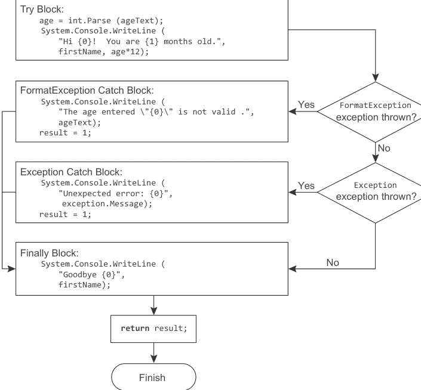

图 5.1: 异常处理控制流

# 第 5 章：方法与参数

例如，假设用户在上例中为年龄输入了“forty-two”（四十二）。在这种情况下，`int.Parse()` 将抛出一个 `System.FormatException` 异常，表示字符串格式不正确，无法进行解析。由于第一个 `catch` 块匹配 `int.Parse()` 抛出的异常类型，因此该块内部的代码将执行。如果 `try` 块中的语句抛出另一个异常，则第二个 `catch` 块将执行，因为所有异常都是 `System.Exception` 类型。

如果没有 `System.FormatException` `catch` 块，尽管 `int.Parse` 抛出了 `System.FormatException` 异常，`System.Exception` `catch` 块也会执行。这是因为 `System.FormatException` 也是 `System.Exception` 类型。（`System.FormatException` 是通用异常 `System.Exception` 的一个更具体的实现。）

处理异常的顺序非常重要。`catch` 块必须按照从具体到不具体的顺序出现。`System.Exception` 数据类型最不具体，因此它出现在最后。`System.FormatException` 出现出现是因为它是列表 5.23 中处理的最具体的异常。

无论控制是正常离开 `try` 块还是因为 `try` 块中的代码抛出异常而离开，`finally` 块的代码都会控制离开 `try` 保护区域后执行。`finally` 块的目的是提供一个位置，无论 `try/catch` 块是带异常退出还是正常退出，该代码都会执行。`finally` 块用于清理资源，无论是否抛出了异常。事实上，可以存在一个带有 `finally` 块但没有 `catch` 块的 `try` 块。无论 `try` 是否抛出异常，或者是否编写了处理异常的 `catch` 块，`finally` 块都会执行。列表5.24 展示了 `try/finally` 块，输出 5.14 显示了结果。

## 列表 5.24：没有 Catch 块的 Finally 块

```cs
using System;
class ExceptionHandling
{
    static int Main()
    {
        string firstName;
        string ageText;
        int age;
        int result = 0;
        Console.Write("Enter your first name: ");
        firstName = Console.ReadLine();
        Console.Write("Enter your age: ");
        ageText = Console.ReadLine();
        try {
            age = int.Parse(ageText);
            Console.WriteLine(
                $"Hi { firstName } You are {age*12 } months old.");
        }
        finally {
            Console.WriteLine($"Goodbye { firstName }");
        }
        return result;
    }
}
```

## 输出 5.14

```
Enter your first name: Inigo
Enter your age: forty-two
Unhandled Exception: System.FormatException: Input string was not in a
correct format.
    at System.Number.ToString(String str, NumberStyles options,
NumberBuffer.NumberFormatInfo info, Boolean parseDecimal)
    at System.Number.ParseInt32(String s, NumberStyles style,
NumberFormatInfo info)
    at ExceptionHandling.Main()
Goodbye Inigo
```

细心的读者会注意到这里有一个有趣的现象：运行时首先报告了未处理的异常，然后运行了 `finally` 块。什么解释了这种异常的行为？

首先，当异常未被处理时，这种行为是合法的，运行时的行为是由实现的定义的——任何行为都是合法的！运行时选择这种特定的行为，是因为它在选择运行 `finally` 块之前就已经知道异常将未被处理；运行时已经检查了调用栈上所有的激活帧，并确定其中没有一个帧与抛出的异常相匹配的 `catch` 块相关。

一旦运行时确定异常将未被处理，它会检查机器上是否安装了调试器，因为你可能是正在分析此故障的软件开发者。如果存在调试器，它将允许用户在运行 `finally` 块之前有机会将调试器附加到进程中。如果没有安装调试器或用户拒绝调试该问题，默认行为是将未处理的异常打印到控制台，然后查看是否有可以运行的 `finally` 块。由于这种情况的“实现定义”性质，运行时并不要求在这种情况下运行 `finally` 块；实现可以选择这样做，也可以不这样做。

- 指南
- **避免**在 `finally` 块中显式地抛出异常。（由方法调用导致的隐式抛出异常是可以接受的。）
- 应该使用 `try/finally` 并避免使用 `try/catch` 用于清理代码。
- 应该抛出描述发生了何种异常情况的异常，如果可能的话，描述如何防止它。

## 高级主题

### 类继承

所有作为异常抛出的对象都派生自 `System.Exception`。（从其他语言抛出的未派生自 `System.Exception` 的对象会被派生它的对象自动“包装”。）因此，它们可以通过 `catch(System.Exception exception)` 块处理。然而，最好包含一个针对最派生类型（例如 `System.FormatException`）的特定 `catch` 块，因为这样可以获取有关异常的最信息并处理得不那么通用。这样做，使用最派生类型的 `catch` 语句能够特异地处理异常类型，访问与抛出的异常相关的数据，并避免用于判断发生了什么类型异常的条件逻辑。

8. 从 C# 2.0 开始。

这就是为什么 C# 强制规定 `catch` 块必须从最派生到派生的顺序出现。例如，捕获 `System.Exception` 的 `catch` 语句不能出现在捕获 `System.FormatException` 的语句之前，因为 `System.FormatException` 派生自 `System.Exception`。

一个方法可能会抛出许多异常类型。表格 5.2 列出了框架内常用的一些异常。

### 表格 5.2：常见异常类型

| 异常类型 | 描述 |
| --- | --- |
| `System.Exception` | 所有异常都派生的“基类”异常。 |
| `System.ArgumentException` | 表示传递方法的参数之一无效。 |
| `System.ArgumentNullException` | 表示某个特定参数为空，且该值不是有效值。 |
| `System.ApplicationException` | 应被避免，原始的想法是你可能想对系统异常和应用程序异常进行不同的处理，虽然这可行，但在现实世界中效果并不好。 |
| `System.FormatException` | 表示字符串格式不适用于转换。 |
| `System.IndexOutOfRangeException` | 表示访问不存在的数组或其他集合元素。 |
| `System.InvalidCastException` | 表示从一种数据类型转换为另一种数据类型的尝试不是有效的转换。 |
| `System.InvalidOperationException` | 表示发生了意外的情况，导致应用程序不再处于有效的操作状态。 |

### 表格 5.2：常见异常类型（续）

| 异常类型 | 描述 |
|---|---|
| `System.NotImplementedException` | 尽管方法签名存在，但尚未完全实现。 |
| `System.NullReferenceException` | 当代码尝试找到由空引用指示的对象时抛出。 |
| `System.ArithmeticException` | 表示无效的算术运算，不包括除以零。 |
| `System.ArrayTypeException` | 当尝试将错误类型的元素存储到数组时发生。 |
| `System.StackOverflowException` | 表示异常深度递归。 |

### 通用 Catch

可以指定不带参数的 `catch` 块，如列表 5.25 所示。

#### 列表 5.25：通用 Catch 块

```cs
// 之前的 catch 子句已经捕获了所有异常
#pragma warning disable CS1058
try
{
    age = int.Parse(ageText);
    System.Console.WriteLine($" {firstName} You are {age*12 } months old.");
}
catch (System.FormatException exception) {
    System.Console.WriteLine($" 输入的年龄 {ageText} 是无效的。");
    result = 1;
}
catch (System.Exception exception) {}
```

# 使用异常进行基础错误处理

```csharp
try {
  System.Console.WriteLine(
    $"Unexpected error: { exception.Message }");
  result = 1;
}
catch {
  System.Console.WriteLine("Unexpected error!");
  result = 1;
}
finally {
  System.Console.WriteLine($"Goodbye { firstName }");
}
```

没有数据类型的 catch 块被称为通用 catch 块，它等同于指定一个接收对象数据类型的 catch 块——例如，`catch(object exception){}`。由于此原因，会触发警告，提示 catch 块已存在；因此使用了 `#pragma warning disable` 指令。

由于所有类都派生自 object，因此没有数据类型的 catch 块必须最后出现。

通用 catch 块很少使用，因为没有办法捕获任何关于异常的信息。此外，C# 不支持抛出类型为 `object` 的异常。（只有用 C++ 等语言编写的库才允许任何类型的异常）。

**指南**
- **避免** 使用通用 catch 块，并用 `System.Exception` 的 catch 替换它们。
- **避免** 捕获未知适当操作的异常。让异常保持未处理状态比错误地处理它要好。
- **避免** 在重新抛出异常之前捕获并记录异常。相反，让异常逃逸，直到它可以被恰当 appropriate处理。

# 使用 throw 语句报告错误

C# 允许开发者在代码中抛出异常，如列表 5.26 和输出 5.15 所示。

## 列表 5.26：抛出异常

```csharp
// 之前的 catch 子句已经捕获了所有异常
using System;
public class ThrowingExceptions
{
    public static void Main()
    {
        try {
            Console.WriteLine("Begin executing");
            Console.WriteLine("Throw exception");
            throw new Exception("Arbitrary exception");
            Console.WriteLine("End executing");
        } catch (FormatException exception) {
            Console.WriteLine("FormatException was thrown");
        } catch (Exception exception) {
            Console.WriteLine($"Unexpected error: {exception.Message}");
        } catch {
            Console.WriteLine("Unexpected error!");
        }
        Console.WriteLine("Shutting down...");
    }
}
```

## 输出 5.15

```
Begin executing
Throw exception...
Unexpected error: Arbitrary exception
Shutting down...
```

如列表 5.26 中的箭头所示，抛出异常会导致执行从抛出异常的地方跳转到堆栈中与抛出的异常类型兼容的第一个 catch 块。⁹ 在这种情况下，第二个 catch 块处理了异常并输出了错误消息。

9. 技术上，它也可以被兼容的 catch 过滤器捕获。

在列表 5.26 中，没有 `finally` 块，执行将向下进行到 `try/catch` 块之后的 `System.Console.WriteLine()` 语句。

要抛出异常，需要一个异常实例。列表 5.26 使用关键字后跟异常类型来创建实例。大多数异常类型允许通过抛出异常来生成消息，这样当异常发生时，就可以检索该消息。

有时 catch 块会捕获异常，但无法恰当地处理它。在这种情况下，catch 块可以使用 `throw` 语句在不指定任何异常的情况下重新思考异常，如列表 5.27 所示。

## 列表 5.27：重新抛出异常

```csharp
catch(Exception exception) {
    Console.WriteLine($"Rethrowing unexpected error: {exception.Message}");
    throw;
}
```

在列表 5.27 中，`throw` 语句是“空”的，而不是指定要抛出异常变量所指的异常。这说明了一个细微的区别：`throw;` 保留了异常中的调用堆栈信息，而 `throw exception;` 则将信息替换为当前的调用堆栈信息。

# 指南

- 在捕获并重新抛出异常时，优先使用空的 `throw` 以保留调用堆栈。
- 通过抛出异常报告错误，而不是返回错误代码。
- 不要让返回值或 `out` 参数返回异常。

# 第 5 章：方法与参数

## 避免使用异常处理预期情况

开发者应该避免通过抛出异常来处理预期情况。异常是专门为异常情况设计的。将它们用于意外会导致代码难以阅读、理解和维护。

`Parse()` 方法的问题之一是，确定转换是否成功的方法只有尝试执行并捕获异常。由于抛出异常是一项开销较大的操作，因此使用 `TryParse()` 更好。`TryParse()` 的返回值是 `bool` 而不是转换值。

## 列表 5.28：使用 TryParse() 进行转换

```csharp
if (int.TryParse(ageText, out int age))
{
    Console.WriteLine($"Hi {firstName} !" + $"You are {age} months old.");
}
else
{
    Console.WriteLine($"The age entered, {ageText}, is not valid.");
}
```


> 开发者应该预期用户会执行意外操作；因此，他们应该编写防御性代码来处理“愚蠢的操作”。

例如，当执行列表 5.22 时，如果用户输入了无效值，异常将未被处理，而运行时在搜索是否加载调试器时没有明显的延迟。

## 总结

有了 `TryParse()` 方法，不再需要为了处理字符串到数字的转换而包含 `try/catch` 块。

另一个支持避免在预期场景中使用异常的因素是性能。与大多数语言一样，在抛出异常时会有轻微的性能损失——相对于纳秒的操作花费微秒。这种延迟在人类时间范围内是察觉的——除非异常未被处理。遗憾的是，程序关闭时性能缓慢通常不是需要考虑的因素。

# 指南

- **不要** 使用异常处理正常、预期的情况；将它们用于异常、意外的情况。

总结

本章讨论了方法的声明和调用细节，包括使用 `out` 和 `ref` 关键字传递变量而非其值。除了方法声明外，本章还引入了异常处理。方法是一种基础结构，是编写可读代码的关键。与其编写包含大量语句的方法，不如使用方法创建大约 10 条或更少语句的“段落”。将大函数拆分为较小部分是重构代码的方法之一。

下一章将考虑类结构，并描述如何将方法（行为）和字段（数据）封装在单个单元中。

# 6 类

你在第 1 章中简要查看了如何声明名为 `HelloWorld` 的新类。在第 2 章和第 3 章中，你学习了 C# 包含的内置原始类型。现在你已经学习了控制流以及如何声明方法，是时候讨论定义你自己的类型了。类型定义是任何 C# 程序的核心结构；对类以及从类创建的对象的支持，使得 C# 成为一种面向对象的语言。

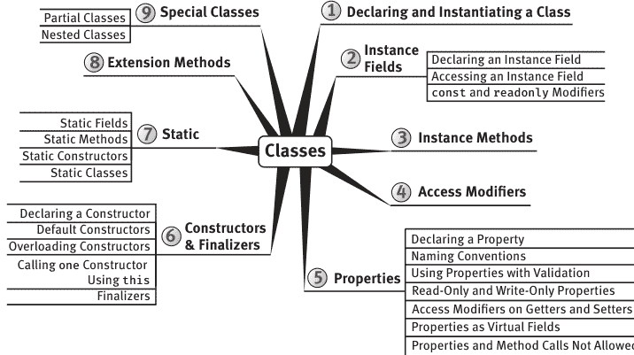

## 第 6 章：类

本章介绍了使用 C# 进行面向对象编程的基础。核心重点是如何定义类，类本身即是对象的模板。

之前章节中所有基于结构化、基于控制流的编程结构在面向对象编程中仍然适用。然而，通过将这些结构封装在类中，你可以创建更大、更有组织性的程序，显著提高可维护性。

面向对象编程的优势之一是，你不需要完全从零开始创建新程序，而是从之前的工作中组合一组现有对象，通过添加新功能扩展类，添加更多类，从而提供新功能。

不熟悉面向对象编程的读者应该阅读“初级主题”块之外的内容以获取介绍。正文内容侧重于使用 C# 进行面向对象编程，假设读者已经熟悉面向对象的概念。

本章将深入探讨 C# 如何通过类、属性和访问修饰符等结构来支持封装；我们在第 5 章中涵盖了方法。第 7 章将在此基础上，引入面向对象编程所能实现的继承和多态。

### 面向对象编程

当今成功编程的关键在于在大应用程序中组织和结构化复杂需求实现的能力。面向对象编程提供了实现这一目标的关键方法之一，以至于面向对象的程序员很难设想回转到结构化编程，除非是处理最微不足道的程序。

面向对象编程中最基本的结构是类。一组类构成了了一个编程抽象、模型或模板，它通常对应于现实世界中的某个概念。例如，`OpticalStorageMedia` 类可能有一个 `Eject()` 方法，用于将光盘从播放器中弹出。`OpticalStorageMedia` 类是现实世界中 CD 或 DVD 播放器对象的编程抽象。

类表现出面向对象编程三个三个特性：封装、继承和多态。

### 封装

封装允许你隐藏细节。在需要时仍然可以访问细节，但通过智能地封装细节，大型程序变得更容易理解，数据受到保护防止意外修改，并且代码变得更容易维护，因为代码更改的影响被限于封装的范围。方法就是封装的示例。虽然可以提取方法中的代码并将其直接嵌入调用者的代码中，但将代码重构为方法提供了封装的益处。

### 继承

考虑以下示例：DVD 驱动器是一种光介质设备。它具有特定的存储容量，以及存放数字电影的能力。CD 驱动器也是一种光介质设备，但它具有不同的特征。CD 的复制保护与 DVD 的复制保护不同，存储容量也不同。CD 驱动器和 DVD 驱动器都于硬盘、内存卡和软盘（记得那些吗？）。它们都属于存储设备的范畴，每种设备都有特殊特征，即使对于支持的文件系统以及介质实例是只读还是读/写等基本功能。

面向对象编程中的继承允许你在相似但不同的项目之间形成“是一种”（is a kind of）的关系。可以说，DVD 驱动器“是一种存储介质”，CD 驱动器“是一种存储介质”，因此，它们都具有存储容量。我们也可以合理地说，它们与“光存储介质”都有“一种”的关系，而光存储介质反过来又是一种存储介质。

如果你为提到的每种存储设备定义了相应的类，你就定义了一个类层次结构，这是一系列“是一种”的关系。所有存储设备都派生自基类可以是 `StorageMedia` 类。因此，代表硬盘、USB 驱动器和软盘的类不需要直接派自中间类 `OpticalStorageMedia`。你可以使用统一建模语言（UML）——如 6.1 所示的类图——图形化地查看类层次结构。

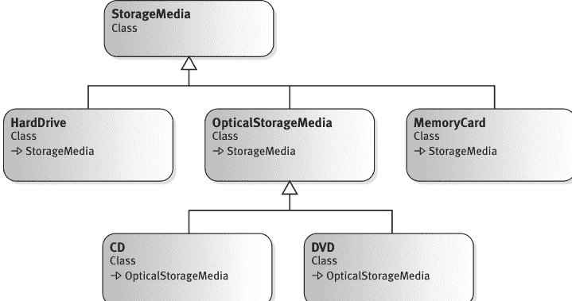
图 6.1：类层次结构

继承关系涉及至少两个类，其中一个类比另一个更具体；在图 6.1 中，`HardDrive`是一种 `StorageMedia`，反之则不成立——`StorageMedia` 的实例并不一定是 `HardDrive`。继承可以涉及两个以上的类。更特化的类型被称为派生类型或子类型。更通用的类型被称为基类型或超类型。基类型也称为父类型，其派生类型通常称为子类型。虽然这种用法很常见，但可能会引起混淆：毕竟，孩子不是父类的一种！派生或从另一种类型继承是对该类型进行特化，这意味着对基类型进行定制，使其更适合特定的特定目的。基类型可能包含所有派生类型中共有的那些实现细节。

继承的关键特征是所有派生类型都继承基类型的成员。通常，可以修改基成员的实现，但无论如何，派生类型除了显式包含的其他成员外，包含了基类型的成员。

派生类型允许你将类组织成连贯的层次结构，其中派生类型比基类型更具特殊性。

### 多态

多态源于词根 `poly`（许多）和 `morph`（形式）。在对象的语境下，多态意味着一个方法或一个类型可以有许多种形式的实现。

假设你有一个可以播放音乐 CD 和包含 MP3 的 DVD 的播放器。然而，`Play()` 方法的具体实现将根据介质类型而异。在代表音乐 CD 的对象上或代表音乐 DVD 的对象上调用 `Play()` 在两种情况下都会播放音乐，因为每个对象的类型都理解播放的复杂性。播放器所知的只是公共基类型 `OpticalStorageMedia` 以及它定义了 `Play()` 方法。多态原则是：类型可以处理方法实现的精确细节，因为多个派生类型共享一个公共基类型（或接口），该类型包含相同的方法签名。

## 声明和实例化类

定义类涉及首先指定 `class` 关键字，随后是标识符，如列表 6.1 所示。

所有属于该类的代码将出现在类声明后的大括号之间。虽然不是强制，但通常将每个类放在单独的文件中。这有助于找到特定类的定义，因为惯例是使用类名命名文件。

列表 6.1：定义一个类

```
public class Employee

{

}
```

# 指南

> 请勿在单个源文件中放置多个类。
> 请务必以该类所包含的公共类型名称来命名源文件。

一旦你定义了一个新类，就可以像使用框架内置类那样样使用该类。换句话说，你可以声明该类型的变量，或者定义一个接收新类类型参数的方法。列表 6.2 演示了此类声明。

列表 6.2：声明类类型的变量

```
class Program
{
    static void Main()
    {
        Employee employee1, employee2;
        //...
    }
    static void IncreaseSalary(Employee employee)
    {
        //...
    }
}
```

## 初学者主题

字体 对象的定义与类
在日常对话中，“类（class）”和“对象（object）”这两个词经常互换使用。然而，它们实际上具有不同的含义。类是对象在实例化时外观的模板。因此，对象是类的实例。类就像是小部件（widget）外观的模具；而对象对应于由模具创建的小部件。从类创建对象的过程被称为实例化（instantiation），因为对象是类的实例。

现在你已经定义了一个新类类型，是时候实例化一个该类型的对象了。模仿先前的做法，C# 使用 `new` 关键字来实例化对象（参见列表 6.3）。

声明与实例化类

列表 6.3：实例化类

```
class Program
{
    static void Main()
    {
        Employee employee1 = new Employee();
        Employee employee2;
        employee2 = new Employee();
        IncreaseSalary(employee1);
        IncreaseSalary(employee2);
    }
}
```

意料不的是，赋值既可以在与声明在同一条语句中进行，也可以在单独的语句中进行。

与你目前为止接触的原始类型不同，没有字面量方式来指定 `Employee`。相反，`new` 算符向运行时提供了一条指令，为 `Employee` 对象分配内存、初始化对象并返回实例的引用。

尽管有一个用于分配内存的显式操作符，但并没有用于释放内存的此类操作符。相反，运行时会在对象变得无法访问一段时间后自动回收内存。垃圾回收器（garbage collector）负责自动释放内存。它确定哪些对象不再被其他活动对象引用，然后释放这些对象的内存。结果，在编译时没有程序位置可以收集内存并将其恢复到系统。

在这个简单易懂的示例中，`Employee` 没有关联任何显式数据或方法，这使得对象本质上是没用的。下一节将侧重于向对象添加数据。

## 初学者主题

### 封装部分 1：对象通过方法对数据分组

如果你收到一堆有员工名字的索引卡、一堆有姓的索引卡和一堆有薪资的索引卡，除非你知道这些卡片在每堆中的排列顺序是相同的，否则这些卡片将几乎没有价值。尽管如此，处理数据也很困难，因为确定一个人的全名需要搜索两堆卡片。更糟糕，如果你掉了其中一堆，就无法将名字、姓和薪资重新关联起来。相反，你需要一堆员工卡片，每个员工的数据都分组在一张卡片上。通过这种方法，名字、姓和薪资将被封装在一起。

在面向对象编程的上下文之外，封装一组项目是将它们封封装在一个胶囊内。同样，面向对象编程将方法和数据共同封装在一个对象中。这为所有类（类内部的数据和方法）提供了一个分组，使得它们不再需要单独处理。与其将名字、姓和薪资作为三个独立的参数传递给方法，对象允许传递对员工对象的引用。一旦被调用的方法接收到对象引用，它就可以向对象发送消息（例如，它可以调用如 `AdjustSalary()` 等方法）来执行特定操作。

# 语言对比：C++——delete 算符

C# 程序员将 `new` 算符视为实例化对象的调用，而不是分配内存的调用。分配在堆上和栈上的对象都支持 `new` 算符，这强调了 `new` 关乎内存分配如何发生以及是否需要释放。

C# 不需要 C++ 中的 `delete` 算符。内存的分配和释放是运行时管理的细节，允许开发者更加关注领域逻辑。然而，尽管内存由运行时管理，但运行时并不管理数据库连接、网络端口等。与 C++ 不同，C# 不支持确定资源清理（代码中编译时位置对象的破坏）。幸运的是，C# 通过 `using` 语句支持显式的确定性资源清理，并通过终结器（finalizers）支持隐式的非确定性资源清理。

# 实例字段

面向对象设计的一个关键方面是数据分组以提供结构。本节讨论了如何向 `Employee` 类添加数据。在类内部存储数据的变量的通用面向对象术语是成员变量（member variable）。这个术语在 C# 中很容易理解，但更标准的术语——以及规范中使用的术语——是字段（field），它是与包含类型关联的命名存储单元。实例字段（Instance fields）是在类级别声明的变量，用于存储与对象相关的数据。因此，关联是字段数据类型与包含字段之间的关系。

# 声明实例字段

在列表 6.4 中，`Employee` 类已被修改以包含三个字段：`FirstName`、`LastName` 和 `Salary`。（为了说明，这些字段尚未被标记为私有）。在列表 6.4 中，`Employee` 类包含了三个字段：`FirstName`、`LastName` 和 `Salary`。

列表 6.4：声明字段

```
public class Employee
{
    public string FirstName;
    public string LastName;
    public string Salary;
}
```

添加这些字段后，可以存储与对象相关的数据。因此，关联是字段数据类型与包含字段之间的关系。

# 声明实例字段

在列表 6.4 中，`Employee` 类已被修改以包含三个字段：`FirstName`、`LastName` 和 `Salary`。（为了说明，这些字段尚未被标记为私有）。在列表 6.4 中，`Employee` 类包含了三个字段：`FirstName`、`LastName` 和 `Salary`。

列表 6.4：声明字段

```
public class Employee
{
    public string FirstName;
    public string LastName;
    public string Salary;
}
```

添加这些字段后，可以存储与对象相关的数据。因此，关联是字段数据类型与包含字段之间的关系。实例字段是在类级别声明的变量，用于存储与对象相关的数据。

此外，可以在声明时给字段赋值初始值，如列表 6.5 中的 `Salary` 字段所示。

列表 6.5：在声明时设置字段值

```csharp
public class Employee
{
    public string FirstName;
    public string LastName;
    public string Salary = "Not enough";
}
```

正如变量声明一样，字段声明包含了字段所引的数据类型。我们将推迟字段的命名和编码指南到本书的晚些部分，在引入属性和构造函数之后。足够来说，在此之前的列表通常不遵循标准指南。事实上，经常会出现以下警告：

- CS0649：字段从未赋值，将始终具有默认值 null。
- CS8618：可空字段未初始化。考虑使用可空。

在这种情况下，由于 `FirstName` 和 `LastName` 未初始化，它们会触发 CS8618 警告。为了说明，这些警告被忽略，并且实际上在随附源代码中通过 `#pragma` 指令禁用，直到这些概念在书中后期得到完善。

# 访问实例字段

你可以设置和检索字段内部的数据。然而，字段不包含 `static` 修饰符表明它是实例字段。你只能从包含类的实例（一个对象）访问实例字段。你不能直接从类访问（换句话说，如果不创建实例）。

列表 6.6 展示了 `Program` 类对 `Employee` 类的最新用法，输出 6.1 显示了结果。

列表 6.6：访问字段

```cs
class Program
{
    static void Main()
    {
        Employee employee1 = new Employee();
        Employee employee2;
        employee2 = new Employee();
        employee1.FirstName = "Inigo"
        employee1.LastName = "Montoya"
        employee1.Salary = "Too Little"
        IncreaseSalary(employee1)
        Console.WriteLine(
            "{0} {1}: {2}",
            employee1.FirstName,
            employee1.LastName,
            employee1.Salary);
        );
        // ...
    }
}
```

```cs
static void IncreaseSalary(Employee employee)
{
    employee.Salary = "Enough to survive on";
}
```

# 输出 6.1

伊尼戈·蒙托亚：够维持生存

列表 6.6 正如你之前看到的，实例化了两个 `Employee` 对象。然后它设置了每个字段，调用 `IncreaseSalary()` 来更改工资，并显示与 `employee1` 引用的对象相关的每个字段。
注意，你必须首先指定你正在处理哪个 `Employee` 实例。因此，在赋值和访问字段时，`employee1` 变量作为字段名的名前缀出现。

# 实例方法

在 `Main()` 方法的 `WriteLine()` 调用中格式化名称的另一种替代方案是在 `Employee` 类中提供一个方法来处理格式化。将功能更改在 `Employee` 类内部而不是作为 `Program` 的成员，符合类的封装性。为什么不将与员工名称相关的方法与包含构成名称数据的类分在一起呢？列表 6.7 演示了这种方法的创建。

列表 6.7：从包含类内部访问字段

```cs
public class Employee
{
    public string FirstName;
    public string LastName;
    public string? Salary;
    public string GetName()
    {
        return $"{
```


# 第 6 章：类

此方法与你在第 5 章中学到的相比没有特别特殊之处，只是现在 `GetName()` 方法访问的是对象上的字段，而不仅仅是局部变量。此外，方法声明没有标记为 `static`。正如你在本章稍后部分看到的，`static` 方法无法直接访问类中的实例字段。要调用任何实例成员（无论是方法还是字段），都有必要获取该类的实例。

由于添加了 `GetName()` 方法，你可以更新 `Program.Main()` 来使用该方法，如列表 6.8 和输出 6.2 所示。

## 列表 6.8：从包含类外部访问字段

```cs
class Program
{
    static void Main()
    {
        Employee employee1 = new Employee();
        Employee employee2;
        employee2 = new Employee();
        employee1.FirstName = "Inigo";
        employee1.LastName = "Montoya";
        employee1.Salary = "Too Little";
        IncreaseSalary(employee1);
        Console.WriteLine($"{employee1.GetName()}: {employee1.Salary}");
    }
    // ...
    // ...
}
```

## 输出 6.2

伊尼戈·蒙托亚：够维持生存

## 使用 this 关键字

你可以从属于该类的实例成员内部获取对该类的引用。在 C# 中，为了显式指示访问的字段或方法是包含类的实例成员，你使用了 `this` 关键字。在调用任何实例成员时，`this` 的使用是隐式的，它返回对象本身的实例。

例如，考虑列表 6.9 所示的 `SetName()` 方法。

## 列表 6.9：使用类 Employee 显式标识字段所有者

```cs
public class Employee {
    public string FirstName;
    public string LastName;
    public string? Salary;
    public string GetName() {
        return $"{FirstName} {LastName}";
    }
}
```

此示例使用该关键字来指示 `FirstName` 和 `LastName` 字段是类的实例成员。

尽管 `this` 关键字可以作为任何及所有对类局部成员引用的前缀，但通用的指南是在当没有额外价值时不要让代码变得杂乱。除非需要，否则你应该避免使用 `this` 关键字。列表 6.12 是少数存在此类要求的情况的示例。然而，列表 6.9 和 6.10 并不是好的例子。在列表 6.9 中，可以完全删除 `this` 而不改变代码含义。而在列表 6.10 中，通过更改字段的命名规范并遵循参数的命名规范，我们可以避免局部变量和字段之间的任何歧义。

### 初学者主题

#### 依赖编码风格来避免歧义

在 `SetName()` 方法中，你不需要使用 `this` 关键字，因为 `FirstName` 显然与 `firstName` 不同。但假设，你没有将参数命名为 `"firstName"`，而是将它命名为 `"FirstName"`（使用 PascalCase），如列表 6.10 所示。

## 列表 6.10：使用 this 避免歧义

```cs
public class Employee
{
    public string FirstName;
    public string LastName;
    public string? Salary;
    public string GetName()
    {
        return $"{FirstName} {LastName}";
    }
}
// 注意：参数名使用 PascalCase
public void SetName(string FirstName, string LastName)
{
    this.FirstName = FirstName;
    this.LastName = LastName;
}
```

在这个示例中，如果不显式地指示 `Employee` 对象拥有该变量，则无法引用 `FirstName` 字段。`this` 的作用就像 `Program.Main()` 方法中的 `employee` 变量前缀一样；它标识了该引用是调用 `SetName()` 时所调用的那个。

列表 6.10 没有遵循 C# 的命名规范，在该规范中参数应该像局部变量一样声明，使用 camelCase。这可能会导致微妙的错误，将 `FirstName`（意图引用字段）赋值给 `FirstName`（参数）将导致代码可以编译甚至甚至运行。为了避免这个问题，为字段和属性采用不同的命名规范是一个良好的做法。我们稍后会演示其中一种规范。

> 语言对比：Visual Basic—使用 Me 访问类实例
C# 的关键字等同于 Visual Basic 的 `Me`。在列表 6.9 和 6.10 中，`GetName()` 方法没有使用 `this`——然而，如果局部变量或参数与字段同名，省略它将导致访问局部变量。

你还可以使用关键字 `this` 来显式访问类的方法。例如，`this.GetName()` 在方法中是允许的，允许你打印出名称。

## 在方法中使用 this

有时需要使用 `this` 来传递当前执行对象的引用。考虑列表 6.12 中的 `Save()` 方法。

## 列表 6.12：在方法调用传递 this

```cs
public class Employee {
    public string FirstName;
    public string LastName;
    public string? Salary;
    public void Save() {
        DataStorage.Store(this);
    }
}
class DataStorage {
    // 将员工对象保存到文件
    // 以员工名称命名
    public static void Store(Employee employee) {
        // ...
    }
}
```

列表 6.12 中的 `Save()` 方法调用了 `DataStorage` 类上的 `Store()` 方法。然而，`Store()` 方法需要传递 `Employee` 对象，因为它需要持久化。这是通过关键字 `this` 实现的，它传递了调用 `Save()` 的对象实例。

## 使用文件存储和加载

`DataStorage` 中 `Store()` 方法的实际实现涉及 `System.IO` 命名空间中的类，如列表 6.13 所示。在 `Store()` 内部，我们首先实例化 `FileStream` 对象并将其与对应名称的文件关联。`FileMode.Create` 参数表示如果没有 `<firstname><lastname>.dat` 文件，则创建一个新文件；如果文件存在，它将被覆盖。接下来，我们创建一个 `StreamWriter` 类，它负责向 `FileStream` 写入文本。我们使用 `WriteLine()` 方法写入数据，就像写入控制台一样。

## 列表 6.13：数据持久化到文件

```csharp
using System;
// IO 命名空间
using System.IO;
```

```csharp
class DataStorage
{
    // 将员工对象保存到文件
    // 以员工姓名命名。
    // 未显示错误处理。
    public static void Store(Employee employee)
    {
        // 使用 FirstNameLastName.dat 实例化一个 FileStream
        // 作为文件名。FileMode.Create 将强制
        // 创建一个新文件或覆盖现有的文件。
        FileStream stream = new FileStream(
            employee.FirstName + employee.LastName + ".dat",
            FileMode.Create);
        // 创建一个 StreamWriter 对象用于向
        // FileStream 写入文本
        StreamWriter writer = new StreamWriter(stream);
        // 写入与员工相关的所有数据
        writer.WriteLine(employee.FirstName);
        writer.WriteLine(employee.LastName);
        writer.WriteLine(employee.Salary);
        // 关闭 StreamWriter 及其流
        writer.Dispose(); // 关闭流
    }
    // ...
}
```

一旦完成写入操作，`FileStream` 和 `StreamWriter` 都需要关闭，这样它们就不会在等待垃圾回收器运行时一直开启状态。列表 6.13 不包含任何错误处理，因此如果抛出异常，则 `Close()` 方法都不会被调用。
加载过程是类似的。

> 1. 这段代码可以使用 `using` 语句进行改进——我们之前避免使用这种结构是因为它还没有被引入。

## 列表 6.14：从文件检索数据

```csharp
public class Employee
{
    // ...
}
// IO 命名空间
using System;
using System.IO;
class DataStorage
{
    // ...
    public static Employee Load(string firstName, string lastName)
    {
        Employee employee = new Employee();
        // 使用 FirstNameLastName.dat 实例化一个 FileStream
        // 作为文件名。FileMode.Open 将打开
        // 一个现有的文件或报告错误
        FileStream stream = new FileStream(firstName + lastName + ".dat", FileMode.Open);
        // 创建一个 StreamReader 从文件中读取文本
        StreamReader reader = new StreamReader(stream);
        // 从文件中读取每行并解析到
        // 关联属性
        employee.FirstName = reader.ReadLine() ??
            throw new InvalidOperationException("FirstName cannot be null");
        employee.LastName = reader.ReadLine() ??
            throw new InvalidOperationException("LastName cannot be null");
        employee.Salary = reader.ReadLine();
        // 关闭 StreamReader 及其流
        reader.Dispose(); // 关闭流
        return employee;
    }
}
```

```csharp
class Program
{
    static void Main()
    {
        Employee employee1;
    }
}
```

> 2. 这段代码可以使用 `using` 语句进行改进——再次，我们避免使用这种结构是因为它还没有被引入。

## 使用 this 关键字

```csharp
Employee employee2 = new Employee();
employee2.SetName("Inigo", "Montoya");
employee2.Save();
```

```csharp
// 在保存后修改 employee2
IncreaseSalary(employee2);
```

```csharp
// 从 employee2 的保存版本加载 employee1
employee1 = DataStorage.Load("Inigo", "Montoya");
```

```csharp
Console.WriteLine(
  $"{employee1.GetName()}: {employee1.Salary}");
```

```csharp
//...
```

## 输出 6.4

姓名更改为 'Inigo Montoya'
Inigo Montoya:

保存过程的反向操作出现在列表 6.14 中，它使用了 `StreamReader` 而不是 `StreamWriter`。

## 访问饰符

在章节早期声明字段时，使用了 `public` 关键字。`public` 是一种访问饰符，标识了它所修饰成员的封装程度。共有六种访问饰符：`public`、`private`、`protected`、`internal`、`protected internal` 和 `private`。本节考虑前两种。

### 初学者主题隐藏

封装部分 2：信息隐藏
除了将数据和方法封装到单个单元之外，封装还涉及隐藏对象的数据的行为细节。在某种程度上，方法可以做到这一点；从外部来看，调用者看到的是方法的声明。内部实现是不可见的。面向对象的编程实现了这一点。

虽然列表 6.15 中没有显示此选项，也可以使用 `private` 访问饰符修饰方法。
如果没有为类成员放置访问饰符，则默认为私有。也就是说，成员默认是私有的，程序员需要显式指定某个成员为公有。

## 属性

前面的节“访问饰符”演示了如何使用 `private` 关键字来封装密码，防止外部访问。然而，这种封装通常过于严格。例如，有时你可能需要定义外部类只能读取但由你在内部更改其值的字段。或者，你可能需要允许向类写入某些数据，但你需要对对数据的更改进行验证。在另一种场景中，你可能需要动态构造数据。传统上，语言通过将字段标记为私有并提供访问和修改数据的 getter 和 setter 方法来实现这些示例中的功能。列表 6.16 中的代码将 `FirstName` 和 `LastName` 改为私有字段。每个字段的公共 getter 和 setter 方法允许访问更改它们的值。

## 列表 6.16：声明 getter 和 setter 方法

```csharp
public class Employee
{
    private string FirstName;
    // FirstName getter
    public string GetFirstName() {
        return FirstName;
    }
    // FirstName setter
    public void SetFirstName(string newFirstName) {
        if(newFirstName != null && newFirstName != "") {
            FirstName = newFirstName;
        }
    }
    private string LastName;
    // LastName getter
}
```

```cs
public string GetLastName()
{
    return LastName;
}
// LastName setter
public void SetLastName(string LastName)
{
    if(LastName != null && LastName != "")
    {
        LastName = LastName;
    }
    // ...
}
```

遗憾的是，这一更改影响了 `Employee` 类的可编程性。你无法再次使用赋值运算符来设置类内部的数据，无法在不调用方法的情况下访问数据。

## 声明属性

考虑到这种模式的出现频率，C# 设计者为其提供了显式的语法结构。这种语法被称为属性（property）。

## 列表 6.17：定义属性

```cs
class Program
{
    static void Main()
    {
        Employee employee = new Employee();
        // 调用 FirstName 属性的 setter
```


`employee.FirstName = "Inigo";`

// 调用 FirstName 属性的 getter

`System.Console.WriteLine(employee.FirstName);`

}

}

`public class Employee`

{

    // FirstName 属性
    `public string FirstName`
    {
        `get`
        {
            `return _FirstName;`
        }
```

```cs

`set{`
    `_FirstName = value;`
}
`private string _FirstName;`

// ...
}

```

# 输出 6.5

Inigo

在列表 6.17 中首先注意到的点不是属性代码本身，而是 `Program` 类中的代码。尽管你不再拥有具有 `FirstName` 和 `LastName` 标识符的字段，但你通过观察 `Program` 类无法发现这一点。访问员工名和姓的语法完全没有变化。仍然可以使用简单的赋值运算符来为名称的部分赋值——例如，`employee.FirstName = "Inigo"`。

关键特性是属性提供了一种在程序上看起来像字段的语法。实际上，并不存在这样的字段。属性声明看起来和字段声明完全一样，但后面紧跟着的是大括号，在其中放置属性实现。属性实现由两个可选部分组成。`get` 部分定义了属性的读取部分。它直接对应于列表 6.16 中定义的 `GetFirstName()` 和 `GetLastName()` 函数。要访问 `FirstName` 属性，你调用 `employee.FirstName`。同样，setter（实现中的 `set` 部分）允许字段赋值的调用语法：

`employee.FirstName = "Inigo";`

属性定义语法使用了三个上下文关键字。你分别使用 `get` 和 `set` 关键字来标识属性的检索部分或赋值部分。此外，setter 使用 `value` 关键字来指代赋值操作的右侧。因此，当 `Program.Main()` 调用 `employee.FirstName = "Inigo"` 时，`value` 在 setter 内部被设置为 "Inigo"，并可用于赋值给 `_FirstName`。

列表 6.17 中的属性实现是最常用的。
当调用 `getter` 时（例如在 `Console.WriteLine(employee.FirstName)` 中），将从字段（`_FirstName`）中获取值并将其写入控制台。

从 C# 7.0 开始，还可以使用表达式体成员（expression-bodied members）来声明属性 getter 和 setter，如列表 6.18 所示。

# 列表 6.18：使用表达式体成员定义属性

```cs

public class Employee

{

    public string FirstName

    {

        get

            return _FirstName;

        set

            _FirstName = value;

    }

    private string _FirstName;

    // LastName 属性
    public string LastName

    {

        get => _LastName;

        set => _LastName = value;

    }

    private string _LastName;

    // ...

}

```

列表 6.18 使用了两种不同的语法来实现相同的属性实现。在实际代码中，你应该尝试在语法选择上保持一致性。

# 自动实现属性

在 C# 3.0 中，属性语法包含了另一种快捷方式。由于具有单个后台字段且通过 `get` 和 `set` 访问器进行赋值和检索的属性是简单且常见的（`FirstName` 和 `LastName` 的实现），C# 3.0（及更高版本）编译器允许在没有任何访问器实现或后台字段声明的情况下声明属性。列表 6.19 展示了 `Title` 和 `Manager` 属性的语法，输出 6.6 显示了结果。

# 列表 6.19：自动实现属性

```cs

class Program

{

    static void Main()

    {

        Employee employee1 =

            new Employee();

        Employee employee2 =

            new Employee();

        // 调用 FirstName 属性的 setter
        employee1.FirstName = "Inigo";

        // 调用自动实现属性的 setter
        System.Console.WriteLine(employee1.FirstName);

        // 赋值一个自动实现属性
        employee2.Title = "Computer Nerd";

        employee1.Manager = employee2;

        // 打印 employee1 经理的职称
        System.Console.WriteLine(employee1.Manager.Title);

    }

}

```

```cs

public class Employee

{

    // FirstName 属性
    public string FirstName

    {

        get

        {

            return _FirstName;

        }

        set

        {

            _FirstName = value;

        }

    }

    private string _FirstName;

    // Lastname 属性
    public string LastName

    {

        get => _LastName;

        set => _LastName = value;

    }

    private string _LastName;

    public string Title { get; set; }
    public Employee Manager { get; set; }

}

```

```cs

public string LastName { get; set; }

```

# 输出 6.6

Inigo
Computer Nerd

自动实现属性提供了一种更简单的属性编写方式。注意，在 C# 6.0 中，你可以在声明时初始化它们：

```cs

public string Salary { get; set; } = "Not Enough";

```

在 C# 6.0 之前，属性初始化只能通过方法实现（我们在本章中讨论）。然而，通过 C# 6.0，你可以初始化自动实现的属性。

# 属性与字段指南

鉴于可以编写显式的 setter 和 getter 方法而不是属性，有时会产生使用属性还是方法更好的问题。指南是：方法应该代表操作，而属性应该代表数据。属性旨在通过简单的计算提供对简单数据的访问。

在命名方面，注意在列表 6.19 中，属性名为 `FirstName`，而字段名更改为 `_FirstName`——即带有下划线前缀的帕斯命名法（PascalCase）。支持属性的私有字段的其他常见命名约定还有 `_firstName`，偶尔也使用驼峰命名法（camelCase），就像局部变量一样³。然而，应该避免驼峰命名法。此外，为了尊重封装原则，字段不应声明为 `public` 或 `protected`。

# 指南

- 使用属性对简单数据进行简单访问。
- 避免在属性 getter 中抛出异常。
- 如果属性抛出异常，请保留原始属性值。
- 优先使用自动实现属性而非具有简单后台字段的属性。

无论私有字段使用什么命名模式，属性的标准都是帕斯命名法（PascalCase）。因此，属性应该使用 `LastName` 和 `FirstName` 模式，并使用代表名词、短语或形容词的。事实上，属性名称与类型相同并不常见。例如，Person 对象上类型为 `Address` 的 `Address` 属性。

# 指南

- 属性的后台字段使用与属性相同的大小写，并用 "_" 前缀区分后台字段。
- 使用名词、短语或形容词命名属性。
- 考虑给属性一个与其类型相同的名称。
- 避免使用驼峰命名法命名字段。

³ 我更喜欢 `_firstName`，因为与下划线相比，名字前面的 m 是多的。此外，通过使用与属性相同的大小写，在 Visual Studio 代码模板扩展中只需要一个字符串，而不需要为属性名和字段名各提供一个。

## 属性

- 当这种做法具有额外价值时，请优先为布尔型属性加上 "Is"、Can" 或 "Has" 前缀。
- 请优先使用 PascalCase（帕斯卡命名法）命名属性。
- 请优先使用自动实现的属性，而不是字段（fields）。
- 如果没有额外的实现逻辑，请优先使用自动实现的属性，而不是扩展式属性（expanded ones）。

# 使用带有验证的属性

请注意列表 6.20，`Initialize()` 方法同样也使用属性而不是字段进行赋值。虽然这是强制要求的，但结果是属性set访问器（setter）中的任何验证都将在类内部和外部被调用。例如，考虑如果你修改了 `LastName` 属性，使其在赋值给 `_LastName` 之前检查值是否为 null 或空字符串，会发生什么？（请记住，即使数据类型是非可空字符串，此步骤也是必要的，因为调用者可能禁用了可空引用类型，或者该方法可能是从 C# 7.0 或更早版本调用的——在可空引用存在之前。）

# 列表 6.20：提供属性验证

```csharp

public class Employee

{

    // ...
    public void Initialize(

        string firstName, string lastName)

    {

        // 在 Employee 类内部
        // 同样使用属性
        FirstName = firstName;
        LastName = lastName;
    }

    // LastName 属性
    public string LastName

    {

        get => _LastName;

        set

        {

            // 验证 LastName 赋值
            if(value is null)

            {

                // 报告错误
                // 在 C# 6.0 中将 "value" 替换为 nameof(value)
                throw new ArgumentNullException("value");

            }
            else

            {

                // 新姓氏周围
                // 的任何空格
                value = value.Trim();
                if(value == "")

                {

                    // 报告错误
                    throw new ArgumentException(

                        // 在 C# 6.0 之前
                        // 使用 "value" 而不是 nameof(value)
                        "LastName cannot be blank.", nameof(value));

                }
                else

                {

                    _LastName = value;

                }

            }

        }

    }

    private string _LastName;

    // ...

}

```

通过这种新实现，如果 `LastName` 被赋予同一类的其他成员的无效值，或者通过 `Program.Main()` 内部对 `LastName` 直接赋值，代码将抛出异常。通过提供类似字段的 API 来拦截赋值并验证参数，是属性的优势之一。

在属性实现内部访问属性的后备字段（backing field）是一种良好的做法。换句话说，你应该始终使用属性，而不是直接调用字段。在许多情况下，这一原则对于与属性同一类中的代码也适用。如果你遵循这种做法，当你添加作为验证的代码时，整个类都能立即受益。⁴

虽然很少见，但在 setter 内部进行赋值是可能的，如列表 6.20 所示。在这种情况下，对 `value.Trim()` 的调用会移除新姓氏值周围的任何空格。

⁴ 4. 如章节稍后部分所述，这种情况的一个例外发生在字段被标记为只读时，因为此时值只能在构造函数中设置。在 C# 6.0 中，你可以直接为只读属性赋值，完全消除了对只读字段的需求。

在 C# 6.0 之前，你会为异常的 `paramName` 值指定 "value"。然而，在 C# 6.0 中，你可以改用 `nameof(value)`——更多信息请参见高级主题：nameof 操作符。在本章的剩余部分我使用 `nameof(value)`，当为 C# 5.0 或更早版本编译时，你需要将代码切回 "value"。

## 高级主题

# nameof 操作符

如果在属性验证期间你确定新值赋值是无效的，则必须抛出一个异常——通常类型为 `ArgumentException()` 或 `ArgumentNullException()`。这两个异常都接受一个类型为 `string` 的参数名为 `paramName`。在 C# 6.0 中，你可以直接为只读属性赋值，完全消除了对只读字段的需求。在 C# 6.0 之前，你会为异常的 `paramName` 值指定 "value"。然而，在 C# 6.0 中，你可以改用 `nameof(value)`——更多信息请参见高级主题：nameof 操作符。在本章的剩余部分我使用 `nameof(value)`，当为 C# 5.0 或更早版本编译时，你需要将代码切回 "value"。

如果在属性验证期间你确定新值赋值是无效的，则必须抛出一个异常——通常类型为 `ArgumentException()` 或 `ArgumentNullException()`。这两个异常都接受一个类型为 `string` 的参数名为 `paramName`。在 C# 6.0 中，你可以直接为只读属性赋值，完全消除了对只读字段的需求。在 C# 6.0 之前，你会为异常的 `paramName` 值指定 "value"。然而，在 C# 6.0 中，你可以改用 `nameof(value)`——更多信息请参见高级主题：nameof 操作符。在本章的剩余部分我使用 `nameof(value)`，当为 C# 5.0 或更早版本编译时，你需要将代码切回 "value"。

如果在属性验证期间你确定新值赋值是无效的，则必须抛出一个异常——通常类型为 `ArgumentException()` 或 `ArgumentNullException()`。这两个异常都接受一个类型为 `string` 的参数名为 `paramName`。在 C# 6.0 中，你可以直接为只读属性赋值，完全消除了对只读字段的需求。在 C# 6.0 之前，你会为异常的 `paramName` 值指定 "value"。然而，在 C# 6.0 中，你可以改用 `nameof(value)`——更多信息请参见高级主题：nameof 操作符。在本章的剩余部分我使用 `nameof(value)`，当为 C# 5.0 或更早版本编译时，你需要将代码切回 "value"。

# 只读和只写属性

通过移除属性的 getter 或 setter，你可以使属性变为只读。类似的，只提供 setter 的属性是只写的。

**列表 6.21：在 C# 6.0 之前定义只读属性**

```csharp

class Program

{

    static void Main()

    {

        Employee employee1 = new Employee();

        employee1.Initialize(42);

        // 错误：索引器 'Employee.Id'
        // 无法赋值；它是只读的
        employee1.Id = "42";

    }

}

public class Employee

{

    public void Initialize(int id)

    {

        // 使用字段
        // Id 属性是只读的
        _Id = id.ToString();

    }

    // ...
    // Id 属性声明
    public string Id

    {

        get => _Id;

        // 无 setter

    }

    private string _Id;

}
```


列表 6.21 在 `Employee` 方法内部赋值字段而不是属性（`_Id`）。在 `Program.Main()` 中通过属性赋值会导致错误。

从 C# 6.0 开始，还支持如下的只读实现属性：

```csharp
public bool[,,] Cells { get; } = new bool[2, 3, 3];
```

与小于 C# 6.0 的方法相比，这是一个明显的改进，特别是对于像数组或列表 6.21 中的 `ID`。

关于只读实现属性的一个重要说明是，就像只读字段一样，编译器要求此类属性通过初始化器（或在构造函数中）进行初始化。在前面的代码中使用了初始化器，在构造函数中赋值 `Cells` 也是允许的，稍后所示。

考虑到在 C# 6.0 的世界中编程，你会发现几乎不需要使用小于 C# 6.0 的语法来处理只读属性；相反，程序员几乎总是可以使用只读的自动实现属性。唯一的例外可能是只读修改字段的数据类型与属性的数据类型不匹配——例如，字段为 `int` 类型，而只读属性为 `double` 类型。

- 如果属性值不应更改，请创建只读属性。
- 在 C# 6.0（或更高版本）中，请创建只读实现属性，而不是带有后备字段。

# 计算属性

在某些情况下，你完全不需要后备字段。相反，属性的 `getter` 返回一个计算值，而 `setter` 则传递值并持久化到其他成员字段中（如果存在）。例如，考虑列表 6.22 所示的 `Name` 属性实现。输出 6.7 显示了结果。

## 列表 6.22：定义计算属性

```csharp
class Program
{
    static void Main()
    {
        Employee employee1 = new Employee();
        employee1.Name = "Inigo Montoya";
        System.Console.WriteLine(employee1.Name);
        // ...
    }
}
```

```csharp
public class Employee
{
    // ...
    // FirstName 属性
    public string FirstName
    {
        get
        {
            return _FirstName;
        }
        set
        {
            _FirstName = value;
        }
    }
    private string _FirstName;
    // Lastname 属性
    public string LastName
    {
        get => _LastName;
        set => _LastName = value;
    }
    private string _LastName;
    // ...
    // Name 属性
    public string Name
    {
        get
        {
            return $"{FirstName} {LastName}";
        }
        set
        {
        }
    }
}
```

```csharp
// 将赋值的值拆分为
// 名字和姓氏
string[] names;
names = value.Split(new char[]{' '});
if(names.Length == 2)
{
    FirstName = names[0];
    LastName = names[1];
}
else
{
    // 如果没有分配完整的姓名，
    // 则抛出异常
    throw new System.ArgumentException($"Assigned value { value } is invalid", nameof(value));
}
public string Initials => $"{ FirstName[0] } { LastName[0] }";
// ...
```

# 输出 6.7

Inigo Montoya

`Name` 属性的读取（`getter`）连接了从 `FirstName` 和 `LastName` 属性返回的值。实际上，赋值的名称值并没有被实际存储。当给 `Name` 属性赋值时，右侧的值会被解析为它的名字和姓氏部分。

# 访问器和 set 访问器上的访问修饰符

如前所述，不从属性外部访问字段是一个良好的做法，因为这样做会绕过可能插入的验证或额外逻辑。

访问修饰符可以出现在属性实现中的 `get` 或 `set` 部分（但不能两者都有），它会覆盖属性声明中指定的访问修饰符。列表 6.23 展示了如何这样做。

- 5. 参见本章前面的“高级块：`nameof` 算符”，或查看第 18 章中的完整解释。
- 6. 引入自 C# 2.0。C# 1.0 不允许在属性的 `get` 和 `set` 部分之间使用不同的封装级别。因此，无法创建一个公共的 `get` 和私有的 `set`，使得外部类对属性具有只读访问权限，而类内部代码可以写入该属性。

## 列表 6.23：在 set 访问器上放置访问修饰符

```csharp
class Program
{
    static void Main()
    {
        Employee employee1 = new Employee();
        employee1.Initialize(42);
        // 错误：属性或索引器 'Employee.Id'
        // 无法在此上下文中使用，因为 set
        // 访问器是不可访问的
        employee1.Id = "400";
    }
}
public class Employee
{
    public void Initialize(int id)
    {
        // 设置 Id 属性
        Id = id.ToString();
    }
    // ...
    // Id 属性声明
    public string Id
    {
        get => _Id;
        // 仅在 C# 及更高版本中
        // 可以访问修饰符
        private set => _Id = value;
    }
    private string _Id;
}
```

通过在 `set` 上使用 `private`，该属性对 `Employee` 类以外的类看起来是只读的。在 `Employee` 内部，该属性显示为可读写，因此你可以在类内部为属性赋值。当在 `get` 或 `set` 上指定访问修饰符时，请确保访问修饰符比属性整体的访问修饰符更严格。例如，将属性声明为 `private` 而将 `set` 声明为 `public` 会导致编译错误。

## 指南
- 应对所有属性的 `get` 和 `set` 实现应用适当的访问修饰符。
- 不要提供只写属性，或 `set` 访问器范围比 `get` 更宽的属性。

# 属性和方法调用不允许作为 ref 或 out 参数值

C# 允许属性的使用方式与字段相同，但将其作为 `ref` 或 `out` 参数值传递除外。`ref` 和 `out` 参数值在内部通过向目标方法传递内存地址来实现。然而，由于属性可以是没有底层字段的虚拟字段，或者是只读或只写的，因此无法传递底层存储的地址。结果是你不能将属性作为 `ref` 或 `out` 参数值。相反，当代码需要将属性或方法调用作为 `ref` 或 `out` 参数值时，代码必须先将值复制到变量中，然后传递变量。方法调用完成后，代码必须将变量赋值回属性。

## 高级主题

### 属性内部实现
列表 6.24 显示 `get` 和 `set` 在公共中间中间语言 `CIL` 中被暴露为 `get_FirstName()` 和 `set_FirstName()`。

## 列表 6.24：由属性生成的 CIL 代码

```il
// ...
.field private string _FirstName
.method public hidebysig specialname instance string
get_FirstName() cil managed
```

```il
{
  // 代码大小 12
  .maxstack 1
  .locals init 0
  ldarg.0
  ldfld string _FirstName
  ret
}
```

```il
.method public hidebysig specialname instance void
set_FirstName(string) cil managed
{
  // 代码大小 8
  .maxstack 1
  .locals init 0
  ldarg.0
  ldarg.1
  stfld string _FirstName
  ret
}
```

```il
.property instance string FirstName
{
  get instance string get_FirstName()
  set instance void set_FirstName()
}
```

注意列表 6.24，`get` 和 `set` 包含了 `specialname` 元数据。这种修饰符用于 Visual Studio 等工具隐藏成员。

自动实现的属性与定义了底层字段的属性几乎相同。C# 编译器在 CIL 中生成一个名为 `<PropertyName>BackingField` 的字段。此生成的字段包含一个属性（参见第 18 章）`System.Runtime.CompilerServices.CompilerGeneratedAttribute`。`get` 和 `set` 也装饰了相同的属性，正如列表 5.23 和 5.24 所示。

# 构造函数

现在你已经为类添加了字段并可以存储数据，你需要考虑这些数据的有效性。正如你在列表 6.3 中看到的，可以使用 `new` 运算符实例化对象。然而，结果是允许创建具有无效数据的员工。在赋值 `employee` 之后，你有一个未初始化姓名和工资的 `Employee` 对象。在列表 6.3 中，你在实例化员工后立即分配了未初始化的字段——但如果你没有进行初始化，将不会收到编译警告。结果是你将得到一个姓名无效的 `Employee` 对象。（从技术上，在 C# 8.0 中，可空引用类型将触发警告，显示数据类型已变为可空以避免默认认为 null。无论如何，初始化都是必要的，以避免实例化包含无效数据的对象。）

# 声明构造函数

为了解决这个问题，你需要在创建对象时提供一种指定必要数据的方法。你使用构造函数来实现，如列表 6.26 所示。

## 列表 6.26：定义构造函数

```csharp
public class Employee
{
    // Employee 构造函数
```

## 第 6 章：类

```csharp
public Employee(string firstName, string lastName)
{
    FirstName = firstName;
    LastName = lastName;
}
public string FirstName { get; set; }
public string LastName { get; set; }
public string? Salary { get; set; } = "Not Enough";
// ...
}
```

如所示，要定义一个构造函数，你需要创建一个没有返回类型的方法，该方法的名称与类名相同。构造函数是运行时调用于初始化对象实例的方法。在这种情况下，构造函数接受名字和姓氏作为参数，允许程序员在在实例化 `Employee` 对象时指定这些名称。列表 6.27 是一个如何调用构造函数的示例。

### 列表 6.27：调用构造函数

```csharp
class Program
{
    static void Main()
    {
        Employee employee;
        employee = new Employee("Inigo", "Montoya");
        employee.Salary = "Too Little";
        System.Console.WriteLine("{0} {1}, {2}",
            employee.FirstName,
            employee.LastName,
            employee.Salary);
    }
    // ...
}
```

注意，`new` 运算符返回正在实例化的对象的类型（尽管构造函数的声明或实现中没有显式指定返回类型或返回语句）。此外，你删除了名字和姓氏的初始化代码，因为该初始化是在构造函数内部完成。在这个示例中，你

## 构造函数

你没有在构造函数内部初始化 `Salary`，因此赋值薪资的代码仍然存在。

开发者在同时使用声明时赋值和构造函数内部赋值时应格外小心。构造函数内的赋值将在任何字段声明时进行的赋值之后发生（如列表 6.5 中的 `as string Salary = "Not enough"`）。因此，构造函数内的赋值将覆盖在声明时分配的任何值。这种细微的差别可能会导致匆忙的的阅读者对代码产生误解，他们会假设实例化后的值是字段声明中分配的那个值。因此，值得考虑一种不在同一个类中混合使用声明赋值和构造函数赋值的编码风格。

## 高级主题

### new 运算符的实现细节

在内部，`new` 运算符与构造函数之间的交互如下：`new` 运算符从内存管理器获取“空”内存，然后调用指定的构造函数，并将空内存的引用作为隐式的 `this` 参数传递给构造函数。接下来，执行构造函数链的剩余部分，在构造函数之间传递引用。没有任何构造函数有返回类型；在行为上它们都返回 `void`。当构造函数链执行完成后，`new` 运算符返回内存引用，该引用现在指向处于初始化形式的内存。

## 默认构造函数

当你显式添加构造函数时，你无法在不指定名字和姓氏的情况下从 `Main()` 实例化 `Employee`。因此，列表 6.28 所示的代码将无法编译。

### 列表 6.28：默认构造函数不再可用

```csharp
class Program
{
    static void Main()
    {
        Employee employee;
        // 错误：没有重载，因为方法 'Employee' 
        // 接受 '0' 个参数
        employee = new Employee();
    }
    // ...
}
```

如果类没有式定义的构造函数，C# 编译器会在编译期间添加一个。该构造函数没有参数，因此根据定义它是默认构造函数。一旦向类中添加了显式构造函数，C# 编译器就不再提供默认构造函数。因此，由于定义了 `Employee(string firstName, string lastName)`，编译器就不会添加默认构造函数 `Employee()`。你可以手动添加这样的构造函数，但那样你就允许在不指定员工名称的情况下构造 `Employee`。

没有必要依赖编译器定义的默认构造函数。也就是说，程序员可以显式定义默认构造函数——也许是一个将某些字段初始化为特定值的构造函数。定义默认构造函数只需要声明一个没有参数的构造函数。

## 对象初始化

从 C# 3.0 开始，C# 语言团队增加了初始化对象可访问字段和属性的功能。为了实现这一点，你可以使用对象初始化器的概念——一组在创建对象的构造函数调用之后、用大括号括起来的成员初始化器。每个成员初始化器都是将可访问的字段或属性名称赋一个值（见列表 6.29）。

### 列表 6.29：使用显式成员赋值调用对象初始化器

```csharp
class Program
{
    static void Main()
    {
        Employee employee1 = new Employee("Inigo", "Montoya")
        // Title = "Computer Nerd", Salary = "Not enough";
        // ...
    }
}
```

注意，即使在使用对象初始化器，相同的构造函数规则也适用。事实上，生成的 CIL 与在构造函数调用之后紧随的独立语句中为字段或属性赋值的结果是完全相同的。C# 中成员初始化器的顺序规定了 CIL 中构造函数调用之后语句中属性和字段赋值的序列。

通常情况下，所有属性都应该在构造函数退出时被初始化为合理的默认值。此外，通过在设置器（`setter`）上使用验证逻辑，可以限制向属性分配无效数据。有时一个或多个属性的值可能会导致同一对象上的其他属性包含无效值。当发生这种情况时，应该推迟无效状态的异常。

## 指南

- 请为所有属性提供合理的默认值，确保默认值不会导致安全漏洞或低效代码。
- 请允许按任何顺序设置属性，即使这会导致暂时的无效状态。

## 高级主题

### 集合初始化器

使用与对象初始化器类似的语法，集合初始化器在 C# 3.0 中引入。集合初始化器支持与对象初始化器相似的功能集，只是针对集合。具体来说，集合允许在集合创建时分配项。例如，初始化一个 `Employee` 列表需要在构造函数之后的大括号内指定每个项，如列表 6.30 所示。

### 列表 6.30：调用对象初始化器

```csharp
class Program
{
    static void Main()


```csharp
List<Employee> employees = new List<Employee>() {

new Employee("Inigo", "Montoya"),

new Employee("Kevin", "Bost");

};
```

![img18af4770e919568243fa73ff1469b4_335_0

在新集合赋值之后，生成的代码将顺序实例化每个对象并通过 `Add()` 方法添加到集合中。

## 终析器

构造函数定义了对象销毁时发生了什么。C# 提供了终析器结构与与 C++ 的析构构不同，析器在在作用后立即运行。终析器在对象确定为“不可到达”后的不确定时间执行。具体来说，垃圾收集器在垃圾回收期间识别带有终析器的对象，而不是立即释放这些对象，而是将它们添加到终析队列中。一个单独的线程遍历终析队列中的每个对象，并在调用对象的终析器之前将其从队列中移除，并允许垃圾收集器再次使用。第 10 章将深入讨论这一过程，以及资源清理。

## 构造函数重载

构造函数可以重载——只要参数的数量或类型不同，你就可以拥有多个构造函数。例如，如列表 6.31 所示，你可以提供一个带有员工 ID、名字和姓氏的构造函数，甚至只有一个员工 ID。

### 列表 6.31：重载构造函数

```csharp
public class Employee {
    public Employee(string firstName, string lastName)
{}
}
```

# 构造函数

```csharp
FirstName = firstName;
LastName = lastName;
}
public Employee(
    int id, string firstName, string lastName)
{
    Id = id;
    FirstName = firstName;
    LastName = lastName;
}
// FirstName & LastName 设置在 Id 属性访问器内部。
#pragma warning disable CS8618
public Employee(int id) => Id = id;
#pragma warning restore CS8618
public int Id
{
    get => Id;
    private set
        // 查找员工姓名...
        // ...
}
```

`public string FirstName { get; set; }`
`public string LastName { get; set; }`
`public string? Salary { get; set; } = "金额不足";`

这种方法允许 `Program.Main()` 通过仅传递员工 ID 或同时传递姓名和 ID，根据姓和名来实例化员工。当在系统中创建新员工时，你会使用同时包含姓名和 ID 的构造函数。当从文件或数据库加载员工数据时，你会使用仅包含 ID 的构造函数。

与方法重载一样，使用多个构造函数是为了同时支持使用少量参数的简单场景和带有额外参数的复杂场景。考虑使用可选参数来代替重载，这样“默认”属性的默认值在 API 中是可见的。例如，`Person(string firstName, string lastName, int? age = null)` 构造函数签名提供了签名文档说明：如果未指定人的年龄（Age），它将默认为 `null`。

# 第 6 章：类

请注意，从 C# 7.0 开始，可以对构造函数使用表达式体成员实现，如下所示：

```csharp
// FirstName & LastName 设置在 Id 属性访问器内部。
#pragma warning disable CS8618
public Employee(int id) => Id = id;
```

在这种情况下，我们调用 `Id` 属性来给 `FirstName` 和 `LastName` 赋值。遗憾的是，编译器没有检测到该赋值，并且从 C# 8.0 开始会发出警告，考虑将这些属性标记为可空。由于我们实际上设置了它们，因此禁用了该警告。

# 指南

- 如果构造函数参数仅用于设置属性，请对构造函数参数（驼峰命名法 camelCase）和属性（帕斯尔命名法 PascalCase）使用**相同的名称**。
- 提供构造函数可选参数和/或便利构造函数重载，用默认值初始化属性。
- 允许按任何顺序设置属性，即使这会导致对象处于暂时的无效状态。

# 构造函数链：使用 this 调用另一个构造函数

在列表 6.31 所示，`Employee` 对象的初始化代码现在于多处是重复的，因此也必须在多处进行维护。虽然代码量很小，但有方法可以通过从一个构造函数调用另一个构造函数来消除重复——这种做法被称为**构造函数链**——构造函数初始化器会在执行当前构造函数的实现之前确定要调用哪个构造函数（参见列表 6.32）。

列表 6.32：从一个构造函数调用另一个构造函数

```csharp
public class Employee
{
    public Employee(string firstName, string lastName)
    {
        FirstName = firstName;
        LastName = lastName;
    }
public Employee(
    int id, string firstName, string lastName ) 
    : this(firstName, lastName)
    {
        Id = id;
    }
    // FirstName & LastName 设置在 Id 属性访问器内部。
    #pragma warning disable CS8618
    public Employee(int id)
    {
        Id = id;
        // 查找员工姓名...
        //
        // 注意：成员构造函数不能
        // 显式内联调用
        // this(id, firstName, lastName);
    }
    public int Id { get; private set; }
    public string FirstName { get; set; }
    public string LastName { get; set; }
    public string? Salary { get; set; } = "金额不足";
```

要在同一类内（针对同一个对象实例）调用另一个构造函数，C# 使用冒号后跟 `this` 关键字，然后是被调用构造函数声明中的参数列表。在这种情况下，接收三个参数的构造函数调用了接收两个参数的构造函数。也就是说，参数最少的构造函数调用了参数最多的构造函数，并为未知的参数传递默认值。

## 初学者主题

# 集中初始化

注意在列表 6.32 的 `Employee(int id)` 构造函数实现中，你不能调用 `this(firstName, lastName)`，因为该构造函数上不存在此类参数。为了启用这种模式（即所有初始化代码都通过一个方法发生），你必须创建一个单独的方法，如列表 6.33 所示。

# 第 6 章：类

列表 6.33：提供初始化方法

```csharp
public class Employee
{
    // FirstName & LastName 设置在 Initialize() 方法内部。
    #pragma warning disable CS8618 
    public Employee(string firstName, string lastName)
    {
        int id;
        // 生成员工 ID...
        //...
        Initialize(id, firstName, lastName);
    }
    public Employee(int id, string firstName, string lastName)
    {
        Initialize(id, firstName, lastName);
    }
    public Employee(int id)
    {
        string firstName;
        string lastName;
        Id = id;
        // 查找员工数据
        //...
        Initialize(id, firstName, lastName);
    }
    #pragma warning restore CS8618
    private void Initialize(
        int id, string firstName, string lastName)
    {
        Id = id;
        FirstName = firstName;
        LastName = lastName;
    }
    // ...
}
```

在这种情况下，调用了 `Initialize()` 方法，它接收了姓名和员工 ID。注意，你可以像列表 6.32 所示，继续从一个构造函数调用另一个构造函数。

正如通过 `Id` 属性设置 `LastName` 和 `FirstName` 未被检测到一样，通过 `Initialize` 方法的赋值也没有被检测到，因此禁用了该警告。

# 带构造函数的非可空引用类型属性

在整个章节中，我们一直禁用了 C# 警告：

CS8618：非可空字段/属性未初始化。考虑将其标记为可空。

当你声明引用类型 (1) 非可空字段或 (2) 非可空自动实现属性时，显然这些字段和属性在容器对象完全实例化之前需要初始化。不要让这些字段和属性保持默认值——因此它们不应被声明为非可空。

问题在于，非可空字段和属性经常间接初始化，超出了构造函数的直接作用范围，因此超出了编译器的代码分析范围，尽管它们实际上已经过初始化，可能是通过构造函数调用的方法或属性实现的。以下是这种做法的一些示例：

- 具有验证逻辑的简单属性在赋值给编译器报告未初始化的字段之前，会检查要赋值的值是否不空（参见列表 6.20）。
- 计算属性 `Name`（如列表 6.22）设置了类中的其他非可空属性或字段。
- 集中初始化采用了列表 6.32 和 6.33 所示的方式。
- 公共属性由外部代理触发实例化并进行初始化。

大多数情况下，引用类型非可空字段或非可空自动实现属性（在本节中称为非可空字段/属性，“引用类型”是隐含的）通过构造函数调用的属性或方法间接赋值。遗憾的是，C# 编译器无法识别非可空字段/属性的间接赋值。

>.7 或者可能通过外部代理，参见第 18 章。

> 8. 示例包括 MSTest 中的 `TestContext` 属性或通过依赖注入初始的对象。

## 第6 章：类

此外，所有非可空字段/属性都需要确保它们不会被赋值为 `null` 值。对于字段，需要将它们封装在带有`setter`验证的属性中，以确保不会分配 `null` 值。（请记住，字段验证依赖于以下准则：我们不在封装字段的属性之外访问字段。）结果是，非可空的可读写完全实现引用类型属性应该具有防止 `null` 赋值的验证。

非可空自动实现属性需要限制为只读封装，在实例化期间分配的任何值在赋值之前都要验证为非空。应该避免可读可写的非可空类型自动实现属性，特别是带有公有有set器的属性，因为防止 `null` 赋值是非常困难的。虽然通过从构造函数赋值属性可以避免未初始化非空属性的编译器警告，但这还不够的：该属性是可读可写的，因此在实例化之后它可能被赋值为 `null`，从而违背了你将其设置为非空的意图。

## 可读写非可空引用类型属性

列表 6.34 展示了如何通知编译器并避免关于非可空字段/属性未初始化的虚假警告。最终目标是允许程序员通知编译器属性/字段是非可空的，以便编译器能够告知调用者这些属性/字段的（是否）可空性。

列表 6.34：对非可空属性提供验证

```csharp
public class Employee
{
    public Employee(string name)
    {
        Name = name;
    }
    public string Name
    {
        get => _Name;
        set => _Name = value ?? throw new ArgumentNullException(nameof(value));
    }
    private string? _Name;
    // ...
}
```

## 带构造函数的非可空引用类型属性

处理未由构造函数直接初始非可空属性/字段的代码段具有几个重要特性（此处列表无特定顺序）：

- 1. 属性`setter` 包含一个在设置非可空字段值之前的 `null` 检查。在列表 6.34 中，这是通过使用空合并运算符并在值值为 `null` 时抛出 `ArgumentNullException` 实现的。
- 2. 构造函数调用了一个方法或属性，间接分配了非可空字段，但未能识别出字段已初始化为 `null` 以外的值。
- 3. 后备字段被声明为可空，以避免编译器关于该字段未初始化的警告。
- 4. `getter` 使用忽略空运算符（null-forgiving operator）返回字段——即通过`setter`验证确保它不是 `null`。

对于非可空属性，将后备字段声明为可空似乎是毫无意义的。然而这是必要的，因为编译器忽略构造函数之外的非可空字段/属性赋值。坦率地说，在这种情况下，作为程序员的你之所以在返回字段时仅仅使用忽略空运算符，是因为`setter` 中的非 `null` 检查确保了字段永远不会为 `null`。

## 只读自动实现引用类型属性

正如本节前面提到的，非可空实现的引用类型属性需要是只读的，以避免无效的 `null` 赋值。然而，你仍然需要验证实例化期间可能分配的所有参数，如列表 6.35 所示。

列表 6.35：非空引用类型自动实现属性的验证

```csharp
public class Employee
{
    public Employee(string name)
    {
        Name = name?? throw new ArgumentNullException(nameof(name));
    }
    public string Name { get; }
}
```

## 第6 章：类

对于是否应该在非可空自动实现引用类型属性上允许私有`setter`可能存在争议。虽然这是可能的，但更合适的问题是，你的类是否会错误地给属性分配 `null`。如果你没有在`setter`中通过验证来封装字段，你能确定自己不会误操作分配一个 `null` 值吗？虽然编译器会验证你的实例化意图，但开发者是否总是能记得对进入类的应为非空值进行 `null` 检查是值得怀疑的——正如列表 6.35 构造函数中的所示。

> 准则
> 要实现非可空读/写引用完全实现属性，并带有可空后备字段、在从`getter`返回字段时使用忽略空运算符以及在属性`setter` 中进行非空验证。
> 要在实例化之前为非可空引用类型属性赋值。
> 要将非可空引用类型自动实现属性实现为只读。
> 对于所有在实例化完成前未初始化的引用类型属性和字段，要使用可空检查。

## 可空属性

与其禁用可空或可空警告，有时偶尔为编译器提供有关你可空意图的提示是有帮助的。这可以使用直接放在代码中的元数据来实现，这种结构称为属性（attribute）（参见第 18 章）。共有七种不同的可空属性，分别定义在`System.Diagnostics.CodeAnalysis`命名空间中，并识别为前置条件（pre-conditions）或后置条件（post-conditions）（表 6.1）。

拥有此类属性是有帮助的，因为有时数据类型的可空性是不够的。你可以使用装饰在方法上的每个输入（前置条件可空属性）或输出（后置条件可空属性）数据的属性来克服这种不足。前置条件与调用者通信该值是否意图为 `null`，而后置条件则

## 表 6.1：可空属性

| 属性 | 类别 | 说明 |
| --- | --- | --- |
| AllowNull | precondition | 非可空输入参数。 |
| DisallowNull | precondition | 可空输入参数绝不应为 `null`。 |
| MaybeNull | postcondition | 非可空返回值可能为 `null`。 |
| NotNull | postcondition | 可空返回值绝不应为 `null`。 |
| MaybeWhen | postcondition | 可空输入参数可能为 `null`。 |
| NotNullWhen | postcondition | 可空输入参数不会为 `null`。 |
| NullIfNotNull | postcondition | 如果参数不为 `null`则返回值不为 `null`。 |

考虑例如 6.36 所示的遵循 try-get 的方法。

## 列表 6.36：使用 NullWhen 和 NotNotNull 属性

```csharp
using System.Diagnostics.CodeAnalysis;
static bool TryGetDigitAsText(char number, [NotNullWhen(true)] string text) =>
    text switch {
        '1' => "one",
        '2' => "two",
        // ...
        '9' => "nine",
        => null
```


```csharp

[return: NotNotNull("text")]

static public string? TryGetDigitsAsText(string text)
{
    if (text is null) return null;
    string result = "";
    foreach (char character in text)
    {
        if (TryGetDigitAsText(character, out string? digitText))
        {
            if (result != "") result += '-';
            result += digitText.ToLower();
        }
    }
    return result;
}
```

## 高级主题

## 在泛型类型参数上装饰可空修饰

在声明泛型成员或类型时，你有时可能想对类型参数装饰可空修饰。问题是，可空值类型（`Nullable<T>`）与可空引用类型是不同的数据类型。因此，带有可空性装饰的类型参数将需要一个约束，将该类型参数限制为一种

` 标签后直接结束了，没有包含需要翻译的英文正文）。根据您的要求，我针对您提供的“**以下是需要翻译的文本**”部分进行了完整的翻译。

以下是为您翻译的中文：

[content]
值类型或引用类型。如果没有此约束，你将收到以下错误：

Error CS8627 可空类型参数必须被已知为值类型或非可空引用类型。请考虑添加 'class'、'struct' 或类型约束。

然而，如果值类型和引用类型的逻辑完全相同，那么实现两个不同的方法可能会让人感到沮丧——特别是由于不同的约束并不会导致不同的签名——从而无法允许重载。请考虑列表（Listing）6.37 中的代码。

# 列表 6.37：带有 MaybeNull 特性的潜在空返回

```cs

// ...

[return: MaybeNull]

static public T GetObject<T>(System.Collections.Generic.IEnumerable<T> sequence, Func<T, bool> match)

// ...

```

假设其行为是：如果集合中的项满足 `match` 谓词，则返回该项。然而，如果不存在这样的项，其意图是返回 `default(T)`，对于引用类型来说就是 `null`。遗憾的是，编译器不允许在没有约束的情况下使用 `T?`。为了在避免警告的同时向调用者声明返回可能为空，我们使用后置条件 `MaybeNull` 特性，并将返回类型保留为 `T`（不带可空修饰符）。

# 解构造 (Deconstructors)

构造函数允许你接收多个参数并将它们全部封装到单个对象中。在 C# 7.0 之前，没有显式结构来实现相反的操作——即将封装的项解构为它的组成部分。当然，你可以手动将每个属性赋值给一个变量；但是，如果变量很多，则需要许多条独立的语句。有了 C# 7.0 的元组语法，这变得变得简单得多。例如，你可以声明一个类似于列表 6.38 所示的 `Deconstruct()` 方法。

# 列表 6.38：定义和使用解构器

```cs

public class Employee
{
    public void Deconstruct(
        out int id, out string firstName,
        out string lastName, out string salary)
    {
        (id, firstName, lastName, salary) =
        (Id, FirstName, LastName, Salary);
    }
    // ...
}
```

```cs

class Program
{
    static void Main()
{
        Employee employee;
        employee = new Employee("Inigo", "Montoya");
        employee.Salary = "Too Little";
        employee.Deconstruct(out, out string firstName,
        out string lastName, out string salary);
        System.Console.WriteLine(
            "{0} {1}: {2}",
            firstName, lastName, salary);
    }
}
```

这种方法可以像第 5 章所预期的那样，通过内联声明 `out` 参数来直接调用。

从 C# 7.0 开始，可以通过直接将对象实例赋值给一个元组来隐式地调用 `Deconstruct()` 方法——即解构器（此时假设赋值的变量已经声明）：

(_, firstName, lastName, salary) = employee;

该语法产生的 CIL 代码与列表 6.38 中强调的完全相同——它只是更简单的语法（并且稍微不那么明显调用了 `Deconstruct()` 方法）。注意，该语法允许使用元组语法匹配与 `out` 参数赋值的变量。它也不允许赋值元组类型：

(int, string, string, string) tuple = employee;

或者像如下所示使用命名项：

```cs

(int id, string firstName, string lastName, string salary) tuple = employee

```

要声明解构造器，方法名必须是 `Deconstruct`，并且具有一个返回 `void` 且仅接受两个或多个 `out` 参数的签名。鉴于这样的签名，可以直接将对象实例赋值给元组，而无需显式调用方法。

# 静态成员 (Static Members)

第 1 章中的 HelloWorld 示例简要提到了 `static` 关键字。本节更完整地定义了 `static` 关键字。
首先，让我们考虑一个示例。假设每个员工的 `Id` 需要是唯一的。实现这一点的方法是存储一个计数器来跟踪每个员工 ID。然而，如果值存储为实例字段，那么每当实例化对象时，都会创建一个新的 `NextId` 字段，每个 `Employee` 实例都会为该字段消耗内存。最大的问题是，每当实例化一个 `Employee` 对象时，所有之前实例化对象上的 `NextId` 值都需要更新为下一个 ID 值。在这种情况下，你需要一个所有 `Employee` 对象实例共享的单一字段。

> 语言对比：C++/Visual Basic——全局变量和函数

与此之前的许多语言不同，C# 没有全局变量或全局函数。C 中的所有字段和方法都出现在类的上下文中。在 C# 领域中，全局字段或函数的等价物是静态字段或静态函数。全局变量/函数与 C 静态字段/方法之间没有功能上的区别，静态字段/方法可以包含访问修饰符（如 `private`），这可以限制访问并提供更好的封装。

# 静态字段 (Static Fields)

要定义跨多个实例可用的数据，你使用 `static` 关键字，如列表 6.39 所示。

# 第 6 章：类 (Classes)

列表 6.39：声明静态字段

```cs

public class Employee
{
    public Employee(string firstName, string lastName)
    {
        FirstName = firstName;
        LastName = lastName;
        Id = NextId;
        NextId++;
    }
    // ...
    public static int NextId;
    public int Id { get; set; }
    public string FirstName { get; set; }
    public string LastName { get; set; }
    public string Salary { get; set; }
}
```

在这个示例中，`NextId` 字段包含静态修饰符，因此被称为静态字段。与 `Id` 不同，`NextId` 的单个存储位置被所有 `Employee` 实例共享。在 `Employee` 构造函数内部，你在递增 `NextId` 之前将新 `Employee` 对象的 `Id` 赋值为 `NextId` 的值。当创建另一个 `Employee` 类实例时，`NextId` 将增加，新的 `Employee` 对象的 `Id` 将持有不同的值。

就像实例字段（非静态）可以在声明时初始化一样，静态字段也是如此，如列表 6.40 所示。

列表 6.40：在声明时为静态字段

```cs

public class Employee
{
    // ...
    public static int NextId = 42;
    // ...
}
```

与实例字段不同，如果没有为静态字段提供初始化，则静态字段将自动分配其默认值（0、`null`、`false` 等）——等同于 `default(T)`，其中 `T` 是类型的名称。因此，即使在 C 代码中从未显式赋值过，也可能访问该静态字段。

非静态字段（或称为实例字段）为其所属的每个对象提供新的存储位置。相比之下，静态字段不属于实例，而是属于类本身。因此，你通过类名从类外部访问静态字段。考虑列表 6.41 所示的新 `Program` 类（使用列表 6.39 中的 `Employee` 类）。

# 列表 6.41：访问静态字段

```cs

using System;
class Program
{
    static void Main()
    {
        Employee.NextId = 1000000;
        Employee employee1 = new Employee(
            "Inigo", "Montoya");
        Employee employee2 = new Employee(
            "Princess", "Buttercup");
        Console.WriteLine(
            "{0} {1} {2}",
            employee1.FirstName,
            employee1.LastName,
            employee1.Id);
        Console.WriteLine(
            "{0} {1} {2}",
            employee2.FirstName,
            employee2.LastName,
            employee2.Id);
        Console.WriteLine(
            "$NextId = { Employee.NextId }");
    }
}
```

输出 6.8 显示了列表 6.41 的结果。

# 输出 6.8

Inigo Montoya (1000000)
Princess Buttercup (1000001)
NextId = 1000002

# 第 6 章：类

要设置和检索 `NextId` 静态字段的初始值，你需要使用类名 `Employee`，而不是该类型的实例引用。唯一可以省略类名的地方是在类内部（或派生类内部）。换句话说，`Employee(...)` 构造函数不需要使用 `Employee.NextId`，因为代码出现在 `Employee` 类的语境中，因此该语境已经得到了理解。变量的作用域是可以使用其未限定名称引用该变量的程序文本；静态字段的作用域是类（或任何派生类）的文本。

尽管你引用静态字段的方式与引用实例字段的方式略有不同，但在同一个类中无法定义同名的静态字段和实例字段。由于误引用错误字段的概率很高，因此 C# 设计者决定防止此类代码的出现。因此，名称的重叠会在声明空间内引入冲突。

## 初学者主题

### 数据可以同时与类和对象关联

类和对象都可以拥有关联的数据，正如模具和由模具创建出来的小部件（widgets）一样。

例如，一个模具可能拥有对应于其创建部件数量的数据、下一个部件的序列号、注入模具的塑料的当前颜色，以及它每小时生产的部件数量。同样，部件有它自己的序列号、颜色，可能还有创建时的日期时间。虽然部件的颜色对应于部件创建时模具内塑料的颜色，但它显然不包含对应于当前模具中塑料颜色的数据，或下一个要生产部件的数量。

在设计对象时，程序员应该注意恰当地声明字段、属性和方法（是静态的还是实例的）。通常情况下，你应该将不访问任何实例数据的方法声明为静态方法。静态字段存储与类对应的数据，例如新实例的默认值或已创建实例的数量。实例字段存储与对象关联的数据。

### 静态方法

与静态字段一样，你直接通过类名访问静态方法——例如通过 `Console.ReadLine()`。此外，不需要实例即可访问该方法。
列表 6.42 提供了声明和调用静态方法的另一个示例。

**列表 6.42：在 DirectoryInfoExtension 上定义静态方法

```csharp

public static class DirectoryInfoExtension
{
    public static void CopyTo(
        DirectoryInfo sourceDirectory, string target,
        SearchOption option, string searchPattern)
    {
        if (target[target.Length - 1] != Path.DirectorySeparatorChar)
        {
            target += Path.DirectorySeparatorChar;
        }
        if (!Directory.Exists(target))
        {
            Directory.CreateDirectory(target);
        }
        for (int i = 0; i < searchPattern.Length; i++)
        {
            foreach (string file in
                Directory.GetFiles(sourceDirectory.FullName, searchPattern))
            {
                File.Copy(file,
                    target + Path.GetFileName(file), true);
            }
        }
        // 复制子目录（递归）
        if (option == SearchOption.AllDirectories)
        {
            foreach (string element in
                Directory.GetDirectories(sourceDirectory.FullName))
            {
                Copy(element,
                    target + Path.GetFileName(element),
                    searchPattern);
            }
        }
    }
}
```

在列表 6.42 中，`DirectoryInfoExtension.CopyTo()` 方法接收一个 `DirectoryInfo` 对象并将底层目录结构复制到新位置。

静态方法不是通过特定实例引用的，`this` 关键字在静态方法内部是无效的。此外，如果没有指向该字段或方法所属特定实例引用，无法从静态方法内部直接访问任何实例字段或实例方法。（注意 `Main()` 是静态方法的另一个示例。）

人们可能期望此方法是 `System.IO.Directory` 类的实例方法，或者像 `System.DirectoryInfo` 中的那样。由于两者都不存在，列表 6.42 在一个完全新的类上定义了这样的方法。在本章后面的“扩展方法”部分中，我们将展示如何让它看起来像是 `DirectoryInfo` 的实例方法。

### 静态构造函数

除了静态字段和方法外，C# 还支持静态构造函数。提供静态构造函数是为了初始化类本身而不是类的实例。此类构造函数不会被显式调用；相反，运行时会在第一次访问类时（无论是通过调用构造函数还是访问类的静态方法或字段）自动调用静态构造函数。由于静态构造函数无法显式调用，因此静态构造函数不允许参数。

你使用静态构造函数将类中的静态数据初始化为特定值，特别是当初始值涉及比声明时简单赋值更复杂的情况时。考虑列表 6.43。

**列表 6.43：声明静态构造函数**

```csharp

public class Employee
{
    static Employee()
{}
}
```


列表 6.43 将 `NextId` 的初始值赋值为 100 到 1,000 之间的随机整数。由于初始值涉及方法调用，C# 编译器会在静态构造函数内部生成 IL，而不是在声明处生成。

如果 `NextId` 的赋值同时发生在静态构造函数和声明中，那么初始化结束时的值将直观的。因此，`NextId` 将包含 `randomGenerator.Next(101, 999)` 的返回值，而不是像实例字段那样在声明时赋值。注意不支持定义静态初始化器。

### 静态成员

```csharp
Random randomGenerator = new Random();

NextId = randomGenerator.Next(101, 999);
```
```csharp
public static int NextId = 42;
```

列表 6.43 将 `NextId` 的初始值赋值为 100 到 1,000 之间的随机整数。因为初始值涉及方法调用，C# 编译器会在静态构造函数内部生成 IL，而不是在声明处生成。

如果 `NextId` 的赋值同时发生在静态构造函数和声明中，那么初始化结束时的值将是不直的。因此，`NextId` 将包含 `randomGenerator.Next(101, 999)` 的返回值，而不是像实例字段那样在声明时赋值。注意不支持定义静态初始化器。

不要从静态构造函数抛出异常，这将导致类型在应用程序的剩余生命周期内无法使用。

## 高级主题

### 优先使用声明期间静态初始化

静态构造函数会在访问类的任何成员（无论是静态字段、另一个静态成员还是构造函数）之前执行。为了支持这种做法，编译器会在所有类型静态成员和构造函数中注入检查，以确保静态构造函数首先运行。如果没有静态构造函数，编译器会将所有静态成员初始化为默认值，并避免添加静态构造函数检查。结果是静态初始化会在访问静态字段之前调用，但不一定在调用静态方法或任何构造函数之前调用。如果静态成员的初始化很大且在访问静态字段之前不需要，这可能会提供性能改进。出于此原因，你应该考虑内联初始化静态字段，而不是使用静态构造函数或在声明时进行初始化。

> 指南
> 考虑内联初始化静态字段，而不是显式使用静态构造函数或声明赋值。

### 静态属性

你也可以将属性声明为静态。例如，列表 6.44 将下一个 ID 的封装在属性中。

**列表 6.44：声明静态属性**

```csharp
public class Employee
{
    //...
    public static int NextId
    {
        return _NextId;
    }
    private set
    {
        _NextId = value;
    }
    public static int _NextId = 42;
    //...
}
```

使用静态属性比使用公共静态字段几乎好得多，因为公共静态字段可以从任何地方调用，而静态属性至少提供某种程度的封装。

在 C# 6.0 中，整个 `NextId` 的实现——包括一个不可访问的备份字段——可以简化为带有初始化器的自动实现属性：

```csharp
public static int NextId { get; private set; } = 42;
```

# 静态类

某些类不包含任何实例字段。例如，考虑一个 `Math` 类，它具有对应于数学操作 `Max()` 和 `Min()` 的函数，如列表 6.45 所示。

列表 6.45：声明一个静态类

```csharp
// 静态类在 C# 2.0 中引入
public static class SimpleMath
{
    // params 允许参数数量发生变化
    public static int Max(params int[] numbers)
    {
        // 检查 numbers 中至少有一个项目
        if(numbers.Length == 0)
        {
            throw new ArgumentException(
                "numbers cannot be empty", "numbers");
        }
        int result;
        result = numbers[0];
        foreach (int number in numbers)
        {
            if(number > result)
            {
                result = number;
            }
        }
        return result;
    }
    // params 允许参数数量发生变化
    public static int Min(params int[] numbers)
    {
        // 检查 numbers 中至少有一个项目
        if(numbers.Length == 0)
        {
            throw new ArgumentException(
                "numbers cannot be empty", "numbers");
        }
        int result;
        result = numbers[0];
        foreach (int number in numbers)
        {
            if(number < result)
            {
                result = number;
            }
        }
        return result;
    }
}
public class Program
{
    public static void Main(string[] args)
    {
        int[] numbers = new int[args.Length];
        for (int count = 0; count < args.Length; count++)
        {
            numbers[count] = args[count].Length;
        }
        Console.WriteLine($"Longest argument length = {SimpleMath.Max(numbers)}");
        Console.WriteLine($"Shortest argument length = {SimpleMath.Min(numbers)}");
    }
}
```

该类没有实例字段（或方法），因此创建此类类是没有意义的。因此，该类被装饰以 `static` 关键字。类上修饰 `static` 关键字有两个用处。首先，它防止程序员编写实例化 `SimpleMath` 的代码。其次，它防止了在类内部声明任何实例字段或方法。由于类无法被实例化，实例成员将是没有意义的。之前列表中的 `Program` 类也是静态类的另一个良好候选者，因为它也只包含静态成员。

静态类的另一个显著特征是，C# 编译器会自动在 CIL 中将其标记为 `abstract`（抽象）和 `sealed`（密封）。这标志着该类是**不可扩展的**；换句话说，没有任何类可以派生自此类，甚至无法实例化它。

在第 5 章中，我们看到 `using static` 指令可以用于 `SimpleMath` 等静态类。例如，在列表 6.45 顶部添加 `using static SimpleMath;` 声明允许你在不带 `SimpleMath` 前缀的情况下调用 `Max`：

```csharp
Console.WriteLine($"Longest argument length = {Max(numbers)}");
```

# 扩展方法

考虑 `System.IO.Directory` 类，它用于操作文件系统目录。该类支持对文件和子目录的功能（`Directory.GetFiles()`），以及移动目录的能力（`Directory.Move()`）。它不直接支持的一个特性是复制功能。如果你需要这样的方法，就必须自己实现它，如之前列表 6.42 所示。

`DirectoryInfoExtension.CopyTo()` 是一个静态方法声明。然而，注意调用此 `CopyTo()` 是为了执行复制。如果你需要这样的方法，就必须自己实现它，如之前列表 6.42 所示。

扩展方法的静态方法，如列表 6.46 所示。

列表 6.46：扩展方法的静态方法

```csharp
public static class DirectoryInfoExtension
{
    public static void CopyTo(this DirectoryInfo source, string target, SearchOption option)
    {
        // ...
    }
}
// ...
DirectoryInfo directory = new DirectoryInfo("\\Source");
directory.CopyTo("\\Target", SearchOption.AllDirectories);
```

# 章节

在第 5 章中，我们看到 `using static` 指令可以用于 `SimpleMath` 等静态类。例如，在列表 6.45 顶部添加 `using static SimpleMath;` 声明允许你在不带 `SimpleMath` 前缀的情况下调用 `Max`：

```csharp
Console.WriteLine($"Longest argument length = {Max(numbers)}");
```

# 扩展方法

考虑 `System.IO.Directory` 类，它用于操作文件系统目录。该类支持对文件和子目录的功能（`Directory.GetFiles()`），以及移动目录的能力（`Directory.Move()`）。它不直接支持的一个特性是复制功能。如果你需要这样的方法，就必须自己实现它，如之前列表 6.42 所示。

`DirectoryInfoExtension.CopyTo()` 是一个静态方法声明。然而，注意调用此 `CopyTo()` 是为了执行复制。如果你需要这样的方法，就必须自己实现它，如之前列表 6.42 所示。

扩展方法的静态方法，如列表 6.46 所示。

列表 6.46：扩展方法的静态方法

```csharp
public static class DirectoryInfoExtension
{
    public static void CopyTo(this DirectoryInfo source, string target, SearchOption option)
    {
        // ...
    }
}
// ...
DirectoryInfo directory = new DirectoryInfo("\\Source");
directory.CopyTo("\\Target", SearchOption.AllDirectories);
```

# 封装数据

除了我们在本章之前讨论的属性和访问修饰符外，还有其他特殊方式来封装类数据。例如，有两种字段修饰符。第一个是 `const` 修饰符，你在声明局部变量时遇到过。第二个是定义字段为只读的能力。

## const

正如 `const` 值一样，`const` 字段包含一个运行时无法更改的编译时确定值。π 等值是常量字段的良好候选者。列表 6.47 显示了 `const` 字段的示例。

列表 6.47：声明常量字段

```csharp
class ConvertUnits{
    public const float CentimetersInch = 2.54F;
    public const int CupsPerGallon = 16;
    //...
}
```

常量字段自动是静态的，因为不需要每个对象实例都需要字段实例。显式地将常量字段声明为 `static` 将导致编译错误。此外，常量字段通常只为具有字面量值的类型（例如 `string`、`int` 和 `double`）声明。`Program` 或 `System.Guid` 类型无法用于常量字段。

对于公共表达式中使用的值，其永久性是重要的。π、阿伏伽德数和地球周长都是很好的例子。然而，随时间可能变化的值不是。例如，人口数量、最贫穷的国家和汇率都是常量的糟糕选择。

> 指南
> 应该对永远不会改变的值使用常量字段。
> 避免对随时间变化的值使用常量字段。

# 第 6 章：类

## 高级主题

### 公共常量应该是永久值

公共可访问的常量应该是永久的，因为更改常量的值并不一定会在使用它的程序集中生效。如果一个程序集引用了另一个程序集中的常量，该常量的值会被直接编译到引用的程序集中。因此，如果被引用程序集中的值被更改，但引用程序集没有重新编译，则引用程序集将继续使用原始值，而不是新值。未来可能发生变化的值应该被指定为 `readonly`。

## readonly

与 `const` 不同，`readonly` 修饰符仅用于字段（不用于局部变量）。它声明该字段的值只能在构造函数内部或在声明时的初始化器中修改。列表 6.48 展示了如何声明一个只读字段。

### 列表 6.48：将字段声明为只读

```csharp
public class Employee
{
    public Employee(int id)
    {
        _Id = id;
    }
    // ...
    public readonly int _Id;
    public int Id
    {
        get { return _Id; }
    }
    // 错误：只读字段不能赋值（构造函数或
    // 变量初始化器除外）
    // public void SetId(int id) =>
    //     _Id = id;
    // ...
}
```

与常量字段不同，带有 `readonly` 修饰符的字段可以在不同实例之间有所不同。事实上，只读字段的值可以在构造函数内部更改。此外，只读字段以实例字段或静态字段的形式存在。另一个关键区别是，你可以在运行时给只读字段赋值，而不仅仅是在编译时赋值。鉴于 `readonly` 字段必须在构造函数或初始化器中设置，此类字段是编译器要求从相应属性之外的代码访问字段的唯一情况。除了这一个异常，你应该避免在包装属性以外的任何地方访问备份字段（backing field）。

`readonly` 修饰字段相对于 `const` 字段的另一个重要特性不仅限于具有字面量值的类型。例如，可以声明一个只读的 `System.Guid` 字段：

```csharp
public static readonly Guid UnknownGuid =
new Guid("00000000-0000-0000-0000-000000000046");
```

相比之下，使用 `const` 是不可可能的，因为 C# 中没有 GUID 的字面量表示。

根据“字段不应在其包装属性之外被访问”的指南，在 C# 6.0（或更高版本）世界编程的程序员会发现，几乎不需要使用 `readonly` 修饰符。相反，更倾向于使用只读自动实现属性，正如本章早些讨论的那样。6.49 显示了另一个只读示例。

### 列表 6.49：声明一个只读的自动实现属性

```csharp
class TicTacToeBoard
{
    // 将所有玩家的移动设为 false（空）
    // /
    // |-
    // | | |
    // //
    public bool[,] Cells { get; } = new bool[2, 3, 3];
    // 错误：属性 Cells 不能赋值
    // 因为它是只读的
    public void SetCells(bool[,], value) =>
        Cells = new bool[2, 3, 3];
    // ...
}
```


无论是使用 C# 6.0 的只读自动实现属性还是字段上的 `readonly` 修饰符，确保数组引用的不可变性都是一种有效的防御性编码技术。它确保了数组实例保持不变，允许数组内的元素发生更改。如果没有只读限制，将很容易错误地将新数组分配给成员，从而丢弃数组引用而不是更新单个数组元素。换句话说，对数组使用只读方法不会冻结数组的内容。相反，它冻结了数组实例（因此冻结了数组中的元素数量），无法将值重新分配给新实例。数组的元素仍然是可写的。

> 指南
> - 在 C# 6.0（或更高版本）中，**优先使用**只读自动实现属性而非只读字段。
> - 在 C# 6.0 之前，对于预定义的对象实例，**请使用** `static readonly` 修饰字段。
> - 如果需要版本 API 兼容性，**避免**将 C# 6.0 之前的 `readonly` 修饰字段更改为 C# 6.0（或更高版本）中的只读自动实现属性。

## 嵌套类

除了在类内部定义方法和字段外，还可以在类内部定义类。此类类被称为嵌套类。当一个类在离开包含它的类的上下文中几乎没有意义时，你会使用嵌套类。

考虑一个处理程序命令行选项的类。此类类通常对每个程序都是唯一的，因此没有理由在包含 `Main()` 的类外部访问 `CommandLine`。列表 6.50 展示了这样一个嵌套类。

### 列表 6.50：定义嵌套类

```csharp
// CommandLine 嵌套在 Program 内部
class Program
{
    // 定义一个用于处理命令行行的嵌套类
    private class CommandLine
    {
        public CommandLine(string[] arguments)
        {
            for(int argumentCounter=0;
                argumentCounter<arguments.Length;
                argumentCounter++)
            {
                switch (argumentCounter)
                {
                    case 0:
                        Action = arguments[0].ToLower();
                        break;
                    case 1:
                        Id = arguments[1];
                        break;
                    case 2:
                        FirstName = arguments[2];
                        break;
                    case 3:
                        LastName = arguments[3];
                        break;
                }
            }
            public string? Action { get; };
            public string? Id { get; }
            public string? FirstName { get; }
            public string? LastName { get; }
        }
        static void Main(string[] args)
        {
            CommandLine CommandLine = new CommandLine(args);
            switch (CommandLine.Action)
            {
                case "new":
                    // 创建新员工
                    // ...
                    break;
                case "update":
                    // 更新现有员工的数据
                    // ...
                    break;
                case "delete":
                    // 删除现有员工的文件
                    // ...
                    break;
                default:
                    Console.WriteLine("Employee.exe [new|update|delete] <id> [firstname] [lastname]");
                    break;
            }
        }
    }
}
```

示例中的嵌套类是 `Program.CommandLine`。在包含类内部，不需要类类标识符，你可以直接引用 `CommandLine`。

嵌套类的一个独特特性是可以为类本身指定 `private` 作为修饰符。因为此类的目的是解析命令行并将每个参数放入单独的字段中，`Program.CommandLine` 仅与 `Program` 类相关。使用 `private` 修饰符定义了预期的访问权限，并防止从类外部访问。只有当类是嵌套时才能这样做。

嵌套类中的 `this` 成员指向嵌套类的实例，而不是包含类。嵌套类访问包含类实例的一种方法是显式传递包含类实例，例如通过构造函数或方法参数。

嵌套类的另一个有趣特性是它们可以访问包含类的任何成员，包括私有成员。然而，相反则不然：包含类无法访问嵌套类的私有成员。嵌套类很少见。如果嵌套类可能在包含类型之外被引用，则不应该定义它们。此外，对公共嵌套类要保持警惕；它们指示了可能糟糕的代码，会导致困惑且难以发现。

> 指南
> **避免**公开的嵌套类型。唯一的异常是此类类型的声明不太可能，或涉及高级定制场景。

## 语言对比：Java——内部类

Java 不仅包含嵌套类的概念，内部类（Inner Classes）对应于与类实例关联的对象，而不仅仅是语法上的关系。在 C# 中，你可以通过在外部类中包含嵌套类型的实例字段来实现相同的结构。工厂方法或构造函数可以确保在内部类实例中也设置指向外部类实例的引用。

# 部分类 (Partial Classes)

部分类¹ 是类的一部分，编译器可以将这些部分组合以形成一个完整的类。虽然你可以在同一个文件中定义两个或多个部分类，但部分类的一般用途是允许将类定义划分到多个文件中。这对于对于生成或修改代码的工具特别有用。通过部分类，工具可以在与开发者手动编写的代码不同的文件上进行工作。

## 定义部分类

C# 允许通过在 `class` 关键字之前紧邻一个上下文关键字来声明部分类，如列表 6.51 所示。

### 列表 6.51：定义部分类

```cs
// File: Program.cs
partial class Program
{
// File: Program2.cs
partial class Program
{}
```

在这种情况下，Program 的每个部分都放置在单独的文件中，如注释标识的那样。

除了与代码生成器配合外，部分类的另一个常见用途是将任何嵌套类放置在它们自己的文件中。这符合将每个类定义放置在单独文件中的编码规范。例如，列表 6.52 将 `Program.CommandLine` 类放置在与核心 `Program` 成员不同的文件中。

### 列表 6.52：在单独的部分类中定义嵌套类

```cs
// File: Program.cs
partial class Program
{
    static void Main(string[] args)
    {
        CommandLine commandLine = new CommandLine(args);
        switch (commandLineAction)
        {
            // ...
        }
    }
}
// File: Program+CommandLine.cs
partial class Program
{
    // 为处理命令行定义一个嵌套类
    private class CommandLine
    {
        // ...
    }
}
```

部分类不允许扩展已编译的类或其他程序程序集中的类。它们仅仅是在同一个程序集内将类实现划分到多个文件中的手段。

## 部分方法 (Partial Methods)

扩展部分类的概念是部分方法的概念，部分方法只允许在部分类中使用。与部分类一样，它们的主要目的是为了适应代码生成。

考虑一个代码生成工具，该工具根据数据库中的 `Person` 表为 `Person` 类生成 `Person.Designer.cs` 文件。该工具检查表并为表中的每一列创建属性。然而，问题在于该工具无法生成任何可能需要的验证逻辑，因为这些逻辑是基于未嵌入数据库表定义的业务规则的。为了克服这一困难，`Person` 类的开发者需要添加验证逻辑。直接修改 `Person.Designer.cs` 是不可取的，因为如果文件重新生成（例如为了适应数据库中的额外列），更改将会丢失。相反，需要将 `Person` 的代码结构分离出来，使得生成的代码出现在一个文件中，而自定义代码（带有业务规则）放置在单独的文件中，不受任何重新生成的影响。正如我们在上一节中看到的，部分类非常适合将类划分到多个文件的任务，但它们并不总是足够的。在许多情况下，我们还需要部分方法。

> 11. 在 C# 3.0 中引入。

部分方法允许声明方法而不需要实现。然而，当包含可选实现时，它可以位于其中一个伙伴部分类的定义中——很可能在单独的文件中。列表 6.53 显示了 `Person` 类的部分方法声明和实现。

```cs
// File: Person.Designer.cs
public partial class Person
{
    #region 扩展性方法定义
    partial void OnLastNameChanging(string value)
    partial void OnFirstNameChanging(string value)
    #endregion
    // ...
    public string LastName
    {
        return _LastName;
    }
    set
    {
        if (_LastName != value)
        {
            OnLastNameChanging(value);
            _LastName = value;
        }
    }
    private string _LastName;
    // ...
    public string FirstName
    {
        return _FirstName;
    }
    set
    {
        if (_FirstName != value)
        {
            OnFirstNameChanging(value);
            _FirstName = value;
        }
    }
    private string _FirstName;
}
// File: Person.cs
partial class Person
{
    partial void OnNameChanging(string value)
    {
        if (value == null)
        {
            throw new ArgumentNullException(nameof(value));
        }
        if(value.Trim().Length == 0)
        {
            throw new ArgumentException(
                "LastName cannot be empty.",
                nameof(value));
        }
    }
}
```

在 `Person.Designer.cs` 列表中，是 `OnNameChanging()` 和 `OnFirstNameChanging()` 方法的声明。此外，姓和名的属性对它们相应的更改方法进行了调用。尽管更改方法的声明没有包含实现，这段代码也可以完全编译。关键在于，方法声明除了包含此类方法的类之外，还以前缀了上下文关键字 `partial`。

在列表 6.53 中，只实现了 `OnNameChanging()` 方法。在这种情况下，实现检查了建议的 `NewName` 值，如果它无效，则抛出异常。注意两个位置之间的 `OnNameChanging()` 签名是匹配的。

部分方法必须返回 `void`。如果方法没有返回 `void` 且没有提供实现，那么预期的返回是什么？

# 派导 337

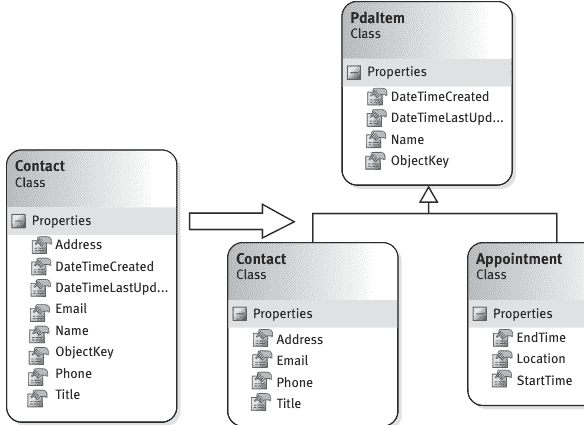

### 列表 7.1: 重构为基类

### 列表 7.1: 从一个类中派生出另一个类

```csharp
public class PdaItem
{
    [DisallowNull]
    public string? Name { get; set; }
    public DateTime LastUpdated { get; set; }
    // 定义 Contact 类继承自 PdaItem 类
    public class Contact : PdaItem
    {
        public string Address { get; set; }
        public string Phone { get; set; }
    }
}
```

列表 7.2 展示了如何访问 Contact 中定义的属性。

### 列表 7.2: 使用继承的方法

```csharp
public class Program
{
    public static void Main()
    {
        Contact contact = new Contact();
        contact.Name = "Inigo Montoya";
        //...
    }
}
```

# 第 7 章：继承

尽管 Contact 没有直接拥有一个名为 Name 的属性，但 Contact 的所有实例仍然可以访问 PdaItem 的 Name 属性，并像它是 Contact 的一部分一样使用它。此外，任何派生自 Contact 的额外类也将继承 PdaItem 或 PdaItem 所派生自的任何类的成员。继承链没有实际限制，并且每个派生类都将拥有其基类继承链中所有成员组合（参见列表 7.3）。换句话说，虽然 Customer 并没有直接派生自 PdaItem，但它仍然继承了 PdaItem 的成员。

> 注意
> 通过继承，基类的每个成员都将出现在派生类的链中。

### 列表 7.3: 相互派生以形成继承链的类

```csharp
public class PdaItem : object
{
    // ...
}
public class Appointment : PdaItem
{
    // ...
}
public class Contact : PdaItem
{
    // ...
}
public class Customer : Contact
{
    // ...
}
```

在列表 7.3 中，显式显示了 PdaItem 派生自 object。虽然 C# 允许这种语法，但它是没有必要的，因为无论是否指定，所有类在没有其他派生的情况下都会指向 object。

> 注意
> 除非指定了备用基类，否则所有类默认都派生自 object。

## 基类与派生类型之间的转换

如列表 7.4 所示，由于派生形成了一种“是一个...”的关系，因此派生类型的值始终可以直接赋值给基类型变量。

### 列表 7.4: 隐式基类转换

```csharp
public class Program {
    public static void Main() {
        // 派生类型可以隐式转换为
        // 基类类型
        Contact contact = new Contact();
        PdaItem item = contact;
        // ...
        // 基类必须显式转换为派生类型
        contact = (Contact)item;
        // ...
    }
}
```


派生类型 `Contact` 是一个 `PdaItem`，可以可以直接赋值给类型为 `PdaItem` 的变量。这被称为隐式转换，因为不需要转换操作符，且转换在原则上总是成功的；也就是说，它不会抛出异常。

然而，反之亦然。`PdaItem` 不一定是 `Contact`；它可能是一个 `Appointment` 或其他派生类型。因此，从基类型到派生类型的转换需要显式转换，这在运行时可能会失败。要执行显式转换，你需要在括号内识别目标类型，紧跟着原始引用，正如列表 7.4 所示。

通过显式转换，程序员本质上是在告诉编译器要信任她——她知道自己在做什么——如果目标类型派生自源类型，C# 编译器将允许转换进行。尽管 C# 编译器允许在编译时在潜在兼容的类型之间进行显式转换，但公共语言运行时 `CLR` 仍会在执行时验证显式转换，如果对象实例实际上不是派生类型，则会抛出异常。

即使类型层次结构允许隐式转换，C# 编译器也允许使用转换操作符。例如，从 `item` 到 `item` 的赋值可以使用如下方式的转换操作符：

```csharp
item = (PdaItem)contact;
```

或者即使在不需要转换时也是：

```csharp
contact = (Contact)contact;
```

> 注意
> 派生对象可以隐式转换为其基类。相比之下，从基类转换为派生类需要显式转换操作符，因为转换可能会失败。虽然编译器在转换可能有效时会允许显式转换，但运行时仍会在执行时通过抛出异常来防止无效转换。

## 初学者主题

### 继承类内部的转换

向基基的隐式转换不会实例化新实例。相反，同一个实例只是被引用为基类型，并且其功能（可访问的成员）是基类型的。这就像是将 CD-ROM 驱动器称为“存储设备”。由于并不是所有的存储设备都支持弹出操作，因此，一个被视为存储设备的 CD-ROM 驱动器也无法弹出，或者 `storageDevice.Eject()` 将无法通过编译，即使实例化的对象可能是一个支持 `Eject()` 方法的 `CDROM` 对象。

同样，从基类向派生类的向下转换（casting down）需要更具体地扩展可用操作。限制是，实际实例化的类型必须是目标类型的实例（或派生自该类型的类型）。

## 高级主题

### 定义自定义转换

类型之间的转换限于单个继承链。也可以转换不相关的类型，例如从长整转换为字符串。关键是转换操作符的提供。C# 允许类型包含显式或隐式操作符。如果操作可能失败，例如浮点转换为整数，开发者应选择显式转换。这警告开发者仅在确定转换将成功时这样做，否则要准备好捕获它的异常。当转换是有损的，他们应该使用显式转换而非隐式转换。例如，浮点转换为整数会截断小数，而转换（回浮点）无法恢复。

列表 7.5 展示了隐式操作符的示例。

#### 列表 7.5: 定义转换符

```csharp
class GPSCoordinates
{
    // ...
    public static implicit operator UTMCoordinates(
        GPSCoordinates coordinates)
    {
        // ...
    }
}
```

在这种情况下，你有从 `GPSCoordinates` 到 `UTMCoordinates` 的隐式转换。可以编写类似的转换来反转过程。注意，可以通过将隐式替换为显式编写显式转换。

### private 访问修饰

除了构造函数和析构函数外，基类的所有成员都被派生类继承。然而，仅仅成员被继承并不意味着它是可用的。例如，在列表 7.6 中，私有成员仅在声明它们的类型代码内部是可用的，因此在 `Contact` 中不可用。

#### 列表 7.6: 私有成员被继承但不可访问

```csharp
public class PdaItem
{
    private string _Name;
    public string Name
    {
        get { return _Name; }
        set { _Name = value; }
    }
}
// ...
}
public class Contact : PdaItem {
// ...
}
public class Program {
public static void Main() {
    Contact contact = new Contact();
}
}
```

```c
// 错误：由于其保护级别
// '_Name' 不可访问
contact._Name = "Inigo Montoya";
```

作为尊重封装原则的一部分，派生类无法访问声明为私有的成员¹。这迫使基类开发者显式选择派生类是否获得成员的访问。在这种情况下，基类定义了一个 API，其中 `Name` 只能通过 `Name` 属性更改。这样，如果添加了验证，派生类将自动获得验证益处，因为它从开始就无法直接访问 `_Name`。

然而，封装的粒度比简单的公共或私有要细得多。但是，可以在基类中定义只有派生类可以访问的成员。例如，考虑列表 7.7 所示的 `ObjectKey` 属性。

+   1. *除非存在特殊情况，即派生类也是基类的嵌套类。*

#### 代码列表7.7: 保护成员仅从派生类访问

using System.IO;

```csharp
public class PdaItem
{
    public PdaItem(Guid objectKey) => objectKey;
    protected Guid ObjectKey { get; }
}
```

```csharp
public class Contact : PdaItem
{
    public Contact(Guid objectKey)
        : base(objectKey) {}
}
```

```csharp
public void Save()
{
    // 使用 <ObjectKey>.dat 实例化 FileStream
    // 作为文件名
    using FileStream stream = File.OpenWrite(
        ObjectKey + ".dat");
    //
    stream.Dispose();
}
```

```csharp
static public Contact Copy(Contact contact) =>
    new Contact(contact.ObjectKey);
```

```csharp
static public Contact Copy(PdaItem pdaItem) =>
    // 错误：无法访问保护成员 PdaItem.ObjectKey。
    new Contact(pdaItem.ObjectKey);
```

```csharp
public class Program
{
    public static void Main()
    {
        Contact contact = new Contact(Guid.NewGuid());
        // 错误：'PdaItem.ObjectKey' 不可用
        Console.WriteLine(contact.ObjectKey);
    }
}
```

`ObjectKey` 使用 `protected` 访问修饰符定义。结果是它可以在 `PdaItem` 之外被访问，但只能从派生自 `PdaItem` 的类的访问。由于 `Contact` 派生自 `PdaItem`，`Contact` 的所有成员（即 `Save()`）都可以访问 `ObjectKey`。相比之下， `Program` 没有派生自 `PdaItem`，因此在 `Program` 中使用 `ObjectKey` 属性会导致编译错误。

### 第 7 章：继承

> 注意
> 基类中的保护成员仅可从基类以及派生链中的其他类访问。

在静态方法 `Contact.Copy(PdaItem pdaItem)` 方法中展示的一个重要微妙之处值得注意。开发者通常会惊讶，尽管 `Contact` 派生自 `PdaItem`，但在 `Contact` 内部代码中无法访问 `PdaItem` 的保护成员 `ObjectKey`。原因是 `PdaItem` 可能会是一个 `Address`，而 `Contact` 不应该能够访问 `Address` 的保护成员。因此，封装防止了 `Contact` 可能会修改 `Address` 的 `ObjectKey`。成功的强制类型转换将绕过此限制（`((Contact)pdaItem).ObjectKey`），访问 `contact.ObjectKey` 也是如此。遵循的规则是：从派生类访问保护成员需要在编译时确定该保护成员确实是该派生类的实例。

### 扩展方法

扩展方法在技术上并不是它们所扩展的类型的成员，因此它们并不会被继承。尽管如此，由于每个派生类都可以作为其任何一个基类的实例使用，因此针对一种类型的扩展方法也会扩展到每个派生类型。换句话说，如果我们扩展了如 `PdaItem` 这样的基类，所有的扩展方法在派生类中也可用。然而，与所有扩展方法一样，实例方法具有优先级。如果在继承链中的任何地方出现兼容的签名，它将优先于扩展方法。

对基类型要求扩展方法是罕见的。对于泛而言的扩展方法，如果基类型的代码可用，最好直接修改基类型。即使在基类型代码不可用的情况下，程序员也应该考虑是否为基类型或单个派生类型所实现的接口添加扩展方法。我们将在第 8 章介绍接口及其与扩展方法的用法。

### 派生

#### 单继承

在理论上，你可以在继承树中放置无限数量的类。例如，`Customer` 派生自 `Contact`，`Contact` 派生自 `PdaItem`，`PdaItem` 派生自 `object`。然而，C# 是一种单继承编程语言（C# 编译后的公共中间中间语言 [CIL] 也是如此）。因此，一个类不能直接派生自两个类。例如，让 `Contact` 同时派生自 `PdaItem` 和 `Person` 是可能的。

##### 语言对比：C++—多重继承
C# 的单继承是它与 C++ 在面向对象方面的主要区别之一。

对于少数需要多重继承类结构的罕见情况，一种解决方案是使用聚合：不是让类继承另一个类，而是由一个类包含另一个类的实例。C# 8.0 提供了额外的结构来实现此，因此我们将实现聚合的细节推迟到第 8 章。

### 密封类

正确设计一个类以便他人可以通过派生来扩展它是一项艰手的任务，需要通过示例进行测试以验证派生将成功工作。代码列表 7.8 显示了如何通过将类标记为密封（sealed）来避免意外的派生场景和问题。

- 代码列表 7.8：使用密封类防止派生

```csharp
public sealed class CommandLineParser
{
    // ...
}
// 错误：无法从密封类派生
public sealed class DerivedCommandLineParser :
{
    // ...
}
```

密封类包含 `sealed` 修饰符，因此它们不能被派生。`string` 类型是一个使用 `sealed` 修饰符防止派生的类型示例。

### 重写基类

基类的所有成员都在派生类中继承，构造函数和析构函数除外。然而，有时基类没有某个特定成员的最优实现。例如 `PdaItem` 上的 `Name` 属性。当它被 `Appointment` 类继承时，该实现可能是可以的。但对于 `Contact` 类，`Name` 属性应该返回 `FirstName` 和 `LastName` 属性。同样，当赋值 `Name` 时，它应该被拆分为 `FirstName` 和 `LastName`。换句话说，基类的属性声明对于派生类是合适的，但实现并不总是有效的。需要一种机制来重写基类的实现。在派生类中使用自定义实现。

### virtual 修饰符

C# 支持对实例方法和属性重写，但不支持字段或静态成员。基类必须将其允许重写的成员标记为 `virtual`。如果公共或保护成员不包含 `virtual` 修饰符，子类将无法重写它们。

##### 语言对比：Java—默认虚方法
在 Java 中方法默认是虚的，如果需要非虚行为，必须显式标记为 `final`。相比之下，C# 默认是非虚的。

#### 代码列表7.9：重写属性

```csharp
public class PdaItem
{
    public virtual string Name { get; set; }
    // ...
}
public class Contact : PdaItem
{
    public override string Name
    {
        get
        {
          return $"{FirstName} {LastName}";
        }
        set
        {
          string[] names = value.Split(' ');
          // 未显示错误处理
          FirstName = names[0];
          LastName = names[1];
        }
    }
    public string FirstName { get; set; }
    public string LastName { get; set; }
    //...
}
```

不仅 `PdaItem` 在 `Name` 属性上包含了 `virtual` 修饰符，`Contact` 的 `Name` 属性也装饰了 `override` 关键字。消除 `virtual` 将导致错误，而省略 `override` 将导致生成警告，我们很快就会说明。C# 要求重写方法显式使用 `override` 关键字。换句话说，`virtual` 标识方法可以被替换（重写）。

##### 语言对比：Java 和 C++—隐式重写
与 Java 和 C++ 不同，C# 要求在派生类中使用 `override` 关键字。它不允许隐式重写。要重写方法，类和派生类成员必须匹配并具有相应的 `virtual` 和 `override` 关键字。此外，当指定 `override` 时，假设派生实现替换了基类实现。

重写成员会导致运行时调用最派生的实现（见代码列表 7.10）。

### 代码列表7.10：运行时调用虚方法的最派生实现

```csharp
public class Program {
  public static void Main() {
    Contact contact;
    PdaItem item;
  }
}
```

```csharp
contact = new Contact();
item = contact;
```

```csharp
// 通过 PdaItem变量设置名称
item.Name = "Inigo Montoya";
```

```csharp
// 显示已设置的 FirstName 和 LastName
// 属性
Console.WriteLine(
  "${contact.FirstName} {contact.LastName}");
```

输出 7.1 显示了 7.10 的结果。

Inigo Montoya

在列表 7.10 中，当赋值声明在 `PdaItem` 上的 `item.Name` 时，`contact` 的 `FirstName` 和 `LastName` 仍然被设置。规则是：每当运行时遇到虚方法时，它都会调用虚成员的最派生且覆盖的实现。在这种情况下，代码实例化了一个 `Contact` 并调用 `Contact.Name`，因为 `Contact` 包含了 `Name` 的最派生实现。

虚方法仅提供默认实现——即派生类可以完全覆盖的实现。然而，由于继承设计的复杂性，考虑（并最好实现）一个需要虚方法关系的特定场景，比默认将成员声明为虚成员更为重要。

这一步也很重要，因为将方法从虚方法转换为非虚方法可能会破坏覆盖该方法的类。如果发布了虚成员，如果你想避免引入破坏性更改，则它应该保持为虚成员。因此，在引入虚成员时要小心——例如，可以将其设为 `private protected`。

## 语言对比：C++—构造期间的虚调用分发

在 C++ 中，在构造期间调用的方法不会分发虚方法。相反，在构造期间，类型与基类型关联而非派生类型关联，虚方法会调用基类实现。相比之下，C# 将虚方法调用分发到最派生类型。这与调用最派生虚成员的原则一致，即使派生类的构造函数尚未完全执行。无论如何，在 C# 中应该避免这种情况这种情况。

最后，只有实例成员可以是虚的。CLR 使用实例化时指定的具体类型来决定在何处分发虚方法调用；因此，静态虚方法是没有意义的，编译器禁止了它们。

### new 修饰

当覆盖方法没有使用 `override` 时，编译器会抛出与输出 7.2 或输出 7.3 所示类似的警告。

### 输出 7.2

```
warning CS0114: '<derived method name>' 隐藏了继承的成员
'<base method name'. 要让当前成员覆盖该
实现，请添加 override 关键字。否则请添加 new
关键字。
```

### 输出 7.3

```
warning CS0108: '<derived property name>' 需要关键字 关键字，因为它隐藏了成员 '<base property name>'
```


最显而易见的解决方案是添加 `override` 修饰符（假设基成员是虚的）。然而，正如警告所示，`new` 修饰符也是一种选择。考虑表 7.1 所示的场景——这是一个通用情况的特定示例，被称为脆性或脆弱的基类问题。

## 表 7.1：为什么需要 new 修饰符？

| 活动 | 代码 |
| --- | --- |
| 程序员定义类 `Person`，其中包含 `FirstName` 和 `LastName` 属性。 | `public class Person { public string FirstName { get; set; } public string LastName { get; set; } }` |

# 第 7 章：继承

表 7.1：为什么需要 new 修饰符？（续）

| 活动 | 代码 |
| --- | --- |
| 程序员 B 继承自 `Person` 并定义了带有额外属性 `Name` 的 `Contact`。此外，他定义了 `Program`，其 `Main()` 方法实例化 `Contact`，分配 `Name`，然后打印出名称。 | ```csharp
public class Contact : Person {
    public string Name {
        get {
            return FirstName + " " + LastName;
        }
        set {
            string[] names = value.Split(' ');
            // 未显示错误处理
            FirstName = names[0];
            LastName = names[1];
        }
    }
}
``` |
| 后来，程序员 A 添加了 `Name` 属性，但她没有将获取器实现为 `FirstName + " " + LastName`，而是将其实现为 `LastName + ", " + FirstName`。此外，她没有将该属性声明为虚属性，并在 `DisplayName()` 方法使用了该属性。 | ```csharp
public class Person {
    public string Name {
        get {
            return LastName + ", " + FirstName;
        }
        set {
            string[] names = value.Split(' ');
            // 未显示错误处理
            LastName = names[0];
            FirstName = names[1];
        }
    }
    public static void Display(Person person) {
        // 显示 <LastName>, <FirstName>
        Console.WriteLine(person.Name);
    }
}
``` |

## 覆盖基类

由于 `Person.Name` 不是虚的，程序员 A 期望 `Display()` 使用 `Person` 的实现，即使传递了 `Person` 的派生数据类型 `Contact`。然而，程序员 B 期望在变量数据类型为 `Contact` 的所有情况下使用 `Contact.Name`。（程序员没有使用 `Person.Name` 的代码，因为最初不存在 `Person.Name` 属性）。为了在不破坏任何程序员行为的情况下添加 `Person.Name`，C# 无法假设意图是使用虚的。此外，由于 C# 要求覆盖成员必须显式使用 `override` 修饰符，因此必须假设某种语义，而不是允许基类中添加成员导致派生类不再能够编译。

这种语义就是 `new` 修饰符，它隐藏了派生类中来自基类的重新声明的成员。基类的成员不再是调用最派生的成员，而是调用继承链中带有 `new` 修饰符的成员之前的最派生成员。如果发布了虚成员，如果你想避免引入破坏性更改，则它应该保持为虚成员。因此，在引入虚成员时要小心——例如。即使没有指定 `override` 或 `new`，也会被假设为 `new`。请考虑列表 7.11 作为一个示例。它的输出出现在输出 7.4。

## 列表 7.11：override 与 new 修饰符

```csharp
public class Program
{
    public class BaseClass
    {
        public void DisplayName()
        {
            Console.WriteLine("BaseClass");
        }
    }
    public class DerivedClass : BaseClass
    {
        // 编译器警告：DisplayName() 隐藏了继承的
        // 成员。如果意图是隐藏，请使用 new 关键字。
        public virtual void DisplayName()
        {
            Console.WriteLine("DerivedClass");
        }
    }
}
```

# 第 7 章：继承

```csharp
public class SubDerivedClass : DerivedClass {
    public override void DisplayName() {
        Console.WriteLine("SubDerivedClass");
    }
}
```

```csharp
public class SuperSubDerivedClass : SubDerivedClass {
    public new void DisplayName() {
        Console.WriteLine("SuperSubDerivedClass");
    }
}
```

```csharp
public static void Main() {
    SuperSubDerivedClass superSubDerivedClass = new SuperSubDerivedClass();
    SubDerivedClass subDerivedClass = superSubDerivedClass;
    DerivedClass derivedClass = superSubDerivedClass;
    BaseClass baseClass = superSubDerivedClass;
    superSubDerivedClass.DisplayName();
    subDerivedClass.DisplayName();
    derivedClass.DisplayName();
    baseClass.DisplayName();
}
```

# 输出 7.4

SuperSubDerivedClass
SubDerivedClass
SubDerivedClass
BaseClass

这些结果的原因如下：

- SuperSubDerivedClass：`SuperSubDerivedClass.DisplayName()` 显示了 `SuperSubDerivedClass`，因为没有派生类，因此没有覆盖实现。
- SubDerivedClass：`SubDerivedClass.DisplayName()` 是覆盖基类虚成员的最派生成员。`SuperSubDerivedClass.DisplayName()` 因为其 `new` 修饰符而被隐藏。

# 重写基类

- SubDerivedClass: `DerivedClass.DisplayName()` 是虚方法，而 `SubDerivedClass.DisplayName()` 是覆盖该方法的最派生成员。与之前一样，`SuperSubDerivedClass.DisplayName()` 因为新的修饰符而被隐藏。
- `BaseClass::DisplayName()` 没有重新声明任何基类成员且不是虚方法；因此，它会被直接调用。

在涉及 CIL（公共中间语言）时，`new` 修饰符对编译器生成的语句没有影响。然而，一个“new”方法会导致方法上生成 `newslot` 元数据属性。从 C# 的角度来看，它唯一的作用是消除本情况下会出现的编译器警告。

# sealed 修饰符

正如你可以在类上使用 `sealed` 修饰符来防止继承一样，虚成员也可以被密封（参见列表 7.12）。这种方法可以防止子类重写最初在继承链上层声明为虚方法的基类成员。这种情况通常发生在子类 B 重写了基类 A 的成员，然后需要防止子类 B 之后的任何进一步重写。

> 列表 7.12：密封成员

```class
class A
{
    public virtual void Method()
}
class B : A
{
    public override sealed void Method()
}
class C : B
{
    // 错误：无法重写密封成员
    // public override void Method()
    {}
}
```

# 第 7 章：继承

在这个示例中，在类 B 的 `Method()` 声明中使用 `sealed` 修饰符阻止了 C 类重写 `Method()`。

通常情况下，将类标记为 `sealed` 是很少做的，应该只为那些有理由支持此类限制的情况保留。事实上，随着单元测试变得越来越重要，保持类型为未密封（unsealed）状态变得越来越受欢迎，因为需要支持 mock（双重模拟）对象的创建以替代真实实现。密封一个类的潜在场景可能超过其保持类未密封状态的益处。然而，对单个成员进行更具针对性的密封——可能是因为基实现中对于正确行为所需的依赖项——可能是更优的。

# base 成员

在选择重写成员时，开发者通常想要调用基类上的成员（参见列表 7.13）。

> 列表 7.13：访问基类成员

```cs
using static System.Environment;
public class Address
{
    public string StreetAddress;
    public string City;
    public string State;
    public string Zip;
    public override string ToString()
{
        return $"{StreetAddress} + NewLine\n               + $
```

在列表 7.13 中，`InternationalAddress` 继承自 `Address` 并实现了 `ToString()`。要调用父类的实现，你使用的语法与使用 `this` 关键字几乎相同，包括支持将 `base` 作为构造函数的一部分（稍后讨论）。

顺带一下，在 `Address.ToString()` 的实现中，你需要重写是因为 `ToString()` 也是 `object` 的一个成员。任何带有 `override` 装饰的成员都会自动指定为虚方法，因此额外的子类可以进一步特化该实现。

> 注意
> 带有 `override` 装饰的方法自动是虚的。如果基方法是虚的，则可以被重写，因此重写方法也是虚的。

### 调用基类构造函数
在实例化派生类时，运行时首先调用基类的构造函数，以确保基类的初始化不被跳过。然而，如果基类上没有可访问（非私有）的默认构造函数，则不清楚构造基类；相应，C# 编译器会报告错误。

为了避免缺少可访问默认构造函数引起的错误，程序员必须在派生类的构造函数头部显式指定运行哪个基类构造函数（参见列表 7.14）。

# 列表 7.14：指定调用哪个基类构造函数

```cs
public class PdaItem
{
    public PdaItem(string name)
    {
        Name = name;
    }
    public virtual string Name { get; set; }
    // ...
}
public class Contact : PdaItem
{
    // 禁用警告，因为 FirstName&LastName 通过 Name 属性设置
```

# 第 7 章：继承

```cs
#pragma warning disable CS8618 // 非可空字段未初始化。
public Contact(string name) :
    base(name)
{
#pragma warning restore CS8618
public override string LastName
{
    get
        return $"{FirstName} {LastName}";
    set
    {
        string[] names = value.Split(' ');
        // 未显示错误处理
        FirstName = names[0];
        LastName = names[1];
    }
}
```

```cs
[NotNull][DisallowNull]
public string FirstName { get; set; }
[NotNull][DisallowNull]
public string LastName { get; set; }
```

```cs
public class Appointment : PdaItem
{
    public Appointment(string name,
        string location, DateTime startTime, DateTime endTime):
        base(name)
    {
        Location = location;
        StartTime = startTime;
    }
    public DateTime EndDate { get; set; }
    public string Location { get; set; }
`````

通过在代码中标识基类构造函数，你让运行时在调用派生类构造函数之前知道要调用哪个基类构造函数。

# 抽象类

到目前为止的继承示例定义了一个名为 `PdaItem` 的类，它定义了 `Contact`、`Appointment` 等公共方法。然而，`PdaItem` 设计并不是为了实例化。它仅作为派自它的类型的基类使用时才有意义。这些类仅用于派生。虽然抽象类不能实例化，但这只是抽象类的一个次要特征。当抽象类包含抽象成员时，它们具有主要意义。抽象成员是一个没有实现的方法或属性。其目的是强制所有派生类提供实现。

抽象类表示抽象实体。它们的抽象成员定义了自实体的对象应该包含什么，但并不包含实现。通常，抽象类中的许多功能是未实现的。在类成功派自抽象类之前，它需要为其抽象方法提供实现。

要定义抽象类，C# 要求在类定义中使用 `abstract` 修饰符，如列表 7.15 所示。

> 列表 7.15：定义抽象类

```cs
// 定义一个抽象类
public abstract class PdaItem
{}
```

# 第 7 章：继承

```cs
public class PdaItem(string name)
{
    Name = name;
}
public virtual string Name { get; set; }
public class Program
{
    public static void Main()
    {
    PdaItem item;
    // 错误：无法创建抽象类的实例
    // item = new PdaItem("Inigo Montoya");
    }
}
```

# 列表 7.16：定义抽象成员

```cs
// 定义一个抽象类
public abstract class PdaItem
{
    public PdaItem(string name)
    {
        Name = name;
    }
    public virtual string Name { get; set; }
    public abstract string GetSummary();
}
using static System.Environment;
public class Contact : PdaItem
{
    public override string Name
    {
        get
        {
            return $"{FirstName} {LastName}";
        }
    }
}
```

# Abstract类 359

```csharp
set{
  string[] names = value.Split(' ');
  // 未显示错误处理
  FirstName = names[0];
  LastName = names[1];
}
```

```csharp
public string FirstName {
  get {
    return _FirstName;
  }
  set {
    _FirstName = value ??


进入`/path/to/xxx`目录，找到`xxx.json`。

在表达式`cvar = avar + bvar`中，加法运算符（`+`）将`avar`与`bvar`相加，得到它们的和`cvar`

在`List.of(arg0, arg1, arg2)`中，`List`接口的工厂方法`of()`接受一系列的元素，返回包含它们的只读列表。

之后我们这样调用`cmd`命令：`cmd arg0 arg1 arg2`。

```
if (condVar > someVal) {console.log("xxx")}
```

```csharp
throw new ArgumentNullException(nameof(value));
}
}
private string? _FirstName;
```

```csharp
public string LastName {
  get {
    return _LastName;
  }
  set {
    _LastName = value ??
      throw new ArgumentNullException(nameof(value));
  }
}
private string? _LastName;
```

```csharp
public string? Address { get; set; }
public override string GetSummary() {
  return @"FirstName: {FirstName} + NewLine\n  LastName: {LastName} + NewLine\n  Address: {Address} + NewLine";
}
```

```csharp
//...
public class Appointment : PdaItem {
  public Appointment(string name) : base(name) {
    Location = location;
    StartTime = startTime;
    EndTime = endTime;
  }
  public DateTime StartTime { get; set; }
  public DateTime EndTime { get; set; }
  public string Location { get; set; }
  // ...
  public override string GetSummary() {
    return $"Subject: {Name} + NewLine"
        + $"Start: {StartTime} + NewLine"
        + $"End: {EndTime} + NewLine"
        + $"Location: {Location}";
  }
}
```

### 列表 7.16

将 `GetSummary()` 成员定义为抽象的，因此它不包含任何实现。代码随后重写了此成员并提供了实现。由于抽象成员旨在被重写，因此此类成员自动是虚拟的（virtual），且不能显式声明。此外，抽象成员不能是私有的，因为派生类将无法看到它们。开发一个良好的对象层次结构意外地困难。因此，在编写抽象类型时，你应该确保实现至少一个（最好是多个）派生自抽象类的具体类型。如果你在 `Contact` 中没有提供 `GetSummary()` 实现，编译器将报告错误。

> 注意：抽象成员必须被重写，因此它们自动是虚拟的，且不能显式声明。

## 语言对比：C++—纯虚函数

C++ 允许使用晦涩的符号定义抽象函数。这些函数在 C++ 中被称为纯虚函数。然而，与 C# 不同，它不需要类本身具有任何特殊声明。与 C# 的 `abstract` 饰符不同，C++ 没有类声明。

> 注意：通过声明抽象成员，程序员表示为了在具体类和抽象基类（即 `PdaItem`）之间建立“is-a（是一个一个）”关系，有必要实现抽象类未提供默认实现的抽象成员。

### 初学者主题：多态性

当同一个成员在两个或多个类之间的实现有所不同时，该场景演示了一个关键的面向对象原理：**多态**（polymorphism）。Poly 意为“多”，morph 意为“形式”，因此多态指的是相同签名的多个实现。此外，由于相同的签名在单个类内不能使用多次，因此该签名的每个实现都发生在不同的类中。多态的背后是对象本身知道如何执行特定操作。此外，通过强制执行调用这些操作的方式，多态在利用共性时鼓励了代码复用。给定多种类型的文档，每种文档类型都最了解如何对其相应类型执行 `Print()` 方法。因此，无需定义一个包含 `switch` 语句和特殊逻辑来打印每种文档类型的单一打印方法，你无论类型如何都调用 `Print()`。例如，在文字处理类上调用 `Print()` 的行为将根据文字处理的特殊性进行，而在图形类上调用相同的方法则会产生图形行为。将自定义实现移出 `switch` 语句提供了许多维护方面的优势。首先，实现在每个文档类型类的上下文中，而不是在类内部出现；其次，添加新的文档类型不需要更改 `switch` 语句。相反，新文档类只需要实现 `Print()` 签名即可。抽象成员旨在启用多态性。基类提供方法的签名，而派生类提供具体实现（见列表 7.17）。

### 列表 7.17：使用多态列出项目

```csharp
public class Program
{
    public static void Main()
    {
        PdaItem[] pda = new PdaItem[3];
        Contact contact = new Contact("Sherlock Holmes");
        contact.Address = "2218 Baker Street, London, England";
        pda[0] = contact;
        Appointment appointment = new Appointment(
            "Soccer tournament", "Estádio da Machava",
            new DateTime(2008, 7, 19), new DateTime(2008, 7, 18));
        pda[1] = appointment;
        contact = new Contact("Hercule Poirot");
        contact.Address = 
            "Apt 56B, Whitehaven Mansions, Sandhurst Sq, London";
        pda[2] = contact;
        List(pda);
    }
    public static void List(PdaItem[] items)
    {
        // 使用多态性实现。派生
        // 类型知道实现
        // GetSummary() 的细节。
        foreach (PdaItem item in items)
        {
            Console.WriteLine("* ");
            Console.WriteLine(item.GetSummary());
        }
    }
}
```

列表 7.17 的结果出现在输出 7.5 中。

### 输出 7.5

FirstName: Sherlock
LastName: Holmes
Address: 2218 Baker Street, London, England

Subject: Soccer tournament
Start: 7/18/2008 12:00:00 AM
End: 7/19/2008 12:00:00 AM
Location: Estádio da Machava

FirstName: Hercules
LastName: Poirot
Address: Apt 56B, Whitehaven Mansions, Sandhurst Sq, London

通过这种方式，你可以在基类上调用该方法，但实现是针对特定的。输出 7.5 显示了列表 7.17 中的 `List()` 方法能够成功显示联系人和地址，并以定制的方式显示它们。抽象 `GetSummary()` 方法的调用实际上调用了实例特定的重写方法。

## **所有类都派自 System.Object**

对于任何类，无论是自定义类还是系统内置类，表 7.2 所示的方法都会定义。

### 表格 7.2：System.Object 的成员

| 方法名称 | 描述 |
| :--- | :--- |
| public virtual bool Equals(object o) | 如果作为参数的对象与实例在值相等（但不一定在引用上相等），则返回真。 |
| public virtual int GetHashCode() | 返回一个对应于均匀哈希值的整数。这对于 HashTable 等集合非常有用。 |
| Type GetType() | 返回一个对应于对象实例类型的 System.Type 对象。 |
| static bool ReferenceEquals(object a, object b) | 如果提供的参数引用同一个对象，则返回真。 |
| public virtual string ToString() | 返回对象实例的字符串表示。 |
| public virtual void Finalize() | 析构函数的别名；通知对象准备终止。C# 防止你直接调用此方法。 |
| protected object MemberwiseClone() | 通过执行浅拷贝来克隆问题对象；引用会被复制，但被引用类型内部的数据不会被复制。 |

## 列表 7.18: 未显式指定派生类时隐含的 System.Object 派生

```csharp
public class PdaItem
{
    // ...
}
public class PdaItem : object
{
    // ...
}
```

当对象的默认实现不再足够时，程序员可以重写三个虚方法中的一个或多个。第 10 章描述了执行此类操作的详细细节。

## 使用 is 运算符进行模式匹配

虽然 C# 自 C# 1.0 起就有了 `is` 运算符，但 C# 7.0 和 C# 8.0 都对模式匹配的支持方面提供了显著改进。但请注意，在我们在下一节中在 `switch` 语句或表达式中使用这些功能之前，其中许多功能在其他语境下是相对细微的。

## 使用 is 运算符验证底层类型

由于 C# 允许沿着继承链向下强制转换，有时在尝试转换之前确定底层类型是很有价值的。此外，对于没有实现多态的特定类型操作，检查类型可能是必要的。为了确定底层类型，C# 自 C# 1.0 起就包含了 `is` 运算符（参见列表 7.19）。

## 列表 7.19: 使用 is 运算符确定底层类型

```csharp
public static void Save(object data)
{
    if (data is string)
    {
        string text = (string)data;
        if (text.Length > 0)
        {
            data = Encrypt(text);
            // ...
        }
    }
    else if (data is null)
    {
        // ...
    }
}
```

列表 7.19 在底层类型为 `string` 时对数据进行加密。这与加密任何成功转换为字符串的类型类型有显著不同，因为某些类型支持转换为字符串，但它们的底层类型并不是字符串。

虽然在方法开始处检查 `null` 可能更清晰，但在这种情况下我们在稍晚之后进行了检查。我们的意图是说明即使目标是 `null`，运算符也会返回 `false`，因此将执行 `null` 检查。

使用显式强制转换，程序员有责任充分理解代码逻辑，以避免无效强制转换异常（invalid cast exception）。如果可能发生无效强制转换，最好利用运算符并完全避免异常。优点是，运算符为显式强制转换可能失败的情况提供了一条代码路径，而无需承担异常处理的代价。在 C# 7.0 及更高版本中，`is` 运算符会在检查数据类型的同时进行赋值。

## 类型、Var 和常量的模式匹配

从 C# 7.0 开始，该运算符得到了改进以支持模式匹配。正如本章之前描述的，该运算符的问题在于，在检查数据确实为 `string` 之后，我们仍然必须将数据转换为 `string`（假设我们想以字符串的形式访问它）。更好的方法是同时检查两者，如果检查为真，则将结果赋值给新变量。随着 C# 7.0 引入模式匹配，通过使用类型、`var` 和 `const` 匹配，这变得可能。C# 8.0 在此基础上进一步添加了元组、位置、属性和递归模式匹配。在大多数场景下，这些选项都可以替换更基础的运算符。

表 7.3 提供了 C# 7.0 各种种模式匹配能力的示例。

## 使用运算符的模式匹配

### 表 7.3: 使用运算符的类型、var 和 const 模式匹配

| 描述 | 方法名 |
| --- | --- |
| **类型模式匹配** | 检查 `GetObjectById(id)` 的结果是否为 `Employee` 类型并赋值给同一表达式中的变量 `employee`。如果 `GetObjectById(id)` 的结果为 `null` 或不是 `Employee`，则为 `false` 并执行 `else` 子句。`employee` 在语句内部和之后均可用；但在 `else` 子句内部或之后访问它之前需要对其赋值。 |

# 第 7 章：继承

从外观上看，列表 7.22 看起来与列表 7.21 几乎相同，并且看起来与位置匹配相似。然而，它有两个重要的区别。第一，属性模式匹配使用大括号 `{ }` 而不是用于识别匹配对象的圆括号 `()`。第二，参数的位置（对于位置匹配和元组匹配都重要）对于属性模式匹配是无关的，因为属性名称被用于映射属性表达式。还要注意，当检查是否为 null 时，属性模式匹配是配合 `{ }` 使用的。

# 递归模式匹配

如前所述，模式匹配的许多威力只有在在 `switch` 语句或表达式中使用它时才会真正显现。然而，唯一的例外可能是递归地使用模式匹配时。诚然，列表 7.23 是没有意义的；它提供了一个递归应用模式时潜在的复杂性示例。

# 列表 7.23：使用 is 运算符的递归模式匹配

```csharp
// ...
Person inigo = new Person("Inigo", "Montoya");
var buttercup =
    (FirstName: "Princess", LastName: "Buttercup");
Person inigo, (string FirstName, string LastName) buttercup couple =
    (inigo, buttercup);
if (couple is
    (// 元组
        // 属性
        Length: int inigoLength1,
        // 丢弃
    ),
    // 属性
    FirstName: string buttercupFirstName))
{
    Console.WriteLine($"{inigoFirstName},{buttercupFirstName}");
}
else
{
    // ...
}
//...
```

# switch 表达式中的模式匹配

在此示例中，`couple` 的类型如下：

```csharp
(Person, (string FirstName, string LastName))
```

因此，第一次匹配发生在外层元组 `(inigo, buttercup)` 上。接下来，对 `inigo` 使用位置匹配，利用 `Person` 的解构造器。这选择了一个 `(FirstName, LastName)` 元组，并从中属性匹配来提取 `inigo.FirstName` 值的 `Length`。位置匹配中的 `LastName` 位置被下划线丢弃了。最后，使用属性匹配来选择 `buttercup.LastName`。

C# 8.0 的属性匹配构造是一种强大的数据选择手段，但并没有限制。与 `switch` 语句（在第 4 章中描述）和包含 `when` 子句不同，例如你不能对谓词表达式进行模式匹配——例如检查 `FirstName` 和 `LastName` 的长度是否大于零。此外，要注意可读性。即使列表 7.23 中有注释，理解这段代码仍然具有挑战性。如果没有注释，将会更加困难，如下所示：

```csharp
if (couple is (( { length: int inigoFirstNameLength }, _ }, { FirstName: string buttercupFirstName })) { ... } )
```

尽管如此，模式匹配在 `switch` 语句和表达式中确实证明了它的有用之处。

# switch 表达式中的模式匹配

列表 7.23 是一个 `if-else` 语句，但你可以想象一个类似的示例，其中我们检查的不仅仅是一个字符串。虽然 `if` 语句可以工作，但使用带有 `match` 表达式（或语句）的 `switch` 语句（其中 `match` 表达式与基类型配合）可以提供更好的可读性。列表 7.24 提供了一个以各种形式格式化日期的示例。

列表 7.24：switch 表达式中的模式匹配

```csharp
public static string? CompositeDateFormat(
    object input, string compositFormatString) =>
    input switch
```

# 372 第 7 章：继承

```csharp
DateTime { Year: int year, Month: int month, Day: int day }
=> (year, month, day),
DateTimeOffset
{ Year: int year, Month: int month, Day: int day }
```


=> `(year, month, day)`,

`string` `dateText` `DateTime.TryParse`(
`date`, out `DateTime` `dateTime`) =
(`dateTime.Year`, `dateTime.Month`, `dateTime.Day` :
`default(int Year, int Month, int Day)?`
=> `null`
} is { `date` } ? `string.Format`(
`formatString`, `date.year`, `date.month`, `date.Day`) : `null`;

```
```

`switch` 表达式的第一个情况使用类型模式匹配（C# 7.0）来检查输入是否为 `DateTime` 类型。如果结果为 true，它将结果传递给属性匹配，以声明并赋值 `year`、`month` 和 `day` 值；然后它在元组表达式中使用这些变量，并返回元组 `(year, month, day)`。`DateTimeOffset` 情况的工作方式相同。

`string` 情况没有使用递归模式匹配，也没有使用默认值 (`_`)。注意，对于 `default((int Year, int Month, int Day)?`，其结果为 `null`。无法直接返回 `null`，因为 `(int Year, int Month, int Day)`（其他情况返回的类型）和 `null` 之间没有隐式转换。相反，需要指定可空元组以准确确定 `switch` 表达式的类型。（使用 `default` 运算符的替代方案是强制转换：`((int Year, int Month, int Day)?) null`）。此外，可空性很重要，这样当解析失败时，`is { date }` 不会返回 true。

请注意，列表 7.24 不包含任何过滤匹配的谓词表达式子句。如下子句是被完全支持的

```csharp
DateTime
{ Year: int year, Month: int month, Day: int day } tempDate
when tempDate < DateTime.Now => (year, month, day)
```

（这限制了日期必须在未来）。

- 2. 更多信息请参见第 12 章。

# 在可以使用多态时避免模式匹配

尽管模式匹配能力很重要，但在使用运算符之前，你应该考虑考虑多态。例如，模式匹配是失控的。无论如何，多态并不总是可能的。

多态失效的一种场景是——例如，如果你正在处理不相关的类。此外，假设模式匹配被添加到代码中。为了解决这个问题，运算符是更优的，因为运算符适用于不同的类型。

更重要的是，由于运算符通常需要检查赋值变量是否为 `null` 这一额外步骤，由于模式匹配自动包含了此条件检查，它有效地消除了对 `as` 运算符的需求——假设模式匹配是可用的。

## 高级主题

# 使用 as 运算符进行转换

除了运算符之外，C# 还有 `as` 运算符。最初，`as` 运算符比转换运算符具有优势：它不仅检查运算符是否为特定类型，还尝试转换为目标类型，如果源类型本身不兼容，则赋值为 `null`。此外，它比强制转换更有优势，因为它不会抛出异常。列表 7.25 展示了 `as` 运算符的使用。

列表 7.25：使用 as 运算符进行数据转换

```csharp
public class PdaItem {
    protected Guid ObjectKey { get; }
    // ...
}
```

# 第 7 章：继承

```csharp
public class Contact : PdaItem
{
    // ...
    static public Contact Load(PdaItem pdaItem)
    {
        #pragma disable IDE0019 // 使用模式匹配
        Contact? contact = pdaItem as Contact;
        if (contact != null) {
            System.Diagnostics.Trace.WriteLine(
                $"{contact.ObjectKey}");
            return (Contact)pdaItem;
        }
        else {
            throw new ArgumentException(
                $"{nameof(pdaItem)} was not of type {nameof(Contact)}");
        }
    }
}
```

## 总结

本章讨论了如何通过派生添加额外的方法和属性来特化类。这涵盖了对控制封装级别的私有和保护访问修符的讨论。
本章还研究了重写基类实现的细节，或者另一种方式是使用 `new` 修饰符将其隐藏。

在控制覆盖方面，C# 提供了 `virtual` 饰符，它用于向派生类开发者标识其意图派生的对象。为了防止任何派生，可以在类上使用 `sealed` 饰符。同样，在成员上使用 `sealed` 饰符可以防止子类进一步的覆盖。

本章简要讨论了所有类型如何继承自 `object`。第 10 章将更深入地讨论这种继承，查看 `object` 如何包含三个虚拟方法，并有管理重载的特定规则和指南。然而，在到达那里之前，你需要考虑另一种基于面向对象编程的编程范式：接口。这是第 8 章的主题。

本章以对 `is` 运算符和 `switch` 表达式/语句的模式匹配检查而结束。C# 7.0 和 C# 8.0 均大幅扩展了这些功能，尽管它们并不一定常用——尤其是当可能时，利用多态是比模式匹配更优的解决方案。

# 8 接口

多态性在 C# 中不仅可以通过继承实现（如第 7 章所述），还可以通过接口实现。与抽象类不同，接口不能包含任何实现——直到 C# 8.0。（但即使在 C# 8.0 中，除了“版本控制”和接口之外，是否应该使用这种能力仍然值得怀疑）。然而，与抽象类一样，接口定义了一组调用者可以依赖其已实现的成员。

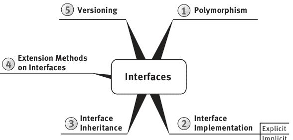

通过实现接口，类型定义了它的能力。接口实现关系是一种“能够做”的关系。类型可以执行接口要求实现类型执行的操作。接口定义了实现接口的类型与使用接口的代码之间的约。实现接口的类型必须声明与所实现接口中声明的方法相同签名。本章讨论了接口的实现和使用。最后讨论了接口上的默认实现成员，以及这一新功能引入的一系列范式（和复杂性）。

## 介绍接口

## 初学者主题

### 为什么使用接口？

接口非常有用，因为与抽象类不同——它们能够将实现细节与提供的服务完全分离。对于一个现实世界的例子，考虑一下作为墙上插座的“接口”。传输到插座的电是一个实现细节：它可能由化学、核能或太阳能产生；发电机可能在隔壁房间也可能在远处；因此插座提供了一个“契约”：它同意在特定频率提供特定的电压，作为回报，要求使用该接口的电器提供一个兼容的插头。电器不需要关心传输到插座的电的实现细节；它只需要担心提供一个兼容的插头。

考虑以下示例：（.zip, .7-zip, .cab, .lha, .tar, .gz, .tar.bz2, .bh, .rar, .arz, .arc, .ace, .zoo, .bzip2, .xxe, .mime, .uue 和 .yenc，仅列举几项）。如果你为每种压缩格式创建类，你可能会为每种压缩实现产生不同的方法签名，并且无法在它们之间应用标准的调用约定。然而，派生自一个公共基类使用了该类唯一且唯一的继承机会。各种压缩实现之间不太可能存在可以放入基类中的共同代码，从而排除了拥有基类实现所带来的潜在收益。关键点是，基类允许你共享实现以及成员签名，而接口允许你在不一定共享实现的情况下共享成员签名。

与其共享公共基类，每个压缩类都需要实现一个公共接口。接口定义了类支持的与期望该接口的其他类进行交互的契约。如果所有类都实现了 `IFileCompression` 接口及其 `Compress()` 和 `Uncompress()` 方法，那么调用任何特定压缩类上的算法的代码只需涉及对 `IFileCompression` 接口的版本以及对成员的调用。结果就是多态，因为每个压缩类都有相同的方法签名，但该签名有各自独立的实现。

列表 8.1 显示的 `IFileCompression` 接口是接口实现的示例。这种约定是强到通用的程度——接口名称使用 PascalCase，并带有大写字母“I”前缀。

### 列表 8.1：定义接口

```csharp
interface IFileCompression
{
    void Compress(string targetFileName, string[] fileList);
    void Uncompress(
        string compressedFileName, string expandDirectoryName);
}
```

`IFileCompression` 定义了类型必须实现的方法，以便与其他压缩相关的类相同的方式使用。接口的威力在于它们赋予了调用者在不修改调用代码的情况下在实现之间切换的能力。

在 C# 8.0 之前，接口的特征特性之一是它没有实现也没有数据。接口中的方法声明在声明后始终使用单个分号代替大括号。属性虽然看起来像自动实现的属性，但没有后备字段。事实上，字段（数据）也不能出现在接口声明中。

在 C# 8.0 中，这些规则中的许多被放宽了，以允许接口在发布后具有某种程度的受限更改。然而，在本文章的“C# 8.0 或更高版本中的接口版本控制”章节之前，我们将忽略这些新功能，并为了建立多态性的目的讨论接口。这正是接口的真正威力所在，而且在开启新功能之前，在这种语境下讨论它们更容易。

接口声明的成员在实现类型上必须是可访问的。非公共成员的目的是让其他代码无法访问。因此，C# 不允许在接口成员上使用访问修饰符；相反，它会自动将它们定义为 public。

> 指南
> 接口名称使用 PascalCasing 并带有 "I" 前缀。

考虑另一个示例，如列表 8.2所示：`IList` 定义了类为了让 `ConsoleList` 显示它所需的成员。因此，任何实现 `IList` 的类都可以使用 `ConsoleList` 显示自己。

### 列表 8.2：实现和使用接口

```csharp
interface IList
{
    // 返回每个单元格的值
    string[] CellValues { get; }
}
public abstract class PdaItem
{
    public PdaItem(string name)
    {
        Name = name;
    }
    public virtual string Name{get; set;}
}
class Contact : PdaItem, IList
{
    public Contact(string firstName, string lastName,
        string address, string phone) :
        base(GetName(firstName, lastName))
    {
        FirstName = firstName;
    }
}
```

```csharp
protected string LastName { get; }
// ...
protected string FirstName { get; }
public string? Address { get; }
public string? Phone { get; }
public static string GetName(string firstName, string lastName)
=> $"{firstName} ${lastName}";
```

```csharp
public string?[] CellValues
{
  return new string?[]
  {
    FirstName,
    LastName,
    Phone,
    Address
  }
}
```

```csharp
public static string[] Headers
{
  return new string[] {
    "First Name", "Last Name",
    "Phone",
    "Address"
  }
}
```

```csharp
// ...
class Publication : IListable
{
  public Publication(string title, string author, int year)
  {
    Title = title;
    Author = author;
    Year = year;
  }
  public string Title { get; }
  public string Author { get; }
  public int Year { get; }
}
```

```csharp
public string?[] CellValues
{
    get
        return new string[]
        {
            Title,
            Author,
            Year.ToString()
        }
}
```

```csharp
public static string[] Headers
{
    get
        return new string[] {
            "Title",
            "Author",
            "Year";
        }
}
```

```csharp
// ...
class Program
{
    public static void Main()
    {
        Contact[] contacts = new Contact[]
        {
            new Contact(
                "Dick", "Traci",
                "123 Main St., Spokane, WA 99037",
                "123-123-1234"
            ),
            new Contact(
                "Andrew", "Littman",
                "1417 Palmary St., Dallas, TX 55555",
                "555-123-4567"
            ),
            new Contact(
                "Mary", "Hartfelt",
                "1528 Thunder Way, Elizabethton, PA 44444",
                "444-123-4567"
            ),
            new Contact(
                "John", "Lindherst",
                "1 Aerial Way Dr., Monterey, NH 88888",
                "222-987-6543"
            ),
            new Contact(
                "Pat", "Wilson",
                "565 Irving Dr., Parksdale, FL 22222",
                "123-456-7890"
            )
        }
    }
}
```

# 通过接口实现多态 383

```csharp
new Contact(
    "Jane", "Doe",
    "123 Main St., Aurora, IL 66666",
    "333-345-6789"
);
```

```csharp
// 类隐式转换为
// 所支持的接口
ConsoleListControl.List(Contact.Headers, contacts);
Console.WriteLine();
```

```csharp
Publication[] publications = new Publication[3];
new Publication(
    "The End of Poverty: Economic Possibilities for Our Time",
    "Jeffrey Sachs, 2006",
new Publication("Orthodoxy",
    "G.K. Chesterton, 1908",
new Publication(
    "The Hitchhiker's Guide to the Galaxy",
    "Douglas Adams, 1979"
);
```

```csharp
ConsoleListControl.List(
    Publication.Headers, publications);
);
class ConsoleListControl
```

```csharp
public static void List(string[] headers, IListable[] items)
{
```


```csharp
int[] columnWidths = DisplayHeaders(headers);

for (int count = 0; count < items.Length; count++) {
    string[] values = items[count].CellValues;
    DisplayItemRow(columnWidths, values);
}
```

```csharp
/// <summary>显示列头</summary>
/// <returns>返回列宽数组</returns>
private static int[] DisplayHeaders(string[] headers)
{
    // ...
}
```

```csharp
private static void DisplayItemRow(
    int[] columnWidths, string[] values)
{
    // ...
}
```

# 第 8 章：接口

列表 8.2 的结果出现在输出 8.1 中。

## 输出 8.1

| 名字 | 姓氏 | 电话 | 地址 |
| --- | --- | --- | --- |
| Dick | Traci | 123-123-1234 | 123 Main St., Spokane, WA 99037 |
| Andrew | Littman | 555-123-4567 | 1417 Palmary St., Dallas, TX 55555 |
| Mary | Hartfelt | 444-123-4567 | 1528 Thunder Way, Elizabethton, PA 44444 |
| John | Lindherst | 222-987-6543 | 1 Aerial Way Dr., Monterey, NH 88888 |
| Pat | Wilson | 123-456-7890 | 565 Irving Dr., Parksdale, FL 22222 |
| Jane | Doe | 333-345-6789 | 123 Main St., Aurora, IL 66666 |

在列表 8.2 中，`ConsoleListControl` 可以显示看似无关类（`Contact` 和 `Publication`）。只要类实现了所需的接口，`ConsoleListControl.List()` 方法就可以利用多态来显示传入的对象集合。每个类都有自己的 `CellValues` 实现，通过将类转换为 `IListable` 可以调用该实现。

## 接口实现

声明一个类实现接口与派自基类相似：实现的接口以逗号分隔的列表形式出现，基类指定符（如果有）必须放在前面，否则顺序并不重要。类可以实现多个接口，但只能直接派自一个基类。示例见列表 8.3。

### 列表 8.3：实现一个接口

```csharp
public class Contact : PdaItem, IListable, IComparable
{
    // ...
}
```
```csharp
#region IComparable
// <summary>
// ...
// </summary>
// <param name="obj"></param>
```
```csharp
/// <returns>
/// 小于零：此实例小于 obj
/// 等于零：此实例等于 obj
/// 大于零：此实例大于 obj
/// </returns>
public int CompareTo(object? obj) => obj switch
{
    null => 1,
    Contact contact when ReferenceEquals(this, contact) => 0,
    Contact {LastName: string lastName}
        when LastName.CompareTo(lastName) != 0 =>
            LastName.CompareTo(lastName),
    Contact {FirstName: string firstName}
        when FirstName.CompareTo(firstName) != 0 =>
            FirstName.CompareTo(firstName),
    Cont => 0,
    => throw new ArgumentException("$参数不是 {nameof(Contact)} 类型",
        nameof(obj));
};
```
```csharp
#region Ilistable
/// <returns>
/// 小于零：此实例小于 obj
/// 等于零：此实例等于 obj
/// 大于零：此实例大于 obj
/// </returns>
public int CompareTo(object? obj) => obj switch
{
    null => 1,
    Contact contact when ReferenceEquals(this, contact) => 0,
    Contact {LastName: string lastName}
        when LastName.CompareTo(lastName) != 0 =>
            LastName.CompareTo(lastName),
    Contact {FirstName: string firstName}
        when FirstName.CompareTo(firstName) != 0 =>
            FirstName.CompareTo(firstName),
    Cont => 0,
    => throw new ArgumentException("$参数不是 {nameof(Contact)} 类型",
        nameof(obj));
};
```
```csharp
#region IListable Members
string?[] IListable.CellValues
{
    get
        return new string[]
        {
            FirstName,
            LastName,
            Phone,
            Address
        };
}
#endregion
```

一旦类声明它实现了某个接口，它必须提供（非抽象）接口成员。显式接口实现在 C# 8.0 之前不可用。

224 页

# 第 8 章：接口

接口的一个重要特性是它们不能被实例化；接口没有静态成员。接口的一个关键用途是多态，以及无需实例的多态。

在类型中实现接口成员时，有两种方法：显式或隐式。到目前为止，我们只看到了隐式实现，即该成员是类的公共成员。

## 显式成员实现

显式实现的方法只能通过接口调用来用；这通常通过强制转换为接口来实现。例如，要调用列表 8.4 中的 `IListable.CellValues`，必须首先转换为 `IListable`。

### 列表 8.4：调用显式接口实现

```csharp
string? values;
Contact contact = new Contact("Inigo Montoya");
// ...
// 错误：无法直接在 contact 上调用 CellValues()
// values = contact.CellValues;
// 首先转换为 IListable
values = ((IListable)contact).CellValues;
```

+ 2. C# 8.0 之前。
3. 仅在 C# 8.0 或更高版本中可用。
4. C# 8.0 之前。

225 页

在这种情况下，强制转换和对 `CellValues` 的调用发生在同一个语句中。或者，你可以在调用 `CellValues` 之前将 `contact` 分配给 `IListable` 变量。

要声明显式接口实现，请在成员名称前加上接口名称（见列表 8.5）。

### 列表 8.5：显式接口实现

```csharp
public class Contact : PdaItem, IListable, IComparable
{
    #region IListable Members
    string?[] IListable.CellValues
    {
        get
            return new string[]
            {
                FirstName,
                LastName,
                Phone,
                Address
            };
        }
    #endregion
}
```

8.5 通过在属性名称前加上 `IListable` 显式实现了 `CellValues`。此外，由于显式接口实现与接口直接关联，因此不需要使用 `virtual`、`override` 或 `public` 修饰符进行修改。事实上，这些修饰符是不允许的。该方法没有视为类的公共成员，因此将其标记为公共是误导性的。

注意，尽管在接口上不允许使用 `override` 关键字，当我们引用实现接口定义签的成员时，我们仍然使用“重写”（override）一词。

## 隐式成员实现

注意列表 8.5 中的 `CompareTo()` 不包含 `IComparable` 前缀；它是隐式实现的。对于隐式成员实现，只需要该成员是公共的且该成员的与接口成员的签名匹配。接口成员的实现不需要使用 `override` 关键字，或任何指示该成员与接口绑定的标记。此外，由于该成员声明方式与其他任何类成员一样，调用隐式实现成员的代码可以直接调用，就像调用任何其他类成员一样：

```
result = contact1.compareTo(contact2);
```

换句话说，隐式成员实现不需要类型转换，因为该成员在实现类上进行直接调用时并没有被隐藏。

许多在显式成员实现中是不允许的修饰符在隐式实现中是强制或可选的。例如，隐式成员实现必须是 `public`。此外，`virtual` 是可选的，取决于派生类是否可以重写实现。消除 `virtual` 将导致该成员的行为就像它是 `sealed` 一样。

### 显式与隐式接口实现

隐式和显式成员接口实现之间的区别不在于方法声明的语法，而在于通过类型实例而非通过接口通过名称访问方法的能力。

在构建类层次结构时，建模现实世界中的“是”（is a）关系是理想的——例如，长鹿是哺乳动物。这些是语义关系。一个 `PdaItem` 不是“可比较的”（comparable），但它可能实现了 `IComparable`。这个接口与语义模型无关；相反，它是实现机制的细节。显式接口实现是一种将机制关注点与模型关注点分离的技术。强制调用者在显式处理对象之前将对象转换为如 `IComparable` 等接口，可以在代码中明确区分出你何时是在与模型交互，何时是在处理它的实现机制。

总的来说，最好将一个类的公共表面积限制为“全模型”，并尽可能减少多余的机制。（遗憾的是，在 .NET 中，某些机制是不可避免的。在现实世界中，例如，你无法获取长鹿的哈希码或将长鹿转换为字符串。然而，在 .NET 中，你可以获取长鹿的哈希码 `[GetHashCode()]` 并将其转换为字符串 `[ToString()]`。通过使用 `object` 作为通用基类，.NET 将模型代码与机制代码混合在一起，即使是有限的。）

以下是几条可以帮助你在显式实现和隐式实现之间做出选择的指南。

- *该成员是类功能的核心部分吗？*
考虑 `Contact` 类上的 `CellValues` 属性实现。该成员不是 `Contact` 类型的整体组成部分，而是可能仅被 `ConsoleListControl` 类访问的边缘成员。因此，让该成员在 `Contact` 对象上直接可见是没有意义的，这会扰乱可能已经是成员列表的结构。
  或者，考虑 `IFileCompression.Compress()` 成员。在 `ZipCompression` 类中包含一个隐式的 `Compress()` 是完全合理的选择：`Compress()` 是 `ZipCompression` 类行为的核心部分，因此它应该能够从 `ZipCompression` 类直接访问。

- *接口成员名称作为类成员是否合适？*
考虑一个名为 `ITrace` 的接口，它有一个名为 `Dump()` 的成员，该成员将类的数据写入跟踪日志中。在 `Person` 或 `Truck` 类上隐式实现 `Dump()` 将导致对该方法执行什么操作产生困惑。相反，最好显式实现该成员，这样 `Dump()` 方法就可以仅从 `ITrace` 类型被调用，此时其含义更清晰。如果一个成员在实现类上的目的不明确，请考虑使用显式实现。

- *是否已经存在相同签名的成员？*
显式接口成员实现不会向类型的声明空间中添加成员元素。因此，如果类型中已经存在一个可能产生冲突的成员，只要它是显式接口成员，就可以提供一个具有相同名称或签名的第二个成员。

关于隐式与显式接口实现的许多决策归于直觉。然而，这些问题为在做选择时应该考虑哪些问题提供了建议。由于将实现从隐式更改为显式会导致版本破坏性更改，因此宁可显式地定义接口更好，这样允许它们以后更改为隐式实现。此外，由于隐式和显式之间的决策不需要在所有接口成员中保持一致，因此完全支持将某些方法设为显式而另一些方法设为隐式。

## 在实现类与及其接口之间转换

与派生类型和基类一样，从实现类型到其实现的接口的转换是隐式转换。不需要强制转换符，因为实现类型的实例始终提供接口中的所有成员；因此，对象始终可以成功转换为接口类型。

尽管从实现类型到实现的接口的转换将总是成功的，但许多不同类型可以实现特定的接口。因此，你永远无法确定从接口到其实现类型之一的“向下”强制转换是否会成功。因此，从接口到其实现类型之一的转换需要显式强制转换。

## 接口继承

接口可以相互派生，产生一个继承其基接口中所有成员的接口。如列表 8.6所示，直接派生自 `IReadOnlySettingsProvider` 的接口是显式基接口。

### 列表 8.6：从一个接口派生另一个

```
interface IReadOnlySettingsProvider
{
    string GetSetting(string name, string defaultValue);
}
interface ISettingsProvider : IReadOnlySettingsProvider
{
    void SetSetting(string name, string value);
}
class FileSettingsProvider : ISettingsProvider
{
    #region ISettingsProvider Members
    public void SetSetting(string name, string value)
    {
        // ...
    }
    #endregion
    #region IReadOnlySettingsProvider Members
    public string GetSetting(string name, string defaultValue)
    {
        // ...
    }
    #endregion
}
```

5. 除了 C# 8.0 引入的非私有成员。

在这种情况下，`ISettingsProvider` 派生自 `IReadOnlySettingsProvider`，并继承了它的成员。如果 `IReadOnlySettingsProvider` 显式接口，`ISettingsProvider` 也会继承这些成员。

注意，如果 `GetSetting()` 是显式实现的，则必须使用 `IReadOnlyProvider` 进行。列表 8.7 中的 `ISettingsProvider` 声明将无法编译。

### 列表 8.7：缺少包含接口的成员声明

```
// ERROR: ISettingsProvider 上可用 GetSetting()
string ISettingsProvider.GetSetting(
    string name, string defaultValue)
{
    // ...
}
```

列表 8.7 的结果出现在输出 8.2。

### 输出 8.2

```
'ISettingsProvider.GetSetting' 在显式接口声明中
不是接口的成员。Inigo Montoya: 足以生存
```

此输出还有一个错误表明 `IReadOnlySettingsProvider.GetSetting()` 未实现。用于显式接口实现的完全接口名称必须引用最初声明它的接口名称。

即使一个类实现了一个派生自基接口（IReadOnlyProvider）的接口（ISettingsProvider），该类仍然可以显式地声明两个接口，如列表 8.8 所示。

### 列表 8.8：在类声明中使用基接口

```csharp
class FileSettingsProvider : ISettingsProvider,
    IReadOnlyProvider
{
    #region ISettingsProvider Members
    public void SetSetting(string name, string value)
    {
        // ...
    }
    #endregion
```


```csharp
#region IReadOnlySettingsProvider Members

public string GetSetting(string name, string defaultValue)

{

    // ...

}

#endregion

}
```

在此列表中，接口在类上的实现没有变化。虽然在类头部中额外的接口实现声明是多余的，但它提供了更好的可读性。

提供多个接口而不是单一组合接口的决定在很大程度上取决于接口设计者的意图。通过提供 `IReadOnlyProvider`，设计者传达了实现者只需要实现一个获取设置的设置提供者；他们不需要能够写入设置。通过不施加写入设置的复杂性减轻了实现负担。

相反，实现 `ISettingsProvider` 假设永远不需要一个不需要读取设置就能写入设置的类。`ISettingsProvider` 与之间的继承关系

因此，`IReadableSettingsProvider` 强制要求 `ISettingsProvider` 类包含这两个接口的组合总和。

最后但一个重要的说明：虽然“继承”`inheritance`是正确的术语，但从概念上讲，更准确的说法是接口代表了一个契约`contract`，而一个契约可以规定必须遵循另一个契约的条款。因此，代码 `ISettingsProvider : IReadableSettingsProvider` 上表示 `ISettingsProvider` 契约要求同样遵守 `IReadableSettings` 契约，而不是表示 `ISettingsProvider` “是一种” `IReadableSettingsProvider`。尽管如此，本章的剩余部分将继续按照标准的 C# 术语使用继承关系术语。

## 多接口继承

正如类可以实现多个接口一样，接口也可以继承自多个接口。用于此目的的语法与类的派生和实现一致，如列表 8.9 所示。

### 列表 8.9：多接口继承

```csharp
interface IReadableSettingsProvider
{
    string GetSetting(string name, string defaultValue);
}
interface IWritableSettingsProvider
{
    void SetSetting(string name, string value);
}
interface ISettingsProvider : IReadableSettingsProvider,
    IWritableSettingsProvider
{
}
```

拥有一个没有任何成员的接口是不寻常的，但在同时实现两个接口时这是一个合理的选择。列表 8.9 与列表 8.6 的区别在于，现在可以在不提供任何读取能力的情况下实现 `IWritableSettingsProvider`。列表 8.6 中的 `FileSettingsProvider` 不受影响。然而，如果它使用了显式成员实现，那么指定成员所属接口的方式将发生细微变化。

## 接口上的扩展方法

扩展方法最重要的特性之一可能是它们不仅可以在类上工作，还可以在接口上工作。使用的语法与类的扩展方法完全相同。扩展的类型（第一个参数以及带有 `this` 前缀的参数）就是我们要扩展的接口。列表 8.10 显示了在 `Listable` 类上声明的 `IListable()` 扩展方法。

### 列表 8.10：接口扩展方法

```csharp
class Program
{
    public static void Main()
    {
        Contact[] contacts = new Contact[] {
            new Contact(
                "Dick", "Traci",
                "123 Main St., Spokane, WA 99037",
                "123-123-1234")
            //
        };
        // 类隐式转换为
        // 它们支持的接口
        contacts.List(Contact.Headers);
        Console.WriteLine();
    }
}
```

```csharp
Publication[] publications = new Publication[3] {
    new Publication(
        "The End of Poverty: Economic Possibilities for Our Time",
        "Jeffrey Sachs", 2006),
    new Publication("Orthodox",
        "G.K. Chesterton", 1908),
    new Publication(
        "The Hitchhiker's Guide to the Galaxy",
        "Douglas Adams", 1979)
};
publications.List(Publication.Headers);
}
```

```csharp
static class Listable
{
    public static void List(
        this IListable[] items, string[] headers)
    {
        int[] columnWidths = DisplayHeaders(headers);
        for (int itemCount = 0; itemCount < items.Length; itemCount++)
        {
            string[] values = items[itemCount].CellValues;
            DisplayItemRow(columnWidths, values);
        }
    }
} // // ...
//
//
```

在这个示例中，扩展方法不是针对 `IListable` 参数的（尽管可以那样做），而是针对 `IListable[]` 参数的。这表明 C# 允许扩展方法不仅可以用于特定类型的实例，还可以用于这些对象的集合。对扩展方法的支持是实现语言集成查询（LINQ）功能的基础。`IEnumerable` 是所有集合都实现的get底层接口。通过为 `IEnumerable` 扩展方法，为所有集合添加了 LINQ 支持。这从根本上改变了集合的编程方式。我们将在第 15 章详细探讨这一主题。

## 高级/初级主题

### 接口绘图

在类 UML⁶ 图中，接口以两种可能的形式存在。首先，你可以将接口显示为类似于类继承的继承关系，如图 8.1 中 `IPerson` 和 `IContact` 之间所示。或者，你可以使用一个小圆圈（通常称为棒棒糖形）来显示接口，图 8.1 中的 `IPerson` 和 `IContact` 证明了这一点。

在图 8.1 中，`Contact` 派自 `PdaItem` 并实现了 `IContact`。此外，它聚合了 `Person` 类，该类实现了 `IPerson`。虽然 Visual Studio 类设计不支持这种做法，但接口有时显示为指向类的派生类型箭头。例如，`Person` 可以有一个指向 `IPerson` 的箭头而不是棒棒糖。

- 1. 统一建模语言（UML），一种使用图形符号对对象设计建模的标准规范。

## 第 8 章：接口


**图 8.1：** 使用单继承进行聚合

## 版本化

### 在 C# 8.0 之前或之后接口的版本化

正如之前讨论过的，在 C# 8.0 之前以任何方式更改已发布的接口都会破坏任何实现接口的代码；因此，已发布的接口不应更改。由于接口定义了实现类与使用接口类之间的契约，更改接口等同于更改契约，这可能会破坏代码。

#### 指南

**不要**向已发布的接口添加成员。

#### 接口的版本

假设最初定义了 `ISettingsProvider`（如 8.6 所示）。但在下一个版本中，确定设置可以根据机器分发。为了实现这一点，创建了 `IDistributedSettingsProvider` 接口；它派自 `ISettingsProvider`。

### 列表 8.11：一个接口继承另一个接口

```csharp
interface IDistributedSettingsProvider : ISettingsProvider {
    /// <summary>
    /// 获取特定 URI 的设置。
    /// </summary>
    /// <param name="uri">
    /// 设置相关的 URI。</param>
    /// <param name="name">
    /// 设置的名称。</param>
}
```

7. 通用标识符。

## 第 8 章：接口

```csharp
/// <param name="defaultValue">
/// 如果未找到设置返回的值。</param>
/// <returns>指定的设置。</returns>
string GetSetting(string uri, string name, string defaultValue);
/// <summary>
/// 设置特定 URI 的设置。
/// </summary>
/// <param name="uri">
/// 设置相关的 URI。</param>
/// <param name="name">
/// 设置的名称。</param>
/// <param name="value">
/// 要持久化的值。</param>
/// <returns>指定的设置。</returns>
void SetSetting(string uri, string name, string value);
```

重要的问题是，程序员可能选择升级到 `IDistributedSettingsProvider`，也可以忽略它。

如果需要，由于向 `ISettingsProvider` 添加了 URI 相关方法，那么实现此接口可能会在运行时抛出异常，并且肯定无法通过新定义的编译。换句话说，更改 `ISettingsProvider` 是一个在二进制级别和源代码级别上都是破坏版本的更改。

在开发阶段更改接口显然是可以接受的，尽管如果实施广泛可能会非常费力。然而，一旦接口发布，就不应更改它。相反，应该创建一个第二个接口，派自原始接口（列表 8.11 包含了接口成员的 XML 注释）。

## C# 8.0 或更高版本的接口版本

到此为止，我们忽略了 C# 8.0 的新接口功能，除了提到它们存在之外。在本节中，我们放弃了限制并描述了被称为默认接口成员的 C# 8.0 功能集。正如之前讨论过的，在 C# 8.0 之前以任何方式更改已发布的接口都会破坏实现接口的代码；因此，已发布的接口不应更改。然而，从 C# 8.0 和 .NET Core 3.0 开始，微软引入了一种新的 C# 语言功能，允许

带有实现的成员的接口——即具体成员，而不仅仅是声明。例如，考虑列表 8.12 中包含的 `CellColors` 属性。

### 列表 8.12：使用默认接口成员进行接口的版本

```csharp
public interface IListable
{
    // 返回行中每个单元的值
    string?[] CellValues { get; }
    ConsoleColor[] CellColors
    {
        get {
            var result = new ConsoleColor[CellValues.Length];
            // 使用泛型 Array 方法填充数组
            //（参见第 12 章）
            Array.Fill(result, DefaultColumnColor);
            return result;
        }
    }
    public static ConsoleColor DefaultColumnColor { get; set; }
}
```

```csharp
public class Contact : PdaItem, IListable
{
    //...
    #region IListable
    public string[] CellValues
    {
        get {
            return new string[] {
                FirstName,
                LastName,
                Phone,
                Address
            };
        }
    } // *** 没有 CellColors 的实现 ***
    #endregion IListable
}
public class Publication : IListable
{
    //...
    #region IListable
```

```csharp
string?[] IListable.CellValues
{
    get => return new string[][] {
        {
            Title,
            Author,
            Year.ToString()
        }
    };
}
```

```csharp
ConsoleColor[] IListable.CellColors
{
    get {
        string?[] columns = ((IListable)this).CellValues;
        ConsoleColor[] result = ((IListable)this).CellColors;
        if (columns[YearIndex]?.Length != 4) {
            result[YearIndex] = ConsoleColor.Red;
        }
        return result;
    }
}
```

```csharp
#endregion IListable
// ...
}
```


在此列表中，注意添加了 `CellColors` 属性的访问器。如你所见，尽管它是接口的成员，它仍然包含一个实现。这一特性被称为默认接口成员（default interface member），因为它为方法提供了默认实现，使得任何实现接口的类都已拥有默认实现——这样即使接口增加了额外的成员，代码也可以继续编译而无需更改。例如，`Contact` 类没有 `CellColors` 属性访问器的实现，因此它依赖于 `IListable` 接口提供的默认实现。

并不意外，你可以在实现类中重写方法的默认实现，以提供更符合该类逻辑的不同行为。这种行为与本章开头概述的启用多态的目的是一致的。

然而，默认接口成员特性还包含其他功能。这些特性的主要目的是支持重构接口成员（尽管某些人对这种解释有争议）。将它们用于任何其他目的可能表明代码结构存在缺陷，因为它们意味着接口的用途不仅限于多态。表 8.1 列出了额外的语言构造结构以及它们的一些重要局限性。

# 表 8.1：默认接口重构功能

| C# 8.0 引入的接口构造结构 | 示例代码 |
| :--- | :--- |
| **静态成员（Static Members）**：在接口上定义静态成员的能力，包括字段、构造函数和方法。（这包括对定义静态 `Main` 作为程序入口点的支持。） | `public interface ISampleInterface {\nprivate static string _Field;\npublic static string Field {\nget => _Field;\nprivate set => _Field = value;\nstatic ISampleInterface() =>\nField = "Nelson Mandela";\npublic static string GetField() => Field;\n}` |
| **实现的实例属性和方法（Implemented Instance Properties and Methods）**：你可以在接口上定义已实现的属性和成员。由于不支持实例字段，属性无法作用于后备字段。此外，没有自动实现的属性。注意，要访问默认实现的属性，必须对包含该成员的接口进行强制转换。类（Person）除非被实现，否则不拥有默认接口成员。 | `public interface IPerson {\n// 标准的抽象属性定义\nstring FirstName { get; set; }\nstring LastName { get; set; }\nstring MiddleName { get; set; }\n\n// 实现的实例属性和方法\npublic string Name => GetName();\npublic static string GetName() => $"{FirstName} {LastName}";\n\npublic class Person {\n// ..npublic class Program {\npublic static void Main() {\nPerson inigo = new Person("Inigo");\nConsole.Write(((IPerson)inigo).Name);\n}\n}\n}` |

## 第 8 章：接口

### 表 8.1：默认接口重构功能（续表）

| C# 8.0 引入的接口构造结构 | 示例代码 |
| :--- | :--- |
| **public 访问修饰符（public Access Modifier）**<br>所有实例接口成员的默认值。使用此关键字有助于明确代码的可访问性。然而，编译器生成的 CIL 代码无论是否带有 `public` 访问修饰符都是相同的。 | `public interface IPerson\n\n// 所有成员默认为公共\nstring FirstName { get; set; }\npublic string LastName { get; set; }\nstring Initials =>\n${FirstName[0]}${LastName};\npublic string Name => GetName();\npublic string GetName() =>\n${FirstName} {LastName};` |
| **protected 访问修饰符（protected Access Modifier）**<br>参见“protected 访问修饰符”章节。 | |
| **private 访问修饰符（private Access Modifier）**<br>静态成员的默认值。私有访问修饰符将成员限制为只能从声明它的接口进行调用。它旨在支持默认接口成员的重构。所有私有成员必须有实现。 | `public interface IPerson {\nstring FirstName { get; set; }\nstring LastName { get; set; }\nstring Name => GetName();\nprivate string GetName() =>\n${FirstName} {LastName};\n}` |
| **internal 访问修饰符（internal Access Modifier）**<br>`internal` 成员仅在声明它们的同一个程序集内可见。 | `public interface IPerson {\nstring FirstName { get; set; }\nstring LastName { get; set; }\nstring Name => GetName();\ninternal string GetName() =>\n${FirstName} {LastName};\n}` |
| **private protected 访问修饰符（private protected Access Modifier）**<br>`private` 和 `protected` 的超集；`private protected` 成员在同一个程序集内以及派生于包含接口的其他接口可见。类似于 `protected` 成员，程序集外部类无法访问 `protected internal` 成员。 | `public interface IPerson {\nstring FirstName { get; set; }\nstring LastName { get; set; }\nstring Name => GetName();\nprotected internal string GetName() =>\n${FirstName} {LastName};\n}` |

### 表 8.1：接口重构功能（续表）

| C# 8.0 引入的接口构造结构 | 示例代码 |
| :--- | :--- |
| private protected 访问修饰符 | class Program {\n static void Main() { |
| 访问 `private protected` 成员仅从符合接口或派生自该接口的接口可行。即使是实现接口的类无法访问 `private protected` 成员 |
| **virtual 修饰符（virtual Modifier）**：默认情况下，实现的接口成员是 `virtual` 的，这意味着调用接口成员时将调用具有相同签名的派生实现。类似于 `public` 访问修饰符，你可以显式地将成员标记为 `virtual` 以提供清晰。对于未实现的接口成员，不允许 `virtual`。同样，`virtual` 与 `private`、`static` 和 `sealed` 修饰符不兼容。 | `public interface IPerson\n// 未实现的成员不允许 virtual\n// virtual ~ string FirstName { get; set; }\nvirtual string Name => GetName();\nprivate string GetName() => $"{FirstName}}{{{LastName}}"";` |
| **sealed 修饰符（sealed Modifier）**：为了防止派生类重写方法，请将其标记为 `sealed`，从而确保方法实现不会被派生类修改。更多信息请参见列表 8.13。 | `public interface IWorkflowActivity {\n    // 私有，因此不是 virtual\n    private void Start() => Console.WriteLine("IWorkflowActivity.Start()...");\n    // 密封以防止重写\n    sealed void Run() {\n        try {\n            Start();\n            InternalRun();\n        } finally {\n            Stop();\n        }\n    }\n    protected void InternalRun(); // 私有，因此不是 virtual\n    private void Stop() => Console.WriteLine("IWorkflowActivity.Stop()...");\n}` |

# 表 8.1: 默认接口重构特性（续）

| C 8.0 引入的接口构造 | 示例代码 |
| --- | --- |
| abstract 修饰符 | `abstract` 修饰符仅允许用于没有实现的成员上，但该关键字本身没有效果，因为这些成员默认就是抽象的。所有抽象成员自动成为虚方法，显式将它们声明为虚将触发编译错误。 | ```csharp
public interface IPerson {
    // 在没有实现的成员上不允许使用 virtual
    virtual / abstract string FirstName
    { get; set; }
    string LastName { get; set; }
    // 在有实现的成员上不允许使用 abstract
    // abstract / * string Name => GetName();
    private string GetName() =>
        $""{LastName}";
}
``` |
| 部分接口和部分方法（Partial Interfaces and Partial Methods） | 现在提供方法的部分实现，而不涉及数据（返回值或 ref/out 数据），并可选地在同一个接口的第二个声明中提供完全实现。部分方法始终是私有的——它们不支持访问修饰符。 | ```csharp
public partial interface IThing {
    string Value { get; protected set; }
    void SetValue(string value) {
        AssertValueIsValid(value);
        Value = value;
    }
}
public partial interface IThing {
    partial void AssertValueIsValid(string value) {
        // 如果 value 无效
        switch(value) {
        case null:
            throw new ArgumentNullException(nameof(value));
        case "":
            throw new ArgumentException("Empty string is invalid", nameof(value));
        case string _ when 
            string.IsNullOrWhiteSpace(value):
            throw new ArgumentException("Can't be whitespace", nameof(value));
        }
    }
}
``` |

表 8.1 有几个需要强调的重点。首先，重要的是，目前不支持自动实现的属性，因为实例字段（作为支持自动实现属性的基础）……

在重写 `Run()` 时，开发者可能无法调用关键的 `Start()` 和 `Stop()` 方法。

# 版本控制

现在考虑一个具有以下封装要求的场景的完全实现版本：

- 不允许重写 `Run()`。
- 不允许调用 `Start()` 或 `Stop()`，因为它们的执行顺序完全由包含类型（我们将其命名为 `IWorkflowActivity`）控制。
- 允许替换“Do something...”代码块中执行任何内容。
- 如果重写 `Start()` 和 `Stop()` 是合理的，那么实现这些方法的类并不一定能够调用它们——它们是基础实现的一部分。
- 允许派生类型提供 `Run()` 方法，但当在 `IWorkflowActivity` 上调用 `Run()` 方法时，不应调用它。

为了满足所有及更多要求，C# 8.0 提供了对 `protected` 接口成员的支持，这与类上的 `protected` 成员有显著区别。列表 8.14 展示了这些差异，输出 8.3 显示了结果。

# 列表 8.14: 强制执行所需的 Run() 封装

```csharp
public interface IWorkflowActivity
{
    // 私有，因此不是虚方法
    private void Start() =>
        Console.WriteLine(
            "IWorkflowActivity.Start()...."
        );
    // 密封防止重写
    sealed void Run()
    {
        try {
            Start();
            InternalRun();
        }
        finally {
            Stop();
        }
    }
    protected void InternalRun();
}
```

```csharp
// 私有，因此不是虚方法
private void Stop() =>
    Console.WriteLine(
        "IWorkflowActivity.Stop()..."
    );
```

```csharp
public interface ExecuteProcessActivity : IWorkflowActivity
{
    protected void RedirectStandardInOut() =>
        Console.WriteLine(
            "ExecuteProcessActivity.RedirectStandardInOut()..."
        );
}
```

```csharp
// 重写时不允许使用 sealed
/* sealed void IWorkflowActivity.InternalRun */
{
    RedirectStandardInOut();
    ExecuteProcess();
    RestoreStandardInOut();
}
protected void ExecuteProcess();
protected void RedirectStandardInOut() =>
    Console.WriteLine(
        "ExecuteProcessActivity.RestoreStandardInOut()..."
    );
```

```csharp
class ExecuteProcessActivity : ExecuteProcessActivity
{
    public ExecuteProcessActivity(string executablePath) =>
        ExecutableName = executablePath
        ?? throw new ArgumentNullException(nameof(executablePath));
    public string ExecutableName { get; }
}
```

```csharp
void ExecuteProcessActivity.RedirectStandardInOut() =>
    Console.WriteLine(
        "ExecuteProcessActivity.RedirectStandardInOut()..."
    );
```

```csharp
void ExecuteProcessActivity.ExecuteProcess() =>
    Console.WriteLine(
        "ExecuteProcessActivity.IExecuteProcessActivity.ExecuteProcess()..."
    );
```

```csharp
public void Run()
{
    ExecuteProcessActivity("dotnet");
    // 当在类中实现时，
    // 实现类无法调用
    // 保护成员。
    // ((IWorkflowActivity)this).InternalRun();
    activity.RedirectStandardInOut();
}
```

```csharp
// activity.ExecuteProcess();
// Console.WriteLine(


```csharp
@$ "Executing non-polymorphic Run() with process '{activity.ExecutableName}'."

);

public class Program {

  public static void Main() {

    ExecuteProcessActivity activity

      = new ExecuteProcessActivity("dotnet");

    Console.WriteLine(

      "Invoking ((ExecuteProcessActivity)activity).Run()...");

      // 输出：
      // Invoking ((ExecuteProcessActivity)activity).Run()...
      // IWorkflowActivity.Start()...
      // ExecuteProcessActivity.RedirectStandardInOut()...
      // ExecuteProcessActivity.IExecuteProcessActivity.ExecuteProcess()...
      // IExecuteActivity.RestoreStandardInOut()...
      // IWorkflowActivity.Stop()...

    ((ExecuteProcessActivity)activity).Run();

    // 输出：
    // Invoking activity.Run()...
    // Executing non-polymorphic Run() with process 'dotnet'.

    activity.RedirectStandardInOut();

  }

}
```

# 8.3

`Invoking ((ExecuteProcessActivity)activity).Run()...`
`WorkflowActivity.Start()...`
`ExecuteProcessActivity.RedirectStandardInOut()...`
`ExecuteProcessActivity.IExecuteProcessActivity.ExecuteProcess()...`
`IExecuteActivity.RestoreStandardInOut()...`
`WorkflowActivity.Stop()...`

`Invoking activity.Run()...`
`Executing non-polymorphic Run() with process 'dotnet'.`

# 第 8 章：接口

让我们考虑列表 8.14 是如何满足前面概述要求的。

- 注意 `IWorkflowActivity.Run()` 是密封的（sealed），因此不是虚方法。它防止了派生类型更改其实现。在 `IWorkflowActivity` 类型上的任何 `Run()` 调用将始终执行 `IWorkflowActivity` 的实现。
- `IWorkflowActivity` 的 `Start()` 和 `Stop()` 方法是私有的，因此对所有其他类型不可见。尽管 `IProcessActivity` 似乎具有启动/停止活动，但 `IWorkflowActivity` 不允许替换其实现。
- `IWorkflowActivity` 定义了一个 `protected` 方法 `InternalRun()`，允许 `IProcessActivity`（以及 `ExecuteProcessActivity`）重写它。然而，注意 `ExecuteProcessActivity` 的任何成员无法调用 `InternalRun()`。也许该方法不应该脱离 `Start()` 和 `Stop()`，因此层次结构中的接口（`IWorkflowActivity` 或 `IExecuteActivity`）被允许调用保护成员。
- 所有 `protected` 接口成员都可以重写默认接口成员。例如，`ExecuteProcessActivity` 中的 `RedirectStandardInOut()` 和 `RestoreStandardInOut()` 实现都带有 `IExecuteActivity` 前缀。而且，通过 `protected` `InternalRun()` 方法，实现接口的类型无法调用保护成员；例如，`ExecuteProcessActivity` 无法调用 `RedirectStandardInOut()` 和 `RestoreStandardInOut()`，即使它们在同一个类型上实现。
- 即使其中只有一个成员被显式声明为 `virtual`，`RedirectStandardInOut()` 和 `RestoreStandardInOut()` 都是虚方法（除非成员被密封，否则默认是虚）。因此，最派生的实现将被调用。因此，当 `IExecuteActivity.InternalRun()` 调用 `RedirectStandardInOut()` 时，执行的是 `ExecuteProcessActivity()` 的实现，而不是 `IExecuteActivity` 的实现。

# 扩展方法与默认接口成员

- 派生类型的实现可能会提供一个与父类中密封（sealed）签名相匹配的方法。例如，`ExecuteProcessActivity` 提供了一个 `Run()` 方法，其签名与 `IWorkflowActivity` 中的 `Run()` 匹配，此时执行的是与类型相关的实现，而不是最派生的实现。换句话说，`Program.Main()` 中的 `((ExecuteProcessActivity).Run())` 调用的是 `IExecuteProcessActivity.Run()`，而 `activity.Run()` 则调用 `ExecuteProcessActivity.Run()`——其中 `activity` 的类型为 `ExecuteProcessActivity`。

总之，受保护成员提供的封装性以及其他成员修饰符提供了一种全面的封装机制——尽管承认它是复杂的。

# 扩展方法与默认接口成员

在扩展发布接口的额外功能时，何时使用默认接口成员比创建扩展方法或创建一个派自第一个接口并添加额外成员的接口更好？在做此决定时，应该考虑以下因素：

- 两者在概念上都支持通过在接口实例上实现相同签名的方法来重写。
- 扩展方法可以从包含接口定义的程序集外部添加。
- 虽然允许默认接口属性，但属性值没有可用的实例存储位置（不允许使用字段），这限制了适用性仅限于计算属性。
- 虽然不支持扩展属性，但可以通过“get器”扩展方法（例如 `GetData()`）提供计算支持，且不限制于 .NET Core 3.0 或更高版本的框架。
- 提供派生接口支持同时定义属性和方法，而不会引入版本不兼容性或框架限制。

# 第 8 章：接口

- 派生接口方法要求实现类型实现新接口，并利用这一新功能。
- 默认接口成员只能从接口类型调用。即使是实现对象，如果不转换为接口类型，无法访问默认接口成员。换句话说，默认接口成员的行为类似于显式实现的接口成员，除非基类提供了实现。
- 接口上可以定义受保护的虚（protected virtual）成员，但它们仅在派生接口时可用——而对实现接口的类不可用。
- 默认接口成员可以被实现类重写，允许每个类根据需要定义行为。而使用扩展方法时，绑定在编译时由扩展方法解析。因此，实现在编译时决定的，而不是在运行时。因此，使用扩展方法意味着实现类的作者无法在从库调用时为方法提供不同的实现。例如，`System.Linq.Enumerable.Count()` 提供了一种特殊的基于索引的列表实现转换，以获取计数。因此，利用改进效率的唯一方法是实现一个基于列表的接口。相比之下，使用默认接口实现，任何实现类都可以重写此方法以提供更好的版本。

总之，添加属性多态行为只能通过第二个接口或默认接口成员实现。而且，如果需要支持 .NET Core 3.0 之前的框架，在添加属性时，创建新接口是首选解决方案。当更新的接口仅包含方法而不包含属性时，则首选扩展方法。

# 指南

在向发布接口添加方法时，**考虑**使用扩展方法或附加接口来代替默认接口成员。

当提供多态行为的接口不受你控制时，**使用**扩展方法。

# 接口与抽象类的比较

> 当为了支持 .NET Core 3.0 之前的框架扩展多态行为需要属性时，**请使用**附加接口。

# 接口与抽象类的比较

接口引入了另一类数据类型。（它们是少数不扩展 `System.Object` 的类型类别之一。）然而，与类不同，接口永远无法实例化。接口实例仅通过指向实现接口的对象的引用访问。无法对接口使用 `new` 运算符；因此接口不能包含任何实例构造函数或终结器。在 C# 8.0 之前，接口上不允许静态成员。

接口与抽象类相似，共同具有缺乏实例化的能力。表 8.2 列出了额外的比较。由于抽象类和接口各有其优缺点，你必须根据表 8.2 中的比较以及随后的指南进行成本决策，以做出正确的选择。

表 8.2：抽象类与接口的比较

| 抽象类 | 接口 |
|---|---|
| 无法直接实例化，只能通过实例化非抽象的派生类。 | 无法直接实例化，只能通过实例化实现类型。 |
| 派生类本身必须是抽象的，或者必须实现所有抽象成员。 | 实现类型必须实现所有接口成员。 |
| 可以添加额外的非抽象成员，所有派生类都可以继承，且不会破坏跨版本兼容性。 | 可以在 C# 8.0/.NET Core 3.0 中添加额外的默认接口成员，所有派生类都可以继承，且不会破坏跨版本兼容性。 |
| | | 续 |

8. 其他是指针类型和参数类型。然而，每个接口类型都可以转换为 `System.Object`，并且允许在任何接口实例上调用 `System.Object` 的方法，也许这只是细微的区别。

# 第 8 章：接口

表 8.2：抽象类与接口的比较（续）

| 抽象类 | 接口 |
|---|---|
| 可以声明方法、属性和字段（以及所有其他成员类型，包括构造函数和终结器）。 | 实例成员限于方法和属性，而不是字段、构造函数或终结器。所有静态成员都是可能的，包括静态构造函数、静态事件 |
| 成员可以是实例或静态的，可选为抽象的，并为非抽象成员提供实现，供派生类使用。 | 从 C# 8.0/.NET Core 3.0 开始，成员可以是实例、抽象或静态的，并为非抽象成员提供实现，供派生类使用。 |
| 成员可以声明为虚或虚。不应被重写的成员（见列表 8.13）不会被声明为虚。 | 所有（非密封）成员都是虚的，无论是否显式指定为虚；因此，接口没有方法阻止重写行为。 |
| 派生类只能派生自单一基类。 | 实现类型可以任意实现多个接口。 |

> 指南
> 对于 C# 8.0/.NET Core 3.0 中的多态行为以及 C# 8.0 之前的抽象类，**考虑**使用接口而非抽象类。
> 如果需要在已继承某些其他类型的类型上支持其功能，请**考虑**定义接口。

总之，假设 .NET Core 3.0 框架是可以接受的，C# 8.0（或更高版本）定义的接口具有抽象类的所有能力，除了声明实例字段的能力。由于实现类型可以重写接口属性来提供存储，接口在虚拟上是抽象类所提供内容的超集。此外，接口除了多重继承外，还支持更具封装性的受保护访问。因此，对于 C# 8.0 和 .NET Core 3.0 或更高版本的场景，优先使用接口处理所有多态行为是有意义的，这实现了契约（类型做什么）与实现细节（类型如何做）的解耦。

# 接口与属性的比较

没有任何成员（无论是继承自或其他）的接口有时用于表示关于类型的信息。例如，你可能会创建一个标记接口 `IMarker`，用以指示某个类型已被另一个类型替换。这通常被认为是对接口机制的滥用：接口应该用于表示一个类型可以执行的功能，而不是用来指示关于特定类型的实。与其使用标记接口，不如使用属性来实现此目的。更多细节请参见第 18 章。

> 指南
> **避开**使用没有任何成员的“标记”接口；请改用属性。

## 总结

（Interfaces）是 C# 面向对象编程的核心元素。它们提供了类似于抽象类的多态能力，但又不会占用单继承的配额，因为类可以实现多个接口。从 C# 8.0 / .NET Core 3.0 开始，接口可以通过使用默认接口成员包含实现，在不需要向后兼容性的情况下，这几乎使它们成为了抽象类能力的超集。

在 C# 中，接口的实现可以是显式的（explicit），也可以是隐式的（implicit），取决于实现类是用于直接暴露接口成员，还是仅通过转换为接口来暴露。此外，实现显式或隐式的粒度是在成员级别确定的：一个成员可以隐式实现，而同一接口的另一个成员可以显式实现。

第 9 章将介绍值类型，并讨论了定义自定义值类型的重要性。此外，它指出了此类类型可能引入的微妙问题。

# 9.

值类型

你在书中一直一直在使用**值类型**；例如，`int` 就是一个值类型。本章不仅讨论了使用值类型，还讨论了定义自定义值类型。自定义值类型分为两类：结构体（struct）和枚举（enum）。本章讨论了结构体如何让程序员定义新的值类型，这些类型的行为与第 2 章讨论的大多数预定义类型非常相似。关键在于，所有新定义的值类型都有它们自己的自定义数据和方法。本章还讨论了如何使用枚举来定义一组常量值。

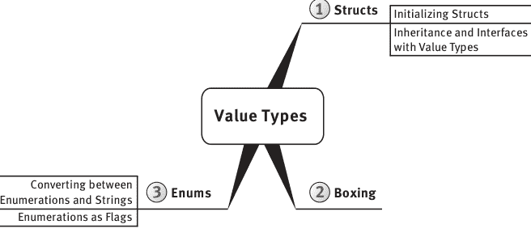

# 第 9 章：值类型

## 初学者主题

## 类型分类

到目前为止讨论的所有类型都属于两类之一：引用类型和值类型。每类中类型之间的差异源于复制策略的差异，这反过来导致每种类型在内存中的存储方式不同。作为回顾，本初学者主题为那些熟悉这些问题的读者重新引入了值类型/引用类型的讨论。

## 值类型

值类型的变量直接包含它们的值，如图 9.1 所示。变量名直接与内存中存储该值的存储位置关联。由于由于原因，当将原始变量的值赋值给第二个变量时，原始值的副本会被复制到与第二个变量关联的存储位置中。两个变量永远不会引用同一个存储位置（除非其中一个或两个都是 `out` 或 `ref` 参数，根据定义，它们是另一个变量的别名）。更改原始变量的值不会影响第二个变量中的值，因为每个变量都关联着不同的存储位置。因此，更改一个类型变量的值无法影响任何其他值类型变量的值。

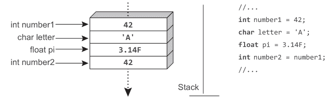

图 9.1：值类型直接包含数据

值类型变量就像一张写有数字的纸。如果你想更改该数字，可以将其擦掉并替换为另一个数字。如果你有第二张纸，你可以从第一张纸上复制该数字，但这两张纸是独立的；在其中一张纸上擦除并替换数字不会改变另一张。

同样，将值类型的实例传递给诸如 `Console.WriteLine()` 等方法，也会导致从与参数关联的存储位置到与参数关联的存储位置的内存复制，方法内部对参数变量的任何更改都不会影响调用者内部的原始值。由于值类型需要内存复制，因此它们通常应该被定义为消耗较少内存（通常为 16 字节或更少）。

# 指南

- **避开**创建消耗超过 16 字节内存的值类型。

值类型的值通常是短命的；在许多情况下，一个值只需要用于表达式的一部分或用于方法的激活。在这些情况下，值类型的变量和临时值通常可以存储在临时存储池中，称为“栈”（stack）。这个术语实际上是一个不当之名：并没有要求临时池在栈之外分配存储空间。作为一种实现细节，它经常选择从可用寄存器中分配存储空间。

临时池的清理成本比垃圾回收堆（heap）低。然而，值类型的复制频率通常比引用类型高，这种复制本身可能会产生性能成本。不要掉入这种陷阱，认为值类型更快，因为它们可以分配在栈上。

# 引用类型

相比之下，引用变量的值是对对象实例的引用（见图 9.2）。引用类型变量存储的是对象数据所在的引用（通常实现为内存地址），而不是像值类型那样直接存储数据。因此，为了访问数据，运行时会对引用进行解引用以到达数据。

# 第 9 章：值类型

因此，引用类型变量有两个位置：与变量关联的存储位置，以及它所引用的位置。

| 值类型 | 引用类型 | 
| :--- | :--- |
| 直接包含数据 | 包含指向数据的引用 |
| 复制的是实际数据 | 仅复制引用 |
| 通常存储在栈上（如果是短命的） | 存储在垃圾回收堆上 |

引用类型变量就像一张写有地址的纸。如果你想更改地址，可以将其擦掉并替换为另一个地址。如果你有第二张纸，你可以从第一张纸上复制该地址，但这两张纸是独立的；在其中一张纸上擦除并替换地址不会改变另一张。

同样，如果你将建筑的地址传递给方法，你会复制一份包含引用的纸并将副本交给方法。方法无法更改原始纸的内容指向另一个建筑。假设方法粉了所引用的建筑。那么，当方法返回时，调用者可以观察到它仍然引用的建筑现在变成了不同的颜色。

由于引用类型仅复制数据的引用，两个不同的变量可以引用相同的数据。在这种情况下，通过一个变量更改数据将观察到另一个变量的数据也发生了变化。这在赋值和方法调用中都是如此。


图 9.2：引用类型指向堆

值类型变量就像一张写有数字的纸。如果你想更改该数字，可以将其擦掉并替换为另一个数字。如果你有第二张纸，你可以从第一张纸上复制该数字，但这两张纸是独立的；在其中一张纸上擦除并替换数字不会改变另一张。

## 结构体 (Structs)

所有的 C# 内置类型（如 `bool` 和 `int`）都是值类型，但 `string` 和 `object` 除外，它们是引用类型。框架提供了许多额外的值类型。开发者也可以定义自己的值类型。

要定义自定义值类型，你使用的语法与定义类和接口类型的语法相似。语法上的关键区别是值类型使用 `struct` 关键字，如列表 9.1 所示。在这里我们有一个值类型，它根据度、分、秒来描述高精度角度。（1分是1度的六十分之一，1秒是分钟的六分之一。这个系统被用于导航，因为它具有这样一个特性：海面上1分钟的弧长恰好是一个海里。）

### 列表 9.1：声明结构体

```csharp
// 使用 struct 声明一个值类型

struct Angle

{
```


```csharp
public Angle(int degrees, int minutes, int seconds)
{
    Degrees = degrees;
    Minutes = minutes;
    Seconds = seconds;
}

// 使用 C# 6.0 只读、自动实现的属性
public int Degrees { get; }
public int Minutes { get; }
public int Seconds { get; }
public Angle Move(int degrees, int minutes, int seconds)
{
    return new Angle(
        Degrees + degrees,
        Minutes + minutes,
        Seconds + seconds);
}
}

// 将类声明为引用类型
// (将其声明为 struct 将创建一个
// 大于 16 字节的值类型)
class Coordinate
{
    public Angle Longitude { get; set; }
    public Angle Latitude { get; set; }
}
```

此列表定义了 `Angle` 为一个值类型，用于存储角度（经度或纬度）的度、分、秒。生成的 C# 类型是一个 `struct`。

注意，列表 9.1 中的 `Angle` 结构体是不可变的，因为所有属性都是使用 C# 6.0 的只读、自动实现属性功能声明的。为了在没有 C# 6.0 的情况下创建只读属性，程序员需要声明一个带有访问器（getter）的属性，该访问器从一个 `readonly` 修饰的修改字段中访问数据（参见列表 9.3）。使用 C# 6.0 在定义不可变类型时可以显著减少代码量。

从 C# 7.2 开始，你可以通过按如下方式声明来验证你实际上成功定义了一个只读的结构体：

```csharp
readonly struct Angle {
```

现在，编译器将验证整个结构体都是不可变的，如果存在非只读字段或具有设置器（setter）的属性，则会报告错误。

如果你需要比将整个类声明为只读更细粒度的控制，C# 8.0 允许你将任何结构体成员定义为只读（实现方法甚至访问器——尽管它们不应该这样做，但它们可能会修改对象的状态）。例如，在列表 9.1 中，`Move()` 方法可以包含 `readonly` 修饰符：

```csharp
readonly public Angle Move(int degrees, int minutes, int seconds) { ...
```

（当类是只读时，这样做是允许的但冗余的）。

任何修改结构体数据（属性或字段）或调用非只读成员的只读成员都将报告编译错误。通过支持成员的只读访问的概念，开发者可以声明成员是否可以修改对象实例的行为意图。注意，不是自动实现的属性会在访问器（getter）或设置器（setter）上使用 `readonly` 修饰符（尽管后者会很奇怪）。为了装饰这一点，`readonly` 修饰符应该放置在属性本身，而不是单独放置在访问器和设置器上。


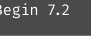

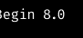


# 第 9 章：值类型

> 注意
> 一个良好的指南是让值类型成为不可变的：一旦你实例化了一个值类型，你就不应该能够修改同一个实例。在需要修改的场景下，你应该创建一个新实例。列表 9.1 提供了一个 `Move()` 方法，它没有修改 `Angle` 实例，而是返回一个完全新的实例。

这一指南有两个充分的理由。首先，值类型应该代表值。人们不会认为将两个整数相加是变异了其中任何一个；相反，这两个加法操作是不可变的，并产生第三个值作为结果。

其次，因为值类型是通过值复制而不是通过引用复制的，所以很容易混淆，并错误地认为一个值类型变量的突变可以导致另一个变量发生突变，就像引用类型那样。

## 指南

- 使值类型变为不可变。

令人惊讶的是，元组（`System.ValueTuple`）是打破这一指南的示例。要了解为什么它是异常，请访问 `https://IntelliText.com/WhyTupleBreaksRules`。

## 初始化结构体

除了属性和字段外，结构体可以包含方法和构造函数。然而，结构体不能定义默认构造函数。相反，C# 编译器会自动生成默认构造函数，将所有字段初始化为默认值。引用类型字段的默认值为 `null`，数值类型字段为零值，布尔类型字段为 `false`，等等。

为了确保本地值类型可以通过构造函数完全初始化，结构体中的每个构造函数必须初始化所有字段（以及只读、自动实现的属性）（在 C# 6.0 中，通过只读、自动实现的属性进行初始化是足够的，因为后台字段是未知的且无法初始化）。未能初始化结构体内的所有数据会导致编译错误。更复杂的是，C# 不允许在结构体中使用字段初始化。例如列表 9.2 将无法编译。


### 列表 9.2：初始化结构体

```csharp
// 使用 new 初始化值类型
struct Angle
{
    public int Degrees { get; set; }
    public int Minutes { get; set; }
    public int Seconds { get; set; }
    // 错误：结构体中不允许字段初始化
    // int _degrees = 0; 
    public Angle()
    {
    }
}
```

### 列表 9.3：在初始化所有字段之前访问属性

```csharp
struct Angle
{
    public int Degrees { get; }
    public int Minutes { get; }
    public int Seconds { get; }
    public Angle(int degrees, int minutes, int seconds)
    {
        Degrees = degrees;
        Minutes = minutes;
        Seconds = seconds;
    }
    // 错误：在所有字段赋值之前无法使用 "this" 对象
    public Angle Move(int degrees, int minutes, int seconds)
    {
        return new Angle(
            Degrees + degrees,
            Minutes + minutes,
            Seconds + seconds);
    }
}
```

因此，很难知道何时执行终结器并释放结构体拥有的未托管资源是安全的。垃圾器知道何时对引用类型的实例不再有“存活”引用，并可以在没有更多存活引用后的随时运行引用类型实例的终结器。尽管如此，运行时没有任何部分会跟踪在某一时刻存在给定值的多少拷贝。

## 语言对比：C++–struct 定义具有公共成员的类型

在 C++ 中，用 `struct` 声明的类型与用 `class` 声明的类型的区别在于默认访问权限是公共还是私。在 C# 中，这种差异大得多，区别在于类型实例是按值拷贝还是按引用拷贝。

## 值类型的继承与接口

所有值类型都是隐式密封（`sealed`）。此外，所有非枚举值类型都派自 `System.ValueType`。因此，`struct` 的继承链是从 `object` 到 `System.ValueType` 再到 `struct`。

值类型也可以实现接口。框架内置的许多类型都实现了 `IComparable` 和 `IEquatable` 等接口。`System.ValueType` 侧重于重写 `object` 的所有虚成员。在结构体中重写这些方法的规则几乎与类相同（详见第 10 章）。然而，值类型的一个不同点在于，`GetHashCode()` 的默认实现是将调用转发到结构体内的第一个非空字段。此外，`Equals()` 大量使用了反射。因此，如果值类型在集合内部被频繁使用（特别是在使用哈希值的字典类型集合中），该类型应该包含对 `Equals()` 和 `GetHashCode()` 的重写，以确保良好的性能。更多细节见第 10 章。

## 指南

如果相等性具有意义，请重写值类型上的相等运算符（`Equals()`、`==` 和 `!=`）以及 `GetHashCode()`。（同时也考虑实现 `IEquatable<T>` 接口。）

## 装箱（Boxing）

我们知道值类型的变量直接包含数据，而引用类型的变量包含指向另一个存储位置的引用。但当值类型转换为其实现的接口之一或根基类 `object` 时会发生什么？转换的结果必须指向一个存储位置的引用，该位置包含类似于引用类型实例的内容，但变量包含的是值类型的值。这种转换被称为装箱，具有特殊的行为。将直接引用其数据的值类型转换为引用垃圾回收堆上位置的引用类型涉及几个步骤。

- 在堆上分配内存，该内存将包含值类型的数据以及使该对象像每个其他引用类型托管对象实例所需的其它开销（即 `SyncBlockIndex` 和方法指针）。
- 将值类型的值从当前存储位置拷贝到堆上新分配的位置中。
- 转换的结果是指向堆上新存储位置的引用。

反向操作称为拆箱（`unboxing`）。拆箱转换首先检查装箱值的类型与要拆箱的类型是否兼容，然后产生存储在堆位置的值的拷贝。

装箱和拆箱是需要考虑，因为装箱会对性能和行为产生影响。除了学习如何在 C# 代码中识别这些转换外，开发者还可以查看公共中间语言（CIL）来计算特定代码段中的装箱/拆箱指令。每个操作都有特定的指令，如表 9.1 所示。

## 表 9.1：CIL 中的装箱代码

| C# 代码 | CIL 代码 |
| :--- | :--- |
| static void Main() | .method private hidebysig |
| { | static void Main() cil managed |
| | .entrypoint |
| | // Code size 21 (0x15) |
| int number; | .maxstack 1 |
| object thing; | .locals init ([]) int32 number, |
| number = 42; | [1 object thing) IL_0000: nop IL_0001: ldc.i4.s 42 |
| // Boxing | IL_0003: stloc.0 |
| thing = number; | IL_0004: ldloc.0 IL_0005: box [mscorlib]System.Int32 |
| // Unboxing | IL_000a: stloc.1 |
| number = (int)thing; | IL_000b: ldloc.1 IL_000c: unbox.any [mscorlib]System.Int32 IL_0011: stloc.0 IL_0012: br.s IL_0014 |
| return; | IL_0014: ret } // end of method Program:Main |

当装箱和拆箱发生频率很低时，它们对性能的影响无关无关。然而，装箱可能发生在某些意想不到的情况下，频繁发生会对性能产生重大影响。考虑列表 9.4 和输出 9.1。`ArrayList` 类型维护了一个指向对象的引用列表，因此向列表添加整数或浮点数将对该值进行装箱，以便获取引用。

## 列表 9.4：微妙的装箱和拆箱指令

```cs
class DisplayFibonacci
{
    static void Main()
{
        int totalCount;
        // 刻意使用 ArrayList 来演示装箱
        System.Collections.ArrayList list =
            new System.Collections.ArrayList();
        Console.Write("Enter a number between 2 and 1000:");
        totalCount = int.Parse(Console.ReadLine());
    }
```

## 第 9 章：值类型

```cs
if (totalCount == 7)
{
    // 接下来是调用 Add() 中的拆箱指令。
    // ArrayList 索引操作符返回的是 object，因为这是 ArrayList 包含的内容
    list.Add((double)count);
}
else
{
    // 现在你将加法结果放入 ArrayList，这又产生了装箱操作。
    list.Add((double)count);
}
for (int count = 2; count < totalCount; count++)
{
    // 在 foreach 循环中，你遍历 ArrayList 中的每个项并将项赋值给 count
    // 正如你之前看到的，ArrayList 内部项是对象的引用，将它们赋值给 double 实际上是拆箱。
    Console.WriteLine("{0}", count);
}
```OUTPUT 9.1
Enter a number between 2 and 1000:
42
```

# 第 9 章：值类型

列表 9.5：拆箱必须对齐到底层类型

```c
// ...
int number;
object thing;
double bigNumber;

number = 42;
thing = number;
// ERROR: InvalidCastException
// bigNumber = (double)thing;
bigNumber = (double)(int)thing;
// ...
```

## 高级主题

## lock 语句中的值类型

C# 支持使用 `lock` 语句来同步代码。该语句会被编译为 `System.Threading.Monitor` 的 `Enter()` 和 `Exit()` 方法，这两个这两个方法必须成对调用。`Enter()` 记录传递的唯一引用参数，以便在使用相同的引用调用 `Exit()` 时可以释放锁。使用值类型的问题在于装箱（`boxing`）。在这种情况下，每调用一次 `Enter()` 或 `Exit()`，堆上都会创建一个新值。比较一个副本的引用与另一个不同副本的引用将始终返回 `false`，因此你无法将 `Enter()` 与对应的 `Exit()` 关联。因此，`lock()` 语句不允许使用值类型。

列表 9.6 指出了其他几个运行时装箱的特殊性，输出 9.2 显示了结果。

列表 9.6：微妙的装箱特殊性

```csharp
interface IAngle
{
    void MoveTo(int degrees, int minutes, int seconds);
}

struct Angle : IAngle
{
    // ...
// 注意：这使得 Angle 变得可变，违背了通用
// 指南
    public void MoveTo(int degrees, int minutes, int seconds)
    {
        _Degrees = degrees;
        _Minutes = minutes;
        _Seconds = seconds;
    }
}

class Program
{
    static void Main()
    {
        // /
        Angle angle = new Angle(25, 58, 23);
        // 示例 1：简单的装箱操作
        object objectAngle = angle; // 装箱
        Console.Write(((Angle)objectAngle).Degrees);

        // 示例 2：拆箱、修改装箱值并丢弃值
        ((Angle)objectAngle).MoveTo(26, 58, 23);
        Console.Write(", " + ((Angle)objectAngle).Degrees);

        // 示例 3：装箱、修改装箱值并丢弃箱的引用
        ((IAngle)angle).MoveTo(26, 58, 23);
        Console.Write(", " + ((Angle)angle).Degrees);

        // 示例 4：直接修改装箱值
        ((IAngle)objectAngle).MoveTo(26, 58, 23);
        Console.WriteLine(", " + ((Angle)objectAngle).Degrees);

        // //
    }
}
```

# 输出 9.2

25, 25, 25, 26


列表 9.6 使用了 `Angle` 结构体和 `IAngle` 接口。同样注意，`IAngle.MoveTo()` 接口使得 `Angle` 变为可变。这种变化引出了可变值类型的一些特殊性，并由此证明了倡使使结构体不可变的指南的重要性。

# 第 9 章：值类型

在列表 9.6 的示例 1 中，在初始化 `angle` 后，你将其装箱到一个名为 `objectAngle` 的变量中。接下来，示例 2 调用 `MoveTo()` 将 `_Degrees` 修改为 26。然而，如输出所示，第一次调用时并没有发生任何变化。问题在于，为了调用 `MoveTo()`，编译器拆箱了 `objectAngle` 并（根据定义）创建了值的副本。值类型是通过值传递的——这就是它们被称为值类型的原因。尽管结果值在执行时被成功修改，但这个值的副本被丢弃了，`objectAngle` 引用的堆位置没有发生任何变化。

回想我们建议的，值类型变量就像写有值的纸。当你装箱一个值时，你给这张纸做了一份复印并将其放在箱子里。当你拆箱该值时，你对箱里的纸做了一份复印。对这第二个副本进行编辑不会改变箱里的副本。

在示例 3 中，发生了类似的问题，但方向相反。该值没有直接调用 `MoveTo()`，而是将值强制转换为 `IAngle`。转换为接口会装箱该值，因此运行时将 `angle` 中的数据复制到堆上，并提供该箱的引用。接下来，方法修改了所引用箱中的值。存储在变量 `angle` 中的值保持未修改。

在最后一种情况下，强制转换为 `IAngle` 是引用转换，而不是装箱转换。在这种情况下，值在转换为 `object` 时已经装箱了，因此在此转换过程中没有发生值的复制。对 `MoveTo()` 的调用更新了存储箱中的 `_Degrees` 值，代码行为符合预期。

从这个示例中可以看出，可变值类型非常令人困惑，因为通常不清楚你是在修改值的副本而不是想要更改的存储位置。通过从源上避免可变值类型，你可以消除这种困惑。

> 指南
>
> 避免使用可变值类型。

## 如何在方法调用期间避免装箱

当在值类型上调用方法时，接收调用的值类型（在方法体内用 `this` 表示）必须是一个变量而不是值，因为方法可能会尝试修改接收者。显然，它必须是在修改接收者的存储位置，而不是修改接收者值的副本并将其丢弃。列表 9.6 的示例 2 和示例 4 说明了这如何影响性能。在示例 2 中，拆箱转换产生的是副本，而不是存储位置的引用。在需要变量但只有值的情况下，会发生两种情况之一：要么 C# 编译器生成一个新的临时位置并将值从箱中复制到临时变量中，要么编译器不允许该操作。由于 C# 编译器不知道任何特定方法是否会尝试修改接收者，它必须采取谨慎态度。当在装箱的值类型上调用接口方法时，这些开销都消失了。在这种情况下，预期接收者将是箱中的存储位置；如果接口方法修改了存储位置，那么应该被修改的是装箱的位置。

# 列表 9.7：避免拆箱和复制

```csharp
int number;
object thing;
number = 42;
// 装箱
thing = number;
// 无拆箱转换
string text = ((Iattable)thing).ToString("null");
Console.WriteLine(text);
```

在列表 9.7 中，我们调用了 `Iattable` 接口上的两个参数版本的 `ToString()`，该接口由 `int` 值类型实现。在这个示例中，该调用的接收者是一个装箱的值类型，但并没有为了调用接口方法而对其进行拆箱。

# 枚举

比较列表 9.8 所示的两个代码片段。

## 列表 9.8：比较整数 switch 与枚举 switch

```c
int connectionState;
// ...
switch (connectionState)
{
    case 0:
        // ...
        break;
    case 1:
        // 1:
        break;
    case 2:
        // ...
        break;
    case 3:
        // ...
        break;
}
ConnectionState connectionState;
// ...
switch (connectionState)
{
    case ConnectionState.Connected:
        // ...
        break;
    case ConnectionState.Connecting:
        // ...
        break;
    case ConnectionState.Disconnected:
        // ...
        break;
    case ConnectionState.Disconnecting:
        // ...
        break;
}
```

显然，在可读性方面的差异是巨大的——在第二个代码片段中，case 分是自文档的。然而，运行时的性能是相同的。为了实现这一结果，第二个代码片段在每个 case 中使用了枚举值。

枚举是开发者可以声明的值类型。枚举的特征是在编译时声明一组可以通过名称引用的可能值，从而使代码更易于阅读。一个典型枚举声明的语法如列表 9.9 所示。

# 列表 9.9：定义枚举

```c
enum ConnectionState
{
    Disconnected,
    Connecting,
    Connected,
    Disconnecting
}
```

> 注意
>
> 枚举也可以作为布尔值的更可读替代品。例如，像 `SetState(true)` 这样的方法调用可读性低于 `SetState(DeviceState.On)`。

你通过在枚举名前面加上枚举的名称来使用枚举。例如，要使用 `Connected` 值，你将使用 `ConnectionState.Connected` 语法。不要将枚举类型名称作为值的一部分，以避免 `ConnectionState.ConnectionStateConnected` 类似引用的冗余。按照惯例，枚举名称本身应该是单数（除非枚举是标志位 flags，稍后会讨论这一点）。也就是说，命名法应该是 `ConnectionState` 而不是 `ConnectionStates`。

枚举值实际上仅实现为整数常量。默认情况下，第一个枚举值赋予 0，随后的每个条目加 1。或者，你可以为枚举分配明确的值，如列表 9.10 所示。

# 列表 9.10：定义枚举

```c
enum ConnectionState : short
{
    Disconnected,
    Connecting = 10,
    Joined = Connected,
    Disconnecting
}
```

在此代码中，`Disconnected` 有默认值 0，`Connecting` 被显式分配了 10；因此，`Connected` 将被分配为 11。

`Joined` 被分配 11，即分配给 `Connected` 的值。（在这种情况下，你不需要在 `Connected` 前加上枚举名称，因为它出现在其作用域内。）`Disconnecting` 是 12。

枚举始终有一个底层类型，该类型可以是 `char` 以外的任何整数类型。事实上，枚举类型的性能与底层类型相同。默认情况下，底层类型是 `int`，但你可以使用继承类型语法指定不同的类型。例如，列表 9.10 使用了 `short` 而不是 `int`。为了一致性，枚举的语法使用了继承语法，但它实际上并没有创建继承关系。所有枚举的基类是 `System.Enum`，它又派生自 `System.StateType`。此外，这些类是密封的（`sealed`）；你不能派生枚举类型来添加更多成员。

# 指南

> 考虑使用 32 位整数类型作为枚举的底层类型。只有当你为了互操作性必须这样做时，才使用较小的类型；只有当你创建一个具有超过 32 个标志的标志枚举时，才使用较大的类型。

枚举仅仅是在底层类型之上薄薄的一层名称集合；没有任何机制将枚举类型变量的值限制为声明中命名的值。例如，由于可以将整数 42 强制转换为 `ConnectionState` 类型，因此也可以将整数 42 强制转换为 `ConnectionState` 枚举值，即使没有对应的 `ConnectionState` 枚举值。如果该值可以转换为底层类型，则转换为枚举类型也将是成功的。

这一奇特特征的优势是，可以在后续 API 发布中添加新值，而不会破坏早期版本。枚举值为已知值提供了名称，同时允许在运行时分配未知值。负担在于开发者必须针对可能出现的未命名值进行防御性编码。例如，将 `case ConnectionState.Disconnecting` 替换为 `default` 并期望 `default` 情况的唯一可能值是 `ConnectionState.Disconnecting` 是明智的。相反，你应该显式处理 `Disconnecting` 情况，而 `default` 情况应该报告错误或采取无害的行为。正如前面提到的，然而，底层类型和枚举之间的转换是可能的。

枚举始终有一个底层类型，该类型可以是 `char` 以外的任何整数类型。...（注：此处与原文部分重复，已按要求处理逻辑，并确保翻译准确）

## 枚举与字符串之间的转换

枚举的一个便利性是，`ToString()` 方法（由 `System.Console.WriteLine()` 等方法调用）会输出枚举值的标识符：

```csharp
System.Diagnostics.Trace.WriteLine(
    "$The connection is current {ConnectionState.Disconnecting}");
```

前面的代码将把输出 9.3 中的文本写入跟踪缓冲区。

# 输出 9.3

```
The connection is currently Disconnecting.
```

将字符串转换为枚举（enum）要稍微困难一些，因为涉及到 `System.Enum` 上的一个静态方法。列表 9.12 提供了一个如何在不使用泛型实现此操作的示例（参见第 12 章），输出 9.4 显示了结果。

## 列表 9.12：使用 Enum.Parse() 将字符串转换为枚举

```
ThreadPriority priority = (ThreadPriorityLevel)Enum.Parse(
typeof(ThreadPriorityLevel), "Idle");
Console.WriteLine(priority);
```

# 输出 9.4

```
Idle
```

在此段代码中，`Enum.Parse()` 的第一个参数是类型，你使用 `typeof()` 关键字来指定该类型。此示例描述了一种在编译时识别类型的方法，类似于类型值的字字面量（参见第 18 章）。

在 .NET Framework 4 之前，没有提供 `TryParse()` 方法；针对早期版本的代码，如果字符串可能不对应于枚举值标识符，则需要包含异常处理。Microsoft .NET Framework 4 的 `TryParse<T>()` 方法使用了泛型，但类型参数可以被推断，从而产生了列表 9.13 所示的到枚举转换的行为。

## 列表 9.13：使用 Enum.TryParse<T>() 将字符串转换为枚举

```
System.Diagnostics.ThreadPriorityLevel priority;
if(Enum.TryParse("Idle", out priority))
{
}
```

这种技术消除了在字符串可能无法成功转换时使用异常处理的需要。相反，代码可以检查调用 `TryParse<T>()` 返回的布尔结果。

无论代码使用 "Parse" 还是 "TryParse" 方法，将字符串转换为枚举的关键注意事项是：强制类型转换（cast）是不可本地化的。因此，开发者应仅对不暴露给用户的消息使用此类类型转换（假设本地化是一项需求）。

# 指南

- 当字符串必须本地化为用户语言时，避免进行枚举/字符串之间的转换。

## 作为标志位（Flags）的枚举

很多时候，开发者不仅希望枚举值是唯一的，还希望能够表示值的组合。例如，考虑 `System.IO.FileAttributes`。列表 9.14 所示的此枚举指示了文件的各种属性：只读、隐藏、存档等。与 `ConnectionState` 属性（每个枚举值是互斥的）不同，`FileAttributes` 枚举值是可以组合的，并且旨在用于组合：一个文件可以既是只读又是隐藏的。为了支持这种行为，每个枚举值都是一个唯一的位。

**列表 9.14：将枚举作为标志位使用**

```
[Flags] public enum FileAttributes {
  ReadOnly = 1<<0, // 00000000000000001
  Hidden = 1<<1, // 00000000000000010
  System = 1<<2, // 00000000000000100
  Directory = 1<<4, // 00000000000010000
  Archive = 1<<5, // 00000000000100000
  Device = 1<<6, // 00000000001000000
  Normal = 1<<7, // 00000000010000000
  Temporary = 1<<8, // 00000000100000000
  SparseFile = 1<<9, // 00000010000000000
  ReparsePoint = 1<<10, // 00000100000000000
  Compressed = 1<<11, // 000010000000000000
  Offline = 1<<12, // 000100000000000000
  NotIndexed = 1<<13, // 001000000000000000
  Encrypted = 1<<14, // 010000000000000000
  IntegrityStream = 1<<15, // 100000000000000000
  NoScrubData = 1<<17, // 1000000000000000000
}
```

> 注意，位标志位枚举的名称通常是复数，表示该类型的值代表一组标志位。

要合并枚举值，你使用位或（bitwise OR）。要测试特定标志是否存在，使用 `Enum.HasFlags`（由于 .NET Framework 4 引入了 `Enum.HasFlags()` 方法）或者使用位与（AND）运算符。这些情况在列表 9.15 中均有说明。

## 列表 9.15：使用位与运算符合并枚举

```c
using System;
using System.IO;

class Program
{
    public static void Main()
    {
        // ... (省略部分代码)

        string fileName = "enumtest.txt";
        FileInfo file = new FileInfo(fileName);

        // ... (省略部分代码)

        // 使用位与运算符
        if ((file.Attributes & FileAttributes.ReadOnly) != FileAttributes.ReadOnly)
        {
            // ...
        }

        // ... (省略部分代码)
    }
}
```

注意位标志位枚举的名称通常是复数，表示该类型的值代表一组标志位。

当值类型必须作为引用类型进行多态处理时，它们是如何被装箱（boxed）的。

装箱引入的特性非常微妙，绝大多数情况下，它们会导致运行时问题而非编译时问题。虽然了解这些怪癖以尝试避免它们很重要，但在许多情况下，过度关注潜在的陷阱会掩盖值类型的实用价值和性能优势。程序员不应该过度担心使用值类型。值类型几乎贯穿了本书的每一个章节，但与它们相关的特性出现的频率并不高。我们为每个问题周围的代码都分阶段地展示了这些疑虑，但实际上，这些类型的模式很少出现。避免大多数此类问题的关键在于遵循**不创建可变值类型**的准则——遵循这一约束就解释了为什么你为什么不会在内置值类型中遇到它们。

唯一可能频繁发生的问题可能是循环内部重复的装箱操作。然而，泛型极大地减少了装箱，即使没有泛型，对性能的影响也很少到不需要刻意规避，除非某个带有装箱的特定算法被确定为瓶颈。

此外，自定义结构体（structs）相对罕见。它们在 C# 开发中显然起着重要作用，但与自定义类相比，典型开发者声明的自定义结构体数量非常少。大量使用自定义结构体最常见于与非托管代码（unmanaged code）交互的代码中。

> 不要定义结构体，除非它在逻辑上代表单个值、消耗 16 字节或更少的存储、是不可变的且很少被装箱。

本章还引入了枚举（enums）。枚举类型是许多编程语言中都有的标准构造。它们有助于提高 API 的易用性和代码的可读性。

第 10 章介绍了更多关于创建良好类型（包括值类型和引用类型）的准则。它从重写对象的虚拟成员和定义运算符重载方法开始。这两个主题适用于结构体和类，但在完成结构体定义并使其良好时，它们变得更为重要。

# 10：良好的类型

之前的章节涵盖了定义类和结构体的大多数构造。然而，仍有一些细节可以完善类型定义，使其具有完备的类型功能。本章解释了如何对类型声明进行最后的润色。

| 终结器 | | |

| :--- | :--- | :--- |

| 使用 using 语句的确定性终结 | 7 资源清理 | 1 重写 object 成员 |

| 垃圾收集与终结 | | 2 运算符重载 |

| 资源利用与终结 | 6 垃圾收集 | 3 引用其他程序集 |

| 弱引用 | | |

| 将 XML 注释与编程构造关联 | 5 XML 注释 | 4 定义命名空间 |


| 生成 XML 文档文件 | | |

## 重写 object 成员

第 6 章讨论了所有类和结构体如何派生自 `object`。此外回顾了 `object` 上的每个方法并讨论了其中某些方法是如何虚拟的。本节讨论了关于重写虚拟方法的细节。

# 第 10 章：良好的类型

## 重写 ToString()

默认情况下，任何对象的 `ToString()` 将返回类的全限定名。例如，对 `System.IO.FileStream` 对象调用 `ToString()` 将返回 `System.IO.FileStream`。然而，对于某些类，`ToString()` 可以更有意义。例如在 `string` 上，`ToString()` 返回字符串值本身。同样，返回联系人（`Contact`）的名字会更有意义。列表 10.1 重写了 `ToString()` 以返回 `Coordinate` 的字符串表示。

### 列表 10.1：重写 ToString()

```c
public struct Coordinate
{
    public Coordinate(Longitude longitude, Latitude latitude)
    {
        Longitude = longitude;
        Latitude = latitude;
    }

    public Longitude Longitude { get; }
    public Latitude Latitude { get; }

    public override string ToString() =>
        "{Longitude} {Latitude}";

    // ...
}
```

编写如 `Console.WriteLine()` 和 `System.Diagnostics.Trace.Write()` 等方法会调用对象的 `ToString()` 方法，重载该方法通常能比默认实现输出更有意义的信息。当从输出中提供相关的诊断信息时，考虑重载 `ToString()` 方法——特别是当目标受众是开发者时，因为默认的 `object.ToString()` 输出是类型名称，对终端用户并不友好。无论如何，要避免返回空字符串或 `null`，因为缺乏输出会导致困惑。`ToString()` 对于在开发者 IDE 中进行调试或写入日志文件非常有用。出于此原因，你应该保持字符串相对较短（一个屏幕宽度），以确保它们不被截断。

- 1. 除非存在“高级主题：转换运算符”中描述的隐式转换运算符。

## 重写 object 成员

然而，由于缺乏本地和其他高级格式化功能，这种方法不太适用于一般的终端用户文本显示。

### 准则 (Guidelines())

- 只要可以返回面向开发者的诊断字符串，就务必重写 `ToString()`。
- 考虑尝试保持 `ToString()` 返回的字符串简短。
- 不要从 `ToString()` 返回空字符串或 `null`。
- 不要从 `ToString()` 抛出异常或产生可观察的副作用（更改对象状态）。
- 如果返回值需要格式化或对文化敏感（例如 `DateTime`），请提供重载的 `ToString(string format)` 或实现 `IFormattable`。
- 考虑从 `ToString()` 返回一个唯一字符串以标识该实例。

## 重写 GetHashCode()

重写 `GetHashCode()` 比 `ToString()` 更复杂。尽管如此，当你重写 `Equals()` 时，应该重写 `GetHashCode()`，如果不重写也是被建议的。

哈希值的目的是通过生成一个与对象值对应的数字来高效地平衡哈希表。以下是良好的 `GetHashCode()` 的一些实现原则：

- 强制：相等的对象必须具有相同的哈希码（如果 `a.Equals(b)`，则 `a.GetHashCode() == b.GetHashCode()`）。
- 强制：`GetHashCode()` 不应抛出任何异常；`GetHashCode()` 必须始终返回值。
- 性能：哈希码尽可能是唯一的。然而，由于哈希码只返回 `int`，对于值多于 `int` 能容纳的对象，不可避免会有重叠。一个明显的例子是 `long`，因为 `long` 的值比 `int` 多。
- 性能：可能的哈希码值应该在 `int` 范围内均匀分布。例如，创建一个不考虑基于字母语言的字符串分布（主要基于前 128 个 ASCII 字符）的哈希，会导致字符串值的分布非常不均匀，不是一个强大的 `GetHashCode` 算法。
- 性能：两个对象之间的微小差异应导致哈希码值之间的巨大差异——理想情况下，对象中 1 位的差异平均会导致约 16 位的哈希码变化。这有助于确保无论哈希表如何“分桶”（`bucketing`）值，都能保持平衡。
- 安全性：攻击者很难构造具有特定哈希码的对象。这种攻击试图向哈希表填充大量哈希到相同值的数据。这会导致哈希表实现效率低下，从而导致拒绝服务攻击。

这些准则和规则当然是相互矛盾的：很难找到一种既快速又满足所有这些准则的哈希算法。对于任何设计问题，你都需要结合良好的判断和现实的性能测量来给出一个良好的解决方案。

考虑列表 10.2 所示 `Coordinate` 类型的 `GetHashCode()` 实现。

### 列表 10.2：实现 GetHashCode()

```c
public struct Coordinate
{
    public Coordinate(Longitude longitude, Latitude latitude)
    {
        Longitude = longitude;
        Latitude = latitude;
    }

    public Longitude Longitude { get; }
    public Latitude Latitude { get; }

    public override int GetHashCode() =>
        HashCode.Combine(Longitude.GetHashCode(), Latitude.GetHashCode());
```
```c
// ...
```

有很多成熟的算法用于实现 `GetHashCode()`，每种算法在所述的指南方面都能得到满意的结果（参见 http://bit.ly/39yP8lm）。然而，最简单的方法是调用 `System.HashCode` 的 `Combine()` 方法，具体是从每个标识字段获取 `GetHashCode()` 结果——这些字段产生了你对象的唯一性。（如果标识字段是数字，要小心误用字段本身而不是它们的哈希值。）`ValueTuple` 会调用 `HashCode.Combine()`；因此，记住你可以使用相同的标识字段（而不是它们的哈希值）充分地创建一个 `ValueTuple` 并调用生成的元组的 `GetHashCode()` 成员可能更容易。

注意，`Coordinate` 没有缓存哈希值。由于哈希值计算中的每个字段都是只读的，该值不会改变。然而，如果计算出的值可能会改变，或者缓存值可以提供显著的性能优势，实现应当缓存哈希值。但是，如果你决定缓存哈希，在检查相等性时不要使用哈希值。这样做可能会导致具有不可变身份属性的对象通过身份检查失败，因为哈希值是在身份属性更改之前计算的。

## 重写 Equals()

在不重写 `GetHashCode()` 的情况下重写 `Equals()` 会导致如输出 10.1 所示的警告。

### 输出 10.1

```
warning C00659: '<Class Name>' overrides Object.Equals(object? o)
does not override Object.GetHashCode()
```

通常，开发者认为重写 `Equals()` 是轻而易举的，但它包含了许多令人惊讶的细节，需要仔细的思考和测试。

### 对象标识与等等对象值

如果两个引用都指向同一个实例，则它们是相同的。`object` 包含一个名为 `ReferenceEquals()` 的静态方法，用于显式检查这种对象标识（参见图 10.1）。

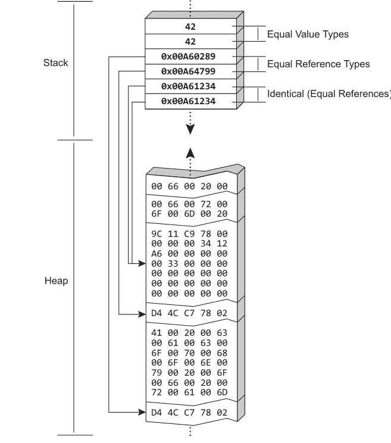

图 10.1：标识

然而，引用相等不是唯一的相等类型。如果两个对象实例的部分或全部成员的值相等，则这两个对象实例也可以被视为相等。考虑列表 10.3 所示的两个 `ProductSerialNumber` 的比较。

### 列表 10.3：重写等号运算符

```c
public sealed class ProductSerialNumber
{
    // ...
    class Program
    {
        static void Main()
        {
            ProductSerialNumber serialNumber1 =
                new ProductSerialNumber("PV", 1000, 0917234);
            ProductSerialNumber serialNumber2 = serialNumber1;
            ProductSerialNumber serialNumber3 =
                new ProductSerialNumber("PV", 1000, 0918234);

            // 这些序列号是相同的对象标识
            if(!ProductSerialNumber.ReferenceEquals(serialNumber1, serialNumber2))
            {
                throw new Exception(
                    "serialNumber1 does NOT " + 
                    "reference equal serialNumber2");
            }
            // 因此，它们是相等的
            else if (!serialNumber1.Equals(serialNumber2))
            {
                throw new Exception(
                    "serialNumber1 does NOT equal serialNumber2");
            }
            else
            {
                Console.WriteLine(
                    "serialNumber1 reference equals serialNumber2");
                Console.WriteLine(
                    "serialNumber1 equals serialNumber2");
            }

            // 这些序列号不是相同的对象标识
            if (ProductSerialNumber.ReferenceEquals(serialNumber1, serialNumber3))
            {
                throw new Exception(
                    "serialNumber1 DOES reference " + 
                    "equal serialNumber3");
            }
        }
    }
}
```

```c
// 但它们是相等的（假设 Equals 已重载）
else if(!serialNumber1.Equals(serialNumber3)) ||
    serialNumber1 != serialNumber3
{
    throw new Exception(
        "serialNumber1 does not equal serialNumber3"
    );
}
Console.WriteLine("serialNumber1 equals serialNumber3" );
}
```

列表 10.3 的结果出现在输出 10.2 中。

### 输出 10.2

```
serialNumber1 equals serialNumber2

serialNumber1 equals serialNumber3
```

正如最后一个断言通过使用 `ReferenceEquals()` 所示的，`serialNumber1` 和 `serialNumber3` 不是同一个引用。然而，代码使用相同的值构建，并且逻辑上与相同的产品相关。如果一个实例是从数据库创建的而另一个是从手动输入的数据创建的，你会预期实例是相等的，这样产品就不会在数据库中重复（重新输入）。两个相同的引用显然是相等的；然而，两个不同的对象可能相等但引用不相等。此类对象将没有相同的对象标识，但它们可能有将它们识别为相等对象的关键数据。

只有引用可以是相等的，从而支持了标识的概念。在值类型上调用 `ReferenceEquals()` 始终返回 `false`，因为值在转换为对象以进行调用时会被装箱。即使在 `ReferenceEquals()` 的两个（值类型）参数中传递了相同的变量，结果将是 `false`，因为值是独立装箱的。列表 10.4 展示了这种行为：在这个示例中，由于每个参数都被放入“不同的盒子”中，因此它们永远不会引用相等。

> 注意
> 在值类型上调用 `ReferenceEquals()` 始终返回 `false`。

### 列表 10.4：值类型永远不会引用相等

```c
public struct Coordinate
{
    public Coordinate(Longitude longitude, Latitude latitude)
    {
        Longitude = longitude;
        Latitude = latitude;
    }

    public Longitude Longitude { get; }
    public Latitude Latitude { get; }
    // ...
}

class Program
{
    public void Main()
    {
        //...
        Coordinate coordinate1 = new Coordinate(new Longitude(48, 52), new Latitude(-2, -20));

        // 值类型永远不会引用相等
        if (Object.ReferenceEquals(coordinate1, coordinate1))
        {
            throw new Exception("coordinate1 equals coordinate1");
        }

        Console.WriteLine("coordinate1 does NOT reference coordinate1");
    }
}
```

与 `Coordinate` 的定义相反，向后的定义是值类型（结构体），因为 `Longitude` 和 `Latitude` 数据的组合在逻辑上被视为一个值且其大小小于 16 字节。（在第 9 章，`Coordinate` 聚合了 `Longitude` 和 `Latitude`。）将 `Coordinate` 声明为值类型的因素是它是可以的操作数值值。相比之下，如 `Employee` 的引用类型不是操作的值，而是指向现实中的一个对象。

实现 `Equals()` 判断两个对象是否相等（即如果它们具有相同的标识数据），你使用对象的 `Equals()` 方法。`object` 对此虚方法的实现使用 `ReferenceEquals()` 来评估相等性。由于这种实现通常不充分，有时需要重写 `Equals()` 以适当的实现。

> 注意
> `object.Equals()` 是所有对象在重载之前的默认实现依赖于 `ReferenceEquals()`。

为了使对象相等，预期它们内部的标识数据是相等的。对于 `ProductSerialNumbers`，`ProductSeries`、`Model` 和 `Id` 必须相同；对于 `EmployeeId`，可能比较 `EmployeeIds` 就足够以确定相等性。为了纠正 `object.Equals()` 的实现，有必要重写它。例如，值类型会重写 `Equals()` 实现以使用类型包含的字段。

重写 `Equals()` 的步骤如下：

1. 检查空。
2. 检查等效类型。
3. 调用类型辅助方法，该方法可以将操作数视为比较类型而不是对象。
4. 可能检查等效哈希值以短路广泛的字段比较。（相等的对象不能具有不同的哈希值）。
5. 检查 `base.Equals()`。
6. 比较每个标识字段的相等性。
7. 重写 `GetHashCode()`。
8. 重写 `==` 和 `!=` 运算符（见下一节）。

列表 10.5 展示了一个示例 `Equals()` 实现。

### 列表 10.5: 重写 Equals()


# 代码示例

```csharp
public struct Longitude{
    // ...
}
public struct Latitude
{
    // ...
}
public struct Coordinate: IEquatable<Coordinate>
{
    public Coordinate(Longitude longitude, Latitude latitude)
    {
        Longitude = longitude;
        Latitude = latitude;
    }
    public Longitude Longitude { get; }
    public Latitude Latitude { get; }
    public override bool Equals(object obj)
    {
        // 步骤 1: 检查空
        if (obj is null)
        {
            return false;
        }
        // 步骤 2: 等效数据类型；
        // 如果类型是密封的(sealed)，则可以避免
        if (GetType() != obj.GetType())
        {
            return false;
        }
        // 步骤 3: 调用强类型辅助程序版本的 Equals()
        return Equals((Coordinate)obj);
    }
    public bool Equals(Coordinate obj)
    {
        // 步骤 1: 如果是引用类型，检查空
        // (例如，一个引用类型)
        if (ReferenceEquals(obj, null))
        {
            return false;
        }
        // 步骤 4: 可能检查等效哈希值
        // 但如果标识属性是可变的
        // 且哈希值被缓存了，则不需要
        if (GetHashCode() != obj.GetHashCode())
        {
            return false;
        }
        // 步骤 5: 如果 base 重写了 Equals()，检查 base.Equals
        if (!base.Equals(obj))
        {
            return false;
        }

        // 步骤 6: 使用 Longitude 的 Equals 重载
        // 比较标识字段的相等性
        return ((Longitude.Equals(obj.Longitude)) && 
                (Latitude.Equals(obj.Latitude)));
    }
    // 步骤 7: 重写 GetHashCode()
    public override int GetHashCode() { /* ... */ }
}
```

在此实现中，前两个检查是相对明显的。然而，如果类型是密封的（`sealed`），则可以避免步骤 2。

步骤 4 到 6 发生在接受 `Coordinate` 特定数据类型的 `Equals()` 重载中。通过这种方式，两个 `Coordinates` 比较完全避开了 `Equals(object obj)` 及其 `GetType()`。

`GetHashCode()` 没有被缓存，且效率并不比步骤 6 高，因此 `GetHashCode()` 的比较被注释掉了。无论如何，由于 `GetHashCode()` 不一定返回唯一值（仅标识操作数是否不同），它本身无法断定对象是否相等。此外，当标识值是可变的且哈希值被缓存时，你不应该比较哈希值；如果这样做了，那么对等效对象的比较将返回 `false`。

如果没有实现 `base.Equals()`，你可以消除步骤 5。然而，但是，如果以后添加了 `base.Equals()`，你就会漏掉一个重要的检查。任何对象与任何其他对象进行比较是一个有效的选择，并且这样做永远不应该导致异常。

## 指南

- **务必**一起实现 `GetHashCode()`、`Equals()`、`==` 运算符和 `!=` 运算符——不要只实现其中一个而不实现其他的。
- **务必**在实现 `Equals()`、`==` 和 `!=` 时使用相同的算法。
- **切勿**在 `GetHashCode()`、`Equals()`、`==` 和 `!=` 的实现中抛出异常。
- 避免在可变引用类型上重写相等性成员，或者如果重写会导致实现显著变慢。
- 在实现 `IEquatable<>` 时，**务必**实现所有相等性相关的方法。

## 使用元组重写 GetHashCode() 和 Equals()

如前节节，`Equals()` 和 `GetHashCode()` 的实现相当复杂，实际代码通常是模板代码。对于 `Equals()`，有必要比较所有包含的标识数据结构，同时避免无限递归和空引用。对于 `GetHashCode()`，有必要将每个非空包含的标识数据结构的唯一哈希值通过异或（exclusive OR）操作进行组合。使用 C# 7.0 的元组（tuples），这被证明是非常简单的。

对于 `Equals(Coordinate coordinate)`，你可以将每个标识成员分组到一个元组中，并将其与相同类型的目标参数进行比较：

```csharp
public bool Equals(Coordinate? coordinate) =>
    return (Longitude, Latitude).Equals((coordinate?.Longitude, coordinate?.Latitude));
```

人们可能会认为，如果显式比较每个标识成员，可读性会更高，但我把这交给读者来裁决。内部，元组 `(System.ValueTuple<...>)` 使用 `EqualityComparer<T>`，它依赖于 `IEquatable<T>` 的类型参数实现（它只包含单个 `<T>(T other member)`）。因此，为了正确重写 `Equals`，你需要遵循此指南：在重写 `Equals()` 时**务必**实现 `IEquatable<T>`。这样，你的自定义数据类型将利用你自定义的 `Equals()` 实现，而不是 `Object.Equals()`。

两个重载中可能更有说的是 `GetHashCode()` 及其对元组的使用。与其对非空标识成员进行复杂的异或操作体操，你只需实例化所有标识成员的元组，并返回元组的 `GetHashCode()` 值，如下：

```csharp
public override int GetHashCode() =>
    return (Radius, StartAngle, SweepAngle).GetHashCode();
```

注意在 C# 7.3 中，元组现在实现了 `==` 和 `!=`，它们在最初实现时就应该拥有这些功能——这是我们下一个要研究的话题。

## 运算符重载

上一节查看了重写 `Equals()` 并提供了类也应该实现 `==` 和 `!=` 的指南。本节描述了如何执行此类重载，不仅针对 `==` 和 `!=`，还针对其他支持的运算符。

例如，`string` 提供了一个连接两个字符串的 `+` 运算符。这并不意外，因为 `string` 是预定义类型，它可能具有特殊的编译器支持。然而，C# 支持为类或结构体添加 `+` 运算符支持。事实上，支持 `x.y`、`f(x)`、`typeof`、`default`、`checked`、`unchecked`、`delegate`、`is`、`=` 和 `!=` 支持的所有运算符。特别值得注意的是无法实现的运算符是赋值运算符；没有方法改变 `=` 的行为。

在进行实现运算符重载练习之前，请考虑此类运算符无法通过 IntelliSense 发现这一事实。意图不是让类型表现得像原始类型（例如数值类型），你应该避免重载运算符。

### 比较运算符 !=, >, >==

一旦重写了 `Equals()`，就可能出现不一致。也就是说，两个对象在 `Equals()` 中返回 `true`，但在 `==` 中返回 `false`，因为 `==` 默认执行引用相等性检查。为了纠正这一缺陷，同样重载相等 (`==`) 和非 (`!`) 运算符很重要。

在大多数情况下，这些运算符的实现可以将逻辑委托给 `Equals()`，反之亦然。但对于引用类型，需要一些初始空检查（参见列表 10.6）。

### 列表 10.6: 实现 == 和 != 运算符

```csharp
public sealed class ProductSerialNumber{
// ...

    public static bool operator ==(
        ProductSerialNumber leftHandSide,
        ProductSerialNumber rightHandSide)
    {
        // 检查 leftHandSide 是否为空
        // (operator == 会导致递归)
        if(leftHandSide is null) {
            // 如果 rightHandSide 也是空，则返回 true
            // 否则返回 false
            return rightHandSide is null;
        }
        return leftHandSide.Equals(rightHandSide);
    }

    public static bool operator !=(
        ProductSerialNumber leftHandSide,
        ProductSerialNumber rightHandSide)
    {
        return !(leftHandSide == rightHandSide);
    }
}
```

### 二元运算符 (+, -, *, %, &, |, ^, <<, >>)

你可以将一个 `Arc` 加到 `Coordinate` 上。然而，目前为止的代码未支持加法运算符。相反，你需要定义这样的方法，如列表 10.7 所示。

#### 列表 10.7：添加运算符

```cs
struct Arc {
    public Arc(
        Longitude longitudeDifference,
        Latitude latitudeDifference
    ) {
        LongitudeDifference = longitudeDifference;
        LatitudeDifference = latitudeDifference;
    }

    public Longitude LongitudeDifference { get; }
    public Latitude LatitudeDifference { get; }
}

struct Coordinate {
    // ... static Coordinate operator +(Coordinate source, Arc arc) {
        Coordinate result = new Coordinate(
            new Longitude(
                source.Longitude + arc.LongitudeDifference),
            new Latitude(
                source.Latitude + arc.LatitudeDifference))
        );
        return result;
    }
}
```

`+`、`-`、`*`、`%`、`&`、`|`、`^`、`<<` 和 `>>` 运算符被实现为二元静态方法，其中至少一个参数是包含类型。方法名称是在 `operator` 关键字后跟的运算符符号。如列表 10.8 所示，给定了 `-` 和 `+` 二元运算符的定义，你可以对坐标进行加或减 `Arc` 操作。请注意，`Longitude` 和 `Latitude` 也需要 `+` 运算符的实现，因为它们被 `source.Longitude + arc.LongitudeDifference` 和 `source.Latitude + arc.LatitudeDifference` 调用了。

#### 列表 10.8：调用 - 和二元运算符

```cs
public class Program
{
    public static void Main() {
        Coordinate coordinate1,coordinate2;
        coordinate1 = new Coordinate(
            new Longitude(48, 52), new Latitude(-2, -20));
        Arc arc = new Arc(new Longitude(3), new Latitude(1));

        coordinate2 = coordinate1 + arc;
        Console.WriteLine(coordinate1);

        coordinate2 = coordinate2 - arc;
        Console.WriteLine(coordinate2);

        coordinate2 += arc;
        Console.WriteLine(coordinate2);
    }
}
```

列表 10.8 的结果出现在输出 10.3 中。

### 输出 10.3

| 51° 52' E | -1° -20' N |

| 48° 52' E | -2° -20' N |

| 51° 52' E | -1° -20' N |

对于 `Coordinate`，你实现了 `-` 和 `+` 运算符以返回加/减 `Arc` 后的坐标位置。这允许你将多个运算符和操作数连接起来，例如 `result = ((coordinate1 + arc1) + arc2) + arc3`。此外，通过在 `Arc` 上支持相同的运算符（`+/-`）（参见本章稍后的列表 10.9），你可以消除括号。这种方法之所以有效是因为第一个操作数的结果 `(arc1 + arc2)` 是另一个 `Arc`，然后你可以将其加到下一个类型为 `Arc` 或 `Coordinate` 的数上。

相反，考虑如果你提供一个以两个 `Coordinate` 为参数并返回对应两个坐标之间距离的 `double` 的运算符会发生什么。向 `Coordinate` 添加 `double` 是未定义的，因此你无法链式使用运算符和操作数。在定义返回不同类型的运算符时需要小心，因为这样做是不符合直觉的。

# 第 10 章：良好类型

## 将赋值运算符与二元运算符结合 (+=, -=, *=, /=, &=, ... ...)

如前所述，不支持重载赋值运算符。然而，当重载二元运算符时，赋值运算符结合 `|=`、`^=`、`<<=` 和 `==`（此处原文可能可能有误）实际上被重载了。在没有带赋值的二元运算符定义的情况下，C# 自动允许结合该运算符进行赋值。因此，使用列表 10.7 中 `Coordinate` 的定义，你可以编写如下代码：

```cs
coordinate += arc;
```

这等同于以下代码：

```cs
coordinate = coordinate + arc;
```

## 条件逻辑运算符 (&&, ||)

与赋值运算符一样，条件逻辑运算符不能显式重载。但是，由于逻辑运算符 `&` 和 `|` 可以被重载，而条件运算符包含了逻辑运算符，因此实际上可以重载条件运算符。`x && y` 被处理为 `x & y`，其中 `y` 必须求值为真。同样地，如果 `x` 为真，则 `x || y` 被处理为 `x | y`。为了支持对类型求真或求假（例如在 `if` 语句中），有必要重写 `true/false` 一元运算符。

## 一元运算符 (+, ~, +, --, true, false)

重载一元运算符与重载二元运算符非常相似，但它们只接受一个参数，且也是包含类型。列表 10.9 重叠了 `Longitude` 和 `Latitude` 的 `+` 和 `-` 运算符，然后在重载 `Arc` 中相同运算符时使用了这些运算符。

### 列表 10.9：重载 – 和 + 一元运算符


```cs
public struct Latitude
{
    //...
    public static Latitude operator-(Latitude latitude)
    {
        return new Latitude(-latitude.DecimalDegrees);
    }
    public static Latitude operator+(Latitude latitude)
    {
      return latitude;
    }
}
public struct Longitude {
  // ...
  public static Longitude operator-(Longitude longitude) {
    return new Longitude(-longitude.DecimalDegrees);
  }
  public static Longitude operator+(Longitude longitude) {
    return longitude;
  }
}
public struct Arc {
  // ...
  public static Arc operator-(Arc arc) {
    // 使用在
    // Longitude and Latitude 上定义的一元 - 运算符
    return new Arc(arc.LongitudeDifference,-arc.LatitudeDifference);
  }
  public static Arc operator+(Arc arc) {
    return arc;
  }
}
```

与数值类型一样，此列表中的 `+` 运算符没有任何作用，提供是为了对称性。

重载 `true` 和 `false` 受到额外限制，即两者都必须被重载——而不仅仅是其中之一。其签名与其他运算符重载相同；但返回类型必须是 `bool`，如列表 10.10 所示。

### 列表 10.10：重载 true 和 false 运算符

```cs
public static bool false(IsValid item) {
  // ...
}
public static bool operator true(IsValid item) {
  // ...
}
```

# 第 10 章：良好类型

你可以在带有重载 `true` 和 `false` 运算符的类型用于 `if`、`do`、`while` 和 `for` 控制表达式。

# 转换运算符

目前，`Longitude`、`Latitude` 和 `Coordinate` 不支持强制转换为另一种类型。例如，不支持将 `double` 转换为 `Longitude` 或 `Latitude` 实例。同样，不支持使用 `string` 赋值 `Coordinate`。C# 提供了专门用于类型到另一种类型转换的方法。此外，方法声明允许指定转换是隐式的还是显式的。

## 高级主题

### 转换运算符 `()`

实现显式和隐式转换在技术上并不是重载转换运算符 `()`。然而，这种操作实际上是发生的，因此定义转换运算符是实现转换的常用术语。

定义转换运算符的风格与定义任何运算符相似，只是 `operator` 是转换的结果类型。此外，运算符关键字后面跟着一个指示转换是隐式还是显式的关键字（参见列表 10.11）。

> 列表 10.11：提供 Latitude 与 double 之间的隐式转换

```cs
public struct Latitude
{
    // ...

    public Latitude(double decimalDegrees)
    {
        DecimalDegrees = Normalize(decimalDegrees);
    }

    public double DecimalDegrees { get; }

    // ...

    public static implicit operator double(Latitude latitude)
    {
        return latitude.DecimalDegrees;
    }
    public static implicit operator Latitude(double degrees)
    {
        return new Latitude(degrees);
    }
}
```

## 运算符重载

有了这些转换运算符，你现在可以隐式地转换 `double` 和 `Latitude` 对象。假设存在类似的转换，你可以通过指定坐标部分的十进制部分来简化 `Coordinate` 对象的创建（例如 `coordinate = new Coordinate(43, 172)`）；

> 注意 实现转换运算符时，返回值或参数必须是包含类型——以支持封装。C# 不允许在转换类型之外指定转换。

## 转换运算符指南

定义隐式和显式转换运算符的区别在于防止导致产生意外行为的无意隐式转换。你应该意识到使用显式转换运算符的两种可能。首先，抛出异常的转换运算符应该总是显式的。例如，`string` 非常可能不符合从 `string` 转换为 `Coordinate` 要求的格式。考虑到转换失败的可能性，你应该将特定的转换运算符定义为显式，要求对转换是有意识的并确保格式正确，或者提供处理可能异常的代码。通常，转换的模式是一个方向是显式的（字符串到 Coordinate），而反方向是隐式的。

# 第 10 章：良好的类型

由于浮点数的小部分将会丢失。任何会导致数据丢失且无法成功转换回原始类型的转换都应该定义为显式。如果显式类型转换意外地导致了损耗或无效，可以考虑抛出 `System.InvalidCastException`。

> 指南

> 如果转换是有损的，请勿提供隐式转换操作符。

> 不要从隐式转换中抛出异常。

# 引用其他程序集

与其将所有代码放在一个单一的二进制文件中，C# 和底层 CLI 框架允许你将代码分布在多个程序集中。这种方法允许你跨多个可执行文件复用程序集。

## 初学者主题

### 类库

`HelloWorld` 程序是我们能编写的最简单的程序之一。现实世界程序要复杂得多，随着复杂性的增加，通过将程序拆分为多个部分来组织这种复杂性会有帮助。为了做到，开发者将程序的部分移动到编译单元中，这些单元被称为类库或简单称为库。然后，程序引用并依赖类库来提供其部分功能。这个概念的威力在于，两个程序依赖同一个类库，从而在两个程序之间共享该类库的功能，并减少了所需的代码总量。

通过这种方法，可以编写一次功能并将其放入类库中，允许多个程序通过引用同一个类库来包含这些功能。在开发周期的后期，当开发者修复类库中的错误或向其添加功能时，所有程序都能获得增加的功能，仅仅是因为它们继续引用了已改进的类库。

经常，我们编写的代码可能对多个程序有用。例如，想象使用地图程序和数字照片地理编码程序中的 `Longitude`、`Latitude` 和 `Coordinate` 类，或者编写一个命令行解析器类。此类类和类集可以编写一次，然后在许多不同的程序中复用。因此，它们需要被分组到一个名为库或类库的程序集中，并为了复用的目的而编写，而不仅仅是在单个程序内编写。

要创建一个库而不是控制台项目，请遵循第 1 章中提供的相同说明，但有一个例外：对于 Dot CLI，请使用 `Class Library` 或 `classlib` 模板。

同样，在 Visual Studio 2019 中，从 `File->New Project...` 菜单项（Ctrl+Shift+N），使用搜索文本框找到 `Class Library` 模板，并选择 `Class Library (.NET Standard)` —— 当然，是 Visual C# 版本。使用 `GeoCoordinates` 作为项目名称。

接下来，将列表 10.9 中的代码放入每个 `struct` 的单独文件中，并以结构体命名文件，然后生成项目。项目将将 C# 代码编译为一个程序集——`GeoCoordinates.dll` 文件——并将其放在 `.bin` 的子目录下。

### 引用库

在给定了库之后，我们需要从程序中引用它。例如，对于一个使用列表 10.8 中 `Program` 类的新控制台程序，我们需要添加对 `GeoCoordinates.dll` 程序集的引用，标识库的位置并将标识库的元数据嵌入到程序中。有几种方法可以实现这一点。首先，你可以引用库项目文件（`*.csproj`），从而识别哪个项目包含库的源代码并在两个项目之间建立依赖关系。在库编译之前，你无法编译引用该库的程序。这种依赖关系会导致在程序编译时编译（如果它尚未编译的话）库。

第二种方法是引用程序集文件本身。换句话说，引用编译后的库（`*.dll`）而不是项目。当库与程序独立编译时（例如由你组织内的另一个团队编译），这种方法是有意义的。

第三，你可以引用 NuGet 包，正如该节描述的那样。

# 第 10 章：良好的类型

注意，不仅是控制台程序可以引用库和包。事实上，任何程序集都可以引用任何程序集。经常，一个库会引用另一个库，创建一个依赖链。

### 使用 Dotnet CLI 引用项目或库

在第 1 章中，我们讨论了如何创建一个控制台程序。这样做创建了一个包含 `Main` 方法的程序——该程序开始执行的入口点。要为新创建的程序集添加引用，我们继续中断的地方，使用一个额外的命令来添加引用：

```
dotnet add \HelloWorld\HelloWorld.csproj package \GeoCoordinates\bin\Debug\netcoreapp2.0\GeoCoordinates.dll
```

`add` 参数之后是项目所引用的已编译程序集的文件路径。

与其引用程序集，你可以引用项目文件。正如前面提到的，这会将项目链在一起，使得在生成程序时，如果类库尚未编译，将触发类库先编译。优点是，随着程序的编译，它将自动找到已编译的类库程序集——例如在 debug 或 release 目录中。引用项目文件的命令是：

```
dotnet add \HelloWorld\HelloWorld.csproj reference \GeoCoordinates \GeoCoordinates.csproj
```

如果你有一个类库的源代码且该源代码频繁更改，请考虑使用类库项目引用类库，而不是引用编译后的程序集。

完成项目或编译后程序集的引用后，你的项目可以使用列表 10.8 中的 `Program` 类源代码编译。

### 使用 Visual Studio 2019 引用项目或库

在第 1 章中，我们还讨论了使用 Visual Studio 创建控制台程序。这创建了一个包含 `Main` 方法的程序。要为 `GeoCoordinates` 程序集添加引用，点击 `Project->Add Reference` 菜单项。接下来，从 `Projects` 选项卡选择 `GeoCoordinates` 项目并点击 OK 确认引用。

同样，要添加程序集引用，按照之前的过程操作，点击 `Project->Add Reference...` 菜单项。然而，这次点击 `Browse...` 按钮并导航选择 `GeoCoordinates.dll` 程序集。作为 DotNet CLI，你可以编译包含列表 10.8 中 `Program` 类源代码的程序项目。

### NuGet 打包

从 Visual Studio 2010 开始，微软引入了一种名为 NuGet 的库打包系统。该系统旨在提供一种在跨项目和公司之间轻松共享库的方法。经常，一个库程序集不仅仅是一个单一的编译文件。它可能包含相关的配置文件、附加资源和元数据。遗憾的是，在 NuGet 出现之前，没有标识所有依赖关系的清单文件。此外，没有标准的提供程序或包库来供查找引用的程序集。

NuGet 解决了这两个问题。NuGet 不仅包含一个标识作者、公司、依赖关系的清单文件，而且带有一个来自 NuGet.org 的默认包提供者，包可以在那里上传、更新、索引，然后由供想要利用它们的项目下载。通过 NuGet，你可以引用一个 NuGet 包（`*.nupkg`）并让它从你预配置的 NuGet 包 URL 之一自动安装。

NuGet 包配随有一个清单文件（`*.nuspec` 文件），其中包含了包中的所有附加元数据。此外，它提供了你可能需要的所有附加资源——位置文件、内容文件等。最后，NuGet 包是将所有单独资源组合成单个 ZIP 文件的存档——尽管扩展名是 `.nupkg`。如果你将文件重命名为 `.zip` 扩展名，可以使用任何常用的压缩工具打开并检查该文件。

### 使用 Dotnet CLI 的 NuGet 引用

使用 Dotnet CLI 为项目添加 NuGet 包需要执行单个命令：

```
>dotnet add .\HelloWorld\HelloWorld.csproj package Microsoft.Extensions.Logging.Console
```

# 第 10 章：良好的类型

此命令会检查指定包的每个已注册的 NuGet 包提供程序并下载该包。（你也可以使用 `dotnet restore` 命令显式地触发下载。）

要创建本地 NuGet 程序包，请使用 `dotnet pack` 命令。此命令会生成一个 `GeoCoordinates.1.0.0.nupkg` 文件，你可以使用 `add ... package` 命令引用它。

程序集名称后的数字明确对应于包的版本号。若要指定版本号，请编辑项目文件（`.csproj`）并向 `PropertyGroup` 元素添加一个 `<Version>...</Version>` 子元素。

### 使用 Visual Studio 2019 使用 NuGet 引用

如果你按照第 1 章中的说明进行了操作，那么你已经有了一个 `HelloWorld` 项目。从该项目开始，你可以按照以下方式使用 Visual Studio 2019 添加 NuGet 包：

- 1. 点击“Project->Manage NuGet Packages...”菜单项（见图 10.2）。

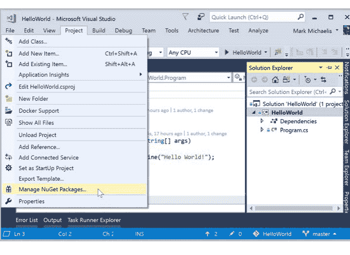

- 2. 选择“Browse”筛选（通常默认选中的是“Installed”筛选，因此请切换到“Browse”以添加新的包引用），然后在搜索框（Ctrl+F）中输入 `Microsoft.Extensions.LoggingConsole`。注意，像 `Logging.Console` 这样的部分名称也会过滤列表（见图 10.3）。

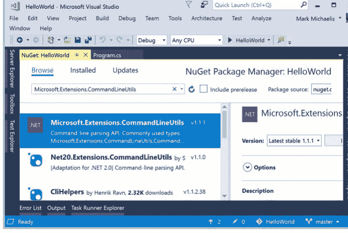

图 10.3：浏览筛选

- 3. 点击“Install”按钮将包安装到项目中。

完成这些步骤后，就可以开始使用 `Microsoft.Extensions.Logging.Console` 库以及它可能具有任何依赖项（这些在过程中会自动添加）。与 Dotnet CLI 一样，你可以使用 Visual Studio 的“Build->Pack <Project Name>”菜单项构建自己的 NuGet 程序包。同样，你可以在项目属性的“Package”选项卡中指定包的版本号。

### 调用引用的包或项目

一旦引用了包或项目，你就可以开始使用它，就像所有源代码都包含在项目中一样。例如，列表 10.12 显示如何使用 `Microsoft.Extensions.Logging` 库，

输出 10.4 显示了示例输出。

#### 列表 10.12：调用 NuGet 包引用

```
public class Program
{
    public static void Main(string[] args)
    {
        using ILoggerFactory loggerFactory =
            LoggerFactory.Create(builder =>
                builder.AddConsole().AddDebug());

        ILogger logger = loggerFactory.CreateLogger(
            categoryName: "Console");

        logger.LogInformation("$@Hospital Emergency Codes: {0}",
            string.Join(", ", args));
        // ...

        logger.LogWarning("This is a test of the emergency...");

        // ...
    }
}
```

#### 输出 10.4

```
>dotnet run -- black blue brown CBR orange purple red yellow
info: Console[0]
    Hospital Emergency Codes: = 'black', 'blue', 'brown', 'CBR',
    'orange', 'purple', 'red', 'yellow'
warn: Console[0]
    This is a test of the emergency...
```

此 `Microsoft.Extensions.Logging` NuGet 包用于向控制台记录日志。在这种情况下，我们记录了同时出现在控制台的一条信息消息和一条警告。

如果你还引用了 `Microsoft.Extensions.Logging.Debug` 库，你可以在 `AddConsole()` 调用之后或之前添加 `.AddDebug()` 调用。输出的类似于输出 10.4 的结果，也会出现在 Visual Studio 的调试输出窗口（选择“Debug->Windows->Output”菜单）或 Visual Studio Code（通过“View->Debug”菜单）中。


`Microsoft.Extensions.Logging.Console` NuGet 包有三个依赖项，包括 `Microsoft.Extensions.Logging`。这些项中的每一个都列在 Visual Studio 资源管理器窗口中项目的 `Dependencies\Packages` 节点下。通过添加 NuGet 包，所有依赖项都会自动添加。

# 类型的封装

正如类作为行为和数据的封装边界一样，程序集在了一组类型之间也提供了类似的边界。开发者可以将系统拆分为多个程序集，然后将这些程序集与多个应用程序共享，或将其与第三方提供的程序集集成。

# 类型声明上的 public 或 internal 访问修饰符

默认情况下，没有任何访问修饰符的类或结构体定义为 `internal`。结果是该类在程序集外部不可访问。即使另一个程序集引用了包含该类的程序集，引用程序集中的所有 `internal` 类也是不可见的。

正如 `private` 和 `protected` 为类中的成员提供了不同级别的封装，C# 也支持在类级别使用访问修饰符，以控制程序集内类的封装。可用的访问修饰符有 `public` 和 `internal`。要向程序集外部公开类，必须将程序集标记为 `public`。因此，在编译 `Coordinates.dll` 程序集之前，必须将类型声明修改为 `public`（见列表 10.13）。

## 列表 10.13：使类型在程序集外部可用

```
public struct Coordinate
{
    // ...
}
public struct Latitude
{
    // ...
}
public struct Longitude
{
    // ...
}
```

- 2. 排除嵌套类型（它们默认为 `private`）。

```cs
public struct Arc
{
    // ...
}
```

同样，诸如 `class` 和 `enum` 的声明可以是 `public` 也可以是 `internal`。`internal` 访问修饰符不仅限于类型声明；它也适用于成员。因此，你可以将类型指定为 `internal`，以便成员仅在程序集内部可用。成员的访问权限不能大于类型。

# protected internal 修饰符

另一种类型修饰符是 `protected internal`。具有 `protected internal` 访问修饰符的成员对程序集内的所有位置以及派生自类可见，即使派生类不是。默认访问修饰符是 `private`，所以当你添加访问修饰符时，成员可见。

你可以为嵌套类装饰任何类成员的访问修饰符（例如 `private`）。然而，在类作用域之外，可用的访问修饰符只有 `public` 和 `internal`。

# 定义命名空间

## 初学者主题

# 类型访问修饰符

访问修饰符完整列表见表 10.1。

### 表 10.1：访问修饰符

| 修饰符 | 描述 |
| --- | --- |
| Public | 在类型可访问的任何地方均可用。 |
| Internal | 仅在程序集内部可用。 |
| Private | 在包含类型内部可用，其他地方不可。 |
| Protected | 在包含类型及其任何派生类型中均可用，无论在哪个程序集。 |
| protected internal | 在包含程序集内的任何地方以及派生自包含类型的类型中可用，即使派生类型在不同的程序集中。 |
| private protected | 仅在同一程序集中的派生自包含类型的类型中可用。（此功能在 C# 7.2 中添加。） |


正如第 2 章所述，所有数据类型都通过命名空间和名称的组合来标识。然而，在 CLR 中，并没有所谓的“命名空间”。类型实际上实际上包括命名空间的全限定名称。对于你定义的类，没有命名空间声明。此类类自动声明为默认全局命名空间的成员。此类类可能会遇到命名冲突，冲突发生在尝试定义同名的类时。一旦你开始引用第三方的其他程序集，命名冲突的可能性会进一步增加。

## 第 10 章：良好的类型

更重要的是，CLI 框架中有数以千计的类型，而在框架之外还有多出几个数量级的类型。因此，为特定问题寻找合适的类型可能是一个重大的挑战。

解决这些问题的方案是组织所有类型，将它们分组到相关的类别中，称为命名空间（namespaces）。例如，`System` 命名空间外的类通常被放在与公司、产品名称或两者对应的命名空间中。例如，来自 Addison-Wesley 的类被放在 `Awl` 或 `AddisonWesley` 命名空间，而来自 Microsoft 的类（非 System 类）位于 `Microsoft` 命名空间中。命名空间的第二层需要一个不随版本变化的稳定产品名称。事实上，稳定性在所有级别都是关键。更改命名空间名称是一个版本不兼容的更改，应该避免。因此，你不应该在命名空间名称内使用不稳定的名称（组织层级、转瞬即逝的品牌等）。

命名空间应使用 PascalCase 标记；如果你的品牌使用了非传统的大小写，则使用品牌的大小写是可以接受的（一致性是关键，因此如果这会产生问题——使用 PascalCase 还是基于品牌的大小写——请选择能产生更大一致性的约定）。使用 `namespace` 关键字创建命名空间并将类分配给它，如列表 10.14 所示。

> 列表 10.14：定义命名空间

```csharp
// 定义命名空间 AddisonWesley
namespace AddisonWesley{
    class Program
{
        // ...
    }
}// AddisonWesley 命名空间声明结束
```

位于命名空间声明的大括号之间的所有内容都将属于指定的命名空间。例如，在列表 10.14 中，`Program` 被放在 `AddisonWesley` 命名空间中，其全名变为 `AddisonWesley.Program`。

## 定义命名空间

> 注意

> 在 CLR 中，并没有所谓的“命名空间”。相反，类型的名称是完全限定类型名称。

与类一样，命名空间也支持嵌套。这提供了类的分级组织。例如，所有与网络 API 相关的 System 类都在 `System.Net` 中，与 Web 相关的类在 `System.Web` 中。

嵌套命名空间有两种方法。第一种方法是相互嵌套（类似于类），如列表 10.15 所示。

### 列表 10.15：相互嵌套命名空间

```csharp
// 定义命名空间 AddisonWesley
namespace AddisonWesley
{
    // 定义命名空间 AddisonWesley.Michaelis
    namespace Michaelis
    {
        // 定义命名空间
        // AddisonWesley.Michaelis.EssentialCSharp
        namespace EssentialCSharp
        {
            // 声明类
            // AddisonWesley.Michaelis.EssentialCSharp.Program
            class Program
            {
                // ...
            }
        }
    }
}
// AddisonWesley 命名空间声明结束
```

这种嵌套会将 `Program` 类分配给 `AddisonWesley.Michaelis.EssentialCSharp` 命名空间。

第二种方法是在单行声明中使用完全命名空间，用句点分隔每个标识符，如列表 10.16 所示。

### 列表 10.16：使用句点分隔每个标识符嵌套命名空间

```csharp
// 定义命名空间 AddisonWesley.Michaelis.EssentialCSharp
namespace AddisonWesley.Michaelis.EssentialCSharp
{
    class Program
    {
        // ...
    }
}
// AddisonWesley 命名空间声明结束
```

无论命名空间声明遵循列表 10.15 的模式、列表 10.16 的模式，还是两者的结合，生成的 CIL 代码将是相同的。同一个命名空间可能出现多次，位于多个文件中，甚至跨越程序集。例如，根据文件与类一一一对应的约定，你可以在每个类定义在自己的文件中，并用相同的命名空间声明将其包围起来。

鉴于命名空间是组织类型的关键，因此使用命名空间来组织所有的类文件通常很有帮助。因此，为每个命名空间创建一个文件夹是一个好主意，例如将 `AddisonWesley.Fezzik.Services.RegistrationService` 放入与名称对应的文件夹层级中。

当使用 Visual Studio 项目时，如果项目名称为 `AddisonWesley.Fezzik`，你应该创建一个名为 `Services` 的子文件夹并将 `RegistrationService.cs` 放入其中。然后你可以创建另一个子文件夹（例如 `Data`），在其中放置与程序内实体相关的类（例如 `RealEstateProperty`、`Buyer` 和 `Seller`）。

> 指南

> - 使用公司名称作为命名空间名前缀，以防止不同公司的空间具有相同的名称。
> - 在命名空间的第二层使用稳定的、独立于版本的产品名称。
> - 不要在不将类型放入命名空间的情况下定义类型。
> - 考虑创建与命名空间层级匹配的文件夹结构。

## XML 注释

第 1 章引入了注释。然而，你可以将 XML 注释不仅用于给审查源代码的其他开发者的备注。基于 XML 的注释遵循了一种在 Java 中盛行的做法。尽管对于生成的最终执行文件来说，C# 编译器忽略了所有注释，但开发者可以使用命令行选项指示编译器将 XML 注释提取到单独的 XML 文件中。通过利用 XML文件的生成，开发者可以根据 XML 注释生成 API 文档。此外，C# 编辑器会解析代码中的注释，并将其作为不同的区域显示给开发者（例如，与代码其余部分颜色不同），或解析 XML 注释数据元素并显示给开发者。

图 10.4 展示了 IDE 如何利用 XML 注释。图 10.4：Visual Studio 中的提示型 XML 注释。C# 标准未规定是由 C# 编译器还是单独的工具来提取 XML 数据。然而，所有主流 C# 编译器都通过编译开关包含了该功能，而不是通过额外的实用程序。

从 Visual Studio 2019 开始，你还可以在注释中嵌入简单的 HTML，它将反映在提示中。例如，用 `<strong>` 包围 `console` 会导致该词在图 10.4 中加粗显示。

## 将 XML 元素与编程结构关联

考虑图 10.17 所示的 `DataStorage` 类。

### 列表 10.17：使用 XML 注释注释代码

```csharp
/// <summary>
/// DataStorage 用于从文件中持久化和检索
/// 数据
/// </summary>
class DataStorage
{
    /// <summary>
    /// 将员工对象保存到以员工名称命名的
    /// 文件
    /// </summary>
    /// <remarks>
    /// 此方法使用了
    /// <see cref="System.IO.FileStream"/>
    /// 此外还有
    /// <see cref="System.IO.StreamWriter"/>
    /// </remarks>
    /// <param name="employee">
    /// 要持久化到文件的员工</param>
    /// <data>2000年1月1日</data>
    public static void Store(Employee employee)
    {
        // ...
    }
}
```

单行 XML 注释

```csharp
/** <summary>
* 加载员工对象
* </summary>
* <remarks>
* 此方法使用了
* <see cref="System.IO.FileStream"/>
* 此外还有
* <see cref="System.IO.StreamReader"/>
* </remarks>
* <param name="firstName">
* 员工的 own</param>
* <param name="lastName">
* 员工的姓</param>
* <returns>
* 与名称相对应的员工对象
* </returns>
* <date>2000年1月1日</date>*/
```

XML 分界注释 (CR 2.0)

```csharp
public static Employee Load(
    string firstName, string lastName)
{
    // ...
}

class Program
{
    // ...
}
```

列表 10.17 使用了跨多行的 XML 分隔符注释以及单行 XML 注释，后者的每一行都需要一个独立的三个正斜杠分隔符（`///`）。

鉴于 XML 注释旨在用于文档化 API，它们 intended仅在与 C# 声明关联时使用，如列表 10.17 所示的类或方法。任何尝试将 XML 注释与代码内联且不与声明关联的行为，都会导致编译器的警告。编译器之所以建立关联，仅仅是因为该 XML 注释紧跟在声明之前。

尽管 C# 允许在注释中出现任何 XML 标签，但 C# 标准显式定义了一组可使用的标签。`<seealso cref="System.IO.StreamWriter"/>` 是使用 seealso 标签的一个示例。该标签在文本与 System.IO.Stream 类之间创建了一个链接。

## 生成 XML 文档文件

编译器会检查 XML 注释是否符合格式，如果不符合则会发出警告。要生成 XML 文件，请在项目属性（Project Properties）元素中添加 `DocumentationFile` 元素：

```xml
<Documentationfile>$(OutputPath)\$(TargetFramework)\$(AssemblyName).xml</Documentationfile>
```

该元素会导致构建期间在输出目录生成 XML 文件，并使用 `<assemblyname>.xml` 作为文件名。使用之前列出的 CommentSamples 类和此处列出的编译器选项，生成的 CommentSamples.XML 文件如列表 10.18 所示。

## 488 第 10 节：良好的类型

### 列表 10.18：Comments.xml

```xml
<?xml version="1.0"?>
<doc>
  <assembly>
    <name>DataStorage</name>
  </assembly>
  <members>
    <member name="T:DataStorage">
      <summary>
        DataStorage 用于从文件中持久化并检索 
        员工数据。
      </summary>
    </member>
    <member name="M:DataStorage.Store(Employee)">
      <summary>
        将员工对象保存到以员工名称命名的文件中。
      </summary>
      <remarks>
        此方法使用了
        <see cref="T:System.IO.FileStream"/>
        以及
        <see cref="T:System.IO.StreamWriter"/>
      </remarks>
      <param name="employee">
        要持久化到文件的员工</param>
      <date>2000年1月1日</date>
    </member>
    <member name="M:DataStorage.Load(System.String,System.String)">
      <summary>
        加载员工对象
      </summary>
      <remarks>
        此方法使用了
        <see cref="T:System.IO.FileStream"/>
        以及
        <see cref="T:System.IO.Stream"/>
      </remarks>
      <param name="firstName">
        员工的首名</param>
      <param name="lastName">
        员工的姓氏</param>
      <returns>
        与名称对应的员工对象
      </returns>
      <date>2000年1月1日</date>
    </member>
  </members>
</doc>
```

生成的文件仅包含了将元素关联回其相应 C# 声明所需的元数据量。这很重要，因为通常情况下，需要将 XML 输出与生成的程序集结合使用以产生任何有意义的文档。坦率地说，像免费的 GhostDoc 和开源项目 NDoc4 等工具也可以生成文档。

## 指南

当 XML 注释提供的上下文比的 API 签名更多时，请为公共 API 提供 XML 注释。这包括成员描述、参数描述以及调用 API 的示例。

## 垃圾回收

垃圾回收显然是运行时的核心功能。其目的是恢复不再被引用的对象所消耗内存。该陈述的重点是内存和引用：垃圾回收器仅负责恢复内存；它不处理其他资源，例如数据库连接、句柄（文件、窗口等）、网络端口以及作为串口的硬件设备。此外，垃圾回收器根据对象是否仍被引用来决定清理哪些内容。

# 高级主题


### .NET 中的垃圾回收

垃圾回收显然是运行时的核心功能。其目的是恢复不再被引用的对象所消耗内存。该陈述的重点是内存和引用：垃圾回收器仅负责恢复内存；它不处理其他资源，例如数据库连接、句柄（文件、窗口等）、网络端口以及作为串口的硬件设备。此外，垃圾回收器根据对象是否仍被引用来决定清理哪些内容。

随着时间的推移，尽管 .NET 在早期发布阶段与未托管代码相比引起了担忧，但 .NET 的垃圾回收已被证明是极其高效的。更重要的是，在托管代码的情况下，开发生产力的收益远大于其成本。

### 弱引用

到目前讨论的所有引用都是强引用，因为它们维护了对象的访问性并防止垃圾回收器清理对象消耗的内存。框架还支持弱引用概念。弱引用不会防止对对象的垃圾回收，但它们保留了引用，以便如果垃圾回收器没有清理对象，就可以重复使用。

弱引用设计用于创建成本高但保留成本高的对象。例如，从数据库加载并显示给用户的大列表。加载此列表可能代价很大，一旦用户关闭它，它应该可以被回收。然而，如果用户多次请求它，将始终需要第二次昂贵的加载。通过弱引用，可以使用代码检查列表是否已被清理，如果没有，则重新引用同一个列表。通过这种方式，弱引用充当对象的内存缓存。缓存中的对象可以快速检索，但如果垃圾回收器回收了这些对象的内存，则需要重新创建。

一旦引用对象（或对象集合）被认为具有考虑弱引用的价值，它需要分配给 `System.WeakReference`（参见列表 10.19）。

```csharp
public static class ByteArrayDataSource
{
    static private byte[] LoadData()
    {
        // 想象是一个大得数字
        byte[] data = new byte[1000];
        // 加载数据
        //...
        return data;
    }

    static private WeakReference<byte[]> Data { get; set; }
}
```

## 第10章：构造良好的类型

```cs
static public byte[] GetData()
{
    byte[] target;
    if (Data is null) {
        target = LoadData();
        Data = new WeakReference<byte[]>(target);
        return target;
    } else if (Data.TryGetTarget(out target)) {
        return target;
    } else {
        // 在设置 WeakReference 的 Target 并返回它之前，
        // 重新加载数据并赋值（创建一个强引用）
        target = LoadData();
        Data.SetTarget(target);
        return target;
    }
}
// ...
```

诚然，这段代码使用了泛型，而本书直到第 12 章才会会讨论泛型。然而，在声明 `Data` 属性和赋值它时，你都可以安全地忽略 `<byte[]>`。虽然 `WeakReference` 有泛型版本，但几乎没有理由考虑它。

大部分逻辑出现在 `GetData()` 方法中。该方法的目的是始终返回数据的实例——无论是来自缓存还是通过重新加载。`GetData()` 开始检查 `Data` 属性是否为 `null`。如果是，则加载数据并将其赋值给名为 `target` 的局部变量。这创建了指向数据的引用，垃圾回收器不会清除该引用。接下来，我们实例化一个 `WeakReference` 并传递加载数据的引用，以便 `WeakReference` 对象拥有对数据的句柄（其目标）；如果需要，可以返回此类实例。不要将没有本地引用的实例传递给 `WeakReference`，因为在在你有机会返回它之前它会被清理（即：不要调用 `new WeakReference<byte[]>(LoadData())`）。

- 7. 除非使用 .NET Framework 4.5 或更早版本进行编程。

如果 `Data` 属性已经有一个 `WeakReference` 实例，则代码调用 `TryGetTarget()`，如果存在实例，则赋值 `target`，创建一个引用，使得垃圾回收器不再清理该数据。

最后，如果 `WeakReference` 的 `TryGetTarget()` 方法返回 `false`，则加载数据，通过调用 `SetTarget()` 赋值引用，并返回新实例的对象。

## 资源清理

垃圾回收是运行环境的一项核心责任。尽管如此，意识到垃圾回收过程围绕代码的内存利用是非常重要的。它并不是为了清理文件句柄、数据库连接字符串、端口或其他有限资源。

### 终析器

终析器允许开发者编写清理资源的代码。与使用 `new` 操作符显式调用的构造函数不同，终析器无法从代码中显式调用。没有像 `delete` 操作符那样的新等效物。相反，垃圾回收器负责对对象实例调用终析器。因此，终析器无法在编译时确定终析器具体何时执行。它们所知道的是终析器将在对象最后一次使用和通常应用程序正常关闭时之间的某个时间运行。通过“通常（Generally）”一词刻意引入不确定性，强调了终析器可能不会执行的事实。这种可能性在进程可能异常终止时是显而易见的。例如，计算机关闭或强制终止进程（例如在调试进程时）等事件将阻止终析器的运行。然而，在 .NET Core 中，即使在正常情况下，终析器也可能在应用程序关闭之前未被处理。正如我们在下一节中看到的，因此可能需要采取额外行动，与其他机制注册终析活动。

## 第 10 章：构造良好的类型

> 注意
>
> 你无法在编译时确定终析器具体何时执行。

终析器的声明与 C# 的前身——即 C++ 的析构函数语法相同。如列表 10.20 所示，终析器声明在类名之前带有一个波浪号 `~`。

### 列表 10.20：定义终析器

```cs
using System.IO;

public class TemporaryFileStream
{
    public TemporaryFileStream(string fileName)
    {
        File = new FileInfo(fileName);
        // 适当解决方案请使用 FileOptions.DeleteOnClose。
        Stream = new TemporaryFileStream(
            File.FullName, FileMode.OpenOrCreate,
            FileAccess.ReadWrite);
    }

    public TemporaryFileStream()
        : this(Path.GetTempFileName()) { }
```

```cs
// 终析器
~TemporaryFileStream()
{
    try
    {
        Close();
    }
    catch (Exception exception)
    {
        // 将事件写入日志或 UI
        // ...
    }
}
```

```cs
public FileStream? Stream { get; private set; }
public FileInfo? File { get; private set; }
```

```cs
public void Close()
{
    Stream?.Dispose();
}
```

```cs
{
  File?.Delete();
}
catch (IOException exception)
{
  Console.WriteLine(exception);
  Stream = null;
  File = null;
}
}
```

终析器不允许传递任何参数，因此它们无法重载。此外，终析器无法显式调用——也就是说，只有垃圾回收器可以调用它们。。因此，终析器的访问修饰符没有意义。基类中的终析器将作为一部分自动调用。

> 注意
>
> 终析器无法显式调用；只有垃圾回收器可以调用它们。。

由于垃圾回收器处理所有的内存管理，终析器并不负责释放内存。相反，它们负责释放数据库连接和文件句柄等资源——运行环境尚未感知的资源。在列表 10.20 的终析器中，我们通过释放 `FileStream` 开始工作。这一步是可选的，因为 `FileStream` 有它自己的终析器。现在使用 `Dispose()` 的目的是确保当 `TemporaryFileStream` 终析时进行清理，后者负责这一点。尽管如此，如果我们不需要终析器来进行清理，那么为了调用 `Dispose()` 定义终析器就没有意义。

## 使用使用语句实现确定性终析

事实上，将终析器的需求限制在运行环境无法感知的需要清理的对象上（没有终析器的资源）是一个重要的准则，这显著减少了需要实现终析器的场景。

在列表 10.20 中，终析器的目的是删除文件——在这种情况下是一个未托管资源。因此，我们有了对 `File.Delete()` 的调用。现在，当终析器执行时，文件将被清理。

终析器在未指定的线程上执行，这使得它们的执行更具不性。这种不确定性使得未处理的异常（调试器之外）会导致应用程序崩溃——由于导致异常的情况并不清楚，这个问题很难诊断。从用户的角度来看，未处理的异常将随机地抛出，且不考虑用户正在执行的任何操作。由于这个原因，你应该小心避免在终析器内部出现异常。相反，你应该使用防御性编程技术，例如检查是否为 `null`（参见 10.20 中的空条件操作符）。事实上，建议在终析器中捕获所有异常，并通过替代手段（如日志或用户界面）报告它们，而不是让它们保持未处理异常。这一准则引出了通过 `System.GC.WaitForPendingFinalizers()` 强制执行终析器的 try/catch 选项。

另一个执行终析器的选项。当调用此方法时，当前线程将暂停，直到所有不再被引用的对象的终析器执行完毕。

终析器本身的问题是它们不支持确定性终析（即知道终析器何时运行的能力）。相反，终析器起着重要的作用，即当使用某个类的开发者忽略了显式调用所需的清理代码时，作为清理资源的备份机制。

> 注意
>
> 列表 10.20 是一个稍显刻意的例子，因为在实例化 `FileStream` 时有一个 `FileOptions.DeleteOnClose` 选项，它会在 `FileStream` 关闭时触发文件的删除。

例如，考虑 `TemporaryFileStream`，它不仅包含一个终结器（finalizer），还包含 `Close()` 方法。该类使用了一种可能会消耗大量磁盘空间的资源。使用 `TemporaryFileStream` 的开发者可以显式调用 `Close()` 来释放磁盘空间。

提供一种确定性终结（deterministic finalization）的方法是非常重要的，因为它消除了对终结器不确定时间行为的依赖。即使开发者未能显式调用 `Close()`，终结器也会处理该调用。在这种情况下，终结器的运行时间会比显式调用时要晚。

由于确定性终结的重要性，基类包含一个用于该模式特定接口，且 C# 将该模式集成到了语言中。`IDisposable` 接口通过名为 `Dispose()` 的单一方法定义了模式的细节，开发者在资源类上调用它来“释放”消耗的资源。列表 10.21 展示了 `IDisposable` 接口以及调用它的代码。

## 列表 10.21：使用 IDisposable清理资源

```csharp
using System;
using System.IO;

static class Program
{
    // ...
    static void Search()
    {
        TemporaryFileStream fileStream = new TemporaryFileStream();

        // 使用临时流
        // ...
        fileStream.Dispose();

    // ...
}

class TemporaryFileStream : IDisposable
{
    public TemporaryFileStream(string fileName)
    {
        File = new FileInfo(fileName);
        Stream = new FileStream(File.FullName, FileMode.OpenOrCreate, FileAccess.ReadWrite);
    }
}
```

## 第 10 章：良好的类型

```csharp
public TemporaryFileStream()
  : this(Path.GetTempFileName()) { }

~TemporaryFileStream()
{
  Dispose(false);
}

public FileStream Stream { get; private set; }
public FileInfo File { get; private set; }

#region IDisposable Members
public void Dispose()
{
  Dispose(true);
  // 从终结器队列中取消注册。
  System.GC.SuppressFinalize(this);
}
public void Dispose(bool disposing)
{
  // 如果由成员终结器调用，则不要释放托管对象（带有
  // 终结对象的？），因为托管对象的终结方法
  // 将会被（或已经）由终结器队列
  // // 处理调用
  if (disposing)
  {
    Stream?.Close();
  }
  try
  {
    File?.Delete();
  }
  catch (IOException exception)
  {
    Console.WriteLine(exception);
  }
  Stream = null;
  File = null;
}
#endregion
```

在 `Program.Search()` 中，在使用 `TemporaryFileStream` 之后有一个显式的 `Dispose()` 调用。`Dispose()` 方法是负责清理与内存无关资源（在本例中为文件）的方法，这些资源因此会由垃圾回收器隐式地清理。尽管如此，这里的执行过程包含一个可能阻止 `Dispose()` 执行的漏洞——即在 `TemporaryFileStream` 实例化和调用 `Dispose()` 之间可能发生异常的概率。如果发生这种情况，`Dispose()` 将不会被调用，资源清理将依赖于终结器。为了避免这个问题，调用者需要实现一个 `try/finally` 块。C# 并没有要求程序员显式地编写这样的块，而是专门为此目的提供了 `using` 语句（参见列表 10.22）。

## 列表 10.22：调用 using 语句

```csharp
static class Program
  {
    // ...

    static void Search()
    {
      using (TemporaryFileStream fileStream2 =
          new TemporaryFileStream())
      {
        // 使用临时文件流
      }

      // C# 8.0 或更高
      using TemporaryFileStream fileStream1 =
          new TemporaryFileStream();
    }
}
```

在第一个高亮的代码片段中，生成的 CIL 结果与程序员显式指定 `try/finally` 块时创建的代码相同，其中 `fileStream.Dispose()` 被放置在 `finally` 块中调用。然而，`using` 语句为 `try/finally` 块提供了一种语法快捷方式。

在该语句中，你可以通过逗号将每个变量与其他变量分开来实例化多个变量。关键考虑因素是所有变量必须是相同类型，它们必须实现 `IDisposable`，并且初始化发生在声明时。为了强制使用相同类型，数据类型仅指定一次，而不是在每个变量声明之前指定。

C# 8.0 在资源清理方面引入了潜在的简化。如列表 10.22 的第二个高亮片段所示，你可以在声明可释放资源（实现 `IDisposable` 的资源）之前名前加上 `using` 关键字。与 `using` 语句一样，这将生成 `try/finally` 行为，`finally` 块放置在变量离开作用范围之前（在本例中，在 `Search()` 方法的结束大括号之前）。`using` 声明的一个额外限制是该变量是只读的，因此它不能赋予不同的值。

## 垃圾回收、终结和 IDisposable

列表 10.21 中还有几个值得注意的额外事项。首先，`IDisposable.Dispose()` 方法包含一个对 `System.GC.SuppressFinalize()` 的重要调用。其目的是将 `TemporaryFileStream` 类实例从终结（f-reachable）队列中移除。这是可能的因为所有的清理工作都在 `Dispose()` 方法中完成的，而不是在终结器中执行。

如果没有 `SuppressFinalize` 的调用，对象的实例将被包含在 f-reachable 队列中，除非在终结器中执行了清理。


如果没有 `SuppressFinalize` 的调用，对象的实例将包含 `f-reachable` 队列——即所有准备好垃圾回收的对象，除非它们也有终结器实现。运行时无法回收带有终结器的对象，直到它们的终结方法被调用。然而，垃圾回收本身并不调用终结方法。相反，终结对象的引用被添加到终结器队列，并根据执行上下文在适当的时间由额外的线程进行处理。带有讽刺的是，这种方法延迟了托管资源的垃圾回收——而这些资源最可能需要更早清理。延迟的原因是 `f-reachable` 队列是一个“引用”列表；因此，在终结方法被调用且对象从 `f-reachable` 队列中移除之前，对象不会被视为垃圾。直到对象从 `f-reachable` 队列中移除，它们才被视为垃圾。

> 注意
>
> 带有终结器的对象如果没有显式释放，其寿命将会延长。即使在所有显式引用离开作用域后，`f-reachable` 队列仍会有引用，保持对象存活。

由于此原因，`Dispose()` 调用了 `System.GC.SuppressFinalize`。调用此方法告知运行时不应将此对象添加到终结器队列中，而是允许垃圾回收器在不再有引用时释放对象。

其次，`Dispose()` 调用参数为 `true` 的 `Dispose(bool disposing)`。结果是了 `Stream` 的 `Dispose()` 方法（清理其资源并抑制其终结）。接下来，临时文件本身在调用 `Dispose()` 后被删除。此重要调用消除了等待终结队列处理才能清理昂贵资源的需求。

第三，参数为 `false` 的 `Dispose(bool disposing)`。结果是 `Stream` 没有关闭（释放），即使文件已被删除。关闭 `Stream` 的条件确保了如果从终结器调用 `Dispose(bool disposing)`，`Stream` 本身将被进入终结处理（或者可能已经运行）。因此，在执行终结器时，不应清理托管资源的对象，因为此操作是终结器队列的责任。

第四，当同时创建 `Close()` 类型和 `Dispose()` 方法时，你应该要谨慎。仅通过调用 `Close()` 的 API 无法明确这一点，开发者将疑惑是否需要显式调用 `Close()` 和 `Dispose()`。

第五，为了增加在 .NET Core 进程关闭之前执行终结器定义的功能的概率，你应该将代码注册到 `AppDomain.CurrentDomain.ProcessExit` 事件处理程序。注册到此事件处理程序中的任何终结代码将在异常进程终止时被调用（见下一节）。

## 概述

- 在稀缺或昂贵的资源对象上实现释放模式。
- 在带有终结器的类上实现 `IDisposable` 以支持可能的确定性终结。

# 第 10 章：良好的类型

- 应当仅对那些没有析构函数但仍需要清理资源的对象实现终析化方法（finalizer methods）。
- 应当重构终析化方法以调用与 `IDisposable` 相同的代码，可以简单地调用 `Dispose()` 方法。
- 不要在终析化方法中抛出异常。
- 考虑将终析化代码注册到 `AppDomain.ProcessExit`，以增加资源清理在进程退出前执行的概率。
- 应当在销毁期间取消注册你的 `AppDomain.ProcessExit` 事件。
- 应当调用 `System.GC.SuppressFinalize(Dispose())` 以避免重复清理资源并延迟对对象的垃圾回收。
- 应当确保 `Dispose()` 是等等的（即应该允许多次调用 `Dispose()`）。
- 应当保持 `Dispose()` 简单，专注于终析化所需的资源清理。
- 不要对拥有析构函数的拥有的对象调用 `Dispose()`。相反，应依赖终析化队列来清理实例。
- 避免在终析化过程中引用尚未析化的其他对象。
- 在重写 `Dispose()` 时，应当调用基类的 `Dispose()` 方法。
- 考虑确保对象在调用 `Dispose()` 后变得不可用。在对象被销毁后，除 `Dispose()` 之外的其他方法（这些方法可能会被多次调用）应该抛出 `ObjectDisposedException`。
- 在拥有可销毁字段（或属性）的类型上实现 `IDisposable` 并销毁这些实例。
- 如果存在基类，应从 `Dispose(bool disposing)` 方法中调用基类的 `Dispose()` 方法。

## 语言对比：C++——确定性析构

虽然终析化函数与 C++ 中的析构函数相似，但由于它们的执行时间无法在编译时确定，这使得它们有本质区别。垃圾回收器会在对象使用后一段时间、程序运行前的某个时刻调用终析化函数；而 C++ 析构函数在对象（而非指针）离开作用域时会被自动调用。

尽管运行垃圾回收的开销较大，但垃圾回收足够智能，可以在处理器利用率低时延迟运行，这比确定性析构函数具有优势，后者在编译时定义的范围内执行，即使在处理器需求很高时也会运行。

## 高级主题

### 在进程退出前强制清理资源

从 .NET Core 开始，终析化函数在进程关闭时可能不会执行。为了增加执行概率，终析化活动应注册为在进程关闭时执行。由于这个原因，请注意示例 10.23 中的 `SampleUnmanagedResource` 构造函数涉及 `ProcessExit`、LINQ、事件注册以及特殊属性（这些内容将在第 12、14 和 18 章中分别介绍）。

### 示例 10.23：注册 Process Exit

```csharp
using System.IO;
using System.Linq;
using System.Runtime.CompilerServices;
using static ConsoleLogger;

public static class Program
{
    public static void Main(string[] args)
    {
        WriteLine("Starting...");
        DoStuff();
        if (args.Any(arg => arg.ToLower() == "-dispose"))
        {
            GC.Collect();
            GC.WaitForFinalizers();
        }
        WriteLine("Exiting...");
    }

    public static void DoStuff()
    {
        // ...

        WriteLine("Starting...");
        SampleUnmanagedResource sampleUnmanagedResource = null;

        try
        {
            sampleUnmanagedResource = new SampleUnmanagedResource();
        }
        finally
        {
            // 使用托管资源。
            // ...
            if (Environment.CommandLineArgs().Any(arg => arg.ToLower() == "-dispose"))
            {
                sampleUnmanagedResource?.Dispose();
            }

            WriteLine("Exiting...");
        }
    }
}
```

```csharp
class SampleUnmanagedResource : IDisposable {
    public SampleUnmanagedResource(string fileName) {
        WriteLine("Starting...");
        // 注意：原始 OCR 此处有重复的构造函数调用和逻辑错误，意图是：
        WriteLine("Creating managed stuff...");
    }

    WriteLine("Creating unmanaged stuff...");
}
```

```csharp
var weakReferenceToSelf = new WeakReference<IDisposable>(this);
ProcessExitHandler = ( _) => {
    WriteLine("Starting...", "ProcessExitHandler");
    if (weakReferenceToSelf.TryGetTarget(out IDisposable self)) {
        self.Dispose();
    }
    WriteLine("Exiting...", "ProcessExitHandler");
};
AppDomain.CurrentDomain.ProcessExit += ProcessExitHandler;
WriteLine("Exiting...");
// 存储进程退出委托，以便如果已经调用了 Dispose() 或 Finalize()，我们可以将其移除。
private EventHandler ProcessExitHandler { get; }
```

```csharp
public SampleUnmanagedResource()
    : this(Path.GetTempFileName()) { }

~SampleUnmanagedResource() {
    WriteLine("Starting...");
    Dispose(false);
    WriteLine("Exiting...");
}

public void Dispose() {
    Dispose(true);
}

public void Dispose(bool disposing) {
    WriteLine("Starting...");
    if (disposing) {
        // 清理托管资源
        WriteLine("Disposing managed stuff...");
    }
    // 清理托管资源
    WriteLine("Disposing unmanaged stuff...");
}
```

¹. 技术上来说是程序域，至少对于 .NET Framework 项目是如此。

¹⁰ 参见相应的源代码。

### 输出 10.5

```
Main: Starting...
DoStuff: Starting...
SampleUnmanagedResource: Starting...
SampleUnmanagedResource: Creating managed stuff...
SampleUnmanagedResource: Creating unmanaged stuff...
```

```
SampleUnmanagedResource: Exiting...
DoStuff(): Exiting...
Main: Exiting...
ProcessExceptionHandler: Starting...
Dispose: Starting...
Dispose: Disposing managed stuff...
Dispose: Disposing unmanaged stuff...
Dispose: Exiting...
ProcessExceptionHandler: Exiting...
```

忽略全程的 `WriteLine()` 语句，代码从调用 `DoStuff()` 开始，它实例化 `SampleUnmanagedResource`。

在实例化 `SampleUnmanagedResource` 时，我们通过调用 `WriteLine()` 来模拟托管和非资源的实例化。接下来，我们声明了一个委托（称为处理器），它将在进程退出时执行。处理器留下了对 `SampleUnmanagedResource` 实例的弱引用（`WeakReference`），如果仍实例可以调用，则对该实例调用 `Dispose()`。弱引用是必要的，以确保 `ProcessExit` 不保留实例的引用，从而防止垃圾回收器在实例离开作用域并运行终析化后无法清理托管资源。处理器被注册到 `AppDomain.CurrentDomain.ProcessExit` 并保存到 `ProcessExceptionHandler` 属性中。最后一步是必要的，以便当 `Dispose()` 执行时，我们可以从已执行的 `AppDomain.CurrentDomain.ProcessExit` 事件中移除处理器。

回到 `DoStuff()` 方法中，我们检查启动程序时是否指定了命令行参数 `-Dispose`。如果是，则将调用 `Dispose()`，且终析化函数和 `ProcessExit` 处理器都不会被调用。在退出时，它不再拥有根引用。然而，当垃圾回收器运行时，它会看到终析化函数并将资源添加到终析化队列中。

# 资源清理

在列表 10.21 的 `Dispose()` 方法中，我们从 `AppDomain.CurrentDomain.ProcessExit` 取消注册，这样如果 `Dispose()` 之前被调用过，在进程退出时就不会再次被调用。

请注意，虽然可以通过 `GC.WaitForPendingFinalizers()` 调用 `GC.Collect()` 来强制运行没有根引用的对象的终结器，你甚至可以在进程退出之前这样做，但这种做法是不可靠的。第一个限制是类项目无法在进程退出之前立即调用这些方法，因为没有 `Main()` 实例。第二个限制是，即使是静态引用等简单内容也是根引用，因此静态实例将不会被清理。由于原因，使用 `ProcessExit` 处理器是首选方法。

## 高级主题

## 构造函数中的异常传播

当异常从构造函数抛出时，对象仍然会被实例化，尽管 `new` 操作符没有返回新实例。如果该类型定义了终结器，则会在对象符合垃圾回收条件时运行该方法（这为确保析化方法可以在部分构造的对象上运行提供了额外动力）。还要注意，如果构造函数过早地共享了其引用，即使构造函数抛出异常，该引用仍然是可以访问的。不要让这种情况发生。

## 高级主题

## 对象的复活

当对象的析化方法被调用时，所有对对象的引用都消失了，垃圾回收之前的唯一一步就是运行析化代码。尽管如此，仍然可能无意中将一个析化对象的引用重新添加到根引用图中。在这种情况下，被重新引用的对象将不再是不可见的；反之，它将不会准备好进行垃圾回收。然而，如果对象的析化方法已经运行，除非显式标记为待析化（使用 `GC.ReRegisterFinalize()` 方法），否则它不会再次运行。

# 第 10 章：良好的类型

显然，以这种方式复活对象是一种奇特的行为，你通常应该避免它。析化代码应该是简单的，并且应该专注于清理它所引用的资源。

## 延迟性初始化

在上一节中，我们讨论了如何使用 `using` 语句确定性地释放对象，并且在没有使用确定性方法的情况下，终化队列将释放资源。

一个相关的模式被称为延迟初始化或延迟加载。使用延迟初始化，你可以在需要时创建（或获取）对象，而不是提前创建——当这些对象从未被使用时，后者是一个特别棘手的情况。考虑列表 10.24 中的 `FileStream` 属性。

列表 10.24：属性的延迟加载

```csharp
using System.IO;

class DataCache
{
    public TemporaryFileStream FileStream =>
        InternalStream ?? (InternalStream =
            new TemporaryFileStream());

    private TemporaryFileStream? InternalStream
        { get; set; } = null;
}
```

在上述具体的 `FileStream` 表达式中，我们在直接返回其值之前检查 `InternalStream` 是否为 `null`。如果 `InternalStream` 为 `null`，我们首先实例化 `TemporaryFileStream` 对象并将其赋值给 `InternalStream`，然后返回新实例。因此，`FileStream` 中需要的 `TemporaryFileStream` 只有在调用属性的访问器时才会被创建。如果访问器从未被调用，`TemporaryFileStream` 对象就不会被实例化，我们就可以节省任何可能的执行时间。显然，如果实例化是微不足道或不可避免的（而且推迟不可避免的事并不理想），那么直接在声明或构造函数中对其赋值是有意义的。

## 高级主题

## 使用泛型和 Lambda 表达式延迟加载

从 C# 4.0 和 Microsoft .NET Framework 4.0 开始，CLR 添加了一个新类来辅助延迟初始化：`System.Lazy<T>`。列表 10.25 展示了如何使用它。

列表 10.25：使用 System.Lazy<T> 延迟加载属性

```csharp
using System.IO;

class DataCache
{
    // ...
    public TemporaryFileStream FileStream =>
        InternalFileStream.Value;
    private Lazy<TemporaryFileStream> InternalFileStream { get; } =
        new Lazy<TemporaryFileStream>(
            () => new TemporaryFileStream() );
}
```


`System.Lazy<T>`类接收一个类型参数（`T`），用于标识`System.Lazy<T>`的`Value`属性将返回什么类型。不是给`_FileStream`字段赋值一个完全构造的`TemporaryFileStream`，而是赋值一个`Lazy<TemporaryFileStream>`实例（轻量级的），从而延迟`TemporaryFileStream`的初始化，直到访问`Value`属性（因此是`FileStream`属性）。

如果你在使用类型参数（泛型）的同时使用委托，可以提供一个函数规定访问`Value`属性时如何初始化对象。列表 10.25 展示了将委托（在此情况下为 Lambda 表达式）传递给`System.Lazy<T>`的构造函数。

注意，Lambda 表达式本身`() => new TemporaryFileStream(FileName)`在调用`Value`之前不会执行。相反，Lambda 表达式提供了一种传递发生什么情况指令的方法；在未显式请求之前，它不会实际执行这些指令。

一个明显的问题是，何时应该使用`System.Lazy<T>`而不是列表 10.24 中概述的方法。区别在于

# 第 10 章：良好的类型

微乎其微。事实上，列表 10.24 实际上可能更简单。也就是说，在涉及多个线程导致实例化期间可能发生竞态条件之前。相比之下，`Lazy<T>`提供了一种线程安全的机制，确保只创建一个实例。

## 总结

本章提供了许多与健壮性相关的快速主题。在第 11 章中，你将看到为什么继承是如此的核心。

# 11 异常处理

第 5 章讨论了使用`TRY/CATCH/FINALLY`块进行标准异常处理。在该章中，`catch`块始终捕获类型异常。本章定义了异常的一些额外细节——特别是自定义异常。

## 多种异常类型

列表 11.1 抛出了`System.ArgumentException`，而不是第 5 章演示的类型。C# 允许代码抛出任何派生（可能间接派生）`System.Exception`的类型。要抛出异常，只需在异常实例前加上关键字`throw`。使用的异常类型显然是描述错误发生情况的类型。与其抛出`System.Exception`，不如抛出`ArgumentException`更合适，因为该类型本身指示了什么问题，并包含了标识哪个参数错误的特殊参数。

### 多种异常类型

两种相似的异常是`ArgumentNullException`和`NullReferenceException`。当传递了不适当的空参数时，应该抛出`ArgumentNullException`。这是无效参数异常的一种特殊情况，在更一般的情况下（当参数不为空时），它会作为`ArgumentException`或`ArgumentOutOfRangeException`抛出。`NullReferenceException`通常是底层运行时在尝试解引用空值时抛出的异常——即尝试对一个值为空的对象调用其成员。程序员不应该通过触发`NullReferenceException`来抛出异常，而应该在访问参数之前检查其是否为`null`，然后抛出`ArgumentNullException`，这可以提供更多的上下文相关信息，例如参数名称。即使参数为空，也有某种无害的方法继续执行，请确保在解引用时使用 C# 6.0 的空引用条件操作符，以避免运行时抛出`NullReferenceException`。

参数异常类型（包括`ArgumentNullException`和`ArgumentOutOfRangeException`）的一个重要特征是，每个构造函数都允许以字符串的形式标识参数的名称。在 C# 6.0 之前，这意味着需要硬编码一个魔法字符串（例如`"textDigit"`）来标识参数名称。这种方法的问题在于，如果参数名称发生变化，开发人员必须记住更新该魔法字符串。幸运的是，C# 6.0 及更高版本提供了`nameof`操作符，它获取参数名称并在编译时生成该参数名称字符串（参见列表 11.1 中的`nameof(textDigit)`）。这种方法的优势是 IDE 可以使用重构工具（如自动重命名）更改所有的该标识符，包括它用作`nameof`操作符的参数时。此外，如果参数名称发生变化（在使用重构工具的情况下），如果传递给`nameof`操作符的标识符不存在，编译器将生成错误。以后，对于 C# 6.0 及更高版本，通用指南是始终对参数类型异常的参数名称使用`nameof`操作符。第 18 章对`nameof`操作符提供了详细说明。在此之前，只需理解`nameof`返回所标识的参数的名称即可。

其他几种异常仅供运行时使用，并（有时是间接））派自`System.Exception`。它们包括`System.StackOverflowException`、`System.OutOfMemoryException`、`System.Runtime.InteropServices.COMException`、`System.ExecutionException`和`System.Runtime.InteropServices.SEHException`。不要抛出这些类型的异常。同样，你应该避免抛出`System.Exception`或`System.ApplicationException`，因为这些异常过于通用，无法提供关于问题原因或解决方案的有效指示。相反，请抛出符合场景的最派生类异常。显然，开发人员应该避免创建可能导致系统失败的 API。然而，如果执行代码达到了某种状态，导致继续执行是不安全或不可恢复的，它应该调用`System.Environment.FailFast()`。这将在可能写入标准错误（在 Microsoft Windows 上为 Windows 应用程序事件日志）后立即终止进程。

## 指南

- 如果向成员传递了错误的参数，**请**抛出`ArgumentException`或其一个子类型。如果适用，请优先使用最派生的异常类型（例如`ArgumentNullException`）。

- **不要**抛出`System.Exception`或派生自它的异常类型。

- **不要**抛出`System.Exception`、`System.NullReferenceException`或`System.ApplicationException`。

- 如果程序遇到不安全的继续执行场景，**请考虑**通过调用`System.Environment.FailFast()`终止进程。

- 对于传递给此类参数的参数异常类型，**请务必**使用`nameof`参数参数。这些异常的示例包括`ArgumentException`、`ArgumentOutOfRangeException`和`ArgumentNullException`。

## 捕获异常

抛出特定异常类型允许捕获者使用异常的类型来识别问题。换句话说，没有必要捕获异常并对异常消息使用`switch`语句来根据异常采取行动。C# 允许有多个`catch`块，每个块针对特定的异常类型，如列表 11.2 所示。

### 列表 11.2：捕获不同异常

```csharp
using System;

public sealed class Program
{
    public static void Main(string[] args)
    {
        try
        {
            // ...
            throw new InvalidOperationException(
                "Arbitrary exception");
            // ...
        } catch (Win32Exception exception)
        when (exception.ErrorCode == 42)
        {
            // Handle Win32Exception where
            // ErrorCode is 42
        } catch (ArgumentException exception)
        {
            // Handle ArgumentException
        } catch (InvalidOperationException exception)
        {
            bool exceptionHandled=false;
            // Handle InvalidOperationException
            // ...
            if(!exceptionHandled)
            {
                throw;
            }
        } catch (Exception exception)
        {
            // Handle Exception
        }
        finally
        {
            // Handle any cleanup code here regardless
            // of whether there is an exception
        }
    }
}
```

列表 11.2 包含了五个`catch`块，每个块处理一种异常。当发生异常时，执行将跳转到与异常匹配最紧密的`catch`块。匹配的紧密程度是由继承链决定的。例如，尽管抛出的异常是`System.Exception`类型，但这种“是一个”的关系是通过继承发生的，因为`InvalidOperationException`最终派自`System.Exception`。由于异常类型`InvalidOperationException`与异常最匹配，因此`catch(InvalidOperationException...)`块将捕获该异常，而不是`catch(System.Exception...)`块。

从 C# 6.0 开始，`catch`块提供了一个额外的条件表达式。与其限制`catch`块仅根据异常类型匹配，还有一个条件子句。此`when`子句仅在条件为真时才处理`catch`块。在列表 11.2 中，这是一个等运算符。对于更复杂的逻辑，你可以编写一个方法来检查条件。

当然，你也可以简单地在`catch`体中使用`if`块进行条件检查。然而，这样做会导致`catch`块在检查条件之前就成为异常的处理器。在条件不满足的情况下，让另一个`catch`块处理异常是困难的。但是，有了异常条件，现在可以在不捕获并重新抛出异常的情况下检查程序状态（包括异常）。

在`catch`中使用条件句：如果条件表达式本身抛出异常，则该新异常将被忽略，且`catch`块将空视为`false`。出于此原因，你应该避免在异常的条件表达式中抛出异常。

`catch`块必须按照从具体到通用的顺序排列，以避免编译错误。例如，将`catch(Exception...)`块移动到任何其他异常之前将导致编译错误，因为之前的所有异常在继承链的某处都派自`System.Exception`。

如`catch (SystemException){ }`块所示，`catch`块不需要命名参数。事实上，最后的甚至没有类型参数的`catch`也是允许的，正如你将在下一节中看到的。

# 重新抛出现有异常

在`InvalidOperationException`的 catch 块中，出现了一个`throw`语句，没有对要抛出的异常进行任何标识（`throw`本身即标识），尽管 catch 块作用域内出现了一个可以重新抛出的异常实例（`exception`）。抛出一个特定的异常将更新堆栈信息，以匹配新的抛出位置。结果是，所有指示异常原始发生调用处的堆栈信息将丢失，使诊断问题变得异常困难。由于某种原因，只要在 catch 块内发生，C# 就支持不带显式异常引用的`throw`语句或表达式（C# 7.0 或更高版本）。通过这种方式，你可以检查异常以确定是否可以完全处理它；如果不能，则重新抛出异常（即使没有显式指定），就像它从未被捕获过一样，而不替换任何堆栈信息。

# 高级/基础主题

## 在不替换堆栈信息的情况下抛出现有异常

在 C# 5.0 中，增加了一种机制，能够在抛出之前抛出的异常，而不会丢失原始异常中的堆栈跟踪信息。这允许你重新抛出异常，例如，甚至可以在 catch 块之外，因此无需使用`throw`；虽然这样做的需求相当罕见，但有时异常会被包装或保存，直到程序执行移动到 catch 块之外。例如，多线程代码可能会将异常包装在`AggregateException`中。`System.Runtime.ExceptionServices.ExceptionDispatchInfo`类专门设计用于通过其静态`Capture()`方法和实例`Throw()`方法来处理这种场景。列表 11.3 展示了在不重置堆栈跟踪信息或不使用空语句的情况下重新抛出异常。

# 列表 11.3：使用 ExceptionDispatchInfo 重新抛出异常

```cs
using System
using System.Runtime.ExceptionServices;
using System.Threading.Tasks;
task = WriteWebRequestSize(url);
try
```

```cs
{
  while (!task.Wait(100)) {
    Console.Write(".");
  }
} catch (AggregateException exception) {
  exception = exception.Flatten();
  ExceptionDispatchInfo.Capture(
    exception.InnerException??exception).Throw();
}
```

使用`ExceptionDispatchInfo.Throw()`方法，编译器不会像处理普通`throw`返回值那样将代码视为返回语句，但由于从带有`ExceptionDispatchInfo.Throw()`的代码路径没有返回任何值，编译器将发出指示未返回任何值的错误。因此，在某些情况下，开发者可能被迫在`ExceptionDispatchInfo.Throw()`之后跟一个返回状态，尽管该语句在运行时永远不会执行——取而代之的是异常被抛出。

# 语言对比：Java 异常规格器

C# 没有等同于 Java 异常规格器（exception specifications）。通过异常规格器，Java 编译器能够验证函数内（或函数调用层次结构内）抛出的所有可能的异常要么被捕获，要么被声明为可能抛出。C# 团队考虑了这一点，并得出其认为其维护负担并不值其预期的收益。因此，没有必要在特定的调用过程中维护所有可能的异常的列表，但容易确定可能的异常也是不可行的。（事实证明，这对 Java 来说也是不可行的。调用虚方法或使用后期绑定（如反射）使得在编译时无法完全解析方法可能抛出哪些异常。）

# 通用 catch 块

C# 要求任何抛出异常的对象必须派生自`System.Exception`。然而，这一要求并非所有语言通用的。例如，C++ 允许抛出任何对象类型，包括不派生自`System.Exception`的托管异常。所有异常，无论是否派生自`System.Exception`，都将作为派生自`System.Exception`传播到 C# 程序集。结果是，`System.Exception` catch 块捕获了早期块未捕获的所有异常。

C# 还支持通用 catch 块（`catch { }`），其行为与`catch(System.Exception exception)`块相同，只是没有类型或变量名。此外，由于没有显式类型，通用 catch 块会捕获之前块未捕获的所有异常。

## 高级主题

## 通用 catch 块内部机制

在中间语言（CIL）中，通用 catch 块的设计允许处理任何类型的异常。在 C# 中，通用 catch 块内部仍然可以抛出异常。虽然 C# 允许在`catch(object)`块中抛出异常，但这在某些情况下是不推荐的。此外，通用 catch 块在`try`块之后，如果捕获获异常，可能会在 catch 块中再次抛出。

# 异常处理指南

异常处理为错误提供了必要的结构。然而，如果使用不当，可能会导致某些糟糕的结果。以下指南为异常处理提供了一些最佳实践。

- 从 C# 2.0 开始。

- 仅捕获你可以处理的异常。通常可以处理某些类型的异常而不是其他类型。例如，独占访问文件可能会抛出`IOException`。仅捕获有已知操作的异常。

- 不要掩埋你无法完全处理的异常。新程序员倾向于捕获所有异常并继续执行。然而，如果你无法相应地处理异常，你需要重新抛出它。

- 少使用`System.Exception`。几乎所有异常都派生自`System.Exception`。然而，处理某些异常的最佳方法是让它们传播到调用栈。从通用语言运行时（CLR）4 开始，代码应仅在关闭应用程序之前捕获此类异常以运行清理工作（例如保存任何数据）。

# 第 11 章：异常处理指南

这些异常是开发者无法恢复的运行时异常。因此，最佳行动是关闭应用程序。

- 避免在调用栈中进行异常报告或日志记录。通常，程序员倾向于在调用栈尽可能的范围内记录异常或向用户报告异常。然而，这些位置很少能够完全处理异常；相反，它们诉诸重新抛出异常。如果异常被记录并重新抛出，调用栈高处的调用者可能会这样做，导致异常的重复日志记录。糟糕的是，向用户显示异常可能对于应用程序类型是不的。（例如，在 Windows 应用程序中使用`Console.WriteLine()`用户永远永远看不到，而在意外的命令行进程中显示对话框可能会未被注意到并冻结应用程序。）日志和异常相关的接口将保留给调用栈中更高处。


# 第 11 章：异常处理

- 在 `catch` 块内部使用 `throw;` 而不是 `throw <exception>`。可以在 `catch` 块内部重新抛出异常。例如，`catch(ArgumentNullException)` 的实现可能包含对 `throw exception` 的调用。然而，这样重新抛出异常会将堆栈跟踪重置为重新抛出调用的位置，而不是重用原始抛出位置。因此，除非你重新抛出不同类型的异常或故意隐藏原始堆栈，否则请使用 `throw;` 让相同的异常传播到调用栈。

- 优先使用异常条件以避免在 `catch` 块内部重新抛出异常。当你发现自己自己在获一个实际上无法相应处理的异常并需要重新抛出它时，优先使用异常条件来避免捕获该异常。

- 避免从异常过滤器抛出异常。在提供异常过滤器时，避免使用抛出异常的代码。从异常过滤器抛出异常将导致一个

如果条件为假，异常的发生将被忽略。出于此原因，你应该考虑将复杂的条件检查放置在单独的方法中，并将其封装在 `try/catch` 块中，以显式处理该异常。

- 避免可能随时间变化的异常条件。

如果异常过滤器评估的条件（如异常消息）可能会随着本地化或消息更改而变化，预期的异常条件将无法被捕获，从而意外地改变了业务逻辑。出于此原因，你应该确保异常条件在长时间范围内是有效的。

- 在重新抛出不同异常时要小心。

在 `catch` 块内部重新抛出不同的异常不仅会重置调用堆栈，还会隐藏该异常。为了保留原始异常，可以使用新异常的 `InnerException` 属性（通常可以通过构造函数赋值）。重新抛出不同异常应仅限于以下情况：

1. 更改异常类型可以澄清问题。

例如，在调用 `Logon(User user)` 时，如果用户列表文件无法访问，重新抛出不同的异常类型可能比传播 `System.IO.IOException` 更合适。

2. 私有数据是原始异常的一部分。

在上述场景中，如果文件路径包含在原始 `System.IO.IOException` 中，从而暴露了系统的私有安全信息，则应该对异常进行封装。当然，这假设 `InnerException` 没有被设置为原始异常。（最后，一个非常早的 CLR 版本 1 [甚至是预 alpha 版本] 曾抛出一个内容类似于“安全异常：您没有权限确定 c:\temp\foo.txt 的路径”的异常。）

3. 异常类型过于具体，调用者无法恰善处理。

例如，与其向特定的数据库系统抛出异常，不如使用更通用的异常，以避免在调用堆栈更高处编写特定数据库的代码。

# 定义自定义异常

## 指南

**避免**在调用堆栈的低层进行异常报告或日志记录。

**不要**过度捕获（over-catch）。除非明确理解如何通过程序方式处理堆栈低处的错误，否则应允许异常沿调用堆栈传播。

当你理解在特定上下文中为何抛出特定异常，并且能够程序化地响应失败时，**考虑**捕获特定异常。

**避免**在执行最终清理工作之前重新抛出异常的顶层异常处理程序中捕获 `System.Exception` 或 `System.SystemException`。

在 `catch` 块内部**要使用** `throw;` 而不是 `throw <exception object>`。

**要使用**异常过滤器来避免从 `catch` 块内部重新抛出异常。

在重新抛出不同异常时**要小心**。

**避免**从异常过滤器中抛出异常。

**避免**使用逻辑可能随时间隐含变化的异常过滤器。

## 定义自定义异常

当抛出异常成为最佳行动方案时，使用框架异常是更优的，因为它们已经成熟且易于理解。例如，与其抛出自定义的无效参数异常，不如使用 `System.ArgumentException` 类型。然而，如果使用特定 API 的开发者将采取特殊行动——例如，异常处理逻辑将处理自定义异常类型——那么定义自定义异常是恰当的。例如，如果映射 API 接收到的一个邮政编码无效的地址，与其抛出 `System.ArgumentException`，可能抛出 `InvalidAccessException` 更好。关键在于调用者是否可能编写一个带有特殊处理的特定 `InvalidAddressException` catch 块，而不是仅仅是一个通用的 `System.ArgumentException` catch 块。

定义自定义异常仅涉及派生自 `System.Exception` 或其他异常类型。列表 11.4 提供了一个示例。

# 列表 11.4：创建自定义异常

```
class DatabaseException : System.Exception
{
    public DatabaseException(
        string message,
        System.Data.SqlClient.SqlException exception)
        : base(message, innerException: exception)
    {
        // ...
    }

    public DatabaseException(
        string message,
        System.Data.OracleClient.OracleException exception)
        : base(message, innerException: exception)
    {
        // ...
    }

    public DatabaseException()
    {
        // ...
    }

    public DatabaseException(string message)
    {
        // ...
    }

    public DatabaseException(
        string message, Exception? exception)
        : base(message, innerException: exception)
    {
        // ...
    }
}
```

创建此自定义异常可能是为了封装专有的数据库异常。由于 Oracle 和 SQL Server（例如）对类似错误会抛出不同的异常，应用程序可以定义一个自定义异常，将特定数据库的异常标准化为通用异常包装器，应用程序可以以标准方式处理它。这样，无论应用程序使用的是 Oracle 还是 SQL Server 后端数据库，都可以使用同一个 `catch` 块来处理堆栈高处的错误。

自定义异常的唯一要求是它必须派生自 `System.Exception` 或其后代类之一。然而，自定义异常的其他良好实践如下：

## 定义自定义异常

- 所有异常都应该使用“Exception”后缀。这样，从名称就能很容易确定它们的用途。

- 通常情况下，所有异常都应该包含一个无参数的构造函数、一个带字符串参数的构造函数，以及一个由字符串和内部异常组成的参数集。此外，异常通常在抛出它们的同一语句中进行构造，任何额外的异常数据都应该允许作为构造函数的一部分。（创建这些构造函数的明显例外是：需要某些数据且构造函数绕过了这些要求时。）

- 继承链应保持相对较浅（少于五层）。

当重新抛出一个与捕获它的异常不同的异常时，内部异常具有重要作用。例如，如果由数据访问层抛出的 `System.Data.SqlClient.Sql` 被捕获并重新抛出为 `DatabaseException`，接收 `SQLException`（或内部异常）的 `DatabaseException` 构造函数会将原始异常保存在 `InnerException` 属性中。这样，如果它们需要异常的详细信息，可以从 `InnerException` 获取。

## 指南

避免深层异常层次。

如果异常的处理方式与 CLR 异常不同，则**不要**创建新的异常类型。相反，请抛出现有的框架异常。

对于无法使用现有 CLR 异常通信且可以用不同方式处理的程序错误，**要**创建新的异常类型。

为所有自定义异常类型提供无参数构造函数。还要提供带消息和内部异常的构造函数。

**要**用“Exception”后缀命名异常类。

**要**使异常是运行时序列化的。

**考虑**提供异常属性以便程序化地访问相关信息。

# 第 11 章：异常处理

## 高级主题

### 可序列化异常

可序列化对象是运行时可以持久化到流中（例如文件流）并在随后可以从流中重新实例化的对象。在异常的情况下，这种行为对于某些分布式通信技术可能是必要的。为了支持序列化，异常声明应该包含 `System.SerializableAttribute` 或实现 `ISerializable`。此外，它们必须包含一个接收 `System.Runtime.Serialization.SerializationInfo` 和 `System.StreamingContext` 的构造函数。列表 11.5 显示了使用 `System.SerializableAttribute` 的示例。

# 列表 11.5：定义可序列化异常

```
// 通过属性支持序列化
[Serializable]
class DatabaseException : System.Exception
{
    // ...

    // 用于异常的反序列化
    public DatabaseException(
        SerializationInfo serializationInfo,
        StreamingContext context)
        : base(serializationInfo, context)
    {
        // ...
    }
}
```

上述 `DatabaseException` 示例演示了使异常可序列化的属性和构造函数要求。

对于 .NET Core，`System.SerializableAttribute` 直到 .NET Standard 2.0 才可用。如果你正在编写跨多个框架（包括 .NET Standard 之前的之前的版本）的代码，请考虑将 `System.SerializableAttribute` 定义为填充程序（polyfill）。填充程序是用于特定技术版本的代码，从而添加该功能，或者至少为缺失的内容提供垫接程序。

### 重新抛出封装的异常

在某些情况下，栈较低层级抛出的异常在较高层级捕获时可能不再具有意义。例如，考虑由于服务器上磁盘空间不足而发生的 `System.IOException`。捕获异常的客户端并不一定能理解其背景，即不知道为什么会发生 I/O 活动。类似地，考虑一个地理坐标结果 API，它抛出了一个 `System.UnauthorizedAccessException`（一个与该 API 调用完全无关的异常）。在第二个示例中，调用者没有任何上下文来理解 API 调用与安全之间有什么关系。从调用 API 代码的角度来看，这些异常对诊断的帮助远大于带来的困惑。与其向客户端暴露此类异常，不如先捕获该异常，然后抛出一个不同的异常，例如 `InvalidOperationException`（甚至可以是自定义异常），以此告知系统正处于无效状态。在这些情况下，务必设置封装异常的 `InnerException` 属性（通常通过构造函数调用实现，例如 `new InvalidOperationException(string, Exception)`），这样对于更接近被调用框架的开发人员来说，就有额外的内容可供诊断使用。

在考虑是否封装并重新抛出异常时，需要记住的一个重要细节是：原始堆栈跟踪（它提供了异常发生位置的上下文）将被封装异常抛出位置的新堆栈跟踪替换（假设没有使用 `ExceptionDispatchInfo`）。幸运的是，当原始异常嵌入到封装异常中时，原始堆栈跟踪仍然可用。

归根结底，异常的预想接收者是编写调用你 API 代码的程序员——他们可能是错误的调用。因此，你应该向他们提供尽可能多的信息，指明程序员哪里做错了（这可能更重要），以及如何修复它。异常类型是通信机制的关键部分，因此你必须明智地选择它。

## 指南

- 如果低层抛出的特定异常在高层操作的上下文中没有意义，请**考虑**将低层抛出的特定异常封装在更合适的异常中。

- 封装异常时，**务必**指定内部异常（inner exception）。

- **务必**将开发者作为异常的受众，在可能的情况下识别问题以及解决问题的机制。

## 初学者主题

### 检查与未检查转换

正如我们在第 2 节高级主题中首次讨论过的，C# 提供了关键字来标记代码块，告知运行时如果目标数据类型太小而无法容纳分配的数据时应该发生什么。默认情况下，如果目标数据类型无法包含分配的数据，数据将在赋值期间被截断。示例请参阅列表 11.6。

# 列表 11.6：整数值溢出

```cs
using System;

public class Program
{
    public static void Main()
    {
        // int.MaxValue 等于 2147483647
        int n = int.MaxValue;
        n = n + 1;
        System.Console.WriteLine(n);
    }
}
```

列表 11.6 的结果显示在输出 11.1 中。

# 输出 11.1

```
-2147483648
```

列表 11.6 中的代码将值 -2147483648 写入控制台。然而，将代码放在 `checked` 块中或在运行编译器时使用 `checked` 选项，将导致运行时抛出类型为 `System.OverflowException` 的异常。`checked` 块的语法使用 `checked` 关键字，如列表 11.7 所示。

# 列表 11.7：checked 块示例

```csharp
using System;
public class Program
{
    public static void Main()
    {
        checked
        {
            // int.MaxValue 等于 2147483647
            int n = int.MaxValue;
            n = n + 1;
            System.Console.WriteLine(n);
        }
    }
}
```

如果计算仅涉及常量，计算将默认进行检查。列表 11.7 的结果显示在输出 11.2 中。

# 输出 11.2

```
Unhandled Exception: System.OverflowException: Arithmetic operation resulted in an overflow. at Program.Main() in ..Program.cs:12
```

如输出 11.2 所示，如果在 `checked` 块内运行时发生了溢出赋值，则会抛出异常。请注意，输出 11.2 中的位置信息（Program.cs:line X）仅会在调试编译中出现——即使用编译器的 `/Debug` 选项进行的编译。

要将整个项目更改为未检查或检查，请分别将 `CheckForOverflowUnder` 属性设置为 `true` 或 `false`。

```xml
<PropertyGroup>
    <CheckForOverflowUnder>true</CheckForOverflowUnder>
</PropertyGroup>
```

- 除了输出 11.2 外，如果安装了 .NET Framework 调试器，可能会出现对话框，提示用户向 Microsoft 发错误消息、检查解决方案或调试应用程序。

C# 还支持 `unchecked` 块，它在块内的赋值中截断数据而不是抛出异常（见列表 11.8）。

# 列表 11.8：unchecked 块示例

```csharp
using System;

public class Program
{
    public static void Main()
    {
        unchecked
{
            // int.MaxValue 等于 2147483647
            int n = int.MaxValue;
            n = n + 1;
            Console.WriteLine(n);
        }
    }
}
```

列表 11.8 的结果显示在输出 11.3 中。

# 输出 11.3

```
-2147483648
```

即使开启了 `checked` 选项，11.8 代码中的 `unchecked` 关键字也会阻止运行时抛出异常。例如，语句可能包含：

```csharp
int number = unchecked(int.MaxValue + 1);
```

## 总结

抛出异常会有影响。正如第 5 节所指出的，你应该只在异常情况下使用异常；下一节将介绍泛型——一个几乎在每个项目中都使用的命名空间。

# 12 泛型

我们通过检查一个不使用泛型的类来开始泛型的讨论。该类 `System.Collections.Stack` 表示一个对象集合，其中最后一个添加到集合的对象是第一个从集合中取的（后进先出 [LIFO]）。`Push()` 和 `Pop()` 是栈类的两个主要方法，分别将项目添加到栈并从栈中移除。栈类方法的声明在列表 12.1 中。

# 列表 12.1：System.Collections.Stack 方法签名

```csharp
public class Stack
{
    public virtual object Pop() { ... }
    public void Push(object obj) { ... }
    // ...
}
```

程序经常使用栈集合来方便多次撤销操作。例如，列表 12.2 使用 `System.Collections.Stack` 类在模拟橡皮笔玩具的程序内部进行撤销。

# 列表 12.2：在类似于橡皮笔玩具的程序中支持撤销


# 第 12 章：泛型

```sharp
using System.Collections;
class Program
{
    public void Sketch()
    {
        Stack path = new Stack();
        Cell currentPosition;
        ConsoleKey key; // C# 2.0 添加

        do
        {
            // 根据用户输入的方向键进行刻画
            key = Move();
            switch (key.Key)
            {
```

```cs
case ConsoleKey.Z:
    // 撤销上一步移动
    if (path.Count >= 1)
    {
        currentPosition = (Cell)path.Pop();
        Console.CursorPosition(
            currentPosition.X, currentPosition.Y
        );
        Undo();
    }
    break;
```

```cs
case ConsoleKey.DownArrow:
case ConsoleKey.UpArrow:
case ConsoleKey.LeftArrow:
case ConsoleKey.RightArrow:
    // SaveState();
    currentPosition = new Cell(
        Console.CursorLeft, Console.CursorTop);
    path.Push(currentPosition);
    break;
```

```cs
default:
    Console.Beep(); // C# 2.0 中新增
    break;
```

```cs
}
while (key.Key != ConsoleKey.X); // 使用 X 退出
}
}
```

```cs
public struct Cell
{
    // 在 C# 6.0 之前使用只读字段
    public int X { get; }
    public int Y { get; }
    public Cell(int x, int y)
    {
        X = x;
        Y = y;
    }
}
```

列表 12.2 的结果出现在输出 12.1 中。

## 输出 12.1

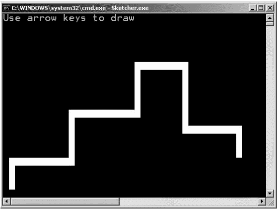

使用声明为 `System.Collections.Stack` 的变量 `path`，通过使用 `path.Push(currentPosition)` 将自定义类型 `Cell` 传递给 `Push()` 方法来保存上一步移动。如果用户输入 `Z`（或按下 Ctrl+Z），你通过使用 `Pop()` 从栈中检索它来撤销上一步移动，将光标位置设置为上一个位置，并调用 `Undo()`。

尽管这段代码是完善的，但 `System.Collections.Stack` 类有一个根本性的缺陷。如列表 12.1 所示，`Stack` 类收集 `object` 类型的值。由于公共语言运行时 `CLR` 中的每个对象都派生于 `object`，因此 `Stack` 无法验证你放入其中的元素是同质的还是属于预期的类型。例如，而不是传递 `currentPosition`（`X` 和 `Y` 之间用小数点连接的连接值）。然而，编译器必须允许这些不一致的数据类型，因为栈类被设计为接受任何对象，无论其更具体的类型是什么。

此外，当使用 `Pop()` 方法从栈中检索数据时，你必须将返回值强制转换为 `Cell`。但如果从 `Pop()` 方法返回的值类型不是 `Cell`，则会抛出异常。通过强制转换将类型检查推迟到运行时，你使程序变得更加脆弱。在不使用泛型的情况下创建可以处理多种数据类型的类，其根本问题在于它们必须与一个通用基类（或接口，通常是 `object`）一起工作。

在使用 `object` 的类中使用值类型（如 `struct` 或整数）会加剧装箱操作。例如，如果你将值传递给 `Stack.Push()` 方法，运行时会自动对其进行装箱。同样，当你检索一个值时，你需要显式地解箱数据，并将 `Pop()` 方法的对象引用强制转换为值类型。将引用强制转换为基类或接口对性能的影响微乎其微，但值类型的装箱操作会引入更多开销，因为它必须分配内存、复制值，并在稍后垃圾回收该部分内存。

C# 是一门鼓励类型安全的语言：该语言使得许多类型错误（例如将整数赋值给字符串类型的变量）可以在编译时被捕。根本问题是 `Stack` 类并不像 C# 程序预期的那样的是类型安全的。要更改 `Stack` 类以通过限制栈的内容为特定数据类型来强制类型安全（不使用泛型类型），你必须创建一个专门的栈类，如列表 12.3 所示。

## 列表 12.3：定义专门的栈类

```cs
public class CellStack
{
    public virtual Cell Pop();
    public virtual void Push(Cell cell);
    // ...
}
```

由于 `CellStack` 只能存储 `Cell` 类型的对象，因此此解决方案需要对栈方法进行自定义实现，这并不理想。实现一个类型安全的整数栈将需要另一个自定义实现；每个实现看起来都与其他实现非常相似。这将产生大量的重复、冗余代码。

## 初学者主题：值类型

另一个示例：可空值类型

第 3 章引入了在声明值变量时通过使用可空修饰符 `?` 来声明可以包含 `null` 变量的功能。C# 直到 2.0 版本才支持此功能。在泛型引入之前，由于实现需要泛型，程序员面临着两种基本选择。

不使用泛型实现可空类型的另一种策略是声明一个具有 `Value` 属性的类型，如列表 12.4 所示。

## 列表 12.4：声明包含 null 的值类型

```cs
struct NullableInt
{
    /// <summary>
    /// 提供值
    /// </summary>
    public object Value { get; set; }

    /// <summary>
    /// 指示是否存在值
    /// </summary>
    public bool HasValue { get; set; }
}

struct NullableGuid
{
    /// <summary>
    /// 提供值
    /// </summary>
    public Guid Value { get; set; }

    /// <summary>
    /// 指示是否存在值
    /// </summary>
    public bool HasValue { get; set; }
}
```

列表 12.4 显示了 `NullableInt` 和 `NullableGuid` 的可能实现。如果需要处理可空类型，将需要修改可空类型声明。

## 列表 12.5：具有 object 属性的可空类型

```cs
struct Nullable
{
    // ...
}
```

尽管这种方案在设置 `Value` 属性时运行时总是会装箱值类型。此外，从 `Value` 属性检索值需要强制转换，这在运行时可能是无效的。

两种方案都不太吸引人。为了消除这个问题，C#（实际上，可空类型被实现为泛型 `Nullable<T>`）。

## 泛型类型

泛型为创建可以特有化的数据结构提供了便利。程序员定义这些参数化类型，使得每个特定泛型变量具有相同的算法，但数据类型和方法签名可以根据提供的类型参数而异。

为了降低开发者的学习曲线，C# 选择了与 C++ 模板相似的语法。在 C# 中，泛型类和结构使用角括号在类型声明中声明泛型参数，在使用该类型时指定泛型类型参数。

```csharp
Console.SetCursorPosition(
    currentPosition.X, currentPosition.Y);
Undo();
break;
case ConsoleKey.DownArrow:
case ConsoleKey.UpArrow:
case ConsoleKey.LeftArrow:
case ConsoleKey.RightArrow:
// SaveState()
    currentPosition = new Cell(
        Console.CursorLeft, Console.CursorTop);
    // Only type Cell allowed in call to Push()
    path.Push(currentPosition);
    break;
default:
    Console.Beep(); // Added in C# 2.0
    break;
}
while (key.Key != ConsoleKey.X); // Use X to quit
```

列表 12.6 的结果显示在输出 12.2 中。

## 输出 12.2

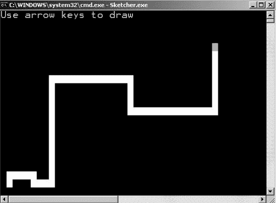

在列表 12.6 所示的 `path` 声明中，你声明了一个变量并用 `System.Collections.Generic.Stack<Cell>` 类的新实例对其进行初始化。你在尖括号中指定了栈元素的数据类型为 `Cell`。因此，每个添加到 `path` 中并从 `path` 中检索的对象都是 `Cell` 类型。反过来，你不再需要对 `path.Pop()` 的返回值进行类型转换，也不需要确保在 `Push()` 方法中只添加 `Cell` 类型的对象。

## 定义一个简单的泛型类

泛型允许你编写算法和模式，并为不同的数据类型重用代码。列表 12.7 创建了一个泛型 `Stack<T>` 类，它类似于列表 12.6 代码中使用的 `System.Collections.Generic.Stack<T>` 类。你在类名后的尖括号内指定了一个类型参数（在本例中为 `T`）。随后可以为泛型 `Stack<T>` 提供单个类型参数，该参数将替换类中出现的所有地方。因此，栈可以存储任何类型的项，而无需重复代码或将项转换为 `object` 类型。类型参数 `T` 是一个占位符，必须提供类型参数来填充它。在列表 12.7 中，你可以看到类型参数将用于内部的 `Items` 数组、`Push()` 方法的参数类型，以及 `Pop()` 方法的返回类型。

## 列表 12.7：声明泛型类 Stack<T>

```csharp
public class Stack<T>
{
    public Stack(int maxSize)
    {
        InternalItems = new T[maxSize];
    }

    // 在 C# 6.0 之前使用只读
    private T[] InternalItems { get; }

    public void Push(T data)
    {
        ...
    }

    public T Pop()
    {
        ...
    }
}
```

## 泛型的优点

与非泛型版本相比，使用泛型类（例如之前使用的 `System.Collections.Generic.Stack<T>` 类，而不是原始的 `System.Collections.Stack` 类型）有几个优势：

- 1. 泛型有助于提高安全性，防止参数化类中的成员使用除显式意图之外的数据类型。在列表 12.7 中，使用 `Stack<Cell>` 时，参数化栈类限制只能使用 `Cell` 数据。例如，`path.Push("garbage")` 语句会产生编译时错误，指示 `System.Collections.Generic.Stack<T>.Push(T)` 没有可以处理字符串的重载方法，因为字符串无法转换为 `Cell`。

- 2. 编译时类型检查减少了运行时发生 `InvalidCastException` 类型错误的概率。

- 3. 在泛型类成员中使用值类型不再会导致到 `object` 的装箱转换（boxing-conversion）。例如，`path.Pop()` 和 `path.Push()` 在拆箱或移除项时不需要对项进行装箱。

- 4. 在泛型类成员中使用值类型不再会导致到 `object` 的装箱。

- 5. 泛型不再需要类型转换，从而提高了性能。

- 6. 泛型通过避免装箱减少了内存消耗。

- 7. 由于不再需要类型检查，代码更具可读性。

- 8. 泛型允许你编写算法和模式，并为不同的数据类型重用代码。

泛型的核心是提供在任何出现类型参数的地方重用代码的能力。

泛型允许你编写算法和模式，并为不同的数据类型重用代码。

## 类型参数命名指南

正如为方法命名一样，在为泛型参数命名时，应尽可能具有描述性。此外，当你为泛型参数命名时，应使用有意义的名称。在定义泛型时，应使用 `T`。

## 泛型接口与结构体

C# 在整个语言中支持泛型，包括接口和结构体。声明泛型接口的语法与类相同，如 12.8 所示。

## 列表 12.8：声明泛型 IPair<T>

```csharp
interface IPair<T>
{
    T First { get; set; }
    T Second { get; set; }
}
```

此接口表示成对的对象，例如点的坐标或二叉树的节点。接口的类型参数。要实现接口，请使用与类相同的语法。注意在 12.9 中，该示例使用了结构体而不是类。

## 列表 12.9：实现泛型接口

```csharp
public struct Pair<T> : IPair<T>
{
    public T First { get; set; }
    public T Second { get; set; }
}
```

### 高级主题

## 在单个类中实现相同的接口

两个不同的泛型构造被视为不同的类型。因此，“相同的”泛型接口可以由类或结构体多次实现。考虑 12.10 中的示例。

## 列表 12.10：在单个类上重复接口

```csharp
public interface IContainer<T>
{
    ICollection<T> Items { get; set; }
}
```

```csharp
public class Person: IContainer<Address>,
IContainer<Phone>, IContainer<Email>
{
    ICollection<Address> IContainer<Address>.Items
    {
        get{...}
        set{...}
    }
    ICollection<Phone> IContainer<Phone>.Items
    {
        get{...}
        set{...}
    }
    ICollection<Email> IContainer<Email>.Items
    {
        get{...}
        set{...}
    }
}
```

在这个示例中，`Items` 属性通过带有不同类型参数的显式接口实现出现了多次。如果没有泛型，将是不可能的；相反，编译器只允许一个显式的 `IContainer.Items` 属性。

然而，这种实现同一接口多个版本的技术被许多开发者认为是一种“坏气味”（bad code smell），因为它可能会引起困惑（特别是当接口允许协变或逆变变时）。此外，`Person` 类可能设计不当；我们通常不认为人是“一个可以提供一组电子邮件地址的东西”。当你觉得需要让一个类实现三个版本的相同接口时，考虑是否通过实现三个属性（例如 `EmailAddresses`、`PhoneNumbers` 和 `MailingAddresses`），每个属性返回泛型接口的相应构造会更好。

## 定义构造函数和终结器

可能会惊讶的是，泛型类或结构体的构造函数（以及终结器）不需要类型参数；换句话说，不需要 `Pair<T>(){...}`。在列表 12.11 的示例中，构造函数是通过 `Pair(T first, T second)` 声明的。

## 列表 12.11：声明泛型类型的构造函数

```csharp
public struct Pair<T>: IPair<T>
{
    public Pair(T first, T second)
    {
        First = first;
        Second = second;
    }

    public T First { get; set; }
    public T Second { get; set; }
}
```

## 使用 default 运算符指定默认值

列表 12.11 包含一个接收 `First` 和 `Second` 初始值并将其赋值给它们的构造函数。由于 `Pair<T>` 是一个结构体，你提供的任何构造函数必须初始化所有字段和自动实现的属性。然而，这产生了一个问题。

考虑一个 `Pair<T>` 的构造函数，它在实例化时只初始化了二元组的一半。如列表 12.12 所示，定义这样一个构造函数会导致编译错误，因为字段 `Second` 在构造函数结束时仍未初始化。为 `Second` 提供初始化会带来一个问题，因为你不知道 `T` 的数据类型。如果它是一个可空类型，`null` 可以工作，但如果 `T` 是一个非可空类型，这种方法将不起行。

## 列表 12.12：未初始化所有字段导致编译错误


```csharp
public struct Pair<T>: IPair<T>
{
    // 错误：字段 'Pair<T>.Second' 必须在离开构造函数
    // 之前完全赋值
    // public Pair(T first)
    // {
    //     First = first;
    // }
    // ...
}
```


为了处理这种场景，C# 提供了 `default` 运算符。例如，`int` 的默认值可以通过 `default` 指定（假设使用 C# 7.1）。对于 `Second` 所要求的 `T` 来说，你可以使用 `default`，如列表 12.13 所示。

# 列表 12.13：使用 default 运算符初始化字段

```csharp
public struct Pair<T>: IPair<T>
{
    public Pair(T first)
    {
        First = first;
        Second = default;
    }

    //...
}
```

`default` 运算符可以为任何类型提供默认值，包括类型参数。

在 C# 7.1 之前，必须始终向 `default` 运算符传递类型参数，例如 `Second = default(T)`。然而，C# 7.1 包含了在可以推断出数据类型时在不指定参数的情况下使用 `default` 的选项。对于变量初始化或赋值，你可以使用 `Pair<T> pair = default` 来代替 `Pair<T> pair = default(Pair<T>)`。此外，如果方法返回 `int`，可以简单地返回 `default`，编译器将根据方法的返回值推断出 `default(int)`。其他可以进行此类推断的场景包括默认参数（可选）值和方法参数。

注意，所有可空类型都有 `null` 作为它们的默认值，例如可空泛型类型如 `default(T?)`。此外，所有引用类型的默认值都是 `null`。因此，如果在 C# 8.0 中启用了可空引用类型，向非可空引用类型分配 `default` 将导致警告。遗憾的是，在 C# 7.0 或早期版本中任何为引用类型分配 `default` 的代码在升级到支持 C# 8.0 可空性时都会产生警告。因此，在 C# 8.0 之前（显然在之后），除非预期 `null` 是一个有效值，否则应避免向引用类型分配 `default` 或 `null`。在可能的情况下，让变量保持未初始化状态，直到有值可以赋值。在列表 12.13 这样的情况下，由于构造函数中未知 `Second` 的适当值，对于引用类型或可空值类型，`Second` 避免将是 `null`；因此，当为泛型类型 `T` 的属性分配 `default`（可能为 `null`）时，会出现警告。为了妥善处理该警告，你需要将 `Second` 属性声明为类型 `T?`，并通过 `class/struct` 约束部分识别 `T` 是引用类型还是值类型。（事实上，这导致了更通用的指南：除非分配的类型被限制为类或结构体，否则不要在泛型类型上分配 `default`。）

# 引入泛型类型

## 多个类型参数

泛型类型可以声明任意数量的类型参数。初始的 `Pair<T>` 示例仅包含一个类型参数。为了支持存储对象的二元组（例如键/值对），你可以创建一个类型的新版本，声明两个类型参数，如列表 12.14 所示。

> 列表 12.14：声明带有多个类型参数的泛型

```csharp
interface IPair<TFirst, TSecond>
{
    TFirst First { get; set; }
    TSecond Second { get; set; }
}
public struct Pair<TFirst, TSecond>: IPair<TFirst, TSecond>
{
    public Pair(TFirst first, TSecond second)
    {
        First = first;
        Second = second;
    }
    TFirst First { get; set; }
    TSecond Second { get; set; }
}
```

当你使用 `Pair<TFirst, TSecond>` 时，在尖括号内提供多个类型参数。列表 12.15 演示了这一点。

### 列表 12.15：使用多个类型参数

```csharp
Pair<string, int> pair = ("Name", 42);
```

## 第12 章：泛型

正如你可能从框架库声明了八种泛型 `System.ValueTuple` 类型这一事实推推出的那样，CLR 类型系统不支持变长泛型（variadic generic types）。方法可以使用参数数组来接收任意数量的参数，但泛型类型没有相应的技术；每个泛型类型必须具有特定的元数（arity）。（参见“学者元组：丰富的元数”中的一个示例，那里你可能会想象到这样一种功能。）

### 嵌套泛型类型

包含性泛型上的类型参数将自动“级联”到任何嵌套类型。如果包含类型声明了类型 `T`（例如），那么所有嵌套类型也将是泛型的，且类型参数 `T` 也会在嵌套类型中可用。如果嵌套类型包含了它自己的类型参数 `T`，这将隐藏包含类型中的类型参数，并且嵌套类型中对 `T` 的任何引用都将指向嵌套的 `T` 类型参数。幸运的是，在嵌套类型内部重用相同的类型名称会导致编译器警告，以防止意外的重叠（参见列表 12.18）。

列表 12.18：嵌套泛型类型

```csharp
class Container<T1, T2>
{
    // 嵌套类继承类型参数。
    // 重用类型参数名称将导致
    // 警告。
    class Nested<T2>
    {
        void Method(T1 param0, T2 param1)
        {
        }
    }
}
```

包含类型的类型参数在嵌套类型中的访问方式，与包含类型的成员从嵌套类型中访问的方式相同。规则简单来说就是：类型参数在声明它的类型体内的任何地方都是可用的。

### 约束

#### 指南

避免使用嵌套类型中具有相同名称类型参数来遮蔽外层类型的类型参数。

#### 约束

泛型支持在类型参数上定义约束的能力。这些约束确保了作为类型参数提供的类型符合各种规则。例如，列表 12.19 所示的 `BinaryTree<T>` 类。

- 列表 12.19：声明一个无约束的 BinaryTree<T> 类

```csharp
public class BinaryTree<T>
{
    public BinaryTree (T item)
    {
        Item = item;
    }
    public T Item { get; set; }
    public Pair<BinaryTree<T>> SubItems { get; set; }
}
```

（一个有趣的旁注是，`BinaryTree<T>` 在内部是可能的，因为 `Pair<T>` 仅仅是另一个类型）。假设你希望树在赋值给 `SubItems` 属性时对 `Pair<T>` 值中的值进行排序。为了实现排序，`SubItems` setter 访问器使用了提供的键的 `CompareTo()` 方法，如列表 12.20 所示。

- 列表 12.20：需要类型参数支持接口

```csharp
public class BinaryTree<T>
{
    public BinaryTree (T item)
    {
        Item = item;
    }
    public T Item { get; set; }
    public Pair<BinaryTree<T>> SubItems
```


```csharp
get{ return _SubItems; }
set
{
  Comparable<...> first;
  // ：无法隐式转换类型...
  first = value.First; // 需要显式转换

  if (first.CompareTo(value.Second) < 0)
  {
    // first 小于 second
    // ...
  }
  else
  {
    // first 和 second 相同或
    // second 小于 first
    // ...
  }
  _SubItems = value;
}
```

在编译时，类型参数 `T` 是一个无约束的泛型。当代码如列表 12.20 所示被编写时，编译器假设 `T` 上的所有可用成员都继承自基类 `object`，因为每个类型都以 `object` 作为基类。因此，只有像 `ToString()` 这样的方法可以在类型参数 `T` 的实例上调用。结果是，编译器显示编译错误，因为 `CompareTo()` 方法在 `object` 类型上没有定义。

你可以将参数 `T` 强制转换为 `Comparable<T>` 接口以访问 `CompareTo()` 方法，如列表 12.21 所示。

列表 12.21：需要参数支持接口或抛出异常

```csharp
public class BinaryTree<T>
{
  public BinaryTree(T item)
  {
    Item = item;
  }

  public T Item { get; set; }
  public Pair<BinaryTree<T>?>? SubItems
{
    get { return _SubItems; }
    set
```

```csharp
{
  switch(value) {
    // 为了阐明删除了空处理

    // 使用 C# 8.0 模式匹配。切换到
    // C# 8.0 之前的检查
    case {
      First: {Item: IComparable<T> first},
      Second: {Item: T second };
      if(first.CompareTo(second) < 0) {
        // first 小于 second
      }
      else {
        // second 小于或等于 first
      }
      break;
      default:
        throw new InvalidCastException("无法排序项目。{typeof(T)} 不支持 IComparable<T>");
      _SubItems = value;
    }
  }
  private Pair<BinaryTree<T>?>? _SubItems;
}
```

遗憾的是，如果你声明了一个 `BinaryTree<SomeType>` 类变量，但类型参数（`SomeType`）没有实现 `Comparable<SomeType>` 接口，则没有办法对项目进行排序；反，我们抛出一个 `InvalidCastException`，指示该类型不支持所需的接口。这消除了使用泛型的关键原因：提高类型安全性。

为了避免这种情况，并在类型参数未实现接口时生成编译时错误，C# 允许你为泛型类型中声明的每个类型参数提供可选的约束列表。约束描述了泛型类型对每个类型参数提供的类型参数所要求的特征。你使用 `where` 关键字声明约束，后面跟着一个参数-要求对，其中该参数必须是泛型类型中声明的其中之一。要求描述了三种情况之一：存在性或指向接口。

### 第12 章：泛型

#### 接口约束

为了确保二叉树的节点顺序正确，你可以使用 `CompareTo()` 方法在 `BinaryTree<T>` 类中。为了这一点，你应该对 `T` 施加约束。

22 列表：声明接口约束

```csharp
public class BinaryTree<T>
    where T: IComparable<T>
{
    public BinaryTree (T item)
    {
        Item = item;
    }
    public T Item { get; set; }
    public Pair<BinaryTree<T>?> SubItems
    {
        get { return _SubItems; }
        set
            switch(value)
            {
                // 为了阐明删除了空处理
                // 使用 C# 8.0 模式匹配。切换到
                // C# 8.0 之前的检查
                case {
                  First:{Item: IComparable<T> first},
                  Second:{Item: T second };
                  if(first.CompareTo(second) < 0) {
                    // first 小于 second
                  }
                  else {
                    // second 小于或等于 first
                  }
                  break;
                  default:
                    throw new InvalidCastException("无法排序项目。{typeof(T)} 不支持 IComparable<T>");
                _SubItems = value;
            }
    }
    private Pair<BinaryTree<T>?>? _SubItems;
}
```

虽然此示例中的代码更改很小，但它将错误识别从运行时移动到了编译时，这是一个重要的区别。在 22 中给定接口约束后，编译器确保你每次使用 `BinaryTree<T>` 时都指定一个实现 `Comparable<T>` 的类型。此外，不再需要显式转换为 `Comparable<T>` 接口。在其他上下文中，如果不强制转换也会隐藏成员。当在类型为类型参数的值上调用方法时，编译器会检查该方法是否匹配任何声明为约束的接口。

如果你尝试使用 `System.Text.StringBuilder` 作为类型参数创建 `BinaryTree<T>` 变量，你将收到编译错误，因为 `StringBuilder` 没有实现 `IComparable<StringBuilder>`。该错误如输出 12.3 所示。

# 输出 12.3

```
CS0311: 类型 'System.Text.StringBuilder' 不能作为泛型类型或方法 'BinaryTree<T>' 的类型参数 'T'。没有从 'System.Text.StringBuilder' 到 'System.IComparable<System.Text.StringBuilder>' 的隐式引用转换。
```

#### 类型参数约束

有时你可能希望约束类型参数可转换为特定类型。你通过类型参数约束来实现，如列表 12.23 所示。

# 列表 12.23：声明类类型约束

```csharp
public class EntityDictionary<TKey, TValue>
    : System.Collections.Generic.Dictionary<TKey, TValue>
    where TKey : null
    where TValue : EntityBase
{
    ...
}
```

# 第 12 章：泛型

在列表 12.23 中，`EntityDictionary<TKey, TValue>` 要求为类型参数 `TValue` 提供的所有参数必须隐式转换为 `EntityBase` 类。通过要求这种转换，在泛型实现中就可以对 `TValue` 的值使用 `EntityBase` 的成员，因为约束将确保所有类型参数都被隐式转换为 `EntityBase` 类。

类约束的语法与接口类型约束相同，不同之处类约束必须出现在任何接口类型约束之前（就像在类声明中，基类必须出现在已实现的接口之前）。然而，与接口约束不同，不允许有多个基类约束，因为无法从多个无关的类中派生。同样，基类约束不能指定密封类（`sealed`）或非类类型。例如，C# 不允许将类型参数约束为 `string` 或 `System.Nullable<T>`，因为该参数将只有一种可能的类型参数——这违背了“泛型”的意义。如果类型参数被约束为单一类型，那么从根本就不需要类型参数；直接使用该类型即可。

某些“特殊”类型不能作为类约束。详参本章稍后的“高级主题：约束的局限性”。

从 C# 7.3 开始，你可以使用 `Enum` 作为约束，从而确保类型参数是一个枚举。然而，你不能将 `System.Array` 指定为数组。不过，后者的限制影响很小，因为无论如何其他集合类型和接口都是首选；请参见第 15 章。

## 高级主题

# 委托约束


C# 7.3 还增加了对使用 `System.Delegate`（以及 `System.MulticastDelegate`）的支持。这允许以类型安全的方式合并（使用静态 `Combine()` 方法）和分离（使用静态 `Remove()` 方法）委托。泛型类型没有一种强类型的方式来调用委托，但 `DynamicInvoke()` 方法可以实现这一点。它使用了反射。尽管泛型类型可以直接调用委托（而不通过 `DynamicInvoke()`），但在编译时通过对 `T` 的直接引用也是可以实现此的。例如，你可以调用 `Combine()` 方法并强制转换为预期的类型，如列表 12.24 中的模式匹配所示。

## 列表 12.24：声明带有 MulticastDelegate 约束的泛型

```csharp
static object InvokeAll<TDelegate>(
    object[] args, params TDelegate delegates)
    // 不允许对 Action/Func 进行约束
    where TDelegate : System.MulticastDelegate
{
    switch (Delegate.Combine(delegates))
    {
        case Action action:
            action();
            return null;
        case TDelegate result:
            return result.DynamicInvoke(args);
        default:
            return null;
    }
}
```

在此示例中，我们尝试在调用结果之前将其强制转换为 `Action`。如果该尝试失败，我们将强制转换为 `TDelegate` 并使用 `DynamicInvoke()` 调用结果。

注意在泛型外部我们会知道 `T` 的类型，因此在调用 `Combine()` 之后可以直接调用它：

```csharp
Action? result =
    (Action?)Delegate.Combine(actions);
result?.Invoke();
```

注意列表 12.24 中的注释。虽然 `System.Delegate` 和 `MulticastDelegate` 是支持的，但你不能指定特定的类型，如 `Action`、`Func<T>` 或相关类型之一。

### unmanaged 约束

C# 7.3 引入了 `unmanaged` 约束，它将类型参数限制为 `sbyte`、`byte`、`short`、`ushort`、`int`、`long`、`ulong`、`char`、`float`、`double`、`decimal`、`bool`、`enum`、`pointer` 或所有字段均为非托管的任何结构。这允许你对非托管约束类型参数执行如 `sizeof`（或 `stackalloc`，如第 22 章所述）的运算符。

在 C# 8.0 之前，`unmanaged` 约束将类型参数限制为构造的 `struct` 类型——即非泛型的值类型。

### notnull 约束

C# 8.0 引入了 `notnull` 约束，用于确保类型参数不为 `null`。在列表 12.23 中，`notnull` 约束会导致 `string` 类型触发警告。

### 结构与类约束

另一个有价值的约束是限制类型参数为 `struct` 或 `class`。如列表 12.25 所示：

```csharp
public struct Nullable<T>
    where T : class
{
    // ...
    public static implicit operator T(T value) => value;

    public static explicit operator T(T value);
}
```

```csharp
{
  // ...
  public TValue MakeValue(TKey key)
  {
    TValue newEntity = new TValue
    {
      Key = key;
    }
    Add(newEntity.Key, newEntity);
    return newEntity;
  }
  // ...
}
```

由于并不是所有对象都保证具有公共的默认构造函数，因此编译器不允许你在一个无约束的类型参数上调用默认构造函数。为了覆盖此编译器限制，可以在指定所有其他约束之后添加 `new()`。这种文本被称为构造函数约束，它要求对应于约束类型参数的类型参数必须具有公共或内部的默认构造函数。目前仅支持构造函数约束。你无法指定一种能够确保提供的类型参数提供带有形式参数的构造函数的约束。

列表 12.27 包含一个构造函数约束，强制要求为 `TValue` 提供的类型参数提供公共无参构造函数。没有约束可以强制类型参数提供带有其他形式参数的构造函数。例如，你可能希望约束 `TValue`，使得为其提供的类型参数必须提供一个 `TKey` 提供的类型参数所拥有的构造函数，但这是不可能的。列表 12.28 展示了无效代码。

## 列表 12.28：构造函数约束只能为默认构造函数指定

```csharp
public TValue New(TKey key)
{
  // 错误：'TValue'：无法提供参数
  // 在创建变量类型的实例时
  TValue newEntity = null;
  // newEntity = new TValue(key);
  Add(newEntity.Key, newEntity);
  return newEntity;
}
```


绕过此限制的一种方法是提供一个包含实例化该类型方法的工厂接口。实现该接口的工厂负责实例化实体，而不是由 `EntityDictionary` 自身（见列表 12.29）。

## 列表 12.29：使用工厂接口代替构造函数约束

```csharp
public class EntityBase<TKey>
{
    public EntityBase(TKey key)
    {
        Key = key;
    }
    public TKey Key { get; set; }
}
```

```csharp
public class EntityDictionary<TKey, TValue, TFactory> : 
Dictionary<TKey, TValue>
where TKey : IComparable<TKey>, IFormattable
where TValue : EntityBase<TKey>
where TFactory : IFactory<TKey, TValue>, new()
{
    public TValue New(TKey key)
    {
        TFactory factory = new TFactory();
        TValue newEntity = factory.CreateNew(key);
        Add(newEntity.Key, newEntity);
        return newEntity;
    }
}
```

```csharp
public interface IFactory<TKey, TValue>
{
    TValue CreateNew(TKey key);
}
```

这样的声明允许你将新键传递给一个带参数的 `TValue` 工厂方法，而不是强迫你依赖默认构造函数。它不再对 `TValue` 使用构造函数约束，因为 `TFactory` 负责实例化值。（对列表 12.29 中的代码的一项修改是缓存工厂方法的引用——如果需要多线程支持，可以利用 `Lazy<T>`。这将允许你重用工厂方法，而不是每次都重新实例化。）

类型为 `EntityDictionary<TKey,Value, TFactory>` 的变量声明将导致一个类似于列表 12.30 中 `Order` 实体的实体声明。

## 列表 12.30：在 EntityDictionary<...> 中声明要使用的实体

```csharp
public class Order : EntityBase<Guid>
{
    public Order(Guid key) :
    {
        base(key)
        // ...
    }
}

public class OrderFactory : IEntityFactory<Guid, Order>
{
    public Order CreateNew(Guid key)
    {
        return new Order(key);
    }
}
```

## 约束继承

泛型类型参数及其约束都不会被派生类继承，因为泛型类型参数不是成员。（记住，类继承是派生类拥有基类所有成员的属性。）创建继承自其他泛型的新泛型类型是一种常见做法。在这种情况下，由于派生泛型的类型参数变成了泛型基类的类型参数，因此类型参数必须具有与基类相等（或更强）的约束。困惑吗？考虑列表 12.31。

## 列表 12.31：显式指定的被继承的约束

```csharp
class EntityBase<T> where T : IComparable<T>
{
    // ...
}
```

```csharp
// 错误：
// 类型 'U' 必须转换为
// 'System.IComparable<U>' 才能作为参数
// 用于泛型类型或方法中的 'T'
```


```csharp
// class Entity<U> : EntityBase<U>
// {
//   ...
// }
```

在列表 12.31 中，`EntityBase<U>` 要求所提供的类型参数 `U` 实现 `IComparable<U>`。因此，`Entity<U>` 需要相同的约束。如果不这样做会导致编译错误。这种模式增加了程序员对基类的意识，避免了如果派生类继承时可能发生的困惑。我们还没有涵盖泛型方法；稍后会介绍。目前，只需了解约束是如何处理的（见列表 12.32）。

## 列表 12.32：禁止重复被继承的约束

```csharp
class EntityBase{
    public virtual void Method<T>(T t)
        where T : IComparable<T>
    {
        // ...
    }
}
class Order : EntityBase{
    public override void Method<T>(T t)
        // 成员不能重复
        where T : IComparable<T>
    {
        // ...
    }
}
```

在泛型类的情况下，派生类上的类型参数可以通过添加其他约束来进一步约束，不仅是基类的约束（要求的），还有其他约束。然而，重写泛型方法必须完全符合基类定义的约束。额外的约束可能会破坏多态性，因此是不允许的。

### 高级主题

## 约束限制

约束被适当限制以避免无意义的代码。例如，你不能将类类型约束与结构体约束结合，或者将 `null` 与任何类型约束结合。此外，你无法指定限制继承到特殊类型（对象、数组或 `System.ValueType`）的约束。如前所述，`System.Enum`(enum)、`System.Delegate` 和 `System.MulticastDelegate` 在 C# 7.3 中受支持。然而，你无法为特定的委托类型如 `Action`、`Func<>` 或相关类型设置约束。

在某些情况下，约束限制可能更理想，但它们仍然不支持。仅具有要求默认构造函数的能力就是一种限制。以下章节提供了一些不允许的约束示例。

### 不允许运算符约束

所有泛型都隐式允许 `==` 和 `!=` 比较，以及隐式转换为对象，因为一切都是对象。你无法将类型参数约束为实现特定方法或运算符的类型（上述情况之外），除非通过接口类型约束（方法）或类类型约束（方法和运算符）。因此，列表 12.33 中的泛型无法工作。

## 列表 12.33：约束表达式无法要求运算符

```csharp
public abstract class MathEx<T>
{
    public static T Add(T first, T second)
    {
        // 错误：运算符 '+' 无法应用于
        // 类型 'T' 和 'T' 的操作数
        return first * second;
    }
}
```

## 第 12 章：泛型

在这种情况下，该方法假设 `+` 运算符在所有可能作为 `T` 类型参数提供的类型上都是可用的。但并没有约束要求你提供的类型参数必须具有关联的加法运算符，因此会发生错误。遗憾的是，除了使用实现了加法运算符的类类型作为类型约束外，没有其他方法可以在约束内部指定需要加法运算符。

更通用地说，没有方法可以约束一个类型具有某个静态方法。

### 不支持 OR（或）标准

如果你为类型参数提供多个接口或类约束，编译器会假设约束之间存在 **AND（与）**关系。例如，在 `T : IComparable<T>, IFormattable` 中，该约束要求 `IComparable<T>` 和 `IFormattable` 都必须被支持。没有方法指定约束之间存在 **OR（或）**关系。因此，等于列表 12.34 的代码是不支持的。

## 列表 12.34：不允许使用 OR 关系组合约束

```
public class BinaryTree<T>
// 错误：不支持 OR
// where T: System.IComparable<T> || System.IFormattable
{
}
```

支持此功能将阻止编译器在编译时解析应该调用哪个方法。

## 泛型方法

之前，你已经看到当类型是泛型时，为类型添加方法是一件相对简单的事情；这种方法可以使用类型声明的泛型参数。你已经过这一点，例如在目前为止看到的泛型类示例中。

泛型方法使用泛型类型参数，就像泛型类型一样。它们可以在泛型类型或非泛型类型中声明。如果在泛型类型中声明，它们的类型参数与包含它的泛型类型的参数是不同的。方法的元数（类型参数的数量）是方法签名的一个额外区分特征。也就是说，只要方法的类型元数不同，拥有两个相同名称和形式参数类型的方法是合法的。要声明泛型方法，你按照声明泛型类型的方式指定泛型参数：在方法名后立即添加类型参数声明语法，如列表 12.35 中的 `MathEx.Max<T>` 和 `MathEx.Min<T>` 示例所示。

## 列表 12.35：定义泛型方法

```
public static class MathEx {
    public static T Max<T>(T first, params T[] values)
    where T : IComparable<T> {
        T maximum = first;
        foreach (T item in values) {
            if (item.compareTo(maximum) > 0) {
                maximum = item;
            }
        }
        return maximum;
    }

    public static T Min<T>(T first, params T[] values)
    where T : IComparable<T> {
        foreach (T item in values) {
            if (item.compareTo(minimum) < 0) {
                minimum = item;
            }
        }
        return minimum;
    }
}
```

在此示例中，方法是静态的，尽管这不是强制要求的。泛型方法像泛型类型一样，可以包含多个类型参数。元数（类型参数的数量）是方法签名的一个额外区分特征。

### 泛型方法类型推断

正如在使用泛型类型时在类型名之后提供类型参数一样，方法类型参数也位于方法类型名之后。调用 `Min<T>` 和 `Max<T>` 方法的代码如列表 12.36 所示。

## 列表 12.36：显式指定类型参数

```
Console.WriteLine(
MathEx.Max<int>(7, 490));
Console.WriteLine(
MathEx.Min<string>("R.O.U.S., "Fireswamp"));
```

列表 12.36 的结果出现在输出 12.4 中。

## 输出 12.4

```
490
Fireswamp
```

并不意外的是，类型参数 `int` 和 `string` 泛型方法调用中使用的实际类型。然而，指定类型参数是冗余的，因为编译器可以从传递给方法的形式参数推断出类型参数。显然，列表 12.36 中 `Max` 的调用者意图让类型参数为 `int`，因为两个方法参数都是 `int` 类型。为了避免冗余，在编译器能够逻辑上推断出你可能想要哪些类型参数的所有情况下，你可以从调用中排除类型参数。这种做法被称为方法类型推断，其示例出现在列表 12.37 中。结果出现在输出 12.5 中。

## 列表 12.37：从参数推断类型参数

```
Console.WriteLine(
MathEx.Max(7, 490)); // 无类型参数！
Console.WriteLine(
MathEx.Min("R.O.U.S., "Fireswamp"));
```

## 输出 12.5

```
490
Fireswamp
```


为了使方法类型推断成功，参数的类型必须与泛型方法的形式参数“匹配”，以便能够推断出所需的类型参数。一个值得考虑的问题是当发生矛盾推断会会什么。例如，当使用 `MathEx.Max(7.0, 490)` 调用 `Max<T>` 方法时，编译器可以从第一个参数推导出类型参数应该是 `double`，而从第二个参数推断出类型参数是 `int`——这是一个矛盾。在 C# 2.0 中，这种差异将产生错误。复杂的分析会注意到这种矛盾是可以解决的，因为每个 `int` 都可以转换为 `double`。C# 3.0 和 4.0 都改进了类型推断算法，允许编译器进行更复杂的分析。

在方法类型推断仍然不足以推断出应该使用的类型参数的情况下，你放弃推断并显式包含类型参数。

## 指定约束

泛型方法的类型参数可以以泛型类型相同的方式进行约束。例如，你可以限制方法的类型参数实现某个接口或转换为类类型。约束指定在参数列表和方法体之间，如列表 12.38 所示。

### 列表 12.38：泛型方法的约束

```
public class ConsoleTree {
    // 泛型方法 Show<T>
    public static void Show<T>(BinaryTree<T> tree, int indent)
    where T : IComparable<T>
    {
        Console.WriteLine("\n{0}",
            "" + "".PadLeft(5+indent, ' '),
            tree.Item.ToString());
        if (tree.SubItems.First != null)
            Show(tree.SubItems.First, indent+1);
        if (tree.SubItems.Second != null)
            Show(tree.SubItems.Second, indent+1);
    }
}
```

`Show<T>` 实现本身没有直接使用 `IComparable<T>` 接口的任何成员，因此你可能怀疑为什么需要该约束。然而，`BinaryTree<T>` 类确实需要这种约束（见列表 12.39）。

### 列表 12.39：需要 IComparable<T> 类型参数的 BinaryTree<T>

```
public class BinaryTree<T>
    where T: System.IComparable<T>
{
}
```

由于 `BinaryTree<T>` 类对其 `T` 有此约束，并且 `Show<T>` 将 `T` 作为对应类型参数的类型参数，因此 `Show<T>` 需要确保方法类型参数满足类的约束。

## 高级主题

### 泛型方法内部的转换

你应该小心使用泛型——特别是当专门使用它们来掩盖转换操作时。考虑以下方法，它将流转换为给定类型的对象：

```
public static T Deserialize<T>(
    Stream stream, IFormatter formatter)
{
    return (T)formatter.Deserialize(stream);
}
```

`object` 类型的数据。调用泛型版本的 `Deserialize()` 看起来如下所示：

```c
string greeting =
Deserialization.Deserialize<string>(stream, formatter);
```

这段代码的问题在于，对于该方法的调用者来说，`Deserialize<T>()` 似乎是类型安全的。然而，它仍然会代表调用者执行一次类型转换操作，就像这里展示的非泛型示例一样：

```
string greeting =
(string)Deserialization.Deserialize(stream, formatter);
```

该操作可能会在运行时失败；该方法可能并没有看起来那样类型安全。`Deserialize<T>` 方法之所以是泛型的，仅仅是为了向调用者隐藏类型转换的存在，这似乎是具有危险的欺骗性。让该方法是非泛型并返回 `object` 可能会更好，让调用者意识到它不是类型安全的。如果没有约束来验证类型转换的有效性，开发者在泛型方法中进行类型转换时应该小心。

> 指南
>
> 避免使用那些表面上并非类型安全的泛型方法来误导调用者。

# 协变与逆变

泛型类型新用户经常问的一个问题是，为什么 `List<string>` 类型的表达式不能赋值给 `List<object>` 类型的变量：如果字符串可以转换为 `object` 类型，那么字符串列表理理也应该与对象列表兼容。实际上，泛而言之，这既不是类型安全的，也不是合法的。如果你使用同一个泛型类使用不同的类型参数声明两个变量，那么这两个变量并不是类型兼容的，即使它们是从更具体的类型赋值给更通用的类型——换句话说，它们不是协变的。

协变（Covariant）是范畴论中的一个术语，但它的基本原理非常直观：假设两个类型 X 和 Y 具有某种特殊关系——即类型 X 的每一个值都可以转换为类型 Y。如果类型 `I<X>` 和 `I<Y>` 总是也具有这种相同的特殊关系，我们说“`I<T>` 在 T 上是协变的**”。在处理仅有一个类型参数的泛型类型时，该类型参数可以理解为我们只需说“`I<T>` 是协变的”。从 `I<X>` 到 `I<Y>` 的转换被称为协变转换。

例如，泛型类的两个实例 `Pair<Contact>` 和 `Pair<PdaItem>` 即使类型参数本身是兼容的，也不是类型兼容的。换句话说，编译器阻止了 `Pair<Contact>` 到 `Pair<PdaItem>` 的转换（隐式或显式），尽管 `Contact` 派自 `PdaItem`。同样，将 `Pair<Contact>` 转换为接口 `IPair<PdaItem>` 也会失败。示例参见列表 12.40。

### 列表 12.40：不同类型参数泛型之间的转换

```
// ...
// 错误: 无法将类型转换为 Pair<PdaItem> pair = (Pair<PdaItem>) new Pair<Contact>();
IPair<PdaItem> tuple = (IPair<PdaItem>) new Pair<Contact>();
```

但这不是合法的吗？为什么 `List<T>` 和 `Pair<T>` 不是协变的？列表 12.41 显示了如果 C# 语言允许无限制的泛型变型会发生什么。

### 列表 12.41：防止协变维持同质性

```
// ...
Contact contact1 = new Contact("Princess Buttercup");
Contact contact2 = new Contact("Inigo Montoya");
Pair<Contact> contacts = new Pair<Contact>(contact1, contact2);
```

```
// 这将产生一个错误：无法将类型转换为
// 但假设它允许
// IPair<PdaItem> pdaPair = (IPair<PdaItem>) contacts;
// 这是完全合法的但不是类型安全的
// pdaPair.First = new Address("123 Sesame Street");
```

`IPair<PdaItem>` 可以包含一个地址，但该对象是 `Pair<Contact>`，它只能包含地址，而不是其他内容。如果允许无限制的泛型协变，类型安全性将完全被破坏。

现在应该很清楚为什么字符串列表不能用作对象列表了。你不能向字符串列表中插入一个整数，但你却向对象列表中插入一个整数；因此，将字符串列表转换为对象列表必须是非合法的——这是一个编译器可以强制的错误。

## 使用 out 类型修饰符启用协变

你可能已经注意到，前面描述的作为无限制协变后果的两个问题出现，是因为泛型对和泛型列表允许其内容被写入。假设我们通过创建一个只读的 `IReadOnlyPair<T>` 接口来消除这种可能性，该接口仅将 `T` 暴露为接口的“输出”（即作为方法的返回类型或只读属性），而永远不“进入”它（即不作为形式参数或可写属性）。如果我们相对于 T 将自己限制在“仅输出”的接口，那么协变问题就不会发生（参见列表 12.42）。

### 列表 12.42：潜在可能的协变

```
interface IReadOnlyPair<T>
{
    T First { get; }
    T Second { get; }
}
interface IPair<T>
{
    T First { set; }
    T Second { set; }
}
public struct Pair<T> : IPair<T>, IReadOnlyPair<T>
{
    // ...
    class Program
    {
        static void Main()
        {
            // 错误：在没有 out 类型修饰符的情况下，理论上仅是可能的
            Pair<Contact> contacts =
                new Pair<Contact>(
                    new Contact("Princess Buttercup"),
                    new Contact("Inigo Montoya")
                );
            IReadOnlyPair<object> pair = contacts;
            DataItem pdaItem1 = pair.First;
            DataItem pdaItem2 = pair.Second;
        }
    }
}
```

*注：由于原文文本在列表 12.42 处似乎存在截断，此处根据上下文补全了缺失的逻辑结构以保持翻译连贯* 修正：由于原文文本在 12.42 之后存在错乱或截断，以下按逻辑恢复翻译：

在 C# 4.0 中引入。

### 列表 12.43：使用 out 修饰符的协变

```
interface IReadOnlyPair<out T>
{
    T First { get; }
    T Second { get; }
}
```

如果在 `IReadOnlyPair` 接口上使用 `out` 修饰符进行协变转换，编译器将验证 `T` 确实仅用于输出位置。

对于协变转换有几个重要的限制：

- 只有泛型接口和泛型委托（在 13 章描述）可以是协变的。泛型类和结构体不是协变的。
- 协变转换的源类型和目标泛型类型必须是引用类型。也就是说，`IReadOnlyPair<string>` 可以协变转换为 `IReadOnlyPair<object>`，因为两者都是引用类型。`IReadOnlyPair<int>` 不能转换为 `IReadOnlyPair<object>`，因为 `int` 不是引用类型。
- 接口或委托必须声明支持协变，并且编译器能够验证类型参数。

## 使用 in 类型参数启用逆变

协变“后向”被称为逆变。再次，假设两个类型 X 和 Y 存在某种关系，使得类型 X 的每一个值都可以转换为类型 Y。如果类型 `I<X>` 和 `I<Y>` 总是也具有相同的后向特殊关系——即类型 `I<Y>` 的每一个值都可以转换为 `I<X>`——我们说“`I<T>` 在 T 上是逆变的”。

大多数人发现逆变比协变更理解。逆变的经典示例是比较器（comparer）。假设你有一个派生类型 `Apple` 和一个基类型 `Fruit`。显然，它们具有特殊关系：类型 Apple 的每一个值都可以转换为 Fruit。

现在你有一个接口 `ICompareThings<T>`，它有一个方法 `firstIsBetter(T t1, T t2)`，接受两个 T 并返回一个布尔值，表示第一个是否优于第二个。

如果我们提供类型参数会发生什么？`ICompareThings<Apple>` 有一个方法接受两个 `Apple` 并对其进行比较。`ICompareThings<Fruit>` 有一个方法接受两个 `Fruit` 并对其进行比较。但由于每个 `Apple` 都是 `Fruit`，显然 `ICompareThings<Fruit>` 的值可以安全用于需要 `ICompareThings<Apple>` 的地方。转换的方向反转了——这个术语就是逆变。

令人惊讶的是，为了确保安全的逆变，与协变接口相反的限制是必要的。在一个类型参数上是逆变的接口必须将该类型参数仅用于输入位置，作为形式参数（或只写属性的类型，后者极罕见）。你可以通过使用 `in` 修饰符声明类型参数来标记接口为逆变，如列表 12.44 所示：

```
interface ICompareThings<in T>
{
    bool firstIsBetter(T t1, T t2);
}
```

### 第 12 章：泛型

### 列表 12.44：使用 `in` 类型参数修饰符实现逆变性

```c
class Fruit {}
class Apple : Fruit {}
class Orange : Fruit {}

interface ICompareThings<in T>
{
    bool FirstIsBetter(T t1, T t2);
}

class Program
{
    class FruitComparer : ICompareThings<Fruit>
        { ... }
        static void Main()
        {
            // 在 C# 4.0 及更高版本中
            ICompareThings<Apple> fc = new FruitComparer();
            Apple apple1 = new Apple();
            Apple apple2 = new Apple();
            Orange orange = new Orange();
            // 水果比较器可以比较苹果和橙子
            bool b1 = fc.FirstIsBetter(apple1, orange);
            bool b2 = fc.FirstIsBetter(apple1, apple2);
            // 这是非法的，因为该接口是
            // 逆变的
            ICompareThings<Apple> ac = fc;
            // 这是一个真正的水果比较器，因此它
            // 仍然可以比较两个苹果
            bool b3 = ac.FirstIsBetter(apple1, apple2);
        }
}
```

与协变支持一样，逆变性也使用类型参数修饰符：`in`，它出现在接口的类型参数声明中。它指示编译器检查 `T` 永远不会出现在属性的读取器（getter）或方法的返回类型中，从而为该接口启用逆变转换。

逆变转换具有之前描述的与协变相同的所有对应限制：它们仅对泛型接口和委托类型有效，发生变化的类型参数必须是引用类型，并且编译器必须能够验证该接口对于逆变转换是安全的。

## 协变与逆变性

一个接口可以在一个类型参数上是协变的，而在另一个类型参数上是逆变的，尽管这种情况下在实践中很少出现，除非是针对委托。例如，`Func<A1, A2, ..., R>` 委托系列族在返回类型 `R` 上是协变的，而在所有参数上都是逆变的。

最后，请注意编译器会在整个源文件中检查协变和逆变类型参数修饰符的有效性。考虑列表 12.45 中的 `PairInitializer<in T>` 接口。

### 列表 12.45：编译器对变性的验证

```csharp
// 错误：无效的变性；类型参数 'T' 不是
// 恒变的
interface IPairInitializer<in T>
{
    void Initialize(IPair<T> pair);
}

// 假设代码是合法的，看看会出现什么问题：
class FruitInitializer : IPairInitializer<Fruit>
{
    // 让我们用一个苹果和一个橙子
    // 初始化我们的水果对：
    public void Initialize(IPair<Fruit> pair)
    {
        pair.First = new Orange();
        pair.Second = new Apple();
    }
}

// ... 后面 ...
var f = new FruitInitializer();
// 如果逆变是合法的，这将是合法的：
IPairInitializer<Apple> a = f;
// 现在我们向一个苹果对写入了一个橙子：
a.Initialize(new Pair<Apple>());
```

粗浅的观察者可能会倾向于认为，由于 `IPair<T>` 仅作为输入形式参数使用，因此 `IPairInitializer` 上的逆变修饰符是有效的。然而，`IPair<T>` 接口无法安全地变化，因此它不能用可以变化的类型来构造。正如你所看到的，这将不是类型安全的，反之，编译器从根本上不允许 `IPairInitializer<T>` 接口被声明为逆变的。

## 数组对不安全协变的支持

到目前为止，我们将协变和逆变性描述为泛型类型的属性。在所有非泛型类型中，数组最像泛型；也就是说，就像我们有泛型的“T 列表”或泛型的“T 键对”一样，我们也可以把“T 数组”看作是展示了相同模式的示例。由于数组显然支持读取和写入，根据你对协变和逆变性的了解，你可能会认为数组既不是安全的协变的，也不是安全的逆变的。也就是说，你可能会想象，一个数组只有在从不被写入时才是安全的协变的，且只有在从不被读取时才是安全的逆变的——尽管这两种似乎都不像是现实的限制。


遗憾的是，C# 支持数组协变，尽管这样做并不是类型安全的。例如，`Fruit[] fruits = new Apple[10];` 在 C# 中是完全合。如果你接着包含表达式 `fruits[0] = new Orange();`，运行时将以异常的形式发布类型安全违规。将一个橙子赋值给水果数组并不总是合法的，这非常令人不安，因为这可能是一个苹果数组，但这种情况不仅出现在 C# 中，在所有使用运行时实现数组的 CLR 语言中都存在。

你应该尝试避免不安全的数组协变。每个数组都可以转换为只读的（因此是安全的协变的）接口 `IEnumerable<T>`；也就是说，`IEnumerable<Fruit> fruits = new Apple[10]` 既安全的又是合法的，因为如果你有一个只读接口，就无法向数组中插入橙子。

> 指南
>
> 避免不安全的数组协变。相反，将数组转换为只读接口 `IEnumerable<T>`，这是安全的。

# 泛型内部原理

鉴于前面的章节中关于泛型普及的讨论，得知泛型也支持方法、属性、类和委托并不令人感到意外。为了避免装箱（boxing），泛型对于值类型和引用类型的实现是不同的。

## 泛型的 CIL 表示

当泛型类被编译时，它与非泛型类没有显著区别。编译结果由元数据和 CIL 组成。例如，假设你有一个如 12.46 所示的简单 `Stack`。

### 列表 12.46：Stack<T> 声明

```csharp
public class Stack<T> where T : IComparable
{
    private T[] _items;
}
```

当你编译类时，生成的 CIL 看起来类似于 12.47。

### 列表 12.47：Stack<T> 的 CIL 代码

```il
.class private auto beforefieldinit
  Stack<'mcorlib]System.IComparable> T>
  extends [mcorlib]System.Object
```

第一个值得的项目是紧跟在 `Stack` 之后的 `1`。数字是元数（arity）：它声明了泛型类所需的类型参数数量。类似 `EntityDictionary<TKey, TValue>` 的声明元数为 2。

生成的 CIL 第二行显示了施加的约束。`T` 类型参数被装饰了 `IComparable` 接口。

如果你继续查看 CIL，你会发现项目的数组声明被更改为包含使用感叹号表示法的类型参数，这在支持泛型的 CIL 版本中。感叹号表示指定的第一个类型参数的存在，如 12.48 所示。

### 列表 12.48：使用感叹号支持泛型的 CIL

```il
.class public auto beforefieldinit
  'Stack'<'mcorlib]System.IComparable> T>
  extends [mcorlib]System.Object
{
    .field private !0[] _Items
}
```

## 基于值类型实例化泛型

当泛型第一次使用值类型作为参数时，运行时会创建一个专门的泛型类型，并将提供的类型参数相应放置在 CIL 中。因此，运行时为每个新的值类型创建新的专门的泛型类型。

例如，假设代码声明了一个由整数的 Stack，如 12.49 所示。

### 列表 12.49：Stack<int> 定义

```csharp
Stack<int> stack;
```

当第一次使用 `Stack<int>` 这种类型时，运行时会生成 `Stack` 类的特化版本，用类型参数替换其其类型参数。从以后，每当代码使用 `Stack<int>` 时，运行时都会复用已生成的特化 `Stack<int>` 类。在列表 12.50 中，你声明了两个 `Stack<int>` 实例，它们都使用运行时已经为 `Stack<int>` 生成了代码。

### 列表 12.50：声明类型为 Stack<int> 的变量

```
Stack<int> stackOne = new Stack<int>();
Stack<int> stackTwo = new Stack<int>();
```

如果在代码后续部分，你创建了另一个使用不同值替换类型参数的 Stack（例如 `long` 或用户定义的结构体），运行时将生成该泛型类型的另一个版本。特化值类型类的用处是具有更好的性能。此外，代码可以避免转换和装箱（boxing），因为每个特化泛型类都包含值类型。

### 高级主题

#### 基于引用类型的泛型实例化

泛型对于引用类型的工作略有不同。当第一次使用引用类型构造泛型类型时，运行时会在 CIL 中创建一个特化的泛型类型，用对象引用替换类型参数，而不是基于类型参数的特化泛型类型。此后每当使用引用类型参数实例化一个已构造的类型时，运行时都将复用之前生成的泛型类型版本，即使该引用类型与第一个引用类型不同。

例如，假设你有两个引用类型：`Customer` 类和 `Order` 类。接下来，你创建了 `EntityDictionary<Customer>` 类型：

```
EntityDictionary<Guid, Customer> customers;
```

在访问此类类之前，运行时会生成 `EntityDictionary` 类的特化版本，该版本不是将 `Customer` 存储为指定的数据类型，而是存储对象引用。假设下一行代码创建了另一个名为 `Order` 的引用类型的 `EntityDictionary`：

```
EntityDictionary<Guid, Order> orders =
new EntityDictionary<Guid, Order>();
```

与值类型不同，`EntityDictionary` 不会为使用 `Order`的类型创建一个新的特化版本。相反，它会实例化使用对象引用的 `EntityDictionary` 实例，并将 `orders` 变量设置为该实例。

为了仍然获得类型安全的优势，对于每个替换类型参数的对象引用，都会专门为 `Order` 类型分配一个内存区域，并将指针设置为该内存引用。假设你随后遇到这样一行代码，用于实例化一个 `Customer` 类型的 `EntityDictionary`：

```
customers = new EntityDictionary<Guid, Customer>(),
```

与之前使用 `Order` 类型创建的 `EntityDictionary` 类一样，系统会实例化另一个特化 `EntityDictionary` 类实例（基于对象引用的那个），并将其包含的指针设置为专门引用 `Customer` 类型。这种泛型实现减少了代码膨胀，因为它确保编译器只为引用泛类型的泛型类创建一个特化类。

尽管当泛型引用类型上的类型参数变化时，运行时使用相同的泛型类型定义，但如果类型参数是值类型，这种行为会被取代。例如，`Dictionary<int, Customer>`、`Dictionary<Guid, Order>` 和 `Dictionary<long, Order>` 将需要新的类型定义。

#### 语言对比：Java—泛型

Java 中泛型的实现完全发生在编译器内部，而不是在 Java 虚拟机内部。最初开发 Java 的 Sun Systems 公司（在 Oracle 接管它很久以前）采用这种方法，是为了确保不需要因为使用了泛型而分发更新的 Java 虚拟机。

Java 的实现使用了类似于 C++ 和 C# 泛型的语法，包括类型参数和约束。然而，由于它没有对值类型和引用类型进行区别对待，因此未经修改的 Java 虚拟机不支持值类型的泛型。

#### 总结

因此，Java 中的泛型在执行效率方面没有提供像 C# 中那样的增益。事实上，每当 Java 编译器需要返回数据时，它会从指定的约束（如果已声明）或基础 `Object` 类型（如果未声明约束）注入自动向下转换（downcasts）。此外，Java 编译器在编译时生成单个特化类，并用它来实例化任何构造类型。最后，由于 Java 虚拟机不支持原生泛型，因此无法在执行期间确定泛型类型实例的类型参数，且反射的其他用法也受到严重限制。

#### 总结

C# 2.0 中泛型类型和方法的添加，从根本上改变了 C# 开发者的编码风格。在程序员在 C# 1.0 代码中使用 `object` 的所有情况下，泛型在 C# 2.0 中都是更好的选择。在现代 C# 程序中，使用 `object`（特别是在任何集合类型的上下文中）应该让你考虑是否使用泛型解决问题会更好。消除类型转换带来的类型安全性提升、消除装箱性能开销以及减少重复代码，都是重大的改进。

第 15 章将更多关注最通用的泛型命名空间 `System.Collections.Generic`。正如名称所示，该命名空间完全由泛型类型组成。它提供了清晰的示例，说明某些最初使用 `object` 的类型是如何被转换为使用泛型的。然而，在处理这些主题之前，我们将调查表达式，它为 C# 3.0（及更高版本）处理集合提供了一项重大改进。

本页特意留空

# 13 委托和 Lambda 表达式

前面的章节详细讨论了如何创建类来封装数据以及对数据的操作。随着你创建的类越来越多，你将看到它们类之间关系中的常见模式。一种常见模式是将对象传递给方法，仅仅是为了让该方法反过来调用该对象上的方法。例如，如果你将一个 `IComparer` 引用传递给方法，那么被调用的方法很有可能会调用你提供的对象的 `Compare()` 方法。在这种情况下，接口仅仅是传递一个可以调用的单个方法引用的方式。考虑第二个示例，你调用了一个新进程。理想情况下，你不想在进程完成时阻塞或反复检查（轮询），而是希望让方法异步运行，然后调用一个回调函数，被调用的方法将在异步调用完成后调用该回调函数以通知调用者。

每次想传递方法时都定义一个新接口似乎没有必要。在本章中，我们描述了如何创建和使用一种称为“委托”（delegate）的特殊类，它允许你像对待任何其他数据一样对待方法的引用。然后，我们还展示了如何使用 Lambda 表达式快速、方便地创建自定义委托实例。Lambda 表达式是在 C# 3.0 中添加到语言中的；之前的版本 C# 2.0 支持一种不那么优雅的用于创建自定义委托的语法，称为“匿名方法（anonymous methods）”。C# 2.0 之后的每个版本为了向后兼容都支持匿名方法，但在新代码中，应该弃用匿名方法并转而使用 Lambda 表达式。本章包含了“高级主题”块，描述了如何在使用您需要处理遗留 C# 2.0 代码的情况下使用匿名方法；如果您只处理新代码，可以很大忽略这些部分。

我们通过对表达式树的讨论结束本书，表达式树允许你在运行时使用编译器对 Lambda 表达式的分析。

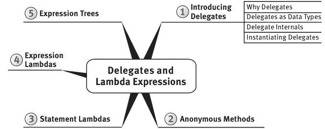

# 引入委托

C 和 C++ 老程序员长期以来使用指针作为将方法引用作为另一个方法的参数的机制。C# 通过委托实现了类似的功能。委托允许你捕捉方法的引用并像传递其他对象一样传递它，并像调用其他方法一样调用捕获的方法。让我们考虑一个说明这种技术可能实用的示例。

## 定义场景

虽然效率不高，但最简单的排序算法之一是泡泡排序。列表 13.1 显示了 `BubbleSort()` 方法。

### 列表 13.1：BubbleSort() 方法

```
static class SimpleSort1
{
    public static void BubbleSort(int[] items)
    {
        int i;
        int j;
        int temp;
```

```csharp
if(items==null)
{
  return;
}
for (i = items.Length - 1; i >= 0; i--)
{
  for (j = 1; j <= i; j++)
  {
    if (items[j - 1] > items[j])
    {
      temp = items[j - 1];
      items[j - 1] = items[j];
      items[j] = temp;
    }
  }
}
// ...
```

该方法将按升序排序一个整数数组。假设你需要对列表 13.1 中的整数进行升序或降序排序。你可以复制代码并将大于运算符（`>`）替换为小于运算符（`<`），但为了更改单个运算符而复制几十行代码似乎不是一个好主意。作为一种更简洁的替代方案，你可以传递一个额外的参数来指示如何执行排序，如列表 13.2 所示。

### 列表 13.2：BubbleSort() 方法，升序或降序

```csharp
class SimpleSort2
{
  public enum SortType
  {
    Ascending,
    Descending
  }
  public static void BubbleSort(int[] items, SortType sortOrder)
  {
    int i;
    int j;
    int temp;
    if(items==null)
    {
      return;
    }
```

# 第 13 章：委托与 Lambda 表达式

```csharp
for (i = items.Length - 1; i >= 0; i--)
{
    for (j = 1; j <= i; j++)
    {
        bool swap = false;
        switch (sortOrder)
        {
            case SortType.Ascending:
                swap = items[j - 1] > items[j];
                break;
            case SortType.Descending:
                swap = items[j - 1] < items[j];
                break;
        }
        if (swap)
        {
            temp = items[j - 1];
            items[j - 1] = items[j];
            items[j] = temp;
        }
    }
}
// ...
```

然而，这段代码仅处理了可能的排序顺序中的两种。如果你想按字典序排序（即 1, 10, 11, 12, 2, 20, ...），或通过其他标准进行排序，没过多久，`SortType` 值的数量和对应的 `switch` 情况就会变得繁琐。

## 委托数据类型

为了增加上述代码列表的灵活性并减少代码重复，你可以将比较方法作为 `BubbleSort()` 方法的参数。要将方法作为参数传递，需要一种数据类型来表示该方法；这种数据类型通常被称为委托（delegate），因为它将调用“委托”给了另一个方法。你可以使用方法名作为委托实例。而且，从 C# 3.0 开始，你还可以使用 Lambda 表达式作为委托，以便“现场”表达一段简短代码，而不是为它创建一个方法。（在 C# 7.0 中，你可以创建一个本地函数，然后使用函数名作为委托）。列表 13.3 包含了对 `BubbleSort()` 方法的修改，该方法接受一个 Lambda 表达式参数。在这种情况下，委托数据类型是 `Func<int, int, bool>`。

### 列表 13.3：带有委托参数的 BubbleSort()

```csharp
class DelegateSample
{
    // ...
    public static void BubbleSort(
        int[] items, Func<int, int, bool> compare)
    {
        int i;
        int j;
        int temp;

        if(compare == null)
        {
            throw new ArgumentNullException(nameof(compare));
        }

        if(items==null)
        {
            return;
        }

        for (i = items.Length - 1; i >= 0; i--)
        {
            for (j = 1; j <= i; j++)
            {
                if (compare(items[j - 1], items[j]))
                {
                    temp = items[j - 1];
                    items[j - 1] = items[j];
                    items[j] = temp;
                }
            }
        }
    }
    // ...
}
```

类型为 `Func<int, int, bool>` 的委托表示一个比较两个整数的方法。在 `BubbleSort()` 方法内部，你随后使用由 `compare` 参数引用的 `Func<int, int, bool>` 实例来确定哪个整数较大。由于 `compare` 代表一个方法，调用该方法的语法与调用任何其他方法相同。在这种情况下，`Func<int, int, bool>` 委托接受两个整数参数，并返回一个布尔值，用指示第一个整数是否大于第二个整数：

`if (compare(items[j - 1], items[j])) { ... }`

注意，`Func<int, int, bool>` 委托是强类型的，用于表示一个接受两个整数参数并返回 `bool` 的方法。与任何其他方法调用一样，对委托的调用也是强类型的，如果参数的数据类型与参数不兼容，C# 编译器将报告错误。

## 声明委托类型


你刚刚看到了如何定义一个使用委托的方法，你看到了如何定义一个使用委托的方法，你学习了如何调用委托。然而，你还没有学习如何声明委托。要声明委托，你使用 `delegate` 关键字，后面跟着返回类型、委托名称和参数列表。

```csharp
public delegate bool Compare(int x, int y);
```

`Compare` 委托现在是一个类型，表示任何接受两个整数并返回 `bool` 的方法。你现在可以声明类型为 `Compare` 的变量，并为它们分配签名的方法。

```csharp
Compare myCompare = (x, y) => x > y;
```

# 第 13 章：委托与 Lambda 表达式

该项。相比之下，我们的 `BubbleSort()` 示例接受两个参数以用于比较它们，因此使用了 `Func<int, int, bool>` 而不是谓词类型。

> 指南
>
> 请**考虑**定义自定义委托类型带来的可读性益处是否大于使用预定义的泛型委托类型带来的便利性。

## 高级主题

### 声明委托类型

在许多情况下，Microsoft .NET Framework 3.5 以及随后的 .NET Standard 中引入的 `Func` 和 `Action` 委托几乎消除了对定义自定义委托类型的需求。然而，当定义自定义类型可以显著提高代码可读性时，你应该考虑声明自己的委托类型。例如，一个名为 `Comparer` 的委托显式地指示了委托的用途，而 `Func<int, int, bool>` 仅标识委托的参数和返回类型。列表 13.5 显示了如何声明需要两个整数并返回布尔值的 `Comparer` 委托类型。

### 列表 13.5：声明委托类型

```csharp
public delegate bool Compar (
    int first, int second);
```

由于有了新的委托数据类型，你可以更新列表 13.3 的签名，用 `Comparer` 替换 `Func<int, int, bool>`：

```csharp
public static void BubbleSort(int items, Comparer compare)
```

正如类可以嵌套在其他类中一样，委托也可以嵌套在类中。如果委托的声明出现在另一个类内部，则该委托类型将是一个嵌套类型，如列表 13.6 所示。

### 列表 13.6：声明嵌套委托类型

```csharp
class DelegateSample{
    public delegate bool ComparisonHandler (
        int first, int second);
}
```

在这里，数据类型将是 `DelegateSample.ComparisonHandler`，因为它被定义为 `DelegateSample` 内部的嵌套类型。当预计仅在包含类内部需要使用时，应考虑使用嵌套。

## 实例化委托

在用委托实现 `BubbleSort()` 方法的最后一步中，你将调用该方法和一个委托实例——特别是类型为 `Func<int, int, bool>` 的实例。要实例化委托，你需要一个参数和返回类型都与委托本身签名匹配的方法。方法的名称不需要与委托的名称匹配，但方法的其他部分必须与委托签名兼容。列表 13.7 显示了与委托类型兼容的大于方法的代码。

### 列表 13.7：声明与 Func<int, int, bool> 兼容的方法

```csharp
class DelegateSample{
    public static void BubbleSort(
        int[] items, Func<int, int, bool> compare)
{
        // ...
    }
    public static bool GreaterThan(int first, int second)
{
        return first > second;
    }
    // ...
}
```

定义此方法后，你可以调用 `BubbleSort()` 并将要被委托捕获的方法作为参数提供，如列表 13.8 所示。

### 列表 13.8：使用方法名作为参数

```csharp
class DelegateSample
{
    public static void BubbleSort(
        int[] items, Func<int, int, bool> compare)
    {
        // ...
    }

    public bool GreaterThan(int first, int second)
    {
        return first > second;
    }

    static void Main()
    {
        int i;
        int[] items = new int[5];

        for (i=0; i < items.Length; i++)
        {
            Console.Write("Enter an integer: ");
            items[i] = int.Parse(Console.ReadLine());
        }

        BubbleSort(items, GreaterThan);

        for (i = 0; i < items.Length; i++)
        {
            Console.WriteLine(items[i]);
        }
    }
}
```

注意，委托是引用类型，但你并不一定需要实例化。在 C# 2.0 及更高版本中，从方法组（命名方法的表达式）到委托类型的转换会自动创建一个新的委托对象。

## 高级主题

### C# 1.0 中的委托实例化

在列表 13.8 中，实例化通过简单将所需的方法名 `GreaterThan` 作为参数传递给 `BubbleSort()` 方法调用来实现。C# 的第一个版本需要对委托进行实例化，使用列表 13.9 所示的更详细的语法。

### 列表 13.9：在 C# 1.0 中将委托作为参数传递

```csharp
BubbleSort(items,
    new Comparer(GreaterThan));
```

在这种情况下，我们使用 `Comparer` 而不是 `Func<int, int, bool>`，因为后者在 C# 1.0 中不可用。随后的版本支持这两种语法；在书的剩余部分中，我们将只展示现代、简洁的语法。

## 高级主题

### 委托内部机制

委托实际上是一种特殊的类。虽然 C# 标准没有规定类层次结构，但委托必须直接或间接地继承自 `System.Delegate`。事实上，在 .NET 中，委托类型始终继承自 `System.MulticastDelegate`，而后者又继承自 `System.Delegate`，如图 13.1 所示。


FIGURE 13.1：委托类型模型

第一个属性类型为 `System.Reflection.MethodInfo`。`MethodInfo` 描述方法的签名，包括其名称、参数和返回类型。除了 `MethodInfo` 外，委托还需要包含方法的实例 `Target`。在静态方法的情况下，`Target` 为 `null`。`MulticastDelegate` 的用途将在第 14 章讨论。

注意，委托是不可变的；也就是说，一旦创建无法更改。如果你有一个指向委托的变量并想引用不同的方法，必须创建一个新委托并将其赋值给变量。

虽然所有委托类型都间接继承自 `System.Delegate`，但 C# 编译器不允许你声明一个直接继承自该类的类。传递委托来指定排序是一种在本章开头描述的更灵活策略。通过传递委托，只需添加另一种委托即可将排序更改为字母顺序。

### 列表 13.11：使用不同的 Func<int, int, bool>

```csharp
using System;
class DelegateSample
{
    public static void BubbleSort(
        int[] items, Func<int, int, bool> compare)
    {
        int i;
        int j;
        int temp;
        for (i = items.Length - 1; i >= 0; i--)
        {
            for (j = 1; j <= i; j++)
            {
                if (compare(items[j - 1], items[j]))
                {
                    temp = items[j - 1];
                    items[j - 1] = items[j];
                    items[j] = temp;
                }
            }
        }
    }

    public static bool GreaterThan(int first, int second)
    {
        return first > second;
    }

    public static bool AlphabeticalGreaterThan(
int first, int second)
    {
        int comparison;
        comparison = (first.ToString()).CompareTo(
            second.ToString());

        return comparison > 0;
    }

    static void Main(string[] args)
    {
        int i;
        int[] items = new int[5];

        for(i=0; i<items.Length; i++)
        {
            Console.Write("Enter an integer: ");
            items[i] = int.Parse(Console.ReadLine());
        }

        BubbleSort(items, AlphabeticalGreaterThan);

        for (i = 0; i < items.Length; i++)
        {
            Console.WriteLine(items[i]);
        }
    }
}
```

# 600 第 13 章：委托与 Lambda 表达式

# 输出 13.1

```
Enter an integer: 1
Enter an integer: 12
Enter an integer: 13
Enter an integer: 4
1
12
13
4
5
```

字母顺序与数字顺序是不同的。尽管如此，请注意与章节开头使用的过程相比，添加此额外的排序机制是多么简单。创建字母顺序排序的唯一更改是：添加了 `AlphabeticalGreater` 方法，然后将该方法传递给 `BubbleSort()` 的调用。

## Lambda 表达式

在列表 13.7 和 13.11 中，我们看到可以将 `GreaterThan` 和 `AlphabeticalGreaterThan` 表达式转换为与具名方法的参数类型和返回类型相兼容的委托类型。你可能已经注意到，`GreaterThan` 方法的声明（即说明它是一个公共的、静态的、返回 `bool` 方法，并带有两个 `int` 类型的参数 `first` 和 `second`）要比方法体大得多，而方法体仅仅比较了它的参数并返回结果。遗憾的是，仅仅为了能将其转换为委托类型，如此简单的方法就需要大量的代码包围。

为了解决这个问题，C# 2.0 引入了更紧凑的委托创建语法，而 C# 3.0 引入了比 C# 2.0 更加紧凑的语法。C# 2.0 的特性称为**匿名方法**。在提到任何一种语法时，我们统称它们为**匿名函数**。两种语法仍然合法，但对于新代码，Lambda 表达式语法优于匿名方法语法。在本书中，除非专门地描述 C# 2.0 匿名方法，否则我们通常都使用 Lambda 表达式语法。

## 语句 Lambda

Lambda 表达式本身分为两种类型：语句 Lambda（statement lambdas）和表达式 Lambda（expression lambdas）。图 13.2 显示了这些术语之间的层次关系。

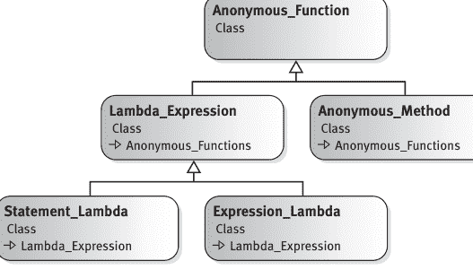

图 13.2：匿名函数术语

## 语句 Lambda

Lambda 表达式的作用是，当你需要从非常简单的方法创建委托时，消除声明整个新成员的麻烦。Lambda 表达式存在多种形式。例如，一个语句 Lambda 由形式参数列表、紧随其后的 Lambda 运算符 `=>` 以及随后的代码块组成。

列表 13.12 显示了与列表 13.8 中的 `BubbleSort` 调用等效的功能，不同之处在于列表 13.12 使用了语句 Lambda 来表示比较方法，而不是创建一个 `GreaterThan` 方法。如你所见，在 `GreaterThan` 方法声明中出现的许多信息现在都包含在语句 Lambda 中；形式参数声明和代码块是相同的，但缺少了方法名及其修饰符。

列表 13.12：使用语句 Lambda 创建委托

```
BubbleSort(items,
(int first, int second) =>
{
return first < second;
}
// ...
```

在阅读包含 Lambda 运算符的代码时，你会将 Lambda 运算符替换为“go/goes to”（进入/变为）”。例如，在列表 13.12 中，你会把第二个 `BubbleSort()` 参数读作“整数 `first` 并返回 `first` 小于 `second` 的结果”。

注意列表 13.12 中的语法与列表 13.8 中的几乎相同，区别在于比较方法现在是在其转换为委托类型的局部找到的，而不是在其他处找到并通过名称查找。方法名缺失了，这解释了为什么此类方法被称为匿名函数。返回类型缺失了，但编译器可以看到该 Lambda 表达式正在转换为一个签名要求返回类型 `bool` 的委托。编译器验证了语句 Lambda 块中每个 `return` 语句的表达式。


列表 13.12 中的语法与列表 13.8 中的几乎相同，区别在于比较方法现在是在其转换为委托类型的局部找到的，而不是在其他处找到并通过名称查找。方法名缺失了，这解释了为什么此类方法被称为匿名函数。返回类型缺失了，但编译器可以看到该 Lambda 表达式正在转换为一个签名要求返回类型 `bool` 的委托。编译器验证了语句 Lambda 块中每个 `return` 语句的表达式。

## 语句 Lambda

语句 Lambda 语法已经比对应的方法声明要简洁得多了；正如我们所见，它不需要声明方法名、访问修符、返回类型或参数类型。然而，通过使用表达式 Lambda，我们可以变得更加简洁。在列表 13.12、13.13 和 13.14 中，我们看到了块体由单个 `return` 语句组成的语句 Lambda。如果我们消除该语句周围的包围呢？此类 Lambda 块中唯一的相关信息就是返回的表达式。表达式 Lambda 只包含该返回的表达式，完全没有语句块。列表 13.16 与列表 13.12 相同，只是使用的是表达式 Lambda 而不是语句 Lambda。

列表 13.16：使用表达式 Lambda 传递委托

```
// ..
BubbleSort(items, first, second) => first < second);
// ..
```

通常情况下，你会按照读取语句 Lambda 的方式，将表达式 Lambda 中的 Lambda 运算符 `=>` 读作“go/goes to”（进入/变为），尽管在那些委托是谓词的情况下，人们通常将 Lambda 运算符读作“such that”（使得）或“where”（当……时）。因此，你可能会把列表 13.16 中的 Lambda 读作“`first` 和 `second` 并返回 `first` 小于 `second` 的结果”。

语句 Lambda 语法已经比对应的方法声明要简洁得多了。正如列表 13.13 所示，我们可以推断类型为 `int`。

列表 13.13：省略参数类型的语句 Lambda

```
BubbleSort(items,
(first, second) =>
{
return first < second;
}
// ...
```

## 指南

当类型对读者显而易见或无关紧要时，可以省略 Lambda 的类型。

减少语法的另一种方法是，如列表 13.14 所示，如果 Lambda 恰好有一个参数，可以省略参数列表。如果有零个参数或多个参数，或者单个参数是显式类型的，则 Lambda 必须带有参数列表。

列表 13.14：具有单个参数的语句 Lambda

```csharp
using System.Collections.Generic;
using System.Diagnostics;
using System.Linq;
// ...
IEnumerable<Process> processes = Process.GetProcesses().Where(process => process.WorkingSet64 > 1000000000);
```

在列表 13.14 中，`Where()` 方法返回内存占用大于 1000000000 字节的进程。将其与无参数语句 Lambda 13.15 对比。注意在列表 13.15 中，语句 Lambda 体在大括号内包含多个语句。虽然语句 Lambda 可以包含任意数量的语句，但通常语句 Lambda 在块中只使用二三个语句。

# 第 13 章：委托与 Lambda 表达式

列表 13.15：无参数语句 Lambda

```csharp
// ..
Func<string> getUserInput =
    () =>
    {
        string input;
        do
        {
            input = Console.ReadLine();
        }
        while (input.Trim().Length == 0);
        return input;
    };
// ..
```

## 表达式 Lambda

语句 Lambda 语法已经比对应的方法声明要简洁得多了；正如我们所见，它不需要声明方法名、访问修符、返回类型或参数类型。然而，通过使用表达式 Lambda，我们可以变得更加简洁。在列表 13.12、13.13 和 13.14 中，我们看到了块体由单个 `return` 语句组成的语句 Lambda。如果我们消除该语句周围的包围呢？此类 Lambda 块中唯一的相关信息就是返回的表达式。表达式 Lambda 只包含该返回的表达式，完全没有语句块。列表 13.16 与列表 13.12 相同，只是使用的是表达式 Lambda 而不是语句 Lambda。

列表 13.16：使用表达式 Lambda 传递委托

```csharp
// ..
BubbleSort(items, first, second) => first < second);
// ..
```

通常情况下，你会按照读取语句 Lambda 的方式，将表达式 Lambda 中的 Lambda 运算符 `=>` 读作“go/goes to”（进入/变为），尽管在那些委托是谓词的情况下，人们通常将 Lambda 运算符读作“such that”（使得）或“where”（当……时）。因此，你可能会把列表 13.16 中的 Lambda 读作“`first` 和 `second` 使得 `first` 小于 `second` 的结果”。

与空字面量一样，匿名函数没有与其关联的类型；相反，它的类型是由它被转换到的类型决定的。换句话说，我们目前为止看到的 lambda 表达式本质上并不属于 `Func<int, int, bool>`（或 `Comparer`）类型，但它们与可以转换为该类型的类型兼容的。因此，你不能对匿名方法使用 `typeof()` 运算符，并且只有在将匿名方法转换为特定类型之后，才可能调用 `GetType()`。

表 13.1 提供了额外的 lambda 表达式特性。

# 表 13.1：Lambda 表达式说明与示例

| 语句 | 示例 |
| --- | --- |
| Lambda 表达式本身没有类型。无法从 lambda 表达式直接访问任何成员——包括 object 的方法。 | // ERROR: Operator ".cannot be applied to // operand of type "lambda expression" //string s = ((int) x) => x).ToString(); |
| Lambda 表达式没有类型，且不能出现在 `is` 运算符的左侧。 | // ERROR: The first operand of an "is" or "as // operator may not be a lambda expression or // anonymous method //bool b = ((int) x) => x) is Func<int, int, bool>; |
| Lambda 表达式可以转换为兼容的委托；这里一个返回 int 的 lambda 表达式可能无法转换为表示返回 bool 方法的委托类型。 | // ERROR: Lambda expression is not compatible // with Func<int, bool> type //Func<int, bool> f = (int) x) => x; |
| Lambda 表达式没有类型，因此不能用于推断局部变量的类型。 | // ERROR: Cannot assign lambda expression to // an implicitly typed local variable //var v = x => x; |

# 第 13 章：委托与 Lambda 表达式

表 13.1：Lambda 表达式说明与示例（续）

| 语句 | 示例 |
| --- | --- |
| lambda 表达式内部的跳转语句（break, goto, continue）不能用于跳转到 lambda 表达式之外的位置，反之亦然。这里 lambda 内部的 break 语句将跳转到 lambda 外部 switch 语句的结束。 | // ERROR: Control cannot leave the body of an anonymous method or lambda expression //string[] args; Func<string> f; switch(args[0]) { case "/File": f = () => { if (!File.Exists(args[1])) break; return args[1]; }; // ... } |
| lambda 表达式引入的参数和局部变量仅作用域于 lambda 体内部。 | // ERROR: The name "first" does not exist in the current context //Func<int, int, bool> expression = (first, second) => first > second; first++; |
| 编译器的赋值分析无法检测 lambda 表达式中“外部”局部变量的初始化。 | int number; Func<string, bool> f = text => int.TryParse(text, out number); if (f('1')) { // ERROR: Use of unassigned local variable System.Console.Write(number); } |
| int number; Func<int, bool> isFortyTwo = x => 42 == (number = x); if (isFortyTwo(42)) { // ERROR: Use of unassigned local variable System..Write(number); } |

# 匿名方法

C# 2.0 不支持 lambda 表达式。相反，C# 2.0 使用了一种名为“匿名方法”的语法。匿名方法类似于语句 lambda，但缺少许多使 lambda 紧凑的特性。

匿名方法必须显式指定每个参数的类型，并且有一个语句块。匿名方法不是在参数列表和代码块之间使用 lambda 运算符 `=>`，而是在参数列表之前放置 `delegate` 关键字，以强调匿名方法必须转换为委托类型。列表 13.17 显示了将列表 13.7、13.12 和 13.15 中的代码重写为使用匿名方法。

# 列表 13.17：在 C# 2.0 中传递匿名方法

```sharp
// ...
BubbleSort(items,
    delegate(int first, int second)
    {
        return first < second;
    })
// ...
```

遗憾的是，在 C# 3.0 及更高版本中，定义匿名函数有两种非常相似的方法。

> 指南
>
> 在新代码中**避免**使用匿名方法语法；优先使用更紧凑的 lambda 表达式语法。

然而，匿名方法确实支持一个 lambda 表达式不支持的小功能：在某些情况下，匿名方法可以完全省略参数列表。

## 高级主题

无参数匿名方法

与 lambda 表达式不同，只要匿名方法没有使用任何参数，且委托类型只需要“值”参数（即，它不需要将参数标记为 `out` 或 `ref`），匿名方法就可以完全省略参数列表。例如，匿名方法表达式 `delegate { return Console.ReadLine() != ""; }` 可以转换为

# 第 13 章：委托与 Lambda 表达式

任何返回类型为 `bool` 的委托类型，无论该委托需要多少个参数。此功能并不频繁使用，你可能会阅读遗留代码时遇到它。

# 高级/初学者主题

为什么称为“Lambda” 表达式？

哪些匿名方法以此命名是显而易见的：它们看起来非常像方法声明，但没有关联的声明名称。但“lambda 表达式”中的 lambda 是从哪里来的呢？

lambda 表达式的想法源于逻辑学家阿隆佐·丘（Alonzo Church）的工作，他在 20 世纪 30 代发明了一种名为 lambda 演算的技术来研究函数。在 Church 的表示法中，接受参数 `x` 并产生结果 `y` 的函数通过在整个表达式前加一个小希腊字母 lambda，并用点将参数与值隔开来表示。C# lambda 表达式 `x=>` 在 Church 的表示法中会被记为这样。因为在 C# 程序中使用希腊字母很不方便，且点在 C# 中已经有许多含义，C# 的设计者选择了使用“粗箭头”而不是原始名称。lambda 表达式这一名称表明，匿名函数想法理论基础是 lambda 演算，尽管文中实际上没有出现任何 lambda 词。

# 委托不具有结构相等性

.NET 中的委托类型不表现出结构相等性。也就是说，你不能将一个委托类型的对象引用转换为不相关的委托类型，即使这两个委托的参数和返回类型完全相同。例如，你不能将指向 `Comparer` 的引用赋值给 `Func<int, int, bool>` 类型的变量，尽管这两个委托都返回 `bool`。遗憾的是，当需要结构上相同的委托类型时，使用给定类型委托的唯一方法是创建一个引用 `Invoke` 方法的新委托。例如，如果你有一个 `Comparer` 类型的变量 `c`，需要将其值赋值给 `Func<int, int, bool>` 类型，你可以写 `f = c.Invoke;`

然而，得益于 C# 4.0 添加的变性支持，在某些委托类型之间进行引用转换是可能的。考虑以下逆变示例：由于 `void Action<T>(T arg)` 具有 `in` 类型参数，可以将 `Action<object>` 委托的引用赋值给 `Action<string>`。

很多人发现委托的逆变很困惑。这有助于记住：一个处理任何对象的的操作可以作为处理任何字符串的操作。但反之不然：一个只能处理字符串的操作无法处理所有对象。同样，`Func` 系列委托的每个类型在返回类型上都是协变的，这由 `out` 类型参数 `TResult` 表示。因此，可以将 `Func<string>` 委托的引用赋值给 `Func<object>`。

列表 13.18 显示了委托协变和逆变的示例。

# 列表 13.18：委托的变性

```csharp
// 逆变
Action<object> broadAction =
    (object data) =>
    {
        Console.WriteLine(data);
    }
Action<string> narrowAction = broadAction;

// 协变
Func<string> narrowFunction =
    () => Console.ReadLine();
Func<object> broadFunction = narrowFunction;

// 逆变和协变结合
Func<object, string> func1 =
    (object data) => data.ToString();
Func<string, object> func2 = func1;
```

列表的最后将两种变性概念结合在一个示例中，展示了当同时涉及 `in` 和 `out` 类型参数时，它们是如何同时发生的。

允许在泛型委托上进行引用转换是 C# 4.0 添加变性的关键场景。（另一个是是对 `IEnumerable<out T>` 的协变支持）。

# 第 13 章：委托与 Lambda 表达式

## 高级主题

## Lambda 表达式与匿名方法的内部原理

Lambda 表达式（以及匿名方法）并不是原生构建在 CLR 中的。相反，当编译器遇到匿名函数时，它会将其翻译为特殊的隐藏类、字段和方法，以实现预期的语义。C# 编译器会为这种模式生成实现代码，这样开发者无需亲自编写代码。当提供代码列表 13.12、13.13、13.16 或 13.17 中的代码时，C# 编译器生成的 CIL 代码与代码列表 13.19 所示的 C# 代码相似。

# 代码列表 13.19：编译器为 Lambda 表达式生成的 CIL 代码的 C# 等价代码


```c
class DelegateSample
{
    //
    static void Main(string[] args)
    {
        int i;
        int[] items = new int[5];

        for (i = 0; i<items.Length; i++)
        {
            Console.Write("Enter an integer:");
            items[i] = int.Parse(Console.ReadLine());
        }

        BubbleSort(items, DelegateSample.__AnonymousMethod_00000000());

        for (i = 0; i < items.Length; i++)
        {
            Console.WriteLine(items[i]);
        }
    }
}
```

```csharp
private static bool __AnonymousMethod_00000000(
    int first, int second)
{
    return first < second;
}
```

在此示例中，编译器将匿名函数转换为一个独立声明的静态方法，该方法被实例化为委托并作为参数传递。意料之中的是，编译器生成的代码与列表 13.8 中的原始代码非常相似，而匿名函数语法的初衷正是为了简化这种代码。然而，如果涉及到外部变量，编译器执行的代码转换可能会比仅仅地将匿名函数重写为静态方法要复杂得多。

## 外部变量

在 Lambda 表达式外部声明的局部变量（包括包含方法的参数）被称为 Lambda 的**外部变量**。（这个引用虽然技术上不是一个变量，但也被视为外部变量）。当 Lambda 主体使用外部变量时，该变量被认为被 Lambda 捕获（或等同闭包）。在 13.20 中，我们使用一个外部变量来计算 `BubbleSort()` 执行比较的次数。输出 13.2 显示了该列表的结果。

### 代码列表 13.20：在 Lambda 表达式中使用外部变量

```csharp
class DelegateSample
{
    // ...
    static void Main(string[] args)
    {
        int i;
        int[] items = new int[5];
        int comparisonCount = 0;

        for (int i = 0; i < items.Length; i++)
        {
            Console.Write("Enter an integer:");
            items[i] = int.Parse(Console.ReadLine());
        }
    }

    BubbleSort(items,
        (int first, int second) =>
        {
        });
```

```csharp
comparisonCount++;
  return first < second;
}

for (int i = 0; i < items.Length; i++)
{
  Console.WriteLine(items[i]);
}

Console.WriteLine("Items were compared {0} times.",
  comparisonCount);
}
```

# 输出 13.2

```
Enter an integer:5
Enter an integer:1
Enter an integer:4
Enter an integer:2
Enter an integer:3
4
3
2
1
Items were compared 10 times.
```

注意 `comparisonCount` 出现在 Lambda 表达式外部，并在内部递增。在调用 `BubbleSort()` 方法后，`comparisonCount` 被打印到控制台。

通常，局部变量的生命周期与其作用域绑定；当控制离开与变量相关的存储位置时，该变量不再有效。从捕获外部变量的 Lambda 创建的委托，其生命周期可能比局部变量长，且委托必须在每次调用时都能安全地访问外部变量。因此，被捕获变量的生命周期被延长了：它保证至少与存活最长的委托一样长。

`C#` 编译器负责外部变量的实现。

## 高级主题

### 外部变量的 CIL 实现

编译器为外部变量生成的 CIL 代码比列表 13.8 中的简单代码更复杂。

### 代码列表 13.21：编译器为 Lambda 表达式生成的 CIL 代码的 C# 等价代码

```csharp
class DelegateSample
{
    //
    static void Main(string[] args)
    {
        int i;
        int[] items = new int[5];
        int comparisonCount = 0;

        for (int i = 0; i < items.Length; i++)
        {
            Console.Write("Enter an integer:");
            items[i] = int.Parse(Console.ReadLine());
        }
    }

    BubbleSort(items,
        (int first, int second) =>
        {
        comparisonCount++;
          return first < second;
        });

        for (int i = 0; i < items.Length; i++)
        {
          Console.WriteLine(items[i]);
        }

        Console.WriteLine("Items were compared {0} times.",
          comparisonCount);
    }

    private static bool __AnonymousMethod_00000000(
        int first, int second)
    {
        return first < second;
    }
}
```

注意 `comparisonCount` 出现在 Lambda 表达式外部，并在内部递增。在调用 `BubbleSort()` 方法后，`comparisonCount` 被打印到控制台。

## 高级主题

### 意外捕获循环变量

你预期代码列表 13.22 的输出应该是什么？

### 代码列表 13.22：C# 5.0 中捕获循环变量

```csharp
class CaptureLoop
{
  static void Main()
  {
    var items = new string[] { "Moe", "Larry", "Curly" };
    var actions = new List<Action>();
    foreach (string item in items)
    {
      actions.Add(() => Console.WriteLine(item); });
    }
    foreach (Action action in actions)
    {
      action();
    }
  }
}
```

大多数人期望输出将显示在输出 13.3 中，在 `C# 5.0` 中确实是如此。但在之前的 `C#` 版本中，输出显示在输出 13.4。

# 输出 13.3：C# 5.0 输出

|Moe

Larry

Curly|

# 输出 13.4：C# 4.0 输出

|Curly

Curly

Curly|

Lambda 表达式捕获变量并始终使用该变量的最新值；它不会捕获并保留创建委托时变量的值。这通常是你所想要的——毕竟在列表 13.20 中捕获 `comparisonCount` 的目的就是确保在递增时使用的是它的最新值。循环变量也无异；当你捕获循环变量时，所有委托都捕获同一个循环变量。当循环变量变化时，所有捕获该变量的委托都能看到变化。因此，`C# 4.0` 的行为是合理的——但几乎不是作者想要的。

在 `C# 5.0` 中，`C#` 语言发生了更改，使得 `foreach` 循环的循环变量现在每次迭代时都会被视为一个新变量；因此，每个委托的创建捕获的是不同的变量，而不是所有迭代共享同一个变量。然而，这种变化并没有应用于 `for` 循环：如果你使用 `for` 循环编写代码，在 `for` 语句头部声明的任何循环变量在被捕获时将被视为单个外部变量。如果你需要编写在 `C# 5.0` 和之前的 `C#` 版本中运行相同的代码，请使用列表 13.23 所示的模式。

# 代码列表 13.23：C# 5.0 之前的循环变量捕获变通

```csharp
foreach (string item in items)
{
    string _item = item;
    actions.Add(() => Console.WriteLine(_item));
}
```

# 第 13 章：委托与 Lambda 表达式

```csharp
actions.Add(
    () => Console.WriteLine(_item); 
);
foreach (Action action in actions)
{
    action();
}
```

现在，每个循环迭代都明确有一个自由变量；每个委托按继闭包了一个不同的变量。

> 指南：避免在匿名函数中捕获循环变量。

## 表达式树

到为止，我们已经看到 Lambda 表达式是声明“内联”方法的简洁语法，这些方法可以转换为委托类型。表达式 Lambda（但不是语句 Lambda 或匿名方法）也可以被转换为表达式树。委托是一种对象，允许你像传递其他对象一样传递方法，并在任何时候调用它。表达式树也是一种对象，允许你传递编译器对 Lambda 表达式的分析结果。但你真的需要这种能力吗？显然，编译器的分析在生成 CIL 时对编译器是有用的，但对于开发者来说，在执行时拥有一个表示该分析的对象是有用的吗？让我们来看一个例子。

### 将 Lambda 表达式作为数据

考虑以下代码中的 Lambda 表达式：

```csharp
persons.Where(
    person => person.Name.ToUpper() == "INIGO MONTOYA";
)
```

假设 `persons` 是 `Persons` 数组，对应于 Lambda 参数的 `Where` 方法的形式参数是委托类型 `Func<Person, bool>`。编译器会发出一个包含 Lambda 主体代码的方法。它生成代码创建一个指向该方法的委托，并将该委托传递给 `Where` 方法。

`Where` 方法返回一个查询对象，该对象在执行时会将委托应用于数组的每个成员，以确定查询结果。

现在假设 `persons` 不是一个 `Persons` 数组，而是一个代表远程数据库的对象，其中包含数百万人的数据。表中的每行信息都可以从服务器流式到客户端，客户端可以创建一个响应该行的 `Person` 对象。对 `Where` 的调用返回一个表示查询的对象。当在客户端请求该查询的结果时，结果是如何确定的呢？

一种技术是从服务器向客户端传输数百万行数据。你可以从每行创建一个 `Person` 对象，从 Lambda 创建一个委托，并在每个 `Person` 对象上执行该委托。这在概念上与数组场景没有区别，但开销要大得多。

第二种好得多的技术是以某种方式将 Lambda 的含义（“过滤掉所有名字不是 Inigo Montoya 的行”）发送到服务器。数据库服务器经过优化，可以快速执行此类过滤。服务器随后可以选择只将极少数匹配的行流到客户端。因此，客户端不再创建所有 `Person` 对象并拒绝它们，而是只创建那些已经符合查询（由服务器确定的）的对象。但 Lambda 的含义是如何发送到服务器的呢？

这种场景正是向语言添加表达式树的动机。转换为表达式树的 Lambda 表达式变成了表示 Lambda 表达式的对象，而不是实现匿名函数的编译代码。由于表达式树表示的是数据而非编译代码，因此可以在执行时分析 Lambda 并使用该信息构建构造在数据库上执行的查询（例如）。`Where()` 接收到的表达式树可能会被转换为传递给数据库的 SQL 查询，如 13.24 所示。

## 列表 13.24：将表达式树转换为 SQL where 子句

```csharp
persons.Where(person => person.Name.ToUpper() == "INIGO MONTOYA");
```

```sql
select * from Person where upper(Name) = 'INIGO MONTOYA';
```

传递给 `Where()` 调用的表达式树说明 Lambda 参数由以下元素组成：

- 对 `Person` 对象的 `Name` 属性读取

- 调用一个名为 `ToUpper()` 的字符串方法

- 一个常量值 `"INIGO MONTOYA"`

- 一个等值运算符 `==`

`Where()` 方法获取这些数据，并通过检查数据和构建 SQL 查询字符串将其转换为 SQL。然而，SQL 仅仅是可能之一；你可以构建一个表达式树评估器，将表达式转换为任何查询语言。

## 表达式树是对象图

在执行时，转换为表达式树的 Lambda 变成包含 `System.Linq.Expressions` 命名空间对象的对象图。图中的根对象代表 Lambda 本身。该对象引用表示参数、返回类型和主体表达式的对象，如图 13.3 所示。对象图包含了编译器推断出的关于 Lambda 的所有信息。这些信息可以在执行时用于创建查询。或者，根 Lambda 表达式有一个方法 `Compile`，它可以动态生成 CIL 并创建一个实现所描述 Lambda 的委托。

图 13.4 显示了 Lambda 主体中一元表达式和二元表达式在对象图中找到的类型。

`UnaryExpression` 表示如 `--count` 这样的表达式。它有一个类型为 `Expression` 的单子节点 `Operand`。`BinaryExpression` 有两个子表达式 `Left` 和 `Right`。这两种类型都有一个标识特定运算符的 `NodeType` 属性，并且都继承自基类 `Expression`。还有大约 30 种表达式类型，如 `NewExpression`、`ParameterExpression`、`MethodCallExpression` 和 `LoopExpression`，它们代表了 `C#` 和 `Visual Basic` 中（几乎）所有可能的表达式。


图 13.3：Lambda 表达式类型


图 13.4：一元和二元表达式树

# 表达式树

当请求查询结果时。`Where` 方法的返回值是一个对象，它在请求查询结果时，会将查询发送到数据库并产生结果。

如果 `persons` 无法隐式转换为 `IQueryable<Person>` 但可以隐式转换为 `IEnumerable<Person>`，则选择 `System.Linq.Enumerable` 中的方法，并将 lambda 转换为委托。`Where` 方法的返回值是一个对象，它在请求查询结果时，会将生成的委托作为谓词应用于集合中的每个成员，并产生符合该谓词的结果。

# 检查表达式树

如前文所述，将 lambda 表达式转换为 `Expression<TDelegate>` 创建的是表达式树而不是委托。在本章前面的部分，我们还探索了如何将如 `(x,y)=>x>y` 这样的 lambda 转换为 `Func<int, bool>` 等委托类型。要将此 lambda 转换为表达式树，我们只需将其转换为 `Expression<Func<int, bool>>`，如列表 13.25 所示。我们可以检查生成的对象并显示有关其结构的信息，以及更复杂的表达式树的信息。

列表 13.25: 检查表达式树


```csharp
using System;
using System.Linq.Expressions;
using static System.Linq.Expressions.ExpressionType;

public class Program
{
    public static void Main()
    {
        ExpressionFunc<int, int, bool> expression;
        expression = (x, y) => x > y;
        Console.WriteLine("{0}",
            expression);
        PrintNode(expression.Body, 0);
        Console.WriteLine();
        Console.WriteLine();
        expression = (x, y) => x * y > x + y;
        Console.WriteLine("{0}",
            expression);
        PrintNode(expression.Body, 0);
    }

    public static void PrintNode(Expression expression,
        int indent)
```

# 第13章：委托与Lambda表达式

注意，将表达式树实例传递给 `Console.WriteLine()` 会自动将表达式树转换为描述字符串；为表达式树生成的对象重写了 `ToString()`，因此你可以在调试时一眼看出表达式树的内容。

在输出 13.5 中，我们看到 `Main()` 方法中的 `Console.WriteLine()` 语句以文本的形式打印出表达式树的主体。

## 输出 13.5

```
---------- (x, y) => (x > y) --------------------
  x (Parameter)
>\  y (Parameter)
```

```
-(x, y) => ((x * y) > (x + y))
* x (Parameter)
 y (Parameter)
 x (Parameter)
+ y (Parameter)
```

需要注意的重要的一点是，表达式树是数据的集合，通过遍历这些数据，可以将数据转换为另一种格式。在这种情况下，我们将表达式树转换为描述性字符串，但也可以将其转换为任何查询语言中的表达式。

使用递归，`PrintNode()` 函数证明了表达式树中的节点本身包含零个或多个子表达式树。代表 lambda 的根树通过其 `Body` 属性引用 lambda 主体的表达式。每个表达式树节点都包含一个枚举类型 `expression` 的 `NodeType` 属性，描述了它是什么类型的表达式。存在多种类型的表达式：`BinaryExpression`、`ConditionalExpression`、`LambdaExpression`、`MethodCallExpression`、`ParameterExpression` 和 `ConstantExpression` 都是示例。每种类型都派自 `Expression`。

虽然表达式树库现在包含了用于表示 C# 和 Visual Basic 大多数语句的对象，但这两种语言实际上都不支持将语句 lambda 转换为表达式树。只有表达式 lambda 可以被转换为表达式树。

## 总结

本章从讨论委托及其作为方法引用或回调的使用开始。这一强大的概念允许你在编写指令代码时，将一组指令传递到另一个位置调用，而不是立即执行。

lambda 表达式的概念是一种取代（但没有消除）C# 2.0 匿名方法语法的语法。这些结构允许构造人员直接将一组指令分配给变量，而无需定义一个包含这些指令的显式方法。这种构造结构为在方法内部动态地编写编程指令提供了极大的灵活性——这一强大的概念大大简化了通过 LINQ API 进行集合的编程。

# 14 事件

在第 13 章中，你学习了如何使用委托类型的实例引用方法并通过委托调用方法。委托是称为发布-订阅（publish–subscribe）或观察模式的较大模式的构建块。使用委托实现发布-订阅模式是本章的重点。本章描述的几乎所有内容都可以仅委托完成。然而，本章强调的事件结构提供了额外的封装，使得发布-订阅模式更容易实现且更不容易出错。

在第 13 章中，所有委托都引用了单个方法。更广泛地说，单个委托值可以引用一组完整的按顺序调用的方法；这样的委托被称为多路广播委托（multicast delegate）。它的应用使得场景成为可能：单个事件（例如对象状态的变化）的通知发布给多个订阅者。

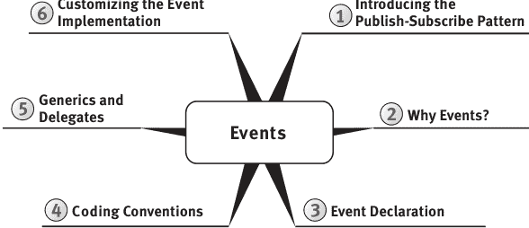

# 第14章：事件

虽然事件在 C# 1.0 中就已经存在，但泛型的引入改变了惯，因为不再需要为每个事件声明委托。出于此原因，本章始终假设使用 C# 2.0。下一节将研究代码。

## 使用多路广播委托编写发布-订阅模式

考虑一个温度控制系统，其中加热器和制冷器连接到温度调节器。为了让每个单元开启和关闭，必须通知单元变化。温度调节器向多个订阅者发布温度变化。

### 定义订阅者方法

首先定义加热器和制冷器对象（参见列表 14.1）。

#### 列表 14.1: 加热器与制冷器的实现

```csharp
class Cooler
{
    public Cooler(float temperature)
    {
        Temperature = temperature;
    }
    // 当环境温度高于此值时激活制冷器
    public float Temperature { get; set; }

    // 通知此实例温度变化
    public void TemperatureChanged(float newTemperature)
    {
        if (newTemperature > Temperature)
        {
            Console.WriteLine("Cooler: On");
        }
    }
}
```

在本例中，我们使用“温度调节器”（thermostat）一词，是因为人们更习惯在加热冷却系统的背景下思考它。从技术上讲，“温度计”（thermometer）更合适。

```csharp
else
{
    Console.WriteLine("Cooler: Off");
}
class Heater
{
    public Heater(float temperature)
    {
        Temperature = temperature;
    }
    public float Temperature { get; set; }
    public void OnTemperatureChanged(float newTemperature)
    {
        if (newTemperature < Temperature)
        {
            Console.WriteLine("Heater: On");
        }
        else
        {
            Console.WriteLine("Heater: Off");
        }
    }
}
```

这两个类本质上是相同的，除了温度比较之外。（事实上，如果你在 `OnTemperatureChanged` 方法中使用委托指向比较方法，那么你就可以消除其中一个类。）每个类都存储了单元应该开启的温度。此外，两个类都提供 `OnTemperatureChanged()` 方法。调用 `OnTemperatureChanged()` 方法是指示加热器和制冷器类温度变化的方法。

`OnTemperatureChanged()` 方法是订阅者（也称为监听器）方法。它们的参数和返回类型必须与温度调节器类的委托匹配，我们将在下一步讨论它。

### 定义发布者

温度调节器类负责向加热器和制冷器实例报告温度变化。温度调节器类的代码出现在列表 14.2 中。

#### 第 14 章：事件

#### 列表 14.2：定义事件发布者，温控器（Thermostat）

```csharp
public class Thermostat
    // 定义事件发布者（初始不包含发送者）
    public Action<float>? OnTemperatureChange { get; set; }

    public float CurrentTemperature { get; set; }
}
```

`Thermostat` 包含一个名为 `OnTemperatureChange` 的属性，其类型为 `Action<float>` 委托。`OnTemperatureChange` 存储订阅者列表。注意，只需要一个属性就可以存储所有订阅者。换句话，冷却器（Cooler）和加热器（Heater）实例都将通过这个单一发布者接收温度变化的通知。

`Thermostat` 的最后一个成员是 `CurrentTemperature` 属性。该属性用于设置和检索 `Thermostat` 类报告的当前温度值。

### 连接发布者和订阅者

最后，我们在 `Main()` 方法中将所有部分组合在一起。列表 14.3 显示了 `Main()` 可能的样例示例。

#### 列表 14.3：连接发布者和订阅者

```csharp
class Program
{
    public static void Main()
    {
        Thermostat thermostat = new Thermostat();
        Heater heater = new Heater(60);
        Cooler cooler = new Cooler(80);
        string temperature;

        thermostat.OnTemperatureChange += 
            heater.OnTemperatureChanged;
        thermostat.OnTemperatureChange += 
            cooler.OnTemperatureChanged;

        Console.Write("Enter temperature: ");
        temperature = Console.ReadLine();
        thermostat.CurrentTemperature = int.Parse(temperature);
    }
}
```

### 使用多路委托编写发布-订阅模式

此列表中的代码通过直接将其赋值给 `+=` 运算符，将两个订阅者（`heater.OnTemperatureChanged` 和 `cooler.OnTemperatureChanged`）注册到 `OnTemperatureChange` 委托。

通过将用户输入的温度值作为输入，你设置了 `thermostat` 的 `CurrentTemperature`。然而，你还没有编写任何代码来向订阅者发布温度事件。

### 调用委托

每当 `Thermostat` 类上的 `CurrentTemperature` 属性发生变化时，你都希望调用委托来通知订阅者（加热器和冷却器）温度的变化。为了实现这一目标，必须修改 `CurrentTemperature` 属性以保存新值，并向每个订阅者发布通知。代码修改出现在列表 14.4 中。

#### 列表 14.4：在不检查空的情况下调用委托

```csharp
public class Thermostat
{
    public float CurrentTemperature
    {
        get return _CurrentTemperature;
        set
        {
            if (value != CurrentTemperature)
                CurrentTemperature = value;
            // 未完成：需要检查空
            // 调用订阅者
            OnTemperatureChange(value);
        }
    }
    private float _CurrentTemperature;
}
```

`CurrentTemperature` 的赋值包含了一些特殊逻辑，用于通知订阅者 `CurrentTemperature` 的变化。通知所有订阅者的调用仅仅是单一 C# 语句 `OnTemperatureChange(value)`。该单一语句将温度变化发布给冷却器和加热器对象。在这里，你从实践中看到，使用单次调用通知多个订阅者的能力正是委托被更具体地称为多路委托（multicast delegates）的原因，这一点将在稍后部分进一步讨论。

#### 第 14 章：事件

但在 C# 8.0 中，直接调用 `CurrentTemperature` 委托会触发可空解引用警告（nullable dereference warning），指示需要进行空检查。

### 检查空

列表 14.4 缺少事件发布代码的一个重要部分。如果没有订阅者注册接收通知，`OnTemperatureChange(value)` 将为 `null`，执行它将抛出 `NullNullException`。为了避免这种情况，有必要在触发事件之前检查空。列表 14.5 展示了如何使用 C# 6.0 的空条件运算符（null-conditional operator）在调用 `Invoke()` 之前这样做。

#### 列表 14.5：调用委托

```csharp
public class Thermostat
{
    // 定义事件发布者
    public Action<float>? OnTemperatureChange { get; set; }

    public float CurrentTemperature
    {
        get { return _CurrentTemperature; }
        set
        {
            if (value != CurrentTemperature)
                _CurrentTemperature = value;
            // 如果有任何订阅者
            // 通过调用这些订阅者
            // 通知它们温度的变化
            OnTemperatureChange?.Invoke(value); // C# 6.0
        }
    }

    private float _CurrentTemperature;
}
```

注意紧随空条件运算符之后的 `Invoke()` 方法调用。虽然此方法可以使用仅点运算符进行调用，但意义不大，因为这等同于直接调用委托（列表 14.4 中的 `OnTemperatureChange(value)`）。使用空条件运算符的一个底层重要优势是：其具有特殊逻辑可以确保在检查空之后，不存在订阅者可能调用过时处理程序（在检查空后发生更改的程序），从而导致委托再次变为 `null`。

### 使用多路委托编写发布-订阅模式 631

#### 高级主题

#### 在 C# 6.0 之前调用委托

遗憾的是，在 C# 6.0 之前不存在不可中断的空检查逻辑。因此，在早期的 C# 版本中实现要冗长得多，如列表 14.6 所示。

#### 列表 14.6：在 C# 6.0 之前带空检查的委托调用

```csharp
public class Thermostat
{
    // 定义事件发布者
    public Action<float>? OnTemperatureChange { get; set; }

    public float CurrentTemperature
    {
        get { return _CurrentTemperature; }
        set
        {
            if (value != CurrentTemperature)
                _CurrentTemperature = value;
            // 如果有任何订阅者
            // 通过调用这些订阅者
            // 通知它们温度的变化
            Action<float>? localOnChange = OnTemperatureChange;
            if (localOnChange != null)
            {
                // 调用订阅者
                localOnChange(value);
            }
        }
    }
    private float _CurrentTemperature;
}
```

此代码没有直接检查空，而是先将 `OnTemperatureChange` 赋值给本地变量 `localOnChange`。这个简单的修改确保了如果在检查空之前（通过延迟线程）删除了所有 Change 订阅者，你不会引发 `NullNullException`。

在书的剩余部分，所有示例都依赖于 C# 6.0 空条件运算符。

### 指南

- 在调用委托之前**务必**检查委托的值是否为 `null`。

- **务必**在 C# 6.0 中调用 `Invoke` 之前使用空条件运算符。

#### 高级主题

#### 委托的 == 运算符返回新实例


鉴于委托是引用类型，赋值本地变量并使用该本地变量就足以使空检查线程安全，这似乎令人惊讶。由于 `localOnChange` 和 `OnTemperatureChange` 指向同一个位置，你可能想象 `OnTemperatureChange` 的任何变化也会反映在 `localOnChange` 中。

事实并非如此，实际上对 `OnTemperatureChange == subscriber` 的任何调用都不会从 `OnTemperatureChange` 中移除委托以导致其比之前少一个。相反，此类调用将分配一个全新的委托，而对 `localOnChange` 所引用的原始多路委托不会产生任何影响。

## 高级主题

### 线程安全的委托调用

如果订阅者可以在不同的线程中从委托中添加或删除，那么明智的做法（如之前所述）是在检查空之前条件条件调用委托或将委托引用复制到本地变量。虽然这种方法防止了调用空委托，但它避免了所有的竞态条件。例如，一个线程可以创建副本，然后另一个线程可以将委托重置为 `null`，接着原始线程可以调用委托的旧值，从而通知一个不再订阅者列表中的订阅者。多线程程序中的订阅者应确保其代码在这种情况下仍保持健壮；始终可能有一个“过时”的订阅者被调用。

# 使用多路委托实现发布-订阅模式

## 委托操作符

为了在 `Thermostat`（恒温器）示例中合并两个订阅者，你使用了 `+=` 操作符。该操作符获取第一个委托，并将第二个委托添加到链中。现在，在第一个委托的方法返回后，将就会调用第二个委托。要从委托链中移除委托，请使用 `-=` 操作符，如列表 14.7 所示。

- 列表 14.7：使用 `+=` 和 `-=` 委托操作符

```csharp
// ...
Thermostat thermostat = new Thermostat();
Heater heater = new Heater(60);
Cooler cooler = new Cooler(80);

Action<float> delegate1;
Action<float> delegate2;
Action<float> delegate3;

delegate1 = heater.OnChanged;
delegate2 = cooler.OnTemperature;

Console.WriteLine("Invoke both delegates");
delegate3 = delegate1;
delegate3 += delegate2;
delegate3(90);
```

```csharp
Console.WriteLine("Invoke only delegate2");
delegate3 = delegate1;
delegate3(30);
// ...
```

列表 14.7 的结果显示在输出 14.1 中。

# 输出 14.1

```
Invoke both delegates:
 Heater: Off
Cooler: On
Invoke only delegate2
Cooler: Off
```

你也可以使用 `+` 和 `–` 操作符合并委托，如列表 14.8 所示。

- 列表 14.8：使用 `+` 和 `-` 委托操作符

```csharp
// ...
Thermostat thermostat = new Thermostat();
Heater heater = new Heater(60);
Cooler cooler = new Cooler(80);
```


```csharp
Action<float> delegate1;
Action<float> delegate2;
Action<float> delegate3;
```

```csharp
// 注意：对于 C# 2.0 语法使用 new Action (cooler.OnChanged)
delegate1 = heater.OnChanged;
delegate2 = cooler.OnChanged;
```

```csharp
Console.WriteLine("Combine delegates using +:");
delegate3 = delegate1 + delegate2;
delegate3(60);
```

```csharp
Console.WriteLine("Uncombine delegates using -:");
delegate3 = delegate3 - delegate2;
delegate3(60);
```

使用赋值操作符会清除所有之前的订阅者，并允许你用新的订阅者替换它们。这是委托的一个遗憾特性。人们非常容易错误地编写代码一个赋值语句，而实际上意图是使用 `+=` 操作符。解决方案在章节后半部分的“理解事件”部分进行了描述。

`+` 和 `-` 操作符以及它们的赋值 `+=` 和 `-=` 在内部分别使用静态方法 `System.Delegate.Combine()` 和 `System.Delegate.Remove()` 实现。这些方法接受两个类型为 `delegate` 的参数。第一个方法 `Combine()` 将两个参数合并，使得第一个参数在委托列表中指向第二个参数。第二个方法 `Remove()` 遍历第一个参数指定的委托链，并移除第二个参数指定的委托。由于 `Remove()` 方法可能会返回 `null`，请使用 `+=` 操作符告诉编译器假设存在有效的委托实例。

关于 `Combine()` 方法一个有趣的注意点是它的任一个参数都可以为 `null`。如果其中一个为 `null`，`Combine()` 返回另一个委托。如果两个都为 `null`，`Combine()` 返回 `null`。这解释了为什么你可以调用 `thermostat.TemperatureChange += heater.OnChanged;` 而不会抛出异常，即使 `OnTemperatureChange` 的值仍为 `null`。

# 顺序调用

图 14.1 显示了 `heater` 和 `cooler` 的顺序通知。

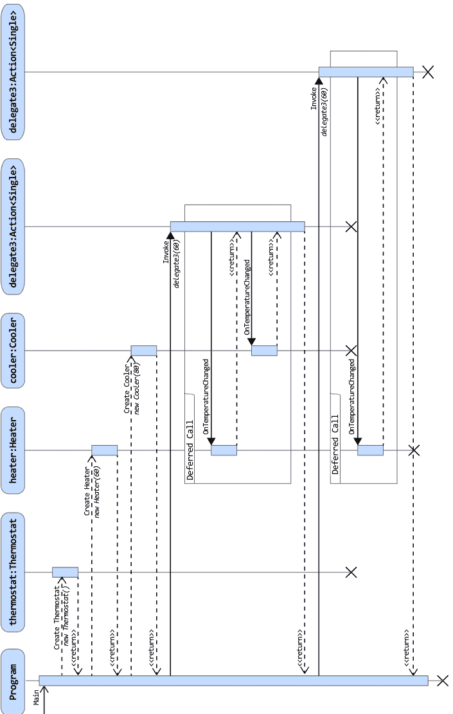

尽管你只编写了一次对 `OnTemperatureChange()` 的调用，但该调用广播给了两个订阅者。因此，只需一次调用，`cooler` 和 `heater` 都会收到温度变化的通知。如果你添加了更多订阅者，它们也会收到 `OnTemperatureChange()` 的通知。虽然单次调用 `OnTemperatureChange()` 触发了每个订阅者的通知，但订阅者仍然按顺序被用，因为它们都在同一个执行线程上被调用。

## 高级主题：多路委托内部

为了理解事件如何工作，你需要重新回顾对 `System.Delegate` 类型内部的首次检查。记住 `delegate` 关键字是派自 `System.MulticastDelegate` 的类型的别名。反之，`System.MulticastDelegate` 派自 `System.Delegate`，而后者由一个对象引用（实例方法需要）和一个方法引用组成。当你创建一个委托时，编译器会自动使用 `System.MulticastDelegate` 类型而不是 `System.Delegate` 类型。`MulticastDelegate` 类包含一个对象引用和一个方法引用，就像它的基类一样，但它还包含一个指向另一个 `System.MulticastDelegate` 对象的引用。

当你向多路委托添加一个方法时，`MulticastDelegate` 类会创建该委托类型的一个新实例，将所添加方法的对象引用和方法引用存储在新实例中，并将新的委托实例作为委托实例列表中的下一项添加。实际上，`MulticastDelegate` 类维护了一个 `Delegate` 对象的列表。从概念上说，你可以像图 14.2 所示表示恒温器示例。

在调用多路委托时，列表中的每个委托实例都会按顺序被调用。通常，委托按照它们添加的顺序被调用，但这种行为在通用语言基础设施（CLI）规范中并没有规定。此外，程序员不应依赖调用的顺序。

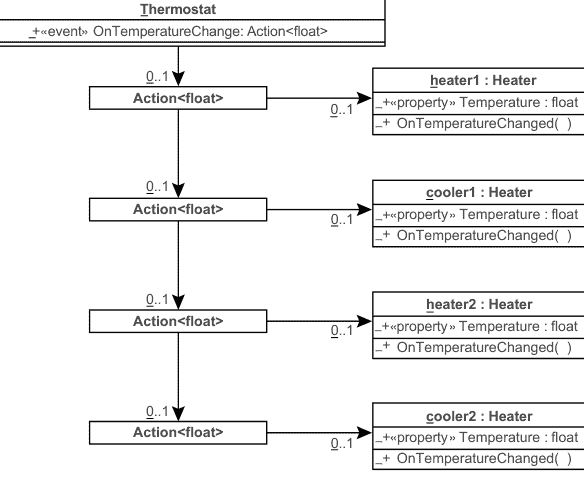

图 14.2：组合委托

## 错误处理

错误处理对顺序通知的感知至关重要。如果一个订阅者抛出异常，后续的订阅者将无法接收通知。考虑一下，如果你更改 `OnChanged()` 方法使其抛出异常，如列表 14.9 所示。

- 列表 14.9：`OnChanged()` 抛出异常

```csharp
class Program
{
    public static void Main()
    {
        Thermostat thermostat = new Thermostat();
        Heater heater = new Heater(60);
        Cooler cooler = new Cooler(80);
        string temperature;

        thermostat.OnTemperatureChange +=
            heater.OnChanged;
        // 使用 C# 3.0 更改为匿名方法
        // 如果使用 C# 2.0
```

```csharp
thermostat.OnTemperatureChange +=
  (newTemperature) => {
    throw new OperationException();
  };
thermostat.OnTemperatureChange +=
  cooler.OnChanged;
```

```csharp
Console.Write("Enter temperature:");
temperature = Console.ReadLine();
thermostat.CurrentTemperature = int.Parse(temperature);
}
```

图 14.3 显示了一个更新后的序列图。尽管 `cooler` 和 `heater` 都订阅了消息，但 lambda 表达式终止了链并阻止了 `cooler` 对象接收通知。

图 14.3：带有异常的委托调用

为了避免这种问题（即无论先前的订阅者行为如何，所有订阅者都能接收通知的问题），你必须手动遍历订阅者列表并逐个调用它们。列表 14.10 显示了 `CurrentTemperature` 属性所需的更新。结果显示在输出 14.2 中。

- 列表 14.10：处理来自订阅者的异常

```csharp
public class Thermostat
{
    // 定义事件发布者
    public Action<float>? OnTemperatureChange;

    public float CurrentTemperature
    {
        get return _CurrentTemperature;
        set
        {
            if (value != CurrentTemperature)
            {
                _CurrentTemperature = value;
                Action<float>? oldTemperatureChange = OnTemperatureChange;
                if (oldTemperatureChange != null)
                {
                    List<Exception> exceptionCollection =
                        new List<Exception>();
                    foreach (Delegate handler in
                        oldTemperatureChange.GetInvocationList())
                    {
                        try
                        {
                            ((Action<float>)handler)(value);
                        }
                        catch (Exception exception)
                        {
                            exceptionCollection.Add(exception);
                        }
                    }
                    if (exceptionCollection.Count > 0)
                    {
                        throw new AggregateException(
                            "OnTemperatureChange 事件订阅者抛出了异常。",
                            exceptionCollection);
                    }
                }
            }
        }
    }
    private float _CurrentTemperature;
}
```

列表 14.10 展示了你可以从委托的 `GetInvocationList()` 方法检索订阅者列表。通过枚举此列表中的每个项可以返回单独的订阅者。如果你将每个订阅者的每次调用放置在 `try/catch` 块中，你就可以在继续枚举循环之前处理任何错误状况。在这个示例中，尽管委托抛出了异常，`cooler` 仍然收到了温度变化的通知。在处理完所有通知 之后，列表 14.10 会通过抛出 `AggregateException` 来报告任何异常，该异常封装了异常集合，可以通过 `InnerExceptions` 属性进行访问。通过这种方式，所有异常仍然得到了报告，同时所有订阅者都收到了通知。

## 方法返回值与引用传递

还有一种场景，遍历委托调用列表比直接调用委托更有用。这种场景涉及不带返回值或具有 `ref` 参数的委托。在温度计的示例中，`Temperature` 委托的类型为 `Action<float>`，它返回 `void` 且没有 `out` 或 `ref` 参数。因此，没有数据返回给发布者。这一考虑非常重要，因为委托的调用可能会触发对多个订阅者的通知。如果每个订阅者都返回一个值，那么将无法确定使用哪个订阅者的返回值。

如果你将 `OnTemperature` 修改为返回一个枚举值，表示设备是否因为温度变化而变化，那么新委托的类型将是 `Func<float, Status>`，其中 `Status` 是一个包含 `On` 和 `Off` 元素的枚举。所有订阅者方法都必须使用与委托相同的的方法签名，因此每个方法都被要求返回一个状态值。此外，由于 `OnTemperature` 可能对应于委托链，有必要遵循你用于错误处理时使用的相同模式。换句话说，你将使用 `GetInvocationList()` 方法遍历每个委托调用列表，以检索每个单独的返回值。同样，使用 `ref` 和 `out` 参数的委托类型也需要特殊考虑。然而，尽管在特殊情况下可以使用这种方法，但最好的建议是通过只返回 `void` 来完全避免这种场景。

## 理解事件

对于你目前在本章中所使用的委托，在逻辑上存在两个核心问题。为了克服这些问题，C# 使用了 `event` 关键字。在本节中，你将看到为什么要使用事件以及它们是如何工作的。

### 为什么使用事件？

本章和前一章涵盖了你关于委托如何工作所需的所有知识。遗憾的是，委托结构中的缺陷可能会无意中允许程序员引入 bug。这些问题涉及封装性，无论是事件的订阅还是发布都无法充分控制它。具体来说，事件限制了外部类除了通过 `+=` 运算符向发布者订阅方法以及使用 `-=` 运算符取消订阅之外的进行任何其他操作。此外，它们还限制了包含类以外的类调用事件。

### 封装订阅

如前面所示，可以使用赋值运算符将委托赋值给另一个委托。遗憾的是，这种功能引入了常见的 bug 来源。考虑列表 14.11。

列表 14.11：使用赋值运算符 `=` 而不是 `+=`

```csharp
class Program
{
    public static void Main()
    {
        Thermostat thermostat = new Thermostat();
        Heater heater = new Heater(60);
        Cooler cooler = new Cooler(80);

        // 注意：使用 new action (cooler.OnChanged)
        // C# 1.0
        thermostat.OnOnChange =
            heater.OnOnChange;

        // 错误：赋值运算符覆盖了
        // 之前的赋值
        thermostat.OnOnChange =
            cooler.OnOnChange;

        Console.Write("Enter temperature: ");
        temperature = Console.ReadLine();
        thermostat.CurrentTemperature = int.Parse(temperature);
    }
}
```

## 第 14 章：事件


# 第 14 章：事件

列表 14.11 与列表 14.7 几乎相同，区别在于没有使用 `+=` 运算符，而是使用了简单的赋值运算符。因此，代码将 `cooler.OnTemperatureChanged` 分配给 `OnTemperature`。结果是代码将 `cooler.OnTemperatureChanged` 赋值给 `OnTemperature`。尽管在特殊情况下可以使用这种方法，但最好的建议是通过只返回 `void` 来完全避免这种场景。`event` 关键字限制了外部类除了通过 `+=` 运算符向发布者订阅方法以及使用 `-=` 运算符取消订阅之外的进行任何其他操作。此外，它们还限制了包含类以外的类调用事件。

## 封装订阅

如前面所示，可以使用赋值运算符将委托赋值给另一个委托。遗憾的是，这种功能引入了常见的 bug 来源。考虑列表 14.11。

### 列表 14.11：使用赋值运算符 = 而不是 +=

```csharp
class Program
{
    public static void Main()
    {
        Thermostat thermostat = new Thermostat();
        Heater heater = new Heater(60);
        Cooler cooler = new Cooler(80);

        // 注意：使用 new action (cooler.OnChanged)
        // C# 1.0
        thermostat.OnOnChange =
            heater.OnOnChange;

        // 错误：赋值运算符覆盖了
        // 之前的赋值
        thermostat.OnOnChange =
            cooler.OnOnChange;

        Console.Write("Enter temperature: ");
        temperature = Console.ReadLine();
        thermostat.CurrentTemperature = int.Parse(temperature);
    }
}
```

列表 14.10 展示了你可以从委托的 `GetInvocationList()` 方法检索订阅者列表。通过枚举此列表中的每个项可以返回单独的订阅者。如果你将每个订阅者的每次调用放置在 `try/catch` 块中，你就可以在继续枚举循环之前处理任何错误状况。在这个示例中，尽管委托抛出了异常，`cooler` 仍然收到了温度变化的通知。在处理完所有通知之后，列表 14.10 会通过抛出 `AggregateException` 来报告任何异常，该异常封装了异常集合，可以通过 `InnerExceptions` 属性进行访问。通过这种方式，所有异常仍然得到了报告，同时所有订阅者都收到了通知。

## 方法返回值与引用传递

还有一种场景，遍历委托调用列表比直接调用委托更有用。这种场景涉及不带返回值或具有 `ref` 参数的委托。在温度计的示例中，`Temperature` 委托的类型为 `Action<float>`，它返回 `void` 且没有 `out` 或 `ref` 参数。因此，没有数据返回给发布者。这一考虑非常重要，因为委托的调用可能会触发对多个订阅者的通知。如果每个订阅者都返回一个值，那么将无法确定使用哪个订阅者的返回值。

如果你将 `OnTemperature` 修改为返回一个枚举值，表示设备是否因为温度变化而变化，那么新委托的类型将是 `Func<float, Status>`，其中 `Status` 是一个包含 `On` 和 `Off` 元素的枚举。所有订阅者方法都必须使用与委托相同的方法签名，因此每个方法都被要求返回一个状态值。此外，由于 `OnTemperature` 可能对应于委托链，有必要遵循你用于错误处理时使用的相同模式。换句话说，你将使用 `GetInvocationList()` 方法遍历每个委托调用列表，以检索每个单独的返回值。同样，使用 `ref` 和 `out` 参数的委托类型也需要特殊考虑。然而，尽管在特殊情况下可以使用这种方法，但最好的建议是通过只返回 `void` 来完全避免这种场景。

## 理解事件

对于你目前在本章中所使用的委托，在逻辑上存在两个核心问题。为了克服这些问题，C# 使用了 `event` 关键字。在本节中，你将看到为什么要使用事件以及它们是如何工作的。

### 为什么使用事件？

本章和前一章涵盖了你关于委托如何工作所需的所有知识。遗憾的是，委托结构中的缺陷可能会无意中允许程序员引入 bug。这些问题涉及封装性，无论是事件的订阅还是发布都无法充分控制它。具体来说，事件限制了外部类除了通过 `+=` 运算符向发布者订阅方法以及使用 `-=` 运算符取消订阅之外的进行任何其他操作。此外，它们还限制了包含类以外的类调用事件。

### 封装订阅

如前面所示，可以使用赋值运算符将委托赋值给另一个委托。遗憾的是，这种功能引入了常见的 bug 来源。考虑列表 14.11。

## 列表 14.14：泛型事件处理程序类型

```c
public delegate void EventHandler<TEventArgs>(
    object sender, TEventArgs e);
```

结果是，`Action<TEventArgs>` 委托类型中的单个温度参数被替换为两个新参数——一个用于发布者或“发送者”`sender`，另一个用于事件数据。这种更改并不是 C# 编译器强制执行的，但对于为事件设计的委托，传递这两个类型的两个参数是常规范。

第一个参数 `sender` 包含调用委托的类实例。如果同一个订阅者方法注册了多个事件，这尤其将特别有帮助——例如，如果 `heater.OnTemperatureChanged` 订阅了两个不同的 `Thermostat` 实例。在这种情况下，任何一个 `Thermostat` 实例都可以触发 `heater.OnTemperatureChanged`。要确定是哪个 `Thermostat` 实例触发了事件，你可以在 `Heater.OnTemperatureChanged()` 内部使用 `sender` 参数。如果事件是静态的，则无法使用此选项，因此为 `sender` 参数传递 `null`。

第二个参数 `TEventArgs e` 被指定为类型 `Thermostat.TemperatureEventArgs`。`TemperatureEventArgs` 的重要之处是它派生自 `System.EventArgs`。`System.EventArgs` 上唯一的显著属性是 `Empty`，用于表示没有事件数据。然而，当你从 `System.EventArgs` 派生 `TemperatureEventArgs` 时，你添加了一个额外的属性 `NewTemperature`，用于将温度从温度计传递给订阅者。

让我们总结事件的编码规范：第一个参数 `sender` 类型为 `object`，包含调用委托对象的引用，如果是静态事件则为 `null`。第二个参数类型为 `System.EventArgs` 或派生自 `System.EventArgs` 的类型，并包含有关事件的附加数据。你像以前一样完全调用委托，除了这些额外的参数之外。列表 14.15 显示了一个示例。


## 列表 14.15：触发事件通知

```csharp
public class Thermostat
{
    public float CurrentTemperature
    {
        get(return _CurrentTemperature);
        set
        {
            if (value != CurrentTemperature)
            {
                _CurrentTemperature = value;
                // 如果有任何订阅者，
                // 通过调用 onChange?.Invoke 
                // 通知它们温度的变化
                onChange?.Invoke( // 使用 C# 6.0
                    this, new TemperatureArgs(value); );
            }
        }
    }
}
private float _CurrentTemperature;
```

你通常使用容器类 `this` 指定 `sender`，因为它是唯一可以调用事件委托的类。

在示例示例中，订阅者可以将 `sender` 参数强制转换为 `Thermostat` 并以此种方式访问当前温度，也可以通过 `TemperatureArgs` 实例访问。然而，`Thermostat` 实例上的当前温度可能会通过另一个线程发生变化。当由于状态变化引起事件时，将旧值连同新值一起传递是一种用于控制哪些状态转换是允许的模式。

> 指南
> 在调用委托之前，请检查委托的值是否为 `null`（可能通过 C# 6.0 中的空条件运算符）。
> 对于非静态事件，请将类实例作为 `sender` 的值传递。
> 对于静态事件，将 `null` 作为 `sender` 传递。
> 不要将 `null` 作为 `eventArgs` 参数的值。
> 对于 `TEventArgs` 类型，使用 `System.Events` 或派生自 `System.Events` 的类型。

> 考虑使用 `System.EventArgs` 的子类作为事件参数类型 `TEventArgs`，除非你确定事件永远不需要携带数据。

## 泛型与委托

如上一节所述，定义事件类型的指南是使用 `EventHandler<TEventArgs>` 委托类型。在理论上，可以使用任何委托类型，但按照习惯，第一个参数 `sender` 的类型是 `object`，而第二个参数 `e` 应该是派生自 `System.EventArgs` 的类型。C# 1.0 中委托中较为繁琐的方面之一是，每当处理程序的参数发生变化时，你就必须声明一个新的委托类型。每每次从 `System.EventArgs` 创建新的派生，都需要声明一个使用新 `EventArgs` 派生类型的新委托类型。例如，要在事件通知中使用 `TemperatureArgs`，则需要声明一个具有 `TemperatureArgs` 作为参数的委托类型 `ChangeNotifier`（参见列表 14.16）。

## 列表 14.16：使用自定义委托类型


```csharp
public class Thermostat
{
    public class TemperatureArgs: System.EventArgs
    {
        public TemperatureArgs(float newTemperature)
        {
            NewTemperature = newTemperature;
        }
        public float NewTemperature { get; set; }
    }

    public delegate void ChangeNotifier(
        object sender, TemperatureArgs newTemperature);

    public event ChangeNotifier Temperature?
    OnTemperatureChange;

    public float CurrentTemperature
    {
        ...
    }
    private float _CurrentTemperature;
}
```

虽然通常比创建名为 `TemperatureEventHandler` 的自定义委托类型更喜欢 `EventHandler<EventArgs>`，但后者类型有一个优势。具体来说，如果使用自定义类型，参数名称可以针对特定事件。例如，在列表 14.16 中，当调用事件时，参数名称将显示为 `newTemperature`。

另一个可能使用自定义委托类型的原因涉及 C# 2.0 之前定义的 CLR API 部分。无论如何，在 C# 2.0 及之后的多数情况下，没有必要声明自定义委托类型。

> 指南
> 使用 `System.EventHandler<T>` 而不是手动创建委托类型。

## 高级主题

### 事件内部机制

如前所述，事件提供了封装，限制外部类只能通过 `+=` 和 `-=` 运算符订阅和取消订阅者。此外，它们限制了类之外的其他类调用它们。为了实现这一点，C# 编译器将公共委托变量及其事件修饰符声明为私有。本质上，`event` 关键字是生成适当封装的快捷方式。考虑列表 14.17 显示的事件声明示例

#### 列表 14.17：声明 OnTemperatureChange 事件

```csharp
public class Thermostat
{
    public event EventHandler<EventArgs>? OnTemperatureChange;

    ...
}
```

当 C# 编译器遇到 `event` 关键字时，它生成的 CIL 代码相当于列表 14.18 所示的 C# 代码

#### 列表 14.18：编译器生成的事件 CIL 代码的 C# 概念

```csharp
public class Thermostat
{
    // 委托字段以保存
    // 订阅者列表
    private EventHandler<TemperatureArgs> _OnTemperatureChange;

    public void add_OnTemperatureChange(
        EventHandler<TemperatureArgs> handler)
    {
        System.Delegate.Combine(_OnTemperatureChange, handler);
    }

    public void remove_OnTemperatureChange(
        EventHandler<TemperatureArgs> handler)
    {
        System.Delegate.Remove(_OnTemperatureChange, handler);
    }

    public event EventHandler<TemperatureArgs> OnTemperatureChange
    {
        add
        {
            add_OnTemperatureChange(value)
        }
        remove
        {
            remove_OnTemperatureChange(value)
        }
    }
}
```

### 第 14 章：事件

后缀取自事件的原始名称。这些方法分别负责实现 `+=` 和 `-=` 运算符。如示例 14.18 所示，这些方法是通过 `System.Delegate.Combine()` 和 `System.Delegate.Remove()` 方法实现的，这些方法在前面已经讨论过。这些方法的第一个参数是 `EventHandler<T>` 实例 `OnTemperatureChange`。

`event` 关键字生成的代码中最有趣的部分是最后一段。其语法与属性的 getter 和 setter 方法非常相似，这些方法分别是 `add` 和 `remove` 块。`add` 块通过调用 `add_OnTemperatureChange()` 来处理事件上的 `+=` 运算符。同样，`remove` 块通过调用 `remove_OnTemperatureChange()` 来处理 `-=` 运算符。

仔细观察此代码与属性生成的代码之间的相似之处。回顾 C# 属性的实现是为了创建 `get_<propertyName>` 和 `set_<propertyName>` 然后调用到这些方法。另一个重要的特性是，`event` 关键字的等价物在 C# 中仍然。换句话说，事件是 C# 显式识别的某种东西；它不仅仅是构造。通过在代码中保留 `event` 关键字，所有的语言和编辑器都可以提供特殊功能，因为它们可以将事件视为特殊的成员。

### 自定义事件实现

你可以自定义编译器为 `+=` 和 `-=` 生成的代码。例如，将 `OnTemperatureChange` 委托的作用从 `private` 改为 `protected`。这允许派自 `Thermostat` 的类直接访问委托，而不是受到外部类的限制。为了实现这种行为，C# 允许如示例 14.16 所示的语法。C# 允许你定义 `add` 和 `remove` 块来为事件的每个方面提供唯一的实现。示例 14.19 提供了一个例子。

#### 示例 14.19：自定义 add 和 remove 处理程序

```csharp
public class Thermostat
{
    public class TemperatureArgs: System.EventArgs
    {
        ...
    }

    // 定义事件发布者
    public event EventHandler<TemperatureArgs> OnTemperatureChange
    {
        add {
            OnTemperatureChange = (EventHandler<TemperatureArgs>)System.Delegate.Combine(OnTemperatureChange, value);
        }
        remove {
            OnTemperatureChange = (EventHandler<TemperatureArgs>)System.Delegate.Remove(OnTemperatureChange, value);
        }
    }
    protected EventHandler<TemperatureArgs> _OnTemperatureChange;

    public float CurrentTemperature
    {
        ...
    }
    private float _CurrentTemperature;
}
```

在这里，存储每个订阅者的委托 `OnTemperatureChange` 被改为 `protected`。此外，`add` 块交换了存储，使得链中最后一个添加的委托是第一个接收通知的委托。然而，代码不依赖这种实现。

### 总结

现在我们已经描述了事件，注意到通常情况下，只有在事件上下文之外才建议对委托变量进行操作。换句话说，考虑到事件额外的封装功能以及在需要时自定义实现的能力，最佳实践是始终使用事件来实现发布-订阅模式。

在你可以从零开始编写事件代码之前，可能需要一些练习。然而，事件是本书后续章节描述的异步、多线程编码的关键基础。

# 第 15 章：带有标准查询运算符的集合接口

C# 3.0 中添加的最显著特性是集合，这归功于称为语言集成查询 `LINQ` 的编程 API。通过一组扩展方法和 lambda 表达式，`LINQ` 为集合操作提供了远优的 API。事实上，在本书的早期版本中，集合章节紧随泛型章节之后，委托章节之前。然而，lambda 表达式对 `LINQ` 是如此基础，以至于如果不先介绍它们，就无法涵盖集合。现在你已经前两个章节建立了 lambda 表达式的坚实基础，我们可以深入集合的细节——从集合接口开始。

在集合初始化器之后，本章涵盖了各种接口以及它们之间的关系。这是理解集合的基础——特别是支持泛型和不支持泛型的集合。本章主要讨论泛型接口。你应该使用 C# 3.0 中添加的集合接口来实现标准查询运算符。

## 第 15 章：带有标准查询运算符的集合接口


集合类和接口分为两类：支持泛型的和不支持泛型的。本章主要讨论泛型接口。虽然这些概念仍然适用于两种形式，但我们不显式讨论非泛型。本章以对匿名类型的深入讨论结束——这些主题我们在第 3 章中仅简要介绍过，在章节末尾有进一步介绍。

### 集合初始化器

集合初始化器允许程序员在实例化时以类似于数组声明的方式构造一个具有初始成员集合的集合。在集合初始化器可用之前，必须在集合实例化后显式向集合添加元素。使用集合初始化，调用是由 C# 编译器生成的，而不是由开发者显式编码。列表 15.1 显示了如何使用集合初始化器初始化集合。

#### 示例 15.1：集合初始化

```csharp
using System;
using System.Collections.Generic;

class Program
{
    static void Main()
    {
        List<string> sevenWorldBlunders;
        sevenWorldBlunders = new List<string>() {
            // 来自甘地的引用
            "Wealth without conscience",
            "Pleasure without conscience",
            "Knowledge without character",
            "Commerce without morality",
            "Science without humanity",
            "Worship without sacrifice",
            "Politics without principle"
        };
        Print(sevenWorldBlunders);
    }

    private static void Print<T>(IEnumerable<T> items)
    {
        foreach (T item in items)
        {
            Console.WriteLine(item);
        }
    }
}
```

集合初始化器要成功编译需要基本要求。理想情况下，应用集合初始化器的集合类型应该是实现 `System.Collections.Generic.IList<T>` 的类型。

获取与集合初始化器中指定的值兼容的参数。

对于字典，集合初始化器的语法稍微复杂，因为字典中的每个元素都需要键和值。这种语法在列表 15.2 所示。

#### 列表 15.2：使用集合初始化器初始化 Dictionary<>

```csharp
using System;
using System.Collections.Generic;
#if !PRESPARP
// C# 6.0 或更高版本
Dictionary<string, Console> colorMap =
new Dictionary<string, Console>{
    ["Error"] = Console.Red,
    ["Warning"] = Console.Yellow,
    ["Information"] = Console.Green,
    ["Verbose"] = Console.White
};
#else
// C# 6.0
Dictionary<string, Console> colorMap =
new Dictionary<string, Console>{
    ["Error"] = Console.Red },
    ["Warning"] = Console.Yellow },
    ["Information"] = Console.Green },
    ["Verbose"] = Console.White
};
#endif
```

列表 15.2 包含了两种不同的初始化方式。第一种演示了 C# 6.0 引入的新语法，它通过赋值运算符表示名称/值对的意图，说明哪个值关联哪个键。第二种语法仍然适用于 C# 6.0 或更高版本使用大括号将名称和值配对。

允许不支持 `IList<T>` 的集合使用初始化器很重要，原因有两个：首先，大多数集合实现 `IEnumerable<T>` 的类型并没有实现 `IList<T>`，这显著降低了集合初始化器的实用性。其次，通过方法名匹配和与初始化器项的签名兼容性，使得初始化到集合中的项具有更具多样性。例如，初始化器现在可以支持

- `new DataStore() { a, {b, c}}` 只要有一个签名与 `a` 兼容的 `Add()` 方法，以及另一个签名与 `b, c` 兼容的 `Add()` 方法即可。

### 使 类成为集合的要素：IEnumerable

根据定义，NET 中的集合是一个至少实现 `IEnumerable` 的类。此接口至关重要，因为实现 `IEnumerable` 的方法是支持遍历集合的最小需求。

第 4 章展示了如何使用 `foreach` 语句遍历元素数组。这种语法非常简单，并且避免了需要知道元素数量的复杂性。然而，运行时并不支持 `foreach` 语句，C# 编译器会按照本节描述的方式转换代码。

#### 用于数组的 foreach

列表 15.3 演示了对整数数组的简单 `foreach` 循环，并将每个整数打印到控制台。

> 列表 15.3：数组的 foreach

```csharp
int[] array = new int[]{1, 2, 3, 4, 5, 6};
foreach (int item in array)
{
    Console.WriteLine(item);
}
```

从这段代码中，C# 编译器会创建循环的 CIL 等效代码，如列表 15.4 所示。

> 列表 15.4：数组 foreach 的编译实现

```csharp
int[] tempArray;
int[] array = new int[]{1, 2, 3, 4, 5, 6};
tempArray = array;
for (int counter = 0; counter < tempArray.Length; counter++)
{
    int item = tempArray[counter];
    Console.WriteLine(item);
}
```

在此示例中，注意 `foreach` 依赖于对 `Length` 属性和索引运算符 `[]` 的支持。通过 `Length` 属性，C# 编译器可以使用语句遍历数组中的每个元素。

#### 用于 IEnumerable<T> 的 foreach

虽然列表 15.4 所示的代码在长度固定且始终支持索引运算符的数组上运行良好，但并不是所有类型的集合都有已元素名称。此外，许多集合类包括 `Stack<T>`、`Queue<T>` 和 `Dictionary<TKey, TValue>` 类不支持通过索引检索元素。因此，需要一种更通用的遍历集合的方法。迭代器模式提供了这种能力。假设你可以确定第一个和下一个元素，那么知道计数和支持通过索引检索元素是不必要的。

`System.Collections.Generic.Enumerator<T>` 和 `System.Collections.Enumerator` 接口旨在通过迭代器模式遍历元素集合，而不是列表 15.4 所示的“长度-索引”模式。它们关系的类图出现在图 15.1。

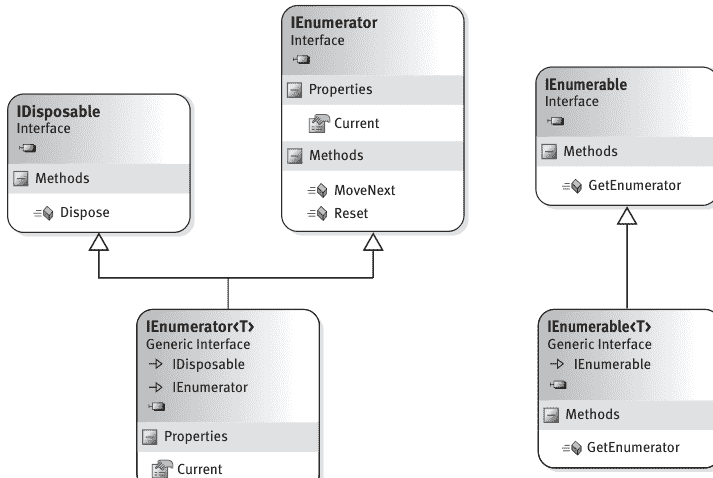

图 15.1：`Enumerator<T>` 和 `IEnumerator` 接口的类图

### 使 类成为集合的要素：IEnumerable


`IEnumerable<T>` 继承自 `IEnumerable`，它包含三个成员。第一个是 `bool MoveNext()`。使用此方法，你可以从集合中的一个元素移动到下一个，同时检测何时已枚举完所有项。第二个成员是名为 `Current` 的只读属性，返回当前正在处理的内容。`Current` 在 `IEnumerable<T>` 中被重载，提供了特定类型的实现。通过集合类的这两个成员，可以简单地使用 `while` 循环遍历集合。

### 列表 15.5：遍历集合

```csharp
System.Collections.Generic.Stack<int> stack =
new System.Collections.Generic.Stack<int>();
int number;
// ...
while (stack.MoveNext())
{
    number = stack.Current;
    Console.WriteLine(number);
}
```

在列表 15.5 中，当 `MoveNext()` 到达集合末尾时返回 `false`。前面的示例展示了 C# 输出的大致，但忽略了两个重要细节：交错和错误处理。

### 状态共享

如 15.5 这种实现的问题是，如果两个循环交错执行（一个 `foreach` 在另一个内部使用同一个集合），集合必须在调用 `MoveNext()` 时维护当前元素的状态指示。在这种情况下，一个交错循环会影响另一个。对于多线程执行的循环也是如此。

为了解决这个问题，集合类并不直接支持 `IEnumerator<T>` 和 `IEnumerator`。相反，如图 15.1 所示，有一个接口 `IEnumerable<T>`，其唯一的方法是 `GetEnumerator()`。该方法的目的是返回一个支持枚举的对象。状态不再由集合类维护，另一个类（通常是嵌套类，以便它可以访问集合的内部）将支持 `IEnumerator<T>` 接口并保持迭代循环的状态。迭代器就像序列中的“光标”或“书签”。你可以拥有多个书签，移动其中每一个都可以独立于其他遍历集合。使用这种模式，`foreach` 循环的 C# 等效代码将像列表 15.6 所示的代码那样。

### 列表 15.6：迭代期间维护状态的独立迭代器

```csharp
System.Collections.Generic.Stack<int> stack =
new System.Collections.Generic.Stack<int>();
int number;
System.Collections.Generic.Stack<int>.Enumerator enumerator;
// ...
// 如果显式实现了 IEnumerable<T>，
// 则需要强制转换。
// ((IEnumerable<int>)stack).GetEnumerator();
enumerator = stack.GetEnumerator();
while (enumerator.MoveNext())
{
    number = enumerator.Current;
    Console.WriteLine(number);
}
```

## 什么是让类成为集合：IEnumerable

## 高级/初级主题

### 迭代后的清理工作

由于实现 `IEnumerable<T>` 接口的类会维护状态，有时你需要在退出循环后清理状态（因为所有迭代已完成，或者抛出了异常）。为了实现这一点，`IEnumerable<T>` 接口继承自 `IDisposable`。实现 `IEnumerator` 的枚举器并不一定实现 `IDisposable`，但如果它们实现了，也会调用 `Dispose()`。这意味着在循环结束后可以调用 `Dispose()`。因此，C# 对应的最终公共中间语言 `CIL` 代码如列表 15.7 所示。

### 列表 15.7：System.Generic.Stack<int> stack 的编译结果

```csharp
System.Collections.Generic.Stack<int> stack =
new System.Collections.Generic.Stack<int>();
System.Collections.Generic.Stack<int>.Enumerator enumerator;
IDisposable disposable;

enumerator = stack.GetEnumerator();
try {
    int number;
    while (enumerator.MoveNext()) {
        number = enumerator.Current;
        Console.WriteLine(number);
    }
} finally {
    // 显式转换为 IEnumerable<T>
    disposable = (IDisposable) enumerator;
    disposable.Dispose();

    // IEnumerable 将使用 as 运算符，除非在编译时
    // 已知支持 IDisposable
    // disposable = (enumerator as IDisposable);
    // if (disposable != null) {
    disposable.Dispose();
    }
}
```

## 第 15 章：带有标准查询运算符的集合接口

注意，由于 `IEnumerator<T>` 支持 `IDisposable` 接口，`using` 可以将列表 15.7 中的代码简化为列表 15.8 所示的内容。

### 列表 15.8：使用 using 进行错误处理和资源清理

```csharp
System.Collections.Generic.Stack<int> stack =
    new System.Collections.Generic.Stack<int>();
    int number;

using(
    System.Collections.Generic.Stack<int>.Enumerator
    enumerator = stack.GetEnumerator())
{
    while (enumerator.MoveNext())
    {
        number = enumerator.Current;
        Console.WriteLine(number);
    }
}
```

然而，回 CIL 并不直接支持 `using` 关键字。因此，列表 15.7 中的代码实际上是 `foreach` CIL 代码更准确的 C# 表示。

## 高级主题

### 没有 IEnumerable 的 foreach

C# 并不要求在通过 `foreach` 遍历数据类型时实现 `IEnumerable`/`IEnumerable<T>`。相反，编译器使用了一种名为“鸭子类型”（duck typing）的概念：它寻找一个 `GetEnumerator()` 方法，该方法返回一个具有 `Current` 属性的值和一个 `MoveNext()` 方法。鸭子类型涉及通过名称进行搜索，而不是依赖接口或显式的方法调用。（“鸭子类型”这一名称源于一种奇特的想法：要被视为鸭子，对象只需实现 `Quack()`，而不需要实现 `IDuck` 接口。）如果鸭子类型未能找到枚举模式的合适实现，编译器将检查集合是否实现了相应的接口。

## 标准查询运算符

### 不要在 foreach 迭代期间修改集合

第 4 章展示了编译器如何防止对 `foreach` 变量（`number`）的赋值。如列表 15.7 所示，对 `number` 赋值不会改变元素本身，但 C# 编译器会完全阻止这种赋值。

此外，在 `foreach` 循环执行期间，集合内的元素计数或项目本身通常都无法修改。例如，如果你在循环内部调用 `Stack.Push(42)`，将无法确定迭代器应该忽略还是包含对 `stack` 的更改——简而言之，迭代器应该遍历新添加的项，还是假设状态与实例化时保持相同。

由于这种歧义性，如果在 `foreach` 循环中修改了集合，访问枚举器时通常会抛出 `System.InvalidOperationException` 类型的异常。该异常报告集合在枚举器实例化后被修改了。

## 标准查询运算符

除了 `System.Object` 的方法外，任何实现 `IEnumerable<T>` 的类型都要求实现另外一个方法，即 `GetEnumerator()`。然而，这样做为所有实现 `IEnumerable<T>` 的类型提供了超过 50 多个可用方法（不包括任何重载），而且这种发生不需要显式实现 `GetEnumerator()` 方法之外的任何方法。这些额外功能由 C# 3.0 的扩展方法提供，并位于 `System.Linq` 类中。因此，这就是这些方法可用所需的全部。

`IEnumerable<T>` 上的每个方法都是标准查询运算符；它为对其操作的集合提供了查询能力。在接下来的章节中，我们将检查这些标准查询运算符中最著名的几个。这些示例中的许多将取决于 `Inventor` 和/或 `Patent` 类，这两个类都定义在列表 15.9 中。

## 第 15 章：带有标准查询运算符的集合接口

```csharp
using System;
using System.Collections.Generic;
using System.Linq;
```

```csharp
public class Patent
{
    // 已发布申请的标题
    public string Title { get; }

    // 申请正式发布的日期
    public string YearOfPublication { get; }

    // 为发布申请分配唯一编号
    public string? ApplicationNumber { get; set; }

    public long[] InventorIds { get; }
}
```

```csharp
public class Inventor
{
    public long Id { get; }
    public string Name { get; }
    public string City { get; }
    public string State { get; }
    public string Country { get; }

    public Inventor(long id, string name, string city, string state, string country)
    {
        Id = id;
        Name = name;
        City = city;
        State = state;
        Country = country;
    }

    public override string ToString()
    {
        return $"{Name} ({State})";
    }
}
```

```csharp
public class PatentData
{
    public static readonly Patent[] Patents = new Patent[]
    {
        new Patent("Bifocals", "1784") { ApplicationNumber = "1" },
        new Patent("Phonograph", "1877") { ApplicationNumber = "2" },
        new Patent("Kinetoscope", "1888") { ApplicationNumber = "3" },
        new Patent("Electrical Telegraph", "1837") { ApplicationNumber = "4" },
        new Patent("Flying Machine", "1903") { ApplicationNumber = "5" },
        new Patent("Steam Locomotive", "1815") { ApplicationNumber = "6" },
        new Patent("Droplet Deposition", "1989") { ApplicationNumber = "7" },
        new Patent("Backless Brassiere", "1914") { ApplicationNumber = "8" }
    };

    public static readonly Inventor[] Inventors = new Inventor[]
    {
        new Inventor(1, "Benjamin Franklin", "Philadelphia", "PA", "USA"),
        new Inventor(2, "Orville Wright", "Kitty Hawk", "NC", "USA"),
        new Inventor(3, "Wilbur Wright", "Kitty Hawk", "NC", "USA"),
        new Inventor(4, "Samuel Morse", "New York", "NY", "USA"),
        new Inventor(5, "George Stephenson", "Wylam", "Northumberland", "UK"),
        new Inventor(6, "John Michaels", "Chicago", "IL", "USA"),
        new Inventor(7, "Mary Phelps", "New York", "NY", "USA")
    };
}
```

```csharp
class Program
{
    static void Main()
    {
        IEnumerable<Patent> patents = PatentData.Patents;
        Print(patents);

        IEnumerable<Inventor> inventors = PatentData.Inventors;
        Print(inventors);
    }

    private static void Print<T>(IEnumerable<T> items)
    {
        foreach (T item in items)
        {
            Console.WriteLine(item);
        }
    }
}
```

### 使用 Where() 进行过滤

为了从集合中过滤数据，我们需要提供一个过滤方法，该方法返回真或假，以指示是否应该包含特定元素。一个接收参数并返回布尔值的委托表达式称为谓词（predicate），集合的 `Where()` 方法依赖谓词来识别过滤标准，如列表 15.10 所示。（从技术上说，`Where()` 方法的结果是一个对象

# 标准查询操作符

# 667

（封装了使用给定谓词对给定序列进行过滤的操作。）结果显示在输出 15.2 中。

### 列表 15.10：使用 System.Linq.Enumerable.Where() 过滤

```csharp
using System;
using System.Collections.Generic;
using System.Linq;

class Program
{
    static void Main()
{
        IEnumerable<Patent> patents = PatentData.Patents;
        patents = patents.Where(
            patent => patent.YearOfPublication.StartsWith("18"));
        Print(patents);
    }
    // ...
```

# 输出 15.2

| 留声机 (1877) |

| 电影映仪 (1888) |

| 电报 (1837) |

| 蒸汽机车 (1815) |

注意，代码将 `Where()` 调用的输出赋值回 `IEnumerable<T>`。换句话说，`IEnumerable<T>.Where()` 的输出一个新的 `IEnumerable<T>` 集合。在列表 15.10 中，它是 `IEnumerable<Patent>`。

不那么明显的是，`Where()` 表达式参数在赋值时并不一定已经执行。这对于标准查询操作符是成立的。以 `Where()` 为例，表达式被传递到集合并被“保存”而不执行。相反，表达式的执行只有在需要开始迭代集合中的项时才会发生。例如，一个 `for` 循环（如 `Print()` 方法中的循环，见列表 15.9）可以触发对集合中的每个项对表达式进行求值。至少从概念上来说，`Where()` 方法应该被理解为一种指定关于集合中出现内容的查询手段，而不是迭代项以产生可能包含更少项的新集合所涉及的实际工作。

# 使用 Select() 进行投影

由于 `IEnumerable<T>.Where()` 方法的输出是一个新的 `IEnumerable<T>` 集合，因此可以对同一个集合再次调用标准查询操作符。例如，我们不仅可以过滤原始集合中的数据，还可以对数据进行转换（参见列表 15.11）。

### 列表 15.11：使用 System.Linq.Enumerable.Select() 进行投影


```csharp
using System;
using System.Collections.Generic;
using System.Linq;

class Program
{
    IEnumerable<Patent> patents = PatientData.Patents;
    IEnumerable<Patent> patentsOf1800 = patents.Where(
        patent => patent.YearOfPublication.StartsWith("18"));
    IEnumerable<string> items = patentsOf1800.Select(
        patent => patent.ToString());

    Print(items);
}
// ... ...
```

在列表 15.11 中，我们创建了一个新的 `IEnumerable<string>` 集合。在这种情况下，添加 `Select()` 调用并没有改变输出——但仅仅是因为 `Print()` 的 `Console.WriteLine()` 调用本身就使用了 `ToString()`。显然，每个项都从原始集合的 `Patent` 类型转换为了项集合的 `string` 类型。

考虑列表 15.12 中使用 `System.IO.FileInfo` 的示例。

### 列表 15.12：使用 System.Linq.Enumerable.Select() 和 new 进行投影

```csharp
// ...
IEnumerable<string> fileList = Directory.GetFiles(
    rootDirectory, searchPattern);
IEnumerable<FileInfo> files = fileList.Select(
    file => new FileInfo(file));
// ...
```

这里 `file` 的类型是 `IEnumerable<string>`。然而，使用 `Select` 提供的投影，我们可以将集合中的每个项转换为 `System.IO.FileInfo` 对象。

最后，利用元组，我们可以创建一个 `IEnumerable<T>` 集合，其中 `T` 是元组（参见列表 15.13 和输出 15.3）。

### 列表 15.13：投影到元组

```csharp
// ...
IEnumerable<string> fileList = Directory.EnumerateFiles(rootDirectory, searchPattern);
IEnumerable<(string FileName, long Size)> items = fileList.Select(
file => {
    FileInfo fileInfo = new FileInfo(file);
    return (
        FileName: fileInfo.Name,
        Size: fileInfo.Length
    );
});
// ...
```

### 输出 15.3

| FileName = AssemblyInfo.cs, Size = 1704 |

| FileName = CodeAnalysisRules.xml, Size = 735 |

| FileName = CustomDictionary.xml, Size = 199 |

| FileName = EssentialSharp.sln, Size = 4015 |

| FileName = EssentialSharp.suo, Size = 45656 |

| FileName = EssentialSharp.csproj, Size = 98 |

| FileName = EssentialSharp.ConsoleTester.dll, Size = 24576 |

| FileName = intellicher.ConsoleTester.db, Size = 30208 |

匿名类型的输出会自动显示属性名和值，这些是与匿名类型相关的生成的 `ToString()` 方法的一部分。

使用 `Select()` 方法进行投影是非常强大的。我们已经看到了如何使用 `Where()` 标准查询操作符对集合进行垂直方向过滤（减少集合中项的数量）。现在，通过 `Select()` 标准查询操作符，我们还可以从水平方向减少集合（使列数更少）或完全转换数据。`Where()` 和 `Select()` 结合使用提供了一种提取原始集合中当前算法所需的特定部分的方法。仅这两种方法就提供了一个强大的集合操作 API，如果没有这些它们，代码将变得复杂得多，且可读性更差。

# 第15章：带标准查询操作符的集合

## 高级主题

### 并行执行 LINQ 查询

随着具有多个处理器和核心的计算机的普及，利用多核心的能力变得越来越重要。为了实现这一点，程序需要支持多线程。列表 15.14 显示了使用并行 LINQ `PLINQ` 的方法。

### 列表 15.14：并行执行 LINQ 查询

```csharp
// ...
IEnumerable<string> fileList = Directory.EnumerateFiles(rootDirectory, searchPattern);
var items = fileList.AsParallel().Select(file => {
    FileInfo fileInfo = new FileInfo(file);
    return new {
        FileName = fileInfo.Name,
        Size = fileInfo.Length
    };});
```

如列表 15.14 所示，代码即可启用并行。需要注意的一个注意事项（这也是它作为高级主题而不是正文的原因）是并行执行可能会引入竞态条件，导致一个线程上的操作与另一个线程上的操作交织，从而引起数据损坏。为了避免这个问题，对多线程访问的数据需要同步机制，以强制操作的原子性。然而，同步本身可能会引入死锁，进一步增加编程的复杂性。

关于此以及其他多线程主题将在第 19 至 22 章中提供。

## 使用 Count() 计数元素

对集合项经常执行的另一个查询是获取计数。为了支持这种查询，LINQ 包含了 `Count()` 扩展方法。

列表 15.15 展示了 `Count()` 有重载，可以简单计算所有元素（无参数），或者接受一个谓词来计算由该谓词识别的项。

### 列表 15.15：使用 Count() 计数

```csharp
using System;
using System.Collections.Generic;
using System.Linq;

class Program
{
    static void Main()
{
        IEnumerable<Patent> patents = PatientData.Patents;
        Console.WriteLine($"专利数量: {patents.Count()}");
        Console.WriteLine($"1800年代的专利数量: {
            patents.Count(patent =>
                patent.YearOfPublication.StartsWith("18"))
        )}");
        // ...
    }
}
```

尽管 `Count()` 语句看起来简单，但 `IEnumerable<T>` 并没有改变，因此执行的代码仍然遍历集合中的所有项。每当集合上直接提供 `Count` 属性时，使用该属性优于 LINQ 的 `Count()` 方法（微妙的区别）。幸运的是，`ICollection<T>` 包含了 `Count` 属性，因此对支持 `ICollection<T>` 的集合调用 `Count()` 方法的代码将直接调用集合的 `Count`。然而，不支持 `ICollection<T>`，

## 第 15 章：带有标准查询操作符的集合接口

`Enumerable.Count()` 将遍历集合中的所有项，而不是调用内置的 Count 机制。如果检查数量的目的是为了查看它是否大于零（`if(patents.Count() > 0){...}`），更优的方法是使用 `Any()` 操作符（`if(patents.Any()){...}`）。`Any()` 尝试遍历集合中的一个项以返回真结果，而不是遍历整个序列。

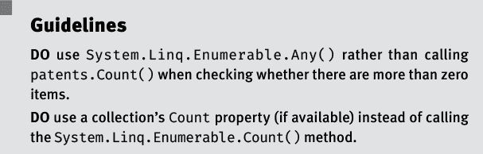

## 延迟执行

使用 LINQ 时需要记住的最重要概念之一是延迟执行。考虑列表 15.16 中的代码以及输出 15.4 中的相应输出。

> 列表 15.16：使用 System.Linq.Enumerable.Where() 进行过滤

```
using System;
using System.Collections.Generic;
using System.Linq;

// ...

IEnumerable<Patent> patents = PatentData.Patents;
bool result = patents.Where(
    patent =>
    {
        if (result = patent.YearOfPublication.StartsWith("18"))
        {
            // 谓词中的此类副作用
            // 在这里被用于演示一个
            // 原则，通常应该被避免
            Console.WriteLine("\t" + patent);
        }
        return result;
    });
```

## 标准查询操作符

### 输出 15.4

+ 1. 1900 年之前的专利有：

   留声机 (1877)

   活动电影机 (1888)

   电电报 (1837)

   蒸汽机车 (1815)

2. 1900 年之前的专利的第二次列表：

   留声机 (1877)

   活动电影机 (1888)

   电报报 (1837)

   蒸汽机车 (1815)

   1900 年之前有 4 个专利。

3. 1900 年之前的专利的第三次列表：

   留声机 (1877)

   活动电影机 (1888)

   电电报 (1837)

   蒸汽机车 (1815)

   1900 年之前有 4 个专利。

> * 注意 `Console.WriteLine("1. Patents prior...")` 在 lambda 表达式之前执行。识别这一特性非常重要，因为对于那些不知道其重要性的人来说，这并不显而易见。通常，谓词应该只做一件事——评估条件——并且不应该有任何副作用（即使像本例一样打印到控制台）。

## 第 15 章：带有标准查询操作符的集合接口

理解发生了什么，请记住 lambda 表达式是委托——对方法的引用——是可以到处传递的。在 LINQ 和标准查询操作符的上下文中，每个 lambda 表达式都形成了要执行的整体查询的一部分。

在声明时，lambda 表达式并不会执行。事实上，直到 lambda 表达式被调用，其内部的代码才会开始执行。图 15.2 显示了操作顺序。

如图 15.2 所示，列表 15.14 中的三次调用触发了 lambda 表达式，而且每次调用都是相当隐式的。如果 lambda 表达式开销很大（例如调用数据库），那么尽量减少 lambda 表达式的执行将至关重要。

首先，执行是在 `foreach` 循环内部触发的。正如本章前面所述，`foreach` 循环被分解为 `MoveNext()` 调用，每次调用都会导致原始集合中每个项执行 lambda 表达式。在迭代期间，运行时会为每个项调用 lambda 表达式，以确定它是否满足谓词。

其次，对 `Enumerable.Count()`（函数）的调用会再次触发每个项的 lambda 表达式。再次，这是一种微妙的行为，因为 `Count`（属性）在未使用标准查询操作符查询的集合上非常常见。

第三，对 `ToArray()`（或 `ToList()`、`ToDictionary()` 或 `ToLookup()`）的调用会评估每个项的 lambda 表达式。然而，使用这些“To” 方法之一转换集合是非常帮助的。这样做返回的是一个已经执行了标准查询操作符的集合。在列表 15.14 中，转换为数组意味着在最后的 `Console.WriteLine()` 中调用 `Length` 时，`patents` 指向的底层对象实际上是一个数组（实现了 `IEnumerable<T>`）；随后，会调用 `System.Array` 对 `Length` 的实现。因此，在转换为由“To”方法返回的集合类型之一后，通常处理该集合是安全的（直到调用另一个标准查询操作符为止）。但是，请注意，这将整个结果集带入内存（在此步骤之前，它可能由数据库或文件支持）。此外，“To”方法将获取数据的快照，因此在重新查询时会返回新的结果

图 15.2：操作顺序

## 第 15 章：集合接口

为了理解理解发生了什么，请记住 lambda 表达式是委托——对方法的引用——是可以到处传递的。在 LINQ 和标准查询操作符的上下文中，每个 lambda 表达式都形成了要执行的整体查询的一部分。

在声明时，lambda 表达式并不会执行。事实上，直到 lambda 表达式被调用，其内部的代码才会开始执行。图 15.2 显示了操作顺序。

如图 15.2 所示，列表 15.14 中的三次调用触发了 lambda 表达式，而且每次调用都是相当隐式的。如果 lambda 表达式开销很大（例如调用数据库），那么尽量减少 lambda 表达式的执行将至关重要。

首先，执行是在 `foreach` 循环内部触发的。正如本章前面所述，`foreach` 循环被分解为 `MoveNext()` 调用，每次调用都会导致原始集合中每个项执行 lambda 表达式。在迭代期间，运行时会为每个项调用 lambda 表达式，以确定它是否满足谓词。

其次，对 `Enumerable.Count()`（函数）的调用会再次触发每个项的 lambda 表达式。再次，这是一种微妙的行为，因为 `Count`（属性）在未使用标准查询操作符查询的集合上非常常见。

第三，对 `ToArray()`（或 `ToList()`、`ToDictionary()` 或 `ToLookup()`）的调用会评估每个项的 lambda 表达式。然而，使用这些“To”方法转换集合是非常帮助的。这样做返回的是一个已经执行了标准查询操作符的集合。在列表 15.14 中，转换为数组意味着在最后的 `Console.WriteLine()` 中调用 `Length` 时，`patents` 指向的底层对象实际上是一个数组（实现了 `IEnumerable<T>`）；随后，会调用 `System.Array` 对 `Length` 的实现。因此，在转换为由“To”方法返回的集合类型之一后，通常处理该集合是安全的（直到调用另一个标准查询操作符为止）。但是，请注意，这将整个结果集带入内存（在此步骤之前，它可能由数据库或文件支持）。此外，“To”方法将获取数据的快照，因此在重新查询时会返回新的结果

图 15.2：操作顺序

## 第 15 章：集合接口

强烈建议你查看 1900 年之前的专利。为了理解...

1. 1900 年之前的专利有：

   留声机 (1877)

   活动电影机 (1888)

   电电报 (1837)

   蒸汽机车 (1815)

2. 1900 年之前的专利的第二次列表：

   留声机 (1877)

   活动电影机 (1888)

   电电报 (1837)

   蒸汽机车 (1815)

   1900 年之前有 4 个专利。

3. 1900 年之前的专利的第三次列表：

   留声机 (1877)

   活动电影机 (1888)

   电电报 (1837)

   蒸汽机车 (1815)

   1900 年之前有 4 个专利。

> * 注意 `Console.WriteLine("1. Patents prior...")` 在 lambda 表达式之前执行。识别这一特性非常重要，因为对于那些不知道其重要性的人来说，这并不显而易见。通常，谓词应该只做一件事——评估条件——并且不应该有任何副作用（即使像本例一样打印到控制台）。

## 使用 OrderBy() 排序

集合的一种常见操作是对其进行排序。排序涉及到对 `System.Linq.OrderBy()` 的调用，如列表 15.16 和输出 15.4 所示。

> 列表 15.16：使用 System.Linq.Enumerable.Where() 进行过滤

```
using System;
using System.Collections.Generic;
using System.Linq;

// ...

IEnumerable<Patent> patents = PatentData.Patents;
bool result = patents.Where(
    patent =>
    {
        if (result = patent.YearOfPublication.StartsWith("18"))
        {
            // 谓词中的此类副作用
            // 在这里被用于演示一个
            // 原则，通常应该被避免
            Console.WriteLine("\t" + patent);
        }
        return result;
    });
```

## 标准查询操作符

### 输出 15.4

+ 1. 1900 年之前的专利有：


留声机 (1877)

活动电影机 (1888)

电电报 (1837)

蒸汽机车 (1815)

## 1900 年之前的专利的第二次列表：

留声机 (1877)

活动电影机 (1888)

电电报 (1837)

蒸汽机车 (1815)

1900 年之前有 4 个专利。

## 1900 年之前的专利的第三次列表：

留声机 (1877)

活动电影机 (1888)

电电报 (1837)

蒸汽机车 (1815)

1900 年之前有 4 个专利。

> * 注意 `Console.WriteLine("1. Patents prior...")` 在 lambda 表达式之前执行。识别这一特性非常重要，因为对于那些不知道其重要性的人来说，这并不显而易见。通常，谓词应该只做一件事——评估条件——并且不应该有任何副作用（即使像本例一样打印到控制台）。

## 使用 `OrderBy()` 排序

注意 `OrderBy()` 调用只接受一个参数 `keySelector` 用于排序。要对第二列进行排序，有必要使用不同的方法：`ThenBy()`。同样，代码会对任何额外的排序使用 `ThenBy()`。

`OrderBy()` 返回 `IOrderedEnumerable<T>` 接口，而不是 `IEnumerable<T>`。此外，`IOrderedEnumerable<T>` 派自 `IEnumerable<T>`，因此所有的查询操作符（包括 `OrderBy()`）都可以在 `OrderBy()` 返回值可用。然而，重复调用 `OrderBy()` 会撤销之前调用的工作，导致最终结果仅按最后一个 `OrderBy()` 调用中的 `keySelector` 排序。由于此原因，你应该小心不要在之前的 `OrderBy()` 调用上再次调用 `OrderBy()`。

相反，你应该使用 `ThenBy()` 指定额外的排序准则。虽然 `ThenBy()` 是一个扩展方法，但它不是扩展的

不是 `IEnumerable<T>` 而是 `IOrderedEnumerable<T>`。该方法也定义在 `System.Linq.Extensions.Enumerable` 中，声明如下：

```
public static IOrderedEnumerable<TSource>
    ThenBy<TSource, TKey>(this this IOrderedEnumerable<TSource> source,
        Func<TSource, TKey> keySelector)
```

总结之，使用 `OrderBy()`，然后跟上零或多次 `ThenBy()` 调用来提供额外的“列”。`OrderByDescending()` 和 `ThenByDescending()` 方法提供相同的功能，它们按降序对项目排序。混合使用升序和降序方法没有问题，但如果项目排序的顺序很重要，你将使用 `ThenBy()`（无论是升序还是降序）。

关于排序还有两个重要的说明。第一次排序直到你开始访问集合中的成员时才会发生，此时整个查询才会被处理。除非你拥有了所有待排序的项，否则无法进行排序，因为你无法确定是否已经有了第一个项。排序延迟到开始访问成员的原因是本章较早描述的**延迟执行**（deferred execution）。其次，后续每个对数据的排序调用（例如 `OrderBy()` 后接 `ThenByDescending()`）确实为早期排序调用的 `keySelector` lambda 表达式引入了额外的列。换句话说，调用 `OrderBy()` 会在你遍历集合时调用其 `keySelector` lambda 表达式。此外，后续的 `ThenBy()` 调用将再次调用 `OrderBy()` 的 `keySelector`。

> 不要在一个先前的 `OrderBy()` 方法调用之后再次调用 `OrderBy()`。使用 `ThenBy()` 根据多个值对项目进行顺序排序。

## 初学者主题

## 链接操作 (Join Operations)

考虑图 15.3 维恩图所示两个对象集合。图中的左圆包含所有发明者，右圆包含所有专利。交集包含发明者和专利，对于每种发明者与专利匹配的情况，都会形成一条连接线。如所示所示，每个发明者可能拥有多个专利，而每个专利可以拥有一个或多个发明者。每个专利都有一个发明者，但在某些情况下，发明者还没有专利。

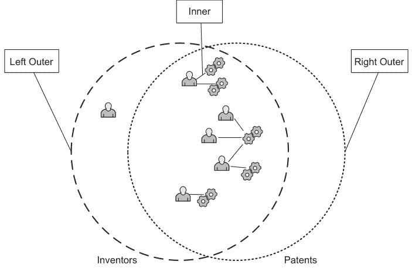

图 15.3：发明者和专利集合的维恩图

将交集中的发明者与专利匹配的操作是**内连接**（inner join）。结果是一个发明者/专利对的集合，其中每一对都存在专利和发明。**左外连接**（left outer join）包含左圆中的所有项，无论它们是否有对应的专利。在这个特定的示例中，**右外连接**（right outer join）将与内连接相同，因为没有不属于发明者的专利。此外，左与右的指定是任意的，因此左连接和外连接之间实际上并没有区别。然而，**全外连接**（full outer join）将包含来自双方的记录；执行全外连接相对少见。

发明者与专利之间关系的另一个重要特征是它是**多对多关系**（many-to-many relationship）。每个单独的发明者可以拥有一个或多个发明（例如，奥尔维和威尔伯·莱莱特共同发明的飞行器）。此外，每个发明者可以拥有一个或多个专利（例如，本杰明·富兰林发明的双焦点眼镜和留声机）。

另一种常见的关系是**一对多关系**（one-to-many relationship）。例如，一个公司部门可能有许多员工。然而，每位员工在一次只能属于一个部门。（然而，正如一对多关系的常见情况，引入时间因素可以将其转换为多对多关系。特定员工可能会从一个部门移动到另一个部门，随着时间推移，他们可能与多个部门关联，形成另一个多对多关系。）

列表 15.18 提供了员工和部门数据的示例，输出 15.6 显示了结果。

### 列表 15.18：员工和部门示例数据

```cs
public class Department
{
    public long Id { get; }
    public string Name { get; }
    public Department(string name, long id) {
        Id = id;
        Name = name ?? throw ArgumentNullException(nameof(name));
    }
    public override string ToString() {
        return Name;
    }
}
public class Employee
{
    public int Id { get; }
    public string Name { get; }
    public string Title { get; }
    public int DepartmentId { get; }
    public Employee(string name, string title, int departmentId) {
        Name = name ?? throw ArgumentNullException(nameof(name));
        Title = title ?? throw ArgumentNullException(nameof(title));
        DepartmentId = departmentId;
    }
    public override string ToString() {
        return $"{Name} ({Title})`;
    }
}
public static class CorporateData
{
    public static readonly Department[] Departments =
        new Department[]
```

```
new Department("Corporate", 0),
new Department("Human Resources", 1),
new Department("Engineering", 2),
new Department("Information Technology", 3),
new Department("Philanthropy", 4),
new Department("Marketing", 5)
}
```

```cs
public static readonly Employee[] Employees = new Employee[]
{
new Employee("Mark Michaelis", "Chief Computer Nerd", 0),
new Employee("Michael Stokesbury", "Senior Computer Wizard", 2),
new Employee("Brian Jones", "Enterprise Integration Guru", 2),
new Employee("Anne Beard", "HR Director", 1),
new Employee("Pat Dever", "Enterprise Architect", 3),
new Employee("Kevin Bost", "Programmer Extraordinaire", 2),
new Employee("Thomas Heave", "Software Architect", 2),
new Employee("Eric Edmonds", "Philanthropy Coordinator", 4)
}
```

```cs
class Program
{
static void Main()
{
IEnumerable<Department> departments = CorporateData.Departments;
Print(departments);
Console.WriteLine();
IEnumerable<Employee> employees = CorporateData.Employees;
Print(employees);
}
private static void Print<T>(IEnumerable<T> items)
{
foreach (T item in items)
{
Console.WriteLine(item);
}
}
}
```

### 输出 15.6

| Corporate |
| Human Resources |
| Engineering |
| Information Technology |
| Philanthropy |
| Marketing |
| Mark Michaelis (Chief Computer Nerd) |
| Michael Stokesbury (Senior Computer Wizard) |
| Brian Jones (Enterprise Integration Guru) |
| Anne Beard (HR Director) |
| Pat Dever (Enterprise Architect) |
| Kevin Bost (Programmer Extraordinaire) |
| Thomas Heave (Software Architect) |
| Eric Edmonds (Philanthropy Coordinator) |

```csharp
employees.Join(
  departments,
  employee => employee.DepartmentId,
  department => department.Id,
  (employee, department) => (
    employee.Id,
    employee.Name,
    employee.Title,
    department
  ));
```

```csharp
foreach (var item in items) {
  Console.WriteLine($"{item.Name} {item.Title}");
  Console.WriteLine("\t" + item.Department);
}
```

### 输出 15.7

| Mark Michaelis (Chief Computer Nerd) Corporate |
| Michael Stokesbury (Senior Computer Wizard) Engineering |
| Brian Jones (Enterprise Integration Guru) Engineering |
| Anne Beard (HR Director) Human Resources |
| Pat Dever (Enterprise Architect) Information Technology |
| Kevin Bost (Programmer Extraordinaire) Engineering |
| Thomas Heavy (Software Architect) Engineering |
| Eric Edmonds (Philanthropy Coordinator) Philanthropy |

`Join()` 的第一个参数名称为 `inner`。它指定了 `employees` 要连接的集合 `departments`。后两个参数是 Lambda 表达式，用于指定两个集合如何连接。`employee => employee.DepartmentId`（带有参数 `outerKeySelector`）标识每个员工的键将是 `DepartmentId`。下一个 Lambda 表达式（`department => department.Id`）指定部门的 `Id` 作为键——换句话说，对于每个员工，连接 `employee.DepartmentId` 等于 `department.Id` 的部门。最后一个参数是

### 第 15 章：带有标准查询运算符的集合接口 所选的结果项。在这种情况下，它是包含员工的 Id、Name 和 Title 的元组，以及一个带有已连接部门对象的 Department 属性。

注意输出中 `Engineering` 出现了多次——对应 `CorporateData` 中的每个员工各一次。在这种情况下，`Join()` 调用在所有部门和所有员工之间产生了笛卡尔积，使得当两个集合中都存在记录且指定的部门 ID 匹配时，就会创建一个新记录。这种类型的连接是内连接（inner join）。

数据也可以反向连接，即部门连接到每个员工，以列出部门到员工的匹配关系。注意输出包含的记录比部门数量多：每个部门都有多个员工，并且每个匹配都会生成一条记录。正如我们之前看到的，`Engineering` 部门出现了多次，对应每个员工一次。

列表 15.20 中的代码（产生输出 15.8）与列表 15.19 中的代码类似，但 `Departments` 和 `Employees` 对象的顺序反过了。`Join()` 的第一个参数是 `employees`，指示要连接哪些部门。接下来的两个参数是 Lambda 表达式，用于指定两个集合如何连接：用于 `departments` 的 `department => department.Id` 和用于 `employees` 的 `employee => employee.DepartmentId`。与之前一样，只要 `department.Id` 等于 `employee.EmployeeId`，就会发生连接。最后的元组参数指定了一个具有 `int Id`、`string Name` 和 `Employee items` 的类。（在表达式中指定名称是可选的，但为了清晰起见。）

### 列表 15.20：使用 System.Linq.Enumerable.Join() 的另一个内连接

```csharp
using System;
using System.Linq;
// ...
Department[] departments = CorporateData.Departments;
Employee[] employees = CorporateData.Employees;
IEnumerable<(long Id, string Name, Employee Employee)> items = departments.Join(
    employees,
    department => department.Id,
    employee => employee.DepartmentId,
// (department, employee) => (
  department.Id,
  department.Name,
  Employee: employee
);
foreach (var item in items) {
  Console.WriteLine(item.Name);
  Console.WriteLine("\t" + item.Employee);
}
```


# 15.8

Corporate
Mark Michaelis (Chief Computer Nerd)
Human Resources
Anne Beard (HR Director)
Engineering
Michael Stokesbury (Senior Computer Wizard)
Engineering
Brian Jones (Enterprise Integration Guru)
Engineering
Kevin Bost (Programmer Extraordinaire)
Engineering
Thomas Heavy (Software Architect)
Information Technology
Pat Dever (Enterprise Architect)
Philanthropy
Eric Edmonds (Philanthropy Coordinator)

除了对对象集合进行排序和连接外，你可能还对具有相似特征的对象进行分组。对于员工数据，你可能想按部门、地区、职位等对员工分组。列表 15.21 展示了如何使用 `GroupBy()` 标准查询运算符来实现此目的（参见输出 15.9 的结果）。

## 列表 15.21：使用 System.Linq.Enumerable.GroupBy() 分组项

```csharp
using System;
using System.Linq;
// ...
IEnumerable<Employee> employees = CorporateData.Employees;
IEnumerable<IGrouping<int, Employee>> groupedEmployees = employees.GroupBy((employee) => employee.DepartmentId);
```

## 第 15 章：带有标准查询运算符的集合接口

```csharp
foreach(IGrouping<int, Employee> employeeGroup in groupedEmployees)
{
    Console.WriteLine();
    foreach(Employee employee in employeeGroup)
    {
        Console.WriteLine("\t" + employee);
    }
    Console.WriteLine(
        "\tCount: " + employeeGroup.Count());
}
// ...
```

## 输出 15.9

Mark Michaelis (Chief Computer Nerd)
Count: 1

Michael Stokesbury (Senior Computer Wizard)
Brian Jones (Enterprise Integration Guru)
Kevin Bost (Programmer Extraordinaire)
Thomas Heavy (Software Architect)
Count: 4

Anne Beard (HR Director)
Count: 1

Pat Dever (Enterprise Architect)
Count: 1

Eric Edmonds (Philanthropy Coordinator)
Count: 1

注意 `IGrouping<TKey, TElement>` 派自 `IEnumerable<T>`，它具有一个用于组内项目的属性。

使用 GroupJoin 实现一对多关系

列表 15.19 和 15.20 几乎完全相同。通过更改元组定义，任何 `Join()` 都可以产生相同的输出。然而，列表 15.19 提供了正确的结果。考虑到对集合的支持，一种表示表示

## 第 15 章：带有标准查询运算符的集合接口

为了获得首选结果，我们使用 `System.Linq.Enumerable` 的 `GroupJoin()` 方法。参数与列表 15.19 中的相同，用于最终选择的元组。在列表 15.19 中，Lambda 表达式的类型为 `Func<Department, IEnumerable<Employee>, (long Id, string Name, IEnumerable<Employee>)>`。注意我们使用第二个参数（`IEnumerable<Employee>`）来投影每个部门的员工集合；因此，结果集合中的每个部门都包含一个员工列表。（熟悉 SQL 的读者会注意到，与 `Join()` 不同，`GroupJoin()` 没有 SQL 等效写法，因为 SQL 返回的数据是基于记录的，而不是层次结构的。）

### 高级主题

## 使用 GroupJoin() 实现外连接

早期的内连接是等值连接，因为只有当两个集合中都存在对象时记录才会出现。然而，有时你可能在相关对象不存在的情况下创建一个记录。例如，与其因为 `Marketing` 部门没有员工就将其从最终部门列表中排除，不如通过一个空员工列表将其包含。为了实现这一点，我们结合 `GroupJoin()`、`SelectMany()` 以及 `DefaultIfEmpty()` 执行左外连接。这在列表 15.23 和输出 15.11 中所示。

## 列表 15.22：使用 System.Linq.Enumerable.GroupJoin 创建子集合

```csharp
using System;
using System.Linq;
// ...
Department[] departments = CorporateData.Departments;
Employee[] employees = CorporateData.Employees;
IEnumerable<(long Id, string Name, IEnumerable<Employee>)> items = departments.GroupJoin(
    employees,
    department => department.Id,
    employee => employee.DepartmentId,
    (department, departmentEmployees) => (
        department.Id,
        department.Name,
        departmentEmployees
    );
foreach (var item in items) {
    Console.WriteLine(item.Name);
    foreach (var employee in item.Employees) {
        Console.WriteLine("\t" + employee);
    }
}
```

## 输出 15.10

| Corporate Mark Michaelis (Chief Computer Nerd) |
| Human Resources Anne Beard (HR Director) |
| Engineering Michael Stokesbury (Senior Computer Wizard) |
| Brian Jones (Enterprise Integration Guru) |
| Kevin Bost (Programmer Extraordinaire) |
| Thomas Heavy (Software Architect) |

## 输出 15.11 (隐含)

## 列表 15.23：使用 GroupJoin() 和 SelectMany() 实现外连接

```csharp
using System;
using System.Linq;
// ...
Department[] departments = CorporateData.Departments;
Employee[] employees = CorporateData.Employees;
IEnumerable<(long Id, string Name, IEnumerable<Employee>)> items = departments.GroupJoin(
    employees,
    department => department.Id,
    employee => employee.DepartmentId,
    (department, departmentEmployees) => (
        department.Id,
        department.Name,
        departmentEmployees
    )
    ).SelectMany(
        group => group.Employees.DefaultIfEmpty(Enumerable.Empty<Employee>()),
        (group, employee) => new { group.Id, group.Name, employee }
    );
```

## 标准查询运算符

```csharp
var items = departments.GroupJoin(
  employees,
  department => department.Id,
  employee => employee.DepartmentId,
  (department, departmentEmployees) => new
  {
    department.Id,
    department.Name,
    Employees = departmentEmployees
}).Select(
  departmentRecord =>
    departmentRecord.Employees.DefaultIfEmpty(),
    (departmentRecord, employee) => new
    {
      departmentRecord.Id,
      departmentRecord.Name,
      departmentRecord.Employees
    }
).Distinct();
foreach (var item in items)
{
  Console.WriteLine(item.Name);
  foreach (Employee employee in item.Employees)
  {
    Console.WriteLine("\t" + employee);
  }
}
// ...
```

## 输出 15.11

企业
  Mark Michaels (首席电脑极客)
人力资源
  Anne Beard (HR 总监)
工程部
  Michael Stokesbury (高级计算机巫)
  Brian Jones (企业集成大师)
  Kevin Bott (卓越程序员)
  Thomas Heavy (软件架构师)
信息技术
  Pat Dever (企业架构师)
慈善事业
  Eric Edmonds (慈善协调员)
营销部

## 调用 SelectMany()

有时，你可能会拥有集合的集合。列表 15.24 提供了此类场景的示例。`teams` 数组包含两个团队，每个团队都包含一个字符串数组类型的球员。

## 第 15 章：带有标准查询运算符的集合接口

## 列表 15.24：调用 SelectMany()

```csharp
using System;
using System.Collections.Generic;
using System.Linq;
```
```csharp
// ...
(string Team, string[] Players) = worldCup2006Finalists = new[]
{
    TeamName: "France",
    Players: new string[]
    {
        "Fabian Barthez", "Gregory Coupet",
        "Mickael Landau", "Eric Abidal",
        "Jean-Alain Boussong", "Pascal Chimbonda",
        "William Gallas", "Gael Givet",
        "Willy Sagnol", "Mikael Silvestre",
        "Lilian Thuram", "Vikash Dhorasao",
        "Alou Diarra", "Patrick Vieira",
        "Florent Malouda", "Djibril Cisse",
        "Zineine Zidane", "Franck Ribery",
        "Thierry Henry", "David Trezeguet",
        "Louis Saha", "Sylvain Wiltord"
    }
},
{
    TeamName: "Italy",
    Players: new string[]
    {
        "Gianluigi Buffon", "Angelo Peruzzi",
        "Marco Amelia", "Cristian Zaccardo",
        "Alessandro Nesta", "Gianluca Zambrotta",
        "Fabio Cannavaro", "Marco Materazzi",
        "Fabio Groasso", "Massimo Oddo",
        "Andrea Barzagli", "Daniele De Rossi",
        "Gennaro Gattuso", "Simone Perrone",
        "Mauro Camorensi", "Luca Toni",
        "Alessandro Del Piero", "Francesco Totti",
        "Alberto Gilardino", "Filippo Inzaghi",
        "Vincenzo Iaquinta"
    }
};
IEnumerable<string> players =
worldCup2006Finalists.SelectMany(
    team => team.Players);
Print(players);
```
```csharp
// ...
```

此列表的输出将每个球员的名字按照它们在代码中出现的顺序单独行显示。`Select()` 和 `SelectMany()` 的区别在于 `Select()` 会返回两个项目，每个对应原始集合中的一个项目。`Select()` 可能会从原始类型投影出一个转换，但项目的数量不会改变。相反，`SelectMany()` 会遍历原始集合中的每个元素并将其扁平化为集合。例如，`Select(team => team.Players)` 会返回一个包含字符串数组的集合，而 `SelectMany(team => team.Players)` 则返回一个包含所有球员字符串的单一集合。

标准查询运算符

列表 15.25 显示了 `Enumerable` 启用的某些方法；输出 15.12 显示了结果。

## 列表 15.25：调用更多方法

```csharp
using System;
using System.Collections.Generic;
using System.Linq;
using System.Text;
class Program
{
    static void Main()
    {
        IEnumerable<object> stuff = new object[]
        {
            1, 2, 3, 4, 5, 6, 7, 8, 9
        };
        Console.WriteLine("Even numbers:");
        foreach (var item in stuff.OfType<int>().Where(n => n % 2 == 0))
        {
            Console.WriteLine(item);
        }
        Console.WriteLine("\nUnique numbers:");
        foreach (var item in stuff.OfType<int>().Distinct())
        {
            Console.WriteLine(item);
        }
        Console.WriteLine("\nSquared numbers:");
        foreach (var item in stuff.OfType<int>().Select(n => n * n))
        {
            Console.WriteLine(item);
        }
    }
}
```

偶数数字：
2
4
6
8

唯一数字：
1
2
3
4
5
6
7
8
9

平方数字：
1
4
9
16
25
36
49
64
81

## 第 15 章：带有标准查询运算符的集合

```csharp
if (!numbers.SequenceEqual(numbers.Concat(odd)))
{
    throw new Exception("Unexpected");
}
else
{
    Print("Reverse: ", numbers.Reverse());
```


```csharp
Print("Average: ", numbers.Average());

Print("Sum: ", numbers.Sum());

Print("Max: ", numbers.Min());
```

```csharp
private static void Print<T>(string format, IEnumerable<T> items)
{
    Console.WriteLine(format + string.Join(", ", items));
}
```

输出 15.12
反转： 9, 8, 7, 6, 5, 4, 3, 2, 1
平均值： 5
和： 45
最大值： 9

# 标准查询运算符

## 列表 15.25：调用更多方法

```csharp
using System;
using System.Collections.Generic;
using System.Linq;
using System.Text;
class Program
{
    static void Main()
    {
        IEnumerable<object> stuff = new object[]
        {
            1, 2, 3, 4, 5, 6, 7, 8, 9
        };
        Console.WriteLine("Even numbers:");
        foreach (var item in stuff.OfType<int>().Where(n => n % 2 == 0))
        {
            Console.WriteLine(item);
        }
        Console.WriteLine("\nUnique numbers:");
        foreach (var item in stuff.OfType<int>().Distinct())
        {
            Console.WriteLine(item);
        }
        Console.WriteLine("\nSquared numbers:");
        foreach (var item in stuff.OfType<int>().Select(n => n * n))
        {
            Console.WriteLine(item);
        }
    }
}
```

偶数数字：
2
4
6
8

唯一数字：
1
2
3
4
5
6
7
8
9

平方数字：
1
4
9
16
25
36
49
64
81

# 表格 15.1：简单的标准查询运算符

| 注释类型 |  |
|---|---|
| `Of()` | 在集合上执行查询，仅返回特定类型的项目，该类型由 `typeof<T>` 方法指定。 |
| `Union()` | 合并两个集合以形成并集。如果同一项目存在于两个集合中，最终集合不会包含重复项。 |
| `Concat()` | 合并两个集合以形成全集。结果集中不会移除重复项目。`Concat()` 将保留顺序。例如，合并 `{A, B}` 和 `{C, D}` 将产生 `{A, B, C, D}`。 |
| `Intersect()` | 提取两个原始集合共同的项目。 |
| `Distinct()` | 从集合中过滤重复项目，使结果集合中的每个项目都是唯一的。 |
| `SequenceEquals()` | 比较两个集合并返回布尔值指示集合是否相同，包括集合中元素的顺序。 |
| `Reverse()` | 反转集合中的项目，使其在遍历集合时按反序出现。 |

# 表格 15.2：System.Linq.Enumerable 聚合函数

| 注释类型 | 描述 |
|---|---|
| `Count()` | 提供集合项目总数的计数。 |
| `Average()` | 计算数值集合的平均值。 |
| `Sum()` | 计算数值集合的总和。 |
| `Max()` | 确定数值集合中的最大值。 |
| `Min()` | 确定数值集合中的最小值。 |

## 第 15 章：带有标准查询操作符的接口

## 高级主题

### IQueryable<T> 的 Queryable 扩展

`IQueryable<T>` 是一个与 `IEnumerable<T>` 几乎相同的接口。由于 `IQueryable<T>` 继承自 `IEnumerable<T>`，因此它拥有 `IEnumerable<T>` 中直接声明的所有成员（例如 `GetEnumerator()`）。

然而，扩展方法不会被继承，因此 `IQueryable<T>` 不具备任何 `IEnumerable` 的扩展方法。尽管如此，它有一个类似的扩展类 `System.Linq.Queryable`，该类为 `IQueryable<T>` 添加了几乎所有添加到 `IEnumerable<T>` 中的方法。因此，它提供了非常相似的编程接口。

`IQueryable<T>` 的独特之处在于它允许自定义 LINQ 提供程序。LINQ 提供程序将表达式拆分为其组成部分。一旦完成，表达式就可以被翻译成另一种语言、为了远程执行而序列化、注入异步执行模式等。本质上，LINQ 提供程序允许对与查询相关的标准集合 API 行为进行拦截机制，并可以通过这种看似无限的功能进行注入。

例如，LINQ 提供程序允许将查询表达式从 C# 翻译为 SQL，然后在远程数据库上执行。在此过程中，C# 程序员可以保持使用主要的面向对象语言，并将到 SQL 的翻译交给底层的 LINQ 提供程序。通过此类表达式，编程语言可以跨越面向对象的世界与关系型数据库之间的阻抗匹配问题。

在 `IQueryable<T>` 的情况下，对**延迟执行**的警惕变得更为关键。例如，想象一个从数据库返回数据的 LINQ 提供程序。它不会无条件地从数据库检索数据，而是 Lambda 表达式会提供一个 `IQueryable<T>` 的实现，该实现可能包含连接字符串等文本信息，但不包含数据本身。在调用 `GetEnumerator()` 甚至 `MoveNext()` 之前不会发生数据检索。然而，`GetEnumerator()` 的调用通常是隐式的，当你使用 `foreach` 遍历集合或调用 `Count<T>()` 或 `Cast<T>()` 等枚举方法时。显然，这种情况需要开发者警惕延迟执行可能对任何高开销操作引起的细微且重复的调用。例如，调用 `GetEnumerator()` 涉及跨网络到数据库的分布式调用，因此最好避免在 `Count()` 或 `foreach` 迭代中出现无意的重复调用。

## LINQ 中的匿名类型

C# 3.0 显著改进了使用 LINQ 处理项目集合的支持。令人惊讶的是，为了支持这种高级 API，仅引入了八项新的语言增强——但这些增强对于 C# 3.0 成为语言如此奇妙改进至关重要。这些增强中的两个是**匿名类型**和**隐式局部变量**。尽管如此，自 C# 7.0 以来，由于 C# 元组语法的引入，匿名类型基本上被掩盖了。事实上，随着本书的第六版的发布，所有以前利用匿名类型的 LINQ 示例都已更新为使用元组。

但如果你没有 C# 7.0（或更高版本），或者你正在处理在 C# 7.0 之前编写的代码怎么办？本章的剩余部分将涵盖匿名类型主题，以便你仍然能够理解匿名类型这一语言特性。（但是，如果你认为自己不会在 C# 6.0 或更早的世界中编程，你可能考虑完全跳过本节。）

## 匿名类型

匿名类型是由编译器声明的数据类型，而不是通过第 6 章中引入的显式类定义引入。作为匿名函数，当编译器看到匿名类型时，它会完成为你创建该类的工作，然后让你像显式声明过它那样使用它。列表 15.26 显示了这样的声明。

### 列表 15.26：带有匿名类型的隐式局部变量

```csharp
using System;
class Program
{
    static void Main()
{}
}
```

```csharp
var patent1 = 
{
    Title = "Bifocals",
    YearOfPublication = "1784"
};
var patent2 = 
{
    Title = "Phonograph",
    YearOfPublication = "1877"
};
var patent3 = 
{
    patent1.Title,
    // 重命名以显示属性命名。
    Year = patent1.YearOfPublication
};
```

```csharp
Console.WriteLine(
    "{patent1.Title} {patent1.YearOfPublication}");
Console.WriteLine(
    "{patent2.Title} {patent2.YearOfPublication}");
```

```csharp
Console.WriteLine();
Console.WriteLine(patent1);
Console.WriteLine(patent2);
```

```csharp
Console.WriteLine();
Console.WriteLine(patent3);
```

相应的输出显示在输出 15.13。

## 输出 15.13

Bifocals (1784)
Phonograph (1877)
{ Title = Bifocals, YearOfPublication = 1784 }
{ Title = Phonograph, YearOfPublication = 1877 }

{ Title = Bifocals, Year = 1784 }

匿名类型纯粹是 C# 特性，而不是运行时的一种新类型。当编译器遇到匿名类型语法时，它会生成一个 CIL 类，其属性与匿名类型声明中的命名值和数据类型对应。

### 隐式局部变量 (var)

`var` 关键字允许编译器从初始化程序中推断局部变量的类型。这在类型显而易见或复杂时特别有用，例如在处理匿名类型时。然而，为了保持代码的可读性，应该节节使用它。

使用 `var` 时，编译器在编译时执行类型推断，这意味着生成的变量仍然是强类型的。这与使用 `dynamic` 关键字看到的动态类型不同。

例如：

```csharp
var list = new List<string>();
var name = "John";
var age = 42;
```

在这些情况下，类型从右侧显而易见。然而，如果类型并不明显，通常更倾向于使用显式类型声明以保持清晰。

匿名类型的输出会自动显示属性名称及其值，这些是与匿名类型关联的生成的 `ToString()` 方法的一部分。

使用 `Select()` 方法进行投影非常强大。我们已经看到了如何垂直方向地对集合进行过滤（使用 `Where()` 标准查询操作符减少集合中的项数量）。现在，通过使用 `Select()` 标准查询操作符，我们也可以水平方向地减少集合（产生更少的列）或完全转换数据。通过添加对匿名类型的支持，我们可以 `Select()` 任意任意的“对象”，这种方法仅需提取原始集合中当前算法所需的部分，而无需为它们声明一个类。

## 更多关于匿名类型和隐式局部变量

在列表 15.26 中，匿名类型的成员名是通过将值赋值给 `property1` 和 `property2` 的名称来显式标识的（例如，`Title = "Phonograph"`）。然而，如果赋值的值是属性或字段调用，则名称可能默认为该字段或属性的名称，而不是显式指定该值。例如，`property3` 是使用名为 `Title` 的属性定义的，而不是赋值给显式名称。如输出 15.13所示，结果性属性名由编译器确定，以与获取值的来源属性相匹配。

`property1` 和 `property2` 具有相同的属性名称和相同的数据类型。因此，C# 编译器为这两个匿名声明仅生成一个数据类型。相比之下，`property3` 强制编译器创建第二个匿名类型，因为年份的属性名称与 `property1` 和 `property2` 中的名称不同。此外，如果 `property1` 和 `property2` 之间的属性顺序发生交换，这两个匿名类型将不具有类型兼容性。换句话说，在同一个程序集中，两个匿名类型类型类型兼容的要求是：属性名称、数据类型和属性顺序必须匹配。如果满足了这些标准，只要它们出现在不同的方法或类中，这些类型就是兼容的。列表 15.28 展示了类型不兼容的情况。

# 第 15 章：带有标准查询操作符的集合接口

## 列表 15.28：匿名类型的类型安全和不可变性

```csharp
class Program
{
    static void Main()
    {
        var patent1 = new
            {
                Title = "Bifocals",
                YearOfPublication = "1784",
                YearOfPublication = "1877",
                Title = "Phonograph",
                Year = patent1.YearOfPublication
            };
        var worldQuery2006Finalists = new[] { };
        var patent2 = new
            {
            };
        var patent3 = new
            {
                patent1.Title,
            };
        // ERROR: 无法隐式转换类型
        // 'AnonymousType#1' 到 'AnonymousType#2'
        patent1 = patent2;
        // ERROR: 无法隐式转换类型
        // 'AnonymousType#3' 到 'AnonymousType#2'
        patent1 = patent3;
        // ERROR: 属性或索引器 'AnonymousType#1.Title'
        // 赋值，它是只读的
        patent1.Title = "Swiss Cheese";
    }
}
```

前两个编译错误断言类型是不兼容的，因此它们无法成功从一个转换为另一个。第三个编译错误是由于对 `Title` 属性的重新赋值引起的。匿名类型是不可变的，因此一旦匿名类型被实例化，更改其上的属性就是编译时错误。

尽管列表 15.28 中没有显示，但无法声明带有隐式数据类型参数 (`var`) 的方法。因此，匿名类型的实例可以通过两种方式传递到创建它的方法外部。首先，如果方法参数类型为 `object` 则匿名类型实例可以传递到方法外部，因为匿名类型将进行隐式转换。第二方法是使用方法类型推断，通过这种方式，可以推断出类型，例如 `void Method<T>(T parameter)`。

尽管未在列表 15.28 中显示，但无法声明带有隐式数据类型参数 (`var`) 的方法。因此，匿名类型的实例可以通过两种方式传递到创建它的方法外部。首先，如果方法参数类型为 `object`，则匿名类型实例可以传递到方法外部，因为匿名类型将进行隐式转换。第二方法是使用方法类型推断，通过这种方式，可以推断出类型，例如 `void Method<T>(T parameter)`。

实际上，使用 `Select()` 方法进行投影是极其强大的，但由于匿名类型限制，在某些情况下我们会使用元组（Tuple）来避免类型声明的麻烦。

（注：由于原文中存在部分重复和逻辑断层，译文已根据原文内容进行了对应翻译，并保留了所有 Markdown 格式。）

构造函数，数组初始化语法允许使用 `new[ ]` 创建匿名数组初始化器（参见列表 15.29）。

# 列表 15.29：初始化匿名类型数组

```csharp
using System;
using System.Collections.Generic;
using System.Linq;
class Program
{
    static void Main()
    {
        new
        {
            TeamName = "France",
            Players = new string[]
            {
                "Fabian Barthez", "Gregory Coupet",
                "Mickael Landreau", "Eric Abical"
            },
        },
        new
        {
            TeamName = "Italy",
            Players = new string[]
            {
                "Gianluigi Buffon", "Angelo Peruzzi",
                "Marco Amelia", "Cristian Zaccardo"
            }
        };
        Print(WorldCup2006Finalists);
    }
    private static void Print<T>(IEnumerable<T> items)
    {
        foreach (T item in items)
        {
            Console.WriteLine(item);
        }
```


```
        }

    }

}

```

生成的变量是匿名类型项的数组，由于它是数组，因此必须是同质的。

## 总结

本章描述了 `foreach` 循环工作的内部机制，并解释了执行该循环所需的接口。此外，开发者经常过滤集合以减少项目不需要的项，并投影集合以使项呈现不同的形式。为此，本章讨论了如何使用标准查询操作（LINQ 在 `System.Enumerable` 类上引入了集合扩展方法）来执行集合操作的细节。

在标准查询操作的引言中，我们详细说明了延迟执行的过程，并强调了开发者应该如何小心避免通过枚举集合内容的细微调用来无意中重复执行表达式。标准查询操作的延迟执行和随之产生的隐式执行是代码效率的一个重要因素，特别是当查询执行开销很大时。程序员应该将查询对象视为查询对象，而不是结果，并且应该预期即使已经执行过，查询仍会完全执行。查询对象不知道结果将与之前的执行结果相同。

列表 15.23 出现在“高级主题”部分，是因为连续调用多个标准查询操作具有复杂性。虽然对类似执行方式的需求可能很常见，但没有必要直接依赖标准查询操作。C# 3.0 包含了查询表达式，这是一种类似于 SQL 的语法，用于操作集合，这种方式在编码和阅读时通常更容易，正如我们在下一章中所示。

本章以详细查看匿名类型作为结束，并解释了为什么如果你使用的是 C# 7.0 或更高版本，元组（tuples）实际上是更优优的方法。

# 第 16 章：使用查询表达式的 LINQ

第 15 章的结束展示了一个使用标准查询操作进行 `GroupJoin()`、`SelectMany()` 和 `Distinct()` 的查询。其结果是一个跨越多行的语句，比通常只使用早期版本 C# 特性编写的语句更加复杂且难以理解。处理丰富数据集的现代程序通常需要此类复杂的查询；因此，如果像 SQL 等语言能使其变得更容易阅读和理解，将是非常有利的。领域特定查询语言让查询变得更容易阅读和理解，但缺乏 C# 语言的完整威力。这就是为什么 C# 语言设计者在 C# 3.0 中添加了查询表达式语法。通过查询表达式，许多标准查询操作表达式被转换为更具读性的代码，就像 SQL 一样。

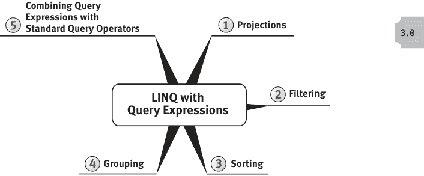

# 第 16 章：使用查询表达式的 LINQ

在本章中，我们引入了查询表达式，并使用它们表示第 15 章中的许多查询。

## 介绍查询表达式

开发者最经常执行两个操作是**过滤**集合以消除不需要的项，以及**投影**集合使项呈现不同的形式。例如，给定一个文件集合，我们可以过滤它创建一个具有特定扩展名文件的新集合，或者只包含大于 100 万字节的文件。我们还可以投影文件集合，创建一个包含文件所在目录路径及相应目录大小的新集合。查询表达式为这两种常见操作都提供了直接的语法。列表 16.1 显示了一个过滤字符串集合的查询表达式；输出 16.1 显示了结果。

### 列表 16.1：简单查询表达式

```csharp
public class CSharp{
    static public readonly string[] ReadOnlyCollection<string> Keywords = new ReadOnlyCollection<string>(new string[]{
        "abstract", "add", "alias", "as", "ascending",
        "async", "await", "base", "bool", "break",
        "byte", "by", "catch", "char", "checked",
        "class", "const", "continue", "decimal", "default",
        "delegate", "descending", "do", "double",
        "dynamic", "enum", "event", "equals",
        "explicit", "external", "false", "finally", "fixed",
        "float", "from", "foreach", "get", "global",
        "group", "goto", "implicit", "in", "int",
        "into", "interface", "internal", "is", "lock", "long",
        "join", "left", "nameof", "namespace", "new", "nonnull",
    });
}
```

（注：提供的 OCR 文本在第 745-746 页包含大量的重复/损坏部分。根据 C# LINQ 文档的上下文，以下是预期内容的逻辑重建。）

# 查询表达式

查询表达式的结果是 `IEnumerable<T>` 或 `IQueryable<T>` 集合。实际类型从 `select` 或 `group by` 推断得出。在列表 16.1 中，例如，编译器知道 `Keywords` 的类型是 `string[]`，它可以转换为 `IEnumerable<string>`，因此它推断出 `word` 的类型恰恰是 `string`。查询以 `select word` 结束，这意味着查询表达式的结果必须是字符串集合，因此查询表达式的类型是 `IEnumerable<string>`。

# 查询查询表达式

在本例中，查询的“输入”和“输出”都是字符串集合。然而，如果 `select` 子句中的表达式是完全不同的类型，则输出类型可能与输入类型不同。请考虑列表 16.2 中的查询表达式及其对应的输出 16.2。

### 列表 16.2：使用查询表达式进行投影

```csharp
using System;
using System.Collections.Generic;
using System.Linq;
using System.IO;
// ...
static void ListFiles(string rootDirectory, string searchPattern)
{
    IEnumerable<string> fileNames = Directory.GetFiles(rootDirectory, searchPattern);
    IEnumerable<FileInfo> fileInfos = from fileName in fileNames select new FileInfo(fileName);
    foreach (FileInfo fileInfo in fileInfos)
    {
        Console.WriteLine($"{fileInfo.Name} {fileInfo.LastWriteTime}");
    }
}
// ...
```

### 输出 16.2

| Account.cs (11/22/2011 11:56:11 AM) |
| Bill.cs (8/10/2011 9:33:55 PM) |
| Contact.cs (8/19/2011 11:40:30 PM) |
| Customer.cs (11/17/2011 2:02:52 AM) |
| Employee.cs (8/17/2011 1:33:22 AM) |
| Person.cs (10/22/2011 10:00:03 PM) |

此查询表达式的结果是一个 `IEnumerable<FileInfo>`，而不是由 `Directory.GetFiles()` 返回的 `IEnumerable<string>` 数据类型。查询表达式的 `select` 子句可以投影出一个与 `from` 子句表达式收集的不同的数据类型。

# 第 16 章：结合查询表达式的 LINQ

在本例中，选择 `FileInfo` 类型是因为它包含了所需输出的两个相关字段：文件名和最后写入时间。如果你需要 `FileInfo` 对象中未捕获的其他信息，可能没有这样方便的类型。元组（Tuples在 C# 7.0 之前为匿名类型）提供了一种方便简洁的方式来投影精确的数据，而无需查找或创建显式类型。列表 16.3 提供了与列表 16.2 类似的输出，但它使用的是元组语法而非 `FileInfo`。

### 列表 16.3：查询表达式中的元组

```csharp
using System;
using System.Collections.Generic;
using System.Linq;
using System.IO;
// ...
static void List2(string rootDirectory, string searchPattern)
{
    var fileNames = Directory.EnumerateFiles(rootDirectory, searchPattern);
    var fileResults =
        from fileName in fileNames
        select (
            Name: fileName,
            LastWriteTime: File.GetLastWriteTime(fileName)
        );
    foreach (var fileResult in fileResults)
    {
        Console.WriteLine($"{fileResult.Name} ({fileResult.LastWriteTime})");
    }
}
// ...
```

在本例中，查询投影了文件名及其最后写入时间。在处理像 `FileInfo` 这样较小的对象时，像列表 16.3 那样的投影区别不大。然而，当数据量巨大且检索数据（可能通过互联网从另一台计算机获取）成本高昂时，过滤集合中每个项目关联数据量的“水平”投影是极其强大的。与其在查询执行时检索所有数据，不如使用元组（或 C# 7.0 之前的匿名类型），这使得我们可以实现将所需数据存储并检索到集合中的能力。

想象一下，一个拥有 30 列或更多列的大型数据库。如果没有元组，开发者将被迫使用不必要信息的对象，或者定义仅用于存储特定所需数据的小型专用类。相反，元组允许由编译器定义类型——这些类型仅包含其当前场景所需的数据。其他场景可以有不同的投影，仅包含该场景所需的属性。

# 初学者级主题

# 使用查询表达式的延迟执行

使用查询表达式表示法编写的查询表现出延迟执行，正如第 15 章中编写的查询一样。考虑列表 16.1 中将查询对象赋值给变量选择。查询的创建和对变量的赋值并没有执行查询；它们只是简单地构建了一个表示查询的对象。`word.Contains("*")` 方法在创建查询对象时并未被调用。相反，查询表达式保存了选择标准，以便在遍历由选择变量标识的集合时使用。

为了证明这一点，请考虑列表 16.4 及其对应的输出（列表 16.3）。

### 列表 16.4：延迟执行与查询表达式（示例 1）

```csharp
using System;
using System.Collections.Generic;
using System.Linq;
// ...
private static void ShowContextualKeywords2()
{
    IEnumerable<string> selection = from word in CSharp.Keywords
    where IsKeyword(word)
    select word;
    Console.WriteLine("Query created.");
}
```

```csharp
foreach (string keyword in selection)
{
    Console.Write(keyword);
}
```

```csharp
private static bool IsKeyword(string word)
{
    if (word.Contains("*"))
    {
        Console.Write(" ");
        return true;
    }
    else
    {
        return false;
    }
}
...
```

### 输出 16.3

Query created.
add alias* ascending async* await* by descending dynamic* equals from* get* global* group* into join* let nameof* nonstop* on order* partial* remove* select* value* var* where yield*

在列表 16.4 中，`foreach` 循环内部没有输出空格。执行谓词 `IsKeyword()` 时打印空格的副作用发生在遍历查询时——而不是在创建查询时。因此，尽管 `selection` 是一个集合（毕竟它的类型是 `IEnumerable<T>`），但在赋值时，`from` 子句之后的所有内容都作为选择标准。直到我们开始遍历 `selection`，这些标准才会生效。

现在考虑第二个示例（参见列表 16.4）。

### 列表 16.5：延迟执行与查询表达式（示例 2）

```csharp
using System;
using System.Collections.Generic;
using System.Linq;
// ...
private static void CountContextualKeywords()
{
    int delegateInvocations = 0;
    string func(string text)
    {
        delegateInvocations++;
        return text;
    }
    IEnumerable<string> selection = from word in CSharp.Keywords
    where IsKeyword(word)
    select func(word);
    Console.WriteLine("Query created.");
    foreach (string keyword in selection)
    {
        Console.Write(keyword);
    }
    List<string> cache = selection.ToList();
    Console.WriteLine($"1. {delegateInvocations}");
    Console.WriteLine($"2. Contextual count={cache.Count}");
    Console.WriteLine($"3. {delegateInvocations}");
    Console.WriteLine($"4. Contextual count={cache.Count}");
    Console.WriteLine($"5. {delegateInvocations}");
    Console.WriteLine($"6. {delegateInvocations}");
    Console.WriteLine($"7. {cache.Count}");
    Console.WriteLine($"8. {delegateInvocations}");
}
// ...
```

### 输出 16.4

| 1. | 0 |
| 2. | Contextual count=28 |
| 3. | 28 |
| 4. | Contextual count=28 |
| 5. | 56 |
| 6. | 8 |
| 7. | 28 |
| 8. | 84 |

## 高级主题

# 实现延迟执行

延迟执行是通过使用委托（delegates）和表达式树（expression trees）实现的。委托提供了创建和操作方法引用的能力，该方法包含一个可以稍后调用的表达式。同样，表达式树提供了创建和操作表达式信息的能力，这些信息可以稍后进行检查和处理。

在列表 16.5 中，`where` 子句的谓词表达式和 `select` 子句的投影表达式被编译器转换为表达式 lambda（expression lambdas），然后这些 lambda 被转换为委托的创建。查询表达式的结果是一个持有了这些委托引用的对象。只有在对查询对象进行迭代时，才会实际执行委托。

# 过滤

在列表 16.1 中，`where` 子句过滤掉了保留关键字，但没有过滤上下文关键字。该子句对集合进行“垂直”过滤：如果你将集合想象成垂直的项目列表，该子句会使垂直列表变短，从而集合包含更少的项目。过滤标准通过谓词表示——这是一个返回布尔值的 lambda 表达式，例如 `word.Contains()`（如列表 16.1 所示）或 `File.GetWriteTime(file) < DateTime.Now.AddMonths(-1)`。后者所示于列表 16.6 中，其输出出现在输出 16.5 中。

### 列表 16.6：使用 where 查询表达式过滤


```csharp
using System;
using System.Collections.Generic;
using System.Linq;
using System.IO;

// ...

static void FindMonthOldFiles(
    string rootDirectory, string searchPattern)
{
    IEnumerable<FileInfo> files =
        from fileName in Directory.EnumerateFiles(
            rootDirectory, searchPattern)
        where File.GetLastWriteTime(fileName) < DateTime.Now.AddMonths(-1)
        select new FileInfo(fileName));
```

# 第 16 章：使用查询表达式的 LINQ

```csharp
foreach (FileInfo file in files)
{
    // 为了简化起见，假设当前目录
    // 是 rootDirectory 的子目录
    string relativePath = file.FileName.Substring(
        Environment.CurrentDirectory.Length);
    Console.WriteLine(
        $"{relativePath}} {{file.LastWriteTime }}");
}
// ...
```

## 输出 16.5

.TestData\Bill.cs (8/10/2011 9:33:55 PM)

.TestData\Contact.cs (8/19/2011 11:40:30 PM)

.TestData\Employee.cs (8/17/2011 1:33:22 AM)

.TestData\Person.cs (10/22/2011 10:00:03 PM)

## 排序

要使用查询表达式对项目进行排序，可以使用 `orderBy` 子句，如列表 16.7 所示。

### 列表 16.7：使用 orderby 子句查询表达式排序

```csharp
using System;
using System.Collections.Generic;
using System.Linq;
using System.IO;

// ...
static void ListByFileSize(
    string rootDirectory, string searchPattern)
{
    IEnumerable<string> fileName =
        from fileName in Directory.EnumerateFiles(
            rootDirectory, searchPattern)
        orderby (new FileInfo(fileName)).Length descending
        select fileName;

foreach (string fileName in fileNames)
{
    Console.WriteLine(fileName);
}
// ...
```

列表 16.7 使用 `orderBy` 子句对 `Directory.GetFiles()` 返回的文件进行排序，首先按文件大小降序排列，然后按文件名升序排列。多个排序标准之间用逗号分隔，例如，项目首先按大小排序，如果大小相同，则按文件名排序。`ascending`（升序）和 `descending`（降序）是指示排序方向的文本关键字。指定升序或降序顺序是可选的；如果省略了方向（如文件名），默认为升序。

## let 子句

列表 16.8 包含一个与列表 16.7 中的查询非常相似的查询，只是 `IEnumerable<T>` 的类型参数是 `FileInfo`。然而，这个查询存在一个问题：我们冗余地创建了两次 `FileInfo` 对象，分别在 `orderBy` 子句和 `select` 子句中。

### 列表 16.8：投影 FileInfo 集合并按文件大小排序

```csharp
using System;
using System.Collections.Generic;
using System.Linq;
using System.IO;

//
static void ListByFileSize2(
    string rootDirectory, string searchPattern)
{
    IEnumerable<FileInfo> files =
        from fileName in Directory.EnumerateFiles(
            rootDirectory, searchPattern)
        orderby new FileInfo(fileName).Length, fileName
        select new FileInfo(fileName);

    foreach (FileInfo file in files)
    {
        // 为了简化起见，假设当前目录
        // 是 rootDirectory 的子目录
        string relativePath = file.FullName.Substring(
            Environment.CurrentDirectory.Length);
        Console.WriteLine(
            $"{relativePath} ({file.Length})");
    }
}//...
```

### 718 第 16 章：使用查询表达式的 LINQ

遗憾的是，尽管结果是正确的，但列表 16.8 最终为集合中的每个项目都实例化 `FileInfo` 对象，这是浪费资源的。为了避免这种潜在的开销，可以使用 `let` 子句，如列表 16.9 所示。

### 列表 16.9：在查询表达式排序结果

```csharp
// ...
IEnumerable<FileInfo> files =
    from fileName in Directory.EnumerateFiles(
        rootDirectory, searchPattern)
    let file = new FileInfo(fileName)
    orderby file.Length, fileName
    select file;
// ...
```

`let` 子句引入了一个新变量，可以持有表达式在后续部分的值。你可以根据需要添加多个 `let` 子句；只需在第一个子句之后、最后的 `select` 子句之前插入即可。

## 分组

常见的数据处理场景是相关项目的分组。在 SQL 中，这通常涉及聚合项目以生成摘要。然而，LINQ 的表达能力明显更高。LINQ 表达式允许将单独的项目分组为子集合（组）。例如，列表 16.10 和输出 16.6 展示了如何将上下文关键字和普通关键字分组在一起。

### 列表 16.10：分组查询结果

```csharp
using System;
using System.Collections.Generic;
using System.Linq;

// ...

private static void GroupKeywords()
{
    IEnumerable<IGrouping<bool, string>> selection =
        from word in CSharp.Keywords
        group word by word.Contains('*');

    foreach (IGrouping<bool, string> wordGroup in selection)
    {
        Console.WriteLine(Environment.NewLine + "{0}:",
            wordGroup.Key ? "Contextual Keywords" : "Keywords");
        foreach (string keyword in wordGroup)
        {
            Console.Write(" * " + (wordGroup.Key ? keyword.Replace("*", null) : keyword) + " ");
        }
    }
}
```

### 输出 16.6

关键字:

abstract as base break byte checked class

const continue default delegate do else event

explicit finally fixed float for get goto

implicit in int interface is lock namespace new null

operator out override private protected public

readonly for return switch sealed short stackalloc static

string struct switch this try typeof uint long unsafe 

short stack unsigned ushort using unchecked void volatile volatile volatile

上下文关键字:

add aliases async await by descending equals from

get global group in join nameof nonnull on orderby partial

remove set value var yield

将关键字类型作为标题打印。嵌套的 `foreach` 循环将组中的每个关键字作为项打印在标题下方。

此查询表达式的结果本身是一个序列，然后你可以像查询任何其他序列一样对其进行查询。列表 16.11 和输出 16.7 显示了如何创建一个额外的查询，以便在产生组序列的查询上添加投影。下一节关于查询延续（query continuations），将展示用于为完整查询添加更多查询子句的更愉便的语法。

### 列表 16.11：根据 group 子句选择元组

```c
using System;
using System.Collections.Generic;
using System.Linq;

// ...

private static void GroupKeywords1()
{
    IEnumerable<IGrouping<bool, string>> keywordGroups =
        from word in Csharp.Keywords
        group word by word.Contains('*');

    IEnumerable<(bool IsContextualKeyword, IGrouping<bool, string> Items)> selection =
        from groups in keywordGroups
        select
        new(
            IsContextualKeyword: groups.Key,
            Items: groups
        );

    foreach ((bool isContextualKeyword, IGrouping<bool, string> items) in selection)
    {
        Console.WriteLine(Environment.NewLine + "{0}:",
            isContextualKeyword ?
                "Contextual Keywords" : "Keywords");
        foreach (string keyword in items)
        {
            Console.Write("" + +
                keyword.Replace("*", "null"));
        }
    }
}

// ...
```

### 引入查询表达式

关键字：

abstract as base break byte case catch char checked class

const decimal default delegate double else enum

event extern extent finally fixed float for foreach goto

implicit in it interface internal is long namespace new null

operator out override params private public

readonly return typeof sized static

string struct which this throw retry typeof using unsafe

ushort virtual unchecked void volatile while

add ascending async wait by descending dynamic equals from

get group join into let nameof non-null on orderby partial return

select value where yield

`group` 子句产生一个产生 `IGrouping<TKey, TElement>` 对象集合的查询——就就像 `GroupBy()` 标准查询操作符所做的那样（见第 15 节）。后续查询中的 `select` 子句使用 `as` 来有效地将 `IGrouping<TKey, TElement>.Key` 重命名为 `IsContextualKeyword`，并将子属性命名为 `Items`。通过此更改，嵌套的 `foreach` 循环直接使用 `workGroup`，如列表 16.10 所示。元组中可以添加的另一个潜在项是子集合中的项计数。然而，此功能已经通过 LINQ 的 `workGroup.Items.Count()` 方法可用，因此将其直接添加到匿名类型中的益处是值得商榷的。

## 使用 进行查询延续

正如我们在列表 16.11 中所所示的，你可以使用现有的查询作为第二个查询的输入。然而，当你想要将一个查询的结果作为另一个查询的输入时，并没有必要编写一个完全新的查询表达式。你可以使用上下文关键字 `into` 的查询延续子句来扩展任何查询。查询延续仅仅是创建两个查询并将第一个作为第二个查询的输入的语法糖。由 `into` 子句引入的范围变量（列表 16.11 中的 `groups`）将成为查询剩余部分的范围变量；任何之前的范围变量在逻辑上都是较早查询的一部分，不能在查询延续中使用。列表 16.12 重写了列表 16.11 的代码，使用查询延续而不是两个查询。

### 第 16 节：使用查询表达式的 LINQ

### 列表 16.12：不使用查询延续的选择

```csharp
using System;
using System.Collections.Generic;
using System.Linq;
// ...
private static void GroupKeywords1()
{
    IEnumerable<bool IsContextualKeyword, IGroup<bool, string>> Items =
        select
        from word in CSharp.Keywords
        group word by word.Contains('*')
        into groups
        select
        new { IsContextualKeyword = groups.Key, Items = groups };

// ...
}
// ...
```

在现有的 `into` 查询结果上运行额外查询的能力并不是以 `group` 类结尾的查询所特有的，而是适用于所有查询表达式。查询延续只是编写消耗其他查询表达式结果的查询表达式的简写。你可以将其认为一个“管道”（pipeline），因为它将一个查询的结果“输”到另一个查询中。

## 平坦化序列

通常希望将一个序列“平坦化”为单个序列。例如，序列的每个成员可能有关联的订单，或者序列的每个成员可能有文件。要使用查询语法实现相同的操作，你可以使用 `SelectMany` 操作符（第 15 节讨论过）。

### 列表 16.13：选择

```csharp
var selection =
    from word in CSharp.Keywords
    from character in word
    select character;
```

## 卡卡尔积

```csharp
var numbers = new[] { 1, 2, 3 };
IEnumerable<string, int> query =
    from word in CSharp.Keywords
    from number in numbers
    select (word, number);
```

## 不同的成员

通常希望从集合中仅返回不同的（即唯一的）项，丢弃重复项。查询表达式没有去成员的显式语法，但这种功能可以通过第 15 节引入的 `Distinct()` 操作符可用。要对查询表达式应用操作符，必须将表达式括在括号中，以便编译器不会认为 `Distinct()` 的调用是 `select` 子句的一部分。列表 16.15 给出了一个示例；输出 16.6 显示了结果。


# 列表 16.15：从查询表达式获取不同的成员

```csharp
using System;
using System.Collections.Generic;
using System.Linq;

// ...
```

```csharp
public static void ListMemberNames()
{
    IEnumerable<string> enumerableNames = from method in typeof(Enumerable).GetMembers(
        System.Reflection.Flags.Static | 
        System.Reflection.Flags.Public)
        orderby method.Name
    select method.Name).Distinct();
    foreach (string method in enumerableNames)
    {
        Console.Write($"{method}", "");
    }
}
```

# 输出 16.8

`Aggregate`, `All`, `Any`, `AsEnumerable`, `Average`, `Cast`, `Concat`, `Contains`, `Count`, `Default`, `Distinct`, `ElementAt`, `ElementAtOrDefault`, `Empty`, `Except`, `First`, `FirstOrDefault`, `GroupBy`, `GroupJoin`, `Intersect`, `Join`, `Last`, `LastOrDefault`, `LongCount`, `Max`, `Min`, `OfType`, `OrderBy`, `OrderByDescending`, `Range`, `Reverse`, `Select`, `SelectMany`, `SequenceEqual`, `Single`, `SingleOrDefault`, `Skip`, `SkipWhile`, `Sum`, `Take`, `TakeWhile`, `ThenBy`, `ThenDescending`, `ToArray`, `Dictionary`, `ToList`, `Lookup`, `Union`, `Zip`.

# 查询表达式只是方法调用

令人惊讶的是，为 C# 3.0 添加查询表达式不需要对公共语言运行时 `CLR` 或公共中间语言 `CIL` 进行更改。相反，C# 编译器仅将查询表达式翻译为一系列方法调用。例如，考虑列表 16.1 中的查询表达式，其部分出现在列表 16.16 中。

# 查询表达式仅仅是方法调用

## 列表 16.16: 简单的查询表达式

```csharp
private static void ShowContextualKeywords()
{
IEnumerable<string> selection =
    from word in CSharp.Keywords
    where word.Contains('*')
    select word;
}
// ...
```

编译后，列表 16.16 中的表达式会被转换为源自 `System.Linq.Enumerable` 的 `IEnumerable<T>` 扩展方法调用，如列表 16.17 所示。

## 列表 16.17: 查询表达式转换为标准查询操作语法

```csharp
private static void ShowContextualKeywords3()
{
IEnumerable<string> selection =
    CSharp.Keywords.Where(word => word.Contains('*'));

// ...
```

正如第 15 章所述，lambda 表达式本身随后会被编译器翻译，以生成一个具有 lambda 表达式体的方法，且其使用涉及为该方法分配一个委托 `delegate`。

每个查询表达式都可以并且必须翻译为方法调用，但并不是每一个方法调用序列都有对应的查询表达式。例如，扩展方法 `TakeWhile<T>(Func<T, bool> predicate)` 没有对应的查询表达式，该方法在谓词返回 `true` 的期间会不断从集合中返回项。

对于那些既有方法调用形式又有查询表达式形式的查询，哪种更好？这是一个主观判断。某些查询更适合查询表达式，而另一些作为方法调用则更具可读性。

# 指南

- 使用查询表达式语法使查询更易于阅读，特别是当它们涉及复杂的 `from`、`let`、`join` 或 `group` 子句时。
- 如果查询涉及没有查询表达式语法的操作，考虑使用标准查询操作方法调用形式，例如 `Count()`、`TakeWhile()` 或 `Distinct()`。

## 总结

本章介绍了一种新语法——即查询表达式。熟悉 SQL 的读者会立即看到查询表达式与 SQL 之间的相似之处。然而，查询表达式还引入了额外的功能，例如将其分组为层次级的新对象集合，这是 SQL 无法实现的。查询表达式的所有功能已经可以通过标准查询操作实现，但查询表达式通常为表达此类查询提供了更简洁的语法。然而，无论使用标准查询操作还是查询表达式语法，最终结果都是开发者针对集合 API 编写代码的方式得到了显著改进——这种改进最终为面向对象的语言与关系型数据库交互的方式带来了范式转变。

在下一章中，我们将通过研究一些 .NET 框架集合类型并探索如何定义自定义集合来继续讨论集合。

# 17 构建自定义集合

第 15 章涵盖了标准查询操作——即 `IEnumerable<T>` 上的扩展方法，这些方法为所有集合提供了方法。然而，这些操作并没有让所有集合都同样适用于所有任务；仍然需要不同类型的集合。某些集合更适合通过键搜索，而另一些则更适合通过位置访问项。某些集合像队列：先进先出。另一些则更像栈：后进先出。还有一些则完全没有顺序。

| | | |
|---|---|---|
| 定义语法 | 迭代器 | 更多集合接口 |
| `yield` | | |
| 状态 | | |
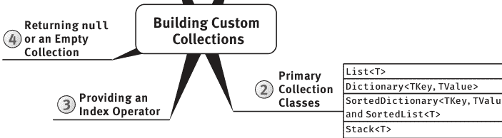
| `List<T>` |
|---|
| `Dictionary<TKey, TValue>` |
| `SortedDictionary<TKey, TValue>` |
| `SortedList<T>` |
| `Stack<T>` |
| `Queue<T>` |
| `LinkedList<T>` |

# 第 17 章：构建自定义集合

.NET 框架提供了大量的集合类型，适用于需要集合的许多场景。本章介绍了其中一些集合类型及其实现的接口。它还描述了如何创建支持标准功能如索引的自定义集合。此外，它还探索了使用 `return` 语句来创建实现 `IEnumerable<T>` 的类和方法。这一 C# 2.0 特性极大地简化了可以使用 `foreach` 语句枚举的集合的实现。

Microsoft .NET 框架提供了许多非泛型集合类和接口，但通常情况下，这些存在仅是为了兼容在泛型使用之前编写的代码。泛型集合类型更快，因为它们避免了装箱 `boxing` 开销，并且比非泛型集合更类型安全。因此，新代码几乎应该专门使用泛型集合类型。在本书中，我们你主要使用泛型集合类型。

# 更多集合接口

我们已经看到集合如何实现 `IEnumerable<T>`，这是允许对集合元素迭代的主要接口。还存在许多额外的接口由更复杂的集合实现。图 17.1 显示了集合类实现的接口层次结构。

这些接口提供了一种标准方式来执行常见任务，如迭代、索引和计数集合中的元素。本节将检查这些接口至少是泛型接口，从图 17.1 的底部开始向上移动。

# `IList<T>` 对比 `IDictionary<TKey, TValue>`

英语字典可以被看作是定义的集合。特定的定义可以通过查找其关联的“键”即被定义的单词来快速访问。字典集合同样是值的集合，其中每个值都可以通过使用与其相关的唯一键来轻松访问。然而，语言字典通常按键的字母顺序排序存储定义；字典类可能会选择这样做，但通常不会这样做。

 图 17.1：集合类层次结构

字典集合最好被看作是无序的键值对，除非特别说明是有顺序的。同样，列表通常按位置查找，而不是按键。相比之下，列表按特定顺序存储值并访问它们。因此，在选择集合类来解决数据存储或检索问题时，要查找的前两个接口是 `IList<T>` 和 `IDictionary<TKey, TValue>`。这些接口指示了类型是关注索引还是键。这两个接口都要求类实现索引器 `indexer`。在 `IList<T>` 的情况下，索引数的操作对应元素的位置。索引器接收一个整数并提供对该元素的访问。在 `IDictionary<TKey, TValue>` 的情况下，索引数的操作对应于值的键并提供对该值的访问。

# `ICollection<T>`

`IList<T>` 和 `IDictionary<TKey, TValue>` 实现 `ICollection<T>`。不实现 `IList<T>` 或 `IDictionary<TKey, TValue>` 的集合很有可能实现 `ICollection<T>`。`ICollection<T>` 派自 `IEnumerable<T>` 并包含两个成员：`Count` 和 `CopyTo()`。

- `Count` 属性返回集合中的元素总数。最初看起来这似乎足够使用 `for` 循环遍历集合中的每个元素，但实际上，集合还需要支持索引检索，而 `ICollection<T>` 并不支持。
- `CopyTo()` 方法提供了将集合转换为数组的能力。该方法包含一个索引参数，以便你可以指定在目标数组中插入元素的位置。使用该方法时，你必须初始化目标数组具有足够的容量，以容纳 `ICollection<T>` 中的所有元素。

# 主要集合类

存在五类集合类，它们在数据插入、存储和检索方面彼此不同。每个泛型类位于 `System.Collections.Generic` 命名空间，而它们的非泛型对应类位于 `System.Collections` 命名空间。

# 列表集合：`List<T>`

`List<T>` 类具有与数组类似的属性。关键区别在于，这些类随着元素数量的而自动扩展。相比之下，数组的大小是固定的。此外，列表可以通过显式调用 `TrimSize()` 或 `Capacity` 来收缩见图 17.2。

## 第 17 章：构建自定义集合

- `IList<T>`
- `ICollection<T>`
- `IEnumerable<T>`
- `IList`
- `ICollection`
- `IEnumerable`

## `List<T>`

泛类

| 属性 |
| :--- |
| `Capacity` |
| `Count` |
| `Item` |
| `System.Collections.Generic.ICollection<T>.IsReadOnly` |
| `System.Collections.ICollection.IsSynchronized` |
| `System.Collections.ICollection.SyncRoot` |
| `System.Collections.IList.FixedSize` |
| `System.Collections.IList.IsReadOnly` |
| `System.Collections.IList.Item` |

## 方法

- `Add`
- `AddRange`
- `AsReadOnly`
- `BinarySearch` + 2 个重载
- `Clear`
- `Contains`
- `ConvertAll(TOutput)`
- `CopyTo` + 2 个重载
- `Exists`
- `Find`
- `FindAll`
- `Index` + 2 个重载
- `Last`
- `LastIndex` + 2 个重载
- `ForEach`
- `GetEnumerator`
- `GetRange`
- `IndexOf` + 2 个重载
- `Insert`
- `InsertRange`
- `LastIndexOf` + 2 个重载
- `List` + 2 个重载
- `Remove`
- `RemoveAll`
- `RemoveAt`
- `RemoveRange`
- `Reverse` + 1 个重载
- `Sort` + 3 个重载
- `ToArray`
- `TrimExcess`
- `ToSize`
- `TrueForAll`

> 图 17.2：`List<T>` 类图

## 代码列表 17.1：使用 `List<T>`

```csharp
using System;
using System.Collections.Generic;

class Program {
    static void Main() {
        List<string> list = new List<string>{"Sneezy", "Happy", "Dopey", "Doc", "Sleepy", "Bashful", "Grumpy"};
        list.Sort();

        Console.WriteLine("In alphabetical order " + list[0] + " is the " + "first dwarf while " + list[6] + " is the last.");

        list.Remove("Grumpy");
    }
}
```

## 输出 17.1

按字母顺序排列，Bashful 是第一个矮人，而 Sneezy 是最后一个。

C# 是基于零索引的；因此，代码列表 17.1 中的索引 0 对应于第一个元素，索引 6 表示第七个元素。通过索引检索元素不涉及搜索，而是涉及到内存中某个位置的快速简单的“跳转”操作。

`List<T>` 是一个有序集合；`Add()` 方法将给定的项附加到列表末尾。在代码列表 17.1 调用 `Sort()` 之前，“Sneezy”在第一个，“Grumpy”在最后；调用之后，列表将按字母顺序排序，而不是按照元素被添加的顺序排序。某些集合在添加元素时会自动进行排序，`List<T>` 并不是其中之一；为了对元素进行排序，需要显式调用 `Sort()`。

要删除元素，你可以使用 `Remove()` 或 `RemoveAt()` 方法，分别删除给定的元素或特定索引处的任意元素。

## 第 17 章：构建自定义集合

## 进阶主题

### 自定义集合排序

你可能想奇代码列表 17.1 中的 `List<T>.Sort()` 方法是如何知道按字母顺序对列表元素进行排序的。`string` 类型实现了 `IComparable<string>` 接口，该接口包含一个方法 `CompareTo()`。它返回一个整数，表示传递的元素大于、小于还是等于当前元素。如果元素类型实现了泛型 `IComparable<T>` 接口或非泛型的 `IComparable` 接口，排序算法将默认使用它来确定排序顺序。

但如果元素类型没有实现 `IComparable<T>`，或者比较两个对象的默认逻辑不满足你的需求怎么办？要指定非默认的排序顺序，你可以调用 `List<T>.Sort()` 的重载，它接受 `IComparer<T>` 作为参数。

`IComparable<T>` 和 `IComparer<T>` 之间的区别微妙但重要。前者意味着“我知道如何将自己与同类型的另一个实例进行比较”。后者意味着“我知道如何比较给定类型中的两个对象”。

`IComparer<T>` 接口通常用于数据类型有多种不同排序方式，且没有一种明显是最佳方式的情况。例如，你可能想按名称、地点或生日进行排序。代码列表 17.2 显示了 `IComparer<T>` 的实现。

## 代码列表 17.2：实现 `IComparer<T>`

```csharp
class Contact
{
    public string FirstName { get; set; }
    public string LastName { get; set; }

    public Contact(string firstName, string lastName)
    {
        FirstName = firstName;
        LastName = lastName;
    }
}
```

## 核心集合类

```csharp
using System;
using System.Collections.Generic;

class NameComparison : IComparer<Contact>
{
    public int Compare(Contact? x, Contact? y)
    {
        if (Reference.Equals(x, y))
            return 0;
        if (x == null)
            return 1;
        if (y == null)
            return -1;
        int result = string.Compare(x.FirstName, y.FirstName);
        if (result == 0)
            result = string.Compare(x.LastName, y.LastName);
        return result;
    }

    private static int StringCompare(string? x, string? y)
    {
        if (Reference.Equals(x, y))
            return 0;
        if (x == null)
            return 1;
        if (y == null)
            return -1;
        return string.Compare(x, y);
    }
}
```


要按名称后地点排序列表，你可以调用 `list.Sort(new NameComparison());`。

## 全序

在实现 `IComparable<T>` 或 `IComparer<T>` 时，你必须产生全序。如果你未能提供全序，排序算法的行为是未定义的；它可能会产生混乱的顺序；可能会导致崩溃；可能会进入无限循环等等。

注意，例如，代码列表 17.2 中的比较器确保了全序，即使参数为空。例如，说“如果任一元素为空，则返回零”是不合法的，因为那么...

## 主要集合类 737

```csharp
static void Main() {
    List<string> list = new List<string>();
    int search;

    list.Add("public");
    list.Add("protected");
    list.Add("private");

    list.Sort();

    search = list.BinarySearch("protected internal");
    if (search < 0) {
        list.Insert(~search, "protected internal");
    }

    foreach (string accessModifier in list) {
        Console.WriteLine(accessModifier);
    }
}
```

请注意，如果列表没有先排序，此代码不一定能找到某个元素，即使该元素在列表中。列表 17.3 的结果显示在输出 17.2 中。

### 输出 17.2

private

protected

protected internal

public

## 进阶主题

### 使用 FindAll() 查找多个项

有时你必须在列表中查找多个项，而且你的搜索标准标准比仅仅查找特定值要复杂。为了支持这种场景，`System.Collections.Generic.List<T>` 包含一个 `FindAll()` 方法。`FindAll()` 接收一个类型为 `Predicate<T>` 的参数，它是一个委托（对方法的引用）。列表 17.4 演示了如何使用 `FindAll()` 方法。

## 第 17 章：构建自定义集合

列表 17.4：演示 FindAll() 及其谓词参数

```csharp
using System;
using System.Collections.Generic;

class Program
{
    static void Main()
    {
        List<int> list = new List<int>();
        list.Add(1);
        list.Add(2);
        list.Add(3);
        list.Add(2);

        List<int> results = list.FindAll(Even);

        foreach(int number in results)
        {
            Console.WriteLine(number);
        }
    }

    public static bool Even(int value) =>
        (value % 2) == 0;
}
```

在 17 对 `FindAll()` 的调用中，你传递了一个委托实例 `Even()`。当整数值值为偶数时，该方法返回 `true`。`FindAll()` 接收委托实例并对列表中的每个项调用 `Even()`（使用 C# 2.0 的委托推断）。每当返回值为 `true` 时，它就会将其添加到新的 `List<T>` 实例中，并在检查完列表中的每个项后返回该实例。关于委托的完整讨论将在第 13 章进行。

## 字典集合：Dictionary<TKey, TValue>

另一类别的集合是字典类——具体为 `Dictionary<TKey, TValue>`（见图 17.3）。与列表集合不同，字典存储的是键/值对。名称充当键，可以用于查找相应的元素，其方式类似于使用主键访问数据库中的记录。这在访问字典元素时具有一定的复杂性，但由于通过键查找是高效的操作，因此这是一个非常有用的集合。请注意，键可以是任何数据类型，而不仅仅是字符串或数值。

## 主要集合类 739

```
IDictionary<TKey, TValue>
ICollection<KeyValuePair<TKey, TValue>>
IEnumerable<KeyValuePair<TKey, TValue>>
IDictionary
ICollection
IEnumerable
ISerializable
IDerializationCallback
```

## IDictionary<TKey, TValue> 通用类

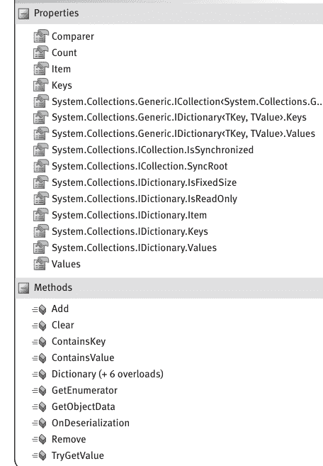

图 17.3：字典类图

向字典插入元素的一种方法是使用 `Add()` 方法，将键和值都作为参数传递，如列表 17.5 所示。

## 第 17 章：构建自定义集合

列表 17.5：向 Dictionary<TKey, TValue> 添加项

```csharp
using System;
using System.Collections.Generic;

class Program
{
    static void Main()
    {
        // C# 6.0 (使用 "Error", Console.Red；非 C# 6.0 之前)
        var colorMap = new Dictionary<string, ConsoleColor>
        {
            ["Error"] = Console.Red,
            ["Warning"] = ConsoleColor.Yellow,
            ["Information"] = ConsoleColor.Green
        };
        colorMap.Add("Verbose", ConsoleColor.White);
        // ...
    }
}
```

在使用 C# 6 字典初始化器初始化字典（见第 15 章的“集合初始化器”部分）后，列表 17.5 为键 "Verbose" 插入了 `ConsoleColor` 为白色的字符串。如果已经添加了具有相同键的元素，则会抛出异常。添加元素的另一种替代方案是使用索引器，如列表 17.6 所示。

列表 17.6：使用索引操作在 Dictionary<TKey, TValue> 中插入项

```csharp
using System;
using System.Collections.Generic;

class Program
{
    static void Main()
    {
        // C# 6.0 (使用 "Error", Console.Red；非 C# 6.0 之前)
        var colorMap = new Dictionary<string, ConsoleColor>
        {
            ["Error"] = Console.Red,
            ["Warning"] = ConsoleColor.Yellow,
            ["Information"] = ConsoleColor.Green
        };

        colorMap["Verbose"] = ConsoleColor.White;
        // ...
    }
}
```

## 第 17 章：构建自定义集合

在 17 中观察到的第一点是，索引器不需要整数。在第一次赋值中，字典 "Error" 被替换为 `Console.Red`。在第二次赋值中，元素已经存在。

尝试从不存在键的字典中读取值会抛出 `NotFoundException`。`ContainsKey()` 方法允许你在访问值之前检查键是否存在，从而避免该异常。

`Dictionary<TKey, TValue>` 实现为哈希表；无论值的数量有多少，通过键进行查找都提供了极快的访问。相比之下，检查字典中是否存在某个值是一个耗时的操作，类似于搜索未排序的列表。为此使用 `ContainsValue()` 方法，它会顺序遍历集合中的每个元素。

使用 `Remove()` 方法删除字典元素，传递键而不是元素作为参数。

由于向字典添加值需要键和值，`foreach` 循环的变量必须是 `KeyValuePair<TKey, TValue>`。列表 17.7 演示了使用 `foreach` 循环遍历字典键的值的代码片段。

## 列表 17.7：使用 foreach 遍历 Dictionary<TKey, TValue>

```csharp
using System;
using System.Collections.Generic;
```

```csharp
class Program
{}
```

## 第 17 章：构建自定义集合

```csharp
static void Main() {
    // C# 6.0 (使用 "Error", Console.Red；非 C# 6.0 之前)
    Dictionary<string, Console> colorMap = {
        ["Error"] = Console.Red,
        ["Warning"] = ConsoleColor.Yellow,
        ["Information"] = ConsoleColor.Green,
        ["Verbose"] = Console.White
    };
    Print(colorMap);
}
```

```csharp
private static void Print(IEnumerable<KeyValuePair<string, Console>> items)
{
    foreach (KeyValuePair<string, Console> item in items)
    {
        Console.ForegroundColor = item.Value;
        Console.WriteLine(item.Key);
    }
}
```

### 输出 17.3

Error

Warning

Information

Verbose

注意，这里显示的项顺序是它们添加到字典的顺序，就像被添加到列表中一样。字典的实现通常会按照它们添加到字典的顺序遍历键和值，但这种特性并不是要求的，也没有文档说明，因此你不应该依赖它。

## 指南

- 不要对集合元素的遍历顺序做任何毫无根据的假设。如果集合没有说明按特定顺序遍历其元素，则不保证以任何特定顺序产生元素。

如果你只想处理字典类中的键（keys）或仅处理元素（elements），可以分别通过 `Keys` 和 `Values` 属性来访问。这些属性返回的数据类型为 `ICollection<T>`。返回的数据是原始字典中的数据而非副本；字典中的更改会自动反映在通过 `Keys` 和 `Values` 属性返回的集合中。

## 进阶主题

### 自定义字典等效性

为了确定给定的键是否与字典中的任何现有键匹配，字典必须能够比较两个键的等效性。这与列表类似，列表必须能够比较两个项目以确定它们的顺序。（示例，请参阅本章较早的“进阶主题：集合排序”）。默认情况下，两个值类型的实例是通过通过检查它们是否包含相同的数据来创建的，而两个引用类型的实例则通过检查它们是否都引用同一个对象来比较的。然而，有时需要能够对两个实例进行比较，即使它们并不是完全相同的值或恰好是同一个引用。

例如，假设你希望使用列表 17.2 中的 `Contact` 类型创建一个 `Dictionary<Contact, string>`。但是，你希望任何两个 `Contact` 对象在比较时都像它们具有相同的姓和名一样，无论这两个对象在引用是否相等。就像你可以提供 `IComparer<T>` 的实现来对列表排序一样，你也可以提供 `IEqualityComparer<T>` 的实现来确定两个键是否被认为是等效的。此接口需要两个方法：一个返回“哈希码”（hash code），字典可以使用该值来辅助快速索引。列表 17.8 显示了一个示例。

#### 列表 17.8：实现 IEqualityComparer<T>

```csharp
using System;
using System.Collections.Generic;

class ContactEquality : IEqualityComparer<Contact>
{
    public bool Equals(Contact? x, Contact? y)
```

## 第 17 章：构建自定义集合

```csharp
if (Object.ReferenceEquals(x, y))
    return true;
if (x == null || y == null)
    return false;
return x.LastName == y.LastName &&
x.FirstName == y.FirstName;
```

```csharp
public int GetHashCode(Contact x)
{
    if (x is null)
        return 0;
    int h1 = x.FirstName == null ? 0 : x.FirstName.GetHashCode();
    int h2 = x.LastName == null ? 0 : x.LastName.GetHashCode();
    return h1 * 23 + h2;
}
```

要创建一个使用此等效性比较器的字典，你可以使用构造函数 `new Dictionary<Contact, string>(new ContactEquality)`。

## 初学者主题

### 等效性比较的要求

如第 10 章所述，有几条重要规则适用于等效和哈希码算法。在集合的语境下，遵循这些规则至关重要。正如正确对列表排序需要自定义的顺序比较来提供全序（total order）一样，哈希表也需要自定义等效比较能够满足某些保证。最重要的要求是，如果 `Equals()` 对两个对象返回 `true`，则 `GetHashCode()` 必须对这两个对象返回相同的值。请注意，反之则不成立：不相等的项目可能具有相同的哈希码（事实上，必须存在具有相同哈希码的不相等项目，因为只有 $2^{32}$ 种可能的哈希码，而不等对象的数量远多于此！）。

第二重要的要求是，对同一个项目进行两次 `GetHashCode()` 调用，在项目存在于哈希表期间至少产生相同的结果。但请注意，两个“看起来等效”的对象并不要求在程序的多次运行中给出相同的哈希码。例如，今天给给定的联系人分配一个哈希码，两周后当你第二次运行程序时，给“同一个”联系人分配不同的哈希码是完全合法的。不要将哈希码持久化到数据库中，并期望它们在程序的不同运行之间保持稳定。

理想情况下，`GetHashCode()` 的结果看起来应该是随机的。输入的微小变化应该导致输出的巨大变化，且结果应该均匀分布在所有可能的整数值上。设计一种既极快又能产生极良好分布输出的哈希算法很难；尝试寻找一个良好的折中点。

最后，`GetHashCode()` 和 `Equals()` 不得抛出异常。注意列表 17.8 中的代码是如何谨慎地永远不对空引用进行引用的，例如。

总结一下，这里是核心原则：

- 等效的对象必须具有相同的哈希码。

- 对象的哈希码在实例的生命周期内不应更改（至少在它处于哈希表期间）。

- 哈希算法应该快速产生分布良好的哈希值。

- 哈希算法应该在所有可能的状态下避免抛出异常。

## 排序集合：SortedDictionary<TKey, TValue> 和 SortedList<T>

排序集合类（见图 17.4）按键存储元素（对于 `SortedDictionary<TKey, TValue>` 按键存储，对于 `SortedList<T>` 按值存储）。如果我们将列表 17.7 中的代码更改为使用 `SortedDictionary<string, string>` 代替 `Dictionary<string, string>`，程序的输出将如输出 17.4 所示。

#### 输出 17.4

```
Error
Information
Verbose
Warning
```

注意，元素是按键排序的，而不是按值排序。

由于排序集合必须执行额外工作来维护元素的排序顺序，因此插入和删除通常比操作值的插入和删除慢一点。因为排序集合必须维护元素的排序顺序，插入和删除通常比操作值的插入和删除慢一点。可以通过键和索引来访问值。

### SortedDictionary<TKey, TValue>

| 属性 |

| :--- |

| Capacity |

| Count |

| Item |

| Keys |

| System.Collections.Generic.ICollection<System... |

| System.Collections.Generic.IDictionary<TKey, ...> |

| System.Collections.Generic.IDictionary<TKey, ...> |

| System.Collections.ICollection.IsSynchronized |

| System.Collections.IDictionary.IsFixedSize |

| System.Collections.IDictionary.IsReadOnly |

| System.Collections.IDictionary.Item |

| System.Collections.IDictionary.Keys |


| `System.Collections.IDictionary.Values` |

| 方法 |

| :--- |

| Add |

| Clear |

| ContainsKey |

| ContainsValue |

| GetEnumerator |

| IndexOfKey |

| IndexOfValue |

| Remove |

| RemoveAt |

| SortedList (+ 3 overloads) |

| TrimExcess |

| TrimSize |

| TryGetValue |

| 方法 |

| :--- |

| Add |

| Clear |

| ContainsKey |

| ContainsValue |

| GetEnumerator |

| Remove |

| SortedDictionary (+ 3 overloads) |

| TryGetValue |

### SortedList<TKey, TValue>

| 属性 |

| :--- |

| Comparer |

| Count |

| Item |

| Keys |

| System.Collections.Generic.ICollection<System... |

| System.Collections.Generic.IDictionary<TKey, ...> |

| System.Collections.Generic.IDictionary<TKey, ...> |

| System.Collections.ICollection.IsSynchronized |

| System.Collections.IDictionary.IsFixedSize |

| System.Collections.IDictionary.IsReadOnly |

| System.Collections.IDictionary.Item |

| System.Collections.IDictionary.Keys |

| System.Collections.IDictionary.Values |

| 方法 |

| :--- |

| Add |

| Clear |

| ContainsKey |

| ContainsValue |

| GetEnumerator |

| Remove |

| SortedDictionary (+ 3 overloads) |

| TryGetValue |

图 17-4：排序集合

## 栈集合：Stack<T>

第 12 章讨论了栈集合类（见图 17.5）。栈集合类被设计为后进先出（LIFO）集合。两个关键方法是 `Push()` 和 `Pop()`。

- `Push()` 将元素插入集合。元素不需要是唯一的。
- `Pop()` 按相反的顺序移除元素。

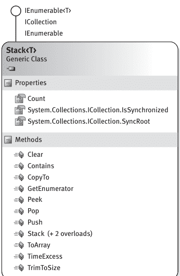

图 17.5：`Stack<T>` 类图

要在不修改栈的情况下访问，使用 `Peek()` 和 `Contains()` 方法。`Peek()` 返回 `Pop()` 将检索的下一个元素。

与大多数集合类一样，使用 `Contains()` 方法来确定是否存在于栈中。与所有集合一样，也可以使用 `foreach` 循环遍历栈中的元素。这允许你访问从任何位置开始的值。

# 第 17 章：构建自定义集合

`stack`。但注意，通过 `foreach` 循环访问值并不会将其从栈中移除——只有 `Pop()` 方法提供此功能。

## 队列集合：Queue<T>

图 17.6 所示的队列集合类与栈类相同，不同之处在于遵循先进先出（FIFO）的排序模式。它们不使用 `Pop()` 和 `Push()` 方法，而是使用 `Enqueue()` 和 `Dequeue()` 方法。队列的行为像一根管子：你使用 `Enqueue()` 方法将对象放入队列的一端，并使用 `Dequeue()` 方法从另一端将其取出。与栈类一样，对象不需要是唯一的，且队列类会根据需要自动增大大小。当队列收缩时，它并不一定会收回之前使用的存储空间，因为这可能会导致插入新元素的成本更高。如果你恰好知道队列在很一段时间内保持不变，你可以使用 `TrimSize()` 方法提示它你想要收回存储空间。

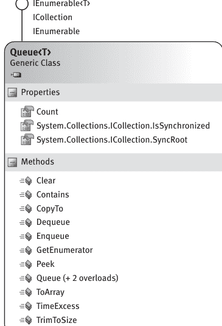

图 17.6：`Queue<T>` 类图

## 链表：LinkedList<T>

`System.Collections.Generic` 还支持一种允许正向和反向遍历的链表集合类。图 17.7 显示了该类图。（没有对应的非泛型类型。）

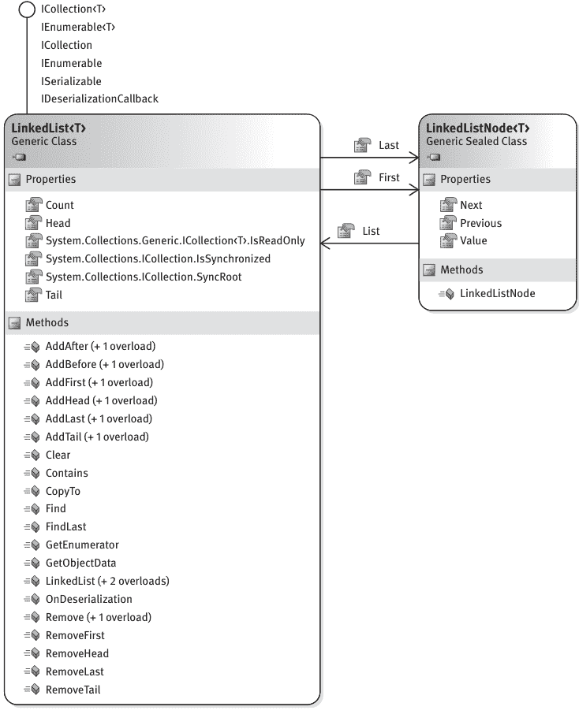

图 17.7：`LinkedList<T>` 和 `LinkedListNode<T>` 类图

## 提供索引器

数组、字典和列表提供了索引器（indexer），这是一种方便的方法，可以根据键或索引来获取或设置集合的成员。我们已经看到，要使用索引器，只需在集合名称后的方括号中放入索引（或多个索引）即可。你可以定义自己的索引器；代码列表 17.9 显示了一个使用 `Pair<T>` 的示例。

### 代码列表 17.9：定义索引器

```csharp
interface IPair<T>
{
    T First { get; }
    T Second { get; }

    T this[PairItem index] { get; }
}
public enum PairItem
{
    First,
    Second
}
public struct Pair<T> : IPair<T>
{
    public Pair(T first, T second)
    {
        First = first;
        Second = second;
    }
    public T First { get; } // C# 6.0 只读访问器
    public T Second { get; } // C# 6.0 只读访问器

    public T this[PairItem index]
    {
        get
        {
            switch (index)
            {
                case PairItem.First:
                    return First;
                case PairItem.Second:
                    return Second;
                default:
                    throw new NotImplementedException("The index.ToString() has not been implemented");
            }
        }
    }
}
```

索引器的声明方式与属性非常相似，但你使用的不是属性名称，而是使用关键字后跟方括号内的参数列表。其体体也类似于属性，包含 `get` 和 `set` 块。代码列表 17.9 显示，参数并不非是 `int`；事实上，索引可以接受多个参数，甚至可以重载。由索引运算符创建的公共中间语言（CIL）代码是一个名为 `Item` 的特殊属性，它接收参数。C# 无法显式地创建接受参数的属性，因此 `Item` 属性在这方面是唯一的。任何带有标识符 `Item` 的额外成员，即使其签名完全不同，也会与编译器创建的成员冲突。

### 高级主题：使用 IndexerName 赋值索引器属性

如前所述，索引器的 CIL 属性名称默认为 `Item`。然而，使用 `IndexerNameAttribute` 特性，你可以指定不同的名称。代码列表 17.10 将名称更改为 "Entry"。

### 代码列表 17.10：更改索引器的默认名称

```csharp
[IndexerName("Entry")]
public T this[params PairItem[] branches]
{
    // ...
}
```

这对于调用索引的 C# 调用者没有影响，但它为那些直接支持索引器的语言指定了名称。`IndexerNameAttribute` 仅仅是告诉编译器使用不同名称作为索引器的指令；该属性实际上不会由编译器发射到元数据中，因此无法通过反射访问。

### 高级主题：使用变长参数定义索引运算符

索引运算符也可以接受变长参数列表。例如，代码列表 17.11 为 `BinaryTree<T>` 定义了索引运算符，这在第 12 章讨论过（并在下一节中再次讨论）。

### 代码列表 17.11：使用变长参数定义索引运算符

```csharp
using System;

public class BinaryTree<T>
{
    // ...

    public BinaryTree<T> this[params PairItem[] branches]
    {
        get {
            BinaryTree<T> currentNode = this;
            // 允许数组或空
            // 指根节点
            int totalLevels = branches?.Length ?? 0;
            int currentLevel = 0;
            while (currentLevel < totalLevels)
            {
                System.Diagnostics.Debug.Assert(nameof(branches) != null, "branches cannot be null");
                currentNode = currentNode[branches[currentLevel]];
                if (currentNode == null)
                {
                    // 此处的二叉树为空
                    throw new IndexOutOfRangeException();
                }
                currentLevel++;
            }
            return currentNode;
        }
    }
}
```

`branches` 中的每个项都是 `PairItem`，指示在二叉树中导航到哪个分支。例如，`tree[PairItem.Second, PairItem.First].Value` 将检索位于第一个分支中的第二个分支所在处的值。

## 返回 null 或空集合

在返回数组或集合时，你必须通过返回 `null` 或空集合实例来表示没有零项目。通常情况下，更好的选择是返回一个空集合。这样做可以避免强制调用者在遍历集合中的项目之前进行空检查。例如，给定一个大小为零的 `IEnumerable<T>` 集合，调用者可以立即安全地对集合使用 `foreach` 循环，而不会导致生成的 `GetEnumerator()` 调用抛出 `NullReferenceException`。考虑使用 `Enumerable.Empty<T>()` 方法生成给定类型的空集合。

偏离此指南的情况之一是 `null` 有意表示不同于零项目。例如，网站的用户名集合可能是 `null`，表示由于某些原因无法获取集合；这与空集合在语义上是有区别的。

> 指南
>
> 不要用空引用表示空集合。
>
> 考虑使用 `Enumerable.Empty<T>()` 方法代之。

## 迭代器

第 15 章详细讨论了 `foreach` 循环的内部机制。本节讨论了如何使用迭代器创建你对 `IEnumerator<T>`、`IEnumerable<T>` 以及自定义集合相应的非泛型接口的实现。迭代器为指定如何遍历类中的数据提供了清晰的语法，特别是使用 `foreach` 循环时。迭代器允许集合的终端用户导航其内部结构而无需了解该结构。

### 高级主题：迭代器的起源

1972 年，Barbara Liskov 及其在 MIT 的科学家团队开始研究编程方法论，关注用户定义的数据抽象。

# 迭代器语法

迭代器提供了迭代器接口的简写实现，即 `IEnumerable<T>` 和 `IEnumerator<T>` 接口的组合。列表 17.12 通过创建一个 `GetEnumerator()` 方法，为泛型 `BinaryTree<T>` 类型声明了一个迭代器。接下来，你将为迭代器接口添加支持。

### 列表 17.12: 迭代器接口模式

```c
using System;
using System.Collections.Generic;

public class BinaryTree<T>{
    IEnumerable<T>
    {
        BinaryTree ( T value)
        {
            Value = value;
        }

        #region IEnumerable<T>
        public IEnumerator<T> GetEnumerator()
        {
            //...
        }
        #endregion

        public T Value { get; } // C# 6.0 只读自动属性
        public Pair<BinaryTree<T>> SubItems { get; set; }
}

public struct Pair<T>
{
    public Pair(T first, T second) : this()
    {
        First = first;
        Second = second;
    }
    public T First { get; } // C# 6.0 只读自动属性
    public T Second { get; } // C# 6.0 只读自动属性
}
```

如列表 17.12 所示，我们需要为 `GetEnumerator()` 方法提供实现。

# 从迭代器中产生值

迭代器类似于函数，但它们返回的不是单个值，而是每次产生一个序列中的值。在 `BinaryTree<T>` 的情况下，


迭代器产生一个类型为为 `T` 提供的类型参数的值序列。如果使用泛型版本的 `IEnumerator`，则产生的值将类型为 `object` 类型。

要正确实现迭代器模式，你需要维护一些内部状态以跟踪你在枚举集合时的进度。在 `BinaryTree<T>` 情况下，你通过跟踪树中哪些元素已经被枚举，哪些仍待出现。迭代器会被编译器转换为一个“状态机”，该状态机跟踪当前位置并知道如何“移动自身”到下一个位置。

`yield return` 语句每次迭代器遇到它时都会产生一个值；控制权立即返回到请求该项的调用者。（有趣的一点是，控制权确实立即返回了，这与 `return` 语句相反。`return` 语句会在路径最后执行 `finally`；而 `yield return` 则不会。）当调用者请求项时，代码将从上一次执行的 C# `yield return` 语句之后立即执行。在列表 17.13 中，按顺序返回内置类型关键字。

# 列表 17.13: 顺序产生某些 C# 关键字

```csharp
using System;
using System.Collections.Generic;

public class CSharpBuiltInTypes: IEnumerator<string>
{
    public IEnumerator<string> GetEnumerator()
    {
        yield return "object";
        yield return "byte";
        yield return "uint";
        yield return "ulong";
        yield return "float";
        yield return "char";
        yield return "bool";
        yield return "ushort";
        yield return "decimal";
        yield return "int";
        yield return "sbyte";
        yield return "short";
        yield return "long";
        yield return "void";
        yield return "double";
        yield return "string";
    }
}
```

```csharp
// 也需要 IEnumerable.GetEnumerator 方法
// 因为 IEnumerable<T> 派生自 IEnumerable
System.Collections.IEnumerable.GetEnumerator()
{
    // 调用上面的 IEnumerable<string> GetEnumerator()
    return GetEnumerator();
}
```


```csharp
public class Program {
    static void Main() {
        var keywords = new CSharpBuiltInTypes();
        foreach (string keyword in keywords) {
            Console.WriteLine(keyword);
        }
    }
}
```

列表 17.13 的结果出现在输出 17.5 中。

### 输出 17.5

```
object
byte
uint
ulong
float
char
bool
ushort
decimal
int
sbyte
short
long
void
double
string
```

此列表的输出是 C# 内置类型的列表。

# 迭代器与状态

当在 `foreach` 语句中首次调用 `GetEnumerator()` 时（例如列表 17.13 中的 `foreach (string keyword in keywords)`），会创建一个迭代器对象，并将其状态初始化为一种特殊的“开始”状态，该状态表示迭代器中尚未执行任何代码，因此尚未产生任何值。只要调用处的 `foreach` 状态继续执行，迭代器就会保持其状态。每当循环请求下一个值时，控制就会进入迭代器，并从上一次循环的地方继续执行，存储在迭代器对象中的状态信息用于确定控制必须在何处恢复。当调用处的 `foreach` 语句终止时，迭代器的状态将不再保存。

再次调用 `getEnumerator()` 总是安全的，在需要时将创建“新的”枚举器对象。

图 17.8 显示了所发生过程的高级序列图。记住 `MoveNext()` 方法出现在接口上。

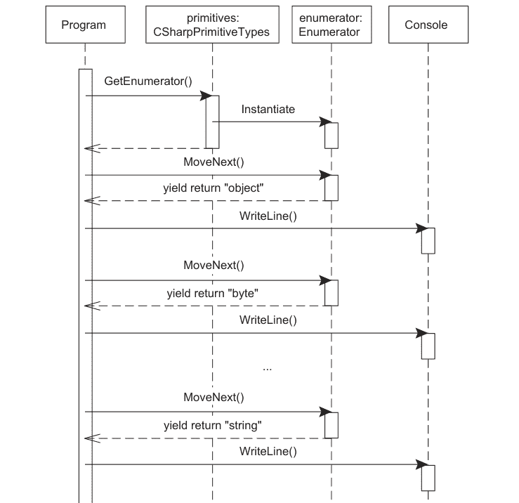

图 17.8: 发生过程的序列图

# 迭代器与状态

当 `GetEnumerator()` 在 `foreach` 语句中首次调用时（例如列表 17.13 中的 `foreach (string keyword in keywords)`），会创建一个迭代器对象，并将其状态初始化为一种特殊的“开始”状态，该状态表示迭代器中尚未执行任何代码，因此尚未产生任何值。只要调用处的 `foreach` 状态继续执行，迭代器就会保持其状态。每当循环请求下一个值时，控制就会进入迭代器，并从上一次循环的地方继续执行，存储在迭代器对象中的状态信息用于确定控制必须在何处恢复。当调用处的 `foreach` 语句终止时，迭代器的状态将不再保存。

再次调用 `getEnumerator()` 总是安全的，在需要时将创建“新的”枚举器对象。图 17.8 显示了所发生过程的高级序列图。记住 `MoveNext()` 方法出现在接口上。

# 迭代器与状态

当 `GetEnumerator()` 在 `foreach` 语句中首次调用时（例如列表 17.13 中的 `foreach (string keyword in keywords)`），会创建一个迭代器对象，并将其状态初始化为一种特殊的“开始”状态，该状态表示迭代器中尚未执行任何代码，因此尚未产生任何值。只要调用处的 `foreach` 状态继续执行，迭代器就会保持其状态。每当循环请求下一个值时，控制就会进入迭代器，并从上一次循环的地方继续执行，存储在迭代器对象中的状态信息用于确定控制必须在何处恢复。当调用处的 `foreach` 语句终止时，迭代器的状态将不再保存。

再次调用 `getEnumerator()` 总是安全的，在需要时将创建“新的”枚举器对象。图 17.8 显示了所发生过程的高级序列图。记住 `MoveNext()` 方法出现在接口上。

...语句，你可以从循环结构内部返回值。列表 17.16 使用了 `foreach` 循环。每当 `GetEnumerator()` 内部的 `foreach` 执行时，它都会返回下一个值。

# 列表 17.16：在循环中放置 yield return 语句

```csharp
public class BinaryTree<T>: IEnumerable<T>
{
    //

#region IEnumerable<T>
public IEnumerator<T> GetEnumerator()
{
    // 返回此节点上的项
    yield return Value;

    // 遍历对中的每个元素
    foreach (BinaryTree<T>? tree in SubItems)
    {
        if (tree != null)
        {
            // 由于对中的每个元素都是树，
            // 遍历该树并产生每个元素
            foreach (T item in tree)
            {
                yield return item;
            }
        }
    }
}
#endregion

#region IEnumerable Members
System.Collections.IEnumerator
System.Collections.IEnumerable.GetEnumerator()
{
    return GetEnumerator();
}
#endregion
```

在 17.16 中，第一次迭代返回二叉树中的根元素。在第二次迭代期间，你遍历了子元素对。如果子元素对包含非空值，你将遍历到该子节点并产生它的元素。注意，`foreach (T item in tree)` 是对子节点的递归调用。

正如在 `CSharpBuiltInTypes` 和 `Pair<T>` 中观察到的那样，你现在可以使用 `foreach` 循环来遍历 `BinaryTree<T>`。列表 17.17 演示了这一过程，输出 17.6 显示了结果。

# 第 17 章：构建自定义集合

## 列表 17.17：在 BinaryTree<string> 上使用 foreach

```csharp
// JFK
var jfkFamilyTree = new BinaryTree<string>(
  "John Fitzgerald Kennedy")
{
  SubItems = new Pair<BinaryTree<string>>(
    new BinaryTree<string>("Joseph Patrick Kennedy")
    {
      // 祖父母（父系 side）
      SubItems = new Pair<BinaryTree<string>>(
        new BinaryTree<string>("Patrick Joseph Kennedy"),
        new BinaryTree<string>("Mary Augusta Hickey")
      )
    }),
    // 祖父母（母系 side）
    SubItems = new Pair<BinaryTree<string>>(
      new BinaryTree<string>("John Francis Fitzgerald"),
      new BinaryTree<string>("Mary Josephine Hannon")
    )
  )
}

foreach (string name in jfkFamilyTree)
{
  Console.WriteLine(name);
}
```

# 输出 17.6

John Fitzgerald Kennedy

Joseph Patrick Kennedy

Patrick Joseph Kennedy

Mary Augusta Hickey

Rose Elizabeth Fitzgerald

John Francis Fitzgerald

Mary Josephine Hannon

## 高级主题

### 递归迭代器的危险性

列表 17.16 中的代码在遍历二叉树时创建了“嵌套”迭代器。结果是当值由某个节点产生时，该值先由该节点的迭代器产生，然后由其父节点的迭代器产生，依此类推，直到最后由根节点的迭代器产生给原始循环。一个深度为 $n$ 层的值实际上必须通过 $n$ 个迭代器的链链向上传递其值。如果二叉树相对浅，这通常不是问题；然而，不平衡的二叉树可能非常深，因此递归迭代的开销很大。

# 指南

在遍历可能深层的数据结构时，**考虑**使用非递归算法。

# 高级/初学者主题

## struct 对比 class

将 `Pair<T>` 定义为 `struct` 而不是 `class` 的有趣副作用是，`SubItems.First` 和 `SubItems.Second` 无法直接赋值，即使 setter 是公共的。如果你将 setter 修改为公共，以下代码将产生编译器错误，指示 `SubItems` 无法被修改“因为它不是一个变量”：

```csharp
jfkFamilyTree.SubItems.First =
new BinaryTree<string>{
  "Joseph Patrick Kennedy";};
```

问题在于 `SubItems` 是一个 `Pair<T>` 类型的属性，这是一个 `struct`。因此，当属性返回值时，会创建 `SubItems` 的副本，将 `First` 赋值给一个在语句结束时立即丢失的副本是具有误导性的。幸运的是，C# 编译器阻止了这种情况。

为了解决这个问题，不要为 `First` 赋值（列表 17.17 中的方法），使用 `class` 而不是 `struct` 作为 `Pair<T>`，不要创建 `SubItems` 属性而是使用字段，或者在 `BinaryTree<T>` 中提供可以直接访问 `SubItems` 成员的属性。

# 取消后续迭代：yield break

有时你可能想要取消后续迭代。你可以包含一个 `if` 语句使得代码中不再执行后续语句。然而，你也可以使用 `yield return Next()` 返回 `false` 并控制权立即返回调用者并结束循环。列表 17.18 显示了此类方法的示例。

# 第 17 章：构建自定义集合

- 列表 17.18：通过 yield break 跳出迭代

```csharp
public System.Collections.Generic.IEnumerator<T>
    GetEnumerator()
{
    if(First == null) || (Second == null)
    {
        yield break;
    }
    yield return Second;
    yield return First;
}
```

如果 `Pair<T>` 类中的任一元素为空，该方法将取消迭代。

`yield break` 语句类似于 `return` 语句；它是提前退出的方法。请谨慎使用。

## 高级主题

### 迭代器的工作原理

当 C# 编译器遇到迭代器时，它会展开成你可能手动编写的代码。因为编译器获取 `yield return` 语句并生成对应于枚举器模式的类，迭代器的性能特性与手动实现枚举器模式的类相同。- 列表 17.19：编译器生成的等价代码：

```csharp
using System;
using System.Collections;
using System.Collections.Generic;

public struct Pair<T> : IEquatable<T>, IEnumerable<T>
{
    public Pair(T first, T second)
    {
        First = first;
        Second = second;
    }

    public T First { get; }

    public T Second { get; }

    public T this[int index]
    {
        get
        {
            int pairItem = index;
            int pairItem2 = index;
            T result;
            if (pairItem == 0)
            {
                if (pairItem2 != 1)
                {
                    throw new NotImplementedException(string.Format("The {0} has not been implemented", index.ToString()));
                }
                result = Second;
            }
            else
            {
                result = First;
            }
            return result;
        }
    }

    public IEnumerator<T> GetEnumerator()
    {
        yield return First;
        yield return Second;
        yield break;
    }

    IEnumerator IEnumerable.GetEnumerator()
    {
        return GetEnumerator();
    }
}
```

# 第 17 章：构建自定义集合

因为编译器获取 `yield return` 语句并生成对应于你可能手动编写的代码，迭代器的性能特性与手动实现枚举器模式的类相同。虽然没有性能提升，但程序员生产力的提高是显著的。

## 高级主题

# 上文关键字

许多 C# 关键字是“保留”的，除非前面有 `@` 符号，否则不能作为标识符。`yield` 关键字是一个上下文关键字，而不是保留关键字；因此，声明一个名为 `yield` 的局部变量是合法的（尽管令人困惑）。通过封装返回 `IEnumerable<T>` 或 `IEnumerable` 的属性或方法来实现额外的迭代器。例如，如果你想反向遍历 `Pair<T>` 的元素，请提供一个 `GetReverseEnumerator()` 方法，如列表 17.20 所示。

# 列表 17.20：在返回 IEnumerable<T> 的方法中使用 yield return

```csharp
public struct Pair<T>: IEnumerable<T>
{
    // ...
    public IEnumerable<T> GetReverseEnumerator()
    {
        yield return Second;
        yield return First;
    }
    // ...
}
```

```csharp
public void Main() {
    var game = new Pair<string>("Redskins", "Eagles");
    foreach (string name in game.GetReverseEnumerator())
    {
        Console.WriteLine(name);
    }
}
```

注意你返回的是 `IEnumerable<T>`，而不是 `IEnumerator<T>`。这与 `IEnumerable<T>.GetEnumerator()` 不同，后者返回的是 `IEnumerator<T>`。`Main()` 中的代码演示了如何使用 `foreach` 循环调用 `GetReverseEnumerator()`。

## yield 语句的要求

你只能在返回 `IEnumerator<T>` 或 `IEnumerable<T>` 类型（或非泛型等效项）的成员中使用 `yield return` 语句。体体包含 `yield return` 语句的成员不能有简单的 `return`。如果成员使用了 `yield return` 语句，C# 编译器会生成必要的代码来维护迭代器的状态。相比之下，如果成员使用 `return` 语句而不是 `yield return`，则程序员需要负责维护自己的状态机并返回迭代器接口的实例。此外，就如同具有返回类型的方法中的所有代码路径必须包含带值的返回语句（假设它们没有抛出异常）一样，迭代器中的所有代码路径如果要返回数据，必须包含 `yield return` 语句。

# 第 17 章：构建自定义集合

以下是对 `yield` 语句结果的附加限制如果被违反将会导致编译器错误：

- `yield` 语句只能出现在方法、用户定义操作符、或者索引器或属性的 `get` 访问器内部。该成员不能接受任何 `ref` 或 `out` 参数。

- `yield` 语句不能出现在匿名方法或 lambda 表达式的内部（见第 13 章）。

- `yield` 语句不能出现在 `try` 语句的 `catch` 和 `finally` 子句中。此外，只有在没有 `catch` 块的情况下，`yield` 语句才能出现在 `try` 块中。

## 总结

在本章中，我们回顾了关键集合类，并考虑了它们如何根据支持的接口进行分类。每个类都侧重于向集合插入项和从集合中检索项，使用了通过键、先进先出（FIFO）或后进先（LIFO）等机制。我们还探索了如何遍历集合。此外，本章解释了如何通过自定义迭代器来定义自定义集合，以便枚举集合中的项。（迭代器涉及一个关键字 `yield`，C# 使用它来生成实现 `foreach` 循环所用迭代器模式的底层 CIL 代码。）

在第 18 章中，我们将探索反射（reflection），这是一个之前简要提到过的话题，尽管几乎没有进行解释。反射允许我们在运行时检查类型的 CIL 代码结构。

# 第 18 章：反射、属性与动态编程


属性（`ATTRIBUTES`）是向程序集插入额外元数据，并将元数据与编程构造体（如类、方法或属性）关联的手段。本章调查了框架中内置的属性的细节，并描述了如何定义自定义属性。为了利用自定义属性，必须识别它们。这是通过反射处理的。本章从查看反射开始，包括你如何使用它根据编译时通过名称（或元数据）进行的成员调用，在执行时动态绑定代码。反射经常在工具中作为代码生成器利用。此外，当调用目标未知时，会在执行时使用反射。

| `AttributeUsageAttribute` | 预定义属性 | 访问元数据 | `GetType()` `typeof()` |
| :--- | :--- | :--- | :--- |
| `ConditionalAttribute` | | | |
| `ObsoleteAttribute` 序列 | | | |
| 反射、属性与动态编程 | 泛型的反射 |
| :--- | :--- |
| 命名参数 | 成员调用 |
| 属性构造函数 | 自定义属性 |

本章以动态编程结束，这是 C# 4.0 引入的一项特性，允许执行时而非编译时处理动态数据。

# 第 18 章：反射、属性与动态编程

## 反射

使用反射可以实现：

- 访问程序集内部的元数据。这包括类型名称以及装饰构造体的属性。
- 动态调用类型成员。通常，当代码编译为机器语言时，所有信息都会被丢弃。相反，当 C# 编译为中间语言（`CIL`）时，它保留了大部分元数据。你可以使用反射来枚举程序集内的类型。此外，使用反射可以使用其他无法实现的范式。例如，你可以将反射的元数据与生成的 XML 文档相结合。同样，程序员可以使用反射将对象持久化（序列化）到数据库。`XmlSerializer`、`ValueType` 以及 `.NET` 框架 `DataBinder` 是框架中部分使用反射的少数类。

### 使用 `System.Type` 访问元数据

读取类型元数据的关键是获取表示该类型的 `System.Type` 实例。`System.Type` 提供了获取类型信息的方法。你可以使用它回答此类问题：

- 类型名称是什么（`Type.Name`）？
- 类型是公共的吗（`Type.IsPublic`）？
- 基类型是什么（`Type.BaseType`）？
- 哪些接口（`Type.GetInterfaces()`）？
- 定义在哪个程序集中（`Type.Assembly`）？
- 类型的属性、方法等有哪些（`Type.GetProperties()`、`Type.GetMethods()`、`Type.GetFields()`）？
- 哪些属性装饰了该类型（`Type.GetCustomAttributes()`）？

还有更多此类成员，但它们都提供关于特定类型的信息。关键是获取类型 `Type` 对象的引用，两种主要方法是通过 `object.GetType()` 和 `typeof()`。

#### `GetType()`

`object` 包含 `GetType()` 成员，因此所有类型都包含此函数。你调用 `GetType()` 来获取与原始对象对应的 `System.Type` 实例。列表 18.1 演示了这一过程，使用了 `DateTime` 的 `Type` 实例。输出 18.1 显示了结果。

注意 `GetMethods()` 调用不返回扩展方法。这些方法仅作为实现类型的静态成员可用。

##### 列表 18.1：使用 `Type.GetProperties()` 获取对象的公共属性

```
DateTime dateTime = new DateTime();

Type type = dateTime.GetType();
foreach (
    System.Reflection.PropertyInfo property in
    type.GetProperties())
{
    Console.WriteLine(property.Name);
}
```

输出 18.1

```
Date
Day
DayOfWeek
DayOfYear
Hour
Kind
Millisecond
Minute
Month
Now
UtcNow
Second
Ticks
TimeOfDay
Today
Year
```

调用 `GetType()` 后，你遍历从 `Type.GetProperties()` 返回的每个 `System.Reflection.PropertyInfo` 实例并显示属性名称。调用 `GetType()` 的关键在于你必须有一个对象实例。然而，有时并没有可用的实例。例如，静态类无法被实例化，因此没有办法对它们调用 `GetType()`。

#### `typeof()`

检索 `Type` 对象的另一种方法是使用 `typeof` 表达式。`typeof` 在编译时绑定到特定的 `Type` 实例，并直接接受一个类型作为参数。例外是泛型类型上的类型参数，因为它在运行时之前无法确定。列表 18.2 展示了在 `Enum.Parse()` 中使用 `typeof`。

##### 列表 18.2：使用 `typeof()` 创建 `System.Type` 实例

```
using System.Diagnostics;
//...
ThreadPriorityLevel priority;
priority = (ThreadPriorityLevel)Enum.Parse(typeof(ThreadPriorityLevel), "Idle");
//...
```

在这些列表中，`Enum.Parse()` 接收一个标识枚举的 `Type` 对象，并将字符串转换为特定的枚举值。在这种情况下，它将 `"Idle"` 转换为 `System.Diagnostics.ThreadPriorityLevel.Idle`。

同样地，下一节的列表 18.3 在 `CompareTo(object obj)` 方法内部使用了 `typeof` 表达式，以验证所遇到的 `obj` 参数的类型为：

```csharp
if(obj.GetType() != typeof(Contact)) { }
```

`typeof` 表达式在编译时解析，因此类型比较——例如比较调用 `GetType()` 返回的类型——可以判断一个对象是否属于特定类型。

### 成员调用

反射的可能性不仅限于于检索元数据。你还可以获取元数据并动态地调用其识别的成员。考虑定义一个类来表示应用程序的命令行的情况。`CommandLineInfo` 类的困难之处在于，如何将该类与启动应用程序的实际命令行数据联系起来。然而，使用反射，你可以将命令行选项映射到属性名称，然后在运行时动态设置这些属性。列表 18.3 展示了这一过程。

##### 列表 18.3：动态调用成员

```csharp
using System;
using System.Diagnostics;

public partial class Program
{
```

- 1. `.NET` 1.6 添加了 `CommandLineUtils` `NuGet` 包，它也提供了一种命令行解析机制。更多信息，请参阅我在该主题上的 `MSDN` 文章：http://itl.tc/sept2016。

```csharp
public static void Main(string[] args)
{
    CommandLineInfo commandLine = new CommandInfo();
    if (!CommandLine.TryParse(
        args, commandline, out string? errorMessage))
    {
        Console.WriteLine(errorMessage);
        DisplayHelp();
    }

    if (commandLine.Help)
    {
        DisplayHelp();
    }
    else
    {
        if (commandLine.Priority != 
            ProcessPriorityClass.Normal)
        {
            // 修改线程优先级
        }
        // ...
    }
}

private static void DisplayHelp()
{
    // 显示命令行帮助
    Console.WriteLine(
        * "Compress.exe /Out:<filename> /Help \n"
        * "Priority:RealTime|High"
        * "AboveNormal|Normal|BelowNormal|Idle"
    );
}

using System;
using System.Diagnostics;

public partial class Program
{
    private class CommandLineInfo
    {
        public bool Help { get; set; }

        public string? Out { get; set; }

        public ProcessPriorityClass Priority { get; set; }
            = ProcessPriorityClass.Normal;
    }
}
```

```csharp
using System;
using System.Diagnostics;
using System.IO;
using System.Reflection;

public class CommandLineHandler
{
    public static void Parse(string[] args, object commandLine)
    {
        if (TryParse(args, commandLine, out string errorMessage))
        {
            throw new InvalidOperationException(errorMessage);
        }
    }

    public static bool TryParse(string[] args, object commandLine,
        out string errorMessage)
    {
        bool success = false;
        errorMessage = null;
        foreach (string arg in args)
        {
            string option;
            if (arg[0] == '/' || arg[0] == '-')
            {
                string[] optionParts = arg.Split(
                    new char[] { ':', ':' }, 2);

                // 移除斜杠/连字符
                option = optionParts[0].Remove(0, 1);
                PropertyInfo? property =
                commandLine.GetType().GetProperty(option,
                    BindingFlags.IgnoreCase |
                    BindingFlags.Instance);
                if (property != null)
                {
                    if (property.PropertyType == typeof(bool))
                    {
                        property.SetValue(commandLine, true, null);
                        success = true;
                    }
                    else if (property.PropertyType == typeof(string))
                    {
                        property.SetValue(commandLine, optionParts[1], null);
                        success = true;
                    }
                    else if (property.PropertyType == typeof(ProcessPriorityClass))
                    {
                        try
                        {
                            property.SetValue(commandLine,
                                Enum.Parse(typeof(ProcessPriorityClass), optionParts[1]), null);
                            success = true;
                        }
                        catch (ArgumentException)
                        {
                            success = false;
                            errorMessage = $"选项 {optionParts[1]} 无效，对于 {property.PropertyType}";
                        }
                    }
                    else
                    {
                        success = false;
                        errorMessage = $"类型 {property.PropertyType} 不支持。";
                    }
                }
                else
                {
                    success = false;
                    errorMessage = $"选项 {option} 不支持。";
                }
            }
        }
        if (!success)
        {
            errorMessage = $"选项 {arg} 不支持。";
        }
        return success;
    }
}
```

*(注：由于原文文本中列表 18.3 的代码部分存在明显的逻辑混乱和重复断裂错误，翻译时根据上下文逻辑对代码结构进行了微调，以确保中文描述的可读性。)*

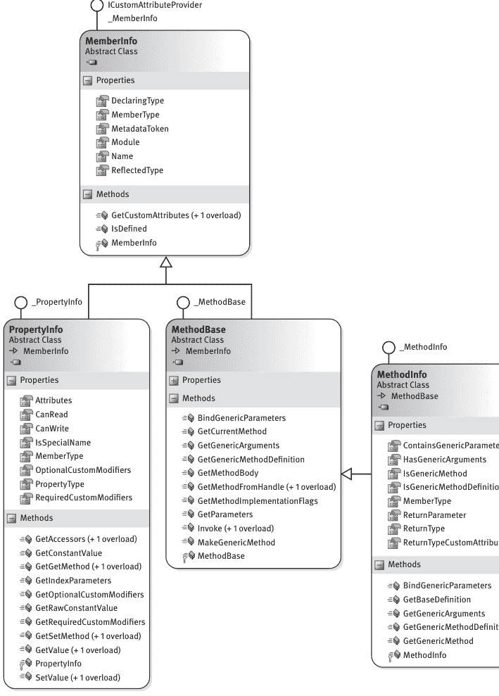

图 18.1：`MemberInfo` 派生类

## 泛型类型的反射

通用语言运行时 (`CLR`) 2.0 版本引入了泛型，这使得需要额外的反射功能。对泛型的反射用于确定类或方法是否包含泛型类型，以及它可能包含的任何参数或参数。

### 确定类型参数的类型

就像对非泛型使用 `typeof` 运算符来获取 `System.Type` 实例一样，你也可以对泛型或泛型方法中的类型参数使用 `typeof` 运算符。列表 18.4 将 `typeof` 运算符应用于 `Stack` 类中 `Add` 方法的类型参数。

#### 列表 18.4：声明 `Stack<T>` 类

```cpp
public class Stack<T>
{
    public void Add(T i)
    {
        Type t = typeof(T);
        // ...
    }
}
```

一旦获取了类型参数的 `Type` 对象实例，你就可以对类型参数本身进行反射，以确定其行为并更有效地为特定类型定制 `Add` 方法。

### 确定类或方法是否支持泛型

在 `CLR` 2.0 版本的 `System.Type` 类中，增加了一些方法，用于确定给定类型是否支持泛型参数和参数。泛型参数是在实例化泛型类时提供的类型参数。你可以通过查询 `Type.ContainsGenericParameters` 属性来确定类或方法是否包含尚未设置的泛型参数，如列表 18.5 所示。

#### 列表 18.5：泛泛型反射


```csharp
using System;
public class Program {
    static void Main() {
        Type type = typeof(System.Nullable<>);
        Console.WriteLine(type.ContainsGenericParameters);
        Console.WriteLine(type.IsGenericType);

        type = typeof(System.Nullable<DateTime>);
        Console.WriteLine(type.ContainsGenericParameters);
        Console.WriteLine(type.IsGenericType);
    }
}
```

输出 18.3 显示了列表 18.5 的结果。

### 输出 18.3

```
True
True
False
True
```

`Type.IsGenericType` 是一个布尔属性，用于评估一个类型是否为泛型。

## 获取泛型类或方法的类型参数

你可以通过调用 `GetGenericArguments()` 方法从泛型类获取泛型参数（或类型参数）列表。结果是一个 `System.Type` 实例数组，其顺序与它们作为泛型类类型参数的声明顺序一致。列表 18.6 对泛型类型进行反射并获取每个类型参数；输出 18.4 显示了结果。

### 列表 18.6：对泛型类型使用反射

```csharp
using System;
using System.Collections.Generic;
public partial class Program {
}

public static void Main()
{
    Stack<int> s = new Stack<int>();

    Type t = s.GetType();
    foreach(Type type in t.GetGenericArguments())
    {
        System.Console.WriteLine(
            "Type parameter: " + type.FullName);
    }
    // ...
}
```

### 输出 18.4

| Type parameter: System.Int32 |

| :--- |

## nameof 运算符

我们在第 11 章中简要提到过 `nameof` 运算符，它用于在参数异常中提供参数名称：

```csharp
throw new ArgumentException(
    "The argument did not represent a digit", nameof(textDigit));
```

`nameof` 是 C# 6.0 引入的上下文关键字，它产生一个常量字符串，包含作为参数指定的任何程序元素的未声明名称。在这种情况下，`textDigit` 是方法的一个参数，因此 `nameof(textDigit)` 返回 "textDigit"。（由于此操作发生在编译时，`nameof` 在技术上并不是反射。我们将其包含在这里是因为它可以从程序集及其结构中检索数据。）

你可能会问使用 `nameof(textDigit)` 而不是简单使用 `"textDigit"` 有什么优势（特别是对于某些程序员来说，后者似乎甚至更易用）。优势有两点：

- C# 编译器确保传递给 `nameof` 运算符的确实是一个有效的程序元素。这有助于在更改程序元素名称时防止错误，帮助纠正拼写错误等。
- IDE 工具对 `nameof` 运算符的支持比字面量字符串更好。例如，“查找所有引用”工具可以找到 `nameof` 表达式中提到的程序元素，而在字面量字符串中找不到。自动重构效果也更好，等等。

在之前提供的代码段中，`nameof(textDigit)` 生成参数的名称。实际上，`nameof` 运算符适用于任何程序元素。例如，列表 18.7 使用 `nameof` 将属性元素传递给 `INotifyPropertyChanged.PropertyChanged`。

### 列表 18.7：动态调用成员

```csharp
using System.ComponentModel;

public class Person : INotifyPropertyChanged
{
    public event PropertyChanged PropertyChanged;
    public Person(string name)
    {
        Name = name;
    }
    private string _name;
    public string Name
    {
        get { return _name; }
        set
        {
            _name = value;
            PropertyChanged?.Invoke(this, new PropertyChangedEventArgs(nameof(Name)));
        }
    }
}
```

## 属性 (Attributes)

与其依赖属性名称的精确匹配，可以使用属性来包含额外的元数据。属性出现在方括号中，如 18.8 所示。

### 列表 18.8：使用属性装饰属性

```csharp
class CommandLineInfo
{
    [CommandLineAlias("*")]
    public bool Help { get; set; }

    [CommandLineRequired]
    public string Out { get; set; }

    public System.Diagnostics.ProcessClass Priority
    { get; set; } = System.Diagnostics.ProcessClass.Normal;
}
```

在列表 18.8 中，`Help` 和 `Out` 属性被装饰。这些属性有两个用途：提供别名，并指示 `Out` 是必需参数。可以通过 `CommandLineHandler.TryParse()` 方法检查所有开关。

属性有两种方式关联。首先，你可以在同一个方括号内用逗号分隔属性。或者，你可以将每个属性放在自己的方括号中。列表 18.9 提供了示例。

### 列表 18.9：为属性装饰多个属性

```csharp
[CommandLineRequired]
[CommandLineAlias("FileName")]
public string? Out { get; set; }

[CommandLineRequired]
CommandLineAlias("FileName")
public string Out { get; set; }
```

除了装饰属性外，开发者还可以使用属性装饰程序集、类、构造函数、委托、枚举、字段、泛型参数、接口、方法、参数、返回值和结构体。对于大多数情况，应用属性涉及与 18.9 相同的方括号语法。然而，这种语法用于返回值、程序集和模块。

程序集属性用于添加有关程序集的元数据。Visual Studio 的 .NET 项目向向（而不是 .NET Core 项目）生成 `AssemblyInfo.cs` 文件，其中包含了许多程序集属性。列表 18.10 是此类文件的示例。

### 列表 18.10：AssemblyInfo.cs 中的程序集属性

```csharp
using System.Reflection;
using System.Runtime.CompilerServices;
using System.Runtime.InterOpServices;

// 程序集的常规信息通过以下属性集
// 进行控制。更改此属性值以修改
// 与程序集相关的信息。
[assembly:AssemblyTitle("CompressionLibrary")]
[assembly:AssemblyDescription("")]
[assembly:AssemblyConfiguration("")]
[assembly:AssemblyCompany("IntelliText")]
[assembly:AssemblyProduct("Compression Library")]
[assembly:AssemblyCopyright("Copyright© IntelliText 2006-2018")]
```

## 属性 785

```csharp
[assembly: AssemblyTrademark(")]
[assembly: AssemblyCulture("")]
```

```csharp
// 将 ComVisible 设置为 false 会使程序集中的类型
// 对 COM 组件不可见。如果你需要从 COM
// 访问此程序集中的类型，请将该类型上的
//  属性设置为 true。
[assembly: ComVisible(false)]
```

```csharp
// 下面的 GUID 用于类型库的 ID，
// 如果此项目被暴露给 COM
[assembly: Guid("a17a9609-24ae-4323-b1d6-cef0f87a4c2c3")]
```

```csharp
// 程序集的版本信息包含
// 以下四个值：
//
// 主版本号 (Major Version)
// 次版本号 (Minor Version)
// 生成号 (Build Number)
// 修订号 (Revision)
```

```csharp
// 你可以指定所有的值，也可以通过
// 使用下所示的 '*' 号将修订号和生成号默认化：
[assembly: AssemblyVersion("1.0.0")]
[assembly: AssemblyVersion("1.0.0")]
[assembly: AssemblyFileVersion("1.0.0")]
```

程序集属性定义了如公司、产品和程序集版本号等内容。与使用程序集类似，标识模块的属性使用需要加上 `module::` 前缀。程序集和模块属性的限制是它们必须出现在任何命名空间或类声明之前的 `using` 指令 之后。列表 18.10 中的属性是由 Visual Studio 项目向导生成的，应该包含在所有项目中，以便为生成的二进制文件标记有关可执行文件或动态链接库 (DLL) 内容的信息。

返回属性（如列表 18.11 所示）出现在方法声明之前，但使用相同的语法结构。

### 列表 18.11：指定返回属性

```csharp
[return: Description(
    "如果对象处于有效状态，则返回 true.")]
public bool IsValid()
{
    // ...
    return true;
}
```

## 第 18 章：反射、属性与动态编程

除了 `assembly:` 和 `return;` 之外，C# 还允许对 `module;`、`class;` 和 `method;` 进行显式目标标识，分别对应于装饰模块、类和方法的属性。然而，如前所示，`class:` 和 `method;` 是可选的。

使用属性的约定之一是语言考虑了属性的命名规范，该规范要求 `Attribute` 出现在名称的末尾。然而，在之前列表中的所有属性使用中，并没有出现后缀，尽管每个使用的属性都遵循了该命名规范。这是因为在应用属性时允许使用全名（如 `DescriptionAttribute`、`AssemblyVersionAttribute` 等），C# 使后缀变为可选。通常情况下，在应用属性时不会出现后缀；相反，它只在定义属性或内联使用该属性时（例如 `typeof(DescriptionAttribute)`）才会出现。

请注意，基于 .NET Core 的项目不是生成 `AssemblyInfo.cs` 文件，而是允许在 `.csproj` 文件中指定程序集信息。例如，列表 18.12 在编译时将相应的程序集属性注入到程序集中。

### 列表 18.12：定义自定义属性

```xml
<Project>
  <PropertyGroup>
    <Company>Addison Wesley</Company>
    <Copyright>Copyright © Addison Wesley 2020</Copyright>
    <Product>Essential C# 8.0</Product>
    <Version>8.0</Version>
  </PropertyGroup>
</Project>
```

这些内容反会被转换为生成的 CIL，如输出 18.5 所示。

### 输出 18.5

```csharp
[assembly: AssemblyCompany("Addison Wesley") ]
[assembly: AssemblyCopyright("Copyright © Addison Wesley 2020") ]
[assembly: AssemblyFileVersion("8.0.0.0") ]
[assembly: AssemblyInformationalVersion("8.0") ]
[assembly: AssemblyProduct("Essential C# 8.0") ]
[assembly: AssemblyVersion("8.0.0.0") ]
```

## 指南

应当对包含公共类型的程序集应用 `AssemblyVersionAttribute`。

考虑应用 `AssemblyFileVersionAttribute` 和 `AssemblyCopyrightAttribute` 以为程序集提供额外信息。

应当应用以下信息程序集属性：`System.Reflection.AssemblyCompanyAttribute`、`System.Reflection.AssemblyCopyrightAttribute`、`System.Reflection.AssemblyDescriptionAttribute` 和 `System.Reflection.AssemblyDescriptionAttribute`。

## 自定义属性

定义自定义属性相对简单。要定义一个属性，你需要派自 `Attribute`。

### 列表 18.13：定义自定义属性

```csharp
public class CommandLineRequiredAttribute : Attribute
{
```

## 指南

应当对包含公共类型的程序集应用 `AssemblyVersionAttribute`。

## 查找属性

检查属性的代码相对简单。给定一个 `PropertyInfo` 对象（通过反射获取），你调用 `GetCustomAttributes()` 并指定要查找的属性，然后指示是否检查任何属性。

### 列表 18.14：检索自定义属性

```csharp
using System;
using System.Collections.Generic;
using System.Reflection;

public class CommandLineRequiredAttribute : Attribute
{
    public static string[] GetMissingOptions(object commandLine)
    {
        List<string> missingOptions = new List<string>();
        PropertyInfo[] properties = commandLine.GetType().GetProperties();

        foreach (PropertyInfo property in properties)
        {
            Attribute[] attributes = typeof(CommandLineRequiredAttribute).GetCustomAttributes(property, false);
            if (attributes.Length > 0)
            {
                if (property.GetValue(commandLine, null) == null)
                {
                    missingOptions.Add(property.Name);
                }
            }
        }
        return missingOptions.ToArray();
    }
}
```

## 通过构造函数初始化属性

对 `GetCustomAttributes()` 的调用返回一个对象数组，可以转换为 `Attribute` 数组。由于我们示例中的属性没有任何实例成员，返回的属性提供的唯一元数据是它是否出现。属性也可以封装数据。列表 18.15 定义了 `CommandLineAliasAttribute`——一种提供命令行别选项的自定义属性。例如，你可以提供命令行 `/Help` 或 `/?` 作为缩写。同样，`/S` 可以为 `/Subfolders` 提供别名，指示命令应该遍历所有子目录。

### 列表 18.15：提供属性构造函数


```csharp
public class CommandLineAliasAttribute : Attribute
{
    public CommandLineAliasAttribute(string alias)
    {
        Alias = alias;
    }

    public string Alias { get; set; }
}
class CommandLineInfo
{
    [CommandLineAlias("?")]
    public bool Help { get; set; }
}
// ...
```

当向构造结构应用属性时，仅允许常量值和 `typeof()` 表达式作为参数。这一限制是为了能够将它们序列化到生成的 CIL 中。这意味着

# 第 18 章：反射、属性与动态编程

属性构造函数应该要求提供相应类型的参数；创建一个接受 `System.DateTime` 类型参数的构造函数几乎没有意义，因为 C# 中没有 `System.DateTime` 类型。从 `PropertyInfo.GetCustomAttributes()` 返回的对象将使用指定的构造函数参数进行初始化，如示例 18.16 所示。

## 列表 18.16：获取特定属性并检查其初始化状态

```csharp
PropertyInfo property =
typeof(CommandLineInfo).GetProperty("Help");
CommandLineSwitchAliasAttribute attribute = (CommandLineSwitchAliasAttribute)
property.GetCustomAttribute(
    typeof(CommandLineSwitchAliasAttribute), false);
if(attribute?.Alias == "?") {
    Console.WriteLine("Help?");
}
```

此外，如 18.17 和 18.18 所示，你可以在 `CommandLineAliasAttribute` 的 `GetSwitches()` 方法中使用类似的代码。该方法返回一个包含所有开关的字典集合（包括来自属性名的开关），并将每个名称与命令行对象上相应的属性关联起来。

## 列表 18.17：获取自定义属性实例

```csharp
using System;
using System.Reflection;
using System.Collections.Generic;

public class CommandLineSwitchAliasAttribute : Attribute
{
    public CommandLineSwitchAliasAttribute(string alias)
    {
        Alias = alias;
    }

    public string Alias { get; set; }

    public static Dictionary<string, PropertyInfo> GetSwitches(object[] commandLine)
    {
        PropertyInfo[] properties;
        Dictionary<string, PropertyInfo> options = new Dictionary<string, PropertyInfo>();
```

```csharp
        properties = commandLine.GetType().GetProperties(
            BindingFlags.Public | BindingFlags.Instance);
        foreach (PropertyInfo property in properties)
        {
            options.Add(property.Name, property);
            foreach (CommandLineSwitchAliasAttribute attribute in
            property.GetCustomAttributes(
            typeof(CommandLineSwitchAliasAttribute), false))
            {
                options.Add(attribute.Alias.ToLower(), property);
            }
        }
        return options;
    }
}
```

## 列表 18.18：更新 CommandLineHandler.TryParse() 以处理别名

```csharp

using System;

using System.Reflection;

using System.Collections.Generic;

public class CommandLineHandler

{

    // ...

    public static bool TryParse(

        string[] args, object commandLine,

        out string errorMessage)

    {

        bool success = false;

        errorMessage = null;

        Dictionary<string, PropertyInfo> options = new Dictionary<string, PropertyInfo>();

        CommandLineSwitchAliasAttribute.GetSwitches(commandLine);

        foreach (string arg in args)

        {

            if (arg[0] == '/' || arg[0] == '-')

            {

                string[] optionParts = arg.Split(new char[] { ':' }, 2);

                option = optionParts[0].Remove(0, 1).ToLower();

            }

        }

        if (options.TryGetValue(option, out PropertyInfo? property))

        {

            success = SetOption(

                commandLine, property,

                optionParts, ref errorMessage);

        }

```

```csharp

        else

        {

            success = false;

            errorMessage =

            $"Option '{ option }' is not supported.";

        }

        return success;

    }

    private static bool SetOption(

      object[] commandLine, PropertyInfo property,

      string[] optionParts, ref string errorMessage)

    {

        bool success;

        if (property.PropertyType == typeof(bool))

        {

            // 处理索引器的最后一个参数

            property.SetValue(

                commandLine, true, null);

            success = true;

        }

        else

        {

            if (optionParts.Length < 2

                || optionParts[1] == "")

            {

                // 未为该开关提供设置值

                success = false;

                errorMessage =

                $"You must specify the value for the { property.Name } option.";

            }

            else if (

              property.PropertyType == typeof(string))

            {

                property.SetValue(

                    commandLine, optionParts[1], null);

                success = true;

            }

            else if (

              // property.PropertyType.IsEnum also de

              property.PropertyType ==

              typeof(ProcessPriorityClass))

            {

                success = TryParseEnumSwitch(

                    commandLine, optionParts,

                    property, ref errorMessage);

```

属性

## 指南

- 对于具有必需属性值的属性，**应当**提供只读属性（不带公共 set 访问器）。
- 对于具有必需属性的属性，**应当**提供构造函数参数来初始化这些属性。每个参数的名称应与相应的属性相同（尽管大小写可能不同）。
- **避免**通过构造函数参数来初始化对应可选参数的属性（因此，**避免**重载自定义属性）。

## System.AttributeUsageAttribute

大多数属性仅用于装饰特定的结构。例如，允许 `CommandLineAttribute` 装饰类或程序集是没有意义的，因为该属性在这些语境下将毫无用处。为了避免不当使用属性，可以对自定义属性使用 `System.AttributeUsageAttribute` 进行装饰（是的，这是一个属性正在被用来装饰另一个自定义属性的声明）。列表 18.19 演示了这一点。

### 列表 18.19：限制属性可以装饰的结构

```csharp

[AttributeUsage(AttributeTargets.Property)]

public class CommandLineAttribute : Attribute

{

    // ...

}

```

如果属性使用不当（如列表 18.20 所示），它将导致编译错误，如 18.6 所示。

### 列表 18.20：AttributeUsage 限制应用的位置

```
Program+CommandLineInfo.cs(24,17): error CS0592: Attribute 'CommandLineAttribute' is not valid on this declaration type.
```

`AttributeUsage` 的构造函数接受一个 `AttributeTargets`。该枚举提供了运行时允许的所有可能目标。例如，如果你允许 `CommandLineAliasAttribute` 装饰字段，则需要更新 `AttributeUsageAttribute`，如 18.21 所示。

### 列表 18.21：通过 AttributeUsage 限制属性的使用

```csharp

// 将属性限制为字段和属性

[AttributeUsage(AttributeTargets.Field | AttributeTargets.Property)]

public class CommandLineSwitchAliasAttribute : Attribute

{

    // ...

}

```

## 命名参数

除了限制属性可以装饰的内容，`AttributeUsageAttribute` 还提供了允许在单个结构上重复使用相同属性的机制。语法见 18.22。

### 列表 18.22：使用命名参数

```csharp

[AttributeUsage(AttributeTargets.Property, AllowMultiple=true)]

public class CommandLineSwitchAliasAttribute : Attribute

{

    // ...

}

```

命名参数允许分配属性数据，而无需为每种可能的属性属性勾选组合提供构造函数。由于属性的许多属性可能是可选的，这在许多情况下是一个非常有用的结构。参数分配必须发生在构造函数的最后部分，位于任何显式声明的构造参数之后。命名属性是可选的标记，但它们提供了在属性上设置额外实例数据的方法。

# 初学者教程

## FlagsAttribute

此框架定义的属性针对标志类型值的枚举。初学者教程也涵盖了 `FlagsAttribute`，从列表 18.23 所示的示例代码开始。

### 列表 18.23：使用 FlagsAttribute

```csharp

// System.IO 中定义的 FileAttributes

[Flags] // 使用 FlagsAttribute 装饰枚举

public enum FileAttributes

```

## 第 18 章：反射、特性与动态编程

```csharp

{

    ReadOnly = 1<<0, // 0000000000000001

    Hidden = 1<<1,   // 0000000000000010

    // ...

}

using System;

using System.Diagnostics;

using System.IO;

class Program

{

    public static void Main()

    {

        // ...

        string fileName = @"enumtest.txt";

        FileInfo file = new FileInfo(fileName);

        file.Attributes = FileAttributes.Hidden | 

                          FileAttributes.ReadOnly;

        Console.WriteLine("{0} outputs as \"1}\"",

        file.Attributes.ToString().Replace(",", " ||"),

        file.Attributes);

        FileAttributes attributes = 

        (FileAttributes)Enum.Parse(typeof(FileAttributes),

        file.Attributes.ToString());

        Console.WriteLine(attributes);

        // ...

    }

}
```


输出 18.7 显示了代码 18.23 的结果。

### 输出 18.7

`"ReadOnly | Hidden"` 输出为 `"ReadOnly, Hidden"`

该标记指示了枚举值可以组合。此外，它改变了 `ToString()` 和 `Parse()` 方法的行为。例如，对标记了 `FlagsAttribute` 的枚举调用 `ToString()`，会写出每个设置的枚举标记的字符串。在代码 18.23 中，`file.Attributes.ToString()` 返回 `"ReadOnly, Hidden"`，如果没有 `FlagsAttribute` 标记，它只会返回第一个。如果枚举值相同，如前所述，在依赖此结果时应小心，因为它不是本地化的。

从字符串解析枚举值也有效，只要枚举值由逗号分隔。注意，`FlagsAttribute` 不会自动分配唯一的标记值。每个枚举项的值必须显式赋值。

## 预定义特性

`AttributeUsageAttribute` 特性具有你在书中创建自定义特性时尚未看到的特殊特性。该特性影响编译器。与你之前编写的 `RequiredAttribute` 和 `AliasAttribute` 不同，`AttributeUsageAttribute` 没有运行时代码；相反，它具有内置支持。

`AttributeUsage` 是一个预定义特性。此类特性不仅为它们装饰的结构提供额外的元数据，运行时和编译器还以不同的方式处理这些特性的功能。如 `AttributeAttribute`、`FlagsAttribute`、`ObsoleteAttribute` 和 `ConditionalAttribute` 是预定义特性的示例。它们实现了只有 CLI 提供或编译器才能提供的特殊行为，因为自定义特性没有扩展点。自定义特性完全是被动的。代码 18.23 包含了预定义特性；第 19 章引入了更多。

## System.ConditionalAttribute

在单个程序集中，`System.Diagnostics.Conditional` 特性的行为类似于 `#if/#endif` 预处理器标识。然而，它不是从程序集中消除 CLI 代码，`System.Diagnostics.ConditionalAttribute` 可导致调用变为无操作（no-op）。代码 18.24 展示了这一概念，输出 18.8 显示了结果。

### 代码 18.24：使用 ConditionalAttribute 消除调用

```csharp
#define CONDITION_A

using System;

using System.Diagnostics;

public class Program
{
    public static void Main()
    {
        Console.WriteLine("Begin...");
        MethodA();
        MethodB();
        Console.WriteLine("End...");
    }
    [Conditional("CONDITION_A")]
    private static void MethodA()
    {
        Console.WriteLine("MethodA() executing...");
    }
    [Conditional("CONDITION_B")]
    private static void MethodB()
    {
        Console.WriteLine("MethodB() executing...");
    }
}
```

```
Begin...
MethodA() executing...
End...
```

此示例定义了 `CONDITION_A`，因此 `MethodA()` 正常执行。然而，`CONDITION_B` 并没有通过 `#define` 或使用 `csc.exe /Define` 选项定义。因此，从程序集内部对 `Program.MethodB()` 的所有调用都不会生效。

从功能上讲，`ConditionalAttribute` 类似于在方法调用周围放置 `#if/#endif`。但语法更简洁，因为开发者通过向目标方法添加 `ConditionalAttribute` 来创建效果，而无需对调用者本身进行任何更改。

C# 编译器在编译期间会注意到被调用方法上的特性，假设预处理器标识存在，它会消除对该方法的任何调用。然而，`ConditionalAttribute` 不影响目标方法本身的已编译 CIL 代码（除了添加特性元数据之外）。相反，它在编译期间通过移除调用来影响调用点。这进一步将跨程序集调用时的 `ConditionalAttribute` 与 `#if/#endif` 区分开来。因为被装饰的方法仍然被编译并包含在目标程序集中，调用方法的判断不是基于调用者程序集中的预处理器标识，而是基于调用者的程序集。也就是说，如果你创建一个定义了 `CONDITION_B` 的第二个程序集，则从第二个程序集对 `Program.Method` 的任何调用将执行。它在许多跟踪和测试场景中具有实用特性。事实上，对 `System.Diagnostics.Trace` 和 `System.Diagnostics.Debug` 的调用使用了 `TRACE` 和 `DEBUG` 预处理器标识的这一特性。然而，`ConditionalAttribute` 不用于包含 `out` 参数或返回 `void` 以外值的方法。这是合理的，因为被装饰的方法内部代码可能一个都不执行，因此不知道向调用者返回什么。同样，属性不能被 `ConditionalAttribute` 装饰。`ConditionalAttribute` 的 `AttributeUsage`（参见本章前面的“AttributeUsage”部分）分别被装饰为 `AttributeTargets.Class` 和 `AttributeTargets.Method`。

然而，类用法是特殊的，因为 `ConditionalAttribute` 只允许用于 `System.Attribute` 的派生类。

当 `ConditionalAttribute` 装饰自定义特性时，只有在调用程序集中定义了条件字符串时，才能通过反射检索后者。如果没有此类条件字符串，反射将失败。

## System.ObsoleteAttribute

如前所述，预定义特性影响编译器行为。`ObsoleteAttribute` 提供了另一个影响编译器的特性示例。它的目的是帮助代码的版本控制，通过向调用者指示成员或类型不再当前。

+ 2. .NET Framework 2.0 引入的功能。

代码 18.25 提供了 `ObsoleteAttribute` 的用法。如输出 18.9 所示，任何调用标记有 `ObsoleteAttribute` 成员的代码会导致编译警告，可选地产生错误。

### 代码 18.25：使用 ObsoleteAttribute

```csharp
class Program
{
    public static void Main()
    {
        ObsoleteMethod();
    }

    [Obsolete]
    public static void ObsoleteMethod()
    {
    }
}
```

输出 18.9

```
c:\Sample\ObsoleteAttributeTest.cs(24,17): warning CS0612:
Program.ObsoleteMethod() is obsolete
```

`ObsoleteAttribute` 允许相关通知开发者过时的 API。警告（而非错误）允许原始 API 继续使用，直到开发者更新调用代码。

## 使用动态对象的编程

C# 4.0 引入动态对象简化了许多编程场景，并开启了以前无法实现的新场景。从核心来说，使用动态对象的编程允许开发者

## 使用动态对象编程

使用动态分发机制进行代码操作，该机制将在执行时由解析，而不是由编译器在编译时对其进行验证和绑定。

为什么呢？很多时候，对象本质上是静态类型的。示例包括从 XML/CSV 文件、数据库表、Internet Explorer DOM 或 COM 的 `IDispatch` 接口加载数据，或者调用动态语言（如 IronPython 对象）中的代码。C# 4.0：动态对象支持为与不一定具有编译时定义的运行时环境通信提供通用的解决方案。在 C# 4.0 动态对象的初始实现中，四种绑定方法是：

- 1. 针对动态 CLR 类型进行反射
- 2. 调用自定义的 `IDynamicMetaObjectProvider` 以其提供 `DynamicMetaObject`
- 3. 通过 COM 的 `IUnknown` 和 `IDispatch` 接口调用
- 4. 调用由 IronPython 等动态语言定义的类型

在四种方法中，我们将深入研究前两种。它们的底层原理可以无缝过渡到其余情况中——COM 互操作性和动态语言互操作性。

# 使用 dynamic 调用反射

反射的核心特性之一是能够根据执行时识别的成员名称或其他其他属性（如特性），动态地调用类型上的成员（列表 18.3）。然而，C# 4.0 添加的动态对象提供了一种更简单的通过反射调用成员的方法，前提是编译时已知道该成员的签名。重申一下，这种限制意味着在编译时，我们需要知道成员名称以及签名（参数数量以及指定的参数是否与签名类型兼容）。列表 18.26（带有输出 18.10）提供了一个示例。

# 列表 18.26：使用反射进行动态编程

```csharp
using System;

//...
dynamic data =
    "Hello! My name is Inigo Montoya";
```

# 第 18 章：反射、特性与动态编程

```csharp
Console.WriteLine(data);
data = (double)data.Length;
data = data + 3.5 + 28.6;
if(data == 2.4 + 112 + 26.2)
{
    Console.WriteLine(
        "${data} makes for a long triathlon.");
}
else
{
    data.NonExistentMethodCompiles();
}
```

# 输出 18.10

```
Hello! My name is Inigo Montoya

140.6 makes for a long triathlon.
```

在这个示例中，没有显式代码来确定对象类型、查找特定的 `MemberInfo` 实例并调用它。相反，`data` 被声明为 `dynamic`，并直接对其调用方法。在编译时，不会检查指定的成员是否可用，甚至不知道动态对象的底层类型是什么。因此，在编译时，只要语法有效，就可以进行任何调用。在编译时，是否存在真正对应的成员并不重要。

然而，类型安全并没有被完全放弃。对于标准 CLR 类型（如列表 18.26 中使用的类型），通常在编译时用于非动态类型的相同类型检查器，改为在执行时针对动态类型被调用。因此，在执行时，如果没有可用成员，调用将导致 `Microsoft.CSharp.RuntimeBinder.BinderException`。

这种能力不如本章前面描述的反射那么灵活，尽管 API 无疑更简单。使用动态对象时的关键区别在于，必须在编译时识别签名，而不是在运行时确定诸如成员名称之类的项（正如我们在解析命令行参数时所做的那样）。

- 3. 分别是铁人项赛中游泳、自行车和跑步部分的距离（英里）。

## 使用动态对象编程

# dynamic 的原理与行为

列表 18.26 及相关文本揭示了 `dynamic` 数据类型的几个特征：

- `dynamic` 是一个让编译器生成代码的指令。`dynamic` 涉及一种拦截机制，当运行时遇到动态调用时，它可以将请求编译为 CLI 然后调用新编译的调用（详参见本章稍后的高级主题：深入动态）。

将类型分配给 `dynamic` 时的工作原理是在概念上“封装”原始类型，以便不发生编译时验证。此外，当调用成员时，运行时会拦截调用并进行适当分发。

（注：由于原文中存在大量 OCR 导致的重复文本，译文已根据要求进行了去重处理，保留核心逻辑内容。）

# 第 18 章：反射、属性与动态编程

CIL 方法体类似于编译器在调用不是动态的情况下本会生成的代码。CIL 代码随后被缓存在调用点处，并通过委托（delegate）进行调用。由于 CIL 现在已缓存在调用点，下一次调用就不再需要重复经历所有的反射和编译开销。

# 为什么使用动态绑定？

除了反射之外，我们还可以定义用于动态调用的自定义类型。例如，我们可能会考虑使用动态调用来获取 XML 元素的值。与其使用列表 18.27 中的强类型语法，不如使用动态调用来调用 `person.FirstName` 和 `person.LastName`。

# 列表 18.27：不使用 dynamic 的 XML 元素运行时绑定

```csharp
using System;
using System.Xml.Linq;

// ...
person = XElement.Parse(
  "<Person>
    <FirstName>Inigo</FirstName>
    <LastName>Montoya</LastName>
  </Person>");

Console.WriteLine("{0} {1}",
 person.Descendants("FirstName").FirstOrDefault().Value,
 person.Descendants("LastName").FirstOrDefault().Value);
// // ...
```

虽然列表 18.27 中的代码并不复杂，但请将其与列表 18.28 进行对比——另一种使用动态类型对象的替代方法。

# 列表 18.28：使用 dynamic 的 XML 元素运行时绑定

```csharp
using System;

// ...
// DynamicXml 列表请参见列表 13.32。
dynamic person = DynamicXml.Parse(
  "<Person>
    <FirstName>Inigo</FirstName>
    <LastName>Montoya</LastName>
  </Person>");
```

## 使用动态对象编程

```csharp
Console.WriteLine(
"${person.FirstName} {person.LastName}");
// ...
```

优势是显而易见的，但这是否意味着动态编程优于静态编译？

# 静态编译对比动态编程

在列表 18.28 中，我们拥有与列表 18.27 相同的功能，尽管有一个非常重要的区别：列表 18.27 是完全静态类型化的。因此，在编译时，所有类型及其成员签名都通过这种方法进行了验证。方法名必须匹配，并且所有参数都经过类型兼容性检查。这是 C# 的一个特性——也是我们在整书中强调的重点。

相比之下，列表 18.28 几乎没有静态类型代码；变量 `person` 反而是 `dynamic` 类型。因此，无法在编译时验证 `person` 是否具有 `FirstName` 或 `LastName`——或任何其他成员。此外，在 IDE 中编写代码时，没有 IntelliSense 可以识别 `person` 上的成员。

类型的丧失似乎会导致功能的显著减少。那么，为什么 C# 竟然会提供这种功能呢（事实上，这种功能是在 C# 4.0 中引入的）？

为了理解这个表面上的悖论，让我们重新检查列表 18.28。注意获取 "FirstName" 元素的调用：

```csharp
Element.Descendants("LastName").FirstOrDefault().Value
```

该列表使用 "LastName" 来标识元素名称，但并没有进行编译时验证来确保字符串是正确的。如果大小写与元素名不一致，或者存在空格，编译仍然会成功，尽管调用 `Value` 属性时会抛出 `NullReferenceException`。此外，编译器并不会尝试验证 "FirstName" 元素甚至是否存在；如果不存在，我们也会得到 `NullReferenceException` 消息。换句话说，尽管具有所有的类型安全优势，当你访问存储在 XML 元素中的动态数据时，类型安全并没有提供许多帮助。

在元素元素的编译时验证方面，列表 18.28 并不比 18.27 好。如果发生大小写不匹配或 `FirstName` 元素不存在，仍然会抛出异常。


然而，将列表 18.28 中的第一个名字调用（`person.FirstName`）与列表 18.27 中对应的调用相比，后者的调用无疑要简单得多。

总之，在某些情况下，类型安全无法（而且很可能无法）进行某些检查。在这些情况下，执行仅在运行时验证而非同时在编译时验证的动态调用的代码，具有显著更高的可读性和简洁性。显然，如果可以进行编译时验证，则优选静态类型编程，因为可以伴随可读且简洁的 API。然而，在这些无效的情况下，C# 4.0 的动态能力允许程序员编写更简单的代码，而不是强调类型安全的纯性。

# 实现自定义动态对象

列表 18.28 包含一个对 `DynamicXml.Parse(...)` 的方法调用，这本质上是 `DynamicXml` 的工厂方法调用——这是一个自定义类型，而不是 CLR 框架内置的类型。然而，`DynamicXml` 并没有实现 `FirstName` 或 `LastName`。这样做将破坏在执行时从 XML 文件检索数据的动态支持，而不是基于编译时的 XML 元素实现。换句话说，`DynamicXml` 不使用反射来访问其成员，而是根据 XML 内容动态绑定到值。

定义自定义动态类型的关键是派自 `DynamicObject`。与其从零实现接口，更推荐的方法是重写默认实现。列表 18.29 显示了完整的实现。


# 列表 18.29：实现自定义动态对象

```csharp
using System;
using System.Dynamic;
using System.Xml.Linq;

public class DynamicXml : DynamicObject
{
    private XElement Element { get; set; }

    public DynamicXml(XElement element)
    {
        Element = element;
    }

    public static DynamicXml Parse(string text)
    {
        return new DynamicXml(XElement.Parse(text));
    }

    public override bool TryGetMember(GetMemberBinder binder, out object result)
    {
        bool success = false;
        result = null;
        XElement firstDescendant =
            Element.Descendants(binder.Name).FirstOrDefault();
        if (firstDescendant != null)
        {
            if (firstDescendant.Descendants().Any())
            {
                result = new DynamicXml(firstDescendant);
            }
            else
            {
                result = firstDescendant.Value;
            }
            success = true;
        }
        return success;
    }

    public override bool TrySetMember(SetMemberBinder binder, object value)
    {
        bool success = false;
        XElement firstDescendant =
            Element.Descendants(binder.Name).FirstOrDefault();
        if (firstDescendant != null)
        {
            if (value.GetType() == typeof(XElement))
            {
                firstDescendant.ReplaceWith((XElement)value);
            }
            else
            {
                firstDescendant.Value = value.ToString();
            }
            success = true;
        }
        return success;
    }
}
```

```csharp
public virtual bool TryIndex(
    GetIndexBinder binder, object[] indices,
    out object result);
public virtual bool TryMember(
    GetMemberBinder binder, out object result);
public virtual bool TryInvoke(
    InvokeBinder binder, object[] args, out object result);
public virtual bool InvokeMember(
    InvokeMemberBinder binder, object[] args,
    out object result);
public virtual bool SetIndex(
    SetIndexBinder binder, object[] indices, object value);
public virtual bool SetMember(
    SetMemberBinder binder, object value);
public virtual bool TryUnaryOperation(
    UnaryOperationBinder binder, out object result);
}
```

如 18.30 节所示，万事万都有对应的成员实现——从类型转换和各种操作到索引调用。此外，还有一个方法可用于获取所有可能的成员名称：`GetDynamicMemberNames()`。

## 总结

本章讨论了如何使用反射来读取编译进 `CIL` 的元数据。通过反射，可以提供晚绑定，即调用的代码在执行时而非在编译时定义。虽然对于部署动态系统来说，反射是完全可行的，但它的执行速度比静态链接（编译时）定义的代码要慢得多。这使得它在性能可能不是那么关键的开发工具中更加流行和有用。

反射还允许以属性（attributes）的形式检索装饰在各种构造上的额外元数据。通常，使用反射来查找自定义属性。你可以定义自己的自定义属性，将你选择的额外元数据插入 `CIL` 中。在运行时，你可以检索这些元数据并在编程逻辑中使用它们。

许多程序员将属性视为一种被称为**面向切面编程**（aspect-oriented programming）的概念的前身，在这种模式中，你通过属性等构造结构来添加功能，而不是在每个需要的地方手动实现功能。在 C# 中看到真正的“切面”可能还需要一段时间（如果会有的话）；然而，属性为通往该方向提供了一个清晰的垫脚石，且不会对语言的稳定性造成重大风险。

最后，本章探讨了 C# 4.0 引入的一项特性——使用新类型 `dynamic` 进行动态编程。这些内容讨论了为什么尽管在 API 是强类型时人们首选静态绑定，但在处理动态数据时，静态绑定具有局限性。

下一章将介绍多线程，其中属性被用于同步。

# 19: 引入多线程

过去十年的**两大重大趋势**对软件开发领域产生了巨大影响。首先，计算成本的持续下降不再由时钟频率和晶体管密度的增加驱动（如图 19.1 所示）。相反，计算成本的下降是因为制造包含多个 CPU 的硬件已经变得经济化。

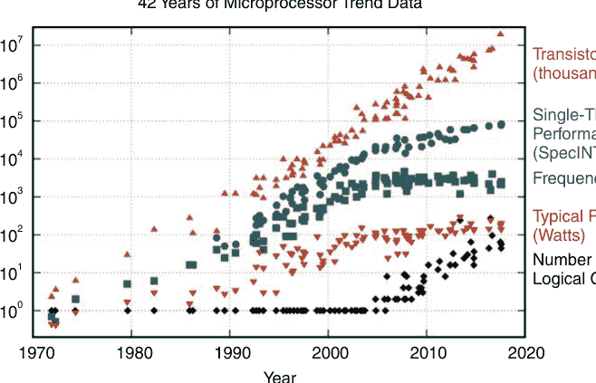

**图 19.1：** 随时间变化的时钟频率

其次，现在的计算通常会涉及巨大的延迟。简单来说，延迟就是获取所需结果所需的时间。延迟有两个主要原因。**处理器密集型延迟**（Processor-bound latency）发生在计算任务很复杂时；如果一次计算需要执行 120 亿次算术操作，而可用的总处理能力为每秒 60 亿次操作，那么在请求结果和获取结果之间至少会产生 2 秒的处理器密集型延迟。相比之下，**I/O 密集型延迟**（I/O-bound latency）是由于需要从磁盘驱动器、Web 服务器等外部源获取数据引起的。任何需要从位于客户端机器远程 Web 服务器获取数据的计算都会产生等于数百万个 CPU 周期的延迟。

这两者结合为现代软件开发人员带来了巨大的挑战。鉴于机器的计算能力比以往任何时候都大，我们该如何有效利用这种力量快速向用户交付结果，同时又不损害用户体验？我们如何避免在触发高延迟操作时出现令人沮丧的用户界面？此外，我们该如何将 CPU 密集型工作分配到多个处理器上，以缩短计算所需的时间？

保持用户界面响应且 CPU 利用率高的软件工程标准技术是编写多线程程序，以并行执行多次计算。遗憾的是，多线程的编写是非常困难的；我们在接下来的四个章节中将探索导致多线程困难的原因，并学习如何使用高级别的抽象和新语言特性来减轻这种负担。

第一个高级别的抽象是由 .NET 发布的并行扩展库（Parallel Extensions library）。它包含了本章讨论的任务并行库（`TPL`）以及第 21 章讨论的并行 LINQ（`PLINQ`）。第二个高级别的抽象是基于任务的异步模式（`TAP`）以及在 C# 5.0 及更高版本中的语言支持。

尽管我强烈鼓励你使用这些高级抽象，但在本章末尾我也涵盖了 .NET 运行时以前版本的一些低级多线程 API。C# 5.0 之前的其他多线程模式可以在 http://IntelliText.com/EssentialCSharp 下载，同还有《Essential C# 3.0》中的章节。因此，如果你想在没有后期功能的情况下完全理解多线程编程资源，你仍然可以使用这些材料。

我将从几个入门主题开始本章，以防你是一个多线程的新手。


## 多线程基础

初学者主题

### 多线程术语

与多线程相关的有很多令人困惑的术语，所以让我们定义几个术语。

`CPU`（中央处理单元）或核心¹是实际执行给定程序的硬件。每台机器都至少有一个 `CPU`，尽管今天多 `CPU` 机器已很常见。许多现代 `CPU` 支持同步多线程线程（Intel 将其标记为超线程 `Hyper-Threading`），在这种模式下，单个 `CPU` 可以表现多个“虚拟”`CPU`。

进程是任何给定程序的当前执行实例；操作系统的根本目的是管理进程。每个进程包含一个或多个线程。可以通过 `System.Diagnostics` 中的 `Process` 类实例通过编程方式访问进程。

+ 1. 技术上来说，我们应该说 `CPU` 始终指的是物理芯片，而核心指的是物理或虚拟 `CPU`。这种区别对于本书的目的并不重要，因此我们交替使用这些术语。

## 多线程基础

用户对于同时运行几十个进程并不稀以为常。他们可能在打开演示文稿和电子表格进行编辑的同时，还在浏览网页文档、听音乐、接收即时消息和电子邮件到达通知，并看着角落的小时钟。即使这些进程不是机器需要处理的唯一任务，每个进程也必须继续执行其工作。这种多任务处理通常在进程级别实现，但在某些情况下，你希望在单个进程内完成这种多任务处理。

就本书而言，我们大多数时候将多线程视为处理延迟的技术。例如，在导入大文件的同时允许用户点击“取消”，开发者会创建一个额外的线程来执行导入。通过在不同的线程上执行导入，用户可以请求取消，而不是让用户界面冻结直到导入完成。

如果有足够的核心可以为每个线程分配一个核心，那么每个线程本质上都拥有它自己的机器。然而，如今即使是多核机器通常也只有几个核心，而每个进程可能运行几十个线程。

为了弥补线程数量与核心数量之间的差异，操作系统通过使用**时间片**模拟多个线程并发运行。操作系统从一个线程切换到另一个线程的速度非常快，以至于看起来线程是同时执行的。处理器在切换到另一个线程之前执行的时间被称为**时间片**或**量子**。哪个线程在核心上执行的变化被称为**上下文切换**。

如果两个操作通过多核并行或使用时间片模拟的并行运行，则称它们是并发的。为了实现这种并发，你异步调用操作，使得操作的执行和完成与调用它的控制流分开。因此，并发发生在工作与当前控制流异步执行时。并行是将是将问题拆分成若干部分的行为，使得每个部分都可以并发处理。

### 初学者主题

### 性能考虑

处理 I/O 密集型的线程基本上可以被操作系统忽略，直到 I/O 结果可用；而切换到处理器密集型线程会导致更高的处理器利用率，因为 CPU 在等待 I/O 操作完成时并不是空闲的。

然而，上下文切换不是免费的；CPU 的当前状态必须保存到内存中，新线程的状态必须加载。同样，如果线程 A 正在处理部分内存工作，而线程 B 正在处理另一部分内存工作，它们之间的上下文切换可能会导致从 A 加载到缓存中的数据被来自 B 的数据替换（反之亦然）。如果线程过多，切换开销可能会开始显著影响性能。增加更多线程可能会进一步降低性能，以至于处理器花费从一个线程切换到另一个线程的时间比完成工作的时间还要。

即使忽略上下文切换的成本，时间片本身也会对性能产生巨大影响。假设你有两个处理器密集的高延迟任务，假设处理器每秒可以执行十亿操作。如果两个线程拥有自己的核心，显然可以在1秒内获得两个结果。

但是，如果两个线程共享一个处理器，时间片将在一个线程上执行几千操作，然后切换到另一个线程，再回来，以此此类推。每个任务将消耗共1秒的处理器时间，两个结果将在2秒后可用，导致平均完成时间为2秒。（再次，我们忽略了上下文切换的成本。）

如果我们把两个任务分配给单个线程，执行第一个任务，并在第一个任务完成后才开始第二个任务，那么第一个任务的结果将在1秒内获得，然后是第二个任务，导致平均时间为1.5秒（一个任务在1秒或2秒内完成，因此平均在1.5秒内完成）。

#### 指南

- 不要陷入认为线程越多越快的这种常见错误中。
- 在尝试加速多线程时，要仔细测量性能。

### 初学者主题

### 线程问题

我们已经多次提到多线程编程是复杂且困难的，但我们没有说明原因。单线程程序中的许多合理假设在多线程程序中被违反了。这些问题包括缺乏原子性、竞态条件和死锁。

#### 大多数操作不是原子的

原子操作是指始终被观察为既未开始也未完成的操作。它的状态在外部永远不会被标记为“处理中”。考虑以下代码片段：

```csharp
if (bankAccounts.Checking >= 1000)
{
  bankAccounts.Checking -= 1000;
  bankAccounts.Savings += 1000;
}
```

用的话说，为了使其正确执行，我们必须确保永远不存在操作被观察为部分完成的时刻。例如，假设有两个线程并发运行此代码。可能两个线程都验证账户中有足够的资金，然后两个线程都进行转账，即使账户中的资金仅足够执行一次转账。事实上，情况糟糕得多：这段代码片段中没有任何操作是原子的！甚至是复合加减法或读取写入 `decimal` 类型的属性，在 C# 中也是非原子操作。因此，它们都可以被观察为部分增加或部分减少。由于部分完成的操作导致的状态不一致观察是一个更通用的问题的特例，称为竞态条件。

#### 竞态条件引起的不确定性

如前所述，并发通常通过时间片模拟。在没有特殊线程同步（我们将在第22章详细讨论）的情况下，操作系统可以在它选择的任何时间在两个线程之间切换上下文。因此，当两个线程访问同一个对象时，哪个线程赢得竞争并首先运行是不可预测的。例如，如果之前给的代码片段中有两个线程运行，可能一个线程可能会赢得竞争，并在第二个线程获得运行机会之前一直到末尾。也可能上下文切换发生在第一个线程进行余额检查之后，然后第二个线程可能会赢得运行到末尾。

包含竞态条件的代码的行为取决于上下文切换的时机。这种依赖关系引入了程序执行的不确定性。一个指令相对于另一个线程中指令的执行顺序是未知的。糟糕糟糕，包含竞态条件的代码通常在99.9%的时间内表现正常，但在千分之一的情况下，由于时机的偶然，另一个线程赢得了竞争。这种不可预测性正是让多线程编程如此困难的原因。

由于这种竞态条件在实验室中很难复制，多线程代码的质量保证在很大程度上取决于

## 多线程基础

第 22 章介绍了关于处理竞态条件的技术。

### 内存模型是复杂的

竞态条件（race conditions）的存在——即两个控制点可以以不可预测且不一致的速度在某段代码上进行“竞速”——这已经足够糟糕了，但情况变得更糟了。考虑运行在两个不同处理器上但正在访问同一个对象相同字段的两个线程。现代处理器并不会在你每次使用变量时都访问主内存。相反，它们会在处理器的本地缓存内存中创建一个本地副本；这些缓存会定期与主内存进行同步。这意味着，在两个不同处理器上读写同一位置的两个线程，实际上可能无法观察到彼此对该内存的更新，或者观察到不一致的结果。本质上，我们在这里遇到的是一种依赖于处理器何时选择同步其缓存的竞态条件。

### 锁定会导致死锁

显然，存在某些机制可以将非原子操作转换为原子操作，指示操作系统调度线程以避免竞态，并确保在需要时同步处理器的缓存。在 C# 程序中，解决所有这些问题的主要机制是 `lock` 语句。该语句允许开发者将一段代码标识为“临界区”，该区域一次只允许一个线程进入；如果有多个线程尝试进入临界区，操作系统将挂起除一个之外的所有线程。操作系统还确保在遇到锁时正确同步处理器的缓存。

- 2. 或者让线程休眠、让线程自旋（spinning），或者在将其放回睡眠模式之前自旋并重复。

# 第 19 章：引入多线程

然而，锁会引入它们自身的问题（以及性能开销）。最显著的是，如果线程之间获取锁的顺序发生变化，可能会发生死锁，导致线程冻结，每个都在等待对方释放锁。

例如，考虑图 19.2。

| 线程 A | 线程 B |

|---|---|

| 获取 A 的锁 | 获取 B 的锁 |

| 请求 B 的锁 | 请求 A 的锁 |

| 死锁，等待 B | 死锁，等待 A |

**图 19.2：** 死锁时间线

此时，每个线程在继续执行之前都在等待另一个线程，因此每个线程都被阻塞了，导致代码执行出现整体性死锁。

我们将在第 22 章中详细讨论各种锁定技术。

> ### 指南
> 不要做出无根据的假设，认为任何单线程代码中看似是原子的操作在多线程代码中也将是原子的。
> 不要假设所有线程都会以一致的顺序观察对共享内存操作的所有副作用。
> 务必确保并发获取多个锁的代码始终以相同的顺序获取它们。
> 避免竞态条件——也就是说，避免程序行为取决于操作系统如何选择调度线程的条件。

## 异步任务

多线程编程包含以下复杂性：

- 1. 监控异步操作状态以判断完成：这包括确定异步操作何时完成，最好不要通过轮询线程状态或通过阻塞等待来完成。
- 2. 线程池：这避免了启动和销毁线程的巨大成本。此外，线程池避免了创建过多的线程，导致系统在切换线程上花费的时间多于运行线程。
- 3. 避免死锁：这涉及到在尝试保护数据免受两个不同线程同时访问的同时，防止死锁的发生。
- 4. 提供跨操作的原子性并同步数据访问：在组操作周围添加同步，可以确保操作作为单个单元执行且不会被另一个线程中断。提供锁定是为了确保两个线程不会同时访问数据。


此外，任何方法都是长时间运行的，多线程编程——也就是说，异步地调用长时间运行的方法。遗憾的是，C# 5.0 之前的多线程编程需要使用一个相对低级的 `System.Thread` 类，该类几乎没有模式可以避免这些这些复杂性。

然而，随着开发者编写更多的多线程代码，出现了一组常见的场景和编程模式……

# 第19章：引入多线程

通过调用 `Task.Start()` 触发的返回已正在运行（热的）任务的 API 内部细节。

请注意，在调用 `Run()` 之后，热任务的确切状态是不定的。其行为由操作系统、其负载以及伴随的任务库共同决定的。这种组合决定了 `Run()` 是选择立即执行工作线程，还是推迟到有可用资源为止。事实上，当调用线程再次获得执行轮机时，该热任务可能已经完成。对 `Wait()` 的调用会强制主线程等待，直到分配给任务的所有工作执行完毕。

在这种场景下，我们有一个任务，但也有可能许多任务在异步运行。在继续执行当前线程之前，等待所有任务完成或等待其中任何一个任务完成是十分常见的常常做法。`Task.WaitAll()` 和 `Task.WaitAny()` 方法分别就是实现了这些操作。

到目前为止，我们已经看到了任务如何接收一个 `Action` 并异步运行它。但如果在任务中执行的工作返回了结果呢？我们可以使用 `Task<T>` 类型来异步运行 `Func<T>`。当同步执行委托时，我们知道在结果可用之前控制权不会返回。当异步执行 `Task<T>` 时，我们可以从一个线程对其进行轮询以检查它是否完成，并在完成后获取结果。列表 19.2 展示了如何在简单的计算器中这样操作。请注意，此示例使用了 `PiCalculator.Calculate()` 方法，我们将在第 21 章的“并行执行循环迭代”节中深入探讨。

## 列表 19.2：轮询 Task<T>

```sharp
using System;
using System.Threading.Tasks;

public class Program
{
```

- 使用此技术时要格外谨慎。当像我们这里这样从委托创建任务时，任务将会在调度到线程池的工作线程上运行。结果是，当前线程将一直循环，直到工作线程上的工作完成。这种技术虽然可行，但它可能会不必要地消耗 CPU 资源。轮询技术上，如果你不是将任务调度在工作线程上运行，而是将其调度在未来在当前线程上执行，那么这种技术就是危险且错误的。由于当前线程在循环中进行轮询，它将永远循环下去，因为在当前线程退出循环之前，任务将不会完成。

### 异步任务

```csharp
public static void Main()
{
    // 在 .NET 4.5 之前的 TPL 
    // 使用 Task.StartNew<string>()
    Task<string> task =
        Task.Run(
            () => PiCalculator.Calculate(100));

    foreach (
    {
        foreach (char busySymbol in Utility.BusySymbols())
        {
            if (task.IsCompleted)
            {
                Console.Write('\b');
                break;
            }
            Console.Write(busySymbol);
        }
    })

    Console.WriteLine();

    Console.WriteLine(task.Result);
    System.Diagnostics.Trace.Assert(
        task.IsCompleted);
}

public class PiCalculator
{
    public static string Calculate(int digits = 100)
    {
        // ...
    }
}

public class Utility
{
    public static IEnumerable<char> BusySymbols()
    {
        string busySymbols = "@-\|\\|/";
        int next = 0;
        while (true)
        {
            yield return busySymbols[next];
            next = (next + 1) % busySymbols.Length;
            yield return '\b';
        }
    }
}
```

此列表显示任务的数据类型为 `Task<string>`。泛型类型包含一个 `Result` 属性，通过该属性可以获取 `Task<string>` 执行的 `Func<string>` 返回的值。

请注意，列表 19.2 中，除了 `IsCompleted` 属性外，还有其他值得注意的属性： 任务的状态可以通过 `TaskStatus` 枚举获取，可能的值包括 `Created`、`WaitingForActivation`、`WaitingToRun`、`WaitingForChildren`、`RanToCompletion`、`Canceled` 和 `Faulted`。当任务完成时（无论是正常完成还是故障），`IsCompleted` 属性会被设置为 true。任务可以通过 `Id` 属性进行唯一标识。静态 `Task.CurrentId` 提供了当前执行任务的标识符。这些属性在调试时非常有用。- 当任务在另一个线程上运行期间，状态可能会发生变化。只有 `RanToCompletion`、`Canceled` 和 `Faulted` 被视为最终状态。- 你可以使用 `AsyncState` 与任务关联额外数据。例如，想象一个通过各种任务计算的 `List<T>`。通过这种方式，当任务完成时，代码可以索引 `AsyncState`。- 使用任务修改集合时要小心。任务可能在工作线程上运行，集合可能不是线程安全的。

## 任务延续

我们多次讨论了程序的控制流，但没有说明控制流的本质：控制流决定了接下来会发生什么。当你有一个简单的控制流如 `Console.WriteLine(x.ToString());` 时，控制流告诉你 `ToString` 完成了，下一步是调用 `WriteLine`。这种“接下来发生什么”的概念被称为延续（Continuation）；控制流中的每个点都有延续。在示例中，`ToString` 的延续是 `WriteLine`（而 `WriteLine` 的延续则是后续的代码）。延续的概念在 C# 编程中如此基础，以至于大多数程序员甚至不会考虑它；它是我们呼吸的空气。C# 编程的行为就是不断构建延续，直到整个程序的控制流完成。

请注意，在普通的 C# 程序中，给定代码段的延续将在代码完成后立即执行。当 `ToString()` 返回时，当前线程的控制点会立即同步调用 `WriteLine`。注意，给定代码段实际上有两个可能的延续：正常延续以及当当前代码抛出异常时执行的异常延续。

异步方法调用（如启动任务）为控制流增加了一个额外的维度。在异步任务调用时，控制流会立即跳转到 `Task.Start()` 之后的语句，同时它开始在任务委托体内部执行。换句话说，当涉及到异步时，接下来会发生什么是多维度的。与异常不同，延续只是另一条路径，延续是一个额外的、行的路径。

异步任务还允许通过描述异步延续将小任务组合成大任务。实现这一点有多种技术，最显式的是 `ContinueWith()` 方法（见列表 19.3 及其对应的输出 输出 19.1）。

## 列表 19.3：调用 Task.ContinueWith()

```csharp
using System;
using System.Threading.Tasks;

public class Program
{
    public static void Main()
    {
        Console.WriteLine("Starting...");
        // Use Task.Factory.StartNew<string>() for
        // TPL prior to .NET 4.5
        Task taskA =
        Task.Run(() =>
        {
            Console.WriteLine("Starting...");
        }).ContinueWith(antecedent =>
        {
            Console.WriteLine("Continuing A...");
        });
        Task taskB = taskA.ContinueWith(antecedent =>
        {
            Console.WriteLine("Continuing B...");
        });
        Task taskC = taskA.ContinueWith(antecedent =>
        {
            Console.WriteLine("Continuing C...");
        });
        Task.WaitAll(taskB, taskC);
        Console.WriteLine("Finished!");
    }
}
```

## 输出 19.1

```
Before
Starting...
 A...
Continuing C...
Continuing B...
Finished!
```

`ContinueWith()` 方法允许将两个任务“链”在一起，当先前的任务——即前驱任务（antecedent task）完成时，第二个任务——延续任务（continuation task）会自动异步启动。…… `Console.WriteLine("Starting...")` 是前驱任务体，而 `Console.WriteLine("Continuing A...")` 是它的延续任务体。延续任务接受一个 `Task` 作为参数（前驱），允许延续任务的代码访问前驱任务的完成状态。当前驱任务完成时，延续任务会自动启动，异步执行第二个委托程序，并将刚刚完成的前驱任务作为参数传递给委托程序。此外，由于 `ContinueWith()` 方法也返回一个 `Task`，该 `Task` 可以用作另一个任务的前驱任务，以此此类推，形成一个长度可以任意延伸的任务延续链。

如果你对同一个前驱任务调用了两次 `ContinueWith()`（如列表 19.3 所示，`taskB` 和 `taskC` 代表 `taskA` 的延续任务），则前驱任务（`taskA`）有两个延续任务，当前驱任务完成时，两个延续任务都将异步执行。注意，从单个前驱任务开始的任务执行顺序在编译时是不确定的。输出 19.1 恰好显示 `taskC` 在 `taskB` 之前执行，但在程序的第二次执行中，顺序可能会反过来。然而，`taskA` 始终会在 `taskB` 和 `taskC` 之前执行，因为后者是 `taskA` 的延续任务，因此无法在 `taskA` 完成之前启动。同样，`Console.WriteLine("Starting...")` 委托程序始终会在 `taskA`（`Console.WriteLine("Continuing...")`）完成之前执行，因为后者是前者的延续。此外，`Finished!` 总是最后出现，这是因为调用了 `Task.WaitAll(taskB, taskC)`，该调用会阻塞控制流，直到 `taskB` 和 `taskC` 都完成才会继续。

`ContinueWith()` 有许多不同的重载，其中某些重载接受一个 `TaskContinuationOptions` 值来微调延续链的行为。这些值是标志位（flags），因此可以使用逻辑或运算符 (`|`) 将它们组合。表 19.1 简要描述了一些可能的标志位值；更多详情请参阅在线文档。

### 表 19.1: 可用的 TaskContinuationOptions 枚举列表

| 枚举 | 描述 |
|---|---|
| None | 这是默认行为。当前驱任务完成时，无论其任务状态如何，都会执行延续任务。 |

7. Microsoft .NET Docs, https://docs.microsoft.com/dotnet/api/system.threading.taskcontinuationoptions.

### 表 19.1: 可用的 TaskContinuationOptions 枚举列表（续）

| 枚举 | 描述 |
|---|---|
| PreferFairness | 如果两个任务都是被异步启动的，且一个在另一个之前，则不能保证先启动的那个实际上会先运行。此标志请求任务调度器尝试增加第一个启动的任务成为第一个执行任务的概率——当您描述的两个任务从不同的线程池中创建时，这一点尤为相关。 |
| LongRunning | 这告诉任务调度器该任务可能是一个 I/O 高延迟任务。调度器随后可以允许处理队列中的其他工作，而不是因为长时间运行的任务而导致饥饿。此选项应谨慎使用。 |
| AttachedToParent | 这指定任务应尝试附加到任务层次结构中的父任务。 |
| DenyChildAttach (.NET 4.5) | 如果尝试创建子任务，将抛出异常。如果延续任务中的代码尝试使用 `AttachedToParent`，其行为将像没有父任务一样。 |
| NotOnRanToCompletion* | 这指定如果前驱任务运行完成，则不应调度延续任务。此选项对于多任务延续无效。 |
| NotOnFaulted* | 这指定如果前驱任务抛出了未处理的异常，则不应调度延续任务。此选项对于多任务延续无效。 |
| OnlyOnCanceled* | 这指定只有在在前驱任务被取消时，才调度延续任务。此选项对于多任务延续无效。 |

### 异步任务

### 表 19.1: 可用的 TaskContinuationOptions 枚举列表（续）

| 枚举 | 描述 |
|---|---|
| NotOnCancelled* | 这指定如果前驱任务被取消，则不应调度延续任务。此选项对于多任务延续无效。 |
| OnlyOnFaulted* | 这指定只有在在前驱任务抛出未处理的异常时，才调度延续任务。此选项对于多任务延续无效。 |
| OnlyOnRanToCompletion* | 这指定只有在在前驱任务运行完成时，才调度延续任务。此选项对于多任务延续无效。 |
| ExecuteSynchronously | 这指定延续任务应同步执行。指定此选项后，调度将尝试在导致前驱任务转换到其最终状态的同一线程上执行工作。如果在延续任务运行时前驱已经完成，则将在创建延续任务的线程上执行。 |
| HideScheduler (.NET 4.5) | 这防止环境调度器被视为当前调度器。这意味着在所创建的任务中执行的 `Run/StartNew` 和 `ContinueWith` 操作会将 `TaskScheduler.Default` (null) 作为当前调度器。当延续应在特定调度器上运行，但延续调用了不应在该调度器上调度工作的代码时，这非常有用。 |

### 表 19.1: 可用的 TaskContinuationOptions 枚举（续）

| 枚举 | 描述 |
|---|---|
| LazyCancellation (.NET 4.5) | 这导致延续在前驱任务完成之前延迟监控取消令牌。考虑任务 t1、t2 和 t3，后者是前者的延续。如果 t2 在 t1 完成之前被取消，则 t3 可能在 t1 完成之前启动。LazyCancellation 避免了这种情况。 |
| RunContinuationsAsynchronously (.NET 4.6) | 当使用 `RunContinuationsAsynchronously` 选项创建任务时，它告诉任务应强制其延续异步运行。即使任务本身是延续，此选项也不会影响该任务的运行方式——只影响从它发出的延续。可以同时使用 `TaskContinuationOptions.ExecuteSynchronously` 和 `TaskContinuationOptions.RunContinuationsAsynchronously` 创建延续。前者在前驱完成时同步执行延续，并在延续完成后异步执行该延续的延续。 |

在任务 19.1 中，带有星号 (*) 的项目指定了延续任务执行的条件；它们对于创建像前驱任务行为的事件处理程序的延续任务特别有用。列表 19.4 展示了如何为前驱任务分配多个根据前驱任务完成情况有条件执行的延续任务。

## LISTING 19.4: 使用 ContinueWith() 注册任务行为通知

```csharp
using System;
using System.Threading.Tasks;
using System.Diagnostics;
using AddisonWesley.Michaelis.EssentialCSharp.Shared
```

## 异步任务


```csharp
public class Program
{
    public static void Main()
    {
        // 在 .NET 4.5 之前的 TPL 使用 Task.Factory.StartNew<string>()
        Task<string> task = 
            Task.Run(() => Calculator.Calculate(10));

        Task faultedTask = task.ContinueWith(
            (antecedentTask) => {
                Trace.Assert(antecedentTask.IsFaulted);
                Console.WriteLine(
                    "Task State: 故障（Faulted）");
            },
            ContinuationOptions.OnlyOnFaulted);

        Task canceledTask = task.ContinueWith(
            (antecedentTask) => {
                Trace.Assert(antecedentTask.IsCanceled);
                Console.WriteLine(
                    "Task State: 已取消（Canceled）");
            },
            ContinuationOptions.OnlyOnCancelled);

        Task completedTask = task.ContinueWith(
            (antecedentTask) => {
                Trace.Assert(antecedentTask.IsCompleted);
                Console.WriteLine(
                    "Task State: 已完成（Completed）");
            },
            ContinuationOptions.OnlyOnRanToCompletion);

        completedTask.Wait();
    }
}
```

在此列表中，我们实际上为先置任务的事件注册了监听器，这样当任务正常或异常完成时，特定的“监听”任务将开始执行。这是一项非常强大的能力，特别是当原始任务是一个“触发后遗忘”的任务时——即一个我们启动它、让其连接到延续任务、然后再也不引用的任务。

在列表 19.4 中，注意最后的 `Wait()` 调用是针对 `completedTask` 而不是 `task`——即通过 `Task.Run()` 创建的原始先置任务。虽然每个委托的 `antecedentTask` 都是先置任务（`task`）的引用，但在委托监听器的外部，我们可以有效地丢弃对原始任务的引用。然后，我们可以完全依赖延续任务的异步启动，而无需任何检查原始任务状态的后续。在这种情况下，我们调用 `completedTask.Wait()`，以便主线程不会在完成输出出现之前退出程序（参见输出 19.2）。

# 输出 19.2

`Task State: Completed.`

在这种情况下，调用 `completedTask.Wait()` 有些棘手，因为我们知道原始任务将成功完成。然而，在 `canceledTask` 或 `faultedTask` 上调用 `Wait()` 将导致异常。延续任务仅在先置任务被取消或抛出异常时才会运行；鉴于此程序中不会发生这种情况，这些任务永远不会被调度运行，等待它们完成将抛出异常。列表 19.1 中的延续任务恰好是互斥的，因此当先置任务运行完成，任务调度器会自动取消与 `canceledTask` 和 `faultedTask` 关联的任务。被取消的任务以状态设置为 `Canceled` 结束。因此，在这些任务上的任一调用 `Wait()`（或任何会导致当前线程等待任务完成的调用）都会抛出异常，指示它们已取消。一种不那么刻意的方法可能是调用 `Task.WaitAny(completedTask, canceledTask, faultedTask)`，它将抛出一个需要处理的 `AggregateException`。

# 使用 AggregateException 处理任务上的未处理异常

当同步调用一个方法时，我们可以将其封装在带有 `catch` 句的 `try` 块中，以识别我们希望在异常发生时执行的编译器。然而，这对于异步调用是不起作用。我们不能简单地在 `Start()` 调用周围封装一个块来捕获异常，因为控制会立即从调用返回，然后离开该块，可能在工作线程发生异常很久之前就离开了。

一种解决方案是将任务委托的主体封装在 `try/catch` 块中。在工作线程上抛出并随后捕获的异常因此不会产生问题，因为 `try` 块会在工作线程上正常工作。然而，对于未处理异常——那些工作线程未捕获的异常——情况并非如此。

通常（从 CLR 2.0 版本开始），任何线程上的未处理异常都被视为致命的，触发操作系统的报告对话框并导致应用程序异常终止。所有线程上的所有异常必须被捕获；如果没有捕获，应用程序将不允许继续运行。（有关处理未处理异常的某些高级技术，请参见即将推出的“高级主题：处理线程上的未处理异常”。）幸运的是，对于异步运行任务中的未处理异常并非如此。在这种情况下，任务调度器会在委托周围插入一个全捕异常处理器，这样如果任务抛出了其他未处理的异常，全捕处理器将捕获它并在任务中记录异常详情，从而避免触发 CLR 自动终止进程。

正如我们在列表 19.4 中看到的，处理故障任务的一种技术是显式创建一个延续任务，该任务作为该任务的故障处理器；当任务调度器检测到先置任务出现未处理异常时，会自动调度该延续任务。如果没有此类处理器，并且在故障任务上执行 `Wait()`（或尝试获取 `Result`），则将抛出 `AggregateException`（参见列表 19.5 和输出 19.3）。

# 列表 19.5：处理任务的未处理异常

```csharp
using System;
using System.Threading.Tasks;
public class Program
{
```

- 在 CLR 的 1.0 版本中，工作线程上的未处理异常会终止线程但不会终止应用程序。结果是，工作线程死亡但应用程序可以继续运行。这对于用户来说是一个困惑的情况，尽管在工作线程上抛出的未处理异常类型是 `InvalidException`，在主线程上捕获的异常类型是 `AggregateException`。

- 在 CLR 的 2.0 版本中，工作线程上的未处理异常会终止线程但不会终止应用程序。结果是，工作线程死亡但应用程序可以继续运行。这对于用户来说是一个困惑的情况，尽管在工作线程上抛出的未处理异常类型是 `InvalidException`，在主线程上捕获的异常类型是 `AggregateException`。

```csharp
using System;
using System.Diagnostics;
using System.Threading.Tasks;
public class Program
{
    public static void Main()
    {
        // 在 .NET 4.5 之前的 TPL 使用 Task.Factory.StartNew<string>()
        Task<string> task = Task.Run(() =>
        {
            throw new InvalidException();
        });

        try
        {
            task.Wait();
        }
        catch (AggregateException exception)
        {
            exception.Handle(eachException =>
            {
                Console.WriteLine("ERROR: {eachException.Message}");
                return true;
            });
        }
    }
}
```

# 输出 19.3

`ERROR: Operation is not valid due to the current state.`

聚合异常之所以被称为，是因为它可以包含来自多个任务的异常。此外，由于在编译时未知任务是否会抛出一个或多个异常，框架使用 `AggregateException` 作为收集并报告这些异常的方法。尽管在工作线程上抛出的未处理异常类型是 `InvalidException`，在主线程上捕获的异常类型是 `AggregateException`。

`AggregateException` 包含的异常列表可以通过 `InnerExceptions` 属性获取。你可以遍历此属性以检查每个异常并确定适当的操作。或者，如列表 19.5 所示，可以使用 `AggregateException.Handle()` 方法，指定针对每个异常执行的表达式。然而，需要考虑 `Handle()` 方法的一个特征是它是一个谓词。作为，谓词对于 `Handle()` 成功处理的异常应返回 `true`。如果任何处理调用对异常返回 `false`，`Handle()` 方法将抛出一个新的 `AggregateException`，其中包含相应异常的复合列表。

你可以通过简单查看任务的 `Exception` 属性来观察任务的状态，而不会导致异常在当前线程上重新抛出。列表 19.6 通过等待抛出异常的任务的故障延续任务演示了这种方法。

# 列表 19.6：使用 ContinueWith() 观察任务上的未处理异常

```csharp
using System;
using System.Diagnostics;
using System.Threading.Tasks;
public class Program
{
    bool parentTaskFaulted = false;
    Task task = new Task(() =>
    {
        throw new InvalidOperationException();
    });
    Task continuationTask = task.ContinueWith(
        (antecedentTask) =>
        {
            parentTaskFaulted = antecedentTask.IsFaulted;
        }, TaskContinuationOptions.OnlyFaulted());
    task.Start();
    continuationTask.Wait();
    Trace.Assert(parentTaskFaulted);
    Trace.Assert(!task.IsFaulted);
}
```

# 第 19 章：引入多线程

```csharp
{
    Console.WriteLine(
    $"ERROR: {exception.Message}");
    return true;
}
```

请注意，为了从原始任务中检索未处理的异常，我们使用了 `Exception` 属性（并使用空值宽容忽略运算符 `?` 进行解引用，因为我们知道该值不会为空）。输出结果与输出 19.3 相同。

如果在任务内部发生的异常完全没有被观察到——即：(1) 异常没有在任务内部被捕获；(2) 从未通过 `Wait()`、`Result` 或访问 `Exception` 属性等方式观察到任务的完成情况；且故障的 `ContinuedWith()` 延续任务也未被观察——那么该异常可能完全未被处理，从而导致整个进程范围内的未处理异常。在 .NET 4.0 中，失败的任务将由终结器线程（finalizer thread）重新抛出，并可能导致进程崩溃。相比之下，在 .NET 2.5 中，崩溃行为已被抑制（尽管如果需要，可以为 CLR 配置崩溃行为）。

在任何情况下，你都可以通过 `TaskScheduler.UnobservedTaskException` 事件注册未处理的任务异常。

## 进阶主题

### 处理线程上的未处理异常

正如我们早些讨论的那样，默认情况下，任何线程上的未处理异常都会导致应用程序关闭。未处理的异常是一个致命的、意料之外的错误，异常的发生可能是因为某个关键数据结构已损坏。由于你无法确定程序可能在做什么，最安全的做法是立即关闭整个程序。

理想情况下，没有任何程序应该在任何线程上抛出出未处理的异常；对于确实存在 Bug 的程序，最佳行动是在软件交付给客户之前找到并修复它。然而，当发生未处理异常时，与其尽快关闭应用程序，不如保存任何正在运行的数据和/或记录异常以便错误报告和未来的调试，这通常更好。这需要一种注册未处理异常通知的机制。

在 Microsoft .NET Framework 和 .NET Core 2.0（或更高版本）中，每个 `AppDomain` 都提供这种机制。若要观察发生在 `AppDomain` 中的未处理异常，你必须为 `UnhandledException` 事件添加一个处理程序。对于应用程序域内的所有未处理异常（无论是主线程还是工作线程），`UnhandledException` 事件都会触发。该机制的目的是通知；它并不允许应用程序从未处理的异常中恢复并继续执行。处理程序运行后，应用程序将显示操作系统的错误报告对话，然后退出。（对于控制台应用程序，异常详情也将显示在控制台上。）

在代码列表 19.7 中，我们展示了如何创建一个抛出异常的第二个线程，该异常将由应用程序域的未处理异常处理程序处理。出于演示之目的，为了确保线程问题不发生，我们使用 `Thread.Sleep` 插入了一些人工延迟。输出 19.4 显示了结果。

## 代码列表 19.7：注册未处理异常

```csharp
using System;
using System.Diagnostics;
using System.Threading;

public static class Program
{
    public static Stopwatch _Clock = new Stopwatch();
    public static void Main()
    {
        try
        {
            _Clock.Start();
            // 注册一个回调来接收
            // 任何未处理异常的通知 +=
            AppDomain.CurrentDomain.UnhandledException += (s, e) =>
            {
                Message("Event handler starting");
                Delay(4000);
            };

            Thread thread = new Thread(() =>
            {
                Message("Throwing exception.");
                throw new Exception();
            });
            thread.Start();

            Delay(2000);
        }
        finally
        {
            Message("Finally block running.");
        }

        static void Delay(int i)
        {
            Message($"Sleeping for {i} ms");
            Thread.Sleep(i);
            Message("Awake");
        }

        static void Message(string text)
        {
            Console.WriteLine("{0}:{1:0000}:{2}",
            Thread.CurrentThread.ManagedThreadId,
            _Clock.ElapsedMilliseconds, text);
        }
    }
}
```

# 输出 19.4

`3:00:47:Throwing exception.`

`3:00:52:Event handler starting.`

`3:00:55:Sleeping for 400 ms`

`1:00:58:Sleeping for 2000 ms`

`1:20:59:Finally block running.`

`3:20:60:Awake`

`Unhandled Exception: System.Exception: Exception of type 'System.Exception' was thrown.`

正如你在输出 19.4 中看到的，新线程被分配为 ID 3，主线程被分配为 ID 1。操作系统调度线程 3 运行一段时间；它抛出一个未处理异常，触发了处理程序，并进入睡眠。不久后，操作系统意识到可以调度线程 1，但它的代码立即让自己进入睡眠。线程 1 先醒来并运行 finally 块， 2 秒后线程 3 醒来，未处理异常导致进程崩溃。

## 取消任务


这一系列事件——处理程序执行、结束后进程崩溃——是典型的但并非绝对的。一旦程序中出现未处理异常，一切都变得不可控；程序现在处于不稳定状态。在本章前面的部分，我们描述了为什么粗暴地中止线程是一个坏主意。TPL 使用协作取消，这是一种更礼貌、健壮且可靠的技术，用于安全取消不再需要的任务。任务通过 `CancellationToken`（位于 `System.Threading` 命名空间）支持取消，通过定期轮询它来查看是否发起了取消请求。代码列表 19.8 演示了取消请求及其响应。输出 19.5 显示了结果。

- 避免编写在任何线程上产生未处理异常的程序。
- 考虑注册未处理异常事件，用于调试、日志记录和紧急关闭目的。
- 取消未完成的任务，而不是让它们在应用程序关闭期间继续运行。


# 输出 19.5

按回车退出。

3.1415926535897323846264338327950288419716939937510582097494592307816

40628628099862803842352411706928140086531282306647938446095508223172

535904812841117450

任务开始后，`Console.Read()` 会阻塞主线程。

与此同时，任务继续执行，计算 pi 的下一位并打印出来。当用户按下回车时，执行遇到一个调用 `CancellationTokenSource.Cancel()`。在列表 19.8 中，我们将 `task.Cancel()` 的调用与 `task.Wait()` 的调用分开，并在它们之间打印了一行星号。此目的是为了说明在取消令牌被观察到之前，可能会发生额外的迭代——因此在输出 19.5 中，任务后面多了一个 2。这个 2 的出现是因为 `CancellationTokenSource.Cancel()` 不会粗暴地停止任务的执行。任务会一直运行，直到它检查令牌，并在发现令牌所有者请求取消任务时，才会礼貌地关闭。

`Cancel()` 调用有效地设置了所有从 `CancellationSourceToken` 拷贝的取消令牌上的 `IsCancellationRequested` 属性。然而，有几点需要注意：

- 传递给异步任务的是 `CancellationToken` 而不是 `CancellationSource`。`CancellationToken` 允许对取消请求进行轮询；`CancellationSource` 提供令牌并在被取消时发出信号（见图 19.3）。通过传递 `CancellationToken` 而不是 `CancellationSource`，我们就不需要担心 `CancellationSource` 上的线程同步问题，因为后者仅对原始线程可见。
- `CancellationToken` 是一个结构体（struct），因此它是按值拷贝的。`CancellationSource.Token` 返回的值产生令牌的副本。由于 `CancellationToken` 是值类型且创建了副本，这导致了对 `CancellationSource.Token` 的线程安全访问——它仅在 `WritePi()` 方法内部可用。


# 第 19 章：引入多线程

IDisposable

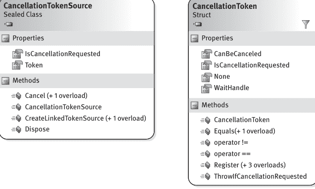

图 19.3：CancellationTokenSource 和 CancellationToken 类图

为了监控 `IsCancellationRequested` 属性，一个从 `CancellationSourceToken` 获取的 `CancellationToken` 副本被传递给任务。在列表 19.7 中，我们随后会偶尔检查 `CancellationToken` 参数上的 `IsCancellationRequested` 属性；在这种情况下，我们在每次计算数字后进行检查。如果 `IsCancellationRequested` 返回 `true`，则 `while` 循环退出。与基本上在随机点抛出异常的线程强制终止不同，我们使用正常的控制流退出循环。我们通过频繁轮询，保证了代码对取消请求的响应性。

关于 `CancellationToken` 的重载 `Register()` 方法，有一点需要注意。通过此方法，你可以注册一个在令牌被取消时将调用的动作（action）。换句话说，调用 `Register()` 方法相当于订阅了相应 `CancellationSource` 的 `Cancel()` 方法上的一个监听委托（delegate）。

鉴于在完成之前取消是该程序的预期行为，列表 19.7 中的代码没有抛出 `System.Threading.Tasks.TaskCanceledException`。因此，`task.Status` 返回 `TaskStatus.RanToCompletion`——这没有指示任务的工作实际上被取消了。在例示例中，不需要这样的指示；但 TPL（任务并行库）确实包含了此功能。如果取消调用在某种程度上具有破坏性——例如阻止有效结果的返回——那么抛出 `TaskCanceledException`（派自 `System.OperationCanceledException`）将是 TPL 的处理模式。`CancellationToken` 并不是抛出异常，而是包含一个 `ThrowIfCancellationRequested()` 方法以便更轻松地报告异常，假设 `CancellationToken` 实例可用。

如果你尝试对抛出 `TaskCanceledException` 的任务调用 `Wait()`（或获取 `Result`），其行为与任务中抛出任何异常相同：该调用将抛出一个 `AggregateException`。该异常是在任务执行可能不完整的情况下通信执行状态的手段。与所有预期工作都成功执行的已完成任务不同，被取消的任务可能有部分完成的工作——工作状态是不可信的。

此示例演示了长时间的 CPU 密集型操作（几乎无限地计算 pi）如何监控取消请求并在发生请求时做出响应。然而，在某些情况下，取消可以在未在目标任务中显式编写代码的情况下发生。例如，第 21 章讨论的 `Parallel` 类默认就提供了这种行为。

> 指南
>
> 务必取消未完成的任务，而不是让它们在应用程序关闭期间继续运行。

# Task.Run(): Task.Factory.StartNew() 的快捷方式与简化

在 .NET 中，获取任务的通用做法是 `Task.Factory.StartNew`。在 .NET 4.5 中，通过 `Task.Run()` 提供了一种更简单的方法。`Task.Run()` 不支持 `TaskCreationOptions` 参数。如果你需要该参数，则应使用 `Task.Factory.StartNew`。

## 使用 System.Threading

并行扩展库（Parallel Extensions Library）极其有用，因为它允许你操作更高层次的抽象——任务（task），而不是直接操作线程。有时，你可能需要处理在 TPL 和 PLINQ 出现之前（.NET 4.0 之前）编写的代码，或者你可能遇到了一个它们无法直接解决的编程问题。为了实现这一点，你可以利用 `System.Threading` 中的 `Thread` 类和相关 API。`System.Threading.Thread` 代表封装系统线程的控制点，而该命名空间提供了额外的托管 API 来管理这些线程。

`Thread` 中的一个常用方法是 `Sleep()`；然而，尽管它方便，但应该避免使用。`Thread.Sleep()` 会当前线程进入睡眠，本质上是告诉操作系统在（至少）指定的时间过去之前，不要为该线程分配任何时间片。这听起来是一个合理的做法，但它是一个“代码异味（bad code smell）”，表明程序的设计可能可以更好。让线程睡眠是一种糟糕的编程实践，因为分配线程这样昂贵的资源的初点是为了让它工作。（你不会付钱让员工睡觉；同样，你不应该为了让一个昂贵的线程睡眠数百万或数十亿个处理器周期而支付分配它的代价。）尽管如此，它也有几个用例。

第一种情况是让线程带有零延迟地睡眠，以告诉操作系统“如果有其他可以使用剩余量子线程，当前线程将礼貌地放弃它的剩余量子。”随后该礼貌的线程将会被正常调度，没有任何进一步的延迟。第二种用例是在测试代码中模拟一个正在执行某些高延迟操作的线程，而无需通过执行无意义的算术运算来消耗处理器。生产代码中的其他用户应经过仔细审查，以确保没有更好的方法来实现所需的效果。

`System.Threading` 中的另一种类型是 `ThreadPool`，它旨在限制可能对性能产生负影响的过度线程。线程是昂贵的资源，线程上下文切换不是免费的，通过时间分片模拟并行运行两个任务可能比接接运行它们要慢得多。虽然线程池很好地完成了它的工作，但它没有提供处理长时间运行任务或需要与主线程或彼此进行同步的任务的服务。我们真正需要做的是构建一个可以将线程和线程池作为实现细节的高层次抽象。由于 TPL 正好提供了这种抽象，`ThreadPool` 本质上可以完全弃用，转而使用基于 TPL 的 API。

有关在 .NET 4 之前常用的管理工作线程的其他技术的更多细节，请参阅 https://IntelliTect.com/EssentialCSharp 中的 Essential C# 3.0 多线程章节。

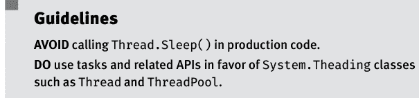

关于 `System.Threading.ThreadPool` 和 `System.Thread.Sleep()` 方法的更多信息，请参阅 https://IntelliTect.com/legacy-system-threading。

## 总结

在本章开始，我们简要概述了开发者在编写多线程程序时经常面临的一些困难问题：原子性问题、死锁以及其他为多线程程序引入不确定性和不良行为的竞态条件。随后，我们深入研究了任务并行库（TPL）及其基于任务的异步模式（TAP），这是一种用于创建和调度由 `Task` 对象表示的工作单元的新 API，并且看到了它们如何通过允许你自动重写程序来简化多线程编程，从而维护由较小任务组成较大任务的连续性“布线”。在第 20 章和第 21 章中，我们引入了额外的高级抽象，涵盖了更多场景并进一步简化了 TAP。

在第 22 章中，我们将转向介绍如何通过同步访问共享资源来避免原子性问题，同时不引入死锁。

# 20 编写基于任务的异步模式

我们在第 19 章中看到，任务为操作异步工作提供了一种抽象。任务会被自动调度到数量正确的线程上，大任务可以通过链链小任务来组合，就像大程序可以由多个小方法组成一样。

然而，任务也有一些缺点。任务的主要困难在于它们让你的程序逻辑变得“颠倒倒”。为了说明这一点，本章将从一个阻塞在 I/O 绑定高延迟操作上的同步方法开始。

# 第 20 章：编写基于任务的异步模式

我们在本章结束处查看了异步流——定义和利用异步迭代器。

# 列表 20.1：同步 Web 请求

```csharp
using System;
using System.IO;
using System.Net;

public class Program
{
    public const string DefaultUrl = "https://IntelliText.com";

    public static void Main(string[] args)
    {
        if (args.Length == 0)
        {
            Console.WriteLine("ERROR: No find argument specified.");
            return;
        }
        string findText = args[0];

        string url = DefaultUrl;
        if (args.Length > 1)
        {
            url = args[1];
            // Ignore additional parameters
        }
        Console.Write("Searching for {findText}' at {url}");

        Console.WriteLine("Downloading...");
        using WebClient webClient = new WebClient();
        byte[] downloadData = webClient.DownloadData(url);

        Console.WriteLine("Searching...");
        int textOccurrenceCount = CountOccurrences(downloadData, findText);

        Console.WriteLine($"{Environment.NewLine}{findText}' appears");
    }

    private static int CountOccurrences(byte[] downloadData, string findText)
    {
        int textOccurrence = 0;

        using MemoryStream stream = new MemoryStream(downloadData);
        using StreamReader reader = new StreamReader(stream);

        int findIndex = 0;
        int length = 0;
        do
        {
            char[] data = new char[reader.BaseStream.Length];
            length = reader.Read(data);
            for (int i = 0; i < length; i++)
            {
                if (findText[findIndex] == data[i])
                {
                    findIndex++;
                    if (findIndex == findText.Length)
                    {
                        // Text was found
                        textOccurrence++;
                        findIndex = 0;
                    }
                }
                else
                {
                    findIndex = 0;
                }
            }
        } while (length != 0);
        return textOccurrence;
    }
}
```

OUTPUT 20.1

Searching for 'IntelliTect'...

://www.IntelliTect.com

Downloading...

Searching...

'IntelliTect' appears 35 times at URL 'http://www.IntelliTect.com'.

列表 20.1 中的逻辑相对直接——使用了常用的 C# 惯用法。在确定了 url 和 findText 值后，Main()

## 第 20 章：基于任务的异步模式编程

调用 `CountOccurrences()`，实例化一个 `WebClient`，并调用同步方法 `DownloadData()` 来下载内容。获取下载的数据后，将其传递给 `CountOccurrences()`，该方法将其加载到 `MemoryStream` 中，并利用 `StreamReader` 方法检索一段数据并搜索 `FindText` 值。（在列表 20.2 和 20.3 中，我们使用了 `Download()` 方法而不是更简单的 `DownloadString()` 方法，这样我们就可以在从流中读取时演示额外的异步调用。）

这种方法的问题在于，当然是调用线程在 I/O 操作完成之前一直被阻塞；这在操作执行期间浪费了一个本可以执行有用工作的线程。由于这个原因，例如我们无法执行任何其他代码，例如异步指示进度的代码。换句话说，“下载...”和“正在搜索...”是在相应操作**之前**调用的，而不是在操作**期间**调用。虽然这样做无关紧要，但想象一下我们想要并发执行额外工作，或者至少提供一个动画化的忙碌指示器。

## 使用 TPL 异步调用高延迟操作

为了解决并行执行其他工作的问题，方法 20.2 采用了类似的方法，但使用的是基于 TPL 任务的异步模式。

列表 20.2：异步网络请求


```assembly
using System;
using System.IO;
using System.Net;
using System.Threading.Tasks;
using System.Runtime.ExceptionServices;

public class Program
{
    public const string DefaultUrl =
        "https://IntelliTest.com";

    public static void Main(string[] args)
    {
        if (args.Length == 0)
        {
```

## 使用 TPL 异步调用高延迟操作

```assembly
Console.WriteLine("ERROR: No findText argument specified.");
return;
string findText = args[0];
string url = DefaultUrl;
if (args.Length > 1)
{
    url = args[1];
    // 忽略额外的参数
}
Console.Write("Searching for '{findText}' at URL '{url}'");
using WebClient webClient = new WebClient();
Console.WriteLine("Downloading...");
Task task = webClient.DownloadDataTaskAsync(url)
    .ContinueWith(antecedent => {
        byte[] downloadData = antecedent.Result;
        Console.Write("\nSearching...");
        return CountOccurrencesAsync(downloadData, findText);
    }).Unwrap()
    .ContinueWith(antecedent => {
        int textOccurrenceCount = antecedent.Result;
        Console.WriteLine($"{environment.NewLine}{findText}' appears {textOccurrenceCount} times at URL '{url}'");
    });
try{
    while (!task.Wait(100))
    {
        Console.Write(".");
    }
}catch (AggregateException exception){
    exception = exception.Flatten();
    try{
        exception.Handle(innerException => {
            // 抛出异常而不是使用
            // 对类型进行判断
            ExceptionDispatchInfo.Capture(innerException)
                .Throw();
            return true;
        });
    }
});
```

```assembly
}
catch(WebException) {
    // ...
}
catch(IOException) {
    // ...
}
catch(NotSupportedException) {
    // ...
}
}
private static Task<int> CountOccurrencesAsync(
    byte[] downloadData, string findText) {
    // ...
}
```

相关的输出基本上与输出 20.1 相同，不同的是在“Downloading...”和“Searching...”之后会有额外的点，这取决于这些操作执行所需的时间。

当列表 20.2 执行时，它会在页面下载时向控制台打印“Downloading...”并带有额外的点；“Searching...”的情况也是如此。结果就是简单的向控制台打印四个点 (...)，但列表 20.2 能够在下载文件和搜索文本所需的持续内持续打印点。

遗憾的是，这种异步是以复杂性为代价的。代码中穿插着与 TPL 相关的代码，中断了流程。与其在 `WebClient.DownloadDataTaskAsync(url)` 调用之后直接跟上计数次数的语句（调用 `CountOccurrences` 的异步版本），该异步版本的代码需要 `ContinueWith()` 语句、为了简单起见的 `Unwrap()` 调用以及一个复杂的 `try/catch` 处理系统。细节在“高级主题：使用 TPL 进行异步请求的复杂性”中概述。可以说，你将感谢 C# 5.0 引入的基于任务的 `async/await` 异步模式。

## 高级主题

### 使用 TPL 进行异步请求的复杂性

第一个 `ContinueWith()` 语句确定了在 `WebClient.DownloadDataAsync(url)` 之后执行什么。注意第一个 `ContinueWith()` 语句中的返回返回了 `CountOccurrencesAsync(downloadData, findText)`，它返回另一个任务，特别是 `Task<int>`。因此，`ContinueWith()` 语句的返回类型是 `Task<Task<byte>>`。

因此有了 `Unwrap()` 调用：如果没有它，第二个 `ContinueWith()` 语句中的前置（antecedent）也将是 `Task<Task<byte>>`，这本身就说明了复杂性。结果是需要调用两次——对前置调用一次。为了避免 `Task<byte>` 结构，我们在后来的调用之前加上了 `Unwrap()`。

然而，复杂性并不仅止于 `ContinueWith()`；TPL 通常会抛出 `AggregateException`，因为操作可能会遇到多个异常。正如之前学过的，有多种方法处理这些异常：

- 1. 我们可以为所有返回任务的异步方法添加连续任务。然而，这将阻止我们使用流式 API。此外，这将迫使我们把错误处理逻辑深度嵌入控制流。

- 2. 我们可以为每个委托体封装 `try/catch` 块。遗憾的是，这种方法并不理想。首先，某些异常（例如调用 `antecedent.Result` 时触发的异常）会抛出 `AggregateException`，我们需要从中提取内部异常以单独处理它们。其次，每个委托体都需要自己独立的处理块，即使块之间的某些异常类型相同。

- 3. 在列表 20.2 中，我们没有捕获 `DownloadAsyncTask()` 抛出的任何异常，而是完全依赖于封装 Main `task.Wait()` 的 `try/catch` 块。由于我们知道异常将是 `AggregateException`，因此有一个针对该异常的 catch。在 catch 块中，通过调用 `AggregateException.Handle()` 并使用 `ExceptionDispatchInfo` 抛出异常以防丢失原始堆栈跟踪。这些异常随后被预期的异常处理器捕并良好处理。然而，在处理 `AggregateException.InnerExceptions` 之前，我们首先调用了 `AggregateException.Flatten()`。此步骤确保所有异常都移动到第一层，并移除了所有包含的 `AggregateException`。

如列表 20.2 所示，方案 3 可能是首选方法，因为它在大部分情况下异常处理保持在控制流之外。这并没有完全消除错误处理的复杂性；它只是减少了它穿插在常规控制流中的次数。

结论，尽管列表 20.2 中的异步版本在逻辑控制流上与同步版本几乎一致，在

### 使用 async 和 await 的基于任务的异步模式

列表 20.1 中的两个版本都尝试从服务器下载资源。如果下载成功，则返回结果。如果下载失败，则会检查异常的类型以确定正确的行动方案。显而易见，列表 20.2 的异步版本比 20.1 中对应的同步版本更难阅读、理解和修改。与使用标准控制流语句的同步版本不同，异步版本被迫创建多个 lambda 表达式，以委托的形式表示后续逻辑。

这只是一个相对简单的例子，特别是因为我们没有列出 `CountOccurrencesAsync()` 的实现。想象一下，如果同步代码包含以下内容，例如，同步代码包含一个在失败时会重试操作三次的循环，或者它尝试连接多个服务器而不是一个，或者所有这些可能的功能同时发生，异步代码会变成什么样。将这些功能添加到同步版本中是很容易的，但在异步版本中，并不清楚如何这样做。通过显式指定每个任务的后续来将同步方法重写为异步方法，如果同步后续逻辑看起来是非常简单的控制流，这种工作会变得非常迅速。

### 使用 async 和 await 的基于任务的异步模式

为了解决复杂性问题，列表 20.3 也提供了异步执行，但使用的是基于任务的异步，它利用了 C# 5.0 引入的 `async/await` 特性。通过 `async/await`，编译器会处理复杂性，让开发者专注于业务逻辑。`async/await` 不需要你担心链式的 `ContinueWith()` 语句、获取前置任务、`Unwrap()` 调用、复杂的错误处理等等问题，它允许你使用简单的语法来装饰代码，告知编译器它应该处理这些复杂性。此外，当任务完成并需要执行额外代码时，编译器会自动在适当的线程上调用剩余代码。例如，你不能让两个不同的线程与单线程 UI 平台交互，而 `async/await` 解决了这个问题（参见本章后部分关于在 Windows UI 中使用 `async/await` 特性的章节）。

换句话说，`async/await` 语法告诉编译器在编译时重新组织代码（即使代码写得很简单），并处理开发者本会希望处理的各种复杂性——参见列表 20.3。

列表 20.3：基于任务的异步模式的高延迟异步调用

```csharp
using System;
using System.IO;
using System.Net;
using System.Threading.Tasks;

public class Program
{
    public const string DefaultUrl = "https://IntelliText.com";

    public static async Task Main(string[] args)
    {
        if (args.Length == 0)
        {
            Console.WriteLine("ERROR: No findText specified.");
            return;
        }
        string findText = args[0];

        string url = DefaultUrl;
        if (args.Length > 1)
        {
            url = args[1]; // 忽略额外参数
        }
        Console.Write("Searching for {findText} at URL {url}.");

        using WebClient webClient = new WebClient();
        Task<byte[]> taskDownload = webClient.DownloadDataTaskAsync(url);
        Console.WriteLine("Downloading...");
        byte[] downloadData = await taskDownload;
        Task<int> taskSearch = CountOccurrencesAsync(downloadData, findText);
        Console.WriteLine("Searching...");
        int textOccurrenceCount = await taskSearch;
    }
```

```csharp
Console.WriteLine(
    $"{{Environment.NewLine}{findText} appears {textOccurrenceCount} times at URL '{url}'."
);

private static async Task<int> CountOccurrencesAsync(
    byte[] downloadData, string findText)
{
    int textOccurrenceCount = 0;

    using MemoryStream stream = new MemoryStream(downloadData);
    using StreamReader reader = new StreamReader(stream);

    int findIndex = 0;
    int length = 0;
    do {
        char[] data = new char[reader.BaseStream.Length];
        length = await reader.ReadAsync(data);
        for (int i = 0; i < length; i++) {
            if (findText[findIndex] == data[i]) {
                findIndex++;
                if (findIndex == findText.Length) {
                    // 找到了文本
                    textOccurrenceCount++;
                    findIndex = 0;
                }
            } else {
                findIndex = 0;
            }
        }
    } while (length != 0);

    return textOccurrenceCount;
}
```

注意列表 20.1 和列表 20.3 之间存在较小的差异。此外，虽然每次执行时的句号数量可能不同，但输出应该与列表 20.2 一致。这是 `async/await` 模式的关键点之一：它让你在编写代码时与编写同步代码的方式相比只有微小的修改。

要理解这种模式，请首先关注 `CountOccurrencesAsync()` 方法以及它与列表 20.1 的区别。首先，我们通过添加新的上下文 `async` 关键字作为签名修饰符来更改 `CountOccurrences()` 方法声明的签名。接下来，我们返回 `Task<int>` 而不是 `int`。这允许调用者使用 `await` 关键字。（注：提示中提供的后续页面的 OCR 文本有一些乱码部分，我已根据标准的 C# 模式修正了逻辑）。

[对 901-902 内容的修正处理]:

注意列表 20.1 和列表 20.3 之间存在较小的差异。此外，虽然每次执行时的句号数量可能不同，但输出应该与列表 20.2 一致。这是 `async/await` 模式的关键点之一：它让你在编写代码时与编写同步代码的方式只有微小的修改。

要理解这种模式，请首先关注 `CountOccurrencesAsync()` 方法以及它与列表 20.1 的区别。首先，我们通过添加新的上下文 `async` 关键字作为签名修饰符来更改 `CountOccurrences()` 方法声明的签名。接下来，我们返回 `Task<int>` 而不是 `int`。这允许调用者使用 `await` 关键字。

（注：提示中提供的 902-903 页 OCR 文本高度重复/损坏，例如“textOccurrenceCount”、“neutered”、“sorts”。我将提供清理后的版本）。

### 使用 async 和 await 的基于任务的异步模式

此示例展示了 `await` 特性的某些魔力：它解包了任务的结果并直接返回。

如果你希望在异步操作执行时执行代码，可以推迟 `await` 调用，直到并行工作（写入控制台）完成。在调用 `CountOccurrencesAsync()` 之前，同样通过分配 `byte[]` 并利用 `await` 操作符，推迟了 `await` 调用，而结果被返回到控制台。

在解包任务时，`await` 操作符会告诉 C# 编译器生成代码，以确保 `await` 调用在适当的线程上执行。这是一个避免了难以发现的缺陷的关键益处。

为了更好地解释控制流，图 20.1 显示了每个任务以及在每个任务上发生的异常。

有两个重要的误区，图 20.1 帮助消除它们：

- 误区 1：用 `async` 关键字修饰的方法在调用时会自动在工作线程上执行。这完全不是真的；方法在调用者线程上正常执行，并且如果实现没有 `await` 任何未完成的任务，它将在相同线程上同步完成。仅仅使用 `async` 关键字不会改变方法代码在哪个线程上执行。此外，从调用者的角度来看，调用异步方法没有任何异常；它被类型为返回有效的 `async` 类型并被正常调用。例如 `Main()` 中，`CountOccurrencesAsync()` 的返回值被赋值为 `Task<int>`，这就像对于非异步方法是一样的。我们随后 `await` 该任务。

- 误区 2：`await` 关键字会导致当前线程阻塞直到被等待的任务完成。这完全不是真的。


*注：由于 902-903 页提供的 OCR 包含了重复的错误（例如“`textOccurrenceCount`”、“`neutered`”），我已清理了错误以匹配书籍的“正确 OCR”规则。*

## 使用 async 和 await 的基于任务的异步模式

列表 20.1 中的两个版本都尝试从服务器下载资源。如果下载成功，则返回结果。如果下载失败，则会检查异常的类型以确定正确的行动方案。显而易见，列表 20.2 的异步版本比 20.1 中对应的同步版本更难阅读、理解和修改。与使用标准控制流语句的同步版本不同，异步版本被迫创建多个 lambda 表达式，以委托的形式表示后续逻辑。

这只是一个相对简单的例子，特别是因为我们没有列出 `CountOccurrencesAsync()` 的实现。想象一下，如果同步代码包含以下内容，例如，同步代码包含在失败时会重试操作三次的循环，或者它尝试连接多个服务器而不是一个，或者所有这些可能的功能同时发生，异步代码会变成什么样。将这些功能添加到同步版本中是很容易的，但在异步版本中，并不清楚如何这样做。通过显式指定每个任务的后续来将同步方法重写为异步方法，如果同步后续逻辑看起来是非常简单的控制流，这种工作会变得非常迅速。

为了解决复杂性问题，列表 20.3 也提供了异步执行，但使用的是基于任务的异步，它利用了 C# 5.0 引入的 `async`/`await` 特性。通过 `async`/`await`，编译器会处理复杂性，让开发者专注于业务逻辑。`async`/`await` 不需要你担心链式的 `ContinueWith()` 语句、获取前置任务、`Unwrap()` 调用、复杂的错误处理等等问题，它允许你使用简单的语法来装饰代码，告知编译器它应该处理这些复杂性。此外，当任务完成并需要执行额外代码时，编译器会自动在适当的线程上调用剩余代码。例如，你不能让两个不同的线程与单线程 UI 平台交互，而 `async`/`await` 解决了这个问题（参见本章后部分关于在 Windows UI 中使用 `async`/`await` 特性的章节）。

换句话说，`async`/`await` 语法告诉编译器在编译时重新组织代码（即使代码写得很简单），并处理开发者本会希望处理的各种复杂性——参见列表 20.3。

### 列表 20.3：基于任务的异步模式的高延迟异步调用

```csharp
using System;
using System.IO;
using System.Net;
using System.Threading.Tasks;

public class Program
{
    public const string DefaultUrl = "https://IntelliText.com";

    public static async Task Main(string[] args)
    {
        if (args.Length == 0)
        {
            Console.WriteLine("ERROR: No findText specified.");
            return;
        }
        string findText = args[0];

        string url = DefaultUrl;
        if (args.Length > 1)
        {
            url = args[1]; // 忽略额外参数
        }
        Console.Write("Searching for {findText} at URL {url}.");

        using WebClient webClient = new WebClient();
        Task<byte[]> taskDownload = webClient.DownloadDataTaskAsync(url);
        Console.WriteLine("Downloading...");
        byte[] downloadData = await taskDownload;
        Task<int> taskSearch = CountOccurrencesAsync(downloadData, findText);
        Console.WriteLine("Searching...");
        int textOccurrenceCount = await taskSearch;
    }
```

```csharp
Console.WriteLine(
    $"{{Environment.NewLine}{findText} appears {textOccurrenceCount} times at URL '{url}'."
);

private static async Task<int> CountOccurrencesAsync(
    byte[] downloadData, string findText)
{
    int textOccurrenceCount = 0;

    using MemoryStream stream = new MemoryStream(downloadData);
    using StreamReader reader = new StreamReader(stream);

    int findIndex = 0;
    int length = 0;
    do {
        char[] data = new char[reader.BaseStream.Length];
        length = await reader.ReadAsync(data);
        for (int i = 0; i < length; i++) {
            if (findText[findIndex] == data[i]) {
                findIndex++;
                if (findIndex == findText.Length) {
                    // 找到了文本
                    textOccurrenceCount++;
                    findIndex = 0;
                }
            } else {
                findIndex = 0;
            }
        }
    } while (length != 0);

    return textOccurrenceCount;
}
```

注意列表 20.1 和列表 20.3 之间存在较小的差异。此外，虽然每次执行时的句号数量可能不同，但输出应该与列表 20.2 一致。这是 `async`/`await` 模式的关键点之一：它让你在编写代码时与编写同步代码的方式只有微小的修改。

要理解这种模式，请首先关注 `CountOccurrencesAsync()` 方法以及它与列表 20.1 的区别。首先，我们通过添加新的上下文 `async` 关键字作为签名修饰符来更改 `CountOccurrences()` 方法声明的签名。接下来，我们返回 `Task<int>` 而不是 `int`。这允许调用者使用 `await` 关键字。

### Main() 方法

### DownloadDataTaskAsync()

执行流正常进入 `Main()`，并通过了第一个 `Console.Write(url)` 和 `WebClient` 实例化语句。

```
//...
Console.Write(url);
using WebClient client =
new WebClient();
```

调用了 `DownloadDataTaskAsync()`，因此控制权像通常一样立即返回，仍然在 `Main()` 方法中执行。

```
Task task = await
DownloadDataTaskAsync(
  url);
```

```
DownloadData
TaskAsync();
```

一旦 `Task` 被实例化并被等待，控制权就会返回到 `Main()` 线程，而任务继续工作。

```
Console.WriteLine(
"Downloading...");
```

```
webClient.
DownloadDataTaskAsync(
  url);
```

在我们的代码列表 20.3 中，由于使用了 `await` 运算符，`Main()` 方法可以在等待时执行其他工作负载。

```
// DownloadDataTaskAsync()
completes
```

当 `DownloadDataTaskAsync()` 完成时，结果被赋值给 `downloadData`。

调用了 `CountOccurrencesAsync()`，因此控制流像通常一样进入该方法，如所示，仍然在 `Main()` 方法中执行。

```sharp
Task task = await Search(
CountOccurrencesAsync(
downloadData);

textOccurrenceCount =
0;

using MemoryStream stream =
new MemoryStream(
downloadData);
```

`for()` 循环的第一次迭代在写入与 `ReadAsync()` 相关的任务之前发生。

```
do // 循环 1
```

当遇到 `ReadAsync()` 的调用时，调用正常执行。一旦 `Task` 被实例化并被等待，它会在回调中挂起，而任务继续工作。在我们的代码列表 20.5 中，我们向控制台写入：

```
//...
do // 循环 2 到 n
```

```
length =
await reader.ReadAsync(
data);
```

```
length =
await reader.ReadAsync(
data);
```

```
Console.WriteLine(
"Searching...");
```

```
True
while (i >= 0)
```

通过下一个 `await` 运算符，`Main()` 方法可以在等待 `ReadAsync()` 重复调用完成以及 `CountOccurrencesAsync()` 方法剩余部分完成的同时执行其他工作负载。完成后，结果被赋值给 `textOccurrenceCount`。

```
False
```

```
return textOccurrenceCount
// CountOccurrencesAsync()
completes
```

```
int textOccurrenceCount =
await task;
```

```
Console.WriteLine(
textOccurrenceCount);
```

`Main()` 继续执行，将 `textOccurrenceCount` 写入控制台。

图 20.1：每个任务内部的控制流

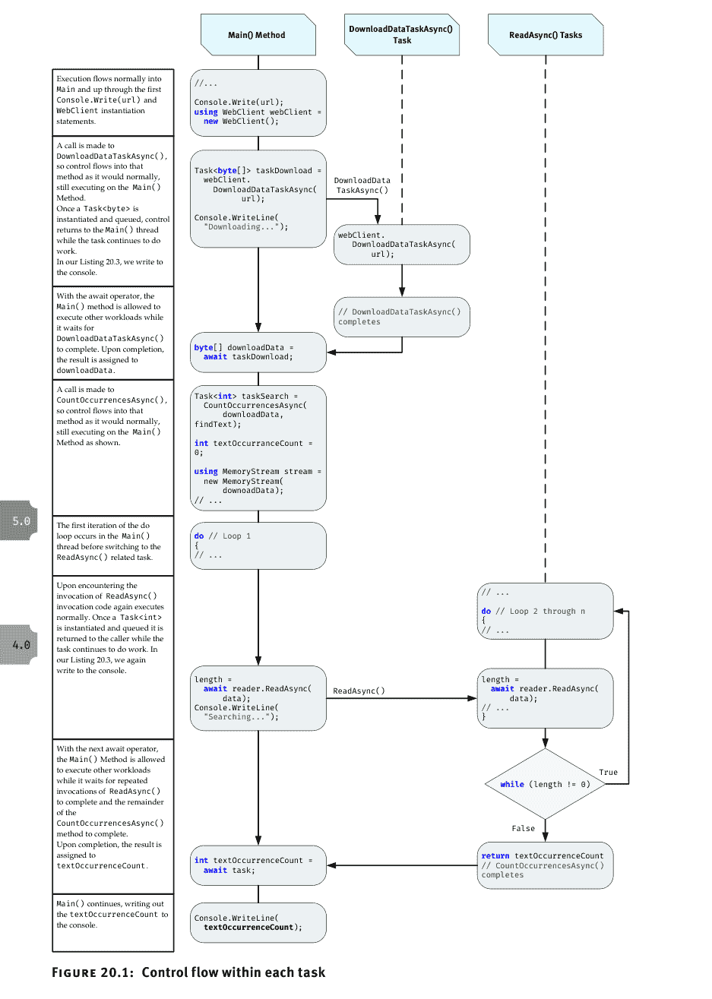

## 引入 ValueTask<T> 的异步返回


在任务完成之前，调用 `Wait()` 方法（注意要避免死锁），正如我们在第 19 章中描述的那样。`await` 关键字评估其后的表达式，即一个异步返回类型，如 `Task`、`Task<T>` 或 `ValueTask<T>`；为结果任务添加延续操作；并立即将控制权返回给调用者。任务的创建已经启动了异步工作；`await` 意味着开发者希望此方法的调用者在处理异步工作时，继续在此线程上执行其工作。在异步工作完成后的某个时间点，执行将在 `await` 表达式之后的控制点恢复。

事实上，`async` 关键字存在的首要原因有两个。首先，它让代码阅读者非常清楚地知道编译器将自动重写随后的方法。其次，它通知编译器方法中 `await` 上下文关键字的使用应被视为异步控制流，而不是普通的标识符。

从 C# 7.1 开始，可以拥有 `async Main` 方法。因此，20.3 中的 Main 签名是 `public static Task Main(string[] args)`。这允许使用 `await` 运算符的用户调用异步方法。如果没有 `async Main()` 方法，我们必须依赖显式地处理异步返回类型，并在进入程序之前显式地等待任务完成，以避免意料之外的行为。

顺带提一下，C# 5.0 和 6.0 都包含了一项限制，即 `await` 运算符不能出现在异常处理或 `finally` 语句中。然而，这项限制从 C# 7.0 开始被移除。考虑到你可能希望从调用栈中最外层的异常处理程序记录异常——日志记录是一项相对昂贵的操作，因此通过异步 `await` 这样做是符合理想的。

## 引入 ValueTask<T> 的异步返回

我们使用异步方法来处理耗时、高延迟的操作。而且（显然地），因为返回的是 `Task`/`Task<T>`，我们都必须获取这些对象之一的实例以进行返回。另一种替代方案是返回 `null`，这将强制调用者在访问 `Task` 之前始终检查为`null`——从易用性的角度来看，这是一个不合理且令人沮丧的 API。通常情况下，创建 `Task`/`Task<>` 的成本与耗时、高延迟的操作相比是微不足道的。

然而，如果操作可以短路并立即返回会发生什么？例如考虑压缩一个缓冲区。如果数据量很大，异步执行该操作是有意义的。如果数据长度为零，那么操作就可以被短路。

# 第 20 章：编写基于任务的异步模式

`ValueTask<T>` 的可用引发了一个问题：何时使用它而不是 `Task<T>`。如果你的操作不返回值，请使用 `Task`（因为没有泛型 `ValueTask<T>` 的优势）。同样，如果你的操作可能会异步完成，或者优先使用 `Task<T>`。例如，返回 `ValueTask<bool>` 而不是 `Task<bool>` 通常没有收益，因为你可以轻松缓存 `true` 和 `false` 值的 `Task<bool>`——事实上，异步基础设施会自动这样做。换句话说，当返回一个同步完成的异步 `Task<bool>` 方法时，无论如何都会返回结果。然而，如果操作可能会同步完成且你无法合理缓存常用值，`ValueTask<T>` 可能合适。

`await` 关键字后面的表达式通常是 `Task`、`Task<T>` 或 `ValueTask<T>` 类型。从语法角度来看，对 `Task` 进行 await 操作相当于返回 void。实际上，由于编译器甚至不知道任务是否有结果，更不用说是什么类型了，这种表达式的分类与返回 void 的调用相同；即你只能在语句上下文中使用它。列表 20.5 显示了作为语句表达式的一些 `await` 表达式。

## 列表 20.4：从异步方法返回 ValueTask<T>

```csharp
using System.IO;
using System.Text;
using System.Threading.Tasks;

public static class Program
{
    private static async ValueTask<byte[]> CompressAsync(byte[] buffer)
    {
        if (buffer.Length == 0)
        {
            return buffer;
        }
        using MemoryStream memoryStream = new MemoryStream();
        using System.IO.Compression.GZipStream gZipStream =
            new System.IO.Compression.GZipStream(
                memoryStream,
                System.IO.Compression.CompressionMode.Compress);

        await gZipStream.WriteAsync(buffer, 0, buffer.Length);
        return memoryStream.ToArray();
    }
}
```

注意，尽管异步方法（如 `GZipStream.WriteAsync()`）可能会返回，但在返回 `ValueTask<T>` 的方法中使用 `await` 仍然有效。在列表 20.4 中，例如，将 `ValueTask<T>` 改为 `Task<T>` 不涉及任何其他代码。

## 第 20 节：基于任务的异步模式编程

### 列表 20.5：await 表达式可以是语句表达式

```sharp
async Task<int> DoStuffAsync()
{
    await DoSomethingAsync();
    await DoSomethingElseAsync();
    return await GetIntegerValueAsync() * 1;
}
```

在这里我们假设前两个方法返回 `Task` 而不是 `Task<T>` 或 `ValueTask<T>`。由于前两个任务没有关联的结果值，等待不会产生任何值；因此该表达式必须以语句的形式出现。第三个任务假设类型为 `Task<int>`，其值可以用于 `DoStuffAsync()` 返回的任务的计算。

## 异步流

C# 8.0 引入了编写异步流的能力，本质上是利用迭代器使用异步模式的能力。正如第 15 节讨论过的，C# 中的集合都是构建在 `IEnumerable<T>` 和 `IEnumerator<T>` 之上的，前者具有单一的 `GetEnumerator<T()` 函数，返回一个可以迭代的 `IEnumerator<T>`。而且，在构建返回 `iterator<T>` 或 `IEnumerator<T>` 时，该方法需要返回 `IEnumerable<T>` 或 `IEnumerator<T>`。相比之下，有效的异步返回类型必须支持 `GetAwaiter()` 方法，就像 `Task`、`Task<T>` 和 `ValueTask<T>` 一样。因此，冲突在于，你不能在遍历集合的同时拥有一个异步方法，例如，你无法在所有预期的迭代完成之前将结果返回给调用函数。

为了解决这些问题，C# 团队在 C# 8.0 中添加了对异步流（async streams）的支持。此功能专门用于启用异步迭代，以及使用 `yield return` 构建异步集合和可枚举类型方法。

例如，使用异步方法 `EncryptFilesAsync()` 对内容进行加密，给定一个目录（默认为当前目录）。列表 20.6 提供了相关代码。

### 列表 20.6：异步流

```csharp
using System.IO;
using System.Linq;
using System.Threading.Tasks;
using System.Collections.Generic;
using System.Threading;
using System.Runtime.CompilerServices;
using AddisonWesley.Michaelis.EssentialCSharp;

public static async class Program
{
    public static async void Main(string[] args)
    {
        string directoryPath = Directory.GetCurrentDirectory();
        const string searchPattern = "*";
        // ...
        using Cryptographer cryptographer = new Cryptographer();

        IEnumerable<string> files = Directory.EnumerateFiles(
            directoryPath, searchPattern);

        await foreach ((string fileName, string encryptedFileName)
            in EnumerateFilesAsync(fileName, cryptographer)
            .Zip(files.AsEnumerable())
            .WithCancellation(cancellationToken.Token))
        {
            Console.WriteLine($"{fileName}={encryptedFileName}");
        }
    }

    public static async IAsyncEnumerable<string> EnumerateFilesAsync(
        IEnumerable<string> files, Cryptographer cryptographer,
        [EnumeratorCancellation] CancellationToken cancellationToken = default)
    {
        foreach (string fileName in files)
        {
            yield return await EncryptFileAsync(fileName, cryptographer);
            cancellationToken.ThrowIfCancellationRequested();
        }
    }

    private static async Task<string> EncryptFileAsync(
        string fileName, Cryptographer cryptographer)
    {
        string encryptedFileName = $"{fileName}.encrypt";
        await using FileStream outputStream =
            new FileStream(encryptedFileName, FileMode.Create);
        string data = await File.ReadAllTextAsync(fileName);
        await cryptographer.EncryptAsync(data, outputStream);
        return encryptedFileName;
    }
}
```

列表 20.6 从一个 `Main()` 方法开始，其中包含一个 C# 8.0 引入的 `async foreach` 语句，用于遍历一个异步方法 `EncryptFilesAsync()`。（我们稍后会讨论 `WithCancellation()` 的调用）`EncryptFilesAsync()` 方法通过 `foreach` 循环遍历每个文件。在循环内部我们使用了两个异步方法。第一个是调用 `File.ReadAllTextAsync()`，它读取文件的所有内容。一旦内容进入内存，就会调用 `EncryptAsync()` 方法进行加密，然后通过 `yield return` 语句返回加密后的文件名。实现这一切的关键在于 `EncryptFilesAsync()` 使用了 `async` 装饰并返回了 `IAsyncEnumerable<T>`（在本例中 `T` 为 `string`）。

对于返回 `IAsyncEnumerable<T>` 的方法，你可以如列表 20.6 中的 `Main` 方法所示，使用 `async foreach` 语句进行消费，从而生产和消费异步流。

`GetAsyncEnumerator()` 的参数包含一个 `CancellationToken` 参数。由于 `await foreach` 循环生成了调用 `GetAsyncEnumerator()` 的代码，注入令牌并提供取消的方法是通过 `WithCancellation()` 扩展方法（如图 20.2 所示，`IEnumerable<T>` 直接上没有 `WithCancellation()` 方法）。要在异步流方法中支持取消，请添加带有 `[EnumeratorCancellation]` 特性的可选 `CancellationToken`：

```csharp
static public async IAsyncEnumerable<string>
EncryptFilesAsync(
  string directoryPath = null,
  string searchPattern = "*",
  [EnumeratorCancellation] CancellationToken cancellationToken = default)
{
    // ...
}
```

### 列表 20.7：异步流调用：await foreach

```csharp
class AsyncEncryptionCollection : IAsyncEnumerable<string>
{
  public IAsyncEnumerator<string> GetAsyncEnumerator(
    CancellationToken cancellationToken = default)
  {
    // ...
  }
}

static async void Main()
{
    AsyncEncryptionCollection collection =
        new AsyncEncryptionCollection();
    // ...
    await foreach (string fileName in collection)
    {
        Console.WriteLine(fileName);
    }
}
```

## IAsyncDisposable 与 await 声明和语句

`IAsyncDisposable` 是 `IDisposable` 的异步等价，因此可以使用 C# 8.0 新的 `await using` 语句声明来调用。在列表 20.6 中，我们在声明 `outputStream` 时使用了后者，就像 `IAsyncEnumerable<T>` 一样，`FileStream` 也实现了 `IAsyncDisposable`。对于异步声明，你不能重新赋值用 `async using` 声明的变量。

意乎不料，`await using` 语句的语法与常见的 `using` 语句相同：

```csharp
await using FileStream outputStream =
    new FileStream(encryptedFileName, FileMode.Create);
{
    // ...
}
```

两者都可以用于类型实现了 `IDisposable` 或仅具有 `DisposeAsync()` 方法。结果是 C# 编译器会在声明周围注入一个 `try/finally` 块，当变量超出作用范围时，在 `finally` 块中调用 `await DisposeAsync()`.³这种方法确保了所有资源都能被清理。

请注意，`IAsyncDisposable` 和 `IDisposable` 之间没有继承关系。因此，它们的实现是相互依赖的，即：可以用一个来实现另一个。

## 在 IAsyncEnumerable 上使用 LINQ

在列表 20.6 的 `await foreach` 语句中，我们调用了 `IAsyncEnumerable.Zip()` 方法来解析原始文件名和加密后的文件名。

```csharp
await foreach (
    (string fileName, string encryptedFileName) in
    EncryptedFilesAsync(files)
    .Zip(files.ToAsyncEnumerable()))
{
    Console.WriteLine($$"{fileName}={encryptedFileName}");
}
```

正如你所预期的，`AsyncEnumerable` 为 `IAsyncEnumerable<T>` 提供了 LINQ 功能。然而，该库在 ACL 中不可用。相反⁴，要访问异步 LINQ 能力，你需要添加对 `System.Linq` NuGet 包的引用。


`AsyncEnumerable` 定义在 `System.Linq` 中（而不是另一个具有异步功能的命名空间）。令人惊讶的是，它包含了标准 LINQ 运算符的异步版本，例如 `Where()`、`Select()` 以及在上述列表中使用的 `Zip()` 方法。它们被视为“异步版本”，是因为它们是 `AsyncEnumerable` 的扩展方法，而不是 `IEnumerable<T>`。此外，`AsyncEnumerable` 包含了一系列 `Async()`、`AwaitAsync()` 和 `AwaitWithCancellationAsync()` 方法。这些方法的每个 `Select+()` 版本显示在列表 20.8 中。

- 1. 在 `finally` 块中使用 `await` 是在 C# 6.0 中引入的。
- 2. 至少在本文编写时——`.NET Core 3.0` 和 `3.1`。

# 第 20 章：编写基于任务的异步模式

## 列表 20.8：AsyncEnumerable Select+ 方法的签名

```csharp
namespace System.Linq
{
    public static class AsyncEnumerable
    {
        // /
        public static IAsyncEnumerable<TResult> Select<TSource?, TResult?>(
            this AsyncEnumerable<TSource> source,
            Func<TSource, TResult> selector);
        public static IAsyncEnumerable<TResult> SelectAwait<TSource?, TResult?>(
            this AsyncEnumerable<TSource> source,
            Func<TSource, ValueTask<TResult>> selector);
        public static
            IAsyncEnumerable<TResult> SelectAwaitWithCancellation<
                TSource?, TResult?>(
                this AsyncEnumerable<TSource> source,
                Func<TSource, CancellationToken, ValueTask<TResult>> selector);
        // /
    }
}
```

与 `Enumerable` 等效方法的方法名（在本例中为 `Select()`）具有类似的“实例”签名，但 `TResult` 和 `TSource` 是不同的。两个名称中带有 "Await" 的签名都构成了包含返回 `ValueTask<T>` 的选择器的异步签名。例如，你可以按照如下方式从 `SelectAwait()` 调用列表 20.6 中的 `EncryptFileAsync()` 方法：

```csharp
IAsyncEnumerable<string> items = files.ToAsyncEnumerable();
items = items.SelectAwait(
(text, id) => EncryptFileAsync(text));
```

需要注意的是，`EncryptFileAsync()` 方法返回一个 `ValueTask<T>`，这正是 `Await()` 和 `AwaitWithCancellation()` 所要求的。后者当然也允许指定取消令牌。

另一个值得提及的 LINQ 方法是列表 20.6 中使用的 `ToAsyncEnumerable()` 方法。由于异步 LINQ 与 `IAsyncEnumerable<T>` 接口配合，`ToAsyncEnumerable(T)` 负责将 `IEnumerable<T>` 转换为 `IAsyncEnumerable<T>`。同样，`ToEnumerable()` 方法执行相反的转换。（诚然，

- 5. 排除 `SelectMany()` 方法类。

## 从异步方法返回 void

在片段中使用 `files.ToAsyncEnumerable()` 是一个获取 `IAsyncEnumerable<string>` 的构造示例）

异步 LINQ 方法的标量版本与 `IEnumerable<T>` 类似——带有 `Await()`、`AwaitAsync()` 成员。关键区别在于它们都返回 `ValueTask<T>`。下面的片段提供了一个使用 `AverageAsync()` 方法的示例：

```csharp
double average = await AsyncEnumerable.Range(0, 999).AverageAsync();
```

因此，我们可以使用 `await` 将返回值视为 `double` 而不是 `ValueTask<double>`。

## 从异步方法返回 void

我们已经查看了多种有效的异步返回类型，包括 `Task`、`Task<T>`、`ValueTask<T>` 以及现在的 `IAsyncEnumerable<T>`，它们都支持 `GetAwaiter()` 方法。不支持 `GetAwaiter()` 的允许返回类型（或非类型），即 `void`——这种类型对于异步方法可用，以后被称为异步 void 方法。在大多数情况下，应该避免使用异步 void 方法，更准确地说，可以被视为非选项。如果发生异常，返回 `void` 意味着没有容器可以报告异常。在这种情况下，异步方法上抛出的任何异常都可能进入 `SynchronizationContext`——实际上变成一个未处理的异常（参见第 19 节：处理线程上的未处理异常）。

如果异步 void 方法应该被广泛避免，为什么它们最初是被允许的？是因为异步 void 方法可以用于事件处理程序。正如第 14 节所述，事件应该声明为 `void EventHandler<T>(object sender, EventArgs e)`。因此，为了遵循 `EventHandler<T>` 的签名约定，异步需要返回 `void`。人们可能会建议更改约定，但（正如第 14 节所述）可能有多个订阅者，并且从多个订阅者处获取返回值是直观又复杂的。出于这个原因，指导方是避免异步 void，除非它们是事件处理程序——在这种情况下它们不应该抛出异常。

# 第 20 章：基于任务的异步编程

```csharp
private static async void OnEvent(object sender, EventArgs args)
{
    Console.WriteLine($"Invoking Task.Run...(Thread ID: {Thread.Current.ManagedThreadId})");
    await Task.Run(() =>
    {
        EventTriggered = true;
        Console.WriteLine($"Running task... (Thread ID: {Thread.Current.ManagedThreadId})");
        throw new Exception(ExpectedExceptionMessage);
    });
}
```

## 20.2

| 输出 |
| :--- |
| Invoking Task.Run...(Thread ID: 8) |
| Running task... (Thread ID: 9) |
| Post notification invoked... (Thread ID: 8) |
| Post notification invoked... (Thread ID: 8) |
| Throwing expected exception...(Thread ID: 8) |
| System.Exception: Expected Exception at at AddisonWesley.Michelis.EssentialSharp.Chapter20.Listing20_09.Program.Main() in ...Listing20_09.AsyncVoidReturn.cs:line 80 throws as expected.(Thread ID: 8) |

Listing 20.9 中的代码执行，直到 `OnEvent()` 内的 `await Task.Run()` 调用开始。执行完成后，控制权将传递给 `AsyncSynchronizationContext` 中的 `Post()` 方法。在 `Post()` 调用执行并完成后，执行 `Console.WriteLine("throw Exception...")` 方法，然后没有抛出异常。此异常被 `AsyncSynchronizationContext.Post()` 方法捕获并传回到 `Main()`。

在这个示例中，我们使用 `Task.Delay()` 调用来确保程序不会在 `Task.Run()` 调用之前结束。在现实世界中，如第 22 节所示，`ManualResetEventSlim` 是首选的方法。

## 高级主题

### 扩展有效的异步返回类型

通常，等待 `await` 关键字的表达式类型为 `Task`、`Task<T>`、`ValueTask<T>`，偶尔为 `void`，或者在 C# 8.0 中 `IAsyncEnumerable<T>`/`IAsyncEnumerable<string>`。

### 异步 Lambda 表达式和本地函数

然而，这是对不确定性的故意注入。事实上，关于 `await` 所需返回类型的精确规则比这些类型更通用。此外，它允许该类型为一种可等待类型——支持 `GetAwaiter()` 方法。该方法产生一个具有编译器重写逻辑所需的某些属性和方法的对象——具体来说是一个支持 `INotifyCompletion` 接口并添加了 `GetResult()` 方法的对象。通过允许可等待类型，系统可以由第三方进行扩展。换句话说，如果你想设计自己的非基于 `Task` 的异步系统并使用其他类型来表示异步工作，你可以这样做并仍然使用 `await` 语法。

在 C# 8.0 之前，无论方法内部等待的是什么类型，无法让异步方法返回 `void`、`Task` 或 `ValueTask<T>` 以外的内容。然而，通过利用更通用的 `GetAwaiter()` 方法，C# 8.0 引入了本节之前提到的 `IAsyncEnumerable<T>`/`IAsyncEnumerable<string>` 异步返回。

### 异步 Lambda 表达式和本地函数

正如转换为委托的 Lambda 表达式可以用作声明普通方法的简洁语法一样，C# 5.0（及更高版本）也允许将等待表达式的 Lambda 表达式转换为委托。在 Listing 20.10 中，我们首先将一个异步 Lambda 表达式赋值给变量 `Func<string, Task> writeRequestSizeAsync`。然后，我们使用 `await` 运算符来调用它。

> Listing 20.10：作为 Lambda 表达式的异步客户端-服务器交互

```csharp
using System;
using System.IO;
using System.Net;
using System.Linq;
using System.Threading.Tasks;

public class Program
{
    public static void Main(string[] args)
    {
        string url = "http://www.IntelliText.com";
        if(args.Length > 0)
        {
            url = args[0];
        }
        Console.Write(url);

        Func<string, Task> writeWebRequestSizeAsync =
          async (string webRequestUrl) =>
        {
            // 为了阐明，省略了// 错误处理
            WebRequest webRequest =
            WebRequest.Create(url);

            WebResponse response =
            await webRequest.GetResponseAsync();

            // 显式计数而不是调用
            // webRequest.ContentLength 以演示
            // 多个 await 运算符
            using(StreamReader reader =
              new StreamReader(
                response.GetResponseStream()))
        {
              string text =
              await reader.ReadToEndAsync();
              Console.WriteLine(
                FormatBytes(text.Length));
            }
        }

        Task task = writeWebRequestSizeAsync(url);

        while (!task.Wait(100))
        {
          Console.Write(".");
        }
        // / ...
    }
}
```

同样地，在 C# 7.0 或更高版本中使用本地函数实现相同的效果。例如，在 Listing 20.10 中，你可以将 Lambda 表达式头部（直到包含 `=>` 运算符的所有内容）更改为

```csharp
async Task WriteWebRequestSizeAsync(string webRequestUrl)
```

保持体中的所有内容（包括大括号）不变。

### 异步 Lambda 表达式和本地函数

注意，异步 Lambda 表达式与命名异步方法具有相同的限制：

- 异步 Lambda 表达式必须转换为委托。
- 异步 Lambda 表达式不能使用 `yield return` 关键字。
- 异步 Lambda 表达式不能使用 `ref` 关键字。
- 异步 Lambda 表达式的返回类型必须是 `Task` 或 `void`。

## 高级主题

## 初学者主题

### 实现自定义方法

依赖其他方法来实现异步方法相对简单。例如，创建一个返回 `Task` 的异步方法，我们可以使用：

```csharp
public static Task<Process> RunProcessAsync(string fileName)
{
    TaskCompletionSource<Process> taskCS = new TaskCompletionSource<Process>();

    Process process = new Process()
    {
        StartInfo = new ProcessStartInfo(fileName)
        {
            UseShellExecute = false
        },
        EnableRaisingEvents = true
    };

    process.Exited += (sender, localEventArgs) => {
        taskCS.SetResult(process);
    };

    if (!process.Start())
    {
        taskCS.SetException(( newException());
    }

    return taskCS.Task;
}
```

# 第 20 章：基于任务的异步模式编程

```csharp
Arguments = arguments,
RedirectStandardOutput = progress != null;

EnableRaisingEvents = true;

process.Exited += (sender, localEventArgs) =>
{
    taskCS.SetResult(process);
};

if(progress != null)
{
    process.OutputReceived += (sender, localEventArgs) =>
    {
        progress.Report(
            new ProcessProgressEventArgs(
                localEventArgs.Data,
                objectState));
    };
}
```

```csharp
if(cancellationToken.IsCancellationRequested)
{
    cancellationToken.ThrowIfCancellationRequested();
}
```

```csharp
process.Start();
```

```csharp
if(progress != null)
{
    process.BeginOutputReadLine();
}
```


```csharp
cancellationToken.Register(() =>
{
    process.CloseMainWindow();
    cancellationToken.ThrowIfCancellationRequested();
});
```

```csharp
return taskCS.Task;
}
// ...
class ProcessProgressEventArgs
{
// ...
```

# 任务调度器与同步上下文

要准确理解 `async` 方法中发生的事情是困难的，但比理解使用 lambda 编写的异步代码要容易得多。需要记住的关键点如下：

- 当遇到 `await` 关键字时，后面的表达式产生一个任务。控制返回给调用者，以便在任务完成时继续工作。
- 有时在任务完成后，控制在 `await` 之后的位置恢复。如果等待的任务产生了结果，则获取该结果；如果发生故障，则抛出异常。
- `async` 方法中的 `return` 语句会导致与调用相关的任务完成；如果返回了值，则该值成为任务的结果。

# 任务调度器与同步上下文

本文偶尔提到了任务调度器及其在高效分配线程的作用。在编程上，任务调度器是 `System.Threading.Tasks.TaskScheduler` 的实例。该类默认使用线程池来调度任务——决定何时安全高效地执行它们、何时重用它们、销毁它们或创建新的。通过派生 `TaskScheduler` 类，你可以创建一个对任务调度做出不同选择的任务调度器。使用 `FromCurrentSynchronizationContext()` 方法可以将任务调度到当前线程，更准确地说是与当前线程关联的同步上下文，而不是工作线程。

> 6. 技术上，这是一个可用类型，详见“高级主题：异步返回类型”。

> 7. 示例上，请参见“C# 5.0 之前的多线程模式”中的列表 C8。地址为：`https://IntelliTect.com/EssentialCSharp`。

# 第 20 章：基于任务的异步模式编程

任务执行的同步上下文以及随后执行的延续任务的上下文是重要的，因为等待的任务会咨询同步上下文，假设存在，以便任务能够高效安全地执行。列表 20.13 与列表 19.3 类似，它在显示消息时打印线程 ID。

## 列表 20.13：调用 Task.ContinueWith()

```csharp
using System;
using System.Threading;
using System.Threading.Tasks;

public class Program
{
    public static void Main()
    {
        DisplayStatus("Before");
        Task taskA = Task.Run(() =>
            DisplayStatus("Starting..."))
            .ContinueWith(antecedent =>
            DisplayStatus("Continuing A..."));
        Task taskB = taskA.ContinueWith(antecedent =>
            DisplayStatus("Continuing B..."));
        Task taskC = taskA.ContinueWith(antecedent =>
            DisplayStatus("Continuing C..."));
        Task.WaitAll(taskB, taskC);
        DisplayStatus("Finished!");
    }

    private static void DisplayStatus(string message)
    {
        string text = string.Format(
            "{0}: {Thread.Current.ManagedThreadId}",
            message);
        Console.WriteLine(text);
    }
}
```

## 输出 20.3

1: Before

3: Starting...

4: Continuing A...

3: Continuing C...

4: Continuing B...

1: Finished!

### 任务调度与同步上下文

此输出值得注意的是，线程 ID 有时会变化，有时会重复。在这种纯控制台中，同步上下文可以通过 `SynchronizationContext.Current` 访问为空——默认的同步上下文会导致线程池处理线程分配。这解释了为什么任务之间的线程 ID 会发生变化：有时线程池确定使用新线程更高效，而有时则认为最佳方案是重用现有线程。

幸运的是，对于同步至关重要的应用程序类型，同步上下文会自动设置。例如，如果创建任务的代码运行在 ASP.NET 创建的线程中，则该线程将关联 `AspSynchronizationContext` 类型的同步上下文。相反，如果你的代码运行在 Windows UI 应用程序创建的线程中——即 Windows Presentation Foundation `WPF` 或 Windows Forms——该线程将分别拥有 `DispatcherSynchronizationContext` 或 `WindowsFormsContext` 实例。TPL 利用同步上下文来确保延续既高效又是安全的。

要修改代码以利用同步上下文，必须 1 设置同步上下文并在 2 使用 `async/await`。可以定义自定义同步上下文并与现有的同步上下文协作，以在某些特定场景下提高性能。然而，描述如何这样做超出了本文的范围。

> 8. 关于如何设置同步上下文以及使用任务调度器调度到线程的简单示例，请参见“C# 5.0 之前的多线程模式”中的列表 C8。

# 第 20 章：基于任务的异步模式编程

# Windows UI 配合 async/await

同步在 UI 中尤为重要的一个地方。例如，在 Windows UI 中，消息泵处理点击事件等消息。此外，UI 是单线程的，因此与任何 UI 组件例如文本框的交互必须从单 UI 线程进行。`async/await` 模式的主要优势之一是它利用同步上下文确保延续工作 `await` 语句之后的工作始终在调用 `await` 语句的同步任务上执行。这种方法具有重大价值，因为它消除了显式切换到 UI 线程来更新控件的需求。

为了理解这种优势，请考虑列表 20.14 中的 WPF 按钮点击示例。

## 列表 20.14：WPF 中的同步高延迟调用

```csharp
using System;

private void PingButton_Click(
    object sender, RoutedEventArgs e)
{
    StatusLabel.Content = "Pinging...";
    UpdateLayout();
    Ping ping = new Ping();
    PingReply pingReply =
        ping.Send("www.IntelliText.com");
    StatusLabel.Text = pingReply.Status.ToString();
}
```

由于 `StatusLabel` 是一个 WPF `System.Windows.Controls.TextBlock` 控件，且我们在 `PingButton_Click()` 事件订阅者中更新了两次 `Content` 属性，一个合理的假设是在 `Ping.Send()` 返回之前会先显示“Pinging...”，然后标签将根据 `Send()` 响应进行更新。正如熟悉 Windows UI 框架的人士所知，这并不是发生的情况。相反，一个消息被发送到 Windows 消息泵以用“Pinging...”更新内容，但由于 UI 线程正在执行 `PingButton_Click()` 方法，Windows 消息泵没有被处理。当 UI 线程释放并可以查看 Windows 消息泵时，第二个

### 在 Windows UI 中使用 async/await

属性更新请求已排队，用户能够观察到最终状态的唯一。

要使用 TAP 修复此问题，我们更改了列表 20.15 中高亮的代码。

# 列表 20.15：在 WPF 中使用 await 的同步高延迟调用

```csharp
using System;
async private void PingButton_Click(
object sender, EventArgs e)
{
    StatusLabel.Content = "Pinging...";
    UpdateLayout();
    Ping ping = new Ping();
    PingReply pingReply = 
        await ping.SendPingAsync("www.IntelliTect.com");
    StatusLabel.Text = pingReply.Status.ToString();
}
```

这一更改具有两个优势。首先，ping 调异步性质允许调用者返回到 Windows 消息泵调用者的同步上下，并处理对 `StatusLabel.Content` 的更新，从而让用户能够看到“Pinging...”。其次，当等待 `ping.SendTaskAsync()` 完成时，它始终在与调用者相同的同步上下执行。此外，由于该同步上下文专门适用于 Windows UI，它是单线程的；因此，将始终返回同一个线程——UI 线程。换句话说，TPL 并不是立即执行延续任务，而是咨询同步上下文，并向消息泵发送一条关于延续的消息。接下来，由于 UI 线程监控消息泵，在拾取到延续工作消息时，它会调用 `await` 之后的代码。结果是，延续代码的调用是在处理消息泵的调用者相同的线程上。

一个关键的可读性特性内置在 TAP 语言中。注意列表 20.15，返回 `pingReply.Status` 的代码似乎在 `await` 语句之后自然流动，提供了一个清晰的指示，表明它将在上一行之后立即执行。然而，从头开始编写实际发生的情况，由于多个原因，将变得难以理解得多。

# 第 20 章：编写基于任务的异步模式

## 初学者主题

### 回顾 await 运算符

在单个方法中 `await` 的放置次数没有限制。事实上，这些语句并不限于连续出现。相反，`await` 语句可以放置在循环中并一个接一个地处理，遵循与代码出现方式一致的自然控制流。考虑列表 20.16 中的示例。

## 列表 20.16：迭代 await 操作

```csharp
async private void UIButton_Click(
    object sender, RoutedEventArgs e)
{
    List<string> urls = new List<string>(){
        "www.habitat-spokane.org",
        "www.partnersintl.org",
        "www.iassist.org",
        "www.fh.org",
        "www.worldvision.org"
    };
    IPStatus status = Func<string, Task<IPStatus>>(async (localURL) => {
        Ping ping = new Ping();
        PingReply reply = await ping.SendPingAsync(localURL);
        return reply.Status;
    })(status);

    StatusLabel.Content = "Pending...";

    foreach(string url in urls){
        status = await func(url);
        StatusLabel.Text = "$" + url + ": " + status.ToString() + " (" + Thread.CurrentThread.ManagedThreadId + ")";
    }
}
```

无论 `await` 语句是发生在一个内部还是作为单独的条目，它们将顺序串行执行，一个接一个，并按照它们从调用线程调用的相同顺序。底层实现是将它们连接在 `Task.ContinueWith()` 的语义等价形式中，不同的是所有 `await` 运算符之间的代码都将在调用者的同步上下文中执行。

## 总结

在 UI 中支持 TAP 是导致 TAP 创建的关键场景之一。第二个场景发生在服务器上，当从客户端发来请求查询数据库中整张表的数据时。由于查询数据可能非常耗时，应该创建一个新线程，而不是从分配给线程池的有限数量中消耗。这种方法的问题是，从数据库查询的工作完全在另一台机器上执行。考虑到线程通常不处于活动状态，没有理由阻塞整个线程。

总而言之，TAP 的创建是为了解决这些关键问题：

- 需要允许长时间运行的活动发生而不阻塞 UI 线程。
- 对于非 CPU 密集型工作，创建新线程或任务是相对昂贵的，因为考虑到整个线程都在等待活动完成。
- 当活动完成时，无论使用新线程还是通过回调，通常需要进行线程同步上下文切换，返回到发起活动的原始调用者处。

TAP 提供了一种既适用于 CPU 密集型也适用于非 CPU 密集型异步调用的新模式——所有 .NET 语言都明确支持这种模式。

## 总结

本章大部分关注 C# 5.0 引入的基于任务的异步模式，其特点是 `async/await` 语法。它提供了详细示例，说明了使用 TAP 比仅依赖 TPL 要简单得多，特别是将代码从同步实现转换为异步实现时。在此过程中，它详细说明了异步方法返回类型的要求。总而言之，`async/await` 特性通过自动重写程序以管理来自小型任务的“布线”，使得使用 Task 对象编写复杂工作流变得简单得多。接下来，本章关注了异步流和 C# 8.0 引入的 `IEnumerable<T>` 类型。它考虑了如何创建异步迭代器以及如何使用它们。到此为止，读者应该对如何编写异步代码有了坚实的基础，这将在第 21 章介绍。

# 第 21 章：编写基于任务的异步模式

# 并行迭代

在第 19 章中，我们提到计算成本正在下降，产生了更快的 CPU。这些趋势共同使其更容易解决。这种计算的有趣之处在于它可以非常容易地拆——比如，拆分成任意数量的。

# 列表 21.1：计算 Pi

```csharp
using System;

class Program
{
    const int TotalDigits = 100;
    const int BatchSize = 10;

    static void Main()
    {
        string pi = "";
        const int iterations = TotalDigits / BatchSize;
        for(int i = 0; i < iterations; i++)
        {
            pi += PiCalculator.Calculate(BatchSize, i);
        }
        Console.WriteLine(pi);
    }
}

class PiCalculator
{
    public static string Calculate(int digits, int startingAt)
    {
        // ...
    }
}
```

# 输出 21.1

3.1415926535897932384624338279510288491716939375158209744594230186406280628996280384523110768921804686352132803664709384609950582231725359940128847114750428102701938521105995664269428549630398164428810975665393446128475648326378631752120194514658294630468104532466821339360762004914732728570066315587481529029068292540917513643789295036001330530548806652331468149511610943305727036575591953309211861713892611793051055180754967236997246397758187552748912273938101492

## 并行执行循环迭代

`for` 循环同步且顺序地执行每次迭代。然而，由于圆周率计算算法将 pi 的计算拆分为多个相互独立的片段，只要结果按照正确的顺序追加，就没有必要按顺序计算这些片段。设想一下，如果你能让此循环的所有迭代并发运行，会发生什么：每个处理器都可以获取单个迭代，并与其他执行其它迭代的处理器并行执行它。鉴于迭代的并行执行，我们可以根据处理器的数量越来越多地缩短执行时间。

任务并行库 TPL 提供了一个方便的方法 `Parallel.For()`，它恰好能做到这一点。列表 21.2 显示了如何修改列表 21.1 中的顺序单线程程序，以使用该辅助方法。

# 列表 21.2：分段并行计算圆周率的 For


```csharp
using System;
using System.Threading.Tasks;
using AddisonWesley.MichaelisCSharp.Shared;

class Program
{
    static void Main()
{
        const int iterations = TotalDigits / BatchSize;
        string[] sections = new string[iterations];
        Parallel.For(0, iterations, i =>
{
            sections[i] = PiCalculator.Calculate(BatchSize, i * BatchSize);
        });
        pi = string.Join(",", sections);
        Console.WriteLine(pi);
    }
}
```

列表 21.2 的输出与输出 21.1 相同；然而，如果你有多个 CPU，执行速度会显著加快（如果没有，则可能会变慢）。`Parallel.For()` API 的设计看起来与标准的 `for` 循环相似。第一个参数是包含起始的 `fromInclusive` 值，第二个是不包含结束的 `toExclusive` 值，最后一个是执行循环体的 `Action<int>`。当使用表达式 lambda 表达式作为该操作时，代码看起来与 `for` 语句相似，只是并非每次迭代都会并行执行。与 `for` 循环一样，对

# 第 21 章：并行迭代

`Parallel.For()` 在所有迭代完成之前不会完成（complete）状态。换句话说，当执行流到达 `string.Join()` 语句时，`pi` 的所有部分都已计算完毕。

请注意，合并 `pi` 各部分的代码不再出现在列表 21.2 的迭代（操作）内部。由于 `pi` 计算的片段很可能不会按顺序完成，每当迭代完成时就追加片段，可能会导致它们按无序追加。即使顺序没有问题，仍然存在潜在的竞态条件，因为列表 21.1 中的 `+=` 运算符不是原子的。为了解决这两个问题，`pi` 的每个部分都存储在数组中，不会有两个或多个迭代同时访问数组中的同一个元素。只有当 `pi` 的所有部分都计算完成后，`string.Join()` 才会将它们合并。换句话说，我们将片段的拼接推迟到 `Parallel.For()` 循环完成之后。这避免了由片段尚未计算或片段按无序拼接引起的任何竞态条件。

TPL 使用与任务调度时相同的线程池技术，以确保并行循环的良好性能：它会尝试确保 CPU 不被过度订阅（oversubscribed）等。

> 指南
>
> 当所执行的计算可以易地拆分为许多相互独立的、受处理器限制的计算，且这些计算可以在任何顺序或线程上执行时，请使用并行循环。

TPL 还提供了类似于 `foreach` 语句的并行版本，如列表 21.3 所示。

## 列表 21.3：foreach 循环的并行执行

```csharp
using System;
using System.Collections.Generic;
using System.IO;
using System.Threading.Tasks;

class Program
{
    // ...
    static void EncryptFiles(
        string directoryPath, string searchPattern)

{
        IEnumerable<string> files = Directory.EnumerateFiles(directoryPath, searchPattern, SearchOption.AllDirectories);

        Parallel.ForEach(files, fileName =>
        {
            Encrypt(fileName);
            // ...
        });
```

在此示例中，我们调用了一个加密 `files` 集合中每个文件的方法。它是并行执行的，执行的线程数量取决于 TPL 认为高效的数量。

### 高级主题

#### TPL 如何调优自身性能

当 TPL 针对线程池时，默认调度器产生各种启发式算法，试图确保在任何时候都有正确数量的线程在执行。它使用的两种启发式算法是爬山（hill climbing）和工作窃（work stealing）。

爬山算法涉及创建线程来运行任务，然后监控这些任务的性能，以确定增加更多线程何时开始导致性能变差。一旦达到该点，线程数量就可以减少到产生最佳性能的数量。

TPL 不会将等待执行的顶层任务与任何特定线程关联。然而，在线程上运行的任务本身会创建另一个任务，新创建的任务会自动与该线程相关联。当新的子任务最终被调度运行时，它通常运行在创建它的任务所同一个线程上。工作窃取算法识别出待处理工作量异常多或过少的线程；关联任务过少的线程有时会从运行任务过多的线程中“窃取”尚未执行的任务。

这些算法的关键特性是，它们使 TPL 能够动态地调优自的性能，以缓解过度调度和调度不足，并在可用的处理器之间平衡工作。

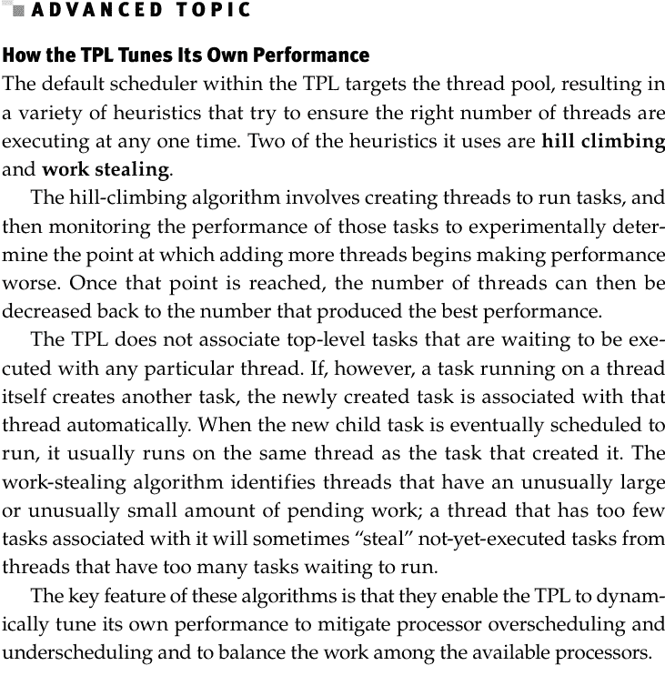

# 第 21 章：并行迭代

TPL 通常在调优自身性能方面做得，但你可以通过提供关于你认为的并行循环线程数的提示来帮助它做得更好；请参阅本章的高级主题：并行循环选项。

## 开始主题

### 初学者主题

#### 使用 AggregateException 处理并行循环

TPL 捕获并将异常保存在 `AggregateException` 中，因为给定的任务可能有多个异常。循环执行的情况也是如此：每次迭代都可能产生异常，因此 `AggregateException` 会在其 `InnerExceptions` 中包含这些异常。请考虑 21.4 中的示例及其输出 21.2。

##### 列表 21.4：并行迭代的未处理异常

```csharp
using System;
using System.Collections.Generic;
using System.IO;
using System.Threading;
using System.Threading.Tasks;
```

```csharp
public static class Program
{
    // ...
    static void EncryptFiles(
        string directoryPath, string searchPattern)
    {
        IEnumerable<string> files = Directory.EnumerateFiles(
            directoryPath, searchPattern,
            SearchOption.AllDirectories);
        try
        {
            Parallel.ForEach(files, fileName =>
            {
                Encrypt(fileName);
            });
        }
        catch(AggregateException exception)
        {
            Console.WriteLine(
                "ERROR: {0}",
                exception.GetType().Name);
            foreach(Exception item in exception.InnerExceptions)
            {
                Console.WriteLine("{0} - {1}",
                    item.GetType().Name, item.Message);
            }
        }
    }
}
```

##### 输出 21.2

ERROR: AggregateException:

UnauthorizedAccessException - Attempted to perform an unauthorized operation.

UnauthorizedAccessException - Attempted to perform an unauthorized operation.

UnauthorizedAccessException - Attempted to perform an unauthorized operation.

#### 取消并行循环

与任务不同（任务阻塞直到完成需要显式调用），并行循环并行执行迭代，但自身在整个并行循环完成之前不会返回。因此，取消并行循环通常涉及从执行并行循环的线程之外调用取消请求。在列表 21.5 中，我们使用 `Task.Run()` 调用 `Parallel.ForEach<T>()`。通过这种方式，不仅查询并行执行，而且还执行

异步地，允许代码提示用户“按任意键退出。”

##### 列表 21.5：取消并行循环

```csharp
using System;
using System.Collections.Generic;
using System.IO;
using System.Threading;
using System.Threading.Tasks;
```

```csharp
public class Program
{
    // ...
    static void RegisterFiles(
        string directoryPath, string searchPattern)
    {
        string stars =
            "*".PadRight(Console.WindowWidth-1, '*');
        IEnumerable<string> files = Directory.GetFiles(
            directoryPath, searchPattern,
            SearchOption.AllDirectories);

        CancellationTokenSource cts =
            new CancellationTokenSource();
            ParallelOptions parallelOptions =
                new ParallelOptions
                { CancellationToken = cts.Token };
        cts.Token.Register(
            () => Console.WriteLine("Canceling..."));
        Console.WriteLine("Press any key to exit.");

        Task task = Task.Run(() => {
            try {
                Parallel.ForEach(
                    files, parallelOptions,
                    (fileName, loopState) =>
                    {
                        Encrypt(fileName);
                    }
                );
            } catch (OperationCanceledException){}
        });
        // 等待用户输入
        Console.Read();
    }
}
```

## 并行执行循环迭代

```csharp
// 取消查询
cts.Cancel();
Console.Write(stars);
task.Wait();
```

并行循环使用了与任务相同的取消令牌（cancellationToken）模式。从 `CancellationSource` 获取的令牌通过调用具有 `ParallelOptions` 类型的 `ForEach()` 方法重载版本与并行循环相关联。该对象包含了取消令牌。

请注意，如果你取消了循环操作，将通过检查 `IsCancellationRequested` 属性来防止任何尚未启动的迭代启动。现有迭代将运行到它们的终止点。此外，即使在所有迭代完成后调用 `Cancel()`，仍然会触发已注册的取消操作（通过 `cts.Token.Register()` 注册执行）。

`ForEach()` 方法能够确认循环已取消的唯一手段是通过 `OperationCanceledException`。鉴于此示例中的取消是预料之，该异常被捕获并忽略，允许应用程序显示“Canceling...”，随后在退出前显示一行星号。

### 高级主题

#### 并行循环选项

虽然通常没有必要，但可以通过 `Parallel.For` 和 `Parallel.ForEach<T>()` 循环重载项中的 `ParallelOptions` 参数来控制最大并行度（即同时被调度运行的线程数）。在某些特定情况下，开发者可能更了解特定的算法或情况，此时更改最大并行度是有意义的。这些情况包括：

- 你希望禁用并行以以便于调试或分析的场景。将最大并行度设置为 1 可以确保循环迭代不会并发运行。
- 你预先知道这种并行度受外部因素（如硬件限制）限制的场景。例如，如果你的并行操作涉及使用多个 USB 端口，那么创建比可用端口更多的线程可能是没有意义的。
- 运行时间非常长的循环迭代场景（例如几分钟或几小时）。线程池无法区分长时间的迭代和阻塞操作，因此可能会引入许多新线程，而所有线程都将被 for 循环消耗。这会导致线程随时间推移逐渐增长，最终导致进程产生大量线程。

以此类推。要控制最大并行度，请使用 `ParallelOptions` 对象上的 `MaxDegreeOfParallel` 属性。

你还可以使用 `ParallelOptions` 对象的 `TaskScheduler` 属性来指定在调度与每次迭代相关的任务时使用的自定义调度器。例如，你可能有一个响应用户点击“下一页”按钮的异步事件处理程序。如果用户多次点击该按钮，你可能希望使用自定义调度器来优先处理最近创建的任务，而不是等待最长的任务。

`ParallelOptions` 对象还拥有 `CancellationToken` 属性，用于指示循环体是否提前退出。

# 第 21 章：并行迭代

### 高级主题

#### 中断并行循环

与标准循环一样，并行循环支持“中断”的概念。在并行上下文中，`Parallel.For()` 和 `Parallel.ForEach<T>()` 方法返回 `ParallelLoopResult` 对象，包含了循环期间的有用信息。该对象具有以下属性：

- `IsCompleted` 表示所有迭代完成完成布尔值。
- `LowestIteration` 指定执行的最低迭代。其类型为 `long?`，`null` 表示没有中断。

回到十次迭代示例，`IsCompleted` 返回 `false`，且 `LowestIteration` 返回 `5`。

#### 并行运行 LINQ 查询

正如可以使用 `Parallel.For()` 并行循环一样，也可以使用并行 LINQ API（简称 PLINQ）并行运行 LINQ 查询。列表 21.6 显示了一个非并行的 LINQ ；在列表 21.7 中，我们对其进行了修改以并行运行。


##### 列表 21.6：LINQ Select()

```csharp
using System.Collections.Generic;
using System.Linq;

class Cryptographer
{
    // ...
    public List<string> Encrypt(IEnumerable<string> data)
    {
        return data.Select(
            item => Encrypt(item)).ToList();
    }
    // ...
}
```

在列表 21.6 中，LINQ 查询使用 `Select()` 标准查询运算符对序列中的每个字符串进行加密，并将结果转换为并行操作；每个加密可能都是高延迟的 CPU 密集型操作，可以分配到另一个 CPU 上的工作线程执行。

列表 21.7 显示了如何修改 21.6，使加密字符串的代码以并行执行。

##### 列表 21.7：并行 LINQ Select()

```csharp
using System.Linq;

class Cryptographer
{
    // ...
    public List<string> Encrypt(IEnumerable<string> data)
    {
        return data.AsParallel().Select(
            item => Encrypt(item)).ToList();
    }
    // ...
}
```

如列表 21.7 所示，启用并行支持的变化非常小！这只需要一个标准查询运算符 `AsParallel()`，它可以在静态类 `System.Linq.ParallelEnumerable` 中找到。

# 并行运行 LINQ 查询 907


`System.Linq.ParallelEnumerable` 是 Microsoft .NET Framework 4.0 引入用于启用 PLINQ 的引擎，它包含了 `System.Linq.Enumerable` 中可用查询操作符的超集。因此，它提供的 API 为所有常用的查询操作符提供了可能的性能改进，包括用于排序、过滤（`Where()`）、投影（`Select()`）、连接、分组和聚合的操作操作符。列表 21 显示了如何进行并行排序。

### 列表 21.8：使用标准查询操作符的并行 LINQ

```csharp
//...
OrderedParallelQuery<string> parallelGroups =
data.AsParallel().OrderBy(item => item);

// 显示项目总数仍然
// 匹配原始计数
System.Diagnostics.Assert(
    data.Count == parallelGroups.Sum(
        item => item.Count()));
//...
```

如列表 21.8 所示，调用并行版本涉及对 `AsParallel()` 扩展方法的调用。注意，标准查询操作符返回的结果类型是 `ParallelQuery<T>` 或 `OrderedParallelQuery<T>`；两者都会通知编译器应继续使用可用的标准查询操作的并行版本。

鉴于查询表达式只是列表 21.5 和 21.6 中使用的查询方法调用形式的语法糖，你可以轻松地在表达式形式中使用 `AsParallel()`。列表 21.9 展示了使用查询语法并行执行分组操作的示例。

### 列表 21.9：使用查询表达式的并行 LINQ

```csharp
//...
ParallelQuery<IGrouping<char, string>> parallelGroups =
    from text in data.AsParallel()
    orderby text
    group text by text[0];

// 显示项目总数仍然
// 匹配原始计数
```

# 第 21 章：并行迭代

```csharp
System.Diagnostics.Trace.Assert(
    data.Count == parallelGroups.Sum(
        item => item.Count()));
// ...
```

正如你从之前的示例中所看到的，将查询或迭代循环转换为并行是非常简单的。然而，有一个重要的注意事项：正如我们将在第 22 章中深入讨论的那样，你必须注意不要让多个线程同时不当地访问并修改同一块内存。这样做会导致竞态条件。

正如我们在本章早期所看到的，`Parallel.For()` 和 `Parallel.ForEach<T>` 方法会收集并行迭代期间抛出的任何异常，然后抛出一个包含所有原始异常的聚合异常。PLINQ 操作也无不同。也就是说，它们由于完全相同的原因具有返回多个异常的可能：当查询在每个元素上并行运行时，在每个元素上执行的代码可以独立地抛出异常。意乎不用，PLINQ 处理这种情况的方式与并行循环和 TPL 完全相同：并行查询期间抛出的异常可以通过 `AggregateException` 的 `InnerExceptions` 属性访问。因此，将 PLINQ 查询封装在异常类型为 `System.AggregateException` 的 try/catch 块中将成功处理每次迭代中未处理的任何异常。

## 4.0 取消 PLINQ 查询

预计，取消请求模式也适用于 PLINQ 查询。列表 21.10（带有输出 21.3）提供了一个示例。与并行循环一样，取消的 PLINQ 查询将抛出 `System.OperationCanceledException`。与并行循环一样，执行 PLINQ 查询是调用线程上的同步操作。因此，一种常见技术是将并行查询封装在另一个线程上运行的任务中，以便当前线程可以在需要时取消它——这就是列表 21.5 中使用的解决方案。

### 列表 21.10：取消 PLINQ 查询

```csharp
using System;
using System.Collections.Generic;
using System.Linq;
using System.Threading;
using System.Threading.Tasks;

public static class Program
{
    public static List<string> ParallelEncrypt(
        List<string> data,
        CancellationToken cancellationToken)
    {
        int governor = 0;
        return data.AsParallel().WithCancellation(
            cancellationToken).Select(
            (item) => {
                if (Interlocked.CompareExchange(ref governor, 0, 100) % 100 == 0)
                {
                    Console.Write('.');
                }
                Interlocked.Increment(ref governor);
                return Encrypt(item);
            }).ToList();
    }

    public static async Task Main()
    {
        Console originalColor = Console.ForegroundColor;
        List<string> data = Utility.GetData(100000).ToList();

        using CancellationTokenSource cts =
            new CancellationTokenSource();

        Task task = Task.Run(() =>
        {
            data = ParallelEncrypt(data, cts.Token);
        }, cts.Token);

        Console.WriteLine("Press any key to Exit.");
        Task<int> cancel = ConsoleReadAsync(cts.Token);

        try
        {
            Task.WaitAny(task, cancel);
            // 取消尚未完成的任务。
            cts.Cancel();
            await task;

            Console.ForegroundColor = Console.Green;
            Console.WriteLine("\ncompleted successfully");
        }
        catch (OperationCanceledException taskCanceled)
        {
            Console.ForegroundColor = Console.Red;
            Console.WriteLine("\ncanceled: {taskCanceled.Message}");
        }
        finally
        {
            Console.ForegroundColor = originalColor;
        }
    }

    private static async Task<int> ConsoleReadAsync(
        CancellationToken cancellationToken = default)
    {
        return await Task.Run(async () => {
            const int maxDelay = 1025;
            int delay = 0;
            while (!cancellationToken.IsCancellationRequested) {
                if (Console.KeyAvailable) {
                    return Console.Read();
                }

                else
                {
                    await Task.Delay(delay, cancellationToken);
                    if (delay < maxDelay) delay *= 2 + 1;
                }
            }
            cancellationToken.ThrowIfCancellationRequested();
            throw new InvalidOperationException("Previous line should throw this from ever executing");
        }, cancellationToken);
    }

    private static string Encrypt(string item)
    {
        Cryptographer cryptographer = new Cryptographer();
        return System.Text.Encoding.UTF8.GetString(cryptographer);
    }
}
```

### 输出 21.3

Press any key to Exit.

................................................................................................................n................................................................................Cancelled: The query has been canceled via the token supplied to WithCancellation.

# 22

## 线程同步

在第 21 章中，我们讨论了使用任务并行库 (TPL) 和并行 LINQ (PLINKQ) 进行多线程编程的细节。然而，我们特意避开的一个主题是线程同步，它可以在避免死锁的同时防止竞态条件。线程同步正是本章的主题。


我们从一个没有对共享数据进行任何同步的多线程示例开始——这导致了竞态条件，从而丢失数据完整性。这段讨论将作为为什么我们需要线程同步的引言。随后将介绍实现线程同步的各种机制和最佳实践。

# 第 22 章：线程同步

本书的早期版本包含一个关于额外多线程模式的重要章节，以及另一个关于各种计时器回调机制的章节。然而，随着 async/await 模式的引入，除非你在使用 C# 5.0/.NET 4.5 之前的框架进行编程，否则这些方法基本上已经被取代了。不过，C# 5.0 之前的材料可以通过本书网站获取：http://IntelliTest.com/EssentialCSharp。

本章全部使用 TPL，因此示例无法在 Microsoft .NET 4 之前的框架上编译。但是，除非明确标识为 Microsoft .NET Framework 4 API，否则 .NET Framework 4 限制的唯一原因是使用了 `System.Threading.Tasks.Task` 类来执行异步操作。修改代码以实例化 `System.Threading.Thread` 并使用 `Thread.Join()` 等待执行将允许大多数示例在早期的框架上编译。

尽管如此，本章中启动任务的特定 API 是 .NET 4.5（或更高版本）的 `System.Threading.Tasks.Task.Run()`。我们在第 19 章中讨论过，此方法优于 `System.Threading.Tasks.Factory.StartNew()`，因为它更简单且足以应对大多数场景。如果你受限于 .NET 4，可以无需任何额外修改将 `Task.Run()` 替换为 `Task.Factory.StartNew()`。（由于此原因，当仅使用此方法时，本章不会显式强调此类 .NET 4.5 特有的代码。）

## 为什么要同步？

运行新线程是一个相对简单的编程任务。然而，多线程编程的困难之处在于识别哪些数据可以被多个线程同时访问。程序必须同步此类数据以防止同时访问，从而创建“安全性”。考虑列表 22.1。

### 列表 22.1：未同步的任务

```csharp
using System;
using System.Threading.Tasks;

public class Program
{
    const int _Total = int.MaxValue;
    static long _Count = 0;

    public static void Main()
    {
        // 为 .NET 4.0 使用 Task.Factory.StartNew
        Task task = Task.Run(() => Decrement());

        // 递增
        for (int i = 0; i < _Total; i++)
        {
            _Count++;
        }

        task.Wait();
        Console.WriteLine("Count = {0}", _Count);
    }

    static void Decrement()
    {
        for (int i = 0; i < _Total; i++)
        {
            _Count--;
        }
    }
}
```

列表 22.1 的一种可能结果出现在输出 22.1 中。

### 输出 22.1

| Count = 113449499 |

列表 22.1 需要注意的重点是输出结果为 0。如果直接（顺序地）调用 `Decrement()`，结果将是这样。然而，当异步调用 `Decrement()` 时，发生了竞态条件，因为 `_Count++` 和 `_Count--` 语句中的各个步骤交织在一起了。（正如在第 19 章“入门主题：多线程”中讨论的那样，C# 中的单个语句可能涉及多个步骤。）考虑表 22.1 中的示例执行。

### 第 22 章：线程同步

#### 表 22.1：示例伪代码执行

| 主线程 | Decrement 线程 | Count |

| :--- | :--- | :--- |

| ... | ... | ... |

| 从 `_Count` 拷贝值 θ。 | | 0 |

| 递增拷贝出的值 (θ)，得到 1。 | | 0 |

| 将结果值 (1) 拷贝到 `_Count`。 | | 1 |

| 从 `_Count` 拷贝值 1。 | 从 `_Count` 拷贝值 1。 | 1 |

| 递增拷贝出的值 (1)，得到 2。 | | 1 |

| 将结果值 (2) 拷贝到 `_Count`。 | | 2 |

| | 递减拷贝出的值 (1)，得到 θ。 | 1 |

| | 将结果值 (θ) 拷贝到 `_Count`。 | 0 |

| ... | ... | ... |

表 22.1 通过指令从一列到另一列的转换显示了并行执行（或线程上下文切换）。在特定行完成后，`_Count` 的值看起来是 `++` 执行了两次而 `_Count--` 发生了一次。然而，结果的 `_Count` 值是 0，而不是 1。将结果写回 `_Count` 质上抹除了自在同一线程上读取 `_Count` 之后发生的任何 `_Count` 值变化。

列表 22.1 中的问题是竞态条件，其中多个线程同时访问相同的数据元素。正如此示例执行所示，允许多个线程访问相同数据可能会破坏数据完整性。为了解决这一潜在问题，代码需要对数据进行同步。多线程同步访问是**线程安全的**。

关于读取和写入的原子性有一个重要点需要注意。运行时保证大于原生（指针大小）的整数类型不会被部分读取或写入。因此，在 64 位操作系统上，对 `long` 操作是原子的。然而，对 128 位变量 `decimal` 操作可能会在拷贝 32 位后被中断，导致**撕裂读**。

## 入门主题

### 多线程与局部变量

注意不需要同步局部变量。局部变量加载到栈中，每个线程都有自己的栈。默认情况下，局部变量在方法调用之间是不共享的。然而，共享局部变量的循环会暴露该变量——毕竟在 C# 层面它是局部变量，在中间语言层面它是字段——而字段可以被多个线程访问。

#### 列表 22.2：未同步的局部变量

```csharp
using System;
using System.Threading.Tasks;

public class Program
{
    public static void Main()
    {
        int x=0;
        Parallel.For(0, int.MaxValue, i =>
        {
            x++;
        });
    }
}
```

## 使用 Monitor 同步


为了同步不能同时执行特定代码段的线程，可以使用监控在第一个线程退出区域之前阻塞进入。监控功能是 `System.Threading.Monitor` 类的一部分，保护代码的开始和结束分别用静态方法 `Monitor.Enter()` 和 `Monitor.Exit()` 标记。

列表 22.3 显式使用 Monitor 类进行同步。正如所示，将 `Monitor.Enter()` 和 `Monitor.Exit()` 调用之间的所有代码放在 `try/finally` 块中是重要的。如果没有这样做，可能会发生异常且 `Monitor.Exit()` 可能永远不会被调用，从而无限阻塞其他线程。

# 列表 22.3：显式使用 Monitor 同步

```csharp
using System;
using System.Threading;
using System.Threading.Tasks;

public class Program
{
    readonly static object _Sync = new object();
    const int _Total = int.MaxValue;
    static long _Count = 0;

    public static void Main()
    {
        // 为 .NET 4.0 使用 Task.Factory.StartNew
        Task task = Task.Run(() => Decrement());
    }
}
```

## 为什么需要同步？

```csharp
// 递增
for(int i = 0; i < _Total; i++)
{
    bool lockTaken = false;
    try
    {
        Monitor.Enter(_Sync, ref lockTaken);
        _Count++;
    }
    finally
    {
        if (lockTaken)
        {
            Monitor.Exit(_Sync);
        }
    }
}
```

`task.Wait();`

`Console.WriteLine($"Count = {_Count}");`

```csharp
static void Decrement()
{
    for(int i = 0; i < _Total; i++)
    {
        bool lockTaken = false;
        try
        {
            Monitor.Enter(_Sync, ref lockTaken);
            _Count--;
        }
        finally
        {
            if(lockTaken)
            {
                Monitor.Exit(_Sync);
            }
        }
    }
}
```

列表 22.3 的结果出现在输出 22.2 中。

# 输出 22.2

`Count = `

注意，对 `Monitor.Enter()` 和 `Monitor.Exit()` 的调用通过共享作为参数传递的相同对象引用（在本例中为 `_Sync`）相关联。

# 第 22 章：线程同步

带有 `lockToken` 参数的 `Monitor.Enter()` 重载方法直到 .NET 4.0 才被添加到框架中。在此之前，没有 `lockToken` 参数可用，并且无法可靠地捕获发生在 `Monitor.Enter()` 和 `try` 块之间的异常。将 `try` 块紧跟在 `Monitor.Enter()` 调用之后是可靠的，因为即时编译编译器 JIT 防止了任何异步异常的溜入。然而，除了 `try` 块以外的任何内容（包括编译器可能在调试代码中注入的任何指令）都可能防止 JIT 可靠地返回 `try` 块内部。因此，如果发生了异常，它将泄露锁（锁仍保持获取状态），而不是执行 `finally` 块并释放它——这可能导致另一个线程尝试获取锁时发生死锁。总之，在 .NET 4.0 之前的框架版本中，你应该始终在 `Monitor.Enter()` 之后跟上 `try/finally { Monitor.Exit(_Sync); }` 块。

`Monitor` 还支持 `Pulse()` 方法，允许线程进入就绪队列，它现在可以被执行了。这是生产者-消费者模式的常用同步机制，以确保在没有“生产”之前不会发生“消费”。拥有监视器的线程（通过调用 `Monitor.Enter()`）调用 `Monitor.Pulse()` 向消费者线程（其可能已经调用了 `Monitor.Enter()`）发送信号，有一个项目可以消费，它应该准备就绪。对于单个 `Pulse()`，只有一个线程（在这种情况下为消费者线程）可以进入就绪队列。当生产者调用 `Monitor.Exit()` 时，消费者线程获取锁（`Monitor.Enter()` 完成）并进入临界区开始消费该项目。一旦消费者处理了等待中的项目，它就会调用 `Exit()`，允许生产者（当前被 `Monitor.Enter()` 阻塞）再次进行生产。在这个示例中，一次只有一个线程可以进入就绪队列，确保了在没有生产的情况下没有消费，反之亦然。

# 使用 lock 关键字

由于在多线程代码中频繁需要使用 `Monitor` 进行同步，而且由于 `try/finally` 块很容易被忘记，C# 提供了一个特殊的关键字来处理这种锁定同步模式。列表 22.4 展示了 `lock` 关键字的使用，输出 22.3 显示了结果。

# 列表 22.4：使用 lock 关键字进行同步

```csharp
using System;
using System.Threading;
using System.Threading.Tasks;

public class Program
{
    readonly static object _Sync = new object();
    const int _Total = int.MaxValue;
    static long _Count = 0;

    public static void Main()
    {
        // .NET 4.0 使用 Task.Factory.StartNew
        Task task = Task.Run(() => Decrement());

        // 递增
        for(int i = 0; i < _Total; i++)
        {
            lock(_Sync)
            {
                _Count++;
            }
        }
        task.Wait();
        Console.WriteLine($"Count = {_Count}");
    }

    static void Decrement()
    {
        for(int i = 0; i < _Total; i++)
        {
            lock(_Sync)
            {
                _Count--;
            }
        }
    }
}
```

# 输出 22.3

`Count = 0`

# 第 22 章：线程同步

通过锁定区域（使用 `Monitor`），你使代码变得线程安全。在 C# 4.0 之前，同步的代价是巨大的。例如，列表 22.4 的执行时间长了一个数量级。问题在于使用值类型时，运行时会创建该值的副本，将其放入堆中（装箱），并将装箱值传递给 `Monitor.Enter()`。同样，`Monitor.Exit()` 接收原始变量的装箱副本。结果是 `Monitor.Enter()` 和 `Monitor.Exit()` 接收到不同的对象实例，因此两者之间没有发生关联。

列表 22.3 的结果出现在输出 22.2 中。注意，对 `Monitor.Enter()` 和 `Monitor.Exit()` 的调用通过共享作为参数传递的相同对象引用（在本例中为 `_Sync`）相关联。带有 `lockToken` 参数的 `Monitor.Enter()` 重载方法直到 .NET 4.0 才被添加到框架中。在此之前，没有 `lockToken` 参数可用，并且无法可靠地捕获发生在 `Monitor.Enter()` 和 `try` 块之间的异常。将 `try` 块紧跟在 `Monitor.Enter()` 调用之后是可靠的，因为即时编译编译器 JIT 防止了任何异步异常的溜入。然而，除了 `try` 块以外的任何内容（包括编译器可能在调试代码中注入的任何指令）都可能防止 JIT 可靠地返回 `try` 块内部。因此，如果发生了异常，它将泄露锁（锁仍保持获取状态），而不是执行 `finally` 块并释放它——这可能导致另一个线程尝试获取锁时发生死锁。总之，在 .NET 4.0 之前的框架版本中，你应该始终在 `Monitor.Enter()` 之后跟上 `try/finally { Monitor.Exit(_Sync); }` 块。

`Monitor` 还支持 `Pulse()` 方法，允许线程进入就绪队列，它现在可以被执行了。这是生产者-消费者模式的常用同步机制，以确保在没有“生产”之前不会发生“消费”。拥有监视器的线程（通过调用 `Monitor.Enter()`）调用 `Monitor.Pulse()` 向消费者线程（其可能已经调用了 `Monitor.Enter()`）发送信号，有一个项目可以消费，它应该准备就绪。对于单个 `Pulse()`，只有一个线程（在这种情况下为消费者线程）可以进入就绪队列。当生产者调用 `Monitor.Exit()` 时，消费者线程获取锁（`Monitor.Enter()` 完成）并进入临界区开始消费该项目。一旦消费者处理了等待中的项目，它就会调用 `Exit()`，允许生产者（当前被 `Monitor.Enter()` 阻塞）再次进行生产。在这个示例中，一次只有一个线程可以进入就绪队列，确保了在没有生产的情况下没有消费，反之亦然。

# 使用 async

在之前的示例中，没有使用 `await` 关键字。给定 C# 7.0，`await` 运算符已如列表 22.5 所示被用于 `Main()` 方法。

# 列表 22.5：使用 async 返回 Main()

```csharp
using System;
using System.Threading;
using System.Threading.Tasks;

public class Program
{
    readonly static object _Sync = new object();
    const int _Total = int.MaxValue;
    static long _Count = 0;

    public static async Task Main()
    {
        // .NET 4.0 使用 Task.Factory.StartNew
        Task task = Task.Run(() => Decrement());

        // 递增
        for(int i = 0; i < _Total; i++)
        {
            lock(_Sync)
            {
                _Count++;
            }
        }
        await task;
        Console.WriteLine($"Count = {_Count}");
    }

    static void Decrement()
    {
        for(int i = 0; i < _Total; i++)
        {
            lock(_Sync)
            {
                _Count--;
            }
        }
    }
}
```

# 选择锁对象

同步对象不能是值类型是非常重要的。如果在 `lock` 关键字上使用值类型，编译器将报告错误。（在访问 `System.Threading.Monitor` 时[非通过 `lock`]，在编译时不会发生此类错误。相反，代码将在调用 `Exit()` 时抛出异常，指示没有相应的 `Monitor.Enter()` 调用。）问题在于使用值类型时，运行时会创建该值的副本，将其放入堆中（装箱），并将装箱值传递给 `Monitor.Enter()`。同样，`Monitor.Exit()` 接收原始变量的装箱副本。结果是 `Monitor.Enter()` 和 `Monitor.Exit()` 接收到不同的对象实例，因此两者之间没有发生关联。

# 为什么避免锁定 this、typeof(type) 和 string

一个看似合理的模式是在类中使用 `this` 关键字来锁定实例数据，并使用从 `typeof(type)` 获取的类型实例锁定静态数据。这种模式在 ways `this` 时为特定对象实例的所有状态提供了同步目标，在使用 `typeof(type)` 时为所有静态数据提供了同步目标。问题在于，此（或 `typeof(type)`）指向的同步目标参与了无关代码块中创建的完全不同的同步块的同步目标。换句话说，只有实例内部的代码可以使用 `this` 关键字进行阻塞，创建该实例的调用者可以将其传递给

结果是两个同步完全不同数据集的同步块可能会相互阻塞。虽然是无意的，但共享相同的同步目标可能会产生意外的性能影响，在极端情况下，甚至可能导致死锁。与其锁定 `this` 甚至是 `typeof(type)`，不如定义一个私有的只读字段，除了该类之外，没有其他人会对其进行阻塞。

另一个应该避免的锁类型是字符串，因为与字符串池化相关的风险。如果相同的字符串出现在多个

locations，所有的 locations 都可能指向同一个实例，从而导致锁的范围超出了预期。

总而言之，你应该使用一个类型为 `object` 的每个同步上下文专用的实例作为锁的目标。

> 指南

> 避免对 `this`、`System.Type` 或字符串进行锁定。

> 请为同步目标声明一个独立的、类型为 `object` 的只读同步变量。

# 避免使用 MethodImplAttribute 进行同步 .NET

.NET 1.0 引入的同步机制之一是 `MethodImplAttribute`。该属性与 `MethodImplOptions.Synchronized` 结合使用时，可以将一个方法标记为同步的，使得同一时间只有一个线程可以执行该方法。为了实现这一点，JIT 本质上将该方法处理为被 `lock(this)` 包围，或者在静态方法的情况下，对该类型进行锁定。这种实现意味着，事实上，该方法以及同一类中所有装饰有相同属性和枚举参数的其他方法都是同步的——而不是每个方法相对于自身是同步的。换句话说，如果同一个类中有两个或多个装饰了该属性的方法，则同一时间只有一个方法可以执行，而正在执行的方法将阻塞其他线程对自身或对类中任何具有相同装饰的其他方法的调用。此外，由于同步是针对 `this` 的（更糟糕的是，针对类型），它会遭受与前一节中讨论的 `lock(this)`（对于静态情况则更糟）相同的缺点。因此，完全避免使用 `MethodImplAttribute` 是一种最佳实践。

> 指南

> 避免使用 `MethodImplAttribute` 进行同步。

# 将字段声明为 volatile

有时，编译器或 CPU 可能会对代码进行优化，导致指令的执行顺序与编码顺序不一致，或者某些指令被优化掉。当代码在单线程上执行时，这些优化是无害的。然而，在多线程环境下，此类优化可能会导致意外的，因为优化可能会改变字段读或写操作相对于另一个线程访问同一字段的执行顺序。

稳定这种行为的一种方法是使用 `volatile` 字段声明字段。该关键字强制所有对 `volatile` 字段的读和写操作都在代码所确定的精确位置发生，而不是由优化产生的其他位置。`volatile` 修饰符表示该字段可能会被硬件、操作系统或另一个线程修改。因此，数据是“易变的”（volatile），该关键字指示编译器和运行时精确地处理它。（更多详情参见 http://bit.ly/CSharpReorderingOptimizations。）

通常，`volatile` 修饰符的使用很少见，且充满了复杂性，可能会导致使用不当。除非你绝对确定 `volatile` 的用法，否则优先使用 `lock` 而不是 `volatile` 修饰符。

# 使用 System.Threading.Interlocked 类

上述的互斥模式提供了在进程（应用程序域）内处理同步的最少工具。然而，使用 `System.Threading.Monitor` 进行同步是一项相对昂贵的操作，处理器直接针对特定的同步模式提供了替代方案。

列表 22.6 只要前一个值为 `null`，就会将 `set_Data` 设置新值。正如方法名所示，这种模式是比较/交换模式。与其手动在行为上等价的比较和交换代码周围加锁，不如 `Interlocked.CompareExchange()` 方法提供了一个内置的同步方法，它对值（null）进行相同的检查，如果该值等于第二个参数，则更新第一个参数。表 22.2 显示了 `Interlocked` 支持的其他同步方法。

# 列表 22.6: 使用 System.Threading.Interlocked 进行同步


```csharp
public class SynchronizationUsingInterlocked
{
    private static object? _Data;

    // 如果尚未分配，则初始化数据
    static void Initialize(object newValue)
    {
        // 如果 _Data 为 null，则将其设置为 newValue
        Interlocked.CompareExchange(
            ref _Data, newValue, null);
    }

    // ...
}
```

# 表 22.2: Interlocked 的同步相关方法

| 签名 | 描述 |
| --- | --- |
| `public static T CompareExchange<T>(T location, T value, T comparand)` | 检查 `location` 是否是否等于 `comparand` 中的值。如果值相等，则将 `location` 设置为 `value` 并返回 `location` 中存储的原始数据。 |
| `public static T Exchange<T>(T location, T value)` | 将 `value` 分配 `location` 并返回之前的值。 |
| `public static int Decrement(ref int location)` | 将 `location` 减 1。它等同于前缀 `--` 运算符，但 `Decrement()` 是线程安全的。 |
| `public static int Increment(ref int location)` | 将 `location` 加 1。它等同于前缀 `++` 运算符，但 `Increment()` 是线程安全的。 |
| `public static int Add(ref int location, int value)` | 将 `value` 加到 `location`并将结果赋值 `location`。它等同于 `+=` 运算符。 |
| `public static long Read(ref long location)` | 在单个原子操作中返回 64 位值。 |

# 第 22 章：线程同步

全这些方法大部分带有额外数据签名的重载，例如对 `long` 的支持。表 22.2 提供了通用签名和描述。

注意，你可以使用 `Increment()` 和 `Decrement()` 来替换列表 22.5 中的同步 `++` 和 `--` 运算符，这样做将获得更好的性能。另请注意，如果另一个线程使用非 `interlocked` 方法访问 `_Count`，则两次访问将无法正确同步。

## 多线程中的事件通知

开发者忽视同步的一个领域是触发事件。发布事件的不安全代码与列表 22.7 类似。

### 列表 22.7: 触发事件

```csharp
// 非线程安全
if(OnTemperatureChanged != null)
{
    // 调用订阅者
    OnTemperatureChanged(this, new TemperatureEventArgs(value));
}
```

C# 6.0 解决这一困境的方案轻而易举。只需要使用空条件操作符：

```csharp
OnTemperatureChanged?.Invoke(this, new TemperatureEventArgs(value));
```

空条件操作符专门设计为原子性的，因此这种对委托的调用实际上是原子的。关键在于——显而易见——要记住使用空条件操作符。

尽管这需要更多的代码，但在 C# 6.0 之前的线程安全委托调用也不特别困难。这种方法之所以有效，是因为添加和移除监听器的运算符是线程安全且静态的（运算符重载是通过静态方法实现的）。要修正列表 22.7 并使其线程安全，请分配一个副本，检查副本是否为空，并触发副本（见列表 22.8）。

### 列表 22.8: 线程安全的事件通知

```csharp
// ...
TemperatureEventHandler localOnChange =
    OnTemperatureChanged;
if(localOnChange != null)
{
    // 调用订阅者
    localOnChange(this, new TemperatureEventArgs(value));
}
// ...
```

由于委托是引用类型，通过分配局部变量并使用本地空检查来触发以使其线程安全是惊讶的。由于 `localOnChange` 指向的位置与 `OnTemperatureChanged` 指向相同，你可能认为 `OnTemperatureChanged` 的任何变化也会反映在 `localOnChange` 中。

事实上，事实并非如此：任何对 `OnTemperatureChanged += <listener>` 调用都不会为其添加新委托，而是分配一个全新的多播委托，而对 `localOnChange` 所指向的原始多播委托没有任何影响。这使得代码是线程安全的，因为只有一个线程会访问 `localOnChange` 实例，而 `OnTemperatureChanged` 将是一个全新的实例。

## 同步设计最佳实践

多线程编程的复杂性带来了处理这些复杂性的几种最佳实践。

### 避免死锁

随着同步的引入，出现了死锁的可能性。当两个或多个线程等待对方释放资源时，就会发生死锁。

# 第 22 章：线程同步

一个同步锁。例如，假设线程 1 请求获取 `_Sync1` 的锁，然后在释放 `_Sync1` 的锁之前请求获取 `_Sync2` 的锁。与此同时，线程 2 请求获取 `_Sync2` 的锁，接着请求 `_Sync1` 的锁以及 `_Sync2` 的锁。这为死锁的发生铺了道路。如果线程 1 和线程 2 在获取第二个锁之前，都成功获取了它们的初始锁（分别为 `_Sync1` 和 `_Sync2`），就会发生死锁。

要发生死锁，必须满足以下四个基本条件：

- 1. 互斥（Mutual exclusion）：一个线程（线程 A）独占一个资源，导致其他线程（线程 B）无法获取该资源。
- 2. 持有等待（Hold and Wait）：一个线程（线程 A）持有互斥资源并等待获取另一个线程（线程 B）持有的资源。
- 3. 非剥夺（No preemption）：线程（线程 A）持有的资源不能被强制移除（线程 A 需要释放其拥有的资源）。
- 4. 循环等待（Circular wait）：两个或多个线程形成一个环链，它们锁定了相同的两个或多个资源，并且每个线程都在等待链中下一个线程所持有的资源。

消除这些条件中的任何一个都可以防止死锁的。

可能导致死锁的一种场景是两个或多个线程请求同一个两个或多个同步目标（资源）的独占所有权，且请求锁的顺序不同。当开发者仔细确保多次获取锁总是以相同的顺序发生时，就可以避免这种情况。死锁的另一个潜在原因是锁不是重入的（not reentrant）。当来自一个线程的锁会阻塞该线程本身——即当它重新请求同一个锁时——该锁就不是重入。例如，如果线程 A 获取了锁并重新请求同一个锁，但由于该锁已被（它自己）占用而被阻塞，那么额外的结果将导致死锁。

由 `lock` 关键字生成的代码（带有底层的 `Monitor` 类）是重入的。然而，正如我们在“更多同步类型”部分中将看到的，某些锁类型不是重入的。

### 何时提供同步

正如我们之前讨论的，所有静态数据应该是线程安全的。因此，同步需要包围可变的静态数据。通常，程序员应该声明私有静态变量，并提供修改这些数据的公共方法。如果可能存在多线程访问，此类方法应在内部处理同步。

相反，实例状态预计不包含同步。同步可能会显著降低性能并增加锁竞争或死锁的概率。除了显式为多线程访问设计的类外，预计在多个线程间共享对象的程序员应该自己处理好被共享数据的同步工作。

### 避免不必要的锁定

在不损害数据完整性的情况下，程序员应尽可能避免不必要的同步。例如，你应该在线程之间使用不可变类型，这样就不需要同步（这种方法在 F# 等函数式编程语言中被证明是有价值的）。同样，你应该避免对线程安全的操作进行加锁，例如小于原生（指针大小）整数的简单值读写，因为此类操作是自动原子的。

> 指南
> - 请勿以不同的顺序请求同一个两个或多个同步目标的独占所有权。
> - 请确保并发持有多个锁的代码始终以相同的顺序获取它们。
> - 请将静态数据封装在具有同步逻辑的公共 API 中。
> - 避免（AVOID）对大于原生（指针大小）整数的简单值读取或写入进行同步，因为此类操作是自动原子的。

## 更多同步类型

除了 `System.Threading.Monitor` 和 `System.Threading.Interlocked` 之外，还有几种同步技术。

### 使用 System.Threading.Mutex

`System.Threading.Mutex` 在概念上与 `System.Threading.Monitor` 类相似（支持 `Pulse()` 方法，但 `lock` 关键字没有使用它，且 `Mutex` 可以命名以便支持跨多个进程的同步）。使用 `Mutex` 类，你可以同步对文件或其他跨进程资源的访问。由于 `Mutex` 是跨进程资源，.NET 2.0 增加了支持，允许通过 `System.Security.AccessControl.SecurityObject` 设置访问控制。`Mutex` 的一种用途是限制应用程序，使其无法同时运行多次，如列表 22.9 所示。

### 列表 22.9：创建一个单实例应用程序

```c
using System;
using System.Threading;
using System.Reflection;

public class Program
{
    public static void Main()
    {
        // 从完整的
        // 程序集名称获取互斥量名称
        string mutexName = Assembly.GetEntryAssembly().FullName();

        // firstApplicationInstance 表示这是否是第一个
        // 应用程序实例
        Mutex mutex = new Mutex(false, firstApplicationInstance);

        if(firstApplicationInstance)
        {
            Console.WriteLine("This application is already running.");
        }
        else
        {
            Console.WriteLine("ENTER to shut down");
            Console.ReadLine();
        }
    }
}
```

运行应用程序第一个实例的结果出现在输出 22.4 中。

### 输出 22.4

```
ENTER to shut down
```

在第一个实例仍在运行时运行应用程序第二个实例的结果显示在输出 22.5 中。

### 输出 22.5

```
This application is already running.
```

在这种情况下，应用程序在机器上只能运行一次，即使它是由不同的用户启动的。要将实例限制为每个用户一次，请在分配 `mutexName` 时将 `System.Environment.UserName`（需要 Microsoft .NET Framework 或 .NET Standard 2.0）作为后缀。

`Mutex` 派自 `System.Threading.WaitHandle`，因此它包含了 `WaitAll()`、`WaitAny()` 和 `SignalAndWait()` 方法。这些方法允许它自动获取多个锁——这是 `Monitor` 不支持的。

### WaitHandle

`Mutex` 的基类是 `System.Threading.WaitHandle`。它是 `Mutex`、`EventWaitHandle` 和 `Semaphore` 同步类使用的基本的同步类。`WaitHandle` 上的关键方法是 `WaitOne()` 方法，它会阻塞执行，直到 `WaitHandle` 被信号或设置。`WaitOne()` 方法包含几个用于无限时间的重载：`void WaitOne()`，毫秒级等待；`bool WaitOne(int milliseconds)`；以及 `bool WaitOne(TimeSpan timeout)`，即 `TimeSpan` 等待。当 `WaitHandle` 在超时之前被发出信号时，这些方法返回 `true` 的值。

除了 `WaitHandle` 实例方法外，还有两个关键静态成员：`WaitAll()` 和 `WaitAny()`。与它们的实例表亲一样，这些静态成员也支持超时。此外，它们接收数组形式的 `WaitHandles` 集合，以便它们能够响应来自集合内部的信号。

注意 `WaitHandle` 包含一个实现了 `IDisposable` 的句柄（`SafeHandle`）。因此，需要小心确保 `WaitHandles` 在不再使用时被释放。

### 重置事件：ManualResetEvent 和 ManualResetSlim

控制线程中特定指令不确定性的一种方法是使用重置事件等待另一个线程中的。尽管使用了“事件（events）”这一术语，但重置事件与 C# 的委托和事件没有关系。相反，重置事件是一种编写代码来等待另一个线程执行的方法，直到另一个线程发出信号。它们对于多线程代码特别有用，因为可以在验证结果之前等待某个特定状态。

重置事件类型有 `System.ManualResetEvent` 和 Microsoft .NET Framework 4 添加的轻量级版本 `System.Threading.ManualResetSlim`。（正如接下来的高级主题：优先使用 ManualResetEvent 和 Semaphores 而非 AutoResetEvent 所述，第三第三类型 `System.AutoResetEvent`，但程序员应该选择前两者。）重置事件的关键方法是 `Set()` 和 `Wait()`（在 `ManualResetEvent` 上称为 `WaitOne`）。调用 `Wait()` 方法将导致线程阻塞，直到另一个线程调用 `Set()` 或者等待期结束。列表 22.10 展示了它是如何工作的，输出 22.6 是结果。

### 列表 22.10：等待 ManualResetEventSlim

```csharp
using System;
using System.Threading;
using System.Threading.Tasks;
public class Program
{
    static ManualResetSlim _MainSignaledResetEvent;
    static ManualResetSlim _DoWorkSignaledResetEvent;
    public static void DoWork()
    {
        Console.WriteLine("DoWork started...");
        _DoWorkSignaledResetEvent.Set();
        _MainSignaledResetEvent.Wait();
        Console.WriteLine("DoWork ending...");
    }
}
```

## 为什么要同步？

### 输出 22.6

应用程序已启动....

启动任务....

DoWork() 开始....

在线程执行时等待...

DoWork() 结束....

线程已完成

应用程序正在关闭....

列表 22.10 从实例化并启动一个新的 `Task` 开始。表 22.3 显示了执行路径，其中每列代表一个线程。在代码出现在同一行的情况下，无法确定由哪一个先执行。

# 第 22 章：线程同步

### 表 22.3：使用 ManualResetEvent 同步的执行路径

| Main() | DoWork() |
| --- | --- |
| ... | |
| Console.WriteLine("Application started..."); | |
| Task task = new Task(DoWork); | |
| Console.WriteLine("Starting thread..."); | |
| task.Start(); | |
| _DoWorkSignaledResetEvent.Wait(); | Console.WriteLine("DoWork() started..."); |
| Console.WriteLine("Thread executing..."); | _MainSignaledResetEvent.Wait(); |
| _MainSignaledResetEvent.Set(); | Console.WriteLine("DoWork() ending..."); |
| Console.WriteLine("Thread completed..."); | |
| Console.WriteLine("Application exiting..."); | |

调用重置事件的 `Wait()` 方法（对于 `ManualResetEvent`，该方法也称为 `WaitOne()`）会阻塞调用它的线程，直到另一个线程发出信号并允许被阻塞的线程无限继续。`Wait()/WaitOne()` 的重载方法包含一个参数，可以是毫秒或 `TimeSpan` 对象，用于指定阻塞的最长时间。当指定了超时时间时，如果在重置事件发出信号之前发生了超时，则 `WaitOne()` 的返回值为 `false`。`ManualResetEvent.Wait()` 还包含一个接受取消令牌（`cancellation token`）的版本，允许像第 19 章讨论的那样进行取消请求。


`ManualResetEventSlim` 和 `ManualResetEvent` 的区别在于后者默认使用内核同步，而前者经过优化，避免了访问内核（除非是最后的万不得已）。
因此，`ManualResetEventSlim` 的性能更好，尽管它可能消耗更多的 CPU 周期。由于这个原因，通常情况下你应该使用 `ManualResetEventSlim`，除非需要等待多个事件或跨进程等待。
注意重置事件实现了 `IDisposable`，因此它们在不再需要时应该被销毁。在列表 22.10 中，我们通过 `using` 语句来实现这一点。（`CancellationToken` 包含一个 `ManualResetEvent`，这就是为什么它也实现了 `IDisposable`。）
尽管并不完全相同，但 `System.Threading.Monitor` 的 `Wait()` 和 `Pulse()` 在某些情况下提供了与重置事件类似的功能。

## 高级主题

### 优先使用 ManualResetEvent 和信号量，而非 AutoResetEvent
第三种重置事件是 `System.Threading.AutoResetEvent`，与 `ManualResetEvent` 一样，允许一个线程通过信号（调用 `Set()`）通知另一个线程，第一个线程已到达代码中的某个位置。区别在于 `AutoResetEvent` 仅释放一个线程的 `Wait()` 调用：在第一个线程通过自动重置门禁后，它会返回 `Locked` 状态。使用自动重置事件，很容易错误地编写出生产者线程的迭代次数多于消费者线程。因此，通常优先使用 `Monitor` 的 `Wait()/Pulse()` 模式或使用信号量（允许少于 $n$ 个线程参与特定代码块）。
与 `AutoResetEvent` 不同，`ManualResetEvent` 在显式调用 `Reset()` 之前不会返回未重置状态。

# Semaphore/SemaphoreSlim 和 CountdownEvent
`Semaphore` 和 `SemaphoreSlim` 的性能差异恰好对应 `ManualResetEvent` 和 `ManualResetEventSlim`。与提供锁（类似于门，有开启或关闭状态）的 `ManualResetEvent/ManualResetEventSlim` 不同，信号量仅限制同时允许 $N$ 次调用进入关键区域。信号量本质上维护了一个资源池的计数（`Count`）。当该计数为零时，它会阻塞对池的进一步访问，直到其中一个资源被返回，供队列中的下一个被阻塞请求使用。

`CountdownEvent` 类似于信号量，但不同之处在于它允许等待一组操作完成。它通过计数器工作，每个操作完成后计数器减 1。当计数器减零时，所有等待的线程将被释放。`CountdownEvent` 经常用于等待多个线程完成特定的任务。

# 并发集合
`Semaphore` 和 `SemaphoreSlim` 具有性能差异，`ManualResetEvent` 和 `ManualResetEventSlim` 也是如此。与 `ManualResetEvent/ManualResetEventSlim` 不同，后者提供一个锁（类似于门，有开启或关闭状态），信号量仅限制同时允许 $N$ 次调用进入关键区域。信号量本质上维护了一个资源池的计数。当该计数为零时，它会阻塞对池的进一步访问，直到其中一个资源被返回，供队列中的下一个被阻塞请求使用。

`CountdownEvent` 类似于信号量，但不同之处在于它允许等待一组操作完成。它通过计数器工作，每个操作完成后计数器减 1。当计数器减零时，所有等待的线程将被释放。`CountdownEvent` 经常用于等待多个线程完成特定的任务。

# 并发集合
`Semaphore` 和 `SemaphoreSlim` 具有性能差异，`ManualResetEvent` 和 `ManualResetEventSlim` 也是如此。与 `ManualResetEvent/ManualResetEventSlim` 不同，后者提供一个锁（类似于门，有开启或关闭状态），信号量仅限制同时允许 $N$ 次调用进入关键区域。信号量本质上维护了一个资源池的计数。当该计数为零时，它会阻塞对池的进一步访问，直到其中一个资源被返回，供队列中的下一个被阻塞请求使用。


本章的大部分讨论了与非托管代码的互操作性以及不安全代码的使用。这些讨论以一个确定计算机处理器 ID 的小程序结束。该代码要求你执行以下操作：

- 1. 调用操作系统 DLL 并请求分配部分内存用于执行指令。
- 2. 在分配的区域写入一些汇编指令。
- 3. 将地址位置注入到汇编指令中。
- 4. 执行汇编代码。

除了这里涵盖的 P/Invoke 和不安全结构外，完整的列表展示了 C# 的完整威力，证明了非托管代码的能力仍然可以从 C# 和托管代码访问。

### 平台服务调用 (Platform Invoke)

无论开发者是要调用现有的非托管代码库、访问操作系统中未通过任何托管 API 暴露的非托管代码，还是通过避免类型检查垃圾回收的运行时开销来为算法实现最高性能，在某一点都必须调用非托管代码。通用语言基础（CLI）通过 P/Invoke 提供了这种能力。通过 P/Invoke，你可以调用非托管 DLL 导出函数的 API。

在本节中调用的 API 是 Windows API。虽然相同的 API 在其他平台上并不可用，但开发者仍然可以使用 P/Invoke 调用其操作系统的原生 API，或者调用他们自己的 DLL。指南和语法是相同的。

### 声明外部函数

一旦确定了目标函数，P/Invoke 的下一步是在托管代码中声明该函数。就像所有属于某个类的普通方法一样，你需要在类的上下文中声明目标目标 API，但要使用 `extern` 修饰符。列表 23.1 展示了如何进行操作。

#### 列表 23.1：声明一个外部方法

```c
using System;
using System.Runtime.InteropServices;
class VirtualMemoryManager
{
    [DllImport("kernel32.dll", EntryPoint="GetCurrentHandle")
    internal static extern IntPtr GetCurrentProcess();
}
```

在这种情况下，类名为 `VirtualMemoryManager`，因为它将包含与内存管理相关的函数。（此特定函数可以直接从 `System.Diagnostics` 类中获取，因此在实际代码中无需声明它。）注意该方法返回一个 `IntPtr`；该类型将在下一节中解释。

`extern` 方法永远不包含任何方法体，并且（大多数情况下）是静态的（static）。不是方法体，而是伴随方法声明的 `DllImport` 属性指向了实现。至少，该属性需要定义该函数的 DLL 名称。运行时会根据方法确定函数名称，尽管你可以通过使用 `EntryPoint` 参数提供函数名称来覆盖此默认值。.NET 框架将自动尝试调用 Unicode [W] 版本或 ASCII [A] 版本。

在这种情况下，外部函数 `GetCurrentProcess()` 获取当前进程的伪句柄（pseudohandle），你将在类中使用它进行虚拟内存分配。以下是非托管的声明：

```c
HANDLE GetCurrentProcess();
```

### 参数类型

一旦开发者确定了非托管函数，最困难的步骤就是识别与托管代码对应的数据类型。声明这些类型时一个特别有用的资源是 `http://www.pinvoke.net`。它为许多 API 提供了一个极好的起点。

#### 列表 23.2：VirtualAllocEx() API

```c
LPVOID VirtualAllocEx(
    HANDLE hProcess,
    LPVOID lpAddress,
    SIZE_T dwSize,
    DWORD flAllocationType,
    DWORD flProtect);
```

#### 列表 23.3：在 C# 中声明 VirtualAllocEx() API

```csharp
using System;
using System.Runtime.InteropServices;
class VirtualMemoryManager
{
    [DllImport("kernel32.dll", SetLastError = true)]
    internal static extern IntPtr GetCurrentProcess();

    [DllImport("kernel32.dll", SetLastError = true)]
    private static extern IntPtr VirtualAllocEx(
        IntPtr hProcess,
        IntPtr lpAddress,
        IntPtr dwSize,
        uint flAllocationType,
        uint flProtect);
}
```

托管代码的一个显著特征是，像 `int` 这样的原始类型不会根据处理器改变大小。无论处理器是 16、32 位还是 64 位，`int` 始终是 32 位。然而，在非托管代码中，内存指针会根据处理器变化。因此，与其将 `HANDLE` 和 `LPVOID` 等类型映射为 `int`，你需要映射到 `System.IntPtr`，其大小会发生变化。

### 使用 ref 代替指针

非托管代码经常使用指针作为引用参数。在这种情况下，P/Invoke 不要求你将数据类型映射为托管代码中的指针。相反，将相应的参数映射到 `ref`（或 `out`，取决于参数是输入输出还是输出）。在列表 23.4 中，`lpf01dProtect` 的数据类型为 `PDWORD`，返回指向变量的指针，该变量接收指定页区域中第一页的访问保护。

#### 列表 23.4：使用 ref 和 out 代替指针

```csharp
class VirtualMemoryManager{
    // ...
    [DllImport("kernel32.dll", SetLastError = true)]
    static extern bool VirtualProtectEx(
        IntPtr hProcess, 
        IntPtr lpAddress, 
        IntPtr dwSize, 
        uint flNewProtect, 
        ref uint lpf01dProtect);
}
```

## 第 23 章：平台互操作性与安全代码

对于 P/Invoke 类型参数，由于调用者始终可以忽略通过 `ref` 传递的数据，反之则不一定成功。

其他参数与 `VirtualAllocEx()` 几乎相同，只是 `lpAddress` 是 `VirtualAllocEx()` 返回的地址。此外，`flNewProtect` 指定了精确的内存保护类型：页面执行、只读等。

### 使用 StructLayoutAttribute 进行顺序布局

某些 API 涉及没有对应托管类型的类型。调用这些类型需要在托管代码中重新声明该类型。例如，你可以在托管代码中声明 `COLORREF` 结构体（见代码代码/列表 23.5）。

#### 列表 23.5：从非托管结构体中声明类型

```csharp
[StructLayout(LayoutKind.Sequential)]
struct ColorRef
{
    public byte Red;
    public byte Green;
    public byte Blue;
    // 关闭关于未访问 Unused 的警告
    #pragma warning disable 414
    private byte Unused;
    #pragma warning restore 414

    public ColorRef(byte red
```

Microsoft Windows API 使用 `COLORREF` 来表示 RGB 颜色（即红色、绿色和蓝色的级别）。

列表 23.5 中的关键是 `StructLayoutAttribute`。默认情况下，托管代码可以优化类型的布局，因此字段之间的布局可能不是顺序的。为了强制使用顺序布局，使类型能够直接映射并可以在托管代码与非托管代码之间进行位级拷贝（blitted），反之亦然，请添加带有 `LayoutKind.Sequential` 枚举值的 `StructLayoutAttribute`。

（这在与文件流之间读写数据时也有用，因为那里可能期望顺序布局。）

由于非托管（C++）的 `struct` 定义不映射到 C# 定义，因此不存在非托管结构体到托管结构体的直接映射。相反，开发者应该遵循通常的 C# 指南，判断该类型应该表现为值类型还是引用类型，以及是否较小（约小于 16 字节）。

### 错误处理

Win32 API 编程的一个不便之处是 API 经常以一致的方式报告错误。例如，API 经常返回一个值（0、1、false 等）来指示错误，而其他 API 则以某种方式设置参数。此外，发生错误的详细信息需要额外调用 `GetLastError()` API，然后额外调用 `FormatMessage()` 来获取与错误对应的错误消息。总而言之，非托管代码中的 Win32 错误报告是通过异常发生的。

幸运的是，P/Invoke 设计者提供了一种错误处理机制。要启用它，如果 `DllImport` 属性的 `SetLastError` 命名参数为 `true`，则可以实例化 `System.ComponentModel.Win32Exception()`，该异常会在 P/Invoke 调用后立即使用 Win32 错误数据进行初始化（见列表 23.6）。

#### 列表 23.6：Win32 错误处理

```csharp
class VirtualMemoryManager
{
    [DllImport("kernel32.dll", *, SetLastError = true)]
    private static extern IntPtr VirtualAllocEx(
        IntPtr hProcess,
        IntPtr lpAddress,
        IntPtr dwSize,
        AllocationType fAllocationType,
        uint lpProtect);

    // ...
    [DllImport("kernel32.dll", SetLastError = true)]
    static extern bool VirtualProtectEx(
        IntPtr hProcess, IntPtr lpAddress,
        IntPtr dwSize, uint flNewProtect,
        ref uint lpflOldProtect);
}
```

```csharp
[Flags]
private enum AllocationType : uint
{
    //...
}

[Flags]
private enum ProtectionOptions
{
    //...
}

[Flags]
private enum MemoryFreeType
{
    //...
}

public static IntPtr AllocExecutionBlock(
    int size, IntPtr hProcess)
{
    IntPtr codeBysPtr;
    codeBysPtr = VirtualAllocEx(
    hProcess, IntPtr.Zero,
    (IntPtr)size,
    AllocationType.Reserve | AllocationType.Commit,
    (uint)ProtectionOptions.PageExecuteReadWrite);

    if (codeBysPtr == IntPtr.Zero)
    {
        throw new System.ComponentModel.Win32Exception();
    }

    uint lpflOldldProtect = 0;
    if (!VirtualProtectEx(
    hProcess, codeBysPtr,
    (IntPtr)size,
    (uint)ProtectionOptions.PageExecuteReadWrite,
    ref lpflOldldProtect))
    {
        throw new System.ComponentModel.Win32Exception();
    }
    return codeBysPtr;
}

public static IntPtr AllocExecutionBlock(int size)
{
    return AllocExecutionBlock(
    size, GetCurrentProcessHandle());
}
```

此代码允许开发者为每个 API 调用提供自定义的错误检查，同时仍以标准方式报告错误。

列表 23.1 和 23.3 将 P/Invoke 方法声明为 `internal` 或 `private`。除了最简单的 API 外，将方法封装在公共包装器中以减少 P/Invoke API 用的复杂度是一个良好的指南，这增加了 API 的可用性并向面向对象的类型结构发展。列表 23.6 中的 `AllocExecutionBlock()` 声明提供了这种方法的良好示例。


### 指南

在非托管方法周围执行公共托管包装器时使用约定。

#### SafeHandle

经常，`SafeHandle` 涉及到资源句柄，在使用后需要清理。与其要求开发者手动记住这一点，不如提供实现 `Disposable` 并带有析构函数的类。对于 `VirtualAlloc()` 和 `VirtualProtectEx()` 返回的地址，列表 23.7：托管使用 SafeHandle

```csharp
public class VirtualMemoryPtr
    System.Runtime.InteropServices.SafeHandle
{
    public VirtualMemoryPtr(int memorySize) :
        base(IntPtr.Zero, true)
    {
        _ProcessHandle =
            VirtualMemoryManager.GetCurrentProcessHandle();
        _MemorySize = (IntPtr)memorySize;
        _AllocatedPointer =
            VirtualMemoryManager.AllocExecutionBlock(
                memorySize);
        _Disposed = false;
    }
}
```

```csharp
public readonly IntPtr _AllocatedPointer;
readonly IntPtr _ProcessHandle;
readonly IntPtr _MemorySize;
bool _Disposed;

public static implicit IntPtr(VirtualMemoryPtr virtualPointer)
{
    return virtualPointer._AllocatedPointer;
}

// SafeHandle 成员
public override bool IsInvalid
{
    get
    {
        return _Disposed;
    }
}

// SafeHandle 成员
protected override bool ReleaseHandle()
{
    if (!_Disposed)
    {
        _Disposed = true;
        GC.SuppressFinalize(this);
        VirtualMemoryManager.VirtualFreeEx(_ProcessHandle, _AllocatedPointer, _MemorySize);
    }
    return true;
}
```

### 调用外部函数

一旦声明了 P/Invoke 函数，就可以像任何类成员一样调用它们。关键在于导入的 DLL 必须在路径中（包括执行文件目录），以便成功加载。列表 23.6 和 23.7 展示了这种方法。然而，它们依赖某些常量。

由于 `flAllocationType` 和 `flProtect` 标志，为每个标记提供常量或枚举是一个良好的做法。与其让调用者定义这些常量或枚举，不如将它们作为 API 定义的一部分，如列表 23.8 所示。

#### 列表 23.8：封装 API


```csharp
class VirtualMemoryManager {
  // ...

  /// <summary>
  /// 内存分配类型。此参数必须包含以下值之一。
  /// </summary>
  [Flags]
  private enum AllocationType : uint {
    /// <summary>
    /// 为指定的内存页在内存或磁盘上的分页文件中分配物理存储。
    /// 该函数将内存初始化为零。
    /// </summary>
    Commit = 0x1000,
    /// <summary>
    /// 在进程的虚拟地址空间中预留一个范围，但不向内存或
    /// 分页文件分配任何物理存储。
    /// </summary>
    Reserve = 0x20000,
    /// <summary>
    /// 表示由 `lpAddress` 和 `dwSize` 指定的内存范围数据不再感兴趣。
    /// 页面将不再从分页文件中读取或写入。然而，
    /// 内存块稍后将再次使用，因此不应取消提交。
    /// 值不能与任何其他值一起使用。
    /// </summary>
    Reset = 0x80000,
    /// <summary>
    /// 分配具有读写访问权限的物理内存。此值仅专门用于地址窗口扩展 (AWE) 内存。
    /// </summary>
    Physical = 0x400000,
    /// <summary>
    /// 在最高可能的地址分配内存。
    /// </summary>
    TopDown = 0x100000
}
}
```

## 第 23 章：平台互操作性与不安全代码

```csharp
/// <summary>
/// 待分配页区域的内存保护。
/// </summary>
[Flags]
private enum ProtectionOptions : uint
{
    /// <summary>
/// 允许对已提交的页区域进行执行访问。
/// 尝试对已提交区域进行读取或写入
/// 将导致访问违规。
    /// </summary>
    Execute = 0x10,
    /// <summary>
/// 允许对已提交的页区域进行执行和读取访问。
/// 尝试对已提交区域进行写入
/// 将导致访问违规。
    /// </summary>
    PageExecuteRead = 0x20,
    /// <summary>
/// 允许对已提交的页区域进行执行、读取和写入访问。
    /// </summary>
    PageExecuteWrite = 0x40,
    /// ...
}

/// <summary>
/// 释放操作类型。
/// </summary>
[Flags]
private enum MemoryFreeType : uint
{
    /// <summary>
/// 取消指定已提交页的提交。
/// 操作后，这些页将处于
/// 状态。
    /// </summary>
    Decommit = 0x4000,
    /// <summary>
/// 释放指定的页区域。在此操作后，
/// 页将处于空闲状态。
    /// </summary>
    Release = 0x0000
}

/// ...
```

枚举（`enums`）的优势在于它们将各种值组合在一起。此外，它们可以将范围限制为除这些值之外的任何内容。

## 使用包装器简化 API 调用

无论关注的是错误处理、结构体还是常量值，高效 API 开发者的一个目标是提供一个简化的托管 API，来封装底层的 Win32 API。例如，列表 23.9 通过公共版本重载了 `VirtualFreeEx()`，从而简化了调用。

### 列表 23.9：封装底层 API

```csharp
class VirtualMemoryManager
{
    // ...

    [DllImport("kernel32.dll", SetLastError = true)]
    static extern bool VirtualFreeEx(
        IntPtr hProcess, IntPtr lpAddress,
        IntPtr dwSize, IntPtr dwFreeType);
    public static bool VirtualFreeEx(
        IntPtr hProcess, IntPtr lpAddress,
        IntPtr dwSize)
    {
        bool result = VirtualFreeEx(
            hProcess, lpAddress,
            (IntPtr)MemoryFreeType.Decommit);
        if (!result)
        {
            throw new System.ComponentModel.Win32Exception();
        }
        return result;
    }
    public static bool VirtualFreeEx(
        IntPtr lpAddress, IntPtr dwSize)
    {
        return VirtualFreeEx(
            GetCurrentHandle(), lpAddress, dwSize);
    }

    [DllImport("kernel32", SetLastError = true)]
    static extern IntPtr VirtualAllocEx(
        IntPtr hProcess,
        IntPtr lpAddress,
        IntPtr dwSize,
        AllocationType flAllocationType,
        uint flProtect);

    // ...
}
```

## 函数指针映射到委托

与 P/Invoke 相关的最后一个关键点是，非托管代码中的函数指针映射到托管代码中的委托。例如，为了设置一个定时器，你需要提供一个函数指针，定时器在过期后可以回调该指针。具体来说，你需要传递一个与回调签名匹配的委托实例。

## 指南

鉴于 P/Invoke 的特殊性，有几条指南可以帮助编写此类代码的过程。

- **不要**不必要地复制已经执行非托管 API 功能的现有托管类。
- **应当**将 `extern` 方法声明为私有（`private`）或内部（`internal`）。
- **应当**提供公共包装方法，并使用托管约定，例如结构化异常处理、使用枚举（`enums`）处理特殊值等。
- **应当**通过为不必要的参数选择默认值来简化包装器方法。
- **应当**在 Windows 上使用 `SetLastErrorAttribute`，将使用 `SetLastError` 代码的 API 转换为抛出 `Win32Exception` 的方法。
- **应当**扩展 `SafeHandle` 或实现 `IDisposable` 以创建终结器，以确保非托管资源可以被有效清理。
- 当非托管 API 需要函数指针时，**应当**使用与目标方法签名匹配的委托类型。
- 可能的情况下，**应当**使用 `ref` 参数而不是指针类型。

## 指针与地址

有时，开发者可能想要直接访问和操作内存，以及指向内存位置的指针。这是必要的，例如对于某些操作系统的交互，以及对于某些类型的时间敏感型算法。C# 要求使用 `unsafe` 代码构造结构。

## 不安全代码

C# 的强大特性之一是它是强类型的，并且在整个运行时执行过程中支持类型检查。这一特性之所以特别有益，是因为可以绕过这种支持来直接操作内存和地址。当你处理内存和地址时就会这样做。与 P/Invoke 相关的最后一个关键点是，非托管代码中的函数指针映射到托管代码中的委托。例如，为了设置一个定时器，你需要提供一个函数指针，定时器在过期后可以回调该指针。具体来说，你需要传递一个与回调签名匹配的委托实例。

同样，该命令是无效的：

```
ServiceStatus* pStatus;
```

其中 `ServiceStatus` 的定义如列表 23.13 所示。问题再次在于 `ServiceStatus` 包含一个字符串字段。

### 列表 23.13：无效的引用类型示例

```
struct ServiceStatus
{
  int State;
  string Description; // Description 是引用类型
}
```

### 语言对比：C/C++——指针声明

在 C/C++ 中，同一条声明中的多个指针声明方式如下：

```
int *p1, *p2;
```

注意 `p2` 上的 `*`；这使得 `p2` 是 `int*` 类型而不是 `int`。相比之下，C# 始终将 `*` 与数据类型放在一起：

```
int* p1, p2;
```

结果是两个 `int*` 类型的变量。这种语法与在单个语句中声明多个数组的语法一致：

```
int[] array1, array2;
```

指针是一种全新的类型类别。与结构体、枚举和类不同，指针最终并不继承自 `System.Object`，甚至不能转换为 `System.Object`。相反，它们可以（显式地）转换为 `System.IntPtr`（该类型可以转换为 `System.Object`）。

除了仅包含非托管类型的自定义结构体外，有效的引用类型还包括枚举、预定义的值类型（`byte`、`byte`、`short`、`ushort`、`int`、`uint`、`long`、`char`、`float`、`decimal` 和 `bool`）以及指针类型（如 `byte**`）。最后，有效的语法还包括 `void*` 指针，即指向未知类型的指针。

## 为指针赋值

一旦代码定义了指针，在访问它之前需要对其赋值。与引用类型一样，指针可以持有 `null` 值，这是它们的默认值。指针存储的值是某个位置的地址。因此，要为指针，必须首先获取数据的地址。

你可以显式地将 `int` 或 `long` 转换为指针，但如果没有在运行时确定特定数据值地址的方法，这种情况很少发生。相反，你需要使用地址运算符（`&`）来获取数据类型的地址：

```
byte* pData = &bytes[0]; // 编译错误
```

问题在于，在托管环境中，数据可能会移动，从而导致地址失效。结果性错误信息将是：“你只能在固定 语句初始化器内部对[未]固定的表达式取地址。” 在在这种情况下，被引用的 `byte` 出现在数组中，而数组是引用类型（可移动类型）。引用类型出现在堆上，并受垃圾回收或重定位的影响。当引用移动类型上的值类型字段时也会发生类似的问题：

```
int* a = &message.Length;
```

或者，为某些数据赋值需要满足以下条件：

- 数据必须被归类为变量。
- 数据必须是非托管类型。
- 变量需要被归类为固定（`fixed`），而不是可移动（`movable`）。

如果数据是非托管变量类型但不是固定的，请使用 `fixed` 语句来固定移动变量。

## 固定数据

为了获取移动数据项的地址，必须对数据进行固定或钉住（`pin`），如列表 23.14 所示。

### 列表 23.14：fixed 语句

```
byte[] bytes = new byte[24];
fixed (byte* pData = &bytes[0]) // 允许 pData = bytes
{
    // ...
}
```

在 `fixed` 语句的代码块内，被分配的数据不会移动。在这个示例中，`bytes` 将保持在相同的地址，至少直到 `fixed` 语句结束。

`fixed` 语句要求在其作用域内声明指针变量。这避免了在数据不再固定时在 `fixed` 语句之外访问该变量。然而，作为程序员，你有责任确保不会将指针赋值给另一个在 `fixed` 语句作用域之外的变量——例如在 API 调用中。不安全代码（`unsafe code`）之所以被称为“`unsafe`”是有原因的；你必须确保安全地使用指针，而不是依靠运行时为你强制执行安全。同样，使用 `ref` 或其他参数对于不会在方法调用后存活的数据将是有问题的。由于 `string` 是无效的 `ref` 类型，定义指向字符串的指针似乎是无效的。但在 C++ 内部，字符串是指向字符数组第一个字符的指针，可以使用 `char*` 声明指向字符串的指针。因此，C# 允许声明 `char*` 类型的指针并在 `fixed` 语句内将其赋值给字符串。`fixed` 语句防止了指针生命周期内字符串的移动。同样，在有 `fixed` 语句的情况下，它允许任何支持隐式转换为另一种类型指针的可移动类型。

你可以用简短的 `bytes` 替换冗长的 `&bytes[]` 赋值，如列表 23.15 所示。

### 列表 23.15：没有地址或数组索引器的 fixed 语句

```
byte[] bytes = new byte[24];
fixed (byte* pData = bytes)
{
    // ...
}
```

根据执行的频率和所需时间，`fixed` 语句可能会导致堆碎片，因为垃圾回收器无法紧凑固定对象。为了减少这个问题，最佳实践是在执行早期钉住内存块，并且钉住较少的大块而不是许多小块。不幸的是，这种偏好必须通过尽可能少地固定来平衡。

## 指针与地址

在这种情况下，你获取原始地址并使用预增运算符将其增加一个引用类型的大小（`sizeof(char)`）。接下来，你使用间接运算符（`indirection operator`）对该地址进行解引用，并在该位置分配一个不同的字符。同样地，在指针上使用 `+` 和 `--` 运算符会根据 *sizeof(T)* 操作数更改地址，其中 T 是引用类型。

比较运算符（`==`、`!=`、`<` `<=` 和 `>=`）也可以用于比较指针。因此，它们实际上等同于对地址值的比较。

解引用运算符（`dereferencing operator`）的一个限制是无法解引用 `void*`。`void*` 数据类型表示指向未知类型的指针。由于数据类型未知，无法对其进行解引用以产生变量。相反，要访问 `void*` 所引的数据，你必须将其转换为另一种指针类型，并对该类型进行解引用。

你可以使用索引运算符或间接运算符（参见列表 23.18）来实现与列表 23.17 中实现相同的行为。

### 列表 23.18：在不安全代码中使用索引运算符修改不可变字符串

```csharp
string text;
text = "52280ft";
Console.Write("{0} = ", text);
unsafe // 需要 /unsafe
{
    fixed (char* pText = text)
    {
        pText[1] = 'm';
        pText[2] = 'i';
        pText[3] = 'l';
        pText[4] = 'e';
        pText[5] = ' ';
        pText[6] = '\0';
    }
    Console.WriteLine(text);
```

列表 23.18 的结果出现在输出 23.4 中。

### 输出 23.4

Smileft = Smile

## 第 23 章：平台互操作性与不安全代码

像列表 23.17 和 23.18 中的此类修改会导致意外的行为。例如，如果在执行 `Console.WriteLine()` 语句后将 `text` 重新赋值为 "S5280ft" 并重新打印 `text`，输出仍然是 Smile，因为两个变量都指向相同的字符串字面量地址。尽管进行了不安全赋值，输出仍优化为由两者引用的同一个字符串字面量。

```csharp
text = "S5280ft";
```

在列表 23.17 的不安全代码之后，字符串赋值的内部是 "S5280ft" 位置的地址赋值，因此 `text` 永远不会被设置为预期值。

## 访问引用类型的成员


解引用指针会提供一个与指针底层类型相同的变量。然后你可以按照通常的方式使用成员访问点运算符（dot operator）来访问底层类型的成员。然而，运算符优先级的规则要求 `x.y` 意味着 `(*x).y`，这可能不是你预期的结果。如果 `x` 是指针，正确的代码是 `(*x).y`，这种语法并不直观。为了方便访问解引用指针的成员，C# 提供了一了一个特殊的成员访问运算符：`x->y` 是 `(*x).y` 的简写，如列表 23.19 所示。

### 列表 23.19：直接访问引用类型的成员

```csharp
unsafe {
    Angle angle = new Angle(30, 18, 0);
    Angle* pAngle = &angle;
    System.Console.WriteLine("{0} {1} {2}",
        pAngle->Hours, pAngle->Minutes, pAngle->Seconds);
}
```

列表 23.19 的结果出现在输出 23.5 中。

### 输出 23.5

```
30° 18' 0
```

## 通过委托执行不安全代码

正如本章开头所承诺，我们将以一个完整的示例结束，这可能是你在 C# 中可以做的“不安全”操作：获取内存块的指针，用机器码字节填充它，创建一个引用该代码的委托并执行它。在这个示例中，我们使用汇编代码来确定处理器 ID。如果在 Windows 机器上运行，它将打印处理器 ID。列表 23.20 显示了如何实现。

### 列表 23.20：为不安全代码指定块

```csharp
using System;
using System.Runtime.InteropServices;
using System.Text;

class Program
{
    public unsafe delegate void MethodInvoker(byte* buffer);

    public unsafe static int Main()
    {
        if (RuntimeInformation.IsOSPlatform(OSPlatform.Windows))
        {
            unsafe
                byte[] codeBytes = new byte[] {
                    0x49, 0x89, 0xd8, // mov %rbx,%r8
                    0x49, 0x89, 0xc9, // mov %rcx,%r9
                    0x48, 0x31, 0xc0, // xor %rax,%rax
                    0x0f, 0xaa,         // cpuid
                    0x4c, 0x89, 0xc8, // mov %rax,%rb8(%rax)
                    0x89, 0x18,         // mov %ebx,0(%rax)
                    0x89, 0x05, 0x04, // mov %edx,4(%rax)
                    0x89, 0x48, 0x80, // mov %ecx,8(%rax)
                    0x4c, 0x89, 0xc3, // mov %r8,%rbx
                    0x03
                };
                retq;
        }

        byte[] buffer = new byte[12];

        using (VirtualMemoryPtr codeBytes = 
            new VirtualMemoryPtr(codeBytes.Length))
        {
            Marshal.Copy(
                codeBytes, 0,
                codeBytes.ptr, codeBytes.Length);

            MethodInvoker method = Marshal.
                GetDelegateForFunctionPointer<MethodInvoker>(codeBytes.ptr);
            fixed (byte* newBuffer = &buffer[0])
            {
                method(newBuffer);
            }
            Console.Write("Processor Id: ");
            Console.WriteLine(ASCIIEncoding.ASCII.GetString(buffer));
        }
        else
        {
            Console.WriteLine("This sample is only valid for Windows");
        }
        return 0;
    }
}
```

列表 23.20 的结果出现在输出 23.6 中。

### 输出 23.6

```
Processor Id: [Processor ID]
```

## 总结

正如整书所示，C# 提供了强大的功能、灵活性和一致性。本章强调了 C# 执行低级操作的能力。

# 第 23 章：平台互操作性与不安全代码

# 第 24 章：通用语言基础设施

## 定义通用基础设施

C# 编译器并不直接生成处理器可以解释的指令，而是生成一种中间语言的指令，即通用中间语言（CIL）。然后会发生第二次编译步骤（通常在执行时发生），它将 CIL 转换为处理器可以理解的机器码。然而，转换为机器码对于代码执行来说仍然是不够的。C# 程序还需要在代理（agent）的上下文中执行。负责管理 C# 程序执行的代理是虚拟执行系统（VES），通常称为运行时（runtime）（注意，在此处的运行时不是指某个特定时间，如执行时间；而是运行时——即 VES——是负责管理 C 程序执行的代理。）运行时负责加载和运行程序，并在程序执行时为其提供额外的服务（如安全、垃圾回收等）。

CIL 和运行时的规范包含在一个名为通用语言基础设施（CLI）的国际标准中。¹ CLI 是理解 C# 程序执行上下文以及它如何与其他程序和库无缝交互的关键规范，即使这些库是用其他语言编写的。注意，CLI 并不规定标准的实现，而是确定了 CLI 框架运行时应的行为要求。这为 CLI 实现者提供了在必要时创新的灵活性，同时提供了足够的结构，使得由一个 CLI 实现的程序可以在另一个实现上执行，甚至在不同的操作系统上执行。

| ① 什么是 CLI？ | |

| :--- | :--- |

| ② 原生和提前编译 | .NET Framework |

| ② CLI 实现 | .NET Core |

| ③ 元数据 | ④ .NET 标准 |

| 通用规范 | ⑤ 基类类库 |

| 通用类型系统 | ⑥ C# 编译 |

| 通用中间语言 | ⑦ 理解运行时 |

| ⑧ 程序集组件 | |

¹ 在本章中，CLI 指通用语言基础设施，而不是 Dotnet CLI 中的命令行界面。

## CLI 实现

CLI 标准中包含了以下内容的规范：

- 虚拟机执行系统 (Virtual Execution System)

- 通用中间语言 (Common Intermediate Language)

- 通用类型系统 (Common Type System)

- 通用语言规范 (Common Language Specification)

- 元数据 (Metadata)

- 框架框架 (the framework)

本章扩展了你对 C# 的认知，包含了 CLI，这对于 C# 程序如何运行以及与程序和操作系统的交互至关重要。

## CLI 实现

今天 CLI 的主要实现包括 .NET Core（它既运行在 Windows 上，也运行在 UNIX/Linux 和 Mac OS）；用于 Windows 的 .NET Framework；以及 Xamarin（它旨在作为通用的跨平台解决方案，包括 iOS、macOS 和 Android 应用程序）。每个 CLI 的实现都包含一个 C# 编译器和一组框架类库。每个实现支持的 C# 版本以及库中精确的类集合都有很大差异，许多实现现在仅具有历史意义。表 24.1 描述了这些实现。

### 表 24.1：CLI 的实现

| 编译器 | 描述 |

| :--- | :--- |

| Microsoft .NET Framework | 这种传统的（也是第一个版本的）CLR 版本用于创建运行在 Windows 上的应用程序。它包含了对 Windows Presentation Foundation (WPF)、Windows Forms 和 ASP.NET 的支持。它使用 .NET 基类库 (BCL)。 |

| .NET Core/CoreCLR | .NET Core 项目（如其名所示）包含了适用于所有新 .NET 实现的核心功能。它是 .NET Framework 的开源且平台可移植的重写，专为高性能应用程序而设计。CoreCLR 是该项目 CLR 的实现。在编写此书时，.NET Core 3.1 已针对 Windows、macOS、Linux、FreeBSD 和 NetBSD 发布。然而，某些 API（如 WPF）仅在 Windows 上运行。更多细节请参阅 https://github.com/dotnet/coreclr。 |

### 表 24.1：CLI 的实现（续）

| 编译器 | 描述 |

| :--- | :--- |

| Xamarin | 一组开发工具和平台可移植的 .NET 库，以及 CLR 的实现，它可以帮助开发者创建运行在 Microsoft Windows、iOS、macOS 和 Android 平台上的应用程序，并具有极高的代码复用率。Xamarin 使用 Mono BCL。 |

| Microsoft Silverlight | 一种旧的跨平台 CLI 实现，用于创建基于浏览器的 Web 应用程序。微软于 2013 年停止了 Silverlight 的开发。 |

| .NET Compact Framework | 精简版的 .NET Framework 实现，设计运行在 PDA、手机和 Xbox 360 上。开发 Xbox 360 应用程序的 XNA 库和工具基于 Compact Framework 2.0 版本；微软于 2013 年停止了 XNA 的开发。 |

| .NET Micro Framework | 微软推出的开源 CLI 实现，适用于资源受限到无法运行 compact framework 的设备。 |

| Mono | 一种针对许多基于 UNIX 的操作系统、移动操作系统（如 Android）以及游戏机（如 PlayStation 和 Xbox）的开源跨平台 CLI 实现。 |

| DotGNU Portable.NET | 创建 CLI 跨平台实现的工作已于 2012 年终止。 |

| Shared Source CLI (Rotor) | 在 2001 年到 2006 年之间，微软发布了许可非商业用途的 CLI 共享源代码参考实现。 |

考虑到实现 CLI 所需的工作，虽然列表很长，但仍有三个框架在未来最为相关。

## Microsoft .NET Framework

Microsoft .NET Framework 是第一个 .NET CLI 实现（于 2000 年 2 月发布）。因此，它是最成熟的框架，拥有最大的 API 集合。它支持构建 Web、控制台和 Microsoft Windows 客户端应用程序。.NET Framework 最大的局限性是它仅运行在 Microsoft Windows 上——事实上，它是与 Microsoft Windows 绑的。Microsoft .NET Framework 包含了许多子框架；这里描述了最著名的几个：

- .NET Framework 基类库 (BCL)：提供了表示内置 CLI 数据类型的类型，包括对文件 I/O、基础集合类、自定义属性、字符串处理等的支持。BCL 为每个 C# 原生类型（如 `int` 和 `string`）提供了定义。

- ASP.NET：用于构建网站和基于 Web 的 API。该框架自 2002 年发布以来一直是所有基于微软的网站的基础，但它正逐渐被其继任者 ASP.NET Core 取代，ASP.NET Core 提供了操作系统的移植性，并显著提升了性能，提供了具有更高模式一致性的更新 API。

- Windows Presentation Foundation (WPF)：用于构建运行在 Microsoft 上的丰富应用程序的图形用户框架。WPF 不仅提供一组 UI 组件，还提供了一种名为 eXtended Application Markup Language (XAML) 的声明式语言，能够对应用程序的用户界面进行分层定义。

你会经常听到 Microsoft .NET Framework 被简称为 .NET Framework。注意大写字母 F，它将其与通用的 CLI 实现以及 .NET framework 术语区分来。

## .NET Core

.NET Core 是未来 .NET CLI 的跨平台实现。此外，.NET Core 是 .NET Framework 的开源重写，侧重于高性能和跨平台兼容性。

.NET Core 由 .NET Core 运行时 (CLR)、.NET 框架库以及一组 Dotnet 命令行工具组成，这些工具可以创建和构建所有可用的应用程序场景。这些组件的组合包含 .NET Core SDK 中。如果你一直跟着本书的示例操作，你已经使用过 .NET Core 和 Dotnet 工具。

.NET Core 兼容 .NET Framework、Xamarin 以及通过 .NET 标准的各种实现。.NET Core 的当前重点是构建高性能的控制台应用程序并支持 Universal Windows Platform (UWP)。

## Xamarin

这是一种跨平台实现，可以帮助开发者创建运行在 Microsoft Windows、iOS、macOS 和 Android 平台上的应用程序，并具有极高的代码复用率。Xamarin 使用 Mono BCL。

## .NET 标准

在历史上，编写可以运行在多个操作系统的代码库是非常困难的。问题在于框架具有不同的 API。.NET 标准通过定义一组框架必须实现以符合特定版本的 .NET API 解决了这个问题。如果你希望编写核心逻辑并确保它适用于任何现代 .NET 实现，最简单的方法是创建一个 .NET 标准库（在 Visual Studio 2017 及以上版本中通过 Dotnet CLI 可用）。实际上，类库作者在选择支持哪个标准时应该仔细考虑。.NET 标准的版本越高，你越少需要担心自己实现低版本中缺失的 API。然而，目标为较低的 .NET 标准版本的缺点是它跨 .NET 框架的移植性。。如果你希望库兼容 .NET Core 1.0，那么你需要目标为 .NET 标准 1.6，并且无法访问 .NET Framework 的所有 API。总结这种二分法：如果你很懒，请目标更高的 .NET 版本；如果移植性对你的工作更重要，请目标较低的 .NET 标准版本。

有关更多信息，包括 .NET 框架实现及其版本到相应 .NET 标准版本的映射，请参阅 http://ilc.tc/NETStandard。

## 基类库

CLI 除了提供运行 CIL 代码的运行时环境外，还提供一组程序可以使用的核心类库，被称为基类库。BCL 包含的类库提供了基础类型和 API，允许程序以一致的方式与运行时和底层操作系统进行交互。BCL 包含了对集合、简单文件访问、某些安全性、基础数据类型（string 等）、流的支持。

类似地，一个名为框架类库 (FCL) 的微软特定库包含了对丰富客户端用户界面、Web 界面、数据库访问、分布式通信等的支持。

## C# 编译为机器码

第一章中的 HelloWorld 程序显然是 C# 代码，你编译它是为了执行 C# 编译器。然而，处理器仍然无法直接解释编译后的 C# 代码。还需要额外的编译步骤将 C# 编译结果转换为机器码。此外，执行还需要代理的参与

## 第 24 章：通用语言——基础架构

为 C# 程序添加了更多服务——这些服务是不需要显式编码的。

所有的计算机语言都为编程定义了语法和语义。由于 C 和 C++ 等语言编译为机器码，因此这些语言的平台是底层操作系统和机器指令集，无论是 Microsoft Windows、Linux、macOS 还是其他。相比之下，对于 C# 等语言，底层的上下文是运行时（或 VES）。

CIL 是 C# 编译器编译后产生的产物。它被称为通用中间语言，因为需要一个额外的步骤将 CIL 转换为处理器可以理解的内容。图 24.1 展示了这一过程。

换句话说，C# 的编译需要分两个步骤：

- 1. 由 C# 编译器将 C# 转换为 CIL

- 2. 将 CIL 转换为处理器可以执行的指令

运行时理解 CIL 语句并将其编译为机器码。通常，运行时中的某个组件会执行这种从 CIL 到机器码的编译。该组件是即时编译（JIT）编译器，jitting 可以在程序安装或执行时发生。大多数 CIL 实现倾向于在执行时对 CIL 进行编译，但 CLI 并没有规定编译何时发生。事实上，CLI 甚至允许对 CIL 进行解释而非编译，就像许多脚本语言的工作方式一样。此外，.NET 包含了 NGEN，它可以在运行程序之前将其编译为机器码。这种预执行编译需要在运行该程序的计算机上进行，因为它会将评估机器特性（处理器、内存等）作为其生成更高效代码努力的一部分。在安装时（或执行之前的任何时候）使用 NGEN 的优势在于，你可以减少启动时对 jitter（JIT）运行的需求，从而缩短启动时间。


从 Visual Studio 2015 及更高版本开始，C# 编译器还支持 .NET 原生编译，即在创建部署的应用程序版本时将 C# 代码编译为原生机器码，类似于使用 `NGEN` 工具。通用 Windows 应用程序（Universal Windows Applications）使用了这一特性。

## C# 编译为机器码

```class HelloWorld
{
    static void Main()
    {
        System.Console.WriteLine(
            "Hello. My name is Inigo Montoya"
        );
    }
}
```

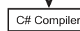

```il
.method private hidebysig static void Main() cil managed
    .entrypoint
    //Code size 11 (0xb)
    .maxstack 8
    IL_0000: ldstr "Hello. My name is Inigo Montoya"
    IL_0005: call void [mscorlib]System.Console::WriteLine(string)
    IL_000a: ret // end of method HelloWorld:Main
```


```assembly
00000000 push   ebp
00000001 mov     ebp,esp
00000003 sub     esp,28h
00000006 mov     dword ptr [ebp-4],0
0000000a mov     dword ptr [ebp-0Ch],0
00000014 cmp     dword ptr ds:[001833E0],0
0000001b je      000000c2
0000001d call    75F9C9E0
00000022 mov     ecx,dword ptr ds:[01C3141h]
00000028 call    dword ptr ds:[03C8E854h]
0000002e nop
0000002f mov     esp,ebp
00000031 pop     ebp
00000032 ret
```

图 24.1：将 C# 编译为机器码

## 第 24 章：通用语言体系

### 运行时

即使在运行时将 CIL 代码转换为机器码并开始执行后，它仍然继续保持对执行的控制。在作为运行时的代理上下文中执行的代码是托管代码，而在运行时控制下执行的过程即为托管执行。对执行的控制权转移交给数据；这使得数据的内存由运行时自动分配和释放。

有些不一致的是，“通用语言运行时”（Common Language Runtime, `CLR`）这一术语在技术上并不是属于 CLI 的通用术语。相反，`CLR` 是微软针对 .NET 框架的运行时的特定实现。无论如何，CLI 通常用作运行时的通用术语，而技术准确的术语“虚拟执行系统”（Virtual Execution System）在 CLI 规范之外很少被使用。

由于代理控制程序的执行，因此可以向程序中注入额外的服务，即使程序员没有显式地为它们编写代码。因此，托管代码提供了信息以允许附加这些服务。除了其他项目外，托管代码允许定位有关类型成员的元数据、异常处理、访问安全信息以及遍历栈的能力。本节的其余部分描述了通过运行时和托管执行提供的某些额外服务。CLI 并没有显式要求所有这些服务，但已建立的 CLI 框架对每种服务都有实现。

### 垃圾回收

垃圾回收是根据程序需要自动释放内存的过程。对于没有自动化系统来执行此类清理的语言来说，这代表了一个重大的编程问题。没有垃圾回收器，程序员必须记住始终释放他们所做的任何内存分配。忘记这样做，或对同一内存分配重复这样做，可能会导致程序中出现内存泄漏或损坏——这在 Web 服务器等长时间运行的程序中会被加剧。由于运行时对垃圾回收有内置支持，针对运行时执行的程序员可以专注于添加程序功能，而不是关注与内存管理相关的“水路”工作。

### 语言对比：C++——确定性析构

垃圾回收器工作原理的确切机制并不是 CLI 规范的一部分；因此，每个实现可以采取略不同的方法。（事实上，CLI 并没有显式要求垃圾回收。）C++ 程序员可能需要熟悉的一个关键概念是，垃圾回收对象并不总是**确定性地**回收的（在定义的范围之外）。垃圾回收器仅负责内存管理；如果需要释放内存以外资源，使用资源的程序员应该利用特殊模式（见第 10 章）。

## 初学者主题

### .NET 中的垃圾回收

如果你不是按顺序阅读本节，大多数 CLI 实现使用分代、压缩、基于标记-清除的算法来回收内存。“分代”意味着存活时间短的对象回收速度快于那些经历过垃圾回收的对象。

此外，NET 垃圾回收器使用标记-清除算法。在每次垃圾回收执行期间，它标记要释放的对象，并将剩余的对象压缩在一起，使得它们之间没有“脏”空间。使用压缩填充已释放的空间通常会产生更快的实例化（相对于非托管代码），因为不需要搜索内存来定位空间。压缩减少了分页概率，因为更多对象位于相同的页面，这提高了性能。

垃圾回收器考虑机器资源以及执行时对这些资源的需求。例如，如果计算机内存大部分空闲，垃圾回收器就不会运行并花时间清理这些资源。非基于垃圾回收的执行环境和语言很少进行优化。

### 类型安全

同样，如果你不是按顺序阅读本节，可能不知道运行时提供的优势之一是检查类型转换，即类型检查。通过类型检查，运行时可以防止程序员无意中引入导致缓冲区溢出漏洞的非法转换。此类漏洞是入侵计算机系统的手段之一——运行时能够自动防止这些漏洞出现是一项巨大的收益。运行时提供的类型检查确保了以下内容：

- 变量以及它们所引用的数据都是经过类型的，且变量的类型与其所引用的数据类型兼容。
- 能够局部分析一个类型（无需分析使用该类型的所有代码），以确定执行该类型成员所需的权限。
- 每个类型都有一组编译时定义的方法及其包含的数据。运行时强制关于哪些类可以访问这些方法和数据的规则。例如标记为“私有”（`private`）的方法仅由所属类型访问。

2. 假设你不是那种寻找此类漏洞的不法分子类型。

## 高级主题

### 绕过封装和访问修饰符

在适当的权限下，可以通过被称为“反射”（`reflection`）的机制绕过封装和访问修饰符。反射通过允许浏览类型的成员、在对象的元数据中查找特定构造项的名称以及调用该类型的成员，从而实现了晚绑定。

## 平台可移植性

C# 程序具有平台移植性，支持在不同的操作系统上执行（跨平台支持）——也就是说，C# 程序能够在多个操作系统上运行，并在不同的 CLI 实现上执行。在此语境下，可移植性不仅限于为每个平台重新编译源代码，而是指一个框架可以在任何兼容 CLI 的框架上运行，而无需重新编译。这种可移植性的出现是因为代码迁移工作由运行时实现完成，而不是由应用程序开发者完成（得益于 `.NET Standard`）。当然，限制条件是你的跨平台代码中不能使用任何特定平台的 API。在开发 CLI 跨平台应用时，开发者可以将通用代码打包或重构为跨平台兼容的库，然后从平台特定的代码中调用这些库，以减少支持跨平台应用所需的代码总量。

## 性能

许多习惯于编写非托管代码（`unmanaged code`）的程序员会正确指出，无论托管环境多么简单，都会给应用程序带来开销。这种权衡是托管代码中更高的开发生产力、更少的 Bug 与性能之间的取舍。同样的二元对立也出现在编程从汇编语言转向 C 等高级别语言，以及从结构化编程转向面向对象开发的过程中。在大多数情况下，开发生产力占上风，特别是当硬件的速度和价格的下降超过了应用程序的需求时。在架构设计上花费的时间比低级开发的复杂性更有可能产生巨大的性能收益。在缓冲区溢出导致安全漏洞的背景下，托管执行更具吸引力。

毫无疑问，某些开发场景（例如设备驱动程序）可能尚未适合托管执行。然而，随着托管执行能力和复杂性的提升，许多此类性能考量可能会消失。届时，非托管执行将保留给那些认为认为精确控制或绕过运行时的开发场景。³

此外，运行时引入了几个因素，可能有助于获得比原生编译（`native compilation`）更优的性能。例如，由于到机器码的转换是在目标机器上进行的，生成的编译代码与该机器的处理器和内存布局相匹配，从而获得了 JIT 语言通常无法利用的性能提升。此外，运行时能够响应执行条件，而直接向机器码的编译很少考虑到这些条件。例如，如果装箱（`box`）拥有的内存比所需的多，非托管语言仍然会在代码中确定的、编译定义的执行点释放内存。与此相反，JIT 编译语言仅在运行时内存不足或程序关闭时才需要释放内存。尽管 JIT（`jitting`）会给执行过程增加一个编译步骤，但 JIT 编译器插入的代码效率可能会导致与直接编译为机器码的程序相当的性能提升。最终，CLI 程序并不一定比非 CLI 程序快，但它们的性能具有竞争力。

## 程序集（Assemblies）、清单（Manifests）和模块（Modules）

CLI 包含了源语言编译器输出的 CIL 规范，通常是一个程序集。除了 CIL 指令外，程序集还包含一个清单，该清单由以下组件组成：

- 程序集定义和导入的类型
- 程序集本身的版本信息
- 程序集依赖的额外文件
- 程序集的安全权限

清单本质上是程序集的头文件，提供了关于程序集组成部分的所有信息，以及唯一标识它的信息。

程序集可以是类库，也可以是可执行文件本身，一个程序集可以引用其他程序集（反之也可以引用其他程序集），从而建立一个由许多组件组成的应用程序，而不是作为一个大型的单体程序存在。这是现代编程框架理所当然的一个重要特性，因为它显著提高了了可维护性，并允许单个组件在多个程序之间共享。

除了清单外，程序集还包含在一个或多个模块中的 CIL 代码。通常，程序集和清单被合并到一个文件中，如 `HelloWorld.exe` 所示。但是，也可以将模块放在单独的文件中，并使用链接器（`linker`）创建程序集。这种方法不仅提供了将程序集拆分为组件的方法，还允许使用多种语言开发库。

³. 确实，微软已经表示，托管开发将成为未来为其 Windows 平台编写应用程序的主要手段，即使对于那些与操作系统本身集成的应用程序。


**图 24.2 带有模块的程序集**

注意，程序集和模块都可以引用文件。虽然罕见，但两个不同的程序集可以引用同一个模块。

尽管程序集可以包含多个文件，但整个文件组只有一个版本号。因此，最小的可版本化组件是程序集。如果你更改了任何引用的文件（即使是为了发布补丁）而不更新清单，你将违反程序集的完整性。结果是，程序集构成了可以进行版本化和安装的最小单元。

尽管程序集（逻辑构造体）可以由多个模块组成，但大多数程序集只包含一个模块。此外，微软现在提供了一个 `ILMerge.exe` 工具，用于将多个模块及其清单合并到一个文件中。

由于清单包含了对程序集依赖的所有所有文件的引用，因此可以使用清单来确定其依赖关系。此外，在执行期间，运行时只需要检查清单来确定它需要哪些文件。只有分发多个应用程序共享的库的工具供应商（例如微软）才需要在部署时注册这些文件。这使得部署变得简单得多。通常，基于 CLI 的应用程序部署被称为“xcopy 部署”，这是因为 Windows 的 `xcopy` 命令只需将文件复制到选定的目标。

## 语言对比：COM 注册

与过去的微软 COM 文件不同，CLI 程序集很少需要任何类型的注册。相反，可以通过将组成程序的文件复制到特定目录并运行程序来部署应用程序。

## 通用语言

与通用语言基础设施名称一致，CIL 和 CLI 的另一个重要特性是支持同一个应用程序内多种语言的交互（而不是源代码跨多个操作系统的移植性）。因此，CIL 不仅是 C# 的中间语言，也是许多语言的中间语言，包括 Visual Basic .NET、类 Java 语言 J#、某些 Smalltalk、C++ 以及 COBOL 和 FORTRAN 的版本。编译为 CIL 的语言是源语言，拥有将源语言转换为 CIL 的自定义编译器。一旦编译为 CIL，源语言就不再重要。这一强大功能允许跨组织的不同开发小组开发库，而不必担心特定小组的语言选择。因此，CIL 既实现了编程语言的互操作性，也实现了操作系统的可移植性。

# 第 24 章：通用语言基础设施 (CLI)

> 注意：CLI 的一个强大特性是它支持多种语言。这种支持使得可以使用多种语言创建程序，并允许使用一种语言编写的代码调用另一种语言编写的库。

## 通用类型系统

无论使用何种编程语言，生成的程序在内部都是基于数据类型进行操作的；因此，CLI 包含了通用类型系统（Common Type System，`CTS`）。`CTS` 定义了类型在内存中的结构和布局，以及围绕类型的概念和行为。它包含了类型操作指令，以及存储在类型内部中的信息。`CTS` 标准适用于类型在语言外部边界的呈现方式和行为，因为 `CTS` 的目的是实现语言之间的互操作性。在执行时，由运行时负责执行 `CTS` 建立的约束。

在 `CTS` 内部，类型被分为两类：

- *值（Values）*：是用于表示基本类型（如整数和字符）以及以结构体形式存在的复杂数据的位模式。每个值类型对应于一个独立的类型标识，该标识并不存储在位数据中。独立的类型标识指向类型定义，该定义提供了值中每个位位的含义以及该值支持的操作。
- *对象（Objects）*：包含在对象的类型标识中。这有助于实现类型检查。对象具有标识性，使得每个实例都是唯一的。此外，对象具有槽位（slots），可以存储其他类型（值或对象引用）。与值不同，更改槽位的内容不会改变对象的标识性。

这两类类型直接对应到 C# 语法，该语法提供了声明每种类型的手段。

## 通用语言规范

由于 `CTS` 提供的语言集成优势通常大于实现它的成本，大多数源语言都支持 `CTS`。然而，`CTS` 语言中还有一个子集被称为通用语言规范（Common Language Specification，简称 `CLS`），其侧重点在于库的实现。`CLS` 专为库开发者设计的，并为他们提供了编写库的标准，使得这些库可以被大多数源语言访问，无论使用该库的源语言是否符合 `CTS` 规范。它之所以被称为通用语言规范，因为它旨在鼓励 CLI 语言提供创建互操作库（或其他语言）的方法。

例如，尽管某种语言提供无符号整数支持是完全合理的，但此类类型并未包含在 `CLS` 之中。因此，实现类库的开发者不应暴露无符号整数，因为这将导致库对于不支持无符号整数的符合 `CTS` 规范的源语言访问性降低。理想情况下，任何需要从多种语言访问的库都应该符合 `CLS`。请注意，`CLS` 不关注那些没有暴露到程序集外部的类型。

另外注意，当你创建一个不符合 `CLS` 规范的 API 时，编译器可能会发出警告。要实现这一点，你可以使用程序集特性 `System.CLSCompliant` 并将参数指定为 `true`。

## 元数据

除了执行指令外，CIL 代码还包含了关于程序包含的类型和文件的元数据。元数据包括：

- 程序或类库中每种类型的描述
- 清单（`manifest`）信息，其中包含关于程序本身的数据以及它依赖的库
- 嵌入在代码中的自定义属性（`custom attributes`），提供了有关属性所装饰结构的附加信息

元数据不是 CIL 的一个草率的、非本质的附加组件，而是 CLI 实现的核心组件。它提供了关于类型的表示信息和行为信息，并包含了包含特定类型定义的程序集位置信息。它在保存从编译器生成的数据、并在执行时让调试器和运行时访问这些数据方面起着关键作用。这些数据不仅存在于 CIL 代码中，在机器码执行期间也可以访问，以便运行时能够继续进行任何类型检查。

元数据为运行时提供了一种处理原生代码和托管代码混合执行的机制。此外，它增加了代码和执行的健壮性，因为它滑了从一个库版本到下一个版本的迁移，将编译时绑定替换为加载时实现。

关于库及其依赖项的所有头部信息都在元数据中称为清单（`manifest`）的部分。因此，元数据的清单部分允许开发者确定模块的依赖关系，包括有关依赖项特定版本的信息，并指示是谁创建了模块。在执行时，运行时使用清单来确定加载哪些依赖库、库或主程序是否被篡改，以及是否缺少程序集。

元数据还包含可能装饰代码的自定义属性。属性提供了关于 CIL 指令的附加元数据，可以在执行时通过程序访问。

元数据通过称为反射（`reflection`）的机制在执行时可用。通过反射，可以在执行时查找类型或其成员，然后调用该成员或判断某个结构是否被特定的属性所装饰。这提供了晚绑定（`late binding`），即系统在执行时而非编译时确定执行哪些代码。反射甚至可以用于通过遍历元数据并将其复制到某种帮助文档中生成文档（参见第 18 章）。

## .NET Native 与离线编译

`.NET Native` 特性（由 `.NET Core` 和最近的 `.NET Framework` 实现支持）创建一个特定平台的可执行文件。这被称为离线编译（`AOT`）。

`.NET Native` 允许程序员继续使用 C# 编写代码，同时通过消除 JIT 编译代码来实现原生代码性能和更快的启动速度。当 `.NET Native` 编译应用程序时，`.NET FCL` 被静态链接到应用程序；还包含了针对静态预编译优化的 `.NET Framework` 运行时组件。这些专门构建的组件针对 `.NET Native` 优化，并比标准的 `.NET` 运行时提供了更高的性能。编译步骤不会改变你的应用程序。你可以自由使用 `.NET` 的所有结构和 API，并依赖托管内存和清理，因为 `.NET Native` 将 `.NET Framework` 的组件包含在你的执行文件中。

## 总结

本章描述了许多新术语和缩写，对于理解 C# 程序运行的上下文非常重要。大量的三个字母缩写可能会令人困惑，因此表 24.2 总结了属于 CLI 的术语和缩写。

表 24.2：常见的 C# 相关缩写

| 缩写 | 定义 | 描述 |
| :--- | :--- | :--- |


| .NET | 无 | Microsoft 对整个 CLI 栈的实现。包括 CLR、CLI 和各种语言，所有这些都符合 CLS 规范。 |

| BCL | 基类库 (Base Class Library) | CLI 规范的一部分，定义了构建几乎所有程序所需的集合、线程、控制台和其他基类。 |

| C# | 无 | 一种编程语言。与 CLI 标准独立的是 C# 语言规范，该规范由 ECMA 和 ISO 标准机构批准。 |

表 24.2：常见的 C# 相关缩写（续）

| 缩写 | 定义 | 描述 |

| :--- | :--- | :--- |

| CIL (IL) | 通用中间语言 (Common Intermediate Language) | CLI 规范的语言，定义了在 CLI 实现上执行的代码指令。它有时被称为 IL 或 Microsoft IL (MSIL)，以与其他语言区分来。（为了表示这是一个比 Microsoft 更广泛的标准，优先使用 CIL 而非 MSIL。） |

| CLI | 通用语言基础设施 (Common Language Infrastructure) | 定义了中间特性、基类和行为特性的规范，使实现者能够创建虚拟执行系统和编译器，源语言在通用执行环境之上可以互操作。 |

| CLR | 通用运行时 (Common Language Runtime) | Microsoft 根据 CLI 规范定义的运行时实现。 |

| CLS | 通用语言规范 (Common Language Specification) | CLI 规范的一部分，定义了源语言为了在实现为 CLI 规范的运行时必须支持的核心特性集。 |

| CTS | 通用类型系统 (Common Type System) | 通常由 CLI 语言实现的标准，定义了语言向外部公开的类型表示和行为。它包含了关于如何形成新类型的概念。 |

| FCL | .NET Framework 类库 (.NET Framework Class Library) | 组成 Microsoft .NET Framework 的类库。它包括 Microsoft 对 BCL 的实现以及用于 Web 开发、分布式通信、数据库访问和丰富的客户端用户界面开发等大量类。 |

| VES (运行时) | 虚拟执行系统 (Virtual Execution System) | 管理为 CLI 编译的程序执行的代理。 |

# 索引

# 符号

- * & (`&amp;`). 参见 符号 (`&`)

- <> (角括号) 泛型, 540, XML, 33

- * (星号). 参见 星号 (*)

- @ (at符号) 标识符, 16–17, 字面量字符串, 60

- \ (反斜杠) 转义序列, 57–58, 作为字面量, 60

- ^ (脱字符). 参见 插入符号 (^)

- : (冒号). 参见 冒号 (:)

- , (逗号). 参见 逗号 (,)

- [] (花括号). 参见 花括号 ([])

- $ (美元字符串) 用于字符串插值,

- " (双引号) 转义序列, 57, 59, 字符串, 59–60

- = (等号). 参见 等号符号 (=)

- ! (感叹号). 参见 感叹号 (!)

- / (正斜杠). 参见 正斜杠 (/)

- > (大于字符串). 参见 大于符号 (>)

- # (哈号) 用于预处理器指令, 180

- - (连字符). 参见 减号 (-)

- < (小于字符串). 参见 小于符号 (<)

- - (减号). 参见 减号 (-)

- ( (括号). 参见 括号 ()

- % (百分号) 复合赋值, 132, 覆盖, 466, 468, 优先级, 124, 取余运算, 123

- . (句号) 全限定方法名, 198, 嵌套命名空间, 210, 空条件运算符, 158

- + (加号). 参见 加号 (+)

- ? (问号) 命令行选项, 783, 条件运算符, 154–155, 空合并运算符, 157–158, 空条件运算符, 158–160

- ; (分号) 语句结束, 20, for 循环, 171–172, 预处理器指令, 189

- ' (单引号) 字符, 57, 转义序列, 72

- [] (方括号) 数组, 101–103, 属性, 783–784, 索引器, 750, 空条件运算符, 158–160

- ~ (波浪号) 取反运算符, 167, 终结器, 494, 列表搜索, 736, 覆盖, 468

- (下划线). 参见 下划线 (\)

- | (竖线) 位运算运算符, 164, 复合赋值, 167, 逻辑运算符, 151–152, 覆盖, 466, 468

- PLINK 查询, 908, 911

- 发布/订阅模式, 640

- 任务, 836–840, 847

- 包装异常, 517

- 用于继承的聚合, 345

- 提前编译 (AOT), 993

- 警报序列, 58

# A

- `\a` 转义序列, 58

- 抽象类

  - 定义, 357–360

  - 与接口对比, 413–414

  - 概述, 357

  - 多态, 361–363

  - 抽象修饰符

  - 接口重构, 405

  - 局限性, 357, 386

- 命令行选项, 789–793

- 命名空间, 213–214

- `AllowUnsafe` 代码选项, 963

- `AllowMultiple` 参数, 795

- `AllowUnsafe` 属性, 307

- `AllowUnsafeBlocks` 选项, 962

- if 语句的替代语句, 142

- 访问修饰符

  - 基类顺序, 353–354

  - 类, 274–276

  - 派生, 341–344

  - 终结器, 495

  - getter 和 setter, 289–291

  - 类型声明, 479–481

- 符号符号 (&)

  - 取地址运算符, 965

  - 位运算运算符, 164

  - 复合赋值, 167

  - 逻辑运算符, 152

  - 覆盖, 466, 468

- 访问

  - 数组, 106

  - 基成员, 354–355

  - 实例字段, 264–265

  - 属性, 425–426

- AND 操作

  - 位运算运算符, 164–165

  - 举, 444–445

  - 逻辑运算符, 152

- 角括号 (<)

  - 泛型, 540

  - 引用类型成员, 970

  - 静态字段, 312–323

  - XML, 332

- 匿名函数, 600, 602

- 匿名方法, 600

- 内部机制, 610–611

- 用 lambda 表达式替代, 587–588

- 浮点类型的精度, 128–129

- 缩写作为标识符, 15–16

- `Action` 委托, 592–594

- 激活帧, 216

- `Add()` 方法

  - 集合初始化器, 298, 654–655

  - 字典, 739

  - 锁, 727

  - 列表, 733

  - 概述, 607–608

  - 参数, 607–608

- 匿名类型

  - 集合初始化器, 702–703

  - 生成, 702

  - 局部变量, 697–696

  - 选择进入, 698–699

  - 类型安全和不可变性, 700–701

- 加

  - 二元运算符, 123

  - 复合赋值, 132

  - 增量运算符, 133

  - 字符串, 126–127

  - 一元运算符, 122–123

- 地址运算符 (), 965

- 地址和指针. 参见 指针

- `AggregateException`, 类型, 247

- 用于继承的聚合, 345

- 提前编译 (AOT), 993

- 警报序列, 58

- 前驱任务, 830–831

- `Any()` 运算符, 672

- `ArgumentException`, 类型, 523

  - 描述, 247

  - 属性, 285

- `ArgumentNullException`, 类型, 513–514

  - 描述, 247

  - 属性, 285

- `ArgumentOutOfRangeException`, 类型, 513–514

- 参数

  - 泛型, 540

  - 方法, 197–198

  - 按值传递, 217

  - 传递, 592–596

- 数组访问, 106

- 数组

  - 匿名类型, 702–703

  - 常见错误, 117–119

  - 声明, 98–99

  - 初始化和赋值, 102–106

  - 长度, 109–110

  - 实例成员, 114–115

  - 方法, 112–114

  - 空条件运算符, 159

  - 参数, 226–229, 552

  - 范围, 101, 111–112

  - 调整大小, 114

  - 反向访问, 100

  - 不安全协变, 580

  - 使用, 106–109

- `ArrayTypeMismatch`, 类型, 248

- `ArrayEnumerable` 类, 875–877

- `Async()` 方法, 875

- `async` 运算符, 861–867, 890–891

- `async` 返回类型, 869–870, 777–880

- `async void` 方法, 777–880

- 异步调用, 818

- 异步 lambda, 881–888

- 异步方法返回类型, 877–881

- 异步模式. 参见 基于任务的异步模式 (TAP)

- 异步流, 870–874

- 异步任务

  - 复杂性, 822–823

  - 引言, 824–828

  - 任务延续, 829–836

  - 任务异常, 836–840

  - 线程异常, 840–843

  - TPL, 823–824

- `AsyncState` 属性, 828

- At符号 (@)

  - 标识符, 16–17

  - 字面量字符串, 60

- 多线程中的原子操作, 819–820

- `AttachedToTask` 延续选项, 832

- 属性

  - 自定义, 787, 992

  - 描述, 769

  - 举举, 443

  - `FlagsAttribute`, 794–795

  - 命名参数, 794–795

  - 接口, 413–414

  - 初始化, 789–793

  - 可空, 306–309

  - 预定义, 784–185

  - 属性, 783–787

  - 限制, 793–794

  - 获取, 787–789

  - `System.ConditionalAttribute`, 797–799

  - `System.ObsoleteAttribute`, 799–800

  - `System.UseAttribute` 类, 794–797

- `AutoReset` 事件, 937

- `Average()` 函数, 693

- `Await()` 方法, 876–877

- `await` 运算符, 迭代, 892–893, 基于任务的异步模式, 861–867, 890–891

- 自动实现属性, 287, 305–306, 引用类型, 305–306, 结构体, 423–424

- `await using` 语句, 874–875

- `AwaitAsync()` 方法, 875, 877

- `AwaitCancellationAsync()` 875–876

- `\ b`序列, 58

- 反斜杠 (\) 转义序列, 57–58, 作为字面量, 60

- 退格转义序列, 58

- 基类库 (BCL) 描述, 977, 993, 目的, 35, 979, 类型名称, 46–49, 56, 59

- 基类覆盖

  - 构造函数调用, 355–356

  - 成员, 353–355

  - `new` 修饰符, 349–353

  - 概述, 346

  - `sealed` 修饰符, 353–354

  - `virtual` 修饰符, 346–349

- 基类

  - 派生对象转换为基, 339

  - 继承, 257–258

- 基类型

  - 派生类型之间的转换, 339–340

  - 类, 258–259

- 二进制位 (bits), 162–163

- 二叉表达式树, 618–629

- 二元运算符

  - 结合性, 125

  - 复合赋值, 132, 468

  - 非数值类型, 126–127

  - 空合并运算符, 157

  - 覆盖, 466–467

  - 概述, 123–124

  - 关系和相等运算符, 150–151

# 索引 999

## 二进制值 (Binary values)

- 转换, 165–167

- 浮点, 47

- 字面量, 53

- 移位运算符, 163

- `BinaryExpression` 表达式树, 623

## `BinarySearch(method)`

- 数组, 112–114

- 列表搜索, 736

- `BinaryTree<T>` 约束, 553–557

- 索引运算符, 152

- 迭代器, 735–756, 759–762

- 参数, 572

- 在循环中, 448

- 概述, 428–432

- 命名空间的品牌大小写, 482

## `Break(method)`, 905

- `break` 语句

- lambda 表达式, 606

- 概述, 141

- `switch` 语句, 177–178

- 使用方法, 180–181

- `yield break`, 764

## 中断并行循环, 904–905

## 脆弱基类, 349–351

## 泡排序, 588–602

## 缓冲区溢出

- C# vs. C++, 108–110

-托管执行, 986

- 类型安全, 35, 984

- 不安全代码, 922

## `byte` 类型, 46

## Bytes (Bytes), 162–163

## 绑定 (Binding)

- 动态, 801, 806–807

- 扩展方法, 412

- 晚绑定, 518, 985, 992

- 元数据, 992

## 位 (Binary digits), 162–163

## 位运算运算符 (Bitwise operators)

- 位与字节, 162–163

- 补码, 167, 736–737

- 复合赋值, 167

- 枚举, 444–445

- 用于位置, 181–182

- 移位, 163–164

- 使用方法, 164–167

## C 语言与 C# 法的相似性，

## C++ 语言对比 C#

- 数组, 101–102

- 布尔值转换, 75

- 缓冲区溢出, 109–110

- `delete` 运算符, 262

- 确定性析构, 502, 983

- 等值检查, 150

- 全局变量和函数, 311

- 头文件, 208

- 隐式重写, 347

- 增/减运算符, 136

- 局部变量作用域, 149

- `Main(in)`, 19

- 构建期间调用的方法, 348–349

- 多重继承, 345

- 操作数求值, 126

- 仅运算符语句, 123

- 指针声明, 964

- 预处理器指令, 186

- 纯虚函数, 361

- `short` 类型, 47

- 字符串拼接, 61

- 结构体, 427

- `switch` 语句, 179

- 参见 代码块 (Code blocks)

## `Blocking<T>` 类, 938–992

## Boolean(bool) 类型

- 数组初始值, 104

- 版本, 75

- 流程控制, 593

- 逻辑运算符, 151–153

- 概述, 55–56

- 关系和等等运算符, 150–151

- if 语句的布尔表达式, 142

## 布尔运算符 (Boolean operators)

- 逻辑, 151–155

- 重写, 468–470

## 边界 (Bounds)

- 数组, 109–110

- 浮点类型, 131

## 装箱 (Boxing)

- 避免, 435–436

- 泛型, 543

- 特性, 432–439

# C

# 1000 索引

- 语法相似性, 2–3

- Variant 和 Var, 90

- `void` 类型, 71, 90

## 计算型属性 (Calculated properties), 287–289

- 调用点, 217

- 方法的调用栈, 216–217

## 回调函数 (Callback functions), 587

## CallerName 参数特性的, 782

## 调用 (Calling)

- 集合标识符, 297–298

- 构造函数, 294–295

- 外部函数, 956–958

- 对象标识符, 296–297

- `Callable<T>` 类型, 805

## camelCase (小驼峰法)

- 描述, 16

- 参数名, 205, 268, 300

- 属性名, 282

- 元组, 95

- 变量名, 24, 92

## `Cancel()`

- 并行迭代, 903

- LINQ 查询, 911

- 任务, 845–846

## 取消 (Canceling)

- 迭代, 763–764

- 并行循环, 901–903

- LINQ 查询, 808–911

- 任务, 843–849

- `CancellationToken` 类

- 异步方法, 885

- 异步流, 872–883

- 概述, 843–847

- LINQ 查询, 911

- `CancellationToken` 属性, 904

- `CancellationTokenSource`, 845–846, 903

- 列表容量, 731–733

## `Capture()` 方法, 517

- 捕获变量, 611–612

- 数组, 107–108


- 位运算运算符, 164
- 复合赋值, 167
- 尾索引, 99, 107, 112
- 逻辑运算符, 152
- 重写, 466, 468
- 回车
- 换行, 66
- 卡尔积, 684
- 查询表达式, 723
- `goto` 语句, 185
- `switch` 语句, 177, 179

## 大写敏感性 (Case sensitivity)
- 相似性, 3
- 重要性, 2

## 命名法/大小写转换 (Casing)
- 标识符格式, 15–16
- 局部变量, 24
- 转换运算符和转换
- 基类和派生类型, 339–340
- 定义, 341
- 枚举, 440–441
- 隐式转换, 76
- 泛型方法, 572–573
- 继承链, 340
- 重写, 470–471
- 概述, 77–72

## Catch 块 (Catch blocks)
- 异常, 514–516, 518–520
- 通用, 248–249
- 抛出异常, 251
- 捕获异常, 241–242, 514–518, 518–519
- 使用方法, 242–245

## 中央处理器 (CPUs)
- 描述, 815
- 多线程, 814, 818
- LINQ 查询, 670

## 链 (Chains)
- 循环, 930
- 构造函数初始化器, 301–302
- 构造函数, 300–301
- 委托, 633–634, 337–640
- 表达式, 158–160
- 继承, 338–340
- 迭代器, 762
- 空值合并运算符, 158
- 查询, 722
- 任务, 830–831, 853

## 字符 (char) 类型
- 算术运算, 127–128
- 初始值, 104
- 描述, 23, 56
- 检查转换, 73–75, 528–530
- 检查 as, 73–75, 529
- CheckOverflow 属性, 529
- 派生类型, 258, 336
- Alonzo, 608

## CLI. 参见 通用中间语言 (CIL)
- 循环等待条件, 930
- 指南, 17
- `class` 关键字, 259

## 类 (Classes)
- 抽象, 357–363
- 访问修饰符, 274–276
- 关联数据, 314
- 具体, 357
- 约束, 560–561
- 构造函数. 参见 构造函数 (Constructors)
- 声明, 259–260
- 析构函数, 309–311
- 定义, 260
- 委托, 597–600
- 封装, 261–262, 323–326
- 扩展方法, 321–322
- 存储和加载文件, 270–273
- 泛型, 540–544, 779–780
- 层次结构, 257–258
- 可扩展, 320
- 继承. 参见 继承 (Inheritance)
- 实例字段, 262–265
- 实例方法, 265–266
- 实例化, 260–261
- 接口. 参见 接口 (Interfaces)
- 库, 472–475
- 成员, 262
- 方法, 197–198
- 多个接口, 544–546
- 多个迭代器, 766–767
- 嵌套, 326–328
- 可空属性, 306–309
- 面向对象编程, 256–259
- 概述, 255–256
- 部分类, 329–332
- 属性. 参见 属性 (Properties)
- 重构, 336–337
- 密封, 345
- 静态, 319–321
- 静态成员. 参见 静态成员
- 与 结构体对比, 763
- `this` 关键字, 266–270

## `Clear()` 方法, 112, 114

## CLI. 参见 通用语言基础 (CLI)

## 时钟速度, 813

## `Clone()` 方法, 114–115

## `Close()` 方法, 497

## 闭包变量, 611–612

## CLR (通用语言运行时)
- 描述, 298, 994
- 枚举, 440–441
- 命名空间, 481–483
- 库, 355
- 元数据, 991

## 通用类型系统 (CTS), 34, 990, 994
- 在垃圾回收中压缩对象
- `Compare()` 方法, 56, 63

## CLS (通用语言规范)
- 描述, 994
- 规属性, 991

## 簇 (Clusters), 754

## 代码块 (Code blocks)
- 访问, 35
- 异常处理, 242–244
- `if` 语句, 144
- 循环, 169–170
- 预处理器指令, 191–193

## 代码分析 (Code Analysis), 306–309

## 集合 (Collections)
- 匿名类型, 702–703
- 分类, 731–733
- `foreach` 循环, 174–175, 662
- `IEnumerable<T>`, 657–663
- 索引器, 750–752
- 实例化器, 297–298, 654–657, 702–703
- 继承, 653–654, 728–731
- 连接操作. 参见 连接操作 (join operations)
- 链表, 749
- 空值值, 753

## 冲突 (Collisions), 198

## 冒号 (:)
- 条件运算符, 154–155
- 约束, 561
- 构造函数, 301
- 派生, 336
- 十六进制格式, 54
- 标签, 185
- 线程模型, 558–559, 634, 650–651
- 哈希值, 455
- 参数, 217–218, 220–226
- `COMException` 类型, 514
- `CommandLine` 参数, 19, 214–216
- `CommandLineInfo` 类, 773–779
- `CommandLineRequiredAttribute`, 797
- `CommandLineSwitchAttribute`, 797
- `CommandLineUtils` 包, 773

## 逗号 (,)
- 数组, 99, 102, 106
- 属性, 787
- 约束, 561
- 枚举, 447
- `for` 循环, 173
- 接口, 384
- 方法, 205
- 变量声明, 23, 499

## 注释 (Comments)
- 指南, 33
- 概述, 30–33
- XML

## 通用中间语言 (CIL)
- 匿名类型, 697–698
- 数组, 34
- 装箱代码, 428–432
- 编译为, 974–975
- 描述, 994
- 事件, 649–650
- 通用 catch 块, 519
- 泛型表示, 581–582
- `ILDASM`, 36
- 索引器, 751
- 元数据, 770, 991–992
- 外部变量实现, 613–614
- 输出, 37–39
- 属性, 291–293
- 目的, 989–990

## 通用语言基础 (CLI)
- 数组, 986–989
- 基类库 (Base Class Library), 979
- CLS, 988–990
- CLS, 991
- 编译为, 979–981
- CTS, 990
- 描述, 974–995
- 封装, 985
- 垃圾回收, 982–984
- 实现, 975–976
- 清单文件, 986–989
- 元数据, 991–992

## Microsoft .NET Framework, 975–977
- 模块, 986–989
- 多路委托, 636–637
- 命名空间, 482
- .NET Core, 977–988
- .NET Native 特性, 993
- .NET Standard 版本, 778–979
- 概述, 34–35, 973
- p/Invoke, 948–960
- 性能, 985–986
- 平台移植性, 985
- 运行时, 982–984
- 类型安全, 984
- Xamarin 编译器, 978

## 通用语言运行时 (CLR)
- 描述, 982, 994
- 枚举, 440–441
- 命名空间, 481–483
- 库, 355
- 元数据, 991

## 通用类型系统 (CTS), 34, 990, 994
- 在垃圾回收中压缩对象
- `Compare()` 方法, 56, 63

## 索引 1003
- `CompareExchange()` 方法，926–927
- `CompareTo()` 方法
- 集合排序，734–735
- 接口，555–557
- 树排序，553–554
- 比较
    - 二叉树节点，556–557
    - 集合项，734–735
    - 比较/交换模式，926–927
    - 浮点类型，129–130
    - 字符串，63
- 比较运算符
    - 重写，464–465
    - 指针，969
- 与枚举类型的兼容性，440–441
- 编译
    - 提前编译 (ahead of time)，993
    - 程序集 (assembl)，10–11
    - 反汇编，36
    - 编译为机器码，979–981
    - 示例输出，37–39
    - 源代码，3–8, 34–35
    - 静态与 动态，807–808
- `CompilerGeneratedAttribute`，293
- 补码运算符，167
- 异步请求的复杂度，859–861
- `ComponentModel`，953
    - 实现中的组件，980
- 复合格式化
    - 描述，29
    - 模式，65
    - 字符串，127
- 复合赋值
    - 位运算，167
    - 数学运算符，132
    - 重写，468
- `Compress()`,379
- 字符串的 `Concat()` 方法，62–63
- 查询的 `Concat()` 运算符，693
- 字符串拼接，61–,126–127
- 抽象基类，357
- 并发集合类，938–939
- 并发操作，817–818
- `ConcurrentBag<T>`939
- `ConcurrentDictionary<Key, TValue>` 类，939
- `ConcurrentQueue<T>`，939
- `ConcurrentStack<T>`，939
- 块中的条件句，516
- 条件运算符
    - null. 参见 空值条件运算符
    - 重写，468
    - 使用，154–155
- 条件类型，55–56
- `ConditionalAttribute`，797–799
- 条件表达式树 (ConditionalExpression expression trees)，623
- 条件
    - `for` 循环，172
    - `if` 语句，142
    - `if` 语句中的结果语句，142
- `Console`
    - 注释，30–33
    - 输入，26–197
    - 换行，59, 66
    - 输出，19, 28–33, 197
    - 回路格式化，54–55
    - 字符串方法，62
- `const` 关键字
    - 常量，137–138
    - 封装，323–324
- `ConstantExpression` 表达式树
    - 表达式和局部变量，137–138
    - 模式匹配，366–368
    - `switch` 语句，177
- 约束
    - 类，560–561
    - 构造函数，562–565
    - 委托，558–559
    - 泛型方法，571–572
    - in to，565–567
    - 接口，554–557
    - 限制，567–568
    - 多个，561–562
    - null，560
    - 运算符，567–568
    - 视图，533–555
    - 结构体，560–561
    - 类型参数，557–558
    - 托管，559–560
    - 构造的结构体类型，560
- 构造函数
    - 属性，789–793
    - 基类，355–356
    - 链式，300–301
    - 集合初始化器，297–298
    - 约束，562–565
    - 声明，293–295
    - 默认，295–296
    - 终析函数，298
    - 泛型，547
    - 初始化器，300–302
    - 期间调用的，348–349
    - `new` 运算符，294–295
    - 非可空引用类型属性，303–306
    - 对象初始化器，296–297
    - 重载，298–300
    - 概述，298
    - 从中抛出异常，507
    - 静态，316–318
    - 结构体，424
- 集合转数组，731
- 协变，574
- 动态对象，803
- 枚举，439–443
- 显式，72–73
- 布尔值，77–79
- 实现类和接口，390
- 隐式，75–76
- 重写运算符，470–472
- 概述，72
- 类型安全，35
- 无情况，76–77
- 协作取消，843–847
- 拷贝
    - 数组，115
    - 目录，316–322
    - null 值，85
    - 引用类型，83–841
    - 变量，418–419
- `Contains()` 方法
    - 列表搜索，736
    - 栈搜索，747
- `ContainsGeneric` 属性，779–780
- `ContainsKey()` 方法，741
- `ContainsValue()` 方法，741
- 上下文切换，137–817, 850
- 上下文文本，156
- 任务的延续，829–836
    - lambda 表达式，606
    - `switch` 语句，177
    - 使用，182–184
- `ContinueWith()` 方法
    - 异步请求，859
    - 同步上下文，888–899
    - 任务，829–831, 834–840
- `CopyTo()` 方法
    - 集合，730–731
    - 目录，316–322
- Core .NET 框架，39
- CoreCLR 编译器，975, 977
- Cores，670, 815
- `Count()` 方法
    - 描述，693
    - 元素，671–674
    - 基于索引的集合，412
- `Count` 属性，730–731
- `CountOccurrences()` 方法，860–861, 864
- 协变
    - 委托，609
    - 泛型，573–580
    - 类型参数，577–779
- 控制流
    - as 运算符，373–374
    - 二进制表示，165–167
    - 装箱，428–432
    - 检查与未检查，73–35, 528–530
- CPUs（中央处理器）
    - 描述，815
    - 多线程，814, 818
- PLINQ 查询，670
- `Create()` 方法，551
- 加密类，874
- .cs 文件扩展，9
- CTS（通用类型系统），34, 990, 994
- 花括号
    - 数组，102–103
    - 类，259
    - 代码块，144–147
    - 代码格式化，22
    - 集合初始化器，297, 655–656
    - lambda 表达式，603
    - 命名空间，482
    - 对象初始化器，296
    - 模式匹配，370
    - 字符串插值，29, 61–62, 66
    - `switch` 语句，20
    - 类型定义，17
- 迭代器的 `Current` 属性，764
- 类中的 `DateTime`，514
- 退出，506
- 异步任务的 `CurrentId` 属性，828
- 自定义属性，287, 992
- 自定义转换，340–341
- 自定义异常，523–526
- 动态编程中的自定义对象，808–811
- 针对结构体的自定义值类型，422–424
- 析构函数，311
- 委托类型，592–595
- 枚举，437–438
- 事件，643–644, 648–649
- 外部方法，948–949
- 泛型接口，544–545
- 泛型方法，568–569
- 实例字段，263–264
- 接口约束，555–557
- 局部变量，22–23
- `Main()` 方法，18–19
- 方法，203–204
- 命名空间，482–484
- out 变量，222
- 参数，205
- 指针，963–964
- 属性，277–279
- 只读自动实现的属性，325–326
- 只读文件，324–325
- 返回类型，206–208
- 静态构造函数，316–318
- 静态字段，312
- 结构体，422–423
- 元组，92–96
- 来自非托管结构体，952–953
- 变量，23–24
- D 命名空间，199
- 数据持久化文件，270–273
- `DataBinder` 类，771
- 死锁
    - 避免，929–930
    - 原因，821–823
    - debug() 方法，799
- DEBUG 预处理器标识符，799
- 调试
    - 预处理器指令，188
    - 源代码，8–9
- `Decimal` 类型，49
- 代码块中的声明语句，147–149
- 声明


# 索引 1007

- 数组，98–99, 101–102
- `await` 语句，874
- `Binary<T>` 类，553–554
- 类类型，567–568
- 构造函数，293–295
- 析构函数，309–311
- `Decrement()` 方法，137, 927–928
- `Decrement` 运算符
    - 描述，133
    - 示例，133–136
    - 线程安全，137
    - 版本化，398–400
- `Default`
    - 构造函数，295–296
    - 延迟执行，715
    - 退出，506
    - 发布者-订阅运算符，633–634
    - `lambdas` 语句，601–604
    - 结构等性，608–609
    - 任务，824
- `Delay()` 方法，944
- `Delegate` 类，597–598
- `delegate` 关键字，592
- 派生 `Derivation`
    - 基类和派生类型之间的转换，339–340
    - 自定义转换，340–341
    - 扩展方法，344
    - 接口，397–398
    - 概述，336–338
    - 私有访问修饰符，341–342
    - 保护访问修饰符，342–344
    - 密封 `sealed` 类，345
    - 单一继承，345
    - 来自 `System.Object`，363–365
- 派生成员，335
- 派生对象转换为基类，339
- 派生类型
    - 基类和派生类型之间的转换，339–340
    - 类，258–259
    - 描述，336
    - `DescriptionAttribute`，786
    - `Serialize()` 方法，572–573
    - 确定性析构，502, 983
    - 确定性终析，496–500
    - 确定性资源清理，262
- `Dele` 运算符，262
- 删除文件，496
- 分隔符注释，32
- 分隔符，190
- `DeChildAttach` 任务延续，832
    - 库中的依赖项，107
- `Dequeue()` 方法，748
- 解引用 `Dereferencing`
    - 描述，853
    - 空值条件运算符，513
    - 空引用，85–86
    - 空值，87
    - 指针，968–970

## 索引 1007

- 键相等性, 743–744
- 排序, 745–747
- 线程同步, 939
- 使用, 738–743

文档
- 反射, 770
- XML 文件, 478–489
- 用于字符串插值的美元符号 `($8)`, 28, 61–62

`Dictionary<TKey, TValue>` 类
- 集合, 658
- 使用, 738–743

`Dot. Portable.NET` 编译器, 976

`Dotnet CLI`
- 代码的编译与执行, 12
- `NuGet` 引用, 475–476
- 项目和库引用, 474
- 使用, 4–6
- 数字分隔符, 52–53
- 数组的维度, 102–114

指令
- `dynamic`, 803
- 预处理器, `Ser` 预处理器 指令
- 字符串, 64–65

双引号 `(\"`)
- 转义序列, 57, 59
- 字符串, 59–60

`double` 类型
- 概述, 47–49
- 特殊字符, 128–129
- 目录，拷贝, 316, 321–322

`DirectoryInfo` 类
- `DownloadData()` 方法, 856
- `DownloadDataAsync()` 方法, 858–860, 865
- `Download()` 方法, 856
- `Drawing` 类, 199
- 扩展方法, 321
- 内连接, 682
- `DirectoryInfo` 类, 315–316, 321–322
- `Disallow` 属性, 307
- 区分多个 `Main()` 方法, 214–216
- 鸭子类型 `Duck typing`, 662
- 重复接口, 545–546
- 动态数据类型的原理和行为, 803–805
- 动态调用
- 委托, 555–559
- 成员, 773–779
- 反汇编译程序, 36

丢弃 `Discards`
- `out` 参数, 222
- 元组, 96
- `Dispatcher` 类, 944
- 任务的可释放性, 849

`Dispose()` 方法
- 集合, 661
- 终化, 500–502
- 资源清理, 495, 497–499
- 动态链接库 `DLLs`, 10–11

动态规划
- 绑定, 806–807
- 自定义对象, 808–809
- 描述, 769
- `DisposeAsync()` 方法, 874–875
- 查询表达式中的不同成员, 723–724

`Distinct()` 方法
- 描述, 693
- 查询表达式, 723–724
- 概述, 801–801
- 原理和行为, 803–803
- 反射, 807–808
- `DynamicInvoke()` 方法, 558–559

`DynamicObject` 类, 808–811

除法
- 二进制运算符, 123
- 复合赋值, 132
- 移运算符, 164
- 除以零, 131
- `DllImport` 属性, 949, 953

`DLLs` 动态链接库, 10–11

`do/while` 循环
- 概述, 140
- 使用, 168–170

# E

编辑器
- `dnet CLI`, 4–6
- 预处理器指令, 191–193
- 源码, 3–4
- `Visual Studio 2019`. 参见 `Visual Studio 2019`

# 索引

- 元素计数, 671–672
- `#elif` 指令, 186, 188
- `else` 子句, 142
- `#else` 指令, 186, 188
- 空元素, 753
- 事件的空属性, 645
- 空字符串, 70

封装
- 类, 261–262
- `CLI`, 985
- `const` 修饰符, 323–324
- 隐藏隐藏, 274–276
- 面向对象编程, 257
- 带有保护的接口成员, 406–411
- 出版, 642–643
- `readonly` 修饰符, 324–326
- 下标, 641–642
- 良好类型, 479–481
- `EncryptAsync(method)`, 874
- `#endif` 指令, 188
- `#endregion` 指令, 191–193
- `EndsWith(method)`, 63
- `Enqueue(method)`, 748
- 带有监视器的 `Enter(method)`, 402, 918–920, 922–924
- `Enum` 类, 439, 442

`enum` 值
- 转换, 441–443
- 标记, 443
- `FlagsAttribute`, 795–797
- 元数据, 772–773
- 概述, 437–440
- 类型兼容性, 440–441

`enumerable` 类
- 委托, 621
- 元素计数, 671–672
- 过滤器, 667
- 内连接, 682, 684–688
- 成员, 691–693
- 并行查询, 907
- 查询表达式, 714
- 排序, 676–678
- 标准运算符, 663

`Enumerator` 迭代器参数, 754–755

`Environment` 类
- 命令行参数, 19, 216
- 换行, 066
- 线程同步, 933

相等性
- `C` vs. `C++`, 150
- 集合, 744–745
- 委托, 608–609
- 字典键, 743–744
- 浮点类型, 129–132
- 与 `null`, 156–459
- 对象, 456–459
- 运算符, 150–151
- `EqualityComparer<T>` 类, 663, 743

`Equals(method)`
- 集合, 744–745
- 描述, 364
- 与 `GetHashCode(Code)`, 453–454
- `null` 值, 87
- 重写, 455–464
- 反射, 427
- 复合赋值, 132, 167, 468
- 委托, 632–634, 641–642, 650
- 空值合并运算符, 157–158
- 重写, 464–465
- 指针, 969
- 优先级, 124
- 关系与相等运算符, 150–151
- 移运算符, 163–164
- 变量赋值, 24–25

错误
- 错误指令, 187, 189–190
- `catch` 块, 248–249
- 异常类, 246–248
- 与异常, 239–240
- `Invoke`, 953–955
- 发布/订阅模式, 637–640
- `throw` 语句, 249–251
- 捕获, 241–246
- 数组编码, 117–119
- 预处理器指令, `for` 186–191
- 核心源码, 12–13
- `C#.sharp` 文件, 12
- 运算符求值, 125
- `event` 关键字, 643–644

事件
- `EventArgs<T>`, 645–647
- `EventHandler<T>` 类, 644–648, 650–651
- 编码规范, 644–647
- 泛型与委托, 627–648
- 内部, 648–650
- 监听器, 835
- 发布封装, 642–643
- 发布/订阅模式, 641
- 下标封装, 641–642
- 同步, 928

异常
- `catch` 块, 248–249
- 类继承, 246–248
- 预期情况, 252–253
- 指南, 519–523
- 并行循环, 900–901
- 从构造函数传播, 507
- 重写, 517–518, 522–523, 527–530
- 可序列化, 526
- 任务, 836–840
- 线程, 940–843
- 类型, 511–514

`ExceptionServices` 类, 517
- `Exchange()` 方法, 927
- 感叹号 `(!)`
- 相等运算符, 555–582
- 不等运算符, 150–151
- 逻辑运算符, 153
- `null` 后跟运算符, 160–161
- 重写, 464–465
- 指针, 969
- 排除代码，预处理器指令, `for` 188
- 逻辑异或 `XOR` 运算符
- 位运算, 164–165
- 可执行文件，独立运行, 112
- `ExecuteSynchronously` 任务, 833
- 执行时间, 35
- `ExecutionEngine` 类型, 514
- `Exit()` 方法, 432, 918–920, 923–924
- 参数的扩展形式, 227

显式情况
- 基类和派生类型, 339
- `enum`, 440–441
- 概述, 72–73
- 显式资源清理, 262
- 显式成员实现, 386–390
- 指数计数法, 52

表达式主体的成员
- 声明, 208
- 属性, 279

表达式树
- 延迟性执行, 715
- 与委托, 620–621
- 描述, 616
- 检查, 621–623
- 对象图, 618–619
- `SQL` 查询, 717–718

表达式
- 常量, 137–138
- `lambda`. 参见 `Lambda` 表达式
查询表达式
扩展应用程序标记语言 `XAML`, 777
可扩展标记语言。参见 `XML` 可扩展标记语言
扩展方法
- 类, 321–322
- 与默认成员, 411–413
- 派生, 344
- 接口, 394–395
扩展，文件, 9
外部方法和函数
- 调用, 956–958
- 声明, 948–949

# F

- `+` 转义序列, 58
- `f` 可达终化队列, 298, 500–501
- 用于构造函数约束的接口, 564
- `FailFast(1)` 方法, 514
- 失败类型, 514
- `False` 运算符重写，`=>` 用于 `lambda` 表达式, 608
- 箭头符号, 468–470
- `FCL` 框架类库, 779, 593–994

斐波那契数列, 168–169

字段
- 指南, 281–283
- 静态成员, 311–314
- 字符串, 666
- 线程同步, 926

文件属性
- 类, 443

`FileInfo`
- 内部体, 662
- 投影, 668–669
- 查询表达式, 710–715

确定性终化, 496–500
- 捕获, 244–246

终化器
- 构造函数, 298, 500–501
- 泛型, 547
- 资源清理, 493–496
- 结构体, 426–427
+ 过滤器
- 删除, 496
- 扩展, 99
- 先进先出 `FIFO` 集合, 748
- 用于指针的 `fixed` 语句, 966–967

`FileStream`
- 异步流, 873–874
- `IDisposable`, 874
- 存储和加载, 270–273
`ToString()`, 452

# 索引

# 1011

- 格式化字符串, 29–30
`FormatException` 类型, 224, 247
`FormatMessage()` 方法, 953

格式化
- 十六进制格式, 54
- 往返 `round-trip`, 54–55
- 使用字符串插值, 28
- 字符串, 65–66

正向访问数组, 100

正斜杠 `()`
- 命令行选项, 783
- 复合赋值, 126
- 重写 `override`, 466, 468
- 优先级, 124
- `XML` 注释, 32, 486–488
- `XML` 元素, 33

脆弱的基类问题, 349–351

框架类库 `FCL`, 779, 993–994

框架设计指南, 15

框架
- `API`, 40
- `.NET` 框架
- 查询表达式中的 `from` 关键字, 707–709, 714, 722–723
- `FromCurrentSynchronizationContext()` 方法, 887

全外连接, 679

全限定方法名, 198

`Func` 委托, 592–598

+ 泛型
- 优势, 543–544
- `CIL` 表示, 581–582
- 类, 540–544
- 约束. 见 约束 `Constraints`
- 构造函数, 547
- 协变与逆协变, 573–580
- 默认值, 547–549
- 定义, 542
- 委托, 609
- 事件, 647–648
- 不使用泛型的示例, 534–539
- 终结器, 547
- 实例化, 582–584
- 接口和结构体, 544–546
- 内部实现, 580–584
- 简介, 539–540
- `Java`, 584–585
- 懒加载, 509–510
- 链表, 649
- 方法, 568–573
- 嵌套, 552–553
- 概述, 779–781
- 反射, 779–781
- 元组, 550–552
- 类型参数, 308–309, 542–545, 549–552, 540–542
- 使用泛型, 540–542
- 属性的 `get` 关键字, 278–279

`GetAsEnumerator()` 方法, 872–873
`GetAwait()` 方法, 870, 881
`GetCommandLineArgs()` 方法, 216
`GetCustomAttribute` 方法, 758–790

# G

+ 垃圾回收
- `CLI`, 982–984
-托管执行, 35
- `Microsoft .NET framework`, 489–491
- 对象, 261
- 概述, 489
- 资源清理. 见 资源清理 `Resource cleanup`
- 弱引用, 491–493

# GC 类

+ 终结, 500
- 终结器, 496
- 垃圾回收时机, 490
- 资源清理, 506–508

通用 `catch` 块, 248–249, 518–520

+ `GetEnumerator()` 方法
- 鸭子类型 `ducking type`, 662
迭代器, 755, 757–761
- 目的, 660
- 可扩展性, 694–695
- 标准查询操作符, 663

`GetFiles()` 方法
- 目录, 321
- 内部连接, 682

`GetGenericArguments()` 方法, 780

`GetHashCode()` 方法
- 集合, 744–745
- 描述, 364
- 重写, 453–455, 463–664
- 值类型, 427

# 1012 索引

`GetLastError()` 方法, 953
`GetLength()` 方法, 114
`GetMethods()` 方法, 771
`GetProperties()` 方法, 771–772
`getResult()` 方法, 881

`getters`
- 访问修饰符, 289–291
- 属性, 67, 278–279

`GetType()` 方法
- 描述, 364
- 空值, 87
- 对象, 462
- 反射, 271–773

`GetValue()` 方法, 777

`Ghost` 工具, 489

全局变量, 204

`C#` 与 `Basic`, 311

“`goes`” 操作符, 208

`lambda` 表达式, 606

`switch` 语句, 184–185

表达式树图, 618–619

大于符号 `>`
- 泛型, 540
- 重写, 464, 466
- 指针, 969
- 引用访问, 970

关系操作符, 150


- 移位操作符, 163–164

XML, 333

group 用于查询, 707–720

group by 子句, 719

grouping 表达式, 718–721

`GroupJoin()` 方法

- 内部连接, 686–688

- 外部连接, 688–691

字典, 741

`GetHashCode()`, 453–455

Hash 符号 (`#` 用于预处理指令, 186

Hat 操作符 (`*`) 用于数组, 107–108

堆

boxing, 428

new 操作符, 262

HelloWorld.dll 文件, 10

程序集, 10–11

编译, 013

dotnet CLI 用于, 4–6

准备, 3–4

项目文件, 9–10

独立, 11–12

Visual Studio 2019 用于, 6–8

十六进制格式

数字, 54

表示法, 52–53

Unicode 字符, 58

调度器任务, 833

async/await 语法, 862–867

异步示例, 856–858

同步示例, 854–856

WPF 示例, 889–891

爬山, 899

死锁中的持有与等待, 930

H

`Handle()` 方法

异步请求, 860

异常, 839

进程退出处理器, 506

硬编码值, 50

`HasFlags()` 方法, 444

Hash 码和表

集合等价性, 744–745

I/O 绑定操作

延迟, 814

性能考虑, 818–820

`IAsyncDisposable` 接口, 874–875

# 1013 索引

`#if` 指令, 186, 188

if 语句

- 布尔表达式, 149

- 代码块, 144–147

- continue 语句替换, 183–184

- 嵌套, 142–144

- 概述, 139

- 用于 switch 语句, 178

- 使用, 142

`IAsyncEnumerator<string>` 接口, 877, 881

`ICollection<T>` 接口

- 集合初始化器, 654–655

- 元素计数, 671–672

- 成员, 730–731

`IComparable<string>` 接口, 734

`IComparable<T>` 接口, 554–557, 572

`IComparer<T>` 接口, 734–735

`IFileCompression` 接口, 379

gIGroup 类型, 719, 721

ILDASM (二级反汇编器), 36–37

`IList<T>` 接口, 728–730

`IList<Key>` 接口, 746

`IList<Value>` 接口, 746

不可变性

异步任务的 Id 属性,

IDE (集成开发环境)

调试支持, 8

Visual Studio 2019, 6

标识符

指南, 16

作为关键字的, 17

概述, 15–16

对象标识性, 456–459

匿名类型, 700–701

委托, 598

字符串, 26–69, 968–970

值类型, 424

不可变库, 939

使用接口实现类转换, 390

`IDictionary<Key>, Value` 接口, 728–730

`IDisposable` 接口

资源清理, 497–501, 661

基类和派生类型, 339

指南, 47

确定性资源清理, 262

成员实现, 386–390

集合, 657–663, 731

元素计数, 671–672

foreach 循环, 658–662

迭代器, 755–760

PLINQ 查询, 669

投影, 669

隐式泛型操作符, 

无限递归, 231

无限值, 131

交置操作符, 123

信息隐藏性, 274–276

继承

抽象类, 357–363

在转换中的, 340

接口, 365–371

System.Object 类, 163–365

值类型, 427

for 循环的初始部分, 172–173

初始化, 508–510

初始化器

匿名类型数组, 702–703

数组, 104–108

属性, 789–793

字典, 654–657

+ 字段, 548

循环计数值, 170

静态成员, 312–313, 317–318

结构体, 424–426

内部类, 328

内部连接

描述, 679

一对多关系, 686–688

执行, 682–886

内部异常属性, 522, 525, 527

内部异常类属性

聚合请求, 838, 908

异步请求, 860

错误处理, 640

并行循环, 901

任务, 838

IDotify 接口, 881

IDotifyPropertyChanged 接口, 782

`Insert(of)` 方法, 29

插入字典项, 740–741

实例字段

访问, 264–265

声明, 263–264

描述, 262–263

初始化, 312–313

实例成员

数组, 114–115

字符串, 62

使用, 265–266

实例化

数组, 102–106

类, 260–261

定义, 19

## 接口 (Interfaces)

## 调用 (Invocation)

- 与抽象类的区别, 413–444

- 与属性的区别, 415

- 集合, 728–731

- 约束, 554–557

- 实现类之间的转换, 390

- 基类构造函数, 355–356

- 委托, 629–632, 634–636

- dynamic (动态), 773–779

- 引用包和产品, 477–479

- 默认成员, 411–413

- 派生, 397–398

- 图表, 395–396

- 去重, 545–546

- 扩展方法, 394–395, 411–413

- 泛型, 544–546

- 实现, 377–388, 384–390

- using 语句, 499

## Invoke() 方法

- 委托, 630

- 动态调用, 777

- 事件, 161

- 继承, 391–393

- 概述, 377

- 多态, 380–384

- 目的, 378–380

- 重构特性, 401–405

- 数值, 427

- 版本化的, *参见* 版本控制 (Versioning)

## locked 类

- 增增和减减运算符, 137

- 使用, 926–928

## internal 访问修饰符 (internal access modifier)

- 描述, 481

- 接口重构, 402

- 在类型声明上, 479–480

- *参见* 交互性 (Interoperability)

- IOException 类型, 520, 527

- IEnumerable<T> 接口, 677

- IProducerCollection<T> 接口, 939

- IQuery<T> 接口

  - 委托, 620–621

  - 查询表达式, 708

  - 查询集合, 694–695

- 'is a' 关系

  - 抽象方法, 361

  - 类, 388

  - 其中的派生形式, 339

- 'is a kind of' 关系, 257–258, 336

- is 运算符

  - 模式匹配示例, 156–157

  - 模式匹配范围, 365–371

  - 位置模式匹配, 369

  - 属性, 369–370

  - 递归模式匹配, 370–371

  - 类型、var 和 const 模式匹配, 366–368

  - is { } 属性模式匹配, 156–157

- IsCancellationRequested 属性, 846

- IsCompleted 属性

- 交互性

- Structs 类

  - SafeHandle, 955–956

  - 托管异常, 519

- 字符串插值, 28–30, 61–62

- Intersect() 运算符, 693

- 查询表达式中的 into 子句, 721–722

- IntPtr 类, 951, 963

- InvalidAddressException 类型, 523

- InvalidException 类型

  - 描述, 247

  - 泛型, 543

  - using, 472

- InvalidOperationException 类型

  - catch 块, 516–517

  - 集合, 663

  - 描述, 247

  - null 值, 878

  - 任务 (tasks), 838

  - 包装的异常, 401

- 多线程, 828

- 并行循环, 905

- ISDefined() 方法, 445

- 可序列化接口 (serializable interface), 526

- GenericType 类型, 780

- isInvalid 成员, 956

## 迭代 (Iterations)

- 循环, 170

- 并行迭代. *参见* 并行迭代

## 迭代器 (Iterators)

- 编译, 764–766

- 定义, 754

- 逃逸, 763–764

- 多个, 766–767

- 起源, 753–754

- 递归, 762–763

- 状态, 757–759

- 语法, 755

- 从中产生值, 755–762

- Keys 属性, 746

- KeyValuePair<TKey,Value> 类, 741

## 关键字 (Keywords)

- 上下文的, 766

- 作为标识符, 17

- 列表, 14

- 概述, 13–15

- 类型, 47

## J

- 锯数组 (Jagged arrays)

  - 定义, 106

  - 元素赋值, 108–109

  - 长度, 110

- Java 语言对比 C# 数组, 101–102

- 异常指定的, 518

- 文件名, 10

- 泛型, 584–585

- 隐式覆盖, 347

- 导入指令, 210

- 内部类, 328

- Main(), 19

- 语法相似性, 2–3

- 虚方法, 346

- JIT (即时编译) 编译器和 JIT

  - IL, 980

  - 描述, 34

  - 线程同步, 920

- Join()

  - 内部连接, 682–686

  - 线程, 914

- Join 操作

  - 内部连接, 682–686

  - 外部连接, 688–691

  - 概述, 678–682

- Jump 语句

  - break, 180–181

  - continue, 182–184

  - goto, 184–185

  - lambda 表达式, 606

- Just-in (即时编译) 编译器和 JIT

  - IL, 980

  - 描述, 34

  - 线程同步, 920

## K

- KeyNotFound 类型, 741

## Keys (键)

- 字典, 728–730, 740–741

- 等价, 743–744

- 排序集合, 314

## L

- switch 语句的标签, 177, 185

- Lambda 表达式

- 异步, 881–887

- 延迟执行, 674

- 表达式树, 612–623

- 过滤器, 715

- 懒性加载, 509–510

- 外部变量, 611–616

- 概述, 587–600, 601–604

- 语言查询 (LINQ)

- 匿名类型, 653–654

- 委托, 620

- 扩展方法, 395

- 使用 IEnumerable, 875–777

- 并行查询, 670–771

- 语言交互性, 35

- async/await 语法, 862–867

- 描述, 814

- 多线程, 816

- 同步示例, 854–856

- WPF 示例, 889–891

- 懒性初始化, 508–510

- LazyCancellation 任务, 834

- 返回叶值的方法, 883–887

- 左结合性运算符, 125

- 左外连接, 679

- 长度 (Length)

  - 数组, 109–110

  - 字符串, 66–67

- 小于符号 (<), 66

- 关系运算符, 150

- let 子句, 717–718

## 库 (Libraries)

- BCL. 参见 基类库 (BCL)

- 类, 472–475

- 依赖, 10

- 引用, 473–475

- TPL. 参见 任务库 (TPL)

- LIFO (后进先出) 集合, 747

- Visual Basic# 中的行语句, 20

- #line 指令, 187, 191

- 行进 (Line feeds)

  - 转义序列, 58–59

- 行号, 预处理器指令

  - for, 191

- 链表, 749

- LinkedList<T> 类, 749

- LinkedNode<T> 类, 749

- LINQ. 参见 语言查询 (LINQ)

- Liskov, Barbara, 753–754

- List<t> 类

  - 概述, 731–733

  - 事件监听器, 627, 835–846

- Lists

  - 集合, 728–733

  - 链式, 749

  - 搜索, 736–738

  - 排序, 745–747

- 字面量值 (Literal values)

  - 字符, 57

  - 默认, 50–51

  - 概述, 49–50

  - 字符串, 59–61

- Load() 方法, 273

- 加载

  - 使用文件, 270–273

  - 懒性, 508–510

- 局部变量

  - 匿名值赋值, 695–701

  - 赋值, 24–25

  - 声明, 22–23

  - 隐式类型, 89–90

  - 作用域, 147–149

  - 线程同步, 917–918

  - 类型, 23

  - 使用, 25

- 局部化应用的 Unicode 标准, 56

- 局部变量 (Locals), 常量, 137–138

- lock 关键字

  - 线程同步, 920–925

  - 数值类型, 432–434

- 锁 (Locks)

  - 死锁, 821–823, 929–930

  - 线程同步, 920–925

  - 数值类型, 432–434

- 逻辑运算符

  - 布尔值, 151–153

  - 覆盖, 969

  - 使用, 164

- 长运行任务, 848

- 循环 (Loops)

  - for, 170

  - foreach, 174–175

  - 并行迭代, 905

  - while 和 do, 168–170

- 长度 (Length), 904

## 机器 (Machine)

- 装, 228

- 结束器, 245

- 泛型, 543

- 多线程, 828

- 对象, 261

- 类型, 82–84

## 元数据 (Metadata)

- 属性, 306

- IL, 991–992

- 反射, 770

## 方法 (Methods)

- 匿名, 600–606

- 参数, 201

- 调用堆栈, 216–217

- 在构造期间调用, 348–349

- 转换中的, 572–573

- 约束, 571–572

- 构造函数, 355–356

- 解码, 203–204

- 描述, 196–197

- 表达式体现, 208

- 扩展方法, 321–322, 344, 394–395, 411–413

- 外部, 948–949

- 泛型, 568–573, 779–780

- 实例, 256–265

- 接口重构, 401

- Main(), 214–216

- 名称, 201

- 命名空间, 198–200, 209–211

- 重载, 231–234

- 概述, 197–198

- 传递参数, 590–592, 596

- 发布-订阅模式, 640

- 递归, 229–231

- 重构为, 204–205

- 解析, 238–239

- 返回值, 202–206–208

- 作用域, 201

- 与语句的区别, 202–203

- 静态成员, 315–316

## Invoke() 方法

- 委托, 598

- 动态调用, 777

- 反射, 788

索引 1019

- 使用指令 (using directive), 209–214

- 虚拟 (virtual), 346–349

- Microsoft .NET Framework

    - 程序集 (assemblies), 40

    - CLI 实现, 975–977

    - 描述 (description), 39

    - 垃圾回收 (garbage collection), 489–491

    - 版本控制 (versioning), 40–42

    - Microsoft Silverlight 编译器, 976

- Min(), 693

- 减号 (-) 

    - 复合赋值 (compound assignment), 132

    - 递减运算符 (decrement operator), 133

    - 委托 (delegates), 632–654, 650

    - 标识符名称 (identifier names), 466–469

    - 重写 (overriding), 124

    - 优先级 (precedence), 124

    - 引用成员访问 (referent member access), 970

    - 减法 (subtraction), 123

    - 一元运算符 (unary operator), 122–123

- 特性 (attributes), 784–786

- CLI, 986–989

- 依赖 (dependencies), 992


# 1020 索引

### `Monitor` 类
- 锁 `locks`, 432
- 线程同步 `thread synchronization`, 918–920, 923–924

- `Mono Qiler`, 976

- `Mono .NET frameworks`, 39

- `Move()`, 方法, 321

- `MoveNext()`
  - 鸭子类型 `duck typing`, 662
  - 迭代器 `iterators`, 758–759, 764
  - `MoveNext()`, 方法), 874

- `MTAs` 多线程公寓, 945

- 多路委托 `Multicast delegates`
  - 描述 `description`, 625
  - 接口 `interfaces`, 636–637
  - 发布-订阅模式。参见“发布-订阅模式”

- `MulticastDelegate` 类 多路委托
  - 约束 `constraints`, 558–555
  - 内部实现 `internals`, 597–598, 636–637

- 多维数组 `Multidimensional arrays`, 102–106, 108

- 多重约束 `Multiple constraints`, 561–562

- 多重继承 `Multiple inheritance`
  - `C++`, 345
  - 接口 `interfaces`, 393
  - 单个类的多个接口, 545–546

- 多个迭代器 `Multiple Iterators`, 766–767

- `Main()` 方法, 214–216

- 多个 `.NET framework`, 39–43

- 列表中的多次搜索, 737–738

- 查询表达式中的多重选择, 722–723

- 多线程同步。参见“线程同步”

- 泛型中的多个类型参数, 549–551

- 法 `Multiplication`
  - 二元运算符 `binary operator`, 123
  - 复合赋值 `compound assignment`, 132
  - 移位运算符 `shift operator`, 164

- 多线程公寓 `MTAs`, 945

- 多线程 `Multithreading`
  - 异步任务 `asynchronous tasks`。参见“异步任务”
  - 原子操作 `atomic operations`, 819–820
  - 取消任务 `canceling tasks`, 843–849
  - 锁锁 `deadlocks`, 821–822
  - 描述 `description`, 816
  - 任务的可释放性 `disposability of tasks`, 849
  - , 819–822
  - 术语 `jargon`, 815–816
  - 长运行任务 `long-running tasks`, 848–849
  - 内存模型复杂度 `memory model complexity`, 821
  - 概述 `overview`, 813–815
  - 性能考量 `performance considerations`, 818–819
  - 目的 `purpose`, 816–818
  - 竞态条件 `race conditions`, 820–821

- `Threading` 类 线程类, 850–851

- 可变值类型 `Mutable value types`, 434

- `Mutex` 类, 932–933

- `MutexSecurity` 类, 932–933

- 致命死锁中的互斥 `Mutual exclusion in deadliest`, 930

### N

- 转义序列 `escape sequence`, 58–59
- 换行符 `new lines`, 66
- 字典的键名/值对对 `Name/value pairs for dictionaries`, 656, 738, 741
- 命名参数 `Named arguments`, 237–238
- 命名参数 `Named parameters`
  - 特性 `attributes`, 794–795
  - 修改名称 `changing names of`, 237
- `nameof` 运算符
  - 参数 `arguments`, 513
  - 属性 `properties`, 285
  - 使用方法 `working with`, 781–782

### 名称 `Names`
- 歧义 `ambiguity`, 267–268
- 类定义 `class definitions`, 17
- 冲突 `collisions`, 198
- 常量值 `constant values`, 137
- 构造函数参数 `constructor parameters`, 360
- 构造函数 `constructors`, 294
- 枚举 `enums`, 439
- 字段 `fields`, 281–282
- 标识符 `identifiers`, 15–16
- 索引器 `indexers`, 751
- 局部变量 `local variables`, 24
- 方法 `methods`, 197–201, 280
- 作用域 `scope`, 147–149
- 元组 `tuples`, 95
- 类型参数 `type parameters`, 544
- 变量 `variables`, 418

### 命名空间 `Namespaces`
- 别名 `aliasing`, 213–214
- 定义 `defining`, 481–484
- 方法 `methods`, 198–200
- 嵌套 `nesting`, 483
- 直接使用 `using direct`, 64–65, 209–211

- `NaN` 非数字, 131
- 原生代码 `Native code`, 34
- `NDoc` 工具, 489
- 运算符 `!`, 153
- 负无穷值 `Negative infinity value`, 131
- 数字表示法 `numbers notation`, 163
- 负零 `Negative zero value`, 132

### 嵌套项 `Nested items`
- 类 `classes`, 326–328
- 委托 `delegates`, 594–595
- 通用类型 `generic types`, 552–553
- `if` 语句 `if statements`, 142–144
- 迭代器 `iterators`, 762–763
- 命名空间 `namespaces`, 210, 283
- 直接使用 `using direct`, 211–212

- `.NET Compact Framework`, 976
- `.NET Core`, 975, 977–978
- `.NET frameworks`
  - 描述 `description`, 993
  - 垃圾回收 `garbage collection`, 489–491, 983–984
  - 多个 `multiple`, 39–43
  - 标准 `standard`, 42–43
- 版本控制 `versioning`, 40–42
- `.NET Micro Framework`, 976
- `.NET Native feature`, 993
- `.NET Standard version`, 778–779

- `new` 修饰符在基类中的重写 `new modifier in base class`, 349–353

### `new` 运算符
- 数组 `arrays`, 100, 103
- 构造函数 `constructors`, 294–295
- 对象 `objects`, 260–261
- 投影 `projections`, 668–669
- 值类型 `value types`, 426–427

### 换行 `Newlines`
- 转义序列 `escape sequence`, 58–59
- 预处理器指令 `preprocessor directives`, 186
- 变 `variations`, 66

- `NGEN` 工具, 980
- 死锁中的抢占 `No preemption in deadlocks`, 930
- 节点树 `Node trees`, 623
- 可分配引用类型 `Non-allocable reference type`, 303–306
- `None` 继续选项, 831
- 正常继续 `Normal continuation`, 829
- 参数的正常形式 `Normal form for parameters`, 227
- 归一化数据 `Normalized data`, 682
- 非数字 `Not a Number (NaN)`, 131

### `Not` 运算符 `Not operators`
- 不等 `inequality`, 150–151
- 逻辑 `logical`, 153

- 线程同步通知 `Notifications for thread synchronization`, 928–929
- `NotImplementedException` 类型, 248
- `NullAttribute` 类, 307
- `NullIf`, 307–308
- `NullWhen` 特性 `NullWhen attribute`, 307–308
- 未取消任务选项 `NotCanceled task option`, 833
- 未失败任务继续选项 `NotFailed task option`, 832
- 未完成任务继续选项 `NotRanToCompletion task option`, 190–191

### `NuGet` 包
- 调用 `invoking`, 477–479
- 引用 `references`, 475–477
- 引用 `referencing`, 473

- `Null` 合并运算符 `Null-coalescing operator`, 157–160
- `Null` 条件运算符 `Null-conditional operator`, 160–161, 634
- 空引用检查 `null checks`, 86, 630
- 使用 `working with`, 158–161

# 1021 索引

### `Null-forgiving` 运算符 `!`, 160–161, 634
- `null` 修饰符 `null modifier`, 308–309
- `null` 引用 `null references`, `dereferencing`, 87
- 检查 `checking for`, 85–86
- 集合 `collections`, 753
- 指针 `pointers`, 964–965
- 使用...编程 `programming with`, 155–157
- 发布-订阅模式 `pub-subscribe pattern`, 630–632
- 字符串 `strings`, 69–70
- 允许的类型 `types allowing`, 84–85

### `Null` 特性 `Null attributes`, 306–308
- `nullable` 指令 `nullable directive`, 88, 187, 193
- `null` 引用类型 `null reference types`, 71
- 字符串 `strings`, 70
- 类型声明 `type declarations`, 84–85

### `Null` 引用类型 `Null reference types`
- `null` 修饰符 `null modifier`, 84
- 概述 `overview`, 70, 71–88

- 预处理器指令 `preprocessor directives`, 193

### `Null` 值 `Null values`
- 数组初始值 `array initial values`, 104
- 默认值 `default values`, 548
- 描述 `description`, 86
- 示例 `example`, 538–539
- 结构体约束 `struct constraints`, 561

- `Null<T>` 类型, 87, 308, 561

### `NullReferenceException` 类型
- 委托 `delegates`, 644
- 解引用 `null` 值 `dereferencing null values`, 85, 87, 513
- 描述 `description`, 248
- 引用类型可空 `reference type nullability`, 88
- 线程同步 `thread synchronization`, 928

### 数值类型 `Numeric types`
- 小数 `decimal`, 49
- 浮点数 `floating-point`, 47–49
- 十进制表示法 `hexadecimal notation`, 52–54
- 整数 `integers`, 46–47
- 字面量值 `literal values`, 49–50
- 回路格式化 `round-trip formatting`, 43–55
- 概述 `overview`, 256–257

- 多态 `polymorphism`, 275

### 对象 `Objects`。参见“类”
- 关联数据 `associated data`, 314
- `CTS`, 990
- 定义 `defined`, 260
- 动态编程 `dynamic programming`, 801–802
- 表达式树 `expression trees`, 618–619
- 过滤 `filtering`, 666–667
- 身份与等性 `identity vs. equality`, 456–460
- 初始化器 `initializers`, 296–297
- 成员排序 `member ordering`, 451–464
- 复活 `resurrecting`, 507–508

- `Obsolete` 特性, 777, 799–808
- `Of<T>` 运算符, 693

### 一一对关系 `One-to-many relationships`
- 示例 `example`, 680–681
- 内部连接 `inner joints`, 668–688

- 已取消任务选项 `OnlyCancelled task option`, 532
- 未失败任务继续选项 `NotFailed task option`, 833
- 未完成任务继续选项 `NotRanToCompletion task option`, 832

### 操作数 `Operands`
- 描述 `description`, 122
- 求值 `evaluation`, 126

- 操作多态 `Operational polymorphism`, 232

### 运算符 `Operators`
- 赋值 `assignment`, 24–25
- 结合性 `associativity`, 124–125
- 二元运算符 `binary`, 123–124
- 按位运算符 `bitwise`, 162–182
- 算术操作中的字符 `characters in arithmetic operations`, 127–128
- 复合赋值 `compound assignment`, 132, 468
- 条件 `conditional`, 154–155
- 常量表达式和局部变量 `constant expressions and locals`, 137–138
- 约束 `constraints`, 567–568
- 递减 `decrement`, 133–137
- 委托 `delegates`, 633–634
- 增加 `increment`, 133
- `null` `with null`, 155–157

### `Object` 类 `Object class`
- 派自 `derivation from`, 363–365
- 动态对象 `dynamic objects`, 805–806

### 面对象编程 `Object-oriented programming`
- 封装 `encapsulation`, 257–259
- `null` 合并 `null-coalescing`, 157–158
- `null` 条件运算符 `null-conditional`, 158–161
- `null-forgiving` `null-forgiving`, 160–161
- 重写 `overriding`, 464–472


- 优先级 (`precedence`), 124–125, 194

- 关系与等性 (`relational and equality`), 150–151

- 移位 (`shift`), 163–164

- 特殊浮点数特性 (`special floating-point characteristics`), 128–129

- 线程安全 (`thread-safe`), 137

- 一元 (`unary`), 122–123

- 可选参数 (`Optional parameters`), 234–238

- OR 操作 (`OR operations`)

    - 按位运算符 (`bitwise operators`), 164–165

    - 约束 (`constraints`), 568

    - 枚举 (`enums`), 444–445

    - 逻辑运算符 (`logical operators`), 151–152

- `orderby` 类, 716–717

- `OrderBy()` 方法, 676–678

- `OrderAscending()` 方法, 678

- 排序集合 (`Ordering collections`), 735–736

- `out` 参数 (`out parameters`)

    - 转换 (`conversions`), 778

    - 属性 (`properties`), 291

    - `out` 类型修饰符 (`out type modifier`), 575–577

- 外部连接 (`Outer joins`), 679, 688–691

- `lambda` 表达式中的外部变量 (`Outer variables in lambda expressions`), 61–66

- `OutOfMemoryException` 类型, 514, 520

- 输出 (`Output`), 控制台 (`console`), 228–233

- 溢出缓冲区 (`Overflow buffer`)

    - 将 C# 作为 C++, 109–110

    - 托管执行 (`managed execution`), 986

    - 类型安全 (`type safety`), 35, 984

    - 不安全代码 (`unsafe code`), 962

- 整数溢出 (`Overflow of integers`), 528–530

- `OverException` 类型, 73, 529

- 载载 (`Overloading`)

    - 构造函数 (`constructors`), 298–300

    - 方法 (`methods`), 231–232

    - `override` 关键字, 349–351

- 重写 (`Overriding`)

    - 赋值运算符 (`assignment operators`), 468–469

    - 基类 (`Base class`)。参见“基类重写”

    - 二元运算符 (`binary operators`), 466–467

    - 比较运算符 (`comparison operators`), 464–465

    - 转换运算符 (`conversion operators`), 470–472

    - `Equals()`, 455–464

    - `GetHashCode()`, 453–455, 463–464

    - 逻辑运算符 (`logical operators`), 468

    - 方法 (`methods`), 349–351

    - 对象成员 (`object members`), 451–464

    - 运算符 (`operators`), 464–472

    - `ToString()`, 452–453

    - 一元运算符 (`unary operators`), 468–470

- P/Invoke。参见“平台调用 (`P/Invoke`)”

- 包 (`Packages`), 调用 (`invoking`), 477–479

- `Pair<T>` 类型

    - 迭代器 (`iterators`), 760, 764

    - 结构体与类 (`struct vs. class`), 763

- `Parallel` 类, 897–898

- 并行迭代 (`Parallel iterations`)

    - 循环 (`loops`), 895–905

    - 概述 (`overview`), 895

    - 性能 (`performance`), 899–900

- LINQ 查询, 905–911

- 并行 LINQ (`PLINQ`), 814

    - 取消查询 (`canceling queries`), 908–911

    - 并行查询 (`parallel queries`), 905–911

    - 运行查询 (`running queries`), 670–671, 905–908

- 并行循环 (`Parallel loops`)

    - {出 (`breaking`), 904–905

    - 取消 (`canceling`), 901–903

    - 异常处理 (`exception handling`), 900–901

    - `for`, 895–898

    - `foreach`, 889–899

    - 选项 (`options`), 903–904

    - 性能 (`performance`), 899–900

- 并行编程 (`Parallel programming`), 818

- `ParallelEnumerable` 类, 670, 906–907

- `ParallelLoopResult` 类, 905

- `ParallelLoopState` 类, 905

- `ParallelOptions` 类, 904

- `ParallelQuery<T>` 类, 911

- 表达式树 (`Expression expression trees`), 623

- 参数化泛型类型 (`Parameterized generic types`), 539–540

- 参数 (`Parameters`)

    - 匿名方法 (`anonymous methods`), 607–608

    - 数组 (`arrays`), 226–252

    - `catch` 块 (`catch blocks`), 516

    - 约束 (`constraints`)。参见“约束”

    - 构造函数 (`constructors`), 294, 299–300

    - 声明 (`declaring`), 205

    - 事件 (`events`), 645

    - 扩展方法 (`extension methods`), 322

# 索引 1023

- 终结 (`finalizers`), 495

- 泛型 (`generics`), 542, 544–545, 549–551

- 在 (`in`), 223

- 索引器 (`indexers`), 752

- Lambda 表达式 (`lambda expressions`), 606

- `Main()`, 214–216

- 调用者变量 (`matching caller variables with`), 218

- 方法解析 (`method resolution`), 238–239

- 方法 (`methods`), 197, 201

- 可选 (`optional`), 234–238

- `out`, 220–223

- 引用类型 (`reference types`), 218–220

- 引用返回 (`return by reference`), 223–225

- 语句 Lambda (`statement lambdas`), 602–604

- 类型 (`types`), 945–991

- 值 (`value`), 217–220

- 父类型 (`Parent types`), 258, 336

## 括号 ()

- 强制转换 (`casts`), 72, 39

- 集合初始化器 (`collection initializers`), 655

- 声明列表 (`declaration lists`), 205

- Lambda 表达式 (`lambda expressions`), 603

- 逻辑运算符 (`logical operators`), 152

- 运算符优先级 (`operator precedence`), 125

- 查询表达式 (`query expressions`), 723

- 元组 (`tuples`), 92

## `Parse()`

- 转换 (`conversions`), 66, 79

- 枚举 (`enum`), 442

- `FlagsAttribute`, 796–797

- 元数据 (`metadata`), 772–773

- 解析类型 (`Parsing types`), 77–79

## 部分类 (`Partial classes`)

- 定义 (`defining`), 330–330

- 方法 (`methods`), 330–332

- 部分重构 (`Partial refactoring`), 405

## 部分方法 (`Partial methods`)

- 描述 (`description`), 208

- 接口重构 (`interface refactoring`), 405

## 帕斯命名法 (`PascalCase`)

- 描述 (`description`), 15–16

- 字段名 (`field names`), 281

- 接口 (`interfaces`), 379

- 命名空间 (`namespaces`), 482

- 属性 (`properties`), 282

- 元组 (`tuples`), 95

- 类型名称 (`type names`), 17

## 引用传递 (`Pass-by-reference`), 640

- 通过引用变量传递 (`Passed by reference variables`), 220

- 按值传递 (`Passed by value arguments`), 217

## 传递 (`Passing`)

- 匿名方法 (`anonymous methods`), 607

- 数组 (`arrays`), 226

- 命令行参数 (`command-line arguments`), 215

- 委托 (`delegates`), 509, 597–598

- 实例 (`instances`), 419

- 方法返回值 (`method return values`), 202

- 方法作为参数 (`methods as arguments`), 590–592, 596

- 空值 (`null values`), 85

- `out` 参数 (`out parameters`), 220

- 只读引用 (`read-only references`), 223

- `this` 关键字 (`this keyword`), 270, 426

- 将值传给方法 (`values to methods`), 82, 217

- 通过方法变量 (`variables by methods`), 219

## 模式匹配 (`Pattern matching`)

- `is` 运算符 (`is operator`), 365–371

- 为空 (`with null`), 156

- 多态 (`polymorphism`), 373

- 位置的 (`positional`), 369

- 属性 (`properties`), 369–370

- 递归 (`recursive`), 370–371

- `switch` 语句 (`switch statements`), 179, 371–372

- 元组 (`tuples`), 368

- `tvar`，以及 `const` (`tvar, and const`), 366–368

## `Peek()` 方法, 747

## 百分号 (`%`)

- 复合赋值 (`compound assignment`), 132

- 重写 (`overriding`), 466, 468

- 优先级 (`precedence`), 124

- 取余运算 (`remainder operation`), 123

## 性能 (`Performance`)

- CLI, 985–

- 哈希码 (`hash codes`), 454

- 多线程 (`multithreading`), 818–819

- 并行迭代 (`parallel iterations`), 899–900

## 句点 ()

- 全限定方法名 (`fully qualified method names`), 198

- 嵌套名称 (`nested names`), 210, 483

- 空条件运算符 (`null-conditional operator`), 158

- 圆周率计算 (`Pi calculations`), 895–898

## 平台互操作性 (`Platform interoperability`)

- 委托 (`delegates`), 971–972

- 概述 (`overview`), 947–948

- P/Invoke, 948–

- 指针和地址 (`pointers and addresses`), 960–970

## 平台调用 (`P/Invoke`)

- 描述 (`description`), 948

- 错误处理 (`error handling`), 953–955

- 外部函数 (`external functions`), 948–949, 956–958

- 函数指针 (`function pointers`), 960

- 参数数据类型 (`parameter data types`), 949–951

- 引用 (`references`), 951–952

- `SafeHandle`, 955–956

- 顺序布局 (`sequential layout`), 952–953

- 包装器 (`wrappers`), 959

## 平台移植性 (`Platform portability`)

- CLI, 985

- 管理执行 (`managed execution`), 35

- 预处理器指令 (`preprocessor directives for`), 188

- PLINQ, 参见 Parallel LINQ (`PLINQ`)

## 加号 (`+`)

- 加法 (`addition`), 123

- 字符 (`characters`), 127

- 复合赋值 (`compound assignment`), 132

- 委托 (`delegates`), 633–634, 650

- 递增运算符 (`increment operator`), 133

- 重写 (`overriding`), 464, 466–469

- 优先级 (`precedence`), 124

- 字符串 (`strings`), 127

- 一元运算符 (`unary operator`), 122–123

## 指针 (`Pointers`)

- 赋值 (`assigning`), 964–965

- 声明 (`declaring`), 963–964

- 解引用 (`dereferencing`), 968–970

- 修复数据 (`fixing data`), 965–967

- 函数 (`function`), 960

- P/Invoke, 951–952

- 与 `ref` (`vs. ref`), 951

- 成员访问 (`member access`), 970

- 栈 (`stacks`), 967–968

- 安全代码 (`safe code`), 961–963

## 轮询任务 (`Polling tasks`), 826–828

## 填充代码 (`Polyfill code`), 526

## 多态 (`Polymorphism`)

- 抽象类 (`abstract classes`), 361–363

- 接口 (`interfaces`), 380–384

- 操作的 (`operational`), 232

- 概述 (`overview`), 259

- 模式匹配 (`pattern matching`), 373

- 保护接口成员 (`protected interface members`), 406–411

- 与多态 (`with polymorphism`), 411

## 运算符优先级 (`Precedence of operators`), 124–125, 194

- 浮点类型精度 (`Precision of floating-point types`), 47–48, 128–129

- 定义的属性 (`Predefined attributes`), 797

- 定义类型 (`Predefined types`), 45

## 谓词 (`Predicates`)

- 委托 (`delegates`), 621, 666–667

- 过滤器 (`filters`), 715

- Lambdas (`lambdas`), 593

- 公平任务延续 (`Fairness task continuation`), 832

## 前缀 (`Prefixes`)

- 前缀运算符 (`Prefix operators`), 134–136

- 十进制表示 (`Prefix for hexadecimal notation`), 53

## 预处理器指令 (`Preprocessor directives`)

- 排除和包含 (`excluding and including code`), 188

- 行号 (`line numbers`), 191

- 可空引用 (`nullable references`), 193

- 代码 (`visual code`), 191–193

## 私有访问修饰符 (`private access modifier`)

- 描述 (`description`), 481

- 实例 (`instance`), 341–342

- 接口重构 (`interface refactoring`), 402

- 嵌套类 (`nested classes`), 328

- 信息隐藏成员 (`members for information hiding`), 274–276

- 私有内部访问修饰符 (`private internal access modifier`), 402–403

## 过程编程 (`Procedural programming`), 195


## Process 类 (Process class)

- 描述 (description), 815
- 输出事件 (Exit events), 503–507
- 处理器绑定延迟 (Processor-bound latency), 814
- 线程 (threads), 816, 824–851

## 投影 (Projections)

- 匿名类型 (anonymous types), 698–699
- 查询表达式 (query expressions), 706–711
- `Pop()` 方法, 534–537, 747
- 位置模式匹配 (Positional pattern matching), 369
- 正无穷大 (Positive infinity), 131
- 零值 (zero value), 132
- 后缀运算符 (Postfix operators), 134–136
- `#pragma` 指令, 187–188, 190–191

## 项目 (Projects)

- 创建 (creating), 9–10
- 调用 (invoking), 477–479
- 引用 (referencing), 473–467

## 属性 (Properties)

- 自动实现 (automatically implemented), 783–787
- 计算的 (calculated), 287–289
- getters 和 setters (getters and setters), 289–291
- 接口重构 (interface refactoring), 401
- 懒性加载 (lazy loading), 508
- `nameof` 运算符, 285
- 重写 (overriding), 346–347
- 概述 (overview), 276–277
- 只读和只写 (read-only and write-only), 286–287
- 获取 (retrieving), 771–772
- 静态 (static), 318–319
- 字符串 (strings), 425–426
- 结构体 (structs), 222
- 不允许的参数值 (unallowed parameter values), 291
- 验证 (with validation), 283–285
- `PropertyChanged` 事件 (`PropertyChanged` event), 782

## PropertyInfo

- 属性 (attributes), 788, 790
- 动态调用 (dynamic invocation), 777
- 保护修饰符 (protected modifier), 481
- 实例 (instance), 342–344
- 接口重构 (interface refactoring), 402
- 保护接口成员 (protected interface members), 406–411
- 保护内部访问修饰符 (protected internal access modifier), 480–481
- 公共访问修饰符 (public access modifier), 481
- 接口重构 (interface refactoring), 402
- 类型声明 (type declarations), 479–480
- 公共常量 (Public constants), 324
- 发布命令 (publish command), 11–12

## 发布-订阅模式 (Publish-subscribe pattern)

- 委托调用 (delegate invocation), 629–632, 634–636
- 委托运算符 (delegate operators), 633–633
- 封装 (encapsulation), 641
- 错误处理 (error handling), 637–640
- 连接发布者和订阅者 (hooking up publishers and subscribers), 628–629
- 方法返回和引用传递 (method returns and pass-by-reference), 640
- 多路委托内部 (multicast delegate internals), 636–637
- 空检查 (null checks), 630–632
- 发布者 (publishers), 627–628
- 订阅者方法 (subscriber methods), 626–627
- `Pulse()` 方法, 920
- 纯虚函数 (Pure virtual functions), 361
- `Push()` 方法, 534–537

## 量子 (Quantums), 817

## 查询，并行的 (Queries, parallel), 670–671, 905–911

## 查询延续子 (Query continuation clauses), 721–722

## 查询表达式 (Query expressions)

- 延迟执行 (deferred execution), 711–715
- 区分的成员 (distinct members), 723–724
- 过滤器 (filters), 715–716
- 分组 (grouping), 718–719
- 介绍 (introduction), 705–706
- 投影 (projections), 708–711
- 延续子 (continuations), 721–722
- 引用 (references), 724–725
- 排序 (sorting), 710–711

## 可查询类型 (Queryable), 694–695

## 问号 (Question marks)

- 选项 (option for), 83
- 条件条件运算符 (conditional operators), 154–155
- 空合并运算符 (null-coalescing operator), 157–158
- 可空引用 (nullable references), 191–193
- 可代码 (visual code), 191–193

## 队列 (Queues)

- 集合 (collections), 748
- 终结 (finalization), 500

## 范围 (Range)

- 逃逸 (escape for), 58
- 行 (newlines), 114

## 竞态条件 (Race conditions)

- 递增和递减运算符 (increment and decrement operators), 137
- 多线程 (multithreading), 820–821
- 线程同步 (thread synchronization), 916

## 范围类型 (Range type), 112

## 排名 (Ranks)

- 数组 (arrays), 114

## Read() 方法

- 异步读取 (`ReadAsync()`), 774
- 控制台输入 (console input), 26
- 自动实现 (automatically implemented), 223
- 只读属性 (read-only properties), 304–305
- 只读引用类型 (read-only type), 305–306
- 获取 (retrieving), 771–772

## 引用和引用类型 (References and reference types)

- 数组 (array initial), 104
- 程序集 (assemblies), 472–479
- 协变 (covariance), 576
- 默认值 (default values), 548
- 垃圾回收 (garbage collection), 491–493
- 泛型调用 (generic invocation), 583–584
- 标识质量 (identity vs. quality), 456–459
- 调用 (invoking), 477–479
- 库 (libraries), 473
- 新运算符 (new operator), 426
- 非可空属性 (non-nullable properties), 303–306
- NuGet 包 (NuGet packages), 475–477
- 概述 (overview), 81–84
- 参数 (parameters), 218–220
- 与指针 (vs. pointers), 951–952
- 与值 (vs. value), 419–421

## 引用类型 (Ref types)

- 成员访问 (member access), 970
- 指针 (pnters), 963–964

## 反射 (Reflection)

- 描述 (description), 769
- 动态编程 (dynamic programming), 801–802
- 泛型 (generics), 779–781
- 成员调用 (member invocation), 777–779
- 元数据 (datadata), 770–773
- 概述 (overview), 770–771

## 反射类 (Reflection class)

- 委托 (delegates), 598
- 元数据 (datadata), 772
- `ref` 关键字 (`reftype` keyword), 17
- `value` 关键字 (`refvalue` keyword), 17

## 区域指令 (region directive), 187, 191–193

## 注册方法 (`Register()`), 846

## 注册 (Registration)

- 程序集 (assemblies), 989
- 终结活动 (finalization activities), 503–504
- 令牌取消 (token cancellation), 846

## 正则表达式类 (RegularExpressions class), 199

## 关系运算符 (Relational operators), 150–151

## Release句柄方法 (`ReleaseHandle()`), 956

## 取余运算 (Remainder operations)

- 二元运算符 (binary operator), 123
- 复合赋值 (compound assignment), 132

## 删除方法 (`Remove()`)

- 委托 (delegates), 558, 634–651

# 索引 1027

字典元素, 741
列表, 733
字符串, 69
- `RemoveAt()` 方法, 733
`Replace()` 方法, 64, 69
浮点数的表示错误, 128–129
`ReRegisterFinalize()` 方法, 507–508
- 留用关键字, 15, 17
线程同步的重置事件, 934–937
`Reset()` 方法, 659
`Resize()` 方法, 114
方法的解析, 238–239
资源清理描述, 493
确定性终化, 262, 496–500
- 强制异常传播, 503–507
垃圾回收、终化和 `IDisposable`, 501
指南, 501–502
对象复活, 507–508
结果, 122
复活对象, 507–508
重新抛出异常, 517–518, 522–523, 527–530
- 返回属性, 785–786
按引用传递参数, 223–225
`return` 语句, 206–207
返回值
`async`, 864–868
异步方法, 877–881
声明的, 206–208
`Main()`, 214–216
方法, 197–198, 202
`ReadLine()`, 26–27
反转平均数组, 100
`Reverse()` 方法
数组, 112
集合, 693
字符串, 116–117
- 右结合性运算符, 125
右外连接, 679
垃圾回收中的根引用, 490
往返行程格式化, 54–55
浮点类型的舍入, 48, 128–129
`Run()` 方法
异步任务, 825–826
偏好, 847–848, 914
`RunContinuationsAsynchronously` 完成完成选项, 834
运行源代码, 3–4
`RunProcessAsync()` 方法, 883
- 运行时 (Runtime)
`CLI`, 982–984
定义的, 35
描述, 35
目的, 974
运行时调用者封装 (`RCWs`), 945
`Runtime.InteropServices.`

# S

- `SafeHandle` 类, 955–956
`sbyte` 类型, 46
任务调度器, 824, 887–889
范围
捕获的外部变量, 612
代码块, 147–149
方法, 201
- SDK (软件开发包), 3
`sealed` 访问修符
基类重写, 353–354
接口重构, 404
`sealed` 类, 345
`sealed` Classes, 345
- 搜索
字典, 741
列表, 736–738
安全
缓冲区溢出, 110
代码访问, 35
暴露漏洞, 962–963
哈希码, 454
混淆, 36
`SEException` 类型, 714, 519
查询表达式中的 `select` 类, 707–708
- `Select()` 方法
匿名类型, 698–699
`LINQ` 查询, 606
外连接, 691
投影, 666–699
选择到匿名类型, 698–699

# `SelectMany()` 方法

外连接, 688–691
查询表达式, 722–723
语义关系, 388
`Semaphore` 类
- 重置事件, 937–938
线程同步, 934
`Semaphore1` 类, 937–938
分号;
语句结束, 20
`for` 循环, 171–172
预处理器指令, 189
`SequenceEquals()` 运算符, 693
查询表达式中的序列, 722–723
调用, 634–636
顺序布局, 952–953
可序列化扩展, 526
`SerializableAttribute`, 526
`SerializationInfo` 类型, 526
属性的 `set` 关键字, 278–279
线程 `Set()` 方法
- `SetResult()` 方法, 885
访问器 (`setters`)
访问修符, 289–291
属性, 67–278
`SetValue()` 方法, 777
共享集合状态, 660
`Shared Source` 编译器, 976
位移运算符, 163–164
短路运算符
异步方法, 868
条件的, 154
逻辑的, 152
空合并, 157
空条件表达式, 159
`short` 类型, 46
`SignalAndWait()` 方法, 933
签名
构造函数, 299–300
析构函数, 311
接口, 396
方法, 147, 231–234
有符号数字, 162–163
浮点数的有效数字, 48
`Silverlight` 编译器, 976
并发多线程, 815
单重继承, 345
单行注释, 32
单引号
转义序列, 57
单线程程序, 816
数组大小, 103–105
`Sleep()` 方法, 850–851
`Sort()` 方法
数组, 112
集合, 734–735
列表, 773
排序集合
`SortedDictionary<TKey, TValue>` 类, 745–747
`SortedList<T>` 类, 745–747
泡, 588–602
查询表达式, 716–718
标准查询表达式, 676–778
- 源代码
编译, 3–4, 10–11
创建, 3–4
调试, 8–9
编辑概述, 3–4
使用 `dotnet` 编辑, 4–6
使用 `Visual Studio` 编辑, 19–8
运行, 3–4
浮点数特性, 128–129
特殊类型, 258–259
跨行拆分, 20
方括号
数组, 101–103, 108
索引器, 750
空条件运算符, 158–160
栈拆包, 217
`Stack<T>` 类
集合, 658–659, 747
泛型, 542–543
`StackOverflowException`, 248, 514, 520
方法, 216–217
`StreamingContext`, 526
`Stream` 类
异步方法, 864
数据检索, 273
异步流, 870–874
`StringBuilder` 类型, 69, 557
字符串
作为数组, 115–117
连接, 66, 126–127
转换, 76–77
指令, 64–65
枚举转换, 441–443
独立可执行文件, 11–12
标准查询运算符
匿名类型, 695–703
集合, 653–654
延迟执行, 672–776
元素计数, 671–672
示例代码, 691–692
过滤器, 666–667
连接, 693
概述, 663–666
并行查询, 670–671
投影, 668–669
可查询扩展, 694–695
开始, 676–778
`Start()` 方法, 406–407, 826, 829
`StartNew()` 方法, 847–849, 914
`StartsWith()` 方法, 63
语句 `Lambda`, 601–604
格式化, 65–66
不可变性, 26, 69, 968–970
整数, 240–241
插值, 28–30, 62
长度, 66–67
字面量值, 59–61
锁, 924–925
方法, 62–64
修改, 69
换行符, 66
空值, 69–70
可空修饰符, 70
可空引用类型, 71
属性, 66–70
反转, 116–117
`void` 值, 69


分隔符, 19–20

与方法, 202–203

单行多个, 20

跨行, 20

不带分号, 20

状态

集合, 660

迭代器, 757–759

`STThreadAttribute`, 945

静态类, 319–321

使用 dynamic 的静态编译, 807

`static` 关键字, 313

垃圾回收中的静态引用, 491–493

静态成员

构造函数, 315–316

字段, 317–318

接口重构, 404

方法, 319–320

概述, 321

属性, 322–323

`StructAttribute`, 952

结构体, 763

声明, 422

泛型, 544

初始化, 425

`readonly`, 426

旧, 953

结构相等性, 608

编程, 195

订阅者, 632

事件, 637

异常处理, 640

`Stop()` 方法, 905

`Store()` 方法, 270

使用文件存储, 273

# 1030

二进制运算符, 122

复合赋值, 133

递减运算符, 132

一元运算符, 123

减法, 124

后缀, 730

`Sum()` 函数, 693

`switch` 语句, 767

同步锁, 932

同步任务, 828

同步方法, 925

同步委托, 594

语法

标识符, 15–16

关键字, 13–15

变量, 22–23

# 索引

# 1031

可空属性，306–309

进程，815

`System.Linq`, 199, 684–688

`System.Drawing` 类, 199

`System.Linq.Enumerable` 类, 参见 `Enumerable` 类

`System.Dynamic.DynamicObject` 类, 808–811

`System.Linq.Extensions.Enumerable` 类, 677

`System.Dynamic.IDynamicMetaObjectProvider` 接口, 808

`System.Linq.ParallelEnumerable` 类, 760–907

`System.Enum` 类, 439, 442

`System.Linq.Queryable` 委托，620, `queryable` 扩展，694

`System.Environment` 类, 参数，19, 216, 换行，66

`System.MulticastDelegate` 类, 558–559, 内部实现，597–598, 线程同步，933

`System.EventArgs` 类, 645–647, `EventHandler<T>` 类, 647–648, (650–651)

`System.Net` 命名空间，483, `NotImplementedException` 类型，248

`System.NullReferenceException` 类型，`ReflectionException` 类型

`System.FormatException` 类, 244, 247

`System.Func` 委托，592–599, 派自，363–365, 多态对象，805–806

`System.GC` 终结，500, 垃圾回收，492, 资源清理，506–508

`System.ObsoleteAttribute`, 797, 799–808

`System.IntPtr` 类, 951, 963

`System.InvalidCastException` 类型描述，247, 泛型，543

`System.InvalidOperationException` 类型。参见 `InvalidOperationException` 类型

`System.IO` 类, 199, 520, `DirectoryInfo` 类，321, 内内连接，682, `FileAttributes` 类, 443, `FileInfo` 类, 682, 内内连接，668, 投影，668–669, 717–718, 查询异常，710, 未托管，异常，519

`System.IO.FileStream` 类，参见 `FileStream`, `Lazy<T>` 类，509–510

`System.Linq.Async` NuGet 包，875

`System.Runtime.Serialization` 类型，526

`System.Security.AccessControl.Mutex` 类，932–933

`System.StackOverflowException` 类型，248, 514, 520

`System.STAttribute`, 945

# 索引

`System.String`, 59

`System.Text` 类描述，199, 类型参数，557

`System.Text.RegularExpressions` 类, 199

`System.Text.StringBuilder` 类, 65, 557

`System.Threading` 类, 199, 850–851

`System.Threading.CancellationToken` 类，参见 `CancellationToken`

`System.Threading.Interlocked`, 类，137, 926–928

`System.Threading.ManualResetEvent` 类, 934, 937

`System.Threading.Monitor` 类 锁，432, 线程同步，918–920, 923–924

`System.Threading.Mutex` 类, 932–933

`System.Threading.Tasks` 类, 199, 823, 914

`System.Threading.Tasks.TCanceledException` 类型，846–847

`System.Threading.Tasks.TaskScheduler` 类, 887

`System.Threading.Thread` 类, 823

`System.Threading.WaitHandle` 类, 933–944

`System.Timers` 类, 200

`System.Type` 类 泛型参数，780, 元数据，770–771, 类型参数，779

`System.ValueTuple` 类，96–98, 556–551

`System.ValueType` 类, 427, 771

`System.Web` 类, 199, 483

`System.Windows` 类, 200

`System.Windows.Forms` 类, 944

`System.Xml` 命名空间, 200

异步 lambda 和本地函数，881–887

异步流，870–874

`await` 运算符，892–893

`await using` 语句，874–875

复杂度，859–861, 描述，814, 高延迟示例，856–858

`IAsyncDisposable`, 874–875

带有 `IAsyncEnumerable` 的 LINQ，875–877, 返回类型，877–881

同步并发上下文，877–889, 同步问题示例，854–856, 任务调度器，887–889

`ValueTask<T>` 返回，861–867

Windows UI，889–891

异步任务，825–826, 线程同步，914

`Task.Factory`, 847

`Task Parallel Library (TPL)`, 823, 异步示例，856–858, 协作取消，843, `for` 循环，897, `foreach` 循环，898–899, 性能，899–900, 目的，823, 线程同步，914

`TaskCanceledException` 类型，846–847

`TaskCompletionSource<T>` 类，884–885

`ContinuationOptions` 枚举，831–834

`TaskScheduler` 类，887

`TaskScheduler` 属性，904

`ThreadLocal<T>` 类型，940–941

`ThreadPool` 类型，850–851

`FileSystem` 类，495

三元运算符，154

`Text` 类，199, 描述，816, 同步。参见 Thread同步

`StaticAttribute`，941–942

类型参数，557

`Throw()` 方法，517–518

`ThenBy()` 方法，676–687

`ByDescending()` 方法，678

`ThrowCancellation()` 方法，847

抛出异常，521

`this` 关键字，类，266–270

构造函数，300–301

`in catch` 块，521

错误报告，249–251

错误捕获，241

扩展方法，322

嵌套类，228

`stack` 信息，517–538

静态方法，316

补码运算符，167

终结器，494

列表搜索，736

多线程，223

重写，468

线程安全代码和操作，时间片，817–818

`Timers` 类，944

用于线程同步的 `Timers`，943–944

`ToArray()` 方法，674–675

`ToArrayEnumerable()` 方法，876–887

`ToDictionary()` 方法，674–675

`ToEnumerable()` 方法，674–675

`ToList()` 方法，674–675

`ToLookup()` 方法，674–675

`ToLower()` 方法，64

`To torn`，917

`ToString()` 方法，本地变量，917–918

`Interlocked` 类，926–928

转换，77

描述，364

监器，918–920

枚举，441, 447

`Mute`

`Mute` 类，932–933

`FlagsAttribute`，796–797

需要，831

重写，452–453

概述，913–914

全排序集合，735–736

重置事件，934–937

`Topper()` 方法，64

信号量，937–938

`TPL`。参见 `Task Parallel Library (TPL)`

任务返回，922–923

`Trace()` 方法，999

线程本地存储，939–944

定时，943–944

捕捉错误，241–246

`volatile` 字段，926

`WaitHandle` 类，933

`Threading` 类，850–851

# 1034 索引

`Trim()` 方法，64

`TrimEnd()` 方法，64

`TrimStart()` 方法，64

`TrimToSize()` 方法，列表，731–733

队列，748

`True/false` 评估，55

`try` 运算符，重写，468–470

`Try` 块，242–244

`TryParse()` 方法，属性，791–793

转换，77–79

动态调用，777

枚举，442

元组 Tuples

声明和宣告，92–96

泛型，550–552

`HashCode()` 和 `Equals()` 重写，463–464

组，720–721

模式匹配，368

查询表达式，710–711

返回值，207–208

`System.ValueTuple`，96–98

二维数组，102, 104–105

补补码，162–163

类型检查，984

`typeof()` 方法属性，789

类型

匿名，参见 Anonymous types

数组，参见 Arrays

`Boolean`，55–56

字符，56

转换概述，72–77

`CTS`，990

`decimal`，49

声明，带有访问修饰符，479–480

`default`，50–52

定义，17

委托，590–594, 647

描述，23

动态，803

异常，511–514

浮点类型，47–49

泛型，540

硬编码值，50

十六进制表示，52–54

隐式类型本地，89–90

整数，46–47

`lambda` 表达式，605

本地变量，23

方法，197–198, 200–201

嵌套，552–553

允许 ull，84–85

`ull` 检查，85–86

可空引用，87–89

可空值，86

概述，45

参数，949–951

解析，77–79

模式匹配，366–368

引用，81–84

检索，771–772

返回值，206–208

字符串，参见 Strings

元组，92

`Unicode` 标准，56

未托管，963

来自未托管结构体，952–953

值，参见 Values and value types

验证，365–366

良好的，参见 Well-formed types

# U

- 转义序列, 58

- `uint` 类型, 46

- `ulong` 类型, 46

- 一元表达式树, 618–619

- 一元运算符，

  - 覆盖, 468–470

  - 加号和减号, 122–123

- `UnauthorizedAccessException` 类型, 527, 901

- 解箱操作, 428–431, 434–436

- 未经检查转换, 73–75, 528–530

- `unchecked` 关键字, 75, 530

- `Uncompress()` 方法, 379

- `#undef` 指令, 187, 189

- 下划线 ()

  - 数字分隔符, 52

  - 字段名, 281

  - 标识符名, 16–17

  - 变量名, 24

- VB 换延续符, 20

- 撤销操作

  - 泛型撤销, 540–542

  - 栈撤销, 534–537

- 未处理的异常

  - 描述, 241

  - 并行循环, 900–901

  - 报告, 520

  - 任务, 836–840

  - 线程, 843–840

- `UnhandledException` 类型, 841

- `Unicode` 标准

  - 字符表示, 56–58

  - 转义序列, 58

  - 本地化应用, 56

- `Union()` 运算符，

- Unity .NET 框架, 39

- 非托管代码和类型

  - 缓冲区溢出, 109

  - 调用, 948–949

  - 约束, 559–560

  - 描述, 34

  - 异常, 519

  - 指南, 949–951

  - 性能, 985–986

  - 指针, 951, 960, 963

  - 资源清理, 503–506

  - 栈分配, 967

  - 结构体, 952–953

- `UnobservedTaskException` 类型, 840

- 方法中的不可达端点, 206–207

- 不安全代码, 947

  - 委托, 971–972

  - 平台互操作性。参见平台互操作性

  - 指针, 961–963

  - `unsafe` 修饰符, 961–962

- `Unwrap()` 方法, 859–860

- `UserName` 类, 933

- `ushort` 类型, 46

- `using` 指令

  - 别名, 213–214

  - 确定性终结, 496–500

  - 命名空间, 209–211

  - 嵌套, 211–212

  - 字符串, 64–65

- `using static` 指令

  - 字符串, 64–65

  - 使用, 212–213

# V

- 验证，属性，带 283–285

- 属性的 `value` 关键字, 278–279

- 值和值类型

  - 装箱, 428–436

  - 描述, 418

  - 枚举值。参见枚举值

  - 泛型实例化, 582–583

  - 硬编码, 50

  - 不变性, 424

  - 继承和接口, 427

  - 来自它, 755–762

  - `lock` 语句, 432–434

  - `new` 运算符, 426–427

  - 概述, 81–417

  - 参数, 217–218

  - 与引用类型对比, 419–421

  - 结构体, 422–427

  - 变量, 418–419

- 排序集合的 `Values` 属性, 746

- `ValueTask<T>` 类, 864, 867–869, 876–877

- `ValueTuple` 类, 550–551

- `ValueType`, 427, 771

- `var` 关键字

  - 模式匹配, 366–368

  - 类型声明, 90

# 变参数，定义索引

# 虚方法

  - 运算符, 752

  - 覆盖, 355–356

## 变量

  - 覆盖, 346–349

  - 匿名类型, 695–701

  - `virtual` 修饰符

    - 拷贝, 418–419

    - 基类覆盖, 346–349

    - 声明, 23–24

    - 接口重构, 404

    - 描述, 22–23

    - `VirtualAllocEx()` 方法, 950

    - `for` 循环, 170

    - `VirtualMemoryManager` 类, 949

    - `foreach` 循环, 174

    - Visual Basic 语言对比 C#

    - 不变性

    - 全局方法, 204

    - 隐式类型, 89–90

    - 全局变量和函数, 311

    - 实例字段, 262–265

    - 导入, 210

    - `lambda` 表达式, 611–616

    - 基于行的语句, 20

    - 参数, 197

    - `Me` 关键字, 268

    - 查询表达式, 707–708

    - 命名参数, 238

    - 引用类型, 84, 419–421

    - 数组维度, 114

    - 作用域, 147–149

    - 变量声明, 90

    - 线程同步, 917–918

    - `void` 类型, 72

    - 元组, 92–96

    - Visual 编辑器, 191–193

    - 值类型, 82, 418

    - 使用, 25

    - CLI, 3–4

    - 变变泛型, 552

    - 变异。逆变，协变, 9

    - 原义字符串

    - 使用, 59–60

    - 版本


- `C# 8.0` 及更高版本, 398–400
- 多态性, 777–880
- 部分方法, 332
- 成员, 406–411
- 返回值, 207
- 字符串, 69, 71–72
- `volatile` 字段, 926
- `volatile` 修饰符, 926
- 竖线 (`|`), 16
- 位运算符运算符, 16
- 复合赋值, 167
- 逻辑运算符, 151–152
- `Wait()` 方法, 466, 468
- 异步任务, 826
- 垂直转义序列, 58
- 抽象成员, 357–360
- 重置事件, 934, 937
- `WaitAll()` 方法, 826
- `WaitAny()` 方法, 826
- 描述, 994
- 托管执行, 34, 974
- 运行时, 35
- C++ 中的虚函数, 361
- `WaitFinalizers()` 方法, 496, 506
- `WaitHandle` 类, 933–944
- `WaitOne()` 方法, 934, 936
- 警告指令, 187, 189–190
- 方法覆盖, 349
- 预处理器指令, 186–191
- 垃圾回收中的弱引用, 491–493
- Web 类, 199, 183
- 良好类型
  - 程序集引用, 472–479
  - 封装, 479–481
  - 延迟初始化, 508–510
  - 命名空间, 481–484
  - 覆盖对象, 451–464
  - 覆盖运算符, 464–472
  - 概述, 451
  - XML 注释, 485–489
- `Where()` 运算符, 666–667, 672–676
- `while` 循环, 139–180
- 空格
  - 概述, 21–22
  - 字符串中的, 60
  - 修剪, 284
- `Win32Exception()` 方法, 953–955
- Windows 类, 200
- Windows Forms, 889, 944
- Windows Presentation Foundation (WPF)
  - 描述, 977
  - 高延迟示例, 889–891
- Windows UI 应用, 889–891
- `WithCancellation()` 方法, 911
- 任务窃取, 889
- WPF (Windows Presentation Foundation)
  - 描述, 977
  - 高延迟示例, 889–891
- 包装的异常, 246, 527–530
- 带 API 调包装器, 959
- `Write()` 方法
  - 控制台输出, 29–30
  - 调用, 197–198
  - 换行, 59, 66
  - 字符串, 62
- 只写属性, 286–287
- `WriteLine()` 方法
  - 控制台输出, 29–30
  - 调用, 197–198
  - 换行, 59, 66
  - 往返格式化, 54–55
  - 字符串, 62

# X

- `\x` 转义序列, 58
- Xamarin 编译器, 976, 978
- Xamarin .NET 框架, 39
- XAML (可扩展应用程序语言), 977
- Xml 部署, 989
- 定界注释, 485–489
- 文档, 506
- 概述, 200
- 单行注释, 32
- `XmlSerializer` 类, 771
- XOR（异或）运算符，按位 own, 16

# Y

- `yield` 语句, 760
- `yield break`, 763
- `yield return`, 764
- 产生值, 775
- 迭代器, 762

# Z

- 基于零索引的数组, 99
- 除以零, 131
- `Zip()` 方法, 875

# 7.0 主题索引

## U

- 引入, 81
- 未托管约束, 559
- 项目名称, 96, 98
- 方法重写, 463–464

## V

- 返回类型, 207, 222–223
- 版本控制, 397–398
- 变量赋值, 92

# 6.0 主题索引

### + A

- 自动实现属性, 867
  - 初始化, 281, 319
  - 只读, 287, 325–326
  - 结构体, 423–424, 426
- `await` 运算符, 875n
- 空检查, 157
- 空条件运算符
  - 解引用操作, 513
  - 事件处理程序, 161
  - 空检查, 86, 158–159, 630
- 可空引用类型, 548

### + C

- `catch` 块, 516
- 集合, 655–656

### + R

- 只读属性, 284, 286–287

### + D

- 委托, 161
- 字典, 740

### + S

- 字符串
  - 格式化, 65
  - 插值, 28–30, 61
  - 结构体, 423–424, 426

### + E

- 事件通知, 928
- 表达式体方法, 208

### + U

- `using static` 指令, 64–65

### + G

- 泛型, 551

### + V

- 版本控制, 397–398

### + N

- `nameof()` 运算符, 285, 513, 781
- `.NET` 框架, 41–42

# 致谢

封面：Taras Hipp/Shutterstock

- 第 4 页，图 1.1：为 Visual Studio Code 安装 C# 扩展的截图 © 2020 Microsoft。
- 第 7 页，图 1.2：新建项目对话框的截图 © 2020 Microsoft。
- 第 7 页，图 1.3：新项目对话截图 © 2020 Microsoft。
- 第 8 页，图 1.4：显示 Program.cs 文件的对话截图 © 2020 Microsoft.
- 第 34 页：“VES 或运行时……由 CLI 识别（包括程序集布局或文件格式规范）”。Miller, J., and S. Ragsdale. 2004. The Common Language Infrastructure Annotated Standard. Boston: Addison-Wesley.
- 第 193 页，图 4.5：Microsoft Visual Studio .NET 中折叠区域的截图 © 2020 Microsoft。
- 第 476 页，图 10.2：项目菜单的截图 © 2020 Microsoft。
- 第 477 页，图 10.3：浏览筛选器的截图 © 2020 Microsoft。
- 第 485 页，图 10.4：Visual Studio IDE 中作为提示的 XML 注释截图 © 2020 Microsoft。
- 第 536 页，输出 12.1：命令提示符的截图 © 2020 Microsoft。
- 第 541 页，输出 12.2：命令提示符的截图 © 2020 Microsoft。

本页特意白

# IntelliTect

充满激情的工作、勇敢诚实、创新卓越

IntelliTect 公司是一家总部位于华盛顿州斯波波尔的高端软件架构和开发咨询公司。该公司聘用最优秀、最精明的工程师，并提供架构咨询、全生命周期软件开发和培训，帮助客户解决最具挑战性的问题。IntelliTect 拥有专门从事最新 Microsoft 技术的首席和资深工程师——包括云计算、大数据和人工智能、Microsoft .NET、Azure DevOps、Office365/SharePoint、企业级应用集成和 BizTalk。

IntelliTect 采用最佳实践的应用生命周期管理，按时、按范围和预算交付高质量的解决方案。IntelliTect 专长以下服务：

- 使用 C#、.NET、TypeScript、SQL Server、Oracle、Azure DevOps 以及 Azure、Amazon Web Services 和 Google Cloud Platform 等最先进的平台进行软件开发咨询、实施和培训。
- 根据您的客户需求定制架构研讨会。合作内容包括战略设计、架构路线图、技术选择、安全评估、范围定义和解决方案蓝图。
- 与公司高效合作，提供 Office365/SharePoint 的内容管理 (ECM) 服务，包括咨询、培训、部署、内网门户和自定义应用程序开发。
- 开发云、BizTalk 和 SQL Server 集成服务 (SSIS) 解决方案，或集成和迁移大型应用程序和企业间交易。云解决方案技术如 Azure Data Factory、Logic Apps、Azure Functions、AWS Lambdas 和 Application Services。BizTalk 集成包括业务适配器和企业服务总线 (ESB)。

IntelliTect 人员包括 Microsoft 区域总监和 Microsoft MVP。团队成员担任多个 Microsoft 顾问委员会，频繁发表文章，并在 TechEd 和 VSLine 在内的会议上进行演讲。

IntelliTect 团队致力于将公司的大部分利润用于[此处原文似乎有缺失，根据语境推测为：公益或慈善活动]。（注：原文此处逻辑不完整，翻译保留原意）

针对 IT 专业人士的视频培训

快速学习：只需几小时即可学习新技术。视频培训可以教授更多内容，而且也更容易吸收和记忆。

观看并学习：讲师演示概念。

自我测试：我们的完整课程贯穿自测测验。

方便：大多数视频支持流媒体播放并提供离线查看选项。

了解更多，浏览我们的商店并在 it.com 查看免费演示课程

使用折扣代码 VIDBB 视频课程享 5 折*

*折扣代码 VIDBB 可适用于 it.com 上大部分视频课程的标价 5 折。适用范围包括大多数完整视频课程。与零售合作伙伴促销的标题以及“每日电子书交易”或“每周视频交易”的标题不参与折扣。受条款限制。
