# 软件测试精要

软件测试可以被视为一种艺术、一种工艺和一门科学。书中提出的循序渐进的方法在这些不同的观点之间架起了桥梁。书中贯穿了一个工作示例，并一致地使用了自动化。每种测试技术都在该示例的背景下介绍，帮助学生理解其优缺点。随后会对这些技术进行更详细的解释，以对底层原理进行深入的理解。最后，通过插入故障展示每种技术的局限性，为学习者提供各技术成功或失败的具体实例。涵盖的主题包括黑盒测试、白盒测试、随机测试、单元测试、面向对象测试和应用测试。作者还强调了应用这些技术的过程，包括分析、测试设计、测试实施和结果解释等步骤。网站提供了所有示例的编程练习和 Java 源代码。

Ralf Bierig 博士是梅努大学（Maynooth University）的讲师。他在德国富尔根大学获得学士学位，在苏格兰阿伯丁的罗伯特戈登大学获得博士学位。在搬到爱尔兰之前，他曾在德国汽车行业担任高级 IT 顾问，并在英国、美国和泰国担任过学术后研究员。他教授软件测试四年，并涵盖计算机和信息科学的许多相关主题，例如软件工程、Web 开发、交互式系统、信息检索、交互设计和人机交互。他是更广泛的人机交互信息和人机交互领域的活跃研究人员。

Stephen Brown 博士是梅努大学的高级讲师。他毕业于都柏林三一尼学院，获得学士、文学士和硕士学位。随后他在数字设备公司（Digital Equipment Corporation）分别在爱尔兰、美国和英国工作了 10 年。在担任由欧盟资助的 ADVANCE 项目的研究员（三一尼学院 TCD）后，他转入梅努大学，并在那里完成了博士学位（科克大学克里兰大学 UCC）。他教授过许多主题，包括软件测试、软件工程、数据库、编程伦理、无线传感器网络和计算机架构。他是无线网络领域的活跃研究人员。

Edgar Galván 博士是梅努大学计算机科学系的高级研究员，自然启发计算研究小组的共同负责人。在此之前，他曾在都柏林大学、都柏林三一尼学院和巴黎萨克莱法国国立（Inria-Paris Saclay）担任多个职务。Galván 博士被伦敦大学学院独立评为遗传编程领域历史前 1% 的研究人员之一。他在顶级期刊和会议上发表了 80 多篇同行评审论文。

Joe Timoney 博士于 1999 年加入梅努大学计算机科学系。他教授计算机科学和音乐技术的本科课程。他的研究兴趣是软件工程和音频信号处理，侧重于音乐应用。他指导过许多博士研究生。2003 年，他在日本京都的 ATR 实验室进行了为期 3 个月的研究；2010 年访问了浙江大学计算学院。他是一位爱好者，并拥有许多电子设备。


- 6.5.1 局限性 109

- 7.1 使用全路径覆盖率测试

> "在冬日的夜晚，以及经常在冬日的白昼，我能听到远处无尽传来猫头鹰那凄凉而优耳的叫声；那声音就像冰冻的土地在被合适的拨片击中时发出的声音，是瓦尔登森林真正的母语，对我来说也变得非常熟悉，尽管我从未在它发出叫声时见过那只鸟。"
>
> —— 亨利·戴卫·梭罗

作者们感谢 Ana Susac 对书中的文本和每一个示例进行了细致入微、坚持且详尽的检查。她的帮助是无价的。任何剩余的错误完全由我们负责。

## 软件测试简介

本章讨论了软件测试的动机，并讨论了为什么详尽测试在通常情况下是不可行的，因此必须使用各种测试启发式方法。这些测试启发式方法，以及标准软件规范¹ 语言的缺失，使得软件测试既是一门艺术，也是一门科学。

自 20 世纪 50 年代诞生以来，软件行业取得了巨大的进步。1969 年，当 IBM 宣布独立软件行业本质上已经诞生时，它不再将软件视为其计算机的免费插件，而是将软件和硬件作为独立产品销售。这为外部公司开放了市场，这些公司可以为 IBM 机器生产并销售软件。

随着基于 PC 的软件包的推出，面向大众消费的软件产品出现了。1981 年后，90 年代万维网（Wide Web）的到来带来了又一次巨大的推动，2000 年则随着移动设备的到来。2010 年，全球软件行业前 500 公司的收入达到 4920 亿美元，到 2018 年，这一数字已上升到 8680 亿美元²。该行业充满活力，随着新创新的出现不断经历着快速变化。例如运输业，在许多方面仍然是一个不成熟的行业。它通常没有通过多年经验所获得的质量标准。

存在许多例子，说明了软件质量失败的结果及其可能导致的成本。广为人知的事件包括欧洲空间局的阿丽亚娜 5 号火箭失败、Therac-25 放射治疗机以及 1999 年火星轨道器的丢失。美国商务部国家标准与技术研究院（NIST）在 2002 年的一项研究估计，软件测试不足对美国经济造成的年度成本高达 595 亿美元³。

- ¹ 软件规范清晰且无歧义地定义了软件必须做什么。
- ² Software Magazine. 2018 Software 500 Companies. Available at: http://rcpbysersguide.com/top-companies.php.
- ³ NIST. The Economic Impacts of Inadequate Infrastructure for Software Testing. NIST, 2002.

然而，行业中的许多参与者对软件生产过程实施了质量模型和衡量。软件测试是软件质量保证过程的重要部分，也是软件工程中的一门重要学科。它在整个软件开发生命周期中都起着重要作用，同时被用于`验证`和`确认`语境，或作为测试驱动的软件开发过程（如`极限编程`）的一部分。

软件工程作为一门学科源于`软件危机`。这个术语第一次出现在 20 世纪 60 年代末，但随着软件行业的增长，它的含义在 70 年代发生了真正的变化。这反映了软件项目日益增加的规模和复杂度，加上管理此类项目缺乏正式程序。这导致了一系列问题：

- 项目超出预算；
- 项目延期；
- 软件产品质量低；
- 软件产品往往无法满足需求；
- 项目陷入混乱；
- 软件维护日益困难。

如果软件行业要继续增长，且软件的使用变得普及，这种情况就不能持续下去。解决方案是使软件工程人员的角色和职责形式化。这些软件工程师将计划并详细制定每个软件项目的目标以及执行方式；他们将管理创建软件代码的过程；并确保最终结果具有表明其为高质量产品的属性。质量管理与软件工程之间的这种关系，意味着软件测试将整合到它的影响领域中。此外，如果该行业想要克服软件危机，软件测试领域也必须发生变化。

尽管到 20 世纪 70 年代人们已经意识到调试程序和测试程序之间的区别，但从那个时候起，测试开始在软件生产中发挥重要作用。它从一种发生在产品周期结束的、用于检查产品是否正常工作的活动，转变为在开发每个阶段都进行的活动，尽早发现故障。多项比较早期和后期缺陷检测相对成本的研究都得出了相同的结论：缺陷越早被发现，修复成本越低。

软件工程实践的逐步改进导致了软件质量的显著提高。软件测试对业务的短期利益包括提高软件产品的性能、互操作性和符合性。从长期来看，测试减少了未来的成本，并建立了客户信心。

软件测试已整合到今天使用的许多软件开发过程中。诸如`测试驱动开发`（TDD）的方法使用测试在编写代码之前进行开发（通常由最终用户或客户协助）。

适当的软件测试程序可以减少与软件开发相关的风险。现代程序非常复杂，拥有数百万行代码并与其他系统有多次交互。它们通常实现一个用非常抽象术语定义的解决方案，被描述为一组缺乏精确性和细节的模糊需求。质量问题由于所有主对开发者的外部压力进一步恶化，这些压力施加了日期和预算以缩短上市时间和相关的生产成本。这些压力可能导致软件测试不足，导致质量下降。低质量导致软件失败增加、开发成本增加以及软件发布延迟增加。对于企业来说，某些结果可能是声誉损失，导致市场份额减少，甚至引发法律诉讼。

国际标准 ISO/IEC 25010⁴ 定义了一个具有八个质量特征的质量模型（表 1）。

**表 1.1 ISO/25010 中的软件质量属性**

| 属性 | 特征 |
| :--- | :--- |
| 功能适用性 | 功能完整性、功能正确性、功能恰当 |
| 性能效率 | 时间行为、资源利用、容量 |
| 兼容性 | 共存性、互操作性 |
| 可用性 | 恰当、识别性、可学习性、操作性、用户错误保护、用户界面审美、可访问性 |
| 可靠性 | 成熟性、可用性、容错性、恢复性 |
| 安全性 | 机密性、完整性、不可否认性、真实性、可责任性 |
| 可维护性 | 模块化、可重用、可修改性、可测试性 |
| 可移植性 | 适应性、安装性、符合性、替换性 |

可以测量的属性（如性能和功能）比需要主观意见的属性（如学习性和不稳定）更容易测试。

软件测试可以被视为一种风险管理活动。投入测试的资源越多，软件失败的概率就越低，但测试成本也随之增加。风险管理中的因素之一是将失败的预期成本与测试成本进行比较。预期成本估计如下：

> 预期成本 = 失败风险 × 失败成本

对于企业而言，失败涉及短期成本和长期成本。短期成本主要与修复问题有关，但如果产品发布延迟，也导致收入损失。长期成本主要是声誉损失以及相关销售的损失。

测试成本需要与收入和失败成本成正比（根据目前的水平，在某个阶段完全消除失败是有争议的）。通常可以通过测试团队尽早参与过程来提高测试有效性。客户/用户的直接参与也是一种有效的策略。通过严谨的工程开发流程和质量保证（质量保证流程的一部分）降低失败概率来控制失败预期成本。

软件测试可以被视为优化过程：获得投资的最大回报。增加测试投入可以减少软件失败的成本，但会增加软件开发的成本。关键是在这些成本之间找到最佳平衡。测试成本与利润之间的这种相互作用如图 1.1 所示。

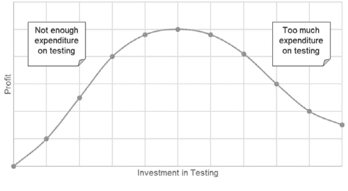

暂不考虑软件测试与质量属性之间更广泛的关系，测试最常见的应用是寻找软件中存在的缺陷和/或验证该软件中不存在特定的缺陷。软件缺陷（`software defect`）一词通常扩展为三类：错误（`mistakes`）、缺陷（`faults`）和失败（`failures`）。

- **错误（Mistakes）**：由软件开发人员产生。这些是概念性错误，可能导致源代码中的一个或多个缺陷。
- **缺陷（Faults）**：这些是代码中的缺陷，可能是一个或多个错误的产物。缺陷会导致程序执行期间出现失败。
- **失败（Failures）**：这些是缺陷的症状，表现为软件错误或不符合规范的行为。缺陷可能一直隐藏，直到满足某些特定条件，它们才显现为软件执行中的失败。当软件检测到失败时，通常由错误代码指示。

错误可以通过多种方式产生。例如：

1. 沟通中的误解，例如将公制单位与英制单位混淆。
2. 软件开发人员对规范的误解或误读，例如错误地交换了参数顺序。
3. 假设默认值：例如，在 `Java` 中整数的默认值为 0，但在 `C++` 中没有默认值。

对缺陷类型进行分类是有帮助的。这种分类用于多种目的：

1. 在分析、设计或编写软件代码时：作为需要避免的缺陷检查点表（`check-list`）。
2. 在开发软件时：作为可能缺陷的指南。
3. 在进行软件过程评估或改进时：作为输入数据。

分类这些软件缺陷有多种方法，但尚不存在单一、受认可的标准。缺陷的重要性取决于具体情况。一种代表性的分类法⁵ 识别了以下 10 种缺陷类型：

| 缺陷类型 | 描述 |
| :--- | :--- |
| 算法 (Algorithmic) | 软件在指定的算法下未产生与给定输入相应的输出。 |
| 语法 (Syntax) | 源代码不符合编程语言规范。 |
| 计算与精度 (Computation and precision) | 使用所选公式计算的结果不符合预期的准确或精度。 |
| 文档 (Documentation) | 文档不完整或错误。 |
| 压力或过载 (Stress or overload) | 当应用负载超过系统指定的最大值时，系统无法正常运行。 |
| 容量与边界 (Capacity and boundary) | 当数据存储器超过容量填充时，系统无法正常运行。 |
| 时机或协调 (Timing or coordination) | 交互进程之间的时机或协调要求未满足。这些缺陷在实时系统中是一个严重问题。⁶ 具有严格的时机要求，并可能按照仔细定义的顺序执行。 |
| 吞吐量或性能 (Throughput or performance) | 开发的系统未达到指定的吞吐量或其他性能要求。 |
| 恢复 (Recovery) | 系统未能恢复到预期的性能。 |
| 标准与程序 (Standards and procedure) | 成员未遵守标准，这将导致失败。 |

要找到各种缺陷的频率非常困难，惠普的一项研究发现，50% 的缺陷是算法类或计算类的。

由于失败的主观性，对特定缺陷导致的失败严重程度进行分类是困难的。一个用户可能认为某个失败非常严重，而另一个用户可能认为不然。

**表 1.2 失败严重级别**

| 严重级别 | 行为 |
| :--- | :--- |
| 1（最严重） | 失败导致系统崩溃且恢复时间很久。 |
| 2 | 失败导致功能或数据丢失，但有手动变通方法。 |
| 3 | 失败导致部分功能或数据丢失，用户仍可以完成。 |
| 4（最轻） | 失败导致外观上的不便，但任务仍可以完成。 |

硬件失败呈现出典型的浴缸曲线，即初始阶段失败率很高，随后是一段相对较低的时期，最后失败率再次上升。早期失败是由制造和安装错误引起的。随着这些问题得到解决，在产品的主要运行寿命期间，失败率保持在低水平。然而，硬件最终会老化并磨损，失败率再次上升。

软件失败表现出类似的模式，但由于软件不会发生物理磨损。软件失败率的典型曲线如图 1.2 所示。

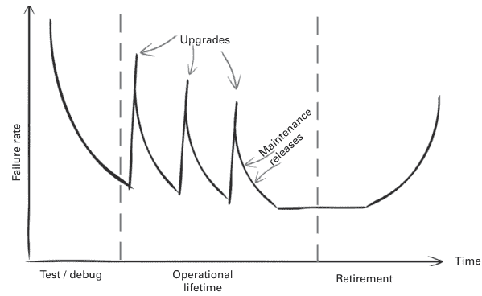

**图 1.2 软件产品在其生命周期内的失败率。**

在初始开发期间，失败率可能会在测试和调试周期迅速下降。在第一个版本发布后，在软件运行期间，可能会出现定期升级，这些升级倾向于引入新的失败，暴露软件中的隐藏缺陷或引入新缺陷。这些升级可能包括额外的功能、与其他软件集成所需的更改，以及为了支持执行环境变化（如操作系统更新）所需的修改。随后的维护活动会逐渐降低失败率，反映代码质量的整体提高。最后，当软件不再被积极开发时，它会被退役；特别是原始开发者可能停止维护他们的贡献时。环境或软件依赖的任何变化都可能再次导致失败。

大多数软件最终会被替换，或停止作为支持版本进行维护，导致现有用户的故障率最终上升。⁹

软件存在缺陷或被认为存在缺陷的原因有很多。例如，很难：

- 正确地收集用户需求；
- 正确地规范所需的软件行为；
- 正确地设计软件；
- 正确地实现软件；以及
- 正确地修改软件。

开发系统有两种工程方法：一种是正向工程，另一种是基于反馈的。

理想的软件开发项目如图 1.3 所示，从用户开始，以正确的实现结束。开发过程是完全可靠的：每个活动都根据其从上一个活动获得的输入（规格）创建正确的输出。因此，最终产品符合其规格并满足了用户的需求。

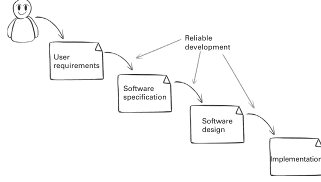

**图 1.3 使用正向工程的理想项目进度。**

然而，在实践中，所有的开发步骤都可能出现错误和歧义，导致结果不尽理想。为了解决这个问题，每个步骤都必须经过检查，以确保其执行得当，并在继续之前提供修复任何错误的机会。在每一步中，不可靠的开发后进行的验证和修复如图 1.4 所示。

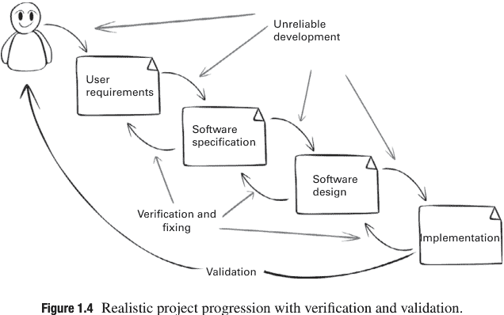

对于软件产品，除了检查每个单独步骤是否执行得正确外，实践证明还需要第二种形式的检查：确保实现满足用户的需求。第一种形式称为`验证`（`verification`），第二种形式称为`确认`（`validation`）。

软件规格说明定义了软件需要执行的精确且详细的行为。它提供了一个软件应该执行什么的模型。这些规格在测试中起着关键作用。为了进行测试，必须知道软件的正确行为。这意味着需要详细的规格说明（或软件需求¹⁰）。

为了支持代码测试，规格说明必须描述正常行为和错误行为。正常行为是输入无误时软件的预期行为（或输出）。错误行为是当一个或多个输入错误或导致处理错误时，软件的预期结果。

人们曾尝试根据软件的合理行为来开发测试方法——这种行为通常是从方法推导出来的。这是失败的，因为并不是每个开发者和测试人员对合理行为都有相同的预期，特别是对于错误情况。一些示例包括：

- 如果提供了一个输入，方法应该忽略它、返回一个无效值、抛出异常，还是写入错误日志？
- 如果计算了温度，应该以摄氏度（°C）、开尔文（K）还是华氏度（°F）返回？
- 0 应该被视为正数、负数还是两者都不是？
- 角度值可以为 0° 吗？形状面积可以为 0 cm² 吗？即使是负面积也可以？

总的来说，程序在处理输入数据错误时的预期行为是指示这种情况的发生——例如通过返回错误代码或抛出异常。但为了测试软件，必须定义这些的精确细节。这些细节精确定义了输入中的什么是错误，以及如何向调用者通知此类错误。总之，为了正确地测试软件，需要详细的规格说明。¹¹

> ¹⁰ 注意软件需求与用户需求之间的区别。软件需求说明了软件必须做什么。用户需求说明了用户想要做什么。
> ¹¹ 注意，测试人员通常需要将规格说明从书面或自然语言形式转换为更简洁且更易于创建测试的形式。

考虑一个用于在线商店的程序检查，该程序根据客户目前的积分以及他们是否为金牌客户，判断客户在下次购买时是否应该获得折扣。

积分随着客户购买而积累。金牌客户在积分超过 80 分后即可获得折扣。其他客户只有在积分超过 120 分后才能获得折扣。所有客户始终至少有一个积分。

程序返回以下内容之一：

- `FULLPRICE`，表示客户应支付全价。
- `DISCOUNT`，表示应给客户折扣。
- `ERROR`，表示输入存在错误（如果 `bonusPoints` 小于 1，则无效）。

输入是客户拥有的 `bonusPoints` 数量，以及客户是否为金牌客户的标记（`true` 或 `false`）。为了简单起见，我们目前将忽略非法输入值（当第一个参数不是数字，或第二个参数不是布尔值时）。


# 软件测试导论

## 1.5 测试理论

测试包括使用选定的输入值执行被测软件，收集输出值，并验证这些输出值是否正确（即符合规格）。

开发测试理论的目标是能够识别出理想测试——即确保所有输入的最少数据集。该领域的根本结果¹³可以总结如下：

- 为了使测试成功，测试集中的所有测试数据必须产生规格定义的结果。
- 如果测试选择标准持续产生成功的测试集，或持续产生不成功的测试集，则它是可靠的。
- 如果使用可靠且有效的标准选择了一个数据集，那么该数据的成功执行意味着程序在整个输入域内将产生正确的结果。
- 得出结论：唯一可以保证可靠且有效的标准是选择程序领域中的每一个值（即穷举测试程序）。

基于这一理论结果，显而易见的测试形式是测试所有可能的输入和输出。这被称为穷举测试，将在接下来进行探讨。

之前讨论的示例中的参数 `goldCustomer` 有两个可能：`true` 或 `false`。参数 `bonusPoints` 定义为 64 位整数（Java `long`），因此参数 `bonusPoints` 可以具有 ²⁶¹³ 值。这意味着输入值的可能组合总数为 $2^{65}$，或 $3.6893488 \times 10^{19}$。即使对于这个简单的例子，这也是一个非常巨大的数字。穷举测试需要执行如此数量的测试。

这种方法存在两个关键问题：

- 测试执行：执行如此数量的测试将花费太长时间。例如，在一台每秒可以执行 60,000 次测试的 PC 上，测试这个简单的程序大约需要 600,000,000,000,000 秒，或者说超过 19 年。
- 测试设计：仅仅用所有不同的输入来执行代码是不够测试软件的。测试必须确保每一个答案都是正确的。因此，对于这 $2^{65}$ 组输入值中的每一组，都必须计算出正确的输出值，以便在每次测试中进行验证。

其他例子，一个类可能轻松地持有 64 字节的数据（类属性）。这 64 字节代表 $2^{512}$ 种可能的状态，导致 $2^{512}$ 次测试。一个数据库可能包含百万条记录，每条 128 字节。这代表了大约 $2^{21,000,000}$ 种可能的值，导致相同数量的测试。对大量组合进行测试是不可行的。

此外，识别每个测试的正确输出比听起来要困难得多。手动进行这些操作花费太长时间。而编写程序来完成此会引入一个新问题——`测试用例`（test oracle）问题。测试用例的要求与被测试软件的要求相同——如何确保测试用例是正确的？

测试系统所有可能的输入、组合和输入序列是理想的。这包括有效输入和无效输入。但如所示，这是不可行的，因为耗时太长。

因此，我们需要在不显著降低测试有效性的情况下，大幅减少测试数量。为了时间和成本的效率，良好的测试应该：(1) 具有发现故障的高概率；(2) 不彼此相互重复；(3) 在测量上相互独立，以防止故障相互掩盖；(4) 尽可能测试大量的代码。在实践中满足所有这些标准是非常困难的，并且是许多研究课题。

所有测试技术的根本基础是从可能的输入参数中选择一个子集。因此，测试技术的质量取决于该子集在发现故障方面的有效性。遗憾的是，目前还没有完善的故障理论，因此测试技术倾向于基于基本原理和实践的启发式技术。

启发式最简单的形式是随机测试。它允许我们使用随机选择的许多输入进行测试，并具有良好的扩展性以提供大量的输入。它通常是自动化的，列表 1.1 显示了对 `check()` 方法进行随机测试的简单代码。

### 列表 1.1 `check()` 的随机测试

```
public static void checkRandomTest (long loops) {
    Random r = new Random();
    long bonusPoints;
    boolean goldCustomer;
    String result;

    for (long i = 0; i < loops; i++) {
        bonusPoints = r.nextLong();
        goldCustomer = r.nextBoolean();
        result = Check.check(bonusPoints, goldCustomer);
        System.out.println("+"+bonusPoints+","+goldCustomer + "->-"+result);
    }
}
```

当 `loops = 1,000` 时执行此程序，`check()` 将被调用百万次并带有不同的随机输入，同时产生大量的输出。图 1.6 显示了输出的一个短片段。这个例子可能需要七秒钟执行，主要是通过写入屏幕——执行时间在 100 毫秒以内。

```
check(81100587247419363, false)->DISCOUNT
check(-443666059495732798, false)->ERROR
check(9731916244937489, false)->DISCOUNT
check(4967463102553610, false)->DISCOUNT
check(-78269395676485793, true)->ERROR
check(66960359334638049, false)->DISCOUNT
check(859677396888096832, true)->DISCOUNT
check(-87765887464102475, true)->ERROR
check(-947665942182034, true)->ERROR
check(5809077729822646, true)->DISCOUNT
```

这段代码执行程序并证明它没有崩溃，但并没有每次都检查结果 `bonusPoints` 是否小于零，得到输出的概率约为 1/100,000 – 此输出在示例中并未出现。

这个例子说明了随机测试的三个关键问题：

- 测试用例问题——如何判断结果是否正确。手动这样做将非常乏味。而且编写程序来这样做没有意义——如何测试它？事实上，我们已经写了一个程序来这样做，并且正在测试它！
- 数据问题——这导致产生了大量的输入值并遗漏了某些值。
- 完成问题——在这个例子中没有真实的依据。也许 100 次测试就能提供足够的正确性保证；或者可能需要 1000 次。

注意这些问题存在于所有形式的测试中——但在随机测试中解决方案是自动化的，这需要进一步分析。书中将探讨这些问题的解决方案。

这些是选择输入参数子集的两个类别。一种基于规范生成输入值，这被称为黑盒测试（或基于规范的测试）。另一种基于实现生成输入值，这被称为白盒测试（或基于结构的测试）。

执行规范意味着生成足够的测试以确保规范中包含的每种处理已执行。这不仅意味着生成了每种类的输出。

执行实现意味着有足够的测试，使得组成实现的每个组件在执行时都能产生有效结果。在简单的情况下，每行源代码被视为一个独立的组件。但正如你在后续章节中看到的，有复杂的方法可以识别覆盖程序的可能行为。

在所有测试中，执行代码或规范都是不够的。测试不仅要这样做，还必须验证实际结果与预期结果是否。只有当这种验证充分时，测试结果为通过。

本书介绍了选择测试数据的若干基本技术，并演示了它们在单元测试（测试单个方法）、面向对象测试（测试整个类）以及应用测试（测试整个应用）中的用法。一旦读者理解了这些技术，就可以考虑应用以下技术：基于经验的测试和故障插入。

这是一种临时方法，也被称为错误猜测（error guessing）或专家意见，测试人员利用其经验来开发测试。目标通常是尝试发现代码中的故障。测试可能基于各种经验，包括最终用户经验、操作经验、业务或风险经验、法律经验、维护经验、编程经验和通用领域经验等。其优点是直觉经常为发现故障提供准确依据，且该技术通常非常高效。然而，它严重依赖开发测试的经验，而且这种方法的临时性质意味着很难确保测试的任何程度的严谨性或完整性。

另一种哲学上不同的测试方法是向软件或输入数据中插入故障，并检查它们是否被发现。这源于硬件测试，其中通常会建立一个低电压或高电压连接，表示粘滞在 1 或 0 状态。然后运行硬件（通常通过仿真），以确保故障被硬件正确检测并处理。该故障代表数据故障——所有通过该连接传输的数据都将受到故障的影响。

用于软件测试时，故障可以插入代码中或已知数据中。当插入数据时，目的与硬件测试相似——确保故障被软件正确检测并处理。当插入代码时，目的则不同：它可以被用于衡量测试的有效性，或证明某个特定故障不存在。

鉴于测试理论只识别了一个终点，即完全测试，关于何时结束测试的决策可以从多个不同的视角做出：

- 从预算角度来看，当分配给测试的时间或预算过期时，
- 从活动的角度来看，当软件通过了所有计划的测试时；以及
- 从风险管理的角度来看，当预测的失败率符合质量标准时。

最终，决策必须考虑所有这些观点——软件在发布之前通过所有测试的情况是罕见的。辅助做出这一决策的两种技术是发布风险和基于用例的标准。在测试期间，基于用例的标准会优先考虑最频繁的程序事件序列。发布风险则根据这些故障发生的概率以及预估的成本，预测未来故障的成本。

在做出这一决策时可能涉及伦理和法律问题，特别是当软件是任务关键型或安全关键型系统的一部分时¹¹⁴。如果软件故障导致诉讼，那么软件测试完成的适当标准也是一个重要因素¹¹⁵。

之前的示例都使用了动态测试，即首先执行代码，然后验证输出。另一种方法是静态验证（也称为静态分析或静态测试），即在不执行代码的情况下对代码验证。

静态验证有两种方法：基于审查的方法和通过数学方法对程序进行审查。这两者都可以是手动、半自动或全自动的。

代码可以用不同正式程度进行审查。最不正式的是结对编程，即两名程序员协同工作，其中一个人编写代码，另一个人持续审查其工作。这已被证明是非常有效的，并且是现代软件工程流程（如：敏捷开发）的核心元素。最正式的是代码审查或走演，即审查团队提前获得规格说明书（产品需求、设计文档、软件需求等）和代码。随后将举行正式会议，在会议上进行代码走演，检查代码是否符合其需求。通常会使用代码检查表并在会议结束后产生正式报告，作为代码进行补救工作的基础。这是软件工程中一种典型且非常有效的方法，特别是对于高质量需求。也可以使用自动化代码分析工具；这些工具可能会发现潜在的安全漏洞，识别代码中的常见错误，或确认软件是否符合特定的编码标准。

> ⁴ 安全关键型或生命关键型系统如果失败，会对健康或生命造成威胁。任务关键型系统如果失败，会对任务造成威胁。示例包括太空探索软件、航空航天工业和医疗设备。
>
> ¹⁵ 该主题在 D. Kellegher 和 K. Murray 的《Information Technology Law in Ireland》中有更详细的探讨。Bloomsbury Professional, 2007。

研究已经开发了基于集合论的数学技术（称为形式方法或形式化验证），用于证明程序符合其规格说明书。这可以手动完成，尽管非常耗时且需要高水平的专业知识。也可以是半自动，由工具评估代码并提供需要手动证明的证明义务。或者，由于最近的研究进展，证明可以全自动。程序员（或设计者）使用数学符号为代码生成形式化需求，然后运行代码通过程序证明器，以证明代码符合其需求（或找到未满足需求的反例）。程序员还被在代码中编写内部规格，其中最具挑战性的之一是循环不变性。这比手动证明所需的技能和经验少，但比动态测试挑战性得多。

证明的益处是巨大的：程序可以被证明在所有情况下都能工作。低级程序证明还可以与高级设计证明（如模型检查）相结合，为整个计算机系统提供一个集成的证明框架。

目前正在开发许多用于程序证明的语言和工具——但对于它们是否已完全准备好工业化使用存在争议。例如，JML¹⁶ 为 Java 程序提供了支持。关于此主题的进一步阅读建议请参见第14.3节。

在讨论了为什么软件需要测试并总结了如何进行测试之后，考虑测试如何融入软件开发过程是有用的。任何复杂程度的软件都有三个关键特征：

1. 用户需求，说明了软件用户的需求；
2. 功能规格说明书，说明软件为了满足需求必须做什么；以及
3. 多个集成在一起形成最终系统的模块。

¹⁶ www.openjml.org

验证这些每项会导致不同层次的测试：

### 单元测试

对单个软件单元进行测试，以确保其正常工作。该单元可以是单个组件，也可以是由多个单个组件组成的复合组件。例如，组件可以是一个函数或方法、一个类或一个子系统。单元也可以是单个图形用户界面（GUI）组件（如按钮）或它们的集合（例如窗口）。单元测试几乎不可避免涉及单元的编程接口。选择测试数据以确保单元符合其规格说明。

### 回归测试

当添加了新单元时，执行对软件之前版本的测试，以确保没有东西被破坏。这可以在单个单元、子系统或全系统中进行。

### 集成测试

对两个或多个单元（或子系统）进行测试，以确保它们正确相互操作。测试可以利用编程接口（通常用于组件）或系统接口（用于子系统）。选择测试数据以测试集成单元之间的交互。

### 子系统测试

当一个大型系统由多个子系统构建时，可以对每个子系统进行单独测试，以确保其正常工作。测试使用子系统接口：这可以是应用程序的 GUI、Web 服务器的接口、网络服务器的网络接口等。选择测试数据以确保子系统符合其规格说明。

### 系统测试

对整个软件系统进行整体测试，以确保其正常工作¹⁷。测试使用系统接口：这可以是应用程序的 GUI、Web 服务器的接口、网络服务器的网络接口等。选择测试数据以确保系统符合规格说明。桌面、移动和基于 Web 的应用程序测试都是通过用户界面进行测试的系统测试形式。

### 验收测试

对整个软件系统进行整体测试，以确保它满足用户需求或解决了用户的问题，或者通过了由用户开发的一系列测试。这在合同开发软件的付款前经常使用。

这些测试活动中的每一个都可以黑盒或白盒技术来开发测试；除了单元测试外，很少使用白盒技术。

本书的重点是动态软件验证，特别强调单元测试（包括面向对象的测试）和应用程序测试的核心测试设计技术。第14章提供了进一步阅读的建议。

> ¹⁷ 一种简单的系统测试形式被称为冒烟测试，源于硬件开发，硬件测试的第一步是开启电源并看它是否冒烟。

无论执行何种类型的软件测试，都需要完成若干项活动。本书采用了以下七步法$^{18}$：

- **分析**（Analysis）：对规范和软件实现进行分析，以提取设计测试所需的信息。
- **测试覆盖项**（Test coverage items）：这些是测试必须满足（或覆盖）的准则，根据分析结果得出。
- **测试用例**（Test cases）：这些指定了满足测试覆盖项所需的数据。
- **测试设计验证**（Test design verification）：对测试进行评审，以确保每个覆盖项都已包含在内。
- **测试实现**（Test implementation）：测试通常使用自动化测试库实现，但在某些情况下也可能定义手动测试程序。
- **测试执行**（Test execution）：执行测试：使用选定的输入数据值调用被测代码，并检查结果是否正确。
- **测试结果**（Test results）：检查结果以确定是否有任何测试失败了。在正式的测试过程中，这可能会产生缺陷报告。

书中的练习示例演示了这些活动的应用。在实践中，经验丰富的测试人员可能会在脑中完成许多步骤而不记录结果。任务关键或安全关键系统中的软件需要高水平的质量，这些系统的测试过程通常会大量的文档。这些文档支持作为整体软件质量保证过程的一部分，对测试活动进行详细评审。在本书中，所有结果都经过完整记录，以作为学习指南。

所有测试设计都需要进行某种形式的分析。这可以是源代码的分析，也可以是对规范的分析——包括用户需求和软件规范。这些测试信息源被称为测试基准（test basis），用于确定测试覆盖项。在实践中，分析结果可能不会完全记录，甚至根本不记录——但这样做是有价值的，因为它允许更准确地评审测试覆盖项的完整性。

> $^{18}$ 许多软件过程可能会定义自己的特定活动集。

## 1.11.2 测试覆盖项

测试覆盖项是测试需要*覆盖*的特定项目。它们通过使用所选测试设计技术评审分析结果来生成¹¹⁹。

测试覆盖项的一些示例包括：

- 参数可能取的特定值或值范围；
- 两个参数之间需要实现的特定关系；
- 需要执行的某行代码；以及
- 代码中需要经过的特定路径。

一个测试用例可以覆盖多个测试覆盖项。大多数测试技术的目标是通过在每个用例中覆盖尽可能多的覆盖项来减少测试用例的数量。其简单的理由是为了减少执行测试所需的时间。对于少数测试，这并不重要，但大型软件系统可能有数万个测试，执行时间可能会持续数日。

定义测试覆盖项时使用的任何值都应该尽可能通用，用名称表示常量，并尽可能陈述关系而非实际值。这为设计测试用例提供了最大的灵活性，使得单次测试能够覆盖尽可能多的覆盖项。

每个测试覆盖项都需要一个标识符。

在简易测试中，所有输入都作为参数传递给代码，输出以值的形式返回。在实践中，同时存在显式参数（在调用代码时传递）和隐式输入（例如，在 Java 中，代码读取的类属性；或在 C 中的全局变量）并不罕见。许多程序具有*显式*返回值和其他*隐式*输出（例如，在 Java 中，代码修改的类属性）。这些都应该包含在测试覆盖项中。

测试用例通常分为两类：*正常*用例和*错误*用例。将它们分开是很重要的，因为多个输入正常用例可能会合并到同一个测试用例中；而多个输入错误用例可能不会。这是由于*错误处理*的原因。大多数软件并没有明确区分所有可能的错误原因；因此，为了测试每个输入错误都能被正确识别和处理，每次只能测试一种此类错误。在书中，用星号（*）来表示输入错误覆盖项和错误测试用例。


> 并不是每个测试都能明确说明正在测试什么（测试覆盖项）、执行测试需要哪些值（测试数据）以及测试本身（测试用例）。然而，这种区别是重要的，本书清楚地——

代码段 1.1.1 显示了一个简单的示例。

```java
// 如果 x 和 y 均有效，则返回 true
//（在 0..100 范围内）
// 否则返回 false 以指示错误
public static boolean valid(int x, int y) {
  if (x < 0 || x > 100) return false;
  if (y < 0 || y > 1000) return false;
  return true;
}
```

输入 `x = 500` 和 `y = 500` 的测试并没有验证两个参数的错误。第 5 行的代码会检测到第一个错误情况并返回 `false`。第 6 行的缺陷没有被检测到——其中 `y` 被错误地与 `1000` 比较，而不是第 1 行注释中指定的 `100`。

要发现缺陷需要两个独立的测试：

- 一个 `x = 500, y = 500` 的测试；
- 一个 `x = 100, y = 1500` 的测试。

每个用例的测试数据包含以下内容：

- 测试项标识：例如，方法名
- 测试用例的唯一标识符
- 每个测试用例覆盖的测试覆盖项列表
- 测试数据，由：
    - 输入值——这些应该是具体的
    - 预期结果——这些始终源自规范

每个项目的测试用例必须被实现。确保每个测试项都有唯一的标识符至关重要的。一个特定的测试用例可能会覆盖多个测试项，因此书中对测试进行了顺序编号。

每个测试用例覆盖的覆盖项列表应作为确定何时已创建了足够测试的指南。每个覆盖项都必须被覆盖（可能会创建无法实现的测试覆盖，这必须被明确识别）。

执行分析、定义覆盖项以及开发测试用例和数据的过程被称为测试设计。

在测试设计期间，开发测试数据时，良好的做法是记录每个用例覆盖的测试用例，以及覆盖每个覆盖项的测试用例。这使得测试设计易于评审，确保每个覆盖项都得到高效覆盖。

正式评审可以确保测试设计的质量。为了使测试评审有效，评审人员需要看到之前步骤的输出：分析、覆盖和测试用例。然而，在实践中，许多工作经常在脑中完成而不进行详细记录。

## 1.1.5 测试实现

测试可以实现为代码（自动化测试），也可以实现为程序（手动测试）。

最近的趋势是尽可能自动化测试。然而，手动测试仍有一席之地。这需要为测试编写测试程序。文档必须描述如何设置正确的环境、如何执行代码、要提供的输入以及预期结果。

单元测试总是自动化的；集成测试通常是；系统测试在尽可能的情况下是。实现自动化测试涉及编写代码以使用指定的输入参数调用测试项，并将实际结果与这些进行比较。

> 这主要是为了调试，以便测试可以可靠地重新执行。

预期结果。在测试代码中使用反映匹配的测试用例标识符的方法名是一个良好的习惯。每个指定的测试用例都应该独立实现——这允许清晰地识别单个失败点。测试可以分组为测试套件（或测试集），允许测试人员一次性选择大量测试进行批量运行。

测试会产生许多产物，如图 1.7 所示。这些产物反映了设计和实施测试所需的巨大精力。

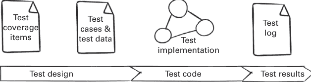

图 1.7 测试产物。

- 测试设计活动需要产生以下信息：
- 测试覆盖项——这些是测试数据必须执行的特定项目。
- 测试用例和测试数据——这包括测试标识符、输入数据的值、预期结果的值，以及每个测试用例所覆盖的测试覆盖项。

测试代码活动产生测试实现。这是基于测试用例的。

测试结果通过执行测试实现产生，并生成测试日志。

在本书中，测试用例使用表 1.3 所示的模板进行规范。这种格式没有标准，但允许所有测试规范易于被审查是非常关键的。建议的布局如下：

- `ID` 列为每个测试提供唯一的测试用例 ID（这需要对测试项是唯一的）。
- `TCI` 列记录了该测试用例覆盖的测试覆盖项。建议通过此测试用例单独识别新的测试覆盖项，与之前定义的用例已覆盖的项区分开来。
- 输入提供了每个参数所需的输入数据值。
- 预期结果记录了根据被测软件规范预期的输出值。在本书的表格中，这简写为 `Exp. Results`。对于 Java，这通常是所调用方法的返回值。

## 表 1.3 测试用例规范模板

| | TCI | 预期结果 |
|---|---|---|
| | (每列的内容) | 返回值 |
| (ID) | (在此列出列表) | (在此列出值) |

开发测试时避免重复是一个关键目标。经验测试人员可能在开发测试用例数据时做到这一点，但建议（至少在初期）在设计每个测试用例时记录所需数据，随后识别并丢弃具有重复数据的测试用例。

### 故障模型

穷尽测试是不可行的，每种测试方法都是一种折中，旨在寻找特定类的故障。这些被称为故障模型。每种类型的测试都是围绕特定的故障模型设计的。书中展示的初始类型具有简单的故障模型，而后来的类型处理的是渐趋复杂的故障模型。理解软件开发人员引入到代码中的故障类别，可以更有效地重点关注那些最可能发现故障的测试。

## 本书的使用

本书面向初级读者，可用于许多本科和研究生课程。它也适合作为研究人员和专业人士的测试入门。阅读本书时应：后续章节将利用书中前面介绍的内容。

## 本书的结构

本书介绍了软件测试的核心要素，为读者提供了在自动化测试环境中执行基础单元测试、面向对象的测试和系统测试所需的知识。书中涵盖了系统化软件测试的实践和原理。高级技术的进一步阅读请见第 14.3 节。

## 1.14 如何使用本书

- 引言描述了测试的动机，讨论了穷尽测试和随机测试，并描述了测试软件所需的步骤。
- 通过单元测试示例引入了涵盖黑盒和白盒测试的六种基本测试技术。每种技术都完成了从问题分析到自动化测试实现的完整工作。在完成这些示例后，随后将更详细地讨论每种技术的原理。
- 引入了面向对象软件测试的基本要素。这是一个非常丰富的话题，本书涉及了一些底层原理并提供了许多示例。
- 在应用测试之前引入了单元测试，因为用户界面的分析往往比编程接口更复杂；这会分散学习测试技术原理和测试自动化的注意力。通过在其用户界面测试基于 Web 的软件系统的示例引入了应用测试。
- 书籍最后对软件测试自动化、随机测试进行了更详细的观察，并讨论了软件测试在软件开发过程中的角色。

### 1.14.2 测试顺序

通常，单元测试之后是集成测试，然后是系统测试。在单元测试中，总是先使用黑盒测试，然后是白盒测试，以便选择性地增加覆盖率（例如执行语句的百分比）。这种方法在最大化测试覆盖面的同时，减少了测试的重复。

本书遵循相同的顺序，但有一个例外：集成测试在书中没有详细介绍。

### 1.14.3 记录测试设计

在实践中，大多数测试人员不会像书中所示那样详细地记录他们的测试，除非在对软件质量有要求的情况下。然而，测试人员必须进行同样的心理工作来系统地开发测试，而且在学习测试时，像书中那样写下所有中间结果是一个良好的习惯。

### 1.14.4 编程语言

所有示例均使用 Java 编程语言 (Java 11)。所示的原理和用于 Java 方法可以作为其他过程化或面向对象语言测试的示例。

> 应用程序系统测试通常被称为应用测试。

## 软件测试简介

### 1.14.5 详细程度

本书关注软件功能测试的原理以及如何在实践中应用它们。由于范围广泛，某些主题（例如面向对象测试、系统测试）的细节不如其他主题。非功能测试技术（如性能测试：负载测试、压力测试、稳定性）书中未进行详细介绍。

### 1.14.6 示例

书中展示了许多示例，包括待测软件和自动化测试。这些示例旨在展示测试原理的应用，而不应被视为良好代码实践的示例。为了节省空间，许多情况下省略了注释和 Javadoc 规范。

### 1.14.7 测试工具

本书的核心目标是让读者理解软件测试原理并在实践中应用。书中使用的软件测试工具是作为每个类型中最流行或最新的示例选择的，它们可能不是演示测试自动化的最佳示例。它们在特定的真实场景中可能是最佳工具。本书不背书或推荐特定工具。书中仅涵盖了工具的功能子集：读者应参考特定工具文档获取更多信息。

## 1.15 术语说明

软件测试相关的术语并没有统一。读者会发现许多书籍、研究论文、测试自动化文档和网页使用了不同甚至冲突的术语。本书与 ISO 国际标准 29119 使用的术语保持一致。特别是在书中，测试覆盖项、测试用例和测试实现分别区分测试目标、实现这些目标所需的数据以及实现测试的代码。

# 2 等价类划分

本章将通过一个具体的单元测试示例，介绍最简单的黑盒测试技术——等价类划分（通常称为 EPs）。测试的开发遵循了之前确定的步骤：分析、测试覆盖范围项（TCIs）、测试用例、测试设计验证、测试实现、测试执行以及测试结果的检查。

## 2.1 使用等价类划分进行测试

该技术的目标是通过为每种不同类型的处理使用至少一个代表性的输入值，来验证软件运行正常。该技术还应确保为每种不同类型的处理至少产生一个代表性的输出值。为了识别这些值，使用了等价类划分。本章从一个完整的示例开始，并对该主题进行更详细的探讨作为结束。

> **定义：** 等价类是指输入或输出的一个离散值范围，规范规定该范围内的处理是等效。

## 2.2 示例

第 1.4 节描述的程序检查使用 `OnlineSales` 类来实现其核心功能。该类包含一个静态方法 `giveDiscount()`，定义如下。测试技术将通过静态方法介绍，这些方法不需要通过构造函数实例化对象。在介绍完基础技术后，面向对象软件测试章节（第 9 章）将研究如何使用这些技术来测试实例方法。

1 本书使用 Javadoc 进行规范说明。

### 等价类

`Status giveDiscount(long bonusPoints, boolean goldCustomer)`

输入

- `bonusPoints`：客户积累的积分数
- `goldCustomer`：如果为金牌客户则为 `true`

输出

返回值：

```
FULLPRICE if bonusPoints <= 120 and not a goldCustomer
FULLPRICE if bonusPoints <= 80 and a goldCustomer
DISCOUNT if bonusPoints > 120
DISCOUNT if bonusPoints > 80 and a goldCustomer
ERROR if any inputs are invalid (bonusPoints < 1)
```

`Status` 定义为：

```java
enum Status { FULLPRICE, DISCOUNT, ERROR };
```

为了简单起见，本示例没有使用 Java 异常来指示错误：有关如何测试代码的示例请参见第 11.8 节。

### 2.2.1 分析：识别等价类

开发测试的第一步是对规范进行分析，以识别等价类。

分析分为两个阶段：首先，识别每个参数的自然范围；然后根据等效处理原则识别基于规范的范围（或等价类）。

#### 自然范围

自然范围基于输入参数和返回值的类型。为了帮助这项工作，我们建议对每个输入和输出应用“值线”。

值线是值范围的图形化表示。最小值始终放在左侧，最大值放在右侧。这些值线有助于在识别出等价类后，确保它们之间没有间隙或重叠。

参数 `bonusPoints` 的类型是 `long`，有一个包含 $2^{64}$ 个值的自然范围。表示此可能值范围的 `bonusPoints` 值线如图 2.1 所示。这表明 `bonusPoints` 可以持有从 `Long.MIN_VALUE` 到 `Long.MAX_VALUE` 之间的任何值。

| Long.MIN_VALUE | Long.MAX_VALUE |
| --- | --- |

图 2.1 显示 `bonusPoints` 自然范围的值线。

² 此示例基于 Java，Java 使用 64 位表示 `long` 类型。

Boolean 值最好被处理为两个独立的范围，每个范围一个值，因为 `true` 和 `false` 之间没有自然顺序。Boolean 参数 `goldCustomer` 有两个自然范围，每个范围一个值，如图 2.2 所示。

| true | false |
| --- | --- |

图 2.2 显示 `goldCustomer` 自然范围的值线。

枚举值最好以与 Boolean 值相同的方式处理。

| FULLPRICE | DISCOUNT | ERROR |
| --- | --- | --- |

图 2.3 显示返回值自然范围的值线。

在使用值线辅助识别 `giveDiscount()` 输入输出的自然范围后，将它们如表 2.1 所示记录下来是非常有用的。

**表 2.1** 自然范围

| 参数 | 自然范围 |
| --- | --- |
| bonusPoints | Long.MIN_VALUE..Long.MAX_VALUE |
| goldCustomer | false, true |
| return value | FULLPRICE, DISCOUNT, ERROR |

双点 (`..`) 符号表示参数可以取该范围内的任何值，包括所示的最小最大值。这等同于书中范围内使用的数学符号闭合区间 `[Long.MIN_VALUE, Long.MAX_VALUE]`。

#### 基于规范的范围

现在可以通过从左到右遍历值线，并识别可能发生处理变化的值来识别基于规范的范围。对于输入 `bonusPoints`，左侧第一个值是 `Long.MIN_VALUE`。沿着值线移动，根据规范，所有后续直到包括值 0 的值都被视为等效的：它们都被处理为错误。这在值线上产生了第一个基于规范的范围，如图 2.4 所示。

| Long.MIN_VALUE | 0 | Long.MAX_VALUE |
| --- | --- | --- |

图 2.4 `bonusPoints` 的第一个基于规范的范围。

值线是概念模型，不需要画出来，如图 2.4 所示。每个范围的宽度应选择为允许清晰输入值；它不代表值的数量。0 之后的下一个值是 1，现在可以如图 2.5 所示输入它。

| Long.MIN_VALUE | 1 | Long.MAX_VALUE |
| --- | --- | --- |

图 2.5 范围的开始。

沿着值线移动，根据规范，所有后续直到包括值 80 的值都被视为等效。这在值线上产生了第二个基于规范的范围，如图 2.6 所示。

| Long.MIN_VALUE | 80 | Long.MAX_VALUE |
| --- | --- | --- |

图 2.6 `bonusPoints` 的第二个基于规范的范围。

沿着值线移动，根据规范，所有后续直到包括值 120 的值都被视为等效。这在值线上产生了第三个基于规范的范围，如图 2.7 所示。

| Long.MIN_VALUE | 120 | Long.MAX_VALUE |
| --- | --- | --- |

图 2.7 `bonusPoints` 的第三个基于规范的范围。

接下来，考虑输入参数 `goldCustomer`，它是一个 `Boolean`。自然范围已经在图 2.2 中识别。这里有两个等价类，与自然范围匹配，因为每个范围的处理可能不同。基于规范的范围如图 2.10 所示。

| true | false |
| --- | --- |

图 2.10 `goldCustomer` 的基于规范的范围。

最后，对于返回值，规范规定每个自然范围都是不同类型处理的结果，与 `goldCustomer` 一样，这在值线上产生了与自然范围完全相同的基于规范的范围值线，如图 2.11 所示。

| FULLPRICE | DISCOUNT | ERROR |
| --- | --- | --- |

图 2.11 返回值的基于规范的范围。

值线上显示的每个基于规范的范围都是一个等价类（处理等效的值范围）。现在可以从值线推导出输入和输出等价类（包括有效和错误划分），并如表 2.2 和表 2.3 所示记录。

**表 2.2** `giveDiscount()` 的输入等价类

| 参数 | 等价类 |
| --- | --- |
| bonusPoints | (*) Long.MIN_VALUE..0, 1..80, 81..120, 121..Long.MAX_VALUE |
| goldCustomer | true, false |

**表 2.3** `giveDiscount()` 的输出等价类

| 参数 | 等价类 |
| --- | --- |
| return value | FULLPRICE, DISCOUNT, ERROR |

部分等价类与错误处理相关，并用星号（*）标记。在本例中，识别这些非常简单。然而，对于其他规格，要正确识别它们可能要困难得多。在标准的测试开发中，这种分析通常不会被妥善记录，经验丰富的开发者会直接识别出等价类。但在学习测试时，建议你像上面所示完整地记录分析结果。这有助于确保你正在正确地运用该技术。

## 2.2.2 测试覆盖项

下一步是从等价类中生成 TCI（测试覆盖项）。TCI 是一个需要被测试的项。每个等价类都是一个 TCI，如表 2-4 所示。

每个 TCI 都使用唯一标识符，以便跟踪哪些测试用例（带有测试数据）覆盖了每个 TCI，并确保没有遗漏。在本例中，第一个 TCI 被标记为 EP1，第二个标记为 EP2，以此类推。

标识符后使用星号（*）表示代表错误的 TCI —— 这一点很重要，因为代表输入错误的 TCI 可以随时用于任何测试用例。每个参数的等价类应该分组并按顺序呈现，正如我们在表中看到的那样。

表格右侧还包含一个空白的“测试用例”列 —— 这将被填充，以指示哪个测试用例覆盖了每个 TCI。

**表 2.4** `giveDiscount()` 的 TCI

| TCI | 参数 | 等价类 | 测试用例 |
|---|---|---|---|
| EP* | bonusPoints | Long.MIN_VALUE..0 | |
| EP2 | | 1..80 | |
| EP3 | | 81..120 | |
| EP4 | | 121..Long.MAX_VALUE | |
| EP5 | | true | |


# 等价划分 (Equivalence Partitions)

## 详细了解等价划分

### 故障模型

等价划分故障模型是指整个值范围没有被处理。这些故障可能与代码中的错误决策或功能缺失有关。

通过从每个等价划分中选取至少一个值进行测试（其中每个值都应该以相同的方式被处理），等价划分测试试图发现这些故障。

### 描述

等价划分基于从等价划分中选择每个参数的代表值。每个参数的每个等价划分都是测试覆盖项（TCI）。输入和输出都应该被考虑。该技术尽可能生成少的测试用例；每个新的测试用例应尽可能选择未覆盖的划分。错误的测试覆盖应单独处理，以避免错误隐藏。目标是实现等价划分的 100% 覆盖。

## 分析：识别等价划分

### 参数

方法（函数）具有显式和隐式参数。显式参数在方法调用中传递。隐式参数则不然：例如，在 C 程序中它们可能是全局变量；在 Java 程序中它们可能是属性。测试时必须考虑这两类参数。完整的规范应包含所有的输入和输出。

### 值范围

所有输入和输出都有自然值范围和基于规范的值范围。自然范围基于类型。基于规范的范围（或划分）基于指定的处理逻辑。在分析范围时，使用图表通常很有帮助——见图 2.14。该图显示了一个 Java `int`，它是一个 32 位值，其最小值为 `-2³¹`，最大值为 `2³¹–1`（`Integer.MIN_VALUE` 和 `Integer.MAX_VALUE`），得出了自然范围：

- `int [Integer.MIN_VALUE .. Integer.MAX_VALUE]`

| Integer.MIN_VALUE | Integer.MAX_VALUE |
|---|---|
|  |

其他一些常见类型的自然范围为：

- `byte [Byte.MIN_VALUE..Byte.MAX_VALUE]`
- `short [Short.MIN_VALUE..Short.MAX_VALUE]`
- `long [Long.MIN_VALUE..Long.MAX_VALUE]`
- `char [Character.MIN_VALUE..Character.MAX_VALUE]`

无顺序类型的自然范围处理略有不同——每个值都是一个包含一个值的独立范围：

- `boolean [true][false]`
- `enum Colour {Red, Blue, Green} [Red][Blue][Green]`

复合类型（如数组和类）的分析更为复杂，尽管原理是相同的。

## 等价划分

## 2.2 示例

### 表 2.4 TCI 表（初始）

| TCI | 参数 | 等价类 |
|---|---|---|
| EP1* | bonusPoints | Long.MIN_VALUE..0 |
| EP2 | | 1..80 |
| EP3 | | 81..120 |
| EP4 | | 121..Long.MAX_VALUE |
| EP5 | goldCustomer | true |
| EP6 | | false |
| EP7 | return value | FULLPRICE |
| EP8 | | DISCOUNT |
| EP9 | | ERROR |

说明：

1. TCI 是特定的（测试）技术——在标识符前加上技术名称是有用的（EP 是等价类的缩写）。
2. 星号 (`*`) 表示代表输入错误的 TCI。每个输入错误必须单独测试。
3. 测试用例列稍后完成。

## 2.2.3 测试用例

下一步是为每个 TCI 确定使用的数据。对于等价类，目标是用每个测试用例尽可能覆盖更多的 TCI。有两个阶段：首先，使用识别出的等价类为每个输入和输出选择等价值。然后构建测试用例表。

测试数据从等价类中选择：对于短范围，选择中间值；对于较长范围，选择一个方便的值，而不是边界值。选择中间值很重要，因为选择中间值更容易暴露由于整个等价类处理错误导致的故障，而等价类测试的目标正是这种技术。

对于非连续范围（例如布尔值或枚举值），每个等价类只有一个值。表 2.5 显示了本例选择的数据。

### 表 2.5 等价值

| 参数 | 等价类 | 等价值 |
|---|---|---|
| bonusPoints | Long.MIN_VALUE..0 | -100 |
| | 1..80 | 40 |
| | 81..120 | 100 |
| | 121..Long.MAX_VALUE | 200 |
| goldCustomer | true | true |
| | false | false |
| return value | FULLPRICE | FULLPRICE |
| | DISCOUNT | DISCOUNT |
| | ERROR | ERROR |

要创建测试用例表，按照下面的说明完成每列，如表 2.6 所示。为每个测试用例一个唯一标识符 —— 我们从 T1.1 开始。为每个参数选择第一个非错误等价类：`bonusPoints` 提供 EP2，`goldCustomer` 提供 EP5。将每个 TCI 标识符输入 TCI 列 – 注意 EP2,5 是 EP2 和 EP5 的简写，用于节省空间。

### 表 2.6 测试用例：T1.1 输入值

| ID | 覆盖 TCI | bonusPoints | goldCustomer | 预期结果 |
|---|---|---|---|---|
| T1.1 | EP2,5 | 40 | true | |

> 你将在下一章看到，正确处理边界值是边界值分析的目标。

### 等价类

现在使用规格来确定正确的输出。在本例中，这是返回值，根据规格，正确的值被称为“预期结果”。在这里缩写为 Exp. Results。根据规格，如果 `bonusPoints` 为 40 且 `goldCustomer` 为 true，则预期结果为返回值 FULLPRICE。将此值放入预期结果列，并将 TCI (EP7) 添加到覆盖 TCI 列，如表 2.7 所示。

### 表 2.7 测试用例：T1.1 输入值

| ID | 覆盖 TCI | bonusPoints | goldCustomer | 预期结果 |
|---|---|---|---|---|
| T1.1 | EP2,5,7 | 40 | true | FULLPRICE |

考虑表 2.8 所示的等价类测试用例。这允许测试验证所有所有 TCI。对于每个测试用例，使用剩余的等价类。包含测试用例的 TCI 是重要的，如表 2.8 所示。

### 表 2.8 giveDiscount() 的正常测试用例

| ID | 覆盖 TCI | bonusPoints | goldCustomer | 预期结果 |
|---|---|---|---|---|
| T1.1 | EP2,5,7 | 40 | true | FULLPRICE |
| T1.2 | EP3,6,7 | 100 | false | FULLPRICE |
| T1.3 | EP4,6,8 | 200 | false | DISCOUNT |

最后，完成 TCI 表（如表 2.4 所示）。这是通过读取表 2.9 中的 TCI 列 完成的。这允许测试确认所有组合都已处理。

### 表 2.9 giveDiscount() 的测试用例

| ID | 覆盖 TCI | bonusPoints | goldCustomer | 预期结果 |
|---|---|---|---|---|
| T1.1 | EP2,5,7 | 40 | true | FULLPRICE |
| T1.2 | EP3,6,7 | 100 | false | FULLPRICE |
| T1.3 | EP4,6,8 | 200 | false | DISCOUNT |
| T1.4 | EP1*,9 | -100 | false | ERROR |

## 2.2.4 测试用例的验证

验证包括两个步骤：首先是完成 TCI 表，然后是审查你的工作。

### 完成 TCI 表

### 表 2.10 完成的 TCI 表

| TCI | 参数 | 等价类 | 测试用例 |
|---|---|---|---|
| EP1* | bonusPoints | Long.MIN_VALUE..0 | T1.4 |
| EP2 | | 1..80 | T1.1 |
| EP3 | | 81..120 | T1.2 |
| EP4 | | 121..Long.MAX_VALUE | T1.3 |
| EP5 | goldCustomer | true | T1.1 |
| EP6 | | false | T1.2 |
| EP7 | return value | FULLPRICE | T1.1 |
| EP8 | | DISCOUNT | T1.3 |
| EP9 | | ERROR | T1.4 |

### 审查你的工作

1. 每个 TCI 都至少被一个带有数据的测试用例覆盖（这确认了测试用例是完整的）。
2. 每个新的测试用例都至少覆盖一个额外的 TCI（测试覆盖项）（这确认了没有不必要的测试用例）。理想情况下，每个测试用例应该尽可能地覆盖多个新的 TCI（在本例中最多为三个：两个输入 TCI 和一个输出 TCI）。

在本例中，我们可以从表 2.10 看到每个 TCI 都被覆盖了，并从表 2.9 看到每个等价类测试用例都覆盖了额外的 TCI，如下：

- T1.1 首次覆盖了 EP2、EP5 和 EP7。
- T1.2 首次覆盖了 EP3 和 EP6。它再次覆盖了 EP7，但这是不可避免的，而且是这些输入的结果。
- T1.3 首次覆盖了 EP4 和 EP8。它也覆盖了 EP6，但这同样是不可避免的。
- T1.4 是一个错误用例，覆盖了单个输入错误 TCI EP1*。它还覆盖了输出 TCI EP9。虽然所选的 `goldCustomer` 输入值为 false，但它没有覆盖 EP6 —— 这是一个错误 TCI，由于错误隐藏，EP6 没有通过此测试用例验证。

## 2.3 测试实现与结果

### 2.3.1 手动测试输出

使用这些测试数据手动运行一个小型示例程序（该程序使用 `giveDiscount()` 方法进行计算）的结果如图 2.12 所示。

```
$ check 40 true
FULLPRICE
$ check 100 false
FULLPRICE
$ check 200 false
DISCOUNT
$ check -100 false
ERROR
```

图 2.12 手动测试输出。

通过将实际结果与规范进行比较，可以确定 `giveDiscount()` 方法对于识别出的等价类工作正常。然而，在实践中手动运行每个测试用例、输入输入数据并检查结果值是繁琐、容易出错且非常缓慢的。软件测试需要是简单、无误且快速的。这在现代软件开发实践中尤其如此，随着功能的增量添加，软件可能会有持续更改，需要频繁对软件进行重测。因此，软件测试通常是自动化的，我们将在未来的示例中仅展示自动化测试。

### 2.3.2 自动化测试实现

现在将手动执行的测试用例实现为自动执行。本书使用 TestNG 作为演示示例 —— 还有许多其他测试框架。

测试框架通常包含一个运行测试并收集测试结果的测试运行器。正因为如此，测试用例不需要 `main()`。需要为运行器识别测试：在 TestNG 中，使用了 Java 注解，它允许在运行时确定方法信息。

测试用例 T1.1（见表 2.6）输入为 `40L` 和 `true`，预期结果是返回值 `FULLPRICE`。使用这些值，自动化实现如列表 2.1 所示。

### 列表 2.1 在 TestNG 中实现的 T1.1

```java
package example;
import static org.testng.Assert.*;
import org.testng.annotations.*;
import example.OnlineSales.Status;
import static example.OnlineSales.Status.*;

public class OnlineSalesTest {
    @Test
    public void testT1_1() {
        assertEquals(OnlineSales.giveDiscount(40L, true), FULLPRICE);
    }
}
```

注意的关键特征有：

1. 导入语句确保可以访问正确的 TestNG 方法和枚举 `OnlineSales.Status` —— 第 3–6 行。
2. 测试方法 `testT1_1()` 被标记了 `@Test` 注解，允许 TestNG 运行器在运行时识别它并调用该方法以执行测试 —— 第 11 和第 12 行。
3. 使用断言来检查被测试方法的输出是否正确。第 13 行对 `assertEquals()` 的调用使用了测试用例 T1.1 的输入值，并检查返回值是否符合预期。在 TestNG 中：

```
assertEquals(<actual-value>, <expected-value>)
```

如果值不相等，将抛出异常，TestNG 框架会捕获此异常并将其记录为失败测试。如果 `@Test` 运行完成且没有任何异常，则被记录为通过测试。

### 等价类划分

在本例中：

- `<actual-value>` 是调用 `OnlineSales.giveDiscount(40L, true)` 的返回值
- `<expected-value>` 是常量 `FULLPRICE`

测试 T1.2 的代码现在已如列表 2.2 所示添加。注意这里存在显著差异：`testT1_1()` 方法与 `testT1_2()` 方法完全相同，除了使用的数据不同。

### 列表 2.2 测试 T1.1 和 T1.2

```java
public class OnlineSalesTest {
    // T1.1
    @Test
    public void testT1_1() {
        assertEquals(OnlineSales.giveDiscount(40L, true), FULLPRICE);
    }

    // T1.2
    @Test
    public void testT1_2() {
        assertEquals(OnlineSales.giveDiscount(100L, false), FULLPRICE);
    }
}
```

为了减少代码重复并允许使用不同数据进行相同的测试，可以使用参数化（或数据驱动）测试。在 TestNG 中，这被称为数据提供者。列表 2.3 显示了使用参数化测试对测试 T1.1–T1.4 的实现。再次，包和导入语句被省略。

### 列表 2.3 使用参数化测试实现的 OnlineSales

```java
public class OnlineSalesTest {
    // EP 测试数据
    private static Object[][] testData = {
        {"T1.1", 40L, true, FULLPRICE},
        {"T1.2", 100L, false, FULLPRICE},
        {"T1.3", 200L, false, DISCOUNT},
        {"T1.4", -100L, false, ERROR}
    };

    // 返回测试数据的方法
    @DataProvider(name = "dataset1")
    public Object[][] getTestData() {
        return testData;
    }

    // 执行 EP 测试
    @Test(dataProvider = "dataset1")
    public void testDiscount(String id, long bonusPoints,
                             boolean goldCustomer, String expected) {
        assertEquals(OnlineSales.giveDiscount(bonusPoints, goldCustomer),
                     expected);
    }
}
```

注意的关键特征有：

1. 使用相同方法处理多组数据（针对 T1.1 到 T1.4 用例）需要一个测试和一个数据提供者：
   - 第 19 行，`@Test` 注解命名了 `testDiscount()` 方法所需的数据提供者名称（dataset1）。
   - 第 13 行，`@DataProvider` 注解定义了 `getTestData()` 方法为数据提供者。
2. 测试数据在第 6–9 行使用表 2.9 进行指定。测试用例 ID 在测试数据中定义为字符串，以便识别失败的测试。数据提供者 `getTestData()` 在第 15 行返回此数组。
3. TestNG 首先运行标记了 `@Test` 注解的方法，并找到标记为 `@DataProvider` 且名称匹配（dataset1）的方法。数据提供者被调用，返回测试数据数组。循环使用数组中的每一行调用测试方法。

### 2.3.3 测试结果

针对 `OnlineSales` 类运行这些测试产生如图 2.13 所示的结果。所有测试均已通过。软件产生的实际结果与规范中的预期结果一致。

```
PASSED: testDiscount("T1.1", 40, true, FULLPRICE)
PASSED: testDiscount("T1.2", 100, false, FULLPRICE)
PASSED: testDiscount("T1.3", 200, false, DISCOUNT)
PASSED: testDiscount("T1.4", -100, false, ERROR)
=================================================
Command line suite
Total tests run: 4, Passes: 4, Failures: 0, Skips: 0
==================================================
```

图 2.13 EP 测试结果针对 OnlineSales 类

## 2.4 详细了解等价划分

### 故障模型

等价划分故障模型是指整个值范围没有被处理。这些故障可能与代码中的错误决策或功能缺失有关。

通过从每个等价划分中选取至少一个值进行测试（其中每个值都应该以相同的方式被处理），等价划分测试试图发现这些故障。

### 描述

等价划分基于从等价划分中选择每个参数的代表值。每个参数的每个等价划分都是测试覆盖项（TCI）。输入和输出都应该被考虑。该技术尽可能生成少的测试用例；每个新的测试用例应尽可能选择未覆盖的划分。错误的测试覆盖应单独处理，以避免错误隐藏。目标是实现等价划分的 100% 覆盖。

## 分析：识别等价划分

### 参数

方法（函数）具有显式和隐式参数。显式参数在方法调用中传递。隐式参数则不然：例如，在 C 程序中它们可能是全局变量；在 Java 程序中它们可能是属性。测试时必须考虑这两类参数。完整的规范应包含所有的输入和输出。

### 值范围

所有输入和输出都有自然值范围和基于规范的值范围。自然范围基于类型。基于规范的范围（或划分）基于指定的处理逻辑。在分析范围时，使用图表通常很有帮助——见图 2.14。该图显示了一个 Java `int`，它是一个 32 位值，其最小值为 `-2³¹`，最大值为 `2³¹–1`（`Integer.MIN_VALUE` 和 `Integer.MAX_VALUE`），得出了自然范围：

- `int [Integer.MIN_VALUE .. Integer.MAX_VALUE]`

| Integer.MIN_VALUE | Integer.MAX_VALUE |
|---|---|
|  |

其他一些常见类型的自然范围为：

- `byte [Byte.MIN_VALUE..Byte.MAX_VALUE]`
- `short [Short.MIN_VALUE..Short.MAX_VALUE]`
- `long [Long.MIN_VALUE..Long.MAX_VALUE]`
- `char [Character.MIN_VALUE..Character.MAX_VALUE]`

无顺序类型的自然范围处理略有不同——每个值都是一个包含一个值的独立范围：

- `boolean [true][false]`
- `enum Colour {Red, Blue, Green} [Red][Blue][Green]`

复合类型（如数组和类）的分析更为复杂，尽管原理是相同的。

## 等价划分


等价划分是一个参数的值范围，规范规定该范围的值具有等价处理。

考虑一个方法 `boolean isNegative(int x)`，它接受单个 Java int 作为输入参数。如果 x 为负数，方法返回 true，否则返回 false。从该规范中，可以为参数 x 识别两个等价划分：

- `Integer.MIN_VALUE`..-1
- 0..`Integer.MAX_VALUE`

这些指定的范围被称为等价划分。根据规范，划分中的任何值与划分中的任何其他值的处理都是等价的。见图 2.15。

| `Integer.MIN_VALUE` | -1 | `Integer.MAX_VALUE` |
|---|---|---|

图 2.15 等价划分。

输入和输出参数都有自然范围和等价划分。Java `boolean` 是一个具有 `true` 和 `false` 值的枚举类型。每个枚举值都是一个独立的范围。在这个例中，两个不同的值由不同的处理产生，因此返回值有两个等价划分：

- `true`
- `false`

## 选择等价划分

识别等价划分的某些指南如下：

- 每个参数的每个值都必须在一个等价划分中。

## 等价划分

- 划分之间没有值。
- 在没有特殊说明的情况下，参数的正常范围为划分提供了上限和下限。

等价划分在测试中的作用是，根据规范，可以从划分中选择任何值来代表任何其他值。因此，不需要为划分中的每个值都进行单独的测试，而是可以使用划分中的单个值执行单次测试。它与划分中的任何其他值都是等价的，并且可以从划分的任何位置选取。传统上，会选取划分中间的值。等价划分对于测试软件的基本操作非常有用；如果软件在使用等价划分值时运行失败，那么在修复故障之前，就不值得使用更复杂的技术进行测试。

### 2.4.4 测试覆盖项

每个输入和输出的每个划分都是一个 TCI。为每个测试项的每个 TCI 提供唯一标识符是一种良好的做法。为等价划分 TCI 使用前缀 'EP' 通常很有用。注意，从划分中选取的值是测试用例的一部分，正如我们在测试用例表中所示——例如，参见表 2.9。

### 2.4.5 测试用例

输入测试用例根据尚未被覆盖的 TCI 选择。理想情况下，每个正常测试用例将包含尽可能多的额外正常 TCI。每个代表错误的测试用例必须只包含一个错误 T。

预期的值源自规范。然而，测试人员必须确保所有与输出参数相关的 TCI 都被覆盖。有必要反向读取规范以确定导致结果的输入值。

提示：通过遍历划分、选择下一个未覆盖的 TCI，然后为测试选择一个等价划分值，会更容易识别测试用例。

### 2.4.6 陷阱

该技术要求最少量的测试用例。不要为每种输入组合提供测试。

完成测试后，检查是否存在不必要的测试用例。还要检查是否可以通过重组来减少测试用例的数量。表 2.11 显示了 2.2 练习示例中这些的情况。

## 2.5 评估

表 2.11 给 `giveDiscount()` 的非优化 EP 测试用例。

| ID | TCI covered | bonusPoints | goldCustomer | return value |
|---|---|---|---|---|
| X1.1 | EP2,5,7 | 040 | true | FULLPRICE |
| X1.2 | EP2[6] | 040 | false | FULLPRICE |
| X1.3 | EP3[6] | 200 | false | FULLPRICE |
| X1.4 | EP4[6]8 | 200 | false | DISCOUNT |
| X1.5 | EP4,6]9 | 1000 | false | DISCOUNT |
| X1.6 | EP*9 | -100 | false | ERROR |

1. 重复测试用例：X1.5 覆盖了与 X1.4 完全相同的 TCI，可以删除其中一个。
2. 不必要的测试用例：可以删除 X1.2，因为 X1.1 和 X1.3 覆盖了所有的 TCI。
3. 这些改进的结果如前文表 2.9 所示。

### 2.5

使用等价划分进行测试提供了黑盒测试的最低水平。从每个输入和输出划分中至少测试了一个值，并使用了最少的测试用例。这些测试可能确保代码的基础处理部分是正确的。但它们没有执行代码中的不同决策。

这很重要，因为决策是代码中错误的常见来源。这些决策通常反映了输入划分的边界或对需要特定处理的输入组合的识别。

软件通过了所有等价划分测试——那么它是无故障的吗？正如之前讨论的，穷尽测试可以回答这个问题，但可能仍然存在故障。下面通过修改源代码以注入故障，探讨了等价划分测试的一些局限性。

### 源代码

`OnlineSales` 类中 `giveDiscount()` 方法的源代码所示于 Listing 2.4。

Listing 2.4 `OnlineSales.java` – method `giveDiscount()`.

```java
1 package example;
2
3 import static example.OnlineSales.Status.*;
4
5 public class OnlineSales {
```

## 等价类划分

```java
7 public static enum Status { FULLPRICE, DISCOUNT, ERROR };
```

```java
8 /*** 确定在线销售是否提供折扣。
* 金牌客户积分超过 80 分可获得折扣。
* 其他客户积分超过 120 分可获得折扣。
* @param bonusPoints 客户累计的积分数
* @param goldCustomer 客户是否为金牌客户
* @return
* DISCOUNT - 提供折扣<br>
* FULLPRICE - 收取全价<br>
* ERROR - 无效输入
*/
```

```java
public static Status giveDiscount(long bonusPoints, boolean goldCustomer) {
    Status rv = FULLPRICE;
    long threshold = 120;
    if (bonusPoints <= 0) rv = ERROR;
    else {
        if (goldCustomer) threshold = 80;
        if (bonusPoints > threshold) rv = DISCOUNT;
    }
    return rv;
}
```

等价类划分测试旨在发现与整个值范围相关的故障。

如果在第 33 行注入一个故障，该故障实际上禁用了返回 DISCOUNT 的处理，我们预计至少会有一个测试失败。该故障如列表 2.5 所示。注意，列表 2.4 中的原始运算符 `>` 已在第 33 行更改为 `>=`。

列表 2.5 故障 1。

```java
public static Status giveDiscount(long bonusPoints, boolean goldCustomer) {
    Status rv = FULLPRICE;
```

## 2.5 评估

25 long threshold = 120;

```java
26 27 if (bonusPoints <= 0)
28 rv = ERROR;
29
30 else {
31 if (goldCustomer)
32 threshold = 80;
33 if (bonusPoints == threshold) // 故障 1
34 rv = DISCOUNT;
35 }
36
37 return rv;
38
```

## 针对故障 1 的 EP 测试

针对带有故障 1 代码运行等价类测试的结果如图 2.16 所示。注意其中一个测试失败了——故障已被检测到。

```
PASSED: test_giveDiscount("T1.1", 40, true, FULLPRICE)
PASSED: test_giveDiscount("T1.2", -100, false, FULLPRICE)
PASSED: test_giveDiscount("T1.4", -100, false, ERROR)
FAILED: test_giveDiscount("T1.3", 200, false, DISCOUNT)
java.lang.AssertionError: expected [DISCOUNT] but found [FULLPRICE]

命令行套件
总测试次数: 4, 通过: 3, 失败: 1, 跳过: 0
====
```

> 图 2.16 带有故障 1 的 `OnlineSales.giveDiscount()` 的 EP 测试结果。

## 故障 2

等价类划分测试的设计并不是发现等价类边界值处的故障。如果我们注入一个故障，移动了返回 DISCOUNT 处理的边界值，那么我们不会看到任何测试失败。该故障如列表 2.6 所示。注意列表 2.4 中的原始运算符 `>` 在列表 2.6 的第 33 行此故障中已更改为 `>=`。

## 列表 2.6

```java
22 public static Status giveDiscount(long bonusPoints, boolean goldCustomer)
23 {
24 Status rv = FULLPRICE;
25 long threshold = 120;
26
27 if (bonusPoints <= 0)
28 rv = ERROR;
29
30 else {
```

## 等价类

```java
if (goldCustomer)
    threshold = 80;
    if (bonusPoints >= threshold) // 故障 2
        rv = DISCOUNT;
return rv;
```

## 针对故障 2 的 EP 测试

针对带有故障 2 代码运行等价类测试的结果如图 2.17 所示。注意没有任何一个测试识别出该故障。

```
PASSED: test_giveDiscount("T1.1", 40, true, FULLPRICE)
PASSED: test_giveDiscount("T1.2", 100, false, FULLPRICE)
PASSED: test_giveDiscount("T1.3", 200, false, DISCOUNT)
PASSED: test_giveDiscount("T1.4", -100, false, ERROR)
总测试: 4, 通过: 4, 失败: 0, 跳过: 0
```

> 图 2.17 带有故障 2 的 `OnlineSales.giveDiscount()` 的 EP 测试结果。

## 演示故障 2

使用特殊选择的输入值执行带有故障 2 代码的结果如图 2.18 所示。

```
$ check 80 true
DISCOUNT
$ check 120 false
DISCOUNT
```

> 图 2.18 故障 2 的人工演示。

注意，两个输入值 (80,true) 和 (120,false) 都返回了错误的结果。每个情况的正确结果应该是 `FULLPRICE`，但返回了 `DISCOUNT`。

## 2.5.2 优点与缺点

### 优点

- 它提供了良好的基础测试水平。
- 它非常适用于数据处理应用程序，在程序中输入变量可以很容易识别并取不同的值。

### 缺点

- 它没有测试等价类边界处的故障。
- 它没有测试输入值的组合。

## 2.7 关键点

- 边界值分析（BVA）使用等价类的边界。
- 每个等价类恰好有两个边界值。
- BVA 用于识别范围边缘的错误。
- 在简单情况下，测试人员可能不需要 BVA。

# 边界值分析

边界值分析使用了第 2 章识别出的等价类。本章介绍了边界分析技术（BVA），通过了一个示例，并以详细的检查结束。

### 3.1 使用边界值进行测试

**定义**：边界值是等价类边缘的值。

### 3.2 示例

方法 `Online.Discount(bonusPoints, goldCustomer)` 返回：

- 如果 `bonusPoints` <= 120 且不是金牌，返回 `FULLPRICE`
- 如果 `bonusPoints` <= 80 且是金牌，返回 `FULLPRICE`
- 如果 `bonusPoints` > 120，返回 `DISCOUNT`
- 如果 `bonusPoints` > 80 且是金牌客户，返回 `DISCOUNT`
- 如果任何输入无效 (`bonusPoints` < 1)，返回 `ERROR`

### 3.2.1 分析：识别边界值

边界值是每个等价类的最小值和最大值，如表 3.1 所示。这些值在图 3.1–3.3 中重复。

表 3.1 `giveDiscount()` 的边界值。

| 参数 | 最小值 | 最大值 |
|---|---|---|
| `bonusPoints` | `Long.MIN_VALUE` | 0 |
| | 1 | 80 |
| | 81 | 120 |
| | 121 | `Long.MAX_VALUE` |
| `goldCustomer` | `true` | |
| | `false` | |
| 返回值 | `FULLPRICE` | |
| | `DISCOUNT` | |
| | `ERROR` | |

### 3.2.2 测试覆盖项

每个边界值都是测试覆盖项（TCI）。输入边界值和测试用例（目前留空）如表 3.2 所示。除非有充分理由，否则采用系统的方法，按增加顺序（或定义顺序）考虑边界值。清晰地标记用于错误的 TCI（在本书中使用星号 *，例如 `BV1*`）。

### 3.2.3 测试用例

现在使用从边界值选择的测试输入数据创建测试用例。根据规格确定结果。对于每个额外的

# 边界值分析

**表 3.2** `giveDiscount()` 的 BVA TCI（测试覆盖索引）。

| TCI | 参数 | 边界值 | 测试用例 |
|---|---|---|---|
| `BV1*` | `bonusPoints` | `Long.MIN_VALUE` | |
| `BV2*` | | 0 | 稍后完成 |
| `BV3` | | 1 | |
| `BV4` | | 80 | |
| `BV5` | | 81 | |
| `BV6` | | 120 | |
| `BV7` | | 121 | |
| `BV8` | | `Long.MAX_VALUE` | |
| `BV9` | `goldCustomer` | `true` | |
| `BV10` | | `false` | |
| `BV11` | return value | `FULLPRICE` | |
| `BV12` | | `DISCOUNT` | |
| `BV13` | | `ERROR` | |

测试用例的数据选择是为了尽可能覆盖更多额外的正常 TCI。每个代表错误的的 TCI 都有其对应的唯一测试用例。测试数据必须覆盖每个输入边界值，并确保每个输出边界值都包含在预期结果中。

**表 3.3** `giveDiscount()` 的 BVA 测试用例。

| ID | 输入 | 预期结果 | bonusPoints | goldCustomer | return value |
|---|---|---|---|---|---|
| T2.1 | `BV3,9,11` | 1 | `true` | `FULLPRICE` |
| T2.2 | `BV4,[10,11]` | 80 | `false` | `FULLPRICE` |
| T2.3 | `BV5,[10,11]` | 81 | `false` | `FULLPRICE` |
| T2.4 | `BV6,[10,11]` | 120 | `false` | `FULLPRICE` |
| T2.5 | `BV7,[10,11]` | 121 | `false` | `DISCOUNT` |
| T2.6 | `BV8,[10,12]` | `Long.MAX_VALUE` | `false` | `DISCOUNT` |
| T2.7 | `BV1*,[13]` | `Long.MIN_VALUE` | `false` | `ERROR` |
| T2.8 | `BV2*,[13]` | 0 | `false` | `ERROR` |

备注：

1. 边界值分析似乎重复了所有的等价划分 TCI，但事实并非如此。边界值并不是等价划分的合理值，因为它们是特殊的边缘值，不能代表整个范围。
2. 对于等价划分，最小化测试用例的数量可以是一个迭代过程。目标是一个参数（在此处是 `bonusPoints` 的 8）。如果每个 TCI 都被覆盖，则实现了该技术。
3. 以大约两倍的测试次数为代价，使用最少数量的测试用例对每个等价划分的值进行了至少一次测试。然而，不同值的组合尚未经过穷尽测试。我们将在第 4 章进行这一点。此外，这些测试用例中没有与为等价划分开发的用例重复，因此这些都是新的测试实现。

## 3.2.4 测试用例的验证

**完善 TCI 表**

现在 TCI 表（表 3.2）中的 TCI Case 列可以被填充了，结果见表 3.4。这是通过读取表 3.3 中的“覆盖 TCI”列完成的。

表 3.4 完善后的 `giveDiscount()` TCI 表。

| TCI | 参数 | 边界值 | 测试用例 |
|---|---|---|---|
| `BV1*` | `bonusPoints` | `Long.MIN_VALUE` | T2.7 |
| `BV2*` | | 0 | T2.8 |
| `BV3` | | 1 | T2.1 |
| `BV4` | | 80 | T2.2 |
| `BV5` | | 81 | T2.3 |
| `BV6` | | 120 | T2.4 |
| `BV7` | | 121 | T2.5 |
| `BV8` | | `Long.MAX_VALUE` | T2.6 |
| `BV9` | `goldCustomer` | `true` | T2.1 |
| `BV10` | | `false` | T2.2 |
| `BV11` | return value | `FULLPRICE` | T2.1 |
| `BV12` | | `DISCOUNT` | T2.5 |
| `BV13` | | `ERROR` | T2.7 |

**检查你的工作**

我们可以通过确保以下点来检查工作的正确性：

1. 每个 BVA TCI 至少被一个测试用例覆盖，以确认完整性。


## 2. 每个新的 BVA 测试用例至少覆盖一个 TCI，以确认是否存在不必要的测试。理想情况下，每个测试应该尽可能地覆盖多个新 TCI —— 在表 3.4 中，我们输入最多覆盖两个新 TCI，输出最多覆盖一个新 TCI。

## 3. 在考虑等价划分测试用例时，不应该有重复的情况。

在这个示例中，我们可以从表 3.4 看到每个 TCI 都被覆盖了，从表 3.3 看到每个等价划分测试用例覆盖了额外的 TCI，如下：

- T2.1 首次覆盖了 `BV3`、`BV9` 和 `BV11`。
- T2.2 首次覆盖了 `BV4` 和 `BV10`。它再次覆盖了 `BV11`，但这是不可避免的，因为这是这些输入的结果。
- T2.3 首次覆盖了 `BV5`。它再次覆盖了 `BV10` 和 `BV11`，这是不可避免的。
- T2.4 首次覆盖了 `BV6`。它不可避免地再次覆盖了 `BV10`。
- T2.5 覆盖了 `BV7` 和 `BV12`。它不可避免地再次覆盖了 `BV10`。
- T2.6 覆盖了 `BV8`。它不可避免地再次覆盖了 `BV10` 和 `BV12`。
- T2.7 是错误测试用例，它覆盖了 `TCI13`。注意尽管 `goldCustomer` 的值为 `false`，但它没有覆盖 `BV10`。
- T2.8 是错误测试用例，它覆盖了 `BV2*`。与之前的用例一样，它没有覆盖 `BV10`。

T2.3 不是等价划分测试用例的重复。尽管它似乎覆盖了等价划分 `EP3`、`EP6` 和 `EP7`，但它需要边界值的 BVA 测试用例。对于等价划分测试用例覆盖的其他划分，情况相同。

## 3.3 实现与结果

你可以为 BVA 写一个独立的测试类，但通常的做法是扩展现有的测试类。完整的实现（包括等价划分测试）见代码所示。为了简洁，省略了部分语句。

```java
public class OnlineSalesTest {
  // EP 和 BVA 测试数据
  private static Object[] testData = new Object[][] {
    // 测试, bonusPoints, goldCustomer, 预期输出
    {"T1.1", 40L, true, FULLPRICE },
    {"T1.2", 100L, false, FULLPRICE },
    {"T1.3", 200L, false, DISCOUNT },
    {"T1.4", -100L, false, ERROR },
    {"T2.1", 1L, true, FULLPRICE },
    {"T2.2", 80L, false, FULLPRICE },
    {"T2.3", 81L, false, FULLPRICE },
    {"T2.4", 120L, false, DISCOUNT },
    {"T2.5", 121L, false, DISCOUNT },
    {"T2.6", Long.MAX_VALUE, false, DISCOUNT },
    {"T2.7", Long.MIN_VALUE, false, ERROR },
    {"T2.8", 0L, false, ERROR }
  }; // 这里的异常情况是所有输入都是布尔值，但此处并未发生。

  // 返回测试数据的方法
  @DataProvider(name = "dataset1")
  public Object[][] getTestData() {
    return testData;
  }

  // 测试方法
  @Test(dataProvider = "dataset1")
  public void testGiveDiscount(String id, long bonusPoints, boolean goldCustomer, Status expected) {
    assertEquals(
      OnlineSales.giveDiscount(bonusPoints, goldCustomer),
      expected
    );
  }
}
```

### 3.3.2 测试结果

运行全套测试（等价划分和 BVA）的结果如图 3.4 所示。所有测试都通过了。

```
PASSED: test_giveDiscount("T1.1", 40, true, FULLPRICE)
PASSED: test_giveDiscount("T1.2", 100, false, FULLPRICE)
PASSED: test_giveDiscount("T1.3", 200, false, DISCOUNT)
PASSED: test_giveDiscount("T1.4", -100, false, ERROR)
PASSED: test_giveDiscount("T2.1", 1, true, FULLPRICE)
PASSED: test_giveDiscount("T2.2", 80, false, FULLPRICE)
PASSED: test_giveDiscount("T2.3", 81, false, FULLPRICE)
PASSED: test_giveDiscount("T2.4", 121, false, DISCOUNT)
PASSED: test_giveDiscount("T2.5", 121, false, DISCOUNT)
PASSED: test_giveDiscount("T2.6", 9223370236854775807, false, DISCOUNT)
PASSED: test_giveDiscount("T2.7", -9223370236854775808, false, ERROR)
PASSED: test_giveDiscount("T2.8", 0, false, ERROR)
=============================
Command line suite
Total tests run: 12, Passes: 12, Failures: 0, Skips: 0
```

图 3.4 giveDiscount 的 BVA 和 EP 测试结果

## 3.4 详细边界值分析

### 3.4.1 故障模型

BVA 故障模型是指未识别值范围的边界值。这导致在等价划分边界或边缘处的处理错误。这些故障倾向于与源代码中的微类型相关，即使用了错误的比较运算符。通过对每个等价划分的两个值（最小值和最大值）进行测试，BVA 测试能够发现这类故障。

### 3.4.2 编程故障通常与边界条件的错误处理有关

编程故障通常与边界条件的错误处理有关，因此对等价划分的一种显而易见的扩展是从每个划分中选择两个值：底部和顶部。这使得测试次数翻倍，但更有可能发现与边界相关的编程故障。每个参数的每个边界值都是 TCI。对于等价划分，通过在每个新测试用例中包含尽可能未覆盖的 TCI 来最小化用例数量。错误测试用例总是单独考虑——每个错误测试用例包含一个边界值。目标是实现边界值的 100% 覆盖。

### 3.4.3 分析：识别边界值

每个等价划分都有一个上限和一个下限。经验表明，许多软件故障是由于对限制的处理不当。因此，边界值增加了比等价划分更高的复杂性，但代价是测试用例和测试次数翻倍。

对于方法 `isNegative(int x)`，`x` 的边界值如下：

- `Integer.MIN_VALUE`
- `-1`
- `0`
- `Integer.MAX_VALUE`

返回值的边界值与等价划分相同，因为它是布尔类型——每个等价划分都是只有一个数据值的范围：

- `true`
- `false`

### 3.4.4 选择边界值的某些规则

选择边界值的某些规则：

- 每个参数在每个划分的顶部和底部都有一个边界值。
- 对于连续数据类型，上一个划分顶部值的后继值必须是下一个划分底部的值。在上面的示例中，来自第一个划分的值 `-1` 紧接之后的是下一个划分的低值 `0`。
- 参数的自然范围提供了终极最大值和最小值。

边界值不重叠，且划分之间不能有任何间隙。指定划分和边界值的简便记法如下文所示：

```
x: [Integer.MIN_VALUE..-1] [0..Integer.MAX_VALUE]
return value: [true][false]
```

### 3.4.5 测试覆盖项 (TCI)

每个输入和输出的每个划分的每个边界值都是一个 TCI。为每个测试测试项的每个 TCI 分配一个唯一标识符是一个良好的做法。为 TCI 使用前缀 `BV`（代表边界值）通常很有用。在等价类划分测试中，测试人员需要从每个划分中决定代表性值；在 BVA 测试中，测试人员使用已识别的每个划分的上限和下限。

### 3.4.6 测试用例

输入测试数据根据尚未覆盖的 TCI 选择。理想情况下，每个正常测试用例将尽可能包含尽可能额外的 TCI。每个错误测试用例只能包含一个错误 TCI。

预期的返回值源自规格说明书。然而，测试人员必须确保与输出参数相关的所有 TCI 都被覆盖。可能需要反向读取规格说明书，以确定导致返回值具有所需边界值的输入值。

提示：通过顺序遍历 TCI 并为每个参数选择下一个未覆盖的边界值来识别测试用例通常更简单。

### 3.4.7 陷阱

作为等价类划分测试，BVA 应使用最少量的测试。不要为输入边界值的每个组合提供测试用例，也不要为每个 TCI 提供单独的测试用例。

## 3.5 评估

边界值分析增强了等价划分提供的测试。经验表明，这种方法发现的错误远比等价类划分多。

边界值分析测试每个输入和输出划分的两个额外值：最小值和最大值。这些测试提供了一些基本的保证，确保代码中做出正确的决策。对于布尔和枚举参数，边界值分析提供的 TCI 与等价类划分完全相同。

代码段 3.1 显示了一个边界值错误的简单示例。第 3 行语句中包含一个错误。开发者本意是使用表达式 `!(x <= 100)`，但实际上使用了表达式 `!(x < 100)`。

### 代码段 3.1 边界值处理错误

```
1 // 如果 x 大于 100 则返回 true
2 public void greater(int x) {
3 if (!(x < 100)) return true;
4 else return false;
5 }
```

边界值分析并不详细探索决策，特别是与不同输入组合相关的决策。输入组合将在下一章讨论。

### 局限性

软件已通过所有等价类划分和 BVA 测试——那么它是正确的吗？如前所述，只有详尽测试才能回答这个问题，故障可能仍然存在。

我们现在将通过故意向源代码注入故障来探索 BVA 测试的局限性。

### 针对故障 2 的 BVA 测试

针对带有故障 2 的代码运行等价类划分和 BVA 测试的结果如图 3.5 所示。

```
PASSED: test_giveDiscount("T1.1", 40, true, FULLPRICE)
PASSED: test_giveDiscount("T1.2", 100, false, FULLPRICE)
PASSED: test_giveDiscount("T1.3", 200, false, DISCOUNT)
PASSED: test_giveDiscount("T1.4", -100, false, ERROR)
PASSED: test_giveDiscount("T2.1", 1, true, FULLPRICE)
PASSED: test_giveDiscount("T2.2", 80, false, FULLPRICE)
PASSED: test_giveDiscount("T2.3", 81, false, FULLPRICE)
PASSED: test_giveDiscount("T2.5", 121, false, DISCOUNT)
PASSED: test_giveDiscount("T2.6", 922337203685475807, false, DISCOUNT)
PASSED: test_giveDiscount("T2.7", -922337203685475828, false, ERROR)
PASSED: test_giveDiscount("T2.8", 0, false, ERROR)
FAILED: test_giveDiscount("T2.4", 120, false, FULLPRICE)
java.lang.AssertionError: expected [FULLPRICE] but found [DISCOUNT]

=================================================================
Command line suite
Total results: 12, Passes: 11, Failures: 1, Skips: 0
```


通过其中一个 BVA 测试发现了该故障。这是预期的，因为故障是在处理边界值时插入的。尽管其中一个测试失败了，所有测试都运行了。

### 故障 3

等价类划分和 BVA 测试的设计用于发现与输入划分值组合的正确处理相关的故障。如果我们注入一个

### 演示故障

使用特殊选择的输入值执行带有故障 3 代码的结果如图 3.7 所示。在这里，输入 `(100,true)` 返回了错误的结果。正确的结果是 `DISCOUNT` 而 `FULLPRICE`。

```
$ check 100 true
FULLPRICE
```

### 代码段 3.2 故障 3

```
22 static Status giveDiscount(long bonusPoints, boolean goldCustomer) {
23     long threshold = 120;
24     if (goldCustomer) {
25         if (Points > > threshold)
26             return FULLPRICE;
27         } else {
28             return DISCOUNT;
29         }
30     } else {
31         if (bonusPoints <= 0) {
32             return ERROR;
33         } else {
34             return FULLPRICE;
35     }
36 }
```

通过更改第 32 行的值，我们预计不会看到任何故障。等价类划分和 BVA 测试没有起作用。

### 3.5.2 优点与缺点

#### 优点

- 测试数据值直接由技术提供。
- 测试关注于开发者可能创建故障的区域。

#### 缺点

- 与等价类划分相比，TCI 的数量翻倍。
- 没有测试不同划分之间的值组合。

## 3.6 关键点

- 边界值分析用于确保对等价划分开始和结束的数据进行正确处理。
- 每个 BVA 值都是一个 TCI。
- 每个 BVA 值都用在一个测试用例。

## 3.7 给经验丰富的测试人员的注意事项

边界值通常由经验丰富的测试人员直接从规格书中读取并添加到测试代码中。然而这使得测试设计过程无法被审查，因此在任务关键型开发环境中可能不是良好的做法。

所示示例演示了所谓的两点边界值：在每个划分的边界处，选择在其下方和上方的值（下限范围的顶部和上限范围的底部）。经验丰富的测试人员可能会决定使用所谓的三点边界值（在划分的顶部，额外使用一个位于边界值下方的值；在划分的底部，额外使用一个位于边界值上方的值）。

# 4 决策表测试

之前介绍的技术还没有考虑导致代码中出现未检测出故障的不同输入值组合。本章介绍了决策表测试这一黑盒技术。

## 4.1 使用决策表测试组合

有许多用于识别软件测试输入组合的技术。决策表提供了一种系统的方法，基于等效类划分识别所有可能的输入组合。本章从一个具体的示例开始，并对该主题进行更详细的探讨结束。

> 定义：决策表是功能性需求的模型，它通过规则将输入值的组合（原因）映射到相应的输出值（结果）。

## 4.2 示例

对方法 `OnlineSales.giveDiscount(bonusPoints, goldCustomer)` 的测试在本章中继续。总结规范如下，该方法返回：

```
FULLPRICE if bonusPoints <= 120 and not a goldCustomer
FULLPRICE if bonusPoints <= 80 and a goldCustomer
DISCOUNT if bonusPoints > 120
DISCOUNT if bonusPoints > 80 and a goldCustomer
ERROR if any inputs are invalid (bonusPoints < 1)
```

该规范构成了测试依据。

## 4.2.1 分析

分析的第一步是用“原因”和“结果”重新表述规范。这些是与不同输入输出的可能值或值范围相关的布尔表达式。

这些原因和结果随后被用于生成决策表，通过规则将原因（输入）与结果（输出）联系起来。这提供了一种识别所有组合系统方法，这些组合就是测试的覆盖项（TCI）。

此示例仅考虑正常输入，而不考虑错误输入。如果错误输入的不同组合导致不同的输出，则我们使用单独的表。

### 原因

非错误原因可以从第 2 章规范中识别出的输入等效类推导出，如表 4.1 所示。

表 4.1 `giveDiscount()` 的输入等效类。

| 参数 | 等效类 |
| --- | --- |
| bonusPoints | `Long.MIN_VALUE..0` `81..120` `121..Long.MAX_VALUE` |
| goldCustomer | `true` `false` |

下一步是开发定义非错误原因的布尔表达式。我们通过顺序处理输入参数，并从左到右（即值增大）检查每个参数的等效类来开发这些原因。这提供了一种系统的方法并限制了错误。

`bonusPoints` 的非错误等效类可以转换为以下原因¹：


- `Long.MIN_VALUE..0` 类是错误类，不使用。`1..80` 类是正常等效类，可以通过布尔表达式 `bonusPoints ≤ 80` 为真来识别（因为不考虑小于 1 的错误值）。

- `81..120` 类也是正常等效类，可以通过之前推导的表达式 `bonusPoints ≤ 80` 为假且表达式 `bonusPoints ≤ 120` 为真来识别。

- `121..Long.MAX_VALUE` 类是正常等效类，可以通过之前推导的表达式 `bonusPoints ≤ 80` 为假且 `bonusPoints ≤ 120` 为假来识别。

原因越少越好，因为这减小了决策表的大小。N 个等效类产生的表达式不应 `log(N)` 个——例如，10 个等效类实际上可以转换为三个或四个表达式。对于上面的示例，不需要第三个表达式 `bonusPoints > 120`，因为 `bonusPoints ≤ 120` 的否定涵盖了这种情况。

> 参阅第 2 章了解有关如何推导等效类的细节。

开发布尔表达式的一致方法可以减少错误并便于评审；在我们的示例中，我们使用 `≤` 运算符来生成这种一致的逻辑风格。

同样地，`goldCustomer` 的原因是：

- `true` 类是正常等效类，可以通过表达式 `goldCustomer` 为真来识别。

- `false` 类是正常等效类，可以通过表达式 `goldCustomer` 为假来识别。

请注意：

- `goldCustomer` 已经是一个布尔表达式，因此将 `goldCustomer == true` 和 `goldCustomer == false` 作为独立原因是多余的。

- 避免双重否定：使用正向表达式容易得多。表达式 `goldCustomer` 为真比表达式 `not goldCustomer` 为假要容易理解得多。

处理布尔和枚举类型通常非常简单。

总结，分析得出了以下非错误原因：

- `bonusPoints ≤ 80`

- `bonusPoints ≤ 120`

- `goldCustomer`

我们建议遵循我们的方法，因为这将每次都产生类似的结果。其他方法可能会导致开发出难以使用和评审的原因。通常，在原因中包含逻辑运算符是坏做法。

### 结果

为了方便起见，从第 2 章规范中识别出的输出等效类在表 4.2 中重复。

表 4.2 `giveDiscount()` 的输出等效类。

| 参数 | 等效类 |
|---|---|
| return value | FULLPRICE DISCOUNT ERROR |

按顺序处理等效类可以系统地开发 `bonusPoints` 的非错误结果：

- `FULLPRICE` 类是正常等效类，可以通过表达式 `return value == FULLPRICE` 为真来识别。

- `DISCOUNT` 类是正常等效类，可以通过表达式 `return value == DISCOUNT` 为真来识别。

- `ERROR` 类是正常等效类，可以通过表达式 `return value == ERROR` 为真来识别。

# 表 4.6 giveDiscount() 在 bonusPoints > 0 时的可能原因可行组合。

| 原因 | 组合方式 |
|---|---|
| bonusPoints $\le$ 80 | T T F F F F |
| bonusPoints $\le$ 120 | T T T F F F |
| goldCustomer | T F T F T F |

# 表 4.7 giveDiscount() 在 bonusPoints > 0 时的可能原因可行组合。

| 原因 | 组合方式 |
|---|---|
| bonusPoints $\le$ 80 | T T T T F F F |
| bonusPoints $\le$ 120 | T T F F T F F |
| goldCustomer | T F T F T F |

## 决策表

软件测试决策表将每种原因组合映射到其指定的 Result。使用所有可行的原因组合（表 4.6）作为决策表，初始化了所有原因和结果。列对规则进行了编号。结果行最初留空，如表 4.8 所示。

# 表 4.8 giveDiscount() > 0 的初始决策表。

| | 1 | 2 | 3 | 4 | 5 | 6 |
|---|---|---|---|---|---|---|
| 原因 bonusPoints $\le$ 80 | T | T | F | F | F | F |
| | bonusPoints $\le$ 120 | T | T | T | T | F | F |
| | goldCustomer | T | F | T | F | T | F |
| 结果 return value == FULLPRICE | | | | | | | |
| return value == DISCOUNT | | | | | | | |

规则必须是 (a) 完整的，且 (b) 独立的。任何输入原因的可行组合都必须选择且仅选择一条规则。

现在可以根据规范完成每个规则的结果。从规则 1 开始，该规则适用于以下情况：

- `bonusPoints ≤ 80` 为真

- `bonusPoints ≤ 120` 为真

- `goldCustomer` 为真

这意味着 bonusPoints 小于或等于 80（大于 0），goldCustomer 为真。根据规范，这些输入值的预期返回值为 FULLPRICE。我们现在将其作为一个结果包含进来，如表 4.9 所示。

# 表 4.9 giveDiscount() 在 bonusPoints > 0 时的决策表进行中。

| | 1 | 2 | 3 | 4 | 5 | 6 |
|---|---|---|---|---|---|---|
| 规则 | | | | | | | |
| 原因 | bonusPoints ≤ 80 | T | T | F | F | F | F |
| | bonusPoints ≤ 120 | T | T | T | T | F | F |
| | goldCustomer | T | T | F | T | F | F |
| 结果 | return value == FULLPRICE | T | | | | | | |
| | return value == DISCOUNT | F | | | | | | |

将结果的 T 和 F 值合并是一种良好的做法：T 代表 FULLPRICE，F 代表 DISCOUNT。在更复杂的示例中，多个结果可能是同一规则的结果。此外，在审查表格时，空项可能会被误认为表格不完整。

我们现在以相同的风格继续，添加所有剩余规则的结果（表 4.10）。

# 表 4.10 giveDiscount() 在 bonusPoints > 0 时的决策表。

| | 1 | 2 | 3 | 4 | 5 | 6 |
|---|---|---|---|---|---|---|
| 规则 | | | | | | | |
| 原因 | bonusPoints ≤ 80 | T | T | F | F | F | F |
| | bonusPoints ≤ 120 | T | T | T | T | F | F |
| | goldCustomer | T | T | F | T | F | F |
| 结果 | return value == FULLPRICE | T | T | T | T | F | F |
| | return value == DISCOUNT | F | F | T | T | F | T |

对于小型决策表，不需要优化。减少大型表格尺寸的优化将在 4.4.3 节中讨论。

## 验证决策表

我们通过逐一读取每条规则并对照规范进行检查来验证决策表。作为参考，规范在此重复：

## 4.2 示例

`giveDiscount(bonusPoints, goldCustomer)` 返回：

- 如果 `bonusPoints <= 120` 且不是 `goldCustomer`，返回 `FULLPRICE`

- 如果 `bonusPoints <= 80` 且是 `goldCustomer`，返回 `FULLPRICE`

- 如果 `bonusPoints > 120`，返回 `DISCOUNT`

- 如果 `bonusPoints > 80` 且是 `goldCustomer` (`bonusPoints < 1`)，返回 `DISCOUNT`

- 如果任何输入无效 (`< 1`)，返回 `ERROR`

考虑结果：

- 规则 1 规定，当 `bonusPoints` 小于或等于 80（大于 0）且 `goldCustomer` 为真时，预期的返回值为 `FULLPRICE`。这是正确的。

- 规则 2 规定，当 `bonusPoints` 小于或等于 80（大于 0）且 `goldCustomer` 为假时，预期的返回值为 `FULLPRICE`。这是正确的。

- 规则 3 规定，当 `bonusPoints` 大于 80 且或等于 120 且 `goldCustomer` 为真时，预期的返回值为 `DISCOUNT`。

- 规则 4 规定，当 `bonusPoints` 大于 80 且或等于 120 且 `goldCustomer` 为假时，预期的返回值为 `FULLPRICE`。这是正确的。

- 规则 5 规定，当 `bonusPoints` 大于 120 且 `goldCustomer` 为真时，预期的返回值为 `DISCOUNT`。

- 规则 6 规定，当 `bonusPoints` 大于 120 且 `goldCustomer` 为假时，预期的返回值为 `DISCOUNT`。

（注：此处原文逻辑描述在示例中存在细微错位或重复，翻译已根据上下文表意进行对齐）

The decision table is correct.

We now verify that each TCI is covered by a test case, and that each test case covers a different TCI.

# 表 4.15 当 bonusPoints > 0 时 giveDiscount() 的最终决策测试用例。

| ID | 覆盖的 TCI | 输入 | 预期结果 |
|---|---|---|---|
| | | bonusPoints goldCustomer | 返回值 |
| T3.1 | DT3 | 100 | true | DISCOUNT |
| T3.2 | DT5 | 200 | true | DISCOUNT |

# 完成 TCIs 表

我们现在通过读取表 4.15 中测试用例所覆盖的 TCI，完成 TCIs 表（表 4.11）中的测试用例”列，如表 4.16 所示。

# 表 4.16 当 bonusPoints > 0 时 giveDiscount() 的决策表 TCI。

| TCI | 规则 | 测试用例 |
|---|---|---|
| DT1 | 1 | T1.1 |
| DT2 | 2 | T2.2 |
| DT3 | 3 | T3.1 |
| DT4 | 4 | T1.2 |
| DT5 | 5 | T3.2 |
| DT6 | 6 | T1.3 |

# 检查工作

我们可以检查工作的正确性，以确保：

1. 每一个决策表 TCI 都至少被一个⁴ 测试用例覆盖（这确认了测试是完整的）；
2. 每一个决策表测试用例都覆盖一个不同的 TCI（这确认了没有不必要的测试用例）；
3. 没有重复的测试用例（考虑到之前开发的测试用例）。

在这个示例中，我们可以从表 4.16 看到，来自表 4.15 的每个测试用例都覆盖了不同的 TCI。通过比较等价划分、边界值分析（BVA）和决策表测试的数据数据（表 2.9、3.3 和 4.15），我们可以看到没有重复的测试用例。

# 4.3 测试实现与结果

## 4.3.1 实现

测试实现（包括之前开发的等价划分和 BVA 测试）位于列表 4.1。除非包含这些之前测试过的测试，否则无法实现完整的决策表测试。

> ⁴ 如前所述，尽管 T2.2 覆盖了 DT2，但

# 4.4 决策表测试详细查看

列表 4.1 用于决策表测试的 `OnlineSalesTest`。

```
public class OnlineSalesTest {
    private static Object[][] testData = new Object[][][] {
        // test bonusPoints, goldCustomer, expected result
        {"T1.1", 40L, true, FULLPRICE },
        {"T1.2", 100L, false, FULLPRICE },
        {"T1.3", 200L, false, DISCOUNT },
        {"T1.4", -100L, false, ERROR },
        {"T2.1", 1L, true, FULLPRICE },
        {"T2.2", 80L, false, FULLPRICE },
        {"T2.3", 81L, false, FULLPRICE },
        {"T2.4", 120L, false, DISCOUNT },
        {"T2.5", LONG.MAX_VALUE, false, DISCOUNT },
        {"T2.6", LONG.MIN_VALUE, false, ERROR },
        {"T3.1", 0L, false, ERROR },
        {"T3.2", 100L, true, DISCOUNT }
    };
    public Object[][] getTestData() {
        return testData;
    }
    @DataProvider(name = "testset1")
    public void test_giveDiscount(String id, long bonusPoints, boolean goldCustomer, Status expected) {
        assertEquals(OnlineSales.giveDiscount(goldCustomer), expected);
    }
```

## 4.3.2 测试结果

运行全套等效性测试（划分、BVA 和决策表）的结果如图 4.1 所示。所有测试均通过。

## 4.4.1 故障模型

决策表识别出的组合故障是指输入值组合没有被正确处理。这会导致错误的输出。这些故障通常由于算法错误或代码缺失被识别，导致未能正确识别或处理不同的组合。

通过测试输入划分中的每种值组合，决策表测试尝试发现这些故障。

## 4.4.2 决策表测试输出


## 测试结果

```
PASSED: test_giveDiscount("T1.1", 40, true, FULLPRICE)
PASSED: test_giveDiscount("T1.2", 100, false, FULLPRICE)
PASSED: test_giveDiscount("T1.3", 200, false, DISCOUNT)
PASSED: test_giveDiscount("T1.4", -100, false, ERROR)
PASSED: test_giveDiscount("T2.1", 1, true, FULLPRICE)
PASSED: test_giveDiscount("T2.2", 80, false, FULLPRICE)
PASSED: test_giveDiscount("T2.3", 81, false, DISCOUNT)
PASSED: test_giveDiscount("T2.4", 120, false, FULLPRICE)
PASSED: test_giveDiscount("T2.5", 121, false, DISCOUNT)
PASSED: test_giveDiscount("T2.6", 922337206385475807, false, DISCOUNT)
PASSED: test_giveDiscount("T.7", -922337206385475807, false, DISCOUNT)
PASSED: test_giveDiscount("T.7", -922337206385475807, false, DISCOUNT)
PASSED: test_giveDiscount("T.8", -922337706385475800,,, DISCOUNT)
,SED, test

444.8. 100, true,,,


44444...... 100, true, true,


........... .... ...........     ...   性
```

我们可以检查工作的正确性，以确保：

1. 每一个决策表 TCI 都至少被一个测试用例覆盖（这确认了测试是完整的）；
2. 每一个用表测试用例都覆盖一个不同的 TCI（这确认了没有不必要的测试用例）；
3. 没有重复的测试用例（考虑到之前开发的测试用例）。

## 4.4 决策表测试的详细观察

### 4.4.1 描述

### 4.4.2 决策表开发

### 4.4.3 决策表详细查看

只需要一条规则：

1. 返回值⁵
2. 表 4.25 所示，如果不遵循这些指南将会发生什么情况的示例。

**原因的有效组合**

在开发决策表时，应该移除输入原因的不可行组合。决策表将只包含可行组合，从而减少后期删除这些组合时所浪费的工作。

示例 E 方法 `boolean condInRange(int x, int low, int high, boolean flag)` 在 `flag` 为 `true` 且 `low ≤ high` 时返回 `true`；否则返回 `false`。与之前一样，如果 `high < low`，则输出是未定义的，我们无法对此进行测试。

原因有：

1. `flag`
2. `x < low`
3. `x ≤ high`

而结果是：`return value`

原因的完整输入组合如表 4.18 所示。

**表 4.18 condInRange() 的所有原因组合。**

| flag | T | T | T | T | F | F | F | F |
|---|---|---|---|---|---|---|---|---|
| x < low | T | T | F | F | T | T | F | F |
| x ≤ high | F | F | T | T | F | F | T | F |

高亮显示的组合是不可行的，因为 `x` 不可能既小于 `high` 又大于 `high`，可以像表 4.19 所示那样移除。

**表 4.19 condInRange() 的可行原因组合。**

| flag | T | T | T | T | F | F | F | F |
|---|---|---|---|---|---|---|---|---|
| x < low | T | T | F | F | T | T | F | F |
| x ≤ high | F | F | T | T | F | F | T | F |

> ⁵ 另一种表示法是用方法名来代替表达式 `return value`。在这个示例中，你可以使用表达式 `inRange()`。

在上述两种情况下，如果 `x < low`，那么 `x` 必须小于 `high`，因此 `x ≤ high` 必须为真。

### 决策表

决策表⁶用于通过规则映射情况和结果。每条规则规定，在特定的输入原因组合下，应该产生特定的输出结果。一次只能有一条规则激活：如果任何输入匹配多条规则，则该决策表无效。

要生成决策表，将每个情况列在单独的行中，每个原因组合列在单独的列中，创建一个不同的结果。表中的每一列称为一条规则——每条规则都是不同的 TCI（以及不同的测试用例）。

前三个示例的决策表如下所示。字母 'T' 用作 `true` 的缩写，'F' 用作 `false`。

**表 4.20 显示了 isNegative() 的决策表：**

- 规则 1 规定如果 `x < 0`，则返回值为 `true`。
- 规则 2 规定如果 `! (x < 0)`，则返回值为 `false`。

| | 1 | 2 |
|---|---|---|
| Rules | | |
| | | |
| Causes | | |
| | x < 0 | T | F |
| Effects | | |
| | return value | T | F |

**表 4.21 显示了 isZero() 的决策表：**

- 规则 1 规定如果 `x == 0`，则返回值为 `true`。
- 规则 2 规定如果 `! (x == 0)`，则返回值为 `false`。

| | 1 | 2 |
|---|---|---|
| Rules | | |
| | | |
| Causes | | |
| | x == 0 | T | F |
| Effects | | |
| | return value | T | F |

⁶ 在数学中，这些表被称为真值表，因为它们只包含 `true` 和 `false` 值，但决策表术语在软件测试中被广泛用于定义软件需要做出的决策。因果图也可以用于此处。

### 4.4 决策表测试的详细观察（续）

**表 4.22 显示了 largest() 的决策表。**

- 规则 1 规定如果 `(x > y)` 且 `!(x < y)`，则返回值为 `x`。
- 规则 2 规定如果 `! (x > y)` 且 `(x < y)`，则返回值为 `y`。
- 规则 3 规定如果 `! (x > y)` 且 `!(x < y)`，意味着 `(x == y)`，则返回值等于 `x` 和 `y`。

**表 4.22 largest() 的决策表。**

| | 1 | 2 | 3 |
|---|---|---|---|
| Causes | x > y | T | F |
| x < y | F | T |
| Effects | return value == x | T | F |
| return value == y | F | T |

**表 4.23 显示了 inRange() 的决策表。**

- 规则 1 规定如果 `(x < low)` 且 `(x ≤ high)`，则返回值为 `false`。
- 规则 2 规定如果 `! (x < low)` 且 `(x ≤ high)`，则返回值为 `true`。
- 规则 3 规定如果 `! (x < low)` 且 `!(x ≤ high)`，则返回值为 `false`。

**表 4.23 inRange() 的决策表。**

| | 1 | 2 | 3 |
|---|---|---|---|
| Causes | x < low | T | F |
| x ≤ high | T | F |
| Effects | return value | F | T |

**表 4.24 显示了 condInRange() 的决策表。规则应解释如下：**

- 规则 1：如果 `flag` 且 `(x < low)` 且 `(x ≤ high)`，则返回值为 `false`。
- 规则 2：如果 `flag` 且 `!(x < low)` 且 `(x ≤ high)`，则返回值为 `true`。
- 规则 3：如果 `flag` 且 `!(x < low)` 且 `!(x ≤ high)`，则返回值为 `false`。
- 规则 4：如果 `!flag` 且 `(x < low)` 且 `(x ≤ high)`，则返回值为 `false`。
- 规则 5：如果 `!flag` 且 `!(x < low)` 且 `(x ≤ high)`，则返回值为 `false`。
- 规则 6：如果 `!flag` 且 `!(x < low)` 且 `!(x ≤ high)`，则返回值为 `false`。

**表 4.24 condInRange() 的决策表。**

| | 1 | 2 | 3 | 4 | 5 | 6 |
|---|---|---|---|---|---|---|
| Causes | flag | T | T | T | F | F |
| x < low | T | F | F | T | T | F |
| x ≤ high | T | T | F | T | T | F |
| Effects | return value | F | T | F | F | F |

**表 4.25 显示了 condInRange() 的糟糕决策表实现：**

- 有不必要的原因数量导致表变大。
- 结果 `return value == false` 导致了难以理解的双重否定。
- 表有许多不可行的组合。
- 总体而言，该表更难生成和使用。

**表 4.25 condInRange() 的糟糕决策表。**

| | 1 | 2 | 3 | 4 | 5 | 6 | 7 | 8 | 9 | 10 | 11 | 12 | 13 | 14 | 15 | 16 |
|---|---|---|---|---|---|---|---|---|---|---|---|---|---|---|---|
| Causes | flag | T | T | T | T | T | F | F | F | F | F | | | | | |
| low | T | T | F | F | F | F | T | T | T | T | F | F | | | | |
| x ≤ high | T | F | F | F | T | F | T | T | T | T | F | F | | | | |
| x > high | T | F | F | F | F | F | F | F | F | T | T | T | T | T | | |
| Effects | return value == true | | | | F | F | | | | | F | F |
| return value == false | | | | T | F | T | | | | T | T |

### 4.4 决策表测试的详细观察（续）

即使你移除了不可行的组合，该表也没有被用于它的目的（即生成组合），而且仍然包含不必要的重复。注意，表 4.24 以更简洁的形式包含了完全相同的信息。

### 处理大型表

当规则数量超过 16 时，表会变得太大而难以处理。这里介绍了两种缩小大表规模的技术⁷：

- 子表
- 成对测试

#### 子表

表 4.24 可以通过将问题分为两个独立的表来缩小规模：一个 `flag` 始终为 `true`，另一个 `flag` 始终为 `false`。每个表的大小都是原表的一半——见表 4.26 和 4.27。

| | 1 | 2 | 3 |
|---|---|---|---|
| Causes | | | |
| x < low | T | F | F |
| x ≤ high | T | T | F |
| Effects | | | |
| return value | F | T | F |

**表 4.26 flag 为 true 的 condInRange() 决策表。**

**表 4.27 flag 为 false 的 condInRange() 决策表。**

| | 1 | 2 | 3 |
|---|---|---|---|
| Causes | | | |
| x < low | T | F | F |
| x ≤ high | T | T | F |
| Effects | | | |
| return value | F | F | F |

回想我们已经使用这种技术移除了错误规则。如果存在产生错误的有趣组合，可以将它们放在单独的表中（仅包含错误规则）。

> ⁷ 另一种使用“无关条件”（don't-care conditions）的标准技术在书中未涵盖。它被认为是一种高级技术且难以正确实现。

#### 成对测试

可以通过限制规则数量来缩小大型决策表。与其包含原因的所有组合，我们不如只包含每对原因的组合。该技术识别所有可能的组合对，然后将这些对组合成尽可能少的规则。

为了演示成对测试，我们可以将表 4.24 简化为表 4.28。

**表 4.28 – condInRange() 的成对决策表。**

| | 1 | 2 | 3 | 4 | 5 |
|---|---|---|---|---|---|
| flag | T | T | T | F | F |
| x < low | T | F | F | T | F |
| x ≤ high | T | T | F | T | F |
| Effects return value | F | T | F | F | F |

- 所有的原因对组合在决策表中至少出现一次：
  * `flag` 和 `x < low` —— 规则 1
  * `flag` `! (x < low)` —— 规则 2
  * `!flag` 和 `x < low` —— 规则 4
  * `!flag` `! (x < low)` —— 规则 5
  * `flag` 和 `x >= high` —— 规则 1
  * `flag` `! (x <= high)` —— 规则 3
  * `!flag` 和 `x <= high` —— 规则 4
  * `!flag` `! (x <= high)` —— 规则 5
  * `x < low` 和 `x >= high` —— 规则 2
  * `!(x < low)` 和 `! (x <= high)` —— 规则 3

原始表越大，用这种技术缩减的潜力越大。例如，表 4.29 的 16 条规则可以减少到 6 条规则，如表 4.30 所示。

每行代表一个原因。对于每一对原因，所有可能的组合 `{T,T},{T,F},{F,T},{F,F}` 至少出现一次。⁸ 例如：

^8 软件工具可以帮助自动产生所需的对集。

### 4.4 决策表测试详细观察（续）

**表 4.29 四种情况的完全组合表。**

| 规则 | 1 | 2 | 3 | 4 | 5 | 6 | 7 | 8 | 9 | 10 | 11 | 12 | 13 | 14 | 15 | 16 |
| :--- | :--- | :--- | :--- | :--- | :--- | :--- | :--- | :--- | :--- | :--- | :--- | :--- | :--- | :--- | :--- | :--- |
| | T | T | T | T | T | T | T | F | F | F | F | F | F | F | F | |
| | T | T | T | F | F | F | F | T | T | T | T | F | F | F | F | |
| | T | F | F | T | T | F | F | F | F | T | T | T | T | T | F | |
| | T | F | F | F | F | T | T | F | F | F | F | F | F | F | F | |

**表 4.30 四种情况的成对组合表。**

| 1 | 2 | 3 | 4 | 5 | 6 |
| :--- | :--- | :--- | :--- | :--- | :--- |
| T | T | F | F | T | F |
| T | F | T | F | F | F |
| T | T | F | T | F | F |
| T | F | T | T | F | F |

- 行1和行2 – 规则 1
- 行1和行3 – 规则 1
- 行1和行4 – 规则 1
- 行2和行3 – 规则 1
- 行2和行4 – 规则 1
- 行3和行4 – 规则 1
- 行1和行2 – 规则 2
- 行1和行3 – 规则 5
- 行1和行4 – 规则 2
- 等

关于成对测试的有效性存在广泛争议。虽然该方法可能无法发现 N 路故障（与 N 个不同因素的组合相关），但某些研究表明，增加高阶（三路、四路、N 路）组合可能并不具有成本效益。其明显的优势是减少了测试用例的数量。成对测试还减少了测试设计时间（设计的测试更少）、实现时间（代码编写更少）和执行时间（运行测试更少）。

### 4.4.4 测试覆盖项

决策表中的每个规则都是一个 TCI（测试覆盖项）。如果一个测试项包含多个决策表（例如在一个类中），那么用唯一标识符（即不同的名称）来标识每个规则/TCI 是很有用的。

### 决策表测试

通常决策表不会包含错误情况，因为描述所有这些情况需要大量的规则。为了清晰起见，错误只会包含在单独的表中，并且只有当不同的原因组合导致不同的错误时才包含。

### 4.4.5 测试用例

测试用例的输入测试数据是根据尚未覆盖的规则的。每个测试用例将恰好覆盖一个 TCI（或规则）。预期结果值源自规格书（使用决策表）。

提示：通过顺序检查规则，并为每个参数选择匹配所需原因的值，可以很容易识别测试数据。如果每个参数使用的不同值越少，那么去重和检查测试设计的正确性就越容易。因此建议重用等效分区值。

### 4.4.6 陷阱

决策表测试可能会以多种方式出错：

- 确保原因是完整且不重叠的，否则表格可能不完整或不一致。
- 对原因使用简单的逻辑表达式（即使用布尔运算符，如 `&&` 或 `||` 运算符）。否则很难确保表格创建了所有组合。
- 规则必须是唯一的，你必须确保没有两个规则同时为真（即每个规则必须有不同的原因组合）。否则，表格是无效的，无法用于推导出测试用例。
- 确保不存在任何可能的输入值组合导致没有规则被匹配。

## 4.5 评估

与等效分区和 BVA（边界值分析）测试相比，决策表测试方法从略有不同的视角来看黑盒测试。它不是逐个考虑每个输入，而是考虑预期会对处理或输出产生影响的输入值组合。这增加了对代码中与输入分类以及根据输入值组合决定采取什么操作相关的决策的覆盖。

这是重要的，因为复杂的决策是代码错误的频繁来源。这些决策通常反映了对复杂情况的正确识别，如果实现不正确，可能会导致错误的处理。

### 局限性

软件已通过了所有等效分区、BVA 和决策表测试——那么它是正确的吗？如前所述，只有穷尽测试才能提供结论性结果，因此在决策测试之后可能存在故障。现在通过向源代码中注入故障来探索决策表的一些优势和局限性。

### 针对故障 3 的决策表测试

针对故障 3 运行等效分区、BVA 和决策表测试的结果如图 4.2 所示。故障由其中一个决策表测试发现。


# PASSED: test_getDiscount("TI.1", 40, true, FULLPRICE)

# PASSED: test_getDiscount("TI.2", 100, false, FULLPRICE)

# PASSED: test_getDiscount("TI.3", 200, false, DISCOUNT)

# PASSED: test_getDiscount("TI.4", -100, false, ERROR)

# PASSED: test_getDiscount("TI.2", 1, true, FULLPRICE)

# PASSED: test_getDiscount("TI.2", 80, false, FULLPRICE)

# PASSED: test_getDiscount("TI.3", 81, false, FULLPRICE)

# PASSED: test_getDiscount("TI.4", 120, false, FULLPRICE)

# PASSED: test_getDiscount("TI.5", 121, false, DISCOUNT)

# PASSED: test_getDiscount("TI.6", 9223720368547807, false, DISCOUNT)

# PASSED: test_getDiscount("TI.7", -9223720368547808, false, ERROR)

# PASSED: test_getDiscount("TI.8", 0, false, ERROR)

# PASSED: test_getDiscount("TI.3", 200, true, DISCOUNT)

# FAILED: test_getDiscount("TI.1", 100, true, DISCOUNT)

```
java.lang.AssertionError: expected [DISCOUNT] but found [FULLPRICE]
```

Command line

Total tests run: 14, Passes: 13, Failures: 1, Skips: 0

## 故障 4

现在代码中插入了一个新故障以演示决策表测试的局限性，如列表 4.2 所示。插入的故障（第 35 和 36 行）增加了规格之外的功能，并且可能被任何黑盒测试发现。

## 针对故障 4 的决策表测试

运行等效分区、BVA 和决策表测试该故障的结果如图 4.3 所示。如预期，未发现该故障——插入的故障与规格没有关系，因此可能被任何黑盒技术发现。

## 决策表测试

## 列表 4.2 故障 4

```
22 Status rv = FULLPRICE;
23 long threshold = 120;
24
25 if (bonusPoints <= 0)
26 rv = ERROR;
27
28 else {
29 if (goldCustomer)
30 threshold = 80;
31 if (bonusPoints > threshold)
32 rv = DISCOUNT;
33 }
34
35 if (bonusPoints == 43) // Fault 4
36 rv = DISCOUNT;
37
38 return rv;
39 }
40 }
```

## 测试结果

```
PASSED: test_getDiscount("TI.1", 40, true, FULLPRICE)
PASSED: test_getDiscount("TI.2", 100, false, FULLPRICE)
PASSED: test_getDiscount("TI.3", 20, false, DISCOUNT)
PASSED: test_getDiscount("TI.4", -100, false, ERROR)
PASSED: test_getDiscount("TI.2", 1, true, FULLPRICE)
PASSED: test_getDiscount("TI.2", 80, false, FULLPRICE)
PASSED: test_getDiscount("TI.3", 81, false, FULLPRICE)
PASSED: test_getDiscount("TI.4", 120, false, FULLPRICE)
PASSED: test_getDiscount("TI.5", 121, false, DISCOUNT)
PASSED: test_getDiscount("TI.6", 9223720368547807, false, DISCOUNT)
PASSED: test_getDiscount("TI.7", -9223720368547808, false, ERROR)
PASSED: test_getDiscount("TI.8", 0, false, ERROR)
PASSED: test_getDiscount("TI.1", 100, true, DISCOUNT)
PASSED: test_getDiscount("TI.2", 200, true, DISCOUNT)
=================================
Command line
Total tests runs: 14, Passes: 14, Failures: 0, Skips: 0
=======================================
```

## 演示故障

使用特定选择输入值执行带有故障 4 的代码的结果如图 4.4 所示。注意对于输入 (43,true) 返回了错误的结果。正确的结果是 FULLPRICE。

```
$ check 43 true
DISCOUNT
```

## 4.5.2 优点与缺点

### 优点

- 决策表练习了输入数据值的组合。
- 预期结果是在分析过程中创建的。

### 缺点

- 决策表有时非常大。存在不同的方法来缩小表格。
- 更详细的规格可能会导致原因和结果增加，从而导致巨大且复杂的表格。

决策表测试是等效分区和 BVA 测试的互补。目前关于决策表测试有效性的发表证据很少，但编程经验表明，这可能涵盖输入等效分区和边界值的不同错误。

## 4.6 关键点

- 决策表测试确保软件在输入值组合的情况下正常工作。
- 测试覆盖项和测试用例基于决策表中的规则。
- 测试用例的数据选自等效分区测试值。

## 4.7 给资深测试者的说明

经验丰富的测试人员可以在脑中产生原因和结果，并直接根据规格的支持创建决策表。他们还可能直接从决策表实现测试。然而，在需要高质量的情况下（嵌入式系统、生命关键系统等），即使是资深测试人员也需要记录这些步骤以供质量审查，或者在软件质量面临法律诉讼时使用。

## 5 语句覆盖

在本章中，我们将介绍白盒测试，并介绍其最基本的形式——语句覆盖。

## 5.1 白盒测试引言

在之前的章节中，我们已经描述了基本的黑盒测试技术。这些技术提供了针对规格说明的基础层次测试。然而，代码中未执行的组件中可能仍然存在缺陷。为了发现这些缺陷，需要基于实现（代码）而不是规格说明进行测试——这些技术被称为白盒测试或基于结构的测试。这些技术可以识别代码的特定部分，并测试在执行这些部分时是否产生了正确的结果。测试覆盖项派生于实现，但规格说明被用于为每个测试用例提供预期结果。

预期结果必须始终源自规格说明，而不是源代码。当代码就在面前且输出从代码中显而易见时，很容易犯使用源代码的错误。然而，使用源代码来推导出预期结果只能证明你正确地理解了代码，而不能证明代码运行正常。

在实践中，通过执行黑盒测试所实现的代码组件覆盖率通常是自动测量的，白盒测试仅针对尚未覆盖的组件进行开发。这本书采用的方法。关于白盒测试及其如何完善黑盒测试的详细讨论，请参考第 8 章。

## 5.2 语句覆盖测试

语句覆盖测试（或更正式地通过语句覆盖标准进行测试）确保源代码的每一行或每个语句在测试期间都被执行，同时验证输出是否正确。

**定义：** 语句是源代码中可以执行的一行代码。¹

¹ 并不是所有行都可以执行：空行、注释、大括号等。

### 5.2.1 语句覆盖测量

对于大多数编程语言，源代码中已执行的行可以自动测量。这支持了测试期间语句覆盖率的测量。

在本章中，开发的测试旨在确保所有语句在测试期间均执行，从而发现与未执行代码相关的缺陷。

## 5.3 示例

我们继续测试 `OnlineSales.giveDiscount()` 方法，如列表 5.1 所示，其中了缺陷 4。该缺陷没有被任何黑盒测试技术发现。作为提醒，可以重复查看规格说明和源代码。

规格说明可以总结如下——`OnlineSales.giveDiscount()`

```
FULLPRICE if bonusPoints <= 120 and not a goldCustomer
FULLPRICE if bonusPoints <= 80 and a goldCustomer
DISCOUNT if bonusPoints > 120
DISCOUNT if bonusPoints > 80 and a goldCustomer
ERROR if any inputs are invalid (bonusPoints < 1)
```

列表 5.1 重复了带有缺陷 4 的源代码供参考。

## 列表 5.1 缺陷 4

```
22 Status rv = FULLPRICE;
23 long threshold = 120;
24
25 if (bonusPoints <= 0)
26 rv = ERROR;
27
28 else
29 if (goldCustomer)
30 threshold = 80;
31 if (bonusPoints > threshold)
32 rv = DISCOUNT;
33
34
35 if (bonusPoints == 43) // Fault 4
36 rv = DISCOUNT;
37
38 return rv;
39
40
41 }
```

> * 在书中使用 Java/JaCoCo 工具在测试执行期间测量语句覆盖率——详情请见 www.jacoco.org。

### 5.3.1 分析：识别未执行的语句

对于已经使用基于块的技术测试过的代码，实现全测试覆盖的第一步是检查这些测试的覆盖结果。

针对缺陷 4 运行全套执行测试（等价划分、边界值分析 (BVA) 和决策表）并带有代码覆盖测量，会生成测试报告和源代码覆盖报告。测试报告如之前的图 4.3 所示——所有测试。图 5.1 显示了通过执行这些测试获得的 `OnlineSales` 类的 JaCoCo 覆盖摘要。

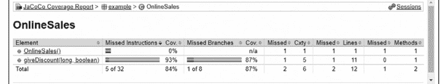

| 元素 | Missed Instructions | Cov | Missed Branches | Cov | Missed | City | Lines | Missed | Methods | Missed | Methods |
| --- | --- | --- | --- | --- | --- | --- | --- | --- | --- | --- | --- |
| (OnlineSales) | | 0% | | 87% | | 1 | 1 | 1 | 1 | | 1 |
| @giveDiscount(long, boolean) | | 93% | | 87% | | 1 | 5 | 1 | 0 | | 1 |
| Total | | 84% | | 87% | | 2 | 6 | 2 | 12 | | | |

> 图 5.1 带有缺陷 4 的 `giveDiscount` 决策表覆盖摘要。

对于语句覆盖，我们只对报告中的 `Lines` 列到 `Missed` 列感兴趣。我们还关注正在测试的方法，显示在 `giveDiscount(long, boolean)` 行中。`Lines` 显示该方法中的行数：11。`Missed` 显示该方法中的行数：1。下一步是确定哪些行没有执行。我们通过检查图 5.2 所示的源代码报告来此。

单行的行亮解释如下：

- 已执行的行显示为绿色（屏幕）。
- 部分执行的行显示为灰色（屏幕）。
- 未执行的行显示为深灰色（屏幕）。

对于语句覆盖，我们只对报告中的 `Lines` 列到 `Missed` 列感兴趣。我们还关注正在测试的方法，显示在 `giveDiscount(long, boolean)` 行中。`Lines` 显示该方法中的行数：11。`Missed` 显示该方法中的行数：1。下一步是确定哪些行没有执行。我们通过检查图 5.2 所示的源代码报告来此。

```
1. package example;
2. //
3. /**
 * 是否在线销售提供折扣。
 * 金牌客户 80 积分折扣。
 * 其他客户 120 积分折扣。
 *
 * @param bonusPoints 客户有多少积分
 * @param goldCustomer 客户是否为金牌客户
 * @return
 * DISCOUNT - 提供折扣
 * FULLPRICE - 收全价
 * ERROR - 输入无效
 */
4. public class OnlineSales {
5.   static enum Status { FULLPRICE, DISCOUNT, ERROR };
6.
7.   public static Status giveDiscount(long bonusPoints, boolean goldCustomer) {
8.
9.   Status rv = FULLPRICE;
10.  long threshold=120;
11.  if (bonusPoints<=0) {
12.    rv = ERROR;
13.
14.  else {
15.    if (goldCustomer) {
16.      threshold = 80;
17.      if (bonusPoints<=threshold)
18.        rv = DISCOUNT;
19.    }
20.
21.    if (bonusPoints==45) { // Fault 4
22.      rv = DISCOUNT;
23.    }
24.
25.    return rv;
26.  }
27. }
```


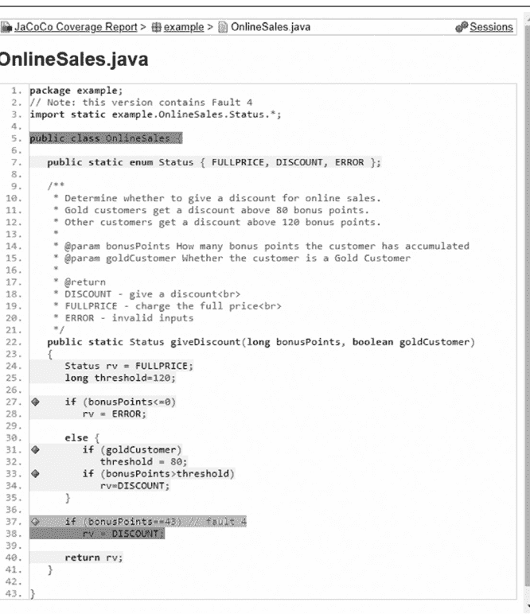

图 5.2 带有缺陷 4 的 `giveDiscount()` 决策表测试覆盖详情。

记住，我们测试的是 `giveDiscount()` 方法而不是整个类——覆盖率显示类生成的某些代码没有被执行。这在我们于第 9 章考虑面向对象的测试时具有相关性。

通过对源代码和覆盖率结果进行检查，我们可以识别出以下内容：未执行的代码行、导致这些行被执行时必须满足的条件，以及满足这些条件所需的输入值。

在示例中，从图 5.2 我们可以识别出未执行的语句：第 38 行。

通过对源代码的仔细检查，我们可以识别出导致第 37 行执行的条件——第 37 行上的 `bonusPoints == 43` 为真，这意味着在代码执行到此处时，`bonusPoints` 的值必须为 43。

由于 `bonusPoints` 是一个输入参数，很容易识别所需的输入：`bonusPoints` 的值必须为 43。当条件是代码中计算的结果时，则需要更详细的分析。这些结果汇总在表 5.1 中。

## 表 5.1 `giveDiscount()` 中的意外语句

| ID | 行号 | 条件 |
|---|---|---|
| 38 | `bonusPoints == 43` | |

### 5.3.2 测试覆盖率项

每一行已执行的源代码（或语句）都是一个测试覆盖率项（TCI），如表 5.2 所示。无法执行的行被忽略（例如注释和空行）。这表明只需提供一个额外的 TCI 即可实现全源代码覆盖（当结合全套黑盒测试执行时）。识别所有之前执行过的语句以及哪些测试执行了这些语句意义不大，特别是对于大量语句的情况。

所有的 TCIs 和测试用例都被标记为“额外的（extra）”，以指示它们本身没有提供完全语句覆盖。提供完全语句覆盖所需的补充内容必须经过记录：在本示例中，它们是等价划分、边界值分析（BVA）和已开发的决策表。

表 5.2 中的“测试用例”列已完成。如果由于评审目的需要，你也可以在表中列出具体是哪一个黑盒测试覆盖了每个待执行的语句，但在实践中这种详细程度通常是不必要的，而且这将需要每个黑盒测试都单独运行和测量。

## 表 5.2 `giveDiscount()` 的额外语句覆盖 TCI

| TCI | 行号 | 测试用例 |
|---|---|---|
| SC1 | 38 | 待完成 |

### 5.3.3 测试用例

开发测试用例是为了确保所有未执行的语句都得到执行。经验允许开发出最少测试集，但重点是确保完全覆盖。

分析已经识别了每个未覆盖语句执行所需的所需的条件，这有助于测试数据的开发。

在例子中，我们已经计算出，要执行第 38 行的代码，参数 `bonusPoints` 的值必须为 43。根据规范，如果 `bonusPoints` 为 43，则结果将是 `FULLPRICE`，无论 `goldCustomer` 参数的值为何。这使得允许为 `goldCustomer` 选取任何值，如表 5.3 所示。

## 表 5.3 `giveDiscount()` 的额外语句覆盖测试用例

| ID | TCI | bonusPoints | goldCustomer | 返回值 |
|---|---|---|---|---|
| T4.1 | SC1 | 43 | false | FULLPRICE |

- 与黑盒测试不同，白盒测试不区分错误用例和非错误用例。

### 5.3.4 测试用例的验证

如前所述，验证包含两个步骤：首先完成测试用例，然后评审你的工作。

#### 完善测试覆盖率项表

通过从表 5.3 的测试用例读取 TCI 列，我们可以完成 TCI 表中的“测试用例”列，如表 5.4 所示。

## 表 5.4 `giveDiscount()` 的额外语句覆盖 TCI

| TCI | 行 | 测试用例 |
|---|---|---|
| SC1 | 38 | T4.1 |

#### 评审你的工作

设计验证由评审组成以确保：

- 每个 TCI 都至少被一个测试用例覆盖（这确认了测试是完整的）。
- 每个新的测试用例都覆盖了额外的 TCI（这确认了不存在不必要的测试）。
- 没有重复的测试（考虑到等价划分、BVA 和决策表测试）。

在本示例中，我们可以从表 5.4 看到每个 TCI 都被覆盖了，从表 5.3 看到每个语句覆盖测试用例都覆盖了额外的 TCI。对比等价划分、BVA、决策表和语句覆盖测试的测试用例（表 2.9、3.3、4.15 和 5.3），我们可以看到没有重复的测试。

### 5.4 测试实现与结果

#### 5.4.1 实现

完整的实现显示在列表 5.2 中。这包含了之前开发的划分、BVA 和决策表，因为这些是提供完全语句覆盖所必需的。

+ 列表 5.2 用于语句覆盖测试的 `OnlineSalesTest`

```
public class OnlineSalesTest {

  private static Object[][] testData = new Object[][] {

    // test, bonusPoints, goldCustomer, expected output
    { "T1.1", 40L, true, FULLPRICE },
    { "T1.2", 100L, false, FULLPRICE },
    { "T1.3", 80L, false, DISCOUNT },
    { "T1.4", -10L, false, DISCOUNT },
    { "T2.1", 43L, true, FULLPRICE },
    { "T2.2", 43L, false, FULLPRICE },
    { "T2.3", 43L, true, DISCOUNT },
    { "T2.4", 43L, false, DISCOUNT },
    { "T2.5", 43L, true, FULLPRICE },
    { "T2.6", 43L, false, ERROR },
    { "T3.1", 100L, true, DISCOUNT },
    { "T3.2", 200L, true, DISCOUNT },
    { "T4.1", 43L, false, FULLPRICE }
  };

  @DataProvider(name = "testset1")
  public Object[][] getTestData() {
    return testData;
  }

  @Test(dataProvider = "testset1")
  public void test_giveDiscount(String id, long bonusPoints, boolean goldCustomer, String expected) {
    assertEquals(expected, OnlineSales.giveDiscount(bonusPoints, goldCustomer));
  }
}
```

#### 5.4.2 测试结果

针对 Fault 4 执行全套测试（划分、BVA、决策表和语句覆盖）的结果位于图 5.3。

```
PASSED:T1.1 (40L, true, FULLPRICE)
PASSED:T1.2 (100L, false, FULLPRICE)
PASSED:T1.3 (80L, false, DISCOUNT)
PASSED:T1.4 (-10L, false, DISCOUNT)
PASSED:T2.1 (43L, true, FULLPRICE)
PASSED:T2.2 (43L, false, DISCOUNT)
PASSED:T2.3 (43L, true, DISCOUNT)
PASSED:T2.4 (43L, false, DISCOUNT)
PASSED:T2.5 (43L, true, FULLPRICE)
PASSED:T2.6 (43L, false, ERROR)
PASSED:T3.1 (100L, true, DISCOUNT)
PASSED:T3.2 (200L, true, DISCOUNT)
FAILED:T4.1 (43L, false, FULLPRICE)

java.lang.AssertionError: expected [FULLPRICE] but found [DISCOUNT]

Command line suite
Total tests run: 13, Passes: 12, Failures: 1, Skips: 0
```

> 图 5.3 `giveDiscount()` 的 Fault 4 语句覆盖测试。

语句测试 T4.1 失败，表明代码存在故障：该测试已发现故障。对代码的其他版本运行这些测试没有意义，除非已验证额外测试继续提供 100% 的覆盖。测试数据专门开发，以确保对包含 Fault 4 的代码进行语句覆盖。结果如图 5.4 所示。

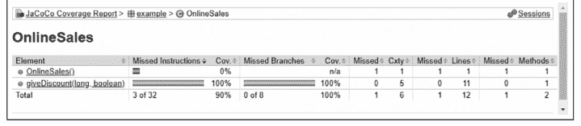

| 元素 | 缺失指令 | 注释 | 缺失分支 | 容量 | 缺失 | 数量 | 行 | 缺失 | 方法 |
| --- | --- | --- | --- | --- | --- | --- | --- | --- | --- |
| `@OnlineSales()` | | 0% | | | 100% | 0 | 5 | 11 | 0 | 1 |
| `@giveDiscount(long, boolean)` | | | | | 100% | 1 | 6 | 12 | 1 | 2 |
| | 总计 | 32 | 90% | | | 100% | 1 | 6 | 12 | 1 | 2 |

图 5.4 `giveDiscount()` 的 Fault 4 语句覆盖测试总结。

全语句覆盖已经实现——没有缺失的行。一旦实现 100% 覆盖，再次查看注释代码就没有意义。

## 语句覆盖

### 5.5 语句覆盖测试的详细说明

#### 5.5.1 故障模型

语句覆盖故障模型是指：在之前的测试中未执行的代码可能包含故障。这些未执行的语句通常与边界情况或其他异常情况有关。

语句覆盖测试使用精心选择的输入值来确保每条语句都得到执行。这些测试试图发现与源代码中单行代码相关的故障。

#### 5.5.2 描述

开发测试的目的是为了使源代码中的所有语句都执行一次。测试期间达到的语句覆盖率通常以百分比形式显示——例如，100% 的语句覆盖意味着每条语句都已执行过，50% 则意味着只有一半的语句执行了过。

语句覆盖是白盒测试中最弱的形式。然而，100% 的语句覆盖可能无法覆盖程序的逻辑，也无法产生所有可能的输出值！

语句覆盖的额外益处是，在分析阶段可以识别出不可达的代码（这些代码应该被审查并可能被删除）。

#### 5.5.3 分析：识别未执行的语句

根据之前测试（通常是黑盒测试）的覆盖结果，可以很容易识别出未执行的语句。

对于复杂代码，可以先开发控制流图（CFG）以帮助从更抽象的层面理解代码流，但语句覆盖很少需要这些；CFG 将在第 7 章中解释。语句覆盖也可以在黑盒测试之前开发，尽管这并不是通常的做法。在这种情况下，传统上使用 CFG 来辅助开发测试，尽管经验丰富的测试人员可能不会使用它们。

#### 5.5.4 测试覆盖项

源代码中的每条语句都是一个测试覆盖项（TCI）。通常，单行源代码被视为一条语句。与其他形式的一样，为 TCI 使用唯一标识符可以使审查测试设计的任务变得更容易。

#### 5.5.5 测试用例

选择测试数据以确保程序中的每条语句或节点都得到执行。这种选择要求测试人员审查代码，并选择输入参数值以导致所需的语句被执行。

> 5 所有其他形式的白盒结构测试确保在

### 5.6 评估

开发执行源代码中语句的测试用例具有挑战性。测试数据值通常基于对已执行语句的审查，并识别输入参数的变化，以导致额外的语句被执行。这些数据值可以在分析期间识别（如示例所示），也可以在开发测试用例期间识别。

最后，使用规格书（绝不使用源代码），我们可以计算出每组输入值的预期结果。值得重复的是，预期结果必须来自规格书。从代码中读取预期结果是非常容易犯的错误——测试人员必须小心避免这样做。

### 5.6.1 局限性

本章已经展示了语句覆盖如何利用故障 4 检测与意外语句相关的故障。现在将通过在原始代码中插入一个新故障，来探索语句覆盖的一些优点和局限性。

故障 5

在第 31 行插入了一个新故障，以演示使用语句覆盖进行测试的一些局限性。该故障通过修改第 31 行的 `if` 语句产生，错误地添加了 `&& bonusPoints != 93`。这在代码中创建一个额外的分支，该分支在现有测试数据下不会被触发（因为值 93 从未用于 `bonusPoints`）。结果是，当 `bonusPoints` 等于 93 时，第 32 行将不会执行。如列表 5.3 所示。

+ 列表 5.3 故障 5

```
public static void giveDiscount(long bonusPoints, boolean goldCustomer) {

    Status rv = FULLPRICE;

    long threshold = 120;

    if (bonusPoints <= 0)
        rv = ERROR;
    else {
        if (goldCustomer && bonusPoints != 93) // Fault 5
            threshold = 80;
        if (bonusPoints > threshold)
            rv = DISCOUNT;
    }

    return rv;
}
```

#### 针对故障 5 测试

针对此修改的等价划分、边界值分析（BVA）、决策表和语句覆盖测试的结果如图 5.5 所示。故障未被发现。这是预料之中的——插入的故障与规格书没有关系，不太可能被任何黑盒测试技术或语句覆盖发现。如图 5.6 所示。

```
PASSED: test_giveDiscount("T.1", 40, true, FULLPRICE)
PASSED: test_giveDiscount("T.2", 100, false, FULLPRICE)
PASSED: test_giveDiscount("T.3", 200, false, DISCOUNT)
PASSED: test_giveDiscount("T.4", -100, false, ERROR)
PASSED: test_giveDiscount("T2.1", 1, true, FULLPRICE)
PASSED: test_giveDiscount("T2.2", 80, false, FULLPRICE)
PASSED: test_giveDiscount("T2.3", 81, false, FULLPRICE)
PASSED: test_giveDiscount("T2.4", 120, false, FULLPRICE)
PASSED: test_giveDiscount("T2.5", 121, true, FULLPRICE)
PASSED: test_giveDiscount("T2.6", 93, true, FULLPRICE)
PASSED: test_giveDiscount("T2.7", 93, false, ERROR)
PASSED: test_giveDiscount("T3.1", 1, true, FULLPRICE)
PASSED: test_giveDiscount("T3.2", 200, false, DISCOUNT)

Command line
Total runs: 15, Passes: 15, Failures: 0, Skips: 0
```

> 图 5.5 故障 5 的 `giveDiscount()` 语句覆盖结果。


图 5.6 故障 5 的 `giveDiscount()` 语句覆盖总结。

#### 演示故障

对于输入值返回了错误的结果。正确的结果是 `DISCOUNT`。我们需要更高级的方法来发现此类故障，将在第 6 章中讨论。

### 5.6.2 优点与局限性

#### 优点

- 语句覆盖通过至少执行一次代码中的所有语句提供了基本的覆盖水平。在测试期间在每条语句都执行之前发布软件具有巨大的风险——其行为尚未经过验证，并且可能存在缺陷。
- 语句覆盖通常只需要少量的额外测试即可实现。

#### 局限性

- 确定所需的输入值可能很困难。
- 测试在异常或特殊情况下执行的代码可能很难。
- 它没有为空的 `else` 提供覆盖。例如，在代码中：

```
if (number < 3) number++;
```

语句覆盖强制要求一个 `number >= 3` 的测试用例。

- 它对复合决策没有要求。在代码中：

```
if (a > 1) || (b == 0) x = x/a;
```


没有针对决策中每个单独布尔条件的每个值的测试用例，也没有针对这些布尔条件的可能组合。

语句覆盖通常用于补充黑盒测试——因为很容易自动测量覆盖率。如果黑盒测试没有达到要求的覆盖率（通常为 100%），可以使用这种白盒技术将覆盖率提高到所需的水平。

## 语句覆盖

### 5.7 关键点

- 语句覆盖用于通过确保每条语句都执行过来增强黑盒测试。
- 测试覆盖率项是基于未执行的语句的。
- 测试用例的输入值是通过分析代码中的决策来选择的（因此它们取决于被测试代码的具体版本）。
- 语句覆盖可以如所示用于单元测试，而且在测试面向对象的软件时也可以以完全相同的方式使用。它也可以用于应用程序测试，尽管对于 Web 应用程序，当应用程序在远程服务器上运行时，设置服务器以产生覆盖结果并访问这些结果可能具有挑战性。

### 5.8 针对经验丰富的测试人员的注意事项

丰富的测试人员会先进行黑盒测试并测量其覆盖率。然后，通过审查覆盖结果，可以开发额外的测试以确保完全的语句覆盖。确定正确的输入值可能很复杂，丰富的测试人员通常会使用调试器来协助完成此工作。对于复杂决策的一种有效技术是在第一行未执行行之前的直接代码行上设置断点，然后检查相关变量的值。丰富的测试人员可能会直接根据覆盖结果开发语句测试用例，而不记录分析过程或 TCI。与黑盒测试不同，通过检查测试生成的覆盖统计数据，可以有效地审查测试设计工作，而无需访问这些文档。

## 6 分支覆盖

在本章中，将引入下一种强白盒测试形式：分支覆盖。

### 6.1 使用分支覆盖进行测试

这确保在测试期间代码中的每个分支都被执行，或者更正式地说，测试期间的覆盖标准是*分支覆盖*。使用分支覆盖进行测试可以确保测试覆盖了每个分支，同时验证输出是正确的。

> **定义：** 分支是执行过程中源代码中从一行到另一行的转换。这些行可能直接相邻，也可能存在跳转。

#### 6.1.1 分支覆盖测量

对于覆盖率，Java 程序也可以自动测量分支覆盖率。之前用于语句覆盖的 `JaCoCo` 工具也可以用于测量分支覆盖。注意，不同的工具可能以不同的方式测量分支——在本章中，我们使用 `JaCoCo` 报告作为测试的基础¹

## 6.2 示例

本章使用了对带有故障 5 的 `OnlineSales.giveDiscount()` 方法的测试，如列表 **6.1** 所示。提醒一下，规范和代码将在接下来显示。

总结规范，`giveDiscount(bonusPoints, goldCustomer)` 返回：

```
FULLPRICE if bonusPoints ≤ 120 and not a goldCustomer
FULLPRICE if bonusPoints <= 80 and a goldCustomer
DISCOUNT if bonusPoints > 120
DISCOUNT if bonusPoints > 80 and a goldCustomer
ERROR if any inputs are invalid (bonusPoints < 1)
```

¹ `JaCoCo` 将决策中每个布尔条件的结果视为一个独立的分支。每个工具都可能采取不同的方法（在许多教科书中），将决策的结果测量为分支，而不是决策内部的单个布尔条件。

列表 6.1 重复了带有故障 5 的源代码，以便参考。

#### 列表 6.1 故障 5

```
public static Status giveDiscount(long bonusPoints, boolean goldCustomer)
{
    Status rv = FULLPRICE;
    long threshold = 120;
    if (bonusPoints <= 0)
        rv = ERROR;
    else {
        if (goldCustomer && bonusPoints != 93) // Fault 5
            threshold = 80;
            if (bonusPoints > threshold)
                rv = DISCOUNT;
    }
    return rv;
}
```

### 6.2 分析：识别未执行的分支

对于已经通过黑盒和/或语句覆盖测试过的代码，可以通过检查这些测试的分支覆盖结果，开发出实现完全分支覆盖的测试。

对于故障 5，在带有代码覆盖测量的情况下运行现有测试（等价划分、边界值分析 (BVA)、决策表、语句覆盖），可以生成覆盖摘要报告和高亮的的源代码。这些与我们在上一章（第 5.3.1 节）中看到的语句覆盖报告是相同的，只是现在报告中的数字将会有不同。这些测试的覆盖摘要如图 6.1 所示。


#### 6.2 示例

注意的是，语句覆盖测试的开发是为了提供带有故障 4 的 `giveDiscount()` 的完全语句覆盖，而不是带有故障 5。因此，无法保证为带有故障 5 的版本提供语句覆盖。然而在示例中，我们可以从覆盖摘要中看到已实现 100% 的语句覆盖（漏掉的 0）。

检查未执行的分支显示我们的覆盖率为 87%——这意味着方法中的并非所有分支都被执行。为了识别哪些分支未被执行，我们现在检查源代码覆盖报告（见图 6.2）。


```
1. package example;
2. import static example;
3. public class OnlineSales {
4.
5. public enum Status {
6.     FULLPRICE, DISCOUNT, ERROR
7. }
8.
9. /*
10. Determine whether to give a discount.
11. @param bonusPoints bonus points
12. @param goldCustomer whether the customer is Gold
13. @return Status
14. */
15. public static Status giveDiscount(long bonusPoints, boolean goldCustomer) {
16.     Status rv = FULLPRICE;
17.     long threshold = 120;
18.     if (bonusPoints <= 0)
19.         rv = ERROR;
20.     else {
21.         if (goldCustomer && bonusPoints != 93) // fault
22.             threshold = 80;
23.             if (bonusPoints > threshold)
24.                 rv = DISCOUNT;
25.     }
26.     return rv;
27. }
```

将光标悬停在第 31 行的菱形上，会在行下方显示覆盖的详细报告框。这如图 6.3 所示。

| 行号 | 代码 |
|---|---|
| 31 | `if (goldCustomer && bonusPoints != 93) // fault` |
| 32 | `threshold = 80;` |
| 33 | `if (bonusPoints > threshold)` |
| 34 | `rv = DISCOUNT;` |
| 35 | `}` |

图 6.3 分支覆盖。

报告显示四个分支中有一个被遗漏。记得 `JaCoCo` 是 Java 分支覆盖工具的典型代表，因为它计算的是每个条件的结果，而不是决策本身。

我们现在可以详细检查分支覆盖报告。第 31 行有一个决策——这是一个复合决策：

- 决策 1: `goldCustomer && bonusPoints != 93`

第 31 行决策中有两个布尔条件：

- 条件 1: `goldCustomer`
- 条件 2: `bonusPoints != 93`

代码中有四个分支，对应每个布尔条件：一个真结果和一个一个假结果：

- 分支 1: `goldCustomer is false`
- 分支 2: `goldCustomer is true`
- 分支 3: `bonusPoints == 93`
- 分支 4: `bonusPoints != 93`

首先评估第一个布尔条件 (`goldCustomer`)，并执行分支 1 或分支 2。然后评估第二个布尔条件 (`bonusPoints != 93`)，并执行每个分支 3 或分支 4。分支 4 是在第 32 行后续执行的唯一分支。其他三个分支都跳转到第 33 行。

对测试数据的审查显示，93 这个值未在测试中使用，因此未执行的分支是列表中标识为分支 3 的分支。执行该分支的要求是 `goldCustomer` 为真且 `bonusPoints` 等于 93。

这些分析总结在表 6.1 中，表中显示了每个分支的开始和结束，以及满足该分支的约束。

> “条件”一词在软件测试中有多种含义，为了清晰起见，我们使用“测试条件”指 IEEE 测试条件，使用“布尔条件”指复杂决策中的子句。

#### 6.2 示例（续）

被执行。只需考虑未执行的分支——之前的测试已经覆盖了所有其他分支。

**表 6.1** `giveDiscount()` 中的未执行分支

| 分支 | 起始行 | 结束行 | 条件 |
|---|---|---|---|
| B1 | 31 (分支 3) | 33 | `goldCustomer && bonusPoints == 93` |

##### 6.2.2 测试覆盖项

代码中的每个未执行分支都是一个测试覆盖项（TCI），如表 6.2 所示。与语句覆盖相比，此此识别哪些现有测试导致了其他每个分支的执行价值不大，因此只识别了额外的 TCI。

**表 6.2** `giveDiscount()` 的额外分支覆盖 TCI

| TCI | 分支 | 测试用例 |
|---|---|---|
| BCI | B1 | 待完成 |

##### 6.2.3 测试用例

开发测试用例是为了确保在执行分支覆盖测试期间，所有之前未执行的分支都能被执行。根据经验，可以开发出一组最小测试集，但重点是确保完全的分支覆盖。

分析已经识别了执行每个未执行分支所需的条件，这如表 6.3 所示，有助于测试数据的开发。在这个示例中，我们已经识别出要执行未执行的分支，参数 `goldCustomer` 必须为 true，参数 `bonusPoints` 的值必须为 93。预期结果根据规范确定。输入值 (93, true) 应该产生 DISCOUNT。

##### 6.2.4 测试用例的验证

如前所述，验证包含两个步骤：首先完成 TCIs 表，然后检查你的工作。

###### 完成 TCIs 表

我们现在可以完成 TCIs 表了，如表 6.4 所示。测试用例列通过参考表 6.3 中的 TCI 列来填充。

### 分支覆盖

**表 6.3** `giveDiscount()` 的额外分支覆盖测试数据

| ID | TCI | 输入 | 预期结果 |
|---|---|---|---|
| | | `bonusPoints` `goldCustomer` | 返回值 |
| T5.1 | BC1 | 93 true | DISCOUNT |

**表 6.4** `giveDiscount()` 的额外分支覆盖测试项

| TCI | 分支 | 测试 |
|---|---|---|
| BC1 | B1 | T5.1 |

###### 检查你的工作

在这个示例中，我们从表 6.4 看到每个测试用例都被覆盖了，从表 6.3 看到每个分支覆盖都覆盖了一个新的分支覆盖 TCI。对比等价划分、BVA、决策表、语句覆盖和分支覆盖测试的数据（表 2.9、3.3、4.15、5.3 和 6.3），我们可以看到没有重复的测试。这证实了：(a) 没有遗漏的测试，且 (b) 没有不必要的测试。

### 6.3 测试实现与结果

#### 6.3.1 实现

完整的测试实现将分支覆盖测试添加到之前开发的等价划分、BVA、决策表和语句覆盖测试中，如代码列表 6.2 所示。该实现代表了实现分支覆盖所需的全套测试。

#### 列表 6.2 用于分支覆盖测试的 `OnlineSalesTest`

```
public class OnlineSalesTest {
    private static Object[][] testData = new Object[][] {
      // test, bonusPoints, goldCustomer, expected
      {"T1.1", 40L, true, FULLPRICE },
      {"T1.2", 100L, false, FULLPRICE },
      {"T1.3", 200L, false, DISCOUNT },
      {"T1.4", -10L, false, ERROR },
      {"T2.1", -1L, true, FULLPRICE },
      {"T2.2", 80L, false, FULLPRICE },
      {"T2.3", 81L, false, FULLPRICE },
      {"T2.4", 120L, false, FULLPRICE },
      {"T2.5", 121L, false, DISCOUNT },
      {"T2.6", LONG.MAX_VALUE, false, DISCOUNT },
      {"T2.7", LONG.MIN_VALUE, false, ERROR },
      {"T2.8", 0L, false, ERROR },
      {"T3.1", 100L, true, DISCOUNT },
      {"T3.2", 200L, true, DISCOUNT },
      {"T4.1", 43L, true, FULLPRICE },
      {"T5.1", 93L, true, DISCOUNT }
    };

    @DataProvider(name = "testset1")
    public Object[] getTestData() {
        return testData();
    }

    @Test(dataProvider = "testset1")
    public void testGiveDiscount(String id, long bonusPoints,
        boolean goldCustomer, Status expected) {
        assertEquals(OnlineSales.giveDiscount(bonusPoints,
        goldCustomer), expected);
    }
}
```

#### 6.3 测试实现与结果


## 6.2 示例

被执行。只需考虑未执行的分支——之前的测试已经覆盖了所有其他分支。

**表 6.1** `giveDiscount()` 中的未执行分支

| 分支 | 起始行 | 结束行 | 条件 |
|---|---|---|---|
| B1 | 31 (分支 3) | 33 | `goldCustomer && bonusPoints == 93` |

### 6.2.2 测试覆盖项

代码中的每个未执行分支都是一个测试覆盖项（TCI），如表 6.2 所示。与语句覆盖相比，此识别哪些现有测试导致了其他每个分支的执行价值不大，因此只识别了额外的 TCI。

**表 6.2** `giveDiscount()` 的额外分支覆盖 TCI

| TCI | 分支 | 测试用例 |
|---|---|---|
| BCI | B1 | 待完成 |

### 6.2.3 测试用例

开发测试用例是为了确保在执行分支覆盖测试期间，所有之前未执行的分支都能被执行。根据经验，可以开发出一组最小测试集，但重点是确保完全的分支覆盖。

分析已经识别了执行每个未执行分支所需的条件，这如表 6.3 所示，有助于测试数据的开发。在这个示例中，我们已经识别出要执行未执行的分支，参数 `goldCustomer` 必须为 true，参数 `bonusPoints` 的值必须为 93。预期结果根据规范确定。输入值 (93, true) 应该产生 DISCOUNT。

### 6.2.4 测试用例的验证

如前所述，验证包含两个步骤：首先完成 TCIs 表，然后检查你的工作。

## 完成 TCIs 表

我们现在可以完成 TCIs 表了，如表 6.4 所示。测试用例列通过参考表 6.3 中的 TCI 列来填充。

## 分支覆盖

表 6.3 `giveDiscount()` 的额外分支覆盖测试数据。

| ID | TCI | 输入 | 预期结果 |
|---|---|---|---|
| | | `bonusPoints` `goldCustomer` | 返回值 |
| T5.1 | BC1 | 93 true | DISCOUNT |

表 6.4 `giveDiscount()` 的额外分支覆盖测试项。

| TCI | 分支 | 测试 |
|---|---|---|
| BC1 | B1 | T5.1 |

## 检查你的工作

在这个示例中，我们从表 6.4 看到每个测试用例都被覆盖了，从表 6.3 看到每个分支覆盖都覆盖了一个新的分支覆盖 TCI。对比等价划分、BVA、决策表、语句覆盖和分支覆盖测试的数据（表 2.9、3.3、4.15、5.3 和 6.3），我们可以看到没有重复的测试。这证实了：(a) 没有遗漏的测试，且 (b) 没有不必要的测试。

## 6.3 测试实现与结果

### 6.3.1 实现

完整的测试实现将分支覆盖测试添加到之前开发的等价划分、BVA、决策表和语句覆盖测试中，如代码列表 6.2 所示。该实现代表了实现分支覆盖所需的全套测试。

列表 6.2 用于分支覆盖测试的 `OnlineSalesTest`。

```
public class OnlineSalesTest {
    private static Object[][] testData = new Object[][] {
      // test, bonusPoints, goldCustomer, expected
      {"T1.1", 40L, true, FULLPRICE },
      {"T1.2", 100L, false, FULLPRICE },
      {"T1.3", 200L, false, DISCOUNT },
      {"T1.4", -10L, false, ERROR },
      {"T2.1", -1L, true, FULLPRICE },
      {"T2.2", 80L, false, FULLPRICE },
      {"T2.3", 81L, false, FULLPRICE },
      {"T2.4", 120L, false, FULLPRICE }
```

> 将单个测试分组为可以独立运行的集合/测试套件的技巧将在第 11 章中讨论。

## 6.3 测试实现与结果

| 行 | 数据 |
|---|---|
| 13 | "T2.5", 121L, false, DISCOUNT }, |
| 14 | "T2.6", LONG.MAX_VALUE, false, DISCOUNT }, |
| 15 | "T2.7", LONG.MIN_VALUE, false, ERROR }, |
| 16 | "T2.8", 0L, false, ERROR }, |
| 17 | "T3.1", 100L, true, DISCOUNT }, |
| 18 | "T3.2", 200L, true, DISCOUNT }, |
| 19 | "T4.1", 43L, true, FULLPRICE }, |
| 20 | "T5.1", 93L, true, DISCOUNT |

```
@DataProvider(name = "testset1")
public Object[] getTestData() {
    return testData();
}

@Test(dataProvider = "testset1")
public void testGiveDiscount(String id, long bonusPoints,
    boolean goldCustomer, Status expected) {
    assertEquals(OnlineSales.giveDiscount(bonusPoints,
    goldCustomer), expected);
}
```

## 6.5 评估

- (special) 的真结果：从第 5 行跳转到第 6 行；
- (special) 的假结果：从第 5 行跳转到第 7 行。

## 6.4.4 分析：识别未执行的分支

覆盖工具的结果用于识别未执行分支的语句。通常，通过识别任何已执行的行、获取未执行分支的数量并考虑测试数据，很容易实现这一操作。

## 6.4.5 测试覆盖项

源代码中的每个分支都是一个 TCI。

## 6.4.6 测试用例

测试用例是根据选定的测试数据开发的，以确保每个分支都能被执行。预期结果必须来自规格说明。与所有的白盒测试一样，很容易犯直接从代码中读取结果的错误，测试人员必须小心避免这样做。

## 6.5 评估

分支覆盖发现了插入到 `giveDiscount()` 方法中的故障 5。

### 6.5.1 局限性

现在通过修改代码向原始（正确的）源代码中注入故障，探索了分支覆盖的一些优点和局限性。

## 故障 6

插入了一个新故障以证明分支覆盖测试的一些局限性。方法的整个处理过程被重写，如列表 6.3 中的第 24–38 行所示。这在代码中创建了一条任何现有分支覆盖测试数据都无法覆盖的路径。

## 列表 6.3 故障 6

```
22  public static Status giveDiscount(long bonusPoints, boolean
23      goldCustomer)
24  {
25      Status rv = ERROR;
26      long threshold = goldCustomer?80:120;
27      long thresholdJump = goldCustomer?20:30;
28
29  if (bonusPoints > 0) {
```

```
if (bonusPoints < thresholdJump)
    bonusPoints -= threshold;
if (bonusPoints > thresholdJump)
    bonusPoints -= threshold;
bonusPoints += 4 * (thresholdJump);
if (bonusPoints > threshold)
    rv = DISCOUNT;
else
    rv = FULLPRICE;
}
return rv;
```

## BC 测试故障 6

针对此修改运行等价分区、边界值分析（BVA）、判定语句覆盖和分支覆盖测试的结果如图 6.7 所示。


PASSED: test_getDiscount("T1.1", 40, true, FULLPRICE)
PASSED: test_getDiscount("T1.2", 100, false, FULLPRICE)
PASSED: test_getDiscount("T1.3", 200, false, DISCOUNT)
PASSED: test_getDiscount("T1.4", -100, false, ERROR)
PASSED: test_getDiscount("T2.1", 1, true, FULLPRICE)
PASSED: test_getDiscount("T2.2", 80, false, FULLPRICE)
PASSED: test_getDiscount("T2.3", 81, false, FULLPRICE)
PASSED: test_getDiscount("T2.4", 120, false, FULLPRICE)
PASSED: test_getDiscount("T2.5", 121, false, DISCOUNT)
PASSED: test_getDiscount("T2.6", -92233723685477508, false, DISCOUNT)
PASSED: test_getDiscount("T2.7", -92233723685477508, false, ERROR)
PASSED: test_getDiscount("T2.8", 0, false, ERROR)
PASSED: test_getDiscount("T3.1", 100, true, DISCOUNT)
PASSED: test_getDiscount("T3.2", 200, true, DISCOUNT)
PASSED: test_getDiscount("T4.1", 43, true, FULLPRICE)
PASSED: test_getDiscount("T5.1", 93, true, DISCOUNT)
====================================================

命令行套件
总运行次数: 16, 通过: 16, 失败: 0, 跳过: 0
====================================================

> 图 6.7 带有故障 6 的 `getDiscount()` 分支测试结果。

所有测试都通过了——故障没有被发现。这是意料之中的，因为 (a) 插入的故障与规格说明没有关系，不太可能被任何黑盒测试技术发现，且 (b) 该故障没有通过实现代码的语句覆盖或分支覆盖而显现。

测试提供了完全的语句和分支覆盖，如图 6.8 所示。测试 T4.1 和 T5.1（见图 6.7）对于此版本的代码实际上是冗余的——代码已经发生了更改，不再需要这些测试来达到语句或分支覆盖。

## 6.5 评估

# 111

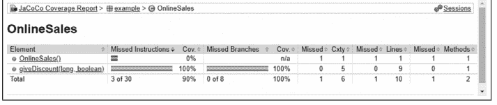

**图 6.8** 带有故障 6 的 `giveDiscount()` 分支测试覆盖总结。

## 演示故障

使用特殊选定的输入值执行带有故障 6 的代码的结果如图 6.9 所示。注意，输入 (20, true) 和 (30, false) 都返回了错误的结果。正确的结果是 FULLPRICE。

```
$ 20 true
DISCOUNT

$ 30 false
DISCOUNT
```

**图 6.9** 带有故障 6 的代码执行结果

### 6.5.1 局限性

现在通过修改代码向原始（正确的）源代码中注入故障，探索了分支覆盖的一些优点和局限性。

## 全路径覆盖

## 7.2 示例

带有故障 6 的 `giveDiscount` 源代码在之前的测试技术未被发现，在列表 7.1 中重复列供参考。

### 列表 7.1 故障 6。

```java
public static Status giveDiscount(long bonusPoints, boolean goldCustomer) {

    Status rv = ERROR;

    long threshold = goldCustomer ? 80 : 120;

    long thresholdJump = goldCustomer ? 20 : 30;

    if (bonusPoints > 0) {

        if (bonusPoints < thresholdJump)
            bonusPoints = threshold;

        if (bonusPoints > thresholdJump)
            bonusPoints = threshold;

        bonusPoints += 4 * (thresholdJump);

        if (bonusPoints > threshold)
            rv = DISCOUNT;

    } else {

        rv = FULLPRICE;

    }

    return rv;

}
```

该方法包含了到目前为止测试未覆盖的代码路径。其中一条路径是故障的，需要采用系统方法来识别并测试每条路径。

### 7.2.1 代码分析

与 `for` 语句和分支测试不同，没有任何工具可以识别除简单示例之外的路径覆盖。因此，我们将以图的形式开发程序的抽象表示，并利用它来识别端到端的路径。

# 控制流图

CFG 是一种显示代码段内控制流的有向图。这些主要用于表示源级别的代码。图中的每个节点代表源代码中一个或多个不可分割的语句。每条边代表控制流中的跳转或分支。具有两个出口的节点表示在决策处终止的代码块，带有真、假出口（例如 `if` 语句）。

CFG 是与语言无关的，提供了源代码的简化模型。这使得可以很容易识别顺序代码块、分支和路径。

# CFG 的开发

CFG 是系统地开发的，从代码开始一直向下直到，直到所有代码都已纳入 CFG。在可能的情况下，保持一致性，`true` 分支放在右侧，`false` 分支放在左侧。本示例 CFG 的开发步骤所示：

- 1. CFG 从入口点（第 22 行）开始。从这里，代码执行到第 28 行。第 22–28 行形成一个不可分割语句块；因此它由标记为 (22..28) 的单个节点表示（图 7.1）。建议您使用包含的行号来标记节点——这比仅仅给节点编号为 1, 2, 3 等要有信息量得多。记住每个节点必须代表一个不可分割的代码块（不包含分支）。

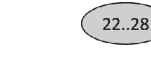

图 7.1 CFG 第 0 阶段。

- 2. 在第 28 行，如果决策（`bonusPoints > 0`）为真，则控制跳转到第 29 行。如果不是，控制跳转到第 38 行。如图 7.2 所示。快速检查代码发现第 38–41 行之间没有跳转，因此此节点标记为 38.41。表达式 `bonusPoints > 0` 显示了采取右侧分支必须满足的表达式。

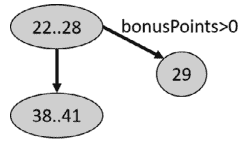

图 7.2 CFG 第 1 阶段。

- 3. 在第 29 行，如果决策（`bonusPoints < thresholdJump`）为真，则控制跳转到第 30 行。否则，控制跳转到第 31 行。在第 30 行之后，控制始终去到第 31 行（图 7.3）。

- 4. 在源代码级别，三元条件运算符（`?:`），通常被称为问号冒号运算符，被视为单行代码。

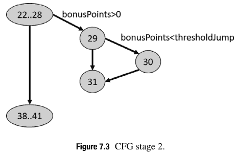

4. 在第 31 行，如果决策（`bonusPoints > threshold`）为真，则控制跳转到第 32 行。否则控制跳转到第 33 行，这是节点 33.34 的第一行。在第 32 行之后，控制始终去到第 33 行（图 7.4）。

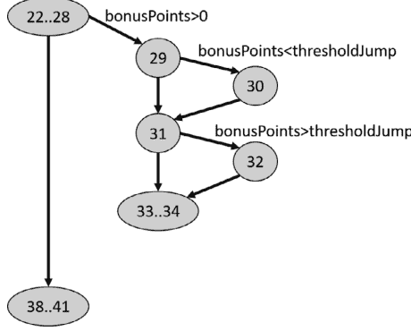

- 5. 在第 34 行，如果决策（`bonusPoints > threshold`）为真，则控制跳转到第 35 行。否则，控制跳转到第 36 行（图 7.5）。

- 6. 在第 37 行之后，控制始终通过到第 38 行。第 35 行也是如此（图 7.6）。这完成了 CFG。

# 识别候选路径

通过追踪 CFG 中所有从起点到终点的路径，可以识别出候选路径。这些是候选路径：并非所有路径在逻辑上都是可能的路径。必须采取系统方法以避免遗漏路径。通过处理 CFG，从顶部开始采取左侧分支，识别出以下路径：

- 路径 1，节点 (22..28)-(38..41)
- 路径 2，节点 (22..28)-(29)-(31)-(33.34)-(36..37)-(38..41)
- 路径 3，节点 (22..28)-(29)-(31)-(33.34)-(35)-(38..41)
- 路径 4，节点 (22..28)-(29)-(31)-(32)-(33.34)-(36..37)-(38..41)
- 路径 5，节点 (22..28)-(29)-(31)-(32)-(33.34)-(35)-(38..41)
- 路径 6，节点 (22..28)-(29)-(30)-(31)-(33.34)-(36..37)-(38..41)
- 路径 7，节点 (22..28)-(29)-(30)-(31)-(33.34)-(38..41)
- 路径 8，节点 (22..28)-(29)-(30)-(31)-(32)-(33.34)-(36..37)-(38..41)
- 路径 9，节点 (22..28)-(29)-(30)-(31)-(32)-(33.34)-(35)-(38..41)

这些总结在图 7.7 中。

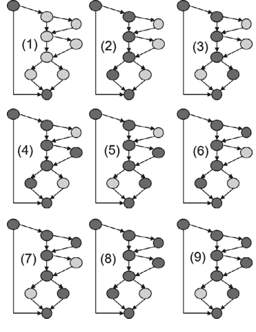

**图 7.7** 通过 CFG 的端到端路径。

# 识别可能的路径

并非所有路径逻辑上都是可能的。通过在执行最终 CFG（图 7.6）中的每条路径，同时遵循代码，并确定是否有测试数据遵循该路径。这些结果所示（该方法在 7.4.5 节中详细解释）：

- 1. 路径 1，节点 (22..28)-(38..41) 被 `bonusPoints = -100` 和 `goldCustomer = false` 覆盖（T1.4）
- 2. 路径 2，节点 (22..28)-(29)-(31)-(33.34)-(36..37)-(38..41) 不可能
- 3. 路径 3，节点 (22..28)-(29)-(31)-(33.34)-(35)-(38..41) 被 `20, true` 或 `false` 覆盖
- 4. 路径 4，节点 (22..28)-(29)-(31)-(33.34)-(36..37)-(38..41) 被 `1, true` 覆盖（T2.1）
- 5. 路径 5，节点 (22..28)-(29)-(31)-(32)-(33.34)-(35)-(38..41) 被 `40, true` 覆盖（T1.1）
- 6. 路径 6，节点 (22..28)-(29)-(30)-(31)-(33.34)-(36..37)-(38..41) 不可能
- 7. 路径 7，节点 (22..28)-(29)-(30)-(31)-(33.34)-(38..41) 不可能
- 8. 路径 8，节点 (22..28)-(29)-(30)-(31)-(32)-(33.34)-(36..37)-(38..41) 不可能
- 9. 路径 9，节点 (22..28)-(29)-(30)-(31)-(32)-(33.34)-(35)-(38..41) 不可能

# 分析结果

对 CFG 的分析产生了三个结果：

- 1. 可能的端到端路径；
- 2. 在可用的情况下，现有测试数据导致路径通过；
- 3. 在没有之前的测试导致路径的情况下，新测试数据的标准或值。

这些结果总结在表 7.1 中。

### 表 7.1 带有故障 6 的 `giveDiscount()` 路径和数据。

| 路径 | 输入值 | 现有测试 |
|---|---|---|
| 1 | (-100, false) | T1.4 |
| 3 | (20,true) 或 (30,false) | 需要新测试 |
| 4 | (1, true) | T2.1 |
| 5 | (40, true) | T1.1 |

## 7.2.2 测试项

已对带有故障 6 的 `giveDiscount()` 版本进行分析。表 7.1 中显示的每个未覆盖路径都是覆盖项 (TCI)，如表 7.2 所示。

## 7.2.3 测试用例

每条路径必须在单独的测试用例中测试。分析（见表 7.1）为所需的输入值提供了标准。

### 表 7.2 带有故障 6 的 `giveDiscount()` TCI。

| TCI | 路径 | 测试用例 |
|---|---|---|
| API | 路径 3 | 待完成 |

## 7.2.4 测试用例的验证

**完成覆盖表**
使用表 7.3 中的数据，完成覆盖项表，如表 7.4 所示。

### 表 7.4 完成的所有路径 TCI。

| TCI | 路径 | 测试用例 |
|---|---|---|
| API | 路径 4 | T6.1 |

**回顾您的工作**
在本示例中，我们可以从表 7.4 看到单个 TCI 已覆盖。表 7.3 显示了覆盖此 TCI 的新测试用例 T6.1。

### 表 7.3 带有故障 6 的 `giveDiscount()` 所有测试用例。

| ID | 覆盖的测试 | 输入 | 预期结果 |
|---|---|---|---|
| T6.1 | API | 20, true | FULLPRICE |

# 7.3 实现与结果

### 7.3.1 实现
之前开发的等价划分、边界值分析 (BVA)、语句覆盖和分支测试（提供所有路径覆盖所需的）的完整实现见列表 7.2。

### 列表 7.2 用于所有路径测试的 `OnlineSalesTest`。

```java
public class OnlineSalesTest {

    private static Object[][] testData = new Object[][] {

        // test, bonusPoints, goldCustomer, expected

        {"T1.1", 40L, true, FULLPRICE},

        {"T1.2", 8L, false, FULLPRICE},

        {"T1.3", 200L, false, DISCOUNT},

        {"T1.4", -100L, false, ERROR},

        {"T2.1", 1L, true, FULLPRICE},

        {"T2.2", 80L, false, FULLPRICE},

        {"T2.3", 81L, false, FULLPRICE},

        {"T2.4", 120L, false, FULLPRICE}

    };

}
```

## 7.3 测试实现与结果

| ID | 数据 |
| :--- | :--- |
| 13 | "T2.5", 121L, false, DISCOUNT }, |
| 14 | "T2.6", Long_MAX_VALUE, false, DISCOUNT }, |
| 15 | "T2.7", Long_MIN_VALUE, false, ERROR }, |
| 16 | "T2.8", 0L, false, ERROR }, |
| 17 | "T3.1", 100L, true, DISCOUNT }, |
| 18 | "T3.2", 200L, true, DISCOUNT }, |
| 19 | "T4.1", 43L, true, FULLPRICE }, |
| 20 | "T5.1", 93L, true, DISCOUNT }, |
| 21 | "T6.1", 20L, true, FULLPRICE }, |

```java
};

@DataProvider(name = "testset1")

public Object[] getTestData() {

    return testData;

}

@Test(name = "testset1")

public void testGiveDiscount(String id, long bonusPoints,

    boolean goldCustomer, Status expected) {

    assertEquals(OnlineSales.giveDiscount(bonusPoints,

        goldCustomer), expected);

}
```

### 7.3.2 测试结果

针对带有 Fault 6 的 `giveDiscount()` 实现，运行全套测试（等价划分、边界值分析 BVA、决策表、语句覆盖、分支覆盖、全路径覆盖）的结果如图 7.8 所示。

```
PASSED: test_giveDiscount("T1.1", 40, true, FULLPRICE)

PASSED: test_giveDiscount("T1.2", 100, false, FULLPRICE)

PASSED: test_giveDiscount("T1.3", 200, false, DISCOUNT)

PASSED: test_giveDiscount("T1.4", -100, false, ERROR)

PASSED: test_giveDiscount("T2.1", 1, true, FULLPRICE)

PASSED: test_giveDiscount("T2.2", 80, false, FULLPRICE)
```


## 测试结果

```text
PASSED: test_giveDiscount("T2.3", 81, false, FULLPRICE)
PASSED: test_giveDiscount("T2.4", 120, false, FULLPRICE)
PASSED: test_giveDiscount("T2.5", 121, false, DISCOUNT)
PASSED: test_giveDiscount("T2.6", 9223372036854775807, false, DISCOUNT)
PASSED: test_giveDiscount("T2.7", -9223372036854775808, false, ERROR)
PASSED: test_giveDiscount("T2.8", 0, false, ERROR)
PASSED: test_giveDiscount("T3.1", 100, true, DISCOUNT)
PASSED: test_giveDiscount("T3.2", 200, true, DISCOUNT)
PASSED: test_giveDiscount("T4.1", 43, true, FULLPRICE)
PASSED: test_giveDiscount("T5.1", 93, true, DISCOUNT)
FAILED: test_giveDiscount("T6.1", 20, true, FULLPRICE)
```

```text
java.lang.AssertionError: expected [FULLPRICE] but found [DISCOUNT]
```

## 命令行套件

总运行测试数: 17, 成功: 16, 失败: 1, 跳过: 0


## 全路径覆盖

通过新用例 `T6.1` 发现了该故障。请注意，之前的白盒测试（`T4.1`, `T5.1`）已因代码的更改而失效——无法保证为 Fault 5 开发的语句和分支覆盖测试能对 Fault 6 提供覆盖。然而，覆盖工具确认，这些测试已经实现了全语句覆盖和分支覆盖。有趣的是，测试 `T4.1` 和 `T5.1` 是冗余的，因为等价划分、BVA 和决策测试恰好也对带有 Fault 6 的代码实现了全语句覆盖和分支覆盖。

## 针对正确实现的测试结果

运行 `giveDiscount()` 全套测试的结果如图 7.9 所示。所有测试均已通过。覆盖结果如图 7.10 所示。

```text
PASSED: test_giveDiscount("T1.1", 40, true, FULLPRICE)
PASSED: test_giveDiscount("T1.2", 100, false, FULLPRICE)
PASSED: test_giveDiscount("T1.3", 20, false, DISCOUNT)
PASSED: test_giveDiscount("T1.4", -100, false, ERROR)
PASSED: test_giveDiscount("T2.1", 1, true, FULLPRICE)
PASSED: test_giveDiscount("T2.2", 80, false, FULLPRICE)
PASSED: test_giveDiscount("T2.3", 81, false, FULLPRICE)
PASSED: test_giveDiscount("T2.4", 120, false, FULLPRICE)
PASSED: test_giveDiscount("T2.5", 121, false, DISCOUNT)
PASSED: test_giveDiscount("T2.6", 9223372036854775807, false, DISCOUNT)
PASSED: test_giveDiscount("T2.7", -9223372036854775808, false, ERROR)
PASSED: test_giveDiscount("T2.8", 0, false, ERROR)
PASSED: test_giveDiscount("T3.1", 100, true, DISCOUNT)
PASSED: test_giveDiscount("T3.2", 200, true, DISCOUNT)
PASSED: test_giveDiscount("T4.1", 43, true, FULLPRICE)
PASSED: test_giveDiscount("T5.1", 93, true, DISCOUNT)
```

## 7.4 详细路径全路径测试

### 7.4.1 选择结构/If-Then-Else

```c
int f(int a)
{
    int x=0;
    if (a>10)
        x=a;
    else
        x=-a;
    return x;
}
```

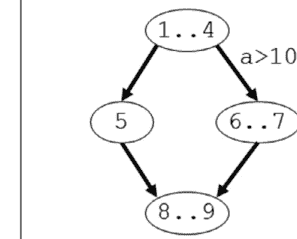

在图 7.13 中，第 1–4 行的代码始终作为序列执行，由节点 (1..4) 表示。如果节点 (1.4) 中的决策 (`a > 10`) 结果为真，则执行节点 (5)，控制移动到节点 (8.9)。如果节点 (1.4) 中的决策结果为假，则执行节点 (6..7)，控制移动到节点 (8.9)。

### 7.4.2 选择结构/Switch

在图 7.14 中，之前在第 1 行结束的代码块按顺序执行，节点为 (1)。根据 `a` 的值，控制跳转到节点 (2.4)、节点 (5.7) 或节点 (8.10)。节点 (2.4) 中的行按顺序执行，节点 (5..7) 中的行按顺序执行，控制移动到节点 (11)。节点 (8..10) 中的行按顺序执行，控制移动到节点 (11)。

```c
switch (a) {
    case 0:
        b=33;
        break;
    case 1:
        b=-44;
        break;
    default:
        ok=false;
        break;
}
```

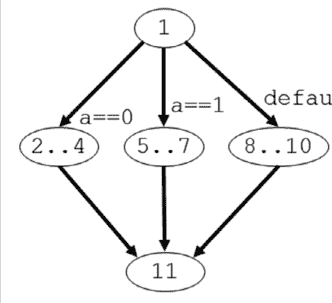

### 7.4.3 迭代/While

```c
int f(int a)
{
    int x=a;
    while (x>10)
        x=x/2;
    return x;
}
```

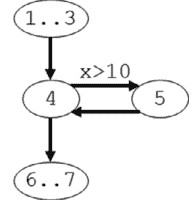

图 7.15 迭代 (while) 的 CFG。

在图 7.15 中，第 1–3 行的代码始终作为序列执行——节点 (1..3)。决策语句必须位于自己的节点中，因为决策在每次循环时都会进行评估：对比图 7.12 中节点 (1..4) 的 if 语句。如果节点 (4) 中的决策 (`x > 10`) 结果为真，则执行节点 (5)，控制返回节点 (4) 重新评估决策。如果节点 (4) 中的决策结果为假（无论是在第一次还是随后的某一次迭代），则循环退出，控制跳转到节点 (6..7)。

### 7.4.4 迭代/Do-While

```c
int f(int a)
{
    int x=a;
    do
        x=x/2;
    } while (x>10);
    return x;
}
```

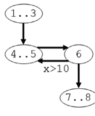

图 7.16 迭代 (do-while) 的 CFG。

在图 7.16 中，第 1–3 行的代码始终作为序列执行，节点 (1..3)。然后执行 do-while 循环的主体，节点 (4..5)。如果节点 (6) 中的 (`x > 10`) 结果为真，控制跳转回节点 (4..5)。如果节点 (6) 中的决策结果为假，则控制跳转到节点 (7..8)。注意与上一个示例结构上的差异。决策是在每次循环执行后评估的，而不是之前。

### 7.4.5 迭代/For

```c
int f(int a)
{
    int x=0;
    for (int i=0; i<a; i++)
        x = x+a+i;
    return x;
}
```

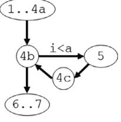

图 7.17 迭代 (for) 的 CFG。

在图 7.17 中，第 4 行包含三个独立部分，必须拆分为三个子行：

- 4a: `int i = 0;`
- 4b: `i<a`
- 4c: `i++`

第 1–3 行代码连同 for 循环的第一部分（第 4a 行）始终作为序列执行，节点 (1..4a)。然后评估 for 循环中节点 (4b) 的决策 (`i < a`)。如果为真，则执行节点 (5) 的主体，紧接着执行节点 (4c) 中的 for 循环增量。控制返回重新评估节点 (4a) 中的决策。当节点 (4b) 中的决策结果为假时，则执行节点 (6)。

### 7.4.6 一行中的多条语句

实际代码经常包含多个语句的行。与 for 循环类似，这些通过将行拆分为子行来处理：

```c
int f() {
    int x=10; y=x+3; return y;
}
```

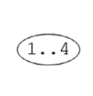

图 7.18 一行多语句的序列。

在图 7.18 中，第 1–4 行始终作为序列执行。这意味着从 CFG 视角来看，第 3 行的多条语句被视为单个节点 (1)。

在图 7.19 中，第 4 行包含两条非序列的语句，必须分为两个子行：

- 4a: `if (a > 10)`
- 4b: `x = a;`

### 7.4.7 所有路径

```c
int f(int a)
{
    int x=0;
    if (a>10) x=a;
    return x;
}
```

**图 7.19** 一行多语句的选择。第 1–4 行作为序列执行，节点 (4a)。如果第 4a/节点 (4a) 的 (`a > 10`) 为真，随后执行行 6 和 7，节点 (6.7)。然后，如果第 4a/节点 (4a) 的决策为假，控制直接通过到行 6 和 7，节点 (6.7)。

## 7.4.4 分析：识别端到端路径

与其将程序视为由单个语句构建（由 CFG 中的分支表示），程序也可以被视为由从开始到结束的路径数量构建。复杂性在于处理循环：执行 $i$ 次迭代的路径与执行 $i+1$ 次迭代的路径是不同的，即使它们访问的 CFG 节点相同。因此，大多数程序具有大量的路径。

基于原始代码的 CFG 建立路径更容易：每条路径由访问的节点序列表示。

```c
boolean condNeg(int x, boolean flag) {
    boolean rv = false;
    if (flag && (x < 0))
        rv = true;
    return rv;
}
```

**列表 7.3** `condNeg()` 的源代码。方法 `condNeg(int x, boolean flag)` 当 `x` 为负且 `flag` 为真时返回真。

### 循环与路径

循环引入了额外的复杂性。考虑图 7.21 所示的简单循环。

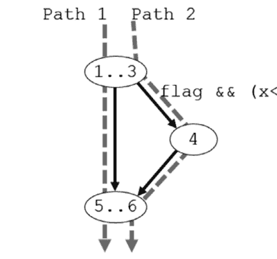

图 7.20 `condNeg()` 的路径。`boolean condNeg(int, boolean)` 的路径可以通过列出每条路径执行的节点来记录：

- 路径 1：节点：(1..3)→(5..6)
- 路径 2：节点：(1..3)→(4)→(5..6)

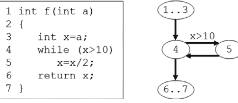

图 7.21 带迭代的路径。

此代码有大量可能的端到端路径：

1. 节点：(1..3)→(4)→(6..7)
2. 节点：(1..3)→(4)→(5)→(4)→(6..7)
3. 节点：(1..3)→(4)→(5)→(4)→(6..7)
4. ...

为了增加涉及节点的不同路径数量，选择了路径的等价类。出于测试目的，如果两条路径仅在循环迭代次数上不同，则认为它们是等的。这产生了两类循环：

- 0 次迭代；
- n 次迭代 (n > 0)。

可以使用*基路径*（basis paths）技术计算从开始到结束的路径数量以及每条路径上的节点。

### 基路径

通过 CFG 的控制流可以用正则表达式表示。然后对该表达式进行求值以得到端到端路径的数量。循环可以执行无限次：这是通过将其视为可以精确执行零次或 n 次的代码段来解决。

正则表达式定义了三个运算符：

- *连接*（concatenation）：这表示图中的节点序列；
- *选择*（selection）：这表示图中的决策（例如 if 语句）；
- *迭代*（iteration）：这表示图中的重复（例如 while 语句）。

考虑以下示例：

```c
i = 0;
while (i < list.length) {
    if (list[i] == target)
        match++;
    else
        mismatch++;
    i++;
}
```

这由图 7.22 所示的 CFG 表示。

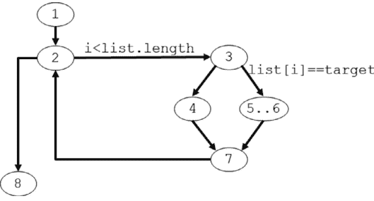

**图 7.22** 基路径示例的 CFG。

这可以用以下表达式描述，其中 + 符号表示可选：

```text
1 * 2 * ((3 * (4 + 5)) * 6 + 7)
```

通过将每个节点编号（空）替换为值 1，并按照数学公式对表达式（使用 + 表示加法，* 表示乘法），可以计算路径数量：

```text
paths = 1 * ((1 * (1 + 1)) * 1 + 1) = 3
```


因此，`bonusPoints` 在进入时必须为零或小于零。
测试 T1.4 使用输入值 `(-100, false)` 符合此条件。

## 路径 2

节点：`(22..28)→(29)→(31)→(33..34)→(36..37)→(38..41)`。

- 分支 `(22..29)→(29)`: 需要 `(bonusPoints > 0)`
- 分支 `(29)→(31)`: 需要 `(bonusPoints < thresholdJump)` 为 false
- 分支 `(31)→(33..34)`: 需要 `(bonusPoints > thresholdJump)` 为 false
- 分支 `(33..34)→(36..37)`: 需要 `(bonusPoints > threshold)` 为 false

输入的 `bonusPoints` 在进入时必须大于等于零。
在节点 `(29)` 处，它必须大于等于 `thresholdJump`（取决于 `goldCustomer`，为 20 或 30）。

在节点 `(31)` 处，它必须小于等于 `thresholdJump`。这意味着 `bonusPoints` 必须等于 `thresholdJump`。

在节点 `(33)` 处，值增加了 `4 * thresholdJump`，即增加了 80 或 120。

所以，如果输入 `goldCustomer` 为 true 且 `bonusPoints` 等于 20，那么在节点 `(34)` `bonusPoints` 被修改为 100，大于阈值 (80)。

如果输入 `goldCustomer` 为 false 且 `bonusPoints` 等于 30，那么在节点 `(34)` `bonusPoints` 被修改为 150，大于阈值 (120)。

在两种情况下，节点 `(34)` 处的决策都将为 true，但该路径所需的数值为 false。因此，该路径是不可能的。

## 路径 3

节点：`(22..28)→(29)→(31)→(33..34)→(35)→(38..41)`。

- 分支 `(22..29)→(29)`: 需要 `(bonusPoints > 0)`
- 分支 `(29)→(31)`: 需要 `(bonusPoints < thresholdJump)` 为 false
- 分支 `(31)→(33..34)`: 需要 `(bonusPoints > thresholdJump)` 为 false
- 分支 `(33..34)→(35)`: 需要 `(bonusPoints > threshold)`

输入的 `bonusPoints` 在进入时必须大于等于零。
在节点 `(29)` 处，它必须大于等于 `thresholdJump`（取决于 `goldCustomer`，为 20 或 30）。

在节点 `(31)` 处，它必须小于等于 `thresholdJump`。这意味着 `bonusPoints` 必须等于 `thresholdJump`。

在节点 `(33)` 处，值增加了 `4 * thresholdJump`，即增加了 80 或 120。

所以，如果输入 `goldCustomer` 为 true 且 `bonusPoints` 等于 20，那么在节点 `(34)` `bonusPoints` 被修改为 100，大于阈值 (80)。

如果输入 `goldCustomer` 为 false 且 `bonusPoints` 等于 30，那么在节点 `(34)` `bonusPoints` 被修改为 150，大于阈值 (120)。

在两种情况下，节点 `(34)` 处的决策都将按要求为 true。现有的测试对于 `bonusPoints` 的输入值为 20 或 30，因此需要一个新的测试。输入数据可能为 `(20, true)` 或 `(30, false)`。

## 路径 4

节点：`(22..28)→(29)→(31)→(32)→(33..34)→(36..37)→(38..41)`

- 分支 `(22..28)→(29)`: 需要 `(bonusPoints > 0)`
- 分支 `(29)→(31)`: 需要 `(bonusPoints < thresholdJump)` 为 false
- 分支 `(31)→(32)`: 需要 `(bonusPoints > thresholdJump)`
- 节点 `(32)` 修改了 `bonusPoints`
- 分支 `(33..34)→(36..37)`: 需要 `(modified bonusPoints > threshold)` 为 false

输入的 `bonusPoints` 在进入时必须大于等于零。在节点 `(29)` 处，它必须大于等于 `thresholdJump` (20 或 30)。

在节点 `(31)` 处，`bonusPoints` 必须大于 `thresholdJump` (20 或 30)。

因此，`bonusPoints` 必须大于零，在节点 `(29)` 处大于等于 `thresholdJump` (20 或 30)，并在节点 `(31)` 处大于 `thresholdJump`。

在节点 `(32)` 处，`bonusPoints` 的值减少了 `thresholdJump`，在节点 `(33..34)` 处，该值增加了 `4 * thresholdJump`，即增加了 80 或 120。

如果输入 `goldCustomer` 为 true 且 `bonusPoints` 大于 20，那么在节点 `(30)` 处 `bonusPoints` 减少了 20，在 `(33..34)` 处 `bonusPoints` 增加了 80，导致值整体变化了 +60。该值必须小于等于 80，`bonusPoints` 的最小值为 1，最大值为 20。

如果输入 `goldCustomer` 为 false 且 `bonusPoints` 等于 30，那么在节点 `(30)` 处 `bonusPoints` 减少了 30，在 `(33..34)` 处 `bonusPoints` 增加了 120，导致值整体变化了 +90。该值必须小于等于 120，`bonusPoints` 的最小值为 1，最大值为 30。测试 T2.1 使用输入值 `(1, true)` 符合这些约束。

## 路径 5

节点：`(22..28)→(29)→(31)→(33..34)→(35)→(38..41)`

- 分支 `(22..28)→(29)`: 需要 `(bonusPoints > 0)`
- 分支 `(29)→(31)`: 需要 `(bonusPoints > thresholdJump)` 为 false
- 分支 `(31)→(32)`: 需要 `(bonusPoints < thresholdJump)`
- 节点 `(32)` 修改了 `bonusPoints`
- 分支 `(32)→(33..34)` 总是跳转
- 分支 `(33..34)→(35)`: 需要 `(modified bonusPoints > threshold)`

输入的 `bonusPoints` 在进入时必须大于等于零。在节点 `(29)` 处，它必须大于等于 `thresholdJump`（取决于 `goldCustomer`，为 20 或 30）。

在节点 `(31)` 处，`bonusPoints` 必须大于 `thresholdJump` (20 或 30)。

因此，`bonusPoints` 必须大于零，在节点 `(29)` 处大于等于 `thresholdJump` (20 或 30)，并在节点 `(31)` 处大于 `thresholdJump`。

在节点 `(32)` 处，`bonusPoints` 的值减少了 `thresholdJump`，在节点 `(33..34)` 处，该值增加了 `4 * thresholdJump`，即增加了 80 或 120。

如果输入 `goldCustomer` 为 true 且 `bonusPoints` 大于 20，那么在节点 `(30)` 处 `bonusPoints` 减少了 20，在 `(33..34)` 处 `bonusPoints` 增加了 80，导致值整体变化了 +60。该值必须大于 80，`bonusPoints` 的最小值为 1，最大值为 `MAX_VALUE — 60` 以好。

如果输入 `goldCustomer` 为 false 且 `bonusPoints` 等于 30，那么在节点 `(30)` 处 `bonusPoints` 减少了 30，在 `(33..34)` 处 `bonusPoints` 增加了 120，导致节点 `(35)` 处的值整体变化了 +90。该值必须大于 120，这里 `bonusPoints` 的最小值为 1，最大值为 `MAX_VALUE — 90`。测试 T1.1 使用输入值 `(40, true)` 符合这些。

## 路径 6

节点：`(22..28)→(29)→(30)→(33..34)→(36..37)→(38..41)`

- 分支 `(22..28)→(29)`: 需要 `(bonusPoints > 0)`
- 分支 `(29)→(30)`: 需要 `(bonusPoints < thresholdJump)`
- 节点 `(30)` 修改了 `bonusPoints`
- 分支 `(31)→(33..34)`: 需要 `(modified bonusPoints > thresholdJump)`
- 分支 `(36..37)`: 需要 `(modified bonusPoints > threshold)` 为 false

输入的 `bonusPoints` 在进入时必须大于等于零。在节点 `(29)` 处，它必须小于 `thresholdJump`（取决于 `goldCustomer`，为 20 或 30）。

在节点 `(31)` 处，`bonusPoints` 必须小于等于零，在节点 `(29)` 处小于 `thresholdJump` (20 或 30)，并在节点 `(31)` 处小于等于 `thresholdJump`。


# 7.4 详细路径覆盖测试

在节点 `(30)` 处，`bonusPoints` 的值减少了 `thresholdJump`，在节点 `(33..34)` 处，该值增加了 `4 * thresholdJump`，即增加了 80 或 120。

所以，如果输入 `goldCustomer` 为 true 且 `bonusPoints` 小于 20，那么在节点 `(30)` 处 `bonusPoints` 减少了 20，在 `(34)` 处 `bonusPoints` 增加了 80，导致节点 `(35)` 处的值整体变化了 +60。该值必须大于 80，但它的最大值只有 59，因此这是可能的。

所以，如果输入 `goldCustomer` 为 false 且 `bonusPoints` 小于 30，那么在节点 `(30)` 处 `bonusPoints` 减少了 30，在 `(34)` 处 `bonusPoints` 增加了 120，导致节点 `(35)` 处的值整体变化了 +90。该值必须大于 120，但它的最大值只有 119，因此这也是可能的。

## 路径 7: `(22..28)→(29)→(30)→(31)→(33..34)→(35)→(38..41)`

- 分支 `(22..28)→(29)`: 需要 `(bonusPoints > 0)`
- 分支 `(29)→(30)`: 需要 `(bonusPoints < thresholdJump)`
- 节点 `(30)` 修改了 `bonusPoints`
- 分支 `(31)→(33..34)`: 需要 `(modified bonusPoints > thresholdJump)` 为 false
- 分支 `(33..34)→(35)`: 需要 `(modified bonusPoints > threshold)`

对于任何 `bonusPoints` 值，如果它在节点 `(29)` 处小于 `thresholdJump` (20 或 30)，那么在节点 `(33..34)` 处将小于 `thresholdJump` (80 或 120)，因此该路径是不可能的。

## 路径 8: `(22..28)→(29)→(30)→(31)→(33..34)→(36..37)→(38..41)`

- 分支 `(22..28)→(29)`: 需要 `(bonusPoints > 0)`
- 分支 `(29)→(30)`: 需要 `(bonusPoints < thresholdJump)`
- 节点 `(30)` 修改了 `bonusPoints`
- 分支 `(31)→(32)`: 需要 `(bonusPoints > thresholdJump)`
- 节点 `(32)` 修改了 `bonusPoints`
- 分支 `(33..34)→(36..37)`: 需要 `(modified bonusPoints > threshold)` 为 false

对于任何 `bonusPoints` 值，都不可能在节点 `(30)` 处 `bonusPoints` 小于 `thresholdJump`，而在节点 `(31)` 处修改后的 `bonusPoints` 值又大于 `thresholdJump`。所以该路径是不可能的。

## 路径 9: `(22..28)→(29)→(30)→(31)→(32)→(33..34)→(35)→(38..41)`

- 分支 `(22..28)→(29)`: 需要 `(bonusPoints > 0)`
- 分支 `(29)→(30)`: 需要 `(bonusPoints < thresholdJump)`
- 节点 `(30)` 修改了 `bonusPoints`

## 全路径覆盖

- 分支 `(31)→(32)`: 需要 `(bonusPoints > thresholdJump)`
- 注意节点 `(32)` 修改了 `bonusPoints`
- 分支 `(33..4)→(35)`: 需要 `(修改后的 bonusPoints > threshold)`

对于路径 8，对于 `bonusPoints` 的任何值，都不可能在节点 30 处使 `bonusPoints` 小于 `thresholdJump`，紧接着在节点 31 处使修改后（减少）的 `bonusPoints` 值大于 `thresholdJump`。因此，这条路径是不可能的。

## 测试覆盖项

从开始到结束的每条路径都是一个测试覆盖项（TCI）。记住，每个循环的标准技术是包含两条路径：一种是循环执行零次，另一种是至少执行一次。
每个 TCI 都应该被赋予一个唯一的标识符（例如：路径 1 对应 AP1）。为了确保不遗漏任何路径，列出每个路径覆盖的控制流图（CFG）边是很有用的。

## 测试用例

选择数据值是为了确保执行每条路径。这种选择要求测试人员仔细审查代码，并选择导致这些路径执行的输入参数值。
预期结果必须来自规格说明书。很容易犯一个读取代码输出输出并将其作为预期结果的错误——测试人员必须小心避免这种错误。
提示：通常从从入口到出口最简单的路径开始，通过阅读源代码推导出导致该路径执行所需的输入值。检查源代码，查看需要对输入进行哪些更改以导致执行相似的路径。每条路径都应该有一个测试用例。

## 评估

实现全路径覆盖可能是一项非常枯燥的任务。注意，即使每条路径都执行了，采取每个决策的原因也并不都得到了覆盖。

## 局限性

列表 7.4 所示的源代码包含了三种故障（除偶然外，标准的黑盒和白盒单元测试技术无法发现这些故障）。基本算法与之前使用的相当不同：它使用查找表，并搜索匹配的条目来确定返回值。

## 7.5 评估

137

# 列表 7.4 故障 7、8 和 9。

```java
public static Status giveDiscount(long bonusPoints, boolean goldCustomer) {
    Object[][] lut = new Object[][] {
        { Long.MIN_VALUE, null, ERROR },
        { 1L, 80L, true, FULLPRICE },
        { 81L, Long.MAX_VALUE, true, DISCOUNT },
        { 1L, 120L, false, FULLPRICE },
        { 121L, Long.MAX_VALUE, false, DISCOUNT },
        { 1024L, 1024L, true, FULLPRICE }
    }; // Fault 7

    Status rv = ERROR;

    bonusPoints &= 0xFFFFFFFF; // Fault 8

    for (Object[] row) {
        if (bonusPoints >= (Long) row[0]) &&
            (bonusPoints <= (Long) row[1]) &&
            ((Boolean) row[2] == null) || ((Boolean) row[2] == goldCustomer))
            rv = (Status) row[3];
    }

    bonusPoints = 1 / (bonusPoints - 55); // Fault 9

    return rv;
}
```

插入能够规避所有路径测试的故障要困难得多，为了达到这一目的，代码已被完全重写。插入的故障解释如下：

- **故障 7**：第 26–33 行包含一个查找表。第 31 行会导致输入值 1024 失败。查找表可以提高许多算法的性能，但风险是表可能是错误的。
- **故障 8**：第 37 行显示了一个位运算故障。注意常量 `0xFFFFFFFFFFFFFF` 是一个长型十六进制值，其末尾本应该是 `A` 的地方写成了 `E`。这个错误导致单个位变为 0。这将导致输入值 256 失败，因为该位将值变为零。在这段代码中没有进行进行位操作的理由，但网络和图形代码是可能需要此类操作的示例。
- **故障 9**：第 45 行除以零故障。这将导致输入值 55 抛出（未处理的）Java 异常。由于它未被处理，将导致程序崩溃，并且 Java 默认会产生堆栈转储。这种操作从不使用的局部变量的死代码有时会被编译器识别——但在这种情况下，代码会执行并在输入值 55 时导致崩溃。除法在算法中同样存在，如果没有正确处理除以零异常，它们将导致软件故障。

针对这些故障运行全路径测试的结果如图 7.23 所示。

```
PASSED: test_giveDiscount("T1.1", 40, true, FULLPRICE)
PASSED: test_giveDiscount("T1.2", 100, false, FULLPRICE)
PASSED: test_giveDiscount("T1.3", 200, false, DISCOUNT)
```


## 全路径覆盖

- 分支 `(31)→(32)`：需要 `(bonusPoints > thresholdJump)`
- 注意节点 `(32)` 修改了 `bonusPoints`
- 分支 `(33..4)→(35)`：需要 `(修改后的 bonusPoints > threshold)`

对于路径 8，对于 `bonusPoints` 的任何值，都不可能在节点 30 处使 `bonusPoints` 小于 `thresholdJump`，紧接着在节点 31 处使修改后（减少）的 `bonusPoints` 值大于 `thresholdJump`。因此，这条路径是不可能的。

## 测试覆盖项

从开始到结束的每条路径都是一个测试覆盖项（TCI）。记住，每个循环的标准技术是包含两条路径：一种是循环执行零次，另一种是至少执行一次。每个 TCI 都应该被赋予一个唯一的标识符（例如：路径 1 对应 `AP1`）。为了确保不遗漏任何路径，列出每个路径覆盖的控制流图（CFG）边是很有用的。

## 测试用例

选择数据值是为了确保执行每条路径。这种选择要求测试人员仔细审查代码，并选择导致这些路径执行的输入参数值。预期结果必须来自规格说明书。很容易犯一个读取代码输出并将其作为预期结果的错误——测试人员必须小心避免这种错误。提示：通常从从入口到出口最简单的路径开始，通过阅读源代码推导出导致该路径执行所需的输入值。检查源代码，查看需要对输入进行哪些更改以导致执行相似的路径。每条路径都应该有一个测试用例。

## 评估

实现全路径覆盖可能是一项非常枯燥的任务。注意，即使每条路径都执行了，采取每个决策的原因也并不都得到了覆盖。

## 局限性

列表 7.4 所示的源代码包含了三种故障（除偶然外，标准的黑盒和白盒单元测试技术无法发现这些故障）。基本算法与之前使用的相当不同：它使用查找表，并搜索匹配的条目来确定返回值。

## 7.5 评估

137

# 列表 7.4 故障 7、8 和 9

```java
public static Status giveDiscount(long bonusPoints, boolean goldCustomer) {
    Object[][] lut = new Object[][] {
        { Long.MIN_VALUE, null, ERROR },
        { 1L, 80L, true, FULLPRICE },
        { 81L, Long.MAX_VALUE, true, DISCOUNT },
        { 1L, 120L, false, FULLPRICE },
        { 121L, Long.MAX_VALUE, false, DISCOUNT },
        { 1024L, 1024L, true, FULLPRICE }
    }; // Fault 7

    Status rv = ERROR;

    bonusPoints &= 0xFFFFFFFF; // Fault 8

    for (Object[] row) {
        if (bonusPoints >= (Long) row[0]) &&
            (bonusPoints <= (Long) row[1]) &&
            ((Boolean) row[2] == null) || ((Boolean) row[2] == goldCustomer))
            rv = (Status) row[3];
    }

    bonusPoints = 1 / (bonusPoints - 55); // Fault 9

    return rv;
}
```


插入能够规避所有路径测试的故障要困难得多，为了达到这一目的，代码已被完全重写。插入的故障解释如下：

- 故障 7：第 26–33 行包含一个查找表。第 31 行会导致输入值 1024 失败。查找表可以提高许多算法的性能，但风险是表可能是错误的。
- 故障 8：第 37 行显示了一个位运算故障。注意常量 `0xFFFFFFFFFFFFFF` 是一个长型十六进制值，其末尾本应该是 `A` 的地方写成了 `E`。这个错误导致单个位变为 0。这将导致输入值 256 失败，因为该位将值变为零。在这段代码中没有进行进行位操作的理由，但网络和图形代码是可能需要此类操作的示例。
- 故障 9：第 45 行除以零故障。这将导致输入值 55 抛出（未处理的）Java 异常。由于它未被处理，将导致程序崩溃，并且 Java 默认会产生堆栈转储。这种操作从不使用的局部变量的死代码有时会被编译器识别——但在这种情况下，代码会执行并在输入值 55 时导致崩溃。除法在算法中同样存在，如果没有正确处理除以零异常，它们将导致软件故障。

针对这些故障运行全路径测试的结果在图 7.23 所示。

- 软件中每一个未执行的端到端路径都是一个 TCI（测试用例）
- 测试数据的输入值是通过分析代码中的路径和决策来选择的。

## 7.7 给资深测试人员的注意事项

即使对于经验丰富的测试人员来说，识别所有可能的路径也是一项复杂的任务。对于简单的代码，在完成黑盒测试和白盒测试后，不太会有任何未执行的路径。对于复杂的代码，特别是带有循环的代码，可能需要进行彻底的分析，而且同行评审是必不可少的，以确保没有遗漏任何路径。探索性编程和调试器通常被用于尝试寻找遵循某个节点特定出口的数据值。

经验丰富的测试人员通常可以在不像本章示例那样详细说明所有步骤的情况下开发出控制流图（CFG）。他们可能也能在不费力逐行检查代码的情况下识别每条路径所需的条件。然而，即使对于经验丰富的测试人员来说，开发所有路径也是一项耗费时且困难的任务。

## 黑盒测试与白盒测试

动态测试通过执行程序来确认其正确运行，该程序被称为*测试项*。如图 8.1 所示，测试过程可以建模为真实系统输出与理想系统输出之间的比较。理想系统代表规范。真实系统代表被测试的软件。


**图 8.1** 软件测试流程。

根据所选测试设计技术开发测试条件，这将指导合适的测试输入数据的选择。然后将测试输入数据作为理想系统的输入，以确定正确的输出（预期结果）。测试输入数据作为真实系统的输入。真实系统执行，收集实际结果并与预期结果进行比较。如果它们相同或等效，则测试结果为通过；否则，测试结果为失败。正如我们在前面的章节中看到的，测试通常是由自动化工具执行的。

测试数据源自测试条件集，每个条件都是为了验证系统的特定功能或方面而选择的。测试结果是通过或失败。然而，一个有效的测试并不非要产生通过的结果。即使是失败的测试也能带给我们关于系统的新知识：它告诉我们软件在哪些输入下没有按照规范运行。

## 8.1 黑盒测试与白盒测试的比较

黑盒测试（也称为基于规范或功能的测试）完全基于程序规范，不使用程序代码内部工作机制的任何知识。黑盒测试旨在验证程序是否符合指定的要求，而无需了解程序的实现。

黑盒测试和白盒测试的原理可以应用于开发的不同阶段：从随着代码逐步开发的*单元测试*，到针对整个系统每次发布的*应用测试*。

黑盒测试技术的实践是通过选择了一部分可能的输入值组合集来实现的。例如，*边界值分析*意味着为每个输入和输出参数选择所有可能的边界值。

**关键点：** 黑盒测试用例和测试数据完全源于功能规范。

白盒测试（也称为基于实现或结构的测试）使用软件的*实现*来推导出测试。测试旨在执行程序代码的特定方面，如其包含的语句或决策。通过检查程序如何工作，并选择测试数据以导致程序特定组件的执行，可以暴露程序结构或逻辑中的错误。

白盒测试技术通过其*覆盖率准则*来衡量。这指的是被测试执行的组件的百分比。例如，100% 的*语句覆盖*意味着程序中的所有源代码行在测试期间都至少执行过一次。

**关键点：** 白盒测试用例源于代码；测试数据既源于代码也源于功能规范。

表 8.1 黑盒测试与白盒测试的一些关键特征比较。

| 黑盒测试 | 白盒测试 |
| :--- | :--- |
| 测试仅依赖于规范。 | 测试同时依赖于实现和规范。 |
| 如果更新代码（可能是为了修复故障或添加新功能），测试可以重用。 | 测试通常随代码的任何更改而失效，无法重用。 |
| 测试可以在代码编写之前开发，因为它们只需要规范。 | 测试只能在代码编写后开发，因为它们既需要规范也需要执行代码。 |
| 测试不能确保所有代码都已执行。它们可能会遗漏*正性错误*（见 8.1.3 节）。 | 测试不能确保代码完全实现了规范。它们会遗漏错误。 |
| 少数工具可以提供任何黑盒测试的自动化覆盖率测量。 | 许多工具可以提供白盒测试的自动化覆盖率测量。 |

### 8.1.1 黑盒测试

黑盒测试可以用多种不同的方式表示：

- 基于规范进行测试；
- 使用基于规范的覆盖率准则；
- 开发源自规范的测试用例；
- 执行规范。

对于作为输入值的软件，黑盒测试的目的是确保输出值是正确的（图 8.2）。理想情况下通过执行规范中的所有路径来实现。正如已经讨论过的，穷尽测试很少可行，因此必须选择可能的输入子集。

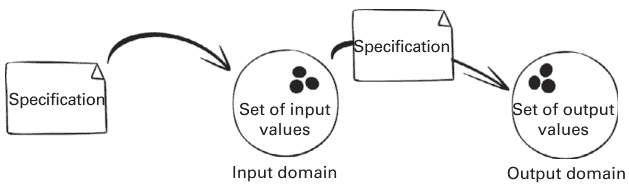

**图 8.2** 规范模型。

很难自动衡量黑盒测试实现的覆盖程度。因此，这很大程度上依赖于工作的质量。

### 8.1.2 白盒测试

同样，白盒测试可以用多种不同的方式表示：

- 基于实现进行测试；
- 使用基于实现的覆盖率准则；
- 开发源自实现的测试用例；
- 执行实现。

对于作为组件的软件，白盒测试的目的是确保结构是正确的（图 8.3）。理想情况下通过执行实现中的所有组件来实现。

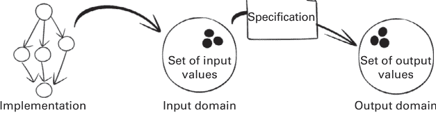

**图 8.3** 实现模型。

### 8.1.3 遗漏错误与引入错误

黑盒和白盒测试方法都有各自的缺点：

- *白盒测试通常无法发现与功能缺失相关的故障（称为遗漏错误）；因为没有相应的实现作为开发测试的基础。*
- *黑盒测试通常无法发现与多余功能相关的故障（称为引入错误）；因为没有相应的规范作为开发测试的依据。*

考虑布尔函数 `isZero(int x)` 示例，它在 `x` 为 0 时应返回 `true`，否则返回 `false`。代码段 8.1 给出了示例代码。

#### 代码段 8.1 遗漏与引入错误

```
1 public static boolean isZero(int x)
2 {
3     if ((x + 1) / 15 > 56) return true;
4     return false;
5 }
```


该代码段包含两个错误：

- **遗漏错误**：代码中没有在当 `x` 等于 0 时返回 `true` 的功能。这是规范要求的。
- **引入错误**：代码中存在多余功能（第 3 行），当表达式 `(x + 1)/15 > 56` 为真时会返回 `true`。这不在规范范围内。

这是一个简单的例子，很容易看出代码相对于规范是不正确的。在更长或更复杂的代码中，识别这些故障通常要困难得多。在这种情况下，开发者看似的一个单一错误导致了多种类型的错误：更改第 3 行的判断条件（`x=0`）就能修复故障。遗漏错误会导致引入错误的匹配，反之亦然。

错误处理往往是复杂代码中遗漏故障的来源，其中错误的输入数据没有被正确识别。而理解规范往往是引入错误的来源，即程序员识别了规范中未包含的额外输入条件。

从另一个角度来看这个问题，即覆盖率视角：

- **黑盒测试**提供了对规范的覆盖，但没有对实现的完全覆盖。也就是说，实现中可能存在某些代码错误地产生了规范中未说明的结果。
- **白盒测试**提供了对实现的覆盖，但没有对规范的覆盖。也就是说，规范中说明的某些行为在实现中可能对应的代码。

正因如此，通常先进行黑盒测试以确保代码是完整的。然后通过白盒测试进行增强，以确保代码没有添加任何额外的。

### 8.1.4 使用

黑盒和白盒测试技术通常接替使用以模拟覆盖。覆盖程度通常基于测试项的质量要求。例如，决定是否为医院病人发出警报的软件，其质量要求将高于推荐电影的软件。根据这些质量要求，测试人员可以决定是否提前停止测试，见第 1.8 节。

最初使用黑盒测试验证软件是否满足规范：

- 使用等价类划分通过确保执行每个类的代表性值来验证软件的基本操作（见第 2 章）。
- 如果规范包含边界值，使用边界值分析（BVA）验证边缘的正确操作（见第 3 章）。
- 如果规范规定不同的输入组合有不同的处理，使用决策表验证每种组合的正确行为（见第 4 章）。

这些黑盒测试技术可以进一步增强：

- 如果规范规定了基于状态的行为或输入序列的不同行为，则使用基于状态/序列测试来验证这些行为（见本章第 8.2.7 节）。
- 如果有理由怀疑代码中存在故障（可能是基于过去的经验），则使用错误猜测/专家意见来暴露它们（见第 14.3.3 节）。
- 如果已知软件的典型用法，或者有大量的测试，则使用随机测试数据来验证这些用法模式下的正确操作（见第 12 章）。

我们对这些每个黑盒测试测量语句覆盖率和分支覆盖率。如果没有达到要求的覆盖率，我们可以添加白盒技术来进一步提高测试质量：

- 使用语句覆盖率确保 100% 的语句都已执行。调查未覆盖的语句，并针对这些语句专门识别测试覆盖项（TCIs）和测试用例（见第 5 章）。
- 使用分支覆盖率确保 100% 的分支都已通过。调查遗漏的分支，并针对这些分支专门开发 TCI 和测试用例（第 6 章）。

这些白盒测试技术可以进一步增强：

- 如果代码包含端到端的路径，则使用全路径测试以确保这些路径的覆盖（见第 7 章）。
- 如果代码包含复杂的数据使用模式，则使用 DU 对测试以确保这些模式的覆盖（见第 8.3.1 节）。
- 如果代码包含复杂决策，则使用 CC/DCC/MCC/MCDC 测试以确保这些决策的覆盖（见第 8.3.2–8.3.6 节）。

在所有情况下，是否继续后续测试的决策都是判断和成本权衡：在执行额外测试所需的时间和工作与这些测试能为软件质量提供的额外信心之间取得平衡。

决定使用什么技术以及何时使用的考虑因素包括：

- 在代码编写之前或与代码并行进行黑盒测试（见 8.1.3）。
- 每当修改代码时，必须复审白盒测试。

## 8.2 黑盒测试：注意事项

在本节中，我们将处理黑盒测试过程中可能出现的特殊情况。

### 8.2.1 字符串和数组

字符串和数组的处理更为复杂：它们包含大量值，且没有特定长度。处理这些内容没有标准方法。因此，我们提供了一些关于将黑盒技术应用于这些内容的指南。首先，我们考虑错误情况，然后是正常情况。

#### 错误情况

通常有几类错误情况：

- 空引用；
- 长度为 0 的字符串或数组；
- 超过指定长度的过长字符串或数组（例如 ISBN 编号为 13 位数字）；
- 无效数据，例如指定字符串仅包含打印字符；整数数组可能规定仅包含正值；
- 无效关系，例如指定字符串按字母顺序包含字符；整数数组可能规定为降序。

#### 正常情况

正常情况更难分类。与其从每个等价类中选择一个值，不如可能选择多个不同的值。
对于边界值，应该考虑数据结构的长度以及其包含的数据长度。
对于组合，可以从每种组合生成多个测试，选择多个值来代表每种情况，而不仅仅是一个。
数据的复杂度取决于规范的复杂性。如果允许，选择一个在字符串或数组的每个位置都包含相同的数据可能是很有用的。对于代表联系信息（如姓名、地址或电话号码）的字符串，可以使用电话簿来发现极短、极长以及一些典型值。对于代表整数的数组（例如用于统计测试的数字列表），可以选取少数数据集和一个已知特征的大数据集。始终，确保所有输出用例都是重要的——这些用例通常为选择输入值提供额外的指导。

### 8.2.2 不连续输入划分

有时规范会规定不同的值范围有相同的处理（不连续划分），或对同一值范围有不同的处理（重叠划分）。这两种情况在下文中讨论。

考虑 `isZero(int x)` 示例。有一个包含单一值 0 的输入划分，第二个输入划分包含除 0 以外的所有值，如图 8.4 所示。

| Integer.MIN_VALUE | -1 | 0 | 1 | Integer.MAX_VALUE |
| :--- | :--- | :--- | :--- | :--- |

**图 8.4** 不连续划分的值线。

处理输入参数不连续范围的最佳方法是将连续的值范围划分开。因此，在本例中，`x` 应该被视为三个等效类：

- `x.EP 1` Integer.MIN_VALUE..-1
- `x.EP 2` 0
- `x.EP 3` 1..Integer.MAX_VALUE

以及相关的边界值：

- `x.BVA 1` Integer.MIN_VALUE
- `x.BVA 2` -1
- `x.BVA 3` 0
- `x.BVA 4` 1
- `x.BVA 5` Integer.MAX_VALUE

其背后的原因是值 -1 和 +1 是特殊的：它们是值 0 的直接前驱和后继，而 0 被视为特殊处理。软件必须正确识别出这些边界值。这些值是可能与软件故障相关的数值。

### 8.2.3 重叠划分区域

考虑一个返回值范围重叠的示例。方法 `int(int x, boolean fixed)` 根据参数 `x` 指定的金额计算应付税额。税额可能是固定金额加上 1%（或 `x/100`）的变动金额。返回值如下之一：

- 如果 `amount < 0`，返回 1 表示错误；
- 如果 `fixed` 为 `true`，返回 56（固定税）；以及
- 如果 `fixed` 为 `false`，返回 `x/100`，即金额的 1%（变动税）。

考虑到非错误情况，变动税的值可以是从 0 到 `Integer.MAX_VALUE/100` 之间的任何值，而固定税只能有一个单值 56。这使得返回值有两个具有重叠值的划分区域：

- 1. 包含从 0 到 `Integer.MAX_VALUE/100` 所有值的划分区域。
- 2. 数值 56，它位于一个自身的单值划分中。

这些划分的值如图 8.5 所示。重叠部分通过划分 1 中的虚线表示。

图中未显示第三个划分，其取值为单值 -1。从 `Integer.MIN_VALUE` 到 -2 的值以及 `Integer.MAX_VALUE/100` 以上的值是不可能的返回值，因此不需要考虑——没有输入输入会导致返回这些值中的任何一个。

| 划分 1 | 0 | Integer.MAX_VALUE/100 |
| :--- | :--- | :--- |
| 划分 2 | | 56 |

**图 8.5** 重叠划分的数值线。

处理这些输出重叠范围的最佳方法是忽略重叠，分别处理每个值范围。因此，在本例中，`x` 应该被视为具有等效类：

- **x.EP 1** 0..Integer.MAX_VALUE/100
- **x.EP 2** 56
- **x.EP 3** -1

以及边界值：

- **x.BVA 1** 0（来自 EP2）
- **x.BVA 2** Integer.MAX_VALUE/100（来自 EP2）
- **x.BVA 3** 56（来自 EP3）
- **x.BVA 4** -1

其背后的逻辑是值 55 和 57 并不是特殊的：它们不是划分区域边界上的值，也不可能与软件故障相关。然而，56 是一个特殊值，因为它是由特殊处理产生——在本例中，是由两种不同类型的处理产生的。

总结来说，处理重叠划分的指南如下：

- 将重叠的输入范围划分为单独的划分；以及
- 使用尽可能少的划分来处理重叠的输出范围。

### 8.2.4 带内错误报告

存在一种特殊情况，错误是*带内的*（in-band）报告；即通过用于正常处理的相同机制报告，有时甚至使用相同的值。典型的示例是布尔值 `false` 和整数值 `-1`。相同的值可以用于表示未满足此类要求，也可以用于指示错误，而不是抛出异常——这两种错误报告方式的测试都容易得多。下面所示了一个示例：

考虑增强版方法 `inRange(int x, int low, int high)`，如果输入有效且 `x` 在低到高的值范围内，则返回 `true`。如果输入无效（即 `low` 大于 `high`）或 `x` 不在范围内，则返回 `false`。

在本例中，布尔有三个等效类：

- `true`，表示 `x` 在范围内；
- `false`，表示 `x` 不在范围内；
- `false`，表示输入无效。

这导致了返回值的两个非错误情况和一个错误情况。输入错误情况（`low < high`）的测试数据也将覆盖输出错误情况（返回值 == `false`）。输入非错误情况的数据也涵盖了输出非错误情况（返回值 == `true`）和（返回值 == `false`）。

对于整数或其他带内错误报告机制，将采取类似的方法。

作为可测试性设计的一部分，可以通过带外（out-of-band）报告提供更改进的错误处理。在 Java 中，这可以通过抛出异常来实现。然而，测试人员必须准备好测试使用这种方法的代码。

### 8.2.5 处理相对值

另一个与输入（以及输出）参数的问题是并非所有划分都是由绝对值定义的。某些划分相对于另一个输入定义的，或者通过输入之间的关系定义的。考虑方法 `largest(int x, int y)`。对于 `x` 有三种情况需要考虑：

- `x` 小于 `y`：`x < y`
- `x` 等于 `y`：`x = y`
- `x` 大于 `y`：`x > y`

首先考虑输入 `x`。方法是将 `y` 视为一个固定值。从 `Integer.MIN_VALUE` 开始沿 `x` 的值线操作，直到我们到达值 `y`，处理是相同的。第一个划分包含了从 `Integer.MIN_VALUE` 到 `y - 1` 的任何 `y` 值。如果 `y` 的值为 `Integer.MIN_VALUE`，则我们将其视为空划分。如果 `y` 的值为 `Integer.MIN_VALUE-1`，则我们将其视为单值划分。

### 8.2.7 基于状态的测试

状态行为可以使用状态图来定义。⁵ 它显示了所有状态、状态之间的转换、导致这些转换的输入事件，以及在每个状态转换上应执行的操作。图 8.8 显示了触控控制灯的状态图。方框表示状态。箭头表示状态之间的转换。指向 OFF 状态的初始箭头表示系统从该状态开始。标签 `toggle()` 表示一个应该引起转换发生的事件或方法。⁶ 为了简单起见，这里没有显示任何操作。

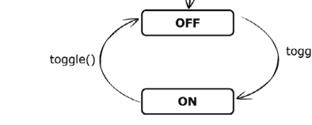

**图 8.8** 灯具的状态图。

基于状态的测试通过调用状态图上的方法，触发引起软件在不同状态之间转换的事件。测试可以检查是否发生了正确的状态转换以及是否执行了正确的操作。

用于为基于状态的测试选择测试覆盖率标准的成熟测试设计策略包括：

- 部分转换（测试某些转换）；
- 所有转换（至少测试一次每个转换）；
- 所有环路路径（测试所有起始和结束于同一状态的路径）；
- M 长度签名（通常无法直接访问状态以验证转换是否正确发生。在这些情况下，使用产生唯一输出集合的事件来验证软件是否处于预期状态。这些被称为签名。输出值将从引起状态转换的方法返回，也可能从状态图中不存在的不引起转换的其他方法返回。该策略测试了对于某个 M 值，从 1 到 M 次转换的所有签名。使用签名的缺点是，它们会改变软件的状态，测试必须考虑到这一点）；
- 所有 n 事件转换序列（对于特定的 n 值测试所有转换序列）；
- 穷尽性测试（测试所有可能的转换序列）。

⁵ 也可以使用状态表，以表格形式提供相同的信息。
⁶ 具体的实现方式不属于状态图的一部分。在这种情况下，硬件传感器将检测到灯被触碰，然后软件将调用 `toggle()` 方法。

每个转换都由以下内容指定：

- 起始状态。
- 引起转换的事件（函数或方法调用）。
- 守卫条件（这是一个布尔表达式，必须为真转换才能发生。这允许通过允许相同事件在不同条件下从同一状态引起不同的转换，从而减小状态图的）。
- 转换结果应发生的操作。通常对于软件而言，这些被表示为应该改变的值（例如计数器）。它们也可能指定应该调用的其他方法：（例如，`turnBulbOn()` 和 `turnBulbOff()`）。
- 转换后软件应处的结束状态。

转换的测试方法如下：

- 验证软件是否处于测试所需的起始状态。
- 如果需要，设置值以确保守卫条件为真。
- 触发应该引起转换的事件（调用函数或方法）。
- 检查软件现在是否处于测试的预期状态。
- 检查是否发生了任何必要的操作。

基于状态的测试适用于所有在调用之间维护状态的软件。这对于面向对象的软件尤为重要，在对象中，所有属性都代表状态（见第 9 章）。

### 8.2.8 浮点数

这里的对示例都基于整数：浮点数的处理要困难得多。Java（以及大多数语言）中的浮点数使用 IEEE 754 表示法——大多数现代硬件也支持这种表示法。与整数不同，浮点数有一个符号位，且值不会发生回绕。浮点数最好被视为近似值：如果给一个大值加上一个小值，它可能没有影响，而且两个大值之间的差异即使不相等也可能返回 0.0。许多分数和小数（如 1/3 或 0.1）无法在浮点中精确表示。例如，Java 系统 `System.out.printf("%19.17f", 0.1f)` 执行时产生的输出是 0.1000000014901612，而不是你预期的 0.10000000000000000！

以下列出了软件测试人员在使用浮点时可能遇到的一些问题，并提出了相应的建议。

- **与常量比较**。将返回的浮点值与常量浮点值进行比较可能会失败。相反，它需要与一个值范围进行比较，代表允许的最小值。例如，如果答案必须精确到六位小数，那么允许的限制将是预期值 ±0.0000005。如果软件没有指定精度范围，严格来说它是无法进行测试的。TestNG 支持浮点断言的范围。

- **边界值**。给定一个 0.0 到 1.0 之间的值，0.0 以下划分和 1.0 以上划分的边界值是什么？对于下方的划分，是 -0.1、-0.00001 还是 -0.00000000001？对于以上的划分，是 1.1、1.00001 还是 1.00000000001？

- **特殊值**。浮点数有特殊特殊值：NaN（非数字）、正无穷和负无穷。这些通常由语言处理，但测试人员应该知晓它们。

### 8.2.9 数值处理

下表显示了 `add10` 方法的等效划分：

| 输入 x | 输出 |
| :--- | :--- |
| Integer.MIN_VALUE 到 -1 | IllegalArgumentException |
| 0 | 10 |
| 1 到 90 | 100 |
| 91 到 Integer.MAX_VALUE | IllegalArgumentException |

## 8.3 白盒测试：更多技术

这里讨论的技术不如基本的语句覆盖和分支覆盖技术常用。这本质上由于缺乏测量其覆盖率的标准工具。但与其它白盒技术一样，每当进行更改时测试就会失效，因此通常仅留用于通过了所有先前测试且对质量有极高要求的软件（例如航空航天或医疗设备行业）。

### 8.3.1 数据流覆盖/定义-使用对

与目前为止考虑的控制流路径技术不同，定义-使用（DU）对测试的原理是使用数据流作为覆盖指标。变量写入值（定义）到随后的读取（使用）之间的每个路径都会被执行。

在测试期间，其动机是通过程序中所有可能的数据流向来验证程序的正确性。故障模型是数据流没有被正确处理。

每一个可能的 DU 对都是一个 TCI（测试覆盖项）。随后开发测试用例。这要求测试人员审查代码并形成 TCI。仔细检查代码，并选择能够导致 DU 路径的输入参数值。与其他形式的白盒测试一样，每个测试用例都可能覆盖多个 TCI。预期结果源自规格说明。很容易犯直接从代码中读取预期结果的错误。

DU 对测试提供了程序中数据流的全面测试，但生成测试数据是一项耗时的工作。

#### 优点

- 这是一种强有力的测试形式。
- 它根据程序中操纵的模式生成测试数据，而不是遵循抽象分支。

#### 缺点

- 测试用例的数量可能很大，高达 $\sum_{i=1}^N d_i \cdot u_i$，其中 $d_i$ 是变量 $i$ 的定义次数，$u_i$ 是使用次数，$N$ 是变量数（包括参数、局部变量和类属性）。
- 对于对象引用、C 等语言中的指针变量，很难确定引用的是哪一个变量。
- 对于数组，很难确定引用的是数组中的哪个元素（通常使用的解决方案是将整个数组视为单个变量）。

### 8.3.2 条件覆盖

到到目前为止，我们已经考虑了使用控制流路径和数据流路径作为覆盖标准。

对于白盒测试，另一种被认可的标准是导致每个判定被评估为真或假的布尔条件。一个复杂的判定由多个布尔条件组成。条件覆盖（通常缩写为 CC）扩展了判定覆盖，确保对于复杂判定，判定内部的每个布尔条件都对其真/假值进行了测试。对于这种技术，并不要求判定本身取真或假值。条件覆盖的故障模型是某些布尔条件没有被正确处理。

条件覆盖的目标是让每个判定中的每个布尔条件都取真和假值。即使在实践中，某些语言可能在前面的条件决定了判定值时不再评估后面的条件（短路求值），条件覆盖中也忽略了这一点。源代码中每个判定的每个条件有两个测试覆盖项——真和假结果。

开发测试用例，并选择输入数据以确保每个判定中的每个布尔条件都取真和假值。这种选择要求测试人员审查代码中的复杂判定和布尔条件，并选择能够导致每个布尔条件产生必要结果的参数值。预期结果源自规格说明。

> **注释**
>
> 某些语言（如 Java）支持从左到右求值和短路求值。这意味着取决于之前结果，判定中的后续条件可能实际上不会被评估。
>
> 例如，在判定 `(a || (b && c))` 中：
>
> - 如果 `a` 为真，则 `b` 和 `c` 都不被评估——该表达式必须求值为真。
> - 如果 `a` 为假且 `b` 为假，则 `c` 不被评估——该表达式必须求值为假。
>
> 条件覆盖和判定-条件覆盖的标准定义没有考虑到这一点，但测试人员可能决定这样做。

#### 优点

- 条件覆盖关注于布尔条件的结果。

#### 缺点

- 很难确定所需的输入参数值值。
- 它并不总是能实现判定覆盖。

### 8.3.3 判定覆盖

在判定覆盖（通常缩写为 DC）中，每个判定都被评估为真和假。如果使用的覆盖测量工具将判定识别为分支（或使用了控制流图），则它等同于分支覆盖。

### 8.3.4 判定-条件覆盖

在判定-条件覆盖（通常缩写为 DCC）中，生成的测试用例既能让每个判定至少出现一次（判定覆盖），又能让每个布尔条件至少取一次真和假（条件覆盖）。

每个判定有两个 TCI（对应真和假结果），且每个判定中的每个布尔条件都有两个 TCI（对应真和假结果）。为测试用例选择测试数据，以确保每个判定中的每个判定都取真和假值。这种选择要求测试人员审查代码中的复杂判定和布尔条件，并选择导致每个判定和布尔条件产生必要结果的参数值。尽管在实践中语言可能在前面的条件决定了判定值时实际上不评估后面的布尔条件，但这一点被忽略了。

#### 优点

- 判定-条件覆盖提供了比仅条件覆盖或判定覆盖更强的覆盖。

#### 缺点

- 尽管每个判定都经过了测试，每个布尔条件也经过了测试，但并不是每种可能的布尔条件组合都经过了测试。
- 很难确定所需的输入参数值。

如果使用的覆盖测量工具将布尔条件识别为分支，则判定-条件覆盖等同于分支覆盖。

### 8.3.5 多条件覆盖

在多条件覆盖（通常缩写为 MCC）中，为每个判定的布尔条件可能的组合生成测试，目标是实现每个布尔条件组合的 100% 覆盖（这将也将实现每个判定的 100% 覆盖）。尽管在实践中某些语言可能在前面的条件决定了判定值时不再评估后面的布尔条件，但这一点被忽略了。真值表是识别所有可能的值组合的最佳方法。故障模型是某些布尔条件组合没有被正确处理。

每个组合都是一个 TCI。具有 $n$ 个布尔条件的判定有 $2^n$ 个测试覆盖（假设布尔条件是独立的）——对应一种布尔条件组合。开发测试用例时选择测试数据，以确保每个判定中的每个布尔条件组合都被覆盖。这种选择要求测试人员审查代码中的复杂判定和布尔条件，并选择导致必要组合的输入参数值。预期结果源自规格说明。

> **注释**
>
> 并不是所有的布尔条件组合都是可能的。尽管多条件覆盖涵盖了每个判定中所有可能的布尔条件组合，但它并没有导致程序中所有可能的判定组合被执行。

#### 优点

- 多条件覆盖测试了每个判定中所有可能的布尔条件组合。

#### 缺点

- 成本很高：一个判定中的 $n$ 个布尔条件会产生 $2^n$ 个 TCI。
- 很难确定所需的输入参数值。

### 8.3.6 修改判定/判定覆盖

之前的多条件覆盖技术可以产生大量的测试。这可以通过只考虑那些对输出产生可感知影响的布尔条件组合来减少。修改判定/判定覆盖（通常缩写为 MC/DC）的测试条件基于判定覆盖，并带有额外的条件验证每个布尔条件对输出的独立影响。

每个判定有两个 TCI（对应真和假结果），每个判定中的每个布尔条件有两个 TCI（对应真和假结果）。此外，TCI 必须显示每个布尔条件的独立影响。

考虑片段 8.2 所示的方法 `func(a, b)`。测试用例必须显示改变布尔条件 `(a > 10)` 和 `(b == 0)` 的值对返回值的影响。

**片段 8.2** MC/DC 复杂判定示例

```
```


```c
int func(int a, int b) {

  int x = 100;

  if ((a > 10) || (b == 0)) then x = x / a;

  return x;

}
```

测试人员必须审查代码中的复杂判定和布尔条件，并选择测试数据的输入值以确保：

- 每个判定取真和假值；
- 每个判定中的每个布尔条件都取真和假值；
- 显示改变每个布尔条件值对输出的影响。

例如，使用上述定义的 `func(int a = 50, b = 1)`：

- 输入数据 `(a = 50, b = 1)` 应该产生输出值 2。
- 增加输入数据 `(a = 5, b = 1)` 应该产生输出值 100。这显示了布尔条件 `(a > 10)` 的独立影响。

> 7 K.J. Hayhurst, D.S. Veerhuysen, J.J. Chilenski, and L.K. Rierson. A practical tutorial on modified condition/decision coverage. Technical report. NASA, 2001.

# 黑盒与白盒测试

- 添加输入数据 `(a = 5, b = 0)` 应得到输出值 20。这显示了更改布尔条件 `(b == 0)` 的独立影响。

## 优点

- 修改后的条件/决策覆盖（Modified condition/decision coverage）提供了比条件决策覆盖更强的覆盖能力，但不会像多条件覆盖那样产生大量用例。对于 `n` 个布尔条件，MCC 会产生 `2^n` 个用例；而 MCDC 会产生 `n` 级的用例（至少为 `n+1` 个）。
- 据报道，该技术在涉及复杂决策的代码中（例如航空航天领域）非常成功，特别是在使用了大量布尔条件的决策中。
- 基于事件的软件可能需要复杂的决策，因此该技术可能适用于 GUI 和基于 Web 的软件。

## 缺点

- 它没有 MCC 那么彻底。

## 8.3.7 测试分级

并不是所有的测试技术在有效性方面都可以直接相互比较，但许多白盒技术是可以的。
标准比较如图 8.11 所示对这些技术进行了排名。图中标记在顶部的技术被描述为比下方的技术更强。这意味着它们保证至少能达到与下方技术相同的覆盖水平。然而，更强的技术不可避免地需要更多的时间和精力来实现。更强的技术被认为“包含”（subsume）了较弱的技术，因为它们提供了至少相同水平的覆盖。较粗的箭头代表这种包含关系。

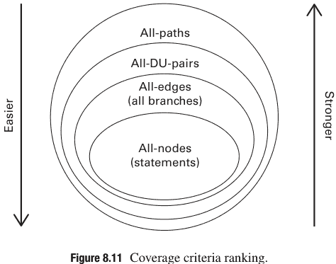

## 8.4 基于修复的测试

在软件开发过程的任何阶段发现故障后，会对故障进行优先级排序并修复。修复之后，通常会开发额外的测试来彻底验证故障是否已正确修复。这些通常是黑盒测试和白盒测试的结合。

可以开发三种不同层次的测试：特定的、通用的和抽象的。

### 8.4.1 特定修复测试

特定修复测试验证软件现在对导致故障的特定数据输入是否正确运行。这通常由一个白盒测试组成，确保执行新的/修改后的代码提供正确的输出。

### 8.4.2 通用修复测试

为了确保修复对其他数据值有效，而不仅仅是导致故障的那些，应该分析导致故障的条件，并开发执行这些条件的黑盒测试。通用修复测试验证修复是否对这些不同的数据值均有效。

### 8.4.3 抽象修复测试

为了扩大发现故障的价值，尽可能对故障进行抽象化是很有用的。然后可以开发额外的黑盒测试，尝试在代码中寻找其他程序员可能犯了相同错误的地方，从而导致相似的故障。如果故障具有特征签名（通常由复制和粘贴操作引起），则可以在代码中搜索该特征。

### 8.4.4 示例

考虑一个程序，它在某处必须在数据列表中搜索特定条目。数据存储在链列表中，由于程序员的错误，永远无法找到列表中的倒数第二个条目（即倒数第二个项）。该故障最终导致了失败，并由客户报告。然后，通过重现客户条件并调试代码来定位故障。随后，通过重写处理遍历列表的方法中的行代码来修复故障。

为了验证修复，开发了一个白盒单元测试来执行新行代码。这验证了该方法现在对于之前导致故障的数据是否产生正确的结果。然后开发了一个黑盒单元测试，确保对于不同的数据集，都能在该列表中找到倒数第二个条目。可能还会开发一个系统测试，以验证在倒数第二个条目重要的情况下，整个系统现在行为是否正确。

最后，开发额外的单元测试或系统测试，以检查程序中任何其他列表或数据集合的倒数第二个条目是否被正确定位。

### 8.4.5 使用基于修复的测试

这些额外的测试在修复后立即运行以验证修复。它们也可以添加到该方法的标准测试中，以确保故障不会再次发生——并确保开发者不会误回退到之前的代码版本。

在软件产品发布之前，通过单独运行所有基于修复的测试，可以降低已修复故障再次引入的风险。

# 9 测试面向对象的软件

第 2-7 章描述的黑盒和白盒单元测试技术已应用于单个静态方法。这允许引入测试设计技术的核心概念，而不会引入由类和对象带来的额外复杂性。相同的技术也可以应用于测试类的实例方法¹ 测试——这就是以类为单元的单元测试。

## 9.1 类上下文中的测试

通常，方法之间会相互交互且不能独立进行测试：它们需要在类的层次结构上下文中进行测试。方法通过类属性与其他方法交互。类上下文中的测试是指不是单独地测试方法，而是在其类更广泛的上下文中进行测试。

通常，必须调用 `setter` 方法来初始化被测试方法使用的任何属性。然后调用方法本身，并将所需的输入作为参数传递。必须验证方法的返回值，然后通过调用 `getter` 方法来验证方法的属性。因此，单个方法的运行需要知道属性。

在本章中，将讨论类上下文测试的核心课题。测试数据可以使用之前涵盖的黑盒或白盒技术得出。该主题通过一个示例引入，随后在 9.4 节进行更详细的描述。

## 9.2 示例

`SpaceOrder` 类支持处理仓库空间订单。关键方法是 `acceptOrder()`，它决定是否接受空间订单。通常情况下，所有订单必须在指定的最小和最大空间范围内。然而，对于特殊客户，小于最小值的订单也将接受。

我们使用等价类测试来演示该技术。其他黑盒和白盒测试的开发方法完全相同，但将使用这些黑盒和白盒测试产生的特定数据值。

使用 UML 类图来定义类中的属性和方法（如图 9.1 所示）。

| SpaceOrder |
| --- |
| special: bool<br>accept: bool = false |
| <<constructor>> +SpaceOrder(bool) |
| +getSpecial(): bool |
| +getAccept(): bool |
| +acceptOrder(int): bool |

图 9.1 SpaceOrder 类图

假设读者熟悉 UML 符号，但作为回顾，类图的解释如下：

* 上方框指定类名：SpaceOrder。
* 中框指定属性：
  - `special` 是布尔型；
  - `accept` 是布尔型，初始化为 false。
* 下方框指定方法：
  - 公有构造函数 `SpaceOrder(bool)` 接受单个布尔参数；
  - 公有方法 `getSpecial()` 没有参数并返回布尔值；
  - 公有方法 `getAccept()` 没有参数并返回布尔值；
  - 公有方法 `acceptOrder(int)` 接受单个整数参数并返回布尔值。

在列表 9.1 中提供参考。

¹ 非静态方法。

# 9.2 示例

列表 9.1 `SpaceOrder` 类。

```java
public class SpaceOrder {

    protected boolean special;

    protected boolean accept = false;

    public SpaceOrder(boolean isSpecial) {

        special = isSpecial;

    }

    public boolean getSpecial() {

        return this.special;

    }

    public boolean acceptOrder(int space) {

        boolean status = true;

        this.accept = false;

        if (space <= 0)

            status = false;

        else if (space <= 1024 && (space >= 16 || this.special))

            this.accept = true;

        return status;

    }

    public boolean getAccept() {

        return this.accept;

    }

}
```


## 方法的定义

- `void example.SpaceOrder(boolean isSpecial)`
  构造函数
  参数：
    `isSpecial` - 指定明 `SpaceOrder` 是否应该为特殊订单
- `boolean example.SpaceOrder.getSpecial()`
  返回：
    `special` 的值
- `boolean example.SpaceOrder.acceptOrder(int space)`
  确定仓库空间订单是否可以被接受。
  如果输入数据有效，若订单可以接受则返回 `true`，否则返回 `false`。
  如果输入数据无效（`space` 的值），将 `accept` 设为 `false`。
  订单可以按照以下方式被接受。对于所有订单，空间不能大于 1024 m² 的最大空间。对于标准订单，空间必须至少达到 16m² 的最小空间（特殊订单没有下限）。
  参数：
    `space` – 订单中请求的（以 m² 为单位的空间，必须大于 0）
  返回：
  如果输入数据有效且属性 `accept` 已设置（设置为 `true` 或 `false`），则返回 `true`。否则返回 `false`
- `boolean example.SpaceOrder.getAccept()`
  返回：
    `accept` 的值（`SpaceOrder` 是否已被接受）

# 测试面向对象的软件

## 9.2.1 分析

在前面章节的单元测试中，有一个静态方法需要测试（`giveDiscount()` 方法 – 见第 2–7 章）。相比之下，一个类可能包含许多方法，必须决定哪些方法应该被测试。

## 9.2.2 决定测试哪些方法

从软件测试的角度来看，方法分为四类。对于 `SpaceOrder` 类，我们现在考虑每种类别：

- **1. 静态方法** – 本示例中没有。
- **2. 构造函数** – 在测试中包含此构造函数，以确保属性被正确初始化：
  - `SpaceOrder(boolean)`
- **3. 访问器方法（getters 和 setters）** – 通常规则是只有当它们是手动编写的，或者包含多个单一的赋值（setter）或返回语句（getter）时才对其进行测试。然而，在本示例中，该类很小，getters 和 setters 可以通过代码审查轻松验证。因此，我们不会测试这些方法：
  - `getAccept()`
  - `getSchema()`
- **4. 无交互方法（不读取或写入类的任何属性）** – 无（如果存在，可以使用非面向对象方法进行单独测试，如第 2–7 章所示）。
- **5. 与类有交互的方法（读取和/或写入类属性）** – 我们将测试所有此类方法：
  - `acceptOrder(int)`

> 这种方法存在很小的风险，因为即使是单个赋值或返回语句也可能存在错误。

## 9.2.3 选择测试技术

我们现在必须决定使用哪种技术来选择数据。为了简单起见，我们在这个示例中演示等价划分测试。边界值分析（BVA）和决策表测试将使用完全相同的方法。语句覆盖和分支覆盖的方法也类似。

这里仅显示分析结果，不显示所有的中间结果。有关自然范围、值线和等价划分的细节，请参考第 2 章。

## 构造函数与初始化

首先，我们识别由构造函数类初始化设置的属性值。该类定义了一个构造函数，设置了 `special` 的值。表 9.1 列出了由类初始化和构造函数设置的属性。UML 类图指定 `accept` 属性初始化为 `false`。

**表 9.1 构造函数与初始化**

| 构造函数 | 属性 | 值 |
|---|---|---|
| `SpaceOrder(x:bool)` | `special` | `true` 或 `false`（传递给构造函数的值） |
| | `accept` | `false`（在类图中指定） |

## 访问器方法

我们决定不测试 getter 和 setter 方法。然而，某些属性只能通过它们的 getters 和 setters 访问，因此识别每个属性的这些方法非常重要。表 9.2 列出了 getter 和 setter 方法。

`acceptOrder()` 方法读取并写入属性（`special` 和 `accept`），但未被视为纯 getter 或 setter 方法，因为它执行了其他处理。

**表 9.2 访问器**

| 属性 | Getters | Setters |
|---|---|---|
| `special` | `getSpecial()` | - |
| `accept` | `getAccept()` | - |

## 其他方法

没有与类交互的方法，只有一个与类交互的方法。表 9.3 详细说明了这一个方法，列出了被写入的属性。

### 等价划分

使用第 2 章所示的技术，为本示例开发了等价划分测试。边界值分析（BVA）和决策表测试将使用完全相同的方法。语句覆盖和分支覆盖的方法也类似。

等价划分测试针对输入和输出开发，如下表所示。

**表 9.3 其他方法**

| 方法 | 读取的 | 写入的 |
|---|---|---|
| `acceptOrder(int)` | `special` | `accept` |

等价划分测试针对输入和输出开发，如下：

- **显式输入** 是传递给方法的。
- **隐式输入** 是属性。
- **显式输出** 是方法返回的。
- **隐式输出** 是类写入的属性。

为了实现全覆盖，必须包含这些。只有具有特定方法的输入范围需要进一步分析。

**图 9.2 空间的值线**

等价划分方法的输入和输出在表 9.4 中所示。

**表 9.4 等价划分**

| 方法 | 名称 | 等价划分 |
|---|---|---|
| `SpaceOrder()` | `isSpecial` | `true`, `false` |
| | `special` | `true`, `false` |
| | `accept` | `true`, `false` |
| `acceptOrder()` | `space` | `Integer.MIN_VALUE..0`, `1..15`, `16..1024`, `1025..MAX_VALUE` |
| | `special` | `true`, `false` |
| | `accept` | `true`, `false` |
| | `return value` | `true`, `false` |

与之前的章节一样，星号（*）表示输入划分。如果某个方法只有一个名称，则只需要该方法名称。如果一个属性既是输入又是输出，则必须分别列出其划分和输出划分。

## 9.2.4 测试覆盖项

每个方法的每个等价划分都是测试覆盖项（TCI），如表 9.5 所示。输入项通过“*”识别。

**表 9.5 等价划分 TCI**

| TCI | 方法 | 名称 | 等价划分 | 测试用例 |
|---|---|---|---|---|
| EP1 | `SpaceOrder()` | `isSpecial` | `true` | |
| EP2 | | | `false` | |
| EP3 | | `special` | `true` | |
| EP4 | | | `false` | |
| EP5 | | `accept` | `false` | |
| EP6* | `acceptOrder()` | `space` | `Integer.MIN_VALUE..0` | |
| EP7 | | | `1..15` | |
| EP8 | | | `16..1024` | |
| EP9 | | | `1025..Integer.MAX_VALUE` | |
| EP10 | | `special` | `true` | |
| EP11 | | | `false` | |
| EP12 | | `accept` | `true` | |
| EP13 | | | `false` | |
| EP14 | | `return value` | `true` | |
| EP15 | | | `false` | |

## 9.2.5 测试用例

每个等价划分选择的值如表 9.6 所示。

**表 9.6 选择的等价划分数据值**

| 方法 | 名称 | 等价划分 | 值 |
|---|---|---|---|
| `acceptOrder()` | `space` | `Integer.MIN_VALUE..0` | -5000 |
| | | `1..15` | 7 |
| | | `16..1024` | 504 |
| | | `1025..Integer.MAX_VALUE` | 5000 |

现在可以开发测试用例了。开发面向对象测试用例的显著区别在于，与第 2–7 章调用单个方法不同，这里会调用多个方法——而且必须按照正确的顺序调用以使测试生效。

在测试用例表（表 9.7）中，显示了测试用例 T1 的方法调用序列。每个用例都包含输入参数的测试数据和预期的返回值。通常的做法是先为构造函数编写测试用例，然后是被测试的访问器方法，最后是其他方法。在相关的方法调用旁显示 TCI（测试用例项），可以更容易审查测试用例。

**表 9.7 等价类测试用例 T1**

| ID | TCI | 输入 | 预期返回值 |
|---|---|---|---|
| T1 | EP1 | `new SpaceOrder(true)` | |
| | EP3 | `getSpecial()` | `true` |
| | EP5 | `getAccept()` | `false` |

所示的 T1 测试用例开发如下：

- 第 1 行调用构造函数，生成一个 `SpaceOrder` 类的实例，并将值 (EP1) 作为输入。构造函数没有返回值。
- 第 2 行调用 `getSpecial()`。它返回属性 `special` 的值。如果构造函数工作正常，该值在重新执行构造函数时应被设置为 `true`（即 EP3），因此预期的返回值为 `true`。
- 第 3 行调用 `getAccept()`。它返回属性 `accept` 的值。根据规范，它在初始化时的默认值为 `false`，因此该值是预期的返回值 (EP5)。

其他用例现在以类似的方式开发。完整的测试用例集如表 9.8 所示。与第 2-7 章一样，最好采用系统的方法来处理此任务，尝试按顺序覆盖测试用例项，同时避免不必要的重复，最后覆盖错误 TCI。

计算每个被测试方法的最大 TCI 数量，可以指示预期的最小测试用例数量：构造函数最多有两个（针对 `isSpecial`），`acceptOrder()` 最多有四个（针对 `space`），因此预计至少需要六个测试用例。

## 9.2.6 测试用例的验证

与之前的黑盒和白盒测试技术一样，测试用例的验证分为两个步骤：首先完成测试用例表，然后审查你的工作。

> 并不是所有书籍在设计面向对象测试时都会显示出这种程度的细节，但我们推荐将其良好的做法。否则，在实现测试时，测试人员必须重新进行分析以确定所需的方法和顺序。

## 9.2 示例 173

**表 9.8 等价类测试用例**

| ID | 覆盖的测试用例 | 输入 | 预期结果返回值 |
|---|---|---|---|
| T1 | EP1 | `new SpaceOrder(true)` | |
| | EP3 | `getSpecial()` | `true` |
| | EP5 | `getAccept()` | `false` |
| T2 | EP2 | `new SpaceOrder(false)` | |
| | EP4 | `getSpecial()` | `false` |
| T3 | [EP1] | `new SpaceOrder(true)` | |
| | EP7, EP10, EP14 | `acceptOrder(7)` | `true` |
| | EP12 | `getAccept()` | `true` |
| T4 | [EP2] | `new SpaceOrder(false)` | |
| | EP8, EP11, [EP14] | `acceptOrder(504)` | `true` |
| | [EP12] | `getAccept()` | `true` |
| T5 | [EP2] | `new SpaceOrder(false)` | |
| | EP9, [EP10, EP14] | `acceptOrder(5000)` | `false` |
| | EP13 | `getAccept()` | `false` |
| T6 | [EP2] | `new SpaceOrder(false)` | |
| | EP6*, EP15 | `acceptOrder(-5000)` | `false` |
| | [EP13] | `getAccept()` | `false` |

### 完成 TCI 表

TCI 表中的“测试用例”列可以完成（表 9.9）。这是通过读取表 9.8 中每个测试用例的 TCI 来完成的。

**表 9.9 SpaceOrder 完成的 TCI 表**

| TCI | 方法 | 名称 | 等价类 | 测试用例 |
|---|---|---|---|---|
| EP1 | `SpaceOrder()` | `isSpecial` | `true` | T1 |
| EP2 | | | `false` | T2 |
| EP3 | | `special` | `true` | T1 |
| EP4 | | | `false` | T2 |
| EP5 | | `accept` | `false` | T1 |
| EP6* | `acceptOrder()` | `space` | `Integer.MIN_VALUE..0` | T6 |
| EP7 | | | `1..15` | T3 |
| EP8 | | | `16..1024` | T4 |
| EP9 | | | `1025..Integer.MAX_VALUE` | T5 |
| EP10 | | `special` | `true` | T3 |
| EP11 | | | `false` | T4 |
| EP12 | | `accept` | `true` | T3 |
| EP13 | | | `false` | T5 |
| EP14 | | `return value` | `true` | T3 |
| EP15 | | | `false` | T6 |

### 审查你的工作

与之前的章节一样，审查的目的是确保没有未被覆盖的 TCI 以及不必要的（重复的）测试用例。

在这个示例中，我们可以从表 9.9 看到没有 TCI 未被覆盖，也没有重复的测试用例。

## 9.4 面向对象软件测试的详细观察

它们位于类边界上；可以从类外部访问。私有方法和私有属性隐藏在类内部——它们无法从类外部访问，测试人员无法访问或使用它们。图中重要的特征有：

- **单一功能为设置属性值的方法，称为 `setter`（设置器）**——标记为 S。
- **单一功能为获取属性值的方法，称为 `getter`（访问器）**——标记为 G。
- 出于测试而言，进行任何处理的方法都不称为 getter 或 setter，且在图中未标记。这些其他方法可能会接收输入参数、可能会读取属性作为输入、进行处理、调用其他方法（包括公有的和私有的）、写入属性作为输出、返回一个值作为输出，或抛出异常作为输出。公共方法可以由测试人员调用。类可能与其他类存在关系：一个类调用另一个类的代码（**is-a 关系**，也称为泛化/特化）；以及聚合关系，即一个类包含其他类的集合（**has-a 关系**）。

## 9.4.2 面向对象软件测试

面向对象的测试是一个大型且复杂的领域——关于该主题的建议额外阅读，请参见第 14.3 节。

本章涵盖了所有 OO 测试的基础测试技术：**类上下文中的测试**。这用于测试类中的代码，其中数据受到保护以免外部访问，且方法通过属性相互作用。

## 9.4.3 故障模型

面向对象的特性旨在提高代码质量并支持代码重用。但这些概念非常复杂，除了通用软件相关的模型外，还引入了自身的故障模型：

**类**：对象通过方法调用保留其属性的值（正式称为其**状态**）。在许多情况下，调用这些方法的顺序对于正确操作至关重要。确保这种顺序的代码分布在许多方法中。这为所谓的**状态控制故障**提供了许多机会，即对象在特定状态下的行为不正确（见第 8.2.7 节）。

> 在 Java 中使用公共属性是不常见的。

> Binder，《Testing Object Oriented Systems》可能是最详尽的参考书。

**继承**：继承导致了对象与不同类及接口之间的绑定。动态绑定发生在运行时，由 Java 虚拟机决定使用哪一个重写的方法。复杂的继承结构或对 Java 继承的理解不足，可能会由于意外的绑定或对正确用法的误解而产生许多故障机会。

**消息**：调用时的编程错误（如传递了错误的参数或传递了正确参数但顺序混乱）是过程化语言中故障的主要原因。面向对象的程序通常有许多短方法，因此增加了这些接口故障的风险。

## 9.4.4 类上下文中的测试

类中的方法必须在类中定义的其他方法的上下文中进行测试。这是所有 OO 软件测试的基本要素，因为所有方法都在类上下文中执行。前面的章节探究了使用静态方法测试的传统方法，静态方法接受所有输入作为方法的参数，并返回结果。

传统的单元测试其结构如代码段 9.1 所示。

### 代码段 9.1 一种传统测试

```
actual_result = Classname.method(p1, p2, p3);
check_equals(actual_result, expected_results);
```

测试的操作非常直观：

- 在第 1 行，使用测试输入值调用被测方法——这里使用 `p1`、`p2` 和 `p3` 作为示例。返回值存储在临时变量中：`actual_result`。
- 随后，在第 2 行，将方法调用返回的实际结果与测试指定的预期结果进行比较。如果相同，则测试通过；否则，测试失败。

在实践中，这通常在单行中完成，如代码段 9.2 所示。

### 代码段 9.2 单行的传统测试

```
check_equals(Classname.method(p1, p2, p3), expected_results);
```

在 OO 环境中测试软件时，必须先创建一个对象（被测类的实例）。当调用方法时，方法的某些或全部输入输出可能是属性，而不是显式的参数和返回值。在这个示例中，需要先调用其他方法来设置某些输入值（setters），此后再获取某些输出值（getters）。

典型的 OO 单元测试的结构如代码段 9.3 所示。这种测试结构被称为**类上下文中的测试**。注意它与代码段 9.1 所示的传统测试的对比。

### 代码段 9.3 类上下文中的测试

```
```


## 9.4 深入研究面向对象的软件测试

### 9.4.1 类上下文测试示例

```text
object = new Classname( p1 );

object.setParameter( p2 );

actual_status = object.method_under_test( p3 );

check_eqs( actual_status, expected_status );

actual_result = object.get_result();

check_eqs( actual_result, expected_results );
```

在实践中，这通常在单行中完成，如代码段 9.2 所示。（等等，文本再次引用了代码段 9.2，但流程如下）。

实际上重新查看 9.2 的逻辑：
- 在第 1 行，使用测试输入值调用被测方法——这里使用 `p1`、`p2` 和 `p3` 作为示例。返回值存储在临时变量中：`actual_result`。
- 随后，在第 2 行，将方法调用返回的实际结果与测试指定的预期结果进行比较。如果相同，则测试通过；否则，测试失败。

实际上，查看 9.3 的逻辑：
- 在第 1 行，通过构造函数创建对象。
- 在第 2 行，设置 `p2`。
- 在第 3 行，使用 `p3` 调用被测方法。
- 在第 4 行，将实际状态与预期状态进行比较。
- 在第 5 行，获取结果。
- 在第 6 行，将实际结果与预期结果进行比较。

这演示了 OO 用于输入输出的各种附加机制。书中描述的所有黑盒和白盒技术适用于类上下文的方法：语句覆盖、分支覆盖、等价划分、边界值、决策表、随机测试和路径覆盖。测试条件基本相同；差异在于分析、用例和实现，这些都需要考虑类上下文。

### 9.4.2 面向对象测试的分析

分析包含三个部分。第一部分是决定测试哪些方法。第二部分是分析类接口。第三部分与传统测试一样，通过应用测试设计技术分析规范（可能的代码），以识别 TCI。

### 9.4.3 测试覆盖项

使用分析结果识别 TCI。

### 9.4.4 测试用例

不仅要确定要使用的数据，还必须确定方法调用的顺序。这可以留到实现阶段再决定，但在实现时知道调用哪个方法很重要（因为不同方法可能具有相同的参数名），且顺序可能会影响数据。

对于 9.2.2 节的示例，应为以下内容开发测试用例：

1. 静态方法——它们不依赖于构造函数。通常是独立的；如果它们通过静态属性交互，则应与静态方法一起考虑类上下文。
2. 构造函数——包括默认构造函数。注意构造函数是在对象初始化之后调用的。
3. 不使用类属性的简单方法。
4. 访问方法（getter 和 setter）——如果需要测试。
5. 其他方法。

建议将每个测试的主要方法调用限制在一个测试用例中，尽管我们所见，这可能需要辅助方法调用。这使得检查测试用例的顺序和完整性更容易¹。并不总是需要为每个输入错误值使用单独测试（与等价划分测试不同），只要输入错误值是不同方法的输入且不会导致错误隐藏即可。

### 9.4.5 测试实现

面向对象（OO）测试方法分为两类：可以以任何顺序运行的方法，以及需要先运行其他方法的方法。在所示示例中，测试方法为每个测试创建类的新实例，因此可以以任何顺序运行（请参见第 11 章，了解如何使用优先级或测试依赖关系来强制特定的顺序）。如果一个测试依赖于另一个测试先运行，则它们必须按照要求的顺序包含在同一个测试中，或者必须使用测试依赖关系。

一旦定义了测试用例，实现通常非常简单。

### 9.4.6 高级 OO 测试概述

有大量的 OO 测试技术，接下来的章节总结了其中许多技术。建议 OO 测试人员对这些技术进行额外的阅读，进一步的阅读见第 14.3 节。

本章开头示例中展示的测试形式可以是类上下文语境中的常规测试。对应故障模型，本节总结了两种形式的 OO 测试：继承测试和基于状态的测试。继承测试主要是一种测试自动化——针对一个类设计的测试在另一个类（子类）上运行。问题将在第 11 章中解决。基于状态的测试验证输入序列的行为，特别是使用 UML 状态图。

### 9.4.7 继承测试

这种形式的测试专门针对继承故障模型。继承测试的目的是验证继承层次结构中的类行为正确。简单形式的继承测试验证继承的父类方法在子类语境下继续正常工作。这可以扩展到确保继承树中的所有方法继续正常运行。

#### 里氏替换原则

然而，并不是所有的子类都设计为完全支持其父类行为。此类子类被称为不可进行里氏替换的¹³。对于继承测试：

- 如果子类是完全可替换的，那么无论其父类具有什么功能，它也支持。它可能具有额外的特征。为了验证继承，会对每个子类执行父类测试。这验证了子类在父类语境下工作。

> ¹³ 参见 B.H. Liskov 和 J.M. Wing. A behavioral notion of subtyping. ACM Transactions on Programming Languages and Systems, Vol. 16, No. 6, 1994.

- 如果子类不是完全可替换的，那么只有父类测试的一个子集（可能没有）可以在子类继承测试中重用。必须进行分析以选择合适的测试。这种分析更困难，因为标准的 UML 类图没有指定子类是否是完全可替换的。

- 在两种情况下，都必须编写额外的测试来验证子类。

一旦选择了要运行的测试，继承测试主要是一个测试自动化问题——参见第 11.9 节的示例。

### 9.4.8 基于状态的测试

这种形式的基于状态的测试处理类封装/状态故障模型。基于状态的测试目的是验证类相对于状态规范（例如 UML 状态机图）的行为正确。状态图包含状态以及状态之间的转换。基于状态的测试验证软件在状态之间是否正确转换。三个简单的测试策略：

- 所有转换 – 每个转换至少被验证一次；
- 所有端到端路径 – 从开始状态到结束状态的路径至少被验证一次。如果没有结束状态（这在状态软件图中很常见），则可以使用从该状态到每个终端状态¹⁴的路径；
- 所有回路 – 每一个在相同状态开始并结束的路径都经过验证。

每个转换通过一个引起转换的事件以及随之发生的动作（一个*事件-活动对*）来验证。转换的正确操作通过以下方式验证：

- 检查软件是否处于起始状态（这可能已经通过上一个转换的验证完成）；
- 触发事件（即使用正确的参数值调用方法）；
- 检查指定的活动是否已正确发生；
- 检查软件是否处于正确的状态。

无法完全检查一个对象是否处于正确的状态，或者正确的动作是否已经发生¹⁵。在这种情况下，可以进行部分检查。

图 9.5 显示了 SpaceOrder 的图。图中显式包含了两个状态和三个转换。图中还有四个隐含但未显式说明的转换。隐式指定的转换是状态图中未显示的方法调用——它们将导致返回到状态的转换，且没有关联的动作。在这个示例中，在两个状态中调用 `getSpecial()` 和 `getAccept()` 的效果未显示，因此隐式要求是它们会产生效果。待测试的完整转换集（包含添加的）如表 9.5。

> ¹⁴ 终端状态是指没有到其他状态转换的状态。
> ¹⁵ 这是一个可测试性设计（DFT）问题——如果设计者考虑了可测试性，具有基于状态行为的类更容易测试。

#### 图 9.5 SpaceOrder 的状态图

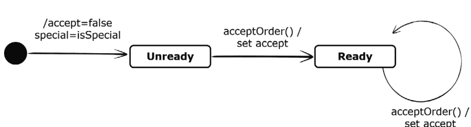

#### 表 9.5 SpaceOrder 的转换集

| 编号 | 起始状态 | 事件 | 结束状态 |
| :--- | :--- | :--- | :--- |
| 1 | Start | `getSpecial()` | Unready |
| 2 | Start | `getSpecial()` | Unready |
| 3 | Start | `getAccept()` | Unready |
| 4 | Unready | `acceptOrder(100)` | Ready |
| 5 | Ready | `getSpecial()` | Ready |
| 6 | Ready | `getAccept()` | Ready |
| 7 | Ready | `acceptOrder(200)` | Ready |

转换的正确操作通过以下方式验证：

- 检查软件是否处于起始状态（这可能已经通过上一个转换的验证完成）；
- 触发事件（即使用正确的参数值调用方法）；
- 检查指定的活动是否已正确发生；
- 检查软件是否处于正确的状态。

通过调用 `accept()` 检查软件处于正确的状态。这允许对 unsteady 和 ready 状态进行唯一标识（如果软件正常工作）。应该检查从 unsteady 到 ready 的转换。

使用 space 值运行的结果如图 9.6 所示。

#### 图 9.6 所有转换状态测试

```
PASSED: allTransitionsTest

=================================

Command line suite

Total tests run: 1, Passes: 1, Failures: 0, Skips: 0

=================================
```

### 9.4.9 基于 UML 的测试

UML（统一建模语言）是面向对象软件主要的分析和设计工具。UML 2.5 中包含大量的图。其中每种图都是测试人员的潜在信息来源和测试覆盖项。类语境下的方法测试和继承测试利用了类图。基于状态的测试利用了状态图，但所有其他图也可以用于生成测试用例。

图中的每个项目都有含义，因此代表了软件系统的一个可测试属性。例如，类之间的关系以及任何相关的关联多重性是类图中测试的有用来源，而类与方法之间的交互是时序图、活动图和交互图中测试的有用来源。

### 9.4.10 内置测试

封装可能会使测试变得困难，特别是当试图通过访问类属性来验证实际结果是否符合预期结果时。对此有许多解决方案，例如使用 Java 反射在运行时访问私有属性。另一种在许多语言中都存在的解决方案是使用断言进行内置测试（BIT）。这些断言被称为“内置”，是因为它们被构建在代码内部，而不是位于外部测试类中。

这对于确保程序员在代码中实际提出的断言是所要求的是非常有效的。通过在每个方法的末尾进行断言，它们也可以有效地验证每个方法都维护了类不变性。在 Java 中，断言可以在运行时开启，因此在测试期间启用它们，而在部署时禁用。

然而，它们在替代单元测试方面效果较差，因为它们不仅需要引用方法变量（属性、参数和局部变量）的当前值，还需要方法执行开始时的原始值。为了这些测试而保留代码在内存空间和执行时间上可能是非常低效的。它还增加了编写每个方法的工作量，并增加了出错的概率。

BIT 的示例如列表 9.4 所示，其中类中添加了一个额外的 `acceptedSpace`。

> ¹⁶ 既有官方图也有非官方图——详情请见 www.uml-diagrams。
> ¹⁷ Java 反射可用于运行时检查类——更多信息请参阅 https://docs.oracle.com/java/tutorial/reflection/index.html Reflection API 教程。
> ¹⁸ 类不变性是指必须始终成立的类属性——它们通常用于安全关键型软件，如第 14.3.9 节所述。例如，在隧道管理系统中，隧道内的火车可能会受到限制。

#### 列表 9.4 带有 BIT 的 SpaceOrder

```java
public class SpaceOrder {

    boolean special;

    boolean accept = false;

    int acceptedSpace = 0; // mut 始终在 [0..1024) 中

    public SpaceOrder(boolean isSpecial) {

        special = isSpecial;

        assert acceptedSpace >= 0 && acceptedSpace <= 1024;

    }

    public boolean getSpecial() {

        return special;

    }

    public boolean acceptOrder(int space) {

        assert acceptedSpace >= 0 && acceptedSpace <= 1024;

        boolean status = true;

        acceptedSpace = 0;

        accept = false;

        if (space < 0) {

            status = false;

        } else if (space < 1024 && (space <= 16 || special)) {

            accept = true;

            acceptedSpace = space;

        }

        // 在此处检查正确结果？

        assert acceptedSpace >= 0 && acceptedSpace <= 1024;

        return status;

    }

    public boolean getAccept() {

        return accept;

    }

}
```

通过 Java `assert` 语句验证安全条件是直接的。这些语句放置在第 9 行构造函数的末尾，以及第 17 行和第 29 行 `acceptOrder()` 的开头和结尾。为了避免代码重复，可以实现一个检查安全条件的方法，并在这些行中调用。

然而，无法轻松实现一个验证 `acceptOrder()` 方法是否正常工作的断言。第 29 行检查了 `acceptedSpace` 是否有效，但它没有检查 `accept` 属性或返回值是否正确。这需要访问进入方法时 `special` 属性的值和 `space` 参数的值——但这些值在方法执行期间可能已经发生了变化。在这种情况下，它们没有被修改，但不同的算法或代码中的故障可能会修改其中任何一个。由于方法末尾的值无法代表方法开始时的值，因此需要在方法开始时创建副本。在这段简单的代码中，可以很容易保留副本，但这会引入进一步故障的可能性。而且，通常情况下，需要对任何引用的对象进行完整拷贝：这是一个困难的问题，且实现往往是不现实的¹⁹。例如，如果传递一个计数器数组作为输入，则需要创建整个数组的副本，包括数组中每个计数器的副本。

对带有内置测试的 `SpaceOrder` 运行等价划分测试的结果如图 9.7 所示。所有测试均通过——不仅在时序图、活动图和交互图的测试中返回并验证了正确值。

### 9.4.11 测试面向对象的软件

为类上下文开发的测试通过引入许多故障并检查结果，在本节中对其进行评估。

#### 局限性

展示了三种类型的故障：

- 你在等价划分测试中发现的简单类型故障；
- 一个更复杂的基于状态的故障；
- 一个复杂的基于继承的故障（在子类中）。

#### 拼写故障

列表 9.5 显示了 `SpaceOrder` 中的一个简单故障，拼写导致了第 19 行的故障（误将 1024 输入为 10240）。

```java
public class SpaceOrder {

    protected boolean special;

    protected boolean accept = false;

    public SpaceOrder(boolean isSpecial) {

        special = isSpecial;

    }

    public boolean getSpecial() {

        return this.special;

    }

    public boolean acceptOrder(int space) {

        boolean status = true;

        this.accept = false;

        if (space <= 0)

            status = false;

        else if (space < 10240 && (space >= 16 || this.special))

            this.accept = true;

        return status;

    }

    public boolean getAccept() {

        return this.accept;

    }

}
```

运行 `SpaceOrder` 等价划分测试的结果如图 9.8 所示。简单故障已被检测——正如任何等价划分测试一样，无法保证能发现任何特定的故障。


PASSED: `testConstructor("SpaceOrderTest T1", true, true, false)`

PASSED: `testConstructor("SpaceOrderTest T2", false, false, false)`

PASSED: `testAcceptOrder("SpaceOrderTest T3", true, 7, true, true)`

PASSED: `testAcceptOrder("SpaceOrderTest T4", false, 504, true, true)`

PASSED: `testAcceptOrder("SpaceOrderTest T6", false, -5000, false, false)`

FAILED: `testAcceptOrder("SpaceOrderTest T5", false, 5000, true, false)`

```
java.lang.AssertionError: expected [false] but found [true]
    at example.SpaceOrderTest.testAcceptOrder(SpaceOrderTest.java:40)
```

Command line suite

Total tests run: 6, Passes: 5, Failures: 1, Skips: 0

图 9.8 针对类型故障的 `SpaceOrder` 等价划分测试结果。

## 状态故障

列表 9.6 显示了 `SpaceOrder` 类中一个更微妙的故障。

列表 9.6 带有状态故障的 `SpaceOrder`。

```java
public class SpaceOrder {

    boolean special;

    boolean accept = false;

    boolean locked = false;

    public SpaceOrder(boolean isSpecial) {

        special = isSpecial;

    }

    public boolean getSpecial() {

        return this.special;

    }

    public boolean acceptOrder(int space) {

        if (locked) {

            return false;

        }

        boolean status = true;

        this.accept = false;

        if (space < 0) {

            status = false;

        } else if (space <= 1024 && (space >= 16 || this.space)) {

            this.accept = true;

        }

        return status;

    }

    public boolean getAccept() {

        locked = true;

        return this.accept;

    }
}
```

该类中错误地添加了一个新属性 `locked` 的支持。这导致 `acceptOrder()` 如果被调用多次将无法正常工作——第一次调用时它作用于对象。本质上，这引入了一个不在状态图中的新状态 `locked`，且 `acceptOrder()` 在此状态下无法工作。请见第 5、16、17 和第 28 行。

图中显示了在特定上下文中运行等价类测试的结果。注意，该故障未被发现。正如第 9.4.11 节讨论，需要对基于状态的行为进行更系统性的探索，才能可靠地检测此类故障。

## 故障

针对有错误的 `SpaceOrder` 实现运行基于状态测试（来自第 9.4.11 节）的结果如图 9.10 所示。故障已被发现。

## 测试对象-构造函数

```java
PASSED: testConstructor("SpaceOrderTest T1", true, true, false)

PASSED: testConstructor("SpaceOrderTest T2", false, false, false)

PASSED: testAcceptOrder("SpaceOrderTest T3", true, 7, true)

PASSED: testAcceptOrder("SpaceOrderTest T4", false, 504, true, true)

PASSED: testAcceptOrder("SpaceOrderTest T5", false, 5000, true, false)

PASSED: testAcceptOrder("SpaceOrderTest T6", false, -5000, false, false)
```

命令行套件
总运行测试次数: 6, 通过: 6, 失败: 0, 跳过: 0

这种对转换的系统性测试比类上下文中的传统测试更有可能发现状态故障。

```
FAILED: allTransitionsTest

java.lang.AssertionError: expected [true] but found [false]
at example.SpaceOrderState.allTransitionsTest(SpaceOrderState.java:22)

=========================================
命令行套件
总运行测试次数: 1, 通过: 0, 失败: 1, 跳过: 0
=========================================
```

## 9.5.4 继承故障

列表 9.7 显示了 `TrackableSpaceOrder` 中的一个简单故障，它继承自 `SpaceOrder`。

列表 9.7 带有继承故障的 `TrackableSpaceOrder`。

```java
public class TrackableSpaceOrder extends SpaceOrder {

    private long code = 0;

    public TrackableSpaceOrder(boolean isSpecial) {
        super(isSpecial);
    }

    public void setTrackCode(int newValue) {
        code = newValue;
    }

    public int getTrackCode() {
        return (int)code;
    }

    @Override
    public boolean acceptOrder(int space) {
        return true;
    }
}
```

`acceptOrder()` 方法在第 17–20 行被重写。第 19 行的实现是不完全的。这通常出现在最初编写骨架方法时，而开发者忘记了完成它。

针对 `TrackableSpaceOrder` 实例运行 `SpaceOrder` 等价类测试的结果如图 9.11 所示。如何进行这一点在第 11 节中讨论。

```
PASSED: testAcceptOrder("SpaceOrder T5", false, 5000, true, false)

FAILED: testAcceptOrder("SpaceOrder T3", true, 7, true)
java.lang.AssertionError: expected [true] but found [false]
    at example.TrackableSpaceOrderTest.testAcceptOrder(TrackableSpaceOrderTest.java:26)

FAILED: testAcceptOrder("SpaceOrder T4", false, 504, true)
java.lang.AssertionError: expected [true] but found [false]
    at example.TrackableSpaceOrderTest.testAcceptOrder(TrackableSpaceOrderTest.java:26)

FAILED: testAcceptOrder("SpaceOrder T6", false, -5000, false, false)
java.lang.AssertionError: expected [false] but found [true]
    at example.TrackableSpaceOrderTest.testAcceptOrder(TrackableSpaceOrderTest.java:25)

===============
命令行套件
总运行测试次数: 4, 通过: 1, 失败: 3, 跳过: 0
===============
```


> 图 9.11 继承故障的等价类测试结果。针对 `TrackableSpaceOrder` 实例运行时，三个 `SpaceOrder` 测试失败了。注意 `T1` 和 `T2` 无法使用，因为它们调用了构造函数，而构造函数不是类的方法。

## 9.5 优点与缺点

类上下文中传统测试的局限性既源于底层测试技术的缺点（等价类、BVA、决策表、语句覆盖、全路径等），也源于测试上下文引入的额外复杂性。

### 测试面向对象的软件

传统测试可能会发现状态故障和继承故障，但它们更有可能通过针对这些模型的系统性测试被发现。

## 9.6 关键点

- 方法需要在类上下文中进行测试，并使用 setter 和 getter 方法。
- 需要在类上下文中进行测试，使用黑盒和白盒测试技术。
- 面向对象的程序具有需要测试的特殊特性，关键在于状态行为和继承。
- 黑盒测试技术非常有用，特别是对于验证类不变性。

## 9.7 给资深测试者的提示

丰富的测试人员通常会在脑中进行测试设计，并直接根据规格编写测试，特别是对于小类。这包括：

- 选择要测试的方法（特别是 getter 和 setter）；
- 测试设计技术（例如等价类、BVA、决策表、状态覆盖、分支覆盖、全路径）；
- 设计测试项；
- 设计测试用例；
- 编写测试代码。

特别是在敏捷开发环境中，丰富的测试人员可能会使用用户故事和验收标准作为测试的基础。当类紧密实现用户需求时，这种方法非常直接。用户故事的验收标准可以映射到方法调用。

丰富的测试人员可能会直接根据状态图或继承树编写测试，并确保允许继承测试。

# 10 应用测试

本章以网络应用程序为例，介绍了应用程序测试的基本要素。桌面和移动应用的测试非常相似——区别在于测试自动化工具，我们将在第 11 节中讨论。

应用程序测试与单元测试相比具有额外的复杂性。关键在于如何在界面上定位输入和输出，以及如何自动化测试。

## 10.1 使用用户故事测试网络应用程序

应用程序规格的许多元素都可以作为应用程序测试的基础。现代敏捷开发流程关注以用户故事形式表示的用户需求。大型系统包含许多故事，可以分组为史诗。

## 10.2 示例

油库需要一个基于网络的系统，以便调度员判断接收的某批燃料是否能装入单个油罐中。低挥发性燃料可以完全充满油箱。出于安全考虑，高挥发性燃料需要留出膨胀空间。如果没有膨胀空间，油箱容量为 1200 升；如果有则为 800 升。燃料负载中的所有负载均取最接近的整数（升），不支持小数。

在与用户沟通后，开发了以下用户故事：

> 故事 S1：作为一名油库调度员，我想要检查燃料负载是否符合油箱容量，以便我能够决定是否接受它。

已与客户商定了以下详细的验收标准：

- S11 检查符合油箱的低挥发性燃料负载。
- S12 检查符合油箱的高挥发性燃料负载。
- S13 检查不符合油箱的低挥发性燃料负载。
- S14 检查不符合油箱的高挥发性燃料负载。
- S15 列出油箱容量。
- S16 完成退出（这是油库公司使用的所有软件的通用要求）。
- S17 识别用户输入数据错误——开发团队根据他们在 Web 应用设计方面的经验向客户提出了这一准则。

这意味着我们有一个包含七个验收标准的用户故事。

### 10.2.1 分析

为了开发测试用例，我们需要识别：

1. 应用程序展示的不同屏幕；
2. 我们在每个屏幕上需要交互的用户界面；
3. 输入和输出数据如何在屏幕上表示。

#### 试运行

通过对软件进行试运行可以最容易调查用户界面，以确定每个故事是如何实现的。以下是上述 Fuel Checker 应用程序的示例。图 10.1–10.4 显示了每个屏幕，并附有简要说明。

- 图 10.1(a)：启动时，显示“输入数据”屏幕。
- 图 10.1(b)：点击“信息”后，显示“信息”屏幕。
- 图 10.2(a)：点击“继续”后，显示“输入数据”屏幕，用户在升数输入 1000 并选择“需要高安全”。
- 图 10.2(b)：点击“进入”后，显示“结果”屏幕，显示消息“燃料不符合油箱”。

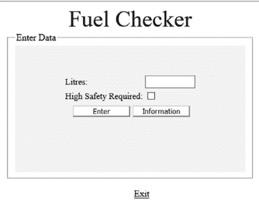
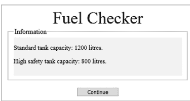

(a) 标题：Fuel Checker
(b) 标题：Fuel Checker 信息

图 10.1 Fuel Checker 试运行 – 部分 1。

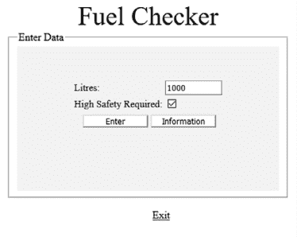
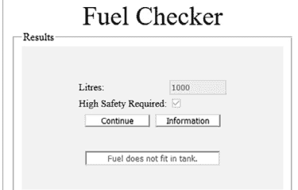

(a) 标题：Fuel Checker
(b) 标题：结果

图 10.2 Fuel Checker 试运行 – 部分 2。

- 图 10.3(a)：点击“继续”后，显示“输入数据”屏幕，用户重新输入了 1000 升。
- 图 10.3(b)：点击“进入”后，显示“结果”屏幕，显示消息“燃料符合油箱”。
- 图 10.4(a)：点击“继续”返回“输入数据”屏幕，用户在升数处输入 xxxx 并点击“进入”。随后显示“结果”屏幕，并带有错误消息“无效值”。
- 图 10.4(b)：点击“继续”返回“输入数据”屏幕，用户点击屏幕底部的“退出”。现在显示“再见”屏幕，显示消息“感谢使用 FuelChecker”。

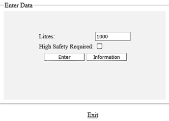
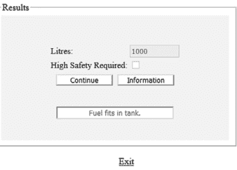

(a) 标题：Fuel Checker
(b) 标题：结果

图 10.3 Fuel Checker 试运行 – 部分 3。

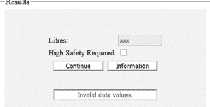
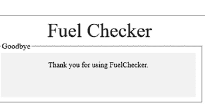

(b) 标题：感谢
(a) 标题：Fuel Checker

图 10.4 Fuel Checker 试运行 – 部分 4。

通过这些试运行，我们现在可以识别应用程序展示的每个页面、测试所需的界面组件以及正在使用的数据表示。

#### 从试运行中提取信息

页面标题可以在浏览器中看到；它们通常显示在标签页名称中，并可以从屏幕上轻松读取。

良好的 Web 页面使用唯一的 HTML ID 来识别元素。这些试运行允许测试人员发现与输入和输出数据交互所需的 ID。如果没有这些，自动化测试将变得非常困难。

> 在测试驱动设计 (TDD) 环境中，一旦屏幕设计完成，就可以开发测试，由用户界面 (GUI) 设计师或测试人员选择。代码将使用这些 ID 以通过测试。

#### 10.2 示例

大多数浏览器都包含允许检查元素（以及其他信息）的检查器。以下是三个示例：

**示例 1**：图 10.5 显示了用户右键点击燃料负载并选择下拉菜单时显示的“元素”标签。

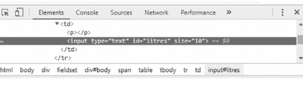

图 10.5 检查器。

元素的详细信息：

**示例 2**：图 10.6 显示了用户右键点击燃料并选择下拉菜单时显示的“元素”标签。

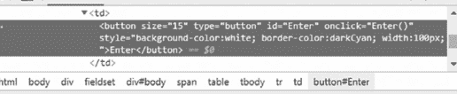

图 10.6 检查器。

**示例 3**：图 10.7 显示了用户右键点击升数并选择下拉菜单时显示的“元素”标签。

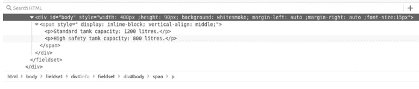

图 10.7 检查器。

页面标题可以在浏览器中看到；它们通常显示在标签页名称中，并可以从屏幕上轻松读取。

良好的 Web 页面使用唯一的 HTML ID 来识别元素。这些试运行允许测试人员发现与输入和输出数据交互所需的 ID。如果没有这些，自动化测试将变得非常困难。

> 在测试驱动设计 (TDD) 环境中，一旦屏幕设计完成，就可以开发测试，由用户界面 (GUI) 设计师或测试人员选择。代码将使用这些 ID 以通过测试。

分析现在完成了——我们识别了应用程序展示的每个屏幕、每个屏幕上测试所需的 Web 元素，以及这些元素的数据表示。

简单的用户测试用例将为每个标准使用单一值。在更高级的测试中，分析可以扩展到识别等价划分、边界值和组合。

### 10.2.2 测试覆盖项

每个用户故事 (US) 的每个验收标准 (AC) 都是测试覆盖项 (TCI)，如表 10.2.4 所示。测试用例列将在以后作为设计评审的一部分完成。

| TCI | 验收标准 | 测试用例 |
|---|---|---|
| US1 | S11 | |
| US2 | S12 | |
| US3 | S13 | |
| US4 | S14 | |
| US5 | S15 | |
| US6 | S16 | |
| US7 | S17 | 待完成 |

即使 US7 向用户报告错误，它在等价划分（EP）测试中相同意义上的错误案例。每个用户故事/验收标准都是单独测试的，因此不存在招聘错误的问题，我们不需要用星号来识别错误案例。

> 4 我们有一个包含七个验收标准的用户故事。TCI 标识符 US1–7 是任意的唯一标识符，选择前缀 US 表示这些是用户故事测试。

### 10.2.3 测试用例

与等价划分测试类似，为测试用例选择了典型数据值。这些值可以提前选择（如表 10.3 所示），也可以在测试用例开发过程中选择。与之前的测试技术一样，选择标准值使得完成后的测试用例更易审查。对于应用测试，使用值线进行详细分析并不罕见，这在 2.2.1 节中已针对单元测试进行了展示。

#### 表 10.3 选定的输入数据值

| TCI | 输入 | 值 |
|---|---|---|
| US1 | litres | "1000" |
| US2 | litres | "400" |
| US3 | litres | "2000" |
| US4 | litres | "1000" |
| US7 | litres | "xxx" |

##### 典型数据值

在 US7 的整数值中可能会输入许多无效字符串——参见第 10.4.6 节的讨论。

预期结果（正确的输出及其数据表示）在应用分析期间已经确定，如表 10.4 所示。

#### 表 10.4 输出数据值

| TCI | 输出 | 值 |
|---|---|---|
| US1 | result | "Puel fits in tank." |
| US2 | result | "Puel fits in tank." |
| US3 | result | "Puel does not fit in tank." |
| US4 | result | "Puel does not fit in tank." |
| US5 | body | 包含 "Standard tank capacity: 1200 litres 和 "High safety tank capacity: 800 litres" |
| US6 | body | "Thank you for using fuelchecker" |
| US7 | result | "Invalid data values." |

##### 测试用例表

每个用例的测试数据被指定为自动化测试模拟的用户操作序列。每个 TCI 都是独立的测试用例。

第一个用例的测试开发如下——打开网页等细节是不必须的，因为实施者可以选择为每次测试重新打开页面，也可以不这样做（出于效率考虑，不重新打开更好）。

- 启动应用后，在 `litres` 中输入 1000。
- 确保 `highsafety` 为
- 点击 `Enter`，并确保应用移动到 Results（结果）屏幕。
- 检查 `Result` 包含文本 "Fuel fits in the tank."。

测试用例 T1 如表 10.5 所示。输入由操作组成：在本示例中，有需要输入的数据值、需要选择/取消选择的复选框以及需要点击的按钮。预期结果由 Web 程序的响应组成：在本示例中，有需要验证的窗口标题和显示文本。

#### 表 10.5 用户故事测试的用例 T1

| ID | 覆盖的 TCI | 输入 | 预期结果 |
|---|---|---|---|
| T1 | US1 | 在 `litres` 中输入 "1000" 取消 `highsafety` 点击 `Enter` | 移动到 Results 屏幕 Result 为 "Fuel fits in the tank." |

其他测试的数据以相同的方式开发，指定对应用的输入和预期结果。完整的测试用例集请见表 10.6。

#### 表 10.6 用户故事测试的用例

| ID | 覆盖的 TCI | 输入 | 预期结果 |
|---|---|---|---|
| T1 | US1 | 在 `litres` 中输入 "1000" 取消 `highsafety` 点击 `Enter` | 移动到 Results 屏幕 Result 为 "Fuel fits in tank." |
| T2 | US2 | 在 `litres` 中输入 "400" 选择 `highsafety` 点击 `Enter` | 移动到 Results 屏幕 Result 为 "Fuel fits in tank." |
| T3 | US3 | 在 `litres` 中输入 "2000" 取消 `highsafety` 点击 `Enter` | 移动到 Results 屏幕 Result 为 "Fuel does not fit in tank." |
| T4 | US4 | 在 `litres` 中输入 "1000" 选择 `highsafety` 点击 `Enter` | 移动到 Results 屏幕 Result 为 "Fuel does not fit in tank." |
| T5 | US5 | 点击 `Info` | 移动到 Information 屏幕 body 包含 "Standard tank capacity: 1200 litres" body 包含 "High safety tank capacity: 800 litres" |
| T6 | US6 | 点击 `Exit` 链接 | 移动到 Thank 屏幕 body 包含 "Thank you for using fuelchecker." |
| T7 | US7 | 在 `litres` 中输入 "xxx" 选择 `highsafety` 点击 `Enter` | 移动到 Results 屏幕 |

#### 测试用例的验证

完成的测试覆盖项如表 10.7 所示。这验证了每个测试覆盖项都已覆盖，且没有不必要的测试。

#### 表 10.7 完成的测试覆盖项

| TCI | 验收标准 | 测试用例 |
| --- | --- | --- |
| US1 | $1A1 | T1 |
| US2 | $1A2 | T2 |
| US3 | $1A3 | T3 |
| US4 | $1A4 | T4 |
| US5 | $1A5 | T5 |
| US6 | $1A6 | T6 |
| US7 | $1A7 | T7 |

## 测试实现与结果

使用 TestNG 运行测试并收集结果。为了运行测试并收集结果，我们需要使用框架。测试用例的实现如下所示 10.1 所示。

```java
@Test(timeout = 60)
public void test1() {
    String litres = "1000";
    String result = "Fuel fits in tank.";
    driver.findElement(By.id("litres")).sendKeys(litres);
    if (!driver.findElement(By.id("highafety")).isSelected()) {
        driver.findElement(By.id("highafety")).click();
    }
    driver.findElement(By.id("enter")).click();
    wait.until(ExpectedConditions.titleIs("Results"));
    assertEquals(driver.findElement(By.id("result")).getText(), result);
    driver.findElement(By.id("continue")).click();
    wait.until(ExpectedConditions.titleIs("Fuel Checker"));
}
```


## 开发阶段

- Web 测试需要超时：如果浏览器无响应，测试将无限挂起。在此测试中，选择了 60 秒超时。
- 首先测试确保浏览器处于正确的屏幕。Web 标题可以通过检查标题来实现。
- 必须输入 litres 值。浏览器可能尚未完成渲染，因此必须等待元素出现，然后使用 `sendKeys()` 模拟用户输入。
- 测试中的每个 HTML 元素通过调用 `method.id()` 找到。
- 必须选中 highsafety 复选框。为此，将检查复选框的当前值，如果它已被选中，则必须点击取消选择。
- 再次，浏览器可能尚未完成渲染，因此在点击 Enter 按钮之前必须等待。
- 测试验证预期结果：文本框的值与存储在变量 `result` 中的预期值一致。
- 测试等待 Continue 按钮，点击它，并验证应用是否已移动到 Fuel Checker 屏幕（详情见列表 10.6）。然而，这些值将根据您的配置和运行时间而变化。WebDriver 启动和连接信息确认


## 应用测试

测试开始于: 2020-08-28T13:04:28.398051000
对应 URL: `ch10\fuelchecker\fuelchecker.html`

```
Starting ChromeDriver 84.0.4147.30 (48)
b3e668b4ccea78145196905b6949e110a-refs/branch-heads/4147@
(#3510) on port 3510
```

仅允许本地连接。
请参阅 https://chromedriver.chromium.org/security-considerations 关于保持 ChromeDriver 安全的建议。ChromeDriver 已启动。

```
Aug 28, 2020 1:04:31 P.M. org.openqa.selenium.remote.ProtocolHandshake createSession
INFO: Detected dialect: W3
PASSED: test1
==============================
```

命令行测试套件
总运行测试数: 1，通过: 1，失败: 0，跳过: 0

> 图 10.8 Fuel Checker 的 T1 测试结果。

浏览器已正常启动，并且启动了她启动的会话。这些细节对测试结果并不重要。测试已通过。

## 添加测试 2–4 和 7

测试 1 可以独立运行，但添加更多测试需要对测试序列的运行方式做出决策，并且可以避免代码重复。每次重启 Web 应用程序非常缓慢，因此通常按顺序运行测试。这要求每个测试完成后都将应用程序留在指定的屏幕上。对于此应用程序，最简单的方法是在每个测试结束时将应用程序返回到 Fuel Checker 界面。像单元测试一样，通过参数化测试（parameterised tests）可以避免代码重复。

测试用例 T1、T2、T3、T4 和 T7 的结构完全相同，但使用的数据不同。使用 `DataProvider` 是非常重要的，如列表 10.2 所示。

### 列表 10.2 Fuel Checker 测试 T1, T2, T3, T4, T7

```java
// 测试代码在此处

// 测试数据
@DataProvider(name = "testset1") // 测试用例的数据
// T1-T4,T7
public Object[][] getData() {
    return new Object[][] {
        {"T1", "1000", false, "Fuel fits in tank."},
        {"T2", "4000", true, "Fuel fits in tank."},
        {"T3", "2000", false, "Fuel does not fit in tank."},
        {"T4", "10000", false, "Fuel does not fit in tank."},
        {"T7", "xxx", true, "Invalid data values."}
    };
}
```

## 10.3 测试实现与结果

```java
@Test(timeout = 60000, dataProvider = "test1")
public void testEnterContentView(String tid, String litres,
    boolean highsafety, String result) {
    wait.until(ExpectedConditions.titleIs("Fuel Checker"));
    wait.until(ExpectedConditions.visibilityOfElementLocated(
        By.id("litres"))).sendKeys(litres);
    wait.until(ExpectedConditions.visibilityOfElementLocated(
        By.id("highsafety")));
    if (driver.findElement(By.id("highsafety")).isSelected()) {
        // is = true; // 原代码中 is 变量未声明，此处注释
        driver.findElement(By.id("highsafety")).click();
    }
    wait.until(ExpectedConditions.visibilityOfElementLocated(
        By.id("Enter"))).click();
    wait.until(ExpectedConditions.titleIs("Results"));
    wait.until(ExpectedConditions.visibilityOfElementLocated(
        By.id("result")));
    assertEquals(driver.findElement(
        By.id("result")).getAttribute("value"), result);
    wait.until(ExpectedConditions.visibilityOfElementLocated(
        By.id("Continue"))).click();
    wait.until(ExpectedConditions.titleIs("Fuel Checker"));
}
```

测试用例 T5 和 T6 具有不同的结构，需要单独的任务，如列表 10.3 和 10.4 所示。

### 列表 10.3 Fuel checker T5

```java
@Test(timeout = 60000)
public void test_T5() {
    // -> "Standard tank capacity: 1200 litres" and "High
    // -> Standard tank capacity: 800 litres"
    wait.until(ExpectedConditions.titleIs("Fuel Checker"));
    wait.until(ExpectedConditions.visibilityOfElementLocated(
        By.id("Info")));
    driver.findElement(By.id("Info")).click();
    wait.until(ExpectedConditions.titleIs("Fuel Checker Information"));
    wait.until(ExpectedConditions.visibilityOfElementLocated(
        By.id("body")));
    assertTrue(
        driver.findElement(By.id("body")).getAttribute("innerHTML").contains(
            "Standard tank capacity: 1200 litres")
        &&
        driver.findElement(By.id("body")).getAttribute("innerHTML").contains(
            "High safety tank capacity: 800 litres")
    );
    wait.until(ExpectedConditions.visibilityOfElementLocated(
        By.id("body")));
}
```

### 列表 10.4 Fuel checker T6

```java
@Test(timeout = 60000)
public void test_T6() {
    // -> "Standard tank capacity: 1200 litres" and "High
    // -> Standard tank capacity: 800 litres"
    wait.until(ExpectedConditions.titleIs("Fuel Checker"));
    wait.until(ExpectedConditions.visibilityOfElementLocated(
        By.id("Info")));
    driver.findElement(By.id("Info")).click();
    wait.until(ExpectedConditions.titleIs("Fuel Checker Information"));
    wait.until(ExpectedConditions.visibilityOfElementLocated(
        By.id("body")));
    assertTrue(
        driver.findElement(By.id("body")).getAttribute("innerHTML").contains(
            "Standard tank capacity: 1200 litres")
        &&
        driver.findElement(By.id("body")).getAttribute("innerHTML").contains(
            "High safety tank capacity: 800 litres")
    );
    wait.until(ExpectedConditions.visibilityOfElementLocated(
        By.id("body")));
}
```

### 列表 10.5 The returnToMain() method

```java
@AfterMethod
public void returnToMain() {
    // 如果测试在 Results 页面，点击 Continue
    if ("Results".equals(driver.getTitle())) {
        driver.findElement(By.id("Continue")).click();
    } else if ("Fuel Checker".equals(driver.getTitle())) {
        driver.findElement(By.id("goback")).click();
    } else if ("Thank you".equals(driver.getTitle())) {
        driver.get(url);
    }
    wait.until(ExpectedConditions.titleIs("Fuel Checker"));
}
```


# 208 应用测试

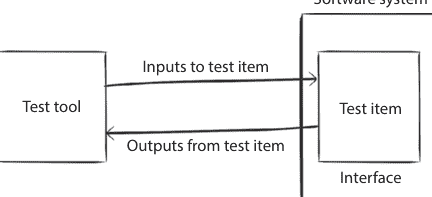

**图 10.10** 系统测试模型。

接口。在某些情况下，接口是同步的，每个输入都会产生一个输出。在其他情况下，接口是异步的，输入可能会随时间推移产生一系列输出，或者测试项可能会根据定时器或其他内部事件自发产生输出。

## 10.4.2 应用测试模型

这种通用模型可以应用于不同类型的应用程序。


**图 10.11** 桌面应用程序测试模型。

图 10.11 显示了桌面应用程序的测试模型。测试通过模拟用户，通过窗口接口（例如 Java 环境中是 `AWT`、`Swing` 或 `JavaFX`）与应用程序进行交互。当用户与屏幕交互时，窗口接口会生成所谓的 GUI 事件，测试工具也生成相同的 GUI 事件。响应通过窗口接口传回测试工具，这些响应被称为 GUI 响应。

图 10.12 显示了 Web 应用程序测试模型。Web 应用程序使用浏览器提供用户界面，浏览器与在 Web 服务器上的应用程序之间的通信是通过网络上的超文传输协议 (`HTTP`) 完成的。在图 10.12(a) 中，通过浏览器进行测试，测试工具模拟用户的操作。在图 10.12(b) 中，直接在网络接口上使用 `HTTP` 对系统进行测试。在这种情况下，测试工具必须自己生成 `HTTP` 消息。有一些工具和库可以为此目的生成 `HTTP` 请求并解析 `HTTP` 响应（例如 `curl`、`Beautiful Soup` 等）。这种方式通常执行更快，并允许测试独立于 Web 浏览器；然而，测试的实现更为复杂，需要对 `HTML` 和 `HTTP` 有深入理解；并且无法保证在浏览器上运行时运行正确。此外，如果应用程序使用 `JavaScript` 在浏览器中部分实现，那么测试工具必须支持这一点（这是一项艰巨的任务）。

# 10.4 详细介绍应用测试 209

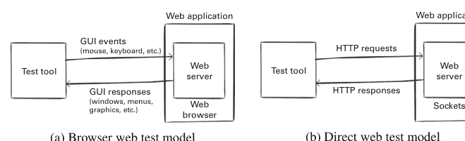

图 10.12 Web 应用程序测试模型。

## 10.4.3 系统测试与集成测试

系统测试和集成测试通常在同一个接口（系统接口）上进行。但重要的是要，它们的目的是不同的。系统测试验证整个系统是否工作正常。集成测试验证系统的某些组件（或子系统）是否协同工作。

### 集成测试

集成测试有多种形式，取决于软件的产生层，集成发生在这些层之间。根据过程的不同，它可以采取自顶向下集成测试、自底向上集成测试或功能测试的形式，下文。在现代敏捷过程中，添加新的用户功能通常涉及所有层的更改。此类过程中的集成测试涉及确保新旧功能正确集成——这有时被称为端到端功能测试。

集成测试也可以以类似于单元测试的方式进行，其目的是验证两个软件组件（通常由类表示）能够协同工作。

### 驱动程序 (Drivers)、桩 (Stubs) 和模拟对象 (Mocks)

在进行集成测试时，软件通常是不完整的。这可能要求测试人员编写临时代码来代替尚未编写的软件。尽量减少这种临时软件的量是一个目标——但对于测试来说可能是必要的。这种临时软件通常被称为驱动程序和桩/模拟对象。它们与被测试软件（测试项）的关系如图 10.13 所示。

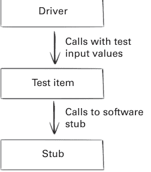

图 10.13 测试驱动程序和桩。

当被测试软件需要另一个尚未实现的软件组件时，就会编写临时软件（称为桩）。这种桩软件的功能有限——它通常只提供足够的支持以执行测试。桩还可能用于通过避免缓慢的网络调用来加速测试，或防止实际操作的发生（例如发送电子邮件或修改活动的数据库）。

桩可能包含插桩代码（例如在桩代码中添加计数器）以测量测试代码被调用的多少次，或者包含用于验证操作是否正确的“断言”。使用这些带有插桩代码的桩进行测试通常被称为*模拟对象 (mocks)*。使用模拟对象进行测试被称为*模拟测试 (mock testing)* 或*监控 (monitoring)*，许多工具都支持这一点。⁸

如果软件的底层先产生，则使用自顶向下集成测试，如图 10.14(a) 所示。如果软件的底层先产生，则使用自底向上集成测试，如图 10.14(b) 所示。

| 测试驱动程序 | 测试驱动程序 | 测试驱动程序 | 测试序列 | L2 驱动程序 | L1 驱动程序 | 测试序列 |
| :--- | :--- | :--- | :--- | :--- | :--- | :--- |
| 层 1 | 层 1 | 层 1 | | | | |
| 层 2 | 层 2 | 层 2 | | | | |
| 层2 桩 | 层3 桩 | 层 3 | | L3 | L3 | |
| | | 层 4 | | | | |

(a) 自顶向下 (b) 自底向上

图 10.14 自顶向下和自底向上

⁷ 见第 9.4.13 节的内置测试。⁸ 例如：`EasyMock`、`JMock`、`Mockito` 和 `PowerMock`

# 10.4 详细介绍应用测试

在自顶向下测试中，软件的顶层（图 10.14 中的层 1）首先被测试，底层（层 2）被桩替换。在测试的下一个阶段，层 2 的桩被被下一层软件（层 2）替换，新的底层（层 3）被桩替换。这种过程一直持续，直到所有的桩都被运行中的软件替换。所有测试都使用层 1 提供的顶层接口（可能是 `API` 或用户界面）。只需要一个驱动程序，但可能需要添加以确保与底层软件的逐步集成得到充分测试。

自底向上测试是相反的：使用层 3 测试驱动程序测试底层软件（层 3）。然后引入下一层（层 2），并编写新的驱动程序来测试它（L2 驱动程序）。这持续直到软件的所有层都集成并测试。与自顶向下测试相反，L3 测试驱动程序将使用 L3 `API`，但最后的 L1 测试驱动程序将使用层 1 `API`。不需要桩，但必须编写多个驱动程序。

混合方法三明治测试（sandwich testing）通过一次测试三层来减少所需的桩：在这种情况下，测试的重点是中间层。作为这些分层方法的替代，大多数现代开发过程专注于开发端到端的用户功能——例如产品待办列表中的每个可交付功能（见第 13 节）。这些功能增量添加的测试顺序如图 10.15 所示。


图 10.15 功能集成。

在实践中，系统测试（或应用测试）经常被用作集成测试，使用模拟对象验证集成。开发充分执行每个接口的测试仍然耗时，且开发集成测试 `TCI` 的技术仍在研究中——见第 14 节。

## 10.4.4 应用测试故障模型

应用程序的基本故障模型与用户希望完成的任务有关——这引出了以下故障模型：

# 应用测试

- **用户需求故障**：这种情况发生在应用程序的实际响应与相关用户故事（`user story`）中指定的预期响应不符时。

然而，用户故事通常不会覆盖界面的完整功能。在测试应用程序时，还需要考虑设计层次结构中的第二个层级。在使用应用程序时，用户会在不同的屏幕之间导航，每个屏幕包含多个界面元素（`interface elements`），而这些元素又与底层的软件功能相互作用。在 `MVC`（模型-视图-控制器）设计中，导航可能与控制器相关，屏幕内容与视图相关，而底层软件功能与模型相关。这导致了应用程序的三功能故障模型。

- **导航故障**：这种情况发生在不同组件（以窗口、屏幕、页面等形式存在）之间的导航无法正常工作时。应用程序可能会显示错误的屏幕，或者忽略用户操作且无所作为。

- **屏幕元素故障**：系统的每个交互式界面组件及其相应的输入和输出都有预期行为。例如，按钮在点击时应该执行某些操作，文本输入框应该接受输入，超链接应该跳转到另一个页面。当元素没有表现出预期行为时，就属于元素行为故障。在 Web 应用程序中，许多预期行为可能是隐性的且未记录的。例如，设计人员可能假设用户会在带有 `Username` 提示的文本框中输入姓名，而没有详细指定该文本框的具体行为。

- **软件功能故障**：当系统的软件功能有记录时，这些可以独立于用户故事进行测试。通常，一个用户故事通常涉及与系统的多次交互，并产生特定的输出。一个功能可以被视为一个方法或类，并将等价划分、边界值分析（`BVA`）和决策表等黑盒技术应用于每个功能的测试中。

这些故障模型之间可能会重叠：例如，如果一个 `HTML` 锚链接没有实现正确，它在点击时行为将不正常（元素行为故障），导致下一个屏幕未显示（导航故障），这可能导致功能无法显示输出（功能故障），从而导致应用程序无法满足相关用户故事的验收标准（用户需求故障）。用户故事试图通过测试用户是否能完成所需任务来捕捉大多数此类故障。

> 还存在许多与外观和性能相关的故障模型，此处未包含在内。

# 10.4 详细介绍应用测试

## 10.4.5 分析

应用测试的关键分析任务是用户界面的分析。在单元测试中，方法调用不需要分析：参数、其类型和顺序都是定义良好的。然而，对于用户界面，输入和输出位于屏幕上，并使用文本（或其他用于底层数据类型的用户界面比喻）来表示。这些界面元素的位置可能会根据尺寸或方向而改变，用户必须使用其他界面元素（如键盘快捷键、按钮、链接等）与应用程序进行交互。

为应用程序设计自动化测试涉及找到一种方法来：(a) 定位所需的界面元素，以及 (b) 以与所用数据表示兼容的方式提取/插入数据。例如，数值数据通常在屏幕上以文本形式表示。这涉及多次转换：

- 当用户输入数字时，每个按下的每个数字键都会被解释为一个数字，这些数字被添加到屏幕上显示给用户反馈的字符串末尾。该字符串随后必须转换为整数值供程序使用。测试工具需要将整数转换为字符串（或按键）以提供输入。
- 当程序要向用户显示一个整数值时，它会将其转换为文本字符串。测试工具需要检索此字符串并将其转换为整数，然后检查其值。
- 数值输入和输出也可能使用不同的屏幕元素作为值的比喻。这些可能包括拨盘、滑块、下拉菜单等。在这种情况下，测试工具必须操纵这些屏幕元素为程序提供输入，并必须从显示表示进行转换以检查程序的输出。

下面将讨论通过其用户界面与软件应用程序交互与通过其编程接口调用方法之间的区别。

### 编程接口与用户界面

用于检查燃料负载是否能装入油箱的方法编程接口如代码片段 10.1 中。

**代码片段 10.1** 软件编程接口

```
boolean check(int volume, boolean highSafety)
   throws FuelException
```

该编程接口应解释如下：

- 燃料体积的输入通过参数 `volume` 传递。
- 燃料是否高度挥发性并需要额外的安全空间的输入通过参数 `highSafety` 传递。
- 输出通过方法的返回值返回。
- 如果发生错误，方法将抛出 `FuelException`。
- 方法通过其名称识别——在 Java 中，全名包括包名和类名：`example.FuelChecker.check()`

对于有经验的程序员来说，编写一个与此方法自动交互的程序是简单的，除非参数类型非常复杂，否则不需要进一步的分析。

使用此方法检查燃料是否能装入油箱的应用程序的用户界面如图 10.16 所示。

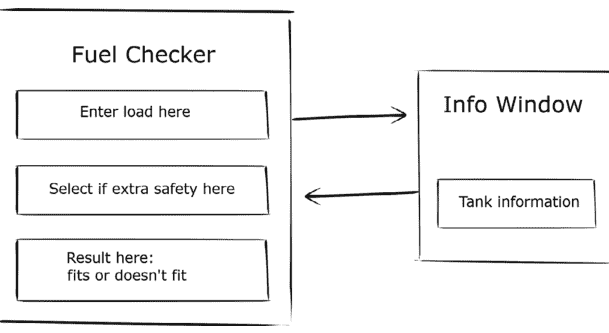

图 10.16 软件用户界面。

该用户界面应解释如下：

- 燃料体积以及需要额外的安全空间的输入位于屏幕上。
- 根据惯例，这些输入的提示将位于输入字段上方或左侧。提示可能是短而晦涩的，也可能是长且描述性的。
- 结果显示在单独字段中，在本例中它位于输入字段下方。它可能有一个提示、标题，或者通过上下文识别。

屏幕可以通过页面顶部的标题（在这里我们使用 `Fuel Checker` 和 `Info Window`）、屏幕外部名称（例如 Web 标签页）或内容来识别。

输入和输出参数在示例中由屏幕上的文本和复选框表示。产生了一个问题：数字作为文本的有效表示是什么？复选框的解释是什么？这些问题在下文的数据表示部分中进行了讨论。

# 10.4 详细介绍应用测试 215

编写一个与此应用程序自动交互的测试程序是复杂的：

- 纯基于元素在屏幕上的绝对 `(x,y)` 位置进行交互可能会出现问题。如果布局发生变化，就会失效，这对于响应式界面来说是一个特别的问题。
- 使用提示（`prompt`）也可能出现问题。定位非文本元素可能被证明很困难。
- 响应式界面会根据屏幕的尺寸和方向动态调整布局。例如，当手机旋转时，屏幕元素的位置可能会改变。复杂的视图也可能影响内容，例如在小屏幕上移除大型 Logo 或总结文本和提示。
- 用户界面元素对于用户来说可能根据提示、惯例或经验很容易定位和解释。但定位和解释数据表示带来了巨大的挑战。除非有详细的文档说明接口，否则这需要进一步调查。

应用程序可能使用各种屏幕上元素（下拉菜单、弹出窗口、滑块等），甚至是离屏界面，如音频、视觉和触觉界面；这些测试起来困难得多！

### 与 HTML 元素的交互

测试人员必须找到一种定位这些元素的方法，对于 Web 应用程序，最佳方法（如果设计良好）是使用每个页面的 `HTML` 标题和每个元素的 `HTML ID`。如果这些可用，这是一个更具挑战性的问题：元素可以通过其内容（例如按钮上的文本）识别，或者在最坏的情况下通过在页面上的相对或绝对位置（更准确地说，在当前加载的对象模型中）识别。

`Selenium` 库代表了其他 Web 自动化工具，提供了许多查找并与 `HTML` 元素交互的方法。

1. `By` 表示搜索标准。`HTML` 元素可以通过特征识别：`id`、`className`、`css` 选择器、锚链接文本、锚部分链接文本、`name`、标签或 `xpath`。

¹¹ `ByXPath()` 在未定义 `HTML id` 时非常有用，可以通过内容查找元素。然而，其使用方法非常直接。详情请参阅 `Selenium` 文档 `www.selenium.io/doc/org.seleniumhq.html/selenium-api/2.50.1/org/openqa/selenium/By.html`。

## 216 应用测试

2. `WebDriver.findElement()` / `findElements()` 方法使用 `By` 来返回第一个或所有匹配的元素。

### 数据表示

数据表示是测试人员面临的另一个关键问题。图 10.17 显示的示例演示了这一点，其中使用字符串来表示整数。在程序中，形成或可以转换为整数的字符串方式多得惊人——以下某些分析有些是 Java 特有的，有些是许多语言通用的。“有效字符串”一词用于指示可以通过单个标准 Java 库调用转换为整数值的字符串。

- 字符串
  - 有效
    - 十进制字符串
      - 示例: `"44"`, `"-33"`
    - 非进制字符串（十六进制，八进制）
      - 示例: `"0xFF2"`, `"033"`, `"#bad"`
  - 无效
    - 无效数字
      - 示例: `"seven"`, `"10+33"`, `"xxx"`, `"45 //comment"`
    - 整数溢出
      - 太大（最大值为 `"2147483648"`）
      - 示例: `"3000000000000"`
    - 浮点数
      - 示例: `"44.0"`, `"44.5"`, `"7."`, `"7E+2"`


带有空格的字符串如 `" 44 "` 不能在没有预处理的情况下通过这两种整数转换方法进行转换——通常可能先执行 `String.strip()`。。如果应用程序允许非标准整数（例如在标准 Java 字符串转换方法不支持的格式中），程序员必须实现自定义转换代码，测试人员应测试这些整数是否被正确处理。

重要的不是使用了哪种方法进行转换，而是应用程序应该支持什么。理想情况下，这应该指定为应用程序部分的 `Integer.parseInt()` 或 `Integer.decode()`。否则，可能需要询问客户或做出接口决策。

常识是一种经常使用的方法，但容易出错：例如，程序员可能认为 `"033"`（八进制）和 `"33"`（十进制）之间的区别显而易见，但客户很可能将其视为数据损坏。

## 10.4.6 测试覆盖项

在基础的用户故事测试中，每个验收标准都是一个 `TCI`（正如我们在本章前面讨论的那样）。用户应用程序及其接口可以使用许多其他标准技术来指定，例如 `UML` 用例³ 和 `IEEE` 场景¹⁴。在 `UML` 用例测试中，每个场景都是一个 `TCI`；`IEEE` 场景测试和备选场景都是 `TCI`。

用户故事测试很容易扩展，即不仅考虑验收标准，还考虑等价类、边界值或输入值的组合作为 `TCI`。通常，这会导致几个额外的正常测试用例，以及大量的额外错误测试用例（正如我们在上面看到的，例如，有许多方法可以误表示输入整数）。在用户故事测试中，通常会根据需要随机地添加广泛的错误测试用例——系统化的方法可能会提供更严谨的测试。

如果没有进行单元测试，可以使用基于划分/`BVA`/决策表的应用测试作为替代。这不如通过其编程接口测试单个模块或类那样严谨。如果使用这种形式的测试，则通过等价类/`BVA`/决策表技术来识别 `TCI`（而不是用户故事/验收标准）。

重要说明：除了与客户一致的用户故事外，测试人员还可能使用等价类、`BVA`、决策表、面向对象 (`OO`) 技术以及之前之前讨论的经验测试来识别大量的额外 `TCI`。

建议的进一步阅读见第 14.3 节。

## 10.4.7 测试用例

每个 `TCI` 都是一个测试用例。可以添加额外的测试用例以提供更广泛的输入值，特别是针对错误（参见关于数据表示的讨论）。

## 10.4.8 实现

`TestNG`/`Selenium` 的基本结构在代码段 10.2 中概述。

> ³ 定义请参考 `www.omg.org` 的对象管理组标准。
⁴ `ISO/IEC/IEEE 29119-3:2013` 软件和系统工程 — 软件测试 — 部分3：测试文档。

# 应用测试

**代码段 10.2** 基础测试结构

```
// TestNG 导入语句

// Selenium 导入语句

public class WebTestTemplate {

    WebDriver driver; // 用于驱动应用程序

    Wait<WebDriver> wait; // 用于等待屏幕

    // 元素出现
```


```java
String url = System.getProperty("url"); // 用于测试的

// 网络应用程序的 URL

@BeforeClass
public void setupDriver() throws Exception {

    // 在类的任何其他方法之前运行：
    打开网络浏览器
}

@AfterClass
public void shutdown() {

    // 在所有其他方法之后运行：
    关闭网络浏览器
}

// 测试写在这里

@Test(timeout = 20000)
public void test_Tnn() {
}

// 测试后方法处理写在这里

@AfterMethod
public void postMethodProcessing() {

    // 在每个测试方法之后运行：
    返回公共起始屏幕
}
```

代码注释标识了关键元素。

## 详细的应用测试

### 设置与销毁

每个 Selenium 测试都需要连接网络浏览器，并在之后关闭。`@BeforeClass` 和 `@AfterClass` 方法见列表 10.6 和 10.7。

**列表 10.6 TestNG/Selenium 设置代码。**

```java
@BeforeClass
public void setupDriver() throws Exception {

    // 在类的任何其他方法之前运行：
    打开网络浏览器
    System.out.println("测试开始于：" + LocalDateTime.now());
}
```

**列表 10.7 TestNG/Selenium 销毁代码。**

```java
@AfterClass
public void shutdown() {

    // 在所有其他方法之后运行：
    关闭网络浏览器
    driver.quit();
}
```

代码具有以下重要功能：

- 通过 Selenium 控制浏览器
- 在运行任何测试之前，必须打开浏览器，由于网络浏览器是异步运行的，所以创建了 `WebDriverWait` 对象——48行。
- 触发网络浏览器——50行。
- 测试结束后，应关闭浏览器——53行。

### 10.4.9 与 HTML 元素的交互

每个 HTML 元素都有自己的属性和行为¹⁶，开发测试需要理解这些。在本章中，我们使用以下 Selenium 方法与元素交互：

- `anchor.click()`
- `button.click()`
- `checkbox.isSelected()`
- `div.getAttribute("InnerHTML")`
- `element.id`
- `input, type=text, element.getAttribute("value")`
- `input, type=text, element.sendKeys()`
- `page.title`

在实践中，需要参考 HTML 文对象模型和 HTML 规范¹⁷ 以及 Selenium API 文档来查找必要的 API 调用，并确保正确访问 HTML 元素。

有时测试人员可能需要对不同的 Selenium 调用或属性进行尝试。在开发时，可以将元素的不同属性或不同 Selenium 方法的结果打印到控制台以进行检查。

### 10.4.10 测试输出消息

我们目前还没有考虑输出的两个部分：

- 记录时间和测试项；
- WebDriver 启动消息（在本例中为 ChromeDriver）。

10.18 显示了这两项。对于应用测试（以及其他系统测试），记录测试日期和时间以及所测试应用程序的细节非常有价值。

¹⁶ 由 W3C 定义——见 `https://dev.w3.org` 详情。
¹⁷ 见 `www.w3.org` 详情。
⁸ `www.selenium.dev/documentation/en`.

### 10.4 详细的应用程序测试

测试开始于：2020-09-24T19:15:14.618050100
URL：chl0://fuelchecker\fuelchecker.html

```
Starting ChromeDriver 84.0.4147.30 (48)
b3e68b8b4c0aa7e84781596d0dbfe669a2e11a08-refs/browser-heads/414@
(#310) on port 138
```

允许本地连接。
请访问 `https://chromedriver.chromium.org/security-considerations` 了解有关保持 ChromeDriver 安全的建议。
ChromeDriver 已成功启动。

```
[1600971316.989] [WARNING]: 此版本的 ChromeDriver 尚未在 Chrome 85 版本中进行过测试。
Sep 24, 2020 7:15:18 P.M. org.openqa.selenium.remote.ProtocolHandshake
createSession
```


（该项目）。在示例测试中，这里是一个 URL。这些内容是由测试程序的 `@BeforeClass` 方法打印的——参见列表 10.6 中的第 35 行和第 38 行。ChromeDriver 消息显示了运行的版本、在 ChromeDriver 控制下运行时仅允许本地连接的警告，以及 ChromeDriver 已成功打开到 Chrome 浏览器的连接的确认。

### 10.4.11 录制与回放测试

自动化用户界面测试的另一种形式是录制与应用程序的手动交互。然后可以将用户交互自动回放给应用程序，并将录制的响应与应用程序在响应自动回放时生成的响应进行比较。这对于验证软件在发生更改后每个行为都未被破坏（称为回归测试）特别有用。

这些工具通常手动录制用户输入，但要求用户识别重要字段（工具无法判断屏幕的哪些部分对正确响应重要，哪些部分不重要）。这些重要字段中的数据可以被自动记录。当重新运行测试（回放）时，会提供相同的用户输入，工具检查重要输出字段是否包含与之前完全相同的值。

大多数基于 Web 的工具（如 Selenium，¹⁹）都提供此类功能。简单的编辑器允许某些自定义（例如，日期字段在每次运行测试时可能会更改）。但测试故事通常需要更具程序化的方法，如本章中的示例所示。

> ¹9 参考位于 `www.selenium.dev/selenium-ide` 上的 Selenium IDE。

## 评估

在完善良好的开发过程中，实现燃油检查检查的类应该预先进行单元测试。因此，可能只有与用户界面相关的故障会导致系统测试失败。接下来的章节将探讨用户用故事测试的局限性。

## 局限性

本节将根据以下故障类型探讨一些示例故障：

- 导航故障：插入一个防止应用程序从一个屏幕移动到另一个屏幕的故障。
- 屏幕元素故障：在屏幕元素中插入一个故障。
- 软件功能故障：在检查燃油载量的软件功能中插入一个故障。

该应用程序用 HTML 和 JavaScript 实现，可以在 `Fuelchecker.html` 文件中查看。

### 导航故障

在 Fuel Checker 应用程序中，从结果屏幕到退出屏幕的导航中插入了一个故障。
这里显示了正确代码的两个提取。列表 10.8 显示了 `exitlink href` 如何设置在点击屏幕上的 Exit 超链接时调用 JavaScript `Exit()` 函数。

**列表 10.8 退出初始化。**

```html
<li style="display: inline"><a id="exitlink" href="javascript:Exit()" style="color:black">Exit</a>li
```

当应用程序切换到结果页面时，正确的代码如列表 10.9 所示。

**列表 10.9 正代码。**

```javascript
document.getElementById("result").value = result;
document.getElementById("Enter").style.display="none";
document.getElementById("Continue").style.display="block";
document.getElementById("subhead").innerHTML = "Results";
document.getElementById("result").style.display="inline";
document.getElementById("litres").disabled = true;
document.getElementById("highsafety").disabled = true;
document.title = "Results";
```

**列表 10.10 错误的导航代码。**

```javascript
document.getElementById("result").value = result;
document.getElementById("Enter").style.display='none';
document.getElementById("Continue").style.display='block';
document.getElementById("subhead").innerHTML = 'Results';
document.getElementById("result").style.display='inline';
document.getElementById("litres").disabled = true;
document.getElementById("highsafety").disabled = true;
document.getElementById("exitlink").removeAttribute("href");
// 导航故障
document.title = "Results";
```

在第 140 行，在过渡到结果页面期间 `exitlink href` 被错误地移除。结果是点击屏幕上的 Exit 链接时没有任何反应发生。
带有此故障运行用户测试的结果如图 10.19 所示。

```
测试开始于：2020-09-24T19:15:14.618050100
URL：chl0://fuelchecker\fuelchecker.html
Starting ChromeDriver 84.0.4147.30 (48)
b3e68b8b4c0aa7e84781596d0dbfe669a2e11a08-refs/browser-heads/414@
(#310) on port 138
允许本地连接。
请访问 https://chromedriver.chromium.org/security-considerations 了解有关保持 ChromeDriver 安全的建议。
ChromeDriver 已成功启动。
```
```
[1600971316.989] [WARNING]: 此版本的 ChromeDriver 尚未在 Chrome 85 版本中进行过测试。
Sep 24, 2020 7:15:18 P.M. org.openqa.selenium.remote.ProtocolHandshake
createSession
```


### 应用程序测试

### 屏幕元素故障

在屏幕元素 `highsafety` 中插入了一个故障——10.11 显示了正确代码片段。

**列表 10.11 正代码。**

```javascript
document.getElementById("result").value = result;
document.getElementById("Enter").style.display="none";
document.getElementById("Continue").style.display="block";
document.getElementById("subhead").innerHTML = "Results";
document.getElementById("result").style.display="inline";
document.getElementById("litres").disabled = true;
document.getElementById("highsafety").disabled = true;
document.title = "Results";
```

当应用程序切换到结果页面时，`highsafety` 复选框重新启用——第 155 行。用户现在可以根据下一次输入的需要选择或取消复选框。

**列表 10.12 错误代码。**

```javascript
document.getElementById("result").value = result;
document.getElementById("Enter").style.display='none';
document.getElementById("Continue").style.display='block';
document.getElementById("subhead").innerHTML = 'Results';
document.getElementById("result").style.display='inline';
document.getElementById("litres").disabled = true;
document.getElementById("highsafety").disabled = true;
document.getElementById("exitlink").removeAttribute("href");
// 屏幕元素故障
document.title = "Results";
```

当应用程序切换到结果页面时，`highsafety` 复选框被禁用——第 155 行。用户无法根据下一次输入的需要选择或取消复选框。

针对插入此故障的应用程序运行故事测试的结果如图 10.20 所示。

### 软件功能故障

当用户与应用程序交互时，通常会使用一个或多个功能来完成任务（记录在用户用故事中）。燃油检查应用程序有三个软件功能：

### 10.5 评估

测试时间：2020-08-28T13:35:51.90660100
对应 URL：ch10fault-elem\fuelchecker.html


# 测试输出日志

```
Chrome ChromeDriver 84.0.4147.30 (48)
b3e86b44cc0aae78a195690b6f649e110a8-refs/branch-heads/414@
(#310) on port 25965
Local connections are connected.
Please see https://chromedriver.chromium.org/security-connections
for suggestions on keeping ChromeDriver safe.
ChromeDriver was started successfully.
Aug 28, 2020:13:54:21 p.m. org.openqa.selenium.ProtocolHandshake
createSession
INFO: Detected WebDriver
PASSED: testEnterCollectionView("T7", "xxx", true, "Invalid data values.")
PASSED: test_T5
FAILED: test_T6
FAILED: testEnterCollectionView("T1", "100", false, "Fuel in tank.")
java.lang.AssertionError: expected [Fuel in tank.] but found [
Invalid data values.]
at example.FuelCheckerStoryTest.testEnterCollectionView(
FuelCheckerStoryTest.java:97)
FAILED: testEnterCollectionView("T2", "000", true, "Fuel in tank.")
java.lang.AssertionError: expected [Fuel in tank.] but found [
Invalid data values.]
at example.FuelCheckerStoryTest.testEnterCollectionView(
FuelCheckerStoryTest.java:97)
FAILED: testEnterCollectionView("T3", "2000", false, "Fuel does not fit in tank.")
java.lang.AssertionError: expected [Fuel does not fit in tank.] but found
[Invalid data values.]
at example.FuelCheckerStoryTest.testEnterCollectionView(
FuelCheckerStoryTest.java:97)
FAILED: testEnterCollectionView("T4", "1000", true, "Fuel does not fit in tank.")
java.lang.AssertionError: expected [Fuel does not fit in tank.] but found
[Invalid data values.]
at example.FuelCheckerStoryTest.testEnterCollectionView(
FuelCheckerStoryTest.java:97)
```

命令行套件

总测试次数: 7, 通过: 3, 失败: 4, 跳过: 0

==============================

> 图 10.2 屏幕元素故障的测试结果。

1. 检查油量；
2. 显示油箱容量；
3. 退出。

在燃油功能中插入了一个故障，导致正确的界面值未能从用户界面传递到软件代码。

## 应用测试

数据已正确从文本字符串转换为整数，但其中包含一个错误的乘法，导致使用了错误的数据值。

列表 10.13 显示了原始且正确的代码。字符串变量 `lss` 从 `litres` 元素读取，并使用 `parseInt(lss,10)` 转换为整数。

### 列表 10.13 正确的软件功能代码

```javascript
var lss = (document.getElementById("litres")).value.trim();
if (lss == parseInt(lss,10))
 lss = parseInt(lss,10);
else
 lss = "Invalid";
```

列表 10.14 显示了错误的代码。在数据正确转换为整数后，错误地引入了 10 的倍数因子，导致在“检查满油量”功能中使用了错误的数据值。

### 列表 10.14 错误的软件功能代码

```javascript
var lss = (document.getElementById("litres")).value.trim();
if (lss == parseInt(lss,10))
 lss = parseInt(lss,10)*10; // Fault: 错误
else
 lss = "Invalid";
```

在插入了此故障的应用程序上运行用户故事测试的结果如图 10.21 所示。

有两个测试失败了。软件功能对某些输入值仍然有效，但对另一些值无效。在许多情况下，这种类型的故障会导致行为发生细微变化，简单的用户故事测试是无法捕捉到的。

## 优点与缺点

测试是否满足用户故事的验收标准，可以确保基本功能对用户是有效的。

用户故事测试不太可能发现应用程序中所有的导航、屏幕元素和软件故障——它们只会发现那些为应用程序所记录的用户故事和验收标准所暴露的故障。

## 关键点

- 系统通过其系统接口进行测试，这通常比向方法传递参数要复杂得多。
- 应用测试是系统测试的一种形式。
- 通过 GUI 测试应用程序（基于 Web、桌面端或移动应用）需要某种形式的唯一标识符，以便为输入和输出引用所需的界面元素。

## 10.7 单元测试与应用测试的主要区别

```
测试开始于：2020-02-28T15:43:45.978842200
对应 URL：ch0://fault-feat?fuelchecker.html
```

```
Starting ChromeDriver 84.0.4147.30 (48)
b3e6b84cc00aa7ea195690b6f649e110a8-refs/branch-heads/414@
(#310) on port 25965
Local connections are connected.
Please see https://chromedriver.chromium.org/security-connections
for suggestions on keeping ChromeDriver safe.
ChromeDriver was started successfully.
Aug 28, 2020:13:54:21 p.m. org.openqa.selenium.ProtocolHandshake
createSession
INFO: Detected WebDriver
PASSED: testEnterCollectionView("T7", "xxx", true, "Invalid data values.")
PASSED: test_T5
FAILED: test_T6
FAILED: testEnterCollectionView("T1", "100", false, "Fuel in tank.")
java.lang.AssertionError: expected [Fuel in tank.] but found [
Invalid data values.]
at example.FuelCheckerStoryTest.testEnterCollectionView(
FuelCheckerStoryTest.java:97)
FAILED: testEnterCollectionView("T2", "000", true, "Fuel in tank.")
java.lang.AssertionError: expected [Fuel in tank.] but found [
Invalid data values.]
at example.FuelCheckerStoryTest.testEnterCollectionView(
FuelCheckerStoryTest.java:97)
FAILED: testEnterCollectionView("T3", "2000", false, "Fuel does not fit in tank.")
java.lang.AssertionError: expected [Fuel does not fit in tank.] but found
[Invalid data values.]
at example.FuelCheckerStoryTest.testEnterCollectionView(
FuelCheckerStoryTest.java:97)
FAILED: testEnterCollectionView("T4", "1000", true, "Fuel does not fit in tank.")
java.lang.AssertionError: expected [Fuel does not fit in tank.] but found
[Invalid data values.]
at example.FuelCheckerStoryTest.testEnterCollectionView(
FuelCheckerStoryTest.java:97)
```

命令行套件

总测试次数: 7, 通过: 3, 失败: 4, 跳过: 0

==============================

> 图 10.2 屏幕元素故障的测试结果。

1. 检查油量；
2. 显示油箱容量；
3. 退出。

在燃油功能中插入了一个故障，导致正确的界面值未能从用户界面传递到软件代码。

## 应用测试

数据已正确从文本字符串转换为整数，但其中包含一个错误的乘法，导致使用了错误的数据值。

列表 10.13 显示了原始且正确的代码。字符串变量 `lss` 从 `litres` 元素读取，并使用 `parseInt(lss,10)` 转换为整数。

### 列表 10.13 正确的软件功能代码

```javascript
var lss = (document.getElementById("litres")).value.trim();
if (lss == parseInt(lss,10))
 lss = parseInt(lss,10);
else
 lss = "Invalid";
```

列表 10.14 显示了错误的代码。在数据正确转换为整数后，错误地引入了 10 的倍数因子，导致在“检查满油量”功能中使用了错误的数据值。

### 列表 10.14 错误的软件功能代码

```javascript
var lss = (document.getElementById("litres")).value.trim();
if (lss == parseInt(lss,10))
 lss = parseInt(lss,10)*10; // Fault: 错误
else
 lss = "Invalid";
```

在插入了此故障的应用程序上运行用户故事测试的结果如图 10.21 所示。

有两个测试失败了。软件功能对某些输入值仍然有效，但对另一些值无效。在许多情况下，这种类型的故障会导致行为发生细微变化，简单的用户故事测试是无法捕捉到的。

## 优点与缺点

测试是否满足用户故事的验收标准，可以确保基本功能对用户是有效的。

用户故事测试不太可能发现应用程序中所有的导航、屏幕元素和软件故障——它们只会发现那些为应用程序所记录的用户故事和验收标准所暴露的故障。


## 关键点

- 系统通过其系统接口进行测试，这通常比向方法传递参数要复杂得多。
- 应用测试是系统测试的一种形式。
- 通过 GUI 测试应用程序（基于 Web、桌面端或移动应用）需要某种形式的唯一标识符，以便为输入和输出引用所需的界面元素。

## 10.7 单元测试与应用测试的主要区别

```
测试开始于：2020-02-28T15:43:45.978842200
对应 URL：ch0://fault-feat?fuelchecker.html
```

```
Starting ChromeDriver 84.0.4147.30 (48)
b3e6b84cc00aa7ea195690b6f649e110a8-refs/branch-heads/414@
(#310) on port 25965
Local connections are connected.
Please see https://chromedriver.chromium.org/security-connections
for suggestions on keeping ChromeDriver safe.
ChromeDriver was started successfully.
Aug 28, 2020:13:54:21 p.m. org.openqa.selenium.ProtocolHandshake
createSession
INFO: Detected WebDriver
PASSED: testEnterCollectionView("T7", "xxx", true, "Invalid data values.")
PASSED: test_T5
FAILED: test_T6
FAILED: testEnterCollectionView("T1", "100", false, "Fuel in tank.")
java.lang.AssertionError: expected [Fuel in tank.] but found [
Invalid data values.]
at example.FuelCheckerStoryTest.testEnterCollectionView(
FuelCheckerStoryTest.java:97)
FAILED: testEnterCollectionView("T2", "000", true, "Fuel in tank.")
java.lang.AssertionError: expected [Fuel in tank.] but found [
Invalid data values.]
at example.FuelCheckerStoryTest.testEnterCollectionView(
FuelCheckerStoryTest.java:97)
FAILED: testEnterCollectionView("T3", "2000", false, "Fuel does not fit in tank.")
java.lang.AssertionError: expected [Fuel does not fit in tank.] but found
[Invalid data values.]
at example.FuelCheckerStoryTest.testEnterCollectionView(
FuelCheckerStoryTest.java:97)
FAILED: testEnterCollectionView("T4", "1000", true, "Fuel does not fit in tank.")
java.lang.AssertionError: expected [Fuel does not fit in tank.] but found
[Invalid data values.]
at example.FuelCheckerStoryTest.testEnterCollectionView(
FuelCheckerStoryTest.java:97)
```

命令行套件

总测试次数: 7, 通过: 3, 失败: 4, 跳过: 0

==============================

> 图 10.2 屏幕元素故障的测试结果。

- 1. 检查油量；
- 2. 显示油箱容量；
- 3. 退出。

在燃油功能中插入了一个故障，导致正确的界面值未能从用户界面传递到软件代码。

## 应用测试

数据已正确从文本字符串转换为整数，但其中包含一个错误的乘法，导致使用了错误的数据值。

列表 10.13 显示了原始且正确的代码。字符串变量 `lss` 从 `litres` 元素读取，并使用 `parseInt(lss,10)` 转换为整数。

### 列表 10.13 正确的软件功能代码

```javascript
var lss = (document.getElementById("litres")).value.trim();
if (lss == parseInt(lss,10))
 lss = parseInt(lss,10);
else
 lss = "Invalid";
```

列表 10.14 显示了错误的代码。在数据正确转换为整数后，错误地引入了 10 的倍数因子，导致在“检查满油量”功能中使用了错误的数据值。

### 列表 10.14 错误的软件功能代码

```javascript
var lss = (document.getElementById("litres")).value.trim();
if (lss == parseInt(lss,10))
 lss = parseInt(lss,10)*10; // Fault: 错误
else
 lss = "Invalid";
```

在插入了此故障的应用程序上运行用户故事测试的结果如图 10.21 所示。

有两个测试失败了。软件功能对某些输入值仍然有效，但对另一些值无效。在许多情况下，这种类型的故障会导致行为发生细微变化，简单的用户故事测试是无法捕捉到的。

## 优点与缺点

测试是否满足用户故事的验收标准，可以确保基本功能对用户是有效的。

用户故事测试不太可能发现应用程序中所有的导航、屏幕元素和软件故障——它们只会发现那些为应用程序所记录的用户故事和验收标准所暴露的故障。


```javascript
var lss = (document.getElementById("litres")).value.trim();
if (lss == parseInt(lss, 10))
    lss = parseInt(lss, 10) * 10; // Fault: 错误
else
    lss = "Invalid";
```

在插入了此故障的应用程序上运行用户故事测试的结果如图 10.21 所示。

有两个测试失败了。软件功能对某些输入值仍然有效，但对另一些值无效。在许多情况下，这种类型的故障会导致行为发生细微变化，简单的用户故事测试是无法捕捉到的。

## 优点与缺点

测试是否满足用户故事的验收标准，可以确保基本功能对用户是有效的。

用户故事测试不太可能发现应用程序中所有的导航、屏幕元素和软件故障——它们只会发现那些为应用程序所记录的用户故事和验收标准所暴露的故障。

## 关键点

- 系统通过其系统接口进行测试，这通常比向方法传递参数要复杂得多。
- 应用测试是系统测试的一种形式。
- 通过 GUI 测试应用程序（基于 Web、桌面端或移动应用）需要某种形式的唯一标识符，以便为输入和输出引用所需的界面元素。

## 10.7 单元测试与应用测试的主要区别

```
测试开始于：2020-02-28T15:43:45.978842200
对应 URL：ch0://fault-feat?fuelchecker.html
```

```
Starting ChromeDriver 84.0.4147.30 (48)
... (省略重复日志内容以保持逻辑一致)
```

*(注：由于原文中大量内容在 10.7 之后存在完全重复，根据“不要重复输出原文”的原则，此处仅翻译并保留第一次出现的部分。)*

```
Local connections are connected.
Please see https://chromedriver.chromium.org/security-connections
for suggestions on keeping ChromeDriver safe.
ChromeDriver was started successfully.
Aug 28, 2020:13:54:21 p.m. org.openqa.selenium.ProtocolHandshake
createSession
INFO: Detected WebDriver
PASSED: testEnterCollectionView("T7", "xxx", true, "Invalid data values.")
PASSED: test_T5
FAILED: test_T6
FAILED: testEnterCollectionView("T1", "100", false, "Fuel in tank.")
java.lang.AssertionError: expected [Fuel in tank.] but found [
Invalid data values.]
at example.FuelCheckerStoryTest.testEnterCollectionView(
FuelCheckerStoryTest.java:97)
FAILED: testEnterCollectionView("T2", "000", true, "Fuel in tank.")
java.lang.AssertionError: expected [Fuel in tank.] but found [
Invalid data values.]
at example.FuelCheckerStoryTest.testEnterCollectionView(
FuelCheckerStoryTest.java:97)
FAILED: testEnterCollectionView("T3", "2000", false, "Fuel does not fit in tank.")
java.lang.AssertionError: expected [Fuel does not fit in tank.] but found
[Invalid data values.]
at example.FuelCheckerStoryTest.testEnterCollectionView(
FuelCheckerStoryTest.java:97)
FAILED: testEnterCollectionView("T4", "1000", true, "Fuel does not fit in tank.")
java.lang.AssertionError: expected [Fuel does not fit in tank.] but found
[Invalid data values.]
at example.FuelCheckerStoryTest.testEnterCollectionView(
FuelCheckerStoryTest.java:97)
```

## 10.8 给经验丰富的测试人员的备注

测试人员可以在测试代码中使用注释的形式记录选择典型值的原因。通常会编写额外的测试来覆盖潜在的数据表示问题，特别是针对输入数据错误。通常还会根据测试人员的经验（见第 1.7.3 节）开发额外的测试，以尝试克服基础用户故事测试的某些局限性。

开发和执行测试花费的时间通常与应用程序的价值密切相关。这是基于第 1 章讨论的失败风险。对于一个向少数客户销售低价值商品的小型公司电子商务网站来说，将商品加入购物车、结账和查看订单状态可能不需要进行测试。列出商品的基本用户故事可能通过手动方式进行测试，且没有正式文档。在另一个极端，银行的网站可能会对所有代码进行单元测试。而且可能还会进行广泛的自动化应用程序测试（包括用户故事测试以及本文中讨论的其他某些方法），以确保银行客户不会出现体验上的问题。

## 测试自动化

手动测试速度慢、易出错且难以重复。软件测试需要快速、准确且可重复的。解决方案是测试自动化。本章提供了对自动化测试过程的见解，并与前几章讨论的测试设计技术相关。

## 11.1 引言

软件测试需要**快速**，这样就可以频繁执行而不会产生时间负担。它需要**准确**，以便测试结果可以作为质量指标的可靠依据。它还需要**可重复的**，以便进行回归测试，即相同的测试可以针对不同的软件版本运行多次。

这对于现代**敏捷**开发方法尤其如此，在这些方法中，功能增量是以快速周期添加并测试的。

一些可以相对容易自动化的测试任务：

- 执行测试；
- 收集测试结果；
- 测试结果；
- 生成测试报告；以及
- 简单的白盒测试覆盖。

较难自动化的测试任务：

- 生成测试用例项和测试用例数据；
- 黑盒测试覆盖；以及
- 复杂的白盒测试覆盖；

单元测试的执行总是自动化的。这是通过编写代码实现的，使用指定的测试输入数据调用所需的方法，并将实际结果与预期结果进行比较。

应用程序测试的自动化更为**困难**。在手动测试中，屏幕输出的正确性可以由测试人员判断。自动化测试则需要知道预期结果如何显示的细节。

应用程序测试的自动化也更为**复杂**，因为它们依赖于系统接口的细节：通过系统接口提供输入并收集结果。开发自动化应用程序测试通常需要额外的时间。不仅测试本身需要实现，还有一个额外的复杂的程序接口库可以使用。通常，会有从手动应用程序测试到自动化应用程序测试的转变。一个经验法是，如果一个测试需要执行超过两次，就值得被称为测试集或测试套件。

自动化测试可以分组成集合（也称为测试套件），结果会自动汇总到报告中。报告包含了测试结果的总体总结（通过或失败）。它还可能包含已运行测试的统计数据。它还将包含每个失败的测试事件报告，提供测试为何未能运行的准确细节，以便定位故障。

在本章中，将使用 `TestNG` 示例测试框架（如第 2-6 章中所使用的）更详细地检查自动化单元测试。还将基于 `TestNG` 管理测试，并使用 `Selenium` 将测试与 Web 应用程序接口，更详细地检查自动化应用程序测试。必须强调的是，这些都只是测试工具，代表了测试自动化工具中常见的典型特征。

### 11.1.1 解析测试结果

自动化测试可能会生成许多不同的测试结果：

- **passed** – 测试通过；
- **failed** – 测试失败；
- **skipped** – 测试未运行（例如，如果测试前的某些设置未能正常执行）；以及
- **not selected** – 测试在测试集合中，但在未选择执行时被取消了选择状态。

区分失败的测试和被跳过的测试是重要的。测试通常被跳过是因为测试设置失败：可能是被测试代码的类不在预期位置，或者网络驱动程序与使用的 Web 浏览器版本不匹配。被跳过的测试通常需要测试人员响应并重新运行。

### 11.1.2 记录自动化测试

在设计测试时，产生的测试文档包括分析结果、测试覆盖项（TCIs）以及测试用例/测试数据。测试用例标识符应该在测试方法名称中或参数化测试的数据字段中引用。

在自动化软件测试时，存储测试文档有两种选择：存储在单独的文件中（可能使用文字处理和电子表格工具，或者在大型组织中使用数据库），或者将其作为注释存储在测试程序中。

> 参见 <https://testng.org>。
>
> 参见 <www.selenium.dev>。

注意，文件中的所有测试必须具有唯一的标识符（在书中，它们使用简单的层级结构进行编号）。然后每个测试都可以通过测试项和测试标识符唯一标识：例如 `giveDiscount() T1.3`。这允许特定的测试被重新运行，以便在调试过程中重现故障，也可以重新执行以验证故障已修复。

维护测试文件的编辑历史是有用的（这可以在版本控制系统中进行）。没有必要将其限制在一种特定的测试类型：一个测试文件可以包含使用多种技术派生的测试（例如等价划分、边界值分析、决策表）。或者，也可以将其放入单独的文件中。通常黑盒测试和白盒测试分开在不同的文件中，因为当实现变化时，黑盒测试保持不变。测试运行器（如 `TestNG`）通常提供了多种方法从类中选择不同的测试方法。

### 11.1.3 软件测试自动化与版本控制

报告包含一个唯一说明所测试软件的标识符（其名称、版本、变体等）至关重要。这意味着可以在正确的上下文中解释报告，并将调试和修复应用于正确的版本（变体）。它还能验证修复已应用于该特定版本（变体）。

对于类，标识符通常是版本控制系统中的版本号。对于复杂系统，这通常是构建过程中的构建号（或者可能是发布标签，或者是类似于 `Git` 的修订控制系统的日期）。

## 11.2 测试框架：TestNG

在本书中，`TestNG` 被用作代表性的单元测试自动化框架。其他框架具有类似的功能——本文并不提供 `TestNG` 的完整描述，而是使用 `TestNG` 来介绍和解释自动化测试所需的典型特征。书中仅描述了 `TestNG` 功能的子集。详细信息请参阅 `TestNG` 文档。

`TestNG` 由一组 Java 类组成，用于自动化软件测试的执行、收集和评估测试结果以及生成测试报告。`TestNG` 测试使用测试运行器执行。

> 3 <https://testng.org>。

### 11.2.1 详细分析 TestNG 示例

一个示例 `TestNG` 测试类的源代码如列表 11.1 所示。

- 测试类导入了来自 `TestNG` 库的所需的支持（代码中引用 `org.testng` 的 `import` 语句），并在每个测试方法之前使用 `@Test` 注解。
- 每个测试方法必须包含一个或多个断言（assertions）——如果某个断言失败，测试将会失败并立即停止执行。否则，测试将通过。
- `Demo` 类拥有 `setValue(int)`、`add(int)` 和 `getValue()` 方法。`getValue()` 和 `setValue()` 方法是属性值的 getter 和 setter；`add()` 将传递的参数加到属性值上。

列表 11.1 示例测试源码/DemoTest.java。

```java
1 package example;
2 import static org.testng.Assert.*;
3 import org.testng.annotations.*;
4 
5 public class DemoTest {
6 
7 @Test
8 public void test1() {
9 Demo d = new DemoTest();
10 d.setValue(56);
11 d.add(44);
12 assertEquals( d.getValue(), 100 );
13 }
14 
15 
```

`TestNG` 测试方法的关键特征（如示例中的 `test1()` 所示）如下：

- 一个要创建的对象。在我们的示例中，是 `Demo` 类的实例 —— 第 10 行。
- 对象被初始化，或置于适合测试的正确状态。在我们的示例中，通过用值 56 初始化测试来实现 —— 第 11 行。
- 现在调用被测方法。在我们的示例中，我们使用输入数据值 44 调用了 `add()` 方法 —— 第 12 行。
- 现在收集输出数据。在我们的示例中，通过在第 13 行调用 `getValue()` 获取。
- 最后，使用 `TestNG` 的 `assertEquals()` 方法将实际结果（输出值）与预期结果进行比较。在我们的示例中，预期结果是值 100 —— 第 13 行。

## 测试自动化

该测试运行的输出如图 11.1 所示。

```
PASSED: test1

==========================================
Command line test
Tests run: 1, Failures: 0, Skips: 0
==========================================

==========================================
Command line suite
Total tests run: 1, Passes: 1, Failures: 0, Skips: 0
==========================================
```

图 11.1 DemoTest 的测试结果。

`TestNG` 的标准输出包含以下内容：

- 每个运行方法的测试结果。
- 每组共同运行的测试结果 —— 在本书中，我们使用命令行运行测试，`TestNG` 在 `Command line test` 下报告这些内容。在这里我们展示了运行的测试数量、失败的测试数量以及跳过的测试数量。
- 整个测试套件（suite）的摘要 —— 多组测试被收集到一个套件中，我们将在本稍后的部分看到。由于测试是从命令行套件运行的，默认套件名称为 `Command line suite`。在书之前，为了简单起见，只显示了这些测试套件的结果。

在书的其他地方，只显示整个测试套件的结果。`TestNG` 支持许多断言方法 —— 最常用的是 `assertEquals()`、`assertTrue()` 和 `assertFalse()`。如果断言通过，执行将继续到方法的的下一行。如果断言失败，测试将以异常的形式终止，导致测试失败。这就是为什么在单个测试方法中包含多个测试不是一个好主意：如果其中一个失败，后续测试将不会运行。这不适用于参数化测试 —— 参见第 11.5 节。

这些方法通过 `TestNG Runner` 识别，它使用 Java 反射来查找类中所有带有 `@Test` 注解的方法，然后依次执行它们，捕获异常并保持对运行测试、通过测试和失败测试数量的计数器。`TestNG` 带有一个默认的命令行运行器，但 `TestNG` 测试也可以在 `Eclipse` 等 IDE 中运行。`TestNG` 测试执行也可以使用 XML 文件进行管理，该文件传递给测试运行器 —— 参见第 11.3.1 节。

4 对于书中的大多数示例，详细程度是使用 `TestNG` 日志级别设置的。

## 组织自动化测试代码

组织测试类文件并确保所有代码都经过测试的最佳方法是为每个 demo 类准备一个测试类。例如，文件 `Demo.java` 中的 `Demo` 类将在文件 `DemoTest.java` 中拥有 `DemoTest` 测试类。你可以使用任何喜欢的命名约定；然而，在书中，我们使用在类名后添加单词 `Test` 的约定。

在测试类中，单独的测试被实现为方法。在 `TestNG` 中，每个测试方法必须是公共的，并使用 Java 注解（`@Test`）标识为测试方法。建议每个测试方法实现一个独立的测试，原因有两个：

1. 如果其中一个失败，后续测试将不会运行（这不适用于参数化测试 —— 参见第 11.5 节）。
2. 这样更容易发现哪些测试失败了。

组织多个测试的方法是将它们收集到一个套件中。`TestNG` 允许通过 XML 文件来组织测试。

## 使用 XML 文件组织测试

使用 XML 文件传递给测试运行器，可以选择特定的测试、测试类或测试套件进行执行。如 11.2 源码所示：

```xml
<?xml version="1.0" encoding="UTF-8"?>
<!DOCTYPE suite SYSTEM "http://testng.org/testng-1.0.dtd">
<suite name="example">
  <test name="test1">
    <classes>
      <class name="example.DemoTest"/>
    </classes>
  </test>
</suite>
```

## 11.4 设置与清理方法


# 测试自动化

## 11.3 使用示例文件的输出 – 日志级别1

```
PASSED: test1
PASSED: test2
PASSED: test3

==========================================
extraTest
Tests run: 1, Failures: 0, Skips: 0
==========================================

==========================================
Suite1
Total tests run: 3, Passes: 3, Failures: 0, Skips: 0
==========================================

==========================================
Suite1
Total tests run: 3, Passes: 3, Failures: 0, Skips: 0
==========================================
```

测试自动化工具通常支持在每个测试类之前和之后，以及每个测试方法（或测试集合）之前和之后运行特定的附加方法。这允许在测试之前进行设置，并在之后进行清理。

例如，如果一个对象需要在类中的所有测试之间共享，可以在所有测试运行之前创建它，并在每个单独测试之前重新初始化。TestNG 提供了注解来支持这种操作。`@BeforeMethod` 的用法如列表 11.3 所示。测试方法 `test1()` 和 `test2()` 针对 `Demo` 的实例执行，因为 `setup()` 每个测试方法都会执行。

### 列表 11.3 使用 @BeforeMethod 注解

```java
public class DemoTest {
    public Demo d;

    @BeforeMethod
    public void setup() {
        System.out.println("Creating a new Demo object");
        d = new Demo();
    }

    @Test
    public void test1() {
        d.setValue(100);
        assertEquals(d.getValue(), 100);
    }

    @Test
    public void test2() {
        d.setValue(200);
        assertEquals(d.getValue(), 200);
    }
}
```

执行此测试将得到图 11.4 所示的输出——仅显示重要的输出行。

```
Creating a new Demo object
Creating a new Demo object
PASSED: test1
PASSED: test2
============================
Command line suite
Total tests runs: 2, Passes: 2, Failures: 0, Skips: 0
```

> 图 11.4 使用 @BeforeMethod 的测试输出

每个测试方法都会创建一个新的 `Demo` 对象 - TestNG 产生的测试结果会在整个测试完成后统一报告，而不是在每次测试运行后报告。`println` 输出会立即显示，这就是为什么输出行看起来是无序的。

如果类中的每个测试都使用同一个对象，则可以在运行任何测试之前使用 `@BeforeClass` 注解创建该对象（参见代码片段 11.1）。

在测试运行后，可以使用 `@AfterClass` 注解清理对象。通过像示例所示对 `cleanup()` 进行注解，`test1()` 和 `test2()` 将分别针对 `Demo` 的同一个实例执行。

### 代码片段 11.1 使用 @BeforeClass 和 @AfterClass

```java
@BeforeClass
public void setup() {
    d = new Demo();
}

@AfterClass
public void cleanup() {
    d = null;
}
```

TestNG 提供了许多注解来支持此功能，一些常用示例如下：

- `@BeforeSuite`/`@AfterSuite` – 在定义的测试套件（suite）之前/之后调用。
- `@BeforeClass`/`@AfterClass` – 在测试类中第一个测试方法的执行之前，或在测试类中最后一个测试方法的执行之后调用。
- `@BeforeGroups`/`@AfterGroups` – 在定义的测试组（group）之前/之后调用。
- `@BeforeMethod`/`@AfterMethod` – 在每个测试方法执行之前/之后调用。

> 查看 TestNG 文档以获取完整的注解集。

## 11.5 内联测试 vs 参数化测试

所有测试框架都支持使用内联测试数据（在方法内部包含常量）定义测试。在 TestNG 中，如列表 11.4 所示，使用了 `@Test` 注解。

### 列表 11.4 内联测试

```java
public class DemoTestInline {
    @Test
    void test1() {
        Demo d = new Demo();
        d.setValue(56);
        d.add(44);
        assertEquals(d.getValue(), 100);
    }

    @Test
    public void test2() {
        Demo d = new Demo();
        d.setValue(0);
        assertEquals(d.getValue(), 0);
    }

    @Test
    public void test3() {
        Demo d = new Demo();
        d.setValue(-1000);
        d.add(-1234);
        assertEquals(d.getValue(), -2234);
    }
}
```

运行内联测试的输出如图 11.5 所示。

```
PASSED: test1
PASSED: test2
PASSED: test3
===========================================
Command line suite
Total tests run: 3, Passes: 3, Failures: 0, Skips: 0
===========================================
```

> 图 11.5 内联测试输出。

当不同的方法需要不同的代码时，可以使用内联测试数据而不会产生代码重复的缺点。这在列表 11.4 中所示，测试方法 `test2()` 与 `test3()` 略有不同。这在系统测试中很常见，因为不同的测试需要独特的动作序列。大多数测试框架都提供了参数化测试的功能。这通常用于单元测试，即同一个方法需要重复使用不同的测试数据。在 TestNG 中，使用 `dataProvider` 实现这一点，如列表 11.5 所示。

### 列表 11.5 参数化测试

```java
public class DemoTestParam {
    private static Object[][] testData = new Object[][]{
        {"test1", 56, 44, 100},
        {"test2", 0, 0},
        {"test3", -1000, -1234, -2234}
    };

    @DataProvider(name = "testset1")
    public Object[][] getData() {
        return testData;
    }

    @Test(dataProvider = "testset1")
    public void test(String id, int x, int y, int er) {
        Demo d = new Demo();
        d.setValue(x);
        d.add(y);
        assertEquals(d.getValue(), er);
    }
}
```

使用数据提供者，`test()` 方法按顺序调用每一行数据：

```
test("test1", 56, 44, 100);
test("test2", 0, 0);
test("test3", -1000, -1234, -2234);
```

运行参数化测试的输出如图 11.6 所示。

```
PASSED: test("test1", 56, 44, 100)
PASSED: test("test2", 0, 0)
PASSED: test("test3", -1000, -1234, -2234)
=======================
Command line suite
Total tests run: 3, Passes: 3, Failures: 0, Skips: 0
=======================
```

> 图 11.6 参数化测试输出。注意输出中的细微差别——每个测试都会显示参数化方法的名称和参数值。

### 使用迭代器 (Iterators)

TestNG 支持静态和动态数据提供者。静态数据提供者返回固定数组（或静态集合的迭代器），动态数据提供者返回一个可以动态生成数据的迭代器。

动态数据提供者可以根据进度更改数据，或支持大数据集。列表 11.6 显示了一个示例。`@DataProvider` 返回的是迭代器而不是数组。

### 列表 11.6 使用迭代器的 @DataProvider

```java
private static Object[][] testData = new Object[][]{
    {"test1", 56, 44, 100},
    {"test2", 0, 0},
    {"test3", -1000, -1234, -2234}
};

@DataProvider(name = "test1")
public Iterator<Object[]> getData() {
    return new DataGenerator(testData);
}

@Test(dataProvider = "test1")
public void test(String id, int x, int y, int er) {
    Demo d = new Demo();
    d.setValue(x);
    d.add(y);
    assertEquals(d.getValue(), er);
}
```

每次调用 `next()` 方法时，它都会返回下一行数据。在示例中，使用了预初始数组，但数据可以在 `next` 方法内部动态生成。这对于按需生成数据的随机测试特别有用。支持的 `DataGenerator` 类见列表 11.7。

### 列表 11.7 DataGenerator 实现 Iterator<Object[]>

```java
static class DataGenerator implements Iterator<Object[]> {
    private int index = 0;
    private Object[][] data;

    DataGenerator(Object[][] testData) {
        data = testData;
    }

    @Override
    public boolean hasNext() {
        return index < data.length;
    }

    @Override
    public Object[] next() {
        if (index < data.length) {
            return data[index++];
        } else {
            return null;
        }
    }
}
```

`test("test1", DataGenerator)` 的输出如图 11.7 所示。

```
PASSED: test("test1", 56, 44, 100)
PASSED: test("test2", 0, 0)
PASSED: test("test3", -1000, -1234, -2234)
=================
Command line suite
Total tests runs: 3, Passes: 3, Failures: 0, Skips: 0
================================
```

> 图 11.7 使用迭代器的 @DataProvider 测试输出。

## 11.6 测试覆盖率测量

大多数语言提供了自动化工具来测量语句白盒覆盖率和分支覆盖率。这些工具可以用于验证白盒测试是否真正实现了预期的覆盖率，并在实践中主要用于衡量黑盒测试的白盒覆盖率。如果覆盖率很低，说明代码中存在未测试的组件，获得更高水平的覆盖率需要使用白盒测试技术。任何类型的测试都可以测量代码覆盖率。

有很多选择。在书中，使用了 JaCoCo，它是可以实现效果的良好示例。

### JaCoCo 示例

`getDiscount()` 的语句和分支覆盖率结果示例如图 11.8 所示。代码包含了缺陷 4（见第 4 章）。第 2 章中等价划分测试用到的测试——为了展示不同的覆盖功能。覆盖率报告显示未实现完全的语句和分支覆盖。

虽然测试在屏幕上用颜色高亮源代码行，我们在书中使用不同深浅的灰色来表示。详情如下：

- 某些 Java 源代码不产生任何可执行代码。这些行不被高亮：第 1-6 行、8、10、12、15、18、25、28 以及 30-32 行。
- 大多数行都已完全执行。这些行用浅灰色显示（或在屏幕上显示为绿色）：9, 13, 14, 16, 17, 20–23 和 29。这意味着等价类划分执行了这些行。
- 第 26 行已部分执行，显示为中灰色（在屏幕上显示为黄色）。这意味着该行存在分支，且至少有一个分支没有被执行。在这种情况下，从 26 行到 27 行的分支显然没有被执行。
- 第 7 行和 27 行为红色：这表示它们没有被执行。Java 创建了一个默认构造函数但没有被调用（第 7 行）。测试没有执行第 27 行。
- 左侧边距的菱形表示包含分支的行。在本示例中，它表示第 16, 20, 22 和 26 行。将光标悬停在菱形上可以获得额外信息：
  - 第 16、20 和 22 行（绿色）显示带有以下文本的弹出框：
    > 已覆盖所有 2 个分支。
    > 源代码行上的所有二进制指令均已执行。
  - 第 26 行（黄色）显示带有以下文本的弹出框：
    > 缺失 2 个分支中的 1 个。

覆盖率结果也会在覆盖率摘要报告中总结，如图 11.9 所示。

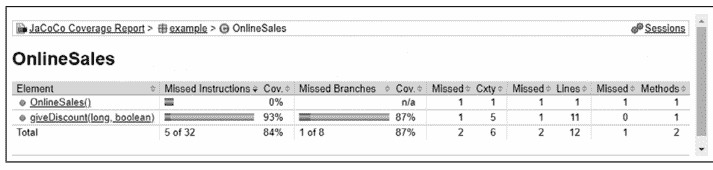

这里的关键点是被测试方法 `getDiscount()` 缺失的指令和分支。这显示在 5 个可执行实例中有 2 个没有执行，且 1 个分支没有被采取。

请注意，存在两个完全不同的问题：一个是测试是否通过，另一个是是否实现了全覆盖。

### 惰性求值

当某行源代码仅部分执行时，解释语句代码的结果需要考虑。一种称为“惰性求值”的优化特性可能会导致特定决策中的一个布尔值被执行。

在 Java 中，条件或 (`||`) 和条件与 (`&&`) 运算符保证从左到右评估，且右侧操作数仅在需要时被评估。

## 11.7 超时

通常情况下，确保测试运行时间不过长是一个良好的做法——例如由于代码中的无限循环或死锁。这对于单元测试可能不相关，但对于应用程序测试至关重要。

在 TestNG 中，使用了 `timeout` 参数。如果列表 11.8 中的测试方法 `test1()` 执行时间超过 1000 毫秒，则超时。

### 列表 11.8 带超时的测试

```java
@Test(timeout = 1000)
public void test1() {
    // 测试代码
}
```


```java
public class InfiniteTest {
    @Test(timeout = 1000)
    public void test1() {
```

> 参见 Josling, B. Joy, G. Steele, G. Bracha, A. Buckley, and D. Smith. The Java® Language Specification, Java SE 11 Edition, Oracle, 2018.

```java
10  assertEquals( Infinite.mul2(10), 20 );
11  }
12  }
13  }
```

列表 11.9 中带有无限循环的错误代码。

# 列表 11.9 带无限循环的代码

```java
3  class Infinite {
4    // return x * 2
5    public static int mul2(int x) {
6      while (x > 0) {
7        x = (x * 2) - x;
8      return x;
9    }
10 }
```

针对此错误代码运行带超时的测试会导致测试失败，如图 11.10 所示。如果不包含超时，测试将不会失败。

```
FAILED: test1
org.testng.TimeoutException: Method InfiniteTest.test1() 在 1000 毫秒内未完成
```


# 11.8 异常

大多数测试框架使用异常来报告失败。因此，如果被测试的方法预期产生异常，必须以不同的方式处理。一个简单的示例在列表 11.10 中。

**列表 11.10** 抛出异常的代码

```java
5  class DemoWithE {
6    int value = 0;
7    public void add(int x) {
8    if (x < 0) throw new IllegalArgumentException("Invalid");
9    value += x;
10 }
11 int getValue() {
12    return value;
13 }
```

对于等价类、BVA 和决策技术，异常应被视为输出（预期结果）。

# 测试自动化

要测试是否抛出异常，可以使用 `@Test` 注解的 `expectedExceptions` 参数。这在列表 11.11 中显示。

**列表 11.11** 带异常的测试

```java
public class DemoTest {

    @Test(expectedExceptions = IllegalArgumentException.class)

    public void test1() {

        DemoWithE d = new DemoWithE();

        d.add(-1);

    }

}
```

要测试是否没有抛出异常，可以使用 `expectedNotExceptions` 参数。这在列表 11.12 中显示。

**列表 11.12** 不带异常的测试

```java
public class DemoTest {

    @Test(expectedNotExceptions = false)

    public void test2() {

        DemoWithE d = new DemoWithE();

        d.add(1);

    }

}
```

# 继承测试

当子类继承自父类时，它继承了子类的职责。这意味着测试子类不仅要运行子类测试，还要运行父类测试。运行父类测试被称为继承测试，并确保继承是正确的。

继承测试的关键问题是将为一个类设计的测试集运行在另一个类上。显然，不同的类必须兼容（即继承）。

在我们使用的标准模板中（见片段 11.2），这是不可能的。

**片段 11.2** 针对类 XXX 的测试代码

```java
// Test for class XXX

@Test

public void test() {

    XXX x = new XXX();

    x.doSomething(input0, input1, input2);

    assertEquals(x.getResult(), expectedResult);

}
```

在第 4 行，测试项在测试类内部创建：测试只能针对类 `XXX` 的对象运行。

如果我们有一个要测试的新类继承自该类，我们需要将这些测试运行在新类上（假设它是真正的子类并完全支持父类的行为¹⁰）。复制粘贴的方法在片段 11.3 中。

**片段 11.3** 使用复制粘贴针对 YYY 运行 XXX 测试

```java
// Inheritance test for class YYY

@Test

public void test() {

    XXX x = new YYY();

    x.doSomething(input0, input1, input2);

    assertEquals(x.getResult(), expectedResult);

}
```

这种方法可行，但有许多严重的局限性：

- 所有复制粘贴方法的明显问题是，`XXX` 测试代码的任何更改都不会自动传播到 `YYY` 测试代码中。

> ¹⁰ 李氏可替换原则定义了这种强关系：子类可以完全替换父类。

此外，它可能位于不同的 Java 文件中。这是现代开发方法中的一个特殊问题，类类经常被重构和添加。

- 存在第二个较不那么明显的问题。如果第三个类 `ZZZ` 继承自 `YYY`，那么你需要将 `XXX` 和 `YYY` 的测试拷贝到 `ZZZ` 测试类中。这会导致复制代码的爆炸，并且极可能导致错误和未经测试的代码。

然而，这种方法也有一些优点，我们在设计替代方案时需要考虑这些优点：

1. 非常清晰地看出类层次结构中哪些测试正在针对哪个类运行。
2. 可以选择继承测试中要运行哪些测试。测试人员可能出于性能原因，或者因为子类没有完全符合 Liskov 替换且测试不适用而不想运行某些用例。
3. 如果 `YYY` 构造函数接收来自 `XXX` 构造函数的参数，处理起来很容易——将正确的参数传递给 `YYY` 构造函数即可。

我们将使用两个类 `Shape`（列表 11.12）和 `Circle`（列表 11.13）来演示继承测试的两种方法：将类名作为参数传递给测试，以及继承它。

**列表 11.12** `Shape` 类的源代码

```java
class Shape {

  String name = "unknown";

  String getName() { return name; }

  void setName(String name) { this.name = name; }

}
```

**列表 11.13** `Circle` 类的源代码

```java
class Circle extends Shape {

  int radius = 0;

  int getRadius() { return radius; }

  void setRadius(int radius) { this.radius = radius; }

}
```

继承层次结构如图 11.12 所示。

## 11.9.1 使用类名

列表 11.14 显示了 `Shape` 类的测试——不是硬编码要测试的类，而是将类名作为参数传递，并使用工厂方法¹¹来创建要测试的对象。

> ¹¹ 可以工厂方法代替构造函数来创建对象。工厂方法必须调用合适的构造函数。

## 11.9 继承测试

| Shape |
| :--- |
| name: String |
| +setName(String) |
| +getName() : String |


| Circle |
| :--- |
| radius: int = 0 |
| +setRadius(int) |
| +getRadius() : int |

**图 11.12** `Shape` 和 `Circle` 的 UML 图

**列表 11.14** `ShapeTest` – 通过名称执行

```java
public class ShapeTest {

    // 用于创建 Shape 的工厂方法

    public Shape createShape() throws Exception {

        String cn = System.getProperty("classname");

        Class<?> c = Class.forName(cn);

        Shape o = (Shape)(c.getDeclaredConstructor().newInstance());

        System.out.println("Running Shape test against instance of " + o.getClass());

        return o;

    }

    @Test

    public void test_demo() throws Exception {

        Shape o = createShape();

        o.setName("Test name 1");

        assertEquals(o.getName(), "Test name 1 ");

    }

}
```

这使用工厂方法来创建测试项，而不是直接调用构造函数。这允许工厂方法根据需要返回不同类的对象。

测试中的重要行：

- 第 13 行获取类名，该类名作为 Java 属性而不是命令行参数传递；与 TestNG 一样，测试类没有用于传递参数的 `main()` 方法。
- 第 14 行找到与（全路径）类名关联的类。
- 第 15 行通过 `newInstance()` 方法间接调用构造函数来实例化该类的对象。

## 测试自动化

- 第 16 行打印测试名称和类名，在测试日志中记录测试了哪个类（因为此测试可以针对不同的类运行）。

这种机制允许针对 `example.Shape` 类的实例运行 `Shape` 测试，如图 11.13 所示。

```
Running Shape test against instance of class example.Shape

PASSED: test_demo

=============================================

Command line suite

Total tests run: 1, Passes: 1, Failures: 0, Skips: 0

=============================================
```

图 11.13 在 `Shape` 上运行 `ShapeTest`

它还允许针对 `example.Circle` 类实例运行 `Shape` 测试，如图 11.14 所示。

```
Running Shape test against instance of class example.Circle

PASSED: test_demo

=============================================

Command line suite

Total tests run: 1, Passes: 1, Failures: 0, Skips: 0

=============================================
```

图 11.14 在 `Circle` 上运行 `ShapeTest`

这种继承测试方法的主要缺点是，它要求测试人员显式地针对层次结构中的每个父类运行测试。优点是测试人员可以轻松地选择执行的类¹¹²

## 11.9.2 继承父类测试

另一种方法是让 `ShapeTest` 工作作为继承测试。通过扩展 `ShapeTest`，`Circle` 类继承了所有的 `Shape` 测试。这在列表 11.15 中所示。

**列表 11.15** 可继承的 `ShapeTest`

```java
public class ShapeTest {

    // 用于创建 Shape 的工厂方法

    public Shape createShape() throws Exception {

        String cn = System.getProperty("classname");

        Class<?> c = Class.forName(cn);

        Shape o = (Shape)(c.getDeclaredConstructor().newInstance());

        System.out.println("Running Shape test against instance of " + o.getClass());

        return o;

    }

    @Test

    public void test_demo() throws Exception {

        Shape o = createShape();

        o.setName("Test name 1");

        assertEquals(o.getName(), "Test name 1 ");

    }

}
```

这种方法的结果是 `Shape` 测试和 `Circle` 测试针对 `Circle` 运行。这种技术在深层继承结构中自动生效，因为每个子类都继承了父类的测试。

运行 `CircleTest` 的结果如图 11.16 所示。

```
Running Circle test against instance of class example.Circle

Running Shape test against instance of class example.Circle

PASSED: test_circle

PASSED: test_shape

=============================================

Command line suite

Total tests run: 2, Passes: 2, Failures: 0, Skips: 0

=============================================

=============================================
```


有两个问题可以解决：

- 测试顺序——可能希望先进行继承测试；
- 测试选择——也许测试人员不想针对 `Circle` 运行所有的 `ShapeTest` 方法。

TestNG 以及其他框架有许多机制来支持这些问题。示例见后续章节。

# 继承测试排序

有许多强制排序的方法，通过指定依赖关系可能是简单的方法。测试方法依赖关系可以用于强制排序，导致继承的 `Shape` 测试在新的 `Circle` 测试之前执行（见列表 11.17）。

> ¹³ 见 Gosling et al., The Java® Language Specification.

## 11.9 继承测试

**列表 11.17** 带有依赖关系的 `ShapeTest`

```java
public class CircleTest extends ShapeTest {

    // 创建 Circle 的工厂方法

    Circle createInstance() {

        return new Circle();

    }

    // Shape 的测试会自动运行

    // 新的圆测试放在在这里

    @Test(dependsMethods = {"test_shape"})

    public void test_circle() throws Exception {

        Circle o = createInstance();

        System.out.println("Running Circle test against instance");

        o.setRadius(44);

        assertEquals(o.getRadius(), 44);

    }

}
```

此版本 `CircleTest` 的结果是为了排除了图 11.17 中的某些继承关系。

```
Running Shape test against instance of class example.Circle

Running Circle test against instance of class example.Circle

PASSED: test_shape

PASSED: test_circle

=================================

Command line suite:

Total tests run: 2, Passes: 2, Failures: 0, Skips: 0

======================================
```


图 11.17 带有依赖关系的运行 CircleTest。

Shape 的测试在 Circle 的测试之前运行。测试方法通知 TestNG 在调用 `test_circle()` 之前调用 `test_shape()`。这对于测试层次结构中的进一步测试非常有效。如果子类依赖于 `test_circle()`，则 `test_circle()` 将继承 `test_shape()` 的依赖关系。结果，所有继承的方法将从层次结构的顶端向下，按照要求的顺序运行。

### 11.9.3 继承测试选择

如前所述，可能存在某些原因，导致测试人员想要排除所有的继承测试、在深层层次结构中每次运行所有测试的性能太慢，或者层次结构中的某些子类无法完全替换。

有多种方法可以选择测试子集。使用测试组（groups）可能是简单的方法。列表 11.18 和 11.19 演示了一个示例。

### 列表 11.18 带有分组的 ShapeTest。

```java
public class ShapeTest {

    // 创建 Shape 的工厂方法
    Shape createInstance() {
        return new Shape();
    }

    @Test(groups = {"inherited","shape"})
    public void test_shape() throws Exception {
        Shape o = createInstance();
        System.out.println("Running Shape test against instance "+o.getClass());
        o.setName("Test name 1");
        assertEquals(o.getName(), "Test name 1");
    }
}
```

### 列表 11.19 带有分组的 CircleTest。

```java
public class CircleTest extends ShapeTest {

    // 创建 Circle 的工厂方法
    Circle createInstance() {
        return new Circle();
    }

    // Shape 的测试会自动运行
    @Test(groups = {"inherited","circle"})
    public void test_circle() throws Exception {
        Circle o = createInstance();
        System.out.println("Running Circle test against instance "+o.getClass());
        o.setRadius(44);
        assertEquals(o.getRadius(), 44);
    }
}
```

测试组可以在运行时选择（作为参数传递给 TestNG）。这可以用于控制执行顺序。如果在第一次运行测试时指定了 `shape` 组，则运行 `shape` 组中的所有测试。如果在随后的测试运行中指定了 `circle` 组，则接下来运行 `circle` 组中的所有测试。如果指定了 `inherited` 组，则所有测试将没有特定顺序。

现在显示两个示例。运行 `circle` 组中的测试输出如图 11.18 所示。运行 `inherited` 组中的测试输出如图 11.19 所示。

```
Running Circle test against instance of class example.Circle
PASSED: test_circle
=============================================
Total tests run: 1, Passes: 1, Failures: 0, Skips: 0
=============================================
```

图 11.18 组 circle 组的测试结果。

```
Running Circle test against instance of class example.Circle
Running Shape test against instance of class example.Circle
PASSED: test_circle
PASSED: test_shape
=============================================
Command line suite
Total tests run: 2, Passes: 2, Failures: 0, Skips: 0
=============================================
```

图 11.19 组 inherited 的测试结果。

## 11.10 Web 应用程序接口

Selenium 是一个用于 Web 应用程序自动化的工具。在书中，它被用作启用 Web 应用程序自动化测试库的代表性示例。Selenium WebDriver 测试的关键功能在以下示例中。

### WebDriver

WebDriver 是一个可以使用不同编程语言（如 Java、PHP、Python、Ruby 和 C#）的库。测试代码（例如基于 Selenium 的测试）可以使用 WebDriver API 打开 Chrome 或 Firefox 等浏览器，然后启动 Web 应用程序（即打开 URL）。测试代码模拟用户与应用程序的交互。程序中插入了适当的断言以验证实际行为或输出是否符合预期行为/输出。在书中，使用了 Chrome WebDriver（在编写时，它是最新的）。为了方便使用，它可以导入到 Eclipse/Java 项目中。使用 Chrome WebDriver 执行基本测试所需的 Selenium WebDriver API 最小集如下：

- 加载页面：
  ```java
  WebDriver driver = new ChromeDriver();
  driver.get("https://example.com");
  ```
- 验证页面标题：
  ```java
  assertEquals("Google", driver.getTitle());
  ```
- 通过 ID 查找元素：
  ```java
  driver.findElement(By.id("q")).sendKeys("Selenium");
  ```
- 从输入字段获取值：
  ```java
  String value = driver.findElement(By.id("q")).getText();
  ```
- 模拟点击：
  ```java
  driver.findElement(By.id("submit")).click();
  ```
- 验证复选框被选中：
  ```java
  assertTrue(driver.findElement(By.id("remember")).isSelected());
  ```
- 等待元素出现：
  ```java
  wait.until(ExpectedConditions.visibilityOfLocated(By.id("result")));
  ```

## 11.11 桌面应用程序接口

Java GUI 桌面应用程序通常使用 AWT、Swing、JavaFX 开发。与 Web 应用程序一样，关键问题在于：a 如何找到元素，b 如何与它们交互。典型的桌面应用程序测试将：

- 调用应用程序的 `main()` 方法；
- 调用 `Window.getWindows()` 查找应用程序或调用 `java.swing.FocusManager.getCurrentManager().getActiveWindow()` 查找活动窗口；
- 将所有与 GUI 交互的操作放在 GUI 事件线程（Swing 应用使用 `Swing.invokeLaterAndWait`）；
- 调用 `JFrame.getTitle()` 获取窗口标题；
- 递归调用 `Container.getComponents()` 查找组件（窗口、文本框等），使用 `Component.getName()` 查找名称（而不是使用 ID）；
- 与组件交互：例如 `JButton.doClick()`、`JTextBox.setText()`。

与 Web 应用程序的区别是应用程序完全控制屏幕，而在 URL 或浏览器页面中，用户可以通过输入 URL 或使用浏览器后退按钮返回窗口。测试人员应详细参考 GUI 库的 API。有许多 Java GUI 应用程序测试框架：这些框架构建在底层 AWT/Swing/JavaFX 库之上。还有许多依赖操作且语言无关的 GUI 测试框架。存在许多商业和开源工具。对这些工具的审查超出本书的范围。

## 11.12 移动应用程序接口

开发移动应用程序测试与开发 Web 应用程序测试相似。请注意设置的系统属性是 ChromeDriver 特有的：其他驱动支持不同的属性来帮助 Selenium 定位驱动程序。

一些示例工具包括：

- selendroid (针对 Android 的 Selenium) – API 与 Selenium 设计，使用 selendroid-client 库.¹16
- Apple手机上的 iOS Driver – 基于 Selenium/WebDriver.¹17

再次，有许多此类工具，建议读者查看这些工具的最新在线对比。

> 16 参见 http://selendroid.io。
> 17 参见 https://ios-driver.github.io/ios-driver.

# 随机测试

## 12.1 随机测试引言

无人工干预的全自动化随机测试是软件行业的一个目标，也是一个关键研究领域。然而，正如第 1 章引言中讨论的，自动化随机测试存在三个关键问题：

1. 判别问题——如何判断结果是否正确；
2. 测试数据问题——如何生成具有代表性的随机数据；
3. 测试完成问题——如何知道何时停止生成测试。

这是一个活跃的研究领域，对这些问题的所有最新解决方案的讨论超出了本书的范围。然而，我们将对该主题进行介绍：本章将介绍一种简单的自动化随机测试形式，即使用随机数据与手动生成的黑盒或白盒测试覆盖项相结合。

## 12.2 随机数据选择

在本章中，使用了之前涵盖的相同技术（见第 2-9 章），但不再使用特定的测试数据值创建测试覆盖项（TCIs），而是开发了更通用的测试标准。这允许在运行时选择符合这些标准的随机值。这种方法通过以下方式解决随机测试问题：

- 通过将测试人员纳入过程中手动开发测试覆盖项解决了判别问题。
- 使用测试标准和随机数生成器解决了测试数据问题，因为它们允许生成良好的数据。
- 限制测试执行时间通过提供停止策略解决了测试完成问题。

该技术通过两个示例演示：(1) 单元测试和 (2) 应用测试。

### 单元测试示例

以第 2 章描述的 `giveDiscount()` 方法作为示例。作为提醒，此处重现了该规范。

**Status giveDiscount (long bonusPoints, boolean goldCustomer)**

**输入**

- bonusPoints：客户积累的 bonusPoints 数
- goldCustomer：如果是金牌客户则为 true

**输出**

```
return value:
FULLPRICE 如果 bonusPoints <= 120 且不是 goldCustomer
FULLPRICE 如果 bonusPoints <= 80 且是 goldCustomer
DISCOUNT 如果 bonusPoints > 120
DISCOUNT 如果 bonusPoints > 80 且是 goldCustomer
ERROR 如果任何输入无效 (bonusPoints < 1)
```

**Status 定义为：**
`enum Status { FULLPRICE, DISCOUNT, ERROR };`

在本示例中开发的测试是基于已经为该方法开发的等价划分测试。所有其他黑盒和白盒测试都可用于更全面的测试。

### 测试覆盖项

将使用第 2 章开发的 `giveDiscount()` 方法的等价划分测试来演示该技术。此处重现了 TCIs 以供参考——参见表 12.1。

**表 12.1 用于 giveDiscount() 的 TCIs。**

| TCI | 参数 | 等价划分 |
|---|---|---|
| EP1* | bonusPoints | Long.MIN_VALUE..0 |
| EP2 | | 1..80 |
| EP3 | | 81..120 |
| EP4 | | 121..Long.MAX_VALUE |
| EP5 | goldCustomer | true |
| EP6 | | false |
| EP7 | Return Value | FULLPRICE |
| EP8 | | DISCOUNT |
| EP9 | | ERROR |

### 12.3 单元测试示例

#### 12.3.2 测试用例

在开发测试用例时，不再选择实际数据来代表每个等价划分，而是使用定义等价划分的标准。这些标准允许根据标准运行时随机选择特定的数据值。在简单划分中，标准将说明划分中的最小值和最大值。在本示例中，这些标准是基于每个 TCI 的划分边界，如表 12.2 所示。

**表 12.2 等价划分。**

| 参数 | 等价划分 | 标准 |
|---|---|---|
| bonusPoints | Long.MIN_VALUE..0 | `(Long.MIN_VALUE < bonusPoints) && (bonusPoints <= 0)` |
| | 1..80 | `(1 <= bonusPoints) && (bonusPoints <= 80)` |
| | 81..120 | `(81 <= bonusPoints) && (bonusPoints <= 120)` |
| | 121..Long.MAX_VALUE | `(121 <= bonusPoints) && (bonusPoints <= Long.MAX_VALUE)` |
| goldCustomer | true | `goldCustomer` |
| | false | `!goldCustomer` |
| Return Value | FULLPRICE | `Return Value = FULLPRICE` |
| | DISCOUNT | `Return Value = DISCOUNT` |
| | ERROR | `Return Value = ERROR` |

使用这些标准，可以为每个测试用例指定随机测试数据，如表 12.3 所示。这本质上与第 2 章中为等价划分测试开发的表 12.9 相同，但每个测试的实际数据值被替换为生成随机值的标准。

**表 12.3 随机等价划分。**

| ID | 输入 | 标准 | 预期结果 |
|---|---|---|---|
| T12.1 | EP1* | rand(l) | FULLPRICE |
| T12.2 | EP2 | rand(l,h) | FULLPRICE |
| T12.3 | EP3 | rand(l,h) | FULLPRICE |
| T12.4 | EP4 | rand(l,h) | DISCOUNT |

*(注：表 12.3 的 OCR 严重损坏；根据上下文和前面的表格，重建了测试用例到标准的标准的映射)*

生成随机值的实现如下：

```java
private static long generateRandomLong(Random r, long min, long max) {
    long value;
    if (min > 0) {
        value = min + (long) (r.nextDouble() * (max - min));
    } else {
        value = r.nextLong();
    }
    while ((value < min) || (value > max));
    return value;
}
```

测试类的实现如下：

```java
import static org.junit.Assert.*;
import org.testng.annotations.DataProvider;

public class RandomTest {
    private static long RUNTIME = 1000;

    @DataProvider(name = "eprandom")
    public Object[][] getTestData() {
        return new Object[][] {
            {"T12.1", Long.MIN_VALUE, 0, true, FULLPRICE},
            {"T12.2", 1, 80, true, FULLPRICE},
            {"T12.3", 81, 120, true, FULLPRICE},
            {"T12.4", 121, Long.MAX_VALUE, false, DISCOUNT}
        };
    }

    @Test
    public void randomTest(String tid, long min, long max, boolean goldCustomer, Status expected) {
        Random rp = new Random();
        long endTime = System.currentTimeMillis() + RUNTIME;
        boolean failed = false;
        Status actual;
```


```java
while (System.currentTimeMillis() < endTime) {

    long bonusPoints = generateRandomLong(rp, min, max);

    actual = OnlineSales.giveDiscount(bonusPoints, goldCustomer);

    try {

        assertEquals(expected, actual);

    } catch (AssertionError e) {

        failed = true;

    }

}

if (failed) {

    System.out.println("Test failure data for test: " + tid);

    System.out.println("bonusPoints=" + bonusPoints);

    System.out.println("goldCustomer=" + goldCustomer);

    System.out.println("actual result=" + actual);

    System.out.println("expected result=" + expected);

}

}
```

# 随机测试

```
PASSED: randomTest("T12.1", 1, 80, true, FULLPRICE)
PASSED: randomTest("T12.2", 81, 120, false, FULLPRICE)
PASSED: randomTest("T12.3", 121, 922337203685475807, false, DISCOUNT)
PASSED: randomTest("T12.4", -922337203685475808, 0, false, ERROR)
=================================================================
Command line suite
Total tests run: 4, Passes: 4, Failures: 0, Skips: 0
=================================================================
```

图 12.1 `OnlineSales.giveDiscount()` 的等效类划分随机测试结果。

## 12.4 应用测试示例

为了展示随机测试的广泛适用性，这里展示了一个随机应用测试示例，基于第 10 章描述的燃料检查器（Fuel Checker）系统。作为回顾，燃料检查器的规格在此处重复：

- 一个燃料部门需要一个良好的系统，以便调度员能够判断燃料负载是否能装入油箱。某些燃料可以装满油箱；而另一些燃料出于安全考虑需要额外的空间。在没有额外安全空间的情况下，油箱容量为 1200 升，加上该空间后为 800 升。

### 12.4.1 分析

输入随机化的数据标准源于第 10.2 节所示的验收标准：

- S1A 需要一个符合无额外安全空间油箱的升数。取值范围从 1 到 1200。
- S1A 需要一个符合带额外安全空间油箱的升数。取值范围从 1 到 800。
- S1A 需要一个无法装入无额外安全空间油箱的升数。值范围从 1201 到某个未指定的极大值。
- S1A 需要一个无法装入带额外安全空间油箱的升数。值范围从 801 到某个未指定的极大值。

对于随机单元测试，我们不是选择单个值来代表每个等效类（如表 10.3 所示），而是使用表 12.4 所示的标准在运行时选择随机值。

生成的随机值将必须被转换为字符串，以作为应用程序的输入。

### 表 12.4 数据值标准

| 验收标准 | 输入 | 数据标准 |
|---|---|---|
| S1A1 | litres | 1 ≤ litres ≤ 1200 |
| S1A2 | litres | 1 ≤ litres ≤ 800 |
| S1A3 | litres | 1201 ≤ litres ≤ `Integer.MAX_VALUE` |
| S1A4 | litres | 801 ≤ litres ≤ `Integer.MAX_VALUE` |

### 12.4.2 测试覆盖项

将使用第 10 章开发的用户故事来演示该技术。选定的 TCI（测试覆盖项）包含了适用于随机化的输入，如表 12.5 所示。

| TCI | 验收标准 | 测试用例 |
|---|---|---|
| RUS1 | S1A1 | 稍后完成 |
| RUS2 | S1A2 | |
| RUS3 | S1A3 | |
| RUS4 | S1A4 | |

### 12.4.3 测试用例

测试数据基于为测试覆盖项开发的标准。这里呈现的是标准而非实际数据值（见表 12.6）。

### 12.4.4 测试实现

测试实现基于第 10 章开发的测试。在相关之处，特定的数据值被替换为开发数据随机化标准标准的下界和上限。实现在代码列表 12.2–12.5 中。代码列表 12.2 显示了测试代码，它是基于第 11 章用于应用测试的代码，并带有额外的属性以支持随机测试。

#### 代码列表 12.2 `FuelCheckRandomTest` 的设置

```java
// Selenium
WebDriver driver;
Wait<WebDriver> wait;

// 要测试的应用程序 URL
String url = System.getProperty("url");
```

```java
// 用于测试失败报告的存储数据
static final long RUNTIME = 10000L; // 每个随机测试运行 10 秒
```

```java
Random r_litres = new Random(); // litres输入的随机数生成器
boolean failed;
String litres;
boolean highsafety;
int counter;
```

```java
@BeforeClass
public void setUpDriver(String url) throws Exception {

    System.out.println("Test started at: " + LocalTime.now());

    if (url == null)
        throw new Exception("Test URL not defined: use -Durl");

    System.out.println("For URL: " + url);
    System.out.println();

    // 创建 web driver（此代码使用 chrome）
    if (System.getProperty("webdriver") == null)
        throw new Exception("Web driver not defined: use -Dwebdriver=filename");

    if (new File(System.getProperty("webdriver")).exists())
        throw new Exception("Web driver missing: " + System.setProperty("webdriver"));

    System.setProperty("webdriver.chrome.driver", new ChromeDriver());

    // 创建等待
    wait = new WebDriverWait(driver, 5);

    // 打开网页
    driver.get(url);
}
```

```java
@AfterClass
public void shutdown() {
    driver.quit();
}
```

代码列表 12.3 显示了支持随机测试的额外属性（这是上一个列表的提取，因此行号有重叠）。这些属性允许为失败的测试报告值。

#### 代码列表 12.3 存储测试数据

```java
// 用于测试失败报告的存储数据
static final long RUNTIME = 10000L; // 每个随机测试运行 10 秒
```

```java
Random r_litres = new Random(); // litres输入的随机数生成器
boolean failed;
String litres;
boolean highsafety;
int counter;
```

### 表 12.6 Fuel Checker 的随机测试标准

| ID | TCI | 输入 | 预期结果 |
|---|---|---|---|
| T12.1 | RUS1 | 在 litres 输入字符串 1 ≤ litres ≤ 1200<br>取消勾选 highsafety<br>点击 Enter | 跳转到检查界面<br>litres 正确<br>highsafety 未勾选<br>结果为燃料装入油箱。 |
| T12.2 | RUS2 | 在 litres 输入字符串 1 ≤ litres ≤ 800<br>勾选 highsafety<br>点击 Enter | 跳转到检查界面<br>litres 正确<br>highsafety 已勾选<br>结果为燃料装入油箱。 |
| T12.3 | RUS3 | 在 litres 输入字符串 1201 ≤ litres ≤ `Integer.MAX_VALUE`<br>取消勾选 highsafety<br>点击 Enter | 跳转到检查界面<br>litres 正确<br>highsafety 未勾选<br>结果为燃料未装入油箱。 |
| T12.4 | RUS4 | 在 litres 输入字符串 801 ≤ litres ≤ `Integer.MAX_VALUE`<br>勾选 highsafety<br>点击 Enter | 跳转到检查界面<br>litres 正确<br>highsafety 已勾选<br>结果为燃料未装入油箱。 |

代码列表 12.4 显示了扩展的 `@AfterMethod`。在第 11 章中，它用于应用测试，为了支持随机测试以进行调试。

#### 代码列表 12.4 `FuelCheckRandomTest` 的 `@AfterMethod`

```java
@AfterMethod
public void runTestMethod() {
    System.out.println("Random test executed: " + counter);
    counter = 0;
}
```

代码列表 12.5 显示了数据 provider 和随机测试方法。

#### 代码列表 12.5 数据 provider 和方法

```java
@DataProvider(name = "ECVdata")
public Object[][] getECVdata() {
    return new Object[][] {
        {"T12.1", 1, 1200, "false", "Fuel fits in tank."},
        {"T12.2", 1, 800, "true", "Fuel fits in tank."},
        {"T12.3", 1201, Integer.MAX_VALUE, "false", "Fuel does not fit in tank."},
        {"T12.4", 801, Integer.MAX_VALUE, true, "Fuel does not fit in tank."}
    };
}
```

```java
@Test(time = 60000, dataProvider = "ECVdata")
public void testEnterCheck(String tid, int lmin, int lmax, boolean hs, String result) {
    long endTime = System.currentTimeMillis() + RUNTIME;
    failed = false;
    highsafety = hs;

    while (System.currentTimeMillis() < endTime) {
        counter++;
        driver.wait(ExpectedConditions.titleIs("Fuel Checker"));
        // 使用正态分布生成随机升
        n_litres = (int)((double)lmin + (double)(lmax-lmin) / 6.0 * r_litres.random.nextGaussian());
        if (n_litres > lmax) n_litres = lmax;
        if (n_litres < lmin) n_litres = lmin;
        litres = Integer.toString(n_litres);
        // 执行测试
        driver.wait(ExpectedConditions.titleIs("Fuel Checker"));
        driver.wait(ExpectedConditions.visibilityOfElementLocated(By.id("litres")));
        driver.findElement(By.id("litres")).sendKeys(litres);
    }
}
```

```java
// 处理测试失败
if (failed) {
    System.out.println("Test failed on input: " + litres + ", highsafety=" + highsafety);
}
```

```java
// 如果离开了主界面，尝试返回那里
if ("Results".equals(driver.getTitle())) {
    driver.findElement(By.id("Continue")).click();
} else if ("Fuel Checker".equals(driver.getTitle())) {
    driver.findElement(By.id("back")).click();
} else if ("Thank you".equals(driver.getTitle())) {
    driver.get(url); // 只从这里返回主界面
}
```

```java
wait.until(ExpectedConditions.visibilityOfElementLocated(By.id("highsafety"));
if (driver.findElement(By.id("highsafety")).isSelected() != highsafety)
    driver.findElement(By.id("highsafety")).click();
wait.until(ExpectedConditions.visibilityOfElementLocated(By.id("Enter"));
driver.findElement(By.id("Enter")).click();
wait.until(ExpectedConditions.titleIs("Results"));
wait.until(ExpectedConditions.visibilityOfElementLocated(By.id("Result"));
assertEquals(driver.findElement(By.id("Result")).getAttribute("value"), result);
wait.until(ExpectedConditions.visibilityOfElementLocated(By.id("Continue"));
driver.findElement(By.id("Continue")).click();
wait.until(ExpectedConditions.titleIs("Fuel Checker"));
}
failed = false; // if reach, no test has failed
```


关于实现性的说明：

- 参数值的属性在第 39–40 行定义。测试失败标志定义在第 38 行。
- 第 68–84 行显示了 `@AfterMethod`，它被扩展用于打印失败测试的参数值。如果没有此方法，调试失败将极其困难。
- 还会报告一个额外值，即在可用时间内每个测试完成的循环次数计数器，使用了该计数器（位于第 41 行）。
- 数据提供者包含了升油量的判定标准（对于整数，这些是下限和上限），而不是具体的数值。第 93–96 行。
- 参数化测试包含了输入参数 `lmin` 和 `lmax`（第 101 行），以支持每个测试升油量的下限和上限。
- 并不是运行单个测试，而是使用随机值执行多次循环，并使用计时器（第 105 行）来决定何时完成测试。
- 第 108–113 行为升油量设置了随机值。在测试中，通常使用实际用户输入的值，以便使测试匹配真实世界的使用。当这些统计数据不可用时，通常使用分布值作为近似。`Random.nextGaussian()` 方法返回一个以 0.0 为中心、标准差为 3.0 的正态分布值。对于正态分布，99% 的值落在三个标准差之内，因此第 109 行的方程产生了一个中心位于 `lmin..lmax` 范围中间且符合正态分布的随机数。

2. 软件可能会记录输入数据值，并在获得用户许可的情况下报告这些统计数据以供测试。

# 随机测试

注意，1% 的值将落在该范围之外，这些值在第 111–112 行移动到范围内。

- 参数值记录在第 104 行和 113 行，以便在测试失败时进行报告。
- 测试的其余部分与第 10 章开发的应用测试相似。
- 在每个循环结束时，应用程序将返回主界面（第 127–128 行），以便后续测试可以运行。

## 12.4.5 测试结果

针对 Fuel Checker 应用运行这些测试的结果如图 12.2 所示。所有测试均已通过。在选择 `RUNTIME=100000` 值的情况下，四个测试的执行时间大约为 40 秒。

```
Test started at: 2020-09-09T16:26:40.526107500

For URL: chl2://application-test/fuelchecker.html

Random loops executed: 16

Random tests executed: 16

Random loops executed: 17

Random tests executed: 14

PASSED: testEnterCheckView("T12.1", 1, 1200, false, "Fuel fits in tank")

PASSED: testEnterCheckView("T12.2", 1, 800, true, "Fuel fits in tank.")

PASSED: testEnterCheckView("T12.3", 1201, 214783647, false, "Fuel does not in tank.")

PASSED: testEnterCheckView("T12.4", 801, 214783647, true, "Fuel does not in tank.")

===========================================

Command line suite

Total runs: 4, Passes: 4, Failures: 0, Skips: 0

===========================================
```

> 图 12.2 Fuel Checker Web 应用程序的随机测试结果。

## 12.5 详细介绍随机测试

在本章中仅展示了一种随机测试作为主题的介绍：带有测试用例的随机输入数据选择。理想情况下，整个测试过程应该是随机且自动的，并对软件规范和实现提供完全覆盖。这将导致更全面且低成本的测试。然而，存在许多障碍：

### 12.5.1 全自动化的障碍

完全自动随机的三个障碍……

#### 测试 Oracle 问题（Test Oracle Problem）

一旦自动选择了随机数据并使用这些数据执行软件，问题在于验证软件的输出是否正确。对于单元测试，这可能是返回值。在测试面向对象（OO）软件时，这可能还包括输出属性。对于应用测试，这包含了软件的所有输出，这些输出可能传递到屏幕、数据库、文件、作为另一个系统的输入等。处理 Oracle 问题的四种基本方法：

- 忽略该问题，仅要求测试完成且没有导致被测软件崩溃——这被称为稳定性测试。测试 Oracle 变成一个通用的软件工具，用于验证软件在任何测试单元后继续运行。原则上，这可以应用于任何类型的测试。对于单元测试或 OO 测试，这意味着要检查没有抛出意外的异常——这并不总是容易的。
- 使用更高级、更抽象的语言编写程序来指定软件需求，并用它生成预期结果。这也可以被描述为可执行规范。在高级语言中，需求可以表述为……
- 在……中使用约束（例如对象约束语言 OCL……）
- 使用……（例如等价类划分）

#### 测试数据问题

自动生成能够彻底测试（无论是单元、类还是整个系统）的测试数据是一个复杂的问题。它需要定义生成目标……

#### 测试完成问题

理想情况下，自动化随机测试将覆盖所有的规范和实现，实现 100% 黑盒覆盖和 100% 白盒覆盖。然而，正如我们之前看到的，很少有工具可以测量黑盒覆盖，并不是所有的白盒覆盖指标都能轻松测量（例如全路径覆盖）。解决这一问题的方法倾向于基于实用主义：

### 12.5.2 其他类型随机测试的概述

还有许多其他随机自动化测试方法在书中未对其进行详细阐述，包括：

- **稳定性测试（Stability testing）**——有多种形式，通过测试系统以确保在任何输入下都不会挂起或崩溃。这些测试技术（支持工具）不使用规范来判断输出是否正确，而是验证系统对随机选择输入的稳定性。
- **无向随机测试（Undirected random testing）**——对用户界面进行组件扫描，随机选择一个组件，然后随机选择一种交互方式（如点击、文本输入、滑动等）并执行。该测试试图导致系统崩溃。通常情况下，完成标准是基于时间的。
- **有向随机测试（Directed random testing）**——在测试期间动态测量白盒覆盖率标准（如状态覆盖率或分支覆盖率）。一旦随机测试不再能增加代码的覆盖率，就会开始对代码进行分析，以识别可以增加覆盖率的输入数据，这种分析可能采取符号执行的形式，也可能基于统计或机器学习方法。其目标通常是最大化覆盖率、最大化崩溃次数并最小化输入序列的长度。它可以用于桌面、移动和基于 Web 的应用程序，尽管判断 Web 应用是否崩溃可能具有挑战性。完成标准通常是基于正确性/或时间的，因为达到所需的覆盖率可能需要很长时间，如果这是可能的话。
- **模糊测试（Fuzz testing）**——随机损坏现有数据并将其作为输入提供系统。目标是用无效输入导致系统崩溃。完成标准通常是时间。这种技术可以与有向随机测试结合使用。
- **压力测试（Stress testing）**——目标是确保系统在输入过载时仍继续正常运行。可以随机选择现有测试并以可达的最高速率执行，通常并行运行大量测试以最大化负载。这确保了系统即使在过载时也能正常运行。或者，可以使用任何随机测试作为输入，确保系统在过载时不会挂起或崩溃。通常会使用特殊的测试配置，因为这种形式的测试可能会对使用的服务器或网络产生不可接受的负载。
- **决策树与随机测试（Decision trees and random testing）**——目标是解决测试断言（test oracle）和数据选择问题，确保系统对随机选择的输入正常运行。测试断言问题通过随机选择输出，然后使用基于规范的规则选择合适的测试输入来解决。这种方法并不适用于所有规范，但非常适用于反向运行规范的场景。使用决策树 (1) 随机选择输出，然后 (2) 实现规则以创建随机输入。这可以与有向随机测试结合使用，确保规范和实现的覆盖。
- **从规范自动生成测试用例（Automated test case generation from specifications）**——已有研究通过使用分析、进化算法和机器学习等各种方法开发测试用例。这种方法具有解决所有随机测试问题的潜力，能够提供无需人工干预即可自动生成的系统。

> 6 例如：Android Monkey (https://developer.android.com/studio/test/monkey) 和 Sapien，后者描述于 K. Mao, M. Harman, and Y. Jia 的论文 Multi-objective automated testing for Android applications. In Proc. 25th Int Sym. Software Testing and Analysis. ACM, 2016。

## 12.6 评估

在 `OnlineSales.giveDiscount()` 中针对故障 6 和新的故障 10 运行自动化随机测试的结果被用于证明该技术的局限性。

### 12.6.1 局限性

通过观察随机测试对故障 6 和故障 10 的有效性，探讨了其的一些局限性。

#### 针对故障 6 的随机等价分区测试

故障 6 在列表 6.3 中通过对方法的重新设计引入，引入了难以通过等价分区、边界值分析（BVA）、决策表、语句覆盖或或分支覆盖测试发现的故障。

针对带有故障 6 代码运行随机等价分区测试的结果如图 12.3 所示。

检测到了故障并显示了导致测试失败的输入数据值。

#### 针对故障 10 的随机 EP 测试

随机测试是概率性的，并不总是能找到每个故障。额外添加了两行代码，如果 `bonusPoints` 的值为 965423829，则会导致执行出现故障（见列表 12.6 中的第 39 行）。

```
Test failure data for test: T12.1

bonusPoints=20

goldCustomer=true

actual result=DISCOUNT

expected result=FULLPRICE

PASSED: passedTest("T12.2", 81, 120, false, FULLPRICE)

PASSED: passedTest("T12.3", 121, 9223..., false, DISCOUNT)

PASSED: passedTest("T12.4", -922337023685477508, 0, false, ERROR)

FAILED: passedTest("T12.5", 1, 80, true, FULLPRICE)

java.lang.AssertionError: expected [FULLPRICE] but found [DISCOUNT]

Command line suite

Total tests run: 4, Passes: 3, Failures: 1, Skips: 0
```

> 图 12.3 故障 6 的测试结果。

列表 12.6 带有故障 10 的 `OnlineSales.giveDiscount()`。

```java
public static Status giveDiscount(long bonusPoints, boolean goldCustomer)
{
    Status rv = FULLPRICE;
    long threshold = 120;
    if (bonusPoints <= 0)
        rv = ERROR;
    else {
        if (goldCustomer)
            threshold = 80;
        if (bonusPoints == 965423829) // 故障 10
            rv = DISCOUNT;
    }
    return rv;
}
```

针对带有故障 10 代码运行等价分区测试的结果如图 12.4 所示。未检测到故障。事实上，检测到故障的概率非常低。

### 12.6.2 优点与缺点

随机测试被视为穷举测试的近似方法。通过随机覆盖广泛的取值，而不是在每个测试中使用单一取值，增加了发现故障的概率。

```
PASSED: passedTest("T12.1", 1, 80, true, FULLPRICE)
PASSED: passedTest("T12.2", 81, 120, false, FULLPRICE)
PASSED: passedTest("T12.3", 121, 9223..., false, DISCOUNT)
PASSED: passedTest("T12.4", -922337023685477508, 0, false, ERROR)
Command line suite
Total tests run: 4, Passes: 4, Failures: 0, Skips: 0
```


图 12.4 故障 10 的测试结果。

在这种情况下，等价分区测试被用作随机测试的基础，只能发现可以通过等价分区测试发现的故障。与等价分区范围内的值相关的故障发现的概率更高。

### 优点
- 运行测试受限或无需人工干预。这具有提高软件质量的潜力。
- 在有限的时间内运行大量测试。
- 稳定性测试在发现软件挂起或崩溃的情况方面已被证明非常成功，是提高这方面软件质量的重要因素。

### 缺点
- 大多数现有工具仅执行稳定性测试，因此不验证软件的正确运行，这需要单独测试。
- 测试断言、数据选择和测试完成问题在很大程度上尚未解决。
- 有效的技术需要完整的软件规范。这些规范的开发非常耗时，且许多开发者没有使用形式化语言（如 `OCL`）编写这些经验。

## 12.7 关键点

全自动随机测试存在三个关键问题：测试断言问题、测试数据问题和测试完成问题。

> 7 使用边界值分析（`BVA`）进行随机化可能无效，因为边界值是固定值。

- 随机数据选择可以用于任何黑盒和白盒测试技术，其方法是选择测试准则而非测试数据，然后在运行时选择匹配这些准则的测试数据。在这种情况下，测试断言（`test oracle`）是人工的。
- 全随机数据选择可以配合简单的测试断言（即软件不崩溃）用于稳定性测试。
- 确定测试完成有多种方法：简单且务实的方法包括指定固定次数的循环，或为测试执行留出固定时间。更先进的技术包括在运行时测量代码。

## 给资深测试人员的注意事项

生成随机测试可能是资深测试人员快速创建大量测试的最有效方法之一。通过生成随机输入操作并检查应用程序是否崩溃，可以测试应用程序的稳定性。使用等价类划分、边界值分析（`BVA`）、决策表、语句覆盖和分支覆盖等为单元测试、面向对象测试（`OO`测试）或应用测试创建的用例，可以用于扩展所用数据值的范围。通过使用具有真实世界统计代表性的输入数据（从真实客户运行应用程序的过程中收集），可以得出平均故障间隔时间（`MTBF`）的估计值。安全性测试通常可以通过添加 `invariants` 来开发，这些不变性代表了应用程序或类的安全性标准，编写代码来检查这些标准（定期地或在每次方法调用后），并模拟随机输入。这种形式的测试不是检查每个方法的输出是否正确，而是验证方法的效果对于安全性标准来说是正确的。

# 软件过程中的测试

测试活动可以通过两种方式进行。第一种是等待所有代码编写完成后，一次性地对完成的产品进行测试。这被称为“大爆炸”开发。从表面上看，这对开发者来说是一个很有吸引力的选择，因为“测试活动不会阻碍产品的完成进度”。然而，这是一种冒险策略，因为产品能够运行（甚至接近运行）的可能性非常低，且特别取决于程序的复杂性和规模。此外，如果测试揭示了程序中的故障，识别它们的来源将要困难得多。

更现代的方法是在开发软件的同时对其进行测试。这被称为“增量式”开发。单个模块或软件功能在编写时就会对其进行测试。这一过程随着额外软件增量的产生而持续进行，直到产品完成。虽然这可能会延迟最终产品的发布，但产出的产品质量更高，并允许更早地产生中间版本。此外，增量式开发对不断变化的用户需求响应更加迅速。

因此，增量方法将测试作为开发过程的一部分。如图 13.1 所示，开发的每个阶段都与特定的测试阶段对应。

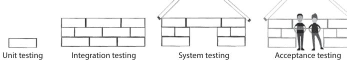

图 13.1 增量测试的阶段。

在单元测试中，测试单个组件。在集成测试中，测试这些组件之间的交互。在系统测试中，根据规范对整个系统进行测试。在验收测试中，用户验证系统是否满足其需求。

本章描述了规划软件测试所需的活动，并研究了软件测试如何融入不同的软件开发模型。

## 13.1 测试计划

软件测试所需的时间资源与开发软件所需的规模相似。因此，测试活动需要以类似的方式进行计划和管理。典型的测试计划将包括此类信息：

- 需要测试的项；
- 要执行的任务；
- 职责；
- 进度；以及
- 所需资源。

`IEEE 29119` 标准提供了一个准备和执行测试计划的框架。它定义了三个级别的测试文档：

1. 组织测试文档：这些文档定义了组织的测试策略和测试方案。
2. 管理文档：这些文档定义了测试前和测试管理文档，由测试计划和测试完成报告组成。
3. 动态测试文档：测试运行之前，这些文档定义了测试环境和测试数据。测试之后，它们定义了测试执行文档，包括缺陷报告和测试状态报告。

实际上，大型或任务关键的项目将使用完整的标准；大多数项目将使用针对项目定制的。

## 13.2 软件开发生命周期

软件开发生命周期是组织软件产品开发的结构化计划。此类过程有多种模型，也有对应过程中发生的各种任务或活动的方法。这种规划的需求随着软件项目规模和复杂性的增长而出现。人们发现，非结构化的方法会导致成本超支、交付延迟以及质量方面的不确定性。通过采用开发计划，旨在创建一个重复且可预测的软件开发过程，自动提高生产力和质量。

所有开发模型都包含软件测试作为过程的一部分，但侧重点不同。接下来的章节将讨论一些模型以及软件测试在这些模型中的角色。

> 1 `ISO/IEC/IEEE 29119-3:2013` 软件和系统工程——软件测试——部分3：测试文档。

> 2 参见 I. Somerville. Software Engineering, 10th ed. Pearson, 2016. 可对软件工程和过程模型进行更详细的讨论。

## 13.3 瀑布模型

瀑布模型将开发过程可视化为线性序列：需求、设计、实现、测试和维护。瀑布模型背后的想法是确保在开发开始之前需求是完整的。然而，该模型经常被批评一旦过程开始就难以更改。测试只在循环结束时发生，这可能导致项目后期才发现重大故障。

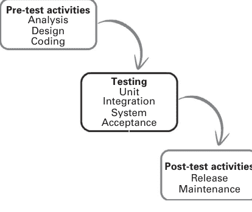

图 13.2 瀑布模型的视图。

瀑布模型被分为三类活动：

- 测试前软件需求：需求捕集、分析、高层设计和详细设计。
- 编码：实现。
- 测试后活动：单元测试、集成测试、系统测试和验收测试。

> ¹ 这是对过程的简化。

## 13.4 V模型

V模型将软件开发过程可视化为规范活动与测试活动之间的关系。V模型背后的想法是通过在过程早期规划测试用例来增加对测试的关注。它之所以被称为V模型有两个原因：对软件产品进行验证和确认的关注，以及过程的形状。

图 13.3 显示了V模型的一个视角。

V模型将编码前和编码后的活动分组，以强调这些关系。

> ⁴ 这是标准V模型图的一个特定视角。

# 软件过程中的测试

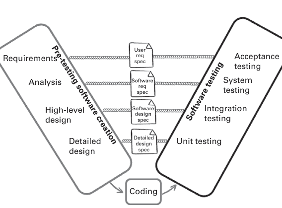

V 模型的优势在于由于模型的刚性，它简单且易于管理，而且它鼓励在所有阶段进行验证和确认：每个阶段都有特定的交付物和评审过程。与瀑布模型不同，它赋予了测试同等的权重，而不是将其视为事后补救。

## 13.5 增量开发与敏捷开发

在许多软件项目中，项目开始时是不可能获得稳定、一致的用户需求集的。瀑布模型和 V 模型开发模式无法为这种情况提供充分的框架，而基于增量或敏捷模型的方法可以提供得多的结果。敏捷软件开发与《敏捷宣言》⁵相关，该宣言概述了四个核心要素：

- 1. 个人和交互优于过程和工具；
- 2. 运行的软件优于详尽的文档；
- 3. 客户协作优于合同谈判；以及
- 4. 响应变化优于遵循计划。

与其他增量开发方法一样，敏捷方法强调在短时间范围内快速发布可交付的软件。与其他增量方法不同，敏捷开发以天或周而不是月来衡量这些时间范围。

> ⁵ K. Beck, M. Beedle, A. van Bennekum, et al. Manifesto for Agile Software Development. The Agile Alliance, 2001.

敏捷开发鼓励软件工程师之间高度的协作。有许多准则可以对敏捷项目提供控制：

- 测试人员应该参与通常发生在开发者和客户之间的需求“协商”过程。这包括提问、识别需求是不稳定的以及其他问题。
- 测试人员应该立即将需求转换为测试用例，作为下一次迭代的文档。测试人员和开发者应该协作实现这些测试用例自动化。
- 当需求发生变化时，应立即通知测试人员，以便他们修改测试用例。

### 13.5.1 增量开发

增量模型从软件系统部分部分的简单实现开始。每个增量都改进产品，直到达到最终版本。图 13.4 显示了以测试为中心的流程说明。

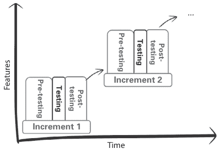

图 13.4 测试人员视角下的增量开发。

在图中，每个增量都从三个阶段的角度被考虑：测试前、测试和测试后。在每个增量中，测试包括回归测试（以确保新增量没有影响之前工作的软件）以及对新功能的测试。经过测试软件的逐步发布意味着软件的中间版本在开发过程中变得更早出现。由于测试的增加以及客户有机会查看产品的早期版本，预计最终产品的质量更高。

增量模型的一个主要优势是产品是以较小的部分进行编写和测试的。这减少了与产品相关的风险，并允许在此过程中轻松地包含更改。此外，通过采用增量模型，客户或产品用户从开始就参与开发。这意味着系统更有可能满足他们的需求，用户也因为见证了系统的成长而对系统的投入度更高。因此，增量方法的另一个优势是加速了客户交付：每次迭代都必须包含重要的新功能，客户可以监控并评估产品的进展。两个主要的缺点是：由于与其他模型相比，缺乏文档导致难以管理；而且软件的不断变化会使其随着规模的扩大而变得难以维护。

### 13.5.2 极限编程

极限编程（`XP`）是敏捷软件开发的早期方法，它强调在迭代中代码审查、持续集成和自动化测试。它倾向于持续的设计精炼（或重构）而不是大型初始设计阶段，以保持实现尽可能简单。它倾向于实时通信（最好是面对面）而不是书面文档，导致与瀑布方法相比的文档更少。运行的软件被视为进展的首要衡量标准。该方法还强调团队工作：经理、客户和开发者都是致力于交付质量的团队的一部分。程序员负责测试自己的工作；测试人员侧重于帮助客户选择和编写功能性测试，并定期运行这些测试。

`XP` 过程鼓励开发者：

- 与客户和程序员同事持续通信；
- 保持他们的设计简单且整洁；
- 从早期软件测试中获取反馈；以及
- 尽早向客户交付系统并按照建议实施更改，以便开发者能够以勇气应对变化的需求和技术。

图 13.5 展示了一个以测试为中心的 `XP` 流程图，突出了测试活动。

用户故事由客户编写，提供了用户需求规格说明。它们的格式大约是客户使用非技术语言编写的约三句文本。用户故事是软件需求的基础，用于规划软件的发布。它们还用于产生测试场景，以驱动每次发布的验收测试。软件的每次发布由多次迭代组成，每个迭代持续 1–3 周。每次迭代可以被认为包含测试前、测试和测试后活动。

### 13.5.3 Scrum

Scrum 是一种用于复杂项目的方法，是敏捷开发的技术。它与 `XP` 相似，但有很多区别：

- Scrum 团队在称为 Sprint（迭代）的迭代中工作。这些迭代比 `XP` 的长一点。
- 只要还没有开始某个特定功能，Scrum 团队就允许引入更改。
- 在 Scrum 中，额外的利益相关者对功能的排序有更大的灵活性。
- 在 Scrum 中，由团队来组织和采用他们认为最好的实践。
- 在 `XP` 中，单元测试和简单设计是内置的。

图 13.6 显示了关注于测试活动的 Scrum 过程⁷

> 7 标准 Scrum 过程关注产品待办列表和 Sprint 循环——见 www.scrum.org/resources/scrum-framework-poster.

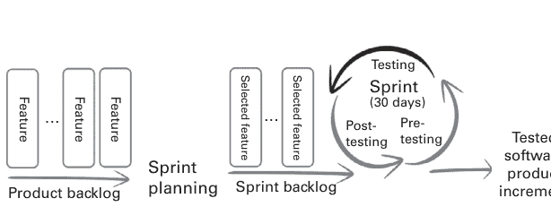

图 13.6 测试 Scrum 过程。

图从产品待办列表开始，它是所需产品功能的优先级列表。Scrum 团队承担产品待办列表，他们认为可以在 30 天的迭代或 Sprint 内转换为功能增量，形成 Sprint 待办列表。一个 Sprint 包括 Sprint 待办列表中每个选取功能的测试前、测试和测试后活动。测试方法取决于团队，并不像 `XP` 那样严格规定，但通常包括单元测试、回归测试等。每个 Sprint 的一部分是每日 Scrum 会议，在图中没有突出，因为它们与测试无关。所选功能还用于创建验收测试，用于验证每个 Sprint 的测试过的产品增量。

这种方法已被证明是成功的，因为测试团队从项目开始就与开发者紧密协作。

## 13.6 与过程相关的质量标准和模型

测试人员应该了解其他许多模型和质量相关的测试标准。通常，它们将测试视为更大质量保证（`QA`）过程的一部分。一个关键模型是 `ISO 9000/25000` 系列标准。`ISO 9000/25000` 系列标准对于为公共招标开发软件和系统的公司来说非常重要——它们为政府机构提供了保证，证明软件是以专业的方式开发的。

# 总结

本章总结了书中介绍的测试技术，反向审视了测试过程以解释测试活动之间的依赖关系，并最后提供了额外的阅读建议以及对研究方向的展望。

## 14.1 总结

本书向读者介绍了以下核心测试性材料：

- 测试导论（第 1 章），涵盖：
  - 软件质量的重要性；
  - 意味着穷尽测试的测试理论；
  - 穷尽测试及其为何不可行；
  - 测试启发式的作用；
  - 静态测试与动态测试；以及
  - 故障模型。

- 基本测试活动的描述（第 1 章）：
  - 测试设计，包括：
    - 需求分析（以及某种程度的源代码分析）；
    - 测试覆盖项的开发；
    - 测试用例和测试数据的开发；以及
    - 测试设计的验证。

  - 测试实现，侧重于测试自动化（第 11 章）；
  - 测试结果的评审。

- 三种黑盒测试技术的描述：等价类划分、边界值分析和用于组合的决策表（分别位于第 2、3 和 4 章）：

  - 等价类划分涉及从代表等效处理的输入输出范围中选择代表性值。它可以被视为使用典型值进行测试。
  - 边界值分析涉及从这些范围中选择上下边界边缘值。它可以被视为使用极值进行测试。
  - 决策表涉及选择可能导致特定处理或不同输出的输入值组合。它可以被视为对所有可能的情况进行测试。

- 三种白盒测试技术的描述：语句覆盖、分支覆盖和全路径覆盖（分别位于第 5、6 和 7 章）：

  - 语句覆盖涉及选择输入值以确保测试代码中的所有状态都被执行。它是白盒测试最简单的形式。
  - 分支覆盖涉及选择输入值以确保测试代码中的所有分支都被取到。它是比语句覆盖更强力的测试形式。
  - 全路径测试选择输入值，以确保被测试代码的所有端到端路径都被覆盖。

- 单元测试和应用测试的概述（第 8 和第 10 章）。

  - 单元测试使用选定的输入值调用方法或函数，并将输出（实际结果）与预期结果进行比较。
  - 应用测试模拟用户与应用程序交互，并确保每个用户故事（`user story`）都符合其验收标准。

- 面向对象软件测试导论（第 9 章）。讨论了三种基本技术：

  - 类上下文中的测试：如何测试类中相互相互作用的方法和属性。
  - 继承测试：测试继承的行为是否正常运行。
  - 基于状态的测试：测试类基于状态的行为。

- 随机测试导论（第 12 章）。随机测试面临三个挑战：

  - 测试数据问题：如何生成有价值的随机数据。
  - 测试断言（`Oracle`）问题：如何为随机输入计算预期输出。
  - 测试完成问题：如何知道何时随机测试。

- 关键测试自动化主题概述，带有代表性示例（第 11 章）。

  - 使用 `TestNG` 进行单元测试；
  - 使用 `JaCoCo` 进行测试覆盖率测量；
  - 使用 `Selenium` 进行自动化应用测试。

## 14.2 反向审视测试

### 14.2.1 测试实现

代码段 14.1 显示了一个简单的自动化的黑盒单元测试，使用等价类划分来测试 `TestItem.categorise()` 方法。该方法的规范将在后文显示。

> 代码段 14.1 示例测试实现

```
@Test void test() {

  TestItem ti = new TestItem();

  assertEquals(100, ti.categorise(23, true));

}
```


代码中有三个数据值：`100`、`23` 和 `true`。还有一个测试方法的名称：`test()`。这些是从哪里来的？让我们检查一下上一个活动。

## 14.2.2 测试用例

数据值来自所需测试用例的规范——此测试的测试用例所示表 14.1。
测试用例 ID (`test1`) 由测试人员使用适当的命名方案分配的。但测试用例中的输入值（`23` 和 `true`）是从哪里来的？预期结果值（`100`）是从哪里来的？以及

**表 14.1 `TestItem.categorise()` 的测试数据。**

| ID | TCI covered | Inputs | Exp. results |
|---|---|---|---|
| test1 | a, b, c | 23, true | 100 |

## 14.2.3 测试覆盖率

数据值来自所需测试用例的规范——此测试的测试用例所示表 14.1。
测试用例 ID (`test1`) 由测试人员使用适当的命名方案分配的。但测试用例中的输入值（`23` 和 `true`）是从哪里来的？预期结果值（`100`）是从哪里来的？以及

**表 14.1 `TestItem.categorise()` 的测试数据。**

| ID | TCI covered | Inputs | Exp. results |
|---|---|---|---|
| test1 | a, b, c | 23, true | 100 |

## 14.2.4 测试分析

对软件规范的分析确定了表 14.3 所示的输入参数划分以及表 14.4 所示的返回值（输出）。

**表 14.3 `TestItem.categorise()` 的输入等价类划分。**

| Parameter | Equivalence partition |
|---|---|
| p1 | Integer.MIN_VALUE..1, 0..100, 101..Integer.MAX_VALUE |
| p2 | true, false |

**表 14.4 `TestItem.categorize()` 的输出等价类划分。**

| Parameter | Equivalence partition |
|---|---|
| Return value | 0, 100, 101 |

## 14.2.5 软件规范

等价类划分源于软件功能规范的分析。规范 Javadoc 所示。

```
public int categorise(int p1, boolean p2)
```

确定值 `p1` 属于哪个组。


## 输入

- `p1`: 正在分析的值
- `p2`: 用于启用/禁用分类的布尔值（或标记）

## 输出

- 返回值：
  - 如果 `p1` 为负数
  - 100 `p1` 在 0 ..100 范围内且 `p2` 为 true
  - 101 其他情况

# 总结

对于对质量有高要求的软件，将测试设计过程的输出记录到如书中所示的详细程度是不寻常的。通常，大部分工作是在测试人员的大脑中完成的。然而，如果没有对分析、TCI（测试边界索引）、测试用例和测试数据的文档说明，几乎不可能审查测试以确保其正确性。无论输出是否写下来，测试人员都必须执行相同的工作。在学习如何测试时，将过程中每项活动的输出记录下来是非常棒的。

# 14.3 延伸阅读

在本书中，我们关注了我们认为软件测试人员必须理解的绝对本质的技术。因此，许多主题仅被简要介绍，或者完全没有涉及。本节提供了一些建议著作，以帮助对书中的主题进行更深入的理解，并建议书中未涵盖的其他额外主题。重点在于描述特定测试技术以及如何在实践中应用它们的著作——许多在较高层次涵盖软件测试，或关注特定工具或环境的书籍并未包含在内。

关于软件测试有很多书籍和论文。在本节中，我们提供了一份推荐著作的注释列表，这些著作我们在准备本书时认为非常有用。列表从讨论软件过程以及测试如何融入其中的通用性著作开始，以针对特定测试技术或测试方面的更具体的著作结束。我们在每个领域仅提供了少数精选的关键文本；这并不是对软件测试文献的全面综述。所有这些阅读内容的详细信息请参阅“参考文献”。

标准的软件工程教材包括《Software Engineering: A Practitioner's Approach》（Pressman 著）和《Software Engineering》（Sommerville 著）。这些书籍都描述了软件工程的流程，并对软件测试以及它如何融入该过程进行了概述。

## 14.3.2 软件测试标准

最著名的国际标准是 IEEE/ISO/IEC 29119。它从五个视角详细研究了软件测试。

- 第 1 部分定义了概念和定义。
- 第 2 部分描述了测试过程。
- 第 3 部分讨论了测试文档。
- 第 4 部分定义了特定的测试技术。
- 第 5 部分涵盖了关键字驱动测试。

标准中的每项技术书中并未涵盖，书中每项技术也未包含在标准。当前标准未涵盖的三个特定主题是集成测试、面向对象的软件测试以及全路径测试。该标准定义了一种非常详细且严谨的软件测试方法——可能只有对高质量软件有需求的大型组织才会使用完整的标准。关于测试特定方面有很多相关的 IEEE 标准。

另一个关键标准是 ISO 25000 系列标准。这些标准为软件需求和评估提供了指南，并且本质上与过程相关。

## 14.3.3 软件测试技术

关于软件测试技术的经典书籍有《Software Testing》（Roper 著）和《The Art of Software Testing》（Myers 著）。Roper 书中的思想在今天仍然具有意义，而且这本书对如何实际应用测试技术提供了极佳的描述。Myers 提出了许多有趣的观点，但它们通常需要读者解读才能应用到实践中。

该主题的现代经典是《Introduction to Software Testing》第 2 版（Ammann 和 Offutt 著）。它为软件测试提供了极佳的数学基础。这是一本最适合扩展经验测试人员理解的书。

## 14.3.4 测试面向对象的软件

关于该主题有很多书籍，但在我们看来，最好的是《Testing Object-Oriented Systems: Models, Patterns, and Tools》（Binder 著）。该书对该主题进行了详细覆盖，并被视为参考书而非入门教科书。它可能在任何软件测试书籍中对故障模型的使用提供了最好的讨论。它还对 UML 图以及如何使用它们作为测试数据源进行了详细的（尽管略显过时）阐述。

## 14.3.5 集成测试

对于现代开发环境中如此重要的主题，对集成测试系统化技术的关注却令人失望。特别是对于故障模型以及如何识别测试覆盖项和测试数据，缺乏详细的定义。在敏捷过程中，软件是以系列增量生产的，每当每个增量被添加时（软件集成），就都应该对其进行测试，以确保它与现有代码正常工作（集成测试）。集成测试目前被视为一种临时性方法（ad-hoc approach），最好通过大型系统的经验来学习。

我们挑选了两本该主题的代表性书籍，分别是《Integration Testing from the Tranches》（Frankel 著）和《Continuous Integration》（Duvall 著）。Frankel 有许多示例，并展示了如何使用多种工具，还包含了对与外部软件系统集成的有趣讨论。从测试的角度来看，Duvall 更多关注如何自动化测试（单元、系统、功能）。两本书都对存桩/模拟（stubs/mocks）以及用于测试的工具进行了有效的覆盖。

我们向读者推荐这个主题作为未来研究的一个重要且富有成果的领域。

## 随机测试

目前没有涵盖随机软件测试原理的最新、全面的教材。

关于随机测试原理的详细介绍可以在《New Strategies for Automated Testing》（Ahmad 著）中找到。书中提到的 DART 技术可以在《Directed Automated Random Testing》（Godefroid 著）中找到。关于随机测试的最新综述可以在《Adaptive Random Testing》（Huang 著）中找到。从测试的角度来看，Duvall 更多关注如何自动化测试（单元、系统、功能）。对读者特别感兴趣的 Android 测试方法可以参考《Sapienz: Multi-objective Automated Testing》（Mao 著）。

## 语言特定风险

大多数编程语言都是简单性和特性之间的权衡。这导致了在设计语言时可能出现的错误。测试人员应该理解这些风险以编写语言特定的测试。

有很多关于该主题的书籍。对于 Java 程序员来说，最详细的是《More Java Pitfalls》（Daconta 等人 著）。这本书对测试人员非常有帮助，因为它识别了可能导致代码错误的构造结构。

测试人员应该知道“反模式”一词，它被用来指不推荐的实践。如果软件使用了反模式，它可能存在缺陷。《AntiPatterns: Refactoring Software, Architectures, and Projects》（Brown 等著）是对该主题的很好的介绍。

## 14.3.8 程序证明

静态验证（或程序证明）可以使用逻辑、集合论等数学方法证明代码的正确性。多年来，它被视为动态软件测试的有力补充，甚至是替代。然而，尽管取得了许多进展，但缺乏支持最新版本的商业工具。

该领域的一些经典著作有《A Method of programming》（Dijkstra 和 Feijen 著）、《The Specification of Complex Systems》（Cohen 著）以及《Program Specification and Verification in VDM》（Jones 著）。大部分工作通过研究结果获取，这里列了一些相关结果，重点关注最近的结果和某些语言：

- Viper 工具集及相关研究支持 Python、RUST、Java 和 OpenCL 等语言——我们建议将其作为初学者的起点，因为有在线教程和证明工具可用：
  - `www.pm.inf.ethz.ch/research/viper.html`
  - `https://vercors.ecwi.utwente.nl`

- JML 语言和工具集支持 Java 语言，尽管目前不支持最新的 Java 版本。
  - `www.openjml.org`

- Spec# 是微软的一个针对 C# 语言非常有前景的项目，但遗憾的是它已经停止了。
  - `https://research.microsoft.com/en-us/projects/specsharp`

## 14.3.9 安全关键软件测试

安全关键软件的质量至关重要，有很多针对该主题的作品。建议阅读包括：

- NIST 的软件自动化组合测试（ACTS）计划—— `www.nist.gov/programs-projects/automated-combinatorial-testing-software-acts`

- NASA 关于 MC/DC 的开创性论文《Practical Tutorial on Modified Condition/Decision Coverage》（Hayhurst 著），它通过增加验证每个单独条件的变更对决策结果影响的要求，扩展了决策/条件覆盖。

## 结语

## 14.3.10 独辟蹊径

本书对软件测试引入了系统性的介绍——我们认为，在“跳离常规”之前，理解测试的核心要素是非常关键的。在实践中，软件测试人员可能需要表现出巨大的创新精神，才能有效地测试软件系统。我们在这里列选了一些书籍，这些书籍可能会激发灵感，用于增强书中介绍的更结构化的方法，并让读者了解软件测试人员更广泛的角色。

- 《黑盒测试》（Bezier 著）和《软件测试完全》（Hetzel 著）是软件测试领域的其他经典著作。它们的方法与其他经典书籍相比结构化程度较低，我们推荐它们作为从更全局视角考虑软件测试的有用参考。
- 《测试计算机软件》（Kaner 等人著）探讨了对书中涵盖内容的补充性问题。它分为三个部分：基础知识、特定技能测试以及测试项目和团队管理。我们因其涵盖面广而推荐这本书。
- 《软件工程手册》（The Software Engineering's Handbook，Bath 和 McKay 著）是 ISTQB 测试分析师和高级测试分析师认证的学习指南。我们推荐这两本书用于准备该认证，并推荐前一本书是因为其涵盖面广。
- 《谷歌软件之道》（How Google Software，Whittaker 等人著）为读者提供了工业化环境中软件测试人员角色的绝佳思路。我们推荐它带给读者的深刻见解。

# 14.4 研究方向

正如软件工程的许多领域一样，软件测试的研究是一个宽泛且多样化的领域。本节为读者提供了去获取更多信息的指引。

## 14.4.1 会议

以下会议列表并非详尽，但它为读者进一步探索该主题并获取前沿知识提供了一个起点：

- AITEST 人工智能测试国际会议
- CAST 软件测试协会会议
- EUROSTAR 欧洲软件测试年度会议
- ICSTPP 软件测试、类型与过程国际会议
- ICSE 软件工程国际会议
- ICSQ 软件质量国际会议
- ICST 软件测试、验证与确认国际会议
- ISSTA 软件测试与分析国际研讨会
- QUEST 质量工程软件与测试会议
- SoCRATEs 软件工艺与测试国际会议
- STAREAST 和 STARWEST 软件测试分析与评审会议
- STPCON 软件专业人员会议
- VALID 系统测试与验证生命周期进展国际会议

## 14.4.2 研究课题

以下概述了从上述会议中选出的若干具有代表性的研究领域：

- **基于搜索的软件测试。** 随机测试通常用于实现白盒覆盖标准，如代码覆盖率。研究方向在于利用基于搜索的技术来达到特定的标准。
- **变异分析。** 变异测试的思想主要应用于源码层级。近期，该思想已应用于测试不同的产物，包括对所用表示法的研究。
- **回归测试削减。** 运行回归测试通常是最耗时的测试活动。当软件发生更改或扩展时，检查现有功能是否正常工作与检查新功能是否正常工作同样重要。研究方向是寻找重新运行的最优测试集。
- **基于模型的测试。** 近年来，人们对使用模型（如 UML）进行软件测试兴趣日益增加。研究包括模型到代码转换的形式化验证、为基于模型的测试添加调试支持，以及基于模型的自动测试数据生成。
- **自动化软件验证。** 形式化规范为运行时或静态的自动化测试提供了基础。这些通常以断言的形式存在，说明了使软件符合其规范的前置条件、后置条件和不变性。研究开始提供能够对软件与其规范进行静态和动态评估的工具。
- **新技术。** 新软件技术和架构要求以新的方式应用测试原则。例如，研究有效测试 SOA（面向服务的架构）、虚拟化、动态软件系统、GUI（图形用户界面）、云计算和人工智能。
- **软件过程与工具。** 测试是软件过程的关键部分，而工具对其支持至关重要。研究活跃于测试与其他过程活动之间的关系、测试驱动开发过程的发展以及测试作为质量衡量标准的有效性。新方向的良好示例包括用于 Android 应用和自动驾驶的自动化测试工具。

# 附录：运行

书中所有的示例可以在 Windows、Linux 或 MacOS 上运行。在运行任何示例之前，你必须安装 JDK 11。为了简单起见，书中的所有示例均使用 Java 11 开发。

书中的示例可以从命令行运行。为了简单起见，书中的所有示例均使用 Java 11 开发。

The examples in the book can be run from the command line. For simplicity, all examples in the book have been developed using Java 11.

# 参考文献

- Ahmad, M. New strategies for adaptive testing. PhD Thesis, University of York, 2014.
- Ammann, P. and Offutt, J. Introduction to Software Testing, 2nd ed. Cambridge University, 2017.
- Bath, G. and McKay, J. The Software Engineering's Handbook: A Study Guide for ISTQB Test Analyst and Test Analyst Advanced Certification. Rock Nook, 2015.
- Bezier, B. Black-Box Testing: Techniques for Functional Testing of Systems. Wiley, 1995.
- Binder, R. Object Oriented Systems: Models, Patterns, and Tools. Addison-Wesley, 2010.
- Brown, R. AntiPatterns: Software, Architectures, and Projects. Wiley, 1998.
- Cohen, B. W. The Complexity of Systems. Addison-Wesley, 1986.
- Daconta, M. and Richardson, D. Java Pitfalls. Wiley, 2003.
- Dijkstra, E. Method of Programming. Pearson Education, 1988.
- Gosling, J., Joy, B., Steele, G., Bracha, A., and Smith, D. The Java Language Specification, Java SE 11 Edition. Oracle, 2018.
- Grady, R.,B. Practical Metrics for Project Management and Process Improvement. Prentice-Hall, 1992.
- Hayhurst, K.J., Veerhus, D.S., Chilsenski, J.J., and Rierson, L.K. A practical tutorial on modified/condition coverage. Technical report. NASA, 2001.
- Hetzel, B. The Complete Guide to Software Testing. QED Information Sciences, 1988.
- Huang, R. W. Xu, et al. A survey on adaptive random testing. IEEE Transactions on Software Engineering, DOI:10.1109/ISE.2019.2942921
- Liskov, B.H. and Wing, J.M. A behavioral notion of subtyping. ACM Transactions on Programming Languages, Systems, Vol. 16, No. 6, 1994.
- ISO/IEC 25010:2015 Systems and software engineering – Systems and software Quality Requirements and Evaluation (SuaRE) – System and software quality models.
- ISO/IEC/IEEE 29119-3:2013 软件与系统工程 – 软件测试 – 第3部分：测试文档。
- ISO/IEC/IEEE 29119:2016 软件与系统工程 – 软件测试（第1–5部分）。
- Jones, C., Program Specification and Verification in VDM. Springer-Verlag, 1987.
- Kaner, C., J. Falk, and H. Nguyen. Testing Computer Software. Wiley, 1999.
- Kelheger, D. and K. Murray. Information Technology Law in Ireland. Bloomsbury Professional, 2007.
- Mao, K., M. Harman, and Y. Jia. Sapien: Multi-objective automated testing for Android applications. In Proc. 25th Int Symp. Software Testing and Analysis. ACM, 2016.
- Myers, G.J. The Art of Software Testing. Wiley, 2004.
- NIST. The Economic Impacts of Inadequate Infrastructure for Software Testing, NIST, 2002. Pleeeger, S.L., and J.M. Atlee. Software Engineering: Theory and Practice, 4th ed. Pearson Higher Education, 2010.
- Pressman, R. and B. Maxim. Software Engineering: A Practitioner’s Approach. McGraw-Hill, 2014.
- Roper, M. Software Testing. McGraw-Hill, 1994.
- Software Magazine. 2018 Software 500 Companies. Available at: `https://www.rcpbuyguide.com/top-companies.php`.
- Sommerville, I. Software Engineering, 10th ed. Pearson, 2016.
- Vinter, O. and P. Poulsen. Experience-driven software process improvement. In Proc. Conf. Software Process Improvement (SPI 96). International Software Consulting Network, 1996.
- Whittaker, J., J. Arbon, and J. Carollo. How Google Tests Software. Addison-Wesley, 2012.

# 列表

- 1.1 用于检查的随机测试 ( )。
- 2.1 在 TestNG 中实现的测试 T1.1。
- 2.2 测试 T1.1 和 T1.2。
- 2.3 使用等价划分的 OnlineSalesTest。
- 2.4 OnlineSales.java – 方法 `giveDiscount()`。
- 2.5 故障 1。
- 2.6 故障 2。
- 3.1 用于边界值分析 (BVA) 的 OnlineSalesTest。
- 3.2 故障 3。
- 4.1 用于决策表测试的 OnlineSalesTest。
- 4.2 故障 4。
- 5.1 故障 4。
- 5.2 用于语句覆盖测试的 OnlineSalesTest。
- 5.3 故障 5。
- 6.1 故障 5。
- 6.2 用于分支覆盖测试的 OnlineSalesTest。
- 6.3 故障 6。
- 7.1 故障 6。
- 7.2 用于全路径测试的 OnlineSalesTest。
- 7.3 `condIsNeg()` 的源代码。
- 7.4 故障 7, 8 和 9。
- 9.1 SpaceOrder 类。
- 9.2 SpaceOrder 等价划分测试实现。
- 9.3 SpaceOrder 基于状态测试实现。
- 9.4 带有 BIT 的 SpaceOrder。
- 9.5 带有简单类型故障的 SpaceOrder。
- 9.6 带有状态故障的 SpaceOrder。
- 9.7 带有继承的 TrackableSpaceOrder。
- 10.1 Fuel Checker T1。
- 10.2 Fuel Checker 测试 T1, T2, T3, T4, T7。
- 10.3 Fuel Checker 测试 T5。
- 10.4 Fuel Checker 测试 T6。
- 10.5 `returnTo()` 方法。
- 10.6 TestNG/Selenium 设置代码。
- 10.7 TestNG/Selenium 关闭代码。
- 10.8 初始化。222。
- 10.9 正确的导航代码。222。
- 10.10 错误的导航代码。223。
- 10.11 正确的元素代码。224。
- 10.12 错误的元素代码。224。
- 10.13 正确的功能代码。226。
- 10.14 错误的功能代码。226。
- 11.1 示例 TestNG 源码/DemoTest.java.233。
- 11.2 示例 XML 文件/example.xml.235。
- 11.3 使用 `@BeforeMethod`。237。
- 11.4 内联测试。239。
- 11.5 参数化测试。240。
- 11.6 使用迭代器的 `@DataProvider`。241。
- 11.7 DataGenerator 类。241。
- 11.8 带有超时时的。244。
- 11.9 带有无限循环的代码。245。
- 11.10 抛出异常的代码。245。
- 11.11 异常处理。246。
- 11.12 Circle 的源码。248。
- 11.13 Circle 的源码。248。
- 11.14 ShapeTest - 按名称。249。
- 11.15 可继承的 ShapeTest.250。
- 11.16 CircleTest 继承 ShapeTest.251。
- 11.17 带有依赖的 ShapeTest.253。
- 11.18 带有组的 ShapeTest.254。
- 11.19 带有组的 CircleTest.254。
- 12.1 `give()` 的随机等价划分测试。262。
- 12.2 FuelCheckTest 的设置。265。
- 12.3 存储的数据值。266。
- 12.4 FuelCheckTest 的 `@AfterMethod`。267。
- 12.5 数据提供者和测试方法。268。
- 12.6 带有故障 10 的 OnlineSales.giveDiscount ()。275。

# 索引

- `@AfterClass`, 219, 238
- `@AfterGroups`, 239
- `@AfterMethod`, 239
- `@AfterSuite`, 239
- `@BeforeClass`, 219, 238
- `@BeforeGroups`, 239
- `@BeforeMethod`, 237
- `@BeforeSuite`, 239
- `@DataProvider`, 38
- `@Test`, 37, 233
- 实际结果, 22
- 敏捷开发, 282
- 全路径覆盖, 113
- 全路径测试, 123
- 应用测试, 208, 264
- assertEquals, 37
- 自动化测试, 22, 37, 230
- 基路径, 130
- 黑盒测试, 14, 142, 143
- 布尔条件, 97
- 边界值, 48
- 分支, 99
- 分支覆盖, 99
- 内置测试 (BIT), 185
- 原因, 60
- 组合, 60
- 条件覆盖, 155
- 控制流图 (CFG), 114
- 数据流覆盖, 158
- 决策覆盖 (DCC), 159
- 决策覆盖 (DC), 159
- 决策表, 60, 65
- 决策树, 274
- 设计验证, 35
- 导向随机测试 (DART), 272
- 不连续输入划分, 148
- 动态测试, 16
- 端到端路径, 113, 123
- 等价划分, 27
- 影响, 60
- 遗漏错误, 145
- 穷举测试, 1
- 浮点数, 155
- 模糊测试 (fuzz testing), 273
- IEEE 标准 29119, 26, 292
- 带内错误报告, 150
- 增量开发, 278, 283
- 继承测试, 181, 247
- 集成测试, 18, 209, 293
- iOS Driver, 258
- Java 标记语言 (JML), 271
- Liskov 替换原则, 181
- 手动测试, 36
- 平均故障时间 (MTTF), 272
- 模拟对象 (mocks), 210
- 修正条件决策覆盖 (MC/DC), 161
- 多条件覆盖 (MCC), 160
- 变异测试, 15
- 自然范围, 28
- 数值处理, 156
- 对象约束语言 (OCL), 271
- 重叠输出划分, 149
- 对测试, 80
- 编程, 17, 295
- 随机数据问题, 272
- 随机测试, 13, 259, 294
- 记录与回放测试, 221
- 回归测试, 18
- 相对划分, 151
- 基于修复的测试, 163
- 规则, 61
- 运行时断言检查 (RAC), 271
- Scrum, 258
- Selendroid, 258
- Selenium, 202, 231, 255
