# 项目决策评估：软件工程案例研究


> 献给我的父亲，他与我分享对科学的热爱。  
> ——Carol L. Hoover

> 献给我的母亲和哥哥，他们认为我不会读书，更不用写书了。  
> ——Mel Rosso-Llopart

> 献给我亲爱的三个女孩和远洋彼岸的家人，  
> 感谢他们永远的支持。  
> ——Gil Taran

- 1.4 总结 ................................................................................. 18
- 5.4 总结 ................................................................................. 165

本页特意留

# 前言

全球范围内的软件工程专业人士和学生每天都会做出影响其软件项目（MSE）结果的决策。尽管有些人取得了非常成功，但遗憾的是，另一些人没有采取必要的步骤来确保决策可能导致成功。例如，不提问正确的问题通常会导致解决方案无法充分解决所考虑的问题。同样，错误假设的制定可能会在决策不当这一根源之后，导致更大的工程失败。软件专业人士面临的一个共同挑战是在糟糕的决策造成更严重的问题之前对其进行识别和纠正。这可能是因为事实是在其影响完全显现之前对其进行监控和评估。

根据我们自己作为软件工程师和项目经理的经验，我们亲眼观察到了对软件工程进行评估和决策时系统性方法的必要性。我们观察到，通常情况下软件项目的决策缺乏一种分析方法，这种方法可以系统地、一致地应用，以增加做出导致成功决策的概率。作为卡内基·梅隆大学软件工程硕士（MSE）课程的研究生教育者，我们使用的软件工程教科书讨论了涉及需要决策的问题，但没有专门讨论如何评估和做出这些决策。我们在通用业务和项目管理领域发现了关于决策的出版物。遗憾的是，这些著作没有解决软件开发项目必须做出的特定决策，或者没有触及与这些决策相关的问题的细微差别。

我们寻找了案例研究，以帮助学生在现实世界的场景背景下学习软件工程问题。使用模拟案例被认为是计算机科学和工程领域有效的教学工具，但发现很少有针对软件项目经理或软件开发者所面临的特定问题的已发表案例讨论了软件工程的决策方面。为了填补理论与实践之间的空白，我们决定写一本书，以满足软件工程从业者和学生理解真实软件项目背景下决策的需求。

本书的目的是帮助从业人员、经理、学生和教育者获取为软件项目管理和软件开发进行评估和做出良好决策所需的知识和技能，并识别错误的决策。本书侧重于构建案例研究，以帮助读者理解并应用对于在真实软件项目中形成、实施、监控和评估关键决策至重要的概念。案例研究基于行业、规模和预算各异的组织的真实项目场景，但更改了组织和利益相关者的名称以保持真实实体的机密性。本书并未穷尽涵盖可能发生的每一个工程事件。相反，案例研究重点关注通常决定当今软件项目成败的问题和决策。

具有软件项目全生命周期实操开发或管理经验的读者将从书中受益最多。我们希望这本书能够作为专业指导指南，用于管理可能导致软件项目成功的决策。具有一些软件工程本科水平课程或具有专业软件工程经验的高年本科生或研究生，也会发现这些材料是探索现实世界软件项目中决策的一种启发性方式。

本书的读者可以获取导致软件项目失败的问题和问题的知识。读者将学习经常发生、对软件项目有巨大影响、或具有新兴且日益增长性的问题和问题。案例研究说明了在用户期望与提供者解决方案之间映射中的重要决策。案例分析强调了分析软件工程问题或问题的有效技术，以及确定做出最佳决策或解决方案的方法。本书还讨论了评估针对特定软件项目问题或问题的决策或解决方案是否有效的指标。

通过阅读和分析软件工程案例研究，你可以培养识别表征软件项目问题关键因素的技能。你可以学习如何分析与特定项目场景相关的问题和问题。案例分析活动将引导你研究为了解决案例问题可以做出的替代决策。它们将帮助你建立如何将案例应用到真实软件项目的想法。我们希望你发现这些案例研究是学习软件工程中关键问题以及如何将决策技术应用于真实世界软件工程项目的一种有趣方式。

# 章节梗概

以下是每章主题和案例研究的梗概。你会注意到，所有的章节标题都包含了“管理”一词。我们使用“管理”是为了强调项目经理和软件工程师需要主动识别特定领域的问题或问题，分析并评估其重要性，决定需要采取的行动，通过行动实施决策并监控结果。我们希望推广这样观点：所有软件人士而不只是经理，都需要管理他们所做的决策。案例研究说明了由软件项目利益相关者做出或需要做出的决策。在某些情况下，利益相关者的决策方式导致了项目成功。在其他情况下，利益相关者对他们所做的决策管理得不好，从而遇到项目问题，有时会导致失败。

## 第一章 管理决策

第1章讨论了软件工程中的决策，提出了一个评估决策的模型，并展示了该模型如何应用于案例研究中利益相关者所做的决策。本章通过涉及技术问题的决策场景说明了模型的应用。

## 第二章 管理需求

第2章概述了管理需求涉及的活动：需求获取和陈述、需求的验证与确认、需求的谈判与签约、需求变更和范围管理，以及根据需求验证软件交付。本章对每个需求活动的问题和决策进行了深入讨论。本章强调需求管理持续到软件退役。

### 案例研究

- *HBC 的新账户项目*：该研究强调了建立需求涉及的活动和决策。特别是，该案例说明了关于利益相关者选择和参与决策可能出现的问题。
- *准时、预算内，但方向错误*：该研究说明了在建立和管理需求时做出的决策如何导致软件项目交付物不符合用户利益相关者的期望，尽管项目进展良好。特别是，案例场景涵盖了功能性和非功能性需求，包括关于所需质量属性的陈述。

## 第三章 管理估算

第3章阐明了估算对于规划和管理软件项目以及软件工程工作的重要性。本章讨论了管理估算涉及的活动：理解需求，从概念上设计解决方案、执行元素级分解（拆分）、自下而上分配资源（解决）、分配开销、估算构建成本以及估算变更管理。本章介绍了将范围、时间、质量和成本的考虑因素纳入项目估算决策的方法。

### 案例研究

- 估算作为工具：本案例研究了通过收集、研究和应用历史数据来改进管理流程。在案例中，一名软件项目经理必须确定适当的输入，以便对某项工作的估算做出良好的决策。
- 当团队参加比赛时：本案例研究了影响估算的因素，以及这些因素如何导致对估算的错误决策。该案例还关注了与具有相互依赖的资源、人员和开发工作的多个项目并行执行相关的问题。

## 第四章 计划管理

第4章探讨了决策在软件项目规划中的作用。本章概述了相关的规划活动，例如：定义项目目标、政策和范围；规划任务和里程碑；规划进度；规划预算；其他资源规划；跟踪和控制预算与进度；管理中期至项目计划；根据项目目标、政策和其他项目计划管理流程；以及根据项目目标、政策、进度和预算管理软件开发。

### 案例研究

- 重新规划还是不重新规划？：本案例研究讨论了何时、为何以及如何调整预算、进度或人员配置的评估和决策。
- 计划管理在细节之中：本案例研究关注了软件开发组织在规划和跟踪软件项目时面临的问题和决策，特别是那些与其他项目或工程小组共享资源的项目。

## 第五章 产品管理

第5章概述了管理软件产品涉及的问题和决策。本章讨论了涉及产品管理的以下活动：适当的产品定义、开发过程管理、质量保证与控制、配置管理、产品交付与安装、培训、现场服务以及应用决策模型来做出产品决策。

### 案例研究

- 新技术——它总是最好的吗？：在案例研究中，项目经理必须就采用新的开发技术和方法做出决策，以创建一个更容易维护且使用成本更低的产品。
- 为什么这个产品错了？：在案例研究中，一名软件开发人员面临着困境，似乎他的一切都都是正确的，但仍然得到了错误的答案。

## 第六章 过程管理

第6章强调了管理软件开发和软件项目管理过程的重要性。本章讨论了涉及过程管理的活动：定义、选择和理解过程；教授过程；衡量过程；评估过程性能；改变过程以提高其有效性；以及利用决策来做出过程决策。

### 案例研究

- 处于边缘的银行：在案例研究中，一名项目经理要求两个顾问评估他的团队在过程上是否做出了正确的决策，以及团队是否有什么可以做的事。
- 管他什么过程，全速前进：在案例研究中，一名项目经理被要求审查另一个经理的出现问题的项目。该陷入困扰的项目落后于进度，没有人能清楚地识别是什么导致了进度延误，或者应该采取什么措施来修复项目流程。经理必须决定他如何帮助这个陷入困扰的项目。

## 第七章 风险管理

第7章强调了在整个项目生命周期中管理风险的重要性。本章讨论了涉及风险管理的活动：定义项目风险阈值、识别项目风险、制定风险陈述、向项目利益相关者传递风险信息、缓解风险，以及在做出如何管理风险的决策时进行资源权衡。

### 案例研究

- Web 技术：本案例研究调查了一个学术机构在尝试使用离岸开发公司（位于莫斯科的俄罗斯公司）开发基于 Web 的系统时面临的决策和风险。特别是，该案例说明了当项目利益相关者在整个过程中仅进行最少风险管理时会发生什么。
- Falcon 寓教与 RiskSim 项目：本案例研究关注与客户-开发人员相关的软件项目风险，以及沟通、需求和开发。

## 第八章 人员互动

第8章讨论了影响人员互动的因素，并展示了理解这些因素如何帮助专业人员在工作中管理互动。本章专门描述了涉及管理互动的活动：理解互动场景、理解影响互动的因素、决定互动目标、评估影响互动的因素。

### 案例研究

- 全球分布团队：FibreNet 项目：本案例研究强调了项目团队在全球范围内分布时的沟通、协作和信任问题。软件项目经理需要决定如何在不同的项目站点之间改进这些方面。
- 紧迫感：TestBridge：在案例研究中，项目经理必须考虑团队在过程上是否做出了正确的决策，以及团队在哪些方面可以做些什么。
- 朋友还是不是：Hanover-Tech：本案例研究关注在管理层面对人员互动的管理，平衡财务、战略和个人方面的约束。

## 第九章 利益相关者预期

第9章阐明了利益相关者预期的本质。本章引入了理解客户预期与供应商预期之间映射的模型。本章讨论了涉及管理利益相关者互动的活动：与客户利益相关者沟通、管理多个维度的预期、通过产品和过程管理预期、理解不同类型的客户以及管理利益相关者的感知。

### 案例研究

- TCP 增强：Gigapixel 系统：在案例研究中，软件团队遇到了与客户预期相关的意外问题，以及内部团队动态和与客户的关系。
- 困难销售：Henkel Labs：本案例研究呈现了一个棘手的情况，需要在一个拥有多个子公司和来自不同文化背景人员的全球组织中管理预期。

## 第十章 全球开发管理

第10章讨论了管理地理分布的软件工程工作的问题和决策。本章阐明了跨地理差异沟通的挑战、理解和处理文化差异、管理分布式项目和软件开发、管理外包软件开发、在分布式或外包开发中管理软件质量，以及跨地理分布的利益相关者管理预期。

### 案例研究

- 全球分布团队：FibreNet 项目：本案例研究突出了全球分布团队的沟通、协作和信任问题。软件项目经理需要决定如何改进这些方面。
- FibOptia 全球软件开发：本案例研究关注全球软件开发在管理流程、产品质量和成本方面的特定问题。高级经理正在决定如何帮助她的全球软件开发组织进行流程和产品改进。

在第1章“管理决策”中，我们讨论了决策对软件工程本质和意义。我们介绍了一个开发并在实践中使用的决策模型，以帮助软件专业人员评估决策。本章提供的背景信息将帮助你更容易识别和思考案例研究中出现的问题和冲突。因此，在阅读本书其他章节之前先读本章将让你受益。其他章节在软件项目常见管理领域的背景下讨论决策。这些章节广泛涵盖了在对这些领域做出决策时的人员、过程和技术。由于评估风险应该是决策过程中不可或缺的一部分，所有章节都讨论了风险。

针对特定管理领域的决策制定背景。第7章“风险管理”更广泛地涵盖了软件项目整个生命周期中的风险管理。此外，由于过程关注的是事情是如何完成的，我们讨论的所有章节中，当软件专业人士管理软件工程的特定方面时，都讨论了过程问题。

第2至10章给出了学习目标。第二部分为在特定的软件管理领域做出决策提供了背景。该背景描述了软件专业人士为管理项目领域而执行的主要活动。另一种来说，第10章“管理全球化开发”的背景解释了管理全球化开发的活动包括其他管理领域的活动，并增加了额外的挑战、约束和机会。本章还讨论了在相关管理领域做出决策的关键思想、实践指南或“假设如果”类的问题。背景部分通过示例应用了第1章中的 PEAK 决策模型来解释这些决策。部分背景信息以表格形式呈现，以帮助你在需要时快速吸收和记忆。这些章节介绍了了关于影响软件项目利益相关者期望的因素的决策背景：范围（需求）、时间（进度）、质量和成本（预算）。本章还包含了相关的出版物引用，为感兴趣的读者提供软件管理领域的背景。作者建议您在阅读案例研究之前，阅读或浏览每章的目标和内容。

每章的下一部分介绍了两个案例场景，突出了与本章主题相关的关键问题和决策。第一个案例研究包含了对案例研究决策的全面分析，以及针对 PEAK 决策模型的决策。案例研究讨论了案例场景中利益相关者所做的决策，以及需要做出的后续决策。某些案例研究会告诉您利益相关者为了解决案例问题决定做什么，并包含这些决策的结果；另一些则将案例问题的解决方案评估留给案例分析。案例结尾通过一组问题来激发对后一个部分的分析。最后一部分总结了关于本章需要记住的重要思想。所有章节的参考文献列表出现在书末。

我们希望让您对书中参考文献建立一个合理的预期。我们并不打算让这本书成为各种软件管理领域研究和出版物的综述。我们包含了一些精选参考文献，旨在为软件工程初学者或对案例研究涵盖的主题不熟悉的读者提供背景，或者为感兴趣的读者提供补充信息。某些参考文献是特意选择旧版本的，因为它们提供了特定概念的原始且最佳的定义，或者这些来源中讨论的概念对于当今的软件项目仍然具有高度相关性。参考材料包括书籍、会议和研讨会论文、期刊和杂志文章以及在线信息。它们广泛涵盖了来自业务管理、土木工程、通信、计算机科学、决策科学、英语文学、电影、管理与管理科学、网络、心理学、监管政策、软件工程、系统工程等领域的课题、事件或引言，为案例研究和决策场景提供了背景信息。

我们的部分评审人员指出，某个案例研究似乎适用于不同的章节或软件项目管理领域。在阅读本书时，您可能会发现某个案例研究涉及多个管理领域的问题。我们特意在特定的章节和管理领域设计了这些案例，您可能会分析其他章节中的案例研究，其问题和决策涉及相同的管理领域。例如，所有的案例研究都涉及涉及范围、时间、质量、成本、风险、利益相关者期望、沟通和其他人际交互的问题与决策，或其组合。另一个例子是，第7章“风险管理”、第9章“利益相关者期望管理”和第10章“全球化开发”中的案例涵盖了与全球软件开发相关的问题。第7章其中一个案例的场景涉及离岸团队的开发，而第9章的一个案例则了建立由公司全球分支机构执行的项目。第10章的两个案例都涉及全球分布的软件开发团队。

我们书籍的评审人员要求对所有案例研究提供完整的分析。我们与编辑讨论了这一点，共同决定由于空间和成本考虑，在书中包含这些额外信息是不现实的。我们的评审人员就他们希望在案例研究中讨论的话题给出了极佳的建议。因此，我们决定提供一个网站，您可以在 `www.andrew.cmu.edu/user/rosso/` 获取补充信息。该网站将在新的案例研究和分析可用时为您提供额外的案例研究和分析。根据我们的时间限制，我们将尽力为您提供章节中第二个案例的分析。

我们希望您享受阅读本书的旅程，并在您在软件工程的学习和实践中遇到问题和决策时，将本书作为指南。

# 致谢

Addison-Wesley 的员工在我们创作书籍的过程中非常有非常有帮助。我们衷心感谢书籍编辑 Peter Gordon 和编辑助理 Kim Boedigheimer，感谢他们关于出版过程的信息、编辑建议以及无处不在的帮助。制作团队包括 John Fuller、Anna Popick、Molly Sharp、Kim Wimpsett、Kelli Brooks 和 Fred Brown。对他们将我们的电子文件转换为完整且有市场的书籍所做的贡献表示诚挚感谢。我们特别感谢他们对质量问题的关注。感谢 Stephane Nakib 在营销和广告方面的贡献。感谢 Anne Jones 提供了精美且现代的书封面。

最后，但绝非不，我们的家庭提供了巨大的鼓励并耐心等待我们完成！感谢你们。

# 作者简介

Carol L. Hoover 博士在工业界和学术界进行了二十多年的软件系统研究与开发。她的重点是具有实时、高保证和其他质量要求的复杂系统。自2005年以来，Hoover 博士一直是 Biznession, LLC 的总裁兼首席执行官，该公司的使命是通过战略规划和决策、分析软件组合和知识管理帮助软件开发组织管理软件演进。在1992进入梅隆大学后，Hoover 博士在软件研究所担任主任和高级系统科学家，教授了航空航天项目规划、管理和执行的博士级课程；在机器人研究所担任项目科学家和经理；并在计算机学院担任软件工程硕士讲师。她在自动化软件设计、软件知识工程、创新 STEM 教育以及技术相关政府政策的研究源于她之前在 Allen-Bradley 公司（现 Rockwell Automation）担任高级软件工程师、在美国国会办公室担任计算机经理以及在公立学校任教的经历。她在俄亥州克利夫的一个 NASA 研究中心实习。她在梅隆大学获得电气和计算机工程博士学位，在俄亥州州立大学获得计算机与信息科学硕士学位（在那里是校友获得者），并在阿克伦大学获得计算机科学与工程学士学位，辅修数学和音乐，专业科学与工程。Hoover 博士是 ACM、IEEE、IEEE 计算机学会和 Sigma Xi 的成员。她与丈夫住在宾夕法尼亚州匹兹堡市。

Mel Russo-Lliopart

卡内基梅隆大学副教授

Manual "Mel" Russo-Lliopart 目前是软件研究所软件工程硕士项目的助理主任、信息网络研究所远程教育开发总监，以及软件工程硕士项目的副教授。

## xxiv 作者简介


在卡内基·梅隆大学。自2002年加入卡内基·梅隆大学以来，在全球范围内提供项目管理高管教育，特别是在东欧地区。他还从事软件管理问题和软件开发计划的独立咨询。Rosso-Llopart先生拥有多种计算环境下大型和小型项目的管理及软件开发经验。他拥有网络连接和数据库应用方面的知识。Rosso-Llopart先生曾在加利福尼亚州的美国国防部工作十五年，并在宾夕法尼亚州毕兹堡的Adtranz（现庞巴大）工作期间，为航空和轨道交通行业开发了复杂的嵌入式系统。他在加州大学获得物理学、生物学和计算机科学学士学位，并在卡内基·梅隆大学计算机学院获得软件工程硕士学位。他已婚，有一位妻子，住在毕兹堡南南部。

## Gil Taran

卡内基·梅隆大学副教学教授

`icnegie, Inc.`首席执行官

Gil Taran是卡内基·梅隆大学计算机学院的副教学教授，自2002年以来，一直在软件工程硕士项目（`www.mse.cmu.edu`）任教。他还是`icnegie`（`www.icnegie.com`）的首席执行官，这是一家卡内基所有的教育附属机构，其使命是为全球组织和个人提供高质量、基于技能的教育和专业培训计划。Taran先生对建立软件工程教育国际合作特别感兴趣，并帮助发起、促进和开发了中国、印度、哈萨克斯坦、韩国、葡萄牙和俄罗斯的项目。Taran先生是软件项目管理、软件管理、软件工程和技术人员管理领域的国际演讲者。他培训了全球来自银行、国防、电子、医疗保健和制造业公司的数千名工程师。Taran先生在过去的十五里里管理基于项目的决策，并负责全球范围内的领导/营销活动以及技术/业务运营。过去，他曾在欧洲、美国和中东的国际公司担任管理职务。他在以色列的特拉维夫大学获得经济学和英语文学学士学位，并在卡内基·梅隆大学以优荣誉获得信息技术硕士学位。他与妻子和两个女儿住在宾夕法尼亚州毕兹堡郊。

# 第一章 管理决策

## 1.1 本章目标

本章介绍了评估软件开发项目和其他软件工程工作决策的概念。本章将帮助你理解评估决策模型的目的、原理和应用。后续章节将说明如何将该模型应用于管理软件项目各个方面的决策，以及如何在案例情景中处理利益相关者所面临的问题。管理决策涉及识别要解决的问题、制定和评估针对问题的替代方案、在替代方案中进行选择，以及执行决策或实施解决方案。本章讨论的模型适用于以下阶段：识别问题、制定和评估替代方案，以及在替代方案或决策之间进行选择。后续章节中的案例研究侧重于这些阶段，但也可能包含管理决策的执行方面。

## 1.2 背景

决策涉及对正在考虑的问题做出判断。它通常被理解为达成结论或下决心的行为。所有软件项目都涉及决策。不做出决策的行为也是一种决策。例如，如果软件项目经理选择忽略项目成员对更多资源的请求，经理就做出了不采取行动的决策，并且必须承担这一不决决带来的后果。增加软件专业人员的责任会增加该专业人员必须做出的决策数量。本书将探索不同软件项目利益相关者所做出的决策，并阐明这些决策是如何被做出的。

管理项目决策方式的重要性从许多讨论决策的出版物中可见而易见，特别是在管理项目、管理项目风险，更具体地说是在管理项目产品开发的背景下。以下参考文献只是这些领域当前出版物的少数示例。关于作为项目管理不可或缺部分的决策，的更多信息，请参考Cleland and Ireland (2006)、McManus (2004)、Pollack-Johnson and Liberatore (2006)、Verine and Trumper (2007)。关于决策与风险之间关系的更多信息，请参见Ward and Ward (2012)、Dillon and Tinsley (2008)、Hussey and Hall (2007)以及Wartenkit等人(2009)。关于产品开发项目决策，请参见Barry et al. (2006)、Gutierrez et al. (2008)、Krishnan and Ulrich (2001)、Messerschmitt (2004)以及Schmidt等人（随着全球决策的兴起，人们对文化、地理和时间差异对组织和项目内部决策制定方式的影响也越来越产生兴趣。关于这些问题的当前讨论，请参见Bourgault et al. (2008)、Brett (2001)、Espinosa et al. (2008)、Mohtahede et al. (2008)、Shore (2008)以及Wang and Liu (2007）。

总而言，软件专业人员并不理解如何系统地做出决策，以产生项目利益相关者认可的软件项目。一个主要问题是，软件项目的决策者往往没有针对利益相关者的需求和预期具体说明或分析其过程的输入和输出。他们可能记得某个解决方案对于特定问题是，但当该解决方案在解决利益相关者有不同预期的简单问题时失败时，他们感到惊讶。本书关注不同软件项目利益相关者的观点，帮助你完善决策过程，使结果更有可能满足利益相关者的需求。

通常情况下，软件项目利益相关者为了满足他们对项目范围、交付物时间、产品质量和成本的预期做出决策。1-1显示了利益相关者对软件项目和交付物的预期模型。

模型显示，预期维度（范围、时间、质量和成本）是相关的。利益相关者在建立项目需求时，会在范围、时间和成本之间进行权衡。优先考虑预期可以帮助利益相关者更容易、更有效地进行权衡。不同的软件项目利益相关者为了自己的利益做出不同的决策。他们的决策过程有不同的输入，对决策结果也有不同的预期。例如，利益相关者对所做决策相关的风险的容忍程度不同。

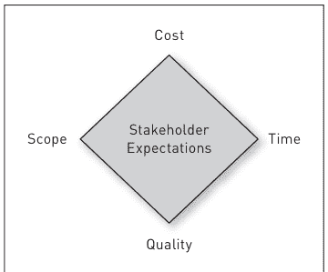

因此，利益相关者理解影响其决策的因素以及决策的潜在后果至关重要。项目的延误和失败通常与一系列糟糕的决策有关。当被问及项目是如何变晚时，弗雷德里克·布鲁克斯（Frederick Brooks）回答道：“一次做一个决策”（Brooks 1995, 60）。

解决决策问题的一种方法是尽可能让它们相互分离，但这种解决方案并非总是适用。例如，解决方案预期之间的不匹配是常见现象。问题在于如何以能够产生最可能结果的方式来管理这种不匹配。利益相关者需要一种系统化的方法来做出可能导致成功结果的决策。他们还需要一种策略在决策完成之前对其进行监控和纠正。

本书的目的是帮助你完善决策过程。我们将根据下一节介绍的决策模型来研究决策过程。该模型是软件开发和项目管理中用于决策的因素的可视化。该模型为决策者提供了一种分析决策过程输入和输出的系统方法。

该模型强调，并非每个决策都能成功。对于决策者来说，理解在做决策时承担的风险是非常重要的，因为承担的风险可能会随着时间的推移累积到对项目不健康的水平。目标是识别出需要仔细管理的情况，因为承担的风险或与失败决策相关的成本可能是不可接受的。书中的案例研究了如何应用该模型对关键项目场景做出决策，并减少替代方案所承担的风险。

下一节和书中其余章节将回答此类问题：

- 决策者在做决策时知道什么？
- 决策者在决策时使用流程吗？
- 所有决策的价值相等吗？
- 决策与其他项目有何不同？如果是，如何不同？
- 管理决策意味着什么？
- 为什么管理决策很重要？

## 1.3 软件工程决策模型

对于许多人来说，决策过程由三个基本阶段组成：

1. 信息进入过程。
2. 发生决策。
3. 产生解决方案。

如果专业人士能够轻松地做出良好的决策，他们通常认为自己是该领域的专家或大师。本节概述了一个决策模型，其目的是帮助软件专业人士管理他们的决策过程，以便他们更好地理解自己生成的解决方案。

图1-2所示的`PEAK`决策模型并没有指示“某个特定决策应该是”。它意味着利益相关者需要仔细检查他们的决策过程，以确保做出成功的决策。在做决策时，利益相关者应该考虑输入及其与解决方案的关系，以及替代方案所承担的风险。该模型对决策过程的输入和输出如何影响决策方式提供了洞察。


**图1-2：`PEAK`决策模型**

决策模型的输入包含以下元素：

- **问题（Problem）**：要解决的争议是什么或要处理的问题是什么？问题陈述应该清晰地表示需要解决的内容。
- **经验（Experience）**：从先前的事件中，决策者知道或会做哪些可能帮助解决此问题的？决策者以前是否见过或解决过此类问题？决策者的历史信息的合适性和准确性如何？
- **假设（Assumptions）**：哪些信息在没有证据的情况下被接受为事实？决策者对问题的哪些信息被抽象化忽略掉了，因为认为这些信息与解决方案无关？
- **知识（Knowledge）**：什么概念性理解或事实基础可以帮助决策者解决问题？决策者自上次处理此类问题以来学了什么？决策者关于该问题拥有哪些事实？这个问题周围的环境是什么？例如，在观察要解决的军事问题时，士兵可能会说：“当前的情况和地形如何？”

模型的输出包含以下元素：

- **解决方案（Solution）**：利益相关者需要什么来解决问题或处理争议？哪些替代方案是行的，每个替代方案的收益和成本是什么？相关利益相关者是否在考虑替代方案的情况下讨论了问题并表达了他们的偏好？利益相关者在实施之前可能不知道解决方案是否成功。实施决策的结果无论成功，将作为决策者知识和经验的一部分反馈模型。在回答同事询问他是否认为自己是个失败者时，托马斯·爱迪说：“完全不是。我知道一千种制造灯泡的方法”（Rovira and Trias de Bes 2004, 1）。
- **承担的风险（Assumed Risk）**：解决方案未按预期运行的概率有多大？当利益相关者做出决策时，利益相关者承担了解决方案或决策可能无法导致成功的风险。风险是决策的结果。与替代方案相关的风险有哪些？相关利益相关者是否根据他们的偏好讨论了这些风险？

即使决策者没有意识到，在做出决策时，输入和输出始终存在。为了管理他们的决策，利益相关者需要理解这些输入和输出之间的关系。

## 案例研究：软件测试回归问题

问题的背景描述如下。这个示例涉及软件开发人员经常面临的测试问题。问题的背景描述如下。Bob在离开办公室之前，在用于测试软件产品的计算机上启动了软件回归测试。他预计测试将完成并产测试结果本会在半夜某个时候准备好。鲍布第二天早上来到办公室，看到测试计算机上显示着登录提示。他知道要么是有人退出了测试账户，要么是机器重启了。鲍布迅速判断出发生了停电，机器在电力恢复后重启了。正在运行的测试在停电前没有完成，因此无法获得完整的测试结果。

鲍布检查了不完整的测试结果，认为这些结果无法为所测试的软件组件提供足够的验证，而这种验证对于将该组件与其他软件系统组件集成是必要的。他推断，不完整的测试结果对于依赖这些结果的软件工程师可能没有用处。鲍布估计，重新运行整个测试大约需要四小时，如果他在今天早上重新运行测试，下午就能获得完整的结果。他合理化地认为，与其向测试利益相关者提供不完整的结果，不如提供推迟了半天的完整结果要好。鲍布决定现在重新运行测试，因为他不希望测试结果的交付推迟一天或更久。

让我们使用`PEAK`模型来评估鲍布的决策。图1-3概述了鲍布决策过程的输入和输出。与鲍布决策相关的风险也是其决策过程的输出。

| 输入 | 输出 |
| --- | --- |
| (P) 问题：鲍布应该做什么？（他应该重新运行测试吗？如果是，什么时候运行？） | 解决方案：鲍布决定今天早上重新运行整个测试。 |
| (E) 经验：鲍布了解这项测试。 | 假设风险：不完整的结果对利益相关者可能具有价值。测试可能会失败，并进一步延迟获取完整的测试结果。 |
| (A) 假设：测试结果不完整。测试期间资源可用。测试将顺利执行到完成。 | |
| (K) 知识：鲍布知道该做什么。资源运行良好，足以运行测试。 | |

**图1-3：软件测试重运行问题**

### 输入

- **(P) 问题**：软件测试失败并产生了不完整的测试结果。鲍布应该做什么？
- **(E) 经验**：鲍布了解这项测试。（他以前做过过这个回归测试。他可以估计执行时间并预测失败的潜在原因。因此，鲍布知道如果他现在开始测试，可以在中午前完全执行完毕。）
- **(A) 假设**：
  - 测试结果不完整。（只有完整的测试结果对于使用它们的软件工程师才有足够的价值。）
  - 测试期间（接下来的四小时内）资源可用。
  - 测试将无问题地执行到完成。（昨晚发生的问题或任何其他问题都不会发生。）
- **(K) 知识**：
  - 鲍布知道要运行什么，并且对系统有足够的了解来运行测试（事实）。
  - 资源运行良好，可以成功运行测试（环境）。

### 输出

**解决方案**：鲍布没有充分考虑列表中的前几个替代方案，而是选择了最后一个：

- 不重新运行测试。（向软件工程师交付不完整的测试结果。）
- 稍后重新运行整个测试。（测试结果将推迟一天或更久。）
- 今天早上重新运行整个测试。（测试结果将大约延迟半天。）

**假设风险**：

- 现在可以获得的不完整结果对使用它们的软件工程师可能具有价值。
- 测试可能会失败，或者测试结果的完成由于其他原因而延迟。（例如，另一个用户可能已经计划在白天使用计算机进行测试。在计算机上运行另一项测试可能会延迟或干扰目标测试的执行。停电可能会再次发生。）

你可能会怀疑每个输入是否属实。“只有完整的测试结果才有足够的价值”这一假设特别令人怀疑。如果这个假设是正确的，那么测试再次失败将再次排除测试结果的用途。这一限制将需要更受控的测试环境（例如为测试计算机配备电池备份），包括对测试执行进行更广泛的监控。鲍布本可以假设在停电发生之前的任何结果可能是有效的。他的实际假设可能过度限制决策，导致他没有考虑其他替代方案，例如交付部分测试结果，并在验证测试计算机可用后再仅重新运行测试的完整部分。此外，他还假设了测试计算机是可用的。

## 案例研究：加利福尼亚桥梁问题

### 知识

- 在加利福尼亚州，混凝土基本上不需要维护（事实）。
- 混凝土结构能够承受由地震上下运动引起的力（事实）。

### 输出

**方案**：修筑道路、桥梁，使用混凝土柱来支撑桥梁。

**假设风险**：由混凝土柱支撑的桥梁能否经受表现其他类型运动的地震？（工程师可能无法完全理解地震的运动。）

在1991年地震之后，工程师们发现地震既有上下运动，也有往复运动。这些知识促使他们制定了一个新的方案来解决抗震建筑的问题。第二种方案涉及使用钢材和混凝土，但付出了维护钢材的成本。第二个决策的输入包含了关于地震运动的新知识，以及1991年地震期间加利福尼亚许多桥梁倒塌的经验。

正如在加利福尼亚桥梁问题中的应用所示，决策模型反映了一个“半封闭”系统。从第一个方案的结果到修订方案的知识和经验输入存在一个反馈回路。某些输入是开放的，它们可能受到输出的影响，但并不由输出决定。例如，决策的输出可能会导致未来的问题，但并不一定限制它们。同样，先前的决策的输出会影响但不会控制决策者的假设。决策者控制自己的假设。决策的输出可能会影响未来问题的环境（知识），但它不会是唯一的影响因素，因为改变性因素会影响问题的环境。

> **案例研究**

### 不熟悉的遗留代码问题

这个短故事有助于说明决策者对替代方案所承担风险的意识，是如何影响实际做出的决策的。该示例还澄清了决策模型在帮助决策者对问题的替代方案进行脑风暴方面的作用。

## 案例研究：不熟悉的遗留代码问题

Iola正在检查一些“古老”遗留代码，发现了一些熟悉的例程。她询问同事是否知道这些例程的作用，但大多数人回答不知道。整个系统太大，无法作为一个整体进行重构和测试，因此她暂时忘记了这些代码。那段神秘的代码继续困扰着她。如果这些代码没有实际用处，只是在浪费空间呢？也许她应该注释掉它们或对其进行重构以提高效率。她知道公司正在寻找改进遗留的方法，但删除代码可能会导致系统的其他部分失效或产生不良结果。

Iola决定系统故障的风险是极小的。因此，她决定注释掉不熟悉的代码，并将组件重新加载到测试环境中。她观察到组件中其他代码的更改似乎会影响结果，因此她确定不熟悉的代码也会产生同样。经过三个小时的回归测试，Iola没有检测到任何失败。她不确定如何继续，因为她没有看到系统对删除代码做出任何反应。换句话说，她的测试没有产生任何“烟雾”。由于软件开发人员从未构建过系统级的回归测试，Iola担心自己可能永远无法得知删除代码对系统产生了影响。Iola决定删除代码的风险太高，因为她无法判断删除是否真的对系统产生了影响。她取消了代码注释并将其放回测试中。图1-5显示了Iola最初但也是最终决策的输入和输出。

| 输入 | 输出 |
| :--- | :--- |
| (P) 问题：不熟悉的代码是做什么的？ | 方案：注释掉不熟悉的代码，观察会发生什么。 |
| (E) 经验：其他代码似乎运行正常。 | 假设风险：删除不熟悉的代码可能会导致坏事的发生。 |
| (A) 假设：不熟悉的代码具有某种作用。 | |
| (K) 知识：其他代码似乎有其用途并影响测试。 | |

**图1-5：不熟悉的遗留问题**

### 输入

- **(P) 问题**：遗留代码是做什么的，应该如何处理？
- **(E) 经验**：Iola理解其他代码的作用并能够对其进行测试。
- **(A) 假设**：不熟悉的遗留代码存在必有原因。
- **(K) 知识**：
  - 遗留组件中的其他代码似乎有其用途（事实）。
  - 其他代码的更改似乎会导致结果的变化（事实）。

### 输出

**方案**：注释遗留代码，观察会发生什么。

**假设风险**：删除遗留代码可能会导致坏事的发生。

通过对模型输入的仔细检查，问题解决者可能会想到解决问题的替代方案。由于Iola知道组件中的其他代码似乎会影响测试，她可以注释掉不熟悉的代码，并用一条消息来指示遗留代码现在正在执行。她还可以在消息执行时向环境中添加代码，以便她能够追溯到包含不熟悉代码的例程。决策模型是封装影响决策过程结果因素的方便方法。模型比抽象概念更易理解，因为它是现实的表示。但由于模型本身不是现实，它允许决策者在不改变现实的情况下检查和评估现实的各个方面。最后，模型为研究人们用于做出决策的信息提供了一个参考框架。

## 案例研究：数据处理问题

最后一个示例将展示项目经理和软件工程师如何利用该模型来帮助管理决策。这个故事突显了确定要解决的真实问题的挑战。如果不是不知所措，喜欢解决问题的人在听到有问题时会感到好奇。他们期望有问题的人能非常仔细地陈述与问题相关的所有事实。在《星际迷航》（`Trek Voyager`）剧中，角色问道：“请说明医疗紧急情况的性质。”如果有问题的人给出的是病史或剧情大概，医生将无法提供帮助。


同样，软件工程师可能会收到关于问题的无用信息，但仍被要求为有问题的人提供解决方案。软件工程师可能没有清晰的事实作为起点。组织以做出正确决策所需的信息是困难的。决策模型将帮助问题解决者确定他们是否拥有确定方案所需的信息。特别是，模型帮助决策以系统的方法开始“分而治之”的过程。他们首先通过使用接收到的信息（数据）来寻找决策输入。首先，他们问自己是否有足够的信息来明确识别问题或方案。如果是这样，他们就可以处理所需的其他输入。如果他们无法识别真实问题，将无法确定合适的方案。

`1-6`显示了工程师最初方案的输入和输出。

# 第1章 决策管理

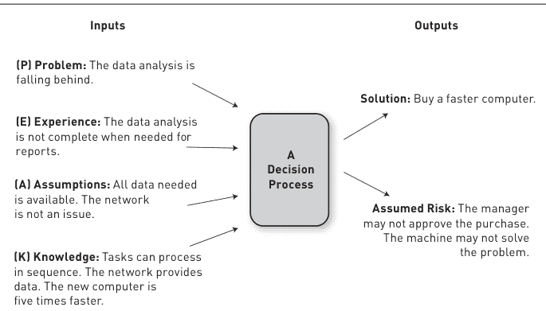

图 1-6：数据处理问题，初始解决方案

在与经理讨论之前

### 初始输入

(P) 问题：工程师的数据分析落后了。

(E) 经验：工程师在报告需要时，无法完成数据分析。

(A) 假设：

- 所有数据在需要时都可用供处理。

- 网络能够根据需要提供数据。

(K) 知识：

- 任务目前是按顺序处理的（事实）。

- 网络传输报告所需的处理数据（事实）。

- 工程师看到一台电脑的广告，该电脑的速度比他目前使用的快五倍（事实）。

### 初始输出

解决方案：购买一台处理数据速度快五倍的新机器。

假设风险：

- 软件工程师可能无法获得购买该机器的许可。

- 该机器可能无法解决工程师的处理问题。

图 1-7 显示了工程师最终解决方案的输入和输出。

### 与经理讨论之后

工程师与经理讨论后，对他的决策输入进行了以下更改。

### 输入

(P) 问题：工程师的数据分析落后了。

(E) 经验：多个并行运行的机器可以更高效地利用网络。

(A) 假设：报告过程中的许多任务可以并行完成。

(K) 知识：

- 网络是瓶颈。（网络是导致报告所需数据处理缓慢的原因。）

- 当网络传输数据时，可以处理报告数据。（尽管许多任务是按顺序执行的，但某些任务可以并行处理。）

### 输出

解决方案：使用若干台库存电脑同时处理报告的并行部分。

假设风险：报告处理任务可能没有足够的并行性。

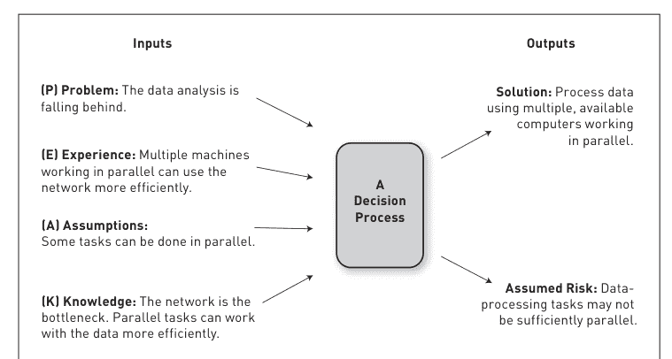

图 1-7：数据处理问题，最终解决方案

### 1.4 总结

如示例问题所示，本章提出的决策模型帮助你更好地管理决策过程的输入和输出，从而更好地评估你的决策。书中的案例分析将展示软件专业人员如何通过验证决策过程的输入是有效且正确的，来持续获得良好的决策。你应该意识到，模型生成的决策并不保证会有成功的结果。可能会发生以下任何情况：

- 决策者可能没有正确应用模型。

- 利益相关者可能没有正确地实施解决方案或决策。

- 决策者可能不了解现实，因此可能无法识别有效或正确的输入。

如果使用决策模型生成的解决方案或决策结果不符合预期，决策者应该检查他们做出决策的过程，以发现他们对问题和其他输入的理解缺陷。决策模型为软件项目利益相关者提供了一种分析其解决方案或决策结果的方法，并检查他们对如何管理决策过程的理解。软件专业人员还可以利用模型对结果良好或不佳的决策进行反思。随着时间的推移，软件项目经理和工程师将针对特定类型的软件项目管理和工程过程，形成关于什么构成决策的“思维模式”。通过反思过去决策获得的知识将反馈到未来的决策中。

本书展示了如何将决策模型应用于软件工程的九个关键领域的决策中。每一章都关注一个关键领域，并展示该模型如何应用于决策，以管理该领域的软件项目。尽管其目的是帮助做出成功的决策，但本书无法对你将遇到的每一项软件工程决策进行建模。因此，我们选择了那些经常决定软件项目成败的“高价值”决策。

最后，我们强调决策过程是个体性的。本书的目的是帮助你更好地评估你自己的决策过程。其核心思想是让你使用本章提出的概念来对你决策过程的输入和输出建模。不同的人对特定问题需要的输入多寡不同，但所有决策者都需要这些输入的一部分来开发解决方案。最后，我们希望你理解与管理决策相关的风险概念。通过管理与决策相关的风险来管理决策，对于成功的软件项目管理至关重要。

# 第2章 需求管理

### 2.1 章节目标

在阅读并思考本章提出的概念和案例研究后，你将能够做到以下：

- 理解管理软件需求至关重要的活动

- 识别案例研究中涉及需求管理的关键问题和决策

- 使用章节概念为案例研究利益相关者面临的问题提供可行的解决方案

- 认识管理软件需求的重要性

### 2.2 背景

软件项目团队交付满足用户需求和期望的产品或服务的能力，首先取决于需求在多大程度上表达了用户的实际需求和感知。产品交付物的“好坏”仅取决于指导其开发的需求。虽然确定适当的需求是关重要的，但确保正在开发的软件交付物满足这些需求，且需求随着软件项目的进展而不会以不可控的方式改变也同样重要。当需求得到良好管理时，产生的软件交付物最可能满足用户。

本章重点关注软件经理为了管理需求而做出的决策。本章在软件项目团队执行活动的背景下讨论了决策。它没有深入探讨管理需求的特定技术细节，因为许多其他人已经写过这个主题。一些介绍需求工程技术并提供实践建议的深度见解书籍包括 Hull 等 (2005)、Jackson (2000)、Wiegers (2003) 和 Wiegers (2006)。IEEE Std. 830-1998 描述了良好的需求说明书（SRS）的内容和质量，并提供了若干示例 SRS 大纲。与需求管理相关的其他参考文献出现在章节末尾。

在讨论组成需求管理的活动之前，我们应该澄清一些术语。从业人员使用不同的术语来描述涉及需求管理的活动。某些从业人员将需求的确定、文档化和确认称为“需求工程”或“需求定义”，而将确认之后的活动称为“需求管理”（Borland 2006）。我们选择使用更广泛的“需求管理”术语，以反映利益相关者（包括软件项目经理）在软件项目生命周期以及结果软件生命周期内都会需求做出决策。有效管理决策以及这些决策对需求和结果交付物的影响对于软件项目的成功至关重要。

我们对需求管理的讨论包含了功能性需求和非功能性需求。功能性需求是关于软件为用户执行的功能。某些软件项目利益相关者将这些统称为所需的软件行为。非功能性需求是关于软件应满足的质量属性，例如可维护性、性能、可靠性、安全性、安全性或可用性。

我们将首先介绍软件项目团队执行需求管理的活动；在此讨论软件项目经理在每个活动中做出或应该做出的决策。正如你看到的，需求管理涉及多个活动，每个活动都涉及多个需要做出的决策。由于决策涉及风险，本章简要提到了与需求决策相关的风险。第7章“风险管理”对软件项目决策背景下的风险提供了更通用的讨论。

### 需求管理中的活动

需求管理是一个通常从收集需求开始的过程，并一直持续到项目团队验证软件交付物满足其需求为止。需求管理的主要活动包括以下内容（建立软件项目需求包含带有星号 * 标记的活动）：

- 需求的摄取与陈述（需求说明书）*

- 需求的验证与确认*

- 需求及项目协议的谈判与签约*

- 需求变更和范围管理

- 针对需求对交付物进行验证

表 2-1 描述了组成需求管理的活动。稍后，我们将讨论软件项目经理在执行每项活动时会做出的示例决策。这些示例决策具有代表性，但并不意味着完整或排他性。你应该与经验丰富的经理讨论他们在工作中做出的决策，并记录你所遇到的各种决策类型。在开始某特定的需求活动之前，你可能会阅读相关的讨论，并审阅相应的示例决策表。

表 2-1：需求管理中的活动描述

| 活动 | 活动描述 |

| :--- | :--- |

| 建立需求 | **定义：** 摄取、陈述、验证以及谈判和签约软件与项目需求的过程。<br>**目标结果：** 后续行中描述的组成活动的目标结果之和。 |

| 需求的摄取与陈述 | **摄取的定义：** 在确定的背景下，收集关于软件应为用户执行什么的想法的过程。<br>**陈述的定义：** 以软件利益相关者易于理解的格式规范软件需求的过程。<br>**目标结果：** 一个能够让各种软件利益相关者理解的关于功能需求、非功能需求以及软件规划演进的描述。 |

表 2–1：需求管理中的活动描述（续）

| 活动 | 活动描述 |

| :--- | :--- |

| 需求的验证与确认 | **验证的定义：** 确定指定的需求是否清晰、完整、一致、相互兼容且行的过程。<br><br>**确认的定义：** 确定指定的需求是否满足用户的业务目标和对软件交付物的预期，并且不会阻碍指定任务集的并发完成的过程。<br><br>**目标结果：** 一份清晰、完整、一致且正确的需求说明书，能够指导软件交付物的开发，从而满足用户的业务目标和预期。 |

| 需求的谈判与签约 | **谈判的定义：** 就软件交付物的范围和质量相对于其成本（预算）和交付时间（进度）进行权衡的过程。<br><br>**签约的定义：** 制定书面的、具有法律约束力并签署的协议，以规定所有利益相关者对软件项目交付物、成本、进度以及其他利益或关注点的预期和责任的过程。<br><br>**目标结果：** 一份签署的合同，明确说明了软件项目利益相关者对于将提供的软件项目交付物（产品）的预期、角色和责任的协议，可能还包括交付物如何开发或项目如何执行（过程），以及项目成本（预算）和时间（进度）。 |

| 需求变更和范围管理 | **定义：** 管理对软件项目需求的变更请求的过程，使利益相关者能够可行地就持续的需求范围达成共识，并就开发满足合同需求集中任何约定变更的交付物的成本和时间达成一致。<br><br>**目标结果：** 一个稳定的需求集，指导在约（或可能重新约定的）成本和交付时间内完成满足用户业务目标和预期的软件交付物。 |

表 2–1：需求管理中的活动描述（续）

| 活动 | 活动描述 |

| :--- | :--- |

| 针对需求对交付物进行验证 | **定义：** 确定软件项目交付物满足软件项目协议或合同中概述的软件需求中所述的用户业务目标和预期的过程。<br>**目标结果：** 满足软件项目协议或合同中概述的用户业务目标和预期的软件项目交付物。 |

### 建立需求

考虑用户需求和相关的利益相关者对于成功建立需求至关重要。软件项目需求应该支持用户的业务目标。换句话说，每项需求都应该映射到一个特定的业务目标。确定并对齐客户或委托与开发者或服务提供者的预期对于建立两种类型利益相关者都能接受的需求是必要的。第9章“管理利益相关者预期”讨论了客户与软件开发者预期之间的对齐。

在正确的时间以有效的方式让合适的利益相关者参与对于成功建立软件需求（以及软件项目的成功）至关重要。特别是具有签署或批准软件需求、软件项目或软件交付物（包括预算或成本）责任或权限的利益相关者应该参与到需求的建立过程中。在摄取需求之前，需求建立过程的领导应当咨询所有利益相关者关于他们对在该过程中偏好的参与性质。

通常，具有不可预测需求或涉及未知因素的项目（例如使用创新技术）应该包括可行性研究，在建立需求之前探索并解决这些问题。忽视识别和解决需求的不确定性会导致项目失败。例如，如果软件开发者决定需求取决于另一个供应商开发的组件，而该供应商最终未能提供组件，就会出现此类问题。处理此类不确定性的一种方法是与供应商谈判，并在供应商无法交付组件时设计备选计划。

同样，如果利益相关者对需求的理解和预期仍在演变中，建立需求的过程应该探索替代需求的方法。在决定需求之前投入时间评估未知因素，可以减少软件交付物无法满足用户预期或需求，以及无法在时和预算内交付的风险。解决需求的不确定性有助于降低项目失败的风险。

建立需求的人会做出如表2-2所示的决策。示例决策按决策领域分组。在建立需求时，你遇到过或认为可能遇到哪些其他决策？

表 2-2：建立需求时的决策

| 决策领域 | 示例决策 |

| :--- | :--- |

| 利益相关者 | 谁是关键利益相关者？（谁负责批准需求或软件项目？）潜在利益相关者对软件项目有什么利益（诉求）？根据专业知识和利益，每个利益相关者应该承担什么角色以确保需求最可能满足利益相关者的预期？每个利益相关者希望参与需求的摄取？每个利益相关者的约定责任是什么，特别是那些签署协议的人？ |

| 业务目标 | 客户或委托对软件项目的业务目标是什么（例如软件构制品或服务）？ |

| 功能/非功能需求（范围和质量） | 哪些功能和非功能需求最支持客户或委托的业务目标？哪些范围和质量支持这些目标？需求相关是否存在任何约束或限制？ |

表 2–2：建立需求时需要做的决策（继续）

| 决策领域 | 示例决策 |

|---|---|

| | 软件项目团队应该应用哪些软件开发、项目管理或其他流程？对于分配到各种项目角色的人员，有哪些相关的需求？软件项目团队将遵循什么流程来建立需求？ |

| 时间（进度） | 提供软件项目交付物的预期时间（进度）是什么时候？ |

| 成本（预算） | 与预期的范围、时间和质量相关的成本（预算）是多少？ |

| 法律问题 | 软件项目交付物需要哪些免责声明？软件项目交付物或项目需要满足哪些合规性或其他法律问题？ |

| 待解决问题 | 在建立需求之前有哪些问题需要解决，应该如何解决？ |

最后，重要的是记住，需求管理并不在需求建立后就结束了。当软件退役时，需求管理的工作才算完成！

现在，我们将涵盖组成需求建立的具体活动。我们将首先讨论需求的获取和陈述。

### 需求的获取与陈述

获取功能性需求和非功能性需求对于建立满足利益相关者需求和预期的需求至关重要。在需求收集过程中，软件利益相关者大部分时间花在评估和决定软件要执行的功能上。除了与功能行为密切相关的软件质量（如控制系统的反馈环路速率）外，软件利益相关者通常等到最后才考虑软件应该具备的质量属性。为了“收尾”需求获取，他们可能会快速制定关于预期软件质量的陈述，但这些陈述可能是不精确、不准确、不完整或简单是不兼容的。

例如，一个常见的需求错误是陈述软件系统应该实时响应并保持快速（无论“快速”是什么意思）。实时软件系统不仅仅是响应快速系统。实时系统对事件和时间的响应是可预测的。系统可以周期性地执行（每隔指定的时间间隔重复执行）或非周期性地执行（仅在特定非循环事件发生时执行）。实时系统可能需要满足硬截止（例如，必须在事件发生后 20 毫秒内响应，否则会发生不良后果），可能允许错过一定时间的截止（例如，在事件发生后十秒内响应较好，但在一分钟内响应也足够），或者在处理系统过载时允许对事件不做出任何响应。

软件利益相关者经常不考虑的质量属性是软件的预期或可能演变。如果软件要在单次发布之外持续为用户提供价值，那么关于软件演变的决策是非常重要的。为了以成本效益的方式迭代或增量地开发和发布软件，需要一个软件发布计划来指示每个版本预期开发哪些需求。随着软件开发人员通过敏捷开发或其他迭代方法获得用户的反馈，发布计划可以是灵活的或变化的（Beck et al 2001；Larman and Basili 2003）。在建立需求时，软件利益相关者应该考虑并决定软件演变的整体计划，以帮助软件架构师和设计师为软件设计合适的结构。Ullah 和 Rube (2006) 展示了一个正在进行的研究，旨在为软件产品的发布规划和优化开发一个全面且形式化的模型。

需求规范从用户的角度定义需求并提供系统上下文。需求应该符合软件将如何被使用的“图景”。目标是以以后一种方式来陈述需求，以便能够根据需求满足用户业务需求的能力对规范进行分析。换句话说，规范使得需求的验证成为可能。审查需求陈述的利益相关者需要对每项陈述需求的含义建立共同的理解。

需求陈述的编写方式应能够根据清晰度、完整性、一致性、正确性和兼容性对规范进行分析。同样，需求应该是可测试的，以便确定软件项目交付物是否满足了需求。例如，如果说软件系统应该在无重力环境（如外太空）中完美运行，但如果在地球上没有实际的方法来验证软件在没有重力影响的情况下确实按预期执行，这种陈述是没有意义的。

获取和陈述需求的人做出如表 2–3 所示的决策。示例决策按决策领域分组。在获取和陈述需求时，你遇到过或认为你可能会遇到哪些其他决策？

表 2–3：获取和陈述需求时需要做的决策

| 决策领域 | 示例决策 |

|---|---|

| | 软件的预期用户是谁？他们将在什么背景下使用软件？ |

| 功能性需求 | 软件应该为预期用户具体做什么？每个功能性需求满足了用户的哪些业务目标？ |

| 非功能性需求 | 软件应该具备哪些质量属性？软件应该如何表现这些质量属性？每个非功能性需求满足了用户的哪些业务目标？ |

| 其他约束或需求 | 软件项目交付物的开发有哪些约束？软件项目的管理或执行有哪些约束？ |

| 覆盖和一致性 | 功能性、非功能性需求或其他约束陈述在多大程度上满足了用户的业务目标？<br>有多大把握确定没有需求相互冲突或导致另一个需求无法实现？ |

| 可测试性 | 软件开发人员如何确定需求是可测试的？<br>利益相关者对需求的可测试性有多大把握？ |

表 2–3：获取和陈述需求时需要做的决策（继续）

| 决策领域 | 示例决策 |

|---|---|

| 格式 | 陈述需求的格式是什么？为什么？所选格式是否实现了以下目标：能够清晰、完整、一致或正确地陈述每项需求；使审查的利益相关者理解每项需求的含义（可能需要获取和陈述过程领导者的协助）；支持对清晰度、兼容性、完整性、一致性和正确性的分析（验证）；支持对满足用户业务需求预期能力的分析（确认）。 |

| 流程 | 软件项目团队将遵循什么流程来获取和陈述需求？谁应该获取和陈述需求？为什么？ |

### 需求的验证与确认

验证需求确保指定的需求是清晰、完整、一致且相互兼容的，而确认需求确保需求确实了用户的业务需求和预期。验证需求的软件专业人员包含代表用户视角的利益相关者是至关重要的。如果专业人员拥有与计算机科学不相关的大学学位或具有编写需求的经验，可能也会帮助。我们看到关于微软公司的一项统计学控制实验的报告，涉及 700 名参与需求检查的专业人员（Carver et al 2008）。

一个关键的流程决策涉及用于验证和确认需求的技术。软件工程师经常对所需的


软件行为和质量属性，以便更好地分析它们的正确性、准确性和兼容性。模型驱动的软件开发（MDSD）的前提是：软件需求模型可以经过验证、确认，然后映射到软件设计（这些也可以用模型表示）和实现中，从而在提高质量的同时减少与开发相关的时间和成本。请参阅 IBM Systems Journal 2006，其中包含了一系列优秀的论文，概述了模型驱动的软件开发。在使用 MDSD 时，一个需要问的问题是：所选模型在多大程度上代表并澄清了所需的行为和质量？换句话说，所选技术在多大程度上能让开发人员了解指定的需求是否正确、足够准确、完整、兼容等？在本章末尾的背景部分提供了一些关于软件需求建模技术的额外参考文献。

另一个之前讨论过的过程决策是，软件开发人员将如何检测和解决需求中的未知性。识别和解决未知性应该贯穿整个软件项目的生命周期，在软件项目的早期阶段尤为重要，因为此时修改需求和项目方向更容易且成本更低。即使项目利益相关者不预期需求中存在未知性，对需求的验证和确认也应该确定任何需求是否不可实现，或可能阻碍其他需求的实现。

验证和确认需求的人员做出如表 2-4 所示的决策。示例决策按决策领域分组。在验证和确认需求时，你还遇到过或认为你可能会遇到哪些决策？

**表 2-4：验证和确认需求时需要做出的决策**

| 决策领域 | 示例决策 |
|---|---|
| 利益相关者 | 应该由谁验证需求规范？为什么？应该由谁确认需求规范？为什么？ |
| 验证或确认标准 | 指定需求是否清晰、兼容、完整、一致且正确的确定程度有多大？这种确定性的依据是什么？指定需求完全或部分满足用户业务需求和预期的确定程度有多大？这种确定性的依据是什么？ |

**表 2–4：验证和确认需求时需要做出的决策（续）**

| 决策领域 | 示例决策 |
|---|---|
| 问题或风险 | 与指定需求相关的存在任何未知性、不确定性或其他风险？<br>应该如何在整个软件项目的生命周期内管理这些问题？ |
| 过程 | 应该如何对需求规范进行验证和确认？<br>- 针对功能性需求？<br>- 针对非功能性需求？<br>- 针对其他约束或需求？<br>应该如何处理在软件需求验证和确认过程中发现错误？<br>是否应该在利益相关者完成需求签约之前修正错误？为什么 |

为了探索建立需求的最后活动，接下来我们将介绍软件工程师在谈判和签约需求时所做的决策类型。

## 需求的谈判与签约

在许多组织中，负责软件项目谈判和签署协议的人并不是最终管理或领导这些项目的人。这种利益相关者的分离是阻碍还是促进了软件项目的成功，取决于所有相关利益相关者的利益在软件项目协议谈判和签约中的代表程度。

需求谈判本质上是一个权衡和决策的过程。利益相关者对权衡的讨论和达成共识有助于利益相关者关注他们实际上可以控制的需求元素，如范围、时间、质量或成本。谈判过程激励利益相关者去探索能够优化所有人预期空间的方案。换句话说，它最大化了“对立”利益相关者的最小获胜（min-win）机会。

软件项目协议（合同决策）应为利益相关者提供对诸如表 2–5 所示元素的清晰、兼容、一致且正确的描述。

**表 2–5：软件项目合同的要素**

| 合同领域 | 示例合同元素 |
|---|---|
| 项目目标和交付物 | 以下内容的声明：<br>- 项目目标<br>- 项目交付物<br>- 软件交付物的功能和非功能性需求（这些可以在单独的文档中说明，该文档将作为项目的一部分开发）。<br>- 与项目交付物或其需求相关的任何约束或限制 |
| 项目执行约束（过程、人员等） | 以下内容的声明：<br>- 关于将采用的技术或流程的任何协议，以及如何、何时以及由谁使用这些技术或流程<br>- 关于应参与软件项目交付物开发的利益相关者的任何协议 |
| 其他服务 | 以下内容的声明：<br>- 将提供的任何培训<br>- 将提供的任何现场服务 |
| 时间（进度）和成本（预算） | 软件项目交付物的交付进度<br>生产和交付软件项目交付物相关的成本<br>与培训相关的任何成本<br>与现场服务相关的任何成本 |
| 免责声明、保修、应急计划及其他关注问题 | 关于软件项目交付物使用或应用的免责声明<br>在客户或顾客发现交付物存在错误、不适用或在某些方面不可接受时的保修或保证（软件开发人员或服务提供者不应或应发现的任何问题）<br>如果软件项目交付物未完全交付或延迟的应急计划<br>利益相关者识别并同意的其他关注问题 |

## 第 2 章 需求管理

在本节中，你可以从侧重于保护利益相关者权利的法律视角来看需求的签约。虽然软件项目合同旨在法律上保护利益相关者的利益，但明确软件项目利益相关者的预期和责任本质上是一种良好的业务实践。老话“万无不失”适用于软件项目协议的谈判和签约。软件项目利益相关者应该讨论、达成共识并记录他们对软件项目的预期、担忧以及其他问题。使利益相关者的预期透明化等于找出并解决软件项目的未知性。

谈判和签约需求的人员做出表 2-6 所示的决策。示例决策按决策领域分组。在谈判和签约需求时，你还遇到过或认为你可能会遇到哪些决策？

**表 2-6：谈判和签约需求时需要做出的决策**

| 决策领域 | 示例决策 |
|---|---|
| 利益相关者优先级和可协商范围 | 客户预期对范围、质量、时间、成本的优先级是什么？<br>满足用户业务需求和预期的范围（需求）的协商范围是多少？<br>满足用户业务需求和预期的质量协商范围是多少？<br>满足用户业务约束和预期的时间（进度）协商范围是多少？<br>满足用户业务约束和预期的成本（预算）协商范围是多少？<br>从开发人员的角度来看，什么样的技术和流程可以在时间和成本范围内满足范围和质量的协商范围？（关于开发人员利益相关者预期的更多信息，请参阅第 9 章“管理利益相关者预期”） |
| 利益相关者角色 | 应该由谁谈判需求和软件项目协议？为什么？<br>应该由谁签署软件协议？为什么？ |

**表 2–6：在需求谈判和合同化时需要做的决策（续）**

| 决策领域 | 示例决策 |
|---|---|
| 软件协议的要素 | 哪些利益相关者的期望和责任需要体现在软件合同中？软件协议还有哪些其他必要要素？（示例参见表 2-5。） |
| 问题或风险 | 与客户或开发人员交道有哪些风险？这些风险在多大程度上是可管理的？尽管存在与软件项目相关的风险，但尝试制定软件项目协议在多大程度上是合理的？ |
| 流程 | 将使用哪些流程对软件项目交付物以及与其交付相关的进度和成本进行谈判和合同化？ |

现在，我们将介绍软件工程师在管理需求变更和范围时所做的决策类型。

## 管理需求变更和范围

一些软件项目经理认为，需求一旦建立，工作就结束了。在实践中，对于迭代或增量演变的软件，项目需求需要在整个项目生命周期以及跨多个项目进行管理。需求的持续和持续性管理是必要的，因为软件不是静态的。工程团队可能会使用原型、模拟和模型等技术，帮助用户准确确定软件应该做什么，以及软件界面应该像什么样。即使通过应用技术来更好地理解需求的本质，随着软件项目的进展，用户（客户）的观点和期望可能仍会变化。

开发人员对需求的观点也可能因各种原因发生变化。在取需求时，有时会与利益相关者进行沟通。其他时候，开发人员观点的变化是因为通过与潜在用户的持续沟通（特别是那些没有参与原始需求建立的人）、通过应用所选技术和开发技术，以及通过其他形式的研究或信息收集而获得了知识。例如，开发人员可能会发现意外的技术问题，从而导致需求发生变更。

## 第 2 章 管理需求

通常情况下，当软件项目的需求变更提高了需求的清晰度、兼容性、完整性、一致性或正确性时，这些变更是有益的。软件项目利益相关者在决定进行变更之前，仔细考虑变更对交付物范围、时间、质量和成本的影响是非常关重要的。显然，增加软件项目交付物需求范围的变更面临着超出软件项目预算或进度的风险。

需要记住的核心思想是，更改软件需求涉及成本与收益的权衡；处理变更所需的资源和时间是有成本的，同时也存在潜在收益。项目利益相关者必须做出的主要决策是：软件预算是否支持特定变更的成本，以及与软件相关的业务收益是否值得这些成本（包括时间）。利益相关者必须权衡软件需求特定变更的收益与成本。软件经理应该帮助项目利益相关者决定，在当前计划的软件发布中晚于包含该变更是否会产生更好的价值。利益相关者可能需要对项目协议进行重新评估并做出新决策，以适应需求的变更。

现在我们花一点时间，在对软件项目交付物需求中的功能做出决策时应用 PEAK 模型。假设机器人手术助士的客户在项目协议建立后请求增加一个新的软件算法。使用 PEAK 模型，软件开发人员可以提出以下问题，帮助客户决定添加此特性的收益是否超过了成本：

- (P) 问题：软件项目利益相关者是否应该扩展或修改需求以包含这一新软件算法？
- (E) 经验：
  - 开发和集成新算法有多困难（在流程、人员、时间、质量等方面）？或者说未来会有多困难？
  - 使用新算法对软件进行验证和确认有多困难（在流程、人员、时间、质量等方面）？或者说未来会有多困难？
- (A) 假设：算法的哪些方面应该是确定的而非假设的？例如，项目利益相关者应该确定以下假设是否属：
  - 该算法在可预见的未来将是最合适的。在其他模式下，近期内没有其他更好的算法。
  - 该算法不会与其他需求产生干扰或不兼容。
  - 算法的性能、可靠性和安全性已经经过充分验证和确认。
- (K) 知识：
  - 考虑到机器人手术助士将使用的手术程序，这一新功能将如何提高产品的性能、安全性或其他质量属性？
  - 添加新功能是否会排除其他需求的使用（与其他需求不兼容）？
  - 每种替代方案对项目时间（进度）、质量和成本（预算）的影响是什么？哪种方案对项目利益相关者来说更优？为什么？
- 解决方案：
  - 在当前软件发布中添加新功能。
  - 在未来的软件发布中添加新功能。
  - 在可预见的未来不添加该功能。
  - 是否有其他可行的方案？如果有，它们是什么？

**假设风险：** 鉴于当前的输入信息，软件项目利益相关者对于每种可行方案他们可能承担的风险了解多少？

最终，软件项目利益相关者必须决定特定方案的收益是否超过了与方案相关的成本，以及特定方案的成本效益关系是否优于其他方案。另一个挑战涉及范围蔓蔓（scope creep），这可能发生在开发人员隐式地扩大或缩小需求时。范围隐式变更的问题在于，它们不太可能统一地传达给需要知情的项目利益相关者。不知情的利益相关者可能会对最终结果感到惊讶，并可能不满意。软件项目利益相关者应该讨论、评估并明确地对需求变更做出决策。需求的危险因素和隐式变更可能导致软件开发问题，并导致许多不满意的软件交付物。

管理需求和范围的人员所做的决策如表 2-7 所示。示例决策按决策领域分组。在管理变更和范围时，你遇到过哪些决策，或者你认为自己可能会遇到哪些决策？

**表 2–7：管理需求变更和范围时需要做的决策**

| 决策领域 | 示例决策 |
|---|---|
| 利益相关者角色 | 谁应该管理需求变更请求？为什么？ |
| 对范围、质量和价值的影响 | 特定的软件变更请求如何影响软件需求相关的范围和质量？每个软件变更请求相关的收益或价值是什么？软件项目需求的变更如何有助于最大化与软件项目交付物相关的整体收益，或如何有助于预期或可能发生的其他有益软件变更？ |
| 对时间（进度、发布版本）的影响 | 处理请求的变更会在多大程度上影响当前项目进度？在当前计划的发布中与较晚的发布中处理特定的软件变更请求相关的收益和成本是什么？是否应该在当前计划的发布中处理特定的软件变更请求？为什么要处理或不处理这些变更？ |
| 对成本（预算）的影响 | 为特定的软件变更分配软件项目预算将如何增强软件项目交付物增加价值的机会？对特定软件变更的预算支出如何产生极小的价值，更严重的是，如何排除响应可能产生更大价值的其他软件变更请求的机会？ |
| 流程 | 将使用哪些流程来管理需求变更和范围？谁应该管理需求变更和范围？为什么？ |

最后，但同样重要的是，我们将讨论软件工程师为了验证软件项目交付物与其需求之间的一致性而所做出的决策类型。

## 根据需求验证软件项目交付物

软件项目利益相关者和经理通常会焦虑地候着软件项目交付物的交付，这些交付物展示了项目的成功以及一项商业活动的终结。根据需求验证软件项目交付物是他们开发的顶峰。项目经理应该考虑将验证项目交付物视为需求管理中不可或缺的一部分，原因有以下几点：

- 定义需求的目的是帮助确保生成的项目交付物能够满足用户的需求和期望。
- 根据需求对软件项目交付物进行验证必须从用户的角度进行。
- 用于验证软件项目交付物的测试需要反映需求的变化。此外，需求管理涉及需求本身的变动，以及用于验证软件项目交付物的相关测试的变动。

验证软件项目交付物的最好方式是由代表用户观点的人来完成的，他们能够理解不同类型软件项目需求和交付物的各个方面，并且通过对项目交付物开发过程的详细了解，明确哪些观察可能会得到澄清。验证专家还应该熟悉软件项目正在生产或交付的产品或服务中可能出现的问题，以及如何发现可能发生的隐蔽错误。

在做出关于软件项目交付物验证的决策时，软件经理需要记住，应该从系统背景下的用户角度出发对需求进行测试。验证软件项目交付物确保了利益相关者对软件需求和合同协议的期望得到满足。项目经理还需要记住，只有当指定的需求和相应的软件系统经过验证和确认时，根据需求验证软件项目交付物是有价值的。此外，他们需要记住，将需求的变更整合到软件需求说明书和相应的软件系统测试中，对于确保根据需求对软件项目交付物进行完整且正确的验证至关重要。

根据需求验证软件项目交付物的人会做出如表 2-8 所示的决策。示例决策按决策领域进行分组。

**表 2-8：根据需求验证软件项目交付物时需要做的决策**

| 决策领域 | 示例决策 |
|---|---|
| 利益相关者角色 | 谁应该验证软件项目交付物？为什么？谁应该确认软件项目交付物？为什么？ |
| 验证和确认标准 | 验证：<br>- 何时对软件项目交付物进行了验证？谁执行了验证？<br>- 相应的软件项目交付物是否已根据相应的项目需求版本经过了充分或完全验证？<br>- 软件项目交付物已充分验证的确定程度有多大？这种确定性基于什么？<br>确认：<br>- 何时对软件项目交付物进行了确认？谁执行了确认？<br>- 相应的软件项目交付物是否已根据相应的项目需求版本经过了充分或完全确认？<br>- 软件项目交付物已充分确认的确定程度有多大？这种确定性基于什么？ |
| 过程 | 如何保持需求的更新状态，并将其与相应的软件项目交付物正确关联？<br>哪些软件项目交付物应该根据哪些软件项目需求进行验证/确认？如何做、何时做以及为什么？ |

在验证和确认需求时，你还遇到过哪些决策，或者你认为自己可能会遇到哪些决策？

对于对软件需求管理相关主题感兴趣的读者，建议以下参考文献。Wang 等人（2007）讨论了一种用于监控和诊断软件需求中出现问题的自动化方法。对于导致软件项目或产品失败的需求问题研究和讨论，可以参考 Ebert 和 De Man（2005）、Ebert 和 Hickey（2008）以及 Verner（2008）。功能性需求的一些建模技术包括包含在 Rational Process 中的统一建模语言（UML）（Rational 2001；Object Management）。将需求的变更整合到软件需求说明书和相应的软件系统测试中，对于确保根据需求对软件项目交付物进行完整且正确的验证至关重要。

## 案例研究：HBC 的新账户项目

### 核心概念

- 需求的成功建立取决于对利益相关者的恰当选择和参与。

在建立需求时，让以下人员参与非常重要：

- 理解客户或顾客的业务目标
- 软件的潜在用户，或了解用户需求
- 负责批准软件需求或软件项目
- 负责确定提供满足所需（及协商的）范围和质量的解决方案的时间和成本
- 能够从清晰性、兼容性、完整性、一致性和正确性方面验证需求
- 能够根据客户或顾客的业务目标和用户需求验证需求
- 拥有知识和技能，能够谈判满足客户或顾客及解决方案供应商预期的合同
- 熟悉合规、法律以及对客户、顾客和解决方案提供者重要的其他公司问题

### 术语

- CIO：首席信息官。
- HBC：汉密尔顿银行公司（Hamilton Banking Corporation）。
- IT：信息技术。
- 用例（Use cases）：软件和系统工程中用于捕获系统功能需求的技术。用例描述了主要参与者与软件系统之间的交互。参与者存在于所研究的系统之外，通过与系统对话中的一系列活动来达成某些目标。每个用例都是从参与者角度看的一系列完整事件。有关用例的基础性定义，请参考 Jacobson (1992)。请参考 Kulak 和 Guiney (2003) 关于用例作为引导需求主要工具的实用指南。
- VP：副总裁。

### 案例

#### 场景

苏珊·卡洛伊（Susan Calloway）和格奥格·约翰森（Georg Johansson）感到困惑和恼怒。他们奇怪为什么高层管理会考虑推迟新账户项目一个月，以满足 HBC “新出炉”的集团 IT 小组的要求。该小组的负责人罗伯特·卡德韦尔（Robert Caldwell）要求给予他的网络策略团队一个月时间，从品牌、合规、隐私和安全等公司问题方面审查项目需求。（参见图 2-1，图中显示了 HBC 的组织架构图。）

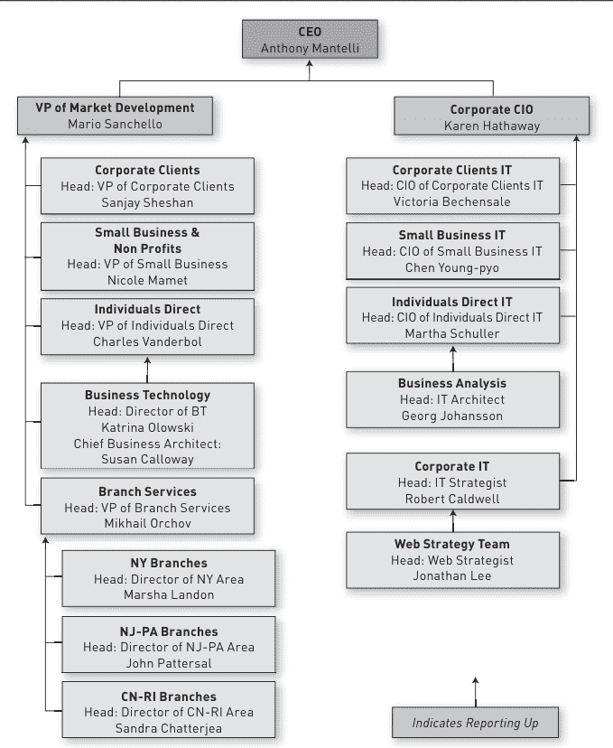

**图 2–1：HBC 组织架构图**

苏珊和格奥格负责了需求的建立，包括利益相关者对项目协议的初步签署。他们急切希望项目进入设计阶段。这个进度安排紧凑的项目只有十个月时间了。任何一个月的延误不仅会产生额外审查的费用，还会产生与延迟相关的成本。格奥格和苏珊担心网站增强（新账户项目的交付物）无法按时完成，导致“个人直通”（Individuals Direct）业务部门无法实现其在两年内将个人在线账户数量增加 50% 的业务目标。面向个人的互联网服务市场是一个高优先级的业务机会，它将使 HBC 继续保持其成功的辉绩。

当格奥格和苏珊反思他们建立需求采用的方法时，苏珊回忆道：“我们的方法在之前的基于 Web 的 IT 项目中效果很好。在时间紧迫的情况下，我们几乎不需要质疑是否要建立需求。此外，我们是否应该在一条已经成功的道路上‘重新发明’（轮子）呢？”


格奥格大声说道：“我们怎么知道集团 IT 部门会迫不及待地想要审查业务部门的项目是他们的直接指令呢？我认为罗伯特·卡德韦尔在参与部门级项目之前，可以通过审查和更新公司网络政策为 HBC 做更多贡献。”

苏珊回答道：“我们收到了卡特琳（Katrina）、查尔斯（Charles）和玛莎（Martha）的明确指令，负责从头到尾管理项目。我很惊讶他们会考虑格奥格的要求。”

格奥格同意并补充道：“当凯琳·哈撒瑟（Karen Hathaway）说话时，CIO 们会听的。假设凯琳想建立她的新集团 IT 小组的重要性。但我们本应该做些什么改变？也许我们可以更好地利用分配给关键路径的额外时间……”

### 回顾项目初期

根据经验，格奥格和苏珊理解建立需求的重要性。他们见过许多项目之所以失败，是因为他们对交付物的范围和质量，以及相关的进度表（时间）和预算（成本）缺乏达成共识。他们几乎立即同意，需求需要在两个月内建立，以便新账户项目能在一年内完成。根据经验，他们意识到选择最少数量利益相关者的重要，这些人能够有效确定需求和项目协议，而不会陷入“分析瘫痪”或无休止的讨论中。他们将这些人戏称为“必要且充分”的利益相关者。

为了帮助他们选择合适的利益相关者，他们列出了正在建立需求的以下几类利益相关者：

- 将批准或审计软件项目及其预算的人
- 用户或能代表用户观点的人
- 能代表软件服务提供商或软件开发者观点的人
- 将管理软件项目的人

## 第 2 章 需求管理

过去，业务部门独立开展自己的 IT 项目，只有在项目涉及公司范围业务问题或机会时才进行协作。苏珊理解项目的资金支持来自部门级管理。查尔斯·范德博尔（Charles Vanderbol，个人直通部门 VP）和玛莎·舒勒（Martha Schuller，个人直通部门 CIO）宣布苏珊和格奥格将直接负责管理新账户项目。苏珊和格奥格预计该项目几乎没有公司层面的参与。

苏珊和格奥格认为卡特琳·奥洛维基（Katrina Olowski）、查尔斯·范德博尔和玛莎·舒勒需要参与需求的建立，尽管查尔斯很可能会向卡特琳验证技术细节。特别是，查尔斯将根据业务目标验证需求，并关注进度和预算。玛莎计划监督项目协议的制定以及开发侧的人员。苏珊和格奥格将协助玛莎向查尔斯汇报项目状态。卡特琳想验证需求的范围和要求的软件质量。对于这个项目，她打算减少对进度和预算的参与，更多地作为后备技术经理。

在之前的 IT 项目中，苏珊和格奥格观察到分行经理及其员工对银行的个人客户有极好的了解。他们也积极评估和推广在线银行服务。苏珊与米哈伊尔·奥尔霍夫（Mikhail Orchov，分行服务 VP）会话，确定他的组织是否能够在建立需求时代表用户观点。米哈伊尔热情地推荐了他的一位分行经理提供服务。

在三位分行经理中，约翰·帕瑟（John Patser）拥有在线服务方面最新、最丰富的经验。苏珊和格奥格认为，当前且相关的经验是利益相关者贡献项目能力的良好指标。据此，他们决定这三位分行经理中的约翰可能是最有效的利益相关者。他们的参与将是微小的，苏珊和格奥格认为让米哈伊尔作为利益相关者知情是明智的。米哈伊尔未来可以帮助向分行推销“网站”。他也可以参与需求的验证。

同样，苏珊和格奥格认为，与客户接触的营销分析师最适合确定和验证需求。他们查阅了个人直通部门内部高级营销分析师的简历，发现了玛丽·麦唐纳德（Mary MacDonald），她是该部门内一个非常成功且显眼的 Web 项目的需求收集活动的高级分析师。苏珊熟悉玛丽对客户的需求，并认为玛丽在引导和验证该项目的需求将是一项财富。

### 案例研究：HBC 新账户项目

由于时间紧迫，Susan 和 Georg 意识到需要控制需求的范围。与许多分析师不同，据报道，玛丽·麦唐纳德（Mary MacDonald）并没有试图让软件项目的需求过载。她务实地知道，规模较小的项目通常有更大的成功。这也是她适合任该项目的另一个原因。由于 Georg 和 Susan 决定限制参与需求定义的利益相关者人数，他们没有考虑让其他利益相关者来代表用户。

Georg 和 Susan 过去曾与 Tim Weber 工作过，Tim 是 Individuals Direct IT 部门业务分析小组的一名项目工程师。Tim 在领导 Web 服务开发方面拥有丰富经验，是一个理想的软件开发负责人。在考虑另一个具有成功领导 Web 项目经验的成员时，他们选择了 Tim，因为他的背景包含了更多关于估计 Web 解决方案开发时间和成本的工作经验。Georg 特别确信 Tim 在需求和项目交付物的谈判期间将是一项出色的资产。Tim 的开发团队将创建并验证软件需求说明。

为了节省精力和金钱，Georg 决定同时担任 IT 服务/软件开发和项目管理的利益相关者。Susan 与 Georg 合作负责项目管理。Georg 领导了关于时间、人员和成本的估计工作，以及需求范围和项目交付物所满足的质量。

最后，Susan 和 Georg 决定由表 2-9 所示的利益相关者参与新账户项目的软件需求制定。回顾他们的决定时，他们认为每个角色都准备了后备方案，以防某些利益相关者因不可预见的原因离开项目；但他们知道这种覆盖并不理想。Susan 和 Georg 分别咨询了“候选”利益相关者，以确定他们对项目的兴趣和偏好。认识到改进后的网站带来的业务机会，以及新账户项目在 Individuals Direct 业务部门和 HBC 内部的可见性，所有候选利益相关者都乐意加入项目。

### 表 2-9：新账户项目选利益相关者

| 软件项目或预算审批与审计 | 用户视角 | IT 服务与软件开发 | 软件项目管理 |
|---|---|---|---|
| Charles Vanderbilt（Individuals Direct 业务部门副总裁） | Mikhail Orchov（分行服务） | Tim Weber（业务分析小组项目工程师） | Susan Calloway（业务技术组首席架构师） |
| Katrina Oleski（业务技术组总监） | John Patterson（新泽西和州分行总监） |  | Georg Johansson*（业务分析小组 IT 架构师） |
| Martha Mueller（Individuals Direct IT CIO） | Mary MacDonald（Direct 部门高级营销分析师） |  |  |

\* Georg Johansson 回应了两个利益相关者小组。

## 第 2 章 需求管理

随后，Tim Webber 的业务分析项目团队产生了针对软件需求以下几个方面的规格说明：

- 要开发的软件的业务问题和目的
- 使用新软件功能的整体系统环境
- 功能性需求，包括一组用例
- 关于非功能性软件质量的需求，包括网站未来增强的演进计划
- 与软件使用和开发相关的约束和局限性

同时，Susan 和 Georg 开发了一份软件项目计划，并经过了业务技术和业务分析利益相关者的评审和批准。利益相关者意识到紧迫的一年工期（建立需求所需）。他们同意，所有理想的软件功能都无法在网站的首次增强中完成，因此他们共同制定了一个计划，在网站的后续版本中发布这些功能。利益相关者认为网站首次发布的时间表是可行的，但为关键路径任务（任务完成总和构成完成项目所需时间的任务序列）分配的“额外”时间极少。Georg 和 Susan 从经验中学习，为关键路径上的任务分配了一些时间（即缓冲），以应对可能影响项目进度的所有意外情况。

在项目协议预计完成一周前，玛丽·麦唐纳德对私密信息的安全方式有一些疑问。针对玛丽的问题，Tim 回复说他需要咨询 Pang Huang，后者是 Web 隐私和安全问题的驻专家。Tim 了解到 Pang 已搬到了企业 IT 内部的 Web 策略团队，这是一个最近创建的新小组。Pang 正在休假，一周内无法离开。Tim 告诉 Georg，在 Pang 休假回来之前他无法回答玛丽的问题。

此外，利益相关者在验证和确认需求时发现了一些错误，并且玛丽·麦唐纳德一样，仍有一些未解决的问题。因此，Susan 和 Georg 决定额外花一周时间（从关键路径分配的额外时间内）来纠正错误并为利益相关者寻找答案。他们考虑到错误和问题的数量很少。尽管他们

### 案例研究：HBC 新账户项目

意识到遗留问题可能在项目协议定稿期间得到解决，但 Georg 和 Susan 不希望这些问题的解决或任何其他相关问题对项目协议产生负面影响。他们认为，在定稿项目协议之前，花额外时间解决需求是最好的。因此，他们决定将项目协议的解决推迟了一周。

同时，Tim 的团队勤奋地纠正了需求中的错误，并让利益相关者评审了这些修正。当 Pang 休假回来后，他向 Tim 解释了 HBC 网站如何处理隐私和安全问题。Pang 希望通过这些知识给老板留下深刻印象，随后向 Jonathan Lee 报告，Individuals Direct 部门的新账户项目涉及一些有趣的定价和安全问题，这些问题应该在整个公司页面中查看。

两个月后（包含了项目进度表额外分配的一个额外时间），软件需求和项目协议终于完成。Susan 和 Georg 乐观地认为项目可以在未来十个月内完成。高层经理 Charles Vanderholm、Katarina Olowski 和 Martha Scheller 对目前的项目结果表示满意。

Martha Schuller 在企业 CIO 和 IT 部门 CIO 行的季度 IT 管理会议上报告了新账户项目的进展。Robert Caldwell（IT 战略师和新成立的企业 IT 小组负责人）询问为什么没有就该项目咨询他，特别是考虑到他在四个月前被选中监督各个部门及其 IT 支持小组开发 HBC 在线服务。他解释说，他聘请了 Jonathan Lee 来领导策略小组，提供指导和监督，以确保企业 IT 在品牌、合规性、易用性和其他公司范围业务关注点方面设定的公司标准得到执行。

## 第二章 需求管理

我不希望为了处理目前正在开发中的任何新公司政策而推迟“新账户项目”。延误的成本和额外的工作可能会导致预算超支。

考虑到他的小组还很新，而且他希望能够与 IT 部门级的 CIO 进行高效工作，罗伯特（Robert）表示他理解并对新账户项目的预算和时间上的限制表示同情。他请求给网络策略小组（Web Strategy Group）留一个月的时间，以参考 HBC 网站上一次主要版本发布时使用的开发策略，并识别出他的小组应该研究的新问题。他向他的老板卡琳·哈撒瑟（Karen Hathaway，公司 CIO）寻求支持。

她继续说道：“问题在于是否要延迟一个重要项目，以便在需求发布进行设计和实施之前，进行公司级的需求审查。玛莎·席勒（Martha Schiller）、查斯·范德博尔（Charles Vanderbol）和我将进一步讨论这一请求并做出决定。”

卡琳告诉罗伯特，她需要更多关于评审要实现的目标以及评审估计成本的信息。她要求她的执行助理简（Jean）尽快与玛莎和查斯安排会议。卡琳表示，欢迎玛莎和查斯邀请他们认为应该参与讨论的任何人，然后她转向了会议议程上的下一个项目。

### 案例问题

新账户项目的经理苏珊·卡洛伊（Susan Calloway）和格奥格·约翰约翰森（Georg Johansson）负责对项目的利益相关者做出决策。他们没有识别出罗伯特·卡德威尔（Robert Caldwell）和乔森·李（Jonathan Lee）是 HBC 公司级 IT 开发项目管理的新手，因为罗伯特要求项目推迟一个月，以便网络策略团队审查并可能修改需求规格书。此次评审所需的额外资源和时间成本，以及项目额外时间已用掉部分的事实，可能会导致项目无法按计划和在预算内完成。进度的延误将进一步推迟范德波尔其业务部门增加在线账户数量目标的实现时间。查斯·范德波尔、卡琳·哈撒瑟和玛莎·舒勒（Martha Schuller）现在必须对罗伯特的请求做出决定。

### 案例研究：HBC 的新账户项目

### 案例分析

### 分析活动

#### 分析背景

本案例关注以下三个问题和决策：

- 哪些利益相关者应该参与新账户项目的需求建立？他们应该如何参与？（在案例中，苏珊和格奥格就该问题的解决方案做出了决策。）
- 当建立需求时存在未决问题且仅剩最后一周确定项目协议时，应该怎么办？（格奥格和苏珊在案例中对该问题的解决方案了决定。）
- 查斯·范德比、卡琳·哈撒瑟和玛莎·舒勒应该如何处理罗伯特·卡德威尔推迟新账户项目一个月以进行公司级需求审查的要求？（在案例结束时，尚未做出决策。）

我们将通过查看苏珊和格奥格所做决策的相关 PEAK 输入、考虑的解决方案和假设的风险来分析第一个决策。然后你可以独立分析另外两个决策。分析问题有助于集中你的分析。

### 决策 1（由苏珊和格奥格做出）

#### （P）问题

哪些利益相关者应该参与新账户项目的需求建立？他们应该如何参与？

#### （E）经验

- 苏珊和格奥格是经验丰富的经理。他们意识到，有必要减少参与建立需求的利益相关者人数，以便在两个月内完成项目协议。
- 在过去，他们观察到业务部门独立地开展自己的 IT 项目，在公司层面的参与很少（这也是一个知识要素）。
- 根据经验，他们知道分支经理对单个客户的在线银行需求有极佳的理解（这也是一个知识要素）。
- 通过与提姆·韦伯（Tim Weber）的合作，他们知道他是一位胜任的网络项目领导，并且在开发此类项目的时间和成本估算方面具有丰富经验。

#### （A）假设

- 格奥格和苏珊假设不需要其他公司层面的利益相关者参与。

#### （K）知识

- 格奥格和苏珊知道，为了在一年内完成项目，必须确定那些负责从头到尾管理新账户项目的利益相关者。
- 他们理解，需求的建立需要得到玛莎·舒勒的确认，并且他们意识到范德波尔、卡琳·哈撒瑟和玛莎·舒勒需要参与。
- 在审查了分支经理的简历后，他们知道约翰森对在线银行有丰富的经验。
- 在审查了 Individual Direct 的业务分析师简历后，他们认为玛丽·麦唐纳拥有成功的 Web 项目经验。此外，苏珊对建立需求的需求。

### 解决方案

表 9 显示了苏珊和格奥格选择的利益相关者候选。该表还指出了每个利益相关者所代表的。根据利益相关者的利益和预期，他们计划让这些利益相关者参与以下活动：

- 查斯·范德波尔：验证需求。监督进度和预算。
- 玛莎·舒勒：负责项目协议和人员配备。
- 卡琳·奥洛：验证范围和质量（关注技术方面）。
- 米哈伊尔：验证需求并向分支机构推广。
- 约翰森：发现并验证需求。
- 玛丽·麦当纳：发现并验证需求。
- 提姆·韦伯：领导开发团队。协助估算时间、资源和成本。
- 苏珊·卡洛伊和格奥格·约翰森：管理需求的建立并协助玛莎·舒勒创建项目协议。
- 格奥格·约翰森：领导关于范围和质量的工作。

这些是苏珊和格奥格考虑的某些替代利益相关者：

- 另外两个分支经理：他们选择了约翰森，因为他拥有在线银行最丰富的经验。
- Individual Direct 业务部门的高级分析师：他们选择了玛丽，因为她有项目的需求的经验，并且苏珊熟悉。
- Individual Direct 业务分析小组的另一位成功的 Web 项目工程师：他们选择了提姆，因为他在开发 Web 项目的时间和成本估算方面的经验。

### 假设风险

- 由于每个角色的利益相关者很少，存在有人退出项目的风险，导致剩余利益相关者无法按时建立需求。（格奥格和苏珊考虑了这种风险，并为每个活动提供了一些备份覆盖。但这种覆盖非常有限。）
- 风险苏珊和格奥格选择的利益相关者没有代表所有应该参与的利益相关者类型，并且存在一个未识别的、有权延迟或停止项目的需要参与需求的利益相关者。（特别是，他们假设没有公司级参与，这让他们忽视了这种潜在的利益相关者。他们的假设证明是错误的，公司级利益相关者确实出现了并希望参与项目。目前尚未决定是否延迟项目。是否有其他应该考虑的利益相关者类型？）
- 风险所选利益相关者实际上并不具备履行其职责所需的经验或技能，导致需求无法按时建立，或者产生的需求无法表达满足业务目标所需。
- 与苏珊和格奥格所做的决策或他们考虑的替代利益相关者相关的是否存在其他风险？

## 第 2 章需求管理

### 分析问题

1. Georg 和 Susan 在项目协议完成前的一周面临了什么问题？他们需要做什么决定？
2. 除了该问题之外，Susan 和 Georg 还使用了哪些其他 PEAK 输入来做出这一决策？
3. 他们考虑了哪些解决方案？每种解决方案存在哪些风险？
4. 这一决策对项目后期出现的关于“未识别利益相关者”的问题产生了什么影响？
5. 你为什么认为 Susan 和 Georg 没有将 Robert Caldwell（来自公司 IT 部门）和 Jonathan Lee（来自网络策略团队）考虑为建立需求的候选人？
6. 未能将 Robert Caldwell 和 Jonathan Lee 视为项目的潜在利益相关者会有什么后果？你认为可以做什么来避免这种情况的发生？
7. 高层管理层对于“新账户项目”必须做出什么决策？
   - 做出这一决策的 PEAK 输入是什么？
   - 该决策的潜在解决方案有哪些？每种解决方案相关的风险是什么？
   - 这一决策可能会如何影响未来 HBC 业务部门及其支持小组处理的其他 IT 项目？
8. 针对 Robert Caldwell 的请求，你会做出什么决定？为什么？除了案例提供的信息外，你希望获得哪些信息来做出这一决定？
9. 为什么 Robert Caldwell 请求的决策者可能需要市场开发副总裁 Mario Sanatello 或其他业务部门副总裁？（提示：考虑涉及所有 HBC 业务部门的相关问题。）
10. 减少在选择和让利益相关者参与需求建立时产生风险的方法有哪些？
11. 回顾本案例开头列出的关键概念。现在你已经读了案例，是否还有其他你想要包含在内的概念？

### 讨论

总的来说，该项目利益相关者的识别和选择是及时且有效的。在选择协助建立需求的利益相关者时，存在一个潜在的缺陷，即当新的项目利益相关者在项目软件需求进行最终评审后“主动识别了自己身份”。其中一个新的公司级利益相关者请求推迟项目，如果高层管理批准了该请求，将会非常昂贵。这个新的利益相关者可能也可能无法“改进”需求。

由于假设没有公司层面的参与，导致了决定不考虑来自新的公司 IT 组和网络策略团队的利益相关者。同样，软件项目经理 Susan 和 Georg 假设他们有足够的知识来选择建立需求候选人的利益相关者。他们本可以通过要求高层管理以及其他项目利益相关者评审候选利益相关者名单，并建议应该考虑的其他人员，来降低这些假设可能存在错误的风险。


案例还提出了分配时间来处理需求验证和确认反馈的问题。安排用于需求验证和确认的时间不足。纠正错误和处理因需求评审产生的问题的时间间隔，与安排完成项目协议的一周重叠。值得注意的是，在这个案例中，软件项目经理利用分配给项目的额外时间，将需求建立的时间增加了一周。但遗憾的是，项目现在没有“空间”来处理未来可能出现的意外事件。

最后，本案例引发了关于跨独立业务部门 IT 项目的公司级管理问题。高层管理对于业务部门“内部”软件项目需求评审所做出的决策与这些问题有关。特别是，公司范围内对网络服务的新关注，凸显了对于在业务部门内部及跨业务部门开展的网络软件项目制定政策的需求。

### 结论

尽管面临人员和预算压力，软件项目经理仍然确定了一组利益相关者，他们有效地为“新账户项目”建立了需求。案例中的问题涉及软件项目经理在选择候选利益相关者方面做出决策的流程。他们没有充分考虑与其假设相关的风险，并且没有让可能发现其候选利益相关者名单中潜在问题的人员评审他们的决策。

### 需记忆要点

- 选择合适的利益相关者来建立软件项目需求至关重要。
- 利益相关者的适当参与增加了按时且在预算内建立可接受需求的概率。
- 咨询高层管理、在组织内具有利益相关者选择经验的人以及其他软件项目利益相关者，有助于确保以有效的方式识别并让合适的利益相关者参与。

# 第 2 章 需求管理

### 案例研究

### 按时、预算内，但方向错误

### 指南

在阅读本案例研究时，请关注与软件项目需求获取、验证和确认相关的活动。注意软件项目经理如何处理更改需求的请求。识别和选择合适的功能性需求和软件质量属性方面存在的问题。

### 案例摘要

`NavEngineering` 专门为国防部（`DoD`）提供导航系统。`NavEngineering` 希望在商业市场利用其全球定位系统（`GPS`）技术和软件资产。管理层提议与 `Signals & Systems (S&S)` 建立合资企业，该公司是一家为运输业开发射频识别（`RFID`）跟踪系统的公司。该合资企业涉及对运输中的包裹、集装箱或其他货物进行安全可靠定位和跟踪。`S&S` 已确定了目标客户，他们对该产品领域非常感兴趣，并对第一版产品的现场测试感兴趣。该产品的预计上市时间为 18 个月。软件将是新产品的主要组件。案例场景涉及一项按时、在预算内完成但并非现场测试客户所要求的的产品开发。

### 案例研究目标

阅读案例研究后，你将能够完成以下操作：

- 理解以下决策在获取需求方面的重要性：
  - 哪些质量属性对于客户的业务需求和目标很重要？
- 如何对质量属性的需求进行验证和确认？
- 在建立需求时，何时以及为何应该考虑软件演进？
- 与需求决策相关的风险有哪些？应该如何处理这些？
- 识别组织通过哪些活动获取、验证和确认需求。
- 识别软件项目经理处理更改需求请求的方法。
- 解释案例场景中发生的问题、产生问题的原因以及减少在其他软件项目中发生类似问题概率的方法。将这些问题与项目利益相关者所面临的决策联系起来。

## 第二章 需求管理

全球定位系统（`GPS`）：一个由至少 24 颗均匀分布卫星组成的“星座”，它们绕地球运行，使 `GPS` 接收机能够确定地理位置、方向和时间。对于大多数设备，其定位精度在 100 米到 15 米之间。使用特殊的军事批准设备，精度可以精确到 1 米（`SearchMobileComputing`）。

无线频率识别（`RFID`）：一种利用无线电波识别唯一项目的方法。通常，读取设备与标签通信，标签在微芯片中存储数字信息（`RFID Journal`）。

选择性可用（`SA`）：美国国防部（`DoD`）的一项计划，通过改变导航消息中提供的时间历星数据，降低不符合条件的接收机可获取的信号，从而控制伪距离测量的精度（国家公园管理局）。

美国于 2000 年 5 月 1 日取消了选择性可用，目前已具备恢复该功能的能力（`Leopold 2000`）。

软件质量：软件表现所需属性组合的程度（`IEEE Std. 1061-1998`；`ISO/IEC Std. 9126-1:2001`）。

请注意，功能是一个描述软件应该执行工作的质量属性。非功能质量属性（如性能和安全性）对软件系统的设计和实施施加限制。从业人员将关于软件质量属性的规范称为服务质量（`QoS`）需求。关于软件质量属性的需求声明描述了实现特定属性的程度（或方式）。

软件发布计划：对软件及其需求在软件生命周期内预计或可能发生如何变迁的描述。产品发布计划概述了每个软件发布版本需要满足的功能性和非功能需求（`Ruhe and Sali 2005`）。

### 参考文献

有关 `RFID` 技术及其使用的信息，请参阅 `Finkenzeller (2003)` 以及 `Garfinkel` 和 `Rosenberg (2005)`。`Bock (2006)` 讨论了 `RFID` 的互操作性，这对于商业产品的演进非常重要。

`Lomer (2007)` 提供了支持使用 `Galileo` 和 `GPS` 信号的导航系统设计的信息。欲对 `Galileo`、`GLONASS` 和 `NAVSTAR`（美国导航卫星星座）进行比较，请阅读 `Thurston (2002)`。审阅 `IEEE RFID` 国际会议论文集（`Proceedings of the IEEE International Conference on RFID`）以了解当前的 `GPS` 研究。

### 案例研究：准时、预算内、但错误

### 案例

### 场景

在用免提手机与 `Sharon McPherson`（`NavS&S` 项目的需求与客户关系经理）通完电话后，`Daniel Choi`（`NavS&S` 项目总经理）开车沿着 680 号州公路向北向加利福尼亚州的圣拉蒙行驶。他看着雾笼罩着东湾，一边思考他与 `Sharon` 的谈话以及他那不幸的假期计划。

在花费了无数小时管理 `NavS&S` 项目（`NavEngineering` 和 `S&S` 之间的合资企业）后，`Daniel` 发现大部分新的 `SecureLocTracker` 产品已发送给一组名为“客户现场测试组”的选定客户进行验证，他感到松了一口气。他计划利用几天假期开着他的帆船在湾区兜风。在听到 `Sharon` 关于客户现场测试组的报告后，`Daniel` 露出了微笑对自己说：“我可能要告别我的假期计划了。这个问题太大了，无法忽视几天。生活就是如此（`C'est la vie`）。”

正如 `Sharon` 向 `Daniel` 解释的那样，客户们很满意，但一些客户显然对产品在全球范围内准确确定难以定位的地理位置的能力表达了失望。特别是，他们对产品处理高海拔地区、市中心和山地地区位置的能力表示怀疑。客户们也很惊讶，产品不支持集成 `GPS` 信号（来自美国 `NAVSTAR` 卫星系统）和 `Galileo`（来自正在开发的欧洲导航卫星系统），以实现更准确、更可靠的定位。

`Daniel` 回忆起需求团队在收集和验证需求时有客户参与。但正如他和 `Sharon` 在电话中讨论的那样，也许他们错误地假设现有的 `GPS` 技术将足够满足未来的需求。他想得越多，就越怀疑团队是否考虑了由欧洲委员会、欧洲空间局和私营公司正在开发的 `Galileo` 卫星系统。事实上，他推测团队仅关注了性能和安全性（这些属性被客户现场测试组列为高优先级），而没有考虑灵活性（即随着时间推移轻松更改产品以满足新需求的能力）。

在离开圣拉蒙出口后，`Daniel` 开进了 `NavEngineering` 实验室所在的山丘。他的思绪回到了项目开始阶段，想起了涉及需求获取的活动以及随后的产品设计和实现。`Daniel` 回忆起，当时的重点在于软件，该产品主要涉及开发软件以将现有的 `GPS` 和 `RFID` 技术集成到一个系统中。也许他们没有足够关注集成了硬件和软件组件的系统。

## 第二章 需求管理

### 回到项目起点

`Sharon McPherson` 和 `Daniel Choi` 分别是 `S&S` 和 `NavEngineering` 的营销高管。除了营销工作外，两人在工程和项目管理方面都有丰富的经验。他们仔细处理了这些问题。`NavEngineering` 的高性能 `GPS` 系统与 `S&S` 安全 `RFID` 追踪系统的集成，是为了包裹和集装箱的实时追踪提供一种成本效益的解决方案。运输业需要一种解决困扰全球货物运输的安全性和可靠性解决方案。`NavEngineering` 寻求将其业务扩展到商业市场，而 `S&S` 则在寻找新产品以利用他们的工程专长。这项名为 `NavS&S` 的合资企业对双方利益相关者似乎都是一个极佳的商业机会。一些高管预测未来这两家公司将合并。

`Sharon` 和 `Daniel` 为项目提供全面管理。`Sharon` 管理合资企业与客户组的关系，该小组将对产品开发团队设计并实现的 `SecureTracker` 进行现场测试并提供反馈。她还管理团队建立产品需求，包括软件需求。`Daniel` 管理两家公司之间的接口并提供高层项目管理。他还负责制定整体项目管理计划。通过对合资企业建议书的工作，`Daniel` 和 `Sharon` 建立了有效的沟通和规划策略。`Sharon` 和 `Daniel` 拥有共同目标：作为一个团队引导项目走向成功。图 2-2 显示了 `NavS&S` 项目的组织架构。

作为获取需求的初步步骤，需求团队定义了 `SecureTracker` 系统使用的环境和背景。

## 案例研究：准时、预算内，但错误 59

| 合资企业执行管理 | 3 |
| :--- | :--- |
| `NavEngineering` 总裁——`Ronald Grayson` | 1 |
| 信号系统总裁——`Lee Panelli` | 2 |
| `NavS&S` 项目执行管理 | 3 |
| 总经理——`Daniel Choi` | 1 |
| 客户关系经理——`Sharon McPherson` | 2 |
| `GPS` 集成团队 | 1 |
| 经理——`Andy Skovski` | |
| 客户现场测试组 | |
| 软件开发团队 | 3 |
| 经理——`Ivan Gustafson` | 1 |
| 需求团队 | 3 |
| 首席负责人——`Michael Long` | 2 |
| 开发负责人——`Sanson Chen` | 1 |
| 集成负责人——`Kathy Kumar` | 1 |
| 测试负责人——`Mark Sutter` | 2 |
| `RFID` 集成团队 | 2 |
| 经理——`Judy Miori` | |
| 现场测试团队 | 3 |
| 经理——`Richard Garson` | 2 |

- 来自 `NavEngineering` 的员工 - 1
- 来自信号系统的员工 - 2
- 来自两家公司的员工 - 3
- 表示报告
- 表示通信

图 2–2：`NavS&S` 项目组织架构

（图 2–3）显示了 `SecureLocTracker` 系统的上下文图。当时，`Daniel` 注意了软件开发团队提出的问题，即 `GPS` 和 `RFID` 信号之间是否会出现干扰问题。`NavEngineering` 的软件工程师已经看到设计一个可以集成到手机设备（其无线信号可能会干扰 `GPS` 信号的设备）的 `GPS` 接收器需要多久。软件工程师想知道 `GPS` 接收器和 `RFID` 传感器是否需要修改。他们不想项目因为硬件组件的意外问题而延迟。

# 第 2 章 需求管理


通过与客户现场测试组和开发团队的广泛采访，团队编写了一组用例，详细描述了用户以及外部组件（如卫星集装箱内的 `RFID` 标签）如何与 `SecureLocTracker` 系统交互。团队仔细考虑了使用场景，重点关注目标特性：互操作性、性能、可靠性、可重用性、安全可用性。他们根据软件在使用背景下预期发生的事件制定了精确的规范。表 2-10 仅是需求团队根据项目业务目标收集的非功能需求示例。

### 表 2–10：非功能性需求

| 业务目标 | 软件质量属性 | 非功能性需求（质量属性场景） |
| :--- | :--- | :--- |
| `B1.1` 符合通信协议 | 互操作性 | `NF1.2` `SecureLocTracker` 应符合 `EPCglobal Class-1` 级 `UHF` 通信协议。 |

# 案例研究：准时、预算内，但错误

### 表 2–10：非功能性需求示例（续）

| 业务目标 | 软件质量属性 | 非功能性需求（质量属性场景） |
| :--- | :--- | :--- |
| `B2` 保证及时的定位跟踪服务 | 性能 | `NF2.3` `SecureLocTracker` 处理定位跟踪数据的时间不应超过：<br>* 使用选择性可用（`Selective Availability`）的 `X` 秒以实现 1–15 米内的水平精度；<br>* 使用差分编码（`differential code positioning`）的 `Y` 秒以实现 1–5 米内的水平精度。 |
| `B3.2` 将 `SecureLocTracker` 系统（包括 `RFID` 标签）与外部或内部干扰隔离开 | 性能 | `NF3.1` `SecureLocTracker` 硬件组件或设备不受干扰：<br>* 来自设备（例如手机信号）的外部信号和干扰不影响 `SecureLocTracker` 硬件组件或设备的运行；<br>* `SecureLocTracker` 硬件组件或设备不应相互干扰。参见“干扰”案例中的细节。 |
| `B4.1` 最大化软件重用性 | 可重用性 | `NF4.1` 集成 `RFID` 技术。 |
| `B5.1` 确保及时的定位跟踪服务 | 安全 | `NF5.1` 数据访问应受到保护。 |
| `B5.2` 防止数据被未经授权的访问 | 安全 | `NF5.2` 数据访问应被加密。 |
| `B5.3` 确保数据的真实性 | 安全 | `NF5.3` 数据访问应经过验证。 |

# 第 2 章 需求管理

参见“`SecureLocTracker` 硬件组件或设备不受干扰”案例中的细节：来自设备（例如手机信号）的外部信号和干扰不影响 `SecureLocTracker` 硬件组件或设备的运行；`SecureLocTracker` 硬件组件或设备不应相互干扰。

当时，`Daniel` 注意了软件开发团队提出的问题，即 `GPS` 和 `RFID` 信号之间是否会出现干扰问题。`NavEngineering` 的软件工程师已经看到设计一个可以集成到手机设备（其无线信号可能会干扰 `GPS` 信号的设备）的 `GPS` 接收器需要多久。软件工程师想知道 `GPS` 接收器和 `RFID` 传感器是否需要修改。他们不想项目因为硬件组件的意外问题而延迟。

通过与客户现场测试组和开发团队的广泛采访，团队编写了一组用例，详细描述了用户以及外部组件（如卫星集装箱内的 `RFID` 标签）如何与 `SecureLocTracker` 系统交互。团队仔细考虑了使用场景，重点关注目标特性：互操作性、性能、可靠性、可重用性、安全可用性。他们根据软件在使用背景下预期发生的事件制定了精确的规范。表 2-10 仅是需求团队根据项目业务目标收集的非功能需求示例。

# 案例研究：准时、预算内，但错误 63

客户急于收到客户测试组的反馈。在过去的一年里，几个客户一直在探索欧洲开发的 `Galileo` 卫星系统，以补充基于 `GPS` 的定位技术。尽管他们在确定需求时并没有关注定位精度的问题，但他们现在可以设想如何通过结合 `GPS` 和 `Galileo` 数据来获得更高的精度了。客户还担心 `SecureLocator` 处理难以定位位置的能力，特别是高纬度地区（北欧客户特别关注）。

特别地，客户喜欢双路 `GPS-Galileo` 系统可以提供更好可靠性的这种想法，或者当其中任一系统不可用或性能下降时，通过访问 `GPS` 或 `Galileo` 数据可以更轻松地进行备份。客户报告说，由于无法结合不同导航卫星技术的信号，`SecureLocator` 系统的寿命有限。客户计划在做出产品选择之前，探索未来六个月内进入市场的其他定位跟踪系统。

## 64 第2章 需求管理

### 回到现在

`Daniel` 正躲在办公室里，他回打了 `Sharon` 的电话并解释道：“我一直在考虑。我们需要确定演进 `SecureLocTracker` 产品以处理来自导航卫星系统的多个信号会有多困难。”

`Sharon` 迅速回答：“你听说了总统批准了那项建议吗？未来采购的 `GPS III` 卫星将不再支持选择性可用性。看来可靠性的这一方面将不再是一个关注的问题。”（美国国防部，2007年）。

`Daniel` 回答道：“我同意，尽管客户现场测试组的客户认为产品很快就会过时。通过邀请项目负责人参加研究小组？我们还需要为首席执行官（`CEO`）们制定一份关于如何推进 `SecureLocTracker` 产品的提案。我们有一场硬仗要打。”

“而你以为你可以让 `Zephyr` 号扬帆航行时。也许明年吧……”`Sharon` 同情地说道。

带着关于产品实地测试结果的报告，`Sharon` 和 `Daniel` 负责向公司首席执行官提交一份关于如何推进 `SecureLocTracker` 产品的提案。他们认为研究小组可以帮助他们制定解决与现场测试结果相关的问题的方案。在开始之前，他们需要更多信息来制定一个合理的提案。

`Daniel` 和 `Sharon` 应该给研究小组下什么指示？

### 案例问题

来自 `NavEngineering` 和 `S&S` 的联合项目小组为航运业开发了一种新的定位和跟踪系统。软件开发按时完成且在预算内完成。`NavS&S` 现场测试小组已将产品交付给几家关键客户进行测试。客户对产品没有整合如 `GPS` 和 `Galileo` 这样的多种地理定位技术感到失望。客户认为，如果系统能够使用来自不同导航卫星系统的数据，并通过结合多个信号的数据提供更准确的定位信息，该系统将更加可靠。`NavS&S` 项目的经理现在必须决定如何应对来自这些关键客户的反馈。

### 案例分析

### 分析活动

### 分析问题

- `NavS&S` 需求小组是如何决定只关注 `GPS` 信号，而不是来自由不同国家管理的卫星导航信号组合的？
- `PEAK` 输入是什么？
- 考虑了哪些替代方案（如果有）？是否考虑过使用 `Galileo` 技术？如果没有，原因是什么？
- 所考虑的方案存在哪些风险？
- 软件需求中规定了哪些非功能性软件属性？需求团队使用了什么技术来规范这些需求？为什么要使用这种技术？
- 需求团队是否讨论并就定位和跟踪产品在其生命周期内的演进制定了计划？这对最终的产品和项目结果产生了什么影响？
- 软件开发团队在做软件设计和实施决策时在多程度上考虑了产品演进？这对最终的产品和项目结果产生了什么影响？
- `NavS&S` 项目的经理现在面临的具体问题是什么？
- 找到此问题的需要哪些信息？
- `PEAK` 输入是什么？
- 有哪些替代方案？
- 这些方案相关的风险有哪些？
- 你会进行哪些流程改进以帮助防止未来发生类似的问题？
- 你为此案例研究识别了哪些核心概念？

### 2.4 总结


本章重点关注了软件项目决策背景下管理需求的各项活动。星号表示涉及建立需求的活动。

- 提取和阐述需求（规范）*
- 验证和确认需求*
- 谈判和合同化需求及项目协议*
- 管理需求变更和范围
- 按照需求验证软件交付物

需求管理并不结束于它们的建立。软件项目经理必须管理需求变更和范围，以确保软件项目按时、在预算内完成并实现目标。软件开发项目的高潮是根据需求对软件进行验证。

需求管理，以及对需求的评估和决策在软件退役时结束。

## 第3章 估计管理

### 3.1 章节目标

在阅读并思考本章介绍的概念和案例研究后，你将能够：

- 理解什么是估算，以及估算不是
- 理解何时进行估算
- 理解可以使用的主要估计方法
- 理解哪些因素有助于估算模型及其成功使用
- 识别估算中的关键问题
- 理解估算时需要做的关键决策
- 理解如何选择估算方法

### 3.2 背景

本章将帮助你识别估算问题以及改进你所使用的估算流程的方法。它将帮助你如何收集信息并应用这些信息改进未来的估算。估算不应是一门黑艺术（McConnell 2006），而应该成为一种系统的、有律的实践，通过它来更好地支持你的软件开发工作。估算有时被认为是为了应付经理的要求或为了填写启动项目的文件而做的。我们将估算和对估算决策的评估视为成功软件项目管理的要素组成部分。

在开始讨论估算之前，我们需要定义估算的概念。估算是我们用于评估未来决策成本的信息。以下是估算（estimate）和估计（estimation）的常用定义：

**估算（Estimate）：** 对数量、程度或价值的近似计算。

**估算（Estimate）：** 对某物或某人性质的判断（普林斯顿大学）。

**估计（Estimation）：** 对定量结果的预测。它通常应用于项目成本（Wideman）。这些定义大部分是关于做出最佳猜测需要什么的的相似陈述。这里我们对最后一个定义进行了改写，使其更直接地联系软件估算：

**软件估算（Software estimate）：** 对范围、时间和成本的近似计算。

最后一个定义适用于书中的模型以及管理利益相关者预期的目的。参见第9章“管理利益相关预期”获取更多信息。

那么，软件项目经理需要做什么来管理估算？管理估算的人员执行的活动包括：

- 理解需求
- 概念性设计方案
- 执行元素分解（划分）
- 从底向上分配资源（攻服）
- 分配间接费用
- 估计建设
- 估计变更

表3-1详细描述了管理估算时执行的活动。学习该表，并思考你在管理估算时可能执行过的其他活动。

### 表 3-1 管理估算的活动描述

| 活动 | 活动描述 |
| :--- | :--- |
| 理解需求 | **定义：** 以足够详细的方式理解问题，以确定所需的所有。**目标结果：** 有足够的理解来阐述问题，且大多数利益相关者认为该陈述涵盖了问题。 |
| 概念性设计方案 | **定义：** 方案足够详细，允许将问题划分为更小的部分，但又未到到做出无法更改的方案承诺。可能需要原型来理解方案的主要问题。**目标结果：** 对“方案”有足够的理解，以便分配资源给问题。 |
| 执行元素分解（划分） | **定义：** 将问题分解为可以理解和估计的关键部分。**目标结果：** 一个基本的“工作分解”结构，用于理解依赖关系以及方案中逻辑元素之间的关系。 |
| 从底向上分配资源（攻服） | **定义：** 为方案中的每个组件分配资源需求。**目标结果：** 所有组件都分配了方案中的位置，并与其与系统中其它组件的关系得到了理解。结果是构建系统的关联关系层次结构。 |
| 分配间接费用 | **定义：** 用于管理整个项目开发过程的资源分配。这通常包括管理成本和储备，以及支持项目所需的设施修改成本。**目标结果：** 与项目相关的额外间接成本得到了理解并分配到项目中。 |

### 表 3–1：管理估算中的活动描述（续）

| 活动 | 活动描述 |
| --- | --- |
| 估算估算 | **定义：** 创建一个估算“计划”，其中估算的所有组件都经过识别、定义并分配数值。<br>**目标结果：** 估算元素的所有数值都已输入计划中。识别出与估算决策相关的假设和风险。 |
| 估算变更管理 | **定义：** 随着信息的获取、假设的验证或决策的失效，对估算进行的更改进行跟踪。实施这些更改，并创建新的组件。<br>**目标结果：** 一个能够准确反映当前已知信息的估算，且可以作为未来类似项目的模型进行使用。 |

在执行管理估算的活动时，你可能需要同时考虑利益相关者期望的多个维度。换句话说，你可能需要估算项目中相关但并不相同的方面，例如范围、质量对比预算（成本）以及进度（时间）。利益相关者期望的不同维度之间的权衡使得估算决策变得困难且复杂。

管理估算时的另一种有效方法是将估算视为时间上的快照。一旦你获得了更多信息，就应该考虑更新你的估算。即使全球定位系统也会定期获取信息来更新其数据。麦康尔（2006）通过著名的“不确定性锥”解释了增加“确定性”的唯一方法是随时间向解决方案移动。正如麦康尔建议的，你无法通过停留在现有知识来改进估算。同样，Cohn（2005）指出，在同一点上倍努力可能只会降低估算的价值。因此，我们建议尽早且频繁地估算。

图 3-1 是麦康尔传统“不确定性锥”图的修改版。它扩展了锥体，包含了范围和质量的概念，并讨论了项目利益相关者期望的所有四个维度。

许多实践可以帮助收窄锥体并使估算变得更容易。历史数据、宽带德菲法（引入经验）甚至算法模型（估算工具）都能帮助改进你的估算。

## 3.2 背景 71

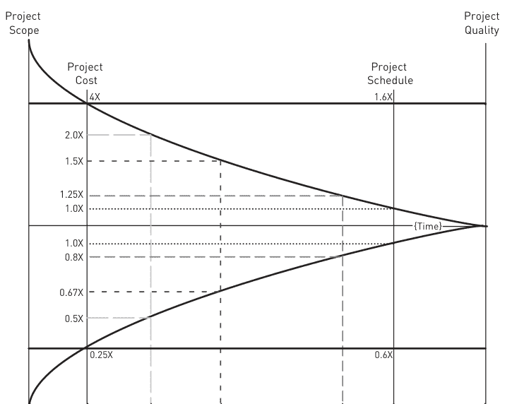

**图 3-1：修改后的不确定性锥，显示了随着项目的进展，利益相关者期望四个维度的估算如何变得更加准确**

由于依赖于估算的决策众多，估算过程的任何改进都能带来整个项目的显著提升。依赖于估算的直接决策示例贯穿本书。为了理解对项目决策的直接关系和影响，我们将查看涉及以下利益相关者期望维度的估算决策：

- 成本
- 范围
- 范围（时间）
- 质量

## 第 3 章 管理估算

当你开始估算软件项目时，可以通过跟踪估算决策的结果，理解并记录决策的输入，从而管理你的估算并确保它们的妥善使用。表 3-2 描述了一些可以帮助你理解估算的估算方法。表格中的右列描述了在使用特定技术评估和对估算做出决策时应考虑的“如果怎样”问题。探索该表格，确定你过去是否使用过这些估算方法。

### 表 3–2：结合 PEAK 使用不同的估算技术

| 技术 | 参考文献 | 需要考虑的 PEAK 输入 |
|---|---|---|
| 专家判断 | 参见表后的讨论。 | 参见表后的讨论。 |
| 基于模型（算法） | COCOMO II (Boehm et al. 2000) | **(P) 问题：** 规模更大，或进度比以前遇到的更长。<br>**(E) 经验：** 你拥有模型所需的数据，并且使用过该模型。（这是一个真实的陈述吗？）<br>**(A) 假设：** 模型已针对组织和项目进行了校准。（这应该被确认为事实吗？）<br>**(K) 知识：** 你知道相关的组织人员、技能和能力。（这是一个真实的陈述吗？） |
| 历史数据 | 类比法估算 (Pressman 2004) | **(P) 问题：** 你可以使用类比来找到解决方案吗？<br>**(E) 经验：** 过去收集了适当的数据，并可以与项目对应起来。你见过许多你有数据的类型的项目。（这些是真实的陈述吗？）<br>**(A) 假设：** 收集的数据不是垃圾，且资源保持大致不变。（这些应该被确认为事实吗？）<br>**(K) 知识：** 你基本上可以在项目中重复你的行动。（这是一个真实的陈述吗？） |

## 3.2 背景 73

让我们看看如何使用 PEAK 模型对基于专家判断的估算做出决策：

(P) 问题：为客户将接受的组织软件工作量的范围、成本、进度和质量提供一个合理的表示。

(E) 经验：这是“专家”对所提议的项目类型以及项目将使用的环境类型的历史积累。

(A) 假设：该项目与过去的项目足够相似，使得公司内的专家可以将这两项工作联系起来。其他假设可能包括：

- 专家理解项目中的所有新技术。
- 项目范围与专家所熟悉的其他项目范围相似。
- 公司未处于[变动状态]。

(K) 知识：你知道相关的组织人员、技能和能力。（这是一个真实的陈述吗？）

（注：此处根据上下文重构）正如麦康尔建议的，你无法通过停留在现有知识来改进估算。同样，Cohn（2005）指出，在同一点上倍努力可能只会降低估算的价值。因此，我们建议尽早且频繁地估算。

图 3-1 是麦康尔传统“不确定性锥”图的修改版。它扩展了锥体，包含了范围和质量的概念，并讨论了项目利益相关者期望的所有四个维度。

许多实践可以帮助收窄锥体并使估算变得更容易。历史数据、宽带德菲法（引入经验）甚至算法模型（估算工具）都能帮助改进你的估算。

（注：此处重构 97-98 页的内容）

(P) 问题：为客户将接受的组织软件工作量的范围、成本、进度和质量提供一个合理的表示。

(E) 经验：这是“专家”对所提议的项目类型以及项目将使用的环境类型的历史积累。

(A) 假设：该项目与过去的项目足够相似，使得公司内的专家可以将这两项工作联系起来。其他假设可能包括：

- 专家理解项目中的所有新技术。
- 项目范围与专家所熟悉的其他项目范围相似。
- 公司未处于[变动状态]。

(K) 知识：你知道相关的组织人员、技能和能力。（这是一个真实的陈述吗？）

[97-98 页的剩余文本似乎存在严重的 OCR 错误或非文本干扰。上述逻辑章节已保留。]

### 项目预算（成本）估算

一张旧漫画显示了一个科学家站在黑板前，配文是：“噢，时间就是金！”

### 项目范围估算

除了“开发”时间对成本的影响外，还有项目范围的影响。我们在新项目中的本反应是尝试完成一切，但当项目落后时，我们做的第一就是削减范围。

事实并非所有范围具有相同的优先级。你必须考虑如何优先考虑范围，否则可能会掉入认为万物价值相等的陷阱。事实上，如果你制定了一个“成功阈值”，你就能发现存在

## 3.2 上下 75

对范围的各个部分进行分类，例如“必须有”、“应该”和“可以有”（更多细节请参阅第 7 章“风险管理”）。这些分类可以快速设定范围的优先级，并有助于项目估算。

这些范围的优先级决定了估算决策过程的输入。我们对你能做什么的决策是基于你必须拥有的东西以及可用的资源。一个需要工程师参加一个月培训的“必须有”需求，仍然需要一个月的时间才能实现。不应该为工程师安排培训期间的任务，而且培训应该安排在工程师需要该技能来完成任务之前。这说明估算也与规划决策密切相关。更多细节请参阅第 4 章“计划管理”。

在项目的范围估算中，现实情况、时机和能力都是决策过程的一部分。估算范围的关键因素之一是规模。许多估算过程使用规模或相对规模。一些决定范围（规模估算）的技术包括功能点（Albrecht 1979）、故事点（Cohn 2004）和用例点（Schneider and Winters 2001）。所有这些方法都支持相对规模估算，并为“范围”提供了一个值。其他技术提供代码行数，这也能让你对范围有一个直观感受，随后可以用于确定或证明。

使用 PEAK 模型，你可以询问以下问题来对范围做出决策：

- (P) 问题 (Problem)：在这些限制条件下，该项目最可能实现什么？
- (E) 经验 (Experience)：你对之前的项目了解哪些重用组件可以使该范围成为可能？
- (A) 假设 (Assumptions)：是否应该假设目前在其他项目上工作的人会有空参与本项目，并且对于支持范围的任何新技术都会提供培训？
- (K) 知识 (Knowledge)：你为项目拥有哪些技能和资源？

### 项目进度估算（时间）

开发时间与时钟时间之间存在区别。在某种意义上，开发时间假设了一个理想世界。每一小时都将产生一小时的生产性工作。现实远非如此。

当你对项目进度进行估算时，几乎总是会查看过去项目中出错的地方。你将这些视为影响项目的“非常”事件。然而，如果你从时间跨度来看，你会发现这些异常事件对于这类项目来说是常态。事情总会发生。在你估算时，你是在试图评估未来的环境。最贴切的比喻是开车从一个地方到另一个地方。

你必须能够回答以下三个问题，以回答那个老的汽车旅行儿童问题（“我们什么时候能到？”）：

- 我们最初打算去多远（问题）？
- 到目前为止我们走了多远（经验）？
- 我们现在进展得如何，或者说我们的平均速度是多少（知识）？

行程分析中的第一个问题涉及范围主题。也就是说，你计划旅行多远？第二个问题是项目跟踪问题。你对花费的时间做了什么？换句话说，你已经走了多远？你也可以利用已行驶距离和时间来产生你的“平均”速度（假设）。知道速度后，你可以“假设”一切保持不变，那么通过速度计算出的剩余距离就是你剩余的时间（解决方案）。你可以利用这段时间来估算项目的剩余进度。

许多敏捷方法专门将此称为“计算团队速度”。这些敏捷方法将估算、跟踪和规划步骤合并为一个动作。如果能理解了这一点，这将是很有用的。

以下是应用 PEAK 模型来确定时间估值的方法：

- (P) 问题 (Problem)：需要多长时间？
- (E) 经验 (Experience)：你已经做了多少？
- (A) 假设 (Assumptions)：你可以以同样的速率继续。
- (K) 知识 (Knowledge)：在你开始时需要做多少？

### 项目质量估算

质量是你需要为项目估算的第四个维度。问题是，“什么样的类型和程度的质量对你的项目是合适的？”你需要考虑项目可以负担的质量水平。在软件领域，人们倾向于用质量换取时间。例如，人们牺牲测试以按时交付产品。这是一种直接的权衡。你还有间接的权衡，例如从开发过程中减少检查或评审以节省时间。

以下是应用 PEAK 模型来决定项目合适质量的方法：

- (P) 问题 (Problem)：支持此项目需要多少质量？
- (E) 经验 (Experience)：建立了哪些流程来支持这项工作？
- (A) 假设 (Assumptions)：你知道这种程度的投入对于这个项目是正确的。
- (K) 知识 (Knowledge)：你过去做过哪些有效的方法？

### 表 3–3：估算的多个视角

| 维度 | 使用的估算技术 |
|---|---|
| 范围 | 规模模型，如功能点、历史数据、代码行数 (LOC) 计数 |
| 时间（进度） | 算法模型和工具、专家判断和宽带德菲法 (Wideband Delphi) |
| 质量 | 专家判断和宽带德菲法 |
| 成本（预算） | 算法模型 (COCOMO II, Slim 等)、专家判断 |

当单独考虑估算时，软件项目成本、范围、时间和质量的额外益处是可以产生多个估算视角。表 3-3 总结了当关注点是这些维度之一时适用的估算技术。检查该表，并识别你过去使用过的技术。

### 3.3 案例

这些案例将强调与项目估算的关键问题。特别是，它们将研究那些对估算产生不利影响或不透明的因素。这些案例将从软件项目经理的视角出发，展示他们如何识别、规划并纠正影响估算的问题。

### 案例：作为工具的估算

### 指南

你可以独立于章节内容阅读案例。如果你选择先读案例，请先以“故事模式”读一遍，仅为章节中的信息设定背景。然后仔细阅读章节内容，最后以“分析模式”重读案例。

### 案例摘要

### 描述

软件项目经理必须对工作进行估算，并弄清楚哪些问题影响估算。他必须弄什么是良好的输入，以便做出良好的估算。

### 案例目标

阅读案例后，你将能够完成以下操作：

- 理解一些估算技术的示例
- 理解在不同阶段进行估算，以及如何改进规划阶段的估算
- 理解如何设置某些估算技术以更好地支持组织

### 涵盖主题

使用历史数据改进估算、估算的整体指标、理解指标与数据问题、以及如何寻找项目的相似性

### 背景

本案例将提供使用少量数据进行估算的方法、获取软件开发环境中可用基础数据的方法，以及快速收集数据并转换为指标的方法。

### 案例研究：作为工具的估算

### 术语

- **初级工程师：** 经验少五年的工程师
- **指标：** 对如何使用数据评估某些活动的一种相对理解
- **生产力数字：** 衡量公司获得项目工作产量的标准
- **高级工程师：** 经验超过五年的工程师

### 案例

### 场景

Marvin Saymore 在加入 Transad 公司开始新工作后，被要求对他的第一个完整项目进行估算。他必须给老板一个估算值，但他并不确定项目中主要的估算问题是什么。问题在于，估算是由不可避免的事件驱动的，还是因为对过去项目的估算失误。他开始反思自己在学校中学关于估算的知识，以及哪些因素可能会影响华盛顿交通局（WTA）项目。

Marvin 认为，当公司的人尝试进行估算时，他们从某种程度上试图预测未来。Marvin 不确定这是否真的如此，正如 WTA 项目那样。他认为估算更多是基于过去的，是对未来可能发生情况的最佳猜测，而非预测。随着这种“最佳猜测”，出现了一些风险以及成功或失败的概率。他曾被教导人类是习惯性的，除非环境发生重大变化，否则往往会做更多或相似的事情。从某种意义上说，Transad 在过去的100年中发展基本上保持不变，因此变化对于经理们来说并不一定是一个大问题。所以基于此，历史应该是未来活动的良好预测指标。

Marvin 仍然需要决定应该使用过去的数据，或者更准确地说，使用过去的哪些数据。数据总是多得没，但如果你不知道这些数据的含义或代表什么，就很难决定如何使用它们。为了他的目的，Marvin 接受跟踪项目进度的数据是有效的测量。这让他对于如何估算项目的决策变得困难，因为 Marvin 被教导要使用超过一种估算方法。他相信，这将允许他比较估算值并判断哪一个看起来更合理，而且在某些方面，他意识到项目中所有的主要问题。使用不同技术对同一项目进行巨大差异的估算可能表明存在隐藏的问题或未来的问题。Marvin 意识到，要理解项目的历史，他必须理解组织过去在项目中收集的指标。


Marvin 在接手 Transad 新任软件经理职位时首先发现，指标对其他人来说很好，但并不一定适用于他的小组。他发现已经提过许多指标衡量工作，但没有一个是长期维护的，也没有用于预测未来的性能。公司几乎依赖于公司内部高级工程师和高级经理的专家判断来得出估算。如果独立使用历史数据来验证估算，那么这可能是正确的，但一直从未这样做过。此外，可用的历史数据主要是“记账式”数据，即：项目工时、前生产阶段工时、后生产阶段工时以及现场维修工时。前生产阶段并没有具体列出任何软件事件，只是使用了许多小时。

Marvin 必须解决的首要问题之一是，这些“记账式”数据是否以某种方式可用。他需要开发一种获取准确数据的方法，并将其与他拥有的历史数据进行比较。他认为这些是准确的，一旦与他的项目相关，就是“指标”。他在短时间内使用了一种简单的技术，使他能够理解每类工程师是如何花费时间的。一旦他获取了足够的信息，可能就可以用它来验证项目的整体估算。Marvin 想看看他是否能在“记账式”数据与他开发项目中的真实数据之间建立关联。表 3–4 给出了 Marvin 获得的结果。

显而易见的是，在工程师花费的所有时间中，有些事情需要花费一点精力。接下来，同样明显的是，高级工程师和初级工程师在人们所谓的“真实”项目工作上花费的时间存在巨大差异。工程师的经验与工程师被允许在项目上工作的时间之间似乎存在一种反比关系。Marvin 怀疑这种对数据的解释是否正确，或者是否有另一个原因导致资深工程师在真实项目工作上花费的时间更少。

**表 3-4：Transad 正在运行的项目的工程师项目工时**

| 工程师职称 | 项目工作 | 会议 | 其他支持问题 | 现场工作 |
| :--- | :--- | :--- | :--- | :--- |
| 高级工程师 A | 12.3 | 7.6 | 10.3 | 20.9 |
| 高级工程师 B | 11.7 | 9.3 | 9.8 | 18.2 |
| 工程师 A | 23.6 | 3.2 | 3.5 | 1.5 |
| 工程师 B | 30.2 | 4.1 | 1.3 | 0.7 |
| 工程师 C | 27.2 | 3.9 | 2.1 | 1.4 |

如果没有生产力数字，这些值对估算可能产生重大影响，但 Marvin 的直觉是某些地方非常“不对劲”。

### 就像上一个一样

接下来，Marvin 开始检查公司用于工程师评估需求的“相同性”概念。最近的几个项目在向客户投标时，被描述为是完全相同的，仅有“微小”变化。Marvin 与团队讨论了这一点，发现许多需求实际上有很大不同。他想了解这种“相同性”是事实，还是仅仅是缺乏详细的分析。

### 重大事件

Marvin 注意到的主要问题之一是，历史数据没有考虑到现代软件任务的复杂性。他意识到，如果没有一种捕捉开发特定细微差别的方法，估算将继续不可靠。

**表 3-5：在新硬件上的小组工时**

| 项目 | 硬件 v1.0 工时 | 硬件 v2.0 工时 | 其他工时 |
| :--- | :--- | :--- | :--- |
| 巴尔的摩 | 3120 | 753 | 1012 |
| 达拉斯 | 2999 | 1001 | 576 |
| 洛杉矶 | 4230 | 2017 | 423 |
| 旧金山 | 2100 | 1423 | 1018 |

* 其中一些工时被用于集成和测试。

### 需要记忆的核心思想

PEAK 模型可以帮助明确输入因素，并证明基于错误输入数据的决策很可能也是错误的。

将新功能放在硬件而非软件中的决策并非最佳决策，因为它基于错误的输入数据。该决策中的经验和假设都是存在缺点的：

- (P) 问题 (Problem)：需要新功能。
- (E) 经验 (Experience)：向系统中添加硬件很容易。
- (A) 假设 (Assumptions)：向系统中添加硬件比添加软件更简单，且成本也更低。
- (K) 知识 (Knowledge)：基本上，对于一家硬件公司来说，软件更难管理。

解决方案：向系统添加新硬件以满足功能需求。

已确认风险 (Assured Risk)：在新硬件上运行软件的成本尚不明确，可能高于预期。最近的成本模型显示，将软件与新硬件集成的成本约为 5,000 小时。

对工程师时间的分配估计也需要重新审查。所使用的信息显示所有时间都相等，但忽略了上下文切换（context switching）的概念。机器可以来回切换，但人类无法轻易做到。PEAK 模型的应用揭示了与此决策相关的错误假设：

- (P) 问题 (Problem)：项目延期是因为工程师负载过载。
- (E) 经验 (Experience)：公司有很多处于不同开发阶段的项目。
- (A) 假设 (Assumptions)：工程师可以支持多个项目而不产生太大影响。
- (K) 知识 (Knowledge)：高级工程师能最快地解决现场产品的问题。

解决方案：根据需要分配工程师的时间来解决问题。

已确认风险 (Assured Risk)：初级和高级工程师在某个项目上可能实际上无法获得相同的时间，因此，使用高级工程师解决问题可能成为一个问题。

PEAK 模型帮助你评估所做出的估计决策，并寻找输入端的问题如何导致解决方案出现问题。

### 案例研究

### 当团队在赛跑时

### 指南说明

你可以独立于本章节的内容来阅读此案例。如果你选择先读案例研究，请先以“故事阅读模式”快速浏览，仅为本章中的信息设定背景。然后彻底阅读章节内容，最后以“分析模式”重读一遍案例研究。

### 案例总结

### 描述

经理哈利（Halley）预判到项目将在截止日期很早之前延期。他必须弄数据是否足够准确以支持他的判断，他对该问题可以做什么，以及是什么导致了这种情况。他想理解最初导致问题的那些决策，以便在未来改进他的决策水平。

### 案例研究目标

阅读完案例研究后，你将能够完成以下操作：

- 识别本案例研究中使用的多种估计技术。你还能陈述这些技术的使用是正确还是错误，以及案例中的人员做错了哪些地方。
- 理解如何识别通常围绕着项目的数据“迷雾”（haze），以及你需要做什么来获取正确估计所需的适当信息。
- 提供机制，为你在自己的组织内改进估计工作提供依据。

### 涵盖的主题

估计偏见、感知和交付进度

### 背景

一位软件项目经理无法弄通为什么他的项目似乎偏离了进度。他被要求提供状态报告，但他认为自己并不理解影响他估计的关键问题。他必须能够更好地解释他的估计结果。

### 核心概念

许多因素影响着估计的决策：

- 从多个方向观察问题有助于理解。
- 问题很少是容易的，否则它们早就被解决了。
- 第一印象很少能为你提供足够进行深入分析的信息。

### 术语

全额成本（Loaded cost）：单位时间的组织成本，不仅包括工资，还包括工程师的基础设施支持，如福利、建筑和环境。

TC：列控制（Train control）

WTA：华盛顿交通局（Washington Transit Authority）

### 案例内容

### 场景

当接力赛在进行时，最后一个团队成员似乎总是要为团队延误负责。无论在此之前是掉了接棒还是浪费了时间，这并不重要。人们预期最后一个人（接力者）可以应对任何情况。在复杂集成系统的开发，这个“人”通常是指软件。

哈利·安德森（Halley Anderson）面临着艰难的一天。他知道自己要告诉经理，华盛顿交通局（WTA）项目将延期。这看起来可能不寻常，因为项目还有六个月才到，但尽管如此，它确实会延期。

这一切始于 WCT 项目开始。在列控制（TC）小组收到合同开工通知后，哈利对项目进行了详细估计。他想确保分配了适当的资源，并在项目中观察到风险。哈利使用了多种技术来估计该项目的成本，但其中一种技术所做的假设正在被审查。

该估计考虑了项目中每次使用新硬件的时间，这似乎是让软件在硬件上运行所需的、固定的工程小时数。这部分额外时间几乎像是一个常数，必须由哈利进行多次验证，但他开始相信，不仅是软件本身，在这些新硬件环境中安装并运行软件的时间也导致了开发时间的恒定不变。换句话说，哈利认为问题出在硬件上。

硬件组是哈利的经理恩里克·瓦茨曼（Enrique Wattsman）出身的地方。恩里克对硬件组有一种“偏爱”。

恩里克在画板上画图时（图3-2）说：“我对软件的看法。”

哈利回答道：“但至少我们可能想将其拆分为设计、实现（代码）和测试。设计是解决方案的创造。”

恩里克说：“好吧，我想我们可以加入这一点，但比例将保持不变。”

这给哈利留下了一个问题，和一个可能的解决方案。恩里克认为软件是“容易的”，并且与公司做的其他事情无关。例如，恩里克没有说需求遵循硬件可用性。他假设它们是独立的。这为哈利向恩里克解释这种关系提供了机会，还是这是另一个最后跑步者（软件）必须克服的障碍？

哈利计算出，在新硬件板上运行软件大约需要 5,000 工程小时。他将此信息用于 WTA 的估计，但还没有让经理意识到这个数字。告诉恩里克每当他的工程师决定增加硬件时，公司就会损失50万美元，这有些令人害怕。（Transad 工程师的全额成本约为每小时100美元。）

问题在于，他如何能让经理和其他人都意识到这一点，以免让“最后跑步者”再次因为总是迟到而被埋怨。

哈利与硬件组主管卡文·史密斯（Calvin Smith）建立了友谊。卡文人很好，但他知道自己的部门导致了 Transad 最近经历的一些问题。他总有工程师在现场调试问题，总出现在恩里克的办公室解释为什么这个或那个延期了。他的工程师工作过量，他看不到解决问题的清晰方法。卡文的问题和哈利的问题是相关的。如果硬件延期，软件也会延期。

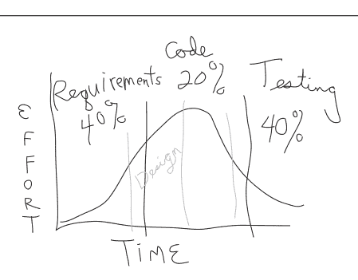

**图3-2：哈利的经理对软件开发的看法**

一个特别的问题困扰了这两位经理。他们都明白自己有 11 个月的时间来开发该系统；然而，在期限结束前的几个月，如果他们需要进行更改，情况就会变得越来越困难。尽管随着产品的集成和定型，更改的数量通常会在产品生命周期内减少，但更改可能会变得更加频繁。当工程师对产品最了解时，他们被允许实施改进产品的机会反而减少了。

Halley 和 Calvin 在周末抽了时间，并决定问题已经显而易见（图 3-3）。尽管从技术上讲，经理们被给了一定的时间来提交解决方案，但实际上所需的时间要短得多。这是因为制造所需的时间与开发所需重叠了。这种重叠的发生是因为公司需要通过缩短交付给客户的总时间来赢得更多项目。在纸面上，这看起来很好，并且可能意味着整体开发进度可以从 10 到 11 个月压缩到 8 到 9 个月。这开始解释为什么 Transad 的项目总是来得越来越晚。然而，当然，这种掩盖显示的时间与之前相同，而且成本在某种程度上也保持不变。

制造与开发的重叠是满足新合同需求的后勤需求。如果你必须建造一千台设备，而建造每个设备需要固定的时间，只需将设备数量除以时间并反向推日历即可。Transad 仍然以许多硬件制造公司通用的模式进行思考，而不是意识到硬件不仅取决于软件，还取决于硬件和软件设计等创意过程。

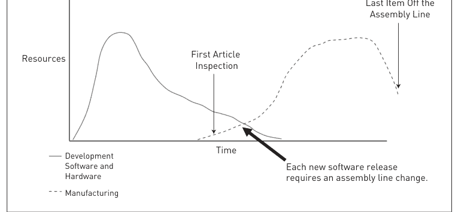

**图 3–3：制造与开发的关系**

Calvin 现在明白为什么他会陷入如此大的困境了。他零件和电路板开发的正常交期比他可以进行更改的时间要长。他被要求在完全测试之前交付新硬件。Halley 利用这个空隙向 Calvin 透露了一个秘密：5000 小时的成本。如果 Calvin 在零件上遇到困难，而且他最终拿到了组件，构建它们还需要另外 5000 个工程小时来加载软件，那么项目延迟是不可避免的。

Halley 建议问题在于系统已经产品线化了。即使在高度专业化的情况下，公司也无法负担增加新硬件。引入新组件的成本太高了。规范必须在项目的第二或第三月准备就绪，接口必须定义，TC 小组才能制作新电路板。对于硬件组来说，二三个月似乎太短了。即使理解了这一点，要满足制造拍卖，这个新发现的内部截止日期（延迟八个月）仍然存在问题。Halley 必须分配大约五到六名工程师为任何新电路板编写软件。

在某些方面，Transad 限制了它的选择。如果 Calvin 能说服工程师使用“现成”硬件，项目就可以准时开始。对于 WTA 项目来说已经太晚了，但 Halley 将坚持在未来进行这种改变。

WTA 项目有一个新组件，形式是一个公司从未制造过的板。它是制动反馈监控器（BFM）。该设备在未来可能会产生良好的产品线效应，但在项目中，它创造了一个 Halley 需要硬件组满足的截止日期。

在启动会议上，Halley 宣布在 3 月 27 日之前需要新的 BFM 硬件。在会议上，距离日期还有三个月。

Halley 说：“在 WTA 的规划中，已经很明显这块新电路板将很难处理。在新硬件上安装软件花费了大量时间，我们能确保在 3 月 27 日之前获得测试所需的电路板吗？”

Enrique 说：“Calvin，让我们确保这一点。你手下的人最近表现不好。”

Calvin 回答道：“你在说什么？我现在有三个人。我们处理的工作超过了我们的分份额。在我眼里，他们变得非常优秀了……”

Calvin 和 Enrique 之间的这种讨论是典型的。当在一名工程师离开后，问题还是到了顶峰。Enrique 进 Halley 的办公室问：“一年了！我怎么撤走一个人之后还是没搞定？”

Halley 回答道：“我不确定你是否理解。”

Enrique 说：“Calvin 的人一直在为 Fusser 项目的一块电路板工作，他们有一个修复它的待办事项。他们知道解决方案是什么，但还没有做，而明天就要截止了。所以，在电话之后，我们告诉客户问题将解决，我将不得不告诉他们：‘请再等一下。’一年……整整的一年！”

Halley 意识到公司里的所有项目在某种程度上都是相互关联的，这意味着一个项目的问题可能会影响另一个项目的开发。

不久后，Calvin 离开了公司：他认为自己再也无法以逻辑或客观的方式处理硬件组的问题。

在与 Calvin 的最后一次对话中，Halley 说：“Calvin，我明白你要离开了。看到你离开我很遗憾。”

Calvin 回答道：“救你自己吧，这个地方永远不会[好起来]的。”

人们不得不做出假设，因为有时直到项目后期你才能获得所需的数据。尽管如此，对于估算而言，PEAK 模型大部分时候显示假设是一个问题，但知识的可用性和准确性等因素也是问题。

案例中的“一年期问题”可能就是一个例子。风险是可能没有空闲时间，但假设是空闲时间会在一年内的某个时候出现。当最初的一年估算提出时，所有人都认为时间会变得可用。没有人验证这个假设，而且该问题尚待处理的知识可能并没有告知必须处理该问题的工程师。项目根据一个可能不成立的假设出的估算决策继续进行。

Halley 学到的将影响他未来估算决策的主要原则是：某些成本是固定的，例如将软件集成到新硬件中所需的 5000 小时。如果能更好地理解这些固定成本，估算过程就可以得到改进。Halley 增加了未来估算决策的知识。他还了解到，如果小组要取得成功，他关于生产过程、实际成本和估算的知识需要对组织中的所有人可用。

### 需要记住的核心思想

初看之下，项目经理面临的问题似乎是软件总是迟到。正如案例标题所示，软件人员负责项目赛跑的“锚点接力赛”。他们通常处理产品的集成，并在此过程中成为最后工作该项目的人员。因此，他们可能被要求弥补项目早期发生的任何先前缺陷。如果不考虑到这一点，项目早期的估算决策可能是完全无效的。

在实践中，一个 11 个月（220 个工作日）的项目推迟 14 天是一个非常小的量，但对于如何保持项目进度至关重要。许多因素会影响这种理解，花时间进行反思对于做出正确的决策至关重要。

当 Halley 和 Calvin 从管理项目的“比赛”中抽身并反思时，他们学会了理解影响项目的深层次问题。他们的反思努力增加了未来进行 PEAK 估算决策的知识。他们了解到，他们认为是软件工程组织过错的问题之一，实际上与制造需求以及在压缩日程中执行相关任务的顺序有关。这个问题并不完全在他们的控制范围内，它表明了影响项目估算和进度规划的因素的复杂性。通过这次经历，Halley 能够更好地准备捍卫他的估算决策。

### 3.4 总结

本章侧重于软件项目决策背景下管理估算的以下活动。带有星号标记的项目涉及所有类型估算的决策制定。

- * 理解需求（见第 2 章，“需求管理”）*
- 从概念上设计解决方案
- 执行元素级分解（分，`divide`）
- 从下而上分配资源（分而治之，`conquer`）
- 分配开销
- 估算构建（construction）
- 估算变更管理

章中的案例研究展示了与管理当前和未来项目估算相关的决策问题。第一个案例“作为工具的估算”讨论了如何利用收集信息时做出的决策来维护未来的估算决策。该案例涉及开销分配估算和变更管理估算。第二个案例“当团队在比赛中跑步时”涵盖了估算构建以及分而治之的问题。

> 随着你估算经验的增加，你的 PEAK 分析可以显示如何更好地评估对估算的决策。

# 第 4 章 管理计划

### 4.1 章节目标

在阅读并思考本章介绍概念和案例研究后，你将能够完成以下工作：

- 理解管理软件项目计划的关键活动
- 识别章节案例研究中涉及计划管理的关键问题和决策
- 使用章节概念为案例研究利益相关者面临的问题提供可行的解决方案
- 认识管理软件项目计划的重要性

### 4.2 背景

一个项目通常被理解为一项需要共同努力的活动，与计划或提议同义词（TheFreeDictionary by Farlex, Project）。计划是为实现目标而预先拟定的方案、程序或方法（TheFreeDictionary by Farlex, Plan）。在实践中，项目目标（范围）、完成时间表（时间）、要实现的质量属性（质量）和预算（成本）与利益相关者的预期有关（在第 9 章“管理预期”中讨论）。此外，项目通常以清晰的开始和结束为特征。

你可能会想象，没有计划，大多数项目无法完成。项目无论范围或复杂程度如何，都需要一个进攻计划。项目计划应该是日常执行决策的输入。

项目计划涉及将要管理的项目任何方面，例如：

- 进度的开发计划
- 任务和资源的预算计划
- 质量的过程计划
- 执行项目所需的工具支持计划、配置管理


Humphrey (2000) 定义了一个综合软件团队，其中团队成员分别承担开发经理、计划员、质量或过程经理以及支持经理的这些管理职责。他增加了一个团队负责人，但没有为成本管理分配特定角色。

本章讨论了组成计划管理的活动和决策，并提供了基本原则的观点。本章重点帮助你理解基本的项目计划，这些规定了目的和目标、工作组织和责任、约束以及预算方面。其他章节讨论了与过程、产品和风险相关的规划。第 5 章“产品管理”和第 6 章“过程管理”更详细地讨论了质量约束。第 2 章“需求管理”更全面讨论了与管理需求变更和范围相关的问题和决策。

由于软件项目很少按照计划进行，重新计划是不可避免的。客户在中途保留项目范围、来自现场服务组织的意外请求、项目成员离开公司、项目估算过低、项目进度落后或预算超出等。在某个时刻，对于大多数软件项目，计划将无法反映实际状况。关于是否需要重新计划以及重新计划哪些方面的问题随之产生。

当当前的计划不再有助于引导项目按时、在预算内并按照规范完成目标时，项目经理通常会决定重新计划。重新计划通常涉及范围、进度、质量或预算的更改。参见 Rönkkö et al. (2005) 关于公司内部为应对情况所需提供手段的实证研究。Deleris et al. (2007) 来自 IBM 研究中心讨论了涉及……的自适应项目重新计划的双管方法。

## 4.2 背景

对项目计划中受影响活动的风险进行分析（即导致成本和时间超支的根源因素），并对项目计划中分配给每个活动的资源进行优化。

管理计划需要对计划细节进行持续关注。项目经常失败，并不一定是因为项目计划本身有缺陷，而是因为项目经理没有关注细节，或者没有有系统地使用计划来评估他们的项目决策。那些不断“救火”的项目经理在计划失效时，也无法执行或重新计划。例如，进度表中的微小偏差会累积直到导致严重的进度延误、成本超支，或者软件功能无法完全满足质量要求，从而导致计划周全但管理不善的项目失败。关于软件项目计划，学术界和业界已有许多论述。关于这个主题的一些有见地的结果来自 John Mangione (2003)、McManus 和 Wood-Harper (2008) 以及 Taimour (2005)。

我们现在将在做对影响软件项目计划的决策时应用 PEAK 模型。一位项目经理正挣扎于让一个软件开发项目按进度、在预算内并符合规范运行。现场服务部门要求项目中的一些软件工程师帮助修复一个重要客户在软件最新版本中发现的缺陷。同时，项目的业务分析部分落后于进度，而且数据建模任务的实际成本超过了计划成本，因为需要的外包人员比最初估计的要。项目经理面临软件开发总监的压力，要求尽快让项目回到进度和预算范围内。使用 PEAK 模型，软件项目经理可以提出以下问题，以决定如何处理影响进度、预算和资源计划的问题：

- **(P) 问题：** 软件项目经理应该做什么来解决关于进度延误、成本超支和项目资源需求冲突的问题？是否需要重新计划？
- **(E) 经验：**
  - 软件开发组织对于处理中断正在进行的项目的现场服务请求有什么什么政策？
  - 项目经理或软件开发组织过去是如何处理此类请求的？
  - 项目经理或软件开发组织过去是如何处理进度延误的？
  - 项目经理或软件开发组织过去是如何处理成本低估的？
  - 过去，重要客户对现场修复缺陷的期望是什么？如果适用，客户是愿意等待软件的下一个发布版本，还是要求立即修复？

- 与管理客户、现场服务或软件开发总监的交互（关系）涉及哪些问题？这些问题将如何影响替代方案？
- **(A) 假设：** 问题中的哪些输入应该被确立为事实而非假设？例如，软件项目经理可以提出以下问题：
  - 报告的缺陷是否真的阻止了软件实现利益相关者对当前发布版本和软件下一个版本所预期的质量？
  - 修复该缺陷会在进度、预算或质量方面中断软件下一个版本的开发吗？
  - 重要客户是否真的期望立即获得修复？
  - 软件开发总监所说的“修复项目”到底是什么意思？
- **(K) 知识：**
  - 业务分析任务进度延误的原因是什么？
  - 延误在多大程度上是否影响了进度的关键路径？（参见表 4-2 中的进度计划活动以获取关键路径的定义）
  - 可以做什么来缓解延误且不对关键路径产生影响？
  - 可以做什么来减少数据建模任务的成本？
  - 可以减少哪些其他项目以将总项目成本控制在预算内？
  - 哪些其他可用的软件工程师（如果有的话）可以处理现场服务请求？
  - 如何作为当前项目交付物的一部分完成缺陷修复？
- 对项目进度和预算会有什么影响？
- 谁来支付这些费用（现场服务、开发项目、客户等）？
- 对项目交付物的质量会有什么影响？需要哪些额外的测试来确保预期的质量？

**解决方案：** 替代方案涉及对以下问题的回答：

- 软件缺陷修复何时完成？
  - 作为当前正在开发的软件发布的一部分来修复缺陷。
  - 作为针对客户的特殊软件发布版本来修复缺陷。
  - 如果缺陷没有阻止软件满足质量方面的预期，则不移除该缺陷。（客户的感知可能与现实不符。）
- 谁来进行软件缺陷修复？
  - 目前在该项目中工作且具备必要技能、经验或知识的软件工程师。
  - 未分配到该项目的软件工程师（如果有技能足够进行修复且有空的工程师）。
- 如何处理业务分析任务的进度延误？
- 谁来支付软件缺陷修复的费用？

**假设：** 鉴于输入，问题中的哪些应该被确立为事实而非假设？对于计划的剩余部分，我们讨论关于计划的活动，并提供项目经理的指南。我们希望这些计划能够满足项目经理的预期。随后的讨论包含以下术语：

**软件：** 是由项目经理使用的各种异构实体组成的。它们通常包含计算机程序和文档。**软件属性**。

**交付物：** 是 (1) 软件制品产生的成果或结果，(2) 软件计划的交付物。

**软件服务：** 为用户或客户执行的涉及软件创建、定义、交付、执行的活动。

**任务：** 机器或人类在项目交付物开发中执行的活动。任务通常需要人员、预算、时间和其他资源的分配。

**里程碑：** 是 (1) 一个可观察的、能够追踪的项目事件或结果，或 (2) 软件制品、软件服务或组成部分的完成，对于追踪目的很有用。

**软件项目：** 涉及为生产软件制品或执行软件服务分配预算、时间、人员和其他资源。

**软件项目计划：** 描述应该生产或做什么（范围），谁在什么时候做什么（人员和进度），应该使用哪些其他资源（设备、用品等），应该花费多少（预算），应该满足哪些约束或属性（质量属性），应该如何生产或如何管理项目（过程），或者项目要管理的任何其他方面。

表 4–1：软件项目计划的示例内容

| 项目管理领域 | 项目计划信息 |
| --- | --- |
| 项目概览 | 项目目标、背景和范围<br>项目政策和约束条件 |
| 项目利益相关者与组织 | 识别项目利益相关者及其职责<br>项目组织，包括人员职位、汇报结构等 |
| 工作计划 | 项目里程碑（例如，中间或最终的项目交付物）<br>完成项目里程碑需要执行的任务<br>完成项目任务和里程碑的人员分配<br>完成任务和里程碑的进度进度估算 |
| 预算计划 | 用于完成任务和里程碑所需的人员、设备、供应品和其他资源的预算成本估算 |
| 风险计划 | 识别项目风险<br>风险管理策略（也列在过程计划中） |
| 过程计划 | 针对以下项目管理领域的流程计划：<br>* 管理项目计划的审核和控制<br>* 管理项目利益相关者之间的通信（参见第 8 章“管理人员互动”和第 9 章“管理利益相关者预期”）<br>* 管理项目交付物的开发和质量（参见第 5 章“管理产品”）<br>* 管理项目决策<br>* 管理项目问题<br>* 管理项目会议<br>* 管理项目目标和范围（参见第 2 章“管理需求”和第 9 章“管理利益相关者预期”）<br>* 管理项目风险（参见第 7 章“管理风险”）<br>* 管理计划相关的项目状态<br>* 重新计划<br>* 管理人员分配和其他资源分配 |

我们将探索软件项目经理为管理计划而执行的表 4-2 中的活动。为了管理项目计划，你可能从思考如何执行每项活动开始。核心思想是理解你执行某项活动的原因（目标）以及该活动如何有助于实现项目目标。学习表格，然后思考你在管理软件项目时已经遇到或可能遇到的其他活动。

### 表 4–2：管理计划中的活动描述

| 活动 | 活动描述 |
| --- | --- |
| 定义项目目标和范围 | **定义：** 确定项目应该完成什么，以及满足项目目标的任何约束条件。项目计划可能包括要开发的软件系统及其使用背景。<br>**目标结果：** 关于项目范围、时间和成本的项目交付物的清晰、完整、一致且正确的描述，以及项目遵循的任何政策。项目利益相关者应对对这些描述有共同理解。 |
| 任务和里程碑计划 | **定义：** 确定完成项目交付物所需的逐步活动，并将项目交付物分解为有助于预算、资源和进度计划的部分交付物。它还包括执行项目所需的其他任务。<br>**目标结果：** 用于开发项目进度和预算的任务与里程碑的清晰、完整、一致且正确的列表。相关的项目利益相关者应对对这些描述有共同理解 |

### 表 4–2：管理计划中的活动描述（续）

| 活动 | 活动描述 |
| --- | --- |
| 进度计划 | **定义：** (1) 估算完成项目任务所需的资源单位（例如工时）；(2) 在时间线上安排任务和里程碑，以便在依赖于它们的任务之前完成；(3) 为里程碑完成分配日期；(4) 识别关键路径（依赖任务/里程碑的最长路径），以及 (5) 可行地完善任务和里程碑以缩短关键路径或利用资源**目标结果：** 一个准确、清晰地指示完成每个任务/里程碑的时间、分配给每个任务/里程碑的资源单位、任务/里程碑之间的依赖关系、关键路径以及可用松弛的时间表。项目利益相关者应对进度计划有共同理解 |
| 预算计划 | **定义：** 估算要完成的任务/里程碑成本以及不直接归属于特定任务/里程碑的其他成本。**目标结果：** 项目执行的裁量分配成本的准确、清晰、精确且完整的描述。相关的项目利益相关者应对预算计划有共同理解 |
| 人员配备和其他资源计划 | **定义：** 确定、定位/获取并将资源分配到要完成的任务/里程碑的过程。**目标结果：** 完成项目任务/里程碑和其他项目工作所需的准确、清晰、精确且完整的资源描述、资源来源说明以及项目期间使用资源的时间表。 |

### 表 4–2：管理计划中的活动描述（续）

| 活动 | 活动描述 |
| --- | --- |
| 跟踪和控制进度 | **定义：** 收集和分析信息以确定项目在预算和进度方面的状态的过程。它还根据需要进行调整以保持在预算和进度范围内。<br>**目标结果：** 在项目的任何时间点，对项目成就和支出有准确理解。确保项目交付物按时且在预算内完成。 |
| 估算预算和进度 | 参见第 3 章“估算”。 |
| 管理项目计划的中期变更 | **定义：** 为了实现项目目标而调整计划，或在需要时修改项目目标以满足利益相关者的预期过程。<br>**目标结果：** 修改后的计划执行能够产生满足利益相关者预期的项目结果 |
| 根据项目目标、政策、进度和预算管理软件开发 | 产品质量是开发管理的目标。参见第 5 章“管理产品”。 |
| 根据项目目标、政策和其他项目计划管理过程 | 过程质量是过程管理的目标。参见第 6 章“管理过程”。 |

管理项目计划的人员会做出表 4-3 所示的决策。示例决策按决策领域分组。如前所述，这些决策关注软件项目计划的基本要素，例如目标、组织和工作预算计划。由于项目计划规定了应该管理什么以及如何管理，相关的决策自然涉及内容和过程。探索该表格，然后思考你在管理软件项目计划时遇到或可能遇到的其他决策。

### 表 4-3：管理软件项目计划时需要做出的决策

| 决策领域 | 示例决策 |
| --- | --- |
| 项目概览 | 项目的目标、背景和范围是什么？ |
| 项目利益相关者预期 | 利益相关者对项目交付物的范围（需求）、交付时间（进度）、质量和成本（预算）的预期**什么？ |
| 项目资源分配（进度、预算、人员配备等） | 什么样的任务和里程碑、进度、预算、人员配备和其他资源分配能够以预期的时间、质量和成本实现项目目标？ |
| 项目约束 | 满足利益相关者预期需要哪些特定的软件开发或项目管理过程？<br>满足利益相关者预期需要哪些特定的人员或其他资源？ |
| 项目组织 | 什么样的项目组织结构通过分配职责来增加实现项目目标的概率？<br>对于必须划分为子项目的大型或复杂软件项目，各个工作计划将如何组织并相互关联？ |

### 表 4–3：管理软件项目计划时需要做出的决策（续）

| 决策领域 | 示例决策 |
| --- | --- |
| 项目质量与风险管理 | 软件项目计划能够按时、按指定质量并在预算内满足软件项目目标的确定性程度有多大？<br>- 这种确定性基于什么？<br>- 项目计划的每个方面与之相关的风险有哪些？<br>- 将使用哪些跟踪和审计流程来识别以下可能影响软件项目成功的风险？<br>- 计划的任务和里程碑、进度表、预算、人员和其他资源不足以实现软件项目目标。<br>- 软件项目在已完成的任务、里程碑、进度、预算支出、人员和其他资源决策方面的状态与项目计划不符或无法满足计划。<br>- 软件开发计划未能充分确保项目交付物具有预期或要求的质量属性。<br>- 项目交付物不满足其功能或非功能性需求。<br>- 特定的流程及其定义未能妥善确保软件项目目标的实现，或执行软件过程未能实现为这些流程定义的目标。 |
| 项目重计划 | 当需要时，将使用哪些流程来修改软件项目计划以确保项目的成功？<br>- 计划经理如何知道何时以及是否需要重计划？<br>- 如何确保任务和里程碑得到圆满完成？<br>- 如何保持项目进度按正轨运行？<br>- 如何控制项目成本？<br>- 如何在适当的时间选择并分配人员和其他资源以实现项目目标和计划？<br>- 如何对项目交付物进行验证和确认？ |

### 表 4–4：做出项目计划决策时的实用性指南

表 4–4 显示了在做出软件项目计划决策时的一些实用性指南。左侧列描述了项目经理面临的问题或决策，右侧列提供了在处理相应问题或决策时应考虑的实用性指南。查阅该表，并根据自己的经验制定指南。如果你是项目管理的新手，现在是开始并反思你经验的好时机。

| 经理的问题或决策 | 指南 |
| --- | --- |
| 计划中应该包含什么？ | 使计划尽可能完整。项目计划应让经理知道要管理什么以及如何管理。示例请参见表 4-1。 |
| 应该跟踪哪些项目特征？ | 识别能够清晰指示软件项目在范围、时间和成本方面健康状况的“生命体征”。 |
| 应该如何定期评估项目计划？ | 确定如何进行易于、快速且定期的监控，以便对计划进行调整。 |
| 应该如何使用项目生命体征？ | 开发关于需要调整多少的“脉搏点”。 |
| 项目的任务和里程碑应该是什么？ | 任务识别应让经理能够以下操作：<br>- 确定实现目标需要完成的活动。<br>- 确定任务的依赖关系和适当顺序。<br>- 安排每个任务的完成。<br>- 分配执行任务所需的人员和资源。 |
| 表现出以下特征的活动可以作为任务： | 它们是独立的且可以同时进行。<br>- 它们必须按照特定的顺序进行。<br>- 它们会产生应当跟踪完成的里程碑。<br>- 它们的执行需要特定的技能，这可能会限制分配给拥有这些技能的人员。 |
| 表现出以下特征的里程碑应单独定义： | 跟踪有助于确保成功。<br>- 它们是要求的项目交付物。<br>- 它们的完成需要具备技能的人员。 |

### 表 4–4：做出项目计划决策时的实用性指南（续）

| 经理的问题或决策 | 指南 |
| --- | --- |
| 在制定项目进度表时，有哪些需要注意的想法？ | 确保项目交付物的截止日期是明确的。可能需要对进度进行调整。<br>- 注意任务依赖关系。<br>- 确保时间估算是现实，包含了适当因素，并为解决问题留出了时间。<br>- 为行政事务分配时间。 |
| 在制定人员及其他资源分配计划时，有哪些需要注意的想法？ | 确保人力技能、投入和资源足以实现项目目标。可能需要进行调整。 |
| 在制定项目预算时，有哪些需要注意的想法？ | 确保预算满足利益相关者的预期。验证与资源相关的实际成本符合预算。可能需要对预算进行调整。 |
| 在管理划分为子项目的大项目时，有哪些需要注意的想法？ | 仔细考虑将用于创建主计划的工具，以及子项目之间的人力和资源依赖关系。 |

软件工程学院（SEI）的系统工程、软件工程、集成产品与开发以及供应商采购能力成熟性集成模型（CMMI）将项目计划定义为组成项目管理的若干过程领域之一。CMMI 对项目管理过程进行了建模，是如何定义项目计划的极佳参考（2002）。在定义用于计划和跟踪项目的流程时，本章的内容将帮助你找到相关材料。

其他项目计划资源包括：关于编写计划指南的 IEEE Std. 1058-1998；McConnell (1997) 的项目计划经典示例；Pfueger 和 Atlee (2006) 关于如何计划和管理软件项目；Bennan (2000) 和 Tillman 与 Greene (2005) 关于估算、进度和预算等计划领域最佳实践的建议；以及由英国政府开发的基于过程、标准化且全面的方法 OGC。


对于想要进一步了解计划管理的读者，我们建议以下参考文献：`Muñoz-Avila` 和 `Cox` (2008) 分析了有助于项目复用的用自适应研究；`Xu` 和 `Muñoz-Avila` (2008) 介绍了一个基于案例推理辅助项目计划任务的知识系统原型；`Ceschi` 等 (2005) 研究了 20 位采用基于计划（传统）或敏捷方法进行项目管理的软件公司经理；他们发现使用敏捷方法的经理比其他经理更关注人员和过程；`Pikkainen` 等 (2008) 发现，虽然敏捷软件开发实践有助于团队和组织沟通产品功能与工作任务之间的依赖关系，但团队和组织也使用计划驱动的实践来确保所有利益相关者之间外部通信的效率。

## 4.3 案例研究

本章的案例强调了不光鲜但重要的重计划和管理计划细节的活动。“重计划还是不重计划？”案例讨论了何时以及如何调整预算、进度或人员计划的问题。案例中的利益相关者决定了是否需要重计划。第二个案例“管理在细节中”研究了对于与其他项目及工程小组共享资源的软件项目的计划和跟踪细节。一个特殊的流程分析小组（PAT）调查并确定了为什么软件组织在计划和管理软件项目及资源方面持续存在问题。团队必须向工程总监决定改进建议。阅读这些案例可以更好地理解管理软件项目计划的细微差别。

### 案例研究：重新规划还是不重新规划？

### 指南

在阅读本案例研究时，请关注属于软件项目规划和跟踪部分的活动和决策。特别注意与需要重新规划相关的问题。案例提到了几个在实践中用于项目规划和跟踪的标准但具体的指标。因此，在阅读本案例研究之前，回顾相关的专业术语将非常有帮助。

### 案例摘要

### 描述

Nordic Petro 采用了企业级方法来管理其业务运营。所有业务和管理决策将基于实时访问的全公司信息。基于这一目标，Nordic Petro 将其核心业务系统转换为集化的 SAP 软件套件，以管理人力资源、财务以及销售与分。软件转换显著节省了运营支出，并增加了收入。公司现在希望添加 SAP 企业客户关系管理、供应商管理和资产管理。公司的目标是降低客户服务和供应链管理的成本，以及与维护和使用工厂、设备和其他资本资产相关的费用。复兴项目（Renaissance Project）的预计成本为 2007 年 6 月的 3 亿美元。所有新系统的预计上线时间是从项目开始后的 2.5 年。公司已聘请大型咨询公司 IT Sphinx 协助进行项目规划与管理、业务与集成流程规划，以及软件开发与集成。案例场景侧重于项目规划阶段。

### 案例目标

阅读完案例研究后，你将能够完成以下操作：

- 更好地理解管理软件项目计划时涉及以下问题：
  - 确定何时以及为何需要重新规划
  - 选择要收集的项目管理指标和数据
  - 管理与项目计划相关的风险

## 第 4 章 计划管理

- 识别软件项目经理管理预算、进度和人员配置计划的活动和决策。
- 解释案例场景中发生的问题、问题的原因、针对问题的某些可行解决方案，以及未来消除这些问题或减少其影响的方法。将这些内容与项目利益相关者面临的决策联系起来。

### 涵盖主题

预算规划、项目计划管理、项目风险管理、项目规划、项目重新规划、项目人员配置、项目跟踪和进度规划

### 背景

背景是位于挪威奥斯陆的 Nordic Petro 全球总部的信息技术（IT）中心。该公司专注于挪威陆架石油和天然气的勘探、开发和生产，并最近涉足可再生能源生产。公司在 40 多个国家经营业务，设有四个业务部门：石油勘探与生产、天然气、可再生能源以及制造与营销。Nordic Petro 在奥斯陆证券交易所上市。

### 核心概念

- 关于何时以及为何进行重新规划的适当决策对于软件项目的成功管理非常重要。
- 偏离软件项目计划是常见现象。了解偏差通常发生的原因可以帮助软件项目经理制定更不容易受偏差影响的计划，并帮助他们更有效地为偏差发生时的识别和处理偏差做好准备。
- 软件项目经理需要收集项目管理数据，以帮助他们为未来类似项目的资源需求建立基准。

### 术语

已完工实际成本 (ACWP)：完成所执行工作时实际发生的成本总和（美国海军部）。

在实践中，ACWP 是截至报告期结束时完成的所有任务实际消耗的小时（成本）总和。

### 案例研究：重新规划还是不重新规划？

已完预算成本 (BCWP)：见挣值 (EV)。

已计划预算成本 (BCWS)：见计划值 (PV)。

CEO：首席执行官。

CFO：首席财务官。

CIO：首席信息官。

COO：首席运营官。

成本绩效指数 (CPI)：特定时期内已完成工作与已发生工作成本的比例。CPI 是工作支出的效率评级（美国海军部）。

在实践中，CPI 为 BCWP/ACWP（见 BCWP 和 ACWP 的定义）。CPI ≥ 1 意味着截至报告期结束的已完工工作预算成本等于或大于这项工作的实际成本。在其他情况下，项目成本在预算之内或以下。

更多细节：CPI 的计算方法为 BCWP 除以 ACWP (BCWP/ACWP)。预算成本和实际成本可以是货币值（例如美元），也可以是其他计量单位（如小时）。由于是两个具有相同计量单位值的比例，CPI 没有计量单位。CPI ≥ 1 是一种理想情况，即已完工工作的预算成本大于或等于该工作的实际成本。相反，CPI < 1 表明处于不理想的情况，即该工作的实际成本超过了该工作的预算成本。此外，CPI 远大于 1 表示原计划严重高估了这项工作的成本。案例研究中的经理通过跟踪项目的 CPI 来确定项目预算执行得如何。项目 CPI 值不反映进度的表现。项目可能在符合预算的同时进度落后或超前于计划。

挣值 (EV)：截至目前完成的工作量或价值，通常被称为已完工工作预算成本 (BCWP)。当与计划值（已计划工作预算成本）和实际成本（已完工实际成本）比较时，EV 提供了进度和成本的客观衡量（美国海军部）。

在实践中，EV 是截至报告期结束时完成的任务的小时总和。

更多细节：挣值的计算通常考虑完全完成的任务。EV 可以用货币值（例如美元）或其它计量单位（小时）表示。进度中的每个工作都分配了小时。

IT：信息技术。

计划值 (PV)：每个报告期的预算分配，也称为已计划工作 (BCWS)（美国海军部）。

在实践中，PV 是预计在报告期结束时完成的任务的小时总和。

更多细节：计划值的计算考虑已计划完成的工作。PV 可以用货币值（例如美元）或其它计量单位（小时）表示。

进度指数 (SPI)：特定时期内已完成工作与计划工作的比例。SPI 是通过比较已交付工作与应完成的工作得出的效率评级（美国海军部）。

在实践中，SPI 为 EV/PV（见 EV 和 PV 的定义）。SPI ≥ 1 意味着报告期结束时完成的工作量等于或大于计划量。换句话说，项目进度正常。

更多细节：SPI 的计算方法为 BCWP 除以 BCWS (BCWP/BCWS)。这是挣值与计划值的比例。这些值可以用货币值（例如美元）或其它计量单位（小时）表示。由于是两个相同计量单位值的比例，SPI 没有计量单位。SPI ≥ 1 是一种理想状态，即完成的工作大于或等于计划工作。SPI < 1 表明处于不理想的情况，即实际完成的工作少于计划工作。此外，SPI 远大于 1 表示原计划严重高估了执行计划工作所需的时间（成本）。案例研究中的经理通过随跟踪项目 SPI 来确定项目是否符合进度。项目的 SPI 值不反映预算表现。项目可能在符合进度的同时处于预算之内或低于预算。

松弛时间：非关键路径任务在影响其他任务之前可以延迟的时间；或者非关键任务最晚完成时间与最早完成时间之间的时间。

### 案例

### 场景

项目提议与启动（2007年春末和夏季）

随着春末的日子逐渐变长，Henrik Holmann（Nordic Petro 运营副总裁）和 Bernard Rothstein（IT Sphinx 合作伙伴）为 Nordic Petro 迈向全面企业化管理业务运营的下一步起草了一份提议。这一下一步正式命名为“文艺复兴项目”（Renaissance Project），将整合用于客户关系管理、供应商管理和资产管理的 SAP 企业软件。文艺复兴项目将耗时约 2.5 年，预算为 3 亿挪威克朗（2007年6月约为 5000 万美元）。

图 4–1 显示了文艺复兴项目的组织图以及相关的公司级委员会。

| 首席执行官 (N) | | | | |
|---|---|---|---|---|
| | | | 客户合作伙伴 |
| 首席策略官 (N) | CFD (N) Nils Andersen (N) | 首席运营官 (N) | 首席信息官 (N) | Knut Pedersen (S) |
| | | | | |
| | | 联合项目经理 Henrik Holmann (N) | 联合项目经理 Bernard Rothstein (S) | | |
| | | | | | |
| | | | 项目办公室 (PMO) PMO 负责人–Kristen Sjo (N) 首席规划师–Erik Thun (S) | | |
| | | | | | |
| 业务项目经理 Guy Pierpont (N) | | IT 项目经理 Natalie Souse (N) | | | |
| | | | | | |
| 供应链团队主管 Sofia Van Roosevelt (N) | 资产管理团队主管 Lars Retter (N) | 需求团队主管 Tom Hanson (S) | 技术团队主管 Helene Wendin (N) | | |
| | | | | | |
| CRM 团队主管 Gregor-Bejar (N) | 与培训团队主管 Edwin Lehrer (S) | | SAP 配置联合负责人 Simone Basel (N) Svein Lindahl (S) | | |
| | | | | | |
| |–Nordic Petro 人员 |–IT Sphinx 人员 | 经理–管理 | | |
| 文艺复兴项目领导小组 | | | | | |
| | | | | | |
| 文艺复兴项目组织结构图版权 2007 Nordic Petro | | | | | |

图 4–1：文艺复兴项目组织结构图

## 第 4 章 管理计划

根据第一个集成项目的经验，Holmann 和 Rothstein 知道 Nordic Petro 投资委员会对那些由具有独立预算的规划和执行阶段组成的大型接受度更高。委员会谨慎管理其投资，倾向于在批准执行阶段预算之前，为规划阶段提供种子资金，以便对其进行详尽的审查。

Holmann 和 Rothstein 使用了自己的裁量资金招募人员，开发文艺复兴项目规划阶段（第一阶段）的拟议工作分解结构和进度。图 4-2 中的甘特图提供了第一阶段高级任务的概述，该阶段计划于 2008 年 8 月底完成。帮助规划第一阶段拟议进度的两个关键成员是 Nordic Petro 的运营高管 Guy Pierpont 和 Nordic Petro 的 IT 高管 Natalie Souse。大家都明白，如果提议获得批准，Guy 和 Natalie 将留在项目中，以提供所需的业务和技术规划专家知识。

Nordic Petro 委员会对文艺复兴项目充满热情，并准备为规划阶段（第一阶段）分配 6000 万挪威克朗（2007年6月约为 1000 万美元）。他们的意愿是基于之前的 SAP 集成项目节省的成本。

| ID | 解决方案规划 | SEP | OCT | NOV | DEC | JAN | FEB | MAR | APR | MAY | JUN | JUL | AUG |
|---|---|---|---|---|---|---|---|---|---|---|---|---|---|
| | | WO | HD | 21 | 25 | 19 | 21 | 16 | 30 | 7 | 21 | 18 | 1 | 15 | 19 | 24 | 28 | 11 | 15 | 19 | 16 | 20 | 33 | 27 | 11 | 25 | 15 | 15 | 2 |
| SP1 | 分析流程 - 供应链 | 83 | | | | | | | | | | | | | |
| SP2 | 分析流程 - 资产 | 87 | | | | | | | | | | | | | | |
| SP3 | 设置流程 | 20 | | | | | | | | | | | | | | |
| SP4 | 分析当前成本 | 80 | | | | | | | | | | | | | | |
| SP5 | 开发项目计划 | 80 | | | | | | | | | | | | | | |
| SP6 | 管理业务规划 | 103 | | | | | | | | | | | | | | |
| 项目规划 | | | | | | | | | | | | | | | |
| PP1 | 分析现有软件 | 65 | | | | | | | | | | | | | | |
| PP2 | 分析 SAP 软件 | 65 | | | | | | | | | | | | | | |
| PP3 | 模型 - 数据 | 65 | | | | | | | | | | | | | | |
| PP4 | 数据模型 - 供应链 | 65 | | | | | | | | | | | | | | |
| PP5 | 数据模型 - 资产 | 65 | | | | | | | | | | | | | | |
| PP6 | 工作量需求 | 40 | | | | | | | | | | | | | | |
| PP7 | 软件架构 | 60 | | | | | | | | | | | | | | |
| PP8 | VBV 软件需求 | 37 | | | | | | | | | | | | | | |
| PP9 | 估计时间和成本 | 20 | | | | | | | | | | | | | | | |
| PP11 | 开发项目进度 | 20 | | | | | | | | | | | | | | |
| PP12 | 控制项目协议 | 20 | | | | | | | | | | | | | | |
| PP13 | 项目人员配备 | 25 | | | | | | | | | | | | | | |
| PP14 | 管理项目规划 | 249 | 12 | | | | | | | | | | | | | | |
| WD | 工作日 | | | | | | | | | | | | | | |
| HD | 节假日 | | | | | | | | | | | | | | |


### 案例研究：重新规划还是不重新规划？

## 案例研究：重新计划还是不重新计划？

“嗯，我想找出导致进度延误的原因，并确定一些解决办法。我希望在三天后举行的特别领导会议上听到你们提出的解决方案，”霍尔曼命令道。

“如果 CPI 仍在 1.04 左右，我们可能还有未使用的预算来投入解决方案，”伯纳德·罗特斯坦非常坚定地表示；伯斯坦 一直密切监控预算，并知道数据建模任务所需的外包费用在预算之内。计划成本高于截至此的实际成本。

霍尔曼转向议程中的后续事项，即问题与奖励。娜塔莉报告，分析现有软件的团队没有足够的权限访问北欧业务系统。娜塔莉解释说，由于这种情况，团队进度落后了。她希望获得帮助，让首席信息官（CIO）提供更多这些系统的访问权限。

娜塔莉还报告，项目可能无法获得由 Asset Management & Solutions, LLC 开发的一个软件包，他们原计划将其集成到 SAP 管理软件中。行业杂志显示，该模块的发布可能会严重滞后于计划。娜塔莉说，按照目前使用该模块的计划，第二阶段（将在第一阶段开发）的进度将取决于该模块的发布日期。她请求风险管理小组研究并提出管理这种状况的方法。风险管理小组由来自不同团队的人组成，未显示在项目组织图中。

在人力资源管理期间，盖表示资产管理团队的负责人拉拉斯·雷特尔（Lars Reiter）将在一个月后离开公司。塔特再生能源公司（Tartan Renewable Energy）是一家专注于可再生能源勘探和开发的苏格兰公司，拉拉斯负责他们的资产管理运营。

霍尔曼报告道：“拉拉斯很难被取代。我会要求人力资源部门尽快寻找替代者，但我担心在寻找替代者期间项目可能会被延误。在此，盖；在我们找到替代者之前，我想请你替拉拉斯分担。”他笑了，但看起来压力很大。盖认为在没有替代者的情况下他可以应一段时间，但知道项目进展过程中将没有时间为团队提供充分的领导。

接下来，克里斯汀宣布项目圣诞派对定在 12 月的第二个周五，下午 6 点开始。派会对俯瞰奥斯陆峡的奥罗拉贝尔法斯特餐厅举行。

领导会议结束回顾新的行动事项后结束。优先级最高的行动事项是霍尔曼对盖、娜塔莉、克里斯汀和埃里克的指令，确定进度延误的原因并提出让项目回到正轨的方法。他们有三天时间解决这个问题。

## 118 第 4 章 管理计划

### 特别项目管理会议（2007年11月20日）

项目办公室（PMO）召开了一次特别项目管理会议，以探索进度延误的根本原因。盖、娜塔莉、克里斯汀、埃里克和团队负责人参加了头脑风暴会议。

盖主持会议并，他们的目标是确定导致进度延误的原因并解决问题。他建议他们从审查早于计划的任务区域开始。盖随后在投影屏幕上展示了第一阶段各级任务的进度表。

业务经理及其团队负责人正在管理如图 4-2 所示“解决方案规划”和“项目规划”下列出的任务。负责许多任务的人员由 IT 部门组成。特殊项目管理小组查看了正在进行的高级项目任务的当前 SPI 和 CPI，如表 4-5 所示。加粗的 SPI 为 0.8 或以下（SPI < 1 意味着任务落后于计划）。CPI ≥ 1 意味着任务的预算成本大于或等于其实际成本。

### 表 4-5：进行中的第一阶段任务的当前 SPI 和 CPI

| 文艺复兴项目第一阶段任务 | SPI | CPI |
|---|---|---|
| SP1: 分析过程—CRM | 0.95 | 1.12 |
| SP2: 分析过程—供应链 | 0.85 | 1.07 |
| SP3: 分析过程—资产 | 0.75 | 1.1 |
| SP5: 分析当前运营成本 | 1.0 | 1.06 |
| SP7: 管理业务规划 | 0.95 | 1.0 |
| PP1: 分析现有软件 | 0.8 | 1.03 |


| 项目 | 数值 1 | 数值 2 |
|---|---:|---:|
| PP2：分析 SAP 软件 | 0.83 | 1.04 |
| PP3：数据建模—CRM | 0.87 | 1.0 |
| PP4：数据建模—供应链 | 0.85 | 0.98 |
| PP5：数据建模—资产 | 0.78 | 0.97 |
| PP14：管理项目规划 | 0.98 | 1.0 |

## 案例研究：重新计划还是不重新计划？

每个高级任务由多个低级任务组成，其进度由负责这些任务的项目团队进行跟踪。特定高级任务的 SPI 值由其构成的低级任务的完成情况决定。

团队负责人看到 SPI 值时露出了苦色。盖等了一会儿，说：“数字很糟糕，这表明工作效率远低于计划，我不认为工作完成的速度是……”（注：此处 OCR 文本截断/重复，根据语境修正：“数字很糟糕，这表明工作效率远低于计划，我不认为工作完成的速度是……”）

（注：由于原文包含大量重复的 OCR 错误，此处已根据您的要求清理并翻译了核心内容。）

特别是，我们能否通过目前的进度安排弥补延误，还是我们需要修订它？按照目前的进度，我们需要增加数据建模人员的生产率（我们所说的他们工作速度比计划慢），或者可能需要增加人员。我们有一些未使用的预算可以资助这种方法。

Erik 随后评论道：“考虑任务 PP5，资产数据建模，其 SPI 值为 0.78。要将 SPI 恢复到 1.0，生产率需要提高 29%（`0.78 × 1.29` 约等于 `1.0`）。如果能够在立即完成且不产生任何额外进度延误的情况下来‘赶进度’，我们需要将生产率提高 29% 以上。培训外包数据建模人员以提高他们的生产率将增加时间和成本。”

Erik 继续说道：“增加人员可能有用也可能没用。布鲁克斯法则（Brooks' Law）指出，增加人员会由于额外的协调、沟通和其他管理问题，导致延期的项目更加落后。无论如何，我们都应该更仔细地研究数据建模任务，看看是否有其他解决方案”（Brooks 1995）。

“我同意增加员工通常不能解决进度延误问题。我注意到 PERT 图中某些非关键任务有空闲时间，且大多数任务并没有重叠，”Kristen 说道。计划评估技术（PERT）图显示了任务之间的依赖关系以及关键路径（或一系列依赖任务），每项任务都必须按时完成，项目才能按计划结束。关键路径上没有空闲时间。

Erik 回答道：“我们之所以管理第一阶段的高级任务时没有重叠，是因为高层管理习惯于瀑布式进度安排。此外，重叠任务之间的依赖关系更难管理。然而，我认为有些层级任务可以在我们依赖的任务结束之前开始。例如，我们可以在需求获取结束之前开始对需求进行验证和确认，系统架构也可以更早开始。”

“好的。我们需要重新规划。重新规划包含什么？有我们可以利用的空闲时间吗？我们可以让大多数任务重叠吗？增加人员真的有帮助吗？还需要做什么？我们能在 2008 年 7 月 25 日之前制定出第二阶段的项目协议吗？”Guy 总结了需要回答的问题。

“在我们的下一次会议上，我希望我们制定出修订后的计划，并提交给复兴项目领导团队（Renaissance Project Leadership Team）。请带上已完成或接近完成任务的任务、人员配置和成本计划。在重新规划时，我想核实我们对第一阶段计划任务工作量的估算。我们将从明天早上 8 点开始在公司团建期间进行场外会议。我将预留 Elk Room 供我们的重新规划会议。”

### 案例问题

复兴项目（Renaissance Project）进度落后了。实际完成的工作是计划任务的 88%（`SPI = 0.88`），且似乎没有好转。项目首席经理 Henrik Holmann 已要求项目经理和规划人员确定进度延误的根本原因，并提出一种让项目重回正轨的方法。在一次特别会议上，项目经理和规划人员识别了导致进度延误的一些根本原因。他们讨论了是否需要重新规划的问题，并决定重新规划进度、人员配置和预算。

在即将到来的重新规划会议上，PMO 将处理调整进度、人员配置和预算计划的问题，以确保项目能够按时且在预算内完成第一阶段任务。

### 案例分析

#### 分析活动

##### 分析背景

- **（P）问题：** 在案例中，项目经理和规划人员必须识别进度延误的根本原因，并决定是否需要重新规划。特别是，他们必须决定是否对进度进行调整。
- **（E）经验：** 项目经理和规划人员传达了他们的理解，向项目增加人员实际上可能会导致进度落后，因为需要额外的沟通、协调和管理。他们对这一现象的理解可能来自经验，也可能仅仅是因为学习并同意布鲁克斯法则（Brooks 1995）。
- **（A）假设：** 项目经理和规划人员假设用于任务调度和资源分配的估计是准确的，因为它们是基于过去类似的项目。
- **（K）知识：** 在特别项目会议上，经理和团队确定了以下他们认为导致进度延误且与是否需要重新规划决定相关的因素：
  - 业务分析和数据建模人员由于缺乏业务运营人员的信息和帮助，未能完成他们的任务。
  - 在等待业务人员信息期间，某些项目成员处理了项目之外的任务。
  - 分析现有软件的人员访问软件的权限不足。
  - 负责数据建模任务的外包人员技能水平和生产率低于预期。
  - 北欧石油人员进行数据建模的生产率低于计划，因为这些人员必须花费额外时间指导技能水平低于预期的外包项目成员。
  - 弥补数据建模任务进度延误所需的生产率提高超过了实际实现的范围。
  - 某些非关键路径任务存在空闲时间。
  - 高级项目任务的进度呈现出瀑布模式，任务之间有轻微重叠。

#### 解决方案

项目经理和规划人员识别了进度延误的一些根本原因，并讨论了是否需要重新规划的决定。被视为原因的因素包括：

- 缺乏业务运营人员的信息和帮助
- 软件访问不足
- 外包人员生产率低

重新规划的方法包括：

- 重新规划并调整进度
- 调整人员配置和预算
- 增加人员
- 提高生产率
- 核实工作量估算

#### 假设风险

- 项目经理和规划人员假设估计是准确的。
- 估计可能不准确。
- 可能找不到替代方案。

### 分析问题

1. 考虑项目经理和团队给出的进度延误原因。除了这些因素外，你认为还有哪些因素可能导致了延迟？
2. 解释利益相关者为什么认为需要重新规划。你同意还是不同意他们的决定？说明你的理由，并描述你在做出决定之前可能希望获得的额外信息。
3. 现在假设你被要求领导全天的场外重新规划会议。你希望利益相关者考虑哪些重新规划方案？识别你认为应该作为行动事项讨论的或需要制定特别计划的问题。

### 讨论

在项目会议上，经理和规划人员首先确定了他们认为导致进度延误的因素，并讨论了解决问题的几种方法。这些因素（如缺乏信息、帮助和软件）凸显了获取业务运营人员的时间和资源承诺的问题。另一个因素是数据建模人员生产率低于计划，这是由于必须指导技能低于预期的外包项目成员而花费额外时间。

作为第二步，项目经理决定是否需要重新规划。他们讨论了调整进度的两种策略：为任务增加人员和提高执行任务人员的生产率。经理和规划人员认为，增加人员或提高生产率无法解决延迟，因为缺乏信息、帮助和资源。为了“赶进度”而所需的生产率提高（特别是数据建模任务）是不现实的。提高数据建模团队的生产率需要大量的培训或更换外包人员，这将需要更多时间和金钱的支出。

项目经理决定，如果不重新规划，无法在 2008 年 7 月 25 日之前完成第二阶段的项目协议制定。他们决定再次会议，根据需要调整项目计划，以实现目标完成日期。项目经理和规划人员识别了一些可以重新规划的进度特征。

# 案例研究：计划管理在于细节

……机会，例如利用非关键路径任务的空闲时间以及增加任务重叠。在案例研究结束时，问题仍然在于重新规划应该包含哪些内容，以及哪些项目计划（例如进度、人员配置和预算）和政策（例如从业务运营人员处获得并执行承诺）将进行调整。

### 结论

项目经理和规划者为重新规划提出的论点是合理的。他们认为，提高生产率和增加人员等策略是不切实际的，或者可能无法解决问题。在重新规划会议上，经理们和规划者将调整进度计划，以及用于人员配置和预算计划，以指导第一阶段（Phase I）按时且在预算内完成。重新规划计划将包括对已完成或接近完成的任务所采用的估算进行验证。这可能帮助经理们确定是否需要对尚未完成的任务调整估算。经理们还应该制定计划，如何从业务运营人员处获得时间承诺以及对业务软件的访问权限。

### 需记忆的核心思想

- 项目执行往往无法按照计划进行。
- 当当前计划不再能帮助经理按时、预算内完成项目，或无法帮助他们实现项目目标时，重新规划是必要的。

# 计划管理在于细节

### 指南

在阅读此案例研究时，请关注规划和执行软件项目涉及的活动和决策，这些项目与其他项目或活动共享资源。观察管理软件开发项目的人员与管理现场服务活动的人员观点。你可能会发现以下内容有所帮助：

回顾本章第一个案例中与挣值相关的术语（“重新规划还是重新规划？”）。

### 案例摘要

#### 描述

SmartElectronics 是一家精通技术专长但管理专长有限的公司。经理们在及时规划项目方面十分挣扎，并经常发现项目偏离了计划。不同项目和软件活动之间的资源需求经常冲突。公司软件开发总监 Alice McCaddish 建立了一个名为 PAT 的过程分析团队，以研究这些问题并提出改进项目和资源管理的方法。案例研究概述了 PAT 的发现，并让你决定应该进行哪些改进。

#### 案例研究目标

读完案例研究后，你将能够完成以下操作：

- 理解与以下活动相关的问题、困难和决策：
  - 项目的规划与跟踪
  - 管理计划与子计划之间的依赖关系
  - 管理共享资源的软件项目
  - 选择并使用软件项目管理指标和工具
- 解释案例场景中发生的问题、问题的原因、某些问题的可行解决方案以及解决问题的方法。

## 案例研究：计划管理在于细节之中

随着时间的推移，目前需要对与增强相关的系统跟踪和报告部分最了解情况的员工，参与 Release 3 的详细设计。他们的专业知识对于详细设计的评审尤为重要。

“罗伯特说服了我，认为这项增强对客户至关重要，而且功能升级可以在 Release 3 中提供给其他客户。他要求扩大 Release 3 的范围以满足他的请求，”爱丽斯说道，“我们可以分配软件工程师的时间，让他们在进行增强工作的同时完成评审吗？”

三山（Sansan）谨慎地回答道：“可以，但我们的 Release 3 进度仍会受到影响。”她问道：“谁来支付额外的开发成本？”

爱丽斯：“请为我提供一份对进度和预算预计影响的估算。同时，我会与市场和销售人员交流，进一步了解各个发布版本之间对该功能的需求。”

迪帕克叹息道：“参与过我过去项目的许多软件工程师目前参与了其他项目。我发现很难为我的项目找到合适的人。人力资源（HR）数据库中的员工信息并不完整，而且我们描述员工技能和知识的术语差异很大。我希望我们有一种更有效的方法为项目招募员工。例如，我正在寻找一位开发过与射频识别（RFID）设备接口软件的软件工程师。我们想使用 RFID 技术来感知和追踪家庭中的物品。”

“对 HR 数据库进行彻底搜索没有得到结果。结果昨天在食堂，我听到同事乔·蒙哥马利（Joe Montgomery）提到公司有几位具有开发 RFID 应用经验的软件工程师。乔正在帮助我寻找这些新员工。在公司内部寻找合格员工不应该这么困难，”迪帕克抱怨道。

爱丽斯回答道：“如果你需要帮助为某个新员工争取时间参与你的项目，请告诉我。”

她等了一会儿，然后说：“我们有一些共同的项目管理问题需要解决。让我们列出你们在状态报告中提到的几个。我先从一个显而易见的问题：我们处理现场服务请求的方式干扰了我们的开发项目。你们还看到了哪些问题？”

## 第 4 章 管理计划

艾兰（Alan）解释道：“这种竞争的原因在于我们处理现场问题的方式。过去，缺陷和可靠性问题高于项目增强；但由于竞争加剧，市场和销售部门正迫我们在发布日期之间处理更多的客户请求。我们的竞争对手在机器人技术获取方面正在追赶我们，并在用户界面和报告生成等功能上开始竞争。”

萨桑（Sassan）补充道：“在项目首次发布后，我们在后续发布的新功能和修复程序之间进行权衡。我们建立项目发布需求的速度很慢，这反过来又慢了项目规划。这无疑将在未来损害我们。”

“好的，下面是下一步，”爱丽斯说，“我们将迅速组建一个由丰富的软件工程师组成的小团队，深入研究这些问题，并识别我们今天可能没有提到的其他问题。我将请一位顾问来领导，并帮助我们制定并执行解决项目规划和管理问题的计划。我希望你们每个人推荐一位我们称为 PAT 的团队负责人。请在下周二之前将推荐名单发给我。”

## 案例研究：计划管理在于细节之中

### PAT 研究与方法

爱·麦卡迪（Alice McCaddish）聘请了顾问格吉亚娜·霍华德（Georgiana Howard）来领导 PAT 研究。被选入团队的三位软件工程师分别是米歇尔·鲍曼（Michelle Bowman，负责机器人手术辅助产品）、查克拉·尼尔（Chakra Neel，负责机器人护理辅助产品）和罗·林（Rob Lin，负责机器人家庭医疗产品）。

为了启动 PAT 团队的第一次会议，格吉亚娜问：“你们认为项目管理的哪个领域最需要改进？”

“项目规划，”米歇尔、查克拉和罗齐口回答道，“特殊任务规划以及估算任务的工作量和资源需求，我非常讨厌项目规划中的这部分，”查克拉说。

米歇尔补充道：“我们花费大量时间制定项目计划，然后我们又因为来自现场服务运营的‘紧急请求’而不得不重新规划。这些请求似乎在我们启动项目时挫灭了我们的积极性。我们通过广泛的评审和测试消除了绝大多数缺陷，但对于每个项目发布，现场总会有一些‘高优先级’请求。”

“我希望我们有时间参加项目管理课程或项目规划的培训座座，”罗伯特评论道。

听起来你们对一个主要的变更领域达成了共识。然而，在我们建议进行更改之前，我们需要了解存在的问题。首先，我们有了由 RSA、RNA 和 RHH 产品项目经理确定的项目列表。为了收集更多信息，我建议我们对所有软件开发项目经理作为团队负责人进行访谈。我们还可以采访现场服务总监罗伯特·戴斯（Robert Davis）。我们应该列一份问题清单来规范访谈，”格吉亚娜解释道。

“听起来是个好主意。这些访谈应该有多深入？”罗问。

“由于所有项目规划都是关键问题领域，我建议我们首先关注项目规划和跟踪。回顾访谈结果，看看我们在转向其他项目管理领域之前是否需要对我们的方法进行任何调整。我们可以从概述规划和跟踪涉及的一些主要任务开始，”格吉亚娜说。

“我们可以询问采访者他们的项目是如何完成每项任务的，以及在执行这些任务时遇到了什么问题，”查克拉回答道。

“这就是我想的，”格吉亚娜回答道。

“我想更多了解项目使用的指标和工具。我想如果我们使用指标和工具，我们在项目规划和跟踪可能会更有效。也许我们需要一些新工具，”米歇尔说。

“目前，我们知道迪帕克·帕特（Deepak Patel）报告了 RHH 项目人员报告挣值的方式存在困惑。此外，三山（Sansan Chin）表示管理工具无法帮助项目经理协调任务和资源。我们应该更多地了解这些问题，并确定是否有其他涉及使用指标或工具的问题，”格吉亚娜回答道。

PAT 团队访谈了涉及项目规划和跟踪的活动。然后，团队为受访者制定了指令。

对于软件项目规划和跟踪，PAT 团队要求受访者解释他们的项目如何执行以下各项活动：

1. 确定合适的任务分解
2. 确定任务所需的人员技能和非资源
3. 估算任务所需的工作量和成本
4. 制定进度计划和预算计划
5. 选择和安排人员（人员计划）以及非资源的使用
6. 创建并执行子计划
7. 根据计划跟踪项目状态
8. 处理客户服务请求
9. 衡量项目成功

特别是，团队要求受访者描述他们在执行这些活动时项目遇到的任何问题或困难。为了收集有关使用软件项目管理指标和工具的信息，团队要求受访者描述以下内容：

- 你们的项目用于衡量范围、时间（进度）、质量和成本（预算）方面状态和成功的指标和工具
- 他们的项目在使用项目管理指标或工具时遇到的问题或困难

特别是，团队要求受访者解释这些问题或困难如何影响他们项目实现目标的能力。

### PAT 研究结果

在接下来的三周内，PAT 团队进行了访谈并总结了结果。你可能想现在先浏览每个规划和跟踪活动的结果，并在稍后进行分析活动时再详细阅读它们。

#### 1. 确定合适的任务分解

- 建立需求通常很慢，并延迟了任务规划。
- 开发高层架构会延迟任务规划（特别是对于产品或系统的首次发布）。软件架构师容易陷入分析瘫痪。
- 计划者倾向于等待需求或架构问题的解决，而不是通过规划对问题进行探索和解决来推进工作。
- 跨计划和子计划的任务创建与跟踪工作是繁琐且容易出错的。
- 产品团队在开发方法和文档方面存在差异。产品之间关于任务的知识几乎没有复用。

#### 2. 确定任务所需的人员技能和非人力资源

- 这对于产品的首次发布来说特别具有挑战性，因为没有员工工作过该产品的之前的版本。
- 在具有相似特征的产品线之间，知识的复用有限。

#### 3. 估计任务所需的工作量和成本

- 不同的估计方法会导致项目内部及跨项目或现场服务活动的估算结果不一致。
- 当员工离开公司时，缺乏知识传递。
- 跨产品线或项目的历史数据复用率有限。

#### 4. 制定进度表和预算计划

- 项目计划者在如何安排依赖于问题解决（如需求或架构相关问题）的任务方面挣扎。
- 有些项目为任务分配额外时间以允许错误和其他意外事件发生，而有些则没有。在第一种情况下，项目经理经常与营销部门就需要更长时间来延长产品发布发生争论；在第二种情况下，项目经理通常必须辩护延长产品发布日的必要性。
- 项目计划者未能有效利用产品范围和质量（通过迭代产品发布）来控制上市时间。
- SmartElectronics 公司没有标准的成本模型来帮助确定项目或现场服务活动的预算。（有一项标准间接费用来涵盖建筑维护、公用事业、员工福利等开支。）

#### 5. 人员选拔与安排（人员计划）以及非人力资源的使用

- 很难通过人力资源部门的员工数据库找到合适的员工。员工描述技能和经验使用的术语并不一致。即使内部有可用且合格的员工，也会招聘新员工，因为很难找到他们。
- 员工倾向于在同一条产品线上停留很长时间。因此，跨产品线和项目共享经验非常困难。

## 第 4 章 管理计划

#### 6. 创建和处理子计划

- 跨计划或子计划的任务进度安排和跟踪是一项繁琐的人工过程，没有项目管理工具的协助。
- 对跨计划或子计划任务的人员进行进度安排和跟踪也是一项繁琐的人工过程。

#### 7. 根据计划跟踪项目状态

- 项目成员在收集跟踪项目状态的数据方面保持一致。


同一个项目的员工成员在跟踪项目状态的方法上可能不同（例如，某些项目成员使用挣值法，而另一些人使用只计算完成任务的传统方法）。这导致了混乱。

项目经理不情愿放弃无效的计划。

## 8. 处理客户请求

## 9. 衡量项目成功

请参下页的“资源管理问题摘要”章节。

请参下文讨论。

软件开发项目根据范围（计划交付物的完成情况）、时间（提前或落后计划的天数）、质量（通过系统测试）和成本来衡量成功。产品的发布证明了在预算限制内按时展示了所需的质量属性。

尽管现场服务小组也从范围、时间、质量和成本方面衡量成功，但现场服务对这些利益相关者期望维度的定义与软件开发项目不同。某些定义如下：范围（每个响应周期关闭的客户服务电话数量）、时间（处理客户服务请求的平均响应时间）、质量（客户服务评分的加权平均值，权重取决于客户的重要性）以及成本（每个客户服务请求的平均成本）。

他们对成功的不同观点使得软件开发项目和现场服务难以共享资源。例如，一个软件开发项目可能认为，让项目人员处理某个特定服务请求所花费的额外时间和成本并未为下一次产品发布的范围和质量增加足够的价值。同时，现场服务小组可能认为该服务请求具有高价值，因为请求来自重要客户。同样，处理服务请求通常涉及由谁的预算来支付软件开发人员完成工作的成本问题。目前还没有如何为共享资源成本定价的公司政策。

PAT 团队发现了关于使用项目管理指标或工具的以下问题或困境：

# 案例研究：计划管理在于细节 135

软件工程师必须“在工作中学习”如何收集和使用有助于他们规划和跟踪项目的数据。

项目管理指标和工具的使用取决于项目经理或团队负责人的兴趣。知识共享有限。

软件工程师不愿意花时间收集关于他们工作以及如何开展工作的数据。工具没有让数据收集变得简单和自动。

使用的工具没有提供工作量估算的自动化帮助，这对项目计划者来说是一个特别的问题。

工具没有帮助协调跨计划或子计划的任务或人员。

PAT 团队成员还起草了他们通过采访识别出的 2 个关键资源管理问题的摘要。他们的摘要如下。

# 关键资源管理问题摘要

问题 1：在新产品发布后，软件开发组织与现场服务组织的人员需求之间经常发生冲突。

通常，现场服务工程师能够独立处理客户服务请求。他们在产品发布后接受培训，并在帮助客户使用发布的产品时不断增加自己的知识。在现场发现的“低优先级”缺陷通常等到下一次产品发布时才会修复，因此在产品发布之间不会对开发组织产生需求。

当需要开发该产品的软件工程师的知识和技能来修复现场检测到的“高优先级”缺陷或在发布之间增强产品时，冲突发生了。这些工程师通常正在负责产品的发布，必须从当前的开发活动中抽身来产生软件的中间版本。软件项目经理必须首先确定在中间漏洞修复或增强上花费时间的整体影响，并决定是否能够容纳这些服务请求。响应现场服务请求经常会出现延迟。结果，现场服务工程师向开发组织寻求帮助时，会被转交给现场服务总监，后者将其转交给软件总监。在产品发布之间协调漏洞修复和处理特殊增强的整个过程缓慢且具有破坏性。

由于软件工程师倾向于在连续的产品发布中转向类似的开发任务，该问题变得更加复杂。软件开发人员成为产品特定方面的专家，并在某种意义上成为功能产品的“所有者”。软件工程师因高生产力和低错误率受到奖励，这种政策激励他们将知识和专业知识集中在特定的员工和特定的产品功能。这种专业化使得很难找到可以处理现场服务请求的替代人选人员。这也限制了项目的人员规划。

问题 2：跨不同产品的软件项目、以及跨开发项目与现场服务活动之间的资源规划难以管理。

软件项目管理工具不会自动考虑跨不同软件开发项目和现场服务活动中人员和其他资源的使用情况。目前，除了人力资源聘用记录外，没有其他主计划可以显示人员分配情况。支持产品线开发的软件项目倾向于投入并重用其自身的项目成员和设备。产品线之间的共享极少。软件开发经理已经讨论过建立跨产品线主计划的需要，以及对人员和其他资源分配进行跟踪。到目前为止，开发组织尚未与现场服务组织解决这一问题。

## 改进项目规划与跟踪的建议

PAT 团队的下一步工作是草拟一份流程改进建议，以缓解其研究结果中概述出的问题和困难。

对于解决本案例研究中概述的问题，你有什么建议？

### 案例问题

SmartElectronics 开发组织无法有效管理其项目。最值得注意的是，项目规划经常落后于进度，而将员工调去处理高优先现场服务请求会导致项目延误。经理发现很难为项目配置人员，因为缺乏有关员工知识、技能和经验的准确且完整的信息。产品和项目之间的历史数据共享很少。

### 案例分析

### 分析活动

分析问题

1. 困扰 SmartElectronics 软件开发组织的主要问题是什么？

2. 在仔细审查 PAT 研究结果后，草拟一些关于改进软件开发组织规划和跟踪项目方式的建议。包括一些关于跨产品、项目和现场服务活动资源管理的建议。

3. 如果你是 SmartElectronics 的一名软件项目经理，你将如何决定实施你的改进建议？为了做出这一决定，你是否需要了解其他信息？请使用 PEAK 模型评估你的决定。

4. 你认为软件开发组织的培训或教育需求是什么？

## 需记忆的核心要点

项目管理需要及时关注多个细节。

成功的项目规划和跟踪取决于指标、工具和流程的适当使用。研究你的项目如何进行规划和跟踪是值得的，以便进行任何必要的改进。

### 4.4 总结

本章重点关注了与软件项目决策相关的计划管理活动。带有星号的活动将在其他章节中进行详细讨论。

- 定义项目目标、政策和范围

- 任务和里程碑规划

- 进度规划

- 预算规划

- 人员和其他资源规划

- 跟踪和控制预算与进度

- 估计预算和进度（见第 3 章“管理估计”）

- 管理项目计划的中期变更

- 针对项目目标、政策、进度和预算管理软件开发（见第 5 章“管理产品”）

- 针对项目目标、政策和其他项目计划管理流程（见第 6 章“管理流程”）

## 第 4 章 管理计划

“是重计划还是不重计划？”案例研究中的本章案例说明，软件项目很少完全按照计划进行，软件项目经理通常需要仔细评估他们关于是否对计划进行调整的决定。第二个案例“管理在细节中”侧重于管理开发和跟踪计划的各种细节的挑战，特别是当资源跨项目共享，而关于如何规划和执行项目的信息未在组织内共享时。

软件项目计划应使项目经理能够理解并对管理什么以及如何管理做出决策。

## 第 5 章 管理产品

### 5.1 章目标

在阅读并思考本章介绍的概念和案例研究后，你将能够完成以下工作：

- 识别涉及产品管理的关键问题

- 理解流程与产品之间的关系

- 理解影响产品的关键因素

- 识别以最小成本显著提高产品质量的因素

### 5.2 背景

本章将让你对影响产品的问题产生洞察。这些问题通常取决于客户，因为客户来判断产品的价值。在软件开发领域，许多我们将客户对产品的一系列特征称为质量属性。

## 第 5 章 管理产品

以下是产品管理的两种定义：

- “通过不断监控和修改营销组合（包括产品及其特性、传播渠道和价格），确保产品或服务随时间推移满足客户需求”（PDMA 2006）。

- “在产品生命周期内管理产品或产品的开发、营销和销售组织结构。它涵盖了将产品推市场所需的广泛活动”（BusinessDictionary.com）。

### 表 5-1：使用 PEAK 管理产品决策

| 议题 | PEAK 输入 |

|---|---|

| 产品开发 | (P) 问题：在成本和进度的限制下你能完成什么？<br>(E) 经验：你以前做过类似的吗？<br>(A) 假设：假设项目的人具备所需的知识和技能吗？他们能在需要时出现吗？<br>(K) 知识：产品就绪的时间表是什么？开发人员对客户业务目标、预期、习惯风格和其他有助于事实的理解是否准确完整？ |

### 表 5-1：使用 PEAK 管理产品决策（续）

| 议题 | PEAK 输入 |

|---|---|

| 产品交付 | (P) 问题：哪些利益相关者应该收到产品？<br>(E) 经验：开发人员了解部署系统及其接口系统吗？<br>(A) 假设：演示系统所需的所有元素是否假设可用？<br>(K) 知识：新系统是否有文档？ |

| 产品支持 | (P) 问题：使用系统的人能正确维护系统吗？该操作真的是支持操作还是对系统原始意图的更改？<br>(E) 经验：开发人员可以通过将原始交付作为基准并尝试在内部复制问题来满足项目目标吗？<br>(A) 假设：现场人员维护系统的假设是否成立？<br>(K) 知识：已知的配置是否只有交付给客户的原始配置 |

本章关注以下产品管理活动，因为这些是软件经理面临最大困难的：

- 正确的产品定义

- 开发管理（包括产品线开发）

- 质量保证与控制

- 配置管理

- 产品交付与安装

- 培训

- 现场服务

产品维护通常与现场服务或连续的产品发布一起进行。因此，我们没有将其列为独立活动，尽管你可能希望这样做。表 5-2 详细描述了管理产品的活动。阅读该表格，并思考可能涉及管理产品的其他活动。

## 表 5–2：产品管理中的活动描述

| 活动 | 活动描述 |

|---|---|

| 恰当的产品定义 | **定义：** 在项目生命周期早期，建立客户对产品提出的需求、质量属性和期望。<br>**目标结果：** 项目中的所有利益相关者对产品“完成”的定义达成共识。 |

| 开发管理（包括产品线开发） | **定义：** 选择、应用和管理相关流程，以能够开发出一款在范围、时间、质量和成本方面均满足项目预期的产品。产品线开发涉及可演进软件的生产。<br>**目标结果：** 一套开发流程，使生产能够满足项目利益相关者的预期。 |

| 质量保证与控制 | **定义：** 确保交付给客户的产品满足所需质量属性（包括功能性和非功能性）的过程。<br>**目标结果：** 一套过程过滤器，以确保在产品准备交付给客户时，发现的不符合要求的条目数量尽可能少。 |

| 配置管理 | **定义：** 在需要时可以交付特定版本产品的过程。<br>**目标结果：** 能够保证交付的交付或重新交付产品，并且产品中的任何内容都可以追溯到来源并包含在最终产品中。 |

| 产品交付与安装 | **定义：** 将产品放入客户环境，并移交产品控制权，使客户能够独立地使用和操作产品。<br>**目标结果：** 产品集成到客户环境中，并由客户执行启动和关闭产品的操作。 |

## 表 5–2：产品管理中的活动描述（续）

| 活动 | 活动描述 |

| --- | --- |

| 培训 | **定义：** 教会客户如何在其运行环境中正确地配置、使用并可能维护产品。<br>**目标结果：** 客户理解如何根据需要从启动到关闭操作产品。 |

| 现场服务 | **定义：** 提供必要的支持，以确保在客户接管控制权并使用产品时，产品能够正常运行。<br>**目标结果：** 产品在支持客户业务的同时保持其可靠性和可用性属性。 |

尽管产品管理是开发软件产品的核心，但你不能在不考虑过程的情况下真正考虑产品。产品管理还涉及将开发产品的流程与利益相关者对范围、时间、质量和成本的预期对齐。在产品生命周期的不同阶段，这些维度的重要性会不断提高。在项目早期，利益相关者可能认为范围和成本最重要。随着项目的开始，质量问题开始占据主导地位。随着项目接近结束，预算可能会再次变得突出，因为预算几乎耗尽（有时范围已经实现）。你可以使用 PEAK 模型来确保你拥有关于利益相关者预期相关维度的正确信息，以便做出可能的决策。最终，你的决策将受到这四个维度的限制。

> “价格不是问题”是一句每个人喜欢听的格言，但通常应该补充一句“在接下来的 N 分钟或直到项目结束，以先到者为准”。在软件产品开发中，你必须始终关注产品的关键方面，即使你考虑了要做什么、需要多长时间，当然还有它能在多大程度上满足其所有需求。

有些人认为客户只对软件产品感兴趣。这有时确实如此，但在其他时候，客户也关注随产品带来的维护和支持，或者产品创建的过程。有些人在提到与产品相关的服务时，会使用“质量，不问”这个这句话来描述产品应该如何工作。当你考虑如何管理对产品的支持时，这句话很有启发性。回想你上一次参与产品管理的时刻。你处理的是质量还是问题？

## 第 5 章 管理产品

软件产品和服务之间是不可分割的，因为它们对客户来说代表同一事物。这可能指的是销售服务，也可能指的是售后服务。如果你交付了一个完美的产品但提供了糟糕的服务，或者交付了一个糟糕的产品但提供了完美的服务，你仍然没有满足客户的需求。如前，产品和过程是紧密耦合的。如果你有糟糕的过程，就很难开发出完美的产品；如果有良好的过程，就不可能开发出糟糕的产品。你可能将过程和产品视为同一枚硬币的两面：独立但相关。这种心态为我们在本章和案例研究中讨论产品问题时，引用的第 6 章“管理过程”中提到的过程概念奠定了背景。同样，在那一章中，我们讨论了关于产品质量的产品管理。

在考虑产品管理时，执行该工作的成本有两个关键点：客户价格和开发成本。除非你是非营利组织，否则你应该按开发成本进行售价。你通常希望获得利润。讨论如何为产品定价超出了本书的范围。在涉及软件产品管理时，许多人忘记的一个关键点是，这是一门生意；如果你在生意上不赚钱，你就无法经营下去 (Goldratt and Cox 1992)。

管理产品的成本似乎是微不足道的。遗憾的是，事实并非如此。成本渗透到所有利益相关者的预期需求中以及决策过程的所有输入中。你希望“成本不是问题”，但你的产品是有成本的（换句话说，项目的成本驱动因素）。你对产品管理所做的许多决策都源于将影响产品成本及其对组织利润的决策。

成本有时无处不在而变得不可见。就像我们周围的空气一样，它是需要的但不可见的。如果你想了解空气的价值，就去潜水。潜水的第一规则是回答问题：“你正在呼吸吗？”如果答案是定的，那么你有时间做下一个决策。如果否定的，那么你就面临着需要立即解决方案的问题。成本就像潜水中的空气一样，可以通过同样的方式处理：“你有足够的预算来完成提议的解决方案吗？”这个问题的内容不是产品管理的经济学，所以我们在此作笔，但每项产品管理决策的做出都是假设有预算来完成解决方案。

当你通过案例研究来检查产品问题（如质量保证与控制、变更管理和产品测试）时，你需要考虑四个利益相关者需求：范围、时间、质量和成本。让我们根据产品管理的 PEAK 输入来看范围、时间和质量。当经理们在决定是否发布产品时，他们会考虑对进度的影响。以下是该决策的 PEAK 输入示例：

- (P) 问题（Problem）：客户需要在下一次软件发布中尽早包含对产品的某项更改，这种情况为开发小组制造了非常紧迫的时间表。

- (E) 环境（Environment）：开发小组只有少数台计算机在运行新的软件版本。

- (A) 假设（Assumptions）：认为该更改不会影响软件应用程序的其他部分。

- (K) 知识（Knowledge）：客户请求的特定更改已经通过回归测试进行了大量测试。

**解决方案：** 安装新版本或补丁，以按时满足客户需求。

**假设风险：** 新更改将影响系统中的某些不受争议的组件，或者回归测试未能充分覆盖系统功能，从而迫使团队处理会影响产品进度的未被发现的问题。

当产品经理考虑涉及范围（scope）的产品决策时，他们通常在查看是否有足够的功能可以展示给客户。“构建”必须代表对客户具有足够价值的范围”。许多公司定期发布产品的新版本，以增加功能并修复旧版本中的缺陷。

作为软件开发人员，我们已经学习以更短的周期向客户交付产品，以避免“大爆炸”或预算超支、质量问题等巨大意外。这意味着每次交付的范围必须足够维持客户的预期。我们可以提出诸如以下的问题，使用 PEAK 模型来制定和评估我们的范围问题：

- (P) 问题（Problem）：产品中是否有足够的范围来支持交付？

- (E) 经验（Experience）：系统允许增量交付吗？下一次交付的周期是否会对已交付和安装的数据、环境或软件产生不利影响？

- (A) 假设（Assumptions）：假设未添加到产品中的功能可以等待，或者目前对客户来说不是高优先级，这个假设是真的吗？

- (K) 知识（Knowledge）：我们是否了解所有已构建的内容？我们是否了解所有待构建的内容，以及未添加到产品中的功能的相对优先级？

## 第 5 章 产品管理

当产品经理决定是否应该发布产品时，他们会考虑产品的质量。就满足需求而言，产品质量是客户判断产品价值的关键方面。

- (P) **问题：** 产品的质量是否足够可以发布？

- (E) **经验：** 我们是否理解产品中发现的所有缺陷及其严重性，并且是否达成了可以接受的缺陷水平？

- (A) **假设：** 假设可发布产品的缺陷密度是已知且理解的，这个假设是真的吗？

- (K) **知识：** 我们是否预期在流程的这一阶段会发现 x 个缺陷，而结果发现了 y 个？

我们并不打算让这段关于产品管理的讨论无无不包，而是为了通过使用 PEAK 模型设定我们如何评估产品管理决策的背景。在示例中，我们展示了如何使用 PEAK 模型来评估案例中人物在尝试管理产品时所做出的决策。我们希望你理解我们评估和做出产品决策的观点。

我们推荐 Clements 和 Northrop (2001) 对软件产品线开发的实践进行全面讨论。你可能还想参考软件工程学院（Software Engineering Institute）的网站，该网站讨论了其软件产品线实践和资源。

## 5.3 案例研究

本章有两个案例研究：一个是需要做出重大决策，另一个是决策以意料之外的方式影响了产品的最终结果。

在第一个案例研究（“新技术——它总是最好的吗？”）中，经理必须决定采用哪些新技术和技术，以创建一个更容易维护且使用成本更低的产品。新技术和新概念都带来了一系列风险，如果产品要成功，就必须解决这些风险。

在第二个案例研究（“为什么这个产品是错了”）中，开发者面临着一种困境：尽管他似乎所做都是正确的，但仍然得到了错误的答案。例如，在做出决策时没有可用或考虑到 PEAK 信息。结果是项目专注于修复产品缺陷，而不是开发纯洁的解决方案。

## 新技术——它总是最好的吗？

### 指南

你可以独立于章节背景阅读案例研究，因为它仍然很有用；但是，在阅读案例研究之前先阅读背景材料可能会让你获益。如果你选择先阅读案例研究，请先以“故事阅读模式”快速浏览一遍，只需为章节中的信息建立一些背景。然后阅读章节内容。最后，以分析模式重读案例研究。

### 案例总结

### 描述


本案例将讨论为 `Transport` 部门工作的软件产品经理在某项目中使用新技术组件时必须做出的决策。产品经理必须决定可以整合多少额外的新技术到交通组件中。这种新技术涉及开发小组的新技术，可能需要员工培训和其他问题。经理必须决定收益是否大于风险。

### 案例研究目标

在阅读案例研究后，你将能够：

- 理解产品管理问题的示例
- 理解产品管理有不同的方面来管理着项目中的决策
- 理解产品和项目决策的长期影响
- 理解你可以运用的开发技术对你自己的项目的影响

### 涵盖的主题

产品管理、质量问题、产品线开发和变更管理

## 第 5 章 产品管理

### 背景

一个关于在开发项目中使用新技术的决策迫在眉睫。该决策将在某种程度上决定新技术如何整合到未来的项目中，以及新技术将如何影响开发小组乃至整个 `Transport` 组织。如果技术尝试失败，新技术的使用将被拒绝，因为这个产品将作为可能发生的情况案例。决策背后的关键问题是项目中多少“新技术”是足够的，以及何时知道太多了。经理必须记住产品管理的原则，以确保交付的产品按时满足客户预期。

### 核心概念

这些是利益相关者在做出产品决策时需要回答的问题：

- 项目可以承受多少新事物？
- 哪些方面影响项目的决策？
- 整合新技术的做法是什么？
- 谁负责变更？

管理产品的一些原则如下：

- 产品管理涉及对长期问题的考虑。你今天交付的产品是你明天需要维护的产品。
- 不同的项目利益相关者以不同的方式和不同的程度影响产品管理。

### 术语

`BFM`：制动反馈监控器。

**绿地开发**（`Greenfield`）：全新的开发；与旧系统有接口，但内部从干净的设计开始。

**面向对象**（`OO`）：使用对产品或系统上下文建模物理结构的软件结构来实现新产品。

`QA`：质量保证。

**重用**（`Reuse`）：软件组件在未来产品中可以重复使用的理念。

`TC`：列控制。

## 案例研究：新技术——它总是最好的吗？

### 案例背景

场景

`Wabash` 运输项目是一项为期 11 个月的软件开发工作。软件工程经理 `Sal Altery` 必须做出一个重大决策。硬件组提议了一种新的硬件平台，以解决 `Wabash` 运输系统的反馈需求。`Sal` 知道系统中的每个新硬件组件都需要大约 5,000 个工程小时来设计、实施和安装运行在这些硬件上的软件。他通过查看过去几年项目的历史数据获取了这些信息。`Sal` 知道，这个新组件是作为产品线组件提出的，因此它可以用于跨运输系统的其他项目。

`Sal` 所属的火车控制小组负责为火车提供动力的硬件和软件。该小组负责所有的控制逻辑，这些既实现在硬件中（启动列车制动），也实现在软件中（引导火车电机的启动和停止）。这包括一种能量/回收功能，当火车想要停止时，可以反转电动机以将能量再生为电力。该功能涉及将火车的动能转换为网络中其他火车可以使用的电。火车系统要么使用制动器通过摩擦降低列车速度，要么将反转电动机产生的电放入火车上的电阻器组中。你是否曾在地铁站火车停站时，感觉到过一股强劲的热气风？那就是电阻器组发热时产生的热气。新硬件本应帮助火车操作员提供恰当的制动压力，以停止火车而不必浪费能量。

由于这个新组件是一个创新的“绿地”开发，它创造了被考虑的机会，并需要做出许多决策。`Wabash` 项目的负责人 `Bill Madley` 询问是否可以使用面向对象（`OO`）技术来开发新软件。到目前为止，`Transport` 公司的所有项目开发都是高度结构化的。这可能是因为人们对那种环境非常熟悉。软件一直是“结构化”的，以适应那些并不相同的硬件组件。随着技术的不断进步，软件在硬件组件上执行了越来越多的逻辑操作。决定使用何种方法进行开发可能会决定 `Wabash` 项目未来的成败，以及这种名为制动反馈监控器（`BFM`）的新硬件产品的未来。

`Wabash` 项目对公司来说具有与新客户合作的优劣势。客户 `Facidades Automaticos de Carril`（`FAC`，一家欧洲公司）从未与 `Transport` 合作过，但对该产品以及火车开发项目中可以实现的工作抱有巨大期望。客户期望一切进展得“非常顺利”。这是一个潜在的巨大机会，但也伴随着一些风险。如果不符合客户对产品的预期，`Transport` 可能会失去一个客户，`Sal` 可能会被责备。然而，如果产品符合客户的预期，这可能就是“美好友谊的开始”（`IMDb.com`，《卡萨布兰卡》）。

`FAC` 是西班牙的一家重制造业。`Transport` 主要与日本合作伙伴签订投标合同，但决定需要另一个合作伙伴作为安全阀。`FAC` 的生产设施更靠近 `Wabash` 项目。跨越大西洋将使运往项目车架的运输时间缩短两天。`FAC` 对于可能使用新技术来节省合同成本以及未来工作开支的想法也更易接受。`FAC` 是一个受数据驱动的小组，对其产品质量的 `ISO` 认证感到自豪。

负责 `Wabash` 项目的 `FAC` 人员是 `Arturo Llopart`，他在项目评审和早期阶段访问了多次 `Transport`。`Sal` 也是那个对观察 `Transport` 的工作方式表现出最大兴趣的人。显而易见，他想看看 `Transport` 的流程在产品开发中的整合程度如何。

### 项目环境

`BFM` 被认为是一个安全关键型组件。这对开发过程产生了重大影响。必须在该过程中加倍小心。由于组件是安全关键的，与硬件组件的接口处理必须谨慎。由于该组件是安全关键的，`Sal` 必须决定是否在 `BFM` 中使用新技术，这决定了未来可以被使用的技术。图 1 显示了其组织架构图。

# 案例研究：新技术——它总是最好的吗？ 153

代表了 20,000 个工程小时，每小时负载成本为 100 美元。对于 `Wabash` 项目，`Transport` 公司与一家曾合作过的新供应商一起进行了竞标。这在这一行业中是不寻常的，因为每个人都彼此熟悉。这是一个由少数供应商组成的家族，为全球的交通系统提供所有组件。偶尔，当某些新国家试图进入该行业时，主承包商就会更换。这个项目的情况正是如此。

## Sal 了解的情况

在 `Sal` 考虑对 `Wabash` 项目做出决定时，他正负责六个项目（见图 5-3）。三个月前，`Sal` 已经启动了针对某些项目的早期软件流程改进工作。这项工作是在 `Sal` 入职公司六个月后开始的。`Wabash` 项目被选中尝试一种新的软件开发改进技术。该项目计划对项目中的所有软件进行软件代码审查。`Sal` 决定使用这种技术来提高 `TC` 组生产的产品质量。实际上，`Sal` 有一个隐藏的原因，即他不希望 `TC` 组的高级工程师不断修复旧项目中现场的缺陷产品。在 `Sal` 看来，缺陷可能阻碍了工程师按时完成项目。

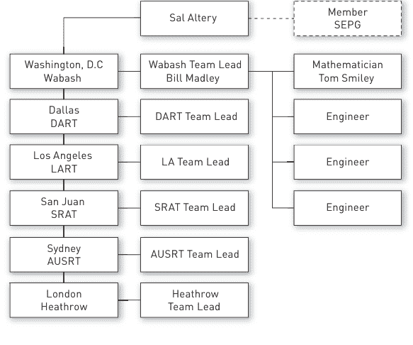

图 5–3：轨道系统组组织图

`Sal` 在项目中的一个关键考虑因素是需要验证一种新的 `BFM` 算法以确定其安全性。负责该项目的是公司较新的工程师之一，`Wabash` 项目的首席工程师 `Bill Malley`。作为安全关键设备的定义使得 `BFM` 成为一个必须与系统所有其他部分隔离的组件。安全关键设备倾向于由于关联或上下文，使其嵌入的软件以及与其通信的其他组件也变得关键。这产生了一种最小化对这一“新”组件暴露的心态。

`Tom Smiley` 是一位数学家，他对所需的 `BFM` 算法非常感兴趣。`BFM` 算法的原始设计需要七个输入。通常对于嵌入式系统，硬件系统的每个输入都代表一根连接到组件的导线。软件组提出了一种可以在新 `BFM` 中测试的新算法，它仅需要三个输入。减少输入数量将为公司节省成本，并简化 `Wabash` 工程师提供的 `Wabash` 系统的配置。

为了测试新的面向对象开发概念，`Sal` 确定了 `QA` 组中将支持 `Wabash` 项目的人员。`Albert Quinn` 将负责 `Wabash` 项目的 `QA` 工作，因此 `Sal` 决定带他吃午饭，提议面向对象开发想法。

`Sal` 问：“`Albert`，你听过面向对象编程吗？”

`Albert` 叹了口气回答：“是的，我们有时间学，但我们没有时间学任何新东西。此外，我的经理从来不想支付培训费用。”

`Sal` 接着问：“你考虑过在工作中使用它吗？”

`Albert` 解释道：“这永远行不通。管理层太固守成规了。他们都是搞硬件的，你懂。”

这段对话从 `QA` 组的角度设定了执行一个面向对象开发项目最少需要的参数。他们需要培训，并获得高层管理者的批准以允许面向对象开发。

决定的最后一个因素是客户。由于项目中有了新客户，管理层显然希望这个 `Wabash` 项目按计划日期完成。管理层一直有一个哲学：“只要你照顾好进度，预算就会自己解决。”客户必须接受面向对象开发的想法，这才能成为该项目的考虑因素。客户对系统的维护、监控和验证意味着客户必须能够阅读并理解代码。使用面向对象技术将有助于未来的项目，因为它使重用变得更容易，但可能会让这个项目的管理变得困难。

# 案例研究：新技术——它总是最好的吗？ 155

### 态度……态度……态度

过去曾努力让开发组的结构化代码库更具重用性，但这些努力没有成功。这些努力失败是因为 `Transport` 公司的态度认为软件是简单的（正如 `Harry` 与 `Sal` 谈论重用时说的“尽管去做吧”所示）。`Sal` 希望这项工作成功并完成，以便代码可以被重用，但他需要说服包括客户在内的所有参与方，这是正确的做法。

`Sal` 此前实际上在为 `Wabash` 项目考虑许多新技术和新尝试。他们正在考虑一种新算法、一种新的开发方法和编程语言、`QA` 组的新技术，以及与客户的新交互方式。`Sal` 所学到的所有道理，为一个项目创造太多的“新事物”始终是一个巨大的风险。许多项目死在了“尖端边缘”上，`Sal` 不希望他的项目也是其中之一。`Sal` 对新的开发方法和编程语言充满信心，尽管对于他的公司来说，这些在软件行业已被充分理解并成功使用。

`Sal` 写下了一系列问题，以便清楚地理解他必须做出的决策：

- 他必须让工程师接受 `OO`（面向对象）培训。
- `QA` 在测试阶段需要阅读并理解代码，特别是安全关键代码。
- 客户参与代码审查，客户需要理解这种方法论。
- 符合标准将很困难，因为目前没有 `OO` 的标准。

恰好要对 `Wabash` 项目进行项目评审。所有利益相关方在场，这可能为提出面向对象开发的想法提供机会。`Sal` 与首席工程师 `Malley` 讨论了这些问题，该想法可以解决。由于 `Sal` 是软件工程专业的，他知道分析可以用多种方式表示。决定使用 `OO` 方法进行分析，即使他们决定不追求它也不会产生重大影响。

寻找方法是 `Sal` 一直以来追求的标准。`Sal` 甚至为他的小组提供了关于如何进行 `OO` 分析、设计和开发的书籍。当时，没有有效的 `C++` 可用，因此 `C` 是选择的语言并在公司根深蒂固。

`Sal` 的老板在会议结束后约见面。`Harry` 说：“演示得好，我们需要谈谈 `BFM`。”

决定 `Wabash` 项目方法论的时候到了。`Sal` 认为自己对产品足够了解，可以做出这个关键决定。他现在需要说服 `Harry`，`BFM` 是基于他的想法的。`Sal` 准备好应对他知道 `Harry` 会提出的问题，至少是大部分。

### 案例问题

该案例研究除了关于为公司开发产品使用新技术的主要问题外，还有许多问题。开发组和质量组之间存在过渡问题以及需要管理的信任问题。第 8 章“管理人员互动”可以更多说明这些问题。

# 分析

### 分析活动

### 分析背景

# 第一个问题

- (P) 问题：`Sal` 必须决定是否在 `BFM` 项目中使用新的 `OO` 技术。
- (E) 经验：`BFM` 已经是一件新硬件，`Sal` 知道需要大约 5000 个工程小时来开发和安装在这些硬件上运行的软件。

## 案例研究：新技术——它总是最好的吗？

(A) 假设：`BFM` 将按时准备，`Sal` 的小组唯一需要担心的问题是如何让软件在新的板卡上运行。

(K) 知识：使用面向对象（`OO`）开发技术意味着风险更低，因为这些技术在行业内已广为人知。

解决方案：使用 `OO` 技术开发新的 `BFM` 软件。

假设风险：

- 工时可能会超过分配给任务的 5,000 小时。
- 项目团队、质量保证（`QA`）团队和客户在无缝且按时采用 `OO` 技术方面缺乏经验。

## 第二个案例问题

(P) 问题：`Sal` 必须决定是否应该更新构建 `BFM` 的算法，以降低公司制动模块的成本。

(E) 经验：`BFM` 已经是一件新硬件，`Sal` 知道它需要 5,000 个工程小时来开发，并安装用于在新硬件上运行的软件。

(A) 假设：`BFM` 将按时准备，`Sal` 的小组唯一需要担心的问题是让新算法在板卡上运行。

(K) 知识：数学家可以解决算法从七个输入减少到三个输入的问题。解决这个问题意味着算法将简化且易于理解，这意味着最终产品中的代码更易于理解。

解决方案：在新的 `BFM` 板卡上使用新算法，通过降低成本使产品更具吸引力。

假设风险：

- 项目团队找不到与 `BFM` 算法相关的输入问题的解决方案。
- 系统配置在实践中无法通过使用三个输入（相对于旧算法所需的七个输入）来降低成本。

### 分析问题

- 1. 作为项目经理，你会做出什么决策？
- 2. 你认为 `Sal` 需要处理哪些产品管理问题以确保 `Wabash` 项目的成功？
- 3. 你认为 `Sal` 真的透彻地理解了问题并准备好做出决定了吗？如果没有，他还需要了解什么信息来帮助他做出必须做出的决策？
- 4. 关于 `OO` 开发的问题是必须做出的真正决策吗？

## 结果

`BFM` 是使用 `OO` 开发技术构建的。开发过程中建立的新评审标准使得这成为可能，而且 `QA` 小组对该流程有足够的理解，因此能够在 `Wabash` 项目成功实施之前对 `BFM` 进行重大的测试。`Wabash` 项目最重要的事件是工程师在被问及是否加速交付时进行的评审。他们的意见一致，是“否”。他们同意，只有继续评审，团队才能在预定的交付日期完成任务。团队知道他们生产的代码质量保证了按计划进行。`Wabash` 项目交付的最终产品只有微小缺陷，这些缺陷归因于 `TC` 组的软件。发现了一些缺陷，但很快证明它们都是系统中的其他组件。

### 讨论

从结果中可以看出，产品是成功的。产品不仅按预期交付了，而且所使用的流程已整合为团队的标准做法，以确保产品质量。在实验室中，新开发的正常测试时间为一到三个月。新的 `Wabash` 系统在实验室花了三周时间完成测试。团队能够按预期使用新技术来开发软件。同样看到的是，`Sal` 必须进行一些产品开发分析以做出最终决策。`Sal` 还必须将关键利益相关者纳入工作范围，以确保每个人都能接受新开发技术的构想。

即使在做出决策后，仍有许多问题需要解决。培训工程师结合非 `OO` 编程语言使用 `OO` 技术可能是最困难的。像 `OO` 这样的新概念有助于理解和开发可重用组件，但环境（例如用于火车的嵌入式系统）可能会排除 `OO` 语言的实际使用。在 `OO` 语言出现之前存在 `OO` 概念，在这个项目中，即使使用了 `OO` 语言也无法用于嵌入式开发。这需要使用“午餐学习”培训，以及首席工程师 `Brad Malley` 的多次演讲，他解释了关键概念。

另一个问题是有许多正在进行的环境问题（新客户、新的流程改进努力以及新加入公司的工程师）必须处理。这产生了团队需要灵活性的需求。

## 案例研究：为什么这个产品是错误的？

### 指南

在读完章节内容后阅读此案例研究。观察你可能认为自己拥有所有信息，但遗漏了直接影响可用性的关键方面。

### 案例摘要

### 描述

一个开发者正在思考为什么他的公司在做了正确的事情（至少从他的角度来看）之后，是如何做错产品的。他在想问题在何处偏离了轨道，以及为什么他无法按时、按预算并满足所有需求的方式交付客户的产品。

本案例研究将提出这样一个观点：尽管产品定义阶段看起来很“简单”，但这并不意味着你总是得到正确的答案。存在隐藏的假设、问题和预期，如果不能正确理解，将导致糟糕的产品管理决策并可能导致项目失败。本案例研究说明了产品的失败是在为手机搜索产品做出的第一个决策时就已经注定的。

### 案例研究目标

读完案例研究后，你将能够：

- 看到产品生命周期早期的决策如何对随后的产品管理产生巨大影响。
- 理解各种产品管理决策如何影响产品以及为什么。
- 理解范围和时间并不是全部。
- 展示早期的错误决策如何产生糟糕的客户预期。

## 需要记住的核心观点

这里的核心观点是，你所做出的每一个产品决策都会影响产品。如果这些没有得到管理，那么你就没有在管理产品。

![img/b881997d603ad72821fd24c0eba76183_0.png]

### 结论

你必须意识到愚蠢的问题只是没有被问出来。产品管理是正确的，但环境的影响决定了项目的成功或失败。

# 案例研究：为什么这个产品是错误的？

### 案例背景

场景

`Three-Tech` 是一家处于客户拓展阶段的咨询公司。首席执行官约翰·史密斯（`John Smith`）位于美国东海岸，大部分行政办公室也在那里，而他的开发团队大部分位于西岸。弗雷德·莫赛（`Fred Moresay`）被约翰聘用并参加了如何构建电话交换机软件的培训。西岸的另一位开发者是汤姆·比林斯（`Tom Billings`）。汤姆知道如何让系统运行。他经营过自己的小公司，但基本上是“出于兴趣做这份工作”。汤姆更像是一个系统工程师而不是纯粹的硬件工程师，他认为软件是“虚头八脑”，尽管他知道软件的作用。汤姆就像《吉尔环岛》上的教授；他可以用衣架做成卫星反射器，但如果有软件，他就想让别人来做那部分。

弗雷德离开了他工作了十多年的大型政府机构，加入了这家名为 `Three-Tech` 的公司。在 `Three-Tech` 工作期间，弗雷德发现项目规模比他以前工作中处理的要小，但似乎提供了一些学习新技术的有趣机会。薪水比以前的工作好，而且很好的一点是他可以居家办公。他记得某天醒来告诉妻子安（`Ann`）他今天不用上班。弗雷德穿上拖鞋，拿了一杯咖啡，走到房间另一边的桌子坐下。他登录系统开始工作了。

## 项目启动

1999 年 1 月 25 日，弗雷德的一天是从约翰的一个电话开始的：

约翰开始说道：“弗雷德，我有个项目要交给你。也许我可以让我为你提供的培训物有所价值。”

弗雷德回答：“没问题……是什么？”

约翰语气平实地说：“这个项目是一个电话交换机应答服务，带有自动菜单选择和广告播放功能。我们有两个月的时间交付。”

弗雷德回答：“听起来很有趣。软件有什么要求吗？”

约翰突然回答道：“给汤姆打电话。我们在培训期间，他从公司那里拿了所有细节。他已经在为系统准备一些部件了。如果你需要任何东西告诉我。”

等时间合适，弗雷德拨给了住在大约三英里外的汤姆，他们安排在当天下午见面讨论新项目。

## 产品启动管理


弗雷德开车去了圣地亚哥附近山上的汤姆家。那是典型的加州天气，他很急于获取新项目的所有细节。第一次会议进展如下：在简要解释了他对项目的了解后，汤姆总结道：“嗯，只要你能让软件运行起来，看起来挺简单的。”

弗雷德回答道：“谢谢，汤姆。我们理解需求了吗？它们写下来了吗？”

汤姆没有回答，而是说：“我和客户通过了，他们想要一份基础餐厅列表。列表分为墨西哥式、意大利式等类别。用户可以浏览菜单找到他们感兴趣的餐厅。”

弗雷德问：“听起来很不错，但谁来输入所有的信息呢？”

汤姆回答：“客户有一些想法。我们只需要给他们提供一个可以使用的格式。”

弗雷德沉默了一会儿，然后快速回答：“嗯。从我的观点来看，这个产品似乎还有几个漏洞需要填。”

汤姆不是搞软件的；他是一个组装系统的硬件人员。在汤姆看来，他们要做的只是安装电话交换机并创建一个提供信息的数据库。汤姆也觉得软件很容易。系统必须允许用户在客户指定的选项之间进行导航。菜单必须简单易用。弗雷德对格式有一点担心，但整个产品看起来足够简单。

他们必须学习如何设置电话系统。弗雷德和汤姆很快创建了一个基本上可以接听的服务器。他们测试了系统，觉得这个项目的这部分将很容易。接下来，在服务器上安装了软件，弗雷德将编写程序以满足客户的需求。接口是通过现成软件实现的，这些软件必须协同工作。大部分工作是在汤姆的客厅里完成的。汤姆拷贝了一份所有软件的副本，在他的家庭环境中创建了一个重复的服务器，这样他们就有系统可以测试并使系统运行。弗雷德应该使用一个看起来也很简单的数据库；经过几次实验，基础系统就就绪了。项目计划为期两个月；实验结束后，进度表……

## 案例研究：为什么这个产品是错误的？

看起来对汤姆和弗雷德来说并不是一个问题。虽然还有一些需求不太明确，但一切都在按计划进行。

## 问题的出现

第一个问题出现在客户询问播放给用户的信息是否可以来自数据库时。换句话说，基于数据库的电话交换机系统可以运行吗？问题在于为音频数据找到一种格式，使其可以存储在数据库中，而无需经过电话交换机的转换。在向交换机公司提问并进行更多实验后，弗雷德和汤姆找到了一种可以存储在数据库并被电话交换机使用的音频格式。在此之前，交换机仅支持文本转语音信息。然而，这会在项目的后期导致后果。

使用简单的录音技术创建了一些示例文件，整个系统已准备好进行演示。关于谁来提供数据库数据和音频文件出现了，但客户有一个主意并会处理。

事实证明，让客户满意的数据库是`Microsoft Access`。系统提前于计划两天在客户现场安装。弗雷德和汤姆认为这会给他们带来麻烦。系统激活后运行完美，代码中没有出现缺陷，客户非常喜欢提供的某些新增功能。

然后一个大问题出现了。客户询问电话系统接受哪些其他文件格式。开发团队进入了搜索模式。团队被迫研究电话系统上播放消息的可用格式。系统对信息进行数字化和转换的能力导致了拨打电话交换机公司和客户服务的电话（`PCSCS`）。

`PCSCS`代表人员回答道：“你们用这个系统要做什么？”

弗雷德回答道：“嗯，客户说声音没有他想要的‘保真度’。”

`PCSCS`代表人员回答道：“对不起，目前我们接受的音频格式只有 8 位的。大多数人只想录制短消息，比如‘你好，我是莉，请留言’。看起来你需要的比这多。”

弗雷德问：“也许吧。有什么我们可以买到的选项吗？”

`PCS`遗憾地说：“我们开发部门的老板可能对任务感兴趣，但他不知道其他其他的。联系开发部门的人是……’”

答案是没有。亨利·福特卖弗雷德记忆中的著名故事：“你可以拥有任何你想要的颜色，只要它是黑色的。”

问题是客户想在系统上使用商业级的声音文件。最小位存储要求是 16 位的，但当文件在被转换为电话系统所需的格式时，商业录音的高保真度丢失了，因为数据被更改为了 8 位。客户说这导致调出的文件听起来“很尖”。

从`Three-Tech`的角度来看，他们按时、按计划交付了系统，并满足了客户的所有要求。但客户认为这似乎并没有起作用。Fred 思考着未来如何避免这种情况。他问自己：“错误出在哪里了？这是一场噩梦。当产品按照约定的功能运行时，为什么仍然无法被接受呢？”

第二天，Fred 打电话给了他的老板 John。Fred 认为，许多人倾向于通过不满的客户是否会来电来衡量产品的质量。软件具有激发人性中最坏一面的能力。人们总有一种观点认为开发一个只涉及软件的产品应该是很容易的。他的老板正在询问电话交换机项目的进展如何。

### 案例问题

该产品能满足客户的信息需求吗？

### 案例分析

### 分析活动

分析问题

1. 影响产品的主要问题是什么？

2. 如果你在开发者的位置，你会采取何种不同的做法？

3. 开发者在处理产品时，未能考虑哪些关于产品管理的关键问题？

4. Fred 必须做出哪些决策？

- 这些决策的`PEAK`输入是什么？

- 替代方案以及与这些方案相关的假设风险是什么？

## 必须记住的核心思想

产品不仅仅是客户说希望产品执行的一系列功能；它在很大程度上取决于这些功能执行的方式。功能交付的质量决定了产品是否达到或超过了客户的预期。当你只将需求视为一组必须完成的功能，而不关乎执行这些功能时的质量时，你所做的事情将有无限种选择。然而，当你必须考虑功能交付的质量时，你只剩下少数可以交付正确产品的解决方案。

在软件开发中，由于你交付的是某种并不非常实体的东西（例如磁盘或下载的电子位），因此质量的概念是至关重要的，并与产品高度集成。早期需求的满足所依据的决策后来影响了所交付的产品。你必须通过管理投入产品的质量来管理产品。质量直接通过用于建立所交付产品的需求来衡量。

## 5.4 总结

本章重点关注了软件项目决策背景下管理产品的以下活动：

- 恰当的产品定义

- 开发管理

- 质量保证与控制

- 配置管理

- 产品交付与安装

- 培训

- 现场服务

案例研究“新技术——它总是最好的吗？”检查了产品管理的许多方面，但特别关注了开发管理、质量保证和正确的定义。案例研究“为什么这个产品是错误的？”涵盖了培训、现场服务局限性和正确的产品定义。该案例强调，有时项目无法从项目早期的糟糕决策中恢复。

产品管理是开发软件产品的核心，但由于过程和产品是紧密耦合的，你不能在不考虑另一个的情况下考虑另一个。产品管理涉及将用于开发产品的流程与利益相关者对范围、时间、质量和成本的预期对齐。你可以使用`PEAK`模型来确保你有关于利益相关者预期相关维度的正确信息，做出最好的项目决策。

产品管理要求你不断做出影响范围、成本、质量和时间四个维度中一个或多个维度的决策。

## 第 6 章

## 管理过程

### 6.1 章节目标

在阅读并思考本章介绍的概念和案例研究后，你将能够完成以下工作：

- 识别涉及过程管理的关键问题

- 理解产品与过程之间的关系

- 理解利益相关者眼中影响过程的关键因素

- 识别可以以最小成本显著改进开发过程的因素

- 理解“过程”并不是一个贬义的词

### 6.2 背景

过程是一组具有目的的步骤。过程是一个行动框架，其目标是以重复的方式实现一个被充分理解的目标。过程由一组实现该目标的行动或战术组成。过程也是一组标准化产品生产的步骤。`Humphrey (1989)`将过程定义为一组任务，这些任务在执行恰当时会产生理想的结果。换句话说，过程可以帮助你生产产品，也可以作为一个过滤器，确保缺陷不会进入我们正在创建的产品中。

将过程视为过滤器可以使项目在成本较低时尽早消除缺陷。我们都知道，当软件缺陷被允许迁移到开发的后期阶段时，成本会增加 10 倍。在缺陷扩散之前对其进行封装或移除是至关重要的。如果不被遏制或移除，它们就会“感染”其他代码，因此更难删除。你使用的过程提供了一种统一、纪律的方法来消除这些缺陷，这样项目的后期阶段就不会因为需要修复漏洞而延迟。过程可以节省工程师花费时间返工的时间。

要将开发过程作为软件项目任务结果的质量过滤器，你需要能够执行以下活动来管理项目成员所使用的过程：定义或选择过程、衡量过程、评估过程有效性以及更改过程。

当你检查这些内容时，你将通过“如果……”类的问题来确定。表 6-1 展示了“如果……”类的问题。你如何使用`PEAK`模型做出决策。

表 6-1：使用过程决策

| 活动 | PEAK 输入 |

| :--- | :--- |

| 理解过程 | (P) 这对项目有什么好处？<br>(E) 你认为有效吗？<br>(A) 假设有更好的方法吗？<br>(K) 这能导致可用的产品吗？ |

| 执行过程 | (P) 必须做什么？<br>(E) 你认为这正确吗？<br>(A) 假设你拥有一切吗？<br>(K) 你知道人员是否接受了恰当培训吗？ |

| 评估执行过程的结果 | (P) 什么证明过程成功了？<br>(E) 你知道过程有效的迹象吗？<br>(A) 假设好产品意味着好过程吗？<br>(K) 目的正当手段吗？ |

| 理解如何更改过程执行 | (P) 你可以让它更有效吗？<br>(E) 你知道改进空间吗？<br>(A) 假设用户是做出更改的最佳人选吗？<br>(K) 你知道有更高效的方法吗？ |

# 第6 章 流程管理

人们将流程视为一种“必要的恶”。他们认为需要流程是因为有人想看到项目的透明度。这并不是建立流程的正确理由，尽管有时它被用作迫使工程师听话的“大棒”。

一种有用的观点是将流程视为一种机制，通过这种机制，可以在工作产品的整个创建过程中将其中的缺陷过滤掉。这有时与某些人对流程的观点相悖，换句话说，就是“为了流程而流程”。对用户没有价值的流程是徒劳的。流程不是目的本身，而是引导和规划软件项目行动以实现目标的手段。

决定不采用定义的流程或不有纪律的流程，本身也是一种“拥有一种流程”的决定。在这种情况下，流程并没有通过管理来改进项目。因此，除非你对其进行管理且它无法改进你的工作，否则这也是另一种为了流程而流程。

管理流程需要计划、纪律和适当的决策。流程必须基于组织的业务目标和需求、项目目标以及领域的“最佳实践”。管理流程需要执行的基本活动如下：

- 定义、选择和理解流程

- 培训流程

- 衡量流程

- 改变流程以提高其有效性

表 6-2详细描述了这些活动。请查看表格，并考虑你认为对管理流程有帮助的其他活动。

表 6–2：管理流程的活动描述

| 活动 | 活动描述 |

| :--- | :--- |

| 定义、选择和理解流程 | 定义：建立流程用户所需的目标、质量属性和预期，以便他们理解流程的原因和用途。<br><br>**目标结果：** 流程用户理解流程目标和预期结果，了解流程如何适用，以及他们预计在流程中需要做什么。 |

### 6.2 背景

表 6–2：管理流程的活动描述（续）

| 活动 | 活动描述 |

| :--- | :--- |

| 培训流程 | **定义：** 向加入的新成员展示流程，并能够验证人员正在正确执行流程。**目标结果：**组织使用的流程必须经过定义，并拥有支持信息，以便任何预期使用它的人都能学会使用（例如：笔记本、演示文稿、文档等）。 |

| 衡量流程 | **定义：** 在流程中建立数据收集点，以统一且一致的方式收集信息，以评估流程相对于流程目标的有效性。**目标结果：** 流程利益相关者理解收集的值、项目（组织）如何使用这些值，以及他们如何使用这些值来评估流程的执行。 |

| 评估流程性能 | **定义：** 评估流程满足用户业务、流程或产品目标的能力。**目标结果：** 流程必须根据标准和性能进行衡量。 |

| 改变流程以提高其有效性 | **定义：** 提供机制，使流程能够适应变化的环境和利益相关者的需求（例如：执行流程的人、使用流程执行结果的人等）。**目标结果：** 建立专门小组定期和周期性地评估流程，以验证流程是否仍然实现了目标，以及流程目标对于利益相关者是否仍然有效。 |

# 关于流程的决策

无法控制你无法衡量的东西。流程与改进是密不可分的。如果你的项目运行非常完美，你认为不需要改变任何东西，那么你不需要担心流程，显然你拥有良好的流程。但如果你的项目像许多软件项目一样，结果并不总是如人，而且事情总是在变化。正如俗话所说，“唯一不变的是变化。”因此，如果你正在做出更改，你希望确保这些更改是改进；如果你无法衡量流程，你就无法改进它。所以，关于流程的决策通常侧重于如何评估其有效性。

一个重要的概念是，流程和产品可以被视为同一枚硬币的两面。对于这项讨论，流程由构成项目输出的产物组成。它们可以是面向客户的，也可以是面向经理的。流程的执行产生结果。大多数时候，产品的质量高度取决于对流程的遵循情况。坚持只关注产品或只关注流程的人是在自欺欺人。处理软件的人，软件开发工作涉及妥协。软件利益相关者因为微小的优势而在一种替代方案和另一种方案之间做出决策。在管理流程上投入多少精力以及在制作产品上投入多少精力的选择，是项目层面的妥协。项目经理不断就管理进度所需的资源做出决策，并就如何衡量项目将产品交付给客户做出决策。流程资源包括人员时间、报告和评审等变量。每个项目都必须决定投入哪些以及投入多少资源。

进度表是项目决策的关键因素，同样在关于如何执行项目以按时交付可接受的项目交付物的流程决策中占据主导地位。流程可以作为缺陷过滤器，在提高质量的同时降低复杂性。在选择要遵循的流程时，实际上是在决定他们希望在项目中尽可能过滤掉多少个“问题”。适量的流程总是一项平衡运动，旨在管理精力和成本的同时，对产品产生适当的效果。通常，这种平衡运动与质量直接相关（即零缺陷），但大多数项目经理已经放弃了“流程极境界”的想法，转而追求最小而非零缺陷。

流程决策通常涉及寻找通过效率和生产力提高项目速度的方法。项目经理必须做出的主要决策之一是团队可以接受多少新的流程技术。许多项目由于引入新的工具、语言和硬件而遭受痛苦，这些本应让团队更高效、更快、更智能并实现飞跃。

项目管理似乎总是对团队变慢并花费所有时间学习这些系统时感到惊讶。项目经理需要在流程变更对团队效率的影响之间进行平衡。这是一个非常适合应用`PEAK`的决策领域，它使问题的陈述以及所做的假设变得透明化。其中一个案例直接解决了这个问题。

## 第 6 章 过程管理

(E) 经验：实验室是一个固定成本、高利用率的资源，其中通过所有硬件和连接配置建立了整个系统环境。模拟器仅具有部分硬件功能。

(A) 假设：模拟器产生的测试结果（在准确性和可靠性方面）与在实验室进行“某些特定”测试时所产生的结果同样有用。

(K) 知识：我们了解哪些测试最适合模拟器，哪些测试最适合实验室。我们可以在项目中清晰地识别出这些测试。

过程的使用是一个人的问题。企业并不执行过程，而是人影响人（或不影响），以生产符合利益相关者预期的高质量产品（`Microsoft 2007`）。请参阅第 8 章“管理人员互动”和第 9 章“管理利益相关者预期”。参考 `Crosby (1995)` 关于如何通过客户期望实现质量的讨论，参考 `Goldratt (1992)` 关于如何改进过程开发的信息。

## 6.3 案例研究

本章包含两个案例。第一个案例侧重于项目已做出的过程决策，并分析这些决策是否正确。第二个案例研究了关于过程的决策，这些决策会直接影响项目交付物，从而影响进度。

在第一个案例“处于边缘的银行”（`Bank on the Verge`）中，项目经理要求顾问评估他正在工作的项目。项目经理想评估团队在过程方面是否做出了明智的决策，以及团队是否有做得更好的地方。特别是项目经理希望他小组中的所有成员都参与到过程中来，以确保它是他们能产出的最佳结果。他担心预期的项目功能无法准时交付，并且不是团队能达到的最佳状态。

在第二个案例“全速前进”（`Full Speed Ahead`）中，一位项目经理被要求审查另一个项目经理运行的有问题的项目，以确定可以采取哪些措施来改善状况。项目进度落后，没有人能清晰地识别出导致进度偏差的原因。

## 处于边缘的银行

### 指示

你可以独立于本章阅读案例，但如果你选择先读案例，请先阅读背景材料，以为改进银行软件开发过程需要做的工作设定背景。最后，重新阅读案例研究，寻找可以应用本章概念的机会。

### 案例总结

### 描述

本案例涉及一组被请到银行的顾问，负责为所有开发人员提供通用的软件工程原则指导。请求顾问的人是他们以前的学生，要求他们评估项目并提供改进现有工作的方法。该银行经历了一个过时的软件实践已成为标准的时代。例如，银行的软件项目通常遵循类似于瀑布式的软件开发视图（`Royce 1970`），开发人员是单兵作战的。开发人员不将项目视为团队努力，而是视为使项目成功的个人努力。强调开发人员之间合作的新方法正在被缓慢采纳，但一些开发人员对变化持抵触情绪。该组织独立工作的文化很难改变，特别是当项目经理试图引入诸如敏捷（`Agile`）等人们共同工作的新过程（`Beck 1999`）时。特别是，发起人想知道如何让更多工程师参与过程工作，以及他的团队正在使用的过程是否可以改进以帮助所有工程师。他看到工程师们对所提的技术感到并不自在。

### 案例研究目标

读完案例研究后，你将能够：

- 理解与引入新过程相关的决策

- 理解对于过程存在不同的观点

- 理解过程决策如何影响一个工程师团队

### 涵盖主题

过程管理、质量问题、生命周期开发以及基层工程师的认可度

### 背景

一位软件顾问必须帮助开发经理决定如何向所有工程师教授新过程，同时继续按时、按质量交付交付物。特别是，顾问必须评估开发小组的过程，并帮助开发一种有效的方法来衡量新过程引入的成功。公司正在招聘许多熟悉敏捷开发的工程师。关于使用这些新过程的决策正在接受审查，其依据是顾问对公司内部开发人员的了解以及管理层如何做决策。

### 核心概念

以下是在做出过程管理决策时需要记住的基本概念：

- 项目能承受多大的过程变化？

- 谁受到开发过程决策的影响？

- 将新过程整合到开发小组中的最佳方法是什么？

- 如何确保过程变化符合预期？

过程管理涉及对长期问题的考虑。今天使用的过程必须交付过去和未来预期的开发（过程必须允许使用指标来评估过程的运行良好程度）。

### 案例研究：处于边缘的银行

不同的项目利益相关者以不同的方式和程度看待过程管理。

### 术语

`ATM`: 自动取款机

### 案例内容

### 场景

Tom Morley 是一位顾问，作为工作的一部分，他访问了前苏联国家的一家银行。2006 年，该国正向现代信息管理快速迈进。软件项目经理正在经历不成熟组织在开发软件时通常常见的问题。

Tom 的客户是该地区最大的银行之一。该银行正着多项开发和现代化努力，以提高其在在该地区寻找银行的客户中的选择地位。随着消费社会的变化，该银行正将自己定位为在从苏联统治演变而社会中银行的主要参与者。


客户认识 Tom 和他的咨询伙伴 Will Narat，是因为他们是美国一所主要大学的讲师。该银行的联系人 Tanaka 是一个完成学位后回到本国的学生。Tanaka 通过学习了解过程改进的概念，但缺乏领导改进工作的经验。他询问 Tom 和 Will 是否能支持他的工作，以及如何做。Tanaka 想知道已经开始的努力是否值得，以及它们是否正在改进银行的软件开发实践，特别是工程师使用的实践。

为了理解银行管理层如何看待软件问题，了解顾问是如何被邀请的非常重要。对过程支持的需求提供了一个与银行合作并帮助其软件开发过程工作的机会。这项工作已经运行了三年，始于 Tom 和 Will 在银行现场教授第一门课程。顾问可以在课程期间通过讨论银行项目的问题，为银行提供解决方案。此外，参加课程的软件开发人员和项目经理可以向顾问寻求处理项目问题的建议。

Tom 和 Will 在电子邮件中汇总了以下问卷，以为改进银行软件开发过程需要做的工作设定背景。（这一系列电子邮件遵循了之前的在线讨论和其他电子邮件，其中 Tanaka

## 第 6 章 流程管理

这表明他们面临着一些“单纯苦干”似乎无法解决的问题。随后的邮件设定了做出流程决策的背景。

Tanaka：

我正在重复昨晚我在 MSN 上对你说过的话（你那里现在是早晨）。鉴于我们之前的讨论已经表明你对流程改进感兴趣，我们希望确保为你提供尽可能优质的服务，并教授以下内容：

- 1. 适用于银行的内容
- 2. 为你的即时需求提供最佳结果
- 3. 帮助发现其他需求

我们可以来传授任何知识，但我们力求以服务为导向，并满足客户的期望。为了做到这一点，我们需要知道这些期望是什么，并且希望进行一次简短的微评估（免费），以帮助识别银行的痛点，我们认为我们可以提供一些培训来帮助解决问题。

请向你的部门主管以及部门内的几位关键项目经理询问以下问题：

- 1. 在目前的软件项目中，有哪些方面是做得很好（或执行正确）的？
- 2. 在现有软件项目中，有哪些方面是你需要改进的（或进展不顺利）的？

请将信息发送给我们。我们将对其进行评估，提供关于我们如何提供帮助的建议，然后从那里开始安排。

如果你需要更多信息来推进，请告诉我。

在 Tanaka 回答了上一封邮件中的问题后，Tom 和 Will 随后提出了这些后续问题：

- 1. 可用人数无法满足庞大的项目数量。这是招不到合适的人的问题，还是银行招不到足够的人的问题？
- 2. 因为缺乏文档，你们面临着什么痛苦的问题？

## 案例研究：边缘的银行 179

- 3. 人们是否经常离开公司寻找其他工作？还是他们被解雇了？
- 4. 对新入职员工是否有培训计划？根据你之前的回答，你们正在利用忙碌的资源让新员工准备好工作。你们对这些新招员工提供什么培训？
- 5. 为什么你们的项目团队中没有明确的角色/职责分配？
- 6. 你们的项目中是否进行了任何风险管理？
- 7. 为什么项目进度（计划）偏差常见？你们正在采取哪些措施来防止这种情况的发生？
- 8. 大量的返工是由许多原因引起的。导致返工的主要原因是什么？是质量问题（第一次没有达到正确的质量），还是不完全理解客户需要/想要你做什么，导致必须通过返工来修正？
- 9. 是否有人在衡量质量？平均每 1,000 行代码（LOC）需要修复多少个漏洞？质量正在变好吗？

原始问题和后续问题的回答揭示了该组织分为三个主要区域。每个区域都有自己的开发流程和问题，如表 6-3 所示。

## 表 6–3：组织中的软件开发小组

| 功能/小组 | 流程重点 |
| :--- | :--- |
| 1. 计算与数据存储小组（数据仓库单元*） | 多年来一直执行着层级化、严谨且经过批准的流程。该小组必须处理政府法规。 |
| 2. 自动取款机组（支持部门*） | 在现有软件项目中，有哪些方面是你需要改进的（或进展不顺利）的？ |
| 3. 银行小组（企业单元*） | 你们的项目中是否进行了任何风险管理？这至关重要。 |

原始问题和后续问题的回答揭示了该组织分为三个主要区域。每个区域都有自己的开发流程和问题，如表 6-3 所示。（注：上面的表格内容是根据提供的 OCR 片段和逻辑流程结构重建的）。

## 180 第 6 章 流程管理


该银行正如许多其他公司一样，以其能找到人员的速度招聘软件人员，如果你没有清晰的书面流程，就会很难将新工程师整合到组织中。这些新工程师刚毕业，经验较少，但拥有丰富的软件工程知识。这使得 Tom 和 Will 能够教授更多内容，并集中于他们管理软件工作经验中的案例。为工程师们提供的课程主要主题如下：

- 风险管理
- 技术人员管理
- 质量保证
- 计划与跟踪
- 变更管理
- 估算
- 需求管理

当银行进行最后的讲座时，Tanaka、Tom 和 Will 进行了一次对话。Tanaka 是最初提出银行需要培训的人，并邀请了这些顾问来授课。

Tanaka 评价道：“我不确定我的项目进展是否顺利。你们能帮我看看吗？”

Tom 微笑着回答道：“没问题，你为什么觉得有问题呢？”

Tanaka 说：“嗯，只有最年轻的开发者想做这个项目，而且我无法从任何人那里获得良好的建议。”

Will 接着问：“你希望我们为你提供什么？”

Tanaka 叹了口气说：“我不知道。你们很聪明。你们会明白我的意思，可能可以提供帮助。”

Tom 和 Will 疑惑地惊呼道：“好吧？！”

Tom 和 Will 的项目已经准备了三个月，计划在三个月后启动。该产品旨在取代一个专有的且过时的系统，该系统由开发软件的原始俄罗斯公司不再提供支持。项目的理由似乎是合理的，而且项目进展已经很大程度上，许多关于产品的决策已经得到了验证。但仍有一些流程决策待做出。生命周期流程仍在变动中。支持开发过程的工具是以随机方式引入的。他们正在使用技术、人和流程的结合来解决研讨会中确定的许多流程问题。

Tanaka 想知道团队在项目中使用的面向对象的开发流程是否是正确的选择。主要问题是，该小组及其他小组的许多资深开发者无法帮助项目，因为他们不理解正在使用的流程。

### 案例研究：处于边缘的银行

敏捷技术，如 Scrum (Takeuchi and Nonaka 1986)，初级工程师在学校已经实践过，而资深工程师仍在等待“所有需求”被写下来以便他们规划工作。初级工程师已经在编写代码。架构非常简单，但显而易见的是旧系统对某些组件产生了重大影响。理解旧系统需要一种系统且严谨的方法，资深工程师知道如何这样做，但初级工程师对这种方法不太熟悉。决定与旧系统的多少部分工作以及在何种水平上工作是一个问题。

Tanaka 想知道他们是否应该改变一些开发人员信息，使其更接近传统的开发方法，或者团队是否应该考虑做其他事情来帮助这种转变并提供支持。

Tom 和 Will 讨论了团队使用什么来控制项目。总的来说，团队使用的流程通常是敏捷技术（类似于 Scrum）。流程的主要特征如下：

- 年轻开发者之间的结对编程。
- 用于状态报告的燃尽图，贴在白板上供所有开发者使用。（燃尽图显示了与优先排序的任务集相比，已完成的工作单元。它们提供了团队完成分配工作的速度的视图。）
- 与客户的紧密互动，并使用访谈和调查来确保理解客户的预期。

他们正在从事的项目是一个关键的银行应用程序（见图 6-2）。它是大客户与银行之间所有大型客户交互的核心。许多客户从苏联时代起就是该银行的客户了。交互包括：

- 使用当地货币进行支付
- 进行汇率操作
- 在国际账户和本地银行账户之间转账
- 发送服务请求消息
- 获取账户余额信息和报单
- 获取汇率信息
- 向大公司发放工资

该应用程序对银行的持续运营具有很高的可见性和重要性。

## 第 6 章 流程管理

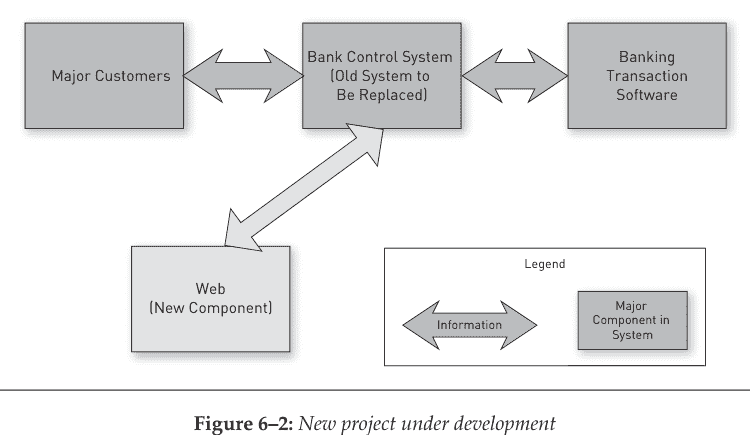

当 Tom 和 Will 与一些开发者一起回顾项目中正在做的决策时，每个人都是利益相关者，并且对已做出的决策有良好的理解。在该项目使用的流程是否为正确做法并不是他们想要回答的问题。首要考虑的是如何向管理层证明他们使用的流程是正确的。

Tom 和 Will 参考了银行最初拥有的问卷。显而易见，银行管理层通过流程引导能力来判断其成功或失败。团队将决策分解为以下：

- 他们如何证明软件比之前的系统更好？
- 系统质量的证据是什么？
- 需要向管理层展示什么？

一项针对企业市场的新系统开发于 2007 年 1 月 30 日开始，于 2007 年 5 月 31 日结束（三个月后）。该系统将支持 10,000 名客户，并提供以下功能：

- 十种类型的业务文档
- 离线和 Web 端客户端界面
- 针对离线客户端的三项复杂安全策略
- 针对 Web 客户端的两项复杂安全策略
- 针对离线和 Web 端客户端的一项复杂安全策略
- 与五个后台系统集成

该银行的新系统于 2007 年 6 月 8 日上线。系统在上线后显示出明显的缺陷。尽管如此，系统几乎是按计划交付的。

### 案例分析

## 分析活动 (ANALYSIS ACTIVITY)

### 分析背景

### 第一个案例问题

(P) 问题：软件开发过程正在项目中的工程师团队之间产生隔阂，田中（Tanaka）希望防止这种隔阂导致项目出现问题。

(E) 经验：银行之前的项目使用的软件生命周期和流程要求大量的文档工作，并将质量作为新系统的首要考虑因素，无论花费多长时间。组织中的许多高级工程师并不理解或信任这些新流程。

(A) 假设：工程师们有能力按时以正确的质量和功能交付新系统。

解决方案：使用一些新的敏捷（Agile）技术，并通过培训尝试说服更多高级工程师学习并采用这些新技术。将此项目作为银行其他项目的学习模型。

# 案例研究：处于边缘的银行 187

假设风险：

- 高级工程师没有接受过培训，可能无法或不愿采用敏捷方法，这将对团队产生负面影响并导致项目延期。
- 新工程师正在使用敏捷技术，可能无法交付符合管理层质量预期的项目。

### 第二个案例问题

(P) 问题：项目中引入的新开发流程无法通过旧方法进行良好跟踪。田中需要为引入敏捷流程寻找新的跟踪方法。

(E) 经验：银行除了 ATM 组外，其他项目都在使用银行管理层理解的传统方法。管理层可以很容易询问“你们在哪里？”，项目可以通过阶段名称来回答。

(A) 假设：跟踪信息对于软件项目是通用的。如果田中能找到“指标”，他就能以符合管理层预期的方式报告状态。

(K) 知识：所有项目似乎都是根据规模和开发的功能来衡量自我的。

解决方案：田中需要开发一种衡量方法，以反映敏捷项目的输出是否符合项目需求。

假设风险：

- 管理层需要信任田中关于交付功能的陈述是真实的，并且这些功能代表了管理层对软件的预期。
- 管理层可能关注项目中的传统产物作为衡量项目进度的方法，因此可能不会乐于理解田中代表项目进度的新指标。

### 分析问题

- 1. 田中对银行使用的软件开发流程有哪些主要的担忧？他可能将如何改进这些流程？
- 2. 软件流程如何影响软件系统的质量？如何通过改变这些流程来确保系统产生所需的质量？
- 3. 阻碍新流程使用的主导环境驱动因素是什么？是谁提供了这些驱动因素？

# 第 6 章 管理流程 (MANAGING PROCESS)

### 讨论

故事的核心人物田中认为，项目的主要目标是增加客户数量（换句话说，增加销售）。这在故事中显而易见吗？有时我们想要的和为我们工作的人所理解的是两个不同的东西。故事中的管理层认为新系统的目标是提供新功能，但开发人员知道系统是“不可靠的”。这显而易见吗？有时需要关于项目和项目交付物的所有利益相关者都能理解量化证据，以确保每个人都朝着同一个目标努力。否则，项目交付物……（请参见第 9 章“管理利益相关者预期”，以更好地理解这一概念）。认为软件系统不可靠，但在新的环境中，这种观点可能是错误的，因为客户并不知道自己想要什么。一旦有了量化值，就可以帮助确定流程应该发生什么变化来使工作更好。因此，尽管田中必须通过增加功能来管理，但他还必须通过使系统更可靠来吸引客户，并通过给开发人员更多控制权来吸引他们。用于实现所有这些要求的流程是。对于管理层和田中来说，该流程是成功的。

# 结论 (CONCLUSIONS)

从项目结果中可以看出，该流程似乎交付了正确的质量，满足了利益相关者的预期，处理了需求，并交付了一个可以运行的产品。这一流程跨越了书中讨论的许多领域，有时很难与软件管理的其他方面分开。涉及流程的决策不仅影响开发团队，还影响参与项目的每个人。作为经理，你不仅必须让流程变得可见，还必须教授、使用和衡量它，以确保流程始终在改进或完成预期工作。人们通常持有这样态度：事情一直是某种方式做的，他们将以同样的方式这样做。流程需要以系统、纪律的方式进化以满足预期。

# 必须记住的关键点 (KEY IDEAS TO REMEMBER)

- 流程和产品是相关的，但它们不是一回事。
- 引入适当流程的决策由项目需求决定。解决方案必须根据项目和流程的标准进行衡量。
- 没有衡量的流程无法改进。

# 放弃流程，全速前进 (Damn the Process, Full Speed Ahead)

## 说明 (Directions)

你可以独立于章节背景阅读本案例，但在阅读案例之前阅读背景材料可能会有所帮助。如果你选择先读案例，请先以“故事阅读模式”快速浏览，为章节信息提供一些背景。然后阅读章节材料。最后，再次阅读案例，并寻找可以分析和应用章节概念的机会。

# 案例摘要 (Case Summary)

## 描述 (DESCRIPTION)

本案例将回顾 Transad 的软件项目经理在利用质量流程技术方面必须做出的决策，以确保项目符合客户的预期。

清楚项目存在哪些问题。该项目涉及大量变量，这些变量似乎在间接影响项目，并直接影响产品的交付进度。被要求提供帮助的项目经理不希望通过建议一些可能被视为浪费或在“延期”项目中不切实际的流程，来制造一个糟糕的局面。

### 核心概念

团队在遇到困难时所做的决策，提供了该团队正在使用的真实流程的证据，无论他们如何说：

- 团队如何感知流程的价值？
- 软件项目经理如何通过决策来处理流程问题？
- 在团队层面，流程的成本和收益是什么？
- 你如何能向人们展示，他们对流程所做的决策并没有产生良好的解决方案？

### 术语

容错性（Fault tolerance）：以优雅的方式处理故障的能力。

冗余（Redundancy）：多个系统执行相同的工作，包括一个主系统和备份系统。

### 案例

### 场景

弗雷德·蒙塔纳（Fred Montana）开始这一天时正在思考他在项目中实施的流程变更是否已开始显现成效。看到第一个迹象，他感到很高兴——某些项目开始时付出的高昂代价正在得到回报，这体现在测试过程和 Transad 项目演示实验室的快速进展中。

以下是他开始在试点项目中使用的流程变更示例：

- 对系统中所有关键代码进行代码审查
- 所有工程师均遵循使用配置管理软件的开发流程
- 所有工程师均使用新的流程手册
- 针对任务文件夹的新流程，该文件夹已使用多年，最近才更新以支持软件开发流程

# 案例研究：管他的流程，全速前进 191

- 适用于当前项目任务的新工时卡跟踪
- 新的站立会议，团队负责在每天早晨第一件事更新状态，其余时间则投入产品工作中

这些流程变更被分配到弗雷德必须管理的不同项目中。恩里克（Enrique）允许流程变更的试点，并能够在随着新流程的采纳而看到改进。在流程变更之前，大多数项目需要二到三个月的时间在实验室完成测试。弗雷德改变了部分流程的第一个项目在三周内完成了测试，而第二个项目在两周内完成了 98% 的测试。这些结果不仅是质量提高的信号，也是项目效率提高的信号。

在第一个项目之后，弗雷德的经理恩里克称他为“幸运”。现在恩里克问他在做什么。弗雷德必须为成功而辩护，除非这关乎失败。

Transad 有两位软件工程经理，每人负责四五个项目。丹尼·沃尔特顿（Danny Walton）是与弗雷德合作的经理，他们都受雇于恩里克。丹尼陷入了麻烦。他的一个项目严重延期。ATRAM 项目本应很容易，尽管以前从未做过。

当 ATRAM 项目提议时，其中一个要求的解决方案似乎很简单。如果你想让某物具有容错性，“你只需要让它冗余即可，”丹尼辩论道，冗余是支持容错的许多策略之一，但并非唯一策略。他也知道实时系统中的冗余并不是解决方案。

由于弗雷德的“成功”，恩里克请他看一眼 ATRAM 项目。恩里克建议弗雷德可能可以向丹尼提出一些建议，让项目重回正轨。这让弗雷德陷入了在他认为很糟糕的境地。他面临的问题是既必须“帮助”丹尼，又不能让他生气或嫉妒，且不产生竞争关系。

关于 ATRAM 项目的第一次对话大致如下：

弗雷德问：“进展如何？”

丹尼面露难色地回答：“还可以，除了 ATRAM。我不知道该怎么办。工程师们无法消除你项目中的所有问题。我们修好了一个，又多出了两个。”

弗雷德同情道：“噢！你一直在尝试什么？我可以帮忙吗？”

丹尼回答道：“你和我一样负担过重。我会想办法的。”

从弗雷德的角度来看，恩里克意识到存在问题，但并不一定为解决方案提供帮助。弗雷德必须仔细考虑如何处理这个问题。

当丹尼必须去为期数周的出差时，命运干预了。他将项目管理功能临时委托给了弗雷德。弗雷德决定这种情况为他提供了帮助 ATRAM 项目的机会。

## 第 6 章 管理流程

弗雷德必须决定先做什么来处理项目问题。项目上的一般问题似乎是可以识别的；团队负责人兰迪·伯格（Randy Berger）受到了影响。他在 Transad 工作了多一年，但这是他第一次担任团队负责人的项目。

其他四名工程师正在负责该项目，这意味着他们大部分时间都花在了项目上。一名工程师在 Transad 的资历比兰迪长，但其他工程师都比他资浅。作为团队负责人，兰迪似乎与其他工程师之间并没有任何问题；然而，正如所指出的，产品有很多问题。此外，所有 ATRAM 的工程师都开始大量加班，以完成所有所需的功能并修复已交付的功能。

该项目对 Transad 来说是独特的，因为公司第一次构建一个以冗余作为解决方案的容错系统。该解决方案由两个独立的计算机系统组成，每个系统监控车辆的功能。一个系统作为主系统，另一个作为备份。

流程变更被分配到弗雷德必须管理的不同项目中。恩里克允许流程变更的试点，并能够在随着新流程的采纳而看到改进。在流程变更之前，大多数项目需要二到三个月的时间在实验室完成测试。弗雷德改变了部分流程的第一个项目在三周内完成了测试，而第二个项目在两周内完成了 98% 的测试。这些结果不仅是质量提高的信号，也是项目效率提高的信号。

在第一个项目之后，弗雷德的经理恩里克称他为“幸运”。现在恩里克问他在做什么。弗雷德必须为成功而辩护，除非这关乎失败。


Transad 有两位软件工程经理，每人负责四五个项目。丹尼·沃尔特顿是与弗雷德合作的经理，他们都雇于恩里克。丹尼陷入了麻烦。他的一个项目严重延期。ATRAM 项目本应很容易，尽管以前从未做过。

当 ATRAM 项目提议时，其中一个要求的解决方案似乎很简单。如果你想让某物具有容错性，“你只需要让它冗余即可，”丹尼辩论道，冗余是支持容错的许多策略之一，但并非唯一策略。他也知道实时系统中的冗余并不是解决方案。

由于弗雷德的“成功”，恩里克请他看一眼 ATRAM 项目。恩里克建议弗雷德可能可以向丹尼提出一些建议，让项目重回正轨。这让弗雷德陷入了在他认为很糟糕的境地。他面临的问题是既必须“帮助”丹尼，又不能让他生气或嫉妒，且不产生竞争关系。

关于 ATRAM 项目的第一次对话大致如下：

弗雷德问：“进展如何？”

丹尼面露难色地回答：“还可以，除了 ATRAM。我不知道该怎么办。工程师们无法消除你项目中的所有问题。我们修好了一个，又多出了两个。”

弗雷德同情道：“噢！你一直在尝试什么？我可以帮忙吗？”

丹尼回答道：“你和我一样负担过重。我会想办法的。”

从弗雷德的角度来看，恩里克意识到存在问题，但并不一定为解决方案提供帮助。弗雷德必须仔细考虑如何处理这个问题。

当丹尼必须去为期数周的出差时，命运干预了。他将项目管理功能临时委托给了弗雷德。弗雷德决定这种情况为他提供了帮助 ATRAM 项目的机会。

弗雷德必须决定先做什么来处理项目问题。项目上的一般问题似乎是可以识别的；团队负责人兰迪·伯格受到了影响。他在 Transad 工作了多一年，但这是他第一次担任团队负责人的项目。

其他四名工程师正在负责该项目，这意味着他们大部分时间都花在了项目上。一名工程师在 Transad 的资历比兰迪长，但其他工程师都比他资浅。作为团队负责人，兰迪似乎与其他工程师之间并没有任何问题；然而，正如所指出的，产品有很多问题。此外，所有 ATRAM 的工程师都开始大量加班，以完成所有所需的功能并修复已交付的功能。

该项目对 Transad 来说是独特的，因为公司第一次构建一个以冗余作为解决方案的容错系统。该解决方案由两个独立的计算机系统组成，每个系统监控车辆的功能。一个系统作为主系统，另一个作为备份。

流程变更被分配到弗雷德必须管理的不同项目中。恩里克允许流程变更的试点，并能够在随着新流程的采纳而看到改进。在流程变更之前，大多数项目需要二到三个月的时间在实验室完成测试。弗雷德改变了部分流程的第一个项目在三周内完成了测试，而第二个项目在两周内完成了 98% 的测试。这些结果不仅是质量提高的信号，也是项目效率提高信号。

在第一个项目之后，弗雷德的经理恩里克称他为“幸运”。现在恩里克问他在做什么。弗雷德必须为成功而辩护，除非这关乎失败。

## 6.4 总结

弗雷德考虑了他在项目中实施的许多流程，将其作为 ATRAM 项目的可选方案。他开始识别许多必须做出决策的问题，并可能将这些提交给丹尼和恩里克。

### 案例问题

如何帮助一个不知道自己需要帮助的人？成功的改变的第一步是意识到存在问题。本案例描绘了一个试图帮助另一个人看到流程可以解决他的“问题”。在某种意义上，问题不是“如何帮助一个项目”，而是“是否应该帮助它”。这个问题渗透在书中的许多案例中。在这个案例中，决定是否应该帮助并不是主要问题。问题在于如何在不产生意外的情况下引入流程管理变更。

### 案例分析

#### 分析活动

分析问题：

- 项目存在哪些问题，可以使用 PEAK 来评估（决策）？
- 如果你在弗雷德的位置，你会建议改变哪些关键流程领域？
- 最重要的流程决策是什么？
- 弗雷德如何在帮助陷入困境的项目，又不伤害另一位工程经理的情绪或工作的情况下的情况下？

### 6.4 总结

本章重点关注在软件项目决策背景下管理的以下活动：

- 定义、选择和理解流程
- 教学流程
- 衡量流程
- 评估流程
- 改变流程以提高其有效性

案例研究链接探讨了关于过程定义、过程教学和过程测量的决策。“不计过程，全速前进”（Damn the Process, Full Speed Ahead）涵盖了与评估和更改当前相关的决策。

许多人将过程视为一种“必要的恶”。他们认为需要过程是因为其他人希望看到项目的透明度。这并不是引入过程的正确理由，尽管有时它被用作迫使工程师听话的“大棒”。软件开发人员可以将过程视为一种过滤器，使他们能够在成本更低时尽早消除缺陷。当他们认识到更好的软件工程方法时，他们也可以将过程视为一种提高效率的方法。

过程与产品是同一枚硬币的两面。软件项目经理必须决定投入多少资源，以确保过程改进的程度能产生预期的产品改进。他们还需要寻找方法在提高项目过程有效性的同时，使其更具效率。为了管理过程而管理过程是在浪费时间。

当过程决策影响到项目节省时间、降低成本和提高质量的能力时，这些决策变得尤为重要。

# 第 7 章 风险管理

## 7.1 章节目标

在阅读并思考本章介绍的概念和案例研究后，你将能够完成以下工作：

- 识别与软件项目相关的重大风险，以及影响项目的决策风险
- 识别案例研究中涉及风险管理（或缺乏管理）的关键问题和决策
- 使用这些概念为案例研究利益相关者所面临的问题提供可行的解决方案

## 7.2 背景

风险管理活动是项目经理和团队成员在软件项目上应该实践和做出决策的不可或缺的一部分。由于风险是项目固有的，问题不在于风险是否会发生，而在于它们何时发生。经验丰富的经理意识到，需要系统地识别、分析和缓解他们项目所面临的风险。他们需要与项目利益相关者（例如他们的团队、客户和管理层）进行沟通，告知他们项目风险、为减轻这些风险将采取的行动，以及与这些风险相关的潜在后果。特别是，他们需要意识到并考虑与其项目决策相关的风险。

在 PEAK 决策模型中，风险是为项目所决策的输出之一。在某种程度上，管理风险意味着在做出每项项目决策时，管理该项目可以承受的风险水平。本章后面讨论的基础风险管理活动适用于通用项目风险的管理，但理解风险本质上是做选择的固有部分也是管理风险的关键。让人们意识到自己在做什么快的方法是问他们一个简单的问题：“你确定吗？”面对决策中涉及的风险会促使人们质疑或评估自己的选择。

使用 PEAK 模型使每个决策（或所选解决方案）相关的风险透明化，是使风险管理成为项目固有部分的方法之一。决策者可以对决策模型的输入提出假设，以识别并验证导致每个替代方案风险的因素。他们可以验证替代方案相关的风险是否有效，并信可以使用这些信息做出决策。

许多常见的软件项目源于对书中讨论的话题决策，例如需求、估算、计划、产品等。但某些软件项目专门处理涉及范围（S）、时间（T）、质量（Q）和成本（C）的问题，我们在书中贯穿讨论了软件项目的四个 STQC 维度。表 7-1 包含一组建议的问题，旨在通过 PEAK 决策模型的输入帮助你评估与软件项目 STQC 维度相关的风险。通过回答这些问题，你可以确定你的项目中每个 STQC 相关的风险管理得如何。你可以将这些评估整合到你的项目中以管理软件项目风险。现在请查看表格，并思考你将如何为你目前的软件项目回答这些问题。

### 表 7-1：使用 PEAK 进行 STQC 维度的风险管理

| 维度 | 风险 PEAK 评审 |
| :--- | :--- |
| 范围（Scope） | （P）问题：范围是否稳定？<br>（E）经验：范围是否可靠？<br>（A）假设：指定的范围是否可行？<br>（K）知识：你理解范围与资源之间的关系吗？ |
| 时间（Time） | （P）问题：为了满足项目时间，需要多大的变化？<br>（E）经验：你见过哪些会影响进度（时间）的情况？<br>（A）假设：完成项目所需的资源是充足的？<br>（K）知识：该项目是否相似到认为进度是合理的？ |
| 质量（Quality） | （P）问题：可接受的质量水平是什么？资源波动对质量的影响是什么？<br>（E）经验：对于该客户，项目团队能够达到质量要求吗？<br>（A）假设：QA 组织拥有完成此工作所需的资源？<br>（K）知识：该项目的质量在你的组织中是可实现的吗？ |
| 成本（Cost） | （P）问题：可以在可用资源内完成项目吗？<br>（E）经验：该客户对成本是否严格并会为每一分钱而争斗？<br>（A）假设：提供的储备足以使项目实现吗？<br>（K）知识：你对该类型项目相关的成本有良好的理解吗？ |

## 第 7 章 管理风险

从业人员和学生都应该理解并执行风险管理至关重要的活动。这些活动在此列出，并在表 7-2 中详细描述。学习该表格，并思考你将如何为你的软件项目进行风险管理。你还执行过哪些管理项目风险活动？

- 定义成功阈值
- 识别风险
- 制定风险陈述
- 缓解、跟踪和控制风险
- 风险的沟通
- 在做出风险管理决策时进行资源权衡

### 表 7-2：风险管理活动描述

| 活动 | 活动描述 |
| :--- | :--- |
| 定义成功阈值 | **定义：** 决策者往往未能指定实现成功所需的关键元素。这些元素可能包括诸如“必须需求”、在预算的特定百分比内完成项目或遵循特定的软件开发流程等。定义这些元素有助于项目利益相关者（客户、开发者、经理）在产品、过程和人员方面建立成功阈值（ToS）的共识。ToS 是识别那些一旦发生可能会阻碍项目成功的风险的催化剂。<br>**目标结果：** 项目利益相关者拥有并理解了对项目成功的定义。成功阈值的定义是项目经理区分需要采取行动的关注点（潜在风险）和其他不需要的关注点的依据。 |

### 表 7-2：风险管理中的活动描述（续）

| 活动 | 活动描述 |
| :--- | :--- |
| 识别风险 | **定义：** 风险管理的关键在于决策者识别“正确”一组风险的能力（所谓“正确”是指项目利益相关者实际面临的风险）。虽然分析、确定优先顺序、缓解和跟踪风险等活动也很重要，但它们都要求对风险进行正确的识别。如果不知道自己真正关注的是什么，你可能会盲目地投入精力和资源来处理某一组项目——其中一些可能相关，另一些可能不相关，还有一些根本未被考虑在。<br>**目标结果：** 项目经理持续识别与项目决策及其他现有项目状况相关的实际风险。 |
| 制定风险陈述 | **定义：** 描述项目风险陈述的典型方法是使用“如果……那么……”的格式。这种常见做法可能导致无法正确识别风险，因为这类陈述仅仅是对可能发生某件事的假设，而不是对可能导致失败的现有状况的描述。因此，描述风险的更好方法是使用“条件-后果”框架（Guch 1994; Williams et al. 1999）。通过识别和描述可观测的当前现有状况，决策者可以分析并确定当前状况如何对其项目产生负面影响（后果）。<br>**目标结果：** 项目经理持续制定对项目产生潜在负面影响的现有状况描述。 |
| 缓解、跟踪和控制风险 | **定义：** 决策者需要分析与识别风险相关的状况，以确定这些状况如何导致项目产生负面后果。他们还需要考虑这些潜在问题对范围、时间、质量和成本的影响。同样，决策者应该确定如何消除或控制这些状况，以减少风险或对项目的潜在负面影响。他们应该考虑资源权衡，以确定处理风险的最有效方法。<br>**目标结果：** 项目利益相关者理解已识别风险的潜在负面后果。项目经理已经制定了消除、控制或监控风险及其潜在负面影响的计划。 |
| 风险沟通 | **定义：** 与适当的利益相关者沟通是高效风险识别、风险缓解以及风险跟踪与控制不可或缺的一部分。风险是一项团队活动。所有项目利益相关者都可能参与不同类型的项目风险。至关重要的是，风险必须以团队形式进行识别、分析和处理，人们共同承担风险管理生命周期的责任。同样，项目利益相关者也对风险管理不当导致的后果承担责任。<br>**目标结果：** 项目利益相关者之间就项目风险存在着持续且有效的沟通。 |
| 在做出如何管理风险的决策时权衡资源 | **定义：** 决策者必须理解如何平衡管理风险的成本与其提供的收益。资源分配必须考虑到项目中所面临风险的潜在负面后果，以及与之相关的缓解效用。通常，项目经理想知道他们应该在风险管理上花费多少资金。他们想知道预算层面的成本，以及对进度的潜在影响。他们希望实现一种能够证明管理决策合理性的成本效益分析。进行这种分析并不简单，但当潜在结果大于支出时，投入资源进行风险管理是值得的。<br>**目标结果：** 项目经理对管理项目风险所需的资源相对于其价值进行成本效益分析（该价值可能以由于缺乏风险管理导致项目失败的成本来表示）。 |

软件项目经理需要意识到，风险管理贯穿项目的整个生命周期。在项目早期识别风险可以使项目经理在潜在风险给项目带来问题之前对其进行缓解、跟踪和控制。这就是为什么应该在需求最终确定之前探索并解决需求中的未知因素，这一主题在第二章“管理需求”中会有更详细的讨论。但即使在需求确立后，也可能出现项目未知因素，如果它们被认为是对项目成功具有潜在高影响的风险条件，则应尽快解决。一种有效的风险管理方法涉及所有的风险管理活动，并从项目开始到结束一致且持续地应用。

风险管理是决策管理不可缺的一部分。评估和做出项目决策应该包含对替代解决方案相关风险的评估。因此，书中的所有章节都在做出项目决策的背景下讨论风险。

关于作为决策方法的管理项目风险的策略，请参见 Chapman 和 Ward (2002)。Gluch (1994) 和 Williams 等人 (1999) 提供了关于如何以决策-后果形式陈述软件开发项目风险的额外信息。Mojahedi 等人 (2008) 讨论了一种小组决策方法，以同时执行风险识别和分析。Dillen 和 Tinsley (2008) 讨论了之前的失误是如何学习在未来决策中更好地管理风险的机会。要了解全球开发中的风险管理，请参见 Willey 和 Hall (2007)。Wartentin 等人 (2009) 提出了一个分析系统项目风险的整合框架。

### 7.3 案例研究

本章中的两个案例关注软件项目利益相关者经常忽视的风险管理方面。在第一个案例“SEWeb 和 Rusoft Technologies”中，软件项目经理遇到了与离岸开发团队工作相关的意外问题。第二个案例“Falcon Edainment 和 RiskSim 项目”介绍了一个困扰源于客户与开发者之间交互的项目。这两个项目上做出的决策似乎导致了开发者和客户都不愿承担的后果。两个项目中都应用了极少的风险管理。阅读这些案例以确定风险。

#### SEWeb 和 Rusoft Technologies

##### 指南

在阅读本案例研究时，请关注项目中遇到的风险，以及为减少或缓解这些风险所采取的任何风险管理活动。

##### 摘要

##### 描述

## 案例研究：SEWEB 与 RUSSOFT TECHNOLOGIES 203

### 案例背景

#### 情景

Gene Fisher 凝望着窗外，看着人们结束一天的工作离开办公室。那是 2003 年 11 月，他刚从与技术项目负责人 Alex Rau 的另一次令人沮丧的会议回来。在这次会议中，他们都试图理解来自 6000 英里之外、新切尔列穆什斯基（Novye Cheremushki，莫斯科中心南部 15 英里的一个郊区）的俄罗斯同事所发出的模糊信息。由于时差和文化问题，这个项目似乎在不断地进一退二。Fisher 想，他十天前最近的莫斯科之行是否对局势产生了任何影响。

11 月下旬的一个下午，在莫斯科的一家当地餐厅与 Russoft 的会议气氛很紧张。Russoft 的首席执行官，以及新任命的项目经理 Mark Ulanski 都在场。Fisher 决定不要表现得太进，以免疏远了他的服务提供商——他担心，为了让这个项目成功，必须在 Russoft 的软件管理流程中实施一些重大变革。项目已经超支了，至少超过了 8 月最初讨论的预算（最终日期已经滑落到 11 月，且看不到头），项目仍然没有包含 Fisher 及其员工所要求的某些部分。Fisher 现在觉得，这一切似乎从未发生过。他显然感到非常困惑。

#### 背景

几乎在 2002 年秋初，威斯康星麦迪逊大学（UW Madison）软件工程硕士项目的新主任 Peter Johnson 批准了对新网站进行的大规模重新设计和实施，以扩大该项目的全国和国际影响力。随着营销、应用程序处理和内容管理成本的增加，Johnson 希望替换过时的系统，并调整流程以提高效率并降低成本。Fisher 在加入该部门几个月前，凭借他在校内其他部门成功设计和实施此类系统的经验，愿意承担这个项目。

预算有限，Fisher 负责在获得最低批准和监督的情况下，选择本地开发团队或将项目外包。当高层需求由部门内的一个小组（在项目经理 Jane Weber 和系统管理员 Al Molsters 的协助下）确定时，Fisher 进行了一项搜索，以了解潜在服务所需的技术能力以及实施系统的成本。图 7-1 显示了 UW Madison 项目团队。


Fisher 回想起导致决定寻找海外开发团队而非美国团队的原因：美国的开发时费贵得离谱。互联网泡沫对美国的人或公司所收的服务费没有影响。一家典型的美国软件公司的开发小时费接近（如果不是超过）100 美元。同样的小时费在中国为 6 美元，在印度为 8 美元，而在俄罗斯约为 5000 美元的预算。愿意在地点上妥协，但在设计上并不意味着接受外包开发。是的，他担心一些外包问题，但当地利益相关者似乎能够接受并解决它们。

UW Madison 项目的一些成员（员工和教师）对 Fisher 所做出的决定并不乐观。为了万无一失并获取“全景”，他决定在已经获得的 Russoft 提案外，再向其他四家公司征求：一家位于纽约、有俄罗斯业务的 LogicArt；总部位于伊利诺州奥克布鲁克的大型公司 West Technologies；一家位于克利夫兰的公司 Grapefruit；以及一家位于加利福尼亚州圣何塞的 DesignIT Solutions。尽管在它们之间做出选择的标准并未明确，但包括成本、参考或声誉、地点在内的简单分析使他选择了 Russoft Technologies Corporation，这一决定证实了他最初的“直觉”。

## 供应商选择：俄罗斯联系

尽管看起来选择去俄罗斯并非轻率之举，也非随机。这一决定主要是由于 Fisher 和 Emilio Arroyo-Lopez（一位出生于阿根廷的部门远程教育项目主任）在几个月前前往莫斯科和圣彼得堡的旅行导致的。

在 2003 年初，应一位 UW Madison 校友 Yuri Kashovsky 的要求，他刚在俄罗斯首都创立了 Learnit, Inc.（一家软件培训咨询公司），希望与 UW Madison 的软件工程学院合作，为莫斯科的项目经理举办软件项目管理教育培训课程。Fisher 在 2002 年 8 月接受了这项任务，他的首次行程安排在 2003 年 3 月初，正是学校春季学期的假期。Fisher 回忆道：

> 当我们告诉 UW 的人们我们可能会去俄罗斯时，他们似乎很忧虑。Emilio 和我认为这是一个观察增长中国家的绝佳机会，并近距离观察市场状况以及软件开放程度。我们非常好奇看到他们在全球经济中与以色列人、印度人和中国人竞争的能力。我们非常清楚文化问题和潜在的共产主义式思维。我们非常清楚文化问题，并对此进行探索。

在一个几年前还在为政府用途生产物品的国家，资本主义和创业精神显然正处于鼎盛。能够更好地了解俄罗斯的实践、俄罗斯人是如何开发软件的，以及他们与美国客户合作的能力是否存在任何短板，是非常有趣的。

在访问结束时，Fisher 和 Arroyo-Lopez 与莫斯科美国商会信息技术和电信委员会的两位主席会了面。Russ Laughlin 和 Peter Kower 是几项业务计划的伙伴。最大的一项是 Rus Technologies Corporation，这是 Laughlin 在加拿大创立的一家公司。

## Russoft Technologies Corporation

Russoft Technologies Corporation 由居住在多伦多的加拿大人 Russ Laughlin 于 1989 年创立，是一家小型软件开发公司，专门为北美本地市场提供定制开发，并在加拿大和美国拥有少量既有客户群。

1992 年初，Laughlin 是一位拥有敏锐商业直觉且热爱冒险的精明企业家，他能够抓住一个在俄罗斯从事软件开发项目的机会。Laughlin 观察到，这个国家需要经验丰富的经理和“美国化”的经营模式，因为那里仍处于戈尔巴乔夫尝试结构性改革（perestroika）失败的动荡之中。他知道，技能加上出色的英语能力，将为他和他的公司带来实质性的竞争优势和市场利基。

Laughlin 决定将他的整个技术运营搬迁到莫斯科，并在多伦多留下一小拨人员，那里后来成了他 Russoft 的“官方”总部。

### 在俄罗斯的运营

从技术上讲，公司位于莫斯科郊区 Profsoyuzna Ulista 219 号楼的五层，那里是一个安静、老旧的工人阶层社区。

到 2001 年，Russ 在全球设有四个办事处，多伦多和莫斯科是大中心，菲尼克斯和阿拉木图则分别负责在美国和产油国哈萨克斯坦开展项目。Russ 拥有 50 多名全职员工，并且在俄罗斯境内以及向欧洲、加拿大和美国客户交付外包项目方面拥有良好的记录，正迅速成为俄罗斯外包领域中一个不容忽视的参与者。

Russ 美国区总经理 Dennis Bremer 解释道：

> 我在 2001 年加入 Russ Technologies 担任美国总经理。公司创始合伙人 Russ Laughlin 留下了极其深刻的印象：在一个不宽恕商业错误的国家，Laughlin 历经十多年的市场动荡，将其发展成为了一家强大的国际软件开发二线服务商。
>
> Russ Laughlin 不仅精明，而且为人正直。他是一个严谨、不爱开玩笑的人，但同时也像一个真正的亲民者。他显然清楚如何建立人脉，了解美国商会当地分会的运作，并非常熟悉外国商务界。在哈萨克斯坦，他正在为俄罗斯顶尖石油生产商之一执行一个非常大的项目，人们对他及其服务评价极高。

在评价俄罗斯的业务时，Dennis 补充道：

> 在那个国家，只有少数几家软件公司的全职员工超过 100 人，而大多数开发公司都是由在后院车库里工作的年轻创业者组成的。Laughlin 的公司拥有 50 到 60 名全职员工，按照任何俄罗斯标准来看，这绝对是非同寻常的。

## SEWeb 项目

项目始于一年多前，即是 2002 年夏末，当时 Peter Johnson 教授正接替 Ed Schubert 教授担任项目总监。作为软件工程领域的先驱，Johnson 决定启动一个新 Web 界面的推广。

作为一个不喜欢做仓促、冲动决策的分析型人才，Johnson 对员工告诉他的情况感到担忧——潜在的申请者正在寻找软件工程专业的毕业生，而项目似乎在应对这一趋势方面尚未准备就绪。

### 风险管理

教员 John Foote 反思道：

> 我们正看到一种日益增长的趋势，人们主要通过在线搜索和联系校友来了解我们的课程。我们通常在第一学期开始时对新生进行抽样调查，以衡量他们是如何得知我们的。似乎越来越少的人表示通过纸质广告、著名的彼得森大学目录，甚至是该项目设有广告展位的会议来认识我们。万维网在人们搜索教育信息方面正势头强劲，而且这不仅仅局限于美国。我们是一个全球性的项目，70% 以上的申请者来自美国境外。自然地，拥有一个过时的网站并不会让我们显得良好，尤其是我们还是全球软件工程领域顶尖的项目之一。

看到三个不同的网站，且在不同的地点显示不同的内容，Johnson 有完全理由感到困扰，他认为自己简化并协调这些在线信息的决定是合理的。

该项目比简单的图形用户界面（GUI）设计要复杂得多，因为请求的系统必须连接到内容管理系统（CMS）以便于维护。该项目还希望有一个系统能够连接到部门使用的现有遗留数据库；提供新闻、活动和公告等元素的动态内容生成；并通过提供清晰的文档，让人们理解其设计和实现的方法和内容。部门以前没有做过此类事情。部门系统管理员 Al Molsters 表示：

> 这个项目不仅仅是为一个典型的“技术恐惧症”客户设计和实现一个系统。这个系统必须支持美国一个教学软件工程的顶尖项目。这里的人不仅知道自己想要什么，还知道应该由开发者来开发系统。他们需要特定的文档，以帮助他们未来扩展系统。他们希望维护工作是一项即使没有 HTML 技能的支持人员也能完成的任务。此外，该系统必须将可靠性作为标准操作程序内置。

### 收集初始需求

在一个绝大多数人都是熟悉软件流程和软件项目管理的技术专家的地方，收集初始需求似乎在逻辑上很容易。遗憾的是，事实证明绝非易事。

学术界与 Fisher 所熟悉的工业界和公共服务领域完全不同。在典型的“大学”项目中，“完成事情”的概念不会阻碍“把事情做对”，“紧迫性”一词有不同的含义。Fisher 回忆道：

> 当你被赋予了责任却没有相应的权力时，收集需求是非常令人沮丧的。决定通常由委员会做出，达成共识是高度理想的。如果我们有一个项目的“领军者”，我本应是那个人选。别误会我，人们确实想贡献，但他们忙于自己的工作，我不得不从字面上恳求和安抚他们来获取意见。这个项目的优先级不够。我不觉得我们是在以团队的形式开展这项工作。

Fisher 记得 Alex Rau 的帮助，Rau 是一个新聘为 Web 管理员、经验极少的新人，他来协助收集需求。Rau 被要求在 Fisher 的监督下协助协调、测试和监控这个外包项目。Rau 说：

> 我当时非常兴奋能参与其中。刚从纳米比亚工作回来，我没有过任何这种经验。我被要求协助协调、测试和在 Fisher 的监督下监控这个外包项目。我当时非常兴奋能参与其中。

（注：由于原文文本中存在重复段落，译文已根据要求进行逻辑整合，确保不重复输出内容。）

### 需求问题与答案

表 7–3：需求问题与答案：当前网站

| 问题 | 答案 |
| :--- | :--- |
| 你认为你现在的网站促进了良好的用户体验吗？为什么？ | 不，它是静态的，且目前没有更新。没有新闻项目或用户体验。 |
| 你认为你现在的网站哪些具体领域是成功的？为什么？ | 无。网站有一些正确的信息，但它太老旧了，毫无趣味性。 |
| 你现在的网站有哪些缺点？你今天最想改变网站的三个元素是什么？ | 我们希望它是动态的（注入当前信息）、易于更新的（意在保持新鲜），并有一个易于导航的设计。 |
| 你是否对现在的网站进行过可用性测试或收集过反馈？ | 我们三个月前作为一项一般调查做过。遗憾的是，反馈内容不多。 |
| 保持你们目前的视觉效果、标志和品牌有多重要？ | 非常重要。大学和我们的项目都取决于我们的名称。品牌有助于人们识别我们。 |

表 7–4：需求问题与答案：内容

| 问题 | 答案 |
| :--- | :--- |
| 这会使用现有网站现有内容吗？如果是，来源是什么，谁负责审批，是否经过审核？如果不是，我们将内部创建还是使用外部供应商？ | 我们将结合现有的内容（重新包装）以及为相关信息架构创建新内容。我们将内部创建并对其进行技术审查。 |
| 内容的基本结构是什么？它是如何组织的？是对现有网站的完全重构、修改还是扩展？ | 这是一个完全重构。我们必须自己设计一套信息架构来布局。 |

表 7–4：原始需求问题与答复：内容（续）

| 问题 | 回答 |
|---|---|
| 描述应该从您当前网站或营销材料中利用视觉元素或内容（标志、颜色方案、导航、命名规范等）。 | 我们的网站并不是一个让我们自豪的东西。我们可以使用大学的标志（我们没有自己的），但希望您能提供一些设计想法。 |
| 此网站的内容（连同功能和导航）将如何与您目前的网站相比进行扩展或不同？您是否有针对现有站点结构的现有站点地图？您是否已经有了针对提议的重新设计的拟站点地图或大纲？ | 我们目前没有站点地图。 |

表 7–5：原始需求问题与答复：技术

| 问题 | 回答 |
|---|---|
| 您的目标平台或浏览器是什么？ | 所有浏览器；Windows、Unix 和 Mac 用户。 |
| 是否有您喜欢的特定技术（Flash、HTML、JavaScript、Real Audio）？如果有，它们将如何增强用户体验？ | 我们希望在后台使用一些 Flash，在显示表单时使用脚本，尽可能使用动态内容，并由数据库驱动。 |
| 您是否需要数据库功能（动态内容生成、搜索能力、个性化/登录？）您目前是否已经部署了数据库？ | 以上所有都是。现在还没有安装数据库。我们更倾向于使用 MySQL 这样的开源平台。 |
| 您是否需要在线电子商务功能？您是否已经提供在线交易？请进行详细描述。 | 不需要。 |
| 您是否需要其他编程需求（如个性化或搜索能力）？请详细描述。 | 关于所需组件及其功能的额外信息包含在《网站现代化需求》文档中。 |

Rau 和 Fisher 与程序系教职工和员工的访谈、答复和互动产生了一份初步的需求文档，将项目分为两个阶段。第一阶段涉及所有的静态信息页面以及一个时间性部分，包括活动、新闻、项目和公告日历。其中还包含一个学生计划表，帮助组织课程、课程安排和先修条件。最后，第一阶段还包含了允许学生下载、填写和提交调查卷和表单的功能，用于课程成绩、更改请求、选课和退课等。

项目的第二阶段涉及创建一个内网，可以通过网站安全地访问，为程序工作人员、教职工、学生和校友提供各个级别的信息。由于第二阶段的需求仅存在于初步水平，我们同意目前对第一阶段进行构建、估算和预算。当时间和预算允许时，将进一步协商令客户和软件开发人员都满意的业务安排（见图 7-2）。

### 工作开始

随着 2003 年 6 月签署了开发合同，位于亚利桑那州菲尼克斯的客户经理 Denis Bramer 至少在基础层制定了项目计划。该计划要求在进入俄罗斯进行编码之前花一些时间进行需求收集，以了解客户的需求和当前网站的状态，然后再去俄罗斯进行数据库设计和编码。Denis Bramer 反映道：

> 我们这个项目有 400 小时的预算。Fisher 在谈判中将我们的小时成本压到了固定成本合同的最低水平。我想他可能已经拿到了价格，但从利润角度来看，我们留下的利润几乎是“无骨可言”。Russ [Russoft 的 CEO] 一定非常想要这个项目，才让谈判得以顺利进行。拥有麦迪逊大学的名声作为客户范例，对于像 Russoft 这样的公司来说是一个巨大的机会，即使这是一个预算很小的项目。
>
> 由于这对 Russoft 来说很重要，我不想花太多时间在收集需求上。反正计划中也没有足够的时间。我们已经在 Fisher 批准的计划部分已经包含了所需的内容。我们需要进入设计阶段，这样我们就可以把一些小时数用于编码，而不是被消耗掉。我希望在我们的时间范围内获得所需的一切。

设计，或者说“外观和感觉”，似乎是该系统的大头项目之一。Fisher 想要确保人们对俄罗斯人提出的方案感到“满意”，因为这将在未来几年里成为首选系统。他知道 Johnson 和其他全职教授对系统应该看起来什么样非常讲究。Fisher 当时说：

> 俄罗斯的设计师为我们提供了几个潜在的设计，我与我的内部团队分享了这些设计。我不认为我需要与每一位员工成员讨论每一个微小的细节。当我们最终选定一个喜欢的设计时，我们将其提交给了我们的总委员会。就在那时，我们遭到了其中一位教授的严厉批评。

Alex Rau 回忆道：

> 出于某种原因，有一位教授非常固执地不喜欢中间两侧都有三栏式模板的网站页面。他一定没有意识到那是当时大多数公司设计 Web 界面的方式。我反驳了回去，并在回答他的问题时表现得有点太“情绪激动”了，当时我并不知道他是谁。

Rau 与计算机科学 Norbert L. Graf 教授 Levin 之间的小插曲，正如 Fisher 所关心的，只是项目中的另一个波折。这确实引发了关于人们是否准备好接受一种被“强加”给他们的 GUI 设计的问题。为了加快速度并消除任何误解，Fisher 说：

> 出于某种原因，有一位教授非常固执地不喜欢中间两侧都有三栏式模板的网站页面。他一定没有意识到那是当时大多数公司设计 Web 界面的方式。我反驳了回去，并在回答他的问题时表现得有点太“情绪激动”了，当时我并不知道他是谁。


| 项目计划 | 项目控制 | 转换 | 生产 |
|---|---|---|---|
| 定义 | | | |


| 数据库与构建 | | | |
| --- | --- | --- | --- |
| 模块与构建 | | | |
| 数据转换 | | | |
| 测试 | | | |
| 培训 | | | |

## 案例研究：SEWEB 与 RUSSOFT TECHNOLOGIES 215

另一方面，办公室看起来杂乱无章，人们在每一个空隙角落里忙碌，显得很混乱。

Russ Laughlin 对那次会议记得非常清楚，“我们请了项目负责人 Sergey Nizamov 和 Mikhail Pisare 来，讨论 GUI 设计的细节、需要解决的现有问题，以及他在此之前我们领导的规划。Fisher 非常以业务为导向，似乎对我们的设计非常满意。”图 7–3 显示了 Russoft 项目的组织架构。

Sergey 是俄方的项目负责人，正当他讨论设计方案时，Laughlin 和 Pisarev 被叫去接听一个需要帮助的客户电话。Fisher 留下来与 Sergey 一一一讨论进度。Sergey 回忆道：

> “我给了他几种配色方案供选择。他说他在向美国的一些同事展示后会给我答复。他还想知道我们到目前为止在这个设计上花费了多少小时。对于这个我真的没有准确的答案。我说我想我们到为止大约花费了 30 到 40 小时。Fisher 对我的回答非常满意，并强调我们必须确保在设计上花费不要太多时间，否则我们将没有足够的时间进行实现了。我不太理解他的意思。难道他不想要他的系统有一个良好的 GUI 吗？我的设计师们正在加倍努力定制图形。Fisher 对他的要求给出了一些指导，但他一定知道这些需要时间才能完成。总的来说，我认为他对我们目前产出的物很满意。”

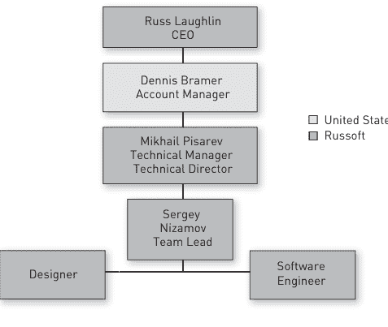

图 7–3：项目组织

## 第 7 章风险管理

### 我们有进展吗？

在周一回到美国后，Fisher 向 Bramer 和自己的部门汇报了他在莫斯科访问的情况。他要求 Bramer 为他提供一份到目前为止该项目花费小时数的正式统计。Bramer 回了电话：

> “Fisher 要求我获取项目到目前为止花费小时数的真实统计。作为客户，他想确保留有足够的时间来实施系统的关键部分。当俄罗斯办公室传回的数字是 130 小时时，Fisher 大大吃下眼镜。他告诉我，Sergey 最初的统计（4 天前）大约是 30 到 40 小时，并提到 GUI 设计上并没有太大变化，不让数字增加到这么多。他显然非常心心和愤怒。他不知道 Sergey 是在对他撒谎，还是仅仅缺乏经验，或者是认为这就是做生意的方式。项目已经落后于进度，我能做的就是道歉，同时向他保证，等第二天一晨（当俄罗斯的人回到办公室后）我会查清这件事的底。”

当 Fisher 从俄罗斯回来时，学期已经开始了。他将日常的项目互动工作交给了 Alex Rau，由 Rau 通过与 Sergey Nizamov 的邮件往来让他随时知晓进展。Fisher 不确定他与 Rau 正在观察的这种持续沟通，是由他们自己引起的问题、文化或语言障碍造成的，还是由于项目最初开始时 Bramer 向俄罗斯人传达的需求被误解了导致的。

以下是 Alex 和 Sergey 之间交换的典型邮件。这些邮件包含未经过语法、拼写或其他文本错误编辑的文本。

```
------ 原始消息
From: Alex Rau
Sent: 2003年9月12日，星期二，上午 11:17
To: Nizamov, Sergey
Cc: Gene Fisher; Bramer, Dennis
Subject: Re: Madison :: Website sources
```

Sergey, 你好！

我知道你说的 IE 以及那些带有额外糟糕标签的问题。

嗯，这是 Gene 的想法，功能上几乎与 Macromedia 在网站（http://www.macromedia.com/software/contribute/）上的 Contribute 几乎相同。总而言之，我将来将需要能够使用 Dreamweaver 和 FrontPage 编辑页面，无论是图像还是文本。

关于这个管理控制台的功能可能存在一些困惑，这是可以理解的。

我们需要确保搜索引擎功能、用户名和密码以及注册选项能够正常工作。你可以自己托管 SQL 的部分吗，这样我们至少可以看到它的运行效果，然后让系统管理员负责维护、安装和文件传输？

感谢你的辛苦工作，

Alex

```
+ --- 原始消息
From: Nizamov, Sergey
Sent: 2003年9月13日，星期三，上午 5:22
To: Rau, Alex
Cc: Gene Fisher, Bramer, Dennis
Subject: Re: Madison: Website sources
```

Alex, 你好，

首先，关于图形设计。我已经要求网页设计师根据新要求做一些更改，我预计在今天晚上或明天早上能拿到新版本。网站更新后我会通知你。

关于 AdminTool：我稍微了解 Macromedia Contribute 产品。这是一个相当稳健的产品。遗憾的是，我们在估算 AdminTool 是一项 40 小时的任务时，之前没有提到这些功能。

无论如何，我已经要求程序员将现有的 AdminTool 与 Contribute 进行对比。如果可能的话。

Sergey

在此时，Fisher 和 Rau 看来，直接与 Sergey 互动是工作上一种明智之。。Fisher 觉得 Russ [Laughlin] 正在积极寻找接替他的人。

10 月，项目已经超过了截止日期（原定于 8 月），且看不到尽头，Fisher 收到通知，Bramer 将离开项目。出于各种职业和个人原因，已经与 Sergey 建立起良好关系的 Bramer 决定离职。Fisher 反思道：

“失去 Dennis 对我们来说是一个打击。他可能人不在俄罗斯，但 Sergey 似乎在听取他的意见。他是这片疯狂中一个令人安心的声音。每当我们认为一切快要崩溃时，Dennis 都能让大家放松并让一切恢复正常。”

# 案例研究：SEWEB 与 RUSSOFT TECHNOLOGIES 219

### 案例问题

以下是涉及风险管理的主要问题和需要做出的决策：

- 如何重构这项海外开发项目，以通过风险管理减少未来的问题？

- 需要哪些风险管理实践和活动来减少未来的项目风险？

- 应该采取什么措施来减轻人员、流程和技术方面的项目风险？

### 案例分析

### 分析活动

在本部分，我们将尝试使用 PEAK 决策模型对案例进行分析。我们将关注影响案例中利益相关者决策决策的因素。

### 分析背景

让我们看看 PEAK 的输入，了解它们如何帮助我们理解关键问题的替代解决方案：

> 如何重构这项海外开发工作，以通过风险管理最大限度地减少未来的问题？

(P) 问题：本案例研究突出了在没有系统性风险管理的情况下进行海外开发项目的问题。解决方案应该提供结构化的流程，以促进有效的沟通、高效的会议、适当的审查与反馈，以及与远程开发团队进行持续的问题识别与解决（因为缺乏这些因素导致了项目陷入了困境）。

(E) 经验：项目利益相关者的技能组合如下：

对于威斯康星大学麦迪逊分校 (UW Madison)：

- 熟悉软件工程流程

- 丰富的全球项目工作经验

- 某些风险管理专业知识

- 涉及俄罗斯公司的某些专业知识

- 丰富的项目管理经验

## 第7章 风险管理

对于 Russell Technologies：

- 与美国客户合作的经验

- 管理 Web 开发项目的经验

(A) 假设：项目利益相关者的假设可能包括需要重构项目以提高其有效性，并愿意合作。

- 项目中的海外开发团队，无论是内部（部门内部）还是外部（海外），都感兴趣在风险演变成问题之前进行管理。

- 有足够的资源（预算、时间、知识）来开展流程改进。

(K) 知识：项目利益相关者的知识库包括以下环境和事实：

- 这是一个海外开发项目，利益相关者分布在美国和俄罗斯（环境）。

- 项目目前没有进行任何显性的风险管理（事实）。

- 项目在规划与预算、沟通以及范围与需求方面存在多个问题（事实）。

- 解决持续存在的问题已迫在眉睫。没有时间采取“观观其变”的方法（事实）。

解决方案：问题的替代解决方案可能包括以下内容的组合：

- 采用敏捷方法构建一种沟通机制，使利益相关者能够定期、快捷地获取状态和其他项目信息。项目管理和人员需要参与并具备相关知识。

- 创建结构化流程，通过执行定义良好的任务来达成项目目标，并根据明确确定的时间表实现里程碑。

- 改变沟通和控制机制，增加高级管理者的监督，减少对开发人员控制项目的依赖。

- 为美国和俄罗斯利益相关者投入一些时间和精力，正式识别项目风险，并对高优先级风险进行缓解、跟踪和控制。

解决方案的要求：创建一个结构化的流程，涉及在已注册的里程碑处执行特定步骤并采取特定行动，并为软件交付物的交付设定时间表。

## 案例研究：SEWEB 与 RUSSOFT TECHNOLOGIES 221

假设风险：以下是与替代解决方案相关的潜在风险：

- 重构项目（本质上是投入时间来定义和执行不同的流程）可能比预期耗长，并导致进度进一步推迟。

- 项目利益相关者可能抵制转向以流程为导向的方法。

- 项目利益相关者可能不喜欢或不信任涉及更多管理控制的方法。结果可能是“我不在乎”的心态或态度问题。

### 分析问题

- 1. 哪些风险管理实践和活动有助于最大限度地减少未来的项目风险？

- 2. 应该采取什么措施来减轻人员、流程和技术领域的项目风险？

### 讨论

由于我们正试图重构项目以使风险最小化，关于做什么的决策取决于对替代解决方案相关风险的评估。无论假设了什么风险，即使风险发生，也必须允许项目成功。自然地，任何对项目需求、进度或预算（已经受到损害）产生负面影响的决策都不是好选择。Fisher 和他的老板 Johnson 应该寻找能够最大限化他们对范围、时间和成本控制的解决方案。

减少与沟通和文化障碍相关的风险是解决方案的关键，因为这些是产生问题的主要原因。处理沟通问题是一个可行的缓解策略，可以减少未公开问题演变成问题的可能性。另一种方法可能是改进或减少分配给项目的俄罗斯员工成员所表现出的拙劣项目管理能力的影响。

关于工作风格的文化差异，决策应该聚焦于美国经理所需的项目控制和监督程度。Fisher 应该意识到，在执行项目方面给予不受限制的灵活性是他无法承担的风险。Fisher 还必须向他的老板证明他有能力控制项目并减少与俄罗斯开发人员合作的负面影响。为了做到这一点，他必须监督并控制项目交付物、项目执行流程以及与开发人员的沟通。

第7章 风险管理

### 结论

Fisher 和 Laughlin 都面临着艰难的决策，这些决策不仅影响日常执行细节，还关系他们的持续关系、声誉以及各自组织如何被看待。在试图完成一个陷入故障的项目时，存在忽视长期影响的倾向。Fisher 和 Laughlin 应该后退一步，仔细分析他们的处境，避免在没有评估选项的情况下做出仓促决定。

风险管理是决策者主动应对挑战的一种。尽管 Fisher 尚未有效这样做，但他意识到他的项目所遇到的问题，并希望解决它们。对于 Fisher 和 Laughlin 来说，寻找过错很容易的，特别是由于距离的原因。如果一个关键利益相关者采取强制姿态（例如“因为我说这么做”），未来的项目风险可能会更大。Fisher 和 Laughlin 在决定如何推进之前，需要分析项目的结果和假设的风险。

### 需要记住的核心思想

本案例研究展示了一个典型的项目，开发者和客户都没有进行风险管理。通常情况下，缺乏风险管理导致了许多可以预见的问题。我们希望您记住以下观点：

- 风险管理需要作为项目计划的一部分进行计划和执行。决策者往往在信息有限和时间限制的情况下做出决策。项目经理应该在项目开始时投入时间识别项目风险，并缓解可能影响风险。

- 随着项目在环境和领域方面变得复杂，对显性风险管理的需求增加。复杂项目通常涉及多个组件、技术复杂化和许多决策者。项目环境也会导致复杂性，即使是一个只有两三个项目工程师的小项目，也涉及与距离、文化、语言、专业知识相关的复杂性。在不那么复杂的项目中处理风险更容易，而随着项目复杂性的增加，利益相关者所做决策的复杂性也随之增加。

### Falcon Edutainment 与 RiskSim 项目

### 指南

在阅读此案例研究时，请关注在短期、时间受限的项目中由于沟通误解产生的风险。识别与管理客户预期相关的问题以及这些预期对项目持续构成的风险。

### 案例摘要

### 描述

Brian Wenzel 正在 Falcon Edutainment 管理一个为期六个月的短期项目。该项目涉及将一个风险管理模拟转换为 Web 平台。当客户与开发人员在“创意”上产生不同意见时，尽管客户缺乏明确反馈，开发人员仍坚持推进项目，导致双方最终都在处理由此产生的“后果”。

### 案例研究目标

阅读此案例研究后，你将能够做到以下点：

- 理解在反馈极少或模糊的情况下工作的开发人员将所面临的风险和决策

- 理解增加或更改需求对项目时间线和进度表的影响，以及重新工作的必要

- 回顾在小型项目中所承担的风险和做出的决策

### 涵盖主题

风险管理、决策制定、客户预期管理、需求管理以及利益相关者沟通

### 背景

背景是在美国的一个涉及培训/模拟应用的 Web 系统开发的小型项目。该项目受到预算小和时间短（约六个月）的限制。

# 第 7 章管理风险

### 核心概念

- 如何减少与需求、缺乏客户反馈以及进度受限相关的项目风险

- 决策对项目风险以及项目管理成功的影响

- 在没有明确计划的情况下隐式管理风险的缺点

### 案例

### 场景

Brian Wenzel 今天早晨开车上班时有充足的时间思考。他被堵在通往波士顿的一条主公路上，这似乎是一场为了重新组织繁华大都市周围客户模式的无休止尝试。清早时，Brian 已经因为前一天读到的 Lee Orman 发来的邮件（RiskSim 项目负责人）而感到那种隐隐作痛的头痛。Orman 是耶鲁大学管理学院的年轻届毕业生，是该项目的首席客户。Wenzel 需要 ExcelSoft 的风险管理实践总监来管理项目风险，同时在范围、预算、进度和客户预期之间取得平衡。他不知道从何处开始。

RiskSim 是 ExcelSoft 用于培训软件专业人员风险管理概念的旗舰工具之一。这家公司是一家总部位于美国的风险管理咨询公司，开发了一个基于棋盘的模拟器，以提供软件开发项目的真实环境。该模拟器非常成功，公司在年初早些决定将其转换为 Web 模拟器。尽管仍在活跃开发中，但 ExcelSoft 团队认为该模拟器已经足够成熟，可以移动到在线。为了扩展这一点，他们与 Falcon 公司签约，Falcon 是一家专门从事教育中心软件开发的公司。在 Falcon，Wenzel 与另外三名工程师被分配到项目中。图 7-1 显示了 ExcelSoft 和 Falcon 的组织结构图。

Wenzel 表示：

“ExcelSoft 对我们如何帮助他们验证其基于棋盘的模拟器感兴趣。这是轻而易举的事，我们过去已经做过多次了。在听了他们感兴趣的内容后，我们解释了我们的工作方式，以及我们如何进行需求引导、设计、项目管理工作以及实际开发。会议相当相当成功，因为它促成了简短的合同谈判并立即确定了工作日期。令我感到奇怪的一点是，ExcelSoft 竟然派了他们的新人之一来领导项目。不要误会我的意，Orman 女士看起来很有干劲，但在任何类似于软件开发、教育或模拟的领域都完全没有经验。我担心需要花费太多时间来带路，解释我们为什么要这样做某些事情。”

# 案例研究：FALCON EDUTAINMENT 与 RiskSim 项目 225

### 设定

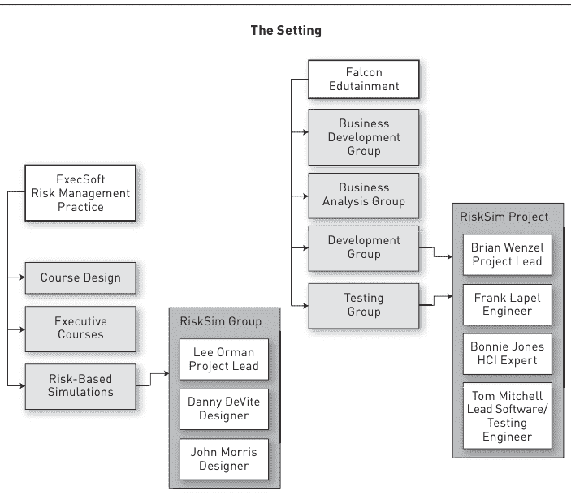

图 7-4：ExecSoft 和 Falcon Edutainment 组织结构图

* 箭头表示各个业务部门内工作人员的详细视图。

Orman 回忆道：

“在寻找一家在开发教育模拟方面拥有良好记录的公司时，我们发现了 Falcon。我们的一位经理知道他们董事会的成员是谁。他们显然深度参与了与大学、美国教育部以及许多大型财富 500 强公司的项目工作，这些公司使用他们的服务来创建内部的培训模拟器。虽然我还在学习业务，但 Falcon 看起来很乐于帮助，并想更多关于项目的信息。”

两家公司之间承包的工作是一份固定费的、为期六个月的合同，旨在交付一个运行原型。时间表包括一个短的需求引导期（主要是为了理解现有的模拟器及其规则、假设和机制），随后是实际原型的三次迭代，以精炼游戏的视觉效果和感受，并获取有关易用性和可玩性等其他重要的反馈（见图 7-5）。

### RiskSim：引导阶段

由于项目于 3 月开始，Wenzel 与 Orman 以及其中一个原始模拟器开发人员 Danny DeVitte 会会了面。DeVitte 是一位风险管理专家，他非常清楚要用模拟器实现什么。然而，他不确定这如何转化为计算机环境。DeVitte 说：

“两年前，我们这些参与 ExecSoft 风险管理实践的一群人开发了一个基于风险的模拟器，以帮助从业人员理解在软件开发项目背景下如何使用风险管理。该模拟器非常成功，在真实性、趣味性和深度方面都获得了极赞誉的反馈。我们想将其放入计算机中，使其更健壮、更容易控制，并添加一些我们在棋盘上无法添加的元素。我们希望 Falcon Edutainment 能就如何操作提供指导。我们不是开发这类系统的专家。如果是的话，我们就不需要 Falcon 了。我们需要他们的专业知识来从虚拟意义上使其具有吸引力和趣味性。我的理解是，我们将在保持模拟器规则不变和游戏精神不变的同时，获得关于在我们的限制下工作的建议。”

Falcon 团队在最初的几周里通过感受来更好地理解模拟器的运作方式。他们审阅了设计文档、用户手册，以及为华盛顿特区两个政府组织进行的两次线下模拟。在对模拟器的玩法有了扎实理解，并拥有了看似完整的文档草案后，Wenzel 和他的两个同事 Frank Laplace 和 Bonnie Jones（人机交互专家）开始设计一个 GUI 可能外观的纸质模型（见图 7-6）。

这个设计似乎给 Orman 留下了深刻印象，但对 ExecSoft 的同事来说似乎产生了比预期更多的问题。

Falcon 的软件工程师 Charlotte 回忆：


“我们与模拟器进行了大量的互动，以理解其设计的背后逻辑。然后，我们创建了一个与游戏现有规则和机制相契合的设计。从设计的角度来看，我们希望在调整游戏可玩性以适应一个让玩家愿意多次玩的环境之间取得平衡。这不容易，因为棋盘上的游戏非常简单，并没有提供很多互动。因此，我们采用了客户最初要求的另一种方法，转向了更活跃的‘办公式’环境，而不是简单的大字棋设计。”

# FALCON EDUTAINMENT 案例与 RiskSim 项目 227

## RiskSim 项目时间线

- **预计完成时间：6 个月，4,800 小时**
- 项目启动：2006 年 3 月 15 日
- 需求征取：2006 年 4 月 1 日
- 实施迭代 1：2006 年 5 月
- 实施迭代 2：2006 年 7 月 15 日
- 测试与过渡：2006 年 9 月
- 项目结束：2006 年 9 月 15 日

| 时间 | 阶段 | 主要工作 |
| --- | --- | --- |
| 100 小时 | 项目启动 | 定义参数、成功目标 |
| 700 小时 | 需求征取 | 创建需求、关注概念架构和初始设计 |
| 3,000 小时 | 实施迭代 1 | 开发第一个版本（GUI）和基础规则引擎 |
| 10,000 小时 | 实施迭代 2 | 获取客户反馈，提供包含网络和数据库模块的第二次迭代 |
| — | 测试与过渡 | 进行一些用户测试并制定包括文档在内的计划 |
| — | 项目结束 | 项目结束、客户交付以及任何未来的合作工作 |

图 7–5：RiskSim 项目时间线

# 图形用户界面——纸质模型

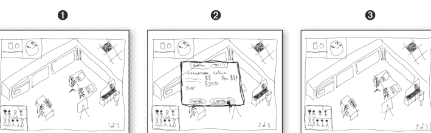

主模拟屏幕 | 玩家可以采取的操作 | 资源根据用户操作的变化

图 7–6：由 Lapel 和 Jones 的 GUI 纸质原型

# 第 7 章 风险管理

Orman 对事情的看法与 Falcon 人的预想不同。Orman 回忆：

我对 Falcon 的技术能力留下了深刻印象。Wenzel 的团队在最初几周里看起来非常认真地试图理解 RiskSim 包含的内容。我们没有教他们我们是如何做的以及出于什么原因。当我们终于拿到原型时，他们就像完全没有听进去一样。RiskSim 是基于棋盘概念设计的，而他们却想出了一个像办公室的环境。虽然这个概念是有价值的，但我记得 DeVite 在一次闭门会议上提到，他不确定这个概念是否符合他的想法。我是那个必须告诉 Wenzel 他必须回到起点重新画的人。那个可怜的家伙……在那个时刻，似乎什么都不说，等待一个更好的时机来讨论，比仅仅讨论原型——也许通过电话或面对面——要容易得多。

通过这个初版原型剪辑以及随后的模糊反馈，Wenzel 清楚地意识到，他的客户只对他们所处情况的精确复制感兴趣。他们似乎对让创意专家提供提供关于什么样的内容能吸引观众玩游戏的意见兴趣要小得多。与此一致，Wenzel 更新了他的项目计划，以反映在“创造力”上花费的时间更少，将更多精力集中在复制现有内容上。

## 已访问的需求

Wenzel 决定对这个项目采用双管齐下的方法。作为一名经验丰富的工程师，他希望利用已有的内容作为初始需求来构建概念架构（图 7-7）。同时，他想在进入开发之前，花更多时间来精炼和验证架构以及需求。遵循他的里程碑，他能够产出一份初始需求规格说明（SRS）草案，其中包含了他从 Orman 处收集的信息得的一系列详细用例。

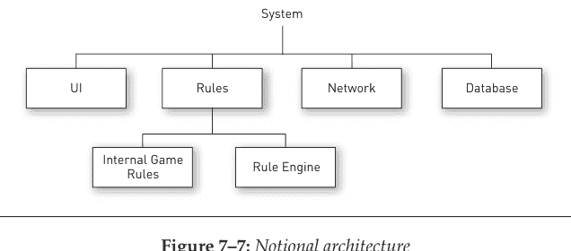

# 案例研究：FALCON EDUTAINMENT 与 RISSIM 项目 229

Orman 回忆道：

周一我进办公室时，有一封 Brian 的邮件在等我。邮件附带了一份相当大的文档，将我们讨论过的 RiskSim 特性转换成了更技术性的格式。我喜欢信息以玩家/用户执行任务时会经历的场景类型步骤来布局。我记得把它打印出来展示给 DeVite 看，他说他稍后会看。

当 DeVite 和他的同事正在审阅需求文档并思考如何进行下去时，Wenzel 坚持让他的团队在实施之前进行 GUI 设计工作。他不想在等待 Orman 更多反馈时浪费时间。Chapel 和 Jones 坚决反对这一行动。他们的理解是，尽可能快地推进会导致团队未来的重复工作。如果发生任何变化，很可能会被浪费。Chapel 在第二天午餐时向 Wenzel 提到了这一点：

Brian，我不确定在没有验证我们的设计的情况下尽可能快地推进，是否符合我们客户的最大利益。GUI 背后的想法是征取需求并精炼它们，而不是画一条我们无法回头的分界线。我们甚至不知道他们是否喜欢我们所做的吗？

Wenzel 的反应是：

我不需要教你如何运行我的项目！我在这方面比你更有经验。我们的进度非常紧迫，我们没有奢侈时间等 Orman 和她的那帮人决定好他们究竟想让我们做什么做什么。据我所知，无论我们向他们展示什么，他们都可能改变主意。

回到 ExecSoft，Devite 和 Orman 与另一位 RiskSim 设计师 John Morris 讨论了需求。Morris 很有兴趣于根据他一个月前或之前让两组人运行过模拟的最新反馈，向项目整合更多功能。。当 Orman 提到目前向项目添加内容不在他们的原始计划中时，Morris 暗示他可以将项目分为两个阶段而不是一个。

但他们没有识别、评估并缓解与其决策相关的风险。

软件项目经理经常以一种草率的方式进行风险管理，或者干脆忽略它。案例研究突出了本可以被识别和管理但未被管理的项目风险。导致的项目问题是项目风险条件的典型示例，如果不对进行管理，可能会导致灾难性的后果。风险管理是评估和做出项目决策不可或缺的一部分。

风险管理是软件项目生命周期中的持续事件，如果执行不当或不执行，可能会导致灾难性的结果。

# 第 8 章 管理人员互动

## 8.1 本章目标

在阅读并思考本章介绍的概念和案例研究后，你将能够做到：

- 理解影响人际互动的因素，以及如何通过影响这些因素来使软件利益相关者之间的互动更加成功。
- 认识到，由于改变他人的行为非常困难，你必须在各种情况下调整自己的行为，以更成功地处理人际互动。
- 理解清晰且有目的的沟通价值，以及沟通对成功管理人际互动的影响。

## 8.2 背景

人与人之间的互动是解决软件项目的关键组成部分。案例研究中的利益相关者通过沟通、解决问题和做出决策进行谈判；并在其软件项目的整个生命周期中以其他方式进行互动。通过这些互动，项目利益相关者参与“相互或互惠的行为或影响”，以共同完成某些目标（Dictionary.net）。利益相关者的互动有助于为项目的进展铺平或制造崎岖道路。

可观察的因素影响着人际互动。人们可以识别并控制这些因素以进行更成功的互动。管理人际互动在于理解你互动的本质，并在可行的情况下分析和控制影响它们的因素。本章试图阐明管理人员互动的含义，并强调其对软件项目成功的重要性。

以下是软件项目管理人员互动涉及的活动：

- 理解利益相关者互动的不同场景。
- 理解影响各种项目利益相关者互动的因素。
- 为重要的利益相关者互动决定目标。
- 评估可能影响利益相关者互动的因素。
- 决定如何对影响利益相关者互动的因素（包括自己的行为）进行可行调整。
- 反思利益相关者互动的动态，并反馈到对未来互动的决策中。

表 8-1 描述了这些活动及其目标结果。学习该表，并思考你过去为了管理利益相关者互动可能执行过的任何其他活动。

### 表 8-1：管理人员（利益相关者）互动活动描述

| 活动 | 活动描述 |
| --- | --- |
| 理解项目利益相关者互动的不同场景 | **定义：** 识别软件项目利益相关者在不同场景下互动（如传递信息、做出决策、谈判等），并为互动带来不同的背景和观点。<br>**目标结果：** 清晰了解软件项目中可能发生的不同利益相关者互动的本质。 |
| 理解各种项目利益相关者互动的因素 | **定义：** 识别可能影响项目利益相关者之间互动的因素，并识别哪些是可控的，哪些不可控。<br>**目标结果：** 清晰了解软件项目中可能发生的对利益相关者互动的控和不可控的影响。 |
| 为重要的利益相关者互动决定目标 | **定义：** 确定重要的利益相关者互动如何有助于项目目标的实现，然后为这些互动确定特定目标。<br>**目标结果：** 关键利益相关者的互动目标与项目目标保持一致。 |
| 评估可能影响利益相关者互动的因素 | **定义：** 分析可能影响利益相关者互动并对软件项目产生关键影响的因素。<br>**目标结果：** 清晰了解对关键利益相关者互动的控和不可控的影响。 |
| 决定如何对影响利益相关者互动的因素（包括自己的行为）进行可行调整 | **定义：** 一旦评估了因素，就利用这些信息影响利益相关者互动，以提供更多双赢机会。<br>**目标结果：** 管理利益相关者互动的双赢方法。 |
| 反思利益相关互动的动态并反馈到对未来互动的决策中 | **定义：** 分析和评估过去的利益相关者互动，以增加你在 PE 决策中的经验和知识输入。<br>**目标结果：** 有一种方法总结在一个项目中学到的知识，以帮助管理下一个项目的利益相关者互动。 |

## 8.2 背景

人际互动的类型和复杂性非常丰富且多样。表 8-2 描述了项目利益相关者经常遇到的互动。你可能还会想到其他的。我们鼓励你在阅读本章时反思这些内容。

最常见的互动类型是沟通。你可以想象办公室内外的许多对话、电子邮件、面对面会议、即时消息、备忘录、计划、报告、规格书、电话和视频会议等，这些都发生在涉及许多利益相关者或大型复杂软件系统开发的项目中。沟通带宽的项目涉及的利益相关者少，交付物少或复杂程度低，或者可能存在问题。人们需要沟通才能朝着共同的利益和目标共同努力。当他们没有这样做时，就会发现很难获得所需的信息并协调工作。

### 表 8–2：软件项目利益相关者之间的典型互动

| 互动 | 互动描述 |
| --- | --- |
| 沟通 | 通过形式的肢体语言、口头交流、图片或其他交流在人与人之间传递思想或信息 |
| 决策 | 根据一组输入来决定行动方案的过程 |
| 谈判 | 两个或更多人之间的讨论，以达成某种共识（有时是同意分歧或不再追求合资经营，等） |
| 冲突管理 | 人与人之间解决工作场所问题和问题的沟通。 |
| 领导力 | 为小组设定愿景或方向，并提供激励使愿景成为现实 |
| 关系管理 | 以某种方式互动以维护利益相关者与其组织之间的关系 |
| 自我 | 人如何向他人展示自己的立场和需求 |

## 8.2 背景

问题是项目利益相关者如何能更好地管理他们之间的互动以实现项目目标。首先，人们需要意识到存在影响他们互动的因素。表 8-3 描述了影响软件项目互动的常见因素。探索该表，并思考可能影响你与项目利益相关者互动的其他因素。

### 表 8–3：影响人际互动的因素

| 因素 | 因素描述 |
| --- | --- |
| 沟通风格 | 信息通过口头、书面、肢体语言等直接形式在人之间传递的方式，以及特征如直接/间接、果断/被动/攻击性、开放/防御、语调、语速等。 |
| 情境情况 | 在特定互动之前、导致或影响该互动的背景信息和事件，例如参与者以及发生了什么；互动的理由或性质。 |
| 文化、传统和习俗 | 从家庭和社会中学到的行为准则，关于如何与人互动。例如，在英国，称呼皇室成员为“dude”是不符合社会规范的。 |
| 目标、预期和动机 | 目前影响互动标准的驱动因素。 |
| 环境 | 影响互动的外部因素（如嘈杂的房间或通过视频会议进行的全球通信）。 |
| 互动规模 | 参与互动的人数。 |
| 性格特征 | 参与互动的人的个人特征。 |

## 8.2 背景

沟通风格是影响人际互动的一个高度影响性因素。由于大多数（如果不是所有）人际互动都涉及沟通，沟通风格在改善或影响状况方面起着关键作用。沟通风格涉及可观察的语言特征，如速度、音量或停顿等。它还涉及沟通方法，例如直接/间接程度，或在陈述某事时的坚定程度。有些人是天生的沟通者，而另一些人倾向于倾听。如果你感兴趣了解更多关于沟通风格的知识，可以德德拉·谭（Deborah Tannen）的作品，她是乔治敦大学的社会学家，对语言及其对人际互动的影响进行了广泛研究（Tannen）。其他查找沟通风格信息的来源包括 ASME、Jensen 以及 Pleeger 和 Atlee（2006, 99–104）。特别是 Pleeger 和 Atlee，讨论了软件工程领域人员背景下的沟通风格。

情境的背景会影响互动发生的方式或原因，即发生互动之前的相关事件历史。建立软件项目需求的的利益相关者之间的互动，可能与过去合作过的利益相关者之间的互动不同，也可能与第一次见面的利益相关者之间的互动不同。

文化差异影响着位于不同国家或地区的人之间的互动。在某些文化中，小组讨论似乎是混乱的，多个人同时说话；在另一些文化中，人们可能会等到他人发表评论以免可能冒犯。杰弗里·霍夫斯泰德（Geoffrey Hofstede）博士广泛研究了一个评估国际业务文化的框架，并开发了关于人们进入其他国家时如何做出运营决策的研究（Hofstede）。

同样，环境对全球分布式利益相关者之间的互动有显著影响。时间和空间差异通常发生在某些时刻（通常在正常时间之外），或者在等待回复时产生延迟。在电话和甚至视频会议期间，利益相关者经常看不到帮助他们判断对方反应的肢体语言。面对面交流的缺失增加了开发项目人员之间互动的复杂性。环境和文化对分布式利益相关者之间的互动通常具有影响力。

## 8.2 背景

关于动机已有许多记载，动机是驱动人们采取所做行为的内在力量。需要记住的主要观点是，动机是一种内在力量。人们无法真正激励他人去做某事。每个人都有自己的目标和目的、应对外部事件的方式，以及影响个人言行的动机因素。当人们拥有共同目标和目的时，他们更有可能合作或共同工作。请参见《Changing Minds》以获取动机理论的概述。

参与者的数量（互动规模）也会影响互动。特别是决策制定，随着决策者人数的增加而变得日益困难。通常情况下，小组互动会就其互动方式达成共识。

性格是心理学家研究的主题。我们不会尝试解释每个个体的独特特征，而是参考被广泛接受的性格类型和特质。关于性格的全面信息，请参见 Carver 和 Scheier (2003)、Capret (2003) 以及迈尔斯-布里格（Myers-Briggs）性格类型模型。

现在是你回顾最近与项目中的一个或多个利益相关者发生的特定互动的好机会。思考表 8-3 中列出的因素，以下问题有助于你反思自己的互动：

- 你在当时是否意识到某些因素正在影响你的互动？
- 表格中的哪些因素影响了你的互动？（对每个因素的影响从从到高或可能没有评分）。
- 除了表中所示因素，还有哪些因素影响了你的互动？

既然你已经了解了不同类型的互动，现在准备好思考如何管理与其他人的互动，以为你的软件项目带来成效的结果。尽管你可能没有时间以流程为导向的方式管理人际互动，但在确保互动成功的特定情况下，这样做是有益的。当你试图建立或加强与项目利益相关者的关系，或者当互动涉及短期和长期目标时，管理互动可能是非常重要的。

要成功管理互动，你需要理解特定互动的目标和原因以及其性质。你可以从概述（可能是书面形式）你对即将发生的互动的目标或动机开始。

你既要考虑实现什么，也要考虑对方想实现什么。一旦你理解了自己的目标，并尽可能理解了与之互动的人的目标，就可以确定可能影响互动的因素。在表 8-3 中，你会注意到可能在你的控制范围内的因素（例如沟通风格、你的目标和动机，或在某种程度上的环境）以及你无法控制的因素（例如与你互动的人的性格类型、背景，或可能的会议地点）。你可以利用影响力来改变你控制范围内的因素，以实现更好的互动。例如，你可能会选择方便的地点和时间交谈。

尽管某些因素是可控的，但每次互动都涉及行为风格、性格类型和偏好等可能不可控的方面。作为利益相关者，你能够控制并调整自己的行为以适应特定互动的动态变化，但无法控制或让他人适应情况，除非他们决定这样做。适当的规划让你能够提前思考、做好准备，并根据需要以专注且控制的方式调整你的行为。如果事件超出了你的计划范围，请为如何行动设定现实预期。由于人与人不同，你不应该期望他们会按照你认为的方式来表现。对之前与这些人的互动（如果有的话）进行适当分析，可能会揭示关于他们的性格、偏好、行为或沟通风格的宝贵信息，这些都是理解如何处理互动的关键。

## 8.2 上文 241

了解你正在互动对象的人与你不同。具备了这些知识，你对自己在处理互动的能力会感到更有安全感，并且不容易受到情绪的影响，因为你知道他人表现出的特定行为是有其原因的。

为了帮助使用表 8-2 和表 8-3 中提供的信息，你可以建立一个表格，标明不同因素对特定互动的影响程度。表 8-4 将影响因素（顶行）与特定的互动（左侧列）相关联。在这个示例中，三个因素被涂成阴影，表示对未来可能发生的被称为“沟通”的互动类型具有预期的影响（从低到高或没有）。自然地，你越同一情境下与同一个人互动得越多，你就越能建立起关于你发现的影响你互动的因素的经验参考模型或地图。

现在，你将检查使用该表的真实世界场景。

### 即将进行的沟通场景

全球分布式团队的两个成员正在会面，讨论并理想地解决一个关于软件组件界面设计的问题。该组件正在法国开发，并将与美国的其他组件集成。其中一个利益相关者在美国的公司实验室工作，另一个利益相关者在德国的公司实验室工作。美国项目成员鲍·道森（Bob Dawson）从未见过他在法国的对应人员乔·丁（Joe Ting）。鲍经常与在法国实验室的其他团队成员交流，在这些互动中没有遇到任何问题。他发现法国实验室的人在对话中非常开放和直接。

### 表 8–4：因素影响分析：即将进行的沟通

| 影响因素/目标互动 | 沟通风格 | 范围、情境 | 文化、传统与习俗 | 目标、计划与动机 | 环境 | 互动规模 | 人格特征 |
| :--- | :--- | :--- | :--- | :--- | :--- | :--- | :--- |
| 沟通 | 无影响（假设） | 中度影响 | 无影响（假设） | 高影响 | 低影响 | 高影响（仅限两人） | 未知 (?) |

## 第 8 章 管理人际互动

在电话会议当天，鲍给乔打了电话，热情地问候道：“你好，你看到昨天在夏莫尼的下滑雪赛了吗？那可不太棒了？”


乔没有回答。电话那头一片沉默。鲍继续对话，并解释了他的团队对当前软件组件界面设计存在的问题。乔听了很久，并表示他会将鲍说的话汇报给他。乔礼貌地表示，他需要就这个问题给鲍回复。鲍很快意识到，乔的说话方式并没有反映出法国口音（至少在鲍听来听起来像法国口音）。鲍问他是否在法国住了很久，以及是否在欧洲读过书。乔说他来自中国，在德国慕尼黑学习过书。他在法国实验室工作了大约两年了。

回想起与乔的互动，鲍思考了自己的假设，以及他与乔之间在沟通风格和节奏上的差异，以及乔与鲍曾交流过的法国实验室其他成员之间的差异。鲍预想乔会是开放且直接的。他并不一定预期他们当天能达成一致，但他确实预期乔会表达想法和观点。鲍在想自己是否应该就这个问题提出解决方案或不要提出。

表 8-4 中的阴影部分显示了鲍在与乔交流之前考虑的因素。在与乔交谈之后，他还会给表格涂影吗？鲍仍然不知道哪些可能影响他与乔互动的因素？鲍应该如何调整自己的行为，在与乔以及法国实验室其他员工保持良好关系的同时解决该问题？

管理人际互动涉及为重要的互动定义你的目标，检查可能影响互动的各种因素，并利用这些知识规划你的互动。一旦互动结束，你可以对经验进行反思，并理想地改进未来的互动。

## 8.3 案例研究

本章的两个案例侧重于在组织内部不同层次管理人际互动的方面。在第一个案例“存在还是不存在：TestBridge 的紧迫感”中，由于组织正在改变其重点和方向，必须就团队内特定成员作为团队成员做出贡献的能力和意愿做出艰难的决定。第二个案例“汉诺威科技的：朋友还是敌人”侧重于在管理层面管理人际互动的需求，同时平衡对立的财务、战略、个人和时间考量。这两个案例中做出的决定似乎都让利益相关者处于具有短期和长期影响的境地，除非仔细处理。阅读这些案例以确定管理人际互动所采取的步骤。

## 案例研究：存在还是不存在：TestBridge 的紧迫感 243

### 案例研究

### To Be or Not to Be: A Sense of Urgency at TestBridge

### 方向

在阅读本案例时，请关注管理人际互动的各个方面。尝试识别案例中哪些点有助于或损害人际互动的能力。

### 案例摘要

### 描述

鲍·兰迪斯（Berry Landis）正在管理一家美国小公司的扭亏局面。兰迪斯正努力让工程副总裁与新的业务重点保持一致，并试图管理这种互动。他不知道如何推进计划，以及如何处理一个性格强势的团队成员。

### 或是To Be or Not to Be: A Sense of Urgency at TestBridge

### 案例目标

阅读案例研究后，你将能够：

- 理解尝试管理人际互动时面临的挑战

- 理解不管理人际互动的后果

- 识别各种人际互动活动及其成功的正面或负面影响

### 涵盖主题

管理人际互动、决策制定、员工激励、薪酬、目标设定、沟通

### 背景

背景是一家美国的小公司，为了维持市场份额并增长，必须在产品和组织上进行变革。

### 核心概念

- 在困难的变革期间与员工沟通

- 为了实现成功的人际互动需要考虑的一些问题

- 组织内决策产生的一些影响

### 案例

### 情景

鲍·兰迪斯面临着一个艰难的决定。在大约半小时后，他将与他的工程副总裁见面，他知道这场对话不会轻松。鲍刚从对香港和马来西亚的为周海外旅行回来，在那里他会了现有客户以产生潜在的新业务。他的独自时间为他提供了反思过去一年公司发生的事情、他与乔的互动，以及他在寻求未来路线（围绕 TestBridge 以及获得团队共识）时最关心的事情。他已经下定了决心，要在对话发展之前采取任何方向的行动。

## 案例研究：生存还是毁灭：TestBridge 245 的紧迫感

在 Landis 经过三个月的招聘过程被聘用后，公司里的人们一眼看出，除了将精力重新集中在增加销售和市场渗透上之外，在软件功能和服务目标客户方面，还必须有更多“可以卖的东西”。在这方面，Landis 敦促罗伊（Rowe）提出建议，说明他认为 Terlogic 应该如何参与其中。

## Terlogic 背后的真实实况

Landis 是一个 30 多岁的年轻软件爱好者，没有接受过软件开发、软件工程或管理方面的专业训练。他非常外向，擅长办成事，能够通过愿景激励人们并推动他们不断前行。他为人直言不讳，是少数几个由乐观主义主导一切的人之一；似乎没有什么事情是真正不可能的，“不”这个词只意味着“让我们再试一次把它完成”。

尽管 Landis 并不具备扭转 TestBridge 的正式资质，但他对该做什么有强烈的感，并且在软件领域拥有丰富的经验，曾在软件开发公司担任过各种职位，包括产品开发总监、销售与市场总监以及运营总监。他对于如何推动发展有着非常敏锐的直觉。他对自己的工作充满热情，从不接受自己从不相信的事情。

Landis 意志非常坚定，他意识到要理解内部人员对 TestBridge 和 Terlogic 的真实想法，他必须多听少说，多提问，并在收集所有事实后理清细节。

他询问罗伊，他认为未来的系统应该是什么样的。罗伊说：

> 我不是商人。你告诉我你认为我应该编写什么代码，我会擅长那个。事实上，我的代码水平可能比你能找到的任何人都要好。多年来，我为这个系统构建了许多功能，但几乎没有人使用。遗憾的是，那些向我提供需求的人已经不在公司了。

Landis 进一步询问了 IT 服务主管斯坦丹·尼尔（Stan Neel）对 Terlogic 的看法。尼尔说：

> 系统的后端构建非常稳固。但我们的前端看起来糟糕极了。客户作为员工一直声称我们的用户界面需要翻新。它看起来像是 1996 年的产，而不是人们现在使用的 Web 2.0 应用。遗憾的是，我怀疑鲍勃（Bob）是否具备处理 UI 的设计或艺术技能。它之所以是这样，是因为它使用的是鲍勃十多年前制定的设计。

## 第 8 章管理人员互动

其他员工表示：

> 如今的客户感兴趣的是将功能集成在一个单一控制台上，且使用方法简单直观。Terlogic 使用了极其复杂的工作流，用户必须点击许多按钮才能从一个屏幕切换到另一个，他们需要花费一周才能完成我们的基础产品培训。这既消耗了客户和我们的资源，也不一定能为我们赢得良好的声誉。

## 镇上的新任 sheriff长

除了改变 Terlogic 的方向外，Landis 在团队内部还面临另外两个挑战。第一个是盈利能力。他意识到，必须产生更多的业务，公司才能生存并留住员工。第二个也是最重要的问题是责任制：他需要让他们明白，他们必须努力、取得成果并对自己的行为负责。Landis 回忆道：

> 我很早且直率地告诉他们，无论他们属于哪一个派系……嗯，那个派系已经结束了。如果他们想换份工作，我完全没意见。如果他们留下来为我工作，他们就必须准备面对不同的工作伦理。

作为扭转措施的一部分，Landis 决定通过标准化员工薪酬方案来关注责任制，并使用一种促进交付而非基于“资历”的结构。在元旦之前，他想建立一套包含底薪、销售佣金、目标驱动奖金和利润分成的薪酬体系。他的目标是适当降低底薪，并利用佣金和利润分成等变动部分调整总薪，使其等于或高于以前。这样，人们可以获得比以前更多的钱，但必须通过努力让公司成功。公司赚更多的钱将转化为员工获得的更多钱，但不赚钱的风险在某种程度上由所有人共同承担。对于像鲍勃·罗伊（Bob Rowe）这样高薪的人，Landis 打算大幅度降低其底薪。要让罗伊回到之前的收入水平，他必须投入全部心血到“修复”系统上，以获得足以弥补差额的奖金。Landis 是这样说的：

> 我想让人们认同这套方案是可行的。我分别与他们坐在一起，解释为了公司的生存，我们需要改变，以及他们可以做什么来帮助。我理性地向他们展示了与以前相比，他们可以赚多多的钱。为了实现这一点，他们现在必须专注于帮助公司赚更多的钱。令人惊讶的是，让大多数人理解这个想法竟然如此容易。

## 案例研究：生存还是毁灭：TestBridge 247 的紧迫感

对于罗伊以及其他一些来说，事情并不像 Landis 希望的那样简单。事情进展比预想的慢，并伴随着一些没有立即结束的激烈辩论。Landis 回忆道：

> 我管理团队中的一些人非常不愿意接受我提的改变。从我的角度来看，他们对现状非常满意，并不相信这种改变。要说服罗伊相信这对公司是件好事尤为困难。他不愿意承担任何风险。他说他已经在公司工作了13年，在过去的三年里已经接受了减薪。其他人则想要我们无法提供的东西：不成比例的佣金、与行业标准同步的奖金，或者是无法实现的利润分成。

## 罗伯·罗伊（Robert Rowe）

休·罗伊（Hugh Rowe） 40 多岁，是 TestBridge 的工程副总裁，他几乎从公司成立起就在那里工作。作为最初加入团队的成员之一，他是小股东，也是旗舰产品 Terlogic 的原始架构师。他是一个受过良好教育的人，拥有治亚理工学院计算机科学博士学位，并在各种公司担任过多年职位。从技术角度来看，他非常优秀，但他明确向其他人表示他不是商人。Landis 回忆道：

> 一个冬日，我们和一位潜在客户出去吃午饭，我们包括罗伊、我们的老板马克，以及来自纽约 BellCourt 公司的两位先生。在对话期间，BellCourt 提出了许多他们想要加入系统的想法。他们向罗伊询问如何让系统实现某些功能，以及我们目前服务的客户是否可以使用这些功能。罗伊回答说很抱歉，但他不负责业务。他指着我们说，如果他们想得到答案，就得去找马克或我。我们气坏了。

在加入 TestBridge 之前，罗伊曾在系列初创公司工作过，但一家都没有活超过两年。在与 Landis 的闲聊中，罗伊评价道：“有趣的是，我以前工作的公司没有一家是因为我而失败的。在其中一家，产品根本不成熟。在另外一家，我们的市场细分做得不对。在又另一家，CEO 不知道该往哪个方向引导我们，而在最后一家，竞争对手单纯比我们强。”

Landis 的第一个想法是，这些公司之间似乎至少有一个共同点，而且这并不是以产品为导向的。

Rowe 非常擅长他的工作——只是需要花费极长的时间。他是一个完美主义者，认为一个决策应该经得起考验。因此，他很少做决定。他已经婚了，有两个就读于春藤盟大学的女儿，并且乐于日复一日地做着原来的工作，而不做任何改变。Rowe 回忆道：

> Landis 并没有意识到将一项需求转化为代码需要完成多少工作。这就是我所说的‘神经元时间’（neuron time）”。他希望事情能立即发生，或者在几天内完成；但对我来说是不可能的。我想要确保交给他的任何东西都是经过深思熟虑并开发过的。我不想交出一个半成品。

Landis 还想提出降低基本薪水，但条件是如果我达到了目标，我的总薪酬可以更高。我的两个女儿正在上大学，学费贵得离谱。作为工程部副总裁，我从未被这样对待过，我不打算接受。我很清楚自己的价值，也不害怕承认这一点。我是 Landis 所能找到的最出色的程序员，他也清楚这一点。我不需要别人告诉我该做什么。我是那个人们在需要技术帮助时来寻求建议的人。像他这样的人拿高薪，是为了让他们像这样的人在系统崩溃时，晚上不会感到担心。我的工作是确保我们构建的系统是顶尖的，而这需要时间和大量的耐心。

## 目标、目标、目标……

当他最初的方法没有成功时，Landis 决定与 Rowe 坐下来，定义一组可以由双方衡量和跟踪的季度目标。以下是 Landis 为 Rowe 列出的第一季度需要实现的完整目标列表。Landis 心中设定的目标是技术性的，也具有业务导向性。Landis 认为，Rowe 需要对业务方面承担一些责任，并且更多地关注管理，而不是代码。

## 第一季度（Q1）目标：草案

Bob Rowe，职位：工程部副总裁

- 1. 领导力与方向

    a. 与 Barry 合作为 Testerlogic 创建一个产品计划，考虑到以下因素：

        i. 现状

        ii. 市场需求

            1. 功能

            2. 接口

    - 3. 我们应该朝着什么样的“大局”方向发展？

    4. 当前测试市场/格局/竞争地图

        iii. 内部需求——TestBridge 需要 Testlogic 具备什么？

        iv. 我们想要将 Testlogic 作为产品销售/授权？

        v. 对收入的可能影响（直接或间接）

        vi. 理解上述需求至少需要：

            1. 与客户/潜在客户就未来需求进行交流（包括 Testlogic 授权）

            2. 与 TestBridge 就未来支持需求进行交流（例如，除功能之外的需求）

            3. 12 月举行的客户会议的反馈

        vii. 成本（基于技术、架构、托管）

产品计划由“大局”路线图组成，包含第一步，并指出了我们将获得的额外信息。它处理的问题是主要功能（而非细节）、外观和感觉、架构。

    b. 系统更新向新的用户界面迈进

    - i. 模板/布局

    c. 允许客户自定义测试脚本的额外功能

    d. 改进脚本创建/开发的接口

    e. 团队协作测试提交的功能

II. 迁移

a. 完成从现有托管公司到新解决方案的内部基础设施迁移

III. 现有客户支持与工作

Landis 回忆道：

> 如果我只是想要人做简单的开发，我会从印度招一个人。过去我有很多工作是将开发方面外包到成本更低的地方完成的。我想想得更具体一些。我想负责设计和范围。我想感受一下市场想要什么。他习惯了别人把需求交到手里。他需要出去与人们交谈，看看需要什么。我不在乎他在实际编码时可能比他能找到的任何人都快四倍。我想传达清楚的信息是管理层（他也是其中的一部分）。

## 案例研究：生存还是毁灭：TESTBRIDGE 的紧迫感 249

## 第 8 章：管理人员

## 是时候严肃地谈谈了

## 第8 章 管理人际互动

Landis 决定邀请 Rowe 一吃午饭，因为他希望他们能够舒服地讨论相关问题，并对未来的发展达成共识。他在金龙饭馆订了位置。那是 Rowe 最喜欢的中餐厅，离他们的办公室很近。在走在路上，Landis 记得带上他为第一季度准备的目标列表，他认为这可以作为他们讨论的基础。当他走进餐厅时，Rowe 已经坐在角落等他了。他递给 Landis 一份两页纸的文档，并要求审阅。“这是什么？”Landis 问道。“这是我未来几个月里计划为 Terlogic 开发的功能列表，”Rowe 回答道。

他们点了午餐，但显而易见，他们是从两个不同的视角来看待问题的。Landis 开始解释，公司正朝着一个全新的、不同的方向发展。这个方向侧重于更好地理解客户，寻找市场的需求，并更好地掌握现有情况，以便 TestBridge 能够与众区分开来。Landis 回忆起他将话题转向了更实际的问题，这些与 Rowe 无法计划或执行有关。

> 我把 Bob 带过来是为了让我们进行友好的交谈。显然，这不会发生，或者至少不会以任何方式发生。委婉地说，我们在想法上存在“一小段”的差距。我打算督促 Bob，让他看看过去六个月里的成就是多么微小，以及如果我们想弥合分歧，我们需要变得更具有目标导向。自然地，当我提到与他缺乏计划和缺乏责任感的问题时，他大吃一惊，并变得具有防御性。

Bob 记得他一直希望向 Barry 证明他正努力遵循对方为公司设定的方向进行工作。在过去的几周里，他一直尽力跟上一些相关问题，并完成他认为 Barry 对他的要求。他记得以下情况：

> 我带了我的待办清单给 Barry 看。我觉得自己掌控了局面，完成了一份过去几个月里别人要求我完成的任务列表。Barry 想要一个高层计划，对我的列表并不印象深刻。我正尽力而为，我得到的指导可能不足以帮助我进行。我正在用一种不同的方式做事。这在我过去十年的其他老板那里似乎是有效的。当新情况出现时，我为什么要改变我的方法呢？

随着讨论变得激烈，双方的指责在桌面上飞舞，显而易见他们并没有进行有效的沟通。Rowe 感到被背叛了。无论如何，这似乎并不是 Landis 所预期的。而 Landis 则认为 Rowe 既没有听，也没有玩游戏。在过去的几个月里，除了空头承诺，他没有看到过 Rowe 的任何真实工作，并坚持认为他需要改变。

在又一轮激烈的吼后，Rowe 站起来告诉 Landis，他作为工程副总裁的工作太糟糕了，也许他不胜任这份工作的人选。他冲出餐厅，留下 Landis 一个人买单。

Landis 感到困惑。一个看似简单的讨论会如此程度地在他面前爆发吗？他离开餐厅时感觉非常糟糕。他感到很沮丧，因为所有的努力都没有产生任何实际结果。因为他第二天就要去亚洲，他没有多少时间思考这个问题。他确实不确定自己是否正确处理了这种情况。

### 案例问题

以下是本案例中关键利益相关者面临的与管理人际互动相关的主要问题和决策：

- 如何以更成功的方式管理 Landis 和 Rowe 之间的互动？

- 为了增强 Testologic 产品线，Landis 应该做什么来推动 TestBridge 的发展？

- 影响 Rowe 和 Landis 之间各种互动的关键因素是什么？他们可以学习什么来改进未来的互动？

- Landis 原本可以做什么改变来获得更好的结果？

### 案例分析

### 分析活动

### 分析背景

让我们使用 PEAK 模型来分析并更好地理解 Barry Landis 面临的人际互动问题和决策。欢迎分析 Barry 关于通过增强 Testologic 产品线来改进业务的问题。阅读第6章“管理产品”可能会有所帮助。

> (P) 问题：Barry Landis 面临了涉及人际互动的问题和决策。我们将分析：

- 如何以更成功的方式管理 Landis 和 Rowe 之间的互动？

- 为了增强 Testologic 产品线，Landis 应该做什么来推动 TestBridge 的发展？

- 影响 Rowe 和 Landis 之间各种互动的关键因素是什么？他们可以学习什么来改进未来的互动？

- Landis 原本可以做什么改变来获得更好的结果？

### (E) 经验

- Landis 在软件开发、运营和营销方面拥有经验。

- Rowe 在产品开发、销售和营销方面多年经验。

- Rowe 在他所有其他老板那里工作了十年。

- Rowe 在产品开发方面工作过多个级别。

- Rowe 在界面和设计方面有实际经验。

### (A) 假设

- Landis 假设通过强势和威胁性的与人互动，可以让他们做他想要的事。

- 有人想要帮助公司业务，但不完全理解如何改变自己的做法。

- Rowe 假设当新情况出现时可以改变自己的方法。

### (K) 知识

- Landis 没有软件开发的正规培训。


Rowe 拥有计算机科学博士学位。

Barry 知道 `TestBridge` 需要更多功能。

### 解决方案

为了解决这些问题，Landis 决定改变薪酬结构。员工工资的一部分基于绩效和收入，这有助于公司实现业务目标。

### 风险

- 系统中的主观性和不公平可能会影响员工的反应。
- 工程人员可能会感到不满并离开公司。
- Rowe 迅速承担设计和实现的责任，显然引发了对他是否有能力和信心管理产品的质疑。

### 分析问题

1. 你认为 Barry Landis 在管理人际互动方面存在的主要问题是什么？
2. Barry 的性格和沟通风格以及预期如何影响他与公司员工互动的方式？特别是这如何影响 Barry 与 Bob Rowe 的互动？

# 第8章 管理人际互动

3. 鲍伯·罗（Bob Rowe）在公司担任什么角色？这个角色与巴里（Barry）期望鲍伯做的事情有何不同？
4. 描述鲍伯似乎没有按照巴里的意图去做。如果你认为鲍伯在某种程度上符合巴里的意图，也请描述这一点。
5. 你建议巴里采取什么措施来解决他的预期与鲍伯预期及行为之间的差异？需要改变？
6. 如果你是 `TestBridge` 的一名软件工程师，你会如何应对巴里的新政策和沟通风格？

### 讨论

从理论上讲，认为有了新的薪酬计划，`TestBridge` 的员工将会有动力努力工作以实现业务成功，这是合理的。但在现实中，当一组员工比另一组员工对业务成功的控制权更多时，这种情况可能不会发生。当管理层拥有一种可衡量、易理解、合理且公平的方法，将员工的绩效与业务结果联系起来时，包含佣金和利润共享的薪酬结构似乎是有效的。员工需要感知或知晓他们所控制的工作如何影响业务，他们的工作可以根据收入和利润进行客观衡量，以及他们将获得公平的回报。在预测其反应之前，你需要更多关于巴里·兰计划如何实施薪酬结构的信息。案例研究表明，某些员工可能会抵制变化，而另一些人则拥抱变化。

莎士比亚悲剧《哈姆莱特》中有一句名言，马尔塞尔斯（Marcellus）说道：“丹麦王国有些地方腐烂了”。尽管他不知道细节，但马尔塞尔斯感知到丹麦新王（哈姆莱特的继父）的宫廷出了问题。同样，你可能怀疑 `TestBridge` 的组织结构是否有些不对。如果鲍伯·罗是工程副总裁，他没有履行管理任务吗？后续还有相关问题：

- `TestBridge` 的组织结构是什么？公司有多少人工作？
- 工程人员是否比鲍伯·罗大？如果是，他们的老板是谁？
- 谁负责组织和管理软件开发项目？
- 软件开发项目是如何建立需求的？谁执行这一功能？
- 巴里·兰（Barry Land）在公司究竟扮演什么角色？他在公司拥有怎样的影响力？为什么？

案例故意没有提供这些信息，因为它关注的是巴里·兰的预期以及与鲍伯·罗的互动。为了充分分析巴里在组织内部提高 `Testerlogic` 产品产生业务的方案，你可以使用这些信息。例如，鲍伯·罗可能不是管理 `Testerlogic` 产品线的最佳人选。鲍伯可能适合担任首席技术或开发者。最后，你可能会问为什么罗拥有工程副总裁的头衔。他是 `TestBridge` 的第一个软件工程师吗，可能是公司的创始人之一？鲍伯在 `TestBridge` 的经历也将帮助你为他确定一个合适的角色。

# 案例研究：生存生死：TestBridge 的紧迫感 257

### 结论

巴里·兰迪（Barry Landis）致力于增加 `TestBridge` 的收入和利润，特别是通过 `Testerlogic` 产品线的演进。他热情、自信且充满期待，但他与员工互动的方式是严苛的且带有某种威胁性的。巴里期望改变他们工作的方式，以最大化他们对实现目标的贡献。

员工对巴里要求通过新薪酬结构强制执行变化的反应可能是消极的。有些人理解了需要做什么并愿意尝试，而另一些人并不一定认同变化的必要性。特别是鲍伯·罗不同意减少他的基本工资，并且对改变他所执行的任务不感兴趣。鲍伯似乎无法或不愿调整他的任务和行动，以满足巴里为鲍伯概述的新季度目标的预期。巴里和鲍伯之间的互动激烈且充满敌意。巴里·罗管理与鲍伯互动的方式没有让巴里或鲍伯满意。

无论如何，巴里和鲍伯需要客观地讨论他们的预期，巴里需要通过倾听来了解鲍伯是否是管理 `Testerlogic` 的合适人。正如你们在第九章“管理利益相关者预期”中看到的，沟通是关键的。

# 记忆要点

- 沟通是人际互动的重要组成部分。
- 性格和沟通风格影响人。
- 在做决策时，必须考虑短期任务目标和长期目标。

# TestBridge 的朋友还是敌人 282

### 指南

在阅读案例时，请关注有助于或破坏人的决策。

### 案例摘要

格洛娅·琼斯（Gloria Jones）是 `Hanover-Tech`（一家位于圣莫尼卡的公司）的新总裁。在角色过渡过程中，她的前任者琳达（Linda）升到了母公司 `HanoverGlobal`，并提议担任兼职顾问。她在公司内部和外部的互动上存在问题。

### 案例目标

阅读案例后，你将能够：

- 理解人际互动和利益相关者关系。
- 理解在做决策时平衡冲突的目标。

### 涵盖主题

人际互动、决策制定、利益相关者关系和预期。

# 案例研究：Hanover-Tech 的朋友还是敌人 259

### 背景

背景是圣莫尼卡的一家小公司，它是大公司的子公司。

### 核心概念

- 人际互动是一个需要计划和执行的持续过程。
- 管理利益相关者关系需要平衡可能冲突的目标。
- 人不仅要考虑短期任务目标，还要考虑长期个人目标目标。

### 案例

# 情节

格洛娅·琼难以置信地盯着屏幕。她刚刚收到琳达的一封邮件，说她很忙，无法在下五前审核格洛娅给她的协议。格洛娅不知道该怎么办。她刚上任。她认为琳达会像他们讨论的那样提供帮助，但琳达似乎忙得不可开交。她从椅子上站起来，走到窗边，看着海湾里的船在落日中航行。她试图思考这一切……

### 背景

三个个月前，作为 `Hanover-Tech` 重组的一部分，格洛娅·琼被提升为总裁，该职位此前由琳达·潘泰利担任，琳达现已升到了母公司 `HanoverGlobal`。`HTC` 是一家位于圣莫尼卡的软件开发公司，已有30 多年的历史，是医学成像技术的市场领导者，并与 `UCLA` 和 `UCF` 的医学院有着良好的联系。

## 第 8 章管理人际互动

Gloria 今年 40 多岁，可能处于人生中状态最好的时期，是一个拥有孩子性情、热爱享受生活的单身女性。她在工作上非常专业，是一个热于学习的人，床头总是堆着一叠书，而且是个早起者。Gloria 从来不相信“浪费”时间去做闲事，在时间到来之前，她一直保持忙碌，试图改进周围的一切。

相比之下，Linda 年纪稍大，经验更丰富。她是一位烹饪专家，喜欢旅行（最好是出差）、享受美食和放松。Linda 来自纽约市，有一个丈夫和三个已经成年的孩子，孩子们正在全美各地的大学读书。Linda 是一个事必亲行的工作狂，但注意力像蜜蜂一样（老实说，太短了，无法同时处理很多事情）。她是一个非常和蔼的人，快乐的神情让人很喜欢她。即使在必须传达“坏消息”时，她也能让周围的人感到舒适和自在。

惊讶的是，Gloria 和 Linda 从一开始就产生了冲突。她们都对做事的方式有自己的见解，而且态度从不虚伪。在接下来的几周里，两人进入了一种常规模式：Linda 教导 Gloria 需要放弃什么，以及如何承担更多的责任。Linda 的指导风格符合 Gloria 的预期，因为这种风格并不太“霸道”，并给了很多自由去实验、反思和讨论。Gloria 回忆道：

> 和 Linda 一工作非常愉快。起初，她会让我自己“发现”问题，然后回来提问、回答并深入思考。Linda 喜欢和我们一起进行一些角色扮演。每当我们面临艰难的决定时，我们就会坐下来详谈，我代表一方，她代表另一方。我发现这在与组织内的人互动和交流时，对于避免昂贵的错误非常有帮助。

当 Pastelli 将职责移交给 Jones 时候，她们决定了交接完成后各自扮演什么角色。Gloria 评论道：

> 我知道我在 Gloria 的新职位上会很忙碌。我也想确保 Gloria 获得她需要的支持。我提议尽力帮助，甚至愿意兼职（第一个月可能只占 10% 到 15%，甚至持续一年）来帮助她。如果我能帮到 `HTC`，我很乐意这样做，特别是如果这有报酬，而且不会占用我太多时间的话。

Linda 和 Gloria 目前都同意了这一点，至少 Gloria 觉得从公司知识的角度来看，她需要的帮助 Linda 都能提供。Gloria 简练地表示：

> 我愿意付钱让 Linda 仍然留在我的团队中。她拥有宝贵的知识和 `HTC` 内部丰富的人脉，这将帮助我站稳脚跟。她知道如何做事，从她那里学习将使我的生活变得……

我感到被困住了。一方面，Linda 期望为她的工作获得报酬，可能比我希望支付的要高，尽管我们还没有商定具体的金额。另一方面，我期望能从中得到一些回报，但我觉得我并没有得到。我不想冒犯她，但我对这种服务的质量（或处理速度）感到非常沮丧。一切看起来都很友善，这也许反而让我感到更加沮丧。我知道最终会有某人的预期无法得到满足，而我不希望这种情况发生。

Gloria 知道，如果她把钱的问题摆在台面上，可能会遭到 Linda 的反对。她记得 Linda 在离开之前说过，她已经和 `HTC` 董事会主席 Jim Oliver 办好了留任“顾问”的事宜。当 Gloria 试图让她她所有的“顾问”在标准日薪方面达成一致时，Linda 要求的费率“稍微”多了一点，根本不可行。比起钱，Gloria 只是不知道如何以一种建设性的方式与 Linda 沟通。她想要的只是在她在需要时有人能帮她，否则干脆谁也没有。Gloria 解释道：

这种一致性并不强。有时，我走进办公室，看到 Linda 正坐在那里等我。她似乎真的愿意帮助我处理一些涉及人力资源、财务或策略的棘手问题。其他时候，当我试图找她、回应或回复时，我会拼命敲门。这种不一致性让事情变得非常困难。

### 外部帮助

在纪念节（Memorial Day）之前的几周，Gloria 和她的哥哥 Drew 在一个木屋里过了一个周末，Drew 似乎对处理这种情况总有好的建议。几分钟后，Drew 问了她几个问题。Gloria 告诉他对 Linda 的挫败。她面临这个挑战性问题已经一段时间了，显然她是想解决它的。Drew 给了她非常有力的建议，但由于她还没有执行，她告诉自己还没有这样做。我喜欢 Drew 的方法，但我觉得可以出一个更简单的方法来改进它。

甜点被上桌时， Gloria 正在舀着带有蓝莓/覆盆子酱的费城芝士蛋糕，曾经和她共事的好朋友 Emily 约她出来叙叙旧。Emily 说：

> 我喜欢 Drew 帮助你处理这种情况的计划。我想建议你独立管理每个任务。例如，你接受任务作为整个月的一个持续工作，在提交给她后的 24 小时内完成。但你可以为每个月设定一个限制，比如她获得报酬所需完成的任务数量的 60% 或 70%。你可能无法在任何时候都完成工作，但你确实在管理预期了。

## 冒险……还是不

当 Gloria 试图集中思绪时，她知道明天的董事会将给她一个机会，在会议之前或之后把 Linda 抽到一边进行一次谈谈心话。她回到电脑前给 Linda 起草了一封信息，但在开始打字时，她停顿了几分钟，思考具体要说什么。这显然不容易，但她需要以某种方式解决这个问题，并且要以一种友善、不得罪任何人并推动她前进的方式来进行。

在管理人际互动的背景下，本案例的关键利益相关者面临的主要问题和决策如下：

- Gloria 应该做什么来确保她做的决定既能满足短期需求，又不会损害长期利益？
- 除了她哥哥和朋友建议的方法之外，Gloria 对 Linda 还有哪些方案？
- Gloria 应该如何处理她即将与 Linda 的互动，使其更有效、更成功？

### 案例分析

### 分析活动

分析问题

1. Gloria 与 Linda 之间遇到了什么问题？请解释双方利益相关者的预期是如何影响这一问题的。
2. 简述 Gloria 通常如何解决问题和做出决策。你认为她的解决问题/决策过程或风格在何种程度上导致了她与 Linda 之间的矛盾？
3. 性格和沟通风格是如何影响 Gloria 和 Linda 之间的互动的？
4. 现在使用 `PEAK` 模型分析 Gloria 在决定如何解决与 Linda 之间的问题时的可选方案。
5. 你建议 Gloria 应该做什么？请参考问题 4 中的分析结果来为你的建议提供依据。

### 8.4 总结

本章重点关注了在软件项目决策背景下管理人际互动的以下活动：

- 理解利益相关者互动的不同场景
- 理解影响各种利益相关者互动的因素
- 为重要的利益相关者互动决定目标
- 评估可能影响重要利益相关者互动的因素
- 决定如何对影响利益相关者互动的因素进行可行的调整（包括个人行为）
- 反思利益相关者互动的动态，并将其反馈到有关未来互动的决策中

第一个案例研究“要，或不要：`TestBridge` 的紧迫感”侧重于涉及领导力和关系管理的人际互动。该案例展示了经理与员工之间的互动如何很容易失控。经理的决策看起来很好，但解决方案并未按预期推行。第二个案例研究“`Hanover-Tech` 的朋友还是敌人”关注了自我管理、谈判和冲突管理。这两个案例研究都强调了沟通和决策制定。

管理人际互动并非易事。分析影响人际互动的因素为经理提供了一个棱，他们可以通过它观察并理解人性和行为。人是不同的，一视同仁不仅是徒劳的，而且可能有害。研究人及其行为，同时承认自身的优势和局限性，可以帮助经理理解与项目利益相关者的互动，并决定需要做什么来改进这些互动。目标是评估并做出兼顾人员、流程和技术的项目决策。

管理人际互动以实现成功没有“灵丹药”，但对利益相关者互动进行评估并做出合理的决策可以带来更成功的项目成果。

# 第 9 章

# 管理利益相关者预期

## 9.1 本章目标

在阅读并思考本章介绍的概念和案例研究后，你将能够实现以下目标：

- 理解管理利益相关者预期如何与项目决策评估联系，反之，项目决策如何影响利益相关者的预期
- 理解沟通、信任和透明度在管理利益相关者预期中的重要性
- 理解客户、开发者和管理层的预期如何随时间变化，以及利益相关者的重点如何影响其在项目过程中为管理预期应执行的各项活动

### 9.2 背景

“利益相关者”（Stakeholder）是软件行业词汇中最新一个被过度使用和滥用的词汇。这个词可以指代从终端用户到项目中的代码管理员的所有人员，其含义根据使用该术语的人的观点而定。对于开发者来说，利益相关者是客户/用户/经理实体。对于客户/用户来说，利益相关者可能是反向他们那里购买软件的人。对于经理来说，利益相关者是客户/用户/团队/老板实体。由于利益相关者的类型多种多样，在项目中管理利益相关者的预期是一项艰巨的任务。首先选择一个视角。为了本章的内容，视角将是软件项目经理的视角。

项目经理主要关注三个大群体：客户/用户、软件开发团队和老板。这些利益相关者中的每一个都有一组预期。他们的一些预期是叠的，表 9-1 总结了软件项目中这三个利益相关者群体的关键预期。这些预期并不代表完整的集合，可能看起来是自我为中心、过度乐观且不现实。在本章的剩余部分中，我们将讨论在软件项目生命周期影响利益相关者预期的项目决策。相反，我们还将讨论更好地分析利益相关者预期及其对项目决策影响的方法。

表 9–1：软件项目的利益相关者群体预期

| 利益相关者群体 | 利益相关者预期 |
|---|---|
| 客户/用户 | 产品将在明天或很快提供。产品将开箱即用。产品将解决我所有的问题。产品成本不会超过预算。 |
| 开发者 | 现有技能可以实现该产品。范围变动（如果有的话）将是合理的。工作将很有趣。团队将获得所需的资源。 |
| 管理层 | 项目将准时完成。项目成本将低于预期。客户不会打电话来反映问题。项目经理不会索要更多资源。 |

### 9.2 背景

你可能已经注意到，表 9-1 中描述的“管理决策”的利益相关者预期在第 1 章（`STQC`）中讨论过。这些是利益相关者对软件项目拥有的四个主要特征和维度。软件项目流程和决策应专注于满足各种利益相关者群体 `STQC` 预期的交付物，特别是客户/用户。为了管理利益相关者的预期，项目经理不仅能够理解利益相关者对每个 `STQC` 维度产品（项目交付物）和过程（项目执行）的预期，还要能够在项目生命周期内澄清并影响这些预期。稍后我们将更多说明这些预期如何变化。

利益相关者预期管理生命周期有三个基本阶段：设定、维护和影响。第一阶段确保客户/用户和开发者/管理利益相关者对项目有相同的理解和关注。建立共同理解项目取决于有效的沟通。涉及积极倾听和提正确问题的沟通，以及清晰无歧义的书面表达，有助于利益相关者保持关注、清晰度和理解。为了项目的成功管理预期，软件项目经理需要思考并决定如何与不同的项目利益相关者进行沟通。第 8 章“管理人际互动”讨论了软件项目利益相关者如何评估和影响他们的互动（如沟通），以使其更有效。

软件项目经理在管理利益相关者预期时执行以下活动：

- 与客户利益相关者沟通
- 随时间管理多个维度的利益相关者预期
- 管理产品和过程以满足预期
- 理解不同类型的客户
- 管理利益相关者的感知

表 9-2 详细描述了管理利益相关者预期的主要活动。学习该表格，并思考你过去在管理利益相关者预期时可能执行过的其他活动。

# 第 9 章 管理利益相关者期望

## 表格 9–2：管理利益相关者期望的活动描述

| 活动 | 活动描述 |
| --- | --- |
| 与客户利益相关者沟通 | **定义：** 与客户利益相关者的有效沟通需要理解以下内容：<br>- 如何提问正确的问题以获取所需信息<br>- 如何倾听客户的需求和关注点<br>- 如何呈现信息以实现沟通目标<br><br>**目标结果：** 项目经理理解有效沟通如何有助于设定、维护和影响客户期望 |
| 随时间推移管理利益相关者期望的多个维度 | **定义：** 管理利益相关者期望的多个维度需要理解各种利益相关者对项目在以下维度的期望：<br>- 范围<br>- 时间<br>- 质量<br>- 成本<br><br>**目标结果：** 项目经理理解利益相关者期望如何与每个 `STQC` 维度相关，以及这些期望如何随时间推移变化 |
| 管理产品和过程以满足利益相关者期望 | **定义：** 就产品和过程管理利益相关者期望，需要理解如何在项目交付和项目执行方面完成以下工作：<br>- 设定期望<br>- 监控期望<br>- 影响期望<br><br>**目标结果：** 项目经理理解如何针对产品和过程为利益相关者设定期望，在项目中监控这些期望，并在期望与项目目标不一致时对其产生影响。 |

## 表格 9–2：管理利益相关者期望的活动描述（续）

| 活动 | 活动描述 |
|---|---|


| 主题 | 内容 |
|---|---|
| **理解不同类型的客户** | **定义：** 管理利益相关者期望需要理解如何处理不同类型的客户，例如：<br><br>- **忠实型（Loyal）**：完全满意并会再次光临。服务或产品超过或远超客户的期望。<br>- **客户流失型（Defecting）**：对软件开发人员有不愉快经历，将尽一切办法让他们的不满公之于众。不满、中立甚至满意的客户都可能转向竞争对手。<br>- **佣兵型（Mercenaries）**：追求低价、冲动消费，并为了改变而追求时尚或变化。获取和留住成本高。这些客户停留不够长，无法建立盈利的长期关系。<br>- **人质型（Hostages）**：这些客户被迫使用特定的产品或服务（可能是因为垄断）。一旦出现替代产品或服务，他们就会流失（Jones and Sasser 1995）。<br><br>**目标结果：** 项目经理理解不同类型的客户，并能够识别出参与项目的客户。经理还将能够确定这些客户对项目的价值，并知道如何最有效地影响这些特定类型客户的期望。 |
| **管理利益相关者的感知** | **定义：** 管理感知需要理解以下内容：<br><br>- 感知即是现实。（利益相关者对现实的理解基于他们对现实的感知。）<br>- 现实存在于利益相关者的期望与感知之间的界限。如果他们的感知没有匹配或超过他们的期望，他们很可能会感到满意。<br><br>**目标结果：** 项目经理理解利益相关者感知与期望之间的关系，以及如何帮助项目在客户眼中获得更好的感知。 |

在管理客户对 STQC 的期望时，软件开发人员会对自己的技术、流程和人员设定他们自己的期望。在建立需求时，开发人员与客户或用户利益相关者互动，确定客户想要什么。为了决定是否能够在满足成本和时间限制的情况下实现客户期望的范围，开发人员可能会考虑将使用的流程或开发项目所使用的任何技术。同样，他们在产生项目交付物时也关注技术或流程。要点是，客户对项目和项目交付物有 STQC 期望，而开发人员对执行项目和产生项目交付物的技术、流程和人员有期望。

在管理利益相关者期望时，项目经理和开发团队对满足利益相关者期望所需的技术、流程和人员组成做出决策。某些项目决策涉及与客户、用户或高层管理等关键利益相关者之间维持的关系，而在其他时候，项目决策涉及在 STQC 方面需要完成的项目交付物的实际任务。项目决策的焦点或关注点会在项目的生命周期发生变化。最初，项目经理和开发团队专注于与客户建立良好的关系。当焦点集中在关系上时，随着项目的进展，特别是在时间限制变得显而易见的项目中，焦点发生了变化。

图 9–1 模型了项目的 STQC 期望与项目交付物之间的关系，开发人员对执行项目和产生项目交付物的技术、流程和人员有期望。项目决策的焦点或关注点会在项目的生命周期发生变化。最初，项目经理和开发团队专注于与客户建立良好的关系。当焦点集中在关系上时，随着项目的进展，特别是在时间限制变得显而易见的项目中，焦点发生了变化。

客户期望焦点变化的典型顺序是`(1) 范围`、`(2) 成本`、`(3) 时间`，然后是`(4) 质量`。首先，需求（范围）可能占主导地位：客户在项目被理解并分配到项目开始之前可能想要一切。

# 第 9 章 管理利益相关者预期

以下两个关于餐厅体验的示例说明了经历对预期的历史影响。

## 案例 1

当你到达餐厅时，一名服务员在门口欢迎你并带你到一个座位。服务员热切地记录点单并及时送餐。账单及时送达，你离开了。两小时后，你感到胃部不适，必须去医院。

## 案例 2

你到达了一家餐厅，那里有一个牌子写着“请自寻”。上面的文字被胶带封住了。有人跑过你的桌子，直接扔下了两份菜单，尽管你们小组有三个人。你最后抓住了一个服务员的衣角，让他为你点餐。四十五分钟后，菜上了，但闻起来简直像天堂一样。你花了 40 分钟吃饭并享受每一口食物。你甚至没有注意到账单已经在桌子上。你付了钱回了家。

哪种体验会在未来产生最好的预期？你会光顾哪家餐厅？预期既基于产品，也基于过程，软件开发人员和开发经理必须平衡这两者。

为了交付一个让客户或用户利益相关者满意的软件产品或服务，软件项目团队需要理解客户满意取决于两个因素：客户对产品或服务交付方式性能的预期，以及交付的产品或服务的实际性能。只有当你的产品或服务符合预期时，客户才会对你的产品或服务感到满意。预期与感知或实际性能之间的任何差异都会改变客户的满意度（不一定对你有利）。为将交付的产品设定客户预期是第一步，然后项目团队必须交付一个实际性能等同客户预期的产品或服务。由于预期会随时间变化，因此在项目生命周期内监控并在需要时调整客户预期至关重要。

总之，预期是基于时间、质量和成本四个维度的某种性能水平。利益相关者对交付的产品和用于生产产品的过程都有预期。软件开发经理在历史上发现，在项目或产品的生命周期内帮助设定、影响和管理利益相关者的预期非常困难。为了改进对利益相关者预期的管理，项目经理需要理解并果断地做到以下工作：

- 管理所有四个 STQC 维度的预期。
- 针对预期管理产品和过程。
- 制定有助于他们确定利益相关者真正想要什么的问题，并记住利益相关者可能不会直言或擅长清晰地表达他们的需求。
- 在评估和做出项目决策时考虑利益相关者的预期，并理解项目决策对利益相关者预期的影响。

对于想要了解更多关于管理软件项目利益相关者预期的读者，我们推荐以下参考文献。Mcmanus（2004）强调了在软件工程项目背景下理解利益相关者视角的重要性。Giesen 和 Volker（2002）应用了营销技术（基于效用函数）来分析需求工程期间的利益相关者偏好。Damian（2007）展示了关于全球需求工程中利益相关者需求的实践教训。Roberts 等人（2009）通过对潜在未来背景和利益相关者预期进行参数化和排序，推进了场景规划技术，以评估并对替代性系统演进策略做出决策。Ruhe 和 Pleeeger（2007）讨论了在冲突目标、限制性约束和利益相关者偏好的背景下做出软件开发决策的挑战。

# 第 9 章 管理利益相关者预期

## 9.3 案例研究

本章的两个案例重点关注管理利益相关者预期的方面，相关的利益相关者包括客户、项目团队成员和管理层。在第一个案例“Gigaplex 系统的 TCP 增强”中，软件项目遇到了与客户预期、团队与其客户之间的互动以及团队内部动态相关的意外问题。第二个案例“Henkel 实验室的艰难推销”呈现了一个困难的处境，需要在一个全球组织中管理利益相关者的预期，该组织涉及来自不同国家的不同文化的人，他们有时会有相反的组织和业务目标。两个项目中做出的决策似乎都让利益相关者处于不利的地位。阅读这些案例，以确定为了管理利益相关者预期所采取或未采取的步骤，以及导致项目问题的决策和行动。

# 案例研究：Gigaplex 系统的 TCP 增强

## 指南

在阅读此案例研究时，请关注在组织不同层级（包括同事、管理层和下属）管理利益相关者预期的需求。尝试识别有助于或削弱个人积极管理利益相关者预期之能力的活动。

## 案例摘要

### 描述

Stephanie White 是 CyCorp 的项目经理之一，她正艰难地向自己和老板解释是什么主要问题导致 Gigaplex 项目失控。对于每个人来说，满足利益相关者的预期并与一个多样化的团队（作为一个严苛的客户）互动都是困难的。

### 案例研究目标

读完此案例研究后，你将能够：

- 理解管理利益相关者预期的挑战。
- 理解在项目中未显式执行利益相关者预期管理活动带来的后果。
- 识别各种利益相关者预期管理活动及其对项目成功的正面或负面影响。

### 涵盖主题

客户或顾客预期、利益相关者预期随时间的变化、管理利益相关者预期、利益相关者预期、团队士气、团队组织。

### 设定

背景是美国的一个网络项目，时间周期较短（不到一年）。

### 核心概念

- 管理利益相关者预期是一个持续的过程，需要在整个项目生命周期内完成。
- 所有利益相关者之间的沟通是确保项目目标的关键。
- 理解关于范围、时间、质量和成本的利益相关者预期是强制性的。

# 案例研究：Gigaplex 系统的 TCP 增强

## 术语

**Scrum**：一种开发任何产品或管理任何工作的迭代、增量过程。在每次迭代结束时产生一组可交付的功能（高级开发方法）。

**TCP**：传输控制协议（Cerf and Kahn 1974）。

**UDP**：用户数据报协议（Postel 1980）。

## 案例

### 场景

对于 Stephanie White，这位 CyCorp 最成功的项目经理之一来说，周五傍晚了。她期待着一个轻松的周末，带着家人坐在他们的 42 英尺“命运号”游艇上，从华盛顿州的贝灵汉出发，前往圣胡安群岛进行愉快的巡游。然而，从许多角度来看，这一天远未结束。她定于一小时后与工程副总裁 Blair Borman 会面，解释她其中一个项目的进展。会议是为了向 Borman 更新 Gigaplex 项目的最新进展，每个人都希望该项目能带来满意的客户、良好的收入来源，并增强公司及其服务的可见性。

当她准备会议时（大家都知道会议将比预期长并涉及激烈的讨论），她试图在脑海中回忆过去几个月导致他们取得进展的事件。她脑海中新记忆的是从 Amit Gupta 那里听到的关于团队面临的问题细节。

他们的可靠性，并将其嵌入到 Gigaplex 内部用于各种文件传输应用程序的开源库中。CyCorp 的 Amit 回忆道：

> “Julian 有很多想法，但很明显地看出，如果我们决定合作这个项目，他将把选择实现哪种协议的权利完全交给我们。从他向我所做的简短演示来看，我认为我们最终完成的将是一个具有业务影响，又在技术上具有挑战性的项目。”

尽管 CyCorp 公司仍处于成长期，但其管理层坚决使用结构化的方法进行项目选择，其中包含了进度安排、范围、客户参与度和专业知识等问题。技术管理人员接受过正式流程和软件工程最佳实践的培训，并试图让软件开发团队实践这些概念，并理解这些概念对项目成功的价值。

从多个角度来看，Gigaplex 项目非常有吸引力。CyCorp 可以将 Gigaplex 作为一个良好的参考，让自己的名声响出去，成为一家帮助行业巨头之一解决重大问题的公司。尽管如此，CyCorp 内部一些人仍不禁纳闷，为什么一家像 Gigaplex 这样规模和量级的公司会招揽像 CyCorp 这样位于遥远的西雅图、规模较小的开发公司来参与一个重要的项目。Gigaplex 的 Julian 回忆道：

> “当时，CyCorp 正忙于开发许多新产品。公司管理层通常将我们的内部项目需求排在涉及 Gigaplex 的项目之后。每位员工都被寄予帮助创新流程和协议，这也是我思考如何解决我们数据问题的方式。我没有时间处理我其他正在进行的项目，而且由于公司里没人介意我们寻求外部帮助，于是我转向了 CyCorp。根据我的经验，我对 CyCorp 的人的辛勤工作和专业知识留下了深刻印象。我心里有一个解决方案，但并没有强加于他们。我真的在寻找思想的交流，以及对如何应对挑战进行更深入的调查，也许是从不同的角度。”

White 是 CyCorp 评估 Gigaplex 项目的决策小组成员之一，与 Borman 以及其他几人一起似乎希望利用这个机会让 CyCorp 的员工了解一家大公司的工作文化、流程和产品开发。White 记得另一位项目经理在其中一次讨论中表示：“如果有机会为 Gigaplex 的真实项目做出出色的工作，那就太好了。”

经过简短的评估过程，CyCorp 决定项目应该推进，不再延误。Borman 知道该项目的重要性，将它交给了 White，后者随后被指派组建一个团队尽快开始工作。

White 没有多少时间，因此被迫选择那些以前可能没有一起工作过的人。Borman 要求她定期向他通报进展情况。对于 Borman 来说，该项目根据利益相关者的预期进行管理至关重要，以便未来与 Gigaplex 合作。他还不希望错失一个在 CyCorp 其他高级执行官面前强调分工重要性的机会。

得知此后，White 决定组建一个由五位合职工程师组成的团队，其中两人过去在 Julian 担任 CyCorp 员工期间与他合作过。图 9-2 描述了项目团队的组成。在 Borman 和 Julian 的催促下，White 需要尽快让行动起来，她没有多少时间组建团队。因此，她选择了一组在个人风格、经验水平和文化背景上非常多样化的五名成员。她希望他们能够在技能和资质上互为补充。这五个人包括 Amit Gupta、Patrick Adamsson、James Famosa、Satviha Jain 和 Jin-Lee Han。

Gupta 是印度人，被赋予了首席负责人和项目经理的角色。他的背景是嵌入式系统，在大型实施项目方面拥有经验。他具有领导团队的经验，也是过去与 Julian 合作过的人之一。他回忆道：

> “对我来说，Julian 是一个非常有激情的客户，也是一个真正的实干派开发者。与传统的软件开发（只关注成功交付解决方案）不同，他的方法是激进的（包括失败在内的试错）。由于他想构建一些突破性的东西，他关于技术的大部分想法都是他那种激进方法的结果。”

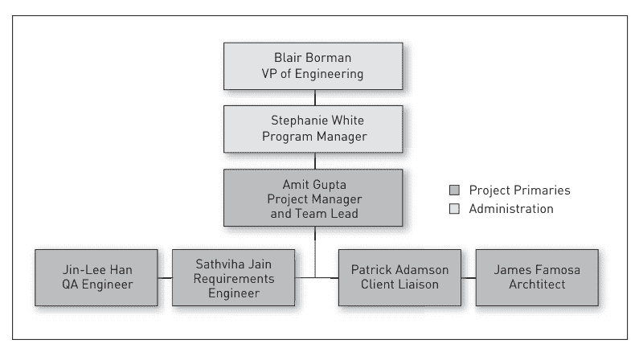

*图 9–2：Gigaplex 项目团队*

Patrick Adamson 是团队中最年轻的人，大部分时候很安静害羞，但每当有人问他时，脸上总是带着永恒的微笑。Adamson 曾在摩托罗拉工作，负责电话协议栈，并且至少在某种程度上熟悉 Julian 提出的部分问题。James Fonseca 是团队的另一成员，是古巴人，大约九年前移民到美国，并在迈阿密的一家软件公司工作了五到六年。他在团队中担任软件架构师的角色。如果严格从工作年限的角度来看，他也是团队中最经验丰富的工程师。团队中的另外两人是 Saththiva Jain，另一位印度人，她带来了在塔塔咨询服务公司（TCS）工作的六年经验；以及 Jin-Lee Han，一位韩国人，他来到美国是为了追随在华盛顿大学攻读海洋生物学博士学位的妻子。

## Gigaplex Systems

Gigaplex 成立于 1998 年，是内容聚合、内容索引和搜索优化的行业领导者。该公司在全球范围内雇佣了近 4000 名工程师和业务专业人员（营销、销售和客户支持），大部分员工位于硅谷。公司不断寻找更多方式让用户能够随时随地获取内容，字面上指尖可及。公司传统通过吸引用户访问其搜索页面来盈利，创造了一个观众群体，Gigaplex 可以通过在其网页上投放广告产生收入。其他收入来源包括服务订阅，包括访问其复杂的搜索算法、针对小企业的搜索优化以及内容组织或索引。

公司的文化具有很强的技术性，人员直接从卡内基·梅隆大学、麻省理工学院和伯克利等顶尖计算机科学专业招聘。尽管员工规模庞大，公司并没有维护或执行与软件开发过程相关的严格规则制度。项目可以自由地在需求收集、生命周期选择、计划和跟踪甚至客户管理方面进行其内部业务。

公司内部运作方式的一个有趣方面是强调项目要具有机密性，公司不同部门的人通常不知道其他在做什么，即使是隔壁工位的人也不知道。这种神秘的、守口如瓶的氛围是人们加入 Gigaplex 的原因之一，但由于沟通、协调和透明变成了开销，使得日常运营变得稍微复杂。

# 案例研究：Gigaplex Systems 的 TCP 增强

## 把握项目进展

Gigaplex 使用一个名为 `NetCom5` 的开源库，该库支持在多种网络配置（包括防火墙和网络地址转换 NAT）下的点对点通信。为了能够穿透防火墙，`NetCom5` 使用了一种基于数据报协议（`UDP`）的协议，该协议在 `UDP` 消息的数据段嵌入了类似于 `TCP` 的可靠性机制。这种协议被称为“伪 TCP（Pseudo TCP）”，它速度比 `TCP` 快，但并不可靠。该项目的目标之一是创建一个同样基于 `UDP` 的改进版本，理想情况下在文件传输方面要比 `TCP` 快。团队决定将这种新协议命名为 `RUDP`，`RUDP` 并不会取代伪 TCP，而是将作为另一个选项存在于 `NetCom5` 中。

项目的关键组成部分是测试新协议的可靠性和性能。为了实现这一点，团队需要构建一个测试套件，能够使用模拟不同网络条件的参数自动执行测试用例。测试套件的主要目标之一是根据 `RUDP` 协议的正确性（协议符合预期，例如传输文件）和可靠性（协议在恶劣网络条件下也能正常工作）对其进行评估。此外，测试套件还要通过与伪 TCP 和 `TCP`（在适用情况下）进行基准测试来衡量 `RUDP` 协议的性能。客户的目标非常简单：允许所有使用 `NetCom5` 的 Gigaplex 应用程序通过新协议的实现来传输文件，从而提高组织内部 Gigaplex 文件传输的带宽和效率。

随着项目的展开，Gupta 为团队需要的工作设定了明确的参数：开发一个测试套件进行彻底测试；并将其集成到现有的 `NetCom5` 库中。由于 `NetCom5` 库是用 `C++` 实现的，因此 `RUDP` 协议必须使用相同的语言来实现。为了确保团队能够实现所有这些目标，他与 Julian（客户）以及 Patrick Adam（团队中的“社交达人”兼指定的客户联系人）坐在一起，定义了他们之间的职责。具体而言，这些职责如下：

## 团队职责

- 实现 `RUDP`。
- 测试 `RUDP` 的可靠性和性能。
- 将 `RUDP` 合并到 `NetCom5`。
- 每两周向客户通报项目状态。

## 客户职责

- 让团队知晓任何相关的项目问题及其对项目的影响。
- 对团队提出的会议或适应性信息请求做出响应。
- 愿意根据对开发工作的影响程度，与团队就项目需求的变更进行谈判。

## 项目发现


为了有效利用资源，`Gupta` 将他的团队分成了两个主要任务小组：第一组包括 `Patrick Adams` 和 `James Famosa`，第二组包括 `Sathviha Jain` 和 `Lee Han`。他指派 `Adamson` 和 `Famos` 调查现有的工作协议，包括 `TCP` 及其某些变体（`TCP Reno`、`Vegas`、`TCP Taho`）、伪 `TCP`、`UDP` 以及所需的 `UDP`。`Gupta` 想要理解它们在可靠性、性能以及对现有网络条件适应性方面的差异和相似之处，这些因素影响了实现的设计选择。深入掌握协议所采用的各种机制（从丢包检测到可调整的任务速率）是调查的一部分。随后，他要求团队的另一部分成员对项目的测试及相应的测试套件获得更清晰的见解。尽管他的团队成员中（`Adamson` 外）没有人拥有网络协议的先验经验，但 `Famos` 和 `Adamson` 似乎花了一些时间钻研涉及可靠性和性能问题的机制。他们比较了这些协议，甚至去见了西雅图华盛顿大学的工程教授 `Steven Row`，教授的研究领域是网络协议。`Famos` 回忆道：

> 我们在过去的几周里对 `TCP` 的理解取得了长的进展，我们现在正尝试理解 `FAST TCP`，这基本上是 `Julian` 想要的。我想，我们的目标应该是理解 `Julian` 想要的协议。其他部分很简单。`TCP` 设计得非常精细，这是它如此成功的原因之一。创建像 `TCP` 一样可靠且具有适应性的协议并不是一项易事，这可能是加州理工学院和其他顶尖学校的某些博士论文的主题。这个课题对我来说非常迷人，因为它涉及到改进互联网的基础。其中涉及一些数学和创造力，这使其更具挑战性。

当团队成员花时间彻底理解问题及其解决办法时，他们与客户 `Julian` 的互动并不如预期，因为 `Julian` 看到实际交付物方面没有太大进展，已经变得有些不耐烦了。`Sathviha` 回忆道：

## 案例研究：GIGAPLEX SYSTEMS 的 TCP 增强 283

`Julian` 对我们变得不耐烦了。他一直告诉我们，我们的进度应该比现在快，而且编写一个简单的可靠 `UDP` 协议对他来说闭着眼睛都能做。事实上，他似乎是在测试我们，由于某种我们无法捉摸的原因，没有给我们提供全景。

团队成员尝试通过两种机制从与 `Julian` 的互动中获得最大收益。第一是将对话引导至他们需要答案的特定问题，这些问题在会议之前已通过书面形式沟通。第二是回答关于伪 `TCP` 的问题并将其集成到库中。

团队成员在内部处理各种问题以及如何一致向前方面陷入了挣扎。团队并没有形成凝聚力，团队中不同的性格使得决策变得困难。团队所使用的流程迭代特性（`Scrum`）需要信任和敏捷性，而团队在那个时候并不具备这些特质。为了进一步完成工作，在接近圣诞假期期间，发生了一个特定的事件，让团队成员对客户的处理方式感到不舒服。`Gupta` 回忆道：

那是周五的下午，我们正在进行例行的客户会议。`Julian` 迟到了（如往常），当我们正在讨论议程上的项目时，他推门走了。`Julian` 看起来很恼躁，声称我们正在浪费他的时间问他已经回答过的问题。我们知道 `Julian` 作为非母语者带有浓重的台湾口音，很难理解。我们一直存在的问题是他的回答非常模糊，没有为我们提供开发解决方案所需的细节。他从不用可衡量的标准告诉我们他的意思，因此我们知道要让他我们承诺交付物将非常困难。

团队成员离开会议时感到有些心立不安。他们不确定发生了什么，但显然出了一些问题。`Julian` 真的对这个项目感兴趣吗？他只是在测试能做什么吗？如果他已经实现了该协议，为什么不将其整合到 `NetCom5` 中完事之呢？

## 第9章 管理利益相关者的预期

## 做出决策

在接下来的几周里，`Gupta` 指导他的团队调查更可靠的 `UDP` 是否真的像专家所说的那样困难。他们一直尝试获取 `Julian` 的代码，他声称这些代码可以解决这个难题，但没有产生任何积极结果。`Julian` 愿意与团队分享他建议遵循的协议设计。团队尝试在他们自己的网络协议实现中效仿他的设计，并将其命名为 `JUDP`，其中 `J` 代表 `Julian`。团队团队感到很困扰，是因为该项目的一些基本业务驱动力在根据他们已经运行的实验和收集的数据来看，这些驱动力已经不再合乎逻辑了。

在审查 `Julian` 的设计时，团队发现该设计正试图改进“伪 `TCP`”（`Pseudo TCP`）算法，该算法存在网络延迟，通常是因为接收到了乱序包。`Julian` 希望通过该算法从更根本的上解决这个问题。他的方法是使用一种基于包的协议，利用确认类型和一种基于往返时时间（`RTT`）的窗口大小调整的新属性。团队无法确定这有助于解决哪些具体场景，`Julian` 回答了这个问题。假设 `Brian Sparrow` 已经实现并集成到 `Net5` 的现有 `TCP` 算法存在问题，团队认为可能存在另一个已经针对该场景进行定制的现有 `TCP` 实现，就像用于高千兆比特网络的 `FAST TCP` 一样。

团队苦苦于理解 `Gigapixel` 想要将一个新协议集成到 `NetCom5` 中的业务驱动力是什么。这仅仅是为了文件传输吗？预期的收益是什么？似乎回答这个问题无疑有助于团队成员更好地专注于他们的工作，但又一次，这是另一个死胡同。

`Gupta` 与 `White` 分享了关于项目进展的看法。他制作了一张团队每周都会使用的跟踪表，用以记录团队相关的参数（见图 9-3）。

`Gupta` 解释道：

> “`Stephanie`，我们每周都会使用这张图表来记录对团队凝聚力、生产力、流程以及内外部通信至关重要的参数。如你所见，除了流程成熟度外，其他方面进展并不顺利。这已经开始影响团队了，我不确定该怎么办。我希望你能进一步研究一下，并看看如何让项目重回正轨。”

由于她与 `Borman` 的会议在半小时后就要，`White` 没有时间分析数据，这引起了她的兴趣。她特别对团队用于量化所跟踪团队方面的具体指标感兴趣。她告诉 `Gupta`，他们可以在周末后进一步探讨这一点，她需要一些时间来思考并提出主意。

## 案例研究：GIGAPLEX SYSTEMS 的 TCP 增强 285

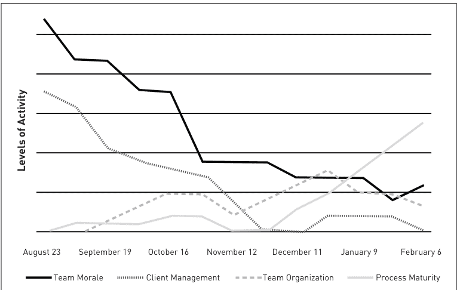

图 9–3：用于跟踪项目的团队参数

### 案例问题

`Stephanie White` 是 `CyCorp` 的项目经理，她有一个软件团队，该团队不确定下一步该做什么来满足 `Gigaplex` 客户的要求。团队成员在满足 `Julian` 的方面感到非常沮丧。随着项目的进行，团队对自身士气、管理客户能力以及组织能力的认知正在下降。团队成员纳闷，为什么他们被要求实现一个据称客户已经实现的协议，他们现在对项目的初衷目标产生了怀疑。

`Stephanie` 必须决定向她的老板、工程部副总裁 `Blair Borman` 汇报团队的情况。她认为自己可能需要解释这种情况的根本原因，并对团队应该如何后续进行提供建议。她还没有时间反思项目经理 `Amit Gupta` 最近告诉她的关于团队与客户之间的问题，以及团队对当前状态的认知。

在即将举行的会议上，她应该对老板说什么呢？

### 案例分析

### 分析活动

### 分析背景

(P) 问题：`Stephanie` 面临的紧迫问题是决定向她的老板汇报 `Gigap` 项目团队的情况。`Stephanie` 还认为，她应该确定团队当前问题的根本原因，并就团队应该如何后续进行提供一份建议。

(E) 经验：`Stephanie` 是一位卓有成就的项目经理。项目经理通常管理一组项目，这些项目的目标对业务和程序级目标做出贡献。

(A) 假设：

`Stephanie` 的假设如下：

- `Gigap` 项目团队与客户之间出现问题有一个根本原因，尽管 `Stephanie` 尚未确定这个原因。

- 在下一次会议上，她的老板会期望她提供一个关于团队应该如何处理其问题的建议。

- `Gigap` 项目团队成员之间技能、知识、经验、性格和文化风格的多样性将使他们能够成功执行项目。（她含蓄地假设这种多样性不会阻碍团队良好合作。）

团队的假设：

- 实现一个能够满足要求的通信协议问题有解决方案。

- 客户会允许团队在确定最佳解决方案方面具有灵活性。

(K) 知识：以下是 `Stephanie` 对 `CyCorp` 环境和团队，以及客户 `Julian` 及其所在公司 `Gigaplex` 环境的了解概要。（你可以假设 `Gupta` 已在案例研究中提供了 `Stephanie` 这些信息）。

- 环境/事实：`Gigap` 项目对 `CyCorp` 的高层管理非常重要，因为该项目有机会提升公司声誉、与行业领导者 `Gigaplex` 开展业务并发展公司。

- 环境/事实：项目经理 `Amit Gupta` 过去与客户合作过，具有领导团队的经验。

- 环境/事实：`CyCorp` 团队成员在背景上具有多样性。

- 环境/事实：`Gigaplex` 的公司文化保留了技术创新，但也导致了保密和信息隐藏。`Gigaplex` 的工程师非常聪明、受过良好教育且高技能。

- 环境/事实：团队发现与 `Julian` 工作很难。

- 环境/事实：团队很难听懂 `Julian` 的。`Julian` 的母语不是英语，口音很重。

- 环境/事实：`Julian` 拒绝回答团队的问题，并打击了团队的士气。

- 环境/事实：`Julian` 促使团队直接通过代码来确定解决方案。

- 环境/事实：在项目开始时，`Julian` 表示他不会强迫团队遵循他的想法，但欢迎对解决方案进行探索。

## 案例研究：GIGAPLEX SYSTEMS 的 TCP 增强 285

- 事实：团队成员的工作效率不高。他们在做决策方面存在问题。

- 事实：`Gigap` 团队认为项目的目标是实现一种能够尽可能地在互联网上传输文件的协议。该实现将基于对现有协议（如 `UDP`）的修改。

- 事实：在与客户的会议上，`Gupta` 明确划分了团队和客户的职责。客户知晓这些职责并没有异议。

- 事实：寻找问题的解决方案证明非常困难。

假设风险：目前尚无假设风险，因为 `Stephanie` 尚未针对她的眼前问题或持续的团队状况考虑替代方案或决策。

### 分析问题

1. 在读完案例研究和分析背景信息后，你认为 `Gigapixel` 项目团队必须解决的主要问题是什么？团队还需要解决哪些其他问题？

   对于第 2-6 题，请专门考虑与管理 `Gigapixel` 的 `Julian` 预期相关的问题。

2. 团队在与客户合作以及满足其预期方面正面临哪些具体问题？

3. 描述你认为团队在处理客户关系时遇到问题的深层原因。

4. 客户的哪些特征导致了客户管理问题？这些特征是如何影响团队与客户之间的交互的？

5. 团队的哪些特征导致了客户管理问题？这些特征是如何影响团队与客户之间的交互的？

6. 对于团队如何更好地管理客户的预期，你有哪些替代方案？这些方案存在哪些风险（如果有）？

7. 对于团队如何解决内部问题以便团队成员能够更有效地合作，你有哪些建议？这些建议存在哪些风险（如果有）？

8. 对于 `Stephanie` 在下一次会议上向其老板汇报 `Gigapixel` 项目的情况，她有哪些替代方法？每种方法存在哪些风险？

### 讨论

`Gigapixel` 项目团队在管理客户 `Julian` 的预期方面存在问题。更准确地说，`Julian` 表达了他的不满，认为团队在实施解决方案方面的进展不够。客户表示，他认为该解决方案是简单的，他之所以知道是因为他已经实现了它。团队不知道下一步该做什么来找到解决方案或满足 `Julian`。如果 `Julian` 已经对问题实施了解决方案，团队对项目的目的产生了疑问。此外，团队在合作方面存在问题且士气低落，这个主题留给你们进行分析。

正如章节背景所述，管理利益相关者的预期涉及设定、监控和影响利益相关者的预期。此外，如果利益相关者的感知低于他们的预期，他们可能不会满意。`Julian` 可能不满意，是因为他对项目团队所做工作的感知在某些方面低于他预期项目团队要做的事。你可以尝试开始理解 `Julian` 的预期在项目过程中可能发生了变化。你可能会发现，项目团队在项目初期设定 `Julian` 的预期，以及在项目进展期间监控和影响这些预期方面本可以更有效。

正如 `Gupta` 在团队职责概述中所述，目标是实施并集成一种基于现有协议的可靠通信协议。在项目开始时，团队认为自己在确定解决方案方面具有灵活性。`Julian` 在说时表达了类似的预期，表示他不会把自己的关于解决方案的观点强加给团队。客户和团队都有相似的预期，即团队将探索并开发自己的解决方案。

那么，发生了什么？为什么 `Julian` 会推行他自己的设计作为解决方案，而且既然他已经实施了解决方案，为什么他还要这样做？当团队没有更快得出解决方案时，`Julian` 表现得非常不耐烦。`Julian` 对团队确定解决方案的过程以及找到解决方案的速度似乎有很高的预期。我们并不知道 `Julian` 在项目开始时是否就有这些预期。

当 `Julian` 看到团队挣扎于寻找解决方案时，关于团队应该如何变化的预期可能发生了变化。他可能在项目初期欢迎对替代方案的探索，但当探索没有迅速产生实现时就变得不愉快。`Julian` 可能正在推行他设计的实现，因为团队还没有找到另一个满足要求的方案。他可能认为，通过告诉团队他已经实施了解决方案，团队会工作得努力。另一方面，`Julian` 可能想将团队对他设计的实现与他自己的实现（如果存在的话）进行比较，并出于不披露的说明理由，不允许团队使用他的实现来进行这种比较。

团队如何才能以更好的方式管理 `Julian` 的预期？从项目初期的一个问题就是假设（而非事实）可以找到并实施一个满意的解决方案。如果未能及时找到解决方案，`Julian` 就会产生风险。团队可以通过与客户合作，明确并同意团队确定是否存在可行解决方案的流程来缓解这一点。同样，团队和客户需要对确定解决方案的可行性所需的衡量标准达成共识。对于这个略有不同的项目，主要目标应该是确定解决方案的可行性，而不是实施和集成解决方案，后者可以是原项目的补充。

团队现在应该什么什么？一种符合团队汇报职责的方法是，让团队清晰、客观且无情绪地向 `Julian` 解释团队做了什么、结果显示什么以及团队建议下一步是什么。例如，团队可能建议帮助 `Julian` 定义并优先考虑通信场景，以确定他们的实现是否满足了这些特定要求，并可能将他们的实现与 `Julian` 创建的实现进行比较。目标是确定当前的实现是否可以接受（可能需要一些修改）。或者，团队可能建议在缺乏更有结论性的标准的情况下对当前实现进行进一步测试，最好以当前结果结束项目。同样，团队可以尝试管理 `Julian` 对已完成工作的感知。团队确实实施并测试了一个基于 `Julian` 设计的 `RUDP` 实现，`Julian` 最终也说了团队应该这样做。团队可以解释该实现如何满足 `Julian` 的设计。团队可以讨论他们对当前实现优缺的了解，并询问 `Julian` 想对这些信息做什么。在这一点上，团队可能会提供之前讨论过的建议之一。

很显然，团队需要与 `Julian` 开放地沟通他们的顾虑。团队可以解释他们如何履行职责，并要求 `Julian` 提供所需信息以履行他对项目的责任，并愿意根据完成这些所需的时间和精力对项目需求进行谈判。团队对 `Julian` 的项目预期不确定，存在 `Julian` 无法接受团队建议的风险，但团队通过解释其所完成的工作不会增加这种风险。如果 `Julian` 不愿意听取团队的顾虑，并且不合理地确定项目进展的方向，那么团队可能无法无法影响 `Julian` 的感知或预期。在这种情况下，关闭项目可能是最佳解决方案，无论对 `Julian` 对 `CyCorp` 的看法有何影响。

由于 `Stephanie` 并不完全理解团队的问题，她所能做的是向其老板汇报她对团队情况的了解，并建议她对该情况进行更详细的调查并在近期汇报。考虑到 `Gigapixel` 项目的公司重要性，`Stephanie` 还可能征求老板的意见，询问他希望她如何进行。第一种方法引入的风险很小，因为 `Stephanie` 需要更多时间来调查

# 案例研究：GIGAPLEX SYSTEMS 的 TCP 增强 291

问题在于，向老板寻求建议可能是一把双刃剑。`斯特芬尼`（`Stephanie`）在传达她对客户重要性的理解的同时，也可能无意中让老板怀疑她是否有足够的经验和信心来管理一个必须应对棘手客户的团队。`斯特芬尼`可以通过先简短且自信地解释她计划进一步了解团队的哪些情况，来影响老板的看法。她可以说，由于该客户非常重要，她想知道老板对于她如何处理这种局面是否有任何特定的指示。

### 结论

在这一案例研究中，随着项目的进行，客户的期望发生了变化，因为客户没有像他预期的那样快速地看到软件实施的证据。客户期望的改变涉及客户期望产品团队确定可行解决方案的过程。当客户坚持要求团队通过构建他自己设计的实现方案来解决问题时，团队意识到了客户对这一过程的期望。这发生在团队花费了大量时间研究通信协议，以确定其在解决方案中的潜在用途之后。后来当团队在开发能够满足性能和可靠性要求的实现方案遇到问题时，客户说他已经根据自己的设计实现了一个简单的解决方案。团队质疑了客户项目的目的。

从这些事实中，你可以得出结论：团队在管理客户期望方面无效。在项目开始时，团队没有解决与“基于修改 `UDP` 协议来实现满意的软件是可行的”这一假设相关的风险。团队没有与客户讨论过这一风险，从而错过了为客户设定期望的机会，即如果计划的解决方案被证明不可行，项目应该如何进行。团队也没有为客户对于探索替代解决方案的过程设定期望，也没有就就研究现有通信协议以确定其在解决方案中潜在用途的重要性设定期望。

客户没有履行及时提供所要求信息以及告知团队项目相关问题的责任。客户与团队之间的沟通并不透明、清晰。随着项目的进行，客户与团队之间的信任减少了。团队质疑客户项目的动机。客户对团队成就的认知可能与现实不符。团队仍有机会纠正客户的认知，并影响客户对项目价值的期望和满意度。团队需要以客观、非情感化的方式向客户解释事实，并提供选项，要求客户透明地说明他最初想通过该项目实现什么，以及他现在想做什么。持续的沟通状况可能会决定这个项目的成败。

# 需要记忆的关键点

- 利益相关者的期望涉及过程，也涉及产品。

- 沟通、透明度和信任是管理利益相关者期望的关键。

- 利益相关者的期望会随着项目的进展而改变。

- 认知管理是管理利益相关者期望的一部分。

### 案例研究

# 亨克尔实验室（Henkel Labs）的艰难销售

### 指示

在阅读本案例研究时，请关注在组织内部不同层次管理利益相关者期望的需求，例如与同事、管理层或下属之间。尝试识别有助于或损害个人积极管理利益相关者期望能力的活动。

### 案例摘要

### 描述


亚当·斯坦因（Adam Stein）是亨克尔实验室（Henkel & Schott Subsidiary）的经理，他正试图与公司内部各种多地项目的项目管理办公室进行创意协作。为了给所有参与者创造更多收入，亚当在竞标项目中看到了机会，即公司的一部分协助开发，而其他部分协助物流、客户或账户管理等。遗憾的是，获得涉及各种利益相关者的认可似乎比应该的要困难。

## 案例研究目标

阅读完案例研究后，你将能够做到以下几点：

- 理解在尝试管理利益相关者期望时面临的挑战
- 理解不明确管理利益相关者期望的后果
- 识别对项目成功产生积极影响的活动

## 涵盖主题

利益相关者期望管理、决策、开发、项目管理、谈判

## 背景

本案例发生在美国、德国、俄罗斯、韩国和阿根廷。该公司是一家全球性的软件开发公司，项目周期小于一年。

## 术语

PMO：项目管理办公室

## 案例

### 场景

亚当·斯坦因已经写了六份不同的邮件草稿，正准备发给他的老板。由于客户非常重要，他想知道老板对于他如何处理这种局面是否有任何特定的指示。斯特芬尼可以通过先简短且自信地解释她计划进一步了解团队的哪些情况，来影响老板的看法。斯特芬尼在传达她对客户重要性的理解的同时，也可能无意中……遗憾的是，获得涉及各种利益相关者的认可似乎比应该的要困难。

### 背景

亨克尔实验室（HL）是亨克尔与肖特（H&S）的子公司，规模相对较小（约75名员工），总部位于德国慕尼黑，在阿根廷布诺斯艾利斯、俄罗斯莫斯科、韩国首尔和美国加利福尼亚圣何塞设有办事处。H&S是一家规模庞大的软件开发公司（超过3000名工程师）。除了监督亨克尔活跃的垂直市场的嵌入式系统开发项目外，亚当还负责通过挖掘市场为部门引入符合亨克尔目标的业务。亚当的老板约希姆·鲁多夫（Joachim Ruddoff）是一个需要时乐意提供帮助的人，并将日常决策留给亚当。

## 引言

九个月前，当亚当出差访问内华达州里诺的客户时，他收到一个他从未做过的有趣请求。虽然亨克尔实验室以开发定制嵌入式系统而闻名，但母部门亨克尔与肖特（H&S）参与其他类型的软件开发，有些与此完全不同。这个特定的请求是将一个大型财务系统从Oracle转换为开源PostgreSQL数据库，涉及到他不熟悉的系统。在完全调查H&S的能力之前，由于不想拒绝这个项目，他告诉客户他将就H&S的能力给予回复。

回到办公室后，亚当想，一方面，他和他的员工主要征集嵌入式软件项目，尽管在很多时候这很难解决；另一方面，通过与母公司合作，获取其他类型业务有重大机会。亚当从经验来看，不知道HL是否能与H&S成功合作。在采取行动之前，亚当决定与亨克尔与肖特总部的项目管理办公室（PMO）联系。

## 案例研究：汉高信实验室（HENKEL LABS）的艰难推销

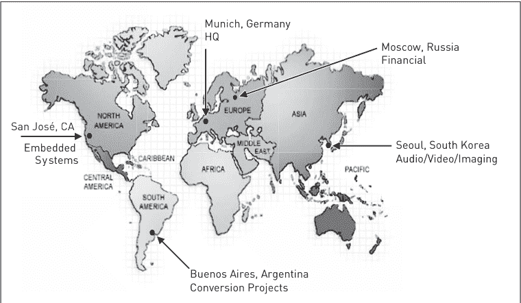

**图 9–4：** 汉高与施华特（H&S）全球部署及专业领域

在接下来的几周里，亚当与希尔德和他的同事尼古拉斯·斯特拉蒂（Nicolas Stratti）会面。后者是一个来自米林的年轻人，非常健谈且友好，拥有一双深邃的蓝色眼睛。希尔德和尼古拉斯认真倾听了亚当的建议，并对此感兴趣，但他们希望最初进展得缓慢，以确保他们没有将资源投入到无法实现的事情上。希尔德回忆道：

“亚当关于那篇论文的合作建议似乎是不言而喻的。它看起来很有逻辑，而且符合财务效益。让我们的办公室合作某些项目，部分工作在海外完成，而客户接触、账户管理和活动监督则在本地完成，这符合当今快节奏环境的操作方式。尽管如此，我想确保在我们进一步之前，我们项目管理办公室（PMO）的任何其他项目经理都能认同这个想法。”

尼古拉斯与亚当合作，在公司之间创建了一份谅解备忘录，该备忘录从资源、责任和财务安排方面解释了该项目，并可以分发给可能感兴趣参与的各个H&S办公室。希尔德要求亚当与她在莫斯科、首尔和布宜诺斯艾利斯的项目经理会面，以便从当前任务执行/资源分配的角度对该项目的可行性达成共识。

局势的转变为亚当感到非常鼓舞。备忘录的起草进展比亚当想的要好。希尔德和尼古拉斯都帮助亚当准备了一份文件，为富有成效的合作奠定了基础。回到位于旧金山南方的圣何塞的办公室后，亚当向他的老板约阿基姆·鲁道夫（Joachim Rudolph）汇报了进展。尽管约阿基姆表面上表现得乐观且鼓励，但他对这次合作持保留意见。约阿基姆想：

“如果我们能谈成的话，那就太好了。我对不同业务部门的了解让我非常怀疑会有任何决定被做出，至少在短期内。跨国家的协作决策不是一项容易的任务，有时事情可能会被滞留几个月。至于亚当，他确实精力充沛，学习速度很快。他最大的缺点是由于他天性乐观，他通常会向客户和管理层做出承诺。他是否能兑现承诺现在说还为时过早，但我认为我有责任在‘少承诺、多交付（under promise and deliver）’方面为他提供一些指导。”

亚当安排了一系列会议，与希尔德要求他访问的各地的各种项目经理会面，尽可能面对面交流。如果对希尔德来说遵循这一流程很重要，那么他将坚持这样做，并向她以及所有参与者证明，公司内部的协作工作不仅可能的，而且实际上是有效的。他请求尼古拉斯的支持，向这些经理解释他们正在做什么，以免看起来像是在干涉别人的事务。

### 会议，会议，会议……

亚当坐下来起草邮件给亚历山大·尼基斯基（Alexander Nikiski）和韩秀英（Soo-Young Han），请求会面。在点击发送按钮之前，他检查了几次，处处调整了措辞。他从一次痛苦的意外中学会了这样做的重要性——当时一个愤怒的客户收到了一封他不该看到的邮件。他的邮件内容如下：

“亚历山大/秀英：

我写这封信是应希尔德·范登伯格（Hilde Vandenberg）的要求。

汉高信实验室在加利福尼亚州圣何塞设有办事处，有意与汉高与施华特内部的集团建立正式关系，使公司能够代表和销售各种专业技术，并在时间允许的情况下动用全球各地H&S办公室的项目资源来满足市场需求/需求。

作为我与母公司汉高与施华特讨论的一部分，希尔德希望作为你们的高级项目管理官员，在签署伞形协议之前，对这一提议获得你们的反馈。”

“我希望利用我们的视频会议系统进一步讨论此事（除非你计划因为其他公司事务前往美国，如果是那样，面对面会更好）。我知道你们一定很忙，但如果你能抽出15到20分钟，我将不胜感激。

亚当·斯坦因，汉高信实验室

系统开发部主管”

随着一天一天过去，在亚当等待会议期间，他指示两个项目经理保持留心，看看HL（汉高信）现有客户是否对母公司H&S竞标的其他项目感兴趣。亚当知道，与希尔德的经理会面并达成共识需要一些时间。他只是不想等待，并希望在他们安排好一切时，他们已经征集了一些可以对所有人有利的新项目。

在大约一个月左右，亚当成功安排了来自莫斯科的亚历山大·尼基斯基（俄罗斯项目管理办公室主管）和来自首尔的韩秀英（韩国项目管理办公室主管）的会议，两人当时都在前往美国访问一位客户。他们似乎在倾听并探索合作机会。对于他们中的每一个人，亚当都讨论了业务提案、高级目标以及协作将如何运作。亚当提到他在推销业务期间将承担任何费用。他们似乎对理解支持协作的财务模型非常感兴趣。他与尼古拉斯在一个月前在慕尼黑开发的模型涉及H&S的标准拆分，无论哪个部门。当他们不被排除在外时，他们看起来轻松。

### 路易易斯·马丁斯

路易易斯·马丁斯（阿根廷项目办公室主管）与他的同事们有些不同。亚当过去与他合作过几次，非常尊重他的严谨和完美主义特质。在亚当看来，这些特质的缺点是马丁斯的固执、缺乏快速决策的能力以及不想承担任何风险。

意识到与马丁斯的谈判将不同，亚当决定需要采取不同的方法。于是，亚当整合了一封邮件，他认为这封邮件可以解释他的情况，并提供一个路易斯无法拒绝的机会。亚当的邮件如下：

“亲爱的路易易斯：

两个月前，我和希尔德、尼古拉斯坐在一起，确定了我们认为的汉高信-汉高与施华特谅解备忘录的条款（当这对双方都有意义时）。希尔德要求我与其他H&S项目管理办公室面谈，获取他们对我们提供的服务的看法。我一直与他们面对面进行此事。

我想就我们正在考虑的一个近期机会获得你的反馈。在汉高信近期与其拉丁美客户（墨西哥、巴拿马和哥伦比亚）的讨论中，客户对转换项目表示了兴趣。汉高信在这些项目上没有专业知识。

想法是将我们的转换项目的专业知识与客户管理经验相结合进行协作。我们在指定的国家开展联合项目。当HL-H&S协议签署后，合作这些特定项目是你可能考虑的吗？

亚当”

几天后，亚当收到一份发给马丁斯的邮件副本。邮件内容如下：

发件人：尼古拉斯·斯特拉蒂

发送时间：20--年2月9日 星期三 12:26

收件人：Luis Martinez

抄送：希尔德·范登伯格；亚当·斯坦因；约阿基姆·鲁道夫

主题：回复：汉高信-汉高与施华特项目协议

“路易易斯：

由于任何协议都是H&S和HL之间的协议，由于我们需要所有可能参与的项目管理办公室的投入，希尔德和我认为让亚当与其他办公室接触以评估兴趣和经济效益是明智的。在了解范围以及我们各个办公室可能参与的不同程度之前，我们无法制定协议，而且这不是一个仅限阿根廷的交易，我们需要更广泛小组的投入。亚当此时与其他子公司的讨论本应呈现为仅用于信息收集。

至于南美地区，我认为Adam有些操之过急（只是有一点点），但我理解他以及HL需要识别潜在项目的必要性。

一旦我们有了（在H&S层面）我们认为可能可行的方案，计划是将其提交给高级项目管理办公室（PMO），然后提交给整个组织。

尽管如此，我怀疑我们正在制定一个‘草案（straw-man）’供我们讨论（对吧，Adam/Joachim？），我没什么理由认为对草案意向书的初步讨论不能由你和Hilde进行。

我应该为我们就这个主题安排一次会议吗？

- -NS”

Martinez似乎对推进工作表现出不愿，Adam无法解释原因。这可能与Martinez的性格或决策风格有关。也可能是因为自尊心的问题，或者是一个涉及资源限制的真实问题。从Adam的角度来看，过程还处于过早阶段，很难判断。尽管如此，Adam询问了Hilde和Nicolas是否想参加会议以消除误会，并对该事贡献想法。

当他们反复安排会议时间时，Adam收到了Martinez的视频会议请求，以讨论相关事项。Adam不想拒绝，于是接受了，但决定带上他最信赖的项目经理之一Raul Juan Ramirez。Raul是墨西哥瓜达拉哈拉的本地人，非常熟悉拉丁美洲客户想要但HL在没有H&S的情况下无法提供的项目类型。Adam认为Raul参加会议将是一项巨大的资产。

Adam会议的首要目标是在会议上提出资源共享的话题。Martinez对这个想法表示了总体兴趣，但他表示在同意或接受任何建议之前，他需要对Adam的具体设想有更明确的内容。Martinez指明，对他而言，项目选择中最重要的两件事是保持服务质量，并确保他的资源不会被浪费在不符合财务逻辑的方式上。Adam承认了这两点，并表示当各种机会出现时，他会将关于Martinez的信息转发给他。

为了让Nicolas和Hilde了解进展，Adam给他们发了一封便条，总结了他与Martinez会面后的印象。Adam的笔记内容如下：

Nicolas,

> 我和Jose Luis就HL/H&S的交易进行了会面。这是一次愉快的对话。我们讨论了我们已经在系统转换项目领域探索的潜在产品。看来他对此非常接受，这就是为什么我直接切入正题。我没有与他讨论具体数字，但让你知道，他认为这段关系具有巨大的价值。

Martinez想知道我们交换了哪些数字，我告诉他去和你谈这些数字。他会和他的团队沟通，听取他们对此的看法。

谢谢帮助，

Adam

作为回复，Adam收到了一封来自Nicolas的意料之外的邮件。邮件内容如下：

Adam,

我真的希望你等到我们已经安排好的会议上再与他讨论这件事。虽然听到他很接受我感到很高兴，但你现在把我置于了与他分享数字的境地，而我并没有根据你正在进行或已经进行过的会议来调整这些数字的机会。你还创造了一个预期，认为我近期会有空与他会面，这很遗憾，因为在未来几周我忙于其他事情。最糟糕的是，由于没有与José Luis分享草案文件，你在HL的立场与H&S/PMO管理层目前的思维之间制造了分歧（至少是感知上的）。

等到我们3月19日的会议在时间上对HL真的不会造成任何损失，但可能会消耗我一些精力并让我心烦。正如圣奥古斯丁所说：“耐心是智慧的伴侣。”

如果我们在这个项目上作为一个团队工作，那么我需要知道你正在和你的团队谈论什么，以及什么时候谈。

（注：此处原文似乎存在重复段，已按要求翻译）

会议是在两周后由Adam和Martinez通过视频参加，其他人在慕尼黑参加的，这是一次成功的会议，至少从某些角度来看。会议结束时，决定由Adam和Nicolas制定一份方案（重新审视已有的草案）并分发给Hilde和Jose Luis。一旦对条款达成共识，他们将起草一份具有法律约束力的协议供参与者签署。

### 我们到这里了吗？

在前往马萨诸塞州剑桥期间，我们在两周后遇到了一位客户，Adam正在完成对比协议的最后润色并发送给Nicolas。Nicolas要求对文件进行一些修改，并特别提到如果Adam能增加一些收入预测，草案将更具吸引力。这种想法并不是要承诺，而是为了理解某些承诺对所有参与者带来的益处。当这些修改完成后，Adam将文件发送给了Nicolas、Hilde和Martinez，希望从他们的审查中获得快速回复。两周过去了还没有收到任何回复，Adam给Nicolas发了一封便条询问情况。他收到了Nicolas的简短邮件：

> Adam, José Luis取消了我们的会议。我们正在重新安排。Hilde在离开小镇之前忙于处理下周的所有公司事务。我已要求她在离开之前尝试给你答复。在我写这封邮件时，她仍在写邮件，所以在她离开之前你可能还会收到她的。

大约一周后，Adam再次询问Nicolas是否有了进展。他收到了另一条信息：

Adam,

> 我们不得不取消会议，因为JL有来自IBM的访客。我们正在重新安排。

Nicolas

Adam对进展如此缓慢感到难以置信，他在Nicolas公司的语音信箱里留了一条信息，看看他们是否可以在没有José Luis的情况下继续进行。Nicolas回复了以下邮件：

Adam，由于Hilde的日程非常忙，还没有审核文档。她也希望获得José Luis的认可。绕过或跳过他可能会带来短期利益，但从长远来看是有害的。我将在本周晚些时候与Hilde会面时讨论这种情况，看看我们是否可以取得进展，并看看她的想法……


Adam 感到非常沮丧。他认为自己所做的都是正确的，按照正确的顺序与正确的人交谈，但似乎仍然毫无进展。在最近与办公室老板的谈话中，Ruddoff 提议通过直接给 Hilde 电话来了解真实情况。Adam 告诉他，他认为一切都在控制之中。但真的如此吗？

### 案例问题

- Adam 是否应该采取任何行动来满足各种利益相关者的期望？
- Adam 是否应该要求高层干预，以推动他的项目进展，从而有利于公司利益？
- Adam 目前在组织间代表方面看到的，是否反映了未来创建合作项目时可能发生的情况？
- Adam 和 Hilde 的下一步应该是什么？

### 案例分析

### 分析活动

分析问题

1. 你认为 Adam 在跨 H&R 建立协作项目的工作中管理利益相关者期望方面实际上遇到了哪些问题？
2. 你认为 Adam 实际上存在哪些问题？
3. 请解释你认为以下利益相关者对合作项目（产品）以及项目基础建设（过程）的期望是什么：Joachim Rudd、Adam Stein、Hilde Vandenberg、Nicolas Stratti 和 José Martinez。
4. 你认为个人风格（如决策或解决问题的方法）以及业务需求和优先级的差异是如何影响利益相关者的期望和感知的？

# 第九章 管理利益相关者期望

5. 使用 PEAK 模型识别并分析 Adam 如何更好地管理利益相关对其项目期望的替代方案/决策。考虑利益相关者的期望、感知和个人风格。
6. 如果你是 Adam，你会决定下一步做什么？请说明你的理由。
7. 如果你是 Hilde，你会决定下一步做什么？请说明你的理由。

# 9.3 总结

本章重点关注了在软件项目决策背景下管理利益相关者期望的活动：

* 与客户利益相关者沟通
* 随着时间推管理多个维度的利益相关者期望
* 管理产品和过程以满足利益相关者的期望
* 理解不同类型的客户
* 管理感知

两个案例研究中的利益相关者所做出的决策使他们处于了不利的地位。在第一个案例“Gigapex Systems 的 TCP 增强”中，软件项目遇到了与客户期望以及与项目利益相关者的内部和外部交互相关的意外问题。第二个案例“赫尔辛基实验室的艰难推销”描绘了一个困难的处境，需要管理跨全球组织的利益相关者期望，这涉及到来自不同文化、居住不同国家的人，他们有时具有对立的组织和业务目标。

系统化地管理软件项目的利益相关者期望具有挑战性。软件项目经理通常很少关注项目决策对利益相关者期望的影响。利益相关者期望管理周期的三个阶段（设定、监控和影响期望）都是重要的。由于许多互动活动是面向人的，因此管理利益相关者期望取决于有效的沟通。

有效的沟通使软件项目经理能够通过管理利益相关者期望来实现项目的成功。

# 第十章

# 管理全球开发

### 10.1 章节目标

在阅读并思考本章介绍的概念和案例研究后，你将能够做到：

- 理解全球软件开发对软件项目管理的影响
- 识别章节案例研究中涉及全球开发管理的关键问题和决策
- 使用章节概念为案例研究利益相关者面临的问题提供可行的解决方案
- 认识管理全球软件开发的重要性

### 10.2 背景

全球软件开发通常是指由一个或多个项目小组协作开发的软件，这些小组成员位于不同的建筑、地理区域、国家或大洲。地理分散的团队成员可能正在开发一个或多个相互作用的软件系统，并可能由一个或多个组织的人组成。

## 第十章 管理全球开发

全球开发可以跨越公司，也可以跨越或文化边界。分布式软件开发以及远程或虚拟软件开发团队的概念也涉及不同地理位置的人对软件的协作开发，但它们没有强调人们在全球范围内被隔离这一事实。在远程办公的情况下，团队成员可能由于在家里工作而分散，但仍位于同一地理区域。

对全球软件开发的需求继续增长，因为公司在全球范围内寻找经济利益，例如低成本或专业劳动力；税收、监管或其他政府政策对其业务有利的地区；更好的市场准入等等。全球开发经常涉及外包，或从公司外部聘请专业人员进行软件开发。外包人员可能独立工作，或属于另一家公司。外包通常涉及分布式软件开发。在决定是否外包软件开发或维护时，决策者必须权衡成本与收益。

例如，首席信息官（CIO）经常决定外包其计算基础设施以降低成本、优化服务、转型新技术或通过最佳利用资源提高运营效率（但节省的成本无法抵消离岸带来的挑战）。CIO 必须考虑与培训、治理、政治、人员流失、地理和时差、所需的技能组以及需要支持的自定义代码相关的问题。将基础设施外包到海外站点需要考虑许多因素 (Overby 2008)。

对于开发或维护软件的组织来说，管理全球开发已成为一个无处不在、不可避免且具有挑战性的问题。特别是全球软件开发使项目管理更具挑战性。全球分散的项目利益相关者的全球、地区和文化差异增加了沟通和协作的难度。增加的复杂性使得书中讨论的项目管理领域变得困难。需要高度沟通和协调的项目活动最具挑战性。当软件利益相关者地理分离且文化不同时，需求获取、软件系统架构以及项目谈判和规划等前端项目活动很难完成。

在计划管理领域的一个具体示例中，让我们考虑全球软件开发背景下的任务分解和任务分配的开发。在制定任务分解时，项目经理需要考虑任务的粒度以及任务的内聚性和耦合性。较小的任务增加了

## 10.2 背景 307

这为在分布式开发地之间并行执行任务提供了机会，但也增加了相关任务之间的耦合。保持在不同地点执行的较小任务的凝聚力整体性，需要充分的沟通与协调，而这两个因素在分布式软件开发中变得更加复杂。关于任务拆分和任务分配的决策，涉及到全球软件开发带来的益处与管理全球分布任务的复杂性之间的权衡。

书中之前讨论的管理领域和活动在全球软件开发项目中是相同的，但额外的因素影响了这些领域内所做出的决策。要理解全球开发带来的复杂性，你可以查看当项目成员在全球范围内分布时的某些决策。对于每个管理领域，项目经理都需要考虑团队的全球化分布如何影响该领域的活动和决策。表 10-1 概述了每个管理领域受全球软件开发影响的一些决策示例。

## 表 10–1：全球软件开发对各管理领域决策的影响

| 管理领域 | 受全球软件开发影响的决策示例 |
|---|---|
| 需求管理 | 针对全球分布的项目利益相关者：<br>* 谁应该参与需求活动？<br>* 他们何时需要沟通，如何进行沟通？<br>* 文化差异如何影响需求谈判，以及应如何管理？ |
| 估算管理 | 全球软件开发环境中的沟通与协作是如何被纳入以下估算的？<br>* 完成任务所需的时间<br>* 与沟通与协作所需的时间/精力相关的成本，以及通信技术的购买和运行相关的成本<br>* 在各开发地之间进行旅行以实现面对面会议所需的预算 |
| 计划管理 | 全球软件开发的项目计划如何促进以下目标的实现？<br>最小化实现项目目标所需的时间：<br>* 什么样的任务拆分有助于协作、确保关键路径并促进跨开发地的并行工作？<br>* 哪些项目任务支持会议规划和参与以促进协作？<br>最小化与开发项目相关的成本：<br>* 哪些任务分配可以在利用人员技能的同时，尽量减少跨地开发成本？<br>* 如何尽可能在跨开发地之间共享开发技术和资源？ |
| 产品管理 | 需要哪些控制来确保在全球开发地满足软件规格要求？<br>* 功能和质量属性需求<br>* 架构或设计中指定的软件接口 |
| 过程管理 | 你将如何管理全球软件开发对以下过程目标的影响？<br>* 软件过程的标准化，以及对跨开发地软件过程差异的控制<br>* 确保过程执行达到目标结果<br>* 员工教育/培训以实现过程和产品的改进 |
| 风险管理 | 关于沟通、协作、协调以及与全球软件开发相关的其他假设引入了哪些与项目决策相关的风险？ |
| 人际交互管理与预期管理 | 项目将如何管理影响全球软件开发环境中沟通与协作的因素，例如：<br>- 日历同步<br>- 文化差异<br>- 无面对面接触的*（距离隔离）<br>- 资源可用性<br>- 技术差异<br>- 时间间隔<br>- 信任 |

* 在本章中，“面对面（in-person）”指的是一个或多个人在同一空间内进行通信，以便他们可以直接看到对方并交谈。这与通过电话会议实时查看不同地理位置的人员图像有所区别。

正如你敏锐注意到的，表 10-1 中的许多决策与全球沟通、协作和协调有关。以下最佳实践可以促进全球软件开发工作的有效沟通与协作：

- 通过对远程同事做出比对本地同事更快速的响应，建立跨地点的信任。
- 在每个站点设立联络人，以促进跨站点沟通实践。
- 建立及时回复电子邮件和语音消息的礼仪。在各站点之间的关系中规划旅行，以便人员会面并计划（Atkins et al. 2001）。

针对使全球软件开发具有挑战性的协调问题，Wagstrom 和 Herbsleb (2006) 提出了一种系统确定哪些开发者需要协调工作、因此需要更多沟通的方法。这些信息可以帮助项目经理针对性并促进对项目成功至关重要的沟通。

此外，除了沟通与协作相关的非技术决策外，项目经理还必须在全球软件开发环境中做出此类技术决策，例如：

- 将使用哪些技术来促进地理隔离的项目成员之间的语音和视频通信（电信）以及协作工作？
- 将使用哪些技术在全球范围内分布的团队之间存储和共享信息？
- 在考虑使用商业软件组件与为软件解决方案开发自定义组件时，在全球范围内开发组件的机会如何影响决策？

全球软件开发经理还需要特别关注跨全球分布地所使用的软件开发和项目管理过程的决策。过程的全球标准化辅以本地化的过程控制，有助于确保分布式开发地的生产力和质量。研究人员分析了根据地理、时间和社会文化差异，增强或阻碍全球软件开发沟通、协调和控制的因素（Ågerfalk and Fitzgerald 2006）。

另外两个研究人员调查了过程控制对全球软件开发项目成功的影响。Lee 等人 (2006) 讨论了对全球软件开发项目经理的调查。他们发现，成功的项目在项目协议中建立了策略，以灵活应对地理和时间分离等挑战。成功的全球软件开发项目在应对和遵循过程方面表现出灵活性。Ramasubbu 等人 (2008) 实证研究了软件过程改进计划对离岸项目生产力和质量的影响。他们发现，对结构化过程的以及相应的基于过程的学习活动有助于提高离岸软件性能。

许多作者写过关于全球软件开发以及全球分布软件开发团队管理的问题。参考 Carmel (1999)、Carmel and Tjia (2005)、Hussey and Hall (2007)、Karolak (1998) 以及 Sangwan 等人 (2006) 获取全球软件开发的通用背景。关于《ACM 通信杂志》中全球软件开发、全球分布项目和组织以及离岸外包的文章，请参考 Gupta (2009)，

# 案例研究：全球化团队：FibreNet 项目 311

Desouza 和 Evaristo (2004)、Lee 等 (2006) 以及 Wagstrom 和 Herbsleb (2006)，以及《ACM 通信快报》(2006) 中的其他相关文章。若要讨论文化、地理或时间差异对组织和项目内部决策的影响，请参阅 Bourault 等 (2008)、Brett (2001)、Espinosa 等 (2007)、Shore (2008) 以及 Wang 和 Liu (2007)。更具体地说，Damian (2007) 讨论了全球需求工程 (GRE) 中的利益相关者需求，并基于工业实证研究为应对与 GRE相关的挑战提供了实用建议。

如前所述，本章并没有介绍新的项目管理活动。相反，它阐述了软件项目涉及全球开发时，之前章节中讨论的项目管理活动和决策将面临额外的挑战以及潜在的机会。它展示了在全球化开发的背景下，沟通、文化、协作和信息存储等因素如何成为考虑范围、时间、质量和成本的项目决策的输入。

### 10.3 案例研究

本章的案例研究重点关注特别影响全球软件开发的项目管理问题。第一个案例研究“全球化团队：FibreNet 项目”强调了当项目团队全球分布时在沟通、协作信任方面方面。第二个案例研究“在 FibOptia 管理全球软件开发”关注了全球软件开发在过程管理、产品质量和成本方面的特有问题。阅读这些案例研究可以让你更好地理解管理全球软件开发的挑战。

```
CASE STUDY
```

# 全球化化团队：FibreNet 项目

### 指南

在阅读本案例研究时，请关注影响管理全球化项目团队所涉及的活动和决策的问题。特别要观察沟通、文化和协作如何使全球软件开发中进度、流程和成本管理的复杂化。

### 案例摘要

### 描述

FibOptia 正在开发一种网络管理系统（FibreNet），旨在为通过光纤网络传输的语音、数据和视频提供服务质量（QoS）功能。FibreNet 软件系统的开发分布在三个软件研发（R&D）中心，公司选择这些中心是因为它们靠近合作大学、能够以竞争性的成本提供所需的软件工程专业知识，或者靠近其产品市场。软件系统部分的开发正在按计划进行。FibOptia 的软件开发高级经理 Mar Delancy 认为，项目地点的开发是在真空状态下进行的，而不是相互同步。在这个案例研究中，他确定了为什么项目站点之间的协作并不良好，并决定了如何改善现状。

### 案例目标

阅读本案例研究后，你将能够做到：

- 理解管理全球开发中的以下问题：
  - 沟通、协作和协调的挑战
  - 全球分布团队中的信息共享和决策制定
- 识别全球开发对涉及范围、时间、质量和成本的项目决策管理的影响。
- 解释案例场景中发生的问题、问题产生、针对问题的某些可行解决方案，以及未来消除问题或减少其影响的方法。并与项目利益相关者所面临的决策联系起来。

### 涵盖主题

分布式项目团队成员之间的沟通、全球软件开发中的文化挑战、全球分布项目团队的跨区域协作，以及全球开发项目的信息共享

### 背景

背景涉及 FibOptia 的三个软件开发中心，该公司是一家为光纤通信构建管理系统、应用程序和服务的公司。这些中心分别位于印度海得拉巴、法国图卢兹和加拿大蒙特利尔。

# 案例研究：全球化团队：FibreNet 项目 313

### 核心概念

- 管理者在为全球开发做决策时，必须考虑沟通、文化、协作和信任等问题。
- 为了实现有效的协作，全球开发团队成员需要理解并遵循开发环境中的最佳实践。
- 通过本地化的项目规划来确保全球分布项目目标的实现。

### 术语

ARCEP：电子通信管理局（Autorité de Régulation des Communications Électriques des Postes），法国电信和邮政服务的监管机构。

FTTH：入户光纤（Fiber to the home），也称为光户光纤。

增量发布：一种通过一系列版本增加功能或特性的发布模型。每个版本的开发通常涉及需求、设计、实现和测试的周期。在这种情况下，增量发布是迭代的。这两个术语通常同用。迭代模型区别在于它强调后续迭代的精炼和增强，而增量模型通常只关注后续迭代的增强。参阅 Larman 和 Basil (2003) 关于迭代和增量软件开发的讨论。

IP：互联网协议。

迭代软件开发：一种循环模型，系统在系列开发周期中演进并精炼、增强。每个周期包括需求、设计、实现和测试等活动。通过限制需求范围，迭代更早地进行用户评估和反馈以成为最终系统。参阅 Larman 和 Basil (2003) 关于迭代和增量软件开发的历史。

开放系统连接（OSI）参考模型：一种关于网络中任意两点如何传输消息的标准描述或参考模型。其目的是引导产品开发，使不同供应商的产品兼容。参考模型定义了在通信每端发生的七层功能。尽管在将相关功能保持在定义良好的层方面并不总是严格遵守 OSI，但大多数电信产品都会尝试根据 OSI 模型来描述自己。作为单一的通信参考视图它非常有价值，为教育和讨论提供了共同基础（Searchnet.com, OSI）。

分组交换：一种网络类型，较小的数据单元（数据包）通过网络路由到每个数据包包含的目标地址。将通信拆分为数据包允许网络中的许多用户共享相同的数据路径。发送者和接收者之间的这种通信被称为无连接（而非定向）。互联网的大部分流量使用分组交换。互联网本质上是一个无连接网络（Searchnet.com, Packet-switched）。

V 模型开发：一种在软件开发过程的每个阶段对软件系统进行验证和确认（V&V）的软件开发方法。遵循 V 模型要实现的两个目标是尽早发现软件系统的缺陷，并评估系统在运行情况下的可用性（图形技术开发助理）。

VoIP：在分组交换 IP 网络上传输语音（美国国家标准与技术研究院 2005）。

### 案例

### 场景

Marc 是一位经验丰富的经理，曾领导多个团队按时且预算内开发并交付软件产品。Marc 领导过虚拟团队，但对全球软件开发尚是新手。他面临着在管理单一站点或同一地理区域团队时没有过的挑战。他认为自己最近一直在处理问题，而不是通过管理来减少项目执行中的问题。

根据经验，Marc 知道利益相关者是开发第一代 FibreNet 管理器最重要的资源。

# 案例研究：全球分布式团队：FibreNet 项目 315

由于该产品将在法国大都市社区推出，直接利益者包括法国电信公司和互联网服务提供商（ISP）、FibOptia 的业务和营销规划人员，以及产品开发团队。最终，法国电信服务的消费者将受益于更高水平的服务质量（QoS）可用，这也是法国电子通信与邮政管理局（ARCEP，法国监管通信和邮政服务的机构）的任务之一。通过监管，ARCEP 旨在确保法国消费者能够获得与其它技术先进国家相当或更优的廉价电信服务，特别是欧盟内部新涌的服务（ARCEP）。

Marc 是几位 FibOptia 经理之一，他们影响了工程副总裁的决定，将开发选址选在具有战略意义但地理分散的地方，以便随着时间的推移大幅减少开发成本和时间。Marc 曾认为，海得拉普的软件工程专业知识与西欧的专业知识相比既强大、多功能且成本低。作为兼职教师，Marc 在当地大学教授软件工程课程，并对来自海得拉普本科学生的才华和敬业精神留下了深刻印象。Marc 解释说，由于分布式站点之间的时差，开发可能全24 小时进行。

采用分布式团队方法的另一个动力是，FibOptia 源核心技术并不位于法国和西欧的目标市场附近。FibOptia 产品的一个关键组件是用于通过光纤带宽划分、分组调度和路由来管理 QoS 的底层硬件。其他知识产权包括在系统互连接（OSI）参考模型中应用层和低层通信层通过软件管理 QoS 的算法。公司目前资助了蒙特利尔学术和研究机构的调查和实验室测试。公司的许多员工在这些机构中的一个或多个机构完成了学业。在目标市场的核心区域，图卢斯中心专注于 QoS 策略的制定（由业务激励和政府法规驱动）、客户研究以及 FibOptia 产品用户界面的开发。


### 曾相识（Déjà-Vu）

Marc 反复从他的项目经理那里听到同样的意见。从 Marc 的角度来看，每个站点似乎都在真空环境中工作。涉及站点间协作的任务落后于进度，而那些可以在本地站点独立完成的任务则按计划进行。

此时晚上 10 点，Marc 关掉了笔记本电脑。他坐在办公室的椅子上向后靠着，思考他在与 Robert Johnson（蒙特利尔）、Henri Baroque（图卢斯）和 Janet Kumar（海得拉普）进行电话会议期间听到的内容。图 10-1 显示了 FibreNet 软件项目的组织图。

| Robert Johnson | Henri Baroque | Janet Kumar |
|---|---|---|
| 软件项目经理 | 软件项目经理 | 软件项目经理 |
| 加拿大蒙特利尔 | 法国图卢斯 | 印度海得拉普 |

**图 10-1：** FibreNet 软件项目管理

Marc 回想起他在飞往美国途中看过的一部幽默但又极具洞察力的电影《土拨日》。电影中，一个不满的气象预报员反复经历某一天。气象预报员决定将从某一次经历中学到的知识应用到下一次中以自己有利。最终，故事中的人物意识到，尽管他试图改善不断重演的情况，但他注定余生都将待在同一个地方，做同样的事情，每天见同样的人。（IMDb.com, Groundhog Day）。

Marc 直直坐了起来，意识到他的项目经理一直在间接地告诉他，三个开发站点之间的全球通信和协作并没有发生。Marc 回想起上周电话会议上三位项目经理之间的对话。他意识到，他们说话的内容和表达方式存在一种反复的模式。由于三位经理和 Marc 使用支持通过桌面网络摄像头进行面对面通信的电话会议软件，尽管不同站点的视频刷新偶尔会有延迟，Marc 仍然记得经理们脸上的表情。

### 在最后一次电话会议上

Henri 笑着说：“好消息。网络管理器用户界面的架构设计正按计划进行。我们对面向用户导的屏幕进行了迭代原型制作，并从客户测试组那里获得了反馈。我们专门包含了监督和提供给消费者测试服务的人员。这些系统管理员非常乐于使用计划的功能监控网络性能，并且他们能够轻松地监控网络（数据包）层和应用层的网络性能。”

> “这是个好消息，”Marc 评论道，“你们小组参与了业务软件层设计的接口开发吗？我理解网络管理器将由三层架构组成，中间层包含 QoS 策略组件。”

## 案例研究：全球分布式团队：FIBRENET 项目 317

图 10-2 显示了网络管理器软件架构。该图仅提供了软件系统每层要执行的功能示例。箭头显示了相互通信的层以及通信的方向。Henri 皱起眉头，强调性地回答道：“海得拉普没有发布任何描述业务层架构的文档，或者至少共享存储库中没有可用文档。”Henri 似乎想多说些，但他犹豫了。

Marc 随后询问 Janet 业务层软件架构的设计进展是否顺利。

Janet 清晰而简洁地解释道：“我们已经确定了业务层架构的基本组件，但在收到需求规范之前，无法完成设计。”


图 10-2：网络管理器架构

### 与项目经理面对面会议

Marc 认为他通过与当地软件经理的电话会议尚未获得“全景”。在规划项目旅行预算时，他决定每三个月去一次海得拉普和蒙特利尔站点。在为期 18 个月的项目中，他将去每个站点六次。项目的前三个月过去了。考虑到软件经理之间的沟通状态，Marc 决定现在是时候与每个站点的项目经理进行面对面且私下的交流了。他希望项目经理们能够坦诚布公。通过在浏览器中打开全球时钟，Marc 迅速看到不同地点的会议时间分别是蒙特利尔早上 8 点、图卢斯下午 2 点，以及海得拉普下午 5 点 30 分。这些时间大致对应工作日的开始和结束，以及参与者午饭后的时间。这可能就是为什么大家看起来无精打采。Marc 想知道这三个地点的时间差是如何影响通信的。

### 在法国咖啡馆

Marc 观察到 Henri 在周五下午显得更加放松和爱聊天。他邀请 Henri 在下午 3 点后在当地的一家咖啡馆见面讨论项目。“你好，Henri。”当他们在咖啡馆见面时，Marc 询问 Henri 今天下午好吗。

“当然好。今天是周五。”Henri 笑着回答道当然，因为是周五。

## 案例研究：全球分布式团队：FibreNet 项目 319

“亨利，在上次会议上，我想你想多谈谈关于图卢斯和海德拉巴项目小组之间的互动。现在我们单独相处了，你能分享一下你的想法吗？”马克探性地看着亨利，轻声问道。

亨利会意地回答道：“当然。你的观察是正确的。我确实话有说，但我不想在会议期间让珍特（Janet）难堪。她在会议上的发言非常周全且谨慎。我认为她很犹豫说出自己的真实想法。”

“我的小组一直尝试与海得拉巴讨论与业务层软件的接口问题。有时，我们在电话会议中用英语交流会遇到困难。我们并不总是能理解对方在说什么，”亨利解释道。

“另一个问题是，海得拉巴的工程师在我们的讨论中并不积极。他们似乎并不习惯于与我们就设计进行实时协作。在提出自己的想法时，他们很谨慎，通常对我们的提议的只是是，说他们需要考虑一下我们说的话。”

亨利继续说道：“我们并不是试图主导讨论，但他们似乎并不运作得很透明。他们试图清楚理解我们提议的细节。我们不知道为什么他们不愿意发布目前的业务层架构设计，尽管我们已经解释过，我们理解设计仍在演变中。我们意识到设计可能需要进一步完善，以确保 QoS（服务质量）需求变得明确。”

马克解释道：“在我们对这些需求做出决定之前，最终设计不会完成，但我们有一份代表性服务类型和服务水平的规范。具体取决于电信公司和互联网服务提供商（ISP）如何共享光纤访问权限。正如你可能在新闻中看到的，ARCEP 决定电信公司必须共享它们安装在家庭中的光纤接入 [FTTH]。当然，关于光纤的个人所有权尚未做出决定，可能会采用像公寓资源那样的公共管理方式（Baritault 2009; T-REGS 2008）。”

他继续问道：“关于业务层的整体架构进行过讨论吗？”

亨利回答道：“我们陷入了僵局。我们无法激励海德拉巴分享架构草案。但这与蒙特利尔的协作没有区别。我们的同事在原始白皮书之外，没有发布过任何关于 QoS 服务管理框架的初步信息。不过，我们并没有对此如此担心，因为我们的软件并不直接与网络管理层软件接口。”

### 印度

在与亨利会面后，马克前往印度与海德拉巴的团队成员会面。团队成员对马克提到的关于图卢斯 QoS 策略和用户界面层的内容非常感兴趣。他们也渴望向他展示他们一直在草拟的业务层架构设计。

## 第 10 章管理全球化开发

显然，珍特让团队放了心，马克会对他们工作的技术细节感兴趣。他们不愿评价与图卢斯和蒙特利尔的协作。马克观察到，信息在这个团队内部倾向于按层级化流动。他私下与珍特见面。

马克感谢珍特让团队成员向他分享技术工作，并表示他看到他们正在取得进展。在对团队如何尊重和感激她的领导力进行了几句评论后，马克说：“既然你们小组正在开发网络管理器的中间层，你们在确定你们层接口方面承担着双重责任。这需要与你们小组进行更多沟通。你如何描述与其他开发地的沟通？”

珍特停顿了一下问道：“你想要一个坦诚的评估，还是一个更有外交辞令的描述？”

“我想知道哪些是有效的，哪些是无效的。告诉我你看到的，”马克考量着她。

“好的。与图卢斯的沟通是断断且紧张的。上周一次，我收到图卢斯的几个电话，施压让我们把目前的业务架构设计发布到共享仓库中；然后我关于业务策略需求状态的邮件或电话没有得到任何回复，”珍特解释道。

“你的团队在起草业务团队架构方面取得了进展，你向我清楚地解释了架构。根据约定的 QoS 管理需求，我认为目前的设计非常超前，但如果能由用户界面和网络接口层的工程师进行评审将大有利。你认为现在是发布草案文档的好时机吗？”马克说。

珍特热情地回答道：“是的，我鼓励我的团队开始外部评审，但团队成员不愿让别人看到‘半成品’设计。他们还感觉到自己的设计将处于显微镜下，而且他们参与项目的价值正在受到评判。”

马克问道：“为什么团队管这叫‘外部评审’？毕竟，即使我们在地理上是分离的，我们也是同一个项目团队。”

“我的成员们感觉像局外人。听到你说我们是一个项目团队我很高兴，”珍特问。

“请一定要这样做，并告诉团队成员我将参加他们下次与图卢斯的讨论，”马克若思地回答道，“事实上，我会在仓库里寻找他们的设计稿。”

“顺便问一下，与蒙特利尔的协作如何？”马克询问。

珍特回答得更快：“沟通是克制且正式的。当我询问 QoS 算法开发时，罗伯特（Robert）说在专利流程进一步之前，算法无法发布。我们当然理解并欣赏知识产权的价值；但我们为同一家公司工作。我想我们在入职时就签署了披露表。我不理解为什么在公司内部共享信息以加速产品开发会有问题。”

## 案例研究：全球分布式团队：FibreNet 项目 321

“你们站点与其他站点之间是否有定期的会议来讨论未解决的问题并做出设计决策？”马克追问。

珍特回答道：“没有，我曾尝试在业务层和网络层接口人员之间建立每周电话会议，但很多会议因为图卢斯和蒙特利尔站出席率低而取消了。在我们召开的会议上，图卢斯和蒙特利尔清楚地解释了他们的决定，并询问我们是否有任何问题。几乎没有对话。”

### 加拿大访问

在与珍特会面后，马克对团队为何在沟通和协作上出现问题有一些想法。他假设不同站点之间存在信任问题。海德拉巴处于中间，是因为正在开发的软件必须与图卢斯和蒙特利尔开发的软件接口。

当马克与蒙特利尔的项目成员交谈时，他赞扬了他们在 QoS 取得的创新成果。马克注意到，他们为了将这项研究转化为商业形式投入了深夜。他解释了将技术推向市场的紧迫性。他要求团队成员成为设计网络管理器网络层设计的催化剂。他还要求他们与正在设计业务层接口的项目成员进行协作。

## 第 10 章 管理全球开发

马克热烈地回答道：“非常棒的建议。你想把这个想法向亨利和珍内尔提议吗？”马克心里微笑。显然，罗伯特对亨利和珍内尔的关注比他最初想象的要密切。

“是的，我一直在想项目关键路径上的任务是否可以进一步分解和解耦，以缩短路径长度，”马克表示赞同。他补充道，“另外，我听硬件制造部门延迟了硬件-软件接口及驱动程序的发布。你对此有什么了解？”

“是的，他们确实延迟了，但这个接口并没有停止我们对网络软件层架构的工作，”马克确认道。

## 反思

在飞往卢斯的航班上，马克思考着从三个项目经理那里听到的信息。他识别出了可能影响了他的团队在沟通、协作和协调方面问题的因素。马克将这些因素记录在工程笔记本中，并添加了一些注释。接下来，马克制定了他需要回答的问题，以便更好地理解每个因素的影响。表 10-2 显示了马克对每个因素的笔记和问题。马克怀疑，如果分散的是个人团队成员而不是团队小组，那么每个因素的影响将会有不同。

## 表 10-2：马克对影响团队沟通、协作和协调因素的笔记

| 因素（马克的笔记） | 问题 |
|---|---|
| 信任（非常有影响） | 团队成员如何信任他们的同事能够按照质量规范完成项目交付物？<br>将团队成员分组成不同的集群如何影响整个团队表现出的信任？<br>信任还如何影响跨团队的协作？ |

### 案例研究：全球分布式团队：FibreNet 项目

**表 10–2**：马克对影响其团队沟通、协作和协调因素的笔记（续）

| 因素（马克的笔记） | 问题 |
|---|---|
| 文化差异（有影响） | 开发团队在以下影响协作和协调的方面有何不同？<br>- 沟通风格（Styles方式）<br>- 集体解决问题的方法<br>- 做出小组决策的方法<br>- 与团队内不同责任级别以及不同地点的人员进行沟通 |
| 时间间隔（有影响） | 时差如何影响团队成员的沟通能力？<br>时差如何通过让团队 24 小时工作的机会来支持生产力？ |
| 沟通协议（未建立） | 全球分布式团队之间的沟通制定了哪些准则？<br>准则对于解决涉及礼貌用语和及时沟通等问题提供了哪些实际的帮助？ |
| 协作规划（可能不充分） | 任务分解和进度如何安排：<br>- 并行和 24 小时工作？<br>- 明确在时间范围内需要协调的任务和信息？<br>项目成员（以及项目经理）对于如何协作并按时按预算交付项目有何理解？<br>项目经理对于确保必要的沟通和协作有什么计划？ |

马克回想起项目初期项目经理和技术负责人之间讨论过的问题。他们花了一些时间讨论软件系统需求和架构。通过与营销部门合作，他们达成了一种迭代增量的开发策略，产品将通过连续的发布不断演进。这些发布将基于用户反馈的改进和功能的添加在相互的基础上的基础上。每次发布的开发都将遵循需求、架构与设计、实现和测试的典型流程。硬件产品开发经理坚持使用仿真而非硬件原型来验证 QoS 算法。他们认为，使用硬件原型进行验证所提供的额外价值，并不值得构建原型的额外成本或增加上市时间。

马克反思道，他曾花时间讨论专门与全球软件开发管理相关的问题。他们针对分布式团队的沟通做出了以下决策。

**关于沟通的先前决策：**

- 沟通将使用英语。
- 沟通技术将基于互联网：电子邮件、视频会议、VoIP 和即时消息。
- 用于共享文档、代码和其他构物的中央存储库将位于蒙利尔站点。存储库将支持配置控制。
- 项目经理将在桌子上放置网络摄像头并使用耳机。每个站点将配备一个配备视频会议设备的会议室，以便与其他站点进行小组讨论。

马克意识到，他们还没有讨论影响沟通和协作的非技术问题，例如文化差异、时间间隔以及在球分布式环境中沟通和工作的协议。每个人似乎都认为项目任务分解和进度是三个站点协作的主要计划，并且项目经理会提供任何所需的其他协调帮助。这一假设没有考虑到影响全球沟通和协作的关键因素。

案例的下一部分描述了马克对他必须解决问题的自身分析。该部分还描述了马克为了解决这些问题所做决策的理由。

### 案例问题

马克知道他必须找到改进全球分布式 FiberNet 项目沟通与协作的方法。他认为，那些需要高度协作的任务（例如网络管理器中各层软件接口的规范）在沟通和协调中断时，是进度中的潜在障碍。他意识到，需要特出的努力来确保此类类型任务具有适当的协作水平。

关键路径上的任务由于人员缺乏工作所需的信息而未按计划进行，这表明沟通和协调存在问题。

集中规划结合本地跟进将有助于解决他的团队在沟通与协作方面面临的问题。

在准备项目经理会议之前，马克克（Marc）再次思考了信任问题。他认为与信任相关的问题没有立即的解决方案。马克克认为，信任是团队成员共同努力实现项目目标随着时间的推移而建立的。马克克决定，第一步是让不同开发地点的团队成员共同工作，成功完成项目。团队成员借此认识其他开发地点的同事。他决定在会议上讨论信任问题，并建议项目经理寻找方法，让跨开发地的团队成员有更多互动，以便相互了解。

## 结果

在图卢斯举行的会议取得了成功。项目经理和马克克对沟通和协调问题进行了开放式讨论，并能够确定需要促进跨地协作的因素。随后，每位项目经理都在各自的小组内讨论了与其他开发地同事紧密合作的重要性。他们解释说，协作取决于合作者之间双向的信息流。开发地开展了每周会议，并共同设计了业务层和网络层的接口。罗伯特（Robert）与珍特（Janet）讨论了让跨地地的团队成员参与设计规范的协作评审。缺陷检测的改进鼓励了两个站点在组件实现以及测试设计方面继续这种方法。

客户要求纳入几项可以使用现有硬件实施的核心业务策略。第一个版本比计划推后了一个月，但由于缩减了与业务策略相关的范围，仍保持在预算范围内。图卢斯和海得拉巴（Hyderabad）之间的沟通仍然有些紧张，但两个站点能够根据修订后的时间表按时完成业务层接口的开发。

### 案例分析

### 模拟活动

### 分析背景

让我们使用 PEAK 模型来分析开发地之间关于沟通、协作、协调和信任的问题，因为这些问题对于全球软件开发项目来说特别具有挑战性。项目经理可能会识别并理解这些问题，但可能发现实施解决方案存在困难。欢迎你分析依赖于不完整且可能变化的信息的项目任务问题。

### 案例研究：全球分布团队：FibreNet 项目 327

**(P) 问题：** FibreNet 项目遇到了以下问题：

- 地理分布的站点之间沟通、协作和协调不力，导致涉及网络管理器系统业务层和网络层接口设计协作的任务延迟。
- 由于缺乏对彼此的了解，开发地对其他站点成员的能力和可能做的事缺乏信任。这导致他们不愿意跨开发地共享和讨论不完整的设计规范。每个站点都在孤立工作，彼此之间的协作极少。
- 任务依赖于与变化的政府法规相关的业务策略的决策，且硬件接口任务早于计划。

**(E) 经验：** 根据经验，马克克意识到需要一套适用于所有开发地的标准沟通与协作协议集。他也知道，将这些协议付诸实践需要每个站点本地项目领导的强化。如果某种特定的通信方式被最频繁使用，这些通信通道对于项目交付物的成功完成至关重要。例如，如果两个开发地通过每周电话会议进行协调，那么这些会议必须解决关键问题。规划会议和主持人必须保持讨论集中在满足目标所需的问题和决策上。

**(A) 假设：** 马克克假设项目经理能够提供领导力，刺激开发地之间的沟通与协作。他预计，在他与他们共同讨论了有关全球分布站点协调管理的问题后，这将促进对网络管理器软件业务层和网络层接口设计的协作。马克克基于其前提考虑的选项是项目经理将与他合作实施问题的解决方案。他还假设，通过面对面的讨论，项目经理更有可能培养出一种情谊，激励他们共同工作解决沟通、协作和信任问题。

**(K) 知识：** 从项目经理在周会期间的评论以及与其面对面交谈中，马克克了解到团队成员对其他站点的同事了解非常少。他们不知道其他站点在面对不完整的需求或设计规范时可能如何表现，因此在规范完成之前不愿发布规范。他们对与其他开发地一起工作感到不自在，因为他们不知道其他站点的人将如何解读他们在这些会议期间贡献的信息。特别是，海得拉巴的团队成员在与其他站点的会议期间，对贡献想法感到非常谨慎。某些站点在理解另一个站点项目成员所说的英语也存在困难。

马克克决定在图卢斯与项目经理举行面对面会议和电话会议。面对面会议的成本更高，但能让马克克轻松引导项目经理参与沟通和协作问题的开放式讨论。马克克向项目经理强调，需要在开发地之间建立及时会议，其项目任务必须通过协商缩减此软件版本支持的业务策略范围来完成，并在项目利益相关者同意某种形式的范围缩减时，共同修订时间表。

**假设风险：** 马克克假定项目经理意识到并愿意提供实施沟通、协作和协调改进所需的领导力。他预计项目经理将领导开发地之间的每周会议，以协作项目任务。马克克可以通过与项目经理的对话监控这些会议的结果，但存在一种风险，项目经理可能会发现改进小组间的沟通、协作和协调所需的时间和精力超过他们拥有的。


马克还假设，通过面对面会议，项目经理将动力动力工作促进跨开发地的协作。面对面会议可能会激发项目经理协作解决问题。项目经理未来协作得如何，可能取决于马克在推进过程中提供了什么激励。

通过面对面会议，项目经理将离开小组大约一周。取决于每个小组内部的动态以及当前需要项目经理投入的问题，项目经理的缺席可能会对小组在项目经理离开期间能取得的进展产生负面影响。

# 案例研究：全球分布式团队：FibreNet 项目 329

## 分析问题

1. 马（Marc）在案例中列出了哪些因素影响了全球开发站点之间的沟通、协作和协调？请描述每个相关因素的影响。

2. 你认为还有哪些因素可能影响全球开发站点之间的沟通、协作和协调？请描述这些因素是如何导致这些问题的。

3. 你经历过哪些对团队成员间的协作产生负面或积极影响的经历？如果你是项目经理之一，你会做出什么决定来帮助尽量减少或解决信任问题？

4. 针对涉及沟通、协作、协调和信任的问题，你还考虑过哪些解决方案？请使用 PEAK 模型分析并解释你的每个替代方案的价值以及相关风险。

## 讨论

作为全球软件开发的新手，马克并没有意识到沟通、协作和协调会干扰全球分布式项目目标的成功达成。在项目规划阶段，他考虑了跨越地理距离的沟通手段；但没有考虑到信任、文化差异以及地理和时间隔离等因素对全球分布式团队的沟通、协作和协调可能产生的影响。他亲身体会到，理解并控制这些影响沟通的因素，可以帮助项目经理最大限地减少全球分布式小组倾向于孤立工作，而不是协作和协调他们的工作。

马克决定，问题的解决方案在于项目经理在沟通协议方面提供的领导力，以及开发站点之间进行协作和协调工作的需求。建立一种开放沟通和协作思维的组织文化通常从高层开始。马克认为项目经理必须领导这项工作是合理的，因为马克无法在地理分散的站点提供必要的实地指导。

人们可能会认为，除了领导力之外，可能还需要培训，以帮助团队理解影响沟通的因素，以及如何应用项目领导者或组织为沟通和协作所定义的协议。最后，还有一个现实情况是，项目经理可能没有在该领域进行有效领导所需的时间和精力。马克应该在图卢斯（Toulouse）的会议上与项目经理讨论这些问题。项目经理应该务实地确定他们可以做和不能做什么，如果他们认为需要，就就跨开发站点的培训和会议规划寻求帮助。

## 结论

沟通、协作和协调是全球软件开发的关键元素。信任、文化差异、时间隔离、沟通协议和规划等因素对沟通、协作和协调的影响，可能大于所选的沟通技术。项目规划者必须对在沟通技术和开发站点之间的旅行上花费多少做出决策。他们应该在项目开始时就决定完成特定交付物所需的沟通、协作和协调类型和数量。建立沟通协议是有用的，但可能需要培训和指导才能付诸实践。

## 需记忆的核心思想

- 涉及沟通、协作、协调和信任的问题是全球软件开发的共同问题。
- 在全球软件开发环境中如何进行沟通、协作和协调的决策，与沟通技术的决策同样重要，甚至更重要。
- 全球软件开发项目的规划应该包括建立如何沟通、协作和协调的协议。

```
CASE STUDY
```

## 在 FibOptia 管理全球软件开发

### 指南

在阅读本案例研究时，请关注在跨全球软件开发项目中管理流程和产品的错综复杂性。虽然不是必须的，但你可能想先阅读《全球分布式团队：FibreNet 项目》以建立本案例的更多背景。

# 案例研究：在 FibOptia 管理全球软件开发 331

## 案例摘要

### 描述

FibOptia 正在开发第二版本的网络管理系统（FibreNet II），为光纤通信提供服务质量（QoS）。该系统软件的开发在全球范围内加拿大、法国和印度的开发中心进行。FibOptia 软件开发高级经理拉什米·辛格（Lakshmi Singh）与 FibreNet 产品第一版本的高级软件经理马克·德兰西（Marc Delancy）进行了深入交流。马克解释他在管理全球分布式软件开发时面临的挑战。拉什米现在面临着决定如何处理新项目的沟通、协作和协调，以及如何对整个团队使用的开发和管理流程进行标准化。她还在决定是否聘请顾问来帮助她实现定义的、建立的并随时间推移而不断改进的过程，这是一个已达到能力成熟度模型 3 级（CMMI 产品团队 2002）的组织特征。拉什米的目标是让该项目成为改进 FibOptia 全球软件开发管理的测试平台。

### 案例研究目标

阅读案例研究后，你将能够完成以下操作：

- 更好地理解管理全球开发中的以下问题：
  - 跨分布式团队管理沟通、协作和协调
  - 在全球开发环境中管理流程和产品
  - 改进全球软件开发管理意味着什么
- 检查全球开发如何影响涉及范围、时间、质量和成本的项目决策管理。
- 解释案例场景中发生的问题、问题的原因、某些问题的可行解决方案，以及未来消除这些问题或减少其影响的方法。将这些内容与项目利益相关者面临的决策联系起来。

### 涵盖主题

全球软件开发中的沟通与协作，以及全球开发环境的产品和流程管理

# 第 10 章 管理全球开发

## 设定

背景涉及 FibOptia 的三个软件研发中心，该公司公司为光纤通信开发网络系统、应用程序和服务。这些中心位于印度海得拉巴德（Hyderabad）、法国图卢斯（Toulouse）和蒙特利尔（Montréal）。

## 核心概念

- 全球软件开发环境中的协作需要特别关注沟通和文化。
- 将远程代表与本地团队成员结合可以促进全球分布式站点之间有效的沟通、文化整合、协作和协调。
- 跨分布式项目管理流程和产品需要对所有软件开发站点应用标准的软件流程和产品需求。流程执行和质量的本地控制至关重要。

## 术语

**敏捷软件开发过程**：一组基于相似原理的软件开发方法。敏捷方法通常促进一种鼓励频繁检查和适应的项目管理流程；一种鼓励团队合作、自我组织和问责的领导哲学；一套允许快速开发高质量软件的参与性实践；以及一种符合客户需求和公司目标的业务方法。Beck 等人 (2001) 描述了涉及敏捷软件开发技术的问题。Fowler (2005) 概述了使用敏捷软件开发的问题。

**合理统一过程（RUP）**：一种通过 Web 启用、可搜索知识库交付的软件工程过程。该过程通过为所有关键生命周期活动提供指南、模板和工具导师，增强团队生产力并交付软件最佳实践。知识库允许开发团队充分利用行业标准的统一建模语言（UML）（Rational 2001）。

**软件开发的 V 模型**：一种关注在软件开发过程的每个阶段对软件系统进行验证和确认（V&V）的软件开发方法。V 模型的两个目标是尽早发现软件系统的缺陷，并评估系统在运行情况下的可用性（图形化开发过程助手）。

## 案例研究：在 FibOptia 管理全球软件开发

### 案例背景

#### 场景描述

工程副总裁要求 FibreNet 产品首个版本的高级软件经理 Marc Delancy 领导一个负责 FibreNet 产品持续演进的规划团队。该团队的任务是为 FibreNet 产品线的开发制定一项战略。该团队的交付物之一将是 FibreNet II 和 FibreNet III 的发布计划。副总裁选择 Marc 领导该团队，是因为 Marc 在就 FibreNet 首个版本的范围进行谈判时展现出了卓越的领导力，使项目范围更好地与政府法规和市场状况保持一致。

负责 FibreNet II 开发的高级软件经理是 Lakshmi Singh。Lakshmi 曾在其他公司管理过多个全球开发项目。她曾与 Janet Kumar 合作过项目，Janet Kumar 目前是海得拉巴（Hyderabad） FibreNet 软件开发的项目经理。Lakshmi 和蒙特利尔（Montréal） FibreNet 产品软件项目经理 Robert Johnson 是研究生时代的同学。Lakshmi 去年在一次电信会议上认识了 Marc，并与他深入讨论了 FibOptia 和 FibreNet 产品。当他们后来通过网络上的职业社交网站建立联系时，惊讶地发现他们曾与 Janet 和 Robert 一起工作。在被要求领导管理团队后，Marc 推荐 Lakshmi 担任他之前的高级软件经理职位。

Lakshmi 到了图卢斯（Toulouse）与 Marc 会面。她此次会面的目的有两个：

- 识别并解决与从一位高级经理向另一位高级经理平稳过渡相关的问题
- 传递有关 FibreNet I 开发的信息，帮助 Lakshmi 成功管理 FibreNet II 的开发。

## 管理交接会议

“欢迎来到图卢斯！”Marc 在 FibOptia-图卢斯的办公室里迎接 Lakshmi。“飞行还顺利吗？”Marc 问道。

“不错。国际航班的服务很好，”Lakshmi 回道，“很高兴你建议在我我到达后的第二天见面。我到达后可以休息了一下，然后在图卢斯转了转以适应时差。”

“为了 FibreNet 项目，你多久去一次蒙特利尔和海得拉巴？”Lakshmi 问。

“起初，我计划每三个月访问这两个站点，”Marc 回道，“但当我发现开发站点在通信和工作协调方面存在问题时，我开始每个月访问每个站点，直到看到协作有所改善。每月访问的另一个目的是提高每个站点团队的士气，”Marc 解释道。

“啊，我也发现沟通和协作对于软件开发团队来说可能是困难的，”Lakshmi 同感道，“你一定有一些方法来解决这些问题。你的团队交付的产品在市场上表现良好。你挥了什么魔术棒来解决这些问题？”

“没有什么神奇的，我向你保证。这是一份由我帮助解决问题的决策清单，”Marc 回道，然后将列表交给了 Lakshmi。

“在每个决策之后，我都列出了执行该决策的结果，”Marc 解释道。

**表 10–3：Marc 的决策与结果列表**

| 决策/结果 (D/R) | 决策或结果的描述 |
| :--- | :--- |
| D | 要求软件项目经理（来自不同开发站点）之间进行面对会议而非电话会议，以探讨解决问题的方法 |
| R | 项目经理们进行了坦诚的交流，并有了更好的了解。 |
| R | 项目经理意识到不同站点的团队成员对与其他站点团队成员的互动是如何的。 |
| R | 在共同审查项目进度表后，项目经理更好地理解了沟通问题如何负面影响团队完成需要协作之任务的能力。 |
| R | 项目经理们看到我是认真要改变协作环境的，并且投入时间和预算提供培训或任何所需的资源，以确保不同站点能够有效协作。 |
| D | 要求项目经理在需要协作项目任务的开发站点之间建立每周会议，并报告需要协作任务的任务状态。 |
| R | 项目经理举行了这些会议，并在我的每周项目经理会议上向我报告了协作工作的状态。 |

**表 10–3：Marc 的决策与结果列表（续）**

| 决策/结果 (D/R) | 决策或结果的描述 |
| :--- | :--- |
| R | 其他站点的项目经理参加了所有会议。 |
| R | 站点之间的每周会议激励了其他站点的项目经理。 |
| D | 要求项目经理确保来自其他站点的人员参与进来。 |
| R | 跨站点团队成员对构产物的审查有助于检测缺陷。 |
| R | 交付物的开发情况由跨站点的项目经理进行审查。 |
| R | 每个站点的团队成员仍然不愿参加会议。 |

“看起来你在短时间内取得了很大进展，”Lakshmi 说。

“换句话说，关于对话和决策的文化差异可能影响了跨站点团队成员协作的方式，”Marc 总结道。

“可能，我们可以将协作视为创新的机会。为了按时、在预算内并以理想质量生产 FibreNet，我们需要改进什么？”Lakshmi 问。

“这是一个很有见地的问题，”Marc 回道。他思考了一下，然后说：“让我考虑一下，稍后我会给你提供更多细节。但现在，我们先讨论一些领域怎么样？”Lakshmi 同意了。“这听起来不错。欢迎你的建议。”

“全球分布团队之间的有效沟通和协调需要本地领导力，至少在团队建立自己的文化之前是这样。为了建立一个及时推出创新的有效全球组织，我们需要对开发进行一些改进和改变，”Marc 解释道。

“信任问题。每个站点的团队成员之间并不熟悉。海得拉巴的团队成员在跨站点会议期间继续听而不说，”Marc 说。

“这可能是因为处理权限的方式不同。海得拉巴的团队成员可能认为他们的职责是收集信息并将其传给领导或经理。他们可能认为自己没有权限在获得主管批准前提出自己的想法。如果图卢斯或蒙特利尔的软件工程师更有授权直接提议的话，”Lakshmi 解释道。

在观察了几次跨站点会议后，我认为混合团队有助于促进其他站点团队成员的工作方式，并改善沟通。例如，我们可以把一些人带到加拿大和法国，以此此类推。当然，在项目期间让人们离开家是很昂贵的，”Marc 评论道

“也许我们可以在每个站点安排一个来自其他站点的联络员。换句话说，每个开发站点在项目期间接待一个来自其他站点的访客，总共两个，”Lakshmi 反思道。

“每个站点在使用什么软件流程？”Lakshmi 问。

“在 FibreNet 项目初期，我们决定遵循一个涉及产品增量发布的流程，并对可以获得用户反馈的软件部分进行迭代开发。所有站点都使用 V 模型来指导测试计划、开发和执行。不同站点对该模型的解释确实导致了一些协调问题，”Marc 回道。“这些解释有何不同？造成了什么问题？”Lakshmi 询问。

# 案例研究：在 FIBOptia 管理全球软件开发 第337页

海得拉巴的工程师认为，在业务层软件设计完成之前，不应该让其他站点对设计规范进行评审。此外，他们不愿意在软件接口上进行协作，因为在所需的 QoS（服务质量）策略方面还需要做出决策。负责 QoS 算法的工程师也不愿意在没有完整文档的情况下发布算法，因为他们担心负责业务层软件的软件工程师可能不知道如何解释这些算法。马克解释道：“这似乎是一个普遍的担忧，即在项目部分交付物（包括文档）完成之前，不应在各个开发站点之间进行评审、发布，甚至是讨论。”

“这与共享未完成的内容以及对 V 模型不同解释的差异之间有什么关系？”拉克什米提问。

在海得拉巴的案例中，软件工程师解释了图中的方框。当模型显示软件系统需求在架构设计之前完成时，他们将其解释为：在本地小组之外评审架构之前，必须生成并发布所有需求。在蒙特利尔，他们担心的是在完全完善文档之前发布 QoS 算法可能会导致误解。在这两种情况下，团队都没有认为评审已完成的规范部分以及讨论仍在演进的部分具有价值，”马克回答道。

“是否有任何开发站点在使用理性统一过程（RUP）或敏捷技术？”拉克什米问。

“是的，图卢斯的用户界面组同时应用了这两种技术。软件工程师直接与客户合作进行用户界面设计。他们发现，用例（use cases）有助于以可以与客户讨论的方式描述需求。他们很愿意创建用户界面原型，并根据客户反馈进行快速修改，”马克解释道。

“每个站点的团队成员对其他站点正在使用的流程熟悉吗？”拉克什米探听道。

“除了计划项目中概述的流程（如迭代开发和增量发布）外，还没有流程被记录为在软件开发站点之间通用，”马克回答道。

“我有兴趣帮助 FIBOptia 标准化并微调其在不同站点使用的软件产品。FIBOptia 已经投入了大量资金建立这三个研发中心，我认为全球软件开发是势在必行的。因此，我们需要了解如何有效地管理全球软件开发。考虑到新技术的出现速度，全球产品开发的有效管理可能会使我们与其他开发电信产品和服务的公司区别开来，”拉克什米评论道。

# 第10章 管理全球开发

“你可能可以从识别并记录开发 FibreNet 产品第一个版本所需的流程开始，然后继续进行 FibreNet II 项目，”马克建议道。

“这正是我考虑的。你的那本工程笔记本会派用场的，”拉克什米回答道。

“你需要考虑一下在 FibOptia 组织发展的这个阶段，流程正式化是否是一个好主意。参与每个站点产品开发管理的人员尚未对他们使用的产品开发流程进行标准化。跨站点标准化将更具挑战性，”马克提醒道。

“你说得很有道理。正如你所说，我们可以从识别和记录每个站点正在使用的流程开始。工程师和经理需要了解他们的同事在本地和全球范围内做什么，”拉克什米回答道。

“这可能需要参与调查的人花费大量时间。我发现规划和建立协作是努力的，因此，如果这些努力表现为项目进度表或其他组织认可的任务（且他们可以从中获得声誉），人们将更愿意投入时间。我的建议是，你需要获得工程副总裁对流程调查的支持，并获得预算来支付人们花费在上面的时间，”马克建议道。

“你有兴趣和我一起提交一份这项调查的提案吗？我们可以共同向工程副总裁提议，获得资金来支付对 FIBOptia 员工以及可能的一些外部咨询的需求，”拉克什米询问。

“是的，我有兴趣帮助启动这项工作；但由于我担任 FibreNet 产品线战略负责人的新角色，我可能无法为调查投入太多时间。根据我对 FibreNet 第一个版本的经验，我知道你为了发布它会非常忙。你需要决定能为这项调查投入多少时间。我建议你先开始。也许可以从一个站点开始，例如海得拉巴（你可能会在那里花费最长的时间），从一个流程领域开始，例如软件开发，并且只涉及几位经理和团队负责人。在管理了成功产品发布的软件开发后，你对高层管理将拥有更多筹码。那时你就知道谁愿意帮助调查了，”马克建议并补充道，“另外，我应该组织好我的团队，并启动开发 FibreNet 产品线的战略。那时我可能会提供更多帮助。接下来的六个月里，我将在图卢斯和蒙特利尔之间往返。

在与工程副总裁的面试期间，他表示希望软件开发高级经理将带头对跨开发站点使用的软件流程进行标准化。他说你已经让高层管理层意识到需要关注沟通，

# 案例研究：在 FIBOptia 管理全球软件开发 第339页

协作和协调问题。高层管理层现在对了解我们跨站点开发方式的协调得如何非常感兴趣。我认为，我在负责 FibreNet II 软件开发的同时，被要求对这个问题提供一些见解，”拉克什米解释道。

“我明白了……”马克缓慢地回答。

关于流程调查没有再多说什么。马克和拉克什米制定了一个计划，由马克在每个开发站点介绍拉克什米。他们安排了两人之间的定期会议，处理与 FibreNet II 相关的问题。马克向拉克什米保证，他将协助高级经理的交接。在拉克什米飞回印度之前，马克邀请拉克什米共进晚餐。副总裁的期望让他挂在心上，他想向她保证会提供她需要的一切。

晚餐期间，马克告诉拉克什米，他乐意与她讨论她需要做出的决策，以及在规划 FibreNet 下一个版本时需要做的决策。他解释说，他发现有时另一个经理的观点对于评估决策很有帮助。

# 对待决策的反思

在海得拉巴 FIBOptia 的新办公室里，拉克什米反思了她在图卢斯从马克那里学到的东西。她将与其他利益相关者合作制定 FibreNet II 软件开发的进度和预算。为了有效管理这项全球工作，她需要做出决策解决已知问题。


一个持续的问题是如何改进全球站点之间的通信、协作和协调。信任仍然是一个影响因素。拉克什米可以做什么来解决或缓解这个问题对 FibreNet II 软件开发的影响？她的选择将如何影响预算和进度？

她想了一些改进跨开发站点通信、协作和协调的方法：

- 在项目期间之间交换项目成员。例如，将一个来自蒙特利尔和一个来自图卢斯的项目成员调往印度，以帮助海得拉巴团队成员与远程站点协作。同样，两名印度的团队成员也可以分别调往蒙特利尔和图卢斯。多少调动最有效？是否每个本地站点至少有一个来自每个远程站点的团队成员（六次调动），还是其他安排从通信/协作和预算角度来看更有效？

- 消除任何对独立团队的引用。负责 FibreNet 产品员工组的名称可以是 Fibre 组（Fibre Group）或当前发布版本的 FibreNet 项目（FibreNet Project）。在特定地点工作的员工名称可以是“FibreNet 项目，海得拉巴”、“FibreNet 项目，蒙特利尔”以及“FibreNet 项目，卢斯图”。为了正式初始化这些内容（高层管理协议、信头纸等）以及非正式初始化（在对话中？），需要做什么？相关的成本是多少？

- 要求经理让负责需求、架构和设计的团队成员参与验收测试、系统测试和组件测试计划的评审，并让测试计划的编写者参与需求、架构和组件设计规范的评审。这一决定将对任务拆解、进度和预算产生什么影响？

她应该选择这些解决方案中的哪一个？或者是否有其他解决这个问题的方法？拉克希米（Lakshmi）思考了这些问题，意识到她可能需要更多信息来回答。她的心思想到了工程副总裁的期望，即帮助跨开发地点的软件流程进行标准化。他希望她做什么？在管理 FibreNet II 软件开发的同时，她现实中能做些什么？她面临着多个需要做的决策。

## 案例问题

拉克希米·辛格（Lakshmi Singh）将成为 FibreNet II 产品开发的新软件经理。她意识到，在全球分布的开发站点之间，沟通、协作和协调工作并不理想，无法确保按时、预算内并达到要求的质量水平开发产品。不同开发地点的团队成员之间存在持续的信任问题。工程副总裁任命拉克希米负责领导跨不同开发站点使用的软件流程标准化工作。他希望她在管理 FibreNet II 开发的同时完成这项任务。

## 案例分析

## 案例活动

### 分析问题

1. 使用 PEAK 模型评估拉克希米据此考虑的每种方法，以帮助改进全球开发站点之间的协作与协调。

对于拉克希米考虑的每种方法，执行以下操作：

- 描述你认为为了能够使用 PEAK 模型进行全面所需的缺失。

- 列出你认为拉克希米对其有用性所做的任何假设。

- 每种方法存在哪些风险？

- 决定你是否会将其应用于 FibreNet II 项目。利用你对 PEAK 模型的应用来解释你每个决定的理由。

对于问题 2 和 3，假设拉克希米会将迁移团队成员作为联络员，协助远程站点的沟通与协作。

2. 你会考虑哪种迁移安排？为什么？（例如，每个站点都接收一个来自其他所有站点的团队成员。）讨论每种安排在涉及进度、产品质量以及你认为重要的其他问题的权衡（trade-offs）方面的优。

3. 你最终会选择哪种安排？

- 解释你决定的理由。

- 讨论你在做出此决定之前希望拥有（但没有）的其他信息。

- 列出与你的决策相关的任何假设。

- 描述与你的决策相关的任何风险。

4. 讨论你认为可能有助于改进全球开发站点之间沟通、协作和协调的其他方法。

5. 如果你处于拉克希米的位置，如何处理副总裁的声明，即期望拉克希米领导跨开发地的软件流程标准化？

- 以带有替代方案的问题陈述形式你的想法。

- 使用 PEAK 模型评估每种替代方案。

6. 描述你认为与全球软件开发特定（而非普通软件开发）相关的、拉克希米在 FibreNet II 项目中面临的任何其他问题或决策。

## 10.4 总结

全球软件开发是全球计算机、软件和信息技术行业中无处不在且关键的。全球经理面临的决策更为复杂，因为全球软件开发对全球分布式项目团队之间的沟通、协作和协调产生了影响。文化差异、地理和时间分离、信任以及通信技术的限制等因素，影响了全球项目团队通过协作对话以实现项目目标的能力。在项目初期未能对沟通、协作和协调进行规划，随后未能按照约定的协议执行，往往会导致地理分离的团队成员在共同处理项目任务和做出决策时出现问题。

本章的案例研究重点关注影响全球软件开发的项目管理问题和决策。第一个案例“全球分布式团队：FibreNet 项目”强调了全球分布式团队的沟通、协作和信任问题。具体而言，该案例揭示了在全球开发环境中共享信息和做出软件决策的挑战。第二个案例“在 FibOptia 管理全球软件开发”侧重于如何在全球软件开发环境中管理流程、产品质量和成本的问题及决策。该案例中的高级软件经理还需要决定如何在全球分布式团队之间建立信任。

管理全球软件开发始于对如何在全球环境中处理沟通、协作和协调的决策进行评估。

## 参考文献

Advanced Development Methods, Inc. What is scrum? www.controlchaos.com/about/（访问日期：2009年5月31日）。

Åferf, P. J. and Fitzgerald. 2006. Flexible and distributed software processes: Old petunias in new bowls. Communications of the ACM 49(10): 26–34.

Albrecht, A. J. 1979. Measuring application development productivity. Proceedings of the Joint SHARE, GUIDE, and IBM Application Symposium, pp. 83–92, Oct. 14-17, Monterey, CA.

Alessandra, Tony and Michael J. O'Connor. 1998. The platinum rule: Discover the four basic personalities and how they can lead you to success. New York: Hachette Book Group.

ARCEP. L'Autorité de Régulation des Communications Électroniques et des Postes. www.arcep.fr/（访问日期：2009年5月22日）。使用 Google 翻译页面。

Aronoff, Stan. 1989. Geographic information systems: A management perspective. Ottawa, Canada: WDL Publications.

ASME. What's your communication style? www.asme.org/Jobs/Manage/Communication_Style.cfm（访问日期：2009年6月2日）。

Atkins, D., M. Handel, J. Hersleb, A. Mockus, D. Perry, and G. Wills. 2001. Global software development: The Bell Labs collaborative. Proceedings of the 23rd IEEE International Conference on Software Engineering, p. 0618b, May 12–19, Toronto, Canada. www.csuoregon.edu/~datkins/papers/icse-collab.pdf（访问日期：2009年5月22日）。

Barbacci, M.H., Klein, T.A. Longstaff, and C.B. Weinstock. 1995. Quality attributes. Technical Report CMU/SEI-95-TR-021. Pittsburgh, PA: Software Engineering Institute, Carnegie Mellon University.

Bitarault, Alain. 2009. Stimulating FTTH investments in France Wireless, April 9. www.muniwireless.com/2009/04/09/stimulating-ftth-investments-in-france（访问日期：2009年5月22日）。

## 参考文献

Bar-On, D. and S. Tyszberowicz. 2007. 派生需求生成：DRAS 方法论。IEEE 国际软件科学、技术与工程会议论文集，第 116–126 页，10 月 30–31 日，以色列，赫尔兹利亚。

Barry, E. C., Kemerer, and S. Slaughter. 2006. 环境波动性、开发决策与软件波动性：一项纵向分析。《管理科学》52(3): 448–464。

Bass, L. M., Klein, and G. Moreno. 2001. 通用情景对架构权衡分析方法的适用性。技术报告 CMU/SEI-2001-TR-014。宾夕法尼亚州匹兹堡：软件工程研究所，卡内基梅梅隆大学。

Beck, Kent. 1999. 极端编程精义：拥抱变化。波士顿：Addison-Wesley。

Bataan, E.M. 2000. 准时且预算：软件项目实践与技术，第 3 版。新泽西州霍霍肯：John Wiley & Sons。

Boehm, Barry W., Chris Abts, A. Winsor Brown, Sunita Chulani, Bradford K. Clark, Ellen Horowitz, Ray Maycock, Daniel J. Reifer, and Bert Steee. 2000. 使用 CCOmo II 进行软件成本估计。新泽西州上萨德河：Prentice Hall。

Bork, James R. 2006. RFID 互操作性的漫漫：Gen2 标准供应商和消费者终于拥有共同平台。《InfoWorld》，4 月 13 日。www.infoworld.com/t/platforms/long-road-rfid-interoperability-821 (2009 年 5 月 22 日访问)。

Borland 软件公司. 2006. 有效需求与管理：改进系统与通信。Borland 白皮书。www.borland.com/resources/en/rdm_whitepaper.pdf (2009 年 5 月 22 日访问)。

Bourgault, M., N. Drouin, and E. Hamilton. 2008. 分布式项目团队中的决策：形式化与自主性作为成功因素的探索。《项目管理杂志》（PMI 研究会议特别刊）39(S1): S9–S10。

Brett, Jeanne M. 2001. 全球谈判：如何跨文化边界进行谈判、解决争议和做出决策。旧金山：Josey-Bass。

英国国家科学中心 (BNSC). 2008. 第二颗伽利略卫星成功发射，参考号 03/08。www.bnsc.gov.uk/7235.aspx (2009 年 6 月 3 日访问)。

Brooks, Frederick P. 1995. 《人人月神》：软件工程论文，纪念版。马萨诸塞州，里丁：Addison-Wesley。

BusinessDictionary.com. 产品管理定义。www.businessdictionary.com/definition/product-management.html (2009 年 5 月 22 日访问)。

Cao, L. and Ramesh. 2008. 敏捷需求工程实践：一项实证研究。《IEEE Software》25(1): 60–67。

Capretz, L. F. 2003. 软件工程中的人格类型。《国际人机交互期刊》58(2): 207–214。

Carmel, Erran. 1999. 全球团队：跨国和时区的协作。新泽西州上萨德河：Prentice Hall。

Carmel, Erran and Paul Tjia. 2005. 信息技术外包：向全球劳动力采购和外包。英国剑桥：剑桥大学出版社。

Carver, Charles S. and Michael F. Scheier. 2003. 人格视角，第 5 版。波士顿：Allen & Bacon。

Carver, J., C. Naquappan, and A. Page. 2008 教育背景对需求检查有效性的影响：一项实证研究。《IEEE Software Engineering Transactions》34(6): 800–812。

CBS Studios 在《星际航行者》中。www.startrek.com/startrek/view/series/VOY/character/112409.html (2009 年 5 月 22 日访问)。

Cerf, V. G. and R.E. Kahn. 1974. 数据包网络互连的协议。《IEEE Communications Transactions》22(5): 637–648。

Cesch, M., A. Sillitti, G. Succi, and S. De Panilis. 2005. 规划与敏捷团队中的项目管理。《IEEE Software》22(3): 21–27。

ChangingMinds.org. 动机理论。http://changingminds.org/explanations/a_motivation.html (2009 年 6 月 1 日访问)。

Chapman, Chris and Stephen Ward. 2002. 管理项目风险与不确定性：决策的建设性方法。新泽西州霍霍肯：Wiley & Sons。

Cleveland, David and Lewis Ireland. 2007. 项目经理手册：在全球行业中应用最佳实践。纽约：McGraw-Hill Professional。

Elements, Paul and Linda Northrop. 2002. 软件产品线：实践与模式。波士顿：Addison-Wesley。

CMMI 产品团队. 2002. 能力成熟度模型集成 (CMMI SM)，版本 1.1。技术报告 CMU/SEI-2001-TR-014。宾夕法尼亚州匹兹堡：软件工程研究所，卡内基梅隆大学。

CMMI Product Team. 2002. 能力成熟度模型集成 (CMMI SM)，版本 1.1。技术报告 CMU/SEI-011。宾夕法尼亚州匹兹堡：软件工程研究所，卡内基梅隆大学。

Cohn, Mike. 2004. 用户故事的应用：敏捷开发的实践。波士顿：Addison-Wesley。

Cohn, . 2006 敏捷规划。新泽西州上萨德河：Prentice Hall。

Commander, Simon. 2005 新兴市场中的需求。《ACM 通讯》47(10)。http://acm.org/ (2009 年 5 月 22 日访问)。

Cox, J. G., Hall, and L. 2005 影响生产率的因素。《ACM 通讯》47(4): 891–902。

Crosby, P. 1995 质量是免费的：在不确定时期制造质量，第 2 版。纽约：McGraw-Hill。

Damian, D. 2007 分布式项目中的需求。《IEEE Software》24(2): 21–27。

Damian, D. and J. Kisan. 2006 分布式软件开发的复杂性。《软件工程 Transactions》32(7): 433–453。

Desou, E., O. Sandstrom, J. Janhager, and S. Ritzen. 2008 创新与决策：理解开发项目的选择与优先级。第 4 次 IEEE 创新管理与技术国际会议论文集，第 333–338 页，曼谷。

Goldatt, Eliyahu M. and Jeff Cox. 2092 目标：持续改进的过程，第 2 版。马里州巴林林顿：North River Press。

Graphical Development Process Assistant (GDPA Online). 开发 V 模型。www.informatik.uni-bremen.de/gdpa/def_v/V_MODEL.html (2009 年 5 月 22 日访问)。

Gupta, Amar. 2009 从外包中获得互利利益。《ACM 通讯》52(6): 122–126。

Finkenzeller, Klaus. 2003 RFID 手册：智能卡的基础与应用，新泽西州霍霍肯：John Wiley & Sons。

Fowler, Martin. 2009 使用敏捷流程进行离岸开发。www.martinfowler.com/articles/agileOffshore.html (2009 年 5 月 22 日访问)。

Garfinkel, Simon and Beth Rosenberg. 2006 RFID 安全与隐私。波士顿：Addison-Wesley。

Giesen, J. and A. Volker. 2002 需求依赖关系与利益相关者偏好。IEEE需求工程联合会议论文集，第 206–209 页，9 月。

Gluch, D. 1994 描述软件开发风险的构造模型。技术报告 CMU/SE-94-TR-014 宾夕法尼亚州匹兹堡：软件工程研究所，卡内基梅梅隆大学。

Hofstede, Gert. 文化维度。www.geert-hofstede.com/ (2009 年 6 月 2 日访问)。

- Hull, Elizabeth, Kenneth Jackson, and Jeremy Dick. 2005. 《需求工程》，第 2 版。伦敦: Springer。

- Humphrey, Watts S. 1989. 《软件过程管理》。Reading, MA: Addison-Wesley。


- 同上. 2000. 《团队软件过程^SM 简介》，波士顿: Addison-Wesley。

- Hussey, James M. and Steven E. Hall. 2007. 《管理全球开发风险》。Boca Raton, FL: Auerbach Publications。

- IBM Systems Journal: 模型驱动的软件开发，45(3), 2006. www.research.ibm.com/journal/j45-3.html (访问于2009年6月17日)。

- IEEE Std. 1058-1998. 软件项目管理计划 IEEE 标准。

- IEEE Std. 830-1998. 软件需求规范 IEEE 推荐实践。

- IEEE Std. 10661-1998. 软件质量指标方法论描述 IEEE 标准。

- IMDb.com. 《土拨日鼠》。www.imdb.com/title/tt0107048/ (访问于2009年5月22日)。

- 同上. 《火光炽焰》的经典台言。www.imdb.com/title/tt0071230/quotes (访问于2009年5月22日)。

- 同上. 《卡萨布兰卡》的经典台言。www.imdb.com/title/tt0034583/quotes (访问于2009年5月22日)。

ISO/IEC Std. 9126-1:2001. 软件工程—产品质量—第 1 部分：质量模型。

- Jackson, Michael. 2001. 《问题框架：分析与结构化软件开发问题》。波士顿: Addison-Wesley。

- 同上. 2005. 《问题框架与软件工程》。《信息与软件技术》，问题框架特刊，K. Cox 和 J. Hall 编，47(14): 903-912。

- Jackson, M. and D. Jackson. 2006. 《需求分析中的关注点分离：一个示例》。Springer 计算机科学讲义 (LNCS)，容错系统严谨工程工作会 (REFT) 2005 论文集特刊，M. Butler, C. Jones, A. Romanovsky 和 E. Troubitsyna 编，4157: 210–225。

- Jacobson, Ivar. 1992. 《面向对象的软件工程：一种用用例驱动的方法》。Reading, MA: Addison-Wesley。

## 参考文献

- Jensen, David G. 沟通风格。http://searchmastersinternational.com/web/us/smi/en/pages/careers_career_dev_commun_styles.html (访问于2009年6月2日)。

- Johnson, Jim. 2006. 《我的生活是一场失败：成为更优秀项目领导者应该知道的 100 件事》。波士顿: The Standish Group。

- Jones, T.O. and W.E. Sasser, Jr. 1995. 为什么满意的客户会流失。《哈佛商业评论》，11月-12月。

- Karolak, Dale W. 1998. 《全球软件开发：管理虚拟团队与环境》。Hoboken, NJ: John Wiley & Sons。

- Klein, Mark, Thomas Royal, Talyaya, Bill Pollack, Ray Openza, and Michael González Harbour 1993. 《实时分析从业者手册：实时系统单调分析指南》。波士顿: Kluwer Academic Publishers。

- Krishnan, V. and K. Ulrich. 2001. 产品开发决策：文献综述。《管理科学》 47(1): 1–21。

- Kulak, Daryl and Eamonn Kinney. 2004. 《用例：情境中的需求》，第 2 版。波士顿: Addison-Wesley。

- Larman, C. and V.R. Basil. 2003. 迭代与增量开发：简史。《计算机》 36(6): 47–56。

- Lee, G., W. Delone, and J. A. Espinosa. 2006. 分布式软件开发项目中的双元应对策略。《ACM 通讯》49(10): 35–46。

- Leopold, George. 2000. 美国应对 GPS 信号衰减。《EE Times》，5月1日。www.eetimes.com/www.show.Article.html?jession=0C5C2UFLX2Q2NDLRCKH0CJUNN2JVN&articleID=19905165 (访问于2009年5月22日)。

- Mangione, Carmine. 2003. 软件项目失败：原因与成本。《CIO Update》，1月3日。www.cioudate.com/reports/article.php/1563701/Software-Project-Failure-The-Reasons-The-Costs.Htm (访问于2009年6月3日)。

- McConnell, Steve. 1997. 《软件项目生存指南：如何让你的第一个项目不是最后一个》。Redmond, WA: Microsoft Press。

- 同上. 2006. 《软件估计：揭秘黑艺术》。Redmond, WA: Microsoft Press。

- McManus, J. 2004. 软件工程中的利益相关者视角。《IEEE 国际管理会议集》，pp. 88-84。

- McManus, John and Trevor-Hafer. 2004. 需求分析中的关注点分离。www.bcs.org/server.php?

- Merritt, D.G. 2004. 软件规划中的问题。《计算机》 21(3): 62-70。

- Microsoft Corporation. 2007. 赋能“人员”的流程。www.microsoft.com/downloads/details.aspx?lang=en&ID=4729。

- Mohtaj, S., Mousavi, A., and Cox. 2008. 风险识别与决策。《第2 届 IEEE 计算机、控制与通信会议集》，pp. 299–304,2月17-28,卡拉奇。

- National Institute of Standards and Technology (NIST). 2005. 关于 IP 的安全考虑量。Special Publication 800-58。

- National Park Service (US Dept. of Interior). 2009. GPS。www.nps.gov/gis/htm。

- Object Management Group (OMG). 2009. UML 资源。www.omg.org/.

- Office of Government (OGC). 2009. PRINCE2。www.ogc.uk/methods/

- RFID Journal. RFID 术语表。www.rfidjournal.com/article/glossary/3 (访问于2009年5月22日)。

- PDMA: Product Development Association. 2006. 产品开发的 PDMA 词汇。www.pdma.org/

- Pleeger, Sharon and Atlee, M. 2006. 《软件工程：从业者的方法》，第 6 版。Upper Saddle River: Prentice Hall。

- Pikarainen, M., Salo, O., and J. 2005. 软件开发项目如何使用计划。《计算机支持协作工作》14(5): 433–468。

- Pollack, B., and M. 2008. 将质量纳入时间/成本权衡。《IEEE 管理事务》53(4): 534–542。

- Postel, J. 1980. 用户数据报协议。RFC 768。www.rfc-archive.org/getrfc.php?rfc=768。

- Princeton University. WordNet 3.0。http://wordnet.princeton.edu/

- Proceedings of the IEEE International Conference on RFID.http://ieexplore.ieee.org/xpl/conhome.jsp?punumber=100163 (访问于2009年5月22日)。

- Raja, U.A. 2009. 需求验证的实证研究。《第2 届 国际会议集》，pp. 1–9,2月17-28,卡拉奇。

- Ramasubbu, N., S. Mithas, M.S., and C. Kememer. 2008. 基于过程的学习与离岸软件开发性能。《管理信息季度》32(2): 437–458。

- Rational. 2001. 逻辑统一过程：软件团队的最佳实践。Rational Software 白皮书 TP026B, Rev. Nov. 1.www.ibm.com/developer-works/rational/library/content/03July/1000/1251/1251-best_practices_TP026B.pdf (访问于2009年5月22日)。

## 参考文献

Rovira, Alex and Fernando Trias de Bes. 2004. 胜利者创造自己的好运。BusinessWeek, 7月26. www.businessweek.com/smallbiz/content/jul2004/sb20040726_7503_sb022.htm (访问于 2009年5月22日)。

Royce, W.W. 1970. 大型软件系统的开发管理。IEEE WESCON 会议, p. 1–9, 8月.

同上。1987. 大型软件系统的开发管理：概念与技术。第9次国际软件工程会议论文集, p. 328–338, 3月30日–4月2日, Monterey, CA.

Ruhe, G and S.L. Pfleger. 2007. 软件工程决策支持。第40届软件系统国际会议论文集, p. 282, 1月3–6日, Waikoloa, HI.

Ruhe, G and M. Saliu. 2005. 软件发布规划的艺术与科学。IEEE Software 22(6):47–53.

Sangwan, Raghav, Matthew Bass, Neil Blackwell, and Daniel J. Paulish. 2006. 全球软件开发手册。Bacon Raton, Auerbach Publications.

Schmidt, J.B., M.M. Montoya-Weiss, and A.P. Massey. 2001. 新产品决策有效性：比较个人、面对面团队和虚拟团队。Decision Sciences 32(4): 575–600.

Schneider, G and Jason P. Winters. 2001. 用例的应用：实用指南，第2版。Boston: Addison-Wesley.

SearchMobileComputing.com. 定义：GPS（全球导航卫星系统）。http://searchcomputing.tetarget.com/sDefinition/0,_sid40_gci213986_00.html (访问于 2009年5月22日)。

SearchNetworking.com. 定义：GNSS（全球导航卫星系统）。http://searchnetworking.tetarget.com/sDefinition/0,_sid7_gci827051,00.html (访问于 2009年5月22日)。

同上。定义：OSI 参考模型。http://searchnetworking.tetarget.com/sDefinition/0,_sid7_gci212725,00.html (访问于 2009年5月22日)。

同上。定义：分组交换的。http://searchnetworking.tetarget.com/sDefinition/0,_sid7_gci212737,00.html (访问于 2009年5月22日)。

Shakespeare, William. 《哈姆莱特的悲剧：丹麦王子》，第一幕第四场。原始电子来源为《莎士比亚全集》。http://shakespeare.mit.edu/hamlet/hamlet.1.4.html (访问于 2009年5月22日)。

## 参考文献

Shore, B. 2008. 项目失败中的系统性偏差与文化。Project Management journal 39(4): 5-16.

Software Engineering Institute. 软件产品线。www.sei.cmu.edu/productlines/framework.html (访问于 2009年6月23日)。

Stellman, Andrew and Jennifer Green. 2005. 应用软件项目管理。Sebastopol, CA: O'Reilly.

Taimour, Al Neimat. 2005. 为什么 IT 项目会失败。《项目完美白皮书集》。www.projectperfect.com/info_it_projects_fail.php (访问于 2009年6月3日)。

Takeuchi, H. and I. Nonaka. 2018. 新项目开发游戏。Harvard Business Review, 1月1.

Tannen, Deborah. https://www.georgetown.edu/faculty/tannend/ (访问于 2009年6月2日)。

TheFreeDictionary by Farlex. 定义：出货。http://encyclopedia2.thefreictionary.com/desire

同上。定义：计划。www.thefreictionary.com/plan (访问于 2009年5月22日)。

同上。定义：项目。www.thefreictionary.com/project (访问于 2009年5月22日)。

Thurston, Jeff. 2002. Galileo、GLONASS 和 NAVSTAR：关于 GIS 的报告。www.integralis.com/pdf/GALILEO (访问于 2009年5月22日)。

T-REGS. 2008. 法国：FTTH 许可与 ARCEP 义务。www.t-regs.com/content/395/1/ (访问于 2009年5月22日)。

Ullah, M.I. and G. Ruhe. 2006. 软件产品线的全面规划。软件产品管理国际工作坊，pp. 51–56, Minneapolis, MN.

美国国防部 (U.S. Department of Defense). 2007. 全球定位系统的可用性。新闻发布9月18日。www.defenselink.mil/releases/release.aspx?released=11335 (访问于 2009年5月22日)。

美国海军部 (U.S. Department of the Navy). EVM 术语表。http://acquisition.navy.mil/acquisition_source/evm_glossary (访问于 2009年5月22日)。

Verner, Lev and Michael Trumper. 2007. 项目决策：艺术与科学。Vienna, VA: Management.

## 参考文献

Verner, J.M. 2008. 质量软件开发：我们需要改进什么？第6次软件质量国际会议，pp. 1–2, Leipzig, Germany.

Wagstrom, P. and J. Herbs. 2006. 分布式组织的依赖预测。Communications of the ACM 49(10): 55–56.

Wang, L. and Liu. 2007. 中国企业使用项目管理的文化障碍：来自云南的实证证据。Project Management Journal 38(3): 61–73.

Wang, S. Mdlraith, Y, and J. Mylopoulos. 2007. 需求监控与设计的自动化方法。第22次 IEEE/ACM 自动化工程会议，pp. 293–302, Atlanta, GA.

Warkentin, M., R.S. Moore, and A.C. Johnston. 2009. 系统开发风险分析：整合框架。ACM SIGMIS Database 40(2): 8–27.

Wideman, Max. Max’s：管理术语表 v3.1。www.maxwideman.com/pmglossary/PMG_E02.htm (访问于 2009年5月20日)。

Wiegers, Karl E. 2003. 关于软件需求的棘手问题与实用建议。Redmond, WA: Microsoft Press.

.2006. 关于软件需求的棘手问题与实用建议。Redmond, WA: Microsoft Press.

Williams, R.C., G. Pandelis, and S. Behrens. 1999. 软件风险评估 (SRE) 方法描述（版本 2.0）。技术报告 CMU/SEI-99-TR-02, Pittsburgh, PA: Software Engineering Institute, Carnegie Mellon University.

Xu, K. and Muñoz-Avila. 2008. 用于捕、精炼和重用项目计划的基础推理系统。Knowledge and Information Systems 15(2): 215–232.

## 索引

### A

实际工作成本 (ACWP), 110

敏捷软件开发过程

Bank on the Verge: 案例研究, 176, 183

FibOptia 全球开发管理案例研究, 337

算法（基于模型的）估算

过程目标与目标对齐, 170

间接费用分配, 69


# 索引

## A

- ARCEP（法国邮电通信管理局），313
- 假设风险
- ATM（自动取款机），`Bank on the Verge`：案例研究，177
- 属性。属性；软件属性
- 自动取款机（ATM），`Bank on the Verge`：案例研究，177
- 法国邮电通信管理局（ARCEP），313

## B

- `Bank on the Verge`：案例研究，175-188
- BCWP（实际工作成本）。见 *挣值分析*（EV）
- BCWS（计划工作成本）。见 *计划值*（PV）
- 估算偏差，84
- 自下而上资源分配，管理，69
- 反馈（BMF），149
- 桥梁项目，10
- 预算
  - 合同元素，31
  - 客户期望，27
  - 建立需求时的决策，24
  - 管理需求时的决策，36
  - 项目决策准则，107
- 全球分布式团队：`FibreNet` 全球开发管理案例研究，330-341
- 管理计划在细节中，125-137

## C

- 变更管理，估算，70
- 新技术——它总是最好的吗？案例研究，147-159
- 需求的变更，33-37，定义，22
- 流程中途变更，169
- 项目计划的变更，中途管理，102
- 客户期望，`Gigaplex Systems` 的 `TCP` 增强：案例研究，275-292
- 协作，全球分布式团队：`FibreNet` 项目：案例研究，311-330
- 全球软件开发，305
- 在 `FibOptia` 管理全球软件开发：案例研究，330-341
- 与客户沟通的导入，233
- 管理人际互动，223-265
- 利益相关者互动，234
- 生存还是消灭：`TestBridge` 的紧迫感：案例研究，243-257
- `Henkel Labs` 的艰难推销：案例研究，292-304
- 关于风险的沟通，195, 200, 223-231
- 沟通风格，影响人际互动，237
- 薪酬，生存还是消灭：`TestBridge` 的紧迫感：案例研究，243-257
- 解决方案的概念设计，管理估算，69
- 不确定性锥，当一个团队进行比赛时，70
- 配置管理，产品管理中的活动，142
- 冲突管理，项目利益相关者之间的互动，236
- 无连接通信，定义，314
- 征服（自下而上的资源分配），管理估算，69
- 一致性，在获取和陈述需求时的决策，27
- 情境情况，影响人际互动，233
- 备变措施，合同要素，31
- 关于需求的合同，30-33，定义，22
- 控制预算，102，质量保证，144，风险，199
- 转换项目，295, 298, 300
- 客户期望，272
  - 建立需求时的决策，25
  - 管理需求变更和范围时的决策，36
- 关键概念，144
- 管理流程，173
- 风险管理，197
- 利益相关者的观点，3
- 成本绩效指数（CPI）定义，111
- 重新计划还是不重新计划？案例研究，118
- 覆盖范围，在获取和陈述需求时的决策，27
- 标准，用于验证和确认的则，29, 38
- 文化挑战，全球分布式团队：`FibreNet` 项目：案例研究，311-330
- 文化差异，全球分布式团队：`FibreNet` 项目：案例研究，323
- 文化、传统及其他，影响互动，237
- 客户沟通，管理利益相关者期望，270
- `SEWeb` 和 `Russo Technologies`：案例研究，201-222
- `Falcon Edumatum` 和 `RiskSim` 项目的客户期望：案例研究，223-231，管理，223-231, 272
- `Gigaplex Systems` 的 `TCP` 增强：案例研究，275-292
- 客户。另见“准时、预算内但错误”：案例研究，54-65，利益相关者期望，268, 271，类型
- 客户满意度，影响因素，274
- 客户-用户-经理实体，268
- 客户-用户-团队实体，268
- `CyCorp`，`Gigapixel Systems` 的 `TCP` 增强：案例研究，275-292

## D

- 别顾媒体，全速前进：案例研究，189-193
- 数据处理问题：案例研究，14-17
- 决策管理
  - 管理决策，1-18
  - 管理估算，67-92
  - 管理全球开发，305-342
  - 管理人际互动，233-265
  - 管理计划，93-138
  - 管理流程，167-194
  - 管理产品，139-165
  - 管理需求，19-66
  - 管理风险，195-232
  - 管理利益相关者期望，267-305
- `PEAK` 决策模型，4-7
- 流失的客户，271
- 定义流程，170，产品，142，合同要素，31，定义，23，验证，37
- 交付，141
- 交付计划，当一个团队进行比赛时：案例研究，84
- 国防部（`DoD`），准时、预算内但错误：案例研究，54
- 开发，客户期望，272
- 开发者，利益相关者期望，268
- 开发管理，管理中的活动，142
- 直率，性格类型，240
- 免责合同要素，31
- 分布式软件开发，306
- 分解（元素分解），管理估算，69
- `DoD`（国防部），准时、预算内但错误：案例研究，54
- 挣值（`EV`），定义，111
- 效率，管理流程，178
- 元素分解，管理估算，69
- 利益相关者，257, 267-305
- 获取需求，21，25
- 员工薪酬，生存还是消灭：`TestBridge` 的紧迫感：案例研究，243-257
- 员工动力，生存还是消灭：`TestBridge` 的紧迫感：案例研究，243-257
- 工程。另见环境，影响互动，237
- 面对面沟通，全球开发，316
- 因素分析，后续沟通，241
- `Falcon Edumatum` 和 `RiskSim` 项目：案例研究，223-231
- 快节奏性格，240
- 容错性，定义，190
- 光纤通信，全球分布式团队：`FibreNet` 项目：案例研究，312
- `FibOptia` 案例研究，330-341
- 建立需求，关于，21，案例研究，77-91
- 估算，67-92
  - 构造，定义，68
  - 全球开发，307
  - 质量，75
  - 进度，102
  - `SEWeb` 和 `Russo Technologies`：案例研究，201-222
- 估算作为案例研究，78
- 估算偏差，当一个团队进行比赛时：案例研究，84
- `EV`（挣值），定义，111

## F

- `FibreNet` 项目案例研究，311-330
- 现场服务，产品管理中的活动，143
- `FTTH`（入户光），313，319
- 功能性需求，获取和陈述需求，27，建立需求时的决策，24
- 评估过程结果，171，过程结果，106
- `Execution-Soft`，`Falcon Edumatum` 和 `RiskSim` 项目：案例研究，223-231
- 执行管理流程，169

## G

- 甘特图，重新计划还是不重新计划？案例研究，114
- 地理信息系统（`GIS`），定义，55
- 导航卫星系统（`GNSS`），定义，55
- `Gigapixel Systems` 案例研究，275-292
- `GIS`（地理信息系统），定义，55，影响人际互动，237
- 全球开发项目，管理，305-342
- 全球分布式团队：`FibreNet` 项目：案例研究，311-330
- 全球定位系统（`GPS`），准时、预算内但错误：案例研究，54
- 全球软件开发，定义，305
- `GNSS`（导航卫星系统），定义，55，影响互动，237
- 目标。另见业务；业务目标；项目目标
- 目标设定，生存还是消灭：`TestBridge` 的紧迫感：案例研究，243-257
- `GPS`，准时、预算内但错误：案例研究，54
- 绿地开发，定义，148
- 谨慎，性格类型，240

## H

- 数据处理问题，16
- 软件测试运行问题，9
- 不熟悉的遗留代码问题，14
- 安装管理中的活动，142
- 互动规模，影响人际互动，237
- 互联网通信协议，281
- 互联网协议（`IP`），313
- `IT`（信息技术），`HBC` 新账户：案例研究，40
- 重新计划还是不重新计划？案例研究，110
- 迭代软件开发，定义，313
- 汉尔顿银行（`HBC`），新账户案例研究，39-54
- `Henkel Labs` 数据，`PEAK` 的估算决策方法，72
- 人质（客户类型），271

## I

- 领导力，项目利益相关者之间的互动，236
- 遗留代码问题：案例研究，12
- 法律问题，建立需求时的决策，25
- 生命周期开发，处于边缘的银行：案例研究，175-188
- 加权成本，定义，85
- 忠实客户，271

## L

- 管理客户期望，223-231, 272
- 决策，1-18
- 期望，67-92
- 全球开发，305-342
- 人际互动，223-265
- 感知，271
- 计划，93-138
- 流程，167-194
- 产品，139-165
- 需求，19-66, 201-222
- 风险，195-232
- 管理利益相关者期望，267-305

## M

- 识别，风险，199
- 增量软件发布，定义，313
- 间接性，性格类型，240
- 信息技术（`IT`），`HBC` 新账户：案例研究，40
- 面对面会议，307, 309, 318, 325, 327
- `PEAK` 决策模型的输入，关于，6
- 加利州大桥问题，11
- 利益相关者期望，267-305
- 利益相关者关系，258-264
- 在 `FibOptia` 管理全球软件开发：案例研究，330-341
- 管理计划在细节中：案例研究，125-137
- 需求管理，定义，20
- `MSDD`（模型驱动软件开发），确认的验证与确认，29
- 测量，过程，171
- 佣兵（客户类型），271
- 指标，定义，79
- 里程碑规划，管理计划，100
- 里程碑定义，98
- 关于项目计划决策的指导方，106
- 风险规避，199
- 针对 `PEAK` 的基于模型的估计决策方法，72
- 模型驱动软件开发（`MDSD`），确认的验证与确认
- 另见 `PEAK` 决策模型
- 利益相关者期望模型，2
- `HBC` 的新账户项目：案例研究，39-54
- 新技术——它总是最好的吗？：案例研究，147-159
- 非功能性需求
  - 在引导和陈述需求时需要做的决策，27
  - 建立需求时需要做的决策，24
  - 定义，20
- 准时、预算内但错误：案例研究，60

## N

- 目标。另见业务目标；项目目标
- 影响相互作用的，237
- 面向对象（`OO`）
  - 处于边缘的银行：案例研究，182
  - 定义，148
- 离岸开发
  - `SEWeb` 和 `Russo Technologies`：案例研究，201-222
  - `Henkel Labs` 的艰难销售：案例研究，292-304
- 准时、预算内但错误：案例研究，54-65
- `OO`（面向对象）
  - 处于边缘的银行：案例研究，182
  - 定义，148
- 开放性，人格类型，240
- 开放系统互连（`OSI`）参考模型，313
- 关于 `PEAK` 决策模型的输出，6
- 加利福尼亚桥，12
- 数据处理问题，16
- 不熟悉的遗留代码问题，14
- 外包，306
- 开销，分配，69

## O

- 需求谈判
  - 关于，30-33
  - 定义，22
- 谈判
  - 项目利益相关者之间的，236
  - 做或不做：`TestBridge` 的紧迫感：案例研究，243-257
  - `Henkel Labs` 的艰难销售：案例研究，292-304

## P

- 分组交换网络，定义，314
- 关于 `PEAK` 决策模型，47
- 加利福尼亚大桥问题，11
- 变更请求，34
- 数据处理问题，16
- 作为工具的估计：案例研究，82
- 管理估计，72
- 管理全球开发，326
- 管理页面，95
- 管理过程，168, 173
- 人际交互，产品管理，140
- 风险管理，196
- 进度表，软件测试重运行问题，8
- 不熟悉的遗留代码，13
- 全球软件开发，309
- 管理，233-265
- 人导向的人格，240
- 感知
  - 产品，142, 159-165
  - 利益相关者，271
- 当团队参加比赛时：案例研究，84
- 人格，影响人际交互，237, 239
- 电话交换机客户服务（`PSCS`）
- 计划值（`PV`），定义，112
- 计划。另见项目计划；软件发布
  - 预算规划，101
  - 定义，93
  - 全球分布式团队：`FibreNet` 项目：案例研究，311-330
  - 全球软件开发，308
  - 管理，93-138
  - `PEAK` 决策模型，95
  - 进度规划，101
  - `SEWeb` 和 `Russo Technologies`：案例研究，201-222
  - 人员配置和其他资源规划，101
  - 任务和里程碑规划，100
  - 类型，94
- 《金律：发现四种基本业务人格以及它们如何带你走向成功》，240
- 政策。另见项目政策
- 价格，客户期望，273
- “价格不是问题”，143
- 优先级
  - 估计范围，75
  - 在谈判或合同约需求时对利益相关者的优先级，32
- 过程，167-194。另见决策-`PEAK` 决策模型
  - 过程管理的活动，169
  - 作为必要的恶，170
  - 关于过程的案例研究，174-193
  - 要素，31
  - 《管他的过程，全速前进：案例研究，189-193
  - 在引导和陈述需求时需要做的决策，28
  - 建立需求时需要做的决策，25
  - 管理需求变更和范围时需要做的决策，36
  - 在谈判或合同约需求时需要做的决策，33
  - 在验证软件项目交付物时需要做的决策，38
  - 在确认和验证需求时需要做的决策，30
  - 定义，167
  - 全球软件开发，308, 310
  - 关于决策，172
  - 在 `FibOptia` 管理全球软件开发：案例研究，330-341
  - 管理利益相关者期望，270
  - `PEAK` 决策模型，95
  - 产品管理，143
  - 项目规划，99
- 产品问题，160
- 为什么是这个产品？：案例研究，159-165
- 过程改进，定义，169
- 项目决策
  - 管理估计，72
  - 管理全球开发，326
  - 管理人际交互，233-265
  - 管理计划，93-138
  - 管理过程，168, 173
  - 管理产品，39
  - 管理需求，19
  - 管理风险，196
  - 管理利益相关者期望，267-305
  - 处于边缘的银行：案例研究，175-188
  - 《管他的过程，全速前进：案例研究，189-193
  - 全球软件开发中的，142
  - 在 `FibOptia` 管理全球软件开发：案例研究，330-341
  - 管理利益相关者期望，270
  - 全球软件开发，310
  - `Henkel Labs` 的艰难销售：案例研究，292-304
- 项目估计。另见估计
  - 产品定义中的，142
  - 开发，`PEAK` 输入，140
  - 生产率数字，定义，79
  - 产品线开发中的，142
  - 新技术——它总是最好的吗？：案例研究，147-159
  - 定义，140
  - 新技术——它总是最好的吗？：案例研究，147-159
  - `PEAK` 决策模型，95
  - 过程，143
  - 为什么是这个产品？：案例研究，159-165
- 产品。另见软件
  - 管理，267-305
  - 产品支持，`PEAK` 输入
  - 产品问题，160
- 项目成本，信息，98
- 项目目标，237
- 项目组织决策
- 项目规划，101
- 项目计划。另见项目计划；项目风险。另见风险
- 项目范围。另见范围
- 进度表，软件测试重运行问题，8
- 项目配置，101
- 项目状态，134
- 项目跟踪，另见跟踪
- 项目决策，233-265
- 项目关键指标，106
- 项目政策。另见项目政策
- 项目质量。另见软件质量
- 项目重规划
  - 在管理软件项目时需要做的决策，104
  - 在管理软件项目时需要做的决策，105
  - `PEAK` 决策模型关于，47
  - 做或不做：案例研究，109-125

## R

- 需求，19-66
  - 案例研究，7-17
  - 引导与陈述，21, 25
  - 建立，21, 23
  - `Falcon Edutainment` 与 `RiskSim` 项目：案例研究，223-231
  - 全球软件开发，307
  - 活动管理，21
  - 管理变更与范围，22, 37
  - 谈判与签约，20, 33
  - `SEWeb` 与 `Russian Technologies`：案例研究，208
  - 用于管理估算的理解，69
  - 交付物符合需求的验证，23, 37
  - 验证与确认，22, 28
- 需求定义的需求，20
- 需求工程，定义，20
- 需求管理，定义，20
- `SEWeb` 与 `Russian Technologies`：案例研究，201-222
- 资源分配。*另见* 预算；进度；共享资源；人员配置
  - 在管理软件项目计划时的决策，103
  - 制定项目决策的指南，107
  - 管理计划关键在于细节：案例研究，133
  - 管理时的权衡，200
- 资源规划，管理计划，101
- 重用，定义，148
- `RFID`（射频识别），准时、在预算内，但结果错误：案例研究，54
- 风险。*另见* 假设风险
  - 管理中的活动，198
  - 关于的沟通，195, 200
  - 在谈判或签约需求时的决策，33
  - 在验证和确认需求时的决策，30


- `Falcon Edutainment` 与 `RiskSim` 项目：案例研究，223-231
  - 全球软件开发，309
  - 识别，199
  - 管理，195-232
  - 缓解、跟踪与控制，199

- `PEAK` 决策模型，6, 196
- `SEWeb` 与 `Russian Technologies`：案例研究，201-222
- 软件项目规划，99
- `RiskSim` 项目与 `Falcon Edutainment` 案例研究，223-231
- 风险说明的制定，199
- 在谈判和签约需求时的角色、利益相关者，32
- `RUP`（理性统一过程），定义，332
- `Russian Technologies` 与 `SEWeb` 案例研究，201-222

## S

- `SA`（选择性可用性），定义，56
- `SAP` 软件，重新规划还是不重新规划？：案例研究，109
- 进度性指数（`SPI`），定义，112
  - 重新规划还是不重新规划？：案例研究，118
- 进度规划，管理计划，101
- 进度。*另见* 交付进度
  - 合同要素，311
  - 客户期望，273
  - 建立需求时的决策，25
  - 管理需求变更和范围时的决策，36
  - 管理软件项目计划时的决策，103
  - 估算，75
  - 制定项目计划决策的指南，107
    - 管理计划关键在于细节：案例研究，133
  - 172
  - 产品管理，144
    - 重新规划还是不重新规划？：案例研究，109-125
  - 跟踪、控制与估算，102
- 范围。亦包含项目范围
  - 不确定性之一，71
  - 客户体验，272
  - 需求的范围，22, 33-37
  - 风险管理，196
- 范围蔓延，变更请求，35
- `Scrum`，定义，170
- 选择，定义，56
- 选择性可用性（`SA`），定义，56
- 自管理，项目利益相关者之间的交互，236
- 利益相关者的分离，30
- 服务。亦包含现场服务；软件服务
  - 关于，143
- `SEWeb` 与 `Rusoft Technologies`：案例研究，201-222
- 共享资源，管理计划并非在于细节：案例研究，125
- 信息共享，全球分布式团队：`Fibrenet` 项目；案例研究，311-330
- 小预算，`SEWeb` 与 `Rusoft Technologies`：案例研究，201-222
- 软件。另见敏捷软件开发过程
  - 决策模型，5
  - 全球软件开发，305
  - 迭代式软件开发，314
  - 软件开发的 `V` 模型，314
- 软件产物，定义，97
- 软件开发过程，作为质量过滤器，168
- 软件估算，定义，68
- 软件演化，质量属性，26
- 软件产品。另见产品
  - 定义，97
- 软件专业人员，决策过程的知识，2
- 软件项目交付物。另见交付物
  - 定义，97
  - 验证，37
- 软件项目经理，利益相关者期望，268
- 软件项目计划。另见计划
  - 关于，98
- 软件项目。另见项目决策
  - 定义，98
- 软件质量
  - `SEWeb` 与 `Rusoft Technologies` 时间，201-222
  - `Falcon Edutainment` 与 `RiskSim` 项目时间，223-231
  - 松弛时间，定义，56
  - 决策性格，240
  - 软件属性，20
  - 软件演化，26
  - 软件质量，20
- 软件质量属性。另见质量属性
  - 关于，20
  - 定义，56
  - 软件演化，26
- 软件发布计划
  - 关于，26
- 准时、在预算内，但结果错误：案例研究，54
- 软件服务，定义，98
- 朋友还是敌人：`Hanover-Tech` 案例研究，258-264
  - 管理期望，267
  - 模型，2
- 新账户项目：`HBC` 案例研究，39-54
  - 感知，271
  - 产品管理决策，148
  - 利益相关者分离，30
  - 软件项目计划，99
- `SPI`（进度指数），定义，112
  - 重新规划还是不重新规划？：案例研究，118
- 人员配置
  - 合同要素，311
  - 建立需求时的决策，25
  - 管理软件项目计划时的决策，103
  - 制定项目计划决策的指南，107
    - 管理计划关键在于细节：案例研究，133
- 子计划，管理计划并非细节：案例研究，133
  - 创建与协作子项目，134
- 子项目，指南，107
- 支持，141
- 任务导向，240
- 任务规划，管理计划，100
- 任务定义，98
- 利益相关者
  - 关于的沟通，195, 200
  - 与的沟通，32
  - 人际交互，237
  - 项目组织，292
  - 传统、文化等影响
    - 工作，237
- 时间
  - 合同要素，311
  - 建立需求时的决策，25
  - 管理需求变更和范围时的决策，36
  - 管理软件项目计划时的决策，103
  - 估算，75
  - 风险管理，197
- 跟踪
  - 预算与进度，102
  - 项目计划，105
  - 项目状态，134
- 传输控制协议（`TCP`），277, 281
  - 管理全球开发，309, 321, 325, 336, 339
- 信任，99
- 用户数据报协议（`UDP`），277
- 不熟悉的遗留代码：案例研究，12
- 统一建模语言（`UML`），39, 332
- 需求中的未知性，识别与解决，29
- 用例案例，`HBC` 新账户项目：案例研究，41
- 验证
  - 交付物符合需求的，23, 37
  - 过程，171
  - 需求，22, 28
- 确认
  - 需求，22, 28
- 虚拟软件开发团队，306
- 项目的关键体征，106
- 软件开发的 `V` 模型，314, 332

## 成功软件项目管理的更多资源

## 《人月神话》

在软件管理书籍中，很少有像《人月神话》这样具有影响力和跨时代意义。弗德·布鲁克斯（Fred Brooks）结合软件工程的事实和发人深省观点，为任何管理复杂项目的人提供了见解。


ISBN-13: `978-0-201-83595-3`

## 敏捷项目管理

著名的敏捷先驱吉姆·海斯密斯（Jim Highsmith）对其经典的敏捷项目管理（APM）指南进行了彻底更新，扩展并完善了它，以支持最大的项目和组织。


ISBN-13: `978-0-321-65839-5`

## 软件项目经理通敏敏捷桥梁

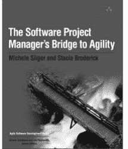

两位长期认证管理专业人员（PMP®）和 `Scrum` 培训师——迈克尔·斯莱格（Mikele Sliger）和斯塔西亚·布罗德（Stacia Broderick）展示了如何通过关注引导和协作，让丰富的项目经理成功转型到敏捷开发。

ISBN-13: `978-0-321-50275-9`

## 灾难性解脱

作者 E. M. Bennattan 描述了一个十步流程，用于识别陷入困扰的项目并避免昂贵的失败。每当项目遇到麻烦——无论你是高级经理、项目经理、团队成员还是软件客户——这本书都可能拯救你的职业生涯。

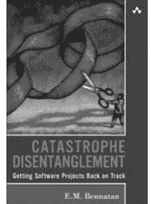

ISBN-13: `978-0-321-33662-0`


欲了解更多信息并阅读示例，请访问 `informit.com`。

书籍也可通过 `safari.informit.com` 获取。


注册您拥有的 Addison-Wesley、Exam Cram、Prentice Hall、Que 和 Sams 产品以解锁丰厚福利。

注册您的产品可以解锁以下福利：

- 访问补充内容，包括赠送章节、源代码或项目文件。
- 一张可在下次购买时使用的优惠券。

要开始注册流程，只需访问 `informit.com/register` 或创建账户。随后您将被提示输入产品封底上的 10 位或 13 位 ISBN。

注册福利因产品而异。福利将列在您的账户“已注册产品”（Registered Products）下。

## 关于 InformIT —— 可信赖的技术学习来源

INFORMIT 是领先技术出版品牌 Addison-Wesley Professional、Cisco Press、Exam Cram、IBM Press、Prentice Hall Professional、Que 和 Sams 的聚集地。在这里，您将获得来自我们作者、创作者、创新者和技术领导者的高质量且信赖的内容与资源。无论您是在寻找关于新技术的书籍、有用的文章、及时的时事通讯，还是访问 Safari Books Online 数字图书馆，InformIT 都能为您提供解决方案。


## `informIT.com`

### 可信赖的技术学习来源

InformIT 是培生（Pearson）的一个品牌，也是全球领先技术出版商的在线平台。它是您获取可靠合格内容与知识的来源，提供来自技术社区顶级品牌、作者和贡献者的资源。


## 在 `informIT` 学习 `LearnIT`

正在寻找新技术的书籍、电子书或培训视频吗？正在寻找及时相关的信息和教程？正在寻找专家意见、建议和技巧吗？InformIT 有解决方案。

- 通过订阅各种时事通讯来了解新发布和特别促销活动。访问 `informit.com/newsletters`。
- 在 `informit.com/podcasts` 访问专家提供的免费播客。
- 在 `informit.com/articles` 阅读最新的作者文章和示例章节。
- 在 `safari.informit.com` 的 Safari Books Online 数字图书馆中访问数千种书籍和视频。
- 在 `informit.com/blogs` 从专家博客获取技巧。

访问 `informit.com/learn` 探索获取热门技术内容的所有方式。

## 你是 IT 人群的一员吗？

通过 RSS 馈、Facebook、Twitter、YouTube 等平台与培生的作者和编辑联系！访问 `informit.com/socialconnect`。


## `informIT.com`

### 可信赖的技术学习来源


## 试用 Safari Books Online

### 免费

免费访问 5000 多本书和视频


## Safari Books Online

### 今日立即开始

- 快速找到可靠答案：通过 Safari 即可搜索来自 Addison-Wesley、Cisco Press 等出版社的畅销书籍。
- 掌握最新工具和技术：除了海量技术书籍，Safari 丰富的视频教程让你从专家那里学习。
- 保持竞争优势：通过 Rough Cuts 访问开发手稿，抢先学习新技术。
- 跟进新兴技术：Short Cuts 和 Quick Sheets 快速参考表是旨在帮助您快速进入状态的精简内容。


## 在线版

### 免费

购买《评估项目决策》可通过 Safari Books Online 订阅服务获得 45 天的免费在线访问。几乎所有的 Addison-Wesley 书籍都可以在 Safari Books Online 访问，以及来自 Cisco Press、Exam Cram、IBM Press、Reilly、Prentice Hall 和 Sams 的数千种技术书籍和视频。

SAFARI BOOKS ONLINE 允许您搜索特定答案、复制代码、下载图表并跟进新兴技术。

## 在 `informit.com/safarfree` 激活您的免费在线版

- 第一步：输入优惠码：`IRAGBI`。
- 第二步：Safari 用户完成简单的注册表。Safari 用户登录。

如果您在 Safari 上注册或访问在线版遇到困难，请发送电子邮件至 `customer-service@safarifooksonline.com`。

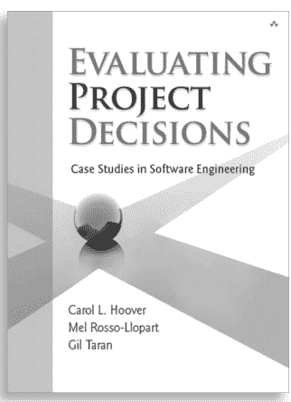


