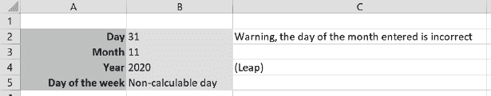
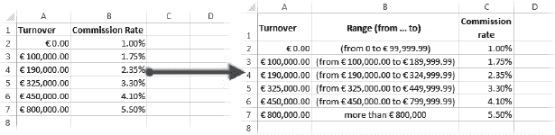

# Excel 工作簿：160 个练习及答案与注释


Excel 是所有商业环境中最流行、使用最广泛的生产力软件，无论是日常工作还是大量复杂数据的分析，它都是不可或缺的伙伴。然而，大多数用户只知道并使用非常有限的功能，而且通常处于初级水平。本工作簿通过实践展示了各种公式、函数和功能（如图表、透视表、宏或求解器插件），使你能够高效且专业地使用 Excel。

本工作簿从基础开始，逐步处理非常复杂的案例。对于想要学习基础或将 Excel 知识提高到高级水平的大学生、专业人士和经理来说，这是一份非常有价值的支持。

DigitaBook 格式包括书籍数字版，带有所有用于练习和检查答案的初始及解决方案。80 多个练习带有注释，以强调基本概念并澄清最复杂的概念。

Massimo Ballerini, Maria Chiara Debernardi, Davide Del Corno, Maurizio De Pra 是米兰博科尼大学（Università Bocconi）计算机课程的讲师。

Alberto Clerici 是该大学 ITEC（IT 教育中心）的负责人。


## 练习题 12.10 - 仪表板（带注释）

## 作者

## 前言

本练习册基于作者多年教授 Excel 课程的经验。通过对不同年龄、背景和职业状态学生的教学经验——从大一学生到硕士研究生，再到具有多年工作经验的经理和专业人士——我们理解了 Excel 是各种工作和各个层级中不可或缺的工具，而且其重要性往往被人们低估。大多数用户，即使是那些声称或认为自己知道使用 Excel 的人，实际上也仅了解和使用非常有限的功能，而且通常是以初级且低效的方式。

事实上，Excel 是企业和办公室中最常用的工具，掌握其相关知识是一项竞争优势，大学生在需要完成第一项小组作业时就已经拥有了这种优势：那些会使用 Excel 的人比其他人更有优势。当他们进入商业环境时，这种竞争优势变得更加重要。在面试时，最令人恐惧的问题之一是：“那么，你告诉我你很通 Excel：让我们试着建立一个数据透视表来分析这些数据……”此时你会开始冒冷汗，而在你试图组织回答时，那种职位将分配给他人的信念会愈发强烈。雇主知道，精通 Excel 的人工作效率更高；工人也知道，拥有坚实的 Excel 基础可以更好地、更快速地完成日常工作，无论是处理包含几个简单公式的表格，还是复杂数据的分析。

本练习册允许实践运用各种公式、函数和功能（如数据透视表、宏、统计和财务函数，以及求解插件），以便能够高效、专业地使用 Excel。

本练习册分为 12 个主题单元。单元 1 从 Excel 基础开始，一个单元接一个单元，练习册旨在以循序渐进的方式处理非常复杂的案例。在 `http://mybook.egeaonline.it` 专用区域，你可以找到书的电子版，包含所有初始文件和解答文件，用于进行练习并测试答案。在提供的 160 道练习题中，有 80 多道带有注释，以突出基本概念和特殊之处，并澄清最复杂的任务。

## 练习册计划

### 单元 1. Excel 基础

主题：简单公式（加、减、乘、除）、使用绝对和混合引用、计算百分比、计算百分比变化、`SUM`、`AVERAGE`、`MAX`、`MIN`、`COUNTA`、`COUNT`、`IF`、`ABS` 函数、格式设置、简单排序、创建和自定义简单图表。

（30 道练习，15 道注释）

### 单元 2. 从简单函数到嵌套函数

主题：导入数据、`TRIM`、`AND`、`OR`、`COUNTBLANK` 函数、嵌套函数、条件格式、多级排序、`filter` 和 `Paste` 命令选项（值）。

（10 道练习，6 道注释）

### 单元 3. 数学函数和高级图表

主题：`SUMPRODUCT`、`COUNTIF`、`AVERAGEIF`、`SUMIF` 函数、带公式的条件格式、`Subtotal`、删除重复项命令、单元格链接、创建趋势线的图表，以及混合图表和双轴图表。

（10 道练习，5 道注释）

### 单元 4. 财务函数和拟值分析

主题：财务函数：`PMT`、`FV`、单元格或区域命名、`Paste` 命令选项（转置）、方案和单均值。

（10 道练习，5 道注释）

### 单元 5. 文本函数和数据透视表

主题：文本函数：`RIGHT`、`LEFT`、`MID`、`CONCATENATE`、`UPPER`、`LOWER`、`PROPER`、`LENGTH`、`SEARCH`、统计函数：`COUNTIFS`、`SUMIFS`、`AVERAGEIFS`、数据透视表、数据透视图表、数据验证。

（10 道练习，5 道注释）

### 单元 6. 管理日期和时间

主题：日期和时间的公式、时间单位归一化、日期和时间函数：`DAY`、`MONTH`、`YEAR`、`HOUR`、`MINUTE`、`SECOND`、`WEEKDAY`、`DAYS`、`TODAY`、`NOW`、`DATE`、`DATEDIF` 和 `IFERROR` 函数。

（10 道练习，7 道注释）

### 单元 7. 查找与引用函数、数据保护

主题：查找与引用函数：`VLOOKUP`、`MATCH`、统计函数 `RANK.EQ`、工作表保护、工作簿保护、文件保护和加密。

（15 道练习，5 道注释）

### 单元 8. 宏和 Visual Basic（VBA）元素

主题：在 Excel 中录制宏、将宏分配给形状或按钮、简单的 VBA 编辑。

（20 道练习，18 道注释）

### 单元 9. 更多函数和求解

主题：`ROUND`、`INT`、`RAND`、`RANDBETWEEN`、`HLOOKUP`、`PMT`、`IPMT`、`RATE`、`NPV`、`IRR`、`TEXT`、`CONVERT`、`NETWORKDAYS`、数据表、高级筛选和求解。

（15 道练习，6 道注释）

### 单元 10. 数据库函数和图表选项

主题：模板的使用和创建、带 3D 引用的 `SUM` 函数、数据库函数：`DSUM`、`DMIN`、`DMAX`、`DCOUNT`、对“比较并合并工作簿”命令的注释以及高级图表选项。

（10 道练习，5 道注释）

### 单元 11. 财务应用

主题：财务函数：`YIELD`、`XIRR`、`TBILLIELD`、`NPV`、`IRR`、`XNPV`、`PMT`、`IPMT`、日期和时间函数：`COUPPR`、`COUPDBS`、`COUPDAYS`统计函数：`MEDIAN`、`STDEV.S`、`VAR.S`、`COVARIANCE.S`、`CORREL`、`KURT`、`SKEW`、`SLOPE`、`INTERCEPT`、`RSQ` 和数据分析插件。

（10 道练习，2 道注释）

### 单元 12. 数据分析和报告

主题：查找与引用函数：`INDEX`、`INDIRECT`、`OFFSET`、信息函数 `ISNUMBER`、数据验证、表控件设置（复框框和滚动条）以及 `Paste` 选项（链接图片粘贴）。

（10 道练习，2 道注释）

## 第一部分

# 练习题

## 单元 1. Excel 基础

本单元专门为准备 ECDL/ICDL 高级表格证书设计。

**本单元主题：**

*简单公式（加、减、乘、除）、使用绝对和混合引用、计算百分比、计算百分比变化、`SUM`、`AVERAGE`、`MAX`、`MIN`、`COUNTA`、`COUNT`、`IF`、`ABS` 函数、格式设置、简单排序、创建和自定义简单图表。*

### 练习 1.1 - 季度销售

文件 **练习 1.1 - Quarterly sales.xlsx** 包含了一家位于美国的食品公司的全球销售数据，特别是意大利。这些数据按地区和季度划分。

要求你：

1. 计算每个地区、每个季度以及全年的总额。考虑所有值均为美元。
2. 计算每个地区占年度总额的百分比。显示至少一位小数。
3. 创建一个饼图来代表三个地区的销售总额。在饼图区域内显示每个地区的值。

应用适当的格式并合理组织数据，以确保最大的可读性，并使工作表呈现整洁专业的观观。

保存更改并关闭文件。

### 练习 1.2 - 四次选举

打开文件 `Exercise 1.2 - Four elections.xlsx`。该文件包含一个虚构城镇四场假设选举的结果，涉及七个不同的政党。

你需要完成：

1. 在单元格 `B11:E11` 中计算每场选举的选票总数。
2. 创建一个柱状图，表示各政党在 2020 年选举中获得的票数。
3. 从单元格 `A14` 开始创建第二个表格，具有与票数表相同的表标题（政党名称、选举年份以及政党/年份）。在该表中，计算每个政党在每次选举中获得票数对应的百分比值。

应用适当的格式并妥善组织数据以确保最大的可读性，并使工作表外观整洁、专业。

保存更改并关闭文件。

### 练习 1.3 - 收入

打开文件 `Exercise 1.3 - Income.xlsx`。`Income` 工作表显示了 12 位同事在连续 10 年内的平均收入（以美元计）。

你需要完成：

1. 在 `Income` 工作表的第 `15` 行中计算每年的总额。
2. 在 `L` 列中计算每个个人收入的最小值。
3. 在 `M` 列中计算每个个人的最高收入。
4. 在 `N` 列中计算每个个人的平均收入。
5. 创建一个柱状图，表示这 12 位同事中每个人的平均收入。
6. 在单元格 `B17` 中计算这这些同事在 10 年内的收入总额。
7. 将 `Income` 工作表中的可用表头（年份和同事姓名）复制到 `Percentages` 工作表中。
8. 在 `Percentages` 工作表的表格中，计算给定年份和特定人员的每个收入值相对于上述计算出的总额所占的百分比。

应用适当的格式并妥善组织数据以确保最大的可读性，并使工作表外观整洁、专业。

保存更改并关闭文件。

### 练习 1.4 - 电影

打开文件 `Exercise 1.4 - Cinema.xlsx`。该文件包含了去年伦巴第大区各省份电影院的门票和收据（美元计）数据。

你需要完成：

1. 根据收入金额对表格进行降序排序。
2. 在第 `17` 行计算伦巴第大区的销售门票总数和总收入。
3. 计算伦巴第大区各省份门票销售和收入的最小值、最大值和平均值。
4. 计算伦巴第大区省份的数量。
5. 使用第 2 点计算的值，计算伦巴第大区的平均票价。
6. 在 `D` 列中计算每个省份收入占第 2 步计算出的总额的百分比。
7. 创建一个柱状图，表示每个省份的收入值。

应用适当的格式并妥善组织数据以确保最大的可读性，并使工作表外观整洁、专业。

保存更改并关闭文件。

### 练习 1.5 - 课程

打开文件 `Exercise 1.5 - Courses.xlsx`。该文件包含与某虚构培训中心注册课程的学生相关的虚构数据。

你需要完成：

1. 在第 `11` 行计算所考虑的每年的注册学生总数。
2. 在 `D` 列中计算每门课程以及年度总订阅人数去年注册人数较前一年的变化量。
3. 在 `E` 列中计算每门课程以及年度总订阅人数去年注册人数较前一年的百分比变化量。
4. 将刚刚计算的百分比变化转换为 `F` 列中对应的绝对值。
5. 在单元格 `B13:C15` 中计算每年的最大值、最小值，以及平均学生人数。
6. 在单元格 `B17` 中使用函数，如果去年的学生人数多前一年，则显示“Increase（增加）”，否则显示“Decrease（减少）”。
7. 创建一个柱状图，比较所考虑的两年内每门课程的注册人数值。

应用适当的格式并妥善组织数据以确保最大的可读性，并使工作表外观整洁、专业。

保存更改并关闭文件。

### 练习 1.6 - 年龄人口

打开文件 `Exercise 1.6 - Population by age.xlsx`。该文件包含了意大利国家统计局（Istat）网站上关于 2005 年至 2014 年间意大利人口的数据，按周岁年龄划分（0 岁、1 岁等，直到 100 岁及以上）。

你需要完成：

1. 在第 `106` 行计算每年的人口。
2. 在 `L` 列中计算 2014 年每个年龄段与 2013 年相比的百分变化。
3. 在 `M` 列中计算每个年龄段的最大值。
4. 创建一个柱状图，表示 2005 年到 2014 年的人口总量。
5. 创建一个折线图，比较 30、60 和 90 岁年龄段所考虑年份的人口演变。

应用适当的格式并妥善组织数据以确保最大的可读性，并使工作表外观整洁、专业。

保存更改并关闭文件。

4. 创建一个饼图，表示已参加考试的次数和待参加的次数。显示饼图每个部分的数值数据标签。确保饼图的两个部分分别为绿色（与已参加考试相关）和红色（与待参加考试相关）。为图表添加标题“通往毕业之路（Road to graduation）”。

5. 将第二个工作表重命名为 `Calculations`。删除文件中除 `Data` 和 `Calculations` 工作表以外的所有其他工作表。

应用适当的格式并以合适的方式组织数据，以确保最大的可读性，并使工作表看起来整洁且专业。

保存更改并关闭文件。

### 练习 1.9 - 资产负债表

打开文件 `Exercise 1.9 - Balance sheet.xlsx`。该文件包含一份简化财务报表的数据，显示了一虚拟公司三个月内的收入和支出（金额以美元计）。

你需要完成以下任务：

1. 在单元格 `B5:D5` 中计算每个月的利润（或亏损），即收入与成本之间的差额。
2. 在单元格 `E2`、`E3` 和 `E5` 中计算该季度的总收入、总成本和利润。
3. 在单元格 `B7:E7` 中使用函数，如果该月（或季度，单元 `E7`）出现亏损，则显示“Loss（亏损）”，否则显示“Profit（利润）”。
4. 创建一个折线图，比较三个月内收入和成本的表现。

应用适当的格式并以合适的方式组织数据，以确保最大的可读性，并使工作表看起来整洁且专业。

保存更改并关闭文件。

### 练习 1.10 - 电视节目

打开文件 `Exercise 1.10 - TV shows.xlsx`。该文件包含意大利主要国家电视电台一年内制作的一些电视节目的数据。

你需要完成以下任务：

1. 在单元格 `E3:E9` 中计算 RAI 频道每个类别的总播放时长。在单元格 `J3:J9` 中对 Mediaset 频道执行相同的操作。
2. 在第 `11` 行中计算每个频道的总传输时长，以及 RAI 和 Mediaset 的总和。
3. 在单元格 `F3:F9` 中计算 RAI 频道每个类别播放时长的百分比值。在单元格 `K3:K9` 中对 Mediaset 执行相同的操作。（注意：如果 `F3:F9` 单元格中的公式设置正确，可以直接复制而重写。）
4. 在单元格 `L3:L9` 中输入公式，对于每个类别，如果 RAI 在该特定类别上的播放时长高于 Mediaset 的播放时长，则显示“RAI”，否则显示“Mediaset”。
5. 创建一个柱状图，比较 RAI 和 Mediaset 每个类别的播放时长百分比。
6. 创建一个柱状图，比较每个类别下（分配在三个 Mediaset 频道之间）的节目总时长。

应用适当的格式并以合适的方式组织数据，以确保最大的可读性，并使工作表看起来整洁且专业。

保存更改并关闭文件。

### 练习 1.11 - 香烟

打开文件 `Exercise 1.11 - Cigarettes.xlsx`。该文件包含按性别、年龄和地区划分年度香烟消费数据。

你需要完成以下任务：

1. 使用函数在 `H` 列和 `O` 列中计算三个考虑地区中男性和女性的平均值。
2. 使用函数在第 `8` 行计算每个年龄组女性和男性三个地区的平均值。
3. 使用函数在第 `9` 行计算每个年龄组女性和男性三个地区的最大值。
4. 在单元格 `B12` 中使用函数，如果 `B4` 单元格中 15–24 年龄组北部的数值高于 `B8` 单元格中的意大利平均水平，则得到“more（多）”，否则为“less（少）”。正确使用相对引用和绝对引用，以便你可以复制公式并在 `B12:G14` 和 `I12:N14` 单元格中获得正确结果。
5. 创建一个柱状图，比较三个考虑地区（北部、中部和南部）男性和女性的平均消费量。

应用适当的格式并以合适的方式组织数据，以确保最大的可读性，并使工作表看起来整洁且专业。

保存更改并关闭文件。

### 练习 1.12 - 家庭

打开文件 `Exercise 1.12 - Families.xlsx`。该文件包含按人数划分的意大利家庭组成数据，按地区和意大利总面积划分。

你需要完成以下任务：

1. 在 `31:33` 行中计算意大利各地区在平均人数（`B` 列）和人数构成百分比（`C:H` 列）方面的最大值、最小值和平均值。
2. 按平均人数降序对表格进行排序。
3. 创建一个柱状图，根据北部、中部、南部和意大利全地区的人数比较家庭情况。

应用适当的格式并以合适的方式组织数据，以确保最大的可读性，并使工作表看起来整洁且专业。

保存更改并关闭文件。

### 练习 1.13 - 啤酒和葡萄酒

打开文件 `Exercise 1.13 - Beer and wine.xlsx`。该文件包含与意大利啤酒和葡萄酒消费相关，按年龄、性别和地区划分。

你需要完成以下任务：

1. 在 `G` 列和 `M` 列中计算意大利每个地区啤酒和葡萄酒的平均值。
2. 在第 `9` 行和 `14` 行中计算每个年龄组啤酒和葡萄酒的平均值。
3. 在 `N` 列中计算意大利每个地区男性和女性葡萄酒和啤酒消费的百分比差异（相对于平均值）。
4. 在 `16:19` 行中计算每个性别、年龄组和意大利地区啤酒或葡萄酒消费的流行程度。在单元格 `B16` 中输入的函数（复制到所有其他单元格）应在北部地区 15 至 34 岁女性的啤酒量超过葡萄酒量时返回“beer（啤酒）”，否则返回“wine（葡萄酒）”。
5. 创建一个柱状图，比较所考虑地区（北部、中部、南部和意大利）男性和女性的葡萄酒平均消费量。


应用适当的格式并以合适的方式组织数据，以确保最大的可读性，并使工作表看起来整洁且专业。

保存更改并关闭文件。

### 练习 1.14 - 三次选举

打开文件`Exercise 1.14 - Three elections.xlsx`。该文件包含参加选举的 10 个政党的三轮投票数据。

你需要完成以下任务：

1. 在第`15`行中计算每轮选举的总投票数。

2. 在工作表中包含`2010`年数据的列之后插入一列。在新列中，计算每个政党得票占`2010`年总票数的百分比。

3. 在工作表中包含`2015`年数据的列之后插入一列。执行与一点相同的计算，引用`2015`年的投票数。如果你在上一点中正确编写了公式，只需将其复制到新列的相应单元格即可获得正确结果。

4. 在包含`2020`年数据的列之后的第一个空列再次复制公式，以获得`2020`年投票的百分比。

5. 在接下来的列中，计算每个政党在`2020`年与`2015`年之间得数的百分比变化。

6. 在下一列的单元格中，插入一个函数，如果上一点计算出的百分比变化大于零，则返回“Party on the rise”（上升政党），否则返回“Declining party”（衰退政党）。

7. 根据`2020`年选举获得的票数对表格进行降序排序（从大到小）。

8. 在`J`列中，将第 5 步计算的百分比变化转换为绝对值。

9. 创建一个折线图，表示三轮选举记录的总票数。

应用适当的格式并以合适的方式组织数据，以确保最大的可读性，并使工作表看起来整洁且专业。

保存更改并关闭文件。

### 练习 1.15 - 田径径

打开文件`Exercise 1.15 - Athletics.xlsx`。该文件包含多名运动员在跳远比赛中的跳跃测量数据。

你被要求：

1. 格式化包含跳跃测量数据的单元格，显示两位小数。

2. 在`E3:E7`单元格中插入一个函数，显示每位运动员的最佳成绩。

3. 在 Mayer 和 Petersbourgh 之间输入新运动员 Columbus，测量数据为：`8.09`、`7.86`和`8.15`米。

4. 在`F3:F8`单元格中插入一个函数，对于每位运动员，如果最佳跳跃距离为`8.15`米或更高，则显示结果“Promising athlete!”，否则留空单元格。

5. 删除工作表的第`1`行。

6. 按最佳跳跃距离对列表进行排序，从远到短。

7. 创建一个柱状图，显示每位运动员最佳跳跃的距离。确保图表显示数据标签，在每个柱状图旁边显示跳跃距离。

8. 创建一个柱状图，用于比较每位运动员三次跳跃的距离。

应用适当的格式并以合适的方式组织数据，以确保最大的可读性，并使工作表看起来整洁且专业。

保存更改并关闭文件。

### 练习 1.16 - 账单

打开文件`Exercise 1.16 - Bills.xlsx`。该文件包含一个家庭在特定季度内的电费、电话费和燃费用（单位为美元）。

你被要求：

1. 使用函数在`E4:E6`单元格中计算每个月的总支出。

2. 使用函数在`B8:E8`单元格中计算每类账单的总支出。

3. 在`F4:H6`单元格中计算每种类型账单占每月总支出的百分比。你只需要在`F4`单元格中写一个正确的公式，然后将其复制到相邻单元格中。也将公式复制到`F8:H8`单元格，以计算该季度总支出的百分比。

4. 在`B12:D14`单元格中计算每类账单占该季度总支出的百分比。你只需要在`B12`单元格中写一个正确的公式，然后将其复制到相邻单元格中。

5. 插入一个列柱图，代表三个月内的电费、电话费和燃气费用，按账单类型显示数据，并允许比较每月总支出。

应用适当的格式并以合适的方式组织数据，以确保最大的可读性，并使工作表看起来整洁且专业。

保存更改并关闭文件。

### 练习 1.17 - 营业额分析

打开文件`Exercise 1.17 - Turnover analysis.xlsx`。该文件包含一家在音乐行业运营的公司客户销售数据。数值以美元表示，分别对应最近一年（“Turnover”列）和前一年（“Previous year turnover”列）。

你被要求：

1. 在第一个可用列中插入一个公式，计算每个客户去年与前一年相比营业额（美元）的变化。确保如果没有前年的数据，公式结果返回文本“Not available”。为该列添加标题`Increase`（增长）。

2. 在下一个可用列中插入另一个公式，计算每个客户去年与前一年相比营业额的百分比变化。即使在这种情况下，如果没有前年的数据，公式也应返回文本“Not available”。为该列添加标题`Increase %`（增长百分比）。

3. 在后续列中放置一个公式，用双星号（`**`）突出显示增长小于`5%`的客户。其他客户不应显示任何内容。为该列添加标题`Low increase`（低增长）。

4. 根据营业额对表格进行降序排序。

5. 创建一个列柱图，比较每个客户在两年内的营业额。

应用适当的格式并以合适的方式组织数据，以确保最大的可读性，并使工作表看起来整洁且专业。

保存更改并关闭文件。

### 练习 1.18 - 国内外销售

打开文件`Exercise 1.18 - US and foreign sales.xlsx`。该文件包含过去六个月的数据，关于一家主要在美国销售产品但正试图向海外扩张业务的美国公司的销售情况。数据以美元表示，分为美国销售和海外销售。

你被要求：

1. 计算每个月的总额，即美国和海外的总和，以及总计。

2. 创建的图表以传达以下每条信息：

a. 突出总销售额的增长（例如使用柱状图）。

b. 突出美国市场强劲的销售增长（例如使用折线图）。

c. 突出总销售额的增长，并强调美国相对于海外的显著性（例如使用堆叠柱状图）。

d. 以百分比形式显示美国和海外销售（六个月总和）占总计的份额（例如使用饼图）。

e. 最后，显示在数值轴上使用不同刻度如何放大或缩小某种现象，创建两个类似的图表（例如折线图）：

i. 一个突出六个月内美国和海外销售差异的图表；

ii. 另一个表示相同数据但平滑差异的图表

应用适当的格式并以合适的方式组织数据，以确保最大的可读性，并使工作表看起来整洁且专业。

保存更改并关闭文件。

### 练习 1.19 - 

打开文件`Exercise 1.19 - Rainfall.xlsx`。该文件包含在给定五年内每个月记录的纽约降雨量数据。

你被要求：

1. 在`G`列中计算每个月的平均值。

2. 在第`17`行计算每年的总降水量。

3. 在`B20`单元格中计算所考虑五年的平均降水量。

4. 在`B18:F18`单元格中输入一个函数，如果每年的总降水量高于五年平均降水量，则返回结果“Yes”，否则返回“No”。

5. 在同一工作表中创建一个柱状图，代表平均每月降水量。

6. 将`Sheet1`重命名为`Data`，将`Sheet2`重命名为`Percentages`。

7. 将`Data`工作表中的表头复制到`Percentages`工作表中（月份和年份）。

8. 在`Percentages`工作格的表格中，计算每年每月占该年总计的百分比，这些数据均可在`Data`工作格中找到。为了计算，请在`Percentages`工作格中编写单个公式并将其复制到所有其他单元格。

应用适当的格式并以合适的方式组织数据，以确保最大的可读性，并使工作表呈现整洁、专业的外观。

保存更改并关闭文件。

### 练习 1.20 - UFO

打开文件`Exercise 1.20 - UFO.xlsx`。该文件包含了新泽西州警方在某十年内记录的 UFO（不明飞行物）目击数据。

你需要完成以下任务：

1. 在`N`列计算每年的总目击人数。

2. 在`O`列计算每年的最大目击人数。

3. 在`P`列计算每年的最小目击人数。

4. 在第`15`行计算每月平均目击人数。

5. 在同一工作格中创建一个柱状图，表示每年的总目击人数。

6. 将`Sheet1`重命名为`Data`，将`Sheet2`重命名为`Percentages`。

7. 从`Data`工作格将表格标题（月份和年份）复制到`Percentages`工作格。

8. 在`Percentages`工作格的表格中，计算每年每月占该年总计的百分比，这些数据均可在`Data`工作格中找到。为了计算，请在`Percentages`工作格中编写单个公式并将其复制到所有其他单元格。

应用适当的格式并以合适的方式组织数据，以确保最大的可读性，并使工作表呈现整洁、专业的外观。

保存更改并关闭文件。

### 练习 1.21 - 事故

打开文件`Exercise 1.21 - Accidents.xlsx`。该文件包含了 1997-2003 年期间欧盟（EU）成员国记录的工伤数据。

你需要完成以下任务：

1. 在`I`列计算该期间每个国家的事故总数。

2. 在第`20`行计算每年的事故总数。

3. 在第`21`行计算每年记录的最高事故数。

4. 在第`22`行计算每年平均记录事故数。

5. 在`B24`单元格中插入一个函数来计算成员国的数量。

6. 在同一工作格中创建一个折线图，表示考虑年份内意大利记录的事故数量。

7. 创建一个柱状图，用于比较不同国家之间的事故总数和每年事故数。

8. 创建一个饼图，显示该期间每个国家事故总数对应的百分比值。

9. 将`Sheet1`重命名为`Data`，将`Sheet2`重命名为`Percentages`，将`Sheet3`重命名为`Rating`。

10. 从`Data`工作格将表格标题（国家和年份）复制到`Percentages`工作格。

11. 在`Percentages`工作格的表格中，计算每个国家每年占该年总计的百分比，这些数据可在`Data`工作格中找到。为了计算，请在`Percentages`工作格中编写单个公式并将其复制到所有其他单元格。

12. 再次将表格标题从`Data`工作格复制到`Ratings`工作格。

13. 在`Ratings`工作格的表格中插入一个函数，如果每个国家每年的事故数高于年度平均水平，则返回结果“Yes”，否则返回“No”。为了计算，在`Ratings`工作格中编写单个公式并将其复制到所有其他单元格。

应用适当的格式并以适当的方式组织数据，以确保最大的可读性，并使工作表呈现整洁、专业的外观。

保存更改并关闭文件。

### 练习 1.22 - 音乐销售

打开文件`Exercise 1.22 - Music sales.xlsx`。该文件包含某些欧洲国家两年内的音乐销售数据。数值以欧元表示。

你需要完成以下任务：

1. 在`Sheet1`的第`12`行中，使用所需的函数计算每年的总销售量和收入，然后将公式复制到其他单元格。

2. 在`F`和`G`列中，计算不同国家两年销售量和收入的平均值。

3. 删除`Sheet1`的第`1`行。然后，将`Sheet1`重命名为`Sales`。

4. 在同一工作格中创建一个饼图，表示不同国家销售量的平均值。在每个区域旁边显示国家名称标签和相应的百分比值。不要显示图例。

5. 在`Sheet2`中，计算`B14`单元格的总值。

6. 在`C`列中添加一个函数，仅对超过 100,000 欧元的数值计算占总计的百分比，对其他数值返回“无关”。对得到的数值使用百分比格式并保留一位小数。

7. 将`Sheet2`重命名为`Percentages`。

8. 根据`Percentages`工作格中的值对表格进行降序排序。

9. 在同一工作格中创建一个柱状图，用于比较不同类别的数值。

10. 将两个工作表的打印方向设置为水平，将内容水平居中，并调整为 1 页宽 1 页高。最后检查打印预览。

应用适当的格式并以合适的方式组织数据，以确保最大的可读性，并使工作表呈现整洁、专业的外观。保存更改并关闭文件。

### 练习 1.23 - 七个矮人

打开文件`Exercise 1.23 - Seven dwarfs.xlsx`。该文件中包含了七个矮人的数据：遇到白公主之前的身高体重以及生活一年后的体重。据说白公主不是个好厨师，七个矮人的健康因此遭受了影响。

你需要完成以下任务：

1. 在`E`列中计算每个矮人的体重变化。

2. 在`F`列中计算每个矮人的体重百分比变化。

3. 在`G`列中添加一个函数，如果体重变化为负，则返回结果“瘦”，否则返回“胖”。

4. 在`H`列中将百分比变化转换为绝对值。

5. 在第`12`行计算白公主前后的身高、体重、变化以及百分比变化的最大值。

6. 在第`13`行计算相应的最小值，在第`14`行计算平均值。

7. 在`B16`单元格中使用函数自动计算矮人的数量。

8. 创建一个散点图，在两个轴上表示白公主后七个矮人的身高体重。

### 练习 1.24 - 支出

打开文件`Exercise 1.24 - Expenses.xlsx`。该文件包含家庭预算的支出数据，特别是 12 个月的电费、燃气和电话账单（单位为美元）。

你需要完成以下任务：

1. 在`F5:I16`单元格中计算每张账单的增值税，已知增值税为净值的 22%。

2. 在单元格`J5:M16`中计算每张账单（含增值税）的总额。

3. 最后，在第`18`行中输入从`B`到`M`各列对应数值的总和。

4. 在`N`列中，计算`M`列中每个数值（当月账单总额，含增值税）相对于`M18`单元格中计算出的总值的百分比值。

5. 创建一个饼图，用电、燃气和电话账单的三项总值（在单元格`J18:L18`中）占账单总额的百分比形式表示。

6. 创建一个柱状图，代表所考虑的每个月份含增值税的总支出。

应用适当的格式并以合适的方式组织数据，以确保最大的可读性，并使工作表看起来整洁且专业。

保存更改并关闭文件。

### 练习 1.25 - 三剑客

打开文件`练习 1.25 - 三剑客.xlsx`。该文件包含了三剑客在 1625 年至 1628 年间四年赢得决斗的数据。

你被要求：

1. 将`Sheet1`重命名为`Data`。

2. 在`F`列中，计算四年期间每位剑客赢得决斗的总数。

3. 在第`9`行中，计算每年剑客赢得的决斗总数。

4. 分别在第`10`行和第`11`行中计算每年决斗数量的最大值最小值。

5. 在第`12`行中，计算每年平均决斗数，保留一位小数。

6. 在单元格`B14:E14`中插入一个函数，用于评估在所考虑的每年中达塔尼亚（D'Artagnan）是否是当年的最佳剑客。如果达塔尼亚在当年赢得决斗的数量对应于步骤 3 中已计算出的最大值，则函数必须返回结果“Yes”，否则返回“No”。

7. 在单元格`B16`中输入一个函数，自动计算有多少位剑客。

8. 在同一工作表中创建一个柱状图，用于比较在所考虑的每中每位剑客赢得的决斗数量。

9. 在同一工作表中创建一个饼图，显示每位剑客在四年中赢得的决斗数量占决斗总数的百分比值。

10. 将`Sheet2`重命名为`% per year`。

11. 从单元格`A1`开始，将`Data`工作表中包含的表格表头（剑客名称和年份）复制到`% per year`工作表中。参考`Data`工作表中包含的数字，在`% per year`工作表的单元格`B2:E5`中，计算每位剑客每年赢得的决斗数量占`Data`工作表`F`列中计算的四年期间决斗总数的百分比值。计算时请使用单一公式，将其写入`B2`单元格，然后将其复制到表格中的所有其他单元格。

12. 同样在`% per year`工作表的`F`列中计算总百分比（应对应 100%）。

13. 将`Sheet3`重命名为`% per musketeer`。

14. 从单元格`A1`开始，将`Data`工作表中包含的表格表头（剑客名称和年份）复制到`% per musketeer`工作表中。参考`Data`工作表中包含的数字，在`% per musketeer`工作表的单元格`B2:E5`中，计算每位剑客每年赢得的决斗数量占`Data`工作表第`9`行中计算的四年期间决斗总数的百分比值。计算时请使用单一公式，将其写入`B2`单元格，然后将其复制到表格中的所有其他单元格。

15. 同样在`% per musketeer`工作表的第`7`行中计算总百分比（应对应 100%）。

应用适当的格式并以合适的方式组织数据，以确保最大的可读性，并使工作表看起来整洁且专业。

保存更改并关闭文件。

### 练习 1.26 - 谋杀案

打开文件`练习 1.26 - 谋杀案.xlsx`。该文件包含了 2015 年至 2020 年间意大利不同地区上诉判决的谋杀案数据。

你被要求：

1. 在`18:21`行中，计算上方表格中可用数值的总和、平均值、最大值最小值。

2. 在`H`列中，计算每个地区以及总计 2015 年与 2020 年之间的百分比变化。

3. 在单元格`B23:G23`中插入一个函数，用于比较所考虑的每年米兰和罗马地区的值。如果指定年份米兰地区的值高于罗马，则函数必须返回结果“Milan”，否则应返回“Rome”。

4. 在单元格`B25`中插入一个函数，返回谋杀数量作为结果。

5. 创建一个折线图，显示谋杀总数的趋势。

6. 创建一个饼图，表示 2020 年每个地区谋杀数量占当年总数的百分比。

应用适当的格式并以合适的方式组织数据，以确保最大的可读性，并使工作表看起来整洁且专业。

保存更改并关闭文件。

### 练习 1.27 - 市议会

打开文件`练习 1.27 - 市议会.xlsx`。该文件包含了小镇在最后四轮地方选举中赢得的席位数数据。

你被要求：

1. 在`J`和`K`列中，计算每个政党在四年中赢得席位的最大值最小值。

2. 在第`20`行中，计算市议会选举可用席位的总数。

3. 在`C`、`E`、`G`和`I`列中插入函数，计算每个值占可用席总数的百分比。如果席数为 0，函数应返回一个折号（-）。


4. 创建一个饼图，表示 2015 年市议会的组成，确保每个区域显示相应的席位数。

5. 创建一个折线图，表示第 9 号和第 11 号政党在四年中席位的对比。

6. 创建一个柱状图，用于比较所考虑选举中每个政党赢得席位的最大值和最小值。

应用适当的格式并以合适的方式组织数据，以确保最大的可读性，并使工作表看起来整洁且专业。

保存更改并关闭文件。

### 练习 1.28 - 议会团体

打开文件`练习 1.28 - 议会团体.xlsx`。该文件包含了不同政党在两轮议会选举中的得票数据。

你被要求：

1. 在第`16`行中，计算每次选举记录的票总数。

2. 在第`17`行和第`18`行中，计算每次选举中政党获得票数的最大值和最小值。

3. 在`C`和`F`列中，计算每个政党获得的票数相对于每次选举票数总数的百分比值。

4. 在`D`和`G`列中插入一个函数，如果政党在单次选举中获得的票数至少等于`200`，则返回结果“GROUP”。否则，结果必须为折号（-）。

5. 在`H`列中，计算每个政党 2010 年与 2015 年得票之间的百分比变化。

6. 在`I`列中使用 Excel 函数消除新计算的百分比变化值中的负号，将所有值转换为正数。

7. 创建一个柱状图，用于比较每个政党在两次选举中获得的票数。

应用适当的格式并以合适的方式组织数据，以确保最大的可读性，并使工作表呈现整洁、专业的外观。

保存更改并关闭文件。

### 练习 1.29 - 区域首府城市

打开文件`Exercise 1.29 - Regional chief towns.xlsx`。该文件包含了来自意大利统计局（Istat）关于意大利区域首府城市环境状况及主要结构特征的数据。

你需要完成：

1. 按地理区域对`Sheet1`中的表格进行排序，并将仅关于中部地区的数据（包括列标题）复制到`Sheet2`，然后将工作表重命名为`Center of Italy`。

2. 绘制意大利中部区域首府城市人均汽车数量分布图。

3. 在`Sheet1`中，在第`28`行计算区域首府城市所有数值变量的平均值。

4. 再次在`Sheet1`中，在`L`列计算人口密度（保留一位小数），即常住人口与市面积比例。

5. 在`M`列中输入一个函数，当人口密度大于等于 1,000 人/平方公里时，返回结果“High density”；否则必须显示横杠 (-)。

6. 在`I29`单元格中输入截至 2016 年 1 月 1 日的意大利总人口（60,665,551 人），并在`N`列中计算每个市所占的人口比例。

7. 在`O`和`P`列中，分别计算各市城市绿地的总公里数：一个是根据人数计算的人均平方米数（转换为公里），另一个是绿地面积占市总面积的百分比。

8. 在`Q`列中，计算两种计算城市绿地总公里数方法差值的绝对值；同时计算这些值的平均值。

9. 在`R`列中，输入一个函数，当`Q`列的差值低于平均值时，返回“Acceptable approximation”，其他情况下留空。

10. 在`S`列中，输入一个函数，如果颗粒物（PM[10]）超标天数于 30 天，则返回“Few overruns”，否则必须显示“Low air quality”。

11. 在`T`列中，输入一个函数以判断该市是否为山区城市：如果海拔超过海平面 500 米，则必须出现“Mountain municipality”字样，否则该单元格应保持为空。

12. 使用带有数值标签的水平条形图（放置在单独的工作表中）表示各首府城市的日耗用水量。

13. 根据内容适当重命名工作表并删除未使用的工作表。

应用适当的格式并以合适的方式组织数据，以确保最大的可读性，并使工作表呈现整洁、专业的外观。

保存更改并关闭文件。

### 练习 1.30 - 人口（综合练习）

代表一家市场研究公司审查与欧盟人口相关的数据。需要审查的数据包含文件`Exercise 1.30 - Population.xlsx`中。该文件包含三个工作表：

- `EU Population`工作表，包含 2002 年至 2013 年间所有 28 个欧盟国家的总人口。

- `Population 15-24`工作表，包含所有 28 个欧盟国家 15 至 24 岁人口的比例。

- `Forecasts`工作表，包含欧盟统计局（Eurostat）对未来几十年欧洲人口增长的预测。

你需要解决以下五个问题：

1. 在`EU Population`工作表中，对表格数据进行格式设置，使所有值均完整显示，不保留小数，并带有千分位分隔符。

因此，在考虑的最后年份之后添加一个新列，标题为“Variation”。在该列中，计算表格中每个国家在考虑期间的第一年与最后一年值之间的人口百分比变化。格式化结果以保留两位小数。

2. 再次在`EU Population`工作表中，计算每年的欧洲总人口。

使用适当的函数计算表格中可用每个年份的人口最大值和最小值（即人口最多和最少国家的人口）。

同时，使用适当计数函数计算列表中考虑的国家数量。

3. 创建一个仅代表人口年度总数的折线图。确保水平轴标签与表头（2002–2013 年）对应。然后：

- 将图表移动到一个名为`EU Population Chart`的新工作表中。

- 不要显示图例。

- 确保为图表设置有意义的标题。

- 将数值轴的最小值设置为 4.7500 万。

- 将图线颜色设置为橙色并带有阴影效果。

4. 在`Population 15-24`工作表中，计算每年的欧盟平均值。

在 2013 年份列之后插入新标题`Youngsters 2013`。在新列中使用函数显示，对于每个国家，如果该国在 2013 年的青少年人口比例大于或等于刚刚计算的 2013 年平均比例，则显示文本“Many youngsters”；否则显示文本“Few youngsters”。

5. 在`Forecasts`工作表的两个新列中，分别计算每个国家 2020 年至 2050 年以及 2020 年至 2070 年的人口预测百分比变化。

然后，在新工作表中创建一个柱状图，显示刚刚计算的百分比变化，使得每个国家相关的两个值的柱体并排显示。格式化图表使图例位于底部，然后插入一个有意义的标题。

应用适当的格式并以合适的方式组织数据，以确保最大的可读性，并使工作表呈现整洁、专业的外观。

保存更改并关闭文件。

## 第 2 章：从简单函数到嵌套函数

本单元主题：

导入数据、`TRIM`、`AND`、`OR`、`COUNTBLANK`函数、嵌套函数、条件格式、多级排序、筛选、粘贴选项。

### 练习 2.1 - 贷款

创建一个新的 Excel 文件并命名为`Exercise 2.1 - Home loans.xlsx`。你需要分析 2003-2014 期间某些国家及整个欧元区发放给家庭的住房贷款数据。

你需要：

1. 将`Exercise 2.1 - ECB_home_loans.txt`文件的内容导入你刚刚保存的文件中。该文件包含了欧洲银行（ECB）提供的关于分析主题的数据。注意小数分隔符（如有必要，在导入过程中进行更改）；所有值单位为欧元。

2. 在名为`% Euro Area`的新列中，计算`Euro area`字段每个值与其前一个值之间的百分比变化（即 2014 年 10 月与 9 月之间的变化）。确保所有可能的计算错误都被替换为值“Not available”。

3. 对`% Euro Area`字段的单元格应用格式，使得正向变化使用你选择的填充颜色，负向变化使用你选择的另一种填充颜色（与前一个不同），且值为“Not available”的单元格使用另一种你选择的填充颜色（与前两个不同）。格式应在单元格内容发生变化时自动更改。

4. 创建一个折线图，显示西班牙、意大利和荷兰的抵押贷款趋势，然后将其移动到一个与数据表分离的新工作表中。

5. 在一个名为`Direction`的新列中使用函数，针对每个时段（period）自动显示以下结果：

   a. 如果法国和意大利的百分比变化均为正数，则显示“Both positive”

   b. 其他所有情况显示空白单元格

确保计算中的任何可能错误都已替换为值“Not available”。

应用适当的格式并以合理的方式组织数据，以确保最大的可读性，并使工作表外观整洁且专业。

保存更改并关闭文件。

### 练习 2.2 - 互联网用户

在 Excel 中创建一个新文件并将其保存为`Exercise 2.2 - Internet users.xlsx`。

你需要：

1. 导入包含在`Exercise 2.2 - Internet and mobile phone users.txt`文件中的数据，注意小数点分隔符（如有必要，在导入过程中进行更改）。你刚刚导入的数据显示了所考虑 212 个国家的互联网用户数量和手机用户数量。

2. 创建两个名为`% Internet`和`% phone users`的新列，然后计算每个国家占总数的互联网用户和手机用户百分比。

   注意：使用单个公式执行每项计算，不要分别计算互联网和手机用户的全球总数。

3. 按手机用户数量对表格中的数据进行降序排序，然后在新工作表中创建一个柱状图，显示前 15 个国家的手机用户数量。确保代表意大利数据的柱体显示为不同的颜色。

4. 在带有导入数据的工作表中应用格式，使得`Internet users`列中值最高的 15 个单元格自动格式化为你选择的填充颜色。

   注意：格式应在单元格内容发生变化时自动更改。在`Mobile phone users`列的值中重复相同操作，使用你选择的、与前一个不同的填充颜色。

5. 为带有导入数据的表格添加一名为`Ranking`的新列。该列中的单元格必须包含一个函数，自动显示以下结果：

   - 对于互联网用户和手机用户数量均位列前 20 的国家，显示“Top ranking”

   - 所有其他国家显示为空

应用适当的格式并以合适的方式组织数据，以确保最大的可读性，并使工作表外观整洁且专业。

保存更改并关闭文件。

### 练习 2.3 - 畅销商品

`Exercise 2.3 - Sales data.txt`文件包含从一家德国运营的供应商销售并发货的产品数据。

你需要：

1. 在新的 Excel 工作表中导入`Exercise 2.3 - Sales data.txt`文件中包含的数据。注意小数点分隔符（如有必要，在导入过程中进行更改）。

2. 将文件保存为`Exercise 2.3 - Top sellers.xlsx`，并将导入数据的工作表重命名为`Sales data`。删除不必要的行（前 8 行），仅保留列标题的数据集。

3. 按`PART NUMBER`排序，然后按`Quantity`排序（均采用降序）。

4. 计算列表中项目的平均价格。

5. 在一个名为`Sales`的新列中使用公式，使得每个产品名称旁边出现结果：

   - 当数量在 150 到 220 之间（包含边界值）时，显示“Almost Top Seller”

   - 当数量大于 220 时，显示“Top Seller”

   - 其他情况显示为空（空白单元格）

6. 格式化`Sales`列中的单元格，使其在包含“Top seller”值时，自动格式化为浅绿色填充颜色和深绿色字体颜色。

7. 统计有多少个`AAID`被归类为 Top Seller 或 Almost Top Seller，有多少不是。

8. 过滤列表，仅显示符合以下条件的产品：

   - 价格在 101 到 147 美元之间（包含边界值）

   - `PART NUMBER`以字母“AA”开头

   - `Quantity`大于或等于 100

9. 将过滤后的列表复制到新的工作表（名为`Large quantities`）中，保留格式但不保留公式。

10. 在`Large quantities`工作表中，在同一张图表中绘制`Quantity`和`Unit Price (Euro)`，使用`Serial Number`作为水平轴，并使用自定义的 y 轴。在图表上显示`Unit Price (Euro)`标签。

11. 再次在`Large quantities`工作表中，格式化`Unit Price (Euro)`列中的单元格，使得值最高的两个单元格自动格式化为你选择的填充颜色。

应用适当的格式并以合适的方式组织数据，以确保最大的可读性，并使工作表外观整洁且专业。

保存更改并关闭文件。

### 练习 2.4 - Alphabet Inc.

1. 在国际版`Yahoo! Finance`网站查找`Alphabet Inc.`股票在 2014 年 9 月 29 日至 2014 年 12 月 6 日期间的每日价格（代码 GOOGL）。

2. 使用`Copy`和`Paste`命令将数据导入新的 Excel 文件中。

3. 重命名使用的工作表为`Alphabet Inc.`，并将文件保存为`Exercise 2.4 - Alphabet Inc.xlsx`。

4. 将股票报价的日期格式化为`mm/dd/yyyy`，并将所有股票报价的值（不包括与成交量相关的）保留两位小数。

5. 按`Date`对列表进行升序排序。

6. 计算列表每个字段的最大值和最小值。

7. 在一个名为`Performance`的新列中使用函数，当`Adjusted Close`（标题 Adj Close）的值大于平均值时，显示“Higher than average performance”，否则单元格为空。

8. 在一个名为`Stress`的新列中使用函数，当每日最低值小于 530 或最高值高于 580 时，显示“Crucial Day”。在所有其他情况下，显示“Normal Day”。

9. 格式化`Stress`列的单元格，使其在包含“Crucial Day”值时，自动格式化为加粗白色字体和你选择的深色背景。

10. 在名为`Alphabet chart`的新工作表中创建一个表示`Alphabet`股票成交量趋势的图表。

11. 在图表中插入标题“Daily stock trading volumes 9/29/2014-12/6/2014”；将数值的显示单位设置为千。

12. 过滤表格，突出显示`Close`不超过 570 且`Volume`在 1,300,000 到 1,800,000 之间（均包含）的天数；将过滤后的表格复制到新的工作表`Filtered table`（保留格式但不保留公式），并在活动工作表`Alphabet Inc.`中保留筛选，但删除选择内容。

13. 在`Filtered table`工作表中，移除`Stress`列的条件格式。

14. 再次，在`Filtered table`工作表中，使用公式计算性能等于或低于平均水平的天数。

应用适当的格式并以合适的方式组织数据，以确保最大的可读性，并使工作表看起来整洁且专业。

保存更改并关闭文件。

### 练习 2.5 - Show

打开文件`Exercise 2.5 - Show.xlsx`。该文件包含了戏剧表演的欧元计价票价信息，以及针对青少年和老年剧院观众提供的折扣。你需要创建一个简单的工具来帮助剧院的收银员，使其通过在“Calculations”表中输入座位类别和客户年龄，让 Excel 自动返回相应的最终价格。为了完成这一点，要求你：

1. 在`B16`单元格中插入一个函数，计算与`B13`单元格中输入的类别相对应的座位价格。如果插入的代码不在允许范围内，则结果应为 0。

2. 在`B17`单元格中插入一个函数，根据`B14`单元格中输入的客户年龄计算折扣（注意与年龄相关的不同折扣类型）。

3. 在`B18`单元格中插入一个公式，根据第 2 和第 3 步得到的结果计算最终价格。

4. 在座位价格上使用图标（例如箭头）应用条件格式，以便于识别哪些票是最贵的，哪些票是最便宜的。

5. 在`D14`单元格中输入一条消息，如果`B14`单元格为空，则提醒收银员询问年龄，在单元格中显示文本“Ask the age!”。

6. 在`D14`单元格上设置条件格式，如果单元格包含文本“Ask the age!”，则填充颜色变为黄色，字体颜色变为深黄色。

7. 在`D18`单元格中输入一条消息，提醒收银员 14 岁以下的儿童应由成人陪同（例如短语“Attention! Children must be accompanied by an adult”）。如果是池座票，则显示相同的短语但需全大写；如果年龄大于或等于 14 岁，则单元格应为空。

应用适当的格式并以合适的方式组织数据，以确保最大的可读性，并使工作表看起来整洁且专业。

保存更改并关闭文件。

### 练习 2.6 - Productivity

5M Engineering 是一家在机械工程市场运营的公司，在欧洲设有多个办事处。公司管理层决定通过一些生产奖金来鼓励其高素质员工提高生产率。文件`Exercise 2.6 - Productivity.xlsx`包含了所有 5M Engineering 办公室的员工列表，以及其他信息，如性别、缺勤天数、上个月的工作小时、衡量使用设备平均磨损程度的系数以及上个月的产量。

要求你：

1. 计算哪些员工将获得 5M Engineering 管理层提供的四种生产奖金之一。考虑到奖金分配数量没有限制，且每名工人也可能获得多个奖金，请创建五个新列，在这些列中插入不同的函数，为每个符合条件的工人显示结果`Bonus A`、`Bonus B`、`Bonus C`、`Bonus D`和`Bonus E`（在所有其他情况下均不显示内容），条件如下：

   - `Bonus A`：产量等于或大于 3,000

   - `Bonus B`：缺勤天数小于 3 天且产量大于或等于 2,800


- `Bonus C`：设备磨损系数小于或等于 0.20 或工作小时大于或等于 235
- `Bonus D`：设备磨损系数小于或等于 0.3 且缺勤天数小于 5 天，或产量大于或等于 2.800 且工作小时大于或等于 200
- `Bonus E`：女性 (F) 且设备磨损系数小于或等于 0.20，或女性 (F) 且产量大于或等于 3,000

2. 对新创建五列应用格式，使得包含 `Bonus A`、`Bonus B`、`Bonus C`、`Bonus D` 和 `Bonus E` 的单元格自动应用为你选择的填充颜色（每列的值颜色应不同）。当单元格内容发生变化时，格式应自动更改。

3. 在表格末尾，计算相对于总人数以及每个奖金类别，有多少工人不符合奖金条件。

应用适当的格式并以合适的方式组织数据，以确保最大的可读性，并使工作表看起来整洁且专业。

保存更改并关闭文件。

### 练习 2.7 - Customer care

一家玩具销售网站的客户服务经理想分析客户在购买交易过程中提出的协助请求数据。打开一个新的 Excel 文件并将其保存为 `Exercise 2.7 - Customer care.xlsx`。

为了帮助客户服务经理，要求你：

1. 导入文件 `Exercise 2.7 - Customers.txt` 中包含的数据，注意分隔符（必要时进行修改）。购买金额以美元表示。

2. 网站有三个服务办公室：东京、罗马和伦敦。每个协助请求必须根据国家转发到相应的办公室。在标题为 `Helpdesk` 的新列中插入一个函数，结果如下：

   - 当来源国家为日本或中国时显示 `Tokyo Helpdesk`
   - 当来源国家为意大利、法国或德国时显示 `Rome Helpdesk`
   - 其他所有情况下显示 `London Helpdesk`

3. 在标题为 `Priority` 的新列中插入一个函数，结果如下：

   - 对于为 `Broken product` 且购买金额大于平均值的协助请求显示 `Urgent`
   - 其他所有情况下不显示内容

4. 根据国家（升序）、协助请求原因（升序）和购买金额（降序）对表格进行排序。

5. 在 `Purchase value` 列的单元格上应用数据条条件格式。

应用适当的格式并以合适的方式组织数据，以确保最大的可读性，并使工作表看起来整洁且专业。

保存更改并关闭文件。

### 练习 2.8 - Istat

你正在为一家受托分析意大利人口的公司工作。

为了帮助该公司，要求你：

1. 创建一个新的 Excel 文件并将其命名为 `Exercise 2.8 - Istat.xlsx`。

2. 在空白工作表中从 `A1` 开始导入文件 `Exercise 2.8 - Population2014.csv`，该文件包含了从 Istat 网站提取的意大利人口数据。特别注意文件中使用的分隔符类型，并将工作表重命名为 `Population2014`。

3. 删除第 106 行。

4. 使用随数据变化自动更新的格式突出以下数据：

   - 使用黄色填充颜色突出结婚女性人数最多的年龄单元格。
   - 使用红色字体并加粗突出寡父男性人数最多的年龄单元格。

5. 使用 Excel 功能，将表格中所有包含数值 `0` 的单元格替换为空单元格。注意只替换代表单元格完整内容的 `0`，不要删除作为其他数字一部分的 `0`。

6. 针对每种“婚姻状况”（marital status）以及所有总计，计算有多少年没有任何观测数据（单元格为空）。

7. 在空白工作表中，从 `A1` 单元格开始，导入文件 `Exercise 2.8 - HistoricalPopulationCensuses.csv`，该文件包含从 Istat 2011 年人口普查数据大库中提取的数据。将工作表重命名为 `Historical Censuses`。

8. 筛选表格使 `Territory = Italia`，并将其复制到名为 `Trend analysis` 的新工作表中。

9. 在 `H` 列中，从第 `3` 行开始，计算意大利人口与上一次人口普查记录值（显示在 `Population` 列中）相比的百分增长率。在 `H3` 单元格中，你必须计算 1971 年数据与 1981 年数据之间的差异，并在后续单元格中以此类推。如果你在 `H3` 单元格中写一次正确的公式，就可以将其复制到下方的单元格中。

10. 在 `I` 列输入一个公式，当 `H` 列中对应单元格的百分比增长为观测到的最大值时，显示文本 `Maximum growth rate`；如果是最小值，则显示 `Minimum growth rate`；其他情况下显示破折号 (`-`)。

11. 在 `Historical Censuses` 工作表中应用以下标准对表格进行筛选：

- `Code` 以 `IT` 开头
- 普查年份为 `2011`
- `Territory` 等于以下值：`Northwest`、`North East`、`Center`、`South` 和 `Islands`

然后复制筛选后的表格，并将其从 `A1` 单元格开始粘贴到名为 `Territorial areas` 的新工作表中。

12. 在 `Territorial areas` 工作表中，计算 2011 年的居民总人口。在 `Population` 列中插入带有数据条的条件格式。

13. 清除 `Historical Censuses` 工作表中的筛选，然后根据以下标准对表格进行排序：

- `Census Year` 降序
- `Code` 升序

14. 筛选 `Historical Censuses` 工作表中的表格，仅显示 `Code` 以 `IT` 开头的行。

应用适当的格式并合理地组织数据，以确保最大的可读性，并使工作表呈现整洁、专业的外观。

保存更改并关闭文件。

### 练习 2.9 - 行星（综合练习）

Marco 喜欢天文学，在一个周日的下午，他决定深入研究太阳系中的各个行星。为了满足他的好奇心，他决定进行在线搜索，看看是否能找到一个比较行星的表格。他成功从一个专业网站下载了两个文本文件，包含了他需要的所有数据（`Exercise 2.9 - Solar System.txt` 和 `Exercise 2.9 - Planets.txt`）。Marco 不擅长电脑操作，请求你帮助处理他找到的数据。

你被要求解决以下五个问题：

1. 将 `Exercise 2.9 - Solar System.txt` 文件中的数据导入新的 Excel 文件中。将文件保存为 `Exercise 2.9 - Planets.xlsx`。将工作表重命名为 `Solar system`。

执行以下数据清洗操作：

- 删除最后一列中显示的所有摄氏度符号 `°C`（在列标题中注明数据单位为摄氏度）。
- 删除表格中显示的所有问号 (`?`)。
- 删除 `Planets orbital period` 列中显示的日期符号 `d`（注意空格），然后更改列标题，使其包含数据单位（天）。
- 删除 `Planets Inclination of axis` 列。
- 使用 `Replace`（替换）命令从所有行星名称中删除 `Planet` 单词。
- 使用 `Replace`（替换）命令从所有列标题中删除 `Planets` 单词（`Planets and Sun` 除外）。

根据到太阳的平均距离对表格进行升序排序。

然后使用相应的函数计算太阳平均距离的平均值、最大值和最小值。

2. 对太阳平均距离的原始值（即不是刚刚计算的平均值、最大值和最小值）以及赤道直径的值使用条件格式，使得每列的两个最大值和两个最小值用不同的填充颜色显示。

随后在表格旁边的第一个空列中插入标题 `Details`。在 `Details` 列中插入一个函数，使得：

   a. 在直径最大的行星旁显示文本 `Largest diameter`。
   b. 在轨道速度最低的行星旁显示文本 `Lowest orbital velocity`。
   c. 在所有其他情况下不显示任何内容。

请注意：已排除了同一颗行星同时具有最大直径和最低轨道速度的可能性。

3. 在新工作表中复制行星名称和质量数据，排除太阳（使用筛选）。根据质量值对新表格进行降序排序。

然后以百分比形式计算每个行星的质量占总质量的比例。此时创建一个表示刚刚计算的百分比值的图表，选择最合适的图表。

4. 将 `Exercise 2.9 - Planets.txt` 文件中的数据导入名为 `Planets` 的新工作表。根据发现年份（`Discovery` 字段）从旧到新对数据排序，最后按轨道大小降序排列。

计算有多少行星没有倾角值，以及有多少行星没有轨道大小。

5. 在 `Planets` 工作表中新建一个标题为 `Revolution` 的列，使用一个函数，使得：

- 对于周期（`Period` 列）大于平均值的行星，显示 `Value above the average`。
- 其他所有行星显示空单元格。

在新建的标题为 `Comparison` 的列中，使用一个函数，使得：

- 对于周期在 300 到 450 之间且质量（`Mass` 列）在 0.01 到 1 之间的行星，显示 `Similar to Earth`。
- 其他行星显示空单元格。

应用适当的格式并合理地组织数据，以确保最大的可读性，并使工作表呈现整洁、专业的外观。

保存更改并关闭文件。

### 练习 2.10 - Home Sweet Home（综合练习）

每个学期末，**Home Home** 位于米兰的小型房地产代理需要核实其销售情况。`Exercise 2.10 - Home Sweet Home.xlsx` 文件包含 `Sales` 工作表，列出了上学期在不同区域出售的公寓（每个区域由代码标识）。公司老板还考虑在附近的 Opera 开设分公司，并开始研究该地区销售价格的趋势。`Exercise 2.10 - Opera quotations.txt` 文件包含了该地区最新的可用学期数据和报价。你被要求解决以下五个问题：

1. 将 `Opera quotations.txt` 文件的内容导入 `Home Sweet Home.xlsx` 文件中名为 `Opera` 的新工作表，从 `A1` 单元格开始。

根据 `Type`（类型）对导入的数据进行升序排序，然后按 `Value Max (€/m²)` 进行降序排序。

2. 在 `Sales` 工作表中向现有表格添加一个新列，表头为 `Price per m²`。然后，使用单个公式计算每间公寓的每平方米价格，并注意：对于带有单车库或双车库的公寓，应显示表达式 `Price of the garage to be estimated`（车库待估）。

在列表下方，使用函数计算有多少间公寓没有车库。

3. 添加一个名为 `Area C12 No garage` 的新工作表；对 `Sales` 工作表中的表格进行过滤，仅显示与 `C12` 区域且无车库公寓相关的数据。将过滤后的表格复制到新工作表中，但排除包含无车库公寓数量的那行。在 `Area C12 No garage` 工作表中对刚复制的表格按房间数进行排序，然后（当房间数相同时）按价格进行排序，两者均采用降序。关闭 `Sales` 工作表中的过滤器。

然后，在 `Area C12 No garage` 工作表中计算该区域的总销售额。在表格中添加一个新列，计算每间公寓的价格占总额的百分比。

4. 在 `Area C12 No garage` 工作表的表格中添加两个新列，表头分别为 `Size` 和 `Bis Sales`。

在 `Size` 列中插入一个公式：如果公寓只有一个房间且其面积小于或等于 30 m²，则显示表达式 `Small size`，否则在任何其他情况下显示为空格。因此，请使用适当的格式使包含 `Small size` 表达式的单元格自动用你选择的颜色高亮。

仅使用一个公式，确保在 `Price rating` 列中，当公寓价格高于该区域已售公寓平均价格时显示 `OK`；在所有其他情况下，结果应为空格。

在同一工作表中，创建一个图表，显示该区域已售公寓的每平方米价格。使用公寓地址作为分类轴的标签。显示每间公寓数值的数据标签。

5. 在 `Area C12 No garage` 工作表的表格中添加一个表头为 `Commission` 的新列，并计算每个公寓销售的预期佣金，已知 Home Sweet Home 公司按以下方式计算销售代表的佣金：

- 如果公寓销售价为列表最高，佣金为销售价的 `3%`。
- 如果公寓的每平方米价格为列表最高，佣金为销售价的 `2.5%`。
- 在所有其他情况下，佣金为 `1.5%`。

在 `Commission` 列的单元格中使用数据条（Data Bars）格式。

应用适当格式并妥善组织数据，以确保最大的可读性，并使工作表看起来整洁、专业。

保存更改并关闭文件。

## 第 3 章 数学函数与高级图表

***本单元主题：***

`SUMPRODUCT`、`COUNTIF`、`AVERAGEIF`、`SUMIF` 函数，带公式的条件格式、分类汇总（Subtotal）、删除重复项、单元格链接、创建带有趋势线的图表、混合图表以及双轴图表。

### 练习 3.1 - 药店

打开文件 `Exercise 3.1 - Drugstores.xlsx`。该文件包含一个名为 `List` 的工作表，你可以在其中找到位于意大利北部不同地区的一些药店的收入数据（欧元）。

你需要完成：

1. 创建一个名为 `Functions` 的新工作表，在表头为 `N. Drugstores` 的列中，使用适当的 Excel 函数（不要使用分类汇总）计算每个地区的数量。

2. 在 `Functions` 工作表的一个表头为 `Total turnover` 的新列中，计算每个地区的总营业额。

3. 随后，在 `Functions` 工作表的一个表头为 `Average turnover` 的新列中，计算每个地区药店的平均营业额。

4. 在同一工作表中，插入一个图表，在不进行新计算的情况下，显示每个地区营业额占总营业额的百分比。

5. 插入另一个混合且带有双轴的图表，同时显示每个地区的药店数量和平均营业额。

6. 创建一个名为 `Totals` 的新工作表，将 `List` 工作表中的所有可用数据复制到其中。在新工作表中，使用分类汇总工具计算每个地区的总收入和总计金额。

7. 在 `List` 工作表中，计算所列出药店的总营业额。然后，计算每家药店的营业额占总额的百分比。

应用适当格式并妥善组织数据，以确保最大的可读性，并使工作表看起来整洁且专业。

保存更改并关闭文件。

### 练习 3.2 - 职场人士

由 John、Mike 和 David 三位合伙人组成的建筑公司正在处理一项小型建筑工程。工作开始的第一季度末，会计经理需要评估从供应商处购买材料所产生的成本。

在文件 `Exercise 3.2 - Men at work.xlsx` 中，你可以找到 `Purchases` 工作表，其中包含三位合伙人购买的材料数量，以及 `Price list` 工作表，后者列出了购买的每种材料所适用的欧元单价。

你需要完成：

1. 在 `Purchases` 工作表的表格上方显示与价格列表相关的数据。这些数据可用 `Price list` 工作表。根据会计经理的特定要求，值应显示在 `Purchases` 工作表中，以便对 `Price list` 工作表所做的任何更改都能立即可见。

2. 在 `Purchases` 工作表的一个表头为 `Total expenditure` 的新列中，计算该季度内进行的 12 笔采购中每项的总支出。

3. 确保在显示采购的表格中，当相应的总支出超过供应商为每笔采购设置的 300 欧元信用额度时，包含合伙人名称的单元格自动以粗体字体和黄色填充高亮。

4. 创建一个名为 `Quantity` 的新工作表，在其中计算每月不同类型材料的数量。

5. 在上一步创建的同一工作表中，计算三位合伙人在季度内的采购次数。

应用适当格式并妥善组织数据，以确保最大的可读性，并使工作表看起来整洁且专业。

保存更改并关闭文件。

### 练习 3.3 - 汽车保险

利用国家保险协会收集的数据，我们的保险公司计划进行一些分析以评估其未来策略。

在文件 `Exercise 3.3 - Car Insurances.xlsx` 中，你可以找到 `Statistics` 工作表，其中包含国家层面收集的数据。可用信息与考虑期间内意大利主要城市的机动车数量、期间发生的事故以及保险公司承担的相关费用（欧元）。

你需要完成：

1. 在 `Statistics` 工作表的两个新列中，计算每个城市相对于车辆数量的事故百分比，以及每个城市每起事故的平均成本。

2. 创建一个名为 `Totals` 的新工作表，并将 `Statistics` 工作表中的所有可用数据复制到其中。在新工作表中，使用分类汇总（subtotals）工具显示每个区域机动车辆、事故数和成本的平均值。

3. 在 `Statistics` 工作表的新的一行中计算机动车辆总数、事故总数和总成本。

4. 使用第 3 步中计算的值，计算事故数占机动车辆总数的百分比，以及考虑事故总数时的平均成本。

5. 在 `Statistics` 工作表的新的一列中，使用单个公式突出显示以下内容：

- 机动车辆事故率高于整体事故百分比的城市，并标记符号 `*`；
- 每事故平均成本高于整体平均水平的城市，并标记符号 `€`；
- 如果同时满足两个条件，则应显示两个符号（`*` 和 `€`）；
- 在所有其他情况下，显示空白单元格。

6. 确保在 `Statistics` 工作表中，每事故平均成本最高的城市名称自动格式化为**粗体白色字体**，并填充红色背景颜色。

7. 创建一个带有双轴的混合类型图表，比较每个城市的每事故平均成本与机动车辆数量。该图表应插入到名为 `Chart` 的新工作表中。

应用适当的格式并以合适的方式组织数据，以确保最大的可读性，并使工作表外观整洁且专业。

保存更改并关闭文件。

### 练习 3.4 - 考试

大学秘书处刚刚向你发送了通过第一次考试的学生的第二次考试成绩。这些数据位于 `Exercise 3.4 - Exam.xlsx` 文件的 `Scores` 工作表中，而在 `Historical values 2nd exam` 工作表中，你可以找到过去 6 年内第二次考试的平均分。

你被要求：


# 第 3 单元：Excel 练习

## 练习 3.4 - 学生成绩

1. 在`Scores`工作表的新的一列中（标题为`Difference (abs)`），计算每位学生第二次考试成绩与第一次考试成绩之间的绝对差值。

2. 在`Scores`工作表的另一个新的一列中（标题为`Difference% (abs)`），计算每位学生第二次考试成绩与第一次考试成绩之间的百分比变化，同样取绝对值。

3. 确保在`Scores`工作表的表中，当学生证号对应的两次考试成绩之间的绝对值百分比变化大于 30% 时，包含证号的单元格自动格式化为你选择的填充颜色。

4. 在`Scores`工作表的新的一列中（标题为`Final Result`），使用函数：当第二次考试成绩低于 18 分时显示表达式“Failed（未通过）；在所有其他情况下，显示第一次和第二次考试成绩的平均分。

5. 确保在`Scores`工作表的表中，得分最高的学生姓氏所在的单元格自动格式化为为你选择的填充颜色。

6. 在单元格`E58`和`F58`中，分别计算第一次和第二次考试成绩的平均分。在`Historical values 2nd exam`工作表的单元格`B8`中显示在`F58`中计算出的第二次考试平均分，确保`B8`单元格的值随`Scores`工作表中`F58`单元格的值而变化。

7. 在`Historical values 2nd exam`工作表中创建一个图表，代表过去几年第二次考试平均分的历史趋势，确保趋势被显式显示。

应用适当的格式并以合适的方式组织数据以确保最大的可读性，并使工作表外观整洁且专业。

保存更改并关闭文件。

## 练习 3.5 - 服装商店

一家服装商店的老板请求你对上个月的销售情况进行分析。数据位于`Exercise 3.5 - Clothing store.xlsx`文件的`Sales`工作表中。请注意价格以美元表示。

你被要求：

1. 创建一个名为`Analysis`的新工作表，在其中的新的一列（标题为`N. Products`）中，使用适当 Excel 函数（不使用分类汇总）计算每位销售代表销售的产品数量。

2. 在`Analysis`工作表的新的一列中（标题为`Turnover`），计算每位销售代表的销售额（等同于所售每种产品价格之和）。

3. 在同一工作表中插入一个带有双轴的混合类型图表，同时显示每位销售代表销售的产品数量和销售额。

4. 确保在`Sales`工作表的表中，当相应价格大于 500 美元时，包含产品 ID 的单元格自动格式化为你选择的填充颜色。

5. 过滤`Sales`工作表以仅显示男装系列的销售。将过滤后的表格复制到名为`Man`的新工作表中，并移除`Sales`工作表的过滤。

6. 删除`Man`工作表中的条件格式规则，并使用分类汇总工具计算每位销售代表的销售额。然后为分类汇总添加第二层以计算销售的产品数量。确保显示第三层分组。

应用适当的格式并以合适的方式组织数据以确保最大的可读性，并使工作表外观整洁且专业。

保存更改并关闭文件。

## 练习 3.6 - 美容业务

某家化妆品行业意大利分公司的营销总监需要向总部提交一份报告，突出其品牌与竞争对手相比的表现。作为营销总监的助理，你被要求为数据的准备和演示提供支持。

打开`Exercise 3.6 - Beauty Business.xlsx`文件，该文件包含 BIOLIFE 品牌及其竞争对手在全国所有化妆品店收集的零售数据。请注意价格以欧元表示。

你被要求：

1. 确保将销售数量高于全年平均销售数量的期间单元格自动突出显示为粗体文本和绿色填充颜色。

2. 同样，使用蓝色、粗体和斜体文本突出显示价格高于 70 欧元的产品名称。在名为`Trend`的新工作表中，在新的一列（标题为`Total Unit per Period`）中通过适当的 Excel 函数计算每个期间市场的销售总数。

3. 在同一工作表中，创建第二列（标题为`Average Price per Period`），在其中计算市场每个期间的平均价格。

4. 使用单个 Excel 函数并利用`Trend`工作表中的可用数据，计算全年市场的欧元销售总额。

5. 在同一工作表中，创建一个图表来代表销售数量的历史趋势，确保趋势被显式显示。

6. 将`Analysis`工作表中的所有可用数据复制到名为`Competitors`的新工作表中。删除`Competitors`工作表中的条件格式规则，然后使用分类汇总工具计算每个品牌的销售总数。然后为分类汇总添加第二层以计算每个品牌的平均价格。

确保显示结果的第三级分组。

应用适当的格式并以合适的方式组织数据以确保最大的可读性，并使工作表呈现整洁、专业的外观。

保存更改并关闭文件。

## 练习 3.7 - 化妆品店

一家经营化妆品行业公司的销售总监需要完成一份关于销售团队和意大利授权零售商网络表现的报告。作为销售总监的助手，你被要求在 Excel 中为数据的准备和演示提供支持，使用文件`Exercise 3.7 - Cosmetics Shop.xlsx`。请注意，销售数据是以欧元为单位的。

你被要求完成以下操作：

1. 在`Registry`工作表中新建新的一列，表头设为`% difference`（百分比差异），计算今年销售额与去年相比的增长率。

然后，对`% difference`列中的值应用格式，使得当增长为负数时，它们自动格式化为深红色字体和浅红色填充颜色。同样，用深绿色字体和浅绿色填充颜色高亮正值。

此外，以自动方式突出增长率超过 20% 的商店的`Customer code`（客户代码），使用加粗字体和黄色填充颜色。格式应随数据的变化自动更新。

2. 在`Registry`工作表中计算整个授权零售商网络去年和今年的总销售额。

创建一个名为`Statistics`的新工作表，分别在单元格`A1`和`B1`中写入表头`Total sales previous year`（去年销售额）和`Total sales current year`（今年销售额）。然后确保`A2`和`B2`单元格显示在`Registry`工作表中计算出的两个总量，以便这些单元格的内容随原始数据的任何更改而更新。

3. 在`Statistics`工作表中创建一个表格，计算每个代理所负责的零售商数量。此外，计算每个代理负责的所有零售商在今年实现的总销售额。然后，在新列中计算刚刚得出的销售额的百分比，并与`B2`单元格中的总额比较。

4. 在同一工作表中创建第二个表格，计算每个类型`License`（许可证）的授权零售商数量。

应用适当的格式并以合适的方式组织数据以确保最大的可读性，并使工作表呈现整洁、专业的外观。

保存更改并关闭文件。

## 练习 3.8 - 国际教育

International Education Ltd. 专门从事语言培训和学习游的组织。作为为大学生组织欧洲国家巡游的助手，你必须支持明年留学计划的规划。有关每个学生的信息已提供 Excel 文件`Exercise 3.8 - International Education.xlsx`中，该文件包含一个名为`Database`（数据库）的单一表。

你被要求完成以下操作：

1. 对`ID`列的值应用格式，如果学生小于 21 岁，则自动以加粗红色字体高亮显示。

同样，用加粗字体和浅蓝色填充颜色高亮学生为为期 12 个月的学习计划选择的城市（`Destination`，目的地）。

2. 创建名为`Statistics`的新工作表，在其中计算每个可能的项目期限的学生总数和平均年龄。

在同一工作表的另一个表格中，计算每个母语言水平的学生人数以及占学生总数的相应百分比。

3. 在`Statistics`工作表的一个新表格中，计算每个`Destination`（目的地）的学生总数和项目的平均时长。然后确保平均时长超过 6 个月的目的地自动用你选择的填充颜色高亮。

4. 在同一工作表中创建一个具有双轴的混合图，标题为“European Destinations - Statistics”（欧洲目的地 - 统计）。该图表应同时显示每个目的地的学生人数和项目的平均时长。

5. 将`Database`工作表的数据复制到名为`2nd Foreign Language`（第二外语）的新工作表中。删除新工作表中的条件格式规则。然后，使用分类汇总（subtotals）工具计算位于`2nd Foreign Language`列中列出的每种语言的人数。显示分类汇总的中间级别。

应用适当的格式并以合适的方式组织数据以确保最大的可读性，并使工作表呈现整洁、专业的外观。

保存更改并关闭文件。

## 练习 3.9 - 与同学聚餐（总结练习）

正如每年一样，乔治的旧同学聚在一起度过了一个愉快的回忆夜晚。今年，乔治准备了一个有趣的游戏在晚宴结束时玩，基于他旧同学就业情况的数据。在创建 Excel 文件`Exercise 3.9 - Dinner with classmates.xlsx`后，乔治在`Initial data`（初始数据）工作表中汇总了数据，并对最后的完善寻求帮助。请注意，收入数据是以欧元为单位的。

具体来说，你被要求：

1. 在`Initial data`工作表中新建一列，计算乔治每个旧同学的总投入时间，即“工作投入小时”和“家庭/私人投入小时”之和。

为了突出结果，对指向最活跃朋友（`names`，姓名，总投入时间 >3000 小时）的单元格使用绿色填充颜色，对最懒惰的姓名（总投入时间 <2000 小时）使用红色填充颜色。

此时，将`Initial data`工作表重命名为`Calculations`。

2. 在同一工作表中创建一个针对 Male（男）和 Female（女）类别的汇总，使用适当函数计算：

a. 工作投入总时间

b. 家庭/私人投入总时间

c. 总投入时间（工作 + 家庭）

d. 每人的平均投入时间（工作 + 家庭）

3. 在同一工作表中创建第二个汇总，使用适当函数计算：

a. 男性和女性的工作总收入

b. 乔治班级的男性和女性人数

c. 男性和女性的人均收入

为了强调男女之间的差异，创建一个双轴的混合图，显示同学人数以及男性和女性的工作总收入。

4. 为了帮助乔治理解收入与旧同学工作城市之间的关系，创建一个名为`Towns`（城市）的新工作表，在其中插入城市列表，然后使用函数计算每个城市的平均收入，不区分性别。

此时，将`Calculations`工作表中的主表复制，并粘贴到`Towns`工作表中（从`A12`单元格开始）。在删除所有单元格的条件格式后，使用分类汇总工具计算每个城市的工作投入平均时间和家庭/私人投入平均时间。完成任务后，仅显示表格的第 2 级。

5. 在`Calculations`工作表中新建一列，根据工作收入和工作投入时间，计算乔治每个旧同学的时薪。

此时，请计算如果所有投入的小时都获得报酬，他的老同学的总收入将是多少（不仅包括投入工作的时间，还包括投入家庭/家人的时间）。为实现这一点，请使用单个函数来计算整个班级的假设性总收入，计算时使用之前得出的时薪和总投入时长。

应用适当的格式并以合适的方式组织数据，以确保最大的可读性，并使工作表外观整洁且专业。

保存更改并关闭文件。

## 练习 3.10 - 工资（总结性练习）

某制造型公司的管理层请求你协助审查其组织结构，特别是收入状况。`Exercise 3.10 - Wages.xlsx`文件中的`Employees`工作表包含了公司 50 名员工的每个人的职位名称、去年的薪资以及今年（将于几天后结束）的预计薪资（以美元为单位）。

你被要求解决以下五个问题：

1. 在`Employees`工作表的新列中，计算每位员工今年薪资与去年薪资之间的绝对差。在另一列新列中，计算每位员工今年薪资与去年薪资之间的绝对百分比变化。

对你刚刚创建的最后一列的数值应用适当的格式，使用你选择的填充颜色自动高亮绝对百分比变化最大的五个单元格。

2. 在名为`Analysis`的新工作表中创建一个汇总表，使用适当的函数为每种职位名称计算：

a. 员工人数

b. 今年的平均薪资

c. 今年的总薪资

3. 此外，在`Analysis`表格中计算年薪薪资大于 45,000 美元的员工人数。

对`Employees`工作表中`Badge number`（工号）列的数值应用适当的格式，使用你选择的填充颜色自动高亮那些年薪薪资大于 45,000 美元的员工的工号。

4. 将`Employees`工作表的数据复制到名为`Wage comparison`的新工作表中，并删除新工作表中的所有条件格式规则。然后，使用分类汇总（subtotal）工具计算每个职位名称今年和去年的总薪资。确保显示结果的第二层分组。

5. 在对`Analysis`工作表中的平均薪资数据进行降序排列后，创建一个混合且带有双轴的图表，比较每个职位的员工人数及其平均薪资。图表应出现在名为`Graph`的新工作表中。

应用适当的格式并以合适的方式组织数据，以确保最大的可读性，并使工作表外观整洁且专业。

保存更改并关闭文件。

# 第 4 单元：财务函数与假设分析

**本单元主题：**

财务函数：PMT、FV、单元格或区域命名、粘贴选项（转置）、模拟和目标求解。

## 练习 4.1 - 翡翠 (Emerald)

打开文件`Exercise 4.1 - Emerald.xlsx`。`Mortgages`工作表包含了四家银行针对 Emerald Inc. 公司购买新机器所需的、金额为 500,000 欧元的 10 年期资金所提供的贷款条款。

你被要求：

1. 计算每个期末需支付的季度还款额，以及每家银行方案产生的总现金支出。

2. 使用 Excel 特有功能，将总支付金额最低的银行方案设置为绿色填充颜色和白色字体颜色。该格式应根据银行提供条款的可能变化自动更新。

3. 一旦确定了提供最佳条件的银行，将与该银行的数据（包括表头）复制并转置到名为`Installment goal`的新工作表中。然后，从`Installment goal`工作表中删除第 2 步中定义的格式规则。

4. Emerald Inc. 的管理层承认即使是最佳方案的期付款也会导致过高的成本，并评估了减少请求资金金额的可能性，以支付 15,000 欧元的季度还款为目标：计算实现所需还款额所需的资金金额。

5. Emerald Inc. 的研发部门考虑到一项已上市并近期获得专利的产品成功，要求管理层预留该产品每月收入的一小部分，以便在专利到期前为新的实地研究筹集资金。在名为`Patent`的新工作表中，计算每个期末支付 10,000 欧元、持续五年、年利率为 3% 的月付款的未来价值。

应用适当的格式并以合适的方式组织数据，以确保最大的可读性，并使工作表外观整洁且专业。

保存更改并关闭文件。

## 练习 4.2 - 智能课程 (Smart Courses)

Smart Courses Inc. 是一家专门组织商务计算机课程的小型公司。`Exercise 4.2 - Smart Courses.xlsx`文件中的`Courses`工作表包含了不同级别（基础、中级和高级）和时长的 Excel 课程数据。

你被要求：

1. 将单元格`B4`的名称从`Part`更改为`Participants`（参与人数）。

2. 在名为`Teacher rate`（教师资率）的新列中，使用函数为每种课程根据教师类型（初级或高级）和预计时长计算总资率。

3. 在名为`Classroom rent`（教室租金）的新列中，根据每种课程的预计天数计算教室的总租金。

4. 在`Total Cost`（总成本）列中，计算每门课程的总成本；然后在`Cost per participant`（人均成本）列中（在公式中使用单元格`B4`的名称）计算每个参与者的费用。

5. 创建一个名为`Decreased rates`（费用降低）的模拟，假设初级教师日薪为 350 欧元，高级教师为 530 欧元。

6. 由于人均成本较高，管理层考虑组织参与人数更多的课程。然而，对于此类课程，需要租赁更大、更贵的教室。然后创建一个名为`More participants`（更多参与）的模拟，假设有 40 名参与者且每日教室租金为 200 欧元。

7. 在名为`Scenario Summary`（模拟汇总）的新工作表中，使用 Excel 工具显示不同课程在不同模拟中总成本和人均成本的变化。记住使摘要尽可能具有可读性，为变化单元格和结果单元格命名，确保模拟汇总中它们由指定的名称表示，而不是单元格引用。

应用适当的格式并以合适的方式组织数据，以确保最大的可读性，并使工作表外观整洁且专业。

保存更改并关闭文件。

## 练习 4.3 - 信贷与债务 (Credits and Debts)

为了跟上技术进步，一家制造公司需要更新其设备。在与制造商销售部门进行的一系列会议后，双方就整个生产工厂的改造费用达成了协议，其中包括测试、现场支持和员工培训。双方达成的议定总价为 650 万欧元，支付方式如下：签署合同时支付 300 万欧元，并在恰好 5 年后支付 350 万欧元。为了履行到期付款，公司财务部门决定通过申请抵押贷款来筹集 300 万欧元。为了支付 350 万欧元的尾款，财务部门决定定期储蓄和投资公司产生的部分现金流，目标是在 5 年后拥有结清尾款所需的确切金额。

在文件`Exercise 4.3 - Credits and debts.xlsx`中，你可以找到：

- 财务部门调查的某些银行提供的抵押贷款条件（`Mortgages`工作表）
- 相同银行提供的投资计划条件，预计在 5 年内对储蓄的金额进行定期投资（`Investment`工作表）

你被要求：

1. 为`Mortgages`工作表中的每种贷款类型计算：

a) 分期金额（使用单个公式），考虑到支付频率可能是按月、按季度或每半年。

b) 通过考虑每个截止日期应支付的金额和分期次数，计算每笔贷款的总现金支出。

2. 在`Investment`工作表中，使用函数计算每项投资计划的未来价值；付款总将在每个期末发生。

3. 在`Investment`工作表中，按未来价值降序排列对表格进行排序（未来价值最大的投资计划应出现在较高位置）。

4. 找到最划算投资计划的定期付款金额（提供最大价值的计划），以获得的最终价值等于合同第二部分尾款所需的金额（350 万欧元）。


5. 在`Investment`工作表中，创建一个图表，以便你比较不同投资计划的最终价值。

应用适当的格式并以合适的方式组织数据以确保最大的可读性，并使工作表呈现整洁、专业的外观。

保存更改并关闭文件。

### 练习 4.4 - 布料天堂 (Cloth Paradise)

一家裁缝店的老板根据许多忠实客户的要求，正在评估将她的热情（制作桌布和配件）转化为真正的结构化活动的可能性。因此，她正在准备一份简单的商业计划，初始数据收集在文件`Exercise 4.4 - Cloth Paradise.xlsx`的`Data`工作表中。为了帮助她，你被要求：

1. 在名为`Cloth cost`的新列中，为每种产品根据布料价格和所需的平方米数计算其实该产品所需的布料成本。

2. 随后，在名为`Labor cost`的新列中，根据每日人工成本和每天可以生产的数量计算每个产品的劳动力成本（假设为了优化流程，每天只生产一种产品）。

3. 在名为`Variable cost`的新列中，计算与布料和人工相关的成本之和。

4. 鉴于老板无法计算归属于单个产品的精确间接费用份额，在名为`Total Cost`的新列中，要求你在之前计算的可变成本基础上增加 20% 以估算总成本。

5. 在名为`Margin`的新列中，计算每个产品的单位利润，即销售价格与总成本之间的差。

6. 在同一工作表中创建一个柱形图，以便比较不同产品的计算单位利润。

7. 在`B11`单元格中，根据销售预测并使用单个函数计算产品销售的总体利润，使用第 5 步计算的单位利润。

8. 老板对投资回报不满意，想象了优化成本的可能性；首先，通过提交单一且巨大的订单与布料供应商协商更低的价格；其次，通过也生产餐巾来减少生产圆形桌布时浪费的布料。因此，你需要创建：

• 一个“布料价格下降”场景，假设每平方米布料价格为 4.5 欧元。

• 一个“浪费优化”场景，假设生产圆形桌布仅需 6 m² 布料。

• 一个“最大优化”场景，同时包含上述两个假设。

9. 在新工作表中，创建一个场景摘要，显示每种产品的利润表现和总体利润；记住让摘要尽可能易读，方便地命名变量单元格和结果单元格，确保在场景摘要中它们由分配的名称表示，而不是通过单元格引用。

10. 为了将分析集中在“小桌布”（Small tablecloth）产品上，将数据（包括表头）复制并粘贴为值、转置，从名为`Small tablecloth`的新工作表的`A1`单元格开始。

11. 在名为`Sewing Machine`的新工作表中，根据以下条件计算购买新缝纫机的每月分期付款金额（在每个期末支付）：

• 金额：4,999 欧元

• 期限：3 年

• 年利率：7%

• 尾款：700 欧元

应用适当的格式并以合适的方式组织数据以确保最大的可读性，并使工作表呈现整洁、专业的外观。

保存更改并关闭文件。

### 练习 4.5 - 利率折扣 (Discount on rates)

打开文件`Exercise 4.5 - Discount on rates.xlsx`。`Mortgages`工作表包含了 APG 银行申请。在向客户提供最佳条件之前，银行希望对贷款利率考虑某些更改。所有数据均为美元。

你被要求：

1. 在名为`Standard Installment`和`Total cash outlay`的两个新列中，计算每个 APG 客户在每月末支付的每月分期金额和总支出。**注意**：APG 银行的标准年利率可以在`B1`单元格中找到。

2. APG 银行希望根据客户的职业对贷款利率考虑折扣。特别是：

a) 如果客户是政府工作人员，贷款利率应降低 0.75%。

b) 如果客户是记者，贷款利率应降低 0.65%。

c) 所有其他客户采用标准利率。

根据这些条件，在名为`Discount 1 installment`的新列中，计算每个 APG 客户在每月末支付的每月分期金额。

3. APG 银行现在希望根据贷款期限考虑不同的利率。特别是：

a) 对于期限大于 20 年的贷款，标准利率应增加 0.50%。

b) 对于期限小于 20 年的贷款，标准利率应降低 0.8%。

c) 对于期限等于 20 年的贷款，采用标准利率。

根据这些条件，在名为`Discount 2 installment`的新列中，计算每个 APG 银行客户在每月末支付的每月分期金额。

## APG Bank

4. APG Bank 想要根据申请贷款的本金金额考虑不同的利率。具体如下：

a) 对于申请本金大于或等于 175,000 美元的贷款，适用利率为 2.75%

b) 对于申请本金小于 175,000 美元的贷款，适用利率为 1.65%

根据这些条件，请在名为`Discount 3 installment`的新列中，计算每位 APG Bank 客户在每月月底支付的月度还款额。

5. 当折扣后的月还款额小于标准月还款额时，对`Discount 3 installment`字段的单元格应用您选择的填充颜色（格式应随银行提供的条件的任何变化自动更改）。

应用适当的格式并妥善组织数据以确保最大的可读性，并使工作表呈现整洁、专业的外观。

保存更改并关闭文件。

## 练习 4.6 - Smart Investments Bank

打开文件`Exercise 4.6 - Smart Investments Bank.xlsx`。

`Investments`工作表包含 Smart Investments Bank 向公司提供的 30 项主要投资计划的合同条件。所有投资计划的期限均为 10 年，采用定期付款，有时甚至在投资计划开始时进行单笔付款。所有数据单位均为美元。

你被要求：

1. 在名为`Future value`的新列中，计算每项投资的未来价值，考虑到所有投资计划都在每个期间的初进行定期付款。**注意**：Smart Investments Bank 应用于所有投资计划的标准利率可以在单元格`B1`中找到。

2. Smart Investments Bank 的管理层正在考虑，当定期付款等于或大于 35,000 美元时，将应用于投资计划的利率提高 0.45%。根据这些条件，请在名为`Future value 1`的新列中计算每项投资计划的未来价值。

3. Smart Investments Bank 的管理层现在想尝试对应用于所有投资计划的利率应用以下条件：

a) 当定期付款等于或大于 35,000 美元时，应用于投资计划的利率增加 0.25%

b) 当定期付款等于或小于 25,000 美元时，应用于投资计划的利率减少 0.35%

c) 当定期付款在 25,000 到 35,000 美元之间时，应用于投资计划的利率保持不变

根据这些条件，请在名为`Future value 2`的新列中计算每项投资计划的未来价值。

4. Smart Investments Bank 的管理层现在想尝试对应用于所有投资计划的利率应用以下条件：

a) 当投资初有付款且定期付款等于或小于 20,000 美元时，应用于投资计划的利率增加 0.37%

b) 当定期付款等于或大于 35,000 美元时，应用于投资计划的利率增加 0.25%

根据这些条件，请在名为`Future value 3`的新列中计算每项投资计划的未来价值。

应用适当的格式并妥善组织数据以确保最大的可读性，并使工作表呈现整洁、专业的外观。

保存更改并关闭文件。

### 练习 4.7 - Garden Center（综合练习）

Garden Center 是一家托斯卡纳园艺经营公司，专门经营常绿树。它在佛罗伦萨、阿雷佐和卢卡省设有三个子公司，负责其作物的销售和配送。Garden Center 拥有几个自己的园艺中心，在其中种植常绿树。年底，Garden Center 需要处理若干行政活动。为了帮助管理层，你有一个名为`Exercise 4.7 - Garden Center.xlsx`的文件，包含：

• 本年的零售价格表和每个经销商的销售额（`Sales`工作表）

• 银行提出的购买新土地融资合同条款（`Banks`工作表）

• 关于名为 Posillipo 的特定灌木的信息（`Posillipo`工作表）

为了做出经营决策，Garden Center 管理团队要求你：

1. 将`Sales`工作表中的整个表格复制到名为`Totals`的新工作表中，然后使用分总（subtotals）计算每个中心每种项目（无论尺寸如何）的销售总额。显示中间详细级别。

返回`Sales`工作表，对销售价格高于平均价格的项目应用绿色填充颜色和白色字体（格式应随价格任何变化自动更新）。

2. 使用 Excel 函数在名为`Turnover`的新工作表中，计算每个中心每种树（无论尺寸如何）的总营业额。

在`Turnover`工作表中，在名为`Center`的新列中添加一个函数，返回在每种树中实现最高营业额的中心名称。

3. 在 Garden Center 销售的所有树中，“Posillipo”已变得流行，且销售业绩出色。管理团队现在正在考虑提高该产品价值的最佳方法。为了分析可行的不同策略，我们（在`Posillipo`工作表中）拥有该树在 2018 年至 2020 年期间的销售预测以及相关的营业额。你被要求假设两种定价情况来计算每种假设下的销售营业额：

a. 小幅增加（三 Plan 价格均为 1,250.00 欧元）

b. 大幅增加（2018 年为 1,250.00 欧元；2019 年为 1,300.00 欧元；2020 年为 1,350.00 欧元）

随后在一个新工作表中创建一个`Scenario Summary`（方案摘要），显示两种不同情况下这三年的营业额。记住让摘要尽可能易于阅读，方便地为更改单元格和结果单元格命名，确保在方案摘要中它们由分配的名称和单元格引用自动表示。

4. 在`Banks`工作表中，为单元格`B6`分配名称`Principal`；根据从信贷机构收到的每个建议，并在函数中使用刚刚分配的名称，计算每个期间初支付的季度还款额。

然后，计算每项建议的总现金支出。

5. 仍在`Banks`工作表中，对表格进行排序，使季度还款额最低的建议排在第一；计算使季度还款额等于 2,500 欧元的资金金额。

然后，将此建议的数据（包括表头）复制转置粘贴到名为`Installment OK`的新工作表中。

应用适当的格式并妥善组织数据以确保最大的可读性，并使工作表呈现整洁、专业的外观。

保存更改并关闭文件。

### 练习 4.8 - GreenBio（综合练习）

GreenBio 是一家经营批发有机食品的公司。在每年底，GreenBio 的管理层必须分析客户申请通过贷款（由子公司`GreenBio Financial`授予）来资助其购买的数据，并决定如何投资其利润。为了帮助管理层，你可以使用一个名为`Exercise 4.8 - GreenBio.xlsx`的文件，其中包含：

• 在过去一个月内购买过 GreenBio 产品并申请了贷款的客户（`Clients`工作表）

• 银行为投资 GreenBio 产生的每月现金流而提供的投资计划（`Investments`工作表）

• 一张用于评估不同投资方案的表格，以用于在未来增加针对员工家属的所有活动（`Variations`工作表）

为了帮助 GreenBio 管理层做出决策，请你解决以下五个问题：

1. 在`Clients`工作表中，使用适用于 GreenBio 所有贷款的年利率（单元格`B1`单元），并考虑每笔贷款不同的付款频率，计算每个 GreenBio 客户在每个期末应支付的分期付款金额。

在名为`Principal`的新工作表中，计算 GreenBio 为每个产品类别向客户提供的贷款总额。

2. 将`Clients`工作表的所有数据复制到名为`Analysis`的新工作表中，然后使用分类汇总（subtotals）功能同时显示每个产品类别申请贷款的客户数量以及申请贷款的平均金额（本金）。显示中间层级的详细程度，使得仅平均值、计数以及总平均值和总计数可见。

3. 在`Investments`工作表中，计算为 GreenBio 的七个投资计划中每个计划的未来价值，考虑在每个期初付款。

然后，将未来价值最高的投资计划的所有数据复制并转置（transposed）粘贴到名为`Best choice`的新工作表中。然后，找到定期付款金额为多少时，投资的未来价值等于 160,000 美元。

4. 在`Investments`工作表中，创建两个新场景，假设这七个投资计划分别对应以下利率值：

| 投资计划 | `Outlook1`场景 | `Outlook2`场景 |

| :--- | :--- | :--- |

| 投资 1 | 2.10% | 1.75% |

| 投资 2 | 2.15% | 2.45% |

| 投资 3 | 2.60% | 2.85% |

| 投资 4 | 1.95% | 2.05% |

| 投资 5 | 3.85% | 3.55% |

| 投资 6 | 3.75% | 4.10% |

| 投资 7 | 3.75% | 4.65% |

在名为`Scenario summary`的新工作表中，使用 Excel 特定工具创建一个摘要，显示在不同场景下每项投资的未来价值。为了使摘要尽可能易读，为更改单元格和结果单元格命名，确保在场景摘要中它们由分配的名称表示，而不是通过单元格引用。

5. GreenBio 管理层正在考虑将其部分利润投入一项计划，以在未来增加针对员工家属的所有活动，该计划初始付款为 15,000 美元，季度付款 2,000 美元。GreenBio 管理层希望根据不同的长度和不同的利率了解预期的未来价值，因此在`Variations`工作表中准备了一张包含所有可能的长度和利率值的表格。

完成`Variations`工作表的表格，在单元格`C6`中使用公式（该公式将复制到表格其他单元格中而不进行编辑），计算投资计划的未来价值，并考虑：

a) 投资开始时支付的付款（单元格`B2`）

b) 定期付款（单元格`B1`）

c) 投资计划的长度

d) 应用于投资计划的利率

e) 所有付款均在每个期初

应用适当的格式并妥善组织数据以确保最大的可读性，并使工作表看起来整洁且专业。

保存更改并关闭文件。

### 练习 4.9 - PhotoMagic（总结性练习）

摄影设备店 PhotoMagic 为客户提供一系列优惠以增加数码相机的销量。除了不同品牌新品和旗舰机型具有竞争力的价格外，销售部门还希望在每月的小册中加入一些较旧的产品，以减少仓库库存并售出停产产品的双重目标。

每月都会对仓库中的较旧产品进行分析，并选择其中一些包含下个月的小册中。在`Exercise 4.9 - PhotoMagic.xlsx`文件的`Warehouse`工作表中，你有目前仓库中找到的较旧产品列表，每个产品包含以下信息：品牌和型号、像素数、LCD 屏幕尺寸、光学变焦和重量、标价、从供应商处购买该产品的成本以及仓库中的数量。

为了帮助管理层，请你解决以下五个问题：

1. 列表 – 在名为`Statistics`的新工作表的第一列 – 列出`Warehouse`工作表中`Brand`列中存在的所有制造商名称，仅保留唯一值并消除任何重复。在标题为`Number of model (Brand)`的新列中，使用函数计算每个品牌在仓库中的可用型号数量。

在`Statistics`工作表中，复制并保留`Warehouse`工作表中`LCD Screen`列的唯一值。然后，在标题为`Number of models (LCD)`的新列中通过函数计算每个 LCD 屏幕尺寸在仓库中的可用型号数量。

2. 使用单个公式，在`Warehouse`工作表的单元格`H53`中计算 PhotoMagic 采购列表中所有型号的`总成本`（考虑单价和数量）。

对`Model`列的单元格设置格式，使得对于花费超过 6,500 欧元的型号名称自动应用红色字体（考虑每个型号的总成本，即采购成本乘以数量）。

3. 在`Warehouse`工作表中新建一列，标题为`Margin %`，计算列表中每个可用产品的销售利润百分比（即标价与采购成本之间的差异的百分比表示）。注意：利润是相对于标价计算的，而不是采购成本（例如，如果价格为 100，成本为 80，则利润百分比为 20%）。

因此，在标题为`Discount %`的新列中插入一个函数，为每个产品返回 PhotoMagic 打算在标价上折扣百分比，计算如下：

• `8%`折扣，如果计算出的利润 % 小于或等于 10%

• `15%`，如果利润 % 在 10% 到 20% 之间（不包含端点）

• `25%`，如果利润 % 大于或等于 20%

4. 销售部门现在想将要放入小册的促销产品分为三类。在`Warehouse`工作表中新建一列，标题为`Offers`，插入一个函数，其返回结果为：

• 当产品折扣价（对标价应用刚刚计算的折扣百分比）大于采购成本，且仓库中的数量少于 25 时，返回“售完为止”。

- 当产品折扣价大于获取成本且仓库库存大于或等于 25 件时，显示“超值优惠”（Super Offer）

- 当产品折扣价小于或等于获取成本时，显示“价格过低”（Underpriced）

### 5. 在`Statistics`工作表中，为每个品牌计算产品在仓库的平均数量和平均折扣百分比。

根据型号数量对此表进行降序排序；如果型号数量相同，则按平均数量进行降序排序。然后，在同一工作表中创建一个图表，同时表示平均数量（主轴上的柱状图）和平均折扣率（次轴上的折线图）。

最后，将`Warehouse`工作表中的整个表格复制到名为`Totals`的新工作表中，并使用分类汇总（subtotals）功能统计三个优惠类别中每种类型包含的型号数量，以及型号的总数。

应用适当的格式并以合适的方式组织数据，以确保最大的可读性，并使工作表看起来整洁专业。

保存更改并关闭文件。

### 练习 4.10 - Bright Sun（总结性练习）


Bright Sun 公司是一家太阳镜制造商，正考虑购买一种新型创新设备以扩大生产。文件`Exercise 4.10 - Bright Sun.xlsx`中的`Proposals`工作表包含了四家不同银行针对 100,000 欧元贷款请求提出的条件，还款期限为 15 年。

你被要求解决以下五个问题：

1. 将单元格`B1`命名为`Euribor_3M`，并使用该名称在新列中计算`Total interest rate`（总利率），并使用函数计算每个方案的相对利率。总利率等于：

- 固定利率融资情况下的利率

- 变动利率融资情况下的利率与 3 期 Euribor 利率之和

使用函数在单元格`B14`和`B15`中计算两类利率（固定和变动）总利率的平均值。

2. 在新列`Monthly installment`（每月还款额）中，为每个方案计算在每个期期末支付的每月还款额；固定利率贷款的该金额在整个贷款期内保持不变，而变动利率贷款的该金额将随基准利率的变化而变化。

在新列`Total cash outlay`（总现金支出）中，计算每个方案的总现金支出。对表格进行排序，使最有利的方案（总现金支出最低的方案）位于顶端，最不有利的位于底部。

使用 Excel 格式工具并确保格式会随银行提供的条款变化自动更新，对以下内容进行格式设置：

- 总现金支出最低的银行名称：使用绿色填充色和白色字体

- 总现金支出最高的银行名称：使用红色填充色和白色字体

3. 由于目前变动利率方案比固定利率方案便宜，请创建两个新场景`Small increase`（小幅增加）和`Significant increase`（大幅增加），在这些场景中应假设三期 Euribor 分别达到 1% 和 2%。

在新工作表`Scenario Summary`中，使用 Excel 工具显示根据之前创建的场景的每月还款额趋势；记住要使摘要尽可能易读，为更改单元格和结果单元格命名，并确保在场景摘要中它们通过分配的名称自动表示，而不是通过单元格引用。

4. 一旦了变动利率方案的便利性，将之前使用条件格式识别出的便宜方案数据（包括表头）复制并转置到名为`Max installment`的新工作表中。然后，删除`Max installment`工作表中的任何现有条件格式规则。

由于一些暂时的财务困难，Bright Sun 公司考虑购买较便宜的设备，以降低每月还款额。计算将当前每月还款额降至 600 欧元所需的资金数额。

5. 作为社会责任计划的一部分，选取了 20 名具有不同资历的员工，并让他们估算愿意捐给由公司协调并主要资助的社会团结项目的每月金额。调查结果包含在`Focus Group`工作表中。在名为`Analysis`的新工作表中，计算每月平均金额并通过为每个资历创建适当图表来表示获得的结果。

此外，作为社会责任计划的一部分，Bright Sun 公司正在考虑开展一项支持员工子女的活动；该活动将允许准妈妈们每月自愿支付 30 欧元来创建一个基金，公司将额外增加 30 欧元。总金额将每月支付（月底），持续 18 年。在新名为`Investment`的新工作表中，计算 18 年后基于 3% 年利率计算的投资价值。

应用适当的格式并以合适的方式组织数据，以确保最大的可读性，并使工作表看起来整洁专业。

保存更改并关闭文件。

## 第 5 单元：文本函数和透视表

**本单元的主题：**

文本函数：`RIGHT`、`LEFT`、`MID`、`CONCATENATE`、`UPPER`、`LOWER`、`PROPER`、`LENGTH`、`SEARCH`；统计函数：`COUNTIFS`、`SUMIFS`、`AVERAGEIFS`；透视表，数据透视表，数据验证。

### 练习 5.1 - IBAN 代码

打开`IBAN codes.xlsx`，其中了一些银行账户代码。

该文件包含 IBAN 代码。

国际银行账户代码（IBAN）是一种全球唯一识别银行账户的代码。它由 27 位字符组成：

- 两个代码（意大利为 IT）

- 两位校验位

- 基本银行账户（BBAN），其进一步由：

    - 一位 CIN 代码数字

    - 五位 ABI 代码数字

    - 五位 CAB 代码数字

    - 十二位银行账户数字

你被要求：

1. 在列`B`中提取 CIN 代码的数字。

2. 在列`C`中提取 ABI 代码的数字。

3. 在列`D`中提取 CAB 代码的数字。

4. 在列`E`中提取银行账户数字。

应用适当的格式并以合适的方式组织数据，以确保最大的可读性，并使工作表看起来整洁专业。

保存更改并关闭文件。

### 练习 5.2 - 姓名

打开`Names.xlsx`文件，其中包含一份名单。每个名字由一个名和一个姓组成，均为小写。

你被要求：

1. 在列`B`中输入一个函数，提取每个人的名，并将首字母大写。例如，george lawrence 的结果将是 George。

2. 在列`C`中输入一个函数，提取每个人的姓，并将首字母大写。例如，george lawrence 的结果将是 Lawrence。

3. 在名为`Gender`的新列中，应从下拉菜单中选择`M`（男性）或`F`（女性）。下拉菜单的有效性列表必须位于名为`Validation list`的新工作表中。

采用适当的格式并以合适的方式组织数据以确保最大的可读性，并使工作表呈现整洁专业的外观。

保存更改并关闭文件。

### 练习 5.3 - 超级市场 (Superstore)

打开文件`Exercise 5.3 - Superstore.xlsx`，该文件包含一家大型加拿大办公用品批发商在 2020 年收到的 8,000 多个订单的相关信息。所有数值均以美元表示。

你被要求：

1. 创建一个名为`Products`的新工作表，并为每个产品子类计算订单金额大于 500 美元且运费低于 10 美元的订单数量。

2. 创建一个名为`Customers`的新工作表，并使用可用的 Excel 函数计算来自每个地区和每个客户细市场的订单价值。

3. 创建一个名为`Delivery`的新工作表，并按每种运输模式计算 2020 年上半年运出的订单平均价值。

采用适当的格式并以合适的方式组织数据以确保最大的可读性，并使工作表呈现整洁专业的外观。

保存更改并关闭文件。

### 练习 5.4 - 美妆 (Beauty)

打开文件`Exercise 5.4 - Beauty.xlsx`，该文件包含去年一家重要美妆商店的销售数据。`Sales`工作表中的表格包含每个产品在所考虑的年份每个月份的销售详情。

你被要求：

1. 在名为`Pivot`的新工作表中创建一个数据透视表，按`Product`（产品）和`Period`（期间）显示`Units sold`（已销售数量）的总量。

2. 按`Brand`（品牌）对产品列表进行分组，使得仅显示品牌级别的细节，`STARFACE`除外（除了品牌级别的细节外，还应显示每个产品的名称）。

3. 将月份文本标签（`Period`字段）分组为季度，并使用自定义标签`First quarter`（第一季度）、`Second quarter`（第二季度）、`Third quarter`（第三季度）和`Fourth quarter`（第四季度）。

4. 使用表格中的过滤器，以便根据`Category`（类别）过滤所有可用数据；然后仅显示 Skincare（护肤）类别的值。

5. 定制行和列标签，分别显示`Brand/Product`（品牌/产品）和`Quarters`（季度）。

采用适当的格式并以合适的方式组织数据以确保最大的可读性，并使工作表呈现整洁专业的外观。

保存更改并关闭文件。

### 练习 5.5 - 欧洲销售 (Europe sales)

打开文件`Exercise 5.4 - Europe sales.xlsx`。该文件包含期三年的销售数据，涉及一家在欧洲四个地区（北、南、东、西）设有若干分公司的公司。所有数值均以欧元表示。

你被要求：

1. 在名为`Totals`的新工作表中创建一个数据透视表，按欧洲地区和年份显示销售额总和（必要时对数据进行分组）。

2. 替换刚刚创建的分组，将日期按季度（`Qtr1`、`Qtr2`等）分组。

3. 最后，将欧洲地区按两个宏观区域`North-East`（东北）和`South-West`（西南）分组，并仅显示宏观区域级别的数据。

4. 从数据透视表创建一个数据透视图。图表标题为“Sales per region”（地区销售额），必须在`CHT_Totals`的新工作表中创建，并应显示每个季度的值以比较两个地区。

5. 隐藏所有数据透视表按钮。

采用适当的格式并以合适的方式组织数据以确保最大的可读性，并使工作表呈现整洁专业的外观。

保存更改并关闭文件。

### 练习 5.6 - 计划 (Erasmus)

打开文件`Exercise 5.5 - Erasmus.xlsx`。`Applicants`工作表显示了学生申请向意大利某大学国际关系办公室提交的 Erasmus 交换计划申请列表。

你被要求：

1. 在`Applicants`工作表的`A`列之后添加一个新列。在单元格`B1`中插入标题`Student ID`（学生 ID）。在`B`列的其他单元格中，提取每个学生的 ID 号，即在`A`列中找到的第一个 7 位代码（例如，第一个学生为“0577609”）。

2. 在同一工作表中，在`Student ID`之后添加一个带有`Name`（姓名）标题的新列。在该列中，为每个学生提取在初始字母加数字代码之后找到的名字和姓，且首字母大写（例如，第一个学生为“Andres Quiceno Candamil Adrian”）。

在`Ranking Form`工作表中，办公室创建了一个用于发布申请最终排名的表单。

你被要求如下改进表单：

3. `Ranking`（排名）列（`A2:A21`）中的单元格必须包含 1 到 20 之间的整数值；如果用户插入了错误值，Excel 必须显示标题为“Attention!”（注意！）的警告消息，文本为“The ranking must be a number included between 1 and 20”（排名必须是 1 到 20 之间的数字）。

4. `Student ID`列（`B2:B21`）中的单元格必须接受由七位数字组成的字符串；如果输入错误，Excel 必须显示标题为“Attention!”（注意！）的停止消息，文本为“The student ID must be a seven-digit string”（学生 ID 必须是七位字符串）。

5. `Score`（分数）列（`C2:C21`）中的单元格必须接受 0 到 100 之间的整数值（显示自定义的标题和文本）。

6. `Name`（姓名）列（`D2:D21`）中的单元格必须通过显示`Applicants`工作表中的可用姓名来防止错误输入。

7. `Date of birth`（出生日期）列（`E2:E21`）必须接受`Applicants`工作表（D 列）中最小和最大日期之间的日期。如果输入错误，Excel 必须显示标题为“Warning!”的停止消息，文本为“The date you entered is incorrect”（您输入的日期错误）。

8. `School`（学校）列（`F2:F21`）必须显示`Lists`工作表中可用学校列表的下拉菜单。

9. `Destination`（目的地）列（`G2:G21`）必须显示`Lists`工作表中可用目的地列表的下拉菜单。

10. `Grant`（资助）列（`H2:H21`）中的单元格必须接受 50% 到 80% 之间的小数。如果输入错误，Excel 必须显示标题为“Attention!”（注意！）的停止消息，文本为“The grant must be included between 50% and 80%”（资助必须在 50% 到 80% 之间）。

完成表单后，隐藏`Lists`工作表。

采用适当的格式并以合适的方式组织数据以确保最大的可读性，并使工作表呈现整洁专业的外观。

保存更改并关闭文件。

### 练习 5.7 - Vitanic

打开文件`Exercise 5.7 - Vitanic.xlsx`。`Passengers`工作表报告了 Vitanic 号跨西洋轮 1309 名乘客的信息，它在 20 世纪初发生过船难。Excel 数据集显示了分配给乘客的等级（1、2 和 3）、事故后的命运（Safe 安全，Missing 失踪）、姓名、性别（M、F）、年龄（可用）、票号、支付的票价（以美元计）以及舱位。

你被要求创建一个名为`Analysis`的新工作表，并在其中被要求：

1. 插入一个函数来计算按等级和命运划分的乘客的**平均年龄**。

2. 使用数据透视表（在同一张工作表中创建，位于上一个计算旁边）验证你的结果，并在单独的工作表中使用数据透视图表示数据透视表的结果。

3. 插入一个函数计算按性别、年龄范围（<11 岁和 >=11 岁）以及命运划分的**乘客数量**。

4. 计算每个`class`和`fate`的票价`average cost`，并使用透视表（在同一工作表中创建，位于上一个计算旁边）检查你的结果。

应用适当的格式并妥善组织数据，以确保最大的可读性，并使工作表外观整洁且专业。

保存更改并关闭文件。

### 练习 5.8 - Office Line

打开文件`Exercise 5.8 - Office Line.xlsx`。`Products`工作表包含了一份新产品列表，这些产品应包含在我们公司销售的产品目录中。为了将这些项目导入我们的数据库，我们首先需要对`Product`工作表中的可用数据进行一些处理。

因此，要求你：

1. 创建一个标题为`Category`的新列，以显示每个项目所属的类别，以`A`列`Description`的第一个单词为准。

2. 在另一列的单元格中，标题为`New product ID`，创建一个如下所示构的内部代码：

    - `Vendor`姓名的第一个字母

    - `Vendor`名字第二个名字第一个字母（注意每个供应商的名字都有两个单词，用下划线`_`分隔）

    - 一个连字符 (`-`）

    - `Vendor ID`列中的原始代码

   例如，供应商为`Brame_LM`且供应商 ID 为`480-0680-327`的项目，将拥有`BL-480-0680-327`的 New product ID。

3. 创建最后一列标题为`Markup`，以插入应用到每个产品上的加价百分比。虽然我们应该让销售部门插入他们想要的任何比例，但我们希望为他们提供支持，以避免不常见的加价值。因此，应用数据验证允许 5% 到 45% 之间的百分比，设置文本为“建议应用 5% 到 45% 之间的加价”的`Input`消息，以及文本为“你确定要应用此加价吗？”的`Information`消息。

应用适当的格式并妥善组织数据，以确保最大的可读性，并使工作表外观整洁且专业。

保存更改并关闭文件。

### 练习 5.9 - Greenwich Village（总结练习）

你被聘为`NY Fashion llc.`的数据分析师，这是美国时尚行业最具活力的公司之一。考虑到你优秀的学术背景，零售经理请求你在他需要对某家出现问题的特定门店的表现进行某些处理时提供支持。有关去年的数据已收集在一个名为`Greenwich Village.xlsx`的 Excel 文件中（所有价格均为美元）。

打开文件`Exercise 5.9 - Greenwich Village.xlsx`。为了支持零售经理，要求你解决以下五个问题：

1. 在`Sales`工作表中创建一个标题为`Pieces to reorder`的新列，其中可以按型号输入整合库存所需的件数。确保只能输入 1 到 100 之间（包含边界）的整数。如果输入无效条目，应显示标题为“Attention!”、文本为“你输入的值无效。最多可以重新订购 100 件”的告 消息。

2. 创建一个名为`Calculations`的新工作表，在其中列出`Sales`工作表中的所有可用类别。每个类别应只列一次。因此，使用刚刚创建的列表编辑一个两列表格，一列标题为`Category`，另一列标题为`Total Pieces “Made in USA” Sold`，并计算每个类别销售的“Made in USA”产品总数。

3. 在名为`Pivot`的新工作表中创建一个基于`Sales`工作表可用数据的透视表，以显示每年每个类别和每个生产地区的总销售额。自定义表中所使用的标签，使其显示`Production`而不是 Column Labels，显示`Category`而不是 Row Labels。然后插入一个透视图以以最有效的方式显示情况。

4. 在`Sales`工作表中创建一个标题为`Model ID`的新列，以显示按如下方式创建的文本字符串：

    - `Model`名字的前两个字符（大写）

    - `Model`名字的最后一个字符（大写）

    - 一个斜杠 (`/`）

    - `Category`的前三个字符（大写）

    - 一个连字符 (`-`）

    - 产地国家的前两个字母，不考虑字符串“Made in”（大写）

    - 一个下划线 (`_`)

    - 如果零售价低于 25 美元，则为`low`；如果价格在 25 到 40 美元之间（包含），则为`mid`；如果价格高于 40 美元，则为`high`（该单词应小写）

   例如，属于`SPORT BAGS & TOTES`类别、产地中国、零售价为 42.99 美元的 Organizer Briefcase 包，其 Model ID 为：“ORE/SPO-CH_high”。

5. `NY Fashion llc.`的 IT 部门对`Model`字段（`Sales`工作表的`A`列）中某些名称的长度表示担心，这些名称可能会被用于商店的新软件截断。因此，要求用浅蓝色背景突出超过 25 个字符的名称。


应用适当的格式并妥善组织数据，以确保最大的可读性，并使工作表外观整洁且专业。

保存更改并关闭文件。

## 练习 5.10 - Black-yellow supporters

“龙之足球俱乐部 (DFC)”足球队的颜色为黑色和黄色，正处于其百年历史上最佳赛季之一，有很大机会赢得联赛和他们参加的欧洲杯冠军。在过去的几个月里，来自全球订阅下赛季的支持者人数在增加，在球队官方网上商店进行的在线购买量也在增加。因此，俱乐部管理层决定向一些支持者发放折扣券，并仔细分析购买数据，以查看启动新活动是否能进一步增加俱乐部的收入。

在文件`Exercise 5.10 - Black-yellow supporters.xlsx`中，你找到了三个工作表。`Supporters`工作表包含在球队上次获胜后订阅下赛季的粉丝数据。`Online store`工作表包含过去 48 小时内在球队官方网上商店进行的购买有关的数据。`Gifts`工作表包含俱乐部管理层决定给某些支持者的产品类型列表。

因此，要求你解决以下五个问题：

1. 在`Supporters`工作表中创建一个标题为`Supporter code`的新列，创建一个新代码来唯一标识每个支持者，如下：

   - 姓氏的前两个字母（全大写）
   - `ID`的后四位数字
   - 性别（小写）
   - `Country`的前三个字母（全大写）
   - 一个连字符 (-)
   - 以下缩写词之一：
     - `YNG`用于年龄小于 26 岁的支持者
     - `STD`用于年龄在 26 到 60 岁之间（包含）的支持者
     - `SEN`用于 60 岁的支持者

   例如，Magalotti Edoardo，男性，48 岁，ID 为`708343`，来自意大利，应标识为代码“MA8343mITA-STD”。

## 2. 俱乐部管理

俱乐部管理层已决定向`Supporters`工作表中列出的每位支持者发放一张折扣优惠券。因此，需要向每位支持者发送消息，邀请他们访问俱乐部网站，该网站上提供了有关如何使用优惠券的所有信息。消息应根据支持者的姓名以及与其所属国家对应的网址进行定制化处理。

特别地，来自意大利的支持者应被引导至意大利网站（[www.black-yellow.com/it](http://www.black-yellow.com/it)），而所有其他支持者应引导至英语网站（[www.black-yellow.com/en](http://www.black-yellow.com/en)）。对于每位支持者，消息必须存放在`Supporters`工作表的一个新列中，标题为`Message`。

以来自意大利的支持者 Magalotti Edoardo 为例，使用单个嵌套函数创建的消息应为：“亲爱的 Edoardo，您获得了一张优惠券，可在我们的网站购物时使用！更多信息，请访问我们的网页：[www.black-yellow.com/it](http://www.black-yellow.com/it)”。

## 3. 订阅类型分析

为了最好地分析最畅销订阅类型，DFC 管理层希望对在球队最后一次胜利次日购买订阅的支持者的年龄和性别进行分析。在名为`Pivot`的新工作表中，创建一个数据透视表，利用`Supporters`工作表中的可用数据，根据订阅类型和年龄计算购买过订阅的支持者人数。然后：

- 确保支持者的年龄按每 20 岁一组进行分组，从 30 岁开始（这样年龄小于 30 岁的支持者将都处于同一个组“<30”中）
- 确保对于`Subscription type`字段的每个值，都显示支持者的性别（M 或 F），设置先显示 M，后显示 F
- 使用`Country`字段作为数据表的筛选器
- 分别更改“Type of subscription by gender”和“Age clusters”中的默认行标签和列标签
- 将值区域（Values pane）中使用的字段名称设为“Number of supporters”。

然后，在一个新的工作表中创建一个数据透视表，表示表中的可用数据。

## 4. 线上购买分析

DFC 管理层现在想分析过去 48 小时内在俱乐部官方网上商店进行的购买。在名为`Purchases`的新工作表中，使用函数根据`Online store`工作表中的可用数据，计算每个产品至少进行过一次其他购买的客户的总金额。

然后，使用函数计算仅由意大利客户购买的每种产品的平均金额。

在`Purchases`工作表中，现在计算每个原籍国购买数量大于 1 且至少进行过一次其他购买的支持者人数，再次引用`Online store`工作表中的可用数据。根据刚刚计算出的数字对结果从大到小进行排序。

## 5. 线上商店礼物与折扣

在`Online store`工作表的新的一列中，标题为`Gift`，确保每位支持者都能从单元格可用的下拉列表中选择 DFC 提供的礼品。产品列表请使用`Gifts`工作表中已有的数据，而不要在其他工作表中对数据进行复制。然后，隐藏`Gifts`工作表。

在新的一列中，标题为`Discount`，确保可以插入一个值，表示每个客户下次在官方网上商店购买时将享受的折扣百分比。条目应限制在 5% 到 35% 之间的百分比值。此外，确保防止任何错误输入并显示错误信息，标题为“Attention!”，文本为“The discount must be between 5% and 35%”。

应用适当的格式并妥善组织数据以确保最大的可读性，并赋予工作表整洁专业的外观。

保存更改并关闭文件。

## 第 6 章：管理日期和时间

**本单元主题：**

日期时间公式、时间单位归一化、日期和时间函数：`DAY`, `MONTH`, `YEAR`, `HOUR`, `MINUTE`, `SECOND`, `WEEKDAY`, `DAYS`, `TODAY`, `NOW`, `DATE`, `DATEDIF`, `IFERROR`函数。

### 练习 6.1 - 两小时

文件`Exercise 6.1 - Two hours.xlsx`中的`Training sessions`工作表报告了关于体育训练的数据，其目的是使身体准备达到一个能够在良好的身体状态下持续跑步两小时的水平。详细信息如下：

- `A`列表示训练课程的序列号
- `B`列表示训练日期
- `C`列表示训练开始时间
- `D`列表示训练结束时间

你将被解决以下问题：

1. 在`E`列中，标题为`Duration HH:MM:SS`，计算训练持续时间，使其显示为以下格式：hh:mm:ss，即小时、分钟和秒。
2. 在`F`列中，标题为`Duration in minutes`，计算以分钟为单位的训练时长（秒应以小数表示）。
3. 在`G`列中，标题为`Duration in hours`，计算训练时长（小时为单位）。
4. 在`I1`单元格中插入标题`Difference between the best and worst training`。在`I2`单元格中计算最长最短训练之间的差异，格式为 hh:mm:ss。
5. 在`J2`单元格中，标题为`Total duration of training`，计算所有训练的总时长，其中分钟和秒用小数表示。
6. 在`K2`单元格中，标题为`Elapsed days`，计算已训练的天数。

应用适当的格式并妥善组织数据以确保最大的可读性，并赋予工作表整洁专业的外观。

保存更改并关闭文件。

### 练习 6.2 - 记录表

文件`Exercise 6.2 - Timesheet.xlsx`中的`Hours worked`工作表包含了员工 2020 年为其公司的工作数据。

详细信息如下：

- `A`列包含 2020 年的日期
- `B`列包含工作小时数
- `C`列包含工作分钟（在 B 列给出的小时数之外）
- 在`B`和`C`列中，空单元格对应周六和周日，“Public Holiday”表示节假日，“Vacation”意味着员工休的假期。

你将被要求执行以下任务：

1. 在`D`列中，标题为`Day`，通过函数计算`A`列日期对应的星期。星期应以全称显示（例如：Monday）。
2. 在`E`列中，标题为`Hours Worked`，计算每天的工作小时数。分钟应以小数表示。如果对应的日期是周六、周日、节假日或假期，则应显示消息“None”。
3. 在`Analysis`工作表中，确保`A2:A6`显示从周一到周五的星期；然后在同一工作表中执行下述任务。
4. 在`B`列中，计算员工（在 2020 年内）在 A 列对应单元格所示的星期中，工作超过 8.5 小时的次数。
5. 在`C`列中，计算每周每天员工加班的平均小时数（即每日超过 8.5 小时的小时）。
6. 在`D`列中，计算咨询公司因员工加班而向客户收取的总费用，计算时需考虑`B8`单元格中报告的小时成本。
7. 在`B9`单元格中，使用单个公式并利用`Hours Worked`工作表中的可用数据，计算员工在 6 月至 9 月（包含这两个月）工作日的百分比。

应用适当的格式并以合适的方式组织数据，以确保最大的可读性，并使工作表看起来整洁且专业。

保存更改并关闭文件。

### 练习 6.3 - 日期检查

打开文件`Exercise 6.3 - Date check.xlsx`。该练习的目的是创建一个工具，通过在`Date`工作表的`B2:B4`单元格中插入引用，来验证给定日期各个组成部分的一致性。具体而言，该工具必须满足以下要求：

1. 在`Date`工作表的`B2`单元格中，应只能插入 1 到 31 之间的整数，表示月份的天数。
2. 在`B3`单元格中，可以使用单元格中的下拉列表选择年的某个月，用数字 1 到 12 表示。将列表插入到名为`Lists`的新工作表中，并在任务完成后将其隐藏。
3. 在`B4`单元格中，可以插入年份，用 1900 到 9999 之间的整数表示。
4. `B5`单元格中应根据`B2`、`B3`和`B4`单元格中输入的值自动显示完整的星期几。如果日期指向不存在的日期（例如 2 月 31 日），公式应返回消息“Non-calculable day”。
5. 在`C2`单元格中，插入一个公式，如果输入的日期不存在（例如 2 月 31 日），则返回消息“Warning, the day of the month entered is incorrect”。
6. 在`C4`单元格中，你被要求插入一个公式，以便通过在`B4`单元格中输入给定年份（例如 2020），如果年份是闰年，则返回文本“(Leap)”，否则返回空单元格。

`Date`工作表中的最终结果应与下图所示。



应用适当的格式并以合适的方式组织数据，以确保最大的可读性，并使工作表看起来整洁且专业。

保存更改并关闭文件。

### 练习 6.4 - 语言认证

你正在一家语言培训中心实习。测试中心负责人负责发放国际认可的证书，他请求你协助整理 2020 年 2 月 22 日举行的一场考试的数据。

你提供到了一个 Excel 文件`Exercise 6.4 - Linguistic certifications.xlsx`，其中包含两个工作表。第一个工作表`Exam Results`报告了收集的数据，第二个工作表`Elaborations`包含一个设计用于数据分析的表格。

你要求执行以下任务：

1. 在`Exam Results`工作表中，新建一列并将标题为`Age`，计算所有学生在考试当天的年龄。年龄应表示为实际达到的年数（整数）（即已经过过的生日）。
2. 在同一工作表中，新建一列并将标题为`Duration`，计算每场考试的持续时间，单位为分钟。分钟的小数应以小数形式显示。
3. 在`Elaborations`工作表中，在`C2`单元格中，计算所考虑的考试期间通过的总人数，已知考试分数以百分比形式表示，且通过考试需要至少获得 100 分中的 75 分。
4. 在同一工作表的`C5`单元格中，计算 19 至 24 岁学生在少于 45 分钟内通过的考试次数。在`D5`单元格中，显示该值占通过考试总人数的百分比。

应用适当的格式并以合适的方式组织数据，以确保最大的可读性，并使工作表看起来整洁且专业。

保存更改并关闭文件。

### 练习 6.5 - Techno 建筑

你是 Techno Building Inc. 的项目经理，这是一家专门从事商业综合体和旅游村建筑的公司。鉴于近期发生的事件（部分客户要求对项目延迟交付补偿），你决定开发一个工具来监控你所监督的工作的截止日期和完成成本。

为此，你已经在 Excel 中准备了文件`Exercise 6.5 - Techno Building.xlsx`，其中只有一个名为`Times and costs`的工作表。

鉴于你今天有一些空闲处理这件事，你决定通过执行以下步骤来完成此任务：

1. 确保`D8`单元格始终显示当前日期（即打开文件的任何一天）。
2. 确保在`D12`单元格中只能插入当前日期之后的日期（即晚于`D8`日期）。如果插入的日期不符合此条件，应出现一个标题为“Attention!”、消息为“The date of delivery must be subsequent to the current date.”的错误消息。
3. 在`D14`单元格中，应根据交付日期是在约定日期之前之后切换两种消息。

具体来说，如果交付早于约定日期，单元格应报告以下内容：

- 单词“Dear”
- `D6`单元格中的公司名称
- 文本“, we would like to inform you that the project will be delivered”
- 两个日期之间的月份差（整数），不计入月份的小数
- 文本“months in advance.”

如果交付晚于约定日期，消息应如下：

- 单词“Dear”
- `D6`单元格中的公司名称
- 文本“, we would like to inform you about the expected delay of”
- 两个日期之间的月份差（整数），不计入月份的小数
- 文本“months in delivery of the project.”

例如：对于 CineDreams Ltd.（你的假设客户公司），如果约定日期是 2021 年 9 月 15 日而预计交付日期是 2021 年 7 月 1 日，我们将读取“Dear CineDreams Ltd., we would like to inform you that the project will be delivered 2 months in advance.”。如果约定日期是 2021 年 9 月 15 日，而预计交付日期是 2021 年 12 月 1 日，我们将读取：“Dear CineDreams, Ltd., we would like to inform you about the expected delay of 2 months in delivery of the project.”

4. 最后，确保`D18`单元格显示相对于预计交付日期和工地每日平均成本（位于`D16`单元格中）完成工作所需的成本。此外，如果未插入预计交付日期或公式返回错误，请确保`D18`单元格保持为空。

### 练习 6.6 - 酒店预订

你是一家新酒店的经理，该酒店最近在一个热门旅游区开业。你希望为前台工作的同事提供一个工具，以便快速计算酒店住宿的费用。目前，你正处于原型开发阶段（为了改进它并发布最终版本，你需要使用此工作簿后续单元中包含的 Excel 功能）。目前的费率为成人和 15 岁以下儿童提供了不同的价格，并根据住宿特征提供了一系列额外费用和折扣。

从`Exercise 6.6 - Hotel Booking.xlsx`文件中的`Form`工作表开始，你决定按照以下说明进行：

1. 在`Form`工作表中，确保`B2`和`B3`单元格中只能输入等于或晚于`1/1/2021`的日期。如果输入错误，应显示消息“请注意！”、“请输入等于或晚于 1/1/2021 的日期”。
2. 在`C2`和`C3`单元格中输入公式，返回与入住和退房日期对应的星期。星期应以全称显示（例如：Monday）。当包含入住或退房日期的对应单元格为空时，该单元格应保持为空。
3. 在`A5`单元格中插入公式，如果退房日期早于入住日期，返回“请注意！退房日期应晚于入住日期”，否则返回“日期输入正确”。
4. 确保当退房日期早于入住日期时，单元格`A5`带有任何填充格式。
5. 允许在`B8`单元格中输入 1 到 8 之间的整数（提供错误消息：“请注意！”、“请输入 1 到 8 之间的数值”）。
6. 由于房间空间问题，每位成人可以为一名 15 岁以下的人最多增加两张床。然后允许在`C8`单元格中输入 0 到`B8`单元格输入数字两倍之间的整数（预期的错误消息为“请注意！”、“请输入 0 到成人两倍之间的数值”）。
7. 在`G8`单元格中输入公式，计算入住日期的年份。如果入住日期单元格（`B2`）为空，则该单元格必须显示为空。
8. 在`G9`单元格中插入公式，显示入住和退房日期之间的天数。当入住日期晚于退房日期时，单元格必须显示 0（零）。当入住和退房日期的单元格中只要有一个为空（`B2`或`B3`）时，该单元格应保持为空白。
9. 在`G10`单元格中输入公式，如果入住发生在周五或周六，则写入“Yes”，否则写入“No”。
10. 在`Calculations`工作表中，在`B8`单元格中输入公式，返回住宿的总费用（即：每人每晚价格 × 总晚数 × 总人数），且不考虑任何潜在的额外费用或折扣。如果公式因为表中的数据出现任何类型的问题而返回错误，则`G13`和`H13`单元格应保持为空。
11. 在`C14:H16`单元格中计算成人和 15 岁以下儿童的额外费用，考虑到以下两种情况：


如果住宿少于 4 天，则适用于短途住宿的额外费用（等于 `G3` 和 `H3` 单元格中的百分比）适用于不含额外费用或折扣的金额。

如果入住日期在当年 8 月 6 日至 18 日之间（包含两者），则 8 月的额外费用（等于 `G4` 和 `H4` 单元格中的百分比）适用于不含额外费用或折扣的金额。

如果入住发生在周五或周六，则对不含额外费用或折扣的金额适用等于 `G5` 和 `H5` 百分比的额外费用。如果不适用额外费用，在范围 `G14: H16` 的相应单元格中，金额必须等于 0（零）。

12. 在 `B11` 单元格中按如下方式计算总费用：

- 相加不含额外费用的金额以及上点计算出的成人和 15 岁以下儿童的值
- 当住宿等于或超过 7 天时，应用等于 `G6` 单元格中百分比的整体折扣。

应用适当的格式并恰当地组织数据以确保最大的可读性，并使工作表看起来整洁且专业。

保存更改并关闭文件。

## EXERCISE 6.7 - 我的朋友

`Exercise 6.7 - My Friends.xlsx` 文件的 `Friends list` 工作表包含了一些住在海外的朋友的名字和出生日期。为了避免忘记他们的生日，你希望准备一个 Excel 文件，使其自动高亮那些在你查看文件时生日相同的人的名字。请考虑到——由于非你意愿的因素，`B` 列（Name）中的所有姓名在插入表格时单词间的间距是不正确的。同时，`A` 列中的所有姓都是全大写的。

为了进行文件的开发，你需要执行以下操作：

1. 插入一个名为 `Age` 的新列，显示每个朋友的年龄。

2. 插入一个名为 `Message` 的新列，确保当出生月份和当前月份相同时，在单元格中写一条消息。该消息格式如下：
   - 无多余空格的名字
   - 仅首字母大写的姓氏
   - 短语“is having his/her birthday this month!”
   
   出生月份与当前月份不同时，必须显示空单元格。例如，如果识别为 `WHITE John` 的人的生日与当前月份相同，消息为：“John White is having his/her birthday this month!”

3. 插入一个名为 `Birthday date` 的新列，使用函数计算每个朋友在当年的生日。例如，如果是 2021 年，John White 的生日将是 `02/20/2021`。

4. 插入一个名为 `Days` 的新列，计算自每个朋友当年的生日以来缺少或已过的天数。注意：对于已经过去的生日，天数必须为正数，否则为负数。

5. 确保在朋友过生日当天，包含姓氏、名字和出生日期的单元格自动高亮你选择的填充颜色。

6. 确保当其中一个朋友超过 35 岁且生日月份与当前月份相同时，包含姓、名和出生日期的单元格自动高亮你选择的填充颜色（与第 5 点的颜色不同）。

你是一家鞋类制造公司部门的经理。在你的部门，有一些来自临时派遣机构的员工。由于工作任务繁忙，你无法全天待在部门，因此无法检查员工的实际工作时间。实际上，员工的进出记录在纸质格式的登记簿上，但从没有人检查过它，因为似乎没有出现违反工作时间的情况。然而，由于部门内部同事的一些投诉，你决定检查是否所有工人的行为都恰符合规定。具体来说，你选择检查 Marco B. 的记录，他在 2020 年 4 月 10 日至 2021 年 2 月 6 日期间与公司合作，合同规定每天工作时间为 7 小时 30 分钟。你的一个合作者创建了一个 Excel 文件，包含了 Marco B. 的所有进出信息。

打开文件 `Exercise 6.8 - Temporary workers.xlsx` 后，你可以在 `Entry and exit` 工作表的 `A` 列中找到进入日期和时间，在 `B` 列中找到离开日期和时间。

建议你按照以下步骤进行：

1. 在单元格 `B4` 中，使用公式将 `B3` 和 `C3` 显示的 7 小时 30 分钟的工作时间转换为以小数格式表示的单一数字。

2. 在 `C` 列中，标题为 `Actual working hours`，计算工作小时数，将分钟转换为小数。

3. 在 `D` 列中，标题为 `Compliance`，如果实际工作时间与约定相同（7 小时 30 分钟）且误差在负 6 分钟以内，则显示“Compliant”，否则显示“Non-compliant”。

4. 在 `E` 列中，标题为 `Hours`，计算与实际工作小时数对应的数值。例如，如果 `C` 列的一个单元格显示 5.78 小时，则 `E` 列对应的单元格应显示 5。

5. 在 `F` 列中，标题为 `Minutes`，计算与实际工作分钟数对应的数值。例如，如果 `C` 列的一个单元格显示 5.5 小时，则 `F` 列对应的单元格必须显示 30。

6. 在 `G` 列中，标题为 `Deviation minutes`，仅在不符合规定的情况下计算与约定工作时间（7 小时 30 分钟）相比的分钟差值。结果应为整数。如果符合规定，单元格应显示数值 0。

7. 最后，在 `H` 列中，仅在不符合规定的情况下显示以下信息：“We inform you that on mm/dd/yyyy you worked `n` hours and `n` minutes. There is therefore a deviation of `n` minutes compared with the contract. Kind regards.”例如，如果 Marco 在 2020 年 4 月 10 日工作了 7 小时 16 分钟，则信息为：“We inform you that on 4/10/2020 you worked 7 hours and 16 minutes. There is therefore a deviation of 14 minutes compared with the contract. Kind regards.”

应用适当的格式并以合适的方式组织数据以确保最大的可读性，并使工作表呈现整洁专业的外观。

保存更改并关闭文件。

## 练习 6.9 - Payments（总结练习）

一家通过网站销售小配件的小型公司在一年中的特定期间提供了折扣购买的可能性。

在 `Exercise 6.9 - Payments.xlsx` 文件的 `Purchases` 工作表中，你可以找到关于进行折扣购买客户的数据。特别是，每个客户的姓和名以及相关的购买日期和时间，以及他们可能仍需支付的金额。

管理层希望有一个清晰的表格来总结情况；因此，他们要求你为下一阶段的分析准备工作表，执行以下任务：

1. 在工作表的 `Name` 列之后插入新列，标题为 `Clean name`。使用 Excel 提供的函数在新列中得到不带第二个姓氏可能首字母的客户姓名。如果没有第二个姓氏，则结果应与 `Name` 列中已显示的名称相同。

2. 折扣活动提供了延期付款支付金额的可能性。付款延期取决于购买所处的期间：
   - 对于 2020 年 3 月 15 日之前（包含该日期）进行的购买，提供的延期时间为 90 天
   - 对于 2020 年 3 月 15 日之后进行的购买，提供的延期时间为 120 天

   创建一个标题为 `Deadline` 的新列，要求你使用 Excel 提供的函数计算每个客户的付款截止日期（不要忘记上述计算的付款延期）。还要注意某些客户已经支付了：在这些情况下，`Deadline` 列中应出现文本“Already paid!”。

3. 在标题为 `Day` 的新列中，计算每个客户付款截止日期（`Deadline` 列的值）对应的星期几。当截止日期不可用时，`Day` 列中相应的单元格不应显示任何值。
   确保 `Day` 列的单元格显示星期几的完整名称（周一、周二等），并让周六和周日自动格式化为加粗、使用深蓝色字体和蓝色填充。

4. 为了庆祝成立周年，管理层决定奖励所有享受过折扣的客户，给予如下额外折扣：
   - 对于每天晚上 11:10 之后购买的客户，给予 15% 的折扣
   - 对于所有其他客户（在不同时间购买的），给予 5% 的折扣
   - 对于已支付的客户，公司将发送优惠券

   根据此方案，插入一个标题为 `New Discounted Amount` 的新列，要求你使用合适的函数计算每个客户应支付的新金额。对于已支付的客户，结果应为“Send Voucher”。

5. 为了给接收优惠券的客户准备通知，创建一个标题为 `Message` 的新列，在其中指示以下信息（仅针对接收优惠券的客户）：
   - 问候语“Dear”
   - 全大写的 `Cleaned name` 和 `Last Name`
   - 文本“you can spend this voucher of $20 by”
   - 优惠券的截止日期，根据购买日期计算一年后

   例如，一位名为“Amit H”、姓“Assaf”且在 2020 年 2 月 13 日购买的客户将收到以下信息：“Dear AMIT ASSAF, you can spend this voucher of $20 by 02/13/2021.”

应用适当的格式并以合适的方式组织数据以确保最大的可读性，并使工作表呈现整洁专业的帐户。

保存更改并关闭文件。

## 练习 6.10 - Stationery（总结练习）

你工作的公司（一家小型文具分销商）委托你创建一个报告系统，显示其产品的销售额表现。

在 `Exercise 6.10 - Stationery.xlsx` 文件中你会找到：
- 在 `Catalogue` 工作表中，产品列表（产品 ID、描述、价格等）
- 在 `March sales` 工作表中，2020 年 3 月的订单详情
- 在 `Online sales` 工作表中，列出了 4 月第一周通过电子商务网站完成的销售列表。
- 这是一个已经准备好的工作表，用于输入供应商的折扣率（`Discounts` 工作表）。

你被要求解决以下五个问题：

1. 在 `Catalogue` 工作表的一个新列中创建一个新的产品 ID（位于 `Supplier` 列之后），其组成结构如下（全大写字母）：
   - 旧产品 ID
   - 一个斜杠 (`/`)
   - 物品类型的第一个字符和最后一个字符
   - 一个斜杠 (`/`)
   - 物品名称中第二个单词的首字母

   例如，类型为“Pen”且名称为“Micro Ballpoint pen”的物品，其旧产品 ID 为 `PM01`，则其新产品 ID 为 `PM01/PN/B`。

   在 `Online sales` 工作表中，“发货日期和时间”之后插入一个新列，表头为 `Day`。在新列中，使用函数计算与每个销售日期相关的星期几。确保每个星期都以完整名称显示（Sunday, Monday, Tuesday 等）。

2. 在名为 `Pivot` 的新工作表中，基于 `Online sales` 工作表插入数据透视表，以便根据“物品”和“销售日期和时间”比较在线销售数量。然后执行以下操作：
   - 按小时对销售时间进行分组
   - 将 `Day` 字段设置为筛选
   - 仅显示名称以“Blocknotes”结尾的产品

   现在创建一个数据透视图，以最有效的方式显示刚刚计算的值。

3. 在 `Discounts` 工作表中，你可以找到一个预留的小表，用于插入稍后由各供应商提供的折扣率。你必须准备表格中 `B` 列的所有单元格（不包括表头），以便在每个供应商旁边可以输入折扣百分比，该百分比将以 0 到 1 之间的小数值形式输入。必须防止输入其他值，并且在输入不一致的情况下，显示一条标题为“Warning!”且文本为“The value must be between 0% and 100%”的错误消息。

4. 公司要求你对 3 月份的产品销售进行特定分析。在 `March sales` 工作表的一个新列中，表头为 `Turnover`，计算每个已发布订单的营业额。然后，使用 Excel 函数在同一工作表中计算每种产品的总收入，仅考虑该月前 10 天（1 日至 10 日，包含在内）完成的销售。

   在名为 `Analysis` 的新工作表中，在 `A` 列插入公司在 3 月份销售的物品列表（该列表可在 `March sales` 工作表中找到），删除任何重复项。然后为每种产品计算：
   - 在 `B` 列：数量大于或等于 100 件的已发布订单数
   - 在 `C` 列：数量大于或等于 100 件的订单总营业额
   - 在 `D` 列：2020/11/03 之前发出的订单的平均营业额

5. 在 `Online sales` 工作表中，在一个表头为“Time of delivery”的新列中，计算销售日期和时间与发货时间之间经过的时间（以小时数表示，例如如果花费了 2 天 2 小时，结果将为 50）。
   同时，在同一工作表创建的表格中计算每天销售的单件产品数量（不是数量总和），发货时间小于 100 小时的数量，以及发货时间大于或等于 100 小时的数量。

   应用适当的格式并妥善组织数据，以确保最大的可读性，并使工作表外观整洁、专业。

   保存更改并关闭文件。

# 第 7 章 查找与引用函数、数据保护

***本单元主题：***

查找与引用函数：`VLOOKUP`、`MATCH`、`INDEX`、统计函数 `RANK.EQ`、工作表保护、工作簿保护、文件保护和加密。

## 练习 7.1 - Rocky Sports

打开 `Exercise 7.1 - Rocky Sports.xlsx` 文件。在文件中，你可以找到关于在位于欧洲主要城市的商店销售的某服装品牌营业额的数据。

你被要求解决以下问题：

1. 使用函数在 `Stores` 工作表的 `D` 列中，在每个商店旁边显示区域代理（area agent）的名称，如 `Agents` 工作表中的表格所示。

2. Rocky Sports 根据代理所在区域每个商店实现的营业额向其支付百分比佣金。使用 `Commission rates` 工作表中的佣金率，在 `Stores` 工作表中表头为 `Commission` 的新列中，计算 Rocky Sports 应支付给每个商店区域代理的佣金。

3. 在名为 `Average` 的新工作表中，在 `A1` 单元格插入表头 `Country`。然后，确保在 `A2` 单元格中只能通过下拉列表插入国家名称（注意：直接引用 `Agents` 工作表中的国家列表）。

4. 在 `B1` 单元格插入表头 `Average turnover`。在 `B2` 单元格中，使用函数根据 `A2` 单元格中选择的国家，计算当商店营业额大于 500,000 时 Rocky Sports 应支付的平均佣金。确保如果无法计算平均佣金，函数不显示错误，而是显示一个横杠（-）。

应用适当的格式并以合适的方式组织数据，使工作表外观整洁、专业。保存更改并关闭文件。

## 练习 7.2 - 产评估

SweetHome 房地产中介公司想创建一个 Excel 工具来快速评估物业价值。在对影响物业价值的因素进行仔细分析后，该机构决定使用以下程序：
- 考虑建筑的交付日期（待施工完成后）和面积进行初步估算。为此，在 `Exercise 7.2 - Property evaluation.xlsx` 文件的 `Property age` 工作表中，有一个表格显示了根据物业房龄对应的每平方米价值。然后，通过平方米数乘以平方米单价计算初始估算值。
- 随后，根据 `Parameters` 工作表中提供的位置（Location）、噪音（Noisiness）、采暖（Heating）和公共交通（Public transport）表格中的修正参数，对初始估算值应用某些加减率，以获得最终估算值。

你被要求：

1. 使用电子表格合适的功能，确保通过在 `Evaluation` 工作表的 `B2:B3` 和 `B9:B12` 单元格中输入物业值，自动计算以下值：
   a) 在 `B4` 单元格中计算的精确房龄（截至当前日期，以便结果自动更新）
   b) 在 `B5` 单元格中的每平方米单价
   c) 在 `B6` 单元格中的初始估算值
   d) 在 `C9:C12` 单元格中以百分比表示的加减率
   e) 在 `D9:D12` 单元格中以欧元表示的加减率
   f) 在 `D13` 单元格中的最终估算值

   确保包含公式或函数的单元格不会显示可能的错误消息：在这种情况下，单元格应保持为空。

2. 保护 `Evaluation` 工作表（不使用密码），确保数据只能在 `B2:B3` 和 `B9:B12` 单元格中插入，而在任何其他单元格中均无法选择或修改内容。

3. 隐藏 `Property age` 和 `Parameters` 工作表。

4. 保护工作簿（不使用密码），确保隐藏的工作表无法被显示。

采用适当的格式并以合适的方式组织数据，以确保最大的可读性，并使工作表呈现整洁专业的外观。

保存更改并关闭文件。

## 练习 7.3 - 复印店

Reds 先生是“CtrlC-CtrlV”复印店的老板，他想用 Excel 创建一个工具，用于为简单的复印工作制作报价，并及时发送给客户。对于这类工作，Reds 先生将根据数量对老客户提供折扣。

在打开 `练习 7.3 - Copy shop.xlsx` 文件后，你会看到一份包含每页成本（取决于复印数量）的价目表以及他希望工具呈现形式的草稿，Reds 先生请求你帮助完成这项任务。

你需要完成：

1. 确保在 `B1` 单元格中，可以从下拉列表中选择客户类型，列表包含以下三种类型：新（New）、偶尔（Occasional）和长期（Regular）。在另一个名为 `Lists` 的工作表中插入列表的源值。

2. 确保输入到 `B2` 单元格的金额只能是非负整数。如果输入无效值，应显示消息“Attention: Check the amount inserted”（注意：检查插入的金额）。

3. 确保在 `B4` 单元格中显示根据所需复印数量对应的每页成本，考虑 `Price List` 工作表中的可用价目表。如果函数返回错误，则 `B4` 单元格应留空。

4. 在 `B5` 单元格中计算要传给客户的总成本，考虑到如果满足以下两个条件，则将应用 10% 的折扣：
   - 长期客户


- 数量大于 200 份

如果两个输入单元格（`B1` 和 `B2`）中有一个为空，则 `B5` 单元格应为空。

5. 确保在 `Quotation` 工作表中只有输入单元格（`B1` 和 `B2`）可以被选中和修改。不要使用任何密码。

6. 隐藏 `Price list` 和 `Lists` 工作表；然后保护工作簿（不使用任何密码），使得隐藏的工作表无法显示。

采用适当的格式并以合适的方式组织数据，以确保最大的可读性，并使工作表呈现整洁专业的外观。

保存更改并关闭文件。

## 练习 7.4 - 纸及相关

打开文件 `练习 7.4 - Paper and related.xlsx`。该文件包含文具店销售某些产品的数据。

你需要完成：

1. 在 `Price list` 工作表中，在一个标题为 `Premium/top` 的新列中输入一个函数，返回以下结果：

   a. 列表中最贵的前五个产品返回“Premium product”（优质产品）

   b. 对于第六到第十昂贵的产品返回“Top product”（顶级产品）

   c. 所有其他产品返回空内容（空单元格）

2. 确保 `Product ID` 列的单元格自动格式化，为 Premium 产品使用你选择的填充颜色，为 Top 产品使用你选择的另一种（但不同的）填充颜色。

3. 确保 `B` 列的单元格中（排除 `B1` 中的标题）仅可以输入 `Lists` 工作表中 `Categories` 标题下的可用值，并在下拉列表中进行选择。如果尝试插入未列出的项目，将收到消息“Warning! Item not available in the list”（警告！列表中无此项目）。

4. 隐藏 `Lists` 工作表；然后使用密码“Pap3r”保护工作簿，使其无法显示。

采用适当的格式并以合适的方式组织数据，以确保最大的可读性，并使工作表呈现整洁专业的外观。

保存更改并关闭文件。

## 练习 7.5 - 采购部

作为一家时尚公司采购部经理的助理，你被要求在会计期末分析有关公司供应商的成本和其他信息。你所需的所有数据都存在于 `练习 7.5 - Purchasing Department.xlsx` 文件的 `Accounting` 工作表中。

你需要完成：

1. 在 `Accounting` 工作表中创建一个标题为 `Alert` 的新列，在该列中你必须确保（使用单个函数）显示以下消息之一：

   a. 当当年注册的成本比去年增加时，显示“Warning! Costs are increasing”（警告！成本正在增加）

   b. 当比上年的成本增长超过 100,000 欧元时，显示“Excessive increase in costs!!”（成本过度增长！！）

   c. 在所有其他情况下不应显示任何内容

2. 确保文本“Excessive increase in costs!!” 自动以红色加粗显示。

3. 在 `New Conditions` 工作表的标题为 `Department to inform` 的新列中，显示应就供应商请求的合同修订通知的部门名称（列表位于同一工作表中）。

4. 在 `Accounting` 工作表的表格中自动高亮 `Supplier code` 列中的单元格，针对那些当年成本超过 180,000 欧元的供应商，使用红色填充颜色。

5. 在名为 `Costs` 的新工作表中，计算每个部门去年产生的总成本。同样，在第二列中，计算今年产生的总成本。

6. 在 `Costs` 工作表中创建一个标题为“Costs trend”的混合图。该图表应同时显示每个部门去年和今年的成本趋势。

采用适当的格式并以合适的方式组织数据，以确保最大的可读性，并使工作表呈现整洁专业的外观。

保存更改并关闭文件。

## 练习 7.6 - DoReMi

文件 `练习 7.6 - DoReMi.xlsx` 包含 `Final balance` 工作表，其中去年销售的所有产品的销售额和成本数据，该公司专门经营乐器和音响设备。

你需要解决以下问题：

1. 在 `Final balance` 工作表的新列中，计算不含增值的销售额，假设增值值为 22%。

2. 在新列中计算销售和配送成本，假设它们占不含税销售额的平均比例为 5.5%。

3. 在新列中计算净利润，定义为不含税收入与总成本（销售、配送）之差。

4. 在新列中计算利润率，定义为净利润与不含税销售额的比率。

5. 在标题为 `Type of margin` 的新列中，根据 `Margin` 工作表中的值，使用函数为每个产品显示利润类型（最低、低、中等、高）。

6. 在 `Final balance` 工作表的新列中，根据 `Increases` 工作表中的预期增长，估算每个产品明年的不含税销售额。

7. 创建一个图表，同时显示每个产品的不含税销售额（主轴上的柱状图）和利润率（次轴上的折线图）；将图表放置在名为 `Chart` 的新工作表中。

8. 隐藏 `Margin` 和 `Increases` 工作表，然后保护工作簿，只有输入密码“Marg1n”后才能显示这两个工作表。

## 练习 7.7 - Thinkstore

PC 销售商 Thinkstore 需要创建一个配置工具来展示其报价。该应用程序将从构建自定义 PC 所需的不同组件开始，必须显示与每个组件关联的描述，计算所选组件的总成本，根据总成本找到合适的折扣率，计算折扣后的报价总额，并应用 22% 的增值税（VAT）率向客户展示最终价格。

文件 `练习 7.7 - Thinkstore.xlsx` 包含 `Configurator` 工作表，你可以在其中找到应用程序的结构。`Components` 工作表显示了作为自定义 PC 部分的组件列表，包含有关 `Component ID`（组件 ID）、`Description`（描述）和 `Price`（价格，美元计，不含增值税）的数据。`Discount` 工作表显示了根据所选组件总成本应应用的折扣率。折扣率按成本范围划分（从 0 到 499 美元、500 到 1000 美元、1001 到 1500 美元、1501 美元以上）。

在 `Configurator` 工作表中，你需要：

1. 对单元格范围 `C5:C14` 进行操作，允许用户从下拉菜单中选择 `Components` 工作表中显示的组件代码之一。

2. 根据 `C` 列中选择的代码，在 `D` 列中显示与该代码关联的描述，在 `E` 列中显示与组件相关的成本。当 `C` 列单元格为空时，`D` 和 `E` 列的单元格也必须为空。

3. 在单元格 `E15` 中计算所选组件的总成本。

4. 在单元格 `E16` 中显示根据 `Discount` 工作表中所示范围应用于组件总成本的折扣率。如果没有选择任何组件，单元格 `E16` 不需要显示错误信息。

5. 在单元格 `E17` 中计算折扣后的所选总成本。如果选择了任何组件，单元格 `E17` 不需要显示错误信息。

6. 在单元格 `E18` 中计算增值税（折扣后总额的 22%），并在单元格 `E19` 中计算配置的最终价格。如果没有选择任何组件，单元格 `E18` 和 `E19` 不需要显示错误信息。

7. 保护 `Configurator` 工作表，允许用户仅在单元格范围 `C5:C14` 上工作；所有其他单元格必须锁定并隐藏（使用密码“config”）。

8. 隐藏 `Components` 和 `Discounts` 工作表并保护工作簿（使用密码“config”）。

应用适当的格式并恰当地组织数据以确保最大的可读性，并使工作表看起来整洁、专业。

保存更改并关闭文件。

## 练习 7.8 - 打印服务

Print Service 是一家专注于打印机分发的批发商。批发商的客户是服务当地市场零售商。Print Service 需要创建一个工具来自动化其账单流程。在输入快速输入数据（如客户和产品 ID）后，工具必须自动提取一些基本信息（对于客户：`Customer Name`、`Address`、`City`、`VAT number`、`Discount rate`；对于产品：其 `Description` 和 `Unit Price`），并计算发票总额、折扣、运费（基于折扣后的总额）、增值税以及最终的发票价值。

文件 `练习 7.8 - Print Service.xlsx` 包含 `Invoice` 工作表，你可以在其中找到工具的结构。`Customers` 工作表包含客户主数据，具有 `Customer ID`、`Customer Name`、`Address`、`City`、`VAT Number`、`Discount rate` 数据。`Products` 工作表包含产品主数据，信息如 `Product ID`、`Description` 和 `Unit Price`。`Shipping` 工作表显示了根据折扣后的总额应应用的费用。所有价格均为欧元。

为了创建发票工具，你需要在 `Invoice` 工作表中完成以下请求：

1. 在单元格 `F3` 中插入函数以实现日期的自动更新。

2. 在单元格 `B6` 中创建一个下拉菜单，其中只能选择 `Customers` 工作表中包含的客户 ID。

3. 根据 `B6` 中选择的客户 ID，从 `C6` 到 `F6` 的行单元格必须自动提取与客户相关的信息；如果 `B6` 为空，所有其他单元格也将为空。

4. 验证单元格范围 `B9:B18` 以创建一个带有 `Products` 工作表中所示产品 ID 的下拉菜单。

5. 根据选择的产品 ID，工具必须自动从 `Products` 工作表中提取产品描述（`C9:C18`）及其单价（`E9:E18`）；如果 `B9:B18` 中未选择任何产品 ID，所有其他单元格必须为空（`C9:C18`；`E9:E18`）。

6. 在单元格范围 `F9:F18` 中计算每行的总和。总和基于数量（手动输入）和单价；如果 `B9:B18` 中未选择任何产品，单元格 `F9:F18` 必须为空。

7. 在单元格 `F19` 中计算总额。

8. 根据 `B6` 中选择的客户 ID，单元格 `F20` 应该自动提取适用于客户的折扣率；如果 `B6` 为空，则值应为 0。

9. 在 `F21` 中计算折扣后的总额（总额 - 折扣）。

10. 在单元格 `F22` 中根据折扣后的总额（`F21`）和 `Shipping` 工作表自动指示运费；当 `F21` 为 0 时，该值应为 0。

11. 在单元格 `F23` 中计算增值税（折扣和运费总和的 22%）；如果 `F21` 为 0，则值应为 0。

12. 计算发票总额。

13. 隐藏 `Customers`、`Products` 和 `Shipping` 工作表并保护工作簿。

14. 保护 `Invoice` 工作表，允许编辑 `B6`、`B9:B18` 和 `D9:D18`。所有 Excel 公式必须隐藏。再次使用密码“print”。

应用适当的格式并恰当地组织数据以确保最大的可读性，并使工作表看起来整洁、专业。

保存更改并关闭文件。

## 练习 7.9 - 欧洲大学

欧洲大学的行政主任想对重读生进行一些分析。

文件 `练习 7.9 - European University.xlsx` 包含 `Sample` 工作表，其中是重读生的样本。

为了帮助欧洲大学的行政主任，你需要：

1. 在 `Sample` 工作表的列表中计算每个学生的年龄。

2. 在 `Sample` 工作表的两个新列中，使用函数根据 `Careers` 工作表的数据显示每个学生的入学年份和学位全名。

3. 在一个新的工作表中创建一个透视表，显示每个入学年份和学位全名的平均年龄和学生人数；然后：

   a. 将入学年份按每 10 年一个间隔进行分组（1990-1999，2000-2010）。

   b. 确保对于学位全名字段的每个值，都显示学生的性别（M 或 F），先设置 M 后设置 F。

   c. 使用 `Country` 字段作为透视表的筛选，并仅显示意大利的数据。

   d. 将年龄字段的值格式化为一位小数的数字。

   e. 将值区域字段的默认标签修改为“平均年龄”和“学生人数”。

4. 在 `Sample` 工作表中创建一个新列，并为每个学生显示以下值之一：年费、状态、第二年平均分或总平均分。字段的选择必须通过从新列标题中的下拉菜单中进行选择来完成。将待选择的字段列表保存到名为 `List` 的新工作表中。

5. 隐藏 `Careers` 和 `List` 工作表，然后保护工作簿（不使用任何密码），使得隐藏的工作表无法被显示。

应用适当的格式并以合适的方式组织数据，以确保最大的可读性，并赋予工作表整洁且专业的外观。

保存更改并关闭文件。

## 练习 7.10 - Consulteam

Consulteam 是一家管理咨询公司。公司需要一个新的工具来规划项目预算，并为其企业客户制定更准确的方案。

文件 `Exercise 7.10 - Consulteam.xlsx` 包含 `Budget` 工作表，在其中你可以找到新规划工具的结构。`Fees` 工作表记录了与分配到项目的专业人员相关的有用数据。`Markups` 工作表显示了与每个专业人员相关的不同加价率。所有价格均以欧元计算。

为了创建新的预算应用程序，需要在 `Budget` 工作表上工作并遵循以下步骤：

1. `B3:B9` 范围内的单元格应仅接受 `Fees` 工作表中包含的专业配置，这些可以通过下拉菜单进行选择。

2. `C3:C9` 范围内的单元格应仅接受 `Fees` 工作表中包含的长度，这些可以通过下拉菜单进行选择。

3. 在单元格 `D3:D9` 中为专业和长度的任何可能组合创建一个唯一 ID，格式如下：

   a. 来自专业配置的文本字符串

   b. 下划线 (`_`)

   c. 来自长度的文本字符串

   例如，当 `B3` 为“Partner”且 `C3` 为“Full”时，`D3` 中的代码必须为“Partner_Full”；当 `C3` 为空时，将显示任何代码。

4. 对于在单元格 `D3:E9` 中创建的每个唯一 ID，在单元格 `E3:E9` 中指定与 `Fees` 工作表中相同 ID 关联费用；如果单元格 `D3:E3` 为空，则单元格 `E3:E9` 也将为空。

5. 在单元格 `G3:G9` 中计算服务的基准成本，即单价费用乘以数量（手动输入）；如果单元格 `F3:F9` 中未指示数量，则基准成本应为空。

6. 在单元格 `H3:H9` 中计算每个专业人员的客户成本，即基准成本乘以 `Markups` 工作表中报告的加价率；如果单元格 `F3:F9` 中未指示数量，则客户成本应为空。

7. 在单元格 `H12` 中计算客户的总金额。

8. 单元格 `C13` 必须接受值“New”或“Old”，单元格 `E13` 必须接受值“Ok”或“Ko”中的之一，并从下拉列表中选择。

9. 在单元格 `H13` 中输入公式，显示应用于客户的可能额外加价，计算方法如下：

   a. 如果客户是“New”，则应用 10% 的额外利润

   b. 如果客户是“Old”，如果上次账单已付（“Ok”），则应用 15% 的额外利润；如果上次账单未付（“Ko”），则应用 20% 的额外利润

   c. 如果客户是“consolidated”且 `E13` 为空，则 `H13` 将显示为空

   d. 如果单元格 `C13` 和 `E13` 都为空，则 `H13` 也为空

10. 在单元格 `H14` 中计算最终预算（总成本 + 额外加价）；如果 `H13` 中没有额外加价，则单元格必须显示为空。

11. 隐藏 `Fees` 和 `Markups` 工作表并保护工作簿（使用密码“consult”）。

12. 保护 `Budget` 工作表。用户必须能够在单元格范围 `B3:B9`、`C3:C9`、`F3:F9` 以及单元格 `C13` 和 `E13` 上工作。所有其他单元格必须锁定，并且所有的 Excel 公式必须隐藏（再次使用密码“consult”）。

应用适当的格式并以合适的方式组织数据，以确保最大的可读性，并赋予工作表整洁且专业的外观。

保存更改并关闭文件。

## 练习 7.11 - 候选筛选

你在一家管理培训公司工作，该公司为在职并希望提高管理技能的人员提供培训课程。

近年来，由于业务或个人困难，公司收到了许多关于免费参加课程的咨询。当然，为每位参与者提供免费课程是不可能的，但为了支持一些优秀的人，决定每举办一次课程录取一名免费参与者。为了选择符合免费参加条件的参与者，开发了一套评估系统。

`Exercise 7.11 - Candidates.xlsx` 文件的 `Candidates` 工作表包含申请免费参加课程的人员列表。每个人都报告了以下数据：

- 分配给候选人的数字代码 (ID)

- 姓名

- 出生日期

- 最近 3 年的税前年收入

- 就业状态（已就业、失业）

- 如果失业，从何时开始（月）

- 简历 (CV) 评估，即委员会根据简历在 10 分制上给出的评分

- 面试评估，即课程负责人在 10 分制上给出的评分

为了帮助公司筛选候选人，你被要求完成以下任务：

1. 在单元格 `B1` 中插入一个返回当前日期的函数，使其能够自动更新。为了选出获胜者，需要根据上述所有变量计算一个总分。为此，必须根据 `Scores` 工作表中的数据，在 `Candidates` 工作表中输入以下数据：

- 在 `J` 列中，标题为 `Age Score`，关于年龄的评分

- 在 `K` 列中，标题为 `Income Score`，关于税前年收入的评分

- 在 `L` 列中，标题为 `Job Position Score`，关于当前职位的评分

- 在 `M` 列中，标题为 `Employment Status Score`，关于失业期间的评分（如果不适用，则单元格为空）


## 2. 评分与历史数据

在`N`列中计算上述评分的平均值的总分。然后，在单元格`N14`中计算所有候选人的总平均分。

`Historical data`工作表包含了过去 20 期课程的人数、最高分和平均分，其中第 20 期是正在分析的课程。在单元格`B22`中计算当前课程的人数，在单元格`C22`中计算当前的最高分，在单元格`D22`中计算当前的平均分，引用`Candidates`工作表中的数据。

## 3. 统计数据

在名为`Statistics`的新工作表中计算：

a. 最高分大于 8 且平均分大于 7.5 的课程次数。

b. 参与人数至少为 10 的课程的平均分。

c. 参加过平均分大于 7 且最高分大于 8 的课程的人数。

## 4. 工作表保护

隐藏`Scores`工作表。保护工作簿且不设置密码，以便无法显示隐藏的工作表。保护`Candidates`工作表，使公式不可见且内容无法被修改。同样，在此情况下请勿设置任何密码。

应用适当的格式设置并以合适的方式组织数据，以确保最大的可读性，并使工作表外观整洁且专业。

保存更改并关闭文件。

## 练习 7.12 - MagicWood

家具工厂 MagicWood 正面临着经济危机，管理层正在考虑改变生产和销售策略，以便在不流失客户的情况下提高盈利能力。

`Exercise 7.12 - MagicWood.xlsx`文件包含 MagicWood 目录中列出的产品数据。`Products`工作表显示了每个产品的规格（`Code`、`Description`、`Category`和`Price`）之外，还显示了生产过程中使用的资源，包括：

- 原材料（木材类型和以公斤为单位的数量）
- 加工（使用的机器和以小时和分钟表示的生产时间）
- 人工（以小时和分钟表示）

在`Unit costs`工作表中，你可以找到由于原材料、加工和人工产生的生产成本。所有价格均以欧元。

因此，要求完成以下任务：

### 1. 计算原材料成本和加工成本

在`Products`工作表的两个新列中，为每个产品计算：

a. 原材料成本，考虑每种木材的单位成本和使用数量，注意单位。

b. 加工成本，考虑所使用的机器和所需时间，注意结果的归一化（考虑时间是以`Time`格式表示的）。

### 2. 计算人工成本和总生产成本

在`Products`工作表的两个新列中，计算人工成本（再次考虑时间和每小时成本，同样，请注意结果的归一化）以及每个产品的总生产成本。

### 3. 计算成本百分比

在`Products`工作表的三个新列中，计算每个产品这三种成本各占总成本的百分比。要实现此点，请使用正确的相对/绝对引用编写单个公式，然后将其复制到需要计算的三个列的所有单元格中。

### 4. 计算利润百分比和排名

在`Products`工作表中创建一个标题为`% Profit`的新列，根据按向零售商收取的价格百分比，计算 MagicWood 从每个产品中获得的利润（即扣除生产成本后留给公司的价格百分比）。

在`Products`工作表中创建一个标题为`Rank`的新列，根据上一点找到的 MagicWood 从每个产品中获得的利润百分比进行排名（最高利润必须对应排名 1）。

### 5. 突出显示前五名产品

然后，对`Description`字段的单元格应用格式，使得对应前五名的单元格用你选择的填充颜色突出显示（格式应随排名的任何变化自动更改）。

### 6. 创建数据透视表

在名为`Pivot`的新工作表中，根据产品价格和使用的木材类型计算 MagicWood 获得的平均利润百分比。

然后，将价格分组为从 0 到 10,000 欧元的每 500 欧元区间（0-499，500-999 等），并将`Category`字段设置为数据透视表的过滤器。

### 7. 计算平均价格

在名为`Average`的新工作表中，为每个产品类别计算加工时间少于 1 小时（`1:00:00`）的产品平均价格。确保当函数未找到可计算平均值的数值时，它返回一个折号（`-`）。

应用适当的格式设置并以合适的方式组织数据，以确保最大的可读性，并使工作表外观整洁且专业。

保存更改并关闭文件。

## 练习 7.13 - 电话通话（总结练习）

你在一家名为 Luxury Car Rental 的带司机租车公司工作。`Exercise 7.13 - Phone calls.xlsx`文件包含了公司叫中心的所有数据。

特别地，在文件中你会找到三个工作表：

- `Calls`，包含 Luxury Car Rental 公司在 2020 年 5 月至 2021 年 4 月期间拨出的所有电话数据。
- `Destinations`，包含将每个拨出的电话号码与其对应的运营商或目的地相关联的数据。
- `Discount`，包含一个根据长度由电信公司收取的通话费用折扣表格。

Luxury Car Rental 叫中心 24/7 全天候工作，因此产生了大量的电话流量。机构管理层希望分析拨出的电话，找出成本的动态变化，以决定现在这些更改电话运营商和目前执行的资费。

你要求解决以下问题：

### 1. 识别目的地、运营商和通话类型

在`Calls`工作表中，使用标题为`Destination/Operator`的新列，显示每个电话通话对应的目的地或运营商。

然后，在同一工作表的标题为`Landline/Mobile`的新列中，显示标签`Landline`（座机）和`Mobile`（手机），以识别通话是拨向座机还是手机号（考虑座机号以 0 开头，手机号以 3 开头，排除两者共有的国家代码 39）。

### 2. 计算通话时长和费用

在`Calls`工作表的标题为`Call Duration`的新列中，计算每次通话的持续时间（长度），以小时、分钟和秒表示。

Luxury Car Rental 目前执行的资费区分拨向座机和手机的通话，并且仅针对拨向手机的通话，根据通话时的星期几有不同的资费，方案如下：

| 通话类型 | 资费 |
| --- | --- |
| 座机通话 | 每通 0.15 |
| 手机通话：周日、周一和周二 | 每秒 0.015 |
| 手机通话：周三至周六 | 每秒 0.020 |

在`Calls`工作表中使用合适的函数，在标题为`Cost of Call`的新列中计算每次通话的费用。

已于电信公司对通话费用（包括座机和手机）提供折扣，根据`Discount`工作表中的表格，在`Calls`工作表中使用标题为`Discounted cost`的新列中，根据通话结束时间计算每次通话的折扣费用。

然后，在名为`Pivot`的新工作表中创建一个数据透视表，根据通话类型（座机/手机）和开始时间计算所有通话的总成本。

然后，将通话开始时间按小时分组，并添加`Destination/Operator`字段以及座机/手机类型，以便查看拨向每个目的地/运营商的所有通话详情。

自定义行和列标签标题为`Destination/Operator`和`Time`。

### 3. 创建通话费用数据透视表

在名为`Pivot`的新工作表中创建一个数据透视表，根据通话类型（座机/手机）和开始时间计算所有通话的总成本。

然后，将通话开始时间按小时分组，并添加`Destination/Operator`字段以及座机/手机类型，以便查看拨向每个目的地/运营商的所有通话详情。

自定义行和列标签标题为`Destination/Operator`和`Time`。

### 4. 创建控制工作表

在名为`Control`的新工作表中，在单元格`A1`插入标题`Phone call ID`，在单元格`B1`插入标题`Discounted cost`。

确保单元格`A2`可以从列表中选择每次通话的识别代码，使用`Calls`工作表中`Phone call ID`列中的可用列表。根据所选代码，单元格`B2`应该自动显示通话的折扣费用。如果未选择代码，函数应显示一个折号（`-`）而不是错误。

使用密码`control`保护工作表，使得唯一可以修改的单元格是通话代码的单元格（`A2`）。确保在选中单元格`B2`时，无法看到计算费用的函数。

### 5. 计算 2021 年 1 月的平均通话成本

在名为`Cost Jan 2021`的新工作表中，在`A`列中显示目的地和运营商的列表，使用`Destinations`工作表中的可用列表并删除任何重复项。

因此，使用一个函数在`B`列的单元格中计算 Luxury Car Rental 在 2021 年 1 月针对每个目的地/运营商所产生通话的平均成本（考虑折扣后的成本）。确保当没有针对特定目的地/运营商的拨电时，该函数不返回错误并显示一个破折号（-）。

最后，隐藏`Discount`工作表并保护工作簿，不添加任何密码。

应用适当的格式并妥善组织数据，以确保最大的可读性，使工作表外观整洁且专业。

保存更改并关闭文件。

## 练习 7.14 - 票房之星（总结性练习）

你任于 Box Office Star，该公司在电影市场分析领域运营。工作簿`Exercise 7.14 - Box Office Star.xlsx`包含了 2016 年美国最受欢迎电影的数据。Box Office Star 的 CEO 希望你分析这些数据。特别地，文件中有两个工作表：

- `Boxoffice`：包含 2016 年在美国影院上映的电影相关数据：电影标题、制片公司、总票房（美元）、影院数量、开映日期、导演、类型和国家。
- `Lists`：包含一个带有最重要的制片公司完整名称的表格。

你被要求解决以下问题：

### 1. 创建电影 ID

在`Boxoffice`工作表中，创建一个新的第一列，标题为`Movie ID`。然后，使用一个单一嵌套函数为每部电影创建一个 ID，格式如下：

a. 电影标题的四个字符：当标题以字母“The”开头时，使用第 5 到第 8 个字符，而在所有其他情况下使用前 4 个字符。

b. 电影开映日期年份的最后两位数字。

c. 制片公司的前两个字符。

d. 一个破折号（`-`）。

e. 当电影开映日期等于或晚于`6/1/2016`时，显示文本“NEW”，在所有其他情况下显示文本“OLD”。

例如，由 WB 制片公司制作、开映日期为`6/17/2016`的电影*Central Intelligence*将具有“Cent16WB-NEW”作为 ID。

### 2. 添加制片公司描述和月份信息

在`Boxoffice`工作表的新列中，标题为`Studio description`，使用函数根据`Lists`工作表中的可用数据显示每部电影的制片公司描述。

在`Boxoffice`工作表的新列中，标题为`Months`，使用函数计算每部电影开映日期到当前日期之间过的月数。结果应随当前日期的变化而自动更改。

对`Movie title`字段的单元格应用格式，使得总票房在 5000 万到 1 亿美元之间的电影对应的单元格用你选择的填充颜色高亮显示。该格式应根据总票房值的任何变化自动更改。

### 3. 创建电影查询工作表

创建一个名为`Movie`的新工作表。在同一工作表的`A1`单元格中创建标题`Movie ID`，并确保在`A2`单元格中可以通过下拉菜单选择电影 ID（使用第 1 点创建的电影 ID 列表）。

然后，在`Movie`工作表的`B1`和`C1`单元格中创建两个下拉菜单，从中可以选择`Boxoffice`工作表中的一个字段标题（如有必要，在`Lists`工作表中创建一个新列表）。

现在，在`B2`单元格中使用一个函数，根据电影 ID 和`B1`单元格下拉菜单选中的标题显示所需的值。在`C2`单元格中重复相同操作，确保当`A2`单元格为空时，`B2`和`C2`单元格不需要显示错误消息。

**注意**：当在`B1`或`C1`单元格中选择另一个标题时，`B2`和`C2`的值应自动更新。

### 4. 按类型和制片公司汇总数据

使用 Excel 函数，在名为`Genres`的新工作表中计算每个类型开映日期晚于`3/30/2016`的电影总票房，以及至少在 1,500 家影院上映的电影数量。

将`Boxoffice`工作表中的所有数据复制到名为`Studio`的新工作表中；删除所有现有的格式规则；然后使用分类汇总（subtotals）同时显示每个制片公司的总票房和平均影院数量。显示中间级别的细节，使得只有总计和总计可见。

### 5. 计算票房排名并保护工作表

在`Boxoffice`工作表的新列中，标题为`Rank`，使用一个函数计算每部电影总票房的排名（最低总票房必须对应排名 1）。

保护`Movie`工作表，使得唯一可以选择（并编辑）的单元格是创建的下拉列表（`A2`、`B1`和`C1`）。使用密码`Movie`。

应用适当的格式并妥善组织数据，以确保最大的可读性，使工作表外观整洁且专业。

保存更改并关闭文件。

## 练习 7.15 - Sunshine Events（总结性练习）

Sunshine Events 是一家活跃于戏剧、文化和音乐活动组织领域的公司。公司管理决定对 2021 年 6 月至 8 月季度计划的数据进行某些处理。因此，设置了文件`Exercise 7.15 - Sunshine Events.xlsx`。

文件中有以下三个工作表可用：

- `Events`工作表：包含 Sunshine Events 在 6 月至 8 月季度组织的活动列表，包括有关城市、日期和活动类型的详细信息，以及票类别信息、可用票数以及到目前为止售出的票数。
- `Descriptions`工作表：包含已售票务类别列表以及每个类别的描述。
- `Margins`工作表：包含计算 Sunshine Events 百比营收利润率的摘要。

所有价格均为欧元。

你被要求解决以下五个问题：

### 1. 添加票务描述和剩余工作日数

在`Events`工作表的新列中，标题为`Description`，通过函数根据`Descriptions`工作表中的可用数据显示每个票务类别对应的描述。

由于门票预售始终在活动前一天结束，且大多数门票是在工作日（周一至周五）售出的，Sunshine Events 管理层希望知道每个活动前剩余的确切工作日数。在`Events`工作表的新列中，标题为`Days`，使用函数计算当前日期到活动前一天之间有多少天（包含端点）。结果应随当前日期的变化而自动更改。

### 2. 创建数据透视表

在名为`Pivot`的新工作表中创建一个数据透视表，允许计算每个票务类别和活动日期的售票总数。

将活动日期按月份分组，并为每个日期插入活动类型（芭蕾、古典音乐等）；然后将`City`字段作为数据透视表的过滤器。

### 3. 计算利润和销售百分比

在`Events`工作表的新列中，标题为`Margin`，显示每个票价范围对应的（位于`Margins`工作表中的）百分比营收利润率。如果票价不可，应显示文本“N.A.”。

根据实际销售的票数，在名为`Margin (euros)`的新列中，计算 Sunshine Events 为每个活动的每个票务分类获得的营业利润（欧元）。如果票价不可用，应显示文本“N.A.”。

最后，创建一个名为`Percentage of sales`的新列，并根据`Tickets Available`和`Tickets Sold`列中的可用数据，计算每个票务代码 Sunshine Events 售出的票数百分比。

### 4. 创建票务代码和活动评分

在`Events`工作表中，作为表格的第一列插入一个标题为`Ticket Code`的新列。然后，使用单个公式创建一个唯一标识每张票务的代码（全大写），格式如下：

a. 活动日期年份的最后两位数字。

b. 一个连字符（`-`）。

c. 票务分类。

d. 活动名称的前三个字母。

e. 一个连字符（`-`）。

f. 活动举办城市的前三个字母。

g. 活动发生的日期数字（1 到 31）。

h. 一个斜杠（`/`）。

i. 活动发生的月份数字。

例如，对于`2021/10/06`在维也纳举办的分类为`SC1`的活动`Aida`的票，其代码为：`17-SC1AID-VIE10/6`。

在`Events`工作表中插入一个名为`Rating`的新列，确保对于表格列出的每个活动，都可以插入 1 到 10 之间的数字（包括小数）。如果插入了错误的数字，应出现错误提示“Warning! You can only enter a number between 1 and 10”。

### 5. 按活动类型汇总数据

在名为`Calculations`的新工作表中，针对每种活动类型（芭蕾、古典音乐等），使用适当的函数计算：

a. 7 月份举办的活动总利润（欧元）（计算时使用第 3 点中计算出的`Margin (euros)`列的数据）。

b. 7 月份举办的活动平均销售率百分比（计算时使用第 3 点中计算出的`Percentage of sales`列的数据）。

对`Ticket code`字段的单元格应用格式，使得对应于可用票数至少 500 张且活动日期等于或晚于`7/21/2021`的活动单元格用你选择的填充颜色高亮显示。该格式应随排名的任何更改自动更改。

应用适当的格式并以合适的方式组织数据以确保最大的可读性，并使工作表呈现整洁、专业的外观。

保存更改并关闭文件。

## 第 8 单元。宏与 VBA 元素

### 本单元主题

- 在 Excel 中录制宏
- 将宏分配给形状或按钮
- 简单的 VBA 编辑
- VBA 编码元素

## 练习 8.1 - 学生

打开文件`Exercise 8.1 - Students.xlsx`。该文件包含 200 名前校友的个人数据。你被要求：

1. 以正确的格式保存文件以包含宏，将其重命名为`Exercise 8.1 - Students macro.xlsm`。

2. 在当前工作簿中创建一个名为`Format_and_sort`的宏，在`Students`工作表中执行以下操作：

   a. 对表格标题（单元格`A1:H1`）应用粗体字体。

   b. 按`Name`（升序）排序列表。

   c. 选中单元格`A1`。

保存更改并关闭文件。

## 练习 8.2 - 学生

打开文件`Exercise 8.2 - Students.xlsx`。你被要求：

1. 以正确的格式保存文件以包含宏，将其重命名为`Exercise 8.2 - Students macro.xlsm`。

2. 在当前工作簿中创建一个名为`Format_and_sort`的宏，在`Students`工作表中执行以下操作：

   a. 对表格标题（单元格`A1:H1`）应用粗体字体。

   b. 按`Name`（升序）排序列表。

   c. 选中单元格`A1`。

保存更改并关闭文件。

## 练习 8.3 - 学生

打开文件`Exercise 8.3 - Students.xlsx`。你被要求：

1. 以正确的格式保存文件以包含宏，将其重命名为`Exercise 8.3 - Students macro.xlsm`。

2. 在当前工作簿中创建一个名为`Format_and_sort`的宏，在`Students`工作表中执行以下操作：

   a. 对表格标题（单元格`A1:H1`）应用粗体字体。

   b. 按`Name`（升序）排序列表。

   c. 选中单元格`A1`。

保存更改并关闭文件。


### 练习 8.4 - 学生

打开文件`Exercise 8.4 - Students.xlsx`。你被要求：

1. 以正确的格式保存文件以包含宏，将其重命名为`Exercise 8.4 - Students macro.xlsm`。

2. 在当前工作簿中创建一个名为`Format_and_sort`的宏，在`Students`工作表中执行以下操作：

a) 对表格标题（单元格`A1:H1`）应用粗体字体。

b) 按`Name`（升序）排序列表。

c) 选中单元格`A1`。

保存更改并关闭文件。

（注：由于 8.1-8.4 提供的文本是重复或破碎的，我按照源文本应用了格式。）

等等，让我根据你提供的后半部分文本重新处理：

你想用 Excel 中一个精美的计算器来逗你刚上小学的小表弟。在文件`Exercise 8.6 - Arithmetic.xlsm`中，你会发现计算器的结构已经设置好，你只需要使用录制器（recorder）创建宏，以与工作表中存在的五个形状相匹配。

执行`Addition`（加法）的宏必须满足：

1. 隐藏单元格`A2`和`A7`中的文本，将字体设置为白色。

2. 显示单元格`A10`中的文本，将字体设置为黑色。

3. 选中单元格`D10`并写入`C4`和`E4`单元格之和的公式。

4. 选中单元格`A1`（停止录制）。

将其匹配到正确的形状。

与其他算术运算相关的宏必须以类似的方式工作。

将计算器恢复到初始状态的宏必须满足：

1. 显示单元格`A2`和`A7`中的文本，使用黑色字体。

2. 使用白色字体隐藏单元格`A10`中的内容。

3. 选中单元格`C4`、`E4`和`D10`并删除其内容。

4. 选中单元格`A1`（停止录制）。

将其与“Clean up the cells”（清理单元格）形状匹配。

测试这些宏。最后，保存更改并关闭文件。

### 练习 8.7 - Airbnb

你的经理想要分析 Airbnb 免费向全球许多城市的房地产市场提供的数据。文件`Exercise 8.7 - Airbnb.xlsm`已经设置好从外部文件读取 2019 年伦敦的数据。为了给后续分析准备数据文件（制表符分隔的文本格式），他要求你录制`Update`（更新）宏，该宏将读取 2019 年伦敦的数据集并执行以下操作：

1. 更新`Airbnb - London`表中`Exercise 8.7 - Airbnb_2019.txt`文件的连接。

2. 删除`host_name`列。

3. 将列标题设置为水平居中，使用深加粗字体和浅填充色。

4. 对`price`列（排除表头）应用英镑货币格式 - 即`£ English (United Kingdom)`。

5. 按`last_review`降序对表格排序。

要检查该宏，请删除工作表的格式并将所有列宽设为`6`。尝试通过读取文件`Exercise 8.7 - Airbnb_2020.txt`来运行该宏。

注意：在录制宏时，请记住 2020 年的文件行数比 2019 年的文件多（11,000 行），因此请检查英镑格式是否应用到了最后一行！

保存更改并关闭文件。

### 练习 8.8 - 过滤后的数据

`Exercise 8.8 - Filtered data.xlsm`文件包含你经常需要分析的数据，但每次仅使用与伦巴第大区（Lombardy）地区“Skincare”（护肤）许可证相关的数据。为了简化你未来的工作，要求你使用录制器创建并将以下宏分配给`MyMacros`表中的形状：

1. `Filter`（过滤）宏必须将`Registry`表中的表格在按伦巴第地区和“Skincare”许可证进行过滤后，复制到名为`Data`的新工作表中。

2. 在执行结束时，每个工作表中的选定单元格必须是`A1`。

3. `Registry`表中不能存在过滤器。

4. 宏必须返回到`MyMacros`表。

注意：为了测试宏的正确运行，你每次必须删除创建的`Data`表格，关闭文件（保存）并重新打开。

保存更改并关闭文件。

### 练习 8.9 - 递送

`Exercise 8.9 - Deliveries.xlsm`文件在`Summary`表中包含了 2015 年按客户细分和递送方式（Ship mode）处理的订单价值分析。

你被要求录制一个宏，从现有的透视表开始：

1. 创建一个堆叠柱形透视图，图例位于顶部，位于`Summary`表中透视表下方。

2. 将值轴更改为以“百万”为单位显示，且不保留小数。

录制第二个宏来删除该图表。

将每个宏关联到位于透视表右侧的按钮（表单控件）上。

注意：创建图表的宏仅在首次运行时运行正常；若要尝试多次，你必须删除创建的图表，关闭文件（保存）并重新打开。

使用相应的按钮测试两个宏。最后，保存更改并关闭文件。

### 练习 8.10 - 小计

打开文件`Exercise 8.10 - Subtotals.xlsx`。你被要求执行：

1. 以包含宏的正确格式保存文件，并将其重命名为`Exercise 8.10 - Subtotals.xlsm`。

2. 创建一个名为`Compute_totals`的宏，该宏负责插入小计、调整列宽、显示总计并选中活动单元格。

3. 创建一个新的名为`Delete_totals`的宏，该宏负责删除小计、按`Price`降序排序列表并选中`A1`。

4. 将宏分配到两个按钮。

注意：在计算小计之前，列表必须正确排序！使用按钮测试两个宏。最后，保存更改并关闭文件。

### 练习 8.11 - 表格

为了优化 Excel 文件的格式操作，你被要求执行以下任务：

1. 录制一个名为`Format`的宏，对`Exercise 8.11 - Table.xlsm`文件中的`Table`表进行格式设置，标准如下：

- 字段标题（范围`A1:C1`）加粗字体并带有填充颜色，水平和垂直居中，自动换行

- 表格所有单元格（范围`A1:C6`）应用细边框

- `C2:C6`应用百分比格式且不保留小数

- 列宽`B`等于 9

2. 从录制的宏中删除因应用对齐和边框而产生的冗余/重复代码。

3. 创建第二个宏`Delete_formats`，用于删除`Table`表中的所有格式、将列`B`恢复为`6`，然后选中`A1`。

4. 将宏分配到两个按钮。

5. 测试两个宏。

6. 修改`Format`宏，即使`Table`表的行或列维度发生变化，它也能正常工作。验证按钮是否与此修改后的宏正确关联。

7. 通过手动添加或删除表格的行或列来测试两个宏，验证格式是否正确应用于整个表格。

注意：在删除表格行时，不要删掉两个按钮！

保存更改并关闭文件。

### 练习 8.12 - 工作表保护

打开文件`Exercise 8.12 - Worksheet Protection.xlsm`。一家数学统计分析公司希望保护其 Excel 工作表免受好奇者的干扰。为了加快操作，公司决定录制一个宏。

因此，你需要：

1. 录制一个宏，该宏除了不显示公式和防止更改单元格内容外，还能保护工作表（无论如何调用），同时仍允许：

- 选择锁定和未锁定的单元格

- 更改格式（允许操作列表中的第三、第四和第五项）

- 使用筛选（AutoFilter）和编辑对象

设置密码为`test`。

2. 修改宏，询问用户选择必须使用哪种密码进行保护（必须使用`Protect`方法的参数`Password`）。

3. 将该宏分配给`SecretFormulas`工作表中的一个按钮。

测试该宏。最后，保存更改并关闭文件。

### 练习 8.13 - 图表坐标轴

Stats Research 公司的分析师经常需要创建图表，以便向公司高层分享数据分析结果。为了改进这些图表的视觉效果，他们手动设置了垂直轴的最大值。分析的数据示例位于`Exercise 8.13 - Chart axis.xlsm`文件的`Curves`工作表中。

为了方便他们的工作，请你完成：

1. 录制一个宏，使用`Curves`工作表中的数据创建一个散点图，并将垂直轴的最大值设置为 180。

2. 修改宏，使坐标轴的最大值与系列（`Y`）中的最大值完全匹配，该值通过`C3`单元格中的公式获得。

3. 将该宏分配给一个按钮。

手动删除图表并测试该宏。

注意：宏录制器执行了一些应该被删除的操作。在通过编写以下两行代码创建图表后：

```
ActiveSheet.Shapes.AddChart2(240, xlXYScatterSmooth).Select
ActiveChart.SetSourceData Source:=Range("Curves!$B$5:$C$26")
```

有必要从录制的宏中删除包含`ActiveSheet.Shapes`……指令的行，这些可能是录制器自动添加的。

保存更改并关闭文件。

### 练习 8.14 - 表格模板

当 EuroSales 公司的 Excel 文件中插入数据时，始终应用相同的格式方案。请你按照步骤格式化：

1. 创建一个新的 Excel 文件，命名为`Exercise 8.14 - Table Template.xlsm`。

2. 创建一个宏，能够为数据输入创建一个表格模板，即一个由 5 列 20 行组成且带有细边框的表格。

3. 在表格的第一行中，将字体设置为**粗体**并设置你任选的浅填充颜色。

4. 修改刚刚创建的宏，使其在定义表格模板后，通过激活即可同时将格式应用到活动 Excel 文件中的所有工作表。

要测试该宏，创建两个或三个包含不同数量工作表的 xlsx 文件，并在其上应用修改后的宏。

保存更改并关闭文件。

### 练习 8.15 - 交替行

创建一个新的 Excel 文件，将其保存为`Exercise 8.15 - Alternate rows.xlsm`。请你完成：

1. 录制一个宏，将活动工作表中的某行格式化如下：

• **粗体**字体

• 浅黄色填充（在主题颜色中描述为“金色，强调色 4，较亮 80%”）

2. 修改宏，使之前创建的格式能够根据用户的选择应用到若干行上，并与未设置格式的行交替出现：仅必须对偶数行进行格式化。

注意：为了简单起见，请始终从第`1`行开始应用格式。

测试该宏，尝试插入不同数量需要格式化的行。最后，保存更改并关闭文件。

### 练习 8.16 - 销售图表

文件`Exercise 8.16 - Sales Chart.xlsm`仅包含一个工作表，其中包含一系列关于销售的数据和一个直方图。你所咨询的公司要求你实现一个自动化系统，根据用户的选择快速更改图表类型。请你完成：

1. 录制一个宏，将图表类型从直方图改为折线图。

2. 录制第二个宏，将图表类型从折线图改为柱状图。

3. 使用录制的宏根据`G2`中的选择更改图表类型。如果用户没有选择类型，必须显示警告消息。

4. 将宏分配给`G2`上的一个按钮。

测试该宏。最后，保存更改并关闭文件。

### 练习 8.17 - 添加工作表

打开文件`Exercise 8.17 - Add worksheets.xlsm`。在活动中，经常需要根据列表中的名称添加新的工作表。请你完成：

1. 创建一个宏，在最后位置添加一个新的工作表（使用录制器来获取代码）。

2. 修改宏，使新添加的工作表根据`Customer`中的名称进行重命名。在添加工作表之前，检查：

• 选取内容是否包含一个单元格

• 单元格是否为空

如果不满足这些条件，则应显示错误消息。

3. 将宏分配给一个按钮。选择`B3`测试该宏。避免“名称已使用”的运行时错误。最后，保存更改并关闭文件。

### 练习 8.18 - 销售透视

在`Exercise 8.18 - Sales Pivot.xlsm`文件中，`Pivot`工作表包含一个使用`SalesData`工作表数据创建的透视表。为了方便数据查询和导出，请你编写一个宏创建对应三个地区（北部、中部、西部）的工作表。在这三个工作表中，有必要复制值，而不是重建整个透视表。

请你完成：

1. 首先创建一个特定的宏，它能够对特定地区设置筛选，创建一个以此命名的新工作表并复制数据（包括行和列标题）。

2. 还有必要在该地区工作表已存在时避免创建它。

3. 现在，创建一个第二个整体宏，调用上一个宏对其他地区执行相同的操作（不要重复代码！）。

4. 在整体宏执行结束时，`A1`必须是`Pivot`表中的活动单元格，透视表未被过滤，且复制区域未被激活（即`B4:F9`周围的虚线框不再可见）。

5. 将整体宏关联到`Pivot`工作表上的按钮。

注意：记住宏可以像函数一样拥有参数（输入参数），因此特定宏可以从整体宏接收地区名称作为输入值。

测试该宏。最后，保存更改并关闭文件。

### 练习 8.19 - 插入行

为了简化用户经常在 Excel 数据集中插入新行的工作，你需要：

1. 在文件`Exercise 8.19 - Insert Rows.xlsm`中创建一个名为`Insert_row`的宏，用于在当前位置上方插入一行，使用录制器来获取代码。

2. 将该宏分配到“鼠标按键双击”事件中，在`Sheet1 (Data)`中创建一个相应的宏。

3. 修改宏，使行插入到双击发生的位置。

注意：管理行插入的子程序必须从管理“双击”事件的宏中接收当前活动单元格的行值/双击的位置作为输入。

测试该宏。最后，保存更改并关闭文件。

### 练习 8.20 - 证券交易所（总结性）

一家证券交易所运营人员让你自动化 Excel 文件`Exercise 8.20 - Stock Exchange.xlsm`，该文件包含一个带有图表的工作表以及一些证券交易所数据的工作表。数据格式不适用于分析；因此必须进行更改。运营人员希望用户选择，从原始工作表之一复制数据到分析工作表中并进行适当格式。每个工作表由不同的证券交易所命名：`DJI`、`FTSEMIB`和`NDX`。

你需要完成：

1. 创建一个执行以下步骤的宏：

   a) 从一个工作表（例如`DJI`）复制数据并将其粘贴到`Chart`工作表中，从`A1`单元格开始

   b) 转换文本使其分布在不同的列中，考虑到数据格式不正确，且小数使用逗号作为分隔符

   c) 按日期对数据进行升序排序

2. 将宏分配到位于`Chart`工作表中的按钮。

3. 修改宏以便：

   a) 清理`Chart`工作表中`A:G`列的内容

   b) 询问用户应该显示哪个证券交易所指数

   c) 询问用户图表应使用哪一列（在问题文本列出所有列）

   d) 确保根据用户的选择更新`Chart`工作表，包括图表（注意：为了实现这一点，建议先录制一个宏来更改数据系列和图表标题，`Macro_ChangeSeries_Original`）

   e) 验证用户没有输入空字符串（无论是证券交易所指数还是列）。在这种情况下，必须用错误消息通知用户并退出程序

4. 确保输入不存在的名称产生的任何错误都能得到处理。如果发生错误，必须通过消息通知用户。

注意：为了简化代码，在`Chart`工作表中，最高（High）、最低（Low）、收盘（Close）等值的列标题均命名为区域（Ranges），包含值序列的单元格也是（检查功能区“公式”选项卡上“名称管理器”窗口中的单元格名称和区域！）。

测试该宏。最后，保存更改并关闭文件。

## 第 9 单元：更多函数和求解器

**本单元主题**

主题：`ROUND`、`INT`、`RAND`、`RANDBETWEEN`、`HLOOKUP`、`PPMT`、`IPMT`、`RATE`、`VA`、`NPV`、`IRR`、`TEXT`、`CONVERT`、`NETWORKDAYS`函数，数据表，高级筛选，求解器插件。

### 练习 9.1 - 热卖

TV Madness 网站庆祝成立十周年，为其目录中的许多产品提供折扣，折扣率从 30%到 90%不等，每四小时变化一次。

文件`Exercise 9.1 - Hot deals.xlsx`包含三个工作表，分别为`List`、`Discount`和`Historical`。`List`工作表包含未来几小时内将折扣的所有产品数据。`Discount`工作表包含未来 24 小时每个产品折扣率的保存区域。`Historical`工作表包含过去 48 小时每个时间间隔与上一个间隔之间的折扣率变化。值以欧元表示。

你需要：

1. 在`Discount`工作表中，使用函数随机生成“原始率”（Raw rates）区域内每个产品每个计划时间的折扣率。为了防止数值在每次操作后更改，复制所有折扣率并将值粘贴到相同单元格中。

TV Madness 网站管理层计划的折扣率在 30%到 90%之间。然后使用`Discount`工作表的“正确率”（Correct rates）区域中的函数，显示结果为：

• 当折扣率等于或小于 30%时显示 30%

• 当折扣率等于或大于 90%时显示 90%

• 在所有其他情况下显示已计算的折扣率

2. 在应用折扣之前，TV Madness 管理层决定将产品价格向下取整到最邻近整数。在`List`工作表中创建一个名为`New price`的新列，将每个产品的价格向下取整。

3. 在`List`工作表中创建一个名为`Discounted price`的新列，使用上午 9:00 的正确折扣率计算每个产品的折扣价格，并再次向下取整到最邻近整数。

4. 在`Historical`工作表中，计算所有产品在所有范围内的绝对平均变化。

应用适当的格式并以合适的方式组织数据以确保最大的可读性，并使工作表外观整洁、专业。

保存更改并关闭文件。

### 练习 9.2 - Blue Vision

Blue Vision 是一家经营电信行业的公司，必须为其最重要的生产工厂购买新设备。新设备的成本为 250 万欧元，公司管理层正在考虑三种不同的解决方案：所有方案都需要 250 万欧元的初始成本，但每种方案的持续时间和现金流计划都不同。

为了选择最佳方案，需要计算用于折现每种方案现金流的利率：为此，Blue Vision 管理层决定根据年度成本使用所有债务的加权平均成本。


文件`Exercise 9.2 - Blue Vision.xlsx`包含两个工作表：`Debt`工作表包含 Blue Vision 所有当前债务的数据（四种不同的固定抵押贷款和银行信贷额度）；`Projects`工作表包含要评估的三个方案的现金流。值以欧元表示。

你需要解决以下问题：

1. 在`Debt`工作表中，使用适当的函数：
   - 计算四种抵押贷款的种利率（单元格`B5:E5`）。
   - 计算四种债务的年度成本（单元格`B9:B13`）；对于信贷额度，考虑年度成本为 350,000 欧元。
   - 计算每个债务年度成本占总成本的权重（单元格`C9:C13`）。
   - 使用函数在单元格`D9:D13`中显示每种债务的利率。
   - 使用刚刚计算的权重和相关利率，在单元格`B15`中计算加权平均利率。

2. 将刚刚计算的加权平均利率复制到`Projects`工作表中，使其保持与原始值的链接。然后为每个项目计算净现值（NPV）和内部收益率（IRR）。

应用适当的格式并以合适的方式组织数据，以确保最大的可读性，并使工作表外观整洁、专业。

保存更改并关闭文件。

### 练习 9.3 - 黄金

Anthony Nowitzki 住在罗马，自 2004 年起，将其部分储蓄投资了黄金。现在银行为他提供了一个新的投资计划；首先，Nowitzki 先生想计算他黄金投资的实际欧元价值，然后评估银行的报价。

在`Exercise 9.3 - Gold.xlsx`中，有三个工作表，分别为`Gold`、`Exchange rates`和`Exchange rates`。`Gold`工作表包含 2004 年至 2014 年美元/盎司（`USD/ounce`）的黄金平均价格，以及 Nowitzki 先生在此期间持有的黄金数量（单位：克）。`Exchange rates`工作表包含同一期间欧元/美元（EUR/USD）汇率平均值。`Investment`工作表包含银行提供的投资详情。数值以欧元为单位。

你被要求解决以下问题：

1. 在`Gold`工作表的新一列中，将 Nowitzki 先生持有的黄金数量从克转换为盎司，并将结果保留两位小数。

2. 然后，使用`Exchange rates`工作表中的`EUR/USD`欧元汇率值，计算 Nowitzki 先生所持黄金的欧元计价价值。

3. Nowitzki 先生希望持有黄金投资，但想了解投资价值如何根据黄金价格和黄金持有量而变化。因此，在`Gold`工作表中进行分析，创建一个双变量数据表，显示黄金价值，并考虑黄金价格`USD/ounce`（从 1,000 到 1,800，增量为 1,000 美元/盎司）和黄金持有量（从 3,000 到 4,400，增量为 200 克）的所有组合。注意：创建表格时请使用 2014 年的数据。

4. 银行向 Nowitzki 先生提供的投资包括为期 10 年的每月 250 欧元的付款，在月初支付，每笔付款的投资利率为 6.50%。在`Investment`工作表中计算该投资的未来值和现值。

5. Nowitzki 先生有机会决定比银行建议更低或更高的月供；此外，投资利率也可能发生。然后，在`Investment`工作表中进行分析，创建一个双变量数据表，显示投资的现值，并考虑不同的月供（从 150 到 350 欧元，增量为 25 欧元）和利率（从 3% 到 9%，增量为 0.5%）。

应用适当的格式并以合适的方式组织数据，以确保最大的可读性，并使工作表呈现整洁专业的外观。

保存更改并关闭文件。

### 练习 9.4 - 个人贷款

Richard Weber 向他的银行申请了 40,000 欧元的贷款以购买一条小船。

`Exercise 9.4 - Personal loan.xlsx`文件中的`Loan`工作表包含银行提供的贷款条款，期限为 48 个月，固定年利率为 8.50%。此外，还有费用为 350 欧元的初步信用检查，以及一项单笔保费为 550 欧元的强制性多风险险。

你被要求：

1. 计算个人贷款的每月还款额（在每个期期末支付），然后在工作表中已准备好的区域创建贷款还款计划。具体而言：
   - 在`Installment ID number`列中输入每期还款的识别码。
   - 在`Payment`列中复制每月还款金额。
   - 计算贷款每期还款的本金部分和利息部分。

2. 然后，计算要支付的总利息和贷款的实际年利率。

应用适当的格式并以合适的方式组织数据，以确保最大的可读性，并使工作表呈现整洁专业的边界。

保存更改并关闭文件。

### 练习 9.5 - 新车

John Smith 想买一辆价值 35,000 欧元的新车。他无法现金支付，因此有三种替代方案：银行贷款、金融公司贷款和租赁。

`Exercise 9.5 - New car.xlsx`文件包含这三种方案的条件，包括期限、利率、还款频率、手续费用以及可能的预付款；对于租赁方案，还有期末购买的价值。

你被要求帮助 John Smith 决定哪种方案最具效益，解决以下问题：

1. 计算这三种方案的每月还款额，考虑到手续费用和可能的预付款不属于融资现金部分。
2. 计算这三种方案的总成本，包括手续费用。
3. 使用 2% 的利率，并考虑到手续费用和可能的预付款应在第一期初支付，而租赁的期末购买应与最后一期还款一同支付，计算每种方案的实际年利率和净现值。
4. 确保对应于最低净现值的单元格`B3:D3`（方案名称）自动使用你选择的填充进行格式化。

应用适当的格式并以合适的方式组织数据，以确保最大的可读性，并使工作表呈现整洁专业的边界。

保存更改并关闭文件。

### 练习 9.6 - 无麸质产品

Red 的管理层是一家无麸质产品批发商，正在测试一种新工具来预测每种产品的销售情况。每周五下午，管理层收到每种产品的实际销售数据，将其与上周的预测进行比较，最后制定下周的预测。

在`Exercise 9.6 - Gluten-free products.xlsx`文件中，你可以找到两个工作表：`Products`和`Parameters`。`Products`工作表包含上周每种产品的预期销售额和刚刚结束的一周的实际销售额；`Parameters`工作表包含计算和评估下周销售预测所需的数据。

为了帮助 Red 的管理层，你被要求：

1. 在`Products`工作表的一个名为`Next week`的新列中，计算列表中每个每种产品下周的预期销售额，不要使用其他列执行此操作。下周的预测通过将以下公式的结果向下取整到最近的整数得到：`Section parameter × Actual sales + (1 − Section parameter) × Expected sales`

   预期销售额是上周的销售额，区域参数是根据产品所处区域而改变的值（区域参数可在`Parameters`工作表中找到）。

2. 在名为`Deviation`的新列中，计算实际销售额与预期销售额之间的百分比变化。
3. 在标题为`Forecast evaluation`的新列中，使用函数根据刚刚计算的偏差（考虑其绝对值），为每个产品返回上周预测的准确性评估（从非常差到非常好），使用`Parameters`工作表中的可用数据。
4. 从`Products`工作表的`L8`单元格开始，使用高级筛选显示实际与预期销售额之间的偏差在 5% 到 15% 之间（包含边界）且产品类型为面食或冷冻食品的数据。

应用适当的格式并以合适的方式组织数据，以确保最大的可读性，并使工作表呈现整洁专业的边界。

保存更改并关闭文件。

### 练习 9.7 - 公寓费

Horizons 公寓楼的管理员必须向所有居民分配过去一年的费用。

在`Exercise 9.7 - Condo fees.xlsx`中，有两个工作表，分别为`Residents`（居民）和`Expenses`（费用）。`Residents`工作表包含所有居民的列表，以及关于他们公寓的信息、使用的服务以及全年供暖消耗量（以加仑油为单位）。`Expenses`工作表包含各种支出的总额（单位为欧元）、电梯维护费的分配标准（根据楼层划分）以及卫星电视费的分配标准（根据楼梯间划分）。

为了帮助公寓管理员，请你会在`Residents`工作表中计算以下内容：

1. 分配给每位居民的供暖费用，四舍五入到整数，考虑到油价为每升 1.4 欧元。
2. 分配给每位居民的电梯费用，考虑到电梯维护总费用应在同一楼的所有居民之间平均分配。每位居民的费用应保留两位小数。
3. 安装了卫星电视的居民的卫星电视费用，考虑到该费用根据公寓楼梯间不同。对于没有安装卫星电视的居民，结果应为空单元格。
4. 分配给每位居民的通用费用份额，考虑到应根据公寓的平方米进行分配。分配给每位居民的费用应保留两位小数。

应用适当的格式并合理组织数据，以确保最大的可读性，并使工作表看起来整洁专业。

保存更改并关闭文件。

### 练习 9.8 - 购车

你的朋友 Luke 喜欢汽车，想对一些购车方案进行模拟。他已经选择了四种汽油车，并希望你帮助他评估哪种是最好的。

`Exercise 9.8 - Car purchase.xlsx`文件的`Options`工作表包含：

- 单元格`B1`中，购车的近似可用现金（所有数值单位均为欧元）。
- 单元格`B2`中，每升汽油的估计成本。
- 单元格`B3`中，预计年度里程（公里）。
- 单元格`A6:A9`中，被选为“决赛”的四种汽车（为了不影响你的分析，但他不想告诉你具体型号，因此他简单地用字母 A、B、C 和 D 表示它们）。
- 单元格`B6:B9`中，购车成本。
- 列`C`、`D`和`E`中，与汽车相关的其他年度费用（保险、路税和维护费）。
- 列`F`中，以每升汽油的公里表示的消耗量。

你被要求：

1. 在`G`列中输入标题`Three-year cost`（三年总成本），计算每种汽车在三年内的购买和维护总成本。
2. 使用你喜欢的颜色突出显示总成本最高的汽车名称（A、B、C 或 D）和成本最低的汽车名称。高亮显示必须随`G`列数据的变化而自动更新。
3. 在同一工作表中，插入一个数据表，以总成本最低的汽车为参考，根据不同的汽油成本假设（从 1.4 到 1.9 欧元，每次增加 0.1 欧元）和每年的行驶里程（从 10,000 到 20,000 公里，每次增加 1,000 公里）计算总成本。
4. 在完成这些评估后，Luke 认为最符合他需求的汽车是购买成本最低的那种。现在他必须弄清楚如何支付，因为现有现金不足。`Loan`工作表包含银行提供的购车贷款数据。将最便宜汽车对应的`Three-year cost`数值复制到单元格`B3`；然后根据`B4`单元格报告的利率，计算 3 年固定利率贷款在每个期间初支付的月供。
5. 由于利率很高，Luke 担心自己负担不起，他请你在`Loan`工作表中进行一次模拟，看看他应该向银行申请多少金额，以便每月还款等于他认为可以负担的金额（即 500 欧元）。
6. 在`Options`工作表的单元格`C1`中插入一个函数，用于评估 Luke 的可用现金加上刚刚计算的每月还款为 500 欧元的贷款金额，是否足以支付购买所选汽车所需的金额（即购买成本最低的那种）。如果金额足以支付所需金额，函数必须返回结果文本`Purchase allowed`（允许购买）；否则，返回文本`Review choice, or find another xxx euro`（重新选择，或寻找另外 xxx 欧元），其中 xxx 代表获得总成本所需的缺口，四舍五入到两位小数。

应用适当的格式并合理组织数据，以确保最大的可读性，并使工作表看起来整洁专业。

保存更改并关闭文件。

### 练习 9.9 - 营销活动

一家生产和销售电力的公司层希望推出一些新的固定费用优惠，以确保现金流入。营销活动的预期持续时间为 6 个月。这些新优惠包含了固定 5 年每月付费的合同。

在`Exercise 9.9 - Promotional Campaign.xlsx`文件中，你会找到由销售部门准备的数据和数值。创建了三种合同：`AllFlat Basic`、`AllFlat Medium`和`AllFlat Pro`，它们在价格、每月最大消耗量以及合同范围内及范围外的成本方面具有不同的特征。

工作表中还提供了系列数据，特别是：

- 合同的主要规格：期限、价格、最大消耗量和成本（数值单位为欧元）。
- 第二部分包含合同的一些条款：每种类型的预计超额百分比、平均消耗量以及合同限制外的平均消耗量。
- 每种类型的预计客户数。
- 公司每千瓦时的生产成本。
- 根据平均消耗量、超额百分比和预计客户数提供的总消耗量估计。
- 公司每种合同的单位管理成本（包括通用、支持、营销和行政成本），以及每月管理成本和电力成本计算的每种合同的总成本。

在单独的表格（`Cash Flow`）中，你会找到促销产生的每月净现金流计算，计算方法为收入与每月总成本之差，以及半年的年度净现金流。

我们的目标是找到每月价格和超过最大消耗量成本的组合，通过营销活动实现 5000 万欧元的现金流，满足以下条件：

- 超过最大消耗量的成本必须小于或等于 0.6 欧元。
- 三种合同的最大价格不得超过：
  - Basic 合同为 100 欧元。
  - Medium 合同为 180 欧元。
  - Pro 合同为 230 欧元。
- 每种合同的每月价格必须为整数。

采用适当的格式并以合适的方式组织数据，以确保最大的可读性，并使工作表看起来整洁且专业。保存更改并关闭文件。

### 练习 9.10 - 德语课程

在`Exercise 9.10 - German course.xlsx`文件中，包含了今年德国学院（Deutsche-Institut）举办的德语课程期末评估结果。

你被要求完成：

1. 使用适当的函数清除`Information`工作表中`Evaluations`（评估）中的多余空格。
2. 在`Final assessment`工作表中，在`E`列中插入一个公式，根据`Information`工作表中的可用数据，得出每个学生获得的`Evaluation`（评估等级）结果。
3. 再次在`Final assessment`工作表中，使用函数为每个学生指示以下信息：
   - 在`F`列中，课程的老师是谁。
   - 在`G`列中，每个人所参加的课程级别。
4. 在`H`列中，使用函数仅针对不及格的学生计算再次参加课程所需的费用。请记住，如果失败并不严重（成绩 50 分及以上），学生有权享受 30% 的折扣。价格请参考`Information`工作表中的可用数字。
5. 校长在`School expenses`工作表中安排了一项计划，以了解如何实现学校收入的最大化。工作表中缺少某些数据，你可以在`Information`表中找到这些数据。使用函数填充`E`列和`G`列中的教师时薪和课程价格。
6. 使用 Excel 的某功能，在`School expenses`工作表的`F2:F5`单元格中计算每班的最学生人数，以便实现学校收入的最大化，并遵守以下限制条件：
   - 每班学生不能少于 15 人且超过 27 人。
   - 学生人数必须为整数。
   - 总人数不能超过最大允许人数。

采用适当的格式并以合适的方式组织数据，以确保最大的可读性，并使工作表看起来整洁且专业。保存更改并关闭文件。

### 练习 9.11 - 加班

打开`Exercise 9.11 - Overtime.xlsx`文件。客户委托我们这家小公司实施一个需要在周末在极短时间内完成的项目（因此只能通过加班来完成）。人力资源部已对所有员工进行了访谈，以了解谁可以分配到该项目中：提供空闲时间的员工列表位于`Project`工作表中。除了可供工作的员工列表外，`Project`工作表还包含：

- `B`列中每位员工的加班时薪（取决于个人的劳动合同）。数值以欧元为单位表示。
- `C`列中每位员工本月剩余可用的最大加班小时数（根据合同规定）。
- 完成项目所需的小时数（单元格`B17`）。

指代已分配总小时数（`B18`）和总成本（`B20`）的单元格已经包含了一些公式，一旦插入了每个员工的工作小时，这些公式将会更新。

你的任务是在`D`列中计算分配给每个员工的加班小时数，在遵守管理层实施的一系列限制条件的情况下，尽可能降低公司为该客户委托的项目所产生的总成本。特别是，需要遵守的限制条件如下：

- 分配的总小时数必须等于所需的小时数。
- 分配给每个员工的小时数不能超过该员工本月剩余对应的最大加班小时数。
- 分配给每个员工的小时数必须是整数。
- 分配给每个员工的小时数必须大于或等于 10。

采用适当的格式并以合适的方式组织数据，以确保最大的可读性，并使工作表看起来整洁且专业。保存更改并关闭文件。

### 练习 9.12 - 家庭视频

你为一家公司工作，该公司负责意大利境内家庭视频市场多种电影的改编和发行。公司面临的问题是优化从三个仓库（分别位于米兰、罗马和那不勒）发往公司总部的运输，从那里将广泛分发到各个分支机构和经销商。由于从仓库到分支机构的成本不同，以及大量的物流限制（由于仓库尺寸导致的存储容量限制以及由于卡车载重量导致的运输限制），问题变得更加复杂。管理层指示我们进行一项研究，以评估每月约 50,000 张蓝光光片从仓库运往公司总部的最佳组合（即能够使成本最低的组合）。

为了解决这个问题，在`Exercise 9.12 - Home video.xlsx`文件中，你拥有初始数据：发送每个分支机构的蓝光光片（BD）数量、从每个公司仓库发货的成本以及物流限制。我们在`Shipping costs`工作表中已收集了这些数据：`B4:D15`单元格中的运输成本、`E4:E15`中每个分支机构要求的蓝光光片数量，以及`F17:H17`中的库存可用性。

已经设置了几个函数，以便在添加蓝光光片数量时执行计算：

- `E16`每个分支机构要求的蓝光光片总和。
- `I4:I15`发往每个分支机构的蓝光光片数量、`F16:H16`每个仓库的数量以及`I16`蓝光光片总量。
- `F18:H18`库存差异。


`I17` 和 `I18` 的库存和库存可用性（使用了 `&` 运算符在数字前显示“Tot”）

最后是 `I19` 总成本（使用 `SUMPRODUCT`）

你被要求设置求解器以帮助你找到从每个仓库运输的正确蓝光光片数量，以降低运输成本，同时满足需求和物流限制。特别是：

- 发往每个分支机构的蓝光光片数量 (`E4:E15`)必须等于所需的数量 (`I4:I15`)
- 库存 (`F18:H18`)必须 `>=0`
- 发送的蓝光光片 (`F4:H15`) 为整数

采用适当的格式并以合适的方式组织数据以确保最大的可读性，并使工作表看起来整洁且专业。保存更改并关闭文件。

## 练习 9.13 - Hotel Eden（综合练习）

位于意大利阿尔卑斯滑雪胜地的 Hotel Eden 经理想要分析 2020-2021 冬季的预订数据。

在 `Exercise 9.13 - Hotel Eden.xlsm` 文件中，有三个工作表，分别是 `Reservations`、`Prices` 和 `Mortgage`。`Reservations` 工作表包含目前为止确认的所有冬季季节预订列表。`Prices` 工作表包含根据季节和服务类型划分的价格数据；`Mortgage` 工作表包含银行向 Hotel Eden 管理层提供的用于进行扩建工程的固定利率贷款数据。数值以欧元为单位。

为了帮助 Hotel Eden 的经理，你被要求：

### 1. 在 `Reservations` 工作表中新建一列名为 `Days` 的列，根据预期的入住和离房日期，计算每个客户的入住天数。

在同一工作表中新建一列名为 `Season` 的列，根据入住日期计算入住期间属于哪个季节。

在同一工作表中，计算所考虑的时间跨度内的工作天数（使用工作表中最早和最晚的入住日期，并使用适当 Excel 函数）。

### 2. 在 `Reservations` 工作表中新建一列名为 `Bill` 的列，使用单个嵌套函数计算每个客户为本次入住需要支付的账单金额。计算依据是季节、人数、入住天数以及 `Prices` 工作表中的可用价格，并考虑到价格会随季节和服务类型而变化。

在 `Reservations` 工作表中新建一列名为 `Discounted bill` 的列，如果满足以下条件，则对每个客户的入住账单享受 20% 的折扣：

a) 入住日期在 2021/2/15 之前

b) 入住人数至少 3 人

c) 年龄小于或等于 30 岁，或大于或等于 55 岁

然后，对 `Reservations` 工作表应用格式设置，当入住账单获得折扣时，`Customer` 列的值将自动应用你选择的填充颜色格式。

### 3. 在名为 `Totals` 的新工作表中，计算年龄在 30 到 55 岁之间（包含边界）的客户在每个原产国家的平均入住天数；确保函数在无法计算某个国家平均值时返回文本“N.A.”。

在同一工作表中，使用函数计算入住日期在 2021 年 3 月的客户在每个预订渠道的总账单金额。注意：执行计算时请使用 `Discounted bill` 字段的值。

### 4. Eden 酒店的所有者决定进行一些扩建工程，总费用为 510 万美元。该项目获得了国家资金支持，可全额报销贷款前三年的支付的利息。

然后，在 `Mortgage` 工作表中计算：

a) 银行提供的固定利率贷款的每月还款额

b) 贷款前 3 年支付的总利息

c) 贷款前 3 年偿的本金

### 5. 使用 `Reservations` 工作表的数据，在名为 `Pivot` 的新工作表中创建一个数据透视表，显示 Eden 酒店客户按入住日期和服务类型划分的总账单支出（使用 `Discounted bill` 字段的值）。然后：

- 按月份对入住日期进行分组
- 将 `Check-in date` 字段的值按以下顺序排序：Dec, Jan, Feb, Mar, Apr
- 确保对于 `Check-in date` 字段的每个值，都显示每个客户的年龄，并按每 10 年一个间隔进行分组（18-27，28-37 等）
- 将默认的行和列标题修改为“Months”和“Service”
- 将 `Season` 字段设置为数据透视表的筛选

最后，创建一个名为 `Format` 的宏并将其保存到当前工作簿中，该宏将在 `Reservations` 工作表中执行以下任务：

- 为列标题应用你选择的浅填充色
- 按 `Days` 字段对列表进行降序排序
- 对 `Check-in date` 的值（排除标题）应用“dddd dd mmmm”格式

应用适当的格式并以合适的方式组织数据以确保最大的可读性，并使工作表外观整洁且专业。

保存更改并关闭文件。

## 练习 9.14 - TechMind 竞赛（总结性）

TechMind 是一家在美国销售科技产品的公司，为上一周内在其一家商店消费超过 650 美元的前 300 名客户举办了一场竞赛。竞赛包括：

- 提取 15 名获奖者，他们将获得 TechMind 提供的奖品之一（客户可能会获得一个或多个奖品）
- 提取 20 名获奖者，他们将获得一张相当于其支出金额的优惠券，金额四舍五入到千美元（客户可能会获得一个或多个奖品）
- 根据年龄向所有 300 名客户发放优惠券

在 `Exercise 9.14 - TechMind contest.xlsx` 文件中有三个工作表，分别为 `List`、`Winners` 和 `Prizes`。`List` 工作表包含参加竞赛的 300 名客户的数据。`Winners` 工作表包含输入竞赛获奖者的表格。`Prizes` 工作表包含 15 份奖品的列表及其完整描述和价值（欧元）。

你被要求解决以下五个问题：

### 1. 在 `Winners` 工作表中，从标题为 `Prize winners` 的表格中提取 15 奖品的获奖者。使用函数在 `Winner ID` 列中生成一个随机数，代表竞赛 15 名获奖者的客户 ID。

一旦生成了 Winner ID，请用结果对应的值覆盖公式。通过使用适当的函数，在每个 Winner ID 旁边显示：

- 每位获奖者的姓和名
- 15 份奖品中每一份的描述
- 每一份奖品的价值

### 2. 同样在 `Winners` 工作表中，从标题为 `Coupon winners` 的表格中提取 20 优惠券的获奖者。使用函数在 `Winner ID` 列中随机生成 20 名获奖者的客户 ID。一旦生成了 Winner ID，请用结果对应的值覆盖公式。使用单个嵌套函数计算给每位获奖者的优惠券金额，并将金额四舍五入到千美元。

### 3. 根据年龄计算给竞赛所有参与者的优惠券金额。在 `List` 工作表中新建一列标题为 `Coupon` 的列，使用函数为每个参加竞赛的客户返回结果：

- 年龄小于 23 岁返回 200
- 年龄在 23 到 55 岁之间（包含边界）返回 150
- 年龄大于 55 岁返回 100

TechMind 想向每位参与者发送一条个性化消息，包含优惠券金额、可以领取的商店名称以及优惠券的有效期（今天起 90 天）。

应将每位参与者的消息放在 `List` 工作表中标题为 `Message` 的新列中。

以来自查尔顿、出生于 1974/3/29 的参与者 Dolly Moss 为例，假设今天是 2015/1/19，使用单个嵌套函数创建的消息应该是：“Dear Dolly Moss, you can pick up at the Charleston store your $150.00 coupon, that you will be able to spend within Friday, 4/19/2021”。

### 4. 对 `List` 工作表应用格式设置，当参与者年龄大于 55 岁时，`Name` 和 `Surname` 字段的值将自动应用你选择的填充颜色。格式应随数据的任何变化自动更改。

将 `List` 工作表的表格复制到名为 `Filter` 的新工作表中，并使用高级过滤器在原处过滤显示参与者数据：

- 出生于 60 年代，消费超过 3,000 美元，且过去一年购买次数超过 50 次
- 出生于 80 年代，消费超过 5,500 美元，且过去一年购买次数少于 20 次

### 5. 在名为 `Analysis` 的新工作表中，计算竞赛参与者所在的每个州的总支出和过去一年的平均购买次数，均针对出生在 1980/12/31 之后的参与者。确保在无法计算去年平均购买次数时，结果为“No purchases made”。

随后，在 `Analysis` 工作表中创建一个具有两个轴的混合图表，显示每个州的总支出和去年的平均购买量。为图表以及两个垂直轴添加有意义的标题，并将图表移动到新的工作表中。

应用适当的格式并以合适的方式组织数据，以确保具有最大程度的可可读性，并使工作表外观整洁且专业。

保存更改并关闭文件。

## 练习 9.15 - PluriPlast（总结性练习）

PluriPlast Ltd. 是一家生产汽车零部件的制造公司，特别是保险杠等塑料零件。`Exercise 9.15 - PluriPlast.xlsm` 文件的 `Presses` 工作表包含与 PluriPlast 注塑车间机械（塑料成型注塑机）相关的数据。特别是 `Production line` 字段显示了压力机物理所在的生产线。在 `Data` 工作表中，你可以找到两个表格，分别包含：

- 每个压力机机型的生产能力
- 去年每条生产线的生产率数据

更具体地说，这两个表格中的列具有以下含义：

- `Raw materials processed (Kg/hour)` 显示每个压力机机型每小时可以处理的原料公斤数。
- `Hours of production` 显示每条生产线去年的总工作小时数。
- `% of exploitation` 列显示生产线的平均生产率，即压力机实际处理原料制成半成品的时间占总生产时间的百分比。（由于许多原因，生产率永远不会达到 100%：更换模具、压力机临时故障等。）

`Supply` 工作表包含过去几个月下达原料订单列表。`Costs` 工作表包含执行使用压力机产生的成本分析所需的数据。数值以美元表示。

因此，你被要求完成任务：

### 1. 在 `Presses` 工作表的一个新列中，计算每个压力机在一年处理的原料数量（单位：吨），之前需列出 `Data` 工作表中与每个压力机机型对应的所有必要数据。

### 2. 在 `Supply` 工作表中创建一个名为 `Months for delivery` 的新列，计算每个订单的订单日期与计划交货日期之间的差值，以流过的月数表示。

然后，在名为 `Delivery delay (working days)` 的新列中，计算计划交货日期与实际交货日期之间经过的工作日。如果货物尚未到达，该函数应返回空单元格。

### 3. 在名为 `Totals` 的新工作表中，根据 `Supply` 工作表中的可用数据，计算每个供应商在 2016 年 12 月 31 日之后计划交货的订单总数量。

在同一工作表中，计算每条生产线 2017 年 3 月实际交付的订单平均数量；确保当某条生产线在 3 月没有交付时，显示“No delivery”信息。

将 `Supply` 工作表的表格复制到名为 `Filter` 的新工作表中，并使用高级过滤器在处过滤列表显示以下订单：

- 数量大于或等于 4,000，属于 B 线，且计划在 2016/12/1 到 2017/3/31 之间交货（包含边界）
- 数量大于 5,000，属于 C 线，且计划在 2017/2/15 之后交货

### 4. PluriPlast 管理层决定提高压力机的生产效率。目标是通过更有效地利用生产资源，最大限度地减少公司产生的总成本。`Costs` 工作表包含一个包含每个压力机以下信息的表格：

- 每小时成本（`Press cost`）
- 去年的工作小时（`Hours of production`）
- 压力机可以工作的最大小时（`Maximum hours of production`）
- 利用率（`% of exploitation`）

管理层希望确定每个压力机工作小时的组合，使得 PluriPlast 产生的总成本最小。在寻找解决方案时，考虑以下条件非常重要：

- 每个压力机的利用率必须在 55.6% 到 81.5% 之间（包含）
- 生产小时数应为整数
- 每个压力机的生产小时数必须小于或等于相应的最大工作小时数
- 平均利用率必须大于或等于 68%

### 5. 使用 `Supply` 工作表中的可用数据，在名为 `Pivot` 的新工作表中创建一个数据透视表，按供应商和计划交货日期显示总数量。然后，按月份对计划交货日期分组，并将 `Line` 字段设置为表的筛选。现在，绘制一个数据透视图来表示透视表的内容，然后将其移动到新的工作表中。

最后，创建一个名为 `Format` 的宏（保存到当前工作簿中），它在 `Supply` 工作表中执行以下任务：

- 对 `Order date` 列的值（不包括表头）应用“dddd mm/dd/yyyy”格式
- 对列标题（单元格 `A1:H1`）应用你选择的浅填充色
- 按计划交货日期对列表（从旧到最新）

应用适当的格式并以合适的方式组织数据，以确保具有最大程度的可读性，并使工作表外观整洁且专业。

保存更改并关闭文件。

## 第 10 单元：数据库函数和图表选项

**本单元主题：**

*模板的使用和创建、带有 3D 引用的 SUM 函数、数据库函数：`DSUM`；`DMIN`；`DMAX`；`DCOUNT`；`DAVERAGE`、注释、比较和合并工作簿命令、高级图表选项。*

本单元专门用于 ECDL/ICDL 高级表格认证的准备。

### 练习 10.1 - 工资发放办公室

你是一个专业人士，正在协助一家小型企业薪资发放办公室（Logos3 Ltd.）的重组。数值以美元表示。

你被要求：

1. 为公司员工创建一个新的费用报单模板。条目可以任意编写。将新模板保存为 `Expenses report.xltx`。

2. 在 Excel 可用模型中查找发票模板。从所选模板中创建一个新工作簿，并将文件保存为 `Invoice.xlsx`。使用你自己的数据（名称等）自定义由模板创建的文件。

应用适当的格式并以合适的方式组织数据，以确保具有最大程度的可读性，并使工作表外观整洁且专业。

保存更改并关闭文件。

### 练习 10.2 - 运动鞋

打开文件 `Exercise 10.2 - Sport shoes.xlsx`。该文件包含一家专业生产运动鞋公司的去年销售数据。该公司通过位于西班牙、法国和意大利的分销网络销售产品。在文件中提供的三个工作表中，你可以找到按鞋类型汇总的销售数据。三个工作表中的表格是相同的，仅销售数量不同。公司请求你帮助处理数据，以获得年度销售总额一些额外信息。

你被要求解决以下问题：

1. 在三个工作表中，使用 Excel 函数计算每个国家、每种鞋类在每个季度的销售总数。

2. 插入一个名为 `Europe Total` 的新工作表，它是现有三个工作表之一的完整副本。然后删除新工作表中的销售数值（即单元格 `B2:F7` 的内容），且不影响工作表中的其他元素。

3. 在 `Europe Total` 工作表中，根据其他三个工作表中所包含的数据，按季度和类型计算销售的产品总数。

4. 在同一工作表中，使用函数计算不同类型鞋子所实现的销售最大值（即欧洲年度总额）。

5. 使用函数根据最大值引用显示对应的产品类型。

应用适当的格式并以合适的方式组织数据，以确保具有最大的可读性，并使工作表呈现整洁、专业的外观。

保存更改并关闭文件。

### 练习 10.3 - 预算

一家为其他公司提供国际化服务的公司的首席财务官（CFO）正在准备米兰和巴黎办公室的成本预算。文件 `Exercise 10.3 - Budget.xlsx` 是一个共享工作簿，其中包含了米兰办公室明年四个季度的成本预算：CFO 将其发送给了巴黎办公室经理，后者输入了其办公室的所有预期成本，并传回了 `Exercise 10.3 - Budget Paris.xlsx` 文件。两个文件都是共享的。

你被帮助 CFO 解决以下问题：

1. 打开 `Exercise 10.3 - Budget.xlsx`，将其与 `Exercise 10.3 - Budget Paris.xlsx` 文件比较并合并。然后保存合并后的工作簿并取消共享。

2. 在合并后的工作簿上操作，在单元格 `B15:I15` 中计算米兰和巴黎办公室每个季度的总成本。

3. 在单元格 `B1` 中输入一条注释，文本为“批准前显示给 CEO 看”，并确保它在工作表中始终可见。

4. 启用并跟踪更改，以便任何人在任何时间所做的的所有更改都被高亮显示。

应用适当的格式并以合适的方式组织数据，以确保具有最大的可读性，并使工作表呈现整洁、专业的外观。

保存更改并关闭文件。

### 练习 10.4 - 地区竞赛

你为纽约市政厅的行政办公室工作，负责处理新员工招聘和内部流动的竞聘数据。你收到了文件 `Exercise 10.4 - District competition.xlsx`，该文件包含 10 名候选人的原始数据，他们进入了你所在地区一个重要职位的选拔最后阶段，该职位面向纽约周边的美国城市市政厅的员工。你需要进行计算，以根据数字确定谁是最佳候选人，同时为审查委员会提供一个在最终面试前审查数据的灵活工具。

因此，你被要求：

1. 计算总分，公式如下：

   - 测试分数 +
   - 如果候选人已经是纽约市政厅的员工，则加 10 分 +
   - 如果候选人出生在 70 年代，则加 10 分

2. 在当前工作簿中记录一个名为 `Sort_score` 的宏，允许根据总分降序对 `Candidates` 工作表中的列表进行排序。

3. 记录另一个名为 `Sort_name` 的宏，允许根据姓和名对列表进行排序，均采用升序。

4. 将宏分配到工作表上的两个按钮或形状上。

5. 以正确的格式保存文件以包含宏，格式 `Exercise 10.4 - Competition macro.xlsm`。

应用适当的格式并以合适的方式组织数据，以确保具有最大的可读性，并使工作表呈现整洁、专业的外观。

保存更改并关闭文件。

### 练习 10.5 - 招生办公室

John Smith 是大学招生办公室的主任，他想分析来自国际学生的招生申请。


文件`Exercise 10.5 - Admission office.xlsx`包含了过去两周内申请该大学入学并通过了评估测试的学生列表。`Requests`工作表包含了每个候选人的姓名、姓氏、出生日期、高中毕业考试成绩、评估测试分数、收入范围以及他们在注册时可能获得的任何奖学金。

你被帮助`John Smith`分析招生申请并解决以下问题：

1. 在你刚刚打开的文件中，已启用跟踪更改：接受文档中进行的所有更改，然后禁用跟踪更改并取消共享。

2. 在名为`Analysis`的新工作表中，使用数据库函数计算根据以下特征识别出的优异学生人数：

   a. 评估测试分数大于`910`，收入范围小于或等于`8`，且可能有奖学金，或者：

   b. 高中毕业考试成绩大于或等于`95`，评估测试分数大于`960`，且收入范围小于或等于`5`。

3. 在同一工作表中，计算出生于`1996`年或`1997`年、女性、来自西班牙或意大利、且高中毕业考试成绩大于`90`的学生的平均评估测试分数。

4. 在`Requests`工作表中标题为`Scholarship`（奖学金）的单元格中输入一条注释，信息为“检查家庭收入”。确保该注释在工作表中始终可见。

5. 使用`Historical`工作表的数据，创建一个具有双轴的混合图，同时显示录取的经济学学士学生人数以及所考虑每年的平均评估测试分数。然后：

   a. 为两个轴赋予有意义的标题

   b. 删除图表标题和图例

   c. 将平均入学测试分数轴的最小值设为`84`

   d. 为录取的经济学学士学生人数轴设置以下最小值和最大值：`2,100`和`2,800`

   e. 将图片`Exercise 10.5 - Books.jpg`设置为整个图表的背景

   f. 将图移动到新的工作表中

应用适当的格式并以合适的方式组织数据，以确保最大的可读性，并使工作表呈现整洁、专业的外观。

保存更改并关闭文件。

## 练习 10.6 - 销商

打开文件`Exercise 10.6 - Distributors.xlsx`。该文件包含了伦伦巴迪地区纸厂产品销商的数据。

你被要求：

1. 比较并合并文件`Exercise 10.6 - Distributors.xlsx`与文件`Exercise 10.6 - Distributors - Copy.xlsx`（应更新`D5`、`D8`和`D9`的值）。然后取消工作簿的“共享”选项。

2. 使用数据库函数评估米兰、科莫和瓦雷亚销商的情况，他们近期延迟了交货。函数必须返回以下结果之一：

   - 如果米兰、科莫和瓦雷亚的总缺口超过`5,000`件，返回“紧急联系其他城市的销商”

   - 如果缺口小于`2,000`件，返回“等待下次交付”

   - 其他情况下返回“催促销商”

3. 插入一个图表，允许查看所有销商的订单交付数据和缺口。将数值轴的显示单位更改为千。

应用适当的格式并妥善组织数据，以确保最大的可读性，并使工作表看起来整洁且专业。

保存更改并关闭文件。

## 练习 10.7 - 汽车经销商

打开文件`Exercise 10.7 - Car dealer.xlsx`。该文件包含一家意大利汽车经销商的数据。具体而言，`Price list`（价格列表）工作表包含待售型号列表，而`Sales`（销售）工作表给出了上个月销售汽车详情。最后，在`Loans`（贷款）工作表中，你可以找到与经销商向客户提供的某些融资方案相关的数据。

你需要完成：

1. 在`Sales`工作表的`B1`单元格中插入一个显示当前日期的函数，使其自动更新。

2. 在`E1`单元格中输入一个函数，显示`B1`单元格日期的月份。

3. 在“Base price”（底价）字段的单元格中插入函数，根据`Price List`工作表中的内容显示每个型号的价格。

4. 在`Total Price`（总价）字段中，计算每辆售汽车的总价（`base + accessories`）。

5. 在`Sales by model`（按型号销售）工作表中，计算每个待售型号的销售数量和销售总额。按照总额升序排序表格。

6. 在同一工作表中，创建一个柱状图，表示每个型号的总收入。确保图表的柱体由汽车图像表示（使用练习文件中提供的图片文件`Exercise 10.7 - Car.jpg`）。

7. 在`Loans`工作表中，输入一个函数，计算不同融资方案的客户应付分期金额，假设利率固定，且每月支付的分期款在期初支付。

8. 在`Sales by agent`（按代理销售）工作表中，根据`Sales`工作表的数据显示经销商销售员列表并去重。按销售员姓升序排序列表。然后，计算每个销售员的总销售额（欧元）。

9. 在同一工作表中，根据以下规则计算支付给每个销售员的可能奖金：

   - 如果总销售额小于`€ 100,000`，无奖金（结果必须为空单元格）

   - 如果总销售额在`€ 100,000`到`300,000`之间，奖金为`1,000 euros`

   - 如果总销售额大于`€ 300,000`，奖金等于总销售额的`0.7%`，四舍五入到最近的百欧元，最高为`3,000 euros`

应用适当的格式并妥善组织数据，以确保最大的可读性，并使工作表看起来整洁且专业。

保存更改并关闭文件。

## 练习 10.8 - 水果与蔬菜

打开文件`Exercise 10.8 - Fruit and vegetables.xlsx`。你在一家小型水果蔬菜公司工作，老板要求你帮助自动化账单流程。

你需要完成：

1. 确保在合并单元格`F8:H9`中，可以通过单元格中的下拉列表选择客户名称之一。客户列表可在`Customers`工作表中找到。

2. 确保当选择客户名称时，合并单元格`F11:H11`自动显示客户地址。如果没有选择客户，该单元格应保持为空。

3. 同样，合并单元格`F13:G13`应该自动显示客户城市，如果没有选择客户，则显示为空内容。

4. 合并单元格`F15:H15`必须同样显示客户的增值税号（VAT number），如果没有选择客户，则显示为空。

5. 确保在`C19:C47`单元格中，可以通过单元格中的下拉列表选择目录中的项目之一。项目列表可在`Items`工作表中找到。

6. 从列表中选择其中一个项目时，同一行中的相应单元格（`Code`、`Unit`和`Price`）应自动填充相应值。如果没有选择项目，相应的单元格不应显示任何内容。

7. 在单元格`G19:G47`中填充实用公式，用于计算总额：总额为价格（通过选择项目自动填充）乘以数量（手动在`E`列中填写），减去任何百分比折扣（如果有，手动在`H`列中填写）。在没有输入订单数量之前，公式不显示任何值。

8. 在单元格`G49`中计算应付金额总和。在单元格`G50`中计算增值税（即计算总和的`22%`）。在单元格`G52`中计算含增值税的总额。

9. 确保工作表保护后，只有蓝色填充的单元格可以填写。不能修改所有其他单元格。

10. 在当前工作簿中录制宏以完成以下步骤：

    - 删除蓝色填充单元格的内容

    - 保护工作表，使只有蓝色填充的单元格可以被选择

    - 不要设置密码。选择将输入名称的单元格

11. 将宏分配给按钮或形状。

12. 将文件保存为包含宏的格式，如`Exercise 10.8 - Fruit macro.xlsm`。

应用适当的格式并妥善组织数据，以确保最大的可读性，并使工作表看起来整洁且专业。

保存更改并关闭文件。

## 练习 10.9 - 爱因斯坦

打开文件`Exercise 10.9 - Albert Einstein.xlsx`。该文件显示了爱因斯坦高中学生的数学考试成绩。你的朋友马里奥实际上教数学，但他不擅长计算机，希望自动化一系列操作。为此，他向你寻求帮助。

具体来说，他请你解决以下问题：

1. 在单元格`F4:F23`和`J4:J23`中计算每月平均分。在`K4:K23`中计算最终平均，即两个月份平均值的平均值。

2. 在`L4:L23`中输入一个函数，返回每个学生取得的最终结果，如下：

   - 如果平均分大于等于`6`，返回`Promoted`（通过）

   - 如果平均分在`5`（包含）到`6`（不包含）之间，返回`Postponed`（留考）

   - 如果平均分小于`5`，返回`Rejected`（不及格）

3. 格式化`Result`列中的单元格，使三种结果自动应用不同的填充颜色（例如：Promoted 用绿色，Postponed 用黄色，Rejected 用红色）。格式应随数据变化自动更新。

4. 将`Sheet1`重命名为`4H`。

5. 在当前工作簿中录制名为`Sort_students`的宏，该宏根据姓、然后名同时对学生进行升序排序。将文件保存为包含宏的格式，如`Exercise 10.9 - Einstein macro.xlsm`。

6. 使用艺术字（WordArt）创建一个按钮，文字为“Sort”。在艺术字周围插入一个矩形。将这两个对象组合。将刚刚创建的宏分配给组合对象。

7. 在`Name`之后添加列，表头为`Full name`。在该列中，输入一个函数将每个学生的姓和名合并在一起，并用空格分隔。

8. 插入一个 3D 分组柱状图，显示学生的`Full names`和最终平均分。更改柱体的填充颜色，相对于最高平均分（例如绿色）和最低平均分（例如红色）。

9. 将图像`Exercise 10.9 - Marks.jpg`设置为图表背景，并将透明度设置为`75%`。

10. 在姓（Last name）列的左侧插入新列。在单元格`B3`中添加表头“Code”。在单元格`B4:B23`中输入一个函数为每个学生生成代码，方式如下（全部大写）：

    - 姓（Last name）的前`3`个字符

    - 姓（Last name）的字符数

    - 名（Name）的最后`2`个字符

11. 在单元格`B3`中输入注释，解释代码是如何生成的。

12. 在单元格`A26`中输入文本“List updated:”。在单元格`D26`中输入显示当前日期的函数，使其随日期变化自动更新。

13. 在单元格`A27`中输入文本“Number of students:”。在单元格`D27`中使用合适的 Excel 函数统计班级人数。

14. 保护工作簿，使其仅能通过输入密码“GradEs4H”打开。

应用适当的格式并以合适的方式组织数据以确保最大的可读性，并使工作表外观整洁且专业。

保存更改并关闭文件。

## 练习 10.10 - SEFCO（总结性练习）

SEFCO Inc.（安全、效率与控制公司）是一家生产用于电力和液压系统控制阀的公司。

文件`Exercise 10.10 - SEFCO.xlsm`有两个工作表，即`Valves`和`New prices`。`Valves`工作表包含 SEFCO 生产的 300 个控制阀样本的数据，包括其价格、去年的销售数量和可用库存；`New prices`工作表包含根据销售数量和标价计算样本中控制阀新价格所需的表格。

你被要求解决以下问题：

1. 在`Valves`工作表中新建一名为`new price`的列，使用单个嵌套函数计算样本中每个产品应采用的新价格，考虑到新价格的计算必须基于`New prices`表中的可用数据，公式如下：

   `List price + Price increase − Discount based on quantity sold`

   对`Product ID`列的单元格应用格式，使得当产品价格处于新价格最高的`50`个产品之一时，产品 ID 会自动以你选择的填充颜色进行格式化。如果数据发生任何变化，该格式应自动更改。

2. 在名为`Totals`的新工作表中，计算每种类型产品标价在`1,000`到`5,000`欧元之间的产品数量。

   在同一工作表中，还要计算每种类型产品价格在`1,000`到`5,000`欧元之间的产品去年的总数量。

3. 使用`Totals`工作表的数据，创建一个具有两个轴的混合图表，同时显示产品数量和销售数量，两者的标价均在`1,000`到`5,000`欧元之间。图表创建完成后：

   - 为图表和轴赋予有意义的名称

   - 移除图例

   - 为显示产品数量的轴设置最大值为`35`

   - 为显示销售数量的轴设置最大值为`90,000`，并将数据以千为单位可视化（不修改数据源）

   - 将`Exercise 10.10 - Valve.png`图像作为图表的背景

4. 在`Valves`工作表中，使用数据库函数计算：

   - 去年销售的标价大于`5,000`欧元且库存至少为`50`的蝶阀总量

   - 蝶阀或球阀价格在`2,000`到`6,000`欧元之间（包含边界）且去年销售数量大于`3,000`的平均库存

   - 标价大于`4,000`欧元且库存在`50`到`150`之间（包含边界）的产品销售最高和最低数量

5. 在`Valves`工作表列表的“Product ID”标题单元格中输入注释，内容为“Update all the IDs”，并确保该注释在工作表中始终可见。

启用工作簿共享并跟踪更改。

应用适当的格式并以合适的方式组织数据以确保最大的可读性，并使工作表外观整洁且专业。

保存更改并关闭文件。

## 第 11 单元 财务应用

**本单元的主题：**

*金融函数：`YIELD`, `XIRR`, `TBILLYIELD`, `NPV`, `IRR`, `XNPV`, `PPMT`, `IPMT`；日期和时间函数：`COUPCD`, `COUPDAYBS`, `COUPDAYS`, `COUPNCD`；统计函数：`MEDIAN`, `STDEV.S`, `VAR.S`, `COVARIANCE.S`, `CORREL`, `KURT`, `SKEW`, `SLOPE`, `INTERCEPT`, `RSQ`；数据分析插件。*

### 练习 11.1 - 优惠债券（Premium Bonds）

你所在的公司 Premium Investments 的客户要求你在决定购买最佳债券之前评估两种固定利率债券的收益率。打开`Exercise 11.1 - Premium bonds.xlsx`文件。`Bond`工作表包含评估所需的所有数据：当前购买价格、赎回日、票息频率、面值和年义收益率。两种债券均为欧元结算。

你被要求：

1. 将今天设置为两个债券的购买日期，使其每天自动更新。

2. 在单元格`B10`和`E10`中计算每期票息价值（两种均为半年付）。

3. 使用 Excel 函数在单元格`B13:B15`和`E13:E15`中计算最后票息日、自上次票息以来的天数和应计利息。在要求的地方，使用“实际/360”基准。

4. 使用可用数据在单元格`B18`和`E18`中使用`REND`函数计算两种债券的到期收益率。

5. 对单元格`B18`和`E18`应用格式，使得到期收益率最高的单元格以你选择的填充颜色突出。如果数据发生任何变化，该格式应自动更改。

6. 从单元格`A24`开始创建两个债券的所有到期日和现金流日期表格，记住在金融函数中，所有现金流入为正，现金流出为负。使用函数计算两个债券的每个日期。

7. 使用新的可用数据，在单元格`B19`和`E19`中使用`XIRR`函数计算两种债券的到期收益率。

8. 对单元格`B19`和`E19`应用格式，使得到期收益率最高的单元格以你选择的填充颜色突出。如果数据发生任何变化，该格式应自动更改。

应用适当的格式并以合适的方式组织数据以确保最大的可读性，并使工作表外观整洁且专业。

保存更改并关闭文件。

### 练习 11.2 - 票息与债券（Coupon&Coupon）

你被要求评估零息债券的收益率。打开`Exercise 11.2 - Coupon&Coupon.xlsx`文件。`Zero coupon`工作表包含评估两种不同期限的零息债券所需的所有数据。两种债券均为欧元结算。

你被要求：

1. 计算到期日小于`12`个月的零息债券的到期收益率：单元格`B4:B6`指定了购买日期、赎回日和债券市场价格。

2. 使用可用数据在单元格`B8`中使用`TBILLYIELD`函数计算债券的到期收益率。

3. 从单元格`A15`开始创建所有到期日和现金流日期的表格，然后使用`XIRR`函数计算债券的到期收益率。

4. 对单元格`B8`和`B10`应用格式，使对应最高到期收益率的单元格用你选择的填充颜色突出。该格式应根据总金额数值的任何变化而自动更改。

5. 现在评估第二只零息债券的收益，其到期日大于`12`个月。插入当前日期作为购买日期，以便每天自动更新。

6. 使用新数据，通过函数计算单元格`E8`中债券的到期收益率。

应用适当的格式并以合适的方式组织数据，以确保最大的可读性，并使工作表呈现整洁、专业的外观。

保存更改并关闭文件。

### 练习 11.3 - FRN（浮息债券）

打开`Exercise 11.3 - FRN.xlsx`文件。`Bond`工作表包含两只浮息债券的数据，两者都与`Libor`利率挂钩，并于`6/25/2017`购买，你需要计算它们的到期收益率。年名义票面率计算如下：

- 债券 1：`2% + 2 * Libor 3M`

- 债券 2：`2.3% + Libor 6M`

`Libor`工作表包含`2017-2030`期间`Libor 3M`和`Libor 6M`利率的预期值。

你需要完成：

1. 在单元格`B10`和`E10`中计算每只债券的下一次（相对于`6/25/2017`）半年度付息价值，使用一个函数根据购买日的年份自动返回正确的`Libor`利率。

2. 使用 Excel 函数在单元格`B13:B15`和`E13:E15`中计算上一次付息日、上次付息以来的天数和应计利息。要求处使用`Actual/360`基准。

3. 从第`23`行开始创建一个包含两只债券所有付息到期日和现金流日期的表格，遵循以下指令：

   a. 使用 Excel 函数计算所有现金流的日期（但不包括第一个，对应购买日日期）

   b. 确保自动计算出`44`个日期（到第`66`行）。当需要少于`44`个日期时，未使用的单元格必须为空。


c. 计算每个现金流（但不包括第一个），使用单个嵌套函数根据年份考虑正确的`Libor`利率，并将赎回价值（面值）加到最后一个现金流中。

d. 确保自动计算出 44 个现金流（到第`66`行）。当需要少于 44 个现金流时，未使用的单元格必须为空。

4. 使用可用数据，在单元格`B19`和`E19`中计算两只债券的到期收益率。

5. 对单元格`B19`和`E19`应用格式，使对应最高到期收益率的单元格用你选择的填充颜色突出。该格式应根据总金额数值的任何变化而自动更改。

应用适当的格式并以合适的方式组织数据，以确保最大的可读性，并使工作表呈现整洁、专业的外观。

保存更改并关闭文件。

## 练习 11.4 - 反浮息债券（Reverse floater）

打开`Exercise 11.4 - Reverse floater.xlsx`文件。`Rev_floater`工作表包含计算反浮息债券到期收益率所需的所有数据（单元格`B4:B11`）：发行日、购买日、赎回日、购买价格、面值、票息息频率。在工作表中，你还可以找到`2017-2026`期间`Euribor 3M`利率的预期值。

需要评估的反浮息债券具有以下特征：

- 发行后前两个付息的价值是固定的，基于`6.25%`的利率计算
- 后续每个付息的价值使用公式`5.15% - 2 * Euribor 3M`计算
- 债券具有`2%`的年最低收益率：则上述公式任何低于`2%`的结果都必须替换为`2%`

债券的到期收益率计算必须相对于购买日（`11/18/2017`）进行。

你需要完成：

1. 使用 Excel 函数在单元格`B14:B16`中计算上一次付息日、上次付息以来的天数和应计利息。要求处使用`Actual/360`基准。

2. 从单元格`A24`开始创建一个包含债券所有付息到期日和现金流日的表格。使用 Excel 函数计算所有现金流的日期（但不包括第一个）。计算每个现金流使用单个嵌套函数，根据每个现金流的年份返回正确的`Euribor 3M`利率。

3. 使用可用数据，在单元格`B19`中计算债券的到期收益率。

应用适当的格式并以合适的方式组织数据，以确保最大的可读性，并使工作表呈现整洁、专业的外观。

保存更改并关闭文件。

## 练习 11.5 - 资本预算

你工作的公司想要投资新技术。打开`Exercise 11.5 - Capital budgeting.xlsx`文件，该文件包含三个关于不同投资计划的数据的工作表。所有现金流均为美元。

你需要完成：

1. 在`Project1`工作表的单元格`B22`中，使用函数计算项目的现值，考虑到`Years`列为年份数字（`t0 = 现在`，`t1 = 第一年末`，`t2 = 第二年末`，等）。

2. 使用函数在单元格`B24`中计算项目的内部收益率。

3. 在`Project2`工作表中，你可以找到关于第二个评估项目的数据，由给定的现金流组成。使用合适的函数在单元格`B22`和`B24`中计算现值和内部收益率。

4. 使用数据表在`Project2`中创建一个表格，显示从`1%`到`20%`所有可能利率的项目现值。

5. 在`Project3`工作表的单元格`F19`中使用单个函数计算项目的现值，考虑到：

a. 每年应应用不同的利率，使用工作表`I`和`J`列的数据。使用函数在`C`列单元格中返回折现率值。

b. 每个现金流必须使用相同的折现率对整个时期进行折现（例如，2023 年的现金流必须使用`6.25%`折现率进行折现）

c. 必要时，创建新列以方便计算

应用适当的格式并以合适的方式组织数据，以确保最大的可读性，并使工作表呈现整洁、专业的外观。保存更改并关闭文件。

## 练习 11.6 - 租赁

你在一家办公和家具租赁公司工作。打开`Exercise 11.6 - Super Leasing.xlsx`文件。在`Plan`工作表中，你需要创建一个还款计划。

你需要完成：

1. 在单元格`B6`和`B7`中计算租赁合同的每月还款和总支出，基于以下数据（插入单元格`B1:B4`）：

a. 本金：`90,000`美元

b. 年利率：`7.55%`

c. 期限（年）：`4`

d. 残值：`15,000`美元

2. 现在从第`13`行开始计算租赁摊还计划，每行计算每月期数、余额、本金、利息和每月还款。在创建计划时，请记住该工具应允许最长为`8`年的摊还计划；当期限小于或等于`8`年时，未使用的单元格必须为空。

为了便于创建摊还表，某些单元格已经填充了内容。

3. 设置单元格`B1`，使最大本金等于 110,000 美元。

4. 设置单元格`B3`，使最长期限为 8 年。

5. 保护工作表（不设置任何密码），使得可以编辑的单元格仅限于`B1:B4`。

应用适当的格式并以合适的方式组织数据，以确保最大的可读性，并使工作表呈现整洁、专业的外观。

保存更改并关闭文件。

## 练习 11.7 - 股票性能

打开`练习 11.7 - 股票性能.xlsx`文件。`Stock`工作表是空的，应该填充 Alpha 公司股票的历史报价以进行分析。所有报价单位均为欧元。

你被要求：

1. 在`Stock`工作表中，从`A1`单元格开始，导入`练习 11.7 - 股票.txt`文件，该文件包含 Alpha 公司股票的历史报价。

2. 为`Adj close`字段的值创建一个折线图，将其移动到名为`Chart`的新工作表，并给它起一个有意义的标题。

3. 在名为`Stats`的新工作表中，使用 Excel 函数和`Adj close`字段的数据，计算：

a. 平均值

b. 中位数

c. 标准差

d. 方差

e. 最小值

f. 最大值

g. 峰度

h. 偏度

考虑到 Alpha 股票报价是所有历史报价的一个样本。

4. 现在，使用数据分析工具计算`Adj close`字段的描述性统计。将此操作的结果保存到名为`Stats2`的新工作表中。

5. 在`Stock`工作表中标题为`SME30`和`SME90`的新列中，计算 30 天和 90 天的简单移动平均值。

6. 为`Adj close`、`SME30`和`SME90`字段创建一个折线图（仅考虑 2015–2017 年期间），将其移动到名为`SMEChart`的新工作表，并给它起一个有意义的标题。

应用适当的格式并以合适的方式组织数据，以确保最大的可读性，并使工作表呈现整洁、专业的外观。保存更改并关闭文件。

## 练习 11.8 - 股票分析

打开`练习 11.8 - 股票分析.xlsx`文件。`Stock1`、`Stock2`和`Stock3`工作表是空的，应该填充 Alpha、Gamma 和 Delta 公司股票的历史报价以便分析。

你被要求：

1. 在`Stock1`、`Stock2`和`Stock3`工作表中，从`A1`单元格开始，导入`练习 11.8 - Stock_1.txt`、`练习 11.8 - Stock_2.txt`和`练习 11.8 - Stock_3.txt`文件，这些文件包含 Alpha、Gamma 和 Delta 公司的历史报价。

2. 在`Stock1`工作表中标题为`%Alpha`的新列中，计算股票价格相对于上一日的百分比变化（使用`Adj close`字段的数据）。不要计算`1/1/2007`的变化。

3. 在`Stock2`工作表中，使用`Adj close`字段的值计算 Gamma 股票的平均值和标准差（考虑到 Gamma 股票报价是所有历史报价的一个样本）。

4. 创建一个 Gamma 股票报价图表，显示其演变、平均报价、平均报价加标准差以及平均报价减标准差。将图表移动到名为`Chart`的新工作表。

5. 将`Stock1`工作表中对应`1/2/2014`到`1/12/2017`期间的`A`列（日期字段）和`F`列（Adj close 字段）的单元格复制到名为`Norm`的新工作表中。在`Norm`工作表中为带有 Alpha 股票报价的列赋予标题`Alpha`。

6. 然后，使用函数在`Norm`工作表的`C`和`D`列（标题为`Gamma`和`Delta`）中返回`Stock2`和`Stock3`工作表中`1/2/2014`到`1/12/2017`期间的 Gamma 和 Delta 股票报价。注意：Gamma 和 Delta 股票的日期可能与 Alpha 股票不同，因此请确保如果函数找不到搜索的值，则用上一个日期的值进行替换。

7. 在`Norm`工作表中标题为`NAlpha`、`NGamma`和`NDelta`的三个新列中归一化三只股票的报价，并将`1/2/2014`日期的值 100。

8. 创建一个显示三只股票归一化报价变化的图表。将图表移动到名为`Chart2`的新工作表。

应用适当的格式并以合适的方式组织数据，以确保最大的可读性，并使工作表呈现整洁、专业的外观。

保存更改并关闭文件。

## 练习 11.9 - 回归

打开`练习 11.9 - 回归.xlsx`文件。`Stock`和`Index`工作表是空的，应该填充 Omega 股票和主指数的历史报价。

你被要求：

1. 在`Stock`工作表中，从`A1`单元格开始，导入`练习 11.9 - 股票.txt`文件，该文件包含 Omega 股票的历史报价。

2. 在`Index`工作表中，从`A1`单元格开始，导入`练习 11.9 - Index.txt`文件，该文件包含市场指数的历史报价。

3. 将`Index`工作表中`A`列（日期）和`F`列（Adj close 字段）的单元格复制到名为`Analysis`的新工作表中。在`Analysis`工作表中为带有 Alpha 股票报价的列赋予标题`Index`。

4. 然后，使用函数在`Analysis`工作表的`C`列（标题为`Omega`）中返回`Stock`工作中的 Omega 股票报价。注意：Omega 股票报价的日期可能与指数不同，因此请确保如果函数找不到搜索的值，则用上一个日期的值进行替换。

5. 在`Analysis`工作表中，计算以下指标：

a. 平均值（Omega 股票）

b. 标准差（Omega 股票）

c. Omega 股票 (y) 与指数 (x) 之间的协方差

d. Omega 股票 (y) 与指数 (x) 之间的相关系数

6. 在`Analysis`工作表中，使用 Excel 函数计算 Omega 股票 (y) 与指数 (x) 回归线的斜率、截距和 R 平方。

7. 创建 Omega 和指数报价的散点图；然后在图表上显示回归方程和 R 平方值。

应用适当的格式并以合适的方式组织数据，以确保最大的可读性，并使工作表呈现整洁、专业的外观。

保存更改并关闭文件。

## 练习 11.10 - 市场分析（总结练习）

你在名为 Market Analysis 的金融咨询公司工作。你被要求回答需要评估投资客户的需求。为了帮助这些客户做出投资选择，你可以使用`练习 11.10 - 市场分析.xlsx`工作簿，其中包含：

- 两只待评估债券的数据（`Bonds`工作表）
- 房地产市场的投资数据（`Investment`工作表）

所有数值均为欧元。

你被要求解决以下问题：

1. 在`Bonds`工作表中计算这两个债券的到期收益率、固定利率债券和零票息债券的收益率。如有必要，创建所有到期日和现金流的表格。在这种情况下，请确保表格也适用于其他债券，并且单元格不显示错误信息，而是空白单元格。如有必要，使用“实际/360”基准。

然后，对已计算两个债券到期收益率的单元格应用格式，使得到期收益率最高的单元格用你选择的填充颜色高亮显示。该格式应根据总金额数值的任何变化自动更新。

2. `Investment`工作表包含了一项购买物业并将其租给某公司的投资数据。通过计算净现值（NPV）和内部收益率（IRR）来评估这项投资。

然后，找到折现率为何值时，净现值等于`100,000`欧元。

3. 在两个名为`Stock`和`Index`的新工作表中，从`A1`单元格开始，`Exercise 11.10 - Stock.txt`和`Exercise 11.10 - Index.txt`文件包含了 Alpha 公司和市场指数的历史报价。

在`Index`工作表中，在一个标题为`SME50`的新列中，计算指数的 50 日简单移动平均线（使用`Adj close`字段的数据）。

在`Index`工作表中，使用 Excel 函数和`Adj close`字段的数据计算以下描述性统计：

a. 平均值 (mean)

b. 中位数 (median)

c. 标准差 (standard deviation)

d. 峰度 (kurtosis)

e. 偏度 (skewness)

假设导入的报价是所有历史报价的样本。

4. 将`Index`工作表的`A`列（日期字段）和`F`列（Adj close 字段）单元格复制到名为`Analysis`的新工作表中。在`Analysis`工作表中为索引报价所在的列分配标题`Index`。

使用函数在`Analysis`工作表的`C`列（标题为`Alpha`）中，显示来自`Stock`工作表的 Alpha 股票报价。注意：Alpha 股票报价的日期可能与指数日期不同，因此确保如果函数没有找到搜索的值，则用上一个日期的值替换它。

5. 在`Analysis`工作表中执行回归分析：使用 Excel 函数计算 Alpha 股票 (`y`) 与指数 (`x`) 之间回归线的斜率、截距和 R 平方值。

创建一个 Alpha 和指数报价的散点图；然后在图表上显示回归线方程。

应用适当的格式并以合适的方式组织数据以确保最大的可读性，并使工作表看起来整洁且专业。

保存更改并关闭文件。

## 第 12 章 数据分析与报告

***本单元的主题：***

*查找与引用函数：INDEX, INDIRECT, OFFSET，信息函数 ISNUMBER，数据验证，表单控件设置（复选框和滚动条），粘贴命令选项（粘贴为链接图片）。*

### 练习 12.1 - 营业额

打开`Exercise 12.1 - Turnover.xlsx`文件。`Turnover1`、`Turnover2`和`Turnover3`工作表包含一家在六个不同国家销售产品的营业额相关数据。`Lists`工作表包含六个国家的列表、所考虑的产品列表以及可用营业额的年份列表。两种债券的货币均为欧元。

你被要求：

1. 在`Turnover1`工作表的`B2`单元格中使用函数显示西班牙产品 3 的营业额值。

2. 在`Turnover2`工作表的`B2`单元格中使用函数显示`2015`年巴西产品 4 的营业额值。该函数必须同时考虑工作表中的四个表格，并允许选择搜索该值的表格。

3. 在`Turnover3`工作表中，设置单元格`B1`、`B2`和`B3`，使得能够从三个不同的下拉菜单选择所需的国家、年份和产品。在`Lists`工作表中，你可以找到国家、年份和产品的列表。

4. 在`Turnover3`工作表的`B5`单元格中使用函数自动显示与`B1`、`B2`和`B3`单元格中三个下拉菜单选择的国家、年份和产品对应的营业额值。同时，确保当`B1`、`B2`或`B3`单元格未选择任何值时，不显示错误信息而是显示空单元格。

应用适当的格式并以合适的方式组织数据以确保最大的可读性，并使工作表看起来整洁且专业。

保存更改并关闭文件。

### 练习 12.2 - 订单

打开`Exercise 12.2 - Orders.xlsx`文件。`Orders`工作表包含一家在食品饮料行业运营的`100`个订单样本。所有金额单位均为欧元。

你被要求：

1. 创建名为`Query`的新工作表；然后在`A1`单元格中插入标题`Order ID`。在`A2`单元格中，确保能够从包含`Orders`工作表中所有订单 ID 的下拉菜单选择订单 ID。使用复制到名为`Lists`的新工作表中的订单 ID 列表并进行升序。

2. 在`Query`工作表的`B1`单元格中，确保能够从下拉菜单中选择`Orders`工作表的标题之一。将字段列表存放在`Lists`工作表中。

3. 在`Query`工作表的`B2`单元格中使用函数，根据选定的订单 ID 返回`Orders`工作表对应的值。注意：不要修改、移动或复制数据。

4. 同时，确保当`A2`或`B1`（或两者）未选择值时，`B2`不显示错误信息而是显示空白单元格。

应用适当的格式并以合适的方式组织数据以确保可读性，并使工作表看起来整洁且专业。

保存更改并关闭文件。

### 练习 12.3 - 礼物

打开`Exercise 12.3 - Gifts.xlsx`文件。你所在的公司决定向其部分客户赠送礼物。`Gifts`工作表包含要赠送的礼物列表。

你被要求：

1. 在`Gifts`工作表中设置一个新列，标题为`Company`，使得能够在每个单元格中输入赠送礼物的公司名称。确保单元格中无法输入重复值。如果输入了重复值，必须弹出错误信息：`公司已输入。请向其他公司赠送礼物`。

2. 在`Gifts`工作表中设置一个新列，标题为`Number of packs`，使得能够在每个单元格中输入为每个公司赠送的包裹数量。单元格中的输入值必须符合以下规则：

a. 输入的值必须是数字

b. 所有公司赠送的包裹总数必须等于或低于`30`

3. 在`Gifts`工作表中设置一个新列，标题为`Product ID`，使得能够在每个单元格中输入赠送产品的 ID。单元格中的输入值必须符合以下规则：

a. 输入的 ID 最大长度为`6`个字符


b. 输入的 ID 不允许空格。

如果输入了错误的 ID，必须弹出错误信息：`输入长度最多为 6 个字符且不含空格的 ID`。

应用适当的格式并以合适的方式组织数据以确保最大的可读性，并使工作表看起来整洁且专业。

保存更改并关闭文件。

## 练习 12.4 - 产品 ID

打开 `Exercise 12.4 - Product IDs.xlsx` 文件。`Products` 工作表包含 Food&Beverage ltd. 公司的简短订单列表，这是一家在全球销售食品和饮料的公司。其管理层决定更改所有产品 ID，并希望了解如何避免在工作表中输入错误的 ID。

你需要完成以下任务：

1. 在 `Products` 工作表中设置一个新列的单元格，标题为 `Product ID 1`，使得只能输入以“PR18”开头的 ID。然后，设置错误消息“Enter only IDs beginning with PR18”。设置好单元格后，尝试输入一些你选择的 ID 一以测试其工作情况。

2. 在 `Products` 工作表中设置一个新列的单元格，标题为 `Product ID 2`，使得只能输入以“PR18”或“XN7W”开头的 ID。然后，设置错误消息“Enter only IDs beginning with PR18 or XN7W”。设置好单元格后，尝试输入一些你选择的 ID 一以测试其工作情况。

3. 在 `Products` 工作表中设置一个新列的单元格，标题为 `Product ID 1`，使得只能输入以“PX2D”或“5GS3”开头且最大长度为 10 位的 ID。然后，设置错误消息“Enter only IDs beginning with PX2D or 5GS3 and with a maximum length of 10 digits”。设置好单元格后，尝试输入一些你选择的 ID 一以测试其工作情况。

应用适当的格式并恰当地组织数据以确保最大的可读性，并使工作表外观整洁且专业。

保存更改并关闭文件。

## 练习 12.5 - 县与办公室

打开 `Exercise 12.5 - Counties and offices.xlsx` 文件。`Employees` 工作表包含了一些本应转调到另一个办公室工作的员工列表。`Offices` 工作表包含公司办公室的列表。

你需要完成以下任务：

1. 在 `Employees` 工作表中设置一个新列的单元格，标题为 `Country`，使得在每个单元格中都可以从下拉菜单选择公司拥有办公室的三个国家之一（意大利、美国或法国）。

2. 然后，在 `Employees` 工作表中设置一个新列的单元格，标题为 `Office`，使得在每个单元格中都可以从下拉菜单选择一个可用办公室。注意：这些下拉菜单中的可用办公室列表必须根据 `Country` 字段单元格中选择的国家而变化：例如，在 `Country` 字段中选择意大利，在 `Offices` 字段的下拉菜单中应显示佛罗伦萨、米兰、那不勒、罗马和都灵。

3. 现在，在 `Employees` 工作表中设置一个新列的单元格，标题为 `Departure`，使得在每个单元格中都可以根据以下规则插入员工前往新办公室的离职日期：

   a. 插入的日期只有在不是星期日或星期六时有效

   b. 离职日期必须之后最多 30 天

在单元格中设置以下错误消息：“Departure dates should be maximum in 30 days (no Sundays and no Saturdays)”。

应用适当的格式并恰当地组织数据以确保最大的可读性，并使工作表外观整洁且专业。

保存更改并关闭文件。

## 练习 12.6 - 可变周期

打开 `Exercise 12.6 - Variable period.xlsx` 文件。`Period` 工作表包含了一些本应转调到另一个办公室工作的员工列表。`Offices` 工作表包含公司办公室的列表。

你需要完成以下任务：

1. 确保单元格 `F2` 中可以从下拉菜单选择 `A` 列中可用的月份之一。

2. 确保单元格 `F2` 中可以从下拉菜单选择以下数字之一，而不在新工作表或 `Period` 工作表中创建列表：3, 6, 9, 12。这些数字中的每一个都代表添加到单元格 `F2` 中所选月份的月份，以获得要分析的周期。

3. 在单元格 `F5` 中使用函数计算所选期间的总销售额。例如，选择 2014 年 6 月为起始月份并选择 3 个月份，则考虑累加销售额的周期为 2014 年 6 月到 2014 年 9 月（包含两端）。

应用适当的格式并恰当地组织数据以确保最大的可读性，并使工作表外观整洁且专业。

保存更改并关闭文件。

## 练习 12.7 - 选择你的类别

打开 `Exercise 12.7 - Choose your category.xlsx` 文件。`Products` 工作表包含有关你所在公司某些产品销售额、成本和利润率的数据。所有值均为美元。

你需要完成以下任务：

1. 设置单元格 `I1`，使得可以从下拉菜单选择以下值之一：Sales, Costs 和 Margin。如果可能，不要使用单元格引用，而是使用适当的功能输入这些值。

2. 在 `Products` 工作表的 `E` 列中，使用函数从单元格 `E3` 开始返回与 `I1` 对应的值。

3. 创建一个图表，根据 `I1` 中选的值显示销售额、成本或利润。在 `I1` 中选择另一个值必须更改图表中显示的值。

应用适当的格式并恰当地组织数据以确保最大的可读性，并使工作表外观整洁且专业。

保存更改并关闭文件。

## 练习 12.8 - 带区域的图表

打开 `Exercise 12.8 - Chart with bands.xlsx` 文件。`Sales` 工作表包含你公司 2017 年的销售值。对于 2017 年，管理层决定了两个认为令人满意的销售水平（100 和 200）。

你需要完成以下任务：

1. 创建一个图表显示 2017 年公司的销售额（折线图）以及两个水平之间的区域（面积图）。

2. 设置一个复选框，选中后显示两个水平之间的区域，未选中时隐藏该区域。

3. 将复选框移动到图表框内。

应用适当的格式并以此方式组织数据以确保最大的可读性，并使工作表外观整洁且专业。

保存更改并关闭文件。

## 练习 12.9 - 滚动条

打开 `Exercise 12.9 - Scroll bar.xlsx` 文件。`Products` 工作表包含公司 100 个产品的数据。管理层要求你创建一个工具，一次比较 10 个产品。

你需要完成以下任务：

1. 从单元格 `L2` 开始复制主表的标题，从 `Product` 到 `Value 5`。标题的值必须保持与主表单元格链接。

2. 插入一个滚动条（表控件），允许你显示十个值。将表控件链接到工作表的一个单元格。

3. 使用函数从单元格 `L3` 开始返回产品名称以及其他字段的值。确保根据滚动条的值显示十行数据。

4. 创建一个折线图，显示所选 10 个产品 `Value 2` 和 `Value 5` 字段的当前值。

应用适当的格式并恰当地组织数据以确保最大的可读性，并使工作表外观整洁且专业。

保存更改并关闭文件。

## 练习 12.10 - 仪表板（总结练习）

你需要创建一个仪表板来比较某些欧洲国家的宏观经济数据。打开`练习 12.10 - 市场分析.xlsx`簿，其中包含：

• `Gdp`、`Debt`、`Debt-gdp` 和 `Pop` 工作表，包含欧洲国家及其他国家的 GDP、公共债务、公共债务/GDP 比率和人口数据

• `Control` 工作表，包含用于创建仪表板参考的列表和数据

• `Calc1` 工作表，包含用于执行主要计算的表格

• `Dashboard` 工作表，已准备好托管仪表板

你被解决以下问题：

1. 在 `Calc1` 工作表的 `C4`、`F4` 和 `C13` 单元格中，确保可以从下拉菜单中选择 `Control` 工作表中列表中的一个国家。在三个单元格中各选择一个你任意的国家。在 `F13` 单元格中，确保可以从下拉菜单选择“欧盟（27 个国家）”或“欧元区（17 个国家）”值。选择其中一个值。

然后，确保 `C5`、`F5`、`C14` 和 `F14` 单元格中显示文本“Value in”，以及引用年份（设置为 `Control` 工作表的 `B4` 单元格）。

2. 使用函数在 `Calc1` 工作表的 `C6:C9`、`F6:F9`、`C15:C18` 和 `F15:F18` 单元格范围内显示所选国家的 GDP、公共债务、公共债务/GDP 比率和人口值。需要时，使用函数选择正确的列，而无需在函数中输入列号。

3. 确保 `I6:I9`、`I15:I18` 和 `I24:I27` 单元格范围内显示 `C4`、`F4`、`C13` 和 `F13` 单元格中选择的国家名称。当单元格中选择新值时，数值必须自动更改。

使用函数在 `J6:R9`、`J15:R18` 和 `J24:R27` 单元格范围内显示对应国家和所选年份的数值。需要时，使用函数选择正确的列，而无需在函数中输入列号。

4. 在名为 `Calc2` 的新工作表中，创建一个表格，显示不同国家在参考年份的公共债务/GDP 比率及对应值，并按大到小的顺序排序。使用 `Control` 工作表中的国家列表和函数返回每个国家对应的值。在名为 `Calc3` 的新工作表中，创建一个表格，显示不同国家在参考年份的公共债务/GDP 比率及对应值，并按从小到大的顺序排序。

对每个表格的值应用数据条形格式。

5. 使用 `Calc1` 工作表的数据创建两个折线图，显示 GDP 和公共债务/GDP 比率的演变；然后将它们移动到 `Dashboard` 工作表。

复制 `Calc1` 工作表的 `B1:F18` 区域并将其作为链接图片粘贴到 `Dashboard` 工作表中。然后，在 `Dashboard` 工作表中以图片形式复制并粘贴公共债务/GDP 比率最高的十个国家（“前 10 名”）和公共债务/GDP 比率最低的十个国家（“后 10 名”）的数据。

整理 `Dashboard` 工作表中的数据使其易于阅读。

应用适当的格式并妥善组织数据以确保最大的可读性，并使工作表外观整洁专业。

保存更改并关闭文件。

# 第 2 部分

# 注释与函数

## 注释与函数单元 1

### 练习 1.1 - 季度销售（带注释）

**解决此练习所需的工具：**

`SUM` 函数、百分比计算、图表创建。

#### 注释点 1

要计算总和，你需要使用 `SUM` 函数。每个区域的总计可以在 `F2:F4` 单元格中计算，因为向表格添加新数据列（或计算列）时，不应在表格内部留有空列。

这将防止 Excel 不将表格视为一个整体，并避免导致排序、过滤或透视表等功能出现问题，这些功能是针对作为单一元素的表格设计的。

因此，将地理区域的总计放置在 `G2:G4` 单元格中（例如留空 `F` 列）将是一个错误。在 `F1` 单元格中，必须为你新输入的数据列或计算列插入标题，例如“Total”（或“每个区域年度销售总额”）。为了实现这一点，你可以在 `F2` 单元格中插入一个 `SUM` 函数，语法为 `=SUM(B2:E2)`；然后通过复制和粘贴命令或使用自动填充功能将其复制到下方单元格。

每季度的总计应在表格下方计算，在这种情况下，必须在数据和总计之间留一个空行。

如果对表格进行排序或过滤，实际上，列计（在本例中为每季度总计）不会被 Excel 视为表格的一部分，而任何行总计（在本例中为地理区域总计）将会。

也就是说，将地理区域的总计放置在 `G2:G4` 单元格中（例如留空 `F` 列）将是一个错误。在 `F1` 单元格中，必须为你新输入的数据列或计算列插入标题，例如“Total”（或“每个区域年度销售总额”）。为了实现这一点，你可以在 `F2` 单元格中插入一个 `SUM` 函数，语法为 `=SUM(B2:E2)`；然后通过复制和粘贴命令或使用自动填充功能将其复制到下方单元格。

每季度的总计应在表格下方计算，在这种情况下，必须在数据和总计之间留一个空行。

如果对表格进行排序或过滤，实际上，列计（在本例中为每季度总计）不会被 Excel 视为表格的一部分，而任何行总计（在本例中为地理区域总计）将会。

也就是说，将地理区域的总计放置在 `G2:G4` 单元格中（例如留空 `F` 列）将是一个错误。在 `F1` 单元格中，必须为你新输入的数据列或计算列插入标题，例如“Total”（或“每个区域年度销售总额”）。为了实现这一点，你可以在 `F2` 单元格中插入一个 `SUM` 函数，语法为 `=SUM(B2:E2)`；然后通过复制和粘贴命令或使用自动填充功能将其复制到下方单元格。

#### 注释点 2

计算每个值占总计的百分比是通过值与总计之间的简单除法公式实现的。不需要使用任何 Excel 函数。

然后，在 `G1` 单元格输入一个标签（例如“% incidence”），你可以在 `G2` 中计算意大利（位于 `F2` 单元格）占总计（位于 `F6`）的百分比。

执行此计算所需的除法公式因此为 `=F2/F6`。为了将公式复制到下方单元格以计算其他地理区域的百分比，在这种情况下需要使用绝对引用的逻辑。如果我们在 `G2` 插入公式并将其复制到下方单元格，将在 `G3` 和 `G4` 得到 `#DIV/0!` 错误。

这是由于 `F2` 和 `F6` 都是相对引用，当公式复制到其他单元格时，引用会根据复制的位置进行更新。

但在这种情况下，`F6` 单元格的引用在复制到下方时应保持固定（即始终引用包含总计的 `F6` 单元格），而 `F2` 应该自由（在下方单元格中变为 `F3` 和 `F4`，以正确指示相应区域的值）。

为了确保 `F6` 单元格的引用在向下复制时发生变化，有必要对其进行部分绝对化，即锁定行引用 `6`（创建所谓的混合引用）。在 `G2` 中编写的正确公式应为 `=F2/F$6`。

美元符号用于创建绝对引用，在这种情况下，它仅用在需要锁定的引用部分（第 `6` 行）上，以便允许公式向下填充。在此例中，在 `F` 之前额外添加一个美元符号不会影响公式（即写入 `=F2/$F$6`），这意味着它不会改变结果，但同时也锁定列引用将是完全多此无处的。

#### 注释点 3

要创建图表，你首先应该选择要显示的数据以及它们对应的标签（这些标签将形成图例或图表类别的说明）。因此，在这种情况下，需要选择单元格 `A1:A4`，并配合 `CTRL` 键选择单元格 `F1:F4`（可以省略单元格 `A1` 和 `F1`）。然后，选择相应的命令插入饼图，将创建一个包含对应三个所选值区域以及显示这三个区域图例的图表。

如果你也选择了单元格 `F1`，图表将显示与该单元格内容对应的标题（例如，“合计”）。可以对标题进行自定义使其更清晰（例如，“各地区销售额”）。

如果未显示标题，可以使用相应的命令添加它，然后对其进行自定义。

要显示饼图每个部分对应的数值，可以使用 `Add Data Labels`（添加数据标签）命令。饼图标签可以显示不同的元素，包括每个部分对应的数值或百分比。

#### 关于数据格式化和组织的注释

工作表中数据的格式化是 Excel 操作的重要组成部分。事实上，格式化不仅是着色或添加边框，而是使数据更具可读性从而使工作表更高效的一整系列操作。

首先，你需要考虑数字格式的问题。工作表中的数字代表什么？单位、货币还是其他？在这种情况下，练习明确指出它们代表美元货币；那么，你需要正确地格式化所有包含数值的单元格（百分比除外），选择带有 `$` 符号的 `Currency`（货币）格式（选择此格式默认会显示两位小数）。

对于包含百分比值的单元格 `G2:G4`，最佳格式仅为 `Percentage`（百分比）格式，它会将单元格中显示的值乘以 100 并显示 `%` 符号。例如，单元格 `G2` 中显示的值 `0.522887`（或类似值）将显示为 `52%`。在这种情况下，显示至少一位小数是合适的（尽管通常不是严格必要的），因为所有百分比计算出的数字都不是整数。因此，单元格 `G2` 中将显示 `51.3%`。

除了至关重要的数字格式化外，你还应该确保表头相对于数据有突出显示。因此，应该对单元格 `A1:G1` 进行格式化，以与下方内容区分开。使用加粗格式就足够了，但如果你喜欢也可以使用填充颜色、字体颜色和边框来使视觉效果更吸引人，要记住最终目标是最大化可读性，而不是尽可能给工作表染色。即使是合计也可以突出显示，例如使用简单的加粗。

你不应该使用过多的不同样式（加粗、斜体、下划线等）、多种颜色和边框，以避免产生混乱效果，这反而会恶化工作表的可读性。

同样关于图表，有必要确保可读性：图例和数据标签应该清晰可见，标题应该清晰且位置恰当，图表的大小应该合适。同样在这种情况下，这不仅仅是外观问题，但这些操作对于确保图表所代表数据具有完美的读写性是必要的。

#### 关于数据备份的注释

一旦你完成了练习要求的所有操作，你就需要保存更改到文件（使用 `Save` 命令）。

此操作应该经常执行，不仅在练习明确要求时，而且作为使用 Excel（以及任何计算机应用程序）的良好习惯，以确保工作免受任何问题的影响。

然而，一旦你完成了练习，为了存储完整文件，你需要保存更改，此时你可以关闭文件。

### 练习 1.2 - 四次选举（注释版）

**解决练习所需的工具：**

`SUM` 函数、百分比计算、图表创建。

#### 注释点 1

要解决这个问题，只需在单元格 `B11` 中插入 `SUM` 函数，然后将其复制到相邻单元格中。

#### 注释点 2

这是一个简单的柱状图，在选择单元格 `A3:A9`（标签）和 `E3:E9`（值）后插入。

#### 注释点 3

要计算百分比值，必须使用除法公式，并注意绝对引用。由于我们要在单元格 `B15` 中编写单个公式然后将其复制到表格中的任何其他单元格，我们必须锁定包含总数的行，创建一个混合引用，如下：`=B3/B$11`（其中 `B3` 包含 2000 年选举中党 1 的数值，而 `B11` 包含同一选举的票票数）。

在这种情况下，在引用 `B$11` 的 `B` 之前添加第二个美元符号将不是无关紧要，而是错误的：通过插入它，我们将阻止水平复制公式的可能性（我们本必须在 `C15` 中重写公式）。


要计算学生人数的变化，只需使用减法即可。在`D4`单元格中，公式为`=C4-B4`。我们不需要任何绝对引用：通过这种方式，通过向下复制公式，你将获得所有课程和总计的预期结果。

### 注释点 3

要计算百分比变化，需要使用比上一个更复杂的公式，但仍然不需要使用任何函数。计算百分比变化的公式的通用语法要求在最新值和最旧值之间进行减法，然后除以旧值。因此，在这种情况下，`E4`单元格中的公式将为`=(C4-B4)/B4`。

或者，如果你已经在`D4`中计算了与变化对应的数值，你可以使用公式`=D4/B4`。然后，应将结果格式化为百分比格式，并且可以向下复制公式，无需添加任何绝对引用。

### 注释点 4

为了将数值（无论正数还是负数）转换为其绝对值（全正数），可以使用 Excel 函数`ABS`。在`F4`中使用的公式为`=ABS(E4)`，它会将单元格`E4`中的的任何数值转换为正数；然后向下复制公式通过`F9`单元格。

### 注释点 6

为了确保 Excel 在发生特定条件时返回特定结果，而在条件不成立时返回另一个结果，你可以使用`IF`函数。

在这种情况下，在单元格`B17`中要输入的函数为`=IF(C11>B11,"Increase","Decrease")`。

因此，如果插入到`logical_test`参数`(C11>B11)`中的条件发生，该函数将返回`value_if_true`参数的内容（即文本“Increase”）。

否则（即当`C11`小于或等于`B11`时），它将返回`value_if_false`参数的内容，即文本“Decrease”。

显然，函数的`logical_test`也可以被设定为检查单元格`D11`（或`E11`）中的值是否为正数，并使用相同的`value_if_true`和`value_if_false`参数。

在这种情况下，为了简化以便以便你以线性方式查看`IF`函数，二年级成员人数与上一年相同的情况并未被涵盖在内。

或者说，这种假设与“Decrease”情况进行了比较，而这种情况在二年级入学人数不高于前一年时会发生。

在后续单元的练习中，`IF`函数将以更精细（更复杂）的方式使用，以考虑所有可能的情况（即使超过两个情况）并提供适当的结果。

### 注释点 7

在这种情况下，柱状图必须代表两组数据，对应于所考虑的两年每门课程的值。

两个系列的值应该在图表中并排显示，以便进行比较（如练习所要求的）。

创建此图表所需的数据选择对应单元格范围`A3:C9`。类别标签、值和系列名称靠在一起，因此你可以同时选择它们，而无需使用`CTRL`键。

在不同版本的柱状图图中，你必须选择一个带有“分组”（grouped）列的，而不是“堆叠”（stacked）的。后一种类型的图表可以比较系列的总值而不是单个值（事实上，差异并不明显），而练习要求比较所考虑的两年内每门课程的值。

有时，图表中类别标签或系列名称由数字组成（如本例中代表系列名称的年份）可能会成为一个问题，因为 Excel 可能无法正确区分要在图表中表示的组件和要用作标签或名称的组件，从而导致错误的表示。

在这个相对简单的练习中，并没有出现这个问题。在接下来的练习中，将会有更复杂的情况，届时将需要采取不同的处理方式。

### 练习 1.6 - 年龄人口（带注释）

**解决该练习所需的工具：**

`SUM`、`MAX`函数，百分比变化计算，图表创建。

### 注释点 4

该练习要求创建一个柱状图，代表 2005 年到 2014 年的人口总值。

创建此图表的特殊之处在于，类别标签（即那些应该显示在图表水平轴下方并指示每个条形代表什么的内容）是数字，即 2005 年到 2014 年，与要显示的数据（人口值）相同。在这些情况下，Excel 往往无法自主理解要显示的值与标签之间的区别。

如果你遵循了通用规则（建议在创建图表之前选择数据和标签），你将得到一个错误包含两组数据的图表：正确的（要显示的值）和一组错误的（年份，它们不是数据而是标签）。

当标签是数字（通常是年份）时，最好只选择要显示的数据（不带标签），然后创建图表，最后在稍后添加标签。

为了做到这一点，在练习中，你应该只选择单元格`B106:K106`，然后创建图表。

一旦完成这些操作，你需要添加类别标签（否则将显示为数字），使用“选择数据”命令，然后使用`B3:K3`。

完成后，图表可以完成标题（例如，“意大利人口，2005-2014”）。

然后可以删除图例，因为只有一组数据。

### 注释点 5

标签由数字组成在下一步中重复出现，由于在这种情况下不仅类别标签是数字，系列名称也是数字（即显示在图例中的内容），变得更加复杂。

此外，在这种情况下，最有效的解决方案偏离了在创建图表之前选择所有项目（数据、类别标签和系列名称）的规则。

与上一点一样，最好只选择数据（`B34:K34`、`64:K64`、`94:K94`，选择第一个单元格后按住`CTRL`键），然后创建折线图。

之后，你需要更改轴标签，如所示（选择的单元格为`B3:K3`）。

最后，你需要更改系列名称（目前图例中显示为`Series1`、`Series2`和`Series3`），以便显示 30、60 和 90。

为了做到这一点，你可以在“选择数据”对话框中操作，使用图例项（系列）面板中的“编辑”命令。

在`Series1`的系列名称框中，你必须输入 30，然后`Series2`输入 60，`Series3`输入 90。

### 练习 1.7 - 销售数据（带注释）

**解决该练习所需的工具：**

`SUM`函数，简单公式（减法、乘法、除法），百分比变化计算，排序，图表创建。

### 注释点 4

为了分离收入和增值税，你必须考虑收入是由营业额 + 增值税构成的，而增值税在这种情况下是营业额的 22%。因此，从收入获得营业额所需的操作是将收入除以 122，然后乘以 100。因此，在这种情况下，`F2`单元格中的公式将为`=C2/122*100`（或者可以是`=C2/1.22`）。一旦你在`F2`中获得结果，就可以向下单元格复制公式以获得正确的结果，无需包含任何绝对引用或混合引用。

要计算`G2`单元格中的增值税，可以将营业额乘以 22%，如解析文件所示（`=F2*22%`），或者从收入中减去成本（`=C2-F2`）：结果是相同的。

## 注释点 5

要按百分比变化排序列表，只需选择包含这些值的任意单个单元格（`E2:E13`），然后使用“数据”选项卡上的快速排序命令：从大到小排序。

排序时不需要也没有必要选择所有包含百分比变化的单元格，甚至不需要选择整个表格或其他部分。

## 注释格式和数据组织

这种情况下的格式设置必须涵盖所有收入、变化、营业额和增值税的值，并应以带有符号`$`的货币格式表示（包括相关总计）。

百分比变化应以百分比格式表示，最好保留一或两位小数。

表头应与数据区分开：只需使用**粗体**，你也可以使用填充颜色和边框，只要不过度使用导致表格杂乱难以阅读即可。总计也可以使用粗体格式突出显示。

### 练习 1.8 - 考试（带注释）

#### 解决练习所需的工具：

工作表操作（添加、删除、重命名）、`COUNTA`、`COUNT`、`AVERAGE`、`MAX`、`MIN`函数、简单公式（减法）、图表创建。

#### 注释点 3

要计算计划中的考试数量，可以使用`COUNTA`函数引用例如 Data 表格中的考试名称：`=COUNTA(Data!B2:B25)`。

要计算通过的考试数量，可以使用`COUNT`函数引用可能包含获得成绩的单元格：`=COUNT(Data!C2:C25)`。通过这样，单元格中实际存在的数字（即成绩）将被计入，当添加更多成绩时，结果将自动更新。在这种特定情况下，使用`COUNTA`函数代替`COUNT`结果将是相同的。然而，后者函数更正确，因为你需要统计成绩（在这种情况下这些是数字），它可以确定地排除除空单元格以外的，还排除了受计数影响的单元格中无论有意无意插入的任何类型的值（例如文本）。

要计算需要参加的考试数量，只需在计划中的考试数量和已参加的考试数量之间进行减法。也可以使用`COUNTBLANK`函数，这是后续单元练习的主题。

要计算平均分，可以在包含或可能包含成绩的单元格上使用`AVERAGE`函数：`=AVERAGE(Data!C2:C25)`。这样，添加其他成绩时，平均结果将相应更新。

要计算获得优等的考试数量，可以在包含“com laude”声明的单元格中使用`COUNTA`函数：`=COUNTA(Data!D2:D25)`。

要计算成绩最高分和最低分，可以在包含成绩的单元格上使用`MAX`和`MIN`函数：`=MAX(Data!C2:C25)`和`=MIN(Data!C2:C25)`。

### 练习 1.9 - 资产负债表

#### 解决练习所需的工具：

简单公式（减法）、`SUM`、`IF`函数、图表创建。

### 练习 1.10 - 电视节目

#### 解决练习所需的工具：

`SUM`、`IF`函数、百分比计算、图表创建。

### 练习 1.11 - 香烟

#### 解决练习所需的工具：

`AVERAGE`、`MAX`、`IF`函数、图表创建。

### 练习 1.12 - 家庭

#### 解决练习所需的工具：

`MAX`、`MIN`、`AVERAGE`函数、排序、图表创建。

### 练习 1.13 - 啤酒和葡萄酒

#### 解决练习所需的工具：

`AVERAGE`、`IF`函数、百分比变化计算、图表创建。

### 练习 1.14 - 三场选举

#### 解决练习所需的工具：

`SUM`、`ABS`、`IF`函数、百分比计算、百分比变化计算、排序、图表创建。

### 练习 1.15 - 田径径（带注释）

#### 解决练习所需的工具：

数字格式化、`MAX`、`IF`函数、排序、图表创建。

#### 注释点 4

为了确保`IF`函数返回空单元格，你必须使用语法`""`（双引号中间无任何内容），在此情况下用于参数`value_if_false`。

请注意，在这样的情况下，或者函数结果为空单元格（`""`）时，即使单元格没有显示任何值，通过函数`COUNTA`进行计数，这些单元格会被计入，因为单元格中有一个函数的结果。相反，使用`COUNTBLANK`函数这些单元格不会被计入，因为它们看起来是空的，但并不是。

### 练习 1.16 - 账单

#### 解决练习所需的工具：

`SUM`函数、百分比计算、图表创建。

### 练习 1.17 - 营业额分析

#### 解决练习所需的工具：

`IF`函数、百分比变化计算、排序、图表创建。

### 练习 1.18 - 国内和国外销售（带注释）

#### 解决练习所需的工具：

`SUM`函数、图表创建。

#### 注释点 2

对于 a) 步骤图表，只需选择`B3:G3`和`B7:G7`创建简单的柱状图（2D 或 3D）。除了添加合适的标题外，一些适当自定义包括：消除图例（当柱状图仅代表一组数据时通常没用），以及更改坐标轴的数字格式，使其不显示任何小数（事实上，每个刻度重复“00”并没有意义）。所有这些选项都可以通过右键点击项目并更改（例如，坐标轴）。

对于 b) 步骤图表，只需选择`B3:G4`，然后插入折线图（例如带有标记的折线）。在添加合适的标题之外，你可以评估消除图例以及更改坐标轴的数字格式，使其不显示任何小数，如 a) 步骤图表所示。

对于 c) 步骤图表的选择单元格为范围`A3:G5`。在这种情况下，你应该使用堆叠值图表（例如，如练习建议的柱状图）来突出美国和国外市场的总值，同时保持在图表的每列中显示两个值。在这里，对坐标轴进行某些自定义可能有助于可读性（主单位和位数，如 a) 点图表所示）。在这种情况下，图例非常重要，可以了解哪种颜色对应美国市场和国外市场的值。

对于 d) 步骤图表，你必须选择单元格`A4:A5`，并同时按 CTRL 键选择`H4:H5`。然后插入饼图。你随后必须自定义数据标签，选择在饼图区域上显示百分比。图例可以保留也可以不显示（但在这种情况下，饼图区域上应该显示类别名称，这在这种情况下对应美国和国外）。

e) 中的两个图表具有相同的数据数据源，即单元格`A3:G5`，在插入图表之前应选择这些单元格。在两种情况下它们都是折线图；随后的自定义设置区分了 e)/i 和 e)/ii 图表。在第一种情况下，必须突出显示美国和国外之间不同的销售增长：这可以通过限制数值刻度的最大值来实现，或者通过设置尽可能接近最小值和最大值，同时确保图表的正常显示。在这种情况下，例如，将最大值（即垂直轴上显示的最高值）设置为 400,000 是恰当的。相反在第二个图表中，如果你想平滑差异，则有必要提高最大限制，例如设置为 1,000,000。你还可以将图例移动到图表下方，使其更加平坦化。从解答文件中可以很容易看出，尽管这两个图表代表相同的数据，但效果非常不同。

### 练习 1.19 - 雨量（带注释）

**解决练习所需的工具：**

`AVERAGE`、`SUM`、`IF`函数、图表创建、工作表操作（重命名）、百分比计算。

**关于数据格式和组织的注释**

空/未使用的工作表（如此文件中的`Sheet3`）必须删除，以确保数据的正确组织和可读性。

### 练习 1.20 - UFO

**解决练习所需的工具：**

排序、`SUM`、`MAX`、`MIN`、`AVERAGE`函数、图表创建、工作表操作（重命名）、百分比计算。

### 练习 1.21 - 事故

**解决练习所需的工具：**

排序、`SUM`、`MAX`、`AVERAGE`、`COUNTA`.`IF`函数、图表创建、工作表操作（重命名）、百分比计算。

### 练习 1.22 - 音乐销售（带注释）

**解决练习所需的工具：**

`SUM`、`IF`函数、工作表操作（重命名）、图表创建、百分比计算、数值格式、排序、页面设置。

**注释点 10**

页面打印设置可以通过`页面布局`选项卡（`页面设置`命令组 / `方向`图标以及`缩放`命令组 / `宽度`和`高度`图标）或`文件 - 打印机 / 方向和不缩放 / 适应工作表…`按钮访问。

### 练习 1.23 - 七矮人

**解决练习所需的工具：**

简单公式（减法）、百分比变化计算、`IF`、`MAX`、`MIN`、`AVERAGE`、`COUNTA`函数、图表创建。

### 练习 1.24 - 支出（带注释）

**解决练习所需的工具：**

简单公式（加法、乘法）、`SUM`函数、百分比计算、图表创建。

**注释点 5**

要创建一个代表与总量相比的百分值的饼图，你不需要已经是百分比数值，也不需要总值：只需选择要显示的数值（在此例中为单元格`J18:L18`）标签（在此例中为`J4:L4`）并创建图表。一旦创建了饼图，你就可以在每个部分以百分比的形式显示数据标签（Excel 会自动为此类图表计算百分比，而无需在工作表中手动计算）。

### 练习 1.25 - 三剑客

**解决练习所需的工具：**

工作表操作（重命名）、`SUM`、`MAX`、`MIN`、`AVERAGE`、`IF`、`COUNTA`函数、数值格式、图表创建、百分比计算。

### 练习 1.26 - 谋杀

**解决练习所需的工具：**

`SUM`、`AVERAGE`、`MAX`、`MIN`、`IF`、`COUNTA`函数、百分比变化计算、图表创建、百分比计算。

### 练习 1.27 - 市议会（带注释）

**解决练习所需的工具：**

`MAX`、`MIN`、`SUM`、`IF`函数、百分比计算、图表创建。

**注释点 1**

计算最大值和最小值必须考虑到包含数据的单元格之间是不连续的，并且表中已存在的列头使得其合理的：在列`C`、`E`、`G`和`I`中将插入的数据不需要包含在最小值或最大值的计算中。

因此，在这种情况下，公式的参数是单个单元格而不是单个单元格范围的选择：在`J4`中公式将为`=MAX(B4,D4,F4,H4)`，而在`K4`中它将为`=MIN(B4,D4,F4,H4)`。

### 练习 1.28 - 议会小组

**解决练习所需的工具：**

`SUM`、`MAX`、`MIN`、`ABS`、`IF`函数、百分比计算、百分比变化计算、图表创建。

### 练习 1.29 - 地区首府（带注释）

**解决练习所需的工具：**

排序、图表创建、`AVERAGE`、`ABS`、`IF`函数、简单公式（除法、乘法）、百分比计算、工作表操作（重命名、删除）。

**注释点 1**

在`Sheet1`上对数值数据和列标题进行格式化是首要活动，根据确保最大可读性的数据逻辑，当你从`Sheet2`的第`3`行到`9`行（排序后）复制表格时，你创建了一个已经组织好的表格，这就不需要额外的格式化工作。

**注释点 4**

人口密度衡量每平方公里居住有多少人，在`L6`中将为`=I6/J6`。

**注释点 5**

这是`IF`函数的应用，测试涉及符号`>=`，在 Excel 中标记为`>=`；`M6`单元格的公式因此为`=IF(L6>=1000,"密度")`。

**注释点 7**

城市绿地的平方公里计算可以通过两种方式，基于可用数据。在第一情况下，你可以利用每人绿地数量和市镇人数；由于简单乘法提供的是平方米，因此有必要将结果除以 1,000,000 以转换为平方公里。`O6`的公式将为`=E6*I6/1000000`。

在第二种情况下，你可以将百分比乘以总面积，但考虑到列`D`中的值不是 0 到 1 之间的数字（% 格式），而是 0 到 100 之间的数字，必须除以 100 将数据转换为真实的百分比。`P6`的公式将为`=D6/100*J6`。

**注释点 8**

在单元格`Q28`输入平均值，以便与行的内容保持。

**注释点 9**

由于公式中平均值的单元格引用不能变化，因此需要使用混合引用，通过`$`锁定行坐标，`R6`单元格因此为：

```
=IF(Q6<Q$28,"可接受范围","")
```

### 练习 1.30 - 人口（带注释）

**解决练习所需的工具：**

百分比变化计算、`SUM`、`MAX`、`MIN`、`AVERAGE`、`IF`函数、图表创建。


## 注释点 1

为了按要求格式化数字，你需要选择`数字`类型，设置逗号作为千分位分隔且无小数。这可以通过功能带上`主页`选项卡中的`数字`组来实现。

要计算百分比变化，你需要设置公式，减去最新和最旧的值，全部除以最旧值。在具体情况下，公式将为`=(M4-B4)/B4`。你必须设置带有两位小数的`百分比`格式。

## 注释点 2

要计算第一年的总人口，你必须在`B33`单元格（或更下方的单元格，数据与总计之间至少留出一个空行）设置一个`SUM`函数，然后将其向右复制到`M`列，对应所考虑的最后一年。在`B33`中包含的函数为`=SUM(B4:B31)`，注意在 Excel 语法中，冒号表示“从……到……”，并用于指示单元格范围。该公式不需要使用绝对引用，因为它必须向右复制，根据 Excel 的相对引用系统，范围`B4:B31`将自动调整，以考虑所考虑年份的每列列中的数据。在`A33`单元格中，建议包含一个表头，以便理解我们所计算的数据（例如“总人口”）。

`MAX`和`MIN`函数也是如此，它们可以插入在插入总计的行之后的行中。例如，插入到`B34`的函数将是`=MAX(B4:B31)`，而在`B35`中将是`=MIN(B4:B31)`。之后，你可以将公式向右复制到`M`列。

练习还要求计算所考虑的国家数量。在这种情况下，需要使用`COUNTA`函数，它的作用仅是计数数量，这些值可以是数字、文本或日期（而例如，`COUNT`函数只计算列表中的数值）。因此，可以插入该函数，例如在`B37`单元格中：

```excel
=COUNTA(A4:A31)
```

## 注释点 3

要创建图表，必须选择要显示的数据。正如在之前的练习中经历过的样，由于数值轴标签是数字（2002 年至 2013 年），最好在创建图表之前不要选择它们（如果它们不是数字，你通常会这样做）。因此，初始选择将是范围`B33:M33`，它包含了每年的总人口。一旦选择了这些单元格，就可以通过适当命令插入图表，根据需要选择折线图（例如“带有标记的折线”变体）。

为了确保图表在数值轴上显示相应的年份（而不是通用的 1-2-3 等指示），你必须使用`选择数据`命令，然后编辑水平轴标签，并选择包含年份的单元格（`B3:M3`）。

图表随后应移动到另一个工作表。要实现这一点，你可以使用`移动图表`命令，该命令位于右键点击图表时出现的上下文菜单中。在这里，你可以选择新建工作表并输入名称“欧盟人口图表”。

这种方法与（例如插入新工作表并随后使用`剪切`和`粘贴`命令移动图表的区别在于，通过`移动图表`命令，你获得了一个只包含图表的工作表（不显示单元单元格网格）。

相反，通过插入工作表然后移动图表，你会得到一个更传统的显示（带有单元格和图形叠加层），这如果你需要在工作表中输入更多数据，则更有用。

要确保不显示图例，只需点击它并按下键盘上的`Delete`键即可。

图表上应该已经显示一个通用标题，只需通过输入有意义的标题（例如“欧盟总人口”）对其进行自定义即可。如果标题未显示，可以通过功能区上的相应命令将其添加到图表中。

要设置轴数值的最小值（在此情况下为图表的垂直轴），你可以使用`设置轴格式`命令（通过对轴点击右键获得），然后在提供的框中输入值`475000000`。

最后，要更改线条格式，同样，在此情况下只需对其点击右鼠标键并选择`设置数据系列格式`命令。在这里，你可以找到所有可用的线条选项，包括练习要求的颜色和阴影。

## 注释点 4

在`Population 15-24`工作表中，你需要在`B33`单元格中插入一个`AVERAGE`函数（再次与数据至少隔一行），如下：`=AVERAGE(B4:B31)`。然后可以将该函数向右复制，以获得所考虑的每一年的结果。

在`N`列中，输入表头`Youngsters 2013`后，你必须输入一个`IF`函数（在`N4`单元格中），语法如下：

```excel
=IF(M4>=M$33,"Many young people","Few young people")
```

该函数的测试评估了比利时 2013 年年轻人比例（`M4`单元格）是否大于或等于 2013 年的平均值（`M33`单元格）。如果是，函数返回结果“年轻人很多”，否则返回“年轻人较少”。单元格引用`M$33`是混合引用（行`33`为绝对引用），这样通过向下复制公式，始终与单元格`M33`进行比较。如果引用是相对的，通过复制公式它将变为`M34`、`M35`等。

相反，对单元格`M4`的引用是相对的，因为向下复制公式时，它必须更改以考虑每行对应的值。

## 注释点 5

在`Forecast`工作表的`H3`单元格中，你需要插入一个表头，例如“2010-2040 变化”。在`I3`单元格中，你可以输入“2010-2060 变化”。

在下方单元格中，需要使用已过的公式计算百分比变化：`(最新值－最旧值)/最旧值`。

在这种情况下，“最新”值是`H`列中 2040 年的值，`I`列中是 2060 年的值，而两种情况下，“最旧”值都是 2010 年的。因此，`H4`中的公式将是`=(E4-B4)/B4`，而在`I4`中将是`=(G4-B4)/B4`。这两个公式都不需要绝对引用，可以原样向下复制以返回所需结果。

要创建图表，在这种情况下，你可以在插入图表之前常规选择所有元素（理想步骤）。

因此，正确的选择包括数值轴标签（`A4:A30`），同时按住`CTRL`键选择要显示的值（`H4:I30`）。

要选择的图表类型是“簇状柱状图”（2D 或 3D），它允许比较两个所选系列的值（在此情况下为 2020 年到 2050 年的变化以及 2020 年到 2070 年的变化），以列柱表示的形式并排显示它们。

要更改图例的位置，只需右键点击它并选择`设置图例`，然后更改相应的选项。

为了获得清晰、整洁且专业的结果而应用的格式，首先涉及数字格式（在需要或适当的地方应用数字和百分比格式）。你还可以通过加粗、边框和填充颜色来突出标题、标题和总计，使工作表更具可读性。

`Exercise 2.1 - ECB_home_loans.txt`文件中的数据由分号分隔，并以逗号作为小数点、点作为千分位分隔符。要将它们导入电子表格，我们必须使用`Get External Data/From Text`命令，并在导入向导期间，必须指定它们是分隔数据（第 1 步）、由分号分隔（第 2 步），以及文件中使用的分隔符是逗号作为小数点、点作为千分位符（第 3 步中的高级选项）。需要注意的是，为了避免导入过程中可能出现的错误，建议在导入向导的第 3 步中同时指定两个分隔符，即使数据并不包含两者（在本例中）。

## 注释点 2

计算欧元区每个值与上一个值相比的百分变化不需要任何函数：只需创建一个公式，将`Euro area`字段的值除以上一个值即可。例如，`H2`单元格中的公式如下：

```excel
=(G2/G3)-1
```

我们刚刚设置的公式会在单元格`H143`中返回错误（`DIV/0!`），因为该公式将`Euro area`字段的最后一个值（`G143`单元格）除以一个空单元格（`G144`单元格）。因此，必须使用`IF`函数来确保当下方`Euro area`列为空时，显示文本“Not available”。作为替代方案，可以使用`IFERROR`函数，它将在后续单元的练习中使用。

## 注释点 3

对`% Euro area`列的值应应用三个不同的条件格式命令：“突出显示单元格规则”类别中的“大于”命令为具有正变化的单元格设置自动格式（“设置格式大于 0 的单元格”）。同一类别下的“小于”命令允许为具有负值变化的单元格设置自动格式（“设置格式小于 0 的单元格”）。同样在同一类别中的“等于”命令允许为包含值“Not available”的单元格设置自动格式。请记住，为了正确应用条件格式，建议先选择所有要格式的值，排除列标题。

## 注释点 4

在创建图表之前，我们需要选择所考虑期间的数据（`Period`列）和国家（`Spain`、`Italy`和`Netherlands`列）。然后为图表添加标题，最后使用`Move chart`命令将其移动到另一个工作表。

## 注释点 5

为了计算法国和意大利的百分比变化是否均为正值，我们必须使用嵌套在`IF`函数中的`AND`函数。

需要验证两个条件：“法国的变化为正”和“意大利的变化为正”。当这两个条件都为真时，`IF`函数的结果必须是“Both positive”，因此需要使用`AND`函数。`I2`单元格中`IF`函数的测试参数如下：

```excel
AND((D2/G3)-1>0,(E2/E3)-1>0)
```

最后，我们必须将之前的`IF`函数输入到第二个`IF`函数中，以检查`% Euro Area`列单元格是否存在值“Not available”：如果是，函数必须再次返回值“Not available”，如果不是，则必须使用之前看到的`IF`函数。因此，单元格中的`IF`函数如下：

```excel
IF(H2="Not available","Not available",IF(AND((D2/D3)-1>0,(E2/E3)-1>0),"Both positive",""))
```

## 练习 2.2 - Internet 用户（带注释）

**解决此练习所需的工具：**

从文本文件导入数据、百分比计算、`SUM`、`IF`、`AND`函数、嵌套函数、排序、图表创建、条件格式。

### 注释点 1

要导入`Exercise 2.2 - Internet and mobile phone users.txt`文件中的数据，使用`Import external data/From text`命令。在导入过程中，必须指定数据由分号符号分隔（第 1 和 2 步），以及文件中使用的分隔符，即逗号作为小数点和点作为千分位分隔符。

应该记住，`Advanced`命令用于指定导入文件中使用的设置，而不是计算机的设置。如果跳过此步骤，数字将将作为文本导入到工作表中，有时甚至作为日期导入，这将使后续转换为数字变得困难（甚至不可能）。

### 注释点 2

要计算新的`% Internet`和`% phones users`列的百分比值，必须将每个国家的用户（即手机用户）除以总用户（即手机用户总数），总数是使用`SUM`函数计算的。必须注意，为了正确复制下方单元格中的公式，`SUM`函数参数`num1`中插入的范围引用必须是混合引用或绝对引用。使用混合引用，然后在`F2`单元格中输入公式`=C2/SUM(C$2:C$213)`，可以将其复制到右侧列并向下填充，而无需重写公式。

### 注释点 3

对手机用户表格进行降序排序（按`Mobile phone users`排序，从大到小）后，创建图表应选择的单元格是`Country`和`Mobile phone users`列。使用`Move chart`命令将图表移动到新工作表，然后仅选择代表意大利的列。

### 注释点 4

条件格式必须应用两次，首先针对`Internet users`列的值，然后针对`Mobile phone users`列的值：必须记住，要对大量值应用条件格式，最好先选择排除标题的列值，然后应用所需的格式。在两种情况下，都应用了前 10 项的默认格式（前/后 10 项规则），并选择了自定义填充。

### 注释点 5

为了检查在互联网和手机用户排名中均处于前 20 名的国家，需要使用`IF`函数在测试参数中设置双重条件。在这种情况下，两个条件必须验证每个国家的排名在互联网和手机用户方面是否都等于或小于 20：如果两个条件均为真，函数结果应为“Top ranking”，否则留空。单元格中的函数为：

```excel
=IF(AND(A2<=20,E2<=20),"Top ranking","")
```

## 练习 2.3 - 畅销者（带注释）

**解决此练习所需的工具：**

从文本文件导入数据、排序、`AVERAGE`、`IF`、`AND`、`COUNTBLANK`、`COUNTA`函数、嵌套函数、条件格式、筛选、粘贴选项、双轴图表的创建。

### 注释点 1

要导入`.txt`文件，第一步是打开一个新的 Excel 工作簿。之后，你可以使用文本导入向导。

在选择包含数据的文件后，需要指定要导入的数据类型：在本例中（如大多数文本文件一样），它是分隔数据，你通过观察对话框底部的预览可以很容易地理解这一点（从第 10 行开始的值明显由分号分隔）。

由于这是一个德国文件，它使用了欧洲的小数分隔符和千位分隔符（逗号和点与英语表示法相反）。因此，有必要指定将值导入 Excel 文件的方式。要做到这一点，你必须在操作的第三步点击`Advanced`按钮，然后在对话框中指定逗号为小数分隔符，点为千位分隔符。

一旦你确认并完成了“文本导入向导”，将从单元格`A1`开始开始导入表格。

导入完成后，可以发现列`F`（价格）中的值未能被识别为数字，而是作为文本（右对齐）导入，这可能是由于存在符号`€`，导致 Excel 将其误认为文本。在这种情况下，你必须激活`Replace`命令并按照以下步骤操作，以确保价格正确解释为数值：

- 选择单元格`F2:F50`
- 将逗号`,`替换为点`.`
- 将符号`€`替换为空（将`Replace with:`框留空）

现在你可以将单元格`F2:F50`格式化为货币，选择`€`欧元（`€ 123`）作为货币符号并保留两位小数。

### 注释点 3

为了对表格进行排序，同时根据`PART NUMBER`列的值和`Quantity`列的值进行排序（均采用降序），最好将活动单元格放置在要排序的表格内，而不是手动选择整个表格。

选择`Custom sort`命令，你可以通过在第一行选择第一个准则（在本例中为`PART NUMBER`）并从 Z 到 A 进行降序排列来填充对话框。要输入第二个准则（它从属于第一个准则），你需要添加一个级别并在`Then by`中选择`Quantity`。由于这是一个数值变量，你应该从大到小进行排序以实现降序排列。

### 注释点 4

你应该将`AVERAGE`函数应用到价格列的值上（仅选择包含数据的单元格，不包含整个列，也不包含第`1`行的表头），并将其放在列表下方，至少留出一行（以提高可读性并避免公式参与到例如筛选或排序中）。

### 注释点 5

为了满足需求，你应该使用`IF`函数。由于可能的结果有三种（超过了简单`IF`函数允许的结果范围，因为它只有两个可能结果），你必须在另一个`IF`中嵌套一个`IF`函数。事实上，通常你需要根据考虑的备选数量减一，嵌套许多`IF`函数：两个嵌套的`IF`函数可以提供三种备选。

要测试的第一个条件（在这种情况下）是`Quantity`在 150 和 220 之间（包含边界）。Excel 不接受表示“之间”概念的语法（如 `150≤Quantity≤220`），因此测试应分为两个必须同时发生的不等式。因此，为了构造此类测试，必须使用`AND`函数，方式如下：`AND(E2>=150,E2<=220)`。要测试的第二个条件是一个简单的不等式，`Quantity>220`（不带`=`号，因为极值已包含在另一个测试中）。

在单元格`G2`中编写并向下复制的公式如下：`=IF(AND(E2>=150,E2<=220),"Almost Top Seller",IF(E2>220,"Top Seller",""))`。

### 注释点 6

你必须使用`Conditional Formatting`。选择相关单元格（`G2:G50`）后，你可以选择条件格式规则类型 Highlight cells，Equal to ...，并在对话框中指示设置格式的文本（Top Seller），并选择颜色方案预设（填充绿色并带深绿色文本）。

### 注释点 7

要统计有多少个`AAID`不是“Top Seller”或“Almost Top Seller”，只需使用`COUNTBLANK`函数统计范围`G2:G50`内有多少个空单元格。

然而，要统计有多少个单元格“填充”了 Top Sellers 或 Almost Top Sellers，直接使用`COUNTA`函数是不够的，因为单元格中存在`IF`函数，尽管它返回“空”结果（`""`），但该单元格被计为包含值（公式的结果）。因此，需要从单元格总数（通过`COUNTA`计算）中减去空单元格的数量：

```excel
=COUNTA(G2:G50)-COUNTBLANK(G2:G50)
```

与通常一样，计数表应该与包含数据的表格至少隔一行。

### 注释点 8

要筛选列表，你需要在功能区带中激活`Filter`工具。在这种情况下，筛选必须同时作用于三个字段：

- 列`F`：Number filters - Between… “is greater than or equal to” 101 AND “is less than or equal to” 147
- 列`B`：Text filters – Begins with… “begins with” AA
- 列`E`：Number filters - Greater than or equal … 100

### 注释点 9

一旦你将工作簿中的一个可用工作表（例如`Sheet2`）重命名为`Large quantities`，就可以复制`Sales data`工作表中筛选后的表格，并使用`Paste`命令将其粘贴到`Large quantities`工作表的单元格`A1`中，同时选择“paste values - values and source formatting (E)”选项以保留任何格式。

# 注释 1


在从 `Exercise 2.9 - Solar system.txt` 文件导入数据的过程中，我们必须指定正确的分隔符，将逗号设置为小数点分隔符，将点设置为千分位分隔符。需要注意的是，“轨道周期（Orbital period）”字段的数值已经设置得正确（它们以点作为小数点分隔符），但没有修改分隔符，因为得益于符号“d”的存在，这些值被 Excel 视为文本。

数据清洗需要使用 `Replace`（替换）命令：请注意被替换值所在单元格中是否存在任何额外的空格，这些空格在处理过程中必须被删除。例如，为了移除`轨道周期（Orbital period）`列中的符号“d”，我们应该使用 `Replace` 命令删除每个符号前的空格（从而将其设置为“ d”），以避免在替换后 Excel 无法识别这些值而可能产生的问题。对于最大值、最小值和平均值的计算，我们使用了 `MAX`、`MIN` 和 `AVERAGE` 函数。

# 注释 2

在`离太阳平均距离（Mean distance from Sun）`和`赤道直径（km）（Equatorial diameter in km）`字段的值上设置的条件格式，每个字段都需要两个不同的条件。在两种情况下，都应用了“顶部/底部（Top/Bottom rules）”类别中的一组格式规则：前 10 个和后 10 个元素，均设置为值 2。

为了识别直径最大和轨道速度最低的两个行星，我们需要使用一个嵌套了第二个 `IF` 函数的 `IF` 函数。该函数的可能输出有三种：“最大直径”、“最低轨道速度”和无内容（"""）。单个 `IF` 函数是不够的，而使用两个 `IF` 函数可以产生三种可能的输出。需要注意的是，在测试两个 `IF` 函数时，我们分别使用了 `MAX` 和 `MIN` 函数来寻找直径最大和轨道速度最低的行星。

# 注释 3

每个行星质量占所有行星总质量百分比的计算，方法是：首先在单元格 `B11` 中计算总质量（使用 `SUM` 函数），然后设置行星质量与总质量之间的除法关系。在这种情况下，跳过第一步直接在公式中计算所有行星的总质量也是正确的；例如，在单元格 `C2` 中：

```
=B2/SUM(B$2:B$10)
```

解决方案中使用的饼图能够有效地表示所有数据。

# 注释 4

在从 `Exercise 2.9 - Planets.txt` 文件导入的过程中，我们必须将逗号设置为分隔符，并指定正确的分隔符，将逗号设置为小数点分隔符，将点设置为千分位分隔符。为了计算有多少行星没有倾角数据和轨道大小，使用了 `COUNTBLANK` 函数。一旦设置好，与过滤器不同，它允许我们在不修改表格、不对数据进行排序或不只显示部分数据的情况下进行计算。

# 注释 5

在“公转周期（Revolution）”列中，我们必须使用一个 `IF` 函数，其测试条件用于验证每个行星的公转周期是否高于所有行星公转周期的平均值（使用 `AVERAGE` 函数）。请注意所使用的单元格引用，它们必须与向下复制函数到单元格的操作兼容；特别是 `AVERAGE` 函数的单元格引用必须是混合引用或绝对引用。

在“比较（Comparison）”列中，需要使用另一个 `IF` 函数，但这种情况下在测试参数中必须同时验证公转周期是否在 300 到 450 之间，且质量是否在 0.01 到 1 之间（使用 `AND` 函数）。所有需要验证的条件都可以插入同一个 `IF` 函数中；例如，单元格 `L2` 中函数的测试参数如下：

```
AND(D2>300,D2<450,B2>0.01,B2<1)
```

# 练习 2.10 - 家温馨（注释版）

**解决该练习所需的工具：**

从文本导入数据、排序、嵌套函数、`COUNTBLANK` 函数、`SUM` 函数、百分比计算、筛选、图表创建、条件格式。

# 注释 1

`Opera quotations.txt` 文件中的数据由分号分隔。要将它们导入电子表格，需要使用“获取外部数据/从文本（Get External Data/From Text）”命令，并在导入向导指定数据是分隔的（第 1 步）并由分号分隔（第 2 步）。

# 注释 2

每平方米的价格通常通过`价格（Price）`与平方米数相除得出，除非有单车位或双车位，在这种情况下单元格中必须显示“估计车库价格（Price of the garage to be estimated）”。因此，在 `IF` 函数的参数测试内部，需要插入一个 `OR` 函数，以验证是否存在单车位（第一个参数）或双车位（第二个参数）。

没有车库（单车或双车）的公寓在`车库（Garage）`列中为空单元格。要量化它们的数量，请使用 `COUNTBLANK` 函数。

# 注释 3

在计算每个公寓占总价的百分比时，请注意引用的使用。在公式中，单个公寓的价格单元格实际上包含相对引用，而总价格单元格必须对行使用 `$` 符号，以便在向下填充公式时不改变行。

# 注释 4

当满足两个条件时，`尺寸（Size）`列应显示“小尺寸（Small size）”：一个是房间数（等于 1），另一个是公寓尺寸（小于或等于 30 m²）。在 `IF` 函数的逻辑测试中，需要插入一个 `AND` 函数来验证两个条件是否均真。

为了对包含“小”的单元格进行填充颜色格式，必须在“突出单元格规则”中的“等于”选项使用条件格式。

要在公寓价格高于区域平均价格时显示“OK”，`IF` 函数的逻辑测试必须验证单个公寓的价格是否高于平均价格。请注意引用的使用。

# 注释 5

佣金通常为售价的 1.5%，但有两种情况例外：a) 公寓售价为列表中最高，b) 公寓单价为列表中最高。因此，需要使用第一个 `IF` 函数，在逻辑逻辑测试中检查两个条件之一。如果条件不满足（`Value_if_false`），则需要使用第二个 `IF` 函数，在逻辑测试中检查第二个条件。如果第二个条件也不满足（第二个 `IF` 函数的 `Value_if_false`），则佣金将等于 1.5%，这对应一般情况。

# 注释与函数单元 3

## 练习 3.1 - 药店（注释版）

**解决该练习所需的工具：**

删除重复项命令、`SUM`、`COUNTIF`、`SUMIF`、`AVERAGEIF` 函数、图表创建、排序、分类汇总、百分比计算。

# 注释 1

创建名为 `Functions` 的新工作表后，你需要创建一个表格，列出受检药店所在的区域列表。要完成此操作，将 `District` 列的所有内容复制到新工作表的 `A` 列，然后使用 `Remove duplicates`（删除重复项）命令确保每个地区的标签只显示一次。

然后，在 `B1` 单元格中插入标签 `N. drugstores`，并在 `B2` 单元格中使用所需的 `COUNTIF` 函数来统计每个地区的药店数量。注意在计数值范围内混合引用的使用。

### 注释点 2

与前一点的计数方式类似，在 `C1` 单元格中输入标题 `Total turnover`（总营业额）后，在 `C2` 单元格中使用 `SUMIF` 函数计算每个区域的总营业额。

由于上段描述的原因，需要注意这次使用的混合引用同时用于求值范围（用于验证条件和要求和的值）。

### 注释点 3

按照点 2 中描述的方法，你可以使用 `AVERAGEIF` 函数计算每个区域的平均营业额。

### 注释点 4

以图形方式显示一系列数值百分比最合适的方法是饼图。这种图表类型之一可以直接显示百分比值，而无需先在电子表格的新列中进行计算。

用于图表选择的单元格（即包含要表示的数据和相应文本标签的单元格）是范围 `A2:A5` 和 `C2:C5`。创建饼图后，使用可用选项和图表格式来显示你需要的项目（标题、图例、百分比等）。

### 注释点 5

为了显示彼此之间差异非常大的数值系列（例如药店数量和平均营业额），以便两者在绘图区域内均可见，应将其中一个系列表示在次轴上。

创建具有两个轴的混合图表需要三个步骤：创建一个包含所有要表示的数据系列的图表；将其中一个系列移动到次轴；以及修改次轴上系列的图表类型。在这种情况下，因此在创建图表（例如柱状图）时同时选择两个数据系列以及它们的标签，即单元格范围 `A2:B5` 和 `D2:D5`：由于刻度的多样性，其中一个系列几乎无法区分；因此，必须使用 `Format data series`（设置数据格式）命令并激活 `Secondary axis`（次轴）选项将其移动到次轴。结果是两个系列的柱体现在将重叠。因此，你需要用鼠标右键点击其中一个系列的柱体，选择 `Change series chart type`（更改系列图表类型）命令，并选择你想要的图表类型（例如面积图）。完成后，通过插入最合适的元素（如标题、系列名称等）来自定义图表。

### 注释点 6

一旦数据已复制到新工作表 `Total`，按地区对表格进行排序，并在选择整个表格后，使用 `Subtotal`（分类汇总）命令。要计算每个地区的总销售额，必须应用以下设置：

- 每当更改：`District`（地区）
- 使用函数：`Sum`（求和）
- 将汇总添加到：`Turnover`（营业额）

### 注释点 7

遵循工作表内数据合理组织的最佳实践，在插入总营业额时，必须在表格末尾留出一个空行。在 `B18` 单元格中输入 `SUM` 函数。

在 `D1` 单元格中输入标签 `%` 后，通过在 `D2` 单元格输入公式 `=B2/B$18` 计算每家药店营业额的百分比。注意分母混合引用的使用。完成任务是将公式复制到列中的所有其他单元格，并应用 `Percentage`（百分比）格式以正确显示结果。

## 练习 3.2 - 工作的员工（带注释）

**解决练习所需的工具：**

`SUMPRODUCT`、`SUMIF`、`COUNTIF` 函数，单元格链接、`Conditional Formatting`（条件格式）、`Remove Duplicates`（删除重复项）命令。

### 注释点 1

首先，在表格前插入三个空行。在 `D1:G1` 单元格中输入列标题的文本标签，并在 `C2` 单元格中输入文本标签 `Unit price`（单价）。根据会计经理的要求，单元格 `D2:G2` 中要输入的值应链接到 `Price list` 工作表中对应的表格单元格，例如 `D2` 中的公式应为 `='Price list'!B2`。

### 注释点 2

本季度每笔购买的总支出由任何特定日期购买行中每类材料所产生成本之和给出。由于有了金额（在对应于单笔购买的行中）和单价（在第 `2` 行），因此你可以逐行计算每笔金额与相应单价之间乘积之和。在 `H5` 单元格中使用的公式如下：

```
=SUMPRODUCT(D$2:G$2,D5:G5)
```

注意对范围 `D2:G2`（单价所在处）使用混合引用（行绝对引用），以及对与单笔购买相关的金额范围 `D5:G5` 使用相对引用：通过这种方式可以将公式复制并粘贴到 `H6` 到 `H16` 的所有单元格。

### 注释点 3

要根据特定条件自动高亮一系列单元格，必须使用 `Conditional Formatting`（条件格式）。考虑到要求格式化与值所在的列不同的单元格，因此需要使用使用公式的格式规则。在选择整个范围 `A5:16` 并选择插入使用公式的条件格式后，必须插入公式 `=H5>300`。在确认之前，还必须定义格式设置。

### 注释点 4

在创建新工作表 `Quantity` 后，插入材料类型的列标题（第 `1` 行）以及所考虑的月份列表（`A` 列）。

在 `B2` 单元格中，输入 `SUMIF` 函数计算特定材料和月份的总金额。`B2` 单元格中的函数如下：

```
=SUMIF(Purchases!$C$5:$C$16,$A2,Purchases!D$5:D$16)
```

注意函数不同参数中 `$` 符号的特定用法：

- 将测试条件的范围（行和列）绝对
- 将包含条件的单元格列绝对，因此对于每行不同，但对于不同列相同
- 将求和范围的行引用绝对，因此对于每种材料都是相同的

以这种方式设置 `SUMIF` 函数使用的引用，你可以将 `B2` 单元格的内容复制到范围 `B2:E4` 的所有其他单元格中。

### 注释点 5

将 `Purchases` 工作表的 `A5` 到 `A16` 单元格复制后，粘贴到 `Quantity` 工作表的 `A7` 单元格，然后使用 `Remove Duplicates` 命令获取唯一值列表。现在在 `B7` 单元格中插入 `COUNTIF` 函数，统计 `Purchases` 工作表中表格 `A` 列中的名称。

注意相对和绝对引用的正确使用，最终公式将为 `=COUNTIF(Purchases!A$5:A$16,A7)`，然后可以将其复制到下方单元格以完成练习。

# 练习 3.3 - 汽车保险（注释）

**解决此练习所需的工具：**

`IF` 函数、嵌套函数、条件格式、排序、分总、图表创建。

## 注释点 1

在单元格 `F1` 和 `G1` 中输入标题标签后，在下方的单元格中使用以下公式：

- 从单元格 `F2` 开始使用 `=D2/C2`，然后将公式向下填充到单元 `F20`
- 从单元格 `G2` 开始使用 `=E2/D2`，然后将公式向下填充到单元 `G20`

## 注释点 2

在新表中复制 `Statistics` 工作表中的整个表格，或者创建一个 `Statistics` 工作表的副本，并命名为 `Totals`。由于需要为每个区域计算结果，在进行分总之前，需要按 `Area`（区域）对表格进行排序（升序）。

然后，在选择表格中的单个单元格或选择整个表格后，使用 `Subtotal`（分总）命令并进行以下设置：

- 每一项更改于：`Area`
- 使用函数：`Average`
- 添加分总至：`Circulating cars` + `Car accidents` + `Costs`

## 注释点 3

在 `Statistics` 工作表表格下方的新行中，在 `C`、`D` 和 `E` 列的底部插入 `SUM` 函数，以获得相应单元格范围内数值的总和。

## 注释点 4

在 `F` 列和 `G` 列底部的单元格中，复制上方单元格使用的公式。

## 注释点 5

从单元格 `H2` 开始使用该函数：

```
=IF(F2>F$22,IF(G2>G$22,"* €","*"),IF(G2>G$22,"€",""))
```

观察所执行测试的嵌套结构，以及对合计单元格使用绝对引用的情况。

要验证的第一点（通过第一个 `IF` 函数测试）是事故率：如果它高于总体率（位于单元格 `F22` 中），可能会发生另外两种情况。如果每起事故的平均成本也高于总体平均成本，则单元格 `H2` 中将同时显示符号 `*` 和 `€`。如果未满足此第二个条件（即仅事故率高于总体平均水平），则只显示符号 `*`。

最后，如果事故率测试未通过，则重复对每起事故平均成本的测试：如果该成本高于总体平均成本，则只显示符号 `€`。如果不是，即不满足任何测试条件，则将显示空单元格。

为了达到相同的结果，也可以采用另一种方法，即首先检查事故率和每起事故平均成本是否均高于各自的总体平均值。否则，必须分别测试这两个条件。由这种第二种方法产生的函数如下：

```
=IF(AND(F2>F$22,G2>G$22),"*€",IF(F2>F$22,"*",IF(G2>G$22,"€","")))
```

## 注释点 6

为了突出显示平均成本最高的城市名称，有必要使用使用公式确定要格式单元格的格式规则。在选择整个范围 `A2:A20` 后，通过输入公式 `=G2=MAX($G$2:$G$20)` 创建一个新的条件格式规则。在确认之前，设置格式选项以应用于符合这些标准的单元格。

## 注释点 7

为了在图表中清晰地显示不同数量级的数值序列（例如每起事故的平均成本和流动汽车数量），有必要将两个系列之一表示在次轴上。

首先，同时选择两个数值系列的单元格以及包含它们各自文本标签的单元格（即范围 `A2:A20`、`C2:C20` 和 `G2:G20`），并插入柱图。由于比例尺的差异，`Average cost per incident` 系列的元素几乎不可见是正常的。

用鼠标右键点击可见系列中的一个柱状形，在 `Format data series`（设置数据系列）窗格中激活 `Secondary Axis`（次轴）选项：作为效果，两个系列的柱状形将重叠。因此，需要更改其中一个系列的图表类型以使数据具有可读性。再次用鼠标右键点击 `Average cost per incident` 系列中的其中一个柱状形，选择你想要的图表类型。完成后，通过插入最合适的元素（标题、系列名称、图例等）自定义图表，并使用 `Move chart` 命令将图表移动到工作表中。

## 练习 3.4 - 考试

**解决此练习所需的工具：**

`ABS` 函数、百分比变化、带公式的条件格式、`IF` 和 `AVERAGE` 函数、单元格链接、创建带趋势线的图表。

# 练习 3.5 - 服装店

**解决此练习所需的工具：**

`COUNTIF` 和 `SUMIF` 函数、`Remove Duplicates` 命令、双轴混合图表、带公式的条件格式、筛选、排序、分总。

## 练习 3.6 - 美容业务

**解决此练习所需的工具：**

条件格式、`SUMIF`、`AVERAGEIF`、`SUMPRODUCT` 函数、创建带趋势线的图表、分总。

# 练习 3.7 - 化妆店

**解决此练习所需的工具：**

条件格式、百分比变化、单元格链接、`SUMIF`、`AVERAGEIF` 函数、百分比计算。

# 练习 3.8 - 国际教育

**解决此练习所需的工具：**

条件格式、`SUM`、`SUMIF`、`AVERAGEIF` 函数、百分比计算、创建双轴混合图表、排序、分总。

# 练习 3.9 - 与同学晚餐（注释）

**解决此练习所需的工具：**

条件格式、`SUMIF`、`AVERAGEIF`、`SUMPRODUCT` 函数、创建双轴混合图表、`Remove Duplicates` 命令、排序、分总、简单公式（求和、除法）。

## 注释点 1

在计算 `G` 列的总投入小时数后，必须对姓名列（`A2:A26`）中的单元格应用条件格式，该格式基于对包含总投入小时数的相应单元格（`G` 列）进行的测试。

## 注释点 2


所需的汇总表必须根据在工作表中组织数据时的最佳实践进行放置。最佳选择取决于保持列的对齐一致性（以便在读取数据时具有连续性），当然还取决于与源表留出足够的空间。

然后，必须使用条件公式`SUMIF`和`AVERAGEIF`来计算总和和平均值，当性别（`B`列）分别对应于`M`或`F`时进行汇加。

## 注释点 3

可以以类似于上一点描述的方法创建第二个汇总。

之后，你必须选择包含要绘图数据的单元格（`C33:E34`文件），然后插入图表。需要注意的是，作为数据系列建议了`M`和`F`两个标签。在继续应用练习要求的选项之前，有必要使用`Design`选项卡中的`Switch rows/columns`（切换行/列）命令反转系列与类别。此时，将添加次轴并更改其中一个系列的图表类型。最后，你将设置有关图表布局的所有其他方面（标题、图例等）。

要创建一个包含所有城市名称的列表，方便使用`Remove duplicates`（删除重复项）命令，对`Calculations`工作表中`C`列可用数据的副本进行操作。然后可以使用`AVERAGEIF`函数计算平均收入，当城镇对应于`Towns`工作表中创建的新列表中的标签时，对`Calculations`工作表中`F`列的金额（工作总收入）进行求和。

要计算小计，重要的是记住需要根据`Town`字段对表格（之前从新工作表的第`12`行复制并粘贴的）进行排序。为了完成该练习，需要在小计中将两个所需字段（投入工作的时间和投入家庭/家的时间）的函数设置为`Average`（平均值），并收紧数据视图，使只显示小计（每个城镇的平均值）和总计（总平均值 Grand Average）。

### 注释点 5

在已知工作收入和工作时长的情况下，时薪的计算通过除法公式`income/hour`得出。

为了了解每个人的预期总收入，需要将每位同学的总投入小时乘以刚刚计算出的时薪。全班的预期总收入将是所有个人预期总收入之和。

允许执行上述两个阶段计算的单一函数是`SUMPRODUCT`函数，其中你需要指定两个参数，分别对应`G`列的单元格和`H`列的单元格范围。

### 练习 3.10 - 工资（带注释）

**解决此练习所需的工具：**

`ABS`函数、百分比变化、条件格式、`Remove Duplicates`命令、`COUNTIF`、`AVARAGEIF`、`SUMIF`函数、带公式的条件格式、排序、小计、带双轴混合图表。

#### 注释点 1

要计算绝对值差异，请使用`ABS`函数，它会将负差异也转换为正数。绝对值的百分比变化的计算方法是将刚刚计算出的差值（已是绝对值）除以前一年的工资（即该范围中最旧的值）。

要按照要求格式化单元格，使用条件格式中的“Rules First/Last”（规则在前/在后）选项。

#### 注释点 2

要使用`COUNTIF`、`AVERAGEIF`和`SUMIF`函数计算所需信息，预先需要在`Analysis`表中创建一个职位名称列表，确保每个职位的标签只显示一次。此目的合适命令是`Remove Duplicates`。

在创建这三个函数时，请特别注意引用。在`criteria`（条件）参数中，必须使用相对引用，因为职位名称会变化；而包含范围的参数则不需要更改。

#### 注释点 3

要计算当前年薪超过 45,000 美元的员工人数，请使用`COUNTIF`函数，注意`criteria`参数中的值应放在引号内（`"> 45000"`）。

要突出显示当前年薪超过 45,000 美元的员工工号，你必须使用带公式的条件格式。应用到单元格范围`A2:A51`的条件为`=E2>45000`。重要的是要在单元格`E2`上使用相对引用，否则整个范围`A2:A51`将同时高亮或不高亮，这取决于单个单元格`E2`的内容。

#### 注释点 4

由于需要计算每个职位的薪资小计，因此预先按职位对数据进行排序。可以使用单个小计功能，在“Add subtotal to:”区域同时选择与工资相关的两个列。

#### 注释点 5

要创建图表，你可以从选择`Analysis`工作表的`A1:C7`单元格开始，并创建一个直方图。然后，我们建议选择“Average wage”（平均工资）系列，点击鼠标右键并在弹出的窗口中选择“Change Series Chart Type”（更改系列图表类型），你可以为两个系列之一选择折线图并添加次轴。

## 第 4 单元注释与函数

### 练习 4.1 - Emerald（带注释）

**解决此练习所需的工具：**

简单公式（乘法）、`PMT`、`FV`函数、条件格式、`Paste`命令选项（转置）、模拟求解。

#### 注释点 1

使用`PMT`函数时，你应该注意参数之间时间的一致性；为此，在单元格`E2`的`PMT`函数中，需要：

*   将年利率除以 4 以计算季度利率

*   将年数乘以 4 以计算分期付款的期数

*   在`PV`参数中插入请求资金的金额

*   在`Type`参数中插入值`0`（或省略），因为分期付款是在期末支付的。

计算总现金支出，需要将刚刚计算出的季度分期金额乘以付款的次数，即年数乘以 4。

#### 注释点 2

该问题的回答需要使用带公式的条件格式，因为要求格式化特定单元格（包含银行名称的单元格），而条件发生不在这些单元格本身，而是在其他单元格中（包含总付款金额的单元格）。

需要选择包含银行名称的单元格范围，并在条件格式的“使用公式确定要设置格式的单元格”中输入以下公式：`=F2=MAX(F$2:F$5)`。

实际上`F2`必须是相对引用，而范围应由混合引用组成。还要注意，由于总支出是负数，最低支出对应于范围内的最大值。

输入公式后，然后需要设置所需的格式。

#### 注释点 3

用于复制的数据是存在`A1:F2`范围内的内容。选中后，使用`Copy`命令，移动到新工作表的`A1`单元格，并使用带有`Transpose`（转置）选项的`Paste Special`命令。之后，将工作表重命名为`Installment goal`。

要删除条件格式规则，你需要选择相关单元格并使用条件格式菜单中的“Clear rules from selected cells”（清除所选单元格规则）。

#### 注释点 4

要回答这个问题你必须使用模拟求解（Goal Seek），设置以下标准：

*   设置单元格：`B5`

*   值：`-15000`

*   通过更改单元格：`B3`

需要注意值`15000`代表现金支出（应付金额），因此必须加上负号。

#### 注释点 5

在`Patent`表格中输入数据时，需要特别注意付款作为现金支出应作为负数放置。

即使在`FV`函数中，正如之前提到的`PMT`函数一样，也要注意参数之间时间的一致性。因此你必须：

*   将年利率除以 12 计算月利率

*   将年数乘以 12 计算付款的期数

*   作为`Pmt`插入每月付款金额

*   作为`Type`插入值`0`（或省略），因为付款是在期末支付的。

### 练习 4.2 - 智能课程（带注释）

**解决此练习所需的工具：**

简单公式（乘法、除法）、单元格命名、`IF`、`SUM`函数、场景。

## 注释点 1

要更改单元格的名称，必须使用“公式”选项卡中的“名称管理器”：识别要更改的名称，并使用“编辑”按钮分配所需的名称。

## 注释点 2

由于教师的薪水随其资历变化，因此需要使用`IF`函数来计算总费率，逻辑测试为：`B7="junior"`。

如果测试结果为 TRUE（真），函数必须将天数乘以初级教师费率。如果测试结果为 FALSE（假），则函数必须将天数乘以高级教师费率。

还需要注意参数`value_if_true`和`value_if_false`中单元格引用的使用，这些引用相对于课程时长必须是相对引用，而相对于费率必须是混合引用（在行引用上使用`$`符号）。

## 注释点 3

计算租金时，需要将每种类型课程的预计总天数乘以教室的日租金，注意引用的使用：相对于课程时长应为相对引用，相对于日租金应为混合引用（在行引用上使用`$`符号）。

## 注释点 4

在计算出成本、教师费率和租金成本之和作为总费率后，在`Cost per participant`列中，需要将此值除以参与人数。

文本明确要求在公式中使用之前分配给单元格的名称（`Participants`），而不是单元格引用（在此情况下为`B4`）；因此，单元格`H7`中的公式将为`=G7/Participants`。

记住，单元格名称在公式中使用时等同于绝对引用。

## 注释点 5

要创建一个新方案，需要使用“方案管理器”框中的`Add`命令。在按照要求为方案命名后，必须指定预计会有变化的单元格作为变量单元格，即`B1`和`B2`。点击确定后，必须输入变量单元格在方案中必须取的值：单元格`B1`为 350，单元格`B2`为 530。

## 注释点 6

所需的方案分析了参与人数增加且同时由于需要更大的教室导致租金成本增加的假设。因此，变量单元格为`B3`（在方案中必须等于 200）和`B4`（必须等于 40）。

## 注释点 7

创建方案后，你现在需要使用`Summary`命令在一个新的工作表中显示不同方案下结果单元格的变化。结果单元格是你希望在变量单元格变化时显示结果的单元格。该练习要求显示不同类型课程的总成本和每人成本的变化：因此结果单元格为整个范围`G7:H9`。

然而，在进行方案摘要之前，必须为所有变量单元格和结果单元格分配名称，以便在摘要中识别，否则摘要将显示单元格引用（例如`$B$3`），这会导致相当大的解释困难且可读性差。

因此，为以下单元格分配名称：`B1`（例如`Junior_rate`）、`B2`、`B3`、`G7`（例如`Total_cost_basic`）、`H7`（例如`Participant_cost_basic`）、`G8`、`H8`、`G9`和`H9`。记住在点 1 中，你已经为单元格`B4`分配了名称`Participants`。

此时，可以进行方案摘要了。点击`Summary`命令后，在下一个框中，你需要选择结果单元格（`G7:H9`）。

### 练习 4.3 - 贷与债务（带注释）

**解决练习所需的工具：**

简单公式（乘法、除法），`IF`、`PMT`、`FV`函数，嵌套函数、单目标、图表创建。

## 注释点 1

使用`PMT`函数时，务必注意参数之间的时间一致性；`Mortgages`表格上的贷款分期还款频率不同，根据需要根据频率在`PMT`函数中设置不同的参数。

除了参数`Pv`（`B$8`）和`Type`（0或省略，因为款项在期末支付）外：

a) 在每半年付一次款的情况下，年利率必须除以 2，年数乘以 2

b) 在每月付一次款的情况下，年利率必须除以 12，年数乘以 12

c) 在每季度付一次款的情况下，年利率必须除以 4，年数乘以 4

使用`IF`函数，首先查询频率是否为每半年：如果真，继续执行步骤 a) 设置的`PMT`函数；如果假，则用一个新的嵌套`IF`函数查询频率是否为每月：如果真，继续执行步骤 b) 设置的`PMT`函数；如果假，则执行步骤 c) 设置的`PMT`函数。

为了计算每笔贷款的总现金支出，需要将刚刚计算出的每期金额乘以总还款次数（通过年数乘以得出）：

a) 在每半年付一次款的情况下乘以 2

b) 在每月付一次款的情况下乘以 12

c) 在每季度付一次款的情况下乘以 4

通常情况下，请注意在使用小计（subtotals）之前，你必须对表格中的数据进行排序。在这种特定情况下，由于你要求计算每种销售物品的总金额，因此需要首先按`Item`列对数据进行排序。

为了回答第二个问题，有必要使用带公式条件格式，因为你被要求在不同单元格（与销售价格相关的单元格）出现条件时对项目名称单元格进行格式设置。在包含条件格式的公式中，需要注意单元格引用的使用，部分是相对引用，部分是混合引用。

### **注释点 2**

在`Turnover`工作表的第一列创建了树种类型的唯一列表后，需要使用`SUMIF`函数来计算每个中心每种树木的总营业额。

因此，在公式中需要放置：

- 作为`Range`（区域）：`Sales`工作表中包含不同类型树种的单元格范围（对所有中心均固定）。

- 作为`Criteria`（条件）：`Turnover`工作表中包含树种类型的单元格。

- 作为`Sum_range`（求和区域）：`Sales`工作表中包含营业额的单元格范围（对每个中心均不同）。

在这种情况下，需要密切注意引用的使用，部分是绝对引用，部分是混合引用。

为了满足第二个请求，需要使用两个嵌套的`IF`函数：你必须查询对于每种树种，中心相关的营业额是否对应三个中心所实现的最大营业额。

### **注释点 3**

首先，需要创建所需的两个场景，并将范围`B3:D3`设置为变量单元格。

此时，需要为每个变量单元格和每个结果单元格（`B4:D4`范围内的单元）分配一个有意义的名字，然后进行场景摘要（Scenario summary）的创建。

### **注释点 4**

计算季度分期时，注意参数之间的时间一致性。因此，有必要将年利率除以 4，并将年数乘以 4。

然后你必须将此前分配的单元格名称“Principal”（本金）作为`Pv`参数，并将值 1 作为`Type`（类型）参数，因为我们正在计算预付分期。

### **注释点 5**

为了排序数据以使季度分期金额较少的建议排在最前面，请注意分期金额是负数，因此需要按“从大到小”的顺序排序。

现在你必须使用`Goal Seek`（单元求解）工具，并注意目标值（2,500 欧元）是一个负数，因此输入时应带上负号：`-2500`。

### **练习 4.8 - GreenBio**

**解决练习所需的工具：**

`PMT`、`SUMIF`、`FV`函数，小计（Subtotal）、粘贴（Paste）命令选项（转置）、单元求解（Goal seek）、场景（Scenarios）、单元格命名。

### **练习 4.9 - PhotoMagic（带注释）**

**解决练习所需的工具：**

删除重复项（Remove Duplicates）命令、`COUNTIF`、`AVERAGEIF`、`SUMPRODUCT`、`IF`函数、条件格式、嵌套函数、排序、图表创建、小计。

### **注释点 1**

在使用完“删除重复项”命令创建唯一值列表后，在`Number of Models (Brand)`列中（从`B2`单元格开始）使用`COUNTIF`函数，统计`Warehouse`工作表中每个品牌出现的次数。

在将函数复制并粘贴到下方单元格之前，请特别注意引用，对范围必须使用混合引用（在列引用中使用`$`符号），对条件则使用相对引用。

上述步骤应重复应用于每个尺寸 LCD 屏幕的模型数量。

### **注释点 2**

第一个问题应该通过在`Warehouse`工作表的`H53`单元格中使用`SUMPRODUCT`函数来解决，将与采购成本和数量相关的两个单元格范围作为数组输入。

对`Model`列单元格执行带公式条件格式，选择你想要格式化的整个单元格范围。随后，在条件格式窗口中输入以下公式：`=(H2*I2)>6500`。建议手动编写单元格引用而不是选择单元格，因为如果是后者，单元格将自动显示绝对引用，如果不移除，将导致条件格式的结果无效。

### **注释点 3**

计算`Discount %`（折扣百分比）时在一个`IF`函数内嵌套另一个`IF`函数。首先（第一个`IF`函数的测试）查询利润率是否小于或等于 10%：如果是，则结论折扣率为 8%。如果否，查询利润率是否大于或等于 20%（第二个`IF`函数的测试）：如果是，折扣百分比将为 25%。如果否，折扣百分比必然等于 15%。

### **注释点 4**

在这种情况下也在一个`IF`函数内嵌套`IF`函数；首先查询折扣产品的价格（你必须在函数内部计算）是否小于或等于购买成本（第一个`IF`函数的测试）：如果是，则结论为“低价优惠”。如果否，查询库存量是否小于 25 件（第二个`IF`函数的测试）：如果是，则为“库存优惠”；如果否，则为“特价优惠”。

### **注释点 5**

为了计算每个生产者的平均金额，使用`AVERAGEIF`函数，将`Warehouse`表中包含品牌的单元格范围作为`Range`，将`A2`单元格（使用相对引用）作为`Criteria`，并将`Warehouse`表中包含数量的单元格范围作为`Average_range`。计算折扣百分比也采用类似的程序。

根据模型数量进行降序排序后，选择创建图表所需的数据：品牌、平均数量和平均折扣。记住，在数据不连续的情况下，需要按住`Ctrl`键同时选择它们。

创建图表（例如柱状图）时，可能会出现尽管`Average Discount`系列出现在图例中，但相应数据在图中不可见的情况。这是因为该系列的值相对于`Average Quantity`系列小得多，因此相应的柱难以观察和选择。因此，你应该选择`Average discount`系列，将其显示在次轴上并将图表类型更改为折线图。

记住，将数据从`Warehouse`工作表复制到`Totals`工作表后，在进行小计之前，你应该根据`Offers`列进行排序。

### **练习 4.10 - Bright Sun**

**解决练习所需的工具：**

单元格命名、`IF`、`AVERAGEIF`、`PMT`、`FV`函数、简单公式（加、减、乘、除）、排序、条件格式、场景、粘贴命令选项（转置）、单元求解、删除重复项命令、图表创建。

## **第五单元的注释与函数**

### **练习 5.1 - IBAN 代码（带注释）**

**解决练习所需的工具：**

`MID`、`RIGHT`函数。

### **注释点 1**


从每个 IBAN 代码中提取与 CIN 代码相关的数字的要求应通过`MID`函数来实现。源文本是报告在`A2`单元格中的 IBAN 代码。CIN 代码由单个数字组成，显示在两个国家字母和两位控制代码之后。

使用`MID`函数，我们必须指定提取必须从 IBAN 代码的第 5 个字符开始，并且提取的数字数量为 1。

## 注释点 2

与上一点类似，从每个 IBAN 代码中提取与 ABI 代码相关的数字的要求，应通过`MID`函数来实现。

源文本仍然是位于单元格`A2`中报告的 IBAN 代码。

ABI 代码位于代表国家的两个字母、2 位控制码以及与 CIN 代码相关的单位数字之后。

提取工作随后必须从 IBAN 代码的第 6 个字符开始，我们需要提取组成 ABI 代码的 5 位数字。

## 注释点 3

推理与点 2 类似，因为我们需要再次使用`MID`函数。我们必须对单元格`A2`中的 IBAN 代码进行操作。提取工作必须从 IBAN 代码的第 11 个字符开始，我们需要提取组成 CAB 代码的 5 位数字。

## 注释点 4

此请求必须通过使用`RIGHT`函数来实现。我们知道银行账户号码与 IBAN 代码的最后 12 位相关，因此我们必须对`A2`进行操作并提取 12 个字符。

## 练习 5.2 - 姓名（带注释）

**解决练习所需的工具：**

`PROPER`、`LEFT`、`SEARCH`、`RIGHT`、`LEN`函数，数据验证。

## 注释点 1

第一点要求你提取每个人的名字，并且首字母大写写。

因此，第一个设置的函数是`PROPER`。该函数的文本参数是`LEFT`函数的结果，该函数作用于全名（单元格`A2`），并提取与分隔名和姓的空格之前的字符相同数量的字符。

该值通过`SEARCH`函数获得。为了在提取时不包含空格，你应该从`SEARCH`函数的结果中减去 1 个字符。

## 注释点 2

第一点要求你提取每个人的姓，并且首字母大写写。与上一点类似，第一个设置的函数是`PROPER`。该函数的文本参数是`RIGHT`函数的结果，该函数作用于全名（单元格`A2`），并提取姓的字符数量。对于第一行，这个字符数量源于以下两者的之间的差值：

- 包含名字和姓的文本字符串的总长度（单元格`A2`）
- 对应第一个空格位置的（始终在单元格`A2`中）

第一个值通过应用于单元格`A2`内容的`LEN`函数计算；第二个值通过应用于相同单元格（`A2`）的`SEARCH`函数获得，其中`find_text`为空格（`" "`）。单元格`C2`中的函数为：

```
=PROPER(RIGHT(A2,LEN(A2)-SEARCH(" ",A2,1)))
```

## 注释点 3

第三点要求对`D`列中每个名字旁边的单元格应用数据验证，以便用户只能输入验证的值“F”（代表女性）和“M”（代表男性）。该请求通过在名为`Validation List`的新工作表中创建验证列表来实现，然后选择所有需要验证的单元格（范围`D2:D32`），最后从列表中应用“数据验证”命令，并将`Validation List`工作表中的范围设置为数据源。

## 练习 5.3 - 超级商店（带注释）

**解决练习所需的工具：**

删除重复项命令、`COUNTIFS`、`SUMIFS`、`AVERAGEIFS`、粘贴命令选项（转置）。

## 注释点 1

第一点要求你在名为`Products`的新工作表中，为每个产品子类（`Orders`工作表中的`M`列）计算值大于 500 美元（`Orders`工作表的`E`列）且运费小于 10 美元（`Orders`工作表的`G`列）的订单数量。

将`Orders`工作表中`M`列的值复制到新工作表`Products`中是有用的，然后你必须使用“删除重复项”清理子类列表。

放置在单元格`B2`中的`COUNTIFS`函数如下：

```
=COUNTIFS(Orders!M$2:M$8400,A2,Orders!E$2:E$8400,"> 500",Orders!G$2:G$8400,"< 10")
```

第一个条件范围（`criteria_range1`）引用产品子类（`Orders!M$2:M$8400`）。第二个条件范围（`criteria_range2`）引用订单值（`Orders!E$2:E$8400`），按照要求将`criteria2`设置为`">500"`。

最后，第三个条件范围（`criteria_range3`）引用运费（`Orders!G$2:G$8400`），按照文中指定的将`criteria3`设置为`"<10"`。

## 注释点 2

为了回答第二点，在新工作表（`Customers`）中创建一个表格是有用的，按列划分客户细分，按行划分区域。创建此表格，你可以复制`Orders`工作表中`J`列和`K`列报告的值，然后在新工作表中粘贴并使用“删除重复项”（客户细分）。

`SUMIFS`函数引用值（`Orders!E$2:E$8400`）。第一个条件范围（`criteria_range1`）引用区域（`Orders!J$2:J$8400`），第二个条件范围（`criteria_range2`）引用客户细分（`Orders!K$2:K$8400`）。`Customers`工作表中`B3`的公式可以复制。

## 注释点 3

最后一点需要应用`AVERAGEIFS`函数，返回每个发运模式（`Orders`工作表的`F`列）在 2020 年上半年发运订单的平均值（`Orders!H$2:H$8400`，条件为`">=01/01/2020"`和`"<=06/30/2020"`）。使用的系统选项设置为“月/日/年”。

## 练习 5.4 - 美妆（带注释）

**解决练习所需的工具：**

透视表。

## 注释点 1

为了创建透视表，我们首先应该选择`Sales`工作表中的源数据。然后，使用插入选项卡中可用“透视表”命令，确保建议的选项是正确的。

在托管透视表的新工作表中，我们必须选择需要显示的字段。在这种情况下：`Units sold`放在值区域（保持求和作为应用函数）；`Product`放在行区域；`Period`放在列区域。

## 注释点 2

为了按品牌分组产品列表，只需在行区域的`Product`字段之前插入`Brand`字段。

为了只显示品牌级别的详情，右键点击任一产品选择“展开/折叠”选项，然后点击“折叠整个字段”命令。此时，为了显示品牌`STARFACE`的详情，点击名称旁边的“+”符号图标。

## 注释点 3

为了按季度分组月份，由于月份只是简单的文本标签，我们应该通过**手动分组**列来实现。因此选择属于第一季度的月份，然后右键点击并选择“分组”。对属于第二季度的月份重复相同的步骤。

要自定义标签，请用以下内容覆盖现有标签：第一季度，第二季度，以此类推。

## 注释点 4

根据需要过滤表格值，请在`Filters`（过滤器）框中插入`Category`（类别）字段，然后从单元格`B2`中选择选项`Skincare`。

## 注释点 5

要完成标签自定义，只需覆盖现有标签。

## 练习 5.5 - 欧洲销售

**解决此练习所需的工具：**

数据透视表、数据透视图。

## 练习 5.6 - Erasmus

**解决此练习所需的工具：**

`LEFT`、`PROPER`、`RIGHT`、`LEN`、`SEARCH`、数据验证、工作表操作（隐藏）。

## 练习 5.7 - Vitanic

**解决此练习所需的工具：**

`AVERAGEIFS`、`COUNTIFS`函数、数据透视表、数据透视图。

## 练习 5.8 - Office Line

**解决此练习所需的工具：**

`CONCATENATE`、`LEFT`、`MID`、`SEARCH`、嵌套函数、数据验证。

## 练习 5.9 - Greenwich Village

**解决此练习所需的工具：**

`CONCATENATE`、`UPPER`、`LOWER`、`LEFT`、`RIGHT`、`MID`、`LEN`、`IF`、`SUMIFS`函数、嵌套函数、数据透视表、数据透视图、`Remove Duplicates`命令、数据验证、条件格式。

## 练习 5.10 - 黑黄支持者（已注释）

**解决此练习所需的工具：**

`CONCATENATE`、`UPPER`、`LOWER`、`LEFT`、`RIGHT`、`IF`、`LEN`、`SEARCH`、`SUMIFS`、`AVERAGEIFS`、`COUNTIFS`函数、嵌套函数、数据透视表、数据透视图、`Remove Duplicates`命令、数据验证。

## 注释点 1

此点必须使用一些嵌套文本函数解决，这些函数组合在`CONCATENATE`中。使用的文本函数如下（遵循文中建议的步骤）：

- 使用`UPPER`和`LEFT`获取姓名的前 2 位数字
- 使用`RIGHT`获取后 4 位
- 使用`LOWER`获取性别
- 使用`UPPER`和`LEFT`获取国家的前 3 个字母
- 使用引号（`"-"`）插入连折号

对于最后一个请求，即根据每个支持者的年龄在代码中插入不同的标签，你必须使用双重`IF`。第一个`IF`的逻辑测试检查支持者的年龄是否小于 26 岁，如果是真，则指示“YNG”。

如果逻辑测试为假，你将需要使用嵌套`IF`函数检查支持者的年龄是否大于 60 岁。如果第二个`IF`的逻辑测试为真（即年龄大于 60 岁），输出将为“SEN”。否则（即年龄在 26 到 60 岁之间），返回输出“STD”。因此，`CONCATENATE`函数的最后一个文本参数为：

```
IF(E2<26,"YNG",IF(E2>60,"SEN","STD"))
```

## 注释点 2

点 2 要求你为每个支持者创建一个自定义消息。此外，在这种情况下，你必须拼接不同的文本参数：其中一些可以直接从工作表`Supporters`中的表格中提取，而另一些则需要按照说明手动输入。`CONCATENATE`函数应构造如下：

- 文本 “Dear ”
- 使用`RIGHT`、`LEN`和`SEARCH`获取支持者的姓名
- 文本 “, you have gained a discount voucher to spend on purchases on our website! For more information please visit our web page at `www.yellow-black.com/`
- 用于完成上一步开始的网页链接的文本：由于最后两个字母（“it”或“en”）取决于支持者所在的国家，因此它必须作为`IF`函数使用。

值得注意的是，为了回答第二步，必须同时使用`LEN`和`SEARCH`函数，并嵌套在`RIGHT`函数中。

由于你被要求只提取支持者的名字（其位数根据列`B`中单元格的内容而不同），要提取的位数必须计算为组成支持者姓名的总位数（`LEN(B2)`）与分隔名和姓的空格所在位置（以字符数表示）`SEARCH(" ",B2)`之间的差。

## 注释点 3

创建数据透视表始于选择`Supporters`工作表中的数据（`Supporters!$A$1:$H$767`）。然后，你需要将`Age`和`Subscription type`字段分别拖到“列标签”和“行标签”区域。选择值是最后一步。你可以将`Name`字段拖到“值”区域，以自动获取支持人数。

要获取年龄段，你必须对`Age`字段进行分组，从 30 开始每 20 个分为一组。这样，Excel 自动创建的段落为：“<30”、“30-49”和“50-69”。

然后，你需要将`Gender`字段作为`Subscription type`字段的详细信息，并使用`Country`字段作为过滤器。其他要求通过对透视表单元格进行编辑来满足。

## 注释点 4

第一个请求是在新的`Purchases`工作表中计算在 2015 年至少购买过一次产品的者的收入总和。可以在`A`列创建产品列表，然后使用`SUMIFS`函数，并将`A`列作为第一组条件。

值得注意的是，第二个条件必须指定`Online Store`工作表中`G`列中不为 “None”。这就是为什么条件参数应设置为`"<> None"`。

为了回答第二个请求，需要使用`AVERAGEIFS`函数，再次使用`A`列的条件（已购买的产品）以及条件 "Italy"。

最后一个请求通过在`Purchases`中创建一个新表来满足，以支持者的国家作为设置`COUNTIFS`函数的条件。

## 注释点 5

第一个请求必须通过对范围`Online Store!$H$2:$H$109`使用数据验证（列表）来满足。源列表位于`Gifts`工作表（稍后需要隐藏）。

第二个请求必须通过对范围`Online Store!$I$2:$I$109`使用数据验证（小数）来满足。验证包含 5% 到 35% 的值：在设置范围时必须编写 0.05 和 0.35，因为不能使用“%”字符。

## 第 6 单元注释与函数

## 练习 6.1 - 两小时（已注释）

**解决此练习所需的工具：**

小时之间和日期之间的计算，简单公式（减法、乘法），`MAX`、`MIN`、`SUM`函数。

## 注释点 1

要以`hh:mm:ss`格式计算训练持续时间，需要对每一行用训练结束时间（`D`列）减去训练开始时间（`C`列）。这两列中的都是对应于小数的小数：0 对应 00:00:00 AM，0.99999 对应 11:59:59 PM。在大多数情况下，Excel 识别到你正在进行时间之间的计算（由于操作单元格使用了`hh:mm:ss`格式），将会将结果单元格设置为正确的格式。如果没有发生这种情况，则将需要选择自定义格式`hh:mm:ss`。

## 注释点 2

要以小数格式计算分钟数，对于每一行，你必须将`E`列中刚刚计算出的结果乘以 60，然后再乘以 24。这是因为我们必须记住，Excel 将日期和时间存储为数值，其单位对应于天。例如，对于 Excel 来说，6 小时是 1/4 个天，因此它们在小数格式下表示为数值`0.25`。假设我们想以整数形式表示分钟。每小时由 60 分钟组成，因此 6 小时应该表示为 360 个分钟单位。为了将值`0.25`转换为`360`，我们需要将其乘以 60（每小时的分钟数），然后乘以 24（一天的小时数），最后应用适当的格式（`Number`或`General`）。

## 注释点 3

在这种情况下，所采用的推理与上一个几乎相同。要计算小数格式的小时数，考虑到 1 小时是 1/24 个天，只需将`D`列值与`C`列值之间的差值（已在`E`列中计算出）乘以 24 即可。

## 注释点 4

要找到最好和最差训练之间的差异，需要使用`MAX`函数在`E`列中计算最长的时间，并使用`MIN`函数在`E`列中计算最短的时间，然后将这两个值相减。`E`列的值实际上是按`hh:mm:ss`格式显示的小数。在这种情况下，Excel 应该能识别出你正在进行时间相关的计算，因此它应该已经将结果单元格设置为正确的格式。如果没有发生这种情况，则有必要选择自定义格式`hh:mm:ss`。

## 注释点 5

要获得训练的总时长（以小时为单位，分钟和秒以小数表示），只需累加`G`列中的值即可。

## 注释点 6

要计算达到连续跑步两小时目标所需的天数，你需要从单元格`B34`（达到连续跑步 2 小时的日期）的值中减去单元格`B2`（第一次训练的日期）的值。由于每个日期都对应于一个表示自`1/1/1900`以来经过天数的序列号，因此，两个日期之间的差值就计算出了经过的天数。

## 练习 6.2 - 时间表（带注释）

**解决练习所需的工具：**

`WEEKDAY`、`COUNTIFS`、`AVERAGEIFS`、`OR`、`IF`、`DAYS`、`DATE`函数，自定义数字格式、小时之间的计算、嵌套函数、简单公式（加、乘、除）。

## 注释点 1

为了完整查看引用`A`列日期的对应星期，你必须在`D`列中输入`WEEKDAY`函数。该函数返回 1 到 7 之间的值。要显示星期的名称，你需要选择自定义格式`dddd`。

## 注释点 2

要计算每天的工作小时数（分钟和秒以小数表示），你需要将`B`列的值与`C`列的值相加；然而，后者必须除以 60。事实上，以小数形式表示的 30 分钟等于`0.5`（时），为了得到这个数字，需要将分钟除以 60（30 除以 60 等于 0.5）。此计算不应对所有行进行：如果对应的当天是星期六、星期日、公共假期或假期，则应显示字符串“None”。为了做到这一点，你必须使用`IF`公式，并在测试参数中使用嵌套的`OR`函数，该函数验证是否满足了四个条件之一（星期六、星期日、公共假期或假期）；如果满足其中一个条件，系统将返回文本“None”，否则将执行计算。例如，在第 2 行中，函数如下：

```
=IF(OR(D2=7,D2=1,B2="Public Holiday",B2="Vacation"),"None",B2+C2/60)
```

## 注释点 3

在**Analysis**（分析）工作表中，在单元格`A2:A6`中输入周一到周五的星期。但请记住先输入对应的数字（2 到 6），然后使用自定义格式`dddd`显示它们。

## 注释点 4

随后要求在`B`列中计算员工（在整个 2020 年内）每周中每个每天工作超过 8.5 小时的天数。要做到这一点，你必须使用`COUNTIFS`函数，因为有两个标准需要处理：

- 天数的计数
- **Hours worked**（工作时长）工作表中`E`列中值超过 8.5 的单元格计数


应该注意，尽管星期是以完整形式表示的，但实际上它们是以数字形式插入单元格的。因此，在创建公式时需要考虑到这一点。

### 注释点 5

在`C`列中，有必要计算员工每周每天加班的平均小时数（即每天超过 8.5 小时的小时）。

在这种情况下，需要`AVERAGEIFS`函数。应特别注意用于指定选择 8.5 的标准时使用的引号。

### 注释点 6

在`D`列中，你需要计算向客户收取的加班费用，这是`B`列值与时薪 B8 之间的简单乘法。为了复制下面的公式，你需要对单元 B 设置混合引用。

### 注释点 7

在单元格`B9`中，你必须计算员工在期间内实际工作的天数，以及期间内的总天数。为了获得第一个值，你必须使用`COUNTIFS`函数并指定三个标准：期间的两个端点、工作条件以及 E 列中验证的日期条件`<>None`。

### 练习 6.3 - 日期检查（带注释）

**解决练习所需的工具：**

数据验证、`IF`、`DATE`、`MONTH`、`WEEKDAY`函数、嵌套函数、简单公式（加、减、乘）。

### 注释点 1

你必须使用数据验证命令选择整数选项，并将值设置在 1 到 31 之间。

### 注释点 2

在这种情况下，我们处理的是之前使用的函数的不同实现方式。事实上，要求在数据验证中选择列表选项。然而，在此时，有必要定义包含在列表中的数据源。在我们的情况下，我们应该输入 1 到 12 的数字。建议在单独的工作表中创建一个输入列表（在本例中，是`Lists`工作表）。

### 注释点 3

此情况与第 1 点相同，唯一不同之处是值范围在 1900 到 9999 之间。

第 4 点可以通过两个步骤解决，因为最简单的解决方案需要先执行第 5 点。无论如何，第一步如下。当然，我们应该使用`WEEKDAY`函数。问题在于，该函数为了返回正确的值，必须应用于一个能够反映了由单元格`B2`、`B3`和`B4`决定的日期的数值。因此，有必要使用`DATE`函数合并这些单元格，该函数的结果将成为`WEEKDAY`函数的参数。

#### 第 5 点的注释

要为此请求设置解决方案，必须理解当输入错误日期时`DATE`函数的行为。例如，如果我们写下`DATE(2015,2,30)`，结果将指向一个不存在的日期（2 月 30 日）。但在这种情况下，Excel 返回值`3/2/2015`。基本上，如果输入的日期数字对于该月份来说太大了，Excel 会将多出的天数计算到下个月。月份的不一致性（函数参数中为 2 月，结果中为 3 月）说明某些功能运行不正常。因此，我们可以使用`MONTH`函数从日期中提取月份，并用`IF`函数将其与单元格`B3`中输入的数字进行比较。如果大于，则说明系统输入的日期是不正确的。

#### 第 6 点的注释

此请求解决方案的逻辑源于这样一个假设：在闰年，2 月在 29 日而不是 28 日结束。与第 5 点的操作类似，我们可以使用`DATE`函数，这次结合`MONTH`函数来验证 2 月 29 日的月份。如果等于 2，则说明 29 日确实属于 2 月，且这是一个闰年。

### 练习 6.4 - 语言认证

**解决练习所需的工具：**

`DATEDIF`、`COUNTIF`、`COUNTIFS`函数，简单公式（减法、乘法、除法）。

### 练习 6.5 - 技术建筑

**解决练习所需的工具：**

`TODAY`、`DAYS`、`DATEDIF`、`IF`、`IFERROR`、`CONCATENATE`函数，简单公式（乘法），数据验证。

### 练习 6.6 - 酒店预订（注释）

**解决练习所需的工具：**

数据验证，`IF`、`AND`、`OR`、`IFERROR`、`YEAR`、`MONTH`、`DAYS`、`DATE`、`WEEKDAY`函数，嵌套函数，简单公式（加法、乘法），带公式的条件格式。

#### 第 1 点的注释

在两个单元格中，都需要使用数据验证命令，选择“日期”选项并将值大于或等于 2021/1/1。

#### 第 2 点的注释

为了计算入住和退房日期对应的星期，需要在单元格`C2`和`C3`中使用`WEEKDAY`函数，然后将默认单元格格式更改为格式`dddd`，以便将单元格包含的数字转换为全称。

#### 第 3 点的注释

要检查退房日期是否在入住日期之前，我们必须使用`IF`函数，并在测试参数中设置`B3<B2`。

#### 第 4 点的注释

在单元格`A5`中，我们需要使用带公式的条件格式，因为条件必须设置在与应用位置不同的单元格上。公式与上一点中`IF`函数测试参数设置的相同相同均为`B3<B2`：要记住，带公式的条件格式中的条件必须以“=”符号开头。

#### 第 5 点的注释

设置在单元格`B8`中的数据验证必须允许 1 到 8 的整数。还有必要根据练习文本指示设置错误信息。

#### 第 6 点的注释

与上一点一样，在单元格`C8`中也需要使用数据验证命令，允许 0 到单元格`B7`输入数字两倍之间的所有整数：因此，作为允许的最大数字，有必要输入公式`=B8*2`。同样情况下，有必要根据练习文本设置错误信息。

#### 第 7 点的注释

使用`YEAR`函数计算入住日期的年份。这个数字将在后续点中使用。

#### 第 8 点的注释

为了在单元格`G9`中计算入住和退房日期之间的天数，我们需要使用两个`IF`函数。第一个函数是为了在当单元格`B2`和`B3`至少有一个为空时返回空单元格，即两个日期中尚未输入其中一个。另一个`IF`函数则必须检查退房日期是否在入住日期之后，并使用`DAYS`函数计算两个日期之间的天数。如果退房日期在入住日期之前，函数必须返回 0（天），因为计算负天数是没有意义的。为了计算两个日期之间的天数，使用了`DAYS`函数而不是两个日期之间的简单差值，因为`DAYS`函数返回整数，而两个日期之间的减法还会考虑任何小数（代表小时、分钟和秒）。

#### 第 9 点的注释

要检查入住是否在周五或周六，我们需要使用`WEEKDAY`函数，如果省略`return_type`参数，它返回 1 到 7 之间的值，其中 1 代表周日，7 代表周六。因此，有两种种方法：使用`OR`函数连接两个条件，一个是检查是否在周五（`=6`），另一个检查是否在周六（`=7`）；或者检查星期大于等于 6。

#### 第 10 点的注释

在没有额外费用或折扣的情况下，总金额的计算是通过每晚单价乘以总天数和人数得出的。需要`IFERROR`函数来确保任何错误都得到处理并返回空单元格。

#### 第 11 点的注释

要解决此点，需要在范围内的每个单元格中使用`IF`函数计算成人和 15 岁以下人群的额外费用。如果不需要应用额外费用，`IF`函数必须返回 0。为了计算 8 月的额外费用，需要设置`IF`函数的测试参数，以检查入住日期是否在 8 月 6 日至 18 日之间。这是通过使用`AND`函数连接两个条件实现的：第一个条件检查日期是否大于或等于对应的 8 月 6 日，第二个条件检查同一日期是否小于或等于同年的 8 月 18 日。记住在 Excel 中无法设置“数据 <= 日期”这种数学语法。在两个条件中，都与使用`DATE`函数计算的日期进行比较，其中入住日期的年份从第 7 点计算的单元格`G8`获取。同样，周末入住额外费用使用了第 9 点单元格`G10`的计算。在范围的所有单元格中，单元格引用已设置，这样可以在`G`列单元格中编写函数，然后将其复制到`H`列单元格中而无需重写。

小时之间的计算、简单公式（加、减、乘、除）、`IF`、`HOUR`、`MINUTE`、`CONCATENATE`、`DAY`、`MONTH`、`YEAR`函数、嵌套函数。

### 注释点 1

在单元格`B4`中，只需将单元格`B3`和`C3`的值相加。后者必须除以 60 以获得分钟对应的小数值：事实上，我们需要获得一个以小时为单位的值；因此分钟必须以相同的单位表示。然后将单元格`C3`中的分钟除以 60 转换为小时：30 分钟对应 0.5（小时）。

### 注释点 2

在这种情况下，只需将最大值（`B`列）减去较值（`A`列），并将结果乘以 24，原因与上一点描述相同。

### 注释点 3

通过从单元格`B4`的值减去`C`列中的值即可获得实际时间与约定时间之间的差。如果员工工作时间较短，差值将为正数。要生成违规项，此差值必须大于 6 分钟的误差。考虑到在`C`列和单元格`B4`中我们将小时表示为整数，分钟表示为小数，必须将 6 分钟转换为小数。公式为`6/60`或`0.1`。

### 注释点 4

这个问题可以通过对`C`列的值除以 24 后应用`HOUR`函数来解决；事实上，虽然`C`列中的整数代表小时，但我们必须记住，当使用日期/时间函数时，整数被解释为天。因此，我们必须通过除以 24 将`C`列中的小时转换为天。

### 注释点 5

解决方案与上一点几乎相同，唯一的区别是你将不再使用`HOUR`函数，而是使用`MINUTE`函数。

### 注释点 6

在这种情况下，我们必须使用一个简单的`IF`函数，在合规时返回 0，在违规时返回分钟数差值。分钟的计算有两种可能：

- 从单元格`B4`的值减去`C`列的值，然后将结果乘以 60；或者
- 将`F`列的值除以 60（得到小数形式的分钟），将它们加上`E`列的值，然后从单元格`B4`的值中减去结果。最后，将结果乘以 60，因为得到的值代表的是小数格式的分钟，而我们需要的是 0 到 60 之间的分钟。

在理论上，这两种可能性应该是相同的，但在实践中，第二种更好，因为第一种返回的是十进制分钟，而第二种只返回整数（受系统舍入导致的异常影响）。这是因为`E`列和`F`列中的`HOUR`和`MINUTE`公式应用了消除小数的舍入。

### 注释点 7

在这种情况下，必须在`IF`函数内部应用`CONCATENATE`函数，因为你必须首先检查是否存在违规。此外，必须使用`YEAR`、`MONTH`和`DAY`函数对`A`列中的日期进行拆分（你也可以使用`TEXT`函数，这是第 9 单元的主题）。

由于 Excel 在之前的计算中进行的舍入可能存在不准确的情况，某些日期的结果可能会带有许多小数的分钟偏移。在这种情况下，可以使用`ROUND`函数解决该问题（另一个第 9 单元的主题）。

### 练习 6.9 - 付款（带注释）

**解决练习所需的工具：**

`IFERROR`、`LEFT`、`SEARCH`、`IF`、`DATE`、`WEEKDAY`、`AND`、`OR`、`YEAR`、`MONTH`、`DAY`、`HOUR`、`MINUTE`、`CONCATENATE`、`UPPER`函数、嵌套函数、简单公式（加、乘）、自定义数字格式、条件格式。

### 注释点 1

由于第二个名字与第一个名字之间有空格，你可以按照以下步骤操作：

- 使用`SEARCH`函数找到空格在字符中的位置。
- 然后可以在`LEFT`函数中使用结果来提取与第一个名字匹配的字母。但要注意：需要将`SEARCH`函数的结果减 1，因为名字字母在空格位置的前一个字符结束。

然而，在单名的情况下，上述方法将返回错误，因为公式找不到空格字符。因此，必须将上述内容插入`IFERROR`函数中，如果发生错误，它将直接返回`A`列的值。

### 注释点 2

关于已付款的报告，可以使用`IF`函数解决，当在`F`列中找到“PAID”单词时，返回“Already paid!”字样。如果尚未付款，则需要区分两种情况（2020 年 3 月 15 日之前的购买和 3 月 15 日之后的购买）。在这里，你也可以使用`IF`函数，并将其设置为当购买日期在 2020 年 3 月 15 日之前，在`D`列的值的基础上增加 90 天，否则设置为在`D`列的值的基础上增加 120 天。

注意：在公式中表示 2020 年 3 月 15 日的值时，必须使用`DATE(2020,3,15)`函数，这允许 Excel 将日期视为数字并与`D`列的值进行比较。

### 注释点 3

要从日期中提取星期，只需对`G`列的数据使用`WEEKDAY`函数。但在某些情况下，公式将返回错误，因为对于已付款项，`G`列包含“Already paid!”字样。你可以通过两种方式解决这种局面：

- `IF`函数结合`G`列中的“Already paid!”条件；
- 应用于付款日期的`IFERROR`函数。

在两种情况下，返回值必须是空单元格（用`""`表示）。

为了确保星期的全称（星期一、星期二等）显示在 **Day** 列单元格中，你需要应用自定义格式`dddd`。为了确保周六和周日自动格式化加粗、深蓝色字体和浅蓝色背景，必须应用条件格式，考虑到 **Day** 列中的值是 1 到 7 的数字（以刚刚设置的`dddd`格式显示）。然后可以通过以下两种方式进行：

- 对同一单元格范围应用两次条件格式，第一次将 **DAY** 列的单元格设置为值 `1`（周日），第二次设置为值 `7`（周六）。
- 使用公式应用条件格式，共同验证条件（使用`OR`运算符），如下所示：`OR(H2=1, H2=7)`。

### 注释点 4

为了满足第 4 点的要求，你需要在 **New Discounted Amount** 中输入一个新列，即一个根据购买时间和是否已付款返回不同结果的函数。

从描述可以清楚地看出，我们面对的是一个嵌套`IF`函数，因为必须管理不同的替代方案。具体而言，有三个替代方案，因此需要两个`IF`函数（一个在另一个内部）。你可以从检查是否已付款开始：如果`F`列（或`G`列）显示已付款，则公式应返回值“Send voucher”（发送代金券）。如果该条件未通过验证，则你需要插入另一个`IF`函数，并设置以下条件：如果应用于`E`列单元格的`HOUR`函数返回值大于或等于 23，且应用于同一单元格的`MINUTE`函数返回值大于 10，则必须应用 15% 的折扣（即`F`列数值的 85%），否则应应用 5% 的折扣（即`F`列数值的 95%）。

### 注释点 5

为了根据提供的指示准备消息，至关重要的是使用`CONCATENATE`函数（或`&`运算符）按如下方式连接多个文本字符串：

- 开头的礼候用是一个简单的文本字符串，但它必须包含与随其后的字符串之间的间隔空格。
- 为了获得清洗名称（Cleaned Name）和姓（Last Name）的全大写序列（用空格分隔），对`B`列和`C`列单元格的连接结果应用了`UPPER`函数。为了避免公式进一步复杂化，使用了`&`连接运算符。
- 文本“you can spend this voucher of $ 20 by”被处理为`CONCATENATE`函数的一个单一参数，并且没有忘记字符串开头和结尾的空格和标点。
- 截止日期最后通过拆解`D`列中的购买日期并在年份部分加 1 个单位来插入。

### 练习 6.10 - 文具（带注释）

**解决练习所需的工具：**

`UPPER`、`CONCATENATE`、`LEFT`、`RIGHT`、`MID`、`SEARCH`、`WEEKDAY`、`SUMIFS`、`COUNTIFS`、`AVERAGEIFS`函数，简单公式（加法、乘法），自定义数字格式、透视表、透视图表、数据验证、“删除重复”命令以及小时之间的计算。

### 注释点 1

第一个问题的答案涉及使用`UPPER`函数（将要创建的整个字符串转换为大写），并在其中应使用`CONCATENATE`函数（用于组合组成 ID 代码的所有部分）。在后者中，除了固定文本参数（如斜杠）外，我们还要使用不同的函数：使用`LEFT`函数提取文章类型的第一个字符，使用`RIGHT`函数提取文章类型的最后一个字符，以及插入`MID`函数的`SEARCH`函数，以便提取项目（Item）中第二个单词的第一个字符。更具体地说，最后部分的语法如下：`MID(C2,SEARCH (" ",C2)+1,1)`。注意，`SEARCH`函数之后的`+1`是为了提取`SEARCH`函数找到的空格之后的字母。

为了响应第 1 点请求的第二部分要求，并计算与每个销售日期相关的星期，有必要使用`WEEKDAY`函数，然后使用自定义格式（如`dddd`）更改单元格的默认格式，以便将单元格中的数字转换为全拼的天数。

### 注释点 2

必须创建的透视表必须比较按`Item`（项目）和`Sale date`（销售日期）及时间划分的销售数量：鉴于分析范围是由销售数量组成的，你必须将透视表“值”区域中的`Quantity`字段。`Item`字段可以输入到“列标签”中，而`Sale date`和`time`字段可以拖入“行标签”。关于哪个字段显示在行中哪个显示在列中的决定，仅取决于与布局相关的评估（通常多行少列较好）。

为了解决后续对透视表自定义的请求，你应该记住透视表的值可以通过两种方式分组：通过选择要分组的单元格，然后在鼠标右键点击时出现的菜单中选择“分组”命令；或者——如果数据是数值类型（如 Excel 中的日期和小时）——通过右键点击其中一个值，然后选择“分组”命令。此时你将被要求根据可用数据的类型选择所需的分组类型。

要创建透视图表，只需将光标放在透视表内部，然后使用“透视图表”命令。

### 注释点 3

练习的第 3 点使用“数据验证”命令解决：在选择了要准备的单元格范围（在本例中为`B2:B4`）后，选择“数据验证”命令，这将打开一个带有三个选项卡的对话框。在“设置”选项卡上，你必须设置位于 0 到 1 之间的小数值，而在“错误警告”选项卡上，必须设置“停止”样式并输入消息标题和文本。

### 注释点 4

每份订单金额的计算可以通过乘以`C`列和`F`列的数据完成。

为了计算每种产品类型的总销售额，仅考虑每月前 10 天的销售，有必要使用`SUMIFS`函数，因为有两个判断标准：产品类型和销售日期。公式如下：


```
=SUMIFS(G$15:G454,D$15:D454,A2,A$15:A454,">=03/01/2020",A$15:A454,"<=03/10/2020")
```

应该注意，“之间”条件被管理为“大于等于”和“小于等于”两个条件的并：在这种情况下，有必要设置条件“大于等于 03/01/2020”和“小于等于 03/10/2020”。

## 第七单元注释与函数

### 练习 7.1 - 巅峰运动（带注释）

**解决练习所需的工具：**

`VLOOKUP`、`AVERAGEIFS` 函数、数据验证。

**注释点 1**

公司在 3 月销售的产品列表可以通过复制**3 月销售额**工作表中`E`列的值，粘贴到**分析**工作表的`A`列中，然后使用`删除重复` 命令来获得。关于标准的最佳选择是将它们写为表头（行显示日期，写为数字并使用自定义格式`dddd` 格式；发货时间作为列标题），然后在最终公式中引用相关的单元格。

在`Stores`工作表中，在每个商店旁返回区域代理的名称的要求必须使用`VLOOKUP`函数来实现。该函数允许在另一张表的第一列中查找值，并返回所查找值对应的值，将其放在另一列中。`Stores`和`agents`工作表共享的元素是`Country`列的值：因此，必须设置`VLOOKUP`函数以便在`agents`表格的第一列中查找国家的值。一旦找到`Country`，该函数将返回同一行第二列中的对应人员姓名（即代理名称）。

请注意，`Stores`工作表`D2`单元格中`VLOOKUP`函数的`value`参数的单元格引用是相对引用的，以便于向下复制该函数。相比之下，`table_array`参数中的单元格引用是混合引用（它们也可以是绝对引用），因为必须确保`Agents`工作表表格的坐标在函数被复制到下方单元格时不会根据新位置发生随之调整。最后，`range_lookup`参数被设置为`FALSE`值，因为必须确保所查找值（`value`参数）与在`Agents`表格表格第一列中找到的值（`table_array`参数）之间是精确匹配。

### 注释点 2

为了计算 Rocky Sports 根据分配区域的销售额向代理支付的佣金，必须将每个商店的销售额乘以正确的佣金率。每个商店的销售额已存在于`Stores`工作表中，而用于计算的佣金率位于`Commission rates`工作表中，并且必须使用`VLOOKUP`函数返回。

`Commission rates`工作表的表格第一列并不包含所有可能的销售额值，仅包含其中一些按升序排列的值，这些值代表不同数值范围的下限，如图所示。



当搜索的值为数值时，它们按升序排列并代表数值范围（从到）的边界，此时需要使用`VLOOKUP`函数并强制近似匹配（在`range_lookup`参数中设置`TRUE`值）。

因此，为了在`E2`单元格中计算 Rocky Sports 应支付的佣金，我们必须将 Cracow 2 商店的销售额（`B2`单元格）乘以对应于 471,441.57 欧元的佣金率。我们使用`VLOOKUP`函数在`Commission rates`工作表表格的第一列中查找销售额值（`B2`单元格），然后返回第二列的对应值。注意`Stores`工作表`E2`单元格中的公式：`value`、`table_array`和`range_lookup`参数已设置，以便函数在`Commission rates`表的第一列中查找销售额值，并返回第二列的对应值。

`range_lookup`参数被设置为`TRUE`值，因为`Commission rates`工作表表格第一列中的值不是连续的，并且代表了不同数值范围的下限（如前图的`B`列所示）。在这种情况下，必须使用`TRUE`值来设置近似匹配，因为如果`VLOOKUP`函数未找到精确值，它将返回错误。

### 注释点 3

练习题第三点的要求是在单元格中创建一个下拉列表，从该列表中可以选择 Rocky Sports 商店所在国家的之一名称。在创建新的`Average`工作表并在`A1`单元格设置标题后，必须在`A2`单元格中设置数据验证（Data Validation）。验证标准必须通过选择`List`来设置，这将单元格中的数据输入限制为`Agents`工作表中国家列表中的值。关于“数据验证”命令的设置，请注意在“源”框中插入了一个仅考虑国家名称单元格的范围，从而排除了标题以及`Agents`格第一列的所有其他空单元格。

### 注释点 4

根据所选国家，在`Average`工作表的`B2`单元格中，我们需要计算当商店销售额超过 500,000 欧元时 Rocky Sports 应支付的平均佣金。

当满足两个条件时应计算佣金平均值：`A2`单元格中选择的国家以及销售额大于 500,000 欧元。为了执行计算，需要使用`AVERAGEIFS`函数，设置如下：

- 在`average_range`参数中插入`Commission`字段的值（`Stores`工作表的`E`列）
- 在`criteria_range1`参数中插入`country`字段的值（`Stores`工作表的`C`列），并在`criteria1`参数中引用`A2`单元格，该单元格包含从下拉列表中选择的国家名称
- 在`criteria_range2`参数中插入销售额值（`Stores`工作表的`B`列），并在`criteria2`参数中设置标准`">500000"`

关于`AVERAGEIFS`函数，请注意在包含单元格范围的所有参数中，单元格引用都是相对引用，因为该函数不需要向下或其他其他单元格中复制。此外，在`Criteria2`参数中设置的条件已正确包含在引号内：对此，应记住在`AVERAGEIFS`函数中，包含比较运算符后跟数字的标准必须始终包含在引号内。

为了完成练习的第四点，还需要确保当无法计算平均佣金时（例如，因为某个国家的商店销售额未达到 500,000 欧元），函数在`B2`单元格中显示一个破折号作为结果。

在解答后的文件中，使用了`IFERROR`函数，以便当`AVERAGEIFS`函数返回错误（`Value`参数）时，显示一个破折号（`value_if_error`参数）。

b) 要确定每平方米的价格，需要使用`VLOOKUP`函数，以便返回实际年龄所属范围对应的每平方米单价。使用`Property age`（物业年龄）工作表中的表格，并确保在输入值缺失时结果单元格为空，在单元格`B5`中中应使用以下公式：`=IF(B4="","",VLOOKUP(B4,'Property age'!A3:B6,2,TRUE))`。注意，使用参数`TRUE`（查找函数的第四个参数）是为了获取年龄所属范围对应的值，而不确保其与`Property age`工作表中的某个值精确对应。在这种情况下，必须记住将`Property age`工作表中的表格按年份（`A`列）升序排序的重要性。

c) 物业的初始估值为平方米乘以刚刚计算出的每平方米单价的乘积。同样，如果输入单元格为空，输出单元格也应为空。因此，`B6`中的公式应为：`=IF(B5="","",B2*B5)`。

d) 百比形式的改善或恶化率必须在`C9:C12`单元格中计算，采用与之前步骤相同的相同的查找方法（`VLOOKUP`）。然而，这次重要的是，必须返回与计算调整率的表格`B`列中输入的代码完全对应的值（在`Parameters`（参数）工作表的可用值中）。由于此原因，查找函数的第四个参数必须为`FALSE`（或 0）：`=IF(B9="","",VLOOKUP(B9,Parameters!A2:C5,3,FALSE))`。

最初插入在`C9`的公式随后需要在下方的单元格中重写，每次都要更改对`Parameters`工作表中正确表格的引用。

e) 以欧元为单位的改善或恶化率通过初始估值与百分比调整率简单相乘得出，使用`OR`函数可以确保即使源单元格中只有一个没有数据，该单元格也保持为空：`=IF(OR(B$6="",B9=""),"",$6B*C9)`。在`D9`中插入公式后，注意`$`符号的正确使用，可以通过复制并粘贴`D9`单元格的内容在下方单元格中进行计算。

f) 完成上述计算后，单元格`D13`中的物业最终估值由之前计算的所有欧元金额的算术和给出：`=SUM(B6,D9:D12)`。

**注释点 2**

为了保护`Evaluation`（评估）工作表并确保可以在`B2:B3`和`B9:B12`单元格中输入数据，你需要更改这些单元格的设置将其设置为未锁定（Not Locked）。请注意，在“设置单元格”菜单的默认设置中，安全选项“锁定”（Locked）默认应用于所有单元格。因此，在激活工作表保护（`Protect Sheet`命令）之前，必须取消需要编辑的单元格的“锁定”选项勾选。

**注释点 3**

要隐藏`Property age`工作表，需要选择“隐藏”（Hide）命令，例如，通过鼠标右键点击工作表名称标签获取右键菜单来实现。`Parameters`工作表也是如此。

**注释点 4**

激活“保护工作簿”（Protect Workbook）命令（保持标准设置）将防止对工作簿结构的更改，包括显示之前隐藏的工作表的功能。

### 练习 7.3 - 复印店

**解决此练习所需的工具：**

数据验证、工作表操作（隐藏）、`IFERROR`、`VLOOKUP`、`IF`、`AND`、`OR`函数、嵌套函数、简单公式（乘法）、工作表保护、工作簿保护。

### 练习 7.4 - 纸张相关（已注释）

**解决此练习所需的工具：**

`IF`、`AND`、`RANK.EQ`、`DAVERAGE`函数、嵌套函数、数据验证命令、条件格式、工作表操作（隐藏）、工作簿保护。

**注释点 1**

第一个问题的解决方案需要使用嵌套的`IF`、`RANK.EQ`和`AND`函数。`IF`函数是外部函数，允许根据某些条件的出现或缺失（在此情况下与产品价格有关）定义不同的结果。由于结果可能有三种，你需要在外部`IF`内部嵌套另一个`IF`函数。函数的逻辑如下：

```
=IF(检查产品是否为五个最贵产品之一，如果是，则结果为“高端产品”，如果否：IF (检查产品是否在第 6 到第 10 最贵之间，如果是：结果为“顶级产品”，如果否则结果为空单元格))
```

要检查产品是否为五个最贵产品之一，你必须使用函数`RANK.EQ`。事实上，`RANK.EQ`函数返回一个值在列表中的位置（取决于函数第三参数中选择的方向，“1”可以匹配更贵或更不贵的产品）。因此，为了识别五个最贵的产品，你可以使用以下语法，它是最外`IF`的测试参数：

```
RANK.EQ(D2,D$2:D39,0)<= 5
```

`RANK.EQ`第三个参数中的值“0”指示函数的方向：在这种情况下是降序。然而，对于第 6 到第 10 名的产品，你可以在`AND`函数中使用`RANK.EQ`。完整的函数为：

```
=IF(RANK.EQ(D2,D$2:D39,0)<=5,"高端产品",IF(AND(RANK.EQ(D2,D$2:D39,0)>=6,RANK.EQ(D2,D$2:D39,0)<=10),"顶级产品",""))
```

或者，你也可以使用单个`RANK.EQ`函数来识别排名大于 11 的产品：

**注释点 2**

第二步需要使用条件格式，并带有包含公式的规则。事实上，格式不应应用于包含引用值的单元格（高端/顶级列），而应应用于产品 ID 单元格。在选择要格式化的单元格（**A2:A39**）后，两个规则中的公式为：

```
E2="高端产品"
E2="顶级产品"
```

**注释点 3**

在这种情况下，你需要对从`B2`到 B 列底部的单元格设置类型为列表（List）的数据验证标准。可以通过方便地选择单元格`B2`，然后按键组合`CTRL+SHIFT+向下箭头`来选择此类单元格。一旦选择了单元格并选择数据验证命令，可以将`Lists`工作表中已有的列表作为引用。练习还要求你指定中断（Interruption）类型的错误消息（始终在数据验证对话框的错误警告选项卡中）。

要隐藏`Lists`工作表，只需在相应的标签上点击鼠标右键并使用“隐藏”命令。完成此操作后，你可以保护工作簿结构（`Protect Workbook`命令）并输入所需的密码。

数据验证、`IF`、`VLOOKUP`、`IFERROR`函数、简单公式（加、减、乘）、工作表操作（隐藏）、工作表保护、工作簿保护。

### 练习 7.8 - 打印服务

**解决此练习所需的工具：**

`TODAY`、`IF`、`VLOOKUP`函数、数据验证、简单公式（加、减、乘）、隐藏工作表、工作表保护、工作簿保护。

### 练习 7.9 - 欧洲大学

**解决此练习所需的工具：**

`VLOOKUP`、`DATEDIF`函数、透视表。

### 练习 7.10 - 咨询团队

**解决此练习所需的工具：**

数据验证、`CONCATENATE`、`IF`、`VLOOKUP`、`OR`函数、简单公式（加、乘）、工作表操作（隐藏）、工作表保护、工作簿保护。

### 练习 7.11 - 人人选拔

**解决此练习所需的工具：**

`TODAY`、`DATEDIF`、`VLOOKUP`、`IF`、`AVERAGE`、`COUNTIFS`、`AVERAGEIF`、`SUMIFS`、`COUNT`、`MAX`、嵌套函数、创建双轴混合图、工作表操作（隐藏）、工作表保护、工作簿保护。

### 练习 7.12 - MagicWood

**解决此练习所需的工具：**

`VLOOKUP`、`SUM`、`RANK.EQ`、`AVERAGEIFS`、`IFERROR`函数、单位规范化、时间单位规范化、条件格式、透视表、`删除重复`命令。

### 练习 7.13 - 电话（已注释）

**解决此练习所需的工具：**

`VLOOKUP`、`IF`、`LEFT`（或`MID`）、`WEEKDAY`、`MATCH`、`AVERAGEIFS`、嵌套函数、透视表、数据验证、工作表保护、删除重复功能、工作簿保护。

#### 注释点 1

在`Calls`工作表新的“目标位置/运算符”列中输入的`VLOOKUP`函数的`range_lookup`参数已设置为`FALSE`，以强制查找值与找到的值之间进行精确匹配。两个表之间的共同字段（电话号码）实际上包含由数字和文本字符（星号）组成的文本值，因此设置近似匹配是没有意义的，近似匹配仅在`table_array`参数中设置的表格第一列的值为数值且按升序排列时才可能实现。

在`Calls`工作表的“座机/手机”列中，我们使用`IF`函数来检查每次通话是拨打到座机号码还是手机号码。`IF`函数的测试参数如下如下：

```
LEFT(E2,3)="393"
```

在实践中，`IF`函数检查从左侧开始的前三个字符是否对应于 "393"：如果是，则拨向移动运营商，否则拨向固定运营商。由于列表中所有数字的前两个字符均相同（"39"），我们也可以在`IF`函数的测试参数中使用`MID`函数来实现相同的结果，查看第三个字符是否等于 "3"：

```
MID(E2,3,1)="3"
```

#### 注释点 2

每通电话的时长计算为通话结束时间与开始时间之差。为了以 hh:mm:ss 格式显示结果，我们需要在“通话时长”列的单元格中设置时间格式。

“通话费用”列中每通电话费用的计算是使用第一个`IF`函数来识别拨向座机的电话和拨向手机的电话，并使用第二个`IF`函数根据手机通话的星期几考虑不同的定价。`I2`单元格中函数的语法如下：

```
=IF(G2="Landline",0.15,IF(WEEKDAY(B2,1)<=3,0.0015*H2*24*60*60,0.002*H2*24*60*60))
```

有两个问题需要注意：第一个关于第二个`IF`函数的测试（`WEEKDAY(B2,1)<=3`），这之所以可行是因为周日、周一和周二对应数字 1、2 和 3。如果日期不同，则需要使用`OR`函数，并在其参数中设置各种`WEEKDAY`函数。

第二个需要考虑的问题涉及电话费用的计算：由于费用是按秒计算的，为了计算电话费用，我们需要将每秒费用乘以通话时长（秒）。然而，`H2`单元格中的时长是以天为单位的，因此为了计算，必须对通话时长进行规范化，通过乘以 24（每天小时）、60（每小时分钟），再次乘以 60（每分钟秒），将测量单位从天改为秒。

#### 注释点 3

`Discounts`工作表的表格包含了基于不同长度间隔的通话费用折扣率：表中的每个小时代表每个时间间隔的下限（起始时间）。此外，要查找的值是数值（记住时间是表示天数的小的小值），且`Discount`工作表第一列的值是升序排列的。因此，用于在`Calls`工作表中返回折扣率的`VLOOKUP`函数的`range_lookup`参数设置为`TRUE`。

透视表将`开始时间`字段设置为列区域，将`座机/手机`和`目标/运算符`字段设置为行区域。对`开始时间`字段的分组是在分组框中完成的。

#### 注释点 4

`Control`工作表的`A2`单元格已设置列表数据验证：列表单元格引用是相对用的，但也可以是绝对或混合引用。然而，重要的是，除非另有说明，在设置列表源时只需选择包含值的单元格，排除表头。

`VLOOKUP`函数的`range_lookup`参数已设置为`FALSE`，因为要查找的值是文本（由字符和数字组成）。在`col_index_num`参数中，使用了`MATCH`函数来返回“折扣费用”列的索引。为了有效使用`MATCH`函数，搜索值必须等于所需字段的标题（在此情况下为“折扣费用”）。因此，`MATCH`函数被设置为在`Calls`工作表的标题范围内搜索`B2`单元格的值，并精确匹配。


应该记住，为了正确保护`Control`工作表，必须先使用“单元格格式”命令准备单元格：在这种情况下，必须对表中所有单元格选择“锁定”和“隐藏”选项，但`A2`单元格不应选择这些选项。

## 注释点 5

在`Cost Jan 2021`工作表中对`目标/运算符`字段的值使用“删除重复”命令创建目的地列表后，我们必须使用`AVERAGEIFS`函数来计算租赁租车通话的平均费用。要求仅考虑 2021 年 1 月进行的通话意味着我们需要设置一个“之间”类型的准则：这种类型的准则必须拆分为两个简单条件，例如“大于等于”和“小于等于”，使用两对范围条件参数。因此，必须设置一个准则为`>==1/1/2021`，另一个为`<=1/31/2021`，都针对`Call!B$2:B$8134`范围。然后必须将`AVERAGEIFS`函数插入`IFERROR`函数的值参数中。

### 练习 7.14 - 票房之星

**解决此练习所需的工具：**

`CONCATENATE`, `LEFT`, `MID`, `RIGHT`, `IF`, `YEAR`, `VLOOKUP`, `MATCH`, `IFERROR`, `DATEDIF`, `TODAY`, `SUMIFS`, `COUNTIFS`, `AND`, `RANK.EQ`函数，条件格式、数据验证、分类汇总、`Remove duplicates`命令以及工作表保护。

### 练习 7.15 - Sunshine Events（注释版）

**解决练习所需的工具：**

`VLOOKUP`, `DATEDIF`, `TODAY`, `IFERROR`, `CONCATENATE`, `RIGHT`, `LEFT`, `YEAR`, `DAY`, `MONTH`, `SUMIFS`, `AVERAGEIFS`函数，嵌套函数，百分比计算、数据透视表、条件格式、数据验证。

#### 注释点 1

在`Events`工作表的新列`Description`中输入的`VLOOKUP`函数，其`range_lookup`参数已设置为`FALSE`值，以在所查找的值与找到的值之间建立精确匹配。在这种情况下，需要注意的是，要查找的值（`Ticket Category`列）是文本，因此在`range_lookup`参数中不应使用`TRUE`值。

计算当天与每个活动发生日期之间的天数是通过以下函数完成的：

```excel
=D2-1- TODAY()
```

特别需要说明的是，我们使用了`TODAY`函数来动态计算当前日期。

#### 注释点 2

创建数据透视表时仅包含了字段`Ticket category`（列区域）、`Event date`（行区域）和`Tickets sold`（值区域）。随后执行了以下操作：

- `Event date`已按月份自动进行了分组。
- 将`Genre`字段添加到行区域，位于该区域内已有的`Event date`字段下方，以显示每个月活动类型的详细信息。
- 将`City`字段添加到筛选器区域。
- 对`Tickets sold`字段的值应用了带有千分位分隔符且不带小数的数字格式（值字段设置对话框中的`Number format`命令），以提高数据的可读性和组织性。

#### 注释点 3

为了在`Events`工作表中返回`Margins`工作表表格中的值，我们需要使用`VLOOKUP`函数。注意，`range_lookup`参数中使用了`TRUE`值，以便在查找的值（`Events`工作表中的`Ticket price`字段）与`table_array`参数设置的表格第一列中找到的值（`Margins`工作表中的`Ticket price`字段）之间建立近似匹配。此设置是正确的，因为所搜索的数据和`Margins`工作表表格第一列中的数据都是数值；而且，这些数据不是连续的，并且已经按升序排序过。

`VLOOKUP`函数被放置在`IFERROR`函数的`Value`参数中，以便当活动票价缺失时，用文本“N.A.”替换错误消息。注意，在这种情况下，无法使用`IF`函数来获得相同的结果。

Sunshine Events 为每个活动票务类型赚取的欧元销售额利润是通过将每个票务类型的利润乘以售票数量计算得出的。为了避免在没有票价时公式返回错误，我们使用了`IFERROR`函数，在这种情况下我们也可以使用`IF`函数。例如，在单元格`M2`中使用以下任一函数都是正确的：

```excel
=IFERROR(F2*I2*L2,"N.A.")
=IF(F2="","N.A.",F2*I2*L2)
=IF(F2="N.A.";"N.A.";F2*I2*L2)
```

#### 注释点 4

为了创建所需的 ID 代码，我们需要多个文本、日期时间和函数。在`Events`工作表的`A2`单元格中使用的函数如下：

```excel
=MAIUSC(CONCATENATE(RIGHT(YEAR(D2),2),"-",G2,LEFT(B2,3),"-",LEFT(C2,3),DAY(D2),"/",MONTH(D2)))
```

需要日期时间函数是因为 Excel 中的任何日期都对应一个序列号，因此文本函数不允许从单元格中提取日期部分，只能从相应的序列号中提取少数数字。

`Rating`列单元格的验证是通过选择对应每个活动的列的所有单元格（`O2:O493`范围），然后设置小数类型数据验证（1 到 10 之间）以及自定义错误消息完成的。

#### 注释点 5

可以通过复制`Events`工作表`Genre`字段的所有值到`Calculations`工作表的第一列，然后使用`Remove Duplicates`命令来快速创建类型列表。

`SUMIFS`和`AGEIFS`函数对于计算 7 月组织的活动的总利润和平均百分比是必要的，并设置为每个函数都有两个条件来验证日期。需要提醒的是，在这些函数中无法输入“之间”类型的准则（在此情况下为“07/01/2021 到 07/31/2021 之间”），但有必要将它们分为两个条件：“大于等于”和“小于等于”。因此，两个函数都有两对范围-准则参数，都设置在`Events`工作表`Event date`字段的单元格上，第一个使用准则`">=7/1/2021"`，另一个使用准则`"<=7/31/2021"`。

因此，如果你在表格右侧添加额外的列或删除某些列，只要不留有空单元格，此指令仍然有效；相反，选择`Range("A1:G1")`是固定的：通过更改 Excel 表格中表格的大小，VBA 代码不会自动更新。

`Sheets`和`Range`是典型的 Excel 对象，允许 VBA 理解它需要处理哪张工作表以及哪个单元格或单元格区域。学习阅读 VBA 指令（如`Object.Action`）中点符号表示法的技巧，是从右向左阅读它们，以理解你想在哪个对象上（例如`Range`）执行什么操作（action 操作，例如`.Select`）。

```vb
Selection.Font.Bold = True
```

此指令修改了`Selection`对象的属性/特性/特征（此时该对象已与区域`A1:G1`重合）：它激活了加粗效果，将`.Font`对象的`.Bold`特性设置为 True。

要按`Name`列的值从小到大对表格进行排序，你必须先选择该列中的一个单元格（最好不要使用表头）：

```vb
Range("B2").Select
```

从`ActiveWorkbook.Worksheets("Students")`……到`End With`的指令与重新排列表格有关。我们可以注意到：

- 首先，它禁用了活动 Excel 文件（`ActiveWorkbook`）中`Students`表格上任何可能的排序（`SortFields.Clear`），然后添加（`.Add`）我们想要的排序
- 通过选择表格内的一个单元格作为活动单元格，允许 VBA 理解/推断出表格的整体维度（`Range("A2:G201")`）
- 由于区域从第 2 行开始，因此选择不包含表格的列标题（`Header = xlNo`）
- 顺序是升序（`Order:=xlAscending`）
- 按行排序（`Orientation = xlTopToBottom`）
- `Key:=Range("B2")`指定了使用哪一列（即**B**列）

这些有很多参数……没有人会死背它们！通常情况下，使用 VBA 的人员会录制许多小的宏录制来提取像这样组织好的代码片段，然后将它们粘贴并集成到整个宏中。

完成/结束宏代码的一种整洁方法是选择工作表中左上角的第一个单元格（**A1**），使其成为程序结束时的活动单元格。这是一种常规选择，但从逻辑角度来看，它的作用就像将购物车推回超市大门口，而不是把它遗弃在某处。出于这个原因，即使没有明确指示，也建议用此操作关闭宏：

```vb
Range("A1").Select
```

### 练习 8.2 - 门票（带注释）

**解决此练习所需的工具：**

录制宏，将宏分配给形状。

**注释**

已解文件中包含的**Format**（格式）宏的亮点如下：

- 由于表格非常长，与其使用鼠标滚轮到达表格的最后一行（第**493**行），不如使用系统功能“点击你感兴趣的列中的第一个单元格（**B2**），然后按下 CTRL + SHIFT + 下箭头” [Mac 上的组合键]，获得以下指令：

```vb
Range(Selection, Selection.End(xlDown)).Select
```

- 根据你选择的字体颜色（主题颜色之一，而不是标准颜色或更多颜色之一……），你的代码可能与解析的代码略有不同
- VBA 自动创建的`With – End With`结构是以更紧凑的方式编写点符号表示法的方法，避免重复编写所有行的共同部分；因此，这段代码：

```vb
With Selection.Interior
.Pattern = xlSolid
.PatternColorIndex = xlAutomatic
.ThemeColor = xlThemeColorAccent3
.TintAndShade = 0.399975585192419
.PatternTintAndShade = 0
End With
```

等同于编写：

```vb
Selection.Interior.Pattern = xlSolid
Selection.Interior.PatternColorIndex = xlAutomatic
Selection.Interior.ThemeColor = xlThemeColorAccent3
Selection.Interior.TintAndShade = 0.399975585192419
Selection.Interior.PatternTintAndShade = 0
```

- 当你需要同时通过多个列对表格重新排序时（如本练习所示），使用丝带功能带中“首页”选项卡下的“自定义排序”功能可以获得非重复的代码
- 代码中的空行是后来手动添加的，用于将其划分为逻辑块以便阅读和理解，它们不是录制器插入的。添加这些行是一项非常推荐的良好做法
- 任何形状或图像以后都可以通过对象右键菜单中的“分配宏...”指令与宏结合。也可以在形状上添加描述性文本（即宏的名称或对其描述）

### 练习 8.3 - 产品列表（带注释）

**解决此练习所需的工具：**

录制宏，将宏分配给按钮。

**注释**

已解文件中包含的**Sort**（排序）宏的亮点如下：

- 当宏必须在特定工作表上操作且文件中有多个工作表时，正确录制工作表选择的技巧（并且有“开发工具”选项卡中的活动单元格）是使用**Students**表格的活动单元格**B2**
- 由于左上角的第一个单元格由`A1:D1`指定，因此使用了`Range("A1:D1")`
- “复制内容到剪贴板”（即到操作系统的临时内存）和“粘贴剪贴板内容”的操作翻译为`Selection.Copy`和`ActiveSheet.Paste`
- 识别并记住以下指令非常重要：

```vb
Application.CutMode = False
```

因为当你在 Excel 中复制或剪切内容时，复制/剪切内容周围会保持闪烁的虚线

- 在 Excel 工作表中，你不能有“洞”，即在删除行-列时数字发生跳跃。由于这个原因，`Selection.Delete`（此时`Selection`中是**Macro**表的第**1**行）后面跟着`Shift:=xlUp`，这用于让 VBA 通过减去删除行数重新为所有后续行编号，然后将它们“向上”
- 注意，`Bold`（加粗）和`Italic`（斜体）是字符（`Font`）的特征，只能存在或不存在（因此为 True 或 False），而下划线有不同的类型；文件中使用了简单的：`xlUnderlineStyle`
- 在 VBA 中，所有以`xl`开头的常量值/元素（如`xlUp`、`xlToRight`、`xlUnderlineStyle`）都是 Excel 特有的
- 要根据内容自动调整列宽，请使用丝带“首页”选项卡“格式”下拉菜单中的“调整列宽”功能（你会得到`Selection.Columns.AutoFit`语句）
- 练习所需的按钮类型位于“插入”下拉菜单中，位于“开发工具”选项卡的“控件”组中，是左上角的第一个。注意，虽然第三行的命令按钮视觉上相同，但“表单控件”元素的功能与“ActiveX 控件”（我们不会使用它）不同（简单得多）。按钮是在创建按钮时分配宏的。如要自定义按钮名称，请使用右键菜单中的“编辑文本”功能。

### 练习 8.4 - 商店（带注释）

**解决此练习所需的工具：**

录制宏，将宏分配给按钮，简单的 VBA 编辑。

**注释**

解答文件中包含的`Format`宏的亮点如下：

- 虽然单元格的背景/填充（`Interior`）只有一个，但单独的边框总共有八个；因此，当要求应用标准的“粗下边框”（Thick bottom border）时，只有`Borders(xlEdgeBottom)`设置了参数，所有其他边框都具有`LineStyle = xlNone`，这是默认值，因此这些是是可以从宏中移除（删除）的指令，但并非强制要求这样做。
- 即使我们将操作系统设置为意大利语，且练习要求是应用意大利标准货币格式（即：欧元），VBA 仍然会记录以下指令：

`Selection.NumberFormat = "$ #,##0.00"`

使用货币符号`$`和英语分隔符格式（小数点为点，千位分隔符为逗号），因为 VBA 始终遵循英式记法。正是我们机器上的意大利 Office 设置让我们在 Excel 文件中看到的符号和标点与本地操作系统设置一致。

解答文件中包含的`Delete_formats`宏的亮点如下：

- 当选择整个工作表时（使用 A 列和第 1 行按钮之间左上角的三角形按钮），VBA 不使用通常的`Range`类型对象（该对象用于通过传统的字母-数字坐标表示单个单元格或区域），而是使用类型为`Cells`的对象，它表示用数字坐标`rowNumber,columnNumber`标识的所有单个单元格集合（如传统数学）。这是一种极其有用的表示法，我们将在其他练习中回顾。

这里的`Cells.Select`指令在没有指定单个单元格坐标的情况下，意味着“选择工作表中的所有单元格”。

- 要仅删除格式而不删除单元格内容，你需要使用“主页”选项卡中“清除”（Clear）下拉菜单里的一个特殊功能。

### 练习 8.5 - 家用床单

**解决练习所需的工具：**

录制宏，将宏分配给按钮。

### 练习 8.6 - 算术（注释版）

**解决练习所需的工具：**

录制宏，将宏分配给按钮。

**注释**

在`Addition`宏中，对多个不连续单元格的选择在 VBA 中由两个语句表示：

`Range("A2,A7").Select`

`Range("A7").Activate`

`.Select`通过逗号分隔项来识别单元格列表，因此`Range("A2:A7")`使用冒号表示 A2 到 A7 之间的的所有单元格，而`Range("A2,A7")`则意味着“仅列表中存在的单元格”。

`.Activate`告诉 VBA 选择中的哪一个是活动单元格，即我们最后选择的一个。

另一个新表示法是 VBA 用于在代码中编写我们在单元格中编写的公式：

`ActiveCell.FormulaR1C1 = "=R[-6]C[-1]*+R[-6]C[1]"`

它在活动单元格（现在是 D10）中写入了一个使用`R1C1`表示法的公式：我们习惯于字母表示列、数字表示行的表示法，但对于编程语言来说使用字母并不容易（从 A 到 Z，然后从 AA 到 ZZ，再从 AAA 到 XFD）。因此，录制器使用了数学中传统的使用的`RowNumber_ColumnNumber`表示法（例如矩阵代数）。

单元格 C4 和 E4 同样将单元格引用转换成了 R1C1 表示法，但带有更多的逻辑推理。VBA 并不是从绝对角度考虑它们（行 4 列 3 和行 4 列 5），而是将它们视为相对于单元格 D10 的偏移。因此，C4 变成`R[-6]C[-1]`，因为它在 D10 上方 6 行左侧 1 列，而 E4 变成`R[-6]C[1]`，因为它在 D10 上方 6 行右侧 1 列。

我们在工作表单元格中编写的公式被 VBA 视为文本值，这就是为什么它们被写在引号之间（注意`=`符号也必须插入在引号之间）。

通过分析另外三个算术操作的宏代码，你可以发现，如果需要，你可以避免注册它们：只需在`Module1`中复制`Addition`宏，然后更改它的名称和公式中使用的数学运算符即可。

`Selection.ClearContents`

键盘上的 Delete（删除）键仅清除单元格的内容而不清除格式，这正是你在这种情况下所需要的。

### 练习 8.7 - Airbnb（注释版）

**解决练习所需的工具：**

录制宏。

**注释**


通过使用2020数据文件测试宏可以发现，如果在录制期间使用了`price`列的自动选择系统（CTRL/Command + SHIFT + 下箭头），那么即使在表格较长的情况下，货币也正确应用到了底部：

```
Range("E2").Select
Range(Selection, Selection.End(xlDown)).Select
Selection.NumberFormat = "[$£-en-GB]#,##0.00"
```

因为`Selection.End(xlDown)`语句让VBA计算表格中的最后一个完整单元格。

然而，重新排序无法正常工作：2020表格的最后2000行没有被考虑。通过检查代码，你可以发现录制器“冻结”了用于重新排序的表格单元格引用，范围为`A2:H900`。

```vba
ActiveWorkbook.Worksheets("Airbnb - London").Sort
.SortFields.Add2 Key:=Range("H2:H900"), SortOn:=xlOnValues, Order:=xlDescending, DataOption:=xlNormal
```

要泛化此代码，需要手动修改程序，创建一个局部变量来保存每次运行宏时的实际大小。

## 练习 8.8 - 筛选数据（注释版）

**解决练习所需的工具：**

录制宏，将宏分配给形状。

**注释**

注册过程中阻止你多次在文件中创建`Data`工作表的问题（因为从第二次尝试开始程序就会进入运行时错误），只能通过直接干预VBA代码来解决。你需要更改这些代码：

```
Sheets.Add After:=ActiveSheet
Sheets("Sheet1").Select
Sheets("Sheet1").Name = "Dati"
```

消除对标准名称`"Sheet1"`的引用，正如第17练习中提出的。

## 练习 8.9 - 交付（注释版）

**解决练习所需的工具：**

录制宏，将宏分配给按钮。

**注释**

与上一个练习一样，有必要手动修改录制代码以避免宏测试阶段的问题（从第二次尝试使用宏开始程序进入运行时错误）。在这种情况下，需要修改的行有：

```vba
ActiveSheet.Shapes("Chart 1").IncrementLeft -375.6
ActiveSheet.Shapes("Chart 1").IncrementTop 48.6
ActiveSheet.Shapes("Chart 1").ScaleWidth 1.21, msoFalse, msoScaleFromTopLeft
...
ActiveSheet.ChartObjects("Chart 1").Activate
```

这些都引用名为`"Chart 1"`的图形对象，该对象仅在第一次创建图表时具有该名称：通过创建一个新图表，它将被称为`"Chart 2"`。因此，你得到的错误是“找不到指定的名称元素”，因为VBA正在寻找不再存在的`"Chart 1"`。

## 练习 8.10 - 小计

**解决练习所需的工具：**

录制宏，将宏分配给按钮。

## 练习 8.11 - 表格（注释版）

**解决练习所需的工具：**

录制宏，将宏分配给按钮，简单的VBA编辑。

**注释**

该练习旨在再次强调使用以下之间的区别：

- 用户定义的静态单元格范围（例如`Range("A1:C1")`、`Range("A1:C6")`等）
- 而不是“动态”范围，即在用户设置起点后由VBA识别的范围

```
Range("A1").Select
Range(Selection, Selection.End(xlToRight)).Select
Range(Selection, Selection.End(xlDown)).Select
```

这增加了代码的通用性，使其在正确处理未显式预见的情况时更加灵活。

在`Delete_formats`宏中，有必要插入将`B`列宽度恢复为原始大小的指令，否则在第一次执行`Format`宏后，它将不再被恢复：请记住，清除指令（全部、格式等）不会恢复默认的行高或列宽。

要检查或修改分配给按钮（或形状或图像）的宏，只需简单使用右键菜单中的`分配宏...`命令即可。

## 练习 8.12 - 工作表保护（带注释）

**解决此练习所需的工具：**

录制宏、将宏分配给按钮、简单的VBA编辑、`InputBox`。

**注释**

一些说明：

- 为了确保宏可以在任何工作表上操作，在录制期间只需不要选择任何工作表，并且在使用它时，在启动宏之前将您想要保护的工作表设为活动工作表。考虑到该宏的特性，在专业背景下，更有意义的是将其保存到本地机器上，并将其与快速访问工具栏或功能区上的图标结合。

- 单元格属性`.Locked = True`和`.FormulaHidden = True`应用于工作表的所有单元格（`Cells.Select`），以确保不遗漏任何一个，并尽可能以通用的方式使用指令（因此要避免仅限于`B6:C33`范围）。

- 从IT安全的角度考虑，如果在录制宏时设置了密码，密码不会输入到代码中；这就是为什么它没有出现在我们的录制中。

- 在VBA中以`Option Explicit`模式工作时，为了使用局部变量（计算机内存中用于临时存放值的容器，而不将其写入Excel单元格），必须先对其进行定义（dimension），即显式地分配名称和数据类型。

```vba
Dim myPwd As String
```

这是创建`myPwd`变量的指令，它允许包含文本类型的值（`String`）。

- 要向用户请求值（此处为他/她想要使用的密码），请使用`InputBox`函数，它会显示一个带有输入字段以及两个按钮（确定和取消）的对话框，用于将数据发送到VBA或关闭窗口。

```vba
myPwd = InputBox(" _ 向用户解释我们在向他/她要求的文本 _ ")
```

函数的参数是我们希望在窗口中显示的文本。窗口的内容必须赋值给已经初始化的变量，使用赋值运算符`=`所示：

```
container_name = what_we_want_to_put_inside
```

- 在解文件中，为了提高`ActiveSheet.Protect`指令的可读性，对其参数进行了换行（每行一个），重新输入它们以明确它们是最外层行的一部分：

```vba
ActiveSheet.Protect _
DrawingObjects:=False, _
Contents:=True, _
Scenarios:=True, _
AllowFormattingCells:=True, _
AllowFormattingColumns:=True, _
AllowFormattingRows:=True, _
AllowFiltering:=True, _
Password:=myPwd
```

在VBA中换行指令使用“空格 + 下划线”的组合。

要使用用户请求的密码，必须将`Password`参数添加到`.Protect`功能列表中。注意使用符号`:=`而不是简单的`=`，以便将右侧的值分配给左侧的参数。

## 练习 8.13 - 图表轴（带注释）

**解决此练习所需的工具：**

录制宏、将宏分配给按钮、简单的VBA编辑。

**注释**

关于代码的一些说明：

- 构建图表不仅要选择类型（第一条指令），还必须将数据传递给它（第二条指令）：

```vba
ActiveSheet.Shapes.AddChart2(240, xlXYScatterSmooth).Select
ActiveChart.SetSourceData Source:=Range("Curves!$B$5:$C$26")
```

注意，所用单元格范围的指示包含了它们所在工作表的名称（`"Curves!$B$5:$C$26"`），并使用Excel公式中经典的绝对引用语法编写。这是因为图表在物理上并不属于`Curves`工作表（它是一个放在顶部的`Shapes`类型对象），并且数据可能属于与图表所在不同的工作表。

- `ActiveSheet.Shapes`指令涉及您在录制阶段可能对图表进行的任何移动和大小调整，并且与特定的图表有关（在工作簿中完成的，因此在解文件中是`"Chart 1"`）；为了在不使其复杂的情况下保证代码的通用性，最好先消除它们。

- 要将图表垂直轴的最大值从程序设置的常量值（180）转换为依赖数据的值（因此如果数据发生变化，该值也随之变化），需要VBA获取写入**C3**的值：

```vba
Range("C3").Value
```

单元格的内容是`Range`对象的`.Value`属性。由于**C3**包含最大值的公式，每次启动宏时它都会使用更新/修正后的最大值。

## 练习 8.14 - 表格模板（带注释）

**解决此练习所需的工具：**

录制宏、简单的VBA编辑、迭代结构。

**注释**

该练习旨在引入多次重复相同代码的概念：您希望对所有工作表执行相同类型的操作，而无需创建不必要的重复。无论工作表的数量有多少，宏都必须正常运行。

在单个工作表上执行的所有操作都记录在`Macro_Original`中，因此构成了要重复的代码块。

现在我们需要一种能够考虑文件夹中所有工作表并逐一对所有表应用相同代码的编程结构。VBA中的这种迭代结构是`For Each... Next`循环，其工作方式如下：

```vba
For Each ws In ActiveWorkbook.Worksheets
    ' 要重复的指令块
Next ws
```

对于活动工作簿工作表集中的每一个工作表 (`ws`) 执行这些操作，进入下一个工作表，直到考虑了所有工作表。

由于`Macro_Original`本身已经运行良好，实际上将其重新复制回`Macro_Modified`并没有意义。作为VBA Modules（VBA模块）中的最佳实践，我们应该避免留下冗余内容，即：许多彼此非常相似的宏：在这里这样做纯粹是为了教学目的。你在现实中所做的是将一个大问题拆分为许多更小、更易构建、管理和更新的子部分（编程和解决问题的自顶而下方法）。因此，比该练习更高效的解决方案是这一个：

```vba
Sub Macro_Modified()
  Dim ws As Worksheet
  For Each ws In ActiveWorkbook.Worksheets
    ws.Activate
    Macro_Original '它调用特定的宏，而无需重写代码
    '在运行它之后，VBA 会自动返回此处
  Next ws
End Sub
```

由于宏无非是一个“带名字的”代码片段，即“带有名称”的，我们可以使用名称`Macro_Original`来告诉VBA，当它执行到该指令时，必须执行该宏，然后返回并继续执行剩余的`Macro_Modified`语句。

## 练习 8.15 - 交替行（注释版）

**解决练习所需的工具：**

录制宏、简单的VBA编辑、`InputBox`、条件表达式、迭代结构。

**注释**

该练习旨在展示如何通过嵌套不同类型的编程结构来创建日益复杂的程序。下面我们分析`Macro_Modified`代码。

你需要的第一个数据是用户想要格式化的行数：

```vba
n_rows = InputBox("输入要格式化的行数")
```

由于答案必须保存在变量中，因此必须首先通过分配整数类型来创建它：

```vba
Dim n_rows As Integer
```

我们希望对从1行到用户指定的所有行重复格式化操作。因此，我们需要的不是跨对象的循环（`For Each ... Next`），而是一个简单的计数循环（`For ... Next`），其中变量`i`是计数器，它随后将承担从1到`n_rows`的所有整数值，增量为+1（包含端点值）：

```vba
For i = 1 To n_rows
  … 待定义的代码
Next i
```

同样，为了使用变量`i`，必须首先对其进行定义。通常，所有的声明都集中在宏的开头。

```vba
Dim i As Integer
```

并不是所有的行都需要格式化，只有偶数行需要。因此，我们需要在`For`循环内部嵌套一个简单的条件结构（`If ... Then ... End If`），它允许VBA扫描所有行，检查行的标识数字（我们的变量`i`）是否为偶数，并且仅在这种情况下执行某些操作。当条件为假时，整个内部块将被跳过，因此不会对该行应用格式化。

```vba
If (i Mod 2) = 0 Then
  … 待定义的代码
End If
```

如果`conditionToTest`为真则执行某些操作结束块。

要判断一个数字是否为偶数，只需判断除以2的余数为0即可。在VBA中，计算除余数的数学运算符是`Mod`，而等值的关系运算符是单等号（`=`）。在Python等编程语言中，为了避免与赋值运算符产生歧义，通常使用双等号（`==`），但VBA在这方面没那么严谨。

在“如果测试条件为真则做什么”的代码块中，我们将输入原始宏中录制的代码。但为了格式化该行，必须首先选中它。因此，我们必须针对第`i`行的情况将之前录制的第2行的特定指令泛化：`Rows("2:2").Select`

```vba
Rows(i & ":" & i).Select
```

表示第`i`行的字符串通过运算符`&`将`i`的值和冒号符号连接起来。

格式化指令与`Rows`指令处于相同的缩进级别。

```vba
Selection.Font.Bold = True
With Selection.Interior
  .Pattern = xlSolid
  .PatternColorIndex = xlAutomatic
  .ThemeColor = xlThemeColorAccent4
  .TintAndShade = 0.799981688894314
  .PatternTintAndShade = 0
End With
```

一如既往地，为了让宏的操作整洁，我们在最后让`A1`成为活动单元格。

## 练习 8.16 - 销售图表（注释版）

**解决练习所需的工具：**

录制宏、将宏分配给按钮、简单的VBA编辑、`MsgBox`、条件表达式。

**注释**

该练习展示了`Select Case`条件结构的应用示例，当要测试的不同条件实际上是包含同一个对象或变量中的不同可能值时，用它来代替顺序条件结构`If... ElseIf... ElseIf...`。在我们案例中，取决于单元格`G2`的内容，我们希望VBA执行不同的操作。

下面所示通过顺序条件结构获得的代码从计算角度来看比使用`Select Case`效率低，但它在形式上并不是错误的。它写起来显然更冗长，读起来也不那么直观：

```vba
If Range("G2").Value = "Column" Then
  ActiveSheet.ChartObjects("Chart 1").Activate
  ActiveChart.ChartType = xlColumnClustered
ElseIf Range("G2").Value = "Line" Then
  ActiveSheet.ChartObjects("Chart 1").Activate
  ActiveChart.ChartType = xlLine
ElseIf Range("G2").Value = "" Then
  MsgBox("未选择图表类型！", vbExclamation)
Else '其他可能的值
  MsgBox("由于数据验证，此情况无效", vbExclamation)
End If
```

在`Select Case`结构中，要测试的条件是隐式的：

```vba
Select Case Range("G2").Value
  Case "Column"
    ActiveSheet.ChartObjects("Chart 1").Activate
    ActiveChart.ChartType = xlColumnClustered
  Case "Line"
    ActiveSheet.ChartObjects("Chart 1").Activate
    ActiveChart.ChartType = xlLine
  Case ""
    MsgBox("未选择图表类型！", vbExclamation)
  Case Else '其他可能的值
    MsgBox("由于数据验证，此情况无效", vbExclamation)
End Select
```

基本上它就像说：

查看`variableInTest`中的值，如果等于`XXX`则执行此，如果等于`YYY`则执行该，如果等于`ZZZ`则执行其他结束块。

由于对单元格`G2`应用了数据验证，实际上无法输入“Line”、“Column”和空单元以外的值。因此，此处所示的两种情况下的`Else`都是多余的。然而，作为通用的编程习惯，在使用条件结构时应尝试预测并管理所有可能的情况。

VBA中的`MsgBox`函数与Python中的`print`相同：它允许向用户显示某些内容（文本、结果等）。

## 练习 8.17 - 添加工作表（注释版）

**解决练习所需的工具：**

录制宏、将宏分配给按钮、简单的VBA编辑、`MsgBox`、条件表达式。

**注释**

为了执行此练习，需要创建一个宏（`InsertWorkSheet_OneSheet`），在当前工作簿的最后位置添加一个新的工作表，并指定一个名称。问题在于找到一种通用的方法来识别文件夹中的最后一个工作表，而VBA提供的机会是能够利用点表示法来编写一条完成所有任务的单一指令。

VBA中文件夹中的工作表既可以通过名称识别，也可以通过位置识别：

```
Sheets(1) 第一个
Sheets(5) 第五个
```


因此，为了识别最后一个工作表，只需知道工作簿中（此时）有多少个工作表即可。`Sheets` 对象具有各种属性，其中一个属性就是表示“它由多少个工作表组成”：`Sheets.Count`

```vb
Sheets.Add After:=Sheets(Sheets.Count)
```

此指令在末尾（最右侧）创建一个新的工作表。为了给它命名我们想要的名称，我们使用 `Sheets(number).Name` 属性为目前已是最后一个工作表的表赋予正确的名称：

```vb
Sheets(Sheets.Count).Name = "name we want to use"
```

点表示法允许你将这两条指令合并为一条：

```vb
Sheets.Add(After:=Sheets(Sheets.Count)).Name = "name we want to use"
```

该指令随后被用于`InsertWorkSheet_Modified`宏中。下面我们分析了 VBA 需要执行的检查，以确保该宏符合作业的交付要求：

- 宏必须读取工作表中的活动选择内容：因此有必要对`Selection`进行操作
- 你必须检查是否只选择了一个单元格：在`Selection`对象的属性中，有一个属性用于统计高亮的单元格数量（`Selection.Cells.Count`），该计数器必须等于 1
- 一旦检查确认只选择了一个单元格，它必须不能为空：使用`Selection.Value`属性检查内容是否不为空字符串（""）
- 一旦成功完成这两项检查，就可以将单元格的内容作为工作表的名称（在之前创建的合并指令内部，可能像在解答版本那样将其保存到局部变量`ws_name`中）

为了管理一系列后续的条件检查结构，与其在每个语句内部嵌套许多`If... Then... End If`，不如使用如下顺序条件结构`If... Then... ElseIf... Then...`在计算上更高效：

- 如果检查是否多于一个单元格
- 弹出适当的消息
- 否则，检查单元格是否为空
- 弹出适当的消息
- 否则
- 创建工作表
- 块结束

在此次练习中无法使用`Select Case`结构，因为查看代码可以发现两个必要的测试是彼此不同的：

```vb
If Selection.Cells.Count > 1 Then
    MsgBox "More than one cell has been selected", vbCritical
ElseIf Selection.Value = "" Then
    MsgBox "An empty cell has been selected", vbCritical
Else
    ws_name = Selection.Value
    Sheets.Add(After:=Sheets(Sheets.Count)).Name = ws_name
End If
```

显示给用户看的错误消息是带有红圈内白色 X 的简单`MsgBox`窗口，即错误符号（`vbCritical`参数），而不是黄色三角形中的感叹号，那是注意/警告符号（`vbExclamation`）。

为了避免在选择单元格`B3`时因为已存在同名工作表而触发自动错误信号，你可以在`Else`之前添加一个额外的检查，判断`Selection`是否为该单元：

```vb
ElseIf Selection = Sheets("Customer list").Range("B3") Then
    MsgBox "The table title has been selected", vbCritical
```

由于问题在任何工作表中由单元格`B3`表示，你可以使用点表示法一次性指定你想要的表和单元格对：`Sheets("Customer list").Range("B3")`

带有此更改的`InsertWorkSheet_Final`宏是分配给解答文件中按钮的宏。

### 练习 8.18 - 销售透视表（注释）

**解决此练习所需的工具：**

录制宏、简单的 VBA 编辑、条件表达式、迭代结构、参数。

**注释**

在文件**Exercise 8.18 - Sales pivot solved.xlsm**中，可以找到练习中第 1 点的原始录制（`Macro1`），从中可以获得所需的指令，以及执行特定中间区域所有操作的`Macro_Original`。后者经过了处理，以便按这种方式应用于任何区域：

```vb
Sub Macro_Modified(region_name As String)
    '选择起始工作表
    Worksheets("Pivot").Select
    '根据 region_name 参数包含的值对透视表过滤
    ActiveSheet.PivotTables("PivotTable2").PivotFields("Region").ClearAllFilters
    ActiveSheet.PivotTables("PivotTable2").PivotFields("Region").CurrentPage = region_name
    '在工作簿末尾创建工作表
    Sheets.Add(After:=Sheets(Worksheets.Count)).Name = region_name
    '复制
    Sheets("Pivot").Select
    Range("B4:F9").Select
    Selection.Copy
    '仅粘贴值
    Sheets(region_name).Select
    Selection.PasteSpecial _
        Paste:=xlPasteValues, _
        Operation:=xlNone, _
        SkipBlanks:=False, _
        Transpose:=False
End Sub
```

`region_name`宏参数已经创建并在初始的`Sub`语句中确定了大小，在那里指定了它的类型为文本（`String`）。我们在`Macro_Original`中找到特定引用 "Middle" 的地方，现在找到了`region_name`参数，它的工作方式完全像局部变量。

在创建工作表之前，有必要验证它是否已经存在，因此有必要检查`Selection`是否不是该单元（在`Else`之前）：

（注：此处原文逻辑似乎与下文代码描述略有出入，原文描述的是`Selection`，但代码中使用的是`region_name`逻辑，译文已根据原文语境进行对齐）

在创建工作表之前，有必要验证它是否已经存在，因此有必要检查`Selection`是否不是该单元（在`Else`之前）：

```vb
ElseIf Selection = Sheets("Customer list").Range("B3") Then
    MsgBox "The table title has been selected", vbCritical
```

由于问题在任何工作表中由单元格`B3`表示，你可以使用点表示法一次性指定你想要的表和单元格对：`Sheets("Customer list").Range("B3")`

带有此更改的`InsertWorkSheet_Final`宏是分配给解答文件中按钮的宏。

### 练习 8.18 - 销售透视表（注释）

**解决此练习所需的工具：**

录制宏、简单的 VBA 编辑、条件表达式、迭代结构、参数。

**注释**

在文件**Exercise 8.18 - Sales pivot solved.xlsm**中，可以找到练习中第 1 点的原始录制（`Macro1`），从中可以获得所需的指令，以及执行特定中间区域所有操作的`Macro_Original`。后者经过了处理，以便按这种方式应用于任何区域：

```vb
Sub Macro_Modified(region_name As String)
    '选择起始工作表
    Worksheets("Pivot").Select
    '根据 region_name 参数包含的值对透视表过滤
    ActiveSheet.PivotTables("PivotTable2").PivotFields("Region").ClearAllFilters
    ActiveSheet.PivotTables("PivotTable2").PivotFields("Region").CurrentPage = region_name
    '在工作簿末尾创建工作表
    Sheets.Add(After:=Sheets(Worksheets.Count)).Name = region_name
    '复制
    Sheets("Pivot").Select
    Range("B4:F9").Select
    Selection.Copy
    '仅粘贴值
    Sheets(region_name).Select
    Selection.PasteSpecial _
        Paste:=xlPasteValues, _
        Operation:=xlNone, _
        SkipBlanks:=False, _
        Transpose:=False
End Sub
```

`region_name`宏参数已经创建并在初始的`Sub`语句中确定了大小，在那里指定了它的类型为文本（`String`）。我们在`Macro_Original`中找到特定引用 "Middle" 的地方，现在找到了`region_name`参数，它的工作方式完全像局部变量。

在创建工作表之前，有必要验证它是否已经存在，因此有必要检查`Selection`是否不是该单元（在`Else`之前）：

（注：由于提供的原文文本存在重复和逻辑跳跃，此处严格遵循用户提供的文本结构进行翻译）

因此，为了识别最后一个，只需知道工作簿中（此时）有多少个工作表即可。`Sheets`对象具有各种属性，其中一个属性就是表示“它由多少个工作表组成”：`Sheets.Count`

```vb
Sheets.Add After:=Sheets(Sheets.Count)
```

此指令在末尾（最右侧）创建一个新的工作表。为了给它命名我们想要的名称，我们使用`Sheets(number).Name`属性为目前已是最后一个工作表的表赋予正确的名称：

```vb
Sheets(Sheets.Count).Name = "name we want to use"
```

点表示法允许你将这两条指令合并为一条：

```vb
Sheets.Add(After:=Sheets(Sheets.Count)).Name = "name we want to use"
```

该指令随后被用于`InsertWorkSheet_Modified`宏中。下面我们分析了 VBA 需要执行的检查，以确保该宏符合作业的交付要求：

- 宏必须读取工作表中的活动选择内容：因此有必要对`Selection`进行操作
- 你必须检查是否只选择了一个单元格：在`Selection`对象的属性中，有一个属性用于统计高亮的单元格数量（`Selection.Cells.Count`），该计数器必须等于 1
- 一旦检查确认只选择了一个单元格，它必须不能为空：使用`Selection.Value`属性检查内容是否不为空字符串（""）
- 一旦成功完成这两项检查，就可以将单元格的内容作为工作表的名称（在之前创建的合并指令内部，可能像在解答版本那样将其保存到局部变量`ws_name`中）

为了管理一系列后续的条件检查结构，与其在每个语句内部嵌套许多`If... Then... End If`，不如使用如下顺序条件结构`If... Then... ElseIf... Then...`在计算上更高效：

- 如果检查是否多于一个单元格则
- 弹出适当的消息
- 否则，检查单元格是否为空
- 弹出适当的消息
- 否则
- 创建工作表
- 块结束

在此次练习中无法使用`Select Case`结构，因为查看代码可以发现两个必要的测试是彼此不同的：

```vb
If Selection.Cells.Count > 1 Then
    MsgBox "More than one cell has been selected", vbCritical
ElseIf Selection.Value = "" Then
    MsgBox "An empty cell has been selected", vbCritical
Else
    ws_name = Selection.Value
    Sheets.Add(After:=Sheets(Sheets.Count)).Name = ws_name
End If
```

显示给用户看的错误消息是带有红圈内白色 X 的简单`MsgBox`窗口，即错误符号（`vbCritical`参数），而不是黄色三角形中的感叹号，那是注意/警告符号（`vbExclamation`）。

为了避免在选择单元格`B3`时因为已存在同名工作表而触发自动错误信号，你可以在`Else`之前添加一个额外的检查，判断`Selection`是否不是该单元：

```vb
ElseIf Selection = Sheets("Customer list").Range("B3") Then
    MsgBox "The table title has been selected", vbCritical
```

由于问题在任何工作表中由单元格`B3`表示，你可以使用点表示法一次性指定你想要的表和单元格对：`Sheets("Customer list").Range("B3")`

带有此更改的`InsertWorkSheet_Final`宏是分配给解答文件中按钮的宏。

### 练习 8.18 - 销售透视表（注释）

**解决此练习所需的工具：**

录制宏、简单的 VBA 编辑、条件表达式、迭代结构、参数。

**注释**

在文件**Exercise 8.18 - Sales pivot solved.xlsm**中，可以找到练习中第 1 点的原始录制（`Macro1`），从中可以获得所需的指令，以及执行特定中间区域所有操作的`Macro_Original`。后者经过了处理，以便按这种方式应用于任何区域：

```vb
Sub Macro_Modified(region_name As String)
    '选择起始工作表
    Worksheets("Pivot").Select
    '根据 region_name 参数包含的值对透视表过滤
    ActiveSheet.PivotTables("PivotTable2").PivotFields("Region").ClearAllFilters
    ActiveSheet.PivotTables("PivotTable2").PivotFields("Region").CurrentPage = region_name
    '在工作簿末尾创建工作表
    Sheets.Add(After:=Sheets(Worksheets.Count)).Name = region_name
    '复制
    Sheets("Pivot").Select
    Range("B4:F9").Select
    Selection.Copy
    '仅粘贴值
    Sheets(region_name).Select
    Selection.PasteSpecial _
        Paste:=xlPasteValues, _
        Operation:=xlNone, _
        SkipBlanks:=False, _
        Transpose:=False
End Sub
```

`region_name`宏参数已经创建并在初始的`Sub`语句中确定了大小，在那里指定了它的类型为文本（`String`）。我们在`Macro_Original`中找到特定引用 "Middle" 的地方，现在找到了`region_name`参数，它的工作方式完全像局部变量。

在创建工作表之前，有必要验证它是否已经存在，因此有必要检查`Selection`是否不是该单元（在`Else`之前）：

```vb
ElseIf Selection = Sheets("Customer list").Range("B3") Then
    MsgBox "The table title has been selected", vbCritical
```

由于问题在任何工作表中由单元格`B3`表示，你可以使用点表示法一次性指定你想要的表和单元格对：`Sheets("Customer list").Range("B3")`

带有此更改的`InsertWorkSheet_Final`宏是分配给解答文件中按钮的宏。

（注：由于提供的原文文本存在大量重复，以上翻译已根据提供的文本块进行处理。若源文本包含重复错误，请提供更干净的版本。）


点表示法允许你将这两条指令合并为一条：

```vb
Sheets.Add(After:=Sheets(Sheets.Count)).Name = "name we want to use"
```

该指令随后被用于 `InsertWorkSheet_Modified` 宏中。下面我们分析了 VBA 需要执行的检查，以确保该宏符合作业的交付要求：

- 宏必须读取工作表中的活动选择内容：因此有必要对 `Selection` 进行操作

- 你必须检查是否只选择了一个单元格：在 `Selection` 对象的属性中，有一个属性用于统计高亮的单元格数量 (`Selection.Cells.Count`)，该计数器必须等于 1

- 一旦检查确认只选择了一个单元格，它必须不能为空：使用 `Selection.Value` 属性检查内容是否不为空字符串 (`""`)

- 一旦成功完成这两项检查，就可以将单元格的内容作为工作表的名称（可能像在解答版本那样将其保存到局部变量 `ws_name` 中）在之前创建的合并指令内部

为了管理一系列后续的条件检查结构，与其在每个语句内部嵌套许多 `If... Then... End If`，不如使用如下顺序条件结构 `If... Then... ElseIf... Then...` 在计算上更高效：

- 如果检查是否多于一个单元格则

- 弹出适当的消息

- 否则，检查单元格是否为空

- 弹出适当的消息

- 否则

- 创建工作表

- 块结束

在此次练习中无法使用 `Select Case` 结构，因为查看代码可以发现两个必要的测试是彼此不同的：

```vb
If Selection.Cells.Count > 1 Then
    MsgBox "More than one cell has been selected", vbCritical
ElseIf Selection.Value = "" Then
    MsgBox "An empty cell has been selected", vbCritical
Else
    ws_name = Selection.Value
    Sheets.Add(After:=Sheets(Sheets.Count)).Name = ws_name
End If
```

显示给用户看的错误消息是带有红圈内白色 X 的简单 `MsgBox` 窗口，即错误符号（`vbCritical` 参数），而不是黄色三角形中的感叹号，那是注意/警告符号（`vbExclamation`）。

为了避免在选择单元格 `B3` 时因为已存在同名工作表而触发自动错误信号，你可以在 `Else` 之前添加一个额外的检查，判断 `Selection` 是否不是该单元：

```vb
ElseIf Selection = Sheets("Customer list").Range("B3") Then
    MsgBox "The table title has been selected", vbCritical
```

由于问题在任何工作表中由单元格 `B3` 表示，你可以使用点表示法一次性指定你想要的表和单元格对：`Sheets("Customer list").Range("B3")`

带有此更改的 `InsertWorkSheet_Final` 宏是分配给解答文件中按钮的宏。

## 练习 8.18 - 销售透视表（注释）

**解决此练习所需的工具：**

录制宏、简单的 VBA 编辑、条件表达式、迭代结构、参数。

**注释**

在文件 **Exercise 8.18 - Sales pivot solved.xlsm** 中，可以找到练习中第 1 点的原始录制（`Macro1`），从中可以获得所需的指令，以及执行特定中间区域所有操作的 `Macro_Original`。后者经过了处理，以便按这种方式应用于任何区域：

```vb
Sub Macro_Modified(region_name As String)
    '选择起始工作表
    Worksheets("Pivot").Select
    '根据 region_name 参数包含的值对透视表过滤
    ActiveSheet.PivotTables("PivotTable2").PivotFields("Region").ClearAllFilters
    ActiveSheet.PivotTables("PivotTable2").PivotFields("Region").CurrentPage = region_name
    '在工作簿末尾创建工作表
    Sheets.Add(After:=Sheets(Worksheets.Count)).Name = region_name
    '复制
    Sheets("Pivot").Select
    Range("B4:F9").Select
    Selection.Copy
    '仅粘贴值
    Sheets(region_name).Select
    Selection.PasteSpecial _
        Paste:=xlPasteValues, _
        Operation:=xlNone, _
        SkipBlanks:=False, _
        Transpose:=False
End Sub
```

`region_name` 宏参数已经创建并在初始的 `Sub` 语句中确定了大小，在那里指定了它的类型为文本（`String`）。我们在 `Macro_Original` 中找到特定引用 "Middle" 的地方，现在找到了 `region_name` 参数，它的工作方式完全像局部变量。

在创建工作表之前，有必要验证它是否已经存在，因此有必要检查 `Selection` 是否不是该单元（在 `Else` 之前）：

`ActiveCell` 是活动单元格对象，`ActiveCell.Row` 是它的行坐标。

此宏被复制并重命名为 `InsertRow`；然后经过修改，将变量 `row_number` 设置为其输入参数：

```vba
Sub InsertRow(row_number As Integer)
Rows(row_number & ":" & row_number).Select
Selection.Insert Shift:=xlDown, CopyOrigin:=xlFormatFromLeftOrAbove
End Sub
```

为了使宏与鼠标双击关联（即通过在工作表上双击执行宏），必须使用 `Worksheet` 对象的事件。我们不需要在 `Module1` 中编写代码，而必须在 `Sheet1` 中编写：在 VBA 编辑器中，在 `VBAProject` 项目窗口中，双击位于“Microsoft Excel Objects”文件夹下的“Sheet1 (Data)”。

在打开的代码窗口中，必须在左侧的下拉框（位于顶部，菜单栏正下方）中选择 `Worksheet` 项。系统会自动生成一个事件代码（通常是 `Worksheet_SelectionChange`）。该事件不是解决本练习题所需的，目前可以忽略。在右侧的下拉框中，选择 `Worksheet_BeforeDoubleClick` 项。即使如此，系统也会生成管理此事件的代码（由在 `Data` 工作表上双击鼠标触发的事件），其特征是由 VBA 设置的输入参数定义的。

```vba
Private Sub Worksheet_BeforeDoubleClick(ByVal Target As Range, Cancel As Boolean)
End Sub
```

在 `Worksheet_BeforeDoubleClick` 过程中，必须调用 `InsertRow` 过程，并将双击单元格的行号作为参数传递。该值从 `Target` 参数获取，`Target` 代表双击发生瞬间的活动 `Range`。完整代码如下：

```vba
Private Sub Worksheet_BeforeDoubleClick(ByVal Target As Range, Cancel As Boolean)
    InsertRow (Target.Row)
End Sub
```

完全删除 `Worksheet_SelectionChange` 事件代码（或您在下拉框中寻找正确事件时自动生成的任何其他事件）。

此时，可以通过双击 `Data` 工作表来测试自动插入新行的功能。

事件触发的宏也不会出现在文件的宏列表中（可以通过“视图”选项卡或“开发工具”选项卡访问）。

请注意，如果你向文件夹添加一个新工作表并尝试对其进行双击，不会插入新行。这是因为宏 `Worksheet_BeforeDoubleClick` 被定义为 `Private`，这意味着 VBA 只有在活动工作表为 `Data` 时才能看到它。相反，在 `Modules` 中编写的所有宏具有全局可见性：因此，在 Excel 会话期间，我们可以看到并运行当前打开文件中所有的宏，而不只是活动文件中的宏。

## 练习 8.20 - 交易所（注释版）

### 解决练习所需的工具：

录制宏、简单的 VBA 编辑、`InputBox`、`MsgBox`、`Chart` 对象、条件表达式、错误处理。

### 注释

解决此练习必须执行以下步骤：

a) 录制复制和格式化时间序列的宏

b) 然后对代码进行泛化，使其根据用户的选择适用于任何交易所指数

c) 录制修改时间序列（开盘价/最高价等）的宏

d) 将第二个宏的代码合并到第一个宏中

e) 修改获取的代码，使用户可以选择序列

首先，需要处理复制和格式化数据的宏：

a) 录制一个宏，用于在 `Chart` 工作表中复制和格式化一个交易所指数（例如 `DJI`）。该宏在已解决的练习中可用，名为 `Macro_Original`。要获得类似的代码，必须选择 `DJI` 工作表中的 `A` 列，复制并粘贴到 `Chart` 工作表的 `A` 列中。

b) 在不停止录制的情况下，选择 `Chart` 工作表中的 `A` 列（包含刚刚粘贴的数据），并激活 Excel 中“数据”选项卡下的“分列”功能。分列的配置如下：

- 分隔符号（Delimited）

- 分隔符：逗号（`,`）

- 在高级功能中，小数点分隔符必须设置为逗号，千分位分隔符必须设置为点（`.`）

c) 最后必须对包含时间序列日期的 `A` 列进行升序排序。

d) 停止宏录制器！

e) 将宏关联到 `Chart` 工作表中的按钮上。

此时，其中一个序列的图表应该是可见的（图表已位于工作表中）。

如果包含预存数据的单元格尚未删除，则应通过插入清理单元格的代码（A 到 G 列）来修改宏：

```vba
Columns("A:G").ClearContents
```

由于宏显式引用了 `DJI` 工作表，将需要询问复制数据的工作表名称。此操作可以通过创建 `index_name` 变量来实现，该变量通过 `InputBox` 函数填充，这需要用户操作。

```vba
Dim index_name As String
index_name = InputBox("Select Stock Exchange index")
```

然后需要测试用户是否真的输入了交易所名称。如果没有，则必须通过消息通知用户并停止宏执行：

```vba
If index_name = "" Or series_name = "" Then
    MsgBox "Warning: the stock exchange name not been inserted!", vbCritical
    Exit Sub
End If
```

练习要求用户选择要显示的数值列。在这种情况下，仍需要声明变量并使用 `InputBox` 函数，并添加检查变量是否包含空字符串的判断：

```vba
Dim series_name As String
series_name = InputBox("Scegli la serie (High/Low/Close/...)")
If series_name = "" Then
    MsgBox "Warning: the series name not been inserted!", vbCritical
    Exit Sub
End If
```

在继续选择工作表和复制数据之前，我们插入了错误管理，以防止用户输入错误的或不存在的指数名称或图表序列名称时程序崩溃：

```vba
On Error GoTo ErrHandler
```

在过程结束处，必须定义 `ErrHandler` 标签和错误处理代码（即 VBA 在不显示标准运行时窗口的情况下做什么）。然而，在定义标签之前，应该停止过程的执行，以便在插入的数据正确时不会执行错误处理代码：

```vba
...
Exit Sub
ErrHandler:
MsgBox "Warning, an error occurred: the Stock Exchange index or the series do not exist!", vbCritical
End Sub
```

这里的错误处理仅通过 `MsgBox` 函数向用户发送消息。注意 `ErrHandler` 是一个完全任意的名称，可以使用任何其他名称。

练习中提到工作表已经设置了一些命名范围。通过验证它们的名称可以发现，对于每个序列（开盘、最高、最低、收盘、成交量、调整后收盘），都有一个用于标题的命名范围（例如 `Open_name`）和一个用于整个数据序列的命名范围（例如 `Open`）。因此，可以询问序列名称，然后使用用户输入的该名称让 VBA 理解在图表中使用数据。

然后需要录制一个更改图表序列（数据和名称）的宏。该宏的代码如下：

```vba
Sub Macro_ChangeSeries_Original()
    ActiveSheet.ChartObjects("Chart 1").Activate
    ActiveChart.FullSeriesCollection(1).Select
    ActiveChart.FullSeriesCollection(1).Name = "=Chart!$B$1"
    ActiveChart.FullSeriesCollection(1).Values = "=Chart!$B$2:$B$22"
End Sub
```

此宏的代码必须复制到第一个宏内部，紧接在其结束之前。

为了完成，你必须替换：

- 将 `"=Chart!$B$1"` 替换为 `"=Chart!" & series_name & "_name"`（系列名称对应列标题，且列标题中的命名区域以 `_name` 结尾）

- 将 `"=Chart!$B$2:$B$22"` 替换为 `"=Chart!" & series_name`

- 保存文件并测试该宏。

# 第 9 单元：注释与函数

## 练习 9.1 - 热卖交易（已注释）

**解决此练习所需的工具：**

`RAND`、`IF`、`INT`、`VLOOKUP`、`ABS`、`AVERAGE` 函数、嵌套函数、粘贴选项（“值”）。

### 注释点 1

折扣率可以使用 `RAND` 函数计算，该函数生成 0 到 1 之间的随机数。`RAND` 函数会在工作簿发生任何变化时生成一个新数字，因此为了固定函数的结果，必须使用“值”选项复制并粘贴函数的结果。

可以使用两个 `IF` 函数来计算正确的折扣率。在 `H3` 单元格中，函数如下：

```
=IF(B3<=0.3,0.3,IF(B3>=0.9,0.9,B3))
```

需要注意的是，在 `IF` 函数中嵌套 `RAND` 函数是不可行的，因为结果仍然可能小于 30% 或大于 90%。考虑以下函数：

```
=IF(RAND()<=0.3,0.3,IF(RAND()>=0.9,0.9,RAND()))
```

正如我们所见，最后一个 `RAND` 函数避免了对 `IF` 函数测试参数的控制，其结果可以是 0 到 1 之间的任何数字。

### 注释点 2

若要将产品价格向下取整到最接近整数，可以使用 `INT` 函数，在数字参数中输入包含要向下取整数字的单元格引用。

### 注释点 3

为了计算向下取整到最接近整数的折扣率，我们需要使用 `VLOOKUP` 和 `INT` 函数：第一个用于从 `List` 工作表中获取正确的折扣率（对应每个产品的 ID），第二个用于向下取整到最接近的整数。在 `List` 工作表的 `H2` 单元格中，函数如下：

```
=INT(G2-G2*VLOOKUP(A2,Discount!A$3:H$311,8,FALSE))
```

### 注释点 4

`Historical` 工作表包含了过去 48 小时每个时间间隔与上一个间隔之间的折扣率变化：为了计算平均变化，必须使用 `AVERAGE` 函数，在数字参数中放入每个产品在每个时间间隔价格变化的单元格。要计算 `AVERAGE` 函数结果的绝对值，必须使用 `ABS` 函数。

## 练习 9.2 - 蓝图视觉（已注释）

**解决此练习所需的工具：**

`RATE` 函数、`HLOOKUP` 函数、`SUMPRODUCT` 函数、`NPV` 函数、`IRR` 函数。

### 注释点 1

在 `Debt` 工作表中，我们有四笔贷款每笔的剩余余额、期限（年）和季度还款。有了这三个变量，可以使用 `RATE` 函数计算这四笔贷款的利率。

该函数的设置与 `PMT` 函数非常相似，值得记住，在 `RATE` 函数中（与所有财务函数一样），保持所有输入值之间时间的一致性至关重要。在这种情况下，由于是季度分期，`rate` 函数被设置为返回季度利率。由于需要计算年利率，我们需要将 `RATE` 函数的结果乘以 4。

要计算每笔债务的年度成本，必须将每笔贷款的季度还款额乘以一年的季度数。`HLOOKUP` 函数允许在带有贷款特征的表格的第一行搜索每笔贷款的名称，一旦找到正确的贷款，它将返回放置在下方某行中的对应值。季度还款在表格的第四行，因此 `row_index_num` 必须设置为 4。最后，注意信贷额度的成本必须手动输入到单元格中。


每笔债务年度成本占总成本的权重通过将每笔债务的年度成本除以所有债务的年度成本来计算。`C9` 单元格中的公式如下：

```
=B9/SUM(B$9:B$13)
```

`D9:D13` 单元格中每笔债务的利率使用另一个 `HLOOKUP` 函数显示。与之前使用的函数相比，年利率在表格的第五行，因此 `row_index_num` 参数必须设置为 5。

要计算加权平均利率，需要将每笔债务的利率乘以对应的权重，然后相加所有结果。`SUMPRODUCT` 函数允许通过在 `array1` 和 `array2` 参数中设置包含利率值和权重的区域引用来执行整个计算。

### 注释点 2

在 `Debt` 工作表中，我们有四笔贷款的剩余余额、期限（年）和季度还款。有了这三个变量，可以使用 `RATE` 函数计算这四笔贷款的利率。

该函数的设置与 `PMT` 函数非常相似，值得记住，在 `RATE` 函数中（与所有财务函数一样），保持所有输入值之间时间的一致性至关重要。在这种情况下，由于是季度分期，`rate` 函数被设置为返回季度利率。由于需要计算年利率，我们需要将 `RATE` 函数的结果乘以 4。

要计算每笔债务的年度成本，必须将每笔贷款的季度还款额乘以一年的季度数。`HLOOKUP` 函数允许在带有贷款特征的表格的第一行搜索每笔贷款的名称，一旦找到正确的贷款，它将返回放置在下方某行中的对应值。季度还款在表格的第四行，因此 `row_index_num` 必须设置为 4。最后，注意信贷额度的成本必须手动输入到单元格中。

每笔债务年度成本占总成本的权重通过将每笔债务的年度成本除以所有债务的年度成本来计算。`C9` 单元格中的公式如下：

```
=B9/SUM(B$9:B$13)
```

`D9:D13` 单元格中每笔债务的利率使用另一个 `HLOOKUP` 函数显示。与之前使用的函数相比，年利率在表格的第五行，因此 `row_index_num` 参数必须设置为 5。

要计算加权平均利率，需要将每笔债务的利率乘以对应的权重，然后相加所有结果。`SUMPRODUCT` 函数允许通过在 `array1` 和 `array2` 参数中设置包含利率值和权重的区域引用来执行整个计算。

### 注释点 2

净现值和内部收益率的计算通过 `NPV` 和 `IRR` 函数完成，在 `Projects` 工作表的 `B14` 单元格中复制利率，并在 `Debt` 工作表的 `B15` 单元格。事实上，利率需要设置 `NPV` 函数的第一个参数；在值参数中，我们必须放入现金流的区域。第一个项目的 `NPV` 函数语法如下：

```
=NPV(B14,B3:B10)
```

`NPV` 函数设置的单元范围与 `IRR` 函数相同。

## 练习 9.3 - 黄金（注释）

**解决此练习所需的工具：**

`CONVERT` 函数、`ROUND` 函数、嵌套函数、简单公式（乘法、除法）、`HLOOKUP` 函数、数据表、`FV` 函数、`PV` 函数。

### 注释点 1

两个单位之间的转换可以使用 `CONVERT` 函数快速完成。该函数的语法要求单位缩写作为文本包含在引号内（""）；同时也我们首先必须输入要转换数值的单位，然后是必须转换的单位。还应该记住，在单元格中手动输入函数时会显示可用单位的缩写；作为替代方案，可以在帮助中找到完整的单位列表。

将黄金重量四舍五入到两位小数的要求可以通过 `ROUND` 函数满足：在数字参数中输入 `CONVERT` 函数，在 `num_digits` 参数中我们需要输入“2”来强制四舍五入到两位小数。`D2` 单元格中的函数如下：

```
=ROUND(CONVERT(C2,"g","ozm"),2)
```

### 注释点 2

为了计算持有的黄金价值（欧元），我们必须首先将盎司黄金乘以每盎司美元（`D2 * B2`），然后通过将上公式的结果除以欧元美元汇率将其转换为欧元。为了使用 `Exchange rates` 工作表中可用的欧元美元汇率值，我们需要使用 `HLOOKUP` 函数，在 `Exchange rates` 工作表表格的第一行搜索年份，并返回同一表格第二行中对应的汇率。

在 `Gold` 工作表中提供一个分配给两个输入项的不同数值区域：例如，在单元格 `I1:Q1` 中输入黄金变量 `price` 的值（从 1,000 到 1,800，增量为 1,00 美元/盎司），在单元格 `H2:H9` 中输入黄金变量 `grams` 的值（从 3,000 到 4,400，增量为 200 克）。然后，在单元格 `H1` 中创建一个指向待测试函数单元格的链接：需要考虑 2014 的数据，因此情况下是单元格 `E12`。

在选择整个区域（`H1:Q9`）并执行数据表命令后，我们将单元格 `B12` 设置为行输入单元，并将单元格 `C12` 设置为列输入单元，这两个是待考虑函数的两个输入项。

## 注释点 4

`Investments` 工作表中已有的数据允许直接使用函数在单元格 `B5` 和 `B6` 中计算投资的未来值和现值。这两个函数的语法如下：

```
=FV(B3/12,B2*12,B1,,1)
```

```
=PV(B3/12,B2*12,B1,,1)
```

在两种情况下，为了保持时间的一致性，我们必须将利率除以 12，并将投资期限乘以 12，将所有内容转换为月值。请注意，这两个函数都返回一个正结果，代表流入现金流，而月付款是负的，因为它代表现金流出。

## 注释点 5

对投资现值的分析遵循我们在第 3 点解决方案中已经见过的步骤进行，创建一个分配给两个输入项（月还款和利率）的不同数值区域。要使用的公式是投资现值公式（单元格 `B6`），而要设置为行输入单元（月还款）和列输入单元（利率）的单元格是 `B1` 和 `B3`。需要注意的是，为了与分析的公式保持一致，必须为“月还款”输入项输入负值。

### 练习 9.4 - 个人贷款（带注释）

**解决练习所需的工具：**

`PMT`, `PPMT`, `IPMT`, `IRR` 函数。

### 注释

贷款每月还款额的计算可以使用 `PMT` 函数完成：注意函数中所用数据的时间一致性（以月为单位的期限和年利率）。

创建摊还表涉及多个步骤以及 `PPMT` 和 `IPMT` 函数来计算每期还款对应的本金支付和利息支付。特别是单元格 `C13` 和 `D13` 中 `PPMT` 和 `IPMT` 函数的语法如下：

```
=PPMT(B$4/12,A13,B$3,B$2,,0)
```

```
=IPMT(B$4/12,A13,B$3,B$2,,0)
```

需要注意的是，即使在这种情况下，也有必要保持函数参数之间的时间一致性，使用月利率（`rate` 参数中的 `B$4/12`）。此外，在“per”参数中，我们使用了每期还款的识别码。

要计算贷款的有效年利率，我们可以使用 `IRR` 函数，但首先我们需要准备所有现金流的列表。实际上，在函数的 `values` 参数中，可以只输入单个单元格范围，Excel 使用值的顺序来理解现金流的顺序。这就是为什么在第一笔现金流中，我们也考虑了预审信用检查和多风险保险的费用。

### 练习 9.5 - 新车

**解决练习所需的工具：**

`PMT`, `IRR`, `NPV` 函数，简单公式（求和、乘法），条件格式。

### 练习 9.6 - 无麸质产品

**解决练习所需的工具：**

`INT`, `HLOOKUP`, `VLOOKUP`, `ABS` 函数，简单公式（乘法），百分比变化计算，高级筛选。

### 练习 9.7 - 公寓费

**解决练习所需的工具：**

`ROUND`, `CONVERT`, `VLOOKUP`, `COUNTIF` 函数，`IF`、`SUM`、嵌套函数。

### 练习 9.8 - 购买汽车

**解决练习所需的工具：**

简单公式（加法、减法、乘法、除法），条件格式，数据表，`PMT`, `IF`, `MIN`, `CONCATENATE`, `ROUND` 函数，`粘贴`命令选项（值），规划求解。

### 练习 9.9 - 促销活动（带注释）

**解决练习所需的工具：**

`Solver` 扩展加载项。

### 注释

练习正文中描述的情况呈现了一个复杂的优化问题，具有以下特征：

- 一个需要优化的输出，将其设置为一个精确值

- 一系列为了优化结果而变化的输入项

- 许多需要遵守的约束条件

为了解决这类复杂问题，必须使用 `Solver`。在这种情况下，目标单元格是六个月净现金流单元格（`B22`），它必须设置为 5000 万。你要求找到月价和每 KW·h 成本的组合以实现指定的现金流。求解约束必须设置如下：

- 超过最大消耗量的 KW·h 成本单元格必须小于等于 0.6 (`B6:D6` <= 0.6)

- 三份合同的最高价格必须小于文中指定的价格；由于指定的价格不同，需要设置三个不同的约束（`B3` <= 100，`C3` <= 180 和 `D3` <= 230）

- 每份合同的月价必须是整数（`B3:D3` = integer）

最后，应该记住，`Solver` 给出的结果不是唯一可能的结果，`Solver` 找到的值也可能与答案不同，取决于所选择的搜索解决方案算法和选定的选项。

### 练习 9.10 - 德语课程

**解决练习所需的工具：**

`TRIM`, `VLOOKUP`, `IF` 函数，`Solver` 扩展加载项。

### 练习 9.11 - 加班

**解决练习所需的工具：**

`Solver` 扩展加载项。

### 练习 9.12 - 家庭视频

**解决练习所需的工具：**

求解器组件（`Solver`）。

### 练习 9.13 - 埃甸酒店（带注释）

**解决练习所需的工具：**

日期运算，`VLOOKUP`, `HLOOKUP`, `IF`, `AND`, `OR`, `DATE`, `IFERROR`, `AVERAGEIFS`, `SUMIFS`, `PMT`, `IPMT`, `PPMT`, `NETWORKDAYS` 函数，嵌套函数，条件格式，透视表，宏录制。

### 注释点 2

客户的停留天数通过入住日期和离开日期之间的差值计算。

客户入住埃甸酒店的季节计算使用 `VLOOKUP` 函数完成，并将 `range_lookup` 参数设置为 `TRUE`：要查找的值实际上是数值，且 `Prices` 工作表的第一列中并没有所有的值，只有那些指示了多个范围下限的值。

要计算每位客户需要支付的账单，需要将每人的每日费用乘以人数和入住天数。后两个值已存在于 `Reservations`（预订）工作表中，而每人的每日费用则在 `Prices`（价格）工作表中：`HLOOKUP` 函数允许我们在 `Prices` 工作表表格的第一行搜索服务类型，但为了找到 `row_index_num` 的值，我们必须使用 `IF` 函数配合第二个嵌套的 `IF` 函数，用于评估对应季节的行号。在这种情况下，如果季节是“Low”（低峰），该函数的结果应为 2；如果是“Medium”（中期），则为 3；否则为 4。单元格 `L2` 中的函数公式如下：

```
=G2*J2*HLOOKUP(H2,Prices!D$2:F$5,IF(K2="Low",2,IF(K2="Medium",3,4)),FALSE)
```

每个客户需要支付的账单必须通过使用 `IF` 函数并在 `logical_test` 参数中使用 `AND` 函数来计算，这决定了是否三个条件是否同时为真。第三个条件需要使用 `OR` 函数，确保客户年龄等于或小于 30 岁，或等于或大于 55 岁。

### 注释点 3

年龄在 30 到 55 岁之间的客户总入住数的计算必须使用 `AVERAGEIFS` 函数进行，注意“之间”类型的标准必须分为两个“大于等于”（`>=30`）和“小于等于”（`<=55`）类型的标准，使用两对范围-条件参数。然后，需要使用 `IFERROR` 函数，以便当 `AVERAGEIFS` 函数返回错误时，公式返回文本“N.A.”。

要计算 2016 年 3 月入住的客户总账单，需要使用 `SUMIFS` 函数。同样，在这种情况下，我们必须使用两对范围-条件参数，将标准“2016 年 3 月入住”拆分为标准 `">=3/1/2016"` 和 `<=3/31/2016"`。

### 注释点 4

在使用 `PMT` 函数计算抵押贷款每月还款额后，我们必须计算前 3 年支付的总利息和支付的本金。`IPMT` 和 `PPMT` 函数允许我们计算单笔抵押还款中支付的利息和本金，因此为了计算总额，我们需要对前三年的每笔还款（36 期每月还款）重复计算。

### 注释点 5

透视表最初设置的字段为：`Service` 位于列区域，`Check-in date`（入住日期）位于行区域，`Discounted bill`（折扣账单）位于值区域。

在自定义透视表时，应注意：

- 在按月份对 `Check-in date` 字段分组后，可以手动排序，将“dec”值移动到所需位置

- 要正确分组 `Age`（年龄）字段，需要在分组对话框的“起始”框中设置值 18，在“结束”框中设置 78，按每 10 年分组。

在录制宏期间，“dddd dd mmmm”格式已应用于 `Check-in date` 的值，从而创建了一个新的自定义格式。

### 练习 9.14 - TechMind 竞赛

**解决练习所需的工具：**

`RANDBETWEEN`、`VLOOKUP`、`ROUND`、`IF`、`DATEDIF`、`TODAY`、`CONCATENATE`、`TEXT`、`SUMIFS`、`IFERROR`、`AVERAGEIFS` 函数、嵌套函数、条件格式、高级筛选、创建带有两个轴的混合图。

### 练习 9.15 - Pluriplast

**解决练习所需的工具：**

简单公式（乘法、除法）、`VLOOKUP`、`DATEDIF`、`IF`、`NETWORKDAYS`、`SUMIFS`、`AVERAGEIFS`、`IFERROR` 函数、嵌套函数、高级筛选、求解器加载项、透视表、透视图、宏录制。

## 第 10 单元注释与函数

### 练习 10.1 - 工资办公室（带注释）

**解决练习所需的工具：**

模板。

### 注释点 1

要创建费用报告模板，只需从空白工作簿开始在 Excel 文件中插入标题、支出项目和总计（文件 `Exercise 10.1 - Expense report solved.xltx` 显示了一个示例）。创建文件后，通过“另存为”命令将其保存为模板，文件类型选择 Excel 模板 (.xltx)。

### 注释点 2

要使用 Excel 中现有的模板之一，只需使用“新建”命令，然后从丰富的模型集中进行选择。你可以查找特定区域的模板，例如在模板搜索框中输入“invoice”（发票）。

然后，选择一个可用模板。选择模型后，将创建一个基于该模型的新工作簿。一旦自定义了文件，就可以保存并关闭。文件 `Exercise 10.1 - Invoice solved.xlsx` 显示了一个示例。

### 练习 10.2 - 运动鞋（带注释）

**解决练习所需的工具：**

工作表组操作、工作表操作（复制、重命名）、`SUM`、`MAX`、`VLOOKUP` 函数、三维引用、单元格链接。

### 注释点 1

需要使用 `SUM` 函数计算总和。由于三个工作表是相同的，可以对工作表组操作进行加速，即在多个工作表上执行相同的操作。这是一个带有风险的操作，因为它允许编辑非活动的工作表。

要对工作表组进行操作，需要同时选择相应的标签。在这种情况下，你必须按住 `Ctrl` 键并点击除当前工作表以外的标签。

或者，显示三个工作表中的第一个，然后按住 `Shift` 键并点击最后一个标签。一旦选中了工作表组（标题栏文件名旁会出现 [组] 字样），在前工作表上执行的任何操作都会自动在其他选中工作表上执行。

你可以在单元格 `F1` 和 `A9` 插入标题，然后计算行总（`F2` 的 `SUM`，复制到 `F7`）和列总（`B9` 的 `SUM`，复制到 `F9`）。

此时，不要忘记取消工作表组；否则，对其中一个工作表的后续操作都将复制到其他工作表上：如果这不是我们想要的，可能会导致工作簿变得混乱！

### 注释点 2

插入与另一个工作表完全相同的新工作表有两种方法。首先，插入新工作表，然后复制并粘贴应报告的内容。其次（为了更确地复制整个工作表内容且速度更快），可以右键点击要复制的工作表标签，使用“移动或复制”命令。

通过“创建副本”选项，你可以产生一个与源工作表在各方面完全相同的副本。此时，你可以将得到的工作表重命名为“Europe Total”，然后删除单元格 `B2:F7` 的内容。

为了有效解决这个问题，你可以使用三维求和（或 3D 求和），即 `SUM` 函数，它包含了位于不同工作表中相同单元格中的值。我们希望在 `Europe Total` 工作表的表格每个单元格中实现的结果，实际上对应于 `Spain`、`France` 和 `Italy` 工作表中相同单元格值之和。例如，在 `Europe Total` 工作表的 `B2` 单元格中，我们将得到 `Spain` 工作表 `B2`、`France` 工作表 `B2` 以及 `Italy` 工作表 `B2` 单元格值的和。

请记住，要指定写入公式的工作表以外的工作表的单元格，你需要使用 `工作表名称!单元格引用` 语法（例如 `Spain!B2`）。

三维求和避免了指定任何单一引用，缩短了公式语法。`SUM` 函数实际上可以写如下，并返回正确的结果：

```
=SUM(Spain!B2,France!B2,Italy!B2)
```

或者你可以简单地写一个加法公式：

```
=Spain!B2+France!B2+Italy!B2
```

然而，在这种情况下，特别是当需要加的单元格非常多且你在寻找更有效的语法时，可以以范围的形式插入单元格引用，方式如下：`Spain:Italy!B2`（即“位于 `Spain` 工作表和 `Italy` 工作表之间的所有工作表的 `B2` 单元格”）。三维求和将是：`=SUM(Spain:Italy!B2)`。你可以手动输入，打开函数的括号，点击第一个工作表（标签最靠左的，在此情况下为 `Spain`），然后按住 `Shift` 键并点击最后一个（最右侧的，在此情况下为 `Italy`），选择单元格 `B2`，然后关闭括号并按回车。


一旦你在`B2`单元格中得到了结果，就可以将公式复制到表格的其他单元格（向右和向下），这样你就得到了所有所需的结果。

### 注释点 4

该问题通过简单的`MAX`函数解决，该函数可以放在表格下方：`=MAX(F2:F7)`。

### 注释点 5

问题需要使用`VLOOKUP`，但包含一个小小的“陷阱”，这是一个需要非常规解决方案的特殊情况。`VLOOKUP`允许在表格左侧的第一列中搜索值，并通过另一个最右侧列返回对应的值（而该列正是在函数的`Index`参数中定义的）。

第一个约束（在左侧第一列中搜索）在特殊情况下可以绕过，即在`table_array`参数中仅选择原始表格的某些列，其中第一列是我们我们必须从中查找值的列。

在这种情况下，例如，要查找的值是上一点计算出的（最大销售额）。该值在`F`列，那么该列必须是`table_array`的第一列。

`VLOOKUP`的第二个约束则更难绕过，在这种情况下需要一个非非常规的解决方案（尽管实际上可以使用`INDEX`和`MATCH`等其他函数来解决此类问题）。

我们希望`VLOOKUP`返回的值是产品类型，但此信息位于`table_array`第一列的最左侧一列。

没有办法指示函数返回左侧列的值，因此一种解决方案可能是将感兴趣的列值复制到搜索列的下一个位置。在这种情况下，我们可以例如在`G`列中使用单元格链接：在`G2`中输入`=A2`，然后复制到下面的单元格。此时，`VLOOKUP`的`table_array`参数将包含`F`和`G`单元格，`index`将为`2`，因此：

```excel
=VLOOKUP(B12,F2:G7,2,0)
```

你可以隐藏`G`列，这样你就不会看到仅为了获得所需结果而存在的值。显然，只有当我们确定表格不需要在`G`列中包含其他值，并且隐藏它不会对数据完整性或正确计算产生问题时，可以使用这种解决方案。

`AVERAGE`、`IF`、`CONCATENATE`、`LEFT`、`LEN`、`RIGHT`、`TODAY`、`COUNTA`函数、嵌套函数、条件格式、工作表操作（重命名）、录制宏、将宏分配给形状、艺术字、组合对象、图表创建、图表选项、插入注释、保护文件不被打开。

### 练习 10.10 - SEFCO（带注释）

**解决该练习所需的工具：**

`VLOOKUP`、`HLOOKUP`、`SUMIFS`、`COUNTIFS`、`DSUM`、`DAVERAGE`、`DMAX`、`DMIN`、`RANK.EQ`函数、带公式的条件格式、注释、工作簿共享、创建双轴混合图表。

#### 注释点 1

为了根据练习文本中所示公式计算每种产品的新价格，我们必须使用`VLOOKUP`和`HLOOKUP`函数。

第一个函数用于根据**New price**（新价格）工作表中的中的列表价返回增长率；第二个函数用于根据**New price**（新价格）工作表中的中的销售量返回折扣率。

需要注意的是，在这两个函数中，由于新价格计算公式必须复制到下方单元格，因此必须使用混合引用或绝对引用来锁定`table_array`参数中插入的单元格范围。

此外，在两个函数的`range_lookup`参数中必须插入值`TRUE`，因为要在**New price**（新价格）工作表的两个表格中搜索的值是数值，不是连续的，且已按升序排列。

要正确设置 Product ID（产品 ID）字段值的条件格式，我们必须使用公式：实际上，不能使用“前/后规则”类别中的命令，因为要格式化的的值与验证条件不在同一列。作为条件格式规则使用的公式语法如下：

```excel
=RANK.EQ(F2,F$2:F$301,0)<=50
```

需要注意的是，为了设置上述公式的条件，`RANK.EQ`函数的`order`参数被设置为`0`，以获得降序结果：这样，值最小的新价格将位于最后位置（对应最大值，即 300），而较大的新价格将位于第一位置（1）。

#### 注释点 2

需要`SUMIFS`和`COUNTIFS`函数来计算列表价在 1,000 到 5,000 欧元之间的产品数量，以及去年价格在 1,000 到 5,000 欧元之间的产品总销量，每种产品类型如此。需要注意的是，可以使用数据库函数设置适当的条件区域计算相同的结果。

#### 注释点 3

在使用**Totals**（总计）工作表数据创建图表后，将系列“价格在 1,000 到 5,000 之间的产品”移动到次要轴并更改该系列的图表类型。然后，使用“添加图形元素”自定义图表以创建一个有意义的标题，并删除图例、设置每个轴选项的最大值并以千为单位显示数据、设置绘图区域选项将**Exercise 10.10 - Valve.png**图像设置为背景。

#### 注释点 4

使用数据库函数可以设置条件区域，其中同一行的条件通过逻辑运算符`AND`连接，而不同行的条件通过逻辑运算符`OR`连接。还应该记住，当我们需要在同一字段上设置两个或多个条件时，必须在条件区域中重复字段标题。在数据库函数的条件区域中，我们可以查看这两种情况。

#### 注释点 5

使用“新建注释”命令在标题为 Product ID（产品 ID）的单元格中输入注释，然后使用“显示/隐藏注释”命令确保注释始终可见。

最后，使用“共享工作簿”命令并允许 Excel 高亮任何用户所做的更改。

## 第 11 单元注释与函数

### 练习 11.1 - Premium Bonds（溢价债券）

**解决该练习所需的工具：**

`TODAY`、`COUPPCD`、`COUPDAYBS`、`COUPDAYS`、`YIELD`、`COUPNCD`、`IFERROR`、`XIRR`函数、简单公式（加、减、乘、除）、条件格式。

### 练习 11.2 - Coupon&Coupon（票息与优惠）

**解决该练习所需的工具：**

`TBILLYIELD`、`XIRR`、`TODAY`函数、简单公式（加、减）、条件格式。

### 练习 11.3 - FRN（浮息债券）

**解决该练习所需的工具：**

`VLOOKUP`、`YEAR`、`COUPPCD`、`COUPDAYBS`、`COUPDAYS`、`COUPNCD`、`XIRR`函数、简单公式（加、减、乘、除）、条件格式。

### 练习 11.4 - Reverse floater（反浮动债券）

**解决该练习所需的工具：**

`COUPPCD`、`COUPDAYBS`、`COUPDAYS`、`COUPNCD`、`VLOOKUP`、`IF`、`YEAR`、`XIRR`函数、简单公式（加、减、乘、除）。

### 练习 11.5 - Capital budgeting（资本预算）

**解决该练习所需的工具：**

`NPV`、`IRR`、`XNPV`、`XIRR`、`VLOOKUP`、`YEAR`、`SUM`函数、数据表。

### 练习 11.6 - Super leasing（超级租赁）

**解决该练习所需的工具：**

`PMT`、`PPMT`、`IPMT`、`IF`函数、简单公式（加、乘）、数据验证、工作表保护。

### 练习 11.7 - Stock performance（股票表现）（带注释）

**解决该练习所需的工具：**

从文本导入数据、`AVERAGE`、`MEDIAN`、`STDEV.S`、`VAR.S`、`MIN`、`MAX`、`KURTIS`、`SKEW`函数、简单公式（加、减、乘、除）、数据分析加载项、图表创建和自定义。

#### 注释点 1

**Exercise 11.7 - Stock.txt**文件数据制表符分隔，逗号作为小数点，点作为千分位符，且日期设置为`aaaa-mm-dd`格式。要在 Stock 工作表中导入数据，使用“获取外部数据/文本”命令：为了正确导入，必须设置制表符为分隔符（步骤 2），文件中使用的分隔符为逗号作为小数点和点作为千分位符（步骤 3 的高级选项），并将日期字段设置为“日期”格式（步骤 3）。

#### 注释点 2

为了避免图表显示错误，建议从选择 Adj close 单元格开始创建图表，然后再将日期字段设置为水平轴标签（有时日期会被 Excel 视为第二个系列）。

#### 注释点 3

用于创建描述统计的函数有`AVERAGE`、`MEDIAN`、`STDEV.S`、`VAR.S`、`MIN`、`MAX`、`KURT`、`SKEW`：所有函数只需设置一个参数，指定要使用的单元格范围。练习文本说明我们获得的数据是所有历史报价的样本：因此使用了`STDEV.S`和`VAR.C`而不是`STDEV.P`和`VAR.S`。

#### 注释点 4

数据分析工具（在 Excel 选项中启用）允许选择许多数学和统计分析工具。在选择要分析的数据所在的工作表（在本例中为 Stock 工作表）后，使用数据选项卡中的数据分析命令，选择描述统计工具。在描述统计窗口中，必须设置输入范围（对应于 Adj Close 字段的值范围），选择“列分组”选项，指定输出在新工作表中，并勾选“汇总统计”选项。数据将保存在新工作表中，根据指示进行重命名。

简单移动平均线是所用数值的算术平均值：由于每个数值代表特定日的股票价格，因此平均值使用`AVERAGE`函数计算，其中 30 日简单移动平均线使用 30 个值，而 90 日简单移动平均线则使用 90 个值。

**注释点 6**

此外，对于此图表，建议稍后设置`Date`字段的值，作为横轴标签。

### 练习 11.8 - 股票分析

**解决练习所需的工具：**

从文本文件导入数据、`AVERAGE`、`STDEV.S`函数、简单公式（加法、减法、乘法、除法）、图表的创建与自定义。

### 练习 11.9 - 回归

**解决练习所需的工具：**

从文本文件导入数据、`VLOOKUP`、`IFERROR`、`AVERAGE`、`STDEV.S`、`COVARIANCE.S`、`CORREL`、`SLOPE`、`INTERCEPT`、`RSQ`函数、图表的创建与自定义。

### 练习 11.10 - 市场分析（带注释）

**解决练习所需的工具：**

`COUPPCD`、`COUPDAYBS`、`COUPDAYS`、`COUPNCD`、`IF`、`XIRR`、`XNPV`、`VLOOKUP`、`IFERROR`、`AVERAGE`、`MEDIAN`、`STDEV.S`、`KURT`、`SKEW`、`SLOPE`、`INTERCEPT`、`RSQ`函数、简单公式（加法、减法、乘法、除法）、条件格式、目标规划、从文本文件导入数据、图表的创建与自定义。

#### 注释点 1

为了计算两种债券的到收益率，两种情况下均使用了`XIRR`函数而不是`YIELD`和`TBILLYIELD`函数。事实上，当现金流不是定期间隔发生时，`YIELD`函数无法正确计算到收益率（在这种情况下，购买日期与任何票息到期日不同）。此外，`TBILLYIELD`函数仅适用于期限小于或等于 1 年的零息债券。

在这两种情况下，都有必要创建日期和现金流表，因为`XIRR`函数需要包含现金流及其相应日期的范围。对于零息债券，我们需要两个现金流：第一个等于购买价格，而第二个等于面值（始终为 100）。对于固定利率债券，首先需要计算应计利息以正确计算第一个现金流（等于购买价格加应计利息），然后计算所有其他日期及其相应的现金流。

应计利息等于票息价值（在本例中为半年付息一次）乘以自上一次票息以来的天数，除以一个票息与另一个票息之间的天数。在计算时，使用了三个函数：`COUPPCD`（自动计算购买日期之前的付款日）、`COUPDAYBS`（计算上一次票息日与购买日期之间的天数）和`COUPDAYS`（计算票息与其他票息之间的天数）。在所有情况下，均使用了“实际/360”基准。

在固定利率债券的情况下，票息日（除第一个等于购买日外外）都是使用公式（单元格`A23`）计算的：

```excel
=IFERROR(COUPNCD(A22,$B$4,2,2),"")
```

`COUPNCD`函数自动计算下一个票息日，当评估价值不同且期限较短的债券时，`IFERROR`函数会将单元格留空。

现金流的计算（除第一个等于购买价格加应计利息外）使用了公式（单元格`B23`）：

```excel
=IFERROR(IF(A23=$B$4,$B$6+$B$9,$B$9),"")
```

该公式控制票息日是否等于债券到期日：如果条件为真，则将面值加到票息价值上；如果条件为假，则仅显示票息价值。此外，在这种情况下`IFERROR`函数会将所有与日期不对应的单元格留空。

#### 注释点 2

`XNPV`函数计算对应一系列日期的现金流（至少有一个为负）的净现值。首先，函数的结果为 -68,202.17 欧元，这对应于按 3.45% 折现后所有现金流的现值。

使用目标规划，我们找到了使内部收益率等于 100,000 欧元的年度折现率。

#### 注释点 3

源自**练习 11.10 - Stock.txt**和**练习 11.10 - Index.txt**的数据通过制表符分隔，以逗号作为小数点分隔符，点号作为千位分隔符，且日期格式为`aaaa-mm-dd`。要使用“获取外部数据/从文本”命令正确导入数据，必须指定文件中使用的分隔符为逗号（小数点分隔符）和点号（千位分隔符），且`Date`字段格式设置为“AMD”。

简单的移动平均线是使用`AVERAGE`函数计算的 50 个值。

`Index`表中的统计数据使用了`AVERAGE`、`MEDIAN`、`STDEV.S`（样本）、`KURT`和`SKEW`，范围为`F2:F257`。

#### 注释点 4

`Analysis`表中的`Date`和`Adj Close`值使用`VLOOKUP`函数查询`Stock`表：

```excel
=IFERROR(VLOOKUP(A3,Stock!A2:F$2596,6,FALSE),)
```

`IFERROR`函数用于在某个日期不可用时显示错误消息。在这种情况下，缺失值用前一天的报价替换。

#### 注释点 5


股票与指数之间的线性回归使用`SLOPE`、`INTERCEPT`和`RSQ`函数计算：在所有函数中，股票报价均被设置为因变量 (`y`)，指数报价被设置为自变量 (`x`)。

要在图表上显示回归公式，创建一个散点图，然后插入趋势线，并在“设置趋势线”中勾选“显示图上的公式”。

## 第 12 单元注释与函数

### 练习 12.1 - 营业额

**解决练习所需的工具：**

`INDEX`、`MATCH`、`IFERROR`函数、数据验证。

### 练习 12.2 - 订单

**解决练习所需的工具：**

`INDEX`、`MATCH`、`IFERROR`函数、数据验证、粘贴选项（转置）。

### 练习 12.3 - 礼物

**解决练习所需的工具：**

数据验证、`COUNTIF`、`AND`、`SUM`、`ISNUMBER`、`LEN`、`SUBSTITUTE`函数。

### 练习 12.4 - 产品 ID

**解决练习所需的工具：**

数据验证、`LEFT`、`AND`、`OR`、`LEN`函数。

### 练习 12.5 - 国家与办公室

**解决练习所需的工具：**

数据验证、`INDIRECT`、`AND`、`OR`、`WEEKDAY`、`TODAY`函数。

### 练习 12.6 - 可变周期

**解决练习所需的工具：**

数据验证、`SUM`、`OFFSET`、`MATCH`函数。

### 练习 12.7 - 选择您的类别

**解决练习所需的工具：**

数据验证、`VLOOKUP`、`MATCH`函数、图表的创建。

**注释点 1**

在单元格`I1`中，有必要使用数据验证在单元格中创建一个下拉菜单。在数据验证工具的`Source`（来源）框中，可以指定某个单元格范围的引用作为要使用的值列表；也可以在`Source`框中直接输入值，并用逗号分隔，且开头不加等号。在这种情况下，必须小心在`Source`框中输入的值与表格中找到的值完全一致：值上的细微差异（例如值末尾的空格）会导致错误。

## 注释点 2

单元格`E1`设置为显示单元格`I1`中选中的值（`=I1`）。可以使用不同的函数在`E`列单元格中显示`I1`选中类别的值。在`Products`工作表中，使用了`VLOOKUP`和`MATCH`函数。在单元格`E2`中，该函数如下：

```
=VLOOKUP(A2,A$2:D$11,MATCH(E$1,A$1:D$1,0),FALSE)
```

该函数设置为在表格的第一列中搜索产品，并返回与单元格`E1`中选择字段对应的值。`MATCH`函数的作用是返回`VLOOKUP`函数搜索的值所在的确切列号，且该列号必须被返回：如果在`VLOOKUP`函数的`col_index_num`参数中输入列号，那么每当在单元格`I1`中选择新值时，都必须更改列的值。

除了`VLOOKUP`和`MATCH`函数外，我们还可以使用其他函数。特别地在单元格`E2`中，我们可以使用`IF`、`INDEX`和`MATCH`函数，或者使用`OFFSET`和`MATCH`函数：

```
=IF($E$1=$B$1,B2,IF($E$1=$C$1,C2,D2))
=INDEX(A2:D2,1,MATCH(E$1,$A$1:$D$1,0))
=OFFSET(A2,0,MATCH(E$1,$A$1:$D$1,0))
```

## 注释点 3

该图表是通过同时选择`A`列和`E`列的值，然后选择柱状图创建的。当单元格`I1`中选择的值改变时，`E`列的值也会随之改变，因此图中显示的值也会改变。

### 练习 12.8 - 带条图表

**解决练习所需的工具：**

`IF`函数、表单控件设置（复选框）、图表的创建与自定义。

### 练习 12.9 - 滚动条

**解决练习所需的工具：**

`OFFSET`函数、表单控件设置（滚动条）、图表的创建与自定义。

### 练习 12.10 - 仪表板（已注释）

**解决练习所需的工具：**

`VLOOKUP`、`MATCH`函数、条件格式、图表的创建与自定义、`Paste`（粘贴）命令选项（“链接图片的粘贴”）。

## 注释点 1

单元格`C4`、`F4`和`C13`中的下拉菜单是使用数据验证工具从列表创建的：在所有三种情况下，都可以在`Control`工作表中找到国家列表。为了加速数据验证的设置，我们也可以为`Control`工作表中包含国家列表的单元格范围分配一个名称（例如`"countries"`），并在数据验证工具中使用它来代替范围引用（`Control!$A$8:$A$38`）。在单元格`F13`中也使用了数据验证，但使用的是来自`Control`工作表的另一个列表。

单元格`C5`、`F5`、`C14`和`F14`中的文本“Value in 2008”是使用以下公式计算的：

```
="Value in "&Control!$B$4
```

作为替代，使用`CONCATENATE`函数同样是正确的。需要注意的是，为了设置参考年份，我们在`Control`工作表的单元格`B4`中使用了绝对引用。这样，如果我们决定为仪表板使用新的参考年份，只需更改`Control`工作表中的值即可。

## 注释点 2

所选国家的 GDP、公共债务、公共债务/GDP 比率和人口对应的值必须使用`VLOOKUP`函数进行计算：这样，每当选择不同的国家时，Excel 都会返回正确的值，而无需更改函数设置。

单元格`C6`中使用的函数如下：

```
VLOOKUP(C4,Gdp!$A$4:$M$44,MATCH(Control!$B$4,Gdp!$A$3:$M$3,0),FALSE)
```

注意，函数搜索的值是单元格`C4`（选中的国家）中的值，并且使用了`MATCH`函数来返回目标参考年份所在的列号：该值已作为对`Control`工作表单元格`B4`的引用，这样如果参考年份发生变化，值会自动更新。

由于每个请求的值都在不同的工作表中，因此无法在单元格`C6`中创建一个函数然后向下复制。但是，一旦你使用绝对引用设置了第一个所选国家（`C6:C9`）的函数，就可以将其复制到`F6:F9`和`F15:F18`。

## 注释点 3

在`I6:I9`、`I15:I18`和`I24:I27`单元格范围内，使用单元格引用显示了在`C4`、`F4`和`C13`中选中的国家名称。所选国家的 GDP、公共债务和人口值再次使用`VLOOKUP`和`MATCH`函数进行计算。在这两种情况下，我们都使用了混合引用，在左上角设置一次函数，然后将其复制到所有其他单元格。单元格`J6`中使用的函数如下：

```
=VLOOKUP(C4,Gdp!$A$4:$M$37,MATCH(J$5,Gdp!$A$3:$M$3,0),FALSE)
```

单元格`J15`中函数的结果（公共债务/GDP 比率计算）除以了 100，因为在`Debt-gdp`工作表中百分比值为整数。

## 注释点 4

为了在`Calc2`和`Calc3`工作表中创建按公共债务/GDP 比率排序的国家列表表格，我们首先从`Control`工作表复制了国家列表。然后，在这种情况下也使用了`VLOOKUP`和`MATCH`函数，以便根据任何参考年份的变化返回更新的值。对于两个表格的单元格（包含值的单元格），应用了条件格式（数据条）。最后，对两个表格进行了排序。

## 注释点 5

练习的最后一点没有困难的要求：图表的创建没有经过特殊设置，然后移动到`Dashboard`工作表中。`Calc1`工作表的`B1:F18`区域被复制并作为链接图片粘贴，以便在值更改时自动更新。最后，将`Calc2`和`Calc3`工作表中的表格作为图片粘贴。

## 作者

**Massimo Ballerini** 是波科纳大学计算机科学课程的负责人，并在该校的其他信息与技术课程中担任讲师。他是米兰理工大学的合同制讲师，曾在比科卡卡大学和其他教育机构担任讲师和研究员。作为专业人士，他为经营数字技术领域的国际公司提供咨询服务。

**Alberto Clerici** 是波科纳大学 IT 教育中心和语言中心的主管。作为讲师和顾问，他与多所大学和大型信息技术培训公司合作过。他是多本信息技术书籍的作者。

**M. Chiara Debernardi** 是波科纳大学计算机科学课程的学术研究员，并在额外课程中教授统计软件和编码。她从事商业智能、大数据和机器学习领域的咨询和企业培训工作。

`Davide Del Corno` 多年来一直是波科尼大学（Università Bocconi）计算机科学课程以及 Excel 高级课外课程的学术研究员。他担任 Fondazione Patrimonio Ca’ Granda 基金会的物业管理与开发负责人。

`Maurizio De Pra` 是波科尼大学计算机科学课程的主任，并在该校信息技术和办公自动化领域的课程担任讲师。作为计算机科学和金融领域的高级讲师，他曾任于意大利大型保险和银行公司。他还是多本关于各种技术主题书籍及出版物的作者。
