# 从 SAS® 到 Excel 的数据交换：ODS Excel 目标

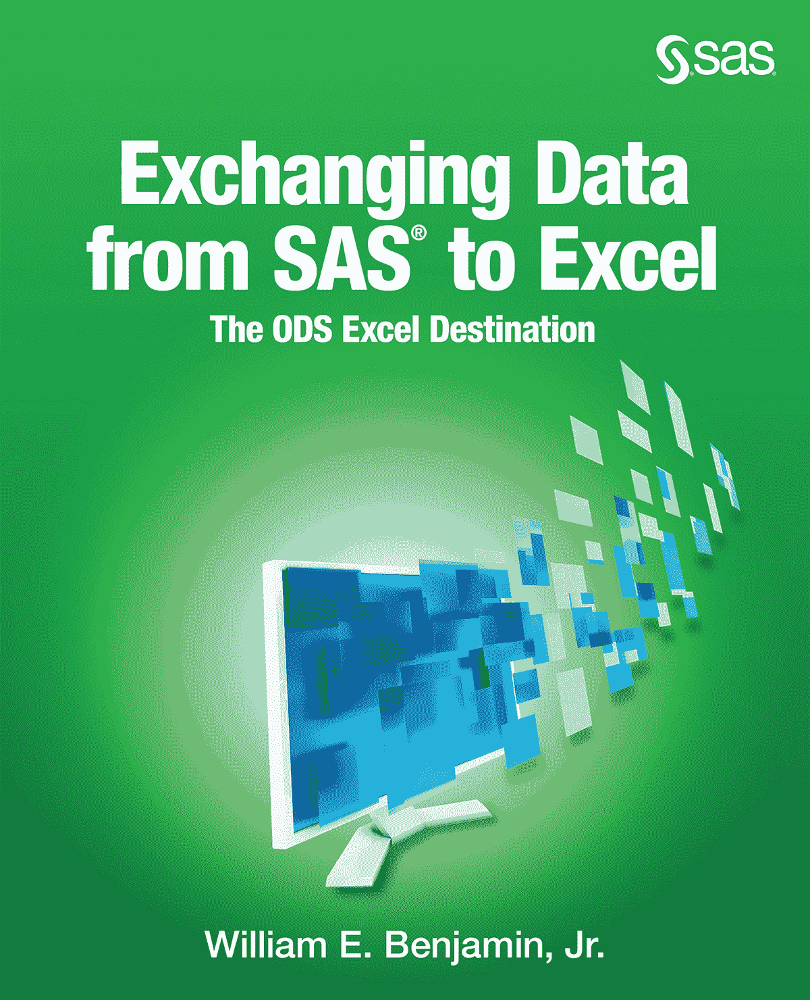


本手册的参考文献引用格式如下：Benjamin, William E., Jr. 2017. *Exchanging Data From SAS® to Excel: The ODS Excel Destination*. Cary, NC: SAS Institute Inc.

```
proc print data=sashelp;
by region;
run;
ods close;
```

图 5-7 – 索引页

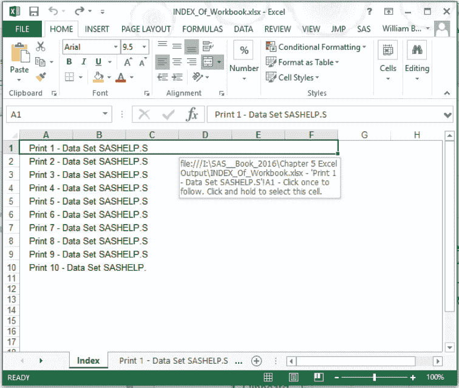

## `MSG_LEVEL=` 选项

我在这个子选项上很多麻烦。在与 SAS 技术支持进行了几次邮件交流后，我得知该选项用于识别 `EXCELXP` 集中在 ODS Excel 目标已过时的选项。因此，我尝试使用此选项确定获得什么类型的响应。SAS 代码 5-6 显示了我尝试四种使用 `MSG_LEVEL=` 子选项运行代码的方法。嗯，我将其值设置为 `NO`、`YES`、`any string`，甚至没有编写该子选项。每次都得到相似的结果。如下面的 SAS 日志 5-1 框所示。

SAS 代码 5-6 – 使用 `MSG_LEVEL=` 选项

```sas
ods excel file="&path.\MSG_LEVEL_No_in_Workbook.xlsx"
         options(MSG_LEVEL='NO'
                 MSG_LEVEL='YES'
                 MSG_LEVEL='any string'
                 ASCII_DOTS='YES'
                 CURRENCY_SYMBOL='$');
proc print data=asia_only;
var sales;
run;
ods close;
```

SAS 日志 5-1 – `MSG_LEVEL` 子选项测试的日志输出

```sas
ods excel file="&path.\MSG_LEVEL_No_in_Workbook.xlsx"
options(
  /* MSG_LEVEL='NO' */
ERROR: Option "ascii_dots" not recognized.
ERROR: Option "currency_symbol" not recognized.
NOTE: The EXCELXP option ascii_dots is not supported in this Excel tagset.
NOTE: The EXCELXP option currency_symbol is not supported in this Excel tagset.
  /* MSG_LEVEL='YES' */
  /* MSG_LEVEL='any string' */
  /* MSG_LEVEL= not even coded as an option */
  ASCII_DOTS='YES'
  CURRENCY_SYMBOL('$');
proc print data=asia_only;
var sales;
run;
NOTE: There were 14 observations read from the data set `WORK.ASIA_ONLY`.
NOTE: PROCEDURE `PRINT` used (Total process time):
      real time           0.18 seconds
      cpu time            0.10 seconds
ods excel close;
NOTE: Writing EXCEL file: I:\SAS__Book_2016\[Chapter 5] Excel Output\MSG_LEVEL_No_in_Workbook.xlsx
```

## `TAB_COLOR=` 选项

`TAB_COLOR=` 选项非常好玩。你有许多不同的方式来指定 Excel 标签页的颜色。当然，这些颜色、色调、深浅和色调在所有显示器、打印机，甚至 Excel 内部的显示效果可能并不相同。但使用颜色名称、十六进制值、红绿蓝（`RGB`）密度数组，甚至为红绿蓝添加透明度值（`RGBA`）的能力，使得这一过程变得非常灵活。它还为你提供了使用 Excel 调色板或完整的 16,777,216 色彩范围的选择。在示例中，我使用了 `SHEET_NAME=` 选项来压缩工作表上文本的大小以便查看。

### SAS 代码 5-7 – 使用 `TAB_COLOR=` 选项的若干示例

```sas
ods excel file = "&path\color_tabs.xlsx"
  options(sheet_name='A');
proc print data=Asia_only;
run;
ods excel options(tab_color='blue');
  proc print data=Asia_only;
run;
ods excel options(tab_color='#00ff00');
  proc print data=Asia_only;
run;
ods excel options(tab_color='rgb(255,00,0)');
  proc print data=Asia_only;
run;
ods excel options(tab_color='rgba(0,100,20,0.5)');
  proc print data=Asia_only;
run;
ods excel options(tab_color='rgb(0,75%,50%)');
  proc print data=Asia_only;
run;
ods excel options(tab_color='rgba(80%,0%,0%,0.75)');
  proc print data=Asia_only;
run;
ods excel close;
```

图 5-8 – 若干 `TAB_COLOR=` 选项的输出

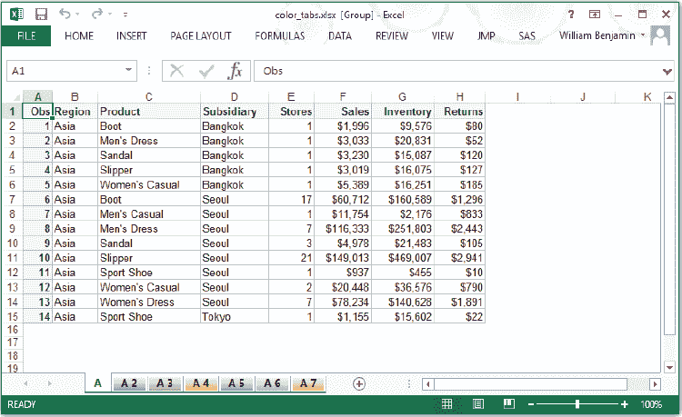

## `ZOOM=` 选项

当工作表中的数据无法适应屏幕时，你可以通过使用屏幕右下角的滑块来减小字体尺寸。这让你让你看到更多的列。`ZOOM=` 选项可以提供相同的功能，但是通过编程方式实现的。在下面我减小了工作表文本的大小，但工作簿的屏幕截图与其他图像保持相同的比例。图像中的数据并非为了可读性，这只是一个展示可以这样操作的示例。注意右下角的滑块显示为 25%。`SCALE=` 选项负责打印输出，而 `ZOOM=` 选项则用于非打印输出。

### SAS 代码 5-8 – 使用 `ZOOM=` 选项缩小图像

```sas
ods excel file="&path.\Zoomed_Workbook.xlsx"
  options(zoom='25');
proc print data=asia_only;
run;
ods excel close;
```

图 5-9 – `ZOOM` 选项的输出

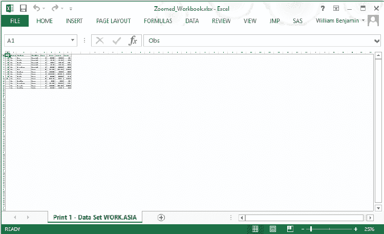

## 结论

如你所见，本章所示选项允许程序人员预设许多功能，这些功能在 Excel 文件中重新生成是非常耗耗时的。我展示了如何通过一次运行 SAS 代码生成多个不同的输出文件和文件类型，从而缩短程序执行时间并减少人为错误。手动生成目录可能需要数小时。预设标签页颜色和缩放级别的功能对于数据识别以及在屏幕或页面上的定位也有帮助。

# 第 6 章：影响输出特征的参数

## 引言

在本章中，我将讨论并展示影响最终输出工作表外观的示例。这包括 SAS `Style` 选项、层级样式表（CSS），以及影响输出 Excel 工作表中文本和图像的位置、密度和大小的选项。这些选项控制输出 Excel 文件的工作表级功能。

通过使用这些选项，你可以修改电子表格基础颜色的显示方式，以及输出工作表中单元格的大小。可以在工作表中添加文本、为超链接添加锚点、修改图形图像密度、默认的 SAS 样式可以更改工作表，并且可以应用外部层级样式表。所有这些功能都可以在工作簿创建后手动添加，但这些选项让你在工作簿创建时就能获得所需的输出。这使得工作簿能够以你想要的方式显示，并具有创建和最后修改日期。再次，数据集 `ASIA_ONLY` 定义在第 2 章。

## 影响工作表级别的参数

在本章中，我们将讨论以下 ODS Excel 目标主题。我认为这些主题会影响工作表的整体外观。

表 6-1 – ODS Excel 目标

| 参数 / 别名 | 选项 | 描述 |
| :--- | :--- | :--- |
| `DOM` | `File="外部文件名"` 或 空表示未定义 | 该选项将文档对象模型的输出写入外部文件或 SAS 日志。 |
| `ANCHOR` | `'锚点名称'` | 指定锚点标记，`'IDX'` 是默认第一个锚点。 |
| `BOX_SIZING` | `CONTENT_BOX` 或 `BORDER_BOX` | 该选项描述如何测量单元格宽度（注册表调整）。 |
| `CSSSTYLE` | `'文件规范'<(媒体类型 1<...媒体类型-10)>` | 层级样式的完全限定名称 |
| `IMAGE_DPI/DPI` | `'数字'` | 图形输出每英寸点数 |
| `STYLE` | `样式覆盖(s)` | 使用预定义的样式元素（样式更改集合）或单个（一组）样式名称-值对更改。 |
| `TEXT` | `文本字符串` | 在输出文档中插入文本字符串。 |

有关 ODS 文档对象模型（`DOM`）的更多信息，请查看以下 URL：[`support.sas.com/documentation/cdl/en/odsadvug/69833/HTML/default/viewer.htm#n0pg2pc6qv5vzhn160f8j7ap4uv1`](http://support.sas.com/documentation/cdl/en/odsadvug/69833/HTML/default/viewer.htm#n0pg2pc6qv5vzhn160f8j7ap4uv1) 或参考 SAS 手册“SAS Institute Inc. 2016. *SAS® 9.4 Output Delivery System: Advanced Topics, Third Edition*. Cary, NC: SAS Institute Inc.”

# 本书未讨论 SAS 注册表的修改

## 在 ODS EXCEL 语句中使用 ODS 文档对象模型 (DOM)

SAS 文档将 ODS 文档对象模型或 `DOM` 描述为 `ODS EXCEL` 语句可用选项之一。实际上，`DOM` 选项适用于大多数 ODS 语句，但 `ODS LISTING` 和 `ODS OUTPUT` 语句除外。上述 *SAS 9.4 Output Delivery System: Advanced Topics, Third Edition* 手指出，ODS 的 `DOM` 功能允许您“确定存在哪些元素和属性，以便构建您的 CSS 选择器来访问这些区域”。再次，由于时间限制，我不对此 ODS 功能进行详细解释。当与 `ODS EXCEL` 语句配合使用时，有两种格式可用：

1. `ODS EXCEL DOM`;
2. `ODS EXCEL DOM <="external-file">`;

语句 1 将输出写入 SAS 日志，而语句 2 将其写入外部文件。但输出长什么样呢？`SAS Code 6-1` 显示了第一种格式的语法，`SAS Log 6-1` 显示了输出的部分列表。格式 2 仅将相同的信息写入外部文件，此处未显示。我还使用了 `PROC PRINT` 来显示 `SAS Log 6-1` 中显示的输出信息。这里使用 `ODS TRACE` 语句来描述代码执行期间生成的 ODS 输出。`ODS TRACE` 语句在`第 3 章` 中简要描述。

### SAS Code 6-1 – 使用 DOM 选项识别 CSS 元素

```sas
ods trace dom;
ods excel dom;
ods excel options(sheet_interval='none');
proc print data=sashelp.shoes(where=
      (Product    = 'Boot'     and
      Subsidiary = 'New York' and
      region      = 'United States'));
run;
ods excel close;
ods trace off;
ods html;
```

`SAS Log 6-1` 仅是输出的部分列表。在此显示是为了帮助识别稍后 `ODS EXCEL ANCHOR=` 选项使用的某些元素。

### SAS Log 6-1 – DOM Trace 输出的部分列表

```
296  ods trace dom;
297  ods excel dom;
. . . more dom trace output . . .
298
299  ods excel options(sheet_interval='none');
300
301  proc print data=sashelp.shoes(where=
302         (Product    = 'Boot'     and
303          Subsidiary = 'New York' and
304          region      = 'United States'));
305  run;
      <div>
      </div>
      <section id="idx" class="oo" data-name="procprinttable" label="data set sashelp.shoes" proc="print" output="print" contents-label="data set sashelp.shoes">
. . . more dom trace output . . .
<th class="header" type="char" unformatted-type="char" index="2" name="region" data-name="region" label="region">Region
                            </th>
<th class="header" type="char" unformatted-type="char" index="3" name="product" data-name="product" label="product">Product
                            </th>
<th class="header" type="char" unformatted-type="char" index="4" name="subsidiary" data-name="subsidiary" label="subsidiary">Subsidiary
                            </th>
. . . more dom trace output . . .
type="char" index="2" name="region" data-name="region" label="region">United States
                            </td>
<td class="data" type="char" unformatted-type="char" index="3" name="product" data-name="product" label="product">Boot</td>
<td class="data" type="char" unformatted-type="char" index="4" name="subsidiary" data-name="subsidiary" label="subsidiary">New York</td>
<td class="data" type="num" . . . more dom trace output . . .
NOTE: There were observations read from the data SASHELP.SHOES. WHERE (Product='Boot') and (Subsidiary='New York') and (region='United States');
NOTE: PROCEDURE PRINT used (Total process time): real time 32 seconds cpu time 28 seconds
306
307  ods excel close;
. . . more dom trace output . . .
NOTE: Writing EXCEL file: \sasexcl.xlsx
308  ods trace off;
309  ods html;
NOTE: Writing HTML Body file: sashtml10.htm
```


加粗高亮的短语 `section id="idx"`、`class="header"` 和 `class="data"` 将在解释 ODS Anchor 选项时进行详细说明。这些是 `ODS EXCEL DOM` 选项和 `ODS TRACE` 语句显示的 CSS 元素。当然，还有许多其他元素，事实上，列表中每个 `header` 和 `data` 部分都至少存在四个其他类语句。`ODS TRACE` 列表超过了 7 页，数据量太大无法显示。`表 6-2` 包含了一些可用元素类型以及简要定义。更多信息，请参阅 SAS Institute Inc. 2014. *SAS 9.4 Output Delivery System: Third Edition*。Cary, NC: SAS Institute Inc.

## 表 6-2 – CSS 选择器类

| 若干 CSS 选择器类示例 |
| :--- | :--- |
| **选择器类** | **说明** | **示例** |
| 类选择器 (Class Selectors) | 类选择器是根据 ODS 报告标记中 `class=` 属性的值选择元素的样式选择器。类选择器在类名之前必须有一个点 (`.`)。例如，在以下规则集中，类选择器是 `.SYSTEMTITLE`。 | `.systemtitle { font-family: arial, helvetica, sans-serif; color: red; border: 1px solid black; }` |
| 元素选择器 (Element Selectors) | 元素选择器是根据元素名称选择 DOM 元素的样式选择器。例如，以下规则集选择了名为 P 的元素： | `p {color:green}` |
| 通用选择器 (Universal Selector) | 通用选择器是一种通配符样式选择器。它可以匹配任何元素名称。通用选择器的语法是星号 (`*`)。 | `*` |
| 伪类选择器 (Pseudo-Class Selectors) | 伪类选择器是根据 DOM 元素之间的关系选择元素的样式选择器。伪类由带有冒号 (`:`) 前缀的伪类名称表示。以下是使用伪类选择器的某些示例：<br>• 选择父元素的第一个和最后一个孩子<br>• 根据在父元素中的位置索引选择特定的子元素<br>• 根据特定元素的位置选择元素 | `:root` 选择 DOM 中的顶层元素。<br>`:first-child` 选择父元素内的第一个元素。<br>`:first-of-type` 选择父元素内的第一个该类型（即相同元素名称）元素。<br>`:marker` 选择打印输出中的列表项目符号。<br>`:nth-child(an+b)` 根据公式 `an + b` 选择元素。该公式选择从位置 `b` 开始的每隔 `a` 个元素。公式可以用关键字 `even` 或 `odd` 代替，用于交替选择的简单情况。<br>`:nth-of-type(an+b)` 选择 `:nth-child`，但在计算时仅使用相同类型的相同元素。<br>`:empty` 选择一个或多个空元素。这仅适用于由过程指定为空的元素。<br>`:before` 在元素之前插入内容。<br>`:after` 在元素之后插入内容<br>`:not(…)` 如果参数内的选择器不为真，则选择该元素。 |
| ID 选择器 (ID Selectors) | ID 选择器是根据 DOM 元素的 `id=` 属性选择元素的样式选择器。ID 在 DOM 中必须是唯一的，且 `id=` 属性中只能指定一个。ID 选择器由 `#` 前缀指示。以下是一个带有 ID 选择器的 CSS 规则集： | `#idx1 { font-style: italic }` |

## 属性选择器
属性选择器根据指定的属性选择 DOM 元素。ID 选择器和类选择器是特殊的属性选择器。属性选择器使用以下语法选择属性：`[*attribute operator "value"]`

| 算符 | 说明 |
| :--- | :--- |
| 运算符 | 指定了操作符。操作符允许部分匹配。 |
| `=` | 匹配整个属性值。 |
| `^=` | 匹配属性值的开头。 |
| `=$` | 匹配属性值的结尾。 |
| `*=` | 匹配属性值中的任何子字符串。 |
| `~=` | 匹配属性值中任何由空格分隔的单词。此运算符可以模拟类选择器。 |
| `\|=` | 匹配属性值以及带有连字符后缀的可选值。此运算符用于匹配语言代码，例如 `enUS`、`en-GB` 等。 |

## 组合器
组合器是根据元素在另一个元素中的部分上下文来选择元素的字符。这是通过使用以下字符之一组合选择器来实现。

| 字符 | 说明 |
| :--- | :--- |
| `" "` (空格) | 表示左侧的选择器必须匹配当前选中元素父级中任何位置的元素。 |
| `>` | 选择指定元素的直接后代。 |
| `~` | 选择在父级中任何位置具有另一个兄弟元素的元素。 |
| `+` | 选择紧接指定元素之前的元素 |

\* 这是一个特殊情况，其用法与 `PRETEXT`、`PREIMAGE`、`POSTTEXT` 和 `POSTIMAGE` 样式属性相同。

图 6-1 – 使用 DOM 选项识别 CSS 元素的 Excel 输出

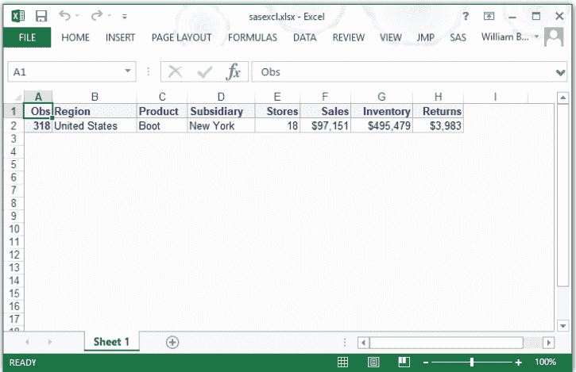

图 6-1 是示例 SAS 代码 6-1 输出的图像。它看起来非常简单。这里没有任何惊喜。SAS 代码 6-1 中的代码没有对工作簿应用任何样式更改。它只是限制了处理的行数，以便使 DOM 跟踪输出足够小，从而允许识别供以后使用的几个 CSS 元素。

## ODS ANCHOR= 选项
锚点标签是 ODS 输出的重要组成部分。你可以指定 `ANCHOR` 或允许 ODS 使用默认名称生成它们。语法是提供关键字 `ANCHOR` 和 `anchor-name`，如下：`ANCHOR='anchor-name'`。默认锚点名称为 `id="idx"`。一旦指定了第一个锚点，该名称将被使用，并在下一个锚点的末尾添加一个数字。SAS 代码 6-2 中的代码创建了一个带有两个引用的用户自定义级联样式表，分别为 `#Expense .header` 和 `#Expense .data`。这些引用中的每一个都会修改 Excel 输出工作表的某些部分的颜色。当你使用 `ANCHOR` 时，你正在更改当前正在使用的样式表输出的 `ID=` 属性，这在 SAS 样式表和级联样式表 (`#ID=`) 中均是有效的。要识别这些锚点出现在输出样式中的位置，请使用 DOM 选项。上面描述了如何使用 ODS EXCEL DOM 选项的示例，请参阅 SAS 代码 6-1。

在本节中，我将提供一个简单的示例。关于这个主题有许多文档、论文和书籍，你可以在其中找到更多示例。维护 CSS 标准的世界维网联盟（W3C）官方网站是 [`www.w3.org/Style/CSS/`](https://www.w3.org/Style/CSS/)。

关于此类数据操作的另一个良好来源是位于以下 URL 的 SAS Global Forum 论文：[`support.sas.com/resources/papers/proceedings15/SAS1880-2015.pdf`](http://support.sas.com/resources/papers/proceedings15/SAS1880-2015.pdf)

SAS 代码 6-2 – 使用样式表修改 Excel 输出。

```sas
***** 构建一个级联样式表文件;
filename my_css "css_text.css";
data _null_;
   file my_css noprint nottitles linesize=256;
   put
      '#Expense .header {background-color:orange}' /
      '#Expense .data   {background-color:pink  }' ;
run;
Ods html close;

***** 使用一个级联样式表文件;
ods excel cssstyle = "css_text.css"
          options(sheet_interval='none');

***** 使用 ANCHOR;
ods excel anchor="expense";
proc print data=sashelp.shoes(where=
      (Product     = 'Boot'     and
      Subsidiary = 'New York' and
      region      = 'United States'));
run;
ods excel close;
ods html;
```

在 SAS 代码 6-2 中创建的 CSS 文件将背景色修改为橙色和粉色。ODS EXCEL `cssstyle=` 选项将在后描述。图 6-2 – 使用 ANCHOR= 选项的 Excel 输出

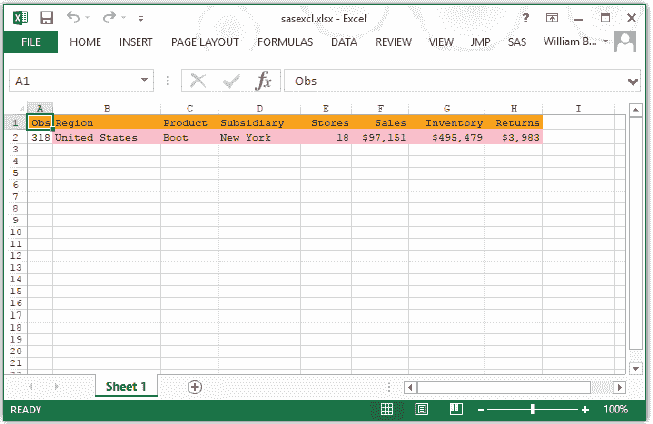
注意列 `A` 是 `DATA` 元素，而不是 `HEADER`。

## _SIZING= 选项
`_SIZING=` 选项很难看到，我在这里显示代码。`_SIZING=` 选项在文档中不可见，但 `SIZE` 属性是可见的。网站提供了更多细节：[`www.w3.org/TR/2002/css-pos-model-3/`](http://www.w3.org/TR/2002/css-pos-model-3/) 或 [www.w3.org/TR/2002/css-box-model-3/](http://www.w3.org/TR/2002/css-box-model-3/)。网页说 `CONTENT=` 选项从单元导出宽度，而 `BORDER=` 选项将导出边框宽度。

SAS 代码 6-3 – _SIZING= 选项
```sas
ods excel file = "\path\box_sizing.xlsx"
          _sizing=border_box;
proc print data=Asia_only;
run;
ods excel close;
```

## 使用 CSSSTYLE= 选项使用级联样式表
SAS 和级联样式表的使用非常广泛，甚至我针对这个主题写过一篇论文。我展示了如何使用 ODS 目标创建并将简单的 CSS 文件引入 Excel。为了省你去查那篇论文的麻烦，我将包含其中的信息。

### 使用 CSS 文件进行颜色更改
本节将提供一个示例，如何使用几行 SAS 代码生成的 CSS 文件对输出 Excel 工作表的 `body`、`header`、`rowheader` 和 `data` 部分进行颜色更改。

SAS 代码 6-4 – 创建级联样式表文件和简单的 SAS 工作文件
```sas
* 定义 CSS 输出文件;
filename css "\path.\my_css_1.css";
* 写入 css 文件;
data _null_;
   file css noprint linesize=132;
   put
      ".body  {background-color: lightblue;  } /
      ".header{background-color: gold;   } /
      ".rowheader {background-color: purple;   " /
      "            color: white;            } /
      ".data  {background-color: lightgreen; } " ;
run;
* 创建要写入 Excel 的简单文件;
options linesize=255;
data test_css;
   Column_a =  'My test item 1'; output;
```

```sas
Column_a = 'My test item 2'; output;
Column_a = 'My test item 3'; output;
Column_a = 'My test item 4'; output;
Column_a = 'My test item 5'; output;
Column_a = 'My test item 6'; output;
Column_a = 'My test item 7'; output;
run;
```

`my_css_1.css` 文件是一个层叠样式表，它更改了输出 Excel 工作簿中五个不同部分的颜色。SAS 数据集 `test_css` 仅仅是七个没有意义的字符字符串。这两个文件都在 SAS 代码 6-5 和 SAS 代码 6-6 中使用。

### SAS 代码 6-5 – 不使用层叠样式表创建 Excel 工作簿

\* 在不进行 CSS 修改的情况下将文件写入 EXCEL；

```sas
ods excel file = "&path.\Css_file_1.xlsx";
proc print data=test_css;
run;
ods excel close;
```

此代码生成了一个简单的 Excel 工作簿，如图 6-3 所示。

### 图 6-3 – 不使用层叠样式表的 Excel 工作簿

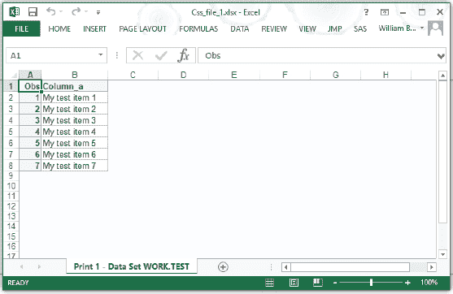

在图 6-3 中创建的工作簿没有应用任何特殊功能。

### SAS 代码 6-6 – 使用层叠样式表创建 Excel 工作簿

\* 将带有 CSS 修改将文件写入 EXCEL；

```sas
ods excel file = "&path.\Css_file_2.xlsx"
      cssstyle = "&path.\my_css_1.css";
proc print data=test_css;
run;
ods excel close;
```

### 图 6-4 使用层叠样式表的 Excel 工作簿

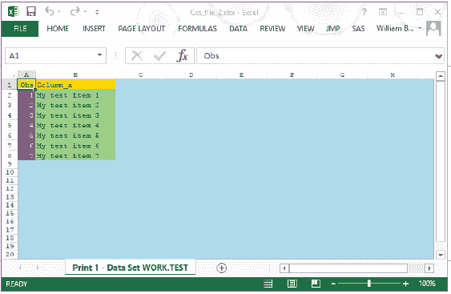

颜色可以产生显著的差异，但请选择你自己的颜色，效果可能会更好。

### 将图表发送到 Excel 并使用 CSS 文件修改输出

你在生活中会发现的一件事是，通过学习很多知识，你会发现还有很多东西需要学习。这本书的意图并不是教你所有关于 ODS Excel 选项和子选项的内容。但由于 CSS 的规模和流行程度，如果不展示一个向 Excel 电子表格中添加图表和图像并使用 `ODS CSSSTYLE=` 选项进行修改的示例，将是失职。

首先，让我们创建一个 CSS 文件，对图形输出图像进行一些神奇的颜色更改。

### SAS 代码 6-7 – 用于更改图形颜色的 CSS 文件

```sas
filename my_css "my_css_2.css";
data _null_;
   file my_css noprint notitles linesize=132;
   put
     ".graphbackground       {background-color: orange;     } " /
     ".graphtitle1text       {color: blue; Font: 20pt arial;  " /
     "                               font-weight: bold;          } " /
     ".graphfootnotetext      {color: blue; Font: 12pt arial;  " /
     "                               font-weight: bold;          } " /
     ".graphvaluetext         {color: black;              } " /
     ".graphdata1            {color: red;              } " /
     ".graphdata2            {color: white;              } " /
     ".graphdata3            {color: blue;              } " /
     ".graphdata4            {color: red;              } " /
     ".graphdata5            {color: white;              } " /
     ".graphdata6            {color: blue;              } " /
     ".graphdata7            {color: red;              } " /
     ".graphdata8            {color: white;              } " /
     ".graphdata9            {color: blue;              } " ;
run;
```

现在，我们需要一种重现图表的方法，以便可以在两个工作簿中显示。

### SAS 代码 6-8 – 生成图表的宏

```sas
%macro Graph_it*;
   PROC SQL;
      CREATE VIEW WORK.Sorted_1 AS
      SELECT T.Region, T.Sales
      FROM SASHELP.SHOES(WHERE=(Region ne "Asia")) as T;
   QUIT;
      Legend1
      FRAME
      POSITION = (BOTTOM CENTER OUTSIDE);
      TITLE1 "Pie Chart of SASHELP.Shoes Return data by Region";
```


`TITLE2 "Execpt Asia";`

`FOOTNOTE1 "Produced by William E Benjamin Jr";`

`PROC GCHART DATA =WORK.Sorted_1;`

`PIE3D  Region / SUMVAR=Sales`

`TYPE=SUM           LEGEND=LEGEND1`

`SLICE=OUTSIDE      PERCENT=OUTSIDE`

`VALUE=OUTSIDE      OTHER=4`

`OTHERLABEL="Other"  COUTLINE=BLACK`

`NOHEADING;`

`RUN;`

`QUIT;`

`TITLE;`

`FOOTNOTE;`

`RUN;`

`%mend Graph_it;`

### SAS 代码 6-9 – 不使用 CSS 输出图表

```sas
/* CSS 修改 */
ods excel file = "&path.\Test_css_1.xlsx";
%graph_it;
ods excel close;
```

此代码执行宏以生成图表，没有应用任何 CSS 修改，输出基于默认样式。

### 图 6-5 – 不使用 CSS 的 Excel 图表

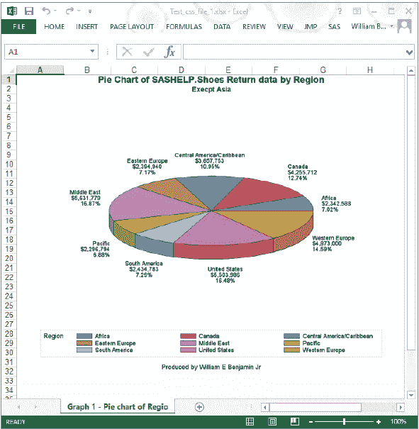

图 6-5 中图表的每个部分都有自己的颜色。

### SAS 代码 6-10 – 使用 CSS 输出图表

```sas
/* CSS 修改 */
ods excel file = "&path.\Test_css_2.xlsx"
      cssstyle = "&path.\my_css.css";
%graph_it;
ods excel close;
```

CSS 文件对图表产生了巨大影响。它色彩更加丰富，但可读性较低。我从未说过所有的 CSS 文件都会让输出变得更好。但希望这些代码段可以为你提供一些参考，帮助你弄清楚 CSS 文件是如何更改图形输出的。

### 图 6-6 – 使用 CSS 的 Excel 图表

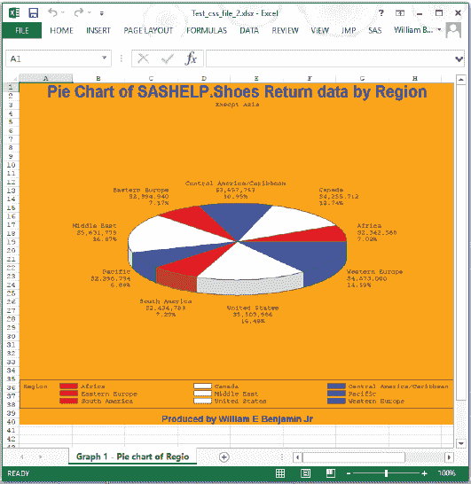

在创建 Excel 工作簿时，`my_css.css` 已应用于 SAS 输出。

### 使用 CSS 添加背景图像

CSS 文件和 URL 用于多种应用程序，而不仅仅是工作簿。你知道你可以轻松地使用 SAS 提供的图形图像，当你想要美化电子表格时，也可以使用照片图像。在 SAS 代码 6-1 的示例中，我使用了图 6-6 相同的图表并添加了图像。我特意选择了一个比需要的更大的图像。我缩小了图表，以便马的脸完全可见。这样做是为了展示图像会重复。在图像右侧可以看到棕色。这是图像开始重复的地方。

### SAS 代码 6-11 – 构建包含引用的 CSS 文件

```sas
filename my_css "my_css.css";

* 查看 SAS 代码 6-0 关于 &path 的定义
* 下载的文件 Wild_Horse_in_AZ.tif 位于
* [第 6 章] SAS 代码，它需要移动到 &path 目录；

data _null_;
   file my_css noprint notitles linesize=132;
   put
     ".body              {background-image :           url(&path\Wild_horse_in_AZ.tif);} " /
     ".graphbackground       {background-color: orange;     } " /
     ".graphtitle1text       {color: blue; Font: 20pt arial;  " /
     "                               font-weight: bold;          } " /
     ".graphfootnotetext      {color: blue; Font: 12pt arial;  " /
     "                               font-weight: bold;          } " /
     ".graphvaluetext         {color: black;              } " /
     ".graphdata1            {color: red;              } " /
     ".graphdata2            {color: white;              } " /
     ".graphdata3            {color: blue;              } " /
     ".graphdata4            {color: red;              } " /
     ".graphdata5            {color: white;              } " /
     ".graphdata6            {color: blue;              } " /
     ".graphdata7            {color: red;              } " /
     ".graphdata8            {color: white;              } " /
     ".graphdata9            {color: blue;              } " ;
run;
```

此代码中添加了向 Excel 工作簿添加图像的 URL，并带有关于在何处查找和放置图片的注释。

### SAS 代码 6-12 – 使用 CSS 文件包含 URL 引用

```sas
/* with CSS style modification */
ods excel file = "&path.\Test_css_file_3.xlsx"
    cssstyle = "&path.\my_css_3.css"
    options(zoom='15');
%***graph_it***;
ods excel close;
```

请确保查看了 SAS 代码 6-11 以验证宏变量 `&PATH` 所指向的位置。然后调整文件名和图像名称，以便能够读取你想要的图像。图像越小，重复模式的模式就越明显。在图 6-7 中，我将图表做得非常小，仅为正常尺寸的 15%，以展示图片。

### 图 6-7 – 添加了 CSS 和 URL 的 Excel 图表

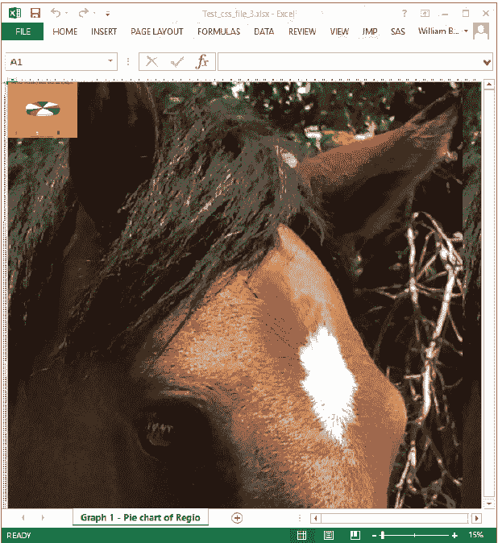

### `IMAGE_DPI=` 选项

此 ODS EXCEL 选项允许你调整输出图像的像素密度。每英寸像素较多的图像可以放大而清晰度下降不会像低密度图像那样快。为了显示此选项的效果，我生成了两个不同 `IMAGE_DPI` 值的图像。SAS 代码 6-13 创建了一个默认 `IMAGE_DPI` 密度为每英寸 150 像素的图像。而 SAS 代码 6-14 代码使用的 `IMAGE_DPI` 为 700。图 6-8 和图 6-9 在 Excel 中查看时都被放大了正常尺寸的 400 倍。

注意，当 `IMAGE_DPI` 过大时可能会耗尽内存，如果内存不足，可能需要将 SAS 的 `MEMSIZE=` 系统选项增加到 2GB 以上的值。

### SAS 代码 6-13 – 使用默认 `IMAGE_DPI` 设置创建 Excel 图表

```sas
ods excel file = "&path.\Test_file_5.xlsx";
%***graph_it***;
ods excel close;
```

### 图 6-8 – 使用默认 `IMAGE_DPI` 设置的 Excel 图表

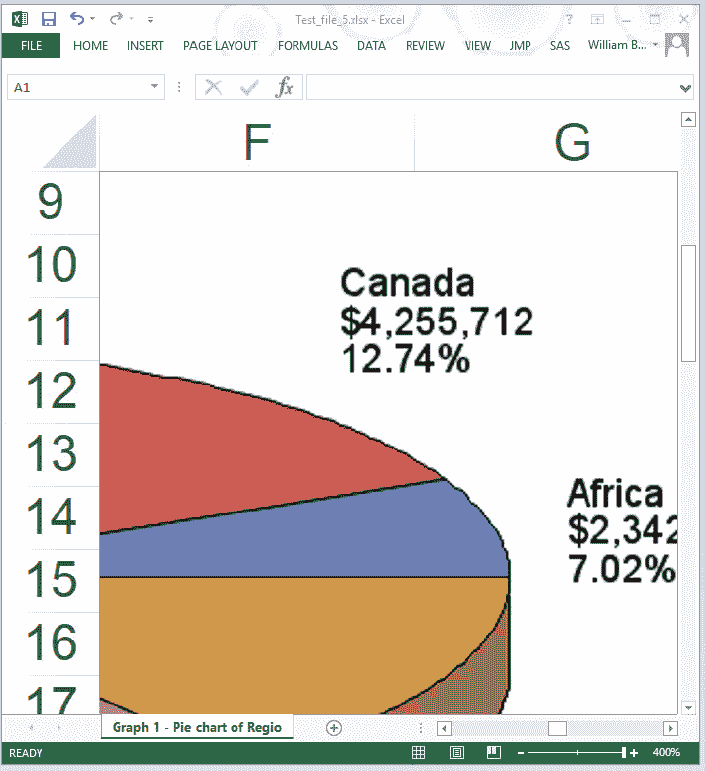

注意饼图上的粗糙边缘以及数字“7”和“2”的笔画。

### SAS 代码 6-14 – 使用 `IMAGE_DPI=700` 设置创建 Excel 图表

```sas
ods excel file = "&path.\Test_file_6.xlsx"
    image_dpi='700';
%***graph_it***;
ods excel close;
```

### 图 6-9 – 设置 `IMAGE_DPI = 700` 的 Excel 图表

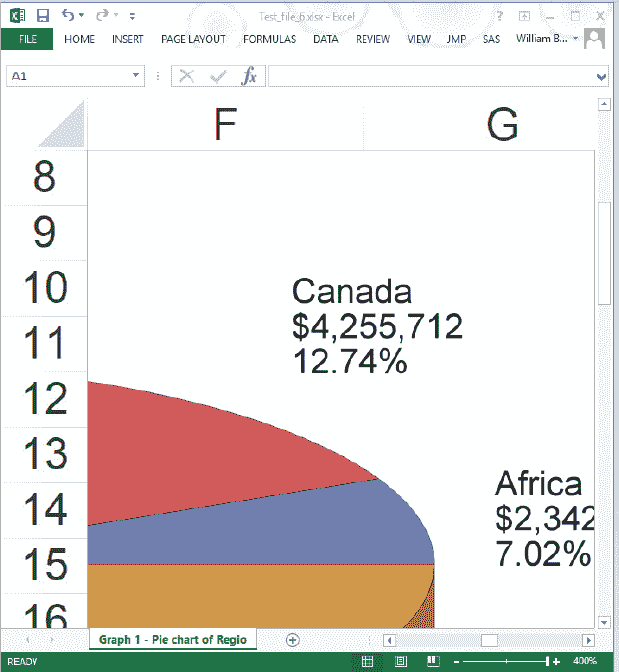

看饼图边缘的清晰线条，数字“7”和“2”看起来不再模糊了。

### `STYLE=` 选项

在我们使用的每个 ODS 输出内容之下，都隐藏着一个默认样式。当使用 `ODS EXCEL` 语句写入 Excel 工作簿时，始终使用一种样式。默认的 `STYLE` 是 `EXCEL`。`ODS EXCEL STYLE=` 选项允许你修改该默认样式。

### `ODS EXCEL STYLE=` 选项

有一种方法可以确定当前版本中可用的样式。SAS 代码 6-15 生成可用样式列表。它们通过 `PROC TEMPLATE` 显示。它们存储在 `SASHELP.TMPLMST` 库中。下方的“支持的 SAS 样式表”包含了 SAS 9.4 1M3 支持的样式名称。SAS 代码打印了一个列表，我将该列表复制到了所示表中。

### SAS 代码 6-15 – 生成 SAS 支持的样式列表

```sas
ods _all_ close;
ods listing;
proc template;
    list styles;
run;
quit;
```

SAS 版本 9.4 1M3 支持的 SAS 样式列表

| 支持的 SAS 样式列表 (SAS 9.4 1M3) | | | |
| :--- | :--- | :--- | :--- |
| Analysis | BarrettsBlue | BlockPrint | DTree |
| Daisy | Default | Dove | EGDefault |
| Excel | FancyPrinter | Festival | FestivalPrinter |
| Gantt | GrayscalePrinter | HTMLBlue | Harvest |
| HighContrast | HighContrastLarge | Journal | Journal1a |
| Journal2 | Journal2a | Journal3 | Journal3a |
| Listing | Meadow | MeadowPrinter | Minimal |
| MonochromePrinter | Monospace | Moonflower | Netdraw |
| NoFontDefault | Normal | NormalPrinter | Ocean |
| Pearl | PearlJ | Plateau | PowerPointDark |
| PowerPointLight | Printer | Raven | Rtf |
| Sapphire | SasDocPrinter | SasWeb | Seaside |
| SeasidePrinter | StatDoc | Statistical | Word |
| vaDark | vaHighContrast | vaLight | |

### SAS 代码 6-16 – 使用 `STYLE=SEASIDE` 创建 Excel 工作簿

```sas
ods excel file = "&path.\Test_file_Style_1.xlsx"
    style=SEASIDE;
```


在我们使用的每个 ODS 输出内容之下，都隐藏着一个默认样式。当使用 ODS EXCEL 语句写入 Excel 工作簿时，始终使用一种样式。默认的 STYLE 是 EXCEL。ODS EXCEL STYLE= 选项允许你修改该默认样式。

## EMBEDDED_FOOTNOTES= 子选项

### 嵌入脚注已关闭

### 嵌入脚注已开启

### 工作表中嵌入脚注设为‘ON’且有多个输出

## The EMBED_FOOTNOTES_ONCE= 子选项

### 只有一个输出表的 EMBED_FOOTNOTES_ONCE

### 具有多个输出表的 EMBED_FOOTNOTES_ONCE

## EMBEDDED_TITLES= 子选项

### EMBEDDED_TITLES=‘OFF’

### EMBEDDED_TITLES=‘ON’

## The EMBED_TITLES_ONCE= 子选项

### 只有一个输出工作表的 EMBED_TITLES_ONCE

### 工作表中有多个输出的 EMBED_TITLES_ONCE

## FITTOPAGE= 子选项

## GRIDLINES= 子选项

## PAGES_FITHEIGHT= 子选项

## PAGES_FITWIDTH= 子选项

## SHEET_INTERVAL= 子选项

### SHEET_INTERVAL=‘BYGROUP’ 示例

### SHEET_INTERVAL=‘PAGE’ 示例

### SHEET_INTERVAL=‘PROC’ 示例

### SHEET_INTERVAL=‘NONE’ 示例

### SHEET_INTERVAL=‘TABLE’ 示例

## SHEET_LABEL= 子选项

## SHEET_NAME= 子选项

## SUPPRESS_BYLINES= 子选项

## 结论

## 引言

本章将讨论影响整个工作簿级别输出的 ODS Excel 选项。我们将讨论标题、脚注、页面对齐、工作表间隔、页签标签以及 BYLINE（行行）的放置。虽然这些 ODS Excel 选项可能会影响单个工作表，如果在 Excel 工作簿生成期间一直保持不变，这些选项具有影响许多页面的潜力。因此，我认为它们会影响整个工作簿。

这些选项中的大多数直接影响工作表的视觉显示，但 `FIT` 选项（`FIT_TO_PAGE`、`PAGES_FITHEIGHT` 和 `PAGES_FITWIDTH`）仅在 Excel 工作簿中设置选项。这三个选项的实际效果仍然完全由 Excel 控制。这意味着在发生打印时，Excel 可能会收缩或扩展数据。Excel 还会管理 SAS 提供的标题和脚注，这可能会导致打印输出上的数据重叠。

部分屏幕截图包含了 Excel 的“页面设置”工作表。当使用 Microsoft Excel 2013 时，可以在“页面布局”选项卡下的“打印标题”选项中找到“页面设置”。“页面设置”工作表有四个选项卡：“页面”、“边距”、“页眉/页脚”和“工作表”。

## ODS Excel 目标子选项

在本章中，我们将讨论以下 SAS ODS Excel 目标主题。

表 7-1 – ODS Excel 目标操作

| 子选项参数 | 值 | 说明 |
| --- | --- | --- |
| `EMBEDDED_FOOTNOTES` | ‘OFF’, ‘ON’,‘YES’, ‘NO’ 默认值 = ‘OFF’ | 此选项指定是否应将脚注嵌入到工作表中。负值选项导致脚注不添加到 Excel 工作表中。 |
| `EMBED_FOOTNOTES_ONCE` | ‘OFF’, ‘ON’,‘YES’, ‘NO’ 默认值 = ‘OFF’ | 此选项控制嵌入脚注是否显示在工作表底部。正响应（`YES` 和 `ON`）导致脚注仅在工作表底部出现一次。负响应（`OFF` 和 `NO`）会导致嵌入脚注显示在工作表输出的底部。选项名别名 = “EMBED_FOOTERS_ONCE” |
| `EMBEDDED_TITLES` | ‘OFF’, ‘ON’,‘YES’, ‘NO’ 默认值 = ‘OFF’ | 此选项指定是否应将标题嵌入到工作表中。正响应（`YES` 和 `ON`）导致标题显示在工作表中。 |
| `EMBED_TITLES_ONCE` | ‘OFF’, ‘ON’,‘YES’, ‘NO’ 默认值 = ‘OFF’ | 此选项控制嵌入标题是否显示在工作表底部。正响应（`YES` 和 `ON`）导致标题在工作表顶部出现一次。 |
| `FITTOPAGE` | ‘OFF’, ‘ON’,‘YES’, ‘NO’ 默认值 = ‘OFF’ | 此选项决定是否嵌入标题。正响应（`YES` 和 `ON`）开启此选项，而负响应（`OFF` 和 `NO`）关闭它。 |
| `GRIDLINES` | ‘OFF’, ‘ON’,‘YES’, ‘NO’ 默认值 = ‘OFF’ | 此选项控制 Excel 是否应该尝试适应。正响应（`YES` 和 `ON`）开启此选项，而负响应（`OFF` 和 `NO`）关闭它。 |
| `PAGES_FITHEIGHT` | ‘number’ | 此选项指定垂直适应多少页。 |
| `PAGES_FITWIDTH` | ‘number’ | 此选项指定横向适应多少页。 |
| `SHEET_INTERVAL` | ‘BYGROUP’, ‘PAGE’, ‘PROC’, ‘NONE’, ‘TABLE’ 默认值 = ‘TABLE’ | 此选项决定何时创建新的工作表。 |
| `SHEET_LABEL` | ‘text-string’, ‘NONE’ 默认值 = ‘NONE’ | 如果提供了，则使用 `text-string` 作为标签。 |
| `SHEET_NAME` | ‘text-string’ | 提供时，则使用 `text-string` 作为名称。 |
| `SUPPRESS_BYLINES` | ‘OFF’, ‘ON’,‘YES’, ‘NO’ 默认值 = ‘OFF’ | 正响应抑制工作表中 BYline 行的输出。 |

## The EMBEDDED_FOOTNOTES= 子选项

此处显示的 `EMBEDDED_FOOTNOTES=` 子选项将 SAS 脚注发送到输出的 Excel 工作表。这通常与 `EMBEDDED_TITLES=` 子选项一起使用，将 SAS 标题和脚注放在 Excel 工作表页面。当产生多个页时，脚注会出现在每页上。可以更改脚注，新脚注将出现在下一个输出工作表中。当将多个输出发送到一个工作表时，可以在同一工作表的不同输出之间更改脚注。默认值或 `EMBEDDED_FOOTNOTES=‘OFF’`（或 `NO`）会导致不输出脚注。

### 嵌入脚注关闭

当 `EMBEDDED_FOOTNOTES` 关闭时（默认值），从 SAS 发送的脚注不会显示在 Excel 工作表页面。

#### SAS 代码 7-1 – 使用 `EMBEDDED_FOOTNOTES='OFF'` 选项

生成图 7-1 中 Excel 文件的代码（Chapter7_ch7-fig1）：

```sas
footnote 'foot note one';

ods excel file = "&path\Footnote_off.xlsx"
    options(EMBEDDED_FOOTNOTES='off');

proc print data=Asia_only;
run;

ods excel close;
```

在 SAS 代码 7-1 中，SAS 代码有一个脚注，但输出工作表图 7-1 显示没有 SAS 脚注。

#### 图 7-1 – 关闭 `EMBEDDED_FOOTNOTES=` 选项的 Excel 输出

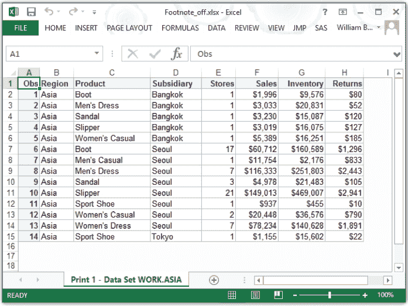

当关闭 `EMBEDDED_FOOTNOTES=` 选项时，输出工作表的底部不会出现任何 SAS 脚注。这是 `EMBEDDED_FOOTNOTES=` 子选项的默认设置。这对于大多数应用程序都非常有效，因为它不会在输出工作表的任何列中放置字母。

### 开启嵌入式脚注

当开启 `EMBEDDED_FOOTNOTES` 时，来自 SAS 的脚注将显示在 Excel 工作表页面上。相关代码请参阅 SAS 代码 7-2。

#### SAS 代码 7-2 – 使用 `EMBEDDED_FOOTNOTES='ON'` 选项

用于生成图 7-2 中 Excel 文件的代码：

```sas
ods excel file = "&path\Footnote_on.xlsx"
    options(EMBEDDED_FOOTNOTES='on');

proc print data=Asia_only;
run;

ods excel close;
```

#### 图 7-2 – 开启 `EMBEDDED_FOOTNOTES=` 选项的 Excel 输出

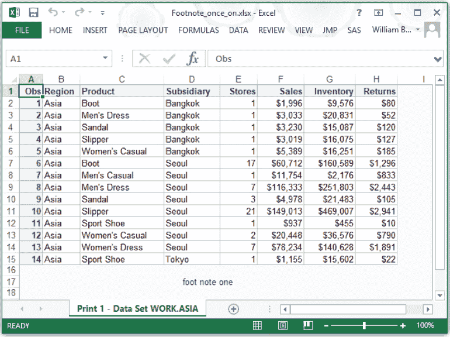

图 7-2 显示了一个开启了 `EMBEDDED_FOOTNOTES=` 选项的工作表。SAS 脚注出现在输出工作表的底部。在这里，子选项 `EMBEDDED_FOOTNOTES` 在输出表格底部之后生成脚注文本‘footnote one’。

### 在工作表上有多个输出时设置 `EMBEDDED_FOOTNOTES=‘ON’`

在使用 `EMBEDDED_FOOTNOTES=` 子选项配合 `SHEET_INTERVAL='NONE'` 子选项时，多个 SAS 输出可以出现在同一个工作表中，并且可以为每个 SAS 输出显示脚注。编码示例请参阅 SAS 代码 7-3，Excel 输出示例请参阅图 7-3。

#### SAS 代码 7-3 – 使用 `EMBEDDED_FOOTNOTES` 和 `SHEET_INTERVAL` 子选项

用于生成图 7-3 中 Excel 文件的代码：

```sas
ods excel file = "&path\Footnote_on_multiple.xlsx"
    options(
        EMBEDDED_FOOTNOTES='on'
        SHEET_INTERVAL='none'
    );

proc print data=Asia_only;
run;

footnote 'footnote two';

proc print data=Asia_only;
run;

ods excel close;
```

此代码生成了一个包含两个输出表格的 Excel 工作表，每个表格后面都有一个脚注。详情请参阅图 7-3。

#### 图 7-3 – `EMBEDDED_FOOTNOTES=` 选项开启且同一工作表上有多个输出

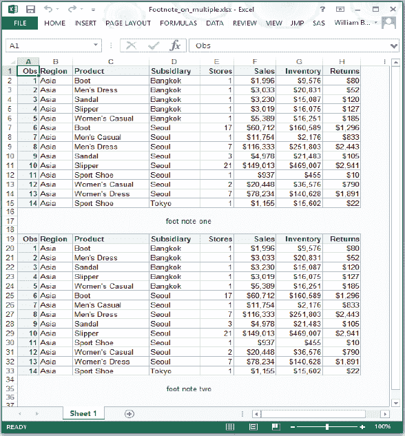

在图 7-3 中，`EMBEDDED_FOOTNOTES=` 选项在第一个输出表格之后生成脚注文本‘foot note one’，在第二个表格之后生成脚注‘foot note two’。这两个输出表格都是通过 `SHEET_INTERVAL=` 子选项发送到同一个工作表的。

## `EMBED_FOOTNOTES_ONCE=` 子选项

在 SAS 代码 7-4 中，`EMBED_FOOTNOTES_ONCE=` 子选项与 `EMBEDDED_FOOTNOTES=` 子选项结合使用。由于 SAS 代码 7-4 仅向 Excel 输出一个 SAS 表格，这里使用的 `EMBED_FOOTNOTES_ONCE` 子选项看起来像是不起作用的额外代码。然而，SAS 代码 7-5 中的代码将两个表格发送到输出的 Excel 工作表。这里没有显示 `EMBEDDED_FOOTNOTES='OFF'` 的输出，因为它看起来与图 7-1 相同。

### 只有一个输出表格时使用 `EMBED_FOOTNOTES_ONCE`

#### SAS 代码 7-4 – 显示如何在工作表上仅打印一次脚注

```sas
footnote 'foot note one';

ods excel file = "&path\Footnote_once_on.xlsx"
    options(
        EMBEDDED_FOOTNOTES='on'
        EMBED_FOOTNOTES_ONCE='on'
    );

proc print data=Asia_only;
run;

ods excel close;
```

SAS 代码 7-4 仅输出一个表格和一个脚注。

#### 图 7-4 – `EMBEDDED_FOOTNOTES` 和 `EMBED_FOOTNOTES_ONCE` 均为‘ON’的 Excel 输出

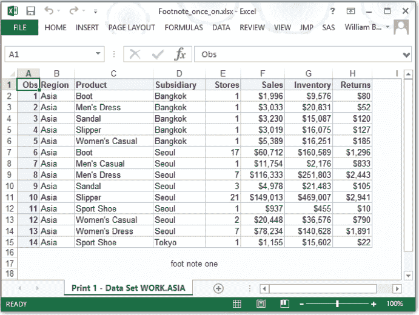

看起来 SAS 代码 7-4 没做任何事，但请看 SAS 代码 7-5 以查看不同的结果。

### 有多个输出表格时使用 `EMBED_FOOTNOTES_ONCE`

在 SAS 代码 7-5 中，使用了 `EMBED_FOOTNOTES_ONCE=` 子选项配合 `EMBEDDED_FOOTNOTES=` 子选项。由于 SAS 代码 7-5 输出了两个 SAS 表格，`EMBED_FOOTNOTES_ONCE` 子选项在这里起到了作用。输出结果如图 7-5 所示。`EMBEDDED_FOOTNOTES='OFF'` 的输出未在此处显示。

#### SAS 代码 7-5 – 在工作表上仅打印一次脚注

```sas
footnote 'foot note one';

ods excel file = "&path\Footnote_once_on.xlsx"
    options(
        EMBEDDED_FOOTNOTES='on'
        EMBED_FOOTNOTES_ONCE='on'
        SHEET_INTERVAL='none'
    );

proc print data=Asia_only;
run;

footnote 'foot note two';

proc print data=Asia_only;
run;

ods excel close;
```

SAS 代码 7-4 仅输出一个表格和一个脚注。

#### 图 7-5 – `EMBEDDED_FOOTNOTES=` 和 `EMBED_FOOTNOTES_ONCE` 均为‘ON’且同一工作表上有多个输出

（注：此处根据原文逻辑对应，原文中该段描述略有重复，已按语境翻译）

*（纠正：原文在该部分存在描述错乱，以下为根据逻辑重新翻译对应的 SAS 代码 7-5）*

#### SAS 代码 7-5 – 在工作表上仅打印一次脚注

```sas
footnote 'foot note one';

ods excel file = "&path\Footnote_on_multiple.xlsx"
    options(
        EMBEDDED_FOOTNOTES='on'
        EMBED_FOOTNOTES_ONCE='on'
        SHEET_INTERVAL='none'
    );

proc print data=Asia_only;
run;

footnote 'foot note two';

proc print data=Asia_only;
run;

ods excel close;
```

此代码生成了一个包含两个输出表格的 Excel 工作表，每个表格后面都有一个脚注。详情请参阅图 7-5。

*（注：原文文本中 Figure 7-5 的标题和 SAS Code 7-5 的描述似乎存在排版上的重复，翻译时已根据 Markdown 结构进行了对齐处理。）*

#### SAS 代码 7-5 – 在工作表上仅打印一次脚注

```sas
footnote 'foot note one';

ods excel file = "&path\Footnote_on_multiple.xlsx"
    options(
        EMBEDDED_FOOTNOTES='on'
        EMBED_FOOTNOTES_ONCE='on'
        SHEET_INTERVAL='none'
    );

proc print data=Asia_only;
run;

footnote 'foot note two';

proc print data=Asia_only;
run;

ods excel close;
```

`SAS Code 7-8` 生成了图 7-8 所示的输出，显示了两个输出表，每个表都有自己的标题。

#### 图 7-8 – 使用 `EMBEDDED_TITLES=‘ON’` 和两个 SAS TITLE 语句的 Excel 输出

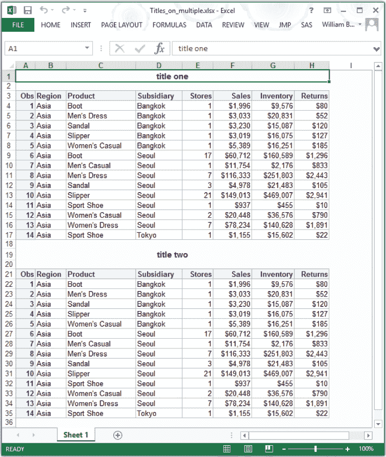

`Figure 7-8` 显示了如何在过程输出表之间更改标题。在这里，使用了 `SHEET_INTERVAL=` 选项‘NONE’来强制将两个过程的 SAS 输出到同一个 Excel 工作表中。

## `EMBEDDED_TITLES_ONCE=` 子选项

此处显示的 `EMBEDDED_TITLES_ONCE=` 子选项与 `EMBEDDED_TITLES=` 子选项配合使用。SAS 标题通过 `EMBEDDED_TITLES=` 选项发送到输出的 Excel 工作表中。`EMBEDDED_TITLES_ONCE` 确保标题只在页顶部出现一次。

### `EMBEDDED_TITLES_ONCE` 与仅有的输出工作表

`EMBEDDED_TITLES_ONCE=` 子选项将第一个活动的 SAS 标题置于 Excel 工作表页。当产生多个页面时，标题会出现在每个页上。标题可以更改，新标题将出现在下一个输出工作表中。当将多个输出发送到一个工作表时，脚注可以在输出之间进行更改，但只会显示第一组活动标题。

#### SAS Code 7-9 – EMBEDDED_TITLES_ONCE= 子选项

```sas
Title 'title one';

ods excel file = "&path\Title_once_on.xlsx"
```


`options(EMBEDDED_TITLES='on' EMBEDDED_TITLES_ONCE='on');`

`proc print data=Asia_only;`

`run;`

`ods excel close;`

当仅有一个 `TITLE` 语句处于活动状态时，将使用它。

图 7-9 – EMBEDDED_TITLES_ONCE= 子选项设置为‘ON’

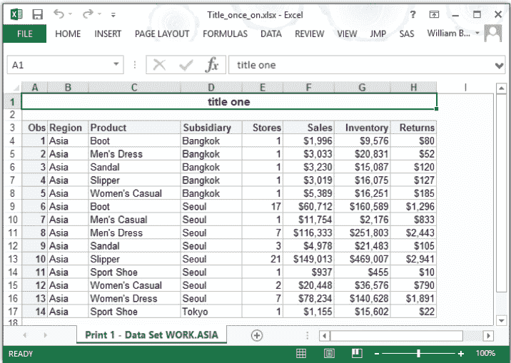

请注意，当只输出一个表格且同时使用了 `EMBEDDED_TITLES=` 和 `EMBEDDED_TITLES_ONCE=` 子选项时，输出看起来是相同的。

#### 工作工作表中具有多个输出时的 `EMBEDDED_TITLES_ONCE`

当向同一个 Excel 工作表写入多个 SAS 输出时，`EMBEDDED_TITLES=`‘ON’和 `EMBEDDED_TITLES_ONCE=`‘ON’会共同作用，在 Excel 工作表中显示 SAS 标题。如果通常会在工作表中出现两个标题，则 `EMBEDDED_TITLES_ONCE=` 选项允许输出第一个活动标题。

SAS Code 7-10 – 在两个标题和输出表在使用 `EMBEDDED_TITLES_ONCE`

```sas
Title 'title one';
ods excel file = "&path\Title_once_on_multiple.xlsx"
    options(EMBEDDED_TITLES='on'
            EMBEDDED_TITLES_ONCE='on'
            SHEET_INTERVAL='none');
    proc print data=Asia_only;
    run;
    Title 'title two';
    proc print data=Asia_only;
    run;
ods excel close;
```

图 7-10 – 在多个标题在使用 `EMBEDDED_TITLES` 和 `EMBEDDED_TITLES_ONCE` 子选项

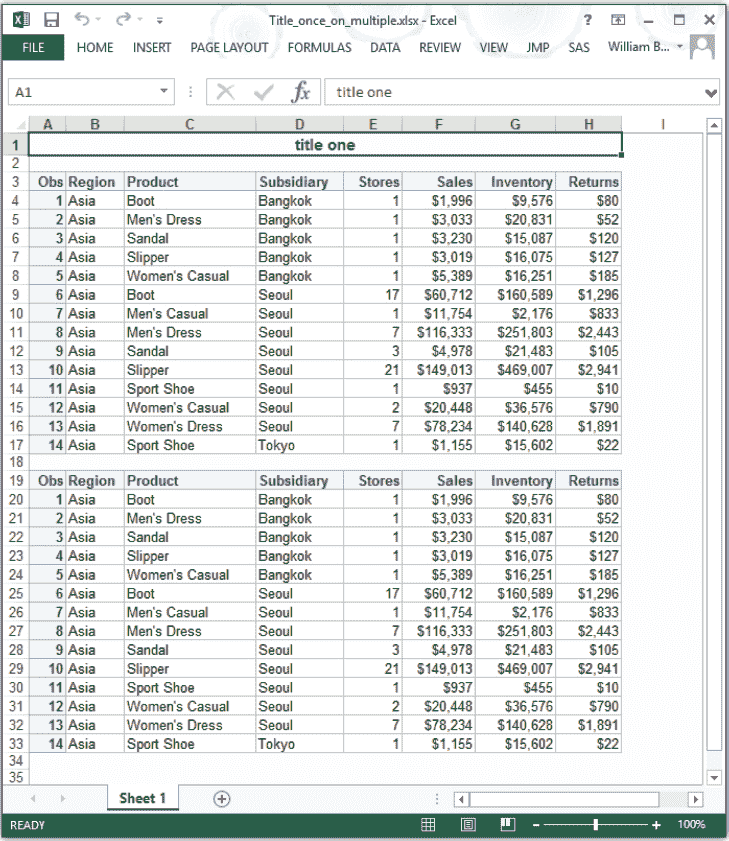

`Figure 7-10` 显示了如何在过程输出表之间更改标题。在这里，使用了 `SHEET_INTERVAL=NONE` 选项强制将两个过程的 SAS 输出到一个 Excel 工作表中。`EMBEDDED_TITLES_ONCE=`‘ON’抑制了第二个标题，仅将第一个活动标题放在工作表中。

### `FITTOPAGE=` 子选项

SAS ODS EXCEL 子选项 `FITTOPAGE=` 是将输出直接发送到 Excel 并在一页上的方便方法。然而，打印由 Excel 控制，它有时会将数据压缩成小到无法阅读的字体。这需要 SAS 程序员来确保发送到 Excel 的输出在页内是可读的。我这里的示例特意符合这一点。

SAS Code 7-11 – `FITTOPAGE=` 子选项

```sas
ods excel file = "&path\Fit_to_Page_off.xlsx"
    options(FITTOPAGE='off');
    proc print data=Asia_only;
    run;
ods excel close;
```

确定该选项是否生效的方法是查看图 7-1 所示的 `EXCEL Page Setup` 表。`Page Setup` 表格上的 `FIT TO` 选项未设置。

图 7-11 – `FITTOPAGE=` 默认子选项

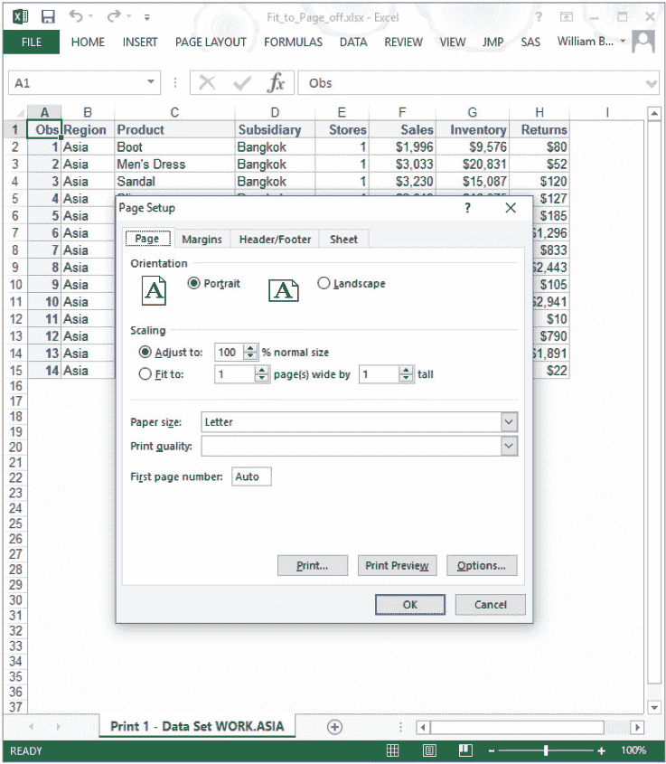

图 7-11 中的图像是 Excel 的默认设置，与 SAS 子选项 `FITTOPAGE=` 设置为 OFF 相同。因此，该设置没有激活 `SCALING` 设置中的 `FIT TO` 选项。因此，打印输出不会被强制在一页上。

SAS Code 7-12 – `FITTOPAGE` 子选项设置为‘ON’

```sas
ods excel file = "&path\Fit_to_Page_on.xlsx"
    options(FITTOPAGE='on');
    proc print data=Asia_only;
    run;
ods excel close;
```

图 7-12 – 使用‘ON’设置的 `FITTOPAGE` 子选项

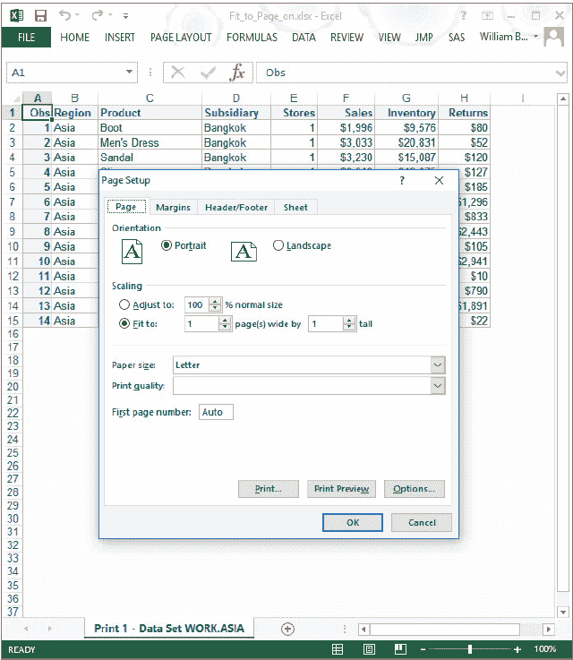

图 7-12 中的图像激活了 `SCALING` 设置中的 `FIT TO` 选项。此处使用的 `FITTOPAGE` 值为‘ON’。

### `GRIDLINES=` 子选项

在 Excel 中开启和关闭网格线通常需要访问 `Page Setup`（参见章节引言）来切换该功能的复选框。我仔细观察以寻找设置激活的差异。它只在 `Print Preview` 面板中可见。差异在于网格线开启时，`Print Preview` 面板上有一条较深的外部线。事实上，当查看 `GRIDLINES =‘ON’` 输出的 `Print Preview` 面板时，输出底部似乎还有一个空行。

SAS Code 7-13 – `GRIDLINES=`‘OFF’ 子选项

```sas
ods excel file = "&path\GRIDLINES_off.xlsx"
    options(GRIDLINES='off');
    proc print data=Asia_only;
    run;
ods excel close;
```

图 7-13 – 网格线设置为‘OFF’时的 `Page Setup`

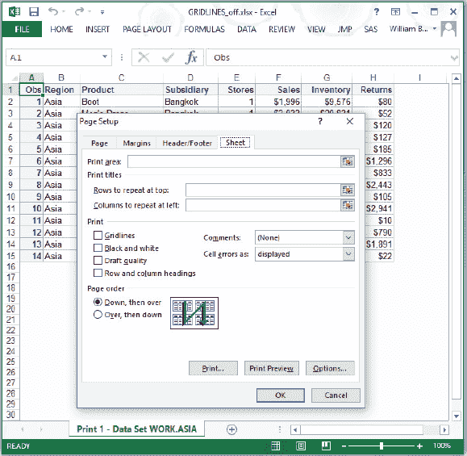

`GRIDLINES` 复选框在 `PRINT` 部分是空白的。

图 7-14 – 网格线设置为‘OFF’时的“Print Preview”表

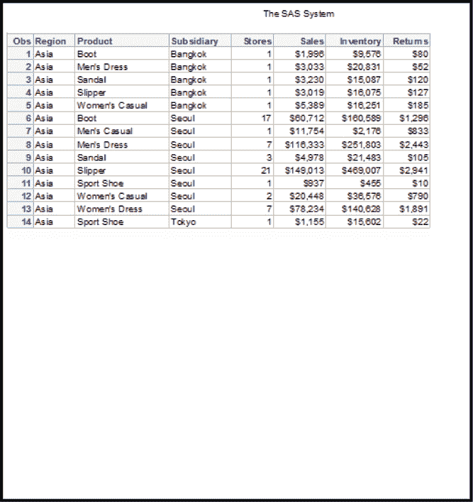

注意数据周围的外部线条与内部线条相同。这表明 `GRIDLINES` 为‘OFF’。

SAS Code 7-14 – `GRIDLINES=`‘ON’ 子选项

```sas
ods excel file = "&path\GRIDLINES_on.xlsx"
    options(GRIDLINES='on');
    proc print data=Asia_only;
    run;
ods excel close;
```

图 7-15 – 网格线设置为‘ON’时的 `Page Setup`

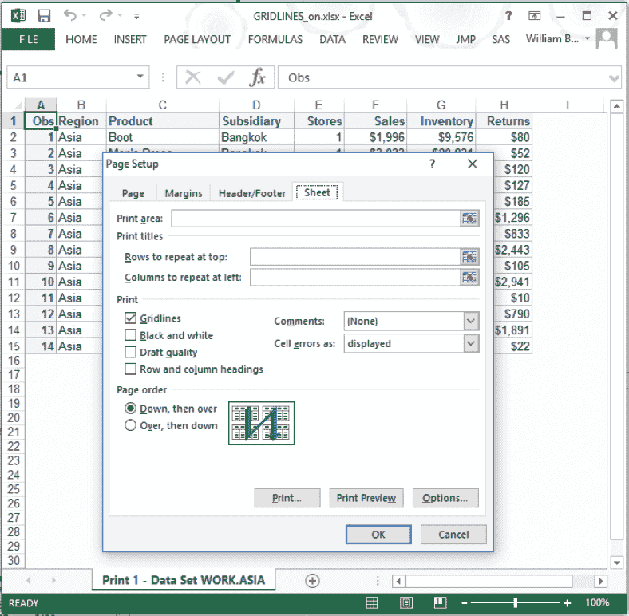

`GRIDLINES` 复选框在 `PRINT` 部分被选中。

图 7-16 – 网格线设置为‘ON’时的“Print Preview”表

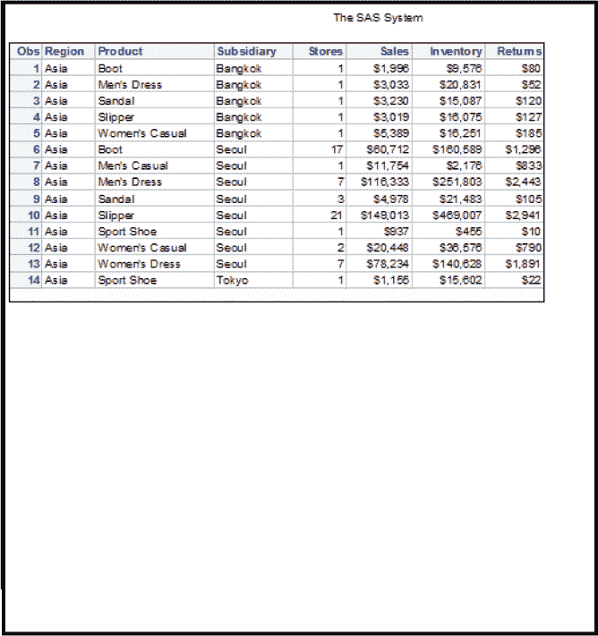

注意数据周围的外部线条比内部线条更粗。这表明 `GRIDLINES` 为‘ON’，并且底部出现了一个空行。底部的空行并没有延伸到所有 Excel 输出。

### `PAGES_FITHEIGHT=` 子选项

`PAGES_FITHEIGHT=` 子选项与 `FITTOPAGE` 子选项相似，它们都会在 Excel `Page Setup` 表上调整 `Fit to` 信息。该选项调整 Excel `Fit to` 框中的页数。然而，打印仍由 Excel 控制，因此你可能需要尝试此选项以让 Excel 输出你真正想要的内容。Excel 有倾向在使用此选项时减小字体。

SAS Code 7-15 – 使用 `PAGES_FITHEIGHT=` 子选项将更多数据放在一页上

```sas
ods excel file = "&path\PAGES_FITHEIGHT_on.xlsx"
    options(PAGES_FITHEIGHT='2'
            SHEET_INTERVAL='none');
    proc print data=Asia_only;
    run;
    proc print data=Asia_only;
    run;
ods excel close;
```

图 7-17 – `PAGES_FITHEIGHT` 子选项调整 Excel FIT TO 的页数

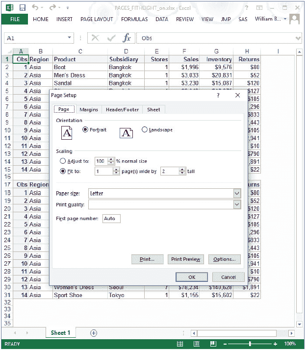

### `PAGES_FITWIDTH=` 子选项

该子选项与 `FITTOPAGE=` 子选项相似，它们都会在 Excel `PAGE SETUP` 表上调整 `Fit to` 信息。`PAGES_FITWIDTH=` 调整 Excel `Fit to` 框中的页数。然而，打印仍由 Excel 控制，因此你可能需要尝试此选项以让 Excel 输出你真正想要的内容。Excel 有倾向在使用此选项时减小字体。

SAS Code 7-16 – Excel FIT TO ‘宽度’选项将更多信息放在一个打印工作表上

```sas
ods excel file = "&path\PAGES_FITWIDTH_on.xlsx"
         options(PAGES_FITWIDTH='2'
                 SHEET_INTERVAL='none');
   print some variables three times to get a wide output;
   %let vars = region product subsidiary stores sales;
   proc print data=Asia_only;
       var &vars &vars &vars;
   run;
ods excel close;
```

图 7-18 – `PAGES_FITWIDTH=` 子选项调整 Excel 自动适应页数宽度

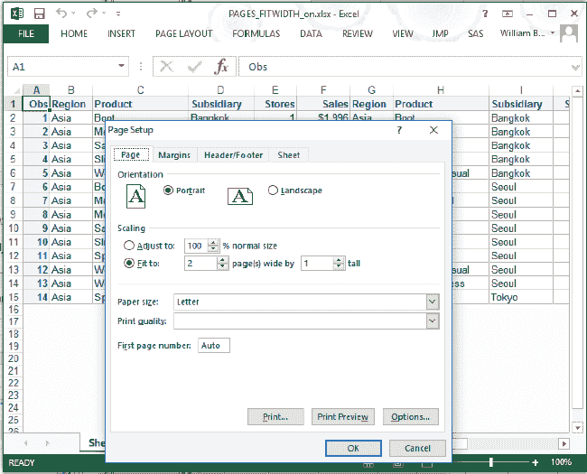

### `SHEET_INTERVAL=` 子选项

当你有多个输出结果并希望将它们放在同一个 Excel 工作簿中时，`SHEET_INTERVAL=` 子选项非常有用。该子选项允许你以几种不同的方式合并或分离输出结果。该子选项可以使用五个值：'BYGROUP'、'PAGE'、'PROC'、'NONE' 和 ‘TABLE’。下面分别显示了这些值的每个示例输出。

这些子选项值执行以下任务，其中‘TABLE’是默认值。

- ‘BYGROUP’ = 为每个新的 `BYGROUP` 创建一个新的工作表。
- ‘PAGE’ = 为过程输出的每一个新页创建一个新的工作表。
- ‘PROC’ = 为每个新过程创建一个新的工作表，并包含该过程的所有数据。
- ‘NONE’ = 所有输出内容都在一个页上。
- ‘TABLE’ = 为每个表格创建一个新的工作表。

### `SHEET_INTERVAL=`‘BYGROUP’ 示例

在使用 `SHEET_INTERVAL=` 子选项的‘BYGROUP’值时，当 SAS ‘BY GROUP’发生变化时会创建一个新的工作表。新 BY GROUP 的标签页名称由 SAS 生成，但可以使用处理工作表名称的其他子选项来自定义输出工作表名称。参见 `SHEET_LABEL=` 和 `SHEET_NAME=` 子选项。

SAS 代码 7-17 – 使用 `SHEET_INTERVAL=` ‘BYGROUP’值的方法

```sas
ods excel file = "&path\SHEET_INTERVAL_bygroup.xlsx"
         options(SHEET_INTERVAL='bygroup');
   proc print data=sashelp.shoes;
       by region;
   run;
ods excel close;
```

使用‘BYGROUP’间隔会将每个 SAS BY 组放在新的 Excel 工作表中。示例参见图 7-19。默认标签页名称生成的名称包含“By Group”、从 1 开始的组编号以及 By Group 区域值。

图 7-19 – `SHEET_INTERVAL=` ‘BYGROUP’ Excel 输出的第一张工作表

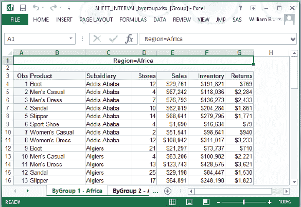

图 7-19 是使用 `SHEET_INTERVAL=` ‘BYGROUP’值生成的第一个输出工作表。生成了默认标签页名称，每个工作表都包含 `SASHELP.SHOES` 数据集中不同 Region 值的数据。

图 7-20 – `SHEET_INTERVAL=` ‘BYGROUP’ Excel 输出的第二个工作表

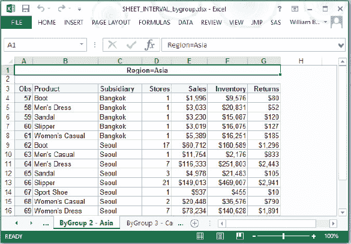

图 7-20 是使用 `SHEET_INTERVAL=` ‘BYGROUP’值生成的第二个输出工作表。生成了默认标签页名称，每个工作表都包含 `SASHELP.SHOES` 数据集中不同 Region 值的数据。

### `SHEET_INTERVAL=`‘PAGE’ 示例

在使用 `SHEET_INTERVAL=` 子选项的‘PAGE’值时，当生成新的一页输出时会创建一个新的工作表。这有时很难展示，在这里我使用了两个过程 `PROC PRINT` 和 `PROC UNIVARIATE` 来生成一个新的‘PAGE’输出。

SAS 代码 7-18 – 使用 `SHEET_INTERVAL=` ‘PAGE’值的方法

```sas
ods excel file = "&path\SHEET_INTERVAL_page.xlsx"
         options(SHEET_INTERVAL='page');
   proc print data=Asia_only;
   run;
   PROC UNIVARIATE DATA=sashelp.shoes
      (keep = region stores product
      where=(region="Asia" and product="Boot"));
   BY region;
   variable stores;
   freq stores;
   RUN;
ods excel close;
```

在输出的 Excel 工作簿中，标签页名称显示值‘PAGE’，后面是一个数字，然后是过程名称。标签页名称由 SAS 生成，但可以使用处理工作表名称的其他子选项来自定义输出工作表名称。参见 `SHEET_LABEL=` 和 `SHEET_NAME=` 子选项。

图 7-21 – ODS Excel `SHEET_INTERVAL=` ‘PAGE’ 页输出

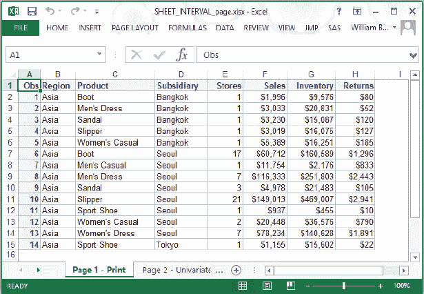

第一页是 14 行数据的 `PROC PRINT` 输出。

图 7-22 – ODS Excel `SHEET_INTERVAL=` ‘PAGE’ 页输出

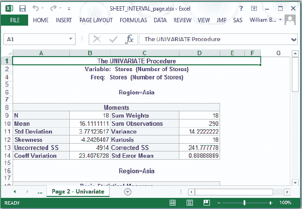

第二页是完整的 `PROC UNIVARIATE` 输出。

### `SHEET_INTERVAL=`‘PROC’ 示例

在使用 `SHEET_INTERVAL=` 子选项的‘PROC’值时，当执行新过程并输出数据时，会创建一个新的工作表。这很容易展示，在这里我使用了两个过程 `PROC PRINT` 和 `PROC UNIVARIATE` 在过程执行时生成一个新的工作表。在很多情况下，这种输出与使用‘PAGE’值看起来是一样的。

SAS 代码 7-19 – 使用 `SHEET_INTERVAL=` ‘PROC’值的方法

```sas
ods excel file = "&path\SHEET_INTERVAL_proc.xlsx"
         options(SHEET_INTERVAL='proc');
   proc print data=Asia_only;
   run;
   PROC UNIVARIATE DATA=sashelp.shoes
      (keep = region stores product
      where=(region="Asia" and product="Boot"));
   BY region;
   variable stores;
   freq stores;
   RUN;
ods excel close;
```

图 7-23 – 使用值‘PROC’的 `SHEET_INTERVAL=` 子选项，第一页

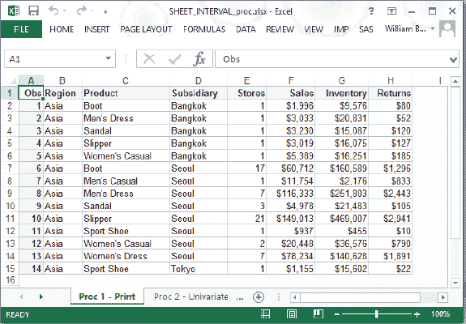

注意这里的 Excel 工作表名称以以前缀‘Proc’开头，这是页指示器，后面是一个数字和过程名称的指示器。

图 7-24 – 使用值‘PROC’的 `SHEET_INTERVAL=` 子选项，第二页

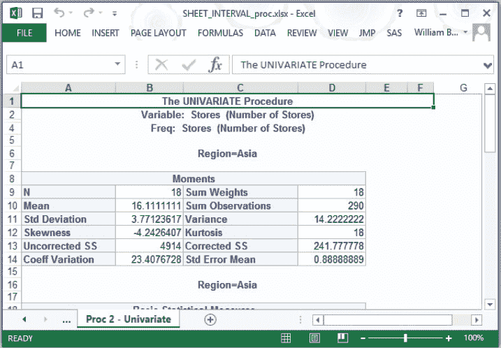

`PROC PRINT` 和 `PROC UNIVARIATE` 的所有数据都在单独的工作表表中。标签页名称由 SAS 生成，但可以使用处理工作表名称的其他子选项来自定义输出工作表名称。参见 `SHEET_LABEL=` 和 `SHEET_NAME=` 子选项。

### `SHEET_INTERVAL=`‘NONE’ 示例

SAS 代码 7-20 显示了使用 `SHEET_INTERVAL=` 子选项的代码，此时所有数据都发送到同一个工作表中。在更改此工作簿的 `SHEET_INTERVAL=` 值之前，不会创建新的工作表。这很容易展示，在这里使用了两个 `PROC PRINT` 过程生成了一个长列表。图 7-25 显示只有一个名为‘Sheet 1’的工作表。

SAS 代码 7-20 – 使用 `SHEET_INTERVAL=` 值的方法

```sas
ods excel file = "&path\SHEET_INTERVAL_none.xlsx"
         options(SHEET_INTERVAL='none');
   proc print data=Asia_only;
   run;
   proc print data=Asia_only;
   run;
ods excel close;
```


图 7-25 – `SHEET_INTERVAL=` 值‘NONE’

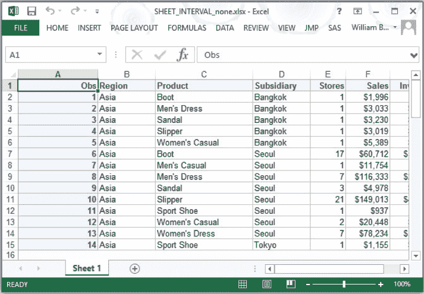

当激活‘NONE’值时，所有输出都在一个页上。

### SHEET_INTERVAL=‘TABLE’ 示例

SAS 代码 7-21 显示了使用 `SHEET_INTERVAL=` 子选项的‘TABLE’值的代码。每个表格的数据都发送到不同的工作表，在这里使用了两个过程 `PROC PRINT` 和 `PROC UNIVARIATE` 生成了许多表格。参见图 7-26 到 7-28。

SAS 代码 7-21 – 使用 `SHEET_INTERVAL=` ‘TABLE’值的方法

```sas
ods excel file = "&path\SHEET_INTERVAL_table.xlsx"
         options(SHEET_INTERVAL='table');

   proc print data=Asia_only;
   run;

   PROC UNIVARIATE DATA=sashelp.shoes
      (keep = region stores product
      where=(region="Asia" and product="Boot"));
   BY region;
   variable stores;
   freq stores;
   RUN;

ods excel close;
```

图 7-26 – 第一个表格 SHEET_INTERVAL

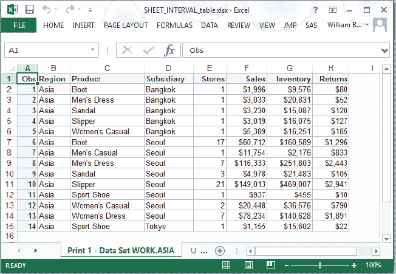

图 7-27 – 第二个表格 SHEET_INTERVAL

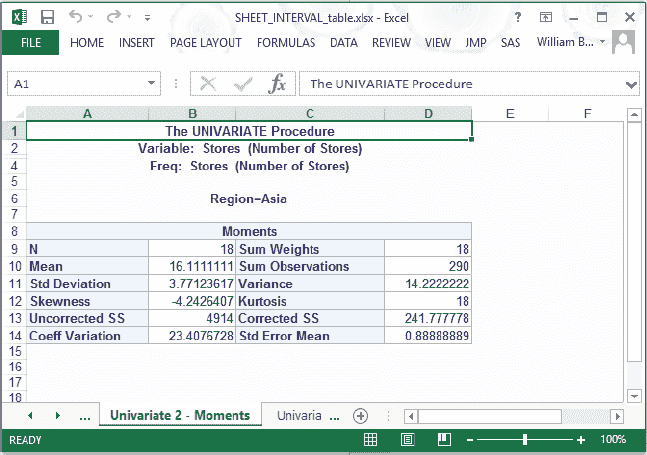

图 7-26 和 7-27 显示了生成的前两个表格。工作表的标签页名称指示了数据源，但没有指示工作表的数量。显示工作表数量有几种方法可以实现。你可以滚动所有的工作表来找到全部六个工作表，可以在工作簿中添加“目录”或“索引”，或者如果你足够小心，可以同时按下 `ALT/F11` 来显示 Visual Basic for Applications（Visual Basic 应用程序）项目桌面。图 7-28 在左上角显示了 Excel 文件名以及工作簿中所有工作表的名称。但请务必小心。如果你从未见过 Excel 的这部分，很容易输入某些导致你的工作簿无法使用的内容。听我的吧，这个功能确实存在。

图 7-28 – Excel Visual Basic for Applications 桌面

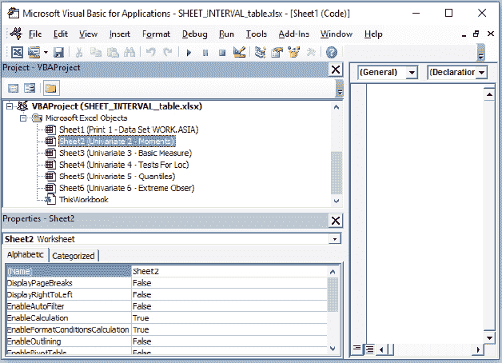

使用 Visual Basic for Applications 桌面时要小心，你可能会在这里破坏你的工作簿。

### `SHE_LABEL=` 子选项

由于 Excel 工作簿输出表上标签名称的默认值并不总是你老板想看到的，你可能想要更改标签页名称。你可以做的第一件事是使用 `ODS Excel SHEET_LABEL=` 选项更改生成的标签页名称的前缀。当此选项不存在或设置为‘NONE’时，SAS 将接管确定工作簿中每个标签页应用什么名称的任务。你可以使用自定义选择的“字符串”来更改前缀。此选项仅更改前缀并允许 SAS 确定标签页名称其余部分。Excel 标签页名称为 32 个字符，但 SAS 保留了最后四个字符以确保输出唯一的名称。

SAS 代码 7-22 – ODS Excel `SHEET_LABEL=`‘NONE’ 选项代码

```sas
ods excel file = "&path\SHEET_LABEL_none.xlsx"
options(SHEET_LABEL='none');

proc print data=sashelp.shoes;
    by region;
run;

ods excel close;
```

图 7-29 – `SHEET_LABEL=`‘NONE’ 的默认值

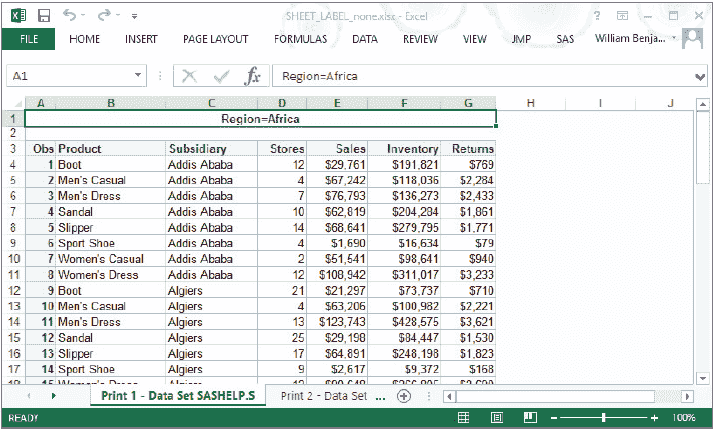

使用 `PRINT` 过程生成的工作表的默认前缀为“Print”，后面跟着一个数字和部分 SAS 数据集名称。其他过程将产生不同的前缀。SAS 代码 7-23 显示你可以使用任何字符串。

SAS 代码 7-23 – ODS Excel `SHEET_LABEL=`‘My_Prefix’ 值

```sas
ods excel file = "&path\SHEET_LABEL_string.xlsx"
options(SHEET_LABEL='My_Prefix');

proc print data=sashelp.shoes;
    by region;
run;

ods excel close;
```

图 7-30 – 使用“字符串”配合 `SHEET_LABEL=` 选项更改工作表标签前缀

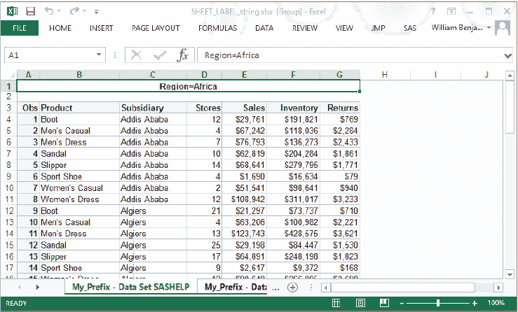

在图 7-30 中，工作表标签前缀为“My_Prefix”，但标签页名称其余部分与默认工作表标签相同。

### `SHEET_NAME=` 子选项

此选项与 `SHEET_LABEL=` 选项不同，它更改整个工作表名称。当然，这里的默认值是不使用该选项，因为使用此选项的任何字符串都会替换整个工作表（标签）名称。再次，Excel 标签页名称可以是 32 个字符，但 SAS 保留了最后四个字符用于唯一数字，以确保输出的工作表具有唯一名称。你提供的字符串将用于所有标签页，直到更改 `SHEET_NAME` 子选项。图 7-31 所示的示例从 SAS 的 `BY` 语句生成了多个工作表，在第二个及后续工作表中，工作表名称后面有一个数字。此子选项还接受 SAS 常量‘#BYVAL’，当你想要使用 BY GROUP 值作为标签页名称时。使用此子选项允许你对 Excel 工作簿的标签页名称有更多控制。

SAS 代码 7-24 – 使用 `SHEET_NAME=` 选项更改 Excel 工作表的全名

```sas
ods excel file = "&path\SHEET_NAME_My_String.xlsx"
options(SHEET_NAME='My_Sheet_Names');

proc print data=sashelp.shoes;
    by region;
run;

ods excel close;
```

图 7-31 – 通过 ODS Excel `SHEET_NAME` 选项更改工作表名称 Excel 输出

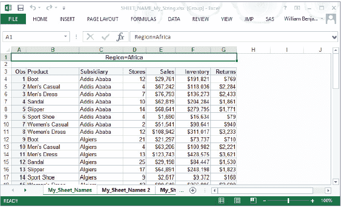

### `SUPPRESS_BYLINES=` 子选项

`SUPPRESS_BYLINES=` 子选项的默认值是不抑制。图 7-32 显示了这种情况。`SHEET_INTERVAL=`‘NONE’ 子选项强制 `PRINT` 过程的输出进入一个工作表，以便显示能够在一个页面内。

SAS 代码 7-25 – 使用 `SUPPRESS_BYLINES=`‘OFF’ 值

```sas
ods excel file = "&path\SUPPRESS_BYLINES_off.xlsx"
options(SUPPRESS_BYLINES='off' SHEET_INTERVAL='none');

proc print data=sashelp.shoes;
    where=(region ne 'Africa');
    by region;
run;

ods excel close;
```

这段代码不仅将所有输出数据强制到一个 Excel 工作表，而且不包含非洲地区的数据，因为如图 7-32 所示，该数据无法放入第一页。

图 7-32 – 显示 `BYLINE` 值的 Excel 输出

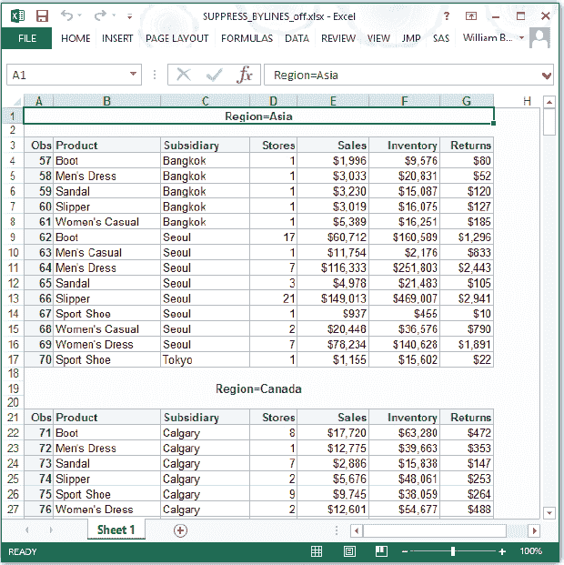

非洲地区的数据被 SAS 代码抑制了，`BYLINE` 值显示为‘Region =Asia’‘Region=Canada’以及 SASHELP.SHOES 数据中的所有其他地区。

SAS 代码 7-26 – 使用 `SUPPRESS_BYLINES=`‘ON’

```sas
ods excel file = "&path\SUPPRESS_BYLINES_on.xlsx"
options(SUPPRESS_BYLINES='on' SHEET_INTERVAL='none');

proc print data=sashelp.shoes;
    where=(region ne 'Africa');
    by region;
run;

ods excel close;
```

图 7-33 – 抑制 BYLINES 的 Excel 输出

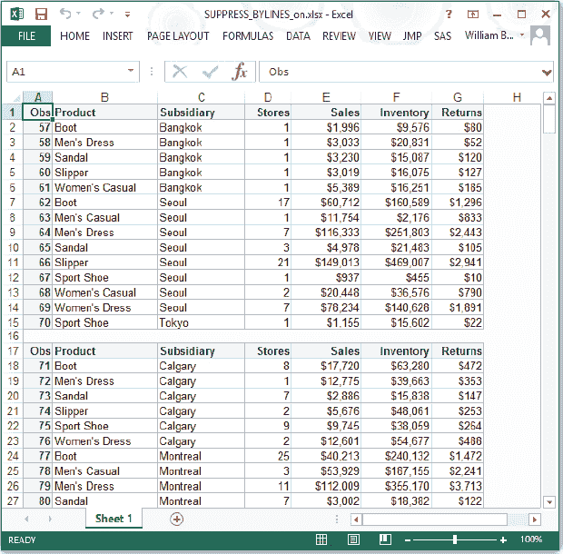

非洲地区的数据被 SAS 代码抑制了，`BYLINE` 值在在该工作簿中也被抑制了。

### 总结

本章的示例有助于清晰地直观展示如何调整标题、脚注和标签信息在输出工作表上的显示方式。在运行 SAS 代码时将这些功能引入 Excel 输出，可以是一项非常节省时间的编码实践。合理使用这些功能还可以增强你最终工作簿的外观，而无需在生成工作簿后对其进行修改。

第 8 章：影响打印的选项

本章将讨论影响整个工作簿级别输出的 ODS Excel 目标子选项。其中某些子选项会影响 Excel 工作簿中输出数据的颜色、大小、位置、间距和可见性。页眉、标题、页脚、脚注、间距和打印顺序的调整，通常是工作簿创建者在完成构建工作簿的 SAS 程序后必须完成的工作。ODS Excel 目标的这些功能允许在创建 Excel 工作簿的同时完成这些任务。通过在安装这些功能的情况下创建工作簿，你可以交付一个无需再次修改的工作簿。

# ODS Excel 目标操作

在本章中，我们将讨论以下 SAS ODS EXCEL 目标相关主题。

表 8-1 – ODS Excel 目标操作

| 操作参数 | 选项 | 描述 |
| --- | --- | --- |
| BLACKANDWHITE | ‘OFF’, ‘ON’,‘YES’, ‘NO’Default=‘OFF’ | 正向响应将打印模式更改为仅黑白打印，负向响应允许彩色打印。 |
| CENTER_HORIZONTAL | ‘OFF’, ‘ON’,‘YES’, ‘NO’Default=‘OFF’ | 正向响应将工作表在打印页上水平居中，负向响应不在打印输出时不进行水平居中。 |
| CENTER_VERTICAL | ‘OFF’, ‘ON’,‘YES’, ‘NO’Default=‘OFF’ | 正向响应将工作表在打印页上垂直居中，负向响应不在打印输出时不进行垂直居中。 |
| DRAFTQUALITY | ‘OFF’, ‘ON’,‘YES’, ‘NO’Default=‘OFF’ | 此选项的正向响应将导致输出以“草稿”质量模式打印。然而，当此选项生效时，不会打印图表。 |
| ORIENTATION | ‘PORTRAIT’, ‘LANDSCAPE’,Default= ‘PORTRAIT’ | 此选项将打印输出在打印页面对齐为纵向（PORTRAIT）或横向（LANDSCAPE）。 |
| PAGE_ORDER_ACROSS | ‘OFF’, ‘ON’,‘YES’, ‘NO’Default=‘OFF’ | 此选项控制电子表格中信息的打印顺序。正向响应导致数据先跨页打印，然后向下打印。负向响应导致打印先在页面上向下，再跨页打印。 |
| PRINT_AREA | ‘ITEM’, Default= NONE | 此选项允许您定义输出打印区域，该区域是电子表格值（单元格）的子集‘ITEM’是一个带引号的值字符串，代表要打印的电子表格的左上单元格和右下单元格。例如‘b,4,f,10’。 |
| PRINT_FOOTER | ‘text-string’ | 打印时除非活动脚注，否则此文本字符串将放在页脚中。这不会覆盖 FOOTNOTE 语句。 |
| PRINT_FOOTER_MARGIN | ‘number’,Default=0.5 inches | 此选项指定页脚边距，并在 Excel 页面设置窗口中设置。指定的单位为英寸。 |
| PRINT_HEADER | ‘text-string’ | 打印时除非活动标题，否则此文本字符串将放在页眉中。这不会覆盖 TITLE 语句。 |
| PRINT_HEADER_MARGIN | ‘number’, Default= 0.5 inches | 此选项指定页眉边距，并在 Excel 页面设置窗口中设置。指定的单位为英寸。 |
| ROWBREAKS_COUNT | ‘number’ | 此选项指定在打印了指定数量的数据行后插入分页符。 |
| ROWBREAKS_INTERVAL | ‘OUTPUT’, ‘PROC’, ‘NONE’Default=‘NONE’ | 此选项控制分页符的放置。●‘OUTPUT’在每个输出对象之间放置分页符。●‘PROC’在每个过程输出之间放置分页符。●‘NONE’不插入自定义分页符。 |
| ROWCOLHEADINGS | ‘OFF’, ‘ON’,‘YES’, ‘NO’Default=‘OFF’ | 正向响应表示应该打印行和列标题。负向响应表示不应该打印行和列标题。 |
| SCALE | ‘number’, Default= 100 | 此选项控制输出打印的缩放比例。 |
| TITLE_FOOTNOTE_NOBREAK | ‘OFF’, ‘ON’,‘YES’, ‘NO’Default=‘NO’ | 此选项控制标题和脚注是否跨行换行。正向响应抑制换行，负向响应允许换行。想一下“是的，我们今天没有香蕉了。” |
| TITLE_FOOTNOTE_WIDTH | ‘number’,Default=‘0’ | 此选项指定标题和脚注跨越的列数。如果值为‘0’（零），则标题和脚注将跨越电子表格使用的所有列。 |

## BLACKANDWHITE=选项

此 ODS Excel 选项允许您强制打印输出仅为“黑白”格式。如果您的打印机不打印彩色图像，这非常有用。有时在黑白打印机上打印时，色调会褪色为相同的颜色。希望这有助于平滑它们。我在这里没有显示默认值，它是‘OFF’。

SAS 代码 8-1 – BLACKANDWHITE= 选项开启‘ON’

```sas
ods excel file = "&path\Black_and_white_printing.xlsx"
    options(BLACKANDWHITE='ON');

    proc print data=Asia_only;
    run;
```

图 8-1 – BLACKANDWHITE= 选项开启‘ON’
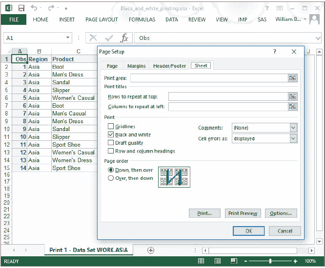

### CENTER_HORIZONTAL= 选项

此 ODS Excel 选项允许您强制打印输出仅为“黑白”格式。如果您的打印机不打印彩色图像，这非常有用。有时在黑白打印机上打印时，色调会褪色为相同的颜色。希望这有助于平滑它们。我在这里没有显示默认值，它是‘OFF’。

SAS 代码 8-1 – BLACKANDWHITE= 选项开启‘ON’

```sas
ods excel file = "&path\Black_and_white_printing.xlsx"
    options(BLACKANDWHITE='ON');

    proc print data=Asia_only;
    run;
```

图 8-1 – BLACKANDWHITE= 选项开启‘ON’


## CENTER_VERTICAL 选项

此 ODS Excel 选项允许您强制打印输出仅为“黑白”格式。如果您的打印机不打印彩色图像，这非常有用。有时在黑白打印机上打印时，色调会褪色为相同的颜色。希望这有助于平滑它们。我在这里没有显示默认值，它是‘OFF’。

SAS 代码 8-1 – BLACKANDWHITE= 选项开启‘ON’

```sas
ods excel file = "&path\Black_and_white_printing.xlsx"
    options(BLACKANDWHITE='ON');

    proc print data=Asia_only;
    run;
```

“页面居中——垂直”（Center on page – Vertically）复选框已标记。

图 8-7 – 使用 `CENTER_HORIZONTAL=‘ON’` 选项居中的输出

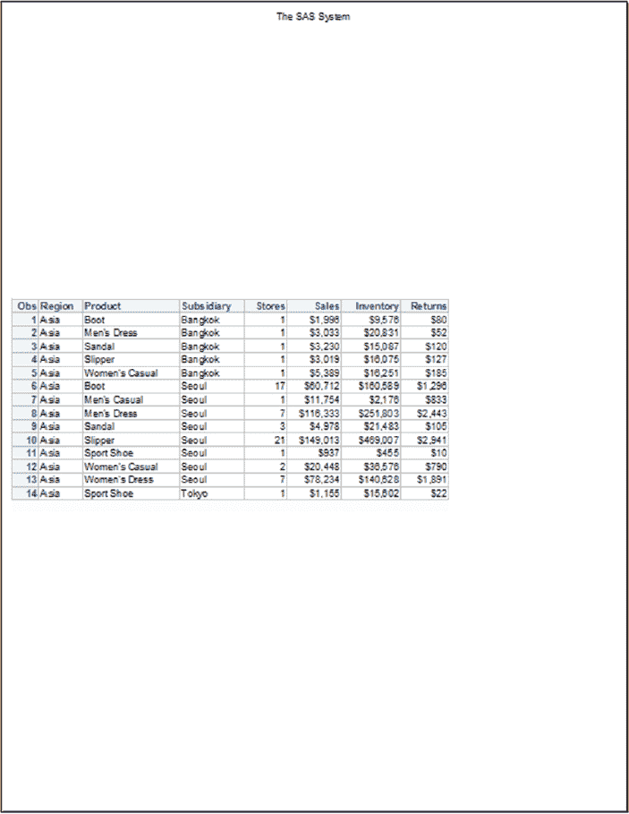

数据在页边距顶部和底部之间居中。请注意，此处关闭了水平居中，因此页面是左对齐的。

### `DRAFTQUALITY=` 选项

我在家里做很多工作，自己购买纸张和墨盒。我使用一台很好的打印机，但它并不是非常快速的打印机。我在打印时会尽可能使用草稿模式以节省墨水。此设置允许我为打印预设草稿模式，这样当我实际打印图像时，就不会忘记开启它。默认设置为“OFF”，此处未显示。由于我无法在书中展示这种差异，因此我向你们展示了该设置。

SAS 代码 8-4 – 将 `DRAFTQUALITY=` 选项设置为‘ON’

```sas
ods excel file = "&path\DRAFTQUALITY_printing_on.xlsx"
    options(DRAFTQUALITY='ON');

    proc print data=Asia_only;
    run;

ods excel close;
```


图 8-8 – Excel 页面设置屏幕显示 `DRAFTQUALITY=` 选项设置为‘ON’

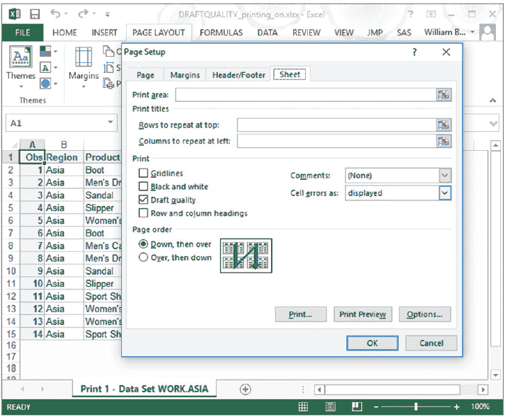

在“打印”（Print）主题下，“草稿质量”（Draft quality）复选框被选中。

### `ORIENTATION=` 选项

ODS Excel `ORIENTATION=` 选项允许你更改打印输出在页面上的显示方式。默认是‘PORTRAIT’竖向，此处未显示，因为大部分其他图像也是竖向模式。选项有'PORTRAIT'（竖向）或'LANDSCAPE'（横向），Excel 设置在 Excel 工作表的“页面设置”（Page Setup）工作表中显示。

SAS 代码 8-5 – 将打印页面方向设置为 LANDSCAPE

```sas
ods excel file = "&path\ORIENTATION_LANDSCAPE_printing_on.xlsx"
    options(ORIENTATION='LANDSCAPE' );
    proc print data=Asia_only;
    run;
ods excel close;
```

图 8-9 – Excel “页面设置”工作表中显示方向设置为‘LANDSCAPE’

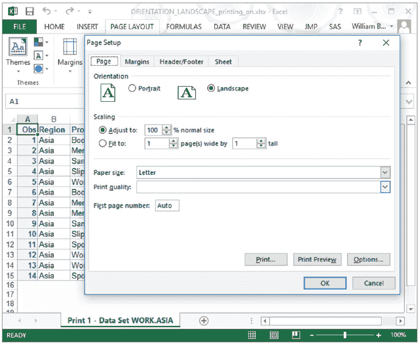

页面设置‘LANDSCAPE’设置。

图 8-10 – 在‘LANDSCAPE’模式下打印的数据

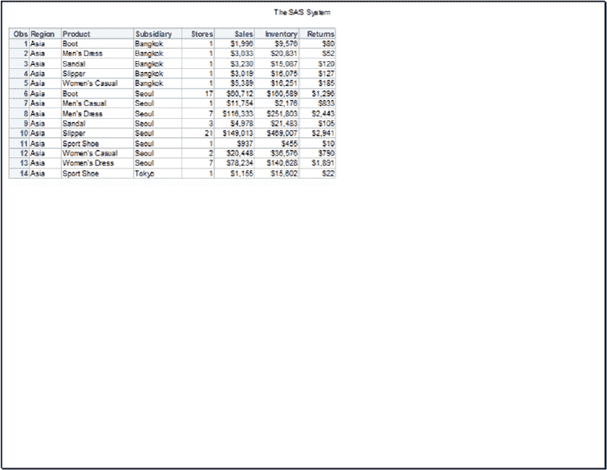

‘LANDSCAPE’模式下的完整打印页，显示数据在打印页面上的实际位置。

### `PAGE_ORDER_ACROSS=` 选项

当你的 Excel 输出没有打印在一个页纸上时（无论是因为太宽还是太长），Excel 会自动选择分段打印数据。Excel 使用的默认方法是在适合一页的第一组列中打印所有数据行。这意味着第 1 页将包含适合页面的前 `n` 列的数据，而第 2 页将包含同一组 `n` 列的后续行数据。

例如，假设你的数据输出有 20 列 100 行。如果一页可以容纳 10 列和 50 行，那么意味着第 1 到 10 列和第 1 到 50 行在第 1 页，而第 1 到 10 列和第 51 到 100 行在第 2 页。第 3 页将包含第 11 到 20 列和第 1 到 50 行。第四页也是最后一页将包含第 11 到 20 列和第 51 到 100 行。这被称为“向下后向右”的页面顺序。如果你希望第 1 页有第 1 到 10 列，第 2 页有第 11 到 20 列，则应使用“向右后向下”的页面顺序。包含更多数据的表格将继续你为打印输出所选择的模式。当然，由你决定最易阅读的打印顺序，然后将其应用于你的输出。

SAS 代码 8-6 – `PAGE_ORDER_ACROSS=` 设置为 OFF 和 ON 的页面顺序打印选择

```sas
ods excel (ID=1) file = "&path\PAGE_ORDER_ACROSS_printing_off.xlsx"
    options(PAGE_ORDER_ACROSS='Off' );
ods excel (ID=2) file = "&path\PAGE_ORDER_ACROSS_printing_on.xlsx"
    options(PAGE_ORDER_ACROSS='ON' );
    proc print data=Asia_only;
    run;
ods excel (ID=1) close;
ods excel (ID=2) close;
```

图 8-11 – Excel 页面顺序默认设置，`PAGE_ORDER_ACROSS=‘OFF’`

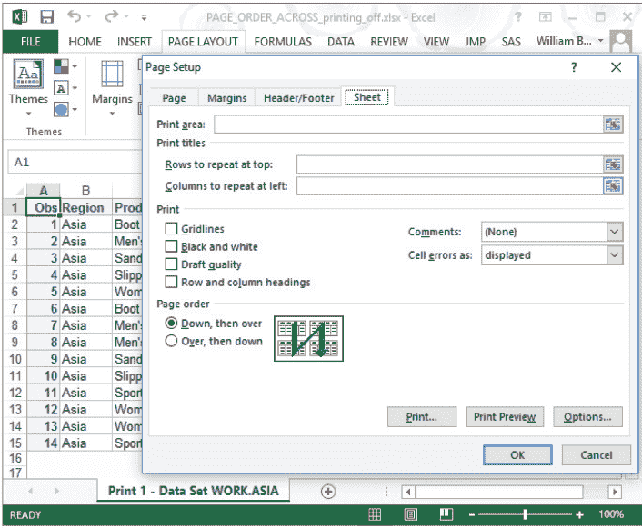

页面顺序图中的箭头向下，然后到下一列。这被称为“向下，后向右”。

图 8-12 – Excel 页面顺序设置，`PAGE_ORDER_ACROSS=‘ON’`

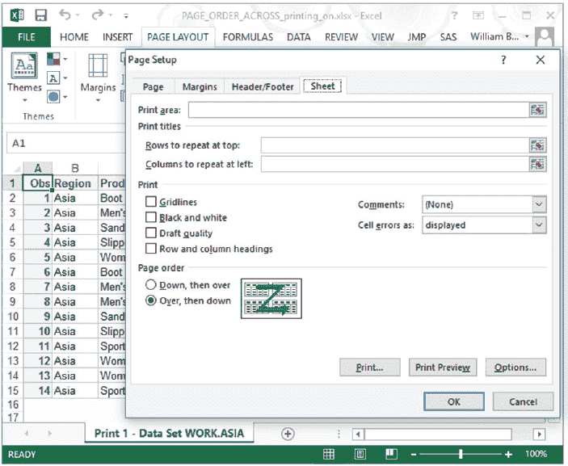

页面顺序图中的箭头先向右，然后向下。

### `PRINT_AREA=` 选项

如果你只想打印特定的单元格区域，可以在 ODS Excel 中使用 `PRINT_AREA` 选项进行设置。由于 `PRINT_AREA` 总是形成矩形，你需要识别左上角和右角的单元格。这在书中没有显示，但我向你们展示了该设置。

SAS 代码 8-7 – 将 `PRINT_AREA=` 设置为 ON

```sas
ods excel file = "&path\PRINT_AREA.xlsx"
    options(PRINT_AREA='B4:F9');
    proc print data=Asia_only;
    run;
ods excel close;
```

图 8-13 – Excel 页面设置显示 `PRINT_AREA=` 选项


显示 B4 到 F9。

图 8-14 – 在 `PRINT_AREA` 模式下打印的数据


显示指定区域的完整打印页。

### `PRINT_FOOTER=` 选项

公司通常希望每页底部都有相关信息。可以通过增大页脚来实现。`PRINT_FOOTER=` 选项将文本放在页面底部。

SAS 代码 8-8 – 在页面底部放置页脚

```sas
ods excel file = "&path\PRINT_FOOTER.xlsx"
    options(PRINT_FOOTER='My Footer Text');
    proc print data=Asia_only;
    run;
ods excel close;
```

图 8-15 – Excel 页面设置显示 `PRINT_FOOTER=` 选项


页脚文本位于底部。

图 8-16 – 显示页脚的打印页


这是完整的页面。

### `PRINT_FOOTER_MARGIN=` 选项

公司使用预印纸张输出时，页面底部可能有一个他们想要保留的图像而不覆盖它。可以通过增大页脚来实现。在这里，我将打印页脚并使用三英寸的页脚边距来展示此功能。

SAS 代码 8-9 – `PRINT_FOOTER_MARGIN=` 选项

```sas
ods excel file = "&path\PRINT_FOOTER_MARGIN.xlsx"
    options(PRINT_FOOTER='My Footer Text', PRINT_FOOTER_MARGIN='3');
    proc print data=Asia_only;
    run;
ods excel close;
```

图 8-17 – Excel 页面设置页脚设置为 3 英寸


图 8-18 – 应用 `PRINT_FOOTER_MARGIN=` 选项


公司通常希望在每个打印页的顶部显示与公司或文档相关的特殊信息。`PRINT_HEADER=` 选项将文本字符串放入 Excel 工作表区域，从而在每页的顶部设置页眉。此页眉通常是手动设置的，但 SAS 可以在运行时插入文本。SAS 标题（title）将覆盖此选项并取而代之。要消除 SAS 生成的标题（例如“The SAS System”），请使用 `TITLE` 语句。

#### SAS 代码 8-10 – `PRINT_HEADER=` 

```sas
ods excel file = "&path\PRINT_HEADER.xlsx"
   options(PRINT_HEADER='My Header Text');
   title;
   proc print data=Asia_only;
   run;
ods excel close;
```

图 8-19 – `PRINT_HEADER=` 页面设置


为了在图 8-20 的页面顶部获得“My Header Text”文本，必须使用 `TITLE` 语句关闭 SAS 标题。

图 8-20 – 显示请求文本“My Header Text”的打印结果


完整的打印页显示了输出页眉文本的位置。

#### `PRINT_HEADER_MARGIN=` 选项

页面设置表中的 Excel “页眉”（Header）设置似乎与页面设置表中的“顶部”（Top）边距设置独立运行。我需要花一点时间解释它的工作原理。我的示例 SAS 代码 8-11 显示了多个选项，而不只是 `PRINT_HEADER_MARGIN=` 选项。此示例的作用是输出三个 Excel 工作簿。我将展示一个页面设置表，并描述 `PRINT_HEADER_MARGIN=` 设置的三种不同值如何影响打印输出。在这个示例中，我还会显示预览表上的边距和标题选项卡，以解释示例。默认页眉设置为 0.0（零）英寸，这也是顶部边距设置的常用默认值。我还减少了 `PRINT_AREA=` 的打印输出量，并添加了 `PRINT_HEADER=` 文本字符串。这样我就可以展示两者都被输出了，但页眉被打印输出 Excel 数据单元格的信息所隐藏。

#### SAS 代码 8-11 – 使用 `PRINT_HEADER_MARGIN` 设置的示例

```sas
ods excel (id=1) file = "&path\PRINT_HEADER_Margin_0_5.xlsx"
   options(PRINT_HEADER='My Header Text'
           PRINT_HEADER_MARGIN='0.5'
           PRINT_AREA='b,4,f,9');
ods excel (id=2) file = "&path\PRINT_HEADER_Margin_1.xlsx"
   options(PRINT_HEADER='My Header Text'
           PRINT_HEADER_MARGIN='1'
           PRINT_AREA='b,4,f,9');
ods excel (id=3) file = "&path\PRINT_HEADER_Margin_4.xlsx"
   options(PRINT_HEADER='My Header Text'
           PRINT_HEADER_MARGIN='4'
           PRINT_AREA='b,4,f,9');
   title ;
   proc print data=Asia_only;
   run;
ods excel (id=1) close;
ods excel (id=2) close;
ods excel (id=3) close;
```

图 8-21 – 页眉设置为 0.5 英寸的 Excel 页面设置


此截图显示了 SAS 代码 8-11 示例的第一步输出，其中 `PRINT_HEADER_MARGIN=` 值设置为 0.5 英寸。此处未显示的输出文件（`ID=2` 和 `ID=3`）将页眉框中的值分别设置为 1 和 4 英寸。打印预览页见图 8-22、8-23 和 8-24。

图 8-22 – `PRINT_HEADER_MARGIN=0.5` 和 Excel 顶部边距=0.5


具有 0.5 英寸默认顶部边距和 0.5 英寸 `PRINT_HEADER_MARGIN=` 的打印输出。这显示了默认顶部边距和 `ODS PRINT_HEADER_MARGIN=` 是对齐的。

图 8-23 – `PRINT_HEADER_MARGIN=1.0` 和 Excel 顶部边距=0.5


具有 0.5 英寸默认顶部边距和 1.0 英寸 `PRINT_HEADER_MARGIN=` 的打印输出。这显示了默认顶部边距和 `ODS PRINT_HEADER_MARGIN=` 是分开应用的。

图 8-24 – `PRINT_HEADER_MARGIN=4.0` 和 Excel 顶部边距=0.5


具有 0.5 英寸默认顶部边距和 4.0 英寸 `PRINT_HEADER_MARGIN=` 的打印输出。这显示了默认顶部边距和 `ODS PRINT_HEADER_MARGIN=` 是分开应用的，且 `PRINT_HEADER_MARGIN=` 同样独立于打印数据。

#### `ROWBREAKS_COUNT=` 选项

`ROWBREAKS_COUNT=` 选项允许你作为程序员将输出页按你想要的分组。在 SAS 代码 8-12 中，我使用了值‘10’。如果不打印输出页，很难看到此选项的结果。然而，如果你调用打印预览然后返回标准工作表，将显示新的虚线。这些虚线代表了在打印页面时使用的分页符。

#### SAS 代码 8-12 – `ROWBREAKS_COUNT=` 设置为 10

```sas
ods excel file = "&path\ROWBREAKS_COUNT.xlsx"
   options(ROWBREAKS_COUNT='10');
   proc print data=Asia_only;
   run;
ods excel close;
```

图 8-25 – 应用 `ROWBREAKS_COUNT=10`


垂直虚线和“Obs 10”下方的线代表将发生的分页。同样注意，`ROWBREAKS_COUNT=` 分隔了数据，并显示在第一页的后续中。

#### `ROWBREAKS_INTERVAL=` 选项

`ROWBREAKS_INTERVAL=` 选项在选择 `SHEET_INTERVAL='NONE'` 时效果最佳。当你选择不将所有信息放在一个工作表中时，它可能会产生新的 Excel 工作表。SAS 代码 8-13 示例输出了三个工作簿。最后的 Excel 工作簿将比例设置为 50% 以将所有内容放入一个页。图 8-26 到 8-28 显示了整个第一页。图 8-26 的底部是分页计数。这些示例都在 Excel 工作表中。

#### SAS 代码 8-13 – 所有选项的 `ROWBREAKS_INTERVAL=`

```sas
ods excel (id=1) file = "&path\ROWBREAKS_INTERVAL_out.xlsx"
   options(ROWBREAKS_INTERVAL='output'
           sheet_interval="none");
ods excel (id=2) file = "&path\ROWBREAKS_INTERVAL_proc.xlsx"
   options(ROWBREAKS_INTERVAL='proc'
           sheet_interval="none");
ods excel (id=3) file = "&path\ROWBREAKS_INTERVAL_none.xlsx"
   options(ROWBREAKS_INTERVAL='none'
           sheet_interval="none"
           scale='50');
proc sort data=Asia_only out=temp;
   by product;
   run;
proc print data=temp;
   by product;
   run;
proc print data=temp;
   by product;
   run;
ods excel (id=1) close;
ods excel (id=2) close;
ods excel (id=3) close;
```

图 8-26 – `ROWBREAKS_INTERVAL=` 设置为每个输出更改分页


图 8-26 到 8-28 示例中的所有信息都输出到了 Excel 工作表中，但每个示例的打印页数不同。在图 8-26 中，数据按每个输出单元分割并打印了 16 页。

图 8-27 – `ROWBREAKS_INTERVAL=` 设置为每个过程更改分页


在图 8-27 中，数据按每个过程单元分割并打印了两个页。

图 8-28 – `ROWBREAKS_INTERVAL=` 设置为 None 以仅输出一页


在图 8-28 中，数据没有分割并打印在一个页上。

#### `ROWCOLHEADINGS=` 选项

此选项控制打印的 Excel 输出是否包含 Excel 的“ROW”（行）和“COLUMN”（列）值。默认不打印这些 Excel 表头。Excel 的“ROW”（行）标题是打印工作表左侧的行号，而“COLUMN”（列）标题是打印工作表顶部的字母。选择“ON”可开启打印。默认选项为“OFF”。

### SAS 代码 8-14 – 打开 ODS Excel 目标 `ROWCOLHEADINGS=` 选项

```sas
ods excel file = "&path\ROWCOLHEADINGS_on.xlsx"
    options(ROWCOLHEADINGS='on');
    proc print data=Asia_only;
    run;
ods excel close;
```


# 图 8-29 – Excel 页面设置表显示勾选行列标题的复选框


此图显示选中了“Row and column headings”（行列标题）复选框，表示应该打印 Excel 的“行”和“列”表头。

# 图 8-30 – Excel 打印页显示 Excel 的“行”和“列”表头


此页面以纵向格式输出，但为了节省空间被截断了。

## SCALE= 选项

我经常发现很难在一个打印页面上显示全组变量。ODS Excel 的 `SCALE=` 选项可以帮助我减少输出，以便在页面上容纳更多内容。下方 SAS 代码 8-15 中的示例保持了纵向打印不变，但缩小了打印材料的尺寸。默认将输出比例缩放为 100%。若要设置其他值，请在引号内放置一个正数，如 SAS 代码 8-15 所示。多年来我花了一些时间研究这个选项，并发现了一些有趣现象。我目前正在使用 Excel 2013，Excel `SCALE=` 选项的范围是正常尺寸的 10% 到 400%。如果你在 SAS 代码的字符串中输入非数值值，SAS 会将 100 传递给 Excel。SAS 不检查你输入的值，只检查它是否为数值。我在 Excel 2013 中观察到以下结果。我不预认为会有其他差异，但在其他 Excel 版本中可能会出现。

### 当使用 Excel 2013 时，如果你输入：

- 非数值值 – SAS 不生成错误，且 SAS 将 `100` 传递给 Excel。
- 负数 – SAS 不生成错误，Excel 使用 100%。
- 数字 0 – SAS 不生成错误，Excel 使用 10%。
- 1 到 9 之间的数字 – SAS 不生成错误，Excel 将 "AUTO" 作为 `PAGE LAYOUT`（页面布局）SCALE 值。在 `Page Setup`（页面设置）页面，当你尝试使用 `PAGE`（页面）选项卡时会显示错误消息。信息为“数字必须在 10 到 400 之间。请输入此范围内的数字重试。”然后你必须取消并在 `SCALE` 而非 `AUTO` 输入数字。
- 10 到 400 = 正常
- 401 到 32767 之间的数字 – SAS 不生成错误信息，Excel 使用输入的数字作为 `PAGE LAYOUT` SCALE 值以及 `PAGE` 选项卡上的 `Page Setup` 比例值。不会产生 Excel 错误，你可以进入 `Print Preview`（打印预览）页。然而，当你退出 `Print Preview` 页时，两个位置的比例值都会恢复为 400。此外，任何尝试使用切换箭头增加或减少比例值的操作都会导致值恢复为 400%。
- 大于 32767 的数字 ((2 ** 15) -1) 会导致 Excel 在访问 `Page Setup` 表上的 `PAGE` 选项卡时产生错误。此值通常被称为 32K，因为从 0 开始恰好存在 2 的 15 次方的个数字。在二进制中，其范围从 `'000000000000000'b` 到 `'111111111111111'b`。

### SAS 代码 8-15 – 将 ODS Excel SCALE 选项设置为正常尺寸的 50%

```sas
ods excel file = "&path\SCALE_50.xlsx"
    options(SCALE='50');

    proc print data=Asia_only;
    run;

ods excel close;
```

# 图 8-31 – ODS Excel 目标“SCALE=”选项设置为‘50’时的结果


你可以在此处显示的 Excel“Page Layout”（页面布局）选项卡和“Page Setup”（页面设置）表上查看“SCALE”值。

# 图 8-32 – 选择“SCALE='50’”时的输出


这是整页的打印输出。是的，在这个尺寸下，它几乎无法阅读，尤其是如果你在小屏幕上阅读的话。但字体尺寸的减小确实能让你在一个工作表上放置更多信息。如果你以横向（Landscape）模式打印并有更多列，效果更好。

## TITLE_FOOTNOTE_NOBREAK= 选项

ODS Excel 目标 `TITLE_FOOTNOTE_NOBREAK=` 选项是一个棘手的选项。它属于那种“今天我们没有香蕉”类型的选项之一。许多人称其为双重否定选项。“NOBREAK”（不换行）部分表示在输出中不换行标题和脚注。而“TITLE_FOOTNOTE_NOBREAK”选项本身表示不换行标题和脚注。不使用该选项的“NO”值意味着标题和脚注过长时换行。是的，我知道这很困惑。希望下面的代码和截图有所帮助。我将直接显示产生输出 Excel 工作表的代码段。

### SAS 代码 8-16 – 默认设置 `TITLE_FOOTNOTE_NOBREAK=`

```sas
title   "This a my long title so I can show that it wraps around when title_footnote_nobreak is active.";
footnote "This a my very long footnote (it prints in a smaller font) so I can show that it wraps around when title_footnote_nobreak not active.";

ods excel file = "&path\TITLE_FOOTNOTE_NOBREAK_default.xlsx"
    options(embedded_titles='yes'
            embedded_footnotes='yes');

proc print data=asia_only;
run;

ods excel close;
```

SAS 代码 8-16 代码是 `TITLE_FOOTNOTE_NOBREAK=` 选项的默认设置，当标题或脚注过长时，会导致标题和脚注换到下一行。

# 图 8-33 – 默认设置 `TITLE_FOOTNOTE_NOBREAK=`


不使用 ODS EXCEL `TITLE_FOOTNOTE_NOBREAK=` 选项时，如果标题或脚注过长，它们会换行。此外，注意标题和脚注的字体大小不同，且加粗选项也不同。

SAS 代码 8-17 中的代码将 `TITLE_FOOTNOTE_NOBREAK=` 选项设置为“NO”，产生的结果与默认选项相同。

```sas
footnote "This a my very long footnote (it prints in a smaller font) so I can show that it does not wrap around when title_footnote_nobreak='yes'";

ods excel file = "&path\TITLE_FOOTNOTE_NOBREAK_yes.xlsx"
    options(title_footnote_nobreak='yes'
            embedded_titles='yes'
            embedded_footnotes='yes');

proc print data=asia_only;
run;

ods excel close;
```

SAS 代码 8-18 将 `TITLE_FOOTNOTE_NOBREAK=` 选项设置为 `YES`，这会导致当标题或脚注过长时，它们不会换行到下一行。

# 图 8-35 – `TITLE_FOOTNOTE_NOBREAK=` 设置为“YES”


当将 `ODS EXCEL TITLE_FOOTNOTE_NOBREAK=` 选项设置为 `NO` 时，如果标题或脚注过长，它们将换行到下一行。此外，请注意，标题和脚注以不同的字体大小打印，并具有不同的粗体选项。

## `TITLE_FOOTNOTE_WIDTH=` 选项

`TITLE_FOOTNOTE_WIDTH=` 选项描述了 SAS 标题或脚注可以跨越的列数。默认值零表示标题和脚注跨越的列数与输出的数据列数相同。在这里，我将使用长标题和脚注来显示效果。请注意，如果列数太少，输出可能会被截断，因为 Excel 单元格的显示空间太小。

### SAS 代码 8-19 – ODS Excel `TITLE_FOOTNOTE_WIDTH=` 选项设置为默认

```sas
title   "This a my long title so I can show that it wraps around when title_footnote_width is not active.";
footnote "This a my very long footnote (it prints in a smaller font) so I can show that it wraps around when title_footnote_width not active.";

ods excel file = "&path\TITLE_FOOTNOTE_WIDTH_default.xlsx"
    options(embedded_titles='yes'
            embedded_footnotes='yes');

proc print data=asia_only;
run;

ods excel close;
```

不使用 `TITLE_FOOTNOTE_WIDTH=` 选项相当于设置了 `TITLE_FOOTNOTE_WIDTH= 0`。这将标题和脚注宽度设置为输出的数据列数。

# 图 8-36 – 通过不使用 `TITLE_FOOTNOTE_WIDTH=` 选项将其设置为默认


通过不使用 `TITLE_FOOTNOTE_WIDTH=` 选项或将其设置为零，宽度将设置为输出数据的列数。

### SAS 代码 8-20 – ODS Excel `TITLE_FOOTNOTE_WIDTH=` 选项设置为 4

```sas
title   "This a my long title so I can show how it wraps around when title_footnote_width='4'";
footnote "This a my very long footnote (it prints in a smaller font) so I can hwshow that it wraps around when title_footnote_width='4'";

ods excel file = "&path\TITLE_FOOTNOTE_WIDTH_4.xlsx"
    options(title_footnote_width='4'
            embedded_titles='yes'
            embedded_footnotes='yes');

proc print data=asia_only;
run;

ods excel close;
```

请注意，提供过长的标题或脚注会导致标题或脚注多次换行，导致在提供的空间内无法显示完整的标题或脚注。你通常需要通过增加 Excel 中单元格的大小来纠正此问题。

# 图 8-37 – `TITLE_FOOTNOTE_WIDTH=` 选项设置为 4


在这里，`TITLE_FOOTNOTE_WIDTH=` 值被设置为“4”，这导致长标题和脚注在前四列内换行。这具有隐藏某些文本的效果。但所有文本在分配的标题和脚注单元格内都是可用的。

### SAS 代码 8-21 – ODS Excel `TITLE_FOOTNOTE_WIDTH=` 选项设置为 10

```sas
title   "This a my long title so I can show that it does not wrap around when title_footnote_width='10'";
footnote "This a my very long footnote (it prints in a smaller font) so I can show that it wraps around when title_footnote_width='10'";

ods excel file = "&path\TITLE_FOOTNOTE_WIDTH_10.xlsx"
    options(title_footnote_width='10'
            embedded_titles='yes'
            embedded_footnotes='yes');

proc print data=asia_only;
run;

ods excel close;
```


`TITLE_FOOTNOTE_WIDTH=` 值设置为`4`，这导致长标题和脚注在前四列内换行。这具有隐藏某些文本的效果。但所有文本在分配的标题和脚注单元格内都是可用的。

| 操作参数 | 选项 | 说明 |
| :--- | :--- | :--- |
| `ABSOLUTE_COLUMN_WIDTH` | `'number-list'` 或 `'NONE'` 默认 = `'NONE'` | 此选项允许通过提供用逗号分隔的数字引号字符串或字符串`'NONE'`来指定输出电子表格列的宽度。多个值会产生指定列宽的重复模式。 |
| `AUTOFILTER` | `'ALL'`, `'NONE'`, 或 `'range'` 默认 = `'NONE'` | 此选项允许您将 Excel 筛选选项应用于 Excel 工作表的所有列、列范围，或不应用于输出工作表的任何列。 |
| `COLUMN_REPEAT` | `'number'`, `'number-range'`, 或 `'HEADER'` 默认 = 不重复表头 | 此选项影响跨页列标题的打印。`'HEADER'`选项会导致在每页为所有包含标题值的列打印标题。而`'number'`和`'number-range'`选项则分别开启某列或某列范围的打印。 |
| `FROZEN_HEADERS` | `'ON'`, `'OFF'`, `'TRUE'`, `'FALSE'`, `'YES'`, `'NO'`, 数字 默认值 = `'OFF'` | 正向响应将冻结表头行，以便在移动滚动条时表头保持可见。提供数字将冻结指定数量的行。 |
| `HIDDEN_COLUMNS` | `'number_list_range'`, 默认 = `'NONE'` | 识别需要隐藏的列。`number_range_list`是用逗号分隔的数字或数字范围的引号字符串。 |

#### 表 9.2 – ODS Excel 目标行特征子选项

| 操作参数 | 选项 | 说明 |
| :--- | :--- | :--- |
| `ABSOLUTE_ROW_HEIGHT` | `'number-list'`, `'number-range'`, `'OFF'`, `'FALSE'`, 默认 = `'NONE'` | 此选项允许用户通过提供用逗号分隔的值引号字符串来覆盖 SAS 生成的行高。可以提供多个高度。多个值会产生指定行高的重复模式。 |
| `FROZEN_ROWHEADERS` | `'ON'`, `'OFF'`, `'TRUE'`, `'FALSE'`, `'YES'`, `'NO'`, 数字 默认值 = `'OFF'` | 正向响应将冻结标题列（第一列），以便在移动滚动条时行标题保持可见。提供数字将冻结指定数量的列。 |
| `HIDDEN_ROWS` | `'number_list_range'`, 默认 = 显示所有行 | 识别需要隐藏的行。`number_range_list`是用逗号分隔的数字或数字范围的引号字符串。 |
| `ROW_HEIGHTS` | `'number-list'`, 默认 = 使用字体大小定义行高 | 提供一个位置参数引号字符串，用于识别以下内容的行高（0 = 使用字体高度）（顺序值可能会被跳过，但被跳过的参数需要逗号来显示参数缺失。最后一个使用的值除外。）● 表头行 ● 表体行 ● BY 值行 ● 标题 ● 页脚 ● 换页高度 ● 段落跳过高度 |
| `ROW_REPEAT` | `'number-range'`, 默认 = `'NONE'` | 此选项指定跨页处理行标题的方式。● `'NONE'` – 不重复任何行。● `'HEADER'` – 重复所有行标题。● `'number'` – 重复此行的行标题。● `'number-range'` – 重复指定范围内的行。 |

#### 表 9.3 – ODS Excel 目标单元格特征子选项

| 操作参数 | 选项 | 说明 |
| :--- | :--- | :--- |
| `FORMULAS` | `'ON'`, `'OFF'`, `'TRUE'`, `'FALSE'`, `'YES'`, `'NO'`, 数字 默认值 = `'ON'` | 此选项允许您将 SAS 输出更改为默认的 Excel 公式功能。以等号 (=) 开头的单元格可以被 Excel 处理为公式。正向响应允许所有公式处理。负向响应将关闭当单元格值以等号开头时创建公式的 SAS 处理。 |
| `START_AT` | `'x,y'` 其中 x 是行号，y 是列号。默认 = `'1,1'` | 一个字符串，表示 Excel 工作表中输出数据开始输出的起始行（ROW）和列（COLUMN）。这在工作表内部无法更改。SAS 9.4M4 允许对“列”值使用字母字符，如 `'D4'`。 |

### `ABSOLUTE_COLUMN_WIDTH=` 子选项

通常，您会发现某些数据是您或您的老板希望在一个单元格中查看的，例如产品描述。但如果库存计数或箱号（在同一列还是不同列中？）只有几个字符长，您可能也想限制该列的大小。大多数 Excel 输出文件的列数据具有可变宽度。虽然 Excel 在将数据读入工作表时调整列宽方面做得不错，但它通常会根据第一行（变量标题或列名）或只有 Excel 知的其他公式来截断或填充宽度。

`ABSOLUTE_COLUMN_WIDTH=`选项允许您根据需要调整列的宽度。这使您能够控制输出的另一个部分，使其符合您的要求。图 9-1 显示了输出。

```
ABSOLUTE_COLUMN_WIDTH=
```

ODS Excel 目标`COLUMN_REPEAT=`选项的识别稍微有点复杂。此选项允许你将某些信息复制到宽幅打印输出的后续工作表中。如果你发送到 Excel 的输出文件没有足够的列，导致打印输出宽度不足以扩展到第二页，那么该选项似乎不起任何作用。可能你有一份关于部件或库存清单的大量信息，并希望产品描述在打印输出的后半部分或后续页面中重复。在这个示例中，我将使用`SASHELP.ORSALES` SAS 数据集的前 53 行。下文显示的 Excel“打印预览”输出将显示为数据的左半和右半部分。你可以使用`'NONE'`、一个数字、数字范围或`'HEADER'`来描述你想要重复的内容。此外，使用数字`'1'`与使用`'HEADER'`相同。`FROZEN_HEADERS=`或`FROZEN_ROWHEADERS=`都不影响表头列数。

#### SAS 代码 9-5 – 为单列使用`COLUMN_REPEAT=`子选项

```sas
ods excel file = "&path\COLUMN_REPEAT_number.xlsx"
    options(COLUMN_REPEAT='6');

proc print data=SASHELP.ORSALES(obs=53);
  run;

ods excel close;
```

图 9-5 – 页面设置表显示列“$F”已重复


“要在左侧重复的列:”中的符号为“$F:$F”；当打印页面后半部分时，变量`PRODUCT_LINE`将被重复。“$”符号表示绝对行“F”。“页面顺序”选择指定了所有适应第一页的列数据都将在第二页显示任何数据之前打印。在示例中，我仔细地选择了 53 行数据，以便所有`COLUMN_REPEAT=`选项输出恰好填充一页。第二页的数据是输出的后半部分。

图 9-6 – `COLUMN_REPEAT`列‘6’输出的第一个预览页


此页显示了数据打印时的第一页。列“6”是`Product_Group`变量。

图 9-7 – `COLUMN_REPEAT`列‘6’输出的第二个预览页


此页显示了数据打印时的第二页。列“6”（“Product_Group”）作为该页的第一列被重复。

#### SAS 代码 9-6 – 为列范围使用`COLUMN_REPEAT=`子选项

```sas
ods excel (id=2) file = "&path\COLUMN_REPEAT_range.xlsx"
    options(COLUMN_REPEAT='3-5');

proc print data=SASHELP.ORSALES(obs=53);
  run;

ods excel close;
```

图 9-8 – `COLUMN_REPEAT=`列范围的 Excel“页面设置”显示


在这里，列“C”到列“E”将在输出的后半部分打印。

图 9-9 – 输出后半部分的局部图像


列“Quarter”、`Product_Line`和`Product_Category`在输出的后半部分重复。

#### SAS 代码 9-7 – 使用 HEADER 值使用`COLUMN_REPEAT=`子选项

```sas
ods excel file = "&path\COLUMN_REPEAT_header.xlsx"
    options(COLUMN_REPEAT='header');

proc print data=SASHELP.ORSALES(obs=53);
  run;

ods excel close;
```

图 9-10 – 使用`COLUMN_REPEAT=`“HEADER”选项时的示例数据


列“A”始终被视为“HEADER”，`FROZEN_HEADERS=`或`FROZEN_ROWHEADERS=`都不影响表头列数。

图 9-11 – `COLUMN_REPEAT`表头输出的局部图像


在这里，“HEADER”选项将电子表格的列“A”复制到打印输出的后半部分。

### `FROZEN_HEADERS=`子选项

ODS Excel `FROZEN_HEADERS=`选项执行了另一件事，我多年来一直是手动操作。它设置了 Excel 工作表的顶行，使其不滚动。选择是所有行滚动（默认值）或在工作表顶部冻结一个或多个行。值“ON”或数字“1”仅冻结顶行，任何其他数字都会冻结相应数量行。

#### SAS 代码 9-8 – `FROZEN_HEADERS=`子选项的默认值

```sas
ods excel file = "&path\Frozen_Headers_on.xlsx"
    options(Frozen_Headers='on');

proc print data=Asia_only;
  run;

ods excel close;
```

图 9-12 – `FROZEN_HEADERS=`子选项“ON”


### `HIDDEN_COLUMNS=`子选项

在 Excel 工作表中隐藏列是另一项经常手动完成的任务。`HIDDEN_COLUMNS=`选项非常灵活，因为你可以在同一个字符串中组合列和范围。默认是隐藏某些列。

### SAS 代码 9-10 – 使用`HIDDEN_COLUMNS=`

```sas
ods excel file = "&path\Hidden_Columns.xlsx"
    options(Hidden_Columns='2,5-6');

proc print data=Asia_only;
  run;

ods excel close;
```

图 9-14 – 输出上的隐藏列


### `ABSOLUTE_ROW_HEIGHT=`子选项

我一直不喜欢打开 Excel 工作簿来调整行高。现在我在创建工作表时使用`ABSOLUTE_ROW_HEIGHT=`选项。该选项字符串使用高度列表（逗号分隔并以磅为单位）来调整电子表格的每一行，包括第一行。如果字符串中仅有一个行值，则所有行都将调整为该高度。如果提供了多个数字，则按每个数字的顺序赋予行相应的高度。如果数据行多于提供的数字，则重复该模式直到数据耗尽。默认情况下不进行任何调整，所有行高度都相同。

#### SAS 代码 9-11 – 在重复模式中调整行高的 SAS 代码

```sas
ods excel file = "&path\Absolute_row_height.xlsx"
    options(ABSOLUTE_ROW_HEIGHT='15,30');

proc print data=Asia_only;
  run;

ods excel close;
```

图 9-15 – `ABSOLUTE_ROW_HEIGHT=`子选项的重复模式输出


### SAS 代码 9-12 – `FROZEN_ROWHEADERS=`默认值

```sas
ods excel file = "&path\Frozen_rowHeaders_on.xlsx"
options(Frozen_rowHeaders='on');

proc print data=Asia_only;
run;

ods excel close;
```

### 图 9-16 – `FROZEN_ROWHEADERS=`‘ON’显示列‘B’缺失


在这里，我将 Excel 工作表数据向左滚动了一列（隐藏了“B”列）。这一点体现在‘B’列不可见上。判断行标题是否冻结的另一种方法是看列‘A’列和‘C’列之间的垂直线。SAS 的典型输出不会显示 SAS 输出数据之外的网格线。该线在所有行之间都是垂直的，但在 Excel 行 16 到 18 之间更为明显，因为其余的网格部分是缺失的。

### SAS 代码 9-13 – `FROZEN_ROWHEADERS=`子选项冻结四列

```sas
ods excel file = "&path\Frozen_rowHeaders_number.xlsx"
options(Frozen_rowHeaders='4');

proc print data=Asia_only;
run;

ods excel close;
```


### 图 9-17 - `FROZEN_ROWHEADERS=` 有四列冻结


在图 9-17 中，我将 Excel 工作表数据向左滚动了一列，隐藏了“E”列。判断行标题是否冻结的另一种方法是看列‘D’和‘F’之间的垂直线。此 SAS 输出没有显示 `A1` 到 `H15` 单元格之外的网格线。指示冻结标题的垂直线在所有行之间都是垂直的，但在 Excel 行 16 到 18 之间更为明显，因为其余的网格部分是缺失的。

## `HIDDEN_ROWS=` 子选项

现在可以在 SAS 执行时隐藏 Excel 工作表，而无需在创建工作簿后手动进行。`HIDDEN_ROWS=` 子选项是灵活的；你可以在同一个`number_list_range`值字符串中组合单个行和范围。默认选项是不隐藏任何行。

### SAS 代码 9-14 – 隐藏一行和范围行的 `HIDDEN_ROWS=` 子选项

```sas
ods excel file = "&path\Hidden_Rows.xlsx"
options(Hidden_Rows='4,8-10');
proc print data=Asia_only noobs;
run;
ods excel close;
```

### 图 9-18 – 隐藏行的 Excel 输出


图 9-18 显示第 4 行以及第 8、9 和 10 行被隐藏了。注意 Excel 表头列中第 3 行和第 5 行之间以及第 7 行和第 11 行之间的双线。确保不要将 Excel 行标题列与 SAS OBS 编号混淆，后者也会跳号。

### `ROW_HEIGHTS=` 子选项

子选项名称 `ROW_HEIGHTS` 中的‘HEIGHTS’部分是复数，正如复数名称所暗示的，该子选项会影响几行的高度。零的单值表示应使用字体大小作为下面列表中描述的所有行类型的高度。对于此选项，你需要提供一个带引号的位置参数字符串，以识别下面列出的七行高度。可以跳过某些值，但跳过的参数需要逗号来表示该参数缺失，最后一个使用的值除外。如上述，行高以点（points）为单位。

*   表头行
*   表体行
*   BY 值行
*   标题
*   页脚
*   分页高度
*   段落间距高度

### SAS 代码 9-15 – 与 `ROW_HEIGHTS=` 选项相关的行高的代码选项

```sas
ods excel file = "&path\Row_Heights.xlsx"
options(ROW_HEIGHTS='20,15,15,35,55,25,5'
        embedded_titles='on'
        embedded_footnotes='on'
        sheet_interval='none');
Title 'my title';
footnote 'my footnote';
proc print data=asia_only;
by Subsidiary;
run;
ods excel close;
```

### 图 9-19 – 显示 SAS 代码 9-15 产生的不同行高的 Excel 输出


在这个示例中，我使用 `BY` 将数据分成不同的段，以显示 Excel 输出中使用的不同类型的间距。标题和页脚比其他行大。标题用绿色突出，因为它包含了单元格“A1”，这是工作簿首次打开时的默认光标。行 `2`、`4`、`11`、`13`、`25`、`28` 和 `30` 非常小，几乎被隐藏了。子公司标题行比数据略大，BY 行被小线包围。

## `ROW_REPEAT=` 子选项

`ROW_REPEAT=` 的结果比 `COLUMN_REPEAT=` 更难识别。如果你的数据没有延伸到第二页，那么该子选项将毫无用处。此子选项允许将第一页中间或标题的信息复制到长打印输出的后续工作表中。

*(注：原文后续存在大量内容重复，翻译时已根据逻辑进行了去重处理)*

SAS Code 9-18 在所有输出页面上复制第一页的页眉。

图 9-25 – 显示 `ROW_REPEAT=‘HEADER’` 选项设置


只有电子表格的第一行在页面上重复。

图 9-26 – `ROW_REPEAT= ‘HEADER’` 设置的输出


这是让表头打印在输出页面上的另一种方法。在图 9-26 中，仅复制了页面的部分内容。

### `FORMULAS=` 子选项

任何使用 Excel 一段时间的人可能都可能熟悉了这样一个事实：你可以使用 Excel 公式来计算任何内容。那么，此子选项允许你使用 SAS 将公式设置为输出数据集中的字段，以便在 Excel 打开数据文件时执行。默认关闭了将数据作为公式的功能。当你想要使用 `FORMULAS=’ON’` 子选项时，任何以等号 (`=`) 开头的数据字段都会激活公式处理。`FORMULAS=` 子选项可能不是向 Excel 工作表中添加公式的唯一方法。

这里的 `DATA` 步骤正在创建一个包含等号的 SAS 字符值，以及 `Sales` 和 `Returns` 字段的值，以便可以计算 `Sales` 减去 `Returns` 的净值。当关闭公式处理时，字符值是可见的。当开启公式时，由于前加了等号，计算就会发生并显示该值。

SAS Code 9-19 中的代码适用于 SAS Code 9-20 和 SAS Code 9-21。该代码构建了一个具有新列“NET_SALES”的 SAS 数据集。该公式从销售额中减去退货（Returns）以计算“NET_SALES”。此计算通过给 `_n_` 变量的值加 1 来避免对表头行执行。读取 `ASIA_ONLY` 数据集的其他方法可能与我在这里选择的方法不同。

SAS Code 9-19 示例：如何设置数据字段以激活 Excel 公式处理。

```sas
data ASIA_FORMULAS;
    set Asia_only;
    row = _n_ + 1;
    net_sales =  ='                          ||
                left(trim(put(sales,9.)))    ||
                '-'                        ||
                left(trim(put(returns,9.)))
                ;
run;
```

在 ways SAS Code 9-20 或 SAS Code 9-21 之前，请执行 SAS Code 9-19 中的代码。此代码没有显示输出图形。

SAS Code 9-20 将 `FORMULA` 子选项设置为 ‘OFF’的打印示例。

```sas
ods excel file = "&path\Formulas_off.xlsx"
    options(formulas='off');
proc print data=Asia_formulas;
    run;
ods excel close;
```

图 9-27 关关闭时显示的 `Net_Sales`。


在未开启公式的情况下，`Net_Sales` 列没有意义。

SAS Code 9-21 – `FORMULA=` 子选项设置为 ‘ON’ 的打印示例

```sas
ods excel file = "&path\Formulas_on.xlsx"
    options(formulas='on');
proc print data=Asia_formulas;
    run;
ods excel close;
```

图 9-28 – 开启公式后显示的 `Net_Sales`


此图像显示了 `Net_Sales` 的公式已执行。但请注意该列是左对齐的，这表明该字段默认包含字符值，未经过格式化。

### `START_AT=` 子选项

`START_AT=` 子选项是一种方便的方法，可以将你的输出放置在 Excel 工作表中默认左上角（单元格 `A1`）以外的地方。此选项让你自由将输出放置在输出工作表的任何行和列，允许你将数据移动到单元格下方。在第 6 章 中描述的 CSS 样式表可用于向工作表中图像，而 `START_AT=` 子选项可用于定位数据。SAS 9.4 增加了使用字母作为列标识符的功能，如“A1”。‘4,5’ 是‘列,行’格式。

SAS Code 9-22 – 使用 `START_AT=` 子选项偏移 Excel 内的数据

```sas
ods excel file = "&path\Starting_at.xlsx"
    options(start_at='4,5');
proc print data=Asia_only;
    run;
ods excel close;
```


图 9-29 – 显示输出偏移到单元格 `D5`，第 4 列，第 5 行


通常公司会使用 logo。此选项提供了一种方法，为 logo 留出空间而无需手动移动数据。参见第 6 章 添加图像。

### 结论

在本章中，我们讨论了许多 ODS 选项，它们允许我们操作 Excel 工作表的行、列和单元格。通过这些选项，可以设置公式、隐藏行或列、调整输出的高度和宽度、执行公式，并控制布局。

## 索引

A
`ABSOLUTE_COLUMN_WIDTH=` 9, 156
`ABSOLUTE_ROW_HEIGHT=` 9, 157
`ANCHOR=` 8, 46
`AUTOFILTER=` 9, 5
`AUTHOR=` 8, 23

B
`BLACKANDWHITE=` 9, 110
`BLANK_SHEET=` 9, 32
`BOX_SIZING=` 8, 54

C
Cascading Style Sheets (CSS)
`CATEGORY=` 8, 25
`CENTER_HORIZONTAL=` 9, 110
`CENTER_VERTICAL=` 9, 116
`CLOSE` 
`COLUMN_REPEAT=` 9, 168
`COMMENTS=` 8, 23
`CONTENTS=` 9, 32
`CSSSTYLE=` 

D
`DATA` step, text files
`DOM` 8, 46
`DPI=` 8, 9
`DRAFTQUALITY=` 9, 110

E
`EMBEDDED_FOOTNOTES=`
`EMBEDDED_TITLES=`
`EMBED_FOOTNOTES_ONCE=`
`EMBED_TITLES_ONCE`= 选项 9, 70–71, 83
工作表 84–85 上具有多个输出
具有单个输出的工作表 83–84

## 示例
`CLOSE` 语句 12–15
使用的数据源 6

## Excel (Microsoft)
更改 5–6
格式 1
使用 CSS 文件发送图表到 56–59

Excel 2007 (Microsoft) 5–6
`EXCEL` 语句
默认 Excel 属性表和 24
使用文档对象模型 (`DOM`) 与 46–52
`EXCEL STYLE`= 选项 63–66
`EXCELXP` 标签集 3, 7
`EXCLUDE` 语句 8, 12, 15, 19

## F
`FILE`= 选项 8, 13, 23, 32, 33
`FILE` 语句 35
`FITTOPAGE`= 选项 9, 71, 86–88
格式，Excel 1
`FORMULAS`= 选项 9, 158, 182–184
`FROZEN_HEADERS`= 选项 9, 156, 168–170
`FROZEN_ROWHEADERS`= 选项 9, 157, 172–174

## G
`GFOOTNOTE` 选项 8
图表，使用 CSS 文件发送到 Excel 56–59
`GRIDLINES`= 选项 9, 71, 89–92
`GTITLE` 选项 8

## H
`HIDDEN_COLUMNS`= 选项 9, 156, 170–171
`HIDDEN_ROWS`= 选项 9, 157, 174–175

## I
`ID`= 选项 8, 31, 32, 34–37
`ID` 选择器 50
`IMAGE_DPI`= 选项 8, 46, 61–63
`INDEX`= 选项 9, 32, 38, 39–40

## K
`KEYWORDS`= 选项 8, 23, 25–26

## L
`LIBNAME` 语句 3

## M
`MEMSIZE`= 选项 61

### Microsoft Excel
更改 5–6
格式 1
使用 CSS 文件发送图表到 56–59

Microsoft Excel 2007 5–6
Microsoft Office 2007 5
`MSG_LEVEL`= 选项 9, 32, 40–41

## N
`NOGFOOTNOTE` 选项 8
`NOGTITLE` 选项 8
`NONE` 语句 8, 12

## O
对象名称，使用 `TRACE` 语句查找 15–18

### ODS Excel 目标
关于 2–3, 7
动作 11–21, 31–33, 110–111
单元格选项 155–158
列选项 155–158
特性 7–9
修改 Excel 属性表 25–26
选项 70–72
行选项 155–158

### ODS EXCEL 语句
*参见* `EXCEL` 语句

### ODS EXCLUDE 语句
*参见* `EXCLUDE` 语句

### ODS PDF 语句
*参见* `PDF` 语句

### ODS SELECT 语句
*参见* `SELECT` 语句

### ODS SHOW 语句
*参见* `SHOW` 语句

### Office 2007 (Microsoft) 5
可选参数，在 ODS EXCEL 目标中 8

### 选项
关于 70
`ABSOLUTE_COLUMN_WIDTH`= 9, 156, 158–160
`ABSOLUTE_ROW_HEIGHT`= 9, 157, 171–172
影响打印功能 109–153
影响工作簿 31–44
影响工作表特性 69–107
`ANCHOR`= 8, 46, 47, 51–53, 67
`AUTHOR`= 8, 23, 25–26
`AUTOFILTER`= 9, 156, 160–162
`BLACKANDWHITE`= 9, 110, 112
`BLANK_SHEET`= 9, 32, 37–38
`BOX_SIZING`= 8, 46, 53
`CATEGORY`= 8, 23, 25–26
单元格 155–158
`CENTER_HORIZONTAL`= 9, 110, 113–116
`CENTER_VERTICAL`= 9, 110, 116–118
列 155–158
`COLUMN_REPEAT`= 9, 162–168
`COMMENTS`= 8, 23, 25–26
`CONTENTS`= 9, 32, 38–39
`CSSSTYLE`= 8, 46, 52–61
`DOM`= 8, 46
`DPI`= 8, 9
`DRAFTQUALITY`= 9, 110, 119
`EMBEDDED_FOOTNOTES`= 9, 70–75
`EMBEDDED_TITLES`= 9, 79–82
`EMBEDDED_FOOTNOTES_ONCE`= 9, 76–78
`EMBEDDED_TITLES_ONCE`= 9, 71–85
`FILE`= 8, 13, 23, 32, 33
`FITTOPAGE`= 9, 71, 86–88
`FORMULAS`= 9, 158, 182–184
`FROZEN_HEADERS`= 9, 156, 168–170
`FROZEN_ROWHEADERS`= 9, 157, 172–174
`GFOOTNOTE` 选项 8
`GRIDLINES`= 9, 71, 89–92
`GTITLE` 选项 8
`HIDDEN_COLUMNS`= 9, 156, 170–171
`HIDDEN_ROWS`= 9, 157, 174–175
`ID`= 8, 31, 32, 34–37
`IMAGE_DPI`= 8, 46, 61–63
`INDEX`= 9, 32, 38, 39–40
`KEYWORDS`= 8, 23, 25–26
`MEMSIZE`= 61
`MSG_LEVEL`= 9, 32, 40–41
`NOGFOOTNOTE` 选项 8
`NOGTITLE` 选项 8
`NONE` 语句 8, 12
`OPTIONS` 8
`ORIENTATION`= 9, 110, 120–121
`PAGE_ORDER_ACROSS`= 9, 110, 121–123
`PAGES_FITHEIGHT`= 9, 71, 92–93
`PAGES_FITWIDTH`= 9, 71, 93–94
`PRINT_AREA`= 9, 110, 123–125
`PRINT_FOOTER`= 9, 110, 125–127
`PRINT_FOOTER_MARGIN`= 9, 110–111, 128–129
`PRINT_HEADER`= 9, 111, 130–131
`PRINT_HEADER_MARGIN`= 9, 111, 132–136
`ROWBREAKS_COUNT`= 9, 111, 137
`ROWBREAKS_INTERVAL`= 9, 111, 138–141
`ROWCOLHEADINGS`= 9, 111, 141–143
`ROW_HEIGHTS`= 9, 157, 175–177
`ROW_REPEAT`= 9, 157–158, 177–182
`SCALE`= 9, 111, 143–146
`SHEET_INTERVAL`= 选项和 9, 71, 72, 94–102
`SHEET_LABEL`= 选项和 9, 102–104
`SHEET_NAME`= 9, 72, 104–105
`START_AT`= 9, 158, 184–185
`STATUS`= 8, 23, 25–26
`STYLE`= 8, 46, 63–66
`SUPPRESS_BYLINES`= 9, 72, 105–107
`TAB_COLOR`= 9, 32–33, 41–43
`TEXT`= 8, 46, 66
`TITLE`= 8, 24, 25–26
`TITLE_FOOTNOTE_NOBREAK`= 9, 111, 147–150
`TITLE_FOOTNOTE_WIDTH`= 9, 111, 150–153
`WORK`= 8
`ZOOM`= 9, 33, 43–44
