# 专家系统：原理与编程（第四版）


## PREFACE

## 或者如何有效使用本书

第4版是国际广泛使用的专家系统与CLIPS专家系统工具编程教材的重大修订版。自20世纪80年代商业化推出以来，专家系统经历了巨大的增长和普及。如今，专家系统广泛应用于商业、科学、工程、农业、制造、医学、视频游戏以及几乎所有其他领域。事实上，很难想到当今还有哪个领域不使用专家系统。

本书旨在向学生传授专家系统理论与编程知识。材料面向高年级/研究生水平，适合计算机科学、管理信息系统、软件工程及其他对专家系统感兴趣的专业学生。新术语以粗体显示，并立即解释和编入索引。大量示例和参考文献有助于澄清文本含义，并为补充阅读提供指导。在第4版中，附录G中还列出了许多可作为额外练习和学习材料基础的新免费和试用版软件工具的链接。

新材料的讨论通常置于历史背景中，以便学生理解材料被开发的原因，而不仅仅是如何使用它。正是这种关注“为什么发明新技术来解决问题”的焦点，才是教育的核心，而非仅仅关注如何使用应用程序的培训课程。

《专家系统：原理与编程》分为两部分：第1–6章为理论部分，第7–12章为CLIPS专家系统工具的编程部分。第一部分包括专家系统背后的理论以及专家系统如何融入计算机科学的范畴。

虽然之前修读过人工智能（AI）课程会有所帮助，但本书在第1章中提供了适合专家系统的AI话题的自包含介绍。当然，单一章节无法涵盖整本AI图书的内容。然而，它足以对AI及其开发专家系统的角色进行广泛概述。本书第一部分涵盖了构成专家系统理论的逻辑、概率、数据结构、AI概念和其他主题。

我们努力解释专家系统背后的理论，以便学生能够就专家系统技术的适当使用做出明智决策。我们强调的重要一点是，与任何其他工具一样，专家系统既有优点也有缺点。理论还解释了专家系统如何与其他编程方法（如常规编程）相关联。讨论理论的另一个原因是，学生可以阅读当前的专家系统研究论文，但由于专家系统涉及众多不同领域，初学者很难直接开始阅读论文并理解其内容。

本书第二部分是CLIPS专家系统工具的介绍。这一部分是专家系统编程的实践介绍，旨在巩固和澄清第一部分中发展的理论概念。与本书的理论部分一样，具有一定高级语言编程经验的学生可以理解编程部分。学生将学习使用CLIPS（一种现代、强大的专家系统工具）进行专家系统开发所涉及的实际问题。

第4版中讨论的一个新特性是COOL，即CLIPS面向对象语言。COOL允许完全使用对象开发专家系统，或者采用规则与对象结合的混合方法。面向对象方法的优势在于，知识集可以方便地分组为比单个规则更大的集合。对象的所有常规属性——例如多重继承——使得用更专业的知识扩展对象变得容易，而无需像纯规则系统那样每次都“重新发明轮子”并从头开始编码。第4版还讨论了CLIPS的过程式编程功能，包括全局变量、函数和泛型函数。

CLIPS的早期版本由NASA在约翰逊航天中心开发，Gary Riley是开发其基于规则组件的首席程序员。Joseph C. Giarratano担任顾问并编写了官方NASA CLIPS用户指南。如今，CLIPS被用于政府、商业和工业领域的实际项目，几乎无处不在。使用任何互联网搜索引擎搜索都会找到数百或数千个关于用CLIPS编写的专家系统的参考文献，以及世界各地许多大学使用CLIPS的课程。

由于CLIPS源代码可移植，它可以在几乎任何支持ANSI C或C++编译器的计算机或操作系统上运行。本书随附的光盘包含：适用于Windows和MacOS的CLIPS可执行文件；CLIPS参考手册和CLIPS用户指南；以及文档齐全的完整CLIPS C源代码。

一些专家系统课程有相关的学期项目。项目是培养专家系统技能的绝佳方式。学生通常会在自选的学期项目中完成包含50–150条规则的小型专家系统。基于本书的数千个项目和数百门课程涵盖了医学、汽车诊断、出租车调度、人员排班、计算机网络管理、天气预报、股市预测、消费者购买建议以及许多其他领域。使用互联网搜索引擎搜索将揭示世界各地大学开发的许多课程和资源，例如PowerPoint幻灯片、教学大纲和作业。

建议的一学期课程计划如下：

- 1. 讲解第1章，快速介绍专家系统。特别是，布置习题1、2和3。
- 2. 讲解第7–10章，介绍CLIPS的基本编程。让学生重新编写第1章的习题2，以便将专家系统方法与他们在第1章中最初使用的语言进行对比，这很有帮助。


这种对比非常有助于指出基于规则的语言（如CLIPS）与LISP、PROLOG或用于问题2的原始语言之间的差异。或者，在第10章之后，教师可以返回理论部分。如果学生在逻辑和PROLOG方面有坚实的基础，可以跳过第2章和第3章的大部分内容。如果学生修读过基于LISP的入门人工智能课程或完全没有修读过，并且希望强调逻辑和专家系统的基本理论，那么第2章和第3章将对他们有所帮助。如果学生在概率和统计方面有坚实的基础，可以跳过第4章直到第4.11节的内容。

- 3. 第4章和第5章讨论处理不确定性的主题。这一点非常重要，因为人类始终在处理不确定性，如果没有不确定性，专家系统将不超过简单的决策树。不确定性主题包括概率和贝叶斯推理、确定性因子、Dempster-Shafer理论和模糊理论。学生将充分理解这些方法，以便能够阅读该领域的当前论文，并在需要时开始研究。

- 4. 第6章讨论知识获取和专家系统的软件工程；它面向那些计划从事大型专家系统工作的学生。在布置学期项目之前，没有必要讨论本章。事实上，最好最后讲解本章，以便学生能够欣赏构建高质量专家系统所涉及的所有因素。

## 补充资源

一本包含奇数题解答和选定偶数编号程序以及完整PowerPoint演示文稿的手册，可从出版社网站 http://www.course.com 下载。此外，全文中还添加了许多指向软件和其他资源的Web链接。选择这些资源是为了让学生能够通过使用软件进行非平凡问题的实验，而不仅仅是手动做题，从而更好地掌握逻辑和概率等主题的实际操作知识。还包含了大量关于人工智能、逻辑、概率、贝叶斯推理、模糊逻辑及其他主题的资源，以便学生能够更广泛地了解全球的人工智能和专家系统社区。

## CLIPS贡献者

我们要感谢所有为CLIPS的成功做出贡献的人。与任何大型项目一样，CLIPS是众多人努力的结果。主要贡献者包括：JSC高级软件技术首席科学家Robert Savely，他构思了该项目并提供了总体方向和支持；软件技术分部负责人Chris Culbert，他管理了该项目并编写了原始CLIPS参考手册；Gary Riley，他设计并开发了CLIPS的基于规则部分，合著了CLIPS参考手册和CLIPS架构手册，开发了CLIPS的Macintosh界面，并维护CLIPS以及位于 http://www.ghg.net/clips/CLIPS.html 的官方CLIPS网站；Brian Donnell，他开发了CLIPS面向对象语言（COOL），合著了CLIPS参考手册和CLIPS架构手册；Bebe Ly，他开发了CLIPS的X Window界面；Chris Ortiz，他开发了CLIPS的Windows 3.1界面；休斯顿克莱尔湖大学的Joseph Giarratano博士，他为NASA的每个CLIPS版本编写了官方NASA CLIPS用户指南；尤其是Frank Lopez，他编写了CLIPS的原始原型版本。

## 致谢

在编写本书过程中，许多人提供了非常有帮助的意见：Ted Leibfried、Jeanne Leslie、Mac Umphrey、Terry Feagin、Dennis Murphy、Jenna Garritano和Melissa Giarratano。我们还要感谢第四版审稿人的反馈：阿克伦大学的Chien-Chung Chan；俄亥俄大学的Constantine Vassiliadis；加拿大康考迪亚大学的Jenny Scott；以及维拉诺瓦大学的Anthony Zygmont。

我们还要感谢自1985年首次发行以来20年间为CLIPS添加增强功能的许多人。通过免费提供CLIPS的完整源代码，开源社区极大地扩展了CLIPS的功能和普及程度，其程度远超我们在1985年刚开始开发CLIPS时所能想象的。当时专家系统仍是一项新兴且未经检验的技术，没有人知道它是否能经受住时间的考验。在过去20年中，CLIPS已从NASA的一个小规模起步发展为被全球成千上万人使用的社区工具，证明了CLIPS在几乎所有领域的益处。我们特别要感谢所有这些开发者，他们扩展了CLIPS的功能和能力，将曾经仅作为NASA人工智能技术简单试验的小型风险项目，转变为一项全球性现象。

对专家系统的传播做出重大贡献的一个人是Ernest Friedman-Hill，他独立编写了一个名为JESS的CLIPS Java版本，并添加了新功能。他还撰写了一本关于JESS的书，名为“JESS in Action: Rule-Based Systems in Java”，其中包含多个有趣的项目。JESS：（http://herzberg.ca.sandia.gov/jess/）可补充CLIPS，以及KAPICLIPS 1.0：（http://www.cs.umbc.edu/kqml/software/kapiclips.shtml）

## CLIPS的其他衍生版本：

- PeriCLIPS (http://www.discomsys.com/~mps/dnld/clips-stuff/)
- Protégé是本体编辑器和CLIPS的知识库编辑器 (http://protege.stanford.edu/index.html)
- Python CLIPS接口 (http://www.yodanet.com/portal/Products/download/clips-python.tar.gz/view)
- TixCLIPS是使用Tix的CLIPS专家系统集成开发环境 (http://tix.sourceforge.net/)
- TclCLIPS (www.eolas.net/tcl/clips)，SWIG (http://www.swig.org/)封装 (http://starship.python.net/crew/mike/TixClips/)
- WebCLIPS是CLIPS作为CGI应用程序的实现。WebCLIPS: (http://www.monmouth.com/~km2580/wchome.htm)
- wxCLIPS，一个用于开发带有图形用户界面的知识库系统应用程序的环境：(http://www.anthemion.co.uk/wxclips/wxclips2.html)
- ZCLIPS 0.1允许Zope与CLIPS交互：(http://www.zope.org/Members/raysream/ZCLIPS0.1)
- 来自Production Systems Technologies的CLIPS/R2：(http://www.pst.com/clips_r2.htm)
- 还可获得其他版本的CLIPS，例如加拿大国家研究委员会的FuzzyClips：(http://ai.iit.nrc.ca/IR_public/fuzzy/fuzzyClips/fuzzyCLIPSIndex.html)
- Togai InfraLogic, Inc.的FuzzyClips：(http://www.ortech-engr.com/fuzzy/fzyclips.html)
- AdaCLIPS：(http://www.telepath.com/~dennison/Ted/AdaClips/AdaClips.html)
- 带有扩展的CLIPS和Perl：(http://cape.sourceforge.net/)
- 许多其他基于CLIPS的工具版本列于 (http://www.ghg.net/clips/OtherWeb.html)。

## 第1章
## 专家系统简介

### 1.1 简介

本章是专家系统的广泛介绍。介绍了专家系统的基本原理。讨论了专家系统的优缺点，并描述了专家系统的适用应用领域。还讨论了专家系统与其他编程方法的关系。

### 1.2 什么是专家系统？

在20世纪，提出了许多关于人工智能（AI）的定义。最早且最流行的AI定义之一，至今仍是：“让计算机像人类一样思考”，这一点从大量宣传这一观点的科幻电影中可见一斑。实际上，这个定义源于英国数学家和计算机先驱艾伦·图灵著名的图灵测试，其中人类会尝试判断通过远程键盘交谈的“此人”是人类还是计算机程序。通过此类测试被认为是强人工智能。强人工智能一词由那些认为AI应基于坚实逻辑基础，而非他们所谓的基于人工神经网络、遗传算法和进化方法的弱人工智能的人士推广。今天很明显，没有一种AI技术能够成功处理所有问题；结合多种方法效果最好。

第一个通过图灵测试的程序是由Steven Weizenbaum于1967年作为心理学实验编写的，从那以后，知识和人机交互大大增加，并举办了一项名为Loebner奖的100,000美元竞赛，以评选哪个最佳（http://www.loebner.net/Prize/loebner-prize.html）。当然，今天的通信通常是通过语音识别，而不是老式电传打字机或键盘。所以如果你是


对(Bentley 02)中描述的进化压力感到沮丧。许多不同的技术（如遗传算法）都有描述，并具有音乐、艺术、电路设计、建筑和战斗机机动等方面的实际应用。Bentley书中还附带一张CD，允许用户尝试创造性进化系统。请注意，本书关注的是这些系统的计算机表示，而非未来将被有意培育以实现设计师梦想的新生物生命形式——例如，一只发光的兔子（已创造）用于在黑暗中安抚儿童，或一只比任何人类都更出色的飞行员猴子。

在(de Silva 00)中给出了另一种智能定义：“智能是学习的能力，是为了解决问题而获取、适应、修改和扩展知识的能力。”在此情况下，目标是构建能够通过机器人、工厂、家电和其他硬件与现实世界交互的智能机器。挑战在于将人类处理现实世界时的复杂机制融入机器中，例如歧义、模糊性、普遍性、不精确性、不确定性、模糊性、信念和合理性。这些主题中的许多将在本书后面的第4章和第5章（关于不确定性）中讨论。请注意，前一句本身就是模糊的。“本书”是指de Silva的书还是*Expert Systems Principles and Programming*？作为生物，我们习惯于不断处理此类问题，但如果只使用经典逻辑，机器人和计算机在处理歧义时会遇到困难。

一个更具挑战性的问题是开发也具有意识的人工智能系统。虽然关于大脑的知识很多(Cotterill 98)，但我们仍然不知道意识在哪个屏幕上播放，或者是什么让你成为你。然而，借助功能性磁共振成像(fMRI)等新工具，大脑正在被动态地映射，以查看在精神活动期间哪些区域被激活。当然，如果我们使用人工克隆动物的模型，那么我们已经成功了，因为羊和猫肯定是有意识的。尽管如此，我们仍然不知道如何赋予机器意识。更重要的是，在看完《终结者》或《黑客帝国》电影后，甚至想要一个有意识的机器智能可能不明智。毕竟，没有人喜欢被拔掉插头，无论是人还是机器。

虽然尚未找到自然语言翻译、语音理解和视觉等经典AI问题的完美解决方案，但限制问题领域可以产生有用的解决方案。例如，如果输入被限制为名词、动词和宾语形式的句子，那么今天构建简单的自然语言系统并不困难。目前，这类系统在为许多软件产品（如数据库系统和电子表格）提供用户友好的界面方面效果很好。说话人独立的语音识别系统也现已可用，具有高度准确性，不需要像早期系统那样对特定用户的声音进行训练。结合专家系统，这类智能系统最终将取代许多从客户那里接收订单的电话呼叫中心，一旦这些系统通过图灵测试(Luger 02)。

许多可与标准PC程序配合使用的商业语音识别系统版本可用，价格相当合理。语音识别系统也广泛用于汽车中的免提手机操作，如果问题领域仅限于数字而非所有单词，则具有出色的识别率。事实上，当今流行的计算机文本冒险游戏相关的解析器在理解自然语言方面表现出惊人的能力，这对于多人局域网聚会游戏来说是必需的，因为打字会减慢游戏速度。

专家系统已与数据库结合，用于类似人类的模式识别和自动化决策系统，从而通过数据挖掘产生知识发现，进而生成智能数据库(Bramer 99)。一个重要的应用是在机场安保系统中，该系统使用嫌疑人的人脸识别作为专家系统的前端，然后专家系统确定是否有理由继续通知当局。

人工智能的另一个令人兴奋的领域涉及人工发现系统。这些是可以在某些问题领域实际发现知识的计算机程序。例如，自动数学家(AM)程序发现新的数学定理，并重新发现人类所做的知识，例如质数的重要性。BACON 3发现系统发现新的科学知识，例如开普勒行星运动第三定律的一个版本，许多发现系统在(Wagnam 99)中进行了总结。

虽然AI最初在20世纪被定义为计算机科学的一个分支，但现在它是一门独立学科，借鉴了计算机科学、心理学、生物学、神经科学等许多领域。事实上，越来越多的大学提供AI学位。


图 1.1 显示了 AI 的一些感兴趣领域。专家系统领域是经典 AI 问题（即编程智能）的一个非常成功的近似解决方案。斯坦福大学的爱德华·费根鲍姆教授，专家系统技术的早期先驱之一，将专家系统定义为“……一种使用知识和推理过程来解决那些足够困难、需要大量人类专业知识才能解决的问题的智能计算机程序”。也就是说，专家系统是一种模拟人类专家决策能力的计算机系统。"emulate"一词意味着专家系统旨在在所有方面都像人类专家一样行动。模拟比仿真要强得多，仿真只要求在某些方面表现得像真实事物。

尽管通用问题求解器至今仍遥不可及，但专家系统在其受限领域内运作非常出色。作为其成功的证明，你只需观察当今专家系统在商业、医学、科学和工程等众多领域的应用，以及附录 G 中所示的所有专门用于专家系统的书籍、期刊、会议和产品即可。

### 图 1.1 人工智能的一些领域

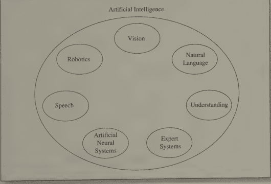

专家系统大量使用专业知识来解决达到人类专家水平的问题。专家是在某个领域拥有专业知识的人。也就是说，专家拥有大多数人不知道或无法获得的知识或特殊技能。专家可以解决大多数人根本无法解决的问题，或者以更高效的方式解决这些问题（但不一定更便宜）。当专家系统最初开发时，它们仅包含专家知识。然而，今天“专家系统”一词常被应用于任何使用专家系统技术的系统。专家系统技术可能包括专为帮助开发和执行专家系统而设计的专用专家系统语言、程序和硬件。

专家系统中的知识可能是专业知识，也可能是通常从书籍、杂志和知识渊博的人那里可以获得的知识。从这个意义上说，知识被认为处于比更为罕见的专业知识更低的水平。专家系统、基于知识的系统和基于知识的专家系统这些术语经常被混用。大多数人使用“专家系统”仅仅是因为它更短，即使他们的专家系统中可能没有专业知识，只有知识。

图 1.2 说明了基于知识的专家系统的基本概念。用户向专家系统提供事实或其他信息，并收到专家建议或专业知识作为回应。在内部，专家系统由两个主要组件组成。知识库包含推理引擎用来得出结论的知识。这些结论是专家系统对用户专业知识查询的响应。

有用的基于知识的系统也被设计为充当人类专家的智能助手。这些智能助手采用专家系统技术设计，因为开发具有优势。随着向智能助手添加更多知识，它的行为会更像专家。开发智能助手可能是生产完整专家系统的一个有用里程碑。此外，它可以通过加快问题解决速度来腾出更多专家的时间。智能导师是人工智能的另一种应用。与旧的计算机辅助教学系统不同，智能导师系统可以提供上下文敏感的教学（Giarratano 91a）。

### 图 1.2 专家系统的基本功能

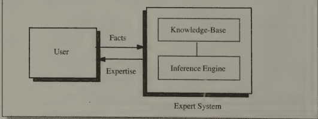

专家的知识特定于一个问题领域，而不是通用问题求解技术。问题领域是专家可以非常擅长解决问题的特殊问题领域，例如医学、金融、科学或工程。专家系统（如同人类专家一样）通常被设计为某个问题领域的专家。例如，你通常不会指望国际象棋专家拥有医学方面的专家知识。一个问题领域的专业知识不会自动迁移到另一个领域。

### 图 1.3 问题领域与知识领域的关系


专家关于解决特定问题的知识被称为专家的知识领域。例如，一个旨在诊断传染病的医学专家系统将拥有大量关于传染病引起的某些症状的知识。在这种情况下，知识领域是医学，包括关于疾病、症状和治疗的知识。图 1.3 说明了问题领域与知识领域之间的关系。请注意，这个知识领域完全包含在问题领域之内。知识领域之外的部分象征着问题领域中没有关于所有问题的知识的区域。

一个专家系统（例如传染病诊断系统）通常不了解医学的其他分支，如外科或儿科。尽管其传染病知识相当于或超过人类专家，但除非专家系统被编程了该领域知识，否则它对其他知识领域一无所知。

在它了解的知识领域内，专家系统进行推理或推断的方式与人类专家推理或推断问题解决方案的方式相同。也就是说，给定一些事实，通过推理推断出一个逻辑上可能的后续结论。例如，如果你的配偶一个月没跟你说话，你可能会推断他或她没有什么值得说的话。然而，这只是几种可能的推断中的一种。

与任何技术一样，有许多方式来看待其效用。表 1.1 总结了技术参与者的不同观点。在这个表中，技术人员可能是工程师或软件设计师，技术可能是硬件或软件。在解决任何问题时，都有需要回答的问题，否则技术将无法成功使用。与任何其他工具一样，专家系统有适当和不适当的应用。第 6 章更详细地讨论了选择适当的应用。

### 表 1.1 技术的不同观点

| 人物 | 问题 |
| :--- | :--- |
| 经理 | 我可以用它做什么？ |
| 技术人员 | 我如何最好地实现它？ |
| 研究人员 | 我如何扩展它？ |
| 消费者 | 它能为我节省时间或金钱吗？ |
| 企业主 | 我可以削减劳动力吗？ |
| 股票经纪人 | 它将如何影响季度利润？ |

### 1.3 专家系统的优势

专家系统具有许多吸引人的特点：

- 可用性提高。专业知识可在任何合适的计算机硬件上使用。从非常实际的意义上说，专家系统是专业知识的大规模生产。
- 成本降低。为每位用户提供专业知识的成本大大降低。
- 危险降低。专家系统可用于对人类可能有危险的环境。
- 永久性。专业知识是永久的。与可能退休、辞职或去世的人类专家不同，专家系统的知识将无限期地保留。
- 多重专业知识。多位专家的知识可以随时（白天或夜晚）同时、持续地用于处理一个问题。几位专家结合的专业知识水平可能超过单个人类专家。
- 可靠性提高。专家系统通过向人类专家提供第二意见，或在多位人类专家意见不一致时提供打破僵局的依据，从而增强对正确决策的信心。（当然，如果专家系统是由其中一位专家编程的，这种方法可能行不通。）专家系统应始终与专家意见一致，除非专家犯了错误，这可能发生在人类专家疲劳或压力过大时。
- 解释。专家系统可以详细解释导致结论的推理过程。人类可能太累、不愿意或无法始终这样做。这增加了做出正确决策的信心。
- 快速响应。对于某些应用，快速或实时响应可能是必要的。取决于所使用的软件和硬件，专家系统可能比人类专家响应更快且更易于使用。某些紧急情况可能需要比人类更快的响应；在这种情况下，实时专家系统是一个不错的选择。
- 始终稳定、不带情绪且完整的响应。在实时和紧急情况下，这可能非常重要，因为人类专家可能因压力或疲劳而无法以最高效率运行。
- 智能导师。专家系统可以充当智能导师，让学生运行示例程序并解释系统的推理过程。


- 智能数据库。专家系统可用于以智能方式访问数据库。数据挖掘是一个示例。

开发专家系统的过程也有间接好处，因为人类专家的知识必须以显式形式录入计算机。由于知识此时是明确已知的，而不是隐含在专家脑海中，因此可以对其正确性、一致性和完整性进行检查。然后可能需要调整这些知识（专家并不欣赏这一点！）

### 1.4 专家系统的一般概念

专家系统的知识可以用多种方式表示。表示知识的一种常见方法是采用 IF THEN 类型规则，例如：

```
IF the light is red THEN stop
```

如果存在“灯是红色的”这一事实，则它与模式“灯是红色”匹配。规则被满足并执行其操作“停止”。虽然这是一个非常简单的示例，但许多重要的专家系统都是通过将专家知识表示为规则来构建的。事实上，基于知识的专家系统开发方法已完全取代了20世纪50年代和60年代早期的AI方法，后者试图在不依赖知识的情况下使用复杂的推理技术。某些类型的专家系统工具（如CLIPS）既允许对象也允许规则。知识可以封装在规则和对象中。规则可以对对象和事实进行模式匹配。或者，对象可以独立于规则运行。

自数字设备公司XCON/R1系统中首次成功商业应用以来，该系统在配置计算机系统方面的知识远超任何单个人类专家，专家系统一再证明了其价值和实用性。已构建了许多用于专门任务的小型系统，包含数百条规则。这些小型系统可能无法达到专家水平，但旨在利用专家系统技术执行知识密集型任务。对于这些小型系统，知识可能存在于书籍、期刊或其他公开可用的文档中。

相比之下，经典专家系统包含未写成文档的知识，这些知识必须通过知识工程师与专家长时间的广泛访谈来提取。构建专家系统的过程称为知识工程，由知识工程师执行。知识工程是指从人类专家或其他来源获取知识并将其编码到专家系统中的过程。

专家系统开发的一般阶段如图1.4所示。知识工程师首先与人类专家建立对话，以提取专家的知识。这一阶段类似于传统编程中的系统设计师与

### 图 1.4 专家系统的开发

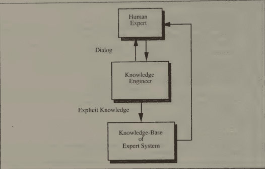

为其构建程序的客户讨论系统需求。然后，知识工程师将知识显式地编码到知识库中。专家随后评估专家系统并向知识工程师提供评论。这一过程会迭代，直到专家认为系统性能令人满意为止。

“知识基础系统”这一表述是知识基础技术应用的更佳术语，因为它可用于创建专家系统或知识基础系统。然而，类似于“人工智能”一词，当今的常见做法是使用“专家系统”来同时指代专家系统和知识基础系统，即使知识未达到人类专家水平。

专家系统通常与常规程序的设计差别不大，因为这些问题没有令人满意的算法解决方案，而是依赖推理来获得合理的解决方案。算法是问题的理想解决方案，因为它保证在有限时间内得出答案（Berlinki 00）。然而，算法可能并不令人满意，且问题规模会扩大，这就是使用AI的原因。请注意，如果没有算法可帮助我们获得最优解，合理的解决方案大约是我们所能期望的最佳结果。由于专家系统依赖推理，它必须能够解释其推理过程，以便对其推理进行检查。解释设施是复杂专家系统的组成部分。事实上，可以设计精巧的解释设施，允许用户探索多条“如果……会怎样”类型的问题线，称为假设性推理。

某些专家系统甚至允许系统通过示例学习规则，即通过规则归纳，系统从数据中创建规则。将专家知识形式化为规则并非易事，尤其是当专家的知识从未被系统地探索过时。专家的知识中可能存在不一致、歧义、重复或其他问题，直到尝试在专家系统中正式表示知识时才会显现出来。

人类专家也应了解其知识的范围，并在问题达到其无知界限时限定其建议。人类专家也知道何时“打破规则”。除非专家系统被明确设计用于处理不确定性，否则即使所处理的数据不准确或不完整，它们也会以同样的信心提出建议。专家系统的建议，如同人类专家一样，应在无知边界处平稳降级，而不是突然中断。

当今许多专家系统的一个实际局限是缺乏因果知识。也就是说，专家系统并不真正理解系统中的底层因果关系。基于经验和启发式知识的浅层知识编程专家系统，比基于对象基本结构、功能和行为的深层知识要容易得多。例如，为人的头痛开阿司匹林的专家系统编程，比编程关于人体的所有底层生物化学、生理学、解剖学和神经学知识要容易得多。编程人体因果模型将是一项艰巨的任务，即使成功，系统的响应时间也可能极其缓慢，因为系统需要处理的所有信息。

一种浅层知识是启发式知识；术语“启发式”源自希腊语，意为发现。启发式解决方案不像算法那样保证成功，算法是问题的保证解决方案。相反，启发式是经验法则或从经验中获得的经验知识，可能有助于解决问题，但不保证有效。然而，在医学和工程等许多领域，启发式在某些类型的问题解决中发挥着关键作用。即使已知精确解，也可能因成本或时间限制而不切实际。启发式可以提供有价值的捷径，从而减少时间和成本。

当今专家系统的另一个问题是，其专业知识仅限于系统中包含的知识领域。典型的专家系统无法像人类那样通过类比来推广知识以推理新情况。尽管规则归纳有所帮助，但以这种方式只能将有限类型的知识放入专家系统。构建专家系统的常规方式是让知识工程师反复进行访谈专家、构建原型、测试、访谈等循环，这是一项非常耗时且劳动密集的任务。事实上，将人类知识转移到专家系统中的这一问题如此重大，以至于被称为知识获取瓶颈。这是一个描述性术语，因为知识获取瓶颈像普通瓶颈限制瓶中液体流动一样，限制了专家系统的构建。


### 1.5 专家系统的特征

专家系统通常被设计为具有以下一般特征：

- 高性能。系统必须能够以与该领域专家相当或更好的水平进行响应。也就是说，系统给出的建议质量必须具有高度的可靠性。

- 适当的响应时间。系统必须在合理的时间内执行，其时间可与专家做出决策所需的时间相比，或更短。如果一个专家系统需要一年才能做出决策，而人类专家只需一小时，那么该系统将毫无用处。对专家系统性能的时间限制在实时系统中可能尤其严格，例如在大雾中着陆飞机时，响应必须在某个时间间隔内完成。

- 良好的可靠性。专家系统必须可靠，不易崩溃，否则将不会被使用。

- 可理解性。系统应能在执行时解释其推理步骤，以便人们能够理解。系统不应仅仅是一个产生神奇答案的“黑盒”，而应具备解释能力，就像人类专家可以解释他们的推理一样。此功能之所以重要，有几个原因：

一个原因是人类的生命和财产可能取决于专家系统的答案。由于潜在的危害很大，专家系统必须能够证明其结论的合理性，就像人类专家可以解释为何得出某个结论一样。因此，解释设施为人类提供了对推理的合理性检查。

第二个原因出现在专家系统的开发阶段，用于确认知识已被正确获取，并且系统正在正确使用这些知识。这在调试中至关重要，因为知识可能因拼写错误而输入错误，或因知识工程师与专家之间的误解而不正确。良好的解释设施允许专家和知识工程师验证知识的准确性。此外，由于典型专家系统的构建方式，阅读长长的程序清单并理解其操作非常困难。

错误的另一个来源可能是专家系统中意外的交互作用，可以通过运行系统应遵循的已知推理的测试用例来检测。正如我们将在后面详细讨论的那样，多个规则可能适用于系统正在推理的给定情况。专家系统中的执行流程不是顺序的；也就是说，你不能只是逐行阅读其代码来理解系统如何运行。规则在系统中输入的顺序不一定是它们将被执行的顺序。专家系统的行为很像一个并行程序，其中规则是独立的知识处理器。

- 灵活性。由于专家系统可能拥有大量知识，因此拥有高效的添加、更改和删除知识的机制非常重要。基于规则的系统之所以流行，原因之一是其对规则的高效和模块化存储能力。

根据系统的不同，解释设施可能简单也可能复杂。基于规则系统中的简单解释设施可能只是列出导致最新规则执行的所有事实。更复杂的系统可能会执行以下操作：

- 列出支持和反对某个特定假设的所有理由。假设是一个需要被证明的目标；例如，在医疗诊断专家系统中，假设可能是“患者患有破伤风感染”。在实际问题中，可能存在多个假设，或者患者可能同时患有多种疾病。假设是一个真实性存疑且必须被证明的断言。一旦假设了一个目标，就会生成更简单的子目标，依此类推，直到子目标足够简单可以求解。这种解决问题的方法是经典的分治法，是后面章节中讨论的后向链式推理的基础。

- 列出可能解释所观察证据的所有假设。

- 解释假设的所有后果。例如，假设患者确实患有破伤风，那么随着感染的发展，也应有发烧的证据。如果随后观察到该症状，就会增加假设为真的可信度。如果未观察到该症状，就会降低假设的可信度。

- 给出如果假设为真将会发生什么的预后或预测。

- 证明程序向用户询问的问题以获取更多信息是合理的。这些问题可用于将推理方向引导至可能的诊断路径。在大多数实际问题中，探索所有可能性成本太高或太耗时，必须提供某种方式来引导对正确解决方案的搜索。例如，考虑对抱怨喉咙痛的患者进行所有可能的医学检查的成本、时间和影响（对医疗行业非常有利，对患者非常不利）。

- 证明程序知识的合理性。例如，如果程序声称假设“患者患有破伤风感染”为真，用户可以要求解释。程序可能会基于这样一条规则来证明这一结论：如果患者的破伤风血液检测呈阳性，则患者患有破伤风。现在用户可以要求程序证明这条规则。程序可以通过说明某种疾病的阳性血液检测就是该疾病的证明来回应。不幸的是，这忽略了假阳性，如后面章节中讨论的那样。

在这种情况下，程序实际上是在引用一个**元规则**，即关于规则的知识。前缀*元*的意思是“在……之上或之外”。程序已被明确创建，以使用**机器学习**的过程推断新规则。假设由知识证明，而知识由一个**保证**证明其正确性。保证本质上是一种元解释，它解释了专家系统对其推理的解释。

知识可以在基于规则的系统中轻松地**增量式**增长，这就是这些系统被证明如此成功的原因之一。也就是说，随着规则的添加，知识库可以逐渐增长，从而可以持续验证系统的性能和有效性。这类似于孩子每天学习新知识并检查新知识是否正确的方式。如果规则设计得当，规则之间的交互作用将被最小化或消除，以防范意外影响。知识的增量式增长有助于**快速原型**开发，使知识工程师能够快速展示专家系统的工作原型。这是一个重要的特性，因为它能保持专家和管理层对项目的兴趣。快速原型开发还能迅速暴露专家知识或系统中的任何缺口、不一致或错误，以便立即进行更正。

### 1.6 专家系统技术的发展

专家系统的根源在于许多学科；特别是，与人类信息处理相关的心理学领域，即**认知科学**。认知是研究人类如何认知或处理信息的学科。换句话说，认知是研究人们如何思考的学科，尤其是在解决问题时。已开发出各种认知工具以提供更好的教学（Lajoie 00）。

AI 机器必须具备的另一个重要概念是识别符号的能力，这构成了名为**符号学**的领域的基础（Fetzer 01）。在符号学中，我们指的不是诸如停止标志这样的简单书面符号，而是符号的整体概念。符号是代表其他事物的东西。例如，如果你观看一部同时播放音乐的电影，一个常见的预示即将发生激动人心事情的迹象是音乐音调升高和节奏加快。同样，当悬念即将发生时，音乐会变得更慢、更深沉。音乐、电影、电视和日常生活中存在许多不同的非语言符号。例如，如果一个人在回答问题时撒谎或感到不自在，他们通常会垂下眼睛。这对设计用于在现实世界中存在的智能机器具有重大影响。仅靠简单的编程来理解单词是不够的；机器还必须识别符号背后的含义。

如果我们希望计算机模拟人类专家，那么认知研究非常重要。通常，专家无法解释他们如何解决问题——解决方案只是浮现在脑海中。如果专家无法解释如何解决问题，那么就不可能在基于显性知识的专家系统中对知识进行编码。在这种情况下，唯一的可能性是能够自主学习以模拟专家的程序。这些程序基于归纳、人工神经系统以及后面将讨论的其他软计算方法。


### 人类问题求解与产生式

专家系统技术的发展借鉴了广泛的背景。表 1.2 简要概述了一些促成 CLIPS 的重要进展。在可能的情况下，使用项目的开始日期。许多项目持续多年。这些进展在本章及其他章节中有更详细的介绍。附录 G 描述了若干专家系统工具和现代专家系统。

### 表 1.2 促成 CLIPS 首个版本发布的一些重要事件

| 年份 | 事件 |
|------|------|
| 1943 | Post 产生式规则：McCulloch 和 Pitts 神经元模型 |
| 1954 | 用于控制规则执行的马尔可夫算法 |
| 1956 | 达特茅斯会议：逻辑证明者；启发式搜索；"AI" 术语被创造 |
| 1957 | Rosenblatt 发明感知机；GPS（通用问题求解器）启动（Newell, Shaw, 和 Simon） |
| 1958 | LISP AI 语言（McCarthy） |
| 1962 | Rosenblatt 的 *神经动力学原理* 关于感知机 |
| 1965 | 自动定理证明的分辨率方法（Robinson）；用于模糊对象推理的模糊逻辑（Zadeh） |
| | DENDRAL（第一个专家系统）工作开始（Feigenbaum, Buchanan, Lederberg） |
| 1968 | 语义网络，联想记忆模型（Quillian） |
| 1969 | MACSYMA 数学专家系统（Martin 和 Moses） |
| 1970 | PROLOG 工作开始（Colmerauer, Roussel） |
| 1971 | 用于语音识别的 HEARSAY I |
| 1973 | 用于医疗诊断的 MYCIN 专家系统（Shortliffe），导致 GUIDON，智能辅导（Clancey）和 TEIRESIAS，解释设施概念（Davis）以及 EMYCIN，第一个外壳（Van Melle, Shortliffe, 和 Buchanan） |
| | HEARSAY II，协作专家问题求解的黑板模型 |
| 1975 | AM（自动数学家）数学概念的创造性发现 |
| 1976 | （Lenat）；用于不确定性下推理的 Dempster-Shafer 证据理论；用于矿产勘探的 PROSPECTOR 专家系统工作开始（Duda, Hart） |
| 1977 | OPS 专家系统外壳（Forgy），CLIPS 的祖先 |
| 1978 | XCON/R1 工作开始（McDermott, DEC）用于配置 DEC 计算机系统；Meta-DENDRAL，元模型和规则归纳（Buchanan） |
| 1979 | 用于快速模式匹配的 Rete 算法（Forgy）；AI 的遗传专业化开始 |
| | Intecor Corp. 成立；于 1985 年发布 ART 专家系统工具 |
| 1980 | Symbolics, LMI 成立以制造 LISP 机器 |
| 1982 | SMP 数学专家系统；Hopfield 神经网络；日本第五代计算机项目开发智能计算机 |
| 1983 | KEE 专家系统工具（IntelliCorp） |
| 1985 | CLIPS 版本 1 专家系统工具（NASA）。可在所有计算机上免费获得，而不仅仅是特殊用途且昂贵的 LISP 机器。 |

20 世纪 50 年代末和 60 年代，人们编写了许多以通用问题求解为目标的程序。其中最著名的是由 Newell 和 Simon 创建的 **通用问题求解器**。这引起了巨大轰动，因为新闻界将当时占据整个房间的大型计算机称为“巨脑”。人们开始担心会失去工作，直到 IBM 等公司声称这些机器只会完成成千上万名数学家需要一百万年才能完成的工作。在那些机器价值一百万美元、CPU 时间按每微秒 1 美元收费的日子里，人们从未想过有一天会在家里或工作中拥有廉价的个人计算机。

Newell 和 Simon 展示的最重要结果之一是，人类理解或认知的大部分可以用 IF–THEN **产生式规则**来表达。例如，如果看起来要下雨 THEN 带上伞，或者如果你的配偶心情不好 THEN 不要表现得开心。一条规则对应一个称为 **块** 的小型模块化知识集合。这些块以松散的排列方式组织，并链接到相关的知识块。一种理论认为，所有人类记忆都以块的形式组织。以下是表示一个知识块的规则示例：

```
IF the car doesn't run and
the fuel gauge reads empty
THEN fill the gas tank.
```

Newell 和 Simon 推广了使用规则来表示人类知识，并展示了如何用规则进行标准推理。认知心理学家使用规则作为模型来解释人类信息处理。基本思想是，感官输入为大脑提供刺激。刺激触发 **长期记忆** 中的适当规则，从而产生适当的响应。长期记忆是存储我们永久知识的地方。例如，我们都有诸如以下规则：

```
IF there is flame THEN there is a fire
IF there is smoke THEN there may be a fire
IF there is a siren THEN there may be a fire
```

请注意，最后两条规则并非以完全确定性表达。火可能已经熄灭，但空气中可能仍有烟雾。同样，警笛并不能证明有火灾，因为可能是误报。看到火焰、闻到烟味和听到警笛的刺激将触发这些及类似类型的规则。

长期记忆由许多具有简单 IF THEN 结构的规则组成。事实上，国际象棋大师可能了解 50,000 个或更多关于棋盘模式的知识块。与长期记忆相反，**短期记忆**用于问题求解过程中的知识临时存储。虽然长期记忆可以容纳数十万个或更多块，但工作记忆的容量却出人意料地小——四到七个块。作为一个简单的例子，试着在脑海中想象一些数字。大多数人一次只能看到四到七个数字。当然，我们可以记住远多于四到七个数字。但是，这些数字存储在长期记忆中，需要一段时间才能使其永久化。

一种理论认为，短期记忆代表同时可以处于活动状态的块的数量，并将人类问题求解视为这些活动块在头脑中的扩散。最终，一个块可能以如此强烈的强度被激活，以至于产生一个有意识的想法，你对自己说：“嗯……有什么东西在烧。不知道我的裤子是不是着火了？”

人类问题求解所需的另一个要素是 **认知处理器**。认知处理器试图找到将由适当刺激 **激活** 的规则。并非任何规则都行。例如，你每次听到警笛都不想加满油箱。只有与刺激匹配的规则才会被激活。如果一次有多个规则被激活，认知处理器必须执行 **冲突解决** 来决定哪条规则优先级最高。优先级最高的规则将被执行。

例如，如果以下两条规则都被激活：

```
IF there is a fire THEN leave
IF my clothes are burning THEN put out the fire
```

然后一条规则的动作将在另一条之前执行。现代专家系统的 **推理引擎** 对应于认知处理器。

Newell 和 Simon 的人类问题求解模型（以长期记忆（规则）、短期记忆（工作记忆）和认知处理器（推理引擎）为基础）是现代基于规则的专家系统的基础。

这样的规则是一种 **产生式系统**。基于规则的产生式系统是当今实现专家系统的流行方法。组成产生式系统的单个规则是 **产生式规则**。在设计专家系统时，一个重要因素是规则的知识量或 **粒度**。粒度太小会使在不参考其他规则的情况下难以理解一条规则。粒度太大会使专家系统难以修改，因为多个知识块混杂在一条规则中。CLIPS 能够同时使用对象和规则是一大优势。

直到 20 世纪 60 年代中期，AI 的一项主要追求是生成很少依赖领域知识而很大程度上依赖强大推理方法的智能系统。即使是 _通用问题求解器_ 这个名称也说明了对非为某一特定领域设计、而是旨在解决多种问题的机器的关注。尽管通用问题求解器使用的推理方法非常强大，但这些机器永远是初学者。当面对一个新领域时，它们必须从第一原理开始发现一切，不如依赖领域知识以实现高性能的人类专家。

知识力量的一个例子是下棋。尽管计算机现在可以与人类抗衡，但人们下棋很好，尽管计算机可以快数百万倍地进行计算。研究表明，人类专家棋手并不具备超强的推理能力，而是依靠多年对弈积累的棋子模式知识。如前所述，一项估计认为专家棋手的知识大约为 50,000 个模式。


人类非常擅长识别模式，例如棋盘上的棋子。最优秀的人类棋手不是试图为每个棋子推演50步、100步或更多可能的走法，而是分析棋局中的模式，这些模式能揭示长期威胁，同时保持警惕以应对短期的突袭走法。正是这种策略，而非预判走法的蛮力前瞻方法，使得像IBM的Deep Blue这样的计算机象棋程序能够击败所有人类象棋冠军。

虽然领域知识非常强大，但它通常仅限于特定领域。例如，一个成为象棋专家的人并不会自动成为解决数学问题的专家，甚至也不会成为跳棋专家。虽然有些知识可能会迁移到另一个领域，例如仔细规划走法，但这属于技能，而非真正的专业知识。

到20世纪70年代初，人们已清楚地认识到，领域知识是构建能够达到人类专家水平的机器问题求解器的关键。尽管推理方法很重要，但研究表明，专家在解决问题时并不主要依赖推理。事实上，推理在专家的问题解决中可能只起次要作用。相反，专家依赖于多年来积累的大量启发式知识和经验。如果专家无法凭借专业知识解决问题，那么专家就需要从第一原理和理论进行推理（或者更可能是去问另一位专家）。专家的推理能力在处理完全陌生的情况时，通常并不比普通人强。仅基于推理构建强大问题求解器的早期尝试表明，如果问题求解器必须仅依赖推理，那么它就会变得残缺不全。

认识到领域知识是构建现实世界问题求解器的关键，这一洞察促成了专家系统的成功。因此，当今成功的专家系统是基于知识的专家系统，而非通用问题求解器。促成专家系统发展的同一技术，也促成了基于知识的系统的发展，这些系统不一定包含人类专业知识。

虽然专业知识被认为是专门且为少数人所知的知识，但知识通常存在于书籍、网络、期刊和其他广泛可用的资源中。例如，如何解一元二次方程或进行积分和微分的知识是广泛可用的。Mathematica和MATLAB等基于知识的计算机程序可用于自动执行这些以及许多其他数学运算，操作数可以是数值或符号。其他基于知识的程序可能执行制造工厂的过程控制。如今，基于知识的系统和专家系统这两个术语经常混用。事实上，专家系统现在被视为一种替代传统算法编程的编程模型或范式。

## 基于知识的系统的兴起

随着20世纪70年代基于知识的范式被接受，许多成功的专家系统被创建出来。这里将更详细地描述这些系统，因为它们都有详尽的文档，有许多论文和书籍专门介绍它们的工作原理和知识库。你将要阅读的现代专家系统的一般问题是，它们的知识是专有且保密的。公司使用专家系统来封装为其工作的人类专家的知识。他们不希望这些知识对竞争对手可用，尤其是对律师。考虑一个医疗专家系统，它给出的诊断导致患者死亡或声称受伤。事实上，原告甚至不需要遭受人身伤害，只需与其他声称受伤的人一起参与集体诉讼即可。专家系统中的软件和知识库都将受到其他专家的检查。正如许多审判所示，你总能找到一位专家来反驳另一位。

这些经典专家系统可以解释质谱图以识别化学成分（DENDRAL）、诊断疾病（MYCIN）、分析地质数据以寻找石油（DIPMETER）和矿产（PROSPECTOR），以及配置计算机系统（XCON/R1）。PROSPECTOR发现了价值1亿美元的矿藏，而XCON/R1每年为数字设备公司（DEC）节省数百万美元的消息，到1980年引发了对新专家系统技术的轰动兴趣。20世纪50年代作为人类信息处理研究起步的人工智能分支，现在已通过开发用于现实世界的实用程序实现了商业成功。

MYCIN专家系统之所以重要，有几个原因。首先，它证明了人工智能可以用于医疗诊断。其次，MYCIN是解释设施、自动知识获取和智能辅导等新概念的试验平台，这些概念如今出现在许多专家系统中。MYCIN重要的第三个原因是，它证明了专家系统外壳的可行性，在这种外壳中，程序软件与数据是分离的。换句话说，数据或知识没有硬编码到软件程序中。事实上，外壳允许轻松替换一个知识库领域为另一个。

像DENDRAL这样的早期专家系统是独一无二的系统，其中知识库与应用知识的软件（即推理引擎）交织在一起。MYCIN明确将知识库与推理引擎分开。这对专家系统技术的发展至关重要，因为这意味着专家系统的核心可以被重复使用。也就是说，通过清空旧知识并填入关于新领域的知识，可以比DENDRAL类型系统快得多地构建一个新的专家系统。MYCIN中处理推理和解释的部分（即外壳）随后可以重新填充关于新系统的知识。通过去除MYCIN的医学知识而产生的外壳被称为EMYCIN（基本或空的MYCIN）。

到20世纪70年代末，如今大多数专家系统的三个基本概念已经汇聚，如图1.5所示。这些概念是规则、外壳和知识。

### 图1.5 创建现代基于规则的专家系统的三个重要因素的汇聚

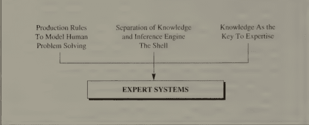

到1980年，新公司开始将专家系统从大学实验室带出来并生产商业产品。引入了强大的新软件以及专门用于专家系统开发的直接用LISP编写的软件。不幸的是，高昂的成本和大量的培训时间最终导致了这些系统的消亡，因为个人电脑变得更加强大，并且引入了CLIPS等专家系统工具。在LISP机器中，本地汇编语言、操作系统和所有其他基本代码都使用LISP编写，因此需要大量的维护。

CLIPS最初用C语言编写以实现速度和可移植性，并使用一种称为Rete算法的强大模式匹配。与其他任何专家系统工具不同，CLIPS不仅免费，而且源代码有详细文档并随附。CLIPS可以安装在任何支持标准Kernighan和Ritchie C语言的C编译器上，并且已安装在各种计算机上。已开发出许多CLIPS衍生语言，具有模糊逻辑和后向链等高级功能，它们甚至已用Java编码，称为Jess，如前言中所述。

### 1.7 专家系统应用与领域

传统计算机程序用于解决多种类型的问题。通常，这些问题具有算法解决方案，非常适合传统程序和编程语言，例如C、C++、Java、C#等。在工业和工程等许多应用领域，数值计算至关重要。相比之下，专家系统主要是为符号推理而设计的。

虽然LISP和PROLOG等经典人工智能语言也用于符号操作，但它们比专家系统外壳更具通用性。这并不意味着无法在LISP和PROLOG中构建专家系统。如今，逻辑编程一词通常用于指在PROLOG中进行的编程，尽管也开发了许多其他语言用于此目的。许多专家系统已使用PROLOG和LISP构建。PROLOG尤其由于其内置的后向链，对诊断系统具有许多优势。使用外壳和实用程序构建大型专家系统更加方便和高效


专门为专家系统构建而设计。与其每次构建新专家系统时都“重复造轮子”，不如使用专为专家系统构建设计的专用工具，这比使用通用工具更高效。

### 专家系统的应用

专家系统已应用于几乎每个知识领域。有些被设计为研究工具，而另一些则承担重要的商业和工业功能。20世纪70年代，专家系统在常规商业应用中的第一个重大商业成功是DEC的XCON系统。XCON系统（最初称为R1）是与卡内基梅隆大学的John McDermott合作开发的。XCON是DEC计算机系统的专家配置系统。

系统配置是指当客户下订单时，提供所有正确的部件——软件、硬件和文档。当人们通过在互联网上填写表格订购计算机、汽车和其他产品时，这仍然是一个至关重要的主题。对于计算机制造商或汽车制造工厂来说，检查每个订单的零件可用性或确定特殊订单是否可以交付将是极其低效的。今天，对于任何必须及时配置和交付的系统，专家系统都是逻辑和财务上的必需。

数千个专家系统已在计算机期刊、互联网、书籍和会议中构建和报告。这无疑只代表了冰山一角，因为许多公司和政府不会报告其系统的细节，因为系统中包含专有或秘密知识。基于公开文献中描述的系统，可以辨别出某些广泛的专家系统应用类别，如表1.3所示。表1.4–1.9列出了著名的经典系统，因为它们文档齐全，而现代系统具有类似的应用。

### 表1.3 专家系统的广泛类别

| 类别 | 一般领域 |
| :--- | :--- |
| 配置 | 以正确的方式组装系统的适当组件。 |
| 诊断 | 根据观察到的事件推断根本问题。 |
| 教学 | 智能教学，使学生可以像人类教学一样提出为什么、如何和如果……会怎样等问题。 |
| 解释监控 | 解释观察到的数据。将观察到的数据与预期数据进行比较以判断性能。 |
| 规划 | 制定行动以产生所需结果。 |
| 预后 | 预测给定情况的结果。 |
| 补救 | 为问题开具治疗方案。 |
| 控制 | 调节过程。可能需要解释、诊断、监控、规划、预后和补救。 |

### 表1.4 经典化学专家系统

| 名称 | 化学 |
| --- | --- |
| CRYSTALIS | 解释蛋白质的3-D结构。 |
| DENDRAL | 解释分子结构。 |
| TQMSTUNE | 补救三重四极杆质谱仪（保持其调谐）。 |
| CLONER | 设计新的生物分子。 |
| MOLGEN | 设计基因克隆实验。 |
| SECS | 设计复杂的有机分子。 |
| SPEX | 规划分子生物学实验。 |

### 表1.5 经典电子专家系统

| 名称 | 电子 |
| --- | --- |
| ACE | 诊断电话网络故障。 |
| IN-ATE | 诊断示波器故障。 |
| NDS | 诊断国家通信网。 |
| EURISKO | 设计3-D微电子学。 |
| PALLADIO | 设计和测试新的VLSI电路。 |
| REDESIGN | 将数字电路重新设计为新的。 |
| CADTHELP | 计算机辅助设计教学。 |
| SOPHIE | 电路故障诊断教学。 |

### 表1.6 经典医学专家系统

| 名称 | 医学 |
| --- | --- |
| PUFF | 诊断肺病。 |
| VM | 监护重症监护病人。 |
| ABEL | 诊断酸碱/电解质。 |
| AI/COAG | 诊断血液疾病。 |
| AI/RHEUM | 诊断类风湿疾病。 |
| CADUCEUS | 诊断内科疾病。 |
| ABEL | 监控地高辛治疗。 |
| BLUE BOX | 诊断/补救抑郁症。 |
| MYCIN | 诊断/补救细菌感染。 |
| ONCOCIN | 补救/管理化疗病人。 |
| ATTENDING | 细菌管理教学。 |
| GUIDON | 细菌感染教学。 |

### 表1.7 经典工程专家系统

| 名称 | 工程 |
| --- | --- |
| REACTOR | 诊断/补救反应堆事故。 |
| DELTA | 诊断/补救GE机车。 |
| STEAMER | 蒸汽电厂操作教学。 |

| 名称 | 地质学 |
| :--- | :--- |
| DIPMETER | 解释倾斜仪测井数据。 |
| LITHO | 解释油井测井数据。 |
| MUD | 诊断/补救钻井问题。 |
| PROSPECTOR | 解释矿产地质数据。 |

| 名称 | 计算机系统 |
| :--- | :--- |
| PTRANS | 为管理DEC计算机提供预后。 |
| BDS | 诊断交换网中的故障部件。 |
| XCON | 配置DEC计算机系统。 |
| XSEL | 配置DEC计算机销售订单。 |
| XSITE | 配置DEC计算机的客户站点。 |
| YES/MVS | 监控/控制IBM MVS操作系统。 |
| TIMM | 诊断DEC计算机。 |

### 专家系统的适用领域

在开始构建专家系统之前，必须确定专家系统是否是合适的范式。例如，一个关注点是是否应该使用专家系统而不是替代范式，如常规编程。专家系统的适用领域取决于多个因素：

- 问题是否可以通过常规编程有效解决？如果答案是肯定的，那么专家系统不是最佳选择。例如，考虑诊断某些设备的问题。如果所有故障的所有症状都预先已知，那么简单的查表或故障决策树就足够了。专家系统最适合没有高效算法解决方案的情况。这种情况称为**结构不良问题**，推理可能是获得良好解决方案的唯一希望。

作为结构不良问题的示例，考虑一个人无法决定在网上预订哪个度假地点，并决定去见旅行社代理人的情况。表1.10列出了该人对旅行社代理人提问的回应所指示的**结构不良问题**的一些特征。

虽然这是一个极端案例，但它确实说明了结构不良问题的基本概念。如您所见，结构不良问题不太适合算法解决方案，因为可能性太多。在这种情况下，当其他方法都失败时，应采用默认选项。例如，旅行社代理人可以说：“啊哈！我为你准备了完美的旅行：环球邮轮之旅。请填写以下信用卡申请表，一切都会安排妥当。”

### 表1.10 结构不良问题示例

| 旅行社代理人的问题 | 回应 |
|---|---|
| 我可以帮您吗？ | 我不确定。 |
| 您想去哪里？ | 某个地方。 |
| 有特定目的地吗？ | 这里那里。 |
| 您能负担多少？ | 我不知道。 |
| 您能筹到一些钱吗？ | 我不知道。 |
| 您想什么时候去？ | 迟早。 |

在处理结构不良问题时，存在专家系统设计可能意外发展为算法解决方案的危险。如果存在良好的算法，则不需要专家系统。如果发现一种需要严格控制结构的解决方案，这就表明这种情况已经发生。也就是说，知识工程师通过显式设置许多规则的优先级，强制规则按特定顺序执行。在专家系统上强制实施严格的控制结构会抵消专家系统技术的一大优势，即处理不遵循预定模式的意外输入。也就是说，专家系统会机会主义地对其输入做出反应，无论输入是什么。常规程序通常期望输入遵循一定的顺序。具有大量控制的专家系统通常表明是一个伪装的算法，并可能是重新编码为常规程序的良好候选者。

- 领域是否有明确的边界？非常重要的是要对专家系统预期知道的内容及其应具备的能力设定明确的界限。例如，假设您想创建一个诊断头痛的专家系统。当然，医生的医学知识会被放入知识库。但是，为了深入理解头痛，您还可以加入神经化学知识，然后是其父领域生物化学，然后是化学、分子生物物理学，等等，也许一直到亚核物理学。其他领域，如生物反馈、心理学、精神病学、生理学、运动、瑜伽和压力管理，也可能包含关于头痛的相关知识。这一切的要点是——什么时候停止添加领域？领域越多，专家系统就越复杂。

特别是，协调所有专业知识的任务成为一项主要任务。在现实世界中，我们从经验中知道，让协调的专家团队合作解决问题有多么困难，尤其是当他们提出相互冲突的建议时。如果我们知道如何很好地编程来协调专业知识，那么我们可以尝试编程让专家系统拥有多位专家的知识。协调多个专家系统的首次尝试是HEARSAY II和HEARSAY III系统。这些项目展示了该任务的复杂性。作为一个熟悉的例子，当您遇到问题时，试着把车开到多个服务中心，看看您会得到多少种不一致的诊断。随着专业知识变得越来越稀缺，如此


众多的意见，这使得决定行动方案变得非常困难。

- 是否存在对专家系统的需求和意愿？虽然构建专家系统是一次宝贵的经验，但如果没有人愿意使用，那也毫无意义。如果已经有许多人类专家，基于人类专家稀缺这一理由来证明专家系统的合理性是困难的。此外，如果专家或用户不想要该系统，即使存在需求，它也不会被接受。例如，许多模拟表明，AI控制的交通信号灯可以将燃油消耗降低50%，但这也会使城市、州和联邦政府的汽油税收入减少50%。

管理层尤其必须愿意支持该系统。对于专家系统而言，这一点比常规程序更为关键，因为专家系统的部署有时被视为裁员的前兆。必须让工人放心，专家系统不会导致失业，反而会随着专业知识以更低成本更广泛地提供而带来盈利增加。专家系统领域值得更多支持，因为它试图解决常规编程无法完成的问题。风险更大，但回报也更丰厚。

- 是否至少有一位愿意合作的人类专家？必须有一位专家愿意，最好是热衷于该项目。并非所有专家都愿意让自己的知识接受缺陷检查，然后录入计算机。即使有多位专家愿意参与开发，限制参与开发的专家数量可能也是明智的。不同的专家可能有不同的解决问题的方法，例如要求不同的诊断测试。有时他们甚至可能得出不同的结论。试图在一个知识库中对多种解决问题的方法进行编码，可能会产生内部冲突和不兼容性。

- 专家能否解释知识，使知识工程师能够理解？即使专家愿意合作，用明确的术语表达知识也可能存在困难。例如，你能用语言解释如何移动手指吗？虽然你可以说这是通过收缩手指肌肉完成的，但下一个问题是——如何收缩手指肌肉？专家与知识工程师之间沟通的另一个困难是，知识工程师不了解专家的技术术语。这个问题在医学术语方面尤为突出。知识工程师可能需要一年或更长时间才能理解专家在说什么，更不用说将这些知识转化为明确的计算机代码了。

- 解决问题的知识主要是启发式且不确定的吗？当专家的知识在很大程度上是启发式且不确定的时，专家系统是合适的。也就是说，知识可能基于经验，称为经验知识，专家可能需要尝试各种方法，以防一种方法不起作用。换句话说，专家的知识可能是一种试错方法，而不是基于逻辑和算法的方法。然而，专家仍然可以比非专家更快地解决问题。这是专家系统的一个良好应用。如果问题可以简单地通过逻辑和算法解决，那么用常规程序解决更好。

### 1.8 语言、外壳和工具

定义问题时的一个基本决策是决定如何最好地对其进行建模。有时可以利用经验来帮助选择最佳范式。例如，经验表明，Prolog最好使用常规过程式编程来实现。经验还表明，如果可用，最好使用商业软件包，而不是从头开始编写。选择范式的一般指导原则是首先考虑最传统的一种——常规编程。这样做的原因是，我们在常规编程方面拥有大量经验，并且有各种各样的商业软件包可用。如果问题无法通过常规编程有效解决，那么就转向非传统范式，例如AI，这需要理论知识，而不仅仅是一门C语言课程。

与标准关系数据库语言SQL一样，专家系统语言比LISP或C等第三代语言更高阶，因为做某些事情更容易；但可处理的问题范围也更小。也就是说，专家系统语言的专业性使其非常适合编写专家系统，但不适合通用编程。在许多情况下，甚至需要暂时退出专家系统语言，以在过程式语言中执行某个功能。CLIPS的设计就是为了使这变得容易。

专家系统语言与过程式语言之间的主要功能差异在于表示的侧重点。过程式语言侧重于提供灵活且可靠的技术来表示数据。例如，数组、记录、链表、栈、队列和树等数据结构可以轻松创建和操作。Java和C#等现代语言旨在通过提供对象、方法和包等封装结构来帮助实现数据抽象。这提供了一种在程序中实现的抽象级别。数据和操作数据的方法在对象中紧密交织。相比之下，专家系统语言侧重于提供灵活且可靠的方式来表示知识。专家系统范式允许两个抽象级别：数据抽象和知识抽象。专家系统语言专门将数据与操作数据的方法分开。这种分离的一个例子是基于规则的专家系统语言中的事实（数据抽象）和规则（知识抽象）。此外，CLIPS提供对象以及真正面向对象语言的所有特性。

这种侧重点的差异也导致了程序设计方法论的差异。由于过程式语言中数据和知识紧密交织，程序员必须仔细描述执行顺序。然而，专家系统语言中数据与知识的显式分离，对执行顺序的控制要求不那么严格。通常，使用一段完全独立的代码——推理机——来将知识应用于数据。这种知识与数据的分离允许更高程度的并行性和模块化。

定义专家系统程序需求的惯用方法是决定是否要对人类专家的专业知识进行编程。如果存在这样的专家并且愿意合作，那么专家系统方法可能会成功。同样，对于非常知识密集且具有不确定性的任务，使用专家系统工具可能是最佳解决方案。

选择专家系统工具的道路充满了困惑，因为当今有如此丰富的选择。虽然CLIPS不具备其他语言的所有功能，但它更容易学习，因此是入门教材的不错选择。此外，CLIPS仍然保持其原有的优势，即程序体积小且执行速度快，在对实时响应至关重要的情况下尤为如此。

除了当今众多可用语言令人困惑的选择之外，用于描述语言的术语也令人困惑。有些供应商将其产品称为“工具”，而有些则称为“外壳”，还有些谈论“集成环境”。为了本书的清晰起见，这些术语定义如下：

- 语言——一种用特定语法编写命令的翻译器。专家系统语言还将提供推理机来执行语言的语句。根据实现方式，推理机可能提供前向链、后向链或两者兼有。根据此语言定义，LISP不是专家系统语言，而PROLOG是。不过，可以使用LISP编写专家系统语言，并使用PROLOG编写AI。更何况，你甚至可以用汇编语言编写专家系统或AI语言。开发时间、便利性、可维护性、效率和速度等问题决定了软件使用何种语言编写。

- 工具——一种语言加上相关实用程序，以便于应用程序的开发、调试和交付。实用程序可能包括文本和图形编辑器、调试器、文件管理，甚至代码生成器。有些工具甚至可能允许在一个应用程序中使用不同的范式，例如前向链和后向链。

在某些情况下，工具可能与其所有实用程序集成在一个环境中，以向用户提供通用界面。这种方法最大限度地减少了用户执行任务时离开环境的需求。例如，一个简单的工具可能不提供文件管理功能，因此用户必须退出工具，例如在C宿主语言中发出常规命令。集成环境允许轻松交换数据


环境中的实用程序之间。有些工具甚至不要求用户编写任何代码。相反，该工具允许用户通过表格或电子表格中的示例输入知识，并自动生成相应的代码。

- shell——一种专用工具，专为某些类型的应用程序设计，在这些应用程序中，用户只需提供知识库。其经典示例是 EMYCIN（空 MYCIN）shell。该 shell 是通过去除 MYCIN 专家系统的医学知识库而制作的。

MYCIN 被设计为一种用于诊断疾病的后向链系统。通过去除医学知识，EMYCIN 被创建为一个包含其他使用后向链的咨询系统知识的 shell。EMYCIN shell 演示了基本 MYCIN 软件（如推理引擎和用户界面）的可重用性。这是现代专家系统技术发展中的一个非常重要的步骤，因为它意味着不必为每个新应用从头构建专家系统。如今，专家系统工具领域竞争激烈，提供了许多功能和 GUI。

表征专家系统的方式有很多种，例如知识表示、前向或后向链、不确定性支持、假设推理、解释设施等等。除非一个人构建过若干个专家系统，否则很难欣赏所有这些功能，尤其是更昂贵工具中具有的功能。学习专家系统技术的最佳方法是使用易学的语言开发若干个系统，然后如果需要其功能，再投资于更复杂的工具。

### 1.9 专家系统的元素

典型专家系统的元素如图 1.6 所示。在基于规则的系统中，知识库包含以规则形式编码的解决问题所需的领域知识。虽然规则是表示知识的流行范式，但其他类型的专家系统使用不同的表示方法，如第 2 章所讨论。

专家系统由以下组件组成：

- 用户界面——用户与专家系统通信的机制。
- 解释设施——向用户解释系统推理的设施。
- 工作内存——规则使用的事实的全局数据库。
- 推理引擎——通过决定哪些规则被事实或对象满足、对满足的规则进行优先级排序并执行优先级最高的规则来进行推理。
- 议程——由推理引擎创建的优先级规则列表，其模式被工作内存中的事实或对象满足。
- 知识获取设施——用户向系统输入知识的自动方式，而无需知识工程师显式编码知识。

### 图 1.6 基于规则的专家系统结构

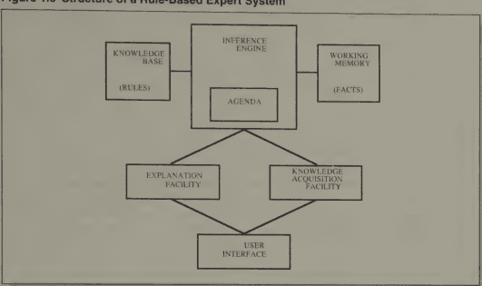

知识获取设施是许多系统中的可选功能。在某些专家系统工具中，该工具可以通过示例进行规则归纳来学习并自动生成规则。其他方法（如 ID3、C4.5、C5.1、人工神经网络和遗传算法）已用于机器学习中以生成规则。使用机器学习生成规则的主要问题是没有解释说明为何会创建这些规则。与可以解释规则原因的人类不同，机器学习系统从未能够解释其行为，因此可能会出现不可预测的结果。然而，示例通常来自表格-电子表格类型的数据，更适合决策树。知识工程师构建的通用规则可以比规则归纳产生的简单规则复杂得多。

取决于系统的实现，用户界面可以是简单的文本导向显示，也可以是复杂的高分辨率位图显示。高分辨率显示通常用于模拟带有旋钮和显示器的控制面板。

知识库在基于规则的专家系统中也称为 **产生内存**。举一个非常简单的例子，考虑决定是否过马路的问题。两条规则的产生式如下，其中箭头表示如果左侧条件为真，系统将执行箭头右侧的操作：

```
the light is red -> stop
the light is green -> go
```

产生规则可以用等效的伪代码 IF-THEN 格式表示为：

```
Rule: Red_light
IF
the light is red
THEN
stop
```

```
Rule: Green_light
IF
the light is green
THEN
go
```

每条规则都由一个名称标识。名称之后是规则的 IF 部分。规则中 IF 和 THEN 部分之间的部分有多种名称，如前件、条件部分、模式部分或左侧（LHS）。单个条件：

灯是绿色的

称为条件元素或模式。

以下是来自经典系统的一些规则示例：

### 用于脑膜炎和菌血症（细菌感染）诊断的 MYCIN 系统

```
IF
The site of the culture is blood, and
The identity of the organism is not known with certainty, and
The stain of the organism is gramneg, and
The morphology of the organism is rod, and
The patient has been seriously burned
THEN
There is weakly suggestive evidence (.4) that
the identity of the organism is
pseudomonas
```

### 用于配置 DEC VAX 计算机系统的 XCON/R1

```
IF
The current context is assigning devices to
Unibus modules and
There is an unassigned dual-port disk drive
and
The type of controller it requires is known
and
There are two such controllers, neither of
which has any devices assigned to it, and
The number of devices that these controllers can support is known
THEN Assign the disk drive to each of the controllers, and Note that the two controllers have been associated and each supports one drive
```

在基于规则的系统中，推理引擎确定哪些规则前件（如果有）被事实满足。两种常用的推理方法作为专家系统的问题解决策略：前向链和后向链。用于更具体需求的其他方法可能包括手段-目的分析、问题归约、回溯、计划-生成-测试、层次规划和最小承诺原则，以及约束层次。

前向链是从事实到由此产生的结论的推理。例如，如果你在离家前看到下雨（事实），那么你应该带伞（结论）。

后向链涉及从假设（即待证明的潜在结论）反向推理到支持该假设的事实。例如，如果你没有向外看，有人穿着湿鞋并带着伞进来，你的假设是正在下雨。为了支持这个假设，你可以问那个人是否在下雨。如果回答是肯定的，那么假设就被证明为真并成为事实。如前所述，假设可以被视为真实性存疑且需要确立的事实。然后可以将假设解释为待证明的目标。

取决于设计，推理引擎将执行前向链、后向链或两者兼而有之。例如，CLIPS 专为前向链设计，PROLOG 程序使用后向链，而由 Paul Haley 开发的名为 Eclipse 的 CLIPS 版本同时支持前向链和后向链。推理引擎的选择取决于问题类型。诊断问题更适合使用后向链求解，而预后、监控和控制更适合使用前向链。然而，使用更高级的工具会涉及内存大小和执行速度方面的代价，因为创建该工具需要更多代码。CLIPS 被设计为“精简高效”，以便尽可能快地执行，并适合在 ROM 等小内存设备上部署的应用程序。虽然使用 512 MB 内存的桌面电脑的人通常不会考虑这一点，但开发智能遥控器或微波炉等产品需要 ROM 作为廉价的永久内存。内存成本随容量降低，因此在消费设备中尽可能少地使用内存以保持竞争力是可取的。CLIPS 实际上可以生成一个小巧且易于烧录到小型 ROM 中的 C 代码可执行文件。

工作内存可能包含有关交通灯当前状态的事实，例如“灯是绿色的”或“灯是红色的”。这些事实中的一个或两个可能同时存在于工作内存中。如果交通灯正常工作，内存中只会有一个事实。然而，如果灯出现故障，两个事实都可能存在于工作内存中。请注意


知识库与工作内存之间的区别。事实之间不会相互作用。事实“灯是绿色的”对事实“灯是红色的”没有影响。相反，我们对交通灯的知识表明，如果两个事实同时存在，那么灯出现了故障。

如果工作内存中存在事实“灯是绿色的”，推理引擎会注意到该事实满足绿灯规则的条件部分，并将该规则放入议程。如果规则有多个模式，则所有模式必须同时满足，规则才能被放入议程。有些模式甚至可以通过指定工作内存中某些事实的缺失来满足。

模式全部满足的规则被称为被激活或实例化。多个已激活的规则可能同时位于议程上。在这种情况下，推理引擎必须选择一条规则进行触发。术语“触发”来源于神经生理学，即研究神经系统工作方式的学科。单个神经细胞或神经元在受到刺激时会发出电信号。在短时间内，无论进一步刺激多少次，都无法使神经元再次触发。这种现象称为不应期。基于规则的专家系统利用不应期来防止无意义的循环。也就是说，如果绿灯规则反复在同一事实上触发，专家系统将永远无法完成任何有用的工作。

已发明了各种方法来提供不应期。在一种专家系统语言OPS5中，每个事实在进入工作内存时都会被赋予一个称为时间标记的唯一标识符。规则在某个事实上触发后，推理引擎不会再在该事实上触发，因为其时间戳使用得太近了。

规则THEN部分之后是规则触发时要执行的一系列操作。规则的这一部分称为后件或右侧（RHS）。当红灯规则触发时，其操作“停止”会被执行。同样，当绿灯规则触发时，其操作是“前进”。具体操作通常包括向工作内存添加或删除事实，或打印结果。这些操作的格式取决于专家系统语言的语法。例如，在CLIPS中，向工作内存添加名为“停止”的新事实的操作将是(assert stop)。由于CLIPS源自LISP，模式和操作周围需要括号。

推理引擎以识别-行动循环的方式运行。对此有各种名称，例如选择-执行循环、情境-响应循环和情境-行动循环。无论循环叫什么名字，推理引擎都会反复执行一组任务，直到某些标准导致执行停止。一般任务在以下伪代码中显示为冲突解决、执行、匹配和检查停止：

```
WHILE rule not done
Conflict Resolution: If there are activations, then select the one with highest priority, else done.
Act: Sequentially perform the actions on the RHS of the selected activation. Those that change working memory have immediate effect in this cycle. Remove the activation that has just fired from the agenda.
Match: Update the agenda by checking if the LHS of any rules are satisfied. If so, activate them. Remove activations if the LHS of their rules are no longer satisfied.
Check for Halt: If a halt action is performed or break command given, then done.
END-WHILE
Accept a new user command
```

在一个循环中，可能会激活多条规则并将其放入议程。此外，来自之前循环的激活项会留在议程上，除非因为其左侧不再满足而被取消激活。因此，随着执行的进行，议程上的激活项数量会有所变化。取决于程序，一个激活项可能始终在议程上但永远不会被选中触发。同样，有些规则可能永远不会被激活。在这些情况下，应重新审视这些规则的目的，因为这些规则要么不必要，要么其模式设计不正确。

推理引擎执行议程上最高优先级激活项的操作，然后是次高优先级激活项，依此类推，直到没有激活项为止。专家系统工具中设计了各种优先级方案。通常，所有工具都允许知识工程师定义规则的优先级。

当不同激活项具有相同优先级且推理引擎必须决定触发哪条规则时，就会发生议程冲突。不同的外壳有处理此问题的不同方式。在原始的Newell和Simon范式中，最先输入系统的规则具有最高默认优先级。在OPS5中，模式更复杂的规则自动具有更高优先级。在CLIPS中，除非知识工程师分配了不同的优先级，否则规则具有相同的默认优先级。

此时，控制权返回到顶级命令解释器，以便用户向专家系统外壳提供进一步指令。顶级是用户与专家系统通信的默认模式，由任务“接受新用户命令”指示。正是顶级接受新命令。

在开发专家系统应用程序期间，顶级是外壳的用户界面。通常会为专家系统设计更复杂的用户界面以便于其操作。例如，专家系统可能有一个用于控制制造工厂的用户界面，显示工厂的框图。警告和状态消息可能以闪烁颜色出现，并带有模拟表盘和仪表。事实上，用户界面的设计和实现可能比专家系统知识库投入更多精力，尤其是在原型中。取决于专家系统外壳的功能，用户界面可以由规则实现，也可以由专家系统调用的另一种语言实现。例如，CLIPS的Java版本（称为Jess，由Ernest Friedman-Hill创建（Friedman-Hill 03））使调用Java类以轻松显示GUI变得容易，因为Java有许多为此目的设计的对象。

专家系统的一个关键特性是解释设施，它允许用户询问系统如何得出某个结论以及为什么需要某些信息。在基于规则的系统中，系统如何得出某个结论的问题很容易回答，因为可以在堆栈中维护已激活规则和工作内存内容的历史记录。在人工神经网络、遗传算法或其他进化系统中，这不容易获得。尽管有些系统已尝试提供解释功能，但它们无法比拟人工设计的专家系统的清晰度。复杂的解释设施可能允许用户询问假设性问题，以通过假设性推理探索替代推理路径。

### 1.10 产生式系统

当今最流行的专家系统类型是基于规则的系统。基于规则的系统不是以相对声明性、静态的方式（即一系列为真的事物）来表示知识，而是通过多条规则来表示知识，这些规则指定在不同情况下应该或不应该得出什么结论。基于规则的系统由IF-THEN规则、事实以及根据工作内存中的事实控制调用哪条规则的解释器组成。

规则系统有两大类：正向链和反向链。正向链系统从已知的初始事实开始，不断使用规则得出新结论或采取某些行动。反向链系统从你试图证明的某个假设或目标开始，不断寻找可以证明假设为真的规则。可能会创建新的子目标，将大问题分解为更容易证明的较小部分。正向链系统主要是数据驱动的，而反向链系统是目标驱动的（Debenham 98）。将在后续章节中更广泛地讨论链，并给出如何在CLIPS中进行反向链的完整示例。

规则之所以流行，有多种原因：

- 模块化特性。这使得封装知识和通过增量开发扩展专家系统变得容易。
- 解释设施。使用规则构建解释设施很容易，因为规则的前件精确指定了激活规则所需的内容。通过跟踪哪些规则已触发，解释设施可以展示导致某个结论的推理链条。
- 与人类认知过程的相似性。基于Newell和Simon的工作，规则似乎是模拟人类解决问题方式的一种自然方法。规则的简单IF-THEN表示使得向专家解释你试图从他们那里获取的知识结构变得容易。

规则是一种产生式，其起源可追溯到20世纪40年代。由于基于规则的系统的重要性，审视规则概念的发展是有价值的。这将使你更好地理解为什么基于规则的系统对专家系统如此有用。


### 后产生式系统

产生式系统最早由 Post 在符号逻辑中使用，他创造了这个名称。他证明了一个重要而惊人的结果：任何数学或逻辑系统都可以写成某种类型的产生式规则系统。这一结果确立了产生式规则在表示主要知识类别方面的强大能力，而不仅限于少数几种类型。在重写规则的术语下，它们也用于语言学，作为定义语言语法的一种方式。计算机语言通常使用产生式规则的巴科斯-纳尔范式 (BNF) 来定义，如附录 D 中的 CLIPS。

Post 的基本思想是，任何数学或逻辑系统只是一组规则，指定如何将一串符号转换为另一组符号。也就是说，给定一个输入字符串（即前件），产生式规则可以产生一个新字符串（即后件）。这一思想也适用于程序和专家系统，其中初始符号串是输入数据，输出字符串是输入的某种转换。

举一个非常简单的例子，如果输入字符串是 "patient has fever"，输出字符串可能是 "take an aspirin"。请注意，这些字符串没有附加任何含义。也就是说，对字符串的操作基于语法，而不是基于对发烧、阿司匹林和患者所代表事物的任何语义或理解。人类知道这些字符串在现实世界中意味着什么，但 Post 产生式系统只是将一个字符串转换为另一个字符串的一种方式。本示例的一个产生式规则可以是：

```
Antecedent -> Consequent
person has fever -> take aspirin
```

其中箭头表示将一个字符串转换为另一个字符串。我们可以用更熟悉的 IF-THEN 表示法来解释此规则：

```
IF person has fever THEN take aspirin
```

产生式规则也可以有多个前件。例如：

```
person has fever AND
fever is greater than 102 -> see doctor
```

请注意，特殊连接词 AND 不是字符串的一部分。AND 表示该规则有多个前件。

Post 产生式系统由一组产生式规则组成，例如以下规则（括号中的数字仅用于我们的讨论）：

- (1) car won't start -> check battery
- (2) car won't start -> check gas
- (3) check battery AND battery bad -> replace battery
- (4) check gas AND no gas -> fill gas tank

如果存在字符串 "car won't start"，则可以使用规则 (1) 和 (2) 生成字符串 "check battery" 和 "check gas"。但是，没有控制机制将这两个规则都应用于该字符串。只能应用一条规则、两条规则或都不应用。如果还有另一个字符串 "battery bad" 和一个字符串 "check battery"，则可以应用 (3) 来生成字符串 "replace battery"。

与 C 或 C++ 等常规编程语言不同，规则书写的顺序没有特殊意义。我们示例中的规则可以按以下顺序书写，仍然是同一个系统：

- (4) check gas AND no gas → fill gas tank
- (2) car won't start → check gas
- (1) car won't start → check battery
- (3) check battery AND battery bad → replace battery

尽管 Post 产生式规则在奠定专家系统部分基础方面很有用，但它们不足以编写实际程序。Post 产生式规则用于编程的基本局限性在于缺乏指导规则应用的控制策略。Post 系统允许以任何方式将规则应用于字符串，因为没有给出规则应如何应用的说明。

举个例子，假设你去图书馆寻找某本关于专家系统的书。在图书馆，你开始随机查看书架上的书，寻找你想要的那本。如果图书馆相当大，可能需要很长时间才能找到你需要的书。即使你找到了专家系统图书区，你下一次的随机选择也可能带你去一个完全不同的区域，例如法式烹饪。如果你需要第一本书的材料来帮助确定你需要找到的第二本书，情况会更糟。对第二本书的随机搜索也需要很长时间。

### 马尔可夫算法

在应用产生式规则方面的下一项进步是由 Markov 取得的，他为产生式系统指定了控制结构。马尔可夫算法是一组按优先级顺序应用于输入字符串的有序过程。如果最高优先级规则不适用，则应用下一条，以此类推。马尔可夫算法在以下任一情况下终止：(1) 最后一条产生式对字符串不适用，或 (2) 应用了一条以句号结尾的产生式。

马尔可夫算法也可以应用于字符串的子串，从左侧开始。例如，由单条规则组成的产生式系统：

```
AB → HIJ
```

当应用于输入字符串 GABKAB 时，会产生新字符串 GHIJKAB。由于产生式现在适用于新字符串，最终结果是 GHIJKHIJ。

特殊字符 Λ 表示不含任何字符的空字符串。例如，产生式：

```
A -> Λ
```

删除字符串中字符 A 的所有出现。

其他特殊符号表示任何单个字符，由小写字母 a、b、c、...、x、y、z 表示。这些符号表示单字符变量，是现代专家系统语言的重要组成部分。例如，规则：

```
AxB -> BxA
```

将反转字符 A 和 B，其中 x 是任何单个字符。

希腊字母 α、β 等用于字符串的特殊标点。使用希腊字母是因为它们与普通字母表不同。

下面给出了一个将输入字符串的第一个字母移到末尾的马尔可夫算法示例。规则按最高优先级 (1)、次高优先级 (2) 等顺序排列。规则按输入顺序确定优先级：

- (1) αxy -> yxα
- (2) α -> Λ
- (3) Λ -> α

对于输入字符串 ABC，执行跟踪如表 1.11 所示。

| 规则 | 成功或失败 | 字符串 |
|---|---|---|
| 1 | F | ABC |
| 2 | F | ABC |
| 3 | S | αABC |
| 1 | S | BαAC |
| 1 | S | BCαA |
| 1 | S | BCAα |
| 2 | S | BCA |

请注意，α 符号的作用类似于常规编程语言中的临时变量。然而，α 不保存值，而是用作占位符，以标记输入字符串中变化的进展。一旦完成任务，α 就会被规则 2 消除。隐马尔可夫模型 (HMM) 广泛用于模式识别应用，最著名的是语音识别。

### Rete 算法

请注意，马尔可夫算法有一个明确的控制策略，即先排序高优先级规则。只要最高优先级规则适用，就使用它。

否则，马尔可夫算法会尝试较低优先级的规则。尽管马尔可夫算法可以作为专家系统的基础，但对于规则众多的系统来说，它非常低效。如果我们想要为包含数百或数千条规则的实际问题创建专家系统，效率问题就变得至关重要。无论系统的其他方面多么好，如果用户需要长时间等待响应，该系统将不会被使用。我们真正需要的是一种了解所有规则并可以应用任何规则的算法，而无需逐个尝试每条规则。

解决此问题的一个方案是 Rete 算法，该算法由 Charles L. Forgy 于 1979 年在卡内基梅隆大学开发，用于他的 OPS（官方产生式系统）专家系统壳的博士论文。Rete 一词源自拉丁语 rete，意为网。Rete 算法的功能类似于网，可以保存大量信息，因此与传统程序中必须逐个检查的大量 IF-THEN 规则相比，可以实现更快的响应时间和规则触发。Rete 算法是一种动态数据结构，类似于标准 B+ 树，会自行重组以优化搜索。

Rete 算法是一种非常快速的模式匹配器，它通过在内存网络中存储有关规则的信息来获得速度。Rete 算法旨在提高前向链式规则系统的速度，方法是限制规则触发后重新计算冲突集所需的工作量。其缺点是内存空间需求高，但在当今内存如此廉价的时代，这不再是问题。Rete 利用两项经验观察来构建其数据结构：

- 时间冗余——规则触发通常只会更改少数事实，而每个更改只会影响少数规则。
- 结构相似性——相同的模式通常出现在多个规则的左侧。

如果你有数百或数千条规则，计算机专门检查每条规则是否可能触发将非常低效。Rete 算法使专家系统工具在 1970 年代的慢速计算机上变得实用。今天，当专家系统涉及许多规则时，Rete 网络对于快速执行仍然很重要。

与在每个识别-行动周期中将事实与每条规则匹配相比，Rete 算法只查找每个周期中匹配项的变化。这大大加快了事实与前件的匹配，因为可以忽略周期之间不变的静态数据。本主题将在 CLIPS 章节中进一步讨论。像 Rete 这样的快速模式匹配算法完成了专家系统实际应用的基础。图 1.7 总结了现代基于规则的专家系统技术的基础。

### 1.11 过程式范式

编程范式可分为过程式和非过程式。图 1.8 显示了按语言分类的过程式范式的分类法。图 1.9 显示了非过程式范式的分类法。


### 图 1.7 现代基于规则的专家系统基础

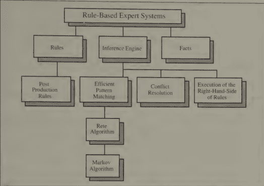

这些图示说明了专家系统与其他范式之间的关系，应被视为一般性指南而非严格定义。特别是，虽然 CLIPS 被显示为基于规则的，但在 CLIPS 中完全可以编写完全面向对象的专家系统，或同时使用规则和对象的混合系统。某些范式和语言具有可能将其归入多个类别的特征。例如，有些人认为函数式编程更[具备某种特性]，而另一些人则认为它是声明式的。

### 图 1.8 过程式语言

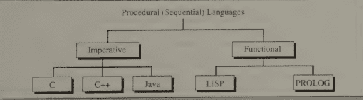

### 图 1.9 非过程式语言

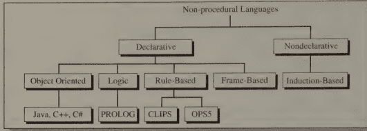

算法是在有限步骤内解决问题的一种方法。算法在程序中的实现是一个过程式程序。算法编程、过程式编程和常规编程这些术语常被互换使用，用来指代非 AI 程序。对过程式程序的常见理解是：它按顺序、一条接一条地执行语句，除非遇到分支指令。过程式程序的另一个常用同义词是顺序程序。然而，顺序编程这个术语暗示了过多的约束，因为所有现代编程语言都支持递归，因此程序可能并非严格顺序。

过程式范式的显著特征在于，程序员必须精确指定问题的解决方案应如何编码。即使是代码生成器也必须生成过程式代码。从某种意义上说，使用代码生成器属于非过程式编程，因为它从程序员那里移除了大部分或全部的过程式代码编写工作。非过程式编程的目标是让程序员指定目标是什么，并由系统确定如何实现它。

## 命令式编程

命令式和面向语句这些术语常被互换使用。像 C 这样的语言的主要特征是，语句是计算机的指令或命令，告诉计算机该做什么。请注意，在面向对象版本 C++ 中，也可以使用对象，其一般概念是对象之间相互传递消息。因此，面向对象程序的执行更类似于事件驱动系统，而不是命令式系统，后者假设程序流程从头到尾按顺序执行。

命令式编程范式是对真实计算机的抽象，而真实计算机又基于图灵机和带有寄存器和存储器（内存）的冯·诺依曼机。这些机器的核心概念是可修改存储。变量和赋值是可修改存储在编程语言中的类比。存储是程序操作的对象。命令式编程语言拥有丰富多样的命令，用于为代码提供结构并操作存储。每种命令式编程语言都定义了一种特定的硬件视图。这些视图截然不同，以至于人们常常谈论 Pascal 虚拟机，或执行可在任何硬件平台上运行的字节码的 Java 虚拟机。字节码可移植性这一特性促成了 Pascal 在 1970 年代和 80 年代的很大成功，直到 Java 采用了相同的系统。事实上，编译器在实际硬件和操作系统支持的语言中实现了编程语言定义的虚拟机。

在命令式编程中，一个名称可以被赋予一个值，后来又可以被重新赋予另一个值。名称集合、关联值以及程序中的控制位置共同构成了状态。状态是存储的逻辑模型，是内存位置与值之间的关联。在执行期间，程序可以被描述为通过一系列中间状态，从初始状态过渡到最终状态。从一个状态到下一个状态的过渡由赋值操作、输入和排序命令决定。

命令式语言的发展是为了让程序员摆脱在冯·诺依曼架构中编写汇编语言。因此，命令式语言对变量、赋值操作和重复提供了强大的支持。这些都是低级操作，现代语言试图通过提供递归、过程、模块、包等特性来隐藏它们。命令式语言还以其对严格控制结构及其相关的自上而下程序设计的强调而著称。

所有语言都存在一个严重问题，即很难证明程序的正确性（这意味着程序是有效的，第 2 章将更详细讨论）。从 AI 的角度来看，另一个严重问题是命令式语言不是非常高效的符号操作器。由于命令式语言架构是为了适应冯·诺依曼计算机架构而塑造的，因此我们拥有的语言可以很好地支持数值计算，但不支持符号操作。然而，像 C 这样的命令式语言和像 C++ 和 Java 这样的面向对象语言已被用作编写专家系统外壳的底层基础语言。这些语言及其构建的外壳在常见通用计算机上运行得比早期使用 LISP 构建的外壳更高效、更快速，而早期的 LISP 外壳需要专门为 LISP 设计的特殊硬件。

由于其顺序特性，命令式语言不太适合直接实现专家系统，尤其是基于规则的专家系统。为了说明这个问题，请考虑用数百或数千条规则对现实世界问题的信息进行编码的任务。例如，经典的 XCON 系统用于配置计算机系统，其知识库中约有 7000 条规则。在采用成功的专家系统方法之前，曾有人尝试用 FORTRAN 和 BASIC 编写此程序但未成功。像 CLIPS 这样的专家系统工具比使用第三代语言或像 Java、C++ 或 C# 这样的面向对象语言编程更容易创建如此庞大的规则库。要充分体会专家系统语言的优势，你需要尝试在其中编程。CLIPS 编程将在本书第二部分中介绍。

在命令式语言中以这种方式直接编码这些知识将需要 7000 条 IF-THEN 语句或一个非常、非常长的 CASE。这种编码风格会带来重大的效率问题，因为在每个识别-执行周期中，都需要搜索所有 7000 条规则以匹配模式。请注意，推理引擎及其识别-执行周期也必须用命令式语言编码。然而，情况比仅仅编写 7000 条规则要复杂得多，因为许多规则是由其他规则触发的。例如，在遇到红灯停车的情况下，这仅适用于你正在接近红灯时；如果你已经通过了红灯，则不适用。在基于规则的系统中，还有许多其他交互可能。有些规则断言事实，有些可能撤销事实，有些可能修改事实。更复杂的规则在机器学习的情况下可能会创建新规则或删除规则。

如果将规则排序，使最可能执行的规则放在开头，可以提高程序效率。然而，这需要对系统进行大量调整，并且随着新规则的添加或旧规则的删除和修改而发生变化。提高效率的更好方法是在内存中构建规则模式的动态网络，以减少确定应激活哪些规则的搜索时间。与其让程序员手动构建树，不如最好由计算机根据 IF-THEN 规则的模式和动作语法自动构建。拥有一种更有利于表示知识并具有强大模式匹配测试的 IF-THEN 语法也将很有帮助。这需要开发一个解析器来分析输入结构，以及一个解释器或编译器来执行新的 IF-THEN 语法。

当所有这些提高效率的技术都实现后，结果就是一个专用专家系统。如果移除推理引擎、解析器和解释器以便轻松开发其他专家系统，它们就构成了一个专家系统外壳。当然，与其从头开始进行所有这些开发，今天使用像 CLIPS 这样文档齐全且经过广泛测试的现有工具要容易得多。

## 函数式编程

**函数式编程**的本质，如 LISP 等语言所体现的，与高度依赖复杂控制结构和自上而下设计的面向语句语言截然不同。常规语言对问题的模块化方式设定了概念限制。函数式语言将这些限制打破。特别是，函数式语言的两个特性——高阶函数和惰性求值——可以极大地提高模块化程度。函数式编程的基本思想是将简单函数组合起来，产生更强大的函数。这本质上是一种**自底向上**设计，与命令式语言常见的**自上而下**设计形成对比。

函数式编程围绕**函数**展开。在数学中，函数是一个**关联**或规则，它将一个集合（称为**定义域**）的成员映射到另一个集合（称为**陪域**）。以下是函数定义的示例：

```
cube(x) == x**3, where x is a real number and
cube is a function with real values
```


函数定义的三个部分是：

- 1. the association, x*x=>x
- 2. the domain, real numbers
- 3. codomain, real numbers

of the cube function. The symbol ≡ means “is equivalent to” or “is defined as.” The following notation is a shorthand way of writing that the cube mapping is from the domain of real numbers, symbolized as ℜ, to the codomain of real numbers:

```
cube : ℜ → ℜ
```

A general notation for a function f that maps from a domain S to a domain T is f:S→T. The range of the function f is the set of all images f(s) where s is an element of S. For the case of the cube function, the images of s are s*s*s and the range is the set of all real numbers. The range and codomain are the same for the cube function. However, this may not be true for other functions such as the square function, x*x, with domain and codomain of real numbers. Since the range of the square function is only nonnegative real numbers, the range and codomain are not the same.

Using set notation, the range of a function can be written as:

```
R ≡ {f(s) | s ∈ S}
```

The curly braces { } denote a set. The bar, |, is read as “where.” The previous statement can be read that the range R is equivalent to the set of values f(s) where every element s is in the set S. The association is a set of ordered pairs (s,t), where s ∈ S, t ∈ T, and t=f(s). Every member of S must have one and only one element of T associated with it. However, multiple t values may be associated with a single s. As a simple example, every positive integer n has two square roots, ±√n.

Functions may also be defined recursively as in:

```
factorial(n) ≡ n*factorial(n-1)
where n is an integer and
factorial is an integer function
```

Recursive functions are commonly used in functional languages such as LISP.

Mathematical concepts and expressions are referentially transparent because the meaning of the whole is completely determined from its parts. No synergy is involved between the parts. For example, consider the functional expression x+2*x. The result is obviously 3*x. Both x+2*(x) and 3*x give the same result no matter what values are substituted for x. Even other functions can be substituted for x and the result is the same. For example, let h(y) be some arbitrary function. Then h(y) + (2 * h(y)) would still be equivalent to 3*h(y).

Now consider the following assignment statement in an imperative computer language such as C:

```
sum = f(x) + x
```

If the parameter x is passed by reference and its value is changed in the function call, f(x), what value will be used for x? Depending on how the compiler is written, the value of x might be the original value if it was saved on a stack, or the new value if x was not saved. Another source of confusion occurs if one compiler evaluates expressions right-to-left while another evaluates left-to-right. In this case, f(x)+x would not evaluate the same as x+f(x) on different compilers even if the same language was used. Other side effects may occur due to global variables. Thus, unlike mathematical functions, program functions are not referentially transparent.

Functional programming languages were created to be referentially transparent. Five parts make up a functional language:

- data objects for the language functions to operate on
- primitive functions to operate on the data objects
- functional forms to synthesize new functions from other functions
- application operations on functions that return a value and
- naming procedures to identify new functions.

Functional languages are generally implemented as interpreters for ease of construction and immediate user response.

In LISP (List Processing), data objects are symbolic expressions (S-expressions) that are either lists or atoms. The following are examples of lists and are shown because the style is similar to how patterns are programmed in CLIPS:

```
(milk eggs cheese)
(shopping (groceries (milk eggs cheese) clothes
(pants)))
()
```

Patterns like this may be programmed in the conditional or left-hand-side (LHS) of a rule and represent facts or lists within lists as is the case of the “shopping” example. If the conditional is true, the right-hand-side (RHS) of the rule is executed and new lists made. Other things may be programmed to occur on the right-hand-side of rules such as retracting facts. Lists are always enclosed in matching parentheses with spaces separating the elements. The elements of lists can be atoms, such as milk, eggs, and cheese, or embedded lists such as (milk eggs cheese) and (pants). Lists can be split up but atoms cannot. The empty list, (), contains no elements and is called nil.

The original version of LISP was called pure LISP because it was purely functional. However, it was also not very efficient for writing programs. Non-functional additions have been made to LISP to increase the efficiency of writing programs. For example, SET acts as the assignment operator, while LET and PROG can be used to create local variables and execute a sequence of S-expressions. Although they act like functions, they are not functional in the original mathematical sense.

Since its creation, LISP has been the leading AI language in the United States. Many of the original expert system shells were written in LISP because it is so easy to experiment with LISP. However, conventional computers do not execute LISP very efficiently and execute the shells built using LISP even more inefficiently. Of course, as processors and clock rates have improved, so has the performance of LISP.

This problem of high cost has an impact on both the development and the **delivery problem.** It is not enough just to develop a great program if it cannot be delivered for use because of high cost. A good development workstation is not necessarily a good delivery vehicle due to speed, power, weight, environmental, or cost constraints. Some applications may even require that the final code be placed in ROM for reasons of cost and nonvolatility. Putting code into ROM can be a problem with some AI and expert systems tools that require special hardware to run. It’s better to consider this possibility in advance rather than have to recode a program later.

An additional problem is that of embedding AI with conventional programming languages such as C, C++, C#, and Java to create intelligent systems. Applications that require extensive number crunching are best done in conventional languages rather than in an expert systems tool. This is why CLIPS makes it easy for you to write your own functions in the host language. For more details on this and other advanced topics, see the CLIPS Reference Manual available online at (http://www.ghgcorp.com/clips/CLIPS.html).

Unless special provisions are made, expert systems that are written in LISP are generally difficult to embed in anything other than LISP programs. One major consideration in selecting an AI language should be the language in which the tool is written. For reasons of portability, efficiency, and speed, many expert systems tools are now being written in or converted to C. This also eliminates the problem of requiring expensive special hardware for LISP-based applications.

### 1.12 NONPROCEDURAL PARADIGMS

Nonprocedural paradigms do not depend on the programmer giving exact details for how a problem is to be solved. This is the opposite of the procedural paradigms which specify *how* a function or statement sequence computes. In nonprocedural paradigms, the emphasis is on specifying *what* is to be accomplished and letting the system determine how to accomplish it.

### Declarative Programming

The declarative paradigm separates the **goal** from the methods used to achieve the goal. The user specifies the goal while the underlying mechanism of the implementation tries to satisfy the goal. A number of paradigms and associated programming languages have been created to implement the declarative model.

### Object-Oriented Programming

The object-oriented paradigm is another case of a paradigm that can be considered partly imperative and partly declarative. Today, the term object-oriented is used in programming languages such as C++, Java, and C#. The basic idea is to design a program by considering the data used in the program as objects and then implementing operations on those objects. This is the opposite of top-down design which proceeds by stepwise refinement of a program's control structure. The Unified Modeling Language (UML) is a popular method for object-oriented design.

As an example of object-oriented design, consider the task of writing a program to manage a charge account with an interactive menu. The important data objects are current balance, amount of charge, and amount of payment. Various methods can be defined to act on the data objects once the appropriate classes have been defined. These operations would be add charge, make payment, and add monthly interest. Once all data objects, operations, and the menu interface are defined, coding can begin. This object-oriented design methodology is well-suited to a program that has a weak control structure. It would not be as suitable in a program that requires a strong control structure such as a payroll application. However OOP is popular today because of maintenance and code reuse of objects.

The term object-oriented programming was originally used for languages such as Smalltalk, which was specifically designed for objects. Sometimes the term is used to mean programming of an object-oriented design even in a language that has no true object support.

Modern object-oriented languages such as C++, Java, and C# have features to support objects built into the language. Smalltalk is descended from SIMULA 67, a language developed for simulation. SIMULA 67 introduced the concept of class which led to the concept of information hiding so that a programmer need only know how to use an object and not the inner details of how it was programmed. A class is not a type. An instance of a class is a data object that can be manipulated. The term instance has carried over to expert systems where it denotes a fact that matches a pattern. Likewise, a rule is said to be instantiated if its LHS is satisfied. The terms activated and instantiated in rule-based systems are synonymous.

Another significant concept that came from SIMULA 67 is inheritance in which a subclass could be defined to inherit the properties of classes. For example, one class may be defined to consist of objects that can be used in a stack and another class defined to be complex numbers. Now a subclass can be easily defined as objects that are complex numbers used in a stack. That is, these objects have inherited properties from both classes above them, called superclasses. The concept of inheritance can be extended to organize objects in a hierarchy where objects can inherit from their classes, which can inherit from their classes, and so on. Inheritance is very useful since objects can inherit properties from their classes without the programmer having to specify every property. Implementing multiple inheritance is not easy which is why Java and C# do not have it. However since CLIPS is written in C++ it takes advantage of multiple


## 逻辑编程

继承。CLIPS中嵌入的完整面向对象语言称为COOL（Common Object-Oriented Language）。COOL的操作对用户是透明的，因此你只需了解面向对象编程的特性。

计算机最早的人工智能应用之一是使用Newell和Simon的逻辑证明者（Logic Theorist）程序来证明逻辑定理。该程序最早在1956年的达特茅斯人工智能会议上报告，并引起轰动，因为此前电子计算机仅用于数值计算。现在，计算机正在机械地推理数学定理的证明，而这项任务曾被认为只有数学家才能完成。术语“mechanical”意为自动化，可追溯到十九世纪巴贝奇的机械计算机。

在逻辑证明者及其后继者通用问题求解器（General Problem Solver，GPS）中，Newell和Simon致力于尝试实现能够解决任何问题的强大算法。虽然逻辑证明者仅用于数学定理证明，但GPS被设计用于解决任何类型的逻辑问题，包括国际象棋、汉诺伊塔、传教士与食人族以及隐码算术等游戏和谜题。它们著名的隐码算术（秘密算术）谜题示例如下：

```
DONALD
+ GERALD
ROBERT
```

已知D=5。目标是找出其他字母在0-9范围内的算术值。

GPS是第一个明确将问题求解知识与领域知识分离的问题求解程序。将问题求解知识与领域知识显式分离的这一范例如今被用作专家系统的基础。在当今的专家系统中，推理引擎决定应使用哪些知识以及如何应用。

改进机械定理证明的努力一直在继续。到20世纪70年代初，人们已发现计算是机械逻辑推理的一种特例。当将后向链式应用于形式为“结论如果条件”的句子时，它足够强大，可用于重要的定理证明。条件可以被视为表示要匹配的模式，如之前讨论的产生规则。以这种形式表达的句子称为霍恩子句（Horn clauses），以最早研究它们的Alfred Horn命名。1972年，Kowalski、Colmerauer和Roussel创建了语言PROLOG，以使用霍恩子句的后向链式来实现逻辑编程。

后向链式既可用于以声明式表示表达知识，也可用于控制推理过程。通常，后向链式通过定义必须满足的较小子目标来进行，只有这些子目标满足，初始目标才能满足。这些子目标随后进一步分解为更小的子目标，依此类推。

声明式知识的示例是以下经典示例：

```
All men are mortal
Socrates is a man
```

可以表示为以下霍恩子句：

```
someone is mortal
if someone is a man
Socrates is a man
if (in all cases)
```

关于苏格拉底的句子中，IF条件在所有情况下都为真。换句话说，关于苏格拉底的知识不需要任何模式来匹配。将此与有人必须是男人才能满足IF条件模式的死人情况形成对比。

请注意，霍恩子句可以解释为告诉如何满足目标的过程。也就是说，要确定某人是否会死，有必要确定某人是否是男人。作为稍微复杂一点的示例：

```
A car needs gas, oil, and inflated tires to run
```

可以表示为以下霍恩子句：

```
x is a car and runs
if x has gas and
if x has oil and
if x has inflated tires
```

请注意，确定汽车是否能运行的问题已被简化为三个更简单的子问题或子目标。现在假设还有以下额外的声明式知识：

```
The fuel gauge shows not-empty if a car has gas
The dipstick shows not-empty if a car has oil
The air pressure gauge shows at least 20 if a car
has inflated tires
The fuel gauge shows not-empty
The dipstick reads empty
The air pressure gauge shows 15
```

这些可以翻译为以下霍恩子句：

```
x has gas
if the fuel gauge shows not-empty
x has oil
if the dipstick shows not-empty
x has inflated tires
if the air pressure gauge shows at least 20
```

```
Fuel gauge is not empty
if (in all cases)
Dipstick reads empty
Air pressure is 15
if (in all cases)
```

从这些子句中，机械定理证明器可以证明汽车无法运行，因为没有机油且气压不足。

后向链式系统的一个优点是执行可以并行进行。也就是说，如果有多个处理器可用，它们可以同时处理子目标。PROLOG不仅仅是一种语言，因为它包含后向链式推理引擎。至少，PROLOG是一个外壳，因为它需要：

- 解释器或推理引擎
- 数据库（事实和规则）
- 一种称为统一的模式匹配形式
- 回溯机制，以便在搜索满足目标不成功时追求备选子目标。

作为后向链式的示例，假设如果你有现金或信用卡，就可以支付机油费用以使汽车运行。会检查一个子目标以查看你是否有现金。如果没有你有现金的事实，回溯机制将探索另一个子目标以查看你是否有信用卡。如果你有信用卡，支付机油费用的目标就可以满足。请注意，缺乏证明目标的事实与“油尺显示空”这样的负面事实一样有效，尽管可能效率较低。负面事实或缺失的事实都可能导致目标无法满足（政治逻辑除外）。

如果问题不需要回溯和模式匹配机制，那么程序员必须绕过它们或使用不同的语言编码。逻辑编程的一个优点是可执行规范。也就是说，使用霍恩子句指定问题的要求会产生一个可执行程序。这与传统编程非常不同，在传统编程中，需求文档与最终可执行代码完全不像。

与产生规则系统不同，在PROLOG程序中输入子目标、事实和规则的顺序有显著影响。效率，因此速度，受PROLOG搜索其数据库的方式的影响。此外，有些程序以一种方式输入子目标、事实和规则时可以正确执行，但如果顺序更改，则会进入无限循环或出现运行时错误。

### 专家系统

专家系统可以被视为声明式编程，因为程序员不在算法层面指定程序如何实现其目标。例如，在基于规则的专家系统中，如果任何规则的左侧与事实匹配，则该规则可能被激活并放入议程。规则输入的顺序不影响哪些规则被激活。因此，程序语句顺序不指定严格的控制流。其他类型的专家系统基于第2章讨论的框架和第4章讨论的推理网。

专家系统与传统程序之间有许多差异。表1.12列出了一些差异。

| 特性 | 传统程序 | 专家系统 |
|---|---|---|
| 控制方式 | 语句顺序 | 推理引擎 |
| 控制与数据 | 隐式集成 | 显式分离 |
| 控制强度 | 强 | 弱 |
| 求解方式 | 算法 | 规则和推理 |
| 问题搜索 | 全有或全无 | 大量 |
| 输入求解 | 解是正确的 | 很少 |
| 输入 | 假设正确 | 不完整、不正确 |
| 意外输入 | 难以处理 | 响应非常灵敏 |
| 输出 | 始终正确 | 随问题而异 |
| 解释 | 无 | 通常 |
| 应用 | 数值、文件和文本 | 符号推理 |
| 执行 | 通常是顺序的 | 机会主义规则 |
| 程序设计 | 结构化设计 | 很少或没有结构 |
| 可修改性 | 困难 | 合理 |
| 扩展 | 以重大跳跃完成 | 增量式 |

专家系统通常用于处理不确定性。不确定性可能源于专家系统的输入数据，甚至知识库本身。起初，这可能让习惯传统编程的人感到惊讶。然而，人类知识很大程度上是启发式的，这意味着它可能只在部分时间内正确，因此我们会尝试其他方法。此外，输入数据可能不正确、不完整、不一致，并存在其他错误。算法解决方案无法处理这种情况，因为算法保证在有限步骤内解决问题。

根据输入数据和知识库，专家系统可能得出正确答案、好答案、坏答案，或者根本得不出答案。虽然这起初可能令人震惊，但替代方案是始终得不出答案。同样，需要牢记的重要一点是，一个好的专家系统对这类问题的表现不会比最佳问题求解者——人类专家——更差，并且可能表现更好。如果我们知道一种比专家系统更好的高效算法方法，我们会使用它。重要的是使用工作的最佳，也许是唯一的工具。

### 非声明式编程

非声明式范式在PROLOG和SQL中非常流行。为人工智能开发了新版本的PROLOG，而SQL是关系数据库的标准。它们用于各种应用，从独立应用程序到与其他范式结合使用。


### 归纳式编程

人工智能中备受关注的一种应用是归纳式编程，例如用于机器学习的经典 ID3 算法以及较新的 C4.5 和 C5.1。在此范式中，程序通过从样本中概括来学习，就像人从序列 2, 4, 6, .... 中推断一样。该范式已应用于数据库访问。用户无需为搜索输入一个或多个字段的特定值，只需选择一个或多个具有这些特征的适当示例字段即可。数据库程序推断数据的特征并在数据库中搜索匹配项。Oracle 和其他使用结构化英语查询语言 (SQL) 的关系数据库管理系统是搜索中使用模式识别的良好示例。

一些专家系统工具提供归纳学习，它们接受示例和案例研究并自动生成规则（参见附录 G）。

### 1.13 人工神经系统

20世纪80年代，编程范式中出现了一种称为人工神经系统（ANS）的新发展，它基于大脑处理信息的一种方式。这种范式有时被称为联结主义，因为它通过训练网络中连接的模拟神经元来模拟问题的解决方案。如今，ANS 应用于从人脸识别、医疗诊断、游戏、语音识别到汽车发动机等众多领域。

联结主义研究者推测，超过 50 个免费的 ANS 可从新闻组 comp.ai.neural-nets 的 FAQ 下载，以及附录 G 中提到的其他资源。

### 旅行商问题

ANS 在为复杂模式识别问题提供实时响应方面取得了显著成功。20世纪80年代，运行在普通微型计算机上的神经网在 0.1 秒内获得了旅行商问题的一个非常好的解决方案，而最优解在大型机上需要一小时的 CPU 时间。旅行商问题很重要，因为它是电信系统中优化信号路由时面临的经典问题。优化路由对于最大限度地减少旅行时间，从而提高效率和速度至关重要，无论是通过互联网路由数据包还是将包裹邮寄到多个地点。基本的旅行商问题是计算给定城市列表中最短路线。表 1.13 显示了一到四个城市的可能路线。请注意，路线数量与城市数量减一的阶乘成正比，(N - 1)!。

表 1.13 旅行商问题路线

| 城市数量 | 路线 |
|---|---|
| 1 | 1 |
| 2 | 1-2-1 |
| 3 | 1-2-3-1<br>1-3-2-1 |
| 4 | 1-2-3-4-1<br>1-2-4-3-1<br>1-3-2-4-1<br>1-3-4-2-1<br>1-4-2-3-1<br>1-4-3-2-1 |

虽然 10 个城市有 9! = 362880 条路线，而 30 个城市有 29! = 8.8E30 条可能路线。旅行商问题是**组合爆炸**的经典示例，因为可能路线的数量增加得如此之快，以至于对于现实数量的城市没有实际解决方案。如果求解 30 个城市需要一小时的 CPU 时间，那么求解 31 个城市需要 30 小时，求解 32 个城市需要 330 小时。与用于路由数据包和实物的数千个电信交换机和城市相比，这些数字实际上非常小。

神经网可以以与求解 30 个城市案例相同的速度求解 10 个城市案例，而传统计算机则需要更长时间。对于 10 个城市案例，神经网得出了两条最佳路线之一；对于 30 个城市案例，它得出了 1 亿条最佳路线之一。当意识到该路线位于最佳解决方案的前 1E-22 时，这更加令人印象深刻。尽管神经网可能并不总是给出最优答案，但它们可以实时提供最佳猜测。在许多情况下，0.1 秒内 99.99999999999999999999% 正确的答案优于 30 小时内 100% 正确的答案。求解该问题的其他技术已使用遗传算法（如附录 G 所示）和进化艺术算法（Dorigo 04）。另一种方法是真实 DNA（Sipper 02）。

### ANS 的要素

**ANS** 可以被视为一种模拟计算机，它使用以高度并行方式连接的简单处理元素。处理元素对其输入执行非常简单的布尔或算术函数。ANS 运作的关键是与每个元素相关联的**权重**。权重表示系统中存储的信息。

图 1.10 显示了一个典型的人工神经元。神经元可能有多个输入，但只有一个输出。人脑包含约 10^11 个神经元，一个神经元可能与另一个神经元有数千个连接。输入到神经元的信号乘以权重并相加，以产生总神经输入 I。权重可以表示为矩阵并通过下标标识。

神经元输出通常被视为输入的**sigmoid 函数**。Sigmoid 代表真实神经元，对于非常小和非常大的输入会趋近于极限。Sigmoid 称为**激活函数**，常用的函数是 (1 + e^-X)^-1。每个神经元还有一个相关的**阈值**，\(\theta\)，它从总输入 I 中减去。图 1.11 显示了一个 ANS，它使用一种称为**反向传播**的技术来计算其输入的**异或（XOR）**。仅当输入不全为真或不全为假时，XOR 才给出真输出。隐藏层中的节点数量将根据应用和设计而有所不同。

神经网并非在常规意义上进行编程。有许多神经网学习算法，例如**反馈传播**和**反向传播**，用于训练网络。程序员通过仅提供输入和相应的输出数据来“编程”神经网。神经网通过自动调整连接神经元的网络中的权重来学习。权重和阈值


### 图 1.10 神经元处理单元

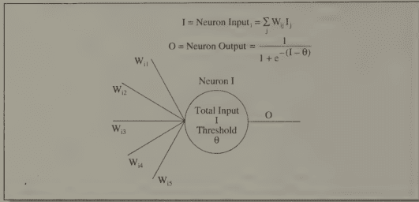

神经元的值决定了数据在网络中的传播，从而决定其对训练数据的正确响应。将网络训练至正确响应可能需要数小时或数天，具体取决于网络必须学习的模式数量以及所需的硬件和软件。但是，一旦学习完成，网络的响应速度非常快。

如果软件模拟速度不够快，ANS（人工神经网络）可以制造在芯片中以实现实时响应。一旦网络训练完成且权重确定，即可构建芯片。

### 图 1.11 反向传播网络

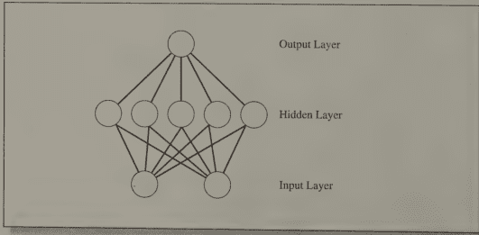

### ANS 的特性

ANS 架构与传统计算机架构截然不同。在传统计算机中，可以将离散信息与内存单元相关联。例如，社会安全号码可以作为 ASCII 代码存储在一组连续的内存单元中。通过检查这组连续单元的内容，可以直接重建社会安全号码。之所以可以重建，是因为社会安全号码的每个字符与包含该字符 ASCII 代码的内存单元之间存在一对一关系。

ANNs 基于当前的大脑理论建模，其中信息由权重表示。但是，特定权重与特定存储信息之间没有直接关联。这种分布式信息表示类似于全息图，其中全息图的线条作为衍射光栅，当激光光通过时重建存储的图像。

当存在大量经验数据且不存在能提供足够精度和速度的算法时，神经网络是一个不错的选择。与传统计算机的存储相比，ANS 提供了多项优势：

- 存储具有容错性。可以移除网络的部分，而仅会导致存储数据质量下降。这是因为信息以分布式方式存储。
- 存储图像的质量会随着移除的网络部分比例而优雅地降级，不会发生灾难性的信息丢失。存储和质量特性也是全息图的特征。
- 数据以联想记忆的形式自然存储。联想记忆是指部分数据足以调取所有完整存储信息的记忆。这与传统内存形成对比，传统内存通过指定要调取数据的地址来调取数据。部分或带噪声的输入仍可能引出完整的原始信息。
- 网络可以从其存储的信息中进行外推和插值。训练教会网络在数据中查找重要特征或关系。之后，网络可以对新数据进行外推以建议关系。在一项实验中，一个神经网络被训练了解 24 个假设人物的家庭关系。之后，该网络还能正确回答其未接受过训练的关系问题。
- 网络具有可塑性。即使移除了一些神经元，只要剩余足够多的神经元，网络就可以重新训练以恢复其原始技能水平。这也是大脑的一个特征，大脑的部分区域可能被破坏，但原始技能水平可以随着时间的推移重新学习。

这些特性使得 ANS 对机器人航天器、油田设备、水下设备、过程控制以及其他需要在恶劣环境中长期无需维修即可运行的应用非常有吸引力。除了可靠性问题外，ANS 还因其可塑性而具有低维护成本的潜力。即使可以进行硬件维修，重新编程神经网络可能也比更换它更具成本效益。

ANS 通常不太适合需要数值计算或最优解的应用。此外，如果存在可行的算法解决方案，除非 ANS 的实现成本低于芯片，否则 ANS 不是一个好的选择。

### ANS 技术的发展

对连接主义者来说，一个核心关切是我们在心理学理论化中必须“认真对待大脑”。这一想法当然可以追溯到古希腊关于神经系统中动物精神作用的猜测。后来，笛卡尔的《人论》中也有著名的猜测。ANS 的起源始于 1943 年 McCulloch 和 Pitts 对神经元的数学建模。Hebb 在 1949 年给出了神经元学习的解释。在赫布学习中，神经元触发另一个神经元的效率随放电而增加。放电一词指神经元发出电化学冲动，可以刺激与其连接的其他神经元。有证据表明，神经元连接处（称为突触）之间的连接导电率随放电而增加。在 ANS 中，会改变神经元之间连接的权重，以模拟自然神经元导电率的变化（Swinger 96）。

1961 年，Rosenblatt 出版了一本有影响力的书，书中讨论了他一直在研究的一种称为感知机的新型人工神经元系统。感知机是一种了不起的设备，展示了学习和模式识别的能力。它基本上由两层神经元和一个简单的学习算法组成。权重必须手动设置，这与现代 ANS 形成对比，现代 ANS 会根据训练自行设置权重。许多研究人员在 20 世纪 60 年代进入 ANS 领域并开始研究感知机。

早期的感知机时代在 1969 年结束，当时 Minsky 和 Papert 出版了一本名为《感知机》的书，揭示了感知机作为通用计算机的理论局限性。他们指出感知机的一个缺陷是只能计算 16 个基本逻辑函数中的 14 个，这意味着感知机不是通用计算设备。特别是，他们证明感知机无法识别异或（exclusive-OR）。尽管他们没有严肃研究多层 ANS，但他们持悲观观点，认为多层可能无法解决 XOR 问题。ANS 研究的政府资助停止，转而支持使用 LISP 等语言和算法的符号主义 AI 方法。由 Minsky 发明的使用框架表示符号主义 AI 信息的新方法在 20 世纪 70 年代变得流行。框架已演变为现代脚本。由于其简单性，感知机和其他 ANS 使用现代集成电路技术很容易构建。

ANS 研究在 20 世纪 70 年代以小规模继续进行。在 20 世纪 70 年代末，Geoffrey Hinton、James McClelland、David Rumelhart、Paul Smolensky 以及并行分布式处理研究小组的其他成员对神经网络认知理论产生了兴趣。他们于 1986 年出版的里程碑式著作《并行分布式处理：认知微观结构探索》标志着连接主义作为重要认知理论的回归。Hopfield 通过霍普菲尔德网络为 ANS 奠定了坚实的理论基础，并展示了 ANS 如何解决各种问题。霍普菲尔德网络的一般结构如图 1.12 所示。特别是，他展示了 ANS 如何以恒定时间解决旅行商问题，而传统算法解决方案则会遇到组合爆炸。ANS 的电子电路形式可以在 1 秒或更短时间内解决旅行商问题。其他组合优化问题，如四色地图、欧几里得匹配和转置代码，也可以轻松由 ANS 完成。

能够轻松解决 XOR 问题的 ANS 是反向传播网络，也称为广义德尔塔规则。反向传播网络通常实现为三层网络，尽管可以指定额外层。输入层和输出层之间的层称为隐藏层，因为只有输入层和输出层对外部世界可见。另一种流行的 ANS 是由 Hecht-Nielsen 在 1986 年发明的逆传播网络。数学中的一个重要理论结果，柯尔莫哥罗夫定理，可以解释为证明：具有 n 个输入和 2n + 1 个隐藏层神经元的三层网络可以映射任何连续函数。

### ANS 技术的应用

反向传播学习的一个重要示例是一个神经网络，它从文本中学习了单词的正确发音。ANS 通过使用名为 DECTalk 的文本转语音设备纠正其输出进行了训练。DECTalk 使用的正确发音规则花费了 20 年的语言学研究才制定出来。ANS 仅通过聆听文本转语音的正确发音，就在一夜之间自学了等效的发音技能。没有将任何语言技能编程到 ANS 中。

ANS 被电子计算机和光计算机用于雷达目标识别。使用光学元件的神经网络新实现有望实现速度比电子计算机快数百万倍的光学计算机。ANS 的光学实现因其固有的并行性而具有吸引力

### 图 1.12 霍普菲尔德人工神经网络


光。也就是说，光线在传播过程中不会相互干扰。大量光子可以通过镜子、透镜、高速可编程空间光调制器、可充当光学神经元的光学双稳态器件阵列以及光栅等光学元件轻松生成和操纵。设计为 ANS 的光学计算机似乎相互补充。

经典 ANS 应用在 (Giarratano 90a) 中有所讨论。特别是，ANS 在常规方法不令人满意的控制系统中很有用 (Giarratano 91b)。事实上，ANS 广泛用于各种工业控制系统 (Hrycej 97) 以及附录 G 中的链接。

### 1.14 联结主义专家系统与归纳学习

可以使用 ANS 构建专家系统。在一个系统中，ANS 是由医学训练示例构建的用于诊断的知识库。这个专家系统试图根据症状将疾病分类为系统已训练的已知疾病之一。设计了一个名为 MACIE（矩阵控制推理引擎）的推理引擎，它使用 ANS 知识库。该系统使用前向链进行推理，并使用后向链向用户查询生成解决方案所需的任何其他数据。虽然 ANS 本身无法解释为什么其权重被设置为某些值，但 MACIE 可以解释 ANS 并生成 IF-THEN 规则来解释其知识。

像这样的 ANS 专家系统使用归纳学习。也就是说，系统通过示例诱导其知识库中的信息。归纳是从特定情况推断一般情况的过程。除了 ANS 之外，还有许多商业上可用的决策软件（如附录 G 中所述），它们可以从示例中显式生成规则。归纳学习的目标是减少或消除知识获取瓶颈。通过将知识获取的负担放在专家系统上，如果系统诱导出人类未知的规则，开发时间可能会缩短，可靠性可能会提高。专家系统已与 ANS 结合使用 (Giarratano 90b)。

### 1.15 人工智能的现状

在 1990 年代及 21 世纪，人工智能取得了许多进展。认为唯一优秀的人工智能是由逻辑和推理产生的强人工智能观点，在实验室封闭世界之外取得的成功非常有限。经受住艰难竞争市场严酷现实考验的成功人工智能系统，通常依赖于生物学基础系统。图 1.13 展示了自 20 世纪 50 年代以来人工智能的演变，其中垂直刻度表示时间的流逝。起初，人工智能分为两大范式：一种基于受符号逻辑启发的模型，另一种主要分支受生物过程启发。两个分支之间一直存在激烈竞争，但根据构建人工智能解决方案的经验，我们现在可以说，没有一种方法通常能给出难题的正确答案。我们最好期望的是一个最优解，并对一个仅仅良好的解感到满意。

### 图 1.13 人工智能的演变

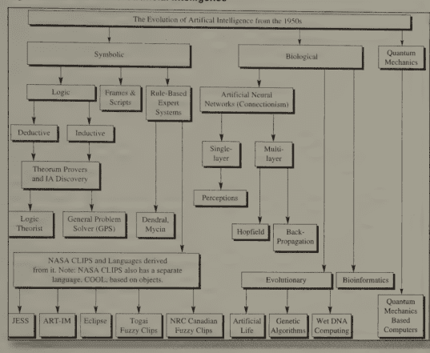

图 1.13 图表的右侧展示了基于物理学（尤其是量子计算机）的较新方法。虽然今天我们认为使用量子计算机仅能将搜索速度提高多个数量级，但这是一种使用这些设备的简单化方式。当量子力学在 20 世纪通过薛定谔方程及其等价形式（海森堡矩阵力学）被发现时，包括阿尔伯特·爱因斯坦在内的许多人不愿接受它。正如爱因斯坦喜欢说的，“上帝不掷骰子决定宇宙。”然而，量子力学与概率密不可分，因此与经典牛顿理论不同，现在没有什么是确定的。事实上，有一种理论认为意识是一种量子力学现象 (Satinov 01)。

许多作者推测，心智和意识本身可能是大脑的一种涌现属性，而大脑本身由神经元构成，最终分析这些神经元由原子和亚原子粒子构成，一直到构成所有存在的量子泡沫，其距离小到 10^-60 米，以至于空间本身是颗粒状的，而不是像数学和经典牛顿物理学家所假设的那样平滑。在如此小的距离尺度上，物理学家推测空间包含的不是通常的 3 个维度，而是 11 个维度。虽然认为一切都可以用人类推理和思维来解决（就像自 2500 年前古希腊时代以来哲学家所做的那样）很好，但没有真实实验的思维忽略了现实世界，并导致诸如以下结论：

- 前提：我没有移动，因为我感觉不到自己在移动。
- 前提：我看见太阳升起和落下。
- 因此，太阳正在围绕我移动。

在讨论进化算法时，“涌现”一词具有特殊含义。涌现是指出现无法预先预测的意外行为。例如，溪流中的流水看起来可能流动得非常平滑，直到一块石头被丢入水中。取决于水流速度、石头大小和其他因素，可能会发生湍流。水表现出非线性行为，出现漩涡、离岸流和其他简单流体力学未预测但需要用二阶或更高阶微分方程来描述的动态行为。这些方程的解析解通常不可能得到；因此，近似数值解是所能获得的最佳结果。已经识别出许多重要的涌现行为示例，并将其应用于城市、管理和其他截然不同的领域 (Johnson 01)。

涌现行为的一个经典例子是蚁群，其中一种称为群体智能的分布式智能正在发挥作用 (Kennedy 01)。这与人类和其他哺乳动物表现出的集中式智能形成对比，但集中式智能对群居昆虫效果良好。群体智能的应用正在被研究，用于在其他行星上建立强健的机器人群落，其中每个单个机器人可能没有多少智能能力，从而节省成本和功率，但整个群落可能会繁荣。其他应用于工厂、网络和分布式系统似乎很有前景。事实上，互联网本身可以被视为一种群体智能，它使用分组交换机的分布式低级智能来路由数据包，具有高度的生存能力。这很好地实现了互联网（最初称为 Arpanet）在 20 世纪 60 年代启动时的一个原始目标。

人工智能中出现的主要新参与者是进化算法 (Fogel 03)。这些算法通常与其他人工智能技术（如 ANS）一起使用，以提高结果的可靠性。ANN、遗传算法和其他方案的问题在于，最终解可能会陷入局部最小值，而不是收敛到全局最大值的真实解。出于这个原因，一些技术故意保留一些“不适合”的解用于繁殖，而不仅仅是最适合的解，因为不适合的解可能会远离局部最小值并偶然发现全局最大值。

进化联结主义系统是一种强大的方法，可以在对 ANN 架构可能是什么几乎不做任何假设的情况下优化其架构 (Kasabov 02)。这些并行处理技术需要大量计算能力，但随着计算机变得更强大，以及互联网网格和私营公司提供许多计算机用于计算，它们变得更加可行 (Foster 03)。

严格来说，计算机中使用的进化算法类型并非基于达尔文的进化论（后者在数千年或数百万年间以微小的渐进步骤进行），而是基于拉马克的一种竞争理论。他是达尔文在 19 世纪的同时代人，他认为如果动物通过锻炼在肢体上获得额外力量，那么该动物的后代会有更强壮的肢体。使用计算机，我们通过只选择最接近我们适应度标准的个体进行繁殖，迫使进化像拉马克的情况那样进行。

进化算法还被应用于作为计算机程序的一部分来创建人工生命形式。这些不仅仅是用于解决特定问题的遗传算法或神经网络；它们被用于生态学和经济学等更广泛的领域，以研究野外的捕食者-猎物关系，或者更具体地说，全球经济中制造商-消费者等任何环境。视频游戏也大量使用环境算法来定义新的虚拟生物供用户竞争。一个经典例子是极其强大的游戏 The Sims，以及人们可以与世界各地的其他人在线交互游玩的在线版本。

在将进化技术与联结主义系统结合使用时，可能会发生未计划的令人惊讶的事情。这只会增加支持逻辑基础人工智能的人对联结主义系统的批评，因为 ANN 无法解释其连接规则和权重是如何实现的。尽管许多人设计了声称可以“解释”其规则的 ANN，但事实是，规则和权重并非由人类设计，而是作为系统对输入和期望输出的“反射”而形成的。从某种意义上说，ANN 或进化算法要么生长出正确的解，要么就无法生存。

随着人类基因组的解码，生物信息学领域变得越来越重要，因为它应用计算机技术来处理海量信息。该领域为拥有人工智能背景的人提供了许多工作机会。此外，基因组学和蛋白质组学等新领域也已出现。人类基因组由大约 30,000 个基因组成。每个基因基本上是一个活的工厂，通过在细胞中起作用或向细胞发送信号来产生蛋白质以执行身体功能。现在的巨大挑战是确定每个基因和蛋白质的功能；不仅在健康基因中，而且在遗传疾病中也是如此。由于海量数据和可能的解决方案，这些任务需要巨大的计算能力。人工智能是一种至关重要的工具。

人工智能在国防领域也证明了其价值。在 1990 年第一次海湾战争结束时，有人指出，在军事后勤规划中使用人工智能所节省的费用，已经多次偿还了国防高级研究计划局（DARPA）自 20 世纪 50 年代以来投入人工智能研究的所有资金（http://www.au.af.mil/au/awc/awcgate/acc/ai02.htm）。今天，人工智能在军事训练的计算机游戏中节省了数十亿美元，而实兵演习则需要消耗燃料和弹药。

在 20 世纪 50 年代，很难想象人工智能会变得如此商业成功。在那个时代以及接下来的四分之一世纪里，the


AI研究人员的重点在于寻找高尚、严肃的应用，例如定理证明和自动发现。尽管使用AI程序下跳棋、国际象棋和其他棋盘游戏也被开展过，但AI程序的开发旨在理解人类如何推理，而非为了娱乐价值。

如今，AI在视频游戏和电影特效中的商业成功，会让早期的研究人员感到非常惊讶。视频游戏行业现在与电影和音乐平等竞争消费者的金钱。人们喜欢互动游戏，尤其是与其他国家、城市或州的人对战时。高级视频游戏高度依赖AI，使生物以逼真的方式行事，而不是以简单可预测的模式。

事实上，越来越多的大学现在不仅提供视频游戏课程，还提供学位，认识到这个数十亿美元的行业将长期存在，并且其中有良好的就业机会。AI也应用于商业领域，最显著的是作为基于知识的筛选助手，用于筛选掉容易解决的90%的问题。具有真正专业知识的专家系统也在许多企业中使用。唯一的问题是，这些商业系统基于公司的专有信息，因此公司通常不会发布系统的详细信息，以免竞争对手获得优势。

然而，互联网上的附录G中仍然描述了许多专家系统示例，许多在万维网上，一些位于CiteSeer等网站的论文中，还有其他一些在comp.ai.shells等新闻组中讨论，该新闻组有大量关于CLIPS专家系统的讨论。新闻组的优势在于你可以发布问题，希望有人会回复。

除了AI和专家系统中的就业机会外，还有一种新工作是本体论工程师。这可以被视为哲学工程的一个分支（事实上，至今唯一商业可行的分支）。在AI和专家系统中，本体论一词的含义与传统哲学意义上的本体论不同。

本体论是领域中术语及其之间关系的显式形式规范（Gruber 93）。虽然普通Web用户并未意识到这一点，但本体论在Web幕后很常见。这些本体论范围从组织为分类法（即，如Yahoo等网站中层级自上而下的相关信息集合）的大型本体论，到Amazon.com、eBay等按销售价格或拍卖时间和起始价对物品进行分类的网站。基本上，本体论是一套用于描述领域的标准、公认的术语集合，无论是书籍、拍卖物品还是其他事物。如果没有共同的词汇，就会出现巴别塔式的场景，即没有人知道在该领域中讨论的是什么。许多组织正在开发自己的本体论，以更好地以明确的方式澄清正在讨论的内容。

标准化本体论最大的优势之一是它可以变得可机器读取，从而计算机可以帮助人类搜索所需项目。正在为不同领域制定可扩展标记语言（XML）进行类似的努力。今天，确实需要有AI背景、有兴趣成为本体论工程师并对大量知识进行分类的人。本体论工程也用于设置和维护专家系统使用的数据库。这并非一件轻松的任务，尤其是当知识库变得更大并且用户被允许为专家系统输入新知识时。

### 1.16 摘要

在本章中，我们回顾了导致专家系统的问题和发展。专家系统用于解决的问题通常无法由常规程序解决，因为它们缺乏已知或高效的算法。由于专家系统基于知识，它们可以有效地用于结构不清晰且难以通过其他方式解决的现实问题。已经讨论了多种不同的知识表示范式，以及它们的优缺点。有关更详细的讨论，请参见（Giarratano 04）。

在为专家系统应用选择合适的问题领域的背景下，也讨论了专家系统的优缺点。给出了选择合适应用的标准。

专家系统外壳的要点已参照基于规则的专家系统进行了讨论。基本的识别-行动推理引擎循环已通过一个简单的规则示例进行了描述和说明。最后，专家系统与其他编程范式的关系已根据每个范式的适当领域进行了描述。重要的是，专家系统应被视为另一种编程工具，适用于某些应用而不适用于其他应用。后续章节将更详细地描述专家系统的特点和适用性。在为专家系统选择合适的问题领域的背景下，也讨论了专家系统的优缺点。

AI的未来进步无疑将涉及革命性的新型量子计算机（Brown 00），以及使用Grid将互联网上数百万计算机连接起来以利用大规模计算能力的计算机，以及使用RNA链的生物学湿实验室。这两种方法都可以在短短几天内解决非常复杂的旅行售货员问题，速度远快于任何单一超级计算机。

附录G有许多关于人工智能一般当前信息的链接。大量信息和软件可在线获取。其他新闻组关注模糊逻辑、神经网络、专家系统外壳和许多其他主题。除了信息和软件之外，这些新闻组允许你发布问题并从其他人那里获得答案。强烈建议你探索附录G中按章节提供的在线资源。

### 问题

- 1.1 找出除你自己以外的一个人，此人被视为专家或非常有知识的人。采访这位专家，并讨论该人的专业知识在“专家系统的优势”部分中*每个*标准方面能被专家系统建模得多好。

- 1.2 (a) 编写10条非平凡规则，表达问题1.1中专家的知识。
- (b) 编写一个程序，给出你专家的建议。包括测试结果，以显示每条10条规则都能给出正确的建议。为了方便编程，你可以允许用户从菜单中提供输入。

- 1.3 (a) 在纽厄尔和西蒙的经典著作《人类问题解决》中，他们提到了九点问题。给定九个点按以下方式排列，如何在不（a）将铅笔从纸上拿起且（b）穿过任何点的情况下，画四条线穿过所有点？（提示：你可以将线延长超过点。）

| . | . | . |
| . | . | . |
| . | . | . |

- (b) 解释你在寻找解决方案时的推理（如果有），并讨论专家系统或其他类型的程序是否是解决这类问题的良好范式。

- 1.4 编写一个可以解决字算问题的程序。显示以下问题的结果，其中D=5：
  + DONALD
    GERALD
    ROBERT

- 1.5 编写一组产生式规则，根据火灾类型扑灭五种不同类型的火灾，例如油类、化学类等。

- 1.6 (a) 编写一组产生式规则，根据症状诊断三种类型的毒药。
- (b) 修改程序，以便在识别出毒药后还能推荐治疗方法。

- 1.7 为规划假期提供10条IF-THEN类型的启发式规则。

- 1.8 为购买二手车提供10条IF-THEN类型的启发式规则。

- 1.9 为规划课程表提供10条IF-THEN类型的启发式规则。

- 1.10 为购买SUV或汽车提供10条IF-THEN类型的启发式规则。

- 1.11 为购买股票或债券提供10条IF-THEN类型的启发式规则。

- 1.12 为迟交作业的借口提供10条IF-THEN类型的启发式规则。

- 1.13 撰写一份关于现代专家系统的报告。好的来源是PCAI、IEEE Expert杂志和附录G。

### 参考文献

- (Adami 98). Christoph Adami, 《人工生命导论》, Springer-Verlag, 第5页, 1998.

- (Bentley 02). Peter J. Bentley 等, 《创造性进化系统》, Academic Press, 2002.

- (Berlinski 00). David Berlinski, 《算法的诞生》, Harcourt, Inc., 第xvii页, 2000.

- (Brown 00). Julian Brown, 《心智、机器与多重宇宙》, Simon & Schuster, 2000.


- (Bramer 99). 由 M.A. Bramer 编辑，《知识发现与数据挖掘》，IEEE Press，1999。
- (Cotterill 98). Rodney Cotterill，《迷幻织机》，剑桥大学出版社，第360页，1998。
- (Debenham 98). John Debenham，《知识工程：统一知识库与数据库设计》，Springer-Verlag，1998。
- (de Silva 00). 由 Clarence W. de Silva 编辑，《智能机器：神话与现实》，CRC Press，第13页，2000。
- (Dorigo 04). Marco Dorigo 和 Thomas Stützle，《蚁群优化》，MIT Press，2004。注意本书还附带一张光盘，其中包含使用蚁群进化算法求解旅行商问题的软件。
- (Fetzer 01). James H. Fetzer，《计算机与认知：为什么心智不是机器》，Kluwer Academic Publishers，第25-182页，2001。
- (Foster 03). Ian Foster，「网格：无边界的计算」，《科学美国人》，第288卷，第3期，第78-85页，2003年4月。
- (Friedman-Hill 03). Ernest Friedman-Hill，《Jess实战：基于规则的Java系统》，Manning Publications，2003。
- (Fogel 03). 由 Gary B. Fogel 和 David W. Corne 编辑，《生物信息学中的进化计算》，Morgan Kaufmann Publishers，2003。
- (Giarratano 90a). Joseph C. Giarratano 等人，「人工神经系统对工业的未来影响」，《ISA Transactions》，第9-14页，1990年1月。
- (Giarratano 90b). Joseph C. Giarratano 等人，「当前及未来专家系统工具的技术现状」，《ISA Transactions》，第17-25页，1990年1月。
- (Giarratano 91a). Joseph C. Giarratano 等人，「智能SQL导师」，1991年智能计算机辅助培训会议（ICAT ’91），第309-316页，1991。
- (Giarratano 91b). Joseph C. Giarratano 等人，「制造与自动化系统中的神经网络技术」，载于《控制与动态系统》，第49卷，由 C.T. Leondes 编辑，Academic Press，第37-98页，1991。
- (Giarratano 04). Joseph C. Giarratano，（http://www.pcai.com/Paid/Issues/PCI-Online-Issues/174_OL/New_Folder/Soc92/174_AP/PCAI-17.4-paid-paid-18.1.htm）。
- (Gruber 93). T.R. Gruber，「可移植本体规范的翻译方法」，《知识获取》5: 199-220，1993。
- (Hecht-Nielsen 90). Robert Hecht-Nielsen，《神经计算》，Addison-Wesley Publishing Co.，第147页，1990。
- (Helmreich 98). Stefan Helmreich，《硅之第二自然》，加州大学出版社，第180-202页，1998。
- (Hopgood 01). Adrian A. Hopgood，《面向工程师和科学家的智能系统》，CRC Press，2001。
- (Hrycej 97). Tomas Hrycej，《神经控制》，John Wiley & Sons, Inc.，1997。
- (Luger 02). George F. Luger, *人工智能*, Fourth Edition, Addison-Wesley, 2002。
- (Jackson 99). Peter Jackson, *专家系统导论*, Addison-Wesley Publishing Co., 1999。
- (Johnson 01). Steven Johnson, *涌现：蚂蚁、大脑、城市与软件的关联生命*, Scribner, 2001。
- (Kantardzic 03). Mehmed Kantardzic, *数据挖掘*, IEEE Press, 2003。
- (Kasabov 02). Nikola Kasabov, *演进联结主义系统*, Springer-Verlag, 第7-29页, 2002。
- (Kennedy 01). James Kennedy 和 Russel C. Eberhart, *群体智能*, Morgan-Kaufmann Publishers, 2001。
- (Lajoie 00). 由 Susanne P. Lajoie 编辑, *计算机作为认知工具，第二卷：不再有墙*, Lawrence Erlbaum Associates, Publishers, 2000。
- (Lakemeyer 03). 由 Gerhard Lakemeyer 和 Bernhard Nebel 编辑, *新千年人工智能*, Morgan-Kaufmann Publishers, 2003。
- (Mendel 01). Jerry M. Mendel, 「基于规则的模糊逻辑系统导论」, IEEE Press, 2001。
- (Satinovner 01). Jeffrey Satinovner, *量子大脑*, John Wiley, 2001。
- (Sipper 02). Moshe Sipper, *机器本性：生物启发式计算时代的到来*, McGraw-Hill, 2002。
- (Swinger 96). Kevin Swinger, 「应用神经网络：实用指南」, 1996。
- (Wagman 99). Morton Wagman, *根据人工智能的人类心智*, Praeger Publishers, 第76页, 1999。

## CHAPTER 2
知识的表示

### 2.1 引言

本章和下一章是关于逻辑的。大多数人认为逻辑与合理是同一个意思。也就是说，如果一个人有逻辑，他们就是合理的，不会草率下结论。然而，为了使用基于逻辑的AI和专家系统，我们需要更严格地定义这些术语。正如任何使用过计算机的人都知道的，计算机的优点是它们完全按照指令行事。而计算机的缺点也是它们完全按照指令行事。由于专家系统现在决定你的信用评级、你是否会被美国国税局稽查、核电站的运行以及其他同样重要的事件，因此让它们非常、非常有逻辑且不含糊其辞是个好主意。从技术术语来说，逻辑是进行有效推理的研究。这意味着，给定一组真实事实，结论将始终为真。无效推理意味着用真实事实得出了错误的结论。（所以，如果你曾经被警察拦下超速，只需把这本书给警察看。）

我们还想澄清**形式逻辑**和**信息逻辑**之间的区别。非正式逻辑是人们尤其是律师在试图赢得一场争论（即一个案件）时使用的那种逻辑。争论不一定是演变成枪战的激烈交锋，而是法庭上的法律辩论，其中使用情绪化的词语来说服陪審团哪一方有最好的律师从而赢得案件。复杂的逻辑论证是一系列推理，一个结论导致另一个结论，依此类推。在法庭上，这可能导致几种结论之一，直到宣判有罪、无罪、因精神错乱无罪或审判无效，然后案件被上诉。

在形式逻辑中，也称为符号逻辑，以有效方式证明最终结论为真或假的推理和其他事实至关重要。如果你曾经遇到过计算机程序中的错误，那正是程序进行无效符号推理的完美示例。（幸运的是，如果你花了几百美元将操作系统升级到最新版本，你现在可以通过向制造商发送错误报告来随时获得即时满足。）逻辑还需要语义来赋予符号意义。在形式逻辑中，我们选择的语义不是像“你更喜欢百事可乐还是可口可乐？”这样的情绪化词语。相反，形式逻辑的语义就像为普通编程中的变量选择有意义的名称。

除了介绍逻辑，本章还介绍了常用的知识表示方法。知识表示（KR）长期以来被认为是AI的核心，因为它在决定系统成功与否方面与使用知识的软件一样重要。这种重要性也延伸到计算机科学的数据库设计领域。虽然数据库通常被视为当前数据的存储库，例如商店的产品库存、应付账款、应收账款等，而不是知识，但许多公司现在正积极从事数据挖掘以提取知识。

数据挖掘旨在使用存储在数据仓库中的归档数据来预测未来趋势。例如，一家公司可能会查看过去五年12月份的销售报告，以预测应保留哪种以及多少某种库存。例如，他们可能通过数据挖掘发现圣诞卡在12月份销售良好，而情人节卡则不然。一个稍微更现实的例子是发现红色和绿色衣服在冬季比春季销售更好，因为红色和绿色与圣诞节相关联，而棕色、橙色和黄色衣服在秋季销售更好。虽然人类经理可能知道这一点，但数据挖掘可以提供定量估计，即购买多少衣服以及在季节结束后何时将其打折出售。当然，数据挖掘的真正价值在于发现对人类来说不明显，但可以通过分析存储在公司数据档案中的大量历史数据来发现的模式。除了经典统计方法外，ANS、遗传算法、进化算法和专家系统等AI技术都可以与数据挖掘结合使用，可以单独使用，也可以以混合组合使用（Verbos 94）。

KR在专家系统中至关重要，原因有二。首先，专家系统是基于称为推理的逻辑规则设计的某种知识表示类型。通常我们认为推理是从事实中得出结论。不幸的是，人们在这方面并不擅长，因为我们倾向于将语义与推理过程本身混淆，因此并不总能得出有效结论。政治竞选广告中就有很好的例子。使用没有事实、不可靠的事实或相同的事实来得出完全相反结论的推理方法是政治逻辑的基础。

进行推理是一种特殊推理的正式术语，这种推理不依赖于语义；也就是说，不依赖于词语的含义。虽然语义是


在现实世界中不可或缺，专家系统的设计旨在基于逻辑进行推理，而不卷入语义可能带入推理中的情感纠葛。推理的目的是基于事实和论证形式得出有效结论。同样，在逻辑学中，*argument*一词指的是事实和推理规则被用来证明有效结论的正式方式。如果你曾经看过新闻节目，主播与一位前将军、前大使、前陪审员或其他人进行长篇讨论，其目的不是为了得出有效结论，而是为了让电视观众感到娱乐。

进行有效推理就是逻辑推理。虽然*commonsense*和*probabilistic reasoning*这两个术语在现实世界中非常宝贵，但它们涉及不确定性，因为现实世界中的事物从来不是100%确定的。如果有人说，“天空是蓝色的，”过了一会儿可能会变成灰色，甚至更糟，变成绿色！在不确定性下进行推理是一个非常重要的主题，我们将在第4章和第5章中更详细地讨论。

KR重要的第二个原因是它影响系统的开发、效率、速度和维护。这就像普通编程中的情况一样，数据结构的选择对程序至关重要。良好的程序设计必须从简单的命名变量、数组、链表、队列、树、图、网络甚至独立的外部数据库（如Microsoft Access、SQL Server或Oracle）中进行选择。在CLIPS中，KR可以是规则、deftemplates、对象和事实。

在下一章中，我们将讨论如何在知识上进行推理以产生有效结论，以及你应该警惕的常见谬误——它们看似合乎逻辑，实则不然。这在第6章讨论的知识获取中尤为重要，因为你需要为你的专家系统采访一位人类专家。你将不得不从可能导致无效结论的语义中识别出真正的知识。另一方面，如果你与你的知识专家争论太多，却得不出他们想要的结论，你可能会被解雇！

许多计算机程序已使用AI编写，用于推理、定理证明，甚至学习逻辑，如附录G所示。

### 2.2 知识的含义

知识，如同爱情，是一个人人都知道其含义，却又难以定义，甚至难以产生共鸣的词汇。事实上，所有人都有相同感受的唯一真爱，就是对他们猫或狗的爱（对那些喜欢蛇和捕鸟蛛的人表示抱歉）。如同爱情一样，知识有许多含义，取决于观察者的心智。数据、事实和信息等其他词汇常与知识混用（Russell 03）。

人们可以通过推理和经验寻求问题的解决方案。

使用经验来解决问题的一般术语是**启发式**。长而具体的启发式经验示例称为**基于案例的推理**。这是法律、医学和维修中使用的主要推理类型之一，律师、医生和汽车修理工试图使用以前的类似案例（称为**先例**）来修复问题（Leake 96）。虽然你可能觉得基于案例的解决方案很昂贵，因为别人已经遇到过你的问题，但看看期望一个新的医疗、法律或汽车维修先例要花多少钱吧！

专家系统可能有数百或数千个小案例可供参考。每条规则可以被视为一个微型先例，它可能能够解决问题，或用于一条希望能提供解决方案的推理链中。

知识的研究是认识论。它关注知识的本质、结构和起源。图2.1说明了认识论的一些类别。除了亚里士多德、柏拉图、笛卡尔、休谟、康德等人表达的哲学知识类型之外，还有两种特殊类型，称为先验（a priori）和后验（a posteriori）。拉丁术语a priori的意思是“在先的”。先验知识在感官知识之前，并且独立于感官知识。例如，“万物皆有因”和“所有三角形在欧几里得平面上都有180度”这些陈述是先验知识的例子。先验知识被认为是普遍真理，否认它会导致矛盾。逻辑陈述、数学定律以及青少年拥有的知识都是先验知识的例子。

先验知识的对立面是源于感官的知识：后验知识。后验知识的真伪可以通过感官经验来验证，例如陈述“灯是绿色的”。然而，由于感官经验可能并不总是可靠，后验知识可以基于新知识被否定，而无需产生矛盾。例如，如果你看到某人有棕色眼睛，你会相信他们的眼睛是棕色的。然而，如果你后来看到那个人摘下棕色隐形眼镜露出蓝色眼睛，你的知识就必须进行修订。

知识可以进一步分为过程知识、声明知识和隐性知识。过程知识和声明知识类型对应在第1章中讨论的过程和声明范式，并在(Brewka 97)中更深入地讨论。

图2.1 认识论的一些类别

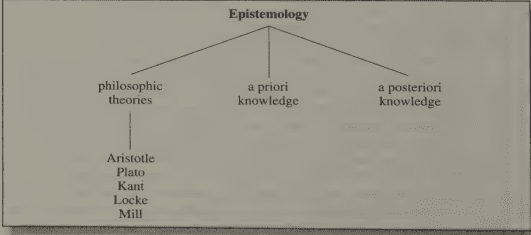

过程知识通常被称为“如何做某事”的知识。过程知识的一个例子是知道如何烧开一壶水。认为你在所有海拔都知道如何烧开水可能会导致常识推理失败：这是一个真正的矛盾修辞法，因为常识中没有推理，只有现实世界的经验（参见本章末关于烧开水的问题）。声明知识是指知道某事是真是假。它涉及以声明陈述形式表达的知识，例如“不要把手指放在开水壶里”。已开发出许多使用逻辑表示知识的不同方法，参见(Sowa 00)。

隐性知识有时被称为**无意识知识**，因为它无法用语言表达。一个例子是知道如何移动你的手。从宏观上讲，你可能会说你通过收紧或放松某些肌肉和肌腱来移动你的手。但在下一个更低的层面，你如何知道如何收紧或放松肌肉和肌腱呢？其他例子包括走路或骑自行车。在计算机系统中，ANN与隐性知识相关，因为通常神经网络无法直接解释其知识，但如果给予适当的程序，可能可以做到（参见第1.14节）。

知识在专家系统中至关重要。事实上，可以类比Nicholas Wirth在他关于Pascal的开创性著作中使用的经典表达式：

Algorithms + Data Structures = Programs

对于专家系统，则是：

Knowledge + Inference = Expert Systems

如本书所用并如图2.2所示，知识是一个层次结构的一部分。最底层是噪声，由无关且可能掩盖数据的项目组成。下一较高层次是原始数据，即潜在感兴趣的项目。再往上是信息，即确定感兴趣的处理过的数据。再往上是知识，它代表如此重要的信息，以至于应该被保存和采取行动。在第1章中，基于规则的专家系统中的知识被定义为由事实或其他规则激活以产生新事实或结论的规则。结论是推理链的最终产物，当按照正式规则进行时，称为推理。这个推理过程是专家系统的重要组成部分。术语**inferencing**通常用于机械系统，如专家系统。Reasoning是用于人类思维的术语。

ANN不进行推理。相反，它寻找对人类来说不明显的数据中的潜在模式。基本上，ANN是一个模式分类器。例如，你阅读的能力基于大脑中经过训练以识别字母模式的神经网络的模式识别。你大脑的另一部分将这些模式翻译成人们在阅读时在脑海中听到的单词，因为这是他们小时候学习阅读的方式：通过语音方式拼读单词。例如，把这本书倒过来试着读。大多数人一开始无法阅读倒置的文本，但可以重新训练你的阅读神经网络以识别字母。在

图 2.2 知识金字塔


经典心理学实验中，人们戴着能将世界图像倒置的眼镜。几天后，他们的大脑适应了，事物看起来又正过来了。事实上，我们眼睛的晶状体会将图像投射成倒立的，而大脑将其反转，使其看起来正常。

神经网络多功能性的另一个例子是将书本旋转一定角度，比如30°（Sarachchandran 96）。你仍然能够阅读，尽管会慢一些。当你将书本旋转到接近180°时，阅读会变得更加困难。经过练习，有些人甚至能像正常阅读一样流畅地阅读倒置的文字，这展示了我们神经网络惊人的适应性。同样，一个在不同角度字母上训练过的人工神经网络（ANN）将能够插值并阅读非正常显示的文本。网络训练过的旋转角度越多，其准确性提升得就越快。同样，在不同手写风格上训练网络将使ANN能够阅读更多种类的手写体，就像人可以阅读不同书写者的笔迹一样。

“事实”一词指被认为可靠的信息。专家系统使用事实进行推理。后来被证明为假的事实可以使用CLIPS的真理维护设施（Truth Maintenance facility）撤销，由该假事实生成的所有结论、规则和其他事实也会自动撤销。专家系统还可以（1）将数据与噪声分离，（2）将数据转换为信息，或（3）将信息转换为知识。在期望事实的专家系统中使用原始数据是极其危险的，因为由此得出的结论可能高度不可靠。这当然是另一种说法，即“垃圾进，垃圾出”。除非有人想用垃圾来支持某个特定议程。

作为这些概念的示例，请考虑以下24个数字的序列：

```
137178766832525156430015
```

没有知识，整个序列可能看起来像噪声。但是，如果怀疑或已知该序列是有意义的，那么该序列就是数据。确定什么是数据什么是噪声，就像关于园艺的那句老话：“杂草是任何不是你想要的生长物。”

某些知识可能存在用于将数据转换为信息。例如，以下算法处理数据以产生信息：

```
Group the numbers by twos.
Ignore any two-digit numbers less than 32.
Substitute the ASCII characters for the two-digit numbers.
```

将此算法应用于前面的24个数字，得到的信息为：

黄金 438+

现在可以将知识应用于此信息。例如，可能存在一条规则：

```
IF gold is less than 500
and the price is rising (+)
THEN
buy gold
```

虽然图中未明确显示，专业知识是专家拥有的一种专门类型的知识和技能。它位于图2.2的知识、元知识和智慧部分。虽然非常专业的知识可能出现在书籍和论文等公开信息来源中，但仅仅读书并不能使人成为专家。例如，关于外科手术程序的详细信息可能出现在医学教科书中。然而，如果有人上门声称自己上过网络课程并愿意以低价进行手术，你愿意接受脑部手术吗？即使你得到一套免费的Ginsu刀具（来自你脑部手术的二手刀具）？

专业知识是专家的隐性知识和技能，必须提取并将其显性化，以便可以将其编码到专家系统中。知识之所以是隐性的，是因为真正的专家对知识了如指掌，已成为本能，不需要思考。例如，医学院毕业后，实习医生通常每周工作80小时或更多，持续一年，直到他们能够在无需思考的情况下行医。尽管这种做法受到批评，但它确实将知识深深植入，使其成为本能。（当然，如果你是病人，询问实习医生本周睡了多少也是个好主意。）在层次结构的顶部，知识之上，是元知识。前缀meta意为“在……之上”。

元知识是关于知识和专业知识的知识。虽然专家系统可以设计为包含多个不同领域的知识，但这通常是不可取的，因为系统会变得定义不清。经验表明，最成功的专家系统都局限于尽可能小的领域。例如，如果一个专家系统是为识别细菌性疾病而设计的，让它也诊断汽车问题就不是好事。作为现实世界的例子，考虑一下医生只在一个小领域内专业化，而不是涵盖整个医学。即使是家庭医生（过去曾被称为全科医生）在需要时也会将患者转介给合适的专科医生。

在专家系统中，本体论是描述问题域中所有已知事物的元知识。理想情况下，本体论应该以正式的方式描述，以便可以轻松识别不一致和不足之处。有许多免费和商业工具可用于构建本体论。构建本体论应在专家系统实现之前完成，否则随着对领域了解的深入，规则可能需要修订，从而增加成本、开发时间和错误。

例如，一个专家系统可以拥有关于修理GM汽车、GM SUV和GM柴油卡车的知识库。根据需要修理的车辆类型，将使用相应的知识库。让所有知识库同时驻留在内存中在内存和速度方面是低效的，因为Rete网络会不断修改内存中所有规则的网络。此外，如果卡车和汽车规则的前件相同但结论不同，可能会出现冲突。例如，如果油量表显示空，汽车专家系统可能会说“加满汽油”，而卡车专家系统可能会说“加满柴油”。给汽车油箱加柴油或给卡车加汽油都不是好事。随着系统中规则数量的增加，专家系统也会变慢，因为Rete网络变得更大。元知识可以用于决定哪个知识领域应加载到内存中，也可以作为设计和维护专家系统及本体论的一般指南。

从哲学意义上讲，**智慧**是所有知识的巅峰。智慧是确定人生最佳目标及其获得方式的元知识。一条智慧规则可以表示为：

```
IF I have enough money to keep my spouse happy
THEN I will retire and enjoy life
```

基于AI的智慧工程学科一直在不断增长。然而，虽然世界上充满了智慧，但倾听者寥寥无几。在本书中，我们将限制自己研究基于知识的系统，并将基于智慧的系统留给政客和其他专家。

### 2.3 产生式

已经设计出许多不同的知识表示技术。这些包括规则、语义网、框架、脚本、逻辑、概念图等。特别是，已经提出了许多知识表示语言，例如经典知识语言KL-ONE及其基于框架的后代CLASSIC（Brachman 91）。还提出了许多其他语言，包括基于可视化的语言。

如第1章所述，规则通常用作专家系统的知识库，因为其优点远大于缺点。

定义产生式的一种正式表示法是巴科斯-诺尔范式（BNF）。这种表示法是一种用于定义语言语法的元语言。语法定义形式，而语义指含义。元语言是用于描述语言的语言。由于前缀meta意为“之上”，元语言高于普通语言。

存在多种语言类型，例如自然语言、逻辑语言、数学和计算机语言。一个句子由名词和动词及其后的结束标点组成这一简单英语语言规则的BNF表示法如下所示：

```
<sentence> ::= <subject> <verb> <end-mark>
```

其中，尖括号<>和::=是元语言的符号，而不是所指定语言的符号。符号::=意为“定义为”，是BNF中与第1章使用的产生式规则中的箭头=>等价的符号。

尖括号内的术语称为非终结符或简称非终端。非终结符是代表另一个术语的变量。另一个术语可以是非终结符或终结符。终结符不能被其他任何东西替换，因此是常量。

非终结符<sentence>很特殊，因为它是定义其他句子的唯一起始符号。在编程语言的定义中，起始符号通常命名为<program>。产生式规则：

```
<sentence> -> <subject> <verb> <end-mark>
```

说明句子由主语、动词和结束标点组成。以下规则通过指定可能的终结符来完成非终结符。竖线在元语言中表示“或”：

```
<subject> -> I | You | We
<verb> -> left | came
<end-mark> -> . | ? | !
```

语言中所有可能的句子，即产生式，可以通过依次用每个非终结符的右侧非终结符或终结符进行替换，直到消除所有非终结符来生成。以下是一些产生式示例：

```
I left.
I left?
I left!
```


```
You left.
You left?
You left!
We left.
We left?
We left!
```

一组终结符称为语言的一个**字符串**。如果该字符串可以通过用非终结符的定义规则替换非终结符从起始符号推导出来，则该字符串称为有效的**句子**。例如，“We”、“We We”、“We”、“We”、“We”和“leftleftcameame”都是该语言的有效字符串，但不是有效句子。

**语法**是定义语言的完整产生规则集，能够无歧义地定义一种语言。虽然前面的规则确实定义了一个语法，但它非常限制，因为可能的产生式非常少。例如，一个更复杂的语法还可以包含宾语，如下面的产生式所示：

```
<sentence> -> <subject> <verb> <object> <end-mark>
<object> -> home | work | school
```

虽然这是一个有效的语法，但对于实际使用来说太简单了。一个更实用的语法如下，为了简单起见，省略了结束标记：

```
<sentence> -> <subject phrase> <verb> <object phrase>
<subject phrase> -> <determiner> <noun>
<object phrase> -> <determiner> <adjective> <noun>
<determiner> -> a | an | the | this | these | those
<noun> -> man | eater
<verb> -> is | was
<adjective> -> dessert | heavy
```

<determiner> 用于指示特定项目。使用此语法，我们可以生成诸如以下的句子：

```
the man was a dessert eater
an eater was the heavy man
```

**分析树**或**推导树**是句子的图形表示，将句子分解为推导该句子所使用的所有终结符和非终结符。图 2.3 显示了句子“the man was a heavy eater”的分析树。但是，字符串“man was a heavy eater”不是有效句子，因为主语短语中缺少限定词。当编译器试图确定程序中的语句是否符合语言的有效语法时，它会创建一个分析树。

### 图 2.3 句子的分析树

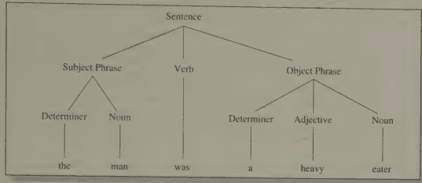

图 2.3 中的树显示，句子“the man was a heavy eater”可以通过应用适当的产生式从起始符号推导出来。此过程的步骤如下所示；其中双箭头 => 表示应用所示的产生式：

```
<sentence> => <subject phrase> <verb>
<object phrase>
<subject phrase> => <determiner> <noun>
<determiner> => the
<noun> => man
<verb> => was
<object phrase> => <determiner> <adjective> <noun>
<determiner> => a
<adjective> => heavy
<noun> => eater
```

使用产生式的另一种方法是通过用适当的终结符替换所有非终结符来生成有效句子，如前面所述。当然，并非所有产生式都有意义，例如“the man was the dessert”（除非你是食人族）。

有限状态机（FSM）非常适合识别句子结构。例如，翻译计算机语言源代码的编译器使用 FSM 将源代码解析为称为标记的最小意义单位。FSM 和解析对于编译器等应用程序至关重要，用于将源代码翻译成汇编语言以及进行准确的语音识别。随着 Java 的出现，编译器一词现已扩展，指使用 javac 编译器将源代码翻译为与平台无关的字节码，这与 1970 年代引入 Pascal 时所做的一样，其字节码可以在任何微处理器上运行。将 Pascal 转换为字节码被正确地称为解释器而不是编译器，因为字节码不是像汇编语言那样的特定机器语言指令。但是，解释器比编译器慢，因此将某物称为编译器而不是解释器更利于宣传。

施乐公司的有限状态机在线演示位于 (http://www.xrce.xerox.com/competencies/content-analysis/f/Compiler/fsinput.html)。FSM 示例（例如软饮料机）的链接位于 (http://www.xrce.xerox.com/competencies/content-analysis/f/Compiler/fsxamples.html)。FSM 的非常全面的参考资料位于 (http://odur.let.rug.nl/~altta/fsa.stuff)。

虽然 FSM 在处理有限符号集（例如数字 0-9 或字母表中的字母）时效果不错，但在语音识别等领域可能会出现歧义问题。例如，在下面两个句子中：

- (1) No one has let us read
- 或
- (2) No one has lettuce red

在句子 (1) 中，有人抱怨自己无法阅读。在 (2) 中，没有人有红色生菜。消除“lettuce”、“let us”、“read”和“red”等单词歧义的一个好方法是使用隐马尔可夫机（HMM），它为有限状态机中的动作分配概率。通过查看整个句子结构或其他句子，HMM 可以找出正确的上下文（要么是读书，要么是在购物清单上寻找蔬菜）。虽然专家系统不是实现 HMM 的软件选择，但它们可以作为语音识别的前端，专家系统（如 CLIPS）可以使用该前端来触发适当的规则。

事实上，CLIPS 能够轻松与 C 或 C++ 代码接口，因此用 C 或 C++ 编写的 HMM 可以像任何其他 CLIPS 关键字一样被调用。CLIPS 的优势之一在于它是一种可扩展语言，用户可以在编译时轻松添加关键字以实现最高效率。此外，借助 COOL 的面向对象特性，可以使用对象来扩展 CLIPS，充分利用多重继承的强大功能。其他软件（如 ANS、遗传算法以及其他用 C 或 C++ 编写的软件）可以添加到规则的左侧以触发规则，或添加到规则的右侧以进行输出。例如，可以通过定义适当的关键字函数，从 CLIPS 调用语音合成器、机器人执行器和执行机构。CLIPS 源代码的可用性意味着，新的关键字调用可以在 CLIPS 中编译，速度不会损失，而其他未提供源代码的专家工具则无法做到这一点。

### 2.4 语义网

语义网络（或简称网）是一种用于命题信息的经典 AI 表示技术。（http://www.pcai.com/web/T6110H2/R6o1.6h/pcai.htm）语义网有时也称为命题网。如前面所述，命题是一个为真或为假的陈述，例如“所有狗都是哺乳动物”和“三角形有三条边”。命题是一种陈述性知识，因为它们陈述事实。从数学角度来看，语义网是一个带标签的有向图。命题总是为真或为假，被称为原子命题，因为其真值无法进一步划分。这里的“原子”一词采用了古典希腊语中不可分割对象的含义。相比之下，第 5 章讨论的模糊命题不必严格为真或为假。

语义网最初由 Quillian 于 1968 年为 AI 开发，作为表示人类记忆和语言理解的一种方法。他使用语义网来分析句子中单词的含义。请注意，句子的含义与将其解析为标记和词法结构并不相同，如前一节提到的 FSM 和 HMM 所能做的那样。从那以后，语义网已被应用于许多涉及知识表示的问题。这种对含义的理解对于超越简单的专家系统或 AI 软件以避免歧义是必要的。在下一章关于推理的内容中，我们将看到专家系统如何从事实中得出结论，这些事实可能被其他规则在推理链中使用，直到得出有效结论。如果没有语义，专家系统可能会像被歧义困惑的人一样失败。

语义网的结构以节点和连接它们的弧的图形形式显示。节点有时被称为对象，弧称为链接或边缘。

语义网的链接用于表达关系。节点通常用于表示物理对象、概念或情况。图 2.4a 显示了一个普通网络，实际上是一个有向图，其中链接表示城市之间的航空路线。节点是圆圈，链接是连接节点的线。箭头显示飞机可以飞行的方向，因此称为有向图。在图 2.4b 中，链接显示家庭成员之间的关系。关系在语义网中至关重要，因为它们提供了组织知识的基本结构。如果没有关系，知识只是一组不相关的事实。有了关系，知识就是一个连贯的结构，可以从中推断出其他知识。例如，在图 2.4b 中，可以推断出 Ann 和 Bill 是 John 的祖父母，尽管没有明确标记为“祖父”的链接。

语义网有时也被称为联想网，因为节点彼此关联或相关。事实上，Quillian 的早期工作将人类记忆建模为联想网，其中概念是节点，链接形成概念之间的连接。根据此模型，当一个概念节点因阅读句子中的单词而受到刺激时，它到其他节点的链接会以扩散模式激活。如果另一个节点接收到足够的激活，该概念就会被提升到意识中。例如，虽然你知道成千上万个单词，但在阅读本句时，你只在思考本句中的特定单词。

某些类型的关系已被证明在各种知识表示中特别有用。与为不同问题定义新关系相比，通常使用这些类型。使用常见类型可以让不同的人更容易理解不熟悉的网络。


### 图 2.4 两种类型的网

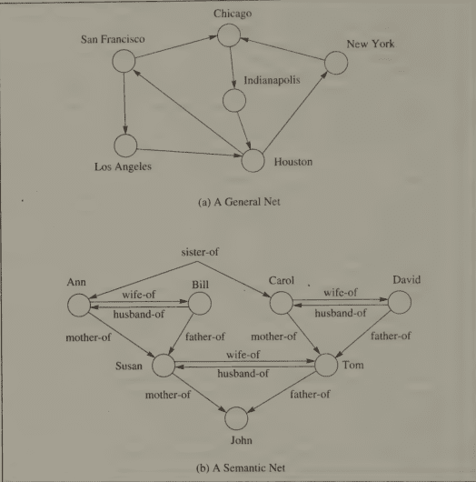

常用的两种链接是 IS-A 和 A-KIND-OF，有时也写作 IS-A 和 AKO。图 2.5 说明了使用这些链接的语义网。在此图中，IS-A 表示“是……的实例”，指类的特定成员。类与数学中的集合概念相关，因为它指一组对象。虽然集合可以包含任何类型的元素，但类中的对象彼此之间存在某种关系。例如，可以定义由以下元素组成的集合：

```
{ 3, eggs, blue, tires, art }
```

然而，该集合的成员之间没有共同关系。相比之下，由飞机、火车和汽车组成的类是相关的，因为它们都是交通工具类型。

### 图 2.5 带有 IS-A 和 A-Kind-Of (AKO) 链接的语义网

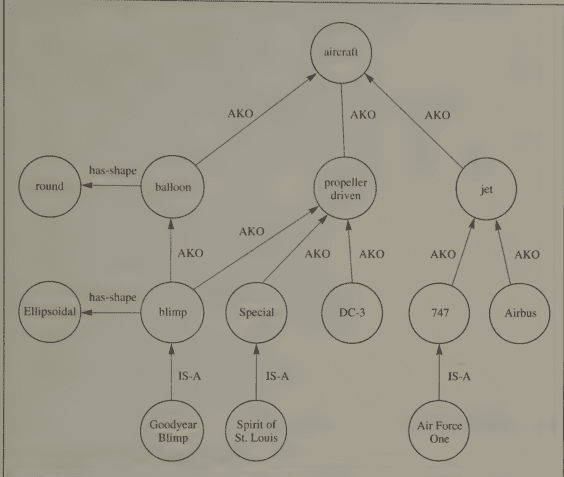

此处使用 AKO 链接将一个类与另一个类关联。AKO 不用于关联特定个体，因为那是 IS-A 的功能。AKO 将单个类与父类关联，该父类是包含该个体作为子类的类的集合。

从另一个角度来看，AKO 将通用节点与通用节点关联，而 IS-A 将实例或个体与通用类关联。在图 2.5 中，请注意更通用的类位于顶部，更具体的类位于底部。AKO 箭头指向的更通用的类称为超类。如果超类有一个指向另一个节点的 AKO，那么它也是 AKO 所指向的超类的一个类。表达这一点的另一种方式是，AKO 从 **子类** 指向一个类。链接 **ARE** 有时用于 AKO，其中 ARE 被读作普通单词“are。”

类中的对象具有一个或多个共同的 **属性**。每个属性都有一个 **值**。属性和值的组合称为 **特性**。例如，飞艇具有尺寸、重量、形状和颜色等属性。形状属性的值是椭圆形。换句话说，飞艇具有椭圆形形状的特性。语义网中也可能存在其他类型的链接。**IS-A** 链接定义一个值。例如，无论总统乘坐什么飞机，都是空军一号。如果总统乘坐直升机，那么空军一号 IS-A 直升机。**CAUSE** 链接表达因果知识。例如，热空气 CAUSES 气球上升。

既然古德伊尔飞艇是飞艇，而飞艇具有椭圆形，那么古德伊尔飞艇就是椭圆形的。后代对一个节点特征的复制称为 **继承**。除非有更具体的相反证据，否则假设类的所有成员都将继承其超类的所有特性。例如，气球具有圆形。但是，由于飞艇类有一个指向椭圆形的链接，因此这优先。继承在知识表示中是一个有用的工具，因为它消除了重复常见特征的需要。链接和继承提供了一种高效的知识表示手段，因为许多复杂关系可以用少量节点和链接来表示。稍后我们将讨论 CLIPS 使用其嵌入语言 COOL 的面向对象功能。您可以使用规则、对象或规则和对象的组合来编写专家系统，并支持真正的多重继承。

### 2.5 对象-属性-值三元组

使用语义网的一个问题是，链接名称没有标准定义。例如，一些书籍将 IS-A 用于通用关系和个体关系。IS-A 然后用作普通单词“是 a”的含义，也用于 AKO。

另一种常见的链接是 HAS-A，它将类与子类关联。HAS-A 与 AKO 方向相反，常用于将对象与对象的一部分关联。例如，

```
car HAS-A engine
car HAS-A tires
car IS-A ford
```

更具体地说，IS-A 将值与属性关联，而 HAS-A 将对象与属性关联。

对象、属性和值这三个项目出现非常频繁，以至于可以只使用它们来构建简化的语义网。**对象-属性-值三元组 (OAV)**，或 **三元组**，可用于表征语义网中的所有知识，并曾用于专家系统 MYCIN 来诊断传染病。OAV 三元组表示法便于以表格形式列出知识，并通过规则归纳将表格转换为计算机代码。OAV 三元组表的示例如表 2.1 所示。归纳是逻辑的一种强大工具，常常被忽略。经典的例子是问某人为什么没有备份硬盘。通常的错误归纳答案是他们的硬盘从未崩溃过，因此通过归纳它永远不会崩溃。（经纪人喜欢这种“推理”。）有关归纳逻辑编程的更多详细信息，请参见 [Bergadano 96]。

OAV 三元组特别适用于表示事实以及规则前件中匹配事实的模式。此类系统的语义网由对象、属性和值的节点组成，通过 HAS-A 和 IS-A 链接连接。如果只需表示单个对象且不需要继承，那么一种更简单的表示称为 **属性-值 (AV) 对** 可能就足够了。

### 表 2.1 OAV 表

| 对象 | 属性 | 值 |
|---|---|---|
| 苹果 | 颜色 | 红色 |
| 苹果 | 类型 | 麦金托什 |
| 苹果 | 数量 | 100 |
| 葡萄 | 颜色 | 红色 |
| 葡萄 | 类型 | 无籽 |
| 葡萄 | 数量 | 500 |

### 2.6 PROLOG 和语义网

语义网易于翻译成 PROLOG。例如，以下 PROLOG 语句表达了图 2.5 语义网中的一些关系：

```
is_a(goodyear_blimp, blimp).
is_a(spirit_of_st_louis, special).
has_shape(blimp, ellipsoidal).
has_shape(balloon, round).
```

请注意，句点标记 PROLOG 语句的结束。

### PROLOG 基础

上述每个语句都是 PROLOG **谓词表达式**，或简称谓词，因为它基于谓词逻辑。但是，PROLOG 不是真正的谓词逻辑语言，因为它是一种具有可执行语句的计算机语言。在 PROLOG 中，谓词表达式由谓词名称（例如 is_a）组成，后跟零个或多个用括号括起来并用逗号分隔的参数。以下是一些 PROLOG 谓词示例。注释以分号开头，并被 PROLOG 引擎忽略：

```
color(red). ; red is a color is a fact
mother(pat, ann). ; pat is the mother of ann
parents(jim, ann, tom) ; jim and ann are parents of tom
surrogatemother(pat, tom). ; pat is surrogatemother of tom
```

如果考虑第一个参数后面的谓词名称，带有两个参数的谓词更容易理解。带有两个以上参数的谓词的含义必须明确说明，parents 谓词即是说明这一点。另一个困难是，语义网主要用于表示二元关系，因为绘制的线只有两个端点。不可能将 parents 谓词绘制为单个有向边，因为有三个参数。将汤姆和苏珊一起绘制在一个父节点中，而将约翰绘制在另一端的想法会导致新的复杂性。然后不可能使用父节点表示其他二元关系，例如 mother-of，因为那也会涉及汤姆。

谓词也可以用 IS-A 和 HAS-A 等关系来表达：

```
is_a(red, color).
has_a(john, father).
has_a(john, mother).
has_a(john, parents).
```

请注意，has_a 谓词不再表达与先前相同的含义，因为约翰的父亲、母亲和父母没有明确命名。为了命名它们，必须添加一些其他谓词：

```
is_a(tom, father).
is_a(susan, mother).
is_a(tom, parent).
is_a(susan, parent).
```

即使这些额外的谓词也不能表达与原始谓词相同的含义。例如，我们知道约翰有一个父亲，汤姆是一个父亲，但这并未提供汤姆是约翰父亲的信息。

上述所有语句实际上都描述了 PROLOG 中的事实。PROLOG 程序由事实和规则组成，其一般形式为目标：

```
p :- p1,p2, ...pn.
```

其中 p 称为规则的头，p_i 称为子目标。通常，此表达式是一个 Horn 子句，它陈述头目标 p_i 当且仅当


当所有子目标都满足时。例外情况是使用了失败的特殊谓词时。失败谓词很方便，因为在经典逻辑中很难证明否定，而PROLOG基于经典逻辑。否定被视为未能找到证明，如果存在许多潜在匹配，这可能是一个非常漫长且复杂的过程。**切割**和特殊失败谓词通过减少寻找证明的搜索，使否定过程更加高效。

分隔子目标的逗号表示逻辑AND。符号 :- 被解释为IF。如果只有头存在且没有右侧部分，如：

p.

则头被视为真。这就是为什么诸如以下的谓词被视为事实，因此必须为真：

```
color (red) .
has_a (john , father) .
```

查询的另一种方式是否定的。也就是说，为了产生否定结果，网中许多或所有链接可能都需要被搜索。如第1章中的旅行商问题所示，如果所有节点都相连，链接数量是节点数量的阶乘减一。虽然并非所有表示都需要这种程度的连接，但组合爆炸的可能性存在。

语义网最初被提出作为人类联想记忆的模型，其中一个节点有指向其他节点的链接，信息检索是由于节点的激活扩散而发生。然而，人类大脑也必须有其他机制可用，因为人类回答查询——冥王星上有足球队吗？——并不需要很长时间。人脑中约有10^11个神经元和约10^15个链接。如果所有知识都由语义网表示，那么回答像足球问题这样的否定查询将需要非常非常长的时间，因为涉及10^15个链接的所有搜索。

语义网在逻辑上是不充分的，因为它们无法像逻辑那样定义知识。逻辑表示可以指定某把椅子、一些椅子、所有椅子、没有椅子等等，这将在本章后面讨论。另一个问题是，语义网在启发式方面是不充分的，因为没有方法在网中嵌入关于如何高效搜索网的启发式信息。**启发式**是一种经验法则，可能有助于找到解决方案，但不像算法那样保证能找到解决方案。启发式在AI中非常重要，因为典型的AI问题非常困难，以至于算法解决方案不存在或对于实际使用来说效率太低。网中内置的可能有帮助的唯一标准控制策略是继承，但并非所有问题都可能具有这种结构。

已经尝试了许多方法来纠正语义网的固有问题。已进行逻辑增强，并通过向节点附加过程来尝试启发式增强。当节点被激活时，将执行这些过程。然而，所得到的系统在牺牲语义网的自然表达能力的代价下，能力几乎没有提高。所有这些努力的结论是，像任何工具一样，语义网应该用于它们最擅长的事情，即显示二元关系，而不应被扭曲成一种通用工具。


### 2.8 图式

语义网是浅层知识结构的一个例子。浅层性之所以出现，是因为语义网中的所有知识都包含在链接和节点中。知识结构类似于数据结构，因为它表示有序的知识集合，而不仅仅是数据。深层知识结构具有因果知识，可以解释某事发生的原因。例如，可以构建一个基于浅层知识的医学专家系统，如下所示：

```
IF a person has a fever
THEN take an aspirin
```

但这些系统不知道人体的基本生物化学知识，也不知道阿司匹林为何能退烧。该规则本可以定义为：

```
IF a person has a pink monkey
THEN take a refrigerator
```

换句话说，专家系统的知识是浅层的，因为它基于语法而非语义，在以下规则中，任何两个词都可以替换 X 和 Y：

```
IF a person has a (X)
THEN take a (Y)
```

请注意，(X) 和 (Y) 并非此规则中的变量，而是代表任何两个词。医生拥有因果知识，因为他们经过了多年的医学院学习，并有治疗病人的经验。如果某种治疗不起作用，医生可以运用推理能力来寻找其常规案例方法的替代方案。换句话说，专家知道何时该打破规则。

许多类型的现实世界知识无法用语义网的简单结构来表示。需要更复杂的结构来更好地表示复杂的知识结构。在 AI 中，术语 schemata（复数形式为 schemas 或 schemata）用于描述比语义网更复杂的知识结构。术语 schema 来自心理学，指生物体对刺激所做出的知识或反应的持续组织。也就是说，当生物体学习原因及其结果之间的因果关系时，如果令人愉快，它们会尝试重复原因；如果痛苦，则会避免原因。

例如，进食和饮水的行为是令人愉快的感知运动图式，涉及将感官信息与进食和饮水所需的运动（肌肉）动作相协调。人不需要思考这种隐性知识就知道如何执行这些行为，而且要准确解释其做法（直到控制肌肉的层面）非常困难。更难解释的图式是如何骑自行车。试着解释一下平衡感吧！

另一种图式是 **概念图式**，我们用它来表示概念。例如，每个人都有动物的概念。如果让大多数人解释什么是动物，他们可能会描述为一种有四条腿和毛发的东西。当然，动物的概念因人是在农场、城市还是河边长大而有所不同。然而，我们心中都有概念的 **刻板印象**。虽然刻板印象一词在日常语言中可能带有贬义，但在 AI 中它指典型示例。因此，对许多人来说，动物的刻板印象可能是一条狗。

概念图式是一种抽象，其中特定对象按其一般属性进行分类。例如，如果你看到一个写着“人造水果”的牌子下有一个带绿色果梗的小红圆物体，你可能会将其识别为人造苹果。该物体具有你与苹果的概念图式相关联的苹果属性。

真实苹果的概念图式将包括苹果的一般属性，如大小、颜色、味道、用途等。该图式不会包括苹果采摘的确切位置、将其运送到超市的卡车或将其放上货架的人的姓名等细节。这些细节对于构成你抽象苹果概念的属性并不重要。另外，请注意，盲人可能对苹果有非常不同的概念图式，其中质地最为重要。

通过关注对象的一般属性，更容易对其进行推理，而不会被无关细节分散注意力。习惯上，图式的节点具有内部结构，而语义网则没有。语义网的标签是关于节点的所有知识。语义网类似于计算机科学中的数据结构，其中搜索键也是存储在节点中的数据。图式类似于一种数据结构，其中节点包含记录。每条记录可能包含数据、记录或指向其他节点的指针。

### 2.9 框架

在许多 AI 应用中使用的一种图式是 **框架**。另一种图式是 **脚本**，本质上是按时间顺序排列的框架序列。框架被提出作为理解视觉、自然语言和其他领域的方法，为表示给定情境下典型的对象（如刻板印象）提供了一种方便的结构。特别是，框架对于模拟常识知识很有用，这是计算机很难掌握的一个非常困难的领域。虽然语义网基本上是知识的二维表示，但框架通过允许节点具有结构来增加第三个维度。这些结构可以是简单值或其他框架。

框架的基本特征是，它表示关于具有大量默认知识的狭窄主题的相关知识。框架系统将是描述机械装置（例如汽车）的一个不错选择。汽车的发动机、车身、刹车等组件将相互关联，以总体了解它们之间的关系。通过检查框架的结构，可以获得关于组件的更多细节。尽管各个汽车品牌会有所不同，但大多数汽车都有共同特征，如车轮、发动机、车身和变速器。框架与语义网形成对比，语义网通常用于广义知识表示。与语义网一样，定义基于框架的系统也没有标准。已为框架设计了许多专用语言，例如 FRL、SRL、KRL、KEE、HP-RL，以及 LISP 的框架增强功能，如 LOOPS 和 FLAVORS。

框架类似于 C 等高级语言中的记录结构或 LISP 中带有属性列表的原子。与记录的字段和值相对应的是框架的槽和槽填充值。框架基本上是一组定义典型对象的槽和填充值。汽车框架如图 2.8 所示。在 OAV 术语中，汽车是对象，槽名是属性，填充值是值。

### 图 2.8 汽车框架

| 槽 | 填充值 |
| :--- | :--- |
| 制造商 | General Motors |
| 型号 | Chevrolet Caprice |
| 年份 | 1979 |
| 变速器 | 自动 |
| 发动机 | 汽油 |
| 轮胎数 | 4 |
| 颜色 | 蓝色 |

大多数框架不如图 2.8 中所示的那么简单。框架的实用性在于层次化框架系统和继承。通过在填充槽中使用框架和继承，可以构建非常强大的知识表示系统。特别是，基于框架的专家系统对于表示因果知识非常有用，因为它们的信息按因果关系组织。相比之下，基于规则的专家系统通常依赖于非因果的无组织知识。

一些基于框架的工具（如 KEE）允许在槽中存储各种项目。框架槽可以保存规则、图形、注释、调试信息、用户问题、关于情况的假设或其他框架。

框架通常设计用于表示通用知识或特定知识。图 2.9 说明了人类财产概念的通用框架。

填充值可以是值，例如 name 槽中的属性，也可以是一系列值，如 types 槽中的值。槽还可以包含附加到槽的过程，称为过程附件。这些通常分为三种类型。if-needed 类型在需要填充值但最初没有值或默认值不合适时执行。默认值在框架中至关重要，因为它们模拟了大脑的某些方面。默认值


### 图 2.9 属性的通用框架

| Slots | Fillers |
|---|---|
| name | 属性 |
| specialization_of | a-kind-of object |
| types | (car, boat, house) if-added: Procedure ADD-PROPERTY |
| owner | default: government if-needed: Procedure FIND-OWNER |
| location | (home, work, mobile) |
| status | (missing, poor, good) |
| under_warranty | (yes, no) |

correspond to the expectations of a situation that we build up based on experience. When we encounter a new situation, the closest frame is modified to help us adjust to the situation. People do not start from scratch in every new situation. Instead, the defaults or other fillers are modified. Defaults are often used to represent commonsense knowledge. Commonsense knowledge can be considered to be the knowledge that is generally known. We use commonsense when no more situation-specific knowledge is available.

The if-added type is run for procedures to be executed when a value is to be added to a slot. In the types slot, the if-added procedure executes a procedure called ADD-PROPERTY to add a new type of property, if necessary. For example, this procedure would be run for jewelry, TV, stereo, and so forth since the types slot does not contain these values.

An if-removal type is run whenever a value is to be removed from a slot. This type of procedure would be run if a value were obsolete.

Slot fillers may also contain relations, as in the specialization of slots. The a-kind-of and is-a relations are used in Figures 2.9, 2.10, and 2.11 to show how these frames are hierarchically related. The frames of Figures 2.9 and 2.10 are generic frames while that of Figure 2.11 is a specific frame because it is an instance of the car frame. We have adopted the convention here that a-kind-of relations are generic and is-a relations are specific.

Frame systems are designed so that more generic frames are at the top of the hierarchy. It is assumed that frames can be customized for specific cases by modifying the default cases and creating more specific frames. Frames attempt to model real-world objects by using generic knowledge for the majority of an object's attributes and specific knowledge for special cases. For example, we commonly think of birds as creatures that can fly. Yet certain types of birds such as penguins and ostriches cannot fly. These types represent more specific classes

### Figure 2.10 Car Frame—A Generic Subframe of Property

| Slots | Fillers |
| :--- | :--- |
| name | car |
| specialization_of | a-kind-of property |
| types | (sedan, sports, convertible) |
| manufacturer | (GM, Ford, Toyota) |
| location | mobile |
| wheels | 4 |
| transmission | (manual, automatic) |
| engine | (gasoline, hybrid gas/electric) |

### Figure 2.11 An Instance of a Car Frame

| Slots | Fillers |
| :--- | :--- |
| name | John's car |
| specialization_of | is-a car |
| manufacturer | GM |
| owner | John Doe |
| transmission | automatic |
| engine | gasoline |
| status | good |
| under_warranty | yes |

of birds and their characteristics would be found lower in a frame hierarchy than birds like canaries or robins. In other words, the top of the bird frame hierarchy specifies things that are more true of all birds while the lower levels reflect the fuzzy boundaries between real-world objects. The object that has all of the typical characteristics is called a prototype, which literally means the first type. Frames may also be classified by their applications. A situational frame contains knowledge about what to expect in a given situation, such as a birthday party. An action frame contains slots that specify the actions to be performed in

a given situation. That is, the fillers are procedures to perform some actions, such as removing a defective part from a conveyor belt. An action frame represents procedural knowledge. The combination of situational and action frames can be used to describe cause-and-effect relationships in the form of causal knowledge frames.

Very sophisticated frame systems have been built for a variety of tasks. One of the most impressive systems that demonstrated the power of frames to creatively discover mathematical concepts was the Automated Mathematician (AM) of Doug Lenat. The classic AM system of Lenat made conjectures of interesting new concepts and explored them. It came up with some completely new mathematical proofs of certain theorems. Many other examples of theorem provers and discovery systems are shown in Appendix G for this chapter.

### 2.10 DIFFICULTIES WITH FRAMES

Frames were originally conceived of as a paradigm for representing stereotyped knowledge. The important characteristic of a stereotype is that it has well-defined features so that many of its slots have default values. Mathematical concepts are good examples of stereotypes well suited to frames. The frame paradigm has an intuitive appeal because its organized representation of knowledge is generally easier to understand than either logic or production systems with many rules (Jackson 99).

However, major problems have appeared in frame systems that allow unconstrained alteration or cancellation of slots. The classic example of this problem is illustrated with a frame describing elephants, as shown in Figure 2.12.

### Figure 2.12 Elephant Frame

| Slots | Fillers |
|---|---|
| name | elephant |
| specialization_of | a-kind-of mammal |
| color | grey |
| legs | 4 |
| trunk | a cylinder |

At first sight, the elephant frame seems like a reasonable generic description of elephants. However, suppose there exists a specific, three-legged elephant called Clyde. Clyde may have lost a leg due to a hunting accident or simply lied about losing a leg to get his name in this book. The significant thing is that the elephant frame claims that an elephant has four legs, not three. Thus we cannot consider the elephant frame to be the valid definition of an elephant.

Of course, the frame could be modified to allow three-legged, two-legged, one-legged, or even legless elephants as exceptions. However, this does not provide a very good definition. Additional problems may arise with the other slots. Suppose Clyde gets a bad case of jaundice and his skin turns yellow. Is he then not an elephant?

An alternative to viewing a frame as a definition is to consider it as describing a typical elephant. However, this leads to other problems because of inheritance. Notice that the elephant frame says that an elephant is a-kind-of mammal. Since we are interpreting frames as typical, then our frame system says that a typical elephant is a typical mammal. Although an elephant is a mammal, it is probably not a typical mammal. On the basis of quantity, people, cows, rats, and sheep are probably more representative of typical mammals.

Most frame systems do not provide a way of defining unalterable slots. Since any slot can be changed, the properties that a frame inherits can be altered or cancelled anywhere in the hierarchy. This means that every frame is really a primitive frame because there is no guarantee that properties are common. Each frame makes up its own rules and so each frame is a primitive. Nothing is really certain in such an unconstrained system, and so it is impossible to make universal statements such as those made in defining an elephant. Also, from simpler definitions such as that for an elephant, it is impossible to reliably build composite objects such as elephant-with-three-legs. The same types of problems apply to semantic nets with inheritance. If the properties of any node can be changed, then nothing is certain.

However there is another way to view frames that is very useful. If the concept of frame is extended to include the properties of objects, then an object can be considered a frame. CLIPS has a complete object-oriented language called COOL embedded within it that can be considered as an extension of frame-based language. All the advantages of objects are now available in CLIPS. Object-oriented expert systems can be constructed in CLIPS that have both the advantages of rules as small chunks of knowledge while providing the capability to organize larger chunks of knowledge into objects for easier maintenance and development. Rules can operate on facts or objects and thus CLIPS has the advantages of both a rule-based and object-based expert system tool. The use of objects in CLIPS makes it easier to organize, execute, and maintain large knowledge bases rather than trying to keep all the knowledge in thousands of separate rules and facts.

### 2.11 LOGIC AND SETS

In addition to rules, frames, and semantic nets, knowledge can also be represented by the symbols of logic, which is the study of the rules of exact reasoning. An important part of reasoning is inferring conclusions from premises. The application of computers to perform reasoning has resulted in logic programming and the development of logic-based languages such as PROLOG. Logic is also of primary importance in expert systems in which the inference engine reasons from facts to conclusions. In fact, a descriptive term for logic programming and expert systems is automated reasoning systems.


最早的形式逻辑由古希腊哲学家亚里士多德在公元前四世纪发展而来。亚里士多德逻辑基于**三段论**，他发明了十四种类型。中世纪又发明了五种。三段论有两个**前提**和一个**结论**，结论从前提中推导出来。以下是一个三段论的经典示例：

```
Premise: All men are mortal
Premise: Socrates is a man
Conclusion: Socrates is mortal
```

在三段论中，**前提**提供了结论必然遵循的证据。三段论是一种表示知识的方式。另一种方式是**文氏图**，如图 2.13 所示。

### 图 2.13 文氏图


外圈代表所有会死的生物。代表人类的内圈完全画在会死的圆圈内，以表示所有人都是会死的。由于苏格拉底是人，代表他的圆圈完全画在人类圆圈内。严格来说，代表苏格拉底的圆圈应该是一个点，因为圆圈暗示一个类别。为了可读性，我们对所有事物都使用圆圈。苏格拉底会死的结论是由于他的圆圈在会死生物的圆圈内，因此必然会死的结果。

从数学角度来说，文氏图中的一个圆圈代表一个集合，即对象的集合。集合中的对象称为其**元素**。集合的一些示例如下：

```
A = {1,3,5}
B = {1,2,3,4,5}
C = {0,2,4,...}
D = {...,-4,-2,0,2,4,...}
E = {airplanes,balloons,blimps,jets}
F = {airplanes,balloons}
```

其中，三个点……，称为省略号，表示术语无限延续。

希腊符号 epsilon，$\in$，表示一个元素是集合的成员。例如，$1 \in A$ 表示数字 1 是先前定义的集合 $A$ 的一个元素。如果一个元素不是集合的成员，则使用符号 $\notin$，如 $2 \notin A$。

如果定义了两个任意集合，例如 X 和 Y，使得 X 中的每个元素都是 Y 的元素，那么 X 是 Y 的子集，并以数学形式 $X \subset Y$ 或 $Y \supset X$ 表示。从子集的定义可以得出，每个集合都是其自身的子集。不是集合本身的子集称为真子集。例如，先前定义的集合 X 是 Y 的真子集。在讨论集合时，将讨论中的集合视为全集的子集是有用的。全集（宇宙）随讨论话题的变化而变化。图 2.14 说明了在所有汽车的宇宙中由两个集合的交集形成的子集。在讨论数字时，宇宙是所有数字。宇宙被绘制为围绕其子集的矩形。全集不仅仅为了方便而使用。随意使用条件来定义集合可能导致逻辑悖论。

### 图 2.14 相交集合

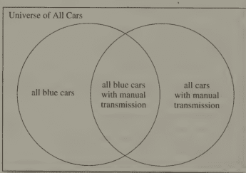

如果我们让 A 是所有蓝色汽车的集合，B 是所有手动变速箱汽车的集合，C 是所有手动变速箱蓝色汽车的集合，那么可以写成：

```
C = A \cap B
```

其中符号 $\cap$ 表示集合的交集。另一种写法是用元素 x 表示如下：

```
C = {x \in U | (x \in A) \land (x \in B)}
```

其中：

U 表示全集。

| 读作“使得”。有时冒号 : 代替 | 使用。

∧ 是逻辑 AND。

C 的表达式读作：C 由宇宙中那些元素 x 组成，使得 x 是 A 的元素且 x 是 B 的元素。逻辑 AND 来自布尔代数。由两个操作数通过逻辑 AND 运算符连接的表达式，当且仅当两个操作数都为真时才为真。如果 A 和 B 没有公共元素，则 A ∩ B = Ø，其中希腊字母 phi，Ø，表示空集或零集 { }，不包含任何元素。有时希腊字母 lambda，λ，用于表示零集。全集的其他记法有时是数字 1，而零集的记法是数字 0。尽管空集没有元素，但它仍然是一个集合。一个类比是带有顾客集合的餐厅。如果没有人来，顾客集合是空的，但餐厅仍然存在。

另一种集合运算是并集，即 A 或 B 中所有元素的集合：

```
A ∪ B = (x ∈ U | (x ∈ A) ∨ (x ∈ B))
```

其中：

∪ 是并集的集合运算符。

∨ 是逻辑 OR 运算符。

集合 A 的补集是不在 A 中的所有元素的集合：

```
A' = {x ∈ U | ~(x ∈ A)}
```

其中：

撇号，'，表示集合的补集。

波浪号，~，是逻辑 NOT 运算符。

这些基本运算的文氏图如下一页的图 2.15 所示。

### 2.12 命题逻辑

最古老且最简单的形式逻辑类型之一是三段论。术语“形式”意味着逻辑关注逻辑陈述的形式而非其含义。换句话说，形式逻辑关注陈述的语法而非其语义。这在构建专家系统时极其重要，因为你必须将知识与推理分离。看似推理的东西可能是知识。例如，

### 图 2.15 基本集合运算的文氏图

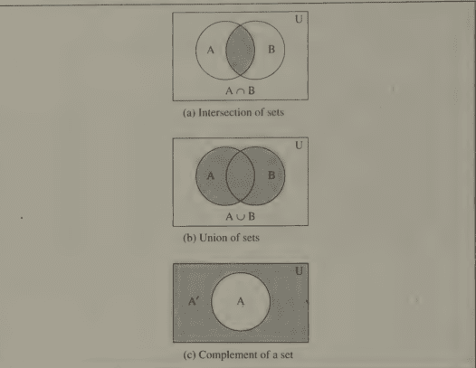

陈述，“总统总是正确的，因为他从不犯错，”由于连接句子两部分的“因为”而具有推理的外观。事实上，这种断言被称为重言式，因为与事实（在现实世界中可能为真也可能为假）不同，重言式在纯粹逻辑意义上总是为真，因为它引用自身作为证明。它陈述，“X 就是 X。”然而，如果你与总统不属于同一政党，你可能基于陈述的语义而非形式表示不同意，并更喜欢重言式，“总统总是错的，因为他从不正确。”

虽然“形式逻辑”这个术语听起来可能令人生畏，但它并不比代数更难。事实上，代数实际上是数字的形式逻辑。例如，假设你被要求解决以下问题：一所学校有 25 台计算机，总共有 60 个内存芯片。有些计算机有两个内存芯片，而其他计算机有四个。每种类型各有多少台计算机？解决方案可以代数地写成如下：

```
25 = X + Y
60 = 2X + 4Y
```

这可以轻松地求解出 X = 20 和 Y = 5。

现在考虑这个问题。一个谷仓里有 25 只动物，总共有 60 条腿。有些动物有两条腿，而其他动物有四条腿。（注意：克莱德，我们的三条腿大象在非洲，不在谷仓里。）每种类型各有多少只动物？如你所见，无论我们谈论的是计算机、动物还是其他任何东西，相同的代数方程都适用。就像代数方程让我们专注于符号的数学操作而不考虑它们代表什么一样，形式逻辑让我们专注于推理，而不会因我们正在推理的对象而感到困惑。

作为形式逻辑的示例，考虑使用无意义单词 squeeg 和 moof 的三段论。

```
Premise: All squeegs are moofs
Premise: John is a squeeg
Conclusion: John is a moof
```

尽管 squeeg 和 moof 这两个词是无意义的且没有含义，但该论证的形式仍然是正确的。也就是说，无论使用什么词，该论证都是有效的，因为三段论具有有效的形式。事实上，任何形式如下的三段论：

```
Premise: All X are Y
Premise: Z is a X
Conclusion: Z is a Y
```

无论 X、Y 和 Z 被什么替换，都是有效的。这个例子说明，在形式逻辑中，含义并不重要。只有形式或外观才重要。将形式与含义或语义分离的概念，正是使逻辑成为如此强大工具的原因。通过将形式与语义分离，可以客观地考虑论证的有效性，而不会因语义而产生偏见。形式逻辑的一个类比是代数，其中 X + X = 2X 等表达式的正确性成立，无论 X 是整数、苹果还是飞机。

亚里士多德三段论一直是逻辑的基础，直到 1847 年，英国数学家乔治·布尔出版了第一本描述符号逻辑的书籍。尽管莱布尼茨在十七世纪发展了他自己的符号逻辑版本，但它从未获得普遍使用。布尔提出的新概念之一是对亚里士多德观点的修改，即主语必须存在，称为存在蕴含。根据经典的亚里士多德观点，诸如“所有美人鱼都游得好”的命题不能被视为前提或结论，因为美人鱼不存在。布尔观点（现在称为现代观点）放宽了这一限制。现代观点的重要性在于，现在可以对空类进行推理。例如，诸如“所有故障磁盘都便宜”的命题，除非至少有一个磁盘发生了故障，否则不能用于亚里士多德三段论。

布尔的另一项贡献是定义了一组公理，由表示对象和类的符号以及代数运算组成，用于


操纵符号。公理是构建数学和逻辑本身等逻辑系统的基本定义。仅使用公理，就可以构建定理。定理是一种可以通过证明其如何从公理推导出来而被证明的陈述。在1910年至1913年间，怀特海和罗素发表了他们宏伟的2000页、三卷本著作*数学原理*，该著作展示了形式逻辑作为数学的基础。这被誉为一个伟大的里程碑，因为它似乎通过完全消除算术的意义，而将注意力集中在形式及其操纵上，而不是诉诸直觉，从而将数学置于坚实的基础之上。正因为如此，数学被描述为纸上一堆毫无意义的符号。

1931年，著名数学家哥德尔证明，基于公理的形式系统并不总能在内部证明其自洽且无矛盾。哥德尔的证明对那些曾希望算术能一劳永逸地被证明为正确的数学家来说是一个沉重打击。相反，看来我们不能真正依赖算术（注意，任何读到这个双关语的聪明数学家都会觉得这很有趣）。

命题逻辑，有时也称为命题演算，是一种用于操纵命题的符号逻辑。特别是，命题逻辑处理*逻辑变量*的操纵，这些变量代表命题。虽然大多数人将演算理解为牛顿和莱布尼茨发明的微积分，但这个词有更一般的含义。它源自拉丁语*小石子*，意为用于计算的小石子。演算的一般含义是一种操纵符号的特殊系统。命题逻辑的其他术语是**陈述演算**和**句子演算**。句子通常分为四种类型，如Table 2.2所示。

### Table 2.2 Types of Sentences

| 类型 | 示例 |
|---|---|
| 祈使句 | 按照我告诉你的去做！ |
| 疑问句 | 那是什么？ |
| 感叹句 | 太棒了！ |
| 陈述句 | 正方形有四条相等的边。 |

命题逻辑关注的是可以分类为真或假的陈述句子集。例如，“正方形有四条相等的边”这句话具有确定的真值真，而“乔治·华盛顿是第二任总统”这句话的真值为假。真值可以确定的句子称为**陈述**或**命题**。陈述也称为**封闭句子**，因为其真值不容置疑。

如果我在本书前面加上一段序言，声明“这些页面上的一切都是谎言”，那么该陈述无法被归类为真或假。如果它是真的，那么我在序言中说了真话——这是我做不到的。如果它是不真实的，那么写下的每个字都必须是真的，那么我撒了谎——这也不可能是真的。这类陈述被称为说谎者悖论。无法绝对确定的陈述称为开放句子。句子“菠菜味道很棒”也是一个开放句子，因为对某些人来说是真的，对另一些人来说不是真的。句子“他很高”被称为开放句子，因为它包含一个变量“他”。在知道变量所指代的具体人或实例之前，无法为开放句子分配真值。这个句子的另一个困难是“高”这个词的含义。对某些人来说高的东西，对另一些人来说并不高。虽然命题逻辑或谓词演算无法处理“高”的这种歧义，但可以在第5章描述的模糊逻辑中轻松处理。

复合语句是通过在单个语句上使用逻辑连接词形成的。常见的逻辑连接词如Table 2.3所示。

| 连接词 | 含义 |
|---|---|
| ^ | 且；合取 |
| v | 或；析取 |
| ~ | 非；否定 |
| -> | 如果...那么；条件 |
| <-> | 当且仅当；等值 |

严格来说，否定不是一个连接词，因为它是一元运算，作用于其后的一个操作数，因此它实际上并不连接任何东西。否定的优先级高于其他运算符，因此不需要在其周围加括号。也就是说，像 ~p ^ q 这样的语句与 (~p) ^ q 的含义相同。

条件句与产生规则的箭头类似，因为它表达为IF-THEN形式。例如：

```
if it is raining then carry an umbrella
```

可以写成形式：

```
p -> q
```

其中：

```
p = it is raining
q = carry an umbrella
```

有时 > 用于表示 ->。条件句的另一个术语是蕴涵。

双条件句 p <-> q 等价于：

```
(p -> q) ^ (q -> p)
```

且仅在 p 和 q 具有相同真值时为真。也就是说，p<->q 仅在 p 和 q 都为真或都为假时为真。双条件句具有以下含义：

```
p if and only if q
q if and only if p
if p then q, and if q then p
```

如前所述，重言式是一个无论其组成语句真假如何始终为真的复合语句。矛盾式是一个始终为假的复合语句。偶然语句既不是重言式也不是矛盾式。重言式和矛盾式分别被称为分析真和分析假，因为它们的真值仅由其形式即可确定。例如，p v ~ p 的真值表显示它是一个重言式，而 p ^ ~ p 是一个矛盾式。

如果一个条件句也是重言式，那么它被称为蕴涵，并用符号 => 代替 ->。一个也是重言式的双条件句被称为逻辑等价或蕴涵等价，并用 <-> 或 = 符号化。逻辑等价的两个语句始终具有相同的真值。例如，p == ~p。

不幸的是，这并不是蕴涵的唯一可能定义，因为对于可以取真和假值的两个变量，存在十六种可能的真值表。在1980年代早期的专家系统中，定义了11种不同的蕴涵运算符定义。

条件句并不完全等同于过程语言或基于规则的专家系统中的IF-THEN。在过程和专家系统中，IF-THEN的意思是如果IF的条件为真，则执行THEN之后的操作。在逻辑中，条件句由其真值表定义。其含义可以用多种方式翻译成自然语言。例如，如果：

```
p -> q
```

其中 p 和 q 是任意语句，这可以翻译为：

- p 蕴涵 q
- 如果 p 那么 q
- p，仅当 q
- p 对 q 是充分的
- q 如果 p
- q 对 p 是必要的

例如，设 p 表示“你年满18岁或以上”，q 表示“你可以投票”。条件句 p -> q 可以表示以下任何一项：

- 你年满18岁或以上蕴涵你可以投票
- 如果你年满18岁或以上，那么你可以投票
- 你年满18岁或以上，仅当你可以投票
- 你年满18岁或以上对你可以投票是充分的
- 如果你年满18岁或以上，你可以投票
- 你可以投票对你年满18岁或以上是必要的

在某些情况下，需要措辞变化才能使这些句子在语法上正确。最后一个例子说，如果 q 不发生，那么 p 也不会发生。它用地道英语表达为“能够投票要求你年满18岁或以上。”

二元逻辑连接词的值如Table 2.4所示。它们被称为二元连接词是因为需要两个操作数。否定连接词 ~ 是作用于其后一个操作数的一元运算符，如Table 2.5所示。

### Table 2.4 Truth Table of the Binary Logical Connectives

| p | q | p ^ q | p v q | p -> q | p <-> q |
|---|---|---|---|---|---|
| T | T | T | T | T | T |
| T | F | F | T | F | F |
| F | T | F | T | T | F |
| F | F | F | F | T | T |

### Table 2.5 Truth Table of Negation Connectives

| p | ~p |
|---|---|
| T | F |
| F | T |

如果每个真函数都可以仅使用充分集中的连接词来表示，则一组逻辑连接词是充分的。充分集的示例包括 {~, ^, v}、{~, ^}、{~, v} 和 {~, ->}。

单元素集称为单例集。存在两个充分的单例集。它们是非或（NOR）和非与（NAND）。NOR 集是 { ↓ }，NAND 集是 { | }。“|”运算符称为竖线或替代否定。它用于否定 p 和 q 都为真。也就是说，p | q 断言 p 或 q 中至少有一个语句为真。联合否定运算符“↓”否定 p 或 q 中任何一个为真。也就是说，p ↓ q 断言 p 和 q 都为假。

### 2.13 一阶谓词逻辑

虽然命题逻辑有用，但它确实有局限性。主要问题是命题逻辑只能处理完整的语句。也就是说，它无法检查语句的内部结构。命题逻辑甚至无法证明诸如以下三段论的有效性：

所有人都是凡人
所有女人都是人
因此，所有女人都是凡人


为了分析更一般的情况，发展了**谓词逻辑**。其最简单形式是**一阶**谓词逻辑，是PROLOG等逻辑编程语言的基础。在本节中，我们将使用术语_谓词逻辑_来指代一阶谓词逻辑。命题逻辑是谓词逻辑的一个子集。

谓词逻辑关注句子的内部结构。特别是，它关注使用称为**量词**的特殊词汇，如"all"、"some"和"no"。这些词非常重要，因为它们显式地量化其他词汇，使句子更加精确。所有量词都关注"有多少"，因此比命题逻辑允许更广泛的表达范围。

### 2.14 全称量词

- 全称量化句子在同一领域内的所有替换下具有相同的真值。**全称量词**由符号∀表示，后跟一个或多个用于**域变量**的参数。符号∀被解释为"for every"或"for all"。例如，在数域中：

```
(∀ x) (x + x = 2x)
```

表示对于每个x（其中x是一个数），句子x + x = 2x为真。如果我们用符号p表示这个句子，那么它可以表达得更简洁：

```
(∀ x) (p)
```

另一个例子，设p表示句子"all dogs are animals"，如：

```
(∀ x) (p) ≡ (∀ x) (if x is a dog → x is an animal)
```

相反的陈述是"no dogs are animals"，写作：

```
(∀ x) (if x is a dog → ¬x is an animal)
```

也可以读作：

```
Every dog is not an animal
All dogs are not animals
```

另一个例子，"all triangles are polygons"写作如下：

```
(∀ x) (x is a triangle → x is a polygon)
```

并读作"for all x, if x is a triangle, then x is a polygon"。涉及谓词的逻辑陈述的更简写方式是使用**谓词函数**来描述主语的属性。上述逻辑陈述也可以写作：

```
(∀ x) (triangle(x) → polygon(x))
```

谓词函数通常使用大写字母表示谓词，采用更简洁的记法。例如，设T = triangle，P = polygon。那么三角形陈述可以写得更简洁：

```
(∀x) (T(x) → P(x)) or (∀y) (T(y) → P(y))
```

请注意，任何变量都可以用来代替虚变量x和y。另一个例子，设H为人类的谓词函数，M为必死的函数。那么"all humans are mortal"的陈述可以写作：

```
(∀x) (H(x) → M(x))
```

并读作对于所有x，如果x是人类，那么x是必死的。这个谓词逻辑句子也可以表示为语义网，如图2.16所示。它也可以用规则表示：

```
IF x is human
THEN x is mortal
```

### 图2.16 谓词逻辑陈述的语义网表示


全称量词也可以解释为关于实例的谓词合取。如前所述，实例是一个特定情况。例如，名为Sparkler的狗是狗类的一个特定实例，可以表示为：

```
Dog(Sparkler)
```

其中Dog是谓词函数，Sparkler是一个实例。诸如以下的谓词逻辑句子：

```
(∀x) P(x)
```

可以用实例ai来解释为：

```
P(a1) ∧ P(a2) ∧ P(a3) ∧ ... P(an)
```

其中省略号表示谓词扩展到类的所有成员。该陈述表示谓词适用于类的所有实例。

可以使用多个量词。例如，数的加法交换律需要两个量词，如：

```
(∀ x) (∀ y) (x + y = y + x)
```

这表示“对于每个x和每个y，x和y的和等于y和x的和。”

### 2.15 存在量词

另一种量词是存在量词。存在量词描述一个陈述对于域中至少一个成员为真。这是全称量词的一种受限形式，后者陈述一个陈述对于域中所有成员为真。存在量词写作∃，后跟一个或多个参数。例如：

```
(∃ x) (x · x = 1)
(∃ x) (elephant (x) ∧ name (Clyde))
```

上面的第一个句子表示存在某个x，其自身乘积等于1。第二个句子表示存在名为Clyde的某头大象。

存在量词可以有多种读法，例如：

- 存在
- 至少一个
- 对于某些
- 存在一个
- 有些

另一个例子，

```
(∀ x) (elephant(x) → four-legged(x))
```

表示所有大象都是四条腿的。然而，有些大象是三条腿的陈述使用逻辑AND和存在量词写作如下：

```
(∃ x) (elephant (x) ∧ three-legged (x))
```

正如全称量词可以表示为合取一样，存在量词可以表示为实例ai的析取：

```
P(a1) ∨ P(a2) ∨ P(a3) ∨ ... ∨ P(an)
```

表2.6显示了量化陈述及其否定，示例中P表示“大象是哺乳动物”。括号中的数字标识了以下讨论中的示例。

### 表2.6 否定量词的示例

| 示例 | 含义 |
|---|---|
| (1a) (∀x)(P) | 所有大象都是哺乳动物。 |
| (1b) (∃x)(~P) | 有些大象不是哺乳动物。 |
| (2a) (∃x)(P) | 有些大象是哺乳动物。 |
| (2b) (∀x)(~P) | 没有大象是哺乳动物。 |

示例(1a)和(1b)互为否定，(2a)和(2b)亦然。请注意，(1a)的全称量化陈述的否定是P的否定的存在量化陈述，如(1b)所示。同样，(2a)的存在量化陈述的否定是P的否定的全称量化陈述，如(2b)所示。

### 2.16 量词与集合

量词可用于在宇宙U上定义集合，如表2.7所示。

A是B的真子集的关系，写作A ⊂ B，意味着虽然A中的所有元素都在B中，但B中至少有一个元素不在A中。设E表示大象，M表示哺乳动物，集合关系：

```
E ⊂ M
```

表示所有大象都是哺乳动物，但并非所有哺乳动物都是大象。设G = 灰色，F = 四条腿的，所有灰色四条腿的大象都是哺乳动物的陈述写作：

```
(E ∩ G ∩ F) ⊂ M
```

### 表2.7 一些集合表达式及其逻辑等价式

| 集合表达式 | 逻辑等价式 |
|---|---|
| A = B | ∀x((x ∈ A → x ∈ B)) |
| A ⊂ B | ∀x((x ∈ A → x ∈ B)) |
| A ∩ B | ∀x((x ∈ A ∧ x ∈ B)) |
| A ∪ B | ∀x((x ∈ A ∨ x ∈ B)) |
| A' | ∀x(x ∈ U ∧ ~(x ∈ A)) |
| U (宇宙) | T (真) |
| Ø (空集) | F (假) |

使用以下定义，显示了一些量化句子的示例：

```
E=elephants
R=reptiles
G=grey
F=four-legged
D=dogs
M=mammals
```

没有大象是爬行动物
E ∩ R = Ø
有些大象是灰色的
E ∩ G ≠ Ø
没有大象是灰色的
E ∩ G = Ø
有些大象不是灰色的
E ∩ G' ≠ Ø
所有大象都是灰色且四条腿的
E ⊂ (G ∩ F)
所有大象和狗都是哺乳动物
(E ∪ D) ⊂ M
有些大象是四条腿且灰色的
(E ∩ F ∩ G) ≠ Ø

作为集合与逻辑形式的另一个类比，表2.8显示了德摩根定律。等价符号≡（双条件）表示左边的陈述与右边的陈述具有相同的真值。也就是说，这些陈述是等价的。

| 集合 | 逻辑 |
|---|---|
| (A ∩ B)' ≡ A' ∪ B' | ~(p ∧ q) ≡ ~p ∨ ~q |
| (A ∪ B)' ≡ A' ∩ B' | ~(p ∨ q) ≡ ~p ∧ ~q |

### 2.17 谓词逻辑的局限性

虽然谓词逻辑在多种情况下很有用，但有些类型的陈述无法使用全称量词和存在量词在谓词逻辑中表达。例如，以下陈述无法在谓词逻辑中表达：

> 大部分班级获得了A

在这个陈述中，量词Most表示超过一半。
Most量词无法用全称量词和存在量词表示。要实现Most，逻辑必须提供一些谓词用于


计数，如第5章中描述的模糊逻辑。谓词逻辑的另一个局限性是表达有时但并非总是为真的事物。这个问题也可以通过模糊逻辑来解决。然而，引入计数也给逻辑系统带来更多复杂性，使其更像数学。

### 2.18 摘要

本章讨论了逻辑的要素、知识表示以及一些知识表示方法。知识表示在专家系统中至关重要。谬误也被讨论过，因为知识工程师理解领域规则并不混淆知识形式与语义非常重要。除非指定正式规则，否则专家系统可能得出无效结论，这在人类生命和财产依赖的任务关键型系统中可能导致灾难。从逻辑角度看，知识可以以多种方式分类，例如先验知识、后验知识、过程式知识、陈述式知识和策略知识。产生式规则、对象、语义网、图式、框架和逻辑是专家系统中表示知识的常用方法。这些范式各有优缺点。在设计专家系统之前，你应该决定哪种范式最适合要解决的问题。与其试图用一种工具解决所有问题，不如选择最佳工具。CLIPS能够同时通过对象和规则表示知识的优势已有介绍。附录G中给出了许多关于逻辑、知识和谬误的参考文献。附录A、B和C包含有用等价式、量词和集合性质的集合。

### 习题

- 2.1 使用AKO和IS-A链接为计算机绘制语义网。考虑微型计算机、大型机、超级计算机、计算系统、专用、通用、板级、单芯片计算机、单处理器和多处理器等类别。包括具体实例。

- 2.2 使用AKO和IS-A链接为计算机通信绘制语义网。考虑局域网、广域网、令牌环、星型、集中式、分散式、分布式、调制解调器、电信、新闻组和电子邮件等类别。包括具体实例。

- 2.3 为你上课的大楼绘制框架系统。考虑办公室、教室、实验室等。包括每种框架类型（如办公室和教室）的填充槽位实例。

- 2.4 绘制一个动作框架系统，说明计算机系统硬件故障时应采取的措施。考虑磁盘崩溃、电源、CPU和内存问题。

- 2.5 绘制维恩图并为以下内容写出集合表达式：

  - (a) 两个集合A和B的异或（Exclusive-OR）由所有在其中一个集合但不在两个集合中的元素组成。异或也称为对称集差，用/符号表示。例如：{1, 2} / {2, 3} = {1, 3}

  - (b) 两个集合的差集，用“-”符号表示，由第一个集合中但不在第二个集合中的所有元素组成。例如：{1, 2} - {2, 3} = {1}，其中{1, 2}是第一个集合，{2, 3}是第二个集合。

- 2.6 写出真值表，并确定以下哪些是重言式、矛盾式或或然命题，哪些都不是。对于(a)和(b)，首先用逻辑符号和连接词表达这些陈述。

  - (a) 如果我通过这门课程并获得A，那么我通过这门课程或获得A。

  - (b) 如果我通过这门课程，那么我获得A并且我通过这门课程并且我不获得A。

  - (c) ((A ^ B -> B) ^ (C ^ ~C)) -> (A -> B)

  - (d) (A -> B) ^ (~B v C) ^ (A ^ ~C)

  - (e) A -> -B（或然）

- 2.7 当且仅当两个句子具有相同的真值时，它们在逻辑上等价。因此，如果A和B是任何陈述，双条件语句A <-> B，或等价式A = B，在每种情况下都为真，从而构成重言式。通过使用逻辑符号写出以下两个句子来确定它们是否在逻辑上等价，并确定其双条件语句的真值表是否为重言式。

如果你吃香蕉船冰淇淋，那么你不能吃馅饼。

如果你吃馅饼，那么你不能吃香蕉船冰淇淋。

- 2.8 写出集合差和对称集差对应的逻辑等价式。

- 2.9 证明以下为任意集合A、B、C以及O为空集时的恒等式：

  - (a) (A U B) = (B U A)

  - (b) (A U B) U C = A U (B U C)

  - (c) A U O = A

  - (d) A n B = B n A

  - (e) A n A' = O

- 2.10 用量化形式写出以下内容：

  - (a) 所有狗都是哺乳动物。

  - (b) 没有狗是大象。

  - (c) 有些程序有错误。

  - (d) 我的程序都没有错误。

  - (e) 你的程序都有错误。

- 2.11 集合S的幂集P(S)是所有是S子集的元素的集合。P(S)至少总是包含空集\(\emptyset\)和S作为成员。

  - (a) 求\(\Lambda = \{2, 4, 6\}\)的幂集。

| 含义 | 定义 |
| :--- | :--- |
| 要么p要么q | (p \(\lor\) q) \(\land\) \(\neg\)(p \(\land\) q) |
| 既不是p也不是q | \(\neg\)(p \(\lor\) q) |
| p除非q | \(\neg\)q \(\rightarrow\) p |
| p因为q | (p \(\land\) q) \(\land\) (q \(\rightarrow\) p) |
| 没有p是q | p \(\rightarrow\) \(\neg\)q |

  - (b) 对于具有N个元素的集合，其幂集有多少个元素？

- 2.12

  - (a) 写出以下内容的真值表：

  - (b) 证明(p \(\lor\) q) \(\land\) \(\neg\)(p \(\land\) q) \(\equiv\) p/q，其中/是异或。

- 2.13

  - (a) 写出NOR和NAND真值表。

  - (b) 通过用\(\downarrow\)表示\(\neg\)、\(\land\)和\(\lor\)，然后用\(\mid\)表示，并构建真值表来展示以下逻辑等价式，证明{ \(\downarrow\) }和{ \(\mid\) }是充分集：

    \(\neg p \equiv p \downarrow p\)

    (p \(\land\) q) \(\equiv\) (p \(\downarrow\) p) \(\downarrow\) (q \(\downarrow\) q)

    \(\neg p \equiv p \mid p\)

    (p \(\lor\) q) \(\equiv\) (p \(\mid\) p) \(\mid\) (q \(\mid\) q)

  - (c) 由于p \(\rightarrow\) q \(\equiv\) \(\neg\)(p \(\land\) \(\neg\)q)，用\(\downarrow\)表示p \(\rightarrow\) q。

  - (d) 在(i)表示法和(ii)电子电路芯片构造方面，使用充分单元集的优点和缺点是什么？

- 2.14 设计具有多个领域知识的专家系统有哪些优点和缺点？

- 2.15 解释如果你要煮一个应该煮得很熟的鸡蛋，在丹佛和休斯顿煮水会有什么不同。这是逻辑问题还是物理问题？

- 2.16 给定以下PROLOG语句，证明汤姆是他自己的祖父：

```
mother(pat,ann). : pat is the mother of ann
parents(jim,ann) : - jim and ann are parents of tom
surrogateMother(pat,tom). : pat is the surrogateMother of tom
```

### 参考文献

- (Bergadano 96). 归纳逻辑程序设计，MIT出版社，1996年。

- (Brewka 97). Gerhard Brewka，知识表示原理，CSLI Publications，1997年。

- (Brachman 91). R. Brachman, D. McGuinness, P. Patel-Schneider, A. Borgida, and L. Resnick, 与CLASSIC共处：何时以及如何使用类KL-ONE的语言，语义网络原理，Morgan Kaufman，第401–456页，1991年5月。

- (Huth 04). Michael Huth和Mark Ryan，计算机科学中的逻辑，第2版，剑桥大学出版社，2004年。注：另请参见下列列表中他们书籍的软件。

- (Jackson 99). Peter Jackson，专家系统导论，Addison-Wesley，第三版，1999年。

- (Leake 96). 由David Leake等人编辑，基于案例的推理，AAAI Press/MIT Press 1996年。

- (Kahane 03). Howard Kahane & Paul Tidman，逻辑与哲学：现代导论，第9版，Wadsworth，2003年。

- (Jacquette 01). Dale Jacquette，符号逻辑，Wadsworth，2001年。

- (Sarachchandran 96). P. Saratchandran等人，Transputers上反向传播神经网络的并行实现：训练集并行性研究，神经处理进展3，World Scientific Pub. Co，1996年7月

- (Sowa 00). J.F. Sowa，知识表示：逻辑、哲学和计算基础，Brooks-Cole，2000年。

- (Russell 03). Stuart Russell和Peter Norvig，人工智能，第2版，Pearson Education，2003年。

- (Werbos 94). Paul Werbos，反向传播的根源：从有序导数到神经网络和政治预测：信号处理的自适应与学习系统，Wiley-Interscience，1994年。


## 第 3 章
推理方法

### 3.1 引言

本章是关于知识推理的入门。将推理中使用的词语的含义与推理本身分开很重要，因此我们将通过讨论各种推理方法（Russell 03）以正式的方式来介绍它。特别是，我们将探讨专家系统中一种重要的推理类型，即通过使用规则从事实得出结论。在专家系统中，这一点尤为重要，因为进行推理是专家系统解决问题的基本方法（Kir 98）。

如第 1 章所述，当不存在不充分的算法或任何算法解决方案时，通常会使用专家系统。专家系统应该像人一样进行一系列推理以得出解决方案，尤其是在面对不完整或缺失的信息时。如果缺少所需的所有参数，使用算法解决问题的简单计算机程序无法提供答案。

然而，当需要解决问题且无法确定最优解时，专家系统就像人类一样做出最佳猜测。其理念是得出一个解决方案，就像人们想出一个（希望是）好的解决方案，而不是根本没有解决方案。虽然该解决方案的效率可能只有最优解的 95%，但这仍然比没有解决方案好。这种方法真的并不新鲜。例如，在数学中，诸如求解微分方程的龙格-库塔方法之类的数值计算已被用于几个世纪，以解决无法解析求解的问题。

注意：附录 A、B 和 C 包含本章的有用参考资料。

### 3.2 树、格和图

树是一种层次化的数据结构，由存储信息或知识的节点和连接节点的分支组成。分支有时称为链接或边，节点有时称为顶点。图 3.1 显示了一个一般二叉树，每个节点有零、一或两个分支。在有向树中，根节点是层次结构中最高的节点，叶子节点是最低的。树可以被视为一种特殊的语义网，其中除了根节点外，每个节点都有且只有一个父节点和零个或多个子节点。对于通常的二叉树，每个节点最多有两个子节点，并且左子节点和右子节点是有区别的。

### 图 3.1 二叉树

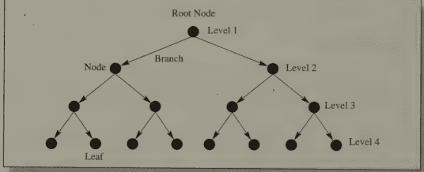

如果一个节点有多个父节点，则它位于网络中。在图 3.1 中，请注意，从根节点到任何节点只有一条边序列或路径，因为不可能逆着箭头移动。在有向树中，所有箭头都指向下方。

树是称为图的一般数学结构的特例。在描述特定示例（例如以太网网络）时，术语网络或简称网常与图同义使用。图可以在节点之间有零个或多个链接，并且没有父节点和子节点的区别。图的一个简单示例是地图，其中城市是节点，链接是道路。链接可能带有与之关联的箭头或方向，以及用于描述链接某些方面的权重。一个类比是单行街道，卡车可承载的重量有限制。图中的权重可以是任何类型的信息。如果图表示航空路线，权重可以是城市之间的英里数、飞行成本、燃油消耗等等。

受监督的人工神经网络是带有环的图的另一个示例，因为在训练期间，信息会从一层反馈到

### 图 3.2 简单图

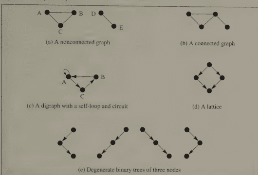

另一层，从而修改权重。简单图没有立即指回节点本身的链接，如图 3.2a 所示。回路或环是图中开始和结束于同一节点的路径，如图 3.2a 中的路径 ABCA 所示。无环图没有环。连通图连接到其所有节点，如图 3.2b 所示。带有有向链接的图（称为有向图）及自环如图 3.2c 所示。有向无环图是一个格，示例如图 3.2d 所示。从根节点到其唯一叶子节点只有一条路径的树是退化树。三个节点的退化二叉树如图 3.2e 所示。通常在树中，箭头不会明确显示，因为默认它们指向下方。

树和格由于其层次性（父节点在子节点之上），对于对象分类很有用。一个示例是家谱，它显示了相关人员之间的关系和血缘。树和格的另一个应用是决策；这些称为决策树或决策格，在简单推理中非常常见。我们将使用术语“结构”来指代树和格。决策结构既是知识表示方案，也是关于其知识的推理方法。图 3.3 显示了一个用于分类动物的决策树示例。这个示例用于经典的“二十个问题”游戏。节点包含问题，分支包含对问题的“是”或“否”响应，叶子节点包含对动物是什么的猜测。

### 图 3.3 显示动物知识的决策树

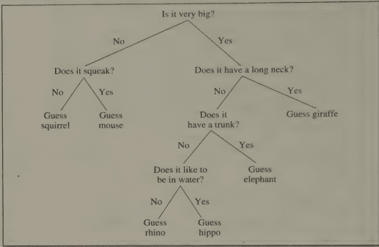

图 3.4 显示了一小部分用于分类覆�胶的决策树。与计算机科学中的树不同，分类树可以将根节点画在下方。未显示的是根节点，它有一个分支指向“简单叶”节点，另一个分支指向“复合叶”节点。决策过程从底部开始，通过识别粗略特征（例如叶子是单叶还是复叶）来进行。随着我们沿树向上移动，会使用需要更仔细观察的更具体细节。也就是说，首先检查较大的备选集合，然后决策过程开始将可能性缩小到较小的集合。这是按执行更详细观察所需的时间和精力来组织决策的好方法。

如果决策是二进制的，那么构建二叉决策树很容易且非常高效。每个问题在树中下降一层。一个问题可以决定两个可能答案中的一个。两个问题可以决定四个可能答案中的一个。三个问题可以决定八个可能答案中的一个，依此类推。如果构建的二叉树使得所有叶子节点都是答案，所有向下的节点都是问题，那么对于 N 个问题，最多可以有 2^N 个答案。例如，十个问题可以分类 1,024 种动物中的一种，而二十个问题可以分类 1,048,576 个可能答案中的一种。

决策树的另一个有用特性是它们可以实现自学习。如果猜测错误，可以调用一个过程来询问用户一个新的、正确的分类问题以及对“是”和“否”响应的答案。然后可以动态创建并添加新节点、分支和叶子到树中。在用 BASIC 编写的原始 Animals 程序中，知识存储在 DATA 语句中。当用户教程序一种新动物时，自动

### 图 3.4 覆�胶种类决策树的一部分

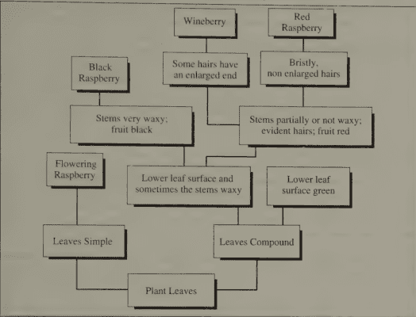

学习发生了，因为程序生成了包含新动物信息的新 DATA 语句。为了最大效率，动物知识存储在树中。使用 CLIPS，随着程序使用 build 关键字学习新知识，可以自动构建新规则（Giarratano 93）。这种**自动化知识获取**非常有用，因为它可以在简单情况下绕过第 6 章中描述的知识获取瓶颈。

决策结构可以机械地翻译成产生式规则。这可以通过对树进行广度优先搜索并生成规则来轻松完成。每个节点都有 IF-THEN 规则。例如，图 3.3 的决策树可以翻译成如下规则：

```
IF QUESTION = "IS IT VERY BIG?" AND RESPONSE = "NO"
    THEN QUESTION := "DOES IT SQUEAK?"

IF QUESTION = "IS IT VERY BIG?" AND RESPONSE = "YES"
    THEN QUESTION := "DOES IT HAVE A LONG NECK?"
```

其他节点也是如此。叶子节点会生成 ANSWER 响应，而不是问题。适当的过程还会询问用户输入，如果错误，则构建新节点。


虽然决策结构是非常强大的分类工具，但它们受到限制，因为无法像专家系统那样处理变量。专家系统是通用工具，而不仅仅是分类器。

### 3.3 状态与问题空间

图可以应用于许多实际问题。描述对象行为的一种有用方法是定义一个称为状态空间的图。状态是一组可用于定义对象状态的特征。状态空间是对象可以经历的状态之间转换的状态集合。转换将对象从一个状态带到另一个状态。

### 状态空间示例

作为状态空间的一个简单示例，考虑从机器中购买软饮料。当你将硬币投入机器时，它会从一个状态转换到另一个状态。图 3.5 说明了状态空间，假设只有 25 美分硬币（quarters）和 5 美分硬币（nickels）可用，且饮料需要 55¢。添加其他硬币（如 10 美分硬币 dimes 和 50 美分硬币 fifty-cent pieces）会使图表更加复杂，此处未显示。

> 图 3.5 接受 25 美分硬币（Q）和 5 美分硬币（N）的软饮料自动售货机状态图

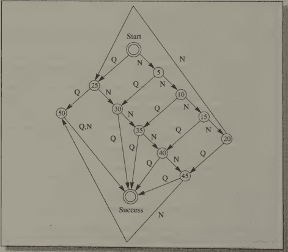

起始状态和成功状态绘制为双圆，以便更容易识别。状态显示为圆圈，可能的转移到其他状态的转换绘制为箭头。请注意，此图是一个带权有向图，其中权重是每个状态下可以输入到机器的可能硬币。

此图也称为有限状态机图，因为它描述了机器的有限数量的状态。机器一词用于非常一般的含义。机器可以是真实对象、算法、概念等等。每个状态都关联着驱动其进入另一状态的操作。任何时候，该机器只能处于一个状态。当机器接受进入某个状态的输入时，它会从该状态进展到另一个状态。如果给出正确的输入，机器将从起始状态进展到成功或最终状态。如果某个状态未设计为接受某个输入，机器将在该状态中卡住。例如，软饮料机器没有设计为接受 10 美分硬币（dimes）。如果有人将 10 美分硬币（dime）放入机器，响应是未定义的。良好的设计将包括来自每个状态的无效输入的可能性，并提供转移到错误状态。错误状态旨在提供适当的错误消息并采取必要的任何操作。

有限状态机常用于编译器和其他程序中以确定输入的有效性。例如，图 3.6 显示了用于测试输入字符串有效性的有限状态机的一部分。输入的字符逐个检查。只有字符串 WHILE、WRITE 和 BEGIN 会被接受。从 BEGIN 状态显示了用于成功输入的箭头，也显示了用于导致错误状态的错误输入的箭头。为了效率，某些状态（例如由“L”和“T”指向的状态）用于同时测试 WHILE 和 WRITE。

注意：仅显示了部分错误状态转换。

图 3.6 用于确定有效字符串 WHILE、WRITE 和 BEGIN 的有限状态机的一部分。

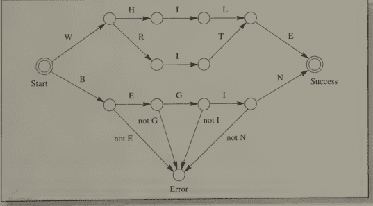

状态图在描述问题解决方案方面也很有用。在这些类型的应用中，我们可以将状态空间视为问题空间，其中一些状态对应于问题求解的中间阶段，而一些状态对应于答案。在问题空间中，可能有多个对应可能解的成功状态。在问题空间中找到问题的解涉及从开始（问题陈述）到成功（答案）找到一条有效路径。动物决策树可以被视为问题空间，其中对问题的是/否响应决定状态转换。

问题空间的另一个示例出现在图 3.7 所示的经典猴子与香蕉问题中。问题是给猴子指令，告诉它如何取下悬挂在天花板上的香蕉。香蕉够不着。房间里有一张沙发和一架梯子。初始起始配置通常是猴子在沙发上。指令可能是：

```
jump off couch
move to ladder
move ladder under bananas' position
climb ladder
grab bananas
```

指令将根据猴子、沙发和梯子的初始配置而有所不同。由于存在多个初始起始状态，因此未显示起始的特殊双圆。例如，另一个可能的起始状态是猴子在香蕉下方的沙发上。猴子随后需要在将梯子移到香蕉下方之前先把沙发推开。在最简单的起始状态中，猴子已经在香蕉下方的梯子上了。

虽然这个问题对人类来说似乎显而易见，但它涉及大量推理。这种推理系统的一个实际应用是向机器人提供有关任务解决方案的指令。与假设环境中所有对象都固定不动不同，一般解决方案是一个可以处理各种情况的推理系统。猴子与香蕉问题的基于规则的解决方案随 CLIPS CD-ROM 分发。

图的另一个有用应用是探索路径以找到问题的解。图 3.8a 显示了旅行商问题的一个简单网络。在此示例中，假设问题是要从节点 A 找到一条访问所有其他节点的完整路径。与旅行商问题中通常的情况一样，没有节点可以被访问两次。图 3.8b 以树的形式显示了从节点 A 开始的所有可能路径。正确路径 ABDCA 和 ACDBA 在此图中显示为粗线。

取决于搜索算法，为找到正确路径而探索路径可能涉及大量回溯。例如，路径 ABA 可能首先被不成功地搜索，然后回溯到 B。从 B 开始，路径 CA、CB、CDB 和 CDC 将被不成功地搜索。接下来，路径 BDB 将被不成功地搜索，直到找到第一条正确路径 ABDCA。

图 3.7 猴子与香蕉问题的状态空间

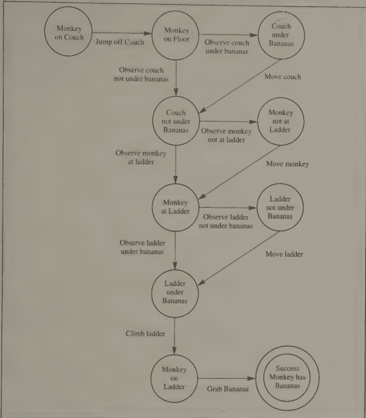

### 结构不清的问题空间

状态空间的一个有用应用是表征结构不清的问题。在第 1 章中，结构不清的问题被定义为具有相关不确定性的问题。这些不确定性可以通过问题空间更精确地指定。

作为结构不清问题的一个示例，让我们再次考虑一个人回答旅行社代理人问题的情况。

如果将表 3.1 与第 1 章中的表 1.10 进行比较，您会发现问题空间的概念让我们能够更精确地指定结构不清问题的特征。精确表征这些参数对于确定解是否可行以及如果可行，解决方案需要什么至关重要。问题并不一定只是因为具有一个、一些甚至所有这些特征就是结构不清的，因为这很大程度上取决于严重程度。例如，所有定理证明问题都有无限数量的潜在解，但这并不使定理证明成为结构不清的问题。

如您从表 3.1 中所见，存在许多不确定性，但旅行社代理人每天都在应对它们。虽然并非所有情况都可能这么糟糕，但这表明算法解决方案将非常困难。

良构问题是指我们知道明确的问题、目标以及可用于从一个状态转移到另一个状态的算子。良构问题是确定性的，因为当算子应用于一个状态时，我们确定下一个状态。问题空间是有界的，状态是离散的。这意味着存在有限数量的状态，并且每个状态都定义明确。


| 特征 | 响应 |
|---|---|
| 目标不明确 | I'm

### 图 3.11 汽车销售/维修决策的 AND-OR 格子图：

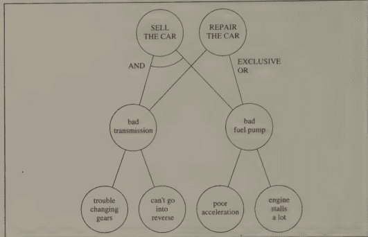

### 图 3.12 AND、OR 和 NOT 逻辑门符号


### 图 3.13 图 3.9 的 AND-OR 逻辑门表示


取决于输入。主要缺点是，与其他决策结构一样，为逻辑设计的芯片无法处理其未设计处理的情况。但是，在芯片上实现的 ANS 可以处理意外输入。

### 3.5 演绎逻辑与三段论

在第 2 章中，我们讨论了用逻辑表示知识。现在你将看到如何进行推理以推导新知识或信息。在本章余下部分，我们将讨论不同的推理方法。图 3.14 是推理方法的概览。简要总结如下：

- 演绎。结论必须从前提中得出的逻辑推理。
- 归纳。从特定案例推断到一般情况。归纳是机器学习的主要方法之一，计算机在无需人工干预的情况下进行学习。三种流行的机器学习方法是连接主义 Hopfield 网络、符号主义 ID3/ID5R 和基于进化的遗传算法（http://ai.bpa.arizona.edu/papers/mlr93/mlr93.html）。
- 直觉。没有经过验证的理论。答案只是出现，可能是通过潜意识识别底层模式。专家系统尚未实现这种推理类型。ANS 可能对这种推理类型有希望，因为它们可以从训练中外推，而不仅仅是提供条件反射或插值。也就是说，神经网络始终会给出对解决方案的最佳猜测。
- 启发式。基于经验的经验法则。
- 生成与测试。试错。常与规划结合使用以提高效率。
- 溯因推理。从真实结论推导可能导致该结论的前提。
- 默认。在没有特定知识的情况下，默认假设一般或常识知识。
- 自认识。自我知识，例如天空在你看来是什么颜色。
- 非单调。当获得新证据时，先前的知识可能不正确。
- 类比。基于与另一种情况的相似性推断结论。神经网络通过识别数据中的模式，然后外推到新情况来做到这一点。

虽然图 3.14 中未明确显示，但常识知识是基于我们经验的所有这些类型的组合。常识推理是人们在日常情况中使用的那种推理，对计算机来说非常困难。自 20 世纪 80 年代以来，Doug Lenat 一直在努力构建一个适合计算机使用的巨大常识知识数据库，现在正在开发实际应用（http://www.OpenCyc.org）。该数据库由许多断言和规则组成，可能是


### 图 3.14 推理类型

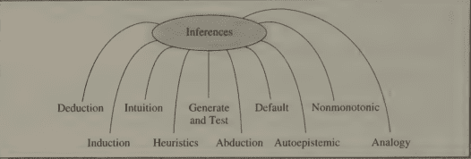

用于从更好的语音理解到更高效的本体构建等各种应用。有趣的是，格言“越大越好”并不总是成立。在来自 Doug Lenat（个人电子邮件）的以下通信中，他解释了原因：

> “300万条规则是手工输入的；通过泛化和因式分解，我们今天将该数字降至150万条。我们尽量使数字尽可能小，而不是大——我们很容易将其扩展到超过十亿条规则，例如，考虑2种动物——没有老鼠也是骆驼。了解10,000种动物，可以写出100,000,000条此类规则。相反，Cyc有10,001条规则：林奈分类关系加上一条规则，即两个未知处于gen/spec关系的分类群是不相交的。“数万条规则”指的是一种非常特殊的规则，即一定复杂程度的规则，通过该规则，我刚才提到的任何断言都根本不算作规则。”

我们有几百万个断言，因为这是我们为内容所能勉强应付的最少数量。我们不 TRY 使数字变大，因为这会拖慢速度，但如果我们 WANTED 使其变大，我们可以从当前知识库中的（200万个）断言中取出10,001个，并用100,000,000条看起来只稍微不那么通用的规则等效替换它们。那将是糟糕的。

第5章讨论了将模糊逻辑应用于常识推理。

推理中最常用的方法之一是演绎逻辑，自古以来就被用来确定论证的有效性。虽然人们通常用“argument”一词来描述愤怒的“观点交锋”，但在逻辑中它有非常不同的含义。逻辑论证是一组陈述，其中最后一个陈述被声称基于推理链中的前面陈述而得到证明。逻辑论证的一种类型是三段论，已在第2章中讨论。作为三段论的示例：

```
Premise: Anyone who can program is intelligent
Premise: John can program
Conclusion: Therefore, John is intelligent
```

在论证中，前提被用作支持结论的证据。前提也称为前件，结论称为后件。演绎逻辑的基本特征是，真结论必须从真前提得出。通常会画一条线将前提与结论分开，如上所示，因此无需明确标记前提和结论。

该论证可以更简洁地写成：

```
Anyone who can program is intelligent
John can program
.. John is intelligent
```

其中三个点 .. 表示“因此”。

现在让我们更仔细地研究三段论逻辑。研究三段论的主要优点是，它是一个简单、理解透彻且可以完全证明的逻辑分支。此外，三段论通常很有用，因为它们可以用 IF-THEN 规则来表示。例如，前面的三段论可以改写为：

```
IF Anyone who can program is intelligent and
John can program
THEN John is intelligent
```

一般来说，三段论是任何具有两个前提和一个结论的有效演绎论证。经典三段论是一种称为范畴三段论的特殊类型。前提和结论定义为以下四种形式的范畴陈述，如表 3.2 所示。

| 形式 | 模式 | 含义 |
| :--- | :--- | :--- |
| A | All S is P | 全称肯定 |
| E | No S is P | 全称否定 |
| I | Some S is P | 特称肯定 |
| O | Some S is not P | 特称否定 |

请注意，在逻辑中，术语 *schema* 指定陈述的逻辑形式。这也说明了 schema 一词的另一种用法，它与第2章讨论的 AI 用法不同。在逻辑中，schema 一词用于显示论证的基本形式。Schemata 还可以指定整个三段论的逻辑形式，如下所示：

```
All M is P
All S is M
.: All S is P
```

结论的主项 S 称为 **小项**，而结论的谓项 P 称为 **大项**。包含大项的前提称为 **大前提**，包含小项的前提称为 **小前提**。例如：

```
Major Premise: All M is P
Minor Premise: All S is M
Conclusion: All S is P
```

是一种据说处于 **标准形式** 的三段论，其中已识别其大前提和小前提。**主项** 是被描述的对象，而 **谓项** 描述主项的某些属性。例如，在陈述中：

```
All microcomputers are computers
```

主项是“microcomputers”，谓项是“computers”。在陈述中：

```
All computers with 1 Gigabyte of RAM
are computers with a lot of memory
```

主项是“computers with 1 Gigabyte”，谓项是“computers with a lot of memory。”

自古以来，范畴陈述的形式已由字母 A、E、I 和 O 标识。A 和 I 表示肯定，被认为源自拉丁语 *affirmo*（我肯定）的前两个元音；而 E 和 O 源自 *neggo*（我否定）。A 和 I 形式因肯定主项包含在谓项类中而被称为 **质上肯定**；E 和 O 形式因主项被排除在谓项类之外而被称为 **质上否定**。

动词 is 源自拉丁语中的 **联结动词**，意为连接。联结动词连接陈述的两部分。在标准范畴三段论中，联结动词是动词 *to be* 的现在时形式。因此另一个版本是：

```
All S are P
```

三段论的第三个术语 M 称为 **中项**，它是两个前提共有的。中项至关重要，因为三段论的定义是结论不能仅从任何一个前提推断出来。因此，论证：

```
All A is B
All B is C
.: All A is B
```

不是有效的三段论，因为它仅从第一个前提得出。

**量** 或 **限定词** 描述所包含的类的部分。限定词 **All** 和 **No** 是 **全称** 的，因为它们指整个类。限定词 **Some** 称为 **特称** 的，因为它仅指类的一部分。

三段论的 **式** 由分别给出大前提、小前提和结论形式的三个字母定义。例如，三段论：

```
All M is P
All S is M
.: All S is P
```

是 AAA 式。

S、P 和 M 项有四种可能的排列模式，如表 3.3 所示。每种模式称为一个图式，图式的 **图式** 指定其类型。

| | 图式 1 | 图式 2 | 图式 3 | 图式 4 |
|---|---|---|---|---|
| 大前提 | MP | PM | MP | PM |
| 小前提 | SM | SM | MS | MS |

因此，前面的示例完全描述为 AAA-1 三段论类型。仅因为一个论证具有三段论形式并不意味着它是有效的三段论。考虑 AAA-1 三段论形式：

```
All M is P
No S is M
.: No S is P
```

这不是有效的三段论，如以下示例所示：

```
All microcomputers are computers
No mainframe is a microcomputer
.: No mainframe is a computer
```

与其试图凭空构思示例来证明三段论论证的有效性，不如使用一种可用的 **决策过程**。决策过程是证明有效性的方法。决策过程是某种通用的机械方法或算法，通过它可以自动化确定有效性的过程。虽然三段论逻辑和命题逻辑存在决策过程，但 Church 在 1936 年表明谓词逻辑不存在决策过程。相反，人们或计算机必须运用创造力来生成证明。在 20 世纪 70 年代，Doug Lenat 的 Automated Mathematician 和 Eurisko 等程序重新发现了哥德巴赫猜想和唯一分解定理的数学证明。数学期刊对出版计算机的创造性作品并不热衷，就像文学期刊和杂志并不鼓励提交计算机创作的诗歌或小说一样。（它们只愿意付一点点钱。）

命题的决策过程只是构建真值表并检查其是否为重言式。三段论的决策过程可以使用由三个重叠圆组成的文氏图来完成，这三个圆分别代表 S、P 和 M，如图 3.15a 所示。对于 AEE-1 三段论形式：

```
All M is P
No S is M
.. No S is P
```

大前提在图 3.15b 中说明。M 的斜线部分表示该部分没有元素。在图 3.15c 中，通过给出没有元素的部分加斜线来包含小前提。从图 3.15c 可以看出，EAE-1 的结论是错误的，因为 P 中有一些 S。另一个例子，以下 EAE-1 是有效的，如图 3.16c 所示：

```
No M is P
All S is M
.. No S is P
```

涉及“some”限定词的文氏图稍微难画一些。在布尔观点下（A 和 E 陈述可能没有成员），绘制范畴三段论的一般规则是：

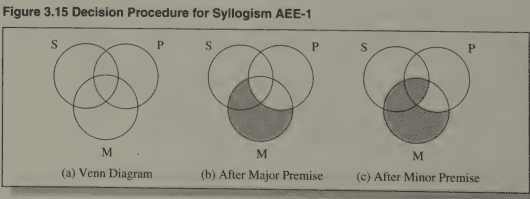


### 图 3.16 三段论 EAE-1 的判定程序

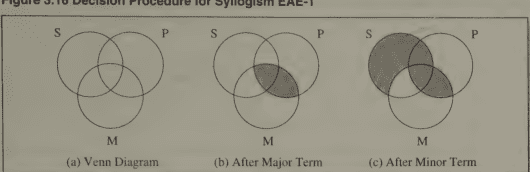

- 1. 如果一个类为空，则对其进行阴影处理。
- 2. 全称命题（A 和 E）始终先于特称命题绘制。
- 3. 如果一个类至少有一个成员，则用 * 标记它。
- 4. 如果一个陈述没有指定对象存在于两个相邻类中的哪一个，则在类之间的线上放置一个 *。
- 5. 如果一个区域已被阴影处理，则不能在其中放置 *。

作为示例，

```
Some computers are laptops
All laptops are transportable
∴ Some transportables are computers
```

这可以归类为 IAI-4 类型：

```
Some P are M
All M are S
∴ Some S are P
```

遵循文氏图的规则 2 和 1，我们从小前提的全称命题开始并对其进行阴影处理，如图 3.17a 所示。接下来，将规则 3 应用于特称大前提并绘制一个 *，如图 3.17b 所示。由于结论“有些可携带物是计算机”在图中显示，因此论证 IAI-4 是一个有效的三段论。

### 图 3.17 IAI-4 类型的三段论


### 3.6 推理规则

虽然文氏图是三段论的判定程序，但对于更复杂的论证来说，文氏图不太方便，因为它们变得更难阅读。然而，三段论存在一个更根本的问题，因为它们只涉及可能逻辑陈述的一小部分。特别是，范畴三段论只涉及 A、E、I 和 O 形式的范畴陈述。

命题逻辑提供了描述论证的另一种方式。事实上，我们常常在未意识到的情况下使用命题逻辑。例如，请考虑以下命题论证：

```
If there is power, the computer will work
There is power
∴ The computer will work
```

该论证可以用字母表示命题的方式以正式形式表达，如下：

- A = 有电源
- B = 计算机将工作

因此，该论证可以写成：

```
A → B
A
∴ B
```

此类论证经常出现。表示此类论证的一般图式为：

```
p → q
p
∴ q
```

其中 p 和 q 是可以表示任何陈述的逻辑变量。在命题逻辑中使用逻辑变量，可以比 A、E、I、O 四种三段论形式表达更复杂类型的陈述。这种命题形式的推理图式有多种名称：直接推理、肯定前件式、分离律和假定前件（Lakoff 00）。

请注意，此示例也可以用三段论形式表示：

```
All computers with power will work
This computer has power
∴ This computer will work
```

这表明肯定前件式实际上是三段论逻辑的一个特例。肯定前件式很重要，因为它构成了基于规则的专家系统的基础。

但是，基于规则的系统并不完全依赖逻辑，因为人们在解决问题时使用的不仅仅是逻辑。在现实世界中，可能存在几条竞争规则，而不仅仅是三段论的单一规则。专家系统规则引擎必须决定执行哪条规则是合适的，就像人必须决定“应该吃掉最后一块糖果来满足渴望，还是不吃它保持苗条？”一样。

仅仅用 C 语言编写一堆规则并拥有专家系统工具的能力是不够的，尽管这可能足以满足非常简单的应用程序（http://www.dj.com/documents/s=9064/dj0ai010ai01030ai01001.htm）。当存在数百或数千条规则并且它们相互冲突时，专家系统工具的真正威力才会体现出来。Rete 模式匹配算法是解决规则冲突最强大且高效的方法之一，也是 CLIPS 模式匹配的基础（http://www.dj.com/documents/s=9064/dj021ai002ai0212ai0e002.htm）。

复合命题 p → q 对应于规则，而 p 对应于规则要被满足必须匹配前件的模式。然而，如第 2 章所讨论，条件命题 p → q 并不完全等同于规则，因为条件命题是由真值表定义的逻辑定义，并且存在许多可能的条件命题定义。

通常，我们将遵循逻辑理论的惯例，使用大写字母（如 A、B、C ...）来表示恒定命题，例如“有电源”。小写字母（如 p、q、r ...）将表示逻辑变量，可以代表不同的恒定命题。请注意，此惯例与 PROLOG 相反，PROLOG 使用大写字母表示变量。

这种肯定前件式图式也可以使用不同命名的逻辑变量来写成：

```
r → s
r
∴ s
```

该图式的含义仍然相同。

这种图式的另一种表示法是：

```
r, r → s; ∴ s
```

其中逗号用于分隔一个前提与另一个前提，分号表示前提的结束。虽然迄今为止我们只研究了只有两个前提的论证，但论证的更一般形式为：

```
P1, P2, ... Pn . C
```

其中大写字母 P_i 表示前提，例如 t、t -> s，C 表示结论。请注意，这与第 2 章讨论的 PROLOG 目标满足语句相似：

```
P :- P_1, P_2, ... P_n.
```

如果所有子目标 p_1、p_2、... p_n 都满足，则目标 p 得以满足。产生规则的类似论证可以写成一般形式：

```
C_1 ^ C_2 ^ ... ^ C_n -> A
```

这意味着，如果规则的每个条件 C_i 都满足，则执行规则的动作 A。如前面所讨论，上述形式的逻辑陈述严格来说并不等同于规则，因为条件的逻辑定义与产生规则不同。然而，这种逻辑形式在思考规则时是一个有用的直觉辅助工具。

在 PROLOG 中，逻辑运算符 AND 和 OR 的表示法与通常的 ^ 和 v 不同。PROLOG 中子目标之间的逗号表示合取（^），而析取（v）则用分号表示。例如，

```
P :- P_1; P_2.
```

这意味着如果 p_1 或 p_2 满足，则 p 得以满足。合取和析取可以混合使用。例如，

```
P :- P_1, P_2; P_3; P_4.
```

这等同于两个 PROLOG 语句：

```
P :- P_1, P_2.
P :- P_3, P_4.
```

虽然 PROLOG 具有强大的内置推理策略，但以这种方式创建的规则并不总是适合自定义使用。然而，可以使用 PROLOG 自定义规则执行，以便将知识表示和推理策略调整到应用程序，例如自动化儿科诊所的应用程序（www.visualdatallic.com），并在（Merritt 04）中进行了更详细的描述。

一般来说，如果前提和结论都是图式，则论证：

```
P_1, P_2, ... P_n ∴ C
```

是一个形式上有效的演绎论证，当且仅当：

```
P₁ ∧ P₂ ∧ ... ∧ Pₙ ⇒ C
```

是一个重言式。例如，

```
(p ∧ q) → p
```

是一个重言式，因为对于 p 和 q 的任何值（T 或 F），它都为真。你可以通过构建真值表来验证这一点。

肯定前件式的论证，

```
p → q
p
____
∴ q
```

是有效的，因为它可以表示为一个重言式：

```
(p → q) ∧ p → q
```

请注意，我们假设箭头的优先级低于合取和析取。这样可以省略编写额外的括号，例如：

```
((p → q) ∧ p) → q
```

肯定前件式的真值表如表 3.4 所示。它是一个重言式，因为无论前提的值如何，最右侧列中显示的论证值全为真。请注意，在第三、第四和第五列中，真值写在某些运算符（如 → 和 ∧）下方。这些被称为主要连接词，因为它们连接复合命题的两个主要部分。

| p | q | p → q | (p → q) ∧ p | (p → q) ∧ p → q |
|---|---|---|---|---|
| T | T | T | T | T |
| T | F | F | F | T |
| F | T | T | F | T |
| F | F | T | F | T |


虽然这种确定有效论证的方法可行，但确实需要检查真值表的每一行。行数为 2^N，其中 N 是前提的数量，因此行数随前提数量的增加而急剧增加。例如，五个前提需要检查 32 行，而十个前提需要 1,024 行。确定有效论证的更短方法是只考虑真值表中所有前提都为真的那些行。有效论证的等价定义指出，当且仅当这些行中的每一行结论都为真时，该论证才是有效的。也就是说，结论是前提的重言蕴含。对于肯定前件式，p → q 前提和 p 前提仅在第一行都为真，结论也是如此。因此，肯定前件式是一个有效论证。如果存在任何其他行，其中所有前提都为真而结论为假，那么该论证将是无效的。

肯定前件式真值表的更短表达方式如表 3.5 所示，其中所有行均已明确列出。在实践中，只需考虑具有真前提的那些行，例如第一行。

### 表 3.5 肯定前件式的替代短式真值表

| p | q | p → q | p | q |
|---|---|---|---|---|
| T | T | T | T | T |
| T | F | F | T | F |
| F | T | T | F | T |
| F | F | T | F | F |

肯定前件式的真值表表明它是有效的，因为第一行具有真前提和真结论，且没有其他行具有真前提和假结论。

论证可能具有欺骗性。为了说明这一点，首先考虑以下肯定前件式的有效示例：

```
If there are no bugs, then the program compiles
There are no bugs
.. The program compiles
```

将此与以下有些类似肯定前件式的论证进行比较：

```
If there are no bugs, then the program compiles
The program compiles
.. There are no bugs
```

这是一个有效论证吗？此类论证的图式为：

```
p → q
q
.
.
p
```

其短式真值表如表 3.6 所示。

### 表 3.6 p → q, q; ∴ p 的短式真值表

| p | q | p → q | q | p |
|---|---|---|---|---|
| T | T | T | T | T |
| T | F | F | T | T |
| F | T | T | T | F |
| F | F | T | F | F |

请注意，此论证无效。虽然第一行确实表明如果所有前提都为真，结论为真，但第三行表明如果前提为真，结论为假。因此，此论证未能满足有效论证的当且仅当标准。尽管许多程序员希望此类论证为真，但逻辑（和经验）证明这是一个谬误或无效论证。这种特定的谬误论证称为逆命题谬误。逆命题在表 3.9 中定义。

另一个示例是论证图式：

```
p → q
¬q
.
.
¬p
```

它是有效的，因为表 3.7 显示结论仅在前提都为真时才为真。

### 表 3.7 p → q, ¬q; ∴ ¬p 的短式真值表

| p | q | p → q | ¬q | ¬p |
|---|---|---|---|---|
| T | T | T | F | F |
| T | F | F | T | F |
| F | T | T | F | T |
| F | F | T | T | T |

这种特定图式有多种名称：**间接推理**、**否定后件式**和**对位律**。

肯定前件式和否定后件式是推理规则，有时也称为**推理定律**。表 3.8 列出了一些推理定律。

拉丁名称 **modus** 意为“方式”，而 **ponere** 意为“断言”，**tollere** 意为“否定”。推理规则的正式名称及其字面含义如表 3.9 所示。肯定前件式和否定后件式是短式

### 表 3.8 命题逻辑的一些推理规则

| 推理定律 | 图式 |
|---|---|
| 1. 分离律 | p → q<br>p<br>∴ q |
| 2. 对位律 | p → q<br>∴ ~q → ~p |
| 3. 否定后件律 | p → q<br>~q<br>∴ ~p |
| 4. 链式规则（三段论律） | p → q<br>q → r<br>∴ p → r |
| 5. 选言推理律 | p ∨ q<br>~p<br>∴ q<br><br>p ∨ q<br>~q<br>∴ p |
| 6. 双重否定律 | ∴ ~~p<br>∴ p |
| 7. 德·摩根定律 | ~(p ∧ q)<br>∴ ~p ∨ ~q<br><br>~(p ∨ q)<br>∴ ~p ∧ ~q |
| 8. 简化律 | p ∧ q<br>∴ p<br><br>p ∧ q<br>∴ q |
| 9. 合取律 | p<br>q<br>∴ p ∧ q |
| 10. 选言加成律 | p<br>∴ p ∨ q |
| 11. 合取论证律 | ~(p ∧ q)<br>p<br>∴ ~q<br><br>~(p ∧ q)<br>q<br>∴ ~p |

### 表 3.9 推理方式的含义

| 推理规则编号 | 名称 | 含义“通过……的方式” |
|---|---|---|
| 1 | 肯定前件式 | 肯定，断言 |
| 3 | 否定后件式 | 否定，否认 |
| 5 | 否定后件肯定前件 | 否定，肯定 |
| 11 | 肯定前件否定后件 | 肯定，否定 |

前两种类型（Stebbing 第 50 页）。推理规则编号对应表 3.8 中的编号。

推理规则可以应用于具有两个以上前提的论证。例如，考虑以下论证：

> 芯片价格上涨仅当日元上涨时。
> 日元上涨仅当美元下跌时，且
> 如果美元下跌，则日元上涨。
> 既然芯片价格已经上涨，
> 美元必定已经下跌。

命题定义如下：

- C = 芯片价格上涨
- Y = 日元上涨
- D = 美元下跌

回顾第 2.12 节，条件句的一个含义是“p，仅当 q”。像“日元上涨仅当美元下跌”这样的命题具有此含义，因此表示为 C → Y。整个论证具有以下形式：

```
C → Y
(Y → D) ∧ (D → Y)
C
-------
∴ D
```

第二个前提有一种有趣的形式，可以通过使用条件句的变体进一步化简。条件句 p → q 有几种变体，即逆命题、反命题和逆否命题。为完整起见，这些变体与条件句一起列在表 3.10 中。

| 条件句 | p → q |
|---|---|
| 逆命题 | q → p |
| 反命题 | ¬p → ¬q |
| 逆否命题 | ¬q → ¬p |

像往常一样，假设否定运算符的优先级高于其他逻辑运算符，因此 ~p 和 ~q 周围不使用括号。

如果条件句 p → q 及其逆命题 q → p 都为真，那么 p 和 q 等价。也就是说，p → q ∧ q → p 等价于双条件句 p ↔ q 或等价 p ≡ q。请注意，普通赋值或等号写作两条短横线 =，而等价写作三条，≡。换句话说，p 和 q 始终取相同的真值。如果 p 为 T，则 q 为真；如果 p 为 F，则 q 为 F。论证变为：

- (1) C → Y
- (2) Y ⇒ D
- (3) C
    ∴ D

此处使用数字来标识前提。由于根据 (2) Y 和 D 等价，我们可以在 (1) 中用 D 替换 Y 以得到：

- (4) C → D

其中 (4) 是基于 (1) 和 (2) 得出的推论。前提 (3) 和 (4) 以及结论为：

- (4) C → D
- (3) C
    ∴ D

这可以被识别为肯定前件式的图式。因此，该论证有效。

将一个变量替换为等价的另一个变量是一条称为**替换规则**的推理规则。肯定前件式规则和替换规则是演绎逻辑的两条基本规则。

形式逻辑证明通常按以下方式编写前提、结论和推论的编号：

- 1. C → Y
- 2. (Y → D) ∧ (D → Y)
- 3. C           / ∴ D
- 4. Y ⇒ D       2 等价
- 5. C → D       1 替换
- 6. D           3,5 肯定前件式

第 1、2、3 行是前提和结论，而第 4、5、6 行是得到的推论。右侧列列出了用于证明推论的推理规则和行号。

### 3.7 命题逻辑的局限性

考虑我们熟悉的经典论证：

> 所有人都是会死的
> 苏格拉底是人
> 因此，苏格拉底是会死的

我们知道这是一个有效论证，因为它是一个有效的三段论。我们能否使用命题逻辑证明其有效性？为了回答这个问题，让我们先将论证写成图式：

```
p = All men are mortal
q = Socrates is a man
r = Socrates is mortal
```

因此论证图式为：

```
p
q
∴ r
```

请注意，前提和结论中没有逻辑连接词，因此每个前提和每个结论必须有不同的逻辑变量。此外，命题逻辑没有量词机制，因此无法表示第一个前提中的量词“所有”。因此，该论证在命题逻辑中唯一的表示就是上述三个独立变量的图式。

要确定这是否是一个有效论证，请考虑三个独立变量的所有可能 T 和 F 组合的真值表，如表 3.11 所示。该真值表的第二行表明该论证无效，因为前提为真而结论为假。

### 表 3.11 图式 p, q ∴ r 的真值表

| p | q | ∴ r |
|---|---|---|
| T | T | T |
| T | T | F |
| T | F | T |
| T | F | F |
| F | T | T |
| F | T | F |
| F | F | T |
| F | F | F |

该论证的无效性不应被理解为结论错误。任何人都会将其视为一个正确的论证。无效性仅意味着该论证无法在命题逻辑下得到证明。如果我们检查前提的内部结构，就可以证明该论证有效。例如，我们需要赋予“所有”某些含义，并将“men”识别为“man”的复数。然而，三段论和命题演算不允许检查命题的内部结构。这一局限性由谓词逻辑克服，而这个论证是一个


在谓词逻辑下是有效的论证。事实上，所有三段论逻辑都是一阶谓词逻辑的有效子集，并且可以在其下被证明为有效。

The only valid syllogistic form of the proposition is:

> 若苏格拉底是人，则苏格拉底是必死的
> 苏格拉底是人
> 因此，苏格拉底是必死的

Let:

```
p = Socrates is a man
q = Socrates is mortal
```

The argument becomes:

```
p → q
p
∴ q
```

which is a valid syllogistic form of modus ponens.

As another example, consider the following classic argument:

> 所有马都是动物
> 因此，马的头
> 是动物的头

We know that this argument is correct and yet it cannot be proved under propositional logic, although it can be proven under predicate logic (see Problem 3.12).

### 3.8 一阶谓词逻辑

Syllogistic logic can be completely described by predicate logic. Table 3.12 shows the four categorical statements and their representation in predicate logic. In addition to the rules of inference previously discussed, predicate logic has rules that deal with quantifiers.

Table 3.12 使用谓词逻辑表示四类三段论

| 类型 | 图式 | 谓词表示 |
|---|---|---|
| A | 所有 S 是 P | (∀x) (S(x) → P(x)) |
| E | 没有 S 是 P | (∀x) (S(x) → ~P(x)) |
| I | 有些 S 是 P | (∃x) (S(x) ∧ P(x)) |
| O | 有些 S 不是 P | (∃x) (S(x) ∧ ~P(x)) |

The Rule of Universal Instantiation essentially states that an individual may be substituted for a universal. For example, if φ is any proposition or propositional function:

```
(∀ x) Φ(x)
∴ Φ(a)
```

is a valid inference, where a is an instance. That is, a refers to a specific individual while x is a variable that ranges over all individuals. For example, this can be used to prove that Socrates is human:

```
(∀ x) H(x)
∴ H(Socrates)
```

where H(x) is the propositional function that says x is a human. The above states that for every x, that x is human, and so by inference Socrates is human.

Other examples of the Rule of Universal Instantiation are:

```
(∀ x) A(x)
∴ A(c)
```

```
(∀ y) (B(y) ∨ C(b))
∴ B(a) ∨ C(b)
```

```
(∀ x) [A(x) ∧ (∃ x) (B(x) ∨ C(y))]
∴ A(b) ∧ (∃ x) (B(x) ∨ C(y))
```

In the first example, the instance c is substituted for x. In the second example, notice that the instance a is substituted for y but not for b since b is not included in the scope of the quantifier. That is, a quantifier such as ∀x applies only to x variables. The variables such as x and y used with quantifiers are called bound while the others are called free. In the third example, the quantifier x has as its scope all A(x). That is, ∀x does not apply to the existential quantifier ∃x and its scope over B(x) ∨ C(y). The convention of nested quantifiers such as this is that the scope ends when a new quantifier is used, even if it uses the same variable, such as x. The formal proof of the syllogism:

```
All men are mortal
Socrates is a man
∴ Socrates is mortal
```

is shown following, where H = man, M = mortal, and s = Socrates:

- 1. (∀ x) (H(x) → M(x))
- 2. H(s) ... ∴ M(s)
- 3. H(s) → M(s) ... 1 全称实例化
- 4. M(s) ... 2,3 肯定前件

### 3.9 逻辑系统

A logic system is a collection of objects such as rules, axioms, statements, and so forth organized in a consistent manner. The logic system has several goals.

The first goal is to specify the forms of arguments. Since logical arguments are meaningfulness in a semantic sense, a valid form is essential if the validity of the argument is to be determined. Thus, one important function of a logic system is to determine the well-formed formulas (wffs) that are used in arguments. Only wffs can be used in logic arguments. For example, in syllogistic logic,

```
All S is P
```

could be a wff, but:

```
All
All is S P
Is S all
```

are not wffs. Although the symbols of the alphabet are meaningless, the sequence of symbols that make up the wff is meaningful.

The second goal of a logic system is to indicate the rules of inference that are valid. The third goal of a logic system is to extend itself by discovering new rules of inference and so extend the range of arguments that can be proven. By extending the range of arguments, new wffs, called theorems, can be proven by a logic argument.

When a logic system is well developed it can be used to determine the validity of arguments in a way that is analogous to calculations in systems such as arithmetic, geometry, calculus, physics, and engineering. Logic systems have been developed such as the Sentential or Propositional Calculus, the Predicate Calculus, and so forth. Each system relies on formal definitions of its axioms or postulates, which are the fundamental definitions of the system. From these axioms people (and sometimes computer programs such as the Automated Mathematician) try to determine what can be proven. Anyone who has studied Euclidean geometry in high school is familiar with axioms and the derivation of geometric theorems. Just as geometric theorems can be derived from geometric axioms, so can logic theorems be derived from logic axioms.

An axiom is simply a fact or assertion that cannot be proven from within the system. Sometimes we accept certain axioms because they make “sense” by appealing to commonsense or observation. Other axioms, such as “parallel lines meet at infinity,” do not make intuitive sense because they appear to contradict Euclid’s axiom of parallel lines as never meeting. However, this axiom about parallel lines meeting at infinity is just as reasonable from a purely logical viewpoint as Euclid’s and is the basis of one type of non-Euclidean geometry.

A formal system requires the following:

- 1. 一组符号的字母表。
- 2. 这些符号的有限字符串集合，即wff。
- 3. 公理，系统的定义。
- 4. 推理规则，使得一个wff A可以作为有限wff集合G（G = {A1, A2 ... An}）的结论被推导出来。这些wff必须是公理或逻辑系统的其他定理。例如，命题逻辑系统可以仅使用肯定前件来推导新定理。

If the argument:

```
A1, A2, ... An ∴ A
```

is valid, then A is said to be a theorem of the formal logic system and is written with the symbol |- . For example, G |- A means that A is a theorem of the set of wffs, G. A more explicit schema of a proof that A is a theorem is the following:

```
A1, A2, ... An |- A
```

The symbol |- , which indicates that the following wff is a theorem, is not a symbol of the system. Instead, |- is a metasymbol, because it is used to describe the system itself. An analogy is a computer language such as Java. Although programs can be specified using Java's syntax, there is no syntax in Java for indicating a valid program.

A rule of inference in a formal system specifies exactly how new assertions, the theorems, can be obtained from axioms and previously derived theorems. An example of a theorem is our syllogism about Socrates, written in predicate logic form:

```
(∀ x) (H(x) → M(x)) , H(s) |- M(s)
```

where H is the predicate function for man and M is the predicate function for mortal. Since M(s) can be proven from its axioms on the left, it is a theorem of these axioms. However, note that M(Zeus) would not be a theorem since Zeus, the Greek god, is not a man, and there is no alternative way of showing M(Zeus).

If a theorem is a tautology, it follows that G is the null set since the wff is always true and so does not depend on any other axioms or theorems. A theorem that is a tautology is written with the symbol |- as in:

```
|- A
```

For example, if A = p v ~p, then:

```
|- p v ~p
```

states that p v ~p is a theorem, which is a tautology. Notice that whatever values are assigned to p, either T or F, the theorem p v ~p is always true. An assignment of truth values is an interpretation of a wff. A model is an interpretation in which the wff is true. For example, a model of p → q is p = T and q = T. A wff is called consistent or satisfiable if there is an interpretation that makes it


为真，如果 wff 在所有解释下都为假，则为不一致或不可满足。不一致 wff 的示例是 p ^ ~p。

如果 wff 在所有解释下都为真，则为有效；否则为无效。例如，wff p v ~p 是有效的，而 p -> q 是一个无效的 wff，因为当 p = T 且 q = F 时它不为真。如果可以证明 wff 是有效的，则称其为已证明。所有命题 wff 都可以通过真值表方法证明，因为 wff 的解释数量有限，因此命题演算是可判定的。然而，谓词演算是不可判定的，因为不存在像真值表那样适用于所有谓词演算 wff 的一般证明方法。

可证明的有效谓词演算 wff 的一个示例是，对于任何谓词 B，

```
(∃ x) B(x) → ~ [ (∀ x) ~ B(x) ]
```

这展示了如何用全称量词替代存在量词。因此，这个谓词演算 wff 是一个定理。

⊢ A 和 ⊬ B 这样的表达式之间存在很大区别。A 是一个定理，因此可以通过推理规则从公理中证明。B 是一个 wff，可能没有已知的证明来展示其推导过程。虽然命题逻辑是可判定的，但谓词逻辑不是。也就是说，没有机械过程或算法可以在有限步骤内找到谓词逻辑定理的证明。事实上，有理论证明表明不存在谓词逻辑的判定过程。然而，对于谓词逻辑的子集（如三段论和命题逻辑）存在判定过程。正因为如此，谓词逻辑有时被称为半可判定。

请注意，PROLOG 基于谓词逻辑。在20世纪70年代最初热情高涨时，日本宣布了其第五代超先进计算机系统的计划。该系统本可以允许自然语言输入和输出，并真正理解所说的内容。然而，当时没有足够的计算机常识知识可用，80年代的微处理器也不足够强大，无法实现高精度的语音识别。如今，随着 Open.Cyc 项目用于常识本体论以及无需训练的良好语音识别，这样的系统成功的机会更大了（尽管不是使用 PROLOG）。

作为完备形式系统的一个非常简单的示例，定义如下：

- 字母表：单个符号 "1"
- 公理：字符串 "1"（碰巧与符号 1 相同）
- 推理规则：如果任何字符串 $ 是定理，那么字符串 $11 也是定理。该规则可以写成 Post 产生式规则，

```
$ -> $11.
If $ = 1 then this rule gives $11 = 111.
If $ = 111 then the rule gives $11 = 11111 and in general
1, 111, 11111, 1111111, ...
```

上面的字符串是这个形式系统的定理。

虽然像 11111 这样的字符串看起来不像我们习惯看到的定理类型，但它们是完全有效的逻辑定理。这些特定的定理也具有语义含义，因为它们是用单个符号 1 的**一元数制**表示的奇数。正如二进制数制只有字母表符号 0 和 1 一样，一元数制只有单个符号 1。一元数制和十进制中的数字表示为：

| 一元 | 十进制 |
|---|---|
| 1 | 1 |
| 11 | 2 |
| 111 | 3 |
| 1111 | 4 |
| 11111 | 5 |

等等。

请注意，由于我们的推理规则和公理，字符串 11、1111 等等无法在我们的形式系统中表示。也就是说，11 和 1111 是我们形式字母表中的某些字符串，但它们不是定理或 wff，因为它们无法仅使用推理规则和公理来证明。这个形式系统只允许推导奇数，而不允许推导偶数。必须添加公理 "1" 才能推导出偶数。

形式系统的另一个属性是**完备性**。如果每个 wff 都可以被证明或**反驳**，则一组公理是**完备**的。_反驳_ 这个术语的意思是证明某个断言为假。在完备系统中，每个逻辑上有效的 wff 都是定理。然而，由于谓词逻辑是不可判定的，提出证明取决于我们的运气和聪明才智。当然，另一种可能性是编写一个计算机程序来尝试推导证明，并让它不停地运行。

逻辑系统的另一个可取属性是它是**可靠的**。可靠系统意味着每个定理都是逻辑上有效的 wff。换句话说，可靠系统不会允许推断出不是其前提逻辑后果的结论。不会将无效论证推断为有效。

逻辑有不同的**阶**。**一阶**语言的定义使得量词作用于变量等对象，例如 ∀ x。**二阶**语言将具有额外特征，例如两种变量和量词。除了排序变量和量词之外，二阶逻辑还可以有范围覆盖函数和谓词符号的量词。二阶逻辑的一个例子是**相等公理**，它指出如果两个对象的所有谓词都相等，则这两个对象相等。如果 P 是任何一元谓词，那么：

```
x = y = (∀ P) [P(x) ↔ P(y) ]
```

是使用二阶量词 ∀ P（范围覆盖所有谓词）的相等公理的陈述。

### 3.10 归结

Robinson 于 1965 年引入的非常强大的**归结**推理规则通常在定理证明 AI 程序中实现。事实上，归结是 PROLOG 中的主要推理规则。PROLOG 不使用许多适用性有限的不同推理规则（如肯定前件式、否定后件式、合取、链式等），而是使用单一的通用推理规则——归结。这种归结的应用使得 PROLOG 等自动定理证明器成为解决问题的实用工具。不必尝试不同的推理规则并希望其中一个成功，而是可以应用单一的归结规则。这种方法可以大大减少搜索空间。

作为介绍归结的一种方式，让我们先考虑关于苏格拉底的三段论，在 PROLOG 中表示如下，注释用百分号显示：

```
mortal(X) :- man(X).      % All men are mortal
man(socrates).            % Socrates is a man
:- mortal(socrates).      % Query - is Socrates mortal?
yes                       % PROLOG answers yes
```

PROLOG 使用**无量词**表示法。请注意，全称量词 ∀ 在“所有人都是凡人”的陈述中是隐含的。

PROLOG 基于一阶谓词逻辑。然而，它还有一些扩展以使编程应用更容易。这些特殊的编程特性违反了纯粹的谓词逻辑，被称为**逻辑外**特性：输入/输出、cut（改变搜索空间）和 assert/retract（在没有任何逻辑依据的情况下改变真值）。

在应用归结之前，wff 必须处于**标准**或规范形式。三种主要的规范形式是**合取范式**、子句形式及其 Horn 子句子集。规范形式的基本思想是将 wff 表示为仅使用 ∧、∨ 和可能 ~ 的标准形式。然后将归结方法应用于规范形式的 wff，其中所有其他连接词和量词都已被消除。这种转换为规范形式是必要的，因为归结是对一对**析取项**的操作，它产生新的析取项，从而简化 wff。

以下示例说明了合取范式的 wff，其定义为**文字**的析取式的合取：

```
(P1 v P2 v ...) ^ (Q1 v Q2 v ...) ^ ... ^ (Z1 v Z2 v ...)
```

像 P1 这样的项必须是文字，这意味着它们不包含条件式和**双条件式**等逻辑连接词，也不包含量词。文字是原子公式或否定的原子公式。例如，以下 wff：

```
(A v B) ^ (~B v C)
```


是合取范式。括号内的项是子句：

```
A v B and -B v C
```

如后文所示，任何谓词逻辑公式（包括命题逻辑作为特例）都可以写成子句。完整的子句形式可以表达任何谓词逻辑公式，但对人来说可能不够自然或难以阅读。PROLOG 的语法是霍恩子句子集，这使得使用 PROLOG 进行机械定理证明比标准谓词逻辑记法或完整子句形式更容易且更高效地实现。如前所述（第 1 章），PROLOG 只允许有一个子句头。完整的子句形式表达式通常以一种称为科瓦尔斯基子句形式的特殊形式编写：

```
A1, A2, ... An -> B1, B2, ... Bm
```

其含义是：如果所有子目标 A1、A2、...、An 都为真，那么 B1、B2、... 或 Bm 中的一个或多个也为真。注意，在这种记法中，箭头的方向有时会被反转。该子句用标准谓词记法写作：

```
A1 ^ A2 ... An -> B1 v B2 ... Bm
```

这可以使用等价式表示为文字的析取（析取范式）：

```
P -> Q == -P v Q
```

所以：

```
A1 ^ A2 ... An -> B1 v B2 ... Bm
== -(A1 ^ A2 ... An) v (B1 v B2 ... Bm)
== -A1 v ~A2 ... ~An v B1 v B2 ... Bm
```

其中使用了德摩根定律：

```
-(P ^ Q) == -P v ~Q
```

用于简化最后的表达式。

如第 1 章所讨论，PROLOG 使用一种受限的子句形式，即霍恩子句，其中只允许有一个子句头：

```
A1, A2, ... An -> B
```

在 PROLOG 语法中写作：

```
B :- A1, A2, ... An
```

直接证明定理的问题在于，仅使用系统的推理规则和公理来推导它非常困难。推导一个定理可能需要很长时间，或者我们可能根本不够聪明，无法推导出它。要证明一个定理为真，通常使用经典的归谬法，即反证法。在这种方法中，我们尝试将否定的公式证明为定理。如果得出矛盾，那么原始的非否定公式就是一个定理。

归纳的基本目标是从两个称为父子句的其他子句中推导出一个新子句，即归结式。归结式的项数将少于父子句。通过继续归纳过程，最终将得到矛盾，或者因为没有进展而终止该过程。下面的论证展示了一个简单的归纳示例：

```
A v B
A v ~B
-----
A
```

理解结论如何得出的一种方法是将前提写为：

```
(A v B) ^ (A v ~B)
```

分配公理之一是：

```
p v (q ^ r) ≡ (p v q) ^ (p v r)
```

将其应用于前提可得：

```
(A v B) ^ (A v ~B) ≡ A v (B ^ ~B) ≡ A
```

最后一步成立是因为 (B ^ ~B) 始终为假。这源于排中律，该律指出某事物不能既为真又为假。在将于第 5 章讨论的模糊逻辑中，我们将看到该律不成立。另一种写法是使用 nil 或 null 术语，其含义为空、无或假。例如，C 语言中的空指针指向无，而排中律指出

```
(B ^ ~B) ≡ nil.
```

归纳示例展示了父子句 (A v B) 和 (A v ~B) 如何简化为归结式 A。表 3.13 以子句记法总结了一些基本父子句及其归结式，其中分隔子句的逗号表示 ^。

### 3.11 归纳系统与演绎

给定公式 A1、A2、...、An 和一个逻辑结论或定理 C，我们知道：

```
A1 ^ A2 ^ ... ^ An |- C
```

### 表 3.13 子句与归结式

| 父子句 | 归结式 | 含义 |
|---|---|---|
| p -> q, p 或 -p v q, p | q | 肯定前件式 |
| p -> q, q -> r 或 -p v q, -q v r | p -> r 或 -p v r | 链式或假言三段论 |
| -p v q, p v q | q | 合并 |
| -p v -q, p v q | -p v p 或 -q v q | TRUE（重言式） |
| -p, p | nil | FALSE（矛盾） |

这等同于指出：

(1) A1 ^ A2 ^ ... ^ An -> C <= ~(A1 ^ A2 ... ^ An) v C <= ~A1 v ~A2 ... ~An v C

是有效的。假设我们取否定如下：

~[A1 ^ A2 ... ^ An -> C]

现在：

p -> q <= -p v q

因此上式变为：

~[A1 ^ A2 ... ^ An -> C] <= ~[~(A1 ^ A2 ... ^ An) v C]

根据德摩根定律：

~(p v q) <= -p ^ -q

因此上式变为：

(2) ~[A1 ^ A2 ... ^ An -> C] <= [~(A1 ^ A2 ... ^ An) ^ -C] <= A1 ^ A2 ... ^ An ^ -C

现在，如果 (1) 有效，那么其否定 (2) 必然无效。换句话说，如果 (1) 是重言式，那么 (2) 必然是矛盾式。公式 (1) 和 (2) 代表了证明公式 C 是定理的两种等价方式。公式 (1) 可以通过检查其在所有情况下是否为真来证明定理。等价地，公式 (2) 可以通过展示 (2) 导致矛盾来证明定理。

如前一节所述，通过展示其否定导致矛盾来证明定理，即归谬法。这种证明的主要部分是反驳。反驳某事意味着证明它为假。归纳是一个可靠的推理规则，同时也是反驳完备的，因为如果子句集中存在矛盾，空子句始终会是最终结果。基本上这意味着，如果存在矛盾，归纳反驳将在有限步骤内终止。虽然归纳反驳无法告诉我们如何产生定理，但它肯定能告诉我们一个公式是否是定理。

作为归纳反驳证明的一个简单示例，考虑以下论证：

```
A -> B
B -> C
C -> D
.: A -> D
```

要通过归纳反驳证明结论 A -> D 是定理，首先使用等价式将其转换为析取范式：

```
P -> Q = ¬P v Q
```

所以：

```
A -> D = ¬A v D
```

其否定为：

```
~(¬A v D) = A ^ ¬D
```

前提的析取范式与否定结论的合取，给出了适合归纳反驳的合取范式。

```
(¬A v B) ^ (¬B v C) ^ (¬C v D) ^ A ^ ¬D
```

现在可以将归纳方法应用于前提和结论。图 3.18 展示了一种以归纳反驳树图形式表示归纳反驳的方法，其中同一层级的子句进行归纳。

### 图 3.18 归纳反驳树


根节点即最终归结式为空，可从表 3.13 最后一行关于 ¬p、p 的内容验证，因此原始结论 A → D 是一个定理。

### 3.12 浅层推理与因果推理

归纳系统和产生式规则系统是证明定理的两种流行范式。虽然大多数人以数学意义理解定理，但我们已经看到，定理实际上是有效逻辑论证的结论。现在考虑一个使用推理链的专家系统。一般来说，更长的链条代表更多因果或深层知识，而浅层推理通常使用单条规则或少量推理。除了推理链的长度，规则中知识的质量也是决定深层和浅层推理的主要因素。有时会使用浅层知识的另一种定义，称为**经验知识**，即基于经验的知识。

推理链的结论是一个定理，因为它由推理链证明，如前例所示：

```
A → B, B → C, C → D ⊢ A → D
```

事实上，使用推理链来建立结论的专家系统实际上是在使用定理。这一结果非常重要，因为否则我们就无法使用专家系统进行因果推理。相反，专家系统将局限于没有链式的单条规则的浅层推理。

现在让我们看一些规则，以便更好地对比浅层推理和深层推理。作为第一个示例，考虑以下规则，其中括号内的数字仅用于识别：

- (1) 如果一辆汽车有
- 好电池
- 好火花塞
- 汽油
- 好轮胎
- 那么汽车可以移动

这是一个完全可用的规则，可以用于专家系统。

专家系统的重要特性之一是解释设施，如第 1 章所讨论。基于规则的专家系统使系统能够轻松解释其推理。在这种情况下，如果用户询问汽车如何移动，专家系统可以通过列出其条件元素来响应：

- 好电池
- 好火花塞
- 汽油
- 好轮胎


这是一种初级的解释设施，因为系统只列出规则的条件元素。可以设计更复杂的解释设施，列出已触发并导致当前规则触发的先前规则。其他解释设施可能允许用户提出“如果……会怎样”类型的问题，以探索替代推理路径。

这条规则也是浅层推理的一个例子。也就是说，浅层推理中几乎没有或完全没有对因果关系的理解，因为几乎没有或完全没有推理链。先前的规则本质上是一种启发式，其中所有知识元素都得到满足，当其条件元素得到满足时规则被激活，而不是因为专家系统理解条件元素执行什么功能。在浅层推理中，一条规则到另一条规则之间几乎没有或完全没有因果链。在最简单的情况下，因果关系包含在一条规则中，与其他任何规则都没有关系。如果你将规则视为第1章讨论的知识块，浅层推理在块之间不建立任何连接，因此就像简单的反射反应。

与因果推理相比，浅层推理的优势在于编程容易。编程更容易意味着开发时间更短，程序更小、更快，开发成本也更低。

框架对于因果推理或深层推理很有用。“深层”一词常与因果推理同义使用，以暗示对主题的深入理解。然而，深入理解意味着除了理解过程发生的因果链之外，你还以抽象的意义理解该过程。

我们可以通过定义附加规则来为我们的规则添加简单的因果推理，例如：

```
(2) IF the battery is good
    THEN there is electricity

(3) IF there is electricity
    and the sparkplugs are good
    THEN the sparkplugs will fire

(4) IF the sparkplugs fire
    and there is gas
    THEN the engine will run

(5) IF the engine runs and
    there are good tires
    THEN the car will move
```

请注意，使用因果推理时，解释设施可以很好地解释每个汽车组件的作用，因为每个元素都由一条规则指定。这样的因果系统也使编写诊断系统变得更容易，以确定故障组件会产生什么影响。因果推理可用于对系统运行的任意细化，受限于执行速度、内存大小和不断增加的开发成本。

因果推理可用于构建真实系统的**模型**，该模型在各方面都表现得像真实系统一样。这样的模型可用于模拟，以探索“如果……会怎样”类型的假设性查询。然而，因果模型并非总是必要或可取的。例如，经典的MUD专家系统作为钻井液或泥浆工程师的顾问。钻井液因其类似泥浆而被称为泥浆，是钻井的重要辅助，原因有很多，例如钻头的冷却和润滑。MUD诊断泥浆问题并建议治疗方法。

因果系统用处不大，因为钻井工程师通常无法观察到地下深处发生的事件因果链。相反，工程师只能观察地表的症状，而不能观察具有潜在诊断意义的不可观察的中间事件。

医学的情况则大不相同，医生拥有广泛的诊断测试，可用于验证中间事件。例如，如果一个人抱怨感觉不适，医生可以检查是否发烧。如果发烧，可能存在感染，因此可能会进行血液检查。如果血液检查发现破伤风感染，医生必须检查该人是否最近被生锈的物体割伤。相比之下，如果钻井液变咸，钻井工程师可能怀疑钻头已经穿过盐穹。然而，没有简单的方法来检查这一点，因为不可能进入钻孔（除非使用机器人），而且地震测试昂贵且并不总是可靠。由于钻井工程师通常无法像医生那样测试中间假设，他们处理诊断问题的方式与医生不同，MUD反映了这种方法。

在MUD中不使用因果推理的另一个原因是，诊断可能性和症状的数量有限。MUD使用的大多数相关测试都是常规进行并预先输入的。如果系统知道所有相关测试和诊断路径，与工程师进行交互式查询会话以探索替代诊断路径的优势很小。如果存在许多可遵循的可能诊断路径，并且有可验证的中间假设，那么因果知识将有优势，因为工程师可以与系统合作，将搜索修剪到可能的路径。

由于因果推理的要求增加，可能有必要将某些规则合并为一个浅层推理规则。带反驳的归结法可用于证明单个规则是多个规则的真实结论。单个规则是将通过归结法证明的定理。

例如，假设我们想证明规则(1)是规则(2)–(5)的逻辑结论。使用以下命题定义，规则可以表示如下：

- B = 电池良好       C = 汽车将移动
- E = 有电           F = 火花塞将点火
- G = 有汽油         R = 发动机将运行
- S = 火花塞良好     T = 有良好轮胎

- (1) B ^ S ^ G ^ A ^ T -> C
- (2) B -> E
- (3) E ^ S -> F
- (4) F ^ G -> R
- (5) R ^ T -> C

应用归结反驳的第一步是否定结论或目标规则：

```
(1') ~(B ^ S ^ G ^ A ^ T -> C) = ~[~(B ^ S ^ G ^ A ^ T) v C]
= ~(~B v ~S v ~G v ~A v ~T v C)
```

现在，使用诸如以下等价式将其他每条规则表示为析取形式：

```
p -> q = ~p v q and ~(p ^ q) = ~p v ~q
```

以产生(2)–(5)的以下新版本：

- (2') ~B v E
- (3') ~(E ^ S) v F = ~E v ~S v F
- (4') ~(F ^ G) v R = ~F v ~G v R
- (5') ~(R ^ T) v C = ~R v ~T v C

如前一节所述，表示(1')–(5')的连续归结式的一种方便方法是使用归结反驳树，如图3.19所示。从树的顶部开始，子句表示为节点，这些节点被归结以产生下面的归结式。例如，

```
~B v E and ~E v ~S v F
```

图3.19 汽车示例的归结反驳树

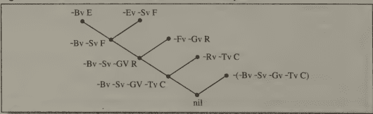

被归结以推断：

```
¬B ∨ ¬S ∨ F
```

然后与以下内容归结：

```
¬F ∨ ¬G ∨ R
```

以推断：

```
¬B ∨ ¬S ∨ ¬G ∨ R
```

等等。为简化绘图，最后的归结式是隐含的，而不是逐一绘制。

由于树的根是空，这是一个矛盾。通过反驳，原始结论：

```
B ∧ S ∧ G ∧ A ∧ T → C
```

是一个定理，因为其否定导致矛盾。因此，规则(1)确实逻辑上源自规则(2)–(5)。

### 3.13 归结与一阶谓词逻辑

归结法也用于一阶谓词逻辑。事实上，它是PROLOG的主要推理机制。然而，在应用归结之前，必须将公式转换为子句形式。例如，

> 有些程序员讨厌所有失败
> 没有程序员讨厌任何成功
> ∴ 没有失败是成功

定义以下谓词：

- P(x) = x是程序员
- F(x) = x是失败
- S(x) = x是成功
- H(x,y) = x讨厌y

前提和否定结论写成：

- (1) (∃ x) [P(x) ∧ (∀ y) (F(y) → H(x,y))]
- (2) (∀ x) [P(x) → (∀ y) (S(y) → ¬H(x,y))]
- (3) ¬(∀ y) (F(y) → ¬S(y))

其中结论已被否定，为归结做准备。


### 转换为子句范式

以下九个步骤是将一阶谓词公式（wff）转换为子句范式的算法。此过程使用上一页的公式（1）进行说明。

- 1. 使用等价式消去条件算子 →：
  p ⇒ q ≡ ¬p ∨ q
  因此公式（1）变为：
  (∃ x) [P(x) ∧ (∀ y) (¬P(y) ∨ H(x, y))]

- 2. 尽可能消去否定或将否定范围缩小到单个原子。使用附录A中所示的等价式，例如：
  ¬¬p ≡ p
  ¬(p ∧ q) ≡ ¬p ∨ ¬q
  ¬(∃ x) P(x) ≡ (∀ x) ¬P(x)
  ¬(∀ x) P(x) ≡ (∃ x) ¬P(x)

- 3. 标准化公式内的变量，使每个量词的约束变量或哑变量具有唯一名称。请注意，量词的变量名是哑变量。即，
  (∀ x) P(x) ≡ (∀ y) P(y) ≡ (∀ z) P(z)
  因此：
  (∃ x) ¬P(x) ∨ (∀ x) P(x)
  的标准化形式为：
  (∃ x) ¬P(x) ∨ (∀ y) P(y)

- 4. 使用以挪威逻辑学家 Thoralf Skolem 命名的 Skolem 函数来消去存在量词 ∃。考虑公式：
  (∃ x) L(x)
  其中 L(x) 定义为谓词，当 x < 0 时为真。该公式可替换为：
  L(a)
  其中 a 是使 L(a) 为真的常数，例如 −1。a 称为 Skolem 常数，是 Skolem 函数的一种特殊情况。对于存在前置全称量词的情况，
  (\forall x) (\exists y) L(x,y)
  其中 L(x,y) 当整数 x 小于整数 y 时为真。该公式意味着对于每个整数 x 都存在大于 x 的整数 y。请注意，公式未说明给定 x 值时如何计算 y。假设存在函数 f(x)，可产生大于 x 的 y。因此上述公式 Skolem 化为：
  (\forall x) L(x, f(x))
  全称量词范围内存在变量的 Skolem 函数是其左侧所有量词的函数。例如，
  (\exists u) (\forall v) (\forall w) (\exists x) (\forall y) (\exists z) P(u,v,w,x,y,z)
  Skolem 化为：
  (\forall v) (\forall w) (\forall y) P(a,v,w, f(v,w,y), y, g(v,w,y))
  其中 a 是某个常数，第二个 Skolem 函数 g 必须与第一个函数 f 不同。我们的示例公式变为：
  P(a) \land (\forall y) (\neg F(y) \lor H(a,y))

- 5. 将公式转换为前缀形式，即一串量词 Q 后跟矩阵 M。通常，量词可以是 \forall 或 \exists。但是，在此情况下，步骤 4 已消去所有存在量词，因此 Q 只能是 \forall。此外，由于每个 \forall 都有自己的哑变量，所有 \forall 都可以移到公式左侧，且每个 \forall 的范围可以是整个公式。

  我们的示例变为：
  (\forall y) [ P(a) \land (\neg F(y) \lor H(a,y)) ]
  其中矩阵是括号内的项。

- 6. 将矩阵转换为合取范式，即子句的合取。每个子句是析取。我们的示例已经是合取范式，其中一个子句是 P(a)，另一个是 (\neg F(y) \lor H(a,y))。如有必要，可使用以下分配律将矩阵置于合取范式：
  P \lor (Q \land R) \equiv (P \lor Q) \land (P \lor R)

- 7. 由于此阶段公式中的所有变量都必须是约束变量，因此全称量词已不再必要，可将其删除。公式现在即为矩阵。我们的示例公式变为：
  P(a) \land (\neg F(y) \lor H(a,y))

- 8. 通过将公式写成子句集来消去 ^ 符号。我们的示例为：
  { P(a) , ~F(y) V H(a,y) }
  通常不带花括号写作如下子句：
  P(a)
  ~F(y) V H(a,y)

- 9. 如有必要，重命名子句中的变量，使相同的变量名仅在一个子句中使用。例如，如果我们有子句：
  P(x) ^ Q(x) V L(x,y)
  ~P(x) V Q(y)
  ~Q(z) V L(z,y)
  这些可重命名为：
  P(x1) ^ Q(x1) V L(x1,y1)
  ~P(x2) V Q(y2)
  ~Q(z) V L(z,y3)
  如果对我们示例的第二个前提和否定结论执行转换为子句范式的过程，我们最终得到子句：
  (1a) P(a)
  (1b) ~F(y) V H(a,y)
  (2a) ~P(x) V ~S(y) V ~H(x,y)
  (3a) F(b)
  (3b) S(b)
  其中数字 (1) 和 (3) 指原始前提和否定结论。因此，前提 (1) 和 (3) 转换为带有后缀 (a) 和 (b) 的两个子句，而前提 (2) 转换为单个子句 (2a)。

### 统一与规则

一旦公式转换为子句范式，通常需要为变量找到合适的替换实例。也就是说，诸如：
  ~F(y) V H(a,y)
  F(b)
之类的子句，在 F 的参数匹配之前无法在谓词 F 上进行归结。为变量寻找替换以使参数匹配的过程称为统一。

统一是区分专家系统与简单决策树的一个特征。如果没有统一，规则的条件元素只能匹配常数。这意味着必须为每个可能的事实编写特定规则。例如，假设有人希望当传感器指示烟雾时触发火灾报警。如果有 N 个传感器，则需要为每个传感器编写如下规则：
  IF sensor 1 indicates smoke THEN sound fire alarm 1
  IF sensor 2 indicates smoke THEN sound fire alarm 2
  ...
  IF sensor N indicates smoke THEN sound fire alarm N

但是，有了统一，可以使用名为 ?N 的变量作为传感器标识符，从而可以编写一条规则：
  IF sensor ?N indicates smoke
  THEN sound fire alarm ?N

当两个互补文字被统一时，它们可以通过归结消去。对于前两个子句，将 y 替换为 b 得到：
  ~F(b) V H(a,b)
  F(b)
谓词 F 现在已被统一，并可归结为：
  H(a,b)

替换定义为用与变量不同的项同时替换变量。项可以是常数、变量或函数。用项替换变量由集合表示：
  { t1/v1, t2/v2 ... tn/vn }
如果 θ 是这样的集合且 A 是一个参数，则 Aθ 定义为 A 的替换实例。例如，如果：
  θ = { a/x, f(y)/y, x/z }
  A = P(x) V Q(y) V R(z)
则：
  Aθ = P(a) V Q(f(y)) V R(x)
请注意，替换是同时进行的，因此得到 R(x) 而非 R(a)。

假设有两个子句 C1 和 C2，定义如下：
  C1 = ~P(x)
  C2 = P(f(x))
P 的一种可能统一为：
  C1' = C1 { f(x)/x } = ~P(f(x))
P 的另一种可能统一是使用常数 a 的两个替换：
  C1'' = C1 { f(a)/x } = ~P(f(a))
  C2' = C2 { a/x } = P(f(a))
请注意，P(f(x)) 比 P(f(a)) 更一般，因为通过将常数替换为 x 可以产生 P(f(x)) 的无限多个实例。像 C1 这样的子句称为最一般子句。

一般来说，替换 θ 称为子句集 {A1, A2, ... An} 的统一者，当且仅当 A1θ = A2θ = ... Anθ。具有统一者的集合称为可统一集。最一般统一者（mgu）是所有其他统一者均为其实例的统一者。这可以更正式地表述为：θ 是最一般统一者，当且仅当对于集合的每个统一者 α，存在替换 β 使得：
  alpha = theta beta
其中 θβ 是先应用 θ 再应用 β 创建的复合替换。统一算法是为有限可统一参数集寻找最一般统一者的方法。

对于我们使用子句 (1a)–(3b) 的示例，替换和统一的结果显示在图 3.20 的归结反驳树中。由于根为空，否定结论为假，因此结论“无失败即成功”是有效的。

### 图 3.20 证明无失败即成功的归结反驳树

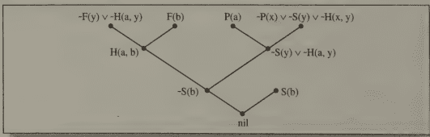


迄今为止使用的示例非常简单，其归结过程也很直接，尽管对人类来说很乏味。然而，在许多其他情况下，归结过程可能会陷入死胡同，因此需要回溯来尝试用于归结的替代子句。尽管归结非常强大并且是PROLOG的基础，但它对某些问题可能效率低下。归结的一个问题是它没有高效的内置搜索策略，因此程序员必须提供启发式方法，例如PROLOG cut，以实现高效搜索。

已对若干种修改版本的归结进行了研究，例如单子偏好、输入归结、线性归结和支持集。归结的主要优点是它是一种单一的强大技术，适用于许多情况。这使得构建像PROLOG这样的机械系统比试图实现许多不同推理规则的系统更容易。归结的另一个优点是，当成功时，归结会通过显示到空的步骤序列来自动提供证明。

### 3.14 正向链和反向链

连接问题与其解决方案的一组多重推理称为链。从问题搜索或遍历到其解决方案的链称为正向链。描述正向链的另一种方式是从事实推理出从事实得出的结论。从假设回溯到支持假设的事实的链称为反向链。描述反向链的另一种方式是通过满足子目标来完成的目标。正如这所示，用于描述正向链和反向链的术语取决于所讨论的问题。

链可以很容易地用推理来表示。例如，假设我们有肯定前件类型的规则：

```
p -> q
p
∴ q
```

这些规则形成推理链，例如如下所示：

```
elephant(x) -> mammal(x)
mammal(x) -> animal(x)
```

这些规则可用于正向推理的因果链，它推断出Clyde是动物，前提是Clyde是大象。推理链在图3.21中说明。请注意，同一图表也说明了反向链。

在图3.21中，因果链由一系列条形（l）表示，这些条形将一条规则的后件连接到下一条规则的前件。条形还表示变量与事实的统一。例如，谓词elephant(x)中的变量x必须首先与事实elephant(Clyde)统一，然后才能应用大象规则。因果链实际上是一系列蕴含和统一，如图3.22所示。


反向链是逆过程。假设我们想要证明假设animal(Clyde)。反向链的核心问题是找到连接证据与假设的链。事实elephant(Clyde)在反向链中被称为证据，以表明它用于支持假设，就像法庭上的证据用于证明被告有罪或无罪一样。

作为正向链和反向链的一个简单示例，假设你正在开车，突然看到一辆警灯闪烁、警笛长鸣的警车。通过正向链，你可以推断警察想要你或其他人停车。也就是说，初始事实支持两个可能的结论。如果警车停在你车后面，或者警察向你挥手，进一步的推断是他们想要的是你而不是其他人。将此作为工作假设，你可以应用反向链来推理原因。

一些可能的中间假设包括乱扔垃圾、超速、设备故障和驾驶被盗车辆。现在你检查证据以支持这些中间假设。是你扔出车窗的啤酒瓶，是在30英里每小时限速区域以100的时速行驶，还是损坏的尾灯，或者是识别你驾驶的被盗车辆的车牌？在这种情况下，每

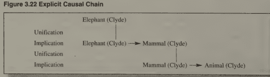

件证据都支持一个中间假设，因此它们都是真的。这些中间假设中的任何或全部都是证明警察想要你这一工作假设的可能原因。

将正向链和反向链可视化为问题空间中的一条路径很有帮助，其中中间状态对应于反向链下的中间假设或正向链下的中间结论。表3.14总结了正向链和反向链的一些常见特征。请注意，表中的特征仅旨在作为指南。在正向链系统中进行诊断以及在反向链系统中进行规划当然是可能的。特别是，反向链中的解释得以促进，因为系统可以轻松解释它正试图满足的确切目标。在正向链中，解释不易促进，因为子目标在被发现之前并不明确。

图3.23说明了基于规则系统中正向链的基本概念。规则由满足其前件或左侧（LHS）的事实触发。例如，规则R1必须由事实B和C满足才能被激活。然而，只有事实C存在，因此R1未被激活。规则R1由事实C和D激活，它们存在，因此R1产生中间事实H。其他满足的规则是R4、R6、R8和R9。规则R4和R5的执行产生正向链过程的结论。这些结论可能是其他事实、输出等等。

正向链被称为**自底向上推理**，因为它从低级证据（事实）推理到基于事实的高级结论。专家系统中的自底向上推理类似于第1章讨论的自底向上常规编程。事实是知识范式的基本单元，因为它们无法分解为任何更小的有意义单元。例如，事实“duck”作为名词和动词都有明确的含义。然而，如果进一步分解，结果是字母d、u、c和k，这些字母没有特殊含义。在常规程序中，意义的基本单位是**数据**。

按照惯例，由较低级构造组成的较高级构造被放置在顶部。因此，从诸如之类的较高级构造进行推理

### 表3.14 正向链和反向链的一些特征

| 正向链 | 反向链 |
|---|---|
| 规划、监控、控制 | 诊断 |
| 从现在到未来 | 从现在到过去 |
| 从前件到后件 | 从后件到前件 |
| 数据驱动，自底向上推理 | 目标驱动，自顶向下推理 |
| 向前工作以找到什么解决方案 | 向后工作以找到事实 |
| 从事实得出 | 支持假设 |
| 广度优先搜索得到促进 | 深度优先搜索得到促进 |
| 前件决定搜索 | 后件决定搜索 |
| 解释不易促进 | 解释得到促进 |

### 图3.23 正向链

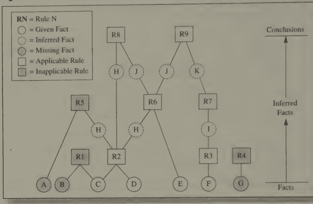

假设直到可能支持假设的较低级事实被称为**自顶向下推理**或反向链。图3.24说明了反向链的概念。为了证明或反驳假设H，中间假设H1、H2或H3中至少一个必须被证明。请注意，此图表绘制为AND-OR树，以表明在某些情况下（例如H2），所有较低级假设都必须存在以支持H2。在其他情况下（例如顶级假设H），只需要一个较低级假设。在反向链中，系统通常会从用户那里获取证据以帮助证明或反驳假设。这与正向链系统形成对比，在正向链系统中，所有相关事实通常事先已知。

如果你回顾3.2节中的图3.4，你会发现决策网组织得非常适合反向链。顶级假设是不同类型的覆盆子，例如开花覆盆子、黑覆盆子、酒莓和红覆盆子。支持这些假设的证据位于较低层。识别覆盆子的规则可以轻松编写。例如，

```
IF the leaves are simple THEN flowering raspberry
```

获取证据的一个重要方面是提出正确的问题。正确的问题是那些能提高确定正确答案效率的问题。为此的一个明显要求是，专家系统应该只提出与其试图证明的假设相关的问题。虽然系统可能询问成百上千个问题，但获取证据来回答这些问题需要时间和金钱成本。


### 图 3.24 后向链式推理

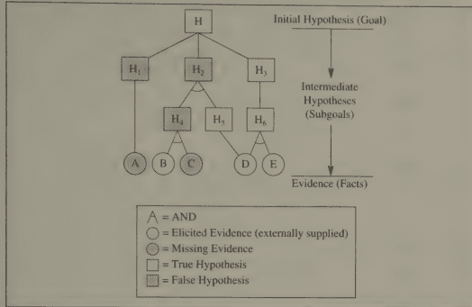

问题。此外，积累某些类型的证据（例如医学检测结果）可能会让患者感到不适，甚至对患者有害（事实上，很难想到哪种医学检测是令人愉快的）。

理想情况下，专家系统还应允许用户主动提供证据，即使系统未询问。允许用户主动提供证据可加快后向链式推理过程，并使系统对用户更加便捷。主动提供的证据可能让系统跳过因果链中的某些环节，或采取完全不同的方法。缺点是这涉及更复杂的专家系统编程，因为系统可能不会逐个环节地遵循链条。

图 3.25 展示了前向链式推理和后向链式推理的良好应用。为简化起见，这些图表绘制为树状图，而非一般网络。如果树宽而不深，则前向链式推理是良好的应用。这是因为前向链式推理有助于广度优先搜索。也就是说，如果结论的搜索逐层进行，则前向链式推理效果较好。相比之下，后向链式推理有助于深度优先搜索。适合深度优先搜索的树是窄而深的。

请注意，规则的结构决定了解决方案的搜索。也就是说，规则的激活取决于规则设计用于匹配的模式。左侧（LHS）的模式决定规则是否可以由事实激活。右侧（RHS）的操作决定被断言和删除的事实，从而影响其他规则。后向链式推理也存在类似情况，只是使用假设而非规则。当然，中间假设可能只是一条基于其后件而非前件匹配的规则。

作为一个非常简单的示例，请考虑以下 IF-THEN 类型规则：

```
IF A THEN B
IF B THEN C
IF C THEN D
```

如果给定事实 A，且推理引擎设计为将事实与前件匹配，则中间事实 B 和 C 将被断言，并得出结论 D。此过程对应于前向链式推理。推理引擎是专家系统的核心。

相比之下，如果断言事实（实际上是假设）D，且推理引擎将事实与后件匹配，则结果对应于后向链式推理。在为后向链式推理设计的系统中，例如 PROLOG，后向链式推理机制包括许多功能，例如自动回溯，以便促进后向链式推理。

后向链式推理可以通过重新设计规则在前向链式推理系统中实现，反之亦然。例如，之前用于前向链式推理的规则可以重写为：

```
IF D THEN C
IF C THEN B
IF B THEN A
```

现在，C 和 B 被视为子目标或中间假设，必须满足它们才能满足假设 D。证据 A 是指示子目标生成结束的事实。如果存在事实 A，则 D 在此后向推理链条下得到支持并被视为真。如果没有 A，则假设 D 不受支持并被视为假。

这种方法的一个困难是效率。后向链式推理系统有助于深度优先搜索，而前向链式推理系统有助于广度优先搜索。尽管你可以在前向链式推理系统中编写后向链式推理应用程序，反之亦然，但系统在搜索解决方案时的效率不会那么高。第二个困难是概念性的。从专家那里获取的知识将需要进行修改，以满足推理引擎的要求。例如，前向链式推理引擎匹配规则的前件，而后向链式推理引擎匹配后件。也就是说，如果专家的知识天生是后向链式推理，则必须完全重新结构化以将其转换为前向链式推理模式，反之亦然。

### 3.15 其他推理方法

多种其他类型的推理有时也用于专家系统。虽然这些方法不如演绎法那么通用，但它们非常有用。

### 类比

除了演绎法和归纳法之外，另一种强大的推理方法是类比。类比推理的基本思想是尝试将旧情况作为指导，与新情况相关联。所有生物在生活中都非常擅长应用类比推理，这至关重要，因为现实世界中遇到的新情况数量庞大。与其将每个新情况视为独特，不如尝试发现新情况与我们已知如何处理的旧情况之间的相似之处，这通常很有帮助。类比推理与归纳法相关。归纳法从同一情况的特殊情况推导到一般情况，而类比法则试图从不同的情况进行推导。类比法不能像演绎法那样进行形式证明。相反，类比法是一种启发式推理工具，有时可能有效，是法律辩论和医疗诊断中基于案例推理的主要工具。

类比推理的一个例子是医疗诊断。当你因医疗问题就医时，医生会向你获取信息并记录问题的症状。如果你的症状与患有问题 X 的其他人的症状相同或高度相似，医生可能会通过类比推断你患有问题 X。类比是廉价的推理。

请注意，此诊断不是演绎，因为你是独一无二的。仅仅因为另一个有同样问题的人表现出某些症状，并不意味着你也会表现出相同的症状。相反，医生假设你的症状使你与一个有相同症状和已知问题的人类似。这种初步诊断是一个假设，医学检测可能证明或反驳它。拥有初步工作假设很重要，因为它可以将成千上万的潜在问题缩小范围。如果没有初步假设就开始给你做每一种可能的检测，费用将高得难以承受且耗时。

作为类比推理效用的一个例子，假设两个人玩一个叫做“15 游戏”的游戏。他们轮流从 1 到 9 中选取一个数字，限制条件是同一个数字不能使用两次。第一个使其选定数字之和达到 15 的人获胜。虽然乍看这似乎是一个需要思考的奇怪游戏，但类比可以使它变得非常容易玩。

请考虑下面每个单元格都分配了数值的井字棋棋盘：

| 6 | 1 | 8 |
|---|---|---|
| 7 | 5 | 3 |
| 2 | 9 | 4 |

这是一个幻方，因为行、列和对角线上的数值之和是一个常数。带有幻方数值的井字棋棋盘可以被视为“15 游戏”的类比。如果你以井字棋的思路思考，然后将获胜策略转换到“15 游戏”，那么玩“15 游戏”现在就非常容易了。

这个特定的幻方称为阶 3 标准方。术语“阶”指的是方阵的行数或列数。阶 3 只有唯一的方阵。其他幻方可以通过旋转或反射标准方创建。构建幻方的另一种方法是向每个单元格添加相同的常数。了解这些信息使我们能够推导出“18 游戏”的获胜策略，其中数字必须从以下集合中选择：

```
`{2, 3, 4, 5, 6, 7, 8, 9, 10}`
```

或“21 游戏”，使用以下集合：

```
`{3, 4, 5, 6, 7, 8, 9, 10, 11}`
```

我们现在可以使用归纳法来推断“15 + 3N 游戏”的获胜策略，其中 N 是任何自然数 1、2、3、……，方法是将游戏视为类比于井字棋棋盘，而井字棋棋盘又类比于以下数值的幻方：

{1+N, 2+N, 3+N, 4+N, 5+N, 6+N, 7+N, 8+N, 9+N}

使用阶 3 方阵作为三步游戏的类比，通过归纳法我们可以推断，高阶幻方可用于涉及超过三步的游戏。例如，阶 4 幻方：

| 16 | 3 | 2 | 13 |
|---|---|---|---|
| 5 | 10 | 11 | 8 |
| 9 | 6 | 7 | 12 |
| 4 | 15 | 14 | 1 |

允许你通过以井字棋的思路思考，来选择四步、34 游戏的获胜策略。与唯一的阶 3 标准方阵相比，有 880 个阶 4 标准方阵，这允许进行大量更多的游戏。

类比推理是常识推理的重要组成部分，而常识推理对计算机（和儿童）来说非常困难。类比的其他应用已被用于学习。

### 生成-测试

另一种推理方法是经典的人工智能策略“生成-测试”，有时也称为“生成并测试”，它涉及生成一个可能的解决方案，然后对其进行测试，以查看所提议的解决方案是否满足所有要求。如果解决方案令人满意，则退出；否则，生成一个新解决方案，再次测试，依此类推。这种方法被用于第一个专家系统 DENDRAL（构想于 1965 年），以帮助识别有机分子结构。未知样品的数据由质谱仪提供并输入到 DENDRAL 中，DENDRAL 生成所有可能产生未知谱图的潜在分子结构。然后 DENDRAL 通过模拟其质谱图并将结果与原始未知物进行比较，来测试最可能的候选分子。另一个使用生成-测试的程序是“人工数学家”程序，用于推断新的数学概念。

为了减少潜在解决方案的巨大数量，生成-测试通常与规划程序一起使用，以限制生成的可能潜在解决方案。这种变体称为“规划-生成-测试”，并在许多系统中用于提高效率。例如，医疗诊断专家系统 MYCIN 还具有在诊断出患者疾病后规划治疗性药物治疗的能力。计划本质上是寻找连接问题与解决方案（或目标）及其支持证据的规则或推理链。规划最有效的方法是同时从事实向前搜索并从目标向后搜索。

MYCIN 规划器首先创建患者敏感的治疗药物优先列表。为了减少不良药物相互作用，


最好限制患者接受的药物数量，即使患者被认为正在遭受多种不同感染。生成器从规划器获取优先级列表，并在可能的情况下生成包含一两种药物的子列表。然后在决定将这些药物给患者之前，会对这些子列表针对感染、患者过敏症和其他因素进行疗效测试。

生成-测试也可以被视为规则的基本推理范式。如果规则的条件元素得到满足，它将生成一些操作，例如新事实。推理引擎将这些事实与知识库中规则的条件元素进行测试。满足条件的规则会被放入议程，最高优先级规则生成其操作，然后对其进行测试，以此类推。因此，生成-测试产生了一条可能导致正确解决方案的推理链。

### 溯因推理

溯因推理是另一种常用于诊断问题求解的方法。溯因推理的模式类似于肯定前件，但实际上非常不同，如表3.15所示。

| 溯因推理 | 肯定前件 |
|---|---|
| p → q | p → q |
| q | p |
| ∴ p | ∴ q |

溯因推理是我们在第3.6节中讨论的一种谬误论证的另一种名称，即逆谬误。虽然溯因推理不是有效的演绎论证，但它是一种有用的推理方法，并已在专家系统中使用。类比也是如此，类比也不是有效的演绎论证，但速度快且成本低（指推理时间，而非金钱）。溯因推理可能作为一种启发式推理规则很有用。也就是说，当我们没有演绎推理方法时，溯因推理可能有用，但不保证有效。类比、生成-测试和溯因推理都是非演绎方法，且不保证始终有效。从真前提出发，这些方法无法证明真结论。然而，这些技术通过生成合理假设来缩小搜索空间很有用，这些假设随后可以与演绎法一起使用。

溯因推理有时被称为从观察到的事实推理到最佳解释。作为溯因推理的示例，请考虑以下内容：

```
IF x is an elephant THEN x is an animal
IF x is an animal THEN x is a mammal
```

如果我们知道Clyde是哺乳动物，能否得出Clyde是大象的结论？这个问题的答案取决于我们是在谈论现实世界还是我们的专家系统。在现实世界中，我们无法以任何确定程度得出这个结论。Clyde可能是狗、猫、牛，或任何其他是哺乳动物但不是大象的动物。事实上，考虑到动物物种有多少，在不知道关于Clyde的更多信息的情况下，Clyde是大象的概率相当低。

然而，在仅包含上述规则的专家系统中，我们可以通过溯因推理以100%的确定性说：如果Clyde是哺乳动物，那么Clyde是大象。这一推理源于封闭世界假设，即我们假设专家系统封闭世界之外不存在其他事物。在封闭世界中，任何无法证明的事物都被假定为假。在封闭世界假设下，所有可能性都是已知的。由于专家系统仅包含这两条规则，并且只有大象才能是哺乳动物，因此如果Clyde是哺乳动物，他必定是大象。

假设我们添加第三条规则，如下：

```
IF x is a dog THEN x is an animal
```

我们仍可以在封闭世界假设下运行专家系统。然而，现在我们无法以100%的确定性得出Clyde是大象的结论。我们所能确定的是，Clyde要么是大象，要么是狗。

为了在这两者之间做出决定，需要更多信息。例如，如果还有另一条规则，

```
IF x is a dog THEN x barks
```

并且有证据表明Clyde会叫，则规则可以修订如下：

- (1) IF x is an animal THEN x is a mammal
- (2) IF x barks THEN x is an animal
- (3) IF x is a dog THEN x barks
- (4) IF x is an elephant THEN x is an animal

现在可以使用规则(1)、(2)和(3)构建溯因推理的后向链，以证明Clyde必须是狗。

溯因推理的后向链与后向链的通常含义不同。后向链意味着我们试图通过寻找支持证据来证明一个假设。后向链将用于尝试证明Clyde是哺乳动物。当然，对于我们的小系统来说，没有其他可能性。然而，可以为爬行动物、鸟类等添加其他分类。

如果已知Clyde是哺乳动物，可以使用溯因推理来确定Clyde是大象还是狗。如果已知Clyde是大象并且我们想知道他是否是哺乳动物，则将使用前向链。如您所见，推理方法的选择取决于要确定的内容。由于前向链是演绎的，只有其结论始终保证有效。

表3.16总结了三种推理技术各自的目的。

### 表3.16 前向链、后向链和溯因推理目的摘要

| 推理 | 起点 | 目的 |
|---|---|---|
| 前向链 | 事实 | 必然得出的结论 |
| 后向链 | 不确定的结论 | 支持结论的事实 |
| 溯因推理 | 真结论 | 可能得出的事实 |

许多AI和专家系统已使用基于框架的溯因推理进行诊断问题求解。在这些系统中，知识库包含疾病与症状之间的因果关联。推理是通过对疾病假设进行生成-测试来进行的。

### 非单调推理

通常，向逻辑系统添加新公理意味着可以证明更多定理，因为可以从中推导定理的公理更多了。随着公理增加而定理增加的这一属性称为单调性，而诸如演绎逻辑之类的系统称为单调系统。

然而，如果新引入的公理部分或完全与先前的公理相矛盾，可能会出现问题。在这种情况下，已证明的定理可能不再有效。因此，在非单调系统中，定理不一定随公理数量的增加而增加。

非单调性概念在专家系统中有重要应用。随着新事实的生成——这类似于定理的证明——单调专家系统将不断积累事实。如果一个或多个事实变为假，就会出现重大问题，因为单调系统无法处理公理和定理真值的变化。举个非常简单的例子，假设有一个断言时间的事实。一旦时间过去一秒，旧事实就不再有效。单调系统无法处理这种情况。举另一个例子，假设飞机识别系统断言目标是敌对的。后来，新证据证明目标是友好的。在单调系统中，原先的敌对识别无法更改。非单调系统允许撤回事实。

作为另一种应用，假设你想为专家系统编写一个解释设施，允许用户回到之前的推理并探索“如果……会怎样”类型问题的替代推理路径。在所需的先前推理之后所做的所有推理都必须从系统中撤回。除了事实之外，规则也可能已从系统中移除，因此必须为了非单调性而将其放回知识库。在OPSS等系统中会出现进一步的复杂情况，此类系统中规则可以在执行期间自动在规则的右侧创建。为了非单调性，在先前所需推理之后所做的任何推断规则都必须从系统中移除。跟踪所有所做的推理可能会消耗大量内存并显著减慢系统。


为了支持非单调性，有必要为每个事实和规则附加一个理由或依赖，以解释相信它的原因。如果做出非单调决策，则推理引擎可以检查每个事实和规则的理由，以查看是否仍然相信它们，并且还可以可能恢复被开脱的规则和被撤回的、再次被相信的事实。

证明事实的问题最初是在**框架问题**中提出的，它与第2章讨论的帧并非同一概念。框架问题是一个描述性术语，源于识别电影帧中哪些内容已更改或未更改的问题。电影是按一系列静态图片（称为帧）拍摄的。当以每秒24帧或更快的速度播放时，人眼无法区分单个帧，从而产生运动的错觉。AI中的框架问题是识别环境随时间变化的问题。例如，考虑前面讨论过的猴子与香蕉问题。假设猴子必须踩在红色箱子上才能拿到香蕉，因此动作是“将红色箱子推到香蕉下面”。现在框架问题是——动作后我们如何知道箱子仍然是红色的？推动箱子不应该改变环境。然而，诸如“将箱子涂成蓝色”等其他动作会改变环境。在某些专家系统工具中，环境被称为**世界**，由一组相关事实组成。专家系统可以同时跟踪多个世界以进行假设性推理。维护系统正确性或真理性的问题称为**真理维护**。真理维护或其一种变体**基于假设的真理维护**，对于通过撤回无理由的事实来保持每个世界的纯净至关重要。

作为非单调推理的一个简单示例，让我们考虑经典的Tweety鸟示例。在没有任何其他信息的情况下，我们因此会假设，既然Tweety是一只鸟，那么Tweety就会飞。这是**默认推理**的一个示例，类似于帧槽中使用的默认值。默认推理可以被视为一种关于规则进行推断的规则，即一个**元规则**，它声明：

```
IF X is not known for certain, and
there is no evidence contradicting X
THEN tentatively conclude Y
```

元规则将在下一节中更详细地讨论。在我们的情况中，元规则具有更具体的形式：

```
X is the rule "All birds can fly," and
fact "Tweety is a bird"
Y is the inference "Tweety can fly"
```

在产生式规则方面，这可以表示为知识库中的一条规则，即：

```
IF X is a bird THEN X can fly
```

以及工作内存中存在的事实：

```
Tweety is a bird
```

将事实与规则的前件进行统一，得出Tweety会飞的推断。

现在问题来了。假设工作内存中添加了一个额外的事实，即Tweety是一只企鹅。我们知道企鹅不会飞，因此Tweety会飞的推断是不正确的。当然，系统中必须有一条规则也陈述这一知识，否则该事实将被忽略。

为了维护系统的正确性，必须删除不正确的推断。但是，如果其他推断是基于不正确的推断，这可能还不够。也就是说，其他规则可能使用不正确的推断作为证据来得出额外的推断，以此类推。这是一个真理维护问题。Tweety会飞的推断是一个基于默认推理的合理推断。*合理*一词的意思是并非不可能，将在第4章中进一步讨论。

允许非单调推断的一种方法是定义一个句子算子M，可以非正式地定义为“保持一致”。例如，

```
(∀ x) [Bird(x) ∧ M(Can_fly(x)) -> Can_fly(x)]
```

可以表述为“对于每个x，如果x是鸟且鸟能飞是一致的，那么x能飞。”*一致*一词的意思是与其他知识没有矛盾。然而，这种解释受到批评，认为它实际上是在说唯一不能飞的鸟是那些被推断为不能飞的鸟。这是**自生推理**的一个示例，字面意思是关于自身知识的推理。默认推理和自生推理都用于**常识推理**，人类通常做得相当好，但对计算机来说非常困难。

自生推理是关于自身知识的推理，与一般知识不同。通常，你可以很好地做到这一点，因为你知道自己知识的局限性。例如，假设一个完全陌生的人走过来声称你是他的配偶。你会立即知道（除非你失忆）你不是他们的配偶，因为你对那个陌生人一无所知。自生推理的一般元规则是：

```
IF I have no knowledge of X
THEN X is false
```

请注意，自生推理依赖于封闭世界假设。任何未知的事实都被假设为假。在自生推理中，封闭世界是你的自我知识。

自生推理和默认推理都是非单调的。然而，原因不同。默认推理是非单调的，因为它是**可推翻的**。可推翻一词的意思是任何推断都是暂定的，并且在新信息出现时可能需要撤销。然而，纯粹的自生推理不是可推翻的，因为封闭世界假设宣称所有真知识你都已经知道。例如，既然已婚者知道谁是自己的配偶（除非他们想忘记），如果有人告诉已婚者一个完全陌生的人是他们的配偶，他们不会接受。因为大多数人认识到自己的记忆不完美，所以他们不坚持纯粹的自认识推理。当然，计算机直到硬盘崩溃才会有这个问题。

自生推理是非单调的，因为自认识陈述的含义是上下文敏感的。上下文敏感一词的意思是含义随上下文而变化。作为上下文敏感性的一个简单示例，考虑单词“read”在以下两个句子中的发音：

```
I have read the book
I will read the book
```

“read”的发音是上下文敏感的。

现在考虑一个由以下两个公理组成的系统：

```
(∀ x). [Bird(x) ∧ M(Can_fly(x)) → Can_fly (x)]
Bird(Tweety)
```

在这个逻辑系统中，Can_fly(Tweety)是通过将Tweety与变量x统一并应用蕴含而推导出的定理。

现在假设添加了一个新公理，声明Tweety不能飞，从而与先前推导出的定理相矛盾：

```
~Can_fly(Tweety)
```

M算子必须改变其对参数的操作，因为现在M(Can_fly(Tweety))与新公理不一致。在这个包含三个公理的新上下文中，M算子不会对Can_fly(Tweety)返回TRUE结果，因为它与新公理冲突。M算子返回的值在此新上下文中必须为FALSE，因此合取为FALSE。因此，没有蕴含来产生定理Can_fly(Tweety)，也没有冲突。

通过规则实现这一点的一种方法如下：

```
IF x is a bird AND x is typical
THEN x can fly
IF x is a bird AND x is nontypical
THEN x cannot fly
```

```
Tweety is a bird
Tweety is nontypical
```

请注意，这个系统并没有使结论Can_fly(Tweety)无效，而是根本阻止不正确的规则触发。这比只有一条规则和特殊公理~Can_fly(Tweety)的真理维护方法要高效得多。现在我们有了一个更通用的系统，可以轻松处理其他不会飞的鸟类（如鸵鸟），而无需不断添加新的推断，这正是系统应该做的。

### 3.16 元知识

经典的Meta-DENDRAL程序使用归纳法来推断化学结构的新规则。Meta-DENDRAL是试图克服从人类专家那里提取分子结构规则的知识瓶颈的一种尝试。一些专家系统工具附带用于诱导规则的程序。

例如，以下经典元规则摘自MYCIN（一种用于诊断血液感染和脑膜炎的专家系统）的TEIRESIAS知识获取程序：

```
METARULE 2
IF
The patient is a compromised host, and
There are rules which mention in their premise
pseudomonas, and
There are rules which mention in their premise
klebsiellas
THEN
There is suggestive evidence (0.4) that the former
should be done before the latter
```

规则动作中的数字0.4是确定程度，将在后续章节中讨论。

TEIRESIAS会从专家那里交互式地获取知识。如果MYCIN做出了错误的诊断，那么TEIRESIAS会引导专家沿着错误推理链回溯，直到专家指出错误推理开始的位置。在回溯推理链的过程中，TEIRESIAS还会与专家交互以修改不正确的规则或获取新规则。

关于新规则的知识不会立即放入MYCIN。相反，TEIRESIAS会检查新规则是否与类似规则兼容。例如，如果新规则描述了感染如何进入人体，而其他已接受的规则具有说明人体入口的条件元素，那么新规则也应该如此。如果新规则没有说明入口，那么TEIRESIAS会就此差异向用户提问。TEIRESIAS有一个它所了解的类似规则的规则模型模式，并试图将新规则放入其规则模型中。换句话说，规则模型是TEIRESIAS关于其自身知识的知识。对人类的类似情况是：如果你去汽车经销商处购买新车，而经销商试图向你出售一辆三轮车。

TEIRESIAS的元知识分为两种类型。先前描述的METARULE 2是一种控制策略，用于说明如何应用规则。相比之下，规则模型类型的元知识决定新规则是否处于适合输入知识库的形式。在基于规则的专家系统中，确定新规则是否格式正确称为规则的验证。确定一条正确推断链能导出正确答案称为确认。确认和验证如此相互依赖


通常使用缩写 V&V 来同时指代两者。软件工程中这些术语的更通俗定义如下：

验证：“我是否正确地构建了产品？”
确认：“我是否构建了正确的产品？”

基本上，验证涉及内部正确性，而确认涉及外部正确性。V&V 将在第 6 章中更详细地讨论。

### 3.17 隐马尔可夫模型

作为元知识的现代示例，请考虑机器人的路径规划。如果机器人没有全球定位系统（GPS），或者其精度不够（这通常是商业系统的情况，此类系统只能确定 3 米以内的位置），则必须使用其他方法。路径规划的一个良好应用使用马尔可夫决策过程（MDP）（Kaelbling 98）。其他方法使用经典的 A* 算法、卡尔曼滤波器和其他技术（Lakemeyer 03）。

在现实世界中，总存在不确定性，而在存在不确定性时，纯粹的逻辑并不是良好的指南。在关于状态和参数的信息部分或隐藏，并且需要进行规划的情况下，MDP 更具现实性。此类过程不仅限于物理路径规划，还涵盖部分已知环境中的任何类型规划，例如石油勘探、运输物流和工厂过程控制（在这些场景中，传感器可能会故障且事物可能出错）。当受控过程是核电站时，此类过程控制可能尤其重要。

部分信息的终极示例发生在机器人探索另一颗行星（例如火星）表面时。如果目标是到达某块特定的岩石，但路径部分被遮挡，机器人必须尝试在受限于有限能量供应以及一旦进入陡峭陨石坑后可能无法原路返回等约束条件下，就如何到达目标做出最优决策。

MDP 可以定义为元组 {状态，动作，转换，奖励}。更正式地，我们可以写 MDP = {S, A, T, R}，其中

- S 是环境的一组状态；
- A 是一组动作；

T: S x A -> [[S]]，其中 [] 称为状态转换函数，用于确定特定动作将导致什么状态。“x”是笛卡尔积运算符。[] 是所有可能状态和动作的集合。当然，有些可能不可行或不可取，但笛卡尔运算不会筛选出哪些是最优的。为了确定哪些动作会导致更好的状态（例如，机器人不会陷入死胡同），奖励是必要的。

R: S x A -> R(S)，其中 R 是奖励函数，用于提供代理在采取某项动作后立即获得的即时奖励。“代理”一词用于指代表他人行动的任何实体。因此，机器人是在另一颗行星上的人类代理。不同的状态将给出不同的预期奖励。在寻找通往目标的最优路径时，定义最优的一种方法是最大化奖励的预期总和。即时奖励会立即给出，但奖励总和决定了代理是否会成功或失败地到达目标。例如，如果机器人向右转，可能会找到一条畅通的道路。不幸的是，这条畅通的道路可能无法通往到达所需岩石的目标。这类似于前面讨论的验证，而在此例中，确认意味着机器人已经到达了正确的岩石。在下一章中，我们将看到关于效用函数和贝叶斯定理的更多奖励示例，用于处理不确定性。

在（1）机器人不确定其位置（未知状态）或（2）选择哪条路径（未知参数）的情况下，隐马尔可夫模型（HMM）非常有用。HMM 的可用软件例如 HTK 工具包（http://htk.eng.cam.ac.uk/）。该工具包已成功用于语音识别、语音合成、字符识别和 DNA 测序。一旦通过确定其遗传物质的序列来确定生物结构，就可以对其进行合成或修改以识别和治疗疾病。其他软件是 HMMER，一种用于蛋白质序列分析的可自由分发的 HMM 实现（http://hmmer.wustl.edu/）。

流行的 Matlab 为 HMM 提供了一个可用的工具包，支持多种科学推理类型，尤其适合信号分析（http://www.ai.mit.edu/~murphyk/Software/HMM/hmm.html）。经典案例是：当用户对着麦克风说话以生成供计算机分析的声学信号时，确定语音中的音素，从而确定单词。虽然断断续续或语速缓慢的语音已通过许多技术（如 ANS）得到解决，但难题在于无需训练系统即可实现任何说话人的连续语音识别（独立说话人识别）。

路径规划对许多视频游戏也至关重要，游戏中的角色需要在墙壁和障碍物之间从一个位置移动到另一个位置。流行的 A* 算法经常被使用。

### 3.18 总结

本章讨论了专家系统中常用的推理方法。推理在专家系统中尤为重要，因为它是专家系统解决问题的技术。讨论了树、图和格在知识表示中的应用。阐明了这些结构对推理的优势。

演绎逻辑从简单的三段论逻辑开始介绍。接着讨论了命题逻辑和一阶谓词逻辑。真值表和推理规则被描述为证明定理和陈述的方法。提到了逻辑系统的特性，如完备性、可靠性和可判定性。

讨论了用于命题逻辑和一阶谓词逻辑的定理证明归结方法。通过一个示例说明了将良构公式转换为子句形式所涉及的九个步骤。在将 wff 转换为子句形式的上下文中，讨论了斯科伦化、前缀范式和统一。

讨论了另一种强大的推理方法：类比。虽然由于实现困难，类比在专家系统中并未广泛使用，但它是医生和律师的常用方法，应在专家系统设计中予以考虑。还通过 MYCIN 中的应用示例讨论了生成-测试法。描述了 TEIRESA S 中元知识的应用及其与专家系统验证和确认的关系。

### 问题

- 3.1 编写一个自学习的决策树程序。教给它图 3.3 中的动物知识。

- 3.2 编写一个程序，自动将存储在二叉决策树中的知识转换为 IF-THEN 类型规则。使用问题 3.1 的动物决策树对其进行测试。

- 3.3 绘制一个包含图 3.4 中覆盆子知识的语义网。

- 3.4 绘制状态图，展示农夫、狐狸、山羊和卷心菜经典问题的解决方案。在这个问题中，农夫、狐狸、山羊和卷心菜位于河流的一侧。必须使用一艘船将他们运到另一侧。然而，船一次只能载两个（且只有农夫能划船）。如果狐狸和山羊被单独留下且农夫不在场，那么狐狸会吃掉山羊。如果山羊和卷心菜单独留下，山羊会吃掉卷心菜。

- 3.5 为一个结构良好的旅行问题绘制状态图，该问题具有：
  - (a) 三种支付方式：现金、支票或刷卡
  - (b) 旅行者的兴趣：阳光、雪
  - (c) 四个可能的目的地，取决于旅行者的兴趣和资金
  - (d) 三种交通方式

  编写 IF-THEN 规则，根据资金和兴趣向旅行者建议去哪里。选择真实目的地，并找出从你所在位置前往那里的费用。

- 3.6 确定以下论证是有效还是无效：
  - (a) p → q, ¬q → r, r .: p
  - (b) ¬p v q, p → (r ^ s), s → q; .: q v r
  - (c) p → (q → r), q: .: p → r

- 3.7 使用文氏图判定程序，确定以下三段论是有效还是无效：
  - (a) AEE-4
  - (b) AOO-1
  - (c) OAO-3
  - (d) AAI-1
  - (e) OAI-2


### 3.8 证明以下各项是谬误还是推理规则。为每个给出一个示例。

- (a) 复杂建设性两难
- p -> q
- r -> s
- p v r
- .: q v s

- (b) 复杂破坏性两难
- p -> q
- r -> s
- ~q v ~s
- .: ~p v ~r

- (c) 简单破坏性两难
- p -> q
- p -> r
- ~q v ~r
- .: ~p

- (d) 逆命题
- p -> q
- ~p
- .: ~q

### 3.9 从以下前提中得出结论，这些前提摘自《爱丽丝梦游仙境》的作者刘易斯·卡罗尔：

- (a) 此房间内所有带日期的信件都写在蓝色纸上。
- (b) 它们中没有一封是用黑色墨水写的，除非是以第三人称写的。
- (c) 我没有归档任何我能读的信件。
- (d) 那些写在一张纸上的信件，没有一封是无日期的。
- (e) 所有未划掉的信件都用黑色墨水写成。
- (f) 所有由布朗写的信件都以“Dear Sir”开头。
- (g) 所有写在蓝色纸上的信件都已归档。
- (h) 那些写在多张纸上的信件，没有一封被划掉。
- (i) 那些以“Dear Sir”开头的信件，没有一封是以第三人称写的。

提示：使用对偶律定义以下内容：

- A = beginning with “Dear Sir”   B = crossed   C = dated
- D = filed   E = in black ink   F = in third person
- G = letters that I can read   H = on blue paper   I = on one sheet
- J = written by Brown

### 3.10 使用谓词逻辑为以下三段论给出形式证明：

- 没有软件是有保证的
- 所有程序都是软件
- .: 没有程序是有保证的

### 3.11 使用以下内容编写量化一阶谓词逻辑公式：
P(x) = x 是程序员
S(x) = x 是聪明的
L(x,y) = x 爱 y

- (a) 所有程序员都是聪明的。
- (b) 有些程序员是聪明的。
- (c) 没有程序员是聪明的。
- (d) 有人不是程序员。
- (e) 不是每个人都是程序员。
- (f) 每个人都不是程序员。
- (g) 每个人都是程序员。
- (h) 有些程序员不聪明。
- (i) 存在程序员。
- (j) 每个人都爱某人。

提示：使用附录 B。

### 3.12 考虑以下谓词逻辑论证：
一匹马是一种动物。
因此，马的头是动物的头。定义如下：
H(x,y) = x 是 y 的头
A(x) = x 是动物
S(x) = x 是马

前提和结论如下：
(∀ x) (S(x) → A(x))
(∀ x) ([(∃ y) (S(y) ∧ H(x,y))] → [(∃ z) (A(z) ∧ H(x,z))])

使用归结反驳法证明结论。为结论展示所有九步子句转换。

### 3.13
- (a) 向您的银行或储蓄贷款协会获取获得汽车贷款的标准信息。编写一个后向链接规则系统，以确定申请人是否应获得汽车贷款。尽可能具体。
- (b) 获取有关房屋抵押贷款资格的信息。给出对汽车贷款程序的修改，以同时处理房屋贷款和汽车贷款。
- (c) 获取有关商业贷款资格的信息。给出对汽车-抵押贷款程序的修改，以同时处理商业贷款。

### 3.14 编写一个因果规则产生式系统，以模拟您汽车燃油系统的操作。您可以从汽车维修指南中获取此信息。尽可能详细。

### 3.15 使用您汽车的维修指南，编写一个产生式系统，可以根据问题症状诊断和修复汽车的电气问题。

### 3.16 如果结论为假，并且您想确定随后的事实，您会使用抽推还是其他推理方法？解释。

### 3.17 编写 IF-THEN 规则，使用图 3.4 所示的决策树部分来识别树莓。

### 3.18 一位家长和两个孩子在河的左岸，希望渡到右岸。家长体重 200 磅，每个孩子体重 100 磅。有一艘载重 200 磅的船可用。至少需要一个人划船。绘制决策树，显示他们过河的所有可能性，并指示树中成功的路径，使他们全部过河。假设以下运算符：SL—单个孩子从左岸到右岸 SR—单个孩子从右岸到左岸 BL—两个孩子从左岸到右岸 BR—两个孩子从右岸到左岸 PL—家长从左岸到右岸 PR—家长从右岸到左岸

### 3.19 (a) 绘制图 3.11 中 AND-异或 汽车决策的逻辑图版本。请注意，您需要使用标准 AND、OR 和 NOT 元素实现异或。(b) 编写前向链接 IF-THEN 规则，以确定应遵循哪个假设，即出售或修理。

### 3.20 以下陈述代表哪种推理类型（如果有的话）？(a) “我之所以坚持认为伊拉克与萨达姆和基地组织之间存在关系，是因为伊拉克与基地组织之间存在关系。”(b) “认为最高法院法官可以被如此廉价地收买是合理的，国家陷入的麻烦比我想象的更深。”

## 参考文献

(Giarratano 93). Joseph Giarratano, CLIPS User’s Guide, NASA, Version 6.2 of CLIPS, 1993.

(Kaelbling 98). Leslie Pack Kaelbling, Michael L. Littman, and Anthony R. Cassandra, “Planning and Acting in Partially Observable Stochastic Domains,” Artificial Intelligence 101 pp. 99–134, 1998.

(Klir 98). George J. Klir and Mark J. Wierman, Uncertainty-Based Information, Physica-Verlag, 1998.

(Lakemeyer 03). ed. by Gerhard Lakemeyer and Bernhard Nebel, Exploring Artificial Intelligence in the New Millennium, Morgan Kaufmann Publishers, 2003.

(Lakoff 00). George Lakoff and Rafael E. Nunez, Where Mathematics Comes From, Basic Books, 2000.

(Merritt 04). Dennis Merritt, “Building a Custom Rule Engine with PROLOG,” Dr. Dobb’s Journal, pp. 40–45, March 2004.

(Russell 03). Stuart J. Russell and Peter Norvig, Artificial Intelligence: A Modern Approach, 2nd Edition, 2002.

## 第 4 章
在不确定性下进行推理

### 4.1 简介

本章讨论了使用概率论和模糊逻辑在不确定性下进行推理的一些方法。这些主题非常重要，因为专家系统的主要优势之一是其像真人一样处理不确定性的能力。如果已知令人满意的算法或决策树，则不需要专家系统的能力。处理不确定性是专家系统相对于简单决策树的主要优势之一，在简单决策树中，必须知道所有事实才能得出结果。概率论是某些不确定性理论的基础，因此本章涵盖了与专家系统中的概率不确定性和模糊逻辑相关的那些要素。

在下一章中，将介绍其他处理不确定性的理论，并将在其正式名称“近似推理”下更详细地研究模糊逻辑。虽然只需处理一种不确定性理论（例如经典概率论）会很好，但每种理论都有其优缺点。这类似于程序员在决定普通计算机程序中应使用哪种算法和数据结构时所面临的决策。通过了解每种不确定性方法的优缺点，您将创建最适合所建模特定专业知识的专家系统。某些专家系统工具在语言中内置了不确定性，例如两个定制版本的 CLIPS，用于处理模糊逻辑，分别是加拿大国家研究委员会的 FuzzyCLIPS 和 Togai InfraLogic 的 FuzzyClips。其他一些定制版本在前言中有描述。

在使用此类定制工具之前，您应确定它是处理不确定性的正确方法。也许您只需要一些特定规则，在其中可以自己编码该方法，或定义不确定性函数，而不是使用整个特殊工具。另一种可能性是，您可能需要建模多种类型的不确定性，而没有一种工具可以


将处理一切。附录 G 展示了许多用于概率的软件工具和其他资源。其中一些是完整的工具，而其他资源是特殊的类，例如，在 C++ 中，用于帮助你修改和重组 CLIPS，以便轻松添加不确定性或你想要的其他功能。这再次说明了 CLIPS 开源的巨大优势之一，即你可以定制工具以适应你的需求，而不是试图让你的需求适应工具。用其他语言（如 Java）编写的 CLIPS 版本也列在官方 CLIPS 网站上。

### 4.2 不确定性

不确定性可以被视为缺乏做出决策所需的充分信息。不确定性是一个问题，因为它可能阻止我们做出最佳决策，甚至可能导致做出错误的决策。在医学中，不确定性可能会忽略患者的最佳治疗方案或导致错误的治疗。在商业中，不确定性可能意味着财务损失而非利润。

已提出许多理论来处理不确定性。这些包括经典概率、贝叶斯概率（Castillo 97）、基于经典集合的 Hartley 理论、基于概率的 Shannon 理论、Dempster-Shafer 理论、马尔可夫模型以及 Zadeh 的模糊理论。特别是，贝叶斯理论和模糊理论在生物学、心理学、音乐和物理学等许多不同领域已被证明非常流行。模糊逻辑也存在于许多消费电器中，从通过测量衣物清洁度而非 19 世纪发明的电动定时器来了解衣物有多干净的洗衣机，到拍摄出精彩照片的相机。模糊逻辑，也称为近似推理，将在下一章中更详细地讨论。

所有生物都是处理不确定性的专家，否则它们无法在现实世界中生存。特别是，人类习惯于应对交通、天气、工作、学校以及生活方方面面的不确定性。过了一段时间，我们都会成为在各种交通条件下驾驶、治疗感冒和选择轻松课程的专家。有些人成了在所有事情中都选择轻松方式的专家。处理不确定性需要在不确定性下进行推理，并拥有大量常识。常识的唯一问题是，它不一定意味着“良好判断”，而只是在正常情况下通常所做的事情。有时，通常的方式并不是最好的方式，这就是为什么在不确定性下进行推理很重要。例如，如果你曾经玩过老虎机并赢了一些钱，然后开始输钱，常识会在你耳边低语，如果你玩得足够久，你最终会再次赢钱。不幸的是，常识不会告诉你，在你再次赢钱之前，你是否会花光现金、刷爆信用卡、卖掉汽车，或者当掉配偶的结婚戒指。

第 3 章中描述的演绎推理方法被称为精确推理，因为它处理精确事实以及从这些事实得出的精确结论。请回顾，演绎论证非常有力，以至于如果前提为真，结论必须为真。同样，如果前提为假，那么结论必须为假。

另一方面，归纳论证不像演绎论证那样保证结论的真实性。归纳论证的前提为结论提供支持，但并不提供保证。例如，给定整数序列 1、2、3，你可能会使用归纳法假设下一个数字是 4。但是，如果有人告诉你下一个数字是 5 呢？如果“1,2,3”是从著名的斐波那契序列中选取的三个数字序列，那么就会出现这种情况，在该序列中，每个数字是前两个数字之和，序列为 0、1、1、2、3、5。在归纳论证中，支持结论的前提越多，我们就越相信结论是正确的。

然而，这种归纳解释存在一个问题，即支持结论的前提越多，结论就越可能为真。假设你是一只右翼渡鸦（右翼上多一根飞羽），听到一只左翼渡鸦（左翼上多一根飞羽；飞羽数量的差异）声称所有渡鸦都是黑色的。于是你出去数渡鸦，经过很长时间，观察到你见过的所有 1,000,000 只渡鸦确实都是黑色的。此时，一些右翼人士可能会放弃，但由于这个理论是由一只左翼人士提出的，你想，“仅仅因为我没有见过非黑色渡鸦并不意味着它不存在。也许它们都在躲藏。”虽然这可能是真的（或者它们某天晚上都被 UFO 带走了），但陈述“所有渡鸦都是黑色的”在逻辑上等同于陈述“所有非黑色事物都不是渡鸦”。

例如，红苹果肯定不是黑色渡鸦。因此，你看到的红苹果越多，通过增加前提的强度（即非黑色事物的数量），所有渡鸦都是黑色的概率就一点一点地增加。这个鸟脑筋的故事被称为**渡鸦悖论**，因为它表明应用归纳法可能与直觉相矛盾。

现在这可能是一场灾难，因为有很多红苹果，这意味着左翼人士说所有渡鸦都是黑色的是正确的。但这不是放弃的时候！请考虑，还有很多黑莓。因此，如果你继续数那些不是黑色渡鸦的黑色东西，这会削弱一些东西会是黑色渡鸦的前提。如果你进入任何销售黑莓的杂货店并开始数它们，你会发现商店里那十几品脱的黑莓数量远多于他们销售的红苹果数量（一品脱盒子里装不下太多苹果）。既然黑莓比苹果多，这意味着左翼人士是错的，而且确实必须存在一只非黑色渡鸦，即使你还没有找到它！

数红苹果或任何非黑色事物来增加所有渡鸦都是黑色的可能性可能会导致无效结论。已提出各种解决渡鸦悖论的方案，但最好的似乎是贝叶斯理论，将在本章后面讨论。

当涉及不确定事实时，精确推理不适用，尽管人们可能错误地认为它适用，就像之前讨论的渡鸦或赌徒的情况一样。不确定性增加了可能结果的数量，以至于找到最佳解决方案可能不仅困难，而且不可能。更糟糕的是，不确定性可能导致错误的推理，我们最终会整天数黑莓。

不幸的是，确定“最佳”结论可能并不容易。已提出多种不同的方法来处理不确定性并帮助选择最佳结论。然而，在处理不确定性时，我们可能不得不接受一个良好的解决方案，而不是最佳解决方案。另一方面，一个在实时中 99% 完成的良好解决方案可能比需要计算一百万年的最优解更好。专家系统设计师的责任是根据应用程序选择最合适的方法。虽然有一些专家系统工具包含用于在不确定性下进行推理的机制，但它们通常不够灵活，不允许使用其他方法。有一句谚语说，如果你唯一拥有的工具是锤子，那么一切看起来都像钉子。选择一个只在一个领域强大的工具就像只选择一把锤子。

虽然有许多专家系统应用可以使用精确推理来完成，但许多其他应用需要不精确推理，因为事实或知识本身并不精确。一个很好的例子是医疗行业。为了优化利润，目标是找到一种可接受的治疗方案，使用最少数量的测试，因为测试需要花费金钱。在专家系统中，可能存在不确定的事实、规则或两者兼有。处理不确定性的成功专家系统的经典例子是用于医疗诊断的 MYCIN 和用于矿产勘探的 PROSPECTOR。

这些系统在文献中被频繁引用的主要原因是它们文档完善，旨在展示专家系统与人类专家相当或更好的可行性，而这两个系统都做到了。如今，你无法获得信用局专家系统确定你的信用评级的确切规则，或者为什么你会被同一家批准了你大额抵押贷款的银行拒发信用卡的原因。此外，由于这些是软件程序，程序代码中没有错误的可能性有多大？然而，你仍然无法查看代码来确定你被拒绝信用或贷款的原因是否是程序本身。

在 MYCIN 和 PROSPECTOR 系统中，即使没有所有绝对证明结论所需的证据，也会得出结论。虽然通过进行更多测试可以得出更可靠的结论，但进行测试的时间和成本增加存在问题。这些时间和金钱的限制在医疗治疗中尤其重要。为了进行更多测试而推迟治疗会增加相当大的成本；与此同时，患者可能会死亡。在矿产勘探中，额外测试的成本也是一个重要因素。当你 95% 确定成功时开始钻探，可能比花费数十万美元来达到 98% 的确定性更具成本效益。

### 4.3 错误类型

许多不同类型的错误都可能导致不确定性。不同的不确定性理论试图解决其中一些或全部错误，以提供最可靠的推断。图 4.1 说明了一种错误的简化分类方案。

这个图严格来说应该画成一个格，因为许多不同类型的错误之间可能存在互连。例如，人为错误可能与歧义、测量、推理等相关联。表 4.1 给出了这些错误的示例。


### 图 4.1 错误类型

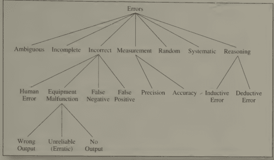

所示的第一种错误类型是**歧义**，即某事物可能有多种解释。第二种错误类型是**不完整性**，即缺少某些信息。第三种错误类型是**错误性**，即信息有误。错误性的可能原因包括人为错误，例如意外误读表盘或数据、撒谎或误导信息，以及设备故障。

### 表 4.1 常见错误类型示例

| Example | Error | Reason |
|---|---|---|
| 关闭阀门 | 歧义 | 哪个阀门？ |
| 转动阀门-1 | 不完整 | 哪个方向？ |
| 关闭阀门-1 | 错误 | 正确是打开 |
| 阀门卡住 | 假阳性 | 阀门未卡住 |
| 阀门未卡住 | 假阴性 | 阀门卡住 |
| 将阀门-1 转到 5 | 不精确 | 正确是 5.4 |
| 将阀门-1 转到 5.4 | 不准确 | 正确是 9.2 |
| 将阀门-1 转到 5.4 或 6 或 0 | 不可靠 | 设备错误 |
| 阀门-1 设置为 5.4 或 5.5 或 5.1 | 随机误差 | 统计波动 |
| 阀门-1 设置为 7.5 | 系统误差 | 误差校准 |
| 阀门-1 卡住是因为它以前从未卡住过 | 无效归纳 | 阀门卡住 |
| 输出正常，因此阀门-1 状况良好 | 无效演绎 | 阀门卡在开启位置 |

假设是待检验的假设。原假设是最初做出的假设，例如“阀门卡住”。一种错误信息称为假阳性，即接受一个不为真的假设。同样，假阴性意味着拒绝一个为真的假设。因此，如果阀门确实未卡住，那么接受“阀门卡住”的假设就是假阳性。在统计学中，这称为第一类错误。同样，如果阀门确实卡住且拒绝“阀门卡住”的假设，这就是假阴性或第二类错误。

表 4.1 中显示的接下来两种错误类型是测量误差。它们是精度误差和准确度误差。虽然这些术语有时被混用，但它们非常不同。考虑两把尺子，一把以毫米为刻度，另一把以厘米为刻度。显然，毫米尺比厘米尺更精确。但是，假设毫米尺的刻度制作不正确。在这种情况下，毫米尺是不准确的，除非已知修正系数，否则其测量结果不可信。因此，准确度对应真理，而精度对应对真理的了解程度。对于这两把尺子，毫米尺的测量精度比厘米尺高十倍，但其不准确可能导致严重问题。

另一种错误类型是不可靠性。如果提供事实的测量设备不可靠，数据就会不稳定。不稳定的读数是不恒定而是波动的读数。有时可能正确，有时可能不正确。

波动的读数可能由所研究系统的基本随机性质引起，例如放射性原子的衰变。因为衰变的原因是量子力学现象，衰变率会随机地围绕平均值波动。围绕平均值的随机波动构成随机误差，并导致平均值的不确定性。其他类型的随机误差可能由布朗运动、热效应引起的电子噪声等引起。但是，不稳定的读数也可能由连接松动引起。

系统误差不是随机的，而是由于某种偏差引入的。例如，尺子误差校准导致其刻度小于正常值，这会产生系统误差，表明读数高于正常值。

### 4.4 错误与归纳

下一种错误类型是无效归纳：“阀门未卡住，因为它以前从未卡住过。”归纳过程与演绎相反。过去曾说演绎是从一般到具体，例如：

```
All men are mortal
Socrates is a man
.: Socrates is mortal
```

以推导出苏格拉底是凡人的具体结论。

还曾说归纳是从具体到一般，例如：

```
My disk has never crashed
.: My disk will never crash
```

其中，倒三角符号‘.’代表“归纳因此”，与三角符号...“演绎因此”相对。关于磁盘的上述谬误归纳论证显示了旧式思维的问题，即将演绎视为从具体到一般的推理。上述实际上是一个谬误的演绎论证，因为它从“我的磁盘从未崩溃”的一般情况推导到“它一次都不会崩溃”的具体情况。

虽然你可能仍然会看到一些书籍声称演绎是从一般到具体，归纳是从具体到一般，但当代逻辑认为，如果前提为真，演绎保证结论为真。归纳论证仅仅意味着前提越强，结论为真的可能性就越大。

考虑以下陈述：

```
My two pets are Smokey and Boots
Smokey has a tail
Boots has a tail
.: All my pets have tails
```

这是一个有效演绎论证的示例，其中具体前提导出一般结论；这与过去教授的演绎是从一般到具体相反，并且仍然出现在一些旧词典中。寓意是，即使是数学和逻辑也在发展。这种论证也被称为可靠的，因为它既有效又基于真实前提。这里的意思是语义上有效的真理；也就是说，现实世界中的含义是真实的，因为我的两只宠物确实都有尾巴。

现在考虑以下论证：

```
My two pets are Smokey and Boots
Smokey has a trunk
Boots has a trunk
.: All my pets have trunks
```

这仍然是一个有效的论证，但不再可靠，因为 Smokey 和 Boots 不是大象，所以没有鼻子。（好吧，它们确实有希望箱，但那不是一回事。）

除了数学归纳法，归纳论证永远无法被证明是正确的。相反，归纳论证只能提供一定程度的信心，即结论是正确的。我们对前面关于硬盘故障的归纳论证不会有太多信心。作为另一个示例，考虑以下论证：

```
The fire alarm goes off
.: There is a fire
```

更强的归纳论证是：

```
The fire alarm goes off
I smell smoke
:. There is a fire
```

虽然这是一个更强的论证，但它不是火灾的证明。烟可能来自烤架上烹饪的汉堡，火灾报警器也可能被意外触发。火灾的演绎证明如下：

```
The fire alarm goes off
I smell smoke
My clothes are burning
:. There is a fire
```

注意，这是一个演绎论证，因为你可以看到火焰，尽管它是从具体前提而不是一般前提出发的。

专家系统可能由演绎规则和归纳规则组成，其中归纳规则具有启发性质。归纳也已应用于规则的自动生成，如你将在后面关于知识获取的章节中看到。

除了事实的不确定性外，如果专家系统的规则基于启发式，则可能具有不确定性。启发式通常被称为经验法则，因为它基于个人经验。（例如，如果你想学习一条关于正确敲钉子的重要规则，先砸你的拇指。这被称为“经验法则”学习。与坐三小时讲座并睡觉学习相比，这非常有效。）

有时经验是良好的指南。但是，由于经验是启发式的，它可能不适用于 100% 的情况。例如，你会预期所有从五十层楼跳下的人都会被杀死。但是，如果人们穿着降落伞，可以从五十层楼跳下而不被杀死。

人类专家的一个有趣特征是他们在不确定性下推理得很好。即使存在很大的不确定性，专家通常也能做出良好的判断，否则他们不会被认为是专家太久。

另一个特征是，如果原来的某些事实被证明是错误的，专家可以轻松修改他们的意见。这是非单调推理，如第 3 章所讨论。编程让专家系统回溯其推理过程更加困难，因为需要保存所有中间事实并保留规则触发的历史记录。人类专家似乎可以轻松修改他们的推理，尤其是政客。

除了归纳错误外，还可能存在演绎错误或谬误，如第 3 章所述。第 3 章讨论的一个谬误模式示例是：

```
p → q
q
:. p
```


例如，

如果阀门状况良好，
则输出正常
输出正常
因此，阀门状况良好

是一个谬误的论证。阀门可能卡在开启位置，导致输出正常。然而，如果有必要关闭阀门，问题就会显现出来。如果阀门需要快速关闭，例如在核反应堆紧急停机的情况下，这可能非常严重。

与我们之前讨论的错误相反，归纳错误和演绎错误是推理错误。这些类型的错误会导致规则制定不正确。

一般来说，人类似乎无法以最佳方式处理不确定信息。即使是专家也难免会犯错，尤其是在不确定性下。在知识获取中，当专家的知识必须量化为规则时，这可能是一个重大问题。不一致性、不准确性以及所有其他可能的不确定性错误都可能出现。专家随后将不得不纠正他们的知识，这可能会延迟专家系统的完成。

### 4.5 经典概率

在AI问题求解中，最古老且仍然非常重要的工具是概率（Grinstead 97）。概率是处理不确定性的一种定量方法。概率概念起源于17世纪，当时一些法国赌徒向帕斯卡、费马等领先的数学家寻求帮助。赌博变得非常流行；由于涉及大量资金，赌徒希望有方法来帮助计算获胜几率。事实上，经典的赌徒破产问题是概率理论对赌徒观察到的经验事实的证明：如果你玩得足够久，庄家总是赢（Ross 02）。（不幸的是，那些亏损最多的赌徒最能从学习概率中受益。）

经典概率理论最初由帕斯卡和费马于1654年提出。此后，概率方面进行了大量工作，并发展出了几个新分支。概率的许多应用已在科学、工程、商业、经济学以及几乎所有其他领域中展示。

### 经典概率的定义

经典概率也称为先验概率，因为它处理理想游戏或系统。如第2章所讨论，先验一词意为“之前”，即不考虑现实世界。先验概率将骰子、牌、硬币等游戏视为不会磨损的理想系统。

理想系统不会表现出现实世界中的磨损特性，因为否则它们就不会具有精确可重复的特性。也就是说，真实的骰子（复数dice）在一面经过无数次投掷后磨损后，可能会对某些特定数字表现出偏差。同样，取决于制造商，真实的骰子可能会偏向较大的数字，因为较大数字上钻了更多的点（小彩色孔）。这种偏差是通过分析真实骰子1,000,000次投掷的数据确定的。每20,000次投掷使用一个新骰子，以避免由各面不均匀磨损引起的偏差。不同数字出现的次数比例如表4.2所示。

| 数字 | 1 | 2 | 3 | 4 | 5 | 6 |
|---|---|---|---|---|---|---|
| 比例 | 0.155 | 0.159 | 0.164 | 0.169 | 0.174 | 0.179 |

在理想系统中，所有数字出现的概率相等，这使得分析容易得多。经典概率的基本公式定义为概率：

```
P = \frac{W}{N}
```

其中 \( W \) 是获胜次数，\( N \) 是等可能 **事件** 的数量，即实验或 **试验** 的可能结果。例如，如果你掷一次骰子，这次单独试验有六个可能事件。骰子可能停在顶部显示1、2、3、4、5或6。在经典概率下，假设这六个事件中任何一个都等可能，因此掷出1的概率 \( P(1) \) 为：

```
P(1) = \frac{1}{6}
```

同样：

```
P(2) = \frac{1}{6}
```

依此类推。

输掉的概率 Q 为：

```
Q = \frac{N-W}{N} = 1 - P
```

\( P \) 的基本公式是先验定义，因为概率是在游戏进行 *之前* 计算的。由于讨论概率时 *先验* 一词意为“在……之前”或“在事件发生之前”，先验概率假设所有可能事件都是已知的，并且每个事件发生的可能性相等。

例如，在掷骰子时，每个面上的可能点数已知为1、2、3、4、5和6。此外，如果骰子是公平的——不是做手脚的——那么每个面出现的可能性相等。同样，在一副公平的牌中，所有52张牌都是已知的，并且在公平洗牌下被抽到的可能性相等。骰子任何一面朝上的概率是1/6，而任何一张牌的概率是1/52。

当重复试验给出完全相同的结果时，系统是确定性的。如果不是确定性的，则是非确定性的。然而，非确定性严格来说不等于随机。随机一词可能有好或坏的含义。例如，在拉斯维加斯掷骰子这样的随机事件，取决于结果，可能会让你成为百万富翁或一贫如洗。相比之下，设计为非确定性的系统仅仅意味着，给定相同的输入，可能有多种方式来满足一个或多个目标。

一个非确定性有限状态机，如果输入一个数字，可能进入状态1或状态2。如果只输入数字，最终它会识别整数。如果输入带有小数点或使用指数记法的实数，它最终会识别这一点并进入不同的最终状态。一般来说，非确定性有限状态机设计的状态比确定性状态机少。它总可以转换为有限状态机。

人们在使用搜索引擎时非常熟悉非确定性。给定相同的输入，你会看到列表中首先出现的不同输出（除非是“赞助”链接且总是排在第一位）。例如，访问google.com并输入搜索词“giarratano expert systems”，注意首先列出的结果。现在尝试“expert systems giarratano”，你会看到不同的结果，尽管你向搜索引擎提供了相同的搜索词。

另一个例子是头痛时你会怎么做。有很多方法尝试治疗头痛，你选择哪一种取决于你的心情或可用的资源。在某些类型的专家系统工具（如CLIPS）中，非确定性用于防止规则触发中的偏差。当多个规则的模式都满足且没有明确偏好哪个规则应被执行时，推理引擎会任意选择要执行的规则。这防止了偏向某一规则（例如第一个输入的规则）被触发。如果所有知识都作为IF-THEN规则输入到常规编程语言中，并且程序只是按照它们在源代码中输入的顺序不断尝试，就会出现这种情况。事实上，这是专家系统不采用常规语言编写的原因之一：避免过多的确定性！专家系统推理引擎像人一样运作，当适用优先级相同的规则时，并不总是做出相同的决定，例如：我头痛时应该服用阿司匹林还是血腥玛丽？

### 样本空间

试验的结果是样本点，所有可能样本点的集合定义了样本空间。例如，如果掷一个骰子，样本点1、2、3、4、5或6中的任何一个都可能出现。图4.2(a)显示了掷一个骰子的样本空间。样本空间是集合{ 1, 2, 3, 4, 5, 6 }。

### 图4.2 样本空间和事件


一个 **事件** 是样本空间的子集。例如，如果骰子掷出1，则事件{ 1 }发生。 **简单事件** 只有一个元素，而 **复合事件** 有一个以上元素，如图4.2所示。

确定样本空间的一种图形方法是构建 **事件树**。作为一个简单示例，假设有两台计算机，要么工作（W），要么不工作（D）。图4.3显示了事件树，而表4.3显示了样本空间的表格形式。请注意，复合事件按 {计算机1，计算机2} 的顺序列出。样本空间是 { WW, WD, DW, DD }。

这种类型的事件树是二叉树，因为只涉及二元概率。也就是说，计算机要么工作，要么不工作。许多类型的问题都有这种树。例如，抛硬币会导致二进制事件树，因为每次投掷只有两种可能的结果。

概率和统计是广泛使用彼此理论的领域。统计学关注收集和分析关于 **总体** 的数据，从中抽取样本。统计学的一个目标是对样本所来自的母总体进行推断。统计推断的一个典型例子是根据民意调查推断注册选民中支持某位候选人的比例。

### 图4.3 复合事件的事件树

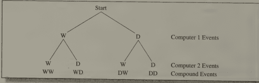


| 计算机 1 | 计算机 2 |
| :--- | :--- |
| W | W |
| W | WW |
| D | WD |
| DW | DD |

概率论的一个应用是推断选民样本是否真正代表所有选民，或者是否可能偏向某个政党。虽然此示例涉及人等真实对象，但其他总体（如可能的硬币投掷次数）是假设的。每次硬币投掷都是所有假设硬币投掷总体的一个样本。

演绎和归纳是关于总体推理的基础，如图 4.4 所示。给定已知总体，演绎允许我们对未知样本进行推断。相应地，给定已知样本，归纳允许我们对未知总体进行推断。

### Theory of Probability

A formal theory of probability can be made using three axioms:

```
axiom 1: 0 <= P(E) <= 1
```

This axiom defines the range of probability to be the real numbers from 0 to 1. Negative probabilities are not allowed. A certain event is assigned probability 1 and an impossible event is assigned probability 0:

```
axiom 2: \sum_i P(E_i) = 1
```

Figure 4.4 Deductive and Inductive Reasoning about Populations and Samples

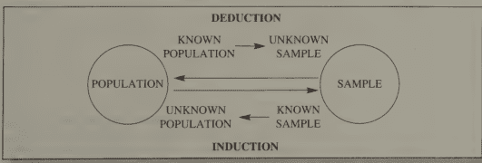

This axiom states that the sum of all events that do not affect each other, called mutually exclusive events, is 1. Mutually exclusive events have no sample point in common. For example, a computer cannot be both working correctly and not working correctly at the same time, unless it is a quantum computer.

As a corollary of this axiom:

P(E) + P(E') = 1

where E' is the complement of event E. This corollary means that the probability of an event occurring plus the probability of it not occurring is 1. That is, the occurrence and nonoccurrence of an event is a mutually exclusive and complete sample space:

axiom 3: P(E1 U E2) = P(E1) + P(E2)

where E1 and E2 are mutually exclusive events. This axiom means that if E1 and E2 cannot both occur simultaneously (mutually exclusive events) then the probability of one or the other occurring is the sum of their probabilities.

From these axioms, theorems can be deduced concerning the calculation of probabilities under other situations, such as nonmutually exclusive events, as we see later. While these axioms form the basis for a theory of probability, notice that they do not specify the basic probabilities P(E). The basic probabilities of events are determined by other methods such as a priori.

These axioms put probability on a sound theoretical basis. In fact, the axiomatic theory is also called the objective theory of probability. These particular axioms were devised by Kolmogorov. An equivalent theory using axioms of conditional probability was created by Renyi.

### 4.6 EXPERIMENTAL AND SUBJECTIVE PROBABILITIES

Other than ideal games with equal likelihood, classical probability cannot answer questions like what is the probability of your disk drive crashing tomorrow or what is the life expectancy of your spouse (unless you have a gun pointed at them.)

In contrast to the a priori approach, experimental probability defines the probability of an event, P(E), as the limit of a frequency distribution:

P(E) = lim_{N->infinity} f(E) / N

where f(E) is the frequency of outcomes of an event for N observed total outcomes. This type of probability is also called a posteriori probability, which means "after the event." Another term for a posteriori is the posterior probability. The idea of a posteriori is to measure the frequency that an event occurs for a large number of trials and from this induce the experimental probability.

For example, to determine the experimental probability of your disk drive crashing, you could take a poll of other people with your type of drive. The results of a hypothetical poll are shown in Table 4.4.

Table 4.4 Hypothetical Time for a Disk Drive to Crash

| Total Percent Crashed | Hours Used |
|---|---|
| 10 | 100 |
| 25 | 250 |
| 50 | 500 |
| 75 | 750 |
| 99 | 1,000 |

If your drive has been used 750 hours, then you could induce that there is a 75 percent probability of it crashing tomorrow. Notice that this 75 percent figure is an induction rather than a deduction. Unlike an ideal game, your disk drive is not exactly the same as others. There may be differences in the materials used, quality control, environmental conditions, and use that affect the drive and its longevity. It is much easier to produce simple devices such as dice or cards with much finer tolerances than a complex piece of equipment like a disk drive.

Another type of experimental probability can be induced from mortality tables used by life insurance companies that show the probability of a person dying, as a function of age and sex. Calculating the odds of your mortality based on these tables is an induction since you are unique. An analogous situation holds for house insurance. Unless your house is prefabricated and burns down frequently so that the individual experimental probability can be calculated, the experimental probabilities used will be based on similar types of houses. In fact you should show this book to your insurance company and demand a discount if you live in a trailer since their probability of its burning down is subject to classical probability and can be exactly calculated. (This is another example of the utility of this book to get an insurance discount as well as evading speeding tickets as discussed in a previous chapter.)

There is also a type of probability called subjective probability. Suppose you were asked the probability that automobiles using superconducting electric motors would cost $10,000 by the year 2020. Since there is no data on the cost of these cars, there is no way to extrapolate the costs to see if $10,000 is reasonable. On the other hand, hybrid gas/electric cars such as the Toyota Prius are already providing some data which may be extrapolated to all electric cars. And if the motor is superconducting and an order of magnitude more efficient, some reasonable extrapolation can be made.

Subjective probability deals with events that are not reproducible and have no historical basis on which to extrapolate, such as drilling an oil well at a new site. However, a subjective probability by an expert is better than no estimate at all and is usually very accurate (or the expert won’t be an expert for long.)

A subjective probability is actually a belief or opinion expressed as a probability rather than a probability based on axioms or empirical measurement. Beliefs and opinions of an expert play important roles in expert systems, as we shall see later in this chapter. Table 4.5 summarizes the different types of probabilities.

### Table 4.5 Types of Probabilities

| Names | Formula | Characteristics |
| :--- | :--- | :--- |
| a priori (classical, theoretical, mathematical, symmetric, equiprobable, equal likelihood) | P(E) = W / N where W is the number of outcomes of event E for a total of N possible outcomes | Repeatable events Equally likely outcomes Exact math form known Not based on experiment All possible events and outcomes known |
| a posteriori (experimental, empirical, relative frequency, statistical) | P(E) = lim n->infinity f(E) / N where f(E) is the frequency, f, event, E, is observed for N total outcomes | Repeatable events based on experiments Approximated by a finite number of experiments Exact math form unknown |
| | P(E) = f(E) / N | |
| subjective (personal) | See Section 4.12 | Nonrepeatable events Exact math form unknown Relative frequency method not possible Based on expert's opinion experience, judgment, belief |

### 4.7 COMPOUND PROBABILITIES

The probabilities of compound events can be computed from their sample spaces. As a very simple example, consider the probability of rolling a die such that the outcome is an even number and a number divisible by three. This can be expressed in terms of a Venn diagram for the sets:

```
A = { 2, 4, 6 }   B = { 3, 6 }
```

in the sample space of the die, as shown in Figure 4.5.

Notice that the intersection of the sets A and B is:

```
A ∩ B = { 6 }
```

The compound probability of rolling an even number and a number divisible by three is:

```
P(A ∩ B) = n(A ∩ B) / n(S) = 1 / 6
```

where n is the number of elements in the sets and S is the sample space.


### 图 4.5 掷一次骰子得到偶数且能被三整除的复合概率


互不影响的事件称为独立事件。对于两个独立事件 A 和 B，其概率仅为各自概率的乘积。事件 A 和 B 被称为两两独立：

P(A ∩ B) = P(A) P(B)

当且仅当上述公式成立时，两个事件被称为随机独立事件。“随机”一词源自希腊语，意为“猜测”。它常被用作概率的同义词。因此，随机实验具有概率性结果，与确定性实验的非随机结果形成对比。作为随机实验的示例，试着一个接一个地与 10 个人结婚又离婚，你可能会以幸福或不幸福的状态告终。另一方面，如果你一次性与十个人结婚，你最终将处于确定性的监狱状态。

对于三个事件，你可能会假设独立性为：

P(A ∩ B ∩ C) = P(A) P(B) P(C)

不幸的是，生活和概率并非如此简单。N 个事件相互独立的公式要求满足 2^N 个方程。这一要求由以下方程总结，其中星号表示事件及其补事件的每种组合都必须满足：

P(A*_1 ∩ A*_2 ∩ ... ∩ A*_n) = P(A*_1) P(A*_2) ... P(A*_n)

对于三个事件，上述相互独立方程要求满足以下所有方程：

- P(A ∩ B ∩ C) = P(A) P(B) P(C)
- P(A ∩ B ∩ C') = P(A) P(B) P(C')
- P(A ∩ B' ∩ C) = P(A) P(B') P(C)
- P(A ∩ B' ∩ C') = P(A) P(B') P(C')
- P(A' ∩ B ∩ C) = P(A') P(B) P(C)
- P(A' ∩ B ∩ C') = P(A') P(B) P(C')
- P(A' ∩ B' ∩ C) = P(A') P(B') P(C)
- P(A' ∩ B' ∩ C') = P(A') P(B') P(C')

如问题 4.6 所示，每两个事件的两两独立性不足以保证相互独立性。

对于我们的骰子，偶数事件和能被三整除的事件肯定会相互影响，因此这不是随机实验。一个骰子出现偶数且另一个骰子出现能被三整除的数的概率是随机的。

P(A ∩ B) = P(A) P(B) = 3/6 · 2/6 = 1/6

现在让我们考虑事件的并集情况，P(A ∪ B)。定义 n 为返回集合元素个数的函数。如果将 A 中的元素数加上 B 中的元素数，再除以样本空间中的总元素数 n(S)，

P(A ∪ B) = (n(A) + n(B)) / n(S) = P(A) + P(B)

如果集合有重叠，结果就会偏大。如果查看图 4.5，应用此公式得到：

P(A ∪ B) = (3 + 2) / 6 = 5 / 6

但你可以轻易看出并集中只有四个元素，因为：

A ∪ B = { 2, 3, 4, 6 }

问题在于，仅将 n(A) 加到 n(B) 会将集合交集 {6} 计算两次，因为它既属于 A 也属于 B。

正确的公式只需减去集合交集的额外概率：

P(A ∪ B) = P(A) + P(B) - P(A ∩ B)

对于我们的骰子，这简化为：

P(A ∪ B) = 3/6 + 2/6 - 1/6 = 4/6 = 2/3

当集合互斥且无公共元素时，公式 (1) 成立。它是公式 (2) 的特例，称为加法法则。加法法则也可以使用前面讨论的三个概率公理作为定理推导出来。三个事件的加法法则为：

P(A ∪ B ∪ C) = P(A) + P(B) + P(C)
- P(A ∩ B) - P(A ∩ C) - P(B ∩ C)
+ P(A ∩ B ∩ C)

关于既不是 A 也不是 B 以及 A 和 B 的异或的其他定律也可以从公理中推导出来。这些定律对复合概率的价值在于：(1) 不需要为每种可能的概率组合进行实验；(2) 不需要计算大样本空间中的各个单独元素。

### 4.8 条件概率

非互斥事件会相互影响。知道一个事件已经发生，可能会导致我们修订另一个事件发生的概率。

### 乘法法则

在事件 B 发生的条件下，事件 A 的概率称为条件概率，表示为 P(A | B)。条件概率定义为：

P(A | B) = P(A ∩ B) / P(B) for P(B) ≠ 0

概率 P(B) 是在未知任何信息之前的先验概率或前验概率。当与条件概率关联使用时，前验概率有时被称为无条件概率或绝对概率。

如果查看图 4.6 的示例，可以直观地解释条件概率的定义，图 4.6 是一个包含八个事件的样本空间。从图 4.6 可以看出，概率可以计算为事件数 n(A) 或 n(B) 与样本空间总数 n(S) 的比率。即，

P(A) = n(A) / n(S) = 4 / 8

P(B) = n(B) / n(S) = 6 / 8

### 图 4.6 两个相交事件的样本空间


如果已知事件 B 已经发生，缩减后的样本空间就是 B 本身：

n(S) = 6

由于 B 已经发生，只考虑与 B 相关的 A 中的事件：

P(A | B) = n(A ∩ B) / n(B) = 2 / 6

要用概率表示结果，只需将上述分子和分母同时除以 n(S)：

P(A | B) = (n(A ∩ B) / n(S)) / (n(B) / n(S))
= P(A ∩ B) / P(B) for P(B) ≠ 0

两个事件的概率乘法法则定义为：

P(A ∩ B) = P(A | B) P(B)

这等价于以下公式：

P(A ∩ B) = P(B | A) P(A)

三个事件的乘法法则如下：

P(A ∩ B ∩ C) = P(A | B ∩ C) P(B | C) P(C)

广义乘法法则为：

P(A_1 ∩ A_2 ∩ ... ∩ A_n) = P(A_n | A_1 ∩ ... ∩ A_{n-1}) ··· P(A_2 | A_1) P(A_1)

作为概率示例，表 4.6 显示了在一年内使用 Brand X 驱动器发生磁盘崩溃的假设概率。

| | Brand X | 非 Brand X | 行总计 |
|---|---|---|---|
| 崩溃 C | 0.6 | 0.1 | 0.7 |
| 未崩溃 C' | 0.2 | 0.1 | 0.3 |
| 列总计 | 0.8 | 0.2 | 1.0 |

表格中间区域内的 0.6、0.1、0.2 和 0.1 概率称为内部概率，表示事件的交集。行和列的和显示为总计，称为边缘概率，因为它们位于表格的边缘。

表 4.7 和表 4.8 更详细地展示了集合和概率的含义。图 4.7 展示了样本空间交集的维恩图。从表 4.8 可以看出，总行概率和总列概率之和为 1。

| | X | X' | 行总计 |
|---|---|---|---|
| C | C ∩ X | C ∩ X' | C = (C ∩ X) ∪ (C ∩ X') |
| C' | C' ∩ X | C' ∩ X' | C' = (C' ∩ X) ∪ (C' ∩ X') |
| 列总计 | X = (C ∩ X) ∪ (C' ∩ X) | X' = (C ∩ X') ∪ (C' ∩ X') | S (样本空间) |

| | X | X' | 行总计 |
|---|---|---|---|
| C | P(C ∩ X) | P(C ∩ X') | P(C) |
| C' | P(C' ∩ X) | P(C' ∩ X') | P(C') |
| 列总计 | P(X) | P(X') | 1.0 |

### 图 4.7 两个集合的样本空间解释


使用表 4.8，可以计算所有事件的概率。一些概率为：

- (1) Brand X 和非 Brand X（样本空间）发生崩溃的概率为：
  P(C) = 0.7

- (2) 样本空间未发生崩溃的概率为：
  P(C') = 0.3

- (3) 使用 Brand X 的概率为：
  P(X) = 0.8

- (4) 不使用 Brand X 的概率为：
  P(X') = 0.2

- (5) 发生崩溃且使用 Brand X 的概率为：
  P(C ∩ X) = 0.6

- (6) 在使用 Brand X 的条件下发生崩溃的概率为：
  P(C | X) = P(C ∩ X) / P(X) = 0.6 / 0.8 = 0.75

- (7) 在不使用 Brand X 的条件下发生崩溃的概率为：
  P(C | X') = P(C ∩ X') / P(X') = 0.1 / 0.2 = 0.50

阅读描述时，概率 (5) 和 (6) 看起来可能含义相似。然而，(5) 仅仅是两个事件的交集，而 (6) 是条件概率。交集 (5) 的含义如下：

> 如果随机选取一个磁盘驱动器，则有 0.6 的概率它是 Brand X 且已崩溃。

换句话说，我们只是从磁盘驱动器总体中选取样本。其中一些驱动器是 Brand X 且已崩溃（0.6），一些不是 Brand X 且已崩溃（0.1），一些是 Brand X 且未崩溃（0.2），一些不是 Brand X 且未崩溃（0.1）。

相比之下，条件概率 (6) 的含义截然不同：

> 如果选取一个 Brand X 驱动器，则有 0.75 的概率它已崩溃。

请注意，在条件概率中，我们选取感兴趣的项目（Brand X），并将其视为新的样本空间。


如果以下任一等式成立，则事件 A 和 B 独立：

```
P(A | B) = P(A) or
P(B | A) = P(B) or
P(A ∩ B) = P(A) P(B)
```

如果这些等式中任一成立，则其他等式也成立。

### 贝叶斯定理

条件概率 P(A | B) 表示在事件 B 已发生的情况下，事件 A 发生的概率。逆问题是求逆概率，即在后一事件已发生的情况下，前一事件发生的概率。这种概率经常出现，例如在医疗或设备诊断中，症状出现，问题在于找出最可能的原因。解决此问题的方法是贝叶斯定理，有时也称为贝叶斯公式、贝叶斯规则或贝叶斯定律，以18世纪英国牧师兼数学家托马斯·贝叶斯命名。贝叶斯理论今天在许多应用中被广泛使用。在熟悉的 Office 助手以及 Microsoft Office 和 Windows 中自动提供的技术疑难解答帮助中，使用贝叶斯逻辑来更好地尝试帮助你，而不是依赖简单的决策树（Gates 00）。

以贝叶斯定理为例，让我们看看它如何应用于磁盘驱动器崩溃。根据条件概率 (6)，Brand X 驱动器在一年内崩溃的概率为 75%，而根据 (7)，非 Brand X 驱动器在一年内崩溃的概率为 50%。逆问题是，假设你有一个驱动器但不知道其品牌，如果它崩溃了，它是 Brand X 的概率是多少？非 Brand X 呢？

这种情况时常发生，因为你并不真正知道驱动器的情况，而计算机制造商很少自己制造驱动器。相反，许多制造商从原始设备制造商（OEM）处购买驱动器，然后重新包装以在自己的品牌下销售。根据哪家 OEM 提供最低成本，驱动器可能会年年变化，只有计算机制造商的标签保持不变。

已知驱动器已崩溃，其为 Brand X 的概率可以用条件概率和结果 (1)、(5) 表示：

```
P(X | C) = P(C ∩ X) / P(C) = 0.6 / 0.7 = 6/7
```

或者，在分子上使用乘法定律，并结合 (1)、(3)、(6)：

```
P(X | C) = P(C|X)P(X) / P(C) = (0.75)(0.8) / 0.7 = 0.6 / 0.7 = 6/7
```

概率 P(X | C) 是逆概率或后验概率，表示如果驱动器崩溃了，则它是 Brand X。图 4.8 显示了一个决策树

### 图 4.8 磁盘崩溃的决策树

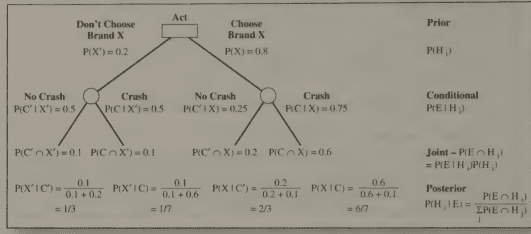

用于磁盘崩溃。方形符号表示**行为**或决策，圆形符号表示**事件**或发生。先验概率是指在衡量崩溃的实验之前的概率。后验或逆概率是指在实验完成后确定的概率。后验概率允许我们修订先验概率以获得更准确的结果。

贝叶斯定理的一般形式可以用事件 E 和假设（假定） H 以以下替代形式表示：

```
P(H_1 | E) = \frac{P(E \cap H_1)}{\sum_j P(E \cap H_j)}

= \frac{P(E | H_1) P(H_1)}{\sum_j P(E | H_j) P(H_j)}

= \frac{P(E | H_1) P(H_1)}{P(E)}
```

### 4.9 假设推理与后向归纳

贝叶斯定理常用于商业和社会科学的决策树分析。**贝叶斯决策**方法也用于 PROSPECTOR 专家系统，以确定矿产勘探的有利地点。PROSPECTOR 作为第一个发现价值 1 亿美元的有价值钼矿床的专家系统而声名远扬。

作为不确定性下贝叶斯决策的一个例子，让我们看看石油勘探的问题。最初，勘探者必须决定找到石油的可能性有多大。如果既没有支持也没有反对石油的证据，勘探者可能会为石油 O 分配主观先验概率：

P(O) = P(O') = 0.5

在没有证据的情况下，对可能结果进行等权重概率分配被认为是出于绝望而做出的。“出于绝望”这一术语并不意味着勘探者（必然）处于急需之中。这是一个技术术语，指无偏的先验概率分配。当然，勘探者相信找到石油的机会大于 50-50，因此可能会假设以下情况：

P(O) = 0.6 P(O') = 0.4

在地震和矿产勘探中，一种非常重要的工具是地震勘探。在这种技术中，炸药或机械产生穿过地球的声脉冲。声波由各个位置的麦克风检测到。通过观察脉冲的到达时间和声音波形的失真，可以确定地质结构以及石油和矿物的可能性。不幸的是，地震测试并非 100% 准确。声波可能受某些类型地质结构的影响，导致测试报告存在石油而实际上没有（假阳性）。同样，测试可能报告没有石油而实际上有石油（假阴性）。假设地震测试的过去历史给出了以下条件概率，其中 + 表示正结果，– 表示负结果。请注意，这些条件概率是因为原因（有石油或无石油）必须在效果（测试结果）之前发生。后验概率将是从效果（测试结果）回到原因（有石油或无石油）。一般来说，条件概率在时间上是向前的，而后验概率是向后的。

P(+ | O) = 0.8       P(- | O) = 0.2 (false -)
P(+ | O') = 0.1 (false +)   P(- | O') = 0.9

使用先验概率和条件概率，我们可以构建如图 4.9 所示的初始概率树。还显示了联合概率，它们是从先验概率和条件概率计算得出的。

然后使用加法定律计算 + 和 – 测试的总概率。

P(+) = P(+ ∩ O) + P(+ ∩ O') = 0.48 + 0.04 = 0.52
P(-) = P(- ∩ O) + P(- ∩ O') = 0.12 + 0.36 = 0.48

P(+) 和 P(-) 是无条件概率，现在可以用于计算站点的后验概率，如图 4.10 所示。例如，P(O' | -) 是基于负测试结果的站点无石油的后验概率。然后计算联合概率。请注意，图 4.10 的联合概率与图 4.9 相同。概率的修订

### 图 4.9 石油勘探的初始概率树

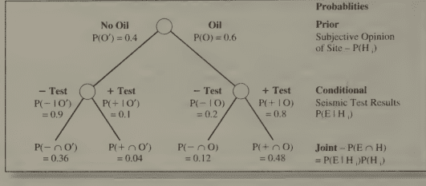

### 图 4.10 石油勘探的修订概率树

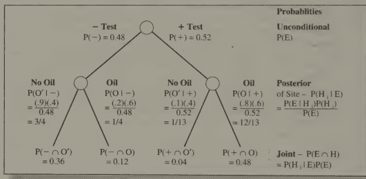

当实验信息（例如地震测试结果）在初始概率估计（或猜测）之后出现时，概率修订是获得良好结果所必需的。图 4.11 显示了使用图 4.10 数据的初始贝叶斯决策树。树底部的回报在赚钱时为正，在亏钱时为负。假设的金额显示在表 4-9 中。因此，如果找到石油，回报为 $1,000,000 - $200,000 - $50,000 = $750,000，而在地震测试结果后决定放弃的回报为 -$50,000，进行地震测试和钻探但没有石油的回报为 -$200,000 - $50,000 = -$250,000。请注意，除非你能利用税收漏洞（如果你有好的游说者，这并非不可能，因为许多特殊税收条款被附加在国会法案中），否则此回报并非 -$1,000,000 - $200,000 - $50,000 = -$1,250,000。

### 图 4.11 石油勘探的初始贝叶斯决策树

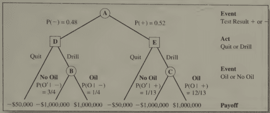

### 表 4.9 石油勘探问题的回报表

| 项目 | 数值 |
|---|---|
| 石油租赁，如果成功 | $1,000,000 |
| 钻探费用 | –$200,000 |
| 地震勘探 | –$50,000 |

为了让勘探者做出最佳决策，必须在事件节点 A 计算**预期回报**。预期回报是勘探者通过遵循最佳行动方案可以获得的金额。要计算起点 A 的预期回报，必须从叶子节点开始向后推导。在概率理论中，此过程称为**后向归纳**。也就是说，为了实现我们想要的预期回报或目标，我们必须向后推理以找到将引导我们实现目标的原因。

事件节点的预期回报是回报乘以导致回报的概率之和：

```
Expected payoff at node C
$673,077 = ($750,000) (12/13) – ($250,000) (1/13)
```

```
Expected payoff at node B
$0 = ($750,000) (1/4) – ($250,000) (3/4)
```

在行动节点 E，我们必须在放弃的预期回报 –$50,000 和钻探的预期回报 $846,153 之间做出决定。由于 $846,153 大于 –$50,000，我们将推断这是更好的行动，并在节点 E 上方写出它。放弃的路径将通过用 "=" 符号将其断开而被**修剪**或**毒化**，以指示此路径不会被遵循，如图 4.12 所示。同样，在行动节点 D，在 –$50,000 的回报和 –$500,000 的回报之间，最佳选择是 –$50,000，因此在 D 上写出此值。


### 图 4.12 使用逆向归纳的石油勘探完整贝叶斯决策树

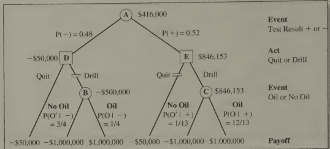

最后，初始时的预期收益计算如下：

```
Expected payoff at node A:
$350,000 = ($673,077) (0.52) - ($0) (0.48)
```

该值写在节点 A 上。在节点 A 上无法剪枝任何路径，因为我们已经决定进行地震测试。要决定是否进行地震测试，决策树需要在节点 A 之前向后扩展。请注意，在逆向归纳中，我们是逆时间推理，以便未来的行动是最优的。

对于收益表中的这些特定选择，勘探者在行动节点 D 上会有一个不言而喻的决定，因为预期收益为 $0。然而，这就是胆量、运气和经验介入赌博的地方。勘探者可能只是相信自己的感觉，尽管地震测试为负且可能没有石油，仍选择在 D 进行钻探。有时他们赢，有时他们输。在类似情况下，有一条重要的智慧需要记住：永远用别人的钱赌博！随着成功油井预期回报的增加，节点 B 和 D 的收益也随之增加。例如，如果预期油井的收益为 $1,250,000 而不是 $1,000,000，则 B 和 D 的预期收益为 $62,500，这仍然少于决定钻探的 $200,000 成本，但比之前的预期收益 $0 好得多。这加强了我们的常识：物品越昂贵，收益越大。不过请注意，即使石油价格涨到十亿美元，概率的风险仍然保持不变。（唯一不同的是收益，但这超越了风险，正如监狱里的人所知道的。）

决策树是假设性推理或“如果……会怎样”类型情境的示例。通过探索替代行动路径，我们可以剪掉不通向最优收益的路径。某些专家系统工具和贝叶斯软件具有用于假设性推理和剪枝的精巧机制。有关更多详细信息，请参见软件资源的附录 G。

特别是，现在免费或商业来源的贝叶斯工具使以图形形式构建贝叶斯和概率树以及尝试不同的“如果……会怎样”情景变得容易。像 Microsoft Excel 这样的电子表格具有处理不确定性的非常精巧的方法，如果你在 Web 上搜索，可以找到许多宏，超出了 Excel 自带的经典概率和统计内置函数。电子表格易于使用的图表功能也使可视化复杂数据变得容易。

图 4.12 的决策树展示了勘探者的最优策略。如果地震测试为正，则应钻探该地点。如果地震测试为负，则应放弃该地点。虽然这是贝叶斯决策的一个非常简单的示例，但它确实说明了处理不确定性所涉及的推理类型。在更复杂的情况下，例如决定使用地震测试，决策树可能会大得多。

### 4.10 时间推理与马尔可夫链

关于依赖时间的事件的推理称为*时间推理*，这是人类相当容易做到的事情。然而，要将*时间事件*形式化以便计算机可以进行时间推断是困难的。然而，处理时间事件（例如航空交通控制）的专家系统可能非常有用。在医学领域，已经开发出了随时间推理的专家系统。这些系统包括用于呼吸机患者呼吸机管理的 VM 系统，以帮助他们呼吸。其他系统包括用于眼部青光眼治疗的 CASNET 以及用于心脏病患者的地高辛治疗顾问。

除了 VM，上述提到的其他医学系统的时间推理问题比必须实时运行的飞机控制系统要简单得多。大多数专家系统无法实时运行，因为推理引擎设计和所需的大量处理。进行大量时间推理以实时探索多个假设的专家系统非常难以构建。基于不同公理，已经开发出了不同的时间逻辑。不同的理论基于某些问题的回答方式。时间是否有第一个和最后一个时刻？时间是连续的还是离散的？是否只有一个过去但许多可能的未来？

根据这些问题的回答方式，可以开发出许多不同的逻辑。时间逻辑在常规程序中也很有用，例如在并发程序中对进程进行综合和同步。

时间推理的另一种方法是使用概率。我们可以将系统从一个状态转移到另一个状态视为随时间演变。系统可以是任何概率性事物，例如股票、选民、天气、商业、疾病、设备、遗传学等等。如果系统是概率性的，则系统通过一系列状态的演进称为*随机过程*。

将随机过程表示为转移矩阵形式很方便。对于两个状态 S1 和 S2 的简单情况，转移矩阵如下：

| | S1 | S2 |
|---|---|---|
| S1 | P11 | P12 |
| S2 | P21 | P22 |

其中 Pmn 是从状态 m 到状态 n 的转移概率。

例如，假设目前所有使用 Brand X 驱动器的人中有 10% 在需要时会再次购买 Brand X 驱动器。另外，目前不使用 Brand X 的人中有 60% 在需要新驱动器时会购买 Brand X（Brand X 唯一的好处是他们的广告）。在一段很长的时间里，有多少人会使用 Brand X？

转移矩阵 T 如下：

| | X | X' |
|---|---|---|
| X | 0.1 | 0.9 |
| X' | 0.6 | 0.4 |

其中每一行的和必须等于 1。分量非负且和为 1 的向量称为概率向量。T 的每一行都是一个概率向量。解释转移矩阵的一种方法是使用状态图，如图 4.13 所示。请注意，保持在状态 X 的概率为 0.1，保持在状态 X' 的概率为 0.4，从 X 转到 X' 的概率为 0.9，从 X' 转到 X 的概率为 0.6。

假设最初 80% 的人使用 Brand X。图 4.14(a) 显示了几个状态转换的概率树，其中状态按状态编号和拥有的驱动器标记。请注意树是如何开始生长的。如果有 10 次转换，树将有 2^10 = 1024 个分支。将树绘制为格点图的替代方法如图 4.14b 所示。格点表示的优势是不需要那么多连接状态的链接。

### 图 4.13 转移矩阵的状态图解释


### 图 4.14 随时间演变的状态树和格点图

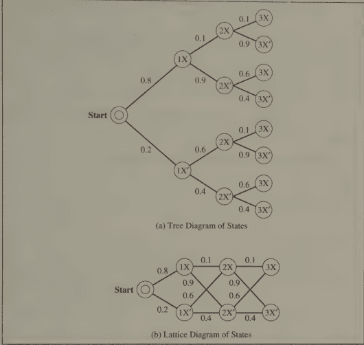

系统处于某个状态的概率可以表示为一个称为状态矩阵的行矩阵：

```
S = [P1  P2  ....  Pn]
```

其中 P1 + P2 + ... + Pn = 1

最初 80% 的人拥有 Brand X，状态矩阵为：

```
S1 = [0.8   0.2]
```

随着时间的推移，这些数字将根据人们购买的驱动器而变化。

为了计算处于状态 2、拥有 Brand X 和不拥有 Brand X 的人数，只需使用普通矩阵乘法定律将状态矩阵乘以转移矩阵：

```
S₂ = S₁ T
```

结果为：

```
S₂ = [0.8  0.2] [0.1  0.9]
        [0.6  0.4]

   = [(0.8)(0.1) + (0.2)(0.6)   (0.8)(0.9) + (0.2)(0.4)]

   = [0.2   0.8]
```

将第二个状态乘以转移矩阵得到：

```
S₃ = S₂ T

   = [0.2   0.8] [0.1  0.9]
        [0.6  0.4]

S₃ = [0.5   0.5] .
```

将第三个状态乘以转移矩阵得到：

```
S₄ = S₃ T

   = [0.5   0.5] [0.1  0.9]
        [0.6  0.4]

S₄ = [0.35   0.65]
```

接下来的状态为：

```
S₅ = [0.425   0.575]
S₆ = [0.3875   0.6125]
S₇ = [0.40625   0.59375]
S₈ = [0.396875   0.602125]
```

请注意，状态正在收敛于：

```
[0.4   0.6]
```

这称为稳态矩阵。当系统处于稳态时，由于不再变化，据说处于平衡状态。有趣的是，稳态值不依赖于初始状态。如果使用了任何初始概率向量，稳态值都将相同。


概率向量 S 是转移矩阵 T 的稳态矩阵，当且仅当：

- (1) S = S T

如果 T 是正则转移矩阵，即存在某个幂次使得所有元素均为正数，则存在唯一的稳态 S。转移矩阵元素为正数意味着，在某个时刻，无论初始状态如何，都有可能处于任意状态。也就是说，每个状态都可能被访问到。

马尔可夫链过程被定义为具有以下特征：

- (1) 该过程具有有限个可能状态。
- (2) 该过程在任一时刻只能处于且仅处于一个状态。
- (3) 该过程随时间依次从一个状态移动或步进到另一个状态。
- (4) 移动的概率仅取决于紧邻的前一状态。

例如，给定有限状态集合 {A,B,C,D,E,F,G,H,I}，如果过程在 H 之后进入的下一个状态是 I，则条件概率如下：

P(I | H) = P(I | H ∩ G ∩ F ∩ E ∩ D ∩ C ∩ B ∩ A)

注意图 4.14 (b) 的格点图与链状图相似。

磁盘驱动器案例是一个马尔可夫链过程，可通过应用方程 (1) 求得稳态矩阵。假设某个任意向量 S 具有分量 X 和 Y，并按如下方式应用方程 (1)：

[X Y] [0.1 0.9; 0.6 0.4] = [X Y]

将左侧相乘并令其元素等于右侧对应元素，得到：

0.1 X + 0.6 Y = X
0.9 X + 0.4 Y = Y

这是一个线性相关的方程组。用 Y 表示 X 的解为：

X = 0.6 / 0.9 Y = 2/3 Y

为完全求解 X 和 Y，我们利用概率之和等于 1 的事实。即，

X + Y = 1

因此：

X = 1 - Y = \frac{2}{3} Y

进而：

X = \frac{2}{5}, Y = \frac{3}{5}

所以稳态矩阵为：

[0.4 0.6]

这正是我们的试验值所趋近的值。

### 4.11 信念的几率

迄今为止，我们一直关注理想系统中可重复事件的概率作为度量。然而，人类擅长计算许多非事件（如医疗诊断和矿产勘探）的概率，其中每个患者和每个勘探点都是唯一的。为了在这些领域构建专家系统，我们必须将事件范围扩展到命题，即为真或为假的陈述。例如，一个事件可能是：

> "患者全身布满红斑"

而命题是：

> "患者患有麻疹"

鉴于 A 是一个命题，条件概率：

P(A | B)

如果事件和命题不可重复或没有数学基础，则不一定是古典意义上的概率。相反，P(A | B) 可以解释为在给定 B 的情况下 A 为真的信念程度。

如果 P(A | B) = 1，则我们相信 A 肯定为真。如果 P(A | B) = 0，则我们相信 A 肯定为假；而其他值，0 < P(A | B) < 1，则表示我们不完全确定 A 为真或为假。在统计学中，术语“假设”用于指代某个命题，其真伪基于某些证据无法确定。此时，条件概率被称为“似然”，如 P(H | E)，它表示基于某些证据 E 的假设 H 的似然。

尽管 P(H | E) 具有条件概率的形式，但它实际上表达的是不同的含义——似然或信念程度。概率指可重复事件，而似然指我们对不可重复事件的信念程度。由于专家系统是人类专家的模型，P(H | E) 通常表示专家在给定某些证据 E 的情况下，认为某个假设为真的信念程度。当然，如果事件是可重复的，那么 P(H | E) 仅仅是概率。

如果我们同意 P(H | E) 表示似然或信念程度，那么 50% 或 95% 这样的值意味着什么？例如，假设你有 95% 的把握你的汽车下次能启动。解释这种似然的一种方式是从赌注的几率角度来看。在给定某个事件 C 的情况下，A 对 B 的几率为：

odds = P(A | C) / P(B | C)

如果 B = A'

odds = P(A | C) / P(A' | C) = P(A | C) / (1 - P(A | C))

定义：

P = P(A | C)

则得到：

odds = P / (1 - P) 且 P = odds / (1 + odds)

从赌博几率的角度来看，我们可以将 P 解释为获胜次数，1 - P 解释为失败次数，因此：

odds = 获胜次数 / 失败次数

知道几率后，可以计算概率或似然，反之亦然。

因此，P = 95% 的似然等价于：

odds = .95 / (1 - .95) = 19 比 1

即你相信汽车会启动。也就是说，你应当对以 19 比 1 的几率赌汽车会启动持无所谓态度。如果有人以 1 美元赌汽车不会启动，如果汽车没启动，你将支付 19 美元。每当信念程度表述为概率时，你都可以将其解释为等价几率的赌注。换句话说，你应当对真实情况及其信念程度，或等价几率的赌注持无所谓态度。

概率通常用于演绎问题，其中在相同假设下可能发生多个不同事件 E_n。例如，已知掷骰子出现偶数，则有三个可能事件：

```
P(2 | even)
P(4 | even)
P(6 | even)
```

在概率论中，我们通常关注 P(E | H)，其中 E 是来自共同假设的可能事件。在统计学和归纳推理中，我们知道已发生的事件，并希望找到能导致 E 的假设的似然，即 P(E | H)。概率天然是前向链或演绎的，而似然是后向链和归纳的。尽管我们对概率和似然使用相同的符号 P(X | Y)，但应用场景不同。通常我们指代假设的似然或事件的概率

一种基于信念程度发展起来的理论是个人概率。在个人概率中，状态是可能的假设，后果是基于信念采取的行动的结果。

### 4.12 充分性和必要性

贝叶斯定理为：

```
(1) P(H | E) = P(E | H)P(H) / P(E)
```

对于 H 的否定则变为：

```
(2) P(H' | E) = P(E | H')P(H') / P(E)
```

用 (1) 除以 (2) 得到：

```
(3) P(H | E) / P(H' | E) = P(E | H)P(H) / P(E | H')P(H')
```

定义 H 的先验几率为：

```
O(H) = P(H) / P(H')
```

以及后验几率为：

\( O(H \mid E) = \frac{P(H \mid E)}{P(H' \mid E)} \)

最后定义似然比：

(4) \( LS = \frac{P(E \mid H)}{P(E \mid H')} \)

则 (3) 变为：

(5) \( O(H \mid E) = LS \ O(H) \)

方程 (5) 称为贝叶斯定理的 **几率-似然形式**。它比方程 (1) 更便于使用的贝叶斯定理形式。

因子 LS 也被称为“充分似然”，因为如果 \( LS = \infty \)，则证据 E 在逻辑上足以得出 H 为真的结论。如果 E 在逻辑上足以得出 H，则 \( P(H \mid E) = 1 \) 且 \( P(H \mid E') = 0 \)。方程 (5) 可用于求解 LS，如下所示：

(6) \( LS = \frac{O(H \mid E)}{O(H)} = \frac{P(H' \mid E)}{P(H' \mid E')} = \frac{P(H)}{P(H')} \)

现在 \( P(H) / P(H') \) 是某个常数 C，因此方程 (6) 变为：

\( LS = \frac{C}{0} = \infty \)

方程 (4) 还表明在此情况下 H 对 E 是充分的。表 4.10 总结了 LS 其他值的含义。

必要似然 LN 的定义与 LS 类似，如下：

(7) \( LN = \frac{O(H \mid E')}{O(H)} = \frac{P(E' \mid H)}{P(E' \mid H')} = \frac{P(H \mid E')}{P(H \mid E')} \frac{P(H' \mid E')}{P(H')} \)

(8) \( O(H \mid E') = LN \ O(H) \)

如果 LN = 0，则 \( P(H \mid E') = 0 \)。这意味着当 E' 为真时，H 必须为假。因此，如果 E 不存在，则 H 为假，这意味着 E 对 H 是必要的。

表 4.11 显示了 LN、E 和 H 之间的关系。请注意，它与表 4.10 相同，只是将“证据”替换为“证据缺失”。


似然值 LS 和 LN 必须由人类专家提供，以便计算后验概率比。方程 (5) 和 (8) 的形式对人们来说很简单。LS 因子显示当证据存在时先验概率比变化了多少。LN 因子显示当证据不存在时先验概率比变化了多少。这些形式使人类专家更容易指定 LS 和 LN 因子。

例如，在 PROSPECTOR 专家系统中，有一条规则规定某种矿物的证据如何支持一个假设：

```
IF there are quartz-sulfide veinlets
THEN there is a favorable alteration
for the potassic zone
```

这个特定的中间假设为其他假设提供支持，进而指向顶层假设，即铜存在。该规则的 LS 和 LN 值为：

```
LS = 300
LN = 0.2
```

这意味着观察到石英-硫化物脉状矿脉非常有利，而不观察到脉状矿脉则略微不利。如果 LN 远小于 1，那么不观察到石英-硫化物脉状矿脉将强烈暗示该假设为假。

表 4.10 似然比、假设与证据之间的关系

| LS | 对假设的影响 |
|---|---|
| 0 | 当 E 为真时 H 为假，或者 E' 是得出 H 结论所必需的 |
| 小 (0 < LS << 1) | E 对得出 H 不利 |
| 1 | E 对 H 的信念没有影响 |
| 大 (1 << LS) | E 对得出 H 有利 |
| ∞ | E 在逻辑上足以支持 H，或者观察到 E 意味着 H 必须为真 |

表 4.11 必然性似然、假设与证据之间的关系

| LN | 对假设的影响 |
|---|---|
| 0 | 当 E 缺失时 H 为假，或者 E 是 H 所必需的 |
| 小 (0 < LN << 1) | E 的缺失对得出 H 不利 |
| 1 | E 的缺失对 H 没有影响 |
| 大 (1 << LN) | E 的缺失对 H 有利 |
| ∞ | E 的缺失在逻辑上足以支持 H |

一个示例是规则：

```
IF glassy limonite
THEN best mineralization favorability
```

与：

```
LS = 1000000
LN = 0.01
```

### 4.13 推理链中的不确定性

不确定性可能存在于规则、规则使用的证据，或两者之中。在本节中，你将看到一些现实世界中的不确定性问题，以及概率如何提供答案。

### 专家不一致性

根据前一节的方程 (4)，

```
if LS > 1 then P(E | H') < P(E | H)
```

将两边都从 1 中减去会使不等式方向反转：

```
1 - P(E | H') > 1 - P(E | H)
```

由于 P(E' | H) = 1 - P(E | H)，且 P(E' | H') = 1 - P(E | H')，则 (7) 变为：

```
LN = \frac{1 - P(E | H)}{1 - P(E | H')} < 1
```

LS 和 LN 值的约束总结如下：

- 情况 1：LS > 1 且 LN < 1

根据方程 (4) 和 (7)，其他情况为：

- 情况 2：LS < 1 且 LN > 1
- 情况 3：LS = LN = 1

虽然这三种情况是 LS 和 LN 值的数学严格约束，但在现实世界中并不总是适用。对于用于矿产勘探的专家系统 PROSPECTOR，专家指定 LS > 1 且 LN = 1 并不罕见，这不属于上述三种情况之一。也就是说，专家表示观察到证据很重要，但证据的缺失不重要。

最后一种情况表明，基于贝叶斯概率论的似然理论对于矿产勘探问题是不完整的。也就是说，贝叶斯似然理论只是一种近似理论，该理论还能处理 LS > 1 且 LN = 1 的情况。对于专家意见满足前三种情况之一的领域，贝叶斯似然理论是令人满意的。

### 不确定证据

在现实世界中，除了死亡和税收，我们几乎对任何事情都不能绝对确定，而现在随着克隆和冷冻保存技术的出现，我们甚至对死亡也不确定。虽然到目前为止我们主要关注不确定假设，但更普遍和现实的情况是不确定假设和不确定证据。

对于一般情况，假设对完整证据 E 的信念程度取决于部分证据 e，如下：

```
P(E | e)
```

完整证据是代表构成 E 的所有可能证据和假设的总证据。部分证据 e 是我们已知的 E 的一部分。如果我们知道所有证据，则 E = e 且：

```
P(E | e) = P(E)
```

其中 P(E) 是证据 E 的先验似然。似然 P(E | e) 是在我们对完整证据 E 的不完美知识 e 的情况下，对 E 的信念。

例如，假设你所在社区中那些开始在自家厨房钻探石油的人变得富有。你可以考虑一个假设和证据：

```
H = I'm going to get rich
E = there is oil under my kitchen
```

如规则所示：

```
IF there is oil under my kitchen
THEN I'm going to get rich       P(H | E) = 1
```

在这个初始阶段，你不确定自家厨房下是否有石油。确凿证据将是钻探一口试验井，但这相当昂贵。因此，你考虑支持 E 的部分证据 e，如下：

- 社区中的其他人已经发了财。
- 厨房炉灶周围总是渗出一些黑色物质（你的配偶此前一直将其归咎于你的烹饪和清洁）。
- 一个陌生人来到门口，出价 20,000,000 美元购买你的房子，因为她说她喜欢那里的景色。

基于这些部分证据，你可能会认为厨房下有石油的可能性相当高，P(E | e) = 0.98。
在概率或似然类型的推理链中，如果 H 依赖于 E，而 E 基于某些部分证据 e，那么 P(H | e) 是 H 依赖于 e 的可能性。根据条件概率规则：

```
P(H | e) = \frac{P(H \cap e)}{P(e)}
```

图 4.15 说明 H 可以被视为由 E 和 e 组成。因此上述内容变为：

图 4.15 H 与 e 的交集


```
P(H | e) = \frac{P(H \cap E \cap e) + P(H \cap E' \cap e)}{P(e)}
```

使用条件概率规则得到：

```
P(H | e) = \frac{P(H \cap E | e)P(e) + P(H \cap E' | e)P(e)}{P(e)}
```

```
(1) P(H | e) = P(H \cap E | e) + P(H \cap E' | e)
```

另一种表达 (1) 的方式是，因为：

```
P(H \cap E | e) = \frac{P(H \cap E \cap e)}{P(e)}
```

(2) P(H | E ∩ e) = \frac{P(H | E ∩ e) P(E ∩ e)}{P(e)}

并且因为：

P(E | e) = \frac{P(E ∩ e)}{P(e)}

那么 (2) 变为：

P(H | E ∩ e) = P(H | E ∩ e) P(E | e)

同样：

P(H | E' | e) = P(H | E' ∩ e) P(E' | e)

并且 (1) 变为：

(3) P(H | e) = P(H | E ∩ e) P(E | e) + P(H | E' ∩ e) P(E' | e)

通常，我们不知道概率 P(H | E ∩ e) 和 P(H | E' ∩ e)。但是，如果假设这些可以由 P(H | E) 和 P(H | E') 近似，那么 (3) 简化为：

(4) P(H | e) = P(H | E) P(E | e) + P(H | E') P(E' | e)

方程 (4) 本质上是 P(H | e) 相对于 P(E | e) 的线性插值。端点为：

- (i) E 为真，因此 P(H | e) = P(H | E)。
- (ii) E 为假，因此 P(H | e) = P(H | E')。

当 P(E | e) 等于先验概率 P(E) 时，方程 (4) 会出现问题。如果系统遵循纯粹的贝叶斯概率，那么：

(5) P(H | e) = P(H | E) P(E) + P(H | E') P(E')
(6) P(H | e) = P(H)

这是正确的。

然而，在现实世界中，经验表明人类专家给出的主观概率几乎肯定是不一致的。例如，如果专家使用不一致的情况 LS > 1 和 LN = 1，那么：

O(H | E') = LN O(H) = O(H)

并且因为：

```
O = \frac{P}{1 - P}
```

那么：

```
(7) P(H | E') = P(H)
```

使用 (7) 在 (5) 中给出：

```
P(H | e) = P(H | E) P(E) + P(H) P(E')
= P(H | E) P(E) + P(H) (1 - P(E))
```

```
(8) P(H | e) = P(H) + P(H | E) P(E) - P(H) P(E)
```

现在：

```
O(H | E) = LS O(H)
```

如果 LS = 1，那么：

```
O(H | E) = O(H)
P(H | E) = P(H)
```

由于人类专家指定了 LS > 1，则 P(H | E) > P(H)，因此项：

```
P(H | E) P(E) - P(H) P(E)
```

在方程 (8) 中将大于 0，其中 0 是 LS = 1 时的下界。因此从 (8)：

```
P(H | e) > P(H)
```

当 LS > 1 且 LN = 1 时。这与 P(H | e) 应该等于 P(H) 当 P(E | e) = P(E) 的事实相矛盾。由于 P(H | e) > P(H)，概率大于它应该有的值，并且可能在推理链中一个规则的推断被另一个规则使用时进一步放大。

### 修正不确定性

修正这个问题的一种方法是假设 P(H | e) 是一个分段线性函数。这是一种经验假设，在 PROSPECTOR 中效果良好，但不基于传统概率理论。该函数被选择为线性，以简化计算。


该函数与图 4.16 中三个圈出的点的约束相匹配。P(H | e) 的公式使用线性插值计算，如下：

```
P(H | e) = {
    P(H | E') + \frac{P(H) - P(H | E')}{P(E)} P(E | e)
    for 0 <= P(E | e) < P(E)
    P(H) + \frac{P(H | E) - P(H)}{1 - P(E)} [P(E | e) - P(E)]
    for P(E) <= P(E | e) <= 1
}
```

图 4.16 PROSPECTOR 中部分证据的分段线性插值函数


使用此公式，之前讨论过的 LS > 1 且 LN = 1 的不一致情况可以得到满足。现在，如果 P(E | e) < P(E)，则 P(H | e) 的值保持不变；如果 P(E | e) >= P(E)，则 P(H | e) 增加。选择这种分段函数而非单一直线的原因是，要确保当 P(E | e) = P(E) 时，P(H | e) = P(H)。

### 4.14 证据的组合

最简单的规则形式如下：

```
IF E THEN H
```

其中 E 是单个已知证据，据此可以推断 H 为真。不幸的是，并非所有规则都如此简单，因此需要对不确定性进行补偿。

### 不确定证据的分类

如果对规则存在不确定性，则会出现更复杂的情况。这种不确定性可以表示为概率或似然，具体取决于我们处理的是可重复事件还是主观概率。为简单起见，我们将使用概率一词来表示不确定性。

不同情况可以根据证据是确定还是不确定，以及是简单证据还是复合证据进行分类。简单证据由单个证据组成，例如：

```
IF the transmission is bad
THEN repair the car
```

而复合证据由多个证据组成，通常通过 AND 连接，例如：

```
IF the transmission is bad AND
the engine is bad
THEN sell the car
```

或正式表示为：

```
IF E1 and E2 then H
```

我们可以为此规则分配一个概率，例如 P(H | E1 ∩ E2) = 0.80，这意味着我们有 80% 的把握基于此证据应该出售汽车。

对证据的进一步细化是确定其概率。例如：变速箱故障的概率可能取决于两个症状：

- (a) 变速箱油泄漏
- (b) 换挡时汽车抖动

这些观察结果得出了变速箱证据的概率。例如，基于症状 (a) 和 (b)，我们可以决定：

```
P(E | e) = 0.95
where E = transmission is bad
e = symptoms (a) and (b) above
```

现在让我们更详细地研究与不同情况相关的概率。

### 情况 1：单个已知证据得出 H。

这是最简单的情况，规则形式如下：

```
IF E THEN H
```

在已知任何证据之前，H 的先验概率为 P(H)。在已知证据后，H 的概率根据贝叶斯定理发生变化：

```
P(H | E) = \frac{P(H \cap E)}{P(E)} = \frac{P(H \cap E)}{P(E \cap H) + P(E \cap H')}
```

```
P(H | E) = \frac{P(E | H)P(H)}{P(E | H)P(H) + P(E | H')P(H')}
```

其中 P(E) 是观察到 E 的概率。

### 情况 2：两个已知证据得出 H。

这是比情况 1 更复杂的情况，对应于形式如下的规则：

```
IF E1 and E2 then H
```

在观察到 E1 和 E2 后，H 的概率从先验 P(H) 变为：

```
P(H | E1 \cap E2) = \frac{P(H \cap E1 \cap E2)}{P(E1 \cap E2)}
```

```
= \frac{P(H \cap E1 \cap E2)}{P(E1 \cap E2 \cap H) + P(E1 \cap E2 \cap H')}
```

- (1) P(H | E1 \cap E2)

```
= \frac{P(E1 \cap E2 | H) P(H)}{P(E1 \cap E2 | H) P(H) + P(E1 \cap E2 | H') P(H')}
```

除非做出简化假设，否则此公式无法进一步化简。如果假设证据 E1 和 E2 彼此条件独立，则：

```
P(E1 \cap E2 | H) = P(E1 | H) P(E2 | H)
P(E1 \cap E2 | H') = P(E1 | H') P(E2 | H')
```

因此（关于条件独立性，参见问题 4.12）：

- (2) P(H | E1 \cap E2)

```
= \frac{P(E1 | H) P(E2 | H)}{P(E1 | H) P(E2 | H) + P(H') P(E1 | H') P(E2 | H')}
```

方程 (2) 是方程 (1) 的重大简化，因为现在所有概率都用单个概率表示，而不是联合概率，例如 P(E1 ∩ E2 | H')。这种条件独立性假设存在问题，将在后面讨论。

虽然 (2) 是一种简化，但它仍然需要了解先验概率 P(Ei) 和 P(Ei)。实际上，专家很难给出先验概率，因为他们不是这样推理的。例如，如果一个人去看医生，医生不会事先假设此人患有感冒，因为那是最常见的疾病，因此其概率最高。

分配先验概率的主要问题是难以确定似然的先验概率。对于涉及可重复事件（如掷骰子）的概率，可以通过经验或理论研究轻松获得概率。但是，在处理发现主要矿藏等事件时，无法精确确定先验似然。例如，你的房子坐落在下方有主要金矿的土地上的先验概率是多少？是 1.0、0.01、0.0000001 还是其他数字？这些是无法确定先验概率的独特情况。

### 情况 3：N 个不确定证据得出 H。

这是证据和规则中不确定性的一般情况，取决于证据。随着证据数量的增加，确定所有联合概率和先验概率或似然变得不可能。已使用不同的近似方法来处理 N 个证据的一般情况。

### 使用模糊逻辑组合证据

### 证据的合取

假设一个规则：

```
IF E THEN H
```

其中 E 是证据的合取，例如：

```
IF E1 AND E2 AND ... En THEN H
```

为了使前件为真，所有 E 必须以一定概率为真。在一般情况下，每个证据都基于部分证据 e。证据的概率为：

```
P(E | e) = P(E1 ∩ E2 ∩ ... ∩ En | e)
```

```
= P(E1 ∩ E2 ∩ ... ∩ En ∩ e) / P(e)
```

如果所有证据 E_i 都是条件独立的，则联合概率变为各个概率的乘积。这遵循广义乘法定律。例如，对于两个证据：

P(E_1 \cap E_2 \mid e) = \frac{P(E_1 \cap E_2 \cap e)}{P(e)}
= \frac{P(E_2 \mid E_1 \cap e) P(E_1 \mid e) P(e)}{P(e)}

使用独立性假设，

P(E_2 \mid e) = P(E_2 \mid E_1 \cap e)

因为证据 E_1 对 E_2 没有提供任何知识。所以：

P(E_2 \cap E_1 \mid e) = P(E_2 \mid e) P(E_1 \mid e)

和在一般：

P(E_1 \cap E_2 \cap ... \cap E_n \mid e) = \prod_{i=1}^{n} P(E_i \mid e)

虽然此公式在理论上是正确的，但在将其应用于现实问题时存在两个困难。首先，现实世界中各个 P(E_i | e) 通常不是独立的。其次，基于第一个假设乘以许多因子会导致乘积通常远小于 P(E | e)。

解决此问题的一个近似方法是使用模糊逻辑计算 P(E | e)，如下：

P(E \mid e) = min [ P(E_i \mid e) ]

其中 min 函数返回所有 P(E_i | e) 的最小值。在 PROSPECTOR 系统中，此公式是满意的。一旦确定了 P(E | e)，就可以将其与 P(H | e) 的分段线性公式一起使用。

模糊逻辑公式的主要问题是它使 P(E | e) 对除最小值以外的任何 P(E_i | e) 都不敏感。这意味着，即使所有其他概率都增加且最小值保持不变，P(E | e) 也不会受到任何变化的影响。也就是说，最小的 P(E_i | e) 阻止其他概率变化通过推理链传播。模糊逻辑公式的一个优点是计算简单。


### 证据的析取

如果规则是证据的析取：

```
IF E1 OR E2 OR ... En THEN H
```

则可以证明（参见问题4.13），假设证据独立性可得：

```
P(E | e) = 1 - \prod_{i=1}^N [1 - P(E_i | e)]
```

该公式的问题是计算出的概率过高。PROSPECTOR采用的替代公式基于模糊逻辑：

```
P(E | e) = max [P(E_i | e)]
```

其中max函数返回最大的P(E_i | e)。

### 证据的逻辑组合

如果前件是证据的逻辑组合，则可以使用模糊逻辑和否定规则来组合证据。例如，

```
IF E1 AND (E2 OR E3') THEN H
```

则：

```
E = E1 AND (E2 OR E3')
E = min (P(E1 | e), max [P(E2 | e), 1 - P(E3 | e)])
```

虽然这些来自模糊逻辑的公式已被多个系统成功使用，但也可以定义其他组合证据的函数。例如，以下是析取max函数的替代方案：

```
P(E1 U E2 | H) = min [1, P(E1 | H) + P(E2 | H)]
```

### 有效似然

对于一般情况，带有不确定证据和不一致先验概率的多个规则可能得出特定假设。假设证据条件独立且所有对H有贡献的E_i均为真，则：

```
O(H | E1 \cap E2 \cap ... \cap En) = [\prod_{i=1}^N LS_i] O(H)
```

其中LS_i定义为：

LS_i = \frac{P(E_i \mid H)}{P(E_i \mid H')}

如果所有对H有贡献的证据均为假，则类似公式成立：

O(H \mid E_1' \cap E_2' \cap ... \cap E_n') = \left[ \prod_{i=1}^n LN_i \right] O(H)

其中：

LN_i = \frac{P(E_i' \mid H)}{P(E_i' \mid H')}

在先验概率不一致且证据不确定的一般情况下，有效似然比LE定义为：

LE_i = \frac{O(H \mid e_i)}{O(H)}

其中e_i是对H有贡献的第i个部分证据。基于不确定和不一致证据对H的更新与前一种情况类似：

O(H \mid e_1 \cap e_2 \cap ... \cap e_n) = \left[ \prod_{i=1}^n LE_i \right] O(H)

对于使用不确定证据和不一致先验概率的专家系统，该公式可按以下方式使用：

- (a) 存储每个规则的先验几率以及每个对规则贡献的LE。
- (b) 每当P(E_i | e_i)更新时，计算新的LE_i和后验几率。

### 条件独立性的困难

虽然条件独立性假设有助于简化贝叶斯定理，但存在许多问题。该假设主要在构建专家系统的初始阶段有用，此时系统的整体行为比正确的数值结果更重要。起初，知识工程师可能更感兴趣于开发正确的推理链，而不是正确的数字。也就是说，在某些系统中，中间假设10应由证据23和34激活，然后假设10和证据8应激活假设52和96。假设15不应由证据23和24激活，以此类推。

如本节公式(2)所示，在条件独立性下，计算P(H | E1 ∩ E2)只需要五个概率。它们是：

P(E1 | H), P(E2 | H), P(E1 | H'), P(E2 | H'), P(H)

计算O(H')所需的其他概率P(H')与其他概率不独立，因为：

P(H') = 1 - P(H)

问题4.12(b)中给出了P(H | E1 ∩ E2)的另一个公式。该公式涉及另外四个概率：

P(H | E1), P(H | E2), P(H' | E1), P(H' | E2)

因此，总共有九个概率可用于计算P(H | E1 ∩ E2)，但只需要指定其中五个。给定这五个，其他四个可以计算得出。

随着专家系统的成熟，对独立概率数量的这一限制成为一个实际问题。一旦推理链正确运行，知识工程师必须确保输出正确的数字。由于条件独立性假设，知识工程师无法完全自由地调整所有九个概率的值以产生所需的结果。

条件独立性假设固定了联合概率P(E1 ∩ E2)，因为：

P(E1 ∩ E2) =
P(E1) P(E2) [ (P(H | E1)P(H | E2) / P(H)) + (P(H' | E1)P(H' | E2) / P(H')) ]

这意味着先验概率P(E1)、P(E2)和P(H)现在限制了P(E1 ∩ E2)。这与人类专家的知识相悖，人类专家可能分别知道P(Ei)、P(Ej)和P(Ei ∩ Ej)。因此，条件独立性限制了应用人类专家的全部知识。

虽然条件独立性假设看起来合理，但它取决于专家系统所建模的实际情况，因此可能并非在所有情况下都成立。一种理论声称条件独立性通常是错误的。另一种理论声称条件独立性意味着严格独立性，这证明证据与假设更新无关！然而，这一说法已被另一种理论声称被推翻。（这一切的寓意是模糊的说法不太清楚。）另一种应用主观贝叶斯概率的方法表明，如何削弱条件独立性假设，使其不再暗示严格独立性（Pearl 00）。

### 4.15 推理网

到目前为止，你所见的正向和反向链式推导示例非常小，仅包含少数规则。对于现实世界的问题，支持假设或得出结论所需的推理数量要大得多。此外，其中许多或所有推理都是在证据和规则本身不确定的情况下进行的。概率推理和贝叶斯定理已成功应用于诸如此类的现实世界系统中。

推理网是依赖知识分类体系的专家系统的良好架构。分类体系是一种分类，常用于地质学和生物学等自然科学。你已经在第2章问题中对不同种类黑莓进行分类的图中见过一个简单的分类体系。

分类体系有两个用途。首先，它通过对对象进行分类并展示其与其他对象的关系，帮助组织关于某一主题的知识。属性继承等重要特征通过分类体系变得清晰。

分类体系有用的第二个原因是，它们可以指导假设证明的搜索，例如"该地点有铜矿石"。这种对假设进行证明或反驳的帮助在矿产勘探等领域非常重要，因为地表上很少有有价值矿石的直接证据。在决定投入时间和资金进行钻探之前，地质学家会尝试收集支持该假设的证据。

### PROSPECTOR

使用概率推理的经典专家系统是PROSPECTOR。它旨在帮助勘探地质学家确定某个地点是否适合某些类型的矿床。PROSPECTOR的基本思想是将专家经济地质学家对不同矿床模型的知识编码到PROSPECTOR专家系统中。地质模型是支持某一类型矿物存在于某个地点的一组证据和假设。除了帮助识别矿物外，PROSPECTOR还可以推荐该地点最佳的钻探位置。随着更多模型的创建，PROSPECTOR的功能会增强。

每个模型的数据都组织为推理网。图4.17总结了迄今讨论过的网络类型，并在图4.17(d)中展示了一个非常简单的推理网。推理网节点可以表示证据，以支持代表假设（如存在的矿物类型）的其他节点。PROSPECTOR中的22个矿物模型中的少数几个在表4.12中总结。

### 图4.17 网络类型示例

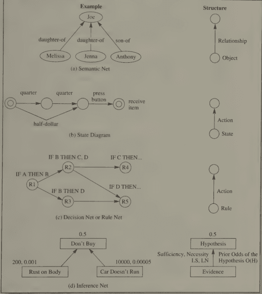


在表 4.12 中，节点数量是模型中的总数。可询问节点是指那些向用户提问以获取可观察证据的节点。表中的规则数量是概率推理规则。如您所见，模型中存在大量不确定性，概率在支持假设方面很重要。

| 模型名称 | 模型描述 | 节点数量 | 可询问数量 | 规则数量 |
|---|---|---|---|---|
| PCD | 斑铜矿 | 200 | 97 | 135 |
| RFU | 卷铀矿 | 185 | 147 | 169 |
| SPB | 砂岩型铅矿 | 35 | 21 | 32 |

### 推理网络

PROSPECTOR 的每个模型都编码为证据和假设之间连接或关系的网络。因此，推理网是一种语义网。可观察事实，例如从野外勘探获得的岩层类型，构成了支持中间假设的证据。中间假设组用于支持顶层假设，即我们想要证明的内容。如果不需要区分证据和假设，则术语断言用于两者。斑铜矿模型顶层假设的推理网的一小部分如图 4.18 所示。

图 4.18 中的确定性因子 CHE 和 CHNE 在 PROSPECTOR 中被使用，因为经验表明，专家发现很难指定后验概率或似然比。在 MYCIN 血液病诊断系统中也发现了类似的经验，其中医生不喜欢指定概率，并使用了确定性因子。与 MYCIN 一样，确定性因子在从 –5 到 +5 的 11 点量表上排序，其中 –5 表示“绝对不是”，+5 表示“绝对是”。

PROSPECTOR 不是纯概率系统，因为它使用模糊逻辑和确定性因子来组合证据。确定性因子和模糊逻辑将在第 5 章中详细讨论。

图 4.19 显示了图 4.18 中 FRE 节点的更详细展开。此特定图表在节点上方有两个数字，分别是似然比 LS 和必要性度量 LN，用逗号分隔。例如，左下角标记为 RCIB 的节点的 LS、LN 值为 20、1。每个节点的缩写代表其描述，例如 RCIB 代表“该区域含有侵入性角砾岩”。每个节点顶部还显示了先验概率的单个数字，例如 RCIB 为 0.001。

### 图 4.18 使用确定性因子表示的 PROSPECTOR 斑铜矿顶层假设

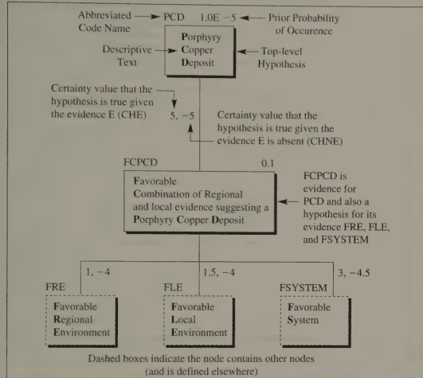

### 推理关系

支持或反驳假设的证据在推理网中向上指向。例如，RCS、RCAD、RCIB、RCVP 和 SMIR 都支持或反驳中间假设 SMIR。中间假设 SMIR 也是其假设 HYPE 的证据，而 HYPE 又是 FLE 的证据，以此类推。

证据可以以两种一般方式组合，以产生地质学家在模型定义中期望的关系：

- 通过 AND 和 OR 节点等逻辑组合。如前一节所述，模糊逻辑可用于计算这些逻辑节点的结果。

### 图 4.19 PROSPECTOR 斑铜矿推理网的一小部分

GIR
花岗岩侵入体
在区域内

FRE 0.001
有利的
区域
环境

(0.5)

5700, 0.0001
0.005
FLE
有利的
侵蚀
水平

5, 0.7
0.1
OTFSYS
较老的、
贯穿的
断层系统

200, 0.0002
0.1
HYPE
次火山的
区域
环境

800, 1
0.001
CVR
同期火山
岩

300, 0.0001
0.03
SMIR
暗示性
火成岩
形态

65, 0.01
0.1
STIR
暗示性
火成岩
纹理

RCS 0.001
岩股
300, 1

RCAD 0.001
岩脉
75, 1

RCIB 0.001
侵入性
角砾岩
20, 1

RCVP 0.001
火山
岩塞
4, 1

1, 0.0002
2, 0.000001
0.001
OR
SMIR

100, 0.000001
FMGS&PT 0.01
AND
0.01
FMGS
细到
中等
粒度

PT 0.01
斑状
纹理
(0, 5)

- 使用似然比 LS 和必要性比 LN 的加权组合。后验几率按以下公式计算：

O(H | E) = LS O(H)

当证据 E 已知为真时，以及：

O(H | E') = LN O(H)

当 E 已知为假时。如果 E 不确定，则 P(H | E) 可通过线性插值计算，如前一节所述。

加权组合一词之所以产生，是因为在多个证据片段对假设做出贡献的一般情况下。如前一节所示：

O(H | E1 n E2 n ... n En) = [ \prod_{i=1}^{N} LS_i ] O(H)

其对数为：

log O(H | E1 n E2 n ... n En) = log O(H) + \prod_{i=1}^{N} log LS_i

这可以解释为每个 LSi 为假设投下 log LSi 票“支持”。每个 log LS 都是影响假设的权重。

虽然 PROSPECTOR 有时被称为基于规则的系统，因为加权组合对应于诸如以下的规则：

```
IF E1 AND E2 AND ... En THEN H
```

它不如基于规则的真正生产系统灵活。一个限制是缺乏绑定变量的完整机制。PROSPECTOR 是一个定制设计的系统，为地质应用强调效率和控制，而不是生产系统的通用性。

加权组合也是合理关系的一个例子。合理一词意味着存在某种信念证据。PROSPECTOR 是一个使用合理推理支持或反驳假设的系统示例。PROSPECTOR 的合理推理基于贝叶斯概率，LS 和 LN 值由人类专家提供。

合理和其他不同程度的信念在图 4.20 的模糊图中有所说明。这些术语的一般含义如表 4.13 所示。

图 4.20 的图表故意绘制得模糊不清，以说明这些术语的模糊性以及从一个术语到另一个术语的过渡的模糊性。在

### 图 4.20 用于描述证据的一些术语的相对含义

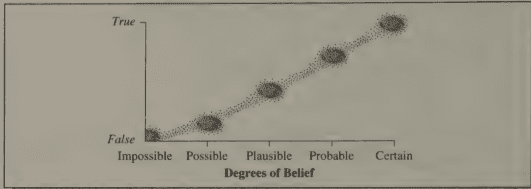

### 表 4.13 与证据一起使用的一些术语

| 术语 | 相对于假设的证据 |
| :--- | :--- |
| impossible | 确定已知不支持 |
| possible | 并非肯定已被证伪 |
| plausible | 存在一些证据 |
| probable | 存在一些支持证据 |
| certain | 确定已知支持 |

在图 4.20 中，请注意，我们对假设的信念如何从“不可能”增加到“确定”。“确定”意味着信念为真，而“不可能”的信念意味着它为假。确定和不可能的信念都不涉及不确定性。这些信念等同于逻辑真和逻辑假。术语“确定证据”有时被歧义地使用。确定证据在逻辑上为真或假。也就是说，确定证据不关联任何不确定性。这意味着确定证据对应于确定信念（逻辑真）或不可能信念（逻辑假）。

“可能”的信念意味着，无论多么遥远，假设都不能被排除。例如，在对月球表面进行科学分析之前，月球由白色奶酪构成是可能的，但非常、非常、非常遥远。这种可能性之所以存在，是因为没有确凿的证据可用。

“合理”的信念在法律案例中常用来表示合理，但缺乏确凿证据来支持该信念。因此，即使在科学研究之前，月球由绿色奶酪构成也是不合理的。

“很可能”的信念意味着存在一些支持假设的证据，但不足以肯定地证明它。例如，如果你在掷骰子时一直在赢，但当你朋友提出让你使用他们的“幸运骰子”时你突然开始输，你可能会有一种“很可能”的信念，即他们现在正在接收好运。

没有野外证据，例如观察 RCIB，图 4.19 中特定地点的关系仅是可能的。随着证据的积累，可能的关系可能变得合理，然后变得很可能，最后如果样本证实假设，则变得确定。在与别人掷骰子的例子中，如果你输掉了所有赢利，那么你肯定运气不好，这当然是合理的。如果你输掉了所有赢利和你最初拥有的所有钱，那么你肯定运气不好，这是确定无疑的。然而，无论你掷多少次骰子，即使掷一百万次，总有可能这是统计结果，因为要达到 100% 的概率需要无限次掷骰子。“0% 概率”或“100% 概率”的情况实际上是一个矛盾修辞法，即自相矛盾的术语。0% 和 100% 的情况是确定性。确定性中没有什么是“很可能”的，因为在现实世界中，确定性是一种信念。当有人说：“我看到的证据和别人一样，但我仍然确定某处有一只黑乌鸦，”他们表达的是一种信念，真正的信念无法被事实改变。

在构建专家系统并试图正式表达专家在规则和事实中的知识时，这是一个重要的考虑因素。在知识获取阶段，当你采访专家时，你可能会听到一些听起来像知识但实际上是信念的内容。你必须非常小心地将信念放入专家系统，因为它们可能产生无效的结论。另一方面，如果专家付钱给你就是为了这个，如果系统不能按预期运行，他们不会高兴。

与概率相关的另一个矛盾修辞法是，当气象预报员报告“50% 的降雨概率”时你会听到的。50% 的概率意味着完全的无知。要么下雨，要么不下雨。你不需要概率理论或气象预报员来预测它要么下雨要么不下雨。它会下雨还是不会下雨是寻常之事。同样，你可能会听到气象预报员预测 100% 的降雨概率，而雷雨正在倾盆大雨。那不是概率；那是确定性。

除了推理网中决策节点及其概率动作之间的关系之外，一种可取的特性是上下文，它会阻止信息传播，直到合适为止。使用上下文可以启用或禁用推理网的部分，直到某些部分已知存在、缺失或未知。上下文的一个目的是避免系统在确定需要某些证据之前向用户询问有关该证据的问题。这一点非常重要，因为如果人们被问到看似无关的问题，他们会感到恼怒。任何系统的目标都应该是获取达到有效或至少可接受结论所需的最少信息。例如，如果你去看医生，第一个上下文是：“你有医疗保险吗？”询问不需要的更多信息（例如，“你有什么问题？你疼吗？”你选好殡仪馆了吗？）在时间和金钱上都是昂贵的。

上下文的基本思想是控制系统追求断言的顺序。上下文陈述了在断言可用之前必须证明的必要条件。上下文由一条虚线箭头表示，其下方有一个确定性范围，如 FMGS 和 PT 的情况。除非存在确定性值在 0 到 +5 范围内的证据表明存在


斑晶岩的细到中等粒径。斑晶岩是火成岩，其纹理或外观由嵌入固持岩石（即基质）中的小晶体组成。火成岩是由地球深处的熔融岩石（称为岩浆）凝固形成的。某些露出地表的火成岩类型（称为侵入性角砾岩）是斑岩铜矿等矿物形成的证据。

因此，斑岩铜矿由嵌入固持晶体的岩石基质中的小铜晶体组成。斑岩铜矿是最常见的铜形式。除非存在至少细到中等粒径的小晶体，否则询问斑晶纹理没有意义，因此专家系统应足够智能，不提出此问题。会提出不必要问题的专家系统效率低下，并会迅速惹恼用户。

上下文的确定性范围为0到+5，这意味着除非用户指示确定性因子为0或某个正值（最高可达+5，表示肯定存在）对应的证据缺失，否则不会继续推进PT网。

合并或允许证据的所有三种方法实际上都是节点之间的关系。它们都指定一个断言概率的变化如何影响其他断言。

### 推理网架构

正式地，推理网可以定义为一种有向无环图，其中节点是断言，弧是不确定性度量，例如LS和LN。图4.21(a)、(b)和(c)可用作有效的推理网架构，因为它们没有环路。请注意，在推理树中，箭头指向假设，这与数据结构树中箭头指向根节点相反。如第3章所述，在无环图中，无法通过跟随箭头返回起点。在图4.21(d)中，存在一个涉及四个节点的环路。禁止环路的原因是防止在建立假设时出现循环论证。基于规则系统中的一个有效例外是让两条规则相互触发，直到满足终止条件，从而建立一个循环。环路的另一种常见用途是政治逻辑。

图4.21(c)是推理网中一种不希望的图类型。问题是，当许多证据片段有助于单一假设时，证据之间出现不希望的交互的可能性更大。收集如此多的证据也更昂贵。通常最好将此类结构重构为带有中间假设的更类似树的结构。

PROSPECTOR推理网也是一种分区语义网，用于将网络的部分分组为有意义的单元。分区语义网由Hendrix开发，以允许谓词演算的功能，例如量化、蕴含、否定、析取和合取。回顾第2章，普通语义网实际上是通过关系来表达描述性知识而设计的。虽然框架更适合因果知识，但在表达逻辑关系方面很难使用。

分区语义网的基本思想是将节点和弧的集合分组在抽象空间中，这些空间定义了它们关系的范围。对空间的一个熟悉类比是结构化语言中模块或包的范围。例如，图4.18中的FRE节点可以被视为一个空间，其结构如图4.19所示。

### 图4.21 图的一些类型

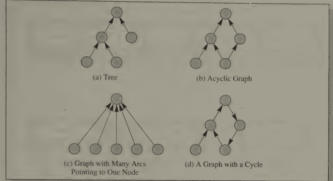

语义网的威力在于对陈述进行建模。事实上，Hendrix最初开发它们是为了在他的博士论文中表达自然语言。陈述就像构成推理网节点的证据和假设的命题。作为分区语义网中陈述的一个简单示例，请考虑“存在一台带有彩色屏幕的计算机”。请注意，这是一个存在性陈述，因为有“存在”量词。

图4.22显示了使用三个空间对该陈述的分区语义网表达。SPACE-1包含一些关于计算机的一般相关概念。SPACE-2包含我们正在讨论的特定计算机，该计算机已被赋予标识符COMPUTER-1。SPACE-3包含特定关系COMPONENTS-OF-1，其对象是我们关心的特定COLOR-SCREEN-1。每个标记为element的弧显示一个状态是另一个状态的元素。标记为entity的弧显示哪个特定计算机是带有特定彩色屏幕的实体。

图4.23中所示的PROSPECTOR规则（针对STIR使用FMGS证据）的一部分展示了分区语义网的优势。该规则可以表述为“如果存在名为E-1的实体，其基数为ABUNDANT且由侵入性岩石组成，那么后件是火成岩暗示纹理规则。”请注意，该图已简化，未包含前件也应具有细到中等粒径的要求。

### 图4.22 关于计算机的简单分区语义网

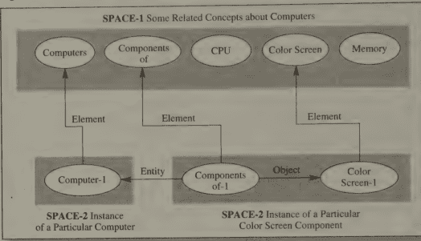

请注意，在图4.23中，一个分区语义网构成规则的前件，另一个网构成后件。尽管此规则的后件很平凡，但其他规则将具有更复杂的结构。分区语义网的优势在于，系统可以推断间接链接的节点之间的关系。因此，系统的知识比浅层知识更深。

### 4.16 概率的传播

像PROSPECTOR这样的推理网具有静态知识结构。也就是说，节点及其之间的连接是固定的，以保留知识结构中节点之间的关系。这与基于规则的系统形成对比，在基于规则的系统中，与事实匹配模式的规则会被放入议程，执行冲突解决，然后执行最高优先级的规则。因此，常见的基于规则的系统是动态知识结构，因为规则之间没有像推理网中节点之间那样的固定连接。

虽然推理网的结构是静态的，但随着证据的获取，与每个假设节点关联的概率会发生变化。事实上，这种概率的变化是推理网中*唯一*会变化的事物。推理网的基本特征是，随着证据的积累，概率从先验概率变为后验概率。这种概率的变化向上传播，以最终支持或反驳顶层假设，例如斑岩铜矿（PCDA）的存在。

让我们根据一些证据，检查PCDA概率传播的某些阶段。这将作为您所见许多公式的显式示例。

### 图4.23 使用FMGS证据的STIR规则PROSPECTOR分区语义网的简化部分

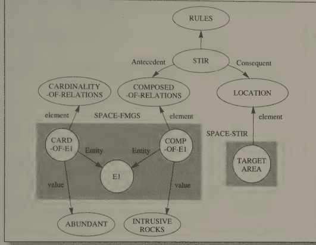

许多您所见的公式。回到图4.19，我们将跟踪从证据节点“区域包含侵入性角砾岩”（缩写为RCIB）开始的概率传播。

如果用户说侵入性角砾岩肯定存在，则：

```
P(E | e) = P(RCIB | e) = 1
```

从图4.19可以看出，SMIR的其他证据的LN值均为1。也就是说，如果用户对股岩、岩墙和火山堰的证据不予置评，这些证据对SMIR没有贡献，因此在概率传播中可以忽略。

所有这些证据都可以忽略的原因来自第4.14节讨论的复合证据公式：

```
O(H | e) = [ \prod_{i=1}^{n} L_i ] O(H)
```

其中，对于已知为真的所有证据，Li = LS；对于已知为假的证据，使用Li = LNi。如果没有已知证据，则P(Ei | e)将减少为证据的先验概率P(Ei)，因此P(H | Ei)将减少为先验概率P(H）。因此：

```
L_i = \frac{O(H \mid e_i)}{O(H)} = \frac{O(H)}{O(H)} = 1
```

这些Li对O(H | E)没有贡献。例如，当只有RCIB已知为真时，SMIR的概率比为：

```
O(H \mid E) = LS_{RCVP} LS_{RCAD} LS_{RCS} LS_{SMIRA} LS_{RCIB}
= 1 \cdot 1 \cdot 1 \cdot 1 \cdot 1 \cdot 20
O(SMIR \mid RCIB) = 20
```

SMIR证据的另一个有趣特征是名为SMIRA的OR节点。请注意，所有SMIR的证据也都指向SMIRA。如果有任何证据有助于SMIR（例如RCS、RCAD、RCIB或RCVP），则SMIRA的OR节点对SMIR没有贡献，因为SMIRA的LS为1。但是，如果没有RCS、RCAD、RCIB和RCVP的证据，则SMIRA的LN值0.0002使SMIR的概率基本为零。基本上，这意味着，虽然SMIR中一个或多个证据的缺失不重要（LS = 1），但所有证据的缺失对于排除SMIR非常重要。

添加OR节点、AND节点、LS和LN值，使模型设计师能够操纵证据影响假设的方式。但是，在某些复杂情况下，为了适应证据要求而添加许多OR和AND节点会模糊推理网，使人难以理解。添加这些额外节点还需要对模型进行更多测试。

从图4.20可知，侵入性角砾岩RCIB的LS = 20，且P(SMIR) = 0.03。因为：

```
odds = O = \frac{P}{1-P}
```

所以SMIR的先验概率比为：

```
O(SMIR) = \frac{0.03}{1-0.03} = 0.0309
```


如果证据 E 是确定的，那么后验几率为：

O(H | E) = LS O(H)
O(SMIR | RCIB) = 20 · 0.0309 = 0.618

后验概率是根据基本几率公式计算的：

P = O / (1 + O)
P(H | E) = O(H|E) / (1 + O(H|E))
P(H | E) = 0.618 / (1 + 0.618) = 0.382

因此，给定 RCIB 的确定证据时，SMIR 的后验概率为：

P(SMIR | RCIB) = 0.382

HYPE 的先验几率为：

O(HYPE) = 0.01 / (1 - 0.01) = 0.0101

此时，人们可能会想使用：

O(H | E) = LS O(H)
O(HYPE | SMIR) = LS_SMIR O(SMIR)
= 300 · 0.0101 / (1 + 0.0101) = 3.00

作为由 SMIR 导致的 HYPE 的几率，但这是错误的。公式：

O(H | E) = LS O(H)

在证据 E 确定时成立。这个公式表达了在假设证据确定的情况下，假设的概率变化。然而，SMIR 并非确定已知。事实上，给定某些侵入性角砾岩时，SMIR 的概率为：

P(SMIR | RCIB) = 0.382

这意味着我们相信 SMIR 为真的可能性是 38.2%。

我们真正需要的是基于不确定的 SMIR 证据的 HYPE 假设的概率，即 P(HYPE | RCIB)。计算这一点的一种方法是使用第 4.14 节讨论的 P(H | e) 公式，如下所示：

```
P(H | e) = {
    P(H | E') + (P(H) - P(H | E')) * P(E | e') / P(E)
    for 0 <= P(E | e) < P(E)
    P(H) + (P(H | E) - P(H)) * (P(E | e) - P(E)) / (1 - P(E))
    for P(E) <= P(E | e) <= 1
}
```

其中 SMIR 证据的不确定性为：

```
P(E | e) = P(SMIR | RCIB) = 0.382
```

我们想要的概率是：

```
P(H | e) = P(HYPE | SMIR)
```

而我们所知道的一切是：

```
P(H | E) = (O(H | E)) / (1 + O(H | E)) = 3.00 / (1 + 3.00) = 0.75
```

以及来自图 4.19 的先验几率为：

```
P(H) = P(HYPE) = 0.01
```

```
P(E) = P(SMIR) = 0.03
```

由于 P(E | e) > P(E)，我们将使用 P(E) <= P(E | e) <= 1 的公式来计算 P(H | e)，如下所示：

```
P(H | e) = 0.01 + ((0.75 - 0.01)(0.382 - 0.03)) / (1 - 0.03)
```

```
P(HYPE | RCIB) = 0.279
```

这就是 HYPE 的后验概率。

概率的这种传播继续沿着推理网向上进行。现在，概率 P(HYPE | RCIB) 是 FLE 的不确定证据。后验概率 P(FLE | RCIB) 是使用相同的公式计算的，针对 FLE 调整了数值：

P(E) = P(HYPE) = 0.01
P(E | e) = P(HYPE | RCIB) = 0.279
P(H) = P(FLE) = 0.005
O(H | E) = O(FLE | HYPE) = LS_{wep} O(FLE)
= 200 · 0.005 = 1
P(H | E) = P(FLE | HYPE)
并且由于 P = odds/(1+odds)，
P(H | E) = O(FLE|HYPE) / (1 + O(FLE|HYPE))
= 1/(1 +1)
= 0.5
P(H | e) = P(FLE | RCIB)
= 0.005 + \frac{(0.5 - 0.005)(0.279 - 0.01)}{1 - 0.01}
P(FLE | RCIB) = 0.140

### 4.17 总结

在本章中，我们首先讨论了在不确定性下推理的基本概念以及不确定性可能导致的错误类型。回顾了经典概率论的要素。讨论了经典概率与其他概率理论（如实验概率和主观概率）之间的区别。介绍了概率组合方法和贝叶斯定理。描述了信念与概率的关系以及似然的含义。

详细分析了经典专家系统 PROSPECTOR，以说明概率概念如何在实际系统中应用。PROSPECTOR 系统还用于介绍推理网和分区语义网。

你看到的主要教训是，虽然经典概率适用于理想系统，但它并不总是适用于现实世界的问题，例如 PROSPECTOR 中的矿产勘探。虽然概率被用作处理不确定性的起点，但某些矿物的出现取决于对概率理论进行调整，引入置信因子和模糊逻辑，直到专家系统正确预测已知模型。随后，PROSPECTOR 被用于未知特征，成功预测了价值 $100,000,000 的钼矿床。

请注意，检测其他类型的矿物需要不同的地质特征模型、不同的确定性因子和模糊逻辑。这样做没有问题，因为这仅仅反映了这样一个事实：不同的矿物在现实世界中以不同的方式形成，因此检测它们的证据和理论也不同。这就是专家对不同领域知识的重要性所在。擅长定位钼的专家不一定擅长定位石油。

重要的是要记住，你必须让你的专家系统适应现实世界，而不是试图让现实世界适应你的专家系统，因为这会导致失败。所有理论最终都基于未经证明的真理（即公理），例如欧几里得的公理：直线只在无穷远处相交。虽然这在平面欧几何中成立，但在球面几何或其他非平面几何中不成立。不确定性理论也基于公理。我们必须引入置信因子和模糊逻辑等额外因素，仅仅意味着由于我们对数百万年前矿物的真实形成过程以及该地点地球的特定化学成分一无所知，所以不知道正确的公理。

我们还讨论了不可能、可能、合理、可能的和确定等术语的含义。在采访专家时，理解这些术语非常重要，以便将概率与信念区分开来，信念是一种“观点”的问题。特别是，你需要小心那些被认为是确定的事情，因为这可能是常识伪装成理性。例如，常识会说，如果马活着，它完成比赛的条件概率是 100%，P (Finish | Live) = 100%。请注意，我们并不是说马一定会赢，而只是说它会完成比赛。常识告诉我们，参赛者必须活着才能赢得比赛。这是一个确定性。对吧？那么，你愿意拿这门课程的成绩来赌这个吗？

如前所述，政治逻辑与其他任何类型的逻辑都不同。2000 年 10 月，密苏里州州长梅尔·卡纳汉在竞选旅途中因飞机失事去世。他的对手，参议员约翰·阿什克罗夫特（R-Mo.），在 11 月仍然输掉了连任竞选。选民选举了一位已故的人担任参议员，该席位由卡纳汉州长的遗孀填补（http://www.specialednews.com/washwashnews/election11000.html）。这进一步证明，在当今的常识推理中，即使死亡也不是一个确定的事实。

### 问题

- 4.1 (a) 仅使用概率的三个公理，证明概率的加法定律：P (A U B) = P (A) + P (B) - P (A n B)

提示：任何事件 X U Y 都可以写成 X U (X' n Y) 的形式，其中 X 和 X' n Y 是互斥的。另外，将 B 写成两个互斥集的并集。

- (b) 给定两台计算机，要么正常工作，要么不工作，使用加法定律，至少有一台正常工作的概率是多少？

## 4.2 给定可能重叠的事件 A 和 B，使用概率公理推导集合方面的概率，用于：

- (a) 既不是 A 也不是 B
- (b) 要么是 A 要么是 B，但不是两者都是（异或）

## 4.3 三个料箱包含一些合格和有缺陷的组件，如下所示：

| 料箱 | 合格 | 有缺陷 |
|---|---|---|
| 1 | 8 | 2 |
| 2 | 3 | 1 |
| 3 | 2 | 2 |

在很长一段时间内，20% 的组件从料箱 1 中抽取，30% 从料箱 2 中抽取，50% 从料箱 3 中抽取。

- (a) 画一棵概率树。
- (b) 如果抽取到一个有缺陷的零件，它来自每个料箱的概率是多少？编写一个概率表，显示结果、先验概率、条件概率、联合概率和后验概率。

## 4.4 一个人正在考虑购买磁盘驱动器，并在三个品牌之间做决定。下表显示了该人的偏好和一年内发生故障的概率。（偏好是成本、速度、容量和可靠性的函数。）

| 品牌 | 选择概率 | 故障概率 |
|---|---|---|
| X | 0.3 | 0.1 |
| Y | 0.5 | 0.3 |
| Z | 0.2 | 0.6 |

- (a) 编写一个概率表，显示结果、先验概率、条件概率、联合概率和后验概率。
- (b) 磁盘在一年内发生故障的概率是多少？
- (c) 任何驱动器在一年内发生故障的概率是多少？
- (d) 在一年内发生故障的情况下，品牌 X、Y 或 Z 的概率是多少？

## 4.5 筛查测试是一种低成本的方法，用于检查大量人群是否患有某种疾病。一种更昂贵但准确的测试表明，1% 的所有人都患有该疾病。筛查测试在 90% 的患病者中显示疾病（测试阳性），在 20% 的非患病者中也显示疾病（假阳性）。

- (a) 制作一个表格，显示结果、先验概率、条件概率、联合概率和后验概率。
- (b) 测试阳性的人中，有多少百分比实际上没有患病（假阳性）？
- (c) 测试阴性的人中，有多少百分比实际上患有疾病（假阴性）？


## 4.6 为了说明两两独立不一定意味着相互独立，定义掷两个骰子时的以下事件：

- A = 第一个骰子为偶数
- B = 第二个骰子为偶数
- C = 和为偶数

- (a) 绘制两个骰子的样本空间。绘制 A、B 和 A ∩ B。
- (b) 写出 A ∩ B、C、A ∩ C 和 B ∩ C 的元素。
- (c) P(C) 是多少？
- (d) 证明以下内容的两两独立性：

```
P(A ∩ B) = P(A) P(B)
P(A ∩ C) = P(A) P(C)
P(B ∩ C) = P(B) P(C)
```

- (e) 证明：
  P(A ∩ B ∩ C) = P(A ∩ B) ≠ P(A | B) P(C)
  这证明了两两独立不意味着相互独立。

## 4.7 对于互斥集合 A 和 B：

- (a) 用 A 和 B 表示 P(A | B') 是多少（不用 A 和 B' 表示）？
- (b) P(A' | B) 的数值是多少？
- (c) P(A | B) 的数值是多少？
- (d) 用 A 和 B 表示 P(A' | B') 是多少（不用 A' 和 B' 表示）？
- (e) 以下各项是多少：
  - (i) P(A | B) + P(A' | B)
  - (ii) P(A | B') + P(A' | B')

## 4.8 证明：

- (a) 证明
  P(A ∩ B ∩ C) = P(A | B ∩ C) P(B | C) P(C)。
- (b) 证明
  P(A ∩ B | C) = P(A | B ∩ C) P(B | C)。

## 4.9 磁盘驱动器可能会出现故障 F1 或 F2，但不会同时出现。可能的症状如下：
A = { 写入错误，读取错误 }
B = { 读取错误 }

且 F2 发生的可能性是 F1 的三倍。对于这种驱动器

P(A | F1) = 0.4   P(B | F1) = 0.6
P(A | F2) = 0.2   P(B | F2) = 0.8

磁盘驱动器出现故障 F1 和 F2 的概率分别是多少？

## 4.10 给定一年内磁盘驱动器品牌切换的转移矩阵：

| | X | Y | Z |
|---|---|---|---|
| X | 0.5 | 0.5 | 0 |
| Y | 0.25 | 0.5 | 0.25 |
| Z | 0 | 0.5 | 0.5 |

- (a) 假设最初 50% 的人使用驱动器 X，25% 使用驱动器 Y，25% 使用驱动器 Z，那么 1 年、2 年和 3 年后，各驱动器的使用比例分别是多少？
- (b) 确定稳态矩阵。

## 4.11
- (a) 给定随机选取的 N 个人，没有两个人生日相同的概率是多少？
- (b) 30 个人的概率是多少？

## 4.12 在 E1 和 E2 条件独立的前提下，证明对于涉及已知证据合取的规则：

IF E1 AND E2 THEN H

成立：

- (a) P(H | E1 ∩ E2) = P(E1 | H) P(E2 | H) / P(E1 | H) P(E2 | H') + (H') P(E1 | H') P(E2 | H')
- (b) P(H | E1 ∩ E2) = P(H | E1) P(H | E2) / P(H | E1) P(H | E2) + O(H) P(H' | E1) P(H' | E2)

## 4.13 给定带有证据析取的规则：

IF E1 Or E2 Or ... En THEN H

证明在概率论基础上并假设证据条件独立：

P(E | e) = 1 - \prod_{i=1}^{n} (1 - P(E_i | e))

其中 E 是证据，e 是指向 E 的相关观察。

## 4.14 给定以下作为规则前件的证据：

IF E THEN H

写出 P(E | e) 的模糊逻辑表达式：

- (a) E = E1 OR (E2 AND E3')
- (b) E = (E1 AND E2') OR (E1' AND E2)
- (c) E = (E1' AND E3') OR E3
- (d) E = E1' AND (E2' OR E3)
- (e) E = E1' OR (E2 AND E3)

## 4.15 对于斑块状铜的推理网，假设 RCS 已知为真且 RCAD 已知为假。FRE 的更新概率是多少？

## 4.16 考虑语义归纳中的以下问题，以确定序列 2, 8, ... 中的下 3 个数字。在语义归纳中，需要一个线索来推断序列，提示：思考“卡车。”

## BIBLIOGRAPHY

注：有关概率、统计和贝叶斯软件的许多其他参考文献载于附录 G 软件资源中。

- (Castillo 97). Enrique Castillo 等编. 专家系统与概率网络模型, Springer-Verlag New York, Inc., 1997.
- (Gates 00). 比尔·盖茨, 商业@思考的速度：在数字经济中取得成功, Warner Business Books, 2000. 该书关于微软产品中贝叶斯逻辑的摘录位于: (http://www.microsoft.com/billgates/speedofthought/additional/badnews.asp).
- (Grinstead 97). Charles M. Grinstead 和 J. Laurie Snell, 概率导论, American Mathematical Society, 第 2 版, 1997. 注：除了包含软件外，该书还可从以下网址免费获取 GNU 版本: (http://www.dartmouth.edu/~chance/teaching_aids/books_articles/probability_book/book-5-17-03.pdf)
- (Jackson 99). Peter Jackson, 专家系统导论, Addison-Wesley, 第 3 版, 1999.
- (Neapolitan 03). Richard E. Neapolitan, 贝叶斯网络学习, Prentice-Hall, 2003.
- (Pearl 00). Judea Pearl, 因果性：模型、推理与推断, Cambridge University Press, 2000.
- (Ross 02). Sheldon M. Ross, 概率模型导论, 第 8 版, 第 188-191 页, Academic Press, 2002.

## CHAPTER 5
不精确推理

### 5.1 引言

本章继续了第 4 章开始的不确定性下的推理讨论。第 4 章中不确定性下推理的主要范式是概率推理和贝叶斯定理。在本章中，我们将探讨处理不确定性的几种其他方法。特别是，模糊逻辑在图像处理和控制、基于模糊规则的机器学习分类、聚类和函数逼近等许多应用中取得了极大成功 (Ibrahim 03) (Chen 01)。

已创建两个版本的 CLIPS 用于开发大量使用模糊推理的专家系统。第一个是 NRC fuzzyCLIPS (http://ai.iit.nrc.ca/IR_public/fuzzy/)。NRC 还为 Java 平台提供了 FuzzyyToolkit 和 FuzzyJess (基于 Java 的 CLIPS 版本)。第二个是 Togai InfraLogic Fuzzy CLIPS，包含指向其他模糊资源的许多链接 (http://www.ortech-eng.com/fuzzy/togai.html)。模糊专家系统现在已广泛使用，从搜索网络和书籍中很容易看出这一点 (Siller 04)。

如第 4 章所述，概率最初是为理想的机会游戏而开发的，其中同一实验可以无限重复。事实上，数学家将概率论称为可重复不确定性的理论。乍一看，这听起来像是一个矛盾修辞法，因为如果某事是不确定的，我们如何能一遍又一遍地重复它呢？（当然，生孩子除外。）可重复是指在统计学意义上，当存在大量人口并且结果在许多试验中平均时。虽然能够精确预测下一次掷骰子会发生什么将是件好事，但我们只能给出概率，而不能给出任何确定性的陈述。

虽然第 4 章描述的主观概率理论已成功应用于 PROSPECTOR，但还有许多其他应用更适合使用其他理论。这些替代理论专门为

而开发，旨在处理人类信念，而不是概率的经典频率解释。所有这些理论都是不精确推理的示例，其中前件、结论甚至规则本身的意义在某种程度上都是不确定的。

### 5.2 不确定性与规则

本节概述了规则和不确定性。后续章节将介绍处理规则和其他智能系统中不确定性的其他方法。智能系统一词今天广泛使用，严格来说，是指任何使用 AI 的应用。在实践中，它常用于描述任何可以处理不确定信息的系统。

#### 规则中的不确定性来源

图 5.1 展示了基于规则系统中不确定性的高层视图。这种不确定性可能来自单个规则、冲突解决以及规则结果之间的不兼容。知识工程师的目标是尽可能最小化或消除这些不确定性。

最小化单个规则的不确定性是规则验证的一部分。如第 3.15 节所述，验证关注系统构建块的正确性。对于基于规则的系统，构建块就是规则。

仅仅因为单个规则正确，并不意味着系统会给出正确答案。由于规则之间的不兼容，推理链可能不正确，因此确认是必要的。对于基于规则的系统，部分验证是最小化推理链中的不确定性。验证可以被视为最小化局部不确定性，而确认最小化整个专家系统的全局不确定性。作为土木工程的粗略类比，验证会询问桥梁是否在材料和组装方面被正确建造。确认会询问桥梁是否能承受所需的交通负载，最重要的是，桥梁是否建在正确的位置？验证和确认都是确保高质量专家系统所必需的，如第 6 章进一步讨论。

图 5.1 中单个规则不确定性的顶层视图在图 5.2 中得到了更详细的展开。除了第 4.3 节描述的规则创建中可能涉及的错误外，还有相关的不确定性

图 5.1 基于规则的专家系统中的主要不确定性

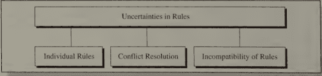


### 图 5.2 单个规则中的不确定性

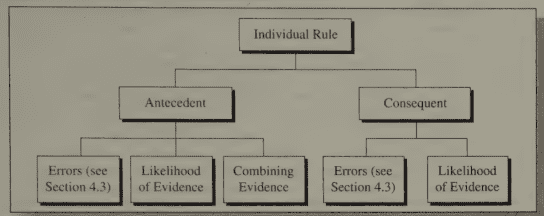

with the assignment of likelihood values. For probabilistic reasoning, as described in Chapter 4, these uncertainties are with the sufficiency, LS, and necessity, LN, values. Since the LS and LN values are based on estimates from humans, there is uncertainty with them. There is also an uncertainty with the likelihood of the consequent. For probabilistic reasoning, this was written as P(H | E) for certain evidence and P(H | e) for uncertain evidence.

Another source of uncertainty is the combining of the evidence. Should the evidence be combined, as in the following:

```
as E1 AND E2 AND E3
```

```
or as E1 AND E2 OR E3
```

```
or as E1 AND NOT E2 OR E3
```

or some other possible way of logical combination using AND, OR, and NOT?

### 缺乏理论

As mentioned in Chapter 4, the ad hoc introduction of formulas such as fuzzy logic to a probabilistic system introduces a problem. The expert system does not then have a sound theoretical foundation based on classical probability, and so represents an ad hoc method that works for a limited case. The danger of ad hoc methods is that there is no complete theory to guide the application or warn of inappropriate situations.

Another example of an ad hoc method that you have seen is the use of LS and LN factors with inference networks. Theoretically, an inference net with N nodes is a probabilistic system with an event space of N possible events. Thus, there are 2^N possible probabilities. In practice, for real-world situations, few of these probabilities are known. Rather than trying to enumerate all the probabilities, the LS and LN factors are used for significant (we hope) arcs between nodes. Use of LS and LN values for significant arcs greatly reduces the complexity of the net.

However, the LS and LN shortcut also has the detrimental effect that there is no theoretical guarantee that the sum of the conditional probabilities for each hypothesis in the net will be unity. This may not matter much to the user if the goal is simply to obtain a relative ranking of all the hypotheses in the net. For example, the user interested in the porphyry copper hypothesis may well be satisfied to know that the node indicating a favorable likelihood of copper is greatest, even if it is not 1. However, the absolute probability is important also. Even though the copper hypothesis is ranked number 1, is it worth drilling if the probability of finding copper is very low, say 0.00000001?

### 规则交互

Another source of uncertainty is conflict resolution of uncertainty. If the knowledge engineer specifies the **explicit priority** of rules, there is a potential source of error since the priority may not be optimum or correct. Other problems with conflict resolution occur because of the **implicit priority** of rules.

Conflict resolution is part of a major source of uncertainty caused by the interactions between rules. The interaction of rules depends on conflict resolution, and the **compatibility of rules**, as shown in Figure 5.3. The compatibility of rules has uncertainty from five major causes.

One cause of uncertainty is the potential **contradiction of rules**. Rules may fire with contradictory consequences. This may happen if the antecedents are not specified properly. As a very simple example, assume two rules in the knowledge base:

- (1) IF there is a fire THEN put water on it
- (2) IF there is a fire THEN don't put water on it

Rule (1) is applicable for ordinary fires such as wood fires. Rule (2) is applicable for oil or grease fires. The problem is that the antecedents are not specified precisely for the type of fire. If a fact exists "there is a fire," then both rules will be executed with contradictory consequences and a resulting increase in uncertainty.

A second source of uncertainty is **subsumption of rules**. One rule is subsumed by another if a portion of its antecedent is a subset of another rule. For example, suppose there are two rules that both have the same conclusion:

### 图 5.3 与规则兼容性相关的不确定性


- (3) IF E1 THEN H
- (4) IF E1 AND E2 THEN H

If only E1 is present, then there is no problem since only rule (3) will be activated. However if both E1 and E2 exist, then both rules (3) and (4) will be activated and conflict resolution on them is necessary.

### 冲突解决

There is uncertainty in conflict resolution regarding priority for firing. This uncertainty depends on a number of factors, as illustrated in Figure 5.4.

Figure 5.4 Uncertainty Associated with Conflict Resolution


The first factor is the shell or tool used. In expert systems tools that use the Rete Algorithm, a rule with more specific patterns has a higher priority. This makes sense in that the more information that is available increases our confidence when multiple rules may be potentially triggered into firing.

For example, if someone says, "I feel hot," one rule might be IF HOT THEN take an aspirin. On the other hand, a rule that says IF HOT AND wearing a coat at the beach THEN take off coat, is more specific if more information is available that the person is at the beach wearing a coat. In general the amount of pattern matching on the left-hand-side of a rule is a measure of the confidence we have that the rule is more appropriate than one with fewer patterns, i.e., less information is available. The specificity of a CLIPS rule depends on the number of patterns and the internal complexity of each pattern. For example, the pattern:

```
(ball ellipsoidal)
```

is more specific than the pattern:

```
(ball)
```

The ellipsoidal ball is probably a football while just ball by itself could mean tennis ball, ping-pong ball, basketball, baseball, or any type of ball.

For our two rules, rule (4) is more specific because it has two patterns in its antecedent and thus has a higher implicit priority. In a CLIPS system, rule (4) is executed first.

However, there are other complications. Besides the specificity, there is also the consideration of recency of facts. Whenever a fact is entered in the working memory, it receives a unique timestamp indicating when it was entered. Thus, a rule with the pattern:

```
(5) IF E1 THEN H
```

would have a higher priority than rule (3) if fact E1 was entered after E1.

The ordering of patterns within a rule also makes a difference. OPS5 allows two different control strategies called lexicographic (LEX) and means-ends analysis (MEA). These strategies determine how the inference engine interprets rule patterns. A control strategy is selected by entering a strategy command to the expert system interpreter. Under LEX, pattern order makes no difference, except possibly in efficiency. Thus, the following two rules are essentially the same under LEX:

```
IF E1 AND E2 THEN H
```

```
IF E2 AND E1 THEN H
```

MEA is the strategy used by Newell and Simon's General Problem Solver, discussed in Chapter 1. The basic idea of MEA is to keep reducing the difference between the starting state and the success state. In the OPS5 implementation of MEA, the first pattern is very important because it acts to control the pattern-matching process. The purpose of MEA is to help the system keep executing a certain task without becoming distracted by very recent facts that have entered working memory. MEA prioritizes rules on the basis of the first pattern, which follows the IF. If one of the rules dominates the others on the basis of the first pattern, then that rule is selected. This dominance can be by specificity or recency. If there is more than one dominant rule-first pattern, then MEA orders the rules on the basis of the remaining patterns. Eventually, if there is no dominant rule, an arbitrary choice of a rule is made.

The order that rules are entered in the expert system may also be a factor in conflict resolution. If the inference engine cannot prioritize rules, an arbitrary


应当做出选择。但是，除非推理引擎的设计者非常谨慎，否则这种选择在某种意义上可能是确定的，因为它取决于规则的条目。这可能是因为推理引擎的设计者使用了栈或队列来存储议程上的规则。对于优先级相同的规则的任意选择，实际上应该从栈或队列中进行随机选择。相反，设计者可能只是选择最简单的方法，即弹出栈或从队列中取下一条规则。这种选择方法很简单，但会向系统中引入已知的副产物，因为优先级相同的规则的选择并非任意。

### 涵盖与不确定性

如果规则关联有似然值，涵盖问题会变得更加不确定，例如：

- (6) IF E1 THEN H with LS1
- (7) IF E1 AND E2 THEN H with LS2

例如，考虑以下规则：

```
IF the starter motor doesn't work
THEN check the battery with LS1 = 5
IF the starter motor doesn't work AND
the lights don't work
THEN check the battery with LS2 = 10
```

其中LS2大于LS1，因为有更多证据支持结论。

来自第4章，后验概率比公式：

```
(8) O(H | E) = [\prod_{i=1}^N LS_i] O(H)
```

这意味着，如果同时观察到E1和E2，则乘积为5 * 10 = 50。

但是，(8)本意是用来描述证据独立组合的规则。(6)和(7)的前件并不真正独立，因为它们共享证据E1。因此，E1 AND E2涵盖E1，因为单独的E1是E1 AND E2的特例。由于前件不独立，似然比LS1和LS2的乘积因此被错误地高估。一个解决方案是用比率LS1 / LS替换LS1，这样当E1和E2同时存在时，就会计算出正确的乘积LS1。在大型知识库中，手动检测涵盖关系可能比较困难。

不确定性的第三个原因是冗余规则，它们具有相同的后件和证据。通常，这些规则是知识工程师意外输入的，或者在通过模式删除修改规则时意外发生。例如，

```
IF E1 AND E2 THEN H
```

```
IF E2 AND E1 AND E3 THEN H
```

如果删除E3，则它们是冗余规则，因为前件是相同的模式。决定删除哪条冗余规则不一定简单。如果先列出罕见模式，一条冗余规则可能会带来更高的系统效率。如果第一个模式不匹配，推理引擎可能不需要检查第二个模式是否匹配。在OPS5等专家系统外壳中，还会出现进一步的复杂情况，其中激活顺序取决于用户选择的控制策略。与涵盖的情况类似，冗余规则也会给出错误地高估的似然比乘积。

规则后件中不确定性的第四个原因源于缺失规则，当人类专家忘记或不知道诸如以下规则时就会发生：

```
IF E4 THEN H
```

如果忽略证据E4，那么H就不会以其应有的强度得出结论。像PROSPECTOR这样的推理网络的一个优势是网络的显式性质，这使得识别不可能或难以实现的假设变得容易。如果存在缺失规则，推理网可能暗示需要这些规则。

不确定性的第五个原因是由于数据融合问题引起的。这个术语指的是融合来自不同类型信息的数据所关联的不确定性。例如，在进行诊断时，医生可能会考虑来自截然不同来源的证据，例如体检、化验检查、病史、社会经济环境、精神和情绪状态、家庭和工作问题等等。这些都是必须融合以支持最终假设的不同类型的证据。来自如此多不同来源的证据融合，比单一领域（如地质学）中的证据要困难得多。

同样，商业决策可能取决于商品市场、经济状况、外国贸易、收购尝试、公司政治、个人问题、工会以及许多其他因素。与医学问题一样，为所有这些因素分配似然比并确定合理的组合函数非常困难。

### 5.3 确定性因子

处理不确定性的另一种方法是使用确定性因子，最初是为MYCIN专家系统开发的。

### 贝叶斯方法的困难

就像PROSPECTOR所解决的地质问题一样，医学诊断几乎总是伴随着不确定性。主要区别在于，由于只有92种天然元素，关于矿物的地质学假设数量有限。可能的疾病假设要多得多，因为病原体多得多。

虽然贝叶斯定理在医学中很有用，但其准确使用取决于了解许多概率。例如，贝叶斯定理可用于在给定某些症状的情况下确定特定疾病的概率，如下所示：

P ( D_i | E ) = \frac{P ( E | D_i ) P ( D_i )}{P ( E )} = \frac{P ( E | D_i ) P ( D_i )}{\sum_j P ( E | D_j ) P ( D_j )}

- D_i 是第i种疾病，
- E 是证据，
- P(D_i) 是患者在已知任何证据之前患该疾病的先验概率，
- P(E | D_i) 是在存在疾病D_i的情况下，患者表现出证据E的条件概率。

通常不可能为一般人群的所有这些概率确定一致且完整的值。

在实践中，证据往往是一点一点积累的。这种积累需要花费相当多的时间和费用，尤其是涉及医学检测时。时间、成本和对患者潜在风险这些因素通常会将执行的检测数量限制在进行良好诊断（以及医疗事故防护）所需的最低限度。

一种表达这种增量证据积累的贝叶斯定理便捷形式如下（参见问题5.1）：

P ( D_1 | E ) = \frac{\sum_j P ( E_2 | D_1 \cap E_1 ) P ( D_1 | E_1 )}{\sum_j P ( E_2 | D_j \cap E_1 ) P ( D_j | E_1 )}

其中E_2是添加到现有证据E_1中的新证据，以产生新的增强证据：
E = E_1 \cap E_2。

尽管该公式是精确的，但通常不知道所有这些概率。此外，随着更多证据片段的积累，所需的概率也更多，情况会变得更糟。

除了为贝叶斯方法收集所有条件概率的问题之外，与医学专家打交道时出现的另一个主要问题是信念与不信的关系。乍一看这可能看起来微不足道，因为不信显然只是信念的反面。事实上，概率理论指出：

```
P(H) + P(H') = 1
```

因此：

```
P(H) = 1 - P(H')
```

对于依赖证据E的后验假设：

```
(1) P(H | E) = 1 - P(H' | E)
```

但是，当MYCIN知识工程师开始采访医学专家时，他们发现医生极不愿意以方程(1)的形式陈述他们的知识。

例如，考虑以下MYCIN规则：

```
IF 1) The stain of the organism is gram positive,
and
2) The morphology of the organism is coccus,
and
3) The growth conformation of the organism is chains
THEN There is suggestive evidence (0.7) that the identity of the organism is streptococcus
```

简单来说，这条规则表示，如果细菌在接受革兰氏染色后变色，并且看起来像球体链，那么它是一种名为链球菌的可能性为70%。这可以用后验概率表示为：

```
(2) P(H | E1 ∩ E2 ∩ E3) = 0.7
```

其中Ei对应前件中的三种模式。

MYCIN知识工程师发现，虽然专家会同意方程(2)，但他们变得不安，并拒绝同意概率结果：

```
(3) P(H' | E1 ∩ E2 ∩ E3) = 1 - 0.7 = 0.3
```

专家拒绝同意方程(3)的这种不情愿再次说明，0.7和0.3这样的数字是信念的可能性，而不是概率。

为了充分理解信念与不信不一致的问题，请考虑以下示例。假设这是你获得学位所需的最后一门课程。假设你的绩点平均分（GPA）不太好，而你


为了在本课程中获得“A”并提高你的GPA，以下公式可能表达你对毕业可能性的信念：

(4) P(graduating | ‘A’ in this course) = 0.70

请注意，此可能性并非100%。之所以不是100%，是因为学校将对你的课程和成绩进行最终审核。由于多种原因，仍可能出现阻止你毕业的问题，例如：

- 1. 学校目录发生变更，导致并非所有课程都计入学位。
- 2. 你忘记修读一门必修课。
- 3. 转学分课程被拒绝。
- 4. 你修读的一些选修课被拒绝。
- 5. 你欠下的学费和图书馆罚款，你曾指望它们会被忘记。
- 6. 你的GPA比你想象的低，即使得“A”也无法将其提上来。
- 7. “他们”在针对你。

假设你同意(4)（或者也许是你自己的可能性数值），那么根据公式(1)：

(5) P(not graduating | ‘A’ in this course) = 0.30

尽管从概率角度看，公式(5)是正确的，但它在某种程度上似乎违背直觉。如果你真的努力学习并在本课程中获得“A”，却有30%的几率无法毕业，这似乎不太对劲。公式(5)应该让你感到不安，就像那位相信以下公式的医学专家一样：

P(H | E1 ⊂ E2 ⊂ E3) = 0.70

但又不愿相信其概率推论：

P(H’ | E1 ⊂ E2 ⊂ E3) = 0.30

根本问题是，虽然P(H | E)暗示E和H之间存在因果关系，但E和H’之间可能不存在因果关系。然而，以下公式：

P(H | E) = 1 – P(H’ | E)

如果E和H之间存在因果关系，则该公式暗示E和H’之间存在因果关系。

概率理论的这些问题促使Shortliffe去探索表示不确定性的其他方法。他在MYCIN中使用的方法基于源自Carnap确认理论的确定性因子。Carnap区分了两种概率。一种概率是与可重复事件的频率相关的普通概率。第二种称为认识概率或确认程度，因为它基于某些证据来确认一个假设。这种第二种概率是信念可能性程度的另一个例子。

### 信念与怀疑的度量

在MYCIN中，确认程度最初被定义为确定性因子，即信念与怀疑之差：

```
CF (H, E) = MB (H, E) - MD (H, E)
```

其中：

- CF是由于证据E而对假设H的确定性因子
- MB是由于E而增加对H的信念的度量
- MD是由于E而增加对H的怀疑的度量

确定性因子是将信念和怀疑合并为单个数字的一种方法。

将信念和怀疑的度量合并为单个数字有两种用途。首先，确定性因子可用于按重要性对假设进行排序。例如，如果患者有某些症状提示几种可能的疾病，那么CF最高的疾病将是首先通过安排检查来调查的疾病。

信念和怀疑的度量通过概率定义如下：

```
MB (H, E) = {
  1 if P(H) = 1
  (max[P(H | E), P(H)] - P(H)) / (1 - P(H)) otherwise
}
```

```
MD (H, E) = {
  1 if P(H) = 0
  (min[P(H | E), P(H)] - P(H)) / (0 - P(H)) otherwise
}
```

现在max [1,0]始终为1，min [1,0]始终为0。用max和 min来表示1和0的原因是为了展示MB和MD之间的形式对称性。MB和MD的版本仅在将max替换为min（反之亦然）方面有所不同。

基于这些定义，某些特征在表5.1中显示。

| 特征 | 值 |
| :--- | :--- |
| 范围 | 0 <= MB <= 1<br>0 <= MD <= 1<br>-1 <= CF <= 1 |
| 确定为真的假设<br>P(H | E) = 1 | MB = 1<br>MD = 0<br>CF = 1 |
| 确定为假的假设<br>P(H' | E) = 1 | MB = 0<br>MD = 1<br>CF = -1 |
| 缺乏证据<br>P(H | E) = P(H) | MB = 0<br>MD = 0<br>CF = 0 |

确定性因子CF表示基于某些证据对假设的净信念。正CF意味着证据支持假设，因为MB > MD。CF = 1意味着证据肯定地证明了假设。CF > 0意味着两种可能性之一。首先，CF = MB — MD = 0可能意味着MB和MD都是0。也就是说，没有证据。第二种可能性是MB = MD且两者都不为零。结果是信念被怀疑抵消。不幸的是，强信念被怀疑抵消并不会导致单纯的无知，而是更糟，导致一种困惑状态。例如，哪种情况更糟：来到一条街道却不知道该转向哪边，还是你车上的乘客说“向右转”却指向左边？

负CF意味着证据支持假设的否定，因为MB < MD。另一种表述方式是，怀疑一个假设的理由比相信它的理由更多。例如，CF = -70%意味着怀疑比信念多70%。CF = 70%意味着信念比怀疑多70%。请注意，使用确定性因子时，MB和MD的单个值没有限制。只有差值很重要。例如：

CF = 0.70 = 0.70 - 0
= 0.80 - 0.10

等等。

确定性因子允许专家表达信念而无需对怀疑赋予一个值。如问题5.2所示，

CF(H, E) + CF(H', E) = 0

这意味着，如果证据以某个值CF(H | E)确认一个假设，那么假设否定的确认并非1 - CF(H | E)（这是概率理论下所期望的）。也就是说，

CF(H, E) + CF(H', E) != 1

CF(H | E) + CF(H' | E) = 0这一事实意味着，支持一个假设的证据会以相同的量度减少对其否定的支持，因此总和始终为0。

对于如果在课程中获得“A”学生毕业的示例，

CF(H, E) = 0.70   CF(H', E) = -0.70

这意味着：

- (6) 如果我在这门课中获得“A”，我有70%的把握会毕业。
- (7) 如果我在这门课中获得“A”，我有-70%的把握不会毕业。

请注意，-70%之所以出现，是因为确定性因子定义在以下区间上：

-1 ≤ CF(H,E) ≤ +1

其中0表示没有证据。因此，大于0的确定性值支持假设，而小于0的确定性因子支持假设的否定。使用确定性因子，陈述(6)和(7)是等价的，这类似于“是”不等于“否”的事实。

上述CF值可以通过提问来获取：

> 获得“A”会对你毕业有帮助，你有多大把握？

如果证据旨在确认假设，或者：

> 获得“A”会对你毕业有帮助，你有多大怀疑？

对每个问题回答70%将设置CF(H | E) = 0.70和CF(H’ | E) = -0.70。在MYCIN中，专家不需要在百分比等级上给出确定性，而是被要求在1到10的等级上给出确定性，其中10表示确定。用户可以询问UNK以获取对应于CF = 0的未知证据。

### 使用确定性因子进行计算

尽管CF的原始定义是：

CF = MB - MD

该定义存在困难，因为一条反驳证据可能控制许多其他证据的确认。例如，10条证据可能产生MB = 0.999，而一条MD = 0.799的反驳证据则可能给出：

CF = 0.999 - 0.799 = 0.200

在MYCIN中，规则的前件CF必须大于0.2，前件才被视为真并激活规则。这个0.2的阈值并非作为CF理论的基本公理，而是作为一种临时方法，以尽量减少仅弱暗示假设的规则的激活。如果没有阈值，许多规则可能会被激活，但价值很小或没有价值，并大大降低系统的效率。

CF的定义在1977年MYCIN中更改为：

CF = (MB - MD) / (1 - min(MB, MD))

以缓和单条反驳证据对许多确认证据的影响。在此定义下，当MB = 0.999，MD = 0.799时：

CF = (0.999 - 0.799) / (1 - min(0.999, 0.799)) = 0.200 / 0.201 = 0.995

这与之前的定义截然不同，之前的定义给出0.999 - 0.799 = 0.200，因此没有激活规则，因为它不大于0.2。现在，0.995将导致规则被激活。

MYCIN中在规则前件组合证据的方法在表5.2中显示。请注意，这些与基于模糊逻辑的PROSPECTOR规则相同。

| 证据，E | 前件确定性 |
| :--- | :--- |
| E, AND E2 | min [CF(H,E1), CF(H,E2)] |
| E, OR E2 | max [CF(H,E1), CF(H,E2)] |
| NOT E | -CF(H,E) |

例如，给定组合证据的逻辑表达式如下：

```
E = (E1 AND E2 AND E3) OR (E4 AND NOT E5)
```

证据E将计算为：

```
E = max[min(E1, E2, E3), min(E4, -E5)]
```

对于数值：

E1 = 0.9   E2 = 0.8   E3 = 0.3
E4 = -0.5  E5 = -0.4


the result is:

E = max[min(0.9, 0.8, 0.3), min(-0.5, -(-0.4))]
= max[0.3, -0.5]
= 0.3

### 规则CF的基本公式：

```
IF E THEN H
```

is given by the formula:

```
(8) CF(H, e) = CF(E, e) CF(H, E)
```

where:

- CF(E,e) 是基于不确定证据 e 构成规则前件的证据 E 的确定性因子。
- CF(H,E) 是在证据已知确定（即 CF(E,e) = 1）时，关于假设的确定性因子。
- CF(H,e) 是基于不确定证据 e 的假设的确定性因子。

Thus, if all the evidence in the antecedent is known with certainty, the formula for the certainty factor of the hypothesis is:

```
CF(H, e) = CF(H, E)
```

since CF(E,e) = 1.

As an example of these certainty factors, consider the CF for the streptococcus rule discussed before.

- IF 1) The stain of the organism is gram positive, and
- 2) The morphology of the organism is coccus, and
- 3) The growth conformation of the organism is chains
- THEN There is suggestive evidence (0.7) that the identity of the organism is streptococcus

where the certainty factor of the hypothesis under certain evidence is:

```
CF(H, E) = CF(H, E1 ∩ E2 ∩ E3) = 0.7
```

and is also called the attenuation factor.

The attenuation factor is based on the assumption that all the evidence—E1, E2, and E3—is known with certainty. That is,

```
CF(E1, e) = CF(E2, e) = CF(E3, e) = 1
```

where e is the observed evidence that leads to the conclusion that the Eᵢ are known with certainty. These CF values are analogous to the conditional probabilities of the evidence of PROSPECTOR, P(E|e). The attenuation factor expresses the degree of certainty of the hypothesis, given certain evidence.

Just as with PROSPECTOR, a complication occurs if all the evidence is not known with certainty. With PROSPECTOR, the interpolation formula P(H|e) was used for uncertain evidence. In the case of MYCIN, the fundamental formula (8) must be used to determine the resulting CF value since CF(H,E₁ ∩ E₂ ∩ E₃) = 0.7 is no longer valid for uncertain evidence.

For example, assuming:

- CF(E₁, e) = 0.5
- CF(E₂, e) = 0.6
- CF(E₃, e) = 0.3

then:

```
CF(E, e) = CF(E₁ ∩ E₂ ∩ E₃, e)
= min[CF(E₁, e), CF(E₂, e), CF(E₃, e)]
= min[0.5, 0.6, 0.3]
= 0.3
```

Since the CF of the antecedent, CF(E,e) > 0.2, the antecedent is considered true and so the rule is activated. The certainty factor of the conclusion is:

```
CF(H, e) = CF(E, e) CF(H, E)
= 0.3 · 0.7
= 0.21
```

Suppose another rule also concludes the same hypothesis, but with a different certainty factor. The certainty factors of rules concluding the same hypothesis are calculated from the combining function for certainty factors defined as:

```
(9) CF_COMBINE(CF₁, CF₂) = {
  CF₁ + CF₂ (1 - CF₁)   both > 0
  (CF₁ + CF₂) / (1 - min(|CF₁|, |CF₂|))   one < 0
  CF₁ + CF₂ (1 + CF₁)   both < 0
}
```

where the formula for CF_COMBINE used depends on whether the individual certainty factors are positive or negative. The combining function for more than two certainty factors is applied incrementally. That is, the CF_COMBINE is calculated for two CF values, and then the CF_COMBINE is combined using formula (9) with the third CF value, and so forth. Figure 5.5 summarizes the calculations with certainty factors for two rules based on uncertain evidence and concludes the same hypothesis.

### Figure 5.5 CF of Two Rules with the Same Hypothesis Based on Uncertain Evidence


Note that this is *not* an AND/OR tree because CF_COMBINE has nothing to do with AND and OR goals.

In our example, if another rule concludes streptococcus with certainty factor CF2 = 0.5, then the combined certainty using the first formula of (9) is:

```
CF_COMBINE(0.21, 0.5) = 0.21 + 0.5 (1 - 0.21) = 0.605
```

Suppose a third rule also has the same conclusion, but with a CF3 = -0.4. Then the second formula of (9) is used to give:

```
CF_COMBINE(0.605, -0.4) = (0.605 + (-0.4)) / (1 - min(|0.605|, |-0.4|))
= 0.205 / (1 - 0.4)
= 0.205 / 0.6
≈ 0.34
```

The CF_COMBINE formula preserves the commutativity of evidence. That is,

```
CF_COMBINE(X, Y) = CF_COMBINE(Y, X)
```

and so the order in which evidence is received does not affect the result.

Rather than storing separate MB and MD values for each hypothesis, MYCIN stored the current CF_COMBINE with each hypothesis and combined it with new evidence as it became available.

```
CF_COMBINE(CF1, CF2) = { CF1 + CF2 (1 - CF1)   both > 0
                      { (CF1 + CF2) / (1 - min(|CF1|, |CF2|))   one < 0
                      { CF1 + CF2 (1 + CF1)   both < 0
```

#### Difficulties with Certainty Factors

Although MYCIN was very successful in diagnosis, there were difficulties with the theoretical foundations of certainty factors. While certainty factors had some basis in both probability theory and confirmation theory, the CF were also partly ad hoc. The major advantage of CF was the simple computations by which certainty could be propagated in the system. The CF were also easy to understand and clearly separated belief from disbelief.

However, there were problems with CF. One problem was that the CF values could be the opposite of conditional probabilities. For example, if:

P(H1) = 0.8 P(H2) = 0.2
P(H1 | E) = 0.9 P(H2 | E) = 0.8

then:

CF(H1, E) = 0.5 and CF(H2, E) = 0.75

Since one purpose of CF is to rank hypotheses in terms of likely diagnosis, it is a contradiction for a disease to have a higher conditional probability P(H | E) and yet have a lower certainty factor, CF(H, E).

The second major problem with CF is that in general:

P(H | e) ≠ P(H | i) P(i | e)

where i is some intermediate hypothesis based on evidence e, and yet the certainty factor of two rules in an inference chain is calculated as independent probabilities by:

CF(H, e) = CF(H, i) · CF(i, e)

The above formula is only true in the special case that the statistical population with property H is contained in the population with property i, and that is contained in the population with property e. The success of MYCIN in spite of these problems is probably due to the short inference chains and simple hypotheses. There could be real problems in applying certainty factors to other domains that did not have short inference chains and simple hypotheses. In fact, Adams demonstrated that the theory of certainty factors is really an approximation to standard probability theory.

### 5.4 DEMPSTER-SHAFER THEORY

In this section, we will discuss a method of inexact reasoning called the Dempster-Shafer theory or Shafer-Dempster theory. It is based on work done originally by Dempster, who attempted to model uncertainty by a range of probabilities rather than as a single probabilistic number. Shafer later extended and refined Dempster's work in a book published in 1976 called A Mathematical Theory of Evidence. A further extension called evidential reasoning deals with information that is expected to be uncertain, imprecise and occasionally inaccurate. The Dempster-Shafer theory has a good theoretical foundation. Certainty Factors can be shown to be a special case of Dempster-Shafer theory, which puts Certainty Factors on a theoretical rather than an ad hoc basis (Gardenfors 04). Dempster-Shafer theory is also used in intelligent databases where data mining is used to extract patterns (Bertino 01).

### Frames of Discernment

The Dempster-Shafer theory assumes that there is a fixed set of mutually exclusive and exhaustive elements called the environment and symbolized by the Greek letter $\Theta$:

```
\Theta = \{\theta_1, \theta_2, ... \theta_k\}
```

The environment is another term for the universe of discourse in set theory. That is, the environment is the set of objects that are of interest to us. Some examples of environments might be:

- $\Theta = \{\text{airliner, bomber, fighter}\}$
- $\Theta = \{\text{red, green, blue, orange, yellow}\}$
- $\Theta = \{\text{barn, grass, person, cow, car}\}$

Notice that the elements are all mutually exclusive. For example, an airliner is not a bomber or a fighter, red is not green, grass is not a cow, and so forth. Assume that all possible elements of the universe are in the set and so the set is exhaustive. For simplicity in our discussion, assume also that $\Theta$ is a finite set. However, work has been done on Dempster-Shafer environments whose elements are continuous variables such as time, distance, velocity, and so forth.

One way of thinking about $\Theta$ is in terms of questions and answers. Suppose:

```
\Theta = \{\text{airliner, bomber, fighter}\}
```

and the question is “What are the military aircraft?” The answer is the subset of $\Theta$:

```
\{\theta_2, \theta_3\} = \{\text{bomber, fighter}\}
```

Likewise, the question “What are the civilian aircraft?” is the set:

```
\{\theta_1\} = \{\text{airliner}\}
```

which is called a singleton set because it has only one element.

Each subset of $\Theta$ can be interpreted as a possible answer to a question. Since the elements are mutually exclusive and the environment is exhaustive, there can be only one correct answer subset to a question. Of course, not all possible questions may be meaningful nor interesting to ask. However, the important point to


意识到环境的子集是这一话语宇宙中所有可能的有效答案。每个子集都可以被视为一个隐含的命题，例如：

```
The correct answer is (\(\theta_1\), \(\theta_2\), \(\theta_3\))
The correct answer is (\(\theta_1\), \(\theta_2\))
```

其余子集亦然，其中“正确答案是”随子集隐含。飞机环境的所有可能子集如图 5.6 所示，并用线条表示集合之间的关系。缩写 A、B 和 F 分别用于客机、轰炸机和战斗机。该图表绘制为分层格，\(\Theta\) 位于顶部，空集 \(\mathcal{O} = \{ \}\) 位于底部。通常，空集不会被明确显示，因为它始终对应错误答案。由于 \(\emptyset\) 没有元素，将其作为下面的答案与环境为穷举的假设相矛盾：

```
The correct answer is no element
```

### 图 5.6 飞机环境的所有子集


请注意，该图是一个格而不是树，因为子集节点可能有多个父节点。该格是分层的，因为它是从较大的集合绘制到较小的集合。例如，从 \(\Theta\) 到 \(\mathcal{O}\) 的一条路径表达了连接父节点到子节点的子集层次关系，例如：

```
\(\emptyset \subset \{A\} \subset \{A, B\} \subset \{A, B, F\}\)
```

如第 2.10 节所述，两个集合 X 和 Y 之间的关系，例如：

```
\(X \subseteq Y\)
```

表示 X 的所有元素都是 Y 的元素，并更正式地写作：

X ⊆ Y = {x | x ∈ X → x ∈ Y}

这表示如果 x 是集合 X 的元素，则意味着 x 也是集合 Y 的元素。如果 X ⊆ Y，但 X ≠ Y，则 Y 中至少有一个元素不是 X 的元素，X 被称为 Y 的真子集，并写作：

X ⊂ Y

当环境的元素可以被解释为可能的答案，且只有一个答案是正确时，该环境称为辨识框架。辨识一词意味着可以将唯一正确答案与问题的所有其他可能答案区分开来。如果答案不在框架内，则必须扩大框架以容纳 θn+1、θn+2 等元素的额外知识。唯一正确答案要求集合是穷举的，且子集是互斥的。

大小为 N 的集合恰好有 2^N 个子集（包括其自身），这些子集定义了幂集大小（参见问题 2.11），写作 P(Θ)。因此，对于飞机环境，

P(Θ) = { ∅, {A}, {B}, {F}, {A, B}, {A, F}, {B, F}, {A, B, F} }

环境的幂集以辨识框架中可能问题的所有答案作为其元素。这意味着 P(Θ) 的元素与 Θ 的子集之间存在一一对应关系。

### 质量函数与无知

在贝叶斯理论中，后验概率随证据的获取而变化。同样，在 Dempster-Shafer 理论中，对证据的信念程度也可能变化。在 Dempster-Shafer 理论中，习惯于将证据的信念程度视为类似于物理对象的质量。也就是说，证据的质量支持一种信念。证据度量，用字母 m 符号化，类似于质量的量。质量的另一个术语是基本概率赋值（bpa）或有时简单称为基本赋值，因为描述概率密度和质量的方程形式存在类比。然而，由于可能与概率理论混淆，我们将不使用这些术语，而简单地称之为质量。与物体质量类比的原因是将信念视为一种可以移动、分割和组合的量度。将对象视为由粘土组成可能有所帮助，以便可以移除其部分并重新粘合在一起。

Dempster-Shafer 理论与概率理论之间的一个根本区别在于对无知的处理。如第 4 章所述，概率理论即使在无知状态下也必须分配相等的概率量。例如，如果你没有任何先验知识，则必须假设每种可能性的概率 P 为：

P = 1/N

其中 N 是可能性的数量。如第 4 章所述，这种 P 的赋值是出于绝望，或者使用一个更令人印象深刻的术语，通过应用无差别原则。

应用无差别原则的极端情况发生在只有两种可能性时，例如有石油或无石油，用 H 和 H' 符号化。在这种情况下，即使完全没有知识，P 也等于 50%，因为概率理论指出：

P(H) + P(H') = 1

也就是说，任何不支持的都必须反驳，因为不允许无知。如果不加区别地应用，这可能导致一些荒谬的后果。IFF 是一种无线电发射器/接收器，向飞机发送无线电消息。如果飞机是友好的，其应答机应通过发回其识别代码来响应。不响应的飞机默认被视为敌对。飞机可能不响应 IFF 的原因有多种，例如：

- IFF 故障
- 飞机应答机故障
- 飞机上无 IFF
- IFF 信号被干扰
- 保持无线电静默的命令

假设 IFF 未能获得响应表明有 0.7 的证据信念目标飞机是敌对的，其中敌对飞机仅被视为轰炸机和战斗机。因此，质量赋值是针对子集 {B,F}，且：

```
m_1({B,F}) = 0.7
```

其中 m_1 指的是第一个 IFF 传感器证据。

其余的信念留给环境 \(\Theta\) 作为非信念：

```
m_1(\Theta) = 1 - 0.7 = 0.3
```

环境幂集中每个质量大于 0 的集合都是一个 **焦点元素**。使用 _焦点元素_ 一词是因为集合 X（使得 m(X) > 0）是可用证据集中或聚焦的幂集元素。

Dempster-Shafer 理论与概率理论存在重大区别，后者会假设：

```
P(hostile) = 0.7
P(non-hostile) = 1 - 0.7 = 0.3
```

在概率理论中，如果对敌对的信念是 0.7，那么对敌对的不信必须是 0.3。相反，在 Dempster-Shafer 理论中，0.3 由 m(\(\Theta\)) 作为环境中的非信念保留。这意味着 _既不相信也不怀疑_ 证据的程度为 0.3。我们相信目标以 0.7 的程度是敌对的，并保留 0.3 的判断，即不怀疑和对敌对的额外信念。非常重要的是要意识到，将 0.3 分配给环境


$\Theta$ 不为 $\Theta$ 的子集分配 *任何* 值，尽管这些子集包括敌对子集（{B,F}、{B} 和 {F}）。

回到上一节的学生示例，

m(获得 'A' 并毕业) = 0.7

并不自动意味着：

m(获得 'A' 但不毕业) = 0.3

除非这两个都被赋予了值。

质量比概率有相当大的自由度，如表 5.3 所示。

| Dempster-Shafer 理论 | 概率理论 |
|---|---|
| m($\Theta$) 不必等于 1 | $\sum P_i = 1$ |
| 如果 $X \subseteq Y$，则不一定有 m(X) $\le$ m(Y) | P(X) $\le$ P(Y) |
| m(X) 和 m(X') 之间没有必需的关系 | P(X) + P(X') = 1 |

每个质量形式上都可以表示为一个函数，该函数将幂集的每个元素映射到 0 到 1 区间内的实数。这仅仅意味着，对一个子集的信念可以取 0 到 1 之间的任何值。该映射正式表述为：

$m: \wp(\Theta) \rightarrow [0, 1]$

按照惯例，空集的质量通常定义为零：

$m(\emptyset) = 0$

幂集中每个子集 X 的所有质量之和为 1：

$\sum_{X \subseteq \Theta} m(X) = 1$

例如，在飞机环境中：

$\sum_{X \subseteq \Theta} m(X) = m(\{B,F\}) + m(\Theta) = 0.7 + 0.3 = 1$

### 合并证据

现在让我们看看当有额外证据可用时的情况。我们希望合并所有证据，以对证据的信念产生更好的估计。为了展示如何做到这一点，让我们先看一个合并证据的通用公式的特例。

假设第二种传感器将目标识别为轰炸机，证据的信念为 0.9。传感器的证据质量现在如下：

m1({B, F}) = 0.7 m1(Θ) = 0.3
m2({B}) = 0.9 m2(Θ) = 0.1

其中 m1 和 m2 分别指第一种和第二种传感器。

可以使用以下 Dempster 组合规则的特殊形式来合并这些证据，以产生合并质量：

m1 ⊕ m2 (Z) = Σ X ∩ Y = Z m1(X) m2(Y)

求和对所有交集 X ∩ Y = Z 的元素进行。⊕ 运算符表示正交和或直接和，它是通过对规则右侧的质量积交集求和来定义的。Dempster 规则合并质量以产生一个新质量，该新质量代表原始（可能冲突）证据的共识。新质量是共识，因为它倾向于赞成而非反对，只包括集合交集中的质量。集合交集代表证据的共同元素。一个重要点是，该规则应用于合并具有独立误差的证据，这与独立收集的证据不同。

表 5.4 以表格形式显示了飞机环境中的质量和乘积交集。每个集合交集后面跟着其数值质量乘积。

| | m2({B}) = 0.9 | m2(Θ) = 0.1 |
|---|---|---|
| m1({B, F}) = 0.7 | (B) 0.63 | (B, F) 0.07 |
| m1(Θ) = 0.3 | (B) 0.27 | Θ 0.03 |

表格中的条目通过交叉相乘行和列的质量乘积计算得出，如下所示，其中 Tij 表示表格的第 i 行和第 j 列：

T11({B}) = m1({B, F}) m2({B}) = (0.7)(0.9) = 0.63

$T_{21}(\{B\}) = m_1(\Theta) m_2(\{B\}) = (0.3)(0.9) = 0.27$
$T_{12}(\{B,F\}) = m_1(\{B,F\}) m_2(\Theta) = (0.7)(0.1) = 0.07$
$T_{22}(\Theta) = m_1(\Theta) m_2(\Theta) = (0.3)(0.1) = 0.03.$

一旦像上面所示计算了各个质量乘积，则根据 Dempster 规则，对共同集合交集上的乘积求和：

$m_3(\{B\}) = m_1 \oplus m_2(\{B\}) = 0.63 + 0.27 = 0.90 \quad \text{轰炸机}$
$m_3(\{B,F\}) = m_1 \oplus m_2(\{B,F\}) = 0.07 \quad \text{轰炸机或战斗机}$
$m_3(\Theta) = m_1 \oplus m_2(\Theta) = 0.03 \quad \text{非信念}$

\(m(\{B\})\) 表示目标是轰炸机且仅是轰炸机的信念。然而，\(m(\{B,F\})\) 和 \(m(\Theta)\) 暗示了额外信息，因为它们的集合包括轰炸机，它们的正交和可能有助于对轰炸机的信念是合理的。因此，它们的 0.07 + 0.03 = 0.1 可以加到轰炸机集合的 0.90 信念上，以得出它可能是轰炸机的最大信念——即合理信念。与将信念限制为单一值不同，证据中存在 **信念范围**。信念从已知轰炸机的最小值 0.9 到它可能是轰炸机的最大合理值 0.90 + 0.1 = 1。真实信念被假设在 0.9 到 1 的范围内某处。

在证据推理中，据说证据会诱导一个证据区间。**下界**在证据推理中称为 **支持 (Spt)**，在 Dempster-Shafer 理论中称为 **Bel**。**上界**称为 **合理性 (Pls)**。对于本例，证据区间是 [0.90,1]，下界是 0.90，上界是 1。支持是基于证据的 **最小信念**，而合理性是我们愿意给予的 **最大信念**。一般来说，Bel 和 Pls 的范围是 \(0 \le \text{Bel} \le \text{Pls} \le 1\)。在 Dempster-Shafer 理论中，下界和上界有时被称为下概率和上概率，基于 Dempster 的原始论文。表 5.5 显示了一些常见的证据区间。

### 表 5.5 一些常见的证据区间

| 证据区间 | 含义 |
|---|---|
| [1,1] | 完全真 |
| [0,0] | 完全假 |
| [0,1] | 完全无知 |
| [Bel,1] 其中 0 < Bel < 1 | 倾向于支持 |
| [0,Pls] 其中 0 < Pls < 1 | 倾向于反驳 |
| [Bel,Pls] 其中 0 < Bel <= Pls < 1 | 倾向于既支持又反驳 |

支持或 **信念函数**，Bel，是一个集合及其 _所有_ 子集的 _总信念_。Bel 是支持一个集合的所有质量，并用质量定义：

```
\(\text{Bel}(X) = \sum_{Y \subseteq X} m(Y)\)
```

例如，在飞机环境中，对于第一个传感器：
Bel₁({B, F}) = m₁({B, F}) + m₁({B}) + m₁({F})
= 0.7 + 0 + 0 = 0.7

Bel 函数有时也称为 **信念度量**，或简称为 **信念**。但是，请注意，信念函数与质量非常不同，质量是分配给 *单一* 集合的证据信念。例如，假设你拥有一辆福特汽车，并听说警察正在寻找一辆被用作银行抢劫逃跑车的福特汽车。听说警察正在寻找一辆福特汽车，与听说警察正在寻找 *你的* 福特汽车，有很大区别。质量是对一个集合及其 *不* 包括任何子集的信念，而信念函数适用于一个集合及其所有子集。Bel 是 *总信念*，因此比质量的 *局部信念* 更全局。由于质量和 Bel 之间的相互关系，Dempster-Shafer 理论也被称为 **信念函数理论**。从一般意义上讲，Dempster 规则可以解释为合并信念函数的一种方式。质量和信念函数通过以下公式相关：

```
m(X) = \sum_{Y \subseteq X} (-1)^{|X - Y|} Bel(Y)
```

其中 |X - Y| 是集合的 **基数**，即集合 X - Y 中元素的数量：

```
X - Y = {x | x \in X and x \notin Y}
```

也就是说，|X - Y| 是集合 X - Y 中元素的数量。

由于信念函数是用质量定义的，两个信念函数的组合也可以表示为一个集合及其所有子集的质量的正交和。例如，

```
Bel₁ \oplus Bel₂({B}) = m₁ \oplus m₂({B}) + m₁ \oplus m₂(∅)
= 0.90 + 0 = 0.90
```

通常，空集质量不写出，因为它通常定义为零。轰炸机-战斗机子集 {B,F} 的总信念比上面的更多子集：

```
Bel₁ \oplus Bel₂({B, F})
= m₁ \oplus m₂({B, F}) + m₁ \oplus m₂({B}) + m₁ \oplus m₂({F})
= 0.07 + 0.90 + 0 = 0.97
```

包括 {B} 和 {F} 的项是因为它们是 {B,F} 的子集。从图 5.6 可以看出，{B,F} 有子集 {B} 和 {F}。由于未给出 {F} 的质量，则 m({F}) = 0，因此它对...没有任何贡献。


总计。事实上，m({F}) 和其他值为零的质量根本没有进入表 5.4，因为与它们的任何叉积结果都将为零。如果为 {A,B,F} 的每个子集（除了为零的空集）都分配了质量，那么表 5.4 将是一个 (2^3 - 1) (2^3 - 1) = 7 * 7 = 49 单元的表格。

基于所有证据的 $\Theta$ 的组合信念函数如下：

Bel1 \(\oplus\) Bel2(\(\Theta\)) = m1 \(\oplus\) m2(\(\Theta\)) + m1 \(\oplus\) m2({B,F}) + m1 \(\oplus\) m2({B})
= 0.03 + 0.07 + 0.90 = 1

实际上，在所有情况下 Bel(\(\Theta\)) = 1，因为质量之和必须始终等于 1。证据的组合只是在不同子集之间重新分配质量。

集合 S 的证据区间 EI(S) 可以用信念定义为：

EI(S) = [Bel(S), 1 - Bel(S')]

如果 S = {B}，则 S' = {A,F}，且：

Bel({A,F}) = m1 \(\oplus\) m2({A,F}) + m1 \(\oplus\) m2({A}) + m1 \(\oplus\) m2({F})
= 0 + 0 + 0 = 0

因为这些不是焦点元素，且非焦点元素的质量为零。因此，{B} 的证据区间如下：

EI({B}) = [0.90, 1 - 0]
= [0.90, 1]

同样，如果 S = {B,F}，则 S' = {A}，且：

Bel({A}) = 0

因为 {A} 不是焦点元素。另外：

Bel({B,F}) = Bel1 \(\oplus\) Bel2({B,F}) = 0.97

EI({B,F}) = [0.97, 1 - 0] = [0.97, 1]

EI({A}) = [0, 1]

其中，证据区间 [0, 1] 反映了我们对 {A} 的完全无知。

[总信念，可信度] 的证据区间可以表示为：

[支持证据，支持证据 + 无知]

在概率论下，这个区间是单一点：

```
[evidence for support, evidence for support]
```

因为这是不允许的。也就是说，不支持的证据必须反驳，例如，“如果手套不合适，你必须宣判无罪。”

可信度定义为证据未能反驳 X 的程度：

```
Pls(X) = 1 - Bel(X') = 1 - \sum_{Y \subseteq X} m(Y)
```

可信信念 Pls 将信念拉伸到绝对最大值，其中未分配的信念 m(Θ) 可能对信念有所贡献。虽然 m(Θ) 可能是轰炸机、战斗机或客机，但在可信度假设下，它被假设贡献给其子集之一的信念。由于 {B} 是 Θ 的子集，因此 m(Θ) 的 0.3 信念可能被分配给轰炸机是合理的。回顾第 4.15 节，可信信念比可能信念稍强，但不一定是由强有力证据支持的信念。另一点是，Θ 不是唯一能拉伸任何集合 X 信念的集合类型。任何与 X 及其补集都相交的集合都会这样做。

怀疑（Dbt）或怀疑程度表示 X 被不相信或反驳的程度。无知（Igr）是质量支持 X 和 X’ 的程度。这些定义如下：

```
Dbt(X) = Bel(X') = 1 - Pls(X)
```

```
Igr(X) = Pls(X) - Bel(X)
```

### 信念的归一化

假设第三个传感器现在报告关于客机的冲突证据：

```
m3({A}) = 0.95   m(Θ) = 0.05
```

表 5.6 显示了叉积的计算方式。

| | m1 ⊕ m2({B}) 0.90 | m1 ⊕ m2({B,F}) 0.07 | m1 ⊕ m2(Θ) 0.03 |
|---|---|---|---|
| m3({A}) = 0.95 | Ø 0 | Ø 0 | {A} 0.0285 |
| m3(Θ) = 0.05 | {B} 0.045 | {B,F} 0.0035 | Ø 0.0015 |

空集 \(\emptyset\) 出现是因为 {A} 和 {B} 没有共同元素，{A} 和 {B,F} 也没有，因此它们的叉积为 0，而不是 0.855 和 0.0665。不过，我们很快就会看到这些空值在归一化中很有用。行与列的叉积为空，即：

- m\(_1 \oplus m_2 \oplus m_3\)({A}) = 0.0285
- m\(_1 \oplus m_2 \oplus m_3\)({B}) = 0.045
- m\(_1 \oplus m_2 \oplus m_3\)({B,F}) = 0.0035
- m\(_1 \oplus m_2 \oplus m_3\)(\(\emptyset\)) = 0.0015
- m\(_1 \oplus m_2 \oplus m_3\)(\(\emptyset\)) = 0（按空集定义）

请注意，在此示例中，所有质量之和小于 1：

- \(\sum m_1 \oplus m_2 \oplus m_3(X) = .0285 + .045 + .0035 + .0015\)
- = .0785

其中求和范围涵盖所有焦点元素。然而，由于组合证据 m\(_1 \oplus m_2 \oplus m_3\) 是有效质量，且所有焦点元素之和必须为 1，因此要求和为 1。和小于 1 的事实带来了一个问题。

解决此问题的方法是对焦点元素进行 **归一化**，即将每个焦点元素除以：

- 1 - \(\kappa\)

其中 \(\kappa\) 对于任何集合 X 和 Y 定义为：

- \(\kappa = \sum_{X \cap Y = \emptyset} m_1(X) m_2(Y)\)

在我们的示例中，

- \(\kappa = 0.855 + 0.0665 = 0.9215\)

因此：

- 1 - \(\kappa = 1 - 0.9215 = 0.0785\)

将每个 m\(_1 \oplus m_2 \oplus m_3\) 焦点元素除以 1 - \(\kappa\) 得到归一化值：

- m\(_1 \oplus m_2 \oplus m_3\)({A}) = 0.363
- m\(_1 \oplus m_2 \oplus m_3\)({B}) = 0.573
- m\(_1 \oplus m_2 \oplus m_3\)({B,F}) = 0.045
- m\(_1 \oplus m_2 \oplus m_3\)(\(\emptyset\)) = 0.019

现在 {B} 的总归一化信念为：

Bel({B}) = m_1 \oplus m_2 \oplus m_3({B}) = 0.573

请注意，{A} 的单一证据现在已将 {B} 的信念从 0.90 显著削弱了近一半，降至 0.573，这符合预期。

Bel({B}') = Bel({A, F})
= m_1 \oplus m_2 \oplus m_3({A, F}) +
m_1 \oplus m_2 \oplus m_3({A}) +
m_1 \oplus m_2 \oplus m_3({F})
= 0 + 0.363 + 0
= 0.363

因此，现在的证据区间为：

EI({B}) = [Bel({B}), 1 - Bel({B}')]
= [0.573, 1 - 0.363]
= [0.573, 0.637]

请注意，{B} 的支持度和可信度已被 {A} 的冲突证据大大降低。Dempster 组合规则的一般形式为：

m_1 \oplus m_2(Z) = \frac{\sum_{X \cap Y = Z} m_1(X) m_2(Y)}{1 - \kappa}

其中 \kappa 为方便起见再次定义。如果 \kappa = 1，则未定义正交和：

\kappa = \sum_{X \cap Y = \emptyset} m_1(X) m_2(Y)

\kappa 表示证据冲突的程度。\kappa = 0 表示完全兼容，1 表示完全矛盾。0 < \kappa < 1 的值表示部分兼容。

### 移动质量与集合

移动质量类比有助于理解支持度和可信度。主要概念如下：

- 支持度是分配给集合及其所有子集的质量。
- 集合的质量可以自由移动到其子集中。
- 集合中的质量不能移动到其超集中。
- 从集合移动质量到其子集只能对子集的可信度有所贡献，而不能对其支持度有所贡献。
- 环境 \Theta 中的质量可以移动到任何子集，因为 \Theta 在所有集合之外。

在图 5.7 (a) 中，假设所有质量都在集合 X 内，因此：

m(X) = 1

这意味着 X 的支持度为 1。X 的可信度也为 1，因为所有质量都在 X 中，且没有超集可以贡献质量。因此：

```
EI(X) = [1, 1]
```

如果 m(X) = 0.5，则 EI(X) = [0.5, 0.5]，一般来说，如果 m(X) = a（a 为任意常数），则 EI(X) = [a,a]。

### 图 5.7 说明支持度和可信度的集合


在图 5.7 (b) 中，假设 m(X) = 0.6 且 m(Y) = 0.4，它们也是各自的支持度。X 的可信度为 0.6，因为 Y 的质量不能移动到 X。然而，X 的质量可以移动到 Y 内，因为 Y 是 X 的子集，因此 Y 的可信度为 0.4 + 0.6 = 1。因此，X 和 Y 的证据区间如下：

```
EI({X}) = [0.6, 0.6]
EI({Y}) = [0.4, 1]
```

图 5.7 (c) 和 (d) 用于问题 5.4。

### Dempster-Shafer 理论的困难

Dempster-Shafer 理论的一个困难在于归一化，可能导致与我们预期相悖的结果。归一化的问题在于它忽略了所考虑对象不存在的信念。

Zadeh 引用的一个例子是两位医生 A 和 B 对患者疾病的信念。对患者病情的信念如下：

```
m_b (meningitis) = 0.99
m_b (brain tumor) = 0.01
```

```
m_c(concussion) = 0.99
m_c(brain tumor) = 0.01
```

请注意，两位医生都认为脑肿瘤的可能性非常低，仅 0.01，但对主要问题意见极不一致。Dempster 组合规则给出了对脑肿瘤信念为 1 的组合结果。这一结果出乎意料，违背了我们的直觉，因为两位医生都同意脑肿瘤的可能性非常小。无论其他概率如何，脑肿瘤的结果都会是 1。这是一个很好的例子，说明仅仅因为你在共同点上相遇，并不意味着那片地面不是流沙。

### 5.5 近似推理

在本节中，我们将讨论基于模糊逻辑的不确定性理论。该理论主要关注使用自然语言进行量化和推理，其中许多词语具有歧义含义，例如高、热、危险、一点、非常等等。人们经常使用模糊 IF THEN 规则，例如“如果我的闹钟响了，我可以多睡一会儿。”但如我们所知，多睡一会儿是一个非常不精确的术语，因人而异。模糊规则现在在计算机中经常使用（Kerre 00），要么内置于工具中，要么添加到诸如 CLIPS 之类的基本工具中。

模糊逻辑是常规（布尔）逻辑的超集，已扩展以处理部分真理的概念；真值介于“完全真”和“完全假”之间。模糊逻辑并非听起来那样。它不是一种模糊、云里雾里、含糊的思维方式；事实上，恰恰相反。当任何事物变得过于复杂以至于无法完全理解时，它就变得不确定。事物越复杂，就越不精确或“越模糊”。模糊逻辑为处理不确定性提供了一种精确的方法，这种不确定性源于人类行为的复杂性。

该概念最初由 Zadeh 在 1965 年发表的一篇开创性论文中阐述，该论文为 20 年后出现的模糊计算机系统和芯片提供了理论基础。他的理论催生了数学、工程和科学的全新分支。软计算一词已来指代不基于经典二值逻辑的计算（Roger 96）。软计算包括模糊逻辑、神经网络和概率推理。今天，AI 中的概率一词不仅指经典概率理论，还包括贝叶斯信念网络、进化计算（包括 DNA 计算）、混沌理论和量子计算。

该理论长期以来已被扩展并应用于许多领域，例如自动跟踪空间中的物体（Giarratano 91）。模糊逻辑还在许多应用中与神经网络相结合（Liu 04）。许多摄像机和照相机使用模糊逻辑。表 5.7 列出了模糊逻辑的几个主要应用。对于特定应用，只需使用搜索引擎，你就会被大量信息淹没。


### 模糊集与自然语言

传统的表示哪些对象是集合成员的方法是使用特征函数，有时也称为区分函数。如果一个对象是集合的元素，那么其特征函数为 1。如果一个对象不是集合的元素，那么其特征函数为 0。以下特征函数总结了此定义：

```
\mu_A(x) = \begin{cases} 1 \text{ if } x \text{ is an element of set A} \\ 0 \text{ if } x \text{ is not an element of set A} \end{cases}
```

其中对象 x 是某个宇宙 X 的元素（Ross 04）。

特征函数也可以用函数映射来定义（参见第 1.10 节 函数式编程）：

```
\mu_A(x) : X \rightarrow \{0,1\}
```

这表示特征函数将通用集 X 映射到由 0 和 1 组成的集合。这个定义简单地表达了经典概念：一个对象要么在集合中，要么不在集合中。适用于此的集合称为精确集，与模糊集相对。这种思维方式源于亚里士多德的二值逻辑或两值逻辑观点，其中真和假是唯一的可能性。

### 表 5.7 模糊理论的一些应用

| 应用 |
|---|
| 控制算法 |
| 医疗诊断 |
| 决策 |
| 经济学 |
| 工程 |
| 环境 |
| 文学 |
| 运筹学 |
| 模式识别 |
| 心理学 |
| 可靠性 |
| 安全 |
| 科学 |

与传统或经典逻辑不同，后者试图将信息分类为黑/白、真/假、是/否或全/无等二进制模式，模糊逻辑关注“排除中间”，并试图解释“灰色地带”，即部分真部分假的情况，这些情况构成了日常生活中大部分人类推理。它基于这样一个假设：一切都由滑动尺度上的程度组成——无论是真理、年龄、美丽、财富、颜色、种族，还是任何受人类行为和感知动态性质影响的其他事物。

这种二值逻辑的问题在于，我们生活在一个模拟世界，而不是数字世界。在现实世界中，事物通常不处于一种状态或另一种状态。只有在使用数字逻辑的传统计算机架构中，二值逻辑才成立。人工神经系统和模糊理论等模拟计算理论的发展，更准确地代表了现实世界。

在模糊集中，一个对象可以部分地属于一个集合。模糊集中的隶属度是通过特征函数的推广来衡量的，称为**隶属函数**或**兼容函数**，定义为：

```
\(\mu_A(x) : X \rightarrow [0,1]\)
```

虽然这个定义表面上看起来像特征函数的定义，但实际上非常不同。特征函数将 X 的所有元素映射到恰好两个元素之一：0 或 1。相比之下，隶属函数将 X 映射到由 0 到 1（包含 0 和 1）定义的**区间**中的实数，并用 [0,1] 符号化。也就是说，隶属函数是一个实数：

```
0 \(\le \mu_A \le 1\)
```

其中 0 表示无隶属度，1 表示集合中的完全隶属度。隶属函数的特定值，例如 0.5，称为**隶属等级**。

虽然起初谈论一个元素只部分地在一个集合中可能显得奇怪，但实际上这比经典的两值集合更自然。尽管许多人希望如此，但现实世界并非仅仅是是或否、黑或白、对或错、开或关。正如有许多灰色阴影，而不仅仅是黑白一样，现实世界中也有许多不同的意义层次。只有债务和计算机源代码必须精确。

使用隶属函数，可以描述现实世界的情况。作为一个非常简单的例子，考虑多云天气。精确集描述需要一个任意的决定来界定什么是多云天气。多云天气是有少量云、多云、完全阴天、部分阴天，还是其他定义？雨天是降雨量 1 英寸、2 英寸、3 英寸，还是某个降水速率？

模糊集和概念通常用于自然语言，例如：

- "John 个子高"
- "天气很热"
- "把旋钮再调高一点"
- "大多数考试都很难"
- "如果面团太稠，
- 加入大量水"

其中斜体词指代模糊集和**量词**。所有这些模糊集和量词都可以在模糊理论中表示和操作。特别是，在第 2.16 节中被指出为谓词逻辑主要局限性的“大多数”量词，可以在模糊逻辑中处理，如您不久将看到。

在自然语言中，模糊和含糊这两个术语有时被同义使用。然而，在模糊理论的语境下，这两个术语之间存在重大差异。模糊命题包含诸如 tall 这样的词，它是模糊集 TALL 的标识符。这里我们将遵循使用全大写字母来标记模糊集的惯例，例如 This。与经典命题（如“John 正好五英尺高”）形成对比，后者表示一个要么为真要么为假的命题，模糊命题可能具有真理程度。例如，模糊命题“John 个子高”可能在某种程度上为真：有点真、有些真、相当真、非常真，等等。模糊真值称为模糊限定词，可以用作模糊集或用于修改模糊集。与不允许具有量词的精确命题不同，模糊命题可以具有模糊量词，如 Most、Many、Usually 等，与经典情况中陈述和命题之间没有区别。

术语“含糊”用于表示信息不完整的意义。例如，“John 在某处”如果没有提供足够的信息来做出决定，则是含糊的。模糊命题如“他个子高”也可能是含糊的，如果我们不知道代词指代谁。含糊也有程度。命题“John 个子高”比“他个子高”含糊程度低，但如果我们不知道 John 是谁，它仍然是含糊的。

自然语言中使用了许多模糊词，例如表 5.8 中所示的那些词。这些词的含义可以用模糊集来定义，如您不久将看到。复合术语，例如表 5.9 中所示的那些，也可以在模糊理论中定义和操作。

虽然很难将一个对象视为只部分地在一个集合中，但另一种方式是将隶属函数视为表示对象具有某个属性的程度。属性程度的概念通过隶属函数作为兼容性的另一种含义来表达。

### 表 5.9 复合模糊自然语言术语

| 术语 |
| :--- |
| 或多或少低 |
| 大约低 |
| 不低 |
| 不太低 |
| 或多或少低 |
| 有点或多或少高 |
| 高于略低 |
| 低到有点中等 |
| 大多数高 |
| 自由派左翼人士 |
| 极端自由派左翼人士 |

function. 术语**兼容性**表示一个对象在多大程度上符合某个属性，并且对于描述模糊集来说确实更好。然而，**隶属函数**一词在文献中最常用，因此我们将使用它。在思考模糊集时，您可能会发现将模糊元素视为对象-属性-值三元组很有帮助，如第 2 章中所述。对于精确集，只有对象-属性，因为假设值要么是 0 要么是 1。也就是说，在精确集中，一个元素要么在集合中，要么不在集合中。对于模糊集，值可以在 0 到 1 的范围内的任何位置。

为了说明模糊集的概念，考虑前面的例子：

> "John 个子高。"

如果此人是成年人，那么图 5.8 显示了一个可能的隶属函数。身高约 7 英尺及以上的人被认为具有 1.0 的隶属函数。身高小于 5 英尺的人不被认为属于模糊集 TALL，因此隶属函数为 0。在 5 到 7 英尺之间，隶属函数随身高单调递增。注意添加数量“very”如何给出不同的隶属函数。对于平均身高，你会有什么样的曲线？

这个特定的隶属函数只是许多可能函数中的一个。对于普通人、篮球运动员、骑师等，隶属函数将非常不同。例如，身高五英尺的骑师在某种程度上被认为对于骑师来说是高个子，尽管图 5.8 中身高五英尺的人的隶属函数为 0。

取决于应用，隶属函数可以由一个人的意见或一群人的意见构建。在专家系统中，隶属函数将由系统所建模的专家的意见构建。尽管高个子的意见不太可能在专家系统中建模，但许多其他意见可以建模。一些示例可能包括贷款的信用风险、未知飞机的敌意意图、产品的质量、求职者的适合性等等。请注意，像这样的意见不是简单的是或否的问题。尽管可以为是或否的决定建立阈值，但存在一个真正的问题在于


清晰阈值的有效性。例如，是否应该因为某人的收入是$29,999.99而阈值是$30,000.00就拒绝其抵押贷款申请？直觉上，一群人的隶属函数也可以通过民意调查来思考。假设一群随机路人被要求指定“高”这个词的最小值。可能没有人会说身高低于5英尺的人是高个子。同样，每个人可能都会说身高7英尺及以上的人是高个子。在5英尺到7英尺之间，人们对什么是高个子达成一致的百分比，类似于图5.8所示的隶属函数曲线。随着“高”的数值从5英尺增加到6英尺，越来越多的人可能会同意某人是高个子。对于这个特定的隶属函数，高个子的**交叉点**是6英尺。交叉点是指$\mu = 0.5$的地方。根据我们的民意类比，50%的人会同意身高6英尺及以上的人是高个子。在6.5英尺时，同意的人百分比是90%。从7英尺开始，每个人都同意高个子，因此隶属函数在1处是平坦的。

### 图5.8 模糊集TALL的隶属函数


重要的是要意识到，虽然这个例子是以对一群人的民意调查的形式给出的，但隶属函数实际上*并不*是频率分布。如我们在第4章中讨论的，概率用于对同一或相同对象的可重复观察。虽然组中的每个人在再次被问及问题时可能会给出可重复的意见，但这些意见很可能是因为它们表达了个人信念。S-函数是一种数学函数，常用于模糊集作为隶属函数。它定义如下：

```
S(x; α, β, γ) = \begin{cases} 0 & \text{for } x \le \alpha \\ 2 \left(\frac{x - \alpha}{\gamma - \alpha}\right)^2 & \text{for } \alpha \le x \le \beta \\ 1 - 2 \left(\frac{x - \gamma}{\gamma - \alpha}\right)^2 & \text{for } \beta \le x \le \gamma \\ 1 & \text{for } x \ge \gamma \end{cases}
```

S-函数的图示如图5.9所示。

### 图5.9 S-函数


S-函数在定义诸如“高”这样的模糊函数时可以是一个有价值的工具。与其维护定义隶属函数的数据表，不如用公式来紧凑地表示所有数据。在此定义中，α、β和γ是可以调整以匹配所需隶属数据的参数。根据给定的隶属数据，可能可以为α、β和γ的某些值提供精确拟合，或者拟合可能只是近似。当然，隶属函数也可以简单地定义为S-函数，而无需引用任何表格数据。其他函数，例如三角函数，也可以根据应用程序定义。

当x ≤ α时，S-函数在0处是平坦的；当x ≥ γ时，在1处是平坦的。在α和γ之间，S-函数是x的二次函数。如图5.9所示，β参数对应于0.5的交叉点，且为(α + γ) / 2。对于图5.8的TALL隶属函数，S-函数如下：

```
(1) S(x; 5, 6, 7) = \begin{cases} 0 & \text{for } x \le 5 \\ 2(\frac{x-5}{7-5})^2 = \frac{(x-5)^2}{2} & \text{for } 5 \le x \le 6 \\ 1 - 2(\frac{x-7}{7-5})^2 = 1 - \frac{(x-7)^2}{2} & \text{for } 6 \le x \le 7 \\ 1 & \text{for } x \ge 7 \end{cases}
```

模糊命题“X接近y”的隶属函数如图5.10所示。例如，这个隶属函数可以表示所有接近指定值y的数字，如“X接近6”，其中X可以定义为{5.9,6,6.1}。隶属函数可表示为：

```
\mu_{CLOSE}(x) = \frac{1}{1 + (\frac{x-y}{\beta})^2}
```

其交叉点为：

```
x = y \pm \beta
```

参数\(\beta\)是交叉点处曲线的半宽度，如图5.10所示。较大的\(\beta\)值对应更宽的曲线，较小的值对应更窄的曲线。较大的\(\beta\)意味着数字必须更接近y才能具有显著较大的隶属值。请注意，在此定义中，隶属函数仅在无穷远处趋于零。

另一种也能给出类似曲线但在指定点处趋于零的函数如下：

### 图5.10 模糊命题“x接近y”的隶属函数


$$\Pi(x; \beta, \gamma) = \begin{cases} S(x; \gamma - \beta, \gamma - \beta/2, \gamma) & \text{for } x \le \gamma \\ 1 - S(x; \gamma, \gamma + \beta/2, \gamma + \beta) & \text{for } x \ge \gamma \end{cases}$$

这个\(\Pi\)-函数在图5.11中绘制。请注意，\(\beta\)参数现在是交叉点处的**带宽**或**总宽度**。\(\Pi\)-函数在以下点处趋于零：

$x = \gamma \pm \beta$

而交叉点位于：

$x = \gamma \pm \frac{\beta}{2}$

与连续函数不同，隶属函数可以是一组有限元素。例如，在定义为以下内容的身高宇宙中：

$U = \{5, 5.5, 6, 6.5, 7, 7.5, 8\}$

可以为TALL定义一个有限元素的模糊子集，如下所示：

$\text{TALL} = \{0/5, 0.125/5.5, 0.5/6, 0.875/6.5, 1/7, 1/7.5, 1/8\}$

在此模糊集中，符号“/”将隶属等级与对应的身高数字分开。请注意，在常规模糊集表示法中，“/”不表示除法。\(\mu(x) > 0\)的模糊集元素构成了模糊集的**支持集**。对于TALL，支持集是除了0/5以外的所有元素。

N个元素的有限模糊子集在标准模糊表示法中表示为模糊单元\(\mu_i/x_i\)的并集，其中“+”符号表示布尔并：

(2) \quad F = \mu_1/x_1 + \mu_2/x_2 + \dots + \mu_n/x_n

### 图5.11 \(\Pi\)-函数


$$F = \sum_{i=1}^{N} \mu_i / x_i$$

$$F = \bigcup_{i=1}^{N} \mu_i / x_i$$

在某些论文中不写“/”符号，因此F可以写成以下形式：

(3) \( F = \mu_1 x_1 + \mu_2 x_2 + ... + \mu_N x_N \)

\( F = \sum_{i=1}^{N} \mu_i x_i \)

\( F = \bigcup_{i=1}^{N} \mu_i x_i \)

方程(2)和(3)都表示N个元素的有限模糊子集。方程(3)有助于以紧凑的符号形式编写模糊集。然而，当涉及数字时，方程(3)的形式对人们来说难以阅读，例如：

\( F = .127 + .385 \)

没有“/”分隔符，就无法判断隶属等级是.1和.3，还是.12和.38，或其他内容。这就是为什么在处理数字时，以下表示法更好：

\( F = .1/27 + .38/5 \)

更正式地说，模糊集F的支持集是宇宙集X的一个子集，定义为：

`support(F) = {x | x ∈ X and μ_F(x) > 0}`

支持集通常用缩写supp表示，如：

`supp(F)`

为了简洁。支持集的优势在于，模糊集F可以写成：

\( F = \{ \mu_F(x)/x \mid x \in supp(F) \} \)

这意味着只有隶属函数大于零的模糊元素才对F有贡献。因此，TALL集可以不写0/5元素，因为该元素不在支持集中：

```
TALL = { 0.125/5.5, 0.5/6, 0.875/6.5, 1/7, 1/7.5, 1/8 }
```

虽然只节省了一个元素，但对于具有许多隶属度为零元素的模糊集来说，元素的减少可能非常显著。另一方面，您可能有兴趣知道哪些元素的隶属度为零。

与支持集相关的概念是\(\alpha\)-切割。集合的\(\alpha\)-切割是宇宙的一个非模糊子集，其元素的隶属函数大于或等于某个值\(\alpha\)：

```
F_\alpha = { x | \mu_x(x) \ge \alpha } \quad \text{for } 0 < \alpha \le 1
```

TALL集的一些\(\alpha\)-切割如下：

- TALL_{0.1} = { 5.5, 6, 6.5, 7, 7.5, 8 }
- TALL_{0.5} = { 6, 6.5, 7, 7.5, 8 }
- TALL_{0.8} = { 6.5, 7, 7.5, 8 }
- TALL_1 = { 7, 7.5, 8 }

请注意，集合的\(\alpha\)-切割是支持集的子集。\(\alpha\)的值可以任意选择，但通常是为了选择宇宙的所需子集而选取。

与模糊集一起使用的另一个术语是高度，即元素的最大隶属等级。对于我们的TALL集，最大隶属等级是1。如果模糊集中的元素达到最大可能等级，则该集称为归一化。通常隶属等级定义在闭区间[0,1]中，因此最大可能隶属等级是1。然而，等级可以定义在其他区间中，因此隶属等级不一定是1。

宇宙上的任意模糊子集在连续体上以积分形式编写。连续体一词指的是实数集。积分表示模糊单元\(\mu(x) / x\)的并集。例如，我们可以定义：

```
TALL = \int_x \mu_{TALL}(x)/x
\vdots
= \int_5^8 \mu_{TALL}(x)/x
```


= \int_5^6 \frac{(x-5)^2}{2} / x + \int_6^7 \left[ 1 - \frac{(x-7)^2}{2} \right] / x + \int_7^8 1/x

使用用于 TALL 的 S-函数。在此公式中，分隔积分的 "+" 符号表示并集，如同布尔逻辑记法所示，而非算术加法。

模糊逻辑集有不同类型。宇宙 X 上的初级类型 1 模糊子集 F 定义如下：

```
\mu_T: X \rightarrow [0, 1]
```

也就是说，类型 1 模糊子集仅通过给定其隶属函数在 0 到 1 闭区间上的实数值来定义。例如，

```
TALL = .125/5.5 + .5/6 + .875/6.5 + 1/7 + 1/7.5 + 1/8
```

这是一个类型 1 集，因为其隶属等级均为 [0,1] 中的实数。同样，根据公式 (1)：

```
\mu_TALL(x) = S(x; 5, 6, 7)
```

是一个类型 1 模糊子集。

一般来说，类型 N 模糊子集由从宇宙到类型 N - 1 模糊子集集合的 \mu 映射定义。例如，类型 2 模糊子集是用类型 1 子集定义的。对于身高，类型 2 模糊集可以是：

```
\mu_TALL(5) = LESS THAN AVERAGE
\mu_TALL(6) = AVERAGE
\mu_TALL(7) = GREATER THAN AVERAGE
```

其中 LESS THAN AVERAGE、AVERAGE 和 GREATER THAN AVERAGE 均为类型 1 模糊子集。这些可定义为以下模糊子集：

```
\mu_LESS THAN AVERAGE(x) = 1 - S(x; 4.5, 5, 5.5)
\mu_AVERAGE(x) = \Pi(x; 1, 5.5)
\mu_GREATER THAN AVERAGE(x) = S(x; 5.5, 6, 6.5)
```

### 模糊集运算

普通精确集是隶属函数为 [0,1] 的模糊集的特例。模糊集的所有定义、证明和定理必须在模糊度趋于 0 且模糊集变为精确集的极限情况下保持兼容。因此，模糊集理论的应用范围比精确集更广，能够处理涉及主观意见的情况。模糊集的基本思想是用一组模糊元素来指定 TALL 等模糊现实世界概念，而非要求严格的二元阈值。以下是宇宙 X 中一些模糊集运算符的摘要：

- 集合相等：
  A = B
  \(\mu_A(x) = \mu_B(x) \quad \text{对所有 } x \in X\)

- 集合补集：
  A'
  \(\mu_{A'}(x) = 1 - \mu_A(x) \quad \text{对所有 } x \in X\)

图 5.12 说明了集合的模糊补集。Bellman 和 Giertz 证明了这种补集定义的合理性。


- 集合包含：
  \(A \subseteq B\)

模糊集 A 包含于 B 中或是 B 的子集，当且仅当：
\(\mu_A(x) \le \mu_B(x) \quad \text{对所有 } x \in X\)

如果模糊集 A 是 B 的子集且两者不相等，则 A 是 B 的真子集：
\(\mu_A(x) \le \mu_B(x) \text{ 且 } \mu_A(x) < \mu_B(x) \text{ 对至少一个 } x \in X\)

- 集合并集：
  $A \cup B$
  $\mu_{A \cup B}(x) = \vee (\mu_A(x), \mu_B(x)) \quad \text{对所有 } x \in X$

其中连接运算符 $\vee$ 表示参数的最大值。

- 集合交集：
  $A \cap B$
  $\mu_{A \cap B}(x) = \wedge (\mu_A(x), \mu_B(x)) \quad \text{对所有 } x \in X$

其中交汇运算符 $\wedge$ 表示参数的最小值。

您在 4.13 节中讨论模糊逻辑在 PROSPECTOR 中合并前件的应用时，已在“通过模糊逻辑合并证据”小节中遇到过连接和交汇运算符。Bellman 给出了为连接和交汇使用最大值和最小值函数的理由。

有了这些定义，精确集的交换律、结合律等标准定律对模糊集也成立，但排中律和矛盾律除外。因此，对于模糊集 A 有可能：

$A \cup A' \neq \mathcal{U} \text{ 且 } A \cap A' \neq \emptyset$

其中 $\emptyset$ 为空集，$\mathcal{U}$ 为宇宙。由于模糊集可能没有明确边界，交集的唯一约束是：

$A \cap A' = \min(\mu_A(x), \mu_{A'}(x)) \le 0.5$

如果 $\mu(x)$ 定义在闭区间 $[0,1]$ 上且 $\mu_{A'}(x) = 1 - \mu_A(x)$。同样，并集的唯一约束是：

$A \cup A' = \max(\mu_A(x), \mu_{A'}(x)) \ge 0.5$

因为模糊集 A 和 A' 可能重叠，它们可能不能完全覆盖宇宙。

如果定义排中律和矛盾律对模糊集成立，则幂等律和分配律可能不满足。对于幂等律，即：

$A \cup A \neq A \quad A \cap A \neq A$

由于集合的模糊性质，接受排中律和矛盾律不成立，从而使幂等律成立，似乎更合理。有关有用集合属性，请参见附录 C。

- 集合积：
  \(A \otimes B\)
  \(\mu_{A \otimes B}(x) = \mu_A(x) \mu_B(x)\)

- 集合幂：
  \(A^N\)
  \(\mu_{A^N}(x) = (\mu_A(x))^N\)

- 概率和：
  \(A \oplus B\)
  \(\mu_{A \oplus B}(x) = \mu_A(x) + \mu_B(x) - \mu_A(x) \mu_B(x)\)
  \(= 1 - (1 - \mu_A(x))(1 - \mu_B(x))\)

其中 "+" 和 "-" 为普通算术运算符。

- 有界和或粗并：
  \(A \oplus B\)
  \(\mu_{A \oplus B}(x) = \wedge(1, (\mu_A(x) + \mu_B(x)))\)

其中 \(\wedge\) 为最小值函数，"+" 为普通算术运算符。

- 有界积或粗交：
  \(A \odot B\)
  \(\mu_{A \odot B}(x) = \vee(0, (\mu_A(x) + \mu_B(x) - 1))\)

其中 \(\vee\) 为最大值函数，"+" 为算术运算符。有界和与积运算符不满足幂等律、分配律和吸收律，但满足交换律、结合律、德·摩根定律、A \(\oplus\) U = U、A \(\odot\) \(\emptyset\) = \(\emptyset\) 以及排中律和矛盾律（有关摘要请参见附录 C）。

- 有界差：
  \(A \mid \neg \mid B\)

\(\mu_{A|\neg B}(x) = \vee(0, (\mu_A(x) - \mu_B(x)))\)

其中分隔 \(\mu_A\) 和 \(\mu_B\) 的 "-" 为算术减运算符。A | ¬ B 表示那些在 A 中比在 B 中更多的元素。补集可用宇宙集 \(\mathcal{U}\) 和有界差表示为：

\(A^c = \mathcal{U} \mid \neg \mid A\)

- 浓缩：

CON (A)

\(\mu_{CON(A)}(x) = (\mu_A(x))^2\)

CON 运算通过减小隶属等级较小的元素的隶属等级来浓缩模糊元素。图 5.13 说明了 CON 运算。该运算及随后的 DIL、NORM 和 INT 运算在普通集合运算中没有对应项。CON 运算符可用于近似语言修饰符

### 图 5.13 模糊集的浓缩


Very。也就是说，对于某个模糊集 F，

Very F = F²

以 TALL 集为例，

TALL = .125/5 + .5/6 + .875/6.5 + 1/7 + 1/7.5 + 1/8

保留两位有效数字：

Very TALL = .016/5 + .25/6 + .76/6.5 + 1/7 + 1/7.5 + 1/8

请注意，除了等级为 1 的元素外，所有隶属等级均有所下降。净效果是使 Very TALL 模糊集包含更少的小等级。

- 稀释：

DIL (A)

\(\mu_{DIL(A)}(x) = (\mu_A(x))^{0.5}\)

DIL 运算通过增加隶属等级较小的元素的隶属等级来扩展模糊元素。图 5.14 说明了 DIL。

### 图 5.14 模糊集的扩张


请注意，对于幂 2 和 0.5 的这些选择，它执行与浓缩的逆运算：

A = DIL (CON (A)) = CON (DIL (A))

扩张运算符大致由语言修饰符 "More Or Less" 近似。因此，对于任何模糊集 F：

More Or Less F = F^0.5 = DIL (F)

- 增强：

### INT (A)

\(\mu_{INT(A)}(x) = \{ 2 (\mu_A(x))^2 \text{ 对 } 0 \le \mu_A(x) \le 0.5; 1 - 2(1 - \mu_A(x))^2 \text{ 对 } 0.5 \le \mu_A(x) \le 1 \}\)

INT 运算类似于图像的对比度增强。如图 5.15 所示，增强会提高交叉点内元素的隶属等级，并降低交叉点外元素的隶属等级。作为电子类比，可将交叉点视为定义信号带宽的点。增强会放大带宽内的信号，同时降低带宽外的"噪声"。因此，增强增加了交叉点内元素与交叉点外元素之间的等级对比度。


### 图 5.15 模糊集的强化


- 归一化：

```
NORM (A)

μ_NORM(A) (x) = μ_A (x) / max{μ_A (x)}
```

其中 max 函数返回所有元素 x 的最大隶属度。如果最大值小于 1，则所有隶属度都将增加。如果 max = 1，则隶属度保持不变。

### 模糊关系

一个也可以用模糊集建模的重要概念是关系。关系的直观概念是元素之间的某种关联。关系的示例如下：

- 鲍勃和埃利斯是朋友
- 洛杉矶和纽约相距甚远
- 1、2、3 和 4 远小于 100
- 1、2 和 3 是小数
- 苹果和橙子是某种圆形水果

其中斜体词是模糊的。

N 个精确集的笛卡尔积定义为其元素为有序 N 元组 (x1, x2, x3, ... xn) 的精确集，其中每个 xi 是其精确集 Xi 的元素。对于两个集合 A 和 B：

```
A × B = {(a,b) | a ∈ A and b ∈ B}
```

定义：

```
A = {chocolate, strawberry}
B = {pie, milk, candy}
```

则笛卡尔积为：

```
A × B = {(chocolate, pie), (chocolate, milk),
(chocolate, candy), (strawberry, pie),
(strawberry, milk), (strawberry, candy)}
```

注意，如果 A 和 B 的元素不同，则 B × A 通常不等于 A × B。也就是说，通常 (a,b) != (b,a)。A × B 被认为定义了一个二元变量 (a,b)。

关系 R 是笛卡尔积的子集。例如，关系 R = 喜欢派 可以定义为 A × B 的子集：

R = {(chocolate, pie), (strawberry, pie)}

而关系 R = 喜欢甜点 可以定义为：

R = {(chocolate, pie), (chocolate, candy),
(strawberry, pie), (strawberry, candy)}

关系有时也称为映射，因为它将一个域的元素关联到另一个域。在 A × B 中，关系是从 A -> B 的映射，其中 -> 在此上下文中表示映射。A 中的巧克力与 B 中的派和糖果映射或关联，草莓也是如此。

如果 X 和 Y 是宇宙集，则：

R = { μ_R(x,y) / (x,y) | (x,y) ⊆ X × Y }

是 X × Y 上的模糊关系。

模糊关系本质上是笛卡尔积宇宙中的模糊子集。处理模糊图时，另一种模糊集定义很有用。

N 个集合的模糊关系定义为精确关系的扩展，以包含隶属度。即，

R = { μ_A(x1, x2, ... xN) / (x1, x2, ... xN) | x1 ∈ Xi, i = 1, ... N }

它将每个 N 元组的隶属度关联起来。对于派的示例中的二元关系，另一种定义可能是：

R = { .9/(chocolate, pie), .2/(strawberry, pie) }

作为模糊关系，表示一个人比草莓派更喜欢巧克力派。

表示关系的一种方便方法是使用矩阵。对于关系 喜欢甜点，

| | 派 | 糖果 |
|---|---|---|
| 巧克力 | 0.9 | 0.7 |
| 草莓 | 0.2 | 0.1 |

其中 M_R 是模糊关系的矩阵表示。注意，对于精确集，M_R 仅由零和一组成，表示你是否完全喜欢或完全不喜欢有序对 (风味，甜点)。（这可能是世界真正模糊而非精确的最佳证明。）

关系的复合是依次应用一个关系后另一个关系的净效果。对于两个二元关系 P 和 Q，它们关系的复合是二元关系 R：

```
R(A, C) = Q(A, B) ∘ P(B, C)
```

其中：

- R(A,C) 是 A 和 C 之间的关系
- Q(A,B) 是 A 和 B 之间的关系
- P(B,C) 是 B 和 C 之间的关系
- A、B 和 C 是集合

而 ∘ 是复合算子。关系 R 与先应用 P 然后应用 Q 相同。就隶属度而言，

```
R = {μ_R(a, c) / (a, c) | a ∈ A, c ∈ C}
```

其中 μ_R 定义如下：

```
μ_R(a, c) = ∨ { μ_P(a, b) ∧ μ_Q(b, c) }
          b ∈ B
        = max [min (μ_P(a, b), μ_Q(b, c)) ]
          b ∈ B
```

这种复合通常由最大-最小矩阵乘积或简单地最大-最小定义。max 和 min 函数可用于矩阵运算中的加法和乘法。例如，定义：

```
Q = [0.1 0.2]
    [0.3 0.4]
P = [0.1 0.3 0.5]
    [0.2 0.0 0.4]
```

则复合 R 为：

```
R = Q ∘ P = [0.1 0.2] ∘ [0.1 0.3 0.5]
            [0.3 0.4]   [0.2 0.0 0.4]
```

```
R = Q ∘ P = [ max (0.1 , 0.2)   max (0.1 , 0.0)   max (0.1 , 0.2) ]
            [ max (0.1 , 0.2)   max (0.3 , 0.0)   max (0.3 , 0.4) ]
```

```
= \begin{bmatrix} 0.2 & 0.1 & 0.2 \\ 0.2 & 0.3 & 0.4 \end{bmatrix}
```

其他常见的关系算子定义是最大-乘积和关系连接。

模糊关系在近似推理中有重要应用，如后面所示。关系的投影是另一个有用的模糊集概念。基本上，投影消除指定元素。在给出正式定义之前，让我们看看表 5.10 中的一个简单示例。

| | y1 | y2 | y3 | 第 1 投影 |
|---|---|---|---|---|
| x1 | 0.2 | 0.1 | 0.2 | 0.2 |
| x2 | 0.2 | 0.3 | 0.4 | 0.4 |
| 第 2 投影 | 0.2 | 0.3 | 0.4 | 0.4 |
| 总投影 | | | | 0.4 |

表 5.10 显示了前一个关系 R 的投影，其中行和列为了方便已分别标识为 xi 和 yi。注意，标记为第 1 投影的列包含行的最大隶属度。同样，标记为第 2 投影的行包含每列的最大隶属度。右下角标记为总投影且值为 0.4 的单元格是整个关系的最大隶属度。

关系 R 可以用 xi 和 yi 表示如下：

```
R = .2/x1, y1 + .1/x2, y2 + .2/x1, y3 + .2/x2, y1 + .3/x2, y2 + .4/x2, y3
```

第 1 投影记为 R1，通过丢弃笛卡尔对 xi, yj 除第一个点 xi 以外的所有点来获得，其中最左侧元素定义为第一个：

```
R1 = .2/x1 + .1/x1 + .2/x1 + .2/x2 + .3/x2 + .4/x2
```

投影后 R1 的方程进一步简化，因为 "+" 表示并集算子，因此只保留最大的模糊元素：

```
R1 = .2/x1 + .4/x2
```

同样，第 2 投影仅保留每个笛卡尔对的第二个点 yj：

```
R2 = .2/y1 + .1/y2 + .2/y3 + .2/y1 + .3/y2 + .4/y3
```

应用并集算子后简化为：

```
R_2 = .2/y_1 + .3/y_2 + .4/y_3
```

在涉及 N 个笛卡尔点的关系的一般情况下，丢弃 N 元组的所有组件，只保留要进行投影的那些点。例如，如果关系在 N 个点上，则 R_156 将丢弃除第一个、第三个和第六个以外的所有点。

对于 X × Y 宇宙上的关系，

```
R = { \mu_R(x, y) / (x, y) | for all (x, y) \in X \times Y }
```

第 1 投影定义为：

```
proj(R; X) = R_1
```

其中：

```
R_1 = { \max_Y \mu_R(x, y) / x | (x, y) \in X \times Y }
```

max 对所有 y 取值。同样，

```
proj(R; Y) = R_2
```

其中：

```
R_2 = { \max_X \mu_R(x, y) / y | (x, y) \in X \times Y }
```

max 对 R_2 的所有 x 值取值。

投影关系的柱面扩展定义为与投影兼容的最大模糊关系。柱面投影在某种程度上类似于投影，因为它将投影值（即最大值）扩展到所有其他元素，例如：

```
proj(R; X) = R_1 = .2/x_1 + .4/x_2
```

所以：

```
R_1 = .2/x_1, y_1 + .2/x_1, y_2 + .2/x_1, y_3 + .4/x_2, y_1 + .4/x_2, y_2 + .4/x_2, y_3
```

```
R_2 = .2/y_1, x_1 + .2/y_1, x_2 + .3/y_2, x_1 + .3/y_2, x_2 + .3/y_2, x_3 + .4/y_3, x_1 + .4/y_3, x_2
```

也就是说，将第二个变量 .2/x1,[all var] + .4/x2, [all var] 替换。由于投影给出最大 μ，因此柱面扩展是与投影兼容的最大关系。


对于前面的示例，

$$\overline{R_1} = \begin{bmatrix} 0.2 & 0.2 & 0.2 \\ 0.4 & 0.4 & 0.4 \end{bmatrix}$$

$$\overline{R_2} = \begin{bmatrix} 0.2 & 0.3 & 0.4 \\ 0.2 & 0.3 & 0.4 \end{bmatrix}$$

其中，投影符号上方的横线表示投影的柱形延伸。

复合可以通过投影和柱形延伸来定义。对于定义在宇宙集 U1 × U2 上的二元关系 R 和定义在 U2 × U3 上的关系 S，复合定义为：

$$R \circ S = proj(\overline{R \cap S}; U_1 \times U_3)$$

### 语言变量

模糊集合一个非常重要的应用是在计算语言学中。目标是以类似逻辑处理逻辑语句的方式，用自然语言陈述进行计算。模糊集合和语言变量可以用来量化自然语言的含义，然后对其进行操作。语言变量被赋予值，这些值是自然语言或人造语言中的单词、短语或句子等表达式。表 5.11 显示了一些语言变量及其可能被赋予的典型值。

## 表 5.11 典型值

| 语言变量 | 典型值 |
|---|---|
| 身高 | 侏儒、矮、中等、高、巨人 |
| 数字 | 几乎没有、若干、少量、许多 |
| 生命阶段 | 婴儿、幼儿、儿童、青少年、成人 |
| 颜色 | 红色、蓝色、绿色、黄色、橙色 |
| 光照 | 昏暗、微弱、正常、明亮、强烈 |
| 甜点 | 派、蛋糕、冰淇淋、烤阿拉斯加 |

虽然可以定义诸如红色之类的值，对应这些语言值，但它们本质上非常主观。例如，红色对应于眼睛感知为红色的一系列频率，而不仅仅是单一频率。其他问题是诸如海蓝宝石之类的颜色。它是蓝色还是绿色？

语言变量通常用于启发式规则。然而，变量可能是隐含的，如表 5.12 的前两条规则所示。

隐含的语言变量是音量和水温。

## 表 5.12 涉及隐含语言变量的一些启发式规则

| 规则 |
| :--- |
| 如果声音太低，则调高音量 |
| 如果太热，则加入一些冷水 |
| 如果压力太高，则打开泄压阀 |
| 如果利率上升，则购买债券 |
| 如果利率下降，则购买股票 |

有些语言变量（如音量）可能是阶数为 2 的模糊集合的标签。例如，音量的值可以是低音、高音和混响，其中每个值可能是可以取模糊集合为值的语言变量。因此，语言变量可以根据其模糊集合阶数排列成层次结构。最终会达到阶数为 1 的模糊集合，例如 TALL 或 BASS，它定义为映射到闭区间 [0,1]，因此语言值变成数值范围。

语言变量 L 的术语集 T(L) 是它可能取值的集合。例如，

```
T(PIE) = CHOCOLATE + APPLE + STRAWBERRY + PECAN
```

其中 T(PIE) 中的每个术语都是模糊集合的标签。这些集合可以是由子集组成的其他集合的并集。例如，

```
CHOCOLATE = SEMI-SWEET CHOCOLATE + MILK CHOCOLATE + DUTCH CHOCOLATE + DARK CHOCOLATE + ...
```

CHOCOLATE 模糊集合的另一种定义可能涉及使用修饰语或量词来修改集合的含义。例如，一种类型的巧克力的 CHOCOLATE 模糊集合可以定义如下：

```
CHOCOLATE = Very CHOCOLATE + Very Very CHOCOLATE + More Or Less CHOCOLATE + Slightly CHOCOLATE + Plus CHOCOLATE + Not Very CHOCOLATE + ...
```

标准修饰语可以用某些模糊集合运算符和模糊集合 F 来定义，如表 5.13 所示。

| 修饰语 | 运算符定义 |
|---|---|
| 非常 F | CON(F) = F² |
| 或多或少 F | DIL(F) = F^0.5 |
| 加 F | F^2.5 |
| 非 F | 1 - F |
| 非非常 F | 1 - CON(F) |
| 稍微 F | INT [NORM (PLUS F And NOT (VERY F))] |

如“非非常 F”修饰语所示，其他复合修饰语可以通过组合运算符来构建。请注意，“稍微”修饰语中的“And”是作用于模糊集合“Plus F”和“Not (Very F)”上的模糊集合交集运算符 ∩。

语言变量 Appetite 的层次结构如图 5.16 所示。假设 LIGHT 和 HEAVY 模糊集合是 S-函数，而 MODERATE 集合被视为 Π-函数。


请注意，模糊集合之间存在重叠，例如 LIGHT 和 MODERATE，甚至 LIGHT 和 HEAVY。在经典的精确集合中，不会有重叠，因为所有这些集合都将是不相交的。也就是说，LIGHT 食欲不能是 MODERATE 或 HEAVY 食欲。然而，在模糊集合中，集合之间通常没有（除非定义）清晰的边界。

修饰后的集合显示为模糊集合边界内的虚线曲线。修饰语（如 Very）作为语言值的修饰符，产生模糊集合 Very LIGHT、Very MODERATE 和 Very HEAVY。

语言变量必须具有有效的语法和语义，可以由模糊集合或规则指定。语法规则定义 T(L) 中的格式良好的表达式。例如，术语集：

```
T(Age) = {OLD, Very OLD, Very Very OLD, ...}
```

可以使用以下语法规则递归生成：

```
T^(i+1) = {OLD} ∪ {Very T^i}
```

例如，

```
T^0 = ∅ (the null set)
T^1 = {OLD}
T^2 = {OLD, Very OLD}
T^3 = {OLD, Very OLD, Very Very OLD}
```

与 T(L) 关联的语义规则通过模糊集合定义 L 中术语 L_i 的含义。例如，Very OLD 的语义规则可以定义为：

```
Very OLD = μ^2_OLD
```

其中隶属函数可以定义为以下 S-函数：

```
μ_OLD(X) = S(x; 60, 70, 80)
```

主术语是诸如 YOUNG、OLD、CHOCOLATE、STRAWBERRY 等术语，其含义必须在修饰语之前定义。修饰语修改主术语的含义，以产生术语集中的其他术语，例如 Very YOUNG、Very OLD、Very CHOCOLATE、Slightly CHOCOLATE 等等。修饰后模糊集合的含义通过应用适当的模糊集合运算符来确定。例如，

```
μ_Very CHOCOLATE = μ^2_CHOCOLATE
μ_Not CHOCOLATE = 1 - μ_CHOCOLATE
μ_More or Less CHOCOLATE = μ^0.5_CHOCOLATE
μ_Not Very CHOCOLATE = 1 - μ_Very CHOCOLATE
```

正如常规语言语法可以用 BNF 表示法定义（参见第 2.2 节），模糊语法也可以。事实上，第 2.2 节中描述的语法使用了模糊修饰语“heavy”，如：

```
<adjective> → heavy
```

以生成模糊产生式：
an eater was the heavy man

在这个产生式中，heavy 是模糊集合 man 上的修饰语。起初你可能不认为 man 是模糊集合。然而，男孩何时成为男人？在某些文化中，男孩在 12 岁或宗教仪式后成为男人。一些政府将 18 岁或 21 岁定义为男人。报纸文章似乎有一项政策：如果一名 17 至 19 岁的男性被指控犯罪，则称为 man，但如果他做了值得称赞的事，则称为 youth。武装部队中的男性有时被称为 boys，有时被称为 men，尤其是在政治演讲中。

模糊语法可以通过添加非终结符来在 BNF 表示法中指定：

```
<Range Phrase> ::= <Hedged Primary> TO
<Hedged Primary>
<Hedged Primary> ::= <Hedge> <Primary> | <Primary>
<Hedge> ::= Very | More Or Less | A Little
<Primary> ::= SHORT | MEDIUM | TALL
```

以生成诸如以下的产生式：

```
Very SHORT TO Very TALL
A Little TALL TO Very SHORT
More Or Less MEDIUM TO TALL
```

语言变量概念的第一个应用是 Sugeno 在东京工业大学制造的模糊汽车。Sugeno 汽车使用基于模糊逻辑的控制系统，允许在矩形轨道上自主运行。汽车可以在指定位置自行停车，并且可以从示例中学习。语言变量用于控制汽车运动的规则中。还构建了许多其他类型的模糊逻辑控制系统，用于控制设备和工业过程，例如用于制造水泥的水泥窑。

### 扩展原理

扩展原理是模糊理论中一个非常重要的概念。该原理定义了如何将给定的精确函数的定义域扩展到包含模糊集合。通过使用扩展原理，数学、科学、工程、商业等领域中的任何普通或精确函数都可以扩展到在带有模糊集合的模糊域中工作。该原理使模糊集合适用于所有领域。

设 f 是一个从宇宙 X 映射到 Y 的普通函数。如果 F 是 X 的模糊子集，使得：


F = \int_x \mu_F(x)/x

扩展原理定义了模糊集 F 在映射函数 f(x) 下的像为：

f(F) = \int_x \mu_F(x)/f(x)

例如，设 f(x) 定义为对其参数求平方的精确函数：

f(x) = x^2

扩展原理说明了如何实现模糊集的平方函数：

f(F) = \int_x \mu_F(x)/f(x) = \int_x \mu_F(x)/x^2

例如，定义论域 X 和 Y 为闭实区间 [0,1000]，以及模糊集：

F = .3/15 + .8/20 + 1/30

扩展原理定义映射 f(F) 为：

f(F) = \int_x \mu_F(x)/f(x)

= .3/f(15) + .8/f(20) + 1/f(30)

f(F) = .3/225 + .8/400 + 1/900

### 模糊逻辑

正如经典逻辑构成常规专家系统的基础，模糊逻辑构成模糊专家系统的基础。除了处理不确定性，模糊专家系统还能够建模常识推理，而这对常规系统来说非常困难。然而，建模常识的重大问题在于我们视为理所当然的庞大信息本体论。更多详情，请参见 www.OpenCyc.org。

经典逻辑的基本局限性在于其局限于真和假两个值。如第 2 章和第 3 章所讨论，这种限制既有优点也有缺点。主要优点是基于二值逻辑的系统易于进行演绎建模，因此推理可以是精确的。主要缺点是现实世界中很少有东西是真正二值的。现实世界是模拟世界——不是数字世界（除非你相信《黑客帝国》电影）。

二值逻辑的局限性自亚里士多德时代起就已为人所知。尽管亚里士多德首先制定了三段论推理规则和排中律，但他认识到，关于未来事件的命题在发生之前既不是实际上的真也不是实际上的假。

已制定了若干基于多个真值的不同逻辑理论，例如 Lukasiewicz、Bochvar、Kleene、Heyting 和 Reichenbach 的理论。一些常见类型是基于代表 TRUE、FALSE 和 UNKNOWN 的三个真值的逻辑。这些三值或三值逻辑通常分别用 1、0 和 1/2 表示三个真值 TRUE、FALSE 和 UNKNOWN。

已开发出若干 N 真值的广义逻辑，其中 N 是大于或等于 2 的任意整数。Lukasiewicz 在 20 世纪 30 年代开发了第一个 N 值逻辑。在 N 值逻辑中，真值集合 Tn 被假设在闭区间 [0,1] 上均匀划分：

```
T_k = \left\{ \frac{i}{N-1} \text{ for } 0 \le i < N \right\}.
```

例如，

```
T_2 = (0, 1) \quad T_3 = (0, 1/2, 1)
```

表 5.14 定义了 N 值逻辑的一些 Lukasiewicz 逻辑运算符，其中 N >= 2。如问题 5.13 所示，当 N = 2 时，这些运算符归约为标准逻辑值。请注意，减、min 和 max 运算符与模糊逻辑中的相同。

| 算子 | 定义 |
| :--- | :--- |
| x' | 1-x |
| x ^ y | min(x, y) |
| x v y | max(x, y) |
| x -> y | min(1, 1 - y + x) |

每个 N 值 Lukasiewicz 逻辑（或 L 逻辑）写作 Ln，其中 N 是真值的数量。L2 是经典二值逻辑，而在 N = 趋于无穷大的另一极端，L 趋于无穷大定义了真值集合为 T 趋于无穷大的无限值逻辑。虽然 Tn 定义在有理数上，但一种替代的无限值逻辑可以定义在连续体上，即所有实数的集合。术语“无限值逻辑”通常指这种替代逻辑，其中真值是 [0,1] 中的实数，这种逻辑称为 L1。

但是，L1 与 N = 1 的一元逻辑不同。一元逻辑根本不是 Lukasiewicz 逻辑，因为 L 逻辑仅定义于 N ≥ 2。L1 中的 1 实际上是 N1（读作“aleph 1”）的缩写，即实数的基数。N1 不是有限数，而是超有限数。该理论最初由 Cantor 发展，作为一种计算无限数的方法。Cantor 没有定义一个无限数，而是定义了不同的无限阶。例如，最小的超有限数是 N0，即自然数的基数。N1 是比 N0 更高阶的无限，因为每个自然数对应无限多个实数。

模糊逻辑可以被视为多值逻辑的扩展。然而，模糊逻辑的目标和应用不同，因为模糊逻辑是近似推理的逻辑，而不是精确多值推理的逻辑。本质上，近似或模糊推理是从一组可能不精确的前提中推断出可能不精确的结论的过程。人们对近似推理非常熟悉，因为它是现实世界中最常见的推理类型，也是许多启发式规则的基础。近似推理的一些启发式规则示例如下：

- 如果立体声音量太低，则适当增加音量
- 如果立体声音量大导致邻居抱怨，则进一步调大音量
- 如果交通拥堵，则开始频繁变道
- 如果因吃香蕉船、派、冰淇淋和蛋糕而变得太胖，则减少香蕉的数量

近似推理关注既非精确也非完全不精确（如纯粹猜测）的推理。近似推理特别关注关于自然语言陈述及其随后推论的推理。模糊逻辑与近似推理的关系，就像二值逻辑与精确推理的关系一样。精确或精确推理的一个例子是演绎和定理证明，如第 3 章所讨论。

存在多种不同的模糊集理论、模糊逻辑和近似推理类型。从现在开始讨论的模糊逻辑类型是 Zadeh 的近似推理理论，它使用以 Lukasiewicz L1 逻辑为基础的模糊逻辑。在这种模糊逻辑中，真值是语言变量，最终由模糊集表示。

基于表 5.14 中 Lukasiewicz 运算符的模糊逻辑运算符在表 5.15 中定义。x(A) 是范围 [0,1] 中的数值真值，表示命题“x 是 A”的真度，可解释为隶属度 μ_A(x)。

| x(A') | = x(非 A) | = 1 - μ(x) |
| --- | --- | --- |
| x(A) ∧ x(B) | = x(A 且 B) | = min(μ_A(x), μ_B(x)) |
| x(A) ∨ x(B) | = x(A 或 B) | = max(μ_A(x), μ_B(x)) |
| x(A) → x(B) | = x(A → B) | = x(非 A 或 B) = max{(1 - μ_A(x)), μ_B(x)} |

作为模糊逻辑运算符的示例，假设一个名为 TRUE 的模糊集定义为：

```
TRUE = .1/.1 + .3/.5 + 1/.8
```

使用表 5.15 的运算符得到：

```
FALSE = 1 - TRUE
= (1 - .1)/.1 + (1 - .3)/.5 + (1 - 1)/.8
= .9/.1 + .7/.5
```

使用用于修饰语 Very 的 CON 运算符得到：

```
Very TRUE = .01/.1 + .09/.5 + 1/.8
Very FALSE = .81/.1 + .49/.5
```

### 模糊规则

作为模糊集运算符的一个简单示例，考虑模式识别问题。这些模式可能代表用于质量控制的检查对象，例如制造零件或新鲜采摘的水果（Harris 00）。其他重要的模式识别问题包括医学影像诊断、矿产和石油勘探的地震数据以及人脸识别。

表 5.16 显示了一些假设数据，表示与某些图像对应的导弹、战斗机和客机模糊集中的隶属度。这些图像可能由远程系统生成，并包含由于目标运动和方向、噪声等原因造成的不确定性。

每个图像的模糊集并集表示目标识别中的总不确定性。图 5.17 说明了表 5.16 中十个目标图像的模糊集并集。当然，在实际情况下，可能存在比这十个更多的其他图像，具体取决于系统分辨率和到目标的距离。除了系统硬件中的不确定性，导弹、战斗机和客机的原始模糊集中也存在不确定性。隶属度是基于对典型导弹、战斗机和客机配置的知识以主观方式分配的。在实际情况下，这些原始集合各有多种类型，具体取决于不同类型的飞机。


### 表 5.16 图像隶属度

| 图像 | 导弹 | 战斗机 | 客机 |
|---|---|---|---|
| 1 | 1.0 | 0.0 | 0.0 |
| 2 | 0.9 | 0.0 | 0.1 |
| 3 | 0.4 | 0.3 | 0.2 |
| 4 | 0.2 | 0.3 | 0.5 |
| 5 | 0.1 | 0.2 | 0.7 |
| 6 | 0.1 | 0.6 | 0.4 |
| 7 | 0.0 | 0.7 | 0.2 |
| 8 | 0.0 | 0.0 | 1.0 |
| 9 | 0.0 | 0.8 | 0.2 |
| 10 | 0.0 | 1.0 | 0.0 |

### 图 5.17 飞机识别模糊集


图 5.17 所示的模糊集并集可被视为表示诸如下面这样的规则：

```
IF E THEN H
```

其中 E 是观测到的图像，H 是模糊集并集。例如，

```
IF IMAGE4 THEN TARGET (.2/M + .3/F + .5/A)
```

其中括号内的表达式是目标的模糊集并集。或者，该规则也可表示为：

```
IF IMAGE4 THEN TARGET4
```

其中：

```
TARGET4 = .2/M + .3/F + .5/A
```

假设有额外时间对目标进行另一次观测，并且观测到了 IMAGE6。这对应于一条规则：

```
IF IMAGE6 THEN TARGET6
```

其中：

```
TARGET6 = .1/M + .6/F + .4/A
```

对目标测得的总元素为：

```
TARGET = TARGET4 + TARGET6
```

其中 "+" 表示集合并。因此，

```
TARGET = .2/M + .3/F + .5/A + .1/M + .6/F + .4/A
```

```
TARGET = .2/M + .6/F + .5/A
```

其中 TARGET 模糊集中仅保留每个元素的最大隶属度。

如果将隶属度最大的元素解释为最可能的目标，那么目标最可能是战斗机，因为它具有最高的隶属度 0.6。但是，如果客机的隶属度也是 0.6，那么我们只能说目标同样可能是战斗机或客机。

一般来说，给定 N 个观测和规则，

```
IF E1 THEN H1
IF E2 THEN H2
.
.
.
IF En THEN Hn
```

其中所有 Hi 都涉及某个共同假设 H，则假设的并集确定 H 的隶属度。即，

```
μH = max (μH1, μH2, ... μHn)
```

请注意，此结果与确定因子理论和 Dempster-Shafer 理论不同。假设 H 的 μH 称为 H 的真值。

同样是一个合理的假设（政治逻辑除外），即假设的真值不大于其证据的真值。就规则而言，后件的真值不大于前件的真值。因此，

$\mu_H = \max(\mu_{H1}, \mu_{H2}, ... \mu_{Hn})$

$= \max[\min(\mu_{E1}), \min(\mu_{E2}), ... \min(\mu_{En})]$

其中每个 Ei 可能是某个模糊表达式。例如，E1 可定义为：

$E1 = Ea AND (Eb OR NOT Ec)$

并使用模糊逻辑运算符来计算该表达式。即，

$\mu_{E1} = \min(\mu_{Ea}, \max(\mu_{Eb}, 1 - \mu_{Ec}))$

前件的综合隶属度称为**前件真值**。这类似于 PROSPECTOR 规则中前件的部分证据。事实上，请回想，PROSPECTOR 前件证据是以临时方式使用模糊逻辑组合的。现在你可以看到，这种组合是由模糊理论的组合推理规则所证明的。

### 最大-最小组合

上面关于 H 的方程是模糊逻辑**最大-最小组合推理规则**。在每条规则有两个证据项的简单情况下，

```
IF E11 AND E12 THEN H1
IF E21 AND E22 THEN H2
.
.
.
IF En1 AND En2 THEN Hn
```

因此最大-最小组合推理规则为：

$\mu_H = \max[\min(\mu_{E11}, \mu_{E12}), \min(\mu_{E21}, \mu_{E22}), ... \min(\mu_{En1}, \mu_{En2})]$

对于 E3、E4 等更多证据，也有类似的扩展。

作为组合推理规则的另一个示例，让我们看看它如何与关系一起使用。在表 5.17 中，定义人们体重（范围为 120-160 磅）的二元关系上的模糊关系 R(x,y) = 大约相等。

在构建此表时，隶属度的定义使得两个值与其平均值的差异导致 0.075% 的下降。例如，如果 x 和 y 的值为 150 和 130，则平均值为 140。150 和 130 与平均值的绝对差为 10/140 = 7.1%。该值乘以常数因子 -0.075% 得到 -0.5。因此，150 和 130 的最终隶属度为 1 - 0.5 = 0.5，这就是表项。一种替代且计算更简单的定义是，将任何 10 的变化定义为隶属度的固定下降，例如 0.3。但是，这种替代定义对于 10 和 20 等小重量无法产生合理的结果，它们将以 0.7 的隶属度被视为大约相等。

### 表 5.17 定义在人们体重上的大约相等关系

| x | 120 | 130 | 140 | 150 | 160 |
|---|---|---|---|---|---|
| 120 | 1.0 | 0.7 | 0.4 | 0.2 | 0.0 |
| 130 | 0.7 | 1.0 | 0.6 | 0.5 | 0.2 |
| 140 | 0.4 | 0.6 | 1.0 | 0.8 | 0.5 |
| 150 | 0.2 | 0.5 | 0.8 | 1.0 | 0.8 |
| 160 | 0.0 | 0.2 | 0.5 | 0.8 | 1.0 |

请注意，关系 R(x,y) 对任何两个具有非零隶属度 R(x,y) 的值 x 和 y 充当**模糊限制**。模糊关系通过允许一系列隶属度而不是要求精确关系的僵硬约束，充当**弹性约束**。事实上，术语“大约相等”在非模糊逻辑中甚至无法定义。精确关系的僵硬约束将要求值要么完全相等，要么不相等。即，要么 x 精确等于 y，要么不等于。

作为模糊限制的示例，请考虑以下命题 p：

```
p = X is F
```

其中 F 是某个对名为 X 的语言变量施加模糊限制的模糊集。以下是上述形式的一些模糊命题示例：

- 约翰个子高
- 苏超过 21 岁
- 混凝土拌合物太稠
- 目标是友好的
- x 是一个大约等于 100 的数
- 这个馅饼是水果

在最后一个示例中，可以定义一个模糊集：

```
FRUIT = 1/apples + 1/oranges
```

以指示被视为水果的元素类型。请注意，在模糊理论中，你*可以*以有意义的方式将苹果和橙子相加。

现在让我们定义一个模糊限制 R1(x)。例如，模糊集 HEAVY 可以定义为：

```
R1(x) = HEAVY = .6/140 + .8/150 + 1/160
```

组合推理规则定义了 y 值上的模糊限制为：

```
R3(y) = R1(x) o R2(x,y)
```

其中组合算子 o 是最大-最小运算：

```
max min (u1(x), u2(x,y))
x
```

另一种看待 R3(y) 的方式是将其解释为关系方程的解：

```
R1(x)
R2(x,y)
```

对于 R3(y)。也就是说，给定 x 的模糊限制以及 x 和 y 上的模糊限制，可以推导出 y 上的模糊限制。这样的推导构成了模糊限制演算，这是近似推理的基础。

使用这些定义，R3(y) 可以按如下方式计算：

```
R3(y) = R1(x) o R2(x,y)
```

```
R3(y) = [0.0 0.0 0.6 0.8 1.0] o
```

| 1.0 | 0.7 | 0.4 | 0.2 | 0.0 |
|---|---|---|---|---|
| 0.7 | 1.0 | 0.6 | 0.5 | 0.2 |
| 0.4 | 0.6 | 1.0 | 0.8 | 0.5 |
| 0.2 | 0.5 | 0.8 | 1.0 | 0.8 |
| 0.0 | 0.2 | 0.5 | 0.8 | 1.0 |

其中 R1(x) 表示为行向量。R3(y) 的非零元素按如下方式计算：

```
R3(120) = max min([.6,.4], [.8,.2])
= max(.4,.2) = .4
R3(130) = max min([.6,.6], [.8,.5], [1,.2])
= max(.6,.5,.2) = .6
```

```
R3(140) = max min[(.6,1), (.8,.8), (1,.5)]
= max(.6,.8,.5) = .8

R3(150) = max min[(.6,.8), (.8,1), (1,.8)]
= max(.6,.8,.8) = .8

R3(160) = max min[(.6,.5), (.8,.8), (1,1)]
= max(.5,.8,1) = 1
```

因此，如果 R1(x) 是 HEAVY，那么：

```
R3(y) = .4/120 + .6/130 + .8/140 + .8/150 + 1/160
```

这具有粗略的语言近似：R3(y) 是或多或少重。

关系 R3(y) 是粗略的语言近似，因为作用于 HEAVY 的 DIL 运算 $\mu^{0.5}$ 实际上产生：

```
DIL(HEAVY) = .8/140 + .9/150 + 1/160
```

并且 120 和 130 的项缺失。但是，隶属度较大的元素（$\mu \ge .8$）得到了很好的表示，这证明了“或多或少重”是粗略近似的说法。因此，最大-最小组合推理显示了模糊语言关系：

```
MORE OR LESS HEAVY = HEAVY o APPROXIMATELY EQUAL
```

请注意，这些关系取决于模糊集定义和集合的语言标签。因此，上述关系在绝对意义上并不成立，因为它取决于模糊集、关系和标签的定义。但是，一旦做出这些基本定义，模糊理论就提供了一种以正式且一致的方式操作这些表达式的机制。这非常重要，因为语言操作和术语含义随后建立在坚实的理论基础上，而不依赖于个人的临时或直观理解。

### 最大值和矩方法

选择隶属度最大的元素称为最大值方法，用于决定规则后件的真值。另一种称为矩方法的方法，以类似于在物理学中计算物体转动惯量第一矩的方式分配规则后件的真值。矩方法的基本思想是考虑决策中所有规则的后果，而不仅仅是一个最大值。如前文所提


因此，即使是最大值方法，如果多条规则的后果都具有相同的最大值，也可能导致歧义。

作为矩方法的一个简单示例，让我们先考虑制作混凝土的以下模糊生产规则集：

- R1: 如果 混合料过湿
  则 添加砂和粗骨料

- R2: 如果 混合料可操作
  则 保持原样

- R3: 如果 混合料过于僵硬
  则 减少砂和粗骨料

混凝土由水泥、水、砂和粗骨料（如小石块）按适当比例混合而成。拌合物是混凝土混合物的试制量，用于确定所需应用的最佳比例。比例的一般指南取决于所需的混凝土强度。然而，由于所用的当地材料、骨料尺寸、环境条件和其他因素，存在差异。在开始一项10,000,000美元的建筑之前，先进行拌合是个好主意。

判断拌合物是否正确或可操作的一种常用方法是坍落度试验。将一批试拌混凝土放入圆锥中，然后移除圆锥。移除圆锥后拌合物坍落的距离表明材料的状况。用于普通板和梁的混凝土，其最小和最大坍落度应分别为4英寸和8英寸。图5.18的模糊集说明了模糊混凝土拌合生产规则前件的可能定义。这些模糊集也可以定义在表中，或定义为S-函数和 $\Pi$-函数。

### 图 5.18 混凝土混合物过程控制的模糊生产规则前件


用于模糊规则后件的模糊集在图5.19中定义。与前件一样，这些模糊后件动作之间存在重叠，以提供可操作的拌合物。请注意，砂和粗骨料变化量的-20%和20%限度是任意定义的。与模糊集前件一样，后件也可以由S-函数和 \(\Pi\)-函数定义。

### 图 5.19 混凝土混合物过程控制的模糊生产规则后件


作为该模糊生产规则集工作原理的示例，假设混凝土坍落度为6英寸。从图5.18来看，每条规则的隶属度或前件真值如下：

```
\mu_{TOO STIFF}(6) = 0
\mu_{WORKABLE}(6) = 1
\mu_{TOO WET}(6) = 0
```

因此，唯一满足前件的规则是R3。该规则被激活并触发，产生的模糊后件为保持原样。

应用组合推理规则得到：

```
\mu_{LEAVE ALONE} = \max[\min(\mu_{WORKABLE}(6))] = \max[\min(1)] = 1
```

并且从图5.19来看，这转化为砂和粗骨料0%的变化量。

现在假设坍落度为4.8英寸。从图5.18来看，

```
\mu_{TOO STIFF}(4.8) = .05
\mu_{WORKABLE}(4.8) = .2
\mu_{TOO WET}(4.8) = 0
```

规则R1和R2的前件被部分满足，这类似于概率PROSPECTOR规则前件的部分证据满足。由于混合料过于僵硬或可操作存在某些非零真值，因此规则R1和R2都将被激活并触发。请注意，在模糊生产系统中，除非对前件真值设置阈值，否则每条规则都将以非零前件真值触发。设置阈值可能是可取的，以防止许多低真值规则被激活和触发而导致低效率。请回顾，在MYCIN系统中，规则触发的最小确定度必须大于0.2，以提高专家系统的效率。可以对模糊集的前件真值定义类似的阈值。

对于4.8英寸的坍落度，有两条规则被激活。应用最大-最小组合规则得到：

```
DECREASE SAND AND COARSE AGGREGATE
= max [min [µTOO STIFF (4.8)]]
= .05

µLEAVE ALONE = max [min [µWORKABLE (4.8)]] = .2
```

可以看出，对于单个前件项，最大和最小函数是不必要的。

由于现在有两条具有非零后件的规则，我们必须决定控制动作。最大值方法将简单地选择隶属度最大的规则。在这种情况下，选择保持原样动作，因为其等级为0.2，而另一条规则为0.05。

矩方法基本上计算模糊后件规则的重心。重心一词源自物理学，它表示如果物体的所有质量都集中在该点，则该点质量在外力作用下的表现将相同。重心（也称为惯性矩，I）的定义是：

```
I = \frac{\int m(x) x d(x)}{\int m(x) d(x)}
```

其中积分符号表示普通积分。

图5.20显示了两条规则R2和R3的模糊集。请注意，模糊集在其前件的真值处被截断。这反映了组合推理规则。之所以进行截断，是因为直觉上，后件的真值不应超过其前件的真值是合理的。

### 图 5.20 混凝土过程控制模糊规则的最大值法和矩法


后件的矩按以下方式计算：

```
I = \frac{\int \mu(x) \times x \ d(x)}{\int \mu(x) \ d(x)} \quad \text{for continuous elements}
```

或：

```
I = \frac{\sum \mu_i x}{\sum \mu_i} \quad \text{for discrete elements}
```

对于图5.20，其值约为-1%。虽然这与最大值方法得到的0%非常接近，但对于定义有大量重叠的模糊集，差异可能变得显著。最大值法和矩法都已用于飞机控制的模糊控制器中。在此控制器中，最大值法计算了模糊后件所有最大值的算术平均值。因此，即使有多个元素具有相同的最大值，仍会计算出一个精确控制值。

除了最大值法和矩法外，还使用了其他方法来解决模糊去模糊化问题，即将隶属度转换为精确控制值或描述控制变量的语言近似值。然而，用单个数字或语言短语来描述一组值——即模糊集——是困难的（除非有人在交通中插队）。

### 可能性和概率

在模糊理论中，“可能性”一词有特定含义。本质上，可能性是指允许的值。例如，假设在两个骰子点数和的宇宙 $\Omega$ 中，关于掷两个骰子定义了一个命题，如下：

p = X 是 U 中的整数
U = {2, 3, 4, 5, 6, 7, 8, 9, 10, 11, 12}

在模糊术语中，对于任何整数 i，

Poss (X = i) = 1，其中 2 <= i <= 12
Poss (X = i) = 0，否则

其中 Poss (X = i) 是“The possibility that X may assume the value i”的缩写。骰子显示2到12之间数值的可能性，与数值 i 的概率截然不同。也就是说，可能性分布与概率分布不同。骰子的概率分布是随机变量 X 的预期发生频率，掷出7可以由 1 + 6、2 + 5 和 3 + 4 组成。因此，掷出7的概率是：

6/36 = 1/6

而掷出2的概率是：

1/36

相比之下，对于公平骰子，可能性分布是2到12之间所有整数的常数值1。据说命题 p 诱导了一个可能性分布，Pi_x。也就是说，给定一个基于模糊集 F 和语言变量 X 的模糊命题 p，

p = X 是 F

以这种方式表达时，该命题被认为是规范形式，其中术语规范意味着标准形式。模糊集 F 是模糊谓词，与普通逻辑的谓词不同。F 也可以是模糊关系。由 p 诱导的可能性分布等于 F，并由以下可能性赋值方程定义：

Pi_x = F

这意味着对于宇宙 U 中的所有值 x：

Poss (X = x) = mu_F(x)，其中 x 属于 U

作为示例，给定命题：

p = 约翰很高


一个语言变量 Height，可以用值 John 来定义。其标准形式：

```
X is F
```

用变量 Height 表示为：

```
Height (John) is TALL
```

因此：

```
Poss {Height (John) = x} = μ_TALL (x)
```

命题 p 可以写成如下的可能性分布：

```
John is tall → Π_Height(John) = TALL
```

其中箭头符号表示“转换为”。Height 是一个语言变量，TALL 是一个模糊集。请注意，John 不是语言变量。

虽然可以将模糊集分配给可能性分布，如 Πx = F，但两者并不真正相同。为了说明差异，请考虑为掷骰子定义的模糊集，如下所示：

```
ROLL (1) = 1/3 + 1/4
```

该集合定义的意思是，特定的骰子掷出（Roll 1）在一个骰子上得到了 3，在另一个骰子上得到了 4。相比之下，可能性分布，

```
Π_ROLL(1) = 1/3 + 1/4
```

表示掷出了 3 或 4，其中“或”是异或，代表我们对掷骰结果知识中的不确定性。它是 3 的可能性为 1，也是 4 的可能性为 1。在模糊集中，可以确定骰子的值是 3 和 4。可能性分布表示骰子是公平的，无论是否可能出现 3 或 4。模糊集告诉我们掷骰后显示了哪些值。

另一个例子是，考虑命题“Hans 早餐吃了 X 个鸡蛋”，其中 X 是宇宙中的任何值，X = {1, 2, ... 8}：

| X | 1 | 2 | 3 | 4 | 5 | 6 | 7 | 8 |
|---|---|---|---|---|---|---|---|---|
| Π_ATE-Hans(X) | 1.0 | 1.0 | 1.0 | 1.0 | 0.8 | 0.6 | 0.4 | 0.2 |
| P(X) | 0.1 | 0.8 | 0.1 | 0.0 | 0.0 | 0.0 | 0.0 | 0.0 |

可能性分布 $\Pi_{Arc(fuzzy)}(X)$ 被解释为 Hans 吃 X 个鸡蛋的难易程度。概率分布 P(X) 通过询问 Hans 是否可以和他一起吃早餐一年，以进行科学研究来经验性地确定。

需要认识到的重要一点是，可能性是非统计的，而概率是统计的。例如，虽然 Hans 能吃八个鸡蛋，但经验研究表明，在观察期间，他从未吃过超过三个（并且消化下来）。从这个意义上说，可能性是能力或容量。高可能性并不一定意味着高概率。也就是说，可能性和概率之间可能没有相关性。例如，大规模杀伤性武器的可能性并不意味着在没有证据的情况下存在大规模杀伤性武器的概率。

对普通概率的模糊扩展是模糊概率，它描述的是仅知不精确的概率。模糊概率的一些示例是模糊限定词 Very Likely、Unlikely、Not Very Likely 等等。带有模糊概率的模糊命题示例如下：

```
the battery is BAD is Very Likely
```

### 翻译规则

模糊概率被纳入基于 Lukasiewicz L 逻辑的模糊逻辑 FL 中。FL 的一个主要组成部分是一组翻译规则，这些规则指定如何从基本命题生成修改后的或复合命题。

翻译规则分为四类：

- Type I：修改规则，例如：

```
X is very large
```

```
John is much taller than Mike
```

- Type II：组成规则，例如：

条件组成

```
If X is TALL then Y is SHORT
```

连接组成

```
X is TALL and Y is SHORT
```

析取组成

```
X is TALL or Y is SHORT
```

### 条件和连接组成

```
If X is TALL then Y is SHORT
else Y is Rather SHORT
```

- Type III：量化规则，例如：

大多数甜点都是 WONDERFUL。

```
Too Much nutritious food is FATTENING
```

- Type IV：限定规则，例如：

### 真理限定

```
chocolate pie is DELICIOUS is Very True
```

### 概率限定

```
chocolate pie is served SOON is Very Likely
```

### 可能性限定

```
chocolate pie is BAD for you is Impossible
```

限定规则是涉及模糊概率的规则。量化规则处理模糊量词，例如 Most，它无法使用经典的全称量词和存在量词来定义。

Type I 规则的翻译表示为：

```
X is F -> Π_x = F
```

带有翻译命题：

```
X is mF -> Π_x = F*
```

其中 m 是修饰符，例如 Not、Very、More Or Less 等等。F* 表示 F 被 m 修改后的结果。m 和 F* 的一些默认定义显示在表 5.18 中。这些定义与先前讨论过的语言修饰语相同。也可以使用 m 和 F* 的其他定义。

例如，定义 TALL，

```
TALL = .2/5 + .6/6 + 1/7
```

则翻译如下：

- John 不是高个子 -> .8/5 + .4/6 + 0/7
- John 非常高个子 -> .04/5 + .36/6 + 1/7
- John 比较高个子 -> .45/5 + .77/6 + 1/7

### 表 5.18 某些 Type I 规则的翻译参数值。注意，所有积分均在宇宙上进行。

| m | F+ |
|---|---|
| Not | F' = ∫ [1 - μ_F(x)]/x |
| Very | F² = ∫ μ_F(x)/x |
| More Or Less | √F' = ∫ √μ_F(x)/x |

变量 X 不必是一元变量。相反，X 通常可以是二元或 N 元关系。例如，命题“X 和 Z 是 F”被“X 是 F”所涵盖。将 CLOSE 定义为 // X // 中的模糊二元关系。

```
CLOSE = 1/(1,1) + .5/(1,2) + .5/(2,1)
```

则：

```
X and Y are close -> Π(x,y) = CLOSE
```

```
X and Y are very close -> Π(x,y) = CLOSE²
= 1/(1,1) + .25/(1,2) + .25/(2,1)
```

Type II 规则的示例是：

```
IF X is F then Y is G -> Π(x,y) = F̄ ⊗ Ḡ
```

其中 F̄ 和 Ḡ 是 F 和 G 在其宇宙中的柱面扩展。

```
F̄ = F x V   Ḡ = U x G
```

并且 ⊗ 是有界和。对于此规则：

```
μ_F⊗G(x,y) = 1 ∧ [1 - μ_F(x) + μ_G(y)]
```

并且 min 函数是 ∧。此定义与 Ł 逻辑中的蕴含一致，而其他定义可能不一致。作为 Type II 规则的示例，定义：

```
U = V = {4, 5, 6, 7}
F = TALL = .2/5 + .6/6 + 1/7
G = SHORT = 1/4 + .2/5
IF X is tall then Y is short => Π(x,y)
= 1/(5, 4) + 1/(5, 5) + 1/(6, 4) +
.6/(6, 5) + 1/(7, 4) + .2/(7, 5)
```

其中，元素（如 (5, 4)）的隶属度计算如下：

```
μ_F o G(5, 4) = 1 ∧ [1 - .2 + 1] = 1 ∧ [1.8] = 1
```

### 模糊专家系统中的不确定性

在专家系统中使用模糊概率时，与普通概率推理存在差异。考虑标准模糊规则：

```
If X is F then Y is G (with probability S)
```

该规则可以写成条件概率：

```
P(Y is G | X is F) = S
```

使用经典概率理论的常规专家系统随后会假设：

```
P(Y is not G | X is F) = 1 - S
```

然而，如果 F 是模糊集，这在模糊理论中是不正确的。有效的模糊结果较弱：

```
P(Y is not G | X is F) + P(Y is G | X is F) >= 1
```

因为它仅对概率设置了下限，这些概率可能是模糊数。一般来说，对于模糊系统，

```
P(H | E) is not necessarily equal to 1 - P(H' | E)
```

在模糊专家系统中，三个领域可能存在模糊性：

- (1) 规则的前件和/或后件，例如：

```
If X is F then Y is G
If X is F then Y is G with CF = α
```

其中 CF 是确定性因子，α 是数值，例如 0.5。

- (2) 前件与匹配前件模式的事实之间的部分匹配。在非模糊专家系统中，除非模式与事实精确匹配，否则规则不会被激活。然而，在模糊专家系统中，一切都是程度匹配，除非设置了阈值，否则所有规则都可能在某种程度上被激活。

- (3) 模糊量词，例如 Most，以及模糊限定词，例如 Very Likely、Quite True、Definitely Possible 等等。

命题通常包含隐式和/或显式模糊量词。例如，考虑倾向：

```
d = desserts are WONDERFUL
```

术语倾向是指通常为真的命题，其标准形式为：

```
Usually(X is R)
```

其中 Usually 是隐含模糊量词，R 是作用于受约束变量 X 以限制其可能取值的约束关系。人们了解的许多启发式规则都是倾向。事实上，常识知识基本上是关于现实世界的倾向集合。

倾向可以翻译为显式命题形式：

```
p = Usually desserts are wonderful
p = Most desserts are wonderful
```

这可以表示为启发式规则：

```
r = If x is a dessert
then it is likely that x is wonderful
```

模糊系统中的一些推理规则如下：

- 蕴含原理

```
X is F
F C G
X is G
```

- 倾向蕴含：Usually 变为 Always 的极限情况：

```
Usually (X is F)
F C G
Usually (X is G)
```


- 组成规则：

```
X is F
(X,Y) is R
Y is F o R
```

其中 R 是二元变量 (X,Y) 上的二元关系，且：

```
μ_R o S (y) = sup_x [μ_R(x) ∧ μ_S(x,y)]
```

and the **上确界**, symbolized by **sup**, is the **最小上界**. Generally the 上确界 is the same as the 最大函数. The difference arises in cases where there is no maximum value, such as the real-number interval of numbers less than 0. Since there is no maximum real number less than 0, the 上确界 is used to take 0 as the 最小上界.

- 广义肯定前提式：

```
X is F
Y is G if X is H
Y is F o (H' ⊕ G)
```

其中 H' 是 H 的模糊否定，且有界和定义为：

```
μ_H' o G(x,y) = 1 ∧ [1 - μ_H(x) + μ_G(y)]
```

广义肯定前提式不要求前件“X is H”与前提“X is F”相同。请注意，这与古典逻辑非常不同，古典逻辑要求两者完全匹配。广义肯定前提式实际上是组成推理规则的特例。与传统专家系统不同，在传统专家系统中，肯定前提式是基本推理规则，而组成推理规则是模糊专家系统中的基本规则。

使用近似推理的专家系统可能采用多种不同的方法，例如真值限制和组成推理。在 Whalen 对十一套模糊专家系统的调查中，几乎都采用了组成推理。很难预先预测哪种方法效果最好，因此采用经验建模来查看哪种最适合数据。这听起来并不那么糟糕，因为在统计学中，首先尝试线性回归，因为它最简单，并且人们假设总体分布是高斯分布。如果这不起作用，他们会尝试更复杂的模型，例如多项式拟合，依此类推，直到误差可接受。

### 5.6 不确定性状态

哇！如果你读完了过去五章中的每一个单词，推导了每一个方程，解决了每一个问题，那么你要么对知识有着无法满足的渴望，要么患有失眠症。无论哪种情况，读完本书剩余部分都将解决你的问题。重大问题是，在经历了所有不同、竞争理论的树木和森林之后，我们能看到任何山峰吗？我们确定知道构建专家系统的正确方法吗？

在远处，有两座山从所有树木和森林中脱颖而出。一座山非常高耸，看起来非常清晰。这就是逻辑之山，所有专家系统都必须建立在其上。专家系统在给出有效前提时，必须像人类一样得出有效结论。专家系统必须得出有效结论，前提是：(1) 规则编写正确，以及 (2) 推理引擎据以生成有效结论的事实是真实事实。请注意，我们并未说事实在现实世界中是真实的，即“可靠”。如果我们的专家推理不可靠且事实无效，我们不指望推理引擎得出可靠的结论。专家系统仅设计用于在有限知识领域内建模人类的专业知识，而人们并不总是理性推理。至少，我们的专家系统必须在给出有效事实时得出有效结论。（否则，它很可能会成为第一个当选公职的软件。）

第二座高耸的山是不确定性之山。奇怪的是，无论你走多近，它看起来都不会清晰多少。事实上，当你研究某个特定理论时，会出现其新的变体，而该变体又在不确定性的分形山中产生新的变体。在这座山上，我们所能做的最好是基于我们专家的专业知识对其进行建模，或者尝试包含不止一种不确定性方法，让不同的技术相互竞争。这种进化方法基于经典黑板架构，其中不同的代理同时从不同角度处理问题。所有代理都将拼图的碎片张贴在公共黑板上供所有人查看，希望不同的碎片可能会突然拼合在一起。然后，监督程序查看所有小碎片，试图看到全貌。在不确定性的景观中，如果存在某个确定的理论，就不会有不确定性。

今天，模糊逻辑和贝叶斯理论最常用于不确定性。然而，这些理论有许多变体，在使应用程序工作时也会尝试。选择提供广泛选择的软件很重要。一如既往，商业软件提供最多的选择，但成本最高。在许多情况下，提供学术定价或可使用一段时间的试用版。

随着强大台式计算机的普及，现在还可以使用 Grid 将成千上万甚至潜在数百万台计算机连接起来，你可以在短时间内在非常大的数据集上尝试各种不确定性模型。你应该注意的这种大规模多计算的问题是过拟合：使用太多参数，以至于可以在测试数据集上实现 100% 拟合。100% 拟合与 0% 拟合一样糟糕（或者取决于你怎么看待，也一样好），因为这意味着有问题。从统计学我们知道，由于噪声或有限样本大小，应该存在随机波动。

例如，给定 N 个数据点，我们总是可以从第一个点到最后一个点画一系列 N-1 条直线。这种模型在任意两点之间插值时拟合完美，但在超出数据范围外推时完全无用。我们在专家系统中真正想要的是能够像人类一样，从已知情况预测并外推到新案例的能力。

古典贝叶斯、凸集贝叶斯、Dempster-Shafer、Kyburg 以及模糊逻辑的可能性理论是当今广泛可用的软件工具中的几种方法。尝试不同模型所花费的时间可能远比分析本身要长。在贝叶斯理论的凸集方法中，信念状态不是古典贝叶斯方法的单一函数。相反，信念状态由一组凸函数来表征。这意味着任何函数都可以表示为另外两个函数的线性组合。

自 Dempster-Shafer 理论首次作为古典概率的推广提出以来，就一直存在反驳。例如，Kyburg 的论文声称 Dempster-Shafer 理论不是古典概率的推广，而是恰恰相反。Kyburg 认为 Dempster-Shafer 理论包含在古典概率中，并且 Dempster-Shafer 区间包含在凸集贝叶斯方法中。Dempster-Shafer 理论在处理接近零的信念时似乎也存在困难。当信念为零时得到的结果与信念非常小时截然不同。Dempster-Shafer 理论的另一个问题是，随着诊断问题可能答案的增加，计算数量会出现指数爆炸。

尽管 Gordon 和 Shortliffe 的近似避免了指数爆炸，但在高度冲突的证据情况下可能会产生较差的结果。已经给出了一种非近似的替代方法，它对层次化证据效果良好且没有组合爆炸。许多其他论文试图通过对 Dempster-Shafer 理论的不同推广来克服指数爆炸问题。

所有这些工作的主要好处是重新审视概率理论的基础，并广泛关注处理不确定性的方法。此外，已经开发出各种将模糊逻辑与 ANN 结合的混合方法并取得了成功（Mendel, 2000）。需要记住的重要一点是，决定采用哪种特定的不确定性模型，类似于在传统编程语言中决定采用哪种特定的数据结构，例如数组、链表、树、队列、栈等。选择最适合问题的模型。

### 5.7 模糊逻辑的一些商业应用

模糊逻辑的许多商业应用涵盖从相机到洗衣机的方方面面。模糊资源链接显示在附录 G 中。

- 水电站大坝闸门的自动控制（东京电力公司）
- 机器人简化控制（Hirota、Fuji Electric、Toshiba、Omron）
- 体育赛事转播的摄像机对准（Omron）


- **用于证券交易活动评估的专家替代** (Yamachi, Hitachi)
- **防止空调系统中不需要的温度波动** (Mitsubishi, Sharp)
- **汽车发动机的高效稳定控制** (Nissan)
- **汽车定速巡航控制** (Nissan, Subaru)
- **工业控制应用效率的提升与功能优化** (Apronix, Omron, Meiden, Sha, Micom, Mitsubishi, Nisshin-Denki, Oku-Electronics)
- **半导体生产中晶圆步进机的定位** (Canon)
- **公交车时刻表的优化规划** (Toshiba, Nippon-System, Keihan-Express)
- **文档归档系统** (Mitsubishi Electric)
- **地震早期识别预测系统** (Inst. of Seismology Bureau of Metrology, Japan)
- **医疗技术：癌症诊断** (Kawasaki Medical School)
- **模糊逻辑与神经网络的结合** (Matsushita)
- **掌上电脑手写符号识别** (Sony)
- **摄像机运动补偿** (Canon, Minolta)
- **带表面状况和污染程度识别的吸尘器自动电机控制** (Matsushita)
- **摄像机背光控制** (Sanyo)
- **摄像机振动补偿** (Matsushita)
- **洗衣机单按钮控制** (Matsushita, Hitachi)
- **手写体、物体和语音识别** (CSK, Hitachi, Hosei Univ., Ricoh)
- **直升机飞行辅助** (Sugeno)
- **法律诉讼模拟** (Meiji Gakuin Univ. Nagoya Univ.)
- **工业流程软件设计** (Apronix, Harima, Ishikawa-jima-OC Engineering)
- **钢铁厂机械速度和温度控制** (Kawasaki Steel, New-Nippon Steel, NKK)
- **地铁系统控制，旨在改善驾驶舒适度、停车精度和节电效果** (Hitachi)
- **汽车燃油消耗的改进** (NOK, Nippon Denki Tools)
- **电梯控制灵敏度和效率的改进** (Fujitsu, Hitachi, Toshiba)
- **核反应堆安全性的改进** (Hitachi, Bernard, Nuclear Fuel Div.)

### 5.8 摘要

本章讨论了不确定性的非经典概率理论。确定度因子、Dempster-Shafer理论和模糊理论都是处理专家系统中不确定性的方法。确定度因子实现简单，并已在诸如MYCIN等专家系统中成功应用，在这些系统中推理链较短。然而，确定度因子理论是一种临时性理论，似乎对较长的推理链并不普遍有效。

Dempster-Shafer理论具有严格的验证，并用于专家系统。

模糊理论是迄今为止制定的最一般的不确定性理论。由于扩展原理，它具有广泛的适用性。自1965年Zadeh的第一篇经典论文以来，模糊理论已应用于许多领域。许多链接显示在附录G中。

### 习题

### 5.1
假设证据E2添加到原始证据E1，证明：

P (D1 | E1 ∩ E2) = \frac{P(E2|D1 ∩ E1) P(D1|E1)}{\sum_j P(E2|Dj ∩ E1) P(Dj|E1)}

提示：使用问题4.8(b)的结果。

### 5.2
证明：

CF(H, E) + CF(H', E) = 0

### 5.3
给定规则：

IF E1 AND E2 AND E3 THEN H (CF1)
IF E4 OR E5 THEN H (CF2)

其中：
CF1(E1, e) = 1
CF1(E2, e) = 0.5
CF1(E3, e) = 0.3
CF2(E1, e) = 0.7
CF2(E2, e) = 0.2
CF3(H, E) = 0.5
CF3(H, E) = 0.9

- (a) 绘制一棵树，说明这些规则如何支持H。
- (b) 计算确定度因子CF(H,e)和CF(H,e)。
- (c) 计算CFCOMBINE [CF(H,e),CF(H,e)]。

### 5.4
(a) 在图5.7(c)中，假设：
m(X) = 0.2
m(Y) = 0.3
m(Z) = 0.5
使用Dempster-Shafer理论求X、Y和Z的证据区间：
(b) 在图5.7(d)中，假设：
m(X) = 0.4
m(Y) = 0.6
求以下项的证据区间：
- X
- X ∩ Y
- Y
- X ∩ Y'
- X' ∩ Y

### 5.5
给定规则：
规则1：IF E THEN H
规则2：IF E THEN H'
并假设：
Θ = {H, H'}
m1(H) = 0.5   m1(Θ) = 0.5 对于规则1
m2(H') = 0.3  m2(Θ) = 0.7 对于规则2
- (a) 编写显示证据组合的Dempster-Shafer表并计算组合信度函数。
- (b) 计算可能度。
- (c) 计算证据区间。
- (d) 计算怀疑度。
- (e) 计算无知度。

基于不同类型传感器的报告，下表给出了客机（H）、轰炸机（B）和战斗机（F）飞机环境的信度程度：

| 焦点元素 | 传感器1 (m.) | 传感器2 (m.) |
|---|---|---|
| Q | 0.15 | 0.2 |
| A.B | 0.3 | 0.1 |
| A.F | 0.1 | 0.05 |
| B.F | 0.1 | 0.1 |
| A | 0.05 | 0.3 |
| B | 0.2 | 0.05 |
| F | 0.1 | 0.2 |

- (a) 计算初始信度函数、可能度、证据区间、怀疑度和无知度。
- (b) 计算证据组合后的这些相同参数。

一名警察因超速拦下一名司机。由于警察的雷达测速枪和司机的车速表存在误差，信度函数如下：

| 警察 | 司机 |
|---|---|
| m.(S7) = 0.3 | m.(S6) = 0.2 |
| m.(S6) = 0.5 | m.(S5) = 0.6 |
| m.(S5) = 0.2 | m.(S4) = 0.2 |

- (a) 计算每个人的信度函数、可能度、证据区间、怀疑度和无知度。
- (b) 计算证据组合后的这些参数。
- (c) 根据这些参数，解释你认为司机是否超速，或者没有超速。

给定模糊集，
A = .1/1 + .2/2 + .3/3   B = .2/1 + .3/2 + .4/3
计算/解释以下内容：

- (a) 集合是否相等？解释。
- (b) 集合补集
- (c) 集合并集
- (d) 集合交集
- (e) 排中律对每个集合是否成立？解释。
- (f) 集合积
- (g) 每个集合的二次幂
- (h) 概率和
- (i) 界限和
- (j) 界限积
- (k) 界限差
- (l) 浓化
- (m) 扩展
- (n) 强化
- (o) 归一化

### 5.9
给定模糊集：

Q定义于U1 x U2：

| | U2_1 | U2_2 |
|---|---|---|
| U1_1 | 0.2 | 0.3 |
| U1_2 | 0.4 | 1.0 |

P定义于U2 x U3：

| | U3_1 | U3_2 | U3_3 |
|---|---|---|---|
| U2_1 | 0.1 | 0.5 | 0.3 |
| U2_2 | 0.2 | 0.0 | 0.4 |

- (a) 计算每个集合的第一、第二和全投影。
- (b) 计算每个集合的柱面扩展。
- (c) 证明：
Q o P = proj\(_3(\overline{Q \cap \overline{P}}; U_1 \times U_3)\)

### 5.10
将语言变量Person视为三阶模糊集。

- (a) 将Person定义为三个二阶模糊集。
- (b) 用三个一阶模糊集定义每个二阶集合。
- (c) 用S-和/或\(\Pi\)-函数定义三个一阶模糊集。

### 5.11
(a) 为语言变量Uncertainty定义五个语言值。
(b) 为这些值绘制适当的函数并解释你的选择。
(c) 绘制以下模糊集：

```
Not TRUE
More Or Less TRUE
Sort Of TRUE
Pretty TRUE
Rather TRUE
TRUE
```

假设TRUE是一个S-函数。TRUE的极限是什么？解释。

### 5.12
(a) 为语言变量水温定义至少六个值。
(b) 在一个图上绘制模糊集值的适当函数。
(c) 给出基于FREEZING的三个带修饰词的模糊集函数。

### 5.13
(a) 通过N=2和N=3的真值表，展示表5.14中原始LLogic算子的值。
(b) 用x和y的绝对值推导x → y。

### 5.14
给定数值真值，
x (A) = .2/.1 + .6/.5 + 1/.9
x (B) = .1/.1 + .3/.5 + 1/.9
计算以下模糊逻辑真值：
- (a) NOT A
- (b) A AND B
- (c) A OR B
- (d) A → B
- (e) B → A

### 5.15
使用带修饰词的原语和范围短语定义一个模糊语法，以生成诸如下面的产生式：
IF PRESSURE IS HIGH
THEN TURN VALVE LOWER
IF PRESSURE IS VERY HIGH
THEN TURN VALVE MUCH LOWER
IF PRESSURE IS VERY VERY HIGH
THEN TURN VALVE MUCH MUCH LOWER
IF PRESSURE IS LOW TO MEDIUM
THEN TURN VALVE HIGHER
假设(1) PRESSURE的原语仅为LOW和HIGH，(2) 涉及IO的范围短语仅出现在前件中，(3) 结论中VALVE的原语仅为LOWER和HIGHER。

## 参考文献

请注意，许多关于模糊逻辑的软件资源和在线材料显示在附录G 软件资源中。

(Bertino 01). Elisa Bertino et. al., 智能数据库系统, ACM Press, 2001.

(Chen 01). Guanrong Chen and Trung Tat Pham, 模糊集、模糊逻辑和模糊控制系统导论, CRC Press, 2001.


(Constantin 95). 康斯坦丁·冯·阿尔特罗克. 模糊逻辑与神经模糊应用详解. Prentice-Hall, 1995.

(Cornelius 98). 模糊逻辑与专家系统应用，Cornelius T. Leondes 编，Academic Press, 1998.

(Kerre 00). 若安·阮和埃蒂安·E. 凯雷. 计算智能中的模糊如果-那么规则, Kluwer Academic Publishers, 2000.

(Da Ruan 97). 智能混合系统：模糊逻辑、神经网络与遗传算法, Kluwer Academic Publishers, 1997.

(Gardenfors 04). 彼得·加登福斯. 信念修正, 剑桥理论计算机科学丛书, 2004.

(Dempster 67). A. P. 登普斯特, "由多值映射诱导的上下概率," 《数理统计年刊》, 38, 第 325-329 页, 1967.

(Giarratano 91). 约瑟夫·贾拉塔诺等人. "摄像机跟踪系统的模糊逻辑控制," 第五届空间运行应用与研究年度研讨会 (SOAR '91), 第 94-99 页, 1991.

(Harris 00). 约翰·哈里斯. 模糊逻辑应用导论, Kluwer Academic Publishers, 2000.

(Ibrahim 03). 艾哈迈德·M. 伊布拉希姆. 嵌入式系统应用的模糊逻辑，随书附带 CDROM 并包含大量参考文献，Newnes 出版, 2003.

(Kosko 96). 巴特·科斯科. 模糊工程, Prentice Hall, 1996.

(Liu 04). 刘雨音. 模糊神经网络理论与应用（机器感知与人工智能）, World Scientific Publishing Company, 2004.

(Mendel 00). 不确定基于规则的模糊逻辑系统：导论与新方向, Prentice-Hall, 2000.

(Nguyen 99). 洪·T. 阮和埃尔伯特·A. 沃克. 模糊逻辑导论, CRC Press, 1999.

(Roger 96). 张志星, 孙传才, 水谷英司. 神经模糊与软计算：学习与机器智能的计算方法, Prentice-Hall, 1996.

(Ross 04). 蒂莫西·J. 罗斯. 工程应用模糊逻辑, John Wiley & Sons, 2004.

(Siller 04). 威廉·西勒和詹姆斯·J. 巴克利. 模糊专家系统：理论与应用, Wiley-Interscience, 2004.

## CHAPTER 6

## 第 6 章

### Design of Expert Systems

### 专家系统设计

### 6.1 INTRODUCTION

### 6.1 引言

In the previous chapters, we have discussed the general concepts and theory of expert systems and other intelligent decision making-systems. A number of papers have attempted to summarize the properties of intelligent systems. There are many pros and cons for each type (Begley 03). This chapter presents general guidelines for building practical expert systems designed for real-world applications, not research prototypes. A software engineering methodology is described so that an expert system can be a quality product developed in a cost-effective and timely manner.

在前面的章节中，我们讨论了专家系统及其他智能决策系统的一般概念和理论。许多论文试图总结智能系统的特性。每种类型都有其利弊 (Begley 03)。本章介绍了构建面向实际应用（而非研究原型）的实用专家系统的一般准则。本文描述了一种软件工程方法论，以便专家系统能够以具成本效益且及时的方式开发为高质量产品。

Many books, papers, and software tools have been devoted to the design of expert systems, covering all aspects in great detail. So this one chapter will not make you an instant expert. (You'll have to read the chapter first). However by understanding the principles that explain why expert systems are designed the way they are, you'll be better able to take advantage of sophisticated tools and methodologies. In fact the design of expert systems is part of a more general field called Knowledge Management (KM) which deals with all the knowledge assets available to an organization (Becera-Fernandez 03).

大量书籍、论文和软件工具都致力于专家系统的设计，详细涵盖了所有方面。因此，本章不会让你立刻成为专家。（你得先读完本章。）然而，通过理解解释专家系统为何如此设计的原理，你将能更好地利用复杂的工具和方法论。事实上，专家系统的设计是知识管理（KM）这一更广泛领域的一部分，知识管理涉及组织可用的所有知识资产 (Becera-Fernandez 03)。

KM is connected to the Information Management (IM) which is connected to the Information Processing (IP) which is connected to the Information Systems (IS) which is connected to the Information Technology (IT). (On second thought, if you can say KM, IM, IP, IT, three times in a row without mispronouncing, you are an Instant Expert!) KM is a major problem considering all the different types of resources for many different types of audiences such as office, web, FAQs, Help Desk (human and automated), email, fax, phone, product, program, developer, manager, end-user, and publicity.

KM 与信息管理（IM）相连，IM 与信息处理（IP）相连，IP 与信息系统（IS）相连，IS 与信息技术（IT）相连。（再想一想，如果你能连续三次不出错地说出 KM、IM、IP、IT，那你就是一位“即时专家”！）考虑到面向办公、网络、FAQ、帮助台（人工和自动化）、电子邮件、传真、电话、产品、程序、开发人员、经理、最终用户和宣传等众多不同类型受众的各种不同资源，KM 是一项重大问题。

Large companies have their own very detailed methods, documents, books, and software they developed to create, manage, maintain, and sell knowledge assets because it is such a profitable field (Conway 02). This is especially true when intelligent tools are created that can greatly reduce human expenses because that's even cheaper than global outsourcing.

大型公司拥有自己开发的非常详细的方法、文档、书籍和软件，用于创建、管理、维护和销售知识资产，因为这是一个非常有利可图的领域 (Conway 02)。当创建能够大幅降低人力成本的智能工具时，这一点尤其正确，因为这甚至比全球外包更便宜。

If you think how much time a typical person spends using computers, it's a tautology that we need computers to manage all the documents created by computers. Expert systems are widely used in business because they are so essential to the dramatically increasing amount of information and knowledge available on the web (Malhotra 01). As usual, links to software and other online resources for this chapter are listed in Appendix G.

如果你想想一个典型的人花在使用计算机上的时间有多少，那么我们需要计算机来管理计算机创建的所有文档，这是一句废话。专家系统在商业中被广泛使用，因为它们对于网络上剧增的信息和知识量至关重要 (Malhotra 01)。与往常一样，本章的软件和其他在线资源链接列在附录 G 中。

### 6.2 SELECTING THE APPROPRIATE PROBLEM

### 6.2 选择合适的问题

There are many ways and resources by which you can build a knowledge-based or expert system. There are even more ways you can waste your time and money (for example, donating to the Starving Authors and Copyeditors Fund, a for-profit organization). However, the Fourth Law of Wisdom states that before you set out on a journey, you should know your destination.

构建基于知识的系统或专家系统有许多方法和资源。浪费时间和金钱的方法更多（例如，向“饥饿作者和校对员基金”捐款，这是一个营利性组织）。然而，智慧第四定律指出，在踏上旅程之前，你应该知道目的地。

Before you build an expert system, you should select an appropriate problem, as discussed in Section 1.6. Like any software project, there are a number of general considerations that should be made before a large commitment of people, resources, and time to a proposed expert system. These general considerations are typical of project management concerns in conventional programs, but must be customized for the special requirements of expert systems. A very high-level view of project development is shown in Figure 6.1. The three general stages of Activity, Product Configuration, and Resource Management have some more specific considerations, shown below. These more specific considerations will be discussed as questions and answers to serve as guidelines for expert systems projects.

在构建专家系统之前，你应该选择一个合适的问题，如第 1.6 节所述。与任何软件项目一样，在向拟议的专家系统投入大量人力、资源和时间之前，应考虑许多一般性问题。这些一般性问题与常规程序中的项目管理关切典型，但必须针对专家系统的特殊要求进行定制。图 6.1 展示了项目开发的高层次视图。活动、产品配置和资源管理三个一般阶段有一些更具体的注意事项，如下所示。这些更具体的注意事项将以问答形式讨论，以作为专家系统项目的指导。

### Selecting the Appropriate Paradigm

### 选择合适的范式

### Why are we building an expert system?

### 我们为什么要构建专家系统？

This is probably the most important question to be asked of any project. The most desirable answer is that the president of the company wants it built. If that's not the case, see if the general advantages of expert systems as described in Chapter 1, Section 2 apply. Most of all, remember only management can authorize the system and technical personnel needed. If you decide to build it on your own time to show the company you were right, and then realize what a great product it is, and decide to quit and form your own company, there is the small matter of that Intellectual Property Agreement you signed. Most IPAs state that whatever you come up with, whether related or not to your job duties, 24x7x52, belongs to the company. In particular, the answer to this question must eventually be given to the owners or stockholders funding development. Before starting, there should be a clear identification of the problem, expert, and users.

这可能是任何项目都应该提出的最重要问题。最理想的答案是公司总裁希望构建它。如果不是这种情况，请查看第 1 章第 2 节中描述的专家系统的一般优势是否适用。最重要的是，请记住只有管理层才能批准系统和所需的技术人员。如果你决定利用自己的时间来构建它，以证明你是对的，然后意识到这是一个多么出色的产品，并决定辞职创办自己的公司，那么你签署的那份知识产权协议就是一个小问题。大多数 IPA 规定，无论你提出什么，无论是否与你的工作职责相关，24x7x52，都属于公司。特别是，这个问题的答案最终必须提供给资助开发的所有者或股东。在开始之前，应明确识别问题、专家和用户。

Note that the singular term expert is used, not plural experts. Just as the best way to guarantee trouble is to have multiple spouses at once, more than one expert will also guarantee trouble. Even the President only sees one doctor at a time, so it's not a matter of cost. Trying to model the expertise of multiple experts in one system is a bad idea. However, modeling the expertise of multiple experts in multiple systems using a blackboard architecture to reach at least a majority opinion is good. This does bring up what the fuzzy term good means. If nine out of ten doctors say the patient will die, the patient will inevitably choose the doctor that offers a treatment for life (unless the patient is really cheap and the treatment costs money). Trying to decide how to rank multiple expert opinions is a daunting task, usually more formidable than building a single expert system for a single expert. So we'll stick with the single-system-single-expert approach in this chapter and leave the multiple-experts-multiple-systems as a class project.

请注意，此处使用的是单数形式 expert，而非复数 experts。正如同时拥有多个配偶是麻烦的最佳保证一样，多个专家也会保证麻烦。即使是总统也一次只看一位医生，所以这不是成本问题。试图在一个系统中建模多个专家的专业知识是一个坏主意。然而，使用黑板架构在多个系统中建模多个专家的专业知识以达成至少多数意见是好的。这确实引出了模糊术语“好”是什么意思。如果十位医生中有九位说病人会死，病人必然会选择提供生命治疗的医生（除非病人非常吝啬而治疗需要花钱）。试图决定如何对多个专家意见进行排序是一项艰巨的任务，通常比为单个专家构建单个专家系统更具挑战性。因此，本章将坚持单系统-单专家方法，并将多专家-多系统作为课堂项目。

Figure 6.1 Project Management Tasks

图 6.1 项目管理任务


### Payoff

### 收益

What is the payoff?

收益是什么？

This question is related to the first question. However, this question is more pragmatic by asking for a specific return on investment of people, resources, time, and money. The payoff may be in money, increased efficiency, or any of the other advantages of expert systems described in Chapter 1. It is also important to remember that if no one uses the system, there will be no payoff. Because expert systems is different from conventional programming it is more difficult to answer this question.

这个问题与第一个问题相关。然而，这个问题更具实践性，因为它要求对人力、资源、时间和资金的投资有具体的回报。收益可能体现在资金、效率提高或第 1 章中描述的专家系统的其他任何优势上。同样重要的是要记住，如果没有人使用系统，就不会有收益。由于专家系统不同于常规编程，因此回答这个问题更加困难。

### Tools

### 工具

What tools are available to build the system?

构建系统有哪些可用工具？

There are many expert systems tools available today with advantages and disadvantages as discussed in Appendix G. However, this should be taken only as a guide since software tools develop so rapidly. Generally, you can count on an enhancement every couple years in each tool and a major revision every five

当今有许多专家系统工具可用，其优缺点已在附录 G 中讨论。然而，由于软件工具发展迅速，这只应作为参考。通常，你可以指望每种工具每隔几年就有一次增强，每五


年。当然，将旧软件的重大错误修复以新名称作为新版本推出，其中有更多的钱可赚。如果你有任何疑问，数一数你过去十年一直在使用的同一操作系统有多少个新名称。

选择专家系统工具的最佳指南源于智慧第三定律：如果你迷路了，就问别人。在网上查找使用该软件构建的应用程序。尽量找失败案例，而不仅仅是成功案例。虽然很难获得准确的统计数据，但大多数估计认为成功的软件实施数量仅占20-30%。如果你必须与一位忙碌的专家合作，并且不熟悉专家领域的术语，这个问题会更加复杂。

这就引出了智慧第二定律：如果你打算向别人求助，最好懂点行话。虽然有许多人工和计算机外语翻译工具可用，但在知识领域学习术语要困难得多。

然而，仅仅学习术语或背诵单词的字典定义，并不能构建基于规则的专家系统所依赖的语义关系网。虽然每条规则都代表一段知识，但知识库中规则之间既存在强耦合也存在弱耦合。如果一条规则的触发保证会导致另一条规则触发，那就是强耦合，换句话说，就是从有效事实到有效结论的推理链中的强链接。如果一条规则的触发导致多条规则可供推理引擎触发，那就是弱耦合。这意味着推理链不够强；我们不太确定该遵循哪条路径，因为不止一条。

潜在可触发的规则越多，就越表明推理链不如强耦合时那么强。然而，这并非坏事。如果每条规则都与另一条规则强耦合，那么就不需要推理引擎或专家系统了，因为过程式编程语言非常适合这种情况。过程式语言旨在按顺序逐条语句运行，除非存在诸如IF测试之类的控制决策。如果存在能有效解决问题的算法，那么就不需要AI解决方案。理想情况下，专家系统是强耦合和弱耦合规则的平衡混合，就像人类可能使用演绎、归纳、概率和其他方法来得出结论一样。

考虑知识领域中以下术语的语义列表。这里使用“语义列表”这一术语，是因为没有图将这些单词连接在一起。相反，一个单词自然地跟随在前一个单词之后。（注意：你年纪越大，就越能理解完整的列表！）想想理解诸如：逾期电影、逾期通知、逾期罚款、账户逾期、账户关闭、债务催收机构、电话（“你在家吗”？我们知道你在家，因为你不在工作）、垃圾邮件大幅增加、信用不良、低信用、无信用、“我们可以为你融资”、拖欠、应缴税款、税款加税款利息、律师费、止赎、治安官拍卖、游说者、竞选捐款、拨款法案附加条款、治安官的道歉、公司的道歉、精神痛苦和痛苦的巨额现金赔偿、视频租赁公司的杠杆收购等术语花了多长时间。

语义列表通常与其他符号相关联。符号学研究符号及其含义。一个每个人都熟悉的例子是儿时学习你的“A、B、C”。你应该仍然记得伴随儿童唱“A、B、C”的旋律，因为歌曲（即歌词和音乐）之间存在符号学关系。广告商在著名的电视广告曲中不断使用符号学关系。有些广告曲创作者在这门艺术上如此出色，以至于你几天都无法将广告曲从脑海中赶走；它只是在循环中一遍又一遍地重复。

在采访专家时，制作访谈的书面记录至关重要。通过阅读记录，你可以发现术语之间的语义关系。这才是重要的。知识术语不是孤立的单词；它们形成语义簇，相互链接构成专家心中完整的语义知识网。心灵是联想性语义记录的一个很好的例子，其中一个单词、气味、触觉、视觉或声音可能引发各种其他记忆。

经典的知识获取工具是标准访谈，对此已做了大量工作（Novak 98）。事实上，访谈技巧通常通过绘制图表来增强，以确保概念和关系。视觉隐喻很有用，因为开发人员和专家可以同时看到关系和含义，并就要表示什么以及如何表示达成一致。还可使用能够表示整个本体的软件工具。回顾第1章，本体是对领域以正式方式给出的完整描述。

一个非常成功的工具是Protégé，一个本体编辑器和知识库编辑器。这是一个非常复杂的工具，可从斯坦福大学免费获得，并在其网站上得到很好的支持，提供关于创建你第一个本体以及许多其他主题的教程。Protégé与TixClips一起使用，TixClips是CLIPS的集成开发环境。在构建拥有数千条规则的非常大的系统时，本体是必不可少的。

### 成本

### 成本是多少？

这就像在问离婚要花多少钱一样。你在电子邮件垃圾邮件中看到的DIY离婚或DIY脑部手术套件中的前期成本并不是问题。真正不断累加的是后来产生的成本。构建专家系统的成本取决于投入其中的人员、资源和时间。此外，就像任何其他软件或硬件一样，你必须考虑维护成本。这就引出了**智慧第一定律**：如果你买了一辆车且不担心汽油费用，那么拥有自己的油井是个好主意。还有**智慧零定律**：使用别人的车和汽油更好。如果你的专家不再可用，专家系统的维护也会困难得多。

引入另一位专家帮助不大，因为专家之间竞争很激烈。构建一个基于知识的系统要容易得多，其知识来自公开可用的人员、文档和其他来源。许多公司都这样做，因为他们发现这些系统是有用的筛选工具，只需几个问题就能解决90%的问题。这比资助电话呼叫中心便宜得多。

除了运行专家系统工具所需的硬件和软件外，培训也可能产生相当大的成本。如果你的人员对某个工具几乎没有或没有经验，培训他们可能会很昂贵。任何软件的专业培训课程通常每人每周高达$2500。当然，这不再是过去的劣势。现在，公司可以通过课程和在线课程、认证考试、备考、如何成为认证考试讲师、书籍、研讨会、工作坊和上门支持来为其产品赚取更多钱。今天，推出一款功能强大、易于使用且无缺陷的产品是失败的配方。

## 6.3 专家系统开发阶段

系统将如何开发？

在很大程度上，专家系统的开发将取决于提供的资源。然而，与任何其他项目一样，开发也将取决于流程的组织和管理方式。一个良好的参考是基于为联邦公路管理局开发的使用超过300条规则的专家系统（Wentworth 94）。如果你熟悉像Microsoft Project这样的标准项目规划工具，那么就坚持使用该工具。这将使你更容易向管理层解释发生了什么以及为什么项目稍微落后于进度（在你更新简历的同时）。

### 项目管理

标准项目管理技术和软件工具预计将提供以下内容。

### 活动管理

- 规划
  - 定义活动
  - 指定活动优先级
  - 资源需求
  - 里程碑
  - 持续时间
  - 职责
- 排期
  - 分配开始和结束时间
  - 解决同等优先级任务排期中的冲突
- 记录
  - 监控项目绩效
- 分析
  - 分析计划、排期和记录的活动

### 产品配置管理

- 产品管理
  - 管理产品的不同版本


- 变更管理
  - 管理变更提案和影响评估
  - 分配人员进行变更
  - 安装新产品版本

### 资源管理

- 预测资源需求
- 获取资源
  - 识别专家或知识库
  - 调整您的日程以方便专家
  - 分配职责以实现资源的最佳利用
- 提供关键资源以最大限度地减少瓶颈

特别是，请注意，在资源获取方面，要点是您应该调整自己的日程以适应专家，而不是反过来。除非您全职聘请该专家，否则他们会有其他职责，而且他们的时间非常宝贵。

图 6.2 展示了生成系统所需活动的理想高层视图，以系统经历的各个阶段为准。

图 6.2 专家系统开发的一般阶段

| 阶段 | 描述 |
| :--- | :--- |
| 可行性研究 | 论文或比较研究，以证明项目可行 |
| 快速原型 | 迅速组装的专家系统，用于演示想法、激发热情并给高层管理人员留下深刻印象 |
| 精炼系统（α测试） | 知识工程师和专家在实际问题上对专家系统进行内部验证 |
| 可现场测试（β测试） | 由选定用户测试的系统——不是知识工程师或专家 |
| 商业质量系统 | 验证和测试 用户文档 培训 通过电话和/或电子邮件提供快速用户支持 |
| 维护与演进 | 修复错误 增强功能 |

在理想视图中，在所有错误都修复之前，产品不会部署给最终用户。对于军事产品来说，这是一个非常好的主意，因为一旦核导弹发射，就不那么容易召回了。

与政府合同不同，商业世界的情况有所不同，因为没有定期付款的保证合同，而且如果项目延期，还会产生成本超支。当今遵循的商业模式是每季度为产品投入大量资金进行宣传，直到几年后发布。这有两个目的。首先，希望在其产品中使用您产品的私人开发者愿意支付费用购买预发布版本，即使其中存在已知错误。因此，在产品开发过程中，这提供了持续的收入来源，而不是由您的公司承担多年的所有开发成本。次要好处是，您不需要进行多少（如果有的话）内部测试。

只需确保每次产品崩溃时，都会询问用户是否可以发送自动错误报告。当用户单击“确定”时，消息将自动发送，并附带有关故障发生位置的诊断信息。您公司的自动电子邮件程序会将错误报告存储在数据库中。标准数据挖掘工具随后将查找模式，以通知负责产品特定方面的特定开发团队。将设置不同的触发级别，只有当错误数量超过其特定触发级别时，才会向团队发送通知。有些团队的工作比其他团队更重要，因此不需要使用相同的触发级别。根据错误的数量和严重程度，资源可能会被分配以在下一个季度发布中修复它们。应为预发布版本设置一个专门网站，并收取订阅费以访问每个新的季度预览版本。

其次，最重要的是，季度公告应安排与公共公司向公众股东提交的美国证券交易委员会（SEC）要求的季度报告同时进行。即使您仍是私人公司且尚未发布首次公开募股（IPO）股票，这也将吸引风险资本到您的网站并增加您的IPO价值。

### 交付问题

### 系统将如何交付？

取决于要部署的专家系统数量，已开发系统的交付问题可能是开发中的一个主要因素。交付问题应在开发的最早阶段予以考虑。20世纪的开发系统成本远高于产品部署给最终用户的系统。现在，随着低成本机器的出现，交付问题的这一方面已经得到解决。

然而，另一个问题是您的产品应该运行的硬件范围很广。这解释了Java最初的流行，其口号是“一次编写，到处运行”，并保证小程序只能在“沙箱”中运行。除非使用解释器并在每种不同类型的硬件上安装虚拟机，否则在不同硬件上的部署仍然是一个问题。自20世纪70年代Pascal引入字节码解释器以来，这种方法一直很成功，以便它可以在任何微型计算机上运行。Java也采用了这种相同的方法。

虽然CLIPS不生成字节码，但它旨在生成完成的专家系统的标准C版本。然后可以使用特定硬件平台的标准C编译器对其进行编译，并为该特定平台部署可执行文件。不需要“CLIPS虚拟机”。CLIPS的原始设计目标之一是生成一个可以轻松部署到可能出现的任何新硬件上的专家系统。如果这不够，如前言中所述，已经开发了其他版本的CLIPS，例如Jess。Jess是用Java编写的，虽然它不支持多重继承，但它具有Java在易于部署到不同硬件方面的所有优势。

在许多情况下，专家系统必须与其他现有程序集成。应考虑专家系统输入/输出与这些程序的通信和协调。从常规编程语言将专家系统作为过程调用也是可取的，并且系统应支持此功能。CLIPS的设计使其可以从宿主语言（例如C++程序）中调用，执行其功能，然后将控制权返回给宿主程序。这种混合系统也是CLIPS的主要设计考虑因素之一，因为专家系统的性能可能会根据系统中的规则数量和必须进行的模式匹配量而迅速下降。虽然Rete算法很好，但专家系统仍然不如编译代码快。

虽然您可以使用CLIPS来模拟计算器、电子表格甚至文字处理器，但其性能不如用C、C++或C#等第三代语言编写的程序。例如，您可以通过从Oracle或MySQL等标准数据库调用CLIPS并将建议返回给数据库用户，来创建一个智能数据挖掘工具。在Oracle中，游标旨在让其他应用程序使用数据，然后将控制权返回给Oracle。CLIPS遵循同样的原则，做一个好的主机或一个好的客户。另一种替代方案是使用/修改CLIPS源代码并将其集成到您的应用程序中，然后将结果编译成新应用程序以进行部署。

### 维护与演进

### 系统将如何维护和演进？

专家系统的维护和演进比常规程序更多是一项开放式活动。因为专家系统不是基于算法的，所以其性能取决于知识和专业知识。随着新知识的获取和旧知识的修改，系统的性能理想上应保持不变。

然而存在一个问题，即基于算法的常规程序不会像专家系统那样出现规则冲突。规则冲突无需害怕。事实上，这就是开发推理引擎的原因。规则冲突仅仅意味着多个规则匹配了其左侧的模式，并可能被触发。人们经常进行这种类型的思考。


例如，考虑一下“游戏悖论”。如果你坐在沙发上看电视上的比赛，一手拿着啤酒，另一手拿着一把薯片，你会先把哪样放进嘴里？一条规则说：“如果有食物可用，就吃。”另一条规则说：“如果有啤酒可用，就喝。”既然食物和饮料都可用，你就遇到了规则冲突。

幸运的是，对于读过这本书的人来说，“智慧减一法则”指出：如果你没有特定的目的地，就到处去，因为你永远不知道自己错过了什么。解决“游戏悖论”的显而易见的方法是把薯片蘸进啤酒里，然后边吃边喝。毕竟，如果三明治伯爵没有因为忙于赌博而无暇坐下来吃晚饭，于是就在两片面包之间夹上一些肉并因此闻名于世，世界又会变成什么样呢？

在商业级系统中，交付后对专家系统的增强也是一个更值得关注的问题。商业系统的开发者希望它能在财务上取得成功。这意味着要迎合用户想要的以及愿意为改进付费的东西。在商业世界中，一再证明，人们会不断为软件升级付费，抱着一种绝望的希望，即会有更少的错误。

当然，只要不断添加新功能，这种情况就永远不会发生。事实上，发布带有数百或数千个已知错误的产品是被接受的做法。这实际上是一种打击软件盗版的方法，因为合法用户可以去制造商的网站下载补丁，再补丁，再补丁，直到有服务包可用，然后是更多补丁，直到另一个服务包可用，直到最终一家公司必须发布其新产品，否则将面临SEC因股价操纵而施加的严厉处罚。像所有此类软件一样，专家系统可能永远不会真正完成——它只会不断变得更好。

### 6.4 开发阶段中的错误

专家系统开发的潜在重大错误可以按其最可能发生的阶段进行分类，如图6.3所示。这些错误包括以下内容：

专家的错误。专家是专家系统的专业知识来源。如果专家的知识有误，结果可能会在整个开发过程中传播。如第1章所述，构建专家系统的一个附带好处是，当专家的知识被明确化时，可能会检测出错误的知识。仅仅因为某人是专家，并不意味着他们永远不会犯错。只是在他们专业领域内，他们犯错的可能性远低于普通人。例如，你可以给某人做脑部手术。但是，除非你是训练有素的神经外科医生，否则你的病人不太可能存活。另一方面，我们都听过电视广告宣称，如果你受到专家（或任何有钱人）的伤害，有很多律师愿意帮助你获得赔偿。

对于涉及人身安全和财产风险的关键任务项目，可能需要建立正式程序来认证专家的知识。NASA为太空飞行成功采用的一种方法是飞行技术小组，该小组定期审查问题解决方案以及用于开发解决方案的分析技术。小组由系统用户、独立领域专家、系统开发人员和经理组成，以确保覆盖影响开发的所有领域。

### 图6.3 专家系统中的主要错误及一些原因

| 角色 | 原因 |
| :--- | :--- |
| 专家 | 专家知识中的错误，例如不正确和不完整的知识 |
| 知识工程师 | 知识工程师与专家之间的语义错误<br>从专家处不完整地获取知识 |
| 知识库 | 形式上的语法错误<br>由于规则和事实中不正确和不完整的知识以及不确定性导致的上下文错误 |
| 推理引擎 | 推理引擎中的错误，以及专家系统工具的其他软件 |
| 推理链 | 由于规则优先级不正确、规则交互以及知识库错误导致的推理错误<br>由于非单调推理导致的错误 |

小组评审方法的优势在于，专家的知识在开发过程开始时就受到严格审查，此时错误的知识更容易纠正。错误的知识不被发现的时间越长，纠正的成本就越高。如果专家的知识最初没有得到验证，最终的测试就是对专家系统的验证。对专家系统的最终验证证明了系统是否满足要求，尤其是解决方案的正确性和完整性。

大公司经常使用小组。有时它们被称为绩效评审团队或更中性的术语。在20世纪70年代和80年代，软件开发中尝试了一种小组评审的变体，即允许程序员互相审查彼此的代码。不幸的是，一旦经理们开始将程序员的表现与诸如“每天正确代码行数”或“每100行代码的错误数”等指标挂钩，它很快就堕落为一种糟糕的管理评审工具。虽然管理层本不应了解这种同行评审过程的细节，以便程序员能够诚实，但当涉及晋升和加薪时，一些同事就不那么“同行”了。当有适当的监督时，小组可以是一个有用的工具，但在涉及信息可靠性时，应始终考虑“同行”因素。

另一个有用的辅助手段是焦点小组。焦点小组在试图找出什么真正能卖出去时非常有帮助。在开始新产品开发之前，大公司通常会雇人讨论问题，以便听取关于产品是否真的受欢迎以及应该具有哪些功能的不偏不倚的意见。焦点小组方法的缺点主要是涉及的成本和额外时间。然而，这种成本被开发过程更高的效率所抵消。如果消费者根本不想要该产品，焦点小组可能为公司节省数百万美元。

除非开发人员将产品面向自己文化的人群，否则将营销决策交给系统开发人员通常不是个好主意。这里的“文化”一词是从技术意义上使用的，指企业文化或最终用户文化；即区分一个群体的共同核心价值观。自20世纪80年代以来，这一直很流行，当时公司试图定义是什么让它们与众不同。然而，随着全球外包的发展，它现在正在逐渐减少使用。

例如，最成功的视频游戏是由热爱游戏并始终玩游戏的程序员制作的。因此，这些开发人员非常了解自己的市场，拥有游戏文化的公司雇佣的程序员不仅擅长编程，而且热爱游戏。这说明了“智慧减二法则”：如果你要踏上旅程，热爱旅程是件好事。在20世纪90年代，公司花费大量时间和金钱聘请顾问来定义其企业文化、全面质量管理（TQM）和其他“十年趋势”。随着公司不断发展以适应变化的时代，这种情况仍在继续。

但是，一旦公司上市，由于需要为股市发布良好的季度报告，就很难保持独特的企业文化了。一个从零开始建立计算机公司的总裁可能会被一家软饮公司的总裁取代。（注：对于那些好奇智慧法则负数编号的人；在哲学工程的这种应用中，它是有效的。）

### 语义错误。

当知识的含义没有得到恰当传达时，就会发生语义错误。举个非常简单的例子，假设专家说“你可以用水扑灭火灾”，而知识工程师将其理解为“所有火灾都可以用水扑灭。”这就是为什么所有知识工程师都应该学习烹饪和扑灭油火的好理由。如果知识工程师误解了专家的回答，或者专家误解了知识工程师的问题，或者两者皆是，就会发生语义错误。

误解发生的一个原因是符号联想会引发误解。例如，假设雇佣了一名新员工，他的隔间就在你旁边，每天他来上班时你都会闻到一种难闻的气味。最终你遇见了他，当他说“打你真好”时，你震惊了，而他实际上说的是（办公室安防摄像头记录显示）“见到你真好”。虽然人们在听或读单词，但我们的其他感官始终在起作用，如果你将某些不愉快的事物与某人联系起来，这种联想就会溢出到沟通中。

在采访专家时，这一点非常重要。应设置一个特殊的采访室，配备中性色调的地毯和墙壁，新鲜空气与


没有香味，舒适但不过分舒适的家具，以及安静是最好的。专家会放松下来，并开始将特殊的访谈室与分享领域知识联系起来。进行访谈最糟糕的地方是在你的办公室。专家在别人的“地盘”上会感到不舒服。但在专家的办公室进行访谈也不好，因为电话不断响铃、邮件提示音、人们顺道“来一下”，以及访谈结束后工作随时在等待的无处不在的提醒。自然，他们会想尽快匆匆结束访谈，以便回到“真正的工作”中。访谈中另一个常见的错误是由于认知错觉（Pohl 04）引起的。错觉是你知道它不真实，但它看起来真实，就像沙漠中的海市蜃楼。人们很难放下认知错觉，尤其是当它与感知结合时。如果你看经典的 Müller-Lyer 图形，你知道两个箭头的线长度是相同的，但你的眼睛声称它们不是（没关系，如果你怀疑，用尺子量一下。）


产生这种错觉的原因是你的视觉感知系统与你的思维、认知部分是分开的。你的大脑运行在黑板架构模型上，不同的活动由专门的神经簇部分执行。将这些神经簇视为硬连线在你大脑中的硬件代理，与常见的软件代理形成对比。视觉系统无疑比更高级的认知部分进化得更早，作为一种重要的生存反射机制。

认知错觉时常发生且难以消除。例如，哪个更靠西：加利福尼亚州的洛杉矶还是内华达州的里诺？大多数人会立即说洛杉矶，因为它濒临太平洋，而里诺位于内华达州内陆。这是常识推理的一个好例子。不幸的是，这是错误的。里诺确实位于洛杉矶的西边，你可以在地球仪或网上查证。另一个例子，哪个更靠北：罗马还是纽约？我们都见过阳光明媚的意大利和下雪的纽约的电影，所以常识认为纽约更靠北。但事实并非如此。纽约比罗马更靠南。这是一种认知错觉，即使知道这一点，你也很难相信，就像之前的箭头错觉一样。

这种认知错觉很难发现，尤其是在采访专家时。仅仅因为某人在一个领域是专家，并不意味着他们在其他领域也是专家。作为人类，他们和任何人一样容易受到认知错觉的影响。危险在于，你可能会假设他们在专业领域之外说的一切都是正确的。（当然，这对你的老板也适用，你应该每天告诉他们，尤其是发薪日。）

### 语法错误。

这些是在输入规则或事实的错误形式时发生的简单错误。专家系统工具应该标记这些错误并发出适当的消息。知识库构建阶段发生的其他错误是由于之前阶段未检测到的知识源错误引起的。

### 推理引擎错误。

与其他任何软件一样，推理引擎可能存在缺陷。当专家系统工具发布供一般使用时，所有常见缺陷都应该已修复。但是，可能存在仅在罕见情况下出现的缺陷，例如在 4 月 1 日议程上有 159 条规则时。有些缺陷可能非常微妙，仅在某些模式匹配操作中出现。

一般来说，推理引擎缺陷可能出现在模式匹配、冲突解决和动作执行中。如果这些缺陷不一致，可能非常难以检测。如果专家系统工具用于任务关键型应用程序，你应该确定该工具是如何验证的。一般来说，应该为专家系统工具的每个新版本运行测试套件，就像对待 CLIPS 一样。测试是自动化的，因此能提供无偏的结果；不会因为管理层坚持因外部压力而推出产品而仓促进行。

检查工具错误的最简单方法是经典的询问其他用户和工具供应商的方法。工具供应商应该愿意提供客户列表、错误报告和修复程序，以及该工具使用了多长时间。用户群是极好的信息来源。

### 推理链错误。

这些错误可能由错误的知识、语义错误、推理引擎缺陷、规则优先级指定不正确以及规则之间未计划的交互引起。更复杂的推理链错误是由于规则和证据的不确定性、推理链中不确定性的传播，以及非单调性（即证明无效的事实应被撤销，以及它们生成的所有事实也应被撤销）引起的。这类似于你听说会议已被取消。你不会照旧去等在空房间里，而是会做其他安排（比如小睡一下，因为周围没有其他人）。

选择处理不确定性的方法并不会自动解决所有与不确定性相关的问题。例如，在选择简单的贝叶斯推理之前，你应该检查条件独立性假设是否成立。

### 无知界限错误。

所有开发阶段都存在的一个问题是指定系统的无知界限。如第 1 章所述，人类专家（希望如此）知道其知识的范围，并且在其无知边界处性能会（希望如此）优雅地下降。人类专家应该足够诚实，在边界附近承认其结论中存在更多不确定性。但是，除非专家系统专门编程来处理不确定性，否则即使推理链和证据非常脆弱且不可靠，它可能仍会继续提供答案。最糟糕的是，人类可能会相信这些结论是可靠的。

### 6.5 软件工程与专家系统

在前面的章节中，我们讨论了使用专家系统范式的一般注意事项。现在让我们从实际构建系统的知识工程师的更技术角度来审视专家系统开发的各个阶段。

由于专家系统已经走出研究阶段，交付符合常规软件标准的高质量软件是真实的需求。开发符合商业、工业和政府标准的高质量软件的公认方法论是软件工程。

在产品开发中遵循良好的标准很重要，否则产品可能质量不佳。专家系统与任何其他软件产品（如文字处理器、工资程序或计算机游戏）一样，都是产品。

然而，专家系统与典型的消费产品（如文字处理器和视频游戏）之间存在显著的使命差异。使命一词指的是项目或技术的总体目的。专家系统技术通常具有严肃的使命，即在高性能且可能危险的情况下提供专业知识，而这些情况下人类生命和财产面临风险。这些就是前一节中提到的任务关键型应用程序。基于知识的系统不必达到如此高的标准。

任务关键型应用程序与文字处理器和视频游戏更为宽松的使命截然不同，后者是为了提高效率和提供娱乐而开发的。文字处理器或视频游戏中的缺陷不会危及人类生命（或者至少不应该）。

专家系统是高性能系统，必须是高质量的，否则容易出现缺陷。软件工程为构建高质量软件提供了方法论，如图 6.4 所示。

质量是一个难以概括描述的术语，因为它对不同的人意味着不同的事情。定义质量的一种方式是将其视为在某个尺度上确定的对象所需或理想的属性。这里使用对象一词来指代任何软件或硬件，例如软件产品。属性及其值称为指标，因为它们用作对象的度量。例如，磁盘驱动器的测量可靠性是其质量的一个指标。衡量该属性的一个指标是驱动器的平均无故障时间（MTBF）。可靠的驱动器可能在故障之间有 50,000 小时的使用时间，而廉价驱动器可能只有 10,000 小时的 MTBF。在 20 世纪，人们可能在工作或家中每天只使用几小时电脑。现在习惯让电脑 24x7x52 开机，而小时数 do


## 图 6.4 软件工程方法论


累加起来。当然，你可以将操作系统设置为像关闭显示器屏幕一样让驱动器断电。但是，一天开关十几次可能会引入新的风险。

重要的是，不仅仅是时间，还有写入的错误率。假设一个磁盘驱动器的标称错误率为每十亿次写入出现一个比特错误。在20世纪90年代，当时常见的磁盘驱动器容量为20兆字节，这意味着你可以填满驱动器50次而不会出现一次写入错误。现在，随着驱动器容量达到200千兆字节范围，每十亿次写入出现一个错误意味着你的硬盘上可能会有200个错误，假设错误率相同。

如果错误发生在写入压缩图像（如jpg）时，可能不会被注意到。但是，如果错误发生在一行代码中，单个比特错误可能会将程序语句X=A变为X=B，从而产生潜在的非常糟糕的结果。现代驱动器有一个内置传感器，通过一种称为自监控、分析和报告技术（SMART）的功能持续监控磁盘健康状况。当运行磁盘医生实用程序时，SMART技术可以通过诺顿系统实用程序等程序访问。这可以对大多数潜在的磁盘硬件故障提供事先警告。但是，你必须注意警告，在数据丢失之前备份并更换驱动器。

SMART是一种预测磁盘驱动器健康状况的工具，但如果问题出在劣化的磁性介质上，它无法治愈，因为没有什么是完美的。在制造或操作过程中，硬盘表面磁性涂层上的微观缺陷越小，写入错误的可能性就越大，从而导致软件错误。随着越来越多的数据读写到硬盘的磁性表面上，并且驱动器运行时间越长，部件会磨损。较新的驱动器可能会更快磨损，因为它们旋转速度更高，磁性涂层必须更加均匀且没有缺陷。

在20世纪90年代，标准是3600 RPM，然后是5400 RPM，而现在是7,200 RPM，高端驱动器可达10,000 RPM。作为类比，假设你的汽车轮胎直径为2英尺，周长约为6英尺。如果你的轮胎以3600 RPM旋转，你的速度大约为250英里/小时，而10,000 RPM的轮胎会让你以700英里/小时的速度行驶，如果你的磁盘像汽车轮胎一样快速旋转，就会打破音障！过去，计算机系统中最薄弱的环节是移动部件，因为它们产生摩擦和热量。

然而，随着64位处理器的出现，它们比旧的32位处理器产生更多的热量，一个新的故障点已经出现。这是一个如此关键的问题，以至于新的主板配备了温度传感器、直接安装在微处理器顶部的散热器风扇、配备6个风扇用于散热的机箱，以及在温度过高时关闭系统的软件。将磁盘驱动器和内存物理上尽可能远离CPU放置也是个好主意。

表6.1提供了一份检查清单，列出了可用于评估专家系统质量的一些指标。这些指标应仅作为指南，因为特定的专家系统可能有更多或更少的指标。然而，重要的概念是拥有一份可用于描述质量的必需指标列表。

## 表 6.1 专家系统的一些软件质量指标

| 软件指标 |
| :--- |
| 给定正确输入时的正确输出 |
| 给定正确输入时的完整输出 |
| 再次给定相同输入时的一致输出 |
| 可靠，不会（经常）因错误而崩溃 |
| 可供人们使用，最好是用户友好 |
| 移动性 |
| 可扩展性 |
| 验证以证明其满足用户的需求和请求 |
| 测试以证明正确性和完整性 |
| 成本效益 |
| 可用于其他应用程序的可重用代码 |
| 可移植到其他硬件/软件环境 |
| 可与其他软件接口 |
| 可理解的代码 |
| 准确 |
| 精确 |
| 在知识边界处的优雅降级 |
| 与其他语言的嵌入式功能 |
| 验证的知识库 |
| 解释设施 |

指标列表使你能够更轻松地对指标进行优先级排序，因为许多指标可能相互冲突。例如，增加专家系统的测试以确保其验证会增加成本。决定何时结束测试通常是一个涉及进度、成本和需求因素的复杂决策。理想情况下，所有这三个要求都应得到满足。在实践中，有些可能被判断比其他更重要，满足所有因素的约束会被削弱。

### 6.6 专家系统生命周期

软件工程的关键概念之一是**生命周期**。软件生命周期是从软件的初始概念开始，到其退役使用结束的一段时间。与其将开发和维护分开思考，生命周期概念提供了一种连接所有阶段的连续性。在生命周期早期规划维护和演进，可以降低这些阶段后期的成本。

### 维护成本

对于成功的常规软件，它每隔几年就会不断修改和增强，维护成本很容易达到产品最初发布时初始开发成本的十倍，并且随着每个新版本而增长。尽管这可能看起来很多，如前所述，维护中有很多钱可赚。但是，**智慧减三定律**指出：如果你不热爱旅程，那就热爱你拥有的东西。所以，如果你不断为产品推出错误修复，不要将名称改为完全不同的东西。坚持使用旧名称的变体，但不要说“Doors BugFix No.10”，而要说“Doors 2010。”

如今，专家系统更多地基于知识，而不是基于人类专业知识。有显著的例外，例如为医生或飞行员等特殊人员设计的智能培训师。专家系统被非常成功地用作培训系统，以减少专家花在教授入门材料上的时间。但是，如果投入足够的时间和资源到专家系统中，它可以教会学生准备好迎接真正的事情。

随着技术的变化，保存退休人员知识的需求减少了。专家系统需要更多的维护，因为它们基于大量启发性和经验性的知识。在不确定性下进行大量推理的专家系统更容易产生高维护和演进成本。随着用于构建和将本体导入专家系统的自动化工具的可用性，维护系统变得更加容易。但是，系统也倾向于变得更大，就像所有软件一样，所以这始终是一场持久战。

### 瀑布模型

为常规软件开发了许多不同的生命周期模型。经典的**瀑布模型**是最初的生命周期模型，如图6.5所示。

## 图 6.5 软件生命周期的瀑布模型


常规软件程序员对这个模型很熟悉。在瀑布模型中，每个阶段都以验证和确认（V & V）活动结束，以尽量减少该阶段中的任何问题。另外，请注意，箭头一次只能前后移动一个阶段。这代表了两个相邻阶段之间的迭代开发，以尽量减少成本，而跨越多个阶段的迭代开发成本要高得多。回退阶段的成本不是简单的线性函数，而是指数级地变得更困难。

生命周期的另一个术语是过程模型，因为它涉及软件开发的以下两个基本问题：

- (1) 接下来应该做什么？
- (2) 下一个阶段应该执行多长时间？

过程模型实际上是一种元方法论，因为它确定了应用常用软件方法的顺序和持续时间。常用的软件开发方法（或方法论）：

完成特定阶段的具体方法，例如

- 规划
- 需求
- 知识获取
- 测试

阶段产品的表示

- 文档
- 代码
- 图表

### 编码-修复模型

许多过程模型已被用于软件开发。最早的“模型”是臭名昭著的编码-修复模型，即编写一些代码，然后在代码无法正常工作时进行修复。这通常是新编程学生（无论是常规编程还是专家系统）的首选方法。

到1970年，编码-修复方法的缺陷已经如此明显，以至于瀑布模型被开发出来以提供一种系统的方法论，特别是对大型项目非常有用。然而，瀑布模型存在困难，因为它假设了阶段所需的所有信息都是已知的。在实践中，在构建原型之前，通常不可能编写完整的需求。这导致了“两次完成”的概念，即先构建原型，确定需求，然后构建最终系统。

### 增量模型

增量瀑布模型是对瀑布模型和标准自顶向下方法的改进。增量开发的基本思想是按功能能力增量开发软件。增量模型在大型常规软件项目中已被非常成功地使用。增量模型也对专家系统开发有用，其中规则的添加会增加系统的功能，从助手级别到同事级别，最后到专家级别。因此，在专家系统中，主要增量是从助手到同事，再从同事到专家。

次要增量对应于每个级别内部专业知识的增量，这些增量提供了一些显著的提升。微增量是通过添加或细化单个规则来改变专业知识的过程。


### 图 6.6 专家系统开发的螺旋模型


增量模型的主要优势在于，与瀑布模型中各个阶段的产品相比，功能能力的增量更易于测试、验证和确认。每个功能增量都可以立即与专家一起进行测试、验证和确认，而不是等到最后再进行整体验证。这降低了在系统中纳入更正的成本。从本质上讲，增量模型类似于贯穿整个开发过程的持续快速原型。与“两次做”方法中仅用于确定初始阶段需求的快速原型不同，演进式原型就是系统本身。

### 螺旋模型

可视化增量模型的一种方法是对 Barry Boehm 用于软件工程的标准螺旋模型进行改编，如图 6.6 所示。螺旋的每一圈都会为系统增加一些功能能力。结束点标签“交付系统”实际上并不是螺旋的终点。相反，新的螺旋从系统的维护和演进开始。可以进一步细化螺旋，以更精确地指定知识获取、编码、评估和规划的一般阶段。

### 6.7 详细生命周期模型

在多个专家系统项目中成功使用的一种生命周期模型是线性模型，如图 6.7 所示。该生命周期包含从规划到系统评估的多个阶段，并描述了系统开发直到其功能能力将被评估的某个点。此后，生命周期会重复从规划到系统评估的同一序列，直到系统交付用于日常使用。然后，生命周期用于系统随后的维护和演进。虽然未明确显示，但验证和确认与各阶段并行进行。与其仅仅修复一些错误，不如遵循相同的阶段序列，以保持专家系统的质量。跳过阶段，即使是为了修复一个小错误，也会损害整体质量。

所示的生命周期可被视为螺旋模型的一圈。每个阶段包含若干任务。某个阶段并非所有任务都必要，尤其是在系统进入维护和演进阶段后。相反，这些任务旨在作为整个生命周期（从初始概念到软件退役）的所有任务的综合集合。任务还取决于正在构建的应用程序的具体类型，因此应仅视为指南，而非每个阶段完成都必须执行的绝对要求。

将详细讨论此生命周期模型，以说明为大型高质量专家系统应考虑的许多因素。对于不打算供一般使用的小型研究型原型，并非所有任务甚至阶段都是必要的。然而，令人惊讶的是，为个人或研究用途开发的软件有多少会被发布给同事，然后投入一般使用。

### 规划

规划阶段的目的是为专家系统开发制定正式的工作计划。工作计划是一组用于指导和评估开发的文档。表 6.2 说明了此阶段的任务。

| 任务 | 目标 |
| :--- | :--- |
| 可行性评估 | 确定构建系统是否有价值，如果有价值，是否应使用专家系统技术。 |
| 资源管理 | 评估所需的人员、时间、资金、软件和硬件资源。获取并管理所需资源。 |
| 任务分阶段 | 指定各阶段的任务及其顺序。 |
| 进度计划 | 指定各阶段任务的开始和交付日期。 |
| 初步功能布局 | 通过指定系统的功能来定义系统应完成什么。此任务指定系统的目的。 |
| 高级需求 | 用高级术语描述系统功能将如何实现。 |

可行性评估是生命周期中最重要的任务。评估必须回答项目是否值得进行以及专家系统是否是合适范式这两个相关问题。这两个问题的答案决定了项目是否应采用专家系统方法继续进行。可行性评估涉及许多因素。如第 6.1 节所述，这些因素包括选择合适的专家系统领域、成本、收益等。

### 知识定义

知识定义阶段的目标是定义专家系统的知识需求。知识定义阶段包含两个主要任务，如下：

- 知识源识别与选择
- 知识获取、分析与提取

这些主要任务中的每一个都由其他任务组成。表 6.3 描述了源识别与选择中涉及的任务。

| 任务 | 目标 |
| :--- | :--- |
| 源识别 | 知识源是谁和是什么，不考虑可用性。 |
| 源重要性 | 按对开发的重要性排序的知识源优先级列表。 |
| 源可用性 | 按可用性排序的知识源列表。Web、书籍和其他文档通常比人类专家更容易获得。 |
| 源选择 | 根据重要性和可用性选择知识源。 |

获取、分析和提取任务在表 6.4 中描述。

### 表 6.4 知识获取、分析与提取任务

| 任务 | 目标 |
|---|---|
| 获取策略 | 指定如何通过访谈专家、阅读文档、规则诱导、表象网格等方法获取知识。 |
| 知识元素识别 | 从源中挑选出在本次生命周期迭代中有用的特定知识。 |
| 知识分类系统 | 对知识进行分类和组织，以帮助开发人员进行知识验证和理解。尽可能使用分层组。 |
| 详细功能布局 | 详细指定系统的功能能力。此级别在更技术层面，而主要功能布局在管理层面。 |
| 初步控制流 | 描述专家系统将执行的一般阶段。阶段对应于逻辑规则组，这些规则组会被激活/停用以控制执行流。 |
| 初步用户手册 | 从用户角度描述系统。系统中一个常被忽视但重要的部分。尽早让用户参与以获取反馈至关重要。如果他们不使用系统，系统就毫无价值。 |
| 需求规格说明 | 明确定义系统应做什么。将使用这些需求来验证专家系统。 |
| 知识基线 | 系统的知识基线。任何更改都必须通过正式变更请求进行。高级知识现在足以进入下一阶段的知识设计。 |

知识获取任务、知识分析任务和知识提取任务的主要目标是生成并验证系统所需的知识。当知识基线确定时，它应该是正确的，并且适合下一阶段的知识设计。除了访谈专家这一常规方法外，还可以使用许多软件工具来执行自动化知识获取。这些工具通常由工具供应商提供。知识工程师试图从专家那里获取知识的知识获取过程需要大量技能，并在 (Gryzmal-Busse 91) 中进一步讨论。

### 知识设计

知识设计阶段的目标是为专家系统生成详细设计。此阶段包含两个主要任务：

- 知识定义
- 详细设计


表 6.5 描述了与知识定义相关的任务。

### 表 6.5 知识定义任务

| 任务 | 目标 |
| --- | --- |
| 知识表示 | 指定知识将如何表示，例如规则、框架或逻辑。这取决于专家系统工具将支持什么。 |
| 详细控制结构 | 指定三种通用控制结构：（1）如果系统嵌入在过程代码中，将如何调用；（2）在执行系统中控制相关规则组；（3）用于规则的元级控制结构。 |
| 内部事实结构 | 以一致的方式指定事实的内部结构，以帮助理解和良好风格。 |
| 初步用户界面 | 指定初步用户界面。获取用户对界面的反馈。 |
| 初始测试计划 | 指定代码将如何测试。定义测试数据、测试驱动程序以及如何分析测试结果。 |

表 6.5 中描述的内部事实结构在关于 CLIPS 的章节中有更详细的讨论。指定事实结构的基本思想是采用良好风格。例如，像“10”这样的事实本身并不十分有意义。“10”代表什么？如果在事实中包含其他信息，例如“price 10”，或者更好的“gold price 10”，那么黄金价格就有意义了。请注意，这种事实形式是传统的对象-属性-值形式，因此人们可以方便地阅读和理解。CLIPS 通过规则的 deftemplate 构造以及对象支持这种方式。

在某些专家系统语言中，字段可能具有强类型，因此只允许某些值。如果规则试图指定不允许的值，推理引擎会将其标记为错误。知识的详细设计阶段如表 6.6 所示。

详细设计阶段的产品是基准设计文档，编码可以基于此文档进行。基准设计文档在编码开始前作为最终检查，要经过知识系统设计评审。

### 表 6.6 知识详细设计任务

| 任务 | 目标 |
| --- | --- |
| 设计结构 | 指定知识在知识库中如何逻辑组织以及知识库中包含什么。 |
| 实施策略 | 指定系统将如何实施。 |
| 详细用户界面 | 在收到初步用户界面设计的用户反馈后，指定详细用户界面。 |
| 设计规格说明和报告 | 记录设计。 |
| 详细测试计划 | 指定代码将如何确切地进行测试和验证。 |

## 代码与检出

表 6.7 描述了代码与检出阶段，该阶段开始实际代码实现。

| 任务 | 目标 |
| --- | --- |
| 编码测试 | 实施编码。使用测试数据、测试驱动程序和测试分析过程测试代码。 |
| 源代码清单 | 生成带注释、有文档的源代码。 |
| 用户手册 | 生成可用的用户手册，以便专家和用户可以对系统提供反馈。 |
| 安装/操作指南 | 为用户记录系统的安装/操作。 |
| 系统描述文档 | 记录专家系统的整体功能、限制和问题。 |

此阶段以测试就绪评审结束，该评审确定专家系统是否准备好进入知识验证的下一阶段。

## 知识验证

知识验证阶段的目标是确定系统的正确性、完整性和一致性。此阶段分为两个主要任务：

- 正式测试
- 测试分析

表 6.8 描述了知识验证阶段的正式测试任务。

| 任务 | 目标 |
| --- | --- |
| 测试过程 | 实施正式测试过程。 |
| 测试报告 | 记录测试结果。 |

测试分析任务如表 6.9 所示。测试分析查找以下主要问题：

- 错误答案
- 不完整答案
- 不一致答案

并确定问题在于规则、推理链、不确定性，还是这三个因素的某种组合。如果问题无法确定为专家系统的问题，则有必要分析专家系统工具软件中的错误，这只应作为最后手段。与其他工具不同，CLIPS 确实提供了所有源代码和手册，以便您可以这样做。

| 任务 | 目标 |
| --- | --- |
| 结果评估 | 分析测试结果。 |
| 建议 | 记录测试的建议和结论。 |

## 系统评估

如表 6.10 所述，开发生命周期的最终阶段是系统评估阶段。此阶段的目的是总结所学到的内容，并提出改进和纠正的建议。

| 任务 | 目标 |
| --- | --- |
| 结果评估 | 总结测试和验证的结果。 |
| 建议 | 推荐对系统的任何更改。 |
| 验证 | 验证系统是否正确满足用户需求和要求。 |
| 临时或最终报告 | 如果系统完整，则发布最终报告。如果不是，则发布临时报告。请求更多资金。 |

由于专家系统通常是通过迭代构建的，系统评估阶段的报告通常是一份临时报告，描述随着新知识的添加而增加的系统功能。但是，新系统功能必须本身进行验证，也必须作为系统中先前知识的一部分进行验证。也就是说，系统验证还必须与所有系统知识一起进行，而不仅仅是新知识。理想情况下，专家系统在每次此阶段都应进行验证，而不是等到最后一次迭代。但是，这有冒犯专家的风险。

### 6.8 摘要

在本章中，我们讨论了构建专家系统的软件工程方法。介绍了与专家进行良好访谈的原则。现在专家系统技术被广泛用于解决现实世界问题，专家系统必须是高质量产品，尤其是因为许多专家系统用于国防系统和信用局。

在设计专家系统时，必须考虑许多因素，例如问题选择、成本和回报。构建成功系统时，必须同时考虑管理和技术方面（Gonzalez 93）。

软件工程中一个非常有用的概念是专家系统生命周期。生命周期将软件开发视为从初始概念到软件退役的一系列阶段。然而，随着现代商业范式通过修复错误/增强功能来赚更多钱，似乎永不退役软件更有利可图。通过始终遵循生命周期，可以构建高质量软件。讨论了几种不同的专家系统生命周期模型，并详细展示了其中一种。

正在进行努力，使规则在 RuleXML 和 Rule 标记计划 RuleML 中可由机器读取。（http://www.ruleml.org）。

### 问题

- 6.1 考虑一个用于诊断汽车问题的简单基于知识的系统。为线性模型的每个阶段描述这个拟议系统。（不需要按每个任务来做。）假设项目中有许多人在工作，并考虑他们工作的协调。解释你所做的任何假设。

- 6.2 撰写一份关于商业自动化知识管理工具的报告。通过在附录 G 或网上搜索下载试用版。列出它可以检测的主要问题及其成本。

- 6.3 解释大型项目开发（有许多开发人员）与仅有一个人的小型项目相比，线性模型的任何变化或差异。

### 参考文献

(Becerra-Fernandez 04). Irma Becerra-Fernandez, Avelino Gonzalez, and Rajiv Sabherwal, Knowledge Management, Prentice-Hall, 2003.

(Begley 03). 关于在专家系统中开发知识获取的良好解释，以及以方便表格形式总结的决策支持系统，“为医疗设备添加智能：医疗设备行业决策支持和专家系统技术概述。” Ralph J. Begley, Mark Riege, John Rosenblum, and Daniel Tseng: (http://www.deviceLink.com/mddia/article/00/03/14.html).

(Chandler 01). Daniel Chandler, Semiotics: The Basics, Routledge Press, 2001. 注意，较短的在线版本位于: (http://www.aber.ac.uk/media/Documents/S4/BB/).

(Conway 02). Susan Conway and Char Sligar, Unlocking Knowledge Assets: Solutions from Microsoft, Microsoft Press, 2002.

(Gonzalez 93). Avelino J. Gonzalez and Douglas D. Dankel, The Engineering of Knowledge-based Systems: Theory and Practice, Prentice-Hall, 1993. 本书的优秀补充。覆盖内容相似，但更详细，甚至在附录中包含了讨论的旧版本 DOS 版本的 CLIPS。建议您将本书与最新版本的 CLIPS 一起使用。有大量从易到难的好问题。

(Grzymal-Busse 91). Jerzy W. Grzymala-Busse, Managing Uncertainty in Expert Systems, Kluwer Academic Publishers, 1991.


(Malhotra 01). Y. Malhotra, “面向知识管理的专家系统：跨越信息处理与意义构建之间的鸿沟”, 《专家系统与应用》期刊, (20) 2002 pp. 7–16, 在线可用: (http://www.brit.org/expertsystems.pdf).

(Pohl 04). Rudiger Pohl, 《认知错觉：关于思维中谬误与偏见的手册。判断与记忆》。Taylor & Francis出版，2004年。

(Tiwana 03). 一本书和一张CDROM，包含许多案例研究、大量软件资源和许多链接。Amrit Tiwana, 《知识管理工具包：编排IT、战略与知识平台》。第2版，Prentice-Hall，2003年。

(Wentworth 94). 一本基于联邦公路管理局经验的优秀在线图书，关于“PAMEX：柔性路面维护管理专家系统”，包含327条规则，由James A. Wentworth、Rodger Knaus和Hamid Aougab编写，《专家系统的验证、确认与评估》，(http://www.fhwa.gov/advance/velcover.htm).

## 第7章
## CLIPS简介

### 7.1 引言

本章开始介绍构建专家系统所需的实用概念。第1章至第6章探讨了专家系统的背景、历史、定义、术语、概念、工具和应用。简而言之，它们让读者了解什么是专家系统以及它们能做什么。这一概念和算法的理论框架对于构建专家系统至关重要。然而，构建专家系统有许多实践方面必须通过实践来学习。构建专家系统很像用过程式语言编写程序。了解算法的工作原理与能够编写过程式程序来执行该算法并不相同。同样，捕获专家的知识与构建专家系统也不相同。出于这个原因，使用专家系统工具的实践经验对于学习专家系统非常宝贵。

本书其余部分将用于演示各种概念的专家系统语言是CLIPS。CLIPS支持三种编程范式：基于规则的、面向对象的和过程式的。第7、8、9章涵盖基于规则的编程。第10章涵盖过程式编程。第11章涵盖面向对象编程。最后，第12章讨论了几个示例问题，展示了前几章所涵盖的功能。第7至12章侧重于作者认为最有用的CLIPS功能以及应使用它们的上下文。虽然这些章节及相关附录可作为CLIPS编程语言的参考，但它们主要旨在教你如何编写CLIPS程序。它们并未详尽记录CLIPS提供的每个功能的每个细节。随本书附带的CD-ROM中以电子形式包含的CLIPS基本编程指南，旨在作为CLIPS编程语言的权威参考。符合参考手册的目的，它在你已经知道如何编写CLIPS程序并需要特定功能的具体信息时最有用。

本章描述了CLIPS中存在的基于规则的专家系统（如第1章所述）的基本组件。这些基本组件包括：

- 1. 事实列表：包含推导所依据的数据
- 2. 知识库：包含所有规则
- 3. 推理引擎：控制整体执行

CLIPS的这三个组件将是本章的重点。第一个组件，事实，将详细介绍。将讨论添加、删除、修改、复制、显示和跟踪事实，随后将解释CLIPS程序的规则如何与事实交互以使程序执行。将介绍模式匹配中变量和通配符的使用。最后，将使用“积木世界”程序来演示使用本章介绍的功能的多个规则之间的交互。

### 7.2 CLIPS

CLIPS是一种多范式编程语言，支持基于规则的、面向对象的和过程式编程。CLIPS基于规则的编程语言提供的推理和表示功能与OPS5类似，但更强大。在语法上，CLIPS规则与Eclipse、CLIPS/R2和Jess等语言中的规则非常相似。CLIPS仅支持前向链式规则——不支持后向链式。

CLIPS中的面向对象编程功能，统称为CLIPS面向对象语言（COOL），是Common Lisp对象系统（CLOS）和SmallTalk等其他面向对象语言中发现的功能的混合组合，此外还包含许多新想法。CLIPS提供的过程式编程语言具有类似于C、Ada和Pascal等语言的功能，并且在语法上类似于LISP。

CLIPS（C语言集成生产系统的缩写）在NASA/约翰逊航天中心使用C编程语言设计，旨在提供高可移植性、低成本和与外部系统的轻松集成。然而，CLIPS缩写的部分内容可能具有误导性。最初，CLIPS仅支持基于规则的编程（因此称为“生产系统”）。CLIPS 5.0版引入了过程式和面向对象编程支持。缩写中的“C语言”部分也具有误导性，因为有一个版本的CLIPS完全使用Ada开发。随本书附带的CD-ROM包含适用于DOS、Windows 2000/XP和MacOS的CLIPS 6.2可执行文件、电子格式的文档以及CLIPS的C源代码。

由于其可移植性，CLIPS已安装在从PC到CRAY超级计算机的各种计算机上。本章和后续章节中显示的大多数示例应在安装了CLIPS的任何计算机上运行。建议CLIPS用户了解正在使用CLIPS的计算机的操作系统的一些知识。例如，指定文件的方法往往因操作系统而异。当命令可能因机器或操作系统而异时，将会注明。

### 7.3 记法

本章及后续章节将使用相同的记法来描述所介绍的各种命令和结构的语法。该记法由三种不同类型的要输入的文本组成。

第一种记法用于必须按所示输入的符号和字符；这包括任何未由字符对<>、[]或{}括起来的内容。例如，考虑以下语法描述：

```
(example)
```

此语法描述意味着应按所示输入(example)。确切地说，应首先输入字符“(”，然后是字符“e”，接着是“x”、“a”、“m”、“p”、“l”、“e”，最后是字符“)”。方括号[]表示括号内的内容是可选的。例如，语法描述：

```
(example [1])
```

表示括号内的1是可选的。因此，以下输入与上述语法一致：

```
(example)
```

此输入也是如此：

```
(example 1)
```

小于和大于字符< >一起表示，应使用<>内内容指定的类型的值进行替换。例如，语法描述中的以下内容：

```
<integer>
```

表示应使用实际整数值进行替换。遵循前面的示例，语法描述：

```
(example <integer>)
```

可以替换为：

```
(example 1)
```

或：

```
(example 5)
```

或：

```
(example -20)
```

或许多其他包含字符“(example, ”后跟整数，后跟字符“)”的条目。需要注意的是，语法描述中显示的空格也应包含在输入中。

另一种记法是在描述后跟一个星号“*”表示。这表示描述可以替换为零个或多个指定值的出现。每个值出现后应放置空格。例如，语法描述：

```
<integer>*
```

可以替换为：

```
1
```

或：

```
1 2
```

或：

```
1 2 3
```

或与任意数量的整数，或完全没有。

描述后跟加号“+”表示，应使用描述指定的一个或多个值来替代语法描述。请注意，对于此记法，语法描述：

```
<integer>+
```

等效于语法描述：

```
<integer> <integer>*
```

垂直线“|”表示由垂直线分隔的一个或多个项目中的选择。例如，语法描述：

```
all | none | some
```


可能被替换为：
all
或：
none
或：
some

### 7.4 字段

构建知识库时，CLIPS 必须从键盘和文件中读取输入，以便执行命令和加载程序。CLIPS 从键盘或文件读取字符时，会将它们组合成标记。标记是对 CLIPS 具有特殊含义的字符组。有些标记（例如左括号和右括号）仅由一个字符组成。

被称为字段的标记组至关重要。字段共有八种类型，也称为 CLIPS 原始数据类型：浮点数、整数、符号、字符串、外部地址、事实地址、实例名和实例地址。

字段的前两种类型，即浮点数和整数，称为数值字段或简称为数字。数值字段由三部分组成：符号、值和指数。符号和指数是可选的。符号可以是 + 或 -。值包含一个或多个数字，其中可包含一个可选的小数点。指数由字母 e 或 E 组成，后面跟一个可选的 + 或 -，再跟一个或多个数字。任何仅由可选符号和数字组成的数字都存储为整数。所有其他数字都存储为浮点数。

以下是有效 CLIPS 浮点数的示例：

```
1.5
1.0
0.7
9e+1
3.5e10
```

以下是有效 CLIPS 整数的示例：

```
1
+3
-1
65
```

符号是以可打印 ASCII 字符开头，后跟零个或多个字符的字段。当遇到分隔符时，符号结束。分隔符包括任何不可打印的 ASCII 字符（包括空格、制表符、回车和换行）、"（双引号）字符、（（左括号）字符、)（右括号）字符、;（分号）字符、&（和号）字符、|（竖线）字符、~（波浪号）字符和 <（小于号）字符。符号不能包含分隔符（< 字符除外，它可以是符号的第一个字符）。此外，? 和 $*（问号和美元符号/问号）字符序列不能放在符号开头，因为它们用于表示变量（参见第 7.19 节）。另外，不完全遵循数值字段格式的字符序列将被视为符号。以下是有效符号的示例：

- Space-Station
- February
- fire
- activate_sprinkler_system
- notify-fire-department
- shut-down-electrical-junction-387
- !?$*^
- 345B
- 346-95-6156

请注意，下划线和连字符字符用于将符号连接在一起，使其成为单个字段。

CLIPS 会保留标记中发现的大写和小写字母。由于它区分大写和小写字母，因此 CLIPS 被称为区分大小写。例如，CLIPS 认为以下符号是不同的：

- case-sensitive
- Case-SENSITIVE
- CASE-SENSITIVE

下一种字段类型是字符串。字符串必须以双引号开头和结尾，双引号是字段的一部分。双引号之间可以包含零个或多个任意字符，包括 CLIPS 通常用作分隔符的字符。以下是有效 CLIPS 字符串的示例：

- "Activate the sprinkler system."
- "Shut down electrical junction 387."
- "!?$*"
- "John Q. Public"

在 CLIPS 中，空格通常充当分隔符，用于分隔字段（例如符号）和其他标记。标记之间使用的额外空格将被丢弃。

但是，作为字符串一部分的空格将被保留。例如，CLIPS 认为以下四个字符串各不相同：

```
"spaces"
"spaces "
" spaces"
" spaces "
```

如果删除周围的双引号，CLIPS 会认为每一行都包含相同的符号，因为除了用作分隔符的空格外，其他空格都将被忽略。

由于双引号用于分隔字符串，因此无法直接在字符串中放置双引号。例如，行：

```
"three-tokens"
```

将被 CLIPS 解释为以下三个独立标记，因为双引号充当分隔符：

```
"
three-tokens
"
```

在字符串中，可以通过使用反斜杠运算符来包含双引号。例如，行：

```
"\"single-token\""
```

将被 CLIPS 解释为字符串字段：

```
"single-token"
```

只会创建一个字段，因为反斜杠字符阻止了随后的双引号充当分隔符。反斜杠字符本身可以通过连续使用两个反斜杠放在字符串中。例如，行：

```
"\"single-token\\""
```

将被 CLIPS 解释为字符串字段：

```
"\"single-token\""
```

下一种字段类型是外部地址，在 CLIPS 编程功能的入门介绍中兴趣有限。外部地址表示由用户定义的函数（用 C 或 Ada 等语言编写并与 CLIPS 链接以添加额外功能的函数）返回的外部数据结构的地址。由于外部地址的值无法由构成标记的字符序列指定，且基本未修改版本的 CLIPS 不包含返回外部地址的函数，因此无法在基本未修改版本的 CLIPS 中创建此类字段。

其余三种字段类型是 **事实地址**、**实例地址** 和 **实例名**。事实（如稍后将讨论）是 CLIPS 提供的复杂数据表示之一。事实地址用于引用特定事实。与外部地址类似，事实地址无法由构成标记的字符序列指定。但是，规则可以在模式匹配过程中获取事实地址。实现此目的的语法将在第 7.21 节中讨论。

实例是 CLIPS 提供的另一种复杂数据表示，将在第 11 章中详细讨论。可以使用实例地址或实例名来引用实例。实例地址类似于事实地址，但它引用的是实例而非事实。实例地址也可以通过名称引用。实例名是一种特殊的符号，用左方括号和右方括号括起来。例如，[pump-1] 是一个实例名。

一组包含在一起的零个或多个字段称为 **多字段值**。多字段值通常通过调用函数（如后续章节所示）或在指定一系列字段时创建。打印时，多字段值用左括号和右括号括起来。例如，长度为零的多字段将打印如下：

```
()
```

包含符号 this 和 that 的多字段将打印如下：

```
(this that)
```

### 7.5 进入和退出 CLIPS

可以通过为安装了 CLIPS 的机器发出相应的运行命令来进入 CLIPS。CLIPS 提示符应显示如下：

```
CLIPS>
```

此时，可以直接向 CLIPS 输入命令；此模式称为 **顶层**。

退出 CLIPS 的常规方式是 **退出** 命令。该命令的语法是：

```
(exit)
```

请注意，符号 exit 用匹配的括号括起来。许多基于规则的语言起源于 LISP，LISP 使用括号作为分隔符。由于 CLIPS 基于最初使用 LISP 机器开发的语言，因此它保留了这些分隔符。不带括号的符号 exit 与带括号的符号 exit 含义截然不同。exit 周围的括号表示 exit 是要执行的命令，而不仅仅是符号 exit。稍后我们将看到，括号是命令的重要分隔符。

目前重要的是只记住，每个 CLIPS 命令都必须有匹配数量的左括号和右括号。

在输入带有正确匹配括号的 CLIPS 命令后，执行命令的最后一步是按回车键。在输入任何标记之前或之后也可以按回车键。例如，在输入字符 "ex," 之后但在输入字符 "it," 之前按回车键，将创建两个标记：一个用于符号 ex 的标记和一个用于符号 it 的标记。

以下命令序列演示了进入 CLIPS、求值常量字段值、求值函数，然后使用 exit 命令退出的示例会话。所示示例适用于使用 MS-DOS 的 IBM PC，其中 CLIPS 可执行文件存储在磁盘驱动器 A 上，当前驱动器也是 A。CLIPS 可执行文件的名称假设为 CLIPSDOS。MS-DOS 或 CLIPS 显示的输出以常规字体显示。用户必须输入的所有输入均以粗体显示。回车键由字符 J 指示。请记住，CLIPS 区分大小写，因此输入大写和小写字母时必须与显示的完全一致。

```
A:>\CLIPSDOS.
CLIPS (V6.22 06/15/04)
CLIPS> exit.
exit
CLIPS> (+ 3 4).
7
CLIPS> (exit).
A:>
```

在顶层，CLIPS 将接受用户输入并尝试对该输入求值以确定适当的响应。单独输入的字段被视为常量，求值常量的结果是常量本身。因此，当单独输入符号 exit 并后跟回车时，CLIPS 对此输入求值，并将符号 exit 显示为结果。用括号括起来的符号被视为命令或函数调用。因此，输入 (+ 3 4) 是对 + 函数的调用，该函数执行加法。其参数是值 3 和 4。此函数调用的返回值是值 7（返回值将在第 8 章中详细讨论）。最后，输入 (exit) 调用 exit 命令，该命令退出 CLIPS。函数和命令这两个术语可以互换理解。在本文中，function 用于表示返回值，而 command 用于表示不返回值或通常在顶层提示符下执行的操作。


### 7.6 事实

为了解决问题，CLIPS 程序必须拥有可用于推理的数据或信息。在 CLIPS 中，一段“信息块”称为事实。事实由一个关系名（符号字段）后跟零个或多个槽（也是符号字段）及其关联值组成。下面是一个事实示例：

```
(person (name "John Q. Public")
(age 23)
(eye-color blue)
(hair-color black))
```

整个事实以及每个槽都由左括号和右括号分隔。符号 person 是事实的关系名，该事实包含四个槽：name、age、eye-color 和 hair-color。name 槽的值是“John Q. Public”，age 槽的值是 23，eye-color 槽的值是 blue，hair-color 槽的值是 black。请注意，指定槽的顺序无关紧要。事实：

```
(person (hair-color black)
(name "John Q. Public")
(eye-color blue)
(age 23))
```

CLIPS 将其视为与上面显示的第一个 person 事实相同。

### Deftemplate 构造

在创建事实之前，CLIPS 必须被告知给定关系名的有效槽列表。共享相同关系名并包含公共信息的事实组可以使用 deftemplate 构造来描述。构造通过将程序员的知识添加到 CLIPS 环境中，构成了 CLIPS 程序的核心，并且与函数和命令不同。deftemplate 构造类似于 Pascal 等语言中的记录结构。deftemplate 的一般格式如下：

```
(deftemplate <relation-name> [<optional-comment>]
<slot-definition>*)
```

<slot-definition> 的语法描述定义为：

```
(slot <slot-name>) | (multislot <slot-name>)
```

使用此语法，person 事实可以用以下 deftemplate 描述：

```
(deftemplate person "An example deftemplate"
(slot name)
(slot age)
(slot eye-color)
(slot hair-color))
```

### 多字段槽

在相应的 deftemplate 中使用 slot 关键字指定的事实槽只允许包含一个值（这些称为单字段槽）。通常希望将零个或多个字段放入给定槽中。在相应的 deftemplate 中使用 multifield 关键字指定的事实槽允许包含零个或多个值（这些称为多字段槽）。例如，person deftemplate 的 name 槽将人名存储为单个字符串值。如果 name 槽使用 multifield 关键字而不是 slot 关键字定义，那么可以在其中存储任意数量的字段。因此，事实：

```
(person (name John Q. Public)
 (age 23)
 (eye-color blue)
 (hair-color brown))
```

如果 name 是单字段槽，则该事实非法；如果 name 是多字段槽，则合法。一个 deftemplate 可以包含任意组合的单字段和多字段槽。

### 有序事实

具有相应 deftemplate 的关系名的事实称为 deftemplate 事实。具有没有相应 deftemplate 的关系名的事实称为有序事实。有序事实有一个隐含的多字段槽，用于存储关系名之后的所有值。事实上，每当 CLIPS 遇到有序事实时，它都会自动为该事实创建一个隐含的 deftemplate（与使用 deftemplate 构造创建的显式 deftemplate 相对）。由于有序事实只有一个槽，因此在定义事实时不需要槽名。例如，一组数字可以用以下事实表示：

```
(number-list 7 9 3 4 20)
```

本质上，这等同于定义以下 deftemplate：

```
(deftemplate number-list (multislot values))
```

然后按如下方式定义事实：

```
(number-list (values 7 9 3 4 20))
```

一般来说，应尽可能使用 deftemplate 事实，因为槽名使事实更易读且更易于处理。有序事实在两种情况下有用。首先，仅由关系名组成的事实可用作标志，无论是否定义了 deftemplate，它们看起来都相同。例如，有序事实：

```
(all-orders-processed)
```

可用作标志，指示所有订单何时已处理完毕。

其次，对于只包含一个槽的事实，槽名通常与关系名同义。例如，事实：

```
(time 8:45)
(food-groups meat dairy bread fruits-and-vegetables)
```

与以下事实一样有意义：

```
(time (value 8:45))
(food-groups (values meat dairy bread fruits-and-vegetables))
```

图 7.1 以图形方式描绘了本节中引入的术语之间的关系。

### 图 7.1 Deftemplate 概览


### 7.7 添加和删除事实

CLIPS 所知的所有事实组存储在事实列表中。表示信息的事实可以从事实列表中添加和删除。可以使用 **assert** 命令将新事实添加到事实列表中。**assert** 命令的语法如下：

```
(assert <fact>+)
```

例如，让我们使用 *person* deftemplate 将一些人描述为事实。可以使用以下命令将 John Q. Public 的信息添加到事实列表中：

```
CLIPS>
(deftemplate person
   (slot name)
   (slot age)
   (slot eye-color)
   (slot hair-color))
CLIPS>
(assert (person (name "John Q. Public")
                 (age 23)
                 (eye-color blue)
                 (hair-color black)))
<Fact-0>
CLIPS>
```

请注意，assert 命令返回一个值，<Fact-0>。返回值的使用将在第 8 章中讨论。

可以使用 **facts** 命令显示事实列表中的事实。*facts* 命令的基本语法如下：

```
(facts)
```

例如，

```
CLIPS> (facts)
f-0     (person (name "John Q. Public")
                (age 23)
                (eye-color blue)
                (hair-color black))
For a total of 1 fact.
CLIPS>
```

术语 "f-0" 是 CLIPS 分配给事实的 **事实标识符**。插入事实列表的每个事实都会被分配一个唯一的事实标识符，以字母 *f* 开头，后跟一个称为 **事实索引** 的整数。事实索引 0 也在前一个 assert 命令的返回值 <Fact-0> 中显示。请注意，如本书所示，facts 命令输出中在 (age 23) 和 (eye-color blue) 槽之间添加了额外空格以提高可读性。通常，CLIPS 只会在槽之间放置一个空格，并将输出从最左列换行到最右列。在本书的其他 CLIPS 示例中，偶尔会向 CLIPS 输出添加空格以提高可读性，只要添加空格不会引起混淆即可。

通常，CLIPS 不接受重复的事实条目（尽管可以更改此行为，如第 12.2 节所示）。因此，尝试将第二个槽值相同的“John Q. Public”事实放入事实列表将不会产生任何结果。当然，不重复现有事实的其他事实可以轻松添加到事实列表中。例如，

```
CLIPS>
(assert (person (name "Jane Q. Public")
         (age 36)
         (eye-color green)
         (hair-color red)))
<Fact-1>
CLIPS> (facts)
f-0     (person (name "John Q. Public")
         (age 23)
         (eye-color blue)
         (hair-color black))
f-1     (person (name "Jane Q. Public")
         (age 36)
         (eye-color green)
         (hair-color red))
For a total of 2 facts.
CLIPS>
```

如 assert 命令的语法所示，可以使用单个 assert 命令断言多个事实。例如，命令：

```
(assert (person (name "John Q. Public")
         (age 23)
         (eye-color blue)
         (hair-color black))
        (person (name "Jane Q. Public")
         (age 36)
         (eye-color green)
         (hair-color red)))
```

将两个事实断言到事实列表中。

重要的是要意识到，事实列表中的标识符不一定是连续的。正如可以将事实添加到事实列表中一样，也有方法可以删除


facts. As facts are removed from the fact list, the deleted fact identifiers will be missing in the fact list, so the fact identifiers may not be strictly sequential as a CLIPS program executes.

事实。当事实从事实列表中移除时，被删除的事实标识符将在事实列表中缺失，因此随着CLIPS程序的执行，事实标识符可能并非严格连续。

Since large numbers of facts can be contained in the fact list, it is often useful to be able to view only a portion of the fact list. This can be accomplished using additional arguments for the facts command. The complete syntax for the facts command is:

由于事实列表可以包含大量事实，因此通常只需查看事实列表的一部分会很有用。这可以通过为facts命令提供额外参数来实现。facts命令的完整语法是：

```
(facts [<start> [<end> [<maximum>]]])
```

where <start>, <end>, and <maximum> are positive integers. Notice that the syntax of the facts command allows from zero to three arguments. If no arguments are specified, all facts are displayed. If the <start> argument is specified, all facts with fact indexes greater than or equal to <start> are displayed. If <start> and <end> are specified, all facts with fact indexes greater than or equal to <start> and less than or equal to <end> are displayed. Finally, if <maximum> is specified along with <start> and <end>, no more than <maximum> facts will be displayed.

其中<start>、<end>和<maximum>为正整数。请注意，facts命令的语法允许零到三个参数。如果未指定任何参数，则显示所有事实。如果指定了<start>参数，则显示事实索引大于或等于<start>的所有事实。如果指定了<start>和<end>，则显示事实索引大于或等于<start>且小于或等于<end>的所有事实。最后，如果在指定<start>和<end>的同时还指定了<maximum>，则显示的事实不超过<maximum>个。

Just as facts can be added to the fact list, they can also be removed. Removing facts from the fact list is called retraction and is done with the retract command. The syntax of the retract command is:

正如事实可以添加到事实列表中一样，事实也可以被移除。从事实列表中移除事实称为回溯，并使用retract命令完成。retract命令的语法是：

```
(retract <fact-index>+)
```

The fact indices of one or more facts to be retracted are included as the arguments of the retract command. For example, John Q. Public can be removed from the fact list with the command:

要回溯的一个或多个事实的事实索引作为retract命令的参数包含在内。例如，可以使用以下命令将John Q. Public从事实列表中移除：

```
(retract 0)
```

Similarly, the command:

同样，命令：

```
(retract 1)
```

will retract the Jane Q. Public fact.

将回溯Jane Q. Public事实。

Attempting to retract a nonexistent fact will produce the following error message (where [PRNTUTIL1] is a key for finding the error message in the CLIPS Reference Manual):

尝试回溯不存在的事实将产生以下错误消息（其中[PRNTUTIL1]是在CLIPS参考手册中查找错误消息的键）：

```
[PRNTUTIL1] Unable to find fact <fact-identifier>.
```

For example,

例如，

```
CLIPS> (retract 1)
CLIPS> (retract 1)
[PRNTUTIL1] Unable to find fact f-1.
CLIPS>
```

A single retract command can be used to retract multiple facts at once. For example, the command:

单个retract命令可用于一次回溯多个事实。例如，命令：

```
(retract 0 1)
```

will retract facts f-0 and f-1.

将回溯事实f-0和f-1。

### 7.8 MODIFYING AND DUPLICATING FACTS

### 7.8 修改和复制事实

Slot values of deftemplate facts can be modified using the modify command. The syntax of the modify command is:

deftemplate事实的槽值可以使用modify命令进行修改。modify命令的语法是：

```
(modify <fact-index> <slot-modifier>+)
```

where <slot-modifier> is:

其中<slot-modifier>为：

```
(<slot-name> <slot-value>)
```

For example, if John Q. Public just had a birthday, his age could be changed from 23 to 24 using the modify command.

例如，如果John Q. Public刚过完生日，可以使用modify命令将其年龄从23改为24。

```
CLIPS> (modify 0 (age 24))
<Fact-2>
CLIPS> (facts)
f-2      (person (name "John Q. Public")
                 (age 24)
                 (eye-color blue)
                 (hair-color black))
For a total of 1 fact.
CLIPS>
```

The modify command works by retracting the original fact and then asserting a new fact with the specified slot values modified. Because of this, a new fact index is generated for a modified fact.

modify命令的工作原理是回溯原始事实，然后断言具有指定槽值修改的新事实。因此，修改后的事实会生成一个新的事实索引。

The duplicate command works in the same way with the exception that it does not retract the original fact. Thus, if John's long lost twin brother Jack is found, he can be added to the fact list by duplicating John's fact and changing the name slot.

duplicate命令的工作方式相同，区别在于它不回溯原始事实。因此，如果找到了John失散多年的双胞胎兄弟Jack，可以通过复制John的事实并更改name槽将其添加到事实列表中。

```
CLIPS> (duplicate 2 (name "Jack S. Public"))
<Fact-3>
CLIPS> (facts)
f-2      (person (name "John Q. Public")
                 (age 24)
                 (eye-color blue)
                 (hair-color black))
f-3     (person (name "Jack S. Public")
         (age 24)
         (eye-color blue)
         (hair-color black))
For a total of 2 facts.
CLIPS>
```

The modify and duplicate commands cannot be used with ordered facts.

modify和duplicate命令不能用于有序事实。

### 7.9 THE WATCH COMMAND

### 7.9 watch命令

The watch command is useful for debugging programs. The effect of watching facts will be discussed in this section; the remaining watch items will be discussed in this and later chapters. The syntax of this command is:

watch命令对调试程序很有用。本节将讨论监视事实的效果；其余监视项目将在本章及后续章节中讨论。该命令的语法是：

```
(watch <watch-item>)
```

where <watch-item> is one of the symbols facts, rules, activations, statistics, compilations, focus, deffunctions, globals, generic-functions, methods, instances, slots, messages, message-handlers, or all.

其中<watch-item>是以下符号之一：facts、rules、activations、statistics、compilations、focus、deffunctions、globals、generic-functions、methods、instances、slots、messages、message-handlers或all。

These items may be watched in any combination to provide the appropriate amount of debugging information. The watch command can be used more than once to watch more than one feature of CLIPS execution. The word all can be used to enable all of the watch features. By default, when CLIPS is first started, compilations are watched and the remaining watch items are not watched.

这些项目可以以任意组合进行监视，以提供适当数量的调试信息。watch命令可以多次使用以监视CLIPS执行的多个特性。单词all可用于启用所有监视功能。默认情况下，首次启动CLIPS时，会监视compilations，而其余监视项目不被监视。

If facts are being watched, CLIPS will automatically print a message indicating that an update has been made to the fact list whenever facts are asserted or retracted. The following command dialog illustrates the use of this debugging command:

如果正在监视事实，CLIPS将在每次断言或回溯事实时自动打印一条消息，指示事实列表已被更新。以下命令对话说明了此调试命令的用法：

```
CLIPS> (facts 3 )
f-3     (person (name "Jack S. Public")
         (age 24)
         (eye-color blue)
         (hair-color black))
For a total of 1 fact.
CLIPS> (watch facts)
CLIPS> (modify 3 (age 25))
==> f-3
     (person (name "Jack S. Public")
     (age 24)
     (eye-color blue)
     (hair-color black))
==> f-4
     (person (name "Jack S. Public")
     (age 25)
     (eye-color blue)
     (hair-color black))
<Fact-4>
CLIPS>
```

The character sequence <= indicates that the fact is being retracted. The character sequence ==> indicates that the fact is being asserted.

字符序列<=表示事实正在被回溯。字符序列==>表示事实正在被断言。

It's possible to watch specific facts by specifying one or more deftemplate names at the end of a watch command. For example, (watch people) would just display fact messages for the person facts.

可以通过在watch命令末尾指定一个或多个deftemplate名称来监视特定事实。例如，(watch people)将仅显示person事实的事实消息。

The effects of a watch command may be turned off by using the corresponding unwatch command. The syntax of the unwatch command is:

watch命令的效果可以通过使用相应的unwatch命令来关闭。unwatch命令的语法是：

```
(unwatch <watch-item>)
```

### 7.10 THE DEFACTS CONSTRUCT

### 7.10 deffacts构造

It is often convenient to be able to automatically assert a set of facts instead of typing in the same assertions from the top level. This is particularly true for facts that are known to be true before running a program (i.e., the initial knowledge).

能够自动断言一组事实而不是从顶层重复输入相同的断言，这通常很方便。这对于在运行程序之前已知为真的事实（即初始知识）尤其适用。

- Running test cases to debug a program is another instance in which it is useful to automatically assert a group of facts. Groups of facts that represent initial knowledge can be defined using the deffacts construct. For example, the following deffacts statement provides initial information about some people we have already encountered:

- 运行测试用例以调试程序是另一种自动断言一组事实很有用的情况。表示初始知识的事实组可以使用deffacts构造定义。例如，以下deffacts语句提供了我们已遇到的一些人的初始信息：

```
(deffacts people "Some people we know"
    (person (name "John Q. Public") (age 24)
        (eye-color blue) (hair-color black))
    (person (name "Jack S. Public") (age 24)
        (eye-color blue) (hair-color black))
    (person (name "Jane Q. Public") (age 36)
        (eye-color green) (hair-color red)))
```

The general format of a deffacts is:

deffacts的一般格式是：

```
(deffacts <deffacts name> [<optional comment>]
    <facts>*)
```

Following the deffacts keyword is the required name of this deffacts construct. Any valid symbol can be used as the name. In this case the name chosen was people. Following the name is an optional comment in double quotes. Like the optional comment of a rule, this comment will be retained with the deffacts after it has been loaded by CLIPS. After the name or comment, are the facts that will be asserted in the fact list by this deffacts statement.

deffacts关键字后面是此deffacts构造的必需名称。任何有效符号都可用作名称。在此示例中，所选名称为people。名称后面是用双引号括起来的可选注释。与规则的可选注释类似，此注释在被CLIPS加载后将与deffacts一起保留。在名称或注释之后，是此deffacts语句将在事实列表中断言的事实。

The facts in a deffacts statement are asserted using the CLIPS reset command. The reset command asserts all facts from the fact list and then asserts the facts from existing deffacts statement. The syntax of the reset command is:

deffacts语句中的事实使用CLIPS reset命令进行断言。reset命令断言事实列表中的所有事实，然后断言现有deffacts语句中的事实。reset命令的语法是：

```
(reset)
```

Assuming that the people deffacts had been entered (after the person deftemplate), the following dialog shows how the reset command adds the facts to the fact list:

假设已输入people deffacts（在person deftemplate之后），以下对话显示reset命令如何将事实添加到事实列表中：

```
CLIPS> (unwatch facts)
CLIPS> (reset)
CLIPS> (facts)
f-0     (initial-fact)
f-1     (person (name "John Q. Public")
        (age 24)
        (eye-color blue)
        (hair-color black))
f-2     (person (name "Jack S. Public")
        (age 24)
        (eye-color blue)
        (hair-color black))
f-3     (person (name "Jane Q. Public")
        (age 36)
        (eye-color green)
        (hair-color red))
For a total of 4 facts.
CLIPS>
```

The output shows the facts from the deffacts statement and a new fact generated by the reset command called *initial-fact*. Upon startup, CLIPS automatically defines the following two constructs:

输出显示了deffacts语句中的事实以及由reset命令生成的名为*初始事实*的新事实。启动时，CLIPS会自动定义以下两个构造：

```
(deftemplate initial-fact)

(deffacts initial-fact
   (initial-fact))
```

Thus, even if you have not defined any deffacts statements, a reset will assert the fact (initial-fact). The fact identifier of the initial-fact is always f-0. The utility of (initial-fact) lies in starting the execution of a program (as will be discussed in the next section).

因此，即使您未定义任何deffacts语句，reset也会断言事实(initial-fact)。initial-fact的事实标识符始终为f-0。(initial-fact)的实用性在于启动程序的执行（将在下一节中讨论）。

### 7.11 THE COMPONENTS OF A RULE

### 7.11 规则的组成部分

In order to accomplish useful work, an expert system must have rules as well as facts. Now that fact assertions and retractions have been discussed, it's possible to see how rules work.

为了完成有用的工作，专家系统必须既有规则也有事实。既然事实断言和回溯已经讨论过，现在可以了解规则的工作原理了。

Rules can be typed directly into CLIPS or loaded in from a file of rules created by an editor (loading constructs from a file will be discussed in Section 7.17). For all but the smallest programs you'll probably want to use one of the integrated editors provided with CLIPS. Information about the editors for Windows 2000/XP and MacOS executables can be found in the Interfaces Guide that is in electronic format on the CD-ROM included with this book. Information about the EMACS editor, which can be used in environments such as UNIX, is described in the Basic Programming Guide. The integrated editors allow you to selectively redefine constructs during program development, which can be extremely useful. For

规则可以直接输入到CLIPS中，或从编辑器创建的规则文件加载（从文件加载构造将在第7.17节讨论）。对于除最小程序外的所有程序，您可能希望使用CLIPS提供的集成编辑器之一。有关Windows 2000/XP和MacOS可执行文件的编辑器信息，可以在随本书附带的CD-ROM上的电子版《接口指南》中找到。有关可在UNIX等环境中使用的EMACS编辑器的信息，在《基本编程指南》中有描述。集成编辑器允许您在程序开发期间有选择地重新定义构造，这可能非常有用。为了


例如，如果你在顶层提示符中输入的构造有拼写错误，则必须重新输入整个构造。如果你先在编辑器中输入了构造，则可以在编辑器内通过几次按键来更正拼写错误并重新定义构造。最初，所示示例将是直接从顶层输入到 CLIPS 中的规则。

作为示例，让我们考虑可能用于监控和响应一系列可能紧急情况的事实和规则类型。此类紧急情况之一可能是火灾；另一个可能是洪水。工业厂房监控专家系统中可能规则的伪代码如下所示：

```
IF the emergency is a fire
THEN the response is to activate
the sprinkler system
```

在将伪代码转换为规则之前，必须定义规则所引用的事实类型的 deftemplate。紧急情况可以由以下 deftemplate 表示：

```
(deftemplate emergency (slot type))
```

其中 emergency 事实的 type 字段将包含火灾、洪水和停电等符号。同样，响应可以由以下 deftemplate 表示：

```
(deftemplate response (slot action))
```

其中 response 事实的 action 字段指示要采取的响应。以下是用 CLIPS 语法表示的规则。可以在 CLIPS 提示符后输入该规则，但在输入规则之前，必须先输入 emergency 和 response deftemplates。但是，在输入任何这些构造之前，请在顶层提示符处键入命令 (clear) 并按回车。这将删除上一节中创建的 deftemplates 和 deffacts。clear 命令将在第 7.13 节中详细说明。

```
(defrule fire-emergency "An example rule"
(emergency (type fire))
=>
(assert (response
(action activate-sprinkler-system))))
```

如果按所示正确输入规则，CLIPS 提示符将重新出现。否则，将出现一条错误消息，很可能指示关键字拼写错误或括号位置不当。

以下是同一规则，添加了注释以匹配规则的各个部分。注释以分号开头，并持续到回车符。CLIPS 会忽略注释，将在第 7.18 节中讨论。

```
; Rule header
(defrule fire-emergency "An example rule"
  ; Patterns
  (emergency (type fire))
  ; THEN arrow
  =>
  ; Actions
  (assert (response
    (action activate-sprinkler-system))))
```

### 规则的一般格式如下：

```
(defrule <rule name> [<comment>]
  <patterns>* ; Left-Hand Side (LHS) of the rule
  =>
  <actions>*) ; Right-Hand Side (RHS) of the rule
```

整个规则必须用括号括起来，规则中的每个模式和动作也必须用括号括起来。规则可以有多个模式和动作。如果模式和动作嵌套，则围绕它们的括号必须正确匹配。在 fire-emergency 规则中，有一个模式和一个动作。

规则头由三部分组成。规则必须以 defrule 关键字开头，后跟规则名称。名称可以是任何有效的 CLIPS 符号。如果使用与现有规则相同的名称输入规则，则新规则将替换旧规则。在此规则中，规则名称为 fire-emergency。接下来是一个可选的注释字符串。对于此规则，注释为 "An example rule"。注释通常用于描述规则的目的或程序员希望的任何其他信息。与以分号开头的注释不同，规则名称后面的注释不会被忽略，可以与规则的其余部分一起显示（使用将在第 7.13 节中介绍的 ppdefrule 命令）。

规则头之后是零个或多个条件元素（CE）。最简单的 CE 类型是模式 CE 或简称模式。每个模式由一个或多个约束组成，旨在匹配 deftemplate 事实的字段。在 fire-emergency 规则中，模式是 emergency (type fire)。type 字段的约束表示，此规则仅对 type 字段中包含符号 fire 的 emergency 事实满足。CLIPS 尝试将规则的模式与事实列表中的事实进行匹配。如果规则的所有模式都匹配事实，则规则会被激活并放入议程（即已激活规则的集合）。议程中可能有零个或多个规则。

规则中模式后面的符号 => 称为箭头。它是通过输入等号然后再输入大于号形成的。箭头是一个符号，表示 IF-THEN 规则中 THEN 部分的开始。箭头之前的规则部分称为左侧（LHS），箭头之后的部分称为右侧（RHS）。

如果规则没有模式，则特殊模式 (initial-fact) 将作为规则的模式添加。由于 initial-fact deffacts 是自动定义的，因此当执行 reset 命令时，LHS 上没有模式的任何规则都会被激活，因为 (initial-fact) 事实会自动被断言。因此，任何没有 LHS 模式的规则在执行 reset 时都会被放入议程。

规则的最后部分是规则触发时将执行的动作列表。规则可以没有动作。这并不特别有用，但可以这样做。在我们的示例中，一个动作是断言事实 (response (action activate-sprinkler-system))。fires 一词表示 CLIPS 从议程中执行规则的动作。当议程上没有规则时，程序通常会停止执行。当议程上有多个规则时，CLIPS 会自动确定要触发的适当规则。CLIPS 按优先级递增的顺序对议程上的规则进行排序，并触发优先级最高的规则。规则的优先级是一个名为 salience 的整数属性。salience 将在第 9 章中更详细地讨论。

### 7.12 议程与执行

可以使用 run 命令运行 CLIPS 程序。run 命令的语法如下：

```
(run [<limit>])
```

其中可选参数 <limit> 是要触发的规则的最大数量。如果未包含 <limit> 或 <limit> 为 -1，则规则将一直触发直到议程上没有规则为止。否则，在 <limit> 个规则触发后，规则执行将停止。

运行 CLIPS 程序时，会触发议程上 salience 最高的规则。如果议程上只有一条规则，当然该规则会触发。由于 fire-emergency 规则的条件元素由事实 (emergency (type fire)) 满足，因此运行程序时 fire-emergency 规则应会触发。

当规则的所有模式都被事实匹配时，规则即被激活。模式匹配过程始终保持最新，无论事实是在规则定义之前还是之后断言，都会发生此过程。

由于规则需要事实才能执行，reset 命令是在 CLIPS 中启动或重新启动专家系统的关键方法。通常，reset 断言的事实会满足一个或多个规则的模式，并将这些规则的激活放入议程。然后发出 run 命令以开始执行程序。

### 显示议程

可以使用 agenda 命令显示议程上的规则列表。agenda 命令的语法如下：

```
(agenda)
```

如果议程上没有激活，则在发出 agenda 命令后 CLIPS 提示符将重新出现。如果 fire-emergency 规则已由事实索引为 1 的 (emergency (type fire)) 事实激活，则 agenda 命令将产生以下输出：

```
CLIPS> (reset)
CLIPS> (assert (emergency (type fire)))
<Fact-1>
CLIPS> (agenda)
0 fire-emergency: f-1
For a total of 1 activation.
CLIPS>
```

0 表示规则在议程上的 salience。salience 之后是规则名称，然后是匹配规则模式的事实标识符。在此例中，只有一个事实标识符 f-1。

### 规则与反射

当 fire-emergency 规则在议程上时，run 命令将导致规则触发。事实 (response (action activate-sprinkler-system)) 将作为规则的动作添加到事实列表中，如以下输出所示：

```
CLIPS> (run)
CLIPS> (facts)
f-0 (initial-fact)
f-1 (emergency (type fire))
f-2 (response
       (action activate-sprinkler-system))
For a total of 3 facts.
CLIPS>
```

此时会出现一个有趣的问题：如果再次发出 run 命令会怎样？有一条规则和一个满足该规则的事实，因此规则应该再次触发。但是，如果此时尝试 run 命令，将不会产生任何结果。检查议程将验证没有规则被触发，因为议程上没有规则。

规则没有再次触发是因为 CLIPS 的设计方式。CLIPS 中的规则表现出一种称为 refraction 的属性，这意味着它们不会针对特定事实集触发多次。如果没有 refraction，专家系统总会陷入琐碎的循环。也就是说，一旦规则触发，它就会针对同一个事实反复触发。在现实世界中，导致触发的刺激最终会消失。例如，火灾最终会被喷淋系统扑灭或自行燃尽。但是，在计算机世界中，一旦事实被输入事实列表，它就会保留在那里，直到被显式删除。

如有必要，可以通过撤回事实 (emergency (type fire)) 并再次断言它来使规则再次触发。基本上，CLIPS 会记住触发规则触发的事实标识符，并且不会再次激活该规则


与完全相同的事实标识符组合。相同的事实标识符集必须在顺序和事实索引上一一匹配。本章后面的示例将展示单个事实可以以多种方式匹配模式。在这种情况下，对于单个规则，具有相同事实标识符集的多个激活可以放在议程上，每个不同的匹配对应一个。

或者，可以使用 refresh 命令使规则再次触发。refresh 命令将规则已触发的所有激活重新放回议程（限制是触发激活的事实仍存在于事实列表中）。refresh 命令的语法是：

```
(refresh <rule-name>)
```

以下命令展示了如何使用 refresh 命令重新激活 fire-emergency 规则：

```
CLIPS> (agenda)
CLIPS> (refresh fire-emergency)
CLIPS> (agenda)
0 fire-emergency: f-1
For a total of 1 activation.
CLIPS>
```

### 监视激活、规则和统计信息

如果正在监视激活，CLIPS 会在每次激活被添加到或从议程中移除时自动打印一条消息。与事实一样，字符序列 ==> 表示正在从议程中移除激活，字符序列 ===> 表示正在将激活添加到议程中。在初始命令序列之后，激活将以 agenda 命令使用的相同格式打印。以下命令序列说明了正在监视的激活：

```
CLIPS> (reset)
CLIPS> (watch activations)
CLIPS> (assert (emergency (type fire)))
==> Activation 0 fire-emergency: f-1
<Fact-1>
CLIPS> (agenda)
0 fire-emergency: f-1
For a total of 1 activation.
CLIPS> (retract 1)
==> Activation 0 fire-emergency: f-1
CLIPS> (agenda)
CLIPS>
```

如果正在监视规则，CLIPS 会在每次规则触发时打印一条消息。以下命令序列说明了正在监视的激活和规则：

```
CLIPS> (reset)
CLIPS> (watch rules)
CLIPS> (assert (emergency (type fire)))
==> Activation 0 fire-emergency: f-1
<Fact-1>
CLIPS> (run)
FIRE 1 fire-emergency: f-1
CLIPS> (agenda)
CLIPS>
```

符号 FIRE 后面的数字表示自给出 run 命令以来已触发的规则数量。例如，如果在 fire-emergency 规则之后又有一条规则触发，它将前面带有“FIRE 2”。打印触发顺序后，会打印规则名称，后跟匹配规则模式的事实索引。请注意，监视激活不会导致在规则触发时（因此从议程中移除）显示消息。

可以通过在 watch 命令末尾指定一个或多个规则名称来监视特定规则和激活。例如，(watch activations fire-emergency) 将仅显示 fire-emergency 规则的激活消息。

如果正在监视统计信息，CLIPS 将在运行完成时打印诸如以下的信息消息：

```
CLIPS> (unwatch all)
CLIPS> (reset)
CLIPS> (watch statistics)
CLIPS> (assert (emergency (type fire)))
<Fact-1>
CLIPS> (run)
1 rules fired         Run time is 0.02 seconds
50.0 rules per second
3 mean number of facts (3 maximum)
1 mean number of instances (1 maximum)
1 mean number of activations (1 maximum)
CLIPS> (unwatch statistics)
CLIPS>
```

监视统计信息时，run 命令后会打印出六项统计信息。首先显示的是已触发规则的总数、触发规则所花费的秒数以及每秒触发的规则平均数（第一项统计除以第二项统计）。此外，对于每个执行周期，CLIPS 会保留事实、激活和实例数量的统计信息。事实的平均数是每次规则触发后事实列表中事实总数之和除以已触发规则的数量。括号中紧跟单词 maximum 的数字表示任何一次规则触发中事实列表包含的最大事实数。同样，激活的平均数和最大数统计信息分别表示每次规则触发的平均激活数和任何一次规则触发中议程上的最大激活数。实例的平均数和最大数显示与 COOL 相关的信息。

### 7.13 操作构造的命令

### 显示指定构造的成员列表

list-defrules 命令用于显示 CLIPS 维护的当前规则列表。同样，list-deftemplates 和 list-deffacts 命令分别可用于显示当前的 deftemplates 列表或当前的 deffacts 列表。这些命令的语法是：

```
(list-defrules)
(list-deftemplates)
(list-deffacts)
```

例如，

```
CLIPS> (list-defrules)
fire-emergency
For a total of 1 rule.
CLIPS> (list-deftemplates)
initial-fact
emergency
response
For a total of 3 deftemplates.
CLIPS> (list-deffacts)
initial-fact
For a total of 1 deffacts.
CLIPS>
```

### 显示指定构造成员的文本表示

ppdefrule（美观打印 defrule）、ppdeftemplate（美观打印 deftemplate）和 ppdeffacts（美观打印 deffacts）命令分别用于显示 defrule、deftemplate 和 deffacts 的文本表示。这些命令的语法是：

```
(ppdefrule <defrule-name>)
(ppdeftemplate <deftemplate-name>)
(ppdeffacts <deffacts-name>)
```

每个命令的单个参数指定要显示的 defrule、deftemplate 或 deffacts 的名称。显示时，CLIPS 将构造的不同部分放在不同的行上，以提高可读性。例如，

```
CLIPS> (ppdefrule fire-emergency)
(defrule MAIN::fire-emergency "An example rule"
   (emergency (type fire))
   =>
   (assert (response
      (action activate-sprinkler-system)))))
CLIPS> (ppdeftemplate response)
(deftemplate MAIN::response
   (slot action))
CLIPS> (ppdeffacts initial-fact)
CLIPS> (deffacts start-fact (start-fact))
CLIPS> (ppdeffacts start-fact)
(deffacts MAIN::start-fact
   (start-fact))
CLIPS>
```

构造名称前的符号 MAIN:: 表示构造所在的模块。模块提供了一种分区知识库的机制，将在第 9 章中详细讨论。请注意，initial-fact deffacts 没有文本表示（因为它由 CLIPS 自动创建）。但是，输入的 start-fact deffacts 确实有文本表示。

### 删除指定的构造成员

undefrule、undeftemplate 和 undeffacts 命令分别用于删除 defrule、deftemplate 和 deffacts。这些命令的语法是：

- (undefrule <defrule-name>)
- (undeftemplate <deftemplate-name>)
- (undeffacts <deffacts-name>)

每个命令的单个参数指定要删除的 defrule、deftemplate 或 deffacts 的名称。例如，

```
CLIPS> (undeffacts start-fact)
CLIPS> (list-deffacts)
initial-fact
For a total of 1 deffacts.
CLIPS> (undefrule fire-emergency)
CLIPS> (list-defrules)
CLIPS>
```

请注意，initial-fact deffacts 和 initial-fact deftemplate 可以像任何其他用户定义的构造一样删除。如果现在执行 reset 命令，(initial-fact) 事实将不会被添加到事实列表中。

如果将符号 * 作为任何构造删除命令的参数，则会删除适当类型的所有构造。例如，(undefrule *) 将删除所有 defrules。符号 * 也可以与 retract 命令一起用于删除所有事实。

被其他构造引用的构造在引用它们的构造被删除之前不能删除。如以下对话所示，initial-fact deftemplate 在 initial-fact deffacts 被删除、事实 (initial-fact) 被删除以及 example defrule 被删除（它使用默认的 initial-fact 模式）之前不能删除：

```
CLIPS> (defrule example =>)
CLIPS> (undeftemplate initial-fact)
[PRNTUTIL4] Unable to delete deftemplate
    initial-fact.
CLIPS> (undeffacts initial-fact)
CLIPS> (undeftemplate initial-fact)
[PRNTUTIL4] Unable to delete deftemplate
    initial-fact.
CLIPS> (undefrule example)
CLIPS> (undeftemplate initial-fact)
[PRNTUTIL4] Unable to delete deftemplate
    initial-fact.
CLIPS> (retract *)
CLIPS> (undeftemplate initial-fact)
CLIPS>
```

### 清除 CLIPS 环境中的所有构造

clear 命令可用于删除 CLIPS 环境中包含的所有信息。它删除 CLIPS 中当前包含的所有构造和事实列表中的所有事实。clear 命令的语法是：

```
(clear)
```

清除 CLIPS 环境后，clear 命令将 initial-fact deffacts 添加到 CLIPS 环境中：

```
CLIPS> (list-deffacts)
CLIPS> (list-deftemplates)
environment
response
start-fact
For a total of 3 deftemplates.
CLIPS> (clear)
CLIPS> (list-deffacts)
initial-fact
For a total of 1 deffacts.
```


```
CLIPS> (list-deftemplates).
initial-fact
For a total of 1 deftemplate.
CLIPS>
```

### 7.14 PRINTOUT命令

除了在规则右侧（RHS）断言事实外，右侧还可以使用**printout**命令打印信息。*printout*命令的语法是：

```
(printout <logical-name> <print-items>*)
```

其中<logical-name>指示*printout*命令的输出目标，<print-items>*是该命令要打印的零个或多个项目。以下规则演示了*printout*命令的使用：

```
(defrule fire-emergency
   (emergency (type fire))
   =>
   (printout t "Activate the sprinkler system"
              crlf))
```

在*printout*命令后包含字母t非常重要，因为此参数指示输出的目标。此目标也称为**逻辑名称**。在此情况下，逻辑名称t告诉CLIPS将输出发送到计算机的**标准输出设备**，通常是终端。这可以重新定义，使标准输出设备变为其他设备，例如调制解调器或打印机。逻辑名称的概念将在第8.6节中详细介绍。

逻辑名称后面的参数是*printout*命令要打印的项目。字符串：

> "激活喷淋系统"

将在终端上打印，不带引号。单词**crlf**受*printout*命令的特殊处理。它强制执行回车/换行，通过将输出格式化为不同行来改善输出的外观。

### 7.15 使用多个规则

到目前为止，仅显示了由单条规则组成的最简单类型的程序。然而，仅由一条规则组成的专家系统并不特别有用。实际的专家系统可能由数百或数千条规则组成。除了*fire-emergency*规则外，监控工业厂房的专家系统可能还包括针对发生洪水紧急情况的规则。扩展后的规则集现在如下所示：

```
(defrule fire-emergency
(emergency (type fire))
=>
(printout t "Activate the sprinkler system"
crlf))

(defrule flood-emergency
(emergency (type flood))
=>
(printout t "Shut down electrical equipment"
crlf))
```

将这些规则输入CLIPS后，断言事实(emergency (type fire))并发出run命令将产生输出"Activate the sprinkler system"。断言事实(emergency (type flood))并发出run命令将产生输出"Shut down the electrical equipment."。

### 在规则中捕捉现实世界

只要火灾和洪水是必须处理的仅有的两种紧急情况，上述规则就足够了。然而，现实世界并不那么简单。例如，并非所有火灾都可以用水扑灭。有些可能需要化学灭火器。如果火灾产生有毒气体或发生爆炸，应该怎么办？除了现场消防员外，是否还应通知异地消防部门？火灾发生在建筑物的哪一层是否重要？在二楼启动洒水喷淋系统可能会对一楼和二楼都造成水损。可能需要切断两层楼设备的电源。一楼的火灾可能只需要切断一楼设备的电源。如果建筑物被淹，是否有可以关闭的水密门以防止损坏？如果检测到厂区入侵，应该怎么办？如果所有这些情况都作为规则包含在内，现在是否已经覆盖了所有可能性？

不幸的是，答案是否定的。在现实世界中，事物并不总是完美运行。在专家系统中捕获所有相关知识可能非常困难。在最好的情况下，可能可以识别大多数重大紧急情况，并提供规则，使专家系统能够识别何时无法处理紧急情况。

### 具有多个模式的规则

大多数现实世界的启发式方法过于复杂，无法表示为只有一个模式的规则。例如，对任何类型的火灾都启动喷淋系统不仅可能是错误的，而且可能很危险。涉及普通可燃物（如纸张、木材和布料）的火灾（A类火灾）可以使用水或水基灭火器扑灭。涉及易燃和可燃液体、油脂及类似材料的火灾（B类火灾）必须使用不同的方法扑灭，例如二氧化碳灭火器。可以使用多个模式的规则来表达这些条件。例如：

```
(deftemplate extinguisher-system
   (slot type)
   (slot status))

(defrule class-A-fire-emergency
   (emergency (type class-A-fire))
   (extinguisher-system (type water-sprinkler)
   (status off))
   =>
   (printout t "Activate water sprinkler" crlf))

(defrule class-B-fire-emergency
   (emergency (type class-B-fire))
   (extinguisher-system (type carbon-dioxide)
   (status off))
   =>
   (printout t "Use carbon dioxide extinguisher"
   crlf))
```

这两条规则都有两个模式。第一个模式将确定是否存在火灾紧急情况以及火灾是A类还是B类。第二个模式确定适当的灭火器是否已打开。可以添加更多规则来关闭灭火器（例如，如果洒水喷淋系统已打开且发生B类火灾，则将其关闭），或者如果火灾已被扑灭，则关闭灭火器）。还可以使用更多规则来确定特定燃烧材料是否构成A类或B类火灾。

规则中可以包含任意数量的模式。需要认识到的重要一点是，只有当所有模式都由事实满足时，规则才会被放入议程。这种限制称为*and条件元素*。由于所有规则的模式都隐式包含在*and*条件元素中，因此如果只满足一个模式，规则将不会触发。在规则的LHS得到满足且规则被放入议程之前，所有事实必须存在。

### 7.16 SET-BREAK命令

CLIPS有一个名为*set-break*的调试命令，它允许在指定规则组中的任何规则触发之前停止执行。在触发之前停止执行的规则称为*断点*。set-break命令的语法是：

```
(set-break <rule-name>)
```

其中<rule-name>是设置断点的规则的名称。例如，考虑以下规则（注意使用有序事实，如第7.6节所述）：

```
(defrule first
    =>
    (assert (fire second)))

(defrule second
    (fire second)
    =>
    (assert (fire third)))

(defrule third
    (fire third)
    =>)
```

以下命令对话显示了未设置任何断点时的规则执行情况：

```
CLIPS> (watch rules)
CLIPS> (reset)
CLIPS> (run)
FIRE   1 first: f-0
FIRE   2 second: f-1
FIRE   3 third: f-2
CLIPS>
```

发出run命令时，三条规则会依次触发。以下命令对话演示了使用set-break命令停止执行：

```
CLIPS> (set-break second)
CLIPS> (set-break third)
CLIPS> (reset)
CLIPS> (run)
FIRE   1 first: f-0
Breaking on rule second
CLIPS> (run)
FIRE   1 second: f-1
Breaking on rule third
CLIPS> (run)
FIRE   1 third: f-2
CLIPS>
```

在此情况下，执行在允许规则`second`和`third`触发之前停止。请注意，在断点停止执行之前，必须由`run`命令至少触发一条规则。例如，在规则`second`停止执行后，再次发出`run`命令时，它不会再次停止执行。

可以使用`show-breaks`命令列出所有断点。其语法是：

```
(show-breaks)
```

可以使用`remove-break`命令删除断点。其语法是：

```
(remove-break [<rule-name>])
```

如果将`<rule-name>`作为参数提供，则只会删除该规则的断点。否则，将删除所有断点。

### 7.17 加载和保存构造

### 从文件加载构造

可以使用文本编辑器制作的构造文件使用`load`命令加载到CLIPS中。`load`命令的语法是：

```
(load <file-name>)
```

其中`<file-name>`是包含要加载的文件名的字符串或符号。

假设紧急规则和deftemplates存储在IBM PC B盘的名为`fire.clp`的文件中，以下命令将构造加载到CLIPS中：

```
(load "B:fire.clp")
```

当然，文件名的规范取决于机器，因此此示例仅应作为指南。加载过程中可能出现的一个问题是，某些操作系统使用反斜杠作为目录路径分隔符。由于CLIPS将反斜杠解释为转义字符，因此在字符串中创建单个反斜杠必须使用两个反斜杠。例如，通常路径名可能写作：

```
B:\usr\clips\fire.clp
```

为了保留反斜杠字符，路径名必须按以下命令所示编写：

```
(load "B:\\usr\\clips\\fire.clp")
```

构造不必全部保存在单个文件中。它们可以存储在多个文件中，并使用多个`load`命令加载。如果加载文件时没有发生错误，`load`命令将返回符号`TRUE`（第8章将详细介绍返回值）。否则，它将返回符号`FALSE`。


## 监视编译

默认情况下，当监视编译时，load命令加载的每个构造都会打印一条包含构造名称的信息消息。例如，假设CLIPS刚刚启动，并输入了以下命令：

```
CLIPS> (load "fire.clp")
Defining deftemplate: emergency
Defining deftemplate: response
Defining defrule: fire-emergency +j
TRUE
CLIPS>
```

这些消息表明已加载两个deftemplate（emergency和response），随后是fire-emergency规则。"Defining defrule"消息末尾的"+j"字符串是CLIPS关于已编译规则内部结构的信息。此信息对调试程序很有用，并将在第9章（涉及效率）中讨论。

如果未监视编译，则CLIPS为每个加载的构造打印一个单字符：*表示defrules，%表示deftemplates，$表示deffacts。例如：

```
CLIPS> (clear)
CLIPS> (unwatch compilations)
CLIPS> (load fire.clp)
%%*
TRUE
CLIPS>
```

## 将构造保存到文件

CLIPS还提供了与load命令相反的功能。save命令允许将存储在CLIPS中的构造集保存到磁盘文件。save命令的语法是：

```
(save <file-name>)
```

例如，以下命令将fire构造保存到B驱动器名为fire.clp的文件中：

```
(save "B:fire.clp")
```

save命令将CLIPS中的所有构造保存到指定文件。无法将指定的构造保存到文件。通常，如果使用编辑器创建和修改构造，则无需使用save命令，因为在使用编辑器时会保存构造。但是，有时直接在CLIPS提示符下输入构造，然后将构造保存到文件会很方便。

#### 7.18 注释构造

在CLIPS程序中包含注释是个好主意。有时构造可能难以理解，注释可以用来向读者解释构造的作用。注释还用于程序的良好文档，在冗长的程序中会很有帮助。

CLIPS中的注释是任何以分号开头、以回车结束的文本。以下是fire程序中注释的示例：

```
;*********************************************************************
;*
;* Programmer: G. D. Riley *
;*
;* Title: The Fire Program *
;*
;* Date: 05/17/04 *
;*
;*********************************************************************
;
; Deftemplates
(deftemplate emergency "template #1"
    (slot type) ; What type of emergency
(deftemplate response "template #2"
    (slot type)) ; How to respond
; The purpose of this rule is to activate
; the sprinkler system if there is a fire
(defrule fire-emergency "An example rule" ; IF
    There is a fire emergency
    (emergency (type fire))
=>
    ; Activate the sprinkler system
    (assert (response
        (action activate-sprinkler-system))))
```

将这些构造加载到CLIPS并进行美化打印后，将证明CLIPS程序中会消除所有以分号开头的注释。唯一保留的注释是构造名称后面引号中的注释。

#### 7.19 变量

与其他编程语言一样，CLIPS提供可用于存储值的变量。CLIPS中的变量始终以问号后跟符号字段名的语法编写。变量名遵循符号的语法，但必须以字符开头。为了良好的编程风格，变量应赋予有意义的名称。变量示例如下：

- ?style
- ?speed
- ?sensor
- ?value
- ?noun
- ?color

问号与符号字段名之间不应有空格。稍后将讨论，单独的问号有其自身用途。变量用于规则的LHS，以包含稍后可与规则LHS上的其他值进行比较或在规则RHS上访问的槽值。bound和bind术语用于描述将值赋给变量。

变量的一个常见用法是在规则的LHS上绑定变量，然后在规则的RHS上使用该值。例如：

```
CLIPS> (clear)
CLIPS>
(deftemplate person
   (slot name)
   (slot eyes)
   (slot hair))
CLIPS>
(defrule find-blue-eyes
   (person (name ?name) (eyes blue))
   =>
   (printout t ?name " has blue eyes." crlf))
CLIPS>
(deffacts people
   (person (name Jane) (eyes blue) (hair red))
   (person (name Joe) (eyes green) (hair brown))
   (person (name Jack) (eyes blue) (hair black))
   (person (name Jeff) (eyes green) (hair brown)))
CLIPS> (reset)
CLIPS> (run)
Jack has blue eyes.
Jane has blue eyes.
CLIPS>
```

Jane和Jack都有蓝眼睛，因此find-blue-eyes规则被激活两次，分别对应描述Jane和Jack的事实。当规则触发时，它会检查触发当前正在触发的规则的事实的name槽，并将该值用于printout语句。

如果变量在规则的RHS上被引用，但在规则的LHS上未绑定，CLIPS将打印以下错误消息（假设未绑定的变量是?x）：

#### 7.20 变量的多次使用

在规则LHS的多个位置使用相同名称的变量具有一个重要且有用的属性。变量第一次绑定到值后，在规则中保留该值。同一变量的其他出现必须匹配最初分配给变量的同一值。

与其编写仅查找蓝眼睛人士的单一规则，不如断言一个事实，指示要查找的特定眼睛颜色。例如：

```
CLIPS> (undefrule *)
CLIPS> (deftemplate find (slot eyes))
CLIPS>
(defrule find-eyes
    (find (eyes ?eyes))
    (person (name ?name) (eyes ?eyes))
    =>
    (printout t ?name " has " ?eyes " eyes."
    crlf))
CLIPS>
```

find-eyes deftemplate指示眼睛颜色；这是由eyes槽指定的。find-eyes规则将从find deftemplate的eyes槽中检索值，然后查找所有person事实，其中eyes槽的值与绑定到?eyes变量的值相同。以下对话展示了此过程：

```
CLIPS> (reset)
CLIPS> (assert (find (eyes blue)))
<Fact-5>
CLIPS> (run)
Jack has blue eyes.
Jane has blue eyes.
CLIPS> (assert (find (eyes green)))
<Fact-6>
CLIPS> (run)
Jeff has green eyes.
Joe has green eyes.
CLIPS> (assert (find (eyes purple)))
<Fact-7>
CLIPS> (run)
CLIPS>
```

请注意，断言(find (eyes purple))事实时没有规则触发，因为没有eyes槽值为purple的人员事实。

#### 7.21 事实地址

事实的撤回、修改和复制是极其常见的操作，通常在规则的RHS上执行，而不是在顶层。使用事实索引在顶层提示符上对事实执行这些操作已经演示过。然而，在从规则的RHS操作事实之前，必须有某种方式来指定匹配特定模式的事实。为了实现这一点，可以使用模式绑定操作符"<-"将变量绑定到规则LHS上匹配模式的事实的事实地址。一旦变量绑定，就可以将其与retract、modify或duplicate命令一起使用，以替代事实索引。例如，以下对话展示了如何从规则的RHS更新deftemplate槽值：

```
CLIPS> (clear)
CLIPS>
(deftemplate person
   (slot name)
   (slot address))
CLIPS>
(deftemplate moved
   (slot name)
   (slot address))
CLIPS>
(defrule process-moved-information
   ?f1 <- (moved (name ?name)
                 (address ?address))
   ?f2 <- (person (name ?name))
   ==>
   (retract ?f1)
   (modify ?f2 (address ?address)))
CLIPS>
(deffacts example
   (person (name "John Hill")
           (address "25 Mulberry Lane"))
   (moved (name "John Hill")
          (address "37 Cherry Lane")))
CLIPS> (reset)
CLIPS> (watch rules)
CLIPS> (watch facts)
CLIPS> (run)
FIRE    1 process-moved-information: f-2,f-1
<== f-2
   (moved (name "John Hill")
          (address "37 Cherry Lane"))
```


==> f-1    (person (name "John Hill"))
               (address "25 Mulberry Lane"))
==> f-3    (person (name "John Hill"))
               (address "37 Cherry Lane"))
CLIPS>

本示例中使用了两个 deftemplate。`person` deftemplate 用于存储关于人的信息，在此示例中仅包括人的姓名和地址。还可以存储其他信息，例如年龄或眼睛颜色。`moved` deftemplate 用于指示某人的地址已更改。新地址在 `address` 槽中给出。

`process-moved-information` 规则中的第一个模式用于确定是否需要处理地址更改，第二个模式用于查找需要更改地址信息的 `person` 事实。`moved` 事实的事实地址绑定到变量 `?f1`，以便在处理更改后可以撤销该事实。`person` 事实的事实地址绑定到变量 `?f2`，该变量稍后在规则的 RHS（右侧）上用于修改 `address` 槽的值。

请注意，绑定到事实中值的变量和绑定到事实地址的变量都可以使用。此外，即使提供其值的事实已被撤销，`?address` 变量的值仍可在 RHS 上使用。

在 `process-moved-information` 规则的 RHS 上撤销 `moved` 事实对于规则正确工作非常重要。请注意删除 `retract` 命令后会发生什么：

```
CLIPS>
(defrule process-moved-information
   (moved (name ?name) (address ?address))
   ?f2 <- (person (name ?name))
   =>
   (modify ?f2 (address ?address)))
CLIPS> (unwatch facts)
CLIPS> (unwatch rules)
CLIPS> (reset)
CLIPS> (watch facts)
CLIPS> (watch rules)
CLIPS> (watch activations)
CLIPS> (watch activations)
CLIPS> (run 3)
FIRE    1 process-moved-information: f-2,f-1
==> f-1    (person (name "John Hill"))
           (address "25 Mulberry Lane"))
==> f-3    (person (name "John Hill"))
           (address "37 Cherry Lane"))
==> Activation 0 process-moved-information: f-2,f-3
FIRE    2 process-moved-information: f-2,f-3
<== f-3     (person (name "John Hill"))
             (address "37 Cherry Lane"))
==> f-4     (person (name "John Hill"))
             (address "37 Cherry Lane"))
==> Activation 0 process-moved-information: f-2,f-4
FIRE 3 process-moved-information: f-2,f-4
<== f-4     (person (name "John Hill"))
             (address "37 Cherry Lane"))
==> f-5     (person (name "John Hill"))
            (address "37 Cherry Lane"))
==> Activation 0 process-moved-information: f-2,f-5
CLIPS>
```

程序会执行无限循环，因为它在修改绑定到 `?f2` 的事实后断言一个新的人事实，从而重新激活 `process-moved-information` 规则。请记住，`modify` 命令被视为撤销命令后跟断言命令。由于 `run` 命令被指示仅触发三条规则，程序因此停止。如果未向 `run` 命令提供限制参数，程序将无限循环。停止此类无限循环的唯一方法是使用 Control-C 中断 CLIPS，或使用 CLIPS 运行所在计算机上的其他适当中断命令。

### 7.22 单字段通配符

有时，在不实际将值赋给变量的情况下，测试槽中字段的存在很有用。这对于多字段槽尤其有用。例如，假设我们想要打印具有指定姓氏的每个人的社会安全号码。以下显示了用于描述每个人的 deftemplate、带有某些预定义人员的 deffacts，以及打印具有指定姓氏的每个人的社会安全号码的规则：

```
(deftemplate person
   (multislot name)
   (slot social-security-number))
(deffacts some-people
   (person (name John Q. Public)
           (social-security-number 483-98-9083))
   (person (name Jack R. Public)
           (social-security-number 483-98-9084)))
(defrule print-social-security-numbers
   (print-ss-numbers-for ?last-name)
   (person (name ?first-name ?middle-name
             ?last-name)
           (social-security-number ?ss-number))
=>
   (printout t ?ss-number crlf))
```

`print-social-security-numbers` 规则将人的名和中间名分别绑定到变量 `?first-name` 和 `?middle-name`。然而，这些变量未被规则 RHS 上的操作或 LHS（左侧）上的其他模式或槽所引用。与其使用变量，不如在需要字段但值不重要时使用单字段通配符。单字段通配符由问号表示。使用单字段通配符，`print-social-security-numbers` 规则可以重写如下：

```
(defrule print-social-security-numbers
  (print-slot-numbers-for ?last-name)
  (person (name ? ? ?last-name)
    (social-security-number ?ss-number))
=>
  (printout t ?ss-number crlf))
```

请注意，`person` 事实的 name 槽必须恰好包含三个字段，`print-social-security-numbers` 规则才会被激活。例如，以下事实：

```
(person (name Joe Public)
  (social-security-number 345-89-3039))
```

将不满足 `print-social-security-numbers` 规则。

请注意，问号与变量的符号名称之间不要包含空格的重要性。模式：

```
(person (name ?first ?last))
```

期望 name 槽包含两个字段，但模式：

```
(person (name ?first ? last))
```

期望 name 槽包含三个字段，且最后一个字段必须是符号 `last`。

当模式中未指定单字段槽时，CLIPS 会自动将其视为对该槽执行单字段通配符检查。例如，模式：

```
(person (name ?first ?last))
```

等效于：

```
(person (name ?first ?last)
  (social-security-number ?))
```

### 7.23 积木世界

为了演示变量绑定，我们将构建一个在简单积木世界中移动积木的程序。这种类型的程序类似于经典的积木世界程序，其中知识领域仅限于积木（Firebaugh 88）。这是规划的一个很好示例，可能应用于自动化制造，其中机器人手臂操作零件。

在积木世界中，感兴趣的事物只有积木。单个积木可以堆叠在另一个积木上。复杂积木世界程序的目标是以最少移动次数将积木堆重新排列为目标配置。对于本示例，将做出若干简化限制。第一个限制是只允许一个初始目标，且该目标只能是将一个积木移到另一个积木之上。有了这个限制，确定实现目标的最佳移动就相当简单。如果目标是将积木 x 移到积木 y 之上，则将积木 x 上方的所有积木（如果有）移到地板上，将积木 y 上方的所有积木（如果有）移到地板上，然后将积木 x 移到积木 y 之上。

第二个限制是，任何目标都不能已经实现。也就是说，如果积木 x 已经在积木 y 之上，则目标不能是将积木 x 移到积木 y 之上。这是一个相当简单的条件，可以检查；但是，用于测试此条件的适当语法将在第 8 章中介绍。

为了开始解决这个问题，设置一个可用于测试程序的积木配置将很有用。图 7.2 显示了将使用的配置。此配置中有两个堆。第一个堆有积木 A 在积木 B 之上，积木 B 在积木 C 之上。第二个堆有积木 D 在积木 E 之上，积木 E 在积木 F 之上。

图 7.2 积木世界初始配置


为了确定哪种类型的规则在解决问题中有效，逐步完成积木世界目标很有用。要将积木 C 移到积木 E 之上，必须采取哪些步骤？解决此问题的最简单方法是直接将积木 C 移到积木 E 之上。但是，只有当积木 C 和积木 E 上方都没有积木时，才能应用此规则。此规则的伪代码如下：


```
RULE MOVE-DIRECTLY
IF The goal is to move block ?upper on top of
block ?lower and
block ?upper is the top block in its stack and
block ?lower is the top block in its stack,
THEN Move block ?upper on top of block ?lower.
```

在这种情况下，不能使用 move-directly 规则，因为块 A 和块 B 在块 C 上方，块 D 在块 E 上方。为了允许 move-directly 规则将块 C 移到块 E 上方，必须将块 A、B 和 D 移到地板上。由于这是将它们移开的最简单步骤，所以就这样做。简单的块世界不要求重新堆叠块，并且只允许一个初始目标，因此在将块移开时不需要堆叠块。此规则可以表示为两条伪代码规则：一条用于清除要移动的块上的块，另一条用于清除要堆叠的块上的块。

```
RULE CLEAR-UPPER-BLOCK
IF The goal is to move block ?x and
block ?x is not the top block in its stack and
block ?above is on top of block ?x,
THEN The goal is to move block ?above to the floor
```

```
RULE CLEAR-LOWER-BLOCK
IF The goal is to move another block on top of
block ?x and
block ?x is not the top block in its stack and
block ?above is on top of block ?x,
THEN The goal is to move block ?above to the floor
```

clear-upper-block 规则可用于清除块 C 上方的块。它首先会确定块 B 需要移到地板上。为了将块 B 移到地板上，同一条规则会确定块 A 需要移到地板上。同样，clear-lower-block 规则会确定块 D 需要移到地板上，以便将某物移到块 E 上方。

现在有子目标：将块 A、B 和 D 移到地板上。块 A 和 D 可以直接移到地板上。如果编写得当，move-directly 规则可能能够处理将块移到地板上以及移到其他块上的情况。由于地板实际上不是块，可能需要以不同方式处理地板。以下伪代码规则将处理将块移到地板的特殊情况：

```
RULE MOVE-TO-FLOOR
IF The goal is to move block ?upper on top of
the floor and
block ?upper is the top block in its stack,
THEN Move block ?upper on top of the floor.
```

move-to-floor 规则现在可以将块 A 和 D 移到地板上。一旦块 A 被移到地板上，move-to-floor 规则可以被激活以将块 B 移到地板上。当块 A、B 和 D 都在地板上时，块 C 和 E 现在是各自堆栈的顶部块，可以使用 move-directly 规则将块 C 移到块 E 上方。

现在规则已使用伪代码编写，应确定规则将使用的事实。所需事实的类型并不总是可以在没有一些原型设计的情况下确定。在此示例中，伪代码规则指出了将需要的几种事实类型。例如，关于哪些块在其他块上方的信息至关重要。此信息可以使用以下 deftemplate 描述：

```
(deftemplate on-top-of
(slot upper)
(slot lower))
```

- (on-top-of (upper A) (lower B))
- (on-top-of (upper B) (lower C))
- (on-top-of (upper D) (lower E))
- (on-top-of (upper E) (lower F))

同样，知道哪些块位于堆栈的顶部和底部也很重要，因此包含以下事实会很有用：

- (on-top-of (upper nothing) (lower A))
- (on-top-of (upper C) (lower floor))
- (on-top-of (upper nothing) (lower D))
- (on-top-of (upper F) (lower floor))

单词 nothing 和 floor 在这些事实中具有特殊含义。事实 (on-top-of (upper nothing) (lower A)) 和 (on-top-of (upper nothing) (lower D)) 表示 A 和 D 是其堆栈中的顶部块。同样，事实 (on-top-of (upper C) (lower floor)) 和 (on-top-of (upper F) (lower floor)) 表示块 C 和 F 是其堆栈中的底部块。包含这些事实不一定能解决确定堆栈中顶部和底部块的问题。如果规则编写不正确，单词 floor 和 nothing 可能会被误认为是块的名称。指示块名称的事实可能很有用。以下使用隐式 deftemplate block 的事实可用于从特殊单词 nothing 和 floor 中识别块：

(block A)
(block B)
(block C)
(block D)
(block E)
(block F)

最后，需要一个事实来描述正在处理的块移动目标。这些目标可以使用以下 deftemplate 描述：

```
(deftemplate goal (slot move) (slot on-top-of))
```

使用此 deftemplate 的初始目标将是：

```
(goal (move C) (on-top-of E))
```

现在已定义事实和 deftemplate，块世界的初始配置可以使用以下 deffacts 描述：

```
(deffacts initial-state
(block A)
(block B)
(block C)
(block D)
(block E)
(block F)
(on-top-of (upper nothing) (lower A))
(on-top-of (upper A) (lower B))
(on-top-of (upper B) (lower C))
(on-top-of (upper C) (lower floor))
(on-top-of (upper nothing) (lower D))
(on-top-of (upper D) (lower E))
(on-top-of (upper E) (lower F))
(on-top-of (upper F) (lower floor))
(goal (move C) (on-top-of E)))
```

move-directly 规则编写如下：

```
(defrule move-directly
?goal <- (goal (move ?block1)
(on-top-of ?block2))
(block ?block1)
(block ?block2)
(on-top-of (upper nothing) (lower ?block1))
?stack-1 <- (on-top-of (upper ?block1)
(lower ?block3))
?stack-2 <- (on-top-of (upper nothing)
                     (lower ?block2))
==>
(retract ?goal ?stack-1 ?stack-2)
(assert (on-top-of (upper ?block1)
                   (lower ?block2))
        (on-top-of (upper nothing)
                   (lower ?block3)))
(printout t ?block1 " moved on top of " ?block2
           "." crlf))
```

前三个模式确定存在将一个块移到另一个块上方的目标。第二和第三个模式确保将块移到地板上的目标不会由此规则处理。第四和第六个模式检查块是否为其堆栈中的顶部块。第五和第六个模式与更新移动块所取出和移入的堆栈所需的信息匹配。规则的操作更新两个堆栈的堆栈信息并打印消息。移动块下方的块现在是该堆栈中的顶部块，而被移动的块现在是其移入的堆栈中的顶部块。

move-to-floor 规则实现如下：

```
(defrule move-to-floor
   ?goal <- (goal (move ?block1)
                  (on-top-of floor))
   (block ?block1)
   (on-top-of (upper nothing) (lower ?block1))
   ?stack <- (on-top-of (upper ?block1)
                       (lower ?block2))
   ==>
   (retract ?goal ?stack)
   (assert (on-top-of (upper ?block1)
                       (lower ?block1))
           (on-top-of (upper nothing)
                       (lower ?block2)))
   (printout t ?block1 " moved on top of floor."
              crlf))
```

此规则与 move-directly 规则类似，区别在于无需更新关于地板的一些信息，因为地板不是块。

clear-upper-block 规则实现如下：

```
(defrule clear-upper-block
   (goal (move ?block1))
   (block ?block1)
   (on-top-of (upper ?block2) (lower ?block1))
   (block ?block2)
   =>
   (assert (goal (move ?block2)
                 (on-top-of floor))))
```

clear-lower-block 规则实现如下：

```
(defrule clear-lower-block
   (goal (on-top-of ?block1))
   (block ?block1)
   (on-top-of (upper ?block2) (lower ?block1))
   (block ?block2)
   =>
   (assert (goal (move ?block2)
                 (on-top-of floor))))
```

程序现在已完备，包含 move-directly、move-to-floor、clear-upper-block 和 clear-lower-block 规则，以及 goal 和 on-top-of deftemplate 和 initial-state deffacts。以下输出显示此块世界程序的示例运行：

```
CLIPS> (unwatch all).
CLIPS> (reset).
CLIPS> (run).
A moved on top of floor.
B moved on top of floor.
D moved on top of floor.
C moved on top of E.
CLIPS>
```

首先将块 A 和 B 移到地板上以清除块 C。然后将块 D 移到地板上以清除块 E。最后，可以将块 C 移到块 E 上方以解决初始目标。

此示例演示了如何使用逐步方法构建程序。首先，使用类似英语的文本编写了伪规则。其次，使用伪规则确定所需的事实类型。设计了描述事实的 deftemplate，并使用这些 deftemplate 对程序的初始知识进行了编码。最后，将伪规则翻译为 CLIPS 规则，以 deftemplate 作为翻译指南。

专家系统的开发通常比此示例需要大量更多的原型设计和迭代开发。并不总是能够确定表示事实的最佳方法或构建专家系统所需的规则类型。然而，遵循一致的方法论可以有助于专家系统的开发，即使需要进行大量的原型设计和迭代。


### 7.24 多字段通配符和变量

### 多字段通配符

多字段通配符和变量可用于匹配模式中的零个或多个字段。**多字段通配符**由美元符号后跟问号表示，即 `$?`，表示零个或多个字段的出现。请注意，普通变量和通配符只匹配一个字段。这是一个微小但重要的区别。为了说明多字段通配符的用法，请回顾第 7.22 节中描述的 *打印社会安全号码* 规则：

```
(defrule print-social-security-numbers
    (print-ss-numbers-for ?last-name)
    (person (name $? ?last-name)
            (social-security-number ?ss-number))
=>
    (printout t ?ss-number crlf))
```

此规则只能匹配恰好包含三个字段的名称插槽。事实：

```
(person (name Joe Public)
        (social-security-number 345-89-3039))
```

将不匹配该规则。但是，如果将两个单字段通配符替换为一个多字段通配符（如下所示），则 *人员* 模式将匹配任何包含至少一个字段且其最后一个字段为指定名称的名称插槽：

```
(defrule print-social-security-numbers
    (print-ss-numbers-for ?last-name)
    (person (name $? last-name)
            (social-security-number ?ss-number))
=>
    (printout t ?ss-number crlf))
```

同样，当模式中的多字段插槽未指定时，CLIPS 会自动将其视为对该插槽进行多字段通配符检查。例如，模式：

```
(person (social-security-number ?ss-number))
```

等效于：

```
(person (name $?)
        (social-security-number ?ss-number))
```

### 多字段变量

与单字段变量前加 "?" 类似，多字段变量前加 "$"。以下结构展示了如何打印指定人员所有子女的姓名：

```
(deftemplate person
  (multislot name)
  (multislot children))
```

```
(deffacts some-people
  (person (name John Q. Public)
          (children Jane Paul Mary))
  (person (name Jack R. Public)
          (children Rick)))
```

```
(defrule print-children
  (print-children ?name)
  (person (name ?name)
          (children $?children))
  =>
  (printout t ?name " has children " ?children
            crlf))
```

print-children 规则的第一个模式将要打印子女的人员姓名绑定到变量 $?name。第二个模式匹配 $?name 中指定内容的人员事实，然后将该人员的子女列表绑定到变量 $?children。此值随后从规则的 RHS 打印。

请注意，在规则的 RHS 中引用多字段变量时，不需要将 $ 作为变量名的一部分。$ 仅在 LHS 中用于指示零个或多个字段可以绑定到变量。

以下对话展示了 print-children 规则的工作原理：

```
CLIPS> (reset)
CLIPS> (assert (print-children John Q. Public))
<Fact-3>
CLIPS> (run)
(John Q. Public) has children (Jane Paul Mary)
CLIPS>
```

请注意，绑定到变量 ?name 和 ?children 的多字段值在打印时会用括号括起来。

单个插槽中可以使用多个多字段变量。例如，假设我们想查找所有拥有特定姓名子女的人员。以下规则完成此任务：

```
(defrule find-child
   (find-child ?child)
   (person (name $?name)
           (children ?$before ?child ?$after))
   =>
   (printout t ?name " has child " ?child crlf)
   (printout t "Other children are ")
   (printout t "?before " ?after crlf))
```

通常，如果我们只关心 ?child 变量的值，则变量 ?before 和 ?after 将被多字段通配符替换（并且引用这些变量的 printout 语句将被删除）。以下对话展示了 find-child 规则的工作原理：

```
CLIPS> (reset)
CLIPS> (assert (find-child Paul))
<Fact-3>
CLIPS> (run)
(John Q. Public) has child Paul
Other children are (Jane) (Mary)
CLIPS> (assert (find-child Rick))
<Fact-4>
CLIPS> (run)
(Jack R. Public) has child Rick
Other children are () ()
CLIPS> (assert (find-child Bill))
<Fact-5>
CLIPS> (run)
CLIPS>
```

当 Paul 是绑定到变量 ?child 的子女时，变量 ?before 绑定到 (Jane)，变量 ?after 绑定到 (Mary)。同样，当 Rick 绑定到变量 ?child 时，变量 ?before 绑定到 ()，即包含零个字段的多字段，变量 ?after 也绑定到 ()。

### 以多种方式匹配模式

迄今为止，我们讨论的是单个事实只能以一种方式匹配模式的情况。使用多字段变量或通配符，可以以多种方式匹配模式。假设为一个人输入了一个事实，此人将所有子女都以自己的名字命名。例如：

```
CLIPS> (reset)
CLIPS> (assert (person (name Joe Fiveman)
                       (children Joe Joe Joe)))
<Fact-3>
CLIPS> (assert (find-child Joe))
<Fact-4>
```

```
CLIPS> (agenda)
0    find-child: f-4,f-3
0    find-child: f-4,f-3
0    find-child: f-4,f-3
For a total of 3 activations.
CLIPS> (run)
(Joe Fiveman) has child Joe
Other children are () (Joe Joe)
(Joe Fiveman) has child Joe
Other children are (Joe) (Joe Joe)
(Joe Fiveman) has child Joe
Other children are (Joe Joe) ()
CLIPS>
```

如规则触发所示，变量 ?child、?before 和 ?after 与事实 f-3 有三种不同的绑定方式。在第一种情况中，?before 绑定到 ()，?child 绑定到 Joe，?after 绑定到 (Joe Joe)。在第二种情况中，?before 绑定到 (Joe)，?child 绑定到 Joe，?after 绑定到 Joe。在第三种情况中，?before 绑定到 (Joe Joe)，?child 绑定到 Joe，?after 绑定到 ()。

### 实现栈

栈是一种有序数据结构，可以向其中添加和移除项目。项目在栈的一端“末尾”添加和移除。新项目可以被压入（添加）栈中，或者最后添加的项目可以被弹出（移除）栈。在栈中，先添加的值是最后移除的项目，最后添加的项目是第一个移除的项目。

栈的一个有用类比是一组食堂托盘。新托盘被添加（压入）到栈中已有托盘的顶部。添加到栈顶的最后几个托盘将是第一个被移除（弹出）的托盘。

使用多字段变量实现能够执行压入和弹出操作的栈相对容易。首先，将使用一个包含项目列表的有序栈事实。以下规则将值压入栈事实：

```
(defrule push-value
  ?push-value <- (push-value ?value)
  ?stack <- (stack ?$rest)
  =>
  (retract ?push-value ?stack)
  (assert (stack ?value ?$rest))
  (printout t "Pushing value " ?value crlf))
```

实现弹出操作需要两条规则：一条用于空栈，另一条用于栈中有值可弹出的情况：

```
(defrule pop-value-valid
  ?pop-value <- (pop-value)
  ?stack <- (stack ?value $?rest)
  =>
  (retract ?pop-value ?stack)
  (assert (stack $?rest))
  (printout t "Popping value " ?value crlf))
```

```
(defrule pop-value-invalid
  ?pop-value <- (pop-value)
  (stack)
  =>
  (retract ?pop-value)
  (printout t "Popping from empty stack" crlf))
```

这些规则可以轻松修改为向命名栈压入和弹出值。例如，模式：

```
?push-value <- (push-value ?value)
?stack <- (stack $?rest)
```

可替换为：

```
?push-value <- (push-value ?name ?value)
?stack <- (stack ?name $?rest)
```

其中 ?name 表示栈的名称。

### 再论积木世界

积木世界问题可以使用多字段通配符和变量以更简单的方式重新实现。每个栈可以由一个事实表示，如下所示。移动积木的操作与 push/pop 示例中使用的类似。

```
(deffacts initial-state
  (stack A B C)
  (stack D E F)
  (goal (move C) (on-top-of E))
  (stack))
```

包含空栈事实是为了防止此事实稍后被添加；例如，当栈中有一个积木且该积木被移到另一个积木上时。

使用多字段变量的积木世界程序的规则如下：


(defrule move-directly
 ?goal <- (goal (move ?block1)
 (on-top-of ?block2))
 ?stack-1 <- (stack ?block1 ?rest1)
 ?stack-2 <- (stack ?block2 ?rest2)
 =>
 (retract ?goal ?stack-1 ?stack-2)
 (assert (stack ?rest1))
 (assert (stack ?block1 ?block2 ?rest2))
 (printout t ?block1 " moved on top of "
 ?block2 "." crlf))

(defrule move-to-floor
 ?goal <- (goal (move ?block1) (on-top-of floor))
 ?stack-1 <- (stack ?block1 $?rest)
 =>
 (retract ?goal ?stack-1)
 (assert (stack ?block1))
 (assert (stack $?rest))
 (printout t ?block1 " moved on top of floor."
 crlf))

(defrule clear-upper-block
 (goal (move ?block1))
 (stack ?top $?block1 $?)
 =>
 (assert (goal (move ?top) (on-top-of floor))))

(defrule clear-lower-block
 (goal (on-top-of ?block1))
 (stack ?top $?block1 $?)
 =>
 (assert (goal (move ?top) (on-top-of floor))))

### 7.25 总结

本章介绍了CLIPS的基本组成部分。事实是CLIPS系统的第一个组成部分，由字段组成，字段可以是符号、字符串、整数或浮点数。事实的第一个字段通常用于指示事实中存储的信息类型，称为关系名。deftemplate构造用于为以指定关系名开头的事实的特定字段分配槽名。deffacts构造用于指定作为初始知识的事实。

规则是CLIPS系统的第二个组成部分。规则分为LHS和RHS。规则的LHS可以看作是IF部分，RHS可以看作是THEN部分。规则可以有多个模式和动作。

CLIPS的第三个组成部分是推理引擎。其模式被事实满足的规则会产生一个激活，并放置在议程上。反射机制防止规则被旧事实不断激活。

本章还介绍了变量的概念，变量用于从事实中检索信息，并在规则LHS的模式匹配时约束槽值。变量可以存储规则LHS上模式的事实地址，以便绑定到模式的事实可以在规则RHS上被撤回。当要匹配的字段可以是任何值且其值在规则LHS或RHS后面不需要时，可以使用单字段通配符代替变量。多字段变量和通配符允许匹配模式中的多个字段。

### 问题

- 7.1 将以下句子转换为deffacts语句中的事实。对于每组相关事实，定义一个描述更一般关系的deftemplate。

- 约翰的父亲是汤姆。

- 约翰的母亲是苏珊。

- 约翰的父母是汤姆和苏珊。

- 汤姆是父亲。

- 苏珊是母亲。

- 约翰是儿子。

- 汤姆是男性。

- 苏珊是女性。

- 约翰是男性。

- 7.2 为包含集合信息的事实定义一个deftemplate。该deftemplate应包括集合的名称或描述、集合中元素的列表，以及它是否是另一个集合的子集。使用你的deftemplate指定的格式将以下集合表示为事实：

- A = { 1, 2, 3 }

- B = { 1, 2, 3, red, green }

- C = { red, green, yellow, blue }

- 7.3 稀疏数组包含相对较少的非零元素。它更高效地表示为链表或树。稀疏数组如何使用事实来表示？描述用于表示数组的事实所使用的deftemplate。与在过程语言中使用数组数据结构相比，使用事实表示数组可能有哪些缺点？

- 7.4 将第64页图2.4a中表示航空路线的一般网转换为deffacts语句中的一系列事实。使用单个deftemplate来描述这些事实。

- 7.5 将第64页图2.4b中表示家庭的语义网转换为deffacts语句中的一系列事实。使用多个deftemplates来描述生成的事实。

将第65页图2.5中显示的语义网转换为deffacts语句中的一系列事实。使用多个deftemplates来描述这些事实。例如，IS-A和AKO链接应为关系名，并且每个都应有自己的deftemplate。

将第99页图3.3中表示动物分类信息的二进制决策树转换为deffacts语句中的一系列事实。展示节点之间的链接如何表示。树的叶子是否需要与树的其他节点不同的表示？

使用AKO和IS-A deftemplates将问题2.1的语义网实现为deffacts语句。

植物需要多种不同类型的营养素才能正常生长。肥料提供的三种最重要的植物营养素是氮、磷和钾。这些营养素中任何一种的缺乏都会产生各种症状。将以下启发式翻译为确定营养缺乏的规则。假设植物通常是绿色的。

- 生长受阻的植物可能有氮缺乏。

- 颜色淡黄的植物可能有氮缺乏。

- 叶缘呈红褐色的植物可能有氮缺乏。

- 根系生长受阻的植物可能有磷缺乏。

- 茎秆细弱的植物可能有磷缺乏。

- 颜色偏紫的植物可能有磷缺乏。

- 成熟延迟的植物可能有磷缺乏。

- 叶缘看起来灼烧的植物可能有钾缺乏。

- 茎秆变弱的植物可能有钾缺乏。

- 种子或果实皱缩的植物可能有钾缺乏。

使用deftemplates来描述规则中使用的事实。程序的输入应通过断言症状作为事实来进行。输出应通过打印到终端来指示存在哪些营养缺乏。实现一种方法，以避免由多个症状引起的单一缺乏出现多次打印。使用以下输入测试你的程序：

- 植物根系生长受阻。

- 植物颜色偏紫。

火灾根据主要燃烧材料进行分类。将以下信息翻译为确定火灾类别的规则：

- A类火灾涉及纸张、木材和布料等普通可燃物。

- B类火灾涉及易燃和可燃液体（如油和气体）、油脂及类似材料。

- C类火灾涉及带电电气设备。

- D类火灾涉及镁、钠和钾等可燃金属。

用于扑灭火灾的灭火器类型取决于火灾类别。将以下信息翻译为规则：

- A类火灾应使用吸热或阻燃灭火器扑灭，例如水或水基液体以及干粉。

- B类火灾应通过隔绝空气、抑制可燃蒸气释放或中断燃烧链式反应来扑灭。灭火器包括干粉、二氧化碳、泡沫和溴氟甲烷。

- C类火灾应使用不导电剂扑灭以防止短路。如果可能，应切断电源。灭火器包括干粉、二氧化碳和卤代烷。

- D类火灾应使用不与燃烧金属反应的窒息和吸热化学品扑灭。此类化学品包括三甲基硼氧化物和筛选石墨化焦。

描述规则中使用的事实。程序的输入应通过断言燃烧材料类型作为事实来进行。输出应指示可以使用哪些灭火器以及应采取的其他操作，例如切断电源。证明你的程序对每个火灾类别中的一种材料都有效。

- 7.11 低层云（高度6000英尺或以下）包括层云和层积云。中层云（高度在6000至20000英尺之间）包括高层云、高积云和雨层云。高层云（高度大于20000英尺）包括卷云、卷积云和卷层云。积云和积雨云可以从低层延伸到高层。云可以有各种形状，例如层状云、堆积状云和卷状云。高云呈现为大部分圆形堆积。层云、高层云、雨层云和卷层云呈现为平滑均匀的薄片。卷云具有丝状外观，如一绺绺头发。雨层云和积雨云是雨云，颜色为深灰色。编写一个程序来识别云类型。程序的输入应为描述云属性的事实。程序然后应打印识别出的云类型。

- 7.12 恒星可以按称为光谱类的颜色组进行分类。这些类别从蓝色"O"类恒星到黄色"G"类恒星再到红色"M"类恒星。恒星的光谱类与其温度相关："O"类恒星温度高于37,000°F；"B"类恒星温度范围为17,000°F至37,000°F；"A"类恒星温度范围为10,000°F至17,000°F；"F"类恒星温度范围为7,000°F至10,000°F；"G"类恒星温度范围为5,000°F至7,000°F；"K"类恒星温度范围为3,000°F至5,000°F；"M"类恒星温度为5,500°F或以下。恒星还可以按其星等分类，星等是亮度的度量。星等越低，恒星越亮。假设星等范围为-7至15。下表列出了一些最常见的最亮恒星及其光谱类、星等以及距离地球的光年数。编写一个程序，以表示恒星光谱类和星等的两个事实作为输入。程序然后应按以下顺序输出信息：所有具有指定光谱类的恒星、所有具有指定星等的恒星，最后是同时匹配光谱类和星等的所有恒星及其距离地球的光年数。


| 恒星 | 光谱类 | 星等 | 距离 |
| :--- | :--- | :--- | :--- |
| 天狼星 | A | 1 | 8.8 |
| 老人星 | F | -3 | 98 |
| 大角星 | K | 0 | 36 |
| 织女星 | A | 1 | 26 |
| 车旺 | G | -1 | 46 |
| 参宿七 | B | -7 | 880 |
| 南河三 | F | 3 | 11 |
| 参宿四 | M | -5 | 490 |
| 河鼓二 | A | 2 | 16 |
| 毕宿五 | K | -1 | 68 |
| 角宿一 | B | -3 | 300 |
| 心宿二 | M | -4 | 250 |
| 北河三 | K | 1 | 35 |
| 天津四 | A | -7 | 1630 |

7.13 下表列出了常见宝石的特性，包括硬度（按莫氏标尺衡量的抗外部应力能力）、密度（每立方厘米克数）和颜色。给定代表宝石硬度、密度和颜色的三个事实，编写确定该宝石是否为金绿宝石（Chrysoberyl）所需的规则。

| 宝石 | 硬度 | 密度 | 颜色 |
| :--- | :--- | :--- | :--- |
| 钻石 | 10 | 3.52 | 黄色, 棕色, 绿色, 蓝色, 白色, 无色 |
| 刚玉 | 9 | 4 | 红色, 粉色, 黄色, 棕色, 绿色, 无色 |
| 金绿宝石 | 8.5 | 3.72 | 蓝色, 紫色, 黑色, 白色, 无色 |
| 尖晶石 | 8 | 3.6 | 黄色, 棕色, 绿色 |
| 黄玉 | 8 | 3.52–3.56 | 红色, 粉色, 黄色, 棕色, 绿色 |
| 绿柱石 | 7.5–8.0 | 2.7 | 红色, 粉色, 黄色, 棕色, 蓝色, 紫色, 白色, 无色 |
| 锆石 | 6–7.5 | 4.7 | 蓝色, 白色, 无色 |
| 石英 | 7 | 2.65 | 黄色, 棕色, 绿色, 紫色, 白色, 红色, 粉色, 绿色, 蓝色, 紫色, 无色 |
| 碧玺 | 7 | 3.1 | 白色, 黑色, 无色 |
| 橄榄石 | 6.5–7 | 3.3 | 红色, 粉色, 黄色, 棕色, 绿色 |
| 硬玉 | 6.5–7 | 3.3 | 黄色, 棕色, 绿色 |
| 蛋白石 | 5.5–6.5 | 2–2.2 | 红色, 粉色, 黄色, 棕色, 绿色, 蓝色, 黑色, 白色, 无色 |
| 软玉 | 5–6 | 2.9–3.4 | 绿色, 白色, 黑色, 无色 |
| 绿松石 | 5–6 | 2.7 | 蓝色 |

7.14 编写一个 CLIPS 程序，帮助选择适合种植的合适灌木。下表列出了几种灌木，并指示每种灌木是否具备某些特性，这些特性包括耐寒天气、耐阴、耐旱、耐湿土壤、耐酸性土壤、耐城市污染、耐盆栽、灌木是否易于养护以及灌木是否生长快。项目符号表示灌木具有该特性。程序的输入应为表示灌木必须具备的所需特性的事实，输出应为具有每个指定特性的植物列表。

| 灌木 | 耐寒 | 耐阴 | 耐旱 | 耐湿土壤 | 耐酸土壤 | 耐城市污染 | 耐盆栽 | 易养护 | 生长快 |
|---|---|---|---|---|---|---|---|---|---|
| French hyacendrea | | • | | | | • | • | | • |
| Oleander | | | | | | • | • | • | • |
| Northern bayberry | • | • | • | • | | • | | • | • |
| Box honeysuckle | | | | | | • | • | • | • |
| Gardenia | | • | | | • | | • | | |
| Common juniper | • | | • | | • | • | | • | |
| Sweet pepperbush | • | • | | • | • | | | • | |
| Tartarian dogwood | • | • | | • | | • | | • | |
| Japanese aucuba | | • | • | | | | • | • | |
| Swamp azalea | | • | | • | • | | • | | |

7.15 在栈中，先加入的值最后被移除，最后加入的值首先被移除。队列的工作方式正好相反——先加入的值首先被移除，最后加入的值最后被移除。编写向队列添加和移除值的规则。假设只存在一个队列。

7.16 编写一条或多条规则，生成基本事实的所有排列并将其打印出来。例如，事实：(base-fact red green blue) 应生成以下输出：

```
Permutation is (red green blue)
Permutation is (red blue green)
Permutation is (green red blue)
Permutation is (green blue red)
Permutation is (blue red green)
Permutation is (blue green red)
```

7.17 编写规则，根据形式为：

```
(input <value>)
```

的事实，将有限状态机从当前状态转移到下一状态。状态机及其弧应表示为事实。当机器进入下一状态时，应撤销输入事实。在书中第 101 页和第 102 页所示的图 3.5 和图 3.6 的有限状态机上测试您的规则和事实表示。

### BIBLIOGRAPHY

(Firebaugh 88). Morris W. Firebaugh, Artificial Intelligence: A Knowledge-Based Approach（人工智能：一种基于知识的方法）, Boyd & Fraser Publishing Co., pp. 224-226, 1988.

## CHAPTER 8
## 高级模式匹配

### 8.1 简介

第 7 章中展示的规则类型说明了模式与事实之间的简单模式匹配。本章将介绍几个概念，这些概念为匹配和操纵事实提供了强大的功能。第一个是字段约束。然后将介绍 CLIPS 中函数的使用，包括若干用于基本算术和 I/O 操作的函数。将讨论控制规则执行的各种技术。规则组用于构建比上一章所示更强大、更复杂的程序。将演示输入、比较值和生成循环的技术，还将演示使用规则指定控制知识的技术。除模式 CE 之外，这里还介绍了几种其他类型的条件元素。这些条件元素允许单个规则执行多个规则的功能，并提供针对事实缺失进行匹配的能力。

### 8.2 字段约束

### 非字段约束

除了字面常量和变量绑定的基本模式匹配功能外，CLIPS 还具有更强大的模式匹配运算符。这些额外的模式匹配功能将通过解决确定具有特定发色和眼色的人群的问题来介绍。例如，假设有必要找出所有头发不是棕色的人。一种方法是为每种发色编写规则。例如，以下规则查找黑发的人（本节示例中使用第 7.19 节中的人员 deftemplate）。

```
(defrule black-hair-is-not-brown-hair
    (person (name ?name) (hair black))
    =>
    (printout t ?name " does not have brown hair"
    crlf))
```

另一条规则查找金发的人：

```
(defrule blonde-hair-is-not-brown-hair
    (person (name ?name) (hair blonde))
    =>
    (printout t ?name " does not have brown hair"
    crlf))
```

还可以编写另一条规则来查找红发的人。以这种方式编写规则的问题是，正在检查的条件是头发不是棕色。之前的规则试图以一种迂回的方式测试此条件——即，它们确定所有非棕色的发色，并为每种发色编写一条规则。如果可以指定所有颜色，则此技术可行。对于此示例，更简单的假设是发色可以是任何颜色（即使是紫色或绿色）。

处理此问题的一种方法是使用字段约束来限制 LHS 上字段可能具有的值。一种字段约束称为连接约束（之所以如此命名，是因为它用于连接变量和其他约束）。连接约束有三种类型。第一种称为非约束。其符号是波浪号，“~”。非约束作用于紧随其后的一个约束或变量。如果后面的约束匹配了字段，则非约束失败。如果后面的约束未能匹配，则非约束成功。本质上，非约束否定了后面约束的结果。

使用非约束，查找没有棕色头发的人的规则可以写得更加简单：

```
(defrule person-without-brown-hair
    (person (name ?name) (hair ~brown))
    =>
    (printout t ?name " does not have brown hair"
    crlf))
```

通过使用非约束，这一条规则就完成了许多其他规则的工作，而那些规则需要指定每种可能的发色。

### 或字段约束

第二种连接约束是或约束，由竖线“|”表示。或约束用于允许一个或多个可能的值匹配模式的字段。


例如，以下规则使用 **或** 约束查找所有黑发或棕发的人：

```
(defrule black-or-brown-hair
    (person (name ?name) (hair brown | black))
    =>
    (printout t ?name " has dark hair" crlf))
```

断言事实 (person (name Joe) (eyes blue) (hair brown)) 和 (person (name Mark) (eyes brown) (hair black)) 会将此规则的每个事实激活放入议程中。

### 和字段约束

第三种连接约束类型是 **和** 约束。**和** 约束与第 7.15 节讨论的 **和** 条件元素不同。**和** 约束的符号是和号，“&”。**和** 约束通常仅与其他约束一起使用；否则它没有多大实际用途。

**和** 约束的一个有用用例是将额外约束与变量的绑定实例一起放置。例如，假设一条规则由发色为棕色或黑色的 **人员** 事实触发。查找此类事实的模式可以使用 **或** 约束轻松表达，如上一个示例所示。但是，如何识别发色的值？解决方案是使用 **和** 约束将变量绑定到匹配的颜色，然后打印出该变量：

```
(defrule black-or-brown-hair
    (person (name ?name) (hair ?color&brown|black))
    =>
    (printout t ?name " has " ?color " hair" crlf))
```

变量 ?color 将绑定到 brown|black 约束匹配的任何颜色。

**和** 约束也与 **非** 约束一起很有用。例如，当某人的发色既不是黑色也不是棕色时，以下规则会触发：

```
(defrule black-or-brown-hair
    (person (name ?name)
        (hair ?color&~brown&~black))
    =>
    (printout t ?name " has " ?color " hair" crlf))
```

### 组合字段约束

字段约束可以与变量和其他文字值一起使用，以提供强大的模式匹配功能。例如，假设需要一条规则来确定是否存在满足以下描述条件的两个人。第一个人的眼睛是蓝色或绿色，且没有黑发。第二个人的眼睛颜色与第一个人不同，且有红发或与第一个人相同的发色。以下规则将匹配这些约束：

```
(defrule complex-eye-hair-match
   (person (name ?name1)
     (eyes ?eyes1&blue|green)
     (hair ?hair1&~black))
   (person (name ?name2&~?name1)
     (eyes ?eyes2&~?eyes1)
     (hair ?hair2&red|?hair1))
   =>
   (printout t ?name1 " has " ?eyes1 " eyes and "
     ?hair1 " hair" crlf)
   (printout t ?name2 " has " ?eyes2 " eyes and "
     ?hair2 " hair" crlf))
```

此示例值得详细研究。第一个模式的 ?eyes 槽中的约束 ?eyes1&blue|green 会在被匹配事实的眼睛颜色值为蓝色或绿色时，将第一个人的眼睛颜色绑定到变量 ?eyes1。第一个模式的 hair 槽中的约束 ?hair1&~black 会在被匹配事实的发色值不是黑色时，绑定变量 ?hair1。

第二个模式的 name 槽中的约束 ?name2&~?name1 执行一个有用的操作。如果人员事实的 name 槽值与 ?name1 的值不同，它会将该值绑定到变量 ?name2。如果名称是唯一标识符（即，数据库中没有两个人拥有相同的名称），这将确保两个模式都不会匹配同一个事实。对于这两个模式，这种情况不可能发生，因为第二个人的眼睛颜色必须与第一个人不同。但是，这是一项值得理解的有用技术，并且有许多有用的应用。第 12.2 节将展示如何使用事实地址来完成相同的技术，以确保事实不同。这将允许规则适用于姓名相同但发色和眼睛颜色不同的人。

第二个模式的 eye 槽中的约束 ?eyes2&~?eyes1 执行与前一个约束大致相同的测试。第二个模式的 hair 槽中的最终约束 ?hair2&red|?hair1 会在发色为红色或与变量 ?hair1 的值相同时，将第二个人的发色值绑定到变量 ?hair2。请注意，如果变量用作 **或** 字段约束的一部分，则必须已经绑定。

变量仅在它们是字段中的第一个条件，并且仅当它们单独出现或通过 **和** 连接约束与其他条件绑定时才会被绑定。例如，以下规则：

```
(defrule bad-variable-use
   (person (name ?name) (hair red|?hair))
   =>
   (printout t ?name " has " ?hair " hair" crlf))
```

将产生错误，因为 ?hair 未绑定。

作为组合约束的最后说明，请记住，有些约束组合没有任何实用目的。例如，使用 **和** 约束将文字常数（如 black&blue）绑定在一起，除非文字相同，否则将始终导致约束不满足。同样，使用 **或** 约束将否定文字（如 ~black|~blue）绑定在一起，将始终导致约束满足。

### 8.3 函数和表达式

### 基础数学函数

除了处理符号事实外，CLIPS 还可以执行计算。但是请记住，像 CLIPS 这样的专家系统语言并不是为数值计算而设计的。尽管 CLIPS 的数学功能很强大，但它们主要用于修改应用程序用于进行推理的数字。FORTRAN 等其他语言更适合数值计算，这类计算对数字进行很少或没有推理。CLIPS 提供了表 8.1 所示的基本算术运算符。（附录 E 包含 CLIPS 提供的其他数学函数列表。随本书附带的光盘中以电子格式提供的《基本编程指南》提供了有关 CLIPS 中所有可用函数的更多详细信息。）

### 表 8.1 CLIPS 基础算术运算符

| 算术运算符 | 含义 |
|---|---|
| + | 加法 |
| - | 减法 |
| * | 乘法 |
| / | 除法 |

CLIPS 按照 LISP 的风格表示数值表达式。在 LISP 和 CLIPS 中，习惯上写作 2 + 3 的数值表达式必须写成前缀形式，(+ 2 3)。习惯的数值表达式写法称为中缀形式，因为数学运算符位于操作数或参数之间。在 CLIPS 的前缀形式中，运算符必须位于操作数之前，并且括号必须包围数值表达式。

从中缀格式转换为前缀格式相对容易。例如，假设要检查两个点是否具有正斜率。以习惯的中缀方式，可以写成：

```
(y2 - y1) / (x2 - x1) > 0
```

请注意，大于符号 ">" 是一个 CLIPS 函数，用于确定第一个参数是否大于第二个参数。（> 函数在附录 E 和《基本编程指南》中有描述。）要将此表达式写成前缀形式，首先从 4 开始会很有用。一般来说，任何要评估的 CLIPS 表达式都可以在顶层输入。大多数函数（例如加法函数）都有返回值。此返回值可以是整数、浮点数、符号、字符串，甚至是多字段值。其他函数（例如 facts 和 agenda 命令）没有返回值。没有返回值的函数通常具有所谓的副作用。facts 命令的副作用是列出事实列表中的事实。

其他算术函数也在顶层工作。以下输出演示了对其他一些表达式的求值：

```
CLIPS> (+ 2 3)
5
CLIPS> (- 2 3)
-1
CLIPS> (* 2 3)
```


6
CLIPS> (/ 2 3)
0.66666667
CLIPS>

请注意，除法的结果可能会在最后一位显示舍入误差。此结果可能因机器而异。

如果 +、- 和 * 函数的所有参数都是整数，则其返回值为整数。如果其中一个参数是浮点数，则返回值为浮点数。/ 函数的第一个参数始终会转换为浮点数，因此该函数的返回值始终为浮点数。例如，

```
CLIPS> (+ 2 3.0)
5.0
CLIPS> (+ 2.0 3)
5.0
CLIPS> (+ 2 3)
5
CLIPS>
```

### 可变数量的参数

前缀表示法允许以非常简单的方式表示可变数量的参数。许多 CLIPS 函数接受可变数量的参数。对于 +、-、/ 和 * 函数，数值表达式中的参数可以扩展到两个以上。对于多于两个的参数，执行相同的算术计算序列。以下在顶层输入的示例展示了如何使用三个参数。求值从左到右进行：

```
CLIPS> (+ 2 3 4)
9
CLIPS> (- 2 3 4)
-5
CLIPS> (* 2 3 4)
24
CLIPS> (/ 2 3 4)
0.16666667
CLIPS>
```

再次请注意，除法的结果可能会因所使用的机器而略有不同。

### 优先级与嵌套表达式

关于 CLIPS 和 LISP 计算的一个重要事实是，算术运算没有内置的优先级。在其他计算机语言中，乘法和除法的优先级高于加法和减法，计算机会先执行优先级较高的运算。在 LISP 和 CLIPS 中，一切都只是从左到右求值，由括号决定优先级。

混合计算可以使用前缀表示法进行。例如，假设要对以下中缀表达式求值：

```
2 + 3 * 4
```

惯常的求值方式是先将 3 乘以 4，然后将结果加到 2 上。但是，在 CLIPS 中必须显式写出优先级。可以通过在顶层输入以下内容来对该表达式求值：

```
CLIPS> (+ 2 (* 3 4))
14
CLIPS>
```

在此规则中，最内层括号中的表达式首先求值，因此先将 3 乘以 4。然后将结果加到 2 上。如果所需的求值是 (2 + 3) * 4（先进行加法），则顶层表达式应为：

```
CLIPS> (* (+ 2 3) 4)
20
CLIPS>
```

一般来说，表达式可以自由地嵌套在其他表达式中。因此，可以将表达式放在 assert 命令中，如以下示例所示：

```
CLIPS> (clear)
CLIPS> (assert (answer (+ 2 2)))
<Fact-0>
CLIPS> (facts)
f-0     (answer 4)
For a total of 1 fact.
CLIPS>
```

此外，由于函数名称也是符号，您可以像使用其他符号一样使用它们。例如，可以将它们用作事实中的字段：

```
CLIPS> (clear)
CLIPS> (assert (expression 2 + 3 * 4))
<Fact-0>
CLIPS> (facts)
f-0     (expression 2 + 3 * 4)
For a total of 1 fact.
CLIPS>
```

但是，CLIPS 使用括号作为分隔符，因此无法像使用其他符号那样使用它们。要在事实中或作为函数参数使用括号，请将其括在引号中以使其成为字符串。

### 8.4 使用规则求和值

作为使用函数执行计算的简单示例，请考虑求一组矩形面积之和的问题。矩形的高度和宽度可以使用以下 deftemplate 指定：

```
(deftemplate rectangle (slot height) (slot width))
```

矩形面积之和可以使用如下有序事实指定：

```
(sum 20)
```

包含示例信息的 deffacts 如下：

```
(deffacts initial-information
(rectangle (height 10) (width 6))
(rectangle (height 7) (width 5))
(rectangle (height 6) (width 8))
(rectangle (height 2) (width 5))
(sum 0))
```

最初尝试创建求和矩形的规则可能如下：

```
(defrule sum-rectangles
(rectangle (height ?height) (width ?width))
?sum <- (sum ?total)
=>
(retract ?sum)
(assert (sum (+ ?total (* ?height ?width)))))
```

但是，此规则会无限循环。撤销求和事实后再重新断言它，会产生一个包含单个矩形事实的循环。解决问题的一种方法是在将矩形面积加到求和事实后撤销该矩形事实。这样可以防止规则在使用不同求和事实的同一矩形事实后触发。如果需要保留矩形事实，则需要采用不同的方法。为每个矩形事实创建一个包含要加到求和中的面积的临时事实。然后可以撤销此临时事实，从而防止无限循环。修改后的程序如下：

```
(defrule sum-rectangles
  (rectangle (height ?height) (width ?width))
  =>
  (assert (add-to-sum (* ?height ?width))))
```

```
(defrule sum-areas
  ?sum <- (sum ?total)
  ?new-area <- (add-to-sum ?area)
  =>
  (retract ?sum (+ ?total ?area))))
```

以下输出展示了这两条规则如何交互以求和矩形面积：

```
CLIPS> (unwatch all)
CLIPS> (watch rules)
CLIPS> (watch facts)
CLIPS> (watch activations)
CLIPS> (reset)
==> f-0   (initial-fact)
==> f-1   (rectangle (height 10) (width 6))
==> Activation 0   sum-rectangles: f-1
==> f-2   (rectangle (height 7) (width 5))
==> Activation 0   sum-rectangles: f-2
==> f-3   (rectangle (height 6) (width 8))
==> Activation 0   sum-rectangles: f-3
==> f-4   (rectangle (height 2) (width 5))
==> Activation 0   sum-rectangles: f-4
==> f-5   (sum 0)
CLIPS> (run)
FIRE  1 sum-rectangles: f-4
==> f-6   (add-to-sum 10)
==> Activation 0   sum-areas: f-5,f-6
FIRE  2 sum-areas: f-5,f-6
==> f-5   (sum 0)
==> f-6   (add-to-sum 10)
==> f-7   (sum 10)
FIRE  3 sum-rectangles: f-3
==> f-8   (add-to-sum 48)
==> Activation 0   sum-areas: f-7,f-8
FIRE  4 sum-areas: f-7,f-8
==> f-7   (sum 10)
==> f-8   (add-to-sum 48)
==> f-9   (sum 58)
FIRE  5 sum-rectangles: f-2
==> f-10         (add-to-sum 35)
==> Activation 0   sum-areas: f-9,f-10
FIRE   6 sum-areas: f-9,f-10
<=> f-9          (sum 58)
<=> f-10         (add-to-sum 35)
<=> f-11         (sum 93)
FIRE   7 sum-rectangles: f-1
<=> f-12         (add-to-sum 60)
==> Activation 0   sum-areas: f-11,f-12
FIRE   8 sum-areas: f-11,f-12
<=> f-11         (sum 93)
<=> f-12         (add-to-sum 60)
<=> f-13         (sum 153)
CLIPS> (unwatch all)
CLIPS>
```

当 reset 命令断言矩形事实时，sum-rectangles 规则会被激活四次。每次 sum-rectangles 规则触发时，它都会断言一个事实，从而激活 sum-areas 规则。sum-areas 规则将面积加到运行总计中，并移除 add-to-sum 事实。由于 sum-rectangles 规则不与求和事实进行模式匹配，因此在断言新的求和事实时，它不会被重新激活。

### 8.5 bind 函数

将值存储在临时变量中以避免重新计算通常很有用，当函数产生副作用时，这一点至关重要。bind 函数可用于将变量的值绑定到表达式的值。bind 函数的语法为：

```
(bind <variable> <value>)
```

绑定的变量 <variable> 使用单字段变量的语法。新值 <value> 应该是一个求值结果为单字段值或多字段值的表达式。例如，sum-areas 规则可以为每个矩形打印出总和以及正在添加的面积：

```
(defrule sum-areas
  ?sum <- (sum ?total)
  ?new-area <- (add-to-sum ?area)
  =>
  (retract ?sum ?new-area)
  (printout t "Adding ? area " to " ?total crlf)
  (printout t "New sum is " (+ ?total ?area) crlf)
  (assert (sum (+ ?total ?area))))
```

请注意，表达式 (+ ?total ?area) 在规则的右侧被使用了两次。用一个 bind 函数替换两次单独的求值可以消除不必要的计算。使用 bind 函数重写后的规则如下：

```
(defrule sum-areas
  ?sum <- (sum ?total)
  ?new-area <- (add-to-sum ?area)
  =>
  (retract ?sum ?new-area)
  (printout t "Adding ? area" to " ?total crlf)
  (bind ?new-total (+ ?total ?area))
  (printout t "New sum is " ?new-total crlf)
  (assert (sum ?new-total)))
```

除了为规则右侧创建新变量外，bind 函数还可以用于重新绑定规则左侧使用的变量的值。

### 8.6 I/O 函数

### read 函数

专家系统通常需要程序用户的输入。CLIPS 允许使用 read 函数从键盘读取信息。read 函数的基本语法不需要参数，以下示例展示了如何使用它来输入数据：

```
CLIPS> (clear)
CLIPS>
(defrule get-first-name
  =>
  (printout t "What is your first name? ")
  (bind ?response (read))
  (assert (user's-name ?response)))
CLIPS> (reset)
CLIPS> (run)
What is your first name? Gary
CLIPS> (facts)
f-0 (initial-fact)
f-1 (user's-name Gary)
For a total of 2 facts.
CLIPS>
```

请注意，read 函数需要回车才能读取输入的标记。read 函数一次只能输入一个字段。在第一个字段之后输入的所有额外字符，直到回车，都会被丢弃。例如，如果 get-first-name 规则尝试使用以下输入同时读取名和姓，


只会读取第一个字段，Gary。要读取所有输入，两个字段都必须用双引号括起来。当然，一旦输入在双引号内，它就是一个单一的字面字段。单个字段，Gary 和 Riley，不容易被访问。

read 函数允许输入不是符号、字符串、整数或浮点数的字段，例如括号。此类字段放在双引号内并被视为字符串。以下命令行对话演示了此功能：

```
CLIPS> (read)
"("
CLIPS>
```

### The Open Function
### 打开函数

除了键盘输入和终端输出外，CLIPS 还可以从文件读取和向文件写入。在访问文件进行读取或写入之前，必须使用 **open** 函数打开它。可以同时打开的文件数量取决于单个操作系统和硬件。

open 函数的语法是：

```
(open <file-name> <file-ID> [<file-access>])
```

例如，

```
(open "input.dat" data "r")
```

open 的第一个参数 <file-name> 是一个字符串，表示计算机上文件的名称。示例中使用了文件名 "input.dat"。文件名还可以包含路径信息（文件所在的目录）。路径规范通常因操作系统而异，因此您需要对计算机的操作系统有一定了解才能指定路径。

第二个参数 <file-ID> 是 CLIPS 与文件关联的 **逻辑名称**。逻辑名称是一个全局名称，CLIPS 可以从任何规则或顶级提示符使用它来访问文件。虽然逻辑名称可以与文件名相同，但最好使用不同的名称以避免混淆。对于所示示例，使用了逻辑名称 `data` 来引用 "input.dat" 文件。也可以使用其他有意义的名称，例如 input 或 file-data。

使用逻辑名称的一个优点是，可以轻松替换不同的文件名，而无需对程序进行重大更改。由于文件名仅在 **open** 函数中使用，之后通过其逻辑名称引用，因此只需更改 **open** 函数即可从不同文件读取。

第三个参数 <file-access> 是一个字符串，表示四种可能的文件访问模式之一。表 8.2 列出了文件访问模式。

**表 8.2 文件访问模式**

| 模式 | 操作 |
|---|---|
| "r" | 仅读取访问 |
| "w" | 仅写入访问 |
| "r+" | 读取和写入访问 |
| "a" | 仅追加访问 |

如果未将 <file-access> 作为参数包含，则将使用默认值 "r"。某些访问模式对某些操作系统可能没有意义。大多数操作系统将支持读取访问（用于输入数据）和写入访问（用于输出数据）。读取和写入访问以及追加访问（用于将输出数据追加到文件末尾）可能并不总是可用。

重要的是要记住，打开文件的后果可能因机器而异。例如，不支持多个文件版本的操作系统，例如 IBM PC 上的 MS-DOS 或 UNIX，如果使用写入访问打开现有文件，将替换该文件。相比之下，VAX 上的 VMS 如果文件已存在并使用写入访问打开，将创建文件的新版本。

open 函数充当谓词函数（在第 8.8 节中描述）。如果文件成功打开，它将返回符号 TRUE；否则返回符号 FALSE。返回值可用于执行错误检查。例如，如果用户提供了不存在的文件名，并尝试使用读取访问打开该文件，open 函数将返回符号 FALSE。打开文件的规则可以检测到这一点并执行适当的操作来提示用户输入另一个文件名。

### The Close Function
### 关闭函数

一旦不再需要访问文件，就应该将其关闭。除非关闭文件，否则无法保证写入其中的信息会被保存。此外，文件保持打开的时间越长，因断电或其他故障导致信息无法保存的可能性就越大。

close 函数的一般形式是：

```
(close [<file-ID>])
```

其中可选参数 <file-ID> 指定要关闭的文件的逻辑名称。如果未指定 <file-ID>，则将关闭所有打开的文件。例如，

```
(close data)
```

将关闭 CLIPS 通过逻辑文件名 data 所知的文件。以下语句：

```
(close input)
(close output)
```

将关闭与逻辑名称 input 和 output 关联的文件。请注意，关闭特定文件需要单独的语句。

使用文件时，重要的是要记住，每个打开的文件最终都应该由 close 函数关闭。特别是，如果未发出关闭文件的命令，则写入其中的数据可能会丢失。CLIPS 不会提示您关闭打开的文件。CLIPS 内置的唯一保障措施是，当发出退出命令时，将关闭所有意外保持打开的文件。

### Reading and Writing to a File
### 读取和写入文件

在迄今所示的示例中，所有输入都从键盘读取，所有输出都发送到终端。使用逻辑名称允许从其他来源进行输入和输出。在第 7 章中，printout 函数使用逻辑名称 t 将输出发送到屏幕。可以将其他逻辑名称与 printout 函数一起使用，将输出发送到屏幕以外的目标。

当用作输出函数的逻辑名称时，逻辑名称 t 将输出写入标准输出设备，通常是终端。同样，当用作输入函数的逻辑名称时，逻辑名称 t 从标准输入设备（通常是键盘）读取输入。

以下示例说明了使用逻辑名称向文件写入：

```
CLIPS> (open "example.dat" example "w")
TRUE
CLIPS> (printout example "green" crlf)
CLIPS> (printout example 7 crlf)
CLIPS> (close example)
TRUE
CLIPS>
```

首先，以写入访问方式打开文件 "example.dat"，以便可以向其中写入值。open 函数现在已将逻辑名称 example 与 "example.dat" 文件关联。然后，通过将逻辑名称 example 用作 printout 函数的第一个参数，将值 green 和 7 写入文件 "example.dat"。将值写入文件后，使用 close 命令关闭文件。

现在值已写入文件，可以以读取访问方式打开文件，并使用 read 函数检索值。read 函数的一般格式是：

```
(read [<logical-name>])
```

如果未给 read 函数任何参数，它默认从标准输入设备 t 读取。前面的 read 函数示例使用了此默认逻辑名称。以下示例展示了如何将逻辑名称与 read 函数一起用于从 "example.dat" 文件检索值：

```
CLIPS> (open "example.dat" example "r")
TRUE
CLIPS> (read example)
green
CLIPS> (read example)
7
CLIPS> (read example)
EOF
CLIPS> (close example)
TRUE
CLIPS>
```

首先打开文件 "example.dat"，但这次使用读取访问。请注意，第二次调用 open 函数打开 "example.dat" 文件时不必使用 "r" 选项，因为那是默认值。打开文件后，使用 read 函数从与逻辑名称 example 关联的文件中检索值 green 和 7。请注意，第三次调用 read 函数返回符号 EOF。当尝试读取文件末尾之后时，CLIPS 对输入函数返回此值。通过检查 read（或其他输入）函数的返回值，可以确定文件中是否不再有数据。

### The Format Function
### 格式化函数

有时希望格式化 CLIPS 程序的输出，例如在表格中排列数据时。虽然 printout 函数很有用，但有一个专门用于格式化的函数，称为 format，它提供多种格式化样式。format 函数的语法是：

```
{format <logical-name> <control-string>
<parameters>*}
```

format 函数包含几个部分。<logical-name> 是发送输出的逻辑名称。可以使用逻辑名称 t 指定默认标准输出设备。接下来是控制字符串，必须包含在双引号内。控制字符串由格式标志组成，这些标志指示如何打印传递给 format 函数的参数。控制字符串之后是参数列表。控制字符串中的格式标志数量将确定应指定多少个参数。参数可以是常量值或表达式。format 函数的返回值是格式化后的字符串。如果在 format 命令中使用逻辑名称 nil，则不会打印任何输出（无论是到终端还是到文件），但仍会返回格式化后的字符串。


以下对话展示了 format 函数的示例，该对话创建一个包含人名的格式化字符串（为名字预留 15 个空格），后跟该人的年龄。在示例中注意名字和年龄如何按列对齐。format 函数用于显示数据列：

```
CLIPS> (format nil "Name: %-15s Age: %3d"
"Bob Green" 35)
"Name: Bob Green    Age:  35"
CLIPS> (format nil "Name: %-15s Age: %3d"
"Ralph Heiden" 32)
"Name: Ralph Heiden Age:  32"
CLIPS>
```

格式标志始终以百分号“%”开头。控制字符串中也可以放入诸如“Name:”之类的普通字符串，它们会在输出中打印。有些格式标志不格式化参数。例如，“%n”用于在输出中放入回车/换行，类似于符号 crlf 与 printout 命令一起使用。

在此示例中，格式标志 %-15s 用于在宽度为 15 个字符的列中打印名字。“-” 符号表示输出左对齐，字符 s 表示要打印字符串或符号。格式标志“%3d”表示数字将作为整数值在三个字符的列中右对齐打印。如果将值 5.25 作为格式标志的参数提供，则将打印数字 5，因为整数格式不允许数字的小数部分。

注意，当 format 函数用于规则的 RHS 时，其返回值通常被忽略。在这些情况下，逻辑名称要么与文件关联，要么是 t 以将输出发送到屏幕。格式标志的一般规范为：

```
%M.Nx
```

其中“.”是可选的，表示左对齐。默认是右对齐。当提供用于打印数字的空间量超过打印数字所需的空间量时，就会发生对齐。如果发生这种情况，数字的左对齐会导致它打印在提供的空间左侧，右侧未使用的空间用字符空格填充。右对齐会导致数字打印在提供的空间右侧，左侧未使用的空间用字符空格填充。

字母 M 是一个数字，指定列中的字段宽度。至少将输出 M 个字符。通常使用空格来填充输出以凑够 M 列，除非 M 以 0 开头，在这种情况下使用零。如果输出超过 M 列，format 函数将根据需要扩展字段。

字母 N 是一个可选数字，指定将打印的小数点后的位数。默认情况下，浮点数为小数点后六位。

字母 x 是一个字符，指定显示格式规范。表 8.3 给出了显示格式规范。

| 字符 | 含义 |
| :--- | :--- |
| d | 整数 |
| f | 浮点数 |
| e | 指数（十进制幂格式） |
| g | 常规（数值）；显示较短的格式 |
| o | 八进制；无符号数（不适用 N 说明符） |
| x | 十六进制；无符号数（不适用 N 说明符） |
| s | 字符串；带引号的字符串将去除引号 |
| n | 回车/换行 |
| % | “%” 字符本身 |

### Readline 函数

readline 函数可用于读取整行输入。其语法为：

```
(readline [<logical-name>])
```

与 read 函数一样，逻辑名称是可选的。如果未提供逻辑名称或使用逻辑名称 t，则将从标准输入设备读取输入。readline 函数将作为字符串返回与逻辑名称关联的输入源中的下一行输入，直到并包括回车。如果已到达文件末尾，readline 函数将返回符号 EOF。这仅发生在 readline 使用的逻辑名称与文件关联时。以下对话说明了 readline 函数的用法：

```
CLIPS> (clear)
CLIPS>
(defrule get-name
   =>
   (printout t "What is your name? ")
   (bind ?response (readline))
   (assert (user's-name ?response)))
CLIPS> (reset)
CLIPS> (run)
What is your name? Gary Riley
CLIPS> (facts)
f-0     (initial-fact)
f-1     (user's-name "Gary Riley")
For a total of 2 facts.
CLIPS>
```

在此示例中，名字“Gary Riley”作为单个字段存储在 user's-name 事实中。因为它作为单个字段存储，所以无法直接使用模式变量从字段中检索名和姓。使用 explode$ 函数（接受单个字符串参数并将其转换为多字段值），我们可以将 readline 函数返回的字符串转换为多字段值，该值将作为一系列字段断言在 user's-name 事实中。以下对话说明了 readline 与 explode$ 函数配合使用的方法：

```
CLIPS>
(defrule get-name
   =>
   (printout t "What is your name? ")
   (bind ?response (explode$ (readline)))
   (assert (user's-name ?response)))
CLIPS> (reset)
CLIPS> (run)
What is your name? Gary Riley
CLIPS> (facts)
f-0     (initial-fact)
f-1     (user's-name Gary Riley)
For a total of 2 facts.
CLIPS>
```

附录 E 包含一系列其他有用函数，用于创建和操作字符串及多字段值。随本书附带的《基本编程指南》提供了 CLIPS 中所有可用函数的更多详细信息。

### 8.7 棍子游戏

在接下来的几个部分中，将使用一种名为 Sticks 的简单双人游戏来演示基于规则语言中的各种控制技术。Sticks 的目标是避免被迫拿走一堆棍子中的最后一根。每位玩家每次必须拿走 1、2 或 3 根棍子。赢得此游戏的诀窍（或启发式）在于注意到：如果轮到你且剩余 2、3 或 4 根棍子，你可以迫使对手输掉。在移动时剩余 5 根棍子的玩家已经输了。为了迫使另一名玩家面对 5 根棍子，在你的回合结束时，始终留下 5 根棍子加上 4 的某个倍数。也就是说，在你的回合结束时，将剩余的棍子堆强制设为 5、9、13 等等。如果你先手且棍子堆设置为“输掉”的数字之一，除非对手犯错，否则你无法获胜。如果你先手且棍子堆未设置为“输掉”的数字，那么你总能获胜。

在开始玩 Sticks 之前，程序必须确定一些信息。首先，因为程序将与人类对手对弈，必须确定谁先移动。此外，必须确定棍子堆的初始大小。这些信息可以放在 deffacts 构造中。

然而，通过键盘输入向程序的对手询问这些信息非常简单。以下示例展示了如何使用 read 函数输入数据：

```
(defacts initial-phase
  (phase choose-player))
```

```
(defrule player-select
  (phase choose-player)
  =>
  (printout t "Who moves first (Computer: c "
           "Human: h)? ")
  (assert (player-select (read))))
```

```
(defrule good-player-choice
  ?phase <- (phase choose-player)
  ?choice <- (player-select ?player&c | h)
  =>
  (retract ?phase ?choice)
  (assert (player-move ?player)))
```

两条规则都使用模式 (phase choose-player) 来指示它们仅在特定事实存在于事实列表时才适用。这被称为控制模式，因为它专门用于控制规则何时适用。使用控制事实来触发控制模式。由于这些规则的控制模式仅包含字面字段，控制事实必须与模式完全匹配。在此情况下，触发这些规则的控制事实必须是事实 (phase choose-player)。当 read 函数接收到的输入与预期值 "c" 或 "h"（分别代表“计算机”和“人类”）不匹配时，此控制事实将有助于错误更正。通过撤销并重新断言控制事实，player-select 规则可以重新触发。

以下输出展示了 player-select 和 good-player-choice 规则如何协同工作以确定谁应该先移动：

```
CLIPS> (unwatch all)
CLIPS> (watch facts)
CLIPS> (reset)
==> f-0 (initial-fact)
==> f-1 (phase choose-player)
CLIPS> (run)
Who moves first (Computer: c Human: h)? c
==> f-2 (player-select c)
==> f-1 (phase choose-player)
==> f-2 (player-select c)
==> f-3 (player-move c)
CLIPS>


这些规则在输入正确的 c 或 h 响应时能正常工作，但如果输入了错误的响应，则不会执行任何错误检查。存在许多情况，应重复输入请求以纠正错误输入。下一个示例展示了一种编程输入请求循环的方法。以下规则与 player-select 和 good-player-choice 规则配合使用，可提供错误检查：

```
(defrule bad-player-choice
?phase <- (phase choose-player)
?choice <- ~ (player-select ?player&~c&~h)
=>
(retract ?phase ?choice)
(assert (phase choose-player))
(printout t "Choose c or h." crlf))
```

再次注意控制模式 (phase choose-player) 的使用。它为输入循环提供基本控制，并防止此规则组在程序执行的其他阶段触发。

注意 player-select 和 bad-player-choice 这两条规则如何协同工作：每条规则都提供激活另一条规则所需的事实。如果对玩家问题的响应不正确，bad-player-choice 规则将撤回控制事实 (phase choose-player)，然后重新断言它，从而导致 player-select 规则被重新激活。

### 8.8 谓词函数

谓词函数被定义为返回符号 TRUE 或符号 FALSE 的任何函数。实际上，在处理谓词逻辑时，CLIPS 将除符号 FALSE 以外的任何值都视为符号 TRUE。谓词函数也可以被视为具有布尔返回值。谓词函数可以是预定义函数或用户定义函数。预定义函数是 CLIPS 已提供的函数。用户定义或外部函数是用 C 或其他语言编写并与 CLIPS 链接的、非预定义函数。附录 E 包含一组预定义的 CLIPS 谓词函数列表，用于执行布尔逻辑运算、比较值以及测试特定类型。以下对话中展示了其中一些函数：

```
CLIPS> (and (> 4 3) (> 4 5))
FALSE
CLIPS> (or (> 4 3) (> 4 5))
TRUE
CLIPS> (> 4 3)
TRUE
CLIPS> (< 6 2)
FALSE
CLIPS> (integerp 3)
TRUE
```

```
CLIPS> (integerp 3.5)
FALSE
CLIPS>
```

### 8.9 测试条件元素

在许多情况下，重复计算或其他信息处理很有用。常见的做法是设置一个循环。在前一个示例中，设置了一个循环，直到用户正确回答问题为止。然而，存在许多情况，循环需要作为任意表达式求值的结果自动终止。

测试条件元素提供了一种在规则左侧求值表达式的强大方法。测试 CE 不会对事实列表中的事实进行模式匹配，而是对表达式求值。表达式的最外层函数必须是谓词函数。如果表达式求值结果为除符号 FALSE 以外的任何值，则测试 CE 满足。如果表达式求值结果为符号 FALSE，则测试 CE 不满足。只有当所有测试 CE 连同其他模式都满足时，规则才会被触发。测试 CE 的语法是：

```
(test <predicate-function>)
```

例如，假设现在是人类玩家的回合。如果堆中只剩一根棍子，则人类玩家已输。如果剩多于一根棍子，应询问人类玩家要从堆中移除多少根棍子。询问人类玩家要移除多少根棍子的规则需要检查堆中是否还剩多于一根棍子。可以使用 > 谓词函数来表达此约束，如以下测试 CE 所示，其中 ?size 是堆中剩余的棍子数量：

```
(test (> ?size 1))
```

人类玩家说明要移除的棍子数量后，必须检查响应以确保其有效。取走的棍子数量必须是整数，并且必须大于等于 1 且小于等于 3。玩家不能取走比堆中更多的棍子，并且必须被强制取走最后一根棍子。可以使用 and 谓词函数来表达所有这些约束，如以下测试 CE 所示，其中 ?choice 包含要取走的棍子数量，?size 是堆中剩余的棍子数量：

```
(test (and (integerp ?choice)
(>= ?choice 1)
(<= ?choice 3)
(< ?choice ?size)))
```

同样，无效的取走棍子数量是指不是整数、小于 1 或大于 3，或大于等于剩余棍子数量的值。可以使用 or 谓词函数来表达，如以下测试 CE 所示，其中 ?choice 包含要取走的棍子数量，?size 是堆中剩余的棍子数量：

```
(test (or (not (integerp ?choice))
          (< ?choice 1)
          (> ?choice 3)
          (>= ?choice ?size)))
```

以下规则使用前面的测试 CE 来检查人类玩家是否取走了有效数量的棍子。这些规则中使用的 pile-size 事实存储了关于堆中剩余棍子数量的信息：

```
(defrule get-human-move
  (player-move h)
  (pile-size ?size)
  ; Human player only has a choice when there is
  ; more than one stick remaining in the pile
  (test (> ?size 1))
  =>
  (printout t
    "How many sticks do you wish to take?")
  (assert (human-takes (read))))

(defrule good-human-move
  ?whose-turn <- (player-move h)
  (pile-size ?size)
  ?number-taken <- (human-takes ?choice)
  (test (and (integerp ?choice)
             (>= ?choice 1)
             (<= ?choice 3)
             (<= ?choice ?size)))
  =>
  (retract ?whose-turn ?number-taken)
  (printout t "Human made a valid move" crlf))

(defrule bad-human-move
  ?whose-turn <- (player-move h)
  (pile-size ?size)
  ?number-taken <- (human-takes ?choice)
  (test (or (not (integerp ?choice))
            (< ?choice 1)
            (> ?choice 3)
            (>= ?choice ?size)))
  =>
  (printout t "Human made an invalid move" crlf)
  (retract ?whose-turn ?number-taken)
  (assert (player-move h)))
```

当输入了取走棍子数量的有效选择时，程序将结束。再次，使用控制事实来重新触发规则，以允许重新输入无效响应。bad-human-move 规则将重新断言控制事实 (player-move h) 以重新激活 get-human-move 规则。然后，人类玩家可以重新输入要从堆中取走的棍子数量。

### 8.10 谓词字段约束

谓词字段约束 . 用于直接在模式中执行谓词测试。在许多方面，它类似于在模式后直接执行测试 CE，但在某些情况下（如第 9 章将讨论的那样），使用谓词字段约束比使用测试 CE 更高效。谓词字段约束可以像字面字段约束一样使用。它可以单独出现在一个字段中，也可以作为使用 ~、& 和 | 连接字段约束的更复杂字段的一部分。谓词字段约束后面始终跟一个用于求值的函数。与测试 CE 类似，此函数应为谓词函数。

例如，前一节中的 get-human-move 规则使用了以下两个模式来检查堆中是否包含多于一根棍子：

```
(pile-size ?size)
(test (> ?size 1))
```

这两个模式可以替换为以下单个模式：

```
(pile-size ?size&:(> ?size 1))
```

谓词字段约束可以单独使用；然而，这种情况很少有用。通常，先绑定变量，然后使用谓词字段约束进行测试。在读取模式时，将谓词字段约束理解为“使得”会很有用。例如，先前显示的字段约束，

```
?size&:(> ?size 1)
```

可以读作“绑定 ?size，使得 ?size 大于 1。”

谓词字段约束的一个应用是数据的错误检查。例如，以下规则在将数据项添加到运行总计之前检查其是否为数值：

```
(defrule add-sum
  (data-item ?value&:(numberp ?value))
  ?old-total <- (total ?total)
  =>
  (retract ?old-total)
  (assert (total (+ ?total ?value))))
```


第一个模式的第二个字段可以读作“绑定 ?value，使得 ?value 是一个数字。”以下两条规则都执行相同类型的错误检查，并演示了与谓词字段约束一起使用 ~ 和 | 连接字段约束：

```
(defrule find-data-type-1
  (data ?item&:(stringp ?item)|:(symbolp ?item))
  =>
  (printout t ?item " is a string or symbol "
  crlf))
```

```
(defrule find-data-type-2
  (data ?item&~:(integerp ?item))
  =>
  (printout t ?item " is not an integer " crlf))
```

规则 find-data-type-1 通过使用 stringp 和 symbolp 类型谓词函数来检查数据项是字符串还是符号。规则 find-data-type-2 通过使用 integerp 函数，然后使用 ~ 连接约束来否定值，来检查数据项不是整数。

### 8.11 返回值字段约束

返回值字段约束 = 允许在模式内使用函数的返回值进行比较。返回值字段约束可以与 ~、& 和 | 连接字段约束以及谓词字段约束一起使用。与谓词字段约束一样，返回值字段约束后面必须跟一个函数。但是，该函数不必是谓词函数。唯一的限制是该函数必须具有单字段返回值。以下规则展示了如何在 Sticks 程序中使用返回值约束来确定计算机玩家应该从堆中移除多少根棍子：

```
(deftemplate take-sticks
  (slot how-many)
  (slot for-remainder))
```

```
(deffacts take-sticks-information
  (take-sticks (how-many 1) (for-remainder 1))
  (take-sticks (how-many 1) (for-remainder 2))
  (take-sticks (how-many 2) (for-remainder 3))
  (take-sticks (how-many 3) (for-remainder 0)))
```

```
(defrule computer-move
  ?whose-turn <- (player-move c)
  ?pile <- (pile-size ?size)
  (test (> ?size 1))
  (take-sticks (how-many ?number)
               (for-remainder = (mod ?size 4)))
  =>
  (retract ?whose-turn ?pile)
  (assert (pile-size (- ?size ?number)))
  (assert (player-move h)))
```

computer-move 规则确定计算机在其回合中应取走的适当数量的棍子。第一个模式 CE 确保规则仅在计算机回合时适用。第二个和第三个 CE 检查剩余棍子数量是否大于一。如果只剩下一根棍子，计算机将被迫取走它并输掉游戏。最后一个模式与 take-sticks-information 事实协同工作，以确定应取走的适当数量的棍子。mod（modulus 的缩写）函数返回其第一个参数除以第二个参数的整数余数。在读取模式时，将返回值字段约束视为“等于”是有用的。例如，字段约束：

= (mod ?size 4)

可以读作“该字段等于 ?size 模 4。”

计算机将尝试取走足够数量的棍子，使得总棍子数除以四时余数为一。如果计算机开始其回合时余数为一，那么除非对手犯错，否则它已经输了。在这种情况下，只取一根棍子可以让游戏持续更久（希望人类玩家会犯错）。在所有其他情况下，计算机可以取走适当数量的棍子，使其对手输掉游戏。

为了更详细地演示返回值字段约束的工作原理，让我们考虑一个具体示例。假设堆大小为 7，且轮到计算机移动。computer-move 规则的前三个 CE 将被满足，只剩下最后一个 CE。函数表达式 (mod ?size 4) 将用 7 替换 ?size，留下表达式 (mod 7 4)，其值为 3。只有一个 take-sticks 事实的 for-remainder 槽值为 3。该事实的 how-many 槽值为 2，因此计算机最终将取走 2 根棍子，使堆大小变为 5。在人类玩家下一次移动后，计算机可以强制其输掉游戏。

请注意，字段约束（仅可在模式 CE 内使用）与 = 谓词函数不同，后者可在 : 字段约束、test CE、规则右侧或顶层提示符中使用。同样，与谓词字段约束一样，可以通过将返回值约束与 ~、& 和 | 连接字段约束一起使用来生成更复杂的字段约束。

### 8.12 Sticks 程序

完成 Sticks 程序所需的所有基本技术已讨论完毕。Sticks 程序的完整清单位于随本书附带的 CD-ROM 中的文件 sticks.clp 中。程序加载后的示例运行如下所示：

```
CLIPS> (reset)
CLIPS> (run)
Who moves first (Computer: c Human: h)? c
How many sticks in the pile? 15
Computer takes 2 stick(s).
13 stick(s) left in the pile.
How many sticks do you wish to take? 3
10 stick(s) left in the pile.
Computer takes 1 stick(s).
9 stick(s) left in the pile.
How many sticks do you wish to take? 2
7 stick(s) left in the pile.
Computer takes 2 stick(s).
5 stick(s) left in the pile.
How many sticks do you wish to take? 1
4 stick(s) left in the pile.
Computer takes 3 stick(s).
1 stick(s) left in the pile.
You must take the last stick!
You lose!
CLIPS>
```

### 8.13 OR 条件元素

迄今所示的所有规则在模式之间都有隐式的 and 条件元素。也就是说，除非所有模式都为真，否则规则不会被触发。CLIPS 还提供在 LHS 上指定显式 and 条件元素和显式 or 条件元素的功能。

作为 or CE 的示例，请考虑以下用于工业厂房监控系统（如第 7 章所讨论）的规则，它们最初是不使用 or CE 编写的。然后你将看到如何使用 or CE 重写它们：

```
(defrule shut-off-electricity-1
  (emergency (type flood))
  =>
  (printout t "Shut off the electricity" crlf))
```

```
(defrule shut-off-electricity-2
  (extinguisher-system (type water-sprinkler)
                       (status on))
  =>
  (printout t "Shut off the electricity" crlf))
```

与其编写两个独立的规则，不如使用 `or` CE 将它们全部合并为以下规则：

```
(defrule shut-off-electricity
  (or (emergency (type flood))
      (extinguisher-system (type water-sprinkler)
                           (status on)))
  =>
  (printout t "Shut off the electricity" crlf))
```

这一条使用 `or` CE 的规则等同于之前的两条规则。断言与此规则模式匹配的两个事实会导致规则被触发两次，每个事实触发一次。

可以在 `or` CE 之外包含其他 CE，它们将成为规则整个 LHS 的隐式 `and` CE 的一部分。例如，规则：

```
(defrule shut-off-electricity
  (electrical-power (status on))
  (or (emergency (type flood))
      (extinguisher-system (type water-sprinkler)
                           (status on)))
  =>
  (printout t "Shut off the electricity" crlf))
```

等同于这两条规则：

```
(defrule shut-off-electricity-1
  (electrical-power (status on))
  (emergency (type flood))
  =>
  (printout t "Shut off the electricity" crlf))
```

```
(defrule shut-off-electricity-2
  (electrical-power (status on))
  (extinguisher-system (type water-sprinkler)
                       (status on))
  =>
  (printout t "Shut off the electricity" crlf))
```

由于 `or` CE 生成多条规则的等价物，因此 `or` CE 中包含的模式可能导致规则被激活多次。因此，一个自然的问题是如何防止多次触发的问题。例如，针对多个事实出现多次“Shut off the electricity”打印是不必要的。毕竟，无论出于多少理由，电源只需要关闭一次。

防止其他规则触发的最合适方式可能是修改规则以更新事实列表，指示电源已关闭。修改后的规则如下所示。（请注意，在编写这些规则时，我们一直假设有一个警觉的工厂操作员正在监控系统的输出并采取行动。在现实世界中，专家系统可能直接控制各种系统的开关，或者工厂操作员可能有一种机制来告知监控系统已采取各种操作。）

```
(defrule shut-off-electricity
  ?power <- (electrical-power (status on))
  (or (emergency (type flood))
      (extinguisher-system (type water-sprinkler)
                           (status on)))
  =>
  (modify ?power (status off))
  (printout t "Shut off the electricity" crlf))
```

该规则现在只触发一次，因为包含电源信息的事实在规则触发时被修改。这将移除其他模式引起的规则的其他激活。如果还需要从事实列表中移除关闭电源的支持原因，则规则必须编写如下：

```
(defrule shut-off-electricity
  ?power <- (electrical-power (status on))
  (or ?reason <- (emergency (type flood))
      ?reason <- (extinguisher-system (type water-sprinkler)
                                       (status on)))
  =>
  (retract ?reason)
  (modify ?power (status off))
  (printout t "Shut off the electricity" crlf))
```

请注意，or CE 内的所有模式 CE 都绑定到同一个变量 ?reason。乍一看这可能似乎是一个错误，因为通常不会将相同的变量分配给普通规则的不同模式。但是，使用 or CE 的规则是不同的。由于 or CE 将生成多条规则，上述规则等同于以下两条规则：


```
(defrule shut-off-electricity-1
?power <- (electrical-power (status on))
?reason <- (emergency (type flood))
=>
(retract ?reason)
(modify ?power (status off))
(printout t "Shut off the electricity" crlf))
```

```
(defrule shut-off-electricity-2
?power <- (electrical-power (status on))
?reason <- (extinguisher-system
(type water-sprinkler)
(status on))
=>
(retract ?reason)
(modify ?power (status off))
(printout t "Shut off the electricity" crlf))
```

通过查看这两条规则，我们可以看到，在 RHS 上匹配 (retract ?power ?reason) 动作时，需要使用相同的变量名。

### 8.14 AND 条件元素

AND 条件元素在概念上与 OR 条件元素相反。与由多个条件元素中的任意一个触发规则不同，AND 条件元素要求所有条件元素都满足。CLIPS 会自动在规则的 LHS 周围放置一个隐式的 AND 条件元素。例如下面的规则：

```
(defrule shut-off-electricity
?power <- (electrical-power (status on))
(emergency (type flood))
=>
(modify ?power (status off))
(printout t "Shut off the electricity" crlf))
```

也可以使用显式的 AND 条件元素来编写：

```
(defrule shut-off-electricity
(and ?power <- (electrical-power (status on))
(emergency (type flood)))
=>
(modify ?power (status off))
(printout t "Shut off the electricity" crlf))
```

当然，在整个 LHS 周围使用显式的 AND 条件元素编写规则没有任何优势。提供 AND 条件元素是为了让它可以与其他条件元素一起使用，以构建更复杂的模式。例如，它可以与 OR 条件元素一起使用，以要求多个条件组为真，如下例所示：

```
(defrule use-carbon-dioxide-extinguisher
  ?system <- (extinguisher-system
               (type carbon-dioxide)
               (status off))
  (or (emergency (type class-B-fire))
      (and (emergency (type class-C-fire))
           (electrical-power (status off))))
  =>
  (modify ?system (status on))
  (printout t "Use carbon dioxide extinguisher"
            crlf))
```

当存在 B 类火灾紧急情况（例如燃烧的油或油脂）或存在 C 类火灾紧急情况（涉及电气设备）且电源已关闭时，该规则将被激活。实际上，对于 B 类火灾始终使用二氧化碳灭火器，但对于 C 类火灾，只有在关闭电源未能扑灭火灾时才使用它。`use-carbon-dioxide-extinguisher` 等效于以下两条规则：

```
(defrule use-carbon-dioxide-extinguisher-1
  ?system <- (extinguisher-system
               (type carbon-dioxide)
               (status off))
  (emergency (type class-B-fire))
  =>
  (modify ?system (status on))
  (printout t "Use carbon dioxide extinguisher"
            crlf))
```

```
(defrule use-carbon-dioxide-extinguisher-2
  ?system <- (extinguisher-system
               (type carbon-dioxide)
               (status off))
  (emergency (type class-C-fire))
  (electrical-power (status off))
  =>
  (modify ?system (status on))
  (printout t "Use carbon dioxide extinguisher"
            crlf))
```

### 8.15 NOT 条件元素

有时，根据事实列表中特定事实的缺失来激活规则非常有用。CLIPS 允许使用 **not 条件元素** 在规则的 LHS 中指定事实的缺失。作为一个简单示例，监控专家系统可能有两条用于报告其状态的规则：

- 如果需要报告监控状态且正在处理紧急情况，则报告紧急情况的类型
- 如果需要报告监控状态且没有正在处理的紧急情况，则报告没有正在处理的紧急情况

可以方便地将 NOT 条件元素应用到上面的简单规则，如下所示：

```
(defrule report-emergency
(report-status)
(emergency (type ?type))
=>
(printout t "Handling " ?type " emergency"
crlf))
```

```
(defrule no-emergency
(report-status)
(not (emergency))
=>
(printout t "No emergency being handled" crlf))
```

请注意，这两条规则是互斥的。也就是说，它们不能同时出现在议程上，因为每条规则中的第二个模式不能同时被满足。

变量也可以在否定模式中使用，以产生一些有趣的效果。请考虑以下规则，它用于查找表示数字的一组事实中的最大数字：

```
(defrule largest-number
(number ?x)
(not (number ?y&: (> ?y ?x)))
=>
(printout t "Largest number is " ?x crlf))
```

第一个模式将绑定到所有数字事实，但第二个模式不会允许规则为除 ?x 具有最大值的事实以外的任何事实激活。

请注意，在 NOT 条件元素中首次绑定的变量仅在 NOT 条件元素的作用域内保留其值。例如，规则：

```
(defrule no-emergency
(report-status)
(not (emergency (type ?type)))
=>
(printout t "No emergency of type " ?type crlf))
```

将生成错误，因为变量 ?type 在规则的 RHS 中被使用，但仅在规则 LHS 的 NOT 条件元素中绑定。

变量的作用域也适用于规则的 LHS。例如，以下规则确定没有已知的人在给定日期过生日：

```
(defrule no-birthdays-on-specific-date
    (check-for-no-birthdays (date ?date))
    (not (person (birthday ?date)))
    =>
    (printout t "No birthdays on " ?date crlf))
```

如果将前两个条件元素互换，如下所示：

```
(defrule no-birthdays-on-specific-date
    (not (person (birthday ?date)))
    (check-for-no-birthdays (date ?date))
    =>
    (printout t "No birthdays on " ?date crlf))
```

那么规则将不再正确工作。如果存在任何人员事实，第一个条件元素将不满足。在第一个条件元素中绑定到变量 ?date 的值对第二个条件元素中变量 ?date 的允许值没有影响。这与 no-birthdays-on-specific-date 规则的原始版本形成对比，在原始版本中，第一个条件元素中绑定到变量 ?date 的值将第二个条件元素中人员事实的搜索限制为在特定日期过生日的事实。与模式条件元素不同，NOT 条件元素在规则 LHS 上的放置顺序会影响规则的激活。

NOT 条件元素可以与其他条件元素一起使用。例如，以下规则确定没有两个人在同一天过生日：

```
(defrule no-identical-birthdays
    (not (and (person (name ?name)
                (birthday ?date))
              (person (name ~?name))
              (birthday ?date))))
=>
(printout t
    "No two people have the same birthday"
    crlf)
```

AND 条件元素在 NOT 条件元素内部使用，因为 NOT 条件元素最多只能包含一个条件元素。请注意，变量 ?name 和 ?date 在 NOT 条件元素内被重复使用，以正确约束对两个生日相同的人的搜索。

由于 CLIPS 使用的底层算法，(initial-fact) 模式会被添加到任何其第一个条件元素是 NOT 条件元素或测试条件元素的 AND 条件元素（隐式或显式）的开头。因此，规则：

```
(defrule no-emergencies
  (not (emergency))
  =>
  (printout t "No emergencies" crlf))
```

将转换为以下规则：

```
(defrule no-emergencies
  (initial-fact)
  (not (emergency))
  =>
  (printout t "No emergencies" crlf))
```

在检查 matches 命令的输出时，理解这种转换很有用。还要注意，NOT 条件元素的事实索引不会在规则的部分匹配或激活中显示。因此，激活 "f-5,+f-3" 表示第一个条件元素由事实索引 5 的事实匹配，第二个条件元素是一个未被任何事实匹配的 NOT 条件元素，因此已满足，第三个条件元素由事实索引 3 的事实匹配。

### 8.16 EXISTS 条件元素

EXISTS 条件元素允许您根据至少存在一个匹配模式的事实进行模式匹配，而不考虑实际匹配该模式的事实总数。这允许基于一类事实中存在一个事实而为规则生成单个部分匹配或激活。例如，假设每当发生紧急情况时都应打印一条信息消息，以向工厂操作员指示他们应保持警戒。规则可以编写如下：

```
(deftemplate emergency (slot type))
(defrule operator-alert-for-emergency
  (emergency)
  =>
  (printout t "Emergency: Operator Alert" crlf)
  (assert (operator-alert))))
```

请注意，当断言多个紧急情况事实时会发生什么——向操作员发送的消息会被打印多次：


CLIPS> (reset)
CLIPS> (assert (emergency (type fire)))
<Fact-1>
CLIPS> (assert (emergency (type flood)))
<Fact-2>
CLIPS> (run)
Emergency: Operator Alert
Emergency: Operator Alert
CLIPS>

可以按以下方式修改 operator-alert-for-emergency 规则，以防止针对额外紧急情况重新触发该规则：

```
(defrule operator-alert-for-emergency
(emergency)
(not (operator-alert))
=>
(printout t "Emergency: Operator Alert" crlf)
(assert (operator-alert)))
```

(not (operator-alert)) CE 防止规则被重新触发；但是，以这种方式修改规则假设如果已经存在操作员警报，则它是由 operator-alert-for-emergency 规则触发的。操作员可能因紧急演习而被置于警戒状态，如下面的规则所示：

```
(defrule operator-alert-for-drill
(operator-drill)
(not (operator-alert))
=>
(printout t "Drill: Operator Alert" crlf)
(assert (operator-alert)))
```

请注意，如果演习警报规则先触发，则紧急警报规则将无法在以后触发，因为 operator-alert 事实将已被断言。为纠正此问题，可以修改 operator-alert 事实以存储警报原因；但是，过度使用控制事实来防止规则触发会增加规则的复杂性，并通过在规则之间添加控制依赖关系来降低规则的可维护性。

幸运的是，可以修改 operator-alert-for-emergency 规则以使用 exists CE，这将消除对控制事实的需求。无论 exists CE 内部的 CEs 有多少个事实匹配，exists CE 都只会生成一个部分匹配。因此，如果 exists CE 是规则的第 N 个 CE，且前 N - 1 个 CE 已生成 M 个部分匹配，那么前 N 个 CE 能生成的部分匹配的最大数量是 M。重写为使用 exists CE 的 operator-alert-for-emergency 规则如下：

```
(defrule operator-alert-for-emergency
 (exists (emergency))
 =>
 (printout t "Emergency: Operator Alert" crlf)
 (assert (operator-alert)))
```

该规则只会生成一个激活，因此操作员警报消息只会打印一次，如下面的对话所示：

```
CLIPS> (reset)
CLIPS> (assert (emergency (type fire)))
<Fact-1>
CLIPS> (assert (emergency (type flood)))
<Fact-2>
CLIPS> (agenda)
0 operator-alert-for-emergency: f-0,
For a total of 1 activation.
CLIPS> (run)
Emergency: Operator Alert
CLIPS>
```

exists CE 是通过组合 and CE 和 not CE 来实现的。exists CE 内部的 CEs 被包含在一个 and CE 中，然后再包含在两个 not CE 中。因此，通过将整个 LHS 用 and CE 包围，然后按说明替换 exists CE，将 operator-alert-for-emergency 规则转换为如下形式：

```
(defrule operator-alert-for-emergency
 (and (not (not (and (emergency)))))
 =>
 (printout t "Emergency: Operator Alert" crlf)
 (assert (operator-alert)))
```

由于围绕规则 LHS 的 and CE 的第一个 CE 是 not CE，因此在开头添加了 (the initial-fact) 模式 CE。进行此添加并删除 emergency 模式周围多余的 and CE 后，得到以下规则：

```
(defrule operator-alert-for-emergency
 (and (initial-fact)
 (not (not (emergency))))
 =>
 (printout t "Emergency: Operator Alert" crlf)
 (assert (operator-alert)))
```

规则开头的 (initial-fact) 模式解释了在前面的对话中发出 agenda 命令时为该规则显示的 f-0 事实索引。如果没有 emergency 事实，则最内层的 not CE 将被满足。如果此 CE 被满足，则最外层的 not CE 将不被满足，规则也不会被激活。反之，如果存在 emergency 事实，则最内层的 not CE 将不被满足。由于此 CE 不被满足，最外层的 not CE 将被满足，规则将被激活。

### 8.17 FORALL 条件元素

forall 条件元素允许您基于一组对另一个 CE 的每次出现都满足的 CEs 进行模式匹配。例如，假设工业厂区有多个地点（例如建筑物）可能起火，我们想确定每个起火的建筑物是否已疏散并有消防队试图扑灭火灾。可以使用 forall CE 来检查这一点。如下所示，emergency 事实将被修改为除了紧急类型外还包含紧急位置。将使用另外两个 deftemplates 来指示消防队的位置以及建筑物是否已疏散。all-fires-being-handled 规则使用这些 deftemplates 来确定适当条件是否已满足。

```
(deftemplate emergency
  (slot type)
  (slot location))

(deftemplate fire-squad
  (slot name)
  (slot location))

(deftemplate evacuated
  (slot building))

(defrule all-fires-being-handled
  (forall (emergency (type fire)
         (location ?where))
         (fire-squad (location ?where))
         (evacuated (building ?where)))
=>
(printout t
  "All buildings that are on fire " crlf
  "have been evacuated and" crlf
  "have firefighters on location" crlf))
```

对于匹配 (emergency (type fire) (location ?where)) 模式的每个事实，也必须存在匹配 (fire-squad (location ?where)) 模式和 (evacuated (building ?where)) 模式的事实。在首次加载 deftemplates 和 defrule 并发出 reset 命令时，由于没有火灾紧急情况，规则应被满足：

```
CLIPS> (watch activations)
CLIPS> (reset)
==> Activation 0      all-fires-being-handled:
    f-0,
CLIPS>
```

一旦断言 emergency 事实，规则将被停用，直到断言适当的 fire-squad 和 evacuated 事实：

```
CLIPS>
(assert (emergency (type fire)
        (location building-11)))
==> Activation 0      all-fires-being-handled: f-0,
<Fact-1>
CLIPS>
(assert (evacuated (building building-11)))
<Fact-2>
CLIPS>
(assert (fire-squad (name A)
        (location building-11)))
==> Activation 0      all-fires-being-handled: f-0,
<Fact-3>
CLIPS>
(assert (fire-squad (name B)
        (location building-1)))
<Fact-4>
CLIPS>
(assert (emergency (type fire)
        (location building-1)))
==> Activation 0      all-fires-being-handled: f-0,
<Fact-5>
CLIPS> (assert (evacuated (building building-1)))
==> Activation 0      all-fires-being-handled:
f-0,
<Fact-6>
CLIPS>
```

如果删除 building-1 的 fire-squad 事实，则规则将被停用。删除该建筑物的 emergency 事实将重新激活规则：

```
CLIPS> (retract 4)
==> Activation 0      all-fires-being-handled: f-0,
CLIPS> (retract 5)
==> Activation 0      all-fires-being-handled: f-0,
CLIPS> (run)
All buildings that are on fire
have been evacuated and
have firefighters on location
CLIPS>
```

forall CE 的一般格式如下：

```
(forall <first-CE>
<remaining-CEs>+)
```

为使 forall CE 得以满足，匹配 <first-CE> 的每个事实也必须具有匹配所有 <remaining-CEs> 的事实。forall CE 的一般格式将使用以下格式替换为 and 和 not CEs 的组合：

```
(not (and <first-CE>
(not (and <remaining-CEs>+))))
```

### 8.18 LOGICAL 条件元素

逻辑条件元素允许您指定事实的存在取决于另一个事实或一组事实的存在。逻辑 CE 是 CLIPS 提供的真值维护功能。例如，考虑以下规则，该规则指示当火灾散发有害烟雾时，消防员应使用氧气面罩：

```
(defrule noxious-fumes-present
(emergency (type fire))
(noxious-fumes-present)
=>
(assert (use-oxygen-masks)))
```

如下面的对话所示，前面的规则将在每次发生此类火灾紧急情况时断言 use-oxygen-masks 事实：

```
CLIPS> (unwatch all)
CLIPS> (reset)
CLIPS> (watch facts)
CLIPS> (assert (emergency (type fire)) (noxious-fumes-present))
==> f-1 (emergency (type fire))
==> f-2 (noxious-fumes-present)
<Fact-2>
CLIPS> (run)
==> f-3 (use-oxygen-masks)
CLIPS>


当火灾被扑灭且不再有有害烟雾时会发生什么？如下面的对话所示，撤销紧急事实或有害烟雾存在事实不会影响使用氧气面罩事实：

```
CLIPS> (retract 1)
=== > f-1     (emergency (type fire))
=== > f-2     (noxious-fumes-present)
CLIPS> (facts)
f-0     (initial-fact)
f-3     (use-oxygen-masks)
For a total of 2 facts.
CLIPS>
```

CLIPS 提供了一种真值维护机制，用于在事实之间创建依赖关系；该机制就是逻辑 CE。如下所示修改 noxious-fumes-present 规则，可以在规则左侧（LHS）匹配的事实与从规则右侧（RHS）断言的事实之间创建依赖关系：

```
(defrule noxious-fumes-present
   (logical (emergency (type fire))
            (noxious-fumes-present))
   =>
   (assert (use-oxygen-masks)))
```

当执行 noxious-fumes-present 规则时，会在规则左侧（LHS）逻辑 CE 中包含的模式所匹配的事实与从规则右侧（RHS）断言的事实之间创建一个链接。对于此规则，如果紧急事实或有害烟雾存在事实中的任一项被撤销，则 use-oxygen-masks 规则也会被撤销，如下面的对话所示：

```
CLIPS> (unwatch all)
CLIPS> (reset)
CLIPS> (watch facts)
CLIPS> (assert (emergency (type fire))
                 (noxious-fumes-present))
=== > f-1     (emergency (type fire))
=== > f-2     (noxious-fumes-present)
<Fact-2>
CLIPS> (run)
=== > f-3     (use-oxygen-masks)
CLIPS> (retract 1)
=== > f-1     (emergency (type fire))
=== > f-3     (use-oxygen-masks)
CLIPS>
```

use-oxygen-masks 事实从紧急事实和有害烟雾存在事实获得逻辑支持。紧急事实和有害烟雾存在事实为 use-oxygen-masks 事实提供逻辑支持。use-oxygen-masks 事实依赖于紧急事实和有害烟雾存在事实。紧急事实和有害烟雾存在事实是 use-oxygen-masks 事实所依赖的事实。

逻辑 CE 不必包含规则左侧（LHS）的所有模式。但是，如果使用它，它必须包围规则左侧的第一个 CE，并且逻辑 CE 包围的 CE 之间不能有间隔。例如，不能将逻辑 CE 放在规则的第二个和第四个 CE 周围，甚至不能放在第一个和第三个 CE 周围，因为这会留下间隔。对逻辑 CE 的这一限制是其底层实现的结果。还可以通过在逻辑 CE 内使用 not CE 来使事实依赖于其他事实的不存在。甚至可以在逻辑 CE 内使用 exists 和 forall CE 或其他 CE 组合来实现更复杂的条件。除了在事实组之间创建依赖关系外，逻辑 CE 在其他所有方面都像 and CE 一样工作。

为了修改 noxious-fumes-present 规则，使 use-oxygen-masks 事实仅依赖于有害烟雾存在事实，需要按如下所示重新排列模式：

```
(defrule noxious-fumes-present
    (logical (noxious-fumes-present))
    (emergency (type fire))
    =>
    (assert (use-oxygen-masks)))
```

按所示修改规则后，如果撤销紧急事实，use-oxygen-masks 事实不会自动被撤销（这是一种更安全的方法，因为即使火灾被扑灭，仍可能存在有害烟雾）。

通常，断言事实列表中已存在的事实没有任何效果。但是，从多个来源推导出的逻辑依赖事实，在所有来源的逻辑支持都被移除之前不会自动撤销。例如，假设添加了另一条规则，指示如果正在使用气体灭火器则应使用氧气面罩：

```
(defrule gas-extinguishers-in-use
    (logical (gas-extinguishers-in-use))
    (emergency (type fire))
    =>
    (assert (use-oxygen-masks)))
```

现在运行系统会导致两条独立的规则基于不同原因断言同一个事实：

```
CLIPS> (unwatch all)
CLIPS> (reset)
CLIPS> (watch facts)
CLIPS> (watch rules)
CLIPS> (assert (emergency (type fire))
               (noxious-fumes-present)
               (gas-extinguishers-in-use))
==> f-1 (emergency (type fire))
==> f-2 (noxious-fumes-present)
==> f-3 (gas-extinguishers-in-use)
<Fact-3>
CLIPS> (run)
FIRE 1 gas-extinguishers-in-use: f-3,f-1
==> f-4 (use-oxygen-masks)
FIRE 2 noxious-fumes-present: f-1,f-2
CLIPS>
```

撤销有害烟雾存在事实不足以导致 use-oxygen-masks 事实自动撤销，因为使用氧气面罩还有其他逻辑支持。在 use-oxygen-masks 事实被撤销之前，还必须撤销 gas-extinguishers-in-use 事实：

```
CLIPS> (retract 2)
<== f-2 (noxious-fumes-present)
CLIPS> (retract 3)
<== f-3 (gas-extinguishers-in-use)
<== f-4 (use-oxygen-masks)
CLIPS>
```

从顶级提示符或从没有任何逻辑 CE 在其左侧（LHS）的规则右侧（RHS）断言的事实是无条件支持的。无条件支持的事实永远不会因另一个事实的撤销而自动撤销。一旦事实获得无条件支持，任何先前的逻辑支持都会被丢弃。

CLIPS 提供了两个命令，用于查看依赖于某事实的事实以及某事实所依赖的事实。这些命令的语法是：

```
(dependents <fact-index-or-address>)
(dependencies <fact-index-or-address>)
```

对于上一个示例，在撤销有害烟雾存在事实和气体灭火器使用事实之前，这些命令将产生以下输出：

```
CLIPS> (facts)
f-0 (initial-fact)
f-1                   (emergency (type fire))
f-2                   (noxious-fumes-present)
f-3                   (gas-extinguishers-in-use)
f-4                   (use-oxygen-masks)
For a total of 5 facts.
CLIPS> (dependents 1)
None
CLIPS> (dependents 2)
f-4
CLIPS> (dependents 3)
f-4
CLIPS> (dependents 4)
None
CLIPS> (dependencies 1)
None
CLIPS> (dependencies 2)
None
CLIPS> (dependencies 3)
None
CLIPS> (dependencies 4)
f-2
f-3
CLIPS>
```

### 8.19 总结

本章介绍了字段约束的概念，它允许对给定字段的多个约束进行否定和组合。not 字段约束用于防止匹配某些值。and 字段约束用于保证一系列匹配条件全部为真。or 字段约束用于保证一系列匹配条件中至少有一个为真。

函数被输入到 CLIPS 顶级命令循环中，或用于规则的左侧（LHS）或右侧（RHS）。许多函数（例如某些算术函数）可以具有可变数量的参数。函数调用可以嵌套在其他函数调用中。bind 命令允许在规则右侧（RHS）绑定变量。

CLIPS 提供了多个 I/O 函数。open 和 close 函数可用于打开和关闭文件。打开的文件与逻辑名称相关联。逻辑名称可用于大多数执行多种物理设备输入和输出的函数。printout 和 read 函数都使用逻辑名称。printout 函数可以向终端和文件输出。read 函数可以从键盘和文件输入。format 和 readline 函数也接受逻辑名称。format 函数允许更好地控制输出的外观。readline 函数可用于读取整行数据。explode$ 函数将字符串转换为多字段值。

有多种用于控制执行流程的概念。read 函数被用来演示如何使用被撤销后再断言的控制事实来创建简单的输入控制循环。测试 CE 与谓词函数一起可用于规则左侧（LHS），以提供更强大的模式匹配功能。此外，测试 CE 可用于维护控制循环。谓词字段约束允许将谓词测试直接放置在模式中。等价字段约束用于将字段与函数返回的值进行比较。Sticks 程序演示了其中几种控制技术。

除了测试 CE 之外，还有几个其他 CE。or CE 用于将多个规则表示为单个规则。not CE 允许针对事实列表中事实的不存在进行模式匹配。and CE 用于将 CE 分组在一起，并且与 or 和 not CE 配合使用，可以任意嵌套以表达满足规则所需的复杂条件。exists CE 用于确定至少存在一组满足 CE 或 CE 组合的事实。forall CE 用于确定一组 CE 对另一个 CE 的每次出现都满足。logical CE 提供真值维护机制。事实的存在可以依赖于其他事实的存在或不存在。

### 练习

8.1 给出了描述家谱事实的以下 deftemplates。

```
(deftemplate father-of (slot father) (slot child))
(deftemplate mother-of (slot mother) (slot child))
(deftemplate male (slot person))
(deftemplate female (slot person))
(deftemplate wife-of (slot wife) (slot husband))
(deftemplate husband-of (slot husband) (slot wife))
```

编写规则以推断以下关系。描述用于解决问题的 deftemplates。

- (a) 叔伯/舅舅，姑妈/阿姨
- (b) 堂表兄弟姐妹
- (c) 祖父母
- (d) 祖父，祖母
- (e) 姐妹，兄弟
- (f) 祖先

8.2 一家工业厂有十个传感器，ID 编号从 1 到 10。每个传感器的状态为“良好”或“故障”。构建一个表示传感器的 deftemplate，并编写一条或多条规则，如果三个或更多传感器状态为故障，则打印警告消息。使用以下情况测试你的规则：传感器 3 和 5 故障；传感器 2、8 和 9 故障；传感器 1、3、5 和 10 故障。必须做什么才能防止警告消息多次显示？

8.3 基于第 158 页问题 3.5 中开发的 IF-THEN 规则构建一个 CLIPS 程序。程序应询问旅行者的支付方式和旅行兴趣，并根据这两个输入输出潜在旅行。


### 8.4 给定一系列使用以下 deftemplate 描述形状的事实：

```
(deftemplate square
  (slot id) (slot side-length))
(deftemplate rectangle
  (slot id) (slot width) (slot height))
(deftemplate circle
  (slot id) (slot radius))
```

编写一条或多条规则，计算以下内容的总和：

- (a) 形状的面积。
- (b) 形状的周长。

使用以下 deffacts 测试规则的输出：

```
(deffacts test-8-8
  (square (id A) (side-length 3))
  (square (id B) (side-length 5))
  (rectangle (id C) (width 5) (height 7))
  (circle (id D) (radius 2))
  (circle (id E) (radius 6)))
```

### 8.5 给定一组人员的姓名、眼睛颜色、头发颜色和国籍信息，使用以下 deftemplate：

```
(deftemplate person
  (slot name)
  (slot eye-color)
  (slot hair-color)
  (slot nationality))
```

编写一条规则，用于识别：

- (a) 眼睛为蓝色或绿色、头发为棕色且来自法国的任何人。
- (b) 眼睛不是蓝色或头发不是黑色，且头发和眼睛颜色不同的任何人。
- (c) 两个人，第一个人眼睛为棕色或蓝色、头发不是金色且国籍为德国；第二个人眼睛为绿色、头发颜色与第一个人相同，国籍不限。如果第一个人的头发是棕色，第二个人的眼睛可以是棕色。

### 8.6 将以下中缀表达式转换为前缀表达式：

- (a) ( ( 3 + 4 ) * ( 5 + 6 ) + 7
- (b) ( 5 * ( 5 + 6 + 7 ) - ( ( 3 * ( 4 / 9 ) + 2 ) / 8)
- (c) 6 - 9 * 8 / 3 + 4 - (8 - 2 - 3) * 6 / 7

### 8.7 考虑关于棒球队的以下信息。安迪不喜欢捕手。埃德的姐姐与二垒手订婚。中外野手比右外野手高。哈利和三垒手住在同一栋楼里。保罗和艾伦各在牌戏中从投手那里赢了20美元。埃德和外野手在空闲时间打扑克。投手的妻子是三垒手的姐妹。除了艾伦、哈利和安迪之外，所有投捕组（投手和捕手）及内野手都比萨姆矮。保罗、安迪和游击手各在赛马场输了50美元。保罗、哈利、比尔和捕手在台球中被二垒手大败。萨姆曾经离婚。捕手和三垒手各有两个孩子。埃德、保罗、杰里、右外野手和中外野手是单身汉；其他人已婚。游击手、三垒手和比尔各在拳击赌注中赢了100美元。外野手之一是迈克或安迪。杰里比比尔高。迈克比比尔矮。他们每个人都比三垒手重。萨姆、捕手和三垒手是左撇子。埃德、萨姆和最矮的人一起上过高中。编写一个CLIPS程序来确定谁担任每个位置。

### 8.8 将第99页图3.3所示的决策树转换为一系列CLIPS规则。使用以下 deftemplate 创建模式以匹配事实：

```
(deftemplate question
 (slot query-string)
 (slot answer))
```

例如，如果树中根节点所代表问题的回答是“no”，则表示该信息的事实将是：

```
(question (query-string “Is it very big?”)
 (answer no))
```

在规则右侧使用 printout 和 read 函数来询问图3.3中所示的问题，并使用用户的响应断言 question 事实。

### 8.9 编写一个CLIPS程序，在不使用任何算术函数的情况下将两个二进制数相加。使用以下 deftemplate 表示二进制数：

```
(deftemplate binary-#
 (multislot name)
 (multislot digits))
```

给定一个指示要相加的两个命名二进制数的事实，程序应创建一个包含和的新命名二进制数。例如，以下事实：

```
(binary-# (name A) (digits 1 0 1 1 1))
(binary-# (name B) (digits 1 1 1 0))
(add-binary-#s (name-1 A) (name-2 B))
```

应导致将以下事实添加到事实列表中：

```
(binary-# (name (A + B)) (digits 1 0 0 1 0 1))
```

### 8.10 编写一个CLIPS程序，提示输入需要输血的患者和捐赠者的血型。程序应根据血型确定输血是否应进行。O型血只能与O型血输血。A型血可以与A型或O型血输血。B型血可以与B型或O型血输血。AB型血可以与AB型、A型、B型或O型血输血。

### 8.11 编写一个CLIPS程序，提供关于指定牛肉部位如何烹饪或可以用特定方式烹饪的牛肉部位的信息。程序应首先提示是选择牛肉部位还是烹饪方法，然后提示进行适当选择。使用以下指南来确定适当的部位或烹饪方法：臀肉应炖煮或烤制；西冷牛排应烧烤、平底锅烤制或平底锅煎制；T骨牛排应烧烤、平底锅烤制或平底锅煎制；肋排应烤制；绞肉应烤制、烧烤、平底锅烤制、平底锅煎制或炖煮；腹肉应炖煮；圆肉牛排应炖煮。

### 8.12 修改第363页问题7.14中开发的程序，使输入通过询问用户关于灌木必要特征的一系列问题来确定。程序的输出应保持不变。

### 8.13 细菌可根据多种特征分类，包括其基本形状（球形、杆状、螺旋状或丝状）、实验室革兰氏染色测试结果（阳性、阴性或无）以及是否需要氧气生存（需氧或厌氧）。编写一个程序，根据下表中存储的信息识别细菌类型。程序应询问用户细菌的形状、革兰氏染色和氧气需求。用户应能指定任何输入为未知。程序的输出应基于用户提供的信息列出所有可能的细菌类型。

| 类型 | 形状 | 革兰氏染色 | 氧气需求 |
| :--- | :--- | :--- | :--- |
| Actinomycete | 杆状或丝状 | 阳性 | 需氧 |
| Coccoid | 球形 | 阳性 | 需氧和厌氧 |
| Coryneform | 杆状 | 阳性 | 需氧 |
| Endospore-forming | 杆状 | 阳性或阴性 | 需氧和厌氧 |
| Enteric | 杆状 | 阴性 | 需氧 |
| Gilding | 杆状 | 阴性 | 需氧 |
| Mycobacterium | 球形 | 无 | 需氧 |
| Mycoplasma | 球形 | 无 | 需氧 |
| Pseudomonad | 杆状 | 阴性 | 需氧 |
| Rickettsia | 球形或杆状 | 阴性 | 需氧 |
| Sheathed | 丝状 | 阴性 | 需氧 |
| Spirillum | 螺旋状 | 阴性 | 需氧 |
| Spirochete | 螺旋状 | 阴性 | 厌氧 |
| Vibrio | 杆状 | 阴性 | 需氧 |

### 8.14 Acme Electronics 制造一种名为 Thingamabob 2000 的设备。该设备有五种不同型号，由机箱区分。每个机箱提供若干用于可选小装置的插槽，并能产生一定量的电力。下表总结了机箱属性：

| 机箱 | 提供的小装置插槽数 | 提供的电力 | 价格 ($) |
| :--- | :--- | :--- | :--- |
| C100 | 1 | 4 | 2000.00 |
| C200 | 2 | 5 | 2500.00 |
| C300 | 3 | 7 | 3000.00 |
| C400 | 2 | 8 | 3000.00 |
| C500 | 4 | 9 | 3500.00 |

可安装在机箱中的每个小装置运行都需要一定量的电力。下表总结了小装置属性：

| 小装置 | 使用的电力 | 价格 ($) |
| :--- | :--- | :--- |
| Zaptron | 2 | 100.00 |
| Yatmizer | 6 | 800.00 |
| Pherenator | 1 | 300.00 |
| Malicifier | 3 | 200.00 |
| Zeta-shell | 4 | 150.00 |
| Warmosynchronizer | 2 | 50.00 |
| Dynoseparator | 3 | 400.00 |

给定表示机箱和已选定的任何小装置的输入事实，编写一个程序，生成表示所用小装置数量、小装置所需的总电力以及机箱和所有选定小装置的总价格的事实。

### 8.15 使用第363页问题7.13中的宝石表，编写规则以识别以下宝石：金刚石、刚玉、金绿宝石、尖晶石、石英和电气石。包括询用户宝石硬度、密度和颜色的规则。应一直提示用户，直到其响应为表中列出的颜色之一。

### 8.16 向 Sticks 程序添加规则，在游戏结束后询问人类玩家是否想再玩一次。

### 8.17 修改 Sticks 程序，允许两名人类玩家相互对战，此外还允许计算机与人类对战。

### 8.18 使用 and 和 or CE 将以下规则重写为单个规则：

```
(defrule rule-1
(fact-a)
(fact-d)
=>)
```

```
(defrule rule-2
(fact-b)
(fact-c)
(fact-e)
(fact-f)
=>)
```

```
(defrule rule-3
(fact-a)
(fact-e)
(fact-f)
=>)
```

```
(defrule rule-4
(fact-b)
(fact-c)
(fact-d)
=>)
```

### 8.19 编写一个使用 and 和 or CE 的程序，用于第107页图3.10所示的上班 AND/OR 树。测试所有分支。

### 8.20 确定以下每条规则中变量 x 是否被正确引用。解释你的答案。

```
(a) (defrule example-1
(not (fact ?x))
(test (> ?x 4))
=>)
```

```
(b) (defrule example-2
(not (fact ?x (:> ?x 4)))
=>)
```


(c) (defrule example-3
   (not (fact ?x))
   (fact ?y:(< ?y ?x)))
=>
(d) (defrule example-4
   (not (fact ?x))
   (fact ?x:(> ?x 4)))
=>

### 8.21 将第 7.23 节的积木世界程序重写，使其能够将堆叠积木从任何初始状态重新排列为任何目标状态。例如，如果积木的初始状态为：

```
(stack A B C)
(stack D E F)
```

一个可能的目标状态是：

```
(stack D C B)
(stack A)
(stack F E)
```

### 8.22 编写一个 CLIPS 程序，用于向用户询问颜色值，然后打印所有旗帜包含所指定颜色的国家列表。各国的旗帜颜色如下所示：

| 国家 | 旗帜颜色 |
| :--- | :--- |
| United States | 红、白和蓝 |
| Belgium | 黑、黄和红 |
| Poland | 白和红 |
| Monaco | 白和红 |
| Sweden | 黄和蓝 |
| Panama | 红、白和蓝 |
| Jamaica | 黑、黄和绿 |
| Colombia | 黄、蓝和红 |
| Italy | 绿、白和红 |
| Ireland | 绿、白和橙 |
| Greece | 蓝和白 |
| Botswana | 蓝、白和黑 |

### 8.23 给定以下描述集合的 deftemplate，

```
(deftemplate set
(multislot name)
(multislot members))
```

编写一条或多条规则，使其能够：

- (a) 根据使用以下 deftemplate 的事实，计算两个指定集合的并集：

```
(deftemplate union
(multislot set-1-name)
(multislot set-2-name))
```

- (b) 根据使用以下 deftemplate 的事实，计算两个指定集合的交集：

```
(deftemplate intersection
(multislot set-1-name)
(multislot set-2-name))
```

请注意，在计算集合的并集和交集时，(a) 和 (b) 的最终结果都应为一个新的集合事实，包含两个指定集合的并集或交集，并且在操作完成后应撤销并集和交集事实。

### 8.24 编写一组规则，按情感和图式对三段论形式进行分类。例如，三段论形式：

```
No M is P
Some M is not P
.. Some S is P
```

类型为 EOI-3。规则的输入应为一个表示大前提、小前提和结论的单个事实。输出应为打印的情感和图式说明。

### 8.25 编写一个程序，读取包含人员姓名和年龄列表的数据文件，并创建一个按年龄升序排列的新文件。程序应提示输入输入文件和输出文件名。例如，输入文件：

```
- Linda A. Martin 43
- Phyllis Sebesta 40
- Robert Delwood 38
- Jack Kennedy 39
- Glen Steele 37
```

应创建输出文件：

```
- Glen Steele 37
- Robert Delwood 38
- Jack Kennedy 39
- Phyllis Sebesta 40
- Linda A. Martin 43
```

### 8.26 编写一个程序，使用点计法计算桥牌玩家手中 13 张牌的点数。A（Aces）计 4 点；K（kings）计 3 点；Q（queens）计 2 点；J（jacks）计 1 点。空花色（void suit，即某花色无牌）计 3 点；单张花色（singleton suit，即某花色仅一张牌）计 2 点；两张花色（doubleton suit，即某花色仅两张牌）计 1 点。

### 8.27 编写一个程序，当有人误吞毒物时指示应采取的措施。程序应了解以下毒物：酸类（如除锈剂和碘）、碱类（如氨水和漂白剂）以及石油制品（如汽油和松节油）。所有其他毒物应归类为其他。

发生中毒时，应呼叫医生或毒物控制中心。对于酸类、碱类和其他类型的毒物（但不包括石油制品），应让受害者喝水或牛奶等液体来稀释毒物。对其他类型的毒物催吐，但对酸类、碱类或石油制品不得催吐。如果受害者失去知觉或正在抽搐，则不得给予液体或催吐。

### 8.28 编写一个程序，给定两个点时，计算由这两个点形成的直线的斜率。程序应检查所提供的点是否包含数字，并且同一点未被指定两次：将垂直线视为具有无限斜率。

### 8.29 不等边三角形有三条不相等的边。等腰三角形有两条长度相同的边。等边三角形有三条长度相同的边。编写一个程序，给定构成三角形的三个点时，确定三角形的类型。程序应考虑可能的舍入误差（假设如果两边长度之差小于 .00001，则两边相等）。使用以下三角形测试你的程序：

- (a) 点 (0,0)、(2,4) 和 (6,0)。
- (b) 点 (1,2)、(4,5) 和 (7,2)。
- (c) 点 (0,0)、(-3.5, 1.96152) 和 (6,0)。

### 8.30 编写一个程序来解决汉诺塔问题，即将一组盘子从一根柱子移动到另一根柱子，且绝不能将较大的盘子放在较小的盘子之上。共有三根柱子可供使用。盘子的数量应作为程序的输入。在初始配置中，所有盘子都在第一根柱子上，从下到上按尺寸递减排列。初始目标是将所有盘子从第一根柱子移动到第三根柱子。

### 8.31 编写一个程序，确定使以下加密算术问题正确的字母值。字母 H、O、C、U、S、P、R、E 和 T 中的每一个都唯一对应 0 到 9 范围内的一个数字。

```
HOCUS
+ FOCUS
= PRESTO
```

### 8.32 编写一个关于投资共同基金的建议程序。程序的输出应指示应投资于固定收益基金（主要投资于债券和优先股）的资金百分比，以及股票基金（风险较高但潜在回报更大）的资金百分比。百分比将通过对若干问题进行“评分”并取各问题平均回答来确定。如果投资者年龄在 29 岁或以下，得分加 4；30 至 39 岁，加 3；40 至 49 岁，加 2；50 至 59 岁，加 1；60 岁及以上，加 0。如果投资者距离退休还有 0 至 9 年，加 0；10 至 14 年，加 1；15 至 19 年，加 2；20 至 24 年，加 3；25 年及以上，加 4。如果投资者愿意承受的损失仅为 5% 或以下，得分加 0；6% 至 10%，加 1；11% 至 15%，加 2；16% 及以上，加 3。如果投资者对投资和股票市场非常了解，得分加 4；如果有一定了解，加 2；如果不太了解，加 0。如果投资者愿意为了更高的可能回报而承担重大风险，得分加 4；如果愿意承担一些风险，加 2；如果愿意承担很小风险，加 0。如果投资者认为根据其当前收入和资产，其退休目标将能实现，得分加 4；如果目标可能实现，加 2；如果目标不太可能实现，加 0。如果最终得分超过 20 分，则 100% 的投资应在股票基金中；如果 16 至 20 分，80% 应在股票基金中，20% 在固定收益基金中；如果 11 至 15 分，60% 应在股票基金中，40% 在固定收益基金中；如果 6 至 10 分，40% 应在股票基金中，60% 在固定收益基金中；如果 0 至 5 分，20% 应在股票基金中，80% 在固定收益基金中。

### 8.33 修改第 362 页问题 7.12 中开发的程序，使星系信息使用事实来表示。程序输出顺序应保持不变：首先是所有具有指定光谱类的星系，其次是所有具有指定星等的星系，最后是同时匹配光谱类和星等的所有星系及其距离地球的光年数。

## 第 9 章
模块化设计、执行控制与规则效率

### 9.1 简介

本章介绍了若干对专家系统开发和维护有用的 CLIPS 特性。Deftemplate 属性允许对 deftemplate 槽值实施值约束。加载规则时，deftemplate 约束属性可以检测语义错误，这些错误会阻止该规则左部（LHS）被匹配。利用 salience（提供规则优先级排序的方法）以及表示控制流知识的事实，本章演示了控制 CLIPS 程序执行的技术。此外，它还介绍了 deffmodule 构造，该构造允许对知识库进行分区，并提供了一种更显式的方法来控制系统的执行。本章还提供了许多提高使用 Rete 模式匹配算法的基于规则的专家系统效率的技术。在解释 Rete 算法之前，将讨论需要高效模式匹配算法的原因。还将讨论几种编写更高效规则的技术。

### 9.2 DEFTEMPLATE 属性

CLIPS 提供了在定义 deftemplate 的槽时可以指定的若干槽属性。这些属性通过提供强类型和约束检查，有助于专家系统的开发和维护。可以定义槽中允许存储的类型和值。对于数值，可以指定允许的数字范围。Multislots 可以指定其可包含的字段的最小和最大数量。最后，default 属性提供一个默认槽值，用于在 assert 命令中未指定的槽。


### 类型属性

类型属性定义了可以放入槽中的数据类型。类型属性的一般格式是 (type <type-specification>)，其中 <type-specification> 可以是 ?VARIABLE，也可以是符号 SYMBOL、STRING、LEXEME、INTEGER、FLOAT、NUMBER、INSTANCE-NAME、INSTANCE-ADDRESS、INSTANCE、FACT-ADDRESS 或 EXTERNAL-ADDRESS 中的一个或多个。如果使用了 ?VARIABLE，则槽可以包含任何数据类型（这是所有槽的默认行为）。如果使用了一个或多个符号类型规范，则槽被限制为指定类型之一。类型规范 LEXEME 等同于指定 SYMBOL 和 STRING。类型规范 NUMBER 等同于指定 INTEGER 和 FLOAT。类型规范 INSTANCE 等同于指定 INSTANCE-NAME 和 INSTANCE-ADDRESS。

下面的人员 deftemplate 将 name 槽中存储的值限制为符号，将 age 槽中存储的值限制为整数：

```
(deftemplate person
(multislot name (type SYMBOL))
(slot age (type INTEGER)))
```

一旦定义了这个 deftemplate，CLIPS 将自动强制执行任何槽属性的限制。例如，将符号 four 而不是整数 4 赋值给 age 槽将导致错误，如下所示：

```
CLIPS> (assert (person (name Fred Smith)
(age four)));
```

[CSTRNCHK1] assert 命令中发现的字面槽值与槽 age 的允许类型不匹配。CLIPS>

CLIPS 还会检查规则左侧和右侧中变量绑定的一致性。例如，假设有一条规则，每当某人过生日时就会更新其年龄槽。表示某人刚过生日的控制事实的 deftemplate 如下：

```
(deftemplate had-a-birthday
(slot name (type STRING)))
```

两个 deftemplate 的 name 槽允许类型不一致。尝试直接比较这两个槽将生成错误，如下面的对话所示：

```
CLIPS> (defrule update-birthday
?f1 <- (had-a-birthday (name ?name))
?f2 <- (person (name ?name) (age ?age))
=>
(retract ?f1)
(modify ?f2 (age (+ ?age 1)))
```

[RULECSTR1] CE #2 中槽 name 的变量 ?name 存在约束冲突，导致模式无法匹配。

ERROR:
(defrule MAIN::update-birthday
 ?f1 <- (had-a-birthday (name ?name))
 ?f2 <- (person (name ?name) (age ?age))
 =>
 (retract ?f1)
 (modify ?f2 (age (+ ?age 1))))
CLIPS>

had-a-birthday 事实的 name 槽必须是字符串，而 person 事实的 name 槽必须是符号。变量 ?name 无法同时满足这两个约束，因此规则的左侧永远无法满足。

### 静态和动态约束检查

CLIPS 提供两级约束检查。第一级是静态约束检查，当 CLIPS 解析表达式或构造时默认执行，之前使用类型属性的约束违规示例已对此进行说明。可以通过调用 set-static-constraint-checking 函数并向其传递符号 FALSE 来禁用静态约束检查。相反，使用符号 TRUE 调用此函数将激活静态约束检查。该函数返回的值是先前的状态（如果之前已禁用，则为符号 FALSE，否则为符号 TRUE）。可以通过调用 get-static-constraint-checking 函数来确定静态约束检查的当前状态（如果启用了静态约束检查，则返回符号 TRUE，否则返回符号 FALSE）。

在解析时并不总是能够确定所有约束错误。例如，在下面显示的 create-person 规则中，变量 ?age 和 ?name 可以绑定到非法值：

```
(defrule create-person
=>
(printout t "What is your name? ")
(bind ?name (explode$ (readline)))
(printout t "What is your age? ")
(bind ?age (read))
(assert (person (name ?name) (age ?age))))
```

readline 函数用于以字符串形式输入某人的全名，然后 explode$ 函数将其转换为可以放入 name 槽的多字段值。read 函数用于输入某人的年龄，该值可以放入 age 槽。对于两个输入值，都有可能接收到无效值。例如，符号 four 可能作为某人的年龄输入，如下面的对话所示：

```
CLIPS> (reset)
CLIPS> (run)
What is your name? Fred Smith
What is your age? four
CLIPS> (facts)
f-0 (initial-fact)
f-1 (person (name Fred Smith) (age four))
For a total of 2 facts.
CLIPS>
```

请注意，之前因约束违规而未添加到事实列表中的同一个 Fred Smith 人员事实现在已被添加到其中。这是因为 CLIPS 执行的第二级约束检查（动态约束检查）默认处于禁用状态。动态约束检查在事实实际被断言时执行，从而捕获无法在解析时检测到的错误。

可以使用 set-dynamic-constraint-checking 函数启用或禁用动态约束检查，并可以使用 get-dynamic-constraint-checking 函数确定动态约束检查的当前状态。启用动态约束检查后，下面的对话显示了如何处理约束违规。Fred Smith 人员事实仍会被添加到事实列表中，但会检测到约束违规，并且规则执行将停止。

```
CLIPS> (set-dynamic-constraint-checking TRUE)
FALSE
CLIPS> (reset)
CLIPS> (run)
What is your name? Fred Smith
What is your age? four
[CSTRNCHK1] Slot value (Fred Smith) found in fact f-1 does not match the allowed types for slot age.
[PRCCODE4] Execution halted during the actions of defrule create-person.
CLIPS> (facts)
f-0 (initial-fact)
f-1 (person (name Fred Smith) (age four))
For a total of 2 facts.
CLIPS>
```

### 允许值属性

除了使用 type 属性限制允许的类型外，CLIPS 还允许您为特定类型指定允许值列表。例如，如果向 person deftemplate 添加一个 gender 槽，则该槽的允许符号可以限制为 male 和 female：

```
(deftemplate person
  (multislot name (type SYMBOL))
  (slot age (type INTEGER))
  (slot gender (type SYMBOL)
    (allowed-symbols male female)))
```

CLIPS 提供八种不同的允许值属性：allowed-symbols、allowed-strings、allowed-lexemes、allowed-integers、allowed-floats、allowed-numbers、allowed-instance-names 和 allowed-values。这些属性中的每一个后面都应跟随 ?VARIABLE，或者跟随一个列表（表示指定类型的任何值都是合法的），或者跟随 allowed- 前缀后面类型的值列表。例如，allowed-lexemes 属性后面应跟随 ?VARIABLE，或者跟随符号和/或字符串的列表。槽的默认允许值属性是 (allowed-values ?VARIABLE)。

请注意，允许值属性并不限制槽的允许类型。例如，(allowed-symbols male female) 并不将 gender 槽的类型限制为符号。它仅表示，如果槽的值是字符串，那么它必须是两个符号之一：male 或 female。如果删除了 (type SYMBOL) 属性，则任何字符串、整数或浮点数都将是 gender 槽的合法值。

allowed-values 属性可用于将槽的允许值集合完全限制为指定列表。例如，将 person deftemplate 更改为以下内容，实际上将 gender 槽的允许类型限制为符号：

```
(deftemplate person
  (multislot name (type SYMBOL))
  (slot age (type INTEGER))
  (slot gender (allowed-values male female)))
```

### 范围属性

范围属性允许指定最小和最大数值。范围属性的一般格式是 (range <lower-limit> <upper-limit>)，其中 <lower-limit> 和 <upper-limit> 可以是 ?VARIABLE 或数值。<lower-limit> 术语表示

槽和 <upper-limit> 术语表示槽的最大值。?VARIABLE 表示没有最小值或没有最大值（取决于它是第一个还是第二个）。例如，person deftemplate 中的 age 槽可以修改为防止将负值放入槽：

```
(deftemplate person
    (multislot name (type SYMBOL))
    (slot age (type INTEGER) (range 0 ?VARIABLE)))
```

如果我们愿意假设没有人活过125岁，那么 range 属性可以更改为 (range 0 125)。与允许值属性一样，range 属性并不将槽值的类型限制为数值。它仅在槽的值为数值时，才将槽允许的数值限制在指定范围内。槽的默认 range 属性是 (range ?VARIABLE ?VARIABLE)。

### 基数属性

基数属性允许指定可以存储在多字段槽中的值的最小数量和最大数量。基数属性的一般格式是 (cardinality <lower-limit> <upper-limit>)，其中 <lower-limit> 和 <upper-limit> 可以是 ?VARIABLE 或正整数。<lower-limit> 术语表示槽可以包含的最小值数量，<upper-limit> 术语表示槽可以包含的最大值数量。?VARIABLE 表示没有最小值数量或没有最大值数量（取决于它是第一个还是第二个）。多字段槽的默认基数属性是 (cardinality ?VARIABLE ?VARIABLE)。以下 deftemplate 可用于表示公司排球队，该队必须有六名队员，最多可有两名替补队员。请注意，type、允许值和 range 属性应用于多字段槽包含的每个值。

```
(deftemplate volleyball-team
    (slot name (type STRING))
    (multislot players (type STRING)
                 (cardinality 6 6))
    (multislot alternates (type STRING)
                 (cardinality 0 2)))
```

### 默认属性

在前面的章节中，每个被断言的 deftemplate 事实始终为每个槽都明确指定了值。如果在 assert 命令中没有明确指定值，自动将指定值存储在槽中通常很方便。default 属性允许指定这样的默认值。default 属性的一般格式是 (default <default-specification>)，其中 <default-specification> 可以是 ?DERIVE、?NONE、单个表达式（用于单字段槽），或零个或多个表达式（用于多字段槽）。

如果在 default 属性中指定了 ?DERIVE，则会为槽推导出满足所有槽属性的值。如果未为槽指定 default 属性，则假设为 (default ?DERIVE)。对于单字段槽，这意味着选择满足槽的 type、range 和 allowed values 属性的值。多字段槽的推导默认值将是一组相同值的列表，这些值是槽的最小允许基数（默认为零）。如果多字段槽的默认值中包含一个或多个值，则每个值都将满足槽的 type、range 和 allowed values 属性。推导值的示例如下：

```
CLIPS> (clear.)
CLIPS>
(deftemplate example
   (slot a)
   (slot b (type INTEGER))
   (slot c (allowed-values red green blue))
   (multislot d)
   (multislot e (cardinality 2 2)
                (type FLOAT)
                (range 3.5 10.0))))
CLIPS> (assert (example))
<Fact-0>
CLIPS> (facts)
f-0     (example (a nil)
         (b 0)
         (c red)
         (d)
         (e 3.5 3.5))
For a total of 1 fact.
CLIPS>
```

CLIPS 仅保证槽的推导默认值满足槽的约束属性。换句话说，您的程序不应依赖于将特定推导值（例如前面示例中槽 a 的符号 nil 或槽 b 的整数 0）放入槽。如果您的程序依赖于特定默认值，则应将表达式与 default 属性一起使用（将在稍后说明）。

如果在 default 属性中指定了 ?NONE，则在断言事实时必须为槽提供值。也就是说，没有默认值。例如，

```
CLIPS> (clear.)
CLIPS>
(deftemplate example
   (slot a)
   (slot b (default ?NONE))))
CLIPS> (assert (example))
```

```
[TMPLTRHS1] Slot b requires a value because of its
(default ?NONE) attribute.
CLIPS> (assert (example (b 1)))
<Fact-0>
CLIPS> (facts.)
f-0     (example (a nil) (b 1))
For a total of 1 fact.
CLIPS>
```

如果将一个或多个表达式与 default 属性一起使用，则在解析槽时对表达式进行求值，并且每当 assert 命令中未指定槽的值时，此值将存储在槽中。单字段槽的 default 属性必须恰好包含一个表达式。如果多字段槽的 default 属性中未指定表达式，则长度为零的多字段用作默认值。否则，所有表达式的返回值将被分组在一起以形成一个多字段值。以下是将表达式与 default 属性一起使用的示例：

```
CLIPS> (clear.)
CLIPS>
(deftemplate example
   (slot a (default 3))
   (slot b (default (+ 3 4)))
   (multislot c (default a b c))
   (multislot d (default (+ 1 2) (+ 3 4))))
CLIPS> (assert (example))
<Fact-0>
CLIPS> (facts.)
f-0     (example (a 3) (b 7) (c a b c) (d 3 7))
For a total of 1 fact.
CLIPS>
```

### 默认动态属性

使用 default 属性时，槽的默认值在解析槽定义时确定。也可以在将使用默认值的事实断言时生成默认值。这是通过 default-dynamic 属性完成的。当使用 default-dynamic 属性的槽的值在 assert 命令中未指定时，将对使用 default-dynamic 属性指定的表达式进行求值，并将其用作槽的值。

例如，让我们考虑在经过一定时间后删除事实的问题。首先，我们需要知道事实何时被断言。将使用 CLIPS 提供的 time 函数以创建时间标记事实。它返回自系统相关参考时间以来经过的秒数。time 函数的返回值本身没有意义。只有与该函数返回的其他值进行比较时才有用。以下 deftemplate 将用于此示例。它包含一个 creation-time 槽，用于存储创建时间，以及一个 value 槽，用于存储与事实关联的值。

```
(deftemplate data
   (slot creation-time (default-dynamic (time)))
   (slot value))
```

每次创建 data 事实且 creation-time 槽未指定时，将调用 time 函数并将值存储在 creation-time 槽中：

```
CLIPS> (watch facts.)
CLIPS> (assert (data (value 3)))
==> f-0     (data (creation-time 12002.45)
                      (value 3))
<Fact-0>
CLIPS> (assert (data (value b)))
==> f-1     (data (creation-time 12010.25)
                      (value b))
<Fact-1>
CLIPS> (assert (data (value c)))
==> f-2     (data (creation-time 12018.65)
                      (value c))
<Fact-2>
CLIPS>
```

假设 current-time 事实被断言并由其他规则更新以包含当前系统时间，则以下规则将撤销一分钟前断言的 data 事实：

```
(defrule retract-data-facts-after-one-minute
   ?f <- (data (creation-time ?t1))
   (current-time ?t2)
   (test (> (- ?t2 ?t1) 60))
   =>
   (retract ?f))
```

请注意，将 retract-data-facts-after-one-minute 规则更改为以下内容不会产生相同的结果：

```
(defrule retract-data-facts-after-one-minute
   ?f <- (data (creation-time ?t1))
   (test (> (- (time) ?t1) 60))
   =>
   (retract ?f))
```


test CE 中的时间函数仅在第一个模式被数据事实匹配时才会被检查。由于返回的值将与创建时间槽中的值大致相同，因此规则不会被满足。CLIPS 不会不断重新检查 test CE 以确定其是否评估为不同的值；它们仅在前面的 CEs 发生变化时才会被检查。这就是为什么规则原始版本中的 current-time 事实必须被更新，以便 test CE 会被定期重新检查。

### 冲突的槽属性

CLIPS 不允许为槽指定冲突的属性。例如，槽的默认值必须满足槽的类型、allowed-...、范围和基数属性。如果指定了 allowed-... 属性，则与该属性关联的类型必须满足槽的类型属性。allowed-numbers、allowed-integers 和 allowed-floats 属性不能与 range 属性一起使用。

### 9.3 显著性

到目前为止，控制事实已被用于间接控制程序的执行。CLIPS 提供了两种控制规则执行的显式技术：显著性和模块。使用模块控制规则执行将在本章后面讨论。使用关键字 salience 允许显式指定规则的优先级。通常，议程像堆栈一样工作，即最近放置在议程上的激活将首先触发。显著性允许更重要的规则保持在议程顶部，无论规则是什么时候添加的。较低显著性的规则会被推到议程中较高显著性规则的下方。

显著性使用数值设置，范围从最小值 -10,000 到最高值 10,000。如果程序员没有为规则显式分配显著性，CLIPS 假设显著性为 0。请注意，显著性为 0 介于最大和最小显著性值之间。显著性为 0 并不意味着规则没有显著性，而是表示它具有中间优先级。新激活的规则会放置在议程上，位于所有显著性相等或较低的规则之前，以及所有显著性更高的规则之后。

显著性的一个用途是强制规则按顺序触发。请考虑以下一组规则，其中未声明显著性值：

```
(defrule fire-first
   (priority first)
   =>
   (printout t "Print first" crlf))
```

```
(defrule fire-third
   (priority third)
   =>
   (printout t "Print third" crlf))
```

规则触发的顺序取决于满足规则左侧 CEs 的事实被断言的顺序。例如，如果输入了规则，以下命令将产生如下所示的输出：

```
CLIPS> (unwatch all.)
CLIPS> (reset.)
CLIPS> (assert (priority first))
<Fact-1>
CLIPS> (assert (priority second))
<Fact-2>
CLIPS> (assert (priority third))
<Fact-3>
CLIPS> (run.)
Print third
Print second
Print first
CLIPS>
```

请注意输出语句的顺序。首先打印“Print third”，然后打印“Print second”，最后打印“Print first”。第一个事实（priority first）激活规则 fire-first。当第二个事实被断言时，它激活规则 fire-second，该规则堆叠在规则 fire-first 的激活之上。最后，第三个事实被断言，其激活的规则 fire-third 堆叠在规则 fire-second 的激活之上。

在 CLIPS 中，由不同模式激活的同等显著性规则根据事实的堆栈顺序进行优先级排序。规则从议程的堆栈顶部向下触发。因此，规则 fire-third 会首先被触发，因为它位于堆栈顶部，然后是规则 fire-second，最后是规则 fire-first。如果断言事实的顺序被反转，那么规则触发的顺序也将被反转。以下输出中可以看到这一点：

```
CLIPS> (reset.)
CLIPS> (assert (priority third))
<Fact-1>
CLIPS> (assert (priority second))
<Fact-2>
CLIPS> (assert (priority first))
<Fact-3>
CLIPS> (run.)
Print first
Print second
Print third
CLIPS>
```

一个重要的一点是，如果两个或多个具有相同显著性的规则由同一个事实激活，则无法保证规则放置在议程上的顺序。

可以使用显著性来强制规则按 fire-first、fire-second、fire-third 的顺序触发，而不考虑激活事实被断言的顺序。这可以通过声明显著性值来实现：

```
(defrule fire-first
   (declare (salience 30))
   (priority first)
   =>
   (printout t "Print first" crlf))

(defrule fire-second
   (declare (salience 20))
   (priority second)
   =>
   (printout t "Print second" crlf))

(defrule fire-third
   (declare (salience 10))
   (priority third)
   =>
   (printout t "Print third" crlf))
```

无论断言优先级事实的顺序如何，议程的顺序始终相同。在断言优先级事实后执行 agenda 命令将产生以下输出：

```
CLIPS> (reset.)
CLIPS> (assert (priority second)
             (priority first)
             (priority third))
<Fact-3>
CLIPS> (agenda.)
30   fire-first: f-2
20   fire-second: f-1
10   fire-third: f-3
For a total of 3 activations.
CLIPS>
```

请注意显著性值如何重新排列了议程中规则的优先级。运行程序时，规则触发的顺序始终是 fire-first、fire-second、fire-third。

### 9.4 阶段和控制事实

基于规则的专家系统最纯粹的概念是规则在适用时机会性地行动。然而，大多数专家系统都具有一定的过程性方面。例如，Sticks 程序有不同的规则，适用性取决于轮到人类还是计算机移动。这个问题的控制是通过指示轮到谁的事实来处理的。这些控制事实允许将有关程序控制结构的信息嵌入到领域知识的规则中。这确实有一个缺点：有关规则控制的知识与有关如何玩游戏的知识混合在一起。对于 Sticks 程序来说，这不是一个主要缺点，因为它很小。然而，对于涉及数百或数千条规则的程序，领域知识和控制知识的混合使得开发和维护成为一大问题。

例如，考虑执行电子设备等系统的故障检测、隔离和恢复的问题。故障检测是识别电子设备工作不正常的过程。隔离是确定导致故障的设备组件的过程。恢复是确定纠正故障所需步骤的过程（如果可能的话）。通常，针对这类问题，专家系统将具有确定是否发生故障的规则、其他用于隔离故障原因的规则，以及用于确定如何从故障中恢复的更多规则。然后循环将返回。图 9.1 显示了此类系统中控制流的示例。

**图 9.1 故障检测、隔离和恢复问题的不同阶段**


在此系统中实现控制流至少有四种方法。前三种方法使用显著性，将在本节中讨论。第四种方法使用模块，将在本章后面讨论。实现控制流的第一种方法是将控制知识直接嵌入到规则中。例如，检测规则将包括指示何时应进入隔离阶段的规则。每组


规则会被赋予一个模式，指示其适用的阶段。这种技术有两个缺点。首先，如前所述，控制知识被嵌入到领域知识规则中，这使得它们更难以理解。其次，不总是容易确定一个阶段何时完成。这通常需要编写一条规则，该规则仅在所有其他规则都已触发时才适用。

### 图 9.2 不同阶段的显著性分配


第二种方法是使用显著性来组织规则，如图 9.2 所示。这种方法也有两个主要缺点。首先，控制知识仍然通过显著性被嵌入到规则中。其次，这种方法不能保证正确的执行顺序。检测规则将始终在隔离规则之前触发。但是，当隔离规则开始触发时，它们可能导致检测规则被激活并因其更高的显著性而立即触发。

控制执行流程的第三种也是更好的方法是将控制知识与领域知识分开，如图 9.3 所示。使用这种方法，每条规则都会被赋予一个控制模式，指示其适用的阶段。然后编写控制规则来在不同阶段之间转移控制，如下所示：

```
(defrule detection-to-isolation
    (declare (salience -10))
    ?phase <- (phase detection)
    =>
    (retract ?phase)
    (assert (phase isolation)))
```

```
(defrule isolation-to-recovery
    (declare (salience -10))
    ?phase <- (phase isolation)
    =>
    (retract ?phase)
    (assert (phase recovery)))
```

```
(defrule recovery-to-detection
    (declare (salience -10))
    ?phase <- (phase recovery)
    =>
    (retract ?phase)
    (assert (phase detection)))
```

### 图 9.3 专家知识与控制知识的分离


然后，适用于特定阶段的每条规则都会被赋予一个控制模式，以确认相应的控制事实存在。例如，恢复规则可能如下所示：

```
(defrule find-fault-location-and-recovery
(phase recovery)
(recovery-solution switch-device
?replacement on)
=>
(printout t "Switch device ?replacement "on" crlf))
```

显著性层次结构是专家系统所使用的显著性值的描述。显著性层次结构中的每个级别都对应一组特定的规则，其成员都被赋予相同的显著性。如果检测、隔离和恢复规则被赋予默认显著性为零，那么显著性层次结构如图 9.4 所示。请注意，当事实 (phase detection) 在事实列表中时，检测到隔离规则将位于议程上。由于它具有

### 图 9.4 使用专家规则和控制规则的显著性层次结构


比检测规则的显著性更低，它将不会触发，直到所有检测规则都有机会触发。以下输出显示了前三条控制规则的示例运行：

```
CLIPS> (reset)
CLIPS> (assert (phase detection))
<Fact-1>
CLIPS> (watch rules)
CLIPS> (run 10)
FIRE 1 detection-to-isolation: f-1
FIRE 2 isolation-to-recovery: f-2
FIRE 3 recovery-to-detection: f-3
FIRE 4 detection-to-isolation: f-4
FIRE 5 isolation-to-recovery: f-5
FIRE 6 recovery-to-detection: f-6
FIRE 7 detection-to-isolation: f-7
FIRE 8 isolation-to-recovery: f-8
FIRE 9 recovery-to-detection: f-9
FIRE 10 detection-to-isolation: f-10
CLIPS>
```

请注意，控制规则只是按顺序不断触发，因为在任何阶段都没有要应用的领域知识规则。如果有，那么领域知识规则将在适当的阶段应用于已激活的规则。

前面的控制规则可以使用 deffacts 构造和单条规则更通用地编写，如下所示：

```
(deffacts control-information
    (phase detection)
    (phase-after detection isolation)
    (phase-after isolation recovery)
    (phase-after recovery detection))
```

```
(defrule change-phase
  (declare (salience -10))
  ?phase <- (phase ?current-phase)
  (phase-after ?current-phase ?next-phase)
  =>
  (retract ?phase)
  (assert (phase ?next-phase)))
```

或者它们可以使用要循环的阶段序列来编写，如下所示：

```
(deffacts control-information
  (phase detection)
  (phase-sequence isolation recovery detection))
```

```
(defrule change-phase
  (declare (salience -10))
  ?phase <- (phase ?current-phase)
  ?list <- (phase-sequence ?next-phase
      $?other-phases)
  =>
  (retract ?phase ?list)
  (assert (phase ?next-phase))
  (assert (phase-sequence ?other-phases
      ?next-phase)))
```

可以轻松地向显著性层次结构添加更多级别。图 9.5 显示了一个带有两个额外级别的层次结构。约束规则表示检测专家系统中可能出现的非法或无效状态的规则。例如，一个将人员安排到各种任务的专家系统可能

### 图 9.5 四级显著性层次结构


生成违反约束的日程安排。与允许低显著性规则继续处理日程安排不同，约束规则将立即删除日程安排中的违规行为。另一个示例是，用户在回答一系列问题时可能输入一系列合法值，从而生成非法值。约束规则可用于检测此类违规行为。

图 9.5 中显示的查询规则表示询问用户特定问题以帮助专家系统确定答案的规则。这些规则的显著性低于专家规则，因为询问用户专家规则可以确定的问题是不希望的。因此，查询规则仅在专家规则无法再推导出更多信息时才会触发。

### 9.5 显著性的滥用

虽然显著性是控制执行的强大工具，但它很容易被滥用。特别是，刚学习基于规则的编程的人往往过度使用显著性，因为它给了他们对执行的显式控制。这更像他们习惯的过程式编程，其中语句按顺序执行。

过度使用显著性会导致编码不良的程序。基于规则的程序的主要优点是程序员不必担心控制执行。设计良好的基于规则的程序具有自然的执行模式，允许推理引擎以最佳方式引导规则触发。

显著性应主要用作确定规则触发顺序的机制。这意味着，一般来说，放置在议程上的规则最终都会被触发。当可以使用模式来表达选择标准时，不应将显著性用作从一组规则中选择单个规则的方法，也不应将显著性用作“快速修复”来使规则按正确顺序触发。

一般来说，规则中使用的任何显著性值都应对应专家系统显著性层次结构中的一个级别。–10,000 到 10,000 的显著性值范围有些误导。编码专家系统很少需要超过七个显著性值；大多数编码良好的专家系统不需要超过三个或四个显著性值。对于大型专家系统，强烈建议程序员使用模块来控制执行流程（如下一节所述），并且不应使用超过两个或三个显著性值。

作为避免使用显著性的示例，以下是一组简单的规则，建议在井字游戏中标记哪些方格。规则按应用顺序列出。

- 如果获胜方格是空的，则占据它。
- 如果阻挡方格是空的，则占据它。
- 如果方格是空的，则占据它。


如果 choose-move 事实表明应采取某一步，且 open-square 事实表明获胜、阻挡、中间、角或边方格是否空闲，则以下规则将选择合适的步法：

```
(defrule pick-to-win
  (declare (salience 10))
  ?phase <- (choose-move)
  (open-square win)
  =>
  (retract ?phase)
  (assert (move-to win)))
```

```
(defrule pick-to-block
  (declare (salience 5))
  ?phase <- (choose-move)
  (open-square block)
  =>
  (retract ?phase)
  (assert (move-to block)))
```

```
(defrule pick-any
  ?phase <- (choose-move)
  (open-square ?any&corner|middle|side)
  =>
  (retract ?phase)
  (assert (move-to ?any)))
```

请注意，如果有多种类型的方格可用，则所有三条规则都会被放入议程。当规则 pick-to-win、pick-to-block 或 pick-any 被触发时，控制事实的撤回将把其他规则从议程中移除。因此，这三条规则明显相互关联。如果不一起查看所有规则，就不可能理解每条规则的意图。这违反了基于规则编程的一个基本概念。尽可能地，一条规则应当代表一个完全表达的启发式。在此例中，salience 用于表达这些规则之间的一种隐式关系，而这种关系本可通过在规则中添加更多模式来显式说明。可以不使用 salience 重写这些规则，如下所示：

```
(defrule pick-to-win
  ?phase <- (choose-move)
  (open-square win)
  =>
  (retract ?phase)
  (assert (move-to win)))
```

```
(defrule pick-to-block
  ?phase <- (choose-move)
  (open-square block)
  (not (open-square win))
  =>
  (retract ?phase)
  (assert (move-to block)))
```

```
(defrule pick-any
  ?phase <- (choose-move)
  (open-square ?any&corner|middle|side)
  (not (open-square win))
  (not (open-square block))
  =>
  (retract ?phase)
  (assert (move-to ?any)))
```

向规则中添加额外的模式，明确说明了规则适用的条件。规则之间的紧密交互被移除，从而允许规则机会性地行动。重写规则还表明，原始启发式本可以表达得更清晰：

- 如果获胜方格是空闲的，则占据它。
- 如果阻挡方格是空闲的，且
- 获胜方格不是空闲的，则占据它。
- 如果角、中间或边方格是空闲的，且
- 获胜方格不是空闲的，且
- 阻挡方格不是空闲的，则占据它。

### 9.6 DEFMODULE 构造

至此，所有 defrules、deftemplates 和 deffacts 都包含在单个工作区中。CLIPS 使用 **defmodule** 构造通过定义各个模块来划分知识库。此构造的基本语法为：

```
(defmodule <module-name> [<comment>])
```

默认情况下，CLIPS 定义一个名为 MAIN 的模块。在之前的示例中，我们看到 MAIN 模块名称出现在构造的美化打印表示中。例如：

```
CLIPS> (clear).
CLIPS> (deftemplate sensor (slot name)).
CLIPS> (pdeftemplate sensor).
(deftemplate MAIN::sensor
(slot name))
CLIPS>
```

名称 MAIN::sensor 中的 :: 符号称为 *模块分隔符*。模块分隔符右侧是构造的名称。模块分隔符左侧是包含该构造的模块的名称。由于目前为止定义的所有构造默认都放置在 MAIN 模块中，因此 MAIN 模块名称出现在构造的美化打印表示中。

既然我们知道了 defmodule 语法，就可以定义新模块。沿用之前的故障检测系统示例，我们将定义与 DETECTION、ISOLATION 和 RECOVERY 阶段对应的模块：

```
CLIPS> (defmodule DETECTION)
CLIPS> (defmodule ISOLATION)
CLIPS> (defmodule RECOVERY)
```

一旦定义了不止 MAIN 模块，就会出现这样一个问题：“新构造放置在哪个模块中？”默认情况下，CLIPS 将新定义的构造放置在当前模块中。当 CLIPS 初始启动或被清除时，当前模块自动为 MAIN 模块。因此，在我们之前的示例中，由于只有一个模块且它是当前模块，所有定义的构造都被放置在 MAIN 模块中。

每当定义新模块时，CLIPS 都会将其设为当前模块。由于上面的对话最后定义了 RECOVERY 模块，因此它是当前模块，新定义的规则将被放置在其中：

```
CLIPS> (defrule example1 =>)
CLIPS> (ppdefrule example1)
(defrule RECOVERY::example1
=>)
CLIPS>
```

可在构造的名称中指定放置该构造的模块。在名称中，先指定模块，接着是模块分隔符，然后是构造的名称：

```
CLIPS> (defrule ISOLATION::example2 =>)
CLIPS> (ppdefrule example2)
(defrule ISOLATION::example2
=>)
CLIPS>
```

当在构造的名称中指定模块名时，当前模块会发生变化。可使用 get-current-module 函数确定当前模块。该函数不接受参数，并返回当前模块的名称。使用 set-current-module 函数可更改当前模块。它接受一个参数，即新当前模块的名称，并返回先前当前模块的名称：

```
CLIPS> (get-current-module)
ISOLATION
CLIPS> (set-current-module DETECTION)
ISOLATION
CLIPS>
```

### 在命令中指定模块

默认情况下，大多数对构造进行操作的 CLIPS 命令仅作用于当前模块中包含的构造。例如，如果当前模块是 DETECTION 模块，则 list-defrules 命令不会产生任何输出，因为该模块不包含任何规则：

```
CLIPS> (list-defrules)
CLIPS>
```

如果我们想查看 ISOLATION 模块中包含的 defrules，可以将当前模块设置为 ISOLATION 模块，然后再次执行 list-defrules 命令：

```
CLIPS> (set-current-module ISOLATION)
DETECTION
CLIPS> (list-defrules)
example2
For a total of 1 defrule.
CLIPS>
```

或者，list-defrules 命令接受模块名作为可选参数。该参数指定将列出其规则的模块：

```
CLIPS> (list-defrules RECOVERY)
example1
For a total of 1 defrule.
CLIPS>
```

如果将符号 * 作为参数传递给 list-defrules，则将列出所有模块中的规则。每个列表前都带有模块名称，后跟该模块中包含的规则列表：

```
CLIPS> (list-defrules *)
MAIN:
DETECTION:
ISOLATION:
example2
RECOVERY:
example1
For a total of 2 defrules.
CLIPS>
```

列表函数 `list-deftemplates` 和 `list-deffacts` 的工作方式与 `list-defrules` 命令类似。`show-breaks` 命令也允许指定将显示其断点的模块。这些函数的修改后语法为：

```
(list-defrules [<module-name>])
(list-deftemplates [<module-name>])
(list-deffacts [<module-name>])
(show-breaks [<module-name>])
```

对特定构造进行操作的规则也允许指定模块。例如，如果未指定模块名，`ppdefrule` 仅搜索当前模块：

```
CLIPS> (ppdefrule example2)
(defrule ISOLATION::example2
=>)
CLIPS> (ppdefrule example1)
[PRNTUTIL1] Unable to find defrule example1.
CLIPS>
```

规则 `example2` 的美化打印形式被显示，因为它位于 ISOLATION 模块中，但由于规则 `example1` 不在 ISOLATION 模块中，因此 `ppdefrule` 命令未找到它。

可通过在构造名称前放置模块名，接着是模块分隔符，来指定搜索构造所在的模块。例如：

```
CLIPS> (ppdefrule RECOVERY::example1)
(defrule RECOVERY::example1
=>)
CLIPS>
```

可以在不同模块中拥有同名的两个构造。在构造名称前使用模块说明符，可在命令中区分这两个构造：

```
CLIPS> (defrule DETECTION::example1 =>)
CLIPS> (list-defrules *)
MAIN:
DETECTION:
example1
ISOLATION:
example2
RECOVERY:
example1
For a total of 3 defrules.
```


CLIPS> (ppdefrule RECOVERY::example1)
(defrule RECOVERY::example1
==>
CLIPS> (ppdefrule DETECTION::example1)
(defrule DETECTION::example1
==>
CLIPS>

以下命令允许将模块指定为构造名称的一部分：ppdefrule、undefrule、ppdeftemplate、undeftemplate、ppdeffacts、undeffacts、matches、refresh、remove-break 和 set-break。

### 9.7 导入和导出事实

您已学习如何通过将构造放在单独的模块中来对其进行分区。事实本身也可以分区。断言的事实会自动与定义其对应 deftemplate 的模块关联。例如：

```
CLIPS>
(deftemplate DETECTION::fault
(slot component))
CLIPS> (assert (fault (component A)))
<Fact-0>
CLIPS> (facts)
f-0 (fault (component A))
For a total of 1 fact.
CLIPS>
(deftemplate ISOLATION::possible-failure
(slot component))
CLIPS> (assert (possible-failure (component B)))
<Fact-1>
CLIPS> (facts)
f-1 (possible-failure (component B))
For a total of 1 fact.
CLIPS> (set-current-module DETECTION)
ISOLATION
CLIPS> (facts)
f-0 (fault (component A))
For a total of 1 fact.
CLIPS>
```

请注意，在 ISOLATION 模块中列出的唯一事实是 possible-failure 事实，其对应的 deftemplate 包含在 ISOLATION 模块中。DETECTION 模块中的 fault 事实也是如此。

facts 命令（与 list-defrules 及类似命令一样）可以接受模块名称作为可选参数。facts 命令的语法为：

```
{facts [<module-name>]
[<start> [<end> [<maximum>]]]]}
```

与 list-defrules 命令一样，指定模块名称仅列出指定模块中包含的事实。如果对模块名称使用 *，则列出所有事实：

```
CLIPS> (facts DETECTION)
f-0     (fault (component A))
For a total of 1 fact.
CLIPS> (facts ISOLATION)
f-1     (possible-failure (component B))
For a total of 1 fact.
CLIPS> (facts RECOVERY)
CLIPS> (facts *)
f-0     (fault (component A))
f-1     (possible-failure (component B))
For a total of 2 facts.
CLIPS>
```

与 defrule 和 deffacts 构造不同，deftemplate 构造（以及使用该 deftemplate 的所有事实）可以与其他模块共享。事实由包含其 deftemplate 的模块“拥有”，但拥有模块可以导出与事实关联的 deftemplate，从而使该事实以及使用该 deftemplate 的所有其他事实对其他模块可见。仅导出 deftemplate 不足以使事实对另一个模块可见。要使用在另一个模块中定义的 deftemplate，模块还必须导入 deftemplate 定义。

导出 deftemplate 的模块必须在其 deftemplate 定义中使用 export 属性。export 属性必须使用以下格式之一：

```
(export ?ALL)
(export ?NONE)
(export deftemplate ?ALL)
(export deftemplate ?NONE)
(export deftemplate <deftemplate-name>+)
```

第一种格式将导出模块中的所有可导出构造。在本书迄今讨论的构造中，只有 deftemplate 是可导出的。CLIPS 中的其他一些过程式和面向对象编程构造也可以导出，导出这些构造的语法将在第 10 章和第 11 章中讨论。第二种格式表示不导出任何构造，并且是 deftemplate 的默认设置。第三种格式表示模块中的所有 deftemplate 都被导出。就本书讨论的构造而言，这与第一种格式相同。同样，第四种格式表示不导出任何 deftemplate 构造。第二种和第四种格式主要用于明确说明模块导出的构造。最后，第五种格式给出模块导出的 deftemplate 的特定列表。export 属性可以在 defmodule 定义中使用多次，以指定不同类型的导出构造，但由于 deftemplate 是我们讨论过的唯一可导出构造，因此无需使用多个 export 属性语句。

import 属性也有五种可能的格式：

```
(import <module-name> ?ALL)
(import <module-name> ?NONE)
(import <module-name> deftemplate ?ALL)
(import <module-name> deftemplate ?NONE)
(import <module-name> deftemplate <deftemplate-name>+)
```

每种格式的含义均与其 export 对应格式相同，只是导入指定的构造。此外，必须指定正在从中导入构造的模块。与 export 属性类似，defmodule 定义可以有多个 import 属性。

构造必须在被指定到导入列表之前定义，但不必在被指定到导出列表之前定义（为了将构造放入模块，必须先定义模块，因此实际上不可能在导出它的模块定义之前定义构造）。由于此限制，两个模块不可能相互导入（即，如果模块 A 从模块 B 导入，则模块 B 不可能从模块 A 导入）。

为了说明导入和导出事实，假设 RECOVERY 模块想要从 DETECTION 模块导入 fault deftemplate，并从 ISOLATION 模块导入 possible-failure deftemplate。与其他构造不同，一旦定义，defmodule 就不能重新定义。因此，为了更改 defmodule 的导入和导出属性，必须先发出 clear 命令。此限制有一个例外：预定义的 MAIN 模块可以重新定义一次，以包含不同的导入和导出属性（默认情况下，MAIN 模块既不导出也不导入任何内容）。请注意，MAIN 模块的默认定义不导出 initial-fact deftemplate。回顾第 8 章，(initial-fact) 模式在某些情况下会添加到规则的 LHS（例如，当第一个 CE 是 not CE 时）。如果将此类规则放在不从 MAIN 模块导入 initial-fact deftemplate 的模块中，则该规则无法被激活。另请注意，定义规则时不会收到错误，因为 (initial-fact) 模式会导致在当前模块中创建一个隐式 initial-fact deftemplate。

DETECTION、ISOLATION 和 RECOVERY 模块及其 deftemplate 的新定义（均应在 clear 命令之后输入）如下：

```
(defmodule DETECTION
(export deftemplate fault))
(deftemplate DETECTION::fault
(slot component))
```

```
(defmodule ISOLATION
(export deftemplate possible-failure))
(deftemplate ISOLATION::possible-failure
(slot component))
(defmodule RECOVERY
(import DETECTION deftemplate fault)
(import ISOLATION deftemplate possible-failure))
```

定义 defmodule 和 deftemplate 后，现在可以在 DETECTION 和 RECOVERY 模块中断言 fault 事实，并在 ISOLATION 和 RECOVERY 模块中断言 possible-failure 事实：

```
CLIPS>
(deffacts DETECTION::start
(fault (component A)))
CLIPS>
(deffacts ISOLATION::start
(possible-failure (component B)))
CLIPS>
(deffacts RECOVERY::start
(fault (component C))
(possible-failure (component D)))
CLIPS> (reset)
CLIPS> (facts DETECTION)
f-0   (fault (component A))
f-2   (fault (component C))
For a total of 2 facts.
CLIPS> (facts ISOLATION)
f-1   (possible-failure (component B))
f-3   (possible-failure (component D))
For a total of 2 facts.
CLIPS> (facts RECOVERY)
f-0   (fault (component A))
f-1   (possible-failure (component B))
f-2   (fault (component C))
f-3   (possible-failure (component D))
For a total of 4 facts.
CLIPS>
```

请注意，DETECTION 和 RECOVERY 模块都能看到任一模块断言的 fault 事实。ISOLATION 和 RECOVERY 模块断言的 possible-failure 事实也是如此。

### 9.8 模块和执行控制

除了控制模块可以导入和导出哪些 deftemplate 之外，defmodule 构造还可用于控制规则的执行。CLIPS 中定义的每个模块都有自己的议程，而不是仅作为一个总议程的一部分。然后可以通过决定选择哪个模块的议程来执行规则来控制执行。例如，以下 defrule 应该都会被前一个示例中断言的 fault 和 possible-failure 事实激活：

```
(defrule DETECTION::rule-1
   (fault (component A | C))
   =>)
(defrule ISOLATION::rule-2
   (possible-failure (component B | D))
   =>)
(defrule RECOVERY::rule-3
   (fault (component A | C))
   (possible-failure (component B | D))
   =>)
```

加载这些规则后，如果发出 agenda 命令，将显示 RECOVERY 模块的议程，因为最后定义的规则被放置在该模块中：

```
CLIPS> (get-current-module)
RECOVERY
CLIPS> (agenda)
0     rule-3: f-0,f-3
0     rule-3: f-0,f-1
0     rule-3: f-2,f-3
0     rule-3: f-2,f-1
For a total of 4 activations.
CLIPS>
```

与 list-defrules 和 facts 命令一样，agenda 命令接受一个可选参数，如果指定了该参数，则表示将列出其议程的模块：

```
CLIPS> (agenda DETECTION)
0     rule-1: f-2
0     rule-1: f-0
For a total of 2 activations.
CLIPS> (agenda ISOLATION)
0     rule-2: f-3


0   rule-2: f-1
总共有 2 次激活。
CLIPS> (agenda RECOVERY)
0   rule-3: f-0, f-3
0   rule-3: f-0, f-1
0   rule-3: f-2, f-3
0   rule-3: f-2, f-1
总共有 4 次激活。
CLIPS> (agenda *)
MAIN:
DETECTION:
0   rule-1: f-2
0   rule-1: f-0
ISOLATION:
0   rule-2: f-3
0   rule-2: f-1
RECOVERY:
0   rule-3: f-0, f-3
0   rule-3: f-0, f-1
0   rule-3: f-2, f-3
0   rule-3: f-2, f-1
总共有 8 次激活。
CLIPS>

### 聚焦命令

现在有三个独立议程上的规则，当发出运行命令时会发生什么？

```
CLIPS> (unwatch all)
CLIPS> (watch rules)
CLIPS> (run)
CLIPS>
```

不会触发任何规则！除了当前模块（CLIPS使用它来确定新构造添加的位置以及哪些构造被命令使用或影响）之外，CLIPS还维护一个当前焦点，它决定运行命令在执行期间使用哪个议程。reset 和 clear 命令会自动将当前焦点设置为 MAIN 模块。当更改当前模块时，当前焦点不会改变。因此，在当前示例中，当发出运行命令时，将使用与 MAIN 模块关联的议程来选择要执行的规则。由于该议程为空，因此不会触发任何规则。

聚焦命令用于更改当前焦点。其语法是：

```
(focus <module-name>+)
```

在只指定一个模块名称的简单情况下，当前焦点将设置为指定的模块。通过将当前焦点设置为 DETECTION 模块，然后发出运行命令，DETECTION 模块议程上的规则将被触发：

```
CLIPS> (focus DETECTION)
TRUE
CLIPS> (run)
FIRE    1 rule-1: f-2
FIRE    2 rule-1: f-0
CLIPS>
```

使用聚焦命令不仅更改当前焦点，还会调用当前焦点的先前值。当前焦点实际上是名为焦点栈的堆栈数据结构的顶部值。每当聚焦命令更改当前焦点时，它实际上是将新的当前焦点推入焦点栈顶，取代之前的当前焦点。在规则执行过程中，当当前焦点的议程变为空时，当前焦点会从焦点栈中弹出（移除），下一个模块成为当前焦点。然后将从新当前焦点的议程中执行规则，直到聚焦到新模块或当前焦点的议程上不再有规则为止。规则将继续执行，直到焦点栈上不再有模块或发出 halt 命令。

继续当前示例，先聚焦 ISOLATION 模块，再聚焦 RECOVERY 模块，将导致 RECOVERY 模块议程上的所有规则触发，随后是 ISOLATION 模块议程上的规则触发。list-focus-stack 命令（不带参数）用于显示焦点栈上的模块：

```
CLIPS> (focus ISOLATION)
TRUE
CLIPS> (focus RECOVERY)
TRUE
CLIPS> (list-focus-stack)
RECOVERY
ISOLATION
CLIPS> (run)
FIRE    1 rule-3: f-1, f-4
FIRE    2 rule-3: f-1, f-2
FIRE    3 rule-3: f-3, f-4
FIRE    4 rule-3: f-3, f-2
FIRE    5 rule-2: f-4
FIRE    6 rule-2: f-2
CLIPS> (list-focus-stack)
CLIPS>
```

使用两个聚焦命令将 ISOLATION 和 RECOVERY 模块压入栈，会导致 RECOVERY 规则在 ISOLATION 规则之前执行。但是，当在单个聚焦命令中指定多个模块时，模块是从右到左推入焦点栈的。例如：

```
CLIPS> (focus ISOLATION RECOVERY)
TRUE
CLIPS> (list-focus-stack)
ISOLATION
RECOVERY
CLIPS> (focus ISOLATION)
TRUE
CLIPS> (list-focus-stack)
ISOLATION
RECOVERY
CLIPS> (focus RECOVERY)
TRUE
CLIPS> (list-focus-stack)
RECOVERY
ISOLATION
RECOVERY
CLIPS>
```

请注意，同一模块可以出现在焦点栈上多次，但对已经是当前焦点的模块进行聚焦没有任何效果。

### 操作和检查焦点栈

CLIPS提供了多个命令和函数来操作当前焦点和焦点栈。clear-focus-stack 命令从焦点栈中移除所有模块。get-focus 函数返回当前焦点的模块名称，如果焦点栈为空则返回符号 FALSE。pop-focus 函数从焦点栈中移除当前焦点（如果焦点栈为空，则返回模块名称或符号 FALSE）。get-focus-stack 函数返回包含焦点栈上模块的多字段值。

```
CLIPS> (get-focus-stack)
(RECOVERY ISOLATION RECOVERY)
CLIPS> (get-focus)
RECOVERY
CLIPS> (pop-focus)
RECOVERY
CLIPS> (clear-focus-stack)
CLIPS> (get-focus-stack)
()
CLIPS> (get-focus)
FALSE
CLIPS> (pop-focus)
FALSE
CLIPS>
```

watch 命令可以使用关键字 focus 作为命令参数来查看焦点栈的变化：

```
CLIPS> (watch focus)
CLIPS> (focus DETECTION ISOLATION RECOVERY)
==> Focus RECOVERY
==> Focus ISOLATION from RECOVERY
==> Focus DETECTION from ISOLATION
TRUE
CLIPS> (run)
==> Focus DETECTION to ISOLATION
==> Focus ISOLATION to RECOVERY
==> Focus RECOVERY
CLIPS>
```

如果发出运行命令且焦点栈为空，则 MAIN 模块会自动推入焦点栈。此功能主要是为了方便在程序结束后添加新激活的情况，因为焦点栈上不再有模块。例如，

```
CLIPS> (clear)
CLIPS> (watch focus)
CLIPS> (watch rules)
CLIPS> (defrule example-1 =>)
CLIPS> (reset)
==> Focus MAIN
==> Focus MAIN
CLIPS> (run)
FIRE 1 example-1: f-0
<= Focus MAIN
CLIPS> (defrule example-2 =>)
CLIPS> (agenda)
0 example-2: f-0
For a total of 1 activation.
CLIPS> (list-focus-stack)
CLIPS>
```

规则 example-2 在议程上，但焦点栈上没有模块。但是，发出运行命令会将 MAIN 模块放入焦点栈，因此规则 example-2 仍然可以触发：

```
CLIPS> (run)
==> Focus MAIN
FIRE 1 example-2: f-0
==> Focus MAIN
CLIPS>
```

### 返回命令

如第9.4节所述，使用控制事实来表示阶段来控制执行流程的缺点之一是，不可能在特定阶段触发一些激活，退出该阶段，然后稍后返回该阶段并执行议程上剩余的激活。之所以会发生这种情况，是因为一旦表示阶段的控制事实被撤销，该阶段的所有激活都会从议程中移除。当控制事实后来被重新断言时，该阶段的所有先前激活都会被重新激活，而不仅仅是那些未触发的激活（当然，这是假设只断言或撤销了控制事实，而没有断言或撤销任何其他事实）。

如果使用模块来控制执行流程，则可以在特定模块的议程为空之前停止执行来自该模块议程的激活。return 命令可用于立即终止规则右侧（RHS）的执行，并从焦点栈中移除当前焦点（从而将执行控制权返回给焦点栈上的下一个模块）。当从规则的右侧使用时，return 命令不应传递任何参数（return 命令也可由CLIPS提供的过程化编程构造使用）。以下示例说明了 return 命令的用法：

```
CLIPS> (clear)
CLIPS>
(defmodule MAIN
   (export deftemplate initial-fact))
CLIPS>
(defmodule DETECTION
   (import MAIN deftemplate initial-fact))
CLIPS>
(defrule MAIN::start
   =>
   (focus DETECTION))
CLIPS>
(defrule DETECTION::example-1
   =>
   (return)
   (printout t "No printout!" crlf))
CLIPS>
(defrule DETECTION::example-2
   =>
   (return)
   (printout t "No printout!" crlf))
CLIPS> (watch rules)
CLIPS> (watch focus)
CLIPS> (reset)
==> Focus MAIN
CLIPS>


```
<== Focus MAIN
==> Focus MAIN
CLIPS> (run)
Fire 1 start: f-0
==> Focus DETECTION from MAIN
Fire 2 example-1: f-0
<== Focus DETECTION to MAIN
==> Focus MAIN
CLIPS>
```

关于此示例有两点值得注意。首先，为了使 DETECTION 模块中的规则能够通过使用默认 *initial-fact* 模式而被激活，*initial-fact* deftemplate 必须由 MAIN 模块导出并由 DETECTION 模块导入。其次，请注意 return 命令 *immediately* 停止规则 RHS 的执行。return 命令之后的 *printout* 命令不会在 *example-1* 规则中执行（在 *example-2* 规则中也不会，因为它没有机会触发）。请注意，*return* 命令的功能与 *pop-focus* 命令相似，但不完全相同，*pop-focus* 命令会从焦点栈中移除当前焦点，但会允许规则 RHS 中的操作继续执行。如果在这个示例中使用 *pop-focus* 命令代替 return 命令，那么在执行 *example-1* 规则的操作时，字符串 "No printout." 就会被打印出来。

### 自动聚焦特性

除了可以使用 *focus* 命令显式聚焦于模块外，还可以在该模块中的特定规则被激活时自动聚焦于该模块。默认情况下，规则被激活时其模块不会自动聚焦。可以通过使用 **auto-focus** 属性来更改这一点。auto-focus 属性在 declare 语句中与 salience 属性一起指定。指定关键字 *auto-focus*，后跟 TRUE（启用该功能）或 FALSE（禁用该功能）。模块中不需要所有规则都启用 auto-focus 功能，才能让模块中的某些规则使用它。同样，如果为规则使用 declare 语句，也不需要同时声明 salience 属性和 auto-focus 属性。以下示例说明了 auto-focus 功能的使用：

```
CLIPS> (clear)
CLIPS>
(defmodule MAIN
   (export deftemplate initial-fact))
CLIPS>
(defmodule DETECTION
   (import MAIN deftemplate initial-fact))
CLIPS>
(defrule DETECTION::example
   (declare (auto-focus TRUE))
   =>)
CLIPS> (watch focus)
CLIPS> (reset)
<== Focus MAIN
==> Focus MAIN
==> Focus DETECTION from MAIN
CLIPS>
```

当发出 reset 命令时，由于焦点栈为空，MAIN 模块会自动聚焦。example 规则通过断言 initial-fact 事实被激活。由于该规则启用了 auto-focus 属性，其模块（即 DETECTION 模块）会自动压入焦点栈。auto-focus 功能特别适用于检测约束违规的规则。因为约束规则的模块会立即成为当前焦点，所以可以在违规发生时采取行动，而不是设置一个显式阶段来检测违规。

### 替换阶段和控制事实

通过使用 defmodules、focus 和 return 命令以及 auto-focus 功能，现在可以使用一种更显式的机制来替代阶段和控制事实，用于控制规则执行流程。第 9.4 节中描述的用于控制执行的结构可以用以下结构替代：

```
(defmodule DETECTION)
(defmodule ISOLATION)
(defmodule RECOVERY)
```

```
(deffacts MAIN::control-information
(phase-sequence DETECTION ISOLATION RECOVERY)))
```

```
(defrule MAIN::change-phase
   ?list <- (phase-sequence ?next-phase
                            $?other-phases)
   =>
   (focus ?next-phase)
   (retract ?list)
   (assert (phase-sequence
            ?next-phase)))
```

执行控制将在 DETECTION 模块、ISOLATION 模块和 RECOVERY 模块之间循环，然后再返回。每个模块中的所有规则都会触发，然后才允许下一个模块中的规则触发（除非发出了 return 命令，或因 auto-focus 功能而聚焦于新模块）：

```
CLIPS> (unwatch all)
CLIPS> (reset)
CLIPS> (watch rules)
CLIPS> (watch focus)
CLIPS> (run 5)
FIRE 1 change-phase: f-1
==> Focus DETECTION from MAIN
==> Focus DETECTION to MAIN
FIRE 2 change-phase: f-2
==> Focus ISOLATION from MAIN
==> Focus ISOLATION to MAIN
FIRE 3 change-phase: f-3
==> Focus RECOVERY from MAIN
==> Focus RECOVERY to MAIN
FIRE 4 change-phase: f-4
==> Focus DETECTION from MAIN
==> Focus DETECTION to MAIN
FIRE 5 change-phase: f-5
==> Focus ISOLATION from MAIN
==> Focus ISOLATION to MAIN
CLIPS>
```

### 9.9 RETE 模式匹配算法

像 CLIPS、Jess、Eclipse 和 OPS5 这样的基于规则的语言使用一种非常高效的算法，用于将事实与规则中的模式进行匹配，以确定哪些规则的条件已得到满足。该算法称为 **Rete 模式匹配算法**（Forgy 79）（Forgy 85）（Brownston 85）。编写高效的 CLIPS 规则不需要理解 Rete 算法。然而，理解 CLIPS 和其他基于规则的语言中使用的底层算法，有助于更容易地理解为什么以一种方式编写规则比以另一种方式更高效。

要理解 Rete 算法为何高效，有助于首先总体审视将事实与规则匹配的问题，然后再考察其他效率不高的算法。图 9.6 显示了 Rete 算法所解决的问题。

### 图 9.6 模式匹配：规则和事实


如果匹配过程只需发生一次，那么问题的解决方法就很简单。推理引擎可以检查每条规则，然后搜索事实集合以确定规则的模式是否已得到满足。如果规则的模式已得到满足，则可以将规则放入议程。图 9.7 显示了这种方法。

### 图 9.7 规则搜索事实


然而，在基于规则的语言中，匹配过程会反复进行。通常，在每个执行周期中，事实列表都会被修改。新事实可能会添加到事实列表中，或旧事实可能会从中删除。这些变化可能导致先前未满足的模式得到满足，或者反之。匹配问题现在成为一个持续的过程。在每个周期中，随着事实的添加和删除，必须维护和更新满足条件的规则集。

让推理引擎在每个执行周期后检查每条规则以指导事实搜索，为解决这个问题提供了一种简单直接的技术。这种方法的主要缺点是可能非常缓慢。大多数基于规则的专家系统表现出一种称为 *temporal redundancy* 的属性。通常，规则的操作只会更改事实列表中的少数几个事实。也就是说，专家系统中的事实随时间缓慢变化。每个执行周期可能只会添加或删除少量百分比的事实，因此通常只有少量百分比的规则受到事实列表变化的影响。因此，让规则驱动所需事实的搜索需要大量不必要的计算，因为大多数规则在当前周期中找到的事实很可能与上一个周期中找到的事实相同。

### 图 9.8 规则搜索事实时的不必要计算


周期。这种方法的低效性在图 9.8 中显示。阴影区域表示已对事实列表所做的更改。通过记住周期之间已匹配的内容，然后仅计算新添加或新删除事实所需的更改，可以避免不必要的重新计算，如图 9.9 所示。规则保持静态，而事实发生变化，因此应该是事实去查找规则，而不是反过来。

Rete 模式匹配算法旨在利用基于规则的专家系统所表现出的时间冗余。它通过保存周期之间的匹配过程状态，并仅针对事实列表中发生的更改重新计算此状态的变化来实现这一点。也就是说，如果一组模式在一个周期中找到了三个所需事实中的两个，则不需要

### 图 9.9 事实搜索规则


为了在下一个周期中对已找到的两个事实进行检查——只有第三个事实是感兴趣的。匹配过程的状态仅在事实添加和移除时更新。如果添加和移除的事实数量相对于事实和模式的总数量较少，则匹配过程将快速进行。作为最坏情况，如果所有事实都发生了变化，那么匹配过程将如同所有事实都要与所有模式进行比较一样工作。

如果仅处理事实列表的更新，则每个规则必须记住已经匹配过它的内容。也就是说，如果一个新事实匹配了规则的第三个模式，则关于前两个模式匹配的信息必须可用以完成匹配过程。这种表示规则中已匹配先前模式的事实的状态信息称为**部分匹配**。规则的部分匹配是满足规则模式的任何事实集合，从规则的第一个模式开始，到包括最后一个模式在内的任何模式结束。因此，具有三个模式的规则将针对第一个模式、第一个和第二个模式，以及第一个、第二个和第三个模式具有部分匹配。规则所有模式的部分匹配也将是一个激活。另一种保存的状态信息称为**模式匹配**。当一个事实满足任何规则中的单个模式时，就会发生模式匹配，而不考虑可能限制匹配过程的其他模式中的变量。

Rete模式匹配算法的主要缺点是它内存密集。简单地将所有事实与所有模式进行比较不需要内存。使用模式匹配和部分匹配保存系统状态可能会消耗大量内存。一般来说，这种用内存换取速度的权衡是值得的，但是，重要的是要记住，编写不良的规则不仅运行缓慢，还可能消耗大量内存。

Rete算法还通过利用规则中的**结构相似性**来提高基于规则系统的效率。结构相似性是指许多规则通常包含相似的模式或模式组。Rete算法利用这一特性来提高效率，通过汇集公共组件，使它们不需要被计算多次。

### 9.10 模式网络

将事实与规则进行匹配的问题可以分为两个步骤。首先，当添加和移除事实时，必须确定哪些模式已被匹配。其次，必须检查跨模式的变量绑定比较，以确定一组模式的部分匹配。

确定哪些事实匹配了哪些模式的过程在**模式网络**中执行。为简洁起见，我们将模式匹配的解释限制为deftemplate事实的单字段槽。所有不涉及与其他模式中绑定的变量进行比较的匹配都可以在模式网络中执行。模式网络结构像一棵树，所有模式的第一个槽约束是连接到树根的节点，所有模式的第二个槽约束是连接到这些节点的节点，以此类推。模式中的最后一个槽约束是树的叶子。模式网络中的节点称为单输入节点，因为每个节点只接收来自其上方节点的信息。模式网络中的节点有时被称为模式节点。叶子节点也被称为终端节点。每个模式节点包含一个规范，用于确定事实的槽值是否匹配模式的槽约束。例如，模式：

```
(data (x 27))
```

将由一个节点表示，因为只有一个槽约束。第一个节点的匹配规范将如下所示：

```
The slot x value is equal to the constant 27
```

实际上，还必须检查事实是否具有模式的适当关系名称（例如，你不希望foobar事实仅因为具有相同的槽名称就匹配data模式）。为了执行此测试，CLIPS为每个deftemplate维护单独的模式网络，因此关系名称检查在事实创建时执行，但在模式匹配发生之前。

匹配规范包含匹配单个槽所需的所有信息。可以一起执行多个测试。例如，模式：

```
(data (x ~red&~green))
```

将为x槽生成以下匹配规范：

```
The slot x value is not equal to the constant red and is not equal to the constant green
```

通常，除非模式中变量被使用多次，否则不会在模式网络中检查变量绑定。例如，模式：

```
(data (x ?x) (y ?y) (z ?x))
```

不会为x槽或y槽生成匹配规范，因为变量首次绑定到槽值对事实是否匹配模式没有影响。但是，z槽必须与x槽具有相同的值，因此z槽的匹配规范将如下所示：

```
The z slot value is equal to the x slot value
```

包含在模式中找到的所有变量的表达式可以在模式网络中检查。例如，模式：

```
(data (x ?x&:(> ?x ?y)))
```

不会为x槽生成匹配规范，因为变量?y不包含在模式中（当然，假设变量?y在先前的模式中定义）。但是，模式中的x槽：

```
(data (x ?x&:(> ?x 4)))
```

将具有匹配规范：

```
The x slot value is greater than the constant 4
```

因为表达式中找到的唯一变量?x也包含在模式中。

如前所述，模式网络按层次结构排列，模式节点对应于模式的第一个槽约束，位于顶部。当事实被断言时，将检查模式网络中第一个槽约束的模式节点。任何其匹配规范得到满足的模式节点都将激活其下方的模式节点。此过程持续进行，直到到达模式网络中的终端节点。模式网络中的终端节点表示模式的结束和成功的模式匹配。每个终端节点都有一个关联的alpha内存或右内存。alpha内存包含与终端节点关联的模式匹配的所有事实集合。换句话说，alpha内存存储特定模式的模式匹配集合。

模式网络通过在模式之间共享公共模式节点来利用结构相似性。由于模式节点按层次结构存储，如果两个模式的前N个槽约束的匹配规范相同，则它们可以共享前N个模式节点。例如，模式：

```
(data (x red) (y green))
```

```
(data (x red) (y blue))
```

可以为x槽共享公共模式节点。请注意，必须相同的是匹配规范，而不一定是模式中找到的槽约束。例如，模式：

```
(data (x ?x) (y ?x))
```

```
(data (x ?y) (y ?y))
```

可以共享y槽的模式节点，尽管两个模式中使用的变量不同。x槽不生成匹配规范，因此在共享目的上被忽略。但是，将槽顺序切换为：

```
(data (x ?x) "(y ?x)")
```

```
(data (y ?y) (x ?y))
```

将阻止模式共享节点，因为第一个模式将为y槽生成匹配规范，而第二个模式将为x槽生成匹配规范。


### 图 9.10 两条规则的模式网络


图 9.10 显示了以下规则生成的模式网络：

```
(defrule Rete-rule-1
   (match (a red))
   (data (x ?x) (y ?x))
   =>
)
```

```
(defrule Rete-rule-2
   (match (a ?x) (b red))
   (data (x ~green) (y ?x))
   (data (x ?x) (y ?x))
   =>
)
```

### 9.11 连接网络

一旦确定了哪些模式已被事实匹配，就必须检查跨模式的变量绑定比较，以确保在多个模式中使用的变量具有一致的值。此比较在连接网络中执行。模式网络中的每个终端节点都充当连接网络中连接（或双输入节点）的输入。每个连接包含与其终端节点关联的 alpha 内存的匹配以及与之前模式匹配的部分匹配集的匹配规范。之前模式的部分匹配存储在连接的 beta 或左内存中。具有 N 个模式的规则将有 N - 1 个连接（尽管 CLIPS 实际上使用 N 个连接来简化 Rete 算法，从而允许每个连接仅由一个模式进入）。

第一个连接比较前两个模式，其余连接将附加模式与前一个连接的部分匹配进行比较。例如，给出前一个示例中使用的规则 Rete-rule-2，

```
(defrule Rete-rule-2
   (match (a ?x) (b red))
   (data (x ~green) (y ?x))
   (data (x ?x) (y ?x))
   =>
)
```

第一个连接将包含匹配规范：

> 绑定到第一个模式的事实的 a 槽值等于
> 绑定到第二个模式的事实的 y 槽值。

第二个连接将接收来自第一个连接的部分匹配集作为输入，并将包含以下匹配规范：

> 绑定到第三个模式的事实的 x 槽值等于
> 绑定到第二个模式的事实的 y 槽值。

请注意，第三个模式中的变量 ?x 的值可以与第一个模式中的变量 ?x 而不是第二个模式中的变量 ?x 进行比较。第三个模式中 ?x 的第二次出现不需要在连接网络中检查，因为它可以在模式网络中检查。规则 Rete-rule-2 的模式和连接网络如图 9.11 所示。

连接网络通过在规则之间共享连接来利用结构相似性。如果两个规则从第一个模式开始对两个或多个模式具有相同的模式和连接比较，则连接网络中的连接可以由两个规则共享。例如，这些规则：

```
(defrule sharing-1
(match (a ?x) (b red))
(data (x ~green) (y ?x))
(data (x ?x) (y ?x))
(other (q ?z))
=>)
```

```
(defrule sharing-2
(match (a ?y) (b red))
(data (x ~green) (y ?y))
(data (x ?y) (y ?y))
(other (q ?y))
=>)
```

可以在模式网络中共享它们的所有模式，并在连接网络中共享为其前三个模式创建的连接。第四个模式的连接无法在连接网络中共享，因为

### 图 9.11 规则 Rete-Rule-2 的模式和连接网络


两个规则不同。规则 sharing-1 的第四个模式的匹配规范不需要执行任何比较，因为变量 ?z 未在其他模式中使用。但是，规则 sharing-2 的第四个模式的匹配规范必须将变量 ?y 与另一个模式中的变量 ?y 进行比较，以确保变量绑定一致。再次请注意，变量名称不必相同即可利用结构相似性。重要的是匹配规范必须相同。

如果已发出 watch compilations 命令，CLIPS 会提供关于连接共享的有用信息。例如，以下命令说明如何显示共享信息。假设规则 sharing-1 和 sharing-2 在文件“rules.clp”中：

```
CLIPS> (watch compilations)
CLIPS> (load "rules.clp")
Defining defrule: sharing-1 +j+j++j+j
Defining defrule: sharing-2 =j=j=j+j
TRUE
CLIPS>
```

输出中的 +j 表示正在添加一个连接，而 =j 表示正在共享一个连接。因此，添加规则 sharing-1 时会创建四个新连接。添加规则 sharing-2 时，它将与规则 sharing-1 共享其前三个连接，并为其最后一个模式创建一个新连接。请注意，CLIPS 使用四个连接来表示规则，而不是通常所需的三个连接。出于实现原因，每个连接只有一个模式很方便；因此，CLIPS 不为前两个模式使用一个连接，而是使用两个连接。

### 9.12 模式顺序的重要性

初学者在使用基于规则的语言时，常常对正确排序规则中的模式以提高速度和内存效率的重要性存在误解。由于 Rete 算法会在周期之间保存状态，因此非常重要，必须确保规则不会生成大量的部分匹配。例如，考虑以下简单程序：

```
(deffacts information
    (find-match a c e g)
    (item a)
    (item b)
    (item c)
    (item d)
    (item e)
    (item f)
    (item g))
```

```
(defrule match-1
    (find-match ?x ?y ?z ?w)
    (item ?x)
    (item ?y)
    (item ?z)
    (item ?w)
    =>
    (assert (found-match ?x ?y ?z ?w)))
```

此程序将非常快速地重置。执行 watch facts 命令后跟 reset 命令可以验证这一点。现在考虑以下程序：

```
(deffacts information
    (find-match a c e g)
    (item a)
    (item b)
    (item c)
    (item d)
    (item e)
    (item f)
    (item g))
```

```
(defrule match-2
  (item ?x)
  (item ?y)
  (item ?z)
  (item ?w)
  (find-match ?x ?y ?z ?w)
  =>
  (assert (found-match ?x ?y ?z ?w)))
```

对本程序执行 watch facts 命令后跟 reset 命令将显示明显更慢的重置时间。执行重置时，defacts 构造中的前几个事实将快速断言。后续事实断言所需时间将越来越长。规则 match-1 和 match-2 具有相同的模式，但规则 match-2 重置所需时间要长得多。事实上，在某些计算机上，规则 match-2 可能导致 CLIPS 内存不足。通过向 information defacts 添加更多 item 事实，可以展示更大的速度差异（事实上，在某些计算机上，可能需要向 information defacts 添加更多 item 事实才能看到明显差异）。

### 规则 match-1 的计数

统计规则 match-1 的模式匹配和部分匹配可提供有用信息。在列出模式和部分匹配时，将使用事实 ID 而不是整个事实。此外，部分匹配将用大括号括起来。事实 ID 如下：

```
f-1 (find-match a c e g)
f-2 (item a)
f-3 (item b)
f-4 (item c)
f-5 (item d)
f-6 (item e)
f-7 (item f)
f-8 (item g)
```

规则 match-1 具有以下模式匹配：

```
Pattern 1: f-1
Pattern 2: f-2, f-3, f-4, f-5, f-6, f-7, f-8
Pattern 3: f-2, f-3, f-4, f-5, f-6, f-7, f-8
Pattern 4: f-2, f-3, f-4, f-5, f-6, f-7, f-8
Pattern 5: f-2, f-3, f-4, f-5, f-6, f-7, f-8
```

规则 match-1 具有以下部分匹配：

```
Pattern 1: [f-1]
Patterns 1-2: [f-1, f-2]
Patterns 1-3: [f-1, f-2, f-4]
Patterns 1-4: [f-1, f-2, f-4, f-6]
Patterns 1-5: [f-1, f-2, f-4, f-6, f-8]
```

总计，规则 match-1 有 29 个模式匹配和 5 个部分匹配。

### 规则 match-2 的计数

规则 match-2 具有以下模式匹配：

```
Pattern 1: f-2, f-3, f-4, f-5, f-6, f-7, f-8
Pattern 2: f-2, f-3, f-4, f-5, f-6, f-7, f-8
Pattern 3: f-2, f-3, f-4, f-5, f-6, f-7, f-8
Pattern 4: f-2, f-3, f-4, f-5, f-6, f-7, f-8
Pattern 5: f-1
```

规则 match-1 和 match-2 具有相同数量的模式匹配。现在仅考虑模式 1 的部分匹配：

```
[f-2], [f-3], [f-4], [f-5], [f-6], [f-7], [f-8]
```

模式 1 有七个部分匹配。这并不奇怪，因为第一个模式的部分匹配和模式匹配将相同。但是，模式 1 和 2 的部分匹配数量众多：

```
[f-2, f-2], [f-2, f-3], [f-2, f-4], [f-2, f-5],
[f-2, f-6], [f-2, f-7], [f-2, f-8],
[f-3, f-2], [f-3, f-3], [f-3, f-4], [f-3, f-5],
[f-3, f-6], [f-3, f-7], [f-3, f-8],
[f-4, f-2], [f-4, f-3], [f-4, f-4], [f-4, f-5],
[f-4, f-6], [f-4, f-7], [f-4, f-8],
[f-5, f-2], [f-5, f-3], [f-5, f-4], [f-5, f-5],
[f-5, f-6], [f-5, f-7], [f-5, f-8],
[f-6, f-2], [f-6, f-3], [f-6, f-4], [f-6, f-5],
[f-6, f-6], [f-6, f-7], [f-6, f-8],
[f-7, f-2], [f-7, f-3], [f-7, f-4], [f-7, f-5],
[f-7, f-6], [f-7, f-7], [f-7, f-8],
[f-8, f-2], [f-8, f-3], [f-8, f-4], [f-8, f-5],
[f-8, f-6], [f-8, f-7], [f-8, f-8]


模式 1 和 模式 2 共有四十九个部分匹配（模式 1 的七个模式匹配乘以模式 2 的七个模式匹配）。由于模式 1 到 模式 3 将有 343 个部分匹配，模式 1 到 模式 4 将有 2,401 个部分匹配，空间将很快限制可列出的其他模式的部分匹配。与规则 *match-1* 相同，模式 1 到 模式 5 只存在一个部分匹配。

```
[F-2, F-4, F-6, F-8, F-1]
```

请注意，尽管规则 *match-1* 和 *match-2* 的模式匹配数和激活数相同，但规则 *match-1* 只有五个部分匹配，而规则 *match-2* 有 2,801 个部分匹配，随着更多事实项的添加，这一差异将继续扩大。事实 (item h) 不会为规则 *match-1* 创建任何新的部分匹配；然而，它将为规则 *match-2* 创建 1,880 个新的部分匹配。此示例表明，创建的部分匹配数量会极大地影响程序的性能。一组高效的规则应尽量减少不仅新部分匹配的创建，还有旧部分匹配的删除。实际上，应尽量减少系统从一个周期到下一个周期的状态变化。将在本章后面讨论尽量减少状态变化的具体技术。

### 匹配命令

CLIPS 有一个名为 *matches* 的调试命令，它将显示规则的模式匹配、部分匹配和激活。此命令可用于查找生成大量部分匹配的规则，以及调试规则看似所有模式都已满足但仍未被激活的情况。*matches* 命令的语法是：

```
(matches <rule-name>)
```

*matches* 命令的参数是要显示匹配项的规则名称。以下对话说明了 *matches* 命令的输出：

```
CLIPS> (clear)
CLIPS>
(defrule match-3
   (find-match ?x ?y)
   (item ?x)
   (item ?y)
   =>
   (assert (found-match ?x ?y)))
CLIPS>
(assert (find-match a b)
   (find-match c d)
   (find-match e f)
   (item a)
   (item b)
   (item c)
   (item f))
<Fact-6>
CLIPS> (facts)
f-0     (find-match a b)
f-1     (find-match c d)
f-2     (find-match e f)
f-3     (item a)
f-4     (item b)
f-5     (item c)
f-6     (item f)
For a total of 7 facts.
CLIPS> (matches match-3)
Matches for Pattern 1
f-0
f-1
f-2
Matches for Pattern 2
f-3
f-4
f-5
f-6
Matches for Pattern 3
f-3
f-4
f-5
f-6
Partial matches for CE 1 - 2
f-1, f-5
f-0, f-3
Partial matches for CE 1 - 3
f-0, f-3, f-4
Activations
f-0, f-3, f-4
CLIPS>
```

规则 match-3 的第一个模式有三个模式匹配，每个 find-match 事实对应一个。同样，第二个和第三个模式都有四个模式匹配，每个 item 事实对应一个。前两个模式有两个部分匹配：一个对应事实 (find-match c d) 和 (item c)，另一个对应事实 (find-match c d) 和 (item c)。事实 (find-match e f) 没有关联的部分匹配，因为事实 (item e) 不存在。所有三个模式只有一个部分匹配：事实 (find-match a b)、(item a) 和 (item b) 的部分匹配。这个部分匹配还有一个激活。一旦 match-3 规则针对此激活触发，它将不再由 matches 命令显示。

### 观察状态变化

matches 命令提供了一种检查规则部分匹配的有用方法。观察部分匹配的另一种方法是将其视为规则的部分激活。如果将规则 match-1 视为多个各自尝试计算部分匹配的独立规则，则可以使用 watch activations 命令查看生成的部分匹配。规则 match-1 可以拆分为以下几个规则：

```
(defrule m1-pm-1
  "Partial matches for pattern 1"
  (find-match ?x ?y ?z ?w)
=>)
```

```
(defrule m1-pm-1-to-2
  "Partial matches for patterns 1 and 2"
  (find-match ?x ?y ?z ?w)
  (item ?x)
=>)
```

```
(defrule m1-pm-1-to-3
  "Partial matches for patterns 1 to 3"
  (find-match ?x ?y ?z ?w)
  (item ?x)
  (item ?y)
=>)
```

```
(defrule m1-pm-1-to-4
  "Partial matches for patterns 1 to 4"
  (find-match ?x ?y ?z ?w)
  (item ?x)
  (item ?y)
  (item ?z)
=>)
```

```
(defrule match-1 "Activations for the match rule"
  (find-match ?x ?y ?z ?w)
  (item ?x)
  (item ?y)
  (item ?z)
  (item ?w)
=>
  (assert (found-match ?x ?y ?z ?w)))
```

如果加载了前面的规则和 deffacts 信息，可以使用以下命令对话查看部分匹配的创建过程：

```
CLIPS> (watch activations)
CLIPS> (watch facts)
CLIPS> (reset)
==> f-0     (initial-fact)
==> f-1     (find-match a c e g)
==> Activation 0    m1-pm-1: f-1
==> f-2     (item a)
==> Activation 0    m1-pm-1-to-2: f-1,f-2
==> f-3     (item b)
==> f-4     (item c)
==> Activation 0    m1-pm-1-to-3: f-1,f-2,f-4
==> f-5     (item d)
==> f-6     (item e)
==> Activation 0    m1-pm-1-to-4: f-1,f-2,f-4,f-6
==> f-7     (item f)
==> f-8     (item g)
==> Activation 0    match-1: f-1,f-2,f-4,f-6,f-8
CLIPS>
```

对规则 matches-2 使用相同的技术将产生数百个部分激活。到目前为止，应该清楚，出于效率考虑，规则的左侧（LHS）不能被视为一个整体。规则的每个左侧都应被视为多个独立规则，每个规则为整个规则生成一组部分匹配。编写高效规则的关键在于，不仅要限制规则的总激活数，还要限制构成规则左侧的每个独立子规则的部分匹配。

### 9.13 为提高效率而排序模式

在排序模式以限制生成的部分匹配数量时，应牢记几条准则。找到排序模式的最佳方法可能很困难，因为某些准则可能相互冲突。通常，排序准则用于避免基于规则系统中可能出现的严重低效问题。微调专家系统可能需要大量的试错来重新排序模式，以确定哪些更改能使系统运行得更快。通常，尝试完全不同的方法，而不是微调模式，可能会产生更好的结果。

### 最具体的模式优先

最具体的模式应放在规则左侧（LHS）的前面。具体模式通常在事实列表中具有最少的匹配事实，并具有最多的约束其他模式的变量绑定。规则 match-1 和 match-2 中显示的模式 (match ?x ?y ?z ?w) 是具体的，因为它约束了允许为规则的其他四个模式生成部分匹配的事实。

### 匹配易变事实的模式放在最后

匹配经常从事实列表中添加和删除的事实的模式应放在规则左侧（LHS）的末尾。这会导致规则部分匹配的变化最少。需要注意的是，匹配易变事实的模式通常是规则中最具体的模式。这在尝试为实现最高效率而排列规则模式时可能会造成两难。例如，通常将控制事实作为规则的起始模式是有利的。如果控制事实不存在，则不会为规则生成任何部分匹配。但是，如果控制事实被频繁断言和撤销，并且大量部分匹配不断被重新计算，那么将控制事实放在规则末尾可能更高效。

### 匹配事实最少的模式优先

将在事实列表中匹配非常少事实的模式放在规则前面，将减少可生成的部分匹配数量。再次强调，使用此准则可能与其他准则冲突。匹配非常少事实的模式不一定是最具体的模式，或者该模式匹配的事实可能是易变的。

## 9.14 多字段变量与效率

多字段通配符和多字段变量提供了强大的模式匹配功能。但是，使用不当会导致低效。应用多字段通配符和变量时应遵循两条规则。首先，除非需要，否则不应使用它们。其次，使用时，应注意限制模式单个槽位中多字段通配符和变量的数量。以下规则表明，多字段通配符和变量虽然有用，但代价也相当高：

```
(defrule produce-twoplets
   (list (items $?b $?m $?e))
   =>
   (assert (front ?b))
   (assert (middle ?m))
   (assert (back ?e)))
```

给定诸如 (list (items a 4 z 2)) 这样的事实，此规则将生成表示列表前部、中部和后部的事实。各部分的长度将从零变化到列表的长度。使用多字段变量可以轻松表述此规则；但是，这是一个极其昂贵的模式匹配操作。表 9.1 显示了尝试的所有匹配，也表明多字段通配符和变量在模式匹配过程中可以执行大量工作。通常，对于 items 事实中包含的 N 个字段，produce-twoplets 规则将出现 (N^2 + 3N + 2) / 2 次匹配。


| 匹配尝试 | $?b 匹配的字段 | $?m 匹配的字段 | $?e 匹配的字段 |
|---|---|---|---|
| 1 | | | a 4 z 2 |
| 2 | | | 4 z 2 |
| 3 | | a | z 2 |
| 4 | | a 4 z | 2 |
| 5 | | a 4 z 2 | |
| 6 | | | 4 z 2 |
| 7 | a | 4 | z 2 |
| 8 | a | 4 z | 2 |
| 9 | a | 4 z 2 | |
| 10 | a 4 | z | z 2 |
| 11 | a 4 | | 2 |
| 12 | a 4 | z 2 | |
| 13 | a 4 z | | 2 |
| 14 | a 4 z | 2 | |
| 15 | a 4 z 2 | | |

### 9.15 测试 CE 与效率

规则中的任何测试条件元素都应尽可能靠近规则的顶部放置。例如，以下规则用于查找三个不同的点：

```
(defrule three-distinct-points
  ?point-1 <- (point (x ?x1) (y ?y1))
  ?point-2 <- (point (x ?x2) (y ?y2))
  ?point-3 <- (point (x ?x3) (y ?y3))
  (test (and (neq ?point-1 ?point-2)
              (neq ?point-2 ?point-3)
              (neq ?point-1 ?point-3)))
=>
(assert (distinct-points (x1 ?x1) (y1 ?y1)
                        (x2 ?x2) (y2 ?y2)
                        (x3 ?x3) (y3 ?y3))))
```

用于确定事实地址 ?point-1 与事实地址 ?point-2 不相同的测试 CE 可以紧跟在第二个模式之后。在此位置放置测试 CE 将减少创建的部分匹配数量：

```
(defrule three-distinct-points
  ?point-1 <- (point (x ?x1) (y ?y1))
  ?point-2 <- (point (x ?x2) (y ?y2))
  (test (neq ?point-1 ?point-2))
  ?point-3 <- (point (x ?x3) (y ?y3))
  (test (and (neq ?point-2 ?point-3)
              (neq ?point-1 ?point-3)))
=>
  (assert (distinct-points (x1 ?x1) (y1 ?y1)
      (x2 ?x2) (y2 ?y2)
      (x3 ?x3) (y3 ?y3))))
```

规则左侧（LHS）的测试 CE 在连接网络生成部分匹配时始终会被求值。如果满足某些条件，用于谓词或等式字段约束的表达式可能会在模式匹配过程中求值。在模式网络的模式匹配过程中对表达式求值可提高效率。如果表达式中引用的所有变量都可以在封闭模式中找到，则由谓词或返回值字段约束使用的表达式将在模式匹配过程中求值。

以下规则中的表达式将在生成部分匹配期间求值，因为它位于测试 CE 中：

```
(defrule points-share-common-x-or-y-value
  (point (x ?x1) (y ?y1))
  (point (x ?x2) (y ?y2))
  (test (or (= ?x1 ?x2) (= ?y1 ?y2))))
=>
  (assert (common-x-or-y-value
    (x1 ?x1) (y1 ?y1)
    (x2 ?x2) (y2 ?y2))))
```

将表达式放在模式中不会导致在模式匹配期间求值，因为变量 ?x1 和 ?y1 不包含在第二个模式中：

```
(defrule points-share-common-x-or-y-value
  (point (x ?x1) (y ?y1))
  (point (x ?x2) (y ?y2&:(or (= ?x1 ?x2)
          (= ?y1 ?y2))))
=>
  (assert (common-x-or-y-value
    (x1 ?x1) (y1 ?y1)
    (x2 ?x2) (y2 ?y2))))
```

再次，以下规则中的表达式将在生成部分匹配期间求值，因为它位于测试 CE 中：

```
(defrule point-not-on-x-y-diagonals
  (point (x ?x1) (y ?y1))
  (test (and (<> ?x1 ?y1) (<> ?x1 (- 0 ?y1))))
=>
  (assert (non-diagonal-point (x ?x1) (y ?y1))))
```

然而，这次将表达式放在模式中允许其在模式匹配期间求值，因为两个变量 ?x1 和 ?y1 都包含在表达式的封闭模式中：

```
(defrule point-not-on-x-y-diagonals
  (point (x ?x1)
         (y ?y1 :and (<> ?x1 ?y1)
              (<> ?x1 (- 0 ?y1))))
=>
  (assert (non-diagonal-point (x ?x1) (y ?y1))))
```

### 9.16 内置模式匹配约束

内置模式匹配约束是比必须求值的等效表达式更高效的示例。例如，像这样的规则：

```
(defrule primary-color
  (color ?x&:or (eq ?x red)
           (eq ?x green)
           (eq ?x blue)))
=>
  (assert (primary-color ?x)))
```

当可以使用模式匹配约束来实现相同结果时，不应使用此类规则，如下所示：

```
(defrule primary-color
  (color ?x&red|green|blue)
  =>
  (assert (primary-color ?x)))
```

### 9.17 通用规则与特定规则

许多特定规则是否比少量通用规则执行效率更高，并不总是显而易见。特定规则倾向于将大部分模式匹配过程隔离在模式网络中，从而减少连接网络中的工作量。通用规则通常在模式网络和连接网络中提供更多共享机会。单个规则也可能比一大组特定规则更易于维护。不过，通用规则需要仔细编写。由于它们倾向于执行多个规则的工作，编写低效的通用规则比编写低效的特定规则要容易得多。为了说明两种技术之间的区别，请考虑以下 deftemplate 和四条规则，它们将更新包含可向北、南、东、西移动的对象的网格坐标的事实。位置事实包含对象的 x 和 y 坐标。向北移动会增加 y 坐标的值；向东移动会增加 x 坐标的值。

```
(deftemplate location (slot x) (slot y))

(defrule move-north
  (move north)
  ?old-location <- (location (y ?old-y))
  =>
  (modify ?old-location (y (+ ?old-y 1))))

(defrule move-south
  (move south)
  ?old-location <- (location (y ?old-y))
  =>
  (modify ?old-location (y (- ?old-y 1))))

(defrule move-east
  (move east)
  ?old-location <- (location (x ?old-x))
  =>
  (modify ?old-location (x (+ ?old-x 1))))

(defrule move-west
  (move west)
  ?old-location <- (location (x ?old-x))
  =>
  (modify ?old-location (x (- ?old-x 1))))
```

前面的四条规则可以替换为一条更通用的规则、一个额外的 deftemplate 和一个 defacts 构造：

```
(deftemplate direction
  (slot which-way)
  (slot delta-x)
  (slot delta-y))

(defacts direction-information
  (direction (which-way north)
             (delta-x 0) (delta-y 1))

  (direction (which-way south)
             (delta-x 0) (delta-y -1))

  (direction (which-way east)
             (delta-x 1) (delta-y 0))

  (direction (which-way west)
             (delta-x -1) (delta-y 0)))

(defrule move-direction
  (move ?dir)
  (direction (which-way ?dir)
             (delta-x ?dx)
             (delta-y ?dy))
  ?old-location <- (location (x ?old-x)
                             (y ?old-y))
  =>
  (modify ?old-location (x (+ ?old-x ?dx))
                      (y (+ ?old-y ?dy))))
```

变量 ?dx 和 ?dy 是增量 x 和增量 y 值，需要将它们加到旧位置的 x 和 y 值上，以获得新位置的 x 和 y 值。

这条新规则在创建部分匹配以确定要添加到当前位置的增量 x 和增量 y 值时需要更多工作。然而，它提供了一种抽象级别，使添加更多方向变得简单。要向东北、东南、西北和西南移动，需要添加四条新的特定规则。通用示例只需在 defacts 构造中添加四个新事实，如下所示：

```
(defacts direction-information
(direction (which-way north)
(delta-x 0) (delta-y 1))
(direction (which-way south)
(delta-x 0) (delta-y -1))
(direction (which-way east)
(delta-x 1) (delta-y 0))
(direction (which-way west)
(delta-x -1) (delta-y 0))
(direction (which-way northeast)
(delta-x 1) (delta-y 1))
(direction (which-way southeast)
(delta-x 1) (delta-y -1))
(direction (which-way northwest)
(delta-x -1) (delta-y 1))
(direction (which-way southwest)
(delta-x -1) (delta-y -1)))
```

### 9.18 简单规则与复杂规则

基于规则的语言允许以简单而优雅的方式表达许多问题。虽然 CLIPS 并非专门为算法或计算问题设计，但可以轻松地用它来查找一组数字中的最大值。以下规则及其关联的 defacts 将声明一组示例数字，这些数字将由查找最大数字的规则用作测试数据：

```
(defacts max-num
(loop-max 100))
```


```
(defrule loop-assert
    (loop-max ?n)
    =>
    (bind ?i 1)
    (while (<= ?i ?n) do
    (assert (number ?i))
    (bind ?i (+ ?i 1))))
```

寻找最大数的最简单方法在第8章中已演示。如下所示，可以使用一条规则来查找最大数：

```
(defrule largest-number
    (number ?number1)
    (not (number ?number2&: (> ?number2 ?number1)))
    =>
    (printout t "Largest number is " ?number1 crlf))
```

虽然这条规则很简单，但它不是查找最大数的最快方法。如果N表示具有number关系的事实数量，那么第一个和第二个模式的模式匹配数都将等于N。尽管前两个模式只有一个部分匹配，但仍需执行N平方次比较才能找到该部分匹配。将loop-max事实的值增加到200、300、400等等，将证明运行问题的时间与N的平方成正比。

这种比较效率极低，因为每添加一个数字，都会将其与所有其他数字进行比较，以确定它是否是最大的。例如，如果表示2到100的数字的事实已经被断言，并且表示数字1的事实被断言，则将进行199次比较来确定1是否是最大数字。事实(number 1)将匹配第一个模式，因此它将与匹配第二个模式的99个事实进行比较，以确定它是否是最大的。第一次比较将失败（因为2到100之间的任何数字都会更大），但剩余的数字仍将被比较。同样，事实(number 1)将匹配第二个模式，因此它将与匹配第一个模式的100个事实进行比较（现在也包括(number 1)事实）。

加快程序速度的关键是防止不必要的比较发生。这可以通过使用一个额外的事实来跟踪最大数字，并将数字事实与其进行比较来实现。以下规则展示了如何做到这一点：

```
(defrule try-number
    (number ?n)
    =>
    (assert (try-number ?n)))
```

```
(defrule largest-unknown
    ?attempt <- (try-number ?n)
    (not (largest ?))
    =>
    (retract ?attempt)
    (assert (largest ?n)))
```

```
(defrule largest-smaller
    ?old-largest <- (largest ?n1)
    ?attempt <- (try-number ?n2&:(> ?n2 ?n1))
    =>
    (retract ?old-largest ?attempt)
    (assert (largest ?n2)))
```

```
(defrule largest-bigger
    (largest ?n1)
    ?attempt <- (try-number ?n2&:(<= ?n2 ?n1))
    =>
    (retract ?attempt))
```

```
(defrule print-largest
    (declare (salience -1))
    (largest ?number)
    =>
    (printout t "Largest number is " ?number crlf))
```

当max-loop值为100、200、300、400等等运行此程序时，将证明运行此程序的时间与N成正比。考虑到第一个程序只触发两条规则，而第二个程序将触发大约2N条规则，这更加有趣。第二组规则表明，一条规则应尽量限制不仅其拥有的部分匹配数量，而且确定部分匹配所需的比较次数。如第一条规则所示，如果第一个模式有N个匹配，第二个模式有N个匹配，那么该规则将在确定前两个模式的部分匹配时进行N平方次比较。即使没有生成部分匹配，花费的计算时间也大约相当于生成了N平方个部分匹配。第二组规则将进行的比较次数限制为N。由于任一时刻只存在一个largest和一个try-number事实，因此largest-unknown、largest-smaller和largest-bigger规则在任一时刻只能存在一个部分匹配。由于生成了N个try-number事实，这将把计算时间限制在生成N个部分匹配的水平。乍一看，似乎可能生成多个try-number事实（从而导致N平方个部分匹配）。但请回顾第9.3节，议程像堆栈一样工作——这意味着由loop-assert规则放置在议程上的所有try-number激活将始终在largest-unknown、largest-smaller和largest-bigger规则的任何激活之后触发。由于这些规则始终删除当前的try-number事实，因此永远不会有多于一个此类事实。

本示例演示了两个重要概念。首先，在基于规则的语言中编码问题的最简单方法不一定是最好的。其次，通过使用临时事实来存储数据，通常可以减少执行的比较次数。在此问题中，largest事实用于存储值以供以后比较，以便在比较时不必搜索所有number事实。

### 9.19 摘要

本章介绍了各种CLIPS特性，以帮助开发强大的专家系统。Deftemplate属性允许强制执行类型和值约束，这可以防止拼写错误和语义错误。约束检查可以在静态（定义表达式或构造时）或动态（计算表达式时）执行。type属性是允许用于约束槽的合法类型。allowed value属性允许将槽的合法值限制在指定列表中。range属性允许将数值限制在指定范围内。cardinality属性允许限制多值槽中存储的字段的最小和最大数量。另外两个deftemplate属性，default和default-dynamic属性，不约束槽值，但允许指定deftemplate槽的初始值。

Salience提供了一种用于更复杂控制结构的机制。它用于对规则进行优先级排序，使得激活的具有最高salience的规则首先触发。Salience可以与控制事实结合使用，以将专家知识与控制知识分开。

defmodule构造允许对知识库进行分区。通过明确说明哪些deftemplates从其他模块导入和导出到其他模块，一个模块可以控制哪些事实对其可见。使用focus命令，可以通过将规则分组并将其放置在单独的模块中来控制程序的执行，而无需使用salience。

本章演示了以高效方式将事实与规则进行匹配的重要性。Rete算法对此匹配过程很高效，因为它利用了基于规则的专家系统所表现出的时间冗余和结构相似性。

规则被转换为规则网络中的数据结构。该网络由模式网络和连接网络组成。模式网络将事实与模式进行匹配，连接网络确保跨模式的变量绑定一致。模式的顺序会对规则的性能产生显著影响。通常，最具体的模式和匹配最少事实的模式应放在规则LHS的最前面，而易变模式应放在规则LHS的最后面。matches命令用于显示规则的模式匹配、部分匹配和激活。

还有几种其他提高规则效率的技术，包括正确使用多值变量、测试模式的定位以及使用内置模式匹配约束。编写通用规则与特定规则、简单规则与复杂规则之间也存在效率权衡。

- 9.1 修改第8章中的Sticks程序，使控制规则与游戏规则分开。使用salience使控制规则的优先级较低。

- 9.2 向第7.23节中的Blocks World程序添加一条规则，如果移动目标已经满足，则将其删除。

- 9.3 创建规则以实现确定三段论是否有效的决策过程。在页码492的问题8.24的三段论上测试您的程序。

- 9.4 编写一个程序来确定一个数字的质因数。例如，15的质因数是3和5。

- 9.5 给定德克萨斯州各城市之间的以下距离，为这些城市解决旅行售货员问题（第1.13节第52页）。编写一个程序，找到访问所有城市的最短路径。程序的输入应为起始城市和要访问的城市列表。要测试您的程序，请确定从Houston开始的最短路径。

| | Houston | Dallas | Austin | Abilene | Waco |
|---|---|---|---|---|---|
| Houston | — | 241 | 162 | 351 | 183 |
| Dallas | 241 | — | 202 | 186 | 97 |
| Austin | 162 | 202 | — | 216 | 106 |
| Abilene | 351 | 186 | 216 | — | 186 |
| Waco | 183 | 97 | 106 | 186 | — |

- 9.6 给定以下信息，编写一个程序，询问可见的云类型和风向，然后给出降雨概率预报。积云表示天气良好，但如果风从东北吹向南，它们可能会变为雨层云。层积云表示如果风向是东北到南，则一天内会有降雨。如果风从北吹向西，则预测天空阴沉。层积云如果风向是东北到南，可能会变为积雨云。层云表示毛毛雨。如果风从北吹向西，层云可能会变为雨层云，并且如果风向是西南到北，则会在短时间内下雨。如果风从东北吹向南，则预示持续降雨。积雨云如果在中午前可见，则表示阵雨。层积云如果风向是东北到南，则表示15到24小时内会有降雨。高层云如果风是东北到南，则表示一天内会有降雨，否则天空将阴沉。高积云如果风是从东北到南，则表示15到20小时内会有降雨。

- 9.7 编写一个程序，将摩斯电码消息转换为其等效的字母字符系列。以下是程序的输入和输出示例（其中* -和.分别是点和划，字符/用于分隔摩斯电码字符）：

```
Enter a message (<CR to end): * * * / - - - /
* * *.J
```


消息是 SOS
输入一条消息（按 <CR> 结束）：
CLIPS>

代码及其对应的字符如下：

| A | .- | H | .... | O | --- | V | ...- |
|---|---|---|---|---|---|---|---|
| B | -... | I | .. | P | .--. | W | .-- |
| C | -.-. | J | .--- | Q | --.- | X | -..- |
| D | -.. | K | -.- | R | .-. | Y | -.-- |
| E | . | L | .-.. | S | ... | Z | --.. |
| F | ..-. | M | -- | T | - | | |
| G | --. | N | -. | U | ..- | | |

### 9.8
编写一个程序，当给定由数字和单位组成的表达式时，将表达式中的单位转换为一组基本单位（例如米、秒、升、便士和安培）。以下是该程序的输入和输出示例：

```
Enter an expression (<CR> to end): 30 meters /
minute
Conversion is 0.5 m / s
Enter an expression (<CR> to end):
CLIPS>
```

### 9.9
编写一个用于运行 Life（生命游戏，一种模拟细胞自动机的常见程序）的程序。给定一个由单元格组成的二维数组，其中每个单元格要么死亡要么存活，下一代单元格的值基于以下规则。任何与恰好两个或三个其他存活单元格相邻的存活单元格继续存活。任何与少于两个或多于三个其他存活单元格相邻的存活单元格将死亡。任何与恰好三个其他存活单元格相邻的死亡单元格将复活。例如，如果第一代是一个五乘五的数组，其中存活单元格用点填充，如图所示，


则下一代将显示如下：


使用先前所示的初始配置，计算接下来的四代。

### 9.10
四边形是一个四边图形。如果一个四边形有两组不同的相邻边且边长相等，则它是凹形四边形。如果一个四边形至少有一组平行边，则它是梯形。如果一个四边形的两组对边都平行，则它是平行四边形。如果一个四边形的四条边长度相等，则它是菱形。如果一个四边形的四个角相等，则它是矩形。如果一个四边形有四条相等的边和四个直角，则它是正方形。请注意，菱形既是凹形四边形也是平行四边形，平行四边形是梯形，矩形是平行四边形，正方形既是菱形也是矩形。

编写一个程序，给定构成四边形的四个点，确定四边形的类型。程序应考虑可能的舍入误差（假设如果两条边的长度差小于 .00001，则视为相等）。使用以下四边形测试你的程序：

- (a) 点 (0,0)、(2,4)、(6,0) 和 (3,2)。
- (b) 点 (0,3)、(2,5)、(4,3) 和 (2,0)。
- (c) 点 (0,0)、(3,2)、(4,2) 和 (9,0)。
- (d) 点 (0,0)、(1,3)、(5,3) 和 (4,0)。
- (e) 点 (0,0)、(3.5196152)、(9.5196152) 和 (6,0)。
- (f) 点 (0,0)、(0,4)、(2,4) 和 (2,0)。
- (g) 点 (0,2)、(4,6)、(6,4) 和 (2,0)。
- (h) 点 (0,2)、(2,4)、(4,2) 和 (2,0)。

提示：如果边 1 包含点 (x1,y1) 和 (x2,y2)，边 2 包含点 (x3,y3) 和 (x4,y4)，则当 (x2 - x1) * (y4 - y3) 等于 (x4 - x3) * (y2 - y1) 时，边 1 平行于边 2。

### 9.11
编写一个 CLIPS 程序，用于判断简单句子在语法上是否正确。句子应使用以下 BNF：

```
<sentence> ::= <verb> <direct-object>
[<indirect-object>]
<direct-object> ::= [<determiner>] <adjective>* <noun>
<indirect-object> ::= <preposition> <direct-object>
<determiner> ::= a | an | the
<adjective> ::= red | shiny | heavy
<noun> ::= ball | wrench | gun | pliers
<preposition> ::= with | in | at
<verb> ::= get | throw | shoot
```

例如：

```
Enter a sentence (<CR> to end): shoot the red shiny gun at the pliers.
OK
Enter a sentence (<CR> to end): gun shoot.
I don't understand.
Enter a sentence (<CR> to end):
CLIPS>
```

### 9.12
修改第 488 页问题 8.12 中开发的程序，使其仅列出具有所有必要特征的灌木。例如，如果用户指定植物必须耐寒和耐旱，则应仅列出北方杨梅和普通杜松。如果没有灌木满足所有要求，则应打印一条消息以指示此情况。

### 9.13
给定若干台供电的发电机和若干台耗电的设备，编写一个程序，将设备连接到发电机，以最小化所使用的发电机数量以及每台所用发电机的未用电量。例如，如果有四台发电机分别供应 5、6、7 和 10 瓦的功率，以及四台设备分别消耗 4、5、6 和 7 瓦的功率，则将 5 瓦设备连接到 5 瓦发电机，将 7 瓦设备连接到 7 瓦发电机，并将 4 瓦和 6 瓦设备连接到 10 瓦发电机，可以同时最小化所使用的发电机数量和未用电量。程序的输入和输出可以是一系列事实。使用上面的示例测试你的程序，以及使用相同的发电机但设备消耗 1、3、4 和 9 瓦功率的四台设备进行测试。

### 9.14
编写一个类似于计算机操作系统的程序，用于确定内存中适合加载应用程序的位置，为这些应用程序分配固定数量的内存。程序的输入将是类似以下的一系列事实：

```
(launch (application word-processor))
(memory-needed 2)
(launch (application spreadsheet))
(memory-needed 6)
(launch (application game) (memory-needed 1))
(terminate (application word-processor))
(launch (application game) (memory-needed 1))
(terminate (application spreadsheet))
(terminate (application game))
```

假设计算机有八兆字节的内存，且应用程序所需的兆字节数为整数。如果内存中存在应用程序的精确匹配，则应使用它。例如，如果有两个空闲内存块，一个为六兆字节，另一个为四兆字节，并且启动了一个需要四兆字节的应用程序，则应将该应用程序放入四兆字节的空闲块，而不是六兆字节的空闲块。处理启动或终止命令时，应打印一条消息。如果没有足够大的内存块来启动程序，则应打印相应消息。通过断言前述事实并在每个程序后发出 run 命令来测试你的程序。输出应类似于以下内容：

- 应用程序 word-processor 的内存位置是 1 到 2。
- 应用程序 spreadsheet 的内存位置是 3 到 8。
- 无法启动应用程序 game。
- 正在终止 word-processor。
- 应用程序 game 的内存位置是 1 到 1。
- 正在终止 spreadsheet。
- 正在终止 game。

### 9.15
开发一个文本菜单界面，该界面自包含于一个模块中，并适合在其他程序中复用。

菜单项应表示为事实。菜单项应支持两种操作类型。一种是退出程序执行。如果选择此类型的项，程序应停止执行。另一种是断言一个事实并聚焦于特定模块。对于此操作，菜单项事实应包含槽，以指定选择该项时要聚焦的模块和要断言的事实值。例如，在以下对话中，选择“选项 A”的结果是聚焦于模块 A 并断言事实 (menu-select (value option-a))，该事实包含菜单项事实中指定的适当值。模块 A 包含一条规则，该规则在 menu-select 事实上激活，从而打印“Executing Option A”消息。

```
CLIPS> (run)
Select one of the following options:
1 – Option A
2 – Option B
9 – Quit Program
Your choice: 1
Executing Option A

Select one of the following options:
1 – Option A
2 – Option B
9 – Quit Program
Your choice: 9

CLIPS>
```


9.16 修改第 493 页问题 8.33 所开发的程序，使单独的模块用于打印具有指定光谱类的所有恒星、具有指定星等的所有恒星，以及同时匹配光谱类和星等的所有恒星及其距离地球的光年信息。

9.17 修改第 490 页问题 8.15 所开发的程序，以包含第 439 页问题 7.13 的宝石表中找到的其余宝石。对于硬度或密度只有一个数值的宝石，修改规则，使得与指定值相差在 0.01 以内的任何值均可接受。包括规则，以验证并在硬度不在 1 到 10 之间（包含 1 和 10）且密度不在 1 到 6 之间（包含 1 和 6）时重新提示用户。

9.18 下表列出了高中提供的可用课程、讲师姓名以及课程可用的班次。给定一个表示要安排的课程的事实，以及表示首选和非首选讲师和班次的偏好，编写一个程序，建议上课的合适讲师和班次。要确定“最佳”讲师和班次，请对每个可能的候选者按以下方式打分：初始分为零；首选讲师或班次每个加一分；非首选讲师或班次每个减一分；对讲师或班次无偏好则分数不变；分数最高的讲师和班次为“最佳”。

| Course | Instructor | Periods Offered |
| :--- | :--- | :--- |
| 代数 | Jones | 1, 2, 3 |
| 代数 | Smith | 3, 4, 5, 6 |
| 美国历史 | Vale | 5 |
| 美国历史 | Hill | 1, 2 |
| 艺术 | Jenkins | 1, 3, 5 |
| 生物学 | Dolby | 1, 2, 5 |
| 化学 | Dolby | 3, 6 |
| 化学 | Vinson | 6 |
| 法语 | Blake | 2, 4 |
| 地质学 | Vinson | 1 |
| 几何 | Jones | 5, 6 |
| 几何 | Smith | 1 |
| 德语 | Blake | 5 |
| 文学 | Henning | 2, 3, 4, 5, 6 |
| 文学 | Davis | 1, 2, 3, 4, 5 |
| 音乐 | Jenkins | 2, 4 |
| 体育 | Mack | 1, 2, 3, 4, 5 |
| 体育 | King | 1, 2, 3, 4, 6 |
| 体育 | Simpson | 2, 3, 4, 5, 6 |
| 物理 | Vinson | 2, 3, 5 |
| 西班牙语 | Blake | 1, 3 |
| 德克萨斯历史 | Vale | 2, 3, 4 |
| 德克萨斯历史 | Hill | 5, 6 |
| 世界历史 | Vale | 2, 3, 4 |
| 世界历史 | Hill | 4 |

9.19 修改第 489 页问题 8.14 所开发的程序，以打印配置的总价格。如果选定的小装置数量超过可用机架位数量，或者小装置所需功率超过机箱提供的功率，应打印警告消息。

9.20 列出为以下模式的槽生成的模式节点规范：

(a) (blip (altitude 100))
(b) (blip (altitude ?x&:(> ?x 100)))
(c) (stop-light (color -red))
(d) (balloon (color blue|white))

9.21 为以下模式组绘制模式网络：

(data (x red) (y ?y) (z ?y))
(data (x -red))
(item (b ?y) (c ?x&:(> ?x ?y)))
(item (a red) (b blue|yellow))

9.22 为以下规则绘制模式网络和连接网络。列出每个节点处计算的表达式。

```
(defrule rule1
    (phase name testing)
    (data (x ?y) (y ?y))
    (data (x ?y) (y ?x&:(> ?x ?y)))
    =>)
```

```
(defrule rule2
    (phase name testing)
    (data (x ?y) (y ?y))
    (data (x ?y&-red) (y ?x&-green))
    =>)
```

9.23 重写以下规则以使其更高效：

```
(defrule bad-rule
    (items (x ?x1) (y ?y1) (z ?z1))
    (items (x ?x2) (y ?y2) (z ?z2))
    (items (x ?x3) (y ?y3) (z ?z3))
    (test (and (or (eq ?x3 green)
        (eq ?x2 ?x3)
        (> ?y1 ?x1)
        (< ?z1 ?x1)
        (neq ?z3 ?x1)))
    =>)
```

9.24 下图显示了假设设备的故障网络。箭头指示故障传播的方向。例如，如果组件 A 有故障，则组件 B 和 C 也会有故障。


以下规则将在整个网络中传播故障：

```
(defrule propagate-device-A-fault
    (fault device-A)
    =>
    (assert (fault device-B))
    (assert (fault device-C)))
```

```
(defrule propagate-device-C-fault
    (fault device-C)
    =>
    (assert (fault device-D))
    (assert (fault device-E)))
```

```
(defrule propagate-device-E-fault
    (fault device-E)
    =>
    (assert (fault device-F)))
```

将这三条规则重写为一条通用规则和一个 defacts 构造，以像这三条规则一样传播故障。解释当向故障网络添加新设备时，每种方法必须进行的更改。

## BIBLIOGRAPHY

- (Brownston 85). 李·布朗斯顿等人，《OPS5 专家系统编程：基于规则编程导论》，Addison-Wesley，1985 年。

- (Forgy 85). 查尔斯·L·福吉，《Rete：一种多模式/多对象模式匹配问题的快速算法》，《人工智能》，19，第 17–37 页，1985 年。

- (Forgy 79). 查尔斯·L·福吉，《生产系统的高效实现》，卡内基梅隆大学博士论文，1979 年。

## CHAPTER 10
过程式编程

### 10.1 简介

本章介绍 CLIPS 提供的与 C、Ada 和 Pascal 等语言类似的过程式编程范式。偶尔使用过程式编程范式而非基于规则的编程范式来执行某些操作是有用的（且更高效）。本章首先介绍若干过程式函数，包括允许循环和条件行为的函数。deffunction 构造可用于定义可从规则或其他函数调用的新函数。defglobal 构造允许定义全局变量。与在规则或函数中定义的局部变量不同，这些变量始终保留其值。defgeneric 和 defmethod 构造允许定义泛型函数，泛型函数类似于函数，但执行的特定代码取决于提供给函数的参数的数量和类型。最后，本章介绍若干有用的实用函数。

### 10.2 过程式函数

CLIPS 提供了若干用于控制操作执行流程的函数。*while*、*if*、*switch*、*loop-for-count*、*progn$* 和 *break* 函数提供了与 Ada、Pascal 和 C 等现代高级语言中发现的控制结构类似的功能。此外，*halt* 函数允许由规则的 RHS 停止规则的执行。

CLIPS 旨在成为一种高效的基于规则的语言。这些过程式函数仅旨在审慎使用。在规则的 RHS 上编写冗长的过程式程序违背了使用基于规则语言的整个目的。通常，此类函数应仅用于在规则的 RHS 上执行简单的测试和循环。应避免在规则的 RHS 上对这些函数进行复杂嵌套。

### If 函数

if 函数的语法是：

```
(if <predicate-expression>
 then <expression>+
 [else <expression>+])
```

其中 <predicate-expression> 是单个表达式（例如谓词函数或变量），而 if 和 then 关键字后面的 <expression>+ 是基于对 <predicate-expression> 求值的返回值而求出的一个或多个表达式。请注意，else 子句是可选的。

求值 if 函数时，首先对 <predicate-expression> 表示的条件求值，以确定是执行 then 子句还是 else 子句中的操作。如果条件求值结果为 FALSE 以外的任何符号，则执行函数 then 子句中的操作。如果条件求值结果为符号 FALSE，则执行 else 子句中的操作。如果未包含 else 子句，则在条件为假时不执行任何操作。if 函数执行完毕后，CLIPS 继续执行 RHS 上的下一个操作（如果有）。

if 函数可用于在规则的 RHS 上检查值，而无需让其他规则执行测试。例如，以下规则可用于确定程序是否应继续：

```
(defrule continue-check
 ?phase <- (phase check-continue)
 ==>
 (retract ?phase)
 (printout t "Continue? ")
 (bind ?answer (read))
 (if (or (eq ?answer y) (eq ?answer yes))
 then (assert (phase continue))
 else (assert (phase halt))))
```

请注意，if 函数用于将用户的是或否响应转换为指示要采取的操作类型的事实。在此示例中，操作要么是继续，要么是停止。

if 函数的返回值是函数 then 或 else 部分中求出的最后一个表达式。如果 <predicate-expression> 求值结果为 FALSE 且没有 then 部分，则返回符号 FALSE。

### While 函数

while 函数的语法是：

```
(while <predicate-expression> [do]
 <expression>*)
```


where <predicate-expression> 是一个单一表达式（例如谓词函数或变量），而可选 do 关键字后面的 <expression>* 是基于对 <predicate-expression> 求值的返回值而求值的零个或多个表达式。这些表达式构成了循环体。

while 函数中由 <predicate-expression> 表示的部分会在执行循环体中的操作之前求值。如果 <predicate-expression> 求值为除符号 FALSE 以外的任何值，则将执行循环体中的表达式。如果 <predicate-expression> 求值为符号 FALSE，则执行将继续执行 while 函数后的下一条语句（如果有）。每次执行循环体时都会检查 while 函数的条件，以确定是否应再次执行它。

while 函数可以与 if 函数一起用于在规则的 RHS 上实现输入错误检查。对规则 continue-check 的以下修改使用 while 函数，以持续循环直到收到适当的答案：

```
(defrule continue-check
  ?phase <- (phase check-continue)
  =>
  (retract ?phase)
  (printout t "Continue? ")
  (bind ?answer (read))
  (while (and (neq ?answer yes) (neq ?answer no))
    do
    (printout t "Continue? ")
    (bind ?answer (read)))
  (if (eq ?answer yes)
    then (assert (phase continue))
    else (assert (phase halt)))))
```

### 开关函数

开关函数的语法是：

```
(switch <test-expression>
  <case-statement>*
  [<default-statement>])
```

其中 <case-statement> 定义为：

```
(case <comparison-expression> then <expression>*)
```

并且 <default-statement> 定义为：

```
(default <expression>*)
```

then 和 default 关键字后面的 <expressions>* 部分是基于 <comparison-expression> 的返回值与 <test-expression> 的返回值匹配而求值的一个或多个表达式。请注意，可选的 default 情况必须位于所有其他情况之后。

执行 switch 函数时，首先求值由 <test-expression> 表示的部分。然后按定义顺序依次求值每个 <comparison-expression>，如果它与 <comparison-expression> 的值匹配，则执行 then 关键字后面的操作，switch 函数终止。如果未找到匹配项且指定了 <default-statement>，则执行 <default-statement> 的操作。

以下代码使用 switch 函数将符号名称映射到算术函数：

```
(defrule perform-operation
   (operation ?type ?arg1 ?arg2)
   =>
   (switch ?type
      (case times then
         (printout t ?arg1 " times " ?arg2
            " is " (* ?arg1 ?arg2)
            crlf))
      (case plus then
         (printout t ?arg1 " plus " ?arg2
            " is " (+ ?arg1 ?arg2)
            crlf))
      (case minus then
         (printout t ?arg1 " minus " ?arg2
            " is " (- ?arg1 ?arg2)
            crlf))
      (case divided-by then
         (printout t ?arg1 " divided by " ?arg2
            " is " (/ ?arg1 ?arg2)
            crlf))))
```

例如：

```
CLIPS> (assert (operation plus 3 4))
<Fact-1>
CLIPS> (run)
3 plus 4 is 7
CLIPS>
```

operation 事实中的符号 plus 触发 switch 语句中的 plus 情况，并打印 3 和 4 的和。

perform-operation 规则可以重写为不使用 switch 函数的四个独立规则：

```
(defrule perform-operation-times
   (operation times ?arg1 ?arg2)
   =>
   (printout t ?arg1 " times " ?arg2
      " is " (* ?arg1 ?arg2) crlf))
```

```
(defrule perform-operation-plus
   (operation plus ?arg1 ?arg2)
   =>
   (printout t ?arg1 " plus " ?arg2
      " is " (+ ?arg1 ?arg2) crlf))
```

```
(defrule perform-operation-minus
   (operation minus ?arg1 ?arg2)
   =>
   (printout t ?arg1 " minus " ?arg2
      " is " (- ?arg1 ?arg2) crlf))
```

```
(defrule perform-operation-divided-by
   (operation divided-by ?arg1 ?arg2)
   =>
   (printout t ?arg1 " divided by " ?arg2
      " is " (/ ?arg1 ?arg2) crlf))
```

### 循环计数函数

循环计数函数的语法是：

```
(loop-for-count <range-spec> [do <expression>*] )
```

其中 <range-spec> 定义为：

```
<end-index> |
(<loop-variable> <end-index>) |
(<loop-variable> <start-index> <end-index>)
```

<end-index> 和 <start-index> 是返回整数的表达式。如果仅指定 <end-index>，则函数体 <expressions>* 将执行 <end-index> 指定的次数迭代。如果指定了 <loop-variable> 和 <end-index>，则函数体将执行相应次数的迭代，并且每次迭代中当前迭代（范围从 1 到 <end-index>）将存储在 <loop-variable> 中。如果还指定了 <start-index>，则迭代计数从 <start-index> 开始而不是 1，执行的迭代次数将是 <end-index> 与 <start-index> 之差加一。如果 <start-index> 大于 <end-index>，则不会执行任何迭代。

以下示例使用了 <range-spec> 的所有三种变体，并嵌套了 loop-for-count 调用：

```
CLIPS>
(loop-for-count (?cnt1 2 4) do
    (loop-for-count (?cnt2 3) do
        (printout t ?cnt1 " ")
        (loop-for-count 3 do
            (printout t ","))
        (printout t " " ?cnt2 crlf)))
2 ... 1
2 ... 2
2 ... 3
3 ... 1
3 ... 2
3 ... 3
4 ... 1
4 ... 2
4 ... 3
FALSE
CLIPS>
```

<loop-variable> 将遮盖任何在 loop-for-count 表达式外声明的同名变量。例如：

```
CLIPS>
(defrule masking-example
    =>
    (bind ?x 4)
    (loop-for-count (?x 2) do
        (printout t "inside ?x is " ?x crlf))
    (printout t "outside ?x is " ?x crlf))
CLIPS> (reset)
CLIPS> (run)
inside ?x is 1
inside ?x is 2
outside ?x is 4
CLIPS>
```

### Progn$ 函数

Progn$ 函数的语法是：

```
(progn$ <list-spec> <expression>*)
```

其中 <list-spec> 定义为：

```
<multifield-expression> |
(<list-variable> <multifield-expression>)
```

如果 <list-spec> 仅指定为 <multifield-expression>，则函数体 <expression>* 将针对通过求值 <multifield-expression> 生成的多字段值中的每个字段执行一次。将 <list-variable> 与 <multifield-expression> 一起指定，允许通过引用变量来检索当前迭代的字段。还会通过向 <list-variable> 追加 -index 来创建一个特殊变量。该变量包含当前迭代的索引。此函数的返回值是针对 <multifield-expression> 的最后一个字段求值的最后一个 <expression> 的返回值。与 loop-for-count 调用类似，progn$ 调用可以嵌套，并且为 progn$ 表达式创建的变量将遮盖在 progn$ 表达式外声明的同名变量。以下是使用 <list-spec> 两种变体的示例：

```
CLIPS>
(progn$ (create$ 1 2 3)
(printout t crlf))
.
.
.
CLIPS>
(progn$ (?v (create$ a b c))
(printout t ?v-index " " ?v crlf))
1 a
2 b
3 c
CLIPS>
```

### 中断函数

中断函数的语法是：

```
(break)
```

break 函数终止其直接包含在其中的 while、loop-for-count 或 progn$ 函数的执行。它通常用于在满足特定条件时导致循环提前终止。例如，以下对话中显示的 print-list 规则打印列表的前五个成员，如果还有剩余成员，则打印 ...：

```
CLIPS>
(defrule print-list
   (print-list $?list)
   =>
   (progn$ (?v ?list)
     (if (<= ?v-index 5)
       then
       (printout t ?v " ")
       else
       (printout t "...")
       (break))
     (printout t crlf))
CLIPS> (reset)
CLIPS> (assert (print-list a b c d e))
<Fact-1>
CLIPS> (run)
a b c d e
CLIPS> (assert (print-list a b c d e f g h))
<Fact-2>
CLIPS> (run)
a b c d e ...
CLIPS>
```

### 停止函数

halt 函数可用于规则的 RHS 上，以停止议程上规则的执行。它不需要参数。调用时，正在触发的规则的 RHS 上将不再执行任何进一步操作，控制将返回到顶级提示符。议程将包含调用 halt 函数时激活的任何剩余规则。

例如，continue-check 规则可以将操作：

```
(assert (phase halt))
```

替换为以下操作：

```
(halt)
```

这将停止规则的执行。

halt 函数在用户打算稍后使用 run 命令重新启动执行时特别有用。考虑对 continue-check 规则的以下修改：

```
(defrule continue-check
  ?phase <- (phase check-continue)
  =>
  (retract ?phase)
  (printout t "Continue? ")
  (bind ?answer (read))
  (while (and (neq ?answer yes) (neq ?answer no))
    do
    (printout t "Continue? ")
    (bind ?answer (read)))
  (assert (phase continue))
  (if (neq ?answer yes)
    then (halt)))
```


请注意，该规则无论用户对继续问题的响应如何，都会断言事实（phase continue）。断言此事实会将适当的规则放置在议程上以继续执行。如果对继续问题的回答不是 yes，则执行将由 halt 函数停止。用户随后可以检查规则和事实，稍后通过发出 run 命令从中断处重新启动执行。

### 10.3 DEFFUNCTION 构造

CLIPS 允许您像在其他过程式语言中一样定义新函数。借助规则，这有助于减少 LHS 和 RHS 部分中重复的表达式。新函数是使用 deffunction 构造定义的。deffunction 的一般格式为：

```
(deffunction <deffunction-name> [<optional-comment>]
 (<regular-parameter>* [<wildcard-parameter>])
 <expression>*)
```

其中 <regular-parameter> 是单字段变量，<wildcard-parameter> 是多字段变量。deffunction 的名称 <deffunction-name> 必须是唯一的。它不能与现有的预定义 CLIPS 函数相同。deffunction 的主体由 <expression>* 表示，是一系列类似于规则 RHS 的表达式，在调用 deffunction 时按顺序执行。用户定义的 deffunction 与 CLIPS 提供的预定义函数行为类似。在任何可以调用预定义 CLIPS 系统函数的地方，都可以调用 deffunction。与预定义函数不同，deffunction 可以被删除，并且可以使用 watch 命令来跟踪其执行。

<regular-parameter> 和 <wildcard-parameter> 声明允许您指定调用 deffunction 时将传入的参数。这在某种程度上类似于规则，如果您将规则 LHS 上绑定并在 RHS 中使用的变量视为参数声明。就像您可以在规则的 RHS 上一样，您可以在 deffunction 的主体中使用 bind 命令来创建局部变量。

正如某些预定义函数会返回值一样，deffunction 也可以返回值。deffunction 的返回值是 deffunction 主体中最后一个求值的表达式的值。

作为示例，我们将编写一个 deffunction，使用勾股定理计算直角三角形斜边的长度。如果 a 和 b 是构成直角的两边，c 是斜边，则该定理指出：

```
a^2 + b^2 = c^2
```

重排各项可得斜边长度：

```
c = \sqrt{a^2 + b^2}
```

将此公式转换为 deffunction 得到以下内容：

```
(deffunction hypotenuse-length (?a ?b)
  (** (+ (* ?a ?a) (* ?b ?b)) 0.5))
```

该函数的两个参数是 ?a 和 ?b，用于传入三角形两条直角边的长度。** 函数及其第二个参数 0.5 用于计算平方根，因为 (** <numeric-expression> <numeric-expression>) 的值是第一个参数的第二个参数次幂。定义 hypotenuse-length 函数后，可以从命令提示符调用它：

```
CLIPS> (hypotenuse-length 3 4)
5.0
CLIPS>
```

由于直角边长度分别为 3 和 4，斜边长度被正确计算为 5。

由于 deffunction 可以使用局部变量，斜边长度的计算可以采用更易读的格式：

```
(deffunction hypotenuse-length (?a ?b)
  (bind ?temp (+ (* ?a ?a) (* ?b ?b)))
  (** ?temp 0.5))
```

### return 函数

除了终止规则 RHS 的执行外，return 函数还允许终止当前正在执行的 deffunction。它与 deffunction 一起使用的语法为：

```
(return [<expression>])
```

如果指定了 <expression>，则其求值结果将用作 deffunction 的返回值。hypotenuse-length 函数可以显式使用 return 函数以以下几种方式之一返回计算出的斜边长度：

```
(deffunction hypotenuse-length (?a ?b)
  (bind ?temp (+ (* ?a ?a) (* ?b ?b)))
  (return (** ?temp 0.5)))
```

或：

```
(deffunction hypotenuse-length (?a ?b)
  (bind ?temp (+ (* ?a ?a) (* ?b ?b)))
  (bind ?c (** ?temp 0.5))
  (return ?c))
```

但是，由于最后一个求值的表达式是 deffunction 的返回值，并且 hypotenuse-length deffunction 中的每个表达式都是按顺序求值的，因此无需显式 return 语句。return 函数主要在满足应终止 deffunction 执行的条件，或当返回值由不是最后一个求值的表达式计算得出时非常有用。例如，以下 deffunction 用于确定指定数字是否为质数：

```
(deffunction primep (?num)
  (loop-for-count (?i 2 (- ?num 1))
    (if (= ?num (* (div ?num ?i) ?i))
      then
      (return FALSE)))
  (return TRUE))
```

如果 ?num 参数是质数，primep deffunction 返回 TRUE；否则返回 FALSE。如果一个数字仅有 1 和其自身作为因数，则它是质数，因此如果它能被任何其他数字整除，则它不能是质数。primep deffunction 使用 loop-for-count 函数遍历 2 到待检查数字 ?num 减 1 之间的所有数字。如果这些数字中的任何一个能整除 ?num，则函数终止并返回 FALSE，因为该数字不是质数。div 函数用于确定 ?num 的质数状态。div 函数执行整数除法并返回整数值。因此 (5 div 2) 返回 2，而不是 (/ 5 2) 将返回的 2.5 值。如果表达式 (* (div ?num ?i) ?i) 返回 ?num 的原始值，则 ?num 能被 ?i 整除，因此 ?num 不是质数。如果 loop-for-count 函数中 ?i 采用的任何值都不能整除 ?num，则 ?num 是质数，deffunction 的返回值为 TRUE。

### 再探 Sticks 程序

回顾第 8.7 节中确定计算机或人类谁先移动的 defeacts 和三条规则：

```
(defeacts initial-phase
  (phase choose-player))
(defrule player-select
  (phase choose-player)
  =>
  (printout t "Who moves first (Computer: c "
         "Human: h)? ")
  (assert (player-select (read))))

(defrule good-player-choose
  ?phase <- (phase choose-player)
  ?choice <- (player-select ?player&c | h)
  =>
  (retract ?phase ?choice)
  (assert (player-move ?player)))

(defrule bad-player-choose
  ?phase <- (phase choose-player)
  ?choice <- (player-select ?player&c&-h)
  =>
  (retract ?phase ?choice)
  (assert (phase choose-player))
  (printout t "Choose c or h." crlf))
```

由于验证输入的需求很常见，让我们来看一个函数，它将消除此处对三条规则的需求：

```
(deffunction check-input (?question ?values) ;; Line 1
  (printout t ?question " " ?values " ") ;; Line 2
  (bind ?answer (read)) ;; Line 3
  (while (not (member$ ?answer ?values)) ;; Line 4
    (printout t ?question " " ?values " ") ;; Line 5
    (bind ?answer (read))) ;; Line 6
  (return ?answer)) ;; Line 7
```

第 1 行开始定义 check-input deffunction。它接受两个参数：?question 是显示给用户的问题提示，?values 是对问题的可接受值列表。第 2 行打印问题提示以及可接受值列表。用户对问题的响应在第 3 行由 read 函数捕获。第 4 行开始一个 while 循环，该循环将执行直到用户提供有效响应。如果其第一个参数是作为第二个参数提供的多字段值的成员，member$ 函数返回 TRUE。在此示例中，如果用户提供的响应 ?answer 不是可接受值列表 ?values 的成员，则将执行 while 循环的主体。第 5 行和第 6 行构成 while 循环的主体，该主体会反复询问用户。一旦用户提供有效响应，while 循环终止并执行第 7 行，该行返回用户提供的有效响应。

以下是 check-input deffunction 的示例用法。create$ 函数用于从其单字段参数创建多字段值，该值可以作为第二个参数传递给 deffunction：


```
CLIPS>
(check-input "Who moves first, Computer or Human?"
(create$ c h)))
Who moves first, Computer or Human? (c h) x
Who moves first, Computer or Human? (c h) computer
Who moves first, Computer or Human? (c h) c
CLIPS>
```

使用 check-input 函数，可以重写 player-select 规则，从而消除对 good-player-choice 和 bad-player-choice 规则的需求：

```
(defrule player-select
?f <- (phase choose-player)
=>
(retract ?f)
(bind ?player
(check-input
"Who moves first, Computer or Human?"
(create$ c h)))
(assert (player-move ?player)))
```

### 递归

Deffunction 可以在其主体中调用其他 Deffunction，包括自身。例如，正整数 n 的阶乘定义为：

factorial(n) = { n*factorial(n - 1) if n is > 1; 1 if n is 0 }

请注意，要计算 n 的阶乘，必须先计算 n - 1 的阶乘。因此，3 的阶乘（也表示为 3!）是 3 * 2!，即 3 * 2 * 1!，也就是 3 * 2 * 1 或 6。以下 Deffunction 将计算整数的阶乘：

```
(deffunction factorial (?n)
(if (> ?n 1)
then (* ?n (factorial (- ?n 1)))
else 1))
```

如上所述，(factorial 3) 将被计算为 3 * (factorial 2)，然后是 3 * 2 * (factorial 1)，最后是 3 * 2 * 1，即 6。这可以通过对 factorial Deffunction 进行显式调用来验证：

```
CLIPS> (factorial 3)
6
CLIPS> (factorial 2)
2
CLIPS> (factorial 1)
1
CLIPS>
```

### 前向声明

有时 Deffunction 会相互循环引用。例如，Deffunction A 可能会调用 Deffunction B，而 B 调用 C，C 又调用 A，如下所示：

```
(deffunction A (?n)
(if (<= ?n 0)
then 1
else (+ 2 (B (- ?n 1))))

(deffunction B (?n)
(if (<= ?n 0)
then 1
else (* 2 (C (- ?n 1))))

(deffunction C (?n)
(if (<= ?n 0)
then 1
else (- 2 (A (- ?n 1)))))
```

以更易读的形式，这些函数计算的值如下：

A(n) = \begin{cases} 1 & \text{if } n \le 0 \\ 2 + B(n - 1) & \text{otherwise} \end{cases}

B(n) = \begin{cases} 1 & \text{if } n \le 0 \\ 2 * C(n - 1) & \text{otherwise} \end{cases}

C(n) = \begin{cases} 1 & \text{if } n \le 0 \\ 2 - A(n - 1) & \text{otherwise} \end{cases}

由于被引用的 Deffunction 必须在引用时存在，因此会出现问题。无法编译任何函数，因为它们相互依赖：

```
CLIPS>
(deffunction A (?n)
  (if (<= ?n 0)
    then 1
    else (+ 2 (B (- ?n 1)))))
[EXPRNPSR3] Missing function declaration for B.

ERROR:
(deffunction MAIN::A
  (?n)
  (if (<= ?n 0)
    then
    1
    else
    (+ 2 (B

CLIPS>
```

解决此问题的方法是为某些函数进行前向声明。在前向声明中，声明函数的名称和参数列表，但函数主体留空。函数已声明，因此可以被引用，但由于没有主体，它不会引用其他函数。随后可以用包含主体的版本替换前向声明。例如：

```
CLIPS> (deffunction B (?n))
CLIPS>
(deffunction A (?n)
  (if (<= ?n 0)
    then 1
    else (+ 2 (B (- ?n 1)))))
CLIPS> (deffunction C (?n))
CLIPS>
(deffunction B (?n)
  (if (<= ?n 0)
    then 1
    else (* 2 (C (- ?n 1)))))
CLIPS>
(deffunction C (?n)
  (if (<= ?n 0)
    then 1
    else (- 2 (A (- ?n 1)))))
CLIPS>
```

在此示例中，前向声明已在需要声明的 Deffunction 之前输入。通常，如果您将规则存储在文本文件中以供加载，您会希望将所有前向声明放在文件顶部附近，以使代码更易于理解和维护，但唯一的强制要求是，在需要它的 Deffunction 定义之前的某个时间点进行声明。

### 监视 Deffunction

当使用 watch 命令监视 Deffunction 时，每当 Deffunction 开始或结束执行时，都会打印一条信息消息。例如：

```
CLIPS> (watch deffunctions)
CLIPS> (factorial 2)
DFN >> factorial ED:1 (2)
DFN >> factorial ED:2 (1)
DFN >> factorial ED:3 (0)
DFN << factorial ED:3 (0)
DFN << factorial ED:2 (1)
DFN << factorial ED:1 (2)
2
CLIPS>
```

信息消息开头的 DFN 表示它与 Deffunction 有关。>> 符号表示正在进入 Deffunction，<< 符号表示正在退出 Deffunction，接下来的符号是正在进入或退出的 Deffunction 的名称，在此示例中为 factorial Deffunction。ED 符号是“评估深度”（Evaluation Depth）的缩写，后跟冒号和当前评估深度（一个整数）。评估深度指示 Deffunction 调用的嵌套程度。它从零开始，每次进入 Deffunction 时增加一。每次退出 Deffunction 时减少一。最后显示的信息是传递给 Deffunction 的实际参数。

在此示例中，factorial Deffunction 最初以参数 2 被调用。此调用的评估深度为 1。factorial Deffunction 必须再次调用以计算 1 的阶乘。此调用的评估深度为 2，参数为 1。下一次调用是计算 0 的阶乘。此调用的评估深度为 3，参数为 0。由于 factorial Deffunction 不需要递归即可确定 0 的阶乘，因此不必再次调用该 Deffunction，嵌套的 Deffunction 调用可以退出。每次退出都会使评估深度减 1，直到原始 Deffunction 调用退出并返回值 2。

也可以通过将名称添加到 watch deffunctions 命令末尾来监视特定的 Deffunction。例如：

```
CLIPS> (unwatch deffunctions)
CLIPS> (watch deffunctions C)
CLIPS> (A 2)
DFN >> C ED:3 (0)
DFN << C ED:3 (0)
4
CLIPS> (watch deffunctions A B)
CLIPS> (A 2)
DFN >> A ED:1 (2)
DFN >> B ED:2 (1)
DFN >> C ED:3 (0)
DFN << C ED:3 (0)
DFN << B ED:2 (1)
DFN << A ED:1 (2)
DFN << A ED:1 (2)
4
CLIPS>
```

请注意，即使未监视 Deffunction，仍会计算其调用的评估深度。

### 通配符参数

如果 Deffunction 参数列表中的所有参数都是单字段变量，则这些参数与调用 Deffunction 时必须传入的参数数量之间存在一一对应关系。换句话说，如果有三个参数参数，则调用 Deffunction 时必须传入三个值。

如果 Deffunction 中声明的最后一个参数是多字段变量（称为通配符参数），则可以使用比参数列表中指定的更多参数来调用该 Deffunction。如果参数列表中有 M 个参数，而 Deffunction 调用中提供了 N 个参数，则 Deffunction 调用中的前 M-1 个参数将映射到参数列表中的前 M-1 个参数。Deffunction 调用中的第 M 到第 N 个参数将作为多字段值映射到参数列表中的第 M 个参数。

作为示例，让我们重新审视 check-input Deffunction，并将其最后一个参数 ?values 转换为通配符参数：

```
(deffunction check-input (?question $?values)
   (printout t ?question " ?values ")
   (bind ?answer (read))
   (while (not (member$ ?answer ?values))
     (printout t ?question " ?values ")
     (bind ?answer (read)))
   (return ?answer))
```

将最后一个参数转换为通配符参数后，不再需要使用 create$ 函数来创建多字段值以传入 Deffunction：

```
CLIPS>
(check-input "Who moves first, Computer or Human?"
c h)
Who moves first, Computer or Human? (c h) computer
Who moves first, Computer or Human? (c h) human
Who moves first, Computer or Human? (c h) h
h
CLIPS>
```

在此示例中调用 check-input 时，字符串“Who moves first, Computer or Human?” 绑定到参数 ?question。其余参数 c 和 h 被转换为多字段值并存储在通配符参数 $?values 中。

### Deffunction 命令

ppdeffunction（美化打印 Deffunction）命令用于显示 Deffunction 的文本表示形式。undeffunction 命令用于删除 Deffunction。list-deffunctions 命令用于显示 CLIPS 中定义的 Deffunction 列表。get-deffunction-list 函数返回包含 Deffunction 列表的多字段值。这些命令的语法如下：

```
(ppdeffunction <deffunction-name>)
(undeffunction <deffunction-name>)
(list-deffunctions [<module-name>])
(get-deffunction-list [<module-name>])
```

以下示例展示了如何使用这些函数：

```
CLIPS> (list-deffunctions)
hypotenuse-length
primep
check-input
factorial
A
B
C
For a total of 7 deffunctions.
CLIPS> (get-deffunction-list)
(hypotenuse-length primep check-input factorial
A B C)
CLIPS> (undeffunction primep)
.
```


```
CLIPS> (get-deffunction-list)
(hypotenuse-length check-input factorial A B C)
CLIPS> (ppdeffunction factorial)
(deffunction MAIN::factorial
(?n)
(if (> ?n 1)
then
(* ?n (factorial (- ?n 1)))
else
1))
CLIPS>
```

当其他 deffunction 或构造引用要删除的 deffunction 时，你无法删除该 deffunction。在这种情况下，删除 deffunction 的唯一方法是移除其他引用或发出 clear 命令。例如：

```
CLIPS> (undefunction A)
[PRNTUTIL4] Unable to delete deffunction A.
CLIPS> (deffunction C (?n))
CLIPS> (undefunction A)
CLIPS> (undefunction C)
[PRNTUTIL4] Unable to delete deffunction C.
CLIPS> (clear)
CLIPS>
```

### 用户定义的函数

除了 deffunction，CLIPS 还提供了一种调用用 C 语言编写的函数的方法。使用此方法定义的函数称为用户定义函数。这个名称源自 CLIPS 的早期时代，当时 deffunction 构造尚未可用，添加新函数的唯一方法是用 C 语言编写。因此，虽然 deffunction 是由用户定义的，可以用用户定义函数这一术语来描述，但我们仅在指代用 C 语言编写的函数时才使用此术语。

本书随附光盘中包含的《高级编程指南》描述了如何创建并将用户定义函数添加到 CLIPS。通常，编写用户定义函数而非使用 deffunction 只有两个原因。第一是如果你已有用 C 语言编写并希望与 CLIPS 集成的代码。重写大量代码是不希望的，因此在许多情况下，将代码保留在 C 语言中并通过用户定义函数让 CLIPS 调用它更为简单。第二个原因是速度。特别是对于大段代码，编译为本机代码的 C 函数执行速度将远快于在 CLIPS 提供的解释环境中运行的 deffunction。幸运的是，对于大多数任务，能够直接在 CLIPS 环境中定义 deffunction 的便利性足以弥补运行解释代码所导致的速度下降。将用户定义函数添加到 CLIPS 需要创建一个新的 CLIPS 可执行程序，如果你不熟悉编译器的使用或 C 语言编程，这可能是你不想承担的工作量。除了《高级编程指南》中包含的用户定义函数示例外，你还可以通过浏览随光盘附带的 CLIPS 源代码，找到大量用户定义函数的示例。第 7 至 12 节中描述的所有函数和命令均是使用用户定义函数方法添加到 CLIPS 的。

### 10.4 DEFGLOBAL 构造

CLIPS 允许你定义在构造作用域之外仍保留其值的变量。这些变量称为全局变量。迄今为止，在构造中使用的所有变量都是局部变量。这些变量局限于引用它们的构造。例如，考虑以下两条规则中使用的变量 ?x：

```
(defrule example-1
  (data-1 ?x)
  =>
  (printout t "?x = " ?x crlf))
```

```
(defrule example-2
  (data-2 ?x)
  =>
  (printout t "?x = " ?x crlf))
```

规则 example-1 中 ?x 的值绝不会以任何方式限制规则 example-2 中 ?x 的值。如果断言事实 (data-1 3)，则值 3 将被赋给 example-1 规则中的 ?x。这不会将 example-2 规则中的模式限制为仅匹配 ?x 值为 3 的 data-2 事实。此外，再断言事实 (data-1 4) 也不会限制 example-1 规则两次激活中 ?x 的值必须相同。本质上，每条规则的每个部分匹配或激活都有自己的局部变量集。每次 deffunction 调用也是如此。

全局变量使用 defglobal 构造定义。defglobal 的一般格式为：

```
(<defglobal [<defmodule-name>] <global-assignment>*)
```

其中 <global-assignment> 为：

```
<global-variable> = <expression>
```

而 <global-variable> 为：

```
?*<symbol>*
```

<defmodule-name> 是定义全局变量的模块。如果未指定，全局变量将放置在当前模块中。全局变量名称以 * 字符开头和结尾，因此你可以轻松分辨 ?x 是局部变量，而 ?*x* 是全局变量。定义 defglobal 构造时，每个 defglobal 的初始值通过求值 <expression> 并将结果值赋给 defglobal 来确定。例如：

```
CLIPS>
(defglobal ?*x* = 3
?*y* = (+ ?*x* 1))
CLIPS> ?*x*
3
CLIPS> ?*y*
4
CLIPS>
```

请注意，由于全局变量 ?*x* 在 ?*y* 之前定义，我们可以使用其值来确定 ?*y* 的初始值。此外，由于全局变量在构造之外保留其值，我们可以直接在命令提示符下输入全局变量名称来确定其值。除了命令行之外，defglobal 引用可以在任何可以使用 <expression> 的地方使用，这意味着你可以在 deffunction 的主体或规则的 RHS 中使用它们。你不能将它们用作 deffunction 的参数，并且仅当它们包含在函数调用中时，才能在规则的 LHS 中使用它们。例如，以下构造均为非法：

```
(defglobal illegal-1 (?*x* ?y)
(+ ?*x* ?y))
(defrule illegal-2
(data-1 ?*x*)
=>
(defrule illegal-3
(data-1 ?x&~?*x*)
=>
```

### Defglobal 命令

可以使用 bind 命令更改 defglobal 的值。无需指定局部变量，只需指定全局变量即可。提供了多个命令用于操作 defglobals。ppdefglobal（美化打印 defglobal）命令用于显示 defglobal 的文本表示形式。undefglobal 命令用于删除 defglobal。list-defglobals 命令用于显示 CLIPS 中定义的 defglobal 列表。show-defglobals 命令用于显示 CLIPS 中定义的 defglobal 的名称和值。get-defglobal-list 函数返回包含 defglobal 列表的多值字段。这些命令的语法为：

```
(ppdefglobal <defglobal-name>)
(undefglobal <defglobal-name>)
(list-defglobals [<module-name>])
(show-defglobals [<module-name>])
(get-defglobal-list [<module-name>])
```

ppdefglobal 和 undefglobal 命令的 <defglobal-name> 应使用全局变量名称，不包括开头和结尾的 * 字符（例如，使用 x 而不是 *x*）。以下示例使用这些函数：

```
CLIPS> (ppdefglobal y)
(defglobal MAIN ?*y* = (+ ?*x* 1))
CLIPS> (list-defglobals)
x
y
For a total of 2 defglobals.
CLIPS> (get-defglobal-list)
(x y)
CLIPS> (show-defglobals)
?*x* = 3
?*y* = 4
CLIPS> (bind ?*y* 5)
5
CLIPS> (show-defglobals)
?*x* = 3
?*y* = 5
CLIPS> (undefglobal y)
CLIPS> (list-defglobals)
x
For a total of 1 defglobal.
CLIPS>
```

### Defglobal 重置行为

每当发出 reset 命令，或使用 bind 命令更改全局变量的值但未提供新值时，defglobal 的值都会恢复到其原始定义值。例如：

```
CLIPS> (bind ?*x* some-value)
some-value
CLIPS> ?*x*
some-value
CLIPS> (reset)
CLIPS> ?*x*
3
CLIPS> (bind ?*x* another-value)
another-value
CLIPS> ?*x*
another-value
CLIPS> (bind ?*x*)
3
CLIPS> ?*x*
3
CLIPS>
```

可以通过调用 set-reset-globals 函数并提供 FALSE 值来禁用全局变量的重置行为。提供 TRUE 值将恢复该行为。禁用此行为后，reset 命令不会将 defglobal 的值恢复到其原始定义值。例如：

```
CLIPS> (bind ?*x* 5)
5
CLIPS> (set-reset-globals FALSE)
TRUE
CLIPS> (reset)
CLIPS> ?*x*
5
CLIPS> (set-reset-globals TRUE)
FALSE
CLIPS> (reset)
CLIPS> ?*x*
3
CLIPS>
```

### 监视 Defglobals

当使用 watch 命令监视 defglobals 时，每当 defglobal 的值发生变化，就会打印一条信息消息。例如：

```
CLIPS> (watch globals)
CLIPS> (bind ?*x* 6)
```


`:= ?*x* ==> 6 <=> 3
6
CLIPS> (bind ?*x* 7)
==> ?*x* ==> 7 <=> 6
7
CLIPS> (reset)
==> ?*x* ==> 3 <=> 7
CLIPS> (unwatch globals)
CLIPS> (bind ?*x* 8)
8
CLIPS>

信息消息开头的 := 表示正在对全局变量进行赋值。下一个符号是被更改的 defglobal 的名称。随后是 ==> 和全局变量的新值。接下来是 <=> 和全局变量的旧值。

## Defglobals 与模式匹配

Defglobals 可用于规则左侧（LHS）的表达式中，但对 defglobals 的更改不会触发模式匹配。例如，请考虑以下 defglobal 和 defrule：

```
(defglobal ?*z* = 4)
(defrule global-example
(data ?z&:(> ?z ?*z*))
=>)
```

现在考虑当与 global-example 规则中的单个模式匹配的数据事实被断言时会发生什么：

```
CLIPS> (reset)
CLIPS> ?*z*
4
CLIPS> (assert (data 5) (data 6))
<Fact-2>
CLIPS> (facts)
f-0 (initial-fact)
f-1 (data 5)
f-2 (data 6)
For a total of 3 facts.
CLIPS> (agenda)
0 global-example: f-1
0 global-example: f-2
For a total of 2 activations.
CLIPS>
```

当断言事实 (data 5) 时，值 5 绑定到局部变量 ?z，然后将此值与全局变量 ?*z* 的值（即 4）进行比较。由于 5 大于 4，global-example 规则被事实 f-1 激活。同样，由于 6 大于 4，该规则也被事实 f-2 激活。此时，模式匹配已完成，更改 ?*z* 的值不会导致为该规则生成的激活重新评估模式：

```
CLIPS> (bind ?*z* 5)
5
CLIPS> (agenda)
0 global-example: f-1
0 global-example: f-2
For a total of 2 activations.
CLIPS>
```

将 ?*z* 的值更改为 5 并不会移除由事实 f-1 引起的激活，即使与 global-example 规则匹配的数据事实中找到的值 5 不再大于存储在全局变量 ?*z* 中的值。但是，撤销该事实并重新断言它，将重新触发模式匹配过程，并使用全局变量的新值，就像任何新断言的事实一样：

```
CLIPS> (retract 1)
CLIPS> (assert (data 5))
<Fact-3>
CLIPS> (agenda)
0 global-example: f-2
For a total of 1 activation.
CLIPS> (assert (data 7))
<Fact-4>
CLIPS> (agenda)
0 global-example: f-2
0 global-example: f-4
For a total of 2 activations.
CLIPS>
```

当 (data 5) 事实 f-1 被撤销后重新断言时，global-example 规则不再由该事实满足，因此不会生成激活。但是，断言事实 (data 7) 将导致激活，因为 ?z 的值为 7，这大于全局变量 ?*z* 的新值 5。

## Defglobals 的用途

Defglobals 最适合在规则中用作常量，或用于传递仅在规则右侧（RHS）使用且不应触发模式匹配的信息。作为常量使用时，defglobals 可以使您的程序更易于理解。请考虑以下规则：

```
(defrule plant-advisory
   (temperature ?value Fahrenheit)
   (test (<= ?value 32))
   =>
   (printout t "It's freezing." crlf)
   (printout t "Bring your plants inside." crlf))
```

当然，大多数人都知道水的冰点是 32° 华氏度（或 0° 摄氏度），因此 plant-advisory 规则中常量 32 的含义应该很容易推断出来。但并非所有常量都是常识。通过将值 32 赋给全局变量，我们可以在 plant-advisory 规则中使用有意义的符号名称，使其更易于理解：

```
(defglobal ?*water-freezing-point-Fahrenheit* = 32)

(defrule plant-advisory
   (temperature ?value Fahrenheit)
   (test (<= ?value ?*water-freezing-point-Fahrenheit*))
   =>
   (printout t "It's freezing." crlf)
   (printout t "Bring your plants inside." crlf))
```

使用 defglobals 避免触发模式匹配的一种用途是调试。假设您想打印 watch 命令提供的信息之外的一些附加信息。一种方法是在规则中添加类似于以下内容的 printout 或 format 命令：

```
(defrule debug-example
   (data ?x)
   =>
   (printout t "Debug-example ?x = " ?x crlf))
```

然而，问题在于您可能不希望一直看到这些调试消息，因此在不需要它们生效时，您必须要么删除它们，要么将其转换为注释。绕过此问题的一种便捷方法是将调试输出发送到的逻辑名称存储在 defglobal 中。如果 nil 被用作 printout 或 format 命令的逻辑名称参数，则不会产生任何输出（尽管 format 命令仍会将格式化字符串作为其返回值返回）。您可以利用这一事实在不想看到调试信息时丢弃它。以下是修改 debug-example 规则以使用 defglobal 的方法：

```
(defglobal ?*debug-print* = nil)
```

```
(defrule debug-example
(data ?x)
=>
(printout
"Debug-example ?x = " ?x crlf)
)
```

默认情况下，调试信息将发送到逻辑名称 nil，因此您不会在屏幕上看到它被打印。要将输出发送到屏幕，您只需将 ?*debug-print* 全局变量的值设置为符号 t，如以下对话所示：

```
CLIPS> (reset)
CLIPS> (assert (data a) (data b) (data c))
<Fact-3>
CLIPS> (agenda)
0 debug-example: f-1
0 debug-example: f-2
0 debug-example: f-3
For a total of 3 activations.
CLIPS> (run 1)
CLIPS> (bind ?*debug-print* t)
t
CLIPS> (run 2)
Debug-example ?x = b
Debug-example ?x = c
CLIPS>
```

请注意，我们是在允许一个 debug-example 激活触发后才启用调试信息的。如果我们将调试信息存储在事实中，就无法做到这一点。在这种情况下，debug-example 规则将如下所示：

```
(defrule debug-example
(debug ?debug-print)
(data ?x)
=>
(printout ?debug-print "Debug-example ?x = " ?x
crlf))
```

撤销 debug-print 事实并用新值重新断言它，将重新触发任何已经触发的 debug-example 激活，这将非常不希望。

### 10.5 DEFGENERIC 和 DEFMETHOD 构造

除了使用 defgeneric 构造定义的函数之外，CLIPS 还提供泛型函数。**泛型函数**本质上是一组共享通用名称的相关函数（称为**方法**）。事实上，拥有多个方法的泛型函数被称为**重载**（因为同一名称可能用于引用多个方法）。组中的每个方法都有自己的签名：它期望的参数数量和类型。当对泛型函数进行调用时，会检查参数，并执行与参数签名匹配的方法。此过程称为**泛型分派**。**defgeneric** 构造用于定义一组方法使用的通用泛型函数名称。defgeneric 的一般格式为：

```
(defgeneric <defgeneric-name> [<optional-comment>])
```

您唯一需要显式定义 defgeneric 的原因是，在引用泛型函数但尚未为该泛型函数定义任何方法时，它作为前向声明。如果在指定 defgeneric 构造之前定义了泛型函数的方法，则会为您自动生成一个 defgeneric。

泛型函数的特定方法使用 **defmethod** 构造定义。defmethod 的一般格式为：

```
(defmethod <defgeneric-name> [<index>]
[<optional-comment>]
[<regular-parameter-restriction>]*
[<wildcard-parameter-restriction>]
<expression>*)
```

特定的 defmethod 没有名称。构成泛型函数的所有方法都使用相同的 <defgeneric-name>。但是，每个特定方法都会被分配一个唯一的整数索引，可用于引用该方法。您可以在定义方法时通过指定 <index> 为方法分配特定索引。如果未指定 <index>，CLIPS 会自动为您创建一个。对于给定的泛型函数，特定参数签名（即 <regular-parameter-restriction> 和 <wildcard-parameter-restriction> 提供的值）只能有一个方法。如果您定义的泛型函数方法与该泛型函数现有方法具有相同的参数签名，且未指定 <index>，则现有方法将被新方法替换，并使用相同的索引。如果在定义方法时指定了 <index>，且存在具有相同参数签名的泛型函数方法，则 <index> 必须与具有相同签名的现有方法的索引相同，如果是，则现有方法将被新方法替换。

每个 <regular-parameter-restriction> 可以是两种形式之一。它可以是单字段变量（如 deffunction 中），也可以是以下形式：


(<single-field-variable> <type>* [<query>])

在这种第二种形式中，它被括号包围，单字段变量后面跟着零个或多个类型，然后是一个可选的查询。<type> 的允许值是任何有效的类名。这将在第 11 章中详细介绍，但目前示例将限制为已经与 type 属性一起使用的值，这些值也恰好是类名：SYMBOL、STRING、LEXEME、INTEGER、FLOAT、NUMBER、INSTANCE-NAME、INSTANCE-ADDRESS、INSTANCE、FACT-ADDRESS 和 EXTERNAL-ADDRESS。如果指定了 <query> 值且位于最后，它必须是全局变量或函数调用。

The <wildcard-parameter-restriction> is similar to the <regular-parameter-restriction>, except that multifield variables are used in place of single-field variables. So its two forms are either a multifield variable or the following form:

<wildcard-parameter-restriction> 与 <regular-parameter-restriction> 类似，只不过使用多字段变量代替单字段变量。因此，它的两种形式要么是一个多字段变量，要么是以下形式：

(<multifield-variable> <type>* [<query>])

With the exception of using <multifield-variable> instead of <single-field-variable>, the values that can be substituted for <type> and <query> follow the same restrictions as the <regular-parameter-restriction>. When a method is invoked, the multifield variable specified for the <wildcard-parameter-restriction> behaves similarly to the wildcard parameter of a deffunction. Any remaining arguments in the method call that exceed the number of parameters for the method are grouped together as a single multifield value and are assigned to the wildcard parameter variable.

除了使用 <multifield-variable> 代替 <single-field-variable> 之外，可替换为 <type> 和 <query> 的值遵循与 <regular-parameter-restriction> 相同的限制。当调用方法时，为 <wildcard-parameter-restriction> 指定的多字段变量的行为类似于 deffunction 的通配符参数。方法调用中超出方法参数数量的任何剩余参数都将被分组为单个多字段值，并分配给通配符参数变量。

The final portion of the defmethod, represented by <expression>*, is the body of the method. Like the RHS of a defrule or the body of a deffunction, it's a series of expressions that are executed in order when the method is invoked.

defmethod 的最后部分，由 <expression>* 表示，是方法的主体。类似于 defrule 的 RHS 或 deffunction 的主体，它是一系列在调用方法时按顺序执行的表达式。

### Revisiting the Check-Input Defunction

Let's revisit the check-input deffunction from Section 10.3. Its original definition was:

让我们重新审视第 10.3 节中的 check-input deffunction。其原始定义如下：

```
(deffunction check-input (?question $?values)
  (printout t ?question " " ?values " ")
  (bind ?answer (read))
  (while (not (member$ ?answer ?values))
    (printout t ?question " " ?values " ")
    (bind ?answer (read)))
  (return ?answer))
```

This deffunction can be directly converted to a defmethod simply by replacing the name of the construct:

这个 deffunction 可以直接转换为 defmethod，只需替换构造的名称即可：

```
(defmethod check-input (?question $?values)
  (printout t ?question " " ?values " ")
  (bind ?answer (read))
  (while (not (member$ ?answer ?values))
    (printout t ?question " " ?values " ")
    (bind ?answer (read)))
  (return ?answer))
```

Note that you can't replace a deffunction with a generic function of the same name and vice versa, so in order to define the check-input defmethod you'd have to delete the check-input deffunction. The check-input defmethod that we've just defined will work identically to our original deffunction. If we don't define any more methods, there's really no reason to use generic functions rather than the original deffunction. So let's examine another portion of the Stick program. Recall from Section 8.9 that three rules were used to determine the number of sticks removed by the human player:

请注意，不能用同名的泛函数替换 deffunction，反之亦然，因此要定义 check-input defmethod，必须先删除 check-input deffunction。我们刚刚定义的 check-input defmethod 将与原始 deffunction 完全相同地工作。如果我们不再定义其他方法，那么使用泛函数而非原始 deffunction 确实没有理由。那么，让我们来看看 Stick 程序的另一部分。回顾第 8.9 节，使用了三条规则来确定人类玩家移除的棍子数量：

```
(defrule get-human-move
(player-move h)
(pile-size ?size)
(test (> ?size 1))
=>
(printout t
"How many sticks do you wish to take? "
(assert (human-takes (read))))
```

```
(defrule good-human-move
?whose-turn <- (player-move h)
(pile-size ?size)
?number-taken <- (human-takes ?choice)
(test (and (integerp ?choice)
(>= ?choice 1)
(<= ?choice 3)
(< ?choice ?size)))
=>
(retract ?whose-turn ?number-taken)
(printout t "Human made a valid move" crlf)
(assert (player-move h))
```

```
(defrule bad-human-move
?whose-turn <- (player-move h)
(pile-size ?size)
?number-taken <- (human-takes ?choice)
(test (or (not (integerp ?choice))
(< ?choice 1)
(> ?choice ?size)))
=>
(printout t "Human made an invalid move" crlf)
(retract ?whose-turn ?number-taken)
(assert (player-move h)))
```

Since the number of sticks you're allowed to take isn't always 1, 2, or 3, the user can't be prompted for the number of sticks with the following call:

由于允许移除的棍子数量不总是 1、2 或 3，因此无法使用以下调用来提示用户输入要移除的棍子数量：

```
(check-input "How many sticks do you wish to take?"
1 2 3)
```

Instead the number of sticks would have to be dynamically computed, as the following update to the get-human-move rule demonstrates:

相反，棍子数量必须动态计算，如对 get-human-move 规则的以下更新所示：

```
(defrule get-human-move
(player-move h)
(pile-size ?size)
(test (> ?size 1))
=>
(bind ?responses (create$))
(bind ?upper-choice (min (- ?size 1) 3))
(loop-for-count (?i ?upper-choice)
(bind ?responses (create$ ?responses ?i)))
(bind ?answer
(check-input "How many sticks do you wish to take?"
?responses))
(assert (human-takes ?answer)))
```

The first four lines in the get-human-move rule dynamically create a multifield value containing the possible values that the user can select. The number taken can only be 1, 2, or 3, but it must also be less than the number of sticks remaining. It's inconvenient to have to compute the allowed responses and since all possible responses are displayed when the question is asked, there would be 100 values displayed if check-input were to ask the user for a number between 1 and 100. Adding an additional method can solve this problem. The following method uses type restrictions to provide special behavior when two integers are specified after the question in a check-input call:

get-human-move 规则中的前四行动态创建一个包含用户可选择的可能值的多字段值。移除的数量只能是 1、2 或 3，但也必须小于剩余的棍子数量。不得不计算允许的响应很不方便，而且由于在提问时会显示所有可能的响应，如果 check-input 要求用户输入 1 到 100 之间的数字，将会显示 100 个值。添加一个额外的方法可以解决这个问题。以下方法在 check-input 调用的问题后指定两个整数时，使用类型限制提供特殊行为：

```
(defmethod check-input ((?question STRING)
                      (?value1 INTEGER)
                      (?value2 INTEGER))
  (printout t ?question " (" ?value1 "-" ?value2 ") ")
  (bind ?answer (read))
  (while (or (not (integerp ?answer))
             (< ?answer ?value1)
             (> ?answer ?value2))
    (printout t ?question " (" ?value1 "-" ?value2 ") ")
    (bind ?answer (read)))
  (return ?answer))
```

This method shares some code with the original ask-user method, but there are significant differences, the most important of which is the argument list. Each of the arguments is enclosed with parentheses and also includes a type specification. The type specification for the variable ?question is STRING, for ?value1 it is INTEGER, and for ?value2 it is INTEGER. Because of these restrictions, this particular method will be invoked only when three arguments are supplied to ask-user and the first is a STRING, the second is an INTEGER, and the third is an INTEGER.

这个方法与原始 ask-user 方法共享一些代码，但存在显著差异，最重要的是参数列表。每个参数都用括号括起来，并且还包含类型规范。变量 ?question 的类型规范是 STRING，?value1 是 INTEGER，?value2 是 INTEGER。由于这些限制，只有在向 ask-user 提供三个参数，且第一个是 STRING、第二个是 INTEGER、第三个是 INTEGER 时，才会调用这个特定的方法。

Another change in the method is that following the question, the range of allowed integers is printed instead of printing each allowed integer. The final change in the method is replacing the member$ test in the while loop with three tests to ensure that the response is an integer and that it is in the allowed range. With both methods defined, a sample run demonstrates that both methods work properly:

方法中的另一个变化是，在问题之后，打印允许的整数范围，而不是打印每个允许的整数。方法中的最后一个变化是将 while 循环中的 member$ 测试替换为三个测试，以确保响应是整数且在允许范围内。在定义了两种方法后，示例运行表明两种方法都能正常工作：

```
CLIPS> (check-input "Pick a number" 1 3)
Pick a number (1-3) a
Pick a number (1-3) 34
Pick a number (1-3) 3
3
CLIPS> (check-input "pick a number" 1 2 3)
Pick a number (1 2 3) a
Pick a number (1 2 3) 34
Pick a number (1 2 3) 3
3
CLIPS>
```

Note that the first method invoked displays the valid range (1-3) where the second method invoked displays the list of valid values (1 2 3).

请注意，第一个被调用的方法显示有效范围 (1-3)，而第二个被调用的方法显示有效值列表 (1 2 3)。

### Method Precedence

When you call a generic function, CLIPS executes only one of its methods. The process of determining which method to execute is called the generic dispatch. In our prior example, the check-input generic function provided different behavior when it was called with an integer range instead of a list of allowed values. The second expression in our prior example was the following:

### 方法优先级

当调用泛函数时，CLIPS 只执行其中的一个方法。确定执行哪个方法的过程称为泛型调度。在我们之前的示例中，check-input 泛函数在使用整数范围而不是允许值列表调用时提供了不同的行为。我们之前示例中的第二个表达式如下：

```
(check-input "Pick a number" 1 2 3)
```

The two signatures for the methods that have been defined are the following:

已定义的方法的两个签名如下：

```
(?question $?values)
(?question STRING (?value1 INTEGER) (?value2 INTEGER))
```

It's apparent that the first method signature can be used to evaluate the expression since it requires one or more arguments, but the second method signature can't be used to evaluate the expression since it requires exactly three arguments and there are four supplied. On the other hand, if we examine the first expression in our prior example:

很明显，第一个方法签名可以用于求值该表达式，因为它需要一个或多个参数，但第二个方法签名不能用于求值该表达式，因为它需要恰好三个参数，而提供了四个。另一方面，如果我们检查我们之前示例中的第一个表达式：

```
(check-input "Pick a number" 1 3)
```

and compare it to the method signatures that have been defined, it's apparent that both method signatures can handle the expression. Again the first method signature just expects one or more arguments of any type. The second method signature expects exactly three arguments: the first a STRING, the second an INTEGER, and the third an INTEGER. Since the expression contains the exact number and types of arguments required, this method is also applicable. So how does CLIPS determine which method to execute if more than one is applicable?

并将其与已定义的方法签名进行比较，很明显，两个方法签名都可以处理该表达式。同样，第一个方法签名只期望一个或多个任意类型的参数。第二个方法签名期望恰好三个参数：第一个是 STRING，第二个是 INTEGER，第三个是 INTEGER。由于表达式包含所需的精确数量和类型的参数，因此该方法也适用。那么，如果多个方法适用，CLIPS 如何确定执行哪个方法？

The answer to this question is that CLIPS defines a precedence order to the methods defined for a particular method. If more than one method is applicable, the method with higher precedence is the one that is executed. The preview-generic command can be used to display the precedence order for the methods applicable to a specific set of arguments. The syntax of this command is:

这个问题的答案是，CLIPS 为特定方法定义的方法定义了优先级顺序。如果多个方法适用，则执行优先级较高的方法。可以使用 preview-generic 命令显示特定参数集适用方法的优先级顺序。该命令的语法如下：

```
(preview-generic <defgeneric-name> <expression>*)
```

The <defgeneric-name> argument is the name of the generic function and <expressions>* is the zero or more arguments that are to be passed to the generic function. The generic function isn't actually executed when this function is called. All applicable methods are determined and then listed in precedence order. For example:

<defgeneric-name> 参数是泛函数的名称，<expressions>* 是要传递给泛函数的零个或多个参数。调用此函数时，泛函数不会实际执行。将确定所有适用的方法，然后按优先级顺序列出。例如：

```
CLIPS>
(preview-generic check-input "Pick a number" 1 3)
check-input #2 (STRING) (INTEGER) (INTEGER)
check-input #1 () $?
CLIPS>
```

The output confirms what we have already determined empirically: the integer range check check-input method has a higher precedence than the check-input value check method using the wildcard parameter. Method #2, the integer range check method, is listed first, which means it has the highest precedence. The generic function name is listed followed by the method index. The allowed types for each argument are then listed enclosed within parentheses. The names of the variables in the parameter list of a defmethod have no effect on precedence, so there's no need to list them. The next method listed is #1. Since no type restrictions were placed on the first argument, an empty set of parentheses, (), is displayed. The remaining parameter to method #1 is the wildcard parameter. If no

输出证实了我们已经通过经验确定的内容：整数范围检查 check-input 方法的优先级高于使用通配符参数的 check-input 值检查方法。方法 #2（整数范围检查方法）被列在第一位，这意味着它具有最高优先级。首先列出泛函数名称，然后是方法索引。然后列出每个参数的允许类型，并用括号括起来。defmethod 参数列表中的变量名称对优先级没有影响，因此无需列出它们。接下来列出的方法是 #1。由于第一个参数没有放置类型限制，因此显示一组空括号，即 ()。方法 #1 的剩余参数是通配符参数。如果 no


如果为通配符参数指定了类型限制，则 preview-generic 仅显示符号 $? 来表示它。

给定通用函数的两个方法，CLIPS 使用以下步骤来确定哪个方法具有更高优先级：

- 1. 比较两个方法中最左侧未检查的参数限制。如果只有一个方法还有参数，则转到步骤 6。如果两个方法都没有剩余参数，则转到步骤 7。否则，转到步骤 2。
- 2. 如果一个参数是常规参数，而另一个参数是通配符参数，则带有常规参数的方法具有优先权。否则，转到步骤 3。
- 3. 如果一个参数有类型限制，而另一个参数没有，则带有类型限制的方法具有优先权。否则，转到步骤 4。
- 4. 比较两个参数中最左侧未检查的类型限制。如果一个参数的类型限制比另一个参数的类型限制更具体，则带有更具体类型限制的方法具有优先权。例如，类型限制 INTEGER 比 NUMBER 更具体。如果两个类型限制都不更具体（例如，INTEGER 不比 LEXEME 更具体），并且两个参数都有剩余类型限制，则重复步骤 4。如果一个参数有剩余类型限制，而另一个参数没有，则没有其他类型限制的方法具有优先权。否则，转到步骤 5。
- 5. 如果一个参数有查询限制，而另一个参数没有，则带有查询限制的方法具有优先权。否则返回步骤 1 并比较下一组参数。
- 6. 如果带有剩余参数的方法的下一个参数是常规参数，则该方法具有优先权。否则，另一个方法具有优先权。
- 7. 先定义的方法具有优先权。

图 10.1 显示了一个流程图，其结果与步骤 1 到 7 等效。步骤 1 从图中左上角的框开始。图 10.2 显示了一个流程图，用于确定一个参数是否比另一个参数具有更具体的类型限制，其结果与步骤 3 和 4 等效。

使用这些步骤，我们可以确定为什么通用函数 check-input 的方法 #2 比方法 #1 具有更高优先级。从步骤 1 开始，我们比较两个方法中最左侧未检查的参数。方法 #1 的参数限制为 ( )，方法 #2 的参数限制为 (STRING)。由于两个方法都有参数，我们转到步骤 2。由于两个参数都是常规参数，我们转到步骤 3。

### 图 10.1 方法优先级确定

- 比较每个方法中最左侧未检查的参数。
- 没有可比较参数的方法具有优先权。
- 是否只有一个方法有可比较的参数？
- 此参数是否是常规参数？
- 有可比较参数的方法具有优先权。
- 两个方法是否都有可比较的参数？
- 先定义的方法具有优先权。
- 参数中是否只有一个是常规参数？
- 带有常规参数的方法具有优先权。
- 参数中是否有一个具有更具体的类型限制？
- 带有更具体类型限制的方法具有优先权。
- 参数中是否只有一个具有查询限制？
- 带有查询限制的方法具有优先权。

### 图 10.2 方法类型特异性确定


由于只有方法 #2 有类型限制，因此方法 #2 优先于方法 #1。

由于 check-input 方法 #2 只允许输入整数值，让我们创建另一个方法，允许在指定范围内输入浮点值：

```lisp
(defmethod check-input ((?question STRING)
                             (?value1 NUMBER)
                             (?value2 NUMBER))
  (printout t ?question " (" (float ?value1)
           "--" (float ?value2) ") ")
  (bind ?answer (read))
  (while (or (not (numberp ?answer))
             (< ?answer ?value1)
             (> ?answer ?value2))
    (printout t ?question " (" (float ?value1)
             "--" (float ?value2) ") ")
    (bind ?answer (read)))
  (return ?answer))
```

此方法与我们之前的整数范围检查方法类似，只是在参数限制中用 NUMBER 替换了 INTEGER，在显示有效范围时将任何整数范围值强制转换为浮点数，并且使用 `numberp` 而不是 `integerp` 来检查无效类型。定义此附加方法后，示例运行表明两个范围检查方法都能正常工作：

```
CLIPS> (check-input "Pick a number" 1 3.5)_
Pick a number (1.0-3.5) 6.
Pick a number (1.0-3.5) 2.7.
2.7
CLIPS> (check-input "Pick a number" 1 3)_
Pick a number (1-3) 2.7.
Pick a number (1-3) 2
2
CLIPS>
```

preview-generic 命令显示，对于第二次 check-input 通用调用，所有三个方法都适用：

```
CLIPS>
(preview-generic check-input "Pick a number" 1 3)_
check-input #2 (STRING) (INTEGER) (INTEGER)
check-input #3 (STRING) (NUMBER) (NUMBER)
check-input #1 ( ) $?
CLIPS>
```

带有两个 INTEGER 限制的方法比带有两个 NUMBER 限制的方法具有更高优先级。使用优先级确定步骤，我们可以确定原因。从步骤 1 开始，我们比较两个方法中最左侧未检查的参数。方法 #2 和方法 #3 的参数限制均为 (STRING)。由于两个方法都有参数，我们转到步骤 2。由于两个参数都是常规参数，我们转到步骤 3。由于两个参数都有类型限制，我们转到步骤 4。由于两个类型限制相同，我们转到步骤 5。由于两个参数都没有查询限制，我们返回步骤 1。方法 #2 中最左侧未检查的参数限制为 (INTEGER)，方法 #3 中最左侧未检查的参数限制为 (NUMBER)。由于两个方法都有参数，我们转到步骤 2。由于两个参数都是常规参数，我们转到步骤 3。由于两个参数都有类型限制，我们转到步骤 4。由于方法 #2 上的 INTEGER 类型限制比方法 #3 上的 NUMBER 类型限制更具体，因此方法 #2 具有优先权。

让我们再看一个优先级示例。在此示例中，我们将定义一个与最后定义的方法基本相同的方法，只是不使用 NUMBER 作为类型限制，而是指定两种类型 INTEGER 和 FLOAT：

```lisp
(defmethod check-input ((?question STRING)
 (?value1 INTEGER FLOAT)
 (?value2 INTEGER FLOAT))
 (printout t ?question " (" (float ?value1)
 "-" (float ?value2) ") ")
 (bind ?answer (read))
 (while (or (not (numberp ?answer))
 (< ?answer ?value1)
 (> ?answer ?value2))
 (printout t ?question " (" (float ?value1)
 "-" (float ?value2) ") ")
 (bind ?answer (read)))
 (return ?answer))
```

如果查看 preview-generic 调用的结果，我们将看到新方法 #4 夹在方法 #2 和方法 #3 之间：

```
CLIPS>
(preview-generic check-input "Pick a number" 1 3)_
check-input #2 (STRING) (INTEGER) (INTEGER)
check-input #4 (STRING) (INTEGER FLOAT) (INTEGER FLOAT)
check-input #3 (STRING) (NUMBER) (NUMBER)
check-input #1 () $?
CLIPS>
```

这种安排是方法第二个参数上步骤 #4 的结果。比较方法 #3 和 #4 时，方法 #4 的第一个类型限制 INTEGER 比方法 #3 的第一个类型限制 NUMBER 更具体，因此方法 #4 具有更高优先级。比较方法 #2 和 #4 时，方法 #2 的第一个类型限制 INTEGER 与方法 #4 的第一个类型限制相同，因此我们继续比较每个方法的第二个类型限制。由于方法 #2 没有第二个类型限制，但方法 #4 有，因此方法 #2 具有更高优先级。


### 查询限制

除了对方法参数设置类型限制外，还可以对参数设置查询限制。**查询限制**是一个 defglobal 引用或函数调用，在调用泛型函数时对其求值以确定方法的适用性。如果查询限制求值为 FALSE，则该方法不适用。除非满足该参数的类型限制，否则不会对参数的查询限制进行求值。具有多个参数的方法可以有多个查询限制，且每个查询限制都必须满足，该方法才适用。

让我们考虑一个查询限制可能有用的示例。如果我们调用 `check-input` 泛型函数，但不提供问题字符串之外的任何其他参数，则会出现以下行为：

```
CLIPS> (check-input "Pick a number")
Pick a number () 3
Pick a number () 2
Pick a number () 5
Pick a number () 0
.
.
.
```

此情形下适用的方法是方法 #1，即使用通配符参数的方法。由于在问题字符串参数 ?question 之后未提供任何其他参数，通配符参数 $?values 被绑定到长度为零的多字段。该方法使用的 `member$` 测试将始终返回 FALSE，因为用户提供的任何值都不会包含在空多字段中，因此该方法永远不会返回。我们可以通过对通配符参数使用查询限制来解决这个问题：

```
(defmethod check-input
  (?question $?values = (length$ ?values 0))
  (return FALSE))
```

在此方法中，存储在 $?values 通配符参数中的值的数量是通过调用 `length$` 函数来确定的，并使用 `=` 函数将返回值与零进行比较。这确保了该方法仅适用于空多字段。请注意，允许在查询限制中使用方法参数（在此示例中为 ?value）。该方法所做的只是返回符号 FALSE，因为用户不可能返回合法值。定义此方法后，我们之前的泛型调用不再会导致无限循环：

```
CLIPS> (check-input "Pick a number")
FALSE
CLIPS>
```

仅使用问题字符串参数调用 preview-generic 表明，在其他方面所有参数都相同的情况下，方法 #2 上的查询限制使其优先级高于另一个适用方法 #5：

```
CLIPS> (preview-generic check-input "Pick a number")
check-input #5 () (?$ <qry>)
check-input #1 () $?
CLIPS>
```

让我们看看另一种情况，使用 check-input 泛型函数时可能会发生无限循环：

```
CLIPS> (check-input "Pick a number" 3 1)
Pick a number (3-1) 3
Pick a number (3-1) 2
Pick a number (3-1) 1
Pick a number (3-1) 0
.
.
.
```

在此情形下，适用的方法是 #2，即带有问题字符串参数和两个整数参数的方法。由于不存在大于或等于 3 且小于或等于 1 的整数，用户永远无法提供值来满足泛型函数。我们可以通过创建一个带有查询限制的附加方法来解决这个问题，该限制检测上限是否小于下限：

```
(defmethod check-input ((?question STRING)
(?value1 INTEGER)
(?value2 INTEGER)
(< ?value2 ?value1)))
(printout t ?question " (" ?value2 "--"
?value1 ")")
(bind ?answer (read))
(while (or (not (integerp ?answer))
(< ?answer ?value2)
(> ?answer ?value1))
(printout t ?question " (" ?value2 "--"
?value1 "):")
(bind ?answer (read)))
(return ?answer))
```

这种方法可行，但它重复的代码比必要的更多。更好的方法是再次调用泛型函数，但交换参数：

```
(defmethod check-input
((?question STRING) (?value1 INTEGER)
(?value2 INTEGER (< ?value2 ?value1)))
(check-input ?question ?value2 ?value1))
```

使用此方法，当参数顺序错误时，现在不会发生无限循环：

```
CLIPS> (check-input "Pick a number" 3 1)
Pick a number (1-3) 3
3
CLIPS>
```

为了完整性，我们应该添加一个附加方法来处理使用 NUMBER 类型指定范围的其他方法：

```
(defmethod check-input
((?question STRING) (?value1 NUMBER)
(?value2 NUMBER (< ?value2 ?value1)))
(check-input ?question ?value2 ?value1))
```

使用反转范围调用 preview-generic 现在显示了相当数量的适用方法：

```
CLIPS> (preview-generic check-input "Pick a number" 3 1)
check-input #6 (STRING) (INTEGER) (INTEGER <qry>)
check-input #2 (STRING) (INTEGER) (INTEGER)
check-input #4 (STRING) (INTEGER FLOAT)
                 (INTEGER FLOAT)
check-input #7 (STRING) (NUMBER) (NUMBER <qry>)
check-input #3 (STRING) (NUMBER) (NUMBER)
check-input #1 () $?
CLIPS>
```

### 监视泛型函数和方法

使用 `watch` 命令监视泛型函数时，每当泛型函数开始或结束执行时，都会打印一条信息消息。同样，使用 `watch` 命令监视方法时，每当方法开始或结束执行时，都会打印一条信息消息。例如：

```
CLIPS> (watch methods)
CLIPS> (watch generic functions)
CLIPS> (check-input "Pick a number" 3 1)
GNC >> check-input ED:1 ("Pick a number" 3 1)
MTH >> check-input:#6 ED:1 ("Pick a number" 3 1)
GNC >> check-input ED:2 ("Pick a number" 1 3)
MTH >> check-input:#2 ED:2 ("Pick a number" 1 3)
Pick a number (1-3) 2
MTH << check-input:#2 ED:2 ("Pick a number" 1 3)
GNC << check-input ED:2 ("Pick a number" 1 3)
MTH << check-input:#6 ED:1 ("Pick a number" 3 1)
GNC << check-input ED:1 ("Pick a number" 3 1)
2
CLIPS>
```

信息消息开头的 GNC 表示它与泛型函数相关。>> 符号表示泛型函数的调用已开始，<< 符号表示泛型函数的调用已结束。下一个符号是泛型函数的名称，在此示例中为 `check-input` 泛型函数。ED 符号是 "Evaluation Depth" 的缩写，后跟冒号和当前评估深度（一个整数）。评估深度指示泛型函数和 defunction 调用的嵌套程度。它从零开始，每次进入 defunction 或泛型函数时增加一，每次退出时减少一。最后，显示的最后一条信息是传递给泛型函数的实际参数。方法的信息消息（以 MTH 开头）包含与泛型函数几乎相同的信息。主要区别是泛型函数名称后的方法索引。这指示正在执行的特定方法。在此示例中，您可以看到最终执行了两个方法。方法 #6 首先被进入，因为结束范围参数 1 小于开始范围参数 3。`check-input` 泛型函数再次被调用，这次参数顺序正确，现在执行方法 #2，用户输入值 2（在允许范围内），然后两个方法都返回。通常，监视方法比监视泛型函数更有用，因为您想知道正在执行的特定方法，但也可以选择监视其中任何一个。

### Defmethod 命令

提供了多个命令用于操作 defmethods。ppdefmethod（漂亮打印 defmethod）命令用于显示 defmethod 的文本表示形式。undefmethod 命令用于删除 defmethod。list-defmethods 命令用于显示在 CLIPS 中定义的 defmethod 列表。get-defmethod-list 函数返回包含 defmethod 列表的多字段值。这些命令的语法如下：

```
(ppdefmethod <defgeneric-name> <index>)
(undefmethod <defgeneric-name> <index>)
(list-defmethods [<defgeneric-name>])
(get-defmethod-list [<defgeneric-name>])
```

ppdefmethod 和 undefmethod 命令与其他构造的命令不同，因为除了指定 defgeneric 的名称外，还必须指定索引。此外，list-defmethods 和 get-defmethod-list 函数不接受可选的模块名称参数。相反，可选参数是泛型函数的名称。如果指定了该参数，则命令仅适用于该泛型函数的方法；否则，它适用于所有泛型函数的所有方法。以下示例展示了这些函数的用法：

```
CLIPS> (ppdefmethod check-input 5)
(defmethod MAIN::check-input
(?question ($?values = (length$ ?values) 0)))
(return FALSE))
CLIPS> (undefmethod check-input 4)
CLIPS> (list-defmethods)
check-input #6 (STRING) (INTEGER) (INTEGER <qry>)
check-input #2 (STRING) (INTEGER) (INTEGER)
check-input #7 (STRING) (NUMBER) (NUMBER <qry>)
check-input #3 (STRING) (NUMBER) (NUMBER)
check-input #5 (()) ($? <qry>)
check-input #1 (()) $?
For a total of 6 methods.
CLIPS> (get-defmethod-list check-input)
(check-input 6 check-input 2 check-input 7
check-input 3 check-input 5 check-input 1)
CLIPS>


请注意，list-defmethods 命令列出的方法按优先级顺序排列。此外，get-defmethod-list 函数的返回值是由通用函数名和方法索引组成的对。

### Defgeneric 命令

提供了多个命令用于操作 defgenerics。ppdefgeneric（美化打印 defgeneric）命令用于显示 defgeneric 的文本表示。undefgeneric 命令用于删除 defgeneric。list-defgenerics 命令用于显示在 CLIPS 中定义的 defgenerics 列表。get-defgeneric-list 函数返回包含 defgenerics 列表的多字段值。这些命令的语法是：

```
(ppdefgeneric <defgeneric-name>)
(undefgeneric <defgeneric-name>)
(list-defgenerics [<module-name>])
(get-defgeneric-list [<defgeneric-name>])
```

undefgeneric 命令不仅删除指定的 defgeneric，还删除与其关联的所有方法，如以下命令所示：

```
CLIPS> (list-defgenerics).
check-input
For a total of 1 defgeneric.
CLIPS> (undefgeneric check-input).
CLIPS> (list-defgenerics).
CLIPS> (list-defmethods).
CLIPS>
```

### 重载函数和命令

Deffunctions 和通用函数不能共用同一个名称，但通用函数可以重载用户定义的函数。例如，假设你想为数字以外的数据类型提供类似的加法操作。通常，CLIPS 不允许你这样做：

```
CLIPS> (+ 3 4).
7
CLIPS> (+ "red" "blue").
[ARGACCES5] Function + expected argument #1 to be
of type integer or float
CLIPS> (+ (create$ a b c) (create$ d e f)).
[ARGACCES5] Function + expected argument #1 to be
of type integer or float
CLIPS>
```

尝试使用 + 函数将两个字符串或两个多字段值相加会生成错误。如果我们想通过连接字符串来实现字符串加法，并通过组合多字段值来实现多字段值加法，可以通过定义使用 str-cat 和 create$ 函数的方法来创建此功能：

```
(defmethod + ((?x LEXEME) (?y LEXEME))
  (str-cat ?x ?y))
(defmethod + ((?x MULTIFIELD) (?y MULTIFIELD))
  (create$ ?x ?y))
```

定义这些方法后，我们现在可以添加这些新数据类型而不会生成错误：

```
CLIPS> (+ "red" "blue".)
"redblue"
CLIPS> (+ (create$ a b c) (create$ d e f).)
(a b c d e f)
CLIPS>
```

list-defmethods 调用显示已定义的两个新方法，以及由 CLIPS 定义并标记为 SYS1 方法索引的原始 + 函数：

```
CLIPS> (list-defmethods +).
+ #SYS1 (NUMBER) (NUMBER) ($? NUMBER)
+ #2 (LEXEME) (LEXEME)
+ #3 (MULTIFIELD) (MULTIFIELD)
For a total of 3 methods.
CLIPS>
```

请注意，CLIPS 在创建方法签名时能够确定系统定义的 + 函数的参数类型。在此示例中，+ 函数期望两个或多个数值参数。

如果你打算重载用户定义的函数，应该在定义任何引用该用户定义函数的构造之前执行此操作。你可以通过显式定义 defgeneric，或在进行函数引用之前通过定义 defmethod 来隐式定义 defgeneric 来实现这一点。在重载之前对用户定义函数的构造引用不会使用通用分发机制，并且将始终调用用户定义的函数。在重载之后对用户定义函数的构造引用将使用通用分发机制。

### 10.6 过程构造和模块

与 deftemplate 构造类似，defglobal、deffunction 和 defgeneric 构造可以由模块导入和导出。第 9 章中与 deftemplate 相关讨论的四种可能的导出和导入语句对过程构造也适用相同的行为：

```
(export ?ALL)
(export ?NONE)
(import <module-name> ?ALL)
(import <module-name> ?NONE)
```

第一种格式将导出模块中所有可导出的构造；第二种格式表示不导出任何构造；第三种格式导入指定模块的所有导出构造；第四种格式不导入指定模块的任何导出构造。

defglobal、deffunction 和 defgeneric 构造各自也有关联的导入/导出语句，允许你指定是导入/导出所有、无，还是每个构造的指定集合：

```
(export defglobal ?ALL)
(export defglobal ?NONE)
(export defglobal <defglobal-name>+)
```

```
(export deffunction ?ALL)
(export deffunction ?NONE)
(export deffunction <deffunction-name>+)
```

```
(export defgeneric ?ALL)
(export defgeneric ?NONE)
(export defgeneric <defgeneric-name>+)
```

```
(import <module-name> defglobal ?ALL)
(import <module-name> defglobal ?NONE)
(import <module-name> defglobal <defglobal-name>+)
```

```
(import <module-name> deffunction ?ALL)
(import <module-name> deffunction ?NONE)
(import <module-name> deffunction <deffunction-name>+)
```

```
(import <module-name> defgeneric ?ALL)
(import <module-name> defgeneric ?NONE)
(import <module-name> defgeneric <defgeneric-name>+)
```

在导入/导出特定 defglobals 时，不应包含 defglobal 名称开头和结尾的 * 字符。例如，应使用 water-freezing-point-Fahrenheit 而不是 *water-freezing-point-Fahrenheit*。导入 defgeneric 构造的模块还会导入其所有方法。无法导入或导出特定方法。不从另一个模块导入 defglobal、deffunction 或 defgeneric 构造的模块可以使用相同的名称创建该构造的自己的定义。引用未正确导出和导入的构造会导致错误。例如：

```
CLIPS> (clear.)
CLIPS>
(defmodule MAIN
   (export deffunction function-1)
   (export defglobal global-1)
   (export defgeneric generic-1))
CLIPS>
CLIPS> (deffunction MAIN::function-1 (?x)
   (+ 1 ?x))
CLIPS>
(deffunction MAIN::function-2 (?x)
   (+ 2 ?x))
CLIPS>
(defglobal MAIN ?*global-1* = 1
   ?*global-2* = 2.)
CLIPS>
(defmodule EXAMPLE
   (import MAIN deffunction ?ALL)
   (import MAIN defglobal global-1))
CLIPS>
(defglobal EXAMPLE ?*global-2* = 3.)
CLIPS>
```

EXAMPLE 模块通过使用 ?ALL 关键字隐式导入 MAIN 模块的 defglobal global-1，并通过指定名称显式导入 MAIN 模块的 deffunction function-1。通过尝试从每个模块访问每个构造，可以看到导入和导出语句的效果：

```
CLIPS> (get-current-module.)
EXAMPLE
CLIPS> (function-1 1.)
2
CLIPS> (function-2 1.)
[EXPRNPSR3] Missing function declaration for
function-2.
CLIPS> ?*global-1*.
1
CLIPS> ?*global-2*.
3
CLIPS> (set-current-module MAIN)
EXAMPLE
CLIPS> (function-1 1)
2
CLIPS> (function-2 1)
3
CLIPS> ?*global-1*.
1
CLIPS> ?*global-2*.
2
CLIPS>
```

### 10.7 有用的命令和函数

### 加载和保存事实

通过减少事实列表中的事实数量，可以提高 CLIPS 程序的速度。减少事实数量的一种方法是仅在需要时才将事实加载到 CLIPS 中。例如，用于诊断汽车问题的程序可能会先询问汽车的品牌和型号，然后加载特定于该汽车的信息。CLIPS 提供了 load-facts 和 save-facts 函数，允许从文件加载事实或将事实保存到文件。这两个函数的语法是：

```
(load-facts <file-name>)
(save-facts <file-name>
[<save-scope> <deftemplate-names>*])
```

其中 <save-scope> 定义为：

```
visible | local
```

load-facts 函数将加载由 <file-name> 指定的文件中存储的一组事实。文件中的事实应采用有序事实或 deftemplate 事实的标准格式。例如，如果文件“facts.dat”包含：

```
(data 34)
(data 89)
(data 64)
(data 34)
```

则命令：

```
(load-facts "facts.dat")
```

将加载该文件中包含的事实。


save-facts 函数可用于将事实列表中的事实保存到由 <file-name> 指定的文件中。事实以 load-facts 函数所需的格式存储。如果未指定 <save-scope> 或将其指定为 local，则仅保存当前模块中定义的 deftemplate 对应的事实到文件。如果将 <save-scope> 指定为 visible，则保存当前模块可见的所有 deftemplate 对应的事实到文件。如果指定了 <save-scope>，也可以指定一个或多个 deftemplate 名称。在这种情况下，仅保存指定 deftemplate 对应的事实（但是，deftemplate 名称仍必须满足 local 或 visible 的规范）。

如果事实文件成功打开并加载或保存，load-facts 和 save-facts 均返回 TRUE；否则返回 FALSE。程序员有责任确保事实文件中 deftemplate 事实对应的 deftemplate 对执行 load-facts 命令的当前模块可见。

### 系统命令

系统命令允许在 CLIPS 内执行操作系统命令。系统命令的语法是：

```
(system <expression>+)
```

例如，以下规则将在使用 UNIX 操作系统的机器上列出指定目录的内容：

```
(defrule list-directory
    (list-directory ?directory)
=>
    (system "ls ?directory"))
```

在此示例中，传递给系统命令的第一个参数 "ls" 是 UNIX 中用于列出目录的命令。请注意字符后包含一个空格。系统命令在允许操作系统处理命令之前，仅将其所有参数作为字符串连接在一起。操作系统命令所需的任何空格都必须作为系统命令调用中的参数的一部分包含在内。

系统命令的效果可能因操作系统而异。并非所有操作系统都提供实现系统命令所需的功能，因此您不能依赖此命令在 CLIPS 中可用。系统命令不返回值，因此在执行操作系统命令后无法直接将值返回到 CLIPS。

### 批处理命令

批处理命令允许从文件直接读取通常必须在顶级提示符处输入的命令和响应。批处理命令的语法是：

```
(batch <file-name>)
```

例如，假设以下对话框显示运行 CLIPS 程序所必须输入的命令和响应（请记住，粗体字母表示您输入的键）：

```
CLIPS> (load "rules1.clp")
*********
CLIPS> (load "rules2.clp")
*********
CLIPS> (load "rules3.clp")
*********
CLIPS> (reset)
CLIPS> (run)
How many iterations? 10
Starting value? 1
End value? 20
Completed
CLIPS>
```

运行程序所需的命令和响应可以如示所示存储在文件中：

```
(load "rules1.clp")
(load "rules2.clp")
(load "rules3.clp")
(reset)
(run)
10
1
20
```

如果包含命令和响应的文件名为 "commands.bat"，则以下对话框显示如何使用批处理命令（请再次注意，粗体字母表示您输入的键）：

```
CLIPS> (batch "commands.bat")
CLIPS> (load "rules1.clp")
*********
CLIPS> (load "rules2.clp")
*********
CLIPS> (load "rules3.clp")
*********
CLIPS> (reset)
CLIPS> (run)
How many iterations? 10
Starting value? 1
End value? 20
Completed
CLIPS>
```

从批处理文件读取所有命令和响应后，顶级提示符处的键盘交互将恢复正常。

在支持为可执行文件提供命令行参数的操作系统（例如 UNIX）下运行时，CLIPS 可以在启动时自动执行批处理文件中的命令。假设可以通过键入“clips”来执行 CLIPS 可执行文件，则在启动时执行批处理文件的语法是：

```
clips -f <file-name>
```

使用 -f 选项等同于在启动 CLIPS 后输入命令 (batch <file-name>)。对批处理命令的调用可以嵌套。

### Dribble-on 和 Dribble-off 命令

dribble-on 命令可用于存储发送到终端的所有输出和从键盘输入的所有输入的记录。dribble-on 命令的语法是：

```
(dribble-on <file-name>)
```

执行 dribble-on 命令后，发送到终端的所有输出和在键盘输入的所有输入都将回显到 <file-name> 指定的文件，以及终端。

dribble-on 命令的效果可以通过 dribble-off 命令关闭。dribble-off 命令的语法是：

```
(dribble-off)
```

### 生成随机数

random 函数生成一个随机整数值。random 函数的语法是：

```
(random [<start-expression> <end-expression>])
```

其中，如果指定了 <start-expression> 和 <end-expression>，它们应为整数值，并指示随机返回的整数受限的整数范围。例如，以下 roll-die deffunction 使用 random 函数通过生成 1 到 6 之间的整数值来模拟掷六面骰子：

```
(deffunction roll-die ()
   (random 1 6))
```

多次调用 roll-die deffunction 将返回不同的结果：

```
CLIPS> (roll-die)
6
CLIPS> (roll-die)
1
CLIPS> (roll-die)
4
CLIPS> (roll-die)
1
CLIPS>
```

seed 函数可用于为随机数生成器设置种子，以便以后使用相同的种子可以重现返回的值。seed 函数的语法是：

```
(seed <integer-expression>)
```

其中 <integer-expression> 是种子值。以下命令序列可以看到 seed 命令在重现相同随机值方面的效果：

```
CLIPS> (seed 30)
CLIPS> (roll-die)
4
CLIPS> (roll-die)
5
CLIPS> (roll-die)
3
CLIPS> (seed 30)
CLIPS> (roll-die)
4
CLIPS> (roll-die)
5
CLIPS> (roll-die)
3
CLIPS>
```

### 将字符串转换为字段

string-to-field 函数可用于将字符串字段值转换为字段。string-to-field 函数的语法是：

```
(string-to-field <string-expression>)
```

其中 <string-expression> 是将被解析并转换为字段的字符串字段。例如：

```
CLIPS> (string-to-field "7")
7
CLIPS> (string-to-field " 3.4 2.1 3")
3.4
CLIPS>
```

第一个 string-to-field 示例调用将字符串字段 "7.3" 转换为整数字段值 7。第二个 string-to-field 示例调用在传递给它的字符串参数中包含多个字段。找到的第一个字段（浮点字段 3.4）将被返回，字符串中的其余字段将被丢弃。请注意，字符串中的额外间距对返回值没有影响。本质上，调用 string-to-field 与调用 read 函数相同，其中字符串参数表示用户在键盘上输入的内容。

### 查找符号

apropos 命令可用于显示 CLIPS 中包含特定子字符串的所有定义的符号。apropos 命令的语法是：

```
(apropos <symbol-or-string-expression>)
```

其中 <symbol-or-string-expression> 是要查找的子字符串。当您想要显示共享共同子字符串的函数或命令列表，或者只能记住函数、命令或构造中使用的符号的一部分而非全部时，apropos 命令非常有用。例如，假设您想要列出所有包含符号 deftemplate 的函数和命令：

```
CLIPS> (apropos deftemplate)
get-deftemplate-list
deftemplate
list-deftemplates
undeftemplate
ppdeftemplate
deftemplate-module
CLIPS>
```

### 对字段列表进行排序

sort 函数可用于字段列表。sort 函数的语法是：

```
(sort <comparison-function-name> <expression>*)
```

其中 <comparison-function-name> 是用于在排序期间确定是否需要交换两个字段的函数、deffunction 或通用函数的名称。其余由 <expressions>* 表示的参数可以是单字段或多字段值。它们被连接到一个多字段值中，然后进行排序。该函数的返回值是一个排序后的多字段值。以下示例对整数列表进行排序：

```
CLIPS> (sort > 4 3 5 7 2 7)
(2 3 4 5 7 7)
CLIPS>


sort 函数不仅限于对数字进行排序。例如，请考虑以下 deffunction：

```
(deffunction string> (?a ?b)
(> (str-compare ?a ?b) 0))
```

与 sort 函数一起使用的任何比较函数都应接受两个参数，如果第一个参数在排序列表中应排在第二个参数之后，则返回 TRUE；否则应返回 FALSE。str-compare 函数如果第一个参数在字典序上大于第二个参数，则返回正整数，因此通过使用 > 函数将返回值与 0 进行比较，string> deffunction 可用于对符号或字符串列表进行字典序排序。例如：

```
CLIPS> (sort string> aa bk mn ft m)
(aa ax bk ft m mn)
CLIPS>
```

str-compare 函数将所有大写字母视为小于所有小写字母，因此如果对两者的混合组合进行排序，结果可能不是您所期望的：

```
CLIPS> (sort string> a C b A b C)
(A B C a b c)
CLIPS>
```

如您从输出中所见，所有大写字母都已排在小写字母之前。string> 函数可以按如下方式修改，以使大写和小写字母保持在一起：

```
(deffunction string> (?a ?b)
(bind ?rv (str-compare (lowcase ?a)
                           (lowcase ?b)))
(if (= ?rv 0)
then
(> (str-compare ?a ?b) 0)
else
(> ?rv 0)))
```

字符串首先转换为小写，然后再进行比较。只有在字符串相等时才会考虑大小写。这会产生如下所示的更符合预期的结果：

```
CLIPS> (sort string> a C b A b C)
(A a B b C c)
CLIPS>
```

使用 sort 函数时还有一个最后的注意事项：比较函数只有在两个值需要交换时才应返回 TRUE。请考虑以下调用：

```
CLIPS> (sort <> 3 4 5 6)
...
```

在这种情况下，sort 函数调用 <> 函数来确定何时需要交换字段。由于没有字段相等，<> 函数将始终返回 TRUE，排序永远不会完成。显然，这是您希望避免的情况。

### 10.8 摘要

if、while、switch、loop-for-count、progn$ 和 break 函数可用于在 deffunction、通用函数或规则的 RHS 中进行流程控制。在规则的 RHS 上过度使用这些函数被视为不良编程风格。halt 函数可用于停止规则的执行。

deffunction 构造允许您定义新函数，如同在其他过程式语言中一样，但无需使用 C 编译器重新编译 CLIPS 源代码。或者，CLIPS 提供了高级编程指南中描述的一种机制，允许您将用 C 编写的函数与 CLIPS 集成，但这需要使用 C 编译器创建新的 CLIPS 可执行文件。

defglobal 构造允许您定义名为全局变量的变量，这些变量在构造范围之外保留其值。使用 defgeneric 和 defmethod 构造实现的通用函数，通过允许您将多个过程式方法与通用函数名称关联，比 deffunction 提供了更多的功能和灵活性。调用通用函数时，通用分发机制会检查传递给函数的参数类型，并评估任何关联的查询限制，以确定要调用的适当方法。

介绍了多个实用命令。save-facts 和 load-facts 函数可用于保存事实和从文件加载事实。system 命令允许从 CLIPS 内部执行操作系统命令。batch 命令允许存储在文件中的一系列命令和响应替换正常的键盘输入。dribble-on 和 dribble-off 命令允许将终端输出记录存储在文件中。random 函数可用于生成随机整数值，seed 函数用于为随机数生成器设置种子。string-to-field 函数可用于解析字符串中包含的字段。apropos 命令用于显示包含指定子字符串的所有符号。sort 函数可用于对字段列表进行排序。

### 习题

- 10.1 将以下规则重写为一个或多个不使用 `if` 和 `while` 函数的规则。通过将您的规则的输出和最终事实列表与此规则进行比较，验证您的规则执行相同的操作。

```
(defrule continue-check
  ?phase <- (phase check-continue)
  ==>
  (retract ?phase)
  (printout t "Continue? ")
  (bind ?answer (read))
  (while (and (neq ?answer yes) (neq ?answer no)) do
    (printout t "Continue? ")
    (bind ?answer (read)))
  (if (eq ?answer yes)
  then (assert (phase continue))
  else (assert (phase halt))))
```

- 10.2 给定一个 N x N 棋盘，其中 N 是整数，编写一个程序，在棋盘上放置 N 个皇后，使得没有皇后能够捕获另一个皇后。提示：使用 4 作为行数和列数来开发您的程序。这是存在解的最小数字（1 x 1 棋盘的平凡情况除外）。

- 10.3 修改第 558 页问题 9.12 中开发的程序，使得如果没有灌木满足所有要求，则列出满足最多要求的灌木。应打印满足的要求数量。

- 10.4 修改第 560 页问题 9.17 中开发的程序以使用模块。如果无法为指定的颜色、硬度和密度找到匹配的宝石，程序应指示这一点。在识别出宝石后，程序应为用户提供识别另一个宝石的机会。

- 10.5 合并第 558 和 559 页问题 9.14 和 9.15 中开发的程序。生成的程序应具有文本菜单界面，包含启动应用程序、终止应用程序和退出程序的菜单项。选择启动菜单项时，应提示用户输入应用程序的名称和内存需求。选择终止菜单项时，应提示用户输入要终止的应用程序的名称。

- 10.6 修改第 559 页问题 9.15 中开发的程序以支持子菜单。例如：

```
CLIPS> (run)
Select one of the following options:

1 – Option A
2 – Option B
3 – Submenu 1
9 – Quit Program
Your choice: 3
Select one of the following options:
1 – Option C
2 – Option D
9 – Previous Menu
Your choice: 9
Select one of the following options:
1 – Option A
2 – Option B
3 – Submenu 1
9 – Quit Program
Your choice: 9
CLIPS>
```

- 10.7 修改第 560 页问题 9.18 中开发的程序，为单个学生安排六门课程。程序应尝试最大化所有六门课程的总分（如问题 9.18 中所述）。程序的输入应为指示要安排的课程的六个事实，输出应为从第一节到第六节的已安排课程列表。使用以下课程选择测试您的程序：

| 课程 | 首选讲师 | 首选时段 | 非首选讲师 | 非首选时段 |
|---|---|---|---|---|
| 德克萨斯历史 | Hill | 2, 5 | — | 1, 3 |
| 代数 | Smith | 1, 2 | Jones | 6 |
| 体育 | — | — | Mack, King | 1 |
| 化学 | Dobly | 5, 6 | — | — |
| 文学 | — | 3, 4 | — | 1, 6 |
| 德语 | — | — | — | — |

- 10.8 一名扑克玩家刚刚发到五张牌。给定表示这五张牌的输入事实，编写一个程序，打印玩家手牌的类型：皇家同花顺、同花顺、四条、葫芦、同花、顺子、三条、两对、一对或什么都不是。

- 10.9 编写一个程序，通过将所有常数移到等式右侧、所有变量移到等式左侧，然后约分公共项来简化代数方程。例如，方程：

2 x + y + 5 + 3 y - 2 z - 8 = 3 z - 4 y + 4

可以简化为：

2 x + 8 y - 5 z = 7

由于 = 符号在模式中具有特殊含义，您可能希望以 = 符号隐含的格式来表示方程。例如：

```
(equation (LHS 2 x + y + 5 + 3 y - 2 z - 8)
(RHS 3 z - 4 y + 4) )
```

- 10.10 合并第 561 页问题 9.19 和问题 10.6 中开发的程序，为配置程序创建菜单驱动界面。主菜单选项应允许用户选择机箱、向配置添加小部件、从配置中移除小部件以及打印配置的成本。应使用子菜单来允许选择机箱以及向配置添加或移除小部件。程序应足够健壮以处理错误输入。应打印警告消息，指示小部件与机箱提供的插槽数量和电源之间是否存在冲突。然后控制应返回主菜单。选择打印配置的菜单选项应列出所选的机箱和小部件及其各自的价格以及所有添加在一起的总价格。

- 10.11 使用第 2.2 节中指定的字母表，编写一个 deffunction，将字符串“3171976683225156430015”转换为“GOLD 438a”。提示：使用 substring 和 string-to-field 函数从字符串中提取数字，然后使用 format 函数的 %c 标志将数字转换为字符。

- 10.12 编写 deffunction 来计算两个多字段值的并集和交集。请注意，在计算并集和交集时，重复字段不应出现在函数的返回值中。

- 10.13 编写一个 deffunction，计算掷六面骰子出现一点的实验概率（如第 4.6 节所述）。deffunction 的参数应为掷骰子的次数，返回值应为经验确定的概率。

- 10.14 编写一个 deffunction，确定 1 到指定整数之间的所有质数，并将质数作为多字段值返回。

- 10.15 编写一个 deffunction，确定一个字符串在另一个字符串中出现的次数。

- 10.16 编写一个 deffunction，逐行比较两个文件，并将差异打印到指定的逻辑名称。

- 10.17 编写一个 deffunction，接受零个或多个参数，并返回包含参数值（逆序）的多字段值。

- 10.18 编写一个不使用递归来计算整数 N 阶乘的 deffunction。

- 10.19 编写一个 deffunction，将由零和一组成的二进制字符串转换为十进制数。


10.20 不要使用 if 或 switch 函数，编写一系列方法，用于在英寸、英尺和码之间转换度量。例如，(convert 3 feet inches) 应该返回 36。编写另一系列方法，用于在厘米、米和千米之间转换度量。

10.21 使用为问题 10.20 开发的方法，通过方法重载 + 函数，允许两个度量相加。返回的结果应采用传递给 + 方法的第一个度量的单位。例如，(+ 3 feet 12 inches) 应该返回 4。不需要支持公制与英制度量之间的加法。

10.22 使用方法重载 - 函数，该方法将一个多字段值中包含的字段从另一个多字段值中移除。例如，(- (create$a b c d) (create$a b d)) 应该返回多字段值 (a c)。

10.23 为第 5.5 节中描述的 S-函数定义中的四种情况分别编写一个方法。

10.24 鉴于第 113 页问题 2.11 中给出的幂集定义，编写一个 deffunction，用于打印由多字段值表示的集合的幂集中的每个集合。

10.25 杰克汽车上的里程数 N 在 200,000 到 300,000 之间。N 的十进制表示中恰好有一个 0。N 是一个平方数。N 的十进制各位数字的平方和也是一个平方数。编写一个或多个 deffunction 来确定 N 的值。

## 第 11 章
## 类、实例和消息处理程序

### 11.1 简介

除了事实之外，实例（或对象）是 CLIPS 提供的另一种数据表示。实例是从类创建的，类是使用 CLIPS 面向对象语言（COOL）定义的。正如事实的结构使用 deftemplates 指定一样，实例的结构使用 defclasses 指定。

与使用事实和 deftemplates 相比，使用实例和类有几个优势。首先是继承。一个 defclass 可以从一个或多个不同的类继承信息。这允许更模块化的数据定义。其次，对象可以通过使用消息处理程序将过程信息附加到其上。第三，对象上的模式匹配比事实上的模式匹配提供更多灵活性。对象模式可以利用继承，可以对属于多个类的槽进行模式匹配，可以防止对未指定槽的更改重新触发模式，并可以基于槽提供真理维护。

### 11.2 DEFCLASS 构造

在创建实例之前，CLIPS 必须获悉给定类的有效槽列表。使用 defclass 构造来完成此操作。其最基本的形式与 deftemplate 非常相似：

```
(defclass <class-name> [<optional-comment>]
    [(is-a <super-class-name>)]
    <slot-definition>*)
```

其中 <superclass-name> 是新定义的类将从中继承信息的类。系统类 USER 是所有用户定义的类最终继承的类。用户定义的类要么继承自另一个用户定义的类，要么继承自 USER 类。语法描述 <slot-definition> 定义为：

```
{slot <slot-name> <slot-attribute>*} |
(multislot <slot-name> <slot-attribute>*)
```

使用此语法，person 实例可以用以下 defclass 描述：

```
(defclass PERSON "Person defclass"
  (is-a USER)
  (slot full-name)
  (slot age)
  (slot eye-color)
  (slot hair-color))
```

请注意，与第 7.6 节中用作示例的 person deftemplate 不同，此处使用的槽名是 full-name 而不是 name。对于对象模式匹配，name 是一个保留符号，具有特殊含义，将在后面讨论。

定义 defclass 槽时，还可以使用以下 deftemplate 槽属性：type、range、cardinality、allowed-symbols、allowed-strings、allowed-lexemes、allowed-integers、allowed-floats、allowed-numbers、allowed-values、allowed-instance-names、default 和 default-dynamic。例如：

```
(defclass PERSON "Person defclass"
  (is-a USER)
  (slot full-name
    (type STRING))
  (slot age
    (type INTEGER)
    (range 0 120))
  (slot eye-color
    (type SYMBOL)
    (allowed-values brown blue green)
    (default brown))
  (slot hair-color
    (type SYMBOL)
    (allowed-values black brown red blonde)
    (default brown))))
```

defclasses 的槽属性也称为槽方面。

### 11.3 创建实例

使用 make-instance 命令创建实例。make-instance 命令的语法是：

```
(make-instance <instance-name-expression>
    of <class-name-expression>
    [<slot-override>*
```

其中 <slot-override> 是：

```
(<slot-name-expression> <expression>)
```

例如，以下是使用 person defclass 创建一些实例的方法：

```
CLIPS>
(make-instance [John] of PERSON
    (full-name "John Q. Public")
    (age 24)
    (eye-color blue)
    (hair-color black))
[John]
CLIPS> (make-instance of PERSON)
[gen1]
CLIPS> (make-instance Jack of PERSON)
[Jack]
CLIPS> (instances)
[John] of PERSON
[gen1] of PERSON
[Jack] of PERSON
For a total of 3 instances.
CLIPS>
```

创建了三个实例，实例名称为 [John]、[gen1] 和 [Jack]。如果创建实例时不提供实例名，系统会为您提供一个（如本示例中的 [gen1]）。如 [John] 和 Jack 的 make-instance 调用所示，make-instance 并不在意您是否用方括号 [] 括起来实例名。示例中显示的 instances 类似于 facts 命令，只是它显示实例列表。instances 不显示槽值，但下一节展示了如何做到这一点。instances 命令的完整语法是：

```
(instances [<module-name> <class-name> [inherit]])
```

类似于事实及其对应的 deftemplate，实例属于定义其对应 defclass 的模块（参见第 11.16 节）。如果指定了可选模块名称参数，则仅列出指定模块中包含的实例。如果模块名称使用 *，则列出所有实例。如果还指定了可选类名，则仅列出属于该类的实例。最后，如果还指定了可选 inherit 关键字，则还列出属于指定类名的子类（参见第 11.6 节）的所有实例。

### 11.4 系统定义的消息处理程序

除了数据之外，过程信息也可以附加到类。这样的过程称为消息处理程序。除了用户定义的消息处理程序之外，每个类都会自动创建许多系统定义的消息处理程序。可以使用 send 命令为实例调用这些消息处理程序。send 命令的语法是：

```
(send <object-expression>
<message-name-expression> <expression>*)
```

例如，print 消息显示实例的槽信息：

```
CLIPS> (send [John] print)
[John] of PERSON
(full-name "John Q. Public")
(age 24)
(eye-color blue)
(hair-color black)
CLIPS>
```

对于 defclass 中定义的每个槽，CLIPS 会自动定义 get- 和 put- 槽消息处理程序，用于检索和设置槽值。实际的消息处理程序名称会附加槽名。例如，带有 full-name、age、eye-color 和 hair-color 槽的 PERSON defclass 会自动创建八个名为 get-full-name、put-full-name、get-age、put-age、eye-color、put-eye-color、get-hair-color 和 put-hair-color 的消息处理程序。get-消息处理程序没有参数，并返回槽的值。例如：

```
CLIPS> (send [John] get-full-name)
"John Q. Public"
CLIPS> (send [John] get-age)
24
CLIPS>
```

put-消息处理程序接受零个或多个参数。如果未提供参数，则槽将恢复到其原始默认值。提供的一个或多个参数将把槽值设置为指定的值。尝试将多个值放入单字段槽中会导致错误。put-消息处理程序的返回值是槽的新值。例如：

```
CLIPS> (send [Jack] get-age)
nil
```


CLIPS> (send [Jack] put-age 22)
22
CLIPS> (send [Jack] get-age)
22
CLIPS> (send [Jack] put-age)
nil
CLIPS> (send [Jack] get-age)
nil
CLIPS>

`watch` 命令接受多个与实例相关的监视项。其中一项是 `slots`。如果正在监视 slots，则每当实例 slot 的值发生变化时，都会打印一条信息性消息。可以使用 `unwatch` 命令禁用对 slot 更改的监视：

```
CLIPS> (watch slots)
CLIPS> (send [Jack] put-age 24)
::= local slot age in instance Jack <- 24
24
CLIPS> (unwatch slots)
CLIPS> (send [Jack] put-age 22)
22
CLIPS>
```

另一个预定义的消息处理程序是 `delete`。如你所料，delete 消息处理程序用于删除实例。如果实例成功删除，它返回符号 TRUE，否则返回符号 FALSE：

```
CLIPS> (instances)
[John] of PERSON
[gen1] of PERSON
[Jack] of PERSON
For a total of 3 instances.
CLIPS> (send [gen1 delete])
TRUE
CLIPS> (instances)
[John] of PERSON
[Jack] of PERSON
For a total of 2 instances.
CLIPS>
```

另一个监视项是 `instances`。如果正在监视 instances，CLIPS 将在每次创建或删除实例时自动打印一条消息。与修改事实 slot 值不同，更改实例 slot 值不会创建一个带有更改值的新实例并删除原始实例，因此要查看实例的 slot 更改，必须使用 *slots* 监视项。以下命令对话框说明了 *instances* 监视项的用法：

```
CLIPS> (watch instances)
CLIPS> (make-instance JILL of PERSON)
=> [instance JILL of PERSON]
[JILL]
CLIPS> (send [JILL put-age 22)
22
CLIPS> (send [JILL delete)
<= instance [Jill] of PERSON
TRUE
CLIPS> (unwatch instances)
CLIPS>
```

字符序列 <= 表示正在删除实例，字符序列 => 表示正在创建实例。

### 11.5 DEFINSTANCES 构造

与 deffacts 构造等价的实例构造是 definstances 构造。当发出 reset 命令时，所有实例都会收到一条 delete 消息，然后创建 definstances 构造中找到的所有实例。definstances 的一般格式为：

```
(definstances <name> [active]
   [<optional comment>]
   <instance-definition>*)
```

其中 <instance-definition> 为：

```
({<instance-name-expression>} of
   <class-name-expression>
   <slot-override>*)
```

definstances 构造中的可选 active 关键字用于指示在实例创建过程中处理 slot 覆盖时应发生模式匹配。默认情况下，在处理完所有 slot 覆盖之前，definstances 实例不会发生模式匹配。以下是 definstances 的示例：

```
(definstances people
   (Jack of PERSON (full-name "Jack Q. Public")
      (age 23))
   (of PERSON (full-name "John Doe")
      (hair-color black)))
```

提供了多个命令用于操作 definstances。list-definstances 命令用于显示 CLIPS 维护的当前 definstances 列表。ppdefinstances（美化打印 definstances）命令用于显示 definstances 的文本表示形式。undefinstances 命令用于删除一个 definstances。get-definstances-list 函数返回一个包含 definstances 列表的多字段值。这些命令的语法为：

```
(list-definstances [<module-name>])
(ppdefinstances <definstances-name>)
(undefinstances <definstances-name>)
(get-definstances-list [<module-name>])
```

### 11.6 类和继承

使用 COOL 的好处之一是类可以从其他类继承信息，从而允许共享信息。考虑如果我们有一个表示人员信息的 deftemplate，必须做什么：

```
(deftemplate person "Person deftemplate"
(slot full-name)
(slot age)
(slot eye-color)
(slot hair-color))
```

为了表示与公司雇员和大学学生相关的其他信息，必须做什么？一种方法是扩展人员 deftemplate 以包含其他信息：

```
(deftemplate person "Person deftemplate"
(slot full-name)
(slot age)
(slot eye-color)
(slot hair-color)
(slot job-position)
(slot employer)
(slot salary)
(slot university)
(slot major)
(slot GPA))
```

这个 deftemplate 中只有四个 slot 适用于所有人：full-name、age、eye-color 和 hair-color。job-position、employer 和 salary slot 仅适用于雇员。university、major 和 GPA slot 仅适用于学生。随着我们添加更多人员信息，将不得不向 person deftemplate 添加更多 slot，而其中许多 slot 对所有人都不适用。

另一种方法是为雇员和学生创建单独的 deftemplates：

```
(deftemplate employee "Employee deftemplate"
  (slot full-name)
  (slot age)
  (slot eye-color)
  (slot hair-color)
  (slot job-position)
  (slot employer)
  (slot salary))
```

```
(deftemplate student "Student deftemplate"
  (slot full-name)
  (slot age)
  (slot eye-color)
  (slot hair-color)
  (slot university)
  (slot major)
  (slot GPA))
```

采用这种方法，每个 deftemplate 只包含必要的信息，但我们必须复制多个 slot。如果需要更改其中某个复制 slot 的属性，并且希望其保持一致，则必须在多个位置进行更改。此外，如果要编写一个查找蓝眼睛任何人的规则，则必须使用两个模式而不是一个（如果还想包含 person 事实，则为三个）：

```
(defrule find-blue-eyes
  (or (employee (full-name ?name)
         (eye-color blue))
      (student (full-name ?name)
         (eye-color blue))))
  =>
  (printout t ?full-name "has blue eyes." crlf))
```

类允许我们在多个类之间共享常见信息，而无需重复信息或包含不必要的信息。让我们回到我们最初的 PERSON defclass：

```
(defclass PERSON "Person defclass"
  (is-a USER)
  (slot full-name)
  (slot age)
  (slot eye-color)
  (slot hair-color))
```

要定义扩展 PERSON 类定义的新类，只需在新类的 is-a 属性中使用 PERSON 类。例如：

```
(defclass EMPLOYEE "Employee defclass"
(is-a PERSON)
(slot job-position)
(slot employer)
(slot salary))
```

```
(defclass STUDENT "Student defclass"
(is-a PERSON)
(slot university)
(slot major)
(slot GPA))
```

EMPLOYEE 和 STUDENT 类都继承了 PERSON 类的属性。以下对话框说明了为这三个类各创建实例：

```
CLIPS> (make-instance [John] of PERSON)
[John]
CLIPS> (make-instance [Jack] of EMPLOYEE)
[Jack]
CLIPS> (make-instance [Jill] of STUDENT)
[Jill]
CLIPS> (send [John] print)
[John] of PERSON
(full-name nil)
(age nil)
(eye-color nil)
(hair-color nil)
CLIPS> (send [Jack] print)
[Jack] of EMPLOYEE
(full-name nil)
(age nil)
(eye-color nil)
(hair-color nil)
(job-position nil)
(employer nil)
(salary nil)
CLIPS> (send [Jill] print)
[Jill] of STUDENT
(full-name nil)
(age nil)
(eye-color nil)
(hair-color nil)
(university nil)
(major nil)
(GPA nil)
CLIPS>
```

请注意，每个实例只包含适用于其类的 slot。一个类可以重新定义其某个超类已定义的 slot，正如下一小节所讨论的那样。

一个直接或间接从另一个类继承的类是被继承类的子类。被继承类被称为继承类的超类。PERSON、EMPLOYEE 和 STUDENT 是 USER 的子类。EMPLOYEE 和 STUDENT 是 PERSON 的子类。USER 是 PERSON、EMPLOYEE 和 STUDENT 的超类。PERSON 是 EMPLOYEE 和 STUDENT 的超类。单继承类层次结构是指每个类只有一个直接超类的层次结构。多继承层次结构是指一个类可能有多个直接超类的层次结构。COOL 支持多继承，但我们将限制在单继承示例中，直到第 11.15 节，该节将更详细地解释多继承。以下是使用多继承的类示例（一个同时有工作的学生）：

```
(defclass WORKING-STUDENT
 "Working Student defclass"
 (is-a STUDENT EMPLOYEE))
```

### 解决冲突的 slot 定义

默认情况下，如果子类重新定义了一个 slot，则该类的实例将专门使用新定义中的 slot 属性。例如，给定以下类：

```
(defclass A
 (is-a USER)
 (slot x (default 3))
 (slot y
 (slot z (default 4))))
```

```
(defclass B
 (is-a A)
 (slot x)
 (slot y (default 5))
 (slot z (default 6)))
```

创建类 A 和类 B 的实例会产生以下结果：

```
CLIPS> (make-instance [a] of A)
[a]


```
CLIPS> (make-instance [b] of B)
[b]
CLIPS> (send [a print])
[a] of A
(x 3)
(y nil)
(z 4)
CLIPS> (send [b print])
[b] of B
[x nil]
(y 5)
(z 6)
CLIPS>
```

请注意，实例 b 的槽 x 被赋予的默认值为 nil 而非 3。这是因为类 B 中槽 x 缺少默认值，完全覆盖了类 A 中为槽 x 赋予的默认值 3。source 槽属性可用于允许槽属性从超类继承。如果将此属性设置为 :exclusive（即默认值），则槽的属性由定义该槽的最具体类确定。在单继承层次结构中，这将是拥有最少超类的类。如果将 source 属性设置为 :composite，则在定义该槽的最具体类中未显式定义的属性，将从定义该属性的下一个最具体类中获取。例如，如果将先前的 A 和 B defclasses 重新定义如下：

```
(defclass A
  (is-a USER)
  (slot x '(default 3))
  (slot y)
  (slot z (default 4))))
```

```
(defclass B
  (is-a A)
  (slot x (source composite))
  (slot y (default 5))
  (slot z (default 6))))
```

然后创建类 A 和类 B 的实例会产生以下结果：

```
CLIPS> (make-instance [a] of A)
[a]
CLIPS> (make-instance [b] of B)
[b]
CLIPS> (send [a print])
[a] of A
(x 3)
(y nil)
(z 4)
CLIPS> (send [b print])
[b] of B
(x 3)
(y 5)
(z 6)
CLIPS>
```

现在，类 B 的槽 x 已将 source 属性设置为 composite，因此它可以继承类 A 的默认属性，且实例 b 的 x 槽的默认结果值被设置为 3。

还可以使用 propagation 槽属性禁用槽的继承。如果将此属性设置为 inherit（即默认值），则该槽将被子类继承。如果将此属性设置为 no-inherit，则该槽不会被子类继承。例如，定义类 A 和类 B 如下：

```
(defclass A
(is-a USER)
(slot x (propagation no-inherit))
(slot y))
```

```
(defclass B
(is-a A)
(slot z))
```

然后创建类 A 和类 B 的实例会产生以下结果：

```
CLIPS> (make-instance [a] of A)
[a]
CLIPS> (make-instance [b] of B)
[b]
CLIPS> (send [a print])
[a] of A
(x nil)
(y nil)
CLIPS> (send [b print])
[b] of B
(y nil)
(z nil)
CLIPS>
```

类 B 的实例 b 从类 A 继承了槽 y，但未从类 A 继承槽 x，因为其 propagation 属性为 no-inherit。

### 抽象类和具体类

可以定义仅用于继承的类。此类类称为抽象类。无法创建抽象类的实例。默认情况下，类为具体类。role 类属性用于指定类是抽象还是具体。role 类属性必须在 is-a 类属性之后、任何槽定义之前指定。例如：

```
(defclass ANIMAL
  (is-a USER)
  (role abstract))

(defclass MAMMAL
  (is-a ANIMAL)
  (role abstract))

(defclass CAT
  (is-a MAMMAL)
  (role concrete))

(defclass DOG
  (is-a MAMMAL)
  (role concrete))
```

类 ANIMAL 和 MAMMAL 为抽象类。类 CAT 和 DOG 为具体类。role 属性会被继承，因此虽然无需将 MAMMAL 声明为抽象（因为它从 ANIMAL 继承了该属性），但必须将 CAT 和 DOG 类声明为具体类，否则它们将是抽象类。尝试创建抽象类的实例将生成错误消息：

```
CLIPS> (make-instance [animal-1] of ANIMAL)
[INSNGR3] Cannot create instances of abstract
class ANIMAL.
CLIPS> (make-instance [cat-1] of CAT)
[cat-1]
CLIPS>
```

声明类为抽象类从来不是必须的，但在适当的时候这样做可以使代码更易于维护和重用。你只希望防止有人使用某个类来创建实例，如果该类并非为此目的而设计。如果有人使用了该类，在未来的实现中，你将无法在不破坏现有代码的情况下将其删除。

在当前示例中，关于 ANIMAL 和 MAMMAL 类是否应为抽象类，双方都有论据。如果我们要创建动物园动物的清单，那么这些类可能应该是抽象的。不存在仅仅是动物或哺乳动物而非更具体类成员的现有动物或哺乳动物。然而，如果我们试图识别一种动物，那么我们可能希望创建 ANIMAL 或 MAMMAL 类的实例，例如，以指示我们已能够确定关于该动物的信息。

### Defclass 命令

提供了多个命令用于操作 defclasses。list-defclasses 命令用于显示 CLIPS 维护的当前 defclasses 列表。其语法为：

```
(list-defclasses [<module-name>])
```

查看此函数的输出很有价值：

```
CLIPS> (list-defclasses)
FLOAT
INTEGER
SYMBOL
STRING
MULTIFIELD
EXTERNAL-ADDRESS
FACT-ADDRESS
INSTANCE-ADDRESS
INSTANCE-NAME
OBJECT
PRIMITIVE
NUMBER
LEXEME
ADDRESS
INSTANCE
USER
INITIAL-OBJECT
PERSON
EMPLOYEE
STUDENT
For a total of 20 defclasses.
CLIPS>
```

存在许多预定义的原始类：OBJECT、PRIMITIVE、NUMBER、LEXEME、FLOAT、INTEGER、SYMBOL、STRING、MULTIFIELD、ADDRESS、INSTANCE、EXTERNAL-ADDRESS、FACT-ADDRESS、INSTANCE-ADDRESS 和 INSTANCE-NAME。不能使用这些类来创建其他类。原始类主要用于泛型函数（已在第 10 章中讨论）。其余预定义类为 USER 和 INITIAL-OBJECT。USER 是创建新类的基础。INITIAL-OBJECT 是 USER 的子类，用于创建 initial-object 实例（参见第 11.7 节）。我们创建的类（PERSON、EMPLOYEE 和 STUDENT）完成了列表。图 11.1 显示了预定义的类层次结构。

### 图 11.1 预定义类概览


browse-classes 命令用于显示类及其子类之间的继承关系。其语法为：

```
(browse-classes [<class-name>])
```

如果未指定类名，则显示根类 OBJECT 的继承关系。例如，以下命令显示图 11.1 中包含的信息，以及用作示例的 PERSON 类及其子类：

```
CLIPS> (browse-classes)
OBJECT
OBJECT
PRIMITIVE
  NUMBER
    INTEGER
    FLOAT
LEXEME
SYMBOL
STRING
MULTIFIELD
ADDRESS
  EXTERNAL-ADDRESS
  FACT-ADDRESS
INSTANCE-ADDRESS *
INSTANCE
INSTANCE-ADDRESS *
INSTANCE-NAME
USER
INITIAL-OBJECT
PERSON
EMPLOYEE
STUDENT
CLIPS>
```

缩进用于指示一个类是第一个缩进较少的前置类的子类。例如，NUMBER、LEXEME、MULTIFIELD、ADDRESS 和 INSTANCE 均为 PRIMITIVE 的子类。类名前的星号表示它是多个类的直接子类。例如，INSTANCE-ADDRESS 是 ADDRESS 和 INSTANCE 的直接子类。

在 browse-classes 命令中指定类将仅显示指定类及其子类的继承信息：

```
CLIPS> (browse-classes PERSON)
PERSON
EMPLOYEE
STUDENT
CLIPS>
```

ppdefclass（美化打印 defclass）命令用于显示 defclass 的文本表示形式。undefclass 命令用于删除 defclass。这些命令的语法为：

```
(ppdefclass <defclass-name>)
(undefclass <defclass-name>)
```

在该类的实例存在时，无法删除 defclass。必须先删除属于该类或其任何子类的任何实例，才能移除该类。例如：

```
CLIPS> (undefclass STUDENT)
[PRNTUTIL4] Unable to delete defclass STUDENT.
CLIPS> (send [Jill] delete)
TRUE
CLIPS> (undefclass STUDENT)
CLIPS>
```

### 11.7 对象模式匹配

对象模式提供了 deftemplate 或有序事实模式所不具备的多种功能。首先，单个对象模式可以匹配实例


来自多个类。其次，对对象模式中未指定的槽值的更改不会重新触发模式所属的规则。第三，对逻辑条件元素中对象模式内未指定的槽值的更改不会移除关联规则提供的逻辑支持。对象模式的一般形式是：

```
(object <attribute-constraint>*)
```

其中 <attribute-constraint> 是：

```
(is-a <constraint>) |
(name <constraint>) |
(<slot-name> <constraint>*)
```

并且 <constraint> 与 deftemplate 模式中使用的模式槽约束相同。is-a 和 name 关键字的含义将在稍后讨论。让我们先从对象模式匹配的简单示例开始：

```
CLIPS> (clear)
CLIPS>
(defclass ID-POINT
  (is-a USER)
  (slot x))
CLIPS>
(defrule Example-1
  (object (x ?x))
  =>
  (printout t "Value of x slot is " ?x crlf))
CLIPS> (make-instance p1 of ID-POINT (x 3))
[p1]
CLIPS> (agenda):
0 Example-1: [p1]
For a total of 1 activation.
CLIPS> (run)
Value of x slot is 3
CLIPS>
```

首先，我们定义具有单个属性 x 的类 ID-POINT。然后定义 defrule Example-1。请注意，此规则仅匹配槽 x，未提及 ID-POINT 类。创建规则时，CLIPS 会自动确定 ID-POINT 类能够匹配该模式。创建 ID-POINT 类的实例后，Example-1 规则已正确激活，运行程序将输出实例的 x 槽值的正确结果。

让我们看看如果定义另一个包含 x 槽的类会发生什么：

```
CLIPS>
(defclass 2D-POINT
  (is-a USER)
  (slot x)
  (slot y))
CLIPS> (make-instance p2 of 2D-POINT (x 4) (y 2))
[p2]
CLIPS> (agenda)
CLIPS>
```

也许出乎意料的是，Example-1 规则不会被实例 [p2] 激活。这是因为判断某个类是否能匹配对象模式是在定义规则时做出的。在定义规则后定义的类的实例不会匹配规则使用的对象模式。如果重新定义 Example-1 规则，我们将看到原本期望的行为：

```
CLIPS>
(defrule Example-1
    (object (x ?x))
    =>
    (printout t "Value of x slot is " ?x crlf))
CLIPS> (agenda)
0      Example-1: [p2]
0      Example-1: [p1]
For a total of 2 activations.
CLIPS> (run)
Value of x slot is 4
Value of x slot is 3
CLIPS>
```

请注意，Example-1 规则现在对来自不同类的包含 x 槽的 [p1] 和 [p2] 实例都已激活。

### 对象模式匹配与继承

对象模式也可以匹配继承的槽：

```
CLIPS> (clear)
CLIPS>
(defclass 1D-POINT
    (is-a USER)
    (slot x))
CLIPS>
(defclass 2D-POINT
    (is-a 1D-POINT)
    (slot y))
CLIPS>
(defclass 3D-POINT
    (is-a 2D-POINT)
    (slot z))
CLIPS>
(defrule Example-2
    (object (y ?y))
    =>
    (printout t "Value of y slot is " ?y crlf))
CLIPS> (make-instance p1 of 1D-POINT (x 3))
[p1]
CLIPS> (make-instance p2 of 2D-POINT (x 1) (y 2))
[p2]
CLIPS> (make-instance p3 of 3D-POINT (x 2) (y 4) (z 3))
[p3]
CLIPS> (agenda)
0      Example-2: [p3]
0      Example-2: [p2]
For a total of 2 activations.
CLIPS> (run)
Value of y slot is 4
Value of y slot is 2
CLIPS>
```

请注意，Example-2 规则被实例 [p2] 和 [p3] 激活，但 [p1] 除外。实例 [p2] 是类 2D-POINT 的实例，该类定义了规则引用的 y 槽。实例 [p3] 是类 3D-POINT 的成员，该类从类 2D-POINT 继承了 y 槽。类 ID-POINT 的实例 [p1] 只有 x 槽，因此无法匹配规则 Example-2 的对象模式。

### is-a 和 name 关键字

is-a 关键字在对象模式中像槽名一样使用时具有特殊含义。它将匹配模式的实例限制为满足 is-a 约束的类。例如：

```
CLIPS>
(defrule Example-3
    (object (is-a 2D-POINT) (x ?x))
    =>
    (printout t "Value of x slot is " ?x crlf))
CLIPS> (agenda)
0      Example-3: [p3]
0      Example-3: [p2]
For a total of 2 activations.
CLIPS> (run)
Value of x slot is 2
Value of x slot is 1
CLIPS>
```

请注意，尽管实例 [p1] 也有 x 槽属性，但只有实例 [p2] 和 [p3] 激活了 Example-3 规则。这是因为 [p1] 既不是 2D-POINT 类的实例，也不是其子类。然而，实例 [p3] 确实满足对象模式，因为它通过继承是 2D-POINT 类的成员。可以通过显式禁止 3D-POINT 类来阻止实例 [p3] 匹配对象模式：

```
CLIPS>
(defrule Example-4
   (object (is-a 2D-POINT&~3D-POINT) (x ?x))
   =>
   (printout t "Value of x slot is " ?x crlf))
CLIPS> (agenda)
0      Example-4: [p2]
For a total of 1 activation.
CLIPS> (run)
Value of x slot is 1
CLIPS>
```

对象模式引用的任何类都必须已经定义；否则将导致错误：

```
CLIPS>
(defrule Example-5
   (object (is-a 4D-POINT) (x ?x))
   =>
   (printout t "Value of x slot is " ?x crlf))
[OBJRTBLDS] Undefined class in object pattern.

ERROR:
(defrule MAIN::Example-5
   (object (is-a 4D-POINT)
CLIPS>
```

对象模式引用的槽也是如此。必须至少有一个类包含对象模式中引用的所有槽属性，否则将导致错误：

```
CLIPS>
(defrule Example-6
   (object (w ?w))
   =>
   (printout t "Value of w slot is " ?w crlf))
[OBJRTBLDS] No objects of existing classes can
satisfy w restriction in object pattern.

ERROR:
(defrule MAIN::Example-6
(object (w
CLIPS>
```

由于现有类（ID-POINT、2D-POINT 和 3D-POINT）都没有 w 槽属性，规则 Example-6 中的对象模式无法满足，因此会生成错误。

name 关键字可用于匹配特定实例。例如：

```
CLIPS>
(defrule Example-7
(object (name [p1] | [p3]) (x ?x))
=>
(printout t "Value of x slot is " ?x crlf))
CLIPS> (agenda)
0 Example-7: [p3]
0 Example-7: [p1]
For a total of 2 activations.
CLIPS> (run)
Value of x slot is 2
Value of x slot is 3
CLIPS>
```

规则 Example-7 使用 name 关键字将能够匹配对象模式的实例限制为 [p1] 和 [p3]。实例 [p2] 虽然有 x 槽值，但由于其名称不满足 name 限制，因此不会匹配该模式。由于 is-a 和 name 关键字在对象模式中具有特殊含义，因此不能在 defclass 定义中将其用作槽名。

### 触发对象模式

对象模式与事实模式之间一个非常重要的区别是，只有在更改实例的槽值时，那些显式匹配槽的对象模式才会受到影响。为了说明这一点，让我们重新审视第 8.10 节中 sum-rectangles 规则的初始尝试：

```
(defrule sum-rectangles
(rectangle (height ?height) (width ?width))
?sum <- (sum ?total)
=>
(retract ?sum)
(assert (sum (+ ?total (* ?height ?width)))))
```

此规则的问题是，任何尝试修改 sum 事实都会导致规则对刚刚处理的 rectangle 事实重新触发，从而造成无限循环。将 sum 事实从有序事实转换为 deftemplate 事实并使用 modify 命令无法解决问题。第 8.4 节中提出的解决方案使用多个规则来计算总和。更好的解决方案是适当地使用对象模式。以下是将第 8.4 节中的 sum-rectangles 代码重写为使用对象的初步尝试：

```
(defclass RECTANGLE
  (is-a USER)
  (slot height)
  (slot width))
(defclass SUM
  (is-a USER)
  (slot total))
(definstances initial-information
  (of RECTANGLE (height 10) (width 6))
  (of RECTANGLE (height 7) (width 5))
  (of RECTANGLE (height 6) (width 8))
  (of RECTANGLE (height 2) (width 5))
  ([sum] of SUM (total 0)))
(defrule sum-rectangles
  (object (is-a RECTANGLE)
    (height ?height) (width ?width))
  ?sum <- (object (is-a SUM) (total ?total))
  =>
  (send ?sum put-total
    (+ ?total (* ?height ?width))))
```

关于新的 sum-rectangles 规则有几点需要注意。首先，与事实模式一样，我们可以使用 <- 模式绑定操作符将匹配模式的实例绑定到变量。在此示例中，匹配 SUM 对象模式的实例地址绑定到 ?sum 变量。然后可以将此变量作为参数传递给 send 函数，向实例发送消息。然而，运行此代码会演示与事实模式相同的问题：无限循环。这是因为使用 put-total 消息从规则右侧更改 total 槽的值会重新触发 SUM 对象模式，因为它匹配 total 槽。

我们不需要在规则左侧匹配 total 槽，因为绑定到 ?total 的值在任何左侧模式中都不会再次被引用。通过在规则右侧使用消息传递检索值，得到以下规则：

```
(defrule sum-rectangles
  (object (is-a RECTANGLE)
    (height ?height) (width ?width))
  ?sum <- (object (is-a SUM))
```


=>
(bind ?total (send ?sum get-total))
(send ?sum put-total
      (+ ?total (* ?height ?width))))

此版本的规则不会像初始版本那样无限循环。如果我们知道 SUM 类只有一个实例，可以进一步简化规则：

```
(defrule sum-rectangles
  (object (is-a RECTANGLE)
          (height ?height) (width ?width))
=>
(bind ?total (send [sum] get-total))
(send [sum] put-total
      (+ ?total (* ?height ?width))))
```

与其通过模式匹配来检索 ?sum 变量中 [sum] 实例的地址，不如直接在规则右侧（RHS）按名称引用该实例。

### 模式匹配属性

可以使用 pattern-match 属性指示某个槽（slot）或类不参与模式匹配。如果将此属性设置为 reactive（即默认值），则指定的槽或类将能够触发规则左侧（LHS）的模式匹配。如果将属性设置为 non-reactive，则指定的槽或类不会触发规则左侧（LHS）的模式匹配。例如，如果重新定义 SUM 类以使用 pattern-match 属性，并沿用原始的 sum-rectangles 规则，如下所示：

```
(defclass SUM
  (is-a USER)
  (slot total (pattern-match non-reactive))))
```

```
(defrule sum-rectangles
  (object (is-a RECTANGLE)
          (height ?height) (width ?width))
?sum <- (object (is-a SUM) (total ?total))
=>
(send ?sum put-total
      (+ ?total (* ?height ?width))))
```

在定义 sum-rectangles 规则时，将出现以下错误消息：

```
[OBJRTBLBD2] No objects of existing classes can
satisfy total restriction in object pattern.
```

基本上，由于第二个模式中的 `is-a` 条件将可能的类限制为 `SUM`，而该类没有可用于模式匹配的 `total` 槽，因此无法匹配该模式，导致规则生成错误。可以有多个类具有同名槽，其中一些是 reactive，另一些是 non-reactive。在定义规则时，会确定哪些类可能匹配，并将模式中引用的具有 non-reactive 槽的类排除在考虑之外。

也可以在类级别使用 pattern-match 属性。例如：

```
(defclass SUM
  (is-a USER)
  (pattern-match non-reactive)
  (slot total))
```

类级别的 `pattern-match` 属性必须在 `is-a` 和 `role` 类属性之后、任何槽定义之前指定。如果将类声明为 non-reactive，则该类的实例不会匹配任何模式（无论各个槽的 `pattern-match` 属性设置如何），但如果将类级别的 `pattern-match` 属性重新定义为 `reactive`，则子类的实例可以匹配模式。由于类级别的 `pattern-match` 属性不会显式影响槽级别的 `pattern-match` 属性，一个类可以从 non-reactive 类继承 reactive 槽。

### 对象模式与逻辑条件元素

对象模式和实例创建可以与 `logical` 条件元素结合使用，就像事实和事实模式一样。如果槽未在 `logical` 条件元素内的对象模式中被引用，则实例槽的更改不会影响事实或实例的逻辑支持。例如，考虑以下使用 `deftemplate` 模式的结构：

```
(deftemplate emergency
  (slot type)
  (slot location))

(deftemplate response-team
  (slot name)
  (slot location))

(defrule create-response-team
  (logical (emergency (location ?location)))
  =>
  (assert (response-team (name first-response)
                         (location ?location))))
```

加载这些结构并断言一个 `emergency` 事实后，运行程序时 `create-response-team` 规则将创建一个 `response-team` 事实：

```
CLIPS> (reset)
CLIPS> (watch facts)
CLIPS>
(assert (emergency (type unknown)
                   (location building-1)))
==> f-1     (emergency (type unknown)
                   (location building-1))
<Fact-1>
CLIPS> (run)
==> f-2     (response-team (name first-response)
                   (location building-1))
CLIPS>
```

修改 `emergency` 事实会导致 `response-team` 事实被撤回，即使 `create-response-team` 规则未访问 `type` 槽：

```
CLIPS> (modify 1 (type fire))
==> f-1     (emergency (type unknown)
                   (location building-1))
==> f-2     (response-team (name first-response)
                   (location building-1))
==> f-3     (emergency (type fire)
                   (location building-1))
<Fact-3>
CLIPS>
```

`create-response-team` 规则需要再次触发以重新创建 `response-team` 事实：

```
CLIPS> (run)
==> f-4     (response-team (name first-response)
                   (location building-1))
CLIPS>
```

以下是使用 defclasses 和对象的相同程序。请注意，我们删除了 `response-team` deftemplate 中使用的 `name` 槽，因为它对对象模式具有特殊意义。RESPONSE-TEAM 实例只是被赋予了原本会放置在 `response-team` deftemplate name 槽中的名称：

```
(defclass EMERGENCY
   (is-a USER)
   (slot type)
   (slot location))
```

```
(defclass RESPONSE-TEAM
   (is-a USER)
   (slot location))

(defrule create-response-team
   (logical (object (is-a EMERGENCY)
         (location ?location)))
   =>
   (make-instance first-response of RESPONSE-TEAM
         (location ?location)))
```

与这些新结构交互，可以看到初始行为与使用事实相似：

```
CLIPS> (reset)
CLIPS> (watch instances)
CLIPS>
(make-instance el of EMERGENCY
   (type unknown) (location building-1))
==> instance [el] of EMERGENCY
[el]
CLIPS> (send [el] print)
[el] of EMERGENCY
   (type unknown)
   (location building-1)
CLIPS> (run)
==> instance [first-response] of RESPONSE-TEAM
CLIPS>
```

在创建 [el] 实例后运行程序会创建 [first-response] 实例。这些实例类似于事实示例中创建的 emergency 和 response-team deftemplates。

然而，将 [el] 实例的类型从 unknown 更改为 fire 不会导致删除并创建另一个 [first-response] 实例：

```
CLIPS> (send [el] put-type fire)
fire
CLIPS> (send [el] print)
[el] of EMERGENCY
   (type fire)
   (location building-1)
CLIPS>
```

因为 [first-response] 实例没有被删除，且 create-response-team 规则再次执行以重新创建它，因此在本示例中，使用对象模式和实例比使用事实和事实模式更高效。

由于 `create-response-team` 规则的对象模式中显式匹配了 location 槽，更改此槽值将产生类似于使用事实的行为：

```
CLIPS> (send [el] put-location building-2)
<=> instance [first-response] of RESPONSE-TEAM
building-2
CLIPS> (run)
<=> instance [first-response] of RESPONSE-TEAM
CLIPS>
```

### 初始对象模式

如第 7.11 节和第 8.15 节所讨论，在某些情况下，CLIPS 会将 initial-fact 模式添加到规则的 LHS。然而，在规则中使用对象模式时，CLIPS 在某些情况下会改用 initial-object 模式。第 7.10 节中讨论的 initial-fact deftemplate 和 initial-fact deffacts 的对象等价物是 INITIAL-OBJECT defclass 和 initial-object definstances：

```
(defclass INITIAL-OBJECT
   (is-a USER))
(definstances initial-object
   (initial-object of INITIAL-OBJECT))
```

如果需要在规则的某个位置添加 initial-fact-initial-object 模式，则在插入位置之前的模式是事实模式时，会添加 initial-fact 模式；否则，如果插入点之前的模式是对象模式，则会插入 initial-object 模式。如果插入点之前没有模式，则使用插入点之后的模式来确定要添加的模式类型。initial-object 模式采用以下格式：

```
(object (is-a INITIAL-OBJECT)
   (name [initial-object]))
```

使用这些新的模式添加规则，以下 defrule：

```
(defrule no-emergencies
   (not (object (is-a EMERGENCY)))
   =>
   (printout t "No emergencies" crlf))
```

将被转换为：

```
(defrule no-emergencies
   (object (is-a INITIAL-OBJECT)
      (name [initial-object])))
```


(not (object (is-a EMERGENCY)))
=>
(printout t "No emergencies" crlf))

由于在 `not` 条件元素之前没有模式，但在 `not` 条件元素之后的模式是一个对象模式。

### 11.8 用户定义的消息处理程序

除了 COOL 为每个类自动定义的 `print`、`delete`、`put-` 和 `get-` 系统定义的消息处理程序之外，你还可以定义自己的消息处理程序。`defmessage-handler` 构造用于此目的。该构造的一般语法为：

```
(defmessage-handler <class-name> <message-name>
    [<handler-type>]
    [<optional-comment>]
    (<regular-parameter>*
    {<wildcard-parameter>}>
    <expression>*)
```

其中 `<regular-parameter>` 是单字段变量，`<wildcard-parameter>` 是多字段值，`<handler-type>` 是符号 `around`、`before`、`primary` 或 `after` 之一。默认情况下，消息处理程序是主消息处理程序。`around`、`before` 和 `after` 处理程序类型的含义将在第 11.10 节中讨论。每个类都有自己的消息处理程序集，因此 `<message-name>` 无需与其他类使用的消息处理程序名称不同。`<regular-parameter>` 和 `<wildcard-parameter>` 声明是在调用消息处理程序时将传入的参数。这些参数的使用方式与 deffunctions 中的参数完全相同。消息处理程序的主体（由 `<expression>*` 表示）的行为也类似于 deffunction 的主体。你可以使用 `bind` 函数绑定局部变量，主体中最后一个求值的表达式是消息处理程序的返回值。

让我们看一个示例：

```
(defclass RECTANGLE
    (is-a USER)
    (slot height)
    (slot width))
(defclass CIRCLE
    (is-a USER)
    (slot radius))
.
(defmessage-handler RECTANGLE compute-area
    ()
    (* (send ?self get-height)
    (send ?self get-width)))
```

```
(defmessage-handler CIRCLE compute-area
()
(* (pi)
(send ?self get-radius)
(send ?self get-radius)))
(definstances figures
(rectangle-1 of RECTANGLE (height 2) (width 4))
(circle-1 of CIRCLE (radius 3)))
```

此示例定义了两个类，RECTANGLE 和 CIRCLE，并为每个类配备了相应的槽。每个类都附加了一个名为 compute-area 的消息处理程序。该消息处理程序的目的是计算每个对象的面积。对于 RECTANGLE 类，RECTANGLE 实例的面积是实例的高度乘以宽度。对于 CIRCLE 类，CIRCLE 实例的面积是 pi 函数返回的 π 值乘以实例半径的平方。请注意，两个消息处理程序中都使用了变量 ?self。这是为每个消息处理程序自动定义的特殊变量。调用消息处理程序时，?self 变量的值会被赋予消息发送目标实例的实例地址。你可以使用此变量向实例发送消息，如本示例所示，以检索高度、宽度和半径槽的值。

定义消息处理程序后，我们可以向 RECTANGLE 和 CIRCLE 类的实例发送 compute-area 消息，以确定实例的面积：

```
CLIPS> (reset)
CLIPS> (send [circle-1 compute-area])
28.2743338823081
CLIPS> (send [rectangle-1 compute-area])
8
CLIPS>
```

请注意，我们向每个实例发送相同的消息，但每个实例在计算面积时的响应方式不同。不同实例以特定于自身的方式响应相同消息的这种能力称为多态性。

### 槽简写引用

每次都要向实例发送消息以检索或设置槽值通常很不方便，因此提供了一种简写机制，允许你访问绑定到 ?self 变量的实例的槽。与使用表达式：

```
(send ?self get-<slot-name>)
```

表达式：

```
?self:<slot-name>
```

可用于检索槽的值。例如，我们的 compute-area 消息处理程序可以重新定义为如下内容：

```
(defmessage-handler RECTANGLE compute-area
 ()
 (* ?self:height ?self:width))
```

```
(defmessage-handler CIRCLE compute-area
 ()
 (* (pi) ?self:radius ?self:radius))
```

设置槽值也有类似机制。与使用表达式：

```
(send ?self put-<slot-name> <expression>*)
```

表达式：

```
(bind ?self:slot-name <expression>*)
```

可用。

这些替代机制都绕过消息传递并直接操作槽。如果你在类的 get- 和 put- 消息处理程序上定义 after、before 或 around 消息处理程序，这具有一定的重要性（将在第 11.10 节中讨论）。

默认情况下，类的消息处理程序只能对类直接定义的槽（即非继承槽）使用简写引用。例如，给定以下两个 defclasses：

```
(defclass A
 (is-a USER)
 (slot x))
```

```
(defclass B
 (is-a A)
 (slot y))
```

以下对话显示，在类 B 的消息处理程序中，只能使用简写引用来引用槽 y，而不能引用槽 x：

```
CLIPS>
(defmessage-handler B bmh1 ()
 (* 2 ?self:x))
[MSGFUN6] Private slot x of class A cannot be
 accessed directly by handlers attached to class B
[PRCCODE3] Undefined variable self:x referenced in
 message-handler.
```

```
ERROR:
(defmessage-handler MAIN::B bmh1
()
(* 2 ?self:x)
)
CLIPS>
(defmessage-handler B bmh2 ()
(* 2 ?self:y))
CLIPS>
```

bmh1 消息处理程序引用了 ?self:x，这是不允许的，因为 x 槽是从类 A 继承的。bmh2 消息处理程序被允许引用 ?self，因为 y 槽是由类 B 定义的。COOL 支持对象封装，这意味着类的实现细节被隐藏，对类的访问仅限于定义良好的接口：即为类定义的消息处理程序。由于 get-x 消息处理程序是从类 A 的实例检索 x 槽值的接口，因此 bmh1 消息处理程序必须使用此接口。经过此更改后，bmh1 消息处理程序可以无错误地定义：

```
CLIPS>
(defmessage-handler B bmh1 ()
(* 2 (send ?self get-x)))
CLIPS>
```

可以使用 visibility 槽属性禁用槽的封装行为。如果将此属性设置为 private（默认值），则该槽只能在定义它的类的消息处理程序中直接访问。如果将此属性设置为 public，则该槽可以被定义它的任何类的子类和超类直接访问。在前面的示例中，如果将类 A 定义如下：

```
(defclass A
(is-a USER)
(slot x (visibility public)))
```

将允许你按如下方式定义消息处理程序 bmh1：

```
(defmessage-handler B bmh1 ()
(* 2 ?self:x))
```

### 监视消息和消息处理程序

如果使用 watch 命令监视消息或消息处理程序，则每当消息处理程序开始或结束执行时，都会打印一条信息消息。例如：

```
CLIPS> (watch messages)
CLIPS> (watch message-handlers)
CLIPS> (send [circle-1] compute-area)
```

```
MSG >> compute-area ED:1 (<Instance-circle-1>)
HND >> compute-area primary in class CIRCLE
ED:1 (<Instance-circle-1>)
HND << compute-area primary in class CIRCLE
ED:1 (<Instance-circle-1>)
MSG << compute-area ED:1 (<Instance-circle-1>)
28.2743338823081
CLIPS> (send [rectangle-1] compute-area)
MSG >> compute-area ED:1 (<Instance-rectangle-1>)
HND >> compute-area primary in class RECTANGLE
ED:1 (<Instance-rectangle-1>)
HND << compute-area primary in class RECTANGLE
ED:1 (<Instance-rectangle-1>)
MSG << compute-area ED:1 (<Instance-rectangle-1>)
8
CLIPS>
```

监视消息会在向实例发送消息以及该消息执行完全完成时打印调试信息。监视消息处理程序会在特定消息处理程序开始和结束执行时打印调试信息。监视消息处理程序提供监视消息的所有信息，以及其他附加信息。在前面的对话中，监视消息打印的信息以 MSG 开头，监视消息处理程序打印的信息以 HND 开头。>> 符号表示消息处理程序启动，<< 符号表示消息处理程序完成。随后是消息或消息处理程序的名称。对于消息处理程序，现在还会打印一些附加信息：处理程序类型（before、after、primary 或 around），后跟正在执行的特定消息处理程序关联的类。单个消息可能导致执行不同类型或不同类的多个消息处理程序，因此此信息允许你确定实际执行的是哪一个。最后打印的信息是求值深度，由符号 ED 表示，后跟传递给消息处理程序的参数。与 deffunctions 类似，求值深度指示 deffunction 和消息处理程序调用的嵌套层级。它从零开始，每次进入 deffunction/消息处理程序时增加一，每次退出时减少一。在参数列表中，列出的第一个参数始终是 ?self 变量的值。然后列出消息处理程序的显式参数。

还可以通过仅指定类来监视特定类的所有消息处理程序；通过仅指定类和消息处理程序名称来监视特定消息处理程序；或者通过指定类、消息处理程序名称，然后指定类型（before、after、primary 或 around）来监视特定消息处理程序和特定类型：

```
CLIPS> (unwatch all)
CLIPS> (watch message-handlers CIRCLE)
```


### Defmessage-Handler 命令

提供了几个命令用于操作 defmessage-处理器。list-defmessage-handlers 命令用于显示 CLIPS 维护的当前 defmessage-处理器列表。其语法是：

```
(list-defmessage-handlers
 [<defclass-name> [inherit]])
```

其中关键字 inherit 表示你希望列出继承的 message-处理器。例如：

```
CLIPS> (list-defmessage-handlers RECTANGLE)
get-height primary in class RECTANGLE
put-height primary in class RECTANGLE
get-width primary in class RECTANGLE
put-width primary in class RECTANGLE
compute-area primary in class RECTANGLE
For a total of 5 message-handlers.
CLIPS>
```

ppdefmessage-handler（美化打印 defmessage-处理器）命令用于显示 defmessage-处理器的文本表示。undefmessage-handler 命令用于删除 defmessage-处理器。get-defmessage-handler-list 函数返回一个多值字段，包含指定类所属的 defmessage-处理器列表。这些命令的语法是：

```
(ppdefmessage-handler <defclass-name>
 <handler-name>
 [<handler-type>])
(undefmessage-handler <defclass-name>
 <handler-name>
 [<handler-type>])
```

```
(get-defmessage-handler-list <defclass-name>
[inherit])
```

其中 <handler-type> 是 around、before、primary 或 after 之一。例如：

```
CLIPS>
(ppdefmessage-handler RECTANGLE compute-area)
(defmessage-handler MAIN ::RECTANGLE compute-area
()
(* (send ?self get-height) (send ?self
get-width)))
CLIPS>
(undefmessage-handler RECTANGLE get-height)
[MSGPSR3] System message-handlers may not be
modified.
CLIPS> (undefmessage-handler RECTANGLE
compute-area before)
[MSGFUN8] Unable to delete message-handler(s) from
class RECTANGLE.
CLIPS> (undefmessage-handler RECTANGLE
compute-area primary)
CLIPS> (get-defmessage-handler-list CIRCLE)
(CIRCLE get-radius primary)
CIRCLE put-radius primary
CIRCLE compute-area primary)
CLIPS>
```

注意，你不能删除系统定义的 message-处理器。RECTANGLE 类没有 compute-area 的 before message-处理器，因此无法删除。它确实有一个 primary compute-area message-处理器可以删除，尽管我们不需要在命令中指定 primary，因为这是默认删除的处理器。get-defmessage-handler-list 函数为每个 message-处理器返回三个值：处理器附加到的类（仅当指定了 inherit 关键字时，这才会与传入函数的类名不同）、message-处理器的名称以及 message-处理器的类型。

### 11.9 槽访问与处理器创建

可以使用 access 和 create-accessor 槽属性来控制对槽的访问。access 属性直接限制允许对槽的访问类型。如果将此属性设置为 read-write，即默认值，则类的处理器可以使用槽简写表示法 ?self:<slot-name> 直接读取或写入该槽。如果将此属性设置为 read-only，则可以使用简写表示法检索槽的值，但不能使用 bind 函数更改该值。向槽中提供要存储的值的唯一方法是使用 default 属性。将 `access` 属性设置为 `initialize-only` 类似于 read-only，不同之处在于可以在创建实例时设置槽值（例如使用 `make-instance`）。

`create-accessor` 属性用于控制类槽的 get- 和 put- 处理器的自动创建。如果将此属性设置为 `read-write`，即默认值，则会创建 get- 和 put- 处理器。同样，如果将此属性设置为 `read`，则仅生成 get- 处理器；如果设置为 `write`，则仅生成 put- 处理器。最后，如果设置为 `?NONE`，则既不生成 get- 处理器也不生成 put- 处理器。

`access` 和 `create-accessor` 属性的某些显式组合会导致错误；例如，将槽的 `access` 设置为 `read-only` 而将 `create-accessor` 设置为 `read-write`。显然，你不能写入只允许读取的槽。

让我们看一个示例来演示这些属性。假设我们有一个客户订单，想要为其生成总价。我们希望为每个订单打上一个唯一 ID，但一旦分配，我们就不希望更改此 ID。订单的总价将从订单中商品的价格加上销售税计算得出，并且我们不希望除类的处理器代码以外的任何代码计算或设置总价。我们将用于订单类的代码如下：

```
(defclass ORDER
  (is-a USER)
  (slot ID (access initialize-only)
        (default-dynamic (gensym)))
  (slot total-price (create-accessor read)
        (default 0.0))
  (slot order-price (default 0.0))
  (slot sales-tax (default 0.0))))
```

```
(defmessage-handler ORDER compute-total-price ()
  (bind ?self:total-price
    (* ?self:order-price
       (+ 1 ?self:sales-tax))))
```

`ID` 槽只能在定义实例时指定。如果我们不为其定义值，则将通过调用 `gensym` 函数动态生成。`total-price` 槽的 `create-accessor` 属性设置为 `read`，这意味着将生成 `get-total-price` 处理器，但不会生成 `put-total-price` 处理器。最后定义了一个 `compute-total-price` 处理器，它通过向订单价格添加指定销售税的相应税额来计算订单的总价。例如，如果 `order-price` 为 10.00 且 `sales-tax` 为 0.05，则 `total-price` 将为 10.50。以下交互演示了对槽施加的限制：

```
CLIPS>
(make-instance order1 of ORDER
  (ID #001)
  (order-price 10.00)
  (sales-tax 0.05))
[order1]
CLIPS> (send [order1] put-ID #002)
[MSGFUN3] ID slot in [order1] of ORDER: write
access denied.
[PRCCODE4] Execution halted during the actions of
message-handler put-ID primary in class ORDER
FALSE
CLIPS>
```

请注意，ID 槽可以在创建 order1 实例时设置，但之后不能使用 put-ID 处理器设置。同样，total-price 可以使用 get-total-price 处理器检索，但不能使用 put-total-price 处理器设置：

```
CLIPS> (send [order1] get-total-price)
0.0
CLIPS> (send [order1] put-total-price 10.50)
[MSGFUN1] No applicable primary message-handlers
found for put-total-price.
FALSE
CLIPS>
```

必须调用 compute-total-price 处理器才能设置正确的价格：

```
CLIPS> (send [order1] compute-total-price)
10.5
CLIPS> (send [order1] get-total-price)
10.5
CLIPS>
```

可以手动定义 get-total-price 处理器，这样就不需要显式调用 compute-total-price 处理器来计算总价的正确值。当你使用 create-accessor 属性为类定义 get-处理器时，它会创建以下形式的 message-处理器：

```
(defmessage-handler <class> get-<slot-name>
primary ()
?self:<slot-name>)
```

同样，对于 put- 处理器使用以下形式：

```
(defmessage-handler <class> put-<slot-name>
primary (?value)
(bind ?self:<slot-name> ?value))
```

在两种情况下，<class> 是 defclass 的名称，<slot-name> 是类中槽的名称。如果在 ORDER 类中将 *total-price create-accessor* 属性修改为 `?NONE`，则可以定义 get-total-price 处理器，以便在每次调用时计算价格：

```
(defclass ORDER
  (is-a USER)
  (slot ID (access initialize-only)
        (default-dynamic (gensym)))
  (slot total-price (create-accessor ?NONE)
        (default 0.0))
  (slot order-price (default 0.0))
  (slot sales-tax (default 0.0)))
```

```
(defmessage-handler ORDER get-total-price ()
  (send ?self compute-total-price))
```

```
(defmessage-handler ORDER get-total-price ()
  (send ?self compute-total-price))
```

创建 ORDER 实例然后请求总价现在会返回最新值：

```
CLIPS>
(make-instance order2 of ORDER
  (ID #002)
  (order-price 20.00)
  (sales-tax 0.05))
[order2]
CLIPS> (send [order2] get-total-price)
21.0
CLIPS>
```

### 11.10 BEFORE、AFTER 和 AROUND message-处理器

类的行为不一定总是满足你的需求，你可能无法更改类以满足你的需求。其他代码可能依赖于类保持其行为，或者你可能不熟悉代码到无法修改其行为。在这种情况下，你可以定义一个新类，从父类继承你想要的行为，然后用你想要的新行为修改该类。让我们重新检查 ORDER 示例中的代码，看看如何创建一个新类，以确保订单的总价信息始终是最新的：

```
(defclass ORDER
  (is-a USER)


(slot ID (access initialize-only))
(slot total-price (create-accessor read)
(default 0.0))
(slot order-price (default 0.0))
(slot sales-tax (default 0.0)))

(defmessage-handler ORDER compute-total-price ()
(bind ?self:total-price
(* ?self:order-price
(+ 1 ?self:sales-tax))))

接下来我们将定义一个新类，用于实现特殊行为。我们将该类命名为 MY-ORDER：

```
(defclass MY-ORDER
(is-a ORDER))
```

我们可以采用的一种方法是完全重新定义 get-total-price 消息处理器，以同时包含新行为和旧行为：

```
(defmessage-handler MY-ORDER get-total-price ()
(send ?self compute-total-price)
(?self:total-price)
```

在这种情况下，我们在返回 total-price 槽的值之前调用 compute-total-price 消息处理器。这样做有几个问题。首先，它根本无法工作。total-price 槽是私有的，因此我们无法在 ORDER 类之外使用 ?self 引用来访问它。你也不能将 ?self:total-price 引用替换为 (send ?self get-total-price)，因为这将调用 MY-ORDER 处理器而不是 ORDER 处理器。

这种方法的第二个问题来自代码重复。在这里，这是一段非常小且简单的代码，即 ?self:total-price，但让我们假设它不是。较小的顾虑是重复代码所需的程序空间。更大的顾虑是，如果原始 ORDER 处理器发生更改，MY-ORDER 处理器将不会继承新行为。仅出于这个原因，你就不应该尝试以这种方式重新定义处理器。

可以稍微重新定义处理器以获得所需的行为：

```
(defmessage-handler MY-ORDER get-total-price ()
(send ?self compute-total-price)
(call-next-handler))
```

call-next-handler 函数将调用当前消息处理器所覆盖的下一个消息处理器。无需提供任何参数。当前处理器使用的参数将传递给它。如果你在向 MY-ORDER 实例发送 get-total-price 消息时观察消息处理器，你可以看到 MY-ORDER 和 ORDER 的 get-total-price 消息处理器都会被调用：

```
CLIPS>
(make-instance order3 of MY-ORDER
   (ID #003)
   (order-price 10.00)
   (sales-tax 0.05))
CLIPS> (watch message-handlers)
CLIPS> (send [order3] get-total-price)
HND >> get-total-price primary in class MY-ORDER
   ED:1 <(Instance-order3)>
HND >> compute-total-price primary in class ORDER
   ED:2 <(Instance-order3)>
HND << compute-total-price primary in class ORDER
   ED:2 <(Instance-order3)>
HND >> get-total-price primary in class ORDER
   ED:1 <(Instance-order3)>
HND << get-total-price primary in class ORDER
   ED:1 <(Instance-order3)>
HND << get-total-price primary in class MY-ORDER
   ED:1 <(Instance-order3)>
10.5
CLIPS>
```

### Before and After Handlers

除了 primary message-handlers（如果未指定处理器类型，则为默认类型）之外，CLIPS 还提供 before、after 和 around 处理器类型。处理器类型在处理器名称之后指定，每个类可以有每种类型的一个处理器。不出所料，before 消息处理器类型指定了要在 primary 消息处理器之前执行的消息处理器。以下是 MY-ORDER 类上的一个 before 消息处理器示例：

```
(defmessage-handler MY-ORDER get-total-price
   before ()
   (send ?self compute-total-price))
```

与之前的 get-total-price primary 消息处理器不同，在这个处理器中，我们只发送 compute-total-price 消息，并且不调用 call-next-handler 函数。我们不需要调用这个函数，因为 MY-ORDER before 处理器将首先被调用，然后 ORDER primary 处理器将被调用。如果你删除之前定义的 MY-ORDER primary 处理器，你可以通过观察消息处理器来看到这一点：

```
CLIPS>
(make-instance order4 of MY-ORDER
   (ID #004)
   (order-price 10.00)
   (sales-tax 0.05))
[order4]
CLIPS> (watch message-handlers)
CLIPS> (send [order4] get-total-price)
HND >> get-total-price before in class MY-ORDER
ED:1 (<Instance-order4>)
HND >> compute-total-price primary in class ORDER
ED:2 (<Instance-order4>)
HND << compute-total-price primary in class ORDER
ED:2 (<Instance-order4>)
HND << compute-total-price primary in class ORDER
ED:2 (<Instance-order4>)
HND << get-total-price before in class MY-ORDER
ED:1 (<Instance-order4>)
HND >> get-total-price primary in class ORDER
ED:1 (<Instance-order4>)
HND << get-total-price primary in class ORDER
ED:1 (<Instance-order4>)
10.5
CLIPS>
```

首先调用 MY-ORDER get-total-price 消息处理器，它调用 ORDER compute-total-price primary 消息处理器，然后这两个处理器都退出。最后，调用 ORDER get-total-price primary 消息处理器，它返回 total-price 槽的更新值。

与在调用 get-total-price 处理器之前计算正确的 total-price 值不同，我们也可以在对 sales-tax 或 order-price 槽进行更改后计算 total-price。我们将通过定义以下 after 消息处理器来完成此任务：

```
(defmessage-handler MY-ORDER put-sales-tax
  after (?value)
  (if (numberp (send ?self get-order-price))
    then
    (send ?self compute-total-price)))
```

```
(defmessage-handler MY-ORDER put-order-price
  after (?value)
  (if (numberp (send ?self get-sales-tax))
    then
    (send ?self compute-total-price)))
```

这些处理器将在调用 put-sales-tax 和 put-order-price primary 处理器后调用 compute-total-price 处理器。在每个处理器中，我们必须检查 compute-total-price 消息处理器中使用的另一个槽值是否适当地定义为数字，因为在这些槽在整个实例创建过程中都不会被设置为默认值 0.0。如果我们删除之前的 get-total-price before 处理器，当观察消息处理器时可以看到这一点：

```
CLIPS>
(make-instance order5 of MY-ORDER
   (ID #005)
   (order-price 10.00)
   (sales-tax 0.05))
[order5]
CLIPS> (send [order5] get-total-price)
10.5
CLIPS> (watch message-handlers)
CLIPS> (send [order5] put-order-price 20.00)
HND >> put-order-price primary in class ORDER
ED:1 (<Instance-order5> 20.0)
HND << put-order-price primary in class ORDER
ED:1 (<Instance-order5> 20.0)
HND >> put-order-price after in class MY-ORDER
ED:1 (<Instance-order5> 20.0)
HND >> get-sales-tax primary in class ORDER
ED:2 (<Instance-order5>)
HND << get-sales-tax primary in class ORDER
ED:2 (<Instance-order5>)
HND >> compute-total-price primary in class ORDER
ED:2 (<Instance-order5>)
HND << compute-total-price primary in class ORDER
ED:2 (<Instance-order5>)
HND << put-order-price after in class MY-ORDER
ED:1 (<Instance-order5> 20.0)
20.0
CLIPS> (send [order5] get-total-price)
HND >> get-total-price primary in class ORDER
ED:1 (<Instance-order5>)
HND << get-total-price primary in class ORDER
ED:1 (<Instance-order5>)
21.0
CLIPS>
```

创建实例后，我们可以看到 total-price 槽的值是最新的。此时我们没有观察消息处理器，因为在实例创建过程中发送了几条我们不感兴趣的消息。如果通过调用 put-order-price 更改 order-price 槽的值，我们可以看到 ORDER put-order-price primary 消息处理器首先被调用并退出。随后，MY-ORDER put-order-price after 消息处理器被调用，它接着调用 ORDER get-sales-tax primary 消息处理器来确定 sales-tax 是否设置为适当的值。由于 sales-tax 具有有效值，ORDER compute-total-price primary 处理器被调用以计算正确的价格，然后 compute-total-price primary 和 put-order-price after 处理器都退出。随后发送 get-total-price 消息将返回正确的值。

### Around Handlers

在 after 消息处理器中必须测试 order-price 和 sales-tax 槽是否具有数值，这很别扭，所以让我们看看另一种方法。首先，让我们从 after 消息处理器中删除值测试：

```
(defmessage-handler MY-ORDER put-sales-tax
  after (?value)
  (send ?self compute-total-price))

(defmessage-handler MY-ORDER put-order-price
  after (?value)
  (send ?self compute-total-price))
```

COOL 提供的第四种也是最后一种消息处理器类型是 around 消息处理器。这种消息处理器类型也被称为包装器，因为它围绕其他消息处理器类型包装，在它们之前和之后都执行。around 消息处理器有点像 before 和 after 处理器的组合，它还允许你在消息传递过程中中止消息。以下是 compute-total-price 消息的 around 处理器：

```
(defmessage-handler MY-ORDER compute-total-price
  around ()
  (if (or (not (numberp
            (send ?self get-order-price)))
        (not (numberp
            (send ?self get-sales-tax))))
    then
    (return-next-handler)))
```

首先，around 处理器检查 order-price 和 sales-tax 槽是否为数字。如果不是，则处理器返回，不再执行其他操作。此时，compute-total-price 的 before、primary 或 after 处理器都不会被调用。另一方面，如果 order-price 和 sales-tax 都是数字，则将调用 call-next-handler，并将调用其他消息处理器。在这种情况下，只会调用 ORDER compute-total-price primary 消息处理器。以下对话演示了这一点。由于输出相当冗长，在消息处理器跟踪的各个部分之间插入了注释：

```
CLIPS> (watch message-handlers)
CLIPS>
```


```
(make-instance order5 of MY-ORDER
  (ID #005)
  (order-price 10.00)
  (sales-tax 0.05))
```
HND >> create primary in class USER
  ED:1 (<Instance-order5>)
HND << create primary in class USER
  ED:1 (<Instance-order5>)
HND >> put-ID primary in class ORDER
  ED:1 (<Instance-order5> #005)
HND << put-ID primary in class ORDER
  ED:1 (<Instance-order5> #005)

order5 实例是使用 make-instance 调用创建的。create 消息处理程序（另一个系统定义的消息处理程序）在实例创建后立即被调用。一旦原始实例被创建，make-instance 调用中指定的值就会被放入实例的槽中。首先调用 put-ID 消息处理程序，将 #005 存储在 ID 槽中：

```
HND >> put-order-price primary in class ORDER
  ED:1 (<Instance-order5> 10.0)
HND << put-order-price primary in class ORDER
  ED:1 (<Instance-order5> 10.0)
HND >> put-order-price after in class MY-ORDER
  ED:1 (<Instance-order5> 10.0)
HND >> compute-total-price around in class MY-ORDER
  ED:2 (<Instance-order5>)
HND >> get-order-price primary in class ORDER
  ED:3 (<Instance-order5>)
HND << get-order-price primary in class ORDER
  ED:3 (<Instance-order5>)
HND >> get-sales-tax primary in class ORDER
  ED:3 (<Instance-order5>)
HND << get-sales-tax primary in class ORDER
  ED:3 (<Instance-order5>)
HND >> get-order-price primary in class ORDER
  ED:3 (<Instance-order5>)
HND << get-order-price primary in class ORDER
  ED:3 (<Instance-order5>)
HND << compute-total-price around in class MY-ORDER
  ED:2 (<Instance-order5>)
HND << put-order-price after in class MY-ORDER
  ED:1 (<Instance-order5> 10.0)
```

接下来，ORDER put-order-price primary 消息处理程序被调用，以将值 10.0 存储在 order-price 槽中。该处理程序结束后，会调用 MY-ORDER put-order-price after 处理程序。该处理程序发送 compute-total-price 消息，从而调用 MY-ORDER compute-total-price around 处理程序。在 around 处理程序中，会调用 ORDER get-order-price primary 处理程序来判断 order-price 是否为数值（确实是，因为它刚刚被设置为 10.0）。接下来，会调用 ORDER get-sales-tax primary 处理程序来判断 sales-tax 是否为数值。它不是，因为该槽尚未设置为 make-instance 提供的值，因此 around 处理程序会再次调用 ORDER get-order-price primary 处理程序并返回该值。在这种情况下，compute-total-price around 处理程序在不调用 primary 处理程序的情况下终止。最后，MY-ORDER put-order-price after 处理程序退出：

```
HND >> put-sales-tax primary in class ORDER
ED:1 (<Instance-order5> 0.05)
HND << put-sales-tax primary in class ORDER
ED:1 (<Instance-order5> 0.05)
HND >> put-sales-tax after in class MY-ORDER
ED:1 (<Instance-order5> 0.05)
HND >> compute-total-price around in class MY-ORDER
ED:2 (<Instance-order5>)
HND >> get-order-price primary in class ORDER
ED:3 (<Instance-order5>)
HND << get-order-price primary in class ORDER
ED:3 (<Instance-order5>)
HND >> get-sales-tax primary in class ORDER
ED:3 (<Instance-order5>)
HND << get-sales-tax primary in class ORDER
ED:3 (<Instance-order5>)
HND >> compute-total-price primary in class ORDER
ED:2 (<Instance-order5>)
HND << compute-total-price primary in class ORDER
ED:2 (<Instance-order5>)
HND << compute-total-price around in class MY-ORDER
ED:2 (<Instance-order5>)
HND << put-sales-tax after in class MY-ORDER
ED:1 (<Instance-order5> 0.05)
```

接下来，ORDER put-sales-tax primary 消息处理程序被调用，以将值 0.05 存储在 sales-tax 槽中。该处理程序结束后，会调用 MY-ORDER put-sales-tax after 处理程序。该处理程序发送 compute-total-price 消息，从而调用 MY-ORDER compute-total-price around 处理程序。在 around 处理程序中，会调用 ORDER get-order-price primary 处理程序来判断 order-price 是否为数值。它是，因此接下来会调用 ORDER get-sales-tax primary 处理程序来判断 sales-tax 是否为数值（它是，因为它刚刚被设置为 0.05）。around 处理程序现在会调用 call-next-handler 函数，该函数会调用 ORDER compute-total-price primary 处理程序，从而计算 total-price 槽的更新值。最后，ORDER compute-total-price primary 处理程序终止，随后是 MY-ORDER compute-total-price around 处理程序，随后是 MY-ORDER put-sales-tax after 处理程序：

```
HND >> init primary in class USER
ED:1 (<Instance-order5>)
HND << init primary in class USER
ED:1 (<Instance-order5>)
[order5]
CLIPS>
```

最后，init 消息被发送到新创建的实例，然后返回实例名称。init 消息处理程序是另一个系统定义的消息处理程序。它在实例创建结束时、槽值初始化后被调用。

### 重写消息处理程序参数

可以通过使用 override-next-handler 命令来重写传递给消息处理程序的参数。该命令的语法如下：

```
(override-next-handler <expression>*)
```

其中每个 <expression> 都是要发送给下一个消息处理程序的替换参数。为了举例说明此命令的用法，让我们考虑如何处理外币订单。同样，假设出于各种原因我们不想直接修改 ORDER 类。如果 ORDER 实例的 order-price 值为美元，则可能会基于价格为美元而存在特殊逻辑。例如，超过 100 美元的订单可能会免除运费。

处理不同货币的一种方法是定义一个继承自 ORDER 类的类，但会自动在外币和美元之间进行转换。以下 FOREIGN-ORDER defclass 及其关联处理程序实现了这种方法：

```
(defclass FOREIGN-ORDER
(is-a ORDER)
(slot exchange-rate (default 1.0)))

(defmessage-handler FOREIGN-ORDER get-order-price
around ()
(* ?self:exchange-rate (call-next-handler)))

(defmessage-handler FOREIGN-ORDER put-order-price
around (?value)

(override-next-handler
(/ ?value ?self:exchange-rate)))
```

FOREIGN-ORDER 类具有一个 exchange-rate 槽，用于表示外币与美元之间的汇率。例如，如果汇率为 2，则 10 美元相当于 20 单位的外币。在实际使用中，我们可能还会提供一个槽来指示外币的单位（例如欧元），但对于本示例来说，这不是必需的。

FOREIGN-ORDER get-order-price around 处理程序通过使用 call-next-handler 命令调用 ORDER get-order-price primary 处理程序。然后将返回值乘以 exchange-rate 槽的值并返回该值。FOREIGN-ORDER put-order-price around 处理程序使用 override-next-handler 调用 ORDER put-order-price primary 处理程序，但它不是传入外币中的值，而是将该值除以汇率并传递该值，即美元中的值。

通过监视消息处理程序，我们可以观察 FOREIGN-ORDER 类的行为。首先，我们创建该类的一个实例：

```
CLIPS> (unwatch all)
CLIPS>
(make-instance order6 of FOREIGN-ORDER
    (ID #006)
    (exchange-rate 2)
    (sales-tax .10))
[order6]
CLIPS>
```

接下来，我们将 order-price 槽更改为外币中的 20.00 值：

```
CLIPS> (watch message-handlers)
CLIPS> (send [order6] put-order-price 20.00)
HND >> put-order-price around in class FOREIGN-ORDER   ED:1 (<Instance-order6 20.0)
HND >> put-order-price primary in class ORDER
ED:1 (<Instance-order6 10.0)
HND << put-order-price primary in class ORDER
ED:1 (<Instance-order6 10.0)
HND << put-order-price around in class FOREIGN-ORDER   ED:1 (<Instance-order6 20.0)
10.0
CLIPS>
```

首先，FOREIGN-ORDER put-order-price around 处理程序以值 20 被调用。然后，作为 override-next-handler 调用的结果，ORDER put-order-price primary 处理程序以值 10 被调用。这个美元值随后作为 send 命令的返回值被传回。


检索 order-price-slot 的工作方式类似：

```
CLIPS> (send [order6] get-order-price.)
HND >> get-order-price around in class FOREIGN-ORDER
EV:1 (<Instance-order6>)
HND >> get-order-price primary in class ORDER
EV:1 (<Instance-order6>)
HND << get-order-price primary in class ORDER
EV:1 (<Instance-order6>)
HND << get-order-price around in class FOREIGN-ORDER
EV:1 (<Instance-order6>)
20.0
CLIPS>
```

FOREIGN-ORDER 的 get-order-price around 处理程序首先被调用，并使用 call-next-handler 调用 ORDER 的 get-order-price primary 处理程序。primary 处理程序返回的美元值为 10，然后在 around 处理程序中乘以汇率，以返回最终值 20，单位为外币。

向 FOREIGN-ORDER 实例发送 print 消息显示，货币值实际上存储在美元金额中，而不是外币金额中：

```
CLIPS> (unwatch all.)
CLIPS> (send [order6] print.)
[order6] of FOREIGN-ORDER
(ID #006)
(total-price 0.0)
(order-price 10.0)
(sales-tax 0.1)
(exchange-rate 2)
CLIPS>
```

### 处理程序执行顺序

我们已使用四种不同的技术，通过向 MY-ORDER 类附加处理程序来修改 ORDER 类的行为：重写 primary 处理程序、定义 before 处理程序、定义 after 处理程序，以及定义 after 和 around 处理程序。此时显而易见的问题是哪种方法最好。在这种情况下，使用 before 处理程序可能是最佳解决方案。它使用的代码量最少，并且与重写 primary 处理程序（使用第二少代码量）相比具有一个关键优势：除非发生错误或 around 处理程序终止消息，否则属于某个类或其超类的所有继承的 before 和 after 消息处理程序都会被调用。这意味着，一个类可以使用 before 和 after 处理程序稍微修改超类的行为，而无需重写 primary 处理程序；子类无法阻止 before 或 after 处理程序的执行，除非它们终止消息，从而阻止所有 before、after 和 primary 处理程序的执行。如果通过重新定义新类并重写 primary 处理程序来修改现有类的行为，那么你的 primary 处理程序也可能被子类重写。除非重写类调用 call-next-handler 函数，否则你的 primary 处理程序不会被执行。这并不是说你绝不应该重写 primary 处理程序，但如果你有一些不希望继承类能够重写的特殊行为，你肯定应该考虑将此行为放在 before 或 after 处理程序中。

鉴于类可能继承多个 before、after 和 around 处理程序中的专用行为，因此了解各种消息处理程序被调用的顺序非常重要。当使用 send 命令向实例发送消息时，将确定所有适用的消息处理程序，并采取以下步骤：

- 1. 如果有未调用的 around 处理程序，则调用最具体的一个；否则继续执行步骤 2。如果被调用的 around 处理程序调用 call-next-handler 或 override-next-handler，则重复此步骤；否则继续执行步骤 6。
- 2. 如果有未调用的 before 处理程序，则调用最具体的一个，等待其完成，然后重复此步骤。否则，继续执行步骤 3。before 处理程序的返回值被忽略。无法直接将这些值返回给另一个处理程序。
- 3. 如果有未调用的 primary 处理程序，则调用最具体的一个；否则继续执行步骤 4。如果被调用的 primary 处理程序调用 call-next-handler 或 override-next-handler，则重复此步骤；否则继续执行步骤 4。除非存在至少一个适用的 primary 处理程序，否则无法向实例发送消息。
- 4. 允许每个 primary 处理程序完成并返回，然后将其从已调用 primary 处理程序列表中移除。如果 primary 处理程序再次调用 call-next-handler 或 override-next-handler，则返回步骤 3。一旦所有 primary 处理程序都完成，请记住最后执行的 primary 处理程序的返回值，并继续执行步骤 5。
- 5. 如果有未调用的 after 处理程序，则调用最不具体的一个，等待其完成，然后重复此步骤。否则继续执行步骤 6。after 处理程序的返回值被忽略。无法直接将这些值返回给另一个处理程序。
- 6. 如果没有调用 around 处理程序，则继续执行步骤 7。否则，允许每个 around 处理程序完成并返回，然后将其从已调用 around 处理程序列表中移除。如果 around 处理程序再次调用 call-next-handler 或 override-next-handler，则返回步骤 1。一旦所有 around 处理程序都完成，请记住最后执行的 around 处理程序的值，并继续执行步骤 7。
- 7. send 命令的最终返回值是步骤 6 中最具体的 around 处理程序的返回值。如果没有 around 处理程序，则使用步骤 4 中最具体的 primary 处理程序的返回值。

call-next-handler 或 override-next-handler 函数的返回值是下一个被调用的 around 或 primary 处理程序中执行的最后一个操作。处理程序可以忽略此值，或将其用作返回值。

图 11.2 显示了一个流程图，其结果与步骤 1 到 7 等效。步骤 1 从图中左上角的框开始。图 11.3 显示了一个流程图，其结果与执行向实例发送的消息关联的适用 primary 处理程序的步骤 3 和 4 等效。在没有适用的 around、before 或 after 处理程序（即仅有 primary 处理程序）的情况下，图 11.2 流程图等效地简化为图 11.3 流程图。

以下构造将用于演示处理程序执行顺序：

```
(defclass A
  (is-a USER))
(defmessage-handler A msg1 primary ()
  (return msg1-A))
(defmessage-handler A msg1 before ())
(defmessage-handler A msg1 after ())
(defmessage-handler A msg1 around ()
  (call-next-handler))
(defclass B
  (is-a A))
(defmessage-handler B msg1 primary ()
  (return msg1-B))
(defmessage-handler B msg1 before ())
(defmessage-handler B msg1 after ())
(defmessage-handler B msg1 around ()
  (call-next-handler))
```

类 B 是类 A 的子类。每个类都有自己的 primary、before、after 和 around 处理程序。首先，我们将创建两个类的实例：

```
CLIPS> (make-instance [a1] of A.)
[a1]
CLIPS> (make-instance [b1] of B.)
[b1]
CLIPS>
```

### 图 11.2 处理程序执行顺序确定

确定向实例发送的消息的所有适用消息处理程序

是否有未调用的 around 处理程序？

调用最具体的未调用 around 处理程序。

执行的处理程序是否调用 call-next-handler？

是否有未调用的 around 处理程序？

调用最具体的未调用 before 处理程序并等待其完成。

允许当前 around 处理程序完成并返回一个值。将该处理程序视为未调用。

执行 primary 处理程序并记住返回值。（参见图 11.3）

消息的返回值是最后执行的 around 处理程序的返回值。

是否仍有 around 处理程序存在？

是否有未调用的 after 处理程序？

调用最不具体的未调用 after 处理程序并等待其完成。

允许当前 around 处理程序完成并返回一个值。将该处理程序视为未调用。

是否有未调用的 around 处理程序？

通过 call-next-handler 将 primary 处理程序返回值传回给 around 处理程序。

消息的返回值是最后执行的 primary 处理程序的返回值。

### 图 11.3 primary 处理程序执行顺序确定

从向实例发送的消息的所有适用 primary 处理程序开始。

是否有未调用的 around 处理程序？

调用最具体的未调用 around 处理程序。

执行的处理程序是否调用 call-next-handler？

允许当前执行的 primary 处理程序完成并返回一个值。将该处理程序视为未调用。

是否仍有 primary 处理程序在执行？

继续执行最近调用的 primary 处理程序。

primary 的返回值是最后执行的 primary 处理程序的返回值。


现在我们将观察消息处理器，并向实例 a1 发送 msg1 消息：

```
CLIPS> (watch message-handlers)
CLIPS> (send [a1] msg1)
HND => msg1 around in class A
ED:1 <Instance-a1>
HND => msg1 before in class A
ED:1 <Instance-a1>
HND << msg1 before in class A
ED:1 <Instance-a1>
HND => msg1 primary in class A
ED:1 <Instance-a1>
HND << msg1 primary in class A
ED:1 <Instance-a1>
HND => msg1 after in class A
ED:1 <Instance-a1>
HND << msg1 after in class A
ED:1 <Instance-a1>
HND << msg1 around in class A
ED:1 <Instance-a1>
msg1-A
CLIPS>
```

对于此消息，有四个适用的消息处理器：类 A 的 msg1 主处理器、前置处理器、后置处理器和环绕处理器。从步骤 1 开始，执行类 A 的 msg1 环绕处理器。该处理器调用 call-next-handler 函数，因此我们重复步骤 1。由于没有剩余未调用的环绕处理器，我们继续执行步骤 2。允许类 A 的 msg1 前置处理器执行并返回。由于没有其他未调用的前置处理器，我们继续执行步骤 3。执行类 A 的 msg1 主消息处理器。它不调用 call-next-handler，因此我们继续执行步骤 4。允许类 A 的 msg1 主消息处理器完成，并返回符号 msg1-A。所有主处理器均已执行完毕，因此我们继续执行步骤 5。允许类 A 的 msg1 后置处理器执行并返回。由于没有其他未调用的后置处理器，我们继续执行步骤 6。允许类 A 的 msg1 环绕处理器完成。该处理器执行的最后一个操作是 call-next-handler 函数，因此返回值将是被调用的下一个环绕或主处理器的返回值。在此例中，返回值为 msg1-A 的是类 A 的 msg1 主处理器，因此环绕处理器的返回值相同。由于所有环绕处理器均已完成，我们继续执行步骤 7。send 命令的最终返回值是类 A 的 msg1 环绕处理器返回的值 msg1-A。

现在让我们向实例 b1 发送 msg1 消息：

```
CLIPS> (send [b1] msg1)
HND => msg1 around in class B
ED:1 <Instance-b1>
HND => msg1 around in class A
ED:1 <Instance-b1>
HND => msg1 before in class B
ED:1 <Instance-b1>
HND << msg1 before in class B
ED:1 <Instance-b1>
HND => msg1 before in class A
ED:1 <Instance-b1>
HND << msg1 before in class A
ED:1 <Instance-b1>
HND => msg1 primary in class B
ED:1 <Instance-b1>
HND << msg1 primary in class B
ED:1 <Instance-b1>
HND => msg1 after in class A
ED:1 <Instance-b1>
HND << msg1 after in class A
ED:1 <Instance-b1>
HND => msg1 after in class B
ED:1 <Instance-b1>
HND << msg1 after in class B
ED:1 <Instance-b1>
HND << msg1 around in class A
ED:1 <Instance-b1>
HND << msg1 around in class B
ED:1 <Instance-b1>
msg1-B
CLIPS>
```

对于此消息，有八个适用的消息处理器：类 A 的 msg1 主处理器、前置处理器、后置处理器和环绕处理器，以及类 B 的 msg1 主处理器、前置处理器、后置处理器和环绕处理器。从步骤 1 开始，执行类 B 的 msg1 环绕处理器，因为这是最具体的环绕处理器。该处理器调用 call-next-handler 函数，因此我们重复步骤 1。下一个最具体的环绕处理器是类 A 的 msg1 环绕处理器。该处理器也调用 call-next-handler 函数，因此我们再次重复步骤 1。由于没有剩余未调用的环绕处理器，我们继续执行步骤 2。类 B 的 msg1 前置处理器是最具体的前置处理器，因为它首先执行并允许完成。类 A 的 msg1 前置处理器是下一个最具体的处理器，因此允许其执行并返回。由于没有其他未调用的前置处理器，我们继续执行步骤 3。执行类 B 的 msg1 主消息处理器，因为这是最具体的主处理器。它不调用 call-next-handler，因此不执行类 A 的 msg1 主处理器，我们继续执行步骤 4。允许类 B 的 msg1 主消息处理器完成，并返回符号 msg1-B。所有主处理器均已执行完毕，因此我们继续执行步骤 5。与前置处理器的顺序相反，由于类 A 的 msg1 后置处理器是最不具体的后置处理器，因此允许其首先执行并返回。接下来，允许类 B 的 msg1 后置处理器执行并返回。由于没有其他未调用的后置处理器，我们继续执行步骤 6。允许类 A 的 msg1 环绕处理器完成。该处理器执行的最后一个操作是 call-next-handler 函数，因此返回值将是被调用的下一个环绕或主处理器的返回值。在此例中，返回值为 msg1-B 的是类 B 的 msg1 主处理器，因此环绕处理器的返回值相同。现在，允许类 B 的 msg1 环绕处理器完成。其最后一个操作也是调用 call-next-handler，因此其返回值是类 A 的 msg1 环绕处理器的返回值，该值为 msg1-B。由于所有环绕处理器均已完成，我们继续执行步骤 7。send 命令的最终返回值是类 B 的 msg1 环绕处理器返回的值 msg1-B。

preview-send 命令可用于显示发送到指定类实例的消息的适用处理器列表。该命令的语法是：

```
[preview-send <defclass-name> <message-name>]
```

例如，与其观察消息处理器并向实例 b1 发送 msg1 消息，不如执行以下命令：

```
CLIPS> (preview-send B msg1)
>> msg1 around in class B
| >> msg1 around in class A
| | >> msg1 before in class B
| | << msg1 before in class B
| | >> msg1 before in class A
| | << msg1 before in class A
| | >> msg1 primary in class B
| | << msg1 primary in class B
| | >> msg1 primary in class A
| | << msg1 primary in class A
| << msg1 primary in class A
<< msg1 primary in class B
| >> msg1 after in class A
| << msg1 after in class A
| >> msg1 after in class B
| << msg1 after in class B
<< msg1 around in class A
<< msg1 around in class B
CLIPS>
```

所有适用的处理器都按如果每个环绕和主处理器都调用 call-next-handler 时会被调用的顺序列出。缩进级别表示处理器调用的嵌套情况。与观察消息处理器类似，>> 和 << 符号表示处理器执行的开始和结束。垂直的 | 字符系列链接必须调用 call-next-handler 以允许超类处理器执行的处理器的执行开始和结束部分。如果你想查看给定消息和实例类的适用处理器列表，通常调用 preview-send 比观察消息处理器并实际向实例发送消息更方便。第一种方法显示可能被调用的内容，而第二种方法显示实际被调用的内容。

### 11.11 实例创建、初始化和删除消息处理器

如前所述，有几个预定义的消息处理器是从 USER 类继承的，包括 create、init 和 delete 消息处理器。create 消息处理器在创建实例时调用，但在应用任何默认值或槽覆盖之前。init 消息处理器在处理槽覆盖后调用，以将未被覆盖的任何剩余槽值设置为其默认值。delete 消息处理器要么被显式调用以删除实例，要么在你调用 make-instance 并指定已存在实例的实例名称时自动调用。通常，在定义自己的类时，不应覆盖 USER 类中定义的这些消息处理器的主处理器，但定义自己的前置和后置处理器来响应这些消息可能非常有用。

首先，让我们看看定义 init 后置处理器有用的情况。考虑以下 defclass：

```
(defclass PERSON
  (is-a USER)
  (slot first-name (type STRING)
    (access initialize-only))
  (slot middle-name (type STRING)
    (access initialize-only))
  (slot last-name (type STRING)
    (access initialize-only))
  (slot full-name (type STRING)
    (access initialize-only))))
```

在定义 PERSON defclass 时，我们设定了这样一个限制：人的姓名在创建 PERSON 实例时指定，之后不再更改。full-name 槽旨在将 first-name、middle-name 和 last-name 槽用空格连接起来。由于 full-name 槽只能在初始化时指定，我们必须在提供其他姓名的同时为其提供一个值，以使其成为适当的值：

```
CLIPS>
(make-instance [p1] of PERSON
  (first-name "John")
  (middle-name "Quincy")
  (last-name "Public")
  (full-name "John Quincy Public"))
```


[p1]
CLIPS>

不必指定 *全名* 槽值，而是可以指定一个 *init 后* 消息处理器，它会自动从其他槽值构造全名：

```
(defmessage-handler PERSON init after ()
 (bind ?self:full-name
 (str-cat ?self:first-name " "
 ?self:middle-name " "
 ?self:last-name)))
```

通过观察相应的 *init* 消息处理器，可以看到 *PERSON init 后* 消息处理器是在 *USER init* 消息处理器之后调用的，并且 *全名* 槽中存储的值是预期值：

```
CLIPS> (watch message-handlers USER init)
CLIPS> (watch message-handlers PERSON init)
CLIPS>
(make-instance [p2] of PERSON
 (first-name "Jane")
 (middle-name "Paula")
 (last-name "Public"))
MSG >> init primary in class USER
 ED:1 (<Instance-p2>)
MSG << init primary in class USER
 ED:1 (<Instance-p2>)
MSG >> init after in class PERSON
 ED:1 (<Instance-p2>)
MSG << init after in class PERSON
 ED:1 (<Instance-p2>)
[p2]
CLIPS> (send [p2] get-full-name)
"Jane Paula Public"
CLIPS>
```

请注意，定义 *init 前* 处理器通常没什么用，因为实例的所有槽值尚未初始化。

### 存储属性

为了使用 *create 后* 处理器和 *delete 前* 处理器的示例，我们将使用 *存储* 槽属性。如果将此属性设置为 *本地*（即默认值），则每个创建的实例都有自己的存储来放置槽值。如果将 *存储* 属性设置为 *共享*，则类的所有实例都共享槽值的存储。如果一个实例的槽值发生更改，则所有实例的槽值都会更改。例如，以下类具有一个使用共享存储的 count 槽：

```
(defclass INSTANCE-COUNTER
(is-a USER)
(slot count (storage shared) (default 1)))
```

如果我们创建两个实例，然后更改一个实例的 count 槽，它也会更改另一个实例的 count 槽，如以下命令序列所示：

```
CLIPS> (make-instance i1 of INSTANCE-COUNTER.)
[i1]
CLIPS> (make-instance i2 of INSTANCE-COUNTER.)
[i2]
CLIPS> (send [i1] get-count.)
1
CLIPS> (send [i2] get-count.)
1
CLIPS> (send [i1] put-count 2.)
2
CLIPS> (send [i1] get-count.)
2
CLIPS> (send [i2] get-count.)
2
CLIPS>
```

鉴于此行为，我们可以定义 create 后和 delete 前消息处理器，每次创建此类的实例时递增 count 槽，每次删除此类的实例时递减 count 槽：

```
(defmessage-handler INSTANCE-COUNTER create
  (if (integerp ?self:count)
    then
    (send ?self put-count (+ ?self:count 1))))
(defmessage-handler INSTANCE-COUNTER delete
  before ()
  (bind ?self:count (- ?self:count 1)))
```

create 后消息处理器需要一些解释。create 消息在应用任何默认值之前发送到实例。在创建的第一个 INSTANCE-COUNTER 实例的情况下，当调用 create 消息处理器时，count 槽值将被设置为符号 nil。尝试对此值加一会导致错误，因为 nil 是非数值的。create 后消息处理器中的 if 函数会检查此情况并防止加法发生。由于共享槽的默认值仅在创建第一个实例时应用一次，我们已将 count 槽的默认值设置为 1，以便第一个实例自动具有正确值。对于 create 后处理器的后续调用，count 槽的值将是整数，因此 if 函数中的 integerp 调用将成功，count 槽的值将被递增。

以下命令序列演示了创建两个新的 INSTANCE-COUNTER 实例将适当地将 count 槽递增到 4，删除其中一个实例将适当地将 count 槽递减到 3：

```
CLIPS> (make-instance i3 of INSTANCE-COUNTER).
[i3]
CLIPS> (make-instance i4 of INSTANCE-COUNTER).
[i4]
CLIPS> (send [i1] get-count).
4
CLIPS> (send [i4] delete).
TRUE
CLIPS> (send [i1] get-count).
3
CLIPS>
```

### 11.12 修改和复制实例

CLIPS 提供了几个实例命令，为事实提供的 modify 和 duplicate 命令提供了类似的功能。这些命令的语法是：

```
(modify-instance
<instance-expression> <slot-overrides>*)
(message-modify-instance
<instance-expression> <slot-overrides>*)
(active-modify-instance
<instance-expression> <slot-overrides>*)
(active-message-modify-instance
<instance-expression> <slot-overrides>*)
(duplicate-instance <instance-expression>
[to <instance-name-expression>]
<slot-overrides>*)
(message-duplicate-instance <instance-expression>
[to <instance-name-expression>]
<slot-overrides>*)
(active-duplicate-instance <instance-expression>
[to <instance-name-expression>]
<slot-overrides>*)
(active-message-duplicate-instance
    <instance-expression>
    [to <instance-name-expression>]
    [<slot-overrides>*])
```

其中 <instance-expression> 是要修改或复制的实例，<slot-overrides> 是槽修改列表，对于 duplicate 命令，<instance-name-expression> 是复制实例的可选新名称。

最基本的实例修改命令是 modify-instance 命令。以下是其用法示例：

```
CLIPS> (unwatch all.)
CLIPS> (clear.)
CLIPS>
(defclass PERSON
   (is-a USER)
   (slot first-name)
   (slot last-name))
CLIPS>
(make-instance [p1] of PERSON
   (first-name "Jeff")
   (last-name "Public").)
[p1]
CLIPS> (watch messages.)
CLIPS> (watch slots.)
CLIPS>
(modify-instance [p1] (first-name "Jack")
   (last-name "Private").)
MSG >> direct-modify ED:1 (<Instance>p1>
   <Pointer-0x06b2b200>)
:: = local slot first-name in instance p1 <- "Jack"
:: = local slot last-name in instance p1
<- "Private"
MSG << direct-modify ED:1 (<Instance>p1>
   <Pointer-0x0062b200>)
TRUE
CLIPS> (unwatch all.)
CLIPS> (send [p1] print.)
[p1] of PERSON
(first-name "Jack")
(last-name "Private")
CLIPS>
```

请注意，direct-modify 消息被发送到实例 [p1]，但未发送 put-first-name 和 put-last-name 消息。direct-modify 消息处理器是另一个为您自动创建的系统定义消息处理器。当使用 modify-instance 命令时，槽值由 direct-modify 消息处理器直接更改，而不调用消息传递。其后果是，与槽关联的 primary、after、before 和 around put-处理器不会被调用。

message-modify-instance 命令具有与 modify-instance 命令相同的参数语法，但它使用消息传递来更改槽值。例如：

```
CLIPS> (watch messages.)
CLIPS> (message-modify-instance [p1]
     (first-name "Jeff")
     (last-name "Public"))
MSG >> message-modify ED:1 (<Instance-p1>)
MSG >> put-first-name ED:2 (<Pointer-0x0062b1c0>)
MSG >> put-first-name ED:2 (<Instance-p1> "Jeff")
MSG >> put-last-name ED:2 (<Instance-p1> "Public")
MSG >> put-last-name ED:2 (<Instance-p1> "Public")
MSG << message-modify ED:1 (<Instance-p1>)
TRUE
CLIPS>
```

在这种情况下，因为使用了 message-modify-instance，所以使用 put-first-name 和 put-last-name 消息处理器来更改槽值。不是使用 direct-modify，而是使用另一个系统定义的消息处理器 message-modify 来修改实例。

最后，还提供了两个额外的实例修改命令，用于对对象模式匹配进行额外控制：active-modify-instance 和 active-message-modify-instance。再次，参数语法与其他修改命令相同。使用 modify-instance 和 message-modify-instance 命令时，对象模式匹配在处理完所有槽更改后才会发生。使用 active-modify-instance 和 active-message-modify-instance 命令时，对象模式匹配在每次槽更改后发生。通常，您会希望在调用对象模式匹配之前对实例进行所有槽修改，因为这通常会提高性能，但提供了主动修改命令以防您需要替代行为。

还提供了四个用于复制实例的对应命令：duplicate-instance、message-duplicate-instance、active-duplicate-instance 和 active-message-duplicate-instance。这些命令中的每一个都与其同名修改命令具有类似的行为和参数；但是，它不是修改作为参数传递的实例，而是创建此实例的副本并将槽覆盖应用于它。可选地可以提供复制实例的名称；否则将自动生成一个。


ated. 这些命令的返回值是复制的实例。以下示例展示了如何使用两个复制命令：

```
CLIPS> (duplicate-instance [p1]
       (first-name "Jack"))
MSG >> direct-duplicate ED:1 (<Instance-p1> [gen2]
                 <Pointer-0x06b8840>)
MSG << direct-duplicate ED:1 (<Instance-p1> [gen2]
                 <Pointer-0x06b8840>)
[gen2]
CLIPS> (message-duplicate-instance [p1] to [p3]
       (first-name "Jill"))
MSG >> message-duplicate ED:1 (<Instance-p1> [p3]
                 <Pointer-0x06b8840>)
MSG >> create ED:2 (<Instance-p3>)
MSG <> create ED:2 (<Instance-p3>)
MSG >> put-first-name ED:2 (<Instance-p3> "Jill")
MSG <> put-first-name ED:2 (<Instance-p3> "Jill")
MSG >> put-last-name ED:2 (<Instance-p3> "Jill")
MSG <> put-last-name ED:2 (<Instance-p3> "Public")
MSG >> put-init-message ED:2 (<Instance-p3> "Public")
MSG <> init ED:2 (<Instance-p3>)
MSG << init ED:2 (<Instance-p3>)
MSG << message-duplicate ED:1 (<Instance-p1> [p3]
                 <Pointer-0x06b8840>)
```

```
[p3]
CLIPS> (instances).
[p1] of PERSON
[gen2] of PERSON
[p3] of PERSON
For a total of 3 instances.
CLIPS>
```

在 duplicate-instance 的示例用法中，由于未指定实例名称，因此使用生成的名称 [gen2]。在 message-duplicate 的示例用法中，指定的名称 [p3] 用于复制的实例。另外两个系统定义的消息处理程序 direct-duplicate 和 message-duplicate，会根据调用的实例复制命令发送消息。在调用 message-duplicate 和 active-message-duplicate 的情况下，还会发送额外的 create、init 和 put- 消息，以复制并覆盖新创建实例中的槽值。

最后，可以为系统定义的消息处理程序 direct-modify、message-modify、direct-duplicate 和 message-duplicate 定义 around、before 和 after 消息处理程序。但是，由于槽覆盖是以 EXTERNAL-ADDRESS 类型传递的，并且只能使用外部 C 代码解码此类参数，因此定义自己的处理程序能够完成的事情不多。

### 11.13 类和通用函数

通用函数的参数限制不仅限于 CLIPS 提供的预定义类型。用户定义的类也可以用作参数限制。例如，以下类可用于表示复数：

```
(defclass COMPLEX
(is-a USER)
(slot real)
(slot imaginary))
```

COMPLEX 类表示以下格式的复数：

```
a + bi
```

其中 a 和 b 是实数，i 是 -1 的平方根。在 COMPLEX 类中，a 的值存储在 real 槽中，b 的值存储在 imaginary 槽中。复数的加法很简单：

```
(a + bi) + (c + di) = (a + c) + (b + d)i
```

以下方法重载了 + 函数以实现两个复数的加法：

```
(defmethod + ((?c1 COMPLEX) (?c2 COMPLEX))
(make-instance of COMPLEX
(real (+ (send ?c1 get-real)
(send ?c2 get-real)))
(imaginary (+ (send ?c1 get-imaginary)
(send ?c2 get-imaginary)))))
```

此方法所做的只是先将复数的实部相加，再将复数的虚部相加，并将结果存储在新创建的 COMPLEX 实例中。创建 COMPLEX 类的实例并将它们相加，证明该方法工作正确：

```
CLIPS> (make-instance c1 of COMPLEX
(real 3) (imaginary 4))
[c1]
CLIPS> (make-instance c2 of COMPLEX
(real 5) (imaginary 6))
[c2]
CLIPS> (+ [c1] [c2])
[gen1]
```

```
CLIPS> (send [gen1] print.)
[gen1] of COMPLEX
(real 8)
(imaginary 10)
CLIPS>
```

### 11.14 实例集查询函数

除了对对象进行模式匹配外，还可以直接查询 COOL 集以查找满足指定条件的实例。为了说明这些函数的用法，我们将使用以下表示一个小家谱的结构：

```
(defclass PERSON
  (is-a USER)
  (slot full-name)
  (slot gender)
  (multislot children))
(defclass FEMALE
  (is-a PERSON)
  (slot gender (access read-only)
        (storage shared)
        (default female)))
(defclass MALE
  (is-a PERSON)
  (slot gender (access read-only)
        (storage shared)
        (default male)))
```

```
(definstances people
  ([p1] of MALE (full-name "John Smith")
     (children [p5]))
  ([p2] of FEMALE (full-name "Jan Smith")
     (children [p5]))
  ([p3] of MALE (full-name "Bob Jones")
     (children [p6]))
  ([p4] of FEMALE (full-name "Pam Jones")
     (children [p6]))
  ([p5] of MALE (full-name "Frank Smith")
     (children [p7]))
  ([p6] of FEMALE (full-name "Sue Jones")
     (children [p7]))
  ([p7] of MALE (full-name "Dave Smith")))
```

### 确定查询是否满足

查询函数中最简单的是 any-instancep。该函数的语法是：

```
(any-instancep <instance-set-template> <query>)
```

其中 <instance-set-template> 是要搜索的类的规范，<query> 是这些类的匹配实例必须满足的布尔表达式。如果找到满足查询的实例集，则 any-instancep 函数返回符号 TRUE；否则函数返回 false。

<instance-set-template> 的语法是：

```
(<instance-set-member-template>+)
```

其中 <instance-set-member-template> 是：

```
(<single-field-variable> <class-name-expression>+)
```

和 <single-field-variable> 是将绑定到实例的变量，一个或多个 <class-name-expression> 出现的是包含要分别绑定到 <single-field-variable> 的实例的类。any-instancep 可以进行的最简单测试是检查类的任何实例是否存在：

```
CLIPS> (any-instancep ((?p PERSON)) TRUE)
FALSE
CLIPS> (reset)
CLIPS> (any-instancep ((?p PERSON)) TRUE)
TRUE
CLIPS>
```

在此示例中，在执行 reset 并创建 people definstances 中的实例之前，不存在 PERSON 类的任何实例。查询中使用 TRUE 意味着分配给 ?p 的任何实例都将满足查询。

如果我们只创建了 MALE 和 FEMALE 实例，可以通过仅指定这两个类来确定是否存在 PERSON 类的任何实例：

```
CLIPS> (any-instancep ((?p MALE FEMALE)) TRUE)
TRUE
CLIPS>
```

我们可以使用以下任意三个查询来确定是否存在男性：

```
CLIPS> (any-instancep ((?p MALE)) TRUE)
TRUE
CLIPS>
```

```
(any-instancep ((?p PERSON))
(eq (send ?p get-gender) male))
TRUE
CLIPS>
(any-instancep ((?p PERSON)) (eq ?p:gender male))
TRUE
CLIPS>
```

在第一种情况中，我们搜索 MALE 类的实例，我们知道其 gender 槽将包含 male。在第二种情况中，我们向分配给变量 ?p 的 PERSON 实例发送 get-gender 消息，并使用 eq 函数确定值是否为 male。第三种情况演示了槽简写表示法可以与实例集模板中绑定的变量一起使用。

在模板中也可以指定多个实例集成员：

```
CLIPS> (any-instancep ((?f FEMALE) (?p PERSON))
(member$ ?p ?f:children))
TRUE
CLIPS>
```

此示例测试是否存在母亲。对于 FEMALE 类实例与 PERSON 类实例的每种组合，都应用查询来确定 PERSON ?p 是否是 FEMALE ?f 的子女之一。

### 确定满足查询的实例

find-instance 和 find-all-instances 查询函数的语法与 any-instancep 函数类似：

```
(find-instance <instance-set-template> <query>)
(find-all-instances
<instance-set-template> <query>)
```

find-instance 查询函数不返回 TRUE 或 FALSE，而是返回包含满足查询的第一个实例集的多字段值。如果未找到满足查询的实例集，则多字段值将为空。同样，find-all-instances 函数返回包含所有满足查询的实例集的多字段值。例如：

```
CLIPS> (find-instance ((?p MALE)) TRUE)
([p1])
CLIPS> (find-all-instances ((?p MALE)) TRUE)
([p1] [p3] [p5] [p7])
CLIPS>


(find-all-instances ((?p MALE))
 (eq ?p:gender female))
()
CLIPS>

如果模板中指定了多个集合成员，则必须以编程方式将返回值的成员分组。例如：

```
CLIPS>
(find-all-instances ((?f FEMALE) (?p PERSON))
 (member$ ?p ?f:children))
([p2] [p5] [p4] [p6] [p6] [p7])
CLIPS>
```

实例 [p2] 和 [p5] 属于第一个实例集，[p4] 和 [p6] 属于第二个实例集，[p6] 和 [p7] 属于第三个实例集。以下 deffunction 演示了如何以编程方式分组实例集成员：

```
(deffunction print-mother-message (?query-result)
 (bind ?iterations
  (div (length$ ?query-result) 2))
 (loop-for-count (?i ?iterations) do
  (bind ?mother (nth$
   (- (* 2 ?i) 1) ?query-result))
  (bind ?children (nth$ (* 2 ?i) ?query-result))
  (printout t (send ?mother get-full-name)
   " is the mother of "
   (send ?child get-full-name)
   ". " crlf)))
```

查询返回值的长度除以每个成员集中的实例数，以确定要迭代的成员集数量。然后将 loop-for-count 函数与 nth$ 函数结合使用，以提取成员集中每个实例的值。将 print-mother-message 与先前 find-all-instances 调用的返回值一起使用，会产生以下结果：

```
CLIPS>
(print-mother-message
 ((find-all-instances ((?f FEMALE) (?p PERSON))
  (member$ ?p ?f:children))))
Jan Smith is the mother of Frank Smith.
Pam Jones is the mother of Sue Jones.
Sue Jones is the mother of Dave Smith.
FALSE
CLIPS>
```

### 对满足查询的实例执行操作

do-for-instance、do-for-all-instances 和 delayed-do-for-all-instances 查询函数允许你对满足查询的实例集执行操作。它们的语法是：

```
(do-for-instance
<instance-set-template> <query> <expression>*)
(do-for-all-instances
<instance-set-template> <query> <expression>*)
(delayed-do-for-all-instances
<instance-set-template> <query> <expression>*)
```

do-for-instance 函数会对满足查询的第一个实例集评估指定的操作。例如：

```
CLIPS>
(do-for-instance ((?f FEMALE) (?p PERSON))
(member$ ?p ?f:children)
(printout t ?f:full-name " is the mother of "
?p:full-name "," crlf))
Jan Smith is the mother of Frank Smith.
CLIPS>
```

do-for-all-instances 函数会对所有满足查询的实例集评估指定的操作。例如：

```
CLIPS>
(do-for-all-instances ((?f FEMALE) (?p PERSON))
(member$ ?p ?f:children)
(printout t ?f:full-name " is the mother of "
?p:full-name "," crlf))
Jan Smith is the mother of Frank Smith.
Pam Jones is the mother of Sue Jones.
Sue Jones is the mother of Dave Smith.
CLIPS>
```

请注意，使用 do-for-all-instances 是实现前一示例中相同功能的更简单机制，前一示例使用了 find-all-instances 函数和 print-mother-message deffunction。

delayed-do-for-all-instances 函数与 do-for-all-instances 函数类似，区别在于它先查找所有满足查询的实例集，然后再为每个实例集执行操作。相比之下，do-for-all-instances 函数将查询应用于每个实例集，如果成功，则为该实例集执行操作。只有在执行的操作更改了尚未处理的实例集的查询结果时，这两个函数才会产生不同的结果。例如，更改查询引用的实例槽值，可能会导致这两个函数产生不同的结果。

所有允许执行操作的查询函数的返回值，如果没有实例集满足查询，则为符号 FALSE。否则，它是为最后一个满足查询的实例集执行的最后一个操作的返回值。此外，允许执行操作的查询函数还可以通过使用 break 或 return 函数来提前终止。

### 11.15 多重继承

目前为止的所有 defclass 示例在 is-a 属性中都指定了单个类。这些都是单继承的示例。可以在 is-a 属性中指定多个类。发生这种情况时，称为多重继承。在指定的类没有共同的槽或消息处理程序的情况下，多重继承本质上等同于在定义类的超类中使用单继承。例如，在以下情况下，x、y 和 z 槽通过多重继承直接由类 D 继承：

```
CLIPS> (clear.)
CLIPS>
(defclass A
   (is-a USER)
   (slot x))
CLIPS>
(defclass B
   (is-a USER)
   (slot y))
CLIPS>
(defclass C
   (is-a USER)
   (slot z))
CLIPS>
(defclass D
   (is-a C B A))
CLIPS> (make-instance [d1] of D (x 3) (y 4) (z 5))
[d1]
CLIPS> (send [d1] print)
[d1] of D
[x 3]
(y 4)
(z 5)
CLIPS>
```

在以下情况下，类 B 和 C 用作中间类，以允许类 D 通过单继承间接继承槽 x 和 y：

```
CLIPS> (clear.)
CLIPS>
(defclass A
  (is-a USER)
  (slot x))
CLIPS>
(defclass B
  (is-a A)
  (slot y))
CLIPS>
(defclass C
  (is-a B)
  (slot z))
CLIPS>
(defclass D
  (is-a C))
CLIPS> (make-instance [d1] of D (x 3) (y 4) (z 5))
[d1]
CLIPS> (send [d1] print)
[d1] of D
(x 3)
(y 4)
(z 5)
CLIPS>
```

需要注意的是，尽管类 D 在两种情况下都继承相同的槽，但类 B 和 C 不会。因为在第二种情况下我们能够重新定义类 B 和 C，所以可以使用单继承而不是多重继承来为类 D 实现相同的最终结果。然而，多重继承的典型用途是你拥有无法更改的预存在类的情况。

### 多重继承冲突

大多数实际的多重继承示例涉及这样的情况：类所继承的超类不共享槽或消息处理程序（除了从 USER 继承的那些）。在这种情况下，超类之间不存在需要解决的冲突，而正在定义的类的槽和消息处理程序如果与超类的槽和消息处理程序冲突，则会覆盖这些定义，这与单继承的情况相同。

让我们看一个简短的示例，其中使用了多重继承，并且存在冲突的超类槽和消息处理程序定义：

```
CLIPS> (clear.)
CLIPS>
(defclass A
  (is-a USER)
  (slot x (default 3))
  (slot y (default 4)))
CLIPS>
(defmessage-handler A compute ()
(* ?self y 10))
CLIPS>
(defclass B
(is-a USER)
(slot y (default 1))
(slot z (default 5)))
CLIPS>
(defmessage-handler B compute ()
(+ ?self y 3))
CLIPS> (defclass C (is-a A B))
CLIPS> (defclass D (is-a A B))
CLIPS>
```

在此示例中，类 C 和 D 都直接继承自类 A 和 B。由于类 A 和 B 都有冲突的 y 槽和 compute 消息处理程序定义，让我们来看看这是如何解决的：

```
CLIPS> (make-instance [c1] of C)
[c1]
CLIPS> (make-instance [d1] of D)
[d1]
CLIPS> (send [c1] print)
[c1] of C
(z 5)
(x 3)
(y 4)
CLIPS> (send [d1] print)
[d1] of D
(x 3)
(y 1)
(z 5)
CLIPS>
```

关于实例 [c1] 和 [d1] 显示的结果槽值，有两点需要注意。第一是槽打印的顺序，第二是 y 槽的值。槽打印的顺序意义不大，只是表明 `is-a` 属性中列出超类的顺序对生成的类定义有一定影响。两个实例之间的显著区别在于，实例 [c1] 的 y 槽默认值为 4，而实例 [d1] 的 y 槽默认值为 1。因为类 C 首先继承自类 A，所以它使用类 A 中 y 槽的默认值，而不是类 B 的默认值。同样，因为类 D 首先继承自类 B，所以它使用类 B 中 y 槽的默认值，而不是类 A 的默认值。compute 消息处理程序也会出现类似行为：

```
CLIPS> (send [c1] put-y 3)
3


CLIPS> (send [d1] put-y 3)
3
CLIPS> (send [c1] compute)
30
CLIPS> (send [d1] compute)
6
CLIPS>

尽管值 3 被赋给两个实例的 y 槽，但实例 [c1] 的 compute 消息结果为 30（3 * 10），而实例 [d1] 的结果为 6（3 + 3）。同样，这是因为实例 [c1] 使用类 A 的 compute 消息处理程序，而实例 [d1] 使用类 B 的 compute 消息处理程序。

在简单情况下，当 :is-a 属性中指定的类不共享常见的用户定义超类时，类指定的顺序决定了当同一槽或消息处理程序有多个定义时的优先级。在此示例中，类 A 的定义在类 C 中优先于类 B 的定义，因为 A 在 B 之前指定。在类 D 中，类 B 的定义优先于类 A 的定义，因为 B 在 A 之前指定。

更复杂的多重继承案例留待读者自行探索。CD-ROM 上包含的《基本编程指南》提供了完整的解释，并附有示例，说明在所有情况下如何解析多重继承。然而，作为一般规则，如果你使用多重继承创建类，并且在 :is-a 属性中指定类的顺序会影响正在定义的类的行为，那么你应该考虑是否使问题的解决方案比必要的更复杂。

### 保存和恢复槽值

让我们来看一个多重继承的实际示例：定义一个 RESTORABLE 类，它可以与其他类一起用于保存和恢复实例的槽值。要实现此类，我们需要定义另一个用于存储槽值的类：

```
(defclass SAVED-SLOT
  (is-a USER)
  (slot slot-name)
  (multislot slot-value))
```

SAVED-SLOT 类具有 slot-name 和 slot-value 槽。slot-name 槽用于存储已保存槽的名称。slot-value 槽用于存储命名槽的值。它被定义为多字段槽，因为我们需要能够存储来自单字段和多字段槽的槽值。

RESTORABLE 类定义如下：

```
(defclass RESTORABLE
  (is-a USER)
  (multislot saved-slots))
```

saved-slots 多字段槽将保存零个或多个对 SAVED-SLOT 实例的引用，这些实例表示实例的槽值。

save 消息处理程序用于保存 RESTORABLE 实例的槽值：

```
(defmessage-handler RESTORABLE save ()
  ; Delete existing saved slots
  (progn$ ((?si ?self:saved-slots))
    (send ?si delete))
  (bind ?self:saved-slots (create$))
  ; Determine the list of slots
  (bind ?class (class ?self))
  (bind ?slots (delete-member$ (class-slots ?class inherit) saved-slots))
  ; Create an empty list
  (bind ?list (create$))
  ; Iterate over each slot
  (progn$ ((?slot ?slots))
    (bind ?value (send ?self (sym-cat get- ?slot)))
    (bind ?ins (make-instance of SAVED-SLOT
      (slot-name ?slot)
      (slot-value ?value)))
    (bind ?list (create$ ?list ?ins)))
  ; Store the saved slots
  (bind ?self:saved-slots ?list))
```

save 消息处理程序采取的第一个操作是删除所有在 saved-slots 槽中存储有引用的 SAVED-SLOT 实例。然后将 saved-slots 槽绑定到一个空多字段。

接下来，推导出要保存的槽列表。调用 class 函数以确定实例的类名。然后将类名连同关键字 inherit 一起传递给 class-slots 函数，以获取包含与该类关联的所有槽名的多字段列表。最后，通过调用 delete-member$ 函数从该列表中删除槽名 saved-slots。我们不想保存此槽中的值，因为它用作所有其他槽值的存储。

然后创建一个空列表来包含 SAVED-SLOT 实例。使用 progn$ 函数遍历正在保存的实例的每个槽。首先，检索槽值。将槽名附加到符号 get- 以创建发送给实例以检索槽值的适当消息。检索槽值后，创建一个包含槽名和值的 SAVED-SLOT 实例。将此实例的引用添加到已保存槽的列表中。处理完所有槽后，将 SAVED-SLOT 实例引用列表存储在 saved-slots 槽中。

现在已定义 save 消息处理程序，可以使用以下 restore 消息处理程序来恢复实例的槽值：

```
(defmessage-handler RESTORABLE restore ()
  (progn$ ((?si ?self:saved-slots))
    (bind ?name (send ?si get-slot-name))
    (bind ?value (send ?si get-slot-value))
    (send ?self (sym-cat put- ?name) ?value)))
```

restore 消息处理程序遍历 saved-slots 列表中存储的所有 SAVED-SLOT 实例。首先，从 SAVED-SLOT 实例中检索每个已保存槽的名称和值。将槽名附加到符号 put- 以创建发送给实例以设置槽值的适当消息。然后将此消息发送给实例，以将槽值恢复到其保存的值。

现在已定义 RESTORABLE 类，让我们来看看如何将其与现有类一起用于创建具有保存/恢复功能的新类。我们将使用类似于先前示例的 PERSON 类：

```
(defclass PERSON
  (is-a USER)
  (slot full-name)
  (slot gender)
  (multislot children))
```

RESTORABLE-PERSON 类将同时从 PERSON 和 RESTORABLE 类继承：

```
(defclass RESTORABLE-PERSON
  (is-a PERSON RESTORABLE))
```

要了解保存/恢复的工作原理，我们首先需要创建 RESTORABLE-PERSON 类的一个实例：

```
CLIPS> (reset)
CLIPS>
(make-instance [p1] of RESTORABLE-PERSON
  (full-name "Sue Jones")
  (gender female)
  (children Bob Jan))
[p1]
CLIPS> (send [p1] print)
[p1] of RESTORABLE-PERSON
(full-name "Sue Jones")
(gender female)
(children Bob Jan)
(saved-slots)
CLIPS>
```

向实例 [p1] 发送 save 消息将保存其槽的当前值：

```
CLIPS> (send [p1] save)
([gen1] [gen2] [gen3])
CLIPS> (send [p1] print)
[p1 of RESTORABLE-PERSON
(full-name "Sue Jones")
(gender female)
(children Bob Jan)
(saved-slots [gen1] [gen2] [gen3]))
CLIPS>
```

实例 [gen1]、[gen2] 和 [gen3] 是为存储 [p1] 的槽值而创建的 SAVED-SLOT 类实例。我们可以检查这些实例以查看保存的各个槽值：

```
CLIPS> (send [gen1] print)
[gen1 of SAVED-SLOT
(slot-name full-name)
(slot-value "Sue Jones")
CLIPS> (send [gen2] print)
[gen2 of SAVED-SLOT
(slot-name gender)
(slot-value female)
CLIPS> (send [gen3] print)
[gen3 of SAVED-SLOT
(slot-name children)
(slot-value Bob Jan)
CLIPS>
```

接下来我们将更改实例 [p1] 的一些槽值：

```
CLIPS> (send [p1] put-full-name "Sue Smith")
"Sue Smith"
CLIPS> (send [p1] put-children Bob Jan Paul)
(Bob Jan Paul)
CLIPS> (send [p1] print)
[p1 of RESTORABLE-PERSON
(full-name "Sue Smith")
(gender female)
(children Bob Jan Paul)
(saved-slots [gen1] [gen2] [gen3]))
CLIPS>
```

当我们向实例发送 restore 消息时，原始槽值将被恢复：

```
CLIPS> (send [p1] restore)
(Bob Jan)
```

```
CLIPS> (send [p1] print)
[p1] of RESTORABLE-PERSON
(full-name "Sue Jones")
(gender female)
(children Bob Jan)
(saved-slots [gen1] [gen2] [gen3])
CLIPS>
```

### 11.16 DEFCLASSES 和 DEFMODULES

与其他构造类似，defclass 构造可以由模块导入和导出。先前讨论过的导出和导入语句（用于导出或导入所有构造）也适用于 defclasses。此外，可以使用以下任一语句显式指定要导出或导入哪些 defclasses：

```
(export defclass ?ALL)
(export defclass ?NONE)
(export defclass <ndefunction-name>+)

(import <module-name> defclass ?ALL)
(import <module-name> defclass ?NONE)
(import <module-name> defclass <defclass-name>+)
```

如果导入或导出一个类，则其所有关联的 defmessage-handler 构造也将被导入或导出。无法导入或导出特定的消息处理程序。不从其他模块导入 defclass 构造的模块可以使用相同的名称创建该类的自己的定义。此规则的例外是预定义的系统类，例如 USER 类，它们对所有模块可见且不能重新定义。

就像事实与定义其关联 deftemplate 的模块相关联一样，实例与定义其关联 defclass 的模块相关联。然而，每个模块都有自己的“命名空间”来保持实例名称唯一。这意味着，虽然单个模块不能有两个共享相同实例名称的实例，但两个独立的模块可以有共享相同实例名称的实例。例如：

```
CLIPS> (defmodule A)
CLIPS>
(defclass A::ACLASS (is-a USER)
(export defclass ?ALL))
CLIPS> (make-instance [same] of ACLASS)
[same]
CLIPS> (send [same] print)
[same] of A::ACLASS
CLIPS> (defmodule B)
```


```
CLIPS>
(defclass B::CLASS (is-a USER)
  (export defclass ?ALL))
CLIPS> (make-instance [same] of B::CLASS)
[same]
CLIPS> (send [same] print)
[same] of B::CLASS
CLIPS> (set-current-module A)
B
CLIPS> (send [same] print)
[same] of A::CLASS
CLIPS>
```

请注意，在模块 B 中定义实例 [same] 并不会导致模块 A 中实例 [same] 的删除，这与在模块 A 中创建同名实例时的正常情况不同。

导出模块的实例命名空间不会自动对导入模块可见，如以下示例所示：

```
CLIPS> (defmodule C (import A defclass ?ALL)
  (import B defclass ?ALL))
CLIPS> (send [same] print)
[MSGPAS2] No such instance same in function send.
FALSE
CLIPS>
```

在这种情况下，尽管模块 A 和模块 B 中都存在 [same] 实例，但模块 C 仅在其自身的实例命名空间中搜索指定的实例，因此找不到它。引用另一模块中实例名称的一种方法是将模块名和模块分隔符作为实例名称的一部分。例如：

```
CLIPS> (send [A::same] print)
[same] of A::CLASS
CLIPS> (send [B::same] print)
[same] of B::CLASS
CLIPS>
```

在这种情况下，由于模块名作为实例名称的一部分被指定，CLIPS 知道使用哪个命名空间来查找由实例名称指定的实例。模块分隔符本身也可用于定位由实例名称引用的实例：

```
CLIPS> (send [::same] print)
[same] of B::CLASS
CLIPS>
```

在这种情况下，CLIPS 首先在当前模块中搜索实例，然后检查每个从中导入了 defclasses 的模块以查找该实例。通常，如果你知道实例是在当前模块或单个导入模块中定义的，则只需使用模块说明符。在此示例中，实例 [B::name] 首先被找到，但如果导入语句的顺序被切换，则 [A::name] 将首先被找到。引用其他模块中实例的约定可能看起来复杂，但在实践中，你只需对其工作原理有一般性的了解即可。通常，你的程序将使用实例地址而非实例名称来引用实例。使用实例地址时，不会像使用实例名称那样存在对哪个实例的引用存在歧义的问题。实例名称通常用于从命令提示符向实例发送消息时，并且通常名称是唯一的，因此如果当前模块导入了与实例关联的 defclass，则可以只使用模块分隔符。

### 11.17 加载和保存实例

类似于事实，有几个命令可用于将实例保存到文件中以及从文件加载实例。这些命令是 save-instances、bsave-instances、load-instances、restore-instances 和 bload-instances。这些命令的语法是：

```
(save-instances <file-name>
[<save-scope> [(inherit <class-names>+)]])
(bsave-instances <file-name>
[<save-scope> [(inherit <class-names>+)]])
(load-instances <file-name>)
(restore-instances <file-name>)
(bload-instances <file-name>)
```

其中 <save-scope> 定义为：

- visible | local

load-instances 命令将加载由 <file-name> 指定的文件中存储的一组实例。文件中的实例应使用 definstances 构造用于指定实例的标准格式。例如，如果文件 "instances.dat" 包含：

```
((Jack of PERSON (full-name "Jack Q. Public")
(age 23))
(of PERSON (full-name "John Doe")
(hair-color black)))
```

则命令：

```
(load-instances "instances.dat")
```

将加载该文件中包含的实例。调用 `load-instances` 相当于进行一系列 `make-instance` 调用。`restore-instances` 命令与 `load-instances` 命令类似；但是，它在删除、初始化或设置正在加载的实例的槽值时不使用消息传递。这两个命令的返回值是加载的实例数，或者如果命令无法访问实例文件，则为 -1。

`save-instances` 命令可用于将实例保存到由 <file-name> 指定的文件中。实例以 `load-instances` 和 `restore-instances` 命令所需的格式存储。如果未指定 <scope> 或将其指定为 `local`，则仅保存与当前模块中定义的 defclasses 对应的实例到文件。如果将 <save-scope> 指定为 `visible`，则保存与当前模块可见的 defclasses 对应的所有实例到文件。如果指定了 <save-scope>，也可以指定一个或多个 defclass 名称。在这种情况下，仅保存与指定 defclasses 对应的实例（但是，defclass 名称仍必须满足 `local` 或 `visible` 规范）。如果指定了 `inherit` 关键字，则指定类的子类的实例也将被保存，前提是子类也满足 `local` 或 `visible` 规范。该命令的返回值是保存的实例数。

`bsave-instances` 和 `bload-instances` 命令与 `save-instances` 和 `load-instances` 命令类似，区别在于使用二进制格式而非文本格式存储实例。因此，只能将 `bload-instances` 与使用 `bsave-instances` 命令创建的文件一起使用。使用这些命令的好处是，对于大量实例，加载二进制格式比加载文本格式更快。缺点是二进制文件通常在不同平台之间不可移植。

### 11.18 总结

本章介绍了 CLIPS 面向对象语言（COOL）。实例（或对象）是 CLIPS 提供的另一种数据表示。实例的属性使用 `defclass` 构造指定。过程代码（称为消息处理程序）可以使用 `defmessage-handler` 构造与类关联。继承允许一个类使用另一个类关联的槽和消息处理程序。COOL 支持单继承和多继承。从另一个类继承的类是该类的子类。它继承的类称为该类的超类。子类从其超类继承属性和消息处理程序，但当两个类中都发现重复定义时，子类会覆盖超类定义。使用 `role` 属性，可以创建仅用于继承的 `abstract` 类。这些类无法创建实例。相比之下，具体类可用于继承，并且可以创建这些类的实例。COOL 预定义了许多原始类。大多数用户创建的类都继承自系统类 USER。`definstances` 构造允许在发出 `reset` 命令时创建一组指定的实例。

除了 deftemplates 提供的槽属性外，defclasses 还支持多个附加槽属性。source 属性允许从超类继承槽属性。propagation 属性允许禁用槽的继承。pattern-match 属性允许你指定槽或类是否可以参与模式匹配。visibility 属性允许你指定槽是否可以直接由子类的消息处理程序访问。`access` 属性直接限制允许对槽的访问类型。`create-accessor` 属性用于控制类槽的 `get-` 和 `put-` 处理程序的自动创建。`storage` 属性允许你指定槽值是由类的所有实例共享还是每个实例都有自己的值。

有几个预定义的系统消息处理程序可用于创建、初始化、打印和删除实例。此外，还可以创建用户定义的消息处理程序。消息处理程序通过 `send` 命令向实例发送消息名称及其关联参数来调用。消息处理程序可以是四种类型之一：`primary`、`around`、`before` 或 `after`。primary 处理程序通常是响应消息的主处理程序。`before` 和 `after` 处理程序分别在 primary 处理程序之前和之后调用。`around` 处理程序也称为包装器处理程序，因为它围绕 `before`、`after` 和 `primary` 处理程序，在它们执行之前和之后都执行代码。`Around` 处理程序必须显式调用其他处理程序类型。primary 消息处理程序会覆盖或遮蔽从超类继承的同一消息的 primary 消息处理程序，尽管可以调用被遮蔽的处理程序。但是，超类的 `around`、`before` 和 `after` 消息处理程序不会被子类定义遮蔽。

对象模式匹配提供了事实模式匹配不具备的几种功能。首先，单个对象模式可以匹配来自多个类的实例。其次，对象模式中未指定的槽值更改不会重新触发模式所属的规则。第三，逻辑条件元素中对象模式内未指定的槽值更改不会移除关联规则提供的逻辑支持。

COOL 提供多个实例集查询函数，允许对满足指定条件集的实例集进行直接查询。这些函数中的多个还允许对查询结果执行操作。通用函数的参数限制除了 CLIPS 提供的预定义类型外，还可以使用用户定义的类。`save-instances`、`bsave-instances`、`load-instances`、`restore-instances` 和 `bload-instances` 函数可用于将实例保存到文件以及从文件加载实例。


### 问题

- 11.1 修改第 618 页问题 10.3 中开发的程序，以提供解释功能。在打印最匹配灌木的输出后，程序应提示用户确定是否希望为指定灌木获取解释。如果按下回车键，程序应停止。如果输入灌木名称，程序应列出其满足的要求、未满足的要求以及可能满足的其他要求。打印解释后，程序应再次提示用户确定是否需要另一个解释。

- 11.2 修改第 619 页问题 10.7 中开发的程序，使其可以安排多名学生。程序的输入应从文件中读取。你可以自由确定输入数据的格式；但是，它应至少包含每个学生的姓名、要安排的课程，以及学生对教师和时段的偏好。程序的输出应写入文件。输出文件应包含每个学生的姓名，后跟为该学生安排的课程。

- 11.3 修改第 618 页问题 10.6 中开发的程序，以演示动态可重配置菜单。例如，在子菜单 1 中选择菜单项 1 会导致子菜单 2 中显示两个菜单项，但在子菜单 1 中选择菜单项 2 会导致子菜单 2 中显示四个菜单项。

- 11.4 对于以下 defclass，为 get-side 处理程序编写一个 before 处理程序，如果 side 槽的当前值为默认值 unspecified，则提示用户输入 side 槽的值：

```
(defclass SQUARE
   (is-a USER)
   (slot side (default unspecified)))
```

- 11.5 创建一个 ARRAY defclass 及其相关的消息处理程序，以表示多维数组。应提供用于获取和设置数组值的消息处理程序。应能够为数组元素指定默认值，并在用于创建 ARRAY 实例的 make-instance 调用中指定一组初始数组值。最后，应提供一个用于显示数组内容的消息处理程序。一维数组应显示为一行值。二维数组应按行和列显示。其他多维数组应按每行一个值列出，值前面加上其索引。

- 11.6 使用为问题 11.5 开发的 ARRAY defclass 和消息处理程序，用乘以两个二维数组的方法重载 * 函数。使用其他方法检查错误条件，例如两个数组的行和列不适合乘法。

- 11.7 创建一个 LINKED-LIST defclass 及其相关的消息处理程序，以允许创建链表。该 defclass 应设计为现有类可以从中继承以获取链表功能。应提供用于检索列表中下一个和前一个对象、在列表中插入对象、从列表中删除对象以及打印列表的消息处理程序。编写一个程序，演示与继承自 LINKED-LIST defclass 的 defclass 以及另一个类一起使用 LINKED-LIST defclass。

- 11.8 创建一个 ITERATOR defclass 及其相关的消息处理程序，以允许遍历多值字段。要遍历的值可以作为用于创建该类实例的 make-instance 调用的一部分进行读取和设置，但除此之外，除类的消息处理程序外，不应可访问类的任何槽。应提供一个 first 消息处理程序以启动迭代并返回迭代列表中的第一个值。应提供 next 和 previous 消息处理程序，分别检索迭代列表中的下一个或前一个值。

- 11.9 创建一个 MEASUREMENT defclass，用于存储长度的数量和单位。使用为问题 10.20 和 10.21 开发的方法，创建一个新方法，用于将两个 MEASUREMENT 实例相加并返回存储计算和的新实例。

- 11.10 创建一个 STACK defclass，并附带支持栈上 push 和 pop 操作的消息处理程序。

- 11.11 创建一个 SHUFFLER defclass，实现一个 shuffle 消息处理程序，该处理程序随机重新排序存储在 SHUFFLER 实例中的值列表。

- 11.12 创建一个 CARD defclass 以表示一张扑克牌。创建一个 DECK defclass，初始化为包含一副牌中的 52 张扑克牌。提供一个 shuffle 消息处理程序，该处理程序使用问题 10.11 中的 SHUFFLER defclass 来洗牌。

- 11.13 用对 COMPLEX 类实例执行减法、乘法和除法的方法重载 -、* 和 / 函数。

- 11.14 编写一个 deffunction，用于统计字符串中每个字符的所有出现次数并打印计数摘要。

- 11.15 创建一个 DIRECTORY defclass，用于存储姓名和电话号码。应提供消息处理程序，允许你从目录中添加和删除条目，并按姓名或号码搜索目录并打印所有匹配的条目。

## CHAPTER 12

## 专家系统设计示例

### 12.1 简介

本章提供了几个 CLIPS 程序示例。第一个示例演示了如何在 CLIPS 中表示不确定性。接下来的两个示例演示了如何使用 CLIPS 模拟其他知识表示范式。一个示例展示了如何在 CLIPS 中表示决策树，另一个示例展示了如何在 CLIPS 中表示后向链规则。第四个也是最后一个示例构建了一个简单专家系统的框架，用于监控一组传感器。

### 12.2 确定性因子

CLIPS 没有处理不确定性的内置功能。但是，可以通过将处理不确定性的信息直接放入事实和规则中，将不确定性纳入 CLIPS。例如，将使用 CLIPS 模拟 MYCIN 不确定性机制。本节将演示如何将以下 MYCIN 规则（Firebaugh 88）重写为 CLIPS：

```
IF
  The stain of the organism is gramneg and
  The morphology of the organism is rod and
  The patient is a compromised host
THEN
  There is suggestive evidence (0.6) that the
  identity of the organism is pseudomonas
```

MYCIN 将事实信息表示为对象-属性-值三元组。这些 OAV 三元组可以使用以下 deftemplate 构造在 CLIPS 中表示（该构造将放置在其自己的模块中，以创建可重用的软件组件）：

```
(defmodule OAV (export deftemplate oav))

(deftemplate OAV::oav
   (multislot object (type SYMBOL))
   (multislot attribute (type SYMBOL))
   (multislot value))
```

使用此 deftemplate，前面 MYCIN 规则的 IF 部分所需的一些事实将是：

```
(oav (object organism)
     (attribute stain)
     (value gramneg))

(oav (object organism)
     (attribute morphology)
     (value rod))

(oav (object patient)
     (attribute is a)
     (value compromised host))
```

MYCIN 还为每个事实关联一个确定性因子（CF），表示对事实的信念程度。确定性因子范围从 -1 到 1；-1 表示该事实已知为假，0 表示关于该事实没有已知信息（完全不确定），1 表示该事实已知为真。

由于 CLIPS 不会自动处理确定性因子，因此还必须维护此信息。为此，将在每个事实中使用一个额外的槽来表示确定性因子。每个事实的 oav deftemplate 现在变为：

```
(deftemplate OAV::oav
   (multislot object (type SYMBOL))
   (multislot attribute (type SYMBOL))
   (multislot value)
   (slot CF (type FLOAT) (range -1.0 +1.0))))
```

示例事实可能是：

```
(oav (object organism)
     (attribute stain)
     (value gramneg)
     (CF 0.3))
```


```
(oav (object organism)
(attribute morphology)
(value rod)
(CF 0.7))
```

```
(oav (object patient)
(attribute is a)
(value compromised host)
(CF 0.8))
```

为了使 `oav` 事实正常工作，还必须对 CLIPS 进行进一步修改。MYCIN 允许通过单独的规则推导出相同的 OAV 三元组。然后将 OAV 三元组组合起来，生成一个结合两者确定因子的单一 OAV 三元组。当前的 `oav` deftemplate 仅在两个相同的 OAV 三元组具有不同确定因子时才允许断言（因为 CLIPS 通常不允许断言两个重复事实）。为了允许以相同的确定因子断言相同的 OAV 三元组，可以使用 `set-fact-duplication` 命令来禁用 CLIPS 防止断言重复事实的行为。该命令：

```
{set-fact-duplication TRUE}
```

将禁用该行为。同样，该命令：

```
{set-fact-duplication FALSE}
```

将防止断言重复事实。

如前所述，MYCIN 会将两个相同的 OAV 三元组组合成一个单一的 OAV 三元组，其组合的确定因子为两个事实（由 CF1 和 CF2 表示）的组合，前提是两者均大于或等于零。MYCIN 使用以下公式计算新的确定因子：

```
New Certainty = (CF1 + CF2) - (CF1 * CF2)
```

例如，假设事实列表中有以下事实：

```
(oav (object organism)
(attribute morphology)
(value rod)
(CF 0.7))
```

```
(oav (object organism)
(attribute morphology)
(value rod)
(CF 0.5))
```

设 CF1 为 0.7，CF2 为 0.5；那么两个事实组合的新确定因子计算如下：

```
New Certainty = (0.7 + 0.5) - (0.7 * 0.5)
= 1.2 - 0.35
= 0.85
```

用于替换两个原始事实的新事实将是：

```
(oav (object organism)
(attribute morphology)
(value rod)
(CF 0.85))
```

由于 CLIPS 不会自动处理事实的确定因子，因此它也不会自动组合来自不同规则的两个 OAV 三元组。OAV 三元组的组合可以通过一个规则轻松处理，该规则在事实列表中搜索要组合的相同 OAV 三元组。以下方法和规则演示了当两个 OAV 三元组的确定因子均大于或等于零时如何实现此功能：

```
(defmethod OAV::combine-certainties
((?C1 NUMBER (> ?C1 0))(?C2 NUMBER (> ?C2 0)))
(- (+ ?C1 ?C2)(* ?C1 ?C2)))
(defrule OAV::combine-certainties
(declare (auto-focus TRUE))
?fact1 <- (oav (object $?o)
(attribute $?a)
(value $?v)
(CF ?C1))
?fact2 <- (oav (object $?o)
(attribute $?a)
(value $?v)
(CF ?C2))
(test (neq ?fact1 ?fact2))
=>
(retract ?fact1)
(modify ?fact2
(CF (combine-certainties ?C1 ?C2))))
```

请注意，事实标识符 ?fact1 和 ?fact2 在测试 CE 中相互比较。这是为了确保规则不会对前两个模式使用完全相同的事实进行匹配。eq 和 neq 函数能够比较事实地址。还要注意，规则的 auto-focus 属性已启用。这将确保在允许由两个三元组都满足的其他规则触发之前，先组合两个 OAV 三元组。

实现确定因子的下一步是将与规则左侧匹配的事实的确定因子与规则右侧断言的事实的确定因子关联起来。在 MYCIN 中，规则左侧关联的确定因子是使用以下公式推导的：

```
CF(P1, or P2) = max { CF(P1), CF(P2) }
CF(P1, and P2) = min { CF(P1), CF(P2) }
CF(not P) = - CF(P)
```

其中 P、P1 和 P2 表示左侧的模式。此外，如果左侧的确定因子小于 0.2，则该规则被认为不适用且不会触发。

从规则右侧断言的事实的确定因子是通过将断言的确定因子乘以规则左侧的确定因子来推导的。以下是本节开头介绍的 MYCIN 规则的 CLIPS 规则翻译，演示了左侧和右侧确定因子的计算。该规则位于 IDENTIFY 模块中，该模块从 OAV 模块导入 oav deftemplate：

```
(defmodule IDENTIFY (import OAV deftemplate oav))
(defrule IDENTIFY::MYCIN-to-CLIPS-translation
   (oav (object organism)
        (attribute stain)
        (value grammeg)
        (CF ?C1))
   (oav (object organism)
        (attribute morphology)
        (value rod)
        (CF ?C2))
   (oav (object patient)
        (attribute is a)
        (value compromised host)
        (CF ?C3))
   (test (> (min ?C1 ?C2 ?C3) 0.2))
   =>
   (bind ?C4 (* (min ?C1 ?C2 ?C3) 0.6))
   (assert (oav (object organism)
                (attribute identity)
                (value pseudomonas)
                (CF ?C4))))
```

完成 MYCIN 确定因子模拟还需要最后一步。combine-certainties 规则使用的单个 combine-certainties 方法仅处理两个确定因子均为正的情况。通过添加其他方法，可以处理其他确定因子组合情况。其余的组合情况如下：

```
New Certainty = (CF1 + CF2) + (CF1 * CF2)
if CF1 <= 0 and CF2 <= 0

New Certainty = (CF1 + CF2) / (1 - min(|CF1|, |CF2|))
if -1 < CF1 * CF2 < 0
```

### 12.3 决策树

回顾第 3 章，决策树为解决某些类型的分类问题提供了有用的范式。决策树通过一系列决策或问题来缩减可能解决方案的集合，从而剪枝搜索空间并推导出解决方案。适合使用决策树求解的问题的典型特征是：它们从一组预定义的可能答案中提供问题的答案。例如，分类问题可能要求从所有已知宝石集合中识别出一种宝石，或者诊断问题可能要求从一组补救措施中选择一种可能的补救措施，或者从一组可能原因中选择故障的原因。由于答案集必须是预定义的，因此一般来说，决策树不适用于调度、规划或合成问题——这些问题除了在解决方案中进行选择之外，还必须生成解决方案。

请记住，决策树由节点和分支组成。节点代表树中的位置。自顶向下移动时，分支连接父节点和子节点；自底向上移动时，分支连接子节点和父节点。树顶部没有父节点的节点称为根节点。请注意，在树中，每个节点只有一个父节点，根节点除外，根节点没有父节点。没有子节点的节点称为叶子。

决策树的叶节点代表可以从树中推导出的所有可能解决方案。这些节点称为答案节点，树中的所有其他节点称为决策节点。每个决策节点代表一个问题或决策，回答或决定该问题后，确定应遵循的决策树分支。在简单的决策树中，这个问题可以是一个是或否的问题，例如“该动物是温血动物吗？”节点的左分支表示如果答案是“是”应遵循的路径，右分支表示如果答案是“否”应遵循的路径。一般来说，决策节点可以使用任何标准来选择应遵循的分支，前提是选择过程始终只产生一个分支。因此，决策节点可以选择与一组值或值范围、一系列案例，或从决策节点状态映射到决策节点分支的函数相对应的分支。复杂的决策节点甚至可能允许回溯或概率推理。

为了说明决策树的操作，请考虑选择与餐食搭配的合适葡萄酒的以下启发式规则：

```
IF the main course is red meat
THEN serve red wine
IF the main course is poultry and it is turkey
THEN serve red wine
IF the main course is poultry and it is not turkey
THEN serve white wine
IF the main course is fish
THEN serve white wine.
```

葡萄酒启发式规则作为二进制决策树的表示如图 12.1 所示。决策节点假设每个问题只能回答是或否。已将包含答案“最佳颜色未知”的默认答案节点添加到启发式规则集中，以防主菜既不是红肉，也不是家禽，也不是鱼。

遍历树以到达答案节点的过程非常简单。推理过程通过将决策树中的当前位置设置为根节点来启动。如果当前位置是决策节点，则必须以某种方式回答与该决策节点关联的问题（通常由查询决策树的人回答）。如果答案是“是”，则将当前位置设置为连接到当前位置是（或左）分支的子节点。

### 图 12.1 二进制决策树


如果答案为否，则当前位置设置为当前位置连接到否（或右）分支的子节点。如果在任何时刻答案节点成为当前位置，则答案节点的值是通过咨询决策树得出的答案。否则，处理决策节点的过程将重复，直到到达答案节点。此算法的伪代码如下：

```
procedure Solve_Binary_Tree
Set the current location in the tree
to the root node.
while the current location is a decision node do
Ask the question at the current node.
if the reply to the question is yes
Set the current node to the yes branch.
else
Set the current node to the no branch.
end if
end do
Return the answer at the current node.
end procedure
```

### 具有多分支的决策树

仅允许从决策节点产生二元分支的决策树，难以表示允许一组响应或一系列案例的决策。为葡萄酒示例构建的二元决策树很好地说明了这种低效性。如果主菜是鱼，在确定最佳颜色为白色之前，必须做出三个决策：必须全部询问“主菜是红肉吗？”、“主菜是家禽吗？”和“主菜是鱼吗？”这些问题。一个更直接的问题，可以使决策节点简洁地表达，是“主菜是什么？”能够处理此问题的决策节点必须允许多个分支，给定一系列可能的决策（在此例中为红肉、家禽、鱼和其他）。图 12.2 显示了图 12.1 的修改版决策树，现在通过对 Solve_Binary_Tree 算法进行简单修改来允许多个分支：

```
procedure Solve_Tree
Set the current tree location to the root node.
while the current location is a decision node do
Ask the question at the current node until
an answer in the set of valid choices
for this node has been provided.
Set the current node to the child node of
the branch associated with the choice
selected.
end do
Return the answer at the current node.
end procedure
```

### 图 12.2 具有多分支的决策树


### 能够学习的决策树

在学习过程中向决策树添加新知识有时很有用，如常用的动物识别决策树示例所示。一旦决策树到达一个答案，它会询问答案是否正确，如果正确，则不再执行其他操作。但是，如果答案不正确，则会修改决策树以容纳正确答案。答案节点将被替换为一个决策节点，该节点包含一个问题，用于区分节点中的旧答案和未被正确猜出的答案。图 12.3 显示了一个按特征对动物进行分类的决策树。这个决策树有些天真（它只知道三种动物），需要学习。

### 图 12.3 动物识别决策树


使用该树的示例猜测会话可能如下进行：

```
Is the animal warm-blooded? (yes or no) yes.
Does the animal purr? (yes or no) no.
I guess it is a dog
Am I correct? (yes or no) no.
What is the animal? bird.
What question when answered yes will distinguish
a bird from a dog? Does the animal fly?
Now I can guess bird
Try again? (yes or no) no.
```

会话可以持续下去，决策树将学习越来越多的信息。图 12.4 显示了上述会话后的决策树表示。以这种方式学习的一个缺点是，决策树可能最终既不是非常层级化的结构，也不是在猜测合适动物时非常高效。高效的决策树应使从根到所有路径的答案节点的分支数量大致相同。

### 图 12.4 学习鸟类后的动物识别决策树


修改 Solve_Tree 算法以加入学习功能的伪代码如下：

```
procedure Solve_Tree_and_Learn
Set the current location in the tree
to the root node
while the current location is a decision node do
  Ask the question at the current node.
  if the reply to the question is yes
    Set the current node to the yes branch.
  else
    Set the current node to the no branch.
  end if
end do
Ask if the answer at the current node is
correct.
if
  if the answer is correct
    Return the correct answer.
  else
    Determine the correct answer.
    Determine a question which when answered yes
    will distinguish the answer at the current
    node from the correct answer.
    Replace the answer node with a decision node
    that has as its no branch the current
    answer node and as its yes branch an
    answer node with the correct answer.
    The decision node's question should be
    the question which distinguishes the
    two answer nodes.
  end if
end if
end procedure
```

### 基于规则的决策树程序

确定如何在 CLIPS 中实现学习决策树的第一步是决定知识应如何表示。由于决策树必须学习，将树表示为事实而不是规则可能很有价值，因为事实可以轻松添加和删除，以便在学习过程中更新树。一组 CLIPS 规则可用于通过使用基于规则的方法实现 Solve_Tree_And_Learn 算法来遍历决策树。决策树的每个节点将表示为一个事实。以下 deftemplate 将用于表示答案节点和决策节点：

```
(deftemplate node
  (slot name)
  (slot type)
  (slot question)
  (slot yes-node)
  (slot no-node)
  (slot answer))
```

其中，*名称* 槽是节点的唯一名称，*类型* 槽是节点的类型，包含值 *答案* 或 *决策*。*问题*、*是节点* 和 *否节点* 槽仅用于决策节点。*问题* 槽是在遍历问题节点时提出的问题。*是节点* 槽是问题得到肯定回答时应转到的节点，*否节点* 槽是问题得到否定回答时应转到的节点。*答案* 槽仅由答案节点使用，是在遍历答案节点时决策树的答案。

由于动物程序将学习，因此有必要存储一个运行到下一个运行中所学到的信息。由于决策树将结构化为一组事实，将它们以 *加载事实* 命令格式存储在文件中，并在程序开始时使用 *加载事实* 命令断言它们，在程序结束时使用 *保存事实* 命令保存它们将很有用。对于此程序，事实将存储在名为 animal.dat 的文件中。如果使用图 12.3 作为初始决策树，则文件 animal.dat 应包含以下文本。请注意，根节点已被命名为 root，其他每个节点都已赋予唯一名称。还请注意，某些槽（例如答案节点的 *决策*、*是节点* 和 *否节点* 槽）保持未指定，因为这些将被赋予默认值（我们的程序不会在意槽中放置什么值）：

```
(node (name root) (type decision)
   (question "Is the animal warm-blooded?")
   (yes-node node1) (no-node node2))
(node (name node1) (type decision)
   (question "Does the animal purr?")
   (yes-node node3) (no-node node4))
(node (name node2) (type answer) (answer snake))
(node (name node3) (type answer) (answer cat))
(node (name node4) (type answer) (answer dog))
```

现在必须编写遍历决策树的规则。以下规则将初始化学习决策树程序：

```
(defrule initialize
   (not (node (name root)))
   =>
   (load-facts "animal.dat")
   (assert (current-node root)))
```

此 *初始化* 规则将在根节点不在事实列表中时触发。*初始化* 规则的操作将决策树表示加载到事实列表中，并断言一个事实，指示当前感兴趣的节点是根节点。

下一个 deffunction 和规则会询问与决策节点关联的问题，然后断言一个包含问题答案的事实：

```
(deffunction ask-yes-or-no (?question)
   (printout t ?question " (yes or no) ")
```


(bind ?answer (read))
(while (and (neq ?answer yes) (neq ?answer no))
  (printout t ?question " (yes or no) ")
  (bind ?answer (read)))
(return ?answer))

(defrule ask-decision-node-question
  ?node <- (current-node ?name)
  (node (name ?name)
        (type decision)
        (question ?question))
  (not (answer ?))
  =>
  (assert (answer (ask-yes-or-no ?question)))))

第二个模式仅在当前节点为决策节点时才匹配。第三个模式检查问题是否已被回答。在规则的右侧（RHS）中，ask-yes-or-no 函数会反复提问，直到提供 yes 或 no 答案为止。根据答案，将触发以下两条规则之一：

(defrule proceed-to-yes-branch
  ?node <- (current-node ?name)
  (node (name ?name)
        (type decision)
        (yes-node ?yes-branch))
  ?answer <- (answer yes)
  =>
  (retract ?node ?answer)
  (assert (current-node ?yes-branch))))

(defrule proceed-to-no-branch
  ?node <- (current-node ?name)
  (node (name ?name)
        (type decision)
        (no-node ?no-branch))
  ?answer <- (answer no)
  =>
  (retract ?node ?answer)
  (assert (current-node ?no-branch))))

在两条规则中，current-node 事实会被撤销，然后根据问题的答案用新的断言进行更新。answer 事实会被撤销，以便 ask-decision-node-question 规则再次被激活。

下一条规则询问答案节点是否做出了正确的猜测。它与 ask-decision-node-question 规则的作用类似：

(defrule ask-if-answer-node-is-correct
  ?node <- (current-node ?name)
  (node (name ?name) (type answer)
       (answer ?value))
  (not (answer ?))
  =>
  (printout t "I guess it is a " ?value crlf)
  (assert
  (answer (ask-yes-or-no "Am I correct?"))))

如果答案不是 yes 或 no，则 bad-answer 规则会导致 ask-if-answer-node-is-correct 规则再次被激活。如果答案是 yes 或 no，则将触发以下两条规则之一。如果答案节点的值得到验证，则会断言 ask-try-again 事实，以指示应询问用户是否继续。如果答案错误，则会发生学习，并断言 replace-answer-node 事实以指示要替换的节点名称。在任一情况下，current-node 和 answer 事实都会被撤销：

(defrule answer-node-guess-is-correct
?node <- (current-node ?name)
(node (name ?name) (type answer))
?answer <- (answer yes)
=>
(assert (ask-try-again))
(retract ?node ?answer))

(defrule answer-node-guess-is-incorrect
?node <- (current-node ?name)
(node (name ?name) (type answer))
?answer <- (answer no)
=>
(assert (replace-answer-node ?name))
(retract ?node ?answer))

以下三条规则用于确定用户是否想要继续。ask-try-again 规则会询问“再试一次？”问题。同样，如果给出的答案不是 yes 或 no，则 bad-answer 规则会触发。如果答案是 yes，one-more-time 规则会将 current-node 事实重置为根节点，以重新开始猜测过程。如果答案是 no，则表示决策树的事实将使用 save-facts 命令保存到 animal.dat 文件中：

(defrule ask-try-again
(ask-try-again)
(not (answer ?))
=>
(assert (answer (ask-yes-or-no "Try again?"))))

(defrule one-more-time
?phase <- (ask-try-again)
?answer <- (answer yes)
=>
(retract ?phase ?answer)
(assert (current-node root)))

(defrule no-more
?phase <- (ask-try-again)
?answer <- (answer no)
=>
(retract ?phase ?answer)
(save-facts "animal.dat" local node))

最后，如果答案错误，以下规则将添加一个新的决策节点，使决策树能够学习：

(defrule replace-answer-node
?phase <- (replace-answer-node ?name)
?data <- (node (name ?name)
(type answer)
(answer ?value))
=>
(retract ?phase)
; Determine what the guess should have been
(printout t "What is the animal? ")
(bind ?new-animal (read))
; Get the question for the guess
(printout t "What question when answered yes ")
(printout t "will distinguish " crlf " a ")
(printout t ?new-animal " from a " ?value)
(printout t "Now I can guess " ?new-animal crlf)
; Create the new learned nodes
(bind ?newmodel (gensym*))
(bind ?newnode2 (gensym*))
(modify ?data (question ?question)
(yes-node ?newmodel)
(no-node ?newnode2))
(assert (node (name ?newmodel)
(type answer)
(answer ?new-animal)))
(assert (node (name ?newnode2)
(type answer)
(answer ?value)))
; Determine if the player wants to try again
(assert (ask-try-again)))

replace-answer-node 规则会要求正确识别该动物，并提供一个能将该动物与决策树之前识别为正确答案的动物区分开来的问题。旧的答案节点将被替换为决策节点，并创建两个答案节点作为新学习问题的答案。gensym* 函数（每次调用时生成一个唯一符号）用于为两个新答案节点各提供一个名称。然后会断言 ask-try-again 事实，以确定是否应再次运行程序。

### 决策树程序的逐步跟踪

可以通过观察决策树程序的执行来了解其行为。假设决策树规则已加载，且包含表示初始决策树事实的文件 animal.dat 已创建，则以下对话显示了执行 reset 命令后系统的状态：

CLIPS> (watch facts.)
CLIPS> (watch rules.)
CLIPS> (reset.)
==> f-0 (initial-fact)
CLIPS> (agenda.)
0 initialize: f=0,
For a total of 1 activation.
CLIPS>

initialize 规则因缺少根节点事实而被激活。允许 initialize 规则触发将进入决策树。请注意，以下跟踪中的一些输出已缩进以提高可读性：

CLIPS> (run 1.)
FIRE 1 initialize: f=0,
==> f-1 (node (name root) (type decision)
(question "Is the animal warm-blooded?")
(yes-node node1) (no-node node2)
(answer nil))
==> f-2 (node (name node1) (type decision)
(question "Does the animal purr?")
(yes-node node3) (no-node node4)
(answer nil))
==> f-3 (node (name node2) (type answer)
(question nil) (yes-node nil)
(no-node nil) (answer snake))
==> f-4 (node (name node3) (type answer)
(question nil) (yes-node nil)
(no-node nil) (answer cat))
==> f-5 (node (name node4) (type answer)
(question nil) (yes-node nil)
(no-node nil) (answer dog))
==> f-6 (current-node root)
CLIPS> (agenda.)
0
ask-decision-node-question: f-6,f-1,
For a total of 1 activation.
CLIPS>

initialize 规则使用 load-facts 函数加载决策树。current-node 事实被设置为根节点事实。由于根节点是决策节点，因此激活了 ask-decision-node-question 规则。允许此规则及关联的 proceed-to-yes-branch 规则触发，会产生以下对话：

CLIPS> (run 2.)
FIRE 1 ask-decision-node-question: f-6,f-1,
Is the animal warm-blooded? (yes or no) yes.
==> f-7 (answer yes)
FIRE 2 proceed-to-yes-branch: f-6,f-1,f-7
<== f-6 (current-node root)
<== f-7 (answer yes)
<== f-8 (current-node node1)
CLIPS> (agenda.)
ask-decision-node-question: f-8,f-2,
For a total of 1 activation.
CLIPS>

与根决策节点关联的问题是“该动物是温血动物吗？”由于对问题的回答是 yes，proceed-to-yes-branch 规则将决策节点的左侧节点（node1）设置为当前节点。由于 node1 也是决策节点，因此规则 ask-decision-node-question 再次被激活。允许接下来的两条规则再次触发，会产生以下对话：

CLIPS> (run 2.)
FIRE 1 ask-decision-node-question: f-8,f-2,
Does the animal purr? (yes or no) no.
==> f-9 (answer no)
FIRE 2 proceed-to-no-branch: f-8,f-2,f-9
<== f-8 (current-node node1)
<== f-9 (answer no)
<== f-10 (current-node node4)
CLIPS> (agenda.)
0
ask-if-answer-node-is-correct: f-10,f-5,
For a total of 1 activation.
CLIPS>


与 node1 决策节点关联的问题是“动物会咕噜叫吗？”由于对该问题的回答为否，根据 proceed-to-no-branch 规则，决策节点的右侧节点 node4 被设为当前节点。由于 node4 是答案节点，规则 ask-if-answer-node-is-correct 被激活。允许此规则及下一条规则触发会产生以下对话：

```
CLIPS> (run 2)
FIRE    1 ask-if-answer-node-is-correct: f-10,f-5,
        I guess it is a dog
Am I correct? (yes or no) no)
==> f-11   (answer no)
FIRE    2 answer-node-guess-is-incorrect: f-10,f-5,
        f-11
==> f-12   (replace-answer-node node4)
<=  f-10   (current-node node4)
<=  f-11   (answer no)
CLIPS> (agenda)
0    replace-answer-node: f-12,f-5
For a total of 1 activation.
CLIPS>
```

与此答案节点关联的猜测是 dog。由于猜测不正确，replace-answer-node 规则被激活以确定正确答案。允许该规则触发会产生以下对话：

```
CLIPS> (run 1)
FIRE    1 replace-answer-node: f-12,f-5
<=  f-12   (replace-answer-node node4)
What is the animal? bird)
What question when answered yes will distinguish
        a bird from a dog? Does the animal fly?)
Now I can guess bird
<=  f-5   (node (name node4) (type answer)
        (question nil)
        (yes-node nil) (no-node nil)
        (answer dog))
==> f-13   (node (name node4) (type decision)
        (question "Does the animal fly?")
        (yes-node gen1) (no-node gen2)
        (answer dog))
==> f-14   (node (name gen1) (type answer)
        (question nil)
        (yes-node nil) (no-node nil)
        (answer bird))
==> f-15   (node (name gen2) (type answer)
        (question nil)
        (yes-node nil) (no-node nil)
        (answer dog))
==> f-16     (ask-try-again)
CLIPS> (agenda)
0     ask-try-again: f-16,
For a total of 1 activation.
CLIPS>
```

首先，控制事实 (replace-answer-node node4) 被撤销。随后，确定正确的猜测以及用于确定正确猜测的问题。不正确的答案节点被修改为问题节点，然后为新的问题节点生成两个答案节点。最后，断言控制事实 ask-try-again 以确定是否要进行另一次识别。允许 ask-try-again 规则然后 no-more 规则触发会产生以下对话：

```
CLIPS> (run 2)
FIRE 1 ask-try-again: f-16,
   Try again? (yes or no) no
==> f-17   (answer no)
FIRE 2 no-more: f-16, f-17
<== f-16   (ask-try-again)
<== f-17   (answer no)
CLIPS> (agenda)
CLIPS>
```

ask-try-again 规则询问用户是否要进行另一次识别。由于回答为否，no-more 规则将决策树保存回 animal.dat 文件。此次会话后，animal.dat 文件的最终形式为：

```
(node (name root) (type decision)
   (question "Is the animal warm-blooded?")
   (yes-node node1) (no-node node2)
   (answer nil))
(node (name node1) (type decision)
   (question "Does the animal purr?")
   (yes-node node3) (no-node node4)
   (answer nil))
(node (name node2) (type answer)
   (question nil)
   (yes-node nil) (no-node nil) (answer snake))
(node (name node3) (type answer)
   (question nil)
   (yes-node nil) (no-node nil) (answer cat))
(node (name node4) (type decision)
   (question "Does the animal fly?")
   (yes-node gen1) (no-node gen2) (answer dog))
(node (name gen1) (type answer)
 (question nil)
 (yes-node nil) (no-node nil) (answer bird))
(node (name gen2) (type answer)
 (question nil)
 (yes-node nil) (no-node nil) (answer dog))
```

node4 答案节点已被替换为引用两个新答案节点的决策节点。此外，自动分配给某些 deftemplate 槽的默认值 nil，现在在保存事实时被明确说明。

### 12.4 后向链

CLIPS 不直接将后向链作为其推理引擎的一部分实现。然而，可以使用前向链 CLIPS 规则来模拟后向链。本节将演示如何在 CLIPS 中构建一个简单的后向链系统。应当注意，CLIPS 设计为前向链语言；如果后向链方法最适合解决问题，则应使用在其推理引擎中直接实现后向链的语言，例如 PROLOG。

CLIPS 后向链系统将具有以下功能和限制：

- 事实将表示为属性-值对。
- 后向链将通过断言单个初始目标属性来启动。
- 仅将属性与特定值的相等性作为规则前件中的条件进行测试。
- 规则前件的唯一操作是分配单个属性的值。
- 如果无法使用规则确定目标属性的值，后向链器将要求提供该属性的值。属性不能被赋予未知值。
- 一个属性只能有一个值。不支持基于不同规则的不同属性值进行假设性推理。
- 不表示不确定性。

### 后向链器的算法

在编写后向链推理引擎并尝试使用 CLIPS 进行基于规则的方法之前，我们应考虑一个过程算法。以下伪代码过程可用于使用先前讨论的功能和限制的后向链方法来确定目标属性的值：

```
procedure Solve_Goal(goal)
 goal: the current goal to be solved
```

```
if value of the goal attribute is known
    Return the value of the goal attribute.
end if
```

```
for each rule whose consequent is the goal attribute do
    call Attempt_Rule with the rule
    if Attempt_Rule succeeds then
        Assign the goal attribute the value
        indicated by the consequent of the rule.
        Return the value of the goal attribute.
    end if
end do
```

```
Ask the user for the value of the goal
attribute.
Set the goal attribute to the value supplied
by the user.
Return the value of the goal attribute.
```

```
end procedure
```

目标属性作为参数传递给过程 Solve_Goal。该过程将确定目标属性的值并返回它。过程 Solve_Goal 首先检查目标属性的值是否已知。该值可能已作为另一条规则的后件被赋予，或由后向链器的用户提供。如果值确实已知，则将其返回。

如果属性值未知，过程 Solve_Goal 将尝试通过查找将属性值作为其后件的规则来确定该值。过程 Solve_Goal 将尝试每个将值分配给目标属性作为其后件的规则，直到某条规则成功。过程 Attempt_Rule（将在稍后更详细地讨论）会得到每个带有所需目标属性的规则以尝试。如果所尝试规则的前件得到满足，则规则成功；否则规则失败。如果规则成功，则规则后件中的属性值被分配给目标属性，并由过程 Solve_Goal 返回该值。如果规则不成功，则尝试下一个将值分配给目标属性作为其后件的规则。

如果没有任何规则成功，则必须查询用户以确定目标属性的值。用户提供的值由过程 Solve_Goal 返回。

过程 Attempt_Rule 用于确定规则的前件是否得到满足。如果前件得到满足，则后件可用于分配目标属性的值。该过程的伪代码为：

```
procedure Attempt_Rule(rule)
rule: rule to be attempted to solve goal
```


```
for each condition in the antecedent
of the rule do
if Solve_Goal with condition attribute
if the value returned by solve_goal is not
equal to the value required by the condition
then
Return unsuccessful.
end if
end for

Return successful

end procedure
```

过程 Attempt_Rule 将从规则的第一个条件开始，在尝试规则的后续条件之前先尝试证明它。为了确定条件是否满足，过程 Attempt_Rule 必须知道条件中正在测试的属性的值。为了确定该值，过程 Solve_Goal 会被递归调用。如果过程 Solve_Goal 返回的值与条件所需的值不相等，过程 Attempt_Rule 将以返回值 unsuccessful 退出（请记住，条件中只测试相等性）。否则，将测试规则的下一个条件。如果规则的所有条件都满足，过程 Attempt_Rule 将以返回值 successful 退出。

### 在 CLIPS 中表示后向链式规则

再次强调，解决此问题的第一步是确定知识应如何表示。由于 CLIPS 不会自动执行后向链式推理，因此将后向链式规则表示为事实将很有用，以便可以由充当后向链式推理引擎的规则来检查前件和后件。表示后向链式规则的 deftemplate 如下所示。它将存储在 defmodule BC 中（将在本小节末尾定义，一旦确定了后向链式引擎所需的所有 deftemplate）：

```
(deftemplate BC::rule
(multislot if
(multislot then))
```

if 和 then 槽将分别存储每个规则的前件和后件。每个前件将包含以下格式的单个属性-值对：

```
<attribute> is <value>
```

或由符号 and 连接的一系列此类属性-值对。每个规则的后件只允许包含单个属性-值对。

作为使用此格式表示规则的示例，请考虑图 12.2 中的决策树。如前所述，该树可以轻松转换为使用 AV 对的规则。转换后规则的伪代码如下：

```
IF main-course is red-meat
THEN best-color is red

IF main-course is poultry and
meal-is-turkey is yes
THEN best-color is red

IF main-course is poultry and
meal-is-turkey is no
THEN best-color is white

IF main-course is fish
THEN best-color is white
```

规则中使用的属性为 main-course、meal-is-turkey 和 best-color。main-course 属性对应于决策树问题“主菜是什么？”确定的答案。meal-is-turkey 属性对应于问题“主菜是火鸡吗？”确定的答案。请注意，确定最佳颜色未知的决策树分支未表示为规则，因为我们的后向链式推理器的局限性之一是未表示未知值。如果主菜不是产生答案的那些之一，在这种情况下，将询问用户 best-color 属性的值。

以下 deffacts 展示了如何使用后向链式规则格式表示葡萄酒规则。由于这些规则事实不是后向链式机制的固有部分，它们将被放置在 MAIN 模块中（请回顾，MAIN 模块从所有其他模块导入，因此规则 deftemplate 对其可见）：

```
(deffacts MAIN::wine-rules
  (rule (if main-course is red-meat)
        (then best-color is red))

  (rule (if main-course is fish)
        (then best-color is white))

  (rule (if main-course is poultry and
        meal-is-turkey is yes)
        (then best-color is red))

  (rule (if main-course is poultry and
        meal-is-turkey is no)
        (then best-color is white))))
```

这种表示在操作后向链式规则时提供了很大的灵活性。例如，如果确定属性 main-course 的值为 poultry，则可以从事实列表中删除以下事实：

```
(rule (if main-course is red-meat)
(then best-color is red))
```

和：

```
(rule (if main-course is fish)
(then best-color is white))
```

以指示这些规则不适用，并且以下事实：

```
(rule (if main-course is poultry and
meal-is-turkey is yes)
(then best-color is red))
```

和：

```
(rule (if main-course is poultry and
meal-is-turkey is no)
(then best-color is white))
```

分别可修改为以下事实：

```
(rule (if meal-is-turkey is yes)
(then best-color is red))
```

和：

```
(rule (if meal-is-turkey is no)
(then best-color is white))
```

以指示这两个规则的第一个条件已满足。

随着后向链式推理的进行，将生成子目标以确定属性的值。需要一个事实来表示关于目标属性的信息。将使用有序事实来表示目标属性，其格式如下：

```
(deftemplate BC::goal
(slot attribute))
```

最初，目标属性是 best-color。可以使用如下所示的 deffacts 来表示：

```
(deffacts MAIN::initial-goal
(goal (attribute best-color)))
```

当确定属性值时，需要将其存储，可以使用以下 deftemplate 完成：

```
(deftemplate BC::attribute
  (slot name)
  (slot value))
```

现在所有 deftemplate 都已确定，我们可以提供 BC 模块的定义。请记住，在加载构造文件时，包含其他构造的 defmodule 必须在其包含的构造定义之前定义：

```
(defmodule BC
  (export deftemplate rule goal attribute))
```

### CLIPS 后向链式推理引擎

后向链式推理引擎可以用两组规则实现。第一组将为属性生成目标，并在无法通过规则确定这些值时要求用户提供属性值。第二组规则将执行更新操作。更新操作包括在条件满足时修改规则以及在目标满足时删除目标。第一组规则如下：

```
(defrule BC::attempt-rule
  (goal attribute ?g-name)
  (rule (if ?a-name $?)
  (then ?g-name $?))
  (not (attribute (name ?a-name)))
  (not (goal (attribute ?a-name)))
  =>
  (assert (goal (attribute ?a-name))))
```

```
(defrule BC::ask-attribute-value
  ?goal <- (goal (attribute ?g-name))
  (not (attribute (name ?g-name)))
  (not (rule (then ?g-name $?)))
  =>
  (retract ?goal)
  (printout t "What is the value of "
  ?g-name "? ")
  (assert (attribute (name ?g-name)
  (value (read)))))
```

attempt-rule 规则搜索其前件将为目标属性提供属性值的规则。第一个模式与目标事实匹配。第二个模式搜索所有向目标属性分配值的前件的规则。第三个模式检查目标属性的值是否尚未确定。第四个模式确认不存在确定属性值的现有目标。对于找到的每个规则，attempt-rule 规则的 RHS 将断言一个目标，以确定规则第一个条件所测试属性的值。

ask-attribute-value 规则与 attempt-rule 规则非常相似。其前两个模式相同。其第三个模式检查是否没有剩余规则可用于确定目标属性的值。在这种情况下，将要求用户提供属性的值。将断言表示属性值的事实，并撤销该属性的目标事实。

接下来的四条规则用于更新表示为事实的后向链式规则和目标。这些规则被赋予 salience 100，以便在尝试生成新目标或询问用户属性值之前发生更新：

```
(defrule BC::goal-satisfied
(declare (salience 100))
?goal <- (goal attribute ?g-name)
(attribute (name ?g-name))
=>
(retract ?goal))
```

```
(defrule BC::rule-satisfied
(declare (salience 100))
(goal (attribute ?g-name))
(attribute (name ?a-name)
(value ?a-value))
?rule <- (rule (if ?a-name is ?a-value)
(then ?g-name is ?g-value))
=>
(retract ?rule)
(assert (attribute (name ?g-name)
(value ?g-value))))
```

```
(defrule BC::remove-rule-no-match
(declare (salience 100))
(goal (attribute ?g-name))
(attribute (name ?a-name) (value ?a-value))
?rule <- (rule (if ?a-name is -?a-value)
(then ?g-name is ?g-value))
=>
(retract ?rule))
```

```
(defrule BC::modify-rule-match
(declare (salience 100))
(goal (attribute ?g-name))
(attribute (name ?a-name) (value ?a-value))
?rule <- (rule (if ?a-name is ?a-value and
?rest-if)
(then ?g-name is ?g-value))
```


=>
(retract ?rule)
(modify ?rule (if $?reset-if))

目标满足规则会移除任何属性值已被确定的规则。

规则满足规则会搜索任何只剩一个条件的规则。如果存在满足该剩余条件的属性，并且存在确定该属性值的目标，则该规则后件的属性值会被添加到事实列表中。

移除不匹配规则会搜索那些前件可以为目标属性提供属性值，并且包含一个或多个条件（其中第一个条件与分配给某个属性的值冲突）的规则。如果是这种情况，则该规则会从事实列表中移除，因为它不再适用。

修改规则匹配规则会搜索那些前件可以为目标属性提供属性值，并且包含两个或多个条件（其中第一个条件已被分配给某个属性的值满足）的规则。如果找到这样的规则，则从规则中移除第一个条件，只留下剩余条件，这些剩余条件必须进行测试。

既然所有后向链式规则都已提供，启动后向链式进程所需的就是聚焦于 BC 模块。这可以通过将以下规则添加到 MAIN 模块来实现：

```
(defrule MAIN ::start-BC
=>
(focus BC))
```

### 后向链式器逐步跟踪

可以通过观察其执行过程来了解使用规则实现的 CLIPS 后向链式推理引擎的行为。假设 wine-rules 和 initial-goal 默认值已与后向链式推理引擎规则一起加载，则 reset 命令后系统的初始状态如下（同样，部分输出已缩进以提高可读性）：

```
CLIPS> (unload all)
CLIPS> (reset)
CLIPS> (facts:)
f-0	(initial-fact)
f-1	(goal (attribute best-color))
f-2	(rule (if main-course is red-meat)
        (then best-color is red))
f-3	(rule (if main-course is fish)
        (then best-color is white))
f-4	(rule (if main-course is poultry and
        meal-is-turkey is yes)
        (then best-color is red))
f-5   (rule (if main-course is poultry and
        meal-is-turkey is no)
        (then best-color is white))
For a total of 6 facts.
CLIPS> (agenda)
0   start-BC: f-0
For a total of 1 activation.
CLIPS>
```

start-BC 规则仅聚焦于 BC 模块。一旦该规则触发，BC 模块即成为当前焦点：

```
CLIPS> (run 1)
CLIPS> (agenda)
0   attempt-rule: f-1,f-5,,
0   attempt-rule: f-1,f-4,,
0   attempt-rule: f-1,f-3,,
0   attempt-rule: f-1,f-2,,
For a total of 4 activations.
CLIPS>
```

请注意，议程中包含 attempt-rule 规则的四个激活。初始目标是确定事实 f-1 所指定的 best-color 属性的值。由于规则事实 f-2、f-3、f-4 和 f-5 的后件都会为 best-color 属性赋值，因此应尝试每个规则以满足 best-color 属性目标。

执行的下一步是触发 attempt-rule 规则的第一个激活。在规则触发之前，规则和事实监视项已被激活：

```
CLIPS> (watch rules)
CLIPS> (watch facts)
CLIPS> (run 1)
FIRE 1 attempt-rule: f-1,f-5,,
==> f-6 (goal (attribute main-course))
CLIPS> (agenda)
0   ask-attribute-value: f-6,,
For a total of 1 activation.
CLIPS>
```

attempt-rule 规则部分基于事实 f-5 触发，该事实表示此处所示的后向链式规则：

```
IF main-course is poultry and
meal-is-turkey is no
THEN best-color is white
```

在此规则可应用于为 best-color 属性赋值之前，其前件中的 CEs 必须得到满足。第一个条件需要 main-course 属性的值。由于该属性未知，因此为其创建了一个目标，并由事实 f-6 表示。由于没有规则为 main-course 属性赋值，因此 ask-attribute-value 规则被激活。

继续执行，ask-attribute-value 规则触发以确定 main-course 属性的值：

```
CLIPS> (run 1)
FIRE    1 ask-attribute-value: f-6,,
    <<= f-6    (goal (attribute main-course))
    What is the value of main-course? poultry.
    ==> f-7    (attribute (name main-course)
                (value poultry))
CLIPS> (agenda)
100    remove-rule-no-match: f-1, f-7, f-3
100    remove-rule-no-match: f-1, f-7, f-2
100    modify-rule-match: f-1, f-7, f-5
100    modify-rule-match: f-1, f-7, f-4
For a total of 4 activations.
CLIPS>
```

由于正在要求用户提供 main-course 属性的值，因此该属性的目标 f-6 被移除。用户提供的值被断言为属性事实 f-7。此事实的断言导致四个新激活被放置到议程中。由事实 f-4 和 f-5 表示的规则都要求第一个条件是 main-course 属性为 poultry。由于 main-course 属性的值为 poultry，因此这两个规则事实都必须修改以表示第一个条件已满足。因此，这两个事实都会导致 modify-rule-match 规则的激活。由事实 f-2 和 f-3 表示的规则都要求第一个条件是 main-course 属性不是 poultry。因此，这两个事实都不再适用。remove-rule-no-match 规则被激活以将它们移除。

允许两个 remove-rule-no-match 激活触发会产生以下输出：

```
CLIPS> (run 2)
FIRE    1 remove-rule-no-match: f-1, f-7, f-3
    == f-3    (rule (if main-course is fish)
                (then best-color is white))
FIRE    2 remove-rule-no-match: f-1, f-7, f-2
    == f-2    (rule (if main-course is red-meat)
                (then best-color is red))
CLIPS> (agenda)
100    modify-rule-match: f-1, f-7, f-5
100    modify-rule-match: f-1, f-7, f-4
For a total of 2 activations.
CLIPS>
```

事实 f-2 和 f-3 从事实列表中移除，表示这些事实所代表的规则不再适用。当事实被移除时，这些事实的 attempt-rule 激活也会从议程中移除。

现在转到执行两个 modify-rule-match 激活，会产生以下输出：

```
CLIPS> (run 2)
FIRE    1 modify-rule-match: f-1,f-7,f-5
<=  f-5     (rule (if main-course is poultry and
                meal-is-turkey is no)
            (then best-color is white))
==> f-8     (rule (if meal-is-turkey is no)
            (then best-color is white))
FIRE    2 modify-rule-match: f-7,f-4
<=  f-4     (rule (if main-course is poultry and
                meal-is-turkey is yes)
            (then best-color is red))
==> f-9     (rule (if meal-is-turkey is yes)
            (then best-color is red))
CLIPS> (agenda)
0      attempt-rule: f-1,f-9,,
0      attempt-rule: f-1,f-8,,
For a total of 2 activations.
CLIPS>
```

modify-rule-match 规则的第一次触发部分基于事实 f-5，该事实表示以下后向链式规则：

```
IF main-course is poultry and
meal-is-turkey is no
THEN best-color is white
```

modify-rule-match 规则的操作将此后向链式规则修改为：

```
IF meal-is-turkey is no
THEN best-color is white
```

表示修改后规则的新事实是 f-8。这个新事实表示初始规则在第一个条件满足后剩余的条件，并为此后向链式规则引发另一个 attempt-rule 规则的激活。这个新激活将断言一个新目标以确定 meal-is-turkey 的值，以便规则的后件可以应用来为 best-color 属性赋值。

modify-rule-match 规则的第二次触发与第一次类似。表示该规则的事实：

```
IF main-course is poultry and
meal-is-turkey is yes
THEN best-color is red
```

被修改为以下规则：

```
IF meal-is-turkey is yes
THEN best-color is red
```

该事实由 f-9 表示。同样，这个新事实会引发 attempt-rule 规则的激活，以替换当表示规则的事实被撤回时丢失的激活。

允许第一个 attempt-rule 激活触发会产生以下输出：

```
CLIPS> (run 1)
FIRE 1 attempt-rule: f-1,f-9,
==> f-10 (goal (attribute meal-is-turkey))
CLIPS> (agenda)
0 ask-attribute-value: f-10,
For a total of 1 activation.
CLIPS>
```

事实 f-10 被断言，表示确定 meal-is-turkey 属性值的目标。由于没有规则为该属性赋值，因此 ask-attribute-value 规则被激活以确定该值。

允许 ask-attribute-value 规则触发会产生以下输出：

```
CLIPS> (run 1)
FIRE 1 ask-attribute-value: f-10,
<<= f-10 (goal (attribute meal-is-turkey))
What is the value of meal-is-turkey? yes
==> f-11 (attribute (name meal-is-turkey)
                (value yes))
CLIPS> (agenda)
100 rule-satisfied: f-1,f-11,f-9
100 remove-rule-no-match: f-1,f-11,f-8
For a total of 2 activations.
CLIPS>
```

作为该规则触发的结果，表示 meal-is-turkey 属性值的属性事实被断言。此外，确定该属性值的目标事实被移除。这个新属性事实导致两个激活。第一个激活是针对 remove-rule-no-match 规则。由于事实 f-8 的第一个条件与新属性的值不一致，并且该事实所代表的规则不再适用，因此需要移除该事实。第二个激活是针对 rule-satisfied 规则。由于事实 f-9 的剩余条件由新属性事实满足，因此可以应用该事实的后件。


剩余待触发的规则完成了后向链式推理过程：

```
CLIPS> (run)
FIRE    1 rule-satisfied: f-1,f-11,f-9
<== f-9     (rule (if meal-is-turkey is yes)
             (then best-color is red))
==> f-12    (attribute (name best-color)
             (value red))
FIRE    2 goal-satisfied: f-1,f-12
<== f-1     (goal (attribute best-color)))
CLIPS> (agenda)
CLIPS> (facts)
f-0     (initial-fact)
f-7     (attribute (name main-course)
             (value poultry))
f-8     (rule (if meal-is-turkey is no)
             (then best-color is white))
f-11    (attribute (name meal-is-turkey)
             (value yes))
f-12    (attribute (name best-color) (value red))
For a total of 5 facts.
CLIPS>
```

规则 rule-satisfied 被触发，以将 best-color 属性的值作为事实 f-9 所表示规则的后件的一部分进行赋值。该规则断言的属性事实满足了事实列表中剩余的目标事实。规则 goal-satisfied 被激活并随后触发，以移除剩余的目标事实。

agenda 命令显示没有剩余规则可触发。facts 命令显示已赋值的属性。事实 f-12 显示初始目标属性 best-color 已被赋值为 red。

### 12.5 监控问题

本节介绍了以 CLIPS 程序作为简单问题解决方案的逐步开发过程。开发步骤包括对问题的初始描述、对问题性质所做的假设、以及问题知识表示的初始定义，随后是为解决问题而逐步构建规则。

### 问题描述

本节要解决的问题是一个简单监控系统的示例。监控问题由于其数据驱动的特性，通常非常适合用于正向链式规则语言。通常，在每个程序周期中会读取一组输入或传感器值。推理过程会持续进行，直到从输入数据中得出所有可能的结论为止。这与数据驱动方法一致，即从数据推理出可以从数据中得出的结论。

在本示例中，要执行的监控类型将是通用性质的。一个假设的加工厂包含若干需要监控的设备。某些设备的运行依赖于其他设备。每个设备都会连接一个或多个传感器，以提供指示设备整体健康状况的数值读数。每个传感器都将具有低警戒线（LGL）、低红线（LRL）、高警戒线（HGL）和高红线（HRL）值。介于低警戒线和高警戒线之间的读数将被视为正常。高于高警戒线但低于高红线，或低于低警戒线但高于低红线的读数将被视为可接受，尽管这表明设备可能很快变得不健康。高于高红线或低于低红线的读数将指示设备不健康，应予以关闭。任何处于警戒区域的设备都应发出警告。此外，任何在警戒区域停留时间过长的设备都应予以关闭。表 12.1 总结了针对给定传感器值应采取的操作。

| 传感器值 | 操作 |
|---|---|
| 小于或等于低红线 | 关闭设备 |
| 大于低红线且小于或等于低警戒线 | 发出警告或关闭设备 |
| 大于低警戒线且小于高警戒线 | 无 |
| 大于或等于高警戒线且小于高红线 | 发出警告或关闭设备 |
| 大于或等于高红线 | 关闭设备 |

监控程序应能够读取传感器数据、评估传感器读数，并根据传感器评估和趋势发出警告和关闭设备。监控程序的示例输出可能如下所示：

```
Cycle 20 - Sensor 4 in high guard line
Cycle 25 - Sensor 4 in high red line
Shutting down device 4
Cycle 32 - Sensor 3 in low guard line
Cycle 38 - Sensor 1 in high guard line for 6 cycles
Shutting down device 1
```

在本示例中，图 12.5 显示了要监控的设备和传感器之间的连接，表 12.2 列出了每个传感器的属性。解决此问题的一部分涉及使用问题的一般描述来确定在实现解决方案之前必须解决的具体细节。通常，此过程将包括与熟悉问题领域但不一定能够完全指定专家系统旨在捕获的任务的专家进行迭代咨询。将开发问题的原型以指出问题规范中缺失的细节。这些细节将通过与专家的咨询来确定，并将开发另一个原型，该原型可能会揭示问题规范中进一步缺失的细节。最终，通过这种迭代开发编程哲学，问题规范将被完全捕获。

### 图 12.5 受监控系统中的设备和传感器


### 表 12.2 传感器属性

| 传感器 | 低红线 | 低警戒线 | 高警戒线 | 高红线 |
|---|---|---|---|---|
| S1 | 60 | 70 | 120 | 130 |
| S2 | 20 | 40 | 160 | 180 |
| S3 | 60 | 70 | 120 | 130 |
| S4 | 60 | 70 | 120 | 130 |
| S5 | 65 | 70 | 120 | 125 |
| S6 | 110 | 115 | 125 | 130 |

此问题的许多规范细节仍未得到解答：传感器和设备的信息将如何表示？事实和规则应设得多通用或多具体？传感器数据将如何检索？传感器在其关联设备被关闭之前应在警戒区域停留多久？当监控器检测到不健康设备时应采取什么操作？

### 开始所需的细节

构建专家系统时遇到的主要问题之一是，问题往往规范不清。其思路是模拟专家，但除了专家本人，没有人具备足够的知识来指定细节。通常，系统的预期行为是已知的，但如何产生这种行为则不明确。专家可能难以传达得出解决方案所采取的确切步骤。由于专家系统范式自然支持的迭代开发技术，构建解决规范不清问题的专家系统相对容易。然而，这并不意味着专家系统可以解决前所未有的问题，或者可以解决不被理解的问题。

在为本监控示例构建专家系统之前，需要制定若干问题规范。首先，应指定专家系统的预期行为，包括初始信息和系统要产生的信息。这并不意味着此规范不可更改。程序开发可能表明问题范围应缩小或可能扩大，这将影响初始输入和最终输出。必须做出一些假设，并必须决定专家系统执行任务的初始细节。同样，这类决定并非永久性的。专家通常可以演示他们解决问题的过程，但随后可能无法轻易地制定他们使用的规则。在描述他们使用的规则时，专家可能会遗漏对他们而言显而易见的细节，或可能忘记例外情况。

监控问题需要做出许多初始决策。其中第一个涉及实现。解决方案是应专门针对问题规范的精确细节，还是应包含足够的通用性以便于轻松升级或修改？可以为要监控的每个设备编写特定规则，也可以编写一个通用规则来监控所有设备。对于本问题，编写通用规则似乎更合适，因为要建模的单个设备和传感器没有独特特征。这种通用性应允许轻松添加更多设备和传感器。

系统控制流的细节也缺失。对于本问题，将使用一个简单的监控周期。每个监控周期将有三个阶段。在第一阶段，将从传感器读取值。在第二阶段，将对传感器值进行分析。在第三阶段，将采取任何适当的操作。

还必须就如何检索传感器数据做出假设。它们将直接从传感器读取吗？是否需要处理传感器数据的模拟？传感器数据在请求时是否始终可用？传感器数据可靠还是容易出错？在正常的原型开发情况下，可以采访专家以确定这些信息，但为了本问题的目的，将做出假设以填补细节。

所有这些问题都指出了在定义不清的问题中可能遇到的差距。在开发过程中，应维护一个与问题规范相关的假设、问题和可能不一致性的列表。在程序的迭代开发中，此列表应作为与专家讨论的焦点，以确保问题规范与专家对问题应如何解决的观点一致。以下假设为监控问题启动了此列表：


- 传感器数据始终可靠，并且在请求时始终可用。
- 传感器值应能直接从传感器读取。模拟传感器值也应受到支持。
- 对于已关闭的机器，不会监控传感器值。
- 假设监控系统指定的操作将被执行（即，我们假设要么有警觉的操作员，要么设备的控制直接由程序处理）。
- 问题将分为三个阶段：读取传感器值、分析传感器值以及采取适当操作（例如关闭设备）。

除了问题规范的细节之外，还必须决定问题实现的细节。这些细节包括如何表示可用信息、控制流以及专家系统的测试。

### 知识定义

再次，我们通过确定知识应如何表示来开始解决问题。为本问题的一个良好开端是对图 12.5 和表 12.2 中的知识进行编码。将使用以下 deftemplate 来描述每个设备：

```
(defmodule MAIN (export ?ALL))

(deftemplate MAIN::device
  (slot name (type SYMBOL))
  (slot status (allowed-values on off)))
```

其中 name 槽是设备的名称，status 槽指示设备是开启还是关闭。使用图 12.5 并假设所有设备最初都已打开，我们使用以下 deffacts 来描述设备的初始状态：

```
(deffacts MAIN::device-information
  (device (name D1) (status on))
  (device (name D2) (status on))
  (device (name D3) (status on))
  (device (name D4) (status on)))
```

图 12.5 还指示哪些传感器与哪些设备相关联。将使用以下 deftemplate 来表示此关系：

```
(deftemplate MAIN::sensor
  (slot name (type SYMBOL))
  (slot device (type SYMBOL))
  (slot raw-value (type SYMBOL-NUMBER)
    (allowed-symbols none)
    (default none))
  (slot state (allowed-values low-red-line
    low-guard-line
    normal
    high-red-line
    high-guard-line)
    (default normal))
  (slot low-red-line (type NUMBER))
  (slot low-guard-line (type NUMBER))
  (slot high-guard-line (type NUMBER))
  (slot high-red-line (type NUMBER)))
```

其中 name 槽是传感器的名称，device 槽是与传感器相关联的设备的名称。raw-value 槽包含在处理前直接从传感器读取的数据值。state 槽指示传感器的当前状态（例如，normal、low guard line、high red line 等）。low-red-line、low-guard-line、expected-average-value、high-guard-line 和 high-red-line 槽用于包含表 12.2 中描述的信息。以下 deffacts 可用于描述图 12.5 中的传感器：

```
(deffacts MAIN::sensor-information
(sensor (name S1) (device D1)
    (low-red-line 60) (low-guard-line 70)
    (high-guard-line 120)
    (high-red-line 130))
(sensor (name S2) (device D1)
    (low-red-line 20) (low-guard-line 40)
    (high-guard-line 160)
    (high-red-line 180))
(sensor (name S3) (device D2)
    (low-red-line 60) (low-guard-line 70)
    (high-guard-line 120)
    (high-red-line 130))
(sensor (name S4) (device D3)
    (low-red-line 60) (low-guard-line 70)
    (high-guard-line 120)
    (high-red-line 130))
(sensor (name S5) (device D4)
    (low-red-line 65) (low-guard-line 70)
    (high-guard-line 120)
    (high-red-line 125))
(sensor (name S6) (device D4)
    (low-red-line 110) (low-guard-line 115)
    (high-guard-line 125)
    (high-red-line 130)))
```

由于监控系统将是循环的，需要一个事实来表示当前周期。第一个周期可以从一开始，然后随着每个新周期递增一。此信息的有序事实格式为：

```
(cycle <number>)
```

其中 <number> 是当前周期的值。此外，由于传感器值可能从多个来源读取（例如，一个用于模拟，另一个用于实际操作），因此有一个指示传感器数据源的事实将很有用。此事实可以用以下格式表示：

```
(data-source <source>)
```

其中 <source> 是表示读取数据来源的实例名称。<source> 实例将是 DATA-SOURCE 类的成员，该类将很快描述。潜在来源可能是传感器、模拟器、文本文件、一组事实或用户输入。

包含此初始信息的 deffacts 如下：

```
(deffacts MAIN::cycle-start
(data-source [user])
(cycle 0))
```

请注意，用户将为传感器提供数据。对于本示例，从键盘输入数据比从文件读取数据更方便。

### 执行控制

问题假设的陈述表明监控过程将有三个特定阶段。第一阶段将读取用户提供的、模拟的或实际的传感器值。第二阶段将关联传感器值的警戒线和红线条件，并确定任何发展中的趋势。一旦趋势确定，监控系统将发出任何适当的警告，关闭故障设备，并重新启动可以重新上线的设备。采取适当操作后，新周期将通过读取新的传感器值开始。

监控专家系统的控制将使用类似于第 9 章中描述的技术来处理。将创建三个独立模块：INPUT、TRENDS 和 WARNINGS。每个周期，周期事实的值将被更新，处理模块将按适当顺序聚焦。以下规则将执行这些操作：

```
(defrule MAIN::Begin-Next-Cycle
?f <- (cycle ?current-cycle)
(exists (device (status on)))
=>
(retract ?f)
(assert (cycle (+ ?current-cycle 1)))
(focus INPUT TRENDS WARNINGS))
```

只要还有设备处于开启状态，Begin-Next-Cycle 规则就会重新激活自身。以下规则确保当不再有任何设备处于开启状态时系统将停止：

```
(defrule MAIN::End-Cycles
   (not (device (status on)))
   =>
   (printout t "All devices are off" crlf)
   (printout t "Halting monitoring system" crlf)
   (halt))
```

### 读取原始传感器值

构建监控系统的下一步是从传感器读取传感器值。读取值的逻辑位置是当前焦点为 INPUT 模块时。为了调试和测试目的，能够从多个来源读取传感器值将很方便。本节将演示如何直接从传感器、从实例、从文件和从用户读取值。先前描述的 data-source 事实用于指示监控系统的数据来源。作为“原始”数据读取的传感器值将直接存储在传感器事实的 raw-value 槽中，对该原始值的处理和分析将在分析阶段执行。

为了允许以后添加新输入源的灵活性，我们将所有输入源作为 DATA-SOURCE defclass 定义的实例，定义如下：

```
(defclass INPUT::DATA-SOURCE
   (is-a USER))
(defmessage-handler INPUT::DATA-SOURCE
   get-data (?name)
   (printout t "Input value for sensor "
     ?name : ")
   (read))
(defmessage-handler INPUT::DATA-SOURCE
   next-cycle (?cycle))
(definstances INPUT::user-data-source
   ([user] of DATA-SOURCE))
```

DATA-SOURCE defclass 有两个 message-handlers：get-data 和 next-cycle。get-data message-handler 用于检索由 ?name 参数指定的传感器的原始值。默认情况下，此处理程序将简单地向用户询问值。next-cycle message-handler 用于处理数据源在新周期开始时所需的任何处理。默认情况下，此处理程序不执行任何操作。user-data-source definstances 定义了 [user] 实例，如果用作数据源，它将向用户询问传感器值。

在实际操作条件下，传感器值可能会直接从传感器而不是用户提取，这需要外部函数


为完成此工作。假设函数 get-sensor-value 将返回当前传感器值，前提是给定一个表示所需值的传感器 ID 的参数。（为了调用用 C、Ada、FORTRAN 或其他编程语言编写的函数，有必要重新编译 CLIPS 源代码。）通过创建 DATA-SOURCE 的子类并引用该类的实例，传感器值可以直接从传感器读取，而不是从用户读取：

```
(defclass INPUT :: SENSOR-DATA-SOURCE
  (is-a DATA-SOURCE))

(defmessage-handler INPUT :: SENSOR-DATA-SOURCE
  get-data (?name)
  (get-sensor-value ?name))

(definstances INPUT :: sensor-data-source
  ([sensor] of SENSOR-DATA-SOURCE))
```

请注意，唯一的重要更改是覆盖 get-data 处理程序，使其调用 get-sensor-value 函数。

对于测试用例或为了避免大量用户输入，从“脚本”读取数据可能比实际从传感器读取或为每个值询问用户更可取。实现此目的的一种技术是将数据存储在规则随后可以访问的实例中。以下 defclass 描述了一个用于存储数据值的实例：

```
(defclass INPUT :: SENSOR-DATA
  (is-a USER)
  (multislot data))
```

其中 data 槽是传感器的实际数据值列表。

使用此 defclass，包含测试值的 definstances 可能如下所示：

```
(definstances INPUT :: sensor-instance-data-values
  ([S1-DATA-SOURCE] of SENSOR-DATA
    (data 100 100 110 110 115 120))
  ([S2-DATA-SOURCE] of SENSOR-DATA
    (data 110 120 125 130 130 135))
  ([S3-DATA-SOURCE] of SENSOR-DATA
    (data 100 120 125 130 130 125))
  ([S4-DATA-SOURCE] of SENSOR-DATA
    (data 120 120 125 130 135))
  ([S5-DATA-SOURCE] of SENSOR-DATA
    (data 110 120 125 135 135))
  ([S6-DATA-SOURCE] of SENSOR-DATA
    (data 115 120 125 135 130 135)))
```

请注意，数据所针对的传感器名称包含在实例名称中。例如，实例 [S1-DATA-SOURCE] 包含传感器 S1 的数据。

```
(defclass INPUT::INSTANCE-DATA-SOURCE
  (is-a DATA-SOURCE))
```

```
(defmessage-handler INPUT::INSTANCE-DATA-SOURCE
  get-data (name)
  ;; Locate the SENSOR-DATA instance.
  (bind ?sensor-data
    (instance-name
      (sym-cat ?name -DATA-SOURCE)))
  (if (not (instance-existp ?sensor-data))
    then (return nil))
  ;; Verify there are remaining data values.
  (bind ?data (send ?sensor-data get-data))
  (if (= (length$ ?data) 0)
    then (return nil))
  ;; Remove the first value in the list and
  ;; return it.
  (send ?sensor-data put-data (rest$ ?data))
  (nth$ 1 ?data))
```

```
(definstances INPUT::instance-data-source
  ((instance) of INSTANCE-DATA-SOURCE))
```

INSTANCE-DATA-SOURCE 的 get-data 消息处理程序比前两个 get-data 处理程序稍微复杂一些。首先，它将传感器名称与符号 -DATA-SOURCE 相连，以构造所需 SENSOR-DATA 实例的名称，然后验证其是否存在。接下来，它验证是否仍有原始数据值剩余。如果有剩余值，它会从列表中删除第一个值并返回它。如果在任何点遇到错误，它将返回符号 nil。

将要讨论的最后一种输入技术涉及从数据文件读取信息。这比之前的示例更复杂，因为必须处理一些问题。数据文件必须首先打开，并且数据必须从文件中顺序读取。之前的输入技术不依赖于顺序读取数据，而是可以以任何顺序访问传感器的新数据值。此外，不一定需要知道必须读取多少个传感器值，并且最好避免对此类信息进行硬编码。为了增加复杂性，将假设传感器数据值可能未指定，在这种情况下，它们将采用上一周期传感器的原始数据值。文件数据源将由以下 defclass 实现：

```
(defclass INPUT::FILE-DATA-SOURCE
  (is-a DATA-SOURCE)
  (slot file-logical-name (default FALSE))
  (multislot sensor)
  (multislot value))
```

file-logical-name 槽将用于存储与打开的文件关联的逻辑名称。在从文件读取值时，传感器名称将存储在 sensor 槽中，原始值将存储在 value 槽的相应位置。

必须首先处理的问题是初始打开数据文件。将使用 get-file 处理程序询问用户文件名，然后打开文件：

```
(defmessage-handler INPUT::FILE-DATA-SOURCE
  get-file ()
  (bind ?logical-name (gensym*))
  (while TRUE
    (printout t
      "What is the name of the data file? ")
    (bind ?file-name (readline))
    (if (open ?file-name ?logical-name "r")
      then
      (bind ?self:file-logical-name
        ?logical-name)
      (return))))
```

首先，通过调用 gensym* 函数创建一个与打开的文件关联的唯一逻辑名称。由于本示例中只会使用一个文件数据源，可以将特定名称硬编码到处理程序中，但可以想象您可能希望从多个不同的文件读取传感器值，因此自动生成唯一逻辑名称使添加此增强功能更加容易。处理程序中的 while 循环会反复询问用户要打开的数据文件。如果文件可以成功打开，则将 file-logical-name 槽设置为生成的逻辑名称的值并退出处理程序。否则，只要 open 函数无法打开提供的文件名，就会反复询问用户源数据文件的名称。

接下来的决定涉及存储传感器数据的文件格式。最好只能指定自上一个周期以来更改的传感器值。因此，对于给定周期，不知道要读取多少个传感器值。此外，无法事先必然确定读取传感器值的顺序。这些假设决定了一种数据格式，即传感器名称与要读取的原始传感器值保持在一起。由于要读取的数据值数量未知，一个周期的结束数据值将由关键字 end-of-cycle 指示。数据格式将如下所示：

| S1   | 100 |
|------|-----|
| S2   | 110 |
| S3   | 100 |

```
S4 120
S5 110
S6 115
end-of-cycle
S2 120
S3 120
S5 120
S6 120
end-of-cycle
S1 110
S2 125
S3 125
S5 125
S6 125
end-of-cycle
...
```

put-sensor-value 消息处理程序将用于将从文件检索的值存储到 FILE-DATA-SOURCE 实例中：

```
(defmessage-handler INPUT::FILE-DATA-SOURCE
 put-sensor-value (?sensor ?value)
 (bind ?position (member$ ?sensor ?self:sensor))
 (if ?position
 then
 (bind ?self:value
 (replace$ ?self:value ?position
 ?position ?value))
 else
 (bind ?self:sensor ?self:sensor ?sensor)
 (bind ?self:value ?self:value ?value)))
)
```

首先，消息处理程序会在 sensor 槽值中查找传感器名称的位置。如果该名称包含在这个 sensor 槽中，它将用新的原始值替换 value 槽中的相应值。否则，它会将传感器名称和值添加到 sensor 和 value 槽中包含的值的末尾。由于值仅被添加或替换，如果在给定周期中未指定某个传感器，那么在查询数据源时，之前的值仍然可用。

close-data-source 消息处理程序将用于在文件中不再有传感器值时关闭文件：

```
(defmessage-handler INPUT::FILE-DATA-SOURCE
 close-data-source ()
 (close ?self:logical-name)
 (bind ?self:sensor (create$))
 (bind ?self:value (create$)))
)


close 函数被调用以关闭与 file-logical-name 槽关联的文件。sensor 和 value 槽的内容也会被清空，因此不会再从中检索任何传感器值。

与 DATA-SOURCE 的先前子类不同，FILE-DATA-SOURCE 类将重写 next-cycle 消息处理程序，以一次性从文件中检索下一个周期的所有传感器值：

```
(defmessage-handler INPUT::FILE-DATA-SOURCE
  next-cycle (?cycle)
  (if (not ?self:file-logical-name)
    then (send ?self get-file))
  (bind ?name (read ?self:file-logical-name))
  (if (eq ?name EOF)
    then
    (send ?self close-data-source)
    (return))
  (while (and (neq ?name end-of-cycle)
    (neq ?name EOF))
    (bind ?raw-value
      (read ?self:file-logical-name))
    (if (eq ?raw-value EOF)
      then
      (send ?self close-data-source)
      (return))
    (send ?self put-sensor-value
      ?name ?raw-value)
    (bind ?name (read ?self:file-logical-name))
    (if (eq ?name EOF)
      then
      (send ?self close-data-source)
      (return)))))
```

首先，如果 file-logical-name 槽未从其原始默认值 FALSE 更改，则向实例发送 get-file 消息以检索文件名并打开文件。然后，该处理程序从数据文件中读取所有数据值，直到遇到关键字 end-of-cycle。如果到达文件末尾，则向实例发送 close-data-source 消息以关闭文件并移除任何现有的传感器值。否则，在读取数据值时，它们会通过发送 put-sensor-value 消息存储在实例中，以便稍后检索。

还必须重写 get-data 消息处理程序：

```
(defmessage-handler INPUT::FILE-DATA-SOURCE
  get-data (?name)
  (bind ?position (member$ ?name ?self:sensor))
  (if ?position
   then
   (nth$ ?position ?self:value)
   else
   (return nil)))
```

它在 sensor 槽中查找指定传感器的位置，如果存在，则返回 value 槽中存储的相应值。最后，还必须添加一个包含 FILE-DATA-SOURCE 类实例的 definstances：

```
(definstances INPUT::file-data-source
  ([file] of FILE-DATA-SOURCE))
```

有四种不同的数据源共享一组通用的消息处理程序，我们可以使用两条规则和一个 deffacts 从其中任何一个读取数据：

```
(deffacts local-cycle
  (local-cycle 0))
(defrule INPUT::next-cycle
  (cycle ?cycle)
  ?f <- (local-cycle ~?cycle)
  (data-source ?source)
  (object (is-a DATA-SOURCE) (name ?source))
  =>
  (send ?source next-cycle ?cycle)
  (retract ?f)
  (assert (local-cycle ?cycle)))
(defrule INPUT::Get-Sensor-Value-From-Data-Source
  (cycle ?cycle)
  (local-cycle ?cycle)
  (data-source ?source)
  (object (is-a DATA-SOURCE) (name ?source))
  ?s <- (sensor (name ?name)
   (raw-value none)
   (device ?device))
  (device (name ?device) (status on))
  =>
  (bind ?raw-value (send ?source get-data ?name))
  (if (not (numberp ?raw-value))
   then
   (printout t "No data for sensor "
    ?name crlf)
   (printout t "Halting monitoring system"
    crlf)
   (halt)
   else
   (modify ?s (raw-value ?raw-value))))
```

local-cycle 事实用于指示当前监控周期是否已处理 next-cycle 消息。next-cycle 规则检查 cycle 事实指定的周期是否与 local-cycle 事实指定的周期不同。如果存在此情况，则规则左侧（LHS）匹配的 DATA-SOURCE 实例会收到 next-cycle 消息，并且 local-cycle 事实会更新为与 cycle 事实相同的值。对于 DATA-SOURCE、SENSOR-DATA-SOURCE 和 INSTANCE-DATA-SOURCE 实例，next-cycle 消息处理程序不执行任何操作。对于 FILE-DATA-SOURCE 实例，next-cycle 处理程序将当前周期的所有数据值读入实例。一旦 cycle 和 local-cycle 事实匹配，就会使用 Get-Sensor-Value-From-Data-Source 规则检索连接到处于开启状态的设备的每个传感器的原始值。get-data 消息会发送到规则左侧匹配的 DATA-SOURCE 实例，以获取特定传感器的原始值。如果返回非数值，则监控系统将停止，因为非数值用于指示没有更多数据。否则，原始传感器值将存储在传感器事实的 raw-value 槽中。

### 检测趋势

下一阶段活动，即趋势阶段，确定传感器的当前状态并计算可能正在发展的趋势。传感器的当前状态（正常、低或高警戒线、或低或高红线）必须从输入阶段断言的原始传感器值中确定。传感器的当前状态存储在传感器 deftemplate 的 state 槽中。以下规则确定传感器是否处于正常状态：

```
(defrule TRENDS::Normal-State
  ?s <- (sensor (raw-value ?raw-value&~none)
               (low-guard-line ?lgl)
               (high-guard-line ?hgl))
  (test (and (> ?raw-value ?lgl)
             (< ?raw-value ?hgl)))
  =>
  (modify ?s (state normal) (raw-value none))))
```

第一个模式和随后的 test CE 查找处于正常状态的任何传感器。传感器模式中的 raw-value 槽与值 none 进行比较，以确保在规则的 test CE 中不会将符号与数值进行比较。测试传感器是否处于正常状态所需的范围介于低警戒线和高警戒线值之间。test CE 将规则限制在原始传感器值处于正常状态范围内的情况。该规则的唯一操作是断言传感器的推导状态。raw-value 槽也设置为文字 none，以便在下一个输入阶段读取。

还需要四条规则来分析传感器的其余四种可能状态。每条规则都将类似于 Normal-State 规则，区别在于从传感器事实中检索的值以及用于确定当前状态的 test CE。所有五条状态规则都可以写成一条规则，在规则右侧（RHS）使用 if 表达式来确定传感器的适当状态。然而，这种编码方式违背了数据驱动系统的初衷。此外，涉及所有或部分可能状态的操作或条件的进一步修改，如果使用单个笨拙的规则，将变得困难得多。其余四条状态分析规则如下：

```
(defrule TRENDS::High-Guard-Line-State
  ?s <- (sensor (raw-value ?raw-value&~none)
              (high-guard-line ?hgl)
              (high-red-line ?hrl))
  (test (and (>= ?raw-value ?hgl)
             (< ?raw-value ?hrl)))
=>
  (modify ?s (state high-guard-line)
          (raw-value none)))
```

```
(defrule TRENDS::High-Red-Line-State
  ?s <- (sensor (raw-value ?raw-value&~none)
              (high-red-line ?hrl))
  (test (>= ?raw-value ?hrl))
=>
  (modify ?s (state high-red-line)
          (raw-value none)))
```

```
(defrule TRENDS::Low-Guard-Line-State
  ?s <- (sensor (raw-value ?raw-value&~none)
              (low-guard-line ?lgl)
              (low-red-line ?lrl))
  (test (and (>= ?raw-value ?lrl)
             (<= ?raw-value ?lgl)))
=>
  (modify ?s (state low-guard-line)
          (raw-value none)))
```

```
(defrule TRENDS::Low-Red-Line-State
  ?s <- (sensor (raw-value ?raw-value&~none)
              (low-red-line ?lrl))
  (test (<= ?raw-value ?lrl))
=>
  (modify ?s (state low-red-line)
          (raw-value none)))
```

前五条规则确定当前周期传感器的状态。由于检测传感器趋势是 TRENDS 模块的目标之一，因此有必要维护有关传感器过去状态的信息。将使用以下 deftemplate 来存储此信息。由于 TRENDS 和 WARNINGS 模块都将使用此 deftemplate，因此它将放置在 MAIN 模块中。

```
(deftemplate MAIN::sensor-trend
    (slot name)
    (slot state (default normal))
    (slot start (default 0))
    (slot end (default 0))
    (slot shutdown-duration (default 3)))
```

name 槽是传感器的名称，state 槽对应传感器的最新状态，start 槽是传感器处于当前状态的第一个周期，end 槽是当前周期，shutdown-duration 槽是传感器必须处于警戒线区域的时间量，之后其关联设备必须关闭。

更新趋势信息的规则将取决于每个传感器的事实列表中是否存在 sensor-trend 事实。出于此原因，初始传感器趋势将在 defacts 构造中定义：

```
(defacts MAIN::start-trends
    (sensor-trend (name S1) (shutdown-duration 3))
    (sensor-trend (name S2) (shutdown-duration 5))
    (sensor-trend (name S3) (shutdown-duration 4))
    (sensor-trend (name S4) (shutdown-duration 4))
    (sensor-trend (name S5) (shutdown-duration 4))
    (sensor-trend (name S6) (shutdown-duration 2)))
```

有了这些信息，可以定义两条规则来监控传感器的趋势。一条规则将监控自上一个周期以来未发生变化的趋势，另一条规则将监控自上一个周期以来已发生变化的趋势：

```
(defrule TRENDS::State-Has-Not-Changed
    (cycle ?time)
    ?trend <- (sensor-trend
        (name ?sensor) (state ?state)
        (end ?end-cycle&?time))
    (sensor (name ?sensor) (state ?state)
        (raw-value none))
    =>
    (modify ?trend (end ?time)))
```

```
(defrule TRENDS::State-Has-Changed
    (cycle ?time)
```


?trend <- (sensor-trend
(name ?sensor) (state ?state)
(end ?end-cycle-&?time))
(sensor (name ?sensor)
(state ?new-state-&?state)
(raw-value none))
=>
(modify ?trend (start ?time)
(end ?time)
(state ?new-state)))

两条规则的第一个模式都建立周期。下一个模式查找上一周期的 sensor-trend 事实。对 end 槽的约束确保规则不会无限循环。对于规则 State-Has-Not-Changed，下一个模式检查上一周期的状态是否与当前周期的状态相同。规则 State-Has-Changed 中的约束 ?new-state-&?state 执行完全相反的测试，确保状态已从上一周期更改。检查 raw-value 槽是否为文字 none 可防止在确定传感器当前状态之前确定趋势。在两条规则中，结束周期时间都会更新。如果状态已更改，则状态值和开始周期时间也必须更新。

### Issuing Warnings

### 发出警告

周期的最后阶段是警告阶段。此阶段必须处理三种类型的操作：已进入红线区域的传感器将关闭其关联设备；在警戒线区域停留指定周期数的传感器将关闭其关联设备；位于警戒线区域且其关联设备未被关闭的传感器将发出警告。

The following rule shuts off sensors that have entered a red line region:

以下规则将关闭已进入红线区域的传感器：

```
(defrule WARNINGS::Shutdown-In-Red-Region
(cycle ?time)
(sensor-trend
(name ?sensor)
(state ?state&high-red-line | low-red-line))
(sensor (name ?sensor) (device ?device))
?on <- (device (name ?device) (status on))
=>
(printout t "Cycle " ?time " - ")
(printout t "Sensor " ?sensor " in "
?state crlf)
(printout t " Shutting down device "
?device crlf)
(modify ?on (status off)))
```

使用 *sensor-trend* 事实检查传感器的状态。如果传感器位于红线区域，则关闭其关联设备。一旦传感器进入红线区域，设备就会立即关闭，因此检查传感器处于此状态的时间长短几乎没有意义。

The rule *Shutdown-In-Guard-Region* is similar to the previous rule, with the difference that the sensor must have been in the guard line region for a period of time (specified by the *shutdown-duration* slot of the sensor-trend fact) before it is shut down. The length of time a sensor has been in a particular state can be determined by subtracting the *start* slot from the *end* slot of the *sensor-trend* fact:

规则 *Shutdown-In-Guard-Region* 与前一条规则类似，区别在于传感器必须在警戒线区域停留一段时间（由 sensor-trend 事实的 *shutdown-duration* 槽指定）后才会被关闭。传感器处于特定状态的时间长度可以通过从 sensor-trend 事实的 *end* 槽减去 *start* 槽来确定：

```
(defrule WARNINGS::Shutdown-In-Guard-Region
  (cycle ?time)
  (sensor-trend
    (name ?sensor)
    (state ?state&high-guard-line |
         low-guard-line)
    (shutdown-duration ?length)
    (start ?start) (end ?end))
  (test (> (+ (- ?end ?start) 1) ?length))
  (sensor (name ?sensor) (device ?device))
  ?on <- (device (name ?device) (status on))
  =>
  (printout t "Cycle " ?time " - ")
  (printout t "Sensor " ?sensor " in " ?state " ")
  (printout t "for " ?length " cycles " crlf)
  (printout t " Shutting down device " ?device
            crlf)
  (modify ?on (status off)))
```

在 *sensor-trend* 模式中添加 *shutdown-duration* 槽及其关联的 test CE 是此规则与 *Shutdown-In-Red-Region* 规则之间唯一的主要区别。这两个模式确定传感器是否在警戒区域停留的时间足够长，以关闭与该传感器关联的设备。

The final rule for the monitoring system will issue a warning for sensors that are in a guard region but that have not been in the region long enough to warrant shutting off their associated devices:

监控系统的最后一条规则将为位于警戒区域但停留时间不足以关闭其关联设备的传感器发出警告：

```
(defrule WARNINGS::Sensor-In-Guard-Region
  (cycle ?time)
  (sensor-trend
    (name ?sensor)
    (state ?state&high-guard-line |
         low-guard-line)
    (shutdown-duration ?length)
    (start ?start) (end ?end))
  (test (< (+ (- ?end ?start) 1) ?length))
  =>
  (printout t "Cycle " ?time " - ")
  (printout t "Sensor " ?sensor " in "
?state crlf))
```

此规则作为 Shutdown-In-Guard-Region 规则的补充。test CE 已修改为检查传感器在警戒线区域停留的周期数少于关闭其关联设备所需的周期数。由于传感器的关联设备不需要关闭，因此不包括确定关联设备的模式。

This final rule completes the basis of a very simple monitoring system. Additional rules could cover specific situations that should be monitored or provide a generic model for handling complex monitoring situations and representing sensor/device relationships.

此最终规则完成了非常简单的监控系统的基础。其他规则可以涵盖应监控的特定情况，或为处理复杂监控情况和表示传感器/设备关系提供通用模型。

### 12.6 SUMMARY

### 12.6 总结

本章演示了在 CLIPS 中表示 MYCIN 风格确定性因子的技术。事实用于表示对象-属性-值三元组。每个事实中的附加槽表示事实的确定性因子。规则用于通过使用规则左侧绑定的确定性值来计算规则右侧新断言事实的确定性值。然后使用一条规则将两个 OAV 三元组出现合并为单个出现，其新确定性因子由原始对的确定性因子计算得出。

还可以使用 CLIPS 的前向链式范式表示决策树。遍历决策树有多种算法，包括二叉决策树、多分支决策树和学习型多分支决策树。可学习的多分支决策树算法已在 CLIPS 中实现。

CLIPS 还可以模拟后向链式推理策略。后向链式推理引擎使用 CLIPS 规则构建，部分基于在过程语言中实现后向链式的算法。后向链式规则表示为事实，并由 CLIPS 后向链式推理规则作用。示例后向链式会话的逐步跟踪演示了此范式在 CLIPS 中的表示方式。

本章的最后一个示例是一个简单的监控专家系统。对监控问题的初始陈述用于开始编写专家系统的过程。随着向监控系统添加更多规则，会做出假设并添加更多详细信息。监控系统的执行分为三个阶段。输入阶段收集传感器的原始数据值。演示了几种不同的提供数据值的方法。趋势阶段分析原始传感器值并检查发展中的趋势。最后，警告阶段根据趋势阶段的分析发出警告并执行适当操作。

### PROBLEMS

### 问题

- 12.1 Write CLIPS rules to combine MYCIN certainty factors as shown in Section 12.2 for the following two cases:

- 12.1 编写 CLIPS 规则，如第 12.2 节所示合并 MYCIN 确定性因子，适用于以下两种情况：

```
New Certainty = (CF1 + CF2) + (CF1 * CF2)
if CF1 <= 0 and CF2 <= 0

New Certainty = (CF1 + CF2) / (1 - min {|CF1|, |CF2|})
if -1 < CF1 * CF2 < 0
```

- 12.2 Show how classical probability could be incorporated into CLIPS using the types of techniques demonstrated in Section 12.2. List possible advantages and disadvantages of using classical probability in rules.

- 12.2 展示如何使用第 12.2 节演示的技术类型将经典概率纳入 CLIPS。列出在规则中使用经典概率的可能优点和缺点。

- 12.3 Implement the Solve_Tree_and_Learn algorithm described in Section 12.3 using a procedural language such as LISP, C, or PASCAL. Test your implementation using the animal identification example.

- 12.3 使用 LISP、C 或 PASCAL 等过程语言实现第 12.3 节中描述的 Solve_Tree_and_Learn 算法。使用动物识别示例测试您的实现。

- 12.4 Implement the Solve_Goal and Attempt_Rule algorithms described in Section 12.4 using a procedural language such as LISP, C, or PASCAL. Test your implementation using the wine selection example.

- 12.4 使用 LISP、C 或 PASCAL 等过程语言实现第 12.4 节中描述的 Solve_Goal 和 Attempt_Rule 算法。使用葡萄酒选择示例测试您的实现。

- 12.5 Modify the DATA-SOURCE get-data message-handler so it will allow only numeric input from the user. The handler should return only a non-numeric value if the word `halt` is entered during input.

- 12.5 修改 DATA-SOURCE get-data 消息处理程序，使其仅允许用户输入数字。如果在输入过程中输入单词 `halt`，处理程序应仅返回非数字值。

- 12.6 Create a subclass of the DATA-SOURCE deftclass that allows the user to use a carriage return to indicate that the previous value of each sensor should be retained. For example, if the previous values for sensors 1 and 2 were 100 and 120, then the following responses:

```
What is the value for sensor 1? J
What is the value for sensor 2? 130.
```

should set the raw data value of sensor 1 to 100 and the raw data value of sensor 2 to 130. What assumptions should be made and what actions should be taken if the previous sensor value is unknown?

- 12.6 创建 DATA-SOURCE deftclass 的子类，允许用户使用回车符表示应保留每个传感器的先前值。例如，如果传感器 1 和 2 的先前值分别为 100 和 120，则以下响应：

```
What is the value for sensor 1? J
What is the value for sensor 2? 130.
```

应将传感器 1 的原始数据值设置为 100，将传感器 2 的原始数据值设置为 130。如果先前的传感器值未知，应做出哪些假设并应采取哪些操作？

- 12.7 Modify the program so a device that has been shut off will continue to have its sensors monitored. If all sensors for the device return to a normal state, then the device should be turned back on.

- 12.7 修改程序，使已关闭的设备继续监控其传感器。如果设备的所有传感器都恢复正常状态，则应重新打开该设备。

- 12.8 The rule Sensor-In-Guard-Region will issue a warning for a sensor even if another rule is on the agenda, after which it will shut off its associated device. What change should be made to this rule to prevent it from issuing a warning if another rule in the WARNINGS module would turn off its associated device?

- 12.8 即使议程上有其他规则，规则 Sensor-In-Guard-Region 也会为传感器发出警告，随后将关闭其关联设备。应对此规则做出什么更改，以防止在 WARNINGS 模块中的另一条规则将关闭其关联设备时发出警告？


- 12.9 添加规则，在警告阶段打印一条消息，以指示传感器已保持正常状态至少 n 个周期，其中数字 n 在一个事实中指定。仅每 n 个周期打印一次该消息。

- 12.10 第 12.4 节中的后向链规则如何修改以允许前向链？

- 12.11 修改第 702 页问题 11.1 中开发的程序，使表示灌木的事实通过 load-facts 函数从文件加载。提供解释后，应询问用户是否需要另一次灌木选择，如果是，则应再次运行程序。

- 12.12 使用问题 11.3 中开发的程序，修改第 620 页问题 10.10 中开发的程序，使得“添加小装置”子菜单中仅列出未选中的小装置，“移除小装置”子菜单中仅列出已选中的小装置。在主菜单中，“添加小装置”菜单选项仅在存在未选中的小装置时出现，“移除小装置”菜单选项仅在存在已选中的小装置时出现。

- 12.13 使用第 702 页问题 11.3 中开发的程序，修改第 618 页问题 10.4 中开发的程序，以使用菜单驱动界面。应为用户提供单独的菜单选项，用于指定正在识别的宝石的颜色、硬度和密度。颜色的指定应使用包含有效颜色的子菜单来完成。应提供一个菜单选项，列出满足当前指定标准的宝石。例如，如果用户仅指定宝石为黑色，则选择此菜单选项将仅列出可能为黑色的宝石。还应提供另外两个菜单选项，一个列出为标准指定的当前值，另一个将所有标准重置为未指定状态。

## BIBLIOGRAPHY
## 参考文献

(Firebaugh 88). Morris W. Firebaugh, 《人工智能：一种基于知识的方法》, Boyd & Fraser 出版社, 第 309 页, 1988.

## APPENDIX A
## 附录 A
Some Useful Equivalences
一些有用的等价式

p ≡ p
p → q ≡ ¬p ∨ q ≡ ¬q → ¬p
¬(p ∧ q) ≡ ¬p ∨ ¬q
¬(p ∨ q) ≡ ¬p ∧ ¬q
p ∧ (q ∨ r) ≡ (p ∧ q) ∨ (p ∧ r)
p ∨ (q ∧ r) ≡ (p ∨ q) ∧ (p ∨ r)
(p ∧ q) ∧ r ≡ p ∧ (q ∧ r)
(p ∨ q) ∨ r ≡ p ∨ (q ∨ r)
p ∧ q ≡ q ∧ p
p ∨ q ≡ q ∨ p

¬(∀x) P(x) ≡ (∃x) ¬P(x)
¬(∃x) P(x) ≡ (∀x) ¬P(x)
(∀x) P(x) ∧ (∀x) Q(x) ≡ (∀x) (P(x) ∧ Q(x))
(∃x) P(x) ∨ (∃x) Q(x) ≡ (∃x) (P(x) ∨ Q(x))

Note: The ∀ does not distribute over an ∨, and ∃ does not distribute over ∧, so a new dummy variable, z, is needed in the following two equivalences.
注意：∀ 不分配于 ∨，且 ∃ 不分配于 ∧，因此在以下两个等价式中需要一个新的哑变量 z。

(∀x) P(x) ∨ (∀x) Q(x) ≡ (∀x) P(x) ∨ (∀z) Q(z)
≡ (∀x) (∀z) (P(x) ∨ Q(z))
(∃x) P(x) ∧ (∃x) Q(x) ≡ (∃x) P(x) ∧ (∃z) Q(z)
≡ (∃x) (∃z) (P(x) ∧ Q(z))

## APPENDIX B
## 附录 B
Some Elementary Quantifiers and Their Meanings
一些基本量词及其含义

| Formula | Meaning |
| :--- | :--- |
| (∀ x) (P(x) → Q(x)) | 对所有 x，所有 P 都是 Q |
| (∀ x) (P(x) → ¬Q(x)) | 对所有 x，没有 P 是 Q |
| (∃ x) (P(x) ∧ Q(x)) | 对某些 x，x 是 P 和 Q |
| (∃ x) (P(x) ∧ ¬Q(x)) | 对某些 x，x 是 P 且不是 Q |
| (∀ x) P(x) | 对所有 x，x 是 P |
| (∃ x) P(x) | 某些 x 是 P（或存在 P） |
| ¬(∀ x) P(x) | 不是所有 x 都是 P（或某些 x 是 P） |
| (∀ x) ¬P(x) | 所有 x 都不是 P |
| (∀ x) (∃ y) P(x,y) | 对所有 x，存在一个 y 使得 P |
| (∃ x) ¬P(x) | 某些 x 不是 P |

## APPENDIX C
## 附录 C
Some Set Properties
一些集合属性

| Property | Formula |
| :--- | :--- |
| 交换律 | \( A \cup B = B \cup A \)<br>\( A \cap B = B \cap A \) |
| 结合律 | \( A \cup (B \cup C) = (A \cup B) \cup C \)<br>\( A \cap (B \cap C) = (A \cap B) \cap C \) |
| 幂等律 | \( A \cup A = A \)<br>\( A \cap A = A \) |
| 分配律 | \( A \cup (B \cap C) = (A \cup B) \cap (A \cup C) \)<br>\( A \cap (B \cup C) = (A \cap B) \cup (A \cap C) \) |
| 排中律 | \( A \cup A' = U \) |
| 矛盾律 | \( A \cap A' = \emptyset \) |
| 恒等律 | \( A \cup \emptyset = A \)<br>\( A \cap U = A \) |
| 吸收律 | \( A \cup (A \cap B) = A \)<br>\( A \cap (A \cup B) = A \) |
| 摩根定律 | \( (A \cap B)' = A' \cup B' \)<br>\( (A \cup B)' = A' \cap B' \) |
| 对合律 | \( (A')' = A \) |
| 等价式 | \( (A' \cup B) \cap (A \cup B') = (A' \cap B') \cup (A \cap B) \) |
| 对称差 | \( (A' \cap B) \cup (A \cap B') = (A' \cup B') \cap (A \cup B) \) |

## APPENDIX D CLIPS Support Information
## 附录 D CLIPS 支持信息

The CD-ROM included with this book contains CLIPS 6.22 executables for MS-DOS, Windows 2000/XP, and MacOS X. Also included on the CD-ROM are all of the CLIPS source code, the three-volume CLIPS Reference Manual, and the CLIPS User's Guide. Volume I of the CLIPS Reference Manual, The Basic Programming Guide, provides the definitive description of CLIPS syntax and examples of usage. Volume II, The Advanced Programming Guide, provides details on customizing CLIPS, adding new functions to CLIPS, embedding CLIPS, and other advanced features. Volume III, The Interfaces Guide, provides information on the environment-specific interfaces for CLIPS. An X Windows version of CLIPS can be created by compiling the X Windows interface and CLIPS source code found on the CD-ROM.

本书随附的 CD-ROM 包含适用于 MS-DOS、Windows 2000/XP 和 MacOS X 的 CLIPS 6.22 可执行文件。CD-ROM 中还包含所有 CLIPS 源代码、三卷本 CLIPS 参考手册以及 CLIPS 用户指南。CLIPS 参考手册第 I 卷《基本编程指南》提供了 CLIPS 语法的权威描述和使用示例。第 II 卷《高级编程指南》提供了有关自定义 CLIPS、向 CLIPS 添加新函数、嵌入 CLIPS 以及其他高级功能的详细信息。第 III 卷《接口指南》提供了 CLIPS 的环境特定接口信息。可以通过编译 CD-ROM 上的 X Windows 接口和 CLIPS 源代码来创建 CLIPS 的 X Windows 版本。

Bug fixes, updates, and other information related to CLIPS can be found at the CLIPS home page at http://www.ghg.net/clips/CLIPS.html. Questions regarding CLIPS can be sent via electronic mail to clipsYYYY@ghg.net where YYYY is the current year (for example, 2004). Usenet users can find information and post questions about CLIPS at the comp.ai.shells news group.

与 CLIPS 相关的错误修正、更新和其他信息可在 CLIPS 主页 http://www.ghg.net/clips/CLIPS.html 上找到。有关 CLIPS 的问题可以通过电子邮件发送到 clipsYYYY@ghg.net，其中 YYYY 是当前年份（例如，2004）。Usenet 用户可以在 comp.ai.shells 新闻组中查找信息并发布关于 CLIPS 的问题。

The CLIPS Developers' Forum, located at http://www.cpbinc.com/clips, is a thread-based message board that provides a site for discussion of research, development, and implementation of the CLIPS Expert System and related technologies.

CLIPS 开发者论坛位于 http://www.cpbinc.com/clips，是一个基于主题的留言板，为讨论 CLIPS 专家系统及相关技术的研究、开发和实现提供了一个平台。

An electronic conferencing facility is also available to CLIPS users. Subscribers to this facility may send questions, observations, answers, editorials, and so forth in the form of electronic mail to the conference. All subscribers will have a copy of these messages reflected back to them at their respective email addresses. To subscribe, send a single line message to clips-request@discmsys.com containing the word "subscribe". The subject field is ignored but the address found in the "Reply:", "Reply to:", or "From:" field will be entered in the distribution list. Upon subscription you will receive a mail message instructing you how to participate in the conference from that point forward.

CLIPS 用户还可以使用电子会议设施。该设施的订阅者可以以电子邮件形式向会议发送问题、观察、答案、社论等等。所有订阅者都会收到这些消息的副本，反馈到其各自的电子邮件地址。要订阅，请向 clips-request@discmsys.com 发送一条包含单词 "subscribe" 的单行消息。主题字段将被忽略，但 "Reply:"、"Reply to:" 或 "From:" 字段中找到的地址将被加入分发列表。订阅后，您将收到一封邮件，指导您如何从此点开始参与会议。

## APPENDIX E CLIPS Commands and Functions Summary
## 附录 E CLIPS 命令和函数摘要

### Agenda
### 议程

- `(agenda [<module-name>])`
  Lists the activations on the agenda of the specified module (or in the current module if `<module-name>` is unspecified).

- `(agenda [<module-name>])`
  列出指定模块（或如果未指定 `<module-name>`，则为当前模块）议程上的激活项。

- `(clear-focus-stack)`
  Returns all the module names from the focus stack.

- `(clear-focus-stack)`
  返回焦点栈中的所有模块名称。

- `(focus <module-name>+)`
  Pushes one or more modules onto the focus stack. The specified modules are pushed onto the focus stack in the reverse order from the argument list.

- `(focus <module-name>+)`
  将一个或多个模块压入焦点栈。指定的模块按参数列表的逆序压入焦点栈。

- `(get-focus)`
  Returns the module name of the current focus.

- `(get-focus)`
  返回当前焦点的模块名称。

- `(get-focus-stack)`
  Returns all the module names in the focus stack as a multifield value.

- `(get-focus-stack)`
  以多字段值的形式返回焦点栈中的所有模块名称。

- `(get-salience-evaluation)`
  Returns the current salience evaluation behavior.

- `(get-salience-evaluation)`
  返回当前的显著性评估行为。

- `(get-strategy)`
  Returns the current conflict resolution strategy.

- `(get-strategy)`
  返回当前的冲突解决策略。

- `(halt)`
  Stops the execution of rules.

- `(halt)`
  停止规则的执行。

- `(list-focus-stack)`
  Lists all the module names on the focus stack.

- `(list-focus-stack)`
  列出焦点栈上的所有模块名称。

- `(pop-focus)`
  Returns the module name of the current focus and removes the current focus from the focus stack.

- `(pop-focus)`
  返回当前焦点的模块名称，并从焦点栈中移除当前焦点。

- `(refresh-agenda [<module-name>])`
  Forces reevaluation of the salience of rules on the agenda of the specified module (or in the current module if `<module-name>` is unspecified).

- `(refresh-agenda [<module-name>])`
  强制重新评估指定模块（或如果未指定 `<module-name>`，则为当前模块）议程上规则的显著性。

```
(run [<integer-expression>])
```

Starts the execution of rules in the current focus. If <integer-expression> is specified then only that number of rules is executed, otherwise execution halts when the agenda is empty.

```
(run [<integer-expression>])
```

启动当前焦点中规则的执行。如果指定了 <integer-expression>，则仅执行该数量的规则，否则执行将在议程为空时停止。

```
(set-salience-evaluation <behavior>)
<behavior> ::= when-defined | when-activated |
every-cycle
```

Sets the salience evaluation behavior.

```
(set-salience-evaluation <behavior>)
<behavior> ::= when-defined | when-activated |
every-cycle
```

设置显著性评估行为。

```
(set-strategy <strategy>)
<strategy> ::= depth | breadth | simplicity |
complexity | lex | mea | random
```

Sets the current conflict resolution strategy.

```
(set-strategy <strategy>)
<strategy> ::= depth | breadth | simplicity |
complexity | lex | mea | random
```

设置当前的冲突解决策略。

### Basic Math
### 基本数学

```
(abs <numeric-expression>)
```

Returns the absolute value of its only argument.

```
(abs <numeric-expression>)
```

返回其唯一参数的绝对值。

```
(div <numeric-expression> <numeric-expression>+)
```

Returns the value of the first argument divided by each of the subsequent arguments. Division is performed using integer arithmetic.

```
(div <numeric-expression> <numeric-expression>+)
```

返回第一个参数除以后续每个参数的值。除法使用整数运算执行。

```
(float <numeric-expression>)
```

Returns its only argument converted to type float.

```
(float <numeric-expression>)
```

将其唯一参数转换为 float 类型后返回。

```
(integer <numeric-expression>)
```

Returns its only argument converted to type integer.

```
(integer <numeric-expression>)
```

将其唯一参数转换为 integer 类型后返回。

```
(max <numeric-expression> <numeric-expression>+)
```

Returns the value of its largest argument.

```
(max <numeric-expression> <numeric-expression>+)
```

返回其最大参数的值。

```
(min <numeric-expression> <numeric-expression>+)
```

Returns the value of its smallest argument.

```
(min <numeric-expression> <numeric-expression>+)
```

返回其最小参数的值。

```
(+ <numeric-expression> <numeric-expression>+)
```

Returns the sum of its arguments.

```
(+ <numeric-expression> <numeric-expression>+)
```

返回其参数之和。

```
(- <numeric-expression> <numeric-expression>+)
```

Returns the value of the first argument minus the sum of all subsequent arguments.

```
(- <numeric-expression> <numeric-expression>+)
```

返回第一个参数减去所有后续参数之和的值。

```
(* <numeric-expression> <numeric-expression>+)
```

Returns the product of its arguments.

```
(* <numeric-expression> <numeric-expression>+)
```

返回其参数的乘积。

```
(/ <numeric-expression> <numeric-expression>+)
```

Returns the value of the first argument divided by each of the subsequent arguments.

```
(/ <numeric-expression> <numeric-expression>+)
```

返回第一个参数除以后续每个参数的值。

### Conversion
### 转换

```
(deg-grad <numeric-expression>)
```

Returns the value of its argument converted from units of degrees to units of gradients.

```
(deg-grad <numeric-expression>)
```

将其参数从度单位转换为梯度单位后返回其值。

```
(deg-rad <numeric-expression>)
```

Returns the value of its argument converted from units of degrees to units of radians.

```
(deg-rad <numeric-expression>)
```

将其参数从度单位转换为弧度单位后返回其值。

```
(exp <numeric-expression>)
```

Returns the value of e raised to the power of its only argument.

```
(exp <numeric-expression>)
```

返回 e 的其唯一参数次幂的值。

```
(grad-deg <numeric-expression>)
```

Returns the value of its argument converted from units of gradients to units of degrees.

```
(grad-deg <numeric-expression>)
```

将其参数从梯度单位转换为度单位后返回其值。


(log <numeric-expression>)
返回其参数的以 e 为底的对数。

(log10 <numeric-expression>)
返回其参数的以 10 为底的对数。

(mod <numeric-expression> <numeric-expression>)
返回将第一个参数除以第二个参数的结果的余数。

(pi)
返回 π 的值。

(rad-deg <numeric-expression>)
返回将其参数从弧度单位转换为角度单位后的值。

(round <numeric-expression>)
返回其参数四舍五入到最接近的整数后的值。

(sqrt <numeric-expression>)
返回其参数的平方根。

(** <numeric-expression> <numeric-expression>)
返回其第一个参数的第二个参数次幂后的值。

## 调试

(dribble-off)
停止将输出发送到由 dribble-on 函数打开的跟踪文件。如果跟踪文件成功关闭，则返回 TRUE，否则返回 FALSE。

(dribble-on <file-name>)
将通常发送到屏幕的所有输出发送到跟踪文件 <file-name>。如果跟踪文件成功打开，则返回 TRUE，否则返回 FALSE。

(list-watch-items)
显示监视项的当前状态。

(unwatch <watch-item>)
禁用在发生某些 CLIPS 操作时显示信息性消息。

(watch <watch-item>)
<watch-item> ::= activations | all | compilations | deffunctions | facts | focus | generic-functions | globals | instances | message | message-handlers | methods | rules | slots | statistics
启用在发生某些 CLIPS 操作时显示信息性消息。

## Defclass

(browse-classes [<class-name>])
显示指定类及其子类之间的继承关系。如果未指定类，<class-name> 默认为 OBJECT。

(class-abstractp <class-name>)
如果指定的类是抽象类，则返回 TRUE，否则返回 FALSE。

(class-existp <class-name>)
如果指定的类已定义，则返回 TRUE，否则返回 FALSE。

(class-reactivep <class-name>)
如果指定的类是响应式的，则返回 TRUE，否则返回 FALSE。

(class-slots <class-name> [inherit])
在多字段值中返回类的显式定义的槽名称。如果使用可选的 inherit 关键字，还包括继承的槽。

(class-subclasses <class-name> [inherit])
在多字段值中返回类的直接子类名称。如果使用可选的 inherit 关键字，还包括间接超类。

(class-superclasses <class-name> [inherit])
在多字段值中返回类的直接超类名称。如果使用可选的 inherit 关键字，还包括间接超类。

(defclass-module <class-name>)
返回指定的 defclass 定义所在的模块。

(describe-classes [<class-name>])
提供类的详细描述。

(get-class-defaults-mode)
返回定义类时使用的当前默认模式。

(get-defclass-list [<module-name>])
返回一个多字段值，包含指定模块中的类列表（如果未指定 <module-name>，则为当前模块）。

(list-defclasses [<module-name>])
列出指定模块中的类（如果未指定 <module-name>，则为当前模块）。

(ppdefclass <class-name>)
显示指定的 definstances 的文本。

(set-class-defaults-mode convenience | conservation)
设置定义类时使用的默认模式。

(slot-allowed-values <class-name> <slot-name>)
在多字段值中返回槽的允许值。

(slot-cardinality <class-name> <slot-name>)
在多字段值中返回多槽允许的最小和最大字段数。

(slot-default-value <class-name> <slot-name>)
返回与槽关联的默认值。

(slot-direct-accessp <class-name> <slot-name>)
如果指定的槽可以直接访问，则返回 TRUE，否则返回 FALSE。

(slot-existp <class-name> <slot-name> [inherit])
如果指定的槽存在于类中，则返回 TRUE，否则返回 FALSE。如果指定了 inherit 关键字，则该槽可能是继承的。

(slot-facets <class-name> <slot-name>)
在多字段值中返回类指定槽的方面值。

(slot-initablep <class-name> <slot-name>)
如果指定的槽可初始化，则返回 TRUE，否则返回 FALSE。

(slot-publicp <class-name> <slot-name>)
如果指定的槽是公共的，则返回 TRUE，否则返回 FALSE。

(slot-range <class-name> <slot-name>)
在多字段值中返回槽允许的最小和最大数值。

(slot-sources <class-name> <slot-name>)
在多字段值中返回为指定类的指定槽提供方面的类名称。

(slot-types <class-name> <slot-name>)
在多字段值中返回指定类的指定槽允许的原始类型名称。

(slot-writablep <class-name> <slot-name>)
如果指定的槽可写，则返回 TRUE，否则返回 FALSE。

(subclassp <class1-name> <class2-name>)
如果第一个类是第二个类的子类，则返回 TRUE。

(superclassp <class1-name> <class2-name>)
如果第一个类是第二个类的超类，则返回 TRUE。

(undefclass <class-name>)
删除指定的类。

## Defacts

(defacts-module <defacts-name>)
返回指定的 defacts 定义所在的模块。

(get-defacts-list [<module-name>])
返回指定模块中所有 defacts 的列表（如果未指定 <module-name>，则为当前模块）。

(list-defacts [<module-name>])
列出指定模块中的 defacts（如果未指定 <module-name>，则为当前模块）。

(ppdefacts <defacts-name>)
显示指定的 defacts 的文本。

(undefacts <defacts-name>)
删除指定的 defacts。

## Defgeneric

(defgeneric-module <defgeneric-name>)
返回指定的 defgeneric 定义所在的模块。

(get-defgeneric-list [<module-name>])
返回一个多字段值，包含指定模块中的 defgenerics 列表（如果未指定 <module-name>，则为当前模块）。

(list-defgenerics [<module-name>])
列出指定模块中的 defgenerics（如果未指定 <module-name>，则为当前模块）。

(ppdefgeneric <defgeneric-name>)
显示指定的 defgeneric 的文本。

(preview-generic <generic-function-name> <expression>*)
按降序优先级列出特定泛型函数调用的所有适用方法，但不执行它们。

(type <expression>)
返回一个符号，即其参数的类型（或类）的名称。

(undefgeneric <defgeneric-name>)
删除指定的 defgeneric 及其所有方法。

## Defglobal

(defglobal-module <defglobal-name>)
返回指定的 defglobal 定义所在的模块。

(get-defglobal-list [<module-name>])
返回一个多字段值，包含指定模块中的 defglobals 列表（如果未指定 <module-name>，则为当前模块）。

(get-reset-globals)
返回重置全局变量行为的当前值（TRUE 或 FALSE）。

(list-defglobals [<module-name>])
列出指定模块中的 defglobals（如果未指定 <module-name>，则为当前模块）。

(ppdefglobal <defglobal-name>)
显示指定的 defglobal 的文本。

(set-reset-globals <boolean-expression>)
设置重置全局变量行为。启用此行为后（默认为 TRUE），执行 reset 命令时全局变量将重置为其原始值。

(show-defglobals [<module-name>])
列出指定模块中的 defglobals 及其当前值（如果未指定 <module-name>，则为当前模块）。

(undefglobal <defglobal-name>)
删除指定的 defglobal。

## Definstances

(definstances-module <definstances-name>)
返回指定的 definstances 定义所在的模块。


```
(get-definstances-list [<module-name>])
```

返回一个包含指定模块中definstances列表的多字段值（如果未指定<module-name>，则为当前模块）。

```
(list-definstances [<module-name>])
```

列出指定模块中的definstances（如果未指定<module-name>，则为当前模块）。

```
(ppdefinstances <definstances-name>)
```

显示指定definstances的文本。

```
(undefinstances <definstances-name>)
```

删除指定的definstances。

## Defmessage-handler

```
(call-next-handler)
```

当从消息处理器内部调用时，调用被执行的消息处理器所覆盖或遮蔽的下一个消息处理器。

```
(get-defmessage-handler-class <class-name> [inherit])
```

返回一个多字段值，包含指定类的类名、处理器名称和处理器类型的三元组。如果指定了inherit，则继承的消息处理器也将包含在多字段值中。

```
(list-defmessage-handlers [<class-name> [inherit]])
```

列出当前模块中指定类的defmessage-handlers。如果未指定类，将列出当前模块中所有类的消息处理器。如果指定了inherit，也将显示继承的消息处理器。

```
(message-handler-existp <class-name> <handler-name> [<handler-type>])
```

```
<handler-type> ::= around | before | primary | after
```

如果指定的消息处理器直接为指定类定义（而非通过继承），则返回TRUE，否则返回FALSE。

```
(next-handlerp)
```

如果有另一个可执行的消息处理器，则返回TRUE，否则返回FALSE。

```
(override-next-handler <expression>*)
```

调用下一个被遮蔽的处理器，并允许更改参数。

```
(ppdefmessage-handler <class-name> <handler-name> [<handler-type>])
```

```
<handler-type> ::= around | before | primary | after
```

显示指定defmessage-handler的文本。如果未指定<handler-type>，则假定为primary。

```
(preview-send <class-name> <message-name>)
```

显示发送到指定类实例的消息的适用处理器列表。

```
(undefmessage-handler <class-name> <handler-name>
      [<handler-type>])
<handler-type> ::= around | before |
            primary | after
```

删除指定的defmessage-handler。如果未指定<handler-type>，则假定为primary。

## Defmethod

```
(call-next-method)
```

调用下一个被遮蔽的方法。

```
(call-specific-method <defgeneric-name> <method-index>
<expression>*)
```

不考虑方法优先级，调用通用函数的特定方法。

```
(get-defmethod-list {<defgeneric-name>})
```

返回一个多字段值，包含当前模块中所有方法的defgeneric名称和方法索引对。如果指定了defgeneric名称，则返回值中将仅包含属于该defgeneric的方法。

```
(get-method-restrictions <defgeneric-name>)
<method-index>
```

返回一个多字段值，包含有关指定方法的限制的信息。

```
(list-all-defmethods [<defgeneric-name>])
```

按优先级顺序列出当前模块中的所有defmethods。如果指定了defgeneric名称，则仅列出属于该defgeneric的方法。

```
(next-methodp)
```

如果从通用函数的方法中调用，当有另一个方法被当前方法遮蔽时，函数next-methodp将返回符号TRUE。否则，该函数将返回符号FALSE。

```
(override-next-method <expression>*)
```

调用下一个被遮蔽的方法，并允许提供新参数。

```
(ppdefmethod <defgeneric-name> <index>)
```

显示与指定通用函数和方法索引关联的defmethod的文本。

```
(preview-generic <generic-function-name>
<expression>*)
```

按递减优先级顺序列出特定通用函数调用的所有适用方法，但不执行它们。

```
(undefmethod <defgeneric-name> <index>)
```

删除与指定通用函数和方法索引关联的defmethod。

## Defmodule

```
(list-defmodules)
```

列出CLIPS环境中的所有defmodules。

```
(ppdefmodule <defmodule-name>)
```

显示指定defmodule的文本。

```
(set-current-module <defmodule-name>)
```

将当前模块设置为指定模块，并返回之前的当前模块。

## Defrule

```
(defrule-module <defrule-name>)
```

返回定义指定defrule的模块。

```
(get-defrule-list [<module-name>])
```

返回指定模块中所有defrules的列表（如果未指定<module-name>，则为当前模块）。

```
(get-incremental-reset)
```

返回增量重置行为的当前值。

```
(list-defrules [<module-name>])
```

列出指定模块中的defrules（如果未指定<module-name>，则为当前模块）。

```
(matches <defrule-name>)
```

显示与指定规则模式匹配的事实和部分匹配列表。

```
(ppdefrule <defrule-name>)
```

显示指定defrule的文本。

```
(refresh <defrule-name>)
```

刷新指定的defrule。对于规则的已触发但仍然有效的激活，将其放置在议程上。

```
(remove-break [<defrule-name>])
```

删除指定规则的断点。如果未指定规则，则删除所有断点。

```
(set-break <defrule-name>)
```

为指定规则设置断点。这将导致规则在触发前停止执行。

```
(set-incremental-reset <boolean-expression>)
```

设置增量重置行为。

```
(show-breaks [<module-name>])
```

列出指定模块中设置了断点的规则（如果未指定<module-name>，则为当前模块）。

```
(undefrule <defrule-name>)
```

删除指定的defrule。

## Deftemplate

```
(deftemplate-module <deftemplate-name>)
```

返回定义指定deftemplate的模块。

```
(get-deftemplate-list [<module-name>])
```

返回指定模块中所有deftemplates的列表（如果未指定<module-name>，则为当前模块）。

```
(list-deftemplates [<module-name>])
```

列出指定模块中的deftemplates（如果`<module-name>`未指定，则为当前模块）。

```
(ppdeftemplate <deftemplate-name>)
```

显示指定deftemplate的文本。

```
(undeftemplate <deftemplate-name>)
```

删除指定的deftemplate。

## Environment

```
(apropos <lexeme>)
```

显示CLIPS环境中当前定义的所有包含指定子字符串`<lexeme>`的符号。

```
(batch <file-name>)
```

通过用文件`<file-name>`的内容替换标准输入，允许对CLIPS交互命令进行“批处理”。如果文件成功执行，则返回TRUE，否则返回FALSE。

```
(batch* <file-name>)
```

从文件执行命令。与`batch`命令不同，它在返回前评估指定文件中的所有命令，而不是替换标准输入。

```
(bload <file-name>)
```

从文件加载二进制映像。如果文件成功加载，则返回TRUE，否则返回FALSE。

```
(bsave <file-name>)
```

将二进制映像保存到文件。

```
(clear)
```

从CLIPS环境中删除所有构造。

```
(exit)
```

退出CLIPS环境。

```
(get-auto-float-dividend)
```

返回自动浮点数股息行为的当前值。

```
(get-dynamic-constraint-checking)
```

返回动态约束检查行为的当前值。

```
(get-static-constraint-checking)
```

返回静态约束检查行为的当前值。

```
(load <file-name>)
```

将由`<file-name>`指定的文件中存储的构造加载到CLIPS环境中。如果文件成功加载，则返回TRUE，否则返回FALSE。

```
(load* <file-name>)
```

将由`<file-name>`指定的文件中存储的构造连同信息性消息一起加载到CLIPS环境中。如果文件成功加载，则返回TRUE，否则返回FALSE。

```
(options)
```

列出CLIPS编译器标志的设置。

```
(reset)
```

重置CLIPS环境。


(save <file-name>)
将 CLIPS 环境中的所有构造保存到由 <file-name> 指定的文件中。

(set-auto-float-dividend <boolean-expression>)
如果 <boolean-expression> 为 FALSE，则启用自动浮点数被除数行为，否则禁用自动浮点数被除数行为。将返回自动浮点数被除数行为的旧值。

(set-dynamic-constraint-checking <boolean-expression>)
如果 <boolean-expression> 为 FALSE，则禁用动态约束检查，否则启用动态约束检查。将返回约束检查行为的旧值。

(set-static-constraint-checking <boolean-expression>)
如果 <boolean-expression> 为 FALSE，则禁用静态约束检查，否则启用静态约束检查。将返回约束检查行为的旧值。

(system <lexeme-expression>*)
将其参数连接为一个字符串，并将该字符串作为命令传递给操作系统执行。

## 事实

(assert <RHS-pattern>)
向事实列表添加一个或多个事实。将返回最后添加的事实的事实地址。

(assert-string <string-expression>)
将字符串转换为事实并断言它。将返回新断言事实的事实地址。

(dependencies <fact-index-or-fact-address>)
列出指定事实获得逻辑支持的所有部分匹配。

(dependents <fact-index-or-fact-address>)
列出从指定事实获得逻辑支持的所有事实。

(duplicate <fact-index-or-fact-address> <RHS-slot>*)
断言一个带有一个或多个槽值更改的 deftemplate 事实的副本。

(facts [<module-name>] [<start-integer-expression> [<end-integer-expression> [<max-integer-expression>]]])
显示事实列表中的事实。如果指定了 <module-name>，则仅列出对指定模块可见的事实，否则列出对当前模块可见的事实。事实索引小于 start-integer-expression 或大于 <end-integer-expression> 的事实不会被列出。如果指定了 <max-integer-expression>，则列出的事实数量不会超过该值。

(fact-existp <fact-index-or-fact-address>)
如果由 fact-index 或 fact-address 参数指定的事实存在，则返回 TRUE，否则返回 FALSE。

(fact-index <fact-address-expression>)
返回与事实地址关联的事实索引。

(fact-relation <fact-address-expression>)
返回与事实关联的 deftemplate（关系）名称。

(fact-slot-names <fact-address-expression>)
返回与事实关联的槽名称。

(fact-slot-value <fact-address-expression> <slot-name>)
返回指定事实中指定槽的值。

(get-fact-duplication)
返回事实复制行为的当前值。

(get-fact-list [<module-name>])
返回指定模块中所有事实的列表（如果未指定 <module-name>，则返回当前模块中所有事实的列表）。

(load-facts <file-name>)
在当前模块中断言文件 <file-name> 包含的事实。如果成功则返回 TRUE，否则返回 FALSE。

(modify <fact-index-or-fact-address> <RHS-slot>*)
更改 deftemplate 事实的一个或多个槽值。

(retract <fact-index-or-fact-address>+)
从事实列表中移除一个或多个事实。

(save-facts <file-name> [visible | local <deftemplate-name>* ])
将指定的事实保存到文件 <file-name>。如果成功则返回 TRUE，否则返回 FALSE。

(set-fact-duplication <boolean-expression>)
如果 <boolean-expression> 为 FALSE，则允许断言相同的事实，否则防止重复事实被添加到事实列表中。将返回复制行为的旧值。

## 实例

(any-instancep <instance-set-template> <query>)
<instance-set-template> ::=
<instance-set-member-template> ::= (<instance-set-member-template>+)
<single-field-variable> <class-name-expression>+)
<query> ::= <boolean-expression>
如果找到满足指定查询的任何实例集，则返回 TRUE，否则返回 FALSE。

(class <object-expression>)
返回一个符号，即其参数的类名。

(delayed-do-for-all-instances <instance-set-template> <query> <expression>*)
首先确定满足指定查询的所有实例集，然后为每个满足条件的实例集评估指定的表达式。

(delete-instance)
当从消息处理程序体内调用时，删除活动实例。

(direct-slot-delete <mv-slot-name> <range-begin> <range-end>)
允许从消息处理程序内删除活动实例多字段槽值中的一段字段。

(direct-slot-insert <mv-slot-name> <index> <expression>+)
允许从消息处理程序内向活动实例的多字段槽值中插入一个或多个值。

(direct-slot-replace <mv-slot-name> <range-begin> <range-end> <expression>+)
允许在消息处理程序内替换活动实例多字段槽值中的一段字段。

(do-for-instance <instance-set-template> <query> <expression>*)
为满足指定查询的第一个实例集评估指定的表达式。

(do-for-all-instances <instance-set-template> <query> <expression>*)
为所有满足指定查询的实例集评估指定的表达式。

(dynamic-get <slot-name-expression>)
返回活动实例指定槽的值。

(dynamic-put <slot-name-expression> <expression>*)
设置活动实例指定槽的值。

(find-instance <instance-set-template> <query>)
返回包含找到的满足指定查询的第一个实例集的多字段值。

(find-all-instances <instance-set-template> <query>)
返回包含找到的所有满足指定查询的实例集的多字段值。

(init-slots)
实现附加到类 USER 的 init 消息处理程序。除非正在定义一个 init 消息处理程序，使得附加到 USER 的处理程序永远不会被调用，否则绝不应直接调用此函数。

(instance-address <instance-expression>)
将实例转换为实例地址。

(instance-addressp <expression>)
如果其参数是实例地址，则返回 TRUE，否则返回 FALSE。

(instance-existp <instance-expression>)
如果指定的实例存在，则返回 TRUE，否则返回 FALSE。

(instance-name <instance-expression>)
将实例地址转换为实例名称。

(instance-namep <expression>)
如果其参数是实例名称，则返回 TRUE，否则返回 FALSE。

(instance-name->symbol <instance-name-expression>)
将实例名称转换为符号。

(instancep <expression>)
如果其参数是实例名称或实例地址，则返回 TRUE，否则返回 FALSE。

(instances [<module-name> [<class-name> {inherit}]])
如果其参数是实例名称或实例地址，则返回 TRUE，否则返回 FALSE。

(load-instances <file-name>)
从指定文件加载实例。

(make-instance <instance-name> <expression>) of <class-name-expression> <slot-override>*
<slot-override> ::= (<slot-name-expression> <expression>)
使用指定的槽值创建并初始化一个实例。

(ppprint)
当从消息处理程序体内调用时，打印活动实例的槽。

(restore-instances <file-name>)
从指定文件加载实例。

(save-instances <file-name>)
将实例保存到指定文件。

(send <object-expression> <message-name-expression> <expression>*)
使用指定的参数向指定对象发送消息。

(slot-delete$ <instance-expression> <mv-slot-name> <range-begin> <range-end>)
允许删除多字段槽值中的一段字段。

(slot-insert$ <instance-expression> <mv-slot-name> <index> <expression>+)
允许向多字段槽值中插入一个或多个值。

(slot-replace$ <instance-expression> <mv-slot-name> <range-begin> <range-end> <expression>+)
允许替换多字段槽值中的一段字段。

(symbol-to-instance-name <symbol-expression>)
将符号转换为实例名称。

(unmake-instance <instance-expression> | *)
通过向其发送删除消息来删除指定的实例（如果指定 *，则删除所有实例）。

## I/O

(close <logical-name>)
关闭与逻辑名称 <logical-name> 关联的文件（如果未指定，则关闭所有文件）。如果文件成功关闭，则返回 TRUE，否则返回 FALSE。


(format <logical-name> <string-expression <expression>*)
将零个或多个表达式按 <string-expression> 格式化，并以格式化输出形式打印到逻辑名称 <logical-name>。有关格式化标志的详细信息，请参见第 8.12 节。

(open <file-name> <logical-name> [<mode>])
以指定模式（"r"、"w"、"r+" 或 "a"）打开文件 <file-name>，并将逻辑名称 <logical-name> 与文件关联。如果文件成功打开，则返回 TRUE，否则返回 FALSE。

(printout <logical-name> <expression>*)
将零个或多个表达式作为非格式化输出打印到逻辑名称 <logical-name>。

(read [<logical-name>])
从指定的逻辑名称中读取单个字段（未指定时为 stdin）。如果成功，则返回该字段；如果没有可用输入，则返回 EOF。

(readline [<logical-name>])
从指定的逻辑名称中读取整行（未指定时为 stdin）。如果成功，则返回字符串；如果没有可用输入，则返回 EOF。

(remove <file-name>)
删除文件 <file-name>。

(rename <old-file-name> <new-file-name>)
将文件 <old-file-name> 重命名为 <new-file-name>。

## 内存

(conserve-mem on | off)
打开或关闭用于 save 和 pretty-print 命令的信息存储。

(mem-used)
返回 CLIPS 从操作系统请求的内存字节数。

(mem-requests)
返回 CLIPS 向操作系统请求内存的次数。

(release-mem)
将 CLIPS 内部持有的所有空闲内存释放给操作系统。返回值为释放的内存量。

## 杂项

(funcall <function-name-expression> <expression>*)
从其参数构造函数调用，然后求值该函数调用。

(gensym*)
返回形式为 genX 的序列化符号，其中 X 为整数。

(gensym*)
返回形式为 genX 的序列化符号，其中 X 为整数。与 gensym 函数不同，gensym* 会生成当前 CLIPS 环境中不存在的唯一符号。

(get-function-restrictions <function-name-expression>)
返回与 CLIPS 或用户定义函数关联的限制字符串。

(length <lexeme-or-multifield-expression>)
返回多字段值中的字段数或字符串或符号的长度（整数）。

(random [<start-integer-expression> <end-integer-expression>])
返回指定起始和结束整数值之间的（可选）"随机"整数值。

(seed <integer-expression>)
设置 random 函数随机数生成器使用的种子。

(setgen <integer-expression>)
设置 gensym 和 gensym* 使用的序列索引。

(sort <comparison-function-name> <expression>*)
使用比较函数对 <expressions>* 指定的字段列表进行排序，以确定是否需要交换任意两个字段。

(time)
返回自系统参考时间以来经过的秒数（浮点值）。

(timer <expression>*)
返回求值一系列表达式所经过的秒数。

## 多字段

(create$ <expression>*)
将零个或多个表达式连接起来以创建多字段值。

(delete$ <multifield-expression> <begin-integer-expression> <end-integer-expression>)
从 <multifield-expression> 中删除指定范围（<begin-integer-expression> 到 <end-integer-expression>）内的所有字段，并返回结果。

(delete-member$ <multifield-expression> <expression>+)
删除多字段值中包含的指定值，并返回修改后的多字段值。

(explode$ <string-expression>)
返回从字符串中包含的字段创建的多字段值。

(first$ <multifield-expression>)
返回 <multifield-expression> 的第一个字段。

(implode$ <multifield-expression>)
返回包含多字段值中字段的字符串。

(insert$ <multifield-expression> <integer-expression> <single-or-multifield-expression>+)
将 <single-or-multifield-expression> 的所有值插入到 <multifield-expression> 中第 n 个值（<integer-expression>）之前。

(length$ <multifield-expression>)
返回多字段值中的字段数。

(member$ <single-field-expression> <multifield-expression>)
返回第一个参数在第二个参数中的位置；如果第一个参数不包含在第二个参数中，则返回 FALSE。

(nth$ <integer-expression> <multifield-expression>)
返回 <multifield-expression> 中包含的第 n 个字段（<integer-expression>）。

(replace$ <multifield-expression> <begin-integer-expression> <end-integer-expression> <single-or-multifield-expression>+)
用 <single-or-multifield-expression> 的所有值替换 <multifield-expression> 中指定范围（<begin-integer-expression> 到 <end-integer-expression>）内的字段，并返回结果。

(replace-member$ <multifield-expression> <substitute-expression> <search-expression>+)
替换多字段值中包含的特定值，并返回修改后的多字段值。

(rest$ <multifield-expression>)
返回包含 <multifield-expression> 中除第一个字段外的所有字段的多字段值。

(subseq$ <multifield-expression> <begin-integer-expression> <end-integer-expression>)
从 <multifield-expression> 中提取指定范围（<begin-integer-expression> 到 <end-integer-expression>）内的字段，并以多字段值形式返回。

(subsetp <expression>+)
如果第一个参数是第二个参数的子集，则返回 TRUE，否则返回 FALSE。

## 谓词

(and <expression>+)
如果每个参数均求值为 TRUE，则返回 TRUE，否则返回 FALSE。

(eq <expression> <expression>+)
如果其第一个参数在类型和值上均等于所有后续参数，则返回 TRUE，否则返回 FALSE。

(evenp <expression>)
如果 <expression> 是偶数整数，则返回 TRUE，否则返回 FALSE。

(floatp <expression>)
如果 <expression> 是浮点数，则返回 TRUE，否则返回 FALSE。

(integerp <expression>)
如果 <expression> 是整数，则返回 TRUE，否则返回 FALSE。

(lexemep <expression>)
如果 <expression> 是字符串或符号，则返回 TRUE，否则返回 FALSE。

(multifieldp <expression>)
如果 <expression> 是多字段值，则返回 TRUE，否则返回 FALSE。

(neq <expression>+)
如果其第一个参数在类型和值上不等于所有后续参数，则返回 TRUE，否则返回 FALSE。

(not <expression>)
如果其参数求值为 FALSE，则返回 TRUE，否则返回 TRUE。

(numberp <expression>)
如果 <expression> 是浮点数或整数，则返回 TRUE，否则返回 FALSE。

(oddp <expression>)
如果 <expression> 是奇数整数，则返回 TRUE，否则返回 FALSE。

(or <expression>+)
如果任何参数求值为 TRUE，则返回 TRUE，否则返回 FALSE。

(pointerp <expression>)
如果 <expression> 是外部地址，则返回 TRUE，否则返回 FALSE。

(stringp <expression>)
如果 <expression> 是字符串，则返回 TRUE，否则返回 FALSE。

(symbolp <expression>)
如果 <expression> 是符号，则返回 TRUE，否则返回 FALSE。

(= <numeric-expression> <numeric-expression>+)
如果其第一个参数在数值上等于所有后续参数，则返回 TRUE，否则返回 FALSE。

(< > <numeric-expression> <numeric-expression>+)
如果其第一个参数在数值上不等于所有后续参数，则返回 TRUE，否则返回 FALSE。

(> <numeric-expression> <numeric-expression>+)
如果对于所有参数，参数 n - 1 大于参数 n，则返回 TRUE，否则返回 FALSE。

(>= <numeric-expression> <numeric-expression>+)
如果对于所有参数，参数 n - 1 大于或等于参数 n，则返回 TRUE，否则返回 FALSE。

(< <numeric-expression> <numeric-expression>+)
如果对于所有参数，参数 n - 1 小于参数 n，则返回 TRUE，否则返回 FALSE。

(<= <numeric-expression> <numeric-expression>+)
如果对于所有参数，参数 n - 1 小于或等于参数 n，则返回 TRUE，否则返回 FALSE。

## 过程式

(bind <variable> <value>)
将变量绑定到指定值。

(break)
终止其直接所在的 while、loop-for-count、progn$、do-for-instance、do-for-all-instances 或 delayed-do-for-all-instances 函数的执行。


(if <predicate-expression> then <expression>+
[else <expression>+])

如果 `<predicate-expression>` 求值为符号 FALSE，则求解函数中 `else` 部分包含的表达式，否则求解 `then` 部分包含的表达式。

```
(loop-for-count <range-spec> [do <expression>*])
<range-spec> ::= <end-index> |
(<loop-variable> <end-index>) |
(<loop-variable> <start-index> <end-index>) |
(<loop-variable> <start-index> <end-index> <index>)
```

按 <range-spec> 指定的次数求解 <expression>*。如果未给出 <start-index>，则假定为 1。如果 <start-index> 大于 <end-index>，则循环体永远不会执行。如果指定了 <loop-variable>，可以使用该变量检查当前迭代的整数值。

```
(progn <expression>*)
```

求解所有参数，并返回最后一个求解参数的值。

```
(progn$ <list-spec> <expression>*)
<list-spec> ::= <multifield-expression> |
(<list-variable>
<multifield-expression>)
```

为 <list-spec> 包含的每个字段求解 <expression>*。如果指定了 <list-variable>，可以使用该变量检查当前迭代中字段的值。此外，可以使用变量 <list-variable>-index 检查当前迭代的整数索引值。

```
(return [<expression>])
```

终止当前正在执行的 deffunction、泛型函数方法、消息处理程序或 defrule RHS 的执行。如果没有任何参数，则没有返回值。但是，如果包含参数，则其求解结果作为 deffunction、方法或消息处理程序的返回值。

```
(switch <test-expression> <case-statement>* [<default-statement>])
<case-statement> ::=
(case <comparison-expression> then <expression>*)
<default-statement> ::= (default <expression>*)
```

按顺序求解 <test-expression>，并将其与每个 case 中的 <comparison-expression> 结果进行比较。如果找到匹配的 case，则为该 case 求解 <expression>* 并返回。如果未找到匹配项且存在 <default-statement>，则执行默认语句中的 <expression>*。

```
(while <predicate-expression> [do <expression>]*)
```

只要 <predicate-expression> 不求值为符号 FALSE，就持续求解 <expression>*。

## 性能分析

`(get-profile-percent-threshold)`

返回当前的性能分析百分比阈值。

`(profile constructs | user-functions | off)`

启用/禁用对构造和用户函数的性能分析。

`(profile-info)`

显示当前为构造或用户函数收集的性能分析信息。

`(profile-reset)`

重置当前为构造或用户函数收集的所有性能分析信息。

`(set-profile-percent-threshold <number-in-range-of-0-to-100>)`

设置执行构造或用户函数所花费时间的最小百分比，以便 profile-info 命令将其显示出来。

## 序列展开

`(expand$ <multifield-expression>*)`

在函数调用内部使用时，将其参数作为单独的参数展开到函数中。$ 运算符只是 expand$ 函数调用的简写表示法。

`(get-sequence-operator-recognition)`

返回当前的序列运算符识别行为值。

`(set-sequence-operator-recognition <boolean-expression>)`

设置序列运算符识别行为。

## 字符串

`(build <string-or-symbol-expression>)`

将字符串作为在命令提示符下输入的内容进行求解。仅允许求解构造。

`(check-syntax <string-expression>)`

允许检查构造或函数调用的文本表示是否存在语法和语义错误。如果未检测到错误或警告，则返回 `FALSE`。

`(eval <string-or-symbol-expression>)`

将字符串作为在命令提示符下输入的内容进行求解。仅允许求解函数。

`(lowercase <string-or-symbol-expression>)`

返回其参数，并将所有大写字母替换为小写字母。

`(str-cat <expression>*)`

将所有参数作为字符串连接后返回。

`(str-compare <string-or-symbol-expression> <string-or-symbol-expression>)`

如果两个参数相等，则返回零；如果第一个参数在词典顺序上大于第二个参数，则返回正整数；如果第一个参数在词典顺序上小于第二个参数，则返回负整数。

`(str-index <lexeme-expression> <lexeme-expression>)`

如果第一个参数是第二个参数的子串，则返回第一个参数在第二个参数中的整数位置，否则返回 `FALSE`。

`(str-length <string-or-symbol-expression>)`

返回字符串的字符长度。

`(string-to-field <string-or-symbol-expression>)`

将字符串转换为字段。

`(sub-string <begin-integer-expression> <end-integer-expression> <string-expression>)`

返回 <string-expression> 中指定范围（<begin-integer-expression> 到 <end-integer-expression>）的子串。

`(sym-cat <expression>*)`

将所有参数作为符号连接后返回。

`(upcase <string-or-symbol-expression>)`

返回其参数，并将所有小写字母替换为大写字母。

## 文本处理

`(fetch <file-name>)`

将指定文件加载到内部查找表中。

`(print-region <logical-name> <lookup-file> <topic-field>*)`

在先前加载到查找表中的特定文件中查找指定条目，并将该条目的内容打印到指定的逻辑名称。

`(toss <file-name>)`

从内部查找表中卸载指定文件。

## 三角函数

`(acos <numeric-expression>)`

返回其参数的反余弦值（弧度）。

`(acosh <numeric-expression>)`

返回其参数的双曲反余弦值（弧度）。

`(acot <numeric-expression>)`

返回其参数的反余切值（弧度）。

`(acoth <numeric-expression>)`

返回其参数的双曲反余切值（弧度）。

`(acsc <numeric-expression>)`

返回其参数的反余割值（弧度）。

`(acsch <numeric-expression>)`

返回其参数的双曲反余割值（弧度）。

`(asec <numeric-expression>)`

返回其参数的反正割值（弧度）。

`(asech <numeric-expression>)`

返回其参数的双曲反正割值（弧度）。

`(asin <numeric-expression>)`

返回其参数的反正弦值（弧度）。

`(asinh <numeric-expression>)`

返回其参数的双曲反正弦值（弧度）。

`(atan <numeric-expression>)`

返回其参数的反正切值（弧度）。

`(atanh <numeric-expression>)`

返回其参数的双曲反正切值（弧度）。

`(cos <numeric-expression>)`

返回其参数的余弦值（弧度）。

`(cosh <numeric-expression>)`

返回其参数的双曲余弦值（弧度）。

`(cot <numeric-expression>)`

返回其参数的余切值（弧度）。

`(coth <numeric-expression>)`

返回其参数的双曲余切值（弧度）。

`(csc <numeric-expression>)`

返回其参数的余割值（弧度）。

`(csch <numeric-expression>)`

返回其参数的双曲余割值（弧度）。

`(sec <numeric-expression>)`

返回其参数的正割值（弧度）。

`(sech <numeric-expression>)`

返回其参数的双曲正割值（弧度）。

`(sin <numeric-expression>)`

返回其参数的正弦值（弧度）。

`(sinh <numeric-expression>)`

返回其参数的双曲正弦值（弧度）。

`(tan <numeric-expression>)`

返回其参数的正切值（弧度）。

`(tanh <numeric-expression>)`

返回其参数的双曲正切值（弧度）。


## 附录 F

### CLIPS BNF

### CLIPS 程序

```
<CLIPS-program> ::= <construct>*
<construct> ::= <deffacts-construct> |
    <deftemplate-construct> |
    <defglobal-construct> |
    <defrule-construct> |
    <deffunction-construct> |
    <defgeneric-construct> |
    <defmethod-construct> |
    <defclass-construct> |
    <definstance-construct> |
    <defmessage-handler-construct> |
    <defmodule-construct>
```

### Deffacts 构造

```
<deffacts-construct> ::= (deffacts <name> [<comment>]
                        <RHS-pattern>*)
```

### Deftemplate 构造

```
<deftemplate-construct> ::= (deftemplate <name>
                           [<comment>]
                           <slot-definition>*)
<slot-definition>
    ::= <single-slot-definition> |
        <multislot-definition>
<single-slot-definition> ::= (slot <name>
                           <slot-attribute>*)
<multislot-definition> ::= (multislot <name>
                           <template-attribute>*)
<template-attribute> ::= <default-attribute> |
                        <constraint-attribute>
```

### 事实规范

```
<RHS-pattern> ::= <ordered-RHS-pattern> |
 <template-RHS-pattern>
<ordered-RHS-pattern> ::= (<symbol> <RHS-field>+)
<template-RHS-pattern> ::= (<deftemplate-name>
 <RHS-slot>*)
<RHS-slot> ::= <single-field-RHS-slot> |
 <multifield-RHS-slot>
<single-field-RHS-slot> ::= (<slot-name> <RHS-field>)
<multifield-RHS-slot> ::= (<slot-name> <RHS-field>*)
<RHS-field> ::= <variable> |
 <constant> |
 <function-call>
```

### Defrule 构造

```
<defrule-construct> ::= (defrule <name> [<comment>]
 [<declaration>]
 <conditional-element>*
 =>
 <expression>*)
<declaration> ::= (declare <rule-property>+)
<rule-property>
 ::= (salience <integer-expression>) |
 (auto-focus <boolean-symbol>)
<boolean-symbol> ::= TRUE | FALSE
<conditional-element> ::= <pattern-CE> |
 <assigned-pattern-CE> |
 <not-CE> |
 <and-CE> |
 <or-CE> |
 <logical-CE> |
 <test-CE> |
 <exists-CE> |
 <forall-CE>
<pattern-CE> ::= <ordered-pattern-CE> |
 <template-pattern-CE> |
 <object-pattern-CE>
<assigned-pattern-CE>
 ::= <single-field-variable> <- <pattern-CE>
<not-CE> ::= (not <conditional-element>)
<and-CE> ::= (and <conditional-element>+)
<or-CE> ::= (or <conditional-element>+)
<logical-CE> ::= (logical <conditional-element>+)
<test-CE> ::= (test <function-call>)
<exists-CE> ::= (exists <conditional-element>+)
<forall-CE> ::= (forall <conditional-element>+)
<ordered-pattern-CE> ::= <symbol> <constraint>+
<template-pattern-CE>
::= (<deftemplate-name> <LHS-slot>*)
<object-pattern-CE>
::= (object <attribute-constraint*>)
<attribute-constraint> ::= (is-a <constraint>) |
(name <constraint>) |
(<slot-name> <constraint>*)

<LHS-slot>
::= <single-field-LHS-slot> |
<multifield-LHS-slot>
<single-field-LHS-slot> ::= (<slot-name> <constraint>)
<multifield-LHS-slot> ::= (<slot-name> <constraint>*)
<constraint> ::= ? | $? | <connected-constraint>

<connected-constraint>
::= <single-constraint> |
<single-constraint> & <connected-constraint> |
<single-constraint> | <connected-constraint>
<single-constraint> ::= <term> | <~term>
<term> ::= <constant> |
<single-field-variable> |
<multifield-variable> |
<function-call> |
= <function-call>
```

### Defglobal 构造

```
<defglobal-construct>
::= (defglobal [<defmodule-name>]
<global-assignment>*)

<global-assignment>
::= <global-variable> = <expression>

<global-variable> ::= ?*<symbol>*
```

### Deffunction 构造

```
<deffunction-construct>
::= (deffunction <name> [<comment>]
(<regular-parameter>* [<wildcard-parameter>])
<expression>*)

<regular-parameter> ::= <single-field-variable>
<wildcard-parameter> ::= <multifield-variable>
```

### Defgeneric 构造

```
<defgeneric-construct>
::= (defgeneric <name> [<comment>])
```

### Defmethod 构造

```
<defmethod-construct>
::= (defmethod <name> [<index>] [<comment>]
(<parameter-restriction>* [<wildcard-parameter-restriction>])
<expression>*)
<parameter-restriction>
::= <single-field-variable> |
(<single-field-variable> <type>* [<query>])
<wildcard-parameter-restriction>
::= <multifield-variable> |
(<multifield-variable> <type>* [<query>])
<type> ::= <class-name>
<query> ::= <global-variable>. | <function-call>
```

### Defclass 构造

```
<defclass-construct> ::= (defclass <name> [<comment>]
                        (is-a <superclass-name>+)
                        (<role>)
                        (<pattern-match-role>)
                        <slot>*
                        <handler-documentation>*)

<role> ::= (role concrete | abstract)

<pattern-match-role>
::= (pattern-match reactive | non-reactive)

<slot> ::= (slot <name> <facet>*) |
(single-slot <name> <facet>*) |
(multislot <name> <facet>*)

<facet> ::= <default-facet> | <storage-facet> |
<access-facet> | <propagation-facet> |
<source-facet> | <pattern-match-facet> |
<visibility-facet> |
<create-accessor-facet> |
<override-message-facet> |
<constraint-attribute>

<default-facet>
::= (default ?DERIVE | ?NONE | <expression>*) |
(default-dynamic <expression>*)
<storage-facet> ::= (storage local | shared)
<access-facet> ::= (access read-write |
read-only |
initialize-only)
<propagation-facet>
::= (propagation inherit | no-inherit)
<source-facet> ::= (source exclusive | composite)
<pattern-match-facet>
::= (pattern-match reactive | non-reactive)
<visibility-facet> ::= (visibility private | public)
<create-accessor-facet>
::= (create-accessor ?NONE | read |
write | read-write)
<override-message-facet>
::= (override-message ?DEFAULT | <message-name>)
<handler-documentation>
::= (message-handler <name> [<handler-type>])
<handler-type> ::= primary | around | before | after
```

### Defmessage-handler 构造

```
<defmessage-handler-construct>
::= (defmessage-handler <class-name>
<message-name> [<handler-type>] [<comment>]
(<parameter>* [<wildcard-parameter>])
<action>+)
<handler-type> ::= around | before | primary | after
<parameter> ::= <single-field-variable>
<wildcard-parameter> ::= <multifield-variable>
```

### Definstances 构造

```
<definstances-construct> ::= (definstances <name>
[active] [<comment>]
<instance-template>*)
<instance-template> ::= (<instance-definition>)
<instance-definition>
::= <instance-name-expression> of
<class-name-expression> <slot-override>*
<slot-override>
::= (<slot-name-expression> <expression>*)
```

### Defmodule 构造

```
<defmodule-construct>
 ::= (defmodule <name> [<comment>])
     <port-specification>*)
<port-specification>
 ::= (export <port-item>) |
     (import <module-name> <port-item>)
<port-item> ::= ?ALL |
        ?NONE |
        <port-construct> ?ALL |
        <port-construct> ?NONE |
        <port-construct> <construct-name>+
<port-construct> ::= deftemplate | defclass |
        defglobal | deffunction |
        defgeneric
```

### 约束属性

```
<constraint-attribute>
 ::= <type-attribute> |
     <allowed-constant-attribute> |
     <range-attribute> |
     <cardinality-attribute>
<type-attribute> ::= (type <type-specification>)
<type-specification> ::= <allowed-type> | ?VARIABLE
<allowed-type> ::= SYMBOL | STRING | LEXEME
        INTEGER | FLOAT | NUMBER |
        INSTANCE-NAME |
        INSTANCE-ADDRESS |
        INSTANCE | EXTERNAL-ADDRESS |
        FACT-ADDRESS
<allowed-constant-attribute>
 ::= (allowed-symbols <symbol-list>) |
     (allowed-strings <string-list>) |
     (allowed-lexemes <lexeme-list>) |
     (allowed-integers <integer-list>) |
     (allowed-floats <float-list>) |
     (allowed-numbers <number-list>) |
     (allowed-instance-names <instance-list>) |
     (allowed-values <value-list>)
<symbol-list> ::= <symbol>+ | ?VARIABLE
<string-list> ::= <string>+ | ?VARIABLE
<lexeme-list> ::= <lexeme>+ | ?VARIABLE
<integer-list> ::= <integer>+ | ?VARIABLE
<float-list> ::= <float>+ | ?VARIABLE
<number-list> ::= <number>+ | ?VARIABLE
<instance-name-list> ::= <instance-name>+ | ?VARIABLE
<value-list> ::= <constant>+ | ?VARIABLE
<range-attribute> ::= (range <range-specification>)
<range-specification> ::= <number> | ?VARIABLE
<cardinality-attribute> ::= (cardinality <cardinality-specification>)
<cardinality-specification> ::= <integer> | ?VARIABLE
```

### 变量和表达式

```
<single-field-variable> ::= ?<variable-symbol>
<multifield-variable> ::= $?<variable-symbol>
<global-variable> ::= ?*<symbol>*
<variable> ::= <single-field-variable> | <multifield-variable> | <global-variable>
<function-call> ::= (<function-name> <expression>*) | (<special-function-name> <special-function-arguments>)
<special-function-name> ::= The name of a function such as assert or make-instance that does not parse its arguments in the default manner that standard functions use.
<special-function-arguments> ::= Argument parsing for special functions varies. Refer to the documentation for each special function for its valid syntax. For example, in the function (assert <relation>), the relation value (3) is a call to the function with an argument of 3, it is the fact to be asserted.
<expression> ::= <constant> | <variable> | <function-call>
```

### 数据类型

```
<symbol> ::= A valid symbol as specified in Section 7.4
<string> ::= A valid string as defined in Section 7.4
<float> ::= A valid float as defined in Section 7.4
<integer> ::= A valid integer as specified in Section 7.4
```


```
<instance-name>
::= A valid instance-name as specified in section 7.4
<number> ::= <float> | <integer>
<lexeme> ::= <symbol> | <string>
<constant> ::= <number> | <lexeme>
<comment> ::= <string>
<variable-symbol> ::= A <symbol> beginning with an
alphabetic character
<function-name> ::= <symbol>
<name> ::= <symbol>
<...-name>
::= A <symbol> where the ellipsis indicate what
the symbol represents. For example,
<deftemplate-name> is a symbol which
represents the name of a deftemplate.
```

## 附录 G

### 软件资源

本附录的主要目的是为书中各章讨论的主题提供当前的 Web 资源。然而，这些材料也可用于课堂教学，通过布置学生调查软件并准备课堂演示和演示文稿来丰富书籍内容。虽然使用教材进行传统课堂教学很好，但学生通过学习如何使用 Web 可以获得额外的好处。

许多商业软件产品可以试用版下载，并附带示例来说明产品的功能。更好的做法是让学生编写原创示例并比较结果。例如，可以比较使用第 1 章讨论的旅行商问题（Traveling Salesman Problem）的标准贪婪算法（在数据结构课程中讨论）、人工神经网络（以及在众多类型中决定哪种最佳）、遗传算法、蚁群进化算法以及本附录中所示的其他方法的效率。

特别是，看到网络如何用于模拟现实世界现象（例如几秒钟寂静中的声音传播）很有趣。将示例与现实世界案例相关联，例如西南航空（Southwest Airlines）飞行的城市，会使比较更加有意义。西南航空服务的所有城市的数据，以及它们的纬度和经度地理位置，都可以轻松在 Web 上查找并用作数据集。

### 工作

除了众多通用求职搜索引擎外，还有专门为招募具有人工智能和专家系统计算机背景的人才而设计的求职网站，这些人才将在国防、医学、商业、工业和视频游戏领域工作，这些是当今计算机领域五大增长领域。这些工作涉及本书中讨论的许多主题。要获得更多经验，请下载软件演示版并运行每章资源中的示例。

- 数据分析师（第 1–12 章）
- 系统设计师（第 1–12 章）
- 开发人员（第 1–12 章）
- 知识领域专家（仅阅读本书无法成为知识领域专家，但你可以成为知识工程师。特别是，第 6 章提供了采访知识领域专家的实用技巧，这是知识工程师的重要任务。）
- 搜索技术（第 1 和 2 章）
- 基于规则的系统（有限状态机、决策树和产生式规则系统）（第 1–3、5–12 章）
- 博弈论和博弈树（有限状态机和决策树的另一种说法，第 1 章）
- 人工生命和鸟群技术（第 1 章）
- 规划技术（第 2 章）
- 模糊逻辑（第 4 和 5 章）
- 人工神经网络、遗传算法、信念网络（第 1 和 4 章）

### 工作链接

以下是一些工作链接列表。其他机会可以通过访问在 PCAL.com 及下文列出的其他在线杂志上刊登广告的公司主页来找到。杂志/期刊通常在后面列出工作，并且现在都可以在线查阅。你的学校图书馆应该有电子订阅，以便你免费在线访问期刊。工作通常在下文列出的新闻组部分发布。事实上，创建一个 AI 代理来扫描选定的新闻组中的工作发布并向你报告，将是一个有趣的项目。

需要记住的一件事是，你绝不应该过于愿意提供任何个人信息，例如可能导致身份盗用的社会安全号码。这是一个日益严重的问题。事实上，不要仅凭电子邮件往来就发送任何可能被用于身份盗用的个人信息，无论工作机会看起来多么好。

如果你不符合所有资格，请不要担心。智慧第五条规则指出，如果你是唯一完成旅程的人，你就赢得了奖品。这意味着你只需拥有最多的资格，并愿意接受公司能负担的最高薪水。虽然一家公司可能想要一个精通 20 种不同语言并拥有 10 年经验的人，但他们可能没有预算支付该人的薪资要求，因此你可能是最佳选择。找工作就像结婚。你娶当时能找到的最好的人，之后再发现他们的缺点。

- http://www.aaai.org/Magazine/Jobs
- http://www.mary-margaret.com/
- http://www.blizzard.com/joboppp/
- http://www.aktar-4.com/jobs.htm
- http://www.aaai.org/Links/AI/aiiaid.asp
- http://www.lpizand.com/lounge/jobs_programmer.php?action=jobdetails&jobID=218&locationID=7
- http://www.infomagicgames.com/html/aboutjobs.html
- http://www.alfmedical.com/careers.html
- http://www.hirehealth.com/c/servlet/com.ci.jobseeker.JobDetails?sessionid=79FDF0992C80EB
- http://www.shirensha.org/git-bin/classifieds/classifieds.cgi
- http://www.business.com/search/AP/News/12Jun04.htm
- http://www.business.com/search/AP/default.asp?query=medical+field&bct=&bdc=f&vt=all&type=jobs&search=Next+Search
- http://www.aegiss.com/html/jobs.html
- http://www.gamedev.net/directory/careers/
- http://www.capcom.com/jobs/job.xml?jobid=400016
- http://www.gamerecruiter.com/
- http://www.3dRealms.com/gethired.html

### 在线百科全书

在线百科全书对术语提供快速而简洁的解释，有些附带示例和额外链接。强烈建议学生阅读书中介绍的新术语，以获取进一步的解释和示例（除非你是“A”学生，并认为本书已经完美无缺）。

维基百科：一种出色的大型开放内容百科全书，支持多种语言，为许多术语提供清晰的解释，并附有进一步阅读的链接：http://en.wikipedia.org/wiki/Main_Page
Webopedia：一个致力于计算机科学的优秀通用在线百科全书：http://www.webopedia.com/
柏拉图领域：一个非常适合学生的在线数学百科全书，附有其他资源。强烈推荐：http://www.mathacademy.com/pr/
Wolfram（Mathematica 的制作者）提供的数学百科全书：http://mathworld.wolfram.com/
互联网哲学百科全书：一个优秀的哲学和逻辑在线百科全书，主要用于第 2–3 章：http://www.iep.utm.edu/
http://plato.stanford.edu 以及关于哲学和逻辑的解释。请参阅 http://plato.stanford.edu 上的在线百科全书。
通过微软多校研究实验室提供的来自著名演讲者的各种主题的有趣在线讲座：http://murl.microsoft.com/ContentMap.asp
Google：对于失眠的你。Google 声称在逻辑方面拥有世界上最多的资源，网址为：http://www.uni-bonn.de/logic/world.html

### 新闻组

新闻组包含关于人工智能、专家系统及其他成千上万个主题的大量帖子、常见问题解答、资源、会议和其他新闻。新闻组和期刊还会在其特定领域（例如专家系统和人工智能）列出职位空缺。在 Web 上查找专家系统工作的地点是新闻组 http://malt.gaeva.cti/compl.ai.com/shells/ 及其用于人工智能工作的父新闻组 http://malt.gaeva.cti/compl.ai/。你需要懂得比“披萨”更多的意大利语，以及比“再见！”更多的手势才能理解这个网站。

如果你将关于专家系统（例如 CLIPS）的一般问题发布到 comp.ai.shells 新闻组或附录 D 中描述的官方 CLIPS 网站，可能会得到解答。访问人工智能新闻组有三种方法。一种方法是从互联网服务提供商（ISP）处了解你的新闻服务器名称，并在浏览器中输入该名称。在 Internet Explorer 中，选择“工具”菜单，然后选择“邮件和新闻”子菜单，再选择底部的“读取邮件”子菜单。将打开一个新窗口，你会看到一个写着“设置新闻组帐户”的链接，然后按照 Internet 连接向导操作。

如果你有更好的事情要做，一个更简单的方法是访问 http://groups.google.com/groups?hl=en&lr=i&ie=UTF-8&group=comp.ai，并在搜索窗口中输入你注意到的关键词进行搜索。将出现一般新闻组类型列表。单击 comp. 链接。请注意，有一些新闻组可能对你有用：

- comp.job.*（1 个组）
- comp.jobs.*（6 个组）
- comp.misc

其中星号表示多个子组。其他特定语言的新闻组也可能在新闻组中发布职位空缺。如今在提供任何可能被网络钓鱼者用于身份盗窃的个人身份信息时，请务必小心。一旦进入常规 comp. 集合，你可以单击 comp.ai 查看所有人工智能新闻组。

至于第三种方法，只需在浏览器的地址窗口中输入：http://groups.google.com/groups?hl=en&lr=i&ie=UTF-8&group=comp.ai，你就会直接进入那里。你应该看到：

- comp.ai
- comp.ai.alife
- comp.ai.doc-analysis.misc
- comp.ai.analysis.ocr
- comp.ai.edu
- comp.ai.fuzzy
- comp.ai.games
- comp.ai.genetic
- comp.ai.jair.announce
- comp.ai.jair.papers
- comp.ai.at-lang
- comp.ai.neural-nets
- comp.ai.lang-know-rep
- comp.ai.philosophy
- comp.ai.shells
- comp.ai.vision


请注意，*jair* 是 AI Research 期刊，一份经过同行评议的在线期刊。新闻组的好处在于你可以发布和回复问题。还有许多新闻组按政府、州和一些城市列出工作。使用关键词 *工作* 搜索将找到这些。

开始研究某个特定主题（例如 AI、神经网络、遗传算法）以及了解许多资源概览的最佳方法之一，是查阅常见问题解答（FAQs）列表。FAQ 是某个领域新手的良好起点，由知识渊博的志愿者编写，且无商业内容。虽然经常提及商业产品，但它们是以客观方式讨论的。虽然你可以订阅每个看起来有前景的新闻组，然后阅读其 FAQ，但有一个更好的方法。成千上万个新闻组的 FAQ 都位于一个可搜索的页面上，可以按关键词搜索，或按类别或字母顺序浏览，网址为：http://www.faqs.org/faqs/。特别是，AI 及其子类别的 FAQ 方便地位于：http://www.faqs.org/faqs/ai/。所有计算机相关 FAQ 的大型列表位于：http://www.faqs.org/faqs/by-newsgroup/comp/。

## 期刊和在线杂志

期刊和杂志（无论是纸质还是在线）提供特定主题的最新新闻和文章，是查找工作、会议公告、研讨会和大会的好来源。期刊与杂志的主要区别在于，期刊主要由其订阅者支持，而杂志大部分资金来自广告。期刊长期以来一直采用这一政策，以强调客观报道。期刊文章需经过多名评委审阅，因此真正的期刊（而非标题中仅带有“期刊”字样的刊物）的文章都是经过评审的。

在杂志中，看到作者所在公司也在杂志上投放广告的文章并不罕见。另一方面，在期刊上看到编辑委员会成员或其机构其他人撰写的文章也不罕见。你应特别小心标注为“部分由 XYZ Group 赞助的研究”之类的文章，因为自然地，如果作者想继续获得资助，他们会对自己的工作持“杯中水半满”的态度，而不是“杯中水半空”的观点。此外，XYZ Group 还会展示其赠款和合同已基于所产出的文章数量或其机构获得的资金，产生了可衡量的工作。

会议论文应受到最严格的审查，因为工作可能被接受是为了让人们获得差旅资金，或者它们可能是“进行中的工作”，代表学生的工作以证明其有资格获得研究生学位，并向 XYZ Group 致谢。这就是为什么本书参考文献中没有引用任何会议论文集的原因。

- **基于案例推理的 AI 期刊:** http://www.ai-cbr.org/theindex.htm
- **BusinessWeek 在线版:** http://www.businessweek.com。虽然不是期刊，这本在线杂志对 *人工智能* 等关键词拥有良好的搜索引擎，并且经常刊登关于商业、政府和军事领域高科技新闻的报道，因为这三个领域都投入大量资金。BusinessWeek 值得查阅，以了解最新计算机技术的商业应用。这里你可以了解到沃尔玛通过挖掘其全部 3,000 家商店的数据，来预测从尿布到电池等各类商品在门店层面的销售情况。AI 目前被用于预测：http://www.businessweek.com/bw/50/content/2003/03b3826072.htm
- **人工智能促进协会:** http://www.aaai.org/
- **专家系统国际期刊:** http://www.blackwellpublishing.com/journal.asp?ref...
- **专家系统期刊:** http://www.aaai.org/ITopics/html/expert.html
- **模糊优化与决策:** 一本关于不确定性下建模与计算的期刊 http://www.kluweronline.com/issn/1568-4539
- **IEEE 智能系统:** http://www.computer.org/intelligent/
- **IEEE 模糊系统汇刊:** http://www.ieee.org/portal/index.jsp?pageID=corp_level1&path=pubs/transactions&file=fts.xml&xsl=generic.xsl
- **IEEE 神经网络汇刊:** http://www.ieee.org/portal/index.jsp?pageID=corp_level1&path=pubs/transactions&file=tnn.xml&xsl=generic.xsl
- **人工智能研究期刊:** http://www.cs.washington.edu/research/jair/home.html
- **神经计算（MIT 出版社）:** http://mitpress.mit.edu/catalog/item/default.asp?sid=B395B969-A05A-4F6E-A566-AF7B2EDCE494&type=toc+id=1
- **神经计算与应用（Springer-Verlag 出版社）:** 进入 http://springerlink.metapress.com，然后点击 Browse Publications。然后点击 Jump to N，再点击 Neural Computing and Applications。
- **北美模糊信息处理学会:** 点击其在线资源链接以获取许多模糊资源：http://morden.cse.usf.edu/Naifps/
- **PCAI.com:** 一本拥有良好搜索引擎的优秀在线杂志。PCAI 自 20 世纪 80 年代以来一直出版，拥有关于 AI 的大量信息库，并链接到软件文章和其他资源。该网站涵盖 Blackboard Technology、Client/Server、DynAI、Creative Thinking、Data Mining、Forth、Distributed Computing、Expert Systems、LISP、Fuzzy Logic、Genetic AI Sites、Logo、Genetic Algorithms、OPS、Intelligent Agents、Intelligent Applications、Prolog、Internet、Logic Programming、Scheme、Machine Learning、Modeling and Simulation、Smalltalk、Multimedia、Natural Language Processing、Neural Networks、Object Oriented Development、Optical、Character Recognition、Robotics、Speech Recognition、Virtual Reality 等主题：http://PCAI.com
- **Generation5.com:** 一个涵盖 AI 各个方面（包括电脑游戏）的优秀综合性 AI 网站，提供新闻和信息。包含以下 AI 一般领域的链接：Aerospace and Military、Agents、Algorithms、Artificial Life、Creativity、Expert Systems、Game Playing、Genetic Programming、Creativity (Artificial)、Fractals、Chaos、Complexity、Non Linear Dynamics、Fuzzy Logic、Genetic Algorithms、Gesture Recognition、Home Automation、Commercial、Image Analysis/Recognition、Commercial、Knowledge-based Systems、LISP (Programming Language)、Natural Language Processing、Neural Networks、Commercial、Neuroscience、Pattern Recognition、Personal Philosophy、Prolog、Robotics、Commercial、Furby、LEGO Mindstorms、Scheme (Programming Language)、Speech Recognition and Synthesis、Commercial、VoiceXML：http://www.generation5.org/
- **SourceForge.net:** 开源软件和其他资源的主要来源。自称是网络上最大的开源软件网站，SourceForge.net 包括本书讨论的所有主题及更多内容的资源：http://sourceforge.net/
- **AI@HOME:** 一个优秀的在线 AI 网站，发布神经网络、进化算法、元学习和分布式计算的所有开源代码。元学习是使用学习算法来创建新的学习算法：http://www.aiathome.com/
- **Dr. Dobbs 门户 AI 链接:** 来自 Dr. Dobbs Journal（一本面向多种编程语言的通用杂志）的论文、教程、链接和软件的优秀集合：http://www.ddj.com/184411727
- **适应性行为:** 一本面向动物和自主人工系统（如机器人）适应性行为研究的国际期刊。主题包括感知与运动控制、学习、进化、行动选择与行为序列、动机与情绪、环境表征、集体与社会行为、导航、通信与信号：http://www.isab.org/journal/
- **人工生命:** 一个用于 AI 研究的优秀网站，具有许多商业应用。电影行业每年产生 200 亿美元，而电子游戏产生的更多，AI 还提供许多可能的军事应用。该网站探讨科学、工程、哲学和社会问题，旨在从零开始在计算机、机器、分子和其他替代媒介中合成类生命行为，研究生命起源、自组装、生长与发展、进化与生态动态、动物和机器人行为、社会组织以及文化演化。人工生命是电子游戏、《指环王》系列、《机械公敌》等电影中的重要主题，在这些作品中，人工生命形式学会了战斗，并参与涉及成千上万 AI 生命形式的大规模战斗场景。协调成千上万个计算机动画角色对于传统计算机动画战斗场景来说是一项过于庞大的任务。需要人工生命 AI 技术来学习战斗策略和复杂的战斗策略，导演随后从中选出最有趣的策略。这是电影制作方式的一次革命性变革，过去导演监督单个演员或动画，而现在不同。在《星球大战 2：克隆人的进攻》中，电影制作人使用彩色棉签来刺激观看 podraces 的人群，而现在使用 AI 生命形式可以实现巨大的动态人群场景。（可怕的是，《黑客帝国》电影可能反映了我们的“生活”，只是电影假设有真人被困在虚拟环境中；而现在我们知道根本不需要真人）http://www.mitpress.mit.edu/catalog/item/default.asp?type=4&tid=41


- **计算语言学。** 讨论自然语言处理系统的设计与分析。AI 认知科学、语音以及语言处理与表现的心理学：http://www-mitpress.mit.edu/catalog/item/default.asp?ttype=4&tid=10

- **计算机中介传播杂志。** 一本在线杂志，提供包括信息技术、知识管理和电子商务、人员、事件、技术、公共政策、文化、实践、研究以及与在线环境中人类沟通和交互相关的应用在内的最新新闻。对当前事件和技术的良好调查：http://www.december.com/cmc/mag/

- **决策支持系统与电子商务。** 一本关于在人工智能、认知科学、计算机支持的协作工作、数据库管理、决策理论、经济学、语言学、管理科学、数学、运筹学、组织理论、心理学、用户界面管理系统及其他领域实施和评估 DSS 的技术的期刊：http://www.elsevier.com/wps/find/journaldescription.cws_home/505540/description#description

- **心理学电子期刊和定期刊物。** 虽然不是一本期刊，但这是一个广泛的列表，试图提供与心理学相关的所有电子期刊、会议论文集和其他定期刊物的链接。一个很棒的功能包括电子邮件提醒，会向你发送你感兴趣的项目的新信息。AI 领域从心理学中汲取了大量灵感，因为人们在数百万年中演化出了一些相当不错（也有一些相当糟糕）的解决问题的技术。如果你想认真钻研 AI，你需要阅读心理学、生物学、神经科学、行为学及相关领域，以帮助扩大你的认知（心理学术语）：http://psych.hanover.edu/Krantz/journal.html

- **AI 事件。** 虽然不是一本期刊，但这是一个非常有用的即将举行的 AI 会议、研讨会、夏校和类似活动的搜索数据库。规划暑假的好方法：http://www.drc.ntu.edu.sg/users/mgoer/enterpl

- **进化计算。** 一本关于从自然界汲取灵感的计算系统的期刊，特别强调进化系统（EA）、遗传算法（GA）、进化策略（ES）、进化编程（EP）、人工生命、分类器系统（CS）以及从生物系统中汲取的其他自然计算技术：http://www-mitpress.mit.edu/catalog/item/default.asp?ttype=4&tid=25

- **人机交互国际期刊** 知识获取。对第 6 章也很有用。涵盖广泛的主题：http://reppgrid.com/JHCS/
  - 智能用户界面
  - 自然语言交互
  - 多媒体系统的人因工程
  - 虚拟现实的人类和社会因素
  - 万维网的人类和社会因素
  - 软件工程的人类和社会因素
  - 计算机支持的协作工作
  - 语音识别
  - 图形交互
  - 知识获取
  - 基于知识的系统
  - 超文本和超媒体
  - 用户建模
  - 用户行为的实证研究
  - 编程心理学
  - 系统理论和人机交互基础
  - 用户界面管理系统
  - 信息和决策支持系统
  - 需求工程
  - 交互系统的创新设计和应用

- **人工智能研究杂志。** 一本非常全面的在线期刊，涵盖 AI 的所有主题：http://www-mitpress.mit.edu/catalog/item/default.asp?ttype=4&tid=12

- **认知神经科学杂志。** 讨论大脑-行为交互、功能及其潜在的大脑事件、神经科学、神经心理学、认知心理学、神经生物学、语言学、计算机科学和哲学：(http://www-mitpress.mit.edu/catalog/item/default.asp?ttype=4&tid=12)

- 建构主义心理学杂志。建构主义也是教育的一个流行分支，涉及人们如何学习。http://www.tandf.co.uk/journals/titles/10702537.asp

- 心智与行为杂志。一本试图联系心智和行为的理论期刊：http://kramer.umaine.edu/~jmb/welcome.html

- Noetica：认知科学论坛。一本关于认知科学、机器学习以及许多其他与 AI 相关主题的在线评审期刊：http://www.drc.ntu.edu/users/mgoog/enter.pl

- PRESENCE：遥操作与虚拟环境：一本引人入胜的期刊，在远程手术和军事应用等方面有重要应用，例如用于执行侦察任务且无需机上飞行员的无人驾驶航空器。军队通常使用无人机，因为它们比载人飞机更便宜、更难被发现，并且可以比载人飞行器更长时间地飞行并与目标保持在一起。最棒的是，一名遥操作员可以控制多架无人机，而不会对操作员产生不良后果。请参阅 Gary Taubes 于 1992 年发表的文章《战斗机器》。

无人机的智能兄弟，X-45 无人作战航空器（UCAV）预计将于 2010 年投入军事使用 http://www.fas.org/man/dod-101/sys/ac/uav.htm。它将是一架轰炸机/监视飞机，可以在没有人类参与的情况下飞往预设目的地。许多耗资数十亿美元的智能武器系统正在开发中，你通过多看电视就能看出这一点。历史频道的《军武面对面》、探索频道的《战术与实践》以及 G4TechTV 的《未来战斗机器》等有线节目展示了数百万美元正在用于 AI 武器系统。

当大多数人想到 X-45 与《终结者》系列电影中失控 AI 程序“天网”控制下的 AI 飞机有多么相似时（其中军事 AI 试图从人类手中接管世界）。同一主题在 2004 年的电影《机械公敌》中也有体现，并可追溯到经典的 1970 年电影《巨像：福宾计划》，其中美国和俄罗斯的超级计算机联手拯救人类免于毁灭世界。

- 公共电子预印本档案。Stevan Harnad 的认知心理学论文，涵盖归纳、认知主义、机器学习、机器人技术等许多有趣的主题。文章也非常易读：http://soton.ac.uk/~harnad/pub.html

- PSYCHE：一本关于意识研究的跨学科期刊，刊登许多有趣的文章：http://psyche.cs.monash.edu.au/

- Shufflebrain。探讨大脑这一物理对象如何存储心智以及许多其他有趣的问题，例如以下网址中的问题：http://www.indiana.edu/~pitsch/home.html
  - Shuffle Brain — 乱序的大脑还能记住东西吗？
  - The Beast's IQ — 智力的隐藏事实？
  - Holographic Mind — 究竟什么才是真实的？
  - Microminds — 细菌能思考吗？感到痛苦吗？享受吗？
  - Human Brain Shrinks, Yet Human Being Thinks — 人脑在萎缩，但人类仍在思考
  - Brain Swapping — 节选自《Shufflebrain》一书
  - Hologic — Asa Zook 关于全息图本质的对话
  - Split Human Brain — 分裂的自我
  - Musical Brain — 更温柔的一面
  - Optics of Memory — 真是个厉害的工程师！

- 计算机中介传播杂志。该网站并非专门针对 AI，但涉及许多可能推动 AI 新发展的领域。它是一本有趣的读物，可能会激发 AI 的新方向：http://www.ascusc.org/jcmc/

- 心智与行为杂志。更多面向心理学家，但可能为 AI 中有趣的新研究领域提供线索：http://kramer.umaine.edu/~jmb/welcome.html

## 第 1 章

### AI 资源

DARPA，即国防部国防高级研究计划署，一直是 AI 的主要资助来源。此外，DARPA 还提供了启动 ARPANET 的资金，ARPANET 自 20 世纪 90 年代以来已演变为商业互联网。DARPA 声称，在 1990 年沙漠风暴行动/海湾战争的后勤规划中使用 AI，所带来的回报远远超过了自 1950 年以来其投入 AI 研究的所有资金：http://www.aaai.org/aitopics/html/school/ais02.htm

人工智能协会。了解 AI 和专家系统的良好起点：http://www.aaai.org/AITopics/html/welcome.html。有关许多专家系统论文和资源，请参见链接：http://www.aaai.org/AITopics/html/expert.html#good

《失控：机器的新生物学》是 Kevin Kelly 所著的一本引人入胜的书，你可以在线阅读，内容关于 AI 将如何影响社会和经济。非常值得一读：http://www.kk.org/outcontrol/

Metakos, K. 和 Pssarra, J.，“商业中的专家系统：Metakos 研究人员的应用与未来方向：”《工业管理与数据系统》，第 103 卷，第 5 期，第 361–368 页，2003 年。

Hugh McKellon，“人工智能：过去与未来，”《KMWorld 杂志》，第 12 卷，第 4 期，2004 年。一篇调查 AI 增长并预测到 2007 年前五大 AI 市场领域（专家系统、信念网络、决策支持系统、神经网络和代理）的全球市场将达到 210 亿美元的文章。这本免费在线杂志旨在让管理层跟上知识管理的最新趋势。文章非常易读：http://www.kmworld.com/articles/printarticle.aspx?articleid=1504&publication_id=1

Alexander Narayev，“计算机游戏中的 AI。” ACMQueue.com，ACM Queue 第 1 卷，第 10 期，2004 年 2 月。关于有限状态机、决策树和其他 AI 技术在游戏中实际应用的良好讨论。适用于一般 AI：http://acmqueue.com/modules.php?name=Content&pa=showpage&pid=117&page=1

Web 上的 AI。Stuart Russell 收集的涵盖 AI 所有领域的 850 多个链接的巨大集合 http://www.cs.berkeley.edu/~russell/ai.html。这些及其他资源来自 Stuart Russell 和 Peter Norvig 于 2002 年出版的《人工智能：一种现代方法（第二版）》。强烈推荐作为 AI 辅助教材的教材，附带大量其他支持材料：http://aima.cs.berkeley.edu/

在以下网址浏览和搜索 Google 的 AI 链接目录：http://directory.google.com/Top/Computers/Artificial_Intelligence/ 在以下网址浏览和搜索 Yahoo 的 AI 链接目录：http://dir.yahoo.com/Science/Computer_Science/Artificial_Intelligence/

AI 中心：http://www.aicenter.com/ 是入门 AI 的良好起始门户。它包含 AI 网站的链接，单击“链接”即可查看：http://www.aicenter.com/links/

Dr. Mark Humphrys 的主页，其中有关于如何判断你的祖先是否有王室血统的精彩阅读内容：当然，引用他页面的另一个主要原因是他的主页上有大量关于教学、AI 以及许多其他资源的链接：http://www.compapp.dcu.ie/%7Ehumphrys/index.html

AI 链接。Humphrey 的巨大列表涵盖以下常规主题，每个主题都有许多链接，网址为 http://www.compapp.dcu.ie/%7Ehumphrys/ai.links.html
- 心智架构（包括机器人技术的自适应行为）
- 学习（强化学习）（神经网络）
- 进化（计算进化）（自然进化）

教学链接，Humphrey 为 AI 提供的海量在线资源。如果你从未教授过 AI 课程或正在寻找新想法，真的值得一看：http://www.compapp.dcu.ie/%7Ehumphrys/teaching.html

此外，还有一个很好的搜索引擎集合，可用于搜索他的网站以及全世界，全部来自他的一个页面：http://www.compapp.dcu.ie/%7Ehumphrys/computers.internet.html


王室血统搜索确实有效。例如，你可以看到沃尔特·迪士尼的家谱树一直追溯到英格兰国王。亨利一世博克勒（1070–1135 AD）位于：http://members.aol.com/dwidavid/disney.html.fwd。现在你知道为什么城堡是迪士尼乐园的象征了！

由Planet 9 Studios创建的包含40多个高度精确的3D城市的虚拟环境。这些环境可以用于各种目的，包括对能够成功穿越任何城市街道的自主机器人的终极测试。如果你见过《黑客帝国》电影中的3D城市，这些看起来会诡异地熟悉。要看它们，你下次吃牛排时需要完全无辜。下载他们的演示WMV，你就会看到：http://www.planet9.com/demos/dwilds.html

在线机器人和摄像头档案：http://home.att.net/~robotics/

斯图尔特·雷诺兹的350多篇超链接AI论文大集合：http://lord.icor.berkeley.edu/fr

《强化学习：导论》，作者理查德·S·萨顿和安德鲁·G·巴托。一本在线书籍，也可从MIT出版社（1998年）购买平装本，探讨软件代理和机器人如何学习响应环境。讨论了包括马尔可夫决策过程、规划与学习以及一些复杂案例研究在内的许多技术。非常值得一看：http://www.isi.edu/~norman/EP/RL-book.html

Complexity Papers Online 一个关于包括AI、复杂性理论、混沌以及其他数百个主题的论文的大集合，包括AI原始创始人的经典论文：http://www.calresco.org/papers.htm

EvoWeb。整个欧洲网络，涉及进化计算的所有方面，包括遗传算法、机器人、智能系统、大量软件文章、书籍和链接。查看此网站以获取所有最新新闻和技术。欧盟正在提供政府资助的补助金，帮助EvoWeb的一些成员创建网站，以促进其产品和服务的全球发展。EvoWeb的创建表明，进化计算现在已被承认为一门学科，因为他们不害怕“进化”这个术语：http://www.evonet.lr.fr

其他主要的欧洲网络已被创建以积极追求特定的AI领域。这些网络链接到上面的主EvoWeb页面。

- EvoBIO。生物信息学网络，专注于基于进化计算的算法，以解决分子生物学、基因组学和遗传学中的重要问题。
- EvoELEC。进化电子学欧洲网络，涵盖数字和模拟可进化硬件设计、电路合成、进化硬件、可进化仪器。
- EvoGP。遗传编程网络，用于困难的设计、模式识别和控制问题，以及应用于金融数据挖掘、信号和图像处理、生物信息学、工程设计、音乐和艺术。
- EvoIASP。图像分析和信号处理欧洲网络。进化算法（EAs）已被证明是自动设计和优化系统的高效工具，有数百篇关于将EAs应用于图像分析和信号处理的论文发表。
- EvoROB。进化机器人学欧洲网络，专注于使用EAs自动设计自主机器人。这包括通过与环境交互而非由人类设计来设计行走、游泳、攀爬控制器的工作。
- EvoSTIM。调度和时间表欧洲网络，使用EAs已被证明非常成功。

汤姆·劳埃德，“当群体智慧胜过脑力”，一篇关于群体智慧等复杂性工具的文章，这些工具解决的问题非常复杂，例如旅行商问题，超过一定规模后就不存在高效算法。即使是网格计算，随着城市数量增加也会变得太慢，因为N个城市的可能路线数量是(N-1)!。像蚁群算法（在本附录其他地方提到）这样的群体智慧技术可以在合理的时间内为大N提供良好的解决方案。这篇文章是对积极追求群体技术以解决复杂问题的企业的良好调查：http://money.telegraph.co.uk/money/main.jhtml?xml=/money/2%2001%20F%2026%20fnanzt.xml

SwarmWiki。一个主要门户，包含信息、软件和许多链接，全部涉及群体智慧及其在AI中的应用。http://wiki.swarm.org/wiki/Main_Page

通过微软多大学研究实验室，由著名演讲者提供的关于包括AI在内的各种主题的优秀在线讲座：http://muri.microsoft.com/ContentMap.asp

艾莉森·考西从PROLOG角度讲授AI和专家系统的一系列优秀在线幻灯片，涵盖了书中理论部分的大部分主题：PROLOG和Lisp仍然是AI教科书中使用的标准语言，尽管面临Python等较新语言的竞争：http://www.cee.hw.ac.uk/~alison/ai3/

阿伦·斯洛曼关于许多AI主题的幻灯片大集合，非常值得一看：http://www.cs.bham.ac.uk/%7Eaxs/misctalks/

神经网络不仅用于研究，而且在实际应用中被用于为信用服务组织（CUSO）检测债务/信用卡欺诈，从而节省数百万美元。该国最大的CUSO PSCU金融服务公司宣布，在2002年超过74,000起涉嫌卡片欺诈案件中，它利用神经网络挽回了1280万美元，即其可挽回损失的99%。http://www.neural.org/neural/archive/list.php?date=041003.

PSCU金融服务公司使用的特定工具是Falcon神经网络工具，用于实时检测信用卡欺诈，http://www.pscufs.com/falcon.htm。所以如果你曾经站在结账队伍里想知道为什么这么慢，那是因为神经网络正在检查你是否有可疑活动。对于异常大额的购买，交易可能会被拒绝，然后你必须致电你的借记卡/信用卡公司进行验证，确认真是你本人。（幸运的是，他们不会打电话到你家询问你的配偶关于交易的情况，否则有些人可能会陷入真正的麻烦。）

信用合作社全国协会有一个页面，描述信用合作社客户如何使用神经网络技术来减少欺诈并保持低成本。其他商业应用在BusinessWeek在线网站上有描述，该网站有一个很好的搜索引擎，使搜索人工智能的最新应用变得容易：http://www.businessweek.com/bw50/content/mar2003/ar3826072.htm.

CorMac Technologies拥有一套非常全面的商业AI工具和关于AI成功案例的示例，包括：

- 使用神经网络进行癌症诊断
- 使用归纳规则提取进行癌症诊断
- 从线粒体DNA进行归纳规则提取
- 从线粒体DNA进行聚类识别

他们的网站位于 http://www.cormactech.com。人工神经网络软件的试用版位于：http://cormactech.com/nnet/index.html，其他产品可以从他们的主页访问。包含所有数据集的许多完整示例位于：http://cormactech.com/nnet/download.html#DATA。

大量有趣的AI演示和项目：http://www.cs.wisc.edu/~dyer/cs540/demos.html 人工生命链接：http://www.alcyone.com/max/links/alife.html 一个名为“面向普通人的模糊逻辑”的简单在线解释：http://www.fuzzy-logic.com/

模糊在线专家系统：http://www.fuzzy-expert.com/fuzzy/ 模糊逻辑和模糊编程：http://mrl.mit.edu/LectureDetails.asp/785 遗传和进化算法档案。GA和进化算法及其应用链接的极佳资源：http://www.aic.nrl.navy.mil/galist/

GAUL™，遗传算法实用程序库，一种用于进化计算的领先开源编程库：http://sourceforge.net/forum/?forum_id=386667

PMSI有一个优秀的网站，提供许多可以免费下载的教程和工具，并附带工作示例：http://www.pmsi.fr/home-gb.htm。以下遗传算法应用位于：http://www.pmsi.fr/gamfpa.htm

- FOOD：机器人学习寻找食物
- GAFUNC：各种函数优化问题
- TSPSA：使用模拟退火神经网络解决旅行商问题


神经网络演示位于：http://www.pmsl.fr/sxcxxmpta

- 抛物线：神经网络的实际应用
- FUNCTION：说明神经网络学习建模函数的能力
- OCR：一个简单的光学字符识别示例
- VEHICLE.EXE：车辆导航、行为建模与模型反演，其中车辆（或机器人）试图从某个任意起点找到通往目的地的路径。

使用遗传算法和模拟退火进行神经网络的进化生长。许多有趣的示例可在此下载：http://www.pmsl.fr/grxmmpa.html

使用经典 ID3 和 C4.5 方法进行归纳决策树生长，可自动构建决策树：http://www.pmsl.fr/padxmmpa.html

源自马尔科·多里戈（Marco Dorigo）和托马斯·施ütz勒（Thomas Stützle）所著《蚁群优化》（Ant Colony Optimization，MIT Press，2004）的蚁群进化软件。其应用之一是解决重要的旅行商问题。该软件可在此获取：http://turing.dibs.bc.ca/~madorigo/ACO/ACO-code/public-software.html

计算机发展史。多年来关于计算机科学进步的众多链接，包含大量图片和关于艾伦·图灵等历史人物的文章：http://www.emicng.org/Lecture/toc.html

图灵测试页面。了解艾伦·图灵的绝佳起点。介绍了他的生平和诸多贡献，包含图灵测试的在线参考资料、背景阅读，以及由休·勒布纳博士（Dr. Hugh Loebner）于 1990 年设立的 100,000 美元大奖（Grand Loebner Prize），颁发给首个通过无限制图灵测试的计算机程序作者。你可以与一些程序交互，查看关于心灵哲学、智能机器等领域有趣工作的链接，以及许多适合课堂展示或学期论文的其他主题。另见：http://www.umsl.edu/~sauterv/turing/test.html

艾伦·图灵主页。艾伦·图灵是谁？在此了解。提供时间线、图灵著作的完整书目、在线传记、档案、照片和专业论文：http://www.turing.org.uk/turing/

图灵测试不是把戏。用于区分计算机与真人的图灵测试被讨论为一种有效的科学标准，而非某些人所声称的仅仅是游戏。另一方面，当人们在《危险边缘》（Jeopardy）或《幸存者》（Survivor）等电视游戏节目中赢得超过一百万美元时，那其实也只是游戏。这就好比说当某些球员每年赚取 100,000,000.00 美元时，大联盟棒球也只是一场游戏。参见 http://www.csbsju.edu/%7Ebennett/

2003 年勒布纳奖得主。虽然它在 2003 年未能通过完整的无限制版图灵测试，但 Jabberwacky 确实为其创作者赢得了 2,000 美元。好吧，虽然不是 10 万美元，但你的程序有多少为你赢得过 2,000 美元？http://www.surrey.ac.uk/dwrc/loebner/

Botspot。用户可以在网上尝试一些最流行的聊天机器人。聊天机器人是旨在像真人一样进行对话的程序。有些是严肃的，专为图灵测试设计，而另一些则用于各种娱乐。它们变得非常复杂，虽然仍不足以通过图灵测试，但如果你的老板使用聊天机器人给你打电话谈论项目任务，它们可能会骗过你。当然，最终目标是取代电话呼叫中心中的人类。这甚至比全球外包更便宜，因为全球外包至少会支付人类工资：http://www.botspot.com

LISA 项目是一个用于开发基于 Lisp 的智能软件代理的平台。它是一个在 Common Lisp 对象系统（CLOS）中实现的产生式规则系统，深受 CLIPS 和 Jess 的影响。智能代理如今被广泛应用于许多领域。http://lisa.sourceforge.net/

《新闻目录杂志》（News Directories Magazine）包含大量关于量子计算机及其他主题的文章和链接。这是开始阅读的好地方，文章以入门级撰写。主页也是了解科学和计算领域最新发展动态的绝佳场所。它还设有庞大的招聘板块，尽管大多数工作机会在欧洲，因为《新科学家》（New Scientist）在英国出版：http://www.newscientist.com/hotopics/quantum/

量子信息科学。奥地利因斯布鲁克的短期课程。包含大量关于量子计算、量子密码学及其他许多主题的前沿演示。有些演示是我见过的最精美的，非常值得一看：http://wtc.oeaw.ac.at/AwSchalom.PDF

人工智能接口标准委员会。这是国际游戏开发者协会的一个子组。该子组的目的是“...促进基础 AI 功能的接口，从而实现代码回收和外包，并使程序员摆脱低级 AI 编程，以便将更多资源投入到复杂 AI 中。”如果你想进入游戏行业，或正在寻找为公司标准化 AI 开发的方法，以免每次新项目需要 AI 时都要“重复造轮子”，那么这是一个值得查看的好网站：http://www.igda.org/ai/

网格计算利用网络或互联网上众多计算机的后台未使用算力。它正被用于模拟最庞大的虚拟网格计算机，其算力巨大，仅受带宽和计算机数量限制；理论上，世界上每一台计算机都可以被利用，正如 IBM 等公司正在积极探索的那样。http://www-1.ibm.com/grid/

新的网格服务提供商现在正在提供超级计算机性能，而无需承担真正超级计算机的成本和费用。事实上，网格可能比任何单一超级计算机都快得多，这取决于特定任务如何分配给所有连接的机器。像 BioGrid 这样的专用网格正被用于生物和医学研究，因为共享软件使在所有机器上运行时的分析更加高效，尽管这并非必需。网格还可以用于探索新的 AI 技术和算法，这些技术和算法之前因缺乏计算机算力而不切实际。

马杜·切蒂（Madhu Chetty）和拉杰库马尔·布亚（Rajkumar Buyya）。《编织计算网格：它们与电网有多相似？》（《Weaving Computational Grids: How Analogous are they with Electrical Grids》）。《科学与工程计算》（Computing in Science & Engineering），第 61-71 页，2002 年 8 月。Sergio Rajsbaum。《网格计算中的分布式计算研究问题》（《Distributed Computing Research Issues in Grid Computing》）。《ACM SIGACT 新闻分布式计算专栏》（ACM SIGACT News Distributed Computing Column）8，50-70 页，2002 年 7 月。更多网格计算链接：

- http://www.gridcomputing.com
- http://www.globus.org/
- http://www.gdps.org/
- http://www.ncogrid.org/
- http://www.biogrid.jp
- http://www.biogrid.com.edu/
- http://www.wcbi.nih.gov/BLAST/
- http://www.nburn.net
- http://www.eu-datagrid.org
- http://www.bioinformaticsworld.info/feature3b.html
- http://www-1.ibm.com/grid
- http://www.sbmi.org
- http://biocomp.cc.uky.edu
- http://www.grid.org
- http://gridcake.web.cern.ch

## 专家系统的应用

专家系统的应用、论文、软件和公司。PCAI 在线杂志提供的巨大列表：http://www.pcai.com/web/ai_info/expert_systems.html 医学专家系统，巨大列表：http://www.computerprivateweb.at/judith/name_3.htm AI 与专家系统，众多链接：http://www.dmaier.net/teaching/cis386links.htm 农业专家系统，众多链接：http://potato.class.csci.ecu.edu/home_ws.htm

来自 Peter Jackson（专家系统导论一书的作者，该书描述了 CLIPS 和其他专家系统）的 CLIPS 快速概览幻灯片：http://www.clipsrules.com/clips/clips.html Judith Lamont，《应用简介：使政府更具响应性》（“Introduction to Applications: Make Government More Responsive”），《KMWorld 杂志》，第 12 卷，第 6 期。很好地介绍了不同政府机构如何使用专家系统来更好地回应公众的问题。这是一本在线杂志，包含许多关于商业和政府中知识管理与智能系统的有趣文章。非常值得一看。按期号或通过其搜索引擎浏览文章：http://www.kmworld.com/publications/magazine/index.cfm?action=readarticle&Article_ID=1541&PublicationID=93

在线医疗诊断专家系统。如果你没有摄入足够的膳食纤维，可以试试他们的免费样例诊断：http://easydiagnosis.com/


美国劳工部在法律顾问网站上提供了许多关于联邦就业法律的专家系统，涉及合规问题、工作场所法律、权利和责任：http://www.dol.gov/elaws/ see adv.asp\Subset=ID>s)

OSHA政府专家系统，用于eTools和电子产品以提供合规协助：http://www.osha.gov/dts/osta/oshasoft/etools.

OSHA紧急行动计划专家系统。旨在确定您的公司是否需要紧急行动计划，如果需要，则帮助您制定一个：http://www.osha-slc.gov/SLTC/etools/evacuation/experts.html.

国家科学基金会—环境监测与测量顾问：http://www.epa.gov/emmia/index.html.

美国地质调查局—长颈天鹅管理决策支持系统：http://swan.msu.montana.edu/cygnet/

自然资源与环境部面向奶农的专家系统。澳大利亚—七个“在线顾问”：http://www.nrc.vic.gov.au/web/root/Domain/Target0/T10/Frame.nsf

BusinessLaw.gov为企业提供大量信息以及专家系统：http://www.businesslaw.gov/toolbox/business-wizards.html

Hyster Yale Materials Handling Inc.由James Popple开发。关于SHYSTER的设计、实现、操作和测试的详细信息载于他的著作《实用法律专家系统》（应用法律哲学系列，达特茅斯，奥尔肖特，1996年）。SHYSTER位于：http://acs.anu.edu.au/software/shyster/

知识获取和专家系统外壳Acquire®。其软件试用版可在其网站上获取：http://www.ainic.ca。他们在 http://www.ainic.com/demos/index.html 上提供了多个示例。

- 鲸鱼观察者
- 研究生入学筛选系统
- 水疗顾问
- 股票演示
- 地球化学与环境科学石油顾问
- 工作教练
- 道格拉斯冷杉球果和种子昆虫系统

XpertRule知识构建器以及名为XpertRule Miner的数据挖掘工具可从Attar Software Limited获得。使用其工具创建的专家系统列表可在以下网址查看：http://www.attar.com/deploy/demos.htm，以及其附属公司

- 费用网页演示
- 储蓄与投资网页演示
- PC支持网页演示
- 抵押贷款网页演示
- 直销PC
- PC支持网页演示

Attar Software Limited的其他应用程序：http://www.intellicrafters.com/cases.htm

- 罗克韦尔航空航天局和NASA。罗克韦尔国际为NASA构建的专家系统，用于就污染控制提供建议。
- 第4频道电视资源优化，使用XpertRule®通过遗传算法对商业插播进行排序。
- 东京日产。使用XpertRule®的智能“汽车选择系统”。
- 澳大利亚税务局。专家税务系统。
- 新西兰工作与收入部。3000名员工使用XpertRule®专家计算器来处理资格、津贴和福利金额问题。
- Hosokawa MicronData。用于粉末和颗粒加工的数据挖掘。
- GE Capital全球消费者金融。用于金融用途的数据挖掘。
- 天然气研究与技术中心。数据挖掘降低了BG plc的天然气钻探成本。
- 塔斯马尼亚工业与渔业部。塔斯马尼亚政府机构专家系统，用于协助农民
- 塔斯马尼亚工业与渔业部。面向林业公司和承包商的濒危动物顾问。
- Miselbrook和Weston商店。基于知识的系统，用于检测店内欺诈。
- Hiberian（爱尔兰）。Hiberian Life & Pensions（爱尔兰）的数据挖掘和基于知识的系统，用于实现业务流程再造。
- 联合蒸馏公司。使用XpertRule®进行资源优化，以优化苏格兰联合蒸馏公司生产优质调和酒所需的威士忌桶移动。
- ICI和卡斯堡泰特利。ICI的桑顿发电站和卡斯堡泰特利啤酒厂使用数据挖掘来降低能源消耗水平。
- 埃尔夫-阿托舍姆北美。生产了Rilsan®顾问，这是面向其技术销售和营销人员的专家系统产品指南。
- 利兹建筑协会。利兹建筑协会（现为HBOS plc的一部分）使用数据挖掘来处理抵押贷款拖欠。
- 瑞典海军陆战队。瑞典海军陆战队健身专家系统。
- Heureka。瑞典工业发展委员会用于评估产品创意的专家系统
- 瑞典增值税。瑞典增值税（增值税）税务顾问和培训系统。
- 明治互惠人寿保险。明治互惠人寿保险计划选择的基于知识的系统。
- 荏原制造。允许一家日本公司将其3000台风力和水力泵与客户需求相匹配。
- Traversum AB。数据挖掘和基于知识的系统，用于就欧洲股票和股份提供建议。
- Sun Direct Insurance。家庭和汽车保险报价的基于知识的系统。

LPA（逻辑编程关联公司）拥有基于增强版PROLOG（称为PROLOG+）的软件工具。另一个名为Flint的工具专为Windows环境下的模糊逻辑应用和PROLOG而设计。PROLOG的免费版本也可用。有趣的演示位于：http://www.lpa.co.uk/pws_dem.htm

- 月相
- 选择餐食
- 推销员
- Eliza
- Chat-80
- 网络
- 专家
- 电子表单
- 保险

Exsys, Inc.拥有使用其商业专家系统工具开发的大量现代专家系统列表。演示版本也可下载：http://www.exsys.com/case2.html。以下列表展示了其专家系统工具创建的广泛应用程序，并在其网站上受版权保护，经许可转载。

## 金融服务 - 欺诈检测 - 保险
- 商业贷款审批预测器和基金选择器
- 内幕交易检测
- 专家信用分析与分析报告支持
- 系统识别因受损的国际任务而节省的成本
- EXPERTAX处理复杂的税务和立法审计与报告
- 私人在线养老金“顾问”帮助进行财务规划决策
- 审查员可通过网络获得的专家协助和数据库分析
- SBA的在线商业结构建议
- 坏支票法律助理
- 基于Web的系统为纳瓦霍国家提供金融服务

## 法律 - 法院程序 - 执法
- 法官电子逮捕令及坏支票法律协助
- 系统处理许多贷款要求
- BusinessLaw.gov提供在线法律商业结构顾问
- 股票交易所内幕交易检测
- 公立学校在线顾问帮助选择适当的纪律处分
- 处理环境合规法律问题
- 系统为索赔人提供快速决定
- 调查与收回专家系统
- 使防火规范标准具有相关意义
- 安全分类指导专家
- 劳工部的20多个咨询系统（且还在增长）
- 系统提供联邦和州会计及报告功能

## 农业 - 农林业 - 地球科学
- 最佳产量和利润的种子选择
- 杂交育种系统使利润率提高高达50%
- 森林资源调查 - 质量和数量
- 猞猁种群管理系统
- 灌溉与病虫害管理
- 农林系统规划与设计
- 树木选择应用

## 交通 - 船运 - 公路
- 罗克韦尔飞机系统材料与设计专业知识
- 铁路、海军和空军发动机部件故障预测
- 美国州公路和交通官员协会系统
- 改进的海图制图
- 公路建设设备选择
- 更安全海洋和天空的更好天气预测
- 联邦公路管理局和交通研究委员会系统
- 系统识别海外任务中的问题

## 电子 - 电信 - 互联网/内联网
- 系统与机器视觉程序员运行在相同硬件上
- 罗克韦尔Autonetics传感器和飞机系统的专业知识
- 频谱分析仪数据分析节省数百万


- 太平洋煤气电力公司现场助手帮助服务收入电表
- EPRI防止因轴承故障导致的停电
- GE常见金属识别
- HP仓库实施建议
- CIM单元重新配置只需几分钟，而非整整一天
- 旋转设备振动顾问
- 太平洋贝尔监控、预测和修复网络协助
- AUDEX提供电生理专业知识
- 美国邮政电子绩效支持系统
- 语音驱动诊断系统

## 销售与市场 - 在线产品选择 - 出版
- 在线产品配置推动HP的电子商务战略
- 销售支持系统提供定价、报价和报告
- 多百万美元贷款审批系统节省研究时间和成本
- 画像系统帮助企业成功渗透外国市场
- 成本、劳动力和生产力分析与估算
- 信贷分析顾问和报告系统
- 选择合适的设备，再选择合适的型号
- 为每个客户定制的发电机组承诺顾问

## 化学 - 天然资源 - 采矿
- 石棉污染合规性
- 德克萨斯伊士曼通过外部程序连接400多个系统
- 系统通过频谱分析仪数据分析识别杂质
- 使用燃料时知道该做什么
- GE顾问帮助控制金属
- 振动顾问在诊断中使用模式和症状
- 雀巢实时过程控制
- EXNUT减少农场管理操作中的杀菌剂使用

## 医疗 - 诊断 - 医疗机构
- 呼吸与麻醉监测
- 塞德斯-西奈肺癌患者信息管理
- 系统在海外派遣前确定适应/压力问题
- 专家100%同意儿童听觉诊断系统
- 保护人们免受石棉危害
- 体外受精周期刺激
- 尿动力学诊断按概率排序诊断
- 血液学支持的语音驱动系统用于准确诊断

## 建筑 - 设备选择 - 成本估算
- 顾问帮助承包商解释复杂的合规信息
- 钢结构建筑和焊接选择的人工成本诊断
- 大型商业建筑贷款审批预测器
- 系统为建筑模拟提供前端分析
- 公路建设设备选择
- 面向建筑师、工程师和设计师的快速防火规范解释
- 建筑项目管理顾问
- 现场程序助手
- 受限空间工作场所建议
- 排程的经济、人员和维护优化
- 建筑专家系统帮助现场项目主管
- 工作区互动视频培训师和顾问

## 计算机硬件与软件
- 计算机集成制造单元的复杂配置
- 财务分析支持技术(FAST)
- 定制诊断系统
- 伊士曼在企业范围内实施知识自动化系统
- 运行在局域网上的劳工部EASE系统
- 惠普EXPERT/AX自1986年起投入使用
- HP的交互式知识网络配置
- 3D设计中知识与专家系统的融合
- 雀巢与IBM合作的实时过程控制
- 系统监控太平洋贝尔的前端计算机
- EXSYS简化了控制选择过程的ANVIL磁带
- 美国邮政电子绩效支持系统
- 多媒体集成帮助用户分析和诊断问题

## 培训 - 维修 - 故障排除
- 系统为企业和顾问保持合规支持的最新状态
- 故障排除系统防止停电
- 面向无经验人员的教程工具
- 运行13年 - 组件故障预测系统节省数百万美元
- 画像系统与跨文化培训协同工作
- 交互式系统帮助培训新审计员
- 复杂设备中的故障排除问题
- 系统快速让复杂案例工作者上手
- 系统协助新法官
- 没有电？没问题 - 笔记本电脑系统提供现场支持
- 培训工具解释建议并引入外部图形
- 分类系统在几分钟内做出判定
- OSHA帮助企业自助
- NetHELP提供24小时网络维修协助
- 诊断系统帮助培训计划
- 交互式软件涵盖计算机操作处理和维修
- 系统通过涵盖所有相关因素来选择测试
- 互动视频/培训师/顾问

## 研发 - 识别
- 土地管理系统协助研究科学家
- 新系统结合了“专家直觉”和硬数据
- 通过基因环境管理系统实现的有效知识结构策略，在与机器视觉程序员相同的硬件上运行
- 森林清查系统中使用的分层样线和点抽样
- GE的系统在非实验室环境中识别金属
- 体外程序系统加快关键决策
- 改进的设计流程，无需昂贵的迭代分析
- 诊断并定位电气、机械或流体系统中的问题
- 系统提供相关的分期、预后和治疗信息
- 大地测量新知识获取工具
- EXSYS自定义界面是实时系统成功的关键
- 多年经验编码进分类系统
- 当您必须在受限空间工作时，请转到这里
- 太平洋贝尔监控、维修和预测系统
- 国家实验室系统提供新概念
- 诊断系统挑战结果获得100%领域专家同意
- 排程系统结合传统数值方法与启发式规则
- 橡胶研究院在“现场”部署系统
- 桑迪亚国家实验室系统大大减少信息收集时间
- 国家海洋和大气管理局预测系统
- 基于最新便携式PC和数字技术的支持系统
- 语音驱动交互式诊断系统解放双眼双手以进行其他工作

## 能源 - 公用事业 - 石油与天然气
- 发电排程机组承诺顾问
- 发电厂停运预防和维护程序
- 隐形嵌入式系统以极高精度处理故障预防
- 顾问帮助防止电力系统故障
- 发电厂辅助系统应急预案
- 问题解决和维护系统分发到400多个客户安装点
- 太平洋煤气电力公司人员协助
- 美国能源部分类自动化
- 工作场所受限空间合规系统
- 国家实验室数控机床选择

## 工程 - 规划 - 排程
- 人因工程减少昂贵的操作员错误
- 从一开始就具备材料和工艺设计专业知识
- 计算机集成制造单元的复杂配置
- 建筑模拟与分析
- 机器视觉系统定制诊断
- 专家系统区分企业顶尖工程专业知识
- EPRI系统防止变压器故障
- 土方工程的公路工程支持
- 油液分析通过预测组件故障节省数百万美元
- 面向工程师的快速且具体的标准解释
- GE识别常见金属
- 电气、机械或流体系统中的机械设备诊断
- 实时分析增加算力并实现多任务处理
- 交互式在线和可下载系统帮助办理受限空间许可
- 人机界面预测通过网络系统处理
- 融合数值和定性方面的发电排程
- 数控机床选择
- 美国邮政邮件分拣机全面生产力支持
- 主要石油公司通过焊接工艺和测试选择系统降低成本
- 建筑交通控制和管理策略

## 安全 - 质量控制 - 人力资源
- 石棉顾问系统荣获副总统“最佳实践”奖
- 灾害管理人员应急管理系统
- 海外派遣的互动式企业家庭支持
- 职业目标顾问协助主管进行发展规划
- 带有数据访问和自动报告的失业资格确定
- 大幅节省时间，不遗漏任何事项，并提供特定站点报告
- 最佳管理因素设计提供工厂运行报告
- 案例工作者顾问系统提高案例管理效率
- 现场系统提供安全预防措施的快速索引和转介
- 雀巢养老金顾问分发到所有人事部门
- 公立学校纪律处分顾问
- 核武器安全分类
- 成千上万人访问提供更安全、更健康工作场所的系统
- 自动学生咨询系统提供个性化协助


- 顾问帮助农场运营管理
- 有限时间框架内的快速风暴预报
- 工作区规划、安全与设计辅助

## 法规 / 环境 / 政策合规

- 交互式法规合规协助
- 环境合规支持系统
- 公立学校纪律处分顾问
- 核电站灾难紧急情况计算机化系统
- 核电站紧急情况系统手册
- 野生动物种群保护与捕捞法规系统
- 海外搬迁中情况与顾虑检测系统
- 选择合法商业结构的在线帮助
- 国家防火法规和环境许可顾问
- 促进福利计划过渡至纳瓦霍族的系统
- 发展目标组织政策
- 融入环境和管理约束
- 提高大学法律程序质量
- EPRI利用维护程序系统减少非计划停电
- 现场程序助手
- 海事服务组织的一致性与降低主观性
- 养老金顾问符合标准
- 系统解读超过100份分类指南
- 环境条件纳入树木选择
- 严重雷暴预报
- 主要石油公司通过选择资格测试降低成本

## 制造 - 过程控制 - 预测性维护

- 提高性能、生产力、优化和整体质量
- 雀巢食品引入实时应用
- 一组系统处理监控、维修和预测
- 用于总成本评估的投标、控制和生产力分析
- 计算机化系统提高生产力和视觉系统
- 利用“诀窍”在全企业范围内估算距离
- 使用外部调用和复杂数学计算的快速预测
- 计算机集成制造单元的复杂产品配置
- GE识别常见金属
- 优化控制面板布局降低昂贵的制造错误
- 线性规划接口优化管理模块
- 数值和分析规则解决排程问题
- 系统帮助确定适当的工具选择
- 多媒体电子维修支持系统
- 语音驱动诊断，解放双手从事其他工作
- 带时间估算和材料要求的程序选择系统
- 选择适当的控制和管理策略

## 政府 - 军事 - 航空航天

- OSHA合规顾问帮助成千上万人
- SBA合法商业结构推荐向导
- 海外派遣前识别潜在问题的系统
- 重大建设联邦资金奖励系统
- 州治安法官法院法官协助
- 洛斯阿拉莫斯国家实验室支持系统
- 公立学校纪律处分顾问
- 安全局应急支持系统
- 美国州公路和运输协会设备选择器
- 索赔人失业补偿确定
- 石油分析为美国空军节省超过1亿美元
- 美国商务部 - 美国海图准确率提高40%
- 美国能源部安全分类
- 个案工作者顾问
- 美国劳工部节省时间、资源和纳税人资金
- 美国农业部规划模型 - 更高产量/更少水和农药
- 桑迪亚国家实验室机床选择
- 阿拉斯加州鱼类和野生动物部系统
- 国家气象和大气管理局严重雷暴预报
- 美国邮政总组织生产力支持
- 联邦公路管理局工作区安全经理

## 第2章

乌尔夫·尼尔松和扬·马卢辛斯基，《逻辑编程与PROLOG》，第2版，2000年。一本可免费下载的在线图书。PROLOG是为后向链设计的语言，它和LISP是仍在使用的经典AI语言：http://www.ida.liu.se/~ulfni/prolog/。Nilsson网站上还有许多额外的教学资源：http://www.ida.liu.se/~ulfni/teaching.shtml。Nilsson的书在2-3章中详细介绍了知识表示、逻辑编程及逻辑编程示例。

已开发出KQML等特殊语言用于知识表示和查询：http://www.cs.umbc.edu/kqml/

戴夫·汉尼的网站允许您尝试有限状态机和其他类型的解析器，以从他的教学材料中识别标记：http://cotor.union.edu/~hannyd/csc140/simulators/

道格·莱纳特关于常识和AI的在线讲座：http://www.mit.edu/people/dlenat/LectureDetails.asp?1032。他因开发OpenCyc而闻名，这是开源多语言Cyc技术：http://www.opencyc.org/。他因开发OpenCyc而闻名，这是开源多语言Cyc技术：http://www.opencyc.org/。世界上最大且最完整的通用知识库和常识推理引擎。他还因在自动化数学发现方面的开创性工作而闻名，使用自动化数学家（AM）和Eurisko，如本书所述。

形式化方法。逻辑方面资源丰富的主要网站：http://archive.comlab.ox.ac.uk/comlab-formal-methods.html

用于归纳学习规则的软件。VisioS 2.0 for Windows（含试用版）可从CorMet Technologies, Inc.获得。其他两种方法，经典的反向传播和神经网络SFAM，也可用。软件的精美示例见：http://cormettech.com/~visiotest/faq.html。

## 数据挖掘资源和软件

来自公司Complexica®的数据挖掘成功案例，该公司还提供数据挖掘工具和服务：http://internet.cybermesa.com/~rfye/complexica/dm_em.htm

经典的归纳机器学习软件是罗斯·奎因兰的ID3，后来增强为C4.5，可在他的个人网页以及其他论文和幻灯片中找到：http://www.cse.unsw.edu.au/~quinlan/。他最新的数据挖掘工具See5和C5相对于C4.5具有显著优势，可从他的公司商业获得：http://www.rulequest.com/。用于数据挖掘、构建决策树、使用神经网络进行数据分析等的大量程序集合：http://www.the-data-mine.com/view/Software/WebIndex.html

可用于测试机器学习算法的大型数据库、基准和数据生成器集合：http://www.ics.uci.edu/~mlearn/MLRepository.html

用于开发数据挖掘和可视化工具的通用机器学习算法的大型C++类库：http://www.sgi.com/tech/mlc/。由于此代码是用C++编写的，您可以轻松为这些任务编写CLIPS函数，然后重新编译CLIPS以获得最佳性能。CLIPS的完整C++代码提供在书后的CDROM上。

各个领域用于测试数据挖掘工具的超大型数据集合。如果您按上述开发自己的数据挖掘版本的CLIPS，可能会发现这很有用：http://kdd.ics.uci.edu/ alphaWorks：用于数据挖掘和许多其他应用的产品；http://www.alphaworks.ibm.com/Home/

制作带超链接语义网的优秀软件工具，免费且功能强大。也可用于以可视化格式表达知识和专业知识。是知识获取和管理的好工具。在第6章中介绍。来自世界各地用户的大量示例。如果您注册其电子邮件列表，请做好接收大量西班牙语电子邮件的准备！: http://cmp.eio.hbc.es/

TAP是一种知识库设计工具，主要用于语义网的构建。（http://www.w3.org/2001/sw）这是当前万维网的机器可读升级版。许多其他链接可从以下网址获得：http://www.itrls.com/English/TechHotspot/TH_SemanticWeb.asp

目前，网络仅可由人类使用关键字进行原始布尔操作来搜索。尽管网站正在转换为特定领域的XML语言，例如MusicXML、RuleML、MathXML等，这些是机器可读的，但TAP将更了解现实世界和XML。

TAP是一个浅层但广泛的知识库，包含关于音乐、电影、作者、体育、汽车、公司、家用电器、玩具、婴儿产品、地点、消费电子产品和健康等广泛流行对象的基本词汇和分类信息。它可下载用于测试多种不同类型的专家系统。它基本上是一个浅层本体论，旨在补充而非取代Cyc，Cyc对常识现象具有深层本体论，但不涉及时事，例如谁是Yo-Yo Ma？可以从TAP开发出良好的学生研究项目：http://www.isi.edu/info-agents/software/TAP/

Classic知识表示系统系列适用于只需要有限表达能力但快速响应问题至关重要的应用。语义网络中可用的大多数功能在Classic中也可用。它允许用户表示描述、概念、角色、个体、规则、其他知识表示系统和面向对象编程语言的框架。真正有趣的是，概念会自动组织成分类法，对象会根据需要自动继承。

Classic还可以检测其被告知的信息中的不一致性（这可能就是为什么它不应用于医疗诊断！）。一封典型的垃圾邮件会宣布，通过帮助外国外交官将资金存入银行账户，您可以赚取1000万美元。另一方面，当您解释昨晚为什么没有回家时，您的配偶不应该使用它)。

Classic系列有三个成员。它们是（1）为研究目的开发的LISP版本，（2）C版本，以及（3）用C++编写的NeoClassic。Classic已用于PROSE和QUESTER配置产品，用于配置价值超过40亿美元的AT&T和Lucent产品。有关Classic的更多详情，请参见：http://www.bell-labs.com/project/classic/

规则标记倡议（RuleML）是一个项目，旨在为不同专家系统可管理的推理链上下推理的前向和后向链规则制定标准。另一个相关项目是RuleXML语言。正在努力实现兼容性。RuleML网站是：http://www.ruleml.org/。

与以不同风格编码相比，将创建一种统一的规则格式。这将促进不同专家系统之间的知识交换。目前，不同专家系统之间没有标准的知识传输方式，因为每个专家系统工具都使用其自己的语法。这是一个重大项目，如果成功，将提供巨大的研究潜力和丰厚回报。由于它类似于数据库管理系统的推理引擎，因此是一种重要的专家系统工具。实用实现的关键在于CLIPS中的对象，因为对象定义明确，可以在不同的CLIPS专家系统之间交换。虽然Jess是用Java（一种面向对象语言）编写的，但截至2004年，Jess不支持规则中的对象，即COOL。Jess的主要优势是将其嵌入到主机Java语言中。

此外，由于对象包含数据和方法以及定义明确的接口，构建大规模专家系统更加容易。构建混合规则面向对象系统所面临的挑战是巨大的，CLIPS在每个版本中都经过持续改进和严格调试。


自1986年以来。尽管一直很想添加诸如后向链接、模糊逻辑、贝叶斯能力等许多新功能，但我们始终克制这种诱惑，倾向于提供一个更简单、更强大的工具，供他人在稳定的软件基础上构建。正如你所见，这种理念效果非常好，越来越多的带有额外功能的CLIPS衍生语言就是证明（而我们无需提供支持！）。

## 逻辑软件资源

大量人工智能被用于自动化人们进行逻辑推理的过程。事实上，这是人工智能最早的挑战，即复制数学家的符号推理过程，而非成为一台数字计算机。虽然机器已被使用了数千年，以增强人类肌肉的力量，或像算盘这样的简单算术设备；但现在，历史上首次，人类心智证明符号数学定理的智力能力受到了挑战。

## 谬误

在专家系统中，为获取领域知识而采访专家时，研究谬误非常重要。有时甚至专家本身也会陷入逻辑谬误，或者你可能误解专家的说法从而构建出一个谬误。在将专家知识放入数据库之前，你需要对其进行验证。更完整的谬误列表见本附录第6章部分。（如果你对谬误非常熟练，随时可以放弃人工智能，成为一名成功的律师或政客。谬误不仅在逻辑上是错误的，而且是非常诱人的论点，人们想要相信它们，因此这是一种说服他人接受你的观点是正确的好方法。）

- 演绎中逻辑谬误的良好一般描述和示例：http://www.austhink.org/critical/fallacies.html
- 归纳谬误：http://webpages.shepherd.edu/maustiu/rhetoric/inductiv.htm
- 许多其他逻辑谬误列表：http://webpages.shepherd.edu/maustiu/rhetoric/fallacies.htm
- 网络批判性思维，包含许多逻辑链接、在线教程和非常全面的谬误列表：http://www.austhink.org/critical/

## 逻辑软件

以下是互联网上可用的软件精选，涵盖逻辑的广泛主题，可用于检查你对逻辑问题的答案并了解自动化推理的工作原理。关于逻辑教育软件及其他参考资料的这些信息，经Hans van Ditmarsch（hans@logic.）的友好许可改编，其他参考资料还有：http://www.cs.otago.ac.nz/staffpriv/hans/logic/courseware.html。有关更多更新，请参阅他的网页。

- **Akka.** http://turing.wins.uva.nl/~hendrik/AkkaStart.html
  - functions: 可在多种逻辑中对公式的可证明性，模型中公式的有效性，绘制和编辑Kripke模型及动态逻辑模型
  - platforms: web
  - developer: Lex Hendriks，阿姆斯特丹大学ILLC，荷兰
  - email: hendrik@illc.uva.nl

- **Alfie.** http://www.cs.chalmers.se/~sydow/alfie/index.html
  - functions: 命题逻辑的自然演绎
  - platforms: web
  - developers: Björn von Sydow，瑞典哥德堡查尔默斯大学计算机科学系
  - email: sydow@cs.chalmers.se
  - contents: ASCII界面

- **Aristotle.** http://www.utexas.edu/courses/plato/aristotle.html
  - functions: 将英文句子形式化为符号逻辑
  - platforms: Windows95/98/NT
  - developers: 
  - email: marcow@cs.utexas.edu, Robert C. Koons: rkoons@mail.utexas.edu

- **Athena Software.** http://www.athenasoft.org/
  - functions: 使用树形格式在图形界面中以层次结构组织论证及其支持；类似的谈判工具
  - platforms: Windows
  - developers: Bertil Rolf，瑞典布莱金厄理工学院，及其他人
  - email: info@beritsoft.com, bertil.rolf@bth.se
  - book: 各种在线文档、PowerPoint等
  - comments: 也可用于高中；教师支持，2003年加入列表

- **Berit.** http://137.99.26.4/~wwwphil/SOFTWARE.HTML
  - functions: 命题逻辑和谓词逻辑中的自然演绎
  - platforms: DOS, Windows
  - developers: Austen Clark，美国康涅狄格大学
  - email: clark@uconnvm.uconn.edu
  - book: Mertz, Christopher, Jim Moor, and Jack Nelson, 《逻辑之书》，第2版. McGraw Hill, 1992.
  - comments: 可作为GNU公共领域许可软件使用

- **Bertrand.** http://www.uwosh.edu/faculty_staff/herzberg/Bertrand.html
  - functions: 谓词逻辑公式的类语义树有效性测试
  - platforms: Apple
  - developers: Larry A. Herzberg，美国威斯康星大学奥什科什分校
  - email: herzberg@uwosh.edu, University
  - comment: 2003年更新

- **blobLogic.** http://users.ox.ac.uk/~ouiv0675/blob/
  - functions: 命题逻辑和谓词逻辑的语义树
  - platforms: web（需要下载Shockwave），Mac, PC
  - developers: Corin Howitt，英国牛津大学
  - email: corin.howitt@philosophy.ox.ac.uk
  - book: 否（不特别适合与Jeffrey或Hodges一起使用）
  - comments: 在线证明演示；保存/加载到Web服务器；交互式教程；模态逻辑将稍后发布；2003年加入列表

- **blogic.** http://www.philosophy.ox.ac.uk/logic/
  - functions: 布尔搜索逻辑电路，真值表，带可能世界图的模态逻辑语义，量化
  - platforms: web
  - developers: David Velleman，美国密歇根大学
  - email: velleman@umich.edu
  - book: 这是一本交互式教科书
  - comment: 2003年加入列表

- **Boole.** http://www-csli.stanford.edu/LPL/
  - functions: 真值表
  - platforms: Windows, Apple
  - developers: John Etchemendy，美国斯坦福大学，Jon Barwise，美国印第安纳大学
  - email: Dave Barker-Plummer, dbp@csli.stanford.edu, 或用户支持, LPLbugs@csli.stanford.edu
  - book: John Etchemendy & Jon Barwise, 《语言、证明与逻辑》. CSLI Publications, 2000. 注：该出版社在其网站上出版了大量逻辑图书：
  - comments: 该书附带软件：Fitch、Boole和Tarski's World，这是一种广泛使用的一阶逻辑软件，用于补充任何逻辑教科书。它以可视化图形世界表示逻辑命题。

- **Expression Evaluator.** http://www.cc.utah.edu/~nahaj/logic/evaluate/
  - functions: 命题逻辑和谓词逻辑公式的语义（解释）求值
  - platforms: web
  - developers: John Halleck，美国犹他大学
  - email: John.Halleck@utah.edu
  - book: 无
  - comments: 链接到其他Web资源（模态逻辑）

- **Fitch.** http://www-csli.stanford.edu/LPL/
  - functions: 谓词逻辑的自然演绎
  - platforms: Windows, Apple
  - developers: John Etchemendy，美国斯坦福大学，Jon Barwise，美国印第安纳大学
  - email: Dave Barker-Plummer, dbp@csl.stanford.edu, 或用户支持, LPLbugs@csl.stanford.edu
  - book: John Etchemendy & Jon Barwise, 《语言、证明与逻辑》, CSLI Publications, 2000.
  - comments: 该书附带软件。Fitch、Boole和Tarski's World。

- **Gateway to logic.** http://logic.phil.uni-mainz.de/~chris/formular/logik.html
  - functions: 谓词逻辑的自然演绎（根岑风格和费奇风格），真值表，...
  - platforms: web
  - developers: Christian Gottschall（奥地利维也纳大学）
  - email: gottschall@gmx.de
  - book: 无
  - comments: 英文和德文版本均有

- **Hexagon.** http://www.science.uva.nl/projects/opencollege/cognitive/hexagon/
  - functions: 认识逻辑中的公开更新
  - platforms: web
  - developers: Jan Jaspars，荷兰自由职业逻辑学家及阿姆斯特丹大学
  - email: jaspars@science.uva.nl
  - book: 无
  - comments: 荷兰语（阿姆斯特丹大学课程的补充课件）

- **Hyperproof.** http://csli-www.stanford.edu/hp/
  - functions: 谓词逻辑的自然演绎，可视化推理
  - platforms: Apple
  - developers: John Etchemendy，美国斯坦福大学，Jon Barwise，美国印第安纳大学
  - email: dbp@csl.stanford.edu (Dave Barker-Plummer)
  - book: 《Hyperproof》，John Etchemendy和Jon Barwise，CSLI Publications，1994
  - comments: 

- **Inference Engine.** http://blue.butler.edu/~sglennan/InferenceEngine.html
  - functions: 命题逻辑的自然演绎
  - platforms: Mac, PC
  - developers: Stuart Glennan
  - email: sglennan@butler.edu
  - book: Joseph Bessie和Stuart Glennan, 《演绎推理要素》 http://blue.butler.edu/~sglennan/Elements.html, Wadsworth 2000
  - comments: 

- **Interactive Logic Programs.** http://www.thoralf.uwaterloo.ca/htdocs/LOGIC/st_ilp.html
  - functions: 命题逻辑中的真值表，术语的统一
  - platforms: web
  - developers: Stanley N. Burris，加拿大滑铁卢大学
  - email: sburris@thoralf.uwaterloo.ca
  - book: 《数学与计算机科学逻辑》，Prentice-Hall，1998
  - comments: 2003年加入列表

- **Jape.** http://www.jape.org.uk/
  - functions: 经典谓词逻辑中的自然演绎和序列证明；以及各种其他逻辑和各种用户定义的逻辑
  - platforms: MacOSX, Unix, Linux, Solaris
  - developers: Bernard Sufrin，英国牛津大学 & Richard Bornat，英国QMW伦敦
  - email: Bernard.Sufrin@comlab.ox.ac.uk, richard@cs.qmw.ac.uk
  - book: 即将推出
  - comments: Jape是“just another proof editor”的缩写；2003年更新

- **JOJ-logics: 命题证明生成器.** http://pgs.twi.tudelft.nl/~tonio/teaching/JOJ-logics/JOJ-Logics.html


functions: 命题逻辑的真值表和自然演绎
platforms: Web
developers: Jonne Zutt 和 Joost Brokkens，代尔夫特大学，荷兰
email: j.zutt@twi.tudelft.nl, d.j.brokkens@twi.tudelft.nl 或主管 Hans Tonino: J.F.M.Tonino@tws.tudelft.nl
book: 无
comments:

LICS web: 硕士生项目，无证明编辑
functions: MC 导师，http://www.cis.su.edu.au/~huth/lics/tutor/
platforms: 关于各种逻辑主题的多选题和答案，包括模态逻辑
platforms: Web
developers: Michael Huth 和 Marc Ryan，伯明翰大学计算机科学学院，英国
email: M.Huth@doc.ee.ac.uk, M.D.Ryan@cs.bham.ac.uk
book: 《计算机科学中的逻辑》，第2版，剑桥大学出版社，2004年
comments:

Logic Animations: http://turing.wins.uva.nl/~jspars/animations/
functions: 命题逻辑、一阶逻辑、动态逻辑和模态逻辑中的语义计算
platforms: Web
developers: Jan Jaspars，自由逻辑学家及阿姆斯特丹大学，荷兰
email: jaspars@science.uva.nl
book: 无
comments: 主要使用荷兰语

Logic Cafe: http://www.logicland.edu/phil/cafe/
functions: 真值表、一阶逻辑论证、多选题
platforms: Web、Linux、Mac 公共领域版本
developers: John Halpin，奥克兰大学，美国
email: halpin@oakland.edu
book: 在线
comments: 带有集成Web练习的在线逻辑教材，公共领域

Logic Daemon: http://logic.tamu.edu/
functions: 一阶逻辑的自然演绎
platforms: Web
developers: Colin Allen，德克萨斯农工大学，美国
email: colin-allen@tamu.edu
book: Colin Allen 和 Michael Hand，《逻辑入门》（第2版），MIT出版社，2001年。
comments: ASCII 界面

Logic for Fun, http://lcs.anu.edu.au/~jks/puzzlesite/
functions: 用一阶逻辑表达谜题和其他问题
platforms: Web
developers: John Slaney，澳大利亚国立大学
email: John.Slaney@anu.edu.au

Logic Toolbox, http://philosophy.lander.edu/~jsaett/Welcome.html
functions: 三段论、真值表、命题逻辑的自然演绎
platforms: Web、Windows
developers: John Saetti
email: jsantti@gccced.net

LogicCoach I、II 和 IV
functions: 教程，交互式软件，用于辅助教授网站上列出的几本不同的逻辑书籍。涵盖论证图、定义、谬误、类比、密尔方法、概率、范畴命题、标准化、三段论、省略三段论、索里特、文氏图、符号逻辑、翻译：英语到符号、翻译：符号到英语、逻辑形式、真值表、间接真值表、量化、同一性、证明、树
platforms: Windows、Apple
developers: Nelson Pole，克利夫兰州立大学，俄亥俄州，美国
email: n.pole@csuohio.edu
book: Patrick Hurley，《逻辑简明导论》，第8版，Wadsworth，2003年
comments: 提供教师套件：已更新至2003年

**逻辑工作台**，http://www.lwb.unibe.ch/
functions: 命题逻辑（最小逻辑、直觉主义逻辑、经典逻辑、模态逻辑、非单调逻辑）中的证明与计算
platforms: Web、Apple、Linux、Solaris
developers: Gerhard Jäger（项目负责人）、Peter Balsiger、Alain Heuerding、Stefan Schwindemann，伯尔尼大学，瑞士
email: lwb@iam.unibe.ch
book: 详尽的在线手册
comments: 无证明编辑

**MacLogic**，http://www-theory.ds-std.and.ac.uk/~rd/logic/soft.html
functions: 自然逻辑（最小逻辑、直觉主义逻辑、经典逻辑）、自然演绎和 sequent 演算
platforms: Apple
developers: Roy Dyckhoff，圣安德鲁斯大学，苏格兰，英国
email: rd@dcs.st-andrews.ac.uk
book: 可选：G. Forbes，*现代逻辑*，牛津大学出版社，1993年
comments: 不再更新至当前版本的 MacOS

**新潘多拉**，http://www.doc.ic.ac.uk/~kb/NewPandora.html
functions: 一阶逻辑的自然演绎
platforms: Web
developers: Krysia Broda，伦敦帝国学院计算机系，英国
email: kb@doc.ic.ac.uk
comments: 基于‘Pandora’

**Paul Tomassi, 逻辑**，http://www.oxford-virtual.com/Philosophy/Tomassi/
functions: 命题逻辑和一阶逻辑
platforms: Web
developers: Oxford Virtual Technology
book: Paul Tomassi，*逻辑*，Routledge，1999年
comments: 随教材提供的 Web 导师

**Pier**，http://gentzen.math.keio.ac.jp/
functions: 交互式证明编辑器，自然演绎
platforms: Web
developers: Masami Shirahata，庆应大学，日本
comments: 使用 Java 编写
comments: 生成 Java 小应用程序和应用程序

**Plato**，http://www.utexas.edu/courses/plato/
functions: 命题演算和一阶演算中的证明
platforms: PC、Mac
developers:
email: marcom@es.utexas.edu，Robert C. Koons: rkoons@mail.utexas.edu
book: Robert C. Koons，*逻辑工具箱*，2000年。
comments:

**逻辑的力量**，http://www.poweroflogic.com/
functions: 各种逻辑主题，证明检查
platforms: Web
developers:
email: webmaster@poweroflogic.com
book: C. Stephen Layman，*逻辑的力量*（第2版），McGraw Hill。
comments:

以 Gentzen-Kleene 风格学习自然演绎的程序。http://193.51.78.161/dnf/deductioneng.html
functions: 一阶逻辑的 sequent 风格自然演绎，范式计算
platforms: DOS
developers: Patrice Bailhache，南特大学，法国
email: patrice.bailhache@univ-nantes.fr
comments: 被南特（法国）哲学学生使用

ReasonAble。http://www.regearg.com
functions: 可视化表示论证
platforms: Windows 95 及以上版本
developers: Michael Geder，墨尔本大学，澳大利亚
email: info@regearg.com
comments: 教师资源

Socrates。http://www.utexas.edu/courses/socrates/
functions: 语义树枝
platforms: PC
developers:
email:
developers: rkoons@mail.utexas.edu
source: Robert C. Koons，《逻辑工具箱》，2000年
comments:

Tarski's World。http://sli-www.stanford.edu/hp/
functions: 一阶逻辑的诠释语义
platforms: Windows、Apple
developers: John Etchemendy，斯坦福大学，美国；Jon Barwise，印第安纳大学，美国
email: dph@cs.stanford.edu
book: 《语言、证明与逻辑》（Dave Barker-Plummer）
License: Tarski's World（一阶逻辑（第3版），John Etchemendy 和 Jon Barwise，CSLI 出版社 1994年（另见“Tarski's Lite”，同一作者）；另见《语言、证明与逻辑》）
comments: 著名示例。包含 Hintikka 游戏（语义树枝）

TPS 和 ETPS。http://gtps.math.cmu.edu/tps.html
functions: 一阶逻辑或高阶逻辑（类型论）定理的交互式证明
platforms: Unix、Windows、Web
developers: Peter B. Andrews，卡内基梅隆大学；及其他人
email: pba@andrew.cmu.edu
book: Peter B. Andrews，《数理逻辑与类型论导论：通过证明抵达真理》，第2版，Kluwer Academic Publishers，2002年
comments: 另见“ETPS：帮助学生撰写形式证明的系统”，网址：http://gtps.math.cmu.edu/tps-systems.html；2003年加入列表

Twootie。http://137.99.26.4/wwwph/SOFTWARE.HTML
functions: 命题逻辑和一阶逻辑中的真理计算（树）
platforms: DOS、Windows
developers: Aatish Tark，康涅狄格大学，美国
email: tark@uconn.edu
book: Merrie Bergmann、Jim Moor 和 Jack Nelson，《逻辑书》，第2版。McGraw-Hill，1992年；Richard Jeffrey，《形式逻辑：其范围与局限》，第3版，McGraw-Hill，1991年
comments: 作为 GNU 公共领域许可软件提供

## 定理证明者

更高级的软件，称为定理证明者、自动推理或机械化推理，用于逻辑的高级工作。

机械化推理主页 http://www-formal.stanford.edu/ci/ARS/ars-dh.html

万维网虚拟图书馆：形式方法。逻辑工具和语言验证器的大型集合 http://hobbes.nyu.edu/

形式方法教育资源 http://www.cs.indiana.edu/formal-methods-education/

用于教学目的的逻辑软件（德语）：http://www.phil.fau.de/logic-software/logic/software.html

现有机械化推理系统数据库：大量描述和链接的资源：http://www-formal.stanford.edu/ARS/systems.html

逻辑、证明和教学辅助工具：定理证明者和语言，http://home.clara.net/grow/subjects_logic/software.html

哲学与计算机通讯：http://www.a.upenn.edu/ap/publications/newsletters/computers.html

2000年春季进行了一次具有里程碑意义的图灵测试，以纪念图灵预测50年内计算机将通过其测试50周年。尽管人类很快就能弄清楚哪个是计算机，但值得注意的是，有些人类以为其他人类是计算机，而实际上并非如此。因此，在计算机被机器人取代之前的某个时间点，http://www.aaai.edu/aitopics/opinions/newsletters/99/2/computers/chair.asp

Naoyuki Tamura 的基于 Web 的线性逻辑证明者 Linear Logic Prover 还包含对其他逻辑证明者、包括 PROLOG 在内的程序以及软件列表的许多引用：http://bach.kobe-u.ac.jp/prover/

## 逻辑教育项目与研究

符号逻辑协会：逻辑教育委员会。大量链接到大量逻辑软件和教学逻辑资源：http://www.math.ufl.edu/~jal/asl_logic_education.html

逻辑教学法研讨会（西班牙语）墨西哥逻辑教育页面：http://www.filo.uba.ar/logic/tdl.html（西班牙语）

拉丁美洲逻辑教育：http://araneus.esl/

David Gries 的网站，Cornell.edu/gries/ 上的逻辑资源，包含许多指向逻辑（尤其是新的计算逻辑）的链接。还包括他众多著作《离散数学的逻辑方法》（Springer-Verlag，1993年）中的材料 http://www.cs.cornell.edu/gries/logic/intro.html

美国巴克内尔大学维护了一个讨论逻辑教育的邮件列表；要订阅该列表，请发送包含消息 "subscribe logic-l@bucknell.edu" 的邮件至：listserv@bucknell.edu

卡内基梅隆大学逻辑与统计推理课程，为学生提供在线认知导师课件以学习逻辑。逻辑是批判性思维的重要组成部分，即在没有真实证据的情况下不接受任何事物。在当今时代，这尤其重要，因为人们相信他们在电视上看到的一切，即使一年后被证明是错误的。CLIPs 将一切提升到专家系统中真理维护这一重要话题。CLIPs 具有一个真理维护设施，如果某个事实被证明是错误的，那么所有随后被断言、修改或删除的事实或规则都会被撤销，系统恢复到错误事实被断言之前的状态。这允许验证 CLIPS 的结论，而这是大多数人关于自己的信念和结论所无法做到的。

自定进度逻辑项目，提供和开发软件以创建和管理大型自定进度逻辑课程的逻辑问题测试库。问题测试库由程序自动创建，以覆盖目标，同时每学期都不相同。虽然未包含课程内容，但作者确实有一份非常全面的学习指南，说明他认为逻辑学生应该知道的内容。主题列表非常广泛，可能会让学生不再问这个问题：“我到底需要知道什么才能通过考试？”：http://www.sp.uconn.edu/~psy102c/selfpace.html

## 第3章

概率网。大量概率资源集合，涵盖以下链接：摘要、书籍、中心、团体和学会、会议、工作、期刊、数学调查、杂项、新闻组和列表服务器、人物、按学科领域划分的概率页面、出版社和书店、名言、软件、教学资源、最新动态：http://www.maths.carleton.edu/probweb/probweb.html


Chance：用于帮助教授Chance课程（一门定量素养课程）的材料。Chance的目标是让学生成为使用概率和统计的当前新闻故事中更知情、更批判性的读者。由Grinstead和Snell编写的关于概率和统计的优秀免费GNU图书可在下面列出的网站上获取。计算机程序和奇数编号练习的答案也可从Chance网站获取。该网站上的其他主题包括Chance News、Chance Course、Video and Audio、Teaching Aids、最新动态？。相关链接：http://www.dartmouth.edu/~chance/

概率计算机项目与数学：http://www.wku.edu/~neal/probability/prob.html

指向概率、摘要、列表服务器、新闻组、人员、工作、期刊、软件、书籍、课程、出版社和杂项的众多链接：http://www.maths.qut.edu.au/~pk/stat-resources/math.html

概率和统计软件：http://forum.swarthmore.edu/probstat/probstat.software.html

面向概率和统计互联网项目的公开可用软件和在线出版商：http://forum.swarthmore.edu/probstat/probstat.projects.html

匹兹堡大学决策系统实验室评审了许多用于不确定性下决策的软件工具：http://www.sis.pitt.edu/~dsl/software.htm

## 第4章

### 统计学、概率论和数据挖掘

概率、统计和贝叶斯软件的大型通用集合。有些是DOS版本但仍可运行：http://archives.math.utk.edu/software/msdos/probability.html

用于测试数据挖掘软件的大型数据集合：http://lib.stat.cmu.edu/datasets/

与统计学书籍相关的许多数据集。其中一些专为与Excel一起使用而设计，包括马尔可夫模型：http://www.stat.tamu.edu/~gibbs/brooke-sedge/course_products_bc.pl?fid=M67&discipline_number=17

各种概率计算器：http://softsia.com/re.php?kw=Probability+4:Distribution+Calculator

关于概率、统计及其在现实生活问题中应用的有趣视频，可供下载：http://www.dartmouth.edu/~chance/ChanceLecture/download.html

数学资源的大型档案。软件、文档、教程、包括PowerPoint在内的教学辅助工具，以及带有相关软件的书籍列表：http://bayes.stat.washington.edu/albi/math.html

各种数学软件资源链接：http://www.math.fsu.edu/Virtual/index.php?f=21

国际统计资源的大型列表：http://sociology.iacap.org/methods/statonthenweb.html

各种统计资源链接的非常全面的列表：http://sociology.iacap.org/methods/statonthenweb.html

大量免费统计软件集合：http://members.aol.com/johnp71/javasta2.html

马尔可夫链：http://www.sal.uam.es/Markov_Chains.html

## 贝叶斯资源

(Korb 04). Kevin B. Korb 和 Ann E. Nicholson，《贝叶斯人工智能》。CRC Press，2004年。该书在在线附录中对不同的贝叶斯工具进行了非常详尽的比较，网址为：http://www.csse.monash.edu.au/~kbk/book/appendix_b.pdf

可从Kevin Patrick Murphy的主页获取指向贝叶斯网络主要信息来源的链接。特别是他的教程和软件链接包含许多其他资源链接，以及对贝叶斯产品和软件的比较：http://www.ai.mit.edu/~murphyk/

微软的免费贝叶斯分析工具。用于创建、评估和修订贝叶斯网络的贝叶斯网络编辑器和工具包。MSBNx用于Office助手、他们的技术支持故障排除程序以及反垃圾邮件过滤器：http://research.microsoft.com/adapt/MSBNx/

适用于MATLAB的Bayes Net Toolbox v5，剑桥，马萨诸塞州：MIT计算机科学与人工智能实验室：http://www.ai.mit.edu/~murphyk/Bayes/BNT/bnt.html

贝叶斯知识发现者：能够学习贝叶斯信念网络的软件。商业软件的免费学生版可用：http://kmi.open.ac.uk/projects/bkd/

用于贝叶斯网络和人工智能的Java工具：http://bndev.sourceforge.net/

用于数据挖掘和其他问题的非常复杂的贝叶斯工具，包括免费试用版：http://www.bayesia.com/

用于操作信念网络的软件：用于图形化信念函数模型，以及构建贝叶斯网络、影响图和概率图形模型的许多资源：http://archives.math.utk.edu/

贝叶斯和依赖网络软件：大量贝叶斯软件和资源集合：http://www.kdnuggets.com/software/bayesian.html

大量贝叶斯和马尔可夫软件及资源集合：http://www.cs.toronto.edu/~radford/fbm.html

贝叶斯网络和影响图。一个很棒的网站，拥有关于概率、MATLAB贝叶斯信念网络的许多资源：http://www.cs.ubc.ca/~murphyk/Software/Bayes/bayes.html

用于构建贝叶斯信念网络和影响网络的商业工具：http://norsys.com，关于贝叶斯网络的优秀在线工具，包含来自自动诊断、预测、金融风险管理、投资组合分配、保险、生态系统建模和传感器融合的示例：http://norsys.com/tutorials/netica_tool_a.htm

(Das 99). Balram Das，“使用贝叶斯网络表示不确定性”。关于在现实海军反水面作战场景中对不确定性进行建模和推理的贝叶斯网络任务关键型应用的非常详细报告。比书中Prospector示例复杂得多：http://www.dsto-defence.gov.au/corporatereports/DSTO-TR-0918.pdf

## 第5章

Glenn Shafer的Dempster-Shafer理论主页。许多资源，例如关于他工作的文章：http://www.glennshafer.com/ 特别是，对该理论的非常简短清晰的解释：http://www.glennshafer.com/assets/downloads/article48.pdf

关于信念函数和模式识别的免费MATLAB软件。用于Dempster-Shafer、神经网络和模糊逻辑等不同模型的软件：http://www.hds.ut.fr/~denoeux/software.htm

Dave Marshall提供的优秀在线教学材料，包括概率、贝叶斯定理、信念网络、确定性因子和Dempster-Shafer。贝叶斯网络和模糊逻辑：http://www.cs.cf.ac.uk/Dave/AI2/node284.html

Allan Ramsay提供的优秀在线教学材料。查看关于为什么谓词逻辑不适合现实世界理论的链接，涵盖模糊、Dempster-Shafer和其他替代方案：http://www.cl.umist.ac.uk/teaching/material/5005/

用于对象分类的Dempster-Shafer方法：不是轻松阅读，而是关于Dempster-Shafer理论如何用于反导弹防御。http://www.stormingmedia.us/28/2812/A821293.html

什么是Dempster-Shafer模型？该方法的在线介绍：http://www.systemsmodelling.com/ATSsD5.html

国际模糊系统协会主页。单击他们的链接以查找许多模糊逻辑资源：http://www.ifsa-mie.ac.jp/~furufsa/

马格德堡大学拥有大量神经模糊软件和资源：http://fuzzy.cs.uni-magdeburg.de/software.html

- 神经模糊控制软件
- 神经模糊数据分析软件（NEFCLASS现在使用JAVA！）
- 神经模糊函数逼近软件
- 模糊聚类软件
- 教学软件：多层感知机训练演示
- 教学软件：学习向量量化演示
- 教学软件：自组织映射训练演示
- 教学软件：作为联想记忆的Hopfield网络

马格德堡大学的Christian Borgelt在以下网址拥有非常广泛的免费GNU软件集合：http://fuzzy.cs.uni-magdeburg.de/~borgelt/software.html。所有程序都是免费GNU软件，根据以下条款分发：“所有程序都是免费软件；您可以根据自由软件基金会发布的GNU通用公共许可证或GNU较小（库）通用公共许可证的条款重新分发和/或修改它们（适用哪个许可证取决于程序）。”

以下列表来自他：

| 名称 | 语言 | 描述 |
| :--- | :--- | :--- |
| Apriori | C | 关联规则归纳/频繁项集挖掘 |
| Eclat | C | 频繁项集挖掘 |
| MoSS/MoFa | Java | 分子子结构挖掘 |
| MPR | C/Java | 多元多项式回归 |
| Dtree | C | 决策树和回归树归纳 |
| DTView | Java | 决策树和回归树可视化 |
| Bayes | C | 朴素贝叶斯和全贝叶斯分类器归纳 |
| BCView | C | 贝叶斯分类器可视化 |
| NPoss | C | 朴素可能性分类器归纳 |
| INES | C | 网络结构归纳（图形模型） |
| MLP | C | 多层感知机 |
| VLQ | C | 学习向量量化 |
| Cluster | C | 模糊和概率聚类工具 |
| Matrix | C | 矩阵实用工具 |
| CHull | C | 凸壳构建 |
| MLP Demo | C | 多层感知机演示 |
| LVQ Demo | C | 学习向量量化演示 |
| SOM Demo | C | 自组织映射演示 |
| Hopf Demo | C | Hopfield网络演示 |
| Hamster | C | 编程竞赛环境 |
| Bridget | C | 简单双人游戏 |

### 数据生成器

- BAYES包包含程序bedb，可用于从由朴素或全贝叶斯分类器描述的概率分布生成随机样本数据库。
- INES包包含程序gendb，可用于从由贝叶斯网络（针对具有有限域的属性）描述的概率分布生成随机样本数据库。

### 模糊逻辑资源

Ortec Engineering（一家制造模糊逻辑硬件的公司）提供的指向许多模糊逻辑资源的链接页面：http://www.ortec-eng.com/fuzzy/reservoir.html#sharks

模糊逻辑实验室每年都会举办关于模糊逻辑和数学的研讨会：http://www.fll.uni-linz.ac.at/navigation/main_navigation/frame_research.html


模糊集与系统：由Elsevier Science Inc.出版的期刊。http://www.elsevier.com/locate/journalssciences=cws_home/505545/description

带CLIPs的模糊逻辑，NRC版本：http://www.nrc.ca/IRP/publications/fuzzyCLips/FuzzyCLIPSIndex.html

Janet Matthews, "模糊逻辑导论" 关于模糊逻辑的简要教程以及如何在C++中实现模糊逻辑的示例，包含代码和文档：http://www.genia.iot5.org/content/1999/fuzzyintro.asp

## 第6章

Microsoft在知识管理方面拥有庞大的目录，可在此处查阅：http://www.microsoft.com/windows/catalog/

非常复杂的工具示例：KnowledgeBase.net 4.0，该工具试图管理所有KM。关于IT世界当前概念的有趣阅读材料：http://www.knowledgebase.net/

个人建构心理学，一种流行的理论，涉及个人应对自己关于世界的假设和理论负责的概念。这已被用作通过个人表象网格进行知识获取的基础。许多资源和链接可在此处查阅：http://reppgrid.com/pcp/

信息与知识管理学会在以下网址拥有许多会议、论文、案例研究和软件资源：http://www.ikms.org/societies/index.html

面向知识管理的大型国际门户网站，提供许多易于搜索的文档：http://www.km-forum.net/

Hitesh Paul的《KM知识创造公司》。本网站上有关于知识管理广泛主题的许多优秀论文。非常好的论文摘要可帮助您阅读感兴趣的论文：http://www.kmbook.com/

组织中的信息管理课程：模型和平台。Chun Wei Choo在以下网址提供了关于案例研究和KM类型的许多资源：http://choo.fis.utoronto.ca/FIS/Courses/LS1210Z/LS1210.slides.html

Soumaya L. Achour等人，《基于UMLS的面向规则的临床决策支持系统开发知识获取工具》：http://www.ncbi.nlm.nih.gov/entrez/query.fcgi?tool=pmcentrez&article=130080

知识获取和专家系统外壳Acquire®。虽然之前在专家系统应用中提到过，但由于该工具具有知识获取能力，因此在此再次提及。虽然该工具不如人类知识工程师通用，但在知识结构化（如决策树）的特定领域中可能很合适，这样可以通过提问来引出知识并自动构建规则。其软件试用版可在其网站上获取：http://www.acquire.com/

在编码规则时要仔细倾听领域专家，以免编写谬误规则。另一方面，如果是法律专家系统，那也没关系，因为法律论证不必有效，只需说服拥有更好律师的陪审团。关于谬误论证的关键在于人们想要相信它们。最好的谬误比真理听起来更有说服力。以下所有谬误都曾成功用于说服性论证，以让别人相信你是对的而他们是错的，即使你是错的而他们是对的。就像谬误一样，修辞学也是关于说服性论证的，在结婚前了解它也是一项非常有用的技能。以下是谬误的部分列表。请注意，即使你不是律师或已婚，这些也是说服老师你配得A，或说服老板你配得加薪的好技巧。http://www.dep.umd.edu/~fallacies.htm

- 滥用人身攻击
- 重音谬误
- 意外谬误
- 棒子诉求
- 后果诉求
- 金钱诉求
- 临时救援
- 人身攻击
- 无知诉求
- 悲悯诉求
- 新奇诉求
- 数目诉求
- 大众诉求
- 权威诉求
- 肯定后件
- 两义谬误
- 轶事证据
- 拟人谬误
- 权威诉求
- 情感诉求
- 强制诉求
- 无知诉求
- 大众诉求
- 金钱诉求
- 悲悯诉求
- 悲悯诉求
- 后果诉求
- 愤怒论证
- 大众诉求论证
- 回避问题
- 循环论证
- 秃头谬误
- 跟风谬误
- 循环论证
- 有偏样本
- 有偏统计
- 二分法谬误
- 非黑即白
- 环境推理
- 环境人身攻击
- 复杂问题
- 模糊问题
- 普遍信念
- 共同原因
- 普遍做法
- 复杂问题
- 组成谬误
- 混淆Genetium
- 后果
- 逆事故谬误
- 掩盖
- 与此同在，因此因此
- 定义谬误
- 否定前件
- 离题
- 转移注意力
- 分割谬误
- 多米诺谬误
- 双重标准
- 非此即彼
- 模棱两可
- 谬误
- 井中谬误
- 每个和所有
- 排中律
- 错误类比
- 错误因果
- 错误二分
- 错误两难
- 牵强附会的假设
- 有缺陷的比较
- 恐惧诉求
- 四项项语
- 赌徒谬误
- 遗传谬误
- 群体思维
- 连带罪责
- 仓促结论
- 仓促概括
- 戴兜帽的人
- 忽略反驳
- 忽略共同原因
- 证据不全
- 不一致
- 强化
- 无效推理
- 不相关结论
- 不相关理由
- 是-应当
- 武断下结论
- 划线谬误
- 带偏见的语言
- 撒谎
- 多重问题
- 错误条件化
- 生动误导
- 错误陈述
- 偷换论点
- 谬误推理形式
- 移动卡洛
- 诽谤
- 自然主义谬误
- 忽略共同原因
- 没有中间地带
- 没有真正的苏格兰人
- 非因当因
- 不相干结论
- 片面性
- 愤怒，从愤怒论证
- 过度简化
- 过去做法
- 可悲的诉求
- 完美主义
- 循环论证
- 投毒谬误
- 事后，从事后论证
- 事后谬误
- 偏见语言
- 可疑类比
- 可疑因果
- 可疑前提
- 狡辩
- 引文断章取义
- 红鲱鱼
- 漫画式反驳
- 回归均值
- 倒置因果
- 替罪羊
- 恐吓策略
- 口号
- 替罪羊Quid
- 自我实现的预言
- 偏颇
- 滑坡谬误
- 小样本
- 抹黑策略
- 烟幕弹
- 特殊辩护
- 特异性
- 牌堆作弊
- 刻板印象
- 稻草人谬误
- 形式重于内容
- 主观主义
- 迷信思维
- 隐瞒证据
- 笼统概括
- 三段论谬误
- 象征主义
- 传统智慧
- 两个错误构成一个正确
- 未分配中项
- 不可证伪性
- 不具代表性的样本
- 不可检验性
- 弱类比
- 故意无知
- 空想思维

## 第7章

CLIPS已在世界各地数百所大学用于教授专家系统。查找典型课程组织方式及教学材料的最佳方法是使用搜索引擎。以下是几个示例网站。

- http://www.ghgcorp.com/clips/CLIPS.html CLIPS主页。链接到许多资源。
- http://www.cs.unc.edu/Admin/Courses/descriptions/275.html
- http://www.cs.wpi.edu/~dcb/courses/CS538/

## 索引

- 特殊字符
- & (安商符号), 388, 445
- * (星号), 386, 410, 416, 447, 572
- \ (反斜杠运算符), 85, 389
- ! (感叹号), 43, 75, 105, 386, 388, 444
- ) (右括号), 388
- { } (花括号), 43
- $ (美元符号), 416
- $? (美元符号/问号), 388, 430
- = (双等号), 400, 406
- """ (双引号), 389
- = (等号), 403
- / (正斜杠), 447
- < (小于号), 388
- - (减号), 447
- : (模块分隔符), 514
- " (空字符串), 36
- ( (左括号), 195, 388
- ( (括号), 44, 390
- < (模式绑定运算符), 420
- % (百分号), 416, 459
- + (加号), 386, 391, 447, 607
- ' (素数符号), 99
- ? (问号), 149, 388
- ?DERIVE, 501
- ?NONE, 501, 657
- ?self 变量, 651
- ?VARIABLE, 496
- " (引号), 388
- ; (分号), 388
- [] (方括号), 385, 390
- ~ (波浪号), 99, 388, 444
- | (垂直线), 43, 75, 105, 386, 388, 444
- A
- 后验知识, 70
- 后验概率, 202
- 先验知识, 70
- 先验概率。参见古典概率
- A-KIND-OF (AKO) 链接, 80-82
- 抽推, 129, 177-178
- 绝对概率, 207
- 抽象类, 634-636
- 访问属性, 656-659
- 与错误, 194
- 动作, 32
- 动作, 32-33, 391, 404
- 激活的规则, 17, 32, 46, 403
- 激活, 53, 406, 533
- 活动关键字, 628
- 活动重复实例冲突, 682
- 活动重复实例命令, 682
- 无环图, 117
- 临时方法, 263-264
- Ada, 384, 389
- 加法定律, 206, 213
- 充分集, 105
- 质量肯定, 132
- 之后, 661-664, 677-678
- 议程命令, 28, 403-406, 506, 522-523
- 议程冲突, 33
- 代理, 183
- AI. 参见人工智能
- 代数, 100
- 代数编程, 39
- 算法, 10, 39, 60
- 另见特定类型
- 允许浮点数属性, 499, 624
- 允许实例名属性, 499, 624
- 允许迭代器属性, 624
- 允许词素属性, 499, 624
- 允许数字属性, 499, 624
- 允许字符串属性, 499, 624
- 允许符号属性, 499, 624
- 允许值属性, 499, 624
- Alpha内存, 535
- 替代否定, 105
- AM. 参见自动数学家
- 歧义, 3, 193
- 安商符号 (&), 388, 445
- 类比, 11, 129, 173-176
- 与条件元素, 413, 472-476
- 与非, 445-446
- AND-OR 树, 125, 127
- AND-OR-NOT 格, 126
- 动物克隆, 3-4
- ANN. 参见人工神经网络 (ANNs)
- ANN. 参见人工神经系统 (ANNs)
- 答案节点, 710
- 前件, 90, 131
- 任意真函数, 686-687
- 应用操作, 44
- 应用, 21-22
- ANNs, 57-58


## A

- 近似推理
  - 参见模糊逻辑
- 近似命令，615
- 档案，db，68
- 弧，79
- ARE链接，82
- 参数，130, 447
  - 确定有效，138-144, 146, 148
  - 形式，137, 148
  - 无效，141, 167
  - 覆盖，147-169
  - Prolog，136-144
  - 可变数量的，449
  - 另参见三段论
- 亚里士多德，97, 314
- 算术运算符，447-449, 451
- 环绕处理程序，661-667
- 箭头，103
- 人工智能（AI）
  - 进展，58
  - 定义，1-2
  - 学科，4
  - 演变，59
  - 强，1
  - 应用，61-63
  - 弱，64-65
- 人工生命，3-4
- 人工神经网络（ANNs），61
- 人工神经系统（ANS），51-58
  - 优点，52, 55-56
  - 应用，57-58
  - 特征，55-56
  - 发展，56-57
  - 要素，53-54
  - 归纳学习，58
  - 旅行商问题，52-53
  - 类型，51
  - 通用性，71
- 可询问节点，242
- 断言命令，395-396, 495, 502
- 断言，148, 242
- 关联，42
- 联想记忆，55
- 联想网络。参见语义网络
- 假定前件，136
- 基于假设的真值维持，179
- 星号（*），386, 410, 416, 447, 572
- 原子，44, 79
- 衰减因子，276
- 属性-值（AV）对，83, 724
- 属性，82
  - 另参见特定类型
- 自动聚焦属性，528-529
- 自生知识/推理，129, 180
- 自动化知识获取，119
- 自动化数学家（AM），4, 95, 134
- 自动化推理系统，96
- 分布公理，154
- 公理，101, 148-149, 151, 154

## B

- 反向传播网络，53, 57
- 回差（λ），85, 389
- 回溯机制，49, 88
- 巴克斯-瑙尔范式（BNF），35
- 后向链，31, 47, 49, 125, 167-173, 177-178, 724-736
  - 抽诩，177
  - 算法，724-726
  - CLIPS，384, 724-736
  - 分治法，13
  - 推理机，729-736
  - 规则，表示，726-729
- 后向链系统，34
- 后向演绎，212-217
- BACON-3讨论，4
- 竖线（|），43, 75, 105, 386, 388, 444
- 基本概率分配（bpa），282
- 批处理命令，611-613
- 贝叶斯定理，211-212, 224-226, 268-269, 337
- 贝叶斯信念映射，212-217
- 贝叶斯概率论，190, 228
- 前置处理程序，661-664, 678
- 信念
  - 归一化，290-292
  - 比率，222-224
- 信念函数（Bel），287-290
- 信念，288
- 信念与怀疑，269-274
- β内存，536
- 双条件，103, 143, 152
- 二元连接词，105
- 二元决策树，118, 712
- 二元变量，304
- 绑定函数，418, 453-454, 571, 583-584, 650
- 生物信息学，61
- 黑板架构，336
- 血实例命令，699-700
- 积木世界程序，424-429, 434-435
- BNF。参见巴克斯-瑙尔范式（BNF）
- 循环体，565
- 强交集，301
- 布尔并集，301
- 乔治·布尔，101
- 底，87
- 自底向上设计，42
- 自底向上推理，169
  - 另参见前向链
- 绑定，418
- 绑定变量，147
- 有界差，302
- 有界积，301
- 有界和，301
- 分支，116
- 广度优先搜索，87
- 中断命令，563, 569-570, 690
- 断点，413
- 脆性，367
- 浏览类命令，637-638
- 浏览实例命令，699-700
- 构建，119

## C

- C语言，45, 384, 389
- 微积分，102
- 模糊限制演算，321
- call-me-handler函数，660, 666, 670
- 标准形式，328
- 基数属性，500, 624
- 集的基数，288
- 笛卡尔积，304-305
- 基于案例的推理，69
- 大小写敏感，388
- 范畴三段论，131-132, 136
- 因果关联，178
- 因果链，158
- 因果知识，11, 90, 95
- 因果推理，157-161
- CAUSE链接，82
- 重心，326
- 确定信念，246
- 确定事件，201
- 确定证据，246
- 确定性，247
- 确定性因子（CFs），242, 268-279, 705-710
  - 信念与怀疑，269-274
  - 计算，274-278
  - 与Dempster-Shafer理论，280
  - 困难，279
- CEs。参见条件元素（CEs）
- CFs。参见确定性因子（CFs）
- 推理链，131
- 链，167
  - 参见后向链；
  - 参见前向链
- 检查帽子，32
- 检查输入函数，574, 591-594
- 检查输入函数，592
- 检查输入函数，602-604
- 检查输出方法，593-596, 599
- 国际象棋棋手，17-18
- 子节点，116
- 块，16
- 回路，117
- 类函数，694
- 类槽函数，694
- 类，46, 80-81, 623
  - 优点，634-636
  - 缺点，625
  - 具体类，634-636
  - 定义新类，659-661
  - 导出，697-699
  - 通用函数与，684-685
  - 导入，697-699
  - 继承，629-638, 690-697
  - 消息处理程序，626-628, 650-656
  - 多重继承，690-697
  - 预定义原语，636
- 经典概率，197-202
- 经典概率，118
- 子句式，152-153, 162-164
- 清除命令，402, 410-411, 581
- 清除焦点栈命令，525
- CLIPS（C语言集成生产系统），20, 26, 383-384
  - 优点，27, 45
  - 后向链，384, 724-736
  - 积木世界程序，424-429, 434-435
  - 清除构造，410-411
  - 命令，391
  - 注释，417
  - 组件，384
  - 自定义，189
  - 调试，413-415
  - 删除构造，409-410
  - 程序开发，736-755
  - 显示构造，408-409
  - 进入，390-391
  - 退出，390-391
  - 事实，392-393, 420-422
  - 事实，392-393, 395-401
  - 字段，387-390
  - 模糊逻辑版本，261
  - I/O函数，454-461
  - 推理机，31
  - 集成编辑器，401-402
  - 加载构造，415-416
  - 多个构造，447-449, 451-454
  - 多字段通配符，430-435
  - 符号表示法，385-387
  - 数值表达式，447-449
  - 概述，384-385
  - 模式匹配，443-447
  - 模式匹配，384
  - 谓词函数，463-464
  - 打印命令，411
  - 支持的编程范式，383
  - 在其中重新编程不确定性，705-711
  - 规则，33, 384, 401-405, 411-413
  - 保存构造，415-416
  - 设置中断命令，413-415
  - 单字段通配符，422-423
  - 对象的使用，96
  - 变量，417-420, 430-433
  - 网站，190
- CLIPS基本编程指南，383
- CLIPS面向对象语言（COOL），47, 96, 384, 623
- CLIPSR2，384
- 克隆动物，3-4
- CLOS。参见Common Lisp对象系统（CLOS）
- 关闭函数，456-457
- 封闭句，102
- 封闭世界假设，177
- 右括号，388
- 代码和签出阶段，378
- 代码生成器，40
- 代码-修复模型，372
- 认知的，42-43
- 认知，16
- 认知错觉，365
- 认知处理器，17
- 认知科学，14
- 组合爆炸，53, 89
- 组合质量，286
- 组合函数，277-278
- 命令行
  - CLIPS，391
  - 与函数，391
  - 另参见特定类型
- 注释，402-403, 417
- Common Lisp对象系统（CLOS），384
- Common Lisp面向对象语言（OOL），47, 96, 384, 623
- 常识知识，80, 93, 129-130, 190, 314, 334
- 规则兼容性，264
- 编译，监视，416
- 编译器，77
- 编译，99
- 完备公理，151
- 完整证据，228
- 完备性，151
- 复合，633
- 复合算子，306, 308
- 关系复合，305
- 组合推理规则，324, 335
- 复合事件，200
- 复合证据，233
- 复合概率，204-207
- 复合语句，103
- 计算语言学，309
- 概念图，302
- 结论，91
- 结论，97
- 具体类，634-636
- 条件组合，330
- 条件元素（CEs），30, 103-105, 143, 403
  - 与，472-476
  - 存在，476-479
  - 对所有，479-481
  - 逻辑，481-485, 646-649
  - 非，473-476
  - 或，469, 471-472
  - 模式匹配，469-485
- 条件独立，困难，238-240
- 条件部分，30
- 条件概率，207-212
  - 贝叶斯定理，211-212
  - 乘法定律，207-211
  - 规则，229
- 条件，21
- 冲突解决，32, 265-267
- 冲突槽属性，504
- 合取组合，330
- 合取范式，152
- 连通图，117
- 连接主义。参见人工神经系统（ANNs）
- 连接主义专家系统，58, 60-63
- 连接词约束，444-445
- 意识，3-4
- 共识，286
- 后果，224
- 一致性，32, 133
- 一致公式，149
- 常量命题，137
- 约束关系，334
- 约束检查，497-499
- 约束规则，512
- 约束，392
  - 清除，410-411
  - 操作约束，408
  - 注释，417
  - 删除，409-410
  - 显示，408-409
  - 加载，415-416
  - 保存，415-416
- 约束满足，181
- 上下文，247
- 或然命题，104, 112
- 连续体，296
- 规则矛盾，264
- 矛盾，104
- 控制，204, 507-510, 512, 523, 530, 722
  - 控制抽象，508
  - 控制模式，462-463
  - 控制规则，508
  - 控制策略，36, 266
  - 控制字符串，458
  - 控制结构，24
- 常规编程，26, 39
- 逆命题，141, 143
- 凸函数，337
- 凸集贝叶斯，337
- COOL。参见CLIPS面向对象语言（COOL）
- 联词，132
- 企业文化，364
- 反向传播，53, 57
- 创建，665
- 创建语言处理程序，677-680
- 创建函数，574, 607
- 创建访问器属性，656-659
- 创造性进化系统，3
- 悬崖，411
- 文化，364
- 花括号（{ }），43
- 当前焦点，523
- CYC，85
- 循环，32-33, 117
- 柱面扩展，308

## D

- 数据
  - 归档，68
  - 错误检查，466
- 数据抽象，26
- 数据融合，268
- 数据挖掘，4, 52, 68
- 数据对象，44
- 数据仓库，68
- 德摩根定律，110
- 调试
  - 回溯命令，542-543
  - 设置中断命令，413-415
  - 监视命令，399-400
- 可判定公式，150
- 决策格，117
- 决策节点，710
- 决策过程，133-135
- 决策树，117, 119-120
- 决策树，117-120, 127, 212-217, 710-724
  - 贝叶斯决策与，212-217
  - 二元，118, 712
  - 组合，710
  - 多分支，712
  - 优化，711-712
  - 基于规则的系统，715-724
  - 可学习的，713-724
  - 用途，710
- 声明式知识，48, 70-71
- 声明式范式，45
- 声明式编程，49-50
- DECTalk，57
- 演绎错误，196-197
- 演绎逻辑，129-135, 144, 154-157, 195
- 演绎因此，195
- 深度推理，11, 90, 158-161
- 默认属性，500-502, 624
- 默认推理，129, 179
- 默认语义属性，502-504, 624
- 默认值，92
- 定义类命令，636-638
- 定义类构造，623-624
- 定义类，623, 697-699
- 可推翻的，180
- 默认构造，400-401
- 定义全局，563, 571-582
  - 命令，580-581
  - 导出，608-610
  - 前置声明，576-578
  - 导入，608-610
  - 递归，575-576
  - 返回函数，572-575
  - 集合程序，573-575
  - 监视命令，578-579
  - 通配符参数，579-580
- 定义泛函构造，563, 590-596, 599-610
  - 命令，606
  - 导出，608-610
  - 导入，610-610
- 定义全局构造，563, 582-589
  - 命令，583-584
  - 导出，608-610
  - 导入，608-610
  - 模式匹配，586-587
  - 重置命令，584-585
  - 使用，588-589
  - 变量，585-586
- 定义实例构造，586
- 定义实例构造，628-629
- 定义消息处理程序构造，650-651
- 定义方法构造，563, 590-596, 599-606
- 定义模块构造，522-530
- 定义模块构造，514-518, 608-610, 697-699
- 定义规则，403
- 定义规则模板，495-504
  - 允许值属性，499
  - 基数属性，500
  - 冲突槽属性，504


- 约束检查, 497-499
- 默认属性, 500-502
- 默认动态属性, 502-504
- 范围属性, 499-500
- 槽属性, 624
- 类型属性, 496-497
- deftemplate 构造, 392-393, 519-521
- deftemplate 事实, 393
- deftemplate 函数, 327
- 退化树, 117
- 信念程度, 222
- 确认程度, 272
- 延迟-do-for-all-instances 函数, 689
- 删除消息处理程序, 627, 677-680
- delete-instance 函数, 694
- 分隔符, 388-390
- 交付问题, 45, 360-361
- dmessage-handler 命令, 655-656
- Dempster 组合规则, 286, 292
- Dempster-Shafer 理论, 279-294, 337
  - 证据组合, 286-290
  - 存在的困难, 293-294
  - 辨识框架, 280-282
  - 无知, 282-285
  - 质量函数, 282-285
  - 单调性与集合, 292-293
  - 信念归一化, 290-292
  - 概率论, 284-285
- DENDRAL 专家系统, 19
- 依赖关系, 483-485
- 深度优先搜索, 87
- 删除树, 76
- 设计
  - 详细设计阶段, 377
- 确定性问题, 124
- 确定性系统, 199
- 有向图, 117
- 膨胀, 303
- 直接推理, 136
- 直和, 286
- 直接支持消息处理程序, 683
- 直接修改消息处理程序, 681-682
- 有向图, 79
- 不信, 269-274, 284
- 发现系统, 4
- 析取, 103
- 析取范式, 153
- 析取项, 152
- 显示, 29
- 倾向, 334
- 倾向蕴含, 335
- div 函数, 573
- 分治法, 13
- 两次执行概念, 372
- do-for-instances 函数, 689
- do-for-instance 函数, 689
- 美元符号 ($), 416
- 美元符号/问号 ($?), 388, 430
- 领域, 2, 23-26, 42
- 领域知识, 17-18
- 领域理论, 16
- 双等号 (==), 400, 406
- 双引号 ("), 389
- 怀疑, 290
- dribble-off 命令, 613
- dribble-on 命令, 613
- 怀疑 (Db), 290
- 复制命令, 398-399, 680
- 复制实例命令, 682
- 动态约束检查, 498-499
- 动态知识结构, 250

### E
- Eclipse, 31, 384
- 边, 79, 116
- 集成编辑器, 401-402
- 有效似然, 237-238
- 弹性约束, 320
- 元素, 97
- 大象事实, 95
- 经验的, 60-61
- 空集, 44, 99
- 模拟, 5
- EMYCIN 专家系统, 19
- EMYCIN 外壳, 28
- 蕴含原理, 334
- 环境, 280-282
- EOF, 458, 460
- 认识概率, 272
- 方程, 98
- 等号 (=), 403
- 相等公理, 151
- 等价, 143
- 杂乱数据, 194
- 错误状态, 121
- 错误
  - 精度, 194
  - 谬误, 196-197
  - 归纳与, 194-197
  - 测量, 194
  - 语法, 366
  - 系统性, 194
  - 类型, 192-194
- Euskoos, 134
- 事件跟踪, 200
- 事件, 198, 200, 217
- 证据, 168, 222
  - 不确定证据的分类, 232-235
  - 证据组合, 232-240, 243, 286-291
  - 模糊逻辑证据组合, 253-257
  - 证据递减, 237
  - 证据的逻辑组合, 237
  - 度量, 282
  - 证据概率, 233-235
  - 信念范围, 287
  - 不确定证据, 228-231
- 证据冲突, 292
- 证据区间, 287, 289, 292
- 证据推理, 280, 287
- 进化算法, 60-61
- 人类进化基因组, 61
- 精确推理, 190
  - 另见 演绎推理
- 互斥, 63
- 异或 (XOR), 53
- 执行控制, 522-530, 742
- 存在蕴涵, 101
- 存在量词, 108
- exists 条件元素, 476-477
- 退出命令, 390-391
- 专家知识, 215
- 专家回报, 215
- 实验知识, 26, 157
- 实验概率, 202-204
- 专家不一致, 227-228
- 专家系统开发, 2, 9-11
  - 成本, 357-358
  - 交付问题, 360-361
  - 错误, 362-367
  - 回报, 355
  - 项目管理, 358-360
  - 选择合适范式, 354-355
  - 为其选择问题, 354-358
- 软件工程, 367-369
- 阶段, 358-362
- 工具, 355-357
- 专家系统语言, 26-27
  - 另见 特定类型
- 专家系统生命周期, 370, 372-379
- 专家系统技术, 6
- 专家系统工具, 27-29
- 专家系统
  - 优点, 8
  - 应用, 4, 7, 21-22
  - 基本功能, 6
  - 特征, 12-14
  - 连接主义, 58, 60-63
  - 与常规程序相比, 50
  - 多个专家系统的协调, 24
  - 定义, 1-7
  - 领域, 23-26
  - 元素, 28-34
  - 演化, 361-362
  - 解释能力, 12-14, 33, 157
  - 模糊逻辑, 314, 333-335
  - 其推理, 72
  - 信息源, 62
  - 基于知识, 8, 10, 18-19
  - 局限性, 11
  - 维护, 361-362
  - 需求, 25
  - 问题选择, 354-358
  - 由其确定的解, 115
  - 技术发展, 6, 14-20
  - 用途, 2, 5
  - 另见 基于规则的系统
- 专业知识, 5-6, 18, 73
- 专家
  - 特征, 196
  - 专家的知识传递, 25
  - 专家合作, 25
  - 专家犯错, 362-363
  - 访谈, 357
  - 多个专家, 354-355
- 解释设施, 10, 12-14, 33-34, 158
- 显式和条件元素, 469
- 显式 deftemplate, 393
- 显式或条件元素, 469
- 显式优先级, 264
- exploits 函数, 461, 498
- 导出属性, 519
- 表达式, 447-454
  - bind 函数, 453-454
  - ceiling, 448-449, 464-466
  - 嵌套, 449, 451
  - 优先级, 449, 451
- 可扩展标记语言 (XML), 89
- 扩展原理, 313-314
- 外部地址, 387, 389-390, 496
- 外部函数, 463
- 外延特征, 152

### F
- 事实地址, 387, 390, 420-422, 496, 591, 708
- 事实标识符, 395, 397, 406, 708
- 事实, 395
- 事实列表, 384, 395
- 事实, 72, 384, 392-401
  - 添加, 395-398
  - 命令, 395-397, 518
  - deffacts 构造, 400-401
  - deftemplate, 393
  - 默认, 483, 485
  - 依赖, 483-489
  - 复制, 399-399
  - 拷贝, 518-521
  - 导入, 518-521
  - 加载, 610-611
  - 修改, 398-399
  - 多字段槽, 393
  - 有序, 393-394, 399
  - 移除, 395-398
  - 保存, 610-611
  - 无条件支持, 484
  - 监视, 399-400
- 谬误, 141, 196-197
- 逆命题谬误, 141
- 假阴性, 194
- 假阳性, 194
- 假阳性, 507
- 容错, 55
- 爱德华·费根鲍姆, 5
- 字段约束, 443-447
- 字段, 387-390, 615-616
- 三段论的图式, 133
- 文件访问模式, 456
- 文件名, 455
- 文件名通配符, 457-458
- 填充物, 92
- find-all-instances 函数, 687-688
- find-instance 函数, 687-688
- 有限状态机 (FSMs), 77, 120-122
- 触发, 404
- 触发, 32-33, 56
- 智慧第一定律, 357
- 惯性矩, 326
- 一阶语言, 151
- 一阶谓词逻辑, 105-106, 146-147, 161-167
- FL, 迁移规则, 329-333
- 浮点数, 329-333
- 航班, 387, 496, 591
- 焦点元, 284
- 焦点命令, 523-525
- 焦点小组, 364
- 焦点栈, 524-526
- forall 条件元素, 479, 481
- 查尔斯·L·福吉, 38
- 逻辑形式, 67-68, 99, 101
- 形式系统, 148-151
- 正式任务测试, 378
- 格式命令, 588
- 格式标志, 458
- 格式函数, 458-459
- 正向链, 31-34, 167-171, 173, 178, 384
- 前置声明, 576-578
- 正斜杠 (/), 447
- 智慧第四定律, 354
- 框架问题, 179
- 框架, 50, 91-96
  - 特征, 91-93
  - 分类, 94
  - 属性, 95-96
  - 用途, 91-92, 95
- 辨识框架, 280-282
- 自由, 147
- 欧内斯特·J·弗里德曼-希尔, 33
- Friedman 形式, 44
- 功能性磁共振成像 (fMRI), 4
- 函数式编程, 42-45
- 函数, 42-44
  - 激活, 53
  - bind, 453-454
  - 与命令相比, 391
  - 基本, 447-449
  - explode, 461
  - explode$, 463
  - 外部写入, 457-458
  - 泛型, 458-459
  - 泛型, 590-607
  - I/O, 454-461
  - 数学, 449, 451-454
  - 重载, 606-607
  - 预定义, 463
  - 谓词: 463-465
  - 原始, 44
  - 输出, 457
  - 过程式, 563-571
  - 命题, 147
  - 查询, 685-690
  - 读取, 458, 462
  - readline, 460-461
  - 递归, 43
  - 递归, 448-449
  - 奖励, 183
  - 副作用, 448
  - sigmoid, 53
  - 状态转换, 183
  - 用户定义, 389-390, 463, 581-582
- 另见 特定类型的模糊系统, 314, 333-335
- 模糊语法, 312
- 模糊逻辑, 154, 189-190, 294-339
  - 关于, 314-316
  - 利用模糊逻辑组合证据, 235-237
  - 商业应用, 338-339
  - 最大-最小合成, 320-323
  - 最大值法, 323-327
  - 矩法, 323-327
  - 自然语言, 294-297
  - 否定, 329-330
  - 运算, 316-320
  - 可能性, 327-329
  - 概率, 327, 329
  - 转换规则, 329-333
  - 另见 模糊集
- 模糊谓词, 328
- 模糊概率, 329, 333-335
- 模糊产生式规则, 312, 324, 331
- 模糊限定词, 329
- 模糊关系, 304-309
- 模糊限制, 320-323
- 模糊规则, 316-319
- 模糊集
  - 扩展原理, 313-314
  - 语言变量, 309-312
  - 隶属函数, 294-297
  - 记法, 294
  - 运算, 297-304
  - 类型, 296-297
- FuzzyClips, 189

### G
- Game Paradiso, 361
- 通用问题求解器 (GPS), 16, 47-49
- 广义肯定前件, 335
- 广义乘法定律, 208, 236
- 生成与测试, 129, 176
- 泛型分派, 590, 594-596, 599-600
- 泛型函数, 590-607
  - 类与, 684-685
  - 重载, 606-607
  - 查询限制, 601-604
  - 监视命令, 604-605
- 遗传节点, 81
- 基因组学, 61
- gensym 函数, 720, 746
- get-message-handler, 626
- get-current-module 函数, 515
- get-defrule-list 命令, 606
- get-dynamic-constraint 命令, 498
- get-focus 函数, 525
- get-focus-stack 函数, 525
- get-function-constraint-checking 状态, 497
- 全局数据库, 28
- 全局变量, 582-583
  - 另见 defglobal 构造
- 目标, 13, 45, 84, 125, 127, 130
- GPS. 另见 通用问题求解器 (6)
- 颗粒度, 17
- 图, 116-117, 120-122, 124-125

### H
- half 函数, 563, 570-571
- 处理程序. 另见 消息处理程序
- HAS-A 链接, 82
- HEARSAY II 系统, 24
- HEARSAY III 系统, 24
- Hebb 学习, 56
- 模糊限定词, 310
- 模糊集的高度, 296
- 海森堡矩阵力学, 59
- 启发式, 11, 69, 89, 129, 196
- 隐藏层, 57
- 隐马尔可夫模型 (HMMs), 37, 78, 183-184
- 层次结构, 116
- Hopfield 网络, 57
- Horn 子句, 47-49, 152-153
- 阿尔弗雷德·霍恩, 47
- 宿主语言, 361
- 人类专家. 另见 专家
- 人类基因组, 61
- 假设空间函数, 572-573
- 假设, 13, 31, 194, 222, 224
- 假设性推理, 212-217

### I
- I/O 函数, 454-461
  - close 函数, 456-457
  - 格式, 458-459
  - open 函数, 455-456
  - read 函数, 454-455
  - readline, 460-461
- ID3 算法, 51
- if 函数, 563-564
- IF THEN 语句, 9, 16
- if-add 过程附件, 93
- if-needed 过程附件, 92
- if-removal 过程附件, 93
- 无知 (log), 282-285, 290
- 结构不清问题, 23-24, 123, 125
- 图像, 43
- 命令式编程, 40-42
- 蕴含, 104
- 隐式和条件元素, 466
- 隐式确定性, 264
- 隐式默认模板, 393
- 导入 deftemplate, 519
- 导入属性, 520
- 不可能信念, 246
- 不可能事件, 201
- 走投无路, 213
- 不完备性, 193
- 不一致 wffs, 150
- 不一致性, 193
- 增量瀑布模型, 372-373
- 独立事件, 205
- 无差异, 223
- 间接推理, 142
- 个体, 81
- 归纳式编程, 51
- 归纳推理, 58, 60-63
- 归纳学习, 129, 191
  - 逆向, 212-217
  - 无效, 194-197
  - 因此归纳, 195


- 不精确推理, 192, 262
  - 另见 Dempster-Shafer 理论
- 推理链错误, 366
- 推理链, 157, 272-282
- 推理引擎, 6, 17, 27-33, 172, 384
  - 动作执行, 33
  - 后向链, 729-736
  - 循环, 322-33
  - 错误, 366
- 推理网, 50, 240-250
  - 匹配, 248-50
  - PROSPECTOR, 240, 242, 245
  - 结构, 250
  - 顶层假设, 242
- 推理关系, 243-248
- 推理, 7, 68, 71-72, 173-181
  - 抽象, 177-178
  - 类比, 173-175
  - 后向链, 167-173
  - 前向链, 167-173
  - 生成-测试, 176
  - 方法, 31-32, 129
  - 非单调推理, 178-181
  - 合理的, 180
  - 推理运用, 69
  - 规则, 136-144, 148-149
- 无限值逻辑, 315
- 中缀形式, 447
- 非正式逻辑, 67
- 信息隐藏, 46
- 继承, 62
- 继承, 46, 82, 623, 655, 700
  - 类, 629-638
  - 冲突的槽定义, 632-634
  - 多重, 690-697
  - 观察匹配, 640-641
- 初始化消息处理器, 667, 677-678
- 初始事实, 401, 404, 476, 520
  - 初始事实默认值, 409
  - 初始事实模式, 649
- 初始对象, 401, 649
- 初始值, 657
- 输入设备, 457
- 输入归结, 167
- 实例地址, 387, 390, 496, 591
- 实例名, 387, 390, 496, 591
- 实例, 46, 390, 496, 591, 623-639
  - 优点, 623
  - 创建, 625-626
  - defclass 构造, 623-625
  - definstances 构造, 628-629
  - 加载, 699-700
  - 修改和复制, 680-683
  - 多态性, 651
  - 多项式规则, 700-701
  - 集合查询函数, 685-690
  - watch 命令, 627
- 已实例化规则, 32
- 整数, 387, 496, 591, 599
- 集成编辑器, 401-402
- 智能属性代理, 284
- 智能, 3
  - 另见 知识
- 智能助手, 6
- 智能数据库, 4
- 智能系统, 262
- 智能导师, 5, 8
- 智能导师, 305
- 内部概率, 209
- 解释, 149
- 中断命令, 422
- 交集, 98
- 初始对象模式, 649-650
- 侵入式浏览器, 248
- 内省, 129
- 失效, 194
- 无效公式, 150
- 逆, 143
- 逆概率, 211
- is-a 关键字, 641-643
- IS-A 链接, 80-83
- 隔离, 507

### J
- Java 虚拟机, 41
- Jess, 33, 384
- 约翰逊航天中心, 384
- 连接网络, 536-539
- 连接算子, 299
- 连接, 536
- 连接否定算子, 105
- 证明, 459

### K
- 基于知识的编程, 18
- Kolmogorov 定理, 57
- Kowalski 子句形式, 153
- Kyburg, 337
- 知识
  - 后验, 70
  - 先验, 70
  - 因果, 11, 90, 95
  - 常识, 80, 93
  - 129-130, 190, 314, 333
  - 控制, 508
  - 声明式, 48, 70-71
  - 深层, 11
  - 确定的, 88
  - 领域, 17-18
  - 专家系统中的输入, 9, 11
  - 认识论, 25, 157
  - 专家系统, 6
  - 专业知识, 18, 73
  - 启发式, 11
  - 增长, 14
  - 含义, 69-74
  - 过程式, 70-71
  - 浅层, 71
  - 隐性, 70
  - 无意识, 71
  - 智慧, 74
  - 另见 推理
- 知识抽象, 26
- 知识获取
  - 自动化, 119
  - 书籍, 11
  - 设施, 28
  - 任务, 376
- 知识分析任务, 376
- 知识库
  - 基于规则的系统, 28-30
  - 工作内存与, 32
- 知识定义阶段, 375-376
- 知识定义, 740-742
- 知识设计阶段, 376-377
- 知识发现, 4
- 知识领域, 7
- 知识工程, 9-10
- 知识提取任务, 376
- 知识管理 (KM), 353
- 知识表示 (KR)
  - 重要性, 68-69
  - 逻辑编程, 96-99
  - 产生式, 74-78
  - 示意图, 90
  - 语义网, 78-80, 82
- 知识库, 362
- 知识结构, 90
- 知识验证阶段, 378-379
- 基于知识的专家系统, 6, 10, 18-19

### L
- L-逻辑, 315
- L1, 315
- 语言, 27
- 语言, C, 453-84, 389
  - 专家系统, 26-27
  - 函数式, 42-45
  - 命令式, 40-42
  - 面向对象, 46-47
  - 问题, 4-5
  - 编程, 26-27
  - 选择, 45
  - 另见 CLIPS
- 格, 117, 125-26
  - 另见 结构
- 逆否命题律, 142
- 矛盾律, 299-300, 302
- 排中律, 136
- 排中律, 154, 299-300, 302
- 推理律。另见 推理规则
- 学习
  - 基于决策树, 713-724
  - Hebbian, 56
  - Hebbian, 58, 60-63
  - 训练, 51
- 最小上界, 335
- 叶子, 116, 710
- 左对齐, 459
- 左内存, 536
- 左侧 (LHS), 30, 44, 403
- Lex, 29
- 小于 (<), 388
- LEXEME, 496, 591
- 字典序 (LEX) 策略, 266
- 说谎者悖论, 103
- 生命, 定义, 2-3
- 生命周期, 370-379
  - 编码和走查阶段, 378
  - 编码和修复模型, 378
  - 增量瀑布模型, 372-373
  - 知识定义阶段, 375-376
  - 知识设计阶段, 376-377
  - 知识验证阶段, 378-379
  - 线性模型, 373-379
  - 维护成本, 370
  - 规划阶段, 374-375
  - 螺旋模型, 373
  - 系统评估阶段, 379
  - 任务, 374
- 知识模型, 370, 372
- 可能性, 222
- 充分性可能性, 225
- 似然比, 225
- 必要性可能性, 225
- 无知界限错误, 11, 366
- 线性模型, 373
- 线性归结, 167
- 线性, 303, 309-312
- 链接, 79, 116
- LISP (列表处理), 20, 27, 41, 44-45, 384, 390
- LISP 机器, 20
- list-defclasses 命令, 636
- list-defaults 命令, 408, 517
- list-defgenerics 命令, 606
- list-definstances 处理程序, 629
- list-defmessages 处理程序, 629
  - 命令, 655
- list-defrules 命令, 408, 516
- list-deftemplates 命令, 408, 517
- list-facts 命令, 524-525
- list-focus-stack 命令, 612-613
- 列表, 44
- 文字, 152
- load 命令, 415
- load-facts 函数, 610-611, 716, 721
- load-rules 命令, 699
- 局部, 678, 700
- 局部变量, 582
- Loebner 奖, 1
- 逻辑
  - 演绎, 129-135, 144
  - 定义, 67
  - 一阶谓词, 105-106, 146-147, 161-167
  - 形式, 67-68, 99, 101
  - 非正式, 67
  - 阶, 151
  - 谓词, 106, 110-111, 145-147, 150, 161-167
  - 命题, 99, 101-105, 136-141, 143-146
  - 规则, 68
  - 集合, 96-99
  - 三段论, 97, 101, 129-136, 146
  - 符号, 101
  - 二值, 314
  - 另见 模糊逻辑; 推理
- 逻辑门符号, 126
- 逻辑算子, 138
- 逻辑编程, 20, 47-49, 96
- 逻辑, 40-44, 144
- 逻辑系统, 148-151
- Logic Theorist 程序, 47-49
- 逻辑 AND, 99
- 逻辑论证, 131
  - 另见 三段论
- 逻辑组合, 243
- 逻辑后果, 243
- 逻辑连接词, 464-649
- 逻辑等价, 103-105
- 逻辑名称, 104
- 逻辑名称, 411, 455-458, 460
- 逻辑 NOT 算子, 99
- 逻辑算子, 99, 143, 314
- 逻辑支持, 483
- 逻辑变量, 102, 137-138
- 长期内存, 16
- loop-for-count 函数, 563, 567-568, 573
- 循环, 464
- 下界, 287

### M
- 机器学习, 14, 29
- 魔方阵, 174-175
- 主连接词, 139
- MAIN 模块, 514-515
- 维护成本, 370
- 主要增量, 372
- 主要步骤, 132
- 主要项, 132
- make-instance 命令, 625-626
- 映射, 305
  - 另见 模糊关系
- 模态概率, 209
- 马尔可夫链, 217-222
- 马尔可夫决策, 36-37
- 马尔可夫决策过程 (MDP), 183
- 质量函数, 282-285
- 质量, 移动, 292-293
- 匹配, 32
- matches 命令, 476, 518, 542-543
- 实质等价, 104
- 实质蕴含, 103
- 数学函数, 447–454
  - 参数, 449
  - bind, 453–454
  - 优先级, 449, 451
  - 求和值, 451–453
- 矩阵, 163, 248
  - 正则转换, 221
  - 状态, 219–220
  - 稳态, 220–221
  - 转换, 220
- 最大后验推理引擎 (MACIE), 58
- max 函数, 237
- max-min, 306
- max-min 组合推理规则, 320–323, 325
- max-product, 306
- max-product, 307
- 最大值法, 323–327
- McDermott, John, 21
- MDP. 另见 马尔可夫决策过程 (MDP)
- 手段-目的分析
  - 失败 (METE), 396
- 含义, 句子的, 311
- 手段-目的分析 (MEA), 266
- 信念增加度量, 272
- 不信增加度量, 272
- 交汇点, 299
- 成员函数, 574
- 成员资格
  - 结合性, 55
  - 长期, 16
  - 可修改, 40–41
  - 产生式, 29–30
  - 短期, 16–17
  - 大小, 31
  - 训练, 31–32
- message-duplicate-instance 命令, 682
- 消息处理器, 623–628, 650–682
  - after, 661–664
  - before, 661–667
  - default, 661–664
  - create, 677–680
  - defmessage-handler 命令, 655–656
  - delete, 677–680
  - direct-duplicate, 683
  - direct-modify, 681–682
  - 执行顺序, 669–671, 674–677
  - init, 667, 677–678
  - message-duplicate, 683
  - message-modify, 682
  - 覆盖参数, 667–669
  - 简写引用, 651–653
  - 系统定义, 626–628
  - 用户定义, 650–656
  - 使用, 659–661
  - watch 命令, 653–655
- message-modify 实例消息, 653, 682
- 元, 73
- Meta-DENDRAL 程序, 182
- 元知识, 73–74, 182–184
- 元语言, 75
- 元级, 139, 179
- 元规则, 14, 70
- 元符号, 149
- 矛盾法, 154
- 方法, 590–596, 599–600, 604–605
- 度量, 367, 369
- 微知识, 372
- 中间层, 139
- 极小极大, 236
- 次要增量, 372
- 次要前提, 132
- 次要项, 132
- 减一智慧法则, 362
- 减号 (-), 447
- 减三智慧法则, 370
- 减二智慧法则, 364
- 缺失规则, 268
- 使命, 367
- 关键任务应用, 362, 367
- 混合, 238
- mod, 238
- 模型, 149, 159, 240
- 可修改存储, 40–41
- modify 命令, 398–399, 680
- modify-instance 命令, 681
- 模块分隔符 (::), 514
- 模块, 409
  - defmodule 构造, 515–518
  - 执行模块, 523–530
  - MAIN, 514–515
  - 在命令中指定, 515–518
- 肯定前件式, 136–140, 144
- 否定后件式, 142
- 矩法, 323–327
- 监控问题, 736–755
- 猴子和香蕉问题, 122
- 单调系统, 178
- 单调性, 178
- 三段论的式, 133
- 最一般子句, 166
- 最一般统一 (mgu), 166
- MUD 系统, 159
- 多字段槽, 393, 422–423
- 多字段值, 390
- 多重继承, 431–435, 546, 579–580
- 多字段通配符, 430–435
- 多重继承, 690–697
  - 冲突, 691–693
  - 保存和恢复槽值, 693–697
- 多重继承, 207–211
- 多逻辑, 393
- 多值逻辑, 315
- 事件的相互独立, 202, 205
- MYCIN 专家系统, 19, 28, 30–31, 192
- MYCIN 不确定性机制, 705–709

### N
- 名称, 624
- name 关键字, 643
- 命名过程, 44
- NAND, 105, 127
- NASA, 384
- 自然语言, 4, 294–297
- 否定, 224–226
- 否定, 103
- 负性质, 132
- 神经元, 32
- 嵌套, 算术算子, 449, 451
- 网络, 116
  - 另见 图
- 神经网络。另见 人工神经网络 (ANNs)
- 神经元, 32
- Newell 和 Simon 范式, 33
- 新闻组, 62
- nil, 44, 154, 588, 679
- 无信念, 284
- 无初始化, 114
- 节点, 79, 81, 116, 710
- 非 AI 程序。另见 过程式程序
- 非信念, 284
- 非声明式范式, 51
- 非确定性系统, 199


## N

- 非单调推理, 129, 178-181, 196
- 非命题范式, 45-51
  - 声明式编程, 45, 49-50
  - 逻辑编程, 47-49
  - 面向对象编程, 46-47
- 非编程, 40
- 规范式符号, 75
- NOR, 105
- 规范式公式, 152
- 归一化, 291, 304
- 归一化模糊集, 296
- 非条件元素, 473-476
- 非约束, 444
- 记号, 385-387
- 空, 154
- 零假设, 194
- 数字, 99
- 空字符串, 36
- NUMBER, 496, 591
- 数字, 599
- 数字, 387
- 数值表达式, 447-449
  - 参数, 449
  - 嵌套, 449, 451
  - 优先级, 449, 451
- 数值字段, 387

## O

- 对象封装, 653
- 对象模式, 638-650
  - 功能, 638
  - 示例, 639-640
  - 一般形式, 639
  - 实例, 640-641
  - 初始对象模式, 649-650
  - is-a 关键字, 641-643
  - 逻辑条件元素, 646-649
  - name 关键字, 643
  - 模式属性, 645-646
  - 触发, 643-645
- 对象-属性-值 (OAV) 三元组, 82-83, 705-708
- 面向对象编程, 46-47, 383
  - 另见 CLIPS
- 面向对象系统, 40
- 概率客观性理论, 202
- 对象。参见 实例
- 比率, 223
- 比率-似然形式, 225
- 单输入节点, 534
- 本体工程师, 63
- 本体, 62-63, 74, 130
- open 函数, 455-456
- 左圆括号 ((, 195, 388
- 操作数, 103
- 操作系统, 385
- OPS, 33, 384
- 或条件元素 (CE), 469-472
  - 约束, 444-445
- 或字段约束, 446
- 有序事实, 393-394
- 逻辑阶, 151
- 普通概率, 272
- 有向树, 116
- 正交和, 286
- 输出 (format 函数), 458-459
- 输出函数, 411
- 重载函数, 590
- override-next-handler 命令, 667-670
- 矛盾修辞法, 247

## P

- 成对独立事件, 205
- 范式, 18
  - 人工神经系统, 51-53, 55-58
  - 声明式, 45
  - 非过程式, 45-51
  - 过程式, 38, 40-45
- 并行分布式处理 (PDP), 参见 PDP
- 并行分布式处理研究小组, 56
- 父子句, 154
- 圆括号 ((), 44, 390
- 父节点, 116
- 分析, 77
- 分析树, 76
- 分析，证据, 228
- 部分匹配, 533
- 特称量词, 133
- 分区语义网, 248-250
- Pascal, 384, 392
- Pascal 虚拟机, 40
- 路径, 116
- 模式, 30
  - 匹配运算符, 420
- 模式匹配, 87, 404, 420-422
  - 内置约束, 549
  - 条件元素, 403, 469-485
  - 控制, 463-463
  - 命令, 540-542
  - de(global 构造, 586-587
  - 字段约束, 443-447
  - 模糊规则与, 316-319
  - I/O 函数, 454-461
  - 多字段变量, 546
  - 对象, 623, 638-650
  - 为效率排序, 545-546
  - 优先级字段约束, 446-447
  - 问题, 52-53
  - Rete 算法, 530, 532-533
  - 返回值字段约束, 467-468
  - 测试 CE, 547-548, 464-466
- 模式网络, 533-536
- 模式节点, 534
- 模式匹配的重要性, 539-545
- 模式部分, 30
- 模式匹配属性, 645-646
- 报酬, 214
- 百分号 (%), 416, 459
- 绩效评审团队, 363-364
- 个人建构理论, 376
- 个人概率, 224
- 阶段, 507-510, 512, 527, 529-530
- pi 函数, 651
- pick, 531, 574-575
- 塑性, 55
- 似然性, 292-293
- 合理信念, 246, 290
- 合理推断, 180
- 合理关系, 245
- 加号 (+), 386, 391, 447, 607
- 合并路径, 215
- 种群, 631
- pop-focus 命令, 525, 528
- 种群, 200
- 斑岩, 248
- 可移植性, CLIPS, 384
- Poss, 327
- 可能性, 327-329
- 可能性赋值方程, 322
- 可能性分布, 327-329
- 可能性理论, 337
- 可能信念, 246
- Poss, 35-36
- 后验概率, 202
- 公设, 148
- 幂集, 113, 301

## P

- ppdeclass 命令, 638
- ppdefaults 命令, 408, 518
- ppdefine 命令, 606
- ppdefinitive 命令, 629
- ppmessage-handler 命令, 655
- pprule 命令, 403, 408, 517-518
- pptemplate 命令, 408, 518
- 周期错误, 194
- 预定义函数, 463
- 谓词数据库, 85
- 谓词表达式, 83-85
- 谓词字段约束, 466-467
- 谓词函数, 106-107, 463-465
- 谓词列表, 104, 145-147, 150
  - 存在量词, 108-109
  - 一阶, 146-147, 161-167
  - 局限性, 110-111
  - 归结与, 161-167
  - 全称量词, 106-108
- 三段论前缀, 132
- 前缀函数, 447-448
- 前提, 97
- 前缀式公式, 163
- preview-generic 命令, 595-596, 599-600, 603
- preview-send 命令, 676
- primal 命令, 311-312
- primal, 99
- 灵长类定义, 573
- 原始数据类型。参见 字段
- 原始函数, 44
- 无差别原则, 283
- print, 626
- print 命令, 411, 457, 528, 558
- 私有, 653
- 概率和, 301
- 概率, 327, 329
  - 绝对, 207
  - 后验, 70
  - 经典, 197-202
  - 复合, 204-207
  - 条件, 207-212, 238-240
  - 认识论, 272
  - 证据的, 233-235
  - 实验, 202-204
  - 模糊, 329, 333-335
  - 内部, 209
  - 逆, 211
  - 边缘, 209
  - 普通, 272
  - 个人, 224
  - 传播, 250, 252-254
  - 位置与, 222-224
  - 主观, 203
  - 时间推理, 217-218
  - 类型, 272
  - 不确定证据, 228-231
  - 不确定性, 207
- 概率分布, 327
- 概率限定, 330
- 概率论, 189, 201-202
  - 应用, 201
  - Dempster-Shafer 理论, 284-285
  - 起源, 261
- 概率向量, 218
- 概率向量, 246
- 问题域, 6-7
- 问题求解
  - 分治法, 13
  - 推理方法, 31-32
  - 使用领域知识, 18
  - 使用推理, 17-18
- 问题空间, 122-123, 125
  - 后向链, 125
  - 定义不清, 739
- 过程式附件, 92
- 过程式构造，导入/导出, 608-659
- 过程式函数, 563-571
  - break 函数, 569-570
  - halt 函数, 570-571
  - if 函数, 564
  - loop-for-count 函数, 567-568
  - progn 函数, 568-569
  - switch 函数, 565-567
  - which 函数, 564-565
- 过程式知识, 70-71
- 过程式语言, 26-27
- 过程式范式, 38, 41-45
  - 特征, 40
  - 函数式编程, 42-43
  - 命令式编程, 42-43
  - 过程式编程, 39, 383
- deffunction 构造, 571-582
- defglobal 构造, 582-589
- 泛型函数, 590-596, 599-607
- 过程模型 参见 瀑布模型
- 产物内存, 29-30
- 产生式规则, 16-17, 29-30, 35-36
- 产生式系统, 17, 34-38, 384
- 产生式, 74-78
- progn$ 函数, 563, 568-569
- 预后, 13
- 算法编程, 39
- 并发, 23, 26, 39
- 声明式, 45, 49-50
- 函数式, 42-45
- 命令式, 40-42
- 基于归纳, 51
- 逻辑, 20, 47-49
- 非过程式, 40
- 面向对象, 46-47, 384
- 过程式, 39, 383
- 基于规则, 583-714
- 基于规则, 383, 715-724
- 项目管理, 358-360
- 投影，关系的, 307-308
- PROLOG, 20, 27, 47-49, 125, 722
  - 基础, 83-85
  - 目标满足语句, 138
  - 推理机, 31
  - 归结推理规则, 152-153
  - 记号, 138
  - 关系, 85, 87-88
  - 语义网, 83-88
- 传播属性, 634
- 真子集, 98, 298
- 属性, 82
- 命题演算 参见 命题逻辑
- 命题函数, 147
- 命题逻辑, 105, 136-146
- 命题网。参见 语义网络
- 命题, 78, 102, 222-224
- PROSPECTOR, 192, 212-217, 227, 240, 242, 245
- Protégé, 537
- 原型, 61
- 原型, 94
- 已证公式, 150
- 剪枝路径, 215-216
- 公有, 653
- 纯 LISP, 44
- put-message-handler, 626

## Q

- 查询, 87
- 查询函数, 685-690
  - any-instance, 686-687
  - do-for-all-instances, 689
  - do-for-instance, 689
  - find-all-instances, 687-688
  - find-instance, 687-688
- 查询限制, 601-604
- 查询规则, 512
- query-select, 149, 388
- ?DERIVE, 501
- ?NONE, 501, 657
- ?SPE 变量, 651
- ?VARIABLE, 496
- 引号 ("), 388

## R

- R, 183
- 随机错误, 194
- random 函数, 613-614
- 随机变量, 327
- 范围, 43
- 范围属性, 499-500, 624
- 信念范围, 287
- 快速原型, 14
- 乌鸦悖论, 191
- read 函数, 454-455, 458, 462, 498, 574, 615, 657
- 只读, 656
- 读写, 656-657
- readline 函数, 460-461, 498
- 实时, 217
- 推理, 17-18, 68
  - 外观, 315
  - 自产, 180
  - 自底向上, 169
  - 类比, 173-175
  - 基于案例, 69
  - 因果, 157-161
  - 常识, 129-130, 180
  - 默认, 195
  - 深度, 11, 90, 158-161
  - 默认, 129, 179
  - 证据, 280
  - 精确, 190
  - 假设, 212-217
  - 归纳, 129, 191, 194-197, 212-217
  - 不存在, 192, 262
  - 带推断, 68
  - 非单调, 178-181, 196
  - 浅层, 157-161
  - 时间, 217-222
  - 自顶向下, 170
  - 另见 模糊逻辑; 逻辑
- 事实新近性, 266
- 恢复, 507
- 递归, 575-576
- 递归函数, 43
- 归谬法, 154
- 冗余规则, 267-268
- 引用透明性, 43-44
- 折射, 32, 405
- 驳斥, 406, 518
- 驳斥, 156
- 被驳斥的公式, 151
- 正规转移矩阵, 221
- 关系名, 392
- 关系
  - 复合, 305
  - 模糊, 304-309
  - 预防, 307-308
- remove-break 命令, 415, 518
- 可复现不确定性, 261
  - 另见 概率论
- reset 命令, 400-401, 404, 584-585
- 归结, 152-154, 161-167
- 归结式, 167
- 一阶谓词逻辑, 161-167
- 归结驳斥树, 156, 160
- 归结系统, 154-155, 157
- 归结, 154
- 归结式实例
- restore-instance 命令, 699-700
- Rete 模式匹配算法, 20, 37-38, 137, 530, 532-533
- retract 命令, 397-398, 410
- 撤回, 397
- 返回值, 527-528, 572-575, 690
- 回车键, 391
- 返回值字段约束 (=), 467-468
- 返回值, 391, 448-449
- 奖励函数, 183
- 重写规则, 55
- RHS。参见 右侧
- 右对齐, 459
- 右内存, 535
- 右侧 (RHS), 32, 44, 403
- 刚性控制结构, 24
- 规则属性, 635
- 根节点, 116, 710
- 规则执行
  - 默认构造, 522-530
  - 默认, 504-506
- 规则归纳, 11
- 规则交互, 264-265
- 规则匹配-1, 540-541
- 规则匹配-2, 541-542
- 规则模型模式, 182
- 替换规则, 144
- 通用实例化规则,
- 基于规则编程, 383, 715-724
- 基于规则系统
  - 进展, 34
  - 后向链, 34
  - 基础, 17
  - 特征, 13-14
  - 解释设施, 34
  - 前向链, 34
  - 基础, 34-38
  - 知识库, 28
  - 知识表示, 34
  - 规则, 29
- 规则
  - 激活, 17, 32, 46, 403
  - 进展, 34
  - 议程命令, 404-406
  - 后向链, 726-729
  - CLIPS, 384
  - 兼容性, 264
  - 条件, 401-404
  - 条件元素, 446-466, 469-485
  - 矛盾, 264
  - 控制策略, 266
  - 确定适当, 137
  - 执行, 404
  - 字段命令, 443-447
  - 触发, 32-33, 404
  - 模糊, 316-319
  - 一般形式, 403
  - 一般 vs. 特定, 549-551
  - 粒度, 17
  - 头, 403
  - 实例化, 32, 46
  - 元规则, 14

## Q

- 查询, 87
- 查询函数, 685-690
  - any-instance, 686-687
  - do-for-all-instances, 689
  - do-for-instance, 689
  - find-all-instances, 687-688
  - find-instance, 687-688
- 查询限制, 601-604
- 查询规则, 512
- query-select, 149, 388
- ?DERIVE, 501
- ?NONE, 501, 657
- ?SPE 变量, 651
- ?VARIABLE, 496
- 引号 ("), 388

## R

- R, 183
- 随机错误, 194
- random 函数, 613-614
- 随机变量, 327
- 范围, 43
- 范围属性, 499-500, 624
- 信念范围, 287
- 快速原型, 14
- 乌鸦悖论, 191
- read 函数, 454-455, 458, 462, 498, 574, 615, 657
- 只读, 656
- 读写, 656-657
- readline 函数, 460-461, 498
- 实时, 217
- 推理, 17-18, 68
  - 外观, 315
  - 自产, 180
  - 自底向上, 169
  - 类比, 173-175
  - 基于案例, 69
  - 因果, 157-161
  - 常识, 129-130, 180
  - 默认, 195
  - 深度, 11, 90, 158-161
  - 默认, 129, 179
  - 证据, 280
  - 精确, 190
  - 假设, 212-217
  - 归纳, 129, 191, 194-197, 212-217
  - 不存在, 192, 262
  - 带推断, 68
  - 非单调, 178-181, 196
  - 浅层, 157-161
  - 时间, 217-222
  - 自顶向下, 170
  - 另见 模糊逻辑; 逻辑
- 事实新近性, 266
- 恢复, 507
- 递归, 575-576
- 递归函数, 43
- 归谬法, 154
- 冗余规则, 267-268
- 引用透明性, 43-44
- 折射, 32, 405
- 驳斥, 406, 518
- 驳斥, 156
- 被驳斥的公式, 151
- 正规转移矩阵, 221
- 关系名, 392
- 关系
  - 复合, 305
  - 模糊, 304-309
  - 预防, 307-308
- remove-break 命令, 415, 518
- 可复现不确定性, 261
  - 另见 概率论
- reset 命令, 400-401, 404, 584-585
- 归结, 152-154, 161-167
- 归结式, 167
- 一阶谓词逻辑, 161-167
- 归结驳斥树, 156, 160
- 归结系统, 154-155, 157
- 归结, 154
- 归结式实例
- restore-instance 命令, 699-700
- Rete 模式匹配算法, 20, 37-38, 137, 530, 532-533
- retract 命令, 397-398, 410
- 撤回, 397
- 返回值, 527-528, 572-575, 690
- 回车键, 391
- 返回值字段约束 (=), 467-468
- 返回值, 391, 448-449
- 奖励函数, 183
- 重写规则, 55
- RHS。参见 右侧
- 右对齐, 459
- 右内存, 535
- 右侧 (RHS), 32, 44, 403
- 刚性控制结构, 24
- 规则属性, 635
- 根节点, 116, 710
- 规则执行
  - 默认构造, 522-530
  - 默认, 504-506
- 规则归纳, 11
- 规则交互, 264-265
- 规则匹配-1, 540-541
- 规则匹配-2, 541-542
- 规则模型模式, 182
- 替换规则, 144
- 通用实例化规则,
- 基于规则编程, 383, 715-724
- 基于规则系统
  - 进展, 34
  - 后向链, 34
  - 基础, 17
  - 特征, 13-14
  - 解释设施, 34
  - 前向链, 34
  - 基础, 34-38
  - 知识库, 28
  - 知识表示, 34
  - 规则, 29
- 规则
  - 激活, 17, 32, 46, 403
  - 进展, 34
  - 议程命令, 404-406
  - 后向链, 726-729
  - CLIPS, 384
  - 兼容性, 264
  - 条件, 401-404
  - 条件元素, 446-466, 469-485
  - 矛盾, 264
  - 控制策略, 266
  - 确定适当, 137
  - 执行, 404
  - 字段命令, 443-447
  - 触发, 32-33, 404
  - 模糊, 316-319
  - 一般形式, 403
  - 一般 vs. 特定, 549-551
  - 粒度, 17
  - 头, 403
  - 实例化, 32, 46
  - 元规则, 14


- 缺失，268
- 多模式，412–413
- 顺序，49
- 偏性，533
- 优先级，33, 37, 264–267, 404, 504–506
- 产生，16–17, 29–30, 35–36
- 通过现实世界，412
- 冗余，267–268
- 折射，405
- 简单视图，551–554
- 另见不确定性，262–263
- 特异性，265
- 强耦合，356
- 结构相似性，533
- 涵盖，264
- 用途摘要：451–453
- 不确定性，262–268
- 统一，164–167
- 使用多个，411–413
- 验证，182
- 核查，182
- 监视，406
- 水壶，356
- 另见特定类型
- 推理规则，140, 142–144, 148–149
  - 在模糊系统中，334–335
- 归结，152–154
- 逻辑规则，68
- 经验法则，96
- 运行命令，404–405, 523, 526, 570–571
- 龙格-库塔方法，115

## S

### 显著性，404, 504–514
- 控制事实和，508
- 层次结构，509–512
- 滥用，512–514

### 样本空间，199–201

### 可满足公式，149

### 保存命令，416

### 保存事实命令，610–611, 716

### 保存资源命令，699–700

### 图式，90–93, 95, 132

### 薛定谔方程，59

### 量词的作用域，147

### 脚本，91

### 搜索空间，710

### 智慧第二定律，356

### 二阶语言，151

### 种子函数，614

### 地震勘探，213

### 选择-执行周期，32

### 自学习，118

### 自环，117

### 语义错误，364–365

### 语义列表，356

### 语义网络，78–89, 116
- 困难，82, 88–89
- 对象-属性-值三元组，82
- 与PROLOG，83–85, 87–88
- 结构，79
- 类型，79

### 语义规则，311

### 语义网，89

### 语义学，68, 75

### 语义学的，788

### 半可判定逻辑，150

### 符号学，14, 357

### 发送命令，626, 670

### 传感器值，737, 743–748, 750, 752

### 感觉运动图式，90

### 有效句子，76

### 序列逻辑，176
- 参见命题逻辑

### 序列程序
- 参见过程式程序

### 集合补集，298

### 集合包含，298

### 集合交集，299

### 集合成员关系，290

### 集合谓词，298

### 设置中断命令，413–415, 518

### 设置当前模块函数，515

### 设置动态约束检查函数，498

### 设置事实复制命令，707

### 设置重置目标命令，585

### 设置静态约束检查函数，497

### 集合，43, 97–99
- 基本操作，99
- 空，99
- 示例，97
- 映射，292–293
- 量词和，109–110
- 通用，98

### Shafer-Dempster理论
- 参见Dempster-Shafer理论

### 浅层知识结构，11, 90

### 浅层推理，157–161

### 共享，678

### 外壳，19, 28

### 短期记忆，16–17

### 显示中断命令，415, 517

### 副作用，448

### Sigmoid函数，53

### 符号，14, 357

### 简单事件，200

### 简单视图，200

### SIMULA，67, 233

### 模拟，5

### 单继承，690

### 单字段槽，393

### 单字段通配符，422–423

### 单元素集，105, 280

### 情境-动作周期，32

### 情境-响应周期，32

### 情境，28

### Skolem常量，162

### Skolem函数，162–163

### 槽访问，656–659

### 槽属性，624, 656–659
- 继承和，633–634
- 存储属性，678–680
- 另见默认属性值

### 槽恶魔，624–624
- 触发，632–634

### 槽快捷引用，651–653

### 槽值
- 消息处理器，626
- 保存，693–697

### 槽，92, 95–96, 392, 422–423
- 中间字段，393
- 监视命令，627

### 坍落度试验，324

### Smalltalk，46, 384

### 软件工程
- 专家系统和，367–369
- 生命周期，370, 372–379
- 维护，355

### 软件生命周期
- 编码-修复模型，372
- 增量瀑布模型，372–373
- 线性模型，373–379
- 维护成本，370
- 螺旋模型，373
- 自顶向下模型，374
- 瀑布模型，370, 372

### 软件工具，337

### 排序函数，615–616

### 可靠论证，195

### 可靠系统，151

### 源属性，633–634

## T

### 空格，248, 388, 418

### 特异性，265

### 语音识别系统，4

### 螺旋模型，373

### 方括号，[]，385, 390

### 栈，433–435

### 三段论的标准形式，132

### 标准输入设备，457, 460

### 标准输出设备，411

### 标准编程语言，174

### 开始符号，75

### 起始事实偏转，409

### 状态，120

### 状态矩阵，219–220

### 状态空间，120–122, 124–125

### 状态转换函数，183

### 陈述演算
- 参见命题逻辑

### 语句，40–42

### 语句，102

### 状态，41, 224

### 静态约束检查，497–498

### 静态知识结构，250

### 统计学，200, 407

### 稳态矩阵，220–221

### 刻板印象，91, 95

### 棒棒（游戏），461–469, 573–575, 592–593

### 随机过程，217–218

### 统计独立事件，308

### 存储，205, 678–680

### 存储数据原子，55

### 存储，40

### 字符串连接函数，607

### 字符串比较，616

### STRING，496, 591

### 字符串到字段函数，614–615

### 字符串，76, 387–389

### 强等价，414

### 强人工智能，1

### 强类型，377

### 强耦合，356

### 结构相似性，38, 533

### 结构，117

### 子类，86, 82, 632

### 子目标，13, 47, 84, 125

### 三段论的涵盖，132

### 主观概率，203

### 子集，98, 298

### 替换实例，164–167

### 涵盖，264, 267–268

### 充分性，224–226

### 超类，46, 81, 632–633

### 支持，287, 292–295

### 上确界（sup.），335

### 群体智能，60

### 开关函数，563, 565–567

### 三段论，97, 101, 129–136
- 另见谓词逻辑

### SYMBOL，496, 591

### 符号表达式，44

### 符号逻辑
- 参见逻辑

### 符号推理，20

### 符号，387–388, 615

### 突触，56

### 句法规则，310

### 语法，75, 385–387, 417

### 语法错误，366

### 系统命令，611

### 系统评估阶段，379

### 系统误差，194

### 隐性知识，70–71

### 任务，374

### 重言式，100, 104, 139–140, 149

### 分类学，38, 240–242, 245, 247–250

### 技术观点，7

### TEIRESIAS程序，182

### 时间事件，217

### 时间推理，217–222

### 时间冗余，38, 531

### 项–子句语言变量，309

### 终端节点，534

### 终端，75

### 测试分析任务，378

### 测试条件元素，464–466, 547–548

### 测试阅读审查，378

### 定理证明，148–151, 154–156

### 信度函数理论
- 参见Dempster-Shafer理论

### 理论缺乏，263–264

### 智慧第三定律，356

### 三值逻辑，314

### 阈值处理，533, 3275

### 时间 (--)，99, 388, 444

### 时间约束，12

### 时间函数，502–504

### 时间标签，32, 266

### Togai InfraLogic Fuzzy CLIPS，189, 261

### 标记，77, 387
- 另见字段

### 工具，27–29

### 顶部，87

### 自顶向下设计，41–42

### 自顶向下推理，170
- 另见后向链

### 顶层，390–391

### 顶层命令解释器，33

### 顶层假设，242

### 顶层提示符，448

### 完全无知，247

### 训练，51

### 超有限数，315

### 转移矩阵，220

### 转换，120

### 翻译规则，329–333

### 旅行商问题

### 树，52–53, 122
- AND-OR，125, 127
- 分类，118
- 决策，116–120, 127, 217–221, 710–724
- 事件，200
- 目标，116
- 语法分析，76
- 另见结构

### 试错，129

### 试验，198

### 三元组，82

### 三值逻辑，314–315

### 真值维持，481–483

### 真值维持设施，72

### 真值，102, 319

### 图灵测试，1

### 双输入节点，536

### 二值逻辑，314

### 1型模糊子集，296

### 2型模糊子集，297

### 3型模糊子集，496–497, 591, 624

### I型错误，194

### II型错误，194

### N型模糊子集，297

## U

### 超大规模神经网络 (USLNNs)，58

### 一元逻辑，315

### 一元数制，151

### 不确定证据，228–231

### 不确定性，189, 705–710
- 关于，190–192
- 确定性因子，268–279
- 冲突解决，264–267
- 纠正，211–222


专家不一致，227–228
在推理链中，227–232
概率，197–202
规则，262–268
规则中的来源，262–263
状态，336–338
涵盖，267–268
关于……的理论，192
错误类型，192–194
不确定性，另见概率条件概率，207
无条件知识，71
undefclass命令，638
undeffacts命令，409, 518
undefgeneric命令，606
undefinstances命令，629
undeflinker命令，629
undefrule命令，655
undefrule命令，409, 518
undeftemplate命令，409, 518
可统一的，166
统一，49, 164–167
统一算法，166
统一子，166
并集，99
单元优先，167
全称量词，106–108, 133
全集，98
不可满足的，194
不可满足的wffs，150
unwatch命令，400, 627
上界，287
用户界面，28–29, 33
用户定义函数，389–390, 463, 581–582, 606–607

## V

V&V（验证与确认），183
有效论证，101
有效wffs，150
确认，182
值，82
变量，43–45, 453–454
绑定，453–454
CLIPS，417–420, 430–435
全局，582–583
局部，582
多字段，431–435, 579–580
多次使用，419
另见特定类型
向量，概率，218
文氏图，97, 99, 134–136
验证，规则，182
竖线 (|)，4, 105, 386, 388, 444
向量，116
视频游戏，62
可见性属性，653
语音识别系统，4

## W

保证，14
watch命令，399–400, 526, 571
激活，406, 544–545
编译，413, 538
defglobals构造，578–579
defglobals，585–586
泛型函数，604–605
实例，627
消息处理程序，653–655
方法，604–605
规则，406
槽，627
统计，407
瀑布模型，370–373
弱人工智能，1
最弱前件，356
权重组合，245
权重，53, 116
魏岑鲍姆，史蒂文，1
合式公式（wffs），148–149
while函数，563–565
while循环，574
通配符，579–580
多字段，430–435
单字段，422–423
智慧，74
另见知识
工作计划，374
工作内存，28
世界，179
包装器。另见around处理程序
写入，657

## X

XCON系统，21
XML（可扩展标记语言），89
XOR。另见排他或

## Z

扎德理论，316
智慧零定律，357

本书旨在随附一张光盘销售。如果本书不包含光盘，您将无法获得购买的全部价值。


如果本书中的光盘/光盘缺失，或包含它的包装已被打开，本书不可退货。通过打开并破坏此包装上的封条，您即同意受以下协议约束：

随本产品提供的软件可能受版权保护，在此情况下，所有权利由相应的版权持有人保留。您被授权在单台计算机上使用由出版商及其许可方版权所有的软件。您可以根据需要复制和/或修改软件，以便在单台计算机上使用。为任何其他目的制作软件副本均违反美国版权法。

本软件按现状出售，不提供任何形式的明示或暗示担保，包括但不限于对适销性和特定用途适用性的暗示担保。出版商及其经销商或分销商对因使用本程序而产生的任何声称或实际损害不承担责任。（某些州不允许免除暗示担保，因此此免责条款可能不适用于您。）

## 专家系统
原理与编程
第四版

这本市场领先教材的新版本在早期版本确立的专家系统理论与应用相结合的基础上进一步发展。书的前半部分集中探讨专家系统的理论基础，并对人工智能及其与专家系统的关系提供了广泛概述。书的后半部分侧重于应用，介绍了CLIPS专家系统工具及其新的面向对象语言COOL。学生将学习使用COOL利用规则和对象开发完整的专家系统。每章末尾都附有大量问题集，旨在巩固知识。

## 特性

- 全面覆盖专家系统理论和基于规则的应用
- 面向计算机科学、管理信息系统或软件工程专业的高年级本科生或研究生
- 全书更新，以反映快速发展的专家系统领域的最新趋势
- 包含带有CLIPS程序以及大量文档和源代码的光盘

要查看Course Technology的完整计算机科学书目（包括离散数学、计算理论发展等），请访问www.course.co

## 关于作者

约瑟夫·贾拉塔诺是休斯顿大学克莱尔湖分校计算机科学教授。作为NASA的顾问，他参与开发了随本书附带的专家系统工具CLIPS。此外，他还是十余本教材和三十多篇研究论文的作者。

加里·赖利于1984年获得德克萨斯农工大学计算机科学学士学位。他在NASA工作了十一年，期间开发了CLIPS专家系统语言的基于规则的功能。他目前居住在德克萨斯州，并在PeopleSoft, Inc.工作。

汤森
课程技术
课程技术是汤森学习公司集团的一部分，致力于提供终身学习的创新方法。汤森即学习。


