# SAS 探索性因子分析


## 关于本书

### 目的

本书旨在呈现探索性因子分析最佳实践的现代概述。我们从应用导向、读者友好的角度介绍这些概念，引导您了解因子分析的各个方面，并提出基于证据的建议，说明如何从您的分析中获得最大收益（以及如何清晰地向他人展示它）。

### 本书适合您吗？

因子分析被广泛应用于多个学科，用于多种目的。如果您既使用 SAS 也使用因子分析，本书将帮助您选择可辩护的选项，并帮助您实现目标。如果您从未使用过因子分析并想学习，本书也是为您而写。我们会温和地引导您了解概念及其应用，尽量减少技术术语，并建议反映现代实践的思考结果的方式。

### 前提条件

我们编写本书时期望读者具备 SAS 的基本工作知识和统计学基础知识。我们不假设您能在睡梦中进行矩阵代数运算，您已经知道什么是特征值，或者您懂得水汽蒸发器的二进制语言。不过，我们确实假设大多数读者了解 SAS 中的基本数据操作、DATA 步，以及至少几个过程（例如，MEANS、SORT、FREQ）。

## 本书范围

本书旨在涵盖您需要了解的关于探索性因子分析的所有内容，以及一些密切相关的构念，如信度和可重复性。我们的目标是专注于这一个主题，因为它复杂且令人困惑，有许多选项和步骤。因此，我们选择不涵盖确认性因子分析、量表的构建和验证、如结构方程建模等潜变量建模，以及其他测量方法（例如，项目反应理论或 Rasch 测量）。

## 关于示例

## 用于开发本书内容的软件

本书使用 SAS 9.4。

## 示例代码和数据

要访问本书的示例代码和数据，请访问 http://support.sas.com/publishing/authors 上的作者页面。选择其中一位作者的姓名。然后，查找书籍封面，并选择示例代码和数据。

如果无法通过网站访问代码，请发送电子邮件至 saspress@sas.com。

本书与 SAS® University Edition 兼容。

如果您使用 SAS® University Edition，可以使用本书提供的代码和数据集。此有用链接可帮助您入门：http://support.sas.com/publishing/import_ue_data.html。

## 本书中使用的输出和图形

本书中的所有输出均使用 SAS 生成。

## 习题解答

每章末尾都有习题。这些习题使用的数据集可以在 SAS Press 图书网站上找到，以及有助于解决习题的章节语法。所有数据、语法和承诺的面向读者的材料也可以在 Jason Osborne 的网站 http://jwosborne.com 上找到。

## 其他资源

虽然本书展示了跨行业企业中经常执行的许多分析，针对您的目标和问题的特定问题可能会出现。为了全力支持您，SAS Institute 和 SAS Press 为您提供以下帮助资源：

- 对于本书涵盖主题的问题，请通过 SAS Press 联系作者：
  - 通过电子邮件将问题发送至 saspress@sas.com；在通信中包括书名。
  - 在 http://support.sas.com/author_feedback 上的作者页面提交反馈。

- 对于本书范围内或超出范围的主题的问题，请在 https://communities.sas.com/welcome 上的相关 SAS 支持社区中发布查询。

- SAS Institute 维护一个包含最新信息的综合网站。对于新手和资深 SAS 用户都特别有用的一个页面是知识库。在 http://support.sas.com/resources 上的知识库“样本和 SAS 笔记”部分中搜索相关笔记。

- 注册的 SAS 用户或其组织可以访问 http://support.sas.com 上的 SAS 客户支持。在这里，您可以向 SAS 客户支持提出具体问题；在“支持”下，单击“提交问题”。您需要提供一个可以发送回复的电子邮件地址，标识您的组织，并提供客户站点号或许可证信息。此信息可以在您的 SAS 日志中找到。

## 保持联系

期待您的来信。我们欢迎问题、评论和疑虑。如果您想就某本书联系我们，请在通信中包括书名。

## 通过 SAS Press 联系作者

- 电子邮件：saspress@sas.com
- 通过网页：http://support.sas.com/author_feedback

## SAS 图书

- 要获取 SAS 提供的图书完整列表，请访问 http://support.sas.com/bookstore。
- 电话：1-800-727-3228
- 传真：1-919-677-8166
- 电子邮件：sasbook@sas.com

## SAS 图书报告

通过订阅 SAS 图书报告月度电子通讯，通过电子邮件接收所有新 SAS 出版物的最新信息。访问 http://support.sas.com/sbr。

## 与 SAS 出版

SAS 正在招募作者！您有兴趣写书吗？访问 http://support.sas.com/saspress 了解更多信息。

## 关于作者


**杰森·W·奥斯本, 博士**，是一名教育心理学家和统计学家，目前是克莱姆森大学研究生院院长。他是多本书籍和 70 多篇同行评议文章的作者；他是美国统计协会认证的专业统计学家，他的工作已被引用超过 8,000 次。他的热情是传播统计学和研究方法的最佳实践。他是松涵跆拳道三段黑带，三个孩子的父亲，其余部分，正如安妮·麦卡弗里常说的，会在不通知的情况下发生变化。


**埃琳·S·班扬诺维奇**是人力资源研究组织 (HumRRO) 的一名研究科学家，一个非营利研究组织。她在教育与工作场所效度调查 (VIEW) 小组工作，并专注于教育评估与测量。她非常喜欢使用研究、统计和编程来解决现实世界的问题。她曾担任多个州和国家级项目的首席心理测量分析师，服务对象包括州教育部门和全国评估联盟。她还协助进行了全州范围的项目评估，并担任多个多州数据库的数据库管理员。她拥有人类发展学士学位，教育心理学硕士学位，目前正在攻读教育心理学、测量与评估博士学位。

## 探索性因子分析简介

- 探索工具 ........................ 1
- EFA 与 PCA .................................... 2
- 执行 EFA 时应遵循的步骤 ........... 5
- EFA 基本语法 .......................... 7
- 摘要 ....................................... 9
- 参考文献 .................................... 9

### 探索工具

探索性因子分析 (EFA) 是一种用于探索数据底层结构的统计工具。它最初在 20 世纪初开发，当时正在尝试确定智力是单一构念还是多维构念（Spearman, 1904）。自那时起，它一直作为一种通用的降维工具，有许多应用。在现代社会科学中，它常被用来探索工具或量表的心理测量特性。探索性因子分析考察单个变量（例如，量表上的项目）之间的所有两两关系，并试图从测量变量中提取潜在因子。自斯皮尔曼在此领域的开创性工作以来的 110 年里，很少有统计技术被如此广泛地使用（或者，不幸的是，被滥用）。

本书的目标是探讨使用 SAS 应用 EFA 的最佳实践。我们将回顾每个主要的 EFA 步骤（例如，提取、旋转），一些相关做法（因子得分估计和高阶因子），以及一些较少见的分析，这些分析可以为 EFA 结果的推广性提供参考（复制分析和自助法分析）。我们将回顾每个任务的 SAS 语法，并根据研究和实践突出最佳实践。我们还将演示讨论过的程序和分析


贯穿全书使用真实数据，我们还将偶尔审视一些不良实践作为学习工具。

为了开始我们对EFA的探索，我们将首先讨论EFA与主成分分析（PCA）之间的相似之处和差异，PCA是另一种常用于实现与EFA相同目标的技术。然后我们将简要总结进行EFA时应遵循的步骤，并以对SAS中EFA的快速介绍作为结尾。

### EFA 与 PCA

正如您将会了解到的，EFA与PCA有很大不同。不幸的是，关于这两种分析存在许多误解，其中最大的一个误解是PCA是EFA的一部分，或与EFA同义。这种误解在现代至少源于两个因素：

- 1 统计软件（包括SAS）在执行探索性因子分析时，将PCA作为默认的提取技术。
- 2 许多现代研究人员混用PCA和EFA，或在更适合使用EFA的分析中使用PCA。

虽然这两种方法在表面上似乎做的是同一件事，但在某些关键方面存在差异。主成分分析是一类降维分析的计算简化版本。EFA在PCA之前被开发出来（Hotelling, 1933），这要归功于Spearman（1904）。EFA是在计算机时代之前开发的，当时所有统计计算都是手工完成的，通常使用矩阵代数。因此，这些工作量巨大，需要付出大量努力。由于手工计算执行EFA需要付出巨大努力，大量的学术研究和努力都投入到了开发PCA上，将其作为一种合法的替代方案，其计算强度较低，但也能提供相似的结果（Gorsuch, 1990）。计算机在20世纪后期才在大学和工业研究实验室的研究人员中普及，但直到20世纪末才变得相对快速且内存有限（大约是第一作者在大学使用大型机读研究生院的时候）。我们对PCA的评论并非旨在贬低这些学者，也非要淡化他们的重大贡献，而是试图为现代统计学家和定量研究人员将PCA和EFA置于适当的语境中。因此，我们将专注于EFA，尽管PCA很受欢迎。

在不深入技术细节（这些细节可在该主题的其他学术参考文献中找到）的情况下，PCA在计算分析时不考虑变量的潜在隐性结构，而是使用显性变量中的所有方差。这意味着选择PCA时存在一个基本假设：即所测量的变量本身具有兴趣，而不是某个假设的隐性构念（如EFA中那样）。这使得PCA在某些方面与多元回归相似，因为它寻求创建变量的优化加权线性组合。

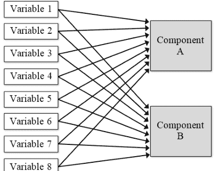

图1.1（第3页）展示了一个提取两个因子的PCA模型示例。我们已经进行了一些初步分析（将在第3章讨论），这些分析使我们确信了这种两成分结构，并引导我们得出了这个模型。请注意，所有PCA和EFA分析都提取与显性变量数量相同的成分或因子，尽管并非所有成分都保留用于解释；在这里，为了清晰起见，我们简化处理，仅考察提取的前两个成分，并查看它们与所测量变量的关系。现在，需要注意的重要一点是图中箭头的方向。请注意，箭头是从变量指向成分的。这是因为每个成分都是作为预测变量的加权线性组合形成的。变量中的百分之百内容最终都会成为成分。作为分析人员，我们随后可以审查结果，识别每个变量主要加载于哪个成分以创建量表，我们可以创建成分得分，或者我们可以对结果做任何我们想做的事情；但成分本身完全由变量定义。以这种方式，主成分分析将显性（观察到的）变量组合成成分。

另一方面，探索性因子分析是一组旨在建模未观察或隐性构念的提取和旋转技术。它被称为共同因子分析或探索性因子分析。EFA假设并断言存在产生显性（观察到的）变量的隐性变量，基于这一假设，计算和结果的解释方式截然不同。

您可以在下面第4页的图1.2中看到上述同一两因子模型的这种截然不同的概念视角。请注意变量与因子之间箭头方向的变化，以及为每个变量添加误差项。因子分析认识到模型方差包含变量间的共享方差和独特方差。EFA在每次创建因子时仅检查模型中的共享方差，同时允许独特方差和误差方差保留在模型中。然后，因子作为共享方差的加权线性组合被创建。当因子不相关且共同度适中时，PCA可能会产生成分所解释方差的虚高值（Gorsuch, 1997; McArdle, 1990）。由于因子分析仅分析共享方差，因此因子分析应得出相同的一般解（其他条件相同），同时避免方差估计的非法虚高。

### 图 1.2 探索性因子分析的概念概览

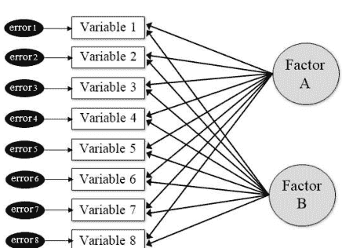

关于PCA还有另外两个问题我们将简要提及。首先，PCA假设所有变量都没有测量误差（在几乎任何学科中都是站不住脚的假设），而EFA提供了承认不完全可靠性的选项。其次，PCA参数的选择试图再现样本特征，而不是总体特征（Thompson, 2004）。

因此，PCA与其他提取方法之间存在许多相似之处，也存在一些重要的概念和数学差异。大多数作者同意，选择PCA而非其他提取方法几乎没有令人信服的理由，而且PCA可能存在局限性并提供有偏的参数估计。持此观点的作者包括Bentler & Kano, 1990；Floyd & Widaman, 1995；Ford, MacCallum, & Tait, 1986；Gorsuch, 1990；Lohnlin, 1990；MacCallum & Tucker, 1991；Muliak, 1990；Widaman, 1993。如果要寻求最佳实践，很难得出PCA曾是最佳实践的结论。Widman (1993) 非常直率地表示：

"如果研究人员希望获得反映隐性构念或因子的参数，则不应使用主成分分析。" (第263页)。不幸的是，它在许多统计分析软件中仍然是默认的降维程序，尽管在我们看来，它通常不是概念上可取的选择，而且在现代定量方法论中通常也没有我们能察觉的明显优势。

这是一个在统计学家中引起强烈反响的话题，第一作者很少就此话题发表论文或进行演讲而不引起某人的不满，因为他如此明确且毫不道歉地持这一立场。因此，让我们暂时回避这个问题并总结一下：PCA不被视为一种因子分析技术，统计学家之间对于何时（如果有的话）应该使用它存在分歧。更多时候，研究人员在EFA更合适且更可取时使用PCA（例如，参见Ford et al., 1986；Gorsuch, 1983；Widaman, 1993）。

### 进行EFA时应遵循的步骤

探索性因子分析本质上是探索性的，因此为执行EFA规定严格的公式或过程是不可取的。以下步骤旨在作为一份宽松的指南，理解因子分析通常需要返回之前的步骤并尝试其他方法以确保最佳结果。执行EFA的一般模式分为六个一般步骤，这些步骤将指导本书余下部分的讨论：

- 1 数据清洗
- 2 决定使用的提取方法
- 3 决定保留多少个因子
- 4 决定旋转方法（如需要）
- 5 解释结果（如果解不理想，返回#3）
- 6 复制或评估稳健性（如果解不可复制或不稳健，返回开头）

### 步骤 1：数据清洗

没有干净的数据，几乎任何分析的后续内容都无关紧要。这是研究人员和统计学家之间争议激烈的另一个点，因为关于对样本和数据的任何操纵（例如，如何处理异常值、缺失数据）存在相当大的争议。我们对这个问题有明确的立场——数据应该被清洗，问题（例如，未满足假设）应该得到解决。第一作者就此主题写了一整本书，他在书中反复展示，干净的数据能产生总体参数的更好估计，因此更准确且可复制（Osborne, 2013）。与其在这里争论这一点，不如让我断言，充满错误或未满足所执行分析假设的数据，可能会导致比没有严重错误且满足


假设。我们将在本书后面讨论一些其他数据质量问题，包括适当处理缺失数据的重要性。

### 步骤 2：确定提取方法。

提取技术是一组方法中的一种，用于检查所有变量之间的相关性/协变性，并试图从测量/显性变量中“提取”潜在变量。

有几种因子分析提取方法可供选择。SAS 有七种 EFA 提取方法：无加权最小二乘法 (ULS)、最大似然法 (ML)、主轴因子法 (PAF)、迭代主轴因子法 (iterated PAF)、Alpha 因子法、图像因子法和 Harris 因子法。1 关于这些技术相对优缺点的信息不易获取。更糟糕的是，某些提取技术的命名约定不一致，这使得很难弄清楚教科书或期刊文章作者描述的是哪种方法，以及它是否实际上可用于研究人员使用的软件中。这可能解释了主成分分析的流行程度——它不仅是许多统计软件中的默认方法，而且是研究人员会看到的较一致的名称之一。

Fabrigar、Wegener、MacCallum 和 Strahan (1999) 的一篇文章认为，如果数据近似服从正态分布，最大似然法是最佳选择，因为“它允许计算广泛的模型拟合优度指数[并]允许对因子载荷和因子间相关性进行统计显著性检验以及计算置信区间。”（第 277 页）。如果多元正态性假设被“严重违反”，他们建议使用迭代 PAF 或 ULS 因子法（Fabrigar et al., 1999; Nunnally & Bernstein, 1994）。其他作者认为，在特殊情况下或针对特定应用，其他提取技术（例如，Alpha 提取）最为合适，但优势证据有限。一般来说，ML、迭代 PAF 或 ULS 将为您提供最佳结果，具体取决于您的数据是通常服从正态分布还是显著非正态分布。在第 2 章中，我们将比较各种因子提取技术的结果。

### 步骤 3：确定保留用于分析的因子数量。

这也是一个问题，它受到过时观念和并非总是理想（甚至站不住脚）的软件默认设置的影响。在此步骤中，您（或软件）决定要保留多少个因子用于分析。统计软件最初始终会提取与变量数量相同的因子（即，如果量表中有 10 个条目，软件将提取 10 个因子），以解释 100% 的方差。然而，其中大部分将毫无意义。请记住，EFA 的目标是探索您的数据并减少要处理的变量数量。确定要提取和保留多少个因子以供进一步分析有多种方法。我们的指南将始终关注这样一个事实：提取的因子在概念和理论上应有意义，并在经验上站得住脚。我们将在后面第 3 章中探讨这方面的指南。

### 步骤 4：确定旋转方法并旋转因子。

旋转常常是混淆的来源。旋转到底是什么，当数据被旋转时发生了什么？简而言之，目标是澄清因子结构，使您的 EFA 结果最具可解释性。有几种旋转方法，分为两大类：正交旋转和斜交旋转。正交旋转将轴保持在 90° 角，强制因子不相关。斜交旋转允许非 90° 的角度，因此如果这对解最优，则允许因子相关。我们认为，在大多数学科中，构念往往至少彼此边缘相关，因此，我们应该关注斜交旋转而非正交旋转。我们将在第 4 章中更详细地讨论这些选项。

### 步骤 5：解释结果。

请记住，探索性因子分析的目标是探索您的数据是否符合一个合理的模型。理想情况下，您为分析拥有一个概念或理论框架——例如，指导工具开发的理论或文献。即使没有，结果也应该在某种程度上是合理的。您应该能够构建一个简单的叙述，描述每个因子及其组成变量如何有意义且容易标记。让 EFA 产生结果很容易。要获得合理的结果则要困难得多。

还要注意，EFA 是一种探索性技术。因此，不应像许多研究人员那样，试图用它来验证假设或检验竞争模型。那是验证性因子分析的用途。以这种方式使用 EFA 是误用，我们在描述探索性因子分析结果时需要小心避免使用验证性语言。

如果您的结果不合理，返回到之前的步骤可能会有所帮助。也许如果您提取不同数量的因子，因子或解将变得合理。这就是为什么它是一种探索性技术。

### 步骤 6：结果的复制。

科学的标志之一是可复制性，即其他人使用相同的材料或方法得出相同结论的能力。历史上，社会科学并未高度重视复制，但我们应该重视。正如您在后续章节中将看到的，EFA 是一种棘手的技术，结果往往不清晰。即使是清晰的结果，在极度相似的数据集中也往往无法完全复制。因此，在我们看来，此步骤至关重要。如果您的分析结果无法复制（或不能反映“现实世界”中变量的真实本质），那么其他人又为什么要关心它们呢？提供证据表明您的因子结构可能会复制（无论是通过另一次 EFA 还是通过 CFA），都能使您的发现更有力、更相关。在第 6 章中，我们将探讨一种“传统”的复制方法（类似于回归模型中的交叉验证）。在第 7 章中，我们将尝试使用自助法分析应用一种不那么传统但可能更有用的分析概念。验证性因子分析超出了本书的范围，但可能是一种更好的复制方法。

### EFA 的基本语法

FACTOR 过程用于在 SAS 中进行 EFA。在 SAS 中进行 EFA 时必须小心，因为 FACTOR 过程也用于进行 PCA——如果您不指定提取方法或只是选择其中一个提取选项，您可能会得到 PCA 而不是 EFA！以下是语法和可用基本选项的简要摘要。我们将在即将到来的章节中深入探讨更多细节和选项。

```
PROC FACTOR DATA = dataset-name
    NFACTORS = number-of-factors-to-retain
    METHOD = factor-extraction-method
    ROTATE = rotation-method;
VAR variables-to-include;
RUN;
```

在上述语法中，您将指定所有高亮显示的参数。您将标识用于分析的数据集，告诉 SAS 要提取的因子数量（我们将在第 3 章讨论此多步骤过程），指定七种 EFA 提取方法之一（请注意还有其他选项，但它们不是 EFA 提取方法），指定 25 种旋转方法之一，并列出要进行因子分析的变量。如果您不与 VAR 语句一起指定 NFACTORS、METHOD 和 ROTATE 选项，则分析仍会运行，但 SAS 将使用其默认选项：保留由 Kaiser 准则识别的因子数量、执行 PCA 提取、不进行旋转，并使用数据集中的所有变量。因此，最佳做法是养成指定所有选项的习惯，即使您选择使用默认方法之一，以免无意中忽略分析的关键组成部分。

让我们花一分钟快速回顾上述语法的结构。请注意，某些行末尾有分号，而其他行没有。分号的位置在 SAS 中至关重要——如果位置错误，您的代码将无法运行，并且会出现大量错误！分号表示语句的结束，并告诉 SAS 如何解析我们的请求。在上述语法中，我们有一个 PROC FACTOR 语句、一个 VAR 语句和一个 RUN 语句。您会注意到语句中有一些其他关键术语，允许用户指定分析的输入（例如，DATA =、NFACTORS =）。这些被称为语句中的选项。最后，请注意语法以 PROC FACTOR 开头。这告诉 SAS 我们正在使用 FACTOR 过程，随后的语句和选项将指定我们要进行的分析的详细信息。我们将在本书中使用此术语。

我们希望刚才描述的大部分内容是复习。如果不是，我们建议您在尝试遵循本书中的语法之前，先复习一些其他优秀的 SAS 入门教材（例如，Cody, 2007; Delwiche & Slaughter, 2012）。预期读者了解基本数据操作、DATA 步骤以及至少几个基本过程（例如，MEANS、SORT、FREQ）。此外，读者在整本书中被鼓励参考 SAS 关于 PROC FACTOR 的文档以获取更多信息（SAS Institute Inc., 2015）。


### Summary

本书的目标是提供一份友好、实用且具有应用性的 EFA 最佳实践概述，并结合 SAS 应用。在接下来的章节中，我们将探讨 EFA 的各个方面以及每个步骤的最佳实践。我们将尽可能跳过矩阵代数和方程。如果您正在寻找该主题中更具数学性的专著，已经有许多优秀的书籍可供选择。

在全书中，我们将描述和解释每种分析的 SAS 过程。我们还将回顾示例分析的关键语法。全书中所有分析的完整语法、使用的数据集以及练习的解答均可在作者页面 http://support.sas.com/publishing/authors 上找到。

### References

- Bentler, P. M., & Kano, Y. (1990). 因子与成分的等价性. Multivariate Behavioral Research, 25(1), 67-74.
- Cody, R. P. (2007). 通过示例学习 SAS：程序员指南. Cary, NC: SAS Institute.
- Delwiche, L. D., & Slaughter, S. J. (2012). SAS 小书：入门：编程方法（第 5 版）. Cary, NC: SAS Institute.
- Fabrigar, L. R., Wegener, D. T., MacCallum, R. C., & Strahan, E. J. (1999). 评价探索性因子分析在心理研究中的应用. Psychological Methods, 4(3), 272-299.
- Floyd, F. J., & Widaman, K. F. (1995). 临床评估工具的开发与改进中的因子分析. Psychological assessment, 7(3), 286-299.
- Ford, J. K., MacCallum, R. C., & Tait, M. (1986). 探索性因子分析在应用心理学中的应用：批判性回顾与分析. Personnel Psychology, 39(2), 291-314.
- Gorsuch, R. L. (1983). 因子分析（第 2 版）. Hillsdale, NJ: Lawrence Erlbaum Associates.
- Gorsuch, R. L. (1990). 共同因子分析与成分分析：一些众所周知和鲜为人知的事实. Multivariate Behavioral Research, 25(1), 33-39.
- Gorsuch, R. L. (1997). 探索性因子分析：其在项目分析中的作用. Journal of personality assessment, 68(3), 532-560.
- Hotelling, H. (1933). 将一组统计变量分析为主成分. *教育心理学杂志*, 24, 417-441.
- Loehlin, J. C. (1990). 成分分析与共同因子分析：作者权属争议案例. *多元行为研究*, 25(1), 29-31.
- MacCallum, R. C., & Tucker, L. R. (1991). 共同因子模型中误差来源的表示：对理论与实践的影响. *心理学公报*, 109(3), 502-511.
- McArdle, J. J. (1990). 结构因子分析的原则与校长. *多元行为研究*, 25(1), 81-87.
- Mulaik, S. A. (1990). 模糊成分分析与共同因子分析之间的区别. *多元行为研究*, 25(1), 53-59.
- Nunnally, J. C., & Bernstein, I. H. (1994). *心理测量理论*（第 3 版）. New York: McGraw-Hill.
- Osborne, J. W. (2013). *数据清洗的最佳实践：收集数据前后需做的一切完全指南*. Thousand Oaks, CA: Sage Publications.
- SAS Institute Inc. (2015). *SAS/STAT® 14.1 用户指南：FACTOR 过程*. Cary, NC: SAS Institute Inc.
- Spearman, C. (1904). “一般智力。”客观测定与测量. *美国心理学杂志*, 15(2), 201-292.
- Thompson, B. (2004). *探索性与验证性因子分析：理解概念与应用*. Washington, DC: American Psychological Association.
- Widaman, K. F. (1993). 共同因子分析与主成分分析：模型参数表示中的差异性偏差？*多元行为研究*, 28(3), 263-311.

## Extraction Method

- 什么是提取？ ........................ 11
- 关键概念 ............................... 12
- 提取技术 ...................... 13
- 三个教学示例 ................. 15
- 示例语法和输出 .................. 16
- 提取方法重要吗？ ............. 20
- 摘要 .................................... 25
- 练习 .................................. 26
- 示例中使用的工具 ............... 27
- 参考文献 ................................. 31

### What Is Extraction?

提取是将一组变量所分析的维数减少到较少数量的因子的过程。一般来说，因子提取首先提取解释方差最大的最强因子，然后逐步提取解释剩余方差最多的后续因子。本章首先回顾理解 EFA（尤其是因子提取）所必需的若干关键概念，然后回顾所使用的不同提取技术以及确定提取因子数量的标准。

### Key Concepts

**关联矩阵。** EFA 中的基本分析单元是关联矩阵——可以是相关系矩阵或协方差矩阵。如果将数据集输入 EFA，程序将把此作为第 1 步进行估计。或者，您可以直接输入相关系矩阵或协方差矩阵，将其作为原始数据读入。在尝试根据已发表结果复制他人分析，或希望通过校正相关系矩阵（即多系列相关系数或四系列相关系数）分析序数或二元变量时，这很有用。无论哪种情况，上述提取方法都将基于所分析的关联矩阵产生略有不同的结果。PROC FACTOR 中的默认方法是简单相关系矩阵（EFA 中最常用的关联类型）。相关系数在 EFA 中最常用，因为它们仅受两个变量关联强度的影响。相比之下，协方差受关联以及所涉及的每个变量方差的影响（Thompson, 2004）。PROC FACTOR 中的默认方法可以使用 COVARIANCE 选项更改。

**共同度。** 在 EFA 中，共同度是每个变量中共享方差的估计值，即所有因子将解释的方差。它们从关联矩阵中计算得出，其分解和划分是所有后续分析的目标。共同度的估计是 EFA 的定义特征，将其与 PCA 区分开来。在 EFA 中，每个变量的共同度始终小于 1.00，因为 EFA 寻求分解共享方差；而在 PCA 中，它们最初为 1.00，因为共享方差与独特方差之间没有区别。

尽管不同的提取方法通常会产生不同的共同度估计值，但每种方法通常都从相同的初始估计值开始。初始估计旨在快速、简单地了解每个变量中的共享方差。在 PROC FACTOR 中，EFA 技术 1 的默认过程是将变量与所有其他变量的多重相关系数的平方作为初始共同度进行估计。它们在输出中称为“先验共同度估计值”，并且应作为输出中的第一个表格之一出现。从初始估计值开始，共同度随后通过所选提取方法进行迭代重新估计，以产生最终估计值。

共同度可以被视为行统计量。在查看因子载荷表时，变量作为行，因子载荷作为列，一个变量的共同度是因子载荷的函数。对一个变量的每个因子载荷求平方并求和，应等于提取的共同度（在合理的四舍五入误差范围内）。2

- 1. 主轴因子提取和迭代主轴因子提取两种技术默认属于 PCA 方法而非 EFA。必须使用 PRIORS = SMC 选项指定基于多重相关系数平方的共同度初始提取，才能进行 EFA 提取。
- 2. 请注意使用正交旋转时的以下细节。如果手动计算，斜交旋转稍微复杂一些，因为因子之间存在相关性。在这种情况下，共同度等于每个变量的模式载荷与结构载荷之积的总和。统计软件为我们处理了这些复杂性。


**特征值。** 特征值是与因子相关的聚合项目级方差的一种表示。它们可以被视为列统计量——再次想象一个因子载荷表。如果对每个因子载荷求平方并在列内全部求和，你应该能得到该因子特征值的近似值（再次在四舍五入误差范围内）。因此，当至少有一些变量具有高因子载荷时，特征值较高；当大多数载荷较低时，特征值较低。你会注意到，特征值（和共同度）会从初始统计量（这些是估计值，无论采用何种提取方法*都应予以识别）变为提取值，其数值将取决于提取的数学方法。提取因子所解释的累积方差百分比不会改变（稍后讨论），但在旋转过程中，方差的分布会随着因子载荷的变化而改变。因此，如果提取的特征值总体解释了累积45%的方差，那么在因子旋转后，解释的累积方差仍将是45%，但旋转后该45%在各因子间的分布可能略有不同。当我们查看一些示例数据时，这将变得更加清晰。

**迭代与收敛。** 下文描述的大多数方法依赖于迭代过程来“收敛”到最终解。当一个模型的共同度与下一个模型的共同度之间的变化小于.001时，即发生收敛。这基本上可以解释为两个模型产生相同的结果。尽管我们尚未找到重置收敛标准的充分理由，但可以通过`CONVERGE`选项进行重置。如果EFA分析未能“收敛”，意味着这些系数未能稳定并继续剧烈变化。这最常见的原因是样本量不适当地小。解决此问题的一个潜在方法是增加默认迭代次数。在`PROC FACTOR`中，默认迭代次数为30，可以通过`MAXITER`选项重置。

### 提取技术

SAS中提供了七种EFA提取技术。这些方法涵盖了研究人员常用的选项范围，并包括其他常见统计软件应用程序（例如SPSS、STATA）中通常提供的所有方法。每种方法将在下文进一步描述。

**主轴因子(PAF)提取** 是PCA的一种变体。该方法将关联矩阵（例如，相关矩阵或协方差矩阵）的对角元素替换为初始共同度估计值，即共享方差的初始估计值。在PCA中不进行此替换，实际上允许PCA使用所有方差而不仅仅是共享方差来估计成分。当发生此替换时，它承认了不完美测量的现实预期，并改为仅在估计中使用共享方差。最终的因子集和共同度系数是从修订后的关联矩阵中估计的。

### 迭代主轴因子提取

与PAF相同，区别在于使用了迭代估计过程。每个连续的共同度系数估计值都用于替换关联矩阵的对角线。该过程重复迭代，直到共同度系数稳定——或变化小于预定阈值。当变量的多元正态性不是一个可接受的假设时，这种提取技术往往更受青睐（Fabrigar, Wegener, MacCallum, & Strahan, 1999）。

### Alpha提取

旨在最大化因子可靠性的Cronbach's系数alpha估计值。Alpha提取与其他提取技术的区别在于概括化的目标。最大似然和其他类似的提取技术旨在从样本概括到个体总体，而Alpha提取旨在概括到测量总体。Alpha提取的一个缺点是，当使用旋转时，这些特性会丢失（Nunnally & Bernstein, 1994），仅适用于初始旋转。正如我们将在旋转部分看到的，未旋转的结果通常不易解释，这种提取技术可能会让研究人员感到困惑，他们可能会认为自己得到了实际并未得到的东西——如果他们旋转了Alpha提取的结果。

### 最大似然(ML)提取

这是另一种迭代过程（用于逻辑回归、验证性因子分析、结构方程建模等），旨在提取能够最优再现总体相关（或协方差）矩阵的因子和参数。它从单个变量服从正态分布的假设开始（导致多元正态分布，残差围绕0服从正态分布）。如果提取一定数量的因子来解释观察变量之间的相互关系，则可以使用该信息重构再现相关矩阵。所选参数会被迭代调整，以最大化再现总体相关矩阵的可能性——或最小化再现矩阵与总体矩阵之间的差异。这种技术对数据中的特殊情况特别敏感，尤其是在“小”样本中，因此如果正态性假设不可接受，这可能不是一种好的提取技术（Fabrigar et al., 1999; Nunnally & Bernstein, 1994）。

### 未加权最小二乘(ULS)提取

使用最大似然提取过程的一种变体。它不对正态性做任何假设，并寻求最小化误差，误差被定义为残差平方和。在观察相关（或协方差）矩阵与再现矩阵之间，ULS被认为对非正态数据更具鲁棒性（正如我们将在即将出现的第三个示例中看到的；Nunnally & Bernstein, 1994）。

### 影像提取和Harris提取

是基于影像因子模型的两种方法，区别于共同因子模型或成分模型（Cattell, 1978, p 403）。这些方法使用非迭代过程，基于多元回归产生的方差下界估计，来估计共享方差（称为影像）和独特方差（称为反影像）（Cattell, 1978; Harman, 1967）。SAS中的影像提取方法对应于Guttman（1953）的版本（区别于Jöreskog 1969的版本），而Harris提取对应于Harris（1962）的Rao-Guttman方法。这些方法不太常见，在本章中将不再进一步讨论。

上述每种技术都在FACTOR过程的METHOD选项中指定。上面总结的不同提取方法可以使用以下关键字请求。1

```
method =
PRINCIPAL /*PAF extraction*/
PRINIT /*Iterated PAF extraction*/
ALPHA /*Alpha extraction*/
ML /*ML extraction*/
ULS /*ULS extraction*/
IMAGE /*Image extraction*/
HARRIS /*Harris extraction*/
```

请注意，PAF和迭代PAF技术还需要PRIOR = SMC选项（指定使用平方多重相关矩阵来估计初始共同度，如上面示例语法所示）。如果未指定此选项，将执行PCA。

### 三个教学示例

为了说明本章本节的观点，我们有三个可从书籍网站获得并将在整本书中使用的示例数据集。数据集的快速摘要在第15页的表2.1中呈现。按工具划分的项目完整摘要以及源数据源详情将在本章末尾呈现。

表2.1 示例数据集

| 示例 | 样本 | 项目/量表 | 示例项目 |
| :--- | :--- | :--- | :--- |
| 1. 工程项目 | 来自东部大学工程专业研究的372名本科生。 | 14个项目和2个量表：工程问题解决（8个项目），对工程的兴趣（6个项目） | 你觉得自己为定义问题的真正含义做好了多少准备？工程令我着迷。 |


| 示例 | 样本 | 条目/量表 | 示例条目 |
| :--- | :--- | :--- | :--- |
| 2. Marsh 自我描述问卷 (SDQ) | 来自1988年全国教育纵向研究的15,661名10年级学生。 | 13个条目和3个量表：父母（5个条目）、英语（4个条目）、数学（4个条目） | 我的父母公平对待我。<br>我在英语上取得好成绩。<br>我在数学测试中表现不佳。 |
| 3. 老年抑郁量表 | 来自长滩纵向调查的479名老年人。 | 一个没有明确因子结构的量表，包含30个条目 | 你经常感到无聊吗？<br>你对未来充满希望吗？ |

通常认为，提取技术倾向于产生相似的结果。让我们审视这一断言，看看它是否适用于我们的样本。

### 示例语法和输出

要开始，让我们回顾生成工程数据因子分析（第15页表2.1中的示例数据集1）的语法和输出。我们将使用迭代PAF提取，并要求SAS提取两个因子，因为数据中的条目通常代表两个量表（请注意，在第3章中我们将讨论确定提取因子数量的标准。执行此操作的语法如下所示。

```
proc factor data = engdata nfactors = 2 method = PRINIT priors = SMC;
   var EngProbSolv1 EngProbSolv2 EngProbSolv3 EngProbSolv4
   EngProbSolv5 EngProbSolv6 EngProbSolv7 EngProbSolv8
   INTERESTeng1 INTERESTeng2 INTERESTeng3 INTERESTeng4
   INTERESTeng5 INTERESTeng6;
run;
```

由于我们本质上是喜欢走捷径（在适当的时候）的懒惰程序员，我们将花一分钟时间解释两个方便的快捷方式，用于引用具有相同前缀的一组变量：范围和列表。变量范围需要相同的前缀和数字后缀（例如，var1 var2 var3）。然后可以通过范围中第一个变量和最后一个变量，用连字符分隔来引用一组变量（例如，var1-var3）。变量列表只需要相同的前缀。后缀可以是数字或字符（例如，var011 varXYZ varABC）。然后可以通过通用前缀后跟冒号来引用该组（例如，var:）。还有一种使用双破折号（例如，--）的范围，它根据数据集中的位置引用变量，但我们不建议使用它，因为变量顺序可能会改变，这可能会给你带来麻烦。如果我们在上述语法中使用范围或列表，这将把你的VAR语句更改为以下内容：

```
var EngProbSolv1-EngProbSolv8 INTERESTeng1-INTERESTeng6;
```

```
*OR;
var EngProbSolv: INTERESTeng:;
```

在本书的其余部分，我们将使用列表表示法来引用变量，以减少和简化我们展示的语法。

该语法生成一系列结果。目前我们特别感兴趣的是公度数和特征值。我们将在下面展示这些结果，以及一些相关表格。第17页的图2.1和第18页的图2.2展示了初始公度数和提取的特征值。第18页的图2.3展示了SAS在尝试识别公度数稳定估计时产生的公度数迭代估计。最终特征值和公度数在第19页的图2.4、第19页的图2.5和第19页的图2.6中展示。请注意，会生成两个不同的表格来显示提取的最终特征值。第一个显示所有特征值的值，第二个仅显示提取的特征值。

### 图 2.1 初始公度数估计

```
The SAS System
The FACTOR Procedure
Initial Factor Method: Iterated Principal Factor Analysis

Prior Communality Estimates: SMC
```

| EngProbSolv1 | EngProbSolv2 | EngProbSolv3 | EngProbSolv4 | EngProbSolv5 | EngProbSolv6 | EngProbSolv7 |
|---|---|---|---|---|---|---|
| 0.74225891 | 0.69492663 | 0.75168425 | 0.79173824 | 0.79014397 | 0.76641517 | 0.78640575 |

| EngProbSolv8 | INTERESTeng1 | INTERESTeng2 | INTERESTeng3 | INTERESTeng4 | INTERESTeng5 | INTERESTeng6 |
|---|---|---|---|---|---|---|
| 0.66617372 | 0.67364170 | 0.80199479 | 0.81578725 | 0.80569754 | 0.78059756 | 0.73930386 |

### 图 2.2 提取的初始特征值

| | 特征值 | 差异 | 比例 | 累积 |
|---|---|---|---|---|
| 1 | 7.41147001 | 4.14045379 | 0.56987 | 0.56987 |
| 2 | 3.27101622 | 3.07385573 | 0.3084 | 1.0071 |
| 3 | 0.19716049 | 0.12724260 | 0.0186 | 1.0257 |
| 4 | 0.06991789 | 0.02097769 | 0.0066 | 1.0323 |
| 5 | 0.04894020 | 0.00959991 | 0.0046 | 1.0369 |
| 6 | 0.03934028 | 0.01737713 | 0.0037 | 1.0406 |
| 7 | 0.02196316 | 0.03590061 | 0.0021 | 1.0427 |
| 8 | -.01393745 | 0.01888235 | -0.0013 | 1.0414 |
| 9 | -.03281980 | 0.01385724 | -0.0031 | 1.0383 |
| 10 | -.04667704 | 0.02487962 | -0.0044 | 1.0339 |
| 11 | -.07155666 | 0.01105570 | -0.0067 | 1.0272 |
| 12 | -.08261235 | 0.01464078 | -0.0078 | 1.0194 |
| 13 | -.09725314 | 0.01092932 | -0.0092 | 1.0102 |
| 14 | -.10818246 | | -0.0102 | 1.0000 |

### 图 2.3 公度数的迭代估计

| 迭代 | 变化 | 公度数 |
|---|---|---|
| 1 | 0.0230 | 0.7143 0.67528 0.76418 0.80488 0.79669 0.76782 0.77790 0.66895 0.67210 0.82503 0.83455 0.81580 0.79624 0.75064 |
| 2 | 0.0056 | 0.72861 0.67045 0.76741 0.80863 0.79843 0.76826 0.77575 0.67075 0.66984 0.83083 0.83888 0.81707 0.79920 0.75210 |
| 3 | 0.0016 | 0.72787 0.66926 0.76824 0.80954 0.79898 0.76822 0.77520 0.67091 0.66898 0.83246 0.83999 0.81712 0.79976 0.75217 |
| 4 | 0.0005 | 0.72766 0.66897 0.76845 0.80981 0.79901 0.76831 0.77506 0.67094 0.66887 0.83296 0.84031 0.81706 0.79986 0.75211 |

### 图 2.4 最终特征值估计

| | 特征值 | 差异 | 比例 | 累积 |
|---|---|---|---|---|
| 1 | 7.41735945 | 4.13561079 | 0.6933 | 0.6933 |
| 2 | 3.28174866 | 3.09229491 | 0.3067 | 1.0000 |
| 3 | 0.18945375 | 0.10923108 | 0.0177 | 1.0178 |
| 4 | 0.08022267 | 0.02194042 | 0.0075 | 1.0253 |
| 5 | 0.05828225 | 0.01517213 | 0.0054 | 1.0307 |
| 6 | 0.04311012 | 0.01355272 | 0.0040 | 1.0347 |
| 7 | 0.02955740 | 0.03421141 | 0.0028 | 1.0375 |
| 8 | -0.0465401 | 0.01603057 | -0.0004 | 1.0371 |
| 9 | -0.02068458 | 0.00937260 | -0.0019 | 1.0351 |
| 10 | -0.03005719 | 0.02685945 | -0.0028 | 1.0323 |
| 11 | -0.05691664 | 0.02614394 | -0.0053 | 1.0270 |
| 12 | -0.0306647 | 0.00278501 | -0.0078 | 1.0192 |
| 13 | -0.0885149 | 0.03405705 | -0.0080 | 1.0112 |
| 14 | -1.1990854 | | -0.0112 | 1.0000 |

### 图 2.5 提取的最终特征值

| 因子1 | 因子2 |
|---|---|
| 7.4173594 | 3.2817487 |

### 图 2.6 提取的最终公度数

| EngProbSolv1 | EngProbSolv2 | EngProbSolv3 | EngProbSolv4 | EngProbSolv5 | EngProbSolv6 | EngProbSolv7 |
|---|---|---|---|---|---|---|
| 0.72767880 | 0.66896630 | 0.76844749 | 0.80981353 | 0.79900569 | 0.76831462 | 0.77506294 |
| EngProbSolv8 | INTERESTeng1 | INTERESTeng2 | INTERESTeng3 | INTERESTeng4 | INTERESTeng5 | INTERESTeng6 |
| 0.67094317 | 0.66857315 | 0.83296139 | 0.84031090 | 0.81705556 | 0.79986155 | 0.75211302 |

### 提取方法重要吗？

那么，现在我们已经费力学习了不同的提取方法，并弄明白了如何在SAS中运行它们，它们到底有什么实际区别呢？让我们通过比较五种不同提取方法的结果来看看，这些方法使用的是第15页表2.1中汇总的数据集。我们使用上面部分中展示的相同语法运行了这些模型，只是更改了METHOD选项，并为除PAF和迭代PAF方法外的所有方法消除了PRIORS选项。然后我们将结果整理成一些漂亮的汇总表格，以便于比较。

### 工程数据

如上文所述，这种数据通常会给出一个清晰的两因子解。第20页的表2.2展示了初始提取以及每种后续提取方法的公度数估计。如你所见，尽管样本量相对较小，各个条目的公度数相对稳定，对于特定条目，在所有提取方法之间的变化很少超过0.10。第21页的表2.3展示了各种方法提取的特征值。我们还看到各种方法产生的特征值非常相似。这表明，当基本假设得到满足且因子结构清晰时，提取方法可能并不重要。

表2.2 不同提取技术下工程数据的公度数估计

| 变量: | 初始 | ML | PAF | 迭代PAF | ULS | ALPHA |
|---|---|---|---|---|---|---|
| EngProbSolv1 | .742 | .712 | .731 | .728 | .728 | .733 |
| EngProbSolv2 | .695 | .663 | .675 | .669 | .669 | .669 |
| EngProbSolv3 | .752 | .766 | .764 | .768 | .768 | .769 |
| EngProbSolv4 | .792 | .810 | .805 | .810 | .810 | .810 |
| EngProbSolv5 | .790 | .807 | .797 | .799 | .799 | .796 |
| EngProbSolv6 | .766 | .774 | .768 | .768 | .768 | .767 |
| EngProbSolv7 | .786 | .778 | .778 | .775 | .775 | .774 |
| EngProbSolv8 | .666 | .674 | .670 | .671 | .671 | .669 |
| INTERESTeng1 | .674 | .666 | .672 | .669 | .668 | .668 |


| 变量 | 初始 | ML | PAF | 迭代 PAF | ULS | ALPHA |
|---|---|---|---|---|---|---|
| INTERESTeng2 | .802 | .834 | .825 | .833 | .833 | .834 |
| INTERESTeng3 | .816 | .846 | .835 | .840 | .840 | .839 |
| INTERESTeng4 | .806 | .831 | .816 | .817 | .817 | .813 |
| INTERESTeng5 | .781 | .781 | .796 | .800 | .800 | .805 |
| INTERESTeng6 | .739 | .750 | .751 | .752 | .752 | .751 |

### 表 2.3 工程数据不同提取技术提取的特征值

| 因子 | 初始 | ML | PAF | 迭代 PAF | ULS | ALPHA |
|---|---|---|---|---|---|---|
| 1 | 7.411 | 7.359 | 7.411 | 7.417 | 7.417 | 7.415 |
| 2 | 3.271 | 3.335 | 3.271 | 3.282 | 3.282 | 3.285 |
| 3 | .197 | | | | | |
| 4 | .070 | | | | | |
| 5 | .070 | | | | | |

注：ML 和 ALPHA 方法通常会因加权估计过程而报告加权特征值。出于本示例的目的，报告的是未加权特征值。初始提取中已抑制因子 6-14。

自我描述问卷数据。与之前的分析一样，您可以看到，无论采用哪种提取方法，对 SDQ 的不同提取方法分析产生的结果都相对相似。提取的共同性相似，特征值也相似（分别见第 22 页的表 2.4 和第 22 页的表 2.5）。这些结果进一步支持如下结论：当满足基本假设且因子结构清晰时，提取方法的重要性较小。

### 表 2.4 SDQ 数据不同提取技术的共同性估计

| 变量 | 初始 | ML | PAF | 迭代 PAF | ULS | ALPHA |
|---|---|---|---|---|---|---|
| Eng1 | .537 | .619 | .598 | .623 | .623 | .622 |
| Eng2 | .581 | .676 | .637 | .664 | .664 | .648 |
| Eng3 | .608 | .722 | .678 | .723 | .724 | .722 |
| Eng4 | .447 | .403 | .436 | .413 | .413 | .425 |
| Math1 | .704 | .790 | .760 | .792 | .792 | .794 |
| Math2 | .674 | .751 | .721 | .737 | .737 | .721 |
| Math3 | .700 | .783 | .762 | .799 | .800 | .816 |
| Math4 | .393 | .372 | .386 | .371 | .371 | .374 |
| Par1 | .455 | .526 | .500 | .510 | .510 | .496 |
| Par2 | .406 | .434 | .445 | .450 | .450 | .458 |
| Par3 | .572 | .695 | .640 | .678 | .678 | .668 |
| Par4 | .408 | .392 | .426 | .421 | .420 | .442 |
| Par5 | .477 | .557 | .525 | .539 | .539 | .525 |

### 表 2.5 SDQ 数据不同提取技术提取的特征值

| 因子 | 初始 | ML | PAF | 迭代 PAF | ULS | ALPHA |
|---|---|---|---|---|---|---|
| 1 | 3.625 | 3.399 | 3.625 | 3.689 | 3.689 | 3.622 |
| 2 | 2.158 | 2.446 | 2.158 | 2.226 | 2.226 | 2.259 |
| 3 | 1.731 | 1.874 | 1.731 | 1.804 | 1.804 | 1.829 |
| 4 | .362 | | | | | |
| 5 | -.021 | | | | | |
| 6 | -.054 | | | | | |

注：ML 和 ALPHA 方法通常会因加权估计过程而报告加权降低相关矩阵的特征值。出于本示例的目的，报告的是未加权特征值。初始提取中已抑制因子 7-13。

GDS 数据。第三次分析的目标是比较各种提取技术在结构清晰度较低的数据上的结果。由于此数据为二元数据（仅 0、1 值），可能不满足多元正态性假设。如果认真对待上述建议，鉴于数据非正态，应使用迭代 PAF 或 ULS。如第 23 页的表 2.6 所示，迭代 PAF 和 ULS 方法产生的结果几乎相同。其余方法有所不同，量表中几个变量提取的共同性存在显著差异。（参见高亮行。）将 ML 与迭代 PAF 和 ULS 进行比较，很明显，当数据不满足多元正态性时，应认真考虑使用迭代 PAF 或 ULS 的建议。第 23 页的表 2.6 中还有一些项目在 ML 与迭代 PAF 或 ULS 之间存在显著差异（例如，参见 GDS01 或 GDS12）。

### 表 2.6 不同提取方法的共同性比较

| 变量 | 初始 | ML | PAF | 迭代 PAF | ULS | ALPHA |
|---|---|---|---|---|---|---|
| GDS01 | .518 | .880 | .579 | .690 | .688 | .553 |
| GDS02 | .297 | .346 | .346 | .366 | .366 | .367 |
| GDS03 | .513 | .560 | .564 | .579 | .580 | .558 |
| GDS04 | .408 | .612 | .479 | .577 | .577 | .550 |
| GDS05 | .400 | .424 | .399 | .396 | .395 | .398 |
| GDS06 | .369 | .450 | .421 | .447 | .446 | .447 |
| GDS07 | .451 | .543 | .494 | .521 | .521 | .436 |
| GDS08 | .272 | .276 | .320 | .329 | .329 | .391 |
| GDS09 | .559 | .689 | .620 | .672 | .672 | .629 |
| GDS10 | .410 | .416 | .411 | .406 | .406 | .397 |
| GDS11 | .310 | .364 | .362 | .371 | .371 | .349 |
| GDS12 | .320 | .996 | .413 | .788 | .830 | .660 |
| GDS13 | .278 | .428 | .320 | .389 | .386 | .314 |
| GDS14 | .286 | .406 | .363 | .451 | .453 | .489 |
| GDS15 | .384 | .409 | .425 | .430 | .430 | .470 |
| GDS16 | .534 | .564 | .569 | .567 | .567 | .561 |
| GDS17 | .500 | .552 | .539 | .547 | .546 | .531 |
| GDS18 | .290 | .264 | .306 | .281 | .282 | .314 |
| GDS19 | .396 | .422 | .426 | .419 | .419 | .411 |
| GDS20 | .336 | .355 | .387 | .387 | .387 | .462 |
| GDS21 | .346 | .417 | .412 | .433 | .432 | .433 |
| GDS22 | .413 | .471 | .467 | .491 | .491 | .514 |
| GDS23 | .254 | .254 | .258 | .252 | .252 | .264 |
| GDS24 | .260 | .280 | .290 | .282 | .282 | .311 |
| GDS25 | .442 | .451 | .482 | .473 | .473 | .482 |
| GDS26 | .375 | .445 | .432 | .437 | .436 | .425 |
| GDS27 | .211 | .214 | .245 | .239 | .239 | .260 |
| GDS28 | .300 | .309 | .365 | .333 | .328 | .336 |
| GDS29 | .195 | .162 | .194 | .167 | .167 | .219 |
| GDS30 | .277 | .368 | .341 | .362 | .363 | .380 |

注：迭代 PAF 方法必须增加最大迭代次数才能收敛于一个解。

初始 PAF 提取在默认迭代次数（25 次）内未能收敛于一个解。这可能表明数据或分析存在问题，导致估计值波动且无法收敛于一个解。在此示例中，最大迭代次数（MAXITER）已增加，并在第 60 次迭代时收敛于一个解。由于迭代 PAF 结果与 ULS 提取结果相似，我们可以得出结论：分析或结果本身没有问题，但 ULS 提取可能比迭代 PAF 提取更快达到解。

不同提取方法提取的特征值再次存在显著差异，如第 25 页的表 2.7 所示。再次，ML 产生了最出乎意料的结果，但迭代 PAF 和 ULS 结果可能是最可靠的。请注意，ML 对第一个因子产生的特征值小于第二个因子，这不寻常，但仅仅是产生的相对极端载荷的反映。

### 表 2.7 不同提取技术提取的特征值比较

| 因子 | 初始 | ML | PAF | 迭代 PAF | ULS | ALPHA |
|---|---|---|---|---|---|---|
| 1 | 7.257 | 2.171 | 7.257 | 7.325 | 7.325 | 7.296 |
| 2 | 1.459 | 5.898 | 1.459 | 1.565 | 1.567 | 1.539 |
| 3 | 1.044 | 1.415 | 1.044 | 1.122 | 1.126 | 1.115 |
| 4 | .675 | 1.030 | .675 | .787 | .796 | .744 |
| 5 | .548 | .977 | .548 | .698 | .703 | .635 |
| 6 | .485 | .755 | .485 | .625 | .626 | .649 |
| 7 | .435 | .623 | .435 | .538 | .538 | .512 |
| 8 | .327 | .457 | .327 | .421 | .421 | .419 |
| 9 | .301 | | | | | |
| 10 | .227 | | | | | |

注：ML 和 ALPHA 方法通常会因加权估计过程而报告加权降低相关矩阵的特征值。出于本示例的目的，报告的是未加权特征值。初始提取中已抑制因子 11-39。

### 摘要

我们中的许多人，即使是使用 EFA 有多年经验的人，在执行此分析时，对“底层”究竟发生了什么仍然不清楚。坚持大多数现代统计软件的默认设置通常不会导致采用最佳实践。在 PROC FACTOR 中，默认的提取方法实际上是


甚至不是一种因子分析方法——它是 PCA！如果你是 1960 年代的心理学家，这是一个不错的选择，但在 21 世纪，我们可以做得更好。所以，请注意：必须指定提取方法，才能进行因子分析。

至于使用哪种提取方法——本章中的示例表明，当数据具有清晰的因子结构并满足正态性基本假设时，大多数提取技术都可以使用。当数据不满足正态性假设时，迭代 PAF 或 ULS 提取技术可以提供最佳估计。这使我们得出结论：当假设被违反时，提取方法可能更重要；当假设得到满足时，则不那么重要。

然而，文献中普遍认为，当数据表现出多元正态性时，ML 是首选方法；当该假设被违反时，则首选迭代 PAF 或 ULS（Fabrigar, Wegener, MacCallum, & Strahan, 1999; Nunnally & Bernstein, 1994）。其他提取技术似乎容易受到该假设违反的影响，且似乎没有提供任何实质性好处。因此，建议使用 ML、迭代 PAF 或 ULS 似乎是明智的。

### 练习

- 1. 从书籍网站下载工程、SDQ 和/或 GDS 数据。复制本章中报告的结果。检查提取方法，看哪一种为每个数据集提供最佳提取。

- 2. 下载第一作者早期关于学术认同研究的早期版本数据（Osborne, 1997）。该工具旨在衡量学术认同（学生将自己定义为学生作为自我概念一部分的程度）。据称应有三个量表，采用 1（强烈不同意）到 7（强烈同意）的量表进行测量：a) 学术对自我中心性（项目 1、4、7、9、10、11、15、16、18、19、20、21）；b) 歧视感受（2、3、6）；c) 学术结果的诊断性（5、8、12、13、14、17）。检查提取方法并确定哪一种为该数据集提供最佳提取。

### 示例中使用的工具

表 2.8 示例 1：工程量表

| 变量名 | 项目 |
|---|---|
| 解决问题的项目。你觉得自己为以下方面准备得如何： | |
| EngProbSolv1 | 定义问题的真正含义 |
| EngProbSolv2 | 搜索并收集解决问题所需的信息 |
| EngProbSolv3 | 想出问题的潜在解决方案 |
| EngProbSolv4 | 详细说明如何实施问题的解决方案 |
| EngProbSolv5 | 评估并对可能或计划中的解决方案做出判断 |
| EngProbSolv6 | 在特定维度（如成本）上比较和对比问题的两个解决方案 |
| EngProbSolv7 | 从考虑的方案中选择一个想法或解决方案 |
| EngProbSolv8 | 在草图、图表、列表以及书面或口头报告中传达解决方案的要素 |
| 对工程的兴趣： | |
| INTERESTeng1 | 我发现工程中的许多主题都很有趣。 |
| INTERESTeng2 | 解决工程问题对我来说很有趣。 |
| INTERESTeng3 | 工程让我着迷。 |
| INTERESTeng4 | 我对解决工程问题感兴趣。 |
| INTERESTeng5 | 学习工程中的新主题对我来说很有趣。 |
| INTERESTeng6 | 我发现工程在智力上很有启发性。 |

表 2.9 示例 2：Marsh 自我描述问卷 (SDQ)

| 变量名 | 项目 |
|---|---|
| 父母： | |
| Par1 | 我的父母公平对待我。 |
| Par2 | 我不太喜欢我的父母。 |
| Par3 | 我与父母相处融洽。 |
| Par4 | 我的父母通常对我所做的事不高兴或失望。 |
| Par5 | 我的父母理解我。 |
| 英语： | |
| Eng1 | 我在英语课上学得很快。 |
| Eng2 | 英语是我最好的科目之一。 |
| Eng3 | 我的英语成绩好。 |
| Eng4 | 我在英语课上一塌糊涂。 |
| 数学： | |
| Math1 | 数学是我最好的科目之一。 |
| Math2 | 我一直数学成绩好。 |
| Math3 | 我的数学成绩好。 |
| Math4 | 我在数学考试中成绩差。 |

表 2.10 示例 3：老年抑郁量表

| 变量名 | 项目 |
|---|---|
| GDS01 | 你基本上对自己的生活满意吗？ |
| GDS02 | 你是否放弃了许多活动和兴趣？ |
| GDS03 | 你觉得自己的生活空虚吗？ |
| GDS04 | 你经常感到无聊吗？ |
| GDS05 | 你对未来充满希望吗？ |
| GDS06 | 你是否被挥之不去的想法所困扰？ |
| GDS07 | 你大多数时候精神好吗？ |
| GDS08 | 你害怕会有不好的事情发生在你身上吗？ |
| GDS09 | 你大多数时候感到快乐吗？ |
| GDS10 | 你经常感到无助吗？ |
| GDS11 | 你经常感到不安和坐立不安吗？ |
| GDS12 | 你更喜欢待在家里，而不是出去做新事情吗？ |
| GDS13 | 你经常为未来担忧吗？ |
| GDS14 | 你觉得自己的记忆问题比大多数人更多吗？ |
| GDS15 | 你觉得现在活着很美好吗？ |
| GDS16 | 你经常感到沮丧和忧郁吗？ |
| GDS17 | 你觉得自己现在一无是处吗？ |
| GDS18 | 你经常为过去担忧吗？ |
| GDS19 | 你觉得生活非常令人兴奋吗？ |
| GDS20 | 你开始新项目很困难吗？ |
| GDS21 | 你感到精力充沛吗？ |
| GDS22 | 你觉得自己的情况无望吗？ |
| GDS23 | 你觉得大多数人比你过得好吗？ |
| GDS24 | 你经常为小事烦恼吗？ |
| GDS25 | 你经常想哭吗？ |
| GDS26 | 你难以集中注意力吗？ |
| GDS27 | 你喜欢早上起床吗？ |
| GDS28 | 你更喜欢避免社交聚会吗？ |
| GDS29 | 你做决定容易吗？ |
| GDS30 | 你的头脑像以前一样清晰吗？ |

工程数据经 Marie Paretti 博士许可使用。该数据来自一项由国家科学基金会在 HRD# 0936704 资助下支持的更大规模研究。本书中表达的任何意见、发现、结论和建议均为作者的观点，不一定反映国家科学基金会的观点。

Marsh SDQ 数据来自国家教育统计中心的研究：1988 年全国教育纵向研究 (NELS:88)。该数据属于公共领域。更多信息可在以下网址找到：http://nces.ed.gov/surveys/nels88/。

老年抑郁调查数据来自长滩研究的公开数据。该数据的引用（存放于 ICPSR）为：Zelinski, Elizabeth, and Robert Kennison. Long Beach Longitudinal Study. ICPSR26561-v2. Ann Arbor, MI: Inter-university Consortium for Political and Social Research [distributor], 2011-06-17。

关于此研究的更多信息可在以下网址找到：http://www.icpsr.umich.edu/icpsrweb/NACDA/studies/26561/version/2。关于此数据的意见以及这些分析结果仅属我们所有，用于讨论探索性因子分析的最佳实践和技术的教学目的。它们不应被视为对原始研究作者、原始研究结果或几乎任何其他事物有任何影响。此外，我们没有应用任何权重或补偿设计效应，因此结果除了这些示例外，对其他任何事情都无用。

### 参考文献

Cattell, R. B. (1978). 行为与生命科学中因子分析的科学应用. New York: Plenum Press.

Fabrigar, L. R., Wegener, D. T., MacCallum, R. C., & Strahan, E. J. (1999). 评估心理学研究中探索性因子分析的使用. Psychological Methods, 4(3), 272–299.

Guttman, L. (1953). 定量变量结构的镜像理论. Psychometrika, 18(4), 277–296.

Harman, H. H. (1967). 现代因子分析（第 2 版，修订版）. Chicago: University of Chicago Press.

Harris, C. W. (1962). 一些 Rao-Guttman 关系. Psychometrika, 27, 247-263.

Jöreskog, K. G. (1969). 镜像因子分析中的高效估计. Psychometrika, 34(1), 51-75.

Nunnally, J. C., & Bernstein, I. (1994). 心理测量理论（第 3 版）. New York: McGraw-

Osborne, J. W. (1997). 社区大学学生的学术认同与学业成功. Community College Review, 25(1), 59-67.

Thompson, B. (2004). 探索性和验证性因子分析：理解概念与应用. Washington, DC: American Psychological Association.


## 因子提取标准

- 因子数量是多少？ .................................................... 33
- 提取标准 .................................................... 34
- 示例语法和输出 ........................................ 36
- 标准如何比较？ ................................... 45
- 总结 .................................................................... 57
- 练习 .................................................................... 58
- 参考文献 ................................................................... 58

### 因子数量是多少？

学者们争论这个问题已有近一个世纪之久。许多人会热情地争论一种方法优于另一种方法，有些方法似乎确实比其他方法更有说服力。然而，在我看来，许多争论源于一种高风险心态，研究人员试图证实一种因子结构优于另一种。让我们再次重复本书的箴言：EFA 是探索性的，应该被视为一个低风险过程。

有许多指南可用于决定从分析中提取多少个因子。毕竟，您的统计软件会提取与分析中变量数量相同的因子，由于我们的目标是降维，我们然后必须决定保留多少个提取的因子以供进一步分析。如果在 SAS 中未指定要保留的因子数量，则 PROC FACTOR 默认使用满足最小特征值标准（默认特征值最小值因提取方法而异，请参见 SAS, 2015）或方差比例标准（默认比例设置为 100%）的最少因子数量。重要的是，您不应让默认设置主导您的分析，而是应选择并审查对您有意义的方法或方法。那么存在哪些决策规则，哪种最好？

### 提取标准

### 理论

我们是理论驱动分析的倡导者。¹ 研究人员通常执行 EFA，因为有人设计了一个工具来测量特定的构念或因子。如果该工具的理论框架是可靠的，我们应该期望在数据中看到该结构。工具很少完美（尤其是第一次被检查时），理论期望也不总是得到支持。但除非一个人在没有先验想法的数据集中进行“捕鱼式”勘探，²否则这是开始的一个好地方。无论如何，EFA 的结果必须是一个易于理解的合理因子结构，无论该最终结构是否与初始理论框架相匹配。在我们看来，EFA 的基本功能是使数据有意义。

### 凯撒标准

凯撒标准（Kaiser, 1960, 1970）提出，大于 1.0 的特征值是期望因子有意义的良好下限。这是因为特征值代表一列中平方因子载荷的和，要得到 1.0 或更多的和，必须有相当大的因子载荷来平方和求和（例如，四个至少 0.50 的载荷，三个至少 0.60 的载荷）。但是，随着分析的项目越来越多，此标准的效果会越来越差。如果您在分析中分析 100 个项目，很容易得到许多不重要的因子超过此标准。

尽管文献中存在共识，认为这可能是选择要保留的因子数量的最不准确的方法（Velicer, Eaton, & Fava, 2000；另见 Costello & Osborne, 2005），但它通常被实现为许多统计软件（如 SPSS）中的默认选择标准。在强大计算广泛可用之前，这是一个简单（且不无道理）的决策规则。在 20 世纪后期，研究人员建议将此标准与碎石图检查相结合会更好（Cattell, 1966）。

### 最小特征值

凯撒标准是以主成分分析（PCA）为基础构建的。在 PCA 中，每个项目贡献其 100% 的方差，因此特征值为 1 相当于 1 个变量在特定因子上载荷。当应用于因子分析时，解释不同。特征值为 1 可能超过项目的平均贡献。例如，如果八个项目各包含 70% 的共方差和 30% 的独特方差，则项目的平均特征值将为 0.70。最小特征值标准是将凯撒标准转移到因子分析上下文中的方法，其中默认最小特征值是项目贡献的平均共方差量。在上述示例中，默认最小特征值将为 0.70。这意味着我们将保留所有高于此值的特征值的因子。默认最小特征值的估计因提取方法而略有不同，但它们提供相同的概念解决方案（请参见 SAS, 2015），SAS 在任何特征值表的顶部打印平均特征值以用于评估此标准。（请参见下方第 38 页的图 3.1。）当在 PCA 中实现时，此方法将产生与凯撒标准相同的结果（Kim & Mueller, 1978）。

### 方差比例。

方差比例标准检查所有项目中共方差或共享方差的比例。它提出，当初步因子按降序特征值排序时，我们保留所有累积方差比例低于或等于预定义水平的因子。例如，如果我们将方差比例设置为 70%，我们将提取因子，直到特征值之和超过共方差的 70%。SAS 中使用的默认方差比例为 100%。这可以解释为一个标准，即保留解释所有共方差的因子数量。要使用的默认方差比例可以使用 PROPORTION = 选项更改。

### 碎石图。

碎石检验涉及检查特征值图（所有软件中均可用），并寻找数据中曲线斜率显著变化（变平）的自然弯曲或“拐点”。“拐点”上方的数据点数量（即不包括发生断点的点）通常被认为是要保留的理想因子数量的良好估计。尽管碎石图本身不被认为足以确定应提取多少个因子（Velicer et al., 2000），但许多人建议研究人员检查提取的因子数量范围从拐点上方一个或两个因子到下方一个或两个因子的解决方案。由于这是一种探索性技术，应鼓励人们进行探索。有些碎石图没有一个清晰的弯曲。有些有多个可能的拐点，有些没有清晰的拐点（有关此的良好示例，请参见下方的 SDQ 示例）。结合理论、凯撒标准和碎石图检查通常是决定在探索性因子分析中提取多少个因子的良好基础。

### 平行分析。

平行分析由 Horn (1965) 提出。大多数常见的统计软件（包括 SAS）中都不包含执行此分析的过程，因此并未广泛使用。然而，它被认为比更经典的方法更有优势（尽管我们将在下面的示例中看到，它并不总是更好；另见 Velicer et al., 2000）。平行分析涉及生成随机不相关数据，并将 EFA 中的特征值与该随机数据中的特征值进行比较。使用此过程，只有特征值显著高于随机特征值的均值（或更可取地，第 95 百分位数）的因子才应保留。几位著名的作者和期刊已将其认可为确定要提取的因子数量的最强健和最准确的过程（Ledesma & Valero-Mora, 2007; Velicer et al., 2000）。

### 最小平均偏（MAP）

分析由 Velicer (1976) 提出，作为确定在 PCA 上下文中要提取多少个因子的另一种更现代的方法。此过程涉及在创建每个连续成分时偏除共方差；这是深谙多元回归传统的人所熟悉的概念。随着每个连续成分被偏除，共方差将减少到最小。此时，只剩下独特方差。Velicer 认为，最小点应被视为要提取的因子数量的标准（Velicer et al., 2000）。MAP 被认为优于“经典”分析，可能也优于平行分析，尽管两者都不完美，并且都必须在寻找概念上可解释的因子的背景下使用。


使用哪种方法？虽然我们可以理解平行分析或MAP分析在决定提取多少因子方面的价值，但我们必须记住我们的格言：EFA是一种探索性技术。没有任何标准是完美的，除非你以验证性方式滥用EFA，否则在我看来，为稍好一点的提取标准而烦恼可能是本末倒置。重点是在具有代表性的样本（样本量足够大以确保合理解）中获得一个合理的模型，然后转向验证性因子分析中可用的推断统计。EFA仅仅是旅程中的第一个停靠点，忘记这一点的研究人员就忽略了该过程的要点。因此，应结合理论，使用平行分析或MAP分析或任何适合你且站得住脚的经典标准。创建理论驱动、概念上可理解的解决方案的目标需要占据主导地位。永远不要忘记，你的旅程在用不同数据在CFA背景下验证EFA结果之前并未结束。

### 示例语法和输出

理论。上面总结的第一个标准不幸的是SAS无法帮助你解决的问题。这需要查阅文献，以更好地理解可能支撑你的一组项目的理论构念。文献可能会确定一个特定结构（例如，双因子模型）或多个结构（例如，一个框架下的双因子模型和另一个框架下的五因子模型）。你的工作是理解这些模型，然后用你的数据对其进行检验。

如果我们回想一下第2章中使用的工程数据，所使用的量表旨在评估两个因子：工程问题解决能力和对工程的兴趣。我们可以进行一些额外研究，看看是否有人曾使用过这一组项目或类似的一组项目来评估不同的一组构念。如果在文献中没有发现其他内容，理论会告诉我们这些数据包含两个因子。

凯撒准则、碎石图、最小特征值和方差比例。接下来的四个标准在SAS中相对容易使用和评估。如我们在第2章中回顾的那样，各种特征值估计由FACTOR过程自动生成。然而，碎石图不会自动输出。我们可以通过在FACTOR语句中添加SCREE选项或通过ODS图形系统请求生成它。一般来说，输出传递系统（ODS）提供更美观的图形，因此是我们的首选，但我们下面将展示两种方法。

使用工程数据，我们可以使用下面提供的语法来检查这三个标准。第一组语法展示了如何使用SCREE选项生成碎石图，第二组展示了如何使用ODS生成碎石图。我们对这些数据使用迭代PAF提取方法（method=PRINIT priors=SMC），因为根据第2章的结果，这似乎是许多合适方法之一。我们也没有包含提取因子数量（NFACTORS = ）选项，原因有二。首先，如果我们记得第2章中为该数据集提供的示例输出，SAS将生成初始特征值以及最终提取的特征值，因此无论怎样我们都能获得重要输出。其次，SAS的默认方法是使用方差比例或最小特征值标准，因此我们可以用SAS的解释来确认我们对其中一个标准的解释。如果可能，让SAS帮我们检查总是更好的！

```
*Using the scree option;
proc factor data = engdata method = PRINIT priors = SMC SCREE;
var EngProbSolv: InterestEng: ;
run;

*Using the ODS system;
ods graphics on;
proc factor data = engdata method = PRINIT priors = SMC plots = SCREE;
var EngProbSolv: InterestEng: ;
run;
ods graphics off;
```

上面的两个PROC FACTOR语句都将生成与凯撒准则、最小特征值和方差比例相关的以下表格。第38页的图3.1显示了在使用提取方法迭代收敛于解之前生成的初始特征值估计。我们使用初始估计，因为这些估计通常在不同提取方法中是相同的。1 在此示例中，凯撒准则会告诉我们提取两个因子，因为只有前两行（代表潜在提取因子）的特征值大于1。根据最小特征值标准，我们将仅保留特征值为0.75或更多的因子（即平均特征值或总提取方差除以项目数：10.6068/14）。这也会让我们保留两个因子。最后，方差比例标准会建议我们保留两个因子，因为100%的共同方差由两个因子解释。图表底部的文字告诉我们，SAS计划根据方差比例标准保留两个因子。

#### 图 3.1 初始特征值估计

| 初始特征值：总计 = 10.6067693 平均值 = 0.75762638 |
| --- |
| | 特征值 | 差值 | 比例 | 累计 |
| 1 | 7.41147001 | 4.14045379 | 0.6987 | 0.6987 |
| 2 | 3.27101622 | 3.07385573 | 0.3084 | 1.0071 |
| 3 | 0.19716049 | 0.12724260 | 0.0186 | 1.0257 |
| 4 | 0.06991789 | 0.02097769 | 0.0066 | 1.0323 |
| 5 | 0.04894020 | 0.00959991 | 0.0046 | 1.0369 |
| 6 | 0.03934028 | 0.01737713 | 0.0037 | 1.0406 |
| 7 | 0.02196316 | 0.03590061 | 0.0021 | 1.0427 |
| 8 | -0.1393745 | 0.01888235 | -0.0013 | 1.0414 |
| 9 | -0.3281980 | 0.01385724 | -0.0031 | 1.0383 |
| 10 | -0.04667704 | 0.02487962 | -0.0044 | 1.0339 |
| 11 | -0.07155666 | 0.01105570 | -0.0067 | 1.0272 |
| 12 | -0.08261235 | 0.01464078 | -0.0078 | 1.0194 |
| 13 | -0.09725314 | 0.01092932 | -0.0092 | 1.0102 |
| 14 | -0.10818246 | | -0.0102 | 1.0000 |

将根据方差比例标准保留2个因子。

由SCREE选项和ODS生成的碎石图分别显示在第39页的图3.2和第40页的图3.3中。它们显示大部分相同的结果，即绘制的初始特征值估计，只是格式略有不同。SCREE选项生成一个简化的基于文本的图形（实际上可以作为文本复制和粘贴），但ODS生成图形格式的图形。ODS还包含一个将特征值的图形表示与解释的方差比例相结合的图表。

根据这些碎石图，我们可以看到在第3个因子处有一个“拐点”或拐点，表明应保留两个因子。在第4个因子处还有一个额外的“拐点”。这比之前的拐点不那么明显，但根据这些结果，我们可以考虑除了双因子解之外探索三因子解。

#### 图 3.2 来自SCREE选项的碎石图

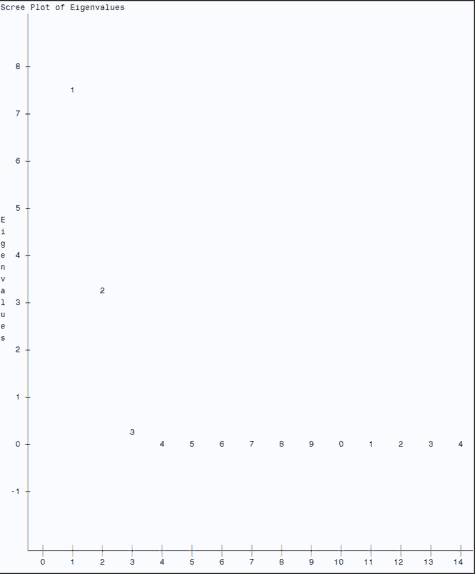

#### 图 3.3 来自ODS的碎石图

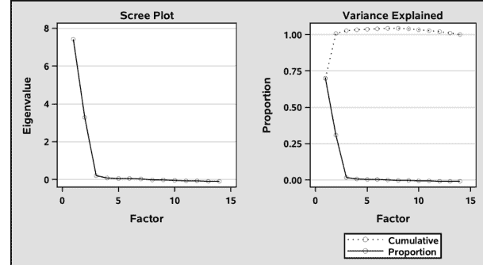

#### MAP和平行分析

最后两个提取标准使用起来稍微棘手一些。如我们上面提到的，研究人员使用MAP和平行分析的一个障碍是，这些过程在大多数常见统计软件（包括SAS）中并未广泛实现。幸运的是，O'Connor (2000) 开发了SAS语法来执行这些分析。目前可以从 https://people.ok.ubc.ca/brioconn/boconnr.html 下载。此外，此语法的宏版本包含在本书的示例代码中，并可从本书网站获取。

要从本书网站提供的宏运行这些分析，需要使用%INCLUDE语句将宏语法包含在当前SAS文件中。这将宏加载到当前会话内存中，以便你可以从外部文件中调用宏。然后可以通过调用相应的宏并输入必要参数来运行分析。MAP宏只有一个参数：datafile，即数据集名称。因此，你可以从 % map (datafile: ) 运行MAP宏。平行宏有更多参数：datafile，即数据集名称；ndatasets，即随机数据集的数量。


to use; percent, the percentile to use in determining whether the eigenvalues are significantly above the mean; kind, the type of parallel analysis (1=PCA and 2=factor analysis); randtype, the type of random data to be used (1=from normally distributed random data and 2=random permutations of the raw data); and seed, the seed value to use in computations. You can then run the parallel macro from % parallel ( datafile,ndatasets,percent,kind,randtype,seed ). The syntax to do this for the engineering data is presented below.

```
*Include MAP and PARALLEL ANALYSIS macro syntax for use below;
filename parallel 'C:\Location of File\parallel_macro.sas';
filename map 'C:\Location of File\map_macro.sas';
*include map;
*Run MAP and Parallel Analysis;
%map(engdata);
%parallel(engdata,100,95,2,2,99);
```

The results produced by the O'Connor (2000) MAP analysis are presented in Figure 3.4 on page 42 below. The results show the eigenvalues extracted from the data, the average squared partial correlations, and the average partial correlations to the fourth power. Recall that, using MAP analysis, we want to choose a number of factors where the average partial correlations hits a minimum (the squared partial correlation based on the 1976 criteria and the average partial correlation to the fourth power based on the revised criteria). According to the results, two factors should be retained.

#### 图 3.4 MAP 分析结果

#### Velicer 最小平均偏相关 (MAP) 检验：

| 特征值 |
| :--- |
| 7.6534 |
| 3.5048 |
| 0.4568 |
| 0.3597 |
| 0.3149 |
| 0.2760 |
| 0.2736 |
| 0.2147 |
| 0.2124 |
| 0.1750 |
| 0.1615 |
| 0.1373 |
| 0.1326 |
| 0.1273 |

#### 平均偏相关

| | 平方 | 四次方 |
| :--- | :--- | :--- |
| 0.0000 | 0.3167 | 0.1645 |
| 1.0000 | 0.2458 | 0.0743 |
| 2.0000 | 0.0236 | 0.0018 |
| 3.0000 | 0.0295 | 0.0034 |
| 4.0000 | 0.0436 | 0.0088 |
| 5.0000 | 0.0580 | 0.0119 |
| 6.0000 | 0.0724 | 0.0229 |
| 7.0000 | 0.0926 | 0.0436 |
| 8.0000 | 0.1213 | 0.0511 |
| 9.0000 | 0.1719 | 0.0711 |
| 10.0000 | 0.2175 | 0.1042 |
| 11.0000 | 0.3221 | 0.1816 |
| 12.0000 | 0.4853 | 0.3613 |
| 13.0000 | 1.0000 | 1.0000 |

The smallest average squared partial correlation is

0.0236

The smallest average 4th power partial correlation is

0.0018

The Number of Components According to the Original (1976) MAP Test is

2.0000

The Number of Components According to the Revised (2000) MAP Test is

2.0000

Another way to visualize these results is to plot them. Figure 3.5 on page 43 presents a plot of the average squared partial correlations. As you can see, the inflection point (minimum) on the plot is at 2.

#### 图 3.5 工程数据 MAP 检验的平均偏相关图

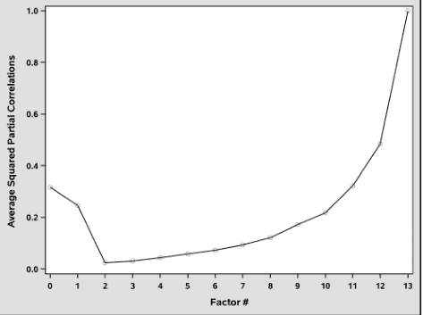

The results for the parallel analysis are presented in Figure 3.6 on page 44 below. The parallel analysis computed the eigenvalues from the data and then generated a series of comparable sets of random data. The mean eigenvalues across the sets of random data were computed along with the 95th percentile of those values. These values are presented on the right of the figure, in the columns labeled Raw Data, Means, and Prcntyle. Remember, the goal is to select the number of factors whose observed eigenvalues exceed those produced from random data. The current results would recommend two factors be extracted since the raw data eigenvalue goes below the generated mean eigenvalue and 95th percentile eigenvalue among the random data sets at factor 3. Again, we can visualize these results by plotting the mean eigenvalues of the random data against the eigenvalues in the raw data. (See Figure 3.7 on page 44.)

#### 图 3.6 并行分析结果

Parallel Analysis:
PAF/Common Factor Analysis & Raw Data Permutation
Specifications for this Run.

| 规范 | 值 |
|---|---|
| Ncases | 372 |
| Nvars | 14 |
| Ndatasets | 100 |
| Percent | 95 |

| 根 | 原始数据 | 均值 | 百分位数 |
|---|---|---|---|
| 1.000000 | 7.411470 | 0.383973 | 0.463048 |
| 2.000000 | 3.271016 | 0.299095 | 0.355149 |
| 3.000000 | 0.197160 | 0.237595 | 0.284848 |
| 4.000000 | 0.069918 | 0.179115 | 0.219735 |
| 5.000000 | 0.048940 | 0.129584 | 0.173288 |
| 6.000000 | 0.039340 | 0.081095 | 0.116472 |
| 7.000000 | 0.021963 | 0.041350 | 0.075104 |
| 8.000000 | -0.013937 | -0.000732 | 0.033558 |
| 9.000000 | -0.032820 | -0.043398 | -0.016535 |
| 10.000000 | -0.046677 | -0.080289 | -0.053319 |
| 11.000000 | -0.071557 | -0.120243 | -0.088454 |
| 12.000000 | -0.082612 | -0.159143 | -0.129139 |
| 13.000000 | -0.097253 | -0.202976 | -0.171653 |
| 14.000000 | -0.108182 | -0.253813 | -0.222440 |

#### 图 3.7 工程数据并行分析图

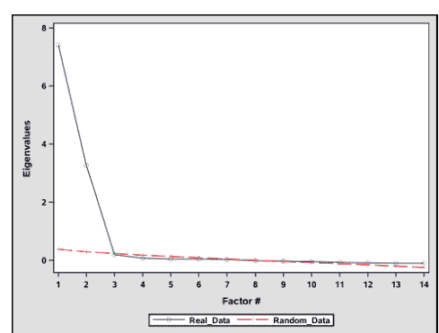

### 标准如何比较？

Now that we are familiar with the different extraction criteria and the SAS syntax and output for each criterion, let's examine the potential differences between the criteria. We will review these criteria in each of our three data sets and see how the criteria agree or disagree.

**工程数据。** 我们在上一节中检查了该数据的每个标准。理论、Kaiser 准则、最小特征值和方差贡献率都推荐两因子解；碎石图推荐两因子解，但也识别出可能的三因子解；MAP 和并行分析都推荐两因子解。一般来说，当我们使用通常具有强两因子结构的量表时，这些方法倾向于得出结论：提取两个因子是最佳数量。鑒于结果在理论模型的背景下是合理的，我们可能会提取两个因子进行旋转和解释。

Before we examine these criteria in the next set of data, let us briefly review how a two-factor extraction of this data affects the subsequent factor loadings. We will examine the unrotated factor loading since we have not yet discussed rotation. The loadings are plotted in Figure 3.8 on page 46 (we requested this plot by adding the INITLOADINGS plot to the PLOTS option, `plots = (initloadings scree)`). As you can see from the factor loading plot, the data is clustered into two clear and distinct factors. In our opinion, this is about as good as it gets in exploratory factor analysis at this stage of the analysis.

#### 图 3.8 因子载荷图，迭代 PAF 提取

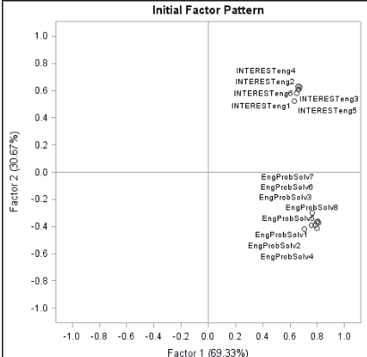

Self-description questionnaire data. Because the data from the SDQ seemed to be relatively well-behaved across the initial extraction comparisons, we will use ML extraction and explore whether our expected three-factor solution is tenable. Syntax to produce all of results to examine the extraction criteria for this data set is presented below.

```
ods graphics on;
proc factor data = sdgdata method = ML plots = SCREE;
   var Eng: Math: Par:;
run;
ods graphics off;

*Assuming the include statement has already read in the MACROS;
tmap(sdqdata);
*parallel(sdqdata,100,95,2,99);
```

The initial eigenvalues are presented in Figure 3.9 on page 47, and the scree plot is presented in Figure 3.10 on page 48. Theory, the Kaiser Criterion, the minimum eigenvalue, and the proportion of variance suggest the data has a three-factor solution. The scree plot, however, is a little less clear. Scree plots do not always have one clear elbow. In this case, it is possible to argue that any one of several points is the true “elbow” — including 2, 3, 4, or 5. In this example, the scree plot is not terribly informative.

The parallel analysis results are presented in Figure 3.11 on page 48 and Figure 3.12 on page 49 and the MAP analysis results are presented in Figure 3.13 on page 50 and Figure 3.14 on page 51. Because the sample size was so large, parallel analysis might not be as useful. The largest randomly generated eigenvalue (95th percentile) was 0.057. Using the criteria for parallel analysis, one would recommend examining either three or four factors (depending on how “significantly” different the raw data eigenvalue should be). The data from the MAP analysis seems to further reinforce theory and other criteria, indicating that three factors is the right number to extract. As you can see in Figure 3.14 on page 51, the minimum inflection point is at 3.

In summary, theory and the Kaiser Criterion recommend three factors, the scree plot recommends between two and five factors, parallel analysis recommends four, and MAP recommends three factors. As Velicer and others have argued, the MAP appears to be, at least in this case, more congruent with theory and eigenvalues. That is reassuring. The three-factor model seems to be the best recommendation as it makes for a strong, interpretable model.

#### 图 3.9 SDQ 数据的特征值

| | 特征值 | 差异 | 比例 | 累积 |
|---|---|---|---|---|
| 1 | 9.07976678 | 3.65235893 | 0.5411 | 0.5411 |
| 2 | 5.42743785 | 1.77049075 | 0.3234 | 0.8645 |
| 3 | 3.65694710 | 2.99021550 | 0.2179 | 1.0825 |
| 4 | 0.66673160 | 0.71076308 | 0.0397 | 1.1222 |
| 5 | -0.4403148 | 0.07803164 | -0.0026 | 1.1196 |
| 6 | -1.2206312 | 0.01122060 | -0.0073 | 1.1123 |
| 7 | -1.3328372 | 0.03628945 | -0.0079 | 1.1044 |
| 8 | -1.6957317 | 0.05296247 | -0.0101 | 1.0942 |
| 9 | -2.2253564 | 0.06266504 | -0.0133 | 1.0810 |
| 10 | -2.8519068 | 0.03336312 | -0.0170 | 1.0640 |
| 11 | -3.1855380 | 0.0849750 | -0.0190 | 1.0450 |
| 12 | -3.2705130 | 0.10111286 | -0.0195 | 1.0255 |
| 13 | -4.2816416 | | -0.0255 | 1.0000 |

3 factors will be retained by the PROPORTION criterion.


### 图 3.10 SDQ 数据的碎石图

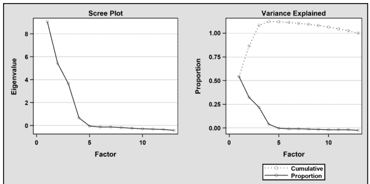

### 图 3.11 SDQ 数据的平行分析输出

### 平行分析：
PAF/公因子分析 & 原始数据置换

### 本次运行的规格：

| 样本量 | 15661 |
|---|---|
| 变量数 | 13 |
| 数据集数 | 100 |
| 百分比 | 95 |

### 原始数据特征值、成分、均值及百分位随机数据特征值

| 成分 | 原始数据 | 均值 | 百分位 |
|---|---|---|---|
| 1.000000 | 3.624965 | 0.043125 | 0.057983 |
| 2.000000 | 2.158366 | 0.037103 | 0.044089 |
| 3.000000 | 1.731491 | 0.028481 | 0.034652 |
| 4.000000 | 0.361588 | 0.020752 | 0.025252 |
| 5.000000 | -0.021073 | 0.013719 | 0.017792 |
| 6.000000 | -0.053630 | 0.006726 | 0.011883 |
| 7.000000 | -0.062606 | 0.000366 | 0.005233 |
| 8.000000 | -0.075231 | -0.006076 | -0.001748 |
| 9.000000 | -0.100642 | -0.012799 | -0.007012 |
| 10.000000 | -0.124736 | -0.019892 | -0.014561 |
| 11.000000 | -0.146240 | -0.025341 | -0.020743 |
| 12.000000 | -0.162721 | -0.035073 | -0.028528 |
| 13.000000 | -0.186844 | -0.045167 | -0.037705 |

### 图 3.12 SDQ 数据的平行分析图

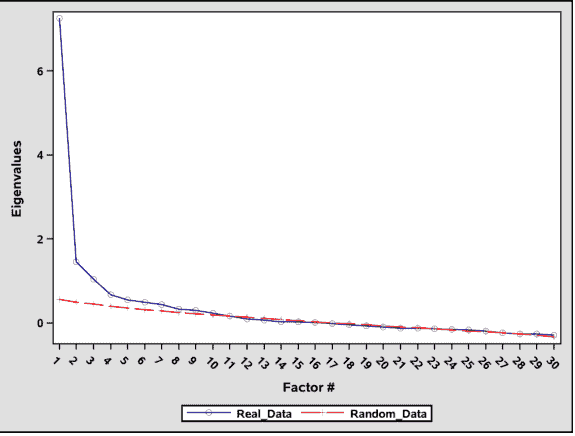

### 图 3.13 SDQ 数据的 MAP 结果

### Velicer 最小平均偏相关（MAP）检验：

| 特征值 |
|---|
| 4.0817 |
| 2.5549 |
| 2.2081 |
| 0.9077 |
| 0.5183 |
| 0.4870 |
| 0.4555 |
| 0.3925 |
| 0.3482 |
| 0.3216 |
| 0.3032 |
| 0.2289 |
| 0.1914 |

### 平均偏相关

| | 平方 | 四次方 |
|---|---|---|
| 0.0000 | 0.1100 | 0.0375 |
| 1.0000 | 0.0993 | 0.0178 |
| 2.0000 | 0.0854 | 0.0124 |
| 3.0000 | 0.0349 | 0.0037 |
| 4.0000 | 0.0401 | 0.0046 |
| 5.0000 | 0.0606 | 0.0127 |
| 6.0000 | 0.0884 | 0.0257 |
| 7.0000 | 0.1246 | 0.0494 |
| 8.0000 | 0.1593 | 0.0710 |
| 9.0000 | 0.2424 | 0.1538 |
| 10.0000 | 0.4058 | 0.3170 |
| 11.0000 | 0.4719 | 0.3576 |
| 12.0000 | 1.0000 | 1.0000 |

最小平均平方偏相关是

0.0349

最小平均四次方偏相关是

0.0037

根据原始（1976）MAP 检验的成分数量为

3.0000

根据修订（2000）MAP 检验的成分数量为

3.0000

### 图 3.14 MAP 检验的平均偏相关图

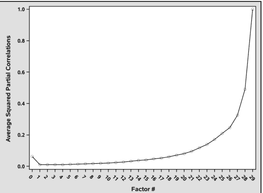

老年抑郁量表数据。该量表为工程数据和 SDQ 数据中清晰且概念一致的结果提供了非常不同的对照。该量表最初设计为包含五个子量表，¹ 因此理论表明存在五个因子。但与社会科学中的许多努力一样，这在接受检验时可能并不成立。例如，所有项目都可能作为单一因子加载，或者不同数量的因子可能是理想的。基于第 2 章的结果，我们对该数据使用了 ULS 提取。下面展示了用于检查该数据集提取标准的语法。请注意，PROC FACTOR 会自动从分析中删除缺失数据的记录，从而将我们的样本从 656 减少到 479。MAP 和平行分析宏无法处理缺失数据，因此我们必须事先删除这些记录。我们将在第 8 章进一步讨论缺失数据问题。

```
ods graphics on;
proc factor data = marshdata method = ULS plots = SCREE;
var GDS: ;
run;
ods graphics off;
```

1 量表 1 由项目 # 1、6、11、16、21 和 26 组成；量表 2：#2、7、12、17、22、27；以此类推。

```
*Assuming the include statement has already read in the MACROS;
*First delete any cases with a missing value so this will run for the
purpose of our example;
*In practice, missing data need to be dealt with beforehand;
data marsh_nomiss(drop = i);
   set marshdata;
   array var(*) _NUMERIC_;
   do i=1 to dim(var);
   if var(i)=. then delete;
   end;
run;
proc factor data=marsh_nomiss;
   parallel(marsh_nomiss,
   parallel(marsh_nomiss,100,95,2,2,99;
```

初始特征值在第 53 页的图 3.15 中展示，碎石图在第 54 页的图 3.16 中展示。理论和方差比例准则表明该数据具有五因子结构。凯泽准则识别出特征值大于 1.0 的三个因子，最小特征值准则识别出特征值高于平均值（0.36）的七个因子。最后，碎石图并不十分清晰。碎石图似乎表明第一个拐点在两个因子，但也可以认为第四个因子处有第二个拐点。因此，使用这三种传统准则，我们可能会结合这些结果，并测试包括一因子、二因子、三因子、四因子和五因子提取在内的各种配置。将检查这些结果，以查看原始理论框架是否合理，或者是否有其他因子结构似乎合理。但是，由于我们有平行分析和 MAP 分析，让我们在探索这些选项之前先检查这些结果。

平行分析结果在第 54 页的图 3.17 和第 55 页的图 3.18 中展示，MAP 分析结果在第 56 页的图 3.19 和第 57 页的图 3.20 中展示。此次平行分析的结果提出了一个有趣的两难困境，因为在原始数据分析中，特征值迅速下降至 1 以下，并迅速接近随机数据特征值。然而，直到大约第八个因子时，曲线才相交。这表明我们应该提取比可能合理的更多因子。MAP 分析对该数据也很有趣，因为 MAP 结果建议提取三个因子，而不是单一强因子或理论预期的五个因子。如 MAP 图所示，第一个因子处可能存在显著拐点。真正的最小值明显位于三个因子，但因子 2、3 和 4 之间的变化微乎其微，几乎可以忽略不计。第三个因子仅比因子 2 的平均偏相关少 0.0003，仅比因子 4 少 0.0008。有人可能会认为唯一真正的拐点位于 1。

### 图 3.15 GDS 数据的特征值

初步特征值：总计 = 10.9030399  平均值 = 0.36343436

| | 特征值 | 差异 | 比例 | 累积 |
|---|---|---|---|---|
| 1 | 7.25737995 | 5.79842085 | 0.6656 | 0.6656 |
| 2 | 1.45895910 | 0.41450006 | 0.1338 | 0.7994 |
| 3 | 1.04445904 | 0.36946888 | 0.0958 | 0.8952 |
| 4 | 0.67489016 | 0.12670656 | 0.0619 | 0.9571 |
| 5 | 0.54818360 | 0.06337972 | 0.0503 | 1.0074 |
| 6 | 0.48480388 | 0.05014518 | 0.0445 | 1.0518 |
| 7 | 0.43465870 | 0.10807624 | 0.0399 | 1.0917 |
| 8 | 0.32658246 | 0.02265492 | 0.0300 | 1.1217 |
| 9 | 0.30132754 | 0.07409919 | 0.0276 | 1.1493 |
| 10 | 0.2272835 | 0.06048555 | 0.0208 | 1.1701 |
| 11 | 0.16674280 | 0.07193475 | 0.0153 | 1.1854 |
| 12 | 0.09480805 | 0.02723393 | 0.0087 | 1.1941 |
| 13 | 0.06757412 | 0.04070334 | 0.0062 | 1.2003 |
| 14 | 0.02687078 | 0.00939893 | 0.0025 | 1.2028 |
| 15 | 0.01747186 | 0.01389011 | 0.0016 | 1.2044 |
| 16 | 0.00358174 | 0.2602596 | 0.0003 | 1.2047 |

将按比例准则保留 5 个因子。

### 图 3.16 GDS 数据的碎石图

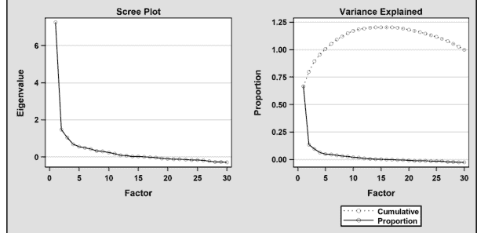

### 图 3.17 GDS 数据的平行分析输出

### 平行分析：
PAF/公因子分析 & 原始数据置换

### 本次运行的规格：

| 样本量 | 479 |
|---|---|
| 变量数 | 30 |
| 数据集数 | 100 |
| 百分比 | 95 |

### 原始数据特征值、均值及百分位随机数据特征值

| 成分 | 原始数据 | 均值 | 百分位 |
|---|---|---|---|
| 1.000000 | 7.257380 | 0.561006 | 0.653636 |
| 2.000000 | 1.458950 | 0.486113 | 0.539257 |
| 3.000000 | 1.044350 | 0.434540 | 0.484238 |
| 4.000000 | 0.674890 | 0.392095 | 0.433266 |
| 5.000000 | 0.548184 | 0.350650 | 0.392229 |
| 6.000000 | 0.484804 | 0.316816 | 0.353799 |
| 7.000000 | 0.434659 | 0.283359 | 0.312812 |
| 8.000000 | 0.326582 | 0.250836 | 0.282251 |
| 9.000000 | 0.301328 | 0.217909 | 0.248391 |
| 10.000000 | 0.227226 | 0.187061 | 0.215851 |
| 11.000000 | 0.166743 | 0.159410 | 0.165815 |
| 12.000000 | 0.094808 | 0.130800 | 0.155264 |
| 13.000000 | 0.067574 | 0.104568 | 0.132835 |
| 14.000000 | 0.026871 | 0.079562 | 0.102415 |
| 15.000000 | 0.017472 | 0.050115 | 0.076537 |
| 16.000000 | 0.003582 | 0.025054 | 0.046116 |


#### 图 3.18 GDS 数据的平行分析图

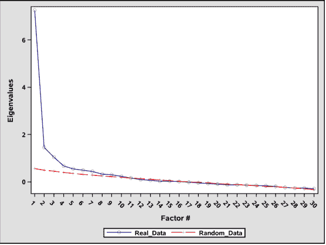

#### 图 3.19 GDS 数据的 MAP 输出

| 特征值 |
| :--- |
| 7.8580 |
| 2.0794 |
| 1.7020 |
| 1.3177 |
| 1.1859 |
| 1.1374 |
| 1.0834 |
| 1.0203 |
| 0.9294 |
| 0.9073 |
| 0.8175 |
| 0.7596 |
| 0.7194 |
| 0.6846 |
| 0.6726 |
| 0.6478 |
| 0.6217 |

| | 平方 | 4次幂 |
| :--- | :--- | :--- |
| 0.0000 | 0.0616 | 0.0066 |
| 1.0000 | 0.0111 | 0.0004 |
| 2.0000 | 0.0100 | 0.0003 |
| 3.0000 | 0.0097 | 0.0003 |
| 4.0000 | 0.0105 | 0.0003 |
| 5.0000 | 0.0118 | 0.0004 |
| 6.0000 | 0.0132 | 0.0006 |
| 7.0000 | 0.0148 | 0.0008 |
| 8.0000 | 0.0168 | 0.0012 |
| 9.0000 | 0.0187 | 0.0015 |
| 10.0000 | 0.0211 | 0.0017 |
| 11.0000 | 0.0241 | 0.0027 |
| 12.0000 | 0.0276 | 0.0035 |
| 13.0000 | 0.0320 | 0.0043 |
| 14.0000 | 0.0366 | 0.0051 |
| 15.0000 | 0.0411 | 0.0066 |
| 16.0000 | 0.0464 | 0.0079 |

最小平均平方偏相关为
0.0097

最小平均 4 次幂偏相关为
0.0003

根据原始 (1976) MAP 检验的成分数量为
3.0000

根据修订 (2000) MAP 检验的成分数量为
3.0000

#### 图 3.20 MAP 检验平均偏相关图

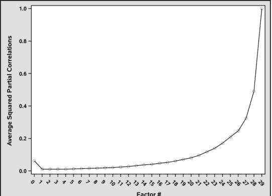

此第三个例子强调了 EFA 既是一门艺术也是一门定量科学，并且在数据不如人们所期望的那样清晰或配合时，研究者的良好判断至关重要。这些数据并未明确指示应提取多少个因子，因此我们需要 *探索* 几种最合理的选项。当数据以这种方式不配合时，复制变得更加关键，我们将在后续章节中讨论这一点。

### 摘要

许多学者已撰写关于因子提取的指南，侧重于特定提取技术或特定提取标准（例如，特征值、碎石图、平行分析）的优势。在本章中，我们主张这些方法中的每一种都能为数据背后的因子数量提供有价值的见解。不应将某一方法作为唯一的方法，同样，我们不需要所使用的方法之间达成共识。最好根据多个标准做出决策，并且这些决策必须具有 *理论意义* 是至关重要的。请记住，EFA 旨在随后进行 CFA 验证——因此你所做的决定并非一成不变。

### 练习

- 1. 复制本章中报告的结果。具体来说，审查工程、SDQ 和 GDS 数据集中用于确定应提取因子数量的每个提取标准。
- 2. 使用第一作者关于与学术认同（Osborne, 1997）的数据（在第二章练习中简要描述并下载）来检查各种提取标准。就应从此数据中提取的因子数量提出建议。

### 参考文献

Cattell, R. B. (1966). 用于确定因子数量的碎石检验。 *多元行为研究*, *1*(2), 245-276.

Costello, A. B., & Osborne, J. W. (2005). 探索性因子分析的最佳实践：从分析中获益最大的四项建议。 *实用评估、研究与评估*, *10*(7), 1-9.

Horn, J. L. (1965). 因子分析中因子数量的依据与检验。 *心理测量学*, *30*(2), 179-185.

Kaiser, H. F. (1960). 将电子计算机应用于因子分析。 *教育与心理测量*, *20*(1), 141-151.

Kaiser, H. F. (1970). 第二代小吉菲。 *心理测量学*, *35*(4), 401-415.

Kim, J., & Mueller, C. W. (1978). *因子分析：统计方法与实际问题*. Beverly Hills, Calif.: Sage Publications.

Ledesma, R. D., & Valero-Mora, P. (2007). 确定 EFA 中应保留的因子数量：一种易于使用的计算机程序，用于执行平行分析。 *实用评估、研究与评估*, *12*(2), 1-11.

Lorenzo-Seva, U., & Ferrando, P. J. (2006). FACTOR：拟合探索性因子分析模型的计算机程序。 *行为研究方法*, *38*(1), 88-91.

O'Connor, B. P. (2000). 用于使用平行分析和 Velicer 的 MAP 检验确定成分数量的 SPSS 和 SAS 程序。 *行为研究方法、仪器与计算机*, *32*(3), 396-402.

O'Connor, B. P. (n.d.). 统计程序的程序。2016 年 2 月 21 日检索，来自 https://people.ok.ubc.ca/brioconn/boconnor.html

Osborne, J. W. (1997). 社区大学学生的学术认同与学术成功。社区学院评论, 25, 59-67.

SAS Institute Inc. (2015). SAS/STAT® 14.1 用户指南：FACTOR 过程。Cary, NC: SAS Institute Inc.

Velicer, W. F. (1976). 从偏相关矩阵确定成分数量。Psychometrika, 41(3), 321-327.

Velicer, W. F., Eaton, C. A., & Fava, J. L. (2000). 通过因子或成分分析进行构念阐释：确定因子或成分数量的替代程序的回顾与评估。载于 R. D. Goffin & E. Helmes (Eds.), 人类评估中的问题与解决方案：向 Douglas N. Jackson 七十华诞致敬。(第 41-71 页): Boston: Kluwer Academic Publishers.

## 旋转

- 旋转的魔力 ........................ 61
- 旋转类型 ............................ 63
- 正交旋转与非正交旋转 ............... 64
- 因子矩阵的解释 ............ 65
- 示例语法和输出 .................... 66
- 哪种方法？ ................................ 69
  - 正交与非正交 ...................... 69
  - 同一阵营内的方法 ...................... 72
- 探索多种解 ................. 75
- 摘要 ...................................... 80
- 练习 .................................... 81
- 参考文献 ................................... 82

#### 旋转的魔力

因子分析的未旋转结果——如第 3 章所介绍——不易解释。因子载荷图可能有所帮助，但它们仍可能呈现相当令人困惑的图景，尤其是当有两个以上因子时！旋转是在因子分析之后不久开发出来的，旨在帮助研究者澄清和简化因子分析的结果。确实，早期的方法具有主观性和图形性质（Thurstone, 1938），因为计算工作量很大。后来的学者试图使旋转不那么主观或更具探索性（例如，Horst, 1941），从而导致了四分之差最大法（Carroll, 1953）和方差最大法（Kaiser, 1958）等初始算法。尽管方差最大法早期就已引入，但它仍然是最广泛使用的旋转方法之一（也许是因为它是许多统计软件中的默认设置）。1

简单来说，我们使用“旋转”这一术语，因为从历史和概念上讲，轴正在被旋转，以便项目的簇尽可能靠近它们。1 正如 Thompson (2004) 所指出的，轴的位置完全是任意的，因此我们可以在空间中旋转轴（如转动拨盘），而不会从根本上改变结果的性质。但是，我们不能移动因子空间中任何变量的位置。

例如，请看第 62 页图 4.1 左侧的图。如果你想象旋转轴，使它们与每个变量簇的质心相交，你就会得到右侧展示的旋转因子模式，并且也就掌握了旋转的本质。你可能会想知道这对澄清因子载荷有何帮助。当我们进行这种旋转时，因子模式系数也随之改变，有些变大，有些变小。正如你在旋转因子图中所见，项目现在紧贴每条轴线。这使得因子载荷模式更加清晰，因为每个项目的两组坐标中往往有一组接近 0.00。

#### 图 4.1 工程数据中未旋转和旋转因子载荷图示例

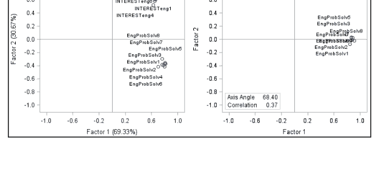

1 请注意，旋转不会改变分析的基本方面，例如从项目中提取的方差量。确实，尽管特征值可能会因旋转而调整因子载荷而发生变化，但所解释的方差总百分比将保持不变。

2 或者，你可以想象将每个项目簇旋转到轴上。这在功能上实际上是相同的。


### 旋转类型

与提取一样，旋转方法也有多种选择。在 PROC FACTOR 中，有 24 种方法可用。每种方法使用略有不同的算法来实现同一广泛目标——简化因子结构。一般来说，旋转方法分为两大类：正交和斜交（指 X 轴和 Y 轴之间保持的角度）。

正交旋转产生不相关的因子（即，轴之间保持 90° 角度），而斜交方法允许因子相关（即，允许 X 轴和 Y 轴采用不同于 90° 的角度）。传统上，研究人员被引导使用正交旋转，因为（论点认为）不相关的因子更容易解释。此外，数学更简单，这一事实在 20 世纪大部分时间里产生了重大影响，当时 EFA 是通过手工计算或在早期计算机上执行的。正交旋转（包括 quartimax、equamax 和 varimax）通常是其他统计软件的默认设置。但是，在 PROC FACTOR 中，没有默认的旋转方法——研究人员必须指定方法才能进行旋转。

让我们回顾一些更常见的旋转方法。前三种方法是正交方法（即，产生不相关的因子），后两种是斜交方法（即，产生相关的因子）。

**Varimax** 旋转旨在最大化因子内的方差（即因子载荷列内的方差），使较大的载荷增加，较小的载荷最小化。通过这种方式，该方法通过识别一组在一个因子上具有高载荷和另一组在另一个因子上具有高载荷的变量来简化因子。但是，有些变量可能在任何因子上都没有强载荷。

**Quartimax** 倾向于关注行，最大化特定变量在各因子之间载荷的差异——增加高载荷并最小化小载荷。该方法旨在简化变量层面的解释——它希望每个变量只在一个因子上载荷，且仅一个。

**Equamax** 被视为 varimax 和 quartimax 之间的折中方案，因为它试图在两个方向上澄清载荷。它试图找到一个解决方案，其中因子载荷清晰地区分因子，并且变量在一个主要因子上载荷。

**Promax** 被 Thompson (2004) 推荐为更可取的斜交旋转选择。2 该方法首先实际进行正交旋转以澄清载荷模式。然后，它逐渐开始通过 procrustean 旋转（较少见，此处不讨论）允许因子相关。初始旋转方法可通过 PREROTATE 选项指定。如果未指定选项，PROC FACTOR 将默认使用 varimax 旋转。

### Direct oblimin 旋转是另一种斜交旋转，有时可能会出问题，但通常与 promax 给出非常相似的结果

两种斜交方法，promax 和 oblimin，都有参数，允许研究人员限制因子相关的程度。POWER 选项将因子载荷提升到指定的幂，有效地随着幂变大而增加因子的相关性。这些方法的默认幂为 3，但用户可以将值调整为任何大于或等于 1 的值。低相关性可以指定为 POWER=1，高相关性可以指定为 POWER=5。尽管研究人员可以调整因子之间可能的相关性，但如果因子本身不相关，他们无法强制因子相关——换句话说，你可以限制因子相关的强度，但不能限制最小相关性。

上述每种技术都在 FACTOR 过程的 ROTATE 选项上指定。上面总结的不同旋转方法可以使用以下关键字请求。

```
rotate =
VARIMAX /*Varimax rotation*/
QUARTIMAX /*Quartimax rotation*/
EQUAMAX /*Equamax rotation*/
PROMAX /*Promax rotation*/
COBLIMIN /*Direct Oblimin rotation*/
```

请注意，上述讨论的每种旋转的数学算法都不同，超出了本简要介绍的范围。但是，每种方法的总体目标相同：因子载荷的简洁性和清晰度。有关它们如何实现这些目标的详细信息，请参见 SAS (2015)。有关 varimax 旋转不同版本的技术细节的良好概述，请参见 Forina, Armanino, Lanteri, 和 Leardi (1989)。

### 正交 vs 斜交旋转

文献和许多教科书中的常规智慧建议研究人员使用正交旋转，因为它产生更容易解释的结果，但这可能是一个有缺陷的论点。在社会科学（以及许多其他科学）中，我们通常预期因子之间存在一定相关性，特别是位于同一工具或问卷内的量表（即，共享方法方差通常会产生非零相关性）。在实践中，即使我们使用正交方法创建特征，因子得分（从因子结构得出的得分；参见第 9 章）也往往是相关的，尽管因子本身是正交的。因此，如果因子确实相关，使用正交旋转会导致宝贵信息的丢失，而斜交旋转理论上应该产生更准确、也许更可重复的解决方案。¹ 此外，在研究人员设法产生真正不相关因子的不可能事件中，正交和斜交旋转产生几乎相同的结果，使斜交旋转成为一种非常低风险、潜在高收益的选择。

然而，这两组方法——正交和斜交——在解释的难易程度上确实有所不同。使用正交旋转时，研究人员只有一个矩阵需要解释。使用斜交旋转时，有两个矩阵需要审查（在下一节中描述）。根据我们的经验——以及我们许多示例——这两种方法在解释上往往相互平行。因此，同样，在我们看来，这并不构成不可逾越的障碍。

### 因子矩阵的解释

所有提取的因子最初都是正交的 (Thompson, 2004)，但只有在旋转为正交时才保持正交（我们在上一节中简要讨论过这一点）。在实践中，进行正交旋转时，这导致解释一个矩阵（模式矩阵）；进行斜交旋转时，则解释两个矩阵（模式矩阵和结构矩阵）。为了进一步使解释复杂化，未旋转的因子矩阵始终会输出，并且在进行斜交旋转时会输出参考结构矩阵——这两者传统上都不予解释。多个矩阵的存在，无论是否需要解释，都是实践中许多混淆的根源。² 让我们从每个概念的几个温和定义开始：

**未旋转因子矩阵系数**通常由大多数统计软件报告，无论是否旋转。它们表示未旋转的因子载荷，并且通常不引人关注。³ 在 PROC FACTOR 中，它们出现在输出顶部附近的名为“因子模式”的表格中。尽管有此标题，但这不应与下面描述的模式矩阵混淆。

**模式矩阵系数**本质上是一系列标准化回归系数（回归领域中的 betas 或 βs），将变量表示为因子载荷的函数。所有旋转模型也会输出这些系数。你可以将这些系数视为食谱中的配料清单（例如，要制作项目 13，添加 0.70 的因子 1、0.13 的因子 2、0.02 的因子 3 等。充分混合……美味）。与回归系数一样，在估计模式矩阵系数时，它们将方程中的所有其他变量（因子）保持不变。因此，如果因子不相关，模式系数和结构系数是相同的。随着因子相关性变得更强，这两类系数会越来越不相似。因此，将模式矩阵系数视为“行”统计量，描述单个项目的独特

- 1. 但是，一些作者认为斜交旋转产生的结果可重复性较低，因为它们可能在更大程度上过度拟合数据。我们不认为有实证证据支持这一论点，但过度拟合数据是所有 EFA 分析都需要关注的问题，我们将在本书后面讨论。
- 2. 在本节中，我们大量借鉴了 Thompson (2004)，这始终是一个很好的参考。
- 3. 除了像我们这样试图理解所有这些东西的极客之外。


与各因素的关系。在 PROC FACTOR 中，这些出现在输出底部的一个表格中，标题为“Rotated Factor Pattern。”

**参考结构矩阵系数**是单个变量与整体因素之间的一系列偏部分相关系数。这些在 SAS 执行斜交旋转时输出，其他统计软件中不常输出。此矩阵提供与模式矩阵相同的信息，只是度量不同：总方差与标准差单位。尽管不同的量表对习惯用相关性思考的人可能有用，但此矩阵不传统地被分析。

**结构矩阵系数**是单个变量与合成变量或潜变量（因素）之间的简单相关系数。这些仅在执行斜交旋转时输出。在多元回归中，这些类似于单个变量与回归方程导出的预测得分之间的相关系数。结构系数与模式系数之间的区别在于（再次回到回归）简单相关系数与偏部分相关系数（仅独特关系）之间的区别。在 PROC FACTOR 中，这些出现在模式矩阵之后的一个表格中，标题为“Factor Structure。”

人们常常对输出的各种矩阵以及正交旋转和斜交旋转输出的不同矩阵感到困惑。如上文所述，正交旋转将输出 1) 未旋转因子矩阵和 2) 模式矩阵，但斜交旋转将输出 1) 未旋转因子矩阵、2) 模式矩阵、3) 参考结构矩阵和 4) 结构矩阵。

执行正交旋转时，通常解释模式矩阵；执行斜交旋转时，则同时解释模式矩阵和结构矩阵。结构矩阵仅在斜交旋转期间提供，因为它在假设因素相关的前提下提供关于项目的信息。如果所有因素彼此完全不相关，则模式系数和结构系数将相同。在这种情况下，计算模式矩阵时保持其他因素不变没有影响，结构系数和模式系数将相同，就像多元回归中完全不相关的预测变量的简单相关系数和偏部分相关系数一样。因此，结构矩阵仅在解释斜交旋转时有用。

Thompson (2004) 和其他人（Gorsuch, 1983; Nunnally & Bernstein, 1994）认为，在斜交旋转中解释模式系数和结构系数对于正确、完整地解释 EFA 结果至关重要。在实践中，很少有人这样做。此外，当旋转为斜交且因素相关时，他们认为报告因素间相关性也很重要。我们将在适当的时候强调这一过程。

### 示例语法和输出

让我们回顾使用 oblimin 旋转对工程数据进行 EFA 的语法。我们将使用迭代 PAF 提取，尽管任何方法都会提供类似的结果。（参见第 2 章。）我们为这些数据选择了 oblimin 旋转，因为已知因素是相关的。运行此分析的语法如下所示。¹

```
proc factor data = engdata nfactors = 2 method = PRINT priors = SMC rotate = OBLIMIN;
var EngProb: INTERESTeng: ;
run;
```

此语法生成一系列结果——其中我们可以看到四个因子载荷矩阵（已在上文讨论），这些矩阵对我们特别感兴趣。这些矩阵在第 68 页的图 4.2 中呈现。请注意，未旋转因子矩阵（在图左上角）中的系数通常绝对值更大，且比其他矩阵更难解释。尽管我们预期（并看到证据）存在两个非常清晰的因子，但未旋转的因子载荷并未立即识别出这两个独立的因子。所有 14 个项目在因子 1 上似乎都有相似的载荷，只有结合因子 2 上的载荷时，这两个因子才会分离。如果我们将每个项目绘制在二维空间中（如第 62 页的图 4.1 所示），我们清楚地看到分离；然而，旋转可以帮助我们在不绘图的情况下解释这些结果。

旋转后的模式矩阵和旋转后的结构矩阵（在图右上角和右下角）支持未旋转结果图中提出的相同双因子解：八个工程问题解决项目载荷于因子 1，六个兴趣项目载荷于因子 2。然而，请注意，这些矩阵在因子载荷上有细微差别。旋转后的结构矩阵中的非因子载荷（例如，EngProbSolv1 在因子 2 上的载荷）高于旋转后的模式矩阵中的载荷。如我们先前所述，这是因为结构矩阵表示项目与因素之间的简单相关，而模式矩阵反映两者之间的独特关系，同时保持其他因素不变。在此示例分析中，因素是相关的，r = 0.37。因此，保持一个因素不变会从分析中移除共享方差并澄清独特的因子结构。解释两者非常重要，以便诊断因素之间的相关性可能如何影响结果。

参考结构矩阵（在图左下角）呈现与旋转后的模式矩阵几乎相同的图景。载荷中存在细微差别，可归因于度量的不同，但它没有告诉我们任何新信息。此矩阵不传统地被解释，且其他程序不输出它。我们下方仅呈现结果，以便对您可能看到的结果提供解释。由于它不提供模式矩阵之外的任何信息，我们将不会在后续示例中包含它。

### 图 4.2 因子载荷矩阵输出

### (a) 因子模式

| | 因子1 | 因子2 |
|---|---|---|
| EngProbSolv1 | 0.75943 | -0.38851 |
| EngProbSolv2 | 0.70326 | -0.41761 |
| EngProbSolv3 | 0.78421 | -0.39174 |
| EngProbSolv4 | 0.79796 | -0.41601 |
| EngProbSolv5 | 0.81127 | -0.37530 |
| EngProbSolv6 | 0.79520 | -0.36674 |
| EngProbSolv7 | 0.80356 | -0.35966 |
| EngProbSolv8 | 0.76252 | -0.29918 |
| INTERESTeng1 | 0.63034 | 0.52081 |
| INTERESTeng2 | 0.66013 | 0.63023 |
| INTERESTeng3 | 0.66893 | 0.62678 |
| INTERESTeng4 | 0.66775 | 0.60923 |
| INTERESTeng5 | 0.65724 | 0.60655 |
| INTERESTeng6 | 0.64673 | 0.57780 |

### (b) 旋转后的因子模式（标准化回归系数）

| | 因子1 | 因子2 |
|---|---|---|
| EngProbSolv1 | 0.85888 | -0.01621 |
| EngProbSolv2 | 0.84134 | -0.07089 |
| EngProbSolv3 | 0.87939 | -0.00762 |
| EngProbSolv4 | 0.90865 | -0.02457 |
| EngProbSolv5 | 0.88591 | 0.02105 |
| EngProbSolv6 | 0.86906 | 0.01979 |
| EngProbSolv7 | 0.86788 | 0.03252 |
| EngProbSolv8 | 0.79006 | 0.07154 |
| INTERESTeng1 | 0.04221 | 0.80118 |
| INTERESTeng2 | -0.02326 | 0.92098 |
| INTERESTeng3 | -0.01414 | 0.92180 |
| INTERESTeng4 | -0.00104 | 0.90429 |
| INTERESTeng5 | -0.00651 | 0.89673 |
| INTERESTeng6 | 0.00874 | 0.86399 |

### (c) 参考结构（偏部分相关）

| | 因子1 | 因子2 |
|---|---|---|
| EngProbSolv1 | 0.79854 | -0.10508 |
| EngProbSolv2 | 0.78224 | -0.06591 |
| EngProbSolv3 | 0.81761 | -0.00708 |
| EngProbSolv4 | 0.84482 | -0.02284 |
| EngProbSolv5 | 0.82367 | 0.01957 |
| EngProbSolv6 | 0.80800 | 0.01840 |
| EngProbSolv7 | 0.80691 | 0.03024 |
| EngProbSolv8 | 0.73456 | 0.06652 |
| INTERESTeng1 | 0.03924 | 0.74490 |
| INTERESTeng2 | -0.02163 | 0.85628 |
| INTERESTeng3 | -0.01314 | 0.85704 |
| INTERESTeng4 | -0.00996 | 0.84077 |
| INTERESTeng5 | -0.00606 | 0.83373 |
| INTERESTeng6 | 0.00813 | 0.80329 |

### (d) 因子结构（相关系数）

| | 因子1 | 因子2 |
|---|---|---|
| EngProbSolv1 | 0.85291 | 0.30002 |
| EngProbSolv2 | 0.81524 | 0.23889 |
| EngProbSolv3 | 0.87658 | 0.31617 |
| EngProbSolv4 | 0.89961 | 0.30999 |
| EngProbSolv5 | 0.89366 | 0.34723 |
| EngProbSolv6 | 0.87634 | 0.33977 |
| EngProbSolv7 | 0.87986 | 0.35207 |
| EngProbSolv8 | 0.81641 | 0.36244 |
| INTERESTeng1 | 0.33720 | 0.81672 |
| INTERESTeng2 | 0.31584 | 0.91241 |
| INTERESTeng3 | 0.32526 | 0.91659 |
| INTERESTeng4 | 0.33192 | 0.90391 |
| INTERESTeng5 | 0.32366 | 0.89433 |
| INTERESTeng6 | 0.32686 | 0.86721 |


注意：(a) 未旋转因子矩阵；(b) 模式矩阵；(c) 参考结构矩阵；以及 (d) 结构矩阵。

### 哪种方法？

### 正交 vs 斜交

正交旋转和斜交旋转在因子完全不相关的情况下会产生几乎相同的解。随着潜变量之间的相关性偏离 r = 0.00，斜交解将产生越来越清晰的旋转因子模式。

使用以下语法，我们可以对工程数据尝试每种旋转类型，并输出来自模式矩阵的旋转因子载荷图。我们使用 ODS 绘制结果，并通过在 FACTOR 语句中包含 PLOTS = LOADINGS 选项来请求因子载荷图。

```
ods graphics on; width = 4in height = 6in;
proc factor data = engdata nfactors = 2 method = printr priors = SMC
   rotate = VARIMAX plots = loadings ;
   VAR EngProb: INTERESTeng ;
run;
proc factor data = engdata nfactors = 2 method = printr priors = SMC
   rotate = QUARTIMAX plots = loadings ;
   VAR EngProb: INTERESTeng ;
run;
proc factor data = engdata nfactors = 2 method = printr priors = SMC
   rotate = EQUAMAX plots = loadings ;
   VAR EngProb: INTERESTeng ;
run;
proc factor data = engdata nfactors = 2 method = printr priors = SMC
   rotate = PROMAX plots = loadings ;
   VAR EngProb: INTERESTeng ;
run;
proc factor data = engdata nfactors = 2 method = printr priors = SMC
   rotate = OBLIMIN plots = loadings ;
   VAR EngProb: INTERESTeng ;
run;
ods graphics off;
```

第 71 页的图 4.3 展示了使用本章前面总结的每种方法对工程数据的旋转因子载荷图。最上面的两个图代表斜交方法，其余的代表正交方法。请注意，斜交图中的因子载荷聚集在轴周围。相比之下，正交图中的因子载荷倾向于聚集在略远离轴的一点周围。

这是因为这些因子有中等程度的相关性，但正交方法要求保持轴之间 90° 的角度，这意味着聚类的中心无法移动得更靠近轴线。

在这种情况下，斜交方法和正交方法之间的差异不大，但可以察觉。这是斜交旋转在 EFA 中创建清晰结果模式方面更高效力的一个小而明确的例子，前提是因子确实相关。就我们所知，使用正交旋转而非斜交旋转没有理由（传统除外）。此外，如果因子不相关，正交解和斜交解将产生非常相似的结果。因此，如果对因子之间的关系存在不确定性，我们建议使用斜交旋转。

### 图 4.3 使用不同旋转方法的工程数据

### 旋转方法：Promax (power = 3)

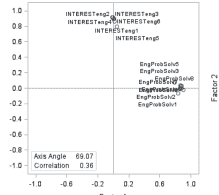

### 旋转方法：Oblimin (tau = 0)

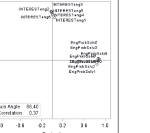

### 旋转方法：Varimax

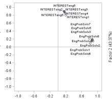

### 旋转方法：Quartimax

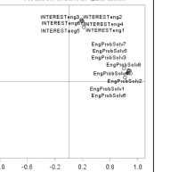

### 旋转方法：Equamax

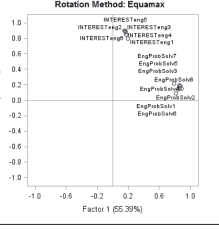

### 阵营内的方法

我们知道，在正交和斜交旋转阵营之间做出选择会对最终结果产生影响；但是，在选择阵营后，关于具体方法的决定有多重要呢？在正交方法中，varimax 旋转是最常用的，也是许多程序中的默认设置。人们可能会得出结论，它是首选的正交方法。在斜交方法中，promax 旋转被推荐为最理想的旋转方法（Thompson, 2004）。让我们测试一下推荐的方法是否会产生与其替代方法不同的结果。

SDQ 包含三个量表（亲子关系、数学和英语），它们的相关性很小（r = 0.15, 0.22, 0.26）。由于理论因子是相关的，我们应该使用斜交旋转方法。本章回顾的两种常见斜交方法是 promax 旋转和直接 oblimin 旋转。运行这两种分析的语法如下。我们使用最大似然提取，因为该方法似乎适合此数据。（参见第 2 章。）

```
proc factor data = sdqdata nfactors = 3 method = ml rotate = PROMAX;
VAR Math: Par: Eng:;
run;
proc factor data = sdqdata nfactors = 3 method = ml rotate = OBLIMIN;
VAR Math: Par: Eng:;
run;
```

第 73 页的表 4.2 和表 4.1 显示了每种旋转方法的因子载荷，第 74 页的表 4.3 显示了因子间相关性。两种斜交旋转方法产生相似的结果。如预期，每种方法的初始未旋转因子载荷是相同的。这些应该相同，因为它们代表了因子旋转前因子载荷的独特方差分布。这些初始因子载荷很难解释，因为变量在所有因子上的载荷往往是中等大小。在模式矩阵和结构矩阵中，旋转后的因子载荷几乎相同。这些解是我们根据量表开发所基于的理论模型所期望的。最终旋转解为我们提供了清晰、理论上一致的因子结构，子量表项目按预期对齐。

在此示例中，所使用的斜交旋转类型没有产生差异。它们产生了相同的清晰因子结构，只有载荷的微小差异。许多其他人（例如，Gorsuch, 1983; Kim & Mueller, 1978）也得出了类似的结论。正交和斜交阵营内的方法往往会产生相似的结果。

#### 表 4.1 使用 promax 旋转的 SDQ 数据的未旋转和旋转因子载荷

| 变量: | 1 | 2 | 3 | 1 | 2 | 3 | 1 | 2 | 3 |
|---|---|---|---|---|---|---|---|---|---|
| | 未旋转因子载荷 | | | 旋转模式矩阵 | | | 旋转结构矩阵 | | |
| Math1 | .802 | -.373 | .088 | .901 | -.038 | -.037 | .887 | .149 | .087 |
| Math2 | .810 | -.298 | .070 | .862 | .010 | .013 | .866 | .201 | .143 |
| Math3 | .828 | -.301 | .083 | .881 | .001 | .023 | .885 | .198 | .153 |
| Math4 | -.572 | .212 | -.004 | -.600 | -.050 | .021 | -.608 | -.176 | -.080 |
| Par1 | .360 | .349 | -.524 | .004 | .717 | .027 | .164 | .725 | .205 |
| Par2 | -.252 | -.293 | .533 | .058 | -.679 | .049 | -.083 | -.654 | -.111 |
| Par3 | .426 | .370 | -.613 | .030 | .826 | .003 | .211 | .833 | .212 |
| Par4 | -.359 | -.335 | .388 | -.037 | -.583 | -.103 | -.180 | -.616 | -.253 |
| Par5 | .367 | .315 | -.568 | .020 | .748 | -.026 | .179 | .746 | .162 |
| Eng1 | .348 | .634 | .309 | -.004 | .035 | .778 | .118 | .227 | .786 |
| Eng2 | .310 | .636 | .419 | -.015 | -.078 | .840 | .092 | .127 | .818 |
| Eng3 | .406 | .644 | .378 | .052 | -.013 | .844 | .174 | .208 | .848 |
| Eng4 | -.257 | -.552 | -.179 | .059 | -.105 | -.608 | -.053 | -.242 | -.625 |

注意：旋转解的主要因子载荷已高亮显示。

#### 表 4.2 使用直接 oblimin 旋转的 SDQ 数据的未旋转和旋转因子载荷

| 变量: | 1 | 2 | 3 | 1 | 2 | 3 | 1 | 2 | 3 |
|---|---|---|---|---|---|---|---|---|---|
| | 未旋转因子载荷 | | | 旋转模式矩阵 | | | 旋转结构矩阵 | | |
| Math1 | .802 | -.373 | .088 | .900 | -.043 | -.030 | .887 | .147 | .079 |
| Math2 | .810 | -.298 | .070 | .863 | .004 | .019 | .866 | .199 | .135 |
| Math3 | .828 | -.301 | .083 | .882 | -.005 | .029 | .884 | .197 | .145 |
| Math4 | -.572 | .212 | -.004 | -.601 | -.046 | .017 | -.608 | -.174 | -.075 |
| Par1 | .360 | .349 | -.524 | .006 | .718 | .022 | .167 | .725 | .213 |
| Par2 | -.252 | -.293 | .533 | .057 | -.681 | .054 | -.086 | -.654 | -.119 |
| Par3 | .426 | .370 | -.613 | .032 | .826 | -.003 | .214 | .833 | .221 |
| Par4 | -.359 | -.335 | .388 | -.040 | -.582 | -.100 | -.182 | -.617 | -.259 |
| Par5 | .367 | .315 | -.568 | .022 | .749 | -.031 | .183 | .746 | .171 |
| Eng1 | .348 | .634 | .309 | .005 | .024 | .779 | .114 | .232 | .786 |
| Eng2 | .310 | .636 | .419 | -.006 | -.089 | .842 | .087 | .133 | .818 |
| Eng3 | .406 | .644 | .378 | .062 | -.025 | .846 | .170 | .213 | .847 |
| Eng4 | -.257 | -.552 | -.179 | .052 | -.097 | -.608 | -.050 | -.247 | -.627 |

注意：旋转解的主要因子载荷已高亮显示。

#### 表 4.3 因子相关性

| | Promax 结果 | | 直接 Oblimin 结果 | |
|---|---|---|---|---|
| | 因子 1 | 因子 2 | 因子 1 | 因子 2 |
| 因子 2 | .218 | | .220 | |
| 因子 3 | .148 | .248 | .134 | .265 |


### 探索多种解决方案

并非所有量表在EFA开始时都具有理论上清晰的因子结构。此外，有时提取标准与所提议的结构相矛盾。在这些情况下，我们需要探索多种解决方案。GDS数据符合这一情形。在我们回顾了第3章中的提取标准后，提出了四种不同的因子解：单因子解、三因子解、五因子解和八因子解。因此，我们将不得不比以往示例进行更多的实验和探索。让我们记住，我们希望倾向于简约的解决方案。另外，由于所有提议的子量表以某种方式与抑郁相关，它们应该是相关的。因此，在探索过程中我们将使用斜交旋转（直接oblimin）。如第2章所讨论，对于这种非正态数据，将使用无加权最小平方（ULS）提取方法。

在开始之前，PROC FACTOR语句中有两个有用的选项可以帮助我们解释即将看到的多因子结果：FUZZ和REORDER。FUZZ选项会抑制在各种因子载荷矩阵中打印小载荷。这有助于我们轻松且立即识别中等到大的因子载荷及后续因子结构。要使用此选项，我们必须通过将FUZZ设置为该值来指定希望抑制的最大因子载荷（例如，FUZZ=.3）。REORDER选项用于根据因子载荷重新排序矩阵中的行。默认情况下，因子载荷矩阵第一列中的变量按其在VAR语句中放入模型的顺序呈现。此选项允许这些行被重新排序和分组，以便于解释。以下语法可用于运行单因子、五因子和八因子模型。我们将暂缓运行三因子模型，并让你自行探索。

请注意，在以前的示例中，变量是根据每个变量关联的理论因子放入各自模型中的；因此，REORDER选项不会提供与所呈现的有实质性不同的因子载荷矩阵。

```sas
**One-Factor;
*Note: no rotation is needed because only one factor is being extracted;
proc factor data=marsdata nfactors=1 method=ULS;
VAR GDS:;
run;
```

```sas
**Five-Factor;
proc factor data=marsdata nfactors=5 method=ULS rotate=OBLIMIN
fuzz=.3 reorder;
VAR GDS:;
run;
```

```sas
**Eight-Factor;
*Note: need to increase default max iterations to 60 using maxiter option
for a solution to be identified;
proc factor data=marsdata nfactors=8 method=ULS rotate=OBLIMIN
fuzz=.3 reorder;
VAR GDS:;
run;
```

第76页的表4.4展示了单因子和五因子模型的结果。该表中报告了条目干项，因为我们需要对因子进行一些自行解释。单因子解基于第3章中发现的单个较大特征值和MAP分析是可辩护的。这个单因子解释了23.80%的方差，共同性范围从0.05到0.47，这不是一个强有力的结果。如你所见，许多载荷较低，即使是最高的载荷也在0.60到0.70范围内。这可能是由于测量不佳（仅0和1）。如果我们选择这个单因子解，最终量表可能代表一个一维潜在抑郁构念。

### 表 4.4 一个因子和五个因子提取的GDS数据模式载荷

| 变量和条目干项 | 1-因子 1 | 5-因子 1 | 5-因子 2 | 5-因子 3 | 5-因子 4 | 5-因子 5 |
| :--- | :--- | :--- | :--- | :--- | :--- | :--- |
| GDS09: 大多数时候你感到快乐吗？ | .607 | .766 | | | | |
| GDS07: 大多数时候你精神好吗？ | .473 | .666 | | | | |
| GDS15: 你认为现在活着很美好吗？ | .467 | .631 | | | | |
| GDS01: 你基本上对自己的生活满意吗？ | .591 | .464 | | | | |
| GDS05: 你对未来充满希望吗？ | .512 | .445 | | | | |
| GDS27: 你喜欢早上起床吗？ | .376 | .346 | | | | |
| GDS08: 你害怕会有不好的事情发生在你身上吗？ | .401 | | | | | |
| GDS22: 你觉得你的情况无望吗？ | .552 | | .643 | | | |
| GDS03: 你觉得你的生活空虚吗？ | .629 | | .460 | | | |
| GDS17: 你觉得自己现在一无是处吗？ | .661 | | .408 | .372 | | |
| GDS23: 你认为大多数人比你过得好吗？ | .418 | | .396 | | | |
| GDS25: 你经常想哭吗？ | .578 | | .392 | | | |
| GDS10: 你经常感到无助吗？ | .618 | | .365 | | | |
| GDS18: 你非常担心过去吗？ | .421 | | .309 | | | |
| GDS21: 你感到精力充沛吗？ | .448 | | | .499 | | |
| GDS20: 你开始新项目很困难吗？ | .429 | | | .441 | | |
| GDS19: 你觉得生活非常令人兴奋吗？ | .566 | .302 | | .439 | | |
| GDS02: 你放弃了许多活动和兴趣吗？ | .406 | | | .413 | | |
| GDS28: 你更喜欢避免社交聚会吗？ | .432 | | | .412 | | |
| GDS12: 你更喜欢待在家里，而不是出去做新事情吗？ | .356 | | | .400 | | |
| GDS29: 你做决定容易吗？ | .327 | | | | | |
| GDS04: 你经常感到无聊吗？ | .534 | | | | .677 | |
| GDS11: 你经常感到不安和坐立不安吗？ | .429 | | | | .495 | |
| GDS24: 你经常为小事烦恼吗？ | .400 | | | | .443 | |
| GDS16: 你经常感到沮丧和忧郁吗？ | .684 | | | | .399 | |
| GDS13: 你经常担心未来吗？ | .418 | | | | | |
| GDS14: 你觉得你比大多数人有更多的记忆问题吗？ | .231 | | | | | .592 |
| GDS26: 你难以集中注意力吗？ | .460 | | | | | .526 |
| GDS30: 你的头脑像以前一样清晰吗？ | .331 | | | | | .501 |
| GDS06: 你被无法摆脱的想法所困扰吗？ | .524 | | | .336 | | .336 |

注：使用了ULS提取。请回顾，单因子解未进行旋转，因此载荷可能看起来不理想。为节省空间，仅报告了五因子解的模式矩阵。

这是根据标题为“各因子解释的方差”的表中的结果计算得出的。解释方差通过除以总方差（等于模型中的条目数；在此例中为30）然后乘以100转换为比例。

当提取理论支持的五个因子时，解释了37.03%的方差，共同性范围从0.15到0.64——更好但不令人印象深刻。少数条目在任何一个因子上的载荷均不大于0.3（条目8、29和13）。因此，如果我们继续使用此模型，可能会考虑从量表中删除这些条目，因为它们对所需构念没有贡献。因子1、2和5有些道理。第一个因子可以解释为积极性构念，第二个因子可能是抑郁，第五个因子可能是思维清晰度。然而，我们无法找到因子3和4之间的概念差异。此外，加载于因子上的条目与理论框架不匹配，因此（对我们来说）不合理。如果它以另一种方式也不合理，我们将不愿将其作为最佳模型提出。

如你在第79页的表4.5中所见，下一个可能性是八因子解，这不仅由凯泽准则（特征值大于1.0）指示，也由平行分析指示。提取八个因子后，模型解释了43.68%的方差，共同性范围从0.17到0.82，略好于五因子模型。该模型包括积极性构念的缩减版本（仍为因子1）、抑郁构念（现在为因子3）和思维清晰度构念（仍为因子5）；而其余大多数因子对我们来说不合理。因此，这些结果并不更具可解释性。为了节省空间，我们将把三因子模型留给你自行检查。它在概念上可能很有趣。

### 表 4.5 GDS数据的八因子解

| 变量: | 1 | 2 | 3 | 4 | 5 | 6 | 7 | 8 |
| :--- | :--- | :--- | :--- | :--- | :--- | :--- | :--- | :--- |
| GDS09 | .763 | | | | | | | |
| GDS07 | .705 | | | | | | | |
| GDS15 | .567 | | | | | | | |
| GDS05 | .379 | | | | | | | |
| GDS12 | | .983 | | | | | | |
| GDS28 | | .468 | | | | | | |
| GDS22 | | | .556 | | | | | |
| GDS25 | | | .458 | | | | | |
| GDS17 | | | .395 | | | | | .307 |
| GDS23 | | | .349 | | | | | |
| GDS16 | | | .315 | .325 | | | | |
| GDS10 | | | | | | | | |
| GDS04 | | | | .703 | | | | |
| GDS11 | | | | .555 | | | | |
| GDS24 | | | | .318 | | | | |


| 变量: | 1 | 2 | 3 | 4 | 5 | 6 | 7 | 8 |
|---|---|---|---|---|---|---|---|---|
| GDS14 | | | | | .691 | | | |
| GDS26 | | | | | .541 | | | |
| GDS30 | | | | | .463 | | | |
| GDS13 | | | | | | .611 | | |
| GDS08 | | | | | | .513 | | |
| GDS06 | | | | | | .435 | | |
| GDS18 | | | | | | .386 | | |
| GDS01 | .308 | | | | | | .630 | |
| GDS02 | | | | | | | .418 | |
| GDS03 | | | | | | | .416 | |
| GDS20 | | | | | | | | .402 |
| GDS21 | | | | | | | | .353 |
| GDS27 | | | | | | | | |
| GDS19 | | | | | | | | |
| GDS29 | | | | | | | | |

注：为节省空间，报告了模式系数。请参阅第76页的表4.4以了解条目干项。

### 摘要

本章我们考察了旋转的概念——旋转的目的、实际旋转的对象以及几种旋转方法。我们还考察了三个示例数据集中各自的旋转结果。当数据清晰且具有强因子结构时（如示例1和2，即工程数据和SDQ数据），几乎任何旋转都能很好地澄清因子结构。我们认为，由于我们每个数据集中的假设因子都是相关的，斜交旋转效果略好。然而，如果因子确实不相关，正交旋转和斜交旋转应识别出非常相似的解。最后，尽管报告了模式系数和结构系数，但由于这是斜交旋转，结果很清晰，因此斜交旋转并未过度复杂化结果。

在第三个示例（GDS数据）中，前进的方向不那么明确。我们探索了单因子模型，鉴于我们对简约性的偏好，这可能最终是最可取的。然而，在这个模型中，共同度低于理想水平，解释的总方差也相对较低。我们之前探索的指南建议提取三个、五个或八个因子，但其中没有一个似乎比单因子模型更合理（你需要自行判断三因子解是否是最佳）。这个量表可能需要更大的样本、修订，或者可能需要在验证性方法的背景下进行考察，以确定哪个模型可能更优。然而，我们不能仅凭经验数据来指导。我们构建的潜在变量必须讲得通。

归根结底，EFA是关于经验性地构建一个讲得通的叙述。在所有模型中，看看你能否提出一个更合理的模型，而不仅仅是说所有条目都测量抑郁。

### 练习

- 1 使用工程、SDQ或GDS数据复制本章报告的分析。具体：
  - a 检查旋转前的因子载荷图（如果你检查GDS的因子载荷图，它将是一个更难解释的三维图），然后在尝试各种旋转策略后再次检查。你认为哪种能最好地澄清结果？
  - b 对于GDS数据，检查三因子解，看它是否比本章描述的一因子、五因子或八因子解更合理。因子是否讲得通？如果是，描述每个潜在变量在测量什么。
- 2 使用第2章下载的与学术认同相关的数据，进行EFA并解释结果。具体：
  - a 确定应该对数据使用正交旋转还是斜交旋转方法，并能够解释原因。
  - b 比较几种不同的旋转方法，确定哪种方法能最好地澄清结果。
  - c 解释旋转后的结果。

### 参考文献

Carroll, J. B. (1953). 因子分析中近似简单结构的分析解。*Psychometrika*, 18(1), 23-38.

Fabrigar, L. R., Wegener, D. T., MacCallum, R. C., & Strahan, E. J. (1999). 探索性因子分析在心理研究中的应用评估。*心理方法*, 4(3), 272-299.

Forina, M., Armanino, C., Lanteri, S., & Leardi, R. (1989). 因子分析中方差最大旋转方法及其在临床和食品化学中的应用。*化学计量学杂志*, 3(S1), 115-125. doi: 10.1002/cem.1180030504

Gorsuch, R. L. (1983). *因子分析* (第2版). Hillsdale, NJ: Lawrence Erlbaum Associates.

Horst, P. (1941). 将任意因子矩阵转换为简单结构因子矩阵的非图形方法。*Psychometrika*, 6(2), 79-99. doi: 10.1007/BF02292176

Kaiser, H. F. (1958). 因子分析中分析旋转的方差最大准则。*Psychometrika*, 23(3), 187-200. doi: 10.1007/BF02289233

Kim, J. O., & Mueller, C. W. (1978). *因子分析导论：它是什么以及如何进行*. Beverly Hills, CA: Sage.

Nunnally, J. C., & Bernstein, I. H. (1994). *心理测量理论* (第3版). New York: McGraw-Hill.

SAS Institute Inc. (2015). *SAS/STAT® 14.1 用户指南：FACTOR 过程*. Cary, NC: SAS Institute Inc.

Thompson, B. (2004). *探索性和验证性因子分析：理解概念与应用*. Washington, DC: American Psychological Association.

Thurstone, L. L. (1938). 因子分析中的一种新旋转方法。*Psychometrika*, 3(4), 199-218.

## 样本量很重要

- 为什么样本量很重要？ ... 83
- 公布的指南 ... 84
- 实践中的样本量 ... 85
- 样本量的实证研究 ... 86
- Costello & Osborne 的应用示例 ... 87
- 应用：样本量对解释的影响 ... 89
- 摘要 ... 93
- 练习 ... 93
- 参考文献 ... 94

#### 为什么样本量很重要？

在其他条件相同的情况下，较大的样本比较小的样本更好，因为较大的样本倾向于最小化错误概率，最大化总体估计的准确性，并提高结果的普遍性。不幸的是，使用EFA或PCA的研究人员很少有样本量指南，而且其中许多缺乏实证证据（例如，Guadagnoli & Velicer, 1988）。

这很成问题，因为创建变量优化线性组合的统计程序（例如，多元回归、典型相关和EFA）倾向于“对数据过拟合”。这意味着这些程序优化了模型对给定数据的拟合；然而，没有任何样本能完美反映总体。因此，如果将针对一个数据集拟合的模型应用到其他数据集，这种过拟合可能导致错误结论。在多元回归中，这表现为R²虚高（收缩）和变量回归系数估计错误（Cohen, Cohen, West, & Aiken, 2003, 第83-84页）。在EFA中，这种“过拟合”可能以多种方式导致错误结论，包括提取错误的因子或将条目错误地分配给因子（例如，Tabachnick & Fidell, 2001, 第588页）。

#### 公布的指南

在多元回归教材中，一些作者（例如，Pedhazur, 1997, 第207页）建议在普遍性至关重要时，受试者与变量比为15:1或30:1。但对于EFA，很少有这样的明确指南（Baggaley, 1983）。已采取两种不同的方法：建议最小总样本量，或检查受试者与变量等参数的比率，如同在多元回归中一样。

Comrey and Lee (1992) 建议，“样本量的充分性可以非常粗略地根据以下量表进行评估：50 = 非常差；100 = 差；200 = 一般；300 = 良好；500 = 非常好；1000或以上 – 优秀”（第217页）。Guadagnoli & Velicer (1988) 回顾了几项研究，这些研究得出结论：绝对最小样本量，而非受试者与条目比率，更为相关。这些研究的建议范围从N为50（Barrett & Kline, 1981）到400（Aleamoni, 1976）。我们认为，其中一些建议很荒谬，因为它们可能导致分析估计的参数远多于可用受试者。

**比率的论据。** 来自多元回归阵营的很少有学者会认为总N优于受试者与变量比率作为指南。然而，专注于EFA的作者偶尔会激烈地捍卫这一立场。这恰恰很有趣，因为两种分析的总体目标相似：采取单个变量并创建最优加权线性组合，这些组合将推广到其他样本或总体。尽管数学和程序在细节上有所不同，但本质和陷阱是相同的。EFA和多元回归都存在将估计对数据过拟合的风险（Bobbio & Schemmer, 1984），并且当样本量太小时，两者都会缺乏普遍性。

考虑到因子分析可能表现出的复杂性范围，绝对样本量似乎过于简单化——例如，每个量表在因子或成分的数量、每个因子上的条目数量、条目与因子相关性的大小以及因子之间的相关性方面都有所不同。这导致一些作者关注受试者与条目的比率，或者更近期地，关注受试者与参数的比率（因为每个条目将对每个提取的因子或成分有一个载荷）。这与作者在讨论EFA指南时所做的回归处理类似，而不是使用绝对样本量。

Gorsuch (1983, 第332页) 和 Hatcher (1994, 第73页) 建议EFA中受试者与条目的最小比率至少为5:1，但他们还描述了该比率可接受时的严格指南，并且两人都指出较高的比率通常更好。Nunnally (1978, 第421页) 有一个广泛引用的经验法则，即探索性因子分析中受试者与条目的比率应至少为10:1，但该建议未得到实证研究的支持。Stevens (2002) 等作者提供了每个量表条目5到20名参与者的建议范围，而 Jöreskog & Sörbom (1996) 鼓励每个估计参数至少有10名参与者。


不存在一种在所有情况下都适用的比率；每个因子的项目数、共同度和项目载荷幅度会使任何特定的比率显得过剩或完全不足（MacCallum, Widaman, Preacher, & Hong, 2001）。

### 实际中的样本量

不幸的是，大量试图为EFA提供样本量指南的文献，特别是那些试图否定受试者与项目比率的研究，使用了有缺陷的数据。我们在此故意不引用这些研究，以保护有过错者，但认为只需指出：许多此类研究要么倾向于使用受限范围的受试者与项目比率，要么未能充分控制或变化其他混杂变量（例如，因子载荷、每个量表或每个因子/成分的项目数），或者N的范围受限。一些声称要解决受试者与项目比率的研究，在其分析中实际上并未测试受试者与项目比率。

寻求EFA中充足样本量指导的研究人员，陷入了两个根深蒂固的阵营之间——主张关注总样本量的人和主张关注比率的人。1 这很不幸：因为两者在某种程度上都很重要，忽视其中任何一个都可能导致相同的结果：推断错误。未能拥有足够大小的代表性样本，会导致载荷不稳定（Cliff, 1970）、随机且不可复制的因子（Aleamoni, 1976; Humphreys, Ilgen, McGrath, & Montanelli, 1969），以及对总体缺乏推广性（MacCallum, Widaman, Zhang, & Hong, 1999）。

如果将任意一套指南（例如，10:1比率或最小N为400至500）视为合理的指南，随意浏览已发表的文献就会发现，大量已发表的研究都达不到标准。人们很容易找到一些文章，它们基于受试者少于项目或估计参数的样本报告EFA或PCA的结果，但仍基于这些可疑的分析得出实质性结论。更多的研究按照任一指南都拥有完全不足的样本。

Ford、MacCallum和Tait（1986）的一项调查考察了1974年至1984年十年期间工业与组织心理学中因子分析的常见做法。他们发现，在152项使用EFA或PCA的研究中，27.3%的受试者与项目比率小于5:1，56%的比率小于10:1。这与社会科学期刊读者的印象相符，即样本通常太小，导致分析不稳定或无法推广。

Osborne及其同事发表了关于社会科学文献中当前实践的一项调查结果（Osborne, Costello, & Kellow, 2008）。在这项调查中，他们从PsycINFO中归档的两年（2002年、2003年）文章中抽样，这些文章报告了某种形式的EFA，并列出了受试者数量和分析的项目数量（共调查了303篇文章）。他们通过受试者与项目比率标准化了样本量数据。本调查结果概述于第86页的表5.1中。大量研究人员使用相对较小的样本报告因子分析。在大多数研究（62.9%）中，研究人员进行了受试者与项目比率为10:1或更低的分析。一个惊人高的比例（近六分之一）报告了基于仅2:1或更低的受试者与项目比率的因子分析（请注意，在这种情况下，如果提取多个因子，估计的参数将多于受试者）。

### 表5.1 2002-2003年心理学期刊中因子分析的当前实践

| 受试者与项目比率 | 研究百分比 | 累计百分比 |
|---|---|---|
| 2:1 或更低 | 14.7% | 14.7% |
| > 2:1, ≤ 5:1 | 25.8% | 40.5% |
| > 5:1, ≤ 10:1 | 22.7% | 63.2% |
| > 10:1, ≤ 20:1 | 15.4% | 78.6% |
| > 20:1, ≤ 100:1 | 18.4% | 97.0% |
| > 100:1 | 3.0% | 100.0% |

对四本心理学期刊（Educational and Psychological Measurement、Journal of Educational Psychology、Personality and Individual Differences、Psychological Assessment）中EFA实践的更近期调查发现了类似趋势。在回顾的60项研究中，Henson和Roberts（2006）发现报告的EFA的中位样本量为267，平均受试者与项目比率为11，估计参数的中位数为60（20个项目×3个因子）。如下文所示，这些并非令人安心的统计数据。考虑到利害关系以及关于样本量不足后果的实证证据，这绝非理想状态。

### 样本量的实证调查

Guadagnoli & Velicer（1988）进行的一项特别有趣且执行相对良好的研究，调查了在一系列不同条件下样本量的影响。作者使用蒙特卡洛方法来考察四个标准——1）因子数量（3、6、9、18），2）项目数量（36、72、108和144），3）平均项目载荷（.40、.60或.80），以及4）受试者数量（N为50、100、150、200、300、500和1000）——对EFA中因子模式稳定性的影响。在这些数据中，每个项目仅加载于一个因子，所有非零项目载荷大小相等，且每个因子包含相同数量的变量。他们的研究是为数不多的在文献中常见的合理变异范围内操纵所有这些重要方面的研究之一（有两个可能的例外：第一，量表中的项目通常少于36个；第二，因子载荷模式很少像本数据那样清晰和同质）。

Guadagnoli & Velicer（1988）使用了几个高质量的拟合或一致性指数来评估结果，并得出结论：较大的样本量在所有条件下都改善了结果，且项目更多（即108和144个项目对比36和72个项目）在小样本量下改善了结果。他们还发现，强因子载荷带来了更好的指标（例如，总体与样本结果之间的差异较小，且获得正确成分模式的几率大幅增加）。不幸的是，项目载荷的幅度在现实中不在研究者的控制范围内。尽管他们拥有这样做的信息，但并未考察受试者与项目比率，也未检验总N是否比受试者与项目比率更能预测重要结果。

Osborne & Costello（2004）重新分析了Guadagnoli & Velicer公布的数据，以考察总样本量与受试者与项目比率的相对重要性。与先前的研究相反，当考虑分析的所有其他方面时，受试者与项目比率和总样本量（N）都没有显著的*独特*效应。在考虑比率之前，总N在所有分析中都显著，一旦考虑了比率，它们就变得不显著。受试者与项目比率也具有显著且实质性的影响，直到考虑了总N。

### Costello & Osborne的应用示例

尽管Guadagnoli & Velicer（1988）的数据很有启发性，但一个令人沮丧的地方是数据不切实际地整洁。真实数据更混乱。Costello & Osborne（2005）旨在通过用真实数据替代人工数据来扩展Guadagnoli & Velicer（1988）的研究结果。他们使用了与前一章第二个示例中使用的数据类似的数据——NELS 88数据集（Curtin, Ingels, Wu, & Heuer, 2002）中完成Marsh的自我描述问卷（SDQ II；Marsh, 1990）的学生。¹

Costello & Osborne（2005）抽取了样本（抽样之间有放回），提取了20个样本，其受试者与项目比率分别为2:1、5:1、10:1和20:1（分别创建了N = 26、65、130和260的样本量）。从总体数据中抽取的样本使用最大似然提取和直接oblimin旋转进行分析。对于每个样本，记录了特征值的幅度、大于1.0的特征值数量、各个项目的因子载荷以及错误加载于某个因子的项目数量。为了评估作为样本量函数的准确性，他们计算了特征值的平均误差和因子载荷的平均误差。他们还记录了异常情况，例如载荷超过1.0的情况，以及ML在250次迭代后未能收敛于解的情况。最后，对因子结构的正确性或错误性进行了全局评估。如果对某个特定样本的正确分析产生了三个因子，且项目加载于正确的

¹ NELS 88数据和信息可从教育科学研究所网站获取：http://nces.ed.gov/surveys/nels88/


因素（与我们在前一章中探讨的结构相同），该分析被认为产生了正确的因素结构（即，抽取该样本并执行该分析的研究人员，将就这些项目的底层因素结构得出正确结论）。

为考察样本量如何影响该量表因素结构推断错误的可能性，进行了方差分析。结果载于第 88 页的表 5.2。如预期，较大的样本倾向于产生更准确的解。在最小（2:1）样本中，只有 10% 的样本产生了正确解（与总体参数相同），而在最大（20:1）样本中，70% 产生了正确解。此外，误分类项目的数量也受样本量显著影响。在最小样本中，平均每 13 个项目中有近 2 个被错误地归类到错误的因素上，而在最大样本中，每两次分析中就有超过 1 个项目被误分类。最后，两个问题指标——因子载荷大于 1.0 的存在、不收敛，或两者兼有——仅在较小的样本中观察到，几乎三分之一的最小样本量类别中的分析未能产生解。

如上文所述，Osborne 等人（2008）发现，大多数近期论文的受试者与项目比率处于较低范围。（参见第 86 页的表 5.1。）Costello & Osborne 的分析表明，这些范围的错误率异常高。具体来说，约三分之二的已发表 EFA 研究的受试者与项目比率低于 10:1；与此同时，该比率与约 40% 的错误率相关联。即使是比率为 20:1 的样本，其错误率也远高于该领域标准 alpha = .05 水平！

### 表 5.2 受试者与项目比率对探索性因子分析的影响

| 变量 | 2:1 | 5:1 | 10:1 | 20:1 | F(3,79) |
|---|---|---|---|---|---|
| 结构正确的样本百分比 | 10% | 40% | 60% | 70% | 13.64*** (.21) |
| 错误因子上的误分类项目平均数量 | 1.93 | 1.20 | 0.70 | 0.60 | 9.25*** (.16) |
| 特征值平均误差 | .41 | .33 | .20 | .16 | 25.36*** (.33) |
| 因子载荷平均误差 | .15 | .12 | .09 | .07 | 36.38*** (.43) |
| 250 次迭代后未收敛的百分比 | 30% | 0% | 0% | 0% | 8.14*** (.24) |
| 载荷大于 1 的百分比 | 15% | 20% | 0% | 0% | 2.81* (.10) |

注：显著效应的 η2 括号内报告，* p < .05，*** p < .0001。

### 应用：样本量对解释的影响

如上文所示，样本量和受试者与项目比率都会影响结果的质量。样本和受试者与项目比率越大越好。但是，如果样本量小于理想值，您的分析可能会识别出错误的因素结构、项目的不准确分类或不具代表性的因子载荷。Costello & Osborne（2005）考察了 SDQ 数据中样本量的影响。现在让我们回顾一下样本量的差异如何影响工程数据和 GDS 数据的解释。

我们将首先对整个数据样本运行 EFA。我们将使用基于前几章中认为适用于此数据的提取方法、因子数量和旋转方法。因此，对于两个数据集，我们将使用迭代 PAF 提取和 oblimin 旋转，并从工程数据中提取两个因子，从 GDS 数据中提取五个因子。

接下来，我们将使用 SURVEYSELECT 过程选择数据子集以重新运行分析。该过程提供多种选择随机样本的方法。出于我们的目的，我们将使用不放回的简单随机抽样（METHOD=SRS）。除了抽样方法外，我们还必须指定要选择的观测数量（N=）、输入数据集（DATA=）以及仅包含我们所选观测的输出数据集（OUT=）。我们将选择代表受试者与项目比率为 10:1 和 5:1 的缩减样本。然后，我们将在每个缩减样本上使用与上一次运行完全相同的设置重新运行 EFA 分析。

以下是针对工程数据执行此操作的语法。请注意，我们还使用 FUZZ 和 REORDER 选项按大小对项目进行排序，并仅显示高于某个大小的载荷。

```
**Run initial model with all data;
proc factor data = engdata nfactors = 2 method = printr priors = SMC
rotate = OBLIMIN fuzz=.3 reorder;
VAR EngProb: INTERESTeng : ;
run;
```

```
**Select subsample from engineering data that meets 10:1 ratio and run;
proc surveyselect data=engdata method=srs n=140 out=engdata_red1;
run;
proc factor data = engdata_red1 nfactors = 2 method = printr
priors = SMC rotate = OBLIMIN fuzz=.3 reorder;
VAR EngProb: INTERESTeng : ;
run;
```

```
**Select subsample from engineering data that meets 5:1 ratio and run;
proc surveyselect data=engdata method=srs n=70 out=engdata_red2;
run;
proc factor data = engdata_red2 nfactors = 2 method = printr
priors = smc rotate = OBLIMIN fuzz=.3 reorder;
VAR EngProb: INTERESTeng: ;
run;
```

第 90 页的表 5.3 汇总了工程数据每个样本的模式矩阵结果。我们可以看到，工程数据的三个模式矩阵都相对相似。载荷在不同样本之间略有变化，但整体结构保持完好。每个样本都会得出相似的结论。

第 91 页的表 5.4 汇总了 GDS 数据的模式矩阵结果，显示出非常不同的结果。表中的项目根据完整样本中因子载荷的大小进行组织（使用 REORDER 选项）。如果我们查看两个缩减样本，会发现项目不再加载于相同的因子上。此外，每个项目提取的相对权重或独特方差在不同解之间差异更为显著。

#### 表 5.3 工程数据完整样本和两个缩减样本的模式矩阵

| 变量: | 完整样本 26:1 (N=372) | | 缩减样本 1 10:1 (N=140) | | 缩减样本 2 5:1 (N=70) | |
|---|---|---|---|---|---|---|
| | 1 | 2 | 1 | 2 | 1 | 2 |
| EngProbSolv4 | .909 | | .926 | | .863 | |
| EngProbSolv5 | .886 | | .869 | | .943 | |
| EngProbSolv3 | .879 | | .902 | | .906 | |
| EngProbSolv6 | .869 | | .852 | | .881 | |
| EngProbSolv7 | .868 | | .836 | | .910 | |
| EngProbSolv1 | .859 | | .878 | | .826 | |
| EngProbSolv2 | .841 | | .886 | | .718 | |
| EngProbSolv8 | .790 | | .851 | | .828 | |
| INTERESTeng3 | | .922 | | .924 | | .953 |
| INTERESTeng2 | | .921 | | .944 | | .919 |
| INTERESTeng4 | | .904 | | .866 | | .861 |
| INTERESTeng5 | | .897 | | .911 | | .921 |
| INTERESTeng6 | | .864 | | .909 | | .832 |
| INTERESTeng1 | .801 | | .790 | | .772 | |

注：使用 FUZZ = .3 和 REORDER 选项的迭代主轴因子分析提取及 oblimin 旋转。

与 Guadagnoli & Velicer（1988）的发现类似，我们看到载荷较高且因子结构更强的数据受样本量影响较小。不幸的是，在分析之前通常很难知道一种工具是否会表现出这些特征。EFA 是探索性的，通常是进入一组数据的第一次尝试。因此，以一种心态来开展 EFA 是明智的，即您的结构可能不清楚，样本量可能在您的结果中发挥重要作用。

#### 表 5.4 GDS 数据完整样本和两个缩减样本的模式矩阵

| 变量: | 完整样本 16:1 (N=479) | | | | | 缩减样本 1 10:1 (N=300) | | | | | 缩减样本 2 5:1 (N=150) | | | | |
|---|---|---|---|---|---|---|---|---|---|---|---|---|---|---|---|---|
| | 1 | 2 | 3 | 4 | 5 | 1 | 2 | 3 | 4 | 5 | 1 | 2 | 3 | 4 | 5 |
| GDS09 | .77 | | | | .34 | | .37 | | | | .65 | .43 | | | |
| GDS07 | .67 | | | | .36 | | | .40 | | | .64 | | | | |
| GDS15 | .63 | | | | | | .63 | | | | | | | | .53 |
| GDS01 | .46 | | | | | | | .66 | | | .62 | | | | |
| GDS05 | .45 | | | | | | .67 | | | | | .42 | | | .46 |
| GDS27 | .35 | | | | | | .36 | | | | | | .30 | .39 | |
| GDS08 | | | | | | | | .55 | | | | | .45 | | |
| GDS22 | | .64 | | | | | | | .61 | .60 | | | | | .34 |
| GDS03 | | .46 | | | .35 | | | .42 | | | .51 | | | | |


| 变量： | 1 | 2 | 3 | 4 | 5 | 1 | 2 | 3 | 4 | 5 | 1 | 2 | 3 | 4 | 5 |
|---|---|---|---|---|---|---|---|---|---|---|---|---|---|---|---|
| GDS17 | | .41 | .37 | | | | .37 | .33 | | | | .42 | .32 | | |
| GDS23 | | .40 | | | | | | | | | | | | | | .56 |
| GDS25 | | .39 | | | | | .71 | | | | | .52 | | | |
| GDS10 | | .37 | | | | | .42 | | | | | .33 | | | |
| GDS18 | | .31 | | | | | | | .40 | .60 | | .32 | | .33 | |
| GDS21 | | | .50 | | | | .47 | | | | | .56 | | | |
| GDS20 | | | .44 | | | | .49 | | | | | .42 | | .35 | |
| GDS19 | .30 | | .44 | | | | .38 | .41 | | | | .62 | | | |
| GDS02 | | | .41 | | | | .42 | | | | .40 | | | | |
| GDS28 | | | .41 | | | | | .31 | | | | | | | |
| GDS12 | | | .40 | | | | | | | | | | | | |
| GDS29 | | | | | | | | .34 | | | | .44 | | | |
| GDS04 | | | .67 | | | | .38 | | | | | | | .33 | -.49 |
| GDS11 | | | .49 | | | | .48 | | | | .37 | | | | -.35 |
| GDS24 | | | .44 | | | | .32 | | | | | | | | |
| GDS16 | | | .40 | | | | .82 | | | | .61 | | | | |
| GDS13 | | | | | | | | | .41 | | | .46 | | .35 |
| GDS14 | | | | .59 | | | .51 | | | | | | .62 | | |
| GDS26 | | | | .53 | | | .54 | | | | | | .75 | | |
| GDS30 | | | | .50 | | | .35 | | | | .39 | | | | .59 |
| GDS06 | | | .34 | .33 | | | .52 | | | | | | .75 | | |

### Summary

本章的目的是总结围绕“样本量多大才算足够？”这一亘古难题的一些学术研究。不幸的是，答案并不简单。当数据包含清晰的因子结构时，较小的样本量可能就能得出结果。当因子结构不清晰时，较大的样本量和受试者与项目比例能提供更准确的结果。然而，这些发现的实际用途有限，因为在项目开始前，项目载荷的大小通常未知，也不在研究者的控制范围内。此外，即使数据确实具有清晰的因子结构和相对较大的受试者与项目比例（如SDQ数据的情况），误差率仍可能超过标准的0.05 alpha水平。诚然，较大的样本量和受试者与项目比例比较小的更好、更可靠，但我们的结果中仍存在一定的误差！不过，总的来说，我们支持Jöreskog和Sörbom（1996）的建议，即每个估计参数至少有10名参与者；但我们鼓励研究者尽量接近每个参数20名参与者。

关于样本量的争议再次强调了EFA是探索性的观点。它应仅用于探索数据，而不用于假设或理论检验，也不适合用于“验证”工具。我们看到许多案例，研究者本应使用验证性因子分析却使用了EFA。在使用EFA和其他技术开发出工具后，就应转向验证性因子分析，以回答诸如“工具在某些人群子群体中是否具有相同结构？”之类的问题。基于本章呈现的数据，我们认为可以安全地得出结论：使用大样本并从可用的数据分析选项中做出明智选择的研究者，最有可能实现其目标：得出超越特定样本，推广到另一个样本或感兴趣总体（或总体）的结论。若不这样做，得出的结论不太可能在该样本和该分析之外具有任何用处或价值。

### Exercises

- 1 使用我们的Marsh SDQ数据集（或您可用的另一个大数据集）进行实验。使用整个样本的EFA结果，抽取代表以下受试者与项目比例的小型随机样本。探索样本量不适当小对解决方案优劣的影响。小样本的结果是否复制了大样本“总体”的结果？
  - a 2:1
  - b 5:1
  - c 10:1
  - d 20:1

- 2 回顾您所在领域顶级期刊中的EFA分析。您在这些文章中发现了什么样的受试者与项目比例？考虑到本章的结果和您在#1中的实验，这些比例是否足够？

### References

Aleamoni, L. M. (1976). 样本量与使用因子分析技术时变量数量之间的关系. *教育与心理测量, 36*(4), 879-883.

Baggaley, A. R. (1983). 因子分析中受试者数量与变量数量比例的确定. *多变量实验临床研究, 6*(2), 81-85.

Barrett, P. T., & Kline, P. (1981). 因子分析中的观察值与变量比例. *人格研究与群体行为, 1*(1), 23-33.

Bobko, P., & Schemmer, F. M. (1984). 基于主成分的因子分析中的特征值收缩. *应用心理测量, 8*(4), 439-451.

Cliff, N. (1970). 样本与总体特征向量之间的关系. *心理测量学, 35*(2), 163-178.

Cohen, J., Cohen, P., West, S. G., & Aiken, L. S. (2003). *行为科学中的多元回归/相关分析应用. (第3版)* Mahwah, NJ: Lawrence Erlbaum Associates.

Comrey, A. L., & Lee, H. B. (1992). *因子分析导论*. Hillsdale, NJ: Lawrence Erlbaum Associates.

Costello, A. B., & Osborne, J. W. (2005). 探索性因子分析的最佳实践：从分析中获得最大收益的四项建议. *实用评估、研究与评价, 10*(7), 1-9.

Curtin, T. R., Ingels, S. J., Wu, S., & Heuer, R. (2002). 1988年全国教育纵向研究：从基年期到第四次随访的数据文件用户手册. *华盛顿特区：教育统计中心*.

Ford, J. K., MacCallum, R. C., & Tait, M. (1986). 探索性因子分析在应用心理学中的应用：批判性回顾与分析. *人员心理学, 39*(2), 291-314.

Gorsuch, R. L. (1983). *因子分析* (第2版). Hillsdale, NJ: Lawrence Erlbaum Associates.

Guadagnoli, E., & Velicer, W. F. (1988). 样本量与成分模式稳定性的关系. 心理学公报, 103(2), 265-275.

Hatcher, L. (1994). 使用SAS®系统进行因子分析和结构方程建模的逐步方法. Cary, NC: SAS Institute, Inc.

Henson, R. K., & Roberts, J. K. (2006). 已发表研究中探索性因子分析的使用。常见错误及改进实践的一些评论. 教育与心理测量, 66(3), 393-416.

Humphreys, L. G., Ilgen, D., McGrath, D., & Montanelli, R. (1969). 因子旋转中的机会利用. 教育与心理测量, 29(2), 259-271.

Jöreskog, K. G., & Sörbom, D. (1996). LISREL 8用户参考指南：Scientific Software International.

MacCallum, R. C., Widaman, K. F., Preacher, K. J., & Hong, S. (2001). 因子分析中的样本量：模型误差的作用. 多变量行为研究, 36(4), 611-637.

MacCallum, R. C., Widaman, K. F., Zhang, S., & Hong, S. (1999). 因子分析中的样本量. 心理方法, 4(1), 84-99.

Marsh, H. W. (1990). 自我概念的多维层次模型：理论与实证依据. 教育心理学评论, 2(2), 77-172.

Nunnally, J. C. (1978). 心理测量理论. (第2版) New York: McGraw.

Osborne, J. W., & Costello, A. B. (2004). 主成分分析中的样本量与受试者与项目比例. 实用评估、研究与评价, 9(11), 8.

Osborne, J. W., Costello, A. B., & Kellow, J. T. (2008). 探索性因子分析的最佳实践. In J. W. Osborne (Ed.), 定量方法的最佳实践 (pp. 86 - 99). Thousand Oaks, CA: Sage Publications.

Pedhazur, E. J. (1997). 行为研究中的多元回归：解释与预测. (第3版) Fort Worth, TX: Harcourt Brace College Publishers.

Stevens, J. P. (2002). 社会科学中的应用多元统计：(第4版) Mahwah, NJ: Lawrence Erlbaum Associates.

Tabachnick, B. G., & Fidell, L. S. (2001). 使用多元统计 (第4版). Boston, MA: Allyn and Bacon.


## 复制统计

- 复制的重要性 ............ 97
- 将复制引入EFA ............ 98
- 可复制性分析的程序方面 ............ 99
- EFA中可复制性的量化 ............ 100
- 应用：Marsh SDQ数据的复制 ............ 102
- 总结 ............ 109
- 练习 ............ 110
- 参考文献 ............ 110

### 复制的重要性

> "因子分析真正关注的并非精确性，而仅是良好的近似。"
> - Nunnally & Bernstein, 1994, 第509页。

我们反复建议读者和研究者牢记EFA的探索性本质——这是一种本质上古怪、任性、有价值且有趣的程序。如第5章所述，探索性因子分析利用变量间关系中的所有信息，无论这些关系是否代表总体。换句话说，EFA倾向于将模型过度拟合到数据上，以至于当同一模型应用于新样本时，模型很少能很好地拟合。当我们作为读者看到单次EFA（通常是样本量不足，如第5章所述）时，我们无法知道报告的结果是否可能推广到新样本或总体。但这似乎可能是有用的信息。

如果你阅读了足够多报告因子分析结果的文章，你常常会发现探索性分析中使用了确证性语言。我们需要在我们的学科中再次强调，EFA并非用于检验假设或确认观点（例如，Briggs & Cheek, 1986；Floyd & Widaman, 1995），而是用于探索量表和项目间关系的性质。EFA仅仅根据现有数据呈现一个解。

这些解决方案臭名昭著地难以复制，即使在异常理想的情况下（异常清晰的因子结构、非常大的样本与参数比率、强因子载荷和高共同性）也是如此。如前所述，许多点估计和统计分析在推广到其他样本或总体方面差异很大（这就是为什么我们更常规地要求点估计的置信区间）。但EFA在这方面似乎特别成问题。

我们认为这令人担忧，你也应该如此。当然，我们没有关于特定因子结构预期可复制程度的具体信息，因为直接的可复制性测试几乎从未发表。正如Thompson（1999）等人指出的，复制是科学的关键基础原则，但我们很少发现复制研究被发表。这可能是因为期刊拒绝发表它们，或者因为研究人员不执行它们。无论哪种情况，这都不是理想的局面。

### 将复制引入EFA

作者可以（并且，我们认为，应该）直接估计其在科学期刊中报告的探索性因子分析的可复制性。作者（例如，Thompson, 2004）已为EFA引入了可复制性程序，类似于多元回归中预测方程验证的最佳实践程序（Osborne, 2000, 2008）。尽管很少有作者执行该程序，但我们希望你能看到其直观的吸引力。

具体来说，由于EFA的目标通常是推断或探索工具在特定人群中使用时可能的因子结构，因此了解特定数据集中的因子结构是否可能在另一个类似数据集中观察到非常重要。1 可复制性的最低阈值应该是在类似样本中复制相同的基本因子结构（提取相同数量的因子，相同的项目分配给每个因子）。更严格的可复制性阈值是看到提取相同数量的因子，相同的项目分配给相同的因子，以及相似的因子载荷幅度（在合理范围内）。更强的可复制性使研究人员更有信心，特定量表在数据子集或新样本中会按预期表现。

本章探讨的EFA复制程序将为读者提供信息，说明他们的EFA在多大程度上满足这些合理且基本的可复制性期望。

**文献中的复制。** 尽管复制程序在EFA中远非常见，但一些研究人员已经探索了这些分析并为其他人提出了建议。在某些领域，这被称为复制分析，在其他领域则被称为交叉验证分析。

在临床文献中，通过使用因子得分（基于因子载荷的项目加权平均）强调了复制问题。因子得分（如我们将在第9章中讨论的）是一种有争议的做法，因为因子载荷甚至因子结构在不同组间可能会显著变化。结果可能导致相同的患者或参与者反应在因子载荷不同的不同样本中显著不同。因此，一些临床研究人员（例如，Floyd & Widaman, 1995）建议对因子得分采用交叉验证程序，类似于回归预测方程推荐的程序。这一建议强调了解一个样本中的解（即使是非常大的、有代表性的样本）推广得有多好的重要性。

同样，Briggs & Cheek（1986）三十年前就曾认为，人格心理学（及人格测量）的一个关键关切应该是因子结构的可复制性。他们总结了使用一种常用量表（自我监控量表）进行的EFA，并回顾了不同关键决策（例如，响应选项、提取方法、提取标准、旋转方法等）对解的影响。他们强调了“不可复制的因子价值不大”这一概念。

EFA复制技术的一项高调应用是McCrae & Costa（1997）的一项雄心勃勃的尝试，旨在考察普遍接受的人格五因子模型是否能推广到其修订版NEO人格量表的六种不同翻译中。在此应用中，包括英语、德语、葡萄牙语、希伯来语、中文、韩语和日语样本在内的跨文化和跨语言的强复制不仅证实了该工具翻译的质量，也证实了五因子模型的普遍性。尽管McCrae & Costa有效地使用了EFA复制程序，但需要注意的是，我们认为他们可能更适合使用多组确证性因子分析（CFA）。多组CFA将允许他们使用推断统计来确定因子模型的各个方面在不同组间是否存在显著差异。

### 可复制性分析的程序方面

对于熟悉多元回归中收缩分析和预测方程交叉验证的人来说，这些程序和建议可能会感觉很熟悉。EFA中的可复制性分析（例如，Thompson, 2004）可以通过两种不同的方式进行：通过*内部*或*外部*复制。在内部复制中，研究人员通过随机分配将单个数据集分成两个样本。在外部复制中，研究人员使用两个单独收集的数据集。简而言之，可复制性分析的过程如下：

- 1. 对每个样本进行EFA，使用选定的提取方法（即最大似然法或PAF）和旋转方法（即oblimin或varimax）提取固定数量的因子。
- 2. 从每个样本的适当结果中提取标准化因子载荷（例如，如果使用斜交旋转，则为模式矩阵），创建一个列出每个样本中每个项目在每个因子上的载荷的表格。
- 3. 然后比较因子载荷和结构。

此过程的前两个步骤相当简单明了。你对样本进行相同的EFA，然后提取标准化载荷以进行比较。最后一步，即比较因子载荷和结构，则不那么简单。正如我们将在下一节中讨论的，关于此主题的大多数参考资料并未详细说明研究人员应如何进行此比较，强与弱复制的标准是什么，以及如何总结或量化复制结果。

### EFA中可复制性的量化

在其他领域，研究人员自20世纪50年代初以来一直在提出量化和总结复制分析的方法。尽管CFA中的不变性分析应被视为了解工具在不同组间（随机组成或其他）是否具有相同因子结构的金标准，但EFA中的复制措施对于探索性目的仍然是必要的。多年来，已为此功能提出了两个汇总统计量，但不幸的是（如我们将在下文讨论的），两者都有缺陷。更近期，第一作者及其一名研究生（Osborne & Fitzpatrick, 2012）提出了一种两步比较程序。我们希望你能看到这些程序的直观吸引力。

#### 用于比较EFA解的两个汇总统计量

Kaiser, Hunka, & Bianchini（1971）最初提出了使用相似系数来研究EFA解的等效性。相似系数被估计为当一组因子载荷与另一组因子载荷刚性旋转时的最大化余弦。最终参数集被解释为相关系数，表示两组因子载荷之间的相似性。然而，这些系数基于错误的假设（因此从数学角度来看是无效的；参见ten Berge (1996)和Barrett (1986)）。目前有可能产生指示强一致性的相似系数，而实际上几乎没有一致性。因此，这些统计量不适合比较因子分析结果。

另一个EFA解汇总统计量，即一致性系数，由Tucker（1951）和Wrigley & Neuhaus（1955）提出。这些汇总统计量似乎问题较少（ten Berge, 1986）但也存在争议。（另见Barrett, 1986。）例如，Tucker（1951）的一致性系数检查所有提取的因子对之间因子载荷的相关性。然而，正如Barrett（1986）正确指出的，这类相关性对因子载荷的幅度不敏感，仅反映模式。就我们的目的而言，即检查因子结构和载荷幅度是否通常一致，这种对载荷幅度的不敏感性是有问题的。我们更倾向于更细致的分析，以检查（a）项目是否被分配到相同的因子中


both analyses and (b) whether the individual item factor loadings are roughly equivalent in magnitude—the former being the basic threshold for successful replication, and the latter being a more reasonable, stronger definition of replication.

### 比较EFA解的两步程序

如上所述，我们尚未找到符合我们标准的单一汇总统计量来评估EFA解的等效性。2012年，第一作者和我们的一名研究生对EFA中的复制程序进行了综述，并开发了一种用于评估EFA解的两步比较程序（Osborne & Fitzpatrick, 2012）。

首先，Osborne & Fitzpatrick (2012) 评估基本因子结构是否被复制。无论研究人员进行的是内部复制（单个样本，随机分割）还是外部复制（两个独立收集的样本），研究人员都需要对两者执行相同的EFA程序，指定相同的提取因子数量、相同的提取和旋转程序等。然后，研究人员应确定每个项目的最强载荷（即，该项目“载荷”在哪个因子上），并确认这些在两项分析中是一致的。例如，如果项目#1在因子1上具有最强载荷，项目#2在因子#2上具有最强载荷，那么这种模式应在两项分析中都有体现。如果任何项目未通过此测试，我们将认为这些分析未能满足最基本的可复制性阈值：结构可复制性。因此，几乎没有理由期望因子结构在未来样本中以任何基本方式复制。

如果少数项目以这种方式显得不稳定，这种复制分析可能会提供重要信息——即这些项目可能需要修订或删除。因此，复制还可以发挥重要的探索性和发展性目的。如果观察到大量有问题的项目，这为研究人员在将量表发布到文献中之前进行重大修订提供了机会，因为这种不稳定性可能会带来问题。

接下来，Osborne & Fitzpatrick (2012) 评估因子载荷的相对大小是否被复制。他们主张简单地对一致项目的两个标准化（旋转后）因子载荷进行相减，并对差值进行平方。对差值平方有两个好处：消除不重要的负值和正值（如果一个载荷为.75，另一个为.70，用第一个减第二个得到-0.05，用第二个减第一个得到0.05，但差值的方向不重要——重要的是大小）以及突出较大的差异。研究人员随后可以快速扫描平方差异，并要么确认所有差异都很小且不重要，要么确定哪些项目在复制分析中似乎存在较大差异。

不难想象，我们认为Osborne & Fitzpatrick的程序相当合理。该程序解决了我们在复制分析中寻求解决的两个问题：1) 因子结构是否复制？和 2) 因子载荷的大小是否相似？

### 应用：Marsh SDQ数据的复制

本示例演示了使用Osborne & Fitzpatrick (2012)程序对EFA进行复制分析。我们使用SDQ数据进行内部可复制性分析，从原始样本中随机抽取两个独立子样本，然后根据我们对该量表的先前分析，使用特定的提取和旋转准则对其分别进行分析。我们使用SDQ数据是因为它足够大（N=15,661），允许我们从数据中抽取两个中等规模的子样本。不幸的是，工程数据集和GDS数据集不够大，无法允许我们从数据中抽取子样本。如果我们这样做，将导致样本量小于240，且项目比率小于13:1。如果我们还记得前一章，这些都不是EFA的理想条件！

在开始之前，让我们回顾一下从数据集抽取子样本的语法。我们使用SURVEYSELECT过程，就像我们在前一章的示例中所做的那样。生成我们两个子样本的代码如下所示并进行了说明。

```
*Sample 1;
proc surveysselect data = sdqdata method = SRS n = 500
out = sdqdata_s1 seed = 37;
run;

*Sample 2;
proc surveysselect data = sdqdata method = SRS n = 500
out = sdqdata_s2 seed = 62;
run;
```

在上述代码中，DATA参数指定用于抽取记录的输入数据集；METHOD参数指定抽样方法（请注意，我们在上述中使用的是无放回简单随机抽样）；N参数指定包含在子样本中的记录数量；OUT参数指定包含子样本的数据集名称；SEED选项将种子设置为我们的随机数，以便我们可以重新运行此代码并获得相同的子样本。

在从原始数据中抽取两个子样本后，我们对每个数据集进行EFA。我们小心地对每个数据集应用相同的方法（例如，提取、旋转），以便结果差异归因于数据而非方法。与我们在前几章中的发现一致，我们使用最大似然提取和直接奥布利敏旋转。我们还报告了三因子解（该量表先前研究所建议的因子结构）以及两因子和四因子解，以演示因子模型误规范如何通过复制分析迅速显现出来。在第一个样本上运行三因子解的基本语法示例如下所示。

```
proc factor data = sdqdata_s1 nfactors = 3 method = ml
rotate = OBLIMIN fuzz=.3;
VAR Math: Par: Eng.;
run;
```

三因子复制分析。复制概述在第103页的表6.1中呈现。如您在此表中所见，两个样本具有相同的因子结构。尽管在样本1中载荷于因子2的项目被发现载荷于样本2的因子3，但这些仍然是相同的结构解，因为每个因子上载荷的项目集相同。因此，这两个样本通过了可复制性的第一个测试——一致的因子结构。此外，请注意，因子载荷的平方差异都相对较小。最大差异为.005，表明因子载荷的差异不超过|.07|——这还不错。我们建议，在平方差异达到.04的大小（表明差异为|.20|）后，研究人员可以开始考虑因子载荷是否不稳定。然而，基于我们当前的结果，我们可以得出结论，这两个样本也通过了第二个测试——因子载荷大小的一致性。

#### 表 6.1 三因子SDQ可复制性分析，ML提取，Oblimin旋转

| Variable | Sample 1 Comm | Sample 1 Factor 1 | Sample 1 Factor 2 | Sample 1 Factor 3 | Sample 2 Comm | Sample 2 Factor 1 | Sample 2 Factor 2 | Sample 2 Factor 3 | Squared Differences |
| :--- | :--- | :--- | :--- | :--- | :--- | :--- | :--- | :--- | :--- |
| Eng1 | .61 | | .77 | | .69 | | .83 | | .0038 |
| Eng2 | .65 | | .82 | | .67 | | .84 | | .0006 |
| Eng3 | .75 | | .86 | | .68 | | .82 | | .0018 |
| Eng4 | .48 | | -.68 | | .49 | | -.66 | | .0006 |
| Math1 | .78 | .90 | | | .75 | .87 | | | .0010 |
| Math2 | .75 | .87 | | | .81 | .90 | | | .0007 |
| Math3 | .77 | .87 | | | .74 | .86 | | | .0002 |
| Math4 | .47 | -.65 | | | .38 | -.61 | | | .0019 |
| Par1 | .54 | | | .73 | .50 | | | .70 | .0008 |
| Par2 | .42 | | | -.67 | .49 | | | -.73 | .0033 |
| Par3 | .63 | | | .79 | .73 | | | .85 | .0041 |
| Par4 | .38 | | | -.53 | .36 | | | -.55 | .0002 |
| Par5 | .59 | | | .76 | .49 | | | .69 | .0045 |
| Eigen: | | 3.58 | 2.12 | 2.11 | | 3.49 | 2.45 | 1.85 | |

注：小于0.30的载荷被抑制以突出模式。报告了模式系数。

虽然检验公因数量和特征值不属于我们的复制程序，但它们可以为我们提供关于样本和解的额外信息。在上述表格中，每个样本中各项目的最终提取公因数量非常相似。如果我们计算两个公因数量之间的差异，它们将在.01到.10之间。这表明两个样本中每个项目提取的独特方差量大约相同——这是我们复制分析的一个好兆头！

最终特征值的差异稍大一些，因为它们是分区项目水平方差的总和。请记住，与每个项目相关的独特方差随后会进一步在因子之间分配。提取方差中的所有微小差异都会在特征值中累积，导致更大的差异。此外，因子提取的顺序由其特征值决定。因此，在样本1中，育儿项目载荷的因子被第三个提取，因为它具有最小的（仅略小）特征值。然而，在样本2中，这些项目载荷的因子被第二个提取，因为它具有稍大的特征值。如上所述，在检验结构复制时，这些提取顺序的差异并不重要，但它们确实告诉我们因子的相对权重略有转移。在此示例中，育儿项目在样本2中解释了更多的方差。

最后，为了好玩，我们让SAS为我们完成了分析中的所有工作。我们将模式矩阵输出到SAS数据集，然后合并并比较了两个结果。执行此操作的语法，以及用于说明的行注释，如下所示。请注意，创建两个子样本的语法已在上方提供，此处未包含。

```
*Conduct EFA Analyses;
*ODS output system used to output pattern matrix;
ods output ObliqueRotFactPat=SS1_pattern1;
proc factor data = sdqdata_s1 nfactors = 3 method = ml
rotate = OBLIMIN fuzz=.3;
VAR Math: Par: Eng:;
run;
ods output ObliqueRotFactPat=SS2_pattern1;
proc factor data = sdqdata_s2 nfactors = 3 method = ml
rotate = OBLIMIN fuzz=.3;
VAR Math: Par: Eng:;
run;
ods output close;
```


```
**Rename output variables so they have unique names and can be merged together.
 Note the variables with an Fz prefix in the output data set are the
 results with the Fuzz option employed (suppressing item loadings < .3);
 data SS1_pattern2 (Keep=Variable Fz: rename=(FzFactor1=SS1_Fact1
 FzFactor2=SS2_Fact2 FzFactor3=SS2_Fact3));
 set SS1_pattern1;
 run;
 data SS2_pattern2 (Keep=Variable itemN Fz: rename=(FzFactor1=SS2_Fact1
 FzFactor2=SS2_Fact2 FzFactor3=SS2_Fact3));
 set SS2_pattern1;
 run;
```

```
*Sort data sets by the variable they will be merged by;
 proc sort data=SS1_pattern2; by Variable; run;
 proc sort data=SS2_pattern2; by Variable; run;
```

```
*Merge and calculate squared differences;
 data compare_pattern;
 merge SS1_pattern2 SS2_pattern2;
 by Variable;
```

```
*Create new variables containing absolute values of the
 factor loadings for use in identifying largest loading;
 abs_SS1_Fact1=abs(SS1_Fact1);
 abs_SS1_Fact2=abs(SS1_Fact2);
 abs_SS1_Fact3=abs(SS1_Fact3);
 abs_SS2_Fact1=abs(SS2_Fact1);
 abs_SS2_Fact2=abs(SS2_Fact2);
 abs_SS2_Fact3=abs(SS2_Fact3);
```

```
*Conditional estimation of squared differences;
 **remember factor 2 in sample 1 = factor 3 in sample 2
 and factor 3 in sample 1 = factor 2 in sample 2;
 if max(of abs_SS1_Fact1:)=abs_SS1_Fact1 and
 max(of abs_SS2_Fact1:)=abs_SS2_Fact1 then
 squared_diff=(SS1_Fact1-SS2_Fact1)**2;
 else if max(of abs_SS1_Fact1:)=abs_SS1_Fact1 and
 max(of abs_SS2_Fact2:)=abs_SS2_Fact2 then
 squared_diff=(SS1_Fact1-SS2_Fact2)**2;
 else if max(of abs_SS1_Fact2:)=abs_SS1_Fact2 and
 max(of abs_SS2_Fact1:)=abs_SS2_Fact1 then
 squared_diff=(SS1_Fact2-SS2_Fact1)**2;
 else if max(of abs_SS1_Fact2:)=abs_SS1_Fact2 and
 max(of abs_SS2_Fact2:)=abs_SS2_Fact2 then
 squared_diff=(SS1_Fact2-SS2_Fact2)**2;
 run;
```

双因素复制分析。如上所述，这种复制效果应该较差，因为双因素解对该量表来说并不是一个强有力的解。如第 106 页的表 6.2 所示，问题立即显现。与三因素解的结果不同，许多项目的最大载荷相对较低（小于 .3）。因此，我们以粗体呈现所有项目载荷及其最大值来总结这些结果。同样，我们看到两个样本之间存在因子载荷转换——在样本 1 中载于因子 1 的大多数项目在样本 2 中也载于因子 2。虽然这本身不是问题，但我们也注意到各自因子的特征值差异显著（即，3.42 对比 2.43 和 2.10 对比 3.22），并且抚养项目的提取共同性相当低。所有这些共同表明复制可能存在问题。

在审查因子结构时，这些问题得到了进一步证实。我们发现十三个项目中有四个未能复制基本结构。换句话说，这些项目载于不一致的因子。在剩余的九个具有复制结构的项目中，项目载荷的平方差在合理范围内（0.0004 到 0.0053）。然而，总体而言，近三分之一的项目缺乏结构复制表明该解复制效果不佳。

### 表 6.2 双因素 SDQ 复制性分析，ML 提取，oblimin 旋转

| 变量 | 样本 1 共同性 | 样本 1 因子载荷 (1) | 样本 1 因子载荷 (2) | 样本 2 共同性 | 样本 2 因子载荷 (1) | 样本 2 因子载荷 (2) | 平方差 |
| :--- | :--- | :--- | :--- | :--- | :--- | :--- | :--- |
| Eng1 | .62 | -.03 | .80 | .68 | .85 | -.14 | .0033 |
| Eng2 | .62 | -.07 | .81 | .63 | .83 | -.19 | .0002 |
| Eng3 | .73 | -.01 | .86 | .67 | .85 | -.11 | .0002 |
| Eng4 | .48 | .09 | -.72 | .50 | -.73 | .13 | .0001 |
| Math1 | .76 | .92 | -.17 | .75 | -.04 | .88 | .0018 |
| Math2 | .75 | .89 | -.08 | .79 | .08 | .87 | .0007 |
| Math3 | .78 | .90 | -.05 | .75 | .00 | .86 | .0012 |
| Math4 | .46 | -.70 | .05 | .38 | .04 | -.63 | .0053 |
| Par1 | .05 | .16 | .11 | .10 | .26 | .10 | 失败 |
| Par2 | .01 | -.07 | -.06 | .05 | -.18 | -.08 | 失败 |
| Par3 | .06 | .19 | .10 | .13 | .27 | .16 | 失败 |
| Par4 | .13 | -.14 | -.28 | .13 | -.30 | -.13 | .0004 |
| Par5 | .06 | .17 | .14 | .10 | .23 | .15 | 失败 |
| Eigen: | 3.42 | 2.10 | | 3.22 | 2.43 | | |

注：按项目和样本突出显示最大载荷。报告了模式系数。

四因素复制性分析。本分析概述见第 107 页的表 6.3。两个样本的共同性均足够大，范围从 .40 到 .87（请注意，为节省空间，它们已从表中排除）。两个样本中第四因子的特征值均低于 1，表明该因子不符合 Kaiser 准则的纳入标准。此外，仅在样本 2 中发现一个项目（Eng4）载于该因子。基于这些结果，我们会得出结论：第四因子似乎不足以捕捉一个全面的构念。因此，在进行复制性分析之前，我们可能会舍弃第四因子并探索其他解。

然而，为了本示例的目的，让我们继续考察四因素解的复制性。在审查两个解的结构时，我们发现十三个项目中有一个未能载于相同的因子。其余项目的平方差范围从 .0001 到 .0062，表明项目载荷的幅度相当一致。总体而言，这些复制结果优于双因素解。然而，底层的 EFA 结果令人不满意。

### 表 6.3 四因素 SDQ 复制性分析，ML 提取，oblimin 旋转

| 变量 | 样本 1 因子载荷 | | | | 样本 2 因子载荷 | | | | 平方差 |
|---|---|---|---|---|---|---|---|---|---|
| | 1 | 2 | 3 | 4 | 1 | 2 | 3 | 4 | |
| Eng1 | | | .77 | | | | .81 | | .0016 |
| Eng2 | | | .87 | | | | .86 | | .0001 |
| Eng3 | | | .82 | | | | .78 | | .0014 |
| Eng4 | | | -.57 | .50 | | | -.51 | .66 | 失败 |
| Math1 | .89 | | | | .87 | | | | .0005 |
| Math2 | .86 | | | | .89 | | | | .0013 |
| Math3 | .87 | | | | .86 | | | | .0003 |
| Math4 | -.68 | | | | -.62 | | | | .0039 |
| Par1 | .76 | | | | .74 | | | | .0001 |
| Par2 | -.61 | | | | -.69 | | | | .0062 |
| Par3 | .82 | | | | .84 | | | | .0006 |
| Par4 | -.44 | | .38 | | -.51 | | | | .0043 |
| Par5 | | .77 | | | | .71 | | | .0035 |
| Eigen: | 3.66 | 2.12 | 2.14 | .42 | 3.62 | 2.28 | 1.93 | .54 | |

注：为突出模式，已抑制小于 0.30 的载荷。报告了模式系数。

适当大的样本至关重要。在第 108 页的表 6.4 中，我们复制了第 103 页表 6.1 中呈现的三因素分析，但使用了两个各为 N=100 的随机样本，远小于先前使用的近 N=500 的样本。在此分析中，可以看到所有项目均载于一致的因子，但两个项目的因子载荷存在令人担忧的较大差异。Eng1 和 Eng3 在两个样本之间的载荷差异超过 |.20|。如共同性估计所示，这导致这些项目的估计值大幅下降——平方差超过 0.04。考虑到样本量，这些结果实际上相当不错。通常，小样本量可能会造成更大的破坏。

如前作者所述，EFA 是一种大样本程序，使用相对较小的样本进行复制可能会导致比大样本更大的波动。当每个样本有 500 个时，该量表看起来相对可复制，但当每个样本只有 100 个时，其复制性存在一些疑问。

### 表 6.4 缩减样本三因素 SDQ 复制性分析，ML 提取，oblimin 旋转

| 变量 | 样本 1 | | | | 样本 2 | | | | 平方差 |
|---|---|---|---|---|---|---|---|---|---|---|
| | 共同性 | 因子载荷 -- (1) -- (2) -- (3) -- | | | 共同性 | 因子载荷 -- (1) -- (2) -- (3) -- | | | |
| Eng1 | .80 | .89 | | | .57 | | | .67 | .0479 |
| Eng2 | .77 | .89 | | | .57 | | | .77 | .0139 |
| Eng3 | .84 | .92 | | | .66 | | | .71 | .0417 |


| 变量: | 样本1 | | | | 样本2 | | | | | 平方差 |
| :--- | :--- | :--- | :--- | :--- | :--- | :--- | :--- | :--- | :--- | :--- |
| | 共同方差 | 因子载荷 -- (1) -- (2) -- (3) -- | | | 共同方差 | 因子载荷 -- (1) -- (2) -- (3) -- | | | | |
| Eng4 | .41 | -.56 | | | .40 | | .38 | -.43 | | .0181 |
| Math1 | .79 | | .91 | | | .79 | .90 | | | .0001 |
| Math2 | .81 | | .90 | | | .78 | .88 | | | .0005 |
| Math3 | .78 | | .87 | | | .68 | .79 | | | .0053 |
| Math4 | .34 | | -.47 | | | .41 | -.62 | | | .0228 |
| Par1 | .38 | | | -.57 | | .46 | | -.56 | | .0000 |
| Par2 | .55 | | | .76 | | .45 | | .70 | | .0039 |
| Par3 | .61 | | | -.74 | | .49 | | -.67 | | .0062 |
| Par4 | .57 | | | .77 | | .61 | | .74 | | .0009 |
| Par5 | .35 | | | -.56 | | .43 | | -.64 | | .0069 |
| Eigen: | | 3.12 | 2.69 | 2.19 | | | 3.71 | 2.34 | 1.25 | |

注意：已抑制小于0.30的载荷以突出模式。已报告模式系数。

### 摘要

尽管作者们在半个多世纪以来一直在提出总结EFA中复制结果的方法，但大多数总结技术都存在缺陷，或不如理想中那么富有信息量。在21世纪，以CFA不变性分析作为评估推广性和可复制性的金标准，EFA内部的复制有着重要的作用——但与半个世纪前的作用不同。今天，EFA中的复制是一个起点——它为EFA分析增加了价值，因为它有助于指示这些模型推广到下一个数据集的程度，同时也有助于进一步识别不稳定或有问题的项目。在开发和验证量表的过程中，以及对于尚未接受CFA不变性分析的量表的潜在用户而言，这些信息可能都有所帮助。

然而，复制性分析常常面临障碍。这些障碍中最主要的是文献中报告的大多数EFA缺乏足够的样本量。研究者的首要任务应该是获得足够的样本。其次应该是估计所提出模型的可复制性（或稳定性）。在下一章中，我们将回顾自助法分析作为解决这一问题的潜在方案，因为它允许使用单个、适当大小的样本来估计量表的潜在波动性。

### 练习

- 1 使用SDQ数据，以种子值37和62抽取两个各含500个观测值的随机子样本。（如需帮助，请参见本章中展示的示例语法。）重复本章中执行的EFA和复制，看看是否能得到相似结果。
- 2 返回第2章中的工程数据。通过将文件随机分割为两个样本，检验那些EFA结果是否可复制。由于原始N = 372，样本将更小，因此也更不稳定。先前观察到的强因子结构能否在两个较小的样本中保持？
- 3 使用在第2章中下载的与学术认同相关的数据，将文件分割为两个随机选择的样本。基于数据的最佳实践进行EFA并比较结果。你的解决方案可复制吗？

### 参考文献

Barrett, P. (1986). 因子比较：三种方法的考察。《人格与个体差异》，7(3)，327-340。

Briggs, S. R., & Cheek, J. M. (1986). 因子分析在人格量表开发与评估中的作用。《人格杂志》，54(1)，106-148。doi: 10.1111/j.1467-6494.1986.tb00391.x

Floyd, F. J., & Widaman, K. F. (1995). 临床评估工具开发与改进中的因子分析。《心理评估》，7(3)，286-299。

Kaiser, H., Hunka, S., & Bianchini, J. (1971). 基于不同个体的研究间因子关联。《多元行为研究》，6(4)，409-422。

Lord, F. M., & Novick, M. R. (1968). 心理测验分数的统计理论。马萨诸塞州雷丁市：艾迪生-韦斯利出版公司。

McCrae, R. R., & Costa, P. T. (1997). 人格特质结构作为人类普遍性。《美国心理学家》，52(5)，509-516。doi: 10.1037/0003-066X.52.5.509

Nunnally, J. C., & Bernstein, I. (1994). 心理测量理论（第3版）。纽约：麦格劳-希尔。

Osborne, J. W. (2000). 多元回归中的预测。《实用评估、研究与评估》，7，n2。

Osborne, J. W. (2008). 多元回归中创建有效预测方程：收缩、双重交叉验证及预测周围的置信区间。载于J. W. Osborne（编），《定量方法最佳实践》。（第299-305页）。千橡市，加利福尼亚州：塞奇出版公司。

Osborne, J. W., & Fitzpatrick, D. C. (2012). 探索性因子分析中的复制性分析：它是什么以及为什么能让你的分析更出色。《实用评估、研究与评估》，17(15)，1-8。

ten Berge, J. M. F. (1986). 旋转至完美一致及跨人群成分权重的交叉验证。《多元行为研究》，21(1)，41-64。

ten Berge, J. M. F. (1996). Kaiser、Hunka和Bianchini因子相似性系数：一条谨慎提示。《多元行为研究》，31(1)，1-6。

Thompson, B. (1999). 教育研究中的五种方法学错误：统计显著性的万神殿及其他失误。载于B. Thompson（编），《社会科学方法学进展》（第5卷，第23-86页）。康涅狄格州格林威治市：JAI出版社。

Thompson, B. (2004). 探索性与验证性因子分析：理解概念与应用。华盛顿特区：美国心理学会。

Tucker, L. R. (1951). 因子分析研究综合方法。新泽西州普林斯顿市：教育考试服务中心。

Wilkinson, L. (1999). APA科学事务委员会统计推断工作组（1999）。心理学期刊中的统计方法：指南与解释。《美国心理学家》，54(8)，594-604。

Wrigley, C., & Neuhaus, J. O. (1955). 两组因子的匹配。《美国心理学家》，10，418-419。

## 自助法应用

- 自助法重采样如何融入EFA？ ......... 113
- 重采样的兴起 ......... 114
- 自助法重采样方法 ......... 115
- 自助法重采样能做什么，以及不应该用于什么？ ......... 116
- 示例语法与输出 ......... 117
- 基于ML的传统置信区间 ......... 117
- 自助法置信区间 ......... 119
- 因子载荷的对齐程序 ......... 123
- 应用 ......... 126
- 自助法是什么样子？ ......... 126
- 推广性与Heywood案例 ......... 131
- 摘要 ......... 137
- 练习 ......... 138
- 参考文献 ......... 138

### 自助法重采样如何融入EFA？

正如我们在第5章中所学，样本量会极大地影响EFA的结果。小样本可能导致识别出错误的因子结构和项目载荷（方向和幅度均包括在内）。它们还限制了我们通过内部复制来检验结果可复制性的能力。（参见第6章。）因此，小样本既会影响你的结果，也会限制你判断其影响程度的能力！

解决小样本困境的最佳方案是获取更多数据。可以向样本中添加更多受试者或观测值，以提高结果的潜在可复制性。然而，如果这不可能（我们都有有限的资源和资金！），一种替代方案是通过自助法重采样技术来探索结果的可复制性。自助法重采样是一种子样本抽取与平均程序，可用于为我们选择的任何和所有统计量生成置信区间。我们可以在特征值、共同度、因子载荷等周围获得置信区间（CIs）。这些CIs随后可以告知我们每个估计值的精确度，以及我们在其他样本中可能看到的估计值范围。这些信息为审视我们结果的可复制性提供了另一种途径。

自助法重采样的好处并不仅限于小样本。如果我们考虑自助法重采样能告诉我们什么——我们估计中的潜在误差以及推广到其他样本的能力——我们就能迅速看到这种做法对任何分析的好处。虽然大样本更有可能产生可复制的结果是事实，但这一假设可以通过自助法分析来检验。这些方法有助于告知我们结果的可复制性和推广性。

### 重采样的兴起

自助法重采样的使用和应用通过关于无效统计假设检验（NHST）的更大辩论而受到关注。在20世纪末，NHST在研究评估中的作用受到争议。一些人认为确定“统计显著性”的传统标准（即p值<.05）就足够了，但另一些人批评这种做法，并建议采取额外的或替代性措施（有关这些问题的出色概述，参见Fidler & Cumming, 2008；Killeen, 2008；Schmidt, 1996）。该话题的辩论在专业组织的年度会议（例如，美国教育研究协会；Thompson, 2002）和期刊上展开。（另参见Cohen, 1994；Hunter, 1997。）最终，在1996年，美国心理学会（APA）召集了统计推断工作组来讨论这一问题。工作组就该话题审议了两年，最终得出一份记录研究最佳实践的报告。尽管他们没有建议禁止NHST，但他们劝阻了历史上对NHST的过度依赖，并建议报告效应量和CI作为统计显著性的背景（Wilkinson, 1999）。

工作组的建议，加上计算技术的及时进步，使自助法重采样从相对默默无闻中走出来。此前，估计CI的公式很少。它们受到基本假设的限制，并且需要高级统计知识才能实施。自助法重采样不存在这些限制，而是提供了一种估计任何CI的单一程序。在工作组建议的十年前，由于该过程计算密集，自助法重采样在日常实践中不可行。它将需要几天的计算和多次运行到大型机计算机（如果你幸运到有权限使用一台的话！）。然而，随着计算机变得更快、更小、更便宜、更智能，这些方法变得越来越容易获得和更容易实施。


不幸的是，研究人员报告EFA结果的置信区间仍然并非常规做法，事实上，复制（replication）几乎也未被重视。然而，我们希望这些技术的吸引力显而易见。如果我们执行EFA，然后为相关统计量计算95%置信区间，这有助于读者了解我们的估计可能有多精确。非常宽泛的CIs可能向读者表明EFA不够精确，因此信息量不大。另一方面，窄CIs可能向读者表明该分析值得认真考虑。这不一定意味着EFA精确反映了总体参数，但它比精度低（宽泛CIs）的分析更有用。这种分析虽然并非常规做法，但通过自助重采样方法（bootstrap resampling methodologies）（DiCiccio & Efron, 1996; Efron & Tibshirani, 1994）可以简单实现。

### 自助重采样方法

自助重采样包含三个基本步骤：1）重采样，2）分析复制，3）汇总分析结果（例如，通过CI）。关于自助重采样和其他重采样技术有许多优秀的参考资料。这里的简要概述并非旨在详尽无遗，而是为了提供足够的信息，使您能够理解本章的其余部分。有关这些方法的更多信息，请参见Davison & Hinkley (1997)。

自助重采样过程始于从原始样本中进行重采样。您取现有样本（例如，50名参与者），并基于这50名原始受试者随机选择（有放回地）一定数量的相关样本，N=50。该程序被称为“重采样”，因为它将原始样本视为生成无限多个新样本的原料。通过有放回地重采样，我们可以得到样本中第14个人的三份副本，第15个人没有副本，第16个人的一份副本。也许在下一个样本中，第14个人和第15个人各有一份副本，但第16个人没有副本。因此，这些样本是相关的，因为它们都源自同一个主样本，但它们并不完全相同，因为每个个体在每次重采样中可能以不同程度存在或根本不存在。

接下来，感兴趣的分析在每个样本中重复进行。与前一章讨论的复制分析程序类似，重要的是所有程序都要精确复制。这将为每次重采样产生单独的结果。统计量在重采样中的分布称为自助分布。这种方法背后的思想是，重采样可以被视为来自总体的数千个潜在样本（Thompson, 2004）。合起来，重采样的估计值代表了总体中估计值的可能范围。自助分布中的平均估计值是总体估计值的粗略近似。

最后，必须汇总分析。可以从自助分布中计算95% CI。做到这一点的最简单方法是识别分布中第2.5百分位和第97.5百分位的值。这被称为百分位区间法（percentile interval method）来估计CI。存在其他方法来估计自助重采样CI，其中一些方法可能对偏差更稳健。有关这些方法的更多信息，请参见Davison & Hinkley (1997)。

大多数熟悉自助重采样的学者都会同意我们迄今所说的——自助重采样对估计CI有益——但他们可能在这一点上就不再同意了。关于自助重采样适用于什么、不适用于什么，存在大量不同的意见。您将在本章中了解我们的观点，但请注意，围绕这一问题存在强烈的争议（很像主成分分析）。

### 自助重采样能做什么，不应用于什么？

该程序的许多早期采用者将自助重采样分析视为小样本或有偏样本的万能药。他们认为，只要有足够多的重采样数据集，偏差和小样本就可以得到补偿，并且比单独的原始样本能提供更好的总体参数估计。这些学者希望用平均自助重采样统计量来替代样本产生的估计值。

不幸的是，自助重采样统计量并非对所有偏差都免疫。Osborne（2015）关于逻辑回归的实验表明，来自小样本或有偏样本的结果往往不会自我纠正，反而会导致偏差加剧。换句话说，来自有偏样本的平均自助重采样统计量可能与原始样本估计值一样有偏差。大型有偏样本可能也属于同一类别。您可以无休止地对同一个小样本或有偏样本进行重采样，但样本中包含的信息是有限的。不能凭空创造东西。

一些研究表明，某些程度的偏差可以通过特定的CI估计方法（例如，学生化区间法或偏差校正加速区间法；Davison & Hinkley, 1997, 第231页；Efron & Tibshirani, 1994, 第184页）得到中度补偿。然而，这些方法是为CI的校正估计而设计的，而不是为平均自助重采样统计量的校正估计而设计的。虽然其中一些方法可以扩展以产生这样的估计，但我们不认为这是一项值得的努力。这些方法可能有助于估计有偏或小样本的更准确CI，但我们不认为它们足够稳健，无法提供可靠的总体参数估计。

自助重采样分析可以提供可复制性或可推广性的估计，并帮助识别样本中不适当有影响力的数据点。虽然重采样可能无法改进有偏估计，但它可以提供CI，通过这些CI我们可以评估参数估计有多不精确。这些CI可以帮助研究人员解释他们的结果并确定它们可能如何推广。此外，自助重采样方法提供来自重采样的参数估计分布。这个分布可以用来帮助识别不适当有影响力的数据点。如果进行数千次重采样分析，并且它们呈偏态分布，那么长尾可能是由于少数病例的影响。但是，需要注意的是，可能存在更容易检测不适当有影响力数据点的方法。Osborne（2015）发现，在自助重采样分析之前清理数据通常能产生更好的结果。因此，如果您有一个样本，并且打算进行自助重采样，最好先进行一些初步的数据清理。

总体而言，自助重采样可以是统计学家工具箱中的宝贵工具，但它不是万能药。它无法修复有根本缺陷的样本，也无法补偿不适当的小样本。但是，给定一个合理的样本，自助重采样可以做一些有趣的事情。它可以为效应量等我们无法通过其他方式获得的东西提供置信区间。它可以提供关于结果精度的信息，并且可以在单个样本中提供一些有助于确定解决方案是否可复制的信息。换句话说，如果对合理的样本进行适当的自助重采样分析，并且看到相对较窄的置信区间，可以说所得解决方案比置信区间非常宽泛时更精确。此外，如果这些置信区间窄且精确，那么类似的样本可能会产生类似的结果。如果置信区间宽且粗糙，那么类似的样本不太可能产生类似的结果。

### 示例语法和输出

### 使用ML的传统CI

在回顾较长的自助重采样语法之前，我们将快速回顾一个预定义的SAS选项，用于在进行最大似然（ML）提取时估计因子载荷的CI。ML提取是唯一能够轻易提供标准误估计的提取方法，然后可以使用这些估计来计算传统CI。¹这些CI与自助重采样估计不同，因为它们基于标准误，而不是重采样程序。正如我们在本章开头提到的，我们通常没有计算传统CI所需的条件，因此自助重采样CI已成为一种有用的替代方案。因此，我们将简要讨论这种计算CI的方法，因为它的范围和应用相当有限。同样，如果您有兴趣进行非ML提取（参见第2章）或有兴趣查看特征值、共同度等的CI，那么这种方法不适合您。

可以通过在FACTOR语句中添加CI选项来请求传统CI。如果您希望SAS评估CI是否高于某个绝对大小，可以将CI选项设置为相应的大小（例如，CI = .4）。您还可以使用ALPHA选项更改计算区间的默认置信水平95%（例如，ALPHA = .9）。下面提供了使用工程数据估计95% CI并请求SAS评估载荷是否高于绝对大小0.4的语法示例。请注意，必须指定ML提取方法，这些选项才能工作。

```
proc factor data = engdata nfactors = 2 method = ML rotate = OBLIMIN
CI = .4;
var EngProb: INTERESTeng.;
```


run;

由语法生成的模式矩阵结果样本在第118页的图7.1中呈现。请注意，我们现在在EFA中的每个变量的矩阵中有五行。每个变量的第一行代表因子载荷，第二行代表标准误，第三行和第四行代表CI的上界和下界，最后一行提供CI覆盖指示器，可用于帮助解释结果。覆盖指示器显示CI（表示为"[T]"）、零（表示为"0"）以及请求评估的载荷幅度（表示为"*"）的相对位置。覆盖指示器可用于快速确定哪些CI包含高于某个绝对幅度或零或两者的值。然而，正如我们将在下文进一步讨论的那样，我们认为应强调CI中捕获的载荷的相对幅度，因为我们发现0.1和0.2的载荷与0的载荷一样不可接受。

如果我们检查EngProbSolv1在Factor1上的载荷，可以看到它的载荷为0.85，标准误为0.02，CI为[0.81, 0.88]，且CI同时高于零和我们指定的幅度0.4。如果我们检查该项目在因子2上的覆盖指示器，可以看到CI包含零，且低于我们的绝对幅度0.4。

#### 图 7.1 CI选项生成的样本因子矩阵

旋转因子模式（标准化回归系数）
带95%置信限；覆盖 |I| = 0.4
估计值/标准误/下限CL/上限CL/覆盖显示

| | Factor1 | Factor2 |
|---|---|---|
| EngProbSolv1 | 0.84636 | -0.00653 |
| | 0.01943 | 0.02839 |
| | 0.80827 | -0.06218 |
| | 0.88444 | 0.04912 |
| | 0*[] | *[]0 |
| EngProbSolv2 | 0.83650 | -0.06596 |
| | 0.02141 | 0.02938 |
| | 0.79453 | -0.12354 |
| | 0.87846 | -0.00838 |
| | 0*[] | *[]0 |
| EngProbSolv3 | 0.87811 | -0.00868 |
| | 0.01671 | 0.02613 |
| | 0.84536 | -0.05990 |
| | 0.91087 | 0.04253 |
| | 0*[] | *[]0 |

### 引导置信区间

生成引导置信区间所需的语法比上面审查的代码稍复杂，但它可以在大多数条件下用于生成CI。整个过程通常可以通过三个基本的SAS过程（加上一些专用输出和排序）来完成。这些过程中的每一个都对应我们上面审查的三个引导步骤之一：1) 重采样，2) 复制，3) 汇总。

首先，SURVEYSELECT过程用于执行我们的重采样。您在上一章中已了解此过程，用于创建内部复制的子样本。当此过程用于重采样时，需要一些额外的参数。下面展示了生成工程数据2000个重采样的语法示例。

```
proc surveyselect data = engdata method = URS samprate = 1 outhits
out = output_eng seed = 1 rep = 2000;
run;
```

与之前一样，我们使用DATA选项读取数据，使用METHOD选项指定采样类型（在此例中，为无限制随机采样或有放回随机采样），使用OUT选项输出数据，并使用SEED选项指定随机种子，以便可以复制子采样。不过，SAMPLE、OUTHITS和REP选项是新的。我们不再像之前那样使用N选项来指定子样本中的观测数量，而是使用SAMPRATE选项来识别每个重采样中要选择的观测比例。通过指定SAMPRATE = 1，我们表示希望每个重采样包含与原始样本相同数量的观测值。我们还包含OUTHITS选项，以确保当同一观测值被多次选择时，输出数据集中包含单独的观测值。最后，我们包含REP选项来指定我们希望进行的重采样次数。此过程将输出一个单一数据集（例如，output_eng），其中将包含每个重采样。不同的重采样可以通过名为“replicate”的变量中的数字来识别。第120页的图7.2显示了输出数据集output_eng的摘录。

#### 图 7.2 output_eng的摘录

| | Replicate | EngProbSolv1 | EngProbSolv2 | EngProbSolv3 | EngProbSolv4 | EngProbSolv5 |
|---|---|---|---|---|---|---|
| 1 | 1 | 7 | 7 | 7 | 7 | 7 |
| 2 | 1 | 6 | 4 | 4 | 5 | 5 |
| 3 | 1 | 6 | 4 | 4 | 5 | 5 |
| 4 | 1 | 4 | 4 | 4 | 3 | 3 |
| 5 | 1 | 4 | 4 | 4 | 3 | 3 |
| 6 | 1 | 7 | 7 | 7 | 7 | 7 |
| 7 | 1 | 6 | 6 | 5 | 6 | 5 |
| 8 | 1 | 6 | 6 | 6 | 6 | 5 |
| 9 | 1 | 1 | 1 | 1 | 1 | 1 |
| 10 | 1 | 1 | 1 | 1 | 1 | 1 |
| 11 | 1 | 6 | 6 | 6 | 5 | 5 |
| 12 | 1 | 4 | 4 | 4 | 5 | 4 |
| 13 | 1 | 5 | 5 | 4 | 5 | 6 |
| 14 | 1 | 5 | 5 | 4 | 5 | 6 |
| 15 | 1 | 4 | 4 | 4 | 4 | 4 |
| 16 | 1 | 4 | 4 | 4 | 4 | 4 |
| 17 | 1 | 4 | 5 | 6 | 6 | 7 |
| 18 | 1 | 7 | 7 | 7 | 7 | 7 |
| 19 | 1 | 7 | 7 | 7 | 7 | 7 |
| 20 | 1 | 7 | 7 | 7 | 7 | 7 |

接下来，我们将在PROC FACTOR中使用BY处理来复制每个重采样中的分析。我们还使用ODS OUTPUT来输出包含我们结果的数据集。此步骤的语法如下。

```
ods output Eigenvalues=boot_eigen;
proc factor data = outboot_eng nfactors = 2 method = PRINT
    priors = SMC rotate = OBLIMIN;
    by replicate;
    var EngProb: INTERESTeng.;
run;
ods output close;
```

基于前几章，您可能对上面的大部分语法都很熟悉。我们已使用ODS来输出图表和数据集。如果您此时仍不熟悉PROC FACTOR，那么可能应该回去复习几章。在上面的语法中，我们指定通过请求名为“Eigenvalues”的ODS表，将特征值表输出到数据集。特征值数据集将命名为boot_eigen。我们还可以输出共同性数据集、旋转模式矩阵等。第121页的表7.1总结了您可能希望引导的特定结果的几个ODS表名称。与SURVEYSELECT过程生成的数据类似，ODS数据集将包含所有引导重采样的结果。同样，标记为replicate的变量可用于区分与一个重采样相关的结果与另一个重采样相关的结果。

#### 表 7.1 PROC FACTOR的选定ODS表名称

| 表名称 | 描述 | 所需的其他参数 |
| :--- | :--- | :--- |
| ConvergenceStatus | 每个解的收敛状态 | 必须使用METHOD=PRINIT、ALPHA、ML或ULS。 |
| Corr | 变量相关系数矩阵 | 必须在FACTOR语句中包含CORR选项以请求相关系数。 |
| Eigenvalues | 初步特征值和缩减相关系数矩阵的特征值 | |
| FactorPattern | 未旋转因子模式矩阵 | |
| FactorStructure | 旋转因子结构矩阵 | 必须指定斜交旋转方法。 |
| FinalCommun | 最终共同性估计 | |
| InterFactorCorr | 因子相关系数矩阵 | 必须指定斜交旋转方法。 |
| ObliqueRotFactPat | 旋转因子模式矩阵 | 必须指定斜交旋转方法。 |
| OrthRotFactPat | 旋转因子模式矩阵 | 必须指定正交旋转方法。 |
| ReferenceStructure | 旋转参考结构矩阵 | 必须指定斜交旋转方法。 |
| VarExplain | 解释的方差 | |

PROC FACTOR语法与我们之前使用的类似，只有一个例外：BY语句。BY语句对BY语句中变量所识别的每个组执行请求的分析。在此例中，我们输入数据集（outboot_eng）中的不同重采样由replicate变量中的唯一ID值标识。因此，当前语法将分别对每个重采样执行分析。如果不包含BY语句，FACTOR过程将使用数据集中的所有记录并执行单个分析。


最后，我们将使用 SORT 和 UNIVARIATE 过程从自助分布中估计我们的 95% 置信区间（CI）。我们必须先对数据进行排序，因为我们正在为多个估计值（即特征值）估计置信区间，因此需要使用 BY 处理为每个特征值生成单独的估计值。BY 处理要求分析变量（在此例中为我们的特征值编号，即“Number”）按升序排列。当我们在上面的 FACTOR 过程中使用 BY 处理时，不需要对数据进行排序，因为 BY 变量“replicate”已经是升序（由 SURVEYSELECT 过程以这种方式输出）。我们还在 PROC SORT 中使用了 NODUPKEY 选项，从数据集中删除第二组特征值（即降低相关矩阵的特征值）。由于初步特征值在我们的数据集中首先排序，该选项将保留它们并删除作为变量 Number 按 Replicate ID 组合的第二次出现的其他特征值。请注意，仅在为特征值自助置信区间时才需要 NODUPKEY 选项。¹

然后可以使用 UNIVARIATE 过程来估计 95% 置信区间。该过程要求两条语句才能估计置信区间：VAR 语句和 OUTPUT 语句。VAR 语句列出我们希望为其估计置信区间的变量，OUTPUT 语句保存包含我们请求的估计值的数据集。在 OUTPUT 语句中，OUT 和 PCTLPTS 选项用于命名输出数据集并指定我们希望输出的百分位数估计值。对于 95% 置信区间，您需要请求第 2.5 和第 97.5 百分位数。最后，OUTPUT 语句中的 PCTLPRE 选项可用于为将输出到我们数据集中的置信区间变量添加前缀。此语法的示例如下所示，该过程输出的最终数据集示例在第 123 页的图 7.3 中呈现。

```
proc sort data = boot_eigen nodupkey;
   by Number Replicate;
run;
proc univariate data = boot_eigen;
   by Number;
   var Eigenvalue;
   output out = final pctlpts = 2.5, 97.5 pctlpre = ci;
run;
```

### 图 7.3 PROC UNIVARIATE 输出的最终数据集

| | Number | ci2_5 | ci97_5 |
|---|---|---|---|
| 1 | 1 | 6.6683063611 | 8.2044066933 |
| 2 | 2 | 2.7496613966 | 3.8034761911 |
| 3 | 3 | 0.1571411282 | 0.3293202486 |
| 4 | 4 | 0.0781773482 | 0.1762668438 |
| 5 | 5 | 0.0491894662 | 0.12122238 |
| 6 | 6 | 0.0223418825 | 0.0825019539 |
| 7 | 7 | -0.002321409 | 0.049210235 |
| 8 | 8 | -0.026757273 | 0.0165793219 |
| 9 | 9 | -0.048553003 | -0.009261781 |
| 10 | 10 | -0.066158723 | -0.030617703 |
| 11 | 11 | -0.084416946 | -0.05018291 |
| 12 | 12 | -0.100432506 | -0.064214789 |
| 13 | 13 | -0.118548036 | -0.078569921 |
| 14 | 14 | -0.138006805 | -0.093207119 |

### 用于因子载荷的对齐过程

在为因子载荷自助置信区间时，需要额外的步骤。如您在自己的分析中可能已经注意到，因子提取的顺序可能是任意的，且因子上的载荷方向可能会发生变化。在考虑围绕因子载荷估计自助置信区间时，这是一个问题现象，因为一个重采样的结果可能与另一个系统不同。例如，如果我们运行上一节中呈现的语法并检查工程数据的自助结果，我们可能会发现有些实例中兴趣被提取为第一个因子，而其他实例中问题解决因子被首先提取。此外，在一个数据集中，我们可能会发现某个项目在兴趣因子上的载荷为 0.88，而在另一个数据集中，它可能在该因子上的载荷为 -0.88。文献中将这两个问题称为“对齐问题”（Clarkson, 1979; Pennell, 1972）。在估计置信区间之前，必须解决这些问题。

已提出一种对齐过程来解决这些问题（Clarkson, 1979; Ichikawa & Konishi, 1995）。该过程本质上将给定重采样中每个可能的因子顺序解与原始解进行比较，并计算平方偏差之和，以识别拟合度最佳的解。例如，如果正在提取三个因子，我们将比较因子的初始顺序 1-2-3 与从整个样本中得出的原始解。然后，我们还将使用以下顺序方案对自助解进行重新排序并比较：1-3-2、2-1-3、2-3-1、3-1-2 和 3-2-1。我们必须比较因子的所有可能顺序。因此，必须评估 k! 种可能的组合，其中 k 为因子的数量。我们将识别平方偏差之和最小的顺序作为拟合度最佳且与原始解对齐最好的顺序。然后，我们将重新排序自助结果以匹配识别出的顺序。最后，通过将原始解中的载荷方向与重新排序的自助解进行比较来评估载荷方向。如果大多数载荷的方向不同，则通过将载荷乘以 -1 来使重采样载荷围绕轴反射。

上述过程适用于每个重采样结果。它有时被称为列反射和互换方法。我们使用 IML 过程编写了一个宏来执行此步骤。该宏基于 Zhang, Preacher, & Luo (2010) 提供的 R 语法，如下所示。现在，此语法可能比您以前见过的稍微高级一些。请耐心等待；它能完成工作，并且可以轻松调整以用于其他分析。我们使用行注释来对语法进行广泛概述。

```
/*MACRO alignFactors(origLoadings,bootLoadings,alignedLoadings,summary);
*Get number of bootstrap replications from the data;
proc sql;
select max(Replicate) into :nBoot from &bootLoadings;
quit; run;

proc iml;
* Read in original loadings and get dimensions;
use &origLoadings (Keep=Factor:);
read all var _ALL_ into order_matrix;
p = nrow(order_matrix);
m = ncol(order_matrix);
*Get all possible permutations of the factor order;
permutation = allperm(1:m);
*Load bootstrapped loading and iterate through steps for each sample;
use &bootLoadings;
index Replicate;
do rep = 1 to &nBoot;
use &bootLoadings;
read all var _NUM_ where (Replicate=rep) into sub_boot[colname=varNames];
loading_matrix = sub_boot[,loc(VarNames="Replicate")];
**Step 1;
*Obtain sum of squared deviations of columns of order_matrix
and loading_matrix;
squared_deviation = i(m);
do i=1 to m;
temp1=order_matrix[,i] * order_matrix[,i];
do j=1 to m;
temp2 = t(loading_matrix[,j]) * loading_matrix[,j];
temp3 = t(order_matrix[,i]) * loading_matrix[,j];
squared_deviation[i,j] = temp1 + temp2 - 2 * abs(temp3);
end;
end;
**Step 2;
*Find the best match between the order_matrix and loading_matrix;
factorial_m = fact(m);
sqldev_permutation = repeat(0,1,factorial_m);
do i=1 to factorial_m;
    do j=1 to m;
        sqldev_permutation[i] = sqldev_permutation[i] +
            squared_deviation[i,permutation[i,j]];
    end;
end;
best_match = loc(rank(sqldev_permutation) = 1);
**Step 3;
*Interchange columns of the loading_matrix to match the
target factor order_matrix;
temp_ldg_matrix = loading_matrix;
do i=1 to m;
    temp_ldg_matrix[,i]=loading_matrix[,permutation[best_match,i]];
end;
**Step 4;
*Reflect columns of loadings if needed and create summary of
revisions;
sub_revisions = permutation[best_match,];
do j=1 to m;
    temp1 = t(order_matrix[,j]) * temp_ldg_matrix[,j];
    if temp1<0 then do;
        temp_ldg_matrix[,j] = temp_ldg_matrix[,j] * -1;
        sub_revisions[,j] = sub_revisions[,j]*-1;
    end;
end;
**Step 5;
*Append each iteration to a SAS data set;
sub_aligned_ldgs = repeat(rep,p)||temp_ldg_matrix;
sub_rev_summary =
    rep||sqldev_permutation[,best_match]||sub_revisions;
if rep=1 then do;
    create aligned_ldgs from sub_aligned_ldgs[colname=varNames];
    append from sub_aligned_ldgs;
    close aligned_ldgs;
    sum_factor_names = "position_factor1":cats("position_factor",m);
    sum_varNames = {"Replicate" "squared_diff"}||sum_factor_names;
    create &summary from sub_rev_summary[colname=sum_varNames];
    append from sub_rev_summary;
    close &summary;
```


```
end;
else do;
  edit \alignedLoadings;
  append from sub_aligned_ldgs;
  close \alignedLoadings;
  edit \summary;
  append from sub_rev_summary;
  close \summary;
end;
end;
run;
%MEND;
```

要运行该语法，我们只需通过运行上面的语法将宏加载到 SAS 内存中。然后运行一行调用宏并向其中输入适当参数。用于工程因子载荷的宏调用如下所示。括号中的第一个参数指定包含我们使用完整样本（orig_loadings）进行原始运行所得因子载荷的数据集。第二个参数指定包含每个重采样因子载荷的数据集（boot_loadings）。第三个参数标识宏将输出的数据集名称，该数据集将包含可随后输入到 PROC UNIVARIATE 的对齐载荷（aligned_loadings）。最后，第四个参数标识将包含对齐过程摘要的数据集名称。该参数还包含最终顺序、所做的任何反转以及与原始因子解最匹配的顺序的平方差之和（rev_summary）。此宏将对任何 EFA 因子载荷执行此步骤，无论因子或项目的数量多少。

```
\alignFactors(orig_loadings, boot_loadings, aligned_loadings, rev_summary);
```

### 应用

### 引导法是什么样子的？

既然我们已经熟悉了语法，让我们回顾一下引导重采样的使用和应用示例。请记住，EFA 是一个具有大量效应的复杂程序。它可能有许多共同性、特征值和因子载荷。因此，尽管在现代计算机上运行时间并不算很长（我们的计算机运行 2000 次引导分析并将其保存到数据文件大约花费了 2 分钟），但最耗时的过程是检查想要检查的所有不同参数。

第 3 章的分析表明，工程数据有两个较小且清晰的因子。然而，样本量相对较小，因此我们可能会怀疑两因子模型是否可能被复制。在样本量如此小的情况下，我们会不愿将其分割并像第 6 章那样进行复制分析。引导分析可以提供另一种方法来解决这个问题。我们可能提出的其他问题可能涉及估计的共同性和因子载荷是否在每个变量的合理范围内。让我们一步步来。要执行此引导分析，我们使用了与上面审查过的语法类似的语法。

### 特征值和方差

首先，我们检查了提取的初始特征值，以通过 Kaiser 准则（特征值 > 1 准则，在本分析中最简单）评估因子结构的可复制性。根据我们之前的分析，我们预期将提取两个因子。因此，如果我们检查提取的前三个因子，就可以探讨这种基本结构在类似样本中被复制的可能性。执行这些初步步骤所用的语法如下所示。请注意，我们还请求输出其他 ODS 表（ObliqueRotFactPat 和 FinalCommon），以供后续分析使用。

```
**Conduct bootstrap resampling from the data set;
proc surveyselect data = engdata method = URS samprate = 1 outhits
    out = outboot_eng (compress=binary) seed = 1 rep = 2000;
run;
```

```
**Run model on bootstrap estimates;
ods output Eigenvalues=boot_eigen (compress=binary)
    ObliqueRotFactPat=boot_loadings (compress=binary)
    FinalCommon=boot_common (compress=binary);
proc factor data = outboot_eng nfactors = 2 method = prinlit
    priors = SMC rotate = OBLIMIN;
    by replicate;
    var EngProb: INTERESTeng ;
run;
ods output close;
```

```
**Estimate CI for Eigenvalues and corresponding variance;
proc sort data=boot_eigen nodupkey; by Number replicate; run;
proc univariate data=boot_eigen;
    by Number;
    var Eigenvalue Proportion;
    Histogram;
    output ci-eigen pctlpts=2.5, 97.5 mean=Eigenvalue_mean
    proportion_mean std=Eigenvalue_std Proportion_std
    pctlpre=Eigenvalue_ci Proportion_ci;
run;
```

第 128 页的图 7.4 显示了提取的第一个特征值的引导分布直方图。我们样本中的平均初始特征值为 7.4，但在重采样中范围从 6.1 到 8.8。我们直接从该分布计算 95% 置信区间，通过识别落在第 2.5 和第 97.5 百分位数的特征值，得出 6.7 和 8.2 的估计值。其余各置信区间以类似方式计算。第 128 页的表 7.2 显示了我们结果的摘要（从 UNIVARIATE 过程输出的数据集 ci_eigen 中提取）。

#### 图 7.4 2000 次引导分析中提取的第一个特征值的分布

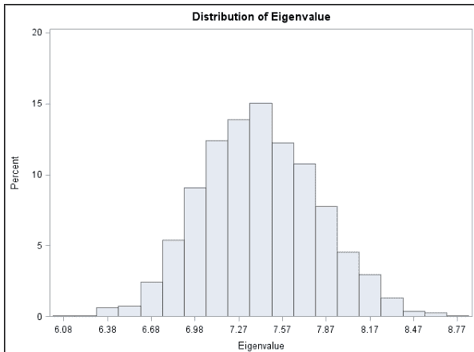

#### 表 7.2 提取的前三个特征值的引导结果

| | 平均特征值 | 95% 置信区间 | 平均方差百分比 | 95% 置信区间 |
|---|---|---|---|---|
| 因子 1 | 7.41 | (6.67, 8.20) | 68.90% | (63.83%, 74.10%) |
| 因子 2 | 3.27 | (2.75, 3.80) | 30.46% | (25.30%, 35.43%) |
| 因子 3 | 0.24 | (0.16, 0.33) | 2.20% | (1.44%, 3.09%) |

注：使用了带有 oblimin 旋转的迭代 PAF 提取。

前三个特征值与我们在第 2 章的初始分析一致。在任何引导数据集中，第三个特征值都不接近 1.0。此外，方差的 95% 置信区间表明，第三个特征值仅占总方差的 1.4% 到 3.1%。因此，两因子解得到了强有力的支持，我们可以得出结论：可以合理地期望在类似数据集中发现这种因子结构。

### 共同性和因子载荷

接下来，我们检查了共享项目级方差的相对稳定性以及因子之间方差的划分。用于从 ODS 系统输出的 boot_commun 和 boot_loadings 数据集估计共同性和因子载荷置信区间的语法如下所示。

```
**Estimate CI for Communalities and Pattern Loading Matrix;
*transpose communality so can use BY processing in proc univariate;
proc transpose data=boot_commun out=boot_commun_t prefix=communality
name=Variable;
by replicate;
run;
proc sort data=boot_commun_t; by Variable Replicate; run;
proc univariate data=boot_commun_t;
by Variable;
var communality1;
output out=ci_commun pctlpts=2.5, 97.5 mean=mean std=std pctlpre=ci;
run;
```

```
**Re-Order results on factors using the alignFactors macro we built;
*Include alignFactors macro syntax for use below;
filename align 'C:\alignFactors_macro.sas';
*include align;
```

```
*Run Macro and estimate CI;
*alignFactors(orig_loadings,boot_loadings,aligned_loadings,summary);
proc sort data=aligned_loadings; by VariableN; run;
proc univariate data=aligned_loadings;
by VariableN;
var Factor1;
output out=ci1_loadings pctlpts=2.5, 97.5 mean=mean std=std pctlpre=ci;
run;
proc univariate data=aligned_loadings;
by VariableN;
var Factor2;
output out=ci2_loadings pctlpts=2.5, 97.5 mean=mean std=std pctlpre=ci;
run;
```

在第 130 页的表 7.3 中，我们展示了共同性和模式矩阵因子载荷，以及它们相应的引导置信区间。总体而言，共同性相对较强。它们始终在 0.68 到 0.82 之间，并且具有相当窄的 95% 置信区间。这些结果使我们期望，在可比样本中的另一次复制将提取相对较强的类似共同性。

#### 表 7.3 共同性和因子载荷的引导结果

| 变量 | 共同性系数 | 95% 置信区间 | 因子 1 模式载荷系数 | 95% 置信区间 | 因子 2 模式载荷系数 | 95% 置信区间 |
|---|---|---|---|---|---|---|
| EngProb1 | 0.73 | (.66, .79) | 0.86 | (.81,.90) | -0.02 | (-.06, .04) |
| EngProb2 | 0.67 | (.58, .75) | 0.84 | (.77,.90) | -0.07 | (-.13, -.01) |
| EngProb3 | 0.77 | (.70, .83) | 0.88 | (.84,.91) | -0.01 | (-.05, .04) |
| EngProb4 | 0.81 | (.75, .86) | 0.91 | (.87,.94) | -0.03 | (-.06, .02) |
| EngProb5 | 0.80 | (.74, .85) | 0.89 | (.84,.92) | 0.02 | (-.02, .07) |
| EngProb6 | 0.77 | (.70, .83) | 0.87 | (.82,.90) | 0.02 | (-.03, .07) |
| EngProb7 | 0.78 | (.71, .83) | 0.87 | (.82,.91) | 0.03 | (-.02, .09) |
| EngProb8 | 0.67 | (.59, .74) | 0.79 | (.72,.84) | 0.07 | (.01, .14) |
| INTeng1 | 0.67 | (.56, .77) | 0.04 | (-.02, .11) | 0.80 | (.71, .87) |
| INTeng2 | 0.83 | (.76, .89) | -0.02 | (-.07, .02) | 0.92 | (.87, .96) |
| INTeng3 | 0.84 | (.79, .89) | -0.01 | (-.05, .02) | 0.92 | (.89, .95) |
| INTeng4 | 0.82 | (.68, .91) | 0.00 | (-.04, .04) | 0.90 | (.82, .96) |
| INTeng5 | 0.80 | (.72, .86) | -0.01 | (-.05, .04) | 0.90 | (.85, .93) |
| INTeng6 | 0.75 | (.66, .83) | 0.01 | (-.03, .06) | 0.86 | (.81, .91) |

注：使用了带有 oblimin 旋转的迭代 PAF 提取。95% 置信区间括号内。预期会在该因子上载荷的因子载荷已加粗。

因子载荷结果显示出类似趋势。所有变量在其应载荷的因子上都较强，相应的置信区间也相对较窄。这些结果表明，我们的估计很可能被复制。总体而言，这些结果强烈支持我们的解是一个可能推广的解。

### 置信区间的解释

通常，在解释围绕这些统计量的置信区间时，会考虑两件事：置信区间所捕获的统计量的相对大小，以及置信区间所覆盖的相对范围。这种用法与置信区间用于零假设检验的更常见用法不同。在评估零假设时，我们通常会查看我们的置信区间是否包含零，这将表明不存在显著效应或差异。


然而，在EFA的世界里，统计显著性检验非常少，且略高于零通常不够好。特征值为0.5通常不有趣，但因子载荷为0.5至少可能引起我们的兴趣。同样，因子载荷为0.1和0.2通常与因子载荷为零一样不有趣。因此，我们反而关注CI中捕获的效应的相对大小。此外，如果覆盖的大小范围很广，这可能表明存在大量抽样误差，且我们的结果可能无法反映总体的情况。

### 普遍性和Heywood案例

如前所述，自助抽样帮助我们回答可靠性和普遍性的问题。在本示例中，我们将考察Marsh SDQ数据的一个相对较小样本的结果，并将其与我们的较大数据集进行比较。我们将断言，对约16,000名学生的分析代表了“金标准”或总体因子结构，并将查看对我们小样本进行自助抽样CI是否能让我们以合理的准确性推断“总体”参数。随机选择了300个病例，然后对其进行了自助抽样和分析（使用最大似然提取和直接Oblimin旋转）。

假设这个小样本是我们关于该量表的唯一信息，我们首先仅对该样本进行了EFA。选择子样本并运行基本EFA的语法如下所示。

```
**Select subsample from SDQ data;
proc surveyselect data=sdqdata method=srs n=300 out=sdqdata_ssl
    seed=39302;
run;
**Look at factor structure in subsample;
proc factor data=sdqdata_ssl nfactors=3 method=ml rotate=OBLIMIN;
    var Math: Par: Eng: ;
run;
```

三个因子的特征值超过1.0，这得到了MAP分析的证实，并建议提取三个因子。因此，如果这是我唯一的样本，理论、Kaiser准则和MAP分析都会引导我提取三个因子。

### Heywood案例

然后，我们对特征值和模式矩阵因子载荷进行了自助抽样，以考察我们解的相对稳定性。同样，我们选择了2000个重采样，并在每个样本中复制了我们的分析。用于选择子样本并在每个样本上运行EFA的语法如下所示。

```
**Conduct bootstrapping from the data set;
proc surveyselect data=sdqdata_ssl method=urs samprate=1 outhits
    out=outboot_sdq (compress=binary) seed=1 rep=2000;
run;
**Notice occurrence of Heywood cases;
ods output Eigenvalues=boot_eigen
    ObliqueRotFactPat=boot_loadings;
proc factor data=outboot_sdq nfactors=3 method=ml rotate=OBLIMIN;
by replicate;
var Math: Par: Eng;
run;
ods output close; run;
```

但是，在我们运行PROC FACTOR以复制我们的分析后，以下错误消息在日志的三个不同位置出现。

### 图 7.5 日志中的错误

```
NOTE: 3 factors will be retained by the NFACTORS criterion.
ERROR: Communality greater than 1.0.
NOTE: Communality problems due to Heywood cases prevent further processing. You may consider using the HEYWOOD or ULTRAHEYWOOD option.
NOTE: The above message was for the following BY group: Sample Replicate Number=502
```

上述消息表明，三个重采样中的一些共同性估计超过1。从逻辑上讲，这不应该发生。请记住，共同性表示可以从一个项目中提取的共享方差的量。大于1的共同性相当于超过100%的方差！虽然这不合逻辑，但由于共同因子模型的一些数学特性，这偶尔是可能的。超过1的特征值称为超-Heywood案例，等于1的特征值称为Heywood案例（Heywood, 1931）。任何一种情况的发生都可能存在问题，并可能表明我们的模型可能设置错误（例如，因子数量错误等），或者我们可能没有足够的病例来产生稳定的估计。

为了自助抽样CI的目的，这条消息并不十分令人担忧。它只是表明我们的一些重采样可能存在有偏数据——特定病例被过度抽样，导致有偏或更均匀的数据集。所以，不要担心。这条消息并不是我们自助抽样分析的死刑。但是，如果我们在原始样本或大多数重采样中收到这条错误消息，这可能表明我们的原始数据存在重大问题（例如，偏差、样本量）。

我们可以采用两种方式继续当前分析：
- 改变我们的估计方法
- 允许SAS解决带有Heywood或超-Heywood案例的解

第一种选项是首选的行动方案。已知最大似然提取方法特别容易出现Heywood案例（Brown, Hedrix, Hedges, & Smith, 2012）。通过切换到对非正态数据更稳健的方法（即ULS或迭代PAF），我们可能能够从数据中获得更好的估计并避免有问题的Heywood案例。第二种选项涉及在FACTOR语句上使用HEYWOOD或ULTRAHEYWOOD选项，以允许等于或大于1的共同性估计。此选项应谨慎使用，因为它不会修复任何问题——它只是允许我们为潜在有问题的数据估计结果。

### 特征值和方差

我们已使用两种选项估计特征值来继续当前示例。语法如下所示。

```
*Solution to Heywood Cases #1: Change the method;
*Look at original sample and subsample solution with revised method;
proc factor data=sdqdata nfactors=3 method=uls rotate=OBLIMIN;
var Math: Par: Eng;
run;
proc factor data=sdqdata_ssl nfactors=3 method=uls rotate=OBLIMIN;
var Math: Par: Eng;
run;

*Bootstrap results;
ods output Eigenvalues=boot_eigen
   ObliqueRotFactPat=boot_loadings;
proc factor data=outboot_sdq nfactors=3 method=uls rotate=OBLIMIN;
   by replicate;
var Math: Par: Eng;
run;

ods output close;run;
*Estimate CI for Eigenvalues and Corresponding Variance;
proc sort data=boot_eigen nodupkey;
   by Number Replicate;
run;
proc univariate data=boot_eigen;
   by Number;
   var Eigenvalue Proportion;
   Histogram;
   output out=ci_eigen pctlpts=2.5, 97.5 mean=Eigenvalue_mean
      Proportion_mean std=Eigenvalue_std Proportion_std
      pctlpre=Eigenvalue_ci Proportion_ci;
run;
*Estimate CI for Pattern Loading Matrix;
*alignFactors(orig_loadings,boot_loadings,aligned_loadings,summary);
proc sort data=aligned_loadings; by VariableN; run;
proc univariate data=aligned_loadings;
   by VariableN;
   var Factor1;
   output out=ci1_loadings pctlpts=2.5, 97.5 mean=mean std=std
      pctlpre=ci;
run;
proc univariate data=aligned_loadings;
   by VariableN;
   var Factor2;
   output out=ci2_loadings pctlpts=2.5, 97.5 mean=mean std=std
      pctlpre=ci;
run;
proc univariate data=aligned_loadings;
   by VariableN;
   var Factor3;
   output out=ci3_loadings pctlpts=2.5, 97.5 mean=mean std=std
      pctlpre=ci;
run;
*Solution to Heywood Cases #2: Use ULTRAHEYWOOD option to allow SAS to solve;
ods output Eigenvalues=boot_eigen
    ObliqueRotFactPat=boot_loadings;
proc factor data=outboot_sdq nfactors=3 method=ml ULTRAHEYWOOD
    rotate=OBLIMIN;
    by replicate;
    var Math: Par: Eng;
run;
ods output close;run;
*Estimate CI for Eigenvalues and Corresponding Variance;
proc sort data=boot_eigen nodupkey;
    by Number Replicate;
run;
proc univariate data=boot_eigen;
    by Number;
    var Eigenvalue Proportion;
    Histogram;
    output out=ci_eigen pctlpts=2.5, 97.5 mean=Eigenvalue_mean
    Proportion_mean std=Eigenvalue_std Proportion_std
    pctlpre=Eigenvalue_ci Proportion_ci;
run;
```

第134页的表7.4显示了将提取方法更改为ULS后的特征值估计结果，第135页的表7.5显示了使用ULTRAHEYWOOD选项后的结果。请注意，ML提取产生的估计值较大，因为ML中使用了加权过程。因此，在比较这些表格时，应忽略特征值大小的相对差异。

### 表 7.4 使用ULS提取的前四个特征值结果

| 因子 | 原始样本特征值 | 缩减样本特征值 | 95%置信区间 | 原始样本方差 | 缩减样本方差 | 95%置信区间 |
|---|---|---|---|---|---|---|
| 1 | 3.62 | 3.68 | (3.31,4.21) | 52.1% | 50.0% | (43.9%,54.6%) |
| 2 | 2.16 | 2.47 | (2.11,2.86) | 31.0% | 33.6% | (27.9%,37.2%) |
| 3 | 1.73 | 1.53 | (1.23,1.88) | 24.9% | 20.8% | (16.1%,24.3%) |
| 4 | 0.36 | 0.43 | (0.26,0.72) | 5.2% | 5.9% | (3.4%,9.5%) |


| 因子 | 原始样本特征值 | 缩减样本特征值 | 95% 置信区间 | 原始样本方差 | 缩减样本方差 | 95% 置信区间 |
|---|---|---|---|---|---|---|
| 1 | 3.62 | 3.68 | (3.31,4.21) | 52.1% | 50.0% | (43.9%,54.6%) |
| 2 | 2.16 | 2.47 | (2.11,2.86) | 31.0% | 33.6% | (27.9%,37.2%) |
| 3 | 1.73 | 1.53 | (1.23,1.88) | 24.9% | 20.8% | (16.1%,24.3%) |
| 4 | 0.36 | 0.43 | (0.26,0.72) | 5.2% | 5.9% | (3.4%,9.5%) |

ML 和 ULS 提取方法均根据 Kaiser 准则（特征值 > 1）从原始样本和缩减样本中识别出应提取三个因子。第三和第四个特征值的 ULS 估计值周围的 95% 置信区间表明存在清晰的界限，缩减样本的因子结构很可能可以复制。请注意，原始样本的特征值也完全落在我们缩减样本产生的 95% 置信区间内——这是一个很好的检查，证明我们的结果确实具有推广性！

ML 估计值周围的 95% 置信区间讲述了一个略有不同的故事。这些估计值似乎向右偏，且第四个特征值的置信区间包含 1。这种右偏表明我们的缩减样本可能存在一定程度的非正态性，且 ML 方法难以产生稳定的估计值。第四个特征值置信区间中包含 1 意味着该因子结构可能无法很好地复制。在某些情况下，可能会提取四个因子而不是三个。最后，当我们将缩减样本的结果与原始样本的结果进行比较时，可以看到原始样本中的一个特征值不在缩减样本产生的 95% 置信区间内。总而言之，我们可以清楚地看出，在这个缩减样本中，ML 提取存在问题。95% 置信区间有助于我们检测这些问题。

因子载荷。我们继续检查使用 ULS 提取输出的模式矩阵因子载荷。在估计置信区间之前，因子载荷已通过上面介绍的宏 %checkFactorOrder 进行清理（即，取绝对值并对齐结果）。结果见第 135 页的表 7.6。

| 变量: | 原始样本因子载荷 1 | 原始样本因子载荷 2 | 原始样本因子载荷 3 | 缩减样本因子载荷 1 | 缩减样本因子载荷 2 | 缩减样本因子载荷 3 |
|---|---|---|---|---|---|---|
| Math1 | .90 | -.05 | -.03 | .91 (.86,.95) | .01 (-.06,.08) | -.09 (-.16,-.02) |
| Math2 | .86 | .00 | .01 | .85 (.79,.90) | .01 (-.05,.09) | .06 (-.01,.14) |
| Math3 | .89 | -.01 | .02 | .88 (.81,.93) | -.01 (-.07,.05) | .00 (-.08,.07) |
| Math4 | -.59 | -.06 | .01 | -.66 (-.75,-.56) | .01 (-.08,.09) | -.02 (-.11,.07) |
| Par1 | .00 | .71 | .02 | -.03 (-.10,.05) | .68 (.55,.78) | .04 (-.06,.16) |
| Par2 | .05 | -.69 | .04 | -.03 (-.11,.04) | -.72 (-.82,-.60) | .05 (-.06,.12) |
| Par3 | .03 | .82 | -.01 | -.02 (-.08,.05) | .96 (.89,1.00) | -.08 (-.14,.01) |
| Par4 | -.04 | -.60 | -.11 | -.05 (-.16,.05) | -.57 (-.69,-.43) | -.12 (-.26,.01) |
| Par5 | .02 | .74 | -.04 | -.02 (-.09,.05) | .78 (.70,.84) | .00 (-.08,.08) |
| Eng1 | .00 | .02 | .78 | .03 (-.05,.11) | .01 (-.06,.11) | .75 (.65,.85) |
| Eng2 | -.01 | -.10 | .84 | -.04 (-.11,.03) | -.07 (-.14,.02) | .78 (.67,.86) |
| Eng3 | .06 | -.03 | .85 | -.02 (-.09,.06) | .00 (-.07,.08) | .81 (.71,.89) |
| Eng4 | .04 | -.12 | -.61 | -.03 (-.11,.05) | -.09 (-.22,.01) | -.63 (-.74,-.48) |

注意：高亮显示的因子载荷是预期在该因子上加载的载荷。

大多数自助法置信区间相对较窄。它们比前一个示例中看到的略大，但仍然足够窄，足以表明载荷的相对大小和结构应该可以复制。为了检验自助法置信区间的准确性，我们可以将其范围与原始样本估计值进行比较。只有一个变量（Par4）的载荷落在置信区间之外。总体来说，还不错！我们仅根据 300 个病例的结果，就能对“总体”中发生的情况有相当好的了解。这些结果共同强化了这样一个观点：只要拥有合理的样本量、适当的方法（例如，提取、旋转等）以及适当的自助法方法学（例如，关注因子对齐和相对大小），我们就能对总体参数获得有价值的见解。

### 摘要

科学的一个核心特征是复制（Killeen, 2008; Thompson, 2002; Yu, 2003）。不幸的是，EFA 中的复制可能相当棘手！即使样本量非常大，因子结构和参数估计值也常常是对总体不稳定或不准确的反映。此外，没有单一的效应或统计显著性检验可以跨样本进行比较——相反，有共同性、特征值、因子载荷等更多内容。

尽管存在困难，复制程序对 EFA 大有裨益。在第 6 章中，我们探讨了一种更经典的复制方法：分割现有样本（内部复制）或收集两个独立样本（外部复制）。这些经典方法在小样本下不太有用，可能需要更多资源（以招募更大或重复的样本），并且只能告诉我们估计值在相邻样本中的可复制性。然而，它们确实解决了可复制性问题，并为我们提供了有价值的信息。在本章中，我们探讨了一种替代的复制方法，该方法在某些方面补充并改进了之前的方法。这种自助法重采样方法通过估计置信区间来深入了解总体参数。虽然不完美，但重采样方法可以告知研究人员效应或结果的相对稳定性或不稳定性（即，可复制性或不可复制性）。据我们所知，这种技术尚未广泛应用于 EFA。

虽然这些程序可能有些耗时且在编程上较为复杂，但我们希望您能看到它们能带来的众多好处。我们很少有能力知道总体中的“真实”因子结构（暂且不论因子结构在不同子人群中可能存在差异这一事实）。大多数时候，我们只有一个样本，希望因子结构与我们的理论模型相匹配，并乐观地认为我们的结果可以推广到新样本和新研究中。过去一个世纪左右的探索性因子分析几乎完全致力于以理论方式探索数据，或寻求确认某工具与理论模型相匹配。很少看到对至少同样重要的问题给予关注——即研究结果是否可以推广。在本章中，我们描述并探索了一种朝着该方向发展的方法学。它并非完美的方法学，因为样本质量差会导致自助法分析结果较差——但至少，我们可以展示结果的精确程度以及我们对这些估计值的信心程度。正如 Bruce Thompson 所指出的，自助法可以为我们提供关于结果的有价值的信息。它可以帮助研究人员获得他们原本可能无法获得的关于其结果的信息。

### 练习

- 1 复制第 134 页表 7.4 中 Marsh SDQ 数据子样本的自助法特征值估计。使用种子值 39302 选择 300 的子样本。（语法见第 6 章。）然后更新文本中提供的语法，对数据进行 EFA 并估计特征值的自助法置信区间。对子样本的自助法重采样使用种子值 1。设置种子值后，您的结果应与表中呈现的结果完全一致。如果在语法方面遇到问题，请将您的代码与书籍网站上提供的代码进行核对。

- 2 使用相同的 300 条记录子样本，复制第 135 页表 7.6 中因子载荷的自助法结果。尝试在对数据运行 %checkFactorOrder 宏之前估计置信区间，然后在运行宏之后再次估计。注意估计值的差异。

- 3 使用 GDS 数据集进行 EFA 并估计初始特征值周围的自助法 95% 置信区间。使用数据的 2000 次重采样。这些结果对 GDS 数据的因子结构有何暗示？

### 参考文献

Brown, B. L., Hendrix, S. B., Hedges, D. W., & Smith, T. B. (2012). 生物行为和社会科学中的多元分析：一种图形方法. Hoboken, NJ: Wiley.

Clarkson, D. B. (1979). 通过 Jackknife 估计旋转因子载荷的标准误. Psychometrika, 44(3), 297-314. doi: 10.1007/bf02294695

Cohen, J. (1994). 大地是圆的（p < .05）. 《美国心理学家》, 49(12), 997-1003.

Davison, A. C., & Hinkley, D. V. (1997). 自助法及其应用. 剑桥, 英国: 剑桥大学出版社.

DiCiccio, T. J., & Efron, B. (1996). 自助法置信区间. 《统计科学》, 11(3), 189-288.

Efron, B., & Tibshirani, R. J. (1994). 自助法导论（第 57 卷）: 纽约, Chapman & Hall.

Fider, F., & Cumming, G. (2008). 新统计学：21 世纪的态度. 在 J. W. Osborne (编), 《定量方法最佳实践》（第 1-14 页）. Thousand Oaks, CA: Sage 出版社.


Heywood, H. B. (1931). 关于实数的有限序列。*皇家学会会刊，A系列*, 134(824), 486-501.

Ichikawa, M., & Konishi, S. (1995). 因子分析中自助法的应用。*心理计量学*, 60(1), 77-93. doi: 10.1007/bf02294430

Hunter, J. E. (1997). 亟需：禁止显著性检验。*心理科学*, 8(1), 3-7. doi: 10.1111/1467-9280.00197.b00534.x

Killeen, P. R. (2008). 复制统计。载于 J. W. Osborne (编), *定量方法最佳实践* (pp. 103-124). Thousand Oaks, CA: Sage Publications.

Osborne, J. W. (2015). *逻辑回归最佳实践*. Thousand Oaks, CA: SAGE Publications.

Pennell, R. (1972). 使用“删一法”常规计算因子载荷的置信区间。*英国数学与统计心理学杂志*, 25(1), 107-114. doi: 10.1111/j.2044-8317.1972.tb00481.x

Schmidt, F. L. (1996). 心理学中的统计显著性检验与累积知识：对研究者培训的启示。*心理方法*, 1(2), 115-129.

Thompson, B. (2002). 未来定量社会科学研究可能的样子：效应量的置信区间。*教育研究者*, 31(3), 25-32.

Thompson, B. (2004). *探索性与验证性因子分析：理解概念与应用*: 华盛顿特区. 美国心理学会.

Wilkinson, L. (1999). APA 科学事务委员会统计推断工作组 (1999). 心理学期刊中的统计方法：指南与解释。*美国心理学家*, 54(8), 594-604.

Yu, C. H. (2003). 重采样方法：概念、应用与论证。*实用评估、研究与评估*, 8(19), 1-23.

Zhang, G., Preacher, K. J., & Luo, S. (2010). 探索性因子分析中普通最小二乘因子载荷和相关的自助置信区间。*多元行为研究*, 45(1), 104-134. 10.1080/00273170903504836

Zientek, L. R., & Thompson, B. (2007). 将自助法应用于多元情况：自助成分/因子分析。*行为研究方法*, 39(2), 318-325. doi: 10.3758/bf03193163

## 数据清洗

- 数据清洗的重要性 ........................ 141
- 异常值 ................................................ 142
- EFA 中的两种异常值 ............................ 142
- 响应集与数据中的意外模式 ....... 143
- 随机回答有多普遍？ ........................ 145
- 随机回答的检测 .......................... 145
- 应用：随机回答 vs 恒定回答 .............. 147
- 缺失数据 ............................................ 149
- 什么是缺失或不完整数据？ ..................... 149
- 处理缺失数据 ............................... 151
- 应用：非随机缺失与插补 ....... 152
- 总结 ................................................. 155
- 练习 ............................................... 155
- 参考文献 .............................................. 156

### 数据清洗的重要性

如果你读过的不是第一位作者的第一本书或文章，你可能知道，他一直是（也许令人厌烦的）这一观点的坚定倡导者：数据在清理并处理缺失数据之前，并未准备好进行分析。事实上，他写了一整本书，讲述研究人员可以采取的所有不同的——合法的——措施，以提高其数据及其分析结果的质量。

探索性因子分析也不例外，但在处理 EFA 时，存在不同的问题和不同的优先级。残差是推断统计中用于识别异常值的常用工具，它与 EFA 的探索性性质¹相矛盾，因此不能用于 EFA。相反，会使用许多其他工具和技术来识别过度有影响力的案例。缺失数据对 EFA 也越来越成问题。因子分析模型无法处理缺失数据，并且默认会减少此类案例。此过程可能会将系统误差和偏差引入结果。因此，在 EFA 之前，应审查缺失数据，并可能通过各种方法对其进行处理。

本章旨在简要探讨 EFA 中数据清理的问题。具体来说，我们试图讨论 EFA 的两个特定威胁——异常值和缺失数据——以及处理它们的方法。对本主题及相关 SAS 程序的详细综述超出了本书的范围。鼓励感兴趣的读者自行寻找更多信息。

### 异常值

### EFA 中的两种异常值

因子分析中存在两种不同类型的异常值。² 第一种类型的异常值是不属于该数据集的案例（或值）。案例可能不属于该数据集的原因有很多：该案例可能来自不同的总体，可能是数据记录或录入错误的结果，可能是有动机的误报的结果，或可能代表一个具有未被识别的不同因子结构的小子群。无论原因是什么，数据中存在这些“非法”案例都没有任何有用的作用。当你识别出此类案例时，如果可用，应检查原始数据，以确定该案例是否存在数据录入或按键错误。可能可以手动修复数据。或者，你可以删除它，然后使用缺失数据技术（如下文所述）用合理的估计值替换它，该估计值反映其原本可能的样子。

EFA 中的第二种异常值是不属于该数据集的变量。在此语境下，当变量作为单一项目因子在其自身因子上载荷时，可将其视为异常值。如果一个项目不载荷于任何其他因子，且没有其他项目载荷于该因子，则其被视为异常值，应从分析中移除（或者，如果该构念的合法方面，应重新编制量表以更充分地代表该潜在构念的维度）。

许多异常值可以通过仔细审查数据和分析来识别。超出范围的值（第一种异常值的一个子类型）通常可以通过待分析变量的频数分布来识别。任何超出量表或不在合理范围内的内容都应予以审查。PROC FREQ 可用于生成此类表格。这种检查应始终是研究人员的第一步。第二种异常值，即不属于该数据集的变量，更容易识别。这是你分析中与其他变量“相处不融洽”而独自占据一个因子的变量。应移除该变量，并重新运行分析。

¹ 残差的估计假设模型准确，而在 EFA 中我们无法做出该假设。
² 在此语境下，我们将使用术语“异常值”来松散地描述一个不属于该集合的事物。不同语境下有更技术性的定义，但请在此原谅我们。学术界也有一些人坚持认为，移除异常值（实际上，数据清理本身）对科学进程有害。第一位作者已发表许多文章、进行过众多演讲，并最终撰写了一整本书，以实证证明这一立场是错误的。

在 EFA 中，作为异常值的个别案例（第一种异常值的另一个子类型）更难以识别。对数据的目视检查可以帮助识别需要审查和潜在剔除的奇怪模式（例如，对每个项目都回答“3”的参与者）。其他模式，如随机回答或有动机的误答，更难以识别。这些模式可以分类为个人用来掩盖或过滤其真实信念或回答的响应集。每种模式都与不同的动机和结果相关联，且只有部分可能被检测到。我们将在下一节讨论这些响应集及其相关挑战。

### 数据中的响应集与意外模式

响应集¹（例如随机回答）是个人在应对教育或心理测试或量表时使用的策略（无论是有意识的还是无意识的）。这些响应集沿着一个连续谱系分布，从无偏检索（个人使用对记忆中事实信息的直接、无偏回忆来回答问题）到生成性策略（个人由于无法或不愿从记忆中产生相关信息，而创建不基于事实回忆的回答；参见 Meiser, 1994, 第 43 页）。在测量和研究方法文献中，响应集已被讨论了七十多年（Cronbach, 1942; Goodfellow, 1940; Lorge, 1937），一些人（例如，Cronbach, 1950）认为响应集无处不在，几乎在每个人群中、几乎在每种类型的测试或评估中都能找到。事实上，早期研究人员在多种多样的评估中识别出了响应集，例如 Strong 职业兴趣量表（Strong, 1927）；文书能力、词义、性情和拼写测试；以及颜色混合、海岸音高和刺激愉悦感比例的判断。（参见 Cronbach, 1950, 表 1 中的摘要。）

响应集可能会损害因子分析以及研究中测量的质量。我们作为科学家所进行的许多研究，依赖于研究参与者（学生、教师、组织干预的参与者、报酬微薄的志愿者等）的善意，而他们几乎没有动力为研究人员提供数据付出努力。如果我们不小心，那些缺乏动力以最大水平表现的参与者可能会增加我们数据中的误差方差，从而掩盖我们研究的真实效应。在本书的语境下，随机误答和有动机的误答可能会产生有害影响，例如掩盖清晰的因子结构或削弱因子载荷和共同性。

以下是文献中常讨论的一些响应集示例：


**随机应答**是指个体应答几乎没有模式或思考的应答集（Cronbach, 1950）。这种行为完全否定了应答的有用性，会给分析增加大量误差方差。Meier（1994）等人认为，这可能源于准备不足、对观察的反应、缺乏配合测试的动机、缺乏兴趣或疲劳（Berry et al., 1992; Wise, 2006）。随机应答在本文中尤其令人担忧，因为它可能掩盖干预措施的效果，使结果偏向于零假设、更小的效应量以及比有效数据情况下大得多的置信区间。

**伪装和诈病。** 伪装是指受访者伪造答案，试图呈现出比诚实答案更负面或更正面的形象的应答集。诈病是指个人伪造和夸大答案，以显得比诚实答案所显示的更虚弱或具有更多医学或心理症状的应答集。个人通常出于获得其原本无权获得的服务（例如，注意力缺陷或学习障碍评估；Kane (2008)；另见 Rogers (1997)）或避免其可能原本会面临的结果（例如，更严厉的监禁刑期；另见 Ray, 2009; Rogers, 1997）的目标而受到激励。当问题的目的显而易见时，这些应答集在心理量表上更为常见（例如，“你是否有自杀念头？”；另见 Kuncel & Bormeman, 2007）。显然，当个人进行伪装或诈病时，这种应答集会给社会带来巨大成本，但研究人员也应警惕这些应答集，因为这种受动机驱动的应答会极大地扭曲研究结果。

**社会期望效应**与诈病和伪装相关，因为它涉及以系统方式改变应答以实现期望目标——在此情况下，是为了符合社会规范或在考官面前“表现良好”。（参见，例如，Nunnally & Bernstein, 1994。）心理学研究中的许多量表都试图考虑这一长期讨论的应答集（Crowne & Marlowe, 1964），但它仍然是社会科学研究中一个真实且令人担忧的方面，可能没有明确答案，但可能对重要研究（例如，危险行为调查、医学试验中的依从性等）产生明确影响。

**顺从和批判性**是应答模式，个体更可能普遍同意（顺从）或不同意（批判性）问卷项目，而不考虑项目的性质（例如，Messick, 1991; Murphy & Davidshofer, 1988）。

**教育测试特有的应答风格**在文献中也有讨论。虽然上述应答风格可能出现在教育数据中，但其他特定于学业掌握测试（通常为选择题）的偏差包括：(a) 选择题中对特定列（例如，A或D）的应答偏差，(b) 在不确定正确答案时对猜测的偏好或反对偏差，以及 (c) 快速猜测（Bovaird, 2003），这是上述讨论的一种随机应答形式。如上所述，随机应答（快速猜测）是不可取的，因为它会给数据引入大量误差，从而抑制研究人员检测组间真实差异、随时间变化以及干预措施效果的能力。

如上所述，随机应答对研究来说尤其成问题。其他大多数应答集在某种程度上会使结果偏差，但仍存在某种模式，可能反映个体对特定构念的水平，或至少反映社会规范。随机应答与预期模式相矛盾。因此，单个随机应答案例可能比大多数其他应答集向分析中引入更多误差。我们将在本节余下部分讨论这些棘手的离群值。

### 随机应答有多常见？

随机应答似乎并非罕见或孤立的行为。在一项针对大学大二学生样本的研究中，26%的学生（根据不适当的短响应时间）被识别为进行了随机应答（Wise, 2006）。此外，随机应答者的应答中只有25.5%是正确的，而非随机应答者的应答中有72%是正确的。这正是我们所预期的，并用于验证随机应答者的筛选。在另一项研究中，明尼苏达多项人格量表（MMPI-2）上的随机应答发生率在大学生中报告为60%，在一般成年人群中为32%，在警察培训项目申请者中为53%（Berry et al., 1992）。在这种情况下，被识别为随机的应答更可能出现在这份冗长评估的末尾，表明这些应答可能是因为疲劳或缺乏动机而随机产生的。

第一作者进行的另一项研究发现了类似趋势。Osborne & Blanchard (2011) 发现，在一项旨在评估教育干预效果的研究中，约40%的560名学生正在进行受动机驱动的错误应答——在此情况下，可能是随机应答。这些学生通过下一节讨论的两个不同标准进行识别：Rasch outfit指标和随机应答量表的表现。为了确认标签，他们证明随机应答者的测试分数显著低于其他学生，并且与其他学生相比，随时间变化（干预前 vs 干预后）也小得多。进行了额外分析以进一步验证随机应答者分类的准确性；有关更多信息，请参见 Osborne & Blanchard (2011)。

### 随机应答的检测

关于如何检测多种不同类型的应答集，已有成熟的文献。检测应答集的方法示例包括：添加特定类型的项目以检测社会期望效应、以特定方式改变对受访者的指示、创建措辞为正面和负面的同样可取的项目，以及对于方法上更为复杂的研究人员，使用项目反应理论（IRT）来显式估计猜测（随机应答）参数。Meijer (1994; 另见 Rogers, 1997) 对应答集检测和回避的一些更常见问题和建议进行了简明总结。以下三种特定方法在检测随机应答方面很有用：

**创建简单随机应答量表。** 对于不熟悉IRT方法的研究人员，在多选教育测试（以及通常使用Likert类型应答量表的心理测试）中检测随机应答仍然可以非常有效。一般来说，简单随机应答量表涉及以这种方式创建项目：100%或0%的受访人群应以特定方式应答，从而使偏离预期应答的应答可疑。根据所涉量表的类型，有几种方法可以做到这一点。对于多选教育测试，一种方法是设置一个或多个非法选项。1 当学生使用单独的答题卡（如本研究中使用的机器评分答题卡，如下文所述）时，这种方法最为合适。

这种方法的变体是将问题散布在整个测试中，如果受访者在阅读问题，100%的受访者应以特定方式回答（Beach, 1989）。这些可以是不应遗漏的内容（例如，2+2=___）、行为/态度问题（例如，我为所有衣服编织布料）、无意义项目（例如，二月有30天），或针对性的多选测试项目，例如：

- 如何拼写 'forensics'？
- 1 fornsis，
- 2 forensics，
- 3 phorensicks，
- 4 forenix

项目反应理论。项目反应理论可用于创建人-测验契合指数，这有助于识别随机应答者（Meijer, 2003）。这种方法的背后思想是根据个体的应答模式进行定量分组，然后利用这些分组来识别偏离预期应答模式的个体。这可能导致推断出使用特定应答集（如随机应答）的群体。此外，还可以估计“猜测参数”（使用三参数逻辑模型），并在分析中对其进行考虑，如上所述。在 SAS 中，可以使用 NLMIXED、GLIMMIX 和 IRT 过程（SAS Institute Inc., 2015）来估计“猜测参数”。然而，据我们所知，这些过程没有现成的人-测验契合输出估计。相反，人-测验契合估计必须硬编码或通过不同软件（例如，R、IRTPRO、BILLOG-MG）来估计。

有兴趣的读者应参考 Edelen & Reeve (2007; 另见 Hambleton, Swaminathan, & Rogers, 1991; Wilson, 2005) 等文献，以更全面地讨论此主题。不幸的是，IRT 确实有一些缺点。它通常需要大样本（例如，N ≥ 500）、大量培训和资源，并且，最后，尽管它能识别与一般应答模式不符的个体，但不一定显示应答集（如果有）是什么。因此，尽管 IRT 在许多情况下很有用，但我们无法在本研究中使用它。

Rasch 测量方法。Rasch 测量模型是另一类用于识别应答集的现代测量工具：简言之，Rasch 分析产生两个对此应用特别感兴趣的拟合统计量：infit 和 outfit，两者都测量个体的标准化残差平方和。较大的 infit 统计量可以反映个体的意外观察模式（通常解释为项目


misperforming for the individuals being assessed). By contrast, large outfit mean squares can reflect unexpected observations by persons on items (might be the result of haphazard or random responding). Thus, large outfit mean squares can indicate an issue that deserves exploration, including haphazard or random responding. In SAS, the NLMIXED, GLIMMIX, and IRT procedures can also be used to conduct a Rasch analysis. However, similar to the IRT person-fit measures, none of the above procedures currently outputs estimates of infit and outfit. Thus, individuals will need to hard-code these estimates or produce them with different software (e.g., WINSTEPS, R).

Again, the challenge is interpreting the cause (response set or missing knowledge) of the substantial outfit values. Interested readers are encouraged to explore Bond & Fox (2001) or Smith & Smith (2004) for a more thorough discussion of this topic.

No matter the method, we assert that it is imperative for educational researchers to include mechanisms for identifying random responding in their research, as random responding from research participants is a threat to the validity of educational research results. Best practices in response bias detection are worthy of more research and discussion, given the implications for the quality of the field of educational research.

### 应用：随机响应与常数响应

In this section we will review two types of problematic responding: random responding and constant responding. Random responding is randomly entering numbers within a given range. Humans tend not to engage in true random responding, however. So the other extreme is for individuals to respond with a constant number across all questions (such as “3”). For each of the examples below, 100 of the 300 cases in the small Marsh SDQ data set (the same one we bootstrapped in Chapter 7) were either replaced with randomly generated cases with a uniform random distribution from 1-6 (integers only) or with a “3” to represent a 33% random responding or constant responding rate. Similar to previous chapters, we used ULS extraction and direct oblimin rotation.

As you can see in Table 8.1 on page 148, the effect is noticeable. When 33% of a sample is engaging in random responding on an instrument that has very strong and clear factor structure, the initial and extracted eigenvalues are attenuated, as is common in most statistical procedures when random error is introduced into the data. In fact, the eigenvalues for the third factor are attenuated so much that we might recommend the extraction of two factors only. This conclusion is further supported by the MAP analysis, which supports extraction of three factors among the original and 33% constant samples. Finally, the extracted variance in the random condition is reduced by 26.83% compared to the original data (44.17% vs 60.50%). This indicates the data captures less of the constructs of interest and more error or unique variance than the other samples.

In the constant condition, the initial eigenvalue is increased dramatically, as this pattern of responding makes the data look much closer to a single strong factor solution. The other eigenvalues are attenuated, yet the overall variance accounted for is inappropriately increased because of the first factor. As we mentioned before, the MAP analysis recommend extraction of the same number of factors as the original data, but the large first eigenvalue suggest a one-factor solution might also be plausible.

| Factor: | Original Initial | Original Final | 33% Random Initial | 33% Random Final | 33% Constant Initial | 33% Constant Final |
|---|---|---|---|---|---|---|
| 1 | 3.683 | 3.720 | 3.127 | 3.190 | 5.362 | 5.367 |
| 2 | 2.471 | 2.531 | 1.317 | 1.408 | 1.960 | 2.001 |
| 3 | 1.532 | 1.589 | .731 | 0.814 | 1.235 | 1.260 |
| 4 | .435 | | .245 | | .547 | |
| 5 | .094 | | .145 | | .144 | |
| 6 | .010 | | .122 | | .061 | |
| % Variance for first 3 factors | 59.12% | 60.31% | 39.81% | 41.64% | 65.82% | 66.37% |

Note: ULS extraction was used.

| Var: | Original 1 | Original 2 | Original 3 | 33% Random 1 | 33% Random 2 | 33% Random 3 | 33% Constant 1 | 33% Constant 2 | 33% Constant 3 |
|---|---|---|---|---|---|---|---|---|---|
| Par1 | .678 | -.027 | .038 | .484 | .052 | .068 | .676 | .043 | .148 |
| Par2 | -.723 | -.028 | .046 | -.666 | .027 | .010 | -.861 | -.005 | .091 |
| Par3 | .957 | -.020 | -.080 | .768 | .045 | -.107 | .922 | .054 | -.020 |
| Par4 | -.569 | -.046 | -.119 | -.493 | .013 | -.151 | -.628 | .039 | -.064 |
| Par5 | .779 | -.023 | -.004 | .669 | -.020 | -.025 | .835 | .016 | -.011 |
| Math1 | .005 | .908 | -.088 | -.068 | .839 | -.087 | -.050 | .966 | -.071 |
| Math2 | .015 | .850 | .058 | .029 | .650 | .018 | .029 | .849 | .079 |
| Math3 | -.012 | .876 | -.005 | .024 | .687 | -.016 | .049 | .836 | .064 |
| Math4 | .011 | -.665 | -.020 | -.005 | -.530 | -.085 | .002 | -.592 | .025 |
| Eng1 | .014 | .034 | .748 | .071 | .076 | .574 | .044 | .075 | .834 |
| Eng2 | -.069 | -.044 | .775 | -.094 | -.051 | .594 | -.121 | -.013 | .806 |
| Eng3 | -.003 | -.015 | .811 | .043 | .045 | .631 | .064 | .023 | .841 |
| Eng4 | -.087 | -.029 | -.626 | -.253 | -.024 | -.445 | -.229 | .030 | -.561 |

Note: ULS extraction and direct oblimin rotation were used.

As you can see in Table 8.2 on page 148, the factor loadings differ across samples. The factor loadings for the random sample are attenuated, sometimes markedly (e.g., English items). In the constant responding data, many of the factor loadings are inflated. Although the basic factor pattern is present in all three data sets despite these challenges, in a more marginal data set this might make a difference between a clear factor structure and an analysis that does not produce the appropriate factor structure. Replication might also be an issue, particularly if the proportion of respondents engaging in random or constant responding changes markedly.

Unless there is an odd pattern to outliers (e.g., a bias toward a particular type of response), failure to check for data quality issues would lead to similar effects as the random responding data, depending on how egregious the outliers are. In general, outliers introduce error variance into the analysis, as random responding does. Thus, we should see similar results across different types of outliers. Where one might see a difference is in the common case of government data sets, where missing data values are often coded as a numeric value, such as 98 or 99. If this occurred in the SDQ data above where all valid variables range from 1-6, values of 98 or 99 could cause a large amount of error variance to be introduced into the analysis.

### 缺失数据

### 什么是缺失或不完整数据？

Missing data is an issue in exploratory factor analysis because EFA will analyze only complete cases, and thus any case with missing data will be deleted. This can reduce sample size, causing estimates to be more volatile. If missingness is random, then your estimates should be unbiased. However, it is unusual for missing data to be completely at random. Thus, it is likely that missing data is causing bias in the results in addition to reducing sample size—unless you deal with the missing data in some appropriate manner. In SAS, we can see how many cases are missing a response by adding the missing option on the TABLE statement of PROC FREQ (e.g., table variable_names /missing).

If any data on any variable from any participant is not present, the researcher is dealing with missing or incomplete data. In many types of research, there can be legitimate missing data. This can come in many forms, for many reasons. Most commonly, legitimate missing data is an absence of data when it is appropriate for there to be an absence. Imagine you are filling out a survey that asks you whether you are married, and if so, how happy you are with your marriage. If you say you are not married, it is legitimate for you to skip the follow-up question on how happy you are with your marriage. If a survey asks you whether you voted in the last election, and if so, how much research you did about the candidates before voting, it is legitimate to skip the second part if you did not vote in the last election.

Legitimately missing data can be dealt with in different ways. One common way of dealing with this sort of data could be using analyses that do not require (or can deal effectively with) incomplete data. These include things like hierarchical linear modeling (HLM; Raudenbush & Bryk, 2002) or item response theory. Another common way of dealing with this sort of legitimate missing data is adjusting the denominator. Again taking the example of the marriage survey, we could eliminate non-married individuals from the particular analysis looking at happiness with marriage, but would leave non-married respondents in the analysis when looking at issues relating to being married versus not being married. Thus, instead of asking a slightly silly question of the data—“How happy are individuals with their marriage, even unmarried people?”—we can ask two more refined questions: “What are the predictors of whether someone is currently married?” and “Of those who are currently married, how happy are they on average with their marriage?” In this case, it makes no sense to include non-married individuals in the data on how happy someone is with marriage.

Illegitimately missing data are also common in all types of research. Sensors fail or become miscalibrated, leaving researchers without data until that sensor is replaced or recalibrated. Research participants choose to skip questions on surveys that the researchers expect everyone to answer. Participants drop out of studies before they are complete. Missing data also, somewhat ironically, can be caused by data cleaning (if you delete outlying values).

Few authors seem to explicitly deal with the issue of missing data, despite its obvious potential to substantially skew the results (Cole, 2008). For example, in a recent survey of highly regarded journals from the American Psychological Association, the first author and his students found that just over one-third (38.89%) of authors discussed the issue of missing data in their articles. Do those 61% who fail to report anything relating to missing data have complete data (rare in the social sciences, but possible for some authors), do they have complete data because they removed all subjects with any missing data (undesirable, and potentially biasing the results, as we discuss below), did they deal effectively with the missing data and fail to report it (less likely, but possible), or did they allow the statistical software to treat the missing data via whatever the default method is, which most often leads to deletion of subjects with missing data? If this survey is representative of researchers across the


在科学领域，我们有理由感到担忧。在报告与缺失数据相关内容的研究者中，大多数人报告使用了经典的逐案删除法（完整案例分析）或均值替代法，这两者都不是最佳实践（Schafer & Graham, 2002）。只有少数研究者报告对缺失数据做了任何建设性的处理，例如估计或插补。

### 处理缺失数据

回归和多重插补已成为处理缺失数据的两种更先进的方法，特别是在因子分析等存在其他具有有效数据的密切相关变量的情况下。回归插补（也称为简单插补）根据具有有效数据的变量创建回归方程来预测缺失值。替换每个缺失值后，分析可以按计划继续。在因子分析中使用的一种流行的回归插补类型是期望–最大化（EM）算法。该算法使用迭代最大似然过程来识别每个缺失值的最佳估计。EM算法可通过SAS中的MI过程使用（SAS Institute Inc., 2015）。我们将在下一节回顾此过程的示例。EM算法连同其他形式的回归插补，已被证明优于均值替代或完整案例分析，特别是当数据不是完全随机缺失时（Graham, 2009）。

多重插补通过为每个缺失值提供多个估计，将插补概念进一步推进。各种先进技术——例如，EM/最大似然估计、倾向得分估计或马尔可夫链蒙特卡罗（MCMC）模拟——被用来提供估计并创建同一数据集的多个版本（有点像统计学家对经典科幻场景中替代现实或平行宇宙的看法）。然后可以通过标准方法分析这些平行数据集，并合并结果以产生估计值和置信区间，这些结果通常比简单插补或之前提到的处理缺失值的方法更稳健（Schafer, 1997, 1999）。然而，很少关注合并插补数据集结果的方法。因为大多数因子分析模型不包含现成的标准误差估计，因此通过PROC MIANALYZE汇总结果的更常见方法不可用。研究者推荐了许多替代方案，包括在校正对齐问题后平均化成分载荷（在第7章中回顾）、对插补数据集产生的平均相关或协方差矩阵进行分析，或使用广义Procrustes分析来汇总载荷（Ginkel & Kroonenberg, 2014）。

由于探索性因子分析（EFA）的主要目标是探索，因此只需认识到缺失数据的作用即可。我们不认为在EFA的背景下需要更复杂的多重插补方法——尤其是因为它们在编程上可能具有挑战性！相反，请探索您的数据并尝试理解任何缺失的影响。如果您担心缺失数据，请尝试使用回归插补方法。

### 应用：非随机缺失与插补

让我们检查非随机缺失对我们结果的影响以及EM算法提供的潜在改进。使用我们之前使用的相同的300名学生的SDQ样本，我们通过将第一个英语项目（Eng1：我在英语课上学习很快）的值“6”重新编码为系统缺失值，模拟了一些非随机、任意的缺失。这创建了一个有偏样本，消除了那些对其英语学习持最乐观态度的学生（300名学生中的76名）。

然后我们使用MI过程来估计EM协方差矩阵。此协方差矩阵在EM语句中请求。我们通过在VAR语句上指定_ALL_来使用所有变量以生成最终估计。尽管我们只有计划在此数据集中分析的变量，但在此步骤中包含所有变量（甚至不在分析中的变量）通常很有用。这有助于在估计缺失值时提供尽可能多的信息。PROC MI随后输出一个单一的协方差矩阵，可以读入FACTOR过程并用于后续分析。此语法如下所示。

```
*Impute missing via EM algorithm;
proc mi data=nonrandom_miss nimpute=0;
   em outem=em_covar_matrix;
   var ALL_;
run;
*Run EFA on imputed covariance matrix;
proc factor data = em_covar_matrix nobs=300 nfactors = 3 method = uls
   rotate=oblimin;
   var Math: Par: Eng:;
run;
```

MI过程提供了一些有用的工具来帮助理解缺失模式。第153页上的图8.1显示了该过程输出的缺失数据摘要。它显示了识别出的缺失模式，并总结了不同分组中每个变量的平均值。我们可以看到，我们的数据仅包含两种缺失模式：1）数据完整的病例和2）缺失Eng1数据的病例。我们还可以沿这些分组比较变量的平均值。一般来说，这些值似乎很接近，但有些项目的组间平均响应差异较大（例如，Eng2、Eng3）。

#### 图 8.1 PROC MI缺失数据摘要

| 组 | Eng1 | Eng2 | Eng3 | Eng4 | Math1 | Math2 | Math3 | Math4 | Par1 | Par2 | Par3 | Par4 | Par5 | 频数 | 百分比 |
|---|---|---|---|---|---|---|---|---|---|---|---|---|---|---|---|
| 1 | X | X | X | X | X | X | X | X | X | X | X | X | X | 224 | 74.67 |
| 2 | . | X | X | X | X | X | X | X | X | X | X | X | X | 76 | 25.33 |

| Eng1 | Eng2 | Eng3 | Eng4 | Math1 | Math2 | Math3 | Math4 | Par1 | Par2 | Par3 | Par4 | Par5 |
|---|---|---|---|---|---|---|---|---|---|---|---|---|
| 4.111607 | 3.535714 | 4.214286 | 2.165179 | 3.964429 | 4.058036 | 4.276786 | 2.633929 | 4.696429 | 1.919643 | 4.700893 | 2.491071 | 4.160714 |
| 4.986942 | 5.407995 | 1.184211 | 4.039474 | 4.184211 | 4.447368 | 2.578947 | 5.250000 | 1.500000 | 5.131579 | 2.052632 | 4.618421 |

原始样本、非随机缺失样本和插补样本的特征值如下所示，见第153页的表8.3。非随机缺失样本与原始样本没有极大差异，但第一个因子略有衰减，提取的方差也稍少。相比之下，插补样本的结果更紧密地反映了原始样本。

#### 表 8.3 非随机缺失数据（N=76）对特征值的影响

| 因子： | 原始 初始 | 原始 最终 | 非随机缺失 初始 | 非随机缺失 最终 | 插补 初始 | 插补 最终 |
|---|---|---|---|---|---|---|
| 1 | 3.683 | 3.720 | 3.434 | 3.463 | 3.672 | 3.706 |
| 2 | 2.471 | 2.531 | 2.485 | 2.532 | 2.455 | 2.513 |
| 3 | 1.532 | 1.589 | 1.558 | 1.610 | 1.520 | 1.577 |
| 4 | .435 | | .507 | | .465 | |
| 5 | .094 | | .091 | | .094 | |
| 6 | .010 | | .041 | | .015 | |
| 前3个因子的方差百分比 | 59.12% | 60.31% | 57.52% | 58.50% | 58.82% | 59.97% |

注：使用了ULS提取。

如您在第154页的表8.4中所见，非随机缺失样本继续与原始样本有轻微偏差。在此数据中，数学因子被首先提取而不是第二，表明它比其他因子更好地被样本解释。此外，英语因子上的载荷有所衰减，其他载荷也略有偏移。插补载荷并不完美，但它们似乎比非随机缺失样本更紧密地反映了原始样本。

#### 表 8.4 随机或恒定响应对因子载荷的影响

| | 原始 | | | 非随机缺失 | | | 插补 | | |
|---|---|---|---|---|---|---|---|---|---|
| 变量： | 1 | 2 | 3 | 1 | 2 | 3 | 1 | 2 | 3 |
| Par1 | .678 | -.027 | .038 | -.028 | .686 | -.014 | .674 | -.026 | .039 |
| Par2 | -.723 | -.028 | .046 | -.031 | -.720 | .051 | -.730 | -.026 | .058 |
| Par3 | .957 | -.020 | -.080 | -.023 | .935 | -.068 | .954 | -.020 | .046 |
| Par4 | -.569 | -.046 | -.119 | -.019 | -.567 | -.166 | -.575 | -.043 | .061 |
| Par5 | .779 | -.023 | -.004 | .000 | .746 | .015 | .773 | -.023 | -.077 |
| Math1 | .005 | .908 | -.088 | .929 | -.022 | -.076 | .010 | .908 | -.107 |
| Math2 | .015 | .850 | .058 | .892 | -.008 | .054 | .007 | .853 | .011 |
| Math3 | -.012 | .876 | -.005 | .860 | -.032 | -.013 | -.010 | .874 | -.103 |
| Math4 | .011 | -.665 | -.020 | -.643 | -.035 | -.023 | .010 | -.664 | .081 |
| Eng1 | .014 | .034 | .748 | .053 | .019 | .684 | .008 | .049 | -.008 |
| Eng2 | -.069 | -.044 | .775 | -.067 | -.106 | .745 | -.071 | -.048 | -.019 |
| Eng3 | -.003 | -.015 | .811 | -.018 | .009 | .788 | -.004 | -.020 | .717 |
| Eng4 | -.087 | -.029 | -.626 | -.038 | -.110 | -.578 | -.101 | -.023 | .786 |

注：使用了直接oblimin旋转的ULS提取。每个项目加载的主要因子已突出显示。

缺失数据在当前分析中对结果没有重大影响，但它有可能引起更多问题。如果因子结构不够清晰，观察值较少，或者缺失数据代表样本中未被涵盖的部分，结果可能会大不相同。插补缺失数据有可能缓解非随机缺失的有害影响，并且作为额外好处，保留所有那些来之不易的数据点在您的分析中。


### 摘要

数据质量是几乎所有科学领域中持续存在的问题。在EFA中，如同大多数其他定量分析一样，数据质量问题可能会偏差或完全破坏你的分析。因此，我们鼓励你在分析前仔细检查所有数据，以发现极端情况、随机或其他类型的有动机的错误回答，并有效处理缺失数据。

### 练习

- 1 检查GDS数据中的两种离群值。对变量进行频数分布（它们都应为0或1），并目视扫描数据中可能存在问题的特定响应模式（例如，全0或全1）。使用ULS提取和直接oblimin旋转进行EFA，提取五个变量。确定是否存在可能是离群值的变量。

- 2 复制我们的分析，为SDQ数据的一个子样本插补缺失数据。使用本节底部呈现的语法选择N=300的子样本，并通过将Engl上所有值为6的响应更改为缺失值来生成非随机缺失样本。然后使用本章中呈现的代码插补缺失数据，并从协方差矩阵运行EFA，使用ULS提取和直接oblimin旋转。

- 3 为GDS数据集插补缺失数据，使用与我们为SDQ数据子样本所用类似的过程。对原始数据和插补后的数据版本进行EFA，使用ULS提取和直接oblimin旋转，这次提取三个变量。比较带有插补数据的模型结果与未插补数据的结果。结果有差异吗？为什么或为什么不？

以上练习2的语法：

```
*Replicate the selection of the 300;
proc surveysselect data=sdqdata method=srs n=300 out=sdqdata_ssl
seed=939202;
run;
* Generate nonrandom missing sample;
data nonrandom_miss;
set sdqdata_ssl;
if Engl = 6 then Engl=.;
run;
```

### 参考文献

Beach, D. A. (1989). 识别随机回答者. Journal of Psychology, 123(1), 101.

Berry, D. T. R., Wetter, M. W., Baer, R. A., Larsen, L., Clark, C., & Monroe, K. (1992). MMPI-2随机回答指数：使用自评方法的验证. Psychological Assessment, 4(3), 340-345.

Bond, T. G., & Fox, C. M. (2001). 应用Rasch模型：人文科学中的基本测量. Mahwah, NJ: Lawrence Erlbaum Associates.

Bovaird, J. A. (2002). 测试中的新应用：使用响应时间提高潜在特质估计的构念效度. (64). ProQuest Information & Learning, US. 从 http://catalog.lib.ku.edu/cgi-bin/Pwebrecon.cgi?BBID=30004258&pds_handle= 检索

Cole, J. C. (2008). 如何处理缺失数据. 在 J. W. Osborne (编), 定量方法的最佳实践. (第214-238页). Thousand Oaks, CA: Sage Publications.

Cronbach, L. J. (1942). 顺从作为真假测试中一个因素的研究. Journal of Educational Psychology, 33(6), 401-415.

Cronbach, L. J. (1950). 关于回答集和测试设计的进一步证据. Educational and Psychological Measurement, 10(1), 3-31.

Crowne, D. P., & Marlowe, D. (1964). 评价依赖中的认可动机研究. New York: Wiley.

Edelen, M. O., & Reeve, B. B. (2007). 将项目反应理论(IRT)建模应用于问卷开发、评估和改进. Quality of Life Research, 16(1) Supplement, 5-18.

Ginkel, J. R., & Kroonenberg, P. M. (2014). 在主成分分析中使用广义Procrustes分析进行多重插补. Journal of Classification, 31(2), 242-269. doi: 10.1007/s00357-014-9154-y

Goodfellow, L. D. (1940). 概率中的人为因素. The Journal of General Psychology, 23(1), 201-205.

Graham, J. (2009). 缺失数据分析：在现实世界中使其发挥作用. Annual Review of Psychology, 60, 549-576. doi: 10.1146/annurev.psych.58.110405.085530

Hambleton, R. K., Swaminathan, H., & Rogers, H. J. (1991). 项目反应理论基础. Thousand Oaks, CA, US: Sage Publications, Inc.

Kane, S. T. (2008). 最大限度减少LD/ADHD评估过程中的诈病和努力不足. ADHD Report, 16(5), 5-9.

Kuncel, N. R., & Borneman, M. J. (2007). 朝着检测故意伪造人格测试的新方法迈进：使用独特的项目响应. International Journal of Selection and Assessment, 15(2), 220-231. doi: 10.1111/j.1468-2389.2007.00383.x

Lorge, I. (1937). 天才型：光环效应还是现实？ Psychological Bulletin, 34, 545-546.

Meier, S. T. (1994). 心理测量与评估中的持续危机：历史回顾. San Diego, CA: Academic Press.

Meijer, R. R. (2003). 使用基于项目反应理论的人-测验拟合统计量诊断测验中的项目得分模式. Psychological Methods, 8(1), 72-87.

Messick, S. (1991). 回答风格的心理学与方法学. 在 R. E. Snow & D. E. Wiley (编), 改进社会科学研究：献给李·J·克伦バ克的文集 (第161-200页). Hillsdale, N.J.: Lawrence Erlbaum Associates.

Murphy, K. R., & Davidshofer, C. O. (1988). 心理测验：原理与应用. Englewood Cliffs, NJ: Prentice-Hall.

Nunnally, J. C., & Bernstein, I. (1994). 心理测量理论（第3版）. New York: McGraw-Hill.

Osborne, J. W., & Blanchard, M. R. (2011). 参与者的随机回答对社会科学研究结果效度的威胁. Frontiers in Psychology, 1, 220. doi: 10.3389/fpsyg.2010.00220

Raudenbush, S. W., & Bryk, A. S. (2002). 分层线性模型：应用与数据分析方法. (第2版) (第1卷). Thousand Oaks, CA: Sage Publications.

Ray, C. L. (2009). 在法医实践中使用诈病筛查工具的重要性. Journal of Forensic Psychology Practice, 9(2), 138-146.

Rogers, R. (1997). 导言. 在 R. Rogers (编), 诈病与欺骗的临床评估. (第2版) New York: Guilford Press.

SAS Institute Inc. (2015). SAS/STAT® 14.1 用户指南. Cary, NC: SAS Institute Inc.

Schafer, J. L. (1997). 不完整多元数据分析: Boca Raton, FL: Chapman & Hall/CRC.

Schafer, J. L. (1999). 多重插补：入门. Statistical methods in medical research, 8(1), 3-15.

Schafer, J. L., & Graham, J. W. (2002). 缺失数据：我们对最新进展的看法. Psychological Methods, 7(2), 147-177.

Smith, E. V., & Smith, R. M. (编) (2004). Rasch测量导论：理论、模型与应用. Maple Grove, MN: JAM Press.

Strong, E. K. J. (1927). 职业兴趣测验. Educational record, 8, 107-121.

Wilson, M. (2005). 构建测量：一种项目反应建模方法. Mahwah, NJ, US: Lawrence Erlbaum Associates.

Wise, S. L. (2006). 对低风险计算机化测验中项目所获得差异努力的调查. Applied Measurement in Education, 19(2), 95-114.

## 因子分数

| 章节 | 页码 |
|------|------|
| 因子分数101 | 159 |
| 示例语法与输出 | 160 |
| 应用：因子分数估计 | 162 |
| 现代替代方案有哪些？ | 168 |
| 摘要 | 169 |
| 练习 | 169 |
| 参考文献 | 170 |

#### 因子分数101

在20世纪80年代，当第一位作者开始修读研究生统计学课程时，因子分数似乎是前沿技术。该概念和实践可以追溯到20世纪20年代，尽管早期它被认为远不如确定实际因子本身重要。1 这种做法发展为对早期通过对量表项目求和或求平均以产生总分的做法的一种合理回应。当然，对项目求和或求平均假设所有项目对潜在得分的贡献相等。EFA非常早就有力地证明，并非所有项目都是构念的同样好指标，因此，更好的项目在估计个人得分时应承担更大的权重。

根据EFA分析结果对项目加权的做法有望改进测量。在计算机广泛普及之前工作的研究者，随后能够对加权项目得分求和，以近似可能的真实得分

1 当时，关于是否甚至适合计算因子分数，也存在广泛争论，原因是一种称为“不确定性”的东西——基本上意味着在EFA中，未知数多于被估计的方程（有关该问题的出色概述，见Grice, 2001）。同一批个体可以以多种方式排序，使其相对排序不确定。这是一个至今仍然存在的问题。


被检验构念的每个个体。¹ 因此，加权因子得分的计算是有意义的，并且在数十年的研究中是一种自然的演进。然而，认识到因子得分计算的复杂性很重要。计算因子得分的方法有很多种，没有单一的通用技术。此外，因子得分可能对所使用的提取和旋转方法敏感（DiStefano, Zhu, & Mîndrilă, 2009）。

因子得分估计的实践为我们的分析引入了一个新假设：即因子载荷（项目与因子之间的相关性）是总体内动态的稳定且合理的估计。当然，一个推论是，因子载荷对所有被检验的子群都是有效的（不变的）。一组类似的假设及相应问题也存在于线性建模/回归分析中，特别是当研究人员使用多元回归来预测个体结果时。（关于回归预测的论文，参见 Osborne, 2000, 2008。）具体来说，问题是这些程序可能会过度拟合数据。大多数样本包含大多数定量分析将利用以拟合模型的独特方面，尽管这些样本特征是不可复制的（Thompson, 2004, p. 70）。由于这个问题，我们在早期章节中建议关注复制，并评估不同样本间预期的精度或变异性，以评估 EFA 结果的优劣。然而，因子得分估计可以被视为一种相对常见的做法，因此一本关于 EFA 的书如果不提及这种做法可能不完整。因此，本章的目标如下：

- 1 回顾计算因子得分的一些基本方面。
- 2 回顾 EFA 产生的解在不同样本间可能不稳定，这可能导致因子得分不稳定。

### 示例语法和输出

在 SAS 中生成因子得分有两种基本程序：1) 预定义的 SAS 选项和 2) 自己编程的选项。如您所料，预定义的 SAS 选项要容易得多。当您在 FACTOR 语句中包含 OUT=output-data-set-name 选项（SAS, 2015）时，SAS 将自动输出一个数据集，该数据集包含您所有的原始数据以及加权因子得分的估计（例如，Factor1、Factor2 等）。SAS 将因子得分计算为我们变量的标准化版本（即，均值为 0，标准差为 1）与称为标准化得分系数的内容的线性组合。² 得分系数本质上是用于计算因子得分的回归系数。请注意，这些与模式矩阵载荷不同，模式矩阵载荷被视为计算共同性的回归系数。使用此方法时，重要的是您要指定要提取的所需因子数量以及提取和旋转方法；如果您不这样做，SAS 将使用默认选项，即根据方差比例和最小特征值标准提取推荐的最小因子数量（参见第 3 章，“因子提取标准”，第 33 页），并执行无旋转的主成分分析。下面给出了使用此方法对工程数据估计因子得分的语法示例。

```
proc factor data = engdata nfactors = 2 method = prin priors = SMC rotate = OBLIMIN out=factor_scores1;
var EngProb: INTERESTeng: ;
run;
```

上述语法输出的数据集示例在第 161 页的图 9.1 中呈现。请注意，因子得分始终附加到数据集的末尾。

#### 图 9.1 OUT 语句输出的因子得分

| INTERESTeng4 | INTERESTeng5 | INTERESTeng6 | Factor1 | Factor2 |
| :--- | :--- | :--- | :--- | :--- |
| 6 | 7 | 7 | 0.7962651676 | 0.6604940082 |
| 7 | 7 | 7 | 1.6222928986 | 1.0862679178 |
| 6 | 6 | 5 | -0.021803084 | -0.348717039 |
| 6 | 5 | 5 | -0.035478843 | -0.539327043 |
| 7 | 6 | 7 | 1.308684714 | 0.3708796572 |
| 6 | 6 | 6 | -1.202473823 | -0.021525577 |
| 3 | 5 | 5 | 0.754992655 | -2.188145724 |
| 7 | 7 | 7 | 1.6222928986 | 1.0862679178 |
| 6 | 6 | 6 | 0.4076043415 | -0.214541205 |
| 6 | 6 | 6 | 0.4540395521 | 0.0073631982 |
| 6 | 6 | 6 | -3.271861285 | 0.1722012358 |
| 7 | 7 | 7 | 0.3870097678 | 1.0664138721 |
| 6 | 6 | 6 | -1.468030696 | -0.10499217 |
| 6 | 6 | 6 | 0.3175199537 | 0.3094655347 |
| 4 | 4 | 5 | -0.71565535 | -1.87973315 |
| 7 | 6 | 6 | 0.2754235235 | 0.5105299818 |
| 7 | 7 | 7 | -0.759471801 | 1.03740319 |
| 7 | 7 | 7 | 0.60300251 | 1.1084506835 |
| 6 | 6 | 6 | 1.6093502558 | -0.105548033 |
| 4 | 4 | 4 | -0.861718881 | -2.081203918 |
| 6 | 6 | 6 | -0.832571262 | -0.006356835 |

1 请记住，在估计因子得分时，其他人可能会使用模式矩阵载荷而不是标准化得分系数。有关这些方法的更多信息，请参见 DiStefano et al. (2009) 或 (Grice, 2001)。

估计因子得分的另一种方式——自己编程的方式——通常更复杂。您需要编写自己的代码，其中可能包含多个过程或 DATA 步骤。对此可能有用的一些选项是 SCORE 和 OUTSTAT=output-data-set-name 选项。这两个选项都添加到 FACTOR 步骤中。SCORE 选项将打印标准化得分系数，而 OUTSTAT 选项将输出一个包含分析各种结果（例如，模式载荷、共同性等）的数据集。当将 SCORE 选项与 OUTSTAT 选项一起使用时，标准化得分系数也包含在此数据集中。此信息可用于因子得分的各种计算。下面给出了估计等权重不当因子得分（在下一节中讨论）的简单语法示例。

```
data factor_scores2;
set engdata;
Factor1=mean(of EngProbSolv:); *compute mean of all items in the
engineering problem solving scale;
Factor2=mean(of INTERESTeng:); *compute mean of items in the
interest in engineering scale;
run;
```

### 应用：因子得分估计

现在，让我们通过一个示例来演示与因子得分估计相关的一些挑战和问题。我们使用以下语法对工程数据运行因子分析，以输出名为 factor_scores1 的数据集，其中包含每个个体的预定义 SAS 因子得分（基于标准化得分系数），输出名为 Results 的数据集，其中包含模式载荷和标准化得分系数以及其他汇总结果，并输出包含标准化得分系数的表格。上述两个输出数据集和汇总表是通过向 FACTOR 步骤添加 OUT=、OUTSTAT= 和 SCORE 选项请求的，如上所述。

```
proc factor data = engdata nfactors = 2 method = prin priors = SMC
rotate = oblimin out=factor_scores1 outstat=results score;
var EngProb: INTERESTeng: ;
run;
```

SAS 输出的模式载荷矩阵和标准化得分系数在第 163 页的表 9.1 中呈现。这两组系数代表可用于估计因子得分的不同潜在权重，我们将在当前示例中使用它们。我们包含模式矩阵是因为您可能更熟悉它，我们将标准化得分系数作为计算因子得分的内置 SAS 权重的表示来呈现。

#### 表 9.1 工程数据的模式系数和标准化得分系数

| 变量: | 旋转后的模式系数 1 | 旋转后的模式系数 2 | 标准化得分系数 1 | 标准化得分系数 2 |
|---|---|---|---|---|
| EngProbSolv1 | .859 | -.016 | .142 | -.013 |
| EngProbSolv2 | .841 | -.071 | .091 | -.010 |
| EngProbSolv3 | .879 | -.008 | .147 | .010 |
| EngProbSolv4 | .909 | -.025 | .187 | -.006 |
| EngProbSolv5 | .886 | .021 | .158 | .006 |
| EngProbSolv6 | .869 | .020 | .140 | .008 |
| EngProbSolv7 | .868 | .033 | .151 | .021 |
| EngProbSolv8 | .790 | .072 | .084 | .009 |
| INTERESTeng1 | .042 | .801 | .003 | .086 |
| INTERESTeng2 | -.023 | .921 | .001 | .225 |
| INTERESTeng3 | -.014 | .922 | -.004 | .233 |
| INTERESTeng4 | -.001 | .904 | .012 | .178 |
| INTERESTeng5 | -.007 | .897 | .001 | .209 |
| INTERESTeng6 | .009 | .864 | .002 | .131 |

上面提供的语法将输出一个数据集，其中包含基于预定义 SAS 计算得分方法（该方法又基于标准化得分系数）的数据集中每个个体的因子得分。但是，我们必须进行一些额外工作才能基于模式矩阵计算因子得分。下面提供了此语法及其说明注释。

```
* Grab and restructure pattern loadings;
data coeff_online (keep=F1_: F2_: merge);
set results end=last;
*Array of new variables to contain all loadings in one line;
array newVar{2,14} F1_EngProbSolv1-F1_EngProbSolv8 F1_INTERESTeng1-
F1_INTERESTeng6 F2_EngProbSolv1-F2_EngProbSolv8 F2_INTERESTeng1-
F2_INTERESTeng6;
```


```
*Array of variables containing pattern loadings in input data set;
array oldVar(*) EngProbSolv1-EngProbSolv8 INTERESTng1-INTERESTng6;
*Retain statement to tell SAS to keep values assigned into these
variables across records so that the last record will contain all
values assigned;
retain F1_EngProbSolv1-F1_EngProbSolv8 F1_INTERESTng1-F1_INTERESTng6
F2_EngProbSolv1-F2_EngProbSolv8 F2_INTERESTng1-F2_INTERESTng6;
*Identify pattern matrix loadings and assign them to the new
variables;
if _TYPE_='PATTERN' and _NAME_='Factor1' then do i=1 to 14;
newVar(1,i)=oldVar(i);
end;
if _TYPE_='PATTERN' and _NAME_='Factor2' then do i=1 to 14;
newVar(2,i)=oldVar(i);
end;
merge=1; *add merge variable so we can merge the resulting one line
with all records in student data set;
*Output the last record in the data set that will contain all the new
variables;
if last then output;
run;

*Assign merge variable to data set containing student records and predefined SAS factor scores so we can merge the above pattern loadings
with each record and compute factor scores based on pattern loadings;
data factor_scores1;
set factor_scores1;
merge=1; *add merge variable;
run;

*Compute factor scores based on pattern loadings;
data pattern_scorefactorscores (drop=merge F1_ F2_ wt: i f);
merge factor_scores1 coef_online;
by merge;
*Array of variables containing pattern loadings;
array fact{2,14} F1_EngProbSolv1-F1_EngProbSolv8 F1_INTERESTng1-F2_INTERESTng6 F2_EngProbSolv1-F2_EngProbSolv8 F2_INTERESTng1-F2_INTERESTng6;
*Array of responses to items;
array items(*) EngProbSolv1-EngProbSolv8 INTERESTng1-INTERESTng6;
*Array that will contain weighted item scores (pattern loading x response);
array wtItm(*) wt1-wt14;
*Array that will contain final factor scores based on pattern loadings;
array fs(*) patternF1 patternF2;
*Loop from 1 to 2 - representing the factors;
do f=1 to 2;
* Loop through each of the 14 items to compute weighted item scores;
do i=1 to dim(items);
wtItm(i)=fact(f,i)*items(i);
end;
*Compute mean of the weighted item scores as the factor score;
fs(f)=mean(of wtItm:); *compute mean of weighted estimates as the factor score;
end;
run;
```

#### 因子加权方法

多种不同类型的权重用于因子得分的估计。如上所述，第 163 页的表 9.1 列出了可用于估计工程数据因子得分的两种此类权重。让我们快速比较一下这些权重，以确定其后续因子得分的可比性。乍一看，您会发现系数的度量不同。无论您是对所取的不同综合指标求和还是求平均，得分都将处于完全不同的量表上。尽管如此，系数确实倾向于遵循相似的排序顺序。少数系数偏离了这种模式，但偏差幅度很小。此外，如果我们考察所生成的两组因子得分之间的相关性（参见第 166 页的图 9.2），我们会得出结论：这些方法提供了相同的基本结果。因此，至少在选择不同加权方法时，所使用的具体权重可能对结果影响不大。

### 图 9.2 从工程数据估计的各组因子得分之间的相关性

CORR 过程

4 个变量：Factor1 Factor2 patternF1 patternF2

简单统计量

| 变量 | N | 均值 | 标准差 | 求和 | 最小值 | 最大值 |
| :--- | :--- | :--- | :--- | :--- | :--- | :--- |
| Factor1 | 372 | 0 | 0.98067 | 0 | -3.34573 | 1.62591 |
| Factor2 | 372 | 0 | 0.97994 | 0 | -5.26069 | 1.12426 |
| patternF1 | 372 | 2.47752 | 0.59073 | 921.63705 | 0.49337 | 3.45783 |
| patternF2 | 372 | 2.27979 | 0.35569 | 848.08370 | 0.37632 | 2.68544 |

皮尔逊相关系数，N = 372
在 H0: Rho=0 下，Prob > |r|

| | Factor1 | Factor2 | patternF1 | patternF2 |
| :--- | :--- | :--- | :--- | :--- |
| Factor1 | 1.00000 | 0.38253 | 0.99900 | 0.37276 |
| | | <.0001 | <.0001 | <.0001 |
| Factor2 | 0.38253 | 1.00000 | 0.37139 | 0.99831 |
| | <.0001 | | <.0001 | <.0001 |
| patternF1 | 0.99900 | 0.37139 | 1.00000 | 0.36170 |
| | <.0001 | <.0001 | | <.0001 |
| patternF2 | 0.37276 | 0.99831 | 0.36170 | 1.00000 |
| | <.0001 | <.0001 | <.0001 | |

#### 适当 vs 不适当的因子得分

研究人员还必须决定是使用所有变量来计算因子得分（适当的因子得分），还是仅使用构成特定因子的变量（即，在特定因子上具有最高因子载荷的测量变量）。适当的因子得分会考虑分析中的 _所有变量_，而不仅仅是被认为属于某个因子的变量。SAS 自动生成的得分（使用 `OUT` 选项）是适当的因子得分。因此，参考第 163 页的表 9.1，第一个因子的适当因子得分（使用任一组相关系数）将同时包括工程问题解决变量和与工程的认同变量。当然，那些次要载荷相对较小，因此对分析的贡献很小。不适当的因子得分将仅包括被认为属于该因子的变量（例如，仅使用 EngProbSolv1 – EngProbSolv8 来计算因子 1 得分）。在实践中，这两种类型的因子得分通常高度相关；然而，在我们看来，这两种类型都同样有缺陷。

#### 因子得分的稳定性

加权因子得分是否实际上优于等权重综合指标（求平均、求和）还有待商榷。一方面，加权因子得分确实考虑到某些项目对构念的贡献远大于其他项目。另一方面，如果我们关注可复制性，且因子载荷不稳定且不太可能被复制，那么使用这种方法可能弊大于利。

让我们来考察工程数据中四个随机样本的模式矩阵系数的可复制性。我们仅回顾这些样本中的模式矩阵系数，因为我们对它们更熟悉，并且如上所述，不同的加权方法产生相似的结果。因此，我们对模式系数的发现很可能可以推广到其他加权因子得分。我们已经确定，较小样本的变异性大于大样本，因此让我们考察几个 10:1（参与者：项目）比例的随机样本（N = 140）。¹

### 表 9.2 工程数据中四个随机样本的模式系数变异性

| 变量： | 样本 1 | | 样本 2 | | 样本 3 | | 样本 4 | |
|---|---|---|---|---|---|---|---|---|
| | 1 | 2 | 1 | 2 | 1 | 2 | 1 | 2 |
| EngProbSolv1 | .82 | .01 | .88 | .00 | .83 | .01 | .90 | -.04 |
| EngProbSolv2 | .79 | -.06 | .82 | .00 | .84 | -.06 | .87 | -.09 |
| EngProbSolv3 | .87 | -.02 | .92 | .00 | .87 | .02 | .91 | .01 |
| EngProbSolv4 | .88 | -.04 | .95 | -.06 | .92 | .00 | .91 | .00 |
| EngProbSolv5 | .84 | .03 | .91 | -.02 | .90 | .01 | .87 | .04 |
| EngProbSolv6 | .81 | .05 | .90 | -.01 | .85 | -.04 | .90 | .03 |
| EngProbSolv7 | .81 | .01 | .88 | .05 | .85 | .01 | .85 | .07 |
| EngProbSolv8 | .80 | .05 | .84 | .04 | .76 | .08 | .84 | .02 |
| INTERESTeng1 | .21 | .66 | -.01 | .87 | -.08 | .85 | -.01 | .89 |
| INTERESTeng2 | -.07 | .92 | .01 | .93 | .03 | .84 | .01 | .92 |
| INTERESTeng3 | -.09 | .94 | -.01 | .95 | .01 | .88 | .01 | .92 |
| INTERESTeng4 | -.10 | .95 | .01 | .95 | .09 | .78 | .04 | .83 |
| INTERESTeng5 | .11 | .80 | .00 | .93 | -.03 | .87 | -.04 | .92 |
| INTERESTeng6 | .04 | .75 | .01 | .88 | .00 | .84 | .01 | .91 |

注意：每个变量加载的主要因子已加亮

我们的样本的模式矩阵载于第 167 页的表 9.2。考察这四个小型随机样本，您应该会看到足够的变异性，从而对加权因子得分的概念保持怀疑态度。例如，工程问题解决的第一个项目在四个样本中的范围为 0.66 到 0.89。其他几个项目显示出相似的范围。如果您将这些视为相关系数（举个简单的例子），它们代表了解释方差的实质性范围（43.56% 对比 79.21%）。当然，这些的解释比简单相关系数更复杂，但我们的观点是，这些并不是总体参数的精确（或可靠）估计，因此，这应该让您三思。请记住，这是一个具有非常强心理测量特性的量表。

如果您仍然不信服，请回顾前一章关于自助法重采样的内容，并考察模式矩阵的可复制性。工程量表相当稳固和稳定，模式载荷周围的置信区间相对较窄。然而，即使这些较窄的置信区间在估计因子得分时也包含比理想更多的变异性。SDQ 数据集中同样大小的样本在其系数周围表现出更大的置信区间。因此，在结构不够清晰的量表中，模式载荷及其后续因子得分可能会有更大的变异。您也可以参考 Grice（2001）关于此主题的优秀著作以获取更多信息。

### 现代替代方案是什么？

### 结构方程建模

结构方程建模（SEM）明确建模潜变量。然而，因子得分倾向于估计个人在某个因子上 *可能* 得到的得分。如果目标是试图理解潜变量（构念）之间如何相互关系，我们已经能够直接建模一段时间了，这对某些人来说可能是一个很好的替代方案。然而，SEM 在复制性方面存在许多与我们刚才在多元回归和 EFA 中讨论过的相同缺点。最显著的是，它倾向于对样本过度拟合模型，因此如果样本古怪、较小或包含偏差或错误，解决方案将不如我们期望的那样具有推广性。所以 SEM 不是万能药。您必须拥有无偏、大样本才能指望复制性——然后您应该测试结果是否可以复制。

### Rasch 测量和项目反应理论（IRT）

现代测量理论的两个示例，Rasch 测量和 IRT，试图了解不同“难度”项目之间的响应模式如何帮助估计一个人在某个


构念。Rasch 和 IRT 模型有许多相似之处，但两个阵营的学者都会告诉你，它们在重要方面有所不同。然而，这两组模型背后的一个重要特征是，它们可以提供与估计样本无关的项目特征估计。换句话说，对感兴趣构念得分低的样本和对感兴趣构念得分高的样本可以产生几乎相同的项目层面结果。然后可以使用这些项目参数来计算感兴趣构念的一致得分。我们留给你进一步探讨这个话题，因为两者都有优秀的书籍。例如，我们认为 Bond & Fox (2006) 是一本关于 Rasch 测量的通俗易懂且有帮助的书籍，而 Baker (1985) 和 Embretson & Reise (2000) 是关于 IRT 的通俗易懂且信息丰富的书籍。

### 摘要

因子得分在许多学科中有着悠久的传统，而且曾经一度非常先进。在某些学科中，它们可能仍然是重要的工具。因此，我们提供了这一简短章节。然而，我们也敦促在使用时保持谨慎。鉴于我们对 EFA 分析波动性的了解（即使量表传统上很强且具有异常清晰的因子结构），以及因子得分的概念和数学问题（例如，可追溯到20世纪初的有争议的数学问题，如不确定性），想要使用这种技术的个人必须意识到这些局限性。尝试估计因子载荷在多大程度上是波动的或稳定的（特别是在不同样本或子组之间）可能有用，并且考虑潜变量建模（SEM）或现代测量替代方案（例如，Rasch、IRT）也可能有用。Rasch 分析、IRT 和 SEM 并未解决我们在测量方面的所有问题，但它们在某些应用中可能具有优势。（另请参见 DiStefano, Zhu, & Mindrila (2009)。它们更适合大样本，但正如我们希望到目前为止已经说服您的那样，EFA 也应该是一个大样本程序。）

### 练习

- 1 为工程数据中的两个量表计算以下类型的因子得分：
  - a 加权适当因子得分，使用标准化得分系数作为权重（SAS 的内置方法）
  - b 加权适当因子得分，使用模式矩阵作为权重（如果在该语法上遇到困难，请参阅书籍网站上该章节的语法）
  - c 无权不当因子得分

- 2 检查上面计算的不同因子得分、各自的分布以及它们各自的相关性。这些方法相比如何？

- 3 使用下面提供的代码将工程数据分割为两个数据集。每个数据集将包含 197 名受试者，其中 175 名仅在该数据集中，22 名在两个数据集中都有。计算加权适当因子得分，使用标准化得分系数作为权重（SAS 的内置方法）。比较两组中都有的 22 名受试者的因子得分。结果相比如何？

```
data data1 data2;
   set engdata;
   recordN = _N_;
   if recordN <= 175 then inGrp='Grp 1';
   if 175 < recordN <= 350 then inGrp='Grp 2';
   if recordN > 350 then inGrp='Both';
   if inGrp in ('Grp 1','Both') then output data1;
   if inGrp in ('Grp 2','Both') then output data2;
   run;
```

### 参考文献

Baker, F. B. (1985). _项目反应理论基础_ (第1版). Portsmouth, NH: Heinemann.

Bond, T. G., & Fox, C. M. (2007). _应用 Rasch 模型：人文科学中的基本测量：(第2版)_ Mahwah, NJ: Lawrence Erlbaum Associates.

DiStefano, C., Zhu, M., & Mindrila, D. (2009). 理解和使用因子得分：应用研究者的注意事项. _实用评估、研究与评估, 14_(20), 1-11.

Embretson, S. E., & Reise, S. P. (2000). _心理学家的项目反应理论._ Mahwah, New Jersey: Lawrence Erlbaum Associates.

Grice, J. W. (2001). 计算和评估因子得分. _心理方法, 6_(4), 430-450.

Osborne, J. W. (2000). 多元回归中的预测. 实用评估、研究与评估, 7, n2.

Osborne, J. W. (2008). 多元回归中创建有效预测方程：收缩、双重交叉验证和预测周围的置信区间. 在 J. W. Osborne (编), _定量方法的最佳实践._ (第 299-305 页). Thousand Oaks, CA: Sage Publications.

Thompson, B. (2004). _探索性和验证性因子分析：理解概念和应用._ Washington, DC: 美国心理学会.

## 高阶因子

| 章节 | 页码 |
|------|------|
| 什么是高阶因子？ | 171 |
| 初始解是否正确？ | 172 |
| 执行二阶因子分析的机制 | 173 |
| 应用：二阶因子的复制 | 177 |
| 摘要 | 179 |
| 练习 | 179 |
| 参考文献 | 179 |

#### 什么是高阶因子？

每当因子相关时，自然会出现这样一个问题：是否真的存在几个独立的因子，或者是否存在一个单一的“高阶”因子。<sup>1</sup> 这几十年来一直是讨论的焦点，在概念和理论上通常很重要。例如，自我概念是单一的东西，还是几个分开的东西？抑郁是由几个子构念组成的单一构念，还是根本不是一个连贯的构念？

自20世纪初以来，该领域的学者一直认为，当初始因子分析（我们可以将其称为“一阶”因子，因为它们来自第一层次分析）产生相关因子时，研究人员应该探索是否存在二阶或高阶因子，以便更充分地阐明模型（例如，Gorsuch, 1983; Thompson, 2004）。

与高阶因子相关的问题至少有两个，我们需要加以解决。第一个是如何执行分析和解释结果。第二个问题更偏向概念：如果初始 EFA 产生不完美的抽象（称为因子的不可观测变量），这些抽象可能精确也可能不精确地代表总体动态，那么高阶因子分析将涉及分析这些不完美的抽象，以创建可能更不完美的高阶抽象。这让我们有点不安，特别是在探索性框架中。鉴于 EFA 结果可能多么波动和不可预测，似乎拿这些结果再次分析会使出错并偏离总体动态真实特征的风险加倍（或呈指数级增长）。

另一个问题是，单一单一因子与具有单一高阶因子的多因子构念之间是否存在有意义的概念区别。我们应当寻求在简约原则下运作——换句话说，如果你作为学者无法有意义地传达这一区别为何重要，你可能需要问自己是否值得追求。

由于总体中几乎所有因子都是相关的，因此认为这种分析需要在这些条件下进行的观点应被谨慎对待。研究人员必须决定（a）高阶探索性分析是否可取，以及（b）多强的相关性值得进行这种额外探索。如果因子相关性约为 r = 0.25（约 6.25% 的重叠），这种相关性是否足以证明高阶分析的合理性？那 r = 0.40 呢，它仅相当于 16% 的重叠？在我们看来，很难定义什么是二阶因子。

#### 初始解是否正确？

在我们看来，高阶因子分析之前需要决定的主要问题是初始因子结构是否合适。如果我们提取了五个因子，然后决定存在一个单一的二阶因子（甚至两个二阶因子），我们首先会问的问题是原始解是否正确，或者正确的一阶结构是否应该是一个（或两个）因子而不是五个。<sup>1</sup>

自这场讨论开始以来的七八十年里，定量方法发生了许多变化。其中之一是验证性因子分析技术的易于获取。虽然我们没有讨论验证性技术，但它们是用于直接检验假设的方法，例如某个特定数据集是最好表征为一个、两个还是五个因子。因此，在进行高阶因子分析之前，我们会评估（并复制）初始解是否正确。我们怀疑，在许多情况下，初始解是站不住脚的或次优的，而“高阶因子”实际上只是最初应该提取的内容的更简约版本。我们建议，只有在初始因子结构通过 CFA 被彻底审查为最简约和最理想的之后，才探索高阶因子。当然，

<sup>1</sup> 这类问题可能在学者之间引发无休止的辩论，文献中充斥着此类辩论的例子。在我们看来，这些（往往尖酸刻薄的）辩论之所以滋生，是因为这些分析具有探索性、波动性和不可复制性。如果作者能够快速复制（或理想情况下）转向验证性分析，这些辩论就不太可能爆发，因为有明确的方法来检验竞争性假设。


一旦在CFA中，高阶因子就可以在该验证框架内建模和检验！1

如果你想探索数据的这一方面，我们可以，以无畏探索的精神，简要介绍该过程的一些机制。

### 执行二阶因子分析的机制

一般来说，二阶因子分析包括对相关矩阵的分析。如果你正在进行主成分分析，可以保存成分得分，并在二阶分析中将其作为变量来检验，因为只有在PCA中，成分相关性和成分得分才会完全匹配（Thompson, 2004, p. 73）。² 使用共同因子分析时，我们必须分析相关矩阵。

为了说明这种方法，我们将使用在第二章中开始探索的工程数据，并添加一个第三个子量表，该子量表询问了八个关于在工程领域归属感的问题。使用迭代PAF提取和直接oblimin旋转（如前所述），所有变量均有有效数据的病例有372个。

### 工程数据的一阶分析。

由于我们的数据已更改，我们首先检验因子结构。用于检验因子结构的各种图表在第174页的图10.1中呈现。凯泽准则（特征值>1）和MAP分析支持三因子解；平行分析推荐四因子解；碎石图支持一因子、三因子或四因子解。然而，理论表明存在三个因子，带有一个单一的二阶因子。CFA将帮助我们检验因子结构问题；但为了方便起见，让我们假设一个三因子结构，因为有坚实的理论基础和各种提取标准的普遍支持。

#### 图 10.1 因子结构图

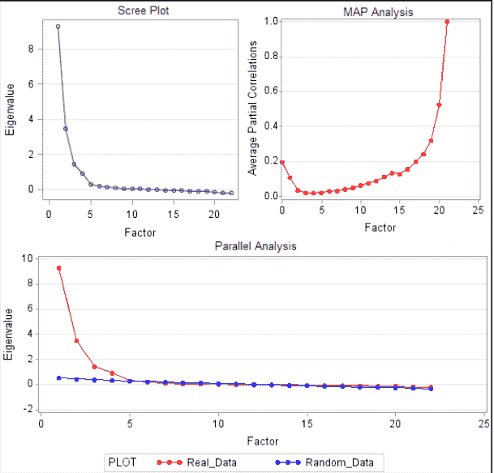

接下来，我们检验模式系数和结构系数，它们在第175页的表10.1中呈现。结构系数显示各因子之间具有相对较强的载荷，且因子之间呈中度相关（r = 0.30至0.50）。因子之间的中度相关性可能表明存在二阶因子，也可能暗示因子并非唯一，本应提取更少的因子。请注意，虽然因子之间极低的相关性可能表明不存在高阶因子，但因子之间中度到强的相关性仅表明高阶因子的可能性。

| 变量: | 1 | 2 | 3 | 1 | 2 | 3 |
|---|---|---|---|---|---|---|
| | 模式系数 | | | 结构系数 | | |
| BELONGeng1 | .305 | .015 | .506 | .536 | .358 | .650 |
| BELONGeng2 | -.024 | .116 | .470 | .222 | .344 | .517 |
| BELONGeng3 | .002 | -.109 | .837 | .345 | .310 | .783 |
| BELONGeng4 | -.041 | -.048 | .822 | .314 | .351 | .780 |
| BELONGeng5 | .037 | .087 | .274 | .186 | .235 | .334 |
| BELONGeng6 | .266 | -.044 | .626 | .534 | .348 | .723 |
| BELONGeng7 | -.206 | .374 | .348 | .062 | .487 | .443 |
| BELONGeng8 | .189 | .092 | .509 | .445 | .403 | .640 |
| EngProbSolv1 | .836 | -.002 | .036 | .852 | .264 | .411 |
| EngProbSolv2 | .813 | -.051 | .038 | .815 | .209 | .377 |
| EngProbSolv3 | .860 | .006 | .035 | .878 | .280 | .425 |
| EngProbSolv4 | .905 | .015 | -.018 | .901 | .275 | .396 |
| EngProbSolv5 | .871 | .046 | .015 | .891 | .312 | .429 |
| EngProbSolv6 | .864 | .069 | -.014 | .876 | .309 | .404 |
| EngProbSolv7 | .844 | .063 | .021 | .872 | .324 | .431 |
| EngProbSolv8 | .765 | .073 | .063 | .816 | .332 | .444 |
| INTERESTeng1 | .063 | .773 | .048 | .314 | .815 | .463 |
| INTERESTeng2 | .035 | .927 | -.058 | .285 | .908 | .421 |
| INTERESTeng3 | .045 | .925 | -.046 | .299 | .915 | .436 |
| INTERESTeng4 | .059 | .919 | -.063 | .304 | .905 | .423 |
| INTERESTeng5 | .016 | .851 | .061 | .296 | .887 | .494 |
| INTERESTeng6 | .038 | .845 | .020 | .298 | .866 | .459 |

### 二阶因子分析。

为了进行二阶因子分析，我们需要从一阶分析中输出相关矩阵，并将其读入作为二阶分析的数据源。实现此目的的代码如下所示。我们使用ODS从一阶分析中输出因子间相关的数据集。我们还通过在数据集名称后的括号中包含 `type=corr` 来指定此数据集的类型。设置类型允许 `PROC FACTOR` 将此数据集识别为相关矩阵而非原始数据集。然后我们将此数据集直接输入到 `FACTOR` 过程并执行二阶分析。由于我们输入的是相关矩阵而非原始数据集，还必须使用 `NOBS` 选项指定数据集中的观测数量。

```
*First-order analysis;
ods output InterFactorCorr=first_order_corr(type=corr);
proc factor data = engdata nfactors = 3 method = prinlit priors = SMC
rotate = OBLIMIN;
var EngProb: INTERESTeng: BELONGeng: ;
run;
ods output close;
```

```
*Second-order analysis;
proc factor data = first_order_corr nobs=372 nfactors=1 method = prinlit
priors = SMC
var Factor1 Factor2 Factor3;
run;
```

使用上述语法，通过EFA分析了相关矩阵，以确定是否合理地假设一个包含所有一阶因子的二阶因子（请记住我们对是否应该进行此分析的顾虑……）。同样，我们使用了迭代PAF提取，原本会使用直接oblimin旋转（例如Thompson等作者建议对高阶EFA使用斜交旋转），但由于我们要求提取单一因子，因此没有进行旋转。

#### 图 10.2 二阶因子分析结果

| | 特征值 | 差异 | 比例 | 累积 |
|---|---|---|---|---|
| 1 | 1.11831111 | 1.18340556 | 1.3727 | 1.3727 |
| 2 | -.06509445 | 0.17343344 | -0.0799 | 1.2928 |
| 3 | -.23852789 | | -0.2928 | 1.0000 |

| 因子模式 | Factor1 |
|---|---|
| Factor1 | 0.51779 |
| Factor2 | 0.57647 |
| Factor3 | 0.86621 |

| 每个因子解释的方差 | Factor1 |
|---|---|
| | 1.3507439 |

结果（在第177页的图10.2中呈现）支持这样一个论点：存在一个单一的二阶因子，且所有三个量表在其上具有中度到强的载荷（范围从0.52到0.87）。这个潜变量似乎比问题解决和归属感更引人关注，但你得问问创建该量表的同事，这到底意味着什么。

### 应用：二阶因子的复制

虽然引人入胜，也许在概念上也说得通，但这些结果并非最终结论，且二阶因子的可复制性研究不足。此外，这个量表从一开始就应该是一个单因子量表，这也是可能的（或很可能的）。如前所述，检验这一竞争假设的最佳方法是使用不同的大样本进行验证性因子分析，比较三因子模型、带有高阶因子的三因子模型和单因子模型之间的模型拟合度。只有这样，我们才能得出关于该数据最佳拟合模型的结论。目前，让我们举一个简单的复制示例，看看这些结果可能复制得如何。不幸的是，原始样本量相对较小，因此我们从原始样本中随机抽取了三个各N=150的样本（有放回抽样），并进行了与上述相同的分析，以探讨在这种情况下，二阶因子的复制是否是合理的预期。我们即将做的事情有无数需要注意的地方，包括糟糕的样本量。不管怎样，让我们来探索一下！

如在第178页的表10.2所示，初始公因子方差既不十分接近也不相差悬殊。请记住，这些代表解释的方差百分比——例如，因子2从大约20%的解释方差到大约31%，差距较大。同样，提取的公因子方差也有些许变化。提取的特征值为1.42、1.29和1.24（分别代表47.3%、43.0%和41.3%的解释方差）。第178页的表10.3显示了三次分析的因子矩阵。如你所见，它们不相差很大，但也不十分相似。

#### 表10.2 二阶因子分析的公因子方差

| | 样本1 | | 样本2 | | 样本3 | |
|---|---|---|---|---|---|---|
| | 初始 | 提取 | 初始 | 提取 | 初始 | 提取 |
| Factor1 | .277 | .388 | .194 | .286 | .245 | .402 |
| Factor2 | .269 | .376 | .309 | .563 | .202 | .316 |
| Factor3 | .363 | .654 | .280 | .446 | .280 | .525 |

#### 表10.3 二阶因子分析的因子载荷

| | 样本1 | 样本2 | 样本3 |
|---|---|---|---|
| Factor1 | .623 | .535 | .634 |
| Factor2 | .613 | .750 | .562 |
| Factor3 | .809 | .668 | .724 |

如果我们要在实践中进行此分析，将使用因子载荷表来构建高阶因子的含义。回顾上面表格中的结果，这有点令人担忧。在三个样本中，三个因子的重要性顺序发生了变化。在第一和第三个样本中，第三个因子最重要，第二个因子最不重要。在第二个样本中，顺序几乎颠倒，第二个因子最重要，第一个因子最不重要。这可能有些吹毛求疵，因为我们不认为将EFA用于此目的属于最佳实践。如果你打算使用这个，我们


希望您能通过复现或自助采样，让读者了解您的估计有多稳健或精确。

### 摘要

高阶因子在文献中并不常被讨论，但您很可能在某个时候会遇到关于此主题的讨论。我们收录本章是因为我们认为，在研究方法中对此讨论不足，而在内容文献中则讨论过多。

高阶因子很棘手。一旦您弄清楚如何进行分析，它们在经验上评估并不困难。更棘手的问题是决定是否确实存在高阶因子，或者原始分析是否本应指定单因子结构，以及最后，两者之间是否存在有意义的差异。我们仍然坚信，这些探索性技术很有趣，但如果没有验证性技术来以更严谨的方式评估竞争假设，并在独立样本中进行复现，其价值相对较低。另外，如果您致力于在 EFA 框架内进行此类分析，Thompson (2004) 已详细描述了一种更现代的方法来呈现这些信息。

### 练习

- 1. 下载本章中的工程数据并复现上述结果。
- 2. 检查 Marsh SDQ 数据，评估该数据中是否似乎存在“自我概念”的高阶因子。
- 3. 使用您自己的或另一组数据集，执行一级和二级因子分析。

### 参考文献

- Byrne, B. M. (2010). 使用 AMOS 进行结构方程建模：基本概念、应用与编程. 纽约, NY: Routledge.
- Gorsuch, R. L. (1983). 因子分析（第 2 版）. Hillsdale, NJ: Lawrence Erlbaum Associates.
- Thompson, B. (2004). 探索性与验证性因子分析：理解概念与应用. 华盛顿特区: 美国心理学会.

## EFA 之后：内部一致性

| 章节 | 页码 |
|------|------|
| 接下来是什么？ | 181 |
| 什么是 Cronbach's Alpha（以及它不是什么）？ | 182 |
| Alpha 什么算“足够好”？ | 184 |
| 影响 Alpha 及其使用的因素 | 185 |
| 在 SAS 中估计 Alpha | 187 |
| 无误差测量是否会产生真正的差异？ | 189 |
|   - 以效应量为例的演示 | 189 |
|   - 以决定系数为例的示例 | 190 |
| 应用 | 191 |
|   - 样本量与 Alpha 的精度 | 191 |
|   - Alpha 的置信区间 | 196 |
| 摘要 | 202 |
| 练习 | 203 |
| 参考文献 | 204 |

#### 接下来是什么？

完成探索性因子分析后，您的旅程才刚刚开始，而非结束。探索阶段可能即将告一段落，但对测量工具的心理测量评估才刚刚开始。执行探索性因子分析的过程通常旨在回答给定的一组项目是否形成一个连贯的因子（或多个因子）。在我们决定这是否可能之后，评估这些构念被测量得有多好非常重要。在此过程中，我们还可以询问被检验的因子是否需要所有项目才能被有效地测量。

要全面评估一个测量工具，我们应评估从 EFA 得出的因子或量表是否可靠、在新样本中得到验证，以及在多个群体中是否稳定（不变）。在本章中，我们将简要介绍评估量表可靠性的最常用方法，即 Cronbach's α 系数。

让我们先从关于信度和效度的现代观点开始讨论。在开发用于研究的量表时，存在一种微妙的平衡：一方面专注于创建一个“好”的量表，另一方面承认现代研究方法中，因子结构、信度和效度等都是量表与所使用的特定样本的共同属性（Fan & Thompson, 2001; Wilkinson, 1999）。对现代研究者来说，量表需要经过良好开发才能有用，并且我们是在特定样本（或一系列样本，如我们在讨论复现时所建议的）的背景下进行开发的，这应该是不言而喻的。因此，关心测量的我们必须同时在脑海中持有两个有些分叉的观点——量表可以强或弱，而量表的强弱仅在所使用的特定样本背景下才有意义。如果走得太远，这可能导致虚无主义的心态，因此我们建议在这次讨论中采取中庸立场：量表可以多或少强，但所有量表都需要在其所在的特定人群或数据中进行评估。

#### 什么是 Cronbach's Alpha（以及它不是什么）？

Cronbach's α（Cronbach, 1951）是社会科学中最广泛报告的量表信度指标之一。它相对于其他信度指标有一些便利之处，但也有一些缺点。关于 alpha 的适当使用，也存在许多误解。在本节中，我们将回顾 alpha 的优点、缺点、用途和误用。不过，让我们先回顾一下 alpha 的原始目标。

在 Cronbach 在这一领域的开创性工作之前，特定样本¹中量表的信度是通过重测相关等方法来评估的。这种信度类型在当今的心理测量教材中仍被讨论，但存在严重缺点。这些缺点可能包括召集同一组人员重新参加测量的困难、记忆效应，以及由于两次施测之间的真实变化而导致的衰减。另一个严重缺点特别适用于预期会随时间变化的构念（例如，情绪、内容知识）。因此，正如 Cronbach 本人所说，重测信度通常最好被视为稳定性指标，而非信度本身。

1 回到 20 世纪中叶，信度和效度曾被讨论为量表的属性（例如，奥斯本顺从量表具有信度和效度）。现代 APA 及其他指南建议我们将信度和效度视为样本的属性，而非工具的属性。然而，某些工具在不同样本中确实倾向于显得更可靠，而有些则不然。因此需要复现。

项目）并进行评分。然后将这两个分数作为即时重测相关的代用进行比较。这也有缺点——项目数量减半，对两组项目是否平行存在一些疑问，且不同的项目分割可能产生不同的系数。Spearman-Brown 修正被开发出来，以帮助校正项目数量的减少，并给出一个旨在与重测系数相似的系数。正如 Cronbach (1951) 所指出的，这个系数最好被描述为两种形式之间等价性的指标，正如今天我们也谈论平行形式一样。

Kuder-Richardson 公式 20（KR-20）和 Cronbach's alpha 是为解决对其他信度形式（特别是半分割信度）的一些担忧而开发的。KR-20 首先被开发为一种计算二元评分项目（即“0”或“1”）信度的方法，这在学术测试或人格清单（如我们在书中前面用作示例的老年抑郁量表）中很常见。随后，KR-20 背后的机制被进一步改进，以创建 alpha，这是一种比 KR-20 更通用且适用于二元或连续量表项目的信度指标。两种指标从二元数据中得出的估计值相同，但只有 alpha 可以估计非二元量表的信度。因此，alpha 已成为现代统计方法中最通用、最受青睐的信度指标。其他人还通过开发检验 alpha 在两个样本中是否相同的方法（Feldt, 1980）以及估计 alpha 置信区间的方法（参见 Barnett, 2005），进一步扩展了 alpha 的应用。

#### alpha 的正确解释。Cronbach (1951) 本人撰写并提供了关于 alpha 的若干断言的证明：

- Alpha 是 n/(n-1) 倍的项目间协方差与总方差之比——换句话说，这是对测量中误差（未解释）方差比例的直接评估。
- 给定测试中所有可能的半分割系数的平均值。2
- 由从项目总体中随机抽样（不放回）组成的两个测试的等价系数，其中平均协方差作为问题中的测试或分数。
- 精度系数（使用这些特定项目的测试的准确性）和等价系数（同时施测两个项目匹配的测试）的下界估计。
- 测试方差中归因于项目间所有共同因子的比例（下界）。

正如 Nunnally & Bernstein (1994, 第 235 页) 从这一切中提炼的那样，alpha 是一个测试与包含相同数量项目的替代形式测试之间的预期相关系数。正如他们指出的，alpha 的平方根也是量表得分与无误差“真实得分”之间的相关系数。让我们花点时间来拆解一下。


这意味着，如果某量表的 alpha 为 0.80，则应将其解释为该量表与从同一项目领域中抽取的另一个量表（具有相同的协方差和项目数量）之间的预期相关系数。0.80 的平方根是 0.89，它代表了该分数与该构念“真实分数”之间相关系数的估计值。您可能知道，相关系数的平方是共享方差的估计值，因此对该数字求平方可使我们回到测量中“真实分数”的比例。最后，我们可以从总方差中减去“真实分数”方差，以得到测量中误差方差比例的估计值，在此例中为 20%。因此，alpha 为 .80 的量表包含大约 20% 的误差。

#### Alpha 不是什么

Alpha 并非一维性的度量（这是一种常见的误解，指量表测量的是单一构念而非多个相关构念）（Cortina, 1993; Schmitt, 1996）。一维性是 alpha 的重要假设，因为多维量表如果不分别对每个维度进行评估，会导致 alpha 被低估，但 alpha 的高值不一定是一维性的指标（例如，Cortina, 1993; Schmitt, 1996）。

此外，如前所述，alpha 并非工具的特征，而是使用该工具的样本的特征。有偏、不具代表性或样本量小的样本可能会产生与大型、具代表性样本截然不同的估计值。此外，一个大型、声称具代表性的样本的估计值可能与另一个不同，一个总体的结果也肯定可能与另一个不同。这就是我们如此强调重复研究的原因。重复研究是支持工具可靠性所必需的。此外，在使用已建立的工具研究新总体时，必须重新确立其可靠性。

### Alpha 多少算“足够好”？

许多作者断言，alpha 为 0.70 或 0.80 分别代表“充分”和“良好”的可靠性（例如，Nunnally & Bernstein, 1994）。请记住，alpha 为 0.70 与量表中 30% 的误差方差相关，而 alpha 为 0.80 与 20% 相关。我们不认为这些标准代表“良好”的测量，尤其是当分析中不止一个变量以这种质量进行测量时。

让我们来看一个多元回归的示例来说明我们的观点。当每个自变量加入回归方程时，不完美可靠性的影响取决于关系的强度，变得更加复杂，分析结果也更值得怀疑。一个可靠性不完美的自变量可能导致每个后续变量声称不可靠变量或变量所留下的部分误差方差。因此，解释方差在自变量之间的分配将不正确，并反映对总体真实效应的误估。本质上，一个变量的低可靠性可能导致对另一个相关变量效应的显著高估。随着更多低可靠性水平的自变量被加入方程，解释方差未被正确分配的可能性就越大。最终，某些效应可能会被掩盖（造成 II 类错误），而同一分析中的其他效应则可能被不恰当地夸大，可能导致 I 类推断错误（Osborne, 2013）。因此，本章的一个论点是，更好的测量优于不够好的测量。

那么，什么是“足够好”呢？不幸的是，我们认为这个问题没有简单的答案。表示充分或良好可靠性的特定截止值，例如 0.70 或 0.80，使用起来很方便，但它们究竟意味着什么？alpha 为 0.79 和 0.80 之间的实际差异是什么？因此，虽然我们认为应追求更高的 alpha，但我们没有关于应获得多少 alpha 的具体建议。我们只能说，越高越好，并且一旦超过 0.90，可能就会出现边际效益递减（这仍然代表测量中约 10% 的误差方差）。此外，什么是“足够好”还取决于数据的目的和分析方法。使用数据为教育项目选择儿童或为晋升选择员工，与为论文评估构念之间的相关性是不同的。此外，现代测量（例如，Rasch 或 IRT 测量）和现代分析技术（例如，结构方程建模）可以帮助研究人员构建更强大、更好的量表。因此，我们强烈建议研究人员追求合理可实现的最佳测量。我们还建议研究人员在研究背景下透明地报告和解释可靠性估计，而不依赖特定的截止值来判断其测量是否“良好”。

在实践中，一些研究人员确实致力于获得更好的可靠性估计。对 1969 年和 1999 年教育心理学文献的回顾表明，平均可靠性（报告）alpha 分别为 0.86 和 0.83（Osborne, 2008）。这些估计值相当不错，但它们仅反映了该研究（现代高质量期刊研究）中 26% 报告了此基本数据质量信息的文章。因此，虽然四分之一的研究人员报告了倾向于较高的 alpha，但四分之三的研究人员甚至没有承认此类指标的重要性。不幸的是，在跨学科的同行评议期刊文章中，缺乏可靠性报告以及使用低 alpha 来支持可靠性的现象并不难找到。糟糕的测量可能对结果产生深远（且往往不可预测）的影响，因此更多研究人员需要关注这一问题。

### 影响 alpha 及其使用的因素

尽管 alpha 通常是估计可靠性的首选方法（尤其是在社会科学中），但它是一种相当基础的方法，很容易受到影响。它对样本或工具的许多潜在特征并不稳健。了解这些特征非常重要，以便采取适当措施来减少其影响并改进我们的可靠性估计。每个特征将在下面描述。

### 项目间高平均相关性

在其他条件相同的情况下，项目间平均相关性越高，alpha 越高。但是，Cronbach 特别指出，当项目间相关性较低时，只要项目足够多且项目间相关性较低，alpha 也可以很高。这是 alpha 可解释性的主要缺陷之一——当有足够多的大部分不相关项目时，alpha 会进入大多数研究人员用作经验法则的“合理”范围。

### 量表长度

如前所述，在其他条件相同的情况下，更长的量表将具有更高的 alpha。

### 反向编码项目（负的项目-总分相关性）

许多量表都采用反向编码项目构建。但是，当分析中包含具有负的项目-总分相关性的项目时，alpha 无法提供准确的估计。因此，任何预期具有负的项目-总分相关性的项目（例如，当大多数其他项目为正时，因子载荷为负）都应在分析前进行反向处理。

### 随机回答或回答集

随机回答（在第 8 章中讨论）倾向于削弱所有这些估计，因为它主要增加随机误差。因此，如果未能在数据中识别出此问题，将导致对数据内部一致性的低估。回答集可能会产生各种影响，具体取决于回答集的类型。某些类型的回答集会夸大 alpha 估计，而某些则会削弱 alpha（有关回答集的概述以及如何识别它们，请参见 Osbourne & Blanchard, 2011）。

### 多维性

alpha 的假设是，特定分析中的所有项目都代表一个单一维度或因子。在该假设被违反的程度上，alpha 的估计将被误估。因此，在将项目提交给此类分析之前，应考虑量表的因子结构。

### 异常值

异常值（不适当的值，也在第 8 章中讨论）通常会增加误差方差。这通常会削弱 alpha 的估计。因此，在计算 alpha 之前，应仔细筛选数据。

除了上述可能影响 alpha 估计的因素之外，一个理论问题可能会阻碍其解释。alpha 是为研究人员经常对量表项目求和或求平均的时代而构建的。许多研究人员至今仍这样做。当然，在对量表中的项目求和或求平均时，您假设所有项目对量表的贡献相等——即每个项目的权重相同。alpha 也假设所有项目的贡献相等。然而，根据我们在前几章中看到的情况，这可能不是一个有效的假设，也不是 EFA（或验证性因子分析、潜变量建模、IRT、Rasch 测量等）所做的假设。例如，在第 4 章中，我们看到工程问题解决项目的模式载荷范围为 0.79 到 0.91，而对于 GDS，当仅提取一个因子时，载荷范围为 0.23 到 0.68。如果对载荷求平方以估计每个项目所贡献的共享方差的独特比例，这相当于工程问题解决的 0.62 到 0.82 范围，以及 GDS 的 0.05 到 0.46 范围。因此，每个项目对每个因子贡献的方差比例不同。


从历史上看，这促使研究人员创建“因子得分”，通过按因子载荷对每个项目加权，以更接近潜变量得分可能的样子。如我们在第9章中讨论的，我们不认为这是个好主意。然而，在使用α时，目前还没有很好的方法来处理这个理论问题（依我们之见）。那些有兴趣通过α来估计内部一致性的人，只需意识到它违反了项目独特贡献的假设，并接受这一现实。

### SAS中Alpha的估计

在SAS中估计Cronbach's alpha非常简单。它是通过CORR过程完成的。必须在CORR语句中包含ALPHA选项，以请求SAS输出alpha的估计值，并且所有要包含在alpha估计中的变量都应列在VAR语句中（或者可以通过前缀引用，例如EngProb: ）。下面展示了为工程数据中的工程问题解决项目生成估计值的语法示例。其后是ALPHA选项生成的输出截图。

```
proc corr data=engdata alpha;
var EngProb:;
run;
```

#### 图 11.1 由ALPHA选项请求的PROC CORR输出

### Cronbach系数Alpha

| 变量 | Alpha |
|---|---|
| 原始 | 0.958800 |
| 标准化 | 0.959151 |

### 删除变量后的Cronbach系数Alpha

| 删除变量 | 原始变量 - 与总分相关 | 原始变量 - Alpha | 标准化变量 - 与总分相关 | 标准化变量 - Alpha |
|---|---|---|---|---|
| EngProbSolv1 | 0.835290 | 0.953610 | 0.834642 | 0.954113 |
| EngProbSolv2 | 0.795291 | 0.956088 | 0.795975 | 0.956439 |
| EngProbSolv3 | 0.855386 | 0.952396 | 0.855698 | 0.952837 |
| EngProbSolv4 | 0.877468 | 0.951141 | 0.877592 | 0.951502 |
| EngProbSolv5 | 0.871148 | 0.951451 | 0.871712 | 0.951862 |
| EngProbSolv6 | 0.855193 | 0.952449 | 0.855418 | 0.952854 |
| EngProbSolv7 | 0.858709 | 0.952188 | 0.858970 | 0.952638 |
| EngProbSolv8 | 0.797570 | 0.956172 | 0.797903 | 0.956323 |

如您在图11.1（第188页）中所见，ALPHA选项产生的远不止一个alpha估计值！第一个表提供了Cronbach's alpha的原始估计和标准化估计。如果您将原始数据输入CORR过程，应使用原始alpha；如果您将变量的标准化版本（例如z-分数）输入CORR过程，应使用标准化alpha。如果量表中的某些项目包含不同数量的响应选项（例如，三个二分法项目和五个Likert类5点项目），则会使用变量的标准化版本。在当前示例中，我们将未标准化的工程项目输入量表。因此，我们将解释原始alpha。

第二个表提供基于项目删除的项目-总分相关性和alpha的修订估计。项目-总分相关性是每个单独项目与总合成分数（计算为项目的平均值或总和）之间的相关性。我们预期项目与总分高度相关，因为总分代表项目旨在测量的构念。项目-总分相关性低的项目可以接受审查以考虑潜在删除。修订后的alpha估计代表如果从量表中删除某个特定项目时的Cronbach's alpha。如果修订后的alpha估计大于我们的alpha，则表明一个项目贡献了降低我们整体信度的独特方差。这种独特方差实际上可能是与项目相关的不想要的误差。在这种情况下，您可能会考虑删除该项目，或者它可能是其他项目未捕获的与构念相关的方差，在这种情况下，您会希望保留该项目。必须利用对构念的了解来指导关于项目删除的决策。最后，类似于我们对第一个表的解释，我们将根据数据的格式来解释这些估计的原始或标准化版本。

工程问题解决量表显示出良好的内部一致性。它具有强劲的.95 alpha。项目-总分相关性范围从.80到.88，没有任何修订后的alpha超过原始估计。除非我们有基于内容的理由来删除某个项目（例如，某个项目相关但不直接反映问题解决），否则我们建议不对该量表做任何更改。

### 无误差测量是否会产生真正的影响？

### 以效应量为例的演示

为了具体说明良好测量的重要性，我们可以使用第一作者对教育心理学文献的调查示例（Osborne, 2008）。该调查包括记录1998年至1999年期间在《教育心理学杂志》（通常被认为是我们顶级经验期刊之一）上发表的所有定量研究中的所有效应。

如果报告了平均效应量和信度系数（Cronbach's α），则用于识别九种潜在的测量场景。首先，确定了小、中、大三种观察到的效应量，分别为低于均值一个标准差的效应量（Cohen's d = .31）、平均效应量（Cohen's d = .68）和高于均值一个标准差的效应量（Cohen's d = 1.05）。我们将Cohen's d效应量转换为简单相关系数（公式和转换源自Cohen, 1988中的信息），以帮助解释结果。这使我们得到了一个“小”观察效应r = .16，一个“中”观察效应r = .32，以及一个“大”观察效应r = .46。接下来，我们根据低于平均信度一个标准差的信度估计（α = .70）、平均信度（α = .80）和高于平均信度一个标准差的信度估计（α = .90），识别了差、中、好三种信度指标。最后，我们创建了三种效应量条件（小、中、大）与三种信度条件（差、中、好）的交叉表，并考察了由此产生的九种不同场景中真实效应可能是什么。第190页的表11.1总结了结果。

如下表所示，观察到的效应显著低估了真实效应。例如，观察到平均观察效应（r = 0.32）时，我们可以看到，即使信度为“好”（α = .90），真实效应（r = .36）也被低估了30%。在“中”信度（α = 0.80）下，我们可以看到该效应被低估了60%，如果alpha为0.70（在顶级期刊中通常被认为是可接受的），则低估超过100%。

#### 表11.1 按工具信度和观察效应划分的真实效应

| 信度 | 小（r = .16, r² = .025） | 中（r = .32, r² = .10） | 大（r = .46, r² = .21） |
|---|---|---|---|
| 差 (α = .70) | r = .23 r² = .05 | r = .46 r² = .21 | r = .66 r² = .43 |
| 中 (α = .80) | r = .20 r² = .04 | r = .40 r² = .16 | r = .58 r² = .33 |
| 好 (α = .90) | r = .18 r² = .03 | r = .36 r² = .13 | r = .51 r² = .26 |

注：此数据改编自最初发表于Osborne (2008)的内容。

### 决定系数示例

我们现在回顾第一作者关于与学术认同（相对于学校的自我概念）的个人研究中的一个示例。很久以前的一项研究中，他向高中生发放了两个密切相关的量表（学校感知问卷和与学校认同问卷，Osborne, 1997；Voelkl, 1997）。分别计算出的Alpha为0.88和0.81。这些水平被广泛认为是“好的”。在对项目进行平均以创建合成分数并检验假设后，计算出的简单相关为r = 0.75，这转化为决定系数（解释的方差百分比）为0.56。这在社会科学中通常是一个相当强的相关，考虑到这两个是对相似构念的测量，这是合理的。修正后的相关（公式在许多地方都有，包括Cohen, Cohen, West, & Aiken, 2003）计算为r = 0.89，这将代表决定系数为0.79。如果我们假设这个修正后的效应量0.79是正确的总体估计，那么两个具有“好的”信度的测量之间的原始相关损失了近30%的效应量。

虽然我们无法直接知道本示例的总体相关，但我们可以使用AMOS结构方程建模软件构建代表每个量表的潜变量，来模拟完美测量可能产生的这两个变量之间的相关。虽然结构方程建模（SEM）是一种相对高级的


程序，深入分析的细节超出了本章的范围，就我们的目的而言，你只需要理解SEM可以用来估计变量之间的关系，仿佛它们被完美测量一样。因此，在完美相关下的相关系数估计为r = 0.90（决定系数为0.81），非常接近计算的校正相关效应量。不幸的是，尽管0.80范围内的alpha很常见，但基于可靠性远低于此的数据的已发表研究也不难找到。事实上，找到0.70以下的alpha也不困难，尽管这意味着相当一部分效应量损失了！在21世纪，这应该被视为一种不理想的状态，特别是当通过增加条目数量或使用结构方程建模等现代方法进行分析来改善量表测量相对简单时。

### 应用

### 样本量与Alpha的精确度

如前所述，alpha取决于样本。因此，可以预期样本量会影响我们alpha估计的精确度。当使用较小的样本来估计alpha时，每个观测值对估计都贡献了大量信息。小样本中的异常值或与预期的偏差可能对结果产生深远影响，并导致结果与总体均值不同。然而，在较大的样本中，异常值或偏差可能会被其他观测值平均掉。

让我们使用本书中一直在使用的Marsh SDQ数据来探讨样本量和精确度的问题。让我们首先检查完整数据集中父母子量表的可靠性。父母子量表由五个条目组成：

- (Par1) 我的父母公平对待我。
- (Par2) 我不太喜欢我的父母。
- (Par3) 我与父母相处融洽。
- (Par4) 我的父母通常对我所做的事不高兴或失望。
- (Par5) 我的父母理解我。

显然，Par2和Par4的方向是相反的。如果直接使用这五个条目计算alpha（参见第192页的图11.2），你将得到一个负的alpha（这是不可能的）以及一些负的条目-总分相关（另一个问题的迹象）。

#### 图 11.2 反向编码条目的输出

### Cronbach系数Alpha

| 变量 | Alpha |
|---|---|
| 原始 | -.338304 |
| 标准化 | -.316077 |

### 删除变量后的Cronbach系数Alpha

| 删除的变量 | 原始变量与总分的相关 | 原始变量Alpha | 标准化变量与总分的相关 | 标准化变量Alpha |
|---|---|---|---|---|
| Par1 | 0.193681 | -.834220 | 0.180020 | -.861766 |
| Par2 | -.417175 | 0.194553 | -.431354 | 0.245049 |
| Par3 | 0.174914 | -.828698 | 0.163839 | -.821268 |
| Par4 | -.406022 | 0.220399 | -.402013 | 0.208550 |
| Par5 | 0.115035 | -.872559 | 0.181588 | -.865728 |

因此，我们必须对两个变量进行重新编码并重新运行。由于我们可能希望保留原始数据的副本，我们将创建一个包含重新编码值的新变量，即Par2_recode和Par4_recode。下面给出了初始运行（如上所述）、重新编码和修订运行的语法，并附有注释。请注意，我们提供了两种重新编码选项——一种是为每个变量单独重新编码值的冗长方法，另一种是使用数组的较短方法。

```
/*Try to compute alpha for parenting items;
proc corr data=sqdata alpha;
Par;

run;

/*Recode and re-run;
*Recode option 1 - the long way;
data sqdata;
set sqdata;

recode Par2;
if Par2=1 then Par2_recode=6;
if Par2=2 then Par2_recode=5;
if Par2=3 then Par2_recode=4;
if Par2=4 then Par2_recode=3;
if Par2=5 then Par2_recode=2;
if Par2=6 then Par2_recode=1;
*recode Par4;
if Par4=1 then Par4_recode=6;
if Par4=2 then Par4_recode=5;
if Par4=3 then Par4_recode=4;
if Par4=4 then Par4_recode=3;
if Par4=5 then Par4_recode=2;
if Par4=6 then Par4_recode=1;
run;
```

```
*Recode option 2 - arrays;
data sqddata (drop=i);
set sqddata;
array old(*) Par2 Par4; *old variables to recode;
array recode(*) Par2_recode Par4_recode; *new versions;
do i=1 to dim(old);
  if old(i)=1 then recode(i)=6;
  if old(i)=2 then recode(i)=5;
  if old(i)=3 then recode(i)=4;
  if old(i)=4 then recode(i)=3;
  if old(i)=5 then recode(i)=2;
  if old(i)=6 then recode(i)=1;
end;
run;
```

```
**Re-run;
proc corr data=sqddata alpha;
var Par1 Par2_recode Par3 Par4_recode Par5;
run;
```

使用重新编码的Par2和Par4运行后的更新结果显示在第194页的图11.3中。由于我们输入的是原始数据而非变量的标准化版本，我们解释所呈现的原始系数。我们现在有一个看起来正常（相当不错）的alpha为0.834，N = 15661。此外，条目-总分相关系数均在0.569到0.733之间，这是合理的。

#### 图 11.3 重新编码条目的更新输出

| 变量 | Alpha |
|---|---|
| 原始 | 0.834427 |
| 标准化 | 0.838161 |

| 删除的变量 | 原始变量与总分的相关 | 原始变量Alpha | 标准化变量与总分的相关 | 标准化变量Alpha |
|---|---|---|---|---|
| Par1 | 0.643062 | 0.800653 | 0.644466 | 0.804390 |
| Par2_recode | 0.595988 | 0.811647 | 0.597524 | 0.817244 |
| Par3 | 0.732967 | 0.775705 | 0.733190 | 0.779291 |
| Par4_recode | 0.568660 | 0.820491 | 0.568433 | 0.825066 |
| Par5 | 0.658999 | 0.796445 | 0.661981 | 0.799518 |

让我们将此视为我们的黄金标准“总体”统计量，并看看小样本对alpha估计有何影响。使用PROC SURVEYSELECT，我们从数据集中通过有放回的简单随机抽样抽取了1000个N=50的子样本、1000个N=100的子样本和1000个N=250的子样本。执行此操作的语法如下所示。

```
/*Take 1000 subsamples of N=50;
proc surveysselect data=sasdqta method=SRS n=50 out=sasdqta_sub50
seed=5092 reps=1000;
run;
/*Take 1000 subsamples of N=100;
proc surveysselect data=sasdqta method=SRS n=100 out=sasdqta_sub100
seed=821 reps=1000;
run;
/*Take 1000 subsamples of N=250;
proc surveysselect data=sasdqta method=SRS n=250 out=sasdqta_sub250
seed=291 reps=1000;
run;
```

然后，我们计算了每个子样本中父母量表的alpha，并按样本量绘制了alpha分布，以了解估计值的范围。针对1000个N=50的子样本执行此步骤的语法如下所示。另外两组子样本的语法与此相同，只是输入（以及通常输出）数据集的名称不同（如果你遵循最佳实践并更改重要输出数据集的名称）。在此语法中，我们使用ODS输出包含alpha的数据集，然后使用ODS图形和SGPLOT过程绘制直方图。

```
*Estimate alpha in each subsample;
ods output CronbachAlpha=alphaS50;
*noprint option used to suppress printing and outp used to output data set
with alphas;
proc corr data=sqdata_sub50 alpha nosimple nocorr noprob;
by Replicate;
var Par1 Par2_recode Par3 Par4_recode Par5;
run;
ods output close;

**Print histogram of alphas;
ods graphics on /height=3in width=3in;
proc sgplot data = alpha50 nautolegend;
title "Sample Size = 50";
where Variables="Raw";
histogram Alpha / binwidth=.025 FILLATTRS=(COLOR=cx5E5EAF2) ;
xaxis label = 'Alpha' grid values = (.55 to 1 by .1);
run;

ods graphics off;
```

一般来说，子样本alpha越接近我们的“总体”alpha 0.83，就可以认为越精确。然而，越远离的就越不精确。如在第196页的图11.4所示，在较小的样本中alpha变得有些不稳定。在最小的样本（N=50）中，观察到的alpha范围从低至α = 0.56到高至α = 0.94。在N=100的样本中，范围进一步缩小，低至α = 0.70，高至α = 0.92。最后，N=250的样本具有最窄的alpha范围，低至α = 0.74，高至α = 0.89。因此，随着样本量的增加，alpha的精确度得到了提高。这表明，即使在具有相当强心理测量特性的量表中（如本例），小样本也往往存在相当大的波动性。


### 图 11.4 1000个样本中Cronbach's alpha的分布（N=50、N=100和N=250）

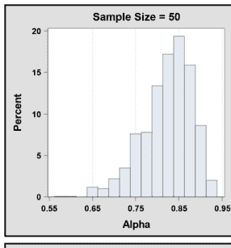

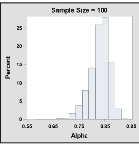

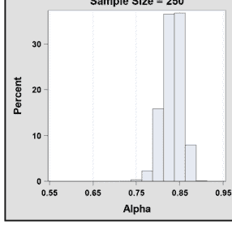

### Alpha的置信区间

Fan & Thompson (2001)指出，很少有作者在论文中提供关于其效应量点估计精度的背景信息。如前例所示，alpha的精度可能会剧烈变化。小样本或有偏样本会极大地影响alpha估计。因此，关于精度的背景信息可以极大地帮助研究人员了解其结果的质量和复制的可能性。置信区间是提供精度信息的一种方法。如前面章节中简要讨论过，已有尝试构建计算alpha置信区间（CI）的方法，但这些方法在常规实践中尚未普及。然而，通过自助法（bootstrapping），我们可以轻松提供对读者有价值的经验估计。

你可能记得，在尝试进行探索性因子分析（EFA）时，GDS给我们带来了一些问题，因为不清楚它是单因子还是多因子。让我们假设我们决定它是单因子（请记住，alpha不是一维性检验！）。然后，我们可以使用下面的语法计算变量的系数alpha。

```
proc corr data=marshdata alpha;
var GDS-;
run;
```

该语法生成的系数alpha和条目-总分相关如图11.5所示（第198页）。由于我们输入的是原始数据，而不是变量的标准化版本，我们将解释原始相关。这为我们提供了0.885的alpha估计值，以及从0.252到0.615的较大范围的条目-总分相关。其中一些相关值偏低，审查相关条目以确定其捕获的内容是否与感兴趣的构念相关，以及是否应保留在量表中，可能是值得的。有趣的是，没有一个修正后的alpha（在标记为Alpha的列中，表示如果删除任何条目时的alpha）超过整体量表alpha（α = 0.885），这表明如果删除任何条目，整体量表的可靠性将下降。然而，修正后的alpha仅比量表alpha低0.001到0.008。因此，删除条目不会对整体可靠性产生很大影响。综上所述，这些结果表明，如果这些条目被用作单一量表，可以删除一些条目，而对测量的可靠性影响甚微。

虽然在对上述量表做其他任何事情之前，我们可能会花更多时间来完善它（例如，删除或调整条目），但我们将继续使用当前版本，以演示如何为不够稳定的量表使用自助法置信区间。我们将把上述结果视为我们的“总体”估计值，并将其与从我们的“总体”中抽取的子样本产生的结果进行比较，以确定置信区间可能提供多少信息。使用PROC SURVEYSELECT，我们通过简单随机抽样从样本中抽取N=50、N=100和N=250的随机样本。然后，我们从每个样本中进行了2000次自助法重采样，并估计了alpha和条目-总分相关周围的95%置信区间。（有关自助法方法和语法的更多信息，请参见第7章。）

### 图 11.5 GDS数据的alpha和条目-总分相关

| 变量 | Alpha |
|---|---|
| 原始 | 0.884528 |
| 标准化 | 0.893556 |

| 删除的变量 | 原始变量 - 与总分的相关 | 原始变量 - Alpha | 标准化变量 - 与总分的相关 | 标准化变量 - Alpha |
|---|---|---|---|---|
| GDS01 | 0.510159 | 0.879593 | 0.542372 | 0.888288 |
| GDS02 | 0.403580 | 0.881636 | 0.388538 | 0.891318 |
| GDS03 | 0.523551 | 0.879802 | 0.553002 | 0.888076 |
| GDS04 | 0.476303 | 0.879849 | 0.476658 | 0.895950 |
| GDS05 | 0.461653 | 0.880383 | 0.472217 | 0.889677 |
| GDS06 | 0.485771 | 0.879639 | 0.484400 | 0.889437 |
| GDS07 | 0.401607 | 0.882061 | 0.431931 | 0.890470 |
| GDS08 | 0.362597 | 0.882323 | 0.377742 | 0.891529 |
| GDS09 | 0.517305 | 0.879667 | 0.546460 | 0.888206 |
| GDS10 | 0.554186 | 0.878383 | 0.560742 | 0.887922 |
| GDS11 | 0.378864 | 0.882210 | 0.381737 | 0.891451 |
| GDS12 | 0.360089 | 0.883020 | 0.340874 | 0.892245 |
| GDS13 | 0.379806 | 0.882041 | 0.391536 | 0.891260 |
| GDS14 | 0.252397 | 0.884495 | 0.235068 | 0.894280 |
| GDS15 | 0.410747 | 0.881600 | 0.423722 | 0.890631 |
| GDS16 | 0.614884 | 0.877263 | 0.634171 | 0.886450 |
| GDS17 | 0.612987 | 0.877443 | 0.618412 | 0.886767 |
| GDS18 | 0.362257 | 0.882447 | 0.371922 | 0.891642 |
| GDS19 | 0.535315 | 0.878295 | 0.522853 | 0.888676 |
| GDS20 | 0.427657 | 0.881158 | 0.400021 | 0.891094 |
| GDS21 | 0.478900 | 0.880003 | 0.453020 | 0.890055 |
| GDS22 | 0.495629 | 0.880714 | 0.521852 | 0.888696 |
| GDS23 | 0.396540 | 0.881741 | 0.413585 | 0.890829 |
| GDS24 | 0.383092 | 0.882054 | 0.381823 | 0.891449 |
| GDS25 | 0.509224 | 0.879713 | 0.529687 | 0.888540 |
| GDS26 | 0.466691 | 0.880053 | 0.452777 | 0.890060 |
| GDS27 | 0.340802 | 0.882992 | 0.342040 | 0.892222 |
| GDS28 | 0.390043 | 0.881917 | 0.382777 | 0.891430 |
| GDS29 | 0.307062 | 0.884009 | 0.292383 | 0.893181 |
| GDS30 | 0.354883 | 0.883604 | 0.329752 | 0.892460 |

由于每个随机样本的步骤有些复杂但重复，我们编写了一个名为subNBoot的宏来为每个样本执行这些步骤。语法如下。subNBoot有两个参数：1) ss，代表我们希望子样本具有的数值样本量；2) seed，代表surveyselect用于识别样本的数值种子值。设置种子允许我们的分析被复制。subNBoot随后使用当前章节（PROC CORR）和第7章（PROC SURVEYSELECT和PROC UNIVARIATE）中介绍的一系列过程来估计CI。该宏生成一组数据集，包含实际估计值（orig_alpha&ss 1和orig_item&ss）以及自助法CI（ci_alpha&ss和ci_item&ss）。

```
*MACRO subnBoot(ss,seed);
*Subsample;
proc surveyselect data=marshdata method=SRS n=&ss.
out=marsh_sub&ss. seed=&seed;
run;
*Estimate Item Stats;
ods output CronbachAlpha=orig_alpha&ss CronbachAlphaDel=orig_item&ss;
proc corr data=marsh_sub&ss. alpha;
var GDS:;
run;
ods output close;
*Take Bootstrap Sample;
proc surveyselect data = marsh_sub&ss. method = URS samprate = 1
outhits out = output_marsh&ss. (compress=binary) seed = 5 rep =
2000;
RUN;
*Estimate Item Stats for each bootstrap sample;
ods output CronbachAlpha=boot-alpha&ss. (compress=binary)
CronbachAlphaDel=boot_item&ss. (compress=binary);
proc corr data=output_marsh&ss. alpha nosimple noccorr nopro;
by replicate;
var GDS:;
run;
ods output close;
*Estimate CI from bootstrapped results;
proc univariate data=boot_alpha&ss.;
where variable='Raw';
var Alpha;
output out=ci_alpha&ss. pctlpts=2.5, 97.5 mean=Alpha_mean
std=Alpha_std pctlpre=Alpha_ci ;
run;
proc sort data=boot_item&ss; by Variable replicate; run;
proc univariate data=boot_item&ss.;
by Variable;
var RawCorr;
output out=ci_item&ss pctlpts=2.5, 97.5 mean=RawCorr_mean
std=RawCorr_std pctlpre=RawCorr_ci ;
run;
%NEND;
%subNBoot(50,3); *Run analysis with subsample of N=50;
%subNBoot(100,8321); *Run analysis with subsample of N=100;
%subNBoot(250,26); *Run analysis with subsample of N=250;
```

每个样本的估计值及相应的置信区间列于第200页的表11.2和第201页的表11.3中。理想情况下，小样本的自助法分析应在95%置信区间中包含总体参数，并提供关于估计精度（从而统计量的潜在可复制性）的信息。在下表中，我们可以看到这一模式通常是正确的。每个子样本中alpha的95% CI包含“总体”alpha。此外，随着样本量的增加，CI变得更窄且更精确。条目-总分相关的95% CI中也出现了同样的一般模式。只有少数几个实例（高亮显示）中，自助法CI未包含“总体”参数。

让我们暂时关注CI范围和精度的概念。如上文所述，随着样本量的增加，CI变得更窄且更精确。我们可以看到CI变窄了，但如何知道它们更精确了呢？在最小的N=50样本中，CI的范围往往相当大，样本估计值平均与“总体”估计值相差0.12。有些估计值相差更大（例如，GDS06、GDS10）。随着子样本变大，估计值更接近我们的“总体”估计值，相应的CI也变窄了。

### 表 11.2 三个子样本的alpha和95% CI

| 子样本 | Alpha | 95% CI |
|---|---|---|
| N=50 | 0.84 | (0.74, 0.89) |
| N=100 | 0.88 | (0.82, 0.91) |
| N=250 | 0.90 | (0.87, 0.92) |


### 表 11.3 三个子样本的项目-总分相关系数及 95% 置信区间

| Var. | N = 50 项目-总分 R | N = 50 95% 置信区间 | N = 100 项目-总分 R | N = 100 95% 置信区间 | N = 250 项目-总分 R | N = 250 95% 置信区间 |
|------|---------------------|---------------|----------------------|----------------|----------------------|----------------|
| GDS01 | .51 | (.16, .77) | .48 | (.24, .67) | .52 | (.38, .65) |
| GDS02 | .25 | (.00, .55) | .31 | (.11, .50) | .41 | (.29, .53) |
| GDS03 | .36 | (.11, .66) | .53 | (.30, .70) | .58 | (.44, .69) |
| GDS04 | .36 | (-.12, .69) | .42 | (.16, .63) | .49 | (.35, .61) |
| GDS05 | .32 | (.03, .59) | .38 | (.09, .61) | .55 | (.41, .66) |
| GDS06 | .10 | (-.18, .49) | .51 | (.29, .69) | .55 | (.41, .66) |
| GDS07 | .52 | (.33, .77) | .50 | (.23, .69) | .47 | (.29, .61) |
| GDS08 | .31 | (.24, .62) | .36 | (.12, .58) | .37 | (.19, .52) |
| GDS09 | .56 | (.05, .81) | .46 | (.23, .66) | .59 | (.45, .71) |
| GDS10 | .23 | (-.02, .53) | .54 | (.32, .70) | .62 | (.49, .72) |
| GDS11 | .50 | (.15, .74) | .44 | (.21, .62) | .44 | (.31, .56) |
| GDS12 | .39 | (.09, .65) | .43 | (.24, .61) | .31 | (.18, .44) |
| GDS13 | .38 | (-.04, .69) | .51 | (.32, .67) | .35 | (.20, .49) |
| GDS14 | .26 | (.02, .54) | .00 | (-.14, .18) | .30 | (.16, .43) |
| GDS15 | .23 | (-.03, .53) | .63 | (.40, .78) | .37 | (.20, .52) |
| GDS16 | .78 | (.53, .90) | .62 | (.43, .77) | .69 | (.58, .77) |
| GDS17 | .64 | (.33, .86) | .56 | (.34, .72) | .69 | (.57, .77) |
| GDS18 | .31 | (.23, .62) | .34 | (.11, .55) | .35 | (.18, .51) |
| GDS19 | .46 | (.15, .71) | .59 | (.46, .71) | .56 | (.46, .65) |
| GDS20 | .21 | (-.07, .54) | .25 | (.03, .47) | .37 | (.25, .50) |
| GDS21 | .42 | (.12, .68) | .46 | (.27, .62) | .43 | (.31, .53) |
| GDS22 | -- | (--, --) | .48 | (.21, .66) | .62 | (.48, .73) |
| GDS23 | .30 | (.07, .60) | .34 | (.08, .58) | .56 | (.41, .68) |
| GDS24 | .46 | (.09, .73) | .59 | (.42, .74) | .43 | (.29, .57) |
| GDS25 | .38 | (.31, .69) | .48 | (.22, .67) | .57 | (.44, .69) |
| GDS26 | .63 | (.33, .84) | .42 | (.21, .60) | .49 | (.36, .60) |
| GDS27 | .29 | (-.03, .61) | .25 | (.04, .47) | .37 | (.23, .50) |
| GDS28 | .10 | (-.17, .40) | .34 | (.12, .54) | .40 | (.26, .53) |
| GDS29 | .28 | (-.01, .60) | .23 | (.02, .42) | .37 | (.24, .50) |
| GDS30 | .50 | (.25, .70) | .30 | (.09, .49) | .39 | (.27, .50) |

*由于缩减样本中该项目的响应缺乏方差，无法估计此参数。注：未包含“总体”参数的置信区间已加亮。

因此，自助法置信区间可以作为估计精度的非常有效的指标。当置信区间较宽时，它们表明我们对估计值不太有信心，真实的总体估计值可能会有很大差异。它们还表明，如果我们在类似样本中重复分析，我们的估计值可能会出现显著变化。当置信区间较窄时，它们表明相反的情况——我们的估计值接近总体参数，并且很可能可以复制。置信区间可以是一种非常有信息量且有用的工具，有助于解释 alpha 和许多其他统计量。

### 摘要

Cronbach’s alpha 是社会科学中关于信度最广泛报告的统计量之一。它可以被解释为所有可能的半分割统计量的估计值。它也可以被解释为“真分数”方差所占的百分比。因此，如果你在某个特定样本中有一个 α = 0.80 的测量工具，那么大约 80% 是“真分数”，该样本的测量中大约有 20% 是误差。

不幸的是，alpha 仍然没有在现代高质量研究期刊的大多数文章中报告。这可能源于一种过时的断言，即量表（特别是经常使用的量表）或多或少是可靠的。然而，如我们在本章中所展示的，alpha 可能受到许多特定于样本的不同因素的影响（例如，样本量、样本偏差等）。这种跨样本的变异性在心理测量文献中并不常被讨论，但它很重要。它突出了信度的样本依赖性，并强调了在每项研究中关注信度并报告它的必要性。估计 95% 置信区间可以进一步帮助解释信度，并为估计的可复制性和精确性提供指导。

尽管 alpha 是本章的主要焦点，但存在 alpha 的现代替代方案。例如，Rasch 模型从该角度产生了关于信度的有趣信息，项目反应理论分析也是如此。结构方程模型（SEM）允许我们显式建模潜在构念并直接分析它，从而完全消除了对 alpha 的需求。在可能的情况下，使用现代测量方法似乎是可取的。

### 练习

- 1 描述 Cronbach's alpha 的概念含义。如果你的量表有 α = 0.85，你如何解释这个数字？

- 2 复制文本和第 198 页图 11.5 中呈现的 GDS 数据的 alpha 和项目-总分相关系数的估计。然后复制第 200 页表 11.2 和第 201 页表 11.3 中呈现的 N=50 子样本的自助法置信区间估计。使用种子 3 和简单随机抽样来复制 N=50 样本的选择。然后使用种子 5 和 2000 次重采样来估计自助法置信区间。通过设置种子值，你应该发现你的结果与表中呈现的结果完全一致。有关自助法过程和所需通用语法的更多信息，请参阅第 7 章。你也可以将你的代码与书籍网站上提供的代码进行核对。

- 3 使用本书中的工程数据集执行以下操作：

  - a 确保所有项目都以相同的方向编码（在必要时重新编码项目），并计算问题解决和工程兴趣量表的 alpha。还要检查项目-总分相关系数，看是否有任何项目可以从量表中删除以提高信度。

  - b 在 alpha 周围自助法置信区间并解释估计的可复制性。

  - c 就测量质量解释 alpha，引用自助法置信区间。

### 参考文献

Barnette, J. J. (2005). ScoreRel CI: 用于计算常用分数信度系数置信区间的 Excel 程序. Educational and Psychological Measurement, 65(6), 980-983.

Cohen, J. (1988). 行为科学统计功效分析（第二版）. Hillsdale, NJ: Lawrence Erlbaum.

Cohen, J., Cohen, P., West, S. G., & Aiken, L. S. (2003). 行为科学应用多元回归/相关分析。（第 3 版）Mahwah, NJ: Lawrence Erlbaum Associates.

Cortina, J. M. (1993). 什么是系数 alpha？理论与应用的考察. Journal of Applied Psychology, 78(1), 98-104.

Cronbach, L. J. (1951). 系数 alpha 与测验的内部结构. Psychometrika, 16(3), 297-334.

Fan, X., & Thompson, B. (2001). 效应量的置信区间 关于分数信度系数置信区间，请：EPM 指南社论. Educational and Psychological Measurement, 61(4), 517-531.

Feldt, L. S. (1980). 关于 Cronbach's alpha 信度系数在两个施测于同一样本的测验中相同的假设的检验. Psychometrika, 45(1), 99-105.

Nunnally, J. C., & Bernstein, I. (1994). 心理测量理论（第 3 版）. New York: McGraw-Hill.

Osborne, J. W. (1997). 社区大学学生的学术认同与学术成功. Community College Review, 25(1), 59-67.

Osborne, J. W. (2008). 教育心理学中的小题大做：效应量和功效报告如何从 1969 年未变到 1999 年，以及这对未来改变实践意味着什么. Educational Psychology, 28(2), 151-160.

Osborne, J. W. (2013). 数据清洗的最佳实践：收集数据前后需做的一切完全指南. Thousand Oaks, CA: Sage Publications.

Osborne, J. W., & Blanchard, M. R. (2011). 参与者的随机回答是社会科学研究结果效度的威胁. Frontiers in Psychology, 1, 220. doi: 10.3389/fpsyg.2010.00220

Schmitt, N. (1996). 系数 alpha 的使用与滥用. Psychological Assessment, 8(4), 350-353.

Voelkl, K. E. (1997). 与学校的认同. American Journal of Education, 105(3), 294-318.


Wilkinson, L. (1999). 统计推断工作组，APA科学事务委员会 (1999). 心理学期刊中的统计方法：指南与解释. American Psychologist, 54(8), 594-604.

## 摘要与结论

- 探索性因子分析的最佳实践 ........................ 207
- 参考文献 .................................... 209

### 探索性因子分析的最佳实践

这段旅程始于十多年前，当时第一作者的一名学生（Blandy Costello）走进他的办公室，向他倾诉了对不同博士委员会成员给出的相互冲突的建议和指令的沮丧。最初的讨论凸显了关于探索性因子分析最佳实践缺乏共识，并以我们决定存在探索最佳实践的实证方法而告终。经过多次模拟和进一步讨论，两篇关于这些问题的文章得以发表：Osborne & Costello (2004) 和 Costello & Osborne (2005)。两者都在文献中引起了广泛关注，而且在我们撰写本文时，后者已被引用约3600次。显然，我们认识到尝试阐明定量方法的最佳实践具有一定的实用性，这促成了其他文章、书籍，最终促成了本项目。

EFA是一种令人困惑、充满争议且常被误用（但又有价值且有趣）的技术，它为这类工作提供了大量乐趣和素材。我们希望你同意这很有价值。我们的目标是收集并详细阐述之前发表的基于证据的最佳实践，将它们放在一个易于访问的单一位置，并展示如何在SAS中实现它们。对于那些坚持不懈并读到本书这一部分的读者，我们希望你已经得出以下结论：

- 1 保留EFA中的“E”！许多研究者试图通过探索性分析来执行“确证性”分析。许多研究者在执行探索性分析后使用确证性语言并得出确证性结论。这不合适。EFA是一种有趣且重要的技术，但当我们希望得出这类结论时，需要使用确证性技术（例如，CFA）。

- 2 EFA是一种大样本技术。我们希望通过阅读本书，你已经相信EFA的最佳结果是在样本量适当大时才能得到。本书和文献中的其他地方都有例子，说明小样本EFA可能会产生不稳定且不具代表性的结果。如果一个人致力于稳健分析，一个合理的经验法则是，分析中每个变量至少有*最低*20个案例。我们有学生和同事向我们展示过案例数少于变量数的分析。在我们看来，这很少是一种良好的状态。

- 3 清理你的数据，并适当处理缺失数据。垃圾进，垃圾出。我们不会赘述这一点——但我们希望你认真对待。如果我们看不到你是否检查了数据、检验了假设并适当处理了缺失数据，我们可能会怀疑你报告的其他内容是否重要。

- 4 有用的结果是那些精确且可推广的结果。在我们看来，最有用的结果是那些我们可以推广到其他样本，或用来对整体总体得出良好推断的结果。同样，最浪费任何人时间的做法是发表或展示不可复制的结果，或者结果如此不精确以至于我们无法得出任何结论。大样本和干净的数据（除了强因子载荷和每个因子中强载荷变量数量较多之外）有助于实现这一使命。小样本和弱载荷（以及每个因子中变量数量少）会导致混乱、相互冲突且无用的结果。

- 5 主成分分析不是探索性因子分析。我们看到少数拥护者关于PCA与EFA的争论无休止。几乎没有其他人似乎关心这场争论，他们更关心的是是否可以信任自己的结果并明智地解释它们。如果你有使用PCA的令人信服的理由（而我们目前看不到），那么我们希望本书也能为你提供指导。本书中涵盖的大多数最佳实践也适用于PCA。如果你坚持使用PCA，至少要在大样本、干净的数据下进行，并明确和公开承认该程序的局限性。

- 6 如果你使用EFA，不要使用默认设置！如果你希望以最佳方式对潜变量进行建模和探索，你应该使用ML、迭代PAF或ULS提取（取决于你的数据是否满足ML的假设），并且我们认为你应该使用斜交旋转方法（在大多数情况下，oblimin或Promax似乎都能正常工作——如果一个不起作用，尝试另一个）。该领域的学者花费大量精力争论哪种提取或旋转技术最好。但请记住我们的口号——*这只是一次探索*。因此，它应被视为一项低风险的工作。无论你从EFA中发现什么，随后都应该在大样本确证性分析中得到验证。

- 7 在决定提取多少个因子时，使用多个决策规则。该领域另一个持续争论的点似乎是哪种决策规则最能指导某人提取多少个因子。我们审查了几种，但没有一种是完美的。仅就我们的三个例子而言，一个有明显无法解释的碎石图，一个平行分析产生了我们认为值得质疑的指导，一个MAP分析显然（就我们看来）是模棱两可且无帮助的。其他标准有时也令人困惑且存在问题。最好的指南是理论，除此之外，选择任何能提供_最合理_结果的方法。如果你无法理解结果——换句话说，如果你无法轻易向别人解释每个因子的含义——那么你需要回到探索中去。因为你产生的任何模型都必须在新样本的背景下通过CFA得到验证，这在我们看来是最合理的方法。多亏了Brian O'Connor，我们有易于访问的方式来尝试现代决策标准（MAP、平行分析）。使用它们，但要意识到没有一种决策规则在所有情况下都完美。

- 8 复制你的结果。如果你有两个好的样本，你可以展示像我们在第5章中审查的那样的复制统计量，或者你可以让单个样本在自助法分析中发挥作用，就像我们在第6章中探讨的那样。这不容易，也不是自动的，但与我们分享的语法和宏一起，这并不太困难。并且我们认为这对你的结果提供了宝贵的视角。我们希望这一复制结果的要求能渗透到每个研究实验室和统计学课程中，无论他们使用什么统计技术。这些章节中包含的教训，如果你正在进行ANOVA或回归分析、层次线性建模或非参数技术，同样适用。复制你的结果，对你的分析进行自助法，并报告（和解释）重要效应的置信区间，这样我们作为读者，就能从你投入研究的艰苦工作中获得更多。

- 9 玩得开心！能够进行此类研究的能力和培训是一份美妙的礼物。第一作者很幸运能花费过去25年进行定量研究，第二作者正处于她旅程的开始，但我们享受每一分钟。我们这些进行数据分析的人，是在每一小块知识被创造的那一刻在场的人。我们创造知识——我们提出问题并找到答案。有时这些答案不是我们期望的，这是一个提出更好问题或学习意外之事的机会。我们无法想到比这更有回报的方式来度过我们的职业生涯，我们希望你们每个人都能从研究中体验到同样的喜悦和兴奋。

感谢您抽出时间阅读我们的工作。我们始终欢迎读者的反馈或沟通。联系我们的最佳方式是通过电子邮件：jasonwosborne@gmail.com。我们希望您发现书籍网站上的辅助材料（http://jwosborne.com 或 http://support.sas.com/publishing/authors）有用。祝研究愉快！

### 参考文献

Costello, A. B., & Osborne, J. W. (2005). 探索性因子分析的最佳实践：从分析中获得最大收益的四项建议. _实践评估、研究与评价_, _10_(7), 1-9.


Osborne, J. W., & Costello, A. B. (2004). 主成分分析中的样本量与条目比例. 实用评估、研究与评价, 9(11), 8.

## 特殊字符
- %INCLUDE 语句 40
- 推广性 131
- Heywood 情况 131
- 方法 115
- 兴起 114
- 传统的基于 ML 提取的置信区间 117
- 用途 116
- Briggs, S.R. 99
- BY 语句 121

## A
- 绝对样本量 84
- 同意倾向 144
- alpha
  - 参见 Cronbach's 系数 alpha
- alpha 提取 14
- alpha 因子分析 6
- ALPHA 选项 187, 188
- 美国心理学会 (APA) 114
- 分析，保留因子用于 6
- Arminino, C. 64

## B
- Baker, F.B. 168
- Barrett, P. 100
- Berge, J.M.F. 100
- Bernstein, I. 183
- Bianchini, J. 100
- Blanchard, M.R. 145
- Bond, T.G. 147, 168
- 自助重采样
  - 因子载荷对齐程序 123
  - 应用 126
  - 自助置信区间 119
  - EFA 与 113
  - 练习 138

## C
- 阵营，内部方法 72
- CFA (验证性因子分析) 7
- Cheek, J.M. 99
- CI
  - 自助 119
  - 解释 130
- Comrey, A.L. 84
- 共同度
  - 关于 12
  - 因子载荷与 129
- 置信区间，alpha 的 196
- 验证性因子分析 (CFA) 7
- 一致回答，与随机回答相比 147
- CONVERGE 选项 13
- 收敛 13
- CORR 过程 187, 188, 199
- Costa, P.T. 99
- Costello, A.B. 87, 89, 207
- COVARIANCE 选项 12
- 标准，用于因子提取 33
- 关键性 144
- Cronbach, L.J. 182
- Cronbach's 系数 alpha
  - 关于 182
  - 应用 191

## D
- 数据
  - 不完整 149
  - 缺失 149
  - 中的反应集 143
  - 中的意外模式 143
- 数据清洗
  - 关于 208
  - 应用 152
  - 作为 EFA 的一个步骤 5
  - 练习 155
  - 重要性 141
  - 插补 152
  - 不完整数据 149
  - 缺失数据 149
  - 非随机缺失 152
  - 异常值 142
  - 随机 vs. 一致回答 147
- DATA 选项 102, 119
- Davison, A.C. 115
- 直接 oblimin 旋转 64
- 掩饰 144

## E
- Edelen, M.O. 146
- 《教育与心理测量》、《教育心理学杂志》、《人格与个体差异》和《心理评估》 86
- EFA
  - 参见 探索性因子分析 (EFA)
- 特征值
  - 关于 13
  - 方差与 132
- EM (期望-最大化) 算法 151
- Embretson, S.E. 168
- 工程数据 20, 45, 173
- equamax 旋转 63
- 无误差测量 189
- 示例
  - 提取 15
  - 用于提取的工具 27
  - 样本量 87
- 练习
  - 自助重采样 138
  - Cronbach's 系数 alpha 203
  - 数据清洗 155
  - 提取 26
  - 提取标准 58
  - 因子得分 169
  - 高阶因子 179
  - 复制 110
  - 旋转 81
  - 样本量 93
- 期望-最大化 (EM) 算法 151
- 探索性因子分析 (EFA)
  - 关于 1
  - 基本语法 7
  - 最佳实践 207
  - 自助重采样与 113
  - 与主成分分析 (PCA) 相比 2
  - 后 181
  - 量化中的可复制性 100
  - 复制与 98
  - 步骤 5
- 外部复制 101
- 提取
  - 关于 11
  - 概念 12
  - 示例语法和输出 16
  - 练习 26
  - 示例中使用的工具 27
  - 方法 6, 20
  - 教学示例 15
  - 示例技术 15
- 提取标准
  - 关于 34
  - 比较 45
  - 示例语法和输出 36
  - 练习 58

## F
- Fabrigar, L.R. 6
- 因子提取，针对的标准 33
- 因子载荷
  - 对齐程序 123
  - 共同度与 129
- 因子矩阵，解释 65
- FACTOR 过程 7, 12, 13, 25, 51, 63, 64, 65, 66, 120, 121, 122, 132, 132, 152, 176
- 因子得分
  - 关于 159
  - 应用 162
  - 估计 162
  - 练习 169
  - 现代替代方案 168
  - 适当 vs. 不适当 166
  - 稳定性 166
  - 语法和输出 160
- FACTOR 语句 8, 36, 37, 75, 117, 132, 160
- 因子加权，方法 165
- 因子
  - 另见 高阶因子
  - 用于分析保留 6
  - 二阶 177
- Fan, X. 196
- Fitzpatrick, D.C. 101, 102
- Ford, J.K. 85
- Forina, M. 64
- 四因子复制分析 107
- Fox, C.M. 147, 168
- FREQ 过程 142, 149
- FUZZ 选项 75, 89

## G
- GDS 数据 23
- 推广性 131, 208
- 老年抑郁量表数据 51
- GLMMIX 过程 146
- Gorsuch, R.L. 84
- Grice, J.W. 168
- Guadagnoli, E. 86, 87, 91

## H
- Harris 提取 14
- Harris 因子分析 6
- Hatcher L. 84
- Henson, R.K. 86
- Heywood 情况 131
- HEYWOOD 选项 132
- 高阶因子
  - 关于 171
  - 应用 177
  - 练习 179
  - 初始解与 172
  - 执行二阶因子分析 173
  - 二阶因子复制 177
- Hinkley, D.V. 115
- Hunka, S. 100

## I
- 形象提取 14
- 形象因子分析 6
- IML 过程 124
- 不适当因子得分 166
- 插补 152
- 不完整数据 149
- 条目间相关 185
- 内部一致性 181
- 内部复制 101
- IRT 过程 146
- 项目反应理论 (IRT) 145, 146, 168
- 迭代主轴因子分析 (迭代 PAF) 提取 6, 14
- 迭代 13

## J
- Jöreskog, K.G. 84, 93

## K
- Kaiser 准则 8, 34, 36, 45, 52, 127, 173
- Kaiser, H. 100
- Kuder-Richardson 公式 20 (KR-20) 183

## L
- Lanteri, S. 64
- Leardi, R. 64
- Lee, H.B. 84
- 正当缺失数据 150
- Lord, F.M. 98
- Luo, S. 124

## M
- MacCallum, R.C. 6, 85
- 诈病 144
- MAP (最小平均偏离) 分析 35, 40
- 马尔可夫链蒙特卡洛 (MCMC) 模拟 151
- Marsh SDQ 数据，复制 102
- Marsh's 自我描述问卷 87
- 关联矩阵 12
- 最大似然 (ML) 提取 6, 14, 117

## N
- 负条目-总分相关 186
- Neuhaus, J.O. 100
- NFACTORS 选项 8
- NHST (零假设统计检验) 114
- NLMIXED 过程 146
- NODUPKEY 选项 122
- 非随机缺失 152
- Novick, M.R. 98
- 零假设统计检验 (NHST) 114
- Nunnally, J.C. 183

## O
- O'Connor, B.P. 40, 41, 208
- 斜交旋转，与正交旋转相比 64, 69
- ODS (输出传递系统) 36
- 正交旋转 63, 64, 69
- Osborne, J.W. 85, 87, 88, 89, 101, 102, 116, 145, 207
- OUT 选项 102, 122, 162, 166
- OUTHITS 选项 119
- 异常值
  - 对 alpha 的影响 186
  - 类型 142
- 输出
  - 提取标准示例 36
  - 提取示例 16
  - 因子得分 160
  - 旋转示例 66
- 输出传递系统 (ODS) 36
- OUTPUT 语句 122
- OUTSTAT 选项 162

## P
- PAF (主轴因子分析) 提取 6, 13
- 平行分析，作为提取标准 35, 40, 52
- 模式矩阵 65, 66
- 数据中的模式 143
- PCA
  - 参见 主成分分析 (PCA)
- PCTLPTS 选项 122
- PLOTS 选项 45
- POWER 选项 64
- Preacher, K.J. 124
- PREROTATE 选项 63
- 主轴因子分析 (PAF) 提取 6, 13
- 主成分分析 (PCA)
  - 关于 2, 208
  - 与探索性因子分析 (EFA) 相比 2
- 先验共同度估计 12
- PRIOR S = SMC 选项 15
- PRIORS 选项 20
- promax 旋转 63, 72
- 适当因子得分 166
- 方差比例，作为提取标准 35, 36, 45, 52
- PROPORTION= 选项 35

## Q
- quartimax 旋转 63

## R
- 随机回答
  - 关于 144
  - 普遍性 145
  - 与一致回答相比 147
  - 检测 145
  - 对 alpha 的影响 186
- Rao-Guttman 方法 14
- Rasch 测量 146, 168
- 比率，论据 84
- Reeve, B.B. 146
- 参考结构矩阵系数 66
- Reise, S.P. 168
- REORDER 选项 75, 89, 90
- REP 选项 119
- 可复制性分析，程序方面 99
- 复制
  - 关于 209
  - EFA 与 98
  - 练习 110
  - 重要性 97
  - Marsh SDQ 数据 102
  - 二阶因子 177
  - 可复制性分析的程序方面 99


- 量化 EFA 中的可重复性 100
- 重采样，兴起 114

### response sets
- 在数据中 143
- 对 alpha 的影响 .186

- 响应风格，特有于教育测试 144

### results
- 解释 7
- 复制 7

- 反向编码项目 186
- Roberts, J.K. 86
- ROTATE 选项 8, 64

### rotation
- 关于 61
- 示例语法和输出 66
- 练习 81
- 因子矩阵的解释 65
- 方法 69
- 多重解 75
- 斜交 64, 69
- 正交 63, 64, 69
- 类型 63

- 旋转方法 6
- RUN 语句 8

- 复制 177
- SEED 选项 102, 119
- 自我描述问卷数据 21, 46
- SEM（结构方程建模）168, 190, 203
- SGPLOT 过程 194
- 简单相关矩阵 12
- Smith, E.V. 147
- Smith, R.M. 147
- 社会期望性 144
- Sörbom, D. 84, 93
- SORT 过程 122
- Spearman, C. 1, 2
- Stevens, J.P. 84
- Strahan, E.J. 6
- 结构方程建模（SEM）168, 190, 203
- 结构矩阵系数 66
- SURVEYSELECT 过程 89, 102, 119, 120, 122, 194, 197

### syntax
- 提取标准的示例 36
- 提取示例 16
- 因子得分 160
- 关于 EFA 7
- 旋转示例 66

## S

## T

### sample size
- 关于 208
- alpha 与 191
- 应用示例 87
- 实证调查 86
- 练习 93
- 对解释的影响 89
- 重要性 83
- 在实践中 85
- 公布的准则 84

- SAMPLE 选项 119
- SCORE 选项 162
- SCREE 选项 36, 38
- 坡图，作为提取标准 35, 36, 52

### second-order factors
- 分析 173, 176

- TABLE 语句 149
- Tait, M. 85
- 统计推断工作组 114
- 技术，用于提取 13
- 理论，作为提取标准 34, 45, 52
- Thompson, B. 62, 63, 66, 98, 179, 196
- 三因子复制分析 103
- 传统置信区间，伴随 ML 提取 117
- Tucker, L.R. 100
- 二因子复制分析 105

## U

- ULS（无加权最小二乘）提取 6, 14
- ULTRAHEYWOOD 选项 132, 134
- UNIVARIATE 过程 122, 126, 127, 199
- 未旋转因子矩阵系数 65
- 无加权最小二乘（ULS）提取 6, 14

- 方差，特征值和 132
- 正交最大方差旋转 63, 72
- Velicer, W.F. 35, 86, 87, 91

## W

- Wegener, D. T. 6
- 加权线性组合 3
- Widaman, K.F. 4
- Wrigley, C. 100

## V

- VAR 语句 8, 122, 152, 187
- 变量 142

## Z

- Zhang, G. 124

