# ATtiny 微控制器 C 与汇编语言编程指南：AVR 架构与编程


## 简介

本书深入探讨了 ATtiny 和 ATmega 微控制器中发现的 8 位 AVR 架构，主要从软件和编程角度出发。它使用 Microchip Studio（以前称为 Atmel Studio）和带有硬件编程器/调试器的 ATtiny 微控制器，以及使用 Microchip Studio 中的 AVR 模拟器来探索 AVR 架构。通过最初针对更简单、更小的 ATtiny 微控制器系列（例如图 0.1 左侧和中间的器件），学习 AVR 架构变得容易。在此之后继续学习 ATmega 器件（例如图 0.1 右侧 Arduino Uno 上的微控制器）也变得简单，因为这些器件在 ATtiny 系列的基础上增加了增强功能，基本上是其扩展。ATtiny 微控制器是非常有用的器件，可用于许多小型电子项目。

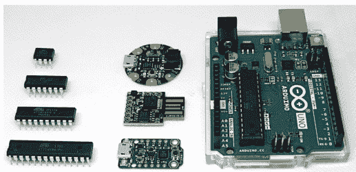

图 0.1：DIP 封装的 ATtiny 器件（左侧）、带有 SMD 封装 ATtiny 器件的开发板（中间）以及 Arduino Uno 上的 ATmega 器件（右侧）均包含 8 位 AVR 架构

由于这是一本实用书籍，其中包含大量可在实际硬件和/或 AVR 模拟器上运行的示例。它包括可以在电子面包板上构建和测试的电路。本介绍章节的其余部分提供了有关本书内容、目标受众以及软件和硬件要求的更多信息。

### 本书概览

通过学习 AVR 架构，我们了解机器码指令是如何执行的。为了正确理解 AVR 架构，本书教授汇编语言编程。读完本书后，你将能够使用汇编语言编程 AVR 微控制器，理解汇编语言如何转换为微控制器可理解的机器码，以及 C 编程语言最终如何变成机器码指令。编程示例同时以汇编语言和 C 编程语言给出（在适用的情况下）。

### 关于目标 AVR 微控制器

低引脚数 ATtiny 微控制器是本书中使用的主要器件，其中 8 针 ATtiny13、ATtiny13A、ATtiny25、ATtiny45 和 ATtiny85 微控制器是主要使用的器件。这样做的原因是这些器件价格低廉，且更简单、内置外设更少，从而简化了学习。由于程序存储器容量较小，它们也更有可能从汇编语言编程中受益。

在更简单的 ATtiny AVR 器件上学到的原理也适用于更高端的 AVR 器件，例如 ATmega AVR 微控制器系列，它们只是在更简单器件的基础上扩展了更多功能和资源。这些差异是对基本 AVR 架构和指令集的扩展，包括增加的存储器容量以及更先进外设的加入。

本书中使用了可提供 DIP 封装的 ATtiny 微控制器，因为这些器件易于与电子面包板一起使用。这些就是前面提到的 8 针器件。附录 B 包含使用 14 针、20 针和 28 针 DIP 封装 ATtiny 微控制器的替代电路。如果需要，可以使用这些器件代替 8 针器件，但使用这些替代器件的任何人都必须做好在必要时修改代码以在其上运行的准备。

### 主要编程软件

Microchip Studio（以前称为 Atmel Studio）的 Windows 版是本教材中使用的主要软件包，但使用此软件教授的编程原理和技术可以调整为与其他编程工具、软件和操作系统配合使用。Microchip Studio 是一个功能齐全的集成开发环境（IDE），用于 AVR C 和汇编语言软件开发，可免费无限制下载。

### 为什么要学习汇编语言？

如前几段所述，学习 AVR 架构会自动让我们接触到 AVR 的指令集。它还让我们接触到 AVR 的内部寄存器和存储区域。指令集由 AVR 可以运行或执行的每个二进制机器码指令组成。该指令集作用于 AVR 的内部寄存器和各种存储器。在本书中学习汇编语言的主要原因是为了正确理解 AVR 的内部工作原理。通过编写汇编语言程序，我们可以看到指令如何操作并影响内部寄存器和内存。

### 学习汇编语言的诸多原因

学习汇编语言编程有几个优势。下面列出了这些原因，主要原因已在列表顶部解释，以使列表完整。

- 1. 正确理解微控制器的架构
- 2. 编写比编译器生成的代码更小、更高效的代码
- 3. 针对内存资源有限的非常小的微控制器
- 4. 调试优化过的 C 程序
- 5. 评估编译器代码生成质量
- 6. 用于学校和大学的学术目的
- 7. 用于编程工具开发，例如编译器和模拟器
- 8. 理解包含汇编语言的应用笔记和其他文档


前面的要点列表需要进一步解释，列表中的每个要点将在后面进行说明。**要点 1**，要正确理解微控制器的架构，之前已经讨论过。

**要点 2** – 编写比编译器生成的代码更小、更高效的代码：一旦正确理解微控制器的内部架构和指令集，并进行大量汇编语言编程实践，即可做到这一点。汇编语言编程更适合较小的程序，因此也更适合较小的微控制器。这是选择 ATtiny 器件作为本教材主要器件的原因之一。随着汇编语言程序规模增大，它们往往比使用 C 等高级语言编写的程序更难理解和维护。汇编语言和 C 也可以混合使用：程序中需要精确时序的关键部分可以用汇编语言编写，而程序的其余部分则用 C 编写。

**要点 3** – 针对内存资源有限的超小型微控制器：这与要点 2 相辅相成。超小型微控制器可以从汇编语言中受益，因为可以对器件中的所有资源保持精确控制。本书涵盖了 ATtiny 系列中的多种微控制器，包括一些可用的较小器件。

**要点 4** – 用于调试经过优化的 C 程序：当启用优化编译 C 程序时，某些代码行无法使用调试器单步执行，因为它们被优化掉了或与其他代码行合并了。调试期间可以关闭优化，但这会改变编译器生成的底层机器码，并且占用更多程序内存。正确调试经过优化的 C 程序的唯一方法是查看反汇编代码——这意味着查看并理解 C 编译器生成的汇编语言指令。

**要点 5** – 评估编译器代码生成质量：在为特定微控制器架构选择编译器时，真正评估编译器的唯一方法是查看其生成的汇编语言代码。在不同编译器之间进行选择时，可以将编译器的输出作为评估过程的一部分进行比较。

**要点 6** – 用于学校和大学的学术目的：任何深入教授微控制器的学术课程都需要教授汇编语言，以展示微控制器或微处理器上的指令在内部是如何执行的。

**要点 7** – 用于编译器和模拟器等编程工具的开发：在开发任何代码生成、调试或模拟工具时，需要了解特定微控制器的架构和汇编语言。

**要点 8** – 用于理解包含汇编语言的应用笔记和其他文档：汇编语言经常出现在应用笔记、数据手册和其他微控制器文档中。

## C 编程

虽然本书包含 C 编程语言的代码，但它不教授 C 编程语言。尽管包含 C 代码，但理解 C 语言并不是从本书中受益所必需的。程序首先以汇编语言出现，并对汇编语言代码进行教学和解释。尚未学习 C 编程语言的读者仍然可以输入 C 程序，编译并运行它们以查看其功能。当然，已经学习过 C 语言的读者将从本书中获得额外的好处。

## 目标读者

本书面向任何对 AVR 微控制器感兴趣、希望学习汇编语言、了解微控制器内部工作原理、8 位 AVR 微控制器的内部架构，以及深入理解编程工具和软件的人。目标读者包括学生、爱好者、制作者、黑客和工程师。

## 前提条件

要跟随本书学习，需要能够使用 Windows 计算机，并能够下载和安装所需的软件工具。虽然鼓励使用实体硬件，但本书的大部分内容可以使用 AVR 模拟器来学习，而无需任何实体硬件。为了充分利用操作连接到微控制器的 LED 和开关等硬件设备的程序，需要能够读取电路图并在电子面包板上搭建电路。话虽如此，一些访问外部硬件的程序仍然可以在模拟器中运行。

汇编语言编程是从零开始教授的，因此不需要编程经验。有 C 等其他编程语言经验的读者将更快地阅读完本书。C 程序员将从包含的 C 代码示例中受益。

## 软件要求

如前所述，运行在 Windows PC 上的 Microchip Studio（原 Atmel Studio）被用作开发平台。它包括汇编程序和 AVR 模拟器。Microchip Studio 还包括 C 编程工具——适用于 AVR 的 GCC 工具。面包板电路或开发板等实体硬件上的 AVR 微控制器，可以通过使用外部 USB 编程设备（例如 Atmel-ICE 或更便宜的爱好者 USB 编程设备）从 Microchip Studio 进行编程。

## 硬件要求

虽然本书可以使用 Microchip Studio 中的 AVR 模拟器来学习，但模拟器有其局限性。在面包板上搭建微控制器电路可以获得更好的学习体验。搭建电路所需的零件列表如下，列表后的小节中对每个项目进行了说明。

- 1. DIP 封装的 ATtiny13(A) 或 ATtiny25/45/85，或第 1 章中详细讨论的几种其他 ATtiny 器件之一
- 2. 电子面包板
- 3. 编程器/调试器，例如 Atmel-ICE
- 4. 5V DC 电源
- 5. 用于搭建面包板电路的跳线和导线
- 6. 电阻、LED 和开关等电子元件
- 7. 可选测试设备，例如万用表和示波器

## DIP 封装的 ATtiny

强烈建议在学习本书时准备一些 8 引脚 DIP 封装的 ATtiny 器件。这些 8 引脚 DIP 器件包括 ATtiny13、ATtiny13A、ATtiny25、ATtiny45 和 ATtiny85。ATtiny25/45/85 系列实际上只是 ATtiny13(A) 的增强版本。最好准备多个这样的器件，以防其中一个损坏。准备其中任何一种器件的三个或四个即可学完本书。如果需要，也可以使用引脚更多的其他 ATtiny 微控制器来代替 8 引脚器件。

## 电子面包板

400 个接点的面包板足以搭建本书中的所有电路。这些面包板有时被称为半尺寸面包板。如果您已经拥有全尺寸面包板，则无需购买半尺寸面包板，可以使用全尺寸面包板代替。

## 编程器/调试器

为了将程序加载到 ATtiny 或其他 AVR 微控制器中，需要一个 USB 编程器。这允许系统内编程，即编程器连接到电路中的 AVR 微控制器。然后使用 Microchip Studio 或其他编程软件通过 USB 编程器将程序加载到微控制器中。

具有调试功能的 USB 编程器优于仅具备“仅编程”功能的编程器。本书推荐的 USB 编程器/调试器是 Microchip Atmel-ICE，它有两个主要套件，即如下一页图 0.2 所示的基础套件和完整套件。此编程器/调试器可用于编程和调试 8 位 AVR 微控制器以及基于 ARM Cortex-M 的 SAM 微控制器。对于 8 位 AVR 微控制器，Atmel-ICE 可以使用 ISP/SPI 接口和 debugWIRE 接口进行编程，这两个接口均存在于 ATtiny25/45/85 和 ATtiny13(A) 系列微控制器中。

USB 编程器/调试器具有调试功能，在与 Microchip Studio 配合使用时允许单步调试。使用 USB 编程器/调试器时，可以检查目标 AVR 器件的内部寄存器和内存，插入断点并更改寄存器/内存值，以获得更好的调试和学习体验。

仍然可以使用不具备调试功能的 USB 编程器来学习本书。在这种情况下，可以使用模拟器来检查内部内存和寄存器。


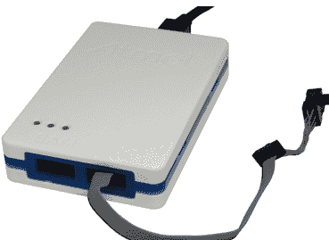

## 图 0.2: Atmel-ICE USB 编程器/调试器基础套件

使用编程器/调试器，ATtiny25/45/85 和 ATtiny13(A) 系列的 AVR 微控制器可以进入 debugWIRE 模式。一旦进入 debugWIRE 模式，AVR 的单个引脚即可用于编程和调试，这对于这些低引脚数器件非常理想，因为它释放了微控制器的其他引脚。

以下是对各种 USB 编程器/调试器和仅编程器设备的描述。简而言之，购买 Atmel-ICE 编程器/调试器，但如果无法证明这笔开支合理，可以使用较旧的 Atmel 工具之一（AVR Dragon 或 AVRISP mkII），或者使用爱好者编程器，如 USBasp、USBTinyISP 甚至 Arduino Uno。

## Atmel-ICE 基础套件

如图 0.2 所示的 Atmel-ICE 基础套件非常适合与本书配合使用，其零件编号为 ATMEL-ICE-BASIC。它具有编程和调试功能，并附带一根扁平适配器线缆以及一根 USB 线缆。该套件比全套件更便宜。

## Atmel-ICE 全套件

Atmel-ICE 全套件与基础套件完全相同，但包含额外的线缆和适配器，包括一根 10 芯鱿鱼线缆。该套件的零件编号为 ATMEL-ICE。它比基础套件更昂贵。

## AVR Dragon

已经拥有 AVR Dragon 的读者可以使用它来代替 Atmel-ICE 进行编程和调试。撰写本文时，AVR Dragon 在 Microchip 网站上的状态为 "不再提供"。AVR Dragon 支持 ATtiny25/45/85 和 ATtiny13(A) 微控制器的 ISP/SPI 和 debugWIRE 接口。

## AVRISP mkII

Microchip 的 AVRISP mkII 是一个 "仅编程" USB 设备，不具备任何调试功能，且现在已不再从 Microchip 获得。Microchip 推荐使用 Atmel-ICE 作为替代品。已经拥有 AVRISP mkII 的读者仍可使用它对 AVR 微控制器进行板内编程。这种仅编程 USB 编程器会占用目标 AVR 微控制器的四个引脚，以 ISP 模式对其进行编程。

## 爱好者 USB 编程器

USB AVR 爱好者编程器，例如图 0.3 中所示的 USBasp，以及 USBtinyISP 和 Arduino 板等其他设备，可用于对某些 AVR 器件进行编程。附录 A 介绍了如何在 Microchip Studio 中将 USBasp、USBtinyISP 和 Arduino Uno 设置为 Arduino AVR ISP 编程器。爱好者编程器通常只能对使用 ISP/SPI 接口的 AVR 微控制器进行编程。这意味着它们可以与 ATtiny25/45/85 和 ATtiny13(A) 系列的 8 位 AVR 微控制器配合使用。

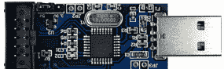

**图 0.3: 虽然 USBasp 可以对 AVR 进行编程，但不能用于调试**

与其他仅编程编程器一样，USBasp 无法将 AVR 置于 debugWIRE 模式，然后使用一根线对其进行编程，而是在 ISP/SPI 模式下占用四个引脚。本书中的电路配合外部硬件和连接到相同引脚的编程器使用效果良好。由于 USBasp、USBtinyISP 和 Arduino Uno 作为编程器不具备调试功能，可以使用 AVR 模拟器来单步执行代码并检查寄存器和内存，以替代硬件调试。当然，模拟器未连接实际外部硬件确实存在一些局限性。

## 电源

为 AVR 面包板电路供电需要一个能够提供 100mA 或更多电流的 5V DC（直流）电源。有多种不同的电源可供选择，例如图 0.4 中所示的面包板电源。如果使用爱好者编程器，可能不需要外部电源，因为它们通常从 USB 提供 5V。

有多种不同的面包板电源可供选择。图 0.4 中所示的只是一个示例，由 RobotDyn 制造。它在 5V 下可提供 1A 电流，在 3.3V 下可提供 800mA 电流。两种电压可通过板上的跳线单独选择。这意味着一条电源轨可以设置为 5V，另一条设置为 3.3V，以适用于同时使用 5V 和 3.3V 的电路，但本书只需要 5V。此面包板电源需要通过圆形插头连接器提供 6V 至 12V 的外部直流电源。图 0.4 显示了一个市电转 12V 直流电源，通过 2.1mm 中心正极圆形插头连接器向面包板电源供电 12V 直流电。如果您使用的是不同品牌或型号的面包板电源，请务必查看制造商提供的规格和配置。

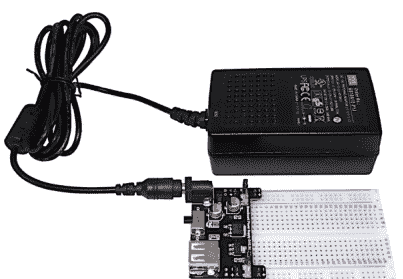

图 0.4: 由外部直流电源供电的 5V/3.3V 面包板电源

在大多数此类面包板电源上，USB 连接器旨在作为 USB 供电设备的 5V 输出。其中一些允许向此连接器输入 5V 以向面包板供电 5V。然而，这并非设计本意——只是它们碰巧以这种方式工作而不会被损坏。图中看到的 USB 连接器类型是 USB 主机连接器，旨在提供 5V，而不是接收 5V。最好始终使用连接到圆形插头连接器的外部电源。

## 跳线和导线

需要使用跳线将 USB 编程器/调试器连接到面包板电路中的 AVR 微控制器，如下图 0.5 所示。两端都带有单针公头连接器的跳线是此用途的绝佳选择。这些导线通常作为一排可单独剥离的导线出售。它们通常被称为“DuPont”线缆，例如“10cm 公对公 DuPont 跳线”。

其他单芯跳线对于在面包板上构建电路很有用。带有一个公头和一个母头连接器的 DuPont 线缆可用于将某些爱好者编程器连接到面包板电路。

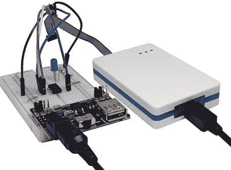

图 0.5: 连接到 ATtiny 面包板电路的 Atmel-ICE

## 电子元件

跟随本书操作时，需要基本电子元件，例如 LED、电阻和开关，以与 ATtiny 微控制器进行接口连接。例如，当将引脚用作输出时，带串联电阻的 LED 是最基本的要求，因为它们显示引脚是切换为高电平还是低电平。电路中可能还需要其他元件，例如 100n 去耦电容器。由于本书主要涉及 ATtiny AVR 微控制器的内部架构，因此只需要最少量的元件。所需的所有元件是 5 个带约 470Ω 串联电阻的插装 LED、一个按钮开关和一个可选的 100n 陶瓷电容器。

## 可选测试设备

万用表在将电源连接到电路之前验证电源电压以及对电路进行一般故障排查时非常有用。虽然不是必需的，但示波器可能用于电路测试和故障排查。

## Microchip、Atmel、Microchip Studio 和 Atmel Studio

如果不了解 Atmel 和 Microchip 的历史，在处理 AVR 微控制器时可能会产生一些混淆，因此有必要进行说明。最初，名为 Atmel 的公司是包括 ATtiny 和 ATmega 系列在内的 AVR 微控制器的设计师和制造商。2016 年，Microchip (www.microchip.com) 收购了 Atmel，现在是 AVR 微控制器的所有者和制造商。撰写本文时，一些 AVR 文档上仍带有 Atmel 名称。许多 AVR 微控制器上仍带有 Atmel 名称，尚未更改为 Microchip。

Microchip Studio 是本书配合使用的免费开发软件，用于使用汇编语言和 C 语言对 ATtiny AVR 微控制器进行编程。Microchip Studio 与之前提供的 Atmel Studio 相同，只是品牌名称变更。尽管 Microchip 在 2016 年收购了 Atmel，但 Atmel Studio 直到 2020 年才重新品牌化为 Microchip Studio。Microchip Studio 的首个版本于 2020 年 11 月发布，并延续了 Atmel Studio 留下的版本编号。因此，Microchip Studio 的首个版本是 7.0.2542 版，而不是 1.0 版。它紧随 Atmel Studio 的最后一个版本（即 7.0.2389 版）。Microchip Studio 中的所有内容与 Atmel Studio 相同，因此以前使用过 Atmel Studio 的读者将能够立即使用 Microchip Studio。


## 伴随资源

伴随资源，例如本书的源代码，可从出版社网站 www.elektor.com 下载，可在该网站按书名或 ISBN 编号搜索本书，找到包含可下载资源的网页。此外，还可在作者网站 wspublishing.net 上找到更多资源，点击书名即可找到其页面和资源。

## 让我们开始

希望您在探索 8 位 AVR 架构以及如何使用汇编语言和 C 语言编程 AVR 微控制器的过程中，享受这段精彩的冒险之旅。

## 第 1 章 • ATtiny 微控制器概述

本章介绍了可采用 DIP 封装并可使用 ISP 编程器进行编程的 ATtiny 微控制器。ISP 编程可以使用任何 Microchip AVR USB 编程器，以及大多数为 8 位 AVR 构建的业余爱好者编程器来完成。

本章涵盖了 8 引脚、14 引脚、20 引脚和 28 引脚 ATtiny 微控制器的基础知识。

### 本章内容

- 可在线编程的 DIP 封装 ATtiny AVR 微控制器概述
- 用于轻松比较不同 ATtiny 器件的参数表

### 1.1 ATtiny 微控制器

在开始编程之前，最好先对我们将要编程的内容有一个总体了解。各种 ATtiny 器件列在以下子标题下。每个子标题按引脚数列出 ATtiny 器件。这些部分之后是所有讨论的器件表格，以帮助消化信息。所有列出的器件均可作为双列直插封装（DIP）芯片获得。在 Microchip/Atmel 的 ATtiny 器件文档中，DIP IC 称为塑料双列直插封装，即 PDIP 器件。虽然本文使用 8 引脚 ATtiny 器件，但也可以使用引脚更多的器件。引脚更多的器件将为可能感兴趣的读者进行讨论。

指定 DIP 或 PDIP ATtiny 微控制器的动机在于，它们在电子面包板上使用要容易得多，并且通过 ISP/SPI 编程接口，许多不同的 USB 编程设备都支持编程。ATtiny 贴片器件（SMD）也可以与面包板一起使用，但需要安装在扩展板或类似的印刷电路板（PCB）上。每个 PDIP 器件也有贴片封装可用，因此使用带有 DIP ATtiny 贴片等效器件的扩展板也是可以的。

各种 ATtiny 微控制器的基本引脚图显示在以下各小节的图中。ATtiny 和 ATmega 微控制器都有一个或多个内部 8 位端口，这些端口连接到每个微控制器的引脚，每个引脚对应一个端口位。这些端口名为 Port A、Port B、Port C 等等，或者使用较短的表示法 PA、PB、PC 等。端口允许在软件中配置和操作微控制器引脚。对于引脚较少的器件，器件引脚上仅可用一定数量的端口位，而不是端口的完整 8 位。

查看以下图表时，请注意端口的引脚使用较短的表示法标记。例如，标记为 PB0、PB1、PB2 等的引脚是微控制器的 B 端口或 PB 端口的引脚。这些引脚是输入/输出（I/O）引脚，可以在软件中单独配置为输入或输出。端口引脚还与各种内部外设复用，例如模数转换器（ADC）或定时器输出。这意味着引脚可以配置为输入、输出或连接到内部外设的特殊功能引脚。引脚的实际功能可在软件中配置。在以下图表中，仅显示基本端口引脚编号，不显示备用功能。

### 1.1.1 8 引脚器件

有两种 8 引脚 ATtiny 微控制器可采用 DIP 封装，即 ATtiny13 和 ATtiny25/45/85。这两种系列引脚兼容（图 1.1），但 ATtiny25/45/85 系列提供了额外的外设和内存。

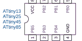

图 1.1：8 引脚 DIP ATtiny 器件的基本引脚图

### 1.1.1.1 ATtiny13 和 ATtiny13A

ATtiny13 和 ATtiny13A 微控制器仅拥有 1K 字节的 Flash 存储器、64 字节的 SRAM 和 64 字节的 EEPROM。ATtiny13A 器件是原始 ATtiny13 的低功耗版本，也是较新的器件。因此，在两者之间有选择时，优先选用 ATtiny13A 器件。ATtiny13(A) 指这两款器件。

ATtiny13 和 ATtiny13V 器件共用一份数据手册。ATtiny13 器件的工作电压范围为 2.7V 至 5.5V，而 ATtiny13V 器件的工作电压范围为 1.8V 至 5.5V，但时钟速度较低。ATtiny13A 器件有自己独立的数据手册（与 ATtiny13 分开），工作电压范围为 1.8V 至 5.5V。

### 1.1.1.2 ATtiny25、ATtiny45 和 ATtiny85

ATtiny25、ATtiny45 和 ATtiny85 微控制器基本上是同一款器件，但系列中每一款的存储器都比前一款更多。这三款器件共用同一份数据手册，并且同一份数据手册中还包含 'V' 版本，即 ATtiny25V、ATtiny45V 和 ATtiny85V。带 V 后缀的器件工作电压范围为 1.8V 至 5.5V，但时钟速度较低；不带 V 后缀的器件工作电压范围为 2.7V 至 5.5V，但时钟速度较高。ATtiny25、ATtiny45 和 ATtiny85 器件统称为 ATtiny25/45/85。

ATtiny25 器件拥有 2K 字节的 Flash 程序存储器、128 字节的 SRAM 和 128 字节的 EEPROM。ATtiny25 中的 '2' 表示 2K 字节的 Flash 存储器。ATtiny45 器件拥有 4K 字节的 Flash 存储器，ATtiny85 器件拥有 8K 字节的 Flash 存储器。系列中每款器件的 Flash、SRAM 和 EEPROM 容量均翻倍。

### 1.1.2 14 引脚 ATtiny24、ATtiny44 和 ATtiny84

ATtiny24、ATtiny44 和 ATtiny84 器件是 14 引脚微控制器，如图 1.2 所示，且全部共用同一份数据手册，其中包含这些器件的 'V' 变体，即 ATtiny24V、ATtiny44V 和 ATtiny84V。如同 8 引脚器件所示，带 V 后缀的器件可以在较低电压下工作，但其时钟频率也低于不带 V 后缀的器件。

这组微控制器中现在还提供了具有低功耗运行特性的较新器件。这些较新器件带有 'A' 后缀，即 ATtiny24A、ATtiny44A 和 ATtiny84A，并拥有与旧器件分开的独立数据手册。优先选用这些较新的 'A' 器件，而非旧器件。

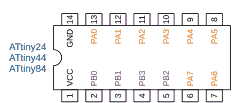

图 1.2：基本 14 引脚 DIP ATtiny 器件

14 引脚 ATtiny24、ATtiny44 和 ATtiny84 器件的存储器容量与 8 引脚 ATtiny25、ATtiny45 和 ATtiny85 器件相同，器件名称中的第一个数字指定以千字节为单位的 Flash 存储器容量。

### 1.1.3 20 引脚器件

在 20 引脚 DIP 封装中，有两个主要的 ATtiny 组，即 ATtiny26/261/461/861 和 ATtiny2313/4313。如图 1.3 和图 1.4 所示，这两组的引脚排列不同。

### 1.1.3.1 ATtiny26

ATtiny26 实际上已被 ATtiny261A 取代，尽管在撰写本文时 ATtiny26 仍在生产。ATtiny26 和 ATtiny261 器件共用一份数据手册。ATtiny26 的工作电压范围为 4.5V 至 5.5V，最高频率可达 16MHz，而 ATtiny26L 的工作电压范围为 2.7V 至 5.5V，最高频率可达 8MHz。ATtiny26 微控制器拥有 2K 字节的 Flash 程序存储器、128 字节的 SRAM 和 128 字节的 EEPROM。如果可能，优先选用较新的 ATtiny261A，而非 ATtiny26。

### 1.1.3.2 ATtiny261、ATtiny461 和 ATtiny861

ATtiny261、ATtiny461 和 ATtiny861 与其低电压、低时钟速度的 'V' 变体（ATtiny261V、ATtiny461V 和 ATtiny861V）共用一份数据手册。在该数据手册中，ATtiny261 和 ATtiny261V 被标记为成熟器件，因此不推荐用于新设计。ATtiny261A 是这两款器件的替代品。

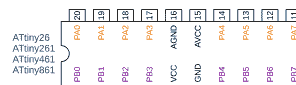

图 1.3：20 引脚 DIP ATtiny261/461/861 器件的基本引脚图

优先选用较新的低功耗 ATtiny261A、ATtiny461A 和 ATtiny861A 器件，它们拥有与旧器件分开的独立数据手册。与之前的 8 位和 14 引脚器件一样，这些器件名称中的第一个数字表示以千字节为单位的 Flash 存储器容量。ATtiny261/461/861 20 引脚器件的 Flash、SRAM 和 EEPROM 存储器容量，与 ATtiny25/45/85 8 引脚器件和 ATtiny24/44/84 14 引脚器件相同。这些组中的每个成员的存储器容量均为前一款器件的两倍。

### 1.1.3.3 ATtiny2313 和 ATtiny4313

ATtiny2313 和 ATtiny4313 器件的主要特点是它们具有硬件 USART 外设。ATtiny4313 器件的存储器容量是 ATtiny2313 器件的两倍，ATtiny2313 器件拥有 2K 字节的 Flash、128 字节的 SRAM 和 128 字节的 EEPROM。

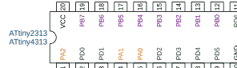

图 1.4：20 引脚 DIP ATtiny2313/4313 器件的基本引脚图

ATtiny2313 和 ATtiny2313V 器件共用一份数据手册。优先选用较新的 ATtiny2313A，而非这些旧器件。ATtiny2313A 和 ATtiny4313 器件共用一份数据手册，且均为低功耗器件。这些器件与旧的 AT90S2313 8 位 AVR 以及具有 8 位 MCS51 架构的旧 AT89C2051 和 AT89C4051 微控制器具有基本引脚兼容性。MCS51 是一种与 AVR 完全不同的 8 位架构。


### 1.1.4 28 引脚器件

目前有两组 28 引脚 DIP ATtiny 微控制器可供选择。ATtiny48/88 和 ATtiny28。在这两个系列中，只使用 ATtiny48/88 器件是实际的，因为它们与前面讨论的所有器件一样，均支持系统内编程。

### 1.1.4.1 ATtiny48 和 ATtiny88

ATtiny48 和 ATtiny88 器件共用一份数据手册，且均为低功耗 28 引脚器件。ATtiny48 拥有 4K 字节 Flash、256 字节 SRAM 和 64 字节 EEPROM，而 ATtiny88 拥有 8K 字节 Flash、512 字节 SRAM 以及 64 字节 EEPROM。

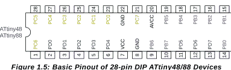

### 1.1.4.2 ATtiny28L 和 ATtiny28V

ATtiny28L 和 ATtiny28V 器件不推荐用于大多数应用，主要原因是它们不支持系统内编程。编程这些器件必须使用高压编程，例如 HVPP（高压并行编程）。这些器件也没有 SRAM 或 EEPROM。由于这些器件需要高压编程，本书不再进一步讨论它们。

### 1.2 使用哪款 ATtiny

本章讨论的任何 8 引脚器件在遵循本书时都是不错的选择。准备好几个 ATtiny25/45/85 系列的 8 引脚 ATtiny 器件是一个很好的起点，这包括 'V' 变体。使用 ATtiny13、ATtiny13A 或 ATtiny13V 也是可以的，它们也是 8 引脚器件。尽管本书为特定的 ATtiny 器件选定了型号，但本书中的汇编和 C 程序适用于所有 ATtiny 器件，甚至适用于 ATmega 系列的器件，尽管在某些情况下可能需要对程序进行一些更改。为 8 引脚器件提供的电路和软件可以轻松调整为在更高引脚数的器件上运行。

### 1.3 ATtiny 器件比较

下表 1.1 比较了本章前面各节中讨论过的 ATtiny 微控制器。该表对迄今讨论的所有内容提供了更清晰的视图。器件按引脚数分组，从 8 引脚 ATtiny 微控制器开始，到 28 引脚器件结束。28 引脚 ATtiny28 器件因前面已解释的原因未列入表中。

首选列建议使用较新的低功耗增强型 ATtiny 微控制器来替代旧器件，例如，在新设计中首选使用 ATtiny13A 而不是旧的 ATtiny13。

| 器件 | 首选 | 低功耗 | 最大时钟频率 | Flash KB | SRAM 字节 | EEPROM 字节 | ADC 输入 | ADC 位数 | UART | SPI | I2C | 8 位定时器 | 16 位定时器 | PWM 输出 |
|---|---|---|---|---|---|---|---|---|---|---|---|---|---|---|
| 8 引脚 PDIP | | | | | | | | | | | | | | |
| ATtiny13 | ATtiny13A | 否 | 20 MHz | 1 | 64 | 64 | 4 | 10 | 0 | 0 | 0 | 1 | 0 | 2 |
| ATtiny13A | | 是 | 20 MHz | 1 | 64 | 64 | 4 | 10 | 0 | 0 | 0 | 1 | 0 | 2 |
| ATtiny25 | | 否 | 20 MHz | 2 | 128 | 128 | 4 | 10 | 0 | 1 | 1 | 2 | 0 | 6 |
| ATtiny45 | | 否 | 20 MHz | 4 | 256 | 256 | 4 | 10 | 0 | 1 | 1 | 2 | 0 | 6 |
| ATtiny85 | | 否 | 20 MHz | 8 | 512 | 512 | 4 | 10 | 0 | 1 | 1 | 2 | 0 | 6 |
| 14 引脚 PDIP | | | | | | | | | | | | | | |
| ATtiny24 | ATtiny24A | 否 | 20 MHz | 2 | 128 | 128 | 8 | 10 | 0 | 1 | 1 | 1 | 1 | 4 |
| ATtiny24A | | 是 | 20 MHz | 2 | 128 | 128 | 8 | 10 | 0 | 1 | 1 | 1 | 1 | 4 |
| ATtiny44 | ATtiny44A | 是 | 20 MHz | 4 | 256 | 256 | 8 | 10 | 0 | 1 | 1 | 1 | 1 | 4 |
| ATtiny44A | | 是 | 20 MHz | 4 | 256 | 256 | 8 | 10 | 0 | 1 | 1 | 1 | 1 | 4 |
| ATtiny84 | ATtiny84A | 否 | 20 MHz | 8 | 512 | 512 | 8 | 10 | 0 | 1 | 1 | 1 | 1 | 4 |
| ATtiny84A | | 是 | 20 MHz | 8 | 512 | 512 | 8 | 10 | 0 | 1 | 1 | 1 | 1 | 4 |
| 20 引脚 PDIP | | | | | | | | | | | | | | |
| ATtiny26 | ATtiny261A | 否 | 16 MHz | 2 | 128 | 128 | 11 | 10 | 0 | 1 | 1 | 2 | 0 | 4 |
| ATtiny261A | | 是 | 20 MHz | 2 | 128 | 128 | 11 | 10 | 0 | 1 | 1 | 1 | 1 | 6 |
| ATtiny461 | ATtiny461A | 否 | 20 MHz | 4 | 256 | 256 | 11 | 10 | 0 | 1 | 1 | 1 | 1 | 6 |
| ATtiny461A | | 是 | 20 MHz | 4 | 256 | 256 | 11 | 10 | 0 | 1 | 1 | 1 | 1 | 6 |
| ATtiny861 | ATtiny861A | 否 | 20 MHz | 8 | 512 | 512 | 11 | 10 | 0 | 1 | 1 | 1 | 1 | 6 |
| ATtiny861A | | 是 | 20 MHz | 8 | 512 | 512 | 11 | 10 | 0 | 1 | 1 | 1 | 1 | 6 |
| ATtiny2313 | ATtiny2313A | 否 | 20 MHz | 2 | 128 | 128 | 0 | 0 | 1 | 2 | 1 | 1 | 1 | 4 |
| ATtiny2313A | | 是 | 20 MHz | 2 | 128 | 128 | 0 | 0 | 1 | 2 | 1 | 1 | 1 | 4 |
| ATtiny4313 | | 是 | 20 MHz | 4 | 256 | 256 | 0 | 0 | 1 | 2 | 1 | 1 | 1 | 4 |
| 28 引脚 PDIP | | | | | | | | | | | | | | |
| ATtiny48 | | 是 | 12 MHz | 4 | 256 | 64 | 8 | 10 | 0 | 1 | 1 | 1 | 1 | 2 |
| ATtiny88 | | 是 | 12 MHz | 8 | 512 | 64 | 8 | 10 | 0 | 1 | 1 | 1 | 1 | 2 |

### 1.4 总结

遵循本书时，任何支持系统内编程的 8 引脚至 28 引脚 DIP ATtiny AVR 微控制器均可使用，尽管主要针对 8 引脚器件。请务必阅读简介章节，以了解本书的概览以及阅读本书所需的硬件和软件信息。在第 2 章中，我们将安装 Microchip Studio 并使用它对 ATtiny 微控制器进行编程，以便为后续章节设置好所需的工具和硬件。

## 第 2 章 • 硬件和软件设置

本章的目标是安装 Microchip Studio，使用 ATtiny25/45/85 或 ATtiny13(A) 构建电路，然后编写程序并将其加载到微控制器中。

遵循本书时，Microchip Studio 用于编写汇编语言和 C 程序。尚未拥有硬件的读者仍可以安装 Microchip Studio，阅读本章剩余部分，并创建第一个汇编语言和 C 语言程序。第 3 章展示了如何使用 Microchip Studio 中的模拟器。

### 本章内容

- 安装 Microchip Studio
- 构建 ATtiny 微控制器电路
- 编写简单的汇编语言程序并将其加载到 ATtiny
- 为 ATtiny 微控制器编写简单的 C 程序

### 2.1 安装 Microchip Studio

Microchip Studio（原 Atmel Studio）可以作为 Web 安装程序或离线安装程序下载。下载离线安装程序允许在多台计算机上安装 Microchip Studio，而无需像 Web 安装程序那样在每次安装时都从互联网下载软件。对于单台计算机，使用哪种安装方法都无所谓。

### 2.1.1 下载页面和软件版本

以下是使用离线安装程序进行安装的简要说明。如果您使用的是 Web 安装程序，步骤基本相同，但在安装过程中必须连接到互联网。从以下网址下载 Microchip Studio：www.microchip.com/en-us/development-tools-tools-and-software/microchip-studio-for-avr-and-sam-devices

撰写时使用的 Microchip Studio 确切版本为：Microchip Studio for AVR and SAM Devices 7.0.2542 Offline Installer 934 MB，发布日期 2020 年 11 月。

### 2.1.2 最新软件版本

当最新版本的 Microchip Studio 可用时，使用它应该不会有问题，但如果出现任何问题或不兼容情况，可以使用上述版本的 Microchip Studio。在上述版本的 Microchip Studio 被较新版本取代后，它将可从 AVR 和 SAM 下载存档中获取：www.microchip.com/en-us/development-tools-tools-and-software/avr-and-sam-downloads-archive

### 2.1.3 开始安装

导航到下载 Microchip Studio 文件的文件夹，双击该文件以运行它并开始安装，例如文件 as-installer-7.0.2542-full.exe。只需进行基本默认安装即可。安装的一些组件是可选的，但安装它们也不会造成任何损害。

### 2.1.4 安装步骤

您需要在第一个安装对话框中同意许可条款和条件。单击 Next 继续。在下一个对话框中，所有架构都可以保留默认值，除非您需要节省磁盘空间（或如果使用 Web 安装程序，则需要节省下载数据


install)，在这种情况下只需选择 AVR。单击 Next 继续，下一个对话框中的高级软件框架和示例项目对于汇编语言编程不是必需的，因此安装它再次是可选的。单击 Next 继续。下一个对话框中显示了一组必须有效的项目，安装才能继续。在某些情况下，安装程序可能会报告需要升级显卡驱动程序，尽管最新驱动程序已经安装。即使是这种情况，也通常可以继续安装。通过单击 Next 按钮继续安装。在发行说明对话框中单击 Install 开始安装。当 Windows 询问是否允许应用程序对计算机进行更改时，单击 Yes 继续。安装开始后，将打开一个用于设置 MPLAB XC8 编译器的对话框。这个可选编译器可以通过单击 Next 按钮来设置，或通过单击 Cancel 按钮跳过。不需要设置此编译器。

安装完成需要一些时间，具体取决于主机计算机的速度。在安装过程中，您会多次看到询问是否要安装设备驱动程序软件的对话框。每次都在对话框中单击 Install 按钮。安装将继续并完成。

## 2.2 8 引脚 ATtiny 微控制器 LED 电路

初始电路用于使单个 LED 闪烁，如图 2.1 所示。如果您有与 Microchip Studio 兼容的编程器，例如 Atmel-ICE、AVR Dragon 或 AVRISP mkII，请在面包板上构建此电路，并按图 2.1、图 2.2 和图 2.3 所示连接编程器。阅读第 2.2.2 节末尾以了解连接编程器的详细信息，然后返回构建电路。附录 B 包含使用 14 引脚、20 引脚和 28 引脚 ATtiny 器件的替代电路。如果您使用的是替代 ATtiny，请从此附录构建电路。尽管接下来的两个图中指定了 Atmel-ICE，但任何具有 ISP/SPI 编程功能的 USB 编程设备都可以使用。使用爱好者编程器的读者现在不需要构建电路，但必须继续阅读并在第 2.3 节中创建第一个汇编语言程序。只有在提示在第 2.3.5 节中时，才需要构建电路并连接爱好者编程器，但请务必阅读以下所有段落和章节，因为它们包含一些关于连接爱好者编程器的信息。关于连接电源的信息很重要。对于使用在 Microchip Studio 中直接受支持的编程器（例如 Atmel-ICE、AVR Dragon 和 AVRISP mkII）的用户，请将编程器连接到 PC 的 USB 端口。当编程器第一次插入主机 PC 的 USB 端口时，如果已安装 Microchip Studio，驱动程序将自动安装。图 2.1 中的 SPI 标头 J1 只是为了显示编程器如何连接到电路。图中的插图显示了 USB 编程器排线末端 6 引脚连接器的底部视图，例如 Atmel-ICE 上的 6 引脚连接器，以帮助布线。以下段落解释了如何将编程器连接到电路。

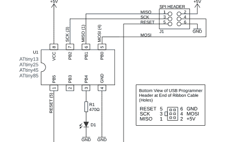

### 图 2.1：8 引脚 ATtiny LED 电路和 ISP/SPI 标头引脚定义

图 2.2 显示了 Atmel-ICE 编程电缆的引脚定义。请务必将此电缆末端的小型 10 引脚连接器插入图 2.3 所示 Atmel-ICE 上标记为 AVR 的端口。6 引脚连接器的引脚定义也适用于 AVRISP mkII 和 AVR Dragon，使用凸起塑料键作为参考来查找引脚 1。相同的引脚定义适用于任何使用 6 引脚 ISP/SPI 连接的编程器，包括使用此连接器的爱好者编程器。图 2.3 显示了图 2.1 电路在面包板上构建并连接到 Atmel-ICE 的照片。

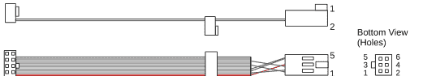

### 图 2.2：Atmel-ICE 电缆引脚定义

可以使用单股导线或两端带有引脚的杜邦线，将 Atmel-ICE 或其他带有 6 引脚 ISP/SPI 标头的编程器的 6 引脚连接器底部连接到面包板电路。

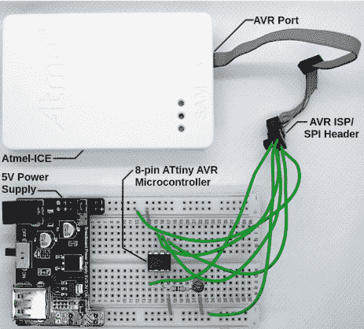

### 图 2.3：连接 Atmel-ICE 的面包板上的 ATtiny 电路

要将编程器连接到面包板电路，请将 6 引脚标头翻转过来，使其面向您——这样您就可以看到连接器上的孔。查看图 2.1 和图 2.2 时，请确保连接器上的凸起塑料键位于左侧。使用图 2.2 或图 2.1 中的插图查找引脚 1。将导线插入连接器的引脚 1 孔中。查看图 2.1 以了解引脚 1 连接到哪里——可以看到，连接器的引脚 1 连接到 8 引脚 ATtiny 的引脚 6，并命名为 MISO。建立连接。

连接器的引脚 2 连接到 5V 电源的 +5V。使用与 Microchip Studio 兼容的编程器时，将连接器的引脚 2 连接到电源的 +5V，电源通常连接到面包板的一条水平轨道。这意味着引脚 2 可以连接到面包板的 5V 轨道。USB 编程器使用引脚 2 来检测电路供电电压。爱好者编程器通常在此引脚上提供 5V，而不是检测电路供电电压。因此，使用爱好者编程器时，可以使用此引脚从 5V 为电路供电。如果使用爱好者编程器和外部电源，则保持此引脚未连接，否则会导致计算机 USB 的 5V 连接到外部电源的 5V。

继续按照图 2.1 所示布线 6 引脚 ISP/SPI 连接器的其余引脚。引脚 6 是需要连接的最后一个引脚，它连接到电源的 GND 或 0V，电源通常连接到面包板的一条水平轨道。

### 2.2.1 电路电源

任何提供稳定平滑 5V 直流电的电源都可以用于为电路供电。图 2.3 中使用了面包板电源。图中所示的面包板电源带有 5V 稳压器，并通过圆形连接器由外部 6V 至 12V 直流电源供电。这种特定的面包板电源还可以通过使用跳线设置板上的电压来为电路提供 3.3V。本书介绍章节的电源部分已经描述了此电源。请参阅介绍中的图 0.4，查看由外部市电转直流电源单元供电的面包板电源图像。介绍中的图 0.5 显示了与图 2.3 相同的电路，但使用杜邦线连接了 Atmel-ICE。面包板电源将 +5V（或 +3.3V）连接到标有红线和 + 号的面包板水平轨道。这些轨道位于面包板的两侧。面包板电源的 0V 或 GND 连接到旁边有蓝线并标有 – 号的水平轨道。

最好将新的面包板电源连接到未使用的面包板上，并在将电源连接到电路之前使用万用表检查其产生的电压是否在正确水平。还要确保面包板电源上的跳线已正确设置，以适用于电路中要使用的电压。

如前所述，如果使用爱好者编程器，它通常可以从主机计算机的 USB 5V 为电路提供 5V。附录 A 中图 A.1 所示的所有爱好者编程器都能够提供 5V 为目标 ATtiny 供电。这包括设置为 ISP 编程器的 Arduino Uno，可以从 Arduino 5V 引脚连接到 ATtiny 电路 +5V 引脚。如果将这些爱好者编程器之一与面包板电源或其他外部电源结合使用，则不要将 ISP/SPI 标头的引脚 2 连接到电路。

### 2.2.2 去耦电容

通常做法是在面包板上微控制器附近的 +5V 和 GND 之间插入一个 100n 去耦电容，但此电路中省略了它，因为使用所示面包板电源时未发现电源问题。如果存在任何电源问题，或电源位于 ATtiny 电路较远处，可以向电路添加一个约 1µF 至 10µF 的电解电容和一个 100n 电容。

## 2.3 第一个汇编语言程序

现在 ATtiny 电路已构建，编程器已连接，我们可以编写第一个汇编语言程序，使 LED 闪烁或闪烁。对于爱好者 USB 编程器，请在接下来的第 2.3.5 节提示创建程序后构建电路，但首先完成以下每个小节。

以下小节展示了如何在 Microchip Studio 中启动新的 AVR 汇编器项目，用汇编语言编写简单的 LED 闪烁程序，最后构建并将程序加载到目标 AVR 微控制器中。

### 2.3.1 在 Microchip Studio 中启动新的 AVR 汇编器项目

打开 Microchip Studio 并启动新的 AVR 汇编器项目。在 Microchip Studio 中启动新项目有四种方式，它们都会打开新建项目对话框，如下所示。选择一种：

- 1. 从顶部菜单选择 File ▶ New ▶ Project...。
- 2. 使用顶部工具栏上的新建项目图标（将鼠标光标悬停在工具栏图标上以查看标识图标的工具提示）。
- 3. 使用键盘快捷键 Ctrl + Shift + N
- 4. 在 Microchip Studio 开始页上单击新建项目...（如果未显示开始页，请从顶部菜单选择 View ▶ Start Page。工具栏上也有一个开始页图标。要识别 Microchip Studio 中的任何工具栏图标，可以将鼠标光标悬停在图标上以查看工具提示，或使用顶部菜单识别图标 – View ▶ Start Page 显示开始页图标，该图标也可以在工具栏上看到。）


在“新建项目”对话框中，单击左侧的“汇编器”和中间窗格中的“AVR 汇编器项目”。在对话框底部附近的“名称”字段中将项目命名为 led_blink_asm，并使用“浏览...”按钮选择要保存的位置，如图 2.4 所示。单击“新建项目”对话框右下角的“确定”按钮，转到“器件选择”对话框，如图 2.5 所示。

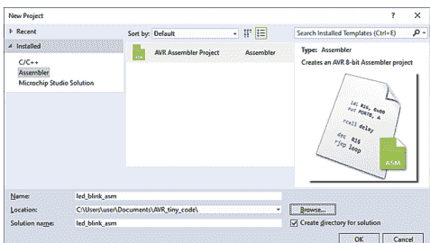

图 2.4：Microchip Studio 中的新 AVR 汇编器项目

在“器件选择”对话框中，使用右上角的搜索框搜索您正在使用的微控制器。将您正在使用的 ATtiny 微控制器的器件编号输入到搜索框中。使用搜索框筛选 ATtiny 器件后，在左侧窗格中单击特定的 ATtiny 器件将其选中，然后单击“确定”按钮。图 2.5 显示已选中 ATtiny13A。使用“器件选择”对话框中搜索框的替代方法是使用对话框左上角附近的“器件系列：”下拉列表。在此处可以使用下拉列表选择 ATtiny，然后仅在对话框左侧窗格中显示 ATtiny 系列器件。然后可以单击所需器件将其在左侧窗格中选中。

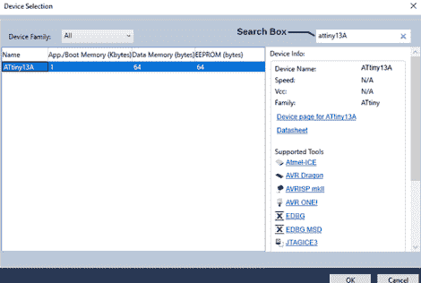

图 2.5：Microchip Studio 中的 AVR 器件选择

在“器件选择”对话框中单击“确定”按钮后，Microchip Studio 中将创建一个新项目，其中包含带有一些骨架代码的默认 main.asm 汇编语言文件。在下一节中，我们将删除骨架代码并输入新的汇编语言程序。

### 2.3.2 LED 闪烁汇编代码

用以下部分中显示的 led_blink.asm：main.asm 列表中的代码替换上一节在 main.asm 中创建的骨架代码。如果使用附录 B 中的替代电路，且该电路将 LED 连接到 ATtiny 的 PB0 引脚，则使用附录 B 第 B.5.1 节中的替代代码。学习任何新编程语言时，最好自己输入代码，而不是复制粘贴。此阶段无需输入注释——注释以分号（;）开头，并描述程序中正在发生的情况。使用 Tab 键缩进代码，如图 2.6 所示。在某些情况下，您可能需要按两次 Tab 键才能正确对齐文本。请确保输入的所有内容与代码列表中显示的完全一致。

建议仔细逐行检查输入到 main.asm 文件中的代码，以确保没有输入错误。在输入和检查代码时保持勤勉是优秀程序员的标志。将程序输入到 led_blink_asm 项目的 main.asm 文件后，使用 Ctrl + S 键盘快捷键、顶部菜单中的“文件 ▶ 保存”或顶部工具栏上的保存图标保存文件。

```
led_blink.asm : main.asm

start:
	sbi	DDRB, DDB4		; Set pin PB4 as output

loop:
	sbi	PORTB, PORTB4		; Set LED pin high
	rcall	delay		; LED on delay
	cbi	PORTB, PORTB4		; Clear LED pin low
	rcall	delay		; LED off delay
	rjmp	loop

; Delay subroutine
delay:
	ldi	r16, 0xff
delloop1:
	ldi	r17, 0xff
delloop2:
	dec	r17			; Delay by decrementing
	brbc	SREG_Z, delloop2
	dec	r16			; Delay by decrementing
	brbc	SREG_Z, delloop1
	ret
```

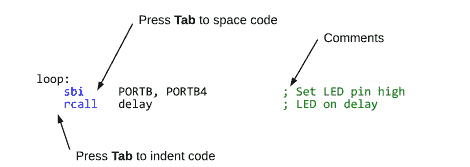

图 2.6：缩进汇编器代码

### 2.3.3 生成项目

现在必须生成项目，以将汇编语言文本文件转换为可以加载到 AVR 微控制器的文件。单击顶部工具栏上的生成图标，或从顶部菜单中选择“生成 ▶ 生成 led_blink.asm”。生成过程的输出消息显示在弹出到 Microchip Studio 底部的窗格中。如果生成成功，底部窗格中将出现文本“生成成功。”。

### 2.3.4 修复任何生成错误

如果生成时发生任何错误，Microchip Studio 底部窗格中将出现带有 X 的红色圆圈，并附带错误描述。如果程序中确实发生生成错误，请双击红色圆圈，将光标移动到汇编器文件中包含错误的位置。将代码行与 led_blink_asm 代码列表进行核对以找到错误。此程序的任何问题都只可能是输入错误。请确保您的代码与代码列表完全相同。本书的所有源代码均可从 Elektor 下载。如果仍有问题，请下载代码并与您的代码进行比较，或将源代码复制粘贴到 main.asm，保存并再次生成。

### 2.3.5 将程序加载到 AVR 微控制器

此时，假设正在使用的编程器（例如 Atmel-ICE）已按本章前面所述连接到 AVR 微控制器，且微控制器电路由 5V 供电。还假设微控制器是全新的，因此其内部熔丝设置为出厂默认值。使用 USB 爱好者编程器的读者现在必须遵循附录 A 中的说明。这些说明展示了如何使用爱好者编程器设置和编程目标 AVR 微控制器。爱好者编程器用户随后可以继续阅读第 2.3.6 节。

要使用 Microchip Studio 中直接支持的 USB 编程器（例如 Atmel-ICE、AVR Dragon 或 AVRISP mkII）将刚在 Microchip Studio 中生成的程序加载到 AVR 芯片，首先选择您正在使用的编程工具。在 Microchip Studio 中，单击第二个水平工具栏上名为“无连接”或“无工具”的锤子图标，或从顶部菜单中选择“项目 ▶ led_blink_asm 属性…”（键盘快捷键 Alt + F7），然后在打开的页面左侧列中选择“工具”。单击“所选调试器/编程器”下方的框，然后在打开的列表中单击您正在使用的工具——该工具必须插入 USB 端口才能出现在列表中。在“接口：”下，对于新的 ATtiny13 或 ATtiny25/45/85 器件选择 ISP，因为这些器件默认使用 ISP 设置。使用键盘快捷键 Ctrl + S 保存更改。

打开 ATtiny 电路的电源。单击 Microchip Studio 顶部工具栏上的“开始但不调试”图标（顶部绿色三角形图标）将程序加载到微控制器。或者使用键盘快捷键 Ctrl + Alt + F5，或从顶部菜单中选择“调试 ▶ 开始但不调试”。如果程序加载成功，LED 将开始闪烁。

### 2.3.6 故障排查

如果程序无法加载，请检查明显的问题，例如编程器未插入或电源未打开。还要检查编程器 ISP 头与微控制器之间的接线。如果 LED 未开始闪烁，但程序加载成功，则程序中可能存在错误，该错误在生成程序时不会触发错误消息。在这种情况下，请将程序的每一行与代码列表进行核对，以确保一切正确。检查 LED 和串联电阻是否接线正确。如果仍有问题，请将随附文件中的代码复制粘贴到您的项目中，因为可能存在您未找到的错误。重新生成项目，并再次将程序加载到微控制器。

## 2.4 第一个 C 程序

由于本书除了汇编语言编程外还包含 C 语言编程，本节将创建一个闪烁或闪烁 LED 的 C 程序。本练习的目标是向读者展示如何在 Microchip Studio 中为 ATtiny 微控制器创建 C 项目。对于尚未学习 C 语言的读者，仍然可以按照这些步骤创建 C 程序，而无需了解 C 语言。如前言所述，本书不教授 C 语言，但任何人都可以使用它来学习 AVR 汇编语言和 AVR 微控制器架构。希望在微控制器上学习 C 语言的读者可能会喜欢同一作者、由 Elektor 出版的《使用 Arduino 进行 C 语言编程》一书——ISBN：978-1-907920-46-2。以下小节展示了如何在 Microchip Studio 中启动新 C 项目、编写代码以闪烁图 2.1 中的 LED、生成 C 项目并将程序加载到 ATtiny 设备。使用与图 2.1 相同的电路，以相同方式连接编程器，或使用附录 B 中的相同替代电路。

### 2.4.1 在 Microchip Studio 中启动新的 GCC C 可执行项目

打开 Microchip Studio，并以与第 2.3.1 节用于汇编器项目相同的方式启动新项目。这将打开“新建项目”对话框。由于先前创建的项目是汇编器项目，因此对话框左侧窗格中仍选中了“汇编器”。首先需要单击对话框左侧窗格中的“C/C++”项。在对话框中间窗格中，单击“GCC C 可执行项目”。


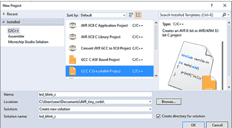

## 图 2.7：在 Microchip Studio 中启动新 C 项目

在对话框底部附近的 Name: 字段中为项目命名为 led_blink_c，并在需要时更改项目位置。如果要在与先前创建的汇编程序相同的位置创建项目，Location: 字段可以保持不变。图 2.7 显示了新建项目对话框的图像。单击 OK 按钮继续。

单击上一步中的 OK 按钮后打开的下一个对话框是器件选择对话框。此对话框的使用方式与创建汇编项目时选择微控制器时完全相同。在搜索字段中键入部件号以搜索正在使用的器件，本练习中的部件号为 ATtiny13、ATtiny13A、ATtiny25、ATtiny45 或 ATtiny85。如有需要，请参阅图 2.5。使用搜索字段筛选出所需器件后，在对话框的左侧窗格中单击它以将其选中。最后单击 OK 按钮。Microchip Studio 将创建新项目并打开项目的 main.c 文件，该文件包含一些骨架 C 代码。

## 2.4.2 LED 闪烁 C 代码

将 main.c 文件中的骨架 C 代码替换为以下 led_blink_c : main.c 代码清单中的代码。如果使用附录 B 中 LED 连接到引脚 PB0 的替代电路，则使用附录 B 第 B.5.2 节中的替代 C 程序。请务必按清单所示输入所有代码。与汇编项目一样，使用 Tab 键按所示方式缩进代码。在 C 程序中，分号 (;) 不是注释的开始，而是用于终止 C 语句。因此，重要的是不要遗漏任何分号，否则 C 编译器在构建过程中运行时会报告错误。

```
led_blink_c : main.c

//#define F_CPU 1000000UL // 1MHz default clock for ATtiny25/45/85
#define F_CPU 1200000UL // 1.2MHz default clock for ATtiny13(A)
#include <avr/io.h>
#include <util/delay.h>

int main(void)
{
    DDRB = (1 << DDB4); // Set up pin PB4 as an output

    while (1) {
    PORTB |= (1 << PORTB4); // Set pin high (LED on)
    _delay_ms(1000); // 1 second delay
    PORTB &= ~(1 << PORTB4); // Set pin low (LED off)
    _delay_ms(1000); // 1 second delay
    }
}
```

如代码清单所示，文件顶部有两个 F_CPU 定义。F_CPU 用于告诉代码微控制器的初始时钟速度设置为多少。这由 _delay_ms() 函数使用，以准确设置其产生的时间延迟。之所以有两个 F_CPU 定义，是因为 ATtiny13 器件的默认时钟频率与 ATtiny25/45/85 微控制器不同。第一个定义使用两个正斜杠 (//) 注释掉，这意味着第二个定义生效并针对 ATtiny13 器件进行设置。如果使用 ATtiny25/45/85 器件之一，请取消注释顶部定义并注释掉第二个定义，如以下代码片段所示。

```
#define F_CPU 1000000UL // 1MHz default clock for ATtiny25/45/85
//#define F_CPU 1200000UL // 1.2MHz default clock for ATtiny13(A)
```

这两个默认时钟频率足够接近，因此如果不进行上述更改，程序仍可在任何器件上运行，但为了创建更准确的时序，可以进行更改。

## 2.4.3 构建项目

输入上一小节中的代码后，使用工具栏上的生成图标构建项目，或从顶部菜单使用 生成 ▶ 生成 led_blink_c。如果代码中没有错误，项目将构建并在 Microchip Studio 底部弹出的窗口中显示消息“生成成功。”。

## 2.4.4 修复任何构建错误

如果项目未成功构建，错误消息或错误消息将出现在 Microchip Studio 底部，旁边带有红色 X 图标。如果是这种情况，请检查清单中的代码是否完全按所示输入。这个简单的程序不太可能出错，因此只需检查拼写错误，特别是查找遗漏的分号和拼写错误。本书中所有程序的源代码可从 Elektor 下载。如果仍有问题，请下载代码并将本练习的代码复制粘贴到此 Microchip Studio 项目的 main.c 文件中。保存更改并再次构建。

## 2.4.5 将程序加载到 AVR 微控制器

将程序加载到 ATtiny 器件的步骤与此 C 代码项目与汇编语言项目完全相同。对于直接支持的编程器，例如 Atmel-ICE，请通过单击工具栏上的 None 图标来选择编程设备。使用打开的页面选择编程设备和 ISP 接口，请记住，编程器必须插入 PC 的 USB 端口才能出现在选择列表中。保存更改，然后单击工具栏上的启动不调试图标，或使用键盘快捷键 Ctrl + Alt + F5，或从顶部菜单选择调试 ▶ 启动不调试。有关更多详细信息，请参阅第 2.3.5 节。对于爱好者编程器，单击在附录 A 中设置的编程按钮，假设您使用的 AVR 器件和编程器与汇编语言程序相同。如果没有问题，程序将加载到 ATtiny，LED 将开始以比汇编程序更慢的速度闪烁。

## 2.4.6 故障排查

如果将程序加载到微控制器时出现问题，请参阅第 2.3.6 节以了解可以采取哪些措施来解决问题。尽管第 2.3.6 节是为汇编语言编写的，但故障排查技术对 C 程序也相同。

## 2.5 总结

- Microchip Studio 是一个用于为 AVR 微控制器开发软件的完整开发环境。Microchip Studio 被称为 IDE（集成开发环境），包括文本编辑器，以及汇编器、C 编译器和其他编程工具。
- Atmel Studio 于 2020 年重新品牌化为 Microchip Studio。
- 使用 Microchip Studio 编写新的汇编语言或 C 程序时，必须启动新项目。
- 汇编语言和 C 程序使用 Microchip Studio 中的文本编辑器以文本形式编写。
- 如果程序中有任何语法错误，将在构建过程中捕获。
- 构建程序后，可以使用 USB 编程工具（例如 Atmel-ICE 或爱好者编程器）将其加载到微控制器。

在下一章中，我们将研究汇编语言程序的基础知识，以便获得足够的知识来了解在使用模拟器和调试器时程序中发生了什么。LED 闪烁程序的基本操作已得到解释，并将在模拟器中以及使用 Atmel-ICE 的硬件调试功能在 AVR LED 电路上运行。

## 第 3 章 • 汇编语言基础

微控制器只能以二进制格式执行或运行机器语言指令。汇编语言由人类可读的助记符组成，这些助记符由称为汇编器的程序转换为二进制机器语言。

本章将介绍汇编语言的组成、AVR 微控制器的汇编语言指令集，以及 LED 闪烁汇编语言程序的工作原理。

本章最后将介绍 Microchip Studio 中调试器和模拟器的基本用法。

### 本章内容

- 基本 AVR 汇编语言术语和概念
- AVR 指令集简介
- 汇编语言注释
- LED 闪烁汇编语言程序的操作
- 使用 Microchip Studio 中的调试器和模拟器

### 3.1 助记符

单词“mnemonic”（第一个 'm' 不发音）的意思是用于帮助记住某事的设备或技术。助记符的一个简单示例是“Never Eat Silk Worms”，用以按顺时针方向记住罗盘点位，从顶部的北开始，依次为：北、东、南、西，即 NESW。

汇编语言指令由助记符组成，这些助记符旨在成为易于记忆的首字母缩写或缩略语，例如助记符 SBI 代表“Set Bit in I/O Register”。另一个示例是 LD，它是“Load”的缩写。

汇编语言程序中的助记符由汇编器程序转换为其二进制机器代码等效项。例如，助记符 SBI 由汇编器转换为二进制代码 10011010。然后，AVR 微控制器可以运行此二进制机器代码指令，而其助记符等效项是人类可读和可理解的。从技术上讲，SBI 助记符是机器代码指令的一部分，该指令由操作码（opcode，简称）和两个操作数组成。包括操作数在内，机器代码指令实际上宽 16 位，尽管 ATtiny 和 ATmega 器件具有 8 位架构。如前所述，操作码 SBI 转换为 8 位数字，两个操作数转换为第二个 8 位数字，共计 16 位。指令以 16 位宽存储。此时这可能有点难以理解，但随着我们在接下来的几章中更熟悉 AVR 架构，这将得到恰当解释。

Microchip Studio 使用的 AVR 汇编器程序不区分大小写，因此助记符指令可以用大写或小写编写，例如 SBI 或 sbi。本书在文本中引用助记符时使用大写，在代码清单中使用小写。采用此约定的原因是，这是 Microchip / Atmel 数据手册和其他 AVR 微控制器文档中使用的约定。

### 3.2 AVR 指令集

每种不同的微控制器架构都有自己的指令集，由架构可运行的整个汇编语言指令集组成，归根结底是架构可运行的整个二进制机器代码指令集。指令集手册列出并描述了所有汇编语言


特定架构的指令。从 Microchip 处下载 AVR 指令集手册，链接如下，并在编写汇编程序时保存以供参考。

www.microchip.com/downloads/en/DocDoc/AVR-Instruction-Set-Manual-DS40002198A.pdf (如果此链接更改且无法使用，或要查找是否有更新版本的手册，请在互联网上搜索 "AVR instruction set manual")

并非所有 AVR 汇编指令都在每个 AVR 微控制器中实现。ATtiny25/45/85 和 ATtiny13(A) 微控制器使用整个 AVR 指令集中的 123 条指令子集。这些微控制器中可用的指令可以在以下链接所示的 ATtiny25/45/85、ATtiny13 和 ATtiny13A 数据手册中找到。请在任意数据手册的 "Instruction Set Summary" 部分查看已实现指令列表。下载您正在使用的器件或器件的数据手册。在进行 AVR 汇编语言编程时，请保留这些数据手册以供参考。

- **ATtiny25/45/85 数据手册:** www.microchip.com/downloads/en/deviceDoc/atmel-2586-avr-8-bit-microcontroller-attiny25-attiny45-attiny85_datasheet.pdf (如果此链接更改且无法使用，请在互联网上搜索 "ATtiny25 数据手册")
- **ATtiny25 网页:** www.microchip.com/en-us/product/ATTiny25
- **ATtiny45 网页:** www.microchip.com/en-us/product/ATTINY45
- **ATtiny85 网页:** www.microchip.com/en-us/product/ATTiny85
- **ATtiny13 数据手册:** www.microchip.com/downloads/en/DeviceDoc/doc2535.pdf (如果此链接更改且无法使用，请在互联网上搜索 "ATtiny13 数据手册")
- **ATtiny13 网页:** www.microchip.com/en-us/product/ATTiny13
- **ATtiny13A 数据手册:** www.microchip.com/downloads/en/DeviceDoc/ATTiny13A-Data-Sheet-DS40002307A.pdf
- **ATtiny13A 网页:** www.microchip.com/en-us/product/ATTiny13A

Microchip / Atmel 数据手册中关于各种 AVR 器件实现指令数量存在一些差异。本书第 11 章第 11.3.1 节在末尾对此进行了讨论。

## 3.3 操作码和操作数

操作码（operation code）是汇编语言指令中指定要执行的操作的部分。在以下代码行中，SBI 是操作码，它指定将在 I/O 寄存器中设置一位。DDRB 和 DDB4 是操作数，它们指定将在哪个寄存器的哪一位上设置。寄存器是 AVR 微控制器内部架构的一部分，用于存储数据字节。

```
sbi DDRB, DDB4 ; Set pin PB4 as output
```

并非所有汇编语言指令都同时包含操作码和操作数。以下代码显示了仅包含操作码的 RET（return）指令。

```
ret
```

## 3.4 汇编语言注释

如前所述，汇编语言注释以分号 (;) 开头。分号后的任何文本都会被汇编器程序忽略。注释用于编写有用的注释，以解释程序中正在发生的事情。

分号还可用将一行代码转换为注释，从而在不删除代码的情况下将其从程序中移除。在开发和测试汇编语言程序时，暂时移除一行或多行代码非常有用。

Microchip Studio 中的汇编器程序也支持 C 和 C++ 风格的注释。双斜杠由汇编器以与分号相同的方式处理。开头斜杠星号 (/*) 和结尾星号斜杠 (*/) 之间的文本被视为注释，可以跨多行，如以下代码所示。

```
; Single line assembler comment
// Single line C/C++ style comment
/* Multi-line
C/C++ style
comment
*/
```

## 3.5 LED 闪烁程序操作

图 3.1 显示了上一章中 LED 闪烁程序的流程图，但不包括延迟子程序。程序中的每条指令都放置在流程图中相应块的旁边。在阅读以下说明时，打开 Microchip Studio 中的 led_blink_asm 项目并参考流程图可能会有所帮助。

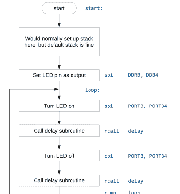

图 3.1：LED 闪烁 AVR 汇编程序的流程图

汇编语言程序以代码顶部名为 start: 的标签开始。程序从此处开始运行。在这个特定程序中，没有此标签也没关系，因为它从未被使用，它只是向程序员指示这是程序的开始或入口点。标签始终以冒号 (:) 结尾。

汇编语言程序中的每行代码都由微控制器从上到下执行或运行，除非执行了跳转或分支指令，这会改变从上到下的程序流程。

通常，通过初始化堆栈指针来设置堆栈，如 start 标签后的第一个矩形所示。这不是必需的，因为堆栈指针的默认值正是我们想要的。堆栈和堆栈指针将在本书后面解释。目前只需知道，如果程序中调用了子程序（如本程序所示），则有必要设置堆栈指针。

AVR 微控制器具有输入/输出（I/O）引脚，可以单独设置为读取逻辑电平的输入或驱动 LED 等负载的输出。以下代码片段中显示的第一条 SBI 指令设置与 LED 连接的引脚（引脚 PB4）对应的位，如第 2 章图 2.1 所示。这将引脚从输入更改为输出（这是在微控制器中名为 DDRB 的寄存器中完成的）。现在可以在 loop: 标签后的代码中打开和关闭 LED。

```
sbi DDRB, DDB4 ; Set pin PB4 as output
```

位、寄存器和 I/O 引脚将在本书后面更详细地解释。此说明只是对程序工作原理的概述或顶层视图。

loop: 标签用于标记循环的顶部，如以下从 LED 闪烁程序中摘录的代码片段所示。循环内的代码继续从上到下运行，除非某条指令导致程序执行跳出循环。此标签的名称可以是任何名称，但 loop 对于此程序来说是一个明智的选择，因为它描述了标签的用途。

```
loop: sbi PORTB, PORTB4 ; Set LED pin high
      rcall delay ; LED on delay
      cbi PORTB, PORTB4 ; Clear LED pin low
      rcall delay ; LED off delay
      rjmp loop
```

在循环内，LED 连接的引脚被设置为高电平，从而打开 LED。这再次使用 SBI 指令完成，但这次它操作的是名为 PORTB 的不同寄存器。然后调用延迟子程序，使 LED 保持一段时间。时间延迟后，使用 CBI 指令关闭 LED，并再次调用延迟子程序，使 LED 保持一段时间。RJMP 指令用于跳回循环顶部（即 loop: 标签）并再次执行循环中的指令。这会导致 LED 不断闪烁。

名为 delay 的子程序位于主程序循环下方，如下一个代码片段所示。它是一段代码，可以由主程序或另一个子程序调用或运行。子程序相当于 C 语言中的函数。

```
; Delay subroutine
delay:
 ldi  r16, 0xff
delloop1:
 ldi  r17, 0xff
delloop2:
 dec  r17        ; Delay by decrementing
 brbc SREG_Z, delloop2
 dec  r16        ; Delay by decrementing
 brbc SREG_Z, delloop1
 ret
```

子程序的优点在于，子程序中的一段代码可以反复使用，而无需在每次使用时都包含整个子程序代码。例如，在 LED 闪烁程序中，延迟子程序代码只需编写一次，并在主程序中需要时调用。延迟子程序用于在 LED 亮起或熄灭时浪费时间，以便眼睛能看到 LED 的亮灭状态。延迟子程序通过主程序中的 RCALL 汇编指令调用。

延迟子程序的基本工作原理是通过递减存储在寄存器中的数字来浪费时间。在此阶段，延迟子程序代码和主循环中的指令不会得到完全解释，因为要正确解释需要了解微控制器的一些内部寄存器。第 5 章介绍了 AVR 寄存器和内存映射。在下一节中使用模拟器也有助于理解代码。这里的意图是获得基本理解，即正在执行汇编语言指令，以在微控制器中引起各种动作，最终使 LED 闪烁。

## 3.6 使用调试器和模拟器

本节介绍了在 Microchip Studio 中使用 AVR 模拟器和调试器的基本方法。以下第一部分展示了如何将模拟器与调试器一起使用，第二部分展示了如何使用 USB 程序员/调试器（例如 Atmel-ICE）将调试器与物理硬件一起使用。


### 3.6.1 使用 AVR 模拟器和调试器

在 Microchip Studio 中将调试器与模拟器一起使用不需要任何实体硬件，也不需要诸如 Atmel-ICE 之类的程序员/调试器。首先在 Microchip Studio 中打开第 2 章的 led_blink_asm 项目。如果尚未构建，请构建该项目。要使用模拟器，必须将模拟器选项选为与项目一起使用的工具——选择模拟器而非 Atmel-ICE 或其他编程工具。单击第二个水平工具栏上标记为 None 的锤子图标，或者如果之前已选择编程工具，请单击同一位置中当前选定工具的名称。或者从顶部菜单选择 Project ▶ led_blink_asm Properties... 或使用 Alt + F7 键盘快捷键，然后单击左侧列中的 Tool。在 Selected debugger/programmer 标题下的下拉框中选择 Simulator，然后保存更改。工具设置如图 3.2 所示。

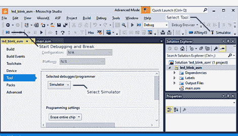

图 3.2：在 Microchip Studio 中选择模拟器

如图 3.2 所示，单击左上角第二个顶部工具栏上的 Start Debugging and Break 图标启动模拟器，或者使用键盘快捷键 Alt + F5，或从顶部菜单选择 Debug ▶ Start Debugging and Break。

启动模拟器后，由于选择了“Start Debugging and Break”，它会将第一条汇编语言指令高亮显示为黄色。这意味着调试器已启动，程序已加载，但程序执行在第一条指令处停止。我们现在将调试器与模拟器结合使用，逐条执行 led_blink_asm 汇编语言程序代码中的每条指令。模拟器模拟创建项目时选定的当前 ATtiny AVR 微控制器。当调试器运行时，可以在 Microchip Studio 中检查模拟 AVR 微控制器的内部寄存器和内存。

默认情况下，I/O 窗口应作为一个小浮动窗口打开，但如果没有，请从顶部菜单选择 Debug ▶ Windows ▶ I/O 来打开它。将此窗口移动到合适的位置，以便易于查看且不遮挡代码。在 I/O 窗口中单击它以选择 I/O Port (PORTB)。如图 3.3 所示，I/O 窗口底部现在会显示一些其他项目。本练习中我们关注标记为 DDRB 和 PORTB 的项目，并在执行某些汇编语言指令时观察它们的变化。

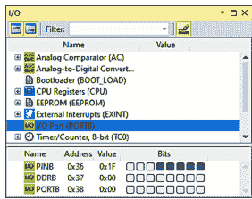

使用第二个顶部工具栏上的 Step Over 图标或键盘键 F10 逐条执行程序指令。每次逐条执行一条指令时，它会被执行，并且下一条指令会高亮显示为黄色。当逐条执行以下第一行代码时，可以在 I/O 窗口中看到 DDRB 的变化。

```
sbi DDRB, DDRB4 ; Set pin PB4 as output
```

DDRB 是一个 8 位寄存器，用于在 LED 闪烁示例中将 LED 连接到的引脚设置为输出引脚。上面代码片段中显示的 SBI 指令在 DDRB 寄存器中设置正确的位，以便引脚可以控制 LED 的开关。位和寄存器将在接下来的两章中详细说明。

代码中循环标签之后，一条 SBI 指令然后是一条 CBI 指令会导致 I/O 窗口中的变化。这次变化出现在 PORTB 寄存器中。继续使用 F10 键或 Step Over 图标逐条执行程序。当执行循环标签后的第一条 SBI 指令时，可以在 I/O 窗口的 PORTB 寄存器中看到变化。此变化表示 LED 亮起。逐条执行延迟子程序的调用，然后逐条执行 CBI 指令。CBI 指令关闭 LED，这在 I/O 窗口的 PORTB 寄存器中可见。

当执行 RJMP（相对跳转）指令时，程序执行再次从循环顶部开始，即循环标签后的第一条指令。这完成了循环，循环中的指令再次执行，直到到达循环底部并再次执行 RJMP 指令。

这只是对使用模拟器的基本介绍，旨在展示指令如何从上到下执行，除非执行了更改程序流程的跳转指令。单击第二个顶部工具栏上的 Stop Debugging 图标（红色方块 ■），或从顶部菜单选择 Debug ▶ Stop Debugging，或使用键盘快捷键 Ctrl + Shift + F5 来停止模拟器和调试器。

### 3.6.2 使用物理 AVR 微控制器和调试器

将调试器与物理 AVR 微控制器电路一起使用基本上与将其与模拟器一起使用相同，但必须选择正确的调试工具而不是模拟器，并且必须将 AVR 置于启用其调试功能的状态。必须使用 USB 调试器/程序员，例如 Atmel-ICE 或 AVR Dragon。仅用于编程的 USB 设备无法用于调试。这意味着使用爱好者程序员或 AVRISP mkii 的读者将无法调试物理硬件，但可以通读本节。

在 ATtiny13(A) 和 ATtiny25/45/85 中，实际上在第 1 章第 1.3 节的表 1.1 中除 ATtiny26 之外的所有 PDIP 封装微控制器中，调试是通过首先在微控制器芯片本身上启用 debugWIRE 来完成的。本练习中我们使用第 2 章图 2.1 中的相同 LED 电路和相同的 led_blink_asm 项目。

将调试设备（例如 Atmel-ICE）插入主机 PC 的 USB 端口。在 Microchip Studio 中通过单击第二个工具栏上的锤子图标来选择调试器/程序员，如果遵循了之前的模拟器说明，那里现在应显示 Simulator。在打开的页面上，使用 Selected debugger/programmer 下的下拉框选择用于编程和调试 AVR 的调试工具。对于 Interface，选择 ISP。保存更改。

我们需要将 AVR 从默认的 ISP 模式更改为 debugWIRE 模式，以便与 Microchip Studio 调试器一起使用。在调试器/程序员设备已插入 PC USB 端口且 6 针插头已连接到 AVR 微控制器电路的情况下，为 AVR 电路通电。在 Microchip Studio 中选择 Tools ▶ Device Programming 或键盘快捷键 Ctrl + Shift + P。顶部工具栏右侧也可以找到 Device Programming 图标。Device Programming 对话框打开，当前工具和设备应已预选。确保对话框顶部的选定接口为 ISP，然后单击 Apply 按钮。要测试选定的工具是否可以正确连接到选定的设备，请单击对话框顶部 Device signature 下的 Read 按钮。如果连接成功，将填充设备签名和目标电压框。如果尝试连接时出现任何错误，请确保工具、设备和接口正确。还要检查电路是否正确连接到编程工具，并且由 5V 供电。目标 AVR 必须处于默认出厂设置状态，并启用 ISP 接口。

不要使用仅编程的 USB 程序员设置 DWEN 熔丝，因为它将无法将 AVR 从 debugWIRE 模式中取出。单击 Device Programming 对话框左侧列中的 Fuses 项目。在 Fuse Name 下找到标记为 HIGH.DWEN 的 DWEN (debugWIRE Enable) 熔丝。如果此项目不可见，请使用右侧的滚动条将其滚动到视图中，或调整对话框大小直到其显示。单击此熔丝旁边的复选框将其选中，如图 3.4 所示。最后单击对话框中的 Program 按钮。会弹出一个 Fuse Warnings 对话框。单击此框中的 Continue 按钮。如果失败，只需再次单击 Program 按钮。关闭 Device Programming 对话框。编程 DWEN 熔丝后，AVR 仍处于 ISP 模式。必须关闭并再次打开 AVR 的电源（称为“循环电源”）才能将其更改为 debugWIRE 模式。现在为 AVR 循环电源。

既然 AVR 现在处于 debugWIRE 模式，就必须在 Microchip Studio 中更改工具接口。再次单击第二个顶部工具栏上的锤子图标。在打开的页面上，正确的编程设备应仍被选中，但接口必须更改。单击 Interface 下拉框并选择 debugWIRE。保存更改。


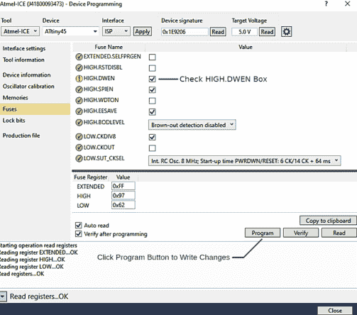

图 3.4: 在器件编程对话框中设置 DWEN 熔丝位

现在可以以与仿真器相同的方式启动调试器。确保目标 AVR 电路的电源已打开。单击左侧第二个顶部工具栏上的“开始调试并中断”图标，或使用 Alt + F5 键盘按键。使用 F10 键或第二个顶部工具栏上的“单步跳过”图标逐条执行汇编语言指令。除循环中的 SBI 和 CBI 指令执行时，物理硬件电路上的 LED 会切换开关状态外，其他所有行为都将与仿真器相同。

调试器实验结束后，单击第二个顶部工具栏上的“停止调试”图标（红色方块 ■）。暂时保持 AVR 处于 debugWIRE 模式，以便可以使用调试器。使用 debugWIRE 模式时，只需连接 debugWIRE 线（也是 RESET 线）、+5V 和 GND。这可以在第 8 章第 8.2.1 节的图 8.2 中看到。使用具有调试功能的 USB 编程器的读者可以在本书余下部分保持目标 AVR 处于 debugWIRE 模式，然后返回以下部分将 AVR 切换回 ISP 模式。

### 3.6.3 将 AVR 切换回 ISP 模式

要将目标 ATtiny 从 debugWIRE 模式切换回 ISP 模式，必须首先在编程器与面包板上的 ATtiny 设备之间连接所有 ISP 模式所需的导线。换句话说，必须按照第 2 章第 2.2 节图 2.1 中的电路，重新连接 MOSI、MISO 和 SCK 导线。

在编程器与目标 ATtiny 之间连接好所有 ISP/SPI 导线后，将编程器/调试器插入主机计算机的 USB 端口，启动 Microchip Studio，然后为电路通电。要使 ATtiny 退出 debugWIRE 模式，必须使用任何使用物理硬件的项目启动调试会话，例如在 Microchip Studio 中打开 led_blink_asm 项目。确保工具栏上已选择正确的 ATtiny 设备和编程器/调试器。现在单击“开始调试并中断”工具栏图标，或使用 Alt + F5 键盘快捷键。调试会话开始后，从顶部菜单中选择 Debug ▶ 禁用 debugWIRE 并关闭。此操作将使 ATtiny 退出 debugWIRE 模式并停止调试会话。对目标 ATtiny AVR 微控制器进行断电再上电。

### 3.7 小结

- 汇编指令由助记符形式的操作码组成，在某些情况下还包括操作数或多个操作数。
- 汇编编程中的助记符是完整操作码名称的缩写形式，可在 AVR 微控制器的 AVR 指令集手册中找到。
- 操作码或操作代码是汇编指令中指定微控制器要执行的操作的部分。
- 操作数是汇编语言指令中操作码所作用的部分，例如寄存器和数据。
- 汇编语言程序使用助记符操作码、操作数和标签编写。汇编语言程序中的一行代码或语句可以直接翻译为其等效的机器码指令。
- 特定微控制器架构的指令集是该架构可以执行且程序可以包含的所有指令的集合。
- 汇编程序将使用助记符编写的文本形式的汇编指令转换为其二进制机器语言形式。
- 注释用于向汇编语言程序添加注释，并以分号开头。AVR 汇编程序中也可以使用 C 和 C++ 风格的注释。
- 编程中的循环用于反复运行某些代码部分。
- AVR 仿真器可用于快速查看某些汇编语言指令的工作方式，是学习汇编语言的绝佳工具。

本章简要介绍了汇编语言以及用于编写、构建、仿真和调试 AVR 汇编语言程序的工具。要正确理解汇编指令，有必要了解微控制器的内部寄存器。微控制器的内部寄存器和内存存储二进制数，二进制数用于操作连接到微控制器的硬件设备，例如 LED。

下一章将解释二进制数和其他数制，这些对于正确理解汇编语言至关重要。对于已经了解二进制和十六进制数工作原理的读者，您可能只想快速浏览下一章的前几部分作为复习。请务必阅读第 4.5 节和第 4.6 节，它们展示了如何在 AVR 汇编语言程序和 C 程序中使用二进制和其他数。

## 第 4 章 • 二进制数和内存

微控制器执行的所有处理都是在二进制数上进行的。任何微控制器的所有机器语言完全由二进制数组成。因此，在继续解释寄存器和内存以及汇编指令如何作用于寄存器和内存之前，正确理解二进制编码系统非常重要。

已经了解二进制数系统工作原理的读者至少应阅读本章第 4.5 节，以了解二进制和十六进制数在汇编语言程序中的使用方式。

### 本章内容

- 位、字节和二进制计数
- 加权二进制数系统
- 十六进制数和十六进制计数
- 使用十六进制表示二进制
- 计算数字和内存大小
- 汇编和 C 程序中的数字

### 4.1 位和字节

由于微控制器是一种电气机器，它以电压电平存储数字。使用两个电压电平——高电压电平和低电压电平。实际使用的电压取决于为微控制器供电的电压。如果 AVR 微控制器由 5V 供电，则 5V 为高电压，0V 为低电压。如果 AVR 微控制器由 3.3V 供电，则 3.3V 为高电压，0V 为低电压。高电压表示数字 1，低电压表示数字 0。因此，单个二进制位的值可以是 1 或 0。“bit”一词是“binary digit”的缩写。

二进制值零可以称为零、逻辑零、低电平或逻辑低，也可以称为假。二进制值一可以称为一、逻辑一、高电平、逻辑高，也可以称为真。

在微控制器中，单个二进制位（即位）存储在内存单元中，内存单元是构成内存的最小构建块。图 4.1 显示了单个内存存储单元，以及单个内存单元中值为 0 或 1 的位如何由电压表示。

| | 内存中的单个单元可以具有值 0 或 1 | |
|---|---|---|
| 0 | 包含逻辑零电平的单个单元存储为 0 伏特 | 0V |
| 1 | 包含逻辑一电平的单个单元存储为 5 伏特 | 5V |

图 4.1: 单个内存单元

#### 4.1.1 二进制计数

使用单个二进制位，可以从 0 计数到 1，就像使用单个十进制位可以从 0 计数到 9 一样。当我们想要在十进制中计数超过 9 时，我们会使用另一位，并可以从 00 计数到 99。同样，使用第二个二进制位，我们可以计数得更高——从 00 到 11（零零到一一），其中二进制 11 的十进制值为 3。在本书中，二进制数以 0b（零比）开头，以指示它们是二进制数而不是十进制数。因此，十进制值 3 在二进制中写作 0b11，除非数字使用的上下文毫无疑问地表明它是二进制数。

二进制计数的工作方式与十进制相同，只是每个位只有两个可用值，而不是十进制的十个值。在十进制中，我们会从 0 计数到 9，然后将下一个更高位（左边的位）加一，然后再次从 0 计数到 9。在二进制中也会发生同样的情况——我们从 0 开始计数到 1，现在没有可用的位了，因此我们将下一个更高位加一，得到数字 0b10。然后第一位再次加一，得到 0b11。现在我们再次没有可用的位，因此需要添加另一位并将数字增加到 0b100。表 4.1 显示了如何在二进制中从 0 计数到 15 或从 0b0000 到 0b1111。

| 十进制 | 二进制 |
| :--- | :--- |
| 0 | 0000 |
| 1 | 0001 |
| 2 | 0010 |
| 3 | 0011 |
| 4 | 0100 |
| 5 | 0101 |
| 6 | 0110 |
| 7 | 0111 |
| 8 | 1000 |
| 9 | 1001 |
| 10 | 1010 |
| 11 | 1011 |
| 12 | 1100 |
| 13 | 1101 |
| 14 | 1110 |
| 15 | 1111 |

可以使用具有二进制模式的计算器来帮助更好地理解二进制计数的工作原理。这可以是带有二进制模式的手持计算器，也可以是随 Windows 操作系统提供的计算器。要在 Windows 中启动计算器，请单击主 Windows 菜单或“开始”按钮，然后键入 calc，这会筛选已安装的应用程序，从而在菜单列表中轻松找到计算器应用程序。单击 Calculator 启动计算器。

默认情况下，计算器处于标准模式，必须更改为程序员模式才能使用二进制数。单击计算器应用程序左上角的计算器菜单图标，然后在打开的菜单中单击 Programmer。计算器应用程序中将出现一系列编码系统（HEX、DEC、OCT 和 BIN）。单击 BIN 项将计算器置于二进制模式。


在计算器应用程序中，单击以下键以开始二进制计数：单击 1、*，=，然后继续单击 =，每次单击递增 1。第一次单击等号按钮时，计数会从 1 递增到二进制的 10，这相当于十进制中的从 1 计数到 2。当前二进制数的十进制等效值可以在计算器中 DEC 旁边查看。图 4.2 显示了用于二进制计数的 Windows 计算器。

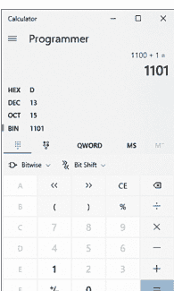

图 4.2：二进制模式下的 Windows 计算器

表 4.1 显示带有前导零占位符的二进制数，例如 0000 而不是 0，0001 而不是 1。无论是否显示这些前导占位符，数值始终相同，因此二进制数 0011 与 11 相同，其十进制值为 3。

使用计算器尝试二进制计数，以更清楚地了解二进制的工作原理。本章后面将探讨二进制编号系统是一种加权系统，这将进一步增强对二进制的理解。

请注意，本书中使用 0b 来表示二进制数，除非上下文表明该数字是二进制数，例如本页上述段落中的情况。

### 4.1.2 字节和半字节

设计微控制器时，会选择微控制器可以获取和操作的二进制数大小。在 8 位微控制器架构中，微控制器获取和操作 8 位宽的数据。8 位宽数的值范围从 0（即 0b00000000，十进制 0）到最大值 0b11111111（十进制 255）。图 4.3 显示了存储二进制数的 8 位宽内存位置示例。

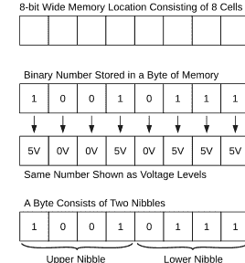

图 4.3：存储二进制数的 8 位宽内存

字节是指由 8 个内存单元组成的 8 位宽数或内存位置，因此宽度为 8 位。半个字节，即 4 位，称为半字节（nibble）。

## 4.2 加权数制

十进制和二进制数制都是加权数制。快速解释十进制中的加权概念，有助于理解二进制数中的相同概念。

### 4.2.1 加权十进制数

表 4.2 显示了四位数 4692 的十进制权重示例。每个数字的权重是 10 的数字位置次方。数字位置编号从数字最右侧开始，值为 0。数字最右侧的数字是最低有效位（LSD），在此示例中为 2。数字最左侧的数字称为最高有效位（MSD），在此示例中为 4。

表 4.2：加权十进制数示例

| 数字位置 | 3 | 2 | 1 | 0 |
|---|---|---|---|---|
| 权重 | 10³ | 10² | 10¹ | 10⁰ |
| | 10 x 10 x 10 | 10 x 10 | 10 | 1 |
| | 1000 | 100 | 10 | 1 |
| 数字 | 4 | 6 | 9 | 2 |
| | 4 x 1000 | 6 x 100 | 9 x 10 | 2 x 1 |

此数字权重解释的要点是表明，本示例中使用的数字 4692 并非由四个各自包含单位的数字（即 4、6、9 和 2）组成。相反，数字在数字中的位置决定其值，该值由其权重决定。换句话说，数字 4692 由 4000、600、90 和 2 组成，而不是 4、6、9 和 2。以下解释展示了如何在数学上确定数字中某位的权重。

从数字最右侧（最低有效位，即 LSD）开始，数字的权重通过将 10 提升到零次方（10^0）来计算。任何数的零次方都是 1，因此 LSD 的权重为 1。本示例中 LSD 的值为 2，因为我们有两个 1，即 2 x 1。

LSD 左侧的数字位置编号为 1。该位置数字的权重值通过将 10 提升到 1 次方（10^1）来计算。任何数的 1 次方都是其本身，因此该数字的权重为 10。本示例中该位置的数字值为 9，但由于其位置及因此的权重，其值为十个 9（10 x 9）或 90。

从右数第三位数字的位置编号为 2，权重为 10 的平方（10^2），即 10 乘以 10 等于 100（将 10 提升到平方表示 10 需要乘自身多少次，在此例中为两次）。在示例数字中，这意味着我们有六个一百（6 x 100）或 600。

最后，最高有效位或 MSD 的位置编号为 3，权重为 10 的立方（10^3）或 1000。因此，示例数字的值为四个一千（4 x 1000）或 4000。如果数字有第五位，它将具有位置编号 4 和 10 的四次方或 10000 的权重，数字中的每个额外位数亦然。这个新数字将成为新的 MSD。

### 4.2.2 加权二进制数

二进制数制的工作方式与上一节解释的十进制数制相同，只是每个数字的权重是通过将 2 提升到数字位置次方来计算的。

表 4.3 显示了一个值为 1011 的二进制数及其每个数字的权重。最右侧的数字可以称为最低有效位或最低有效位（LSB）。最左侧的数字可以称为最高有效位或最高有效位（MSB）。

| 数字位置 | 3 | 2 | 1 | 0 |
|---|---|---|---|---|
| 权重 | 2³ | 2² | 2¹ | 2⁰ |
| | 2 x 2 x 2 | 2 x 2 | 2 | 1 |
| 数字 | 1 | 0 | 1 | 1 |
| | 1 x 8 | 0 x 4 | 1 x 2 | 1 x 1 |

从 LSB 开始，该数字的权重是 2 的零次方（2⁰）。同样，任何数的零次方都是 1，因此该数字的权重为 1，该数字的值为一乘以一（1 x 1）。

左侧下一位数字的权重是 2 的 1 次方（2¹），即 2。因此，本示例中该数字的值为一乘以二（1 x 2）。下一位数字的权重是 2 的平方（2² 或 2 x 2），即 4。本示例中该位数字的值为 0，即零个 4（0 x 4），也就是 0。下一位数字的权重是 2 的立方（2³）或 2 x 2 x 2，即 8。因此，示例数字中有一个 8（1 x 8）。将每个数字乘以其权重的值相加，即可得到该数字的十进制值，如下所示。

0b1011 = (1 x 8) + (0 x 4) + (1 x 2) + (1 x 1) = 11 十进制

可以在计算器上进行验证：在计算器处于二进制模式时输入 1011，然后将其切换到十进制模式（某些计算器在输入数字后、切换到十进制模式前需要按 = 键）。与加权十进制数制一样，如果在数字中添加另一位，其权重可以以相同方式计算。第五位的权重将是 2 的四次方，即 16，每增加一位数字亦然。当在数字左侧添加新数字时，它将成为新的 MSD 或 MSB。

## 4.3 十六进制数

十六进制数是表示二进制数的一种紧凑方式。十进制有 10 个数字，被称为十进制编号系统。二进制是具有两个不同数字的二进制数制。十六进制有 16 个不同的数字，被称为十六进制编号系统。

### 4.3.1 十六进制计数

十六进制计数与十进制一样，从 0 到 9 开始。9 之后，还有六个由字母 A 到 F 表示的数字需要计数。因此计数顺序为 0、1、2、3、4、5、6、7、8、9、A、B、C、D、E、F。

在十六进制中计数到 F 后，就没有可用的数字了。要计数大于 F 的数字，下一位更高位的数字加 1，十六进制数变为 10。十六进制数 10 的十进制值为 16。十六进制数 10 之后，最低有效位以相同方式再次递增，如下所示：10、11、12、13、14、15、16、17、18、19、1A、1B、1C、1D、1E、1F。我们再次没有可用数字，因此将 MSD 加 1，并在 LSD 处再次计数 0 到 F：20、21、...、2A、2B、2C，以此类推。本书中，十六进制数以 0x（zero ex）开头书写，例如 0xA1、0xFF、0x14，以此类推。

与使用 Windows 计算器进行二进制计数的方式相同，我们也可以进行十六进制计数。将计算器切换到 Programmer 模式，单击 Hex 选项。现在单击 1、+、=，然后继续单击 =，每次单击递增 1。Windows 10 计算器会在 DEC 旁边显示当前十六进制数的十进制值。计算器上的 BIN 显示当前数字的二进制值。其他计算器可能需要将模式从十六进制更改为十进制以查看十进制值，或更改为二进制模式以查看二进制数字。

### 4.3.2 使用十六进制表示二进制

如表 4.4 所示，十六进制数字 0 到 F 直接表示从 0b0000 到 0b1111 的四位二进制数。这样，一个八位二进制数只需两个十六进制数字即可表示，使数字更易于阅读和理解。例如，二进制数 0b11110111 可以写成 0xF7，这更短且更易于阅读。一旦你熟练使用十六进制数，就能轻松在脑海中看出十六进制数的二进制等效值。


表 4.4：十六进制计数

| 十进制 | 二进制 | 十六进制 |
|---|---|---|
| 0 | 0000 | 0 |
| 1 | 0001 | 1 |
| 2 | 0010 | 2 |
| 3 | 0011 | 3 |
| 4 | 0100 | 4 |
| 5 | 0101 | 5 |
| 6 | 0110 | 6 |
| 7 | 0111 | 7 |
| 8 | 1000 | 8 |
| 9 | 1001 | 9 |
| 10 | 1010 | A |
| 11 | 1011 | B |
| 12 | 1100 | C |
| 13 | 1101 | D |
| 14 | 1110 | E |
| 15 | 1111 | F |

无论二进制数有多长，都可以使用表 4.4 轻松将其转换为十六进制。只需从数字的右侧开始，将二进制数分成每组四个二进制位，然后使用表格查找每个二进制数并找到其十六进制等效值。例如，16 位二进制数 0b1100100111111010 可以分组如下：

```
1100 1001 1111 1010
```

每组四位二进制数将被其十六进制等效值替换，从而得到十六进制数：

```
C9FA
```

将数字转换为十六进制的另一种方法是将每个二进制位的权重值放在每组四个二进制数字上方，但每组始终使用 8、4、2 和 1，如下所示：

```
8421 8421 8421 8421
1100 1001 1111 1010
```

现在将出现在 1 上方的每个 4 位组的权重相加。如果出现在 0 上方，则忽略权重。因此我们有以下内容。

| 8421 | 8421 | 8421 | 8421 |
| :--- | :--- | :--- | :--- |
| 1100 | 1001 | 1111 | 1010 |
| 8 + 4 | 8 + 1 | 8 + 4 + 2 + 1 | 8 + 2 |
| = 12 | = 9 | = 15 | = 10 |

每组权重的和显示在每个 4 位二进制数字下方，但为十进制。可以在表 4.4 中查找此十进制数以找到十六进制值。如表所示，十进制 12 是十六进制 C，十进制 9 是十六进制 9，十进制 15 是十六进制 F，十进制 10 是十六进制 A，从而再次得到十六进制数 C9FA。

在不使用表格的情况下将二进制数转换为十六进制，我们需要以十六进制计数。使用上述转换为十进制数组的数字，从左边开始，第一个数字或最高有效位（MSD）是十进制 12。要将其转换为十六进制，我们需要从 0 数到 9，然后从 10 数到 12 的十六进制。10 是 A，11 是 B，12 是 C，因此第一个数字是 C。下一个数字是十进制 9，其十六进制值相同，因此目前我们有 C9。右边的下一个数字是十进制 15，因此我们需要再次以十六进制计数。数 0 到 9，然后 A（10）、B（11）、C（12）、D（13）、E（14）、F（15）。我们现在有 C9F。最后一个数字是最低有效位（LSD），其十进制值为 10。再次数 0 到 9，然后 A 即为十进制 10。我们现在已将数字从二进制转换为十六进制，得到 0xC9FA。

在不使用表 4.4 的情况下熟练在二进制和十六进制之间转换数字的诀窍是使用 8、4、2、1 加权系统。将 8421 放在二进制数上方，可以轻松将 0b0000 到 0b1001（0 到 9）的数字转换为其十六进制等效值。例如，0b0111 是 4 + 2 + 1 或 7。8 出现在零上方，因此被忽略。所有其他权重都出现在 1 上方，因此我们将它们相加。0b1001 是 8 + 1，即 9。当超过 9 时，从 0b1010 到 0b1111，可以以十六进制计算权重之和，或者开始识别位模式并了解等效的十六进制数字 A 到 F。当你足够有经验时，你会识别出 0b1010 是 A，0b1011 是 B，等等。很容易记住 0b1111 是 F，因为它是 4 位二进制数中可以计数的最大数字。请记住，刚开始时，你也可以使用计算器在二进制和十六进制之间转换不同的数字系统。

## 4.4 计算数字大小

说到数字和数字系统，一项非常有用的技能是学习如何计算二进制数可以容纳的最大值，具体取决于它包含多少位。数字的最大大小可以通过数学计算得出，对于确定内存大小以及某个存储位置可以容纳的最大值非常有用。

### 4.4.1 计算二进制数的最大值

计算二进制数最大值的公式如下。

```
2^X - 1
```

其中 X 是二进制数的位数。四位二进制数的最大大小计算如下。

```
2^4 - 1
= 16 - 1
= 15
```

上述计算可以在 Windows 计算器上执行，首先将其切换到科学模式。单击计算器左上角的菜单图标，然后单击科学菜单项。按 2、x^、4、= 将 2 乘以 4 次方（2^4），现在按 –、1、= 以计算 15 的结果。表 4.1 和表 4.4 确认 15 是 4 位二进制数可以表示的最大数字。

八位数的最大值可以是 255，如下面用于计算二进制数最大值的公式所示。

```
2^8 - 1
= 256 - 1
= 255
```

此计算可以再次在 Windows 计算器的科学模式下执行，如下所示。单击 2、x^、8、–、1、= 以获得 255 的结果。

### 4.4.2 计算内存大小

微控制器上的内存由存储元素组成，这些元素按单元组排列，如我们在本章开头所见。内存通常按 8 个单元为一组排列，能够存储 8 位数或 1 个字节。内存中的每个字节都有一个地址。内存字节按顺序排列，因此每个字节后面都跟着另一个字节，其地址比前一个地址高 1，如图 4.4 所示。

在图 4.4 的示例中，内存从地址 0 或 0x0000 的第一个字节开始。下一个字节在地址 1 或 0x0001，接着是地址 2 的字节，依此类推。图 4.4 中间的两行是占位符，表示内存以相同方式继续，具有连续地址的连续字节。接着是此特定内存中的最后三个内存位置。如果我们知道内存中最后一个字节的地址，并且知道内存的起始地址，我们可以计算内存的大小（以字节为单位）。

| 地址 | 7 | 6 | 5 | 4 | 3 | 2 | 1 | 0 |
|---|---|---|---|---|---|---|---|---|
| 0x0000 | | | | | | | | |
| 0x0001 | | | | | | | | |
| 0x0002 | | | | | | | | |
| 0x0003 | | | | | | | | |
| ... | | | | | | | | |
| 0x025D | | | | | | | | |
| 0x025E | | | | | | | | |
| 0x025F | | | | | | | | |

图 4.4：顺序字节和内存地址

对于从地址 0 开始并结束于地址 0x25F 的内存，可以使用计算器计算内存大小。只需将结束十六进制内存地址转换为十进制，然后加 1 来执行内存大小计算。0x25F 转换为十进制 607。向 607 加 1，我们得到 608 字节的内存大小。必须将 1 加到转换结果上，因为内存寻址从 0 开始，而不是从 1 开始。

如果图 4.4 的内存从 0x60 开始而不是 0，并结束于地址 0x25F，那么要计算内存大小，我们需要先从 0x25F 减去 0x60，将结果转换为十进制并加 1。减法的结果是 0x1FF 或十进制 511。加 1 给我们 512 字节的内存大小。

还要注意，在图 4.4 中，每个字节的位从右到左编号为 0 到 7。这些是 8 位而不是 7 位，因为位编号从 0 开始而不是 1。0 到 7 是八个数字，因为 0 包含在数字计数中。

### 4.4.3 在字节和千字节之间转换

1 千字节的内存是 1024 字节的内存，而不是 1000 字节的内存。这样做的原因是，最接近 1000 的数由 10 位二进制数表示，即 2^10 = 1024。因此，要以千字节计算内存大小，必须将字节数除以 1024。例如，2048 字节除以 1024 等于 2，即 2 千字节，写作 2K 字节或 2KB。从千字节转换为字节，我们乘以 1024，因此 16K 字节是 16 乘以 1024，等于 16384 字节。

一个大小为 16K 字节且从地址 0 开始的内存块，其最后一个字节的内存地址比内存大小小 1。同样，这是因为寻址从 0 开始而不是从 1 开始。16K 的内存长 16384 字节，其最后一个字节位于地址 16383 或 0x3FFF。

字节可以容纳的最大值比 2^8 或 256 小 1 的原因也是因为编号从 0 开始而不是从 1 开始。如果我们将 0 视为一个数字，0 到 255 是 256 个数字。1 到 255 是 255 个数字。

## 4.5 汇编程序中的数字

在 AVR 汇编语言程序中输入数字时，它们可以是十进制、二进制或十六进制格式。以下是一些示例，用于与 LDI 指令一起使用，以展示汇编语言程序中不同数字的用法。LDI 指令的用法将在下一章中演示。在以下每个示例中，数字出现在汇编语言代码行的末尾。代码中无论使用十进制、十六进制还是二进制，数字最终都会以二进制数的形式出现在微控制器中，以电压电平存储。十进制数字 42。

```
ldi r16, 42
```

十六进制数字 0x2A。

```
ldi r16, 0x2A
```

相同的十六进制数字可以用小写字母写。

```
ldi r16, 0x2a
```


十六进制数也可以用美元符号（$）而不是 0x 开头。

```
ldi r16, $2A
```

二进制数 0b0101010。

```
ldi r16, 0b00101010
```

在数字中加入下划线的相同二进制数更易于阅读，并且 AVR 汇编程序接受这种写法。

```
ldi r16, 0b0010_1010
```

## 4.6 C 程序中的数字

熟悉 C 语言的读者都知道，十进制数直接写为数字，不带任何前缀，例如 C 程序中的 16 就是十进制的 16。C 语言中的十六进制数以 0x 前缀开头，例如 0x2A。

在标准 C 中，无法直接编写二进制数，至少在 C99 或更早的标准中不行。取而代之的是使用十六进制数。与 Microchip Studio 一起使用的 GNU C 编程工具有一个非标准扩展，允许在 C 程序中编写二进制数。二进制数以 0b 前缀开头，与前一节讨论的汇编语言相同，但不支持带下划线的二进制数。例如，在 Microchip Studio 中启动的 GCC C AVR 项目中使用二进制数 0b00010000 可以正常编译和构建。

以下代码片段展示了包含十进制、十六进制和二进制数的 C 程序部分。

```
DDRB |= 16;    // DDB4 as decimal
while (1) {
    PORTB |= 0b00010000;    // PB4 as binary (non-standard)
    _delay_ms(1000);
    PORTB &= ~0x10;    // PB4 as hexadecimal
    _delay_ms(1000);
}
```

## 4.6 总结

- 单个存储单元可以保存一个二进制位（bit），其值可以是 0 或 1。
- 微控制器中的内存通常按 8 个存储单元为一组排列，可以保存 8 位或一个字节。
- 内存中的每个字节都有一个地址，允许微控制器访问它。
- 半个字节或 4 位称为半字节。
- 使用单个二进制位，我们可以从 0 数到 1。要数得更高，我们使用额外的位。二进制数的值可以通过查看每个位的权重来计算。
- 十六进制是表示二进制数的一种紧凑方式，一个十六进制数字代表 4 位或一个半字节。
- 可以使用带有数制转换功能的计算器（例如 Windows 计算器）在不同的数制（如十进制、二进制和十六进制）之间进行转换。
- 二进制数的最大大小可以通过数学计算得出，最大大小取决于数字包含多少位。
- 1K 字节的内存等于 1024 字节，而不是 1000 字节。
- AVR 汇编语言程序中的数字可以用十进制、十六进制或二进制格式编写。
- C 语言程序中的数字可以用十进制或十六进制编写，但 GCC 编译器允许使用二进制格式编写的数字。
- 八进制数制由 8 个数字组成，但很少甚至从未使用。

## 第 5 章 • AVR 寄存器和内存映射

AVR 汇编语言指令作用于内部寄存器和内存，或对其执行操作。本章从程序员的角度介绍 AVR。

编写程序时，了解寄存器的内部结构和内存布局非常重要。

## 本章内容

- AVR 寄存器的不同类型
- 汇编语言代码中使用寄存器
- ATtiny 微控制器的 AVR 内存映射

### 5.1 AVR 寄存器

8 位 AVR 微控制器中的寄存器是 8 位宽的存储位置，用于临时存储数据，或者在控制寄存器的情况下用于控制外围设备。

### 5.1.1 通用工作寄存器

寄存器可用于存储用于数学或逻辑运算的数据，以及存储这些运算的结果。8 位 AVR 微控制器有 32 个 8 位宽的通用工作寄存器，组合在一个通用寄存器文件中，如图 5.1 所示。例外是 ATtiny4/5/9/10 系列，只有 16 个通用寄存器——R16 到 R31。

### 5.1.2 I/O 寄存器

除了通用工作寄存器外，ATtiny AVR 微控制器还有一组 64 个 8 位宽的 I/O 寄存器，可在数据手册的寄存器摘要部分找到。这组寄存器包括用于控制片上外围设备（如定时器、ADC、SPI 等）的控制寄存器，以及状态寄存器和堆栈指针等寄存器（将在下一章讨论）。一些较大的 ATtiny 器件和 ATmega 器件具有扩展的 I/O 寄存器文件，但为了在开始时保持简单，我们暂不介绍此内容。

### 5.2 使用通用寄存器

一些程序示例将有助于展示如何使用通用寄存器。在 Microchip Studio 中启动一个名为 test_asm 的新 AVR 汇编器项目，该项目将用于运行各种简短的代码片段。

创建项目时选择 ATtiny45 作为器件。我们将使用模拟器，因此即使没有实体芯片，选择此器件也没问题。选择此器件的原因是，在使用 ATtiny13 或 ATtiny25 时，调试器/模拟器存在一些错误。如果需要提醒如何启动新的 AVR 汇编器项目，请参阅第 2 章的 2.3.1 节。删除新 test_asm 项目中 main.asm 文件中的骨架代码。此项目和文件将被重复用于测试简短程序和代码片段，避免为每个小程序都创建新项目的必要性。

| 地址 | 寄存器 |
|---------|----------|
| 0x00 | R0 |
| 0x01 | R1 |
| 0x02 | R2 |
| 0x03 | R3 |
| 0x04 | R4 |
| 0x05 | R5 |
| 0x06 | R6 |
| 0x07 | R7 |
| 0x08 | R8 |
| 0x09 | R9 |
| 0x0A | R10 |
| 0x0B | R11 |
| 0x0C | R12 |
| 0x0D | R13 |
| 0x0E | R14 |
| 0x0F | R15 |
| 0x10 | R16 |
| 0x11 | R17 |
| 0x12 | R18 |
| 0x13 | R19 |
| 0x14 | R20 |
| 0x15 | R21 |
| 0x16 | R22 |
| 0x17 | R23 |
| 0x18 | R24 |
| 0x19 | R25 |
| 0x1A | R26 |
| 0x1B | R27 |
| 0x1C | R28 |
| 0x1D | R29 |
| 0x1E | R30 |
| 0x1F | R31 |

所有寄存器均为 8 位宽

7 6 5 4 3 2 1 0

LDI – 加载立即数
SER – 将寄存器中所有位置位
ANDI – 与立即数进行逻辑与
ORI – 与立即数进行逻辑或

X 寄存器
Y 寄存器
Z 寄存器

### 图 5.1：8 位 AVR 通用寄存器文件

### 5.2.1 将两个寄存器相加

将以下代码输入到 test_asm 项目的 main.asm 文件中。

```
test_asm : main.asm – add registers

ldi   r16, 34
ldi   r17, 12
add   r16, r17

loop:
    rjmp  loop
```

保存代码并构建项目。选择 Simulator 作为此项目使用的工具。如果需要提醒如何选择模拟器，请参阅第 3 章的 3.6.1 节。使用第二个工具栏左侧的 Start Debugging and Break 图标启动调试器，或像之前一样使用 Alt + F5。现在从下面显示的第一行开始解释程序的每一行。

```
ldi r16, 34
```

程序的第一条指令使用 LDI（加载立即数）指令将十进制值 34 加载到 R16 寄存器中。在 Microchip Studio 中，在顶部菜单上选择 Debug > Windows > Processor Status 以打开显示通用寄存器的窗口，如图 5.2 所示。如果未显示寄存器，请单击窗口中 Registers 左侧的 + 号以展开寄存器列表。通过调整 Processor Status 窗口大小或在需要时向下滚动该窗口，确保 R16 和 R17 可见。图 5.2 显示了分为两部分的 Processor Status 窗口，以适应页面上的较小区域，R16 和 R17 在右侧。

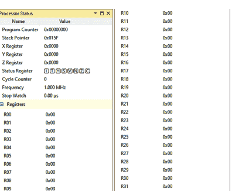

图 5.2：Microchip Studio 中的处理器状态窗口

默认情况下，寄存器中的值以十六进制显示。在 Processor Status 窗口中右键单击寄存器 R16，并在弹出的菜单中选择显示为十进制以以十进制格式显示该寄存器的内容。对寄存器 R17 执行相同操作。


现在单步越过第一条指令，使用 F10 键盘键，它将 34 移动到 R16，并注意该值现在显示在处理器状态窗口的 R16 中。如果您未更改显示值的进制为十进制，该值将显示为 0x22。值显示的进制可以随时通过右键单击寄存器并从弹出菜单中选择所需的进制来更改。LDI 指令的格式为 LDI <destination>, <source>。这会将右侧的值移动到左侧的寄存器中，类似于写入 R16 = 34。

第二条指令与第一条相同，但这次将十进制数 12 加载到寄存器 R17 中，如下所示。在 Microchip Studio 中单步越过此指令，并注意 R17 项旁边处理器状态窗口中的值会发生变化。

```
ldi r17, 12
```

下面显示的第三条指令是 ADD（不带进位加法），它将 R16 中的值与 R17 中的值相加，并将结果存回 R16。

```
add r16, r17
```

单步越过 ADD 指令后，将 34 加到 12 的结果会在 R16 中显示，即寄存器 R16 中出现 46。ADD 指令的格式类似于 C 语言简写表示法 R16 += R17，其中 R17 被加到 R16，结果保存回 R16。这可以完整写为 R16 = R16 + R17。我们永远不会以这种方式使用 C 来直接按名称访问这些寄存器。此处仅使用 C 表示法来解释汇编语言指令的作用。

代码清单中的最后一条指令创建一个无限循环，以防止微控制器尝试运行程序末尾之后的指令。此代码如下所示。

```
loop:
    rjmp loop
```

RJMP（相对跳转）用于跳转到 loop 标签，这会导致 RJMP 指令无限次再次运行。如果没有程序末尾的无限循环，微控制器将自动获取并执行程序之后内存中的下一条指令。下一条指令是未定义的，将是程序之后内存中碰巧存在的任何内容。这可能导致微控制器出现未定义且不需要的行为。因此，没有主循环的程序应始终以无限循环结束。

如图 5.1 所示，LDI 指令只能用于将数据值加载到寄存器 R16 到 R31。图中一条将通用寄存器文件分为两半的线指明了这一点。因此，在加寄存器代码示例中使用了寄存器 R16 和 R17，而不是寄存器 R0 和 R1。如果尝试将 LDI 指令与 R0 到 R15 一起使用，在 Microchip Studio 中构建项目时会标记错误。SER 指令也是如此，它用于将寄存器中的所有位设置为逻辑 1。SER 只能用于寄存器 R16 到 R31。这也适用于图中看到的 ANDI 和 ORI 指令，它们将在后面章节中介绍。这些只是只能对 R16 到 R31 操作的四条指令示例，还有其他指令。图中还显示了图右上角寄存器的位编号。字节中的位从右到左编号为 0 到 7，无论它们出现在寄存器还是内存中。

### 5.2.2 递增寄存器

在此寄存器用法示例中，我们先清除一个寄存器，然后对其递增。递增寄存器意味着向寄存器中加 1。使用上一个示例中的相同测试项目——用以下代码替换代码，但保留底部的无限循环（该循环未在以下代码中显示）。在替换代码之前，如果调试器仍在从上一个示例运行，请停止它。

```
test_asm : main.asm - increment register

clr   r0
inc   r0
inc   r0
inc   r0
```

构建项目，然后像以前一样启动调试器（开始调试并中断）。开始调试时，处理器状态窗口应在 Microchip Studio 中自动打开，就像在上一个示例中使用的那样。在处理器状态窗口中向上滚动，以便可以看到寄存器 R0（R00）。

第一条指令 CLR（清除寄存器）清除寄存器 R0，将其值设置为零。默认情况下，使用模拟器时寄存器已具有零值。如果 R0 已经包含 0x00，执行该指令时不会看到任何变化。在单步越过 CLR 指令之前，可以通过双击处理器状态窗口中 R00 旁边的值来在调试器中更改该寄存器中的值，以便可以查看该指令的作用。例如，双击处理器状态窗口中 R00 旁边的 0x00，键入 45 然后按 Enter 键。按下 Enter 键后，该数字将更改为十六进制并显示为 0x2D。单击其他寄存器之一以将焦点从该寄存器移开，可能更容易看到这个数字。现在单步越过 CLR 指令，R0 中的值将被清除为零（R0 和 R00 是同一个寄存器。R0 在处理器状态窗口中标记为 R00）。

CLR 指令之后，INC（递增）指令重复三次，用于递增寄存器 R0。单步越过 INC 指令，并注意每次执行 INC 指令后 R0 都会递增 1。当程序末尾到达 RJMP 指令时，R0 包含 0x03，如三次递增后所期望的那样。与 LDI 指令不同，CLR 和 INC 指令可用于 R0 到 R31 中的任何通用寄存器。如前所述，CLR 指令的对应指令 SER 会设置寄存器中的所有位，但仅适用于 R16 到 R31，不适用于 R0 到 R15——请参阅图 5.1。在 Microchip Studio 中尝试这些指令。尝试构建一个在 R0 到 R15 寄存器上使用 LDI 或 SER 的项目，以查看 Microchip Studio 中显示的错误。每次更改代码后，请记住保存并构建程序。快速提示：构建项目后，立即按 F10 键启动调试器并中断，而不是单击工具栏按钮。之后继续按 F10 键逐行单步越过代码。

前两个示例展示了通用工作寄存器在汇编语言程序中的一些用法。寄存器可用于存储用于数学计算的值以及存储计算结果。布尔或逻辑运算（尚未介绍）也是如此。随着您阅读本书并看到更多代码示例，以及其他汇编语言指令如何操作寄存器，寄存器的用法将变得更加清晰。

## 5.3 AVR 内存映射

内存映射是一幅插图，显示微控制器或系统的内存大小和地址，如图 5.3 所示的 8 引脚 PDIP ATtiny AVR 所示。每个内存位置都有一个唯一的地址，可用于访问它。当我们在下一章查看 AVR 的内部架构时，将解释这一概念。目前我们只查看 AVR 器件上的不同类型的内存，以及它们的大小和地址。图 5.3 指定了 ATtiny 8 引脚 PDIP AVR，但也适用于第 1 章第 1.3 节表 1.1 中的 14 引脚和 20 引脚 PDIP AVR（ATtiny26 除外），适用于具有 2K、4K 和 8K Flash 的器件，但不适用于 28 引脚 ATtiny48/88。

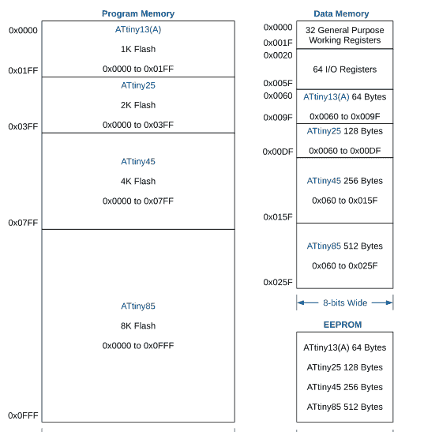

### 图 5.3：ATtiny13(A) 和 ATtiny25/45/85 内存映射

### 5.3.1 程序内存

程序内存保存加载到 AVR 的任何程序的机器代码指令。程序内存由片内可重新编程的 Flash 内存组成，这允许使用 USB 和其他编程设备对其进行编程，这些设备通过 ISP 头连接到电路中的微控制器。与大多数早期的 8 位微控制器不同，8 位 AVR 没有 8 位宽的程序内存，而是 16 位宽的内存。原因是大多数 AVR 指令为 16 位宽，少数为 32 位宽。当我们查看指令如何编码时，the


使用16位宽指令的原因将变得清晰。具有16位宽指令的8位AVR仍被视为8位微控制器，因为它们操作8位宽数据。程序内存的每个内存位置均为16位宽，不能作为两个8位字节访问，每个字节有自己的地址，因为不需要对程序指令进行字节访问（例外情况是数据可以存储在程序内存中并作为字节访问，但程序指令永远不会作为字节访问）。这意味着第一个内存位置位于地址0x0000，包含一条16位宽指令。第二个内存位置位于0x0001，包含一条16位宽指令。这与通常可按字节寻址的系统不同，后者会寻址每个8位宽字节，因此如果指令为16位宽，第一条指令将位于地址0x0000和0x0001，第二条指令位于0x0002和0x0003。

牢记这一点，请参考图5.3左侧的程序内存块，并以ATtiny25为例。ATtiny25的程序内存从地址0x0000开始，到0x03FF结束。要计算该地址范围覆盖的内存大小，我们取结束地址0x03FF并加一（因为地址从0开始）得到0x0400，然后将其转换为十进制，即1024或1K内存。这可能看起来令人困惑，因为现在我们知道从数据手册中ATtiny25具有2K Flash内存。原因是这是1K × 16位宽内存或1K × 2字节，即2K字节内存。

内存映射中的程序内存显示，ATtiny13(A)的内存范围为0到0x01FF，ATtiny25的内存范围为地址0到0x03FF。ATtiny45与ATtiny25具有相同的内存，并从地址0到0x07FF拥有一些额外内存。ATtiny85拥有ATtiny25和ATtiny45的相同内存以及额外内存。这使得ATtiny85的程序内存地址范围为0到0x0FFF。

### 5.3.2 数据内存

ATtiny13(A)和ATtiny25/45/85微控制器上的数据内存由SRAM（静态随机存取存储器）组成。SRAM内存被称为易失性内存，因为当微控制器断电时，它会丢失其中存储的数据。数据内存从地址0x60开始，而不是0，因为通用工作寄存器和I/O寄存器被映射到数据空间的开头。将寄存器映射到数据内存空间允许指令将其作为数据内存访问，这可能很方便。

数据内存空间从地址0开始，与程序内存空间相同。这是由于微控制器的架构使得这成为可能，并在下一章中解释。

可以从图5.3的内存映射中看到，在图右侧的数据内存块中，ATtiny13(A)数据内存大小为64字节，范围从地址0x60到0x9F，ATtiny25数据内存大小为128字节，范围从地址0x60到0xDF。ATtiny45的数据内存大小为256字节，范围从地址0x60到0x15F。ATtiny85的数据内存大小为512字节，范围从地址0x60到0x25F。

数据内存宽度为一个字节（即8位），每个字节都有一个唯一地址。第1章第1.3节表1.1中的14引脚和20引脚ATtiny AVR遵循这些SRAM地址，其中具有2K Flash的器件对应ATtiny25，具有4K的器件对应ATtiny45，具有8K的器件对应ATtiny85内存。ATtiny48/88器件的内存映射不同，因为它们具有扩展的I/O寄存器文件，将SRAM起始地址推至0x0100，并且具有64字节EEPROM。

### 5.3.3 EEPROM

EEPROM（电可擦除可编程只读存储器）可用于存储任何必须在微控制器上电时可用的数据值。与SRAM不同，SRAM在微控制器断电时会丢失其内容，而存储在EEPROM中的数据不会丢失。EEPROM被称为非易失性内存，因为像Flash程序内存一样，它在断电时不会丢失其内容。EEPROM内存宽度为8位，且可按字节寻址。

EEPROM内存通过使用I/O寄存器空间中特定的寄存器进行编程。与Flash内存和SRAM一样，EEPROM从地址0开始，因为它有自己的地址空间。ATtiny13(A)、ATtiny25、ATtiny45和ATtiny85的EEPROM大小可以在图5.3右下角看到。

## 5.4 在汇编程序中访问SRAM

一个在SRAM中存储值并从SRAM加载值的示例程序引入了两条新的汇编指令，即STS（直接存储到数据空间）和LDS（直接从数据空间加载）。将再次使用AVR模拟器来查看运行程序的结果。

### 5.4.1 SRAM存储和加载示例

使用本章前面创建的相同test_asm项目，并用以下程序替换代码。请记住保留新代码底部的无限循环，它未显示在以下代码清单中。

```
test.asm : main.asm - SRAM direct store and load
ldi r16, 0xAA ; Data to store to SRAM
sts 0x60, r16 ; Store data from register to SRAM
lds r1, 0x60 ; Load data from SRAM to register
```

如果要在SRAM中存储一个字节数据，必须先将其加载到寄存器中。每当需要在微控制器中操作数据时，必须先将其加载到通用工作寄存器中，以便微控制器的内部核心可以访问它。在上述程序中，LDI指令用于将值0xAA加载到寄存器R16。这个值就是要存储在SRAM中的值。然后使用STS指令将值存储在地址0x60的第一个SRAM位置中。如代码清单所示，STS指令使用格式STS <目标地址>, <源寄存器>将数据从源寄存器（本示例中的R16）移动到目标地址0x60。该指令中使用的地址宽度为16位，可以写成0x0060，但汇编程序接受0x60，并暗示地址的高字节（或最高有效字节）为0x00。由于地址宽度为16位，它可以用于具有最高地址0xFFFF的AVR微控制器。在ATtiny13(A)、ATtiny25、ATtiny45和ATtiny85上，内存分别不超出地址0x009F、0x00DF、0x015F和0x025F可用，因此程序员不应尝试访问不存在的内存。

LDS是STS的等效指令，但它不是将值从寄存器复制到SRAM，而是将值从SRAM复制到寄存器。在我们的示例程序中，LDS用于获取先前存储在地址0x60的SRAM中的值0xAA，并将其放入寄存器R1。LDS指令的格式为LDS <目标寄存器>, <源地址>，其中源地址是一个16位宽地址。

STS和LDS指令都可以用于向寄存器文件和I/O寄存器存储和加载数据，因为这些寄存器（如内存映射所示）被映射到数据内存空间。STS和LDS均为2 × 16位字长或4字节长的指令，总长度为32位。

### 5.4.2 模拟器中的存储和加载示例

构建包含上一个清单中代码的测试项目并启动调试器（像以前一样开始和中断，请记住可以通过按F10键快速完成此操作），以便我们可以看到程序在AVR模拟器中的运行情况。

当调试器开始运行时，如图5.4所示，Microchip Studio右下角应该有一个可见的内存窗口。如果此内存窗口不可见，请从顶部菜单选择Debug ▶ Windows ▶ Memory，然后从出现的子菜单中选择四个可能的内存窗口之一。使用内存窗口左上角名为Memory:的下拉列表选择data IRAM，如图5.4所示。选择data IRAM后，内存窗口将显示从地址0x60开始的内部SRAM内容。

确保处理器状态窗口已打开，如以前的示例中所用。这是编写时使用的Microchip Studio调试器/模拟器中的一个错误。对于ATtiny13(A)和ATtiny25器件，选择data IRAM时，内存窗口不会显示内存内容。选择ATtiny45器件可解决此问题。

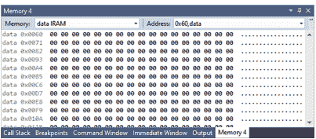

单步执行程序中的第一条指令（LDI），可以看到值0xAA已加载到处理器状态窗口的寄存器R16中。单步执行STS指令后，观察到来自R16的值0xAA现在存储在地址0x60的SRAM中，如内存窗口所示。它在内存窗口中以小写字母aa显示。


当最后一条指令被单步执行（LDS）时，存储在地址 0x60 的 SRAM 中的值现在出现在寄存器 R1 中，如处理器状态窗口所示。这个非常简单的程序介绍了 STS（存储直接到数据空间）指令，用于将数据从寄存器复制到数据空间中的 SRAM 位置。它还介绍了 LDS（从数据空间直接加载）指令，用于将数据空间中 SRAM 的一个字节的值加载到寄存器。这两个 32 位指令各占用两个 16 位宽的程序内存位置。

### 5.4.3 SRAM 起始地址

在前面的示例中，我们使用模拟器访问了 ATtiny45 中 SRAM 的第一个位置。SRAM 中这个第一个位置的地址是 0x60，对于第 1 章第 1.3 节表 1.1 中的所有微控制器都是相同的，ATtiny48/88 器件除外。如果将 ATtiny48 或 ATtiny88 与前面的示例一起使用，则需要按以下清单所示进行修改。

```
test_asm : main.asm - SRAM direct store and load
ldi   r16, 0xAA    ; Data to store to SRAM
sts   0x100, r16   ; Store data from register to SRAM
lds   r1, 0x100    ; Load data from SRAM to register
```

在上述代码中，可以看到对于 ATtiny48/88 器件，SRAM 中的第一个位置已更改为 0x100。这些器件具有从 0x0000 到 0x001F 的通用寄存器文件，以及从 0x0020 到 0x005F 的 I/O 寄存器文件，这与表 1.1 中的其他器件一样。在 I/O 寄存器文件之后，ATtiny48/88 器件具有从 0x0060 到 0x00FF 的扩展 I/O 寄存器文件。随后是 SRAM，起始地址为 0x0100。

Microchip Studio 汇编语言项目均包含一个文件，该文件包含所选 AVR 微控制器的定义。其中一个定义是 SRAM 起始地址，称为 SRAM_START。可以使用此定义，使程序能够在具有不同内存映射的不同 AVR 器件之间工作，因为它为所选 AVR 器件定义了正确的 SRAM 起始地址。使用此定义时，前面的代码如下所示。此代码现在适用于表 1.1 中的所有器件，并写入 SRAM 中第一个位置的正确地址。

```
test_asm : main.asm - SRAM direct store and load
ldi   r16, 0xAA    ; Data to store to SRAM
sts   SRAM_START, r16 ; Store data from register to SRAM
lds r1, SRAM_START ; Load data from SRAM to register
```

如果在选定了 ATtiny45 的 Microchip Studio 汇编语言项目中使用引用 SRAM_START 定义的代码，则 SRAM_START 定义为 0x0060。如果改为选择 ATtiny48 或 ATtiny88，则 SRAM_START 定义为 0x0100。这只是对包含的定义文件的简要介绍。后续章节将给出来自该文件的更多示例。ATtiny48/88 器件具有扩展 I/O 寄存器文件的原因是它们具有更多片上外设，因此需要更多 I/O 寄存器来控制这些外设。

### 5.5 总结

- AVR 微控制器具有 32 个名为 R0 到 R31 的通用工作寄存器，这些寄存器组合在一起形成寄存器文件，ATtiny4/5/9/10 系列除外，该系列有 16 个寄存器 – R16 到 R31。
- AVR 微控制器具有 64 个 I/O 寄存器，称为 I/O 寄存器文件，其中包括堆栈指针、状态寄存器以及用于控制片上外设（如定时器、ADC 等）的寄存器。
- AVR 系列中的一些较大器件具有扩展 I/O 寄存器文件——这包括 28 引脚的 ATtiny48/88 器件。
- 内存映射显示微控制器或系统上可用的所有内存和地址空间。
- ATtiny13(A) 和 ATtiny25/45/85 微控制器具有用于存储在微控制器上运行的程序的 Flash 程序存储器、用于存储易失性数据的 SRAM 以及用于存储非易失性数据的 EEPROM。
- 寄存器文件和 I/O 寄存器映射到 AVR 微控制器上与 SRAM 相同的地址区域。
- STS 和 LDS 指令可分别用于将值存储到 SRAM 或从 SRAM 加载值。这些指令还可用于访问映射到 AVR 数据空间的任何寄存器。

## 第 6 章 · AVR 内部架构

要正确理解在 AVR 微控制器内部执行机器指令时发生的情况，必须了解 AVR 内核或 CPU 的内部架构。

本章解释了理解微控制器内部工作原理所需的概念，并展示了 AVR 的内部工作方式。

### 本章内容

- 时钟脉冲和程序计数器寄存器
- 时钟脉冲周期和频率
- 微控制器总线
- Harvard 和 von Neumann 架构
- AVR 中指令的获取和执行方式
- 状态寄存器、堆栈和堆栈指针
- AVR 指令编码
- 寻址方式

### 6.1 时钟脉冲和程序计数器

在最基本的层面上，微控制器的内核由时钟脉冲驱动。时钟脉冲在微控制器中驱动的东西之一是程序计数器。

### 6.1.1 时钟脉冲

时钟脉冲是一种方波，要么由微控制器内部电路生成，要么从外部振荡器馈送到微控制器。方波基本上是一个一位二进制计数器，如图 6.1 中间所示。

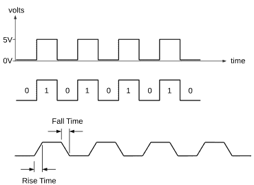

图 6.1 顶部显示了一个方波，这是一个随时间不断从 0V 变化到 5V 并再次回到 0V 的电压。电压在一段时间内保持在 0V 或 5V，从而使脉冲呈现方形。图中间显示了与图顶部相同的时钟脉冲，但这次时钟脉冲以零和一的逻辑电平显示。逻辑电平随时间不断从 0 变到 1 并再次回到 0。这与不断递增的二进制数的最低有效位相同。

图 6.1 中顶部的两个时钟脉冲都是理想时钟脉冲，具有完全方形的垂直线或边沿。图底部显示了一个实际时钟脉冲。实际上，时钟脉冲的电压不会瞬间从 0V 上升到 5V，而是需要一段时间才能上升到 5V，称为上升时间，如图所示。同样，时钟脉冲的电压不会瞬间从 5V 下降到 0V，而是需要一段时间才能下降，称为下降时间。上升时间和下降时间都使时钟脉冲的垂直线或边沿呈倾斜状。

在数据手册和其他文档中，时钟脉冲经常被绘制为带有倾斜边沿的实际时钟脉冲。请注意，如图所示，实际时钟脉冲的插图方式是一种夸张。时钟脉冲上升或下降所需的时间与每个脉冲的整体大小相比非常小。有必要在图纸和插图中夸大上升时间和下降时间，否则上升时间和下降时间的存在将不可见。

### 6.1.2 时钟脉冲周期和频率

时钟脉冲的周期是时钟脉冲完成一个周期所需的时间，即从 0V 到 5V 再回到 0V，包括一个完整的开启时间（5V 或逻辑 1）和一个完整的关闭时间（0V 或逻辑 0），如图 6.2 所示。


时钟脉冲的频率是每秒的时钟脉冲周期数。1MHz 时钟脉冲以每秒一百万个时钟周期的频率振荡。

### 6.1.2.1 ATtiny13(A) 默认时钟频率

ATtiny13 和 ATtiny13A 微控制器从内部 9.6MHz RC（电阻电容）振荡器获取主时钟，该振荡器内部除以 8，默认得到 1.2MHz，因此新 ATtiny13(A) 的默认主时钟为 1.2MHz，由其默认熔丝设置决定。

### 6.1.2.2 ATtiny25/45/85 默认时钟频率

ATtiny25/45/85 器件从内部 8MHz RC 振荡器获取主时钟，该振荡器除以 8 得到 1MHz 的默认时钟频率，因此新 ATtiny25/45/85 的默认主时钟为 1MHz，由内部熔丝设置的默认值决定。


### 6.1.2.3 RC 振荡器精度

由于 AVR 的默认时钟源自 RC 振荡器，其精度不如石英晶体振荡器提供的时钟。数据手册中给出的 RC 振荡器精度为 ±10%。该精度是在 AVR 在 3V 电压下、温度为 25°C 时运行时指定的。

### 6.1.2.4 时钟源与提高精度

可以在 ATtiny25/45/85 上使用外部石英晶体来产生更精确的时钟源，但这会占用微控制器的两个引脚。这是 ATtiny25/45/85 器件与 ATtiny13(A) 器件的不同之处之一——ATtiny13(A) 器件只有三个时钟源可供选择，即外部时钟输入、内部 RC 振荡器和内部 128kHz 振荡器。这意味着 ATtiny13(A) 器件没有晶体振荡器电路，因此无法直接在两个引脚上使用外部晶体或陶瓜谐振器。另一方面，ATtiny25/45/85 器件拥有 ATtiny13(A) 器件的所有时钟源，此外还有一个高频 PLL 时钟、一个额外的内部 RC 振荡器源、一个低频晶体振荡器（使用外部 32.768kHz 手表晶体）以及一个晶体振荡器/陶瓜谐振器衍生时钟（使用外部石英晶体或陶瓜谐振器）。

提高振荡器精度的另一种方法是遵循 RC 振荡器的校准程序，该程序使用 AVR 中的校准寄存器。或者，可以使用外部时钟源，这只会占用微控制器的一个额外引脚。

### 6.1.2.5 从频率计算时钟周期

如果 AVR 以 1MHz 运行，则其时钟或时钟脉冲的周期为 1µs（一微秒）。这意味着执行一个时钟周期的指令将在 1µs 内完成。要从频率转换为周期，请使用公式：

$t = \frac{1}{f}$ 其中 t 是时间周期，f 是频率。

使用计算器可以轻松在时钟频率和周期之间进行转换，方法如下。对于 1MHz 频率，我们用 1 除以一百万，得到 0.000001 或 1µs。在 Windows 计算器上执行此操作时，首先使用左上角菜单图标将计算器切换到科学模式。单击 1、+、1、exp、6，然后单击 =，这将显示结果 0.000001。单击计算器上的 F-E 按钮，结果现在显示为 1.e-6。

在输入此计算时，我们使用指数表示法，其中按键 1、exp、6（一指数六）是写一百万的一种方式，即 1 后面跟着 6 个零。计算结果为 0.000001，按下 F-E 按钮后更易读，该按钮将数字更改为 1.e-6 或一指数负六。负六告诉我们这是微秒。再次单击 F-E 按钮以切换回普通表示法。

### 6.1.2.6 从周期计算时钟频率

要从周期转换为频率，请使用公式：

f = 1/t 其中 t 是时间周期，f 是频率。

要在 Windows 10 计算器的科学模式下查找周期为 1µs 的时钟源的频率，请输入 1、+、1、exp、6、±，然后单击 = 并接着按 F-E 键。按键 1、exp、6、± 等同于一指数负六，即 0.000001，其中 -6 表示小数点右侧的小数位数。± 键只是将 6 的符号从 +（正）更改为 -（负）。计算结果为 1.e+6，即 1,000,000 或一百万（1MHz）。按下 F-E 键将数字转换为指数表示法，这样更易读，因为我们可以看到它是 1 后面跟着 6 个零，因此知道它是 1MHz 或一兆赫兹。

总结一下，在计算器上，1.e+6 是 1 指数 6，即 1 x 10^6 或 1,000,000。10 的 6 次方，即 1 后面跟着 6 个零，是 mega，如果涉及频率，则是兆赫兹。1.e-6 是 1 指数负 6，即 1 x 10^-6 或 0.000001，在处理周期时为 micro 或微秒。

### 6.1.3 程序计数器

程序计数器（PC）是微控制器中的一个寄存器，包含要执行的指令的地址。当 AVR 微控制器上电或复位时，程序计数器被重置为零，以便它寻址 Flash 内存地址 0x0000 处的第一条指令。这使得微控制器可以获取地址 0 处的指令并执行它。然后程序计数器加一，以便它指向 Flash 程序内存地址 0x0001 处的下一条指令。微控制器随后获取 0x0001 处的指令并执行它。程序计数器再次加一，以便它指向 0x0002 处的指令，该指令被获取并执行。

程序计数器或 PC 继续每次加一，它所指向的指令每次都会被获取并执行。指令按顺序获取和执行，直到执行一个分支或跳转指令，该指令会导致非顺序地址被加载到程序计数器中。一旦发生跳转，新地址处的指令会被获取并执行，然后程序计数器继续加一，导致微控制器获取并执行其跳转到的新地址之后的顺序指令。调用子程序和从子程序返回也会导致程序计数器中的地址被更改，以便可以运行子程序。上述说明假设指令宽度为 16 位。

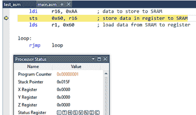

图 6.3：每条指令执行后程序计数器递增

在 Microchip Studio 中打开 test_asm 项目。如果启动 Microchip Studio 并打开 test_asm 项目时 main.asm 文件未打开，则双击 Microchip Studio 右侧解决方案资源管理器窗格中的 main.asm 文件。使用“开始调试和中断”图标或 F10 键启动调试器/模拟器。确保处理器状态窗口已打开。单步执行汇编指令，并观察处理器状态窗口顶部的程序计数器如何递增，如图 6.3 所示。大多数 AVR 指令宽度为 16 位，并在单个时钟周期内执行。在调试器中每次单步执行一条指令时，程序计数器都会加一。前一章中的 STS 和 LDS 等指令是 32 位宽指令，因此必须在两个时钟周期内获取和执行。当执行 32 位宽指令时，可以在调试器中看到程序计数器加二。这是因为微控制器获取指令的前半部分，然后递增 PC 并获取指令的后半部分，再执行它。这是在调试器的一步中完成的，因此在单步执行 32 位指令后，我们看到 PC 加二。

从第 2 章打开 led_blink.asm 项目并在调试器中运行，显示主程序中的指令都是单周期指令。单步执行每条指令后，程序计数器加一。当在主循环底部执行 RJMP 指令时，程序计数器被加载为循环标签下 SBI 指令的地址，执行再次从循环顶部开始。

程序计数器可以被视为一个由微控制器主时钟驱动并随每个时钟脉冲继续递增的二进制计数器。当执行跳转或分支指令，或调用或返回子程序时，新的计数值会加载到 PC 中。当然，计数值用于寻址内存，这导致微控制器从该内存地址获取指令并执行它。

ATtiny13(A) 的程序计数器宽度为 9 位，因此可以寻址 2^9 或 512 条 16 位宽指令，当然这是 1024 字节，即 1K。在 ATtiny25 中，程序计数器宽度为 10 位，因为它只需要寻址 2^10 条指令（1K 或 1024 条指令），即 2^10 x 2 字节（2K 或 2048 字节，因为程序内存宽度为 16 位）。在 ATtiny45 中，程序计数器宽度为 11 位，以便它可以寻址其 2^11 或 2K 条 16 位宽指令内存（4K 字节）。ATtiny85 具有 12 位宽的 PC，用于其 2^12 或 4K 条 16 位宽指令（8K 字节）。

## 6.2 微控制器总线

微控制器或微处理器上的总线是一组导线。8 位总线是一组 8 根导线。图 6.4 显示了一个通用微控制器的框图，其中带宽线表示地址总线、数据总线和控制总线。地址总线可能宽 16 位，具体取决于微控制器，然后将由 16 根导线组成。8 位微控制器将具有由 8 根导线组成的 8 位宽数据总线。控制总线上的导线数量因架构而异，但通常有一些片选线以及读写控制线。微控制器总线用于从内存和 I/O 设备获取数据并向其发送数据。具体取决于微控制器，总线可能仅为内部总线，或扩展到微控制器的引脚，允许外部内存和外设连接到微控制器总线。


微控制器和微处理器从内存中获取机器码指令时的一般工作方式是：将程序计数器中的地址放置在地址总线上。然后，控制总线的一部分芯片选择线被置位，以选择正确的内存芯片。控制总线读取线被置位，以确保从内存中读取指令。此时，来自被寻址内存位置的正确指令被放置在数据总线上。从内存中获取的数据是一条机器码指令，将由微控制器内核或 CPU（中央处理器）解码和执行。

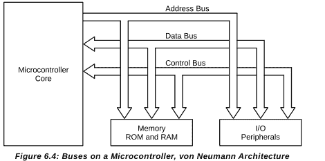

## 6.3 哈佛架构与冯·诺依曼架构

图 6.4 展示了冯·诺依曼架构，其中程序存储器、数据存储器和 I/O 地址空间共享公共地址、数据和控制总线。AVR 微控制器使用哈佛架构，该架构为程序存储器和数据存储器设有独立的总线，如图 6.5 所示。

采用哈佛架构的 AVR 通过其并行数据总线和程序总线提高了性能。在从程序存储器获取指令的同时，数据可以在独立总线上在 I/O 或数据存储器空间之间传输。在冯·诺依曼架构中，指令首先会被获取并执行。如果该指令是访问数据存储器的指令，则数据存储器的地址将被放置在公共地址总线上，并通过数据总线访问内存。只有在数据存储器传输完成后，才会获取下一条指令。

哈佛架构允许程序存储器和数据存储器空间都从地址 0 开始，因为它们是独立的地址空间。尽管 AVR 微控制器上的 EEPROM 与数据存储器或 SRAM 共享数据总线，但它也从地址 0 开始，因为它是使用自己的一组寄存器和访问协议作为独立地址空间来访问的。

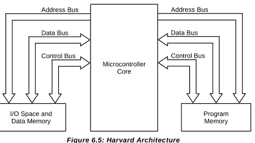

## 6.4 获取和执行指令

所有微控制器都从内存中获取程序指令并执行它们。图 6.6 展示了 AVR 微控制器的简化框图。机器语言指令从 Flash 程序存储器中获取到指令寄存器，并由指令解码器解码。算术逻辑单元（ALU）对通用寄存器中的值进行数学和逻辑计算。微控制器上发生的所有事件都由微控制器的时钟脉冲驱动。如果时钟停止，微控制器将不再获取和执行指令。

与迄今讨论的通用微控制器相比，AVR 微控制器具有一项可提升性能的增强功能。单级流水线允许在执行当前指令的同时预取下一条指令。通过在执行当前指令时预取下一条指令，一条指令可以在一个时钟周期内执行。图 6.7 展示了流水线如何提高 AVR 性能。在没有指令流水线的微控制器中，第一条指令将在第一个时钟周期获取，然后在第二个时钟周期执行。第二条指令将在第三个时钟周期获取，并在第四个时钟周期执行。

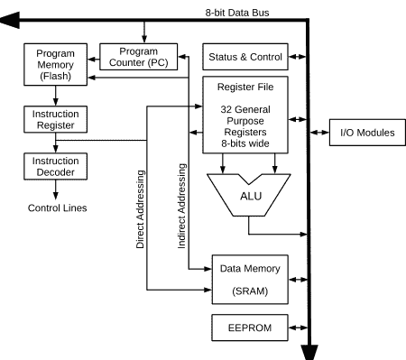

图 6.6: AVR 的简化框图

| 时钟周期 1 | 时钟周期 2 | 时钟周期 3 | 时钟周期 4 |
| :--- | :--- | :--- | :--- |
| 第 1 条指令获取 | 第 2 条指令获取 | 第 3 条指令获取 | 第 4 条指令获取 |
| 第 1 条指令执行 | 第 2 条指令执行 | 第 3 条指令执行 | |

图 6.7: AVR 指令获取与执行流水线

较旧的微控制器实际上通常需要四个时钟周期来获取和执行一条指令，如果地址总线是复用的，则需要更多周期。执行机器码指令的四个步骤是：1) 从内存中获取指令，2) 解码指令，3) 在 ALU 中执行指令，以及 4) 将操作结果存回寄存器。

在 AVR 微控制器中，指令已在前一个时钟周期预取。指令解码、执行和结果存储在一个时钟周期内完成——如图 6.7 的指令执行块所示。在一个时钟周期内，AVR 获取寄存器操作数，对操作数执行 ALU 操作，并将结果存储在目标寄存器中。

## 6.5 状态寄存器

状态寄存器会根据最近执行的算术指令的结果进行更新。它还包含一个全局中断使能位。图 6.8 展示了 8 位状态寄存器及每个位的含义。在本节中，我们将探讨状态寄存器中某些位在汇编语言程序中的用法。状态寄存器中的其他位将在书中后续程序使用时进行说明。

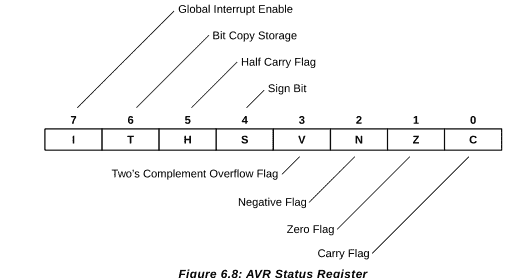

### 6.5.1 零标志

状态寄存器中的位 1 称为零标志。标志是指在发生某个状态时发出信号的位。当算术操作的结果为零时，零标志会发出信号。可以使用分支指令来测试零标志的状态，如果零标志表明递减操作的结果不为零，则进行分支，如下一个示例程序所示。

打开我们一直用于测试小型汇编语言程序的 Microchip Studio 中的 test_asm 项目。如果调试器/模拟器仍在之前的代码示例中运行，请务必停止它。用以下代码替换现有代码。

```
test_asm : main.asm - zero flag test and branch

ldi    r16, 3
del_loop:
    dec    r16
    brbc   SREG_Z, del_loop
loop:
    rjmp   loop
```

保存 main.asm 文件并构建项目。在选择模拟器作为当前工具的情况下，启动调试器并像之前一样中断。

该代码会不断递减寄存器中的值，直到其为零。这可以用作一个简单的时间延迟，在值递减时消耗时钟周期。在程序开始时，值 3 被加载到寄存器 R16 中。为了在 LED 闪烁程序中产生足够长的延迟，使 LED 状态肉眼可见，应将一个更大的值加载到寄存器中。由于我们使用模拟器，只是想看看零标志是如何使用的，因此将一个小值 3 加载到寄存器 R16 中——我们不想花一整天时间单步执行代码，等待一个值递减到零。

在 Microchip Studio 中，确保处理器状态窗口已打开。在处理器状态窗口顶部附近找到状态寄存器。状态寄存器的所有位都按图 6.8 所示用字母标记。在 Microchip Studio 的调试器中单步执行第一条和第二条指令。值 3 被加载到 R16，然后减一。接下来将执行 BRBC（如果 SREG 中的位被清除则分支）指令。BRBC 指令的一个操作数是 SREG_Z，即状态寄存器（SREG）的 Z 位或零位。该指令测试状态寄存器的 Z 位，如果该标志被清除或为 0，则进行分支，这表明递减结果不为零。因为 DEC 指令的结果在 R16 中为 2，结果不为零，这意味着状态寄存器中 Z 标志的值为 0，因此 BRBC 指令导致程序分支到 del_loop 标签并运行其后的 DEC 指令。

单步执行 BRBC 指令，并注意接下来要执行的指令再次是 DEC 指令。单步执行程序，直到 R16 包含 0，此时请注意状态寄存器中的 Z 位变为纯红色，指示它已更改（通过变为红色）并被置位（由纯色指示）。现在 Z 标志已被置位而非清除，当执行 BRBC 指令时，它不再分支到 del_loop 标签。这是因为只有当 Z 位被清除或为 0 时才会发生分支。现在将执行 BRBC 下方的指令。单步执行 BRBC 指令，并注意程序现在继续在 RJMP 指令处执行，该指令是无限循环的一部分。状态寄存器中的 Z 标志现在为纯蓝色，指示它仍然被置位（纯色）但在上一条指令执行时未更改（由蓝色指示）。如果在单步执行的前一条指令执行期间标志或位改变了状态，则它在调试器中会显示为红色。如果下一条指令不改变标志的状态，它将变为蓝色，并保持蓝色直到再次更改。

通过此练习我们可以看到，当算术操作（本例中为 DEC 或递减）的结果为零时，状态寄存器中零标志的状态会被置位或更改为逻辑 1。使用分支指令来测试标志的状态，并在零标志被清除或为逻辑 0 时进行分支。一旦标志被置位，BRBC 指令就不会导致分支，而是导致执行 BRBC 下方的指令。

### 6.5.2 负标志

简单的减法操作如果结果为负数，将导致状态寄存器中的 N 标志（即负标志）被置位。停止调试器，并用以下清单中的代码替换测试项目代码。保存 main.asm 文件的更改，然后构建项目。

```
test_asm : main.asm – negative flag

ldi r16, 9
ldi r17, 20
sub r16, r17

loop:
rjmp loop
```

开始调试并中断。现在单步执行每行代码，并在处理器状态窗口中检查状态寄存器。程序将 9 加载到 R16，将 20 加载到 R17，然后执行 SUB（不带进位减法）指令，该指令将 R17 从


将结果存回 R16。这与 R16 = R16 – R17 相同，或是 C 语言编程中的简写表示法 R16 -= R17。在 R17 中，十进制数 20 显示为十六进制 0x14。请记住，如有需要，可以在“处理器状态”窗口中右键单击寄存器，并在弹出的菜单中将数字格式更改为十进制。

执行 SUB 指令时，状态寄存器中的 N 标志（负标志）被置为逻辑 1，表明算术减法运算的结果为负数。此时可以使用分支指令来测试 N 标志的状态，并根据减法结果为正还是负来运行不同的代码。

R16 中的减法结果为 0xF5 或 245，这是一个补码格式的数字，本书后面将对此进行解释——简而言之，它是一个数字的负数表示形式。0xF5 是十进制数 -11 的十六进制补码形式，-11 是 9 – 20 的结果。在“处理器状态”窗口的 R16 中将 0xF5 转换为十进制不会显示负数，因为调试器不会将该数字解释为负数。减法后，状态寄存器中的 C 标志和 S 标志也被置位。目前，我们只查看状态寄存器中的 N 标志（负标志），本书后面将介绍其他标志。

## 6.6 栈和栈指针

栈是数据存储器中的一个区域，即 AVR 中的内部 SRAM，用于存储临时数据和局部变量。在中断和子程序调用期间也会使用栈，返回地址存储在栈上。为了更好地理解栈的工作原理，本节后面部分将介绍一些使用栈的示例。

栈指针寄存器（SP）被加载为数据存储器中某个内存位置的初始地址。将地址加载到栈指针后，栈指针被认为指向该地址处的内存位置。栈指针指向的地址称为栈顶。通常，AVR 程序会将栈指针寄存器初始化为指向数据 RAM 中的最高地址位置。对于 ATtiny13(A)，该地址为 0x9F；对于 ATtiny25，为 0xDF；对于 ATtiny45，为 0x015F；对于 ATtiny85，为 0x025F。在第 2 章第 2.3.2 节的 led_blink_asm 项目中，我们不需要初始化栈指针，因为栈指针默认指向 ATtiny13(A) 和 ATtiny25/45/85 中的最高 SRAM 地址。

### 6.6.1 栈的工作原理

要保存到栈中的寄存器会被“压入”栈中。这会将寄存器中的值复制到栈指针当前指向的 SRAM 内存位置。要从栈中检索的值会被“弹出”到特定寄存器中。栈可以类比为一叠箱子。放下一个箱子（压入）。在第一个箱子上再放一个箱子（第二次压入），第三个和第四个箱子可以添加到这叠箱子中。当从栈中取出一个箱子（弹出）时，先移除最上面的箱子。这是一种“后进先出”（LIFO）排列。箱子只能按照压入顺序的相反顺序弹出。图 6.9 显示了寄存器值被压入栈和从栈弹出的情况。

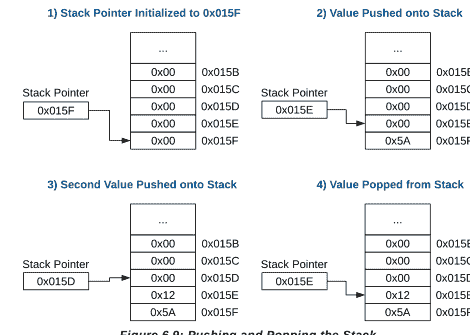

- 1) 在图 6.9 的左上角，栈指针寄存器被初始化为指向数据存储器的顶部位置，对于 ATtiny45 该位置为 0x015F。
- 2) 当寄存器被压入栈时，寄存器中包含的值被存储在栈指针当前指向的内存位置。在图中，被压入栈的寄存器值为 0x5A。值被压入栈后，栈指针会自动递减，以指向数据存储器中下一个可用位置，即 0x015E。
- 3) 在图中，第二个寄存器被压入栈，其中包含的值为 0x12。栈指针再次自动递减，以指向下一个内存地址 0x015D。栈中现在包含两个值。
- 4) 最后，从栈中弹出一个值。当从栈中弹出一个值时，栈指针会自动递增，然后将栈指针当前指向的内存位置中的值复制到目标寄存器。从栈中弹出的值在内存中仍然保持不变，但栈指针现在指向它。任何新压入栈的值都会覆盖栈上的这个值。

在 AVR 微控制器中，栈指针寄存器由两个 8 位寄存器实现，使其能够指向 16 位地址。SPL（堆栈指针低位）是栈指针的低字节，即最低有效字节。SPH（堆栈指针高位）是栈指针的高字节，即最高有效字节。栈指针中实际实现的位数取决于特定的 AVR 微控制器。ATtiny13(A) 和 ATtiny25 没有 SPH 寄存器，因为这不是必需的，因为 SPL 可以寻址 ATtiny13(A) 中的全部 64 字节数据存储器和 ATtiny25 中的 128 字节数据存储器。

### 6.6.2 使用 PUSH 和 POP 访问栈

在 Microchip Studio 中打开我们一直用于测试各种代码片段的 test_asm 项目。如果调试器仍在之前的调试会话中运行，请在继续之前停止它。将项目中的代码替换为以下代码，该代码演示了栈指针初始化以及 PUSH 和 POP 指令。

```
test_asm : main.asm - push pop
; Initialize the stack pointer
ldi r16, low(RAMEND)
out spl, r16
ldi r16, high(RAMEND) ; Remove for ATtiny13(A) and ATtiny25
out sph, r16 ; Remove for ATtiny13(A) and ATtiny25
ldi r16, 0x5A ; Load a value to R16
push R16 ; Save R16 to the stack
clr r16 ; R16 gets modified
pop r16 ; Restore R16 from the stack
loop:
rjmp loop
```

清单顶部用于初始化栈的代码并非必需，因为栈指针的默认值会使其指向 SRAM 中的最后一个地址。包含此代码仅是为了展示在需要时如何在程序中设置栈。栈指针可以设置为指向 SRAM 中的不同位置，但这不太可能被执行，尤其是在 SRAM 容量非常小的微控制器中。在栈初始化代码中，使用了一个名为 RAMEND 的预定义值，它是数据 RAM 中最后一个字节的地址。RAMEND 的值对于 ATtiny13(A)、ATtiny25、ATtiny45 和 ATtiny85 会有所不同，因为它们的 RAM 大小各不相同。像 RAMEND 这样的预定义值很方便，因为相同的代码可以用于不同的微控制器而无需更改。如果在 Microchip Studio 项目中选择了不同的微控制器，RAMEND 的值会自动更改以适应所选的 AVR 微控制器。

使用两个函数 low() 和 high() 将 16 位 RAMEND 地址加载到组成栈指针的两个 8 位寄存器中。在第一行代码中，RAMEND 的低字节 low(RAMEND) 被移动到 R16。然后，在下一行代码中，使用 OUT 指令将此值从寄存器 R16 移动到 SPL 寄存器。OUT 指令的意思是“将寄存器存储到 I/O 位置”。栈指针位于 I/O 寄存器文件中，因此可以使用 OUT 指令将寄存器复制到它。SPL 初始化后，高字节 SPH 会使用 RAMEND 的高字节进行初始化。这与 SPL 的做法相同，先将字节复制到 R16，然后使用 OUT 指令将其复制到 SPH。high() 函数确保 RAMEND 的高字节被复制到 R16。请注意，low() 和 high() 是汇编程序运行的辅助函数。这些不是在 AVR 上运行的指令。这些函数各输出一个数字。

如果使用 ATtiny13(A) 或 ATtiny25，必须从程序中删除初始化 SPH 的代码，如注释所示。这是因为这些微控制器中不存在 SPH 寄存器。如果为 ATtiny13(A) 或 ATtiny25 保留了 SPH 初始化代码，Microchip Studio 会报错，因为在选择这些器件时 SPH 未定义。

对于 ATtiny25，栈初始化可以按以下方式编写，用于从 SRAM 地址 0xDF 开始的栈。这里使用实际地址 0xDF 而不是 low(RAMEND)，

```
ldi   r16, 0xDF
out   spl, r16
```


对于 ATtiny45，栈初始化可以按如下方式编写，用于从地址 0x015F 处 RAM 末端开始的栈。在下面的代码中，栈顶地址的低字节（即 0x5F）被用来代替 low(RAMEND)。栈顶地址的高字节（即 0x01）被用来代替 high(RAMEND)。

```asm
ldi   r16, 0x5F
out   spl, r16
ldi   r16, 0x01
out   sph, r16
```

在程序中初始化栈后，将值 0x5A 加载到 R16。这样做仅仅是为了在 R16 中有一个值，以便在本示例中将其压入栈：

```asm
ldi   r16, 0x5A ; Load a value to R16
```

在 Microchip Studio 中，构建程序并选择仿真器启动调试器。单步跳过栈初始化代码和上述行。在 Microchip Studio 右下角的内存窗口中，在 Memory 下拉框中选择 data IRAM，以便显示数据内存的内容。该内存的最后一个字节是栈顶，向下滚动以找到它。如果将内存窗口更改为显示单列，则更易于阅读。为此，在内存窗口的 Columns 字段中选择 1。如果 Columns 字段不可见，请单击选择 data IRAM 的区域右侧的小双箭头，如图 6.10 所示。这将弹出一个框，允许在 Columns 下拉列表中选择 1。如果内存窗口或窗格足够宽，Columns 字段将已经在视图中，无需单击双箭头，只需展开下拉 Columns 框即可。

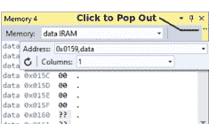

图 6.10：将 RAM 显示更改为单列

在 Columns 列表中选择 1 后（如图 6.10 所示），在内存窗口中向下滚动，以便在此窗口中看到地址 0x015F，如图 6.10 所示。这假设在 Microchip Studio 中选择了 ATtiny45，其 SRAM 的最后一个字节位于 0x015F。还要注意，在 Processor Status 窗口顶部，堆栈指针设置为 0x015F，指向 ATtiny45 SRAM 的最后一个字节。

单步跳过下一条指令，该指令是一条将 R16 压入栈的 PUSH 指令：

```asm
push R16    ; Save R16 to the stack
```

请注意，0x5A（5a）现在出现在内存窗口的最后一个字节中，对于 ATtiny45 来说地址为 0x015F。换句话说，R16 或 R16 中的值已被压入栈顶。在 Microchip Studio 的 Processor Status 窗口中，观察到堆栈指针减一，从 0x015F 变为 0x015E。在本程序中，R16 的值现在暂时存储在栈上，以释放 R16 供其他用途。程序中清除了 R16，以模拟其被用于其他目的且其值发生变化，如下一行代码所示。现在单步跳过这一行代码。

```asm
clr r16     ; R16 gets modified
```

最后，通过使用 POP 指令从栈中弹出，将原先在 R16 中的值恢复到 R16。单步跳过 POP 指令。

```asm
pop r16     ; Restore R16 from the stack
```

单步跳过 POP 指令后，堆栈指针寄存器加一，在 Processor Status 窗口中可以看到其再次为 0x015F。R16 现在包含 0x5A，即从栈中弹出的值。RAM 中的最后一个字节仍然是 0x5A（显示为 5a），但由于堆栈指针指向该字节，当有新值压入栈时，它将被覆盖。

## 6.6.3 调用子程序

在 Microchip Studio 中停止调试器，并通过用以下代码替换之前的代码来修改 test_asm 项目，该代码展示了如何调用子程序。

```asm
test.asm : main.asm - subroutine call

ldi r16, 0x55 ; Load a value to R16
rcall delay ; Call the delay subroutine

loop:
rjmp loop

; Delay subroutine
delay:
push r16 ; Preserve R16
ldi r16, 0x03 ; Delay value to decrement
delloop:
dec r16 ; Decrement delay value
brbc SREG_Z, delloop ; Loop until delay value = 0
pop r16 ; Restore R16
ret
```

构建项目，然后像往常一样开始调试并在仿真器中中断。该程序演示了栈的两种用途。第一是调用子程序时，栈用于存储返回地址。第二是可以将寄存器保存在栈上，以便子程序中的代码可以使用该寄存器，然后在返回前将其恢复到原始值。

在上述代码清单中，栈没有显式初始化，因为我们利用了堆栈指针的默认值为 RAMEND 这一事实，这符合本示例的目的。请记住，默认情况下堆栈指针指向数据 RAM 中的最后一个字节，对于 ATtiny45 来说该地址为 0x015F。

暂不要在 Microchip Studio 中开始单步执行程序，首先有必要对代码进行解释。程序中的第一行代码将初始值 0x55 放入 R16。与之前的程序一样，这样做是为了让我们有一个值可以压入栈，以供演示之用。

```asm
ldi r16, 0x55 ; Load a value to R16
```

程序的第二行调用名为 "delay" 的子程序：

```asm
rcall delay ; Call the delay subroutine
```

与第 2 章第 2.3.2 节中的 LED 闪烁程序 led_blink.asm 类似，delay 子程序位于主代码下方，并以标签 delay: 开头。这个 delay 子程序比 LED 闪烁程序中的 delay 子程序简单得多。这段代码应该看起来很熟悉，因为它是用于演示状态寄存器中零标志用法的相同代码，只是在本示例中将其打包成了一个子程序，并添加了几行额外代码。

子程序以标签开始，标签是一个后跟冒号的名称。子程序以 RET（从子程序返回）指令结束。RCALL（相对子程序调用）用于从主程序中的任何位置或从另一个子程序调用或执行子程序。子程序是一段可以被调用任意次数的功能代码块。子程序的代码在程序中只需编写一次，但可以被调用和执行多次。这既节省了程序内存，也很方便，因为某些需要重复的任务或函数可以放入子程序中，并在需要时调用。程序中子程序调用之后出现的程序指令需要在子程序返回时执行。出于这个原因，子程序调用后跟随的指令地址会自动压入栈中。当子程序返回时，这个返回地址会自动从栈中弹出。子程序本身可以位于程序内存中的任何位置。

使用 RCALL 指令调用子程序会将子程序地址加载到程序计数器中，以便在 RCALL 指令执行后子程序代码开始运行。在 Microchip Studio 的调试器和仿真器中单步执行示例项目时，我们将看到子程序期间返回地址的自动压栈和出栈。

在继续之前，使用 Microchip Studio 右下角的内存窗口使栈的末端可见，以便我们可以看到栈的使用情况。为此，在内存窗口的 Memory: 框中选择 data IRAM。如有必要，使用内存窗口右侧的小双箭头弹出选择框，并将 Columns: 项更改为 1。如有需要，请参阅图 6.10。向下滚动内存窗口，使 ATtiny45 的地址 0x015F 可见。

在 Microchip Studio 中，单步跳过程序中的第一行代码。请注意，Processor Status 窗口中的程序计数器值现在为 1，即 RCALL 指令所在的地址——第一条指令 LDI 位于地址 0。这意味着 RJMP 指令位于地址 2——RJMP 是第三条指令。因此，子程序被调用并返回后，程序执行需要继续在地址 2 处进行。如果我们单步跳过调用 delay 子程序的程序第二行，调试器将不会单步执行子程序中的代码，而是会以全速执行该代码并到达 RJMP 指令。请使用位于第二个工具栏上的“单步进入”图标，或 F11 键进入 delay 子程序，而不是单步跳过它。

进入 delay 子程序后，Processor Status 窗口中的堆栈指针将减少两次，对于 ATtiny45 从 0x015F 变为 0x015D。这是因为子程序调用后跟随的代码行的 16 位返回地址被自动压入了栈。完整的 16 位返回地址 0x0002 被压入栈——先是低字节（LSB）0x02 位于地址 0x015F，然后是高字节（MSB）0x00 位于地址 0x015E。在内存窗口中，可以在地址 0x015F 处看到 0x02，在地址 0x015E 处看到 0x00。

子程序中的第一行代码将 R16 压入栈：

```asm
push r16 ; Preserve R16
```

子程序中使用的寄存器通常会被压入栈以保存它们，并在子程序返回前从栈中弹出，以便这些寄存器对主程序保持不变。在大型程序中，跟踪每个寄存器的用法可能非常困难，因此保存子程序中使用的寄存器可以防止主程序出现意外行为，该主程序可能依赖于子程序调用后寄存器中的值保持不变。单步跳过子程序开头的 PUSH 指令，并注意 R16 中的值（0x55）现在出现在内存窗口的地址 0x015D 处。堆栈指针递减到 0x015C，栈现在正在存储一个 16 位子程序返回地址和一个 8 位寄存器值。

单步执行子程序代码，该代码将 0x03 加载到 R16，然后递减 R16 直到其包含零。当 R16 包含 0x00 时，将执行 POP 指令，随后执行 RET 指令，如以下代码所示。

```asm
pop r16 ; Restore R16
ret
```


POP 指令通过从堆栈中弹出，将 0x55 的原始值恢复到 R16。单步执行 POP 指令后，R16 包含 0x55，堆栈指针包含地址 0x015D。单步执行 RET 指令，该指令从子程序返回，并自动从堆栈中弹出返回地址 0x0002 并将其加载到程序计数器，以便程序执行在 RJMP 指令处的子程序调用之后继续。堆栈指针递增并回到 0x015F，因为堆栈现在为空，因为寄存器值和返回地址都已从中弹出。再次说明，推送到堆栈的值并未从 SRAM 中移除，可以在内存窗口中看到。堆栈被视为空，因为堆栈指针指向堆栈顶部。这意味着当堆栈再次使用时，这些旧值将被覆盖。

除非打算使用默认的堆栈指针值 RAMEND，否则所有用户程序在执行子程序或中断之前都必须初始化 SP。这通常在程序的代码初始化部分的最开始处完成。使用其他可能不会默认将堆栈初始化为所需值的微控制器时，也要牢记这一点。

## 6.7 LED 闪烁程序完全讲解

第 2 章的 LED 闪烁程序迄今只部分讲解。为方便起见，下面给出了 LED 闪烁代码，这样你就不必回到第 2 章查看，并附有说明。如需复习，请查看第 3 章中的图 3.1——解释 LED 闪烁程序主要功能的流程图。

程序开始时，使用 SBI 指令设置 DDRB 寄存器中的位 DDB4，将引脚 PB4 配置为输出。一旦使用 DDRB 寄存器将引脚 PB4 设置为输出，就可以通过代码使用 PORTB 寄存器将其状态切换为高电平和低电平。在电路中，LED 通过串联电阻连接到引脚 PB4，从而允许 LED 开启和关闭。通常，程序会有一个初始化部分，在代码进入主循环开始执行之前设置 AVR 的所需状态。堆栈初始化和设置微控制器的 I/O 引脚是属于 LED 闪烁程序初始化部分的初始化任务。当然，不需要堆栈初始化，因为我们使用的 ATtiny 微控制器将堆栈指针初始化为 SRAM 的末尾。如果程序中使用了其他硬件设备（例如片上定时器），它们也会在此处初始化。

```
led_blink.asm : main.asm

start:
    sbi    DDRB, DDB4    ; Set pin PB4 as output

loop:
    sbi    PORTB, PORTB4    ; Set LED pin high
    rcall  delay        ; Leave LED on for a while
    cbi    PORTB, PORTB4    ; Clear LED pin low
    rcall  delay        ; Leave LED off for a while
    rjmp   loop

; Delay subroutine
delay:
    ldi    r16, 0xff
delloop1:
    ldi    r17, 0xff
delloop2:
    dec    r17        ; Delay by decrementing
    brbc   SRGE_Z, delloop2
    dec    r16        ; Delay by decrementing
    brbc   SRGE_Z, delloop1
    ret
```

在从 loop: 标签开始的主循环中，使用 SBI 和 CBI 指令设置一位以打开 LED，并清除一位以关闭 LED。这些指令用于设置和清除 PORTB 寄存器中与 LED 连接的引脚对应的位。在代码中，此位称为 PORTB4，对应引脚 PB4。用于设置和控制 LED 的实际寄存器在第 8 章中显示。主循环的功能最容易在第 3 章的图 3.1 流程图中看到，此时应该很容易理解。

只有延迟子程序需要进一步说明，此时我们已介绍了其中使用的所有指令。图 6.11 显示了延迟子程序的流程图。为避免混淆，值得注意的是，流程图中名为 start 的第一个块并不代表代码的 start 标签，而是延迟子程序的开始。这对应于 delay: 标签。

延迟子程序的工作原理是：将包含 0xFF（255）的寄存器 R17 递减到零，受 R16 控制，重复 0xFF（255）次。递减这些寄存器会消耗微控制器时钟周期，从而消耗时间，造成时间延迟。此时间延迟未经过精心计算，但发现对于本程序来说是足够的，因为它可以让肉眼看到 LED 状态。在子程序开始时，R16 被加载为 0xFF，并且仅在外循环结束时递减，如图 6.11 的流程图所示，随后检查它是否为零。R16 永远不会被重新加载新值，仅在初始值加载到它之后才会被递减。外循环由 delloop1: 标签和 RET 指令之前的最后一条 BRBC 指令之间的所有代码组成。

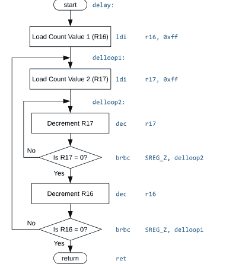

### 图 6.11：延迟子程序流程图

R17 被加载为 0xFF，然后在内循环中递减直到为零。R17 包含零后，R16 被递减并测试是否包含零。如果 R16 不包含零，R17 会被重新加载为 0xFF，并在内循环中再次递减到零。循环继续，直到 R16 包含零。当 R16 包含零时，子程序返回。因此，我们有一个内循环，每递减一次 R16 就递减 R17 255 次，从而在微控制器中造成时间延迟。

## 6.8 AVR 指令编码

指令编码是指机器语言指令如何以二进制形式编码或表示。以下程序用于演示汇编指令如何以二进制编码。将我们一直使用的 test_asm 项目中的代码替换为以下代码并构建项目。

```
test.asm : main.asm - Instruction encoding

loop:
    ldi   r16, 5
    ldi   r17, 12
    add   r16, r17
    rjmp  loop
```

虽然本书中包含了一些 AVR 指令集手册的摘录，但最好开始学习使用 AVR 指令集手册来查找指令。如果您尚未下载此手册，请在以下网址查找：

ww1.microchip.com/downloads/en/DeviceDoc/AVR-Instruction-Set-Manual-DS400002198A.pdf（如果此链接更改且无法使用，请在互联网上搜索“AVR instruction set manual”）

程序中 loop 标签下方的第一条指令是 LDI 指令。在指令集手册中查找 LDI（Load Immediate）指令，或参考图 6.12（该图摘自 AVR 指令集手册）。指令集手册中可以找到任何指令的描述，包括其二进制编码方式，随后是指令执行后的状态寄存器状态及其用法示例。

将上述代码清单中的程序输入到 test_asm 项目的 main.asm 文件中，选择模拟器，使用“开始调试和中断”启动调试器。指令的实际值可以在 Microchip Studio 右下角的内存窗口中查看。确保内存窗口中选择的内存是 prog FLASH（默认值）。如果内存窗口的列（Columns）设置为 Auto，则构成程序指令的字节将以小端格式显示，即先显示指令的最低有效字节。例如，值为 0xee05 的 16 位指令将显示为“05 e0”。

### 6.8.1 LDI – 加载立即数

### 5.69.1 描述

将 8 位常量直接加载到寄存器 16 到 31。

| 寄存器和操作数 |
| :--- |
| Rd：寄存器文件中的目标（和源）寄存器 |
| K：常量数据 |

- 操作：Rd = K
- 语法：LDI Rd,K
- 操作数：16 ≤ d ≤ 31, 0 ≤ K ≤ 255
- 程序计数器：PC ← PC + 1

| 16 位操作码： |
| :--- |
| 1110 KKKK dddd KKKK |

### 5.69.2 状态寄存器（SREG）和布尔公式

| I | T | H | S | V | N | Z | C |
| :---: | :---: | :---: | :---: | :---: | :---: | :---: | :---: |
| – | – | – | – | – | – | – | – |

```
cbr r11 : Clear & High byte
ldi r20,0x07 ; Set S, low byte to 0x07
ldi r16,0x01 ; Load constant into Program
; memory pointed to by Y
```

- 字数：1（2 字节）


为使内存中的指令更易读，请在内存窗口中右键单击任意字节，然后在弹出的菜单中选择“2 字节整数”。现在内存窗口中的值将显示为 16 位宽、4 位十六进制值。为使数据更易读，请在“列数”（Columns）字段中选择 1，如我们之前所做的。如果“列数”字段不可见，请记得单击内存窗口右侧的两个小箭头（请参阅图 6.10）。您的内存窗口现在应如下一页的图 6.13 所示，但不包含为说明目的添加的汇编语言指令。如果窗口宽度增大，外观会略有不同，通常隐藏在双箭头后面的项目将出现在内存下拉列表旁边，因为内存窗口宽度已扩展。

如果我们查看内存窗口中（如图 6.13 所示）显示为 e005（即 0xE005）的第一个 16 位十六进制值，我们看到的是代表程序中第一条 LDI 指令的值。下一个十六进制值 e01c 代表或等同于第二条 LDI 指令（包括其操作数）的机器码指令。以下代码清单在每条汇编语言指令旁边显示了十六进制和二进制形式的机器码指令。二进制数被分成四位一组，以便更易读。


loop: ldi r16, 5      0xE005      0b 1110 0000 0000 0101
ldi   r17, 12     0xE00C      0b 1110 0000 0000 1100
add   r16, r17    0x0F01      0b 0000 1111 0000 0001
rjmp  loop        0xCFF8      0b 1100 1111 1111 1000

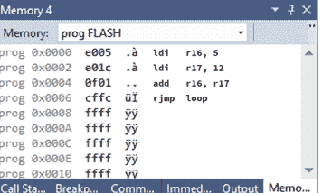

图 6.13: 闪存中显示的指令的十六进制值

图 6.14 展示了两条 LDI 指令的编码方式。LDI 指令的前四位始终是二进制 1110，如图 6.14 和图 6.12 所示。LDI 具有一个常数操作数值，该值会被加载到选定的寄存器中——在示例代码中，第一条 LDI 指令的值为 5，第二条为 12。该常数值在编码为二进制时被分为两个四位部分，如图中 KKKK 所示。当将这两个四位部分组合在一起时，它们形成加载到寄存器中的 8 位常数。常数可以是 0 到 255 之间的值，即 0b00000000 到 0b11111111。该值范围在图 6.12 所示的指令集手册 LDI 描述部分中表述为 0 ≤ K ≤ 255，这意味着常数值可以大于或等于 0，且小于或等于 255。

目标寄存器是图 6.14 和图 6.12 中的一个四位值 dddd。该值可以在 0b0000 到 0b1111 之间，但由于该指令仅针对 R16 到 R31 操作，因此它会偏移 16 个值。这意味着必须将 16 加到二进制编码的寄存器值上，才能得到指令中编码的实际寄存器。因此，0b0000 引用 R16（0 + 16），0b0001 引用 R17（1 + 16）。寄存器 R31 编码为 0b1111（15）+ 16 = 31。现在应该可以理解为什么某些指令在可操作的寄存器数量上受到限制，原因如下。LDI 指令宽 16 位。前四位始终是 0b1110。八位用于编码指令中的常数数据值。这只剩下四位用于寻址目标寄存器。一个四位数最多可以有 2^4 = 16 个地址值（地址 0 到 15）。该指令只能寻址 16 个寄存器，这些寄存器通过对编码地址使用内部偏移量 16，被选为 R16 到 R31。

```
1110 KKKK dddd KKKK
1110 0000 0000 0101 ldi r16, 5
```

```
1110 KKKK dddd KKKK
1110 0000 0001 1100 ldi r17, 12
```

图 6.14: LDI 指令编码的两个示例

AVR 指令集手册中使用各种字母或字母组合来表示寄存器、操作数和位。这些字母的含义可以在手册的第一部分（称为 Instruction Set Nomenclature）中找到。在阅读手册中任何指令时，都有必要查阅这些字母的含义。例如，在 LDI 指令描述下，该指令的操作给出为：Rd <- K

来自手册 Instruction Set Nomenclature 部分，K 是常数数据，Rd 是目标寄存器。因此，该操作意味着将常数数据（K）加载到目标寄存器（Rd）中。

手册中指令描述还包含对程序计数器的更改。LDI 指令的程序计数器操作给出为：PC <- PC + 1

这意味着指令执行后程序计数器会加一。LDI 指令后状态寄存器的状态保持不变。在手册中，这显示为状态寄存器每个位下方的短横线。手册的第 1 节或第 1 章给出了各种标志值的含义。

手册中 LDI 指令的用法示例紧随状态寄存器之后，如图 6.12 所示。随后是指令的大小，即一个 16 位字，或两个字节。最后，手册显示 LDI 指令执行需要一个时钟周期（未包含在图 6.12 中）。图 6.15 显示了示例程序最后两条指令（ADD 和 RJMP 指令）的编码。

| r | 源寄存器地址 |
| d | 目标寄存器地址 |

| 0000 | 11rd | dddd | rrrr |
|------|------|------|------|
| 0000 | 1111 | 0000 | 0001 |

add r16, r17

1 0001 = 17 (R17)
1 0000 = 16 (R16)

| k | 常数地址 |

| 1100 | kkkk | kkkk | kkkk |
|------|------|------|------|
| 1100 | 1111 | 1111 | 1100 |

rjmp loop

1111 1111 1100 = 4

图 6.15: ADD 和 RJMP 指令的编码

ADD（不带进位加法）指令始终以 00001 开头，接着是源寄存器地址的最高位（MSB），然后是目标寄存器地址的最高位（MSB）。随后是目标寄存器的四位，然后是源寄存器的四位。如图 6.15 顶部所示，每个 5 位寄存器地址由一个初始位和随后的四位组成。在图中的示例中，源地址是 17（0b10001），对应 R17，目标地址是 16（0b10000），对应 R16。一个 5 位地址可以寻址 0 到 31 的 2^5 = 32 个地址位置，这些位置对应寄存器文件中的 R0 到 R31。请参阅指令集手册中的 ADD 指令，以查看执行 ADD 指令后哪些状态寄存器标志发生了变化。

最后，RJMP（相对跳转）指令出现在示例代码的末尾，可在图 6.15 底部找到。RJMP 指令始终以二进制数字 1100 开头，后跟一个 12 位地址。RJMP 指令中编码的地址是相对于程序计数器（PC）中当前地址的地址。如果地址为正，跳转可以发生到更高地址；如果地址为负，跳转可以发生到更低地址。在指令集手册中，相对跳转指令的范围给出为 PC – 2K + 1 到 PC + 2K（字）。这意味着跳转可以发生到较低地址，即当前 PC 地址减去 2048 + 1，或者到最高 PC + 2048 的地址，其中每个地址都是 16 位宽指令的地址。

在示例程序中，RJMP 指令用于跳转到程序的顶部，这意味着跳转是跳到较低地址。图 6.15 中指令中编码的地址是补码格式中的负数 – 0b111111111100，其十进制值为 –4。在代码中可以看到，RJMP 指令跳转到地址 0 处的程序第一条指令，loop 标签位于该处。该地址是通过公式 PC – address + 1 得到的，其中 address 是 RJMP 指令中编码的地址。程序从地址 0 开始有四条 16 位指令，RJMP 指令位于地址 3。因此，执行 RJMP 指令时 PC 将包含 3。我们可以计算将要跳转到的地址，如下所示：3 – 4 + 1 等于 0，因此程序将按预期跳转到地址 0。这只是展示了 RJMP 指令的编码方式。幸运的是，我们在编程时不需要进行这样的计算，因为可以使用标签作为跳转目标，并让汇编程序计算相对地址。

## 6.9 寻址方式

寻址方式是任何微控制器或微处理器指令集架构的一部分。寻址方式指定了指令访问源数据和目标数据的不同方式，即指令如何寻址内存位置、寄存器或常数数据值。在 AVR 微控制器中，寻址方式允许指令访问程序存储器和数据存储器。数据存储器包括 SRAM 以及映射到数据存储器空间的寄存器，其中包括寄存器文件和 I/O 寄存器。AVR 寻址方式可以在 AVR 指令集手册的第 3 节或第 3 章中找到。我们暂时不会详细介绍所有寻址方式，而是通过不同寻址方式的示例来更好地了解它们是什么。


### 6.9.1 寄存器直接寻址

AVR 寄存器直接寻址有两种变体，即单寄存器和双寄存器直接寻址。图 6.16 显示了来自 AVR 指令集手册的双寄存器直接寻址。

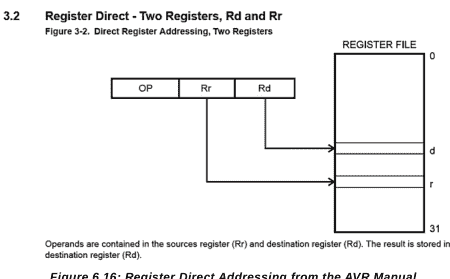

请特别注意，AVR 指令集手册中的寻址方式图示是简化图，未显示指令地址位的确切位置。

单寄存器直接寻址的示例是 CLR（清除寄存器）指令。目标寄存器的完整地址在指令中编码，使指令能够直接寻址该寄存器。图 6.17 显示了寄存器文件寄存器的地址如何在 CLR 指令中编码——实际上它被编码了两次，因为源和目标是同一个寄存器。

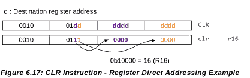

### 6.9.2 I/O 直接寻址

I/O 直接寻址在寄存器和 I/O 位置之间移动数据。寄存器地址和 I/O 寄存器地址都在指令中编码，使其成为直接寻址指令。图 6.18 显示了来自 AVR 指令集手册的 I/O 直接寻址图示。I/O 直接寻址的示例是 OUT 指令，如图 6.19 所示。

### 6.9.2.1 I/O 直接寻址

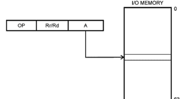

图 6.18：来自 AVR 手册的 I/O 直接寻址

| 1011 | 1AAr | rrrr | AAAA |
|---|---|---|---|
| 1011 | 1011 | 0000 | 0110 |

图 6.19：带示例的 OUT 指令编码

到目前为止，我们仅在初始化堆栈指针的示例中使用过 OUT 指令。在图 6.19 的示例中，OUT 用于将 R16 的内容移动到 PINB 寄存器。PINB 寄存器是映射在数据存储器空间中的 64 个 I/O 寄存器之一，也是用于控制 AVR I/O 引脚的寄存器之一。在图 6.19 所示的代码行中，PINB 解析为地址 0x16（不要与本示例中使用的寄存器 R16 混淆）。要查看 I/O 寄存器的地址，请参阅所使用 ATtiny 器件数据手册中的寄存器摘要部分。在 ATtiny25/45/85 数据手册的 *寄存器摘要* 部分中，可以看到表中有 64 个 I/O 寄存器，从表底部的 0x00 到表顶部的 0x3F。在表中找到地址 0x16，并注意它在表格的下一列中显示的名称为 PINB。

同样，指令中的值是交错的。图 6.19 下方的指令编码块下方是从指令中提取并组装为连续位后的 I/O 位置地址和源寄存器的值。I/O 位置地址有 6 位，由 6 个 'A' 字符表示。由此我们可以推断，它可以寻址 0 到 63 的 2^6 = 64 个位置，或十六进制的 0x00 到 0x3F。换句话说，它可以用于寻址映射在数据存储器中的 64 个 I/O 寄存器。图中的指令中有 5 个标记为 'r' 的位，代表寄存器文件中的寄存器。我们现在知道 2^5 = 32，因此该指令可以寻址寄存器文件中的 32 个寄存器——换句话说，即 R0 到 R31 的所有寄存器。

### 6.9.3 其他寻址方式

有关其他寻址方式，请参阅 *AVR 指令集手册*。随着本书中对更多指令的介绍，其他寻址方式将被更好地理解。间接寻址方式在指令中不包含目标寄存器或内存位置的地址，而是依赖于在调用间接寻址指令之前将目标地址加载到一个或多个寄存器中。

### 6.10 总结

- 时钟脉冲驱动微控制器的内部电路，并导致其获取并执行指令。
- 如果给定频率，很容易计算时钟脉冲的周期；如果给定周期，则可以计算时钟脉冲的频率。
- 程序计数器（PC）不断递增，寻址程序存储器中的每条连续指令，直到执行跳转或分支指令，该指令将 PC 加载为新地址。
- 微控制器具有用于寻址程序和数据存储器的地址总线、用于在微控制器与存储器或 I/O 设备之间移动数据的数据总线，以及具有片选和读写线等控制线的控制总线。
- AVR 微控制器具有哈佛架构，为程序存储器和数据存储器使用独立的总线以提高性能。
- 微控制器内核的基本功能是从程序存储器中获取并执行指令。
- 微控制器的状态寄存器包含最近一次算术运算结果的信息。
- 堆栈用于存储临时数据、保存寄存器值以及存储子程序和中断处理程序的返回地址。
- 堆栈通过将 RAM 地址加载到堆栈指针寄存器来设置。
- 微控制器机器语言指令以二进制格式编码。编码详情可在指令集手册中找到。
- 寻址方式是指指令如何寻址寄存器或内存位置。

这是一个相当长的章节，涵盖了 AVR 微控制器内部架构的许多细节。本章包含的概念对许多读者来说可能是新的，信息量在这个阶段可能有点令人难以承受。如果你在理解本章的所有内容时遇到困难，或者一次性信息量太大，那么要么重新阅读本章，要么稍后再回来阅读。请记住，如果你以前从未研究过任何微控制器或微处理器的内部工作原理，并且这是你第一次接触这类材料，那么需要时间来理解和记住所有内容。反复阅读本书两三次直到你完全理解一切，这没有任何问题。

在下一章中，我们将探讨算术指令，包括正负数在内存中的存储方式。还将涵盖逻辑指令，它们在操作寄存器中的位时是必不可少的，这些位可用于控制微控制器上的内部和外部硬件。这为后续许多章节做好了准备，这些章节将在 AVR 中设置和使用硬件，例如 I/O 端口和定时器。

## 第 7 章 · 算术和逻辑指令

算术和逻辑指令在微控制器内核的算术逻辑单元（ALU）中处理。

ATtiny13(A) 和 ATtiny25/45/85 微控制器具有加法和减法算术指令，以及 AND、OR 和异或逻辑指令。

本章将介绍每种基本数学和逻辑运算的示例，但首先将探讨负数在二进制中的表示方式。

### 本章内容

- 二进制中的正数和负数
- 二进制加法和减法
- ATtiny 微控制器中的逻辑指令

### 7.1 正数和负数

正 8 位二进制数使用所有八位来表示正数，每个位的权重已如前述。这意味着正 8 位数的值可以从 0b0000_0000（0 十进制）到 0b1111_1111（255 十进制）。

“带符号”8 位数使用 MSB（最左边的位，即位号 7）作为符号位，设置为逻辑 1 表示负数，清除为逻辑 0 表示正数。这意味着 8 位带符号数的最大正值为 0b0111_1111（127），使用 MSB 作为符号时的最大负数为 0b1111_1111（-127）。

负 8 位数的示例是 0b1001_0111（-23 十进制），其中最左边的第一个数字表示该数为负数。其余位使用加权二进制编码系统表示数值的大小。正数 23 通过将符号位更改为 0 来表示：0b0001_0111。微控制器通常以 2 的补码（two's complement）格式表示数字，但在探讨 2 的补码格式之前，我们必须先了解 1 的补码（one's complement）格式。

#### 7.1.1 1 的补码数

带符号的 1 的补码 8 位数可以是正数或负数。当它是正数时，它只是一个二进制数，其最左边的位（MSB），即符号位，值为 0，如已解释。当 1 的补码数为负数时，它与该数的正数版本相同，但每个位都反转。反转意味着数字中的每个 0 变为 1，每个 1 变为 0。再次以 +23 和 -23 为例，0b0001_0111 与之前一样是 +23。在将每个位反转以在 1 的补码格式中表示 -23 后，数字为 0b1110_1000。

#### 7.1.2 2 的补码数

2 的补码中的正数与 1 的补码中的正数和普通二进制数相同。因为 8 位带符号正数的最大值可以是 0b0111_1111 或十进制的 127，将此数加 1 会设置 MSB，使其成为负数，而不是 128。

负 2 的补码数是数字的 1 的补码表示加一。要将 -23 转换为 2 的补码，我们首先将该数的正数版本转换为


将数字转换为1的补码，然后加1。正数23从0b0001_0111变为1的补码格式，即0b1110_1000。现在我们加1将数字转换为2的补码格式：0b1110_1000 + 1变为0b1110_1001。在进行二进制数字相加时，我们有以下可能的和：

- 0 + 0 = 0
- 0 + 1 = 1
- 1 + 0 = 1
- 1 + 1 = 0，进位为1

如果我们再举一个例子，将-40转换为2的补码格式，首先+40是0b0010_1000。1的补码则是0b1101_0111。现在我们必须加1使其成为2的补码。加法可以在计算器的二进制模式下完成，也可以使用上面提到的二进制加法规则，如下所示。写下1的补码数字，并将要加的1直接放在LSB下方，如下所示。

```
11010111
+
1
```

将顶部数字的LSB与其下方的数字相加，即1 + 1。我们得到的结果是0，进位为1。0的结果放在第二个数字下方，并与LSB对齐，如下一个框所示。进位放在LSB左侧数字的上方，如下所示。它被放在这里是为下一步做准备，在下一步中，它将与下方的数字相加。

```
  1
11010111
+    1
=    0
```

将上一次加法的进位加到LSB左侧的数字上，即进位下方的数字。这会导致1 + 1 = 0，并且再次产生进位1，该进位放在从右数第三个数字的上方，如下一个框所示。严格来说，我们是在加进位，加上第一个数字中的数字，再加上第二个数字中一个不可见的0。在下一个框中，第二个数字中的不可见零已被0数字占位符填充，使其变为00000001。这个数字的值仍然是1，但更容易看出我们正在将第一个数字的剩余数字加到第二个数字的0上，并加到进位数字上。

```
  1
11010111
+00000001
-------
  00
```

我们现在将进位加到顶部数字从右数第三个数字上，这又是1 + 1，结果为0，进位为1。进位放在从右数第四个数字的上方。

```
  1
11010111
+00000001
-------
  000
```

现在将进位加到数字从右数第四个数字上，即1 + 0 = 1。这次没有进位。

```
11010111
+00000001
= 1000
```

现在可以将顶部数字的剩余数字加到其下方的数字上。因为第二个数字的所有剩余数字都是0，所以第一个数字的剩余数字直接成为结果的一部分——实际上是高半字节。

```
11010111
+00000001
=11011000
```

计算完成后可以看到最终的2的补码数字是0b1101_1000，其十进制值为-40。

AVR中的负数采用2的补码格式。虽然我们不需要像刚才那样手动转换它们，但上述将数字转换为2的补码的练习被包含进来，是为了展示这些数字的组成。

## 7.2 加法

在接下来的小节中，我们将介绍AVR中的两个基本加法指令。它们是ADD（不带进位加法）和ADC（带进位加法）指令。还有一个第三个加法指令（ADIW），我们在这里不予介绍。

### 7.2.1 ADD – 不带进位加法

我们已经看到基本ADD（不带进位加法）指令被用于添加两个寄存器值。我们现在来看ADD指令如何更改状态寄存器中的标志。打开Microchip Studio，再次使用带有模拟器的测试项目。将以下代码输入到测试项目的main.asm中，替换之前的代码。

```
test_asm : main.asm – ADD with no carry generated
ldi r16, 5
ldi r17, 9
add r16, r17
```

在模拟器中单步执行上述代码，并注意状态寄存器的标志没有变化。将第一条指令的第二个操作数从5更改为15，使程序如下所示。不要忘记先停止调试器，并在更改后保存并再次构建项目。

```
test_asm : main.asm – ADD with half carry generated
ldi r16, 15
ldi r17, 9
add r16, r17
```

在调试器中单步执行上述代码，并注意状态寄存器中设置了H（半进位）标志。如果被加数的结果从第3位到第4位有溢出或进位，则会设置半进位标志。在示例代码中，将15或0b0000_1111加到9或0b0000_1001，结果是一个大于四位的数字，换句话说，该数字溢出或产生一个进位，该进位被放入数字的第4位。加法的结果是0b0001_1000。从数字的右侧开始，从0计数，第0位到第3位是一个四位数或8位数字的低半字节。加法导致第4位被置位，这是从低两个半字节相加产生的半进位。半进位标志主要用于一种称为二进制编码十进制（BCD）的数字格式，并且BCD算术运算需要它。对于有兴趣了解半进位标志如何使用的人，请参阅文章：en.wikipedia.org/wiki/Half-carry_flag

修改之前的代码示例，将100加到200，如下所示。

```
test_asm : main.asm - ADD with carry generated
ldi r16, 100
ldi r17, 200
add r16, r17
```

当加法结果大于255（即8位数字可以容纳的最高值）时，进位标志（C标志）会被置位，如在调试器中单步执行上述代码时所见。

使用调试器和模拟器尝试添加数字，以更好地理解状态寄存器标志的作用。一些示例是255 + 1，它会设置H（半进位）标志、C（进位）标志和Z（零）标志。进位标志代表一个第九位，其值为256，即255 + 1的结果。因此目标寄存器包含零，所以在这个示例中设置了零标志。

如果加法操作的结果是一个MSB被置位的数字，则状态寄存器中将设置N（负）标志。程序员可以根据需要选择将数字视为负数，或者如果仅使用正数，则可以忽略负标志。作为示例，尝试128 + 1。

### 7.2.2 ADC – 带进位加法

ADC（带进位加法）将两个寄存器中的值与进位位相加，其中进位位作为8位数字的最低有效位相加。当将两个分布在四个寄存器中的16位数字相加时（每个16位数字占用两个8位寄存器），可以使用此指令。将两个16位数字相加的过程是：首先使用ADD指令加最低有效字节，然后使用ADC指令加最高有效字节，以便包含上一次加法的进位。将9045（0x2355）加到511（0x01FF）的示例如下段所示，使用四个寄存器R16到R19。加法如下所示。

```
0x2355
+ 0x01FF
```

将第一个数字的LSB加载到R16。将第一个数字的MSB加载到R17。将第二个数字的LSB加载到R18。将第二个数字的MSB加载到R19。我们现在有：

| 寄存器 | 值 | 描述 |
| --- | --- | --- |
| R16 | 0x55 | 第一个数字的LSB |
| R17 | 0x23 | 第一个数字的MSB |
| R18 | 0xFF | 第二个数字的LSB |
| R19 | 0x01 | 第二个数字的MSB |

使用ADD指令将包含每个数字LSB的两个寄存器相加。即R16 + R18，或0x55 + 0xFF = 0x54，进位为1。接下来，使用ADC指令加MSBs和进位：R17 + R19 + carry，或0x23 + 0x01 + 0x01 = 0x25。这些加法的结果是将两个8位加法结果并排放置：0x2554（9556）。这个示例的代码如下所示。请记住在下方放置一个无限循环。

#### 7.2.2.1 16 位数加法示例

```
; Add 9045 (0x2355) to 511 (0x01FF)
ldi r16, low(9045) ; Load first number LSB (0x55)
ldi r17, high(9045) ; Load first number MSB (0x23)
ldi r18, low(511) ; Load second number LSB (0xFF)
ldi r19, high(511) ; Load second number MSB (0x01)
add r16, r18 ; Add LSBs
adc r17, r19 ; Add MSBs with carry
```

为了在程序中更方便地使用十进制表示法，使用low()和high()函数将数字的相应部分以字节大小加载到所需的寄存器中。low()函数获取16位数字的低字节，high()函数获取16位数字的高字节。

使用模拟器在Microchip Studio调试器中加载上述代码，并在处理器状态窗口中观察结果的同时单步执行程序指令。R16和R18被相加，结果存储在R16中并产生进位，如状态寄存器中的进位标志所示。ADC用于将R17加到R19（MSBs）以及LSB加法的进位标志。结果存储在R17中。我们现在在R16（LSB）中有0x54的16位加法结果，R17（MSB）中包含0x25。将两个寄存器值组合在一起，我们得到结果0x2554，即9556。


## 7.3 减法

SUB（不带进位减法）指令从两个寄存器中减去数值。如果减法结果为负数，结果将以补码格式表示。以下示例使用 SUB 指令对两个寄存器进行减法，结果为正数。

```
test_asm : main.asm - Subtraction with positive result
ldi    r16, 145
ldi    r17, 99
sub    r16, r17    ; R16 = R16 - R17 = 145 - 99 = 46 or 0x2E
```

上述示例中的 SUB 指令将 R16 中的值减去 R17 中的值，并将结果存回 R16。在 Microchip Studio 模拟器中测试该代码。

以下代码执行一次减法，结果为负数，并以补码格式存储在目标寄存器中。

```
test_asm : main.asm - Subtraction with negative result
ldi    r16, 84
ldi    r17, 199
sub    r16, r17    ; R16 = R16 - R17 = 84 - 199 = -115 or 0x8D
```

在 Microchip Studio 调试器中，上述代码的减法结果为 0x8D，位于 R16 中，状态寄存器中已设置负标志。在处理器状态窗口中将 R16 转换为十进制时，它没有考虑该数为负数，因此将其视为正数，将最高位转换为其权重值，而不是将该数视为补码。0x8D 的二进制为 0b1000_1101。要将此数从补码格式转换为其实际值，我们先减 1，然后取反：

```
0b1000_1101 - 1 = 0b1000_1100
```

对结果取反位，我们得到：

```
0b0111_0011 or 115
```

我们知道这是一个负数，因此其实际值为 -115，这是示例代码中用 84 减去 199 得到的正确结果。

本节仅介绍了基本减法指令。AVR 微控制器还有其他减法指令，如第 11 章所示，可在 AVR 数据手册的 *指令集摘要* 部分以及 *AVR 指令集手册* 中找到。

## 7.4 逻辑指令

逻辑运算与算术运算类似，但根据真值表中的值逐位执行。因此，它们有时被称为位运算。每个不同的逻辑运算符都有自己的真值表，显示其对各种输入位组合的逻辑运算结果。逻辑运算或指令对寄存器中位的逻辑电平进行操作，其中 0 为逻辑电平 0，1 为逻辑电平 1。在 8 位 AVR 中，逻辑运算在 8 位寄存器上执行，实际上同时对 8 位进行操作。尽管实际逻辑运算是逐位计算的，但在 8 位 AVR 或其他 8 位微控制器中，八次计算实际上是并行同时进行的。当我们查看 AVR 中的逻辑运算（从逻辑 AND 运算开始）时，这将变得更加清晰。

### 7.4.1 逻辑 AND

图 7.1 的真值表中显示了两个位的逻辑 AND 运算。真值表显示了两个位所有可能组合的 AND 运算结果。表中的 A 和 B 为输入位，Z 为输出，即 A 与 B 之间 AND 运算的结果。

| A | B | Z |
|---|---|---|
| 0 | 0 | 0 |
| 0 | 1 | 0 |
| 1 | 0 | 0 |
| 1 | 1 | 1 |

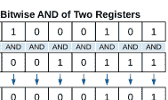

图 7.1：AND 真值表和位 AND 运算示例

使用两个输入位时，A 和 B 有四种可能的数字或位组合。如果一个或两个输入位均为 0，则 AND 运算的输出为 0。只有当两个输入均为 1 时，AND 运算的输出才为 1。AND 真值表显示以下 AND 运算：

```
0 AND 0 = 0
0 AND 1 = 0
1 AND 0 = 0
1 AND 1 = 1
```

图 7.1 右侧展示了两个 8 位寄存器如何进行 AND 运算的示例。顶部寄存器中的每个位与下方寄存器中对应的位进行 AND 运算。实际上，这是 8 次 AND 运行并行进行。顶部寄存器中的每个位代表真值表中的 A 输入。从上往下数第二个寄存器中的每个位代表真值表中的 B 输入。底部寄存器保存 8 次 AND 运算的结果，每个位代表真值表中的 Z 位。从右侧（即寄存器的位 0）开始，顶部寄存器的 1 与下方寄存器的 1 进行 AND 运算。从真值表可以看出 1 AND 1 = 1，因此 Z 寄存器位 0 的结果为 1。移到位 1，我们有 0 AND 1 = 0，如真值表所示。因此 Z 寄存器位 1 的值为 0。其余位亦然。

AVR 指令集有两条 AND 指令，即 AND（逻辑 AND）和 ANDI（带立即数的逻辑 AND）。AND 指令对两个寄存器中的数值进行 AND 运算。ANDI 指令将寄存器与立即数进行 AND 运算，即与编码在 ANDI 指令中的常量数据进行 AND 运算。ANDI 只能用于 R16 到 R31 寄存器。

以下程序演示了 AND 和 ANDI 指令。像往常一样，使用 test_asm 项目在带模拟器的调试器中加载并运行它。

```
test_asm : main.asm - AND and ANDI examples
ldi r16, 0b1100_0101
ldi r17, 0b1001_0111
and r16, r17
ldi r18, 0b1010_1011
andi r18, 0b0000_1111
```

在上述代码中，图 7.1 示例中的两个二进制数被加载到 R16 和 R17。AND 指令运行后，运算结果放置在 R16 中。在调试器中单步执行代码，确认 AND 运算的结果为 0b1000_0101。请记住，您可以在处理器状态窗口中右键单击寄存器 R16 和 R17，并将寄存器格式更改为二进制。

示例程序的第二部分将 0b1010_1011 加载到寄存器 R18，然后使用 ANDI 指令将 R18 与常量数据值 0b0000_1111 进行 AND 运算。ANDI 运算的结果存回 R18。单步执行代码并在调试器中确认结果。将寄存器 R18 与 0b0000_1111 或 0x0F 进行 AND 运算，实际上会清除寄存器高半字节中的所有位。这称为屏蔽寄存器。AND 运算可用于通过更改掩码值（即与 ANDI 指令一起使用的常量值）来清除任何位并保持其他位不变。例如，要清除寄存器中除了最高两位（即高两位）之外的所有位，请使用掩码值 0b1100_0000 或 0xC0。这将保持高两位不变。

### 7.4.2 逻辑 OR

逻辑 OR 运算的真值表如图 7.2 所示。

| A | B | Z |
|---|---|---|
| 0 | 0 | 0 |
| 0 | 1 | 1 |
| 1 | 0 | 1 |
| 1 | 1 | 1 |

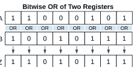

图 7.2：OR 真值表和位 OR 运算示例

在逻辑 OR 运算中，如果一个或两个输入位为 1，则输出为 1。只有当两个输入均为 0 时，输出才会为 0。与 AND 运算符一样，OR 运算是对两个 8 位数的位逐位进行。一个数中的每个位根据 OR 真值表与另一个数中对应的位进行 OR 运算。逻辑 OR 执行以下逻辑运算，如真值表所示：

```
0 OR 0 = 0
0 OR 1 = 1
1 OR 0 = 1
1 OR 1 = 1
```

AVR 指令集有两条逻辑 OR 指令，即 OR（逻辑 OR）和 ORI（带立即数的逻辑 OR）。这些指令分别相当于 AND 和 ANDI 指令，区别在于它们在逻辑运算中使用 OR 真值表。ORI 只能与 R16 到 R31 寄存器一起使用。

以下是使用 OR 和 ORI 指令的示例代码。再次使用 test 项目，按照以下段落所述在调试器中单步执行代码。

```
test_asm : main.asm - OR and ORI demonstration

ldi r16, 0b1100_0101
ldi r17, 0b1001_0111
or r16, r17

ldi r18, 0b1010_1011
ori r18, 0b0000_1111
```

在上述代码中，OR 用于将 R16 与 R17 进行逻辑 OR 运算，并将运算结果放置在 R16 中。在调试器中单步执行前三条指令，确认结果与图 7.2 的真值表中预期的结果一致。

ORI 使用立即数（即编码在指令中的常量数据）与寄存器中的值进行逻辑 OR 运算。单步执行上述代码列表中的最后两条指令，即可看到 ORI 指令将立即数与 R18 进行 OR 运算并将结果保存回 R18。立即数实际上被用作掩码值，用于设置 R18 中值的低半字节，但保持 R18 的高半字节不变。

如果将掩码值与 ORI 一起使用，则掩码值中所有为 1 的位都会导致输出为 1。掩码值中所有为 0 的位都会保持输入数中对应位不变。请考虑以下示例，该示例使用 0b0000_1111 作为掩码值，并将其与 0b1001_0101 进行 OR 运算。

```
0b1001_0101
OR 0b0000_1111
= 0b1001_1111
```

请注意，OR 运算的结果为 0b1001_1111。结果的高半字节与顶部数字的高半字节相同。这是因为它与掩码值的高半字节进行了 OR 运算，而掩码值的高半字节仅包含零，因此保持第一个数字的高半字节不变。

结果的低半字节仅包含 1，因为掩码值仅包含 1。这是因为任何数与 1 进行 OR 运算结果始终为 1。将掩码值与 OR 运算结合使用，通常用于设置一个或多个位，同时保持其他位不变。


## 7.4.3 逻辑异或

图 7.3 显示了异或（EOR）逻辑运算的真值表及其在两个 8 位寄存器上的使用示例。与 AND 和 OR 逻辑运算一样，EOR 对寄存器中数值的每一位与第二个寄存器中对应数值的相应位执行按位逻辑运算。如真值表所示，对两个值相同的输入位进行异或运算的结果始终为 0。对两个值不同的位进行异或运算的结果为 1。

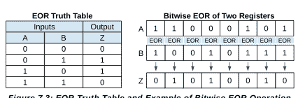

AVR 指令集包含一条异或指令，EOR（逻辑异或），用于对两个寄存器中的值相互进行异或运算。以下代码演示了 EOR 指令的使用。

```
test_asm : main.asm – EOR example

ldi    r16, 0b1100_0101
ldi    r17, 0b1100_0111
eor    r16, r17

ldi    r18, 0b0000_0001
ldi    r19, 0b0000_0001
loop:
eor    r18, r19     ; Toggle bit in R18
rjmp   loop
```

在上述代码中，前三条指令实现了图 7.3 中的示例按位 EOR 运算。单步执行代码并将结果与 EOR 真值表中预期的结果进行比对。可以看到，R16 中的值与 R17 中的值进行 EOR 运算，结果保存回 R16。

异或常用于切换位。切换位意味着改变其状态。如果一位的值为 0 且被切换，则其值将变为 1。如果一位的值为 1 且被切换，则其值将变为 0。在上述代码的第二部分中，R18 和 R19 均加载了 0b0000_0001 – 换句话说，每个寄存器的最低有效位被置位。随后在循环中对这两个寄存器执行 EOR 操作。每次在调试器中单步执行 EOR 指令时，R18 的 LSB 会在 1 到 0 或 0 到 1 之间持续切换。单步执行代码并验证 R18 的 LSB 是否在切换。

## 7.5 其他算术和逻辑指令

在本章中，我们介绍了 AVR 指令集中的一些基本算术和逻辑指令。DEC（递减）在 AVR ATtiny 数据手册的指令集摘要中与算术和逻辑指令归为一类。DEC 在 LED 闪烁程序中作为延迟子程序的一部分使用。INC（递增）是 DEC 的对应指令，它只需将寄存器中的值加 1。请参阅指令集摘要和 AVR 指令集手册，了解 AVR 中可用的其他算术和逻辑指令以及这些指令的功能描述。我们将在本书后面介绍其中一些其他指令，目前请查看您感兴趣的指令。

## 7.6 总结

- AVR 微控制器中的有符号数以补码格式存储。
- AVR 微控制器具有加法和减法算术指令。
- 状态寄存器中的标志根据算术或逻辑运算的结果被置位或清除。
- 如果算术运算的结果太大而无法存储在 8 位寄存器中，则进位标志在状态寄存器中被置位。
- 逻辑指令根据各自的真值表对寄存器和立即数执行逻辑运算。
- AVR 微控制器具有 AND、OR 和 EOR 逻辑指令。
- AVR 微控制器数据手册的指令集摘要部分列出了特定 AVR 器件中实现的所有指令。
- 算术、逻辑和其他 AVR 指令的详细描述可在 AVR 指令集手册中找到。

AVR 微控制器上的片上外设（如 I/O 端口和定时器）通过 I/O 寄存器进行控制，这些寄存器被分组为 64 个 8 位寄存器，可在数据手册的寄存器摘要部分找到。这些寄存器的详细描述可在数据手册的相关章节中找到，例如用于控制 AVR 引脚的 I/O 端口章节，以及用于控制定时器/计数器及其 PWM 功能的 8 位定时器/计数器0 带 PWM 章节。

本章介绍 I/O 端口，作为访问 ATtiny13(A) 和 ATtiny25/45/85 系列 AVR 上 AVR 外设的入门。本书后续章节将介绍其他外设，以及它们在代码或项目中的应用。

## 本章内容

- 访问 I/O 寄存器的指令
- 将 I/O 端口编程为输出
- 端口寄存器详情
- C 代码反汇编
- 使用 AVR 微控制器切换 LED 的三种方法
- 将 I/O 端口配置为输入

### 8.1 访问 I/O 寄存器的指令

AVR 指令集中的多条指令可用于访问（读取和写入）64 个 I/O 寄存器。IN 和 OUT 等指令可用于在 R0 到 R31 寄存器与 64 个 I/O 寄存器中的任意一个之间进行读写。由于 I/O 寄存器映射到数据空间，因此也可以使用 LDS（从数据空间直接加载）和 STS（直接存储到数据空间）等指令访问它们。还提供用于设置和清除位以及测试位状态的指令。

### 8.1.1 使用 IN 和 OUT 读写 I/O 寄存器

IN 指令用于从 I/O 寄存器读取一个值，OUT 指令用于将一个值写入 I/O 寄存器。

### 8.1.1.1 IN 指令

IN（将 I/O 位置加载到寄存器）指令用于读取 I/O 寄存器并将其内容放入 R0 到 R31 寄存器。例如，要将 PINB I/O 寄存器读入 R16，可以使用以下代码。

```
in r16, 0x16
```

请参阅 ATtiny13(A) 或 ATtiny25/45/85 数据手册的寄存器摘要部分，查找 PINB 寄存器及其地址 0x16。幸运的是，Microchip Studio 汇编语言项目会自动包含一个包含 I/O 寄存器定义的文件。这意味着在汇编语言程序中，可以使用寄存器名称而不是地址来访问寄存器。上述代码行可以使用寄存器名称而非其地址编写如下。

```
in r16, PINB
```

要访问包含寄存器定义的文件，请在 Microchip Studio 中打开一个项目，例如我们一直用于测试代码片段的 test_asm 项目。在 Microchip Studio 中，单击 Microchip Studio 右上角解决方案资源管理器窗格中 Dependencies 左侧的小三角形来展开 Dependencies。仅当项目已成功生成时，三角形才会可见。双击 Dependencies 下以 .inc 结尾的文件。例如，如果项目中选择了 ATtiny45，则文件名为 tn45def.inc，如图 8.1 所示。打开定义文件后，滚动浏览以查看所有寄存器和其他定义。图 8.1 中可以看到一些寄存器定义，包括地址 0x16 处 PINB 寄存器的定义。

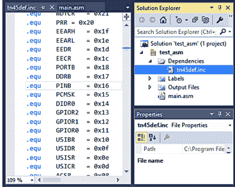

图 8.1：在 Microchip Studio 项目中打开定义文件

### 8.1.1.2 OUT 指令

OUT（将寄存器存储到 I/O 位置）将数据从 R0 到 R31 寄存器写入 I/O 寄存器。要使用 OUT 指令将值写入 I/O 位置，必须先将值加载到工作寄存器（R0 到 R31），然后使用 OUT 将寄存器写入 I/O 寄存器。要将常量值加载到 I/O 寄存器，该值首先需要使用 LDI 指令加载到寄存器中。请记住，LDI 指令仅对 R16 到 R31 寄存器操作。以下代码演示了如何使用 OUT 将常量值写入 I/O 寄存器。

```
ldi r16, 0x1A
out DDRB, r16
```

在上述代码中，常量值 0x1A 被加载到 R16。R16 的内容（现在为 0x1A）使用 OUT 指令写入 DDRB 寄存器。如图 8.1 所示，DDRB 定义为 0x17。同样，使用名称 DDRB 使代码更易读，而不是直接使用 DDRB 的地址 0x17。


## 8.1.2 I/O 寄存器位操作与测试

两条指令可以直接在 I/O 寄存器中设置和清除位，但只能操作地址为 0x00 到 0x1F（0 到 31）的寄存器。这些指令是 SBI（在 I/O 寄存器中设置位）和 CBI（在 I/O 寄存器中清除位）。本书开头的 LED 闪烁程序中都使用了这两条指令，用于在 PORTB I/O 寄存器中设置和清除一位。通过设置和清除该寄存器中的一位，连接到相应引脚的 LED 被打开和关闭。以下代码来自 LED 闪烁程序，使用 SBI 和 CBI 指令设置和清除位 PORTB4，即 PORTB 寄存器中的第 4 位。

```
sbi    PORTB, PORTB4
rcall  delay
cbi    PORTB, PORTB4
rcall  delay
```

再次说明，上述代码中使用的寄存器和位定义可以在定义文件中找到，例如 tn45def.inc。例如，上述代码片段的第一行代码使用了地址为 0x18 的 PORTB，以及在 .inc 文件中值为 4 的位定义 PORTB4。因此，第一行代码可以写成如下形式。

```
sbi    0x18, 4
```

有两条指令可用于测试寄存器中某位的状态。这些指令只能操作地址为 0x00 到 0x1F（0 到 31）的 I/O 寄存器。SBIS（如果 I/O 寄存器中的位被置位则跳过）测试 I/O 寄存器中的一位，如果该位被置位，则跳过下一条指令。SBIC（如果 I/O 寄存器中的位被清除则跳过）测试 I/O 寄存器中的一位，如果该位被清除，则跳过下一条指令。这些指令可用于根据特定位的状态在程序中做出决策。本章稍后将使用这些指令来读取连接到微控制器引脚之一的开关状态。

## 8.1.3 将 I/O 寄存器作为数据空间访问

有三条“加载”指令可用于通过数据空间中的地址，将任何 I/O 寄存器的数据加载到寄存器文件 R0 到 R31。这些指令是 LD、LDS 和 LDD，可用于读取任何 I/O 寄存器。事实上，这些指令可以读取数据空间中的任何地址，包括寄存器文件（R0 到 R31）、I/O 寄存器和 SRAM。ST、STS 和 STD 是“存储”指令，用于将寄存器 R0 到 R31 中的一个字节存储到数据空间中的任何地址，其中包括寄存器文件（R0 到 R31）、I/O 寄存器和 SRAM。

使用上述加载和存储指令时，需要将 0x20 加到正在访问的 I/O 寄存器的地址上。请回顾第 5 章、5.3 节图 5.3 中的 AVR 内存映射，并注意数据内存空间中的 64 个 I/O 寄存器从地址 0x0020 开始。现在请参阅 ATtiny13(A) 或 ATtiny25/45/85 数据手册的寄存器摘要中的相同寄存器，并注意这些相同的寄存器从地址 0x00 开始（0x00 位于寄存器摘要表的底部）。当与 IN 和 OUT 一起使用时，这些 I/O 寄存器使用从 0x00 开始的地址。由于这些寄存器也映射到数据内存空间，因此在使用从地址 0x0020 开始的加载和存储指令时，必须使用数据内存地址来访问它们。这就是必须将 0x20 加到这些地址上的原因。我们可以假设，AVR 内部有独立的控制线，根据正在执行的指令被激活。当执行 IN 或 OUT 时，I/O 寄存器在 0x00 到 0x3F 范围内被访问。当执行加载和存储指令时，不同的控制线允许在数据内存空间中访问 I/O 寄存器。某些 ATtiny 器件的数据手册在寄存器摘要部分中包含了 I/O 寄存器的两个不同地址，其中地址从 0x0020 开始并用括号括起来。0x00 到 0x3F 范围内的 I/O 寄存器地址称为短地址或直接 I/O 地址。对于整个数据内存空间（其中 I/O 寄存器从该空间中的 0x0020 开始），地址被称为长地址或数据地址。

在数据手册的寄存器摘要中，寄存器显示地址 0x00 在底部，地址从底部向顶部递增；而在内存映射中，I/O 寄存器从地址 0x0020 开始，地址从顶部向底部递增。无论地址是从顶部到底部还是从底部到顶部进行说明，都没有区别，重要的是寄存器的实际地址。

### 8.2 I/O 端口

I/O 端口控制 AVR 微控制器的引脚，并允许将引脚单独配置为输入引脚或输出引脚。I/O 端口使用一组四个寄存器在 ATtiny13(A) 和 ATtiny25/45/85 中进行控制。当引脚配置为输入引脚时，运行在 AVR 上的程序可以读取引脚上的逻辑电平。如果开关连接到引脚，可以读取引脚上的逻辑电平以查看开关是断开还是闭合。当引脚配置为输出引脚时，可以用它将引脚的逻辑电平切换为高电平（逻辑电平 1）或低电平（逻辑电平 0）。输出引脚可以用于驱动 LED，就像在 LED 闪烁项目中所做的那样。

### 8.2.1 在汇编语言中将 I/O 引脚配置为输出

在本节中，我们将探讨如何使用带有五个 LED 的 8 引脚 ATtiny，通过串联电阻将 LED 连接到引脚，来配置多个引脚为输出。代码用于将 LED 配置为一个从零开始递增的 5 位二进制计数器。

### 8.2.1.1 五个 LED 的 8 引脚 ATtiny 电路

图 8.2 显示了一个电路图，其中 ATtiny13(A) 或 ATtiny25/45/85 AVR 微控制器的五个 LED 连接到 I/O 引脚 PB0 到 PB4。

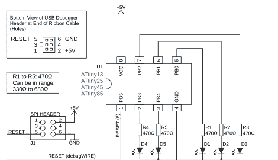

图 8.2：五个 LED 计数器电路图

### 8.2.1.2 使用 debugWIRE 或 ISP/SPI 对 ATtiny AVR 进行编程

图 8.2 电路中 ATtiny 微控制器的引脚 PB5 用作 debugWIRE 引脚，用于对微控制器进行编程和调试。请记住，要使用此配置，必须使用程序员/调试器，例如 Atmel-ICE 或 AVR Dragon。

仅编程的 USB 程序员在 debugWIRE 模式下无法工作，且无法执行调试。提醒：不要使用仅编程的 USB 程序员设置 DWEN 熔丝位，因为它将无法将 AVR 从 debugWIRE 模式中释放出来。在此示例电路中使用 debugWIRE 模式的想法是释放 AVR 的其他引脚，这些引脚通常在 ISP/SPI 编程模式下使用。

### 仅编程器

具有仅编程功能的 USB 程序员可以与图 8.2 的电路一起使用，以加载以下示例程序，并在 LED 上查看计数值。请参阅附录 B、图 B.1，了解如何将 USBasp、USBtinyISP 或作为 ArduinoISP 程序员的 Arduino Uno 连接到电路，然后按照图 8.2 和图 8.3 所示接线 LED。原始 USBasp 设计和原始 USBtinyISP 设计都在这些程序员输出线上设有保护电阻，以保护程序员和目标 AVR 芯片。作为 ArduinoISP 编程的 Arduino Uno 没有任何保护电阻，但可以在驱动进入目标 AVR 的 Arduino Uno MOSI 线和 SCK 线上添加这些电阻。原始 USBasp 设计中使用了 270Ω 保护电阻，并放置在 MOSI、SCK 和 RESET 线上。原始 USBtinyISP 设计的 MOSI 和 RESET 线上使用了 1K5 电阻。保护电阻可防止短路，以防目标 AVR 引脚在程序员输出相反极性的输出电压的同时输出电压。

### 干扰编程的外围硬件设备

虽然图 8.2 的电路可以在连接 LED 和串联电阻的情况下使用 ISP/SPI 接口进行编程，但其他电路可能连接了会干扰编程的硬件。如果要编程的 AVR 引脚上连接的任何外围硬件会干扰 AVR 编程，那么对此问题有一些解决方案。当然，拥有支持 debugWIRE 的 USB 程序员/调试器（例如 Atmel-ICE）的读者可以简单地将目标 AVR 置于 debugWIRE 模式，从而仅使用一个引脚进行编程。另一种解决方案是使用 ISP/SPI 在另一个面包板上对 AVR 进行编程，然后再将其插入目标电路中。

或者，可以使用引脚更多的 AVR，但空闲端口引脚并不总是与 8 引脚 PDIP ATtiny 同一端口的相同引脚匹配。例如，如果像图 8.2 的电路那样使用端口引脚 PB0 到 PB4，则在 14 引脚 ATtiny24/44/84 系列 AVR 上没有五个连续的空闲引脚可用，因为 ISP/SPI 引脚占用了端口 A 和端口 B 的引脚。在 20 引脚 ATtiny261/461/861 系列中，连接 ISP/SPI 程序员时，整个端口 A 都是空闲的，但这意味着软件需要更改为使用端口 A 而不是端口 B。20 引脚 ATtiny2313/4313 系列在连接 ISP/SPI 程序员时，确实有引脚 PB0 到 PB4 空闲。请参阅附录 B 中的电路，以查看连接 ISP/SPI 程序员时各种 PDIP ATtiny 微控制器上哪些引脚是空闲的。


## 将 AVR 置于 debugWIRE 模式

为了使用单根 debugWIRE 线对微控制器进行编程，如图 8.2 所示，首先需要将 USB 程序员/调试器的所有 ISP 排针引线连接到微控制器，然后设置 AVR 的 DWEN 熔丝位以将其置于 debugWIRE 模式。如果您一直按顺序阅读本书，那么您的 AVR 已经处于 debugWIRE 模式。如果不是，请按照第 2 章图 2.1 至图 2.3 所示，将您的程序员/调试器（例如 Atmel-ICE 或 AVR Dragon）连接到 AVR。按照第 3 章第 3.6.2 节的说明设置 DWEN 熔丝位。一旦 DWEN 熔丝位被编程，如图 8.2 所示，除了 RESET、+5V (Vcc) 和 GND 之外，电路中所有 ISP 排针连接都可以移除。

### 8.2.1.3 在面包板上搭建 5 个 LED 的 ATtiny 电路

如果您有硬件，请在电子面包板上搭建图 8.2 的电路。确保五个 LED 在面包板上排成一行，引脚 PB0 到 PB4 从右侧开始按顺序连接。LED D1 位于行的最右侧，D5 位于最左侧。换句话说，我们想要一排 LED，PB0 连接到最右侧的 LED，PB1 连接到其左侧的下一个 LED，PB2 连接到从右侧数第三个 LED，依此类推，如图 8.3 的面包板布局所示。该图仅显示了 LED 的轮廓，以免遮挡导线连接和电阻的视图。如果您没有硬件，请像我们在前几章中所做的那样，使用模拟器跟随程序进行操作。

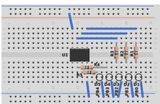

图 8.3: 五个 LED 计数电路面包板布局

### 8.2.1.4 5 LED 计数电路的汇编代码

启动一个名为 led_count.asm 的新 Microchip Studio AVR 汇编器项目。如果您需要回顾如何在 Microchip Studio 中启动新的汇编语言项目，请参阅第 2 章第 2.3.1 节。将以下 led_count.asm 清单中的代码键入到项目的 main.asm 中，替换此文件的骨架代码。

```
led_count_asm : main.asm
; Set up pins PB0 to PB4 as output pins
ldi r16, 0b0001_1111
out DDRB, r16
clr r18 ; Clear count register
loop:
out PORTB, r18 ; Display count on LEDs
rcall delay
inc r18 ; Increment count
andi r18, 0b0001_1111 ; Clear unused bits
rjmp loop
; Delay subroutine
delay:
ldi r16, 0xff
delloop1:
ldi r17, 0xff
delloop2:
dec r17
brbc SREG_Z, delloop2
dec r16
brbc SREG_Z, delloop1
ret
```

### 8.2.1.5 选择调试器或模拟器

如果您使用的是图 8.2 的硬件，请在 Microchip Studio 中选择硬件工具（您的调试器），例如 Atmel-ICE，并将 debugWIRE 作为接口，方法是单击第二个顶部工具栏上的锤子图标。如果您使用的是模拟器，请改为选择 Simulator 作为工具。如果使用爱好者编程器，请继续阅读，将提示您将程序加载到目标 ATtiny。

### 8.2.1.6 LED 计数汇编代码的作用

led_count_asm 程序将引脚 PB0 到 PB4 配置为输出引脚，以便连接到这些引脚的 LED 可以由程序控制开关。该程序在 LED 上显示一个递增的二进制数，即计数值，从 0 开始（由所有 LED 熄灭表示）。当计数达到其最大值（所有 LED 亮起）时，它会回绕到零并重新开始递增。这个计数值与第 4 章第 4.1.1 节表 4.1 中的二进制计数相同，只是电路显示的是 5 位计数，而不是表中显示的 4 位计数。每个熄灭的 LED 代表二进制零位或逻辑 0 电平，每个亮起的 LED 代表二进制一位或逻辑 1 电平。重要的是要按照图 8.3 所示布置 LED，以便计数显示正确，其中 PB0/D1 作为计数值的最低有效位（LSB），PB4/D5 作为最高有效位（MSB）。

### 8.2.1.7 构建并运行程序

构建程序并将其加载到 AVR 中，如果您使用的是图 8.2 和图 8.3 的物理硬件。如果使用 Atmel-ICE 或 AVR Dragon，请使用 Microchip Studio 顶部工具栏上的“开始不调试”图标或键盘快捷键 Ctrl + Alt + F5 将程序加载到 AVR。如果调试器接口设置正确且芯片处于 debugWIRE 模式，程序将加载并开始运行。递增的二进制计数将在 LED 上显示。如果使用仅编程的 USB 程序员（例如爱好者编程器），请使用您在附录 A 中设置的按钮将程序加载到目标 AVR。如果程序输入正确、电路接线正确，并且在输入后保存并构建了程序，您将看到二进制计数值在 LED 上递增，并且可以将模拟器与以下其余文本一起使用。

如果您没有物理硬件，仍然可以通过使用 Microchip Studio 中的模拟器来查看计数值。程序可以通过使用“开始调试并中断”图标逐步执行，就像我们在之前的模拟器示例中所做的那样。启动模拟器后，从顶部菜单使用 调试 ▶ 窗口 ▶ I/O 打开 I/O 窗口，然后单击 I/O 端口 (PORTB) 项目。如果您需要回顾如何使用模拟器和 I/O 窗口，请参阅第 3 章第 3.6.1 节和图 3.3。使用“逐过程”图标或 F10 键盘键逐过程执行程序。查看 I/O 窗口底部的 PORTB 项目，以查看如果连接了 LED 将显示的计数值。每次在主循环中逐过程执行 OUT 指令时，计数值都会在 PORTB 中更新。

### 8.2.1.8 LED 计数汇编程序的工作原理

led_count_asm 程序代码的一半由第 2 章第 2.3.2 节的 LED 闪烁程序中使用的相同延迟子程序组成。该子程序在程序的主循环中被调用一次，以便 LED 上的计数对眼睛可见，而不会闪烁得太快。在 Microchip Studio 中打开 led_count_asm 项目，并打开 main.asm 中的代码，同时阅读以下代码说明。

这样在翻阅本书页面时可以轻松查看代码。程序的前两条指令用于通过在 DDRB 寄存器中设置位，将引脚 PB0 到 PB4 设置为输出引脚以驱动 LED。图 8.4 显示了图顶部的 DDRB 寄存器。该寄存器中的每个位都对应微控制器上的一个引脚，例如位 DDB0 对应引脚 PB0，DDB1 对应引脚 PB1，依此类推。当 DDRB 中的某个位被设置为逻辑 1 时，相应的引脚变为输出引脚。如果 DDRB 中的某个位被清除为逻辑 0，相应的引脚变为输入引脚，这是所有引脚在上电或复位时的默认状态。在程序顶部，0b0001_1111 首先被写入寄存器 R16，然后使用 OUT 指令从 R16 写入到 DDRB 寄存器。有必要先将常量值加载到 R16，因为没有指令可以直接将常量值写入 DDRB 这样的 I/O 寄存器。将 0b0001_1111 写入 DDRB 设置了位 DDB0 到 DDB4，使引脚 PB0 到 PB4 成为输出引脚。

DDRB：端口 B 数据方向寄存器。配置引脚方向：0 = 输入，1 = 输出。
地址：0x17 初始值：0b0000_0000 位 5 到 0：读/写 (R/W)

| 7 | 6 | 5 | 4 | 3 | 2 | 1 | 0 |
|---|---|---|---|---|---|---|---|
| - | - | DDB5 | DDB4 | DDB3 | DDB2 | DDB1 | DDB0 |

PORTB：端口 B 数据寄存器。驱动输出引脚。使用逻辑 1 启用输入引脚上拉。
地址：0x18 初始值：0b0000_0000 位 5 到 0：读/写 (R/W)

| 7 | 6 | 5 | 4 | 3 | 2 | 1 | 0 |
|---|---|---|---|---|---|---|---|
| - | - | PORTB5 | PORTB4 | PORTB3 | PORTB2 | PORTB1 | PORTB0 |

PINB：端口 B 输入引脚寄存器。读取输入引脚状态。写入逻辑 1 以切换输出引脚。
地址：0x16 初始值：取决于引脚上的电平。位 5 到 0：读/写 (R/W)

| 7 | 6 | 5 | 4 | 3 | 2 | 1 | 0 |
|---|---|---|---|---|---|---|---|
| - | - | PINB5 | PINB4 | PINB3 | PINB2 | PINB1 | PINB0 |

图 8.4: ATtiny13(A) 和 ATtiny25/45/85 I/O 端口寄存器

虽然有四个寄存器用于控制 I/O 端口 B，但图 8.4 中只显示了三个。第四个寄存器 MCUCR 只有一个位适用于端口 B。这个位是全局上拉禁用位，本章不使用。请参阅数据手册 I/O 端口部分中的寄存器描述部分以查看此寄存器——使用 ATtiny13、ATtiny13A 或 ATtiny25/45/85 的数据手册均可。

R16 在程序中用于保存显示在 LED 上的递增计数值。在主循环之前，R16 使用 CLR 清除为 0，以便计数从 0 开始。在主循环中，R18 的内容使用 OUT 指令发送到 PORTB 寄存器。PORTB 寄存器可以在图 8.4 中间看到。同样，该寄存器中的每个位都对应微控制器上的一个引脚。对于被配置为


使用DDRB配置为输出引脚时，写入PORTB寄存器的逻辑电平会出现在这些引脚上。对于配置为输入引脚的引脚，PORTB中的逻辑1会在这些引脚上启用内部上拉电阻。逻辑0会禁用相应引脚上的上拉电阻。因为引脚PB0到PB4被配置为输出引脚，所以写入PORTB的计数值会以逻辑电平的形式出现在这些引脚上，用于切换LED的开关状态。计数值中的逻辑1会打开相应的LED，计数值中的逻辑0会关闭相应的LED。

使用OUT指令将计数值写入PORTB后，会调用延迟子程序，使计数值在LED上保持一段时间。然后使用INC指令将寄存器R18加一，使其保持的计数值递增。ANDI用于掩码值0b0001_1111清除R18中计数值的高三位。这确保这些高位始终为零。回到循环顶部，当R18再次写入PORTB时，高三位始终写入零，因为它们已被ANDI清除。当循环在RJMP指令处结束时，程序执行再次从循环顶部开始，将新的计数值写入PORTB并在LED上显示。

关于此程序需要注意的一些事项：与第2章的LED闪烁程序相比，两个程序都使用I/O寄存器DDRB和PORTB来设置和控制微控制器的B端口。LED闪烁程序只需控制单个引脚，因此使用SBI和CBI指令直接在I/O寄存器中设置和清除单个位——此操作不需要使用工作寄存器R0到R31。LED计数程序需要同时访问5个LED或引脚，因此使用OUT指令同时向寄存器中的多个位写入。

在汇编语言程序中，跟踪寄存器用法非常重要。例如，程序开始时将一个立即数加载到R16中。在此示例中，R16仅临时使用，因此可以在程序后续部分使用，而无需先保存其值。它在延迟子程序中再次使用。因为延迟子程序中使用了R16和R17，所以选择R18来保存计数值，且不用于其他任何用途。这确保计数值永远不会被覆盖。如果程序变得非常大且没有空闲寄存器可用于专用目的，则可以在子程序的开始和结束处使用PUSH和POP指令来保存所用寄存器中的值。

### 8.2.1.9 在调试器中使用断点

使用模拟器，或物理硬件和诸如Atmel-ICE之类的硬件调试器，像之前一样，通过单击“开始调试”和“中断”来使用调试器逐步执行程序。通过在Microchip Studio中打开I/O窗口来查看I/O端口寄存器。调试器运行时，选择“调试” > “窗口” > “I/O”，然后在I/O窗口中单击“I/O端口 (PORTB)”。

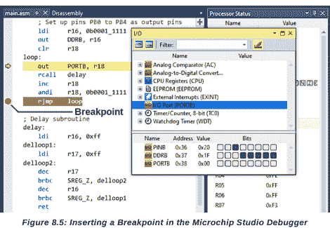

当程序执行进入主循环时，可以在RJMP指令上设置断点，并通过单击“继续”工具栏按钮（灰色键F5）来执行整个循环。可以通过单击指令最左侧的灰色区域（在Microchip Studio窗口中）在RJMP指令上设置断点。这会在此区域放置一个红点，表示已在该指令上设置断点，如图8.5所示。或者，单击要在其上设置断点的指令以将光标置于其上，然后从顶部菜单选择“调试” > “切换断点”，或使用F9键盘键。设置断点后，使用“继续”工具栏按钮或按F5键来逐步执行整个循环，仅在底部中断。这样，可以在I/O窗口中的PORTB和处理器状态窗口中的寄存器R18中看到计数值每次递增1，而无需逐个单步执行循环中的每条指令。

通过单击指令左侧的红点，从RJMP指令中移除断点，或者使用菜单或F9键切换断点关闭（假设光标位于RJMP指令行）。在INC R18指令上设置断点。现在使用F5键逐步执行循环。新断点确保当程序执行停止时，PORTB寄存器和R18包含相同的值。如果程序执行在RJMP处停止，则R18会在将其新值写入PORTB之前递增，因此在Microchip Studio的调试器窗口中观察这些值时，它们不同步。

### 8.2.2 在C中将I/O引脚配置为输出

我们现在创建一个与led_count_asm项目等效的C代码程序，并查看其生成的汇编语言。代码非常简单，使用延迟库函数而不是自定义延迟函数，就像第2章的LED闪烁C项目所做的那样。

### 8.2.2.1 LED计数C代码

在Microchip Studio中，启动一个名为led_count.c的新GCC C可执行项目。如果需要回顾如何启动新的C项目，请参阅第2章第2.4.1节。使用以下代码替换新项目main.c中的骨架代码。

```
led_count.c : main.c
//define F_CPU 10000000UL // 1MHz default clock for ATtiny25/45/85
#define F_CPU 1200000UL // 1.2MHz default clock for ATtiny13(A)
#include <avr/io.h>
#include <util/delay.h>

int main(void)
{
    uint8_t count = 0; // Clear count

    // Set up pins PB0 to PB4 as output pins
    DDRB = 0b00011111;

    while (1)
    {
        PORTB = count; // Display count on LEDs
        _delay_ms(1000);
        count++; // Increment count
        count &= 0b00011111; // Clear unused bits
    }
}
```

### 8.2.2.2 LED计数C代码的工作原理

与第2章第2.4.2节的led_blink_c代码一样，led_count_c代码定义F_CPU的值，以使_delay_ms()函数的延迟时间更准确。创建一个名为count的无符号8位整数变量，用于保存程序的递增计数值。它在main()开始时初始化为零。

DDRB使用与汇编语言程序中相同的二进制值进行写入，但中间没有下划线字符，因为GCC编译器不支持下划线。或者，可以使用等效的十六进制值0x1F来代替二进制数。可以使用头文件中定义的位来代替二进制数，但这会有些冗长。如果为I/O寄存器中的位使用头文件中定义的位，则必须分别将值1逐个左移，然后按位或在一起，如以下代码行所示。

```
DDRB = ( 1 << DDB4) | ( 1 << DDB3) | ( 1 << DDB2) | ( 1 << DDB1) | ( 1 << DDB0);
```

在while(1)循环中，count被赋值给PORTB，将计数值写入LED。然后调用延迟函数，使LED上的计数值可见。然后count加一，并与汇编程序中使用的相同二进制掩码数进行按位与运算。同样，这是为了清除数字的高3位。回到while(1)循环顶部，新的计数值被写入LED。

### 8.2.2.3 运行LED计数C代码

选择正确的调试工具，构建项目，并使用顶部工具栏上的“开始不调试”图标或Ctrl + Alt + F5键组合将其加载到硬件中（如果使用Microchip Studio支持的编程器）。如果使用爱好者USB编程器，请使用在附录A中设置的按钮将程序加载到目标AVR。这将加载程序并开始运行，就像我们对汇编语言程序所做的那样。LED将开始以二进制递增计数，但速度比汇编程序慢，因为延迟例程使用了更长的延迟时间。

### 8.2.2.4 LED计数C代码反汇编

为AVR微控制器编写的C语言程序在最终转换为机器码之前，会先转换为汇编语言。例如，以下C语言代码行在寄存器DDRB中设置位DDB4：

```
DDRB |= ( 1 << DDB4);
```


前一行 C 代码由 C 编译器转换为以下汇编语言行：

```
sbi DDRB, DDB4
```

这个特定的示例恰好从一行 C 代码转换为一行汇编语言代码。在其他情况下，一行 C 代码可能转换为多行汇编代码。在本节中，我们查看 C 编译器和链接器从 led_count.c 项目生成的汇编语言代码，以及实际加载到 AVR Flash 内存中的代码。虽然最终加载到 Flash 内存的是二进制机器码，但我们查看的是对这些机器码指令进行反汇编后的汇编语言代码。这是在 Microchip Studio 的调试器中完成的。使用“开始调试并中断”（Start Debugging and Break）启动调试器，可以使用实际硬件和硬件编程器/调试器，也可以使用模拟器。调试器启动后，从顶部菜单选择 Debug ▶ Windows ▶ Disassembly，或使用键盘快捷键 Alt + 8——第二个工具栏上也有一个 Disassembly 图标。打开反汇编窗口后，反汇编代码将在 Microchip Studio 中显示。以下列表显示了针对 ATtiny13(A) 的这部分反汇编代码的第一部分。

```
--- No source file ---
00000000 RJMP PC+0x000A Relative jump
00000001 RJMP PC+0x000F Relative jump
00000002 RJMP PC+0x000E Relative jump
00000003 RJMP PC+0x000D Relative jump
00000004 RJMP PC+0x000C Relative jump
00000005 RJMP PC+0x000B Relative jump
00000006 RJMP PC+0x000A Relative jump
00000007 RJMP PC+0x0009 Relative jump
00000008 RJMP PC+0x0008 Relative jump
00000009 RJMP PC+0x0007 Relative jump
0000000A RJMP PC+0x0006 Relative jump
--- /.../ : </crt1/gcrt1.S
0000000A CLR R1 Clear Register
0000000B OUT 0x3F,R1 Out to I/O location
0000000C LDI R28,0x9F Load immediate
0000000D OUT 0x3D,R28 Out to I/O location
0000000E RCALL PC+0x0003 Relative call subroutine
0000000F RJMP PC+0x00012 Relative jump
00000010 RJMP PC-0x0010 Relative jump
```

反汇编窗口显示来自 Flash 内存的反汇编代码。顶部是由 C 工具自动插入的中断向量表。我们在此不详细介绍中断。目前只需知道，中断向量表中的第一个条目是复位向量。该位置的指令只是导致跳转到 C 代码的入口点。当 AVR 上电或复位时，它首先运行此指令，这会导致程序跳过其余的向量表条目，并从头开始运行 C 代码。其他向量表条目也会导致程序跳转到复位向量，但首先是跳转到另一条跳转指令。代码列表显示了反汇编的前两个部分。请注意，此代码是为 ATtiny13(A) 构建的，它有一个较小的中断向量表，包含从地址 0 到地址 9 的 10 个条目。如果为 ATtiny25/45/85 构建相同的代码，您会注意到向量表有 15 个条目，从地址 0 到 14（0x000E）。每条汇编语言指令左侧是该指令在 Flash 程序内存中的地址。查看反汇编中的第一个条目，我们在地址 0 处有复位向量，旁边是一条 RJMP 指令，如下所示。

```
00000000 RJMP PC+0x000A Relative jump
```

可以看出，这条相对跳转指令跳转到 PC + 0x000A 处的地址，即当前程序计数器（PC）值加上 0x000A。复位时，PC 包含零，因此第一条跳转指令跳转到地址 0x000A。在反汇编列表中，CLR R1 位于 grc1.S 部分的地址 0x000A 处。中断向量表其余部分（从地址 0x0001 到 0x0009）也包含相对跳转指令，它们都跳转到地址 0x0010。在地址 0x0010 处，还有一条 RJMP 指令，它向后跳转 0x10 个地址，由地址旁边的负号指示，如下所示。

```
00000010 RJMP PC-0x0010 Relative jump
```

0x10 是十进制的 16，从当前地址 0x10 向后 16 个地址是 0，即向量表地址 0 处的复位向量。这意味着，如果触发任何中断，程序执行将简单地从地址 0 重新开始。在前面的反汇编列表中，代码的第二部分来自 grc1.S，如列表所示。此代码由 C 工具自动链接。在 grc1.S 名称中，crt 代表 C Runtime，即在调用 C main() 函数之前执行所需初始化的代码。C 运行时代码首先清除状态寄存器，即先清除 R1，然后将 R1 加载到地址 0x3F（即状态寄存器），如下所示。

```
0000000A CLR R1 Clear Register
0000000B OUT 0x3F,R1 Out to I/O location
```

在 ATtiny13(A) 和 ATtiny25/45/85 数据手册的 Register Summary 部分中，SREG（状态寄存器）位于表顶部的地址 0x3F 处。清除状态寄存器后，C 运行时代码将堆栈指针设置为指向 SRAM 数据内存的末尾。对于 ATtiny13(A)，这是 0x9F——内存映射请参阅第 5 章中的图 5.3。如以下代码所示，0x9F 被加载到寄存器 R28。然后将 R28 加载到地址 0x3D，即 SPL（堆栈指针低寄存器）。

```
0000000C LDI R28,0x9F      Load immediate
0000000D OUT 0x3D,R28      Out to I/O location
```

最后，使用 Relative Call to Subroutine RCALL 指令调用 main()，如下所示。

```
0000000E RCALL PC+0x0003   Relative call subroutine
```

这会跳转到地址 PC + 0x0003，即当前地址 0x000E + 3，换句话说是地址 0x0011。如以下反汇编列表的其余部分所示，地址 0x0011 是 main() 内的第一条指令。列表的其余部分显示了混合了转换为的汇编语言的 C 代码。

```
--- C: \ ... ... ... ./.../main.c
{
    uint8_t count = 0;        // Clear count

    // Set up pins PB0 to PB4 as output pins
    DDRB = 0b00011111;
00000011 LDI R24,0x1F         Load immediate
00000012 OUT 0x17,R24        Out to I/O location

    uint8_t count = 0;        // Clear count
00000013 LDI R24,0x00        Load immediate
00000014 PORTB = count;      // Display count on LEDs
00000014 OUT 0x18,R24        Out to I/O location
--- C: \ ... ... ... ./.../delay.h
--- builtin_avr_delay_cycles(__ticks__dc);
00000015 LDI R18,0xF7        Load immediate
00000016 LDI R19,0xA9        Load immediate
00000017 LDI R25,0x03        Load immediate
00000018 SUBI R18,0x01       Subtract immediate
00000019 SBCI R19,0x00       Subtract immediate with carry
0000001A SBCI R25,0x00       Subtract immediate with carry
0000001B BNE PC-0x03         Branch if not equal
0000001C RJMP PC+0x0001      Relative Jump
0000001D NOP                 No operation
--- C: \ ... ... ... ./.../main.c
count++;                     // Increment count
0000001E SUBI R24,0xFF       Subtract immediate
0000001F count &= 0b00011111; // Clear unused bits
0000001F ANDI R24,0x1F       Logical AND with immediate
00000020 RJMP PC-0x000C      Relative Jump
```

对上述列表进行顶层查看可发现，来自 delay.h 的延迟库函数代码被放置在 main.c 代码的中间。在反汇编代码的开头，可以看出该代码与 led_count_asm 项目代码相似。0x1F 被加载到 R24，然后使用 OUT 指令发送到地址 0x17，如下所示，C 代码行显示在其转换为的两行汇编语言之上。

```
DDRB = 0b00011111;
00000011 LDI R24,0x1F Load immediate
00000012 OUT 0x17,R24 Out to I/O location
```

0x17 是 DDRB 寄存器的地址，如数据手册的 Register Summary 部分所示。这两行代码执行与 led_count_asm 项目中前两行代码相同的功能，只不过上述代码使用 R24 和十六进制表示法，而 led_count_asm 项目使用 R16 和二进制表示法。

在地址 0x0013 处的下一行代码中，R24 用作 count 变量，并设置为初始值零，如下所示。

```
uint8_t count = 0; // Clear count
00000013 LDI R24,0x00 Load immediate
```

上述代码行是从显示在其上方的一行 C 代码转换而来。请注意，C 编译器将此行代码放在 DDRB 寄存器初始化之后。在原始 C 源代码中，count 变量在 DDRB 初始化之前声明并初始化。通过更改这些代码行的顺序，R24 首先用于初始化 DDRB，然后再次用作 count 变量。

在地址 0x0014 处，R24 中的 count 值被写入地址 0x18，即 PORTB 寄存器。再次，PORTB 的地址在数据手册的 Register Summary 部分中找到。此行代码将 0（R24 中的 count 值）写入 LED，将其关闭，并从显示在其上方的一行 C 代码转换而来。

```
PORTB = count; // Display count on LEDs
00000014 OUT 0x18,R24 Out to I/O location
```

接下来将运行地址 0x0015 到 0x001D 的代码，即 _delay_ms() 函数，它会创建延迟，使当前计数值在 LED 上显示一段时间。

Subtract Immediate (SUBI) 用于将计数寄存器 R24 加一。代码通过从 R24 减去 -1 来实现这一点，这等同于向 R24 加 1。这是通过从 R24 减去 -1 来完成的，-1 采用 2 的补码格式。-1 在两的补码中


格式为 0xFF，如下一行代码所示。同样，一行 C 代码转换为一行汇编语言代码。C 代码行显示在其转换得到的汇编语言代码之上。

```
count++; // Increment count
0000001E SUBI R24,0xFF Subtract immediate
```

SUBI 与其他寄存器直接寻址模式指令一样，使用作为指令一部分编码的立即数。SUBI 仅对寄存器 R16 到 R31 操作。在 led_count.asm 项目中，INC 指令用于对 R18 递增计数值。

与 led_count.asm 项目一样，ANDI 用于清除计数寄存器的最高 3 位。这再次将一行 C 代码转换为汇编代码，如下所示。

```
count &= 0b00011111; // Clear unused bits
0000001F ANDI R24,0x1F Logical AND with immediate
```

程序中的最后一条指令执行相对跳转回地址 0x0014，如下所示。

```
00000020 RJMP PC-0x000C Relative jump
```

此跳转使用相对于 PC 当前值的负数。执行此指令时，PC 中为 0x0020，因此 0x0020 – 0x000C 得出地址 0x0014。地址 0x0014 是 while(1) 循环的顶部，计数值通过地址为 0x18 的 PORTB 寄存器写入 LED。之所以在类似 led_count.asm 的汇编语言程序中不将 RJMP 指令与地址（无论是正数还是负数）一起使用，是因为在这些程序中我们使用标签，让汇编程序在构建时运行时解析地址。

上述代码行构成了 C 程序中的 while(1) 循环，位于原始 C 代码中 while(1) 循环的右花括号位置。

作为 led_count.asm 与 led_count.c 反汇编代码的对比，下面的清单将两个程序并排显示，并移除了延迟例程。反汇编代码中也移除了向量表和 C 运行时代码。原始 C 代码显示在右侧，与其左侧生成的汇编语言代码对齐。

| led_count.asm 代码 | led_count_c 反汇编 | C 代码 |
| --- | --- | --- |
| ldi r16, 0b00111111 | LDI R24,0x1F | DDRB = 0b00111111; |
| out DDRB, r16 | OUT 0x17,R24 | |
| clr r18 | LDI R24,0x00 | uint8_t count = 0; |
| loop: | OUT 0x18,R24 | while (1) { |
| out PORTB, r18 | ; 延迟代码已移除 | PORTB = count; |
| rcall delay | SUBI R24,0xFF | _delay_ms(1000); |
| inc r18 | ANDI R24, 0x1F | count++; |
| andi r18, 0b00111111 | RJMP PC-0x000C | count &= 0b00011111; |
| rjmp loop | | } |

如上述清单所示，C 编译器已将我们的原始汇编语言程序逐行匹配，唯一的例外是所使用的寄存器、用于清除计数寄存器的指令以及用于递增计数值的指令。当然，在 led_count.asm 项目的手写汇编代码中，通过使用寄存器定义和标签，我们拥有更易读代码的优势。如果将此代码加载到 AVR 然后从闪存中反汇编，它也将具有这些寄存器的地址，例如 DDRB 和 PORTB，以及 RJMP 指令的相对地址，而不是标签。

_delay_ms() 函数在上面的清单中出现，但在原始反汇编中未出现的原因是，该函数实际上只是内联函数 __builtin_avr_delay_cycles() 的封装，而后者出现在原始反汇编中。

本节最后，我们查看 led_count_c 项目的相同反汇编代码，如下列清单所示，但这次是针对 ATtiny45 而非 ATtiny13(A) 编译的。以下代码清单是完整的反汇编程序代码，分为接下来两页的两部分。在 Microchip Studio 中使用模拟器时，您会注意到在向下滚动超过反汇编结束位置后，代码清单后面跟有 NOP 指令。NOP（无操作）指令是一条不执行任何操作（除了在执行时占用一个时钟周期）的指令。

如反汇编代码所示，ATtiny45 的向量表比 ATtiny13(A) 具有更多条目，如前所述。这是因为 ATtiny25/45/85 微控制器比 ATtiny13(A) 具有更多中断源。

由于 ATtiny45 的 SRAM 数据内存结束于地址 0x015F（参见第 5 章第 5.3.1 节中的图 5.3），SPH 寄存器必须用该地址的高字节值 0x01 进行初始化，同时将低值 0x5F 加载到 SPL。这由下面代码清单中地址 0x0011 到 0x0014 的指令完成，在清单的 gcrt1.S 部分以粗体蓝色显示，其中 SPH 位于地址 0x3E，SPL 位于地址 0x3D。对于 ATtiny13(A)，SRAM 结束于 0x9F，只需初始化 SPL，因为这个 8 位寄存器可以寻址该设备中的所有 SRAM。

```
led_count.c: main.c code disassembled - compiled for ATtiny45 - vector table and CRT
--- No source file ------------------------------------------------
00000000 RJMP PC+0x000F Relative jump
00000001 RJMP PC+0x0010 Relative jump
00000002 RJMP PC+0x0015 Relative jump
00000003 RJMP PC+0x0014 Relative jump
00000004 RJMP PC+0x0013 Relative jump
00000005 RJMP PC+0x0012 Relative jump
00000006 RJMP PC+0x0011 Relative jump
00000007 RJMP PC+0x0010 Relative jump
00000008 RJMP PC+0x000F Relative jump
00000009 RJMP PC+0x000E Relative jump
0000000A RJMP PC+0x000D Relative jump
0000000B RJMP PC+0x000C Relative jump
0000000C RJMP PC+0x000B Relative jump
0000000D RJMP PC+0x000A Relative jump
0000000E RJMP PC+0x0009 Relative jump
--- .../.../.../crt1/gcrt1.S -----------------------------------------
0000000F CLR R1 Clear Register
00000010 OUT 0x3F,R1 Out to I/O location
00000011 LDI R28,0x5F Load immediate
00000012 LDI R29,0x01 Load immediate
00000013 OUT 0x3E,R29 Out to I/O location
00000014 OUT 0x3D,R28 Out to I/O location
00000015 RCALL PC+0x0003 Relative call subroutine
00000016 RJMP PC+0x0012 Relative jump
00000017 RJMP PC+0x0017 Relative jump
```

在代码的最初两个差异之后——更大的中断向量表和高堆栈指针字节——其余代码与 ATtiny13(A) 的代码基本相同，只是其余代码出现在不同的地址，因为向量表和 gcrt1.S 中的额外代码导致所有内容在内存中进一步向下移动。

| Address | Opcode | Instruction | Comment |
| --- | --- | --- | --- |
| | | led_count.c : main.c 反汇编 – 针对 ATtiny45 编译，main.c 和 delay.h 代码 | |
| -- | C:\ .... .... .../.../main.c | | |
| { | | | |
| | | uint8_t count = 0; // 清除计数 | |
| | | // 将 PB0 到 PB4 引脚设置为输出引脚 | |
| | DDRB = 0b00011111; | | |
| 00000018 | LDI R24,0x1F | 加载立即数 | |
| 00000019 | OUT 0x17,R24 | 输出到 I/O 位置 | |
| | uint8_t count = 0; // 清除计数 | | |
| 0000001A | CLR R24 ; 0 | 加载立即数 | |
| 0000001B | PORTB R24 ; count; // 显示计数到 LED | | |
| 0000001B | OUT 0x18,R24 | 输出到 I/O 位置 | |
| -- | c:\ .... .... /delay.h | | |
| -- | builtin_avr_delay_cycles(__ticks__);; | | |
| 0000001C | LDI R18,0x3F | 加载立即数 | |
| 0000001D | LDI R19,0xD0 | 加载立即数 | |
| 0000001E | LDI R25,0x03 | 加载立即数 | |
| 0000001F | SUBI R18,0x01 | 减去立即数 | |
| 00000020 | SBCI R19,0x00 | 带进位减去立即数 | |
| 00000021 | SBCI R25,0x00 | 带进位减去立即数 | |
| 00000022 | BRNE PC-0x03 | 不相等时分支 | |
| 00000023 | RJMP PC+0x0001 | 相对跳转 | |
| 00000024 | NOP | 无操作 | |
| -- | C:\ .... .... .../.../main.c | | |
| | count++; // 递增计数 | | |
| 00000025 | SUBI R24,0xFF | // 减去立即数 | |
| | count &= 0b00011111; // 清除未使用位 | | |
| 00000026 | ANDI R24,0x1F | 带立即数的逻辑 AND | |
| 00000027 | RJMP PC-0x000C | 相对跳转 | |
| -- | 无源文件 ------------------------------------------------ | | |
| 00000028 | CLI | 全局中断禁用 | |
| 00000029 | RJMP PC-0x0000 | 相对跳转 | |

两组反汇编代码之间的唯一其他差异是延迟函数中使用的值。这是因为代码在 C 代码顶部为两种不同的默认时钟速度定义了不同的 F_CPU 值而编译的。

## 8.2.3 限制计数值

在以下的 led_count_limit.asm 项目代码中，与 led_count.asm 代码一样，相同的递增计数显示在 LED 上，但这次最大计数值由分支指令和清除指令限制，而不是使用 ANDI 指令。由于未使用 ANDI 指令，寄存器 R0 到 R15 可用作计数寄存器。R0 已被选为此示例的计数寄存器。


```
led_count_limit.asm : main.asm

; Set up pins PB0 to PB4 as output pins
ldi r16, 0b0001_1111
out DDRB, r16
clr r0 ; Count register

loop:
out PORTB, r0 ; Display count on LEDs
rcall delay
inc r0 ; Increment count
sbrc r0, 5 ; Reset count if R0 = 0x20
clr r0
rjmp loop

; Delay subroutine
delay:
ldi r16, 0xff
delloop1:
ldi r17, 0xff
delloop2:
dec r17
brbc SREG_Z, delloop2
dec r16
brbc SREG_Z, delloop1
ret
```

上述清单中的整个程序与 led_count.asm 程序的工作方式相同，只是使用了 SBRC 指令及其后面的 CLR 指令，如下所示。

```
sbrc r0, 5
clr r0 ; Reset count if R0 = 0x20
```

这些指令将写入 LED 的值限制为 0x1F 或 0b0001_1111。
SBRC 的意思是“如果寄存器中的位被清除则跳过”（Skip if Bit in Register is Cleared）。在上述代码中，SBRC 检查寄存器 R0 中的第 5 位是否被清除，如果是，则跳过下一条指令（即其后面的 CLR 指令）。第 5 位在 R0 中的计数值达到 0b0001_1111 之前（包括该值）始终为清除状态。当 R0 包含此值并发生下一次递增时，值变为 0b0010_0000，即 0x20，这意味着该值中的第 5 位现在第一次被置位。请记住，位编号从最右边的位开始为 0，因此位号 5 是数字从右数第 6 位。现在 R0 中第 5 位已被置位，当下次运行 SBRC 指令时，其下面的 CLR 指令不再被跳过，而是被执行。该指令在 R0 写入 LED（或 PORTB 寄存器）之前将其清除，因此 0b0010_0000 永远不会被写入 PORTB，而是写入 0b0000_0000。

从本示例可以看出，SBRC 指令有两个操作数，第一个是要测试的寄存器，可以是 R0 到 R31。第二个操作数是要在该寄存器中测试的位，可以是 0 到 7。

## 8.2.4 使用 AVR 切换 LED 的三种方法

连接到 AVR 引脚的 LED 切换有三种方式：1) 通过直接向 PORT 寄存器写入逻辑电平来按值更改引脚逻辑电平，2) 使用异或（exclusive OR），3) 使用 PINB 寄存器。以下小节将解释这三种方法。切换 LED 当然意味着将其逻辑状态从 0 变为 1，或从 1 变为 0。

### 8.2.4.1 按值切换 LED

在第二章第 2.3.2 节的 led_blink_asm 项目中，使用了 SBI 和 CBI 来按值切换 LED。在第二章第 2.4.2 节的 led_blink_c 项目中，以同样的方式使用了按位 OR 和 AND 指令。

如我们在本章第 8.2.1.4 节的 led_count_asm 项目中所见，OUT 指令也可以通过向 PORT 寄存器写入来更改引脚或多个引脚的值，并可用这种方式切换 LED。led_count_c 项目也是如此，其中值被直接写入 PORTB 寄存器以更改 LED 的值。如果相应引脚设置为输出，则向 PORT 寄存器中的某位交替写入 1 和 0 将切换 LED。由于我们在前面章节中已经介绍了如何按值切换 LED，本节将不再查看任何进一步的代码。

### 8.2.4.2 使用异或切换 LED

可以使用第七章第 7.4.3 节中介绍的异或运算符来切换 LED。如果某一位始终与逻辑电平 1 进行异或运算，那么如果该位初始值为 1，1 EOR 1 = 0，该位最终会从 1 切换到 0。这意味着下次该位与 1 进行异或运算时，我们有 0 EOR 1 = 1，因此该位现在从 0 切换到 1。如果继续将该位与 1 进行异或运算，它将不断在 1 到 0 之间来回切换。我们在第 7.4.3 节的 EOR 示例代码片段中看到了这一点。LED 可以以同样的方式切换，如下面的 led_eor_toggle_asm 项目所示。由于 EOR 无法直接切换引脚，引脚值首先通过使用 IN 读取整个端口放入寄存器中。在使用 EOR 切换寄存器中的位后，新值使用 OUT 写回端口。

```
led_eor_toggle.asm : main.asm

; Set pin PB0 as an output
ldi   r18, 0x01
out   DDRB, r18

loop:
in    r19, PORTB    ; Get the PORTB register
eor   r19, r18      ; Exclusive OR with 0x01 to toggle
out   PORTB, r19    ; Write back to PORTB
rcall delay         ; LED on/off delay
rjmp  loop

; Delay subroutine
delay:
ldi   r16, 0xff
delloop1:
ldi   r17, 0xff
delloop2:
dec   r17
brbc  SREG_Z, delloop2
dec   r16
brbc  SREG_Z, delloop1
ret
```

在上述代码清单中，0x01 被加载到 R18，这意味着该寄存器的最低有效位（LSB）被置位，所有其他位被清除。然后使用 OUT 指令将 R18 写入 DDRB 寄存器，这将引脚 PB0 启用为输出引脚。

在主循环中，PORTB 的值使用 IN 指令放入 R19。最初分配给 R18 的 0x01 值现在在 R18 与 R19 进行异或运算时被重复使用。R19 现在在其最低有效位中包含被切换的位，该位由 EOR 指令切换。R19 使用 OUT 指令写回 PORTB，这导致被切换的位应用于引脚 PB0 上的 LED。

有必要首先将 PORTB 的值读入通用工作寄存器，然后对其执行异或运算，最后将新值写回 PORTB，因为没有直接对 PORTB 操作的异或指令。EOR 只能一次对两个寄存器进行操作，且这两个寄存器必须在 R0 到 R31 范围内。

可以使用前面的代码切换第 8.2.1.1 节图 8.2 电路中的所有 LED，只需将写入 R18 的值更改为 0x1F。这样将引脚 PB0 到 PB4 设置为输出引脚。当 R18 中的此值在主循环中被重复使用时，PORTB 的所有 5 位（从位 0 到位 4）将同时由 EOR 指令切换。异或运算也可以在 C 编程语言中用于切换 LED，如下面的 led_eor_toggle_c 代码清单所示。

```c
//#define F_CPU 1000000UL // 1MHz default clock for ATtiny25/45/85
#define F_CPU 1200000UL // 1.2MHz default clock for ATtiny13(A)
#include <avr/io.h>
#include <util/delay.h>

int main(void)
{
    DDRB = (1 << DDB0); // Set pin PB0 as an output

    while (1) {
        PORTB ^= (1 << PORTB0); // Exclusive OR to toggle LED
        _delay_ms(1000); // LED on/off delay
    }
}
```

在上述清单中，位 DDB0 在 DDRB 寄存器中被置位，将引脚 PB0 配置为输出。(1 << PORTB0) 计算结果为 0x01，因此在 PORTB 和 0x01 之间执行按位异或运算，这导致引脚 PB0 和连接的 LED 切换。在 C 语言中，看起来 PORTB 直接与某个值进行异或运算，但反汇编显示 PORTB 被读取，然后对 PORTB 值执行异或运算，接着将新值写回 PORTB。请在 Microchip Studio 中查看反汇编，亲自验证。

### 8.2.4.3 使用 PINB 寄存器切换 LED

PINB 寄存器（如第 8.2.1.8 节图 8.4 底部所示）可用于在引脚设置为输出时切换引脚的状态。向 PINB 寄存器中相应位写入逻辑 1 会切换相应引脚的状态。

并行切换 5 个 LED 的代码可以在下面的 led_pinb_toggle_asm 项目代码清单中看到。再次使用图 8.2 的电路来运行此程序。与 led_eor_toggle_asm 项目一样，代码开头写入 R18 的值可以更改，以选择程序中要切换哪些 LED。

到现在你应该知道，写入 R18 的二进制值 0b0000_1111 与 0x1F 相同。要仅切换 PB0 上的 LED，该值可以更改为 0x01，或十进制值 1，或 0b0000_0001。与前面的代码清单一样，主循环中会调用相同的延迟子程序，以使 LED 亮起的时间足够肉眼可见。

```
led_pin_toggle_asm : main.asm

; Set up pins PB0 to PB4 as output pins
ldi   r18, 0b0001_1111
out   DDRB, r18

loop:
rcall delay
out   PINB, r18      ; Toggle LEDs
rjmp  loop

; Delay subroutine
delay:
ldi   r16, 0xff
delloop1:
ldi   r17, 0xff
delloop2:
dec   r17
brbc  SREG_Z, delloop2
dec   r16
brbc  SREG_Z, delloop1
ret
```

将 0b0001_1111 写入 R18 后，R18 被写入 DDRB 以将引脚 PB0 到 PB4 设置为输出，与我们之前做的一样。然后在主循环中使用 R18 将相同的值发送到 PINB 寄存器，以同时切换所有 5 个 LED。每次循环时，相同的值都会写入 PINB，每次都会切换 LED。该程序在循环中仅使用三行代码，因此是所示三种方法中切换 LED 最有效的方式。

请注意，向 PINB 寄存器中与输出引脚对应的任何位写入 0 不会影响输出引脚的状态。在上述程序中，如果我们像之前一样将引脚 PB0 到 PB4 设置为输出引脚，并在主循环中向 PINB 写入 0b0001_1110，使得最低有效位每次都写入 0，那么只有引脚 PB1 到 PB4 会切换。引脚 PB0 根本不会受到影响，因为它在每次循环中都会写入 0。

与 led_pin_toggle_asm 等效的程序可以轻松用 C 语言编写。这在下面的 led_pin_toggle_c 项目代码清单中显示。与我们多次做过的一样，DDRB 用于将引脚 PB0 到 PB4 设置为输出，以配合图 8.2 的电路使用。在 while(1) 循环中，调用延迟函数。无论此函数是在循环顶部还是底部调用都无关紧要。PINB 被写入 0x1F 以同时切换引脚 PB0 到 PB4 上的所有 LED。


led_pinb_toggle_c : main.c

//#define F_CPU 1000000UL // 1MHz default clock for ATtiny25/45/85
#define F_CPU 1200000UL // 1.2MHz default clock for ATtiny13(A)
#include <avr/io.h>
#include <util/delay.h>

int main(void)
{
    DDRB = 0x0F;        // Set up pins PB0 to PB4 as output pins

    while(1) {
        _delay_ms(1000);  // LED on/off delay time
        PINB = 0x0F;      // Toggle LEDs on pins PB0 to PB4
    }
}

## 8.2.5 将 I/O 引脚配置为输入

当开关连接到微控制器引脚且该引脚配置为输入时，可以读取开关的状态来判断其是断开还是闭合。下一页的图 8.6 电路用于演示如何读取开关的状态。如果你有硬件，请在面包板上搭建电路。虽然图中显示电路使用了 debugWIRE，但拥有爱好者编程器的读者可以将其以 ISP/SPI 模式连接。使用 PB3 和 PB4 引脚分别连接开关和 LED，可将其他引脚留给 ISP/SPI 编程器。如果使用 Atmel-ICE，请继续以 debugWIRE 模式使用它。

图 8.6 电路中的开关 SW1 直接将 PB3 连接到 GND。在这种配置下，通常需要一个从 PB3 连接到 +5V 的上拉电阻，如图中灰显的电阻 R2 所示，以便当开关断开时引脚上的逻辑电平为逻辑 1。当开关闭合时，引脚连接到 GND，在引脚上呈现逻辑 0。上拉电阻可防止开关闭合时 +5V 被短路到 GND，同时允许开关断开和闭合时两种逻辑电平出现在引脚上。

由于 AVR 微控制器的每个引脚上都有内部上拉电阻，并且可以单独启用或禁用，因此我们不需要在引脚 PB3 上放置外部电阻。使用外部上拉电阻的唯一原因是需要更强的上拉电阻，即更低的上拉电阻值，例如 4k7 或 10k。ATtiny13(A) 和 ATtiny25/45/85 数据手册显示，内部上拉电阻相当弱且公差较大，规格为 20KΩ 至 50KΩ。这些内部上拉电阻值可在数据手册的电气特性部分找到。

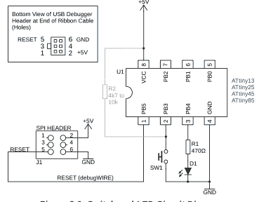

在 Microchip Studio 中创建 read_switch_asm 汇编器项目，并将以下清单中的代码输入到 main.asm 中。该程序的作用是：如果开关闭合则点亮 LED，如果开关断开则熄灭 LED。由于电路中使用了上拉电阻，逻辑是反向的。开关闭合时读取 0，断开时读取 1。

```
read_switch.asm : main.asm

sbi   DDRB, DDB4        ; LED connected to PB4
cbi   DDRB, DDB3        ; Switch connected to PB3
sbi   PORTB, PORTB3     ; Enable pull-up on PB3

loop:
sbic  PINB, PINB3       ; Skip if switch closed
cbi   PORTB, PORTB4     ; Switch LED off
sbis  PINB, PINB3       ; Skip if switch open
sbi   PORTB, PORTB4     ; Switch LED on
rjmp  loop
```

在程序开头，使用 SBI 指令将引脚 PB4 设置为输出引脚，这与 LED 闪烁程序中所做的一样。CBI 用于清除 DDRB 寄存器中的一位，将引脚 PB3 设置为输入引脚，如代码清单中的第二条指令所示。虽然引脚默认为输入，但这条指令表明我们明确希望将此引脚用作输入，不过我们也可以省略这条指令，代码仍然可以工作。因为 PB3 已设置为输入引脚，所以使用 SBI 指令设置 PORTB 寄存器中的位 PORTB3 可启用引脚 PB3 上的内部上拉电阻。请回顾本章 8.2.1.8 节中的图 8.4，以查看控制 I/O 端口的寄存器和位，或参考所使用 ATtiny 器件的 AVR 数据手册。

在程序的主循环中，使用两条指令来测试引脚 PB3 上开关的状态，即 SBIC 和 SBIS。这两条指令都测试 PINB 寄存器中位 PINB3 的逻辑状态，如代码所示。位 PINB3 包含引脚 PB3 的逻辑状态，因为 PB3 已设置为输入引脚。图 8.7 的流程图显示了代码的功能。以下是对 SBIC 和 SBIS 用法的说明。

SBIC（如果 I/O 寄存器中的位被清除则跳过）指令：如果连接开关的引脚 PB3 处于逻辑电平 0（开关闭合），则跳过下一条指令。当开关断开时，由于启用了内部上拉电阻，PB3 处于逻辑电平 1。在这种情况下，下一条指令是 CBI 指令，用于关闭 LED，因此不会被跳过。这意味着当开关断开时，SBIC 后面的 CBI 指令会被执行，LED 被关闭。

SBIS（如果 I/O 寄存器中的位被置位则跳过）指令：如果 PB3 上施加了逻辑电平 1（开关断开），则跳过下一条指令。当开关断开时，由于上拉电阻，PB3 上施加了逻辑电平 1，导致下一条指令被跳过。如果开关闭合，PB3 上施加了逻辑电平 0，此时 SBIS 指令不跳过下一条指令。下一条指令（SBI）将 LED 点亮。

从程序中省略 SBIC 指令，在物理硬件上全速运行程序时似乎不会有什么区别。无论开关是断开还是闭合，LED 都会在循环顶部被关闭。当开关断开时，LED 永远不会被点亮。当开关闭合时，LED 会在循环顶部被关闭，并在循环底部被点亮。因为当开关闭合时 LED 关闭的时间非常短，然后随即点亮，所以在眼睛看来它似乎是持续点亮的。

使用硬件调试器和物理硬件，或 Microchip Studio 中的模拟器来启动程序并中断。使用调试器单步执行程序，以确保你理解 SBIC 和 SBIS 指令如何根据开关的状态进行决策。在单步执行代码时，闭合和断开开关。在开关闭合的情况下测试代码时，请记住在单步执行代码时保持开关闭合。

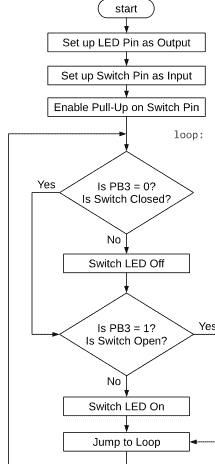

```
sbi DDRB, DDB4
cbi DDRB, DDB3
sbi PORTB, PORTB3
loop:
sbic PINB, PINB3
cbi PORTB, PORTB4
sbis PINB, PINB3
sbi PORTB, PORTB4
rjmp loop
```

图 8.7：read_switch_asm 项目的流程图

如果你使用的是模拟器，则需要通过更改 PINB 寄存器中相应位的状态来模拟开关的闭合和断开。为此，启动调试器，使用顶部菜单中的 Debug ▶ Windows ▶ I/O 打开 I/O 窗口，然后在 I/O 窗口中单击 I/O PORT (PORTB) 以显示 I/O 端口寄存器。在 I/O 窗口底部，单击 PINB 寄存器中的位 3 以更改其状态，这模拟了开关状态的改变。请记住，位编号从 0 开始而不是 1，因此位 3 是从右数的第四位。LED 的状态可以在 PORTB 寄存器的位 4（从右数的第五位）中查看。请注意，在 PINB 寄存器中，当位 3 为高电平时开关断开，当为低电平时开关闭合。这种反向逻辑可能有点令人困惑。在单步执行代码时，请务必仔细思考正在发生的事情。

以下清单中展示了与 read_switch_asm 项目功能等效的 C 程序，即 read_switch_c 项目的代码清单。这个程序基本上是不言自明的。前三条指令设置了 LED 引脚、开关引脚和内部上拉电阻，与汇编语言程序一样。在 if() 语句中，测试 PINB 寄存器中的位 PINB3 以查看开关是闭合还是断开。然后使用按位 AND 和 OR 运算符来关闭或打开 LED。

```
read_switch.c : main.c

#include <avr/io.h>

int main(void)
{
    DDRB  |= (1 << DDB4);    // Set PB4 pin as output for LED
    DDRB  &=~(1 << DDB3);    // Set PB3 pin as input for switch
    PORTB |= (1 << PORTB3);  // Enable pull-up on PB3 pin

    while (1) {
        if (PINB & (1 << PINB3)) {   // If pin is high, switch is open
            PORTB &=~(1 << PORTB4);  // Switch LED off
        } else {
            PORTB |= (1 << PORTB4);  // Switch LED on
        }
    }
}
```

以下清单中将原始 read_switch_asm 代码与反汇编的 read_switch_c 代码并列展示。在反汇编代码中，寄存器地址已替换为寄存器名称，指令地址已替换为标签，以便于阅读。

值得注意的是，反汇编代码比手写的汇编语言程序多一条指令。反汇编代码没有使用两条位测试和跳过指令，而是使用一条 SBIS 指令，并在其下方放置一条 RJMP 指令。因此，如果开关闭合，将发生跳转到 led_on 标签的操作，在该标签处 LED 被


on。然后到达循环底部，发生跳转到循环顶部。如果开关断开，则跳过SBIS下方的第一条RJMP指令，并执行关闭LED的CBI指令。现在执行CBI指令下方的RJMP指令，导致跳转回循环顶部。

| read_switch.asm 代码 | read_switch_c_disassembly 代码 |
| :--- | :--- |
| sbi DDRB, DDB4 | SBI DDRB, DDB4 |
| cbi DDRB, DDB3 | CBI DDRB, DDB3 |
| sbi PORTB, PORTB3 | SBI PORTB, PORTB3 |
| loop: | loop: |
| sbi PINB, PINB3 | SBIS PINB, PINB3 ; 如果开关断开则跳过 |
| cbi PORTB, PORTB4 | RJMP led_on |
| | CBI PORTB, PORTB4 ; 关闭 LED |
| sbi PINB, PINB3 | RJMP loop |
| sbi PORTB, PORTB4 | led_on: |
| rjmp loop | SBI PORTB, PORTB4 ; 打开 LED |
| | RJMP loop |

## 8.3 总结

- AVR 片上外设通过映射到数据存储器空间的 I/O 寄存器进行控制。

- 关于 AVR 片上外设及其寄存器的信息可以在特定 AVR 器件的数据手册中找到。

- IN 和 OUT 指令可用于在 I/O 寄存器与寄存器文件中的寄存器（R0 到 R31）之间复制数据。这些指令只能操作地址范围为 0 到 63（0x00 到 0x3F）的 I/O 寄存器。

- SBI、CBI、SBIS 和 SBIC 是可用于直接读写 I/O 寄存器中位的指令。

- SBI 和 CBI 只能设置和清除地址从 0 到 31（0x00 到 0x1F）的 I/O 寄存器中的位。

- SBIS 和 SBIC 只能测试地址在 0 到 31（0x00 到 0x1F）之间的 I/O 寄存器中某位是置位还是清除。

- 提供加载和存储指令，用于在寄存器文件工作寄存器与数据存储器中的任何地址位置（包括 I/O 寄存器）之间复制数据。

## 第 9 章 · 汇编语言元素

到目前为止，我们一直在编写非常简单的汇编语言程序，这些程序没有使用汇编程序的许多功能或汇编语言特性。

在本章中，我们将更深入地探讨汇编语言程序的结构和语法，以及 AVR 汇编程序的功能。这包括预处理器、汇编指令和表达式。

本章中的所有内容都适用于随 Microchip Studio 提供的 AVR 汇编程序，该程序称为 AVRASM2。可执行汇编程序 avrasm2.exe 在构建汇编语言程序时由 Microchip Studio 运行。

### 本章内容

- 汇编语言指令和标签
- 预处理器和包含文件
- 用于指定代码和数据位置的汇编指令
- 如何保留内存
- 定义和等同名称
- 条件汇编
- 其他汇编语言元素

### 9.1 指令和标签

一行汇编语言代码具有以下基本格式：

```
[label:] instruction [operands] [comment]
```

至少，一行汇编语言由单条指令组成。指令可能需要一个或多个操作数，具体取决于指令类型。标签和注释是可选的。

标签表示指令的地址或其后数据的地址。标签可以写在指令的左侧或上方，如以下示例代码所示。

```
loop: rjmp loop ; Infinite loop
```

以下代码与上述代码完全相同，标签的位置没有区别。

```
loop:
    rjmp loop ; Infinite loop
```

每行汇编语言都由制表符或空格分隔的列组成。标签出现在最左侧，后跟指令助记符。如果有操作数，它们出现在下一列，后跟可选注释。

AVRASM2 汇编程序每行代码限制为 120 个字符。我们已经看到注释以分号开头，但也可以使用 C 和 C++ 风格的注释 – 如需提醒，请回顾第 3 章的 3.4 节。

标签可以由任何字母数字字符组成，即 A 到 Z、a 到 z 和 0 到 9。标签名称中也可以使用下划线（_）。标签不能以数字（0 到 9）开头，必须以字母或下划线开头。

### 9.2 预处理器和包含文件

预处理器可以是一个独立的程序，也可以是编译器或汇编器等软件工具在主编译或汇编之前执行的过程。预处理器执行的任务包括从其他文件包含代码和数据、用值替换文本以及宏展开。

AVRASM2 AVR 汇编程序支持以井号（#）开头的类 C 预处理器指令，以及以句点或点号（.）开头的汇编指令。例如，要在汇编语言程序中包含外部文件，可以使用以下内容。

```
#include <tn25def.inc>
```

使用上述代码行时，预处理器不会在当前目录中搜索要包含的文件，而是期望文件位于由尖括号指示的路径中。下面使用 "" 的变体会先在当前目录中搜索文件。这两个包含预处理器指令的工作方式与 C 程序中的相同。

```
#include "tn25def.inc"
```

在汇编表示法中，包含指令也有两种形式。使用下面显示的第一种形式时，汇编程序不会在当前目录中搜索要包含的文件，而是期望它位于路径中。

```
.include <tn25def.inc>
```

使用以下指令时，汇编程序会在当前目录中搜索要包含的文件。

```
.include "tn25def.inc"
```

使用包含指令包含文件时，包含文件的内容将有效地替换到包含该指令的文件中。

在 Microchip Studio 中，所选特定 AVR 器件的包含文件不需要显式包含，因为在新建项目过程中选择器件时，此操作已在项目设置中完成。例如，tn25def.inc 包含 ATtiny25 的寄存器定义，在选择 ATtiny25 微控制器时会将其包含在项目中。构建项目时，Microchip Studio 通过命令行将此文件传递给汇编程序 – 有关更多详细信息见第 12 章。

图 9.1 显示了一个示例，说明如何在通过选择 ATtiny45 器件配置的项目中自动包含 tn45def.inc。在创建新项目时选择器件，也可以通过单击工具栏上的器件名称在项目中更改器件，如图顶部所示。如果将 ATtiny45 更改为不同的器件，Microchip Studio 会在项目中自动更新该器件的正确包含文件。

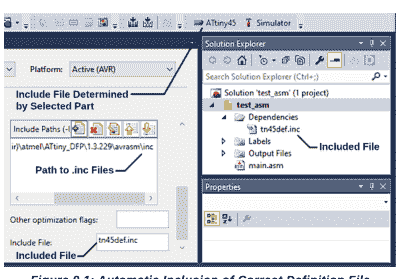

在图 9.1 的左侧，显示了项目属性页的一部分。要查看此页面，首先打开一个汇编语言项目，然后从顶部菜单选择 Project ▶ <项目名称> 属性...，或使用键盘快捷键 Alt + F7。在打开的页面左侧菜单中单击 工具链。在页面左/中窗格中，单击 AVR Assembler 下方的 常规 项。在图 9.1 中，单击 常规 项后出现的属性仅有一部分可见，因为可见区域已向下滚动，隐藏了其上方的项目。在 Microchip Studio 中，图中显示的窗格部分上方可见复选框。可以看到，顶部工具栏上的器件名称会导致图中左下角选择正确的包含文件。可以在此处看到所有包含文件的包含路径。对于默认的 Microchip Studio 安装，此路径解析为：C:\Program Files (x86)\Atmel\Studio7.0\packs\atmel\ATtiny_DFP.1.8.332\avrasm\inc。如果使用 Windows 文件资源管理器导航到此文件夹，将找到 ATtiny 系列微控制器的所有包含文件。图 9.1 显示上述路径的最后部分为 \ATtiny_DFP.1.3.229\avrasm\inc，因为图像是使用安装了旧版本头文件时捕获的。包含 avrasm 的文件夹的版本号对于不同版本的 Microchip Studio 会有所不同。

在图 9.1 的右侧，在解决方案资源管理器窗格中，包含文件仅在项目成功构建（即无错误构建）时才出现在 依赖项 文件夹中。我们之前在第 8 章的 8.1.1 节中打开过此文件，以查看其包含的寄存器和位定义。

### 9.3 汇编指令

汇编语言程序中可用多种指令。预处理器指令以 # 开头，汇编指令以点号（.）开头，如上一节中包含指令的示例所示。本节介绍这些汇编指令中最有用的几个。预处理器指令（以 # 开头）和宏区分大小写。汇编指令（以 . 开头）不区分大小写。

汇编指令具有以下基本格式：

```
[label:] directive [operands] [comment]
```

至少，汇编指令可以由单个指令组成，如以下示例使用 CSEG 指令所示。

```
.CSEG
```

可选地，汇编指令可以带有标签和一个或多个操作数，后跟注释。带有一个操作数的汇编指令示例是 ORG 指令，如下一行代码所示，我们将在下一节中介绍。


.ORG 0

带有标签和单个操作数的汇编指令示例是下面所示的 BYTE 指令，该指令也将在下一节中介绍。

```
count: .BYTE 1
```

## 9.3.1 指定代码和数据位置

AVRASM2 汇编程序支持一组指令组合，允许将代码和数据放置在所需的地址和指定的内存类型中。这些是 ORG、CSEG、DSEG 和 ESEG 指令，将在以下子节中进一步说明。

### 9.3.1.1 ORG 汇编指令

ORG 是一个汇编指令，是 *原点* 的缩写，用于设置内存区域的程序原点或起始地址。ORG 可以用大写或小写字母编写，但在程序中使用时必须以点开头。.ORG 和 .org 均可用。下面的简单代码片段展示了如何使用 ORG 设置程序的起始地址。

```
.ORG 0
sbi DDRB, DDB4    ; LED on pin PB4
sbi PORTB, PORTB4 ; Switch LED on
loop:
rjmp loop         ; Infinite loop
```

在代码片段中，.ORG 被设置为 0，这将程序代码的起始地址设置为 0。代码默认放置在地址 0，这就是迄今为止的程序都不需要使用 ORG 指令的原因。

另一个示例是，我们可以将代码放置在地址 0x40，留出其上方的 Flash 存储空间。我们确实需要在地址 0 放置一条 RJMP 指令，跳转到地址 0x40 处的程序代码，因为复位时代码从地址 0 开始执行。下面的代码片段展示了如何实现这一点。

```
.ORG  0
rjmp   0x48

.ORG  0x40
sbi    DDRB, DDB4    ; LED on pin PB4
sbi    PORTB, PORTB4 ; Switch LED on

loop:
rjmp   loop
```

将上述代码输入到我们之前使用的 test_asm 项目中。在调试器中运行它，可以使用模拟器，也可以使用带 USB 调试器的实际硬件。开始调试并中断，然后打开反汇编窗口（Alt + 8）。在反汇编窗口中，您会注意到第一条 RJMP 指令位于窗口最顶部，地址为 0。使用 F10 键单步跳过 RJMP 指令后，程序执行继续在地址 0x40，且 0x40 可以在处理器状态窗口的程序计数器中看到。地址 0x01 到 0x3F 的 Flash 存储器未被使用。

在上述代码片段中，第一个 .ORG 0 可以省略，因为 0 是汇编语言程序中代码的默认起始地址。保留 .ORG 0 是可选的，但它可以告知阅读代码的任何人，程序员故意编写了从地址 0 开始的后续代码。请注意，RJMP 指令以十六进制格式跳转到指定地址。这可以代替使用标签来完成。.ORG 0x40 指定其后的代码将从地址 0x40 开始放置在内存中。

当 ORG 与段指令（CSEG、DSEG 和 ESEG）一起使用时，会更加有用。段指令用于指定代码或数据应放置在哪种内存中。将 ORG 与段指令一起使用，允许将代码和数据放置在所需内存的特定地址中。AVR 汇编语言中有三种类型的段指令，即 CSEG（代码段）、DSEG（数据段）和 ESEG（EEPROM 段）。放置在 CSEG 中的任何内容都将放置在 Flash 存储器中，可以是代码或数据。放置在 DSEG 中的数据将放入 SRAM 数据内存。ESEG 存放放置在 AVR EEPROM 中的数据。

### 9.3.1.2 CSEG 代码段指令

CSEG 是默认段类型，定义 Flash 存储器中代码段的开始。如下面的代码片段所示，CSEG 指令后面没有任何参数。

```
.CSEG
.ORG  0
sbi   DDRB, DDB4
sbi   PORTB, PORTB4
loop:
rjmp  loop
```

在上述代码片段中，ORG 指令与 CSEG 指令一起使用，告诉汇编程序将后续代码放置从地址 0 开始的 Flash 程序内存中。当然，这两者都是汇编语言程序的默认设置，因此在上述示例中可以省略。

当将代码放置在地址 0 以外的位置，或者其他段的数据放置在程序代码之上时，ORG 和 CSEG 指令会更加有用。汇编语言程序可以包含多个代码段，每个段由其自己的 CSEG 指令指定，并可与 ORG 指令配合使用或单独使用。

### 9.3.1.3 DSEG 数据段和 BYTE 指令

DSEG 定义将放置在 AVR 微控制器 SRAM 中的数据段的开始。DSEG 后面通常跟一个标签，以便在程序中可以使用标签名称轻松访问数据。DSEG 也通常与 BYTE 指令结合使用，该指令在内存中保留字节。数据段不能自动用值初始化，而是保留供代码访问的内存字节。

在下面的代码片段中，使用 DSEG 和 BYTE 指令在 SRAM 中保留一个字节的内存。这实际上在 SRAM 中创建了一个命名变量，可用于后续的汇编语言代码，这类似于在 C 语言中声明变量。

```
.DSEG
count: .BYTE 1
.CSEG
ldi   r16, 0xAB
sts   count, r16
loop:
rjmp  loop
```

在清单代码的开头，使用 DSEG 指令定义数据段的开始。在此之后，BYTE 指令通过将 1 指定为操作数来保留一个字节的 SRAM。BYTE 指令前面是 count 标签，这允许在后续代码中使用此名称访问 SRAM 中的这一个字节数据。

在 DSEG 数据段之后，CSEG 指令指定将放置在 Flash 存储器中的代码随之而来。代码首先使用 LDI 将 0xAB 加载到 R16。然后使用 STS 将 R16 中的值写入 count 变量，换句话说，将 R16 中的值加载到位于 SRAM 中的标记为 count 的字节。请参阅第 5 章第 5.4.1 节中的代码片段，其中 STS 指令用于将 R16 中的值加载到地址 0x60。我们现在做的是同样的事情，但使用了命名变量。与第 5 章的代码片段一样，我们也可以使用 LDS 指令将 SRAM 中的值复制到寄存器。例如，要将 count 中的值加载到 R0，可以执行以下操作。

```
lds r16, count
```

在模拟器中运行前面的代码片段，就像我们在第 5 章第 5.4.2 节中所做的那样。在内存窗口中选择数据 IRAM，以便在单步执行 STS 指令时看到 R16 中的值被写入 SRAM。如果未使用 ORG 指令为 SRAM 中保留的 count 字节指定地址，则它会被放置在 SRAM 的开头，即地址 0x60。在调试器中选择数据 IRAM 作为要查看的内存后，此地址位置应该在视图中；如果不在视图中，请滚动直到看到它。将上述代码行添加到 STS 指令下方的程序中，以查看 SRAM 中的 count 值被写入寄存器 R0。

如本示例所示，让汇编器为我们保留内存，并使用标签作为内存的名称，要比按地址访问内存并跟踪我们正在使用的地址容易得多。当汇编语言程序开始变得更大时，这一点尤其正确。

### 9.3.1.4 ESEG EEPROM 段指令

ESEG 是一个定义 EEPROM 段开始的指令。放置在 ESEG 中的数据最终位于 AVR 的内部 EEPROM 中。

## 9.3.2 保留内存

有几个用于保留内存的汇编指令可用于 AVR 汇编语言程序。我们已经在 9.3.1.3 节中看到过其中一个指令，即与 DSEG 一起使用的 BYTE 指令。以下子节总结了用于保留内存的汇编指令，以表明为此目的有多种不同的指令可用。

### 9.3.2.1 BYTE

BYTE 在 SRAM 或 EEPROM 中保留一个或多个字节，因此与 DSEG 和 ESEG 指令一起使用。我们已经在 9.3.1.3 节中看到过如何保留一个字节的 SRAM 内存的示例。

### 9.3.2.2 DB – 定义常量字节

DB 在 Flash 程序内存（CSEG）或 EEPROM（ESEG）中定义一个或多个常量字节。

## 9.3.2.3 修正的哈佛架构

尽管 Microchip/Atmel 文档声称 AVR 微控制器具有哈佛架构，但 AVR 实际上具有修正的哈佛架构。虽然第 6 章第 6.3 节图 6.5 所示的哈佛架构为程序和数据内存提供了完全独立的总线，但 AVR 实际上可以将常量数据存储在 Flash 程序内存中，并在程序中读取该数据。这是因为其修正的哈佛架构。

## 使用 DB 汇编指令的示例代码

在下面的代码片段中，包含了四个使用 DB 汇编指令的不同示例。将此代码输入到我们一直在使用的 test_asm 项目的 main.asm 文件中，并在模拟器中单步执行，同时跟随代码说明。尽管片段中实际工作的代码非常短，但此程序中正在发生许多新事物。

## CSEG 指令和第一条 RJMP 指令

在下面清单的代码中，CSEG 指令被使用了三次。这并非严格必要，因为正如我们所知，CSEG 是汇编语言程序的默认段类型。在代码中使用 CSEG 只是有助于显示代码有三个主要部分。在代码开头，一条 RJMP 指令确保程序执行从 DB 常量字节数据之后的 main: 标签开始。如果


如果常量数据被放置在代码顶部且其前没有 RJMP 指令，则该数据将从地址 0 加载到 Flash 程序存储器中。当 AVR 微控制器开始运行时，它会尝试将此数据作为指令执行，这将导致未定义行为。

| test_asm : main.asm | DB 示例代码 |
| :--- | :--- |
| .CSEG | |
| .ORG 0 | |
| .rjmp main | |
| | |
| .CSEG | |
| message: .DB "Hello", 0 | |
| message2: .DB "Hi", 0, 0 | |
| numbers: .DB 3, 2, 1, 0 | |
| letters: .DB 'A', 'B', 'C', 0 | |
| | |
| .CSEG | |
| main: | |
| ldi ZH, high(message << 1) | ; Initialize Z pointer (R31) |
| ldi ZL, low(message << 1) | ; Initialize Z pointer (R30) |
| | |
| check_0: | |
| lpm r16, Z+ | ; Load byte from program memory |
| subi r16, 0 | ; Force status register update |
| brbc SREG_Z, check_0 | ; Loop if result not zero |
| | |
| loop: | |
| rjmp loop | ; Infinite loop |

## DB 汇编指令的用法

代码中第一条 RJMP 指令之后跟有四行 DB 常量字节数据。DB 数据采用与 BYTE 相同的格式。DB 指令前有一个带冒号的标签，为其后的数据提供人类可读的名称。该名称解析为 Flash 程序存储器中每行数据起始处的 16 位程序存储器位置的地址。

## 数据格式和空终止字符串

这四行数据显示，数据可以是双引号之间的字符串、逗号分隔的数字，以及单引号之间的字母，同样用逗号分隔。在此代码示例中，由 DB 定义的每行数据都以数字零进行空终止，以遵循 C 语言中空终止字符串的惯例，从而能够识别字符串的结束。要在字符串、数字列表或字母列表的末尾添加零，只需将数字零放在行尾，逗号之后即可。

## 程序存储器中 DB 数据的位置和对齐

请记住，程序存储器宽 16 位，每个 16 位宽的存储器位置的地址比前一个地址大 1。这意味着在顺序遍历程序存储器位置时，每次递增两个字节。当将字节宽数据放置在此程序存储器中时，两个字节的数据被放置在一个地址位置，因为每个地址位置寻址一个 16 位（即两个字节宽）的存储器位置。如果使用 DB 指令在程序存储器中放置奇数个字节，则汇编程序会用一个零字节填充奇数个字节，使数据变为偶数个字节，从而占用数据所放置的最后一个 16 位存储器位置的两个字节。这确保了下一个数据或程序指令从下一个 16 位指令地址开始。在 Microchip Studio 汇编语言项目中使用 DB 定义奇数个字节并构建项目时，底部窗格中会显示一条警告消息。此警告消息用于通知程序员，字节未对齐，因为它们没有填满两个字节宽的程序存储器位置的所有字节。将出现以下警告消息。

```
.cseg .db misalignment - padding zero byte
```

尝试从前一个清单中的代码中删除任何 DB 数据行末尾的 0，然后在 Microchip Studio 中构建项目以查看上述消息。请务必同时删除零前面的逗号，以免行尾以逗号结尾，否则将报告语法错误而不是警告。已在 message2（即“HI”消息）的末尾添加第二个零，以抑制警告消息。这是抑制警告消息的合法方式。

## 16 位地址指针寄存器

当我们查看第 5 章第 5.1 节中的 AVR 寄存器（包括该章图 5.1 中的图表）时，未详细查看 X、Y 和 Z 寄存器，只是在图中看到了它们的标记。我们用来演示 DB 汇编指令工作原理的代码使用了 Z 寄存器，因此我们现在将查看该寄存器的详细信息。尽管寄存器 R30 和 R31 可以作为独立的 8 位宽寄存器使用，但某些指令将它们用作单个 Z 寄存器，例如当前示例中的 LPM 指令。这个 Z 寄存器实际上是两个字节（即 16 位）宽，由作为 Z 寄存器最低有效字节的 R30 和作为 Z 寄存器最高有效字节的 R31 组成。

## 加载 Z 寄存器

在我们从前一个清单中使用的示例代码中，有以下内容，

```
main:
    ldi    ZH, high(message << 1) ; Initialize Z pointer (R31)
    ldi    ZL, low(message << 1)  ; Initialize Z pointer (R30)
```

在代码开头，我们有 `main:` 标签，它只是主程序代码的入口点。程序中的第一条 RJMP 指令跳转到此标签，以跳过使用 DB 放置在程序存储器中的常量数据。在此示例中选择名称 `main` 是为了模仿 C 程序中的 main() 函数或入口点——即主程序代码开始运行的位置。这只是一个名称，我们可以将其命名为任何我们想要的名称，例如 `start` 或 `begin`。在此标签之后，数据被加载到 Z 寄存器的高字节和低字节中。请注意，代码在使用 LDI（加载立即数）指令时，将 ZH（Z 寄存器高字节）和 ZL（Z 寄存器低字节）用作目标寄存器。ZH 指的是寄存器 R31，ZL 指的是寄存器 R30，它们是组成 16 位 Z 寄存器的两个 8 位寄存器。加载到 Z 寄存器两个字节的数据实际上是 `message:` 标签处数据的地址。因为 `message` 标签解析为程序存储器中 16 位字的地址，我们需要将其乘以二以获取字节地址而不是 16 位字地址。这是通过使用左移运算符 `<<`，后跟 1 来完成的，它将组成地址的位左移 1 位位置——每个位向左移动一位，最低有效位（LSD）填充 0。这个左移实际上相当于乘以二。因为我们正在处理两个 8 位寄存器，在 8 位 AVR 上，这分两步完成：首先针对地址的高字节，使用 high() 函数获取移位后的高字节。其次，对同一个左移后的地址执行相同的移位，但使用 low() 函数获取低字节。在这两行代码结束时，我们已将消息数据起始处的地址加载到 Z 寄存器中，但已转换为字节地址。

## 从程序存储器读取字节

我们示例的其余代码如下。

```
check_0:
    lpm    r16, Z+    ; Load byte from program memory
    subi   r16, 0     ; Force status register update
    brbc   SREG_Z, check_0 ; Loop if result not zero

loop:
    rjmp   loop       ; Infinite loop
```

LPM（加载程序存储器）指令用于从 Z 寄存器当前包含的程序存储器地址获取一个字节。Z 寄存器实际上指向这个地址位置，可以称为指针寄存器。将 Z 寄存器与 LPM 一起使用时有两种选项。一种是简单地执行以下操作。

```
lpm r16, Z
```

这将获取 Z 寄存器在程序存储器中指向的字节，并将字节放入 R16。另一种选项是以下操作，如我们示例程序中所用。

```
lpm r16, Z+
```

当 Z 后面跟着 + 时，这意味着“获取 Z 指向的字节，然后将 Z 加 1”，这意味着指令执行后，Z 将指向刚刚读取的字节之后的下一个字节。以这种方式使用 LPM 让我们可以按顺序访问每个 DB 字节，从第一个字节开始，而无需单独的递增指令来递增 Z 寄存器。SUBI（减去立即数）用于在 LPM 指令后从 R16 减去 0。这样做是为了强制状态寄存器和状态寄存器中的零标志更新。我们正在查找数据字符串末尾的空终止符，以确定何时到达由 DB 定义的数据的末尾。当这个空终止符（即值为零）加载到 R16 时，状态寄存器不会改变。尽管 R16 包含零，但状态寄存器中的 Z 标志不会改变，因为该标志仅在算术或逻辑操作后才会改变。通过从 R16 减去 0，执行了一个算术操作，导致状态寄存器更新。从 R16 减去 0 会更新状态寄存器，但不会改变 R16 中的数据。SUBI 执行后，使用 BRBC 指令检查状态寄存器中的 Z 标志，以查看是否已到达常量数据字符串的末尾。BRBC（如果 SREG 中的位被清除则分支）用于在状态寄存器的零标志未被清除（即 R16 不包含 0）时跳回 LPM 指令，从程序存储器中获取下一个常量数据字节。当 R16 包含零时，BRBC 不会分支，而是执行其下方的代码，即一个无限循环。

## 运行示例代码

如果您尚未这样做，请将前一个清单中的 DB 示例代码输入到 test_asm 项目的 main.asm 文件中，就像我们一直在做的那样来测试各种代码


代码片段。构建项目，然后启动调试并在选定的模拟器中中断。使用“Step Over”工具栏按钮或 F10 键逐行执行代码。

请注意，在 Microchip Studio 右下角的内存窗口中，在内存下拉列表中选择了 prog FLASH，此窗口最右侧的列可以看到 DB 常量数据行中的文本（单词 "Hello"、"Hi" 和字母 ABC）。这是因为该列包含闪存程序内存中数字的 ASCII 表示。计算机和微控制器仅处理数字，因此存储在内存中的一切都是数字。ASCII 是一种标准方式，将各种数字分配给字符，例如字母表中的字母、标点符号以及 0 到 9 的数字。这样一来，如果计算机接收到数字 0x48，它就知道要显示字母 'H'。请参阅本书附录 C 中的 ASCII 表。因为使用 DB 定义的字符串与空终止符（零）混合在一起，与紧邻的标签和程序指令中的数字混合，内存窗口中的可读文本与不可读或无意义的字符混杂在一起。内存窗口的右列尝试将内存中的每个数字转换为 ASCII 字符。有些字符不可打印（数字 0 到 31 和 127，或 0x00 到 0x1F 和 0x7F），并用点表示。其他字符来自扩展 ASCII 表，包括高于 127 或 0x7F 的数字。扩展 ASCII 字符显示为什么样取决于用于显示它们的字符集或字体集。

打开处理器状态窗口，并单步执行将地址加载到 Z 寄存器的指令（主标签下的 ZL 指令）。消息标签处 "Hello" 字符串的地址位于非常低的地址，因此在模拟器中 ZH（即 R31）不会改变，而是保持为 0x00。在单步执行将低地址字节加载到 ZL（即 R30）的指令后，可以看到处理器状态窗口底部的 R30 以及处理器状态窗口顶部的 Z 寄存器都包含 0x02。这当然是因为 Z 寄存器的一部分是 R30。内存位置 0x0000 处的第一条 16 位指令包含程序的第一条 RJMP 指令。程序内存中的第二个 16 位指令位置包含消息数据的开头，位于 16 位地址 0x0001。因为我们使用 Z 寄存器对程序内存进行字节寻址，并在加载 Z 寄存器时将地址 0x0001 左移，所以消息字符串开头的字节地址是 0x0002，如 Z 寄存器中所示。

通过更改内存窗口中的“Columns”字段，可能更容易将闪存程序内存查看为单列字节。如果需要，请单击窗口右侧的双箭头，使用“Columns”下拉列表更改列数。

请参阅第 6 章第 6.6.2 节中的图 6.10，以回顾如何执行此操作。图 9.2 显示了内存窗口现在的样子，位于图的右侧。请注意，此窗口中的地址是字节地址。图左侧的处理器状态窗口中可以看到 Z 寄存器。

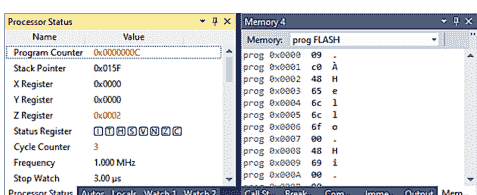

此时，在单步执行加载 Z 寄存器的两条 LDI 指令后，调试器中高亮显示了 LPM 指令，Z 寄存器包含 0x0002 并指向程序内存中的字节 0x0002。此内存位置包含值 0x48，即字母 'H' 的 ASCII 编码，是我们包含 "Hello" 的消息字符串的第一个字母。内存窗口同时显示十六进制数字 48 和其旁边的字母 H。内存窗口同时显示十六进制数字 48 和其旁边的字母 H，即 0x48 的 ASCII 表示，位于地址 0x0002，如图 9.2 所示。

单步执行 LPM 指令，并注意消息字符串中的 0x48 被加载到 R16，同时 Z 寄存器递增到 0x0003，如处理器状态窗口顶部所示。这意味着 Z 寄存器现在指向消息字符串中的第二个字符，即 'e' 或 0x65。

单步执行 SUBI 指令，该指令从 R16 中减去立即数 0。由于 R16 不包含零，且没有发生任何导致其他标志更改的情况，因此该指令对状态寄存器标志没有影响。

单步执行 BRBC 指令。因为 BRBC 指令检查的零标志已清除，程序执行分支到 check_ 标签。继续逐行执行代码，直到 R16 包含 0。请注意，在逐行执行代码时，我们 "Hello" 字符串中每个字母的对应数字会按顺序放入 R16。请参阅内存窗口，查看哪个十六进制数字代表字符串中的哪个 ASCII 字符。

当 LPM 指令最终从程序内存中获取 0 时，0x00 被放入 R16。这次，在执行 SUBI 指令后，Z 标志被置位。BRBC 现在检查 Z 标志，不分支到 check_8 标签，因为 Z 标志不再是清除状态，而是已置位。程序执行在 BRBC 下方继续，进入无限循环。

修改程序以读取其他常量数据，然后逐行执行代码以确保你正确理解它。例如，更改 Z 寄存器指向的地址，使其指向 letters 标签处的数据，方法是更改以下代码行。

```
ldi ZH, high(message << 1) ; Initialize Z pointer (R31)
ldi ZL, low(message << 1) ; Initialize Z pointer (R30)
```

将上述代码更改为使用 letters 数据，如下所示。

```
ldi ZH, high(letters << 1) ; Initialize Z pointer (R31)
ldi ZL, low(letters << 1) ; Initialize Z pointer (R30)
```

更改后，构建项目并在模拟器中再次逐行执行代码。请注意加载到 Z 寄存器的不同地址。

## 9.3.2.3 DW – 定义常量字

DW，即定义常量字，类似于 DB（定义常量字节），不同之处在于它在闪存程序内存或 EEPROM 中预留 16 位空间，而不是 8 位空间。

## 9.3.2.4 DD – 定义常量双字

DD，即定义常量双字，在程序内存或 EEPROM 中预留 32 位数据空间。

## 9.3.2.5 DQ – 定义常量四字

DQ，即定义常量四字，在程序内存或 EEPROM 中预留一个或多个 64 位空间。

## 9.3.3 使用 DEF 为寄存器定义名称

DEF 是一种指令，可用于为寄存器赋予人类可读的名称。在以下示例中，R16 被赋予名称 count。在代码开头使用 DEF 赋予名称 count 后，程序其余部分将 R16 称为 count。将此代码输入 test_asm 项目并在模拟器中运行，可以看到当 count 被清零时，R16 被清零，当使用 INC 指令递增 count 时，R16 被递增。

```
.DEF count = R16
ldi count, 0x00 ; Clear count register
loop:
inc count ; Increment count register
rjmp loop
```

## 9.3.4 使用 EQU 和 SET 将名称等同于表达式

EQU 用于将人类可读的名称设置为等于一个表达式。表达式可以是一个简单的数字，如以下示例代码所示。

```
.DEF count = R16
.EQU count_start = 5
ldi count, count_start ; Value to start counting from
loop:
inc count ; Increment count register
rjmp loop
```

上述代码显示 EQU 用于将 count_start 设置为等于 5。在代码中使用 count_start 的任何地方，都会用 5 替换。在此示例代码中，count_start 用于将值 5 加载到 R16，方法是使用 DEF 定义的 R16（名为 count），并使用 EQU 将 count_start 设置为 5。这导致 R16 中的值从 5 而不是 0 开始递增。将此代码输入 test_asm 项目并在模拟器中运行。

SET 以与 EQU 相同的方式将值分配给标签，但与 EQU 不同，由 SET 赋予值的标签可以在程序中稍后更改或重新定义。在前面的代码示例中，SET 可以直接替代 EQU。


## 9.3.5 条件汇编

条件汇编包括 IF、IFDEF、IFNDEF、ELIF、ELSE 和 ENDIF 汇编伪指令。条件汇编伪指令在汇编时执行，而非在代码在 AVR 上运行时的运行时执行。以下示例仅使用上述提到的两个条件汇编命令，即 IFDEF 和 ENDIF。此代码是第 6 章第 6.6.2 节中 push 和 pop 示例代码的修改版本。

```
; Initialize the stack pointer
ldi r16, low(RAMEND)
out spl, r16
.IFDEF SPH
ldi r16, high(RAMEND) ; Remove for ATtiny13(A) and ATtiny25
out sph, r16 ; Remove for ATtiny13(A) and ATtiny25
.ENDIF
ldi r16, 0x5A ; Load a value to R16
push R16 ; Save R16 to the stack
clr R16 ; R16 gets modified
pop r16 ; Restore R16 from the stack
loop:
rjmp loop
```

在上述代码的原始版本中，如果要在 ATtiny13(A) 或 ATtiny25 上运行代码，则必须删除两行代码。这段代码涉及将值加载到堆栈指针的高字节，即 SPH。在 ATtiny13(A) 和 ATtiny25 上，SPH 不存在，因为这些设备上的 SRAM 不足以需要 SPH。上述代码利用这一事实，并使用 IFDEF（如果已定义）来检查 SPH 是否已定义。这样可以使代码具有通用性，允许为任何 ATtiny AVR 设备构建代码，而无需删除某些行代码。它有效地自动化了为某些设备删除初始化 SPH 的代码，同时为其他设备保留这些行代码。对于 ATtiny45 或 ATtiny85，SPH 在 Microchip Studio 的解决方案资源管理器窗格的 Dependencies 下找到的 tn45def.inc 或 tn85def.inc 文件中定义。我们已经查看过此文件 – 请回顾第 8 章第 8.1.1 节中的图 8.1，或当前章节第 9.2 节中的图 9.1 以提醒。SPH 未在 ATtiny13(A) 和 ATtiny25 设备的包含文件中定义。当汇编程序运行并在文件中找到 .IFDEF SPH 时，它会检查 SPH 是否已定义。如果已定义 SPH，则包括 IFDEF 和 ENDIF 之间的两行代码。如果未定义 SPH，则 IFDEF 和 ENDIF 之间的代码不会包含在汇编过程中，也不会出现在最终机器码指令中。

可以将上一清单中的代码输入到 test_asm 项目的 main.asm 中，以验证 IFDEF 伪指令的工作方式。如果您一直跟随本书学习，test_asm 项目已设置为使用模拟器，并设置为为 ATtiny45 汇编代码。为 ATtiny45 构建项目后，像我们一直做的那样开始调试并中断。打开反汇编窗口，并注意该窗口中找到了初始化 SPH 的代码，如下所示。

```
ldi     r16, low(RAMEND)      Load immediate
00000000 LDI R16,0x5F
out     SPL, r16              Out to I/O location
00000001 OUT 0x3D,R16
ldi     r16, high(RAMEND)     ; Remove for ATtiny13(A) and ATtiny25
00000002 LDI R16,0x01         Load immediate
out     SPH, r16              ; Remove for ATtiny13(A) and ATtiny25
00000003 OUT 0x3E,R16         Out to I/O location
ldi     r16, 0x5A             ; Load a value to R16
00000004 LDI R16,0x5A         Load immediate
```

如上述反汇编窗口所示的清单，包含一行原始汇编语言代码，后跟其反汇编结果。反汇编行以程序内存中 16 位指令的地址位置开头。我们可以看到，预期的第一条 LDI 指令和 OUT 指令均存在，用于初始化 SPL。由于此程序是为 ATtiny45 汇编的，ATtiny45 确实具有 SPH 寄存器，因此我们预期初始化 SPH 的代码会存在。这两行代码位于地址 2 和 3。程序继续执行将 0x5A 加载到 R16 的 LDI 指令。此处以下的代码未包含在上述清单中。

停止调试 ATtiny45 的代码。我们现在将把项目更改为为 ATtiny13、ATtiny13A 或 ATtiny25 构建，这些设备都没有 SPH 寄存器。在 Microchip Studio 的工具栏上单击 ATtiny45，或从顶部菜单单击 Project ▸ test_asm Properties...，然后单击打开页面左侧的 Device。在此页面上，单击页面顶部中间附近的 Change Device... 按钮。这将打开设备选择对话框。在此对话框中选择 ATtiny13、ATtiny13A 或 ATtiny25 之一，以下描述假设选择了 ATtiny25。使用对话框右上角的搜索字段搜索所需设备，然后在对话框的主窗格中单击它。完成后单击 OK 按钮。更改后保存，然后构建项目。如果需要，通过单击我们刚刚更改的 ATtiny 设备旁边的锤子图标，再次将模拟器选择为工具。这可能不是必需的。

既然 test_asm 项目已更改为为 ATtiny25 构建，则项目不再定义 SPH。这意味着当汇编程序到达带有 .IFDEF SPH 的行时，它不会包含 IFDEF 和 ENDIF 之间的两行代码。我们可以使用 Microchip Studio 中的开始调试和中断按钮，然后像之前一样打开反汇编窗口来检查这一点。反汇编代码现在如下所示。

```
ldi    r16, low(RAMEND)
00000000 LDI R16,0xDF    Load immediate
out    SPL, r16
00000001 OUT 0x3D,R16    Out to I/O location
ldi    r16, 0x5A    ; Load a value to R16
00000002 LDI R16,0x5A    Load immediate
push   R16        ; Save R16 to the stack
```

如上述反汇编代码所示，在将 0x5A 加载到 R16 的 LDI 指令之前，只有两条指令。前两行代码初始化 SPL，但初始化 SPH 的代码已被省略，这是预期的，因为条件汇编伪指令 IFDEF 和 ENDIF。

停止调试器，并将 test_asm 项目的设备更改回 ATtiny45。单击工具栏上现在应显示 ATtiny25 的按钮，然后使用 Change Device... 按钮再次选择 ATtiny45。保存并重新构建项目。

## 9.4 其他汇编语言元素

AVR 汇编程序确实还有更多它识别的汇编伪指令和其他元素，例如预处理器伪指令、函数和运算符。我们在查看 DB 时确实看到了左移运算符（<<）的使用。我们还使用了 high() 和 low() 函数来获取 16 位数字的高字节和低字节。所有这些元素都用于使汇编语言编程更加容易。本章介绍了这些元素中的一些如何有用。本书中没有必要涵盖每一种可能的汇编语言元素，因为这只会导致信息过载。汇编语言的更多元素将在剩余章节的实际程序中介绍和使用。在使用 AVRASM2 汇编程序时，可以将 Microchip 的 AVR 汇编器文档用作参考，也可以用来了解其他汇编语言元素。

## 9.5 进一步阅读

AVRASM2 AVR 汇编器的文档可以在 Microchip 网站上以 PDF 格式找到，网址为：www1.microchip.com/downloads/en/DeviceDoc/40001917a.pdf

此 AVR 汇编器文档是任何使用 AVRASM2 汇编器程序的人的主要来源，并包含有关 AVR 汇编语法、汇编伪指令、预处理器以及 AVR 汇编语言程序中使用的表达式的更多信息。

## 9.6 总结

- AVRASM2 是 Microchip Studio 使用的默认 AVR 汇编程序的名称。
- 预处理器可用于在汇编语言程序中包含外部文件。
- 创建项目时为所选 AVR 器件自动在 Microchip Studio 的汇编语言项目中包含正确的头文件。
- 汇编伪指令可用于汇编语言程序，允许程序员指定代码和数据位置、选择放置数据的内存类型、为内存中的数据保留字节、命名寄存器等。
- 在汇编语言程序中使用汇编伪指令时，始终以点（.）开头。
- 使用 AVRASM2 AVR 汇编器手册或文档查找有关 AVRASM2 汇编程序的技术信息。


本章涉及ATtiny微控制器上的指令时序、软件时间延迟子程序、硬件定时器和中断。

在学习上述主题的同时，本章还介绍了其他汇编指令和汇编伪指令，以及如何将汇编语言项目拆分为多个文件。本章探讨了如何推导软件延迟子程序耗时的公式，如何向子程序传递值，以及如何从C代码中调用汇编语言子程序。

## 本章内容

- AVR CPU版本和指令时序
- 汇编语言软件时间延迟子程序分析
- 如何编写周期精确的软件延迟子程序
- 将汇编语言程序拆分为多个文件
- 从C程序中调用汇编语言子程序
- 硬件定时器的查询操作
- 硬件定时器的中断操作

### 10.1 指令时序

指令执行所需的时间取决于特定指令执行所需的时钟周期数以及微控制器的工作频率。在AVR指令集手册中查找ATtiny或其他8位AVR微控制器上指令执行所需的时钟周期数。此信息也可在特定AVR器件或器件系列的数据手册的指令集摘要部分找到。

### 10.1.1 AVR CPU版本

根据AVR指令集手册，AVR 8位CPU有六个不同的版本，即AVR、AVRe、AVRe+、AVRxm、AVRxt和AVRrc。这些不同的CPU版本是由于AVR CPU在一段时间内的更新和增强而产生的。不同CPU版本之间存在一些指令时序差异。AVR、AVRe和AVRe+ CPU版本的指令时序相同。

ATtiny25/45/85和ATtiny13(A)微控制器属于AVR、AVRe和AVRe+组的AVR CPU版本。如果为必须在不同AVR CPU版本上运行的AVR器件编写软件，且软件依赖于特定指令的时序，则了解指令时序存在差异非常重要。

### 10.1.2 指令时序示例

下面给出了一些指令的时序示例，有助于说明指令时序的含义。

#### 10.1.2.1 NOP指令

例如NOP（无操作）指令这样的简单指令，在所有不同的AVR 8位CPU版本上执行都需要一个时钟周期。NOP指令什么也不做，只占用一个CPU时钟周期。换句话说，它不会对内存或任何寄存器（包括状态寄存器）造成任何更改。

要计算指令执行所需的时间，需要知道微控制器的时钟频率以及特定指令执行所需的时钟周期数。对于NOP指令，我们知道执行它需要一个时钟周期。对于ATtiny25/45/85，默认时钟频率为1MHz；对于ATtiny13(A)，默认时钟频率为1.2MHz。

如第6章第6.1.2.5节中已见，时钟周期的周期等于1除以时钟源频率。这给出了ATtiny25/45/85的周期为1 / 1MHz，即1µS；ATtiny13(A)的周期为1 / 1.2MHz，即0.833µS。因此，NOP指令在ATtiny25/45/85上以默认1MHz时钟频率运行时执行需要1µS，在ATtiny13(A)上以默认1.2MHz时钟频率运行时执行需要0.833µS。

你可能会好奇NOP指令的用途是什么，因为它不执行任何计算或移动任何数据。NOP指令的一个基本用途是在软件时间延迟函数或子程序中使用它来占用一些CPU时间，但在AVR中NOP指令还有其他用途。

在本书涵盖的ATtiny微控制器数据手册中，I/O端口部分有一个NOP指令使用示例。该示例表明，当对端口寄存器的写入紧随其后的是对端口寄存器的读取时，必须在写入和读取之间插入一条NOP指令。由于此情况下的时序因素，必须包含一条NOP指令才能读回最近分配给某些引脚的值。下面展示了数据手册中的部分代码，其中在OUT和IN指令之间插入了一条NOP。

```
out DDRB, r16 ; Port pin data direction setup
nop ; Insert NOP for synchronization
in r17, PINB ; Read port pins
```

在C程序中也必须这样做，如以下示例代码所示。

```
DDRB = (1 << DDB0); // Port pin data direction setup
_NOP(); // Insert NOP for synchronization
i = PINB; // Read port pins
```

要在C程序中使用_NOP()（它是一个宏而不是函数，仅插入一条NOP），必须在C程序中按如下方式包含cpufunc.h头文件。

```
#include <avr/cpufunc.h>
```

NOP的其他用途包括：在调试优化后的C代码时，确保有一行代码可用于设置断点。NOP还可以用于中断向量表中未使用的向量位置，以确保已使用的向量条目出现在正确的地址，尽管对于未使用的中断向量还有其他解决方案。

#### 10.1.2.2 16位和32位指令时序

如前所述，大多数AVR指令宽度为16位。这些指令通常在一个时钟周期内执行，但也有一些例外。我们已经看到16位NOP指令在一个时钟周期内执行。另一个在一个时钟周期内执行的16位指令示例是ADD指令，它在所有AVR CPU版本上都需要一个时钟周期。

执行需要两个时钟周期的16位指令的例外之一是ADIW（立即数加到字）指令。16位CBI指令在AVRe CPU版本上执行需要两个时钟周期，但在AVRxm、AVRxt和AVRrc CPU版本上只需要一个时钟周期。在AVRe CPU版本上执行需要两个时钟周期的32位指令示例是LDS指令。LPM指令虽然宽度为16位，但执行需要三个时钟周期。

关于指令时序的讨论要点是，如果在特定应用中指令执行时间很重要，则确实需要查阅特定AVR器件的数据手册和指令集手册。

#### 10.1.2.3 分支指令时序

有些分支指令执行所需的时钟周期数不同，具体取决于指令执行的测试结果。RJMP指令是不根据结果跳转的分支指令之一，它始终跳转到特定位置。因此，RJMP指令始终在两个时钟周期内执行。

SBIC（如果I/O寄存器中的位被清除则跳过）是我们之前使用过的分支指令。该指令执行需要1个时钟周期、2个时钟周期或3个时钟周期，具体取决于：1）条件为假（不跳过）；2）被跳过的指令是一个字（16位）；或3）被跳过的指令是两个字（32位）。SBIS（如果I/O寄存器中的位被置位则跳过）指令的时序与SBIC指令相同，只是当寄存器中被测试的位被置位时才发生跳过。

查看第8章第8.2.5节中的read_switch_asm代码清单（下面已添加指令时序），我们可以看到前三条指令每条执行都需要两个时钟周期。这些时间适用于ATtiny13和ATtiny25/45/85器件中发现的AVRe CPU版本。在AVRxm、AVRxt和AVRrc上，这些相同的SBI和CBI指令每条执行都需要一个时钟周期。在loop标签下的第一条SBIC指令执行需要1个时钟周期或2个时钟周期。在这种情况下，它永远不会花费3个时钟周期来执行，因为它后面跟着一条CBI指令，这是一条一个字或16位的指令。

```
read_switch.asm : main.asm
sbi   DDRB, DDB4      ; 2 clock cycles -------- LED connected to PB4
cbi   DDRB, DDB3      ; 2 clock cycles -------- Switch connected to PB3
sbi   PORTB, PORTB3   ; 2 clock cycles -------- Enable pull-up on PB3
loop:
sbic  PINB, PINB3     ; 1 or 2 clock cycles --- Skip if switch closed
cbi   PORTB, PORTB4   ; 2 clock cycles, 16-bit -- Switch LED off
sbis  PINB, PINB3     ; 1 or 2 clock cycles --- Skip if switch open
sbi   PORTB, PORTB4   ; 2 clock cycles, 16-bit -- Switch LED on
rjmp  loop            ; 2 clock cycles
```

当开关打开时，上述代码的时序如下。

```
sbi   DDRB, DDB4      ; 2 clock cycles -------- LED connected to PB4
cbi   DDRB, DDB3      ; 2 clock cycles -------- Switch connected to PB3
sbi   PORTB, PORTB3   ; 2 clock cycles -------- Enable pull-up on PB3
loop:
sbic  PINB, PINB3     ; 1 clock cycle, no skip --- Skip if switch closed
cbi   PORTB, PORTB4   ; 2 clock cycles, 16-bit -- Switch LED off
sbis  PINB, PINB3     ; 2 clock cycles, skip word -- Skip if switch open
sbi   PORTB, PORTB4   ; 0 clock cycles, skipped over
rjmp  loop            ; 2 clock cycles
```

因此，在进入循环之前消耗了6个时钟周期，对于ATtiny25/45/85来说，这相当于6 x 1µS = 6µS；对于ATtiny13(A)来说，相当于6 x 0.833µS = 5µS。将上述清单中循环的所有时钟周期相加，以计算执行所需的总时钟周期数。这给出了7个时钟周期。因此，循环的执行时间为ATtiny25/45/85的7 x 1µS = 7µs，以及ATtiny13(A)的7 x 0.833µs = 5.833µs。

当开关关闭时，循环的时序如下。

```
loop:
sbic  PINB, PINB3     ; 2 clock cycles, skip ----- Skip if switch closed
cbi   PORTB, PORTB4   ; 0 clock cycles, skipped over
sbis  PINB, PINB3     ; 1 clock cycle, no skip --- Skip if switch open
sbi   PORTB, PORTB4   ; 2 clock cycles, 16-bit --- Switch LED on
rjmp  loop            ; 2 clock cycles
```


如前面的代码所示，当开关闭合时，循环仍然在7个时钟周期内执行，因此循环的时序保持不变。唯一发生的变化是，循环顶部的SBIC指令现在跳过了其后的CBI指令，而SBIS指令没有跳过其后的CBI指令。请记住，这段代码在引脚PB3上设置了一个内部上拉电阻。当连接到PB3的开关断开时，读取逻辑电平1。当开关闭合时，引脚PB3上读取逻辑电平0。

因此，代码从顶部到底部执行所需的时钟周期总数为循环上方的6个周期，加上循环内的7个周期，总共13个周期。在ATtiny25/45/85上，使用默认时钟频率，从代码顶部到循环底部执行需要13µs；在ATtiny13(A)上需要10.833µs。

如果SBIC或SBIS指令后面跟着一个双字或32位宽的指令，那么如果被测试的条件为真（换句话说，如果它跳过了其后的指令），则执行需要3个时钟周期。例如，如果PB3上的开关断开，且测试它的SBIS指令后面跟着一个LDS指令，则得到如下结果。

```
sbis PINB, PINB3 ; 3 clock cycles, if skip over next instruction
lds r1, 0x60 ; 32-bit instruction
```

在上述代码中，如果开关断开，则在PINB3中读取逻辑1，换句话说PINB3被置位，因此SBIS跳过了LDS指令。在这种情况下，SBIS执行需要3个时钟周期。

如果开关闭合，SBIS指令不跳过下一条指令，且仅需一个时钟周期，如我们在read_switch_asm示例中所见。

```
sbis PINB, PINB3 ; 1 clock cycle, next instruction is executed
lds r1, 0x60 ; 32-bit instruction
```

## 模拟器周期计数器和秒表

在Microchip Studio中运行AVR模拟器时，Processor Status窗口顶部附近可以找到周期计数器和秒表，如图10.1所示。为了使秒表正常工作，秒表上方Frequency字段中的频率必须设置为所使用的ATtiny或其他AVR器件的正确值。可以通过单击Frequency字段中的值来编辑它。默认频率值为1MHz，如图10.1左侧所示为1.000 MHz，这对于使用默认设置的ATtiny25/45/85是合适的，但必须更改为1.2MHz才能用于ATtiny13(A)，如图10.1右侧所示更改为1.200 MHz。周期计数器保持正在调试的代码中已使用的时钟周期的运行总数。当单步执行需要一个时钟周期的指令时，周期计数器总数加1。当单步执行需要两个时钟周期的指令时，周期计数器总数加2，以此类推。


图10.1：Processor Status窗口中的周期计数器和频率

秒表字段包含来自周期计数器的时钟周期数乘以一个时钟周期的周期。调试期间无法编辑秒表字段，但可以编辑周期计数器字段。这允许在调试期间将周期计数器清零，以测量代码某部分执行所需的时钟周期数。如果周期计数器被清零，则秒表也会自动清零，因为它是周期计数器值与时钟周期的乘积。

请注意，周期计数器和秒表仅在模拟器中可用，在使用硬件调试器（如Atmel-ICE）时不可用。

## 模拟器周期计数器错误

在撰写本文时，模拟器存在一个错误，导致其跳过计数程序的第一个时钟周期。因此，周期计数器不会用这个第一个时钟周期进行更新。这并非所有AVR器件都会发生，但会发生在ATtiny25/45/85和ATtiny13(A)上。结果是，如果程序中的第一条指令执行需要一个时钟周期，那么单步执行它之后周期计数器读数为零，如图10.2所示，其中第一条LDI指令被单步执行，该指令执行需要一个时钟周期。如果程序中的第一条指令执行需要两个时钟周期，则周期计数器仅更新1，以此类推。请注意，以下图表中的代码是上一章的代码，已修改以移除第一条RJMP指令并将CSEG数据放置在主代码下方。这就是为什么首先执行的指令是LDI指令而不是RJMP指令。


如图10.3所示，在单步执行第二条单周期LDI指令后，周期计数器现在读数为1。此时它应该读数为2，因为它应包含迄今为止单步执行的指令所使用的周期总和。

如果在程序中的任何位置清零周期计数器，该错误会再次发生。在这种情况下，清零周期计数器后执行的下一条指令的第一个时钟周期不会被计数。解决此问题的方法不是清零周期计数器，而是将其设置为值1。在启动调试会话时也可以这样做，只需在使用“开始调试并中断”工具图标后将周期计数器设置为值1。之后，在单步执行程序中其余指令时，周期计数器将显示正确的指令周期数。

### 10.2 汇编语言时间延迟

在本书的一些示例汇编语言程序中，我们使用了一个基本的软件时间延迟子程序，该子程序使用嵌套循环来生成简单的时间延迟。该子程序的时序从未计算过，之所以使用它，是因为它在使用它的情况下提供了可接受的时间延迟。我们现在计算该子程序的时间延迟，然后编写一个新子程序，为我们提供特定的延迟周期。

#### 10.2.1 计算软件延迟子程序时间延迟

我们一直在使用的延迟子程序的代码如下，包含了每条指令使用的时钟周期数。

```asm
; Delay subroutine
delay:
 ldi  r16, 0xff    ; 1 clock cycle
delloop1:
 ldi  r17, 0xff    ; 1 clock cycle
delloop2:
 dec  r17          ; 1 clock cycle
 brbc SREG_Z, delloop2 ; 1 or 2 clock cycles, if false (1), if true (2)
 dec  r16          ; 1 clock cycle
 brbc SREG_Z, delloop1 ; 1 or 2 clock cycles, if false (1), if true (2)
 ret             ; 4 clock cycles
```

计算此延迟子程序时钟周期总数的两种方法是：1）在Microchip Studio中选择模拟器调试代码，并使用周期计数器查找代码使用的时钟周期数；2）推导数学公式来计算代码使用的时钟周期数。一旦知道代码的时钟周期数，就可以通过将时钟周期数乘以时钟周期来计算它生成的时间延迟，如本章前面的一些示例中已经看到。接下来我们将探讨计算上述代码时钟周期数的这两种方法。

在继续之前，值得一提的是，计算延迟子程序的另一种方法是使用示波器等仪器来测量运行使用延迟子程序的led_blink_asm项目完整代码时LED的开启和关闭时间。使用从内部RC振荡器得出的默认时钟时，此方法不准确。只有当AVR由更准确的时钟源提供时钟时，此方法才有用，因此本章不再进一步考虑。

### 10.2.1.1 延迟子程序周期计数器测量

与其编写新程序，不如直接在Microchip Studio中打开led_blink_asm项目，或将该项目的代码复制到test_asm项目，以便我们可以使用该项目中已设置好的模拟器。如果直接打开led_blink_asm项目，请务必选择模拟器，而不是可能与该项目一起使用的硬件工具。

在Microchip Studio的led_blink.asm代码中，在延迟子程序的第一条LDI指令上插入一个断点。这行代码如下所示。

```
ldi r16, 0xff
```

在延迟子程序末尾的RET指令上放置第二个断点。确保将模拟器选为项目的工具。构建项目，然后单击“开始调试”工具栏图标，或按F5键启动调试器。

启动调试器后，代码执行并在第一个断点处停止，Processor Status窗口中的周期计数器显示值为6。由于本章前面已描述的周期计数器错误，此值实际上是不正确的——在程序执行的此阶段，周期计数器值应为7。

为了测量延迟子程序所需的周期数，我们需要重置周期计数器值。由于该错误，我们必须将周期计数器重置为1而不是0，以便正确测量延迟子程序使用的周期数。单击Processor Status窗口中周期计数器旁边包含6的字段。将此数字编辑为1，然后按Enter键。单击Processor Status窗口中的其他位置，例如R00字段，以将焦点从周期计数器值移开。这使得值更易于读取。


现在 Cycle Counter 值已重置，请再次单击 Start Debugging 图标，或按下 F5 键盘键。程序在模拟器中运行，执行在第二个断点处停止，该断点位于 RET 指令上。Cycle Counter 现在包含值 195840，这是延迟子程序主体执行所用的周期数，不包括 RET 指令将使用的时钟周期。因此，延迟子程序生成的时间延迟如下。

- 默认 ATtiny25/45/85 在 1MHz 时为 195.84ms（195840 × 1µs = 195840µs 或 195.84ms）
- 默认 ATtiny13(A) 在 1.2MHz 时为 163.2ms（195840 × 0.833µs = 163200µs 或 163.2ms）

#### 10.2.1.2 延迟子程序数学公式

可以为延迟子程序推导一个数学公式，以计算其使用的时钟周期数。然后，当延迟子程序中加载到两个计数寄存器的值发生变化时，可以使用该公式来计算新的时间延迟。以下内容描述了如何为延迟子程序推导公式。对数学不感兴趣的读者可以跳到前面查看推导出的公式是什么样子，尽管我鼓励每个人跟随学习，因为这展示了数学有多有用。

为了从延迟子程序推导公式并使其更易于理解，加载到寄存器 R16 和 R17 的计数值可以从 0xff 降低到 3，如下所示。这也使得以后在 Microchip Studio 中进行测试更加容易。

```asm
; Delay subroutine
delay:
ldi r16, 3 ; 1 clock cycle
delloop1:
ldi r17, 3 ; 1 clock cycle
delloop2:
dec r17 ; 1 clock cycle
brbc SREG_Z, delloop2 ; 1 or 2 clock cycles, if false (1), if true (2)
dec r16 ; 1 clock cycle
brbc SREG_Z, delloop1 ; 1 or 2 clock cycles, if false (1), if true (2)
ret ; 4 clock cycles
```

然后，我们可以去除每行代码中的操作数，以便更容易看出代码中使用了多少个时钟周期，如下一个清单所示。

```
ldi     1+      ; Clock cycle used up once upon entry
delloop1:
ldi     1+      ; Clock cycle used every pass through outer loop
delloop2:
dec     1+      ; Clock cycle used by inner loop
brbc    (2 x 2) or 1+ ; 2 clock cycles on inner loop, except for last pass
dec     1+      ; Clock cycle used by outer loop
brbc    (2 x 2) or 1+ ; 2 clock cycles on outer loop, except for last pass
ret     ; Not counted in this example
```

最简单的方法是从仅包含两条指令的内循环开始，如下所示。

```
delloop2:
dec     1+      ; Clock cycle used by inner loop
brbc    (2 x 2) or 1+ ; 2 clock cycles on inner loop, except for last pass
```

在这段代码中，BRBC 指令会跳回到 delloop2 标签，这实际上就是 DEC 指令的地址。因为我们将 3 加载到 R17，并使用 DEC 指令递减 R17，所以循环的前两次通过会导致 BRBC 使用两个时钟周期。使用两个时钟周期是因为 BRBC 的求值结果为真，并分支到 DEC 指令。BRBC 测试状态寄存器中的 Z 或零标志，如果 Z 标志被清除，则进行分支。Z 标志在 R17 被递减到 0 之前始终被清除。当 R17 最终包含 0 时，Z 标志被置位，以标记最后一次数学运算的结果为 0。在循环的最后一次通过中，BRBC 仅使用一个时钟周期，因为它的求值结果为假，也就是说，它不分支，而是执行其下方的指令。因此，当 R17 中的初始值为 3 时，内循环使用的时钟周期数如下。此计算的解释如下。

((1 + 2) x 2) + 1 + 1 = 8 clock cycles

如果我们按以下方式书写，这更容易可视化。

| 循环通过次数，最后一次除外 ((1 + 2) x 2) | 循环最后一次通过 + 1 + 1 | 结果 = 8 |
|---|---|---|
| (1 + 2) x (3 - 1) | + 1 + 1 | |
| ((dec + brbc) x num_passes) | + dec + brbc | |

在上述清单的顶部，我们可以看到代码使用的周期数被分为三部分——除了最后一次通过之外的循环通过次数、循环的最后一次通过，以及得到的时钟周期数。这些部分下方的第一行显示了先前推导出的计算部分。清单底部是内循环的指令，其上方标注了它们使用的时钟周期数。

从清单底部开始，我们有 num_passes，即循环的通过次数。在我们的示例中，寄存器 R17 被加载了 3，因此这是循环的通过次数。因为循环的最后一次通过产生的时钟周期数与所有其他通过不同，我们必须从通过次数中减去 1，因此 num_passes 变为 3 – 1，即 2。因此，我们剩下 DEC 的 1 个时钟周期加上 BRBC 的 2 个时钟周期，每次循环通过总共 3 个时钟周期。对于循环中的所有通过，除了最后一次，我们因此有 3 × num_passes，即本示例中的 3 × 2 = 6 个时钟周期。

将循环的最后一次通过与之前的通过分开处理，我们有 DEC 使用的 1 个时钟周期和 BRBC 使用的 1 个时钟周期，即 1 + 1 = 2。将这两个时钟周期加到循环中之前通过使用的 6 个时钟周期，我们得到 8 个时钟周期。基于对内循环在时钟周期使用方面工作原理的这种理解，我们现在可以推导一个公式。

在计算 ((1 + 2) × 2) + 1 + 1 = 8 中，我们有一个变量和一个正在尝试计算的未知值。这个未知值，即内循环使用的时钟周期数，在本示例中计算结果为 8。我们可以将此值称为 CIL，它代表内循环（IL）的时钟周期数（C），在数学上最后两个字母写作下标：

### C_IL – 内循环的总时钟周期数

计算中的变量是加载到 R17 的数值减去 1，因为我们需要像已经解释的那样将循环的最后一次通过分开。这个值在我们的计算中已经减去了 1，如下所示。

```
((1 + 2) × 2) + 1 + 1 = 8
```

这实际上应该写作如下。

```
((1 + 2) × (3 – 1)) + 1 + 1 = 8
```

这个变量可以称为 VIL，它代表内循环（IL）的值或变量（V），在数学上最后两个字母写作下标：

### V_IL = 内循环的值或变量

将未知值和变量的新名称代入计算，我们得到以下内容。

```
((1 + 2) × (3 – 1)) + 1 + 1 = 8
```

变为

```
((1 + 2) × (V_IL – 1)) + 1 + 1 = C_IL
```

以未知值在左侧的常规数学方程式书写方式，我们得到：

```
C_IL = ((1 + 2) × (V_IL – 1)) + 1 + 1
```

通过对已知值进行加法来简化方程，我们得到：

```
C_IL = (3 × (V_IL – 1)) + 2
```

通过乘法进一步简化，我们得到：

```
C_IL = (3V_IL – 3) + 2
```

这与以下相同：

```
C_IL = 3V_IL – 1
```

我们现在可以计算外循环的时钟周期，外循环包含内循环。

为方便起见，去除了操作数的代码如下重复。

```
ldi     1 +     ; Clock cycle used up once upon entry
delloop1: 1 +     ; Clock cycle used every pass through outer loop
ldi     1 +     ; CIL - Clock cycles used by inner loop
inner_loop 1 +  ; Clock cycle used by outer loop
dec     1 +     ; Clock cycles on outer loop, except for last pass
brbc    (2 x 2) or 1 + ; Not counted in this example
ret
```

将值 3 加载到 R16（即外循环计数），并将内循环计数称为 inner_loop，我们得到以下计算。

```
1 + ((1 + inner_loop + 1 + 2) x 2) + (1 + inner_loop + 1 + 1)
```

在这里，代码清单中用粗体标记的内循环被简化为 inner_loop，我们的内循环计算结果将代入此处。如果我们按以下方式书写，上述计算更容易可视化。请注意，在此清单中 inner_loop 缩写为 CIL。

| 一次性 | 循环通过次数，最后一次除外 | 循环最后一次通过 |
|---|---|---|
| 1 + | ((( CIL + 1 + 2 ) x 2)) | + (1 + CIL + 1 + 1) |
| 1 + | (((1 + CIL + 1 + 2 ) x (3 - 1) )) | + (1 + CIL + 1 + 1 ) |
| LDI | (((LDI + CIL + dec + brbc) x num_passes)) | + (LDI + CIL + dec + brbc) |

上述计算的工作方式与内循环非常相似，只是计算中需要包含几个额外的时钟周期。当延迟子程序开始执行时，它只运行第一条 LDI 指令一次，以加载外循环的计数。这在上述清单的“一次性”部分中标记。清单中的其他两个部分是因为与内循环被分割相同的原因而产生的。这是因为 BRBC 指令在循环的所有迭代中执行 2 个时钟周期，最后一次除外。在上述清单中，中间部分包括循环的所有迭代或通过，最后一次除外。清单中的最后一部分处理循环的最后一次通过。

可以看出，对于上述清单的中间部分，循环中的周期数是第二条 LDI 指令的时钟周期，加上内循环的时钟周期，加上 DEC 指令的 1 个时钟周期，加上 BRBC 指令的 2 个时钟周期之和。然后将此和乘以循环的次数。在本示例中，这是 3 – 1，因为循环的最后一次通过与所有其他通过处理方式不同。因此，循环的最后一次通过从总通过次数中减去，这与内循环的情况相同。在本示例中，3 被加载到 R16，即外循环的计数，因此我们必须进行 2 次而不是 3 次此计算。

在循环的最后一次通过中，我们有第二条 LDI 指令使用的 1 个时钟周期，加上内循环使用的时钟周期，加上 DEC 指令使用的时钟周期，加上 BRBC 使用的 1 个时钟周期（而不是通常的 2 个时钟周期）。我们现在可以按如下方式为外循环推导公式。


再次，我们有一个计算的未知结果，以及一个表示循环次数的变量。这个未知结果将被称为 C_T，即总时钟周期。

将第二个字母作为下标书写，我们有：

### C_T – 总时钟周期

对于外层循环计数变量，在本代码中它放置在寄存器 R16 中，将被称为 V_OL，即外层循环（OL）的值或变量（V）。将后两个字母作为下标书写，我们有：

### V_OL – 外层循环的值或变量

基于我们的计算，可以得出以下结论：

```
C_T = 1 + ((1 + inner_loop + 1 + 2) x 2) + (1 + inner_loop + 1 + 1)
```

上述公式中加粗的 2 实际上是 3 – 1，即 V_OL – 1，代入后公式变为以下形式：

```
C_T = 1 + ((1 + inner_loop + 1 + 2) x (V_OL – 1)) + (1 + inner_loop + 1 + 1)
```

代入内层循环的时钟周期数（由 C_IL 表示），我们得到：

```
C_T = 1 + ((1 + C_IL + 1 + 2) x (V_OL – 1)) + (1 + C_IL + 1 + 1)
```

通过加上已知值进行简化，我们现在得到：

```
C_T = 1 + ((C_IL + 4) x (V_OL – 1)) + (C_IL + 3)
```

进一步简化得到：

```
C_T = ((C_IL + 4) x (V_OL – 1)) + C_IL + 4
```

展开乘法得到：

```
C_T = C_IL V_OL – C_IL + 4V_OL – 4 + C_IL + 4
```

这简化为：

```
C_T = C_IL V_OL + 4V_OL
```

总结我们的公式，我们有：

### 内层循环：

C_IL = 3V_IL + 1

其中：

C_IL – 内层循环的总时钟周期

V_IL – 内层循环的值或变量

### 外层循环：

C_T = C_IL V_OL + 4V_OL

其中：

C_T – 总时钟周期

V_OL – 外层循环的值或变量

C_IL – 内层循环的总时钟周期

通过将内层循环公式代入外层循环公式，上述公式可以进一步简化为一个公式：

C_T = (3V_IL + 1)V_OL + 4V_OL

展开后得到：

C_T = 3V_IL V_OL + V_OL + 4V_OL

这可以简化为：

C_T = 3V_IL V_OL + 3V_OL

这可以写作：

C_T = 3(V_IL V_OL + V_OL)

它也可以使用寄存器名称而不是我们一直使用的符号来书写，这样在查看代码时公式会稍微容易使用一些：

C_T = 3 × (R17 × R16 + R16)

现在我们可以通过更改写入 R16 和 R17 的值，在 Microchip Studio 中测试我们的新公式，然后使用周期计数器来验证公式的结果。在 Microchip Studio 中打开包含 led_blink.asm 代码的项目，例如将其粘贴到 test_asm 项目中，以便轻松使用模拟器。如以下 led_blink.asm 代码中的注释所示，插入两个断点。

```
start:    sbi    DDRB, DDB4

loop:     sbi    PORTB, PORTB4
          rcall  delay
          cbi    PORTB, PORTB4
          rcall  delay
          rjmp   loop

; Delay subroutine
delay:
ldi     r16, 3      ; Insert first breakpoint, reset cycle counter
delloop1:
ldi     r17, 3
delloop2:
          dec     r17
          brbc    SREG_Z, delloop2
          dec     r16
          brbc    SREG_Z, delloop1
ret                 ; Insert second breakpoint
```

要测试公式，在以下段落的代码中，通过更改 LDI 指令处的值，向 R16 和 R17 加载不同的值，如上文所示，两个值均为 3。每次更改后，必须构建项目，然后在模拟器中运行代码。必须使用 F5 键或“开始调试”工具栏按钮运行代码，以便执行在第一个断点处停止。

在第一个断点处，由于模拟器中的 bug，将周期计数器重置为 1 而不是 0。重置周期计数器后，再次使用 F5 或“开始调试”工具栏按钮运行代码，以便执行在 RET 指令处的第二个断点处停止。此时周期计数器包含延迟子程序使用的总时钟周期数，不包括 RET 指令使用的时钟周期数。这应与使用相同 R16 和 R17 值的公式计算出的值相匹配。

以下是若干测试用例，用于测试公式并显示 Microchip Studio 模拟器周期计数器的结果。这些测试旨在验证公式是否正确工作，并找出公式可使用的值的极限。

由于我们的公式是根据一个同时对 R16 和 R17 使用值 3 的示例推导出来的，因此我们在以下第一个测试用例中从这些值开始。

```
R16 = R17 = 3

C_T: = 3 x (R17 x R16 + R16)
   = 3 x (3 x 3 + 3)
   = 36
```

使用 Microchip Studio 模拟器进行测试得到的结果也是 36。

现在使用前几章代码示例中 R16 和 R17 的原始值来测试公式。这个值是 0xFF（也可以写作 0xff），即十进制的 255，也是 R16 和 R17 可使用的任何值的上限。

```
R16 = R17 = 255

C_T: = 3 x (R17 x R16 + R16)
   = 3 x (255 x 255 + 255)
   = 195840
```

在 Microchip Studio 中使用模拟器进行测试时，不要忘记更改 R16 和 R17 的值，然后保存更改并构建项目，再在模拟器中运行代码。还要记得在第一个断点处重置周期计数器。上面计算出的 195840 的值与 Microchip Studio 中周期计数器的值相匹配。

检查延迟子程序代码，我们可以看到它在测试递减结果之前先对两个计数寄存器进行递减。由此可以看出，向 R16 或 R17 中任一寄存器加载 0 会导致在递减时从 0 中减去 1。这会产生补码格式中的 -1，在 8 位寄存器中即为 0xFF。因此，我们将把任一计数寄存器为 0 的测试用例留到测试的最后进行。

目前我们使用 R16 和 R17 均等于 1 来测试公式。

```
R16 = R17 = 1

C_T: = 3 x (R17 x R16 + R16)
   = 3 x (1 x 1 + 1)
   = 6
```

在 Microchip Studio 模拟器中测试 R16 和 R17 均包含 1 的代码，我们得到 6 个周期，与公式的结果相同。

下一个测试将 R16 和 R17 加载为 1 到 255 之间两端的值。虽然 0 是实际的最低极限，但它在这一系列测试中最后进行测试。

```
R16 = 1, R17 = 255
C_T: = 3 x (R17 x R16 + R16)
   = 3 x (255 x 1 + 1)
   = 768
```

Microchip Studio 模拟器的结果也是 768 个时钟周期，迄今为止公式在测试中表现良好。

在此测试中，上一个测试中的 R16 和 R17 极端值被互换，R16 现在加载 255，R17 加载 1。

```
R16 = 255, R17 = 1
C_T: = 3 x (R17 x R16 + R16)
   = 3 x (1 x 255 + 255)
   = 1530
```

计算出的 1530 值与模拟器中测量的 1530 值相匹配。

现在对 R16 和 R17 测试几个随机值。

```
R16 = 73, R17 = 123
C_T: = 3 x (R17 x R16 + R16)
   = 3 x (123 x 73 + 73)
   = 27156
```

再次，计算值与模拟器中的测量值相匹配。

将上一个示例中的值互换，我们得到以下结果。

```
R16 = 123, R17 = 73
C_T: = 3 x (R17 x R16 + R16)
   = 3 x (73 x 123 + 123)
   = 27396
```

此结果再次与模拟器测量结果相匹配。

如前所述，我们不期望公式在向 R16 或 R17 中任一加载值 0 时能正常工作。以下三个测试分别向 R16 和 R17 都加载 0，然后仅向 R16 加载 0，最后仅向 R17 加载 0。完成这些测试用例后，我们已测试了 R16 和 R17 中从上限到下限的所有值。

```
R16 = R17 = 0

C_T: = 3 x (R17 x R16 + R16)
    = 3 x (0 x 0 + 0)
    = 0 -- FAIL, measured result is 197376
```

```
R16 = 0, R17 = 255

C_T: = 3 x (R17 x R16 + R16)
    = 3 x (255 x 0 + 0)
    = 0 -- FAIL, measured result is 196608
```

```
R16 = 255, R17 = 0

C_T: = 3 x (R17 x R16 + R16)
    = 3 x (0 x 255 + 255)
    = 765 -- FAIL, measured result is 196605
```

上述测试用例表明，在我们的公式中不可能对 R16 或 R17 使用 0，因为公式没有考虑到这些极端情况，这些情况是测试前递减 0 的结果。在考虑了前面的测试用例后，我们可以最终完整地总结公式如下：

对于：V_IL > 0 且 V_OL > 0（这些值也必须 ≤ 255，因为寄存器大小为 8 位）

C_T = 3(V_IL V_OL + V_OL)

其中：

C_T – 总时钟周期

V_IL – 内层循环的值或变量

V_OL – 外层循环的值或变量

与之前使用通用公式的总结不同，对于特定代码（使用 R16 作为外层循环、R17 作为内层循环），我们得到更具体的公式：

对于：R17 > 0 且 R16 > 0

C_T = 3 × (R17 × R16 + R16)

其中：

C_T – 总时钟周期

R17 – 用于内层循环的寄存器 R17 中的值

R16 – 用于外层循环的寄存器 R16 中的值


### 10.2.2 更好的软件延迟子程序

下面的清单中包含了一个改进的软件延迟子程序，作为 led_blink_asm 代码的一部分。这个新程序现在称为 wait_1s_asm，包含一个名为 wait_1s 的子程序，用于精确延迟一秒。在清单顶部，必须将代码将要运行的 AVR 频率分配给 F_CPU。可以看到，提供了两个频率，其中一个被注释掉了。这些当然分别对应 ATtiny25/45/85 和 ATtiny13(A) 的默认频率 1MHz 和 1.2MHz。当代码顶部正确设置频率时，连接到引脚 PB4 的 LED 在主循环中的代码运行时会保持亮起 1 秒。

```
wait_1s.asm : main.asm

; .equ F_CPU = 1000000
.equ F_CPU = 1200000

start:
    sbi DDRB, DDB4    ; Set pin PB4 as output

loop:
    sbi PORTB, PORTB4 ; Set LED pin high
    rcall wait_1s     ; LED on delay
    cbi PORTB, PORTB4 ; Clear LED pin low
    rcall wait_1s     ; LED off delay
    rjmp loop

; 1 second delay subroutine
wait_1s:
    ldi R16, low ((F_CPU - 10) / 10) ; Load number of loop cycles
    ldi R17, byte2((F_CPU - 10) / 10) ; to registers R16 to R19
    ldi R18, byte3((F_CPU - 10) / 10)
    ldi R19, byte4((F_CPU - 10) / 10)

wait_1s_loop:
    subi R16, 1    ; Perform decrement on 32-bit
    sbci R17, 0    ; number in R16 to R19
    sbci R18, 0
    sbci R19, 0
    mov R20, R16   ; Determine if 32-bit number is
    or R20, R17    ; zero using OR and BRBC
    or R20, R18
    or R20, R19
    brbc SREG_Z, wait_1s_loop ; Balance BRBC to 2 clock cycles
    nop            ; Balance instructions outside of
    nop            ; loop to 10 clock cycles
    ret
```

### 10.2.2.1 工作原理

wait_1s 子程序的工作原理是递减一个 32 位数字直到其为零，以浪费足够的时间来产生所需的 1 秒延迟。如果微控制器运行的频率为 1MHz，则子程序必须消耗一百万个时钟周期来创建 1 秒的时间延迟。这是因为 1MHz 是每秒一百万个周期，意味着在此频率下，一百万个周期需要一秒钟才能完成。

本书中使用的一些 ATtiny 微控制器的最高时钟频率可达 20MHz。由于频率以赫兹（Hz）为单位进行测量，即每秒的时钟周期数，而 wait_1s 子程序用于延迟 1 秒，因此 1 秒延迟所需消耗的时钟周期数等于微控制器运行的频率。对于最高频率 20MHz，必须完成 2000 万个时钟周期才能消耗 1 秒。如果微控制器以 1.2MHz 运行，则必须完成 120 万个周期才能消耗一秒钟，以此类推，适用于所使用的任何频率。代码顶部的 F_CPU 必须更改为微控制器运行的频率，以便 wait_1s 子程序能正确延迟 1 秒。

### 10.2.2.2 使用 8 位寄存器进行 32 位减法

为了在 8 位处理器上对 32 位数字进行减法运算，需要四个 8 位寄存器来存储该 32 位数字。在 wait_1s 子程序中，寄存器 R16、R17、R18 和 R19 用于存储要减去的 32 位数字。如果减法过程只需要一个时钟周期，那么我们只需将微控制器运行的频率值加载到这些寄存器中，如下所示。

```
ldi   R16, low (F_CPU)
ldi   R17, byte2(F_CPU)
ldi   R18, byte3(F_CPU)
ldi   R19, byte4(F_CPU)
```

在上述代码中，我们有熟悉的 low() 汇编函数，用于获取 F_CPU 值的低字节。此代码中新增的是 byte2()、byte3() 和 byte4()，它们的工作方式与 low() 相同，但用于获取 32 位数字的第二、第三和第四个字节。这些函数在 AVR 汇编器文档中。因此，上述代码的作用是按顺序将 F_CPU 的值逐字节加载到 R16、R17、R18 和 R19 中，从最低有效字节开始，一直到最高有效字节。事实证明，减法过程需要多个时钟周期。因此，wait_1s.asm 清单中的代码并不直接将 F_CPU 的值加载到寄存器中，而是进行一些数学补偿，这将在下一节中解释。

实际减法由一条 SUBI（立即数减法）指令和三条 SBCI（带进位的立即数减法）指令执行，如下面的代码所示。

```
subi R16, 1    ; Perform decrement on 32-bit
sbci R17, 0    ; number in R16 to R19
sbci R18, 0
sbci R19, 0
```

上述代码是第 7 章第 7.2.2 节中加法的对应版本，其中使用一条 ADD（不带进位加法）指令和一条 ADC（带进位加法）指令来相加两个 16 位数字并考虑进位。在上面所示的此代码的负数版本中，减法只是扩展到对四个寄存器进行操作。在此代码中，SUBI 指令从 R16（即最低有效字节 LSB）中减去 1。然后使用 SBCI 指令从 R17、R18 和 R19 中减去 0。由于该指令会考虑减法产生的任何进位，因此只有在发生进位时，R17、R18 和 R19 才会递减。这有效地允许分布在四个寄存器上的 32 位数字在每次循环中递减 1。

循环中代码的最后部分用于确定 R16 到 R19 中的 32 位数字是否为零。这是通过使用逻辑 OR 操作来完成的，该操作将 R16、R17、R18 和 R19 进行 OR 运算，如下面的清单所示。如果这些寄存器中有任何一个包含非零数字，则 OR 运算的结果不为零，这会导致 BRBC 指令跳回到循环顶部并执行另一次递减。

```
mov R20, R16    ; Determine if 32-bit number is
or R20, R17     ; zero using OR and BRBC
or R20, R18
or R20, R19
brbc SREG_Z, wait_1s_loop
```

由于 AVR OR 指令具有破坏性，即它将 OR 运算的结果放入第一个寄存器并覆盖其内容，因此需要一个额外的寄存器来存储 OR 运算的结果。R20 是上述代码中用于存储 OR 运算结果的寄存器。首先，使用 MOV（复制寄存器）指令将 R16 中的值复制到 R20。之后，R17、R18 和 R19 依次与 R20 进行 OR 运算，R20 保存 OR 运算的累积结果。由于 R20 用于存储每个结果，R16 到 R19 中的值从未被修改或覆盖。在一系列 OR 运算完成后，只有当 R16 到 R19 全部包含零时，状态寄存器中的零位才会被置位。这会导致程序执行继续在 BRBC 指令下方进行。如果这些寄存器中有任何一个不包含零，BRBC 将跳转到循环顶部。

### 10.2.2.3 代码时序

现在我们了解了 wait_1s 子程序的基本工作原理，可以检查该子程序中使用的指令的时序。下面重复了代码，显示每条指令使用的时钟周期数。

```
wait_1s:
ldi    R16, low  ((F_CPU - 10) / 10)   ; 1 clock cycle
ldi    R17, byte2((F_CPU - 10) / 10)   ; 1 clock cycle
ldi    R18, byte3((F_CPU - 10) / 10)   ; 1 clock cycle
ldi    R19, byte4((F_CPU - 10) / 10)   ; 1 clock cycle

wait_1s_loop:
subi   R16, 1                          ; 1 clock cycle
sbci   R17, 0                          ; 1 clock cycle
sbci   R18, 0                          ; 1 clock cycle
sbci   R19, 0                          ; 1 clock cycle
mov    R20, R16                        ; 1 clock cycle
or     R20, R17                        ; 1 clock cycle
or     R20, R18                        ; 1 clock cycle
or     R20, R19                        ; 1 clock cycle
brbc   SREG_Z, wait_1s_loop            ; 1 clock cycle
nop                                  ; 1 clock cycle
nop                                  ; 1 clock cycle
nop                                  ; 1 clock cycle
ret                                  ; 4 clock cycles
```

如代码所示，每条指令只需要一个时钟周期，除了 BRBC 指令和 RET 指令。如我们所知，当 BRBC 指令分支到循环顶部时需要两个时钟周期，而不分支时只需要一个时钟周期。为了有效地使此指令始终消耗两个时钟周期，在其下方放置了一条 NOP 指令。这意味着当 BRBC 不分支时，它会执行下方的 NOP 指令，从而有效地消耗两个时钟周期而不是一个。

循环中的指令（在上述清单中以粗体显示）总共需要 10 个时钟周期。BRBC 下方的 NOP 指令包含在此总数中，因为它有效地导致 BRBC 的最终执行仍然消耗两个时钟周期。在将 F_CPU 加载到子程序顶部的 R16 到 R19 之前，必须先将其除以这 10 个时钟周期。这是因为循环中的减法过程消耗了这 10 个时钟周期，如果不补偿这 10 个时钟周期，子程序将花费 10 倍的时间。

除了循环中使用的时钟周期外，循环前后还使用了时钟周期。wait_1s 开头的 LDI 指令使用了四个时钟周期。


子程序。忽略 NOP 指令，RET 指令为子程序增加四个时钟周期。这总共是循环外使用的八个时钟周期。这些额外的时钟周期必须在 F_CPU 除以 10 之前减去，以便子程序延迟恰好所需的时钟周期数。当从 10 的倍数的 F_CPU 值中减去 8，然后将结果除以 10 时，会出现问题。例如，当使用 1MHz 作为 F_CPU 时，我们得到 (1,000,000 - 8) / 10 = 99,999.2，这有一个小数值。为了在 F_CPU 是 10 的倍数时使 wait_1s 子程序使用上我们需要的精确时钟周期数，通过添加两条 NOP 指令在 RET 指令之前增加两个额外时钟周期。这导致循环前后的时钟周期总数加起来为 10。因此，我们必须在将 F_CPU 除以 10 之前减去 10。对于 1MHz 的频率，我们现在有 (1,000,000 - 10) / 10 = 99,999，这是一个整数。当这个数加载到 R16 到 R19 时，wait_1s 子程序恰好使用 100 万个时钟周期。

### 10.2.2.4 在 Microchip Studio 中测试代码

Microchip Studio 和 AVR 模拟器可用于测试 wait_1s 子程序，以验证它是否为给定频率使用了正确的时钟周期数。在 Microchip Studio 项目中配合模拟器使用 wait_1s.asm 代码进行测试。输入代码后，务必在代码顶部设置所需的 F_CPU 值，例如，对于运行在 1MHz 的 AVR，将其设置为 1000000。像之前一样，构建代码并选择模拟器作为要使用的工具。在 wait_1s 子程序的第一条指令上以及末尾的 RET 指令上设置断点。使用“开始调试”(F5) 启动代码运行，代码将在第一个断点处停止。

当模拟器在第一个断点处停止时，如之前讨论的那样，将处理器状态窗口中的周期计数器设置为 1 以补偿该错误。将处理器状态窗口中的频率字段设置为 F_CPU 设置的频率。再次运行代码，使执行在 RET 指令上的第二个断点处停止。由于 RET 指令尚未执行，周期计数器现在位于正确值减去 4 的位置，例如，对于 1MHz 频率，计数器位于 999996。使用“步过”图标或 F10 逐过 RET 指令。周期计数器现在包含所选频率的正确值，1MHz 为 1000000。这意味着在真实的 ATtiny 设备上，用掉了 1 秒的时间。这是周期精确的，但对于使用内部 RC 振荡器的设备可能不是时间精确的，因为该振荡器不够准确。还要注意，AVR 模拟器不是实时运行的，因此在使用较高 F_CPU 时执行 wait_1s 实际上会花费更多时间。

### 10.2.3 可更改的软件时间延迟子程序

既然我们已经有了一个补偿微控制器运行频率的软件时间延迟子程序，修改该时间延迟子程序以使其延迟时间可更改并不需要太多精力。除了修改之前的时间延迟子程序外，下一个项目将代码分割为两个文件，将新的时间延迟子程序放入其自己的文件中。两个文件的代码清单如下。

```
wait_ms.asm : main.asm

.equ  F_CPU     = 1000000   ; Frequency of CPU
.equ  MS_TIME_DEL = 500     ; Time delay in milliseconds

start:  sbi   DDRB, DDB4      ; Set pin PB4 as output
loop:   sbi   PORTB, PORTB4   ; Set LED pin high
        rcall wait_ms         ; LED on delay
        cbi   PORTB, PORTB4   ; clear LED pin low
        rcall wait_ms         ; LED off delay
        rjmp  loop

.include "wait_ms.asm"
    ; Must put newline here
```

```
wait_ms.asm : wait_ms.asm

; Millisecond delay subroutine - time set by MS_TIME_DEL
wait_ms:
    ldi   R16, low ((((F_CPU * MS_TIME_DEL) / 1000) - 10) / 10)
    ldi   R17, byte2((((F_CPU * MS_TIME_DEL) / 1000) - 10) / 10)
    ldi   R18, byte3((((F_CPU * MS_TIME_DEL) / 1000) - 10) / 10)
    ldi   R19, byte4((((F_CPU * MS_TIME_DEL) / 1000) - 10) / 10)
wait_ms_loop:
    subi  R16, 1
    sbci  R17, 0
    sbci  R18, 0
    sbci  R19, 0
    mov   R20, R16
    or    R20, R17
    or    R20, R18
    or    R20, R19
    brbc  SREG_Z, wait_ms_loop
    nop
    nop
    ret
```

要在 Microchip Studio 中创建一个包含多个文件的 AVR 汇编语言项目，首先像往常一样创建一个新的 AVR 汇编器项目。现在在 Microchip Studio 中创建一个新的 AVR 汇编器项目，并将其命名为 wait_ms.asm。

将之前 wait_ms.asm : main.asm 清单中的代码输入到新项目自动创建的 main.asm 文件中，替换该文件中的框架代码。

要向项目添加第二个汇编语言文件，请右键单击 Microchip Studio 解决方案资源管理器窗格右上角的 wait_ms.asm 项目名称。在打开的菜单中，选择“添加 > 新建项目...”，如图 10.4 所示，以打开“添加新项目”对话框。此对话框用于向任何项目添加多个文件。


在“添加新项目”对话框中，单击“汇编器文件”项，然后在对话框底部的“名称”字段中输入 wait_ms.asm，如图 10.5 所示。单击对话框右下角的“添加”按钮，将新的汇编语言文件添加到项目中。


### 图 10.5：“添加新项目”对话框

将新的 wait_ms.asm 汇编语言文件添加到项目后，它会在 Microchip Studio 中自动打开，并在右侧解决方案资源管理器窗格中可见。用本节开头 **wait_ms.asm : wait_ms.asm** 清单中的代码替换此新文件中的注释。

构建项目，看看是否会产生两条错误消息：**未定义符号: wait_ms**。如果出现这些消息，它们会显示在 Microchip Studio 底部的错误列表窗格中。要修复此错误，请确保在 main.asm 最后一行代码末尾的光标处按下 Enter 键，以在文件末尾添加换行符。代码清单中此位置显示的注释如下。

```
.include "wait_ms.asm"
; Must put newline here
```

在 .include 指令后添加换行符后，再次构建项目，这次将在没有错误的情况下构建，假设在将代码输入文件时没有添加拼写错误。请注意，此新项目中的主代码再次在引脚 PB4 上闪烁 LED，但这次使用的是之前延迟子程序的修改版本。在模拟器或真实硬件上测试代码之前，请务必更改 main.asm 文件顶部分配给 F_CPU 的值，以适合您使用的微控制器的时钟频率。如果对 F_CPU 进行了更改，请再次构建项目。

在 main.asm 顶部，分配给 MS_TIME_DEL 的值以毫秒为单位设置 wait_ms 子程序的时间延迟，在示例代码中设置为 500ms。

### 10.2.3.1 将汇编语言项目拆分为多个文件

如前面的代码清单所示，AVR 汇编语言项目可以通过向项目添加新文件来拆分为多个文件。然后使用主汇编语言文件中的 .include 指令将新文件包含到项目中。因为随 Microchip Studio 提供的 AVRASM2 汇编器程序没有链接器，汇编语言项目必须使用这种简单的包含其他汇编语言文件的方法。如前面的代码清单所示，添加到项目中的 wait_ms.asm 文件包含在 main.asm 文件的底部。

使用 .include 指令包含文件，实际上是将包含文件的内容粘贴到使用 .include 指令的文件位置。在我们的示例代码中，包含 wait_ms 子程序的文件被包含在 main.asm 的末尾，实际上将此代码粘贴在 main.asm 代码下方。如果 wait_ms.asm 被包含在 main.asm 的顶部，那么 wait_ms 子程序将被放置在从地址 0 开始的 Flash 程序内存中，而 main.asm 中的代码开始位置应该在那里。如果在 main.asm 代码开头使用 .org 0 来强制其从地址 0 开始，项目会出现构建错误，因为找到的第一个代码被放置在地址 0。当 wait_ms.asm 被包含在 main.asm 顶部时，延迟子程序是第一个代码，并在 AVRASM2 汇编器程序在主汇编语言文件中找到 .org 0 之前被分配到从地址 0 开始。这意味着我们要求汇编器程序将两段不同的代码放置到从地址 0 开始的内存中。结果是汇编器程序在构建过程中标记重叠错误。在主汇编器文件顶部包含外部汇编器文件的解决方案是使用跳转指令，如下所示。

```
.rjmp start
.include "wait_ms.asm"

start:
    sbi   DDRB, DDB4    ; Set pin PB4 as output
...
```

在上述代码中，一条 RJMP 指令被放置在 main.asm 文件的顶部，这意味着它位于地址 0，是微控制器上要运行的第一条指令。该指令跳转到 start 标签，并跳过其与 start 标签之间包含的任何代码。


## 10.2.3.2 wait_ms 子程序的工作原理

新的 wait_ms 毫秒延迟子程序基于之前的 wait_1s 固定 1 秒延迟子程序代码。这两个子程序之间唯一的区别是在子程序开始时馈送到寄存器 R16 到 R19 的数字。wait_1s 子程序开始处的代码如下所示。

```
wait_1s:
 ldi   R16, low  ((F_CPU - 10) / 10)
 ldi   R17, byte2((F_CPU - 10) / 10)
 ldi   R18, byte3((F_CPU - 10) / 10)
 ldi   R19, byte4((F_CPU - 10) / 10)
```

由于 wait_1s 子程序固定延迟 1 秒，子程序必须消耗的时钟周期数等于 AVR CPU 的时钟频率。一些数学运算补偿了子程序中循环前后使用的时钟周期（上文中的 - 10），以及循环中使用的周期（上文中的 / 10）。

上述代码如何修改为 wait_ms 子程序解释了 wait_ms 的工作原理，并在以下段落中描述。为了修改上述代码以使用不同的毫秒延迟值，我们可以先问如何使用此代码生成 1ms 延迟。代码只是消耗一定数量的时钟周期，我们只需计算出 1ms 需要多少个时钟周期即可。我们知道一个时钟周期的时间周期是 1 / 频率，数学上写作如下，其中 f 是 AVR CPU 的频率。


一旦我们知道一个时钟周期需要多长时间，就可以问需要多少个这样的时间周期才能组成 1ms。这个问题的答案是用 1ms 除以一个时钟周期的时间周期，以找出多少个这样的时钟周期周期组成 1ms。数学上写作如下，其中 C_T 是总时钟周期数。


将一个时钟周期时间周期的公式（1/f）代入前面的公式中 t 的位置，并使用数学规则，我们可以对 1/f 进行倒置和乘法，得到如下结果。

$C_T = 1 ms \times \frac{f}{1}$

1 毫秒，即 1ms，是一秒钟的千分之一，即 1/1000，我们可以将其代入上述公式得到如下结果。

$C_T = \frac{1}{1000} \times \frac{f}{1} = \frac{f}{1000}$

从上述计算可以看出，为了让我们的子程序延迟 1ms，必须将 CPU 频率除以 1000。因此，以下代码行中的公式修改为其后代码行所示。

```
ldi R16, low ((F_CPU - 10) / 10)
```

对于 1ms 延迟，上述内容变为如下内容。

```
ldi R16, low ((((F_CPU / 1000) - 10) / 10)
```

当然，由于此公式生成的数字是要作为 32 位数加载到四个寄存器中，因此必须像之前一样将公式应用于每个寄存器，但此处重复其他寄存器的代码没有意义。

既然我们知道如何计算生成 1ms 延迟所需的时钟周期数，就可以计算出如何生成特定毫秒数的延迟。这只需将 1ms 的时钟周期数乘以毫秒数（将其称为 tms）即可完成。因此，我们的公式变为如下。

$C_T = \frac{f}{1000} \times t_{ms} = \frac{f \times t_{ms}}{1000}$

在代码中，毫秒数（公式中的 t_ms）称为 MS_TIME_DEL。因此，将公式应用于代码后，代码现在变为如下。

```
ldi R16, low (((F_CPU * MS_TIME_DEL) / 1000) - 10) / 10)
```

F_CPU 设置正在使用的 AVR CPU 频率，MS_TIME_DEL 设置要生成的毫秒延迟时间。这些值在代码开始处按如下方式设置，以 1MHz CPU 频率和 500ms 延迟为例。

```
.equ F_CPU = 1000000 ; Frequency of CPU
.equ MS_TIME_DEL = 500 ; Time delay in milliseconds
```

当将新计算应用于 wait_ms 子程序时，wait_1s 子程序中完全修改的代码部分现在变为如下。

```
wait_ms:
ldi R16, low (((F_CPU * MS_TIME_DEL) / 1000) - 10) / 10)
ldi R17, byte2(((F_CPU * MS_TIME_DEL) / 1000) - 10) / 10)
ldi R18, byte3(((F_CPU * MS_TIME_DEL) / 1000) - 10) / 10)
ldi R19, byte4(((F_CPU * MS_TIME_DEL) / 1000) - 10) / 10)
```

请记住，上述表达式中的数学运算符由 AVRASM2 汇编程序在构建过程中在源代码文件中找到它们时执行。结果是汇编程序根据 F_CPU、MS_TIME_DEL 和数学表达式的值生成一个数字。然后使用 low()、byte2()、byte3() 和 byte4() 函数将此计算出的数字分成四部分。这些函数也在构建过程中由汇编程序运行，最终生成四个数字，这些数字被加载到生成的机器码中的 R16 到 R19。实际上，这些数字被“硬编码”到最终机器码中，wait_ms 子程序始终生成由 F_CPU 和 MS_TIME_DEL 设置的相同时间延迟。当代码在目标 AVR 上执行时，此值无法在运行时更改。它只能在源代码的构建时更改并设置为新值。上述代码中使用的数学运算符和函数在 Microchip 的 AVR 汇编器文档的 Expressions 部分中查找。

## 10.2.3.3 wait_ms 子程序的限制

wait_ms 子程序对其提供的 CPU 频率和毫秒延迟时间有特定的上限和下限。如果计算生成并存储在 R16 到 R19 的 32 位数字中的周期数过高或过低，则生成的时间延迟将不正确。最好计算这些限制，以便任何使用此 wait_ms 子程序的人都会向其提供在范围内的参数。

### 简化公式

以下代码片段中显示的 wait_ms 子程序代码中的公式可以简化。很容易看出循环中使用的 10 个周期以及循环前后使用的十个周期，因为它们在此代码片段中未简化。为了计算 wait_ms 子程序的上限和下限，最好先简化公式。首先取下面代码中显示的公式，并用普通数学符号写出。

```
ldi R16, low ((((f_CPU * MS_TIME_DEL) / 1000) - 10) / 10)
```

在普通数学符号中，公式变为：

\(C_T = \left( \frac{f_{CPU} \times t_{ms}}{1000} - 10 \right) \div 10\)

与其在公式末尾除以 10，不如进行倒置和乘法，这给出了：

\(C_T = \left( \frac{f_{CPU} \times t_{ms}}{1000} - 10 \right) \times \frac{1}{10}\)

进行乘法运算，我们得到：

\(C_T = \frac{f_{CPU} \times t_{ms}}{1000 \times 10} - \frac{10}{10} = \frac{f_{CPU} \times t_{ms}}{10000} - 1\)

在上述简化公式中，我们可以看到 f_CPU t_ms 组合必须有一个最大值，该值会导致 C_T 太大而无法装入 32 位数字，该数字最终在代码中存储在 R16 到 R19 中。

### 计算子程序的最大延迟时间

由于 f_CPU t_ms 组合由两个未知值组成，因此将其中一个值设置为已知量是合理的，这样我们就只剩下一个未知值。将 f_CPU 设置为我们使用的 ATtiny 器件的最大时钟频率，使 t_ms 成为我们想要计算的唯一未知值。此最大频率为 20MHz。C_T 的最大值使用 2^32 - 1 计算，因为 C_T 是 32 位数字，此计算给出了 32 位数字可以容纳的最大值。我们可以操纵 C_T 公式使其计算 t_ms，然后将 f_CPU 和 C_T 的值代入操纵后的公式。计算结果使我们能够得出给出最大可能 C_T 值的 f_CPU t_ms 组合。然后可以使用此值来测试 wait_ms 子程序代码中使用的值的上限。我们先写出上一节中的简化公式，然后对其进行操纵。

```
C_T = \frac{f_{CPU} \times t_{ms}}{10000} - 1
```

首先通过在等式两边都加 1 来消除 -1。

```
C_T + 1 = \frac{f_{CPU} \times t_{ms}}{10000}
```

现在通过将等式两边都乘以 10000 并交换左右两边（因为我们希望 t_ms 在左侧）来消除等式右侧下方的 10000。

```
f_{CPU} \times t_{ms} = 10000(C_T + 1)
```

为了消除左侧的 f_CPU，将等式两边都除以 f_CPU。

```
t_{ms} = \frac{10000(C_T + 1)}{f_{CPU}}
```

我们决定对 C_T 使用 2^32 - 1 的值，对 f_CPU 使用 20MHz，因此可以将这些值代入公式并计算 t_ms 的最大值。

```
t_{ms} = \frac{10000(2^{32} - 1 + 1)}{20 \times 10^6}
= 2,147,483.648
```

最终结果有一个小数部分，必须将其删除，因为我们的 32 位数字必须是整数。因此，2,147,483 是与 20MHz CPU 频率一起使用的最大毫秒值。如果将这些值代回计算总时钟周期 C_T 的公式，我们得到 4,294,965,999，这比 2^32 - 1 少 1296。如果将 t_ms 的最大值加 1，换句话说，我们将其变为


2,147,484 并将其代入 Cr 公式，我们得到的值为 4,294,967,999，这比 2^32 - 1 大 704。因此，我们可以在 wait_ms 子程序中使用 20MHz 和 2,147,483 毫秒的值，但如果使用 20MHz 和 2,147,484 或更大的值，我们的 wait_ms 子程序将会失败。

## 10.2.3.4 在汇编语言中设置值限制

在汇编语言代码中对固定值设置限制的常见方法是使用汇编器指令来检测限制，并在超出范围时生成错误或警告。添加到 wait_ms_asm 项目的 wait_ms.asm 文件顶部的以下代码展示了此操作。

```
wait_ms.asm : wait_ms.asm - top part of code
; Millisecond delay subroutine - time set by MS_TIME_DEL
.equ WAIT_MS_CYCLES = (((F_CPU * MS_TIME_DEL) / 1000) - 10) / 10
.if (WAIT_MS_CYCLES > (exp2(32) - 1))
    .error "F_CPU MS_TIME_DEL combination out of range in wait_ms subroutine."
.endif
wait_ms:
ldi R16, low (WAIT_MS_CYCLES)
ldi R17, byte2(WAIT_MS_CYCLES)
ldi R18, byte3(WAIT_MS_CYCLES)
ldi R19, byte4(WAIT_MS_CYCLES)
...
...
```

对 wait_ms.asm 代码顶部所做的第一个修改是为计算 wait_ms 函数生成周期数的公式命名。该名称为 WAIT_MS_CYCLES，并在代码顶部如下等式定义。

```
.equ WAIT_MS_CYCLES = (((F_CPU * MS_TIME_DEL) / 1000) - 10) / 10
```

这仅仅意味着每当使用 WAIT_MS_CYCLES 时，都会替换公式的结果。因此，WAIT_MS_CYCLES 被放置在 wait_ms 子程序顶部的每个先前放置公式的位置，如下所示。

```
wait_ms:
ldi R16, low (WAIT_MS_CYCLES)
ldi R17, byte2(WAIT_MS_CYCLES)
ldi R18, byte3(WAIT_MS_CYCLES)
ldi R19, byte4(WAIT_MS_CYCLES)
```

既然公式结果可以轻松地作为 WAIT_MS_CYCLES 使用，汇编器指令就用于检测该值是否超出范围。这是通过以下代码完成的。

```
.if (WAIT_MS_CYCLES > (exp2(32) - 1))
    .error "F_CPU MS_TIME_DEL combination out of range in wait_ms subroutine."
.endif
```

在上述代码中，.if 指令用于确定由公式计算并等同于 WAIT_MS_CYCLES 的 32 位值是否在范围内。我们知道，32 位数字可以具有的最大值是 2^32 - 1。AVR 汇编器程序支持一个名为 exp2() 的函数，用于计算传递给它的数字的 2 次幂。在代码中，exp2() 用于通过传递 32 来计算最大 32 位值。然后从结果中减去 1，这给出了 32 位数字可以容纳的最高数字。换句话说，以下代码计算 2^32 - 1。

```
(exp2(32) - 1)
```

在 .if 指令后的括号中，使用大于运算符 (>) 来确定 WAIT_MS_CYCLES 的值是否大于上述计算的结果，如下所示。

```
.if (WAIT_MS_CYCLES > (exp2(32) - 1))
```

在上述代码行中，如果 WAIT_MS_CYCLES 小于 2^32 - 1，则 .if 指令和关闭的 .endif 指令之间的代码将被忽略。另一方面，如果 WAIT_MS_CYCLES 的值大于 2^32 - 1，则 .if 指令和 .endif 指令之间的代码将被执行。此代码包含 .error 指令，后跟一个文本字符串。.error 指令在 Microchip Studio 中标记错误，并打印紧随 .error 指令之后的文本字符串。此消息是我们自己的消息，用于描述问题所在。可以看出，该消息指出 wait_ms 子程序中的 F_CPU MS_TIME_DEL 组合超出范围，这对问题进行了很好的描述。我们可以使用计算出的限制来测试此代码。为避免任何混淆，wait_ms_asm 项目的完整修改代码如下。

### wait_ms_asm : main.asm

```
.equ  F_CPU       = 20000000
.equ  MS_TIME_DEL = 2147483   ; upper limit
.equ MS_TIME_DEL = 2147484   ; upper limit + 1

start:
    sbi   DDRB, DDB4        ; Set pin PB4 as output
loop:
    sbi   PORTB, PORTB4     ; Set LED pin high
    rcall wait_ms           ; LED on delay
    cbi   PORTB, PORTB4     ; Clear LED pin low
    rcall wait_ms           ; LED off delay
    rjmp  loop

.include "wait_ms.asm"
```

### wait_ms_asm : wait_ms.asm

```
; Millisecond delay subroutine - time set by MS_TIME_DEL
.equ  WAIT_MS_CYCLES = (((F_CPU * MS_TIME_DEL) / 1000) - 10) / 10
.if (WAIT_MS_CYCLES > (exp2(32) - 1))
.error "F_CPU MS_TIME_DEL combination out of range in wait_ms subroutine."
.endif

wait_ms:
    ldi   R16, low (WAIT_MS_CYCLES)
    ldi   R17, byte2(WAIT_MS_CYCLES)
    ldi   R18, byte3(WAIT_MS_CYCLES)
    ldi   R19, byte4(WAIT_MS_CYCLES)

wait_ms_loop:
    subi  R16, 1
    sbci  R17, 0
    sbci  R18, 0
    sbci  R19, 0
    mov   R20, R16
    or    R20, R17
    or    R20, R18
    or    R20, R19
    brbc  SREG_Z, wait_ms_loop
    nop
    nop
    nop
    ret
```

main.asm 代码已设置为为 F_CPU 使用 20MHz 的值，并且 MS_TIME_DEL 的最大值设置为我们计算出的最大值 2,147,483。使用这些值时，我们预期 wait_ms.asm 文件中的 .if 指令将评估为 false，并且不会打印错误消息。按照前面的清单修改 wait_ms.asm 项目中的代码后，构建项目，Microchip Studio 中不应出现错误消息。

当 MS_TIME_DEL 的值递增到 2,147,483 以上（例如 2,147,484）时，我们预期在构建项目时会在 Microchip Studio 中看到错误。将 main.asm 顶部中 MS_TIME_DEL 等于 2,147,483 的第一个实例注释掉，并取消注释下方将其等于 2,147,484（比最大限制大 1）的第二个 MS_TIME_DEL 实例。保存更改并构建项目。Microchip Studio 现在会标记错误，因为 .if 指令评估为 true，并且 .error 指令标记错误。双击 Microchip Studio 底部的错误消息将打开 wait_ms.asm 文件，并将光标置于包含 .error 指令和消息的行上。

## 10.2.3.5 汇编器程序中的数字大小限制

有了前面的解释，在理想世界中，用于在代码中为超出限制的值标记错误的机制似乎直观且可靠。在现实世界中，值受到限制，因此使用超过我们迄今所用基本测试值的值彻底测试所有实际代码非常重要。对前面代码的进一步测试表明，当某些值被赋给 MS_TIME_DEL 时，.if 指令处的错误消息不会在应该触发时触发。例如，将 WAIT_MS_CYCLES 设置为 3221225 会导致错误消息按预期触发。将 3221226（比前一个值大 1）赋给 WAIT_MS_CYCLES，在构建代码时不会触发错误消息。事实证明，此问题的原因是 AVRASM2 汇编器程序中的整数大小限制。导致上述问题的限制不止一个。首先，如果 exp2() 函数传递值 32，则无法正常工作。我们预期 exp2(32)（即 2^32）将结果为 0x100000000，但它实际上结果为 1，如以下代码所示。

```
.if (1 == exp2(32))
.warning "Numbers are equal: 1 == exp2(32)."
.endif
```

将上述代码添加到项目的源代码中会在构建项目时生成警告消息，证明 exp2(32) 评估为 1。代码中的 == 运算符与 C 中的工作方式相同，用于测试左侧的值是否等于右侧的值，如果相等，则打印警告消息。

除上述内容外，使用 .equ 或 #define 指令时，整数（整数）值将被截断为 32 位，如以下代码所示。

```
.equ NUM1 = 0x0000000F    ; 32-bit number (15)
.equ NUM2 = 0x100000000   ; 33-bit number (4,294,967,296)

.if (NUM1 > NUM2)
.warning "NUM1 is greater than NUM2."
.endif
```

在上述代码中，使用 .equ 为 NUM1 赋予一个小值，并以同样的方式为 NUM2 赋予一个非常大的值，注释中显示了十进制值。.if 指令处的比较永远不应该评估为 true，因为 NUM2 大于 NUM1，而不是反过来。比较之所以评估为 true，是因为 NUM2 被截断为 32 位数字，这意味着它丢失了最高有效位。这导致其值为 0（零）。15 大于 0，这就是表达式评估为 true 的原因。我们可以使用以下代码证明 NUM2 被截断为 0。

```
.if (NUM2 == 0)
.warning "NUM2 is equal to 0."
.endif
```

在上述代码中，NUM2 被赋予与前面代码中相同的值，.if 指令处的表达式评估为 true，导致在构建项目时打印警告消息。这证明 NUM2 被截断为 32 位，结果值等于 0。

使用与前面代码相同的值，但将值直接放在比较中，而不是使用 .equ 或 #define 分配名称，比较将按预期工作。在以下代码中直接比较分配给 NUM1 和 NUM2 的值会产生预期的 false 结果，并且不会触发警告消息。

```
.if (0x0000000F > 0x100000000)
.warning "0x0000000F is greater than 0x100000000."
.endif
```


在发现数字的截断限制后，下一步显然是测试这些32位数字是否也受限于作为有符号数字而非无符号数字。

```
.equ NUM1 = 0xFFFFFFFF
.equ NUM2 = 0x00000001

.if (NUM1 < NUM2)
.warning "NUM1 is less than NUM2."
.endif

.if (0xFFFFFFFF < 0x00000001)
.warning "0xFFFFFFFF is less than 0x00000001."
.endif
```

在上述代码中，NUM1 的值为 0xFFFFFFFF，如果该数字被视为无符号32位整数，则其值为 4,294,967,295 或 2^32 – 1。如果 NUM1 被视为有符号32位整数，则赋给它的值 0xFFFFFFFF 在二进制补码格式下表示 –1。将上述代码插入 Microchip Studio AVR 汇编语言项目的源代码中并构建项目后，第一个比较结果为真，警告消息会出现在 Microchip Studio 底部。请注意，此比较使用小于运算符（<）来判断 NUM1 是否小于 NUM2。只有当 NUM1 为 0 或负数时，NUM1 才可能小于 NUM2。这证明等式中的数字被视为有符号32位整数，而非无符号32位整数。在上述代码的第二个比较中，分配给 NUM1 和 NUM2 的相同值被直接比较。此比较结果为假，这意味着第二个比较的警告消息不会出现在 Microchip Studio 窗口底部。

以下代码展示了有符号数字的最终测试。

```
.equ NUM1 = 0x7FFFFFFF
.equ NUM2 = 0x00000001

.if (NUM1 < NUM2)
.warning "NUM1 is less than NUM2"
.endif
```

在上述代码中，NUM1 被赋值为 0x7FFFFFFF，这是有符号32位数字可以具有的最大正值。在这个数字中，除了最显著位（用作符号位）外，所有位都被置位。因此，该数字实际上是一个31位数字，因为最显著位未被使用。该数字的最大值因此计算为 2^31 – 1，即 2,147,483,647 或 0x7FFFFFFF。在代码中，警告消息未被触发，因为这个正值大于 NUM2 的值（即 1）。如果为 NUM1 使用值 0x80000000，方法是注释掉第一行代码并取消注释第二行代码，那么警告消息将被触发。向 0x7FFFFFFF 加 1 得到 0x80000000。这个32位数字的最显著位被置位，因此如果被视为32位二进制补码有符号数，则它是一个负数。它的十进制值为 –2,147,483,648，因此是一个小于 1 的负数，而 1 是代码中 NUM2 的值。这就是使用此值时会触发警告消息的原因。

## 标记超出范围上限值的解决方案

既然我们了解了汇编程序的整数大小限制，就可以制定一个方案来标记与时间延迟子程序一起使用的超出范围的值。实现此目的的一种方法是测试 MS_TIME_DEL 的值，确保其小于我们计算的最大值 2,147,483。这个值远小于32位有符号整数所能容纳的最大正值，因此永远不会被视为负数。即使远大于 2,147,483 的值也不会被视为负数，因此如果用户尝试使用甚至是该值1000倍的 MS_TIME_DEL，也可以进行测试而不会产生副作用。此方案唯一的问题是 MS_TIME_DEL 的最大值是使用 20MHz F_CPU 计算的。这意味着如果与例如 1MHz F_CPU 一起使用，MS_TIME_DEL 的值也将被限制为 2,147,483，而实际上使用 1MHz F_CPU 时 MS_TIME_DEL 应该能够高得多。

另一个解决方案是利用汇编程序不会将未使用 .equ 或 #define 赋予名称的值视为32位有符号整数这一事实。wait_ms.asm 文件顶部的以下代码表明，将计算直接放入比较中，可以绕过计算结果成为32位有符号整数的问题。值 2^32 – 1（即 0xFFFFFFFF）也直接用于比较中。

```
; Millisecond delay subroutine - time set by MS_TIME_DEL
.if ((((F_CPU * MS_TIME_DEL) / 1000) - 10) / 10) > 0xFFFFFFFF)
.error "F_CPU MS_TIME_DEL combination out of range in wait_ms subroutine."
.endif
.equ WAIT_MS_CYCLES = (((F_CPU * MS_TIME_DEL / 1000) - 10) / 10)
```

## 标记超出范围的高值和低值

除了测试 WAIT_MS_CYCLES 计算的结果外，还需要检测最小 MS_TIME_DEL 值和最小 F_CPU 值。已知该子程序受限于以下值。

- **F_CPU 最大值为 20MHz，选定为最大 ATtiny 频率。**
- **MS_TIME_DEL 最大值计算为 20MHz 时的 2,147,483ms。**
- **MS_TIME_DEL 最小值为 1ms。小于 1ms 的值没有意义。将 MS_TIME_DEL 设置为 1 进行代码测试确实会产生 1ms 时间延迟。**

我们需要计算的唯一内容是可与 wait_ms 子程序一起使用的最小 F_CPU 值。在之前对公式进行变换时，我们得出了以下中间公式。

```
f_{CPU} \times t_{ms} = 10000(C_T+1)
```

该公式可以通过将两边同时除以 t_ms 来轻松变换，以消除左侧的 t_ms 并计算 f_cpu 的值。结果如下。

```
f_{CPU} = \frac{10000(C_T+1)}{t_{ms}}
```

已知 t_ms 的最小值为 1ms。C_T 的最小值是在 wait_ms 子程序中执行一次循环时取得。该值为 20 个时钟周期。将这些值代入上述公式，得到以下结果。

```
f_{CPU} = \frac{10000(20+1)}{1}
= 210000
```

计算出的 210,000 值为 210kHz。我们现在有以下可用值。

- F_CPU 最大值 20MHz
- F_CPU 最小值 210kHz
- MS_TIME_DEL 最大值 20MHz 时的 2,147,483ms
- MS_TIME_DEL 最小值 1ms

除了检查计算出的最大周期数外，只需检查最小 F_CPU 和最小 MS_TIME_DEL。这样做的原因是，如果 F_CPU 和/或 MS_TIME_DEL 过大，则计算出的最大周期数会过高，并会被我们之前修改的代码检测出来，该代码用于测试计算值是否大于 0xFFFFFFFF。通过测试最大 F_CPU，我们可以为子程序用户提供更多线索，以便在向这些项目分配过大值并触发错误时了解问题所在。

我们必须测试 MS_TIME_DEL 的值至少为 1。如果使用较低的时钟频率，MS_TIME_DEL 可以高于我们使用 20MHz F_CPU 计算出的值。MS_TIME_DEL 可以达到的最高值出现在最低 F_CPU 时。以下是使用 210KHz 作为 F_CPU 和 2^22 - 1 作为 C_T 计算出的结果。

```
t_ms = \frac{10000(C_T+1)}{f_{CPU}}
= \frac{10000(2^{32}-1+1)}{210 \times 10^3}
= 204,522,252
```

在 20MHz 时计算出的 t_ms 最大值在测试代码时很有用。虽然 wait_ms 子程序可以用于高于 20MHz 的频率，但它是为具有 AVRe CPU 和指令时序的 ATtiny 设备设计的。如果该子程序要与其他 AVR 设备一起使用，可能需要根据所使用的 AVR 设备，通过提高 20MHz 频率限制并有选择地向子程序添加时钟周期来进行修改。对于本练习，我们不进行这些修改，并且确实会检查最大 CPU 频率为 20MHz。总结一下，我们现在有以下内容。

- 检查提供的 F_CPU 值不超过 20MHz：如果触发错误消息，这会让用户知道是哪个参数超出了范围。它还会限制输入到总时钟周期公式中的值。
- 测试 F_CPU 是否低于 210kHz。
- 测试 MS_TIME_DEL 是否小于 1ms。
- 测试 WAIT_MS_CYCLES 不超过 2^25 - 1：这可以捕捉过高的 MS_TIME_DEL 值。

修改后的 wait_ms.asm 代码如下，已添加之前列出的修改。


wait_ms.asm : wait_ms.asm

```asm
; Millisecond delay subroutine - delay time set by MS_TIME_DEL
; F_CPU must be set to the frequency that the AVR is operating at

.if (F_CPU > 20000000)
.error "F_CPU too high for wait_ms subroutine. Maximum 20MHz"
.elif (F_CPU < 210000)
.error "F_CPU too low for wait_ms subroutine. Minimum 210kHz"
.elif (MS_TIME_DEL < 1)
.error "MS_TIME_DEL too low for wait_ms subroutine. Minimum 1ms"
.elif (((((MS_TIME_DEL * 1000) - 10) / 10) > 0xFFFFFFF)
// Maximum MS_TIME_DEL is 2,147,483s @ 20MHz and 204,522,525 @ 210kHz
// Maximum MS_TIME_DEL calculated by: (10,000 * 2^32) / F_CPU
.error "MS_TIME_DEL too big for wait_ms subroutine."
.endif

.equ WAIT_MS_CYCLES = ((((F_CPU * MS_TIME_DEL) / 1000) - 10) / 10)

wait_ms:
ldi R16, low (WAIT_MS_CYCLES)
ldi R17, byte2(WAIT_MS_CYCLES)
ldi R18, byte3(WAIT_MS_CYCLES)
ldi R19, byte4(WAIT_MS_CYCLES)

wait_ms_loop:
subi R16, 1
sbci R17, 0
sbci R18, 0
sbci R19, 0
mov R20, R16
or R20, R17
or R20, R18
or R20, R19
brbc SREG_Z, wait_ms_loop
nop
nop
ret
```

在上述代码中，使用 .if 指令对上下限进行测试，后面跟着若干个 .elif 指令。.elif 指令的意思是“否则如果”。从代码顶部开始，测试内容为：1) 如果 F_CPU 大于 20MHz，则标记错误；2) 否则如果 F_CPU 小于 210kHz，则标记错误；3) 否则如果 MS_TIME_DEL 小于 1ms，则标记错误；4) 否则如果 WAIT_MS_CYCLES 计算结果过大，则标记错误。由于 .elif 指令的使用方式，发现的第一个错误将停止构建过程。修复错误后，程序员可以再次构建项目。如果还有其他错误，将在项目第二次构建时被捕获，依此类推，直到所有限制错误都被纠正。

可以使用 wait_ms.asm 文件中的 wait_ms 子程序，结合项目 main.asm 中的以下代码进行测试。代码中放置了一些测试值，通过取消这些值的注释来测试上下限。最大和最小 F_CPU 值可以与各种 MS_TIME_DEL 值配合使用。每次只能取消一种类型值的注释，因此在测试新值时，请务必注释掉当前值。

```asm
main.asm : main.asm

.equ  F_CPU   = 20000000  ; Maximum frequency
.equ  F_CPU   = 20000001  ; Above maximum frequency
.equ  F_CPU   = 210000    ; Minimum frequency
.equ  F_CPU   = 209999    ; Below minimum frequency
.equ  MS_TIME_DEL = 1     ; Below minimum millisecond value
.equ  MS_TIME_DEL = 0     ; Millisecond value
.equ  MS_TIME_DEL = 2147483 ; Upper millisecond limit @ 20MHz
.equ  MS_TIME_DEL = 2147484 ; Upper millisecond limit + 1 @ 20MHz
.equ  MS_TIME_DEL = 20452252 ; Upper millisecond limit @ 210kHz
.equ  MS_TIME_DEL = 20452253 ; Upper millisecond limit + 1 @ 210kHz
.equ  MS_TIME_DEL = 0x4522523 ; Highest positive value in ms
.equ  MS_TIME_DEL = 0x7FFFFFFF ; Highest positive value in ms
.equ  MS_TIME_DEL = 0x80000000 ; Negative value after 1 added to above
.equ  MS_TIME_DEL = 0xFFFFFFFF ; -1

start:
sbi   DDRB, DDB4   ; Set pin PB4 as output

loop:
sbi   PORTB, PORTB4 ; Set LED pin high
rcall wait_ms       ; LED on delay
cbi   PORTB, PORTB4 ; Clear LED pin low
rcall wait_ms       ; LED off delay
rjmp  loop

.include "wait_ms.asm"
```

使用上述列表顶部的值测试代码，也可以尝试一些自己的值。记住在修改后保存文件，然后构建项目，以确保在预期时会标记错误，在不预期时不会标记错误。将 MS_TIME_DEL 设为 0 并测试 F_CPU 的上下限值，两种情况都会出现错误，符合预期。使用高于 20MHz 或低于 210kHz 的 F_CPU 值也会标记错误。在 F_CPU 为 20MHz 时，使用 20MHz 的最大 MS_TIME_DEL 加 1 会导致错误，但使用相同的 MS_TIME_DEL 值配合 20kHz 的 F_CPU 则不会导致错误，因为在较低频率下时间延迟可以大得多。你会注意到代码中我们计算出的上限 MS_TIME_DEL 测试值，以及一旦超过 0x7FFFFFFF 就会变为负值的值。

### 10.2.4 向子程序传递值

前一节开发的 wait_ms 子程序比之前的固定 1 秒子程序更有用，但仍有局限性。一旦设置，其延迟时间在代码中是固定的。每次在代码中使用它时，都会延迟相同的时间段。

修改 wait_ms 子程序代码，使其能够接收一个毫秒延迟值并据此延迟，所需精力不大。每次在代码中使用它时，都可以传递不同的值，并据此延迟相应的时间。

### 10.2.4.1 传递值的最简单方法

向子程序传递值的机制是将要传递的值放在已知位置，可以是内存或寄存器中。下面给出了 wait_ms_asm 项目的一个修改版，名为 wait_pass_val.asm，演示了向子程序传递值的最简单方法。

```asm
wait_pass_val.asm : wait_pass_val.asm

wait_pass_val:
  subi  R16, 1
  sbci  R17, 0
  sbci  R18, 0
  sbci  R19, 0
  mov   R20, R16
  or    R20, R17
  or    R20, R18
  or    R20, R19
  brbc  SREG_Z, wait_pass_val
  nop
  nop
  nop
  ret
```

在上述代码中，wait_ms 子程序已被修改。首先，它被重命名为 wait_pass_val。为了清晰起见，之前添加的用于测试子程序所用值上下限的代码已被移除，因为我们正在研究向此子程序传递值的方法。之前，子程序顶部会将包含子程序中要消耗的周期数的寄存器加载上值，但现在这些代码已被移除。移除寄存器后，只需要一个标签作为跳转目标，该标签恰好也是子程序的入口点。从子程序中移除寄存器加载的想法是：在调用子程序之前，在代码中加载这些值。这样，每次调用子程序时都可以传递一个新值。下面展示了 wait_pass_val_asm 项目中 main.asm 的列表。

```asm
wait_pass_val.asm : main.asm

.equ	F_CPU		 = 1000000
.equ	MS_DELAY_1	 = (((F_CPU * 200) / 1000) - 10) / 10 ; 200ms
.equ	MS_DELAY_2	 = (((F_CPU * 500) / 1000) - 10) / 10 ; 500ms

start:	sbi	DDRB, DDB4		 ; Set pin PB4 as output

loop:	sbi	PORTB, PORTB4		 ; Set LED pin high
	ldi	R16, low (MS_DELAY_1)	 ; Pass 32-bit value
	ldi	R17, byte2(MS_DELAY_1)	 ; to the wait_pass_val
	ldi	R18, byte3(MS_DELAY_1)	 ; subroutine
	ldi	R19, byte4(MS_DELAY_1)	 ;
	rcall	wait_pass_val		 ; LED on delay
	cbi	PORTB, PORTB4		 ; Clear LED pin low
	ldi	R16, low (MS_DELAY_2)	 ; Pass 32-bit value
	ldi	R17, byte2(MS_DELAY_2)	 ; to the wait_pass_val
	ldi	R18, byte3(MS_DELAY_2)	 ; subroutine
	ldi	R19, byte4(MS_DELAY_2)	 ;
	rcall	wait_pass_val		 ; LED off delay
	rjmp	loop

.include "wait_pass_val.asm"
```

代码顶部，两个名称被赋予了使用我们现在熟悉的公式计算出的值。第一个值计算子程序产生 200ms 延迟所需的周期数，第二个值计算产生 500ms 延迟所需的周期数。在调用 wait_pass_val 之前，这些值被加载到寄存器 R16 到 R19 中。这样一来，值就被传递给了 wait_pass_val 子程序，因为子程序使用这些值来生成时间延迟。

请注意，在上述代码中，如果在模拟器中测量子程序使用的周期数，必须从 32 位数的第一部分加载到 R16 的地方开始测量。原因是用于计算生成周期数的公式尚未修改以移除传递值给子程序所用的周期数。无论如何，这可能是我们偏好的行为，因为这些指令仍然消耗周期，可被视为我们生成的延迟的一部分。请注意，由于 RCALL 指令现在，总数中额外增加了 3 个周期。


## 10.2.4.2 传递值的改进方式

在前面的代码清单中可以看出，代码相当混乱且臃肿，主要原因是我们将一个32位值传递给子程序，因此在每次子程序调用前都要加载四个8位寄存器来保存该32位值。改善代码可读性的一种方法是使用宏。关于AVRASM2汇编程序宏的信息可在Microchip的AVR汇编器文档中找到。

在Microchip Studio中创建一个名为wait_ms_macro.asm的新AVR汇编器项目。向项目中添加一个名为wait_ms_macro.asm的新汇编器文件。请参考第10.2.3节、图10.4和图10.5，回顾如何向Microchip Studio项目添加新的汇编器源代码文件。使用与添加新汇编器文件相同的方法向项目添加新的包含文件（.inc文件），只是在第10.2.3节图10.5的对话框中单击Include File。将新文件命名为wait_ms_macro.inc。将以下代码清单中的代码添加到这三个文件中。

```
wait_ms_macro.asm : main.asm

.Include "wait_ms_macro.inc"
.equ    F_CPU     = 1000000

start:
        sbi     DDRB, DDB4        ; Set pin PB4 as output
loop:   sbi     PORTB, PORTB4     ; Set LED pin high
        M_WAIT_MS 200             ; LED on delay
        cbi     PORTB, PORTB4     ; Clear LED pin low
        M_WAIT_MS 500             ; LED off delay
        rjmp    loop

.Include "wait_ms_macro.asm"
```

wait_ms_macro.asm: wait_ms_macro.asm

```
wait_ms_macro:
    subi  R16, 1
    sbci  R17, 0
    sbci  R18, 0
    sbci  R19, 0
    mov   R20, R16
    or    R20, R17
    or    R20, R18
    or    R20, R19
    brbc  SREG_Z, wait_ms_macro
    ret
```

wait_ms_macro.asm: wait_ms_macro.inc

```
; The M_WAIT_MS macro generates a millisecond delay time
;macro M_WAIT_MS
; Do limit checks on F_CPU and millisecond delay value passed to macro
.if   (F_CPU > 20000000)
    .error "F_CPU too high for M_WAIT_MS macro. Maximum 20MHz"
.elif (F_CPU < 4100000)
    .error "F_CPU too low for M_WAIT_MS macro. Minimum 410kHz"
.elif (@0 < 1)
    .error "Delay time too low for M_WAIT_MS macro. Minimum 1ms"
.elif (((((F_CPU * @0) / 1000) - 30) / 10) > 0xFFFFFFF)
    .error "Time delay too big for M_WAIT_MS macro."
.endif

; Save the registers that are to be used by the delay subroutine
    push  R16
    push  R17
    push  R18
    push  R19
    push  R20

; Pass calculated cycle value to wait_ms_macro subroutine
    ldi   R16, low ((((F_CPU * @0) / 1000) - 30) / 10))
    ldi   R17, byte2((((F_CPU * @0) / 1000) - 30) / 10))
    ldi   R18, byte3((((F_CPU * @0) / 1000) - 30) / 10))
    ldi   R19, byte4((((F_CPU * @0) / 1000) - 30) / 10))

; Now call the wait_ms_macro subroutine
    rcall wait_ms_macro

; Restore the registers used by the subroutine
    pop   R20
    pop   R19
    pop   R18
    pop   R17
    pop   R16

.endmacro
```

wait_ms_macro.asm代码与之前项目中相同代码的唯一区别在于，已移除了NOP指令，并将子程序名称更改为与项目名称匹配。移除NOP指令是为了改变时序，如稍后所述。

wait_ms_macro.inc文件中包含本项目使用的宏的代码。如代码所示，宏以.macro指令开头，后跟所选宏的名称，即M_WAIT_MS。代码末尾的.endmacro指令标记宏的结束。

在文件顶部宏名称之后立即是我们之前用于检查F_CPU限制和毫秒时间延迟限制的代码。此代码中一些错误消息的措辞已更改为引用M_WAIT_MS宏，以便在触发时用户知道错误消息来自何处。最后一个.elif指令旁边的表达式已修改为减去30，而不是像之前代码中那样减去10。这与代码时序的变化有关，如稍后所述。此部分代码的最终更改是将@0替换到之前包含MS_TIME_DEL的两个位置。如AVR汇编器文档所解释，宏最多可传递10个参数，命名为@0到@9。由于我们只向宏传递一个参数，因此使用@0，它表示传递给宏的第一个参数。当宏在main.asm代码中使用时，如下所示，它传递值200，然后是500。在宏中，@0第一次取值200，第二次取值500。此值表示所需的延迟时间（毫秒）。

```
sbi     PORTB, PORTB4    ; Set LED pin high
M_WAIT_MS 200            ; LED on delay
cbi     PORTB, PORTB4    ; Clear LED pin low
M_WAIT_MS 500            ; LED off delay
rjmp    loop
```

在wait_ms_macro.inc中的宏中，在检查频率和延迟时间限制的指令之后，宏调用的延迟子程序使用的寄存器被压入堆栈。这些是寄存器R16到R20。相同的寄存器在宏结束前以相反顺序弹出堆栈。这样做是为了在使用宏时，无需跟踪对主代码至关重要的某个值是否会被擦除，因为宏及其调用的子程序使用了存储该关键值的相同寄存器。

将寄存器压入堆栈后，寄存器R16到R19被加载为计算出的32位值，以生成所需时间延迟的正确周期数。执行此操作的代码与之前项目相同，只是计算部分考虑了新代码使用的时钟周期数的变化，因此减去30，而不是之前代码中减去的10。将计算值加载到R16到R19后，调用wait_ms_macro子程序，实际上将计算值传递给该子程序。

wait_ms_macro子程序的工作方式与之前项目中等效子程序的工作方式相同。唯一的区别是移除了NOP指令，以使子程序主循环前后代码生成的额外时钟周期成为10的倍数。

在以下代码行中，可以看到减去的是30而不是10，如之前代码中所做。

```
ldi R16, low ((((F_CPU * 80) / 1000) - 30) / 10)
```

上述减去的30的计算过程如下，包括宏及其调用的子程序所使用的所有指令。

```
; Save the registers that are to be used by the delay subroutine
push R16 ; 2 clock cycles
push R17 ; 2 clock cycles
push R18 ; 2 clock cycles
push R19 ; 2 clock cycles
push R20 ; 2 clock cycles
push R29 ; 2 clock cycles
; Pass calculated value to wait_ms_macro subroutine
ldi R16, low ((((F_CPU * 80) / 1000) - 30) / 10) ; 1 clock cycle
ldi R17, byte2((((F_CPU * 80) / 1000) - 30) / 10)) ; 1 clock cycle
ldi R18, byte3((((F_CPU * 80) / 1000) - 30) / 10)) ; 1 clock cycle
ldi R19, byte4((((F_CPU * 80) / 1000) - 30) / 10)) ; 1 clock cycle
; Now call the wait_ms_macro subroutine
rcall wait_ms_macro ; 3 clock cycles
; Restore the registers used by the subroutine
pop R20 ; 2 clock cycles
pop R19 ; 2 clock cycles
pop R18 ; 2 clock cycles
pop R17 ; 2 clock cycles
pop R16 ; 2 clock cycles
```

在上述代码中，PUSH和POP指令共占用20个时钟周期，LDI和RCALL指令占用7个时钟周期。总计27个时钟周期。我们现在必须查看wait_ms_macro子程序中的时钟周期，如下所示。


wait_ms_macro:
    subi    R16, 1
    sbci    R17, 0
    sbci    R18, 0
    sbci    R19, 0
    mov     R20, R16
    or      R20, R17
    or      R20, R18
    or      R20, R19
    breq    SREG_Z, wait_ms_macro
    ret     ; 4 clock cycles, but is effectively 3 clock cycles

在上述代码中，循环之外的唯一指令是 RET 指令。该指令在 PC 宽度小于 22 位的 AVR CPU 上执行需要 4 个时钟周期。BRBC 通常消耗 2 个时钟周期，但在最后一次执行时仅消耗 1 个时钟周期。因此，我们从循环外消耗的时钟周期中借用 1 个时钟周期，使得 BRBC 最后一次执行也有效地消耗 2 个时钟周期。出于这个原因，我们从 RET 中减去 1 个时钟周期，使其有效地消耗 3 个时钟周期，而非 4 个。将这 3 个时钟周期加上宏主体中累计的 27 个时钟周期，得到 wait_ms_macro 循环外总共消耗 30 个时钟周期。在之前的项目代码中，延迟子程序循环外仅消耗了 10 个时钟周期。由于我们没有简化计算延迟子程序循环次数的公式，可以直接将计算中的 10 个周期替换为 30，如下面的代码所示。

```
ldi    R16, low (((((F_CPU * (@0) / 1000) - 30) / 10))
```

由于循环外的时钟周期正好为 30，是 10 的倍数，因此无需保留之前添加到代码中的 NOP 指令。这些 NOP 指令之前被添加，目的是使循环外的时钟周期总和达到 10。

由于上述计算中的某个值发生了变化，我们需要重新计算时间延迟宏和子程序可工作的最小 CPU 频率。我们使用下面的公式，与之前使用的相同。


已知 t_ms 的最小值为 1ms。C_T 的最小值是在延迟子程序中执行一遍时取得。该值现在为 40 个时钟周期，由子程序循环外的 30 个周期加上循环内 1 次迭代的 10 个周期组成。将这些值代入公式，得到如下结果。

f_{CPU} = \frac{10000(40+1)}{1}
= 410000

计算结果为 410kHz，该值用于宏顶部用于测试 F_CPU 限制的代码中，如下所示。

```
...
.elif (F_CPU < 410000)
    .error "F_CPU too low for M_WAIT_MS macro. Minimum 410kHz"
.elif (@0 < 1)
    .error "Time delay too low for M_WAIT_MS macro. Minimum 1ms"
...
```

回顾下面重复的 main.asm，可以看到 wait_ms_macro.inc 在使用宏的代码顶部被包含。这使得宏在 main.asm 文件中可用。尽管 F_CPU 在 wait_ms_macro.inc 中被使用，但它是在包含 wait_ms_macro.inc 之后定义的。之所以这不会导致错误，是因为汇编器是多遍汇编器。这意味着在第一遍遍历文件时，汇编器会构建符号表。这样，当它再次遍历源代码时，就知道 F_CPU 了。这通常称为前向引用。

```
wait_ms_macro.asm : main.asm

.include "wait_ms_macro.inc"
.equ    F_CPU    = 1000000

start:
    sbi     DDRB, DDB4        ; Set pin PB4 as output

loop:
    sbi     PORTB, PORTB4    ; Set LED pin high
    mWAIT_MS 200             ; LED on delay
    cbi     PORTB, PORTB4    ; Clear LED pin low
    mWAIT_MS 500             ; LED off delay
    rjmp    loop

.include "wait_ms_macro.asm"
```

由于我们的 M_WAIT_MS 宏调用了 wait_ms_macro 子程序，因此包含该子程序的文件必须在使用 M_WAIT_MS 宏的文件底部被包含。

当宏在程序中被使用时，宏会在使用它的代码位置被展开。宏展开意味着构成宏的代码会被实际粘贴到宏被使用的位置。下面的代码展示了之前代码中使用的宏是如何被展开的。

```
00000000 sbi DDRB, DDB4 ; Set pin PB4 as output
loop:
00000001 sbi PORTB, PORTB4 ; Set LED pin high
M_WAIT_MS 200 ; LED on delay
00000002 push R16
00000003 push R17
00000004 push R18
00000005 push R19
00000006 push R20
00000007 ldi R16, 0x1D
00000008 ldi R17, 0x4E
00000009 ldi R18, 0x00
0000000A ldi R19, 0x00
0000000B rcall wait_ms_macro
0000000C pop R20
0000000D pop R19
0000000E pop R18
0000000F pop R17
00000010 pop R16
00000011 cbi PORTB, PORTB4 ; Clear LED pin low
M_WAIT_MS 500 ; LED off delay
00000012 push R16
00000013 push R17
00000014 push R18
00000015 push R19
00000016 push R20
00000017 ldi R16, 0x4D
00000018 ldi R17, 0xC3
00000019 ldi R18, 0x00
0000001A ldi R19, 0x00
0000001B rcall wait_ms_macro
0000001C pop R20
0000001D pop R19
0000001E pop R18
0000001F pop R17
00000020 pop R16
00000021 rjmp loop
```

如上述清单所示，宏在被使用的两个位置被展开。宏中的代码基本上被粘贴到宏被使用的两个位置。这段代码包括所用寄存器的压栈和出栈、用于将延迟计数值加载到寄存器中的 LDI 指令，以及对 wait_ms_macro 子程序的调用。每次使用宏时，完整的宏代码都会替换到其位置。wait_ms_macro 子程序只有一个实例，由两个展开的宏调用。wait_ms_macro 子程序的代码如下清单所示。通过调用 wait_ms_macro，而不是将此代码直接包含在宏中，我们节省了一些内存空间。如果将 wait_ms_macro 代码放在宏中，而不是作为子程序调用，那么每次使用它时都会被完全展开。这将占用额外的内存。

```
wait_ms_macro:
00000022 subi R16, 1
00000023 sbci R17, 0
00000024 sbci R18, 0
00000025 sbci R19, 0
00000026 mov R20, R16
00000027 or R20, R17
00000028 or R20, R18
00000029 or R20, R19
0000002A breq SREG_Z, wait_ms_macro
0000002B ret
```

之所以不能将 PUSH 和 POP 指令放入 wait_ms_macro 子程序，是因为被压栈的寄存器必须在宏中加载值，否则我们就只是又一个固定时间子程序。这意味着这些寄存器在宏中被修改，因此必须在修改前压栈。

乍一看，似乎可以将 POP 指令放入子程序，而不是留在宏中，但这不可能。实际情况是，寄存器首先被压栈，然后通过加载要传递给子程序的值来修改。在随后调用子程序时，子程序的返回地址会自动压栈。如果我们随后在从子程序返回之前尝试弹出寄存器，我们实际上会先弹出子程序的返回地址，因为它是最后压栈的内容。当子程序返回并自动从栈中弹出其返回地址时，实际上会弹出最初压栈的前两个寄存器的值。显然，这会导致子程序返回到错误的地址，从而导致程序故障。

最后请注意，M_WAIT_MS 宏为 10 的倍数的值生成周期精确的延迟。这可以再次使用 Microchip Studio 中的模拟器进行检查。

### 10.3 从 C 代码调用汇编子程序

从 C 代码程序调用汇编语言子程序很容易。从 C 代码调用子程序时，最重要的信息是用于向子程序传递值的寄存器和用于从子程序返回值的寄存器。即使对于同一微控制器，不同 C 编译器的寄存器用法也可能不同。此信息可在名为 Atmel AT1886: Mixing Assembly and C with AVRGCC 的应用笔记中找到，适用于 avr-gcc 编译器，可从以下网址获取：ww1.microchip.com/downloads/en/Appnotes/doc4255.pdf

在下一节中将要展示的示例中，汇编语言子程序从 C 代码被调用并传递了一个 32 位值。在再下一节中，从 C 代码调用的汇编语言子程序返回一个值。

### 10.3.1 向汇编子程序传递值（从 C）

以下子程序代码取自本章 10.2.4.2 节的 wait_ms_macro_asm 项目。对代码进行了一些修改，以便 C 程序能够调用汇编语言子程序。该子程序是我们放入宏中的代码，用于生成可变的毫秒级时间延迟。在修改后的代码中，该子程序称为 wait_ms，因为这个名称简短且具有描述性。不要将此子程序与之前同名的子程序混淆。该项目包含三个文件。在 Microchip Studio 中创建一个名为 wait_ms.c 的新 GCC C 可执行项目。将项目中 main.c 的代码替换为以下代码。

```
wait_ms_c : main.c

#define F_CPU 12000000

#include <avr/io.h>
#include "wait_ms.h"

int main(void)
{
    DDRB |= (1 << DDB4);    // Set up pin PB4 as an output

    while (1)
    {
        PORTB |= (1 << PORTB4);    // Set pin high (LED on)
        wait_ms(WAIT_MS_TIME(200));    // LED on delay
        PORTB &= ~(1 << PORTB4);    // Set pin low (LED off)
        wait_ms(WAIT_MS_TIME(1000));    // LED off delay
    }
}
```


在 main.c 清单中，将 F_CPU 的值更改为您的 AVR ATtiny 设备运行的频率。如清单所示，F_CPU 已针对默认 ATtiny13(A) 时钟频率进行设置。在 F_CPU 定义之后，包含了 io.h 文件，以便在代码中使用 I/O 端口名称。此后包含的 wait_ms.h 文件是我们即将创建的一个文件。代码再次在引脚 PB4 上闪烁 LED，但这次调用了我们的 wait_ms 子程序来在代码中提供延迟。传递给 wait_ms 的 WAIT_MS_TIME() 宏用于将毫秒值转换为正确的值，以便 wait_ms 为所选毫秒值使用正确数量的时钟周期。

在 Microchip Studio 中，右键单击解决方案资源管理器窗格右上角的 wait_ms.c，然后在弹出的菜单上选择“添加 ▶ 新建项...”。在打开的“添加新项”对话框中，选择“预处理汇编文件 (.S)”。在对话框底部的“名称”字段中，输入带大写 S 文件扩展名的 wait_ms.S。单击对话框右下角的“添加”按钮，将此新汇编语言文件添加到项目中。

将新汇编语言文件添加到 C 项目后，它会在 Microchip Studio 中自动打开。用以下代码替换此文件中的注释。

```
wait_ms.c: wait_ms.S

#include <avr/io.h>

.global wait_ms

wait_ms:
    push R26

wait_ms_loop:
    subi R22, 1
    sbci R23, 0
    sbci R24, 0
    sbci R25, 0
    mov R20, R22
    or R20, R23
    or R20, R24
    or R20, R25
    brbc SREG_Z, wait_ms_loop
    pop R20 ; Restore saved register
    push R20 ; Extra clock cycles for balance
    pop R20 ; Extra clock cycles for balance
    nop ; Extra clock cycle for balance
    nop ; Extra clock cycle for balance
    ret ; Extra clock cycle for balance
```

如 wait_ms.S 代码清单所示，与 main.c 中的 C 代码所包含的相同 i/o.h 文件已被包含。为了使 wait_ms 子程序对其余代码可见，.global 指令用于 wait_ms 子程序名称前面。wait_ms 子程序的代码紧随全局声明之后。

为了方便在 C 代码中使用 wait_ms 子程序，向项目中添加了一个名为 wait_ms.h 的头文件。当头文件包含在 C 代码文件中时，可以像调用 C 函数一样调用 wait_ms 子程序。

再次在 Microchip Studio 的解决方案资源管理器窗格顶部右键单击 wait_ms.c。在弹出的菜单上选择“添加 ▶ 新建项...”。在打开的“添加新项”对话框的中间窗格中，单击“头文件”项。在对话框底部的“名称”字段中，输入 wait_ms.h，然后单击“添加”按钮。这会向项目中添加一个新头文件。将以下代码输入添加后自动打开的 wait_ms.h 文件中。

```
wait_ms.c : wait_ms.h

#ifndef WAIT_MS_H
#define WAIT_MS_H

#define WAIT_MS_TIME(MS_TIME)((((F_CPU * MS_TIME) / 1000) - 20) / 10)

extern void wait_ms(uint32_t);

#endif /* WAIT_MS_H */
```

### 10.3.1.1 测试 wait_ms_c 项目代码

按上述说明将文件和代码添加到项目后，可以在硬件上构建和运行项目，或在模拟器中进行测试。如果使用模拟器，请在 while(1) 循环中以 PORTB 开头的两行代码上设置断点。使用“开始调试”图标或 F5 键运行代码。在第一个断点处，使用 F10 单步跳过第一行 PORTB 代码。现在将周期计数器重置为 1 以补偿该错误。确保处理器状态窗口中周期计数器下的频率设置设置为与 F_CPU 使用的相同频率。使用 F5 键运行 wait_ms 子程序。代码执行将在第二行 PORTB 代码的断点处停止。请注意，处理器状态窗口中的秒表显示 200,000.00 µs，即 200ms。这表明我们的子程序按预期工作，并精确延迟了 200ms。在测试第二次 wait_ms 调用时，首先单步跳过 PORTB 行，然后再次将周期计数器重置为 1。如果在此阶段按 F5 键自动运行直到下一个断点，则周期计数器中的值将不正确。这是因为总周期数将包括在 wait_ms 子程序后执行以返回 while(1) 循环顶部的 RJMP 指令，从而向总数额外添加 2 个周期。要正确测量时钟周期，必须在 RJMP 指令上设置断点，这必须在反汇编窗口中完成。

打开反汇编窗口并查找 RJMP 指令。它将位于显示"No source file"的行上方。单击 RJMP 指令左侧的垂直灰色栏以在其上设置断点。现在使用 F5 键运行子程序代码并在 RJMP 指令处停止。请注意，当执行在断点处停止时，处理器状态窗口中的秒表值为 1,000,000 µs，即 1000ms 或 1s，这与我们向 wait_ms 传递 1000 后所期望的结果一致。

### 10.3.1.2 wait_ms_c 项目代码的工作原理

main.c 中的代码应该不言自明，已给出的描述应足够了。最重要的是在 main.c 中包含 wait_ms.h。此文件允许调用 wait_ms 子程序并使用 WAIT_MS_TIME 宏。

wait_ms.h 中包含 WAIT_MS_TIME 宏定义。此宏用于计算 wait_ms 子程序用于为给定的毫秒延迟生成正确数量延迟周期的数字。该宏接收毫秒数，并将此值与 F_CPU 一起用于计算 wait_ms 要使用的数字。这是我们之前使用过的相同计算，但现在减去了 20，因为 wait_ms 中循环前后使用的时钟周期数已更改。

wait_ms 子程序通过在 wait_ms.h 中的 wait_ms 子程序函数原型前放置 extern C 关键字来声明为外部。此声明与 wait_ms.S 文件中的 .global 指令一起，使 wait_ms 子程序可供任何包含 wait_ms.h 头文件的 C 文件使用和可见。

wait_ms.S 文件包含 wait_ms 子程序的代码。此代码基本上与我们在之前几个项目中用于生成软件时间延迟的代码相同，但有一些修改。它仍在循环中递减一个 32 位数字，但这次使用不同的寄存器来保存 32 位数字。这样做的原因是，这些寄存器是 C 代码自动用于将 32 位数字传递给子程序的寄存器。wait_ms.h 中函数原型可见的 uint32_t 值是使用特定的寄存器约定传递给 wait_ms 子程序的。此值是 main.c 中的代码使用宏 WAIT_MS_TIME() 传递给 wait_ms() 的值。Atmel AT1886: Mixing Assembly and C with AVRGCC 文档的第 6 节称为“参数传递”，包含关于用于向函数传递参数的寄存器的信息。本节中指出：

> " 固定参数列表中的参数从左到右分配给寄存器 r25 到 r8。 "

这意味着，当将 32 位数字传递给函数或子程序时，数字的最左字节（即字节 3）被分配给 R25。字节 2（即字节 3 右侧的字节）被分配给 R24。字节 1 被分配给 R23。最后，字节 0（即 32 位数字的最右字节）被分配给 R22。因此，这些寄存器取代了 wait_ms 子程序延迟循环早期版本中使用的 R19 到 R16。子程序仍然使用的唯一寄存器是 R20，它保存 OR 操作的结果。

在 wait_ms 子程序开始时，R20 被压入堆栈以保存其值。在循环底部的 BRBC 指令之后，R20 从堆栈弹出以恢复其原始值。为了平衡 wait_ms 中循环外使用的时钟周期数，R20 中的值被重新压入堆栈，然后再次从堆栈弹出。这消耗了四个时钟周期，本可以使用四条 NOP 指令来完成。

为了使循环外使用的时钟周期总数达到 20，在 RET 指令之前运行两条 NOP 指令。wait_ms 开头的 PUSH 指令连同 BRBC 下方的指令总共为 13 个时钟周期，如果我们减去 1 以补偿 BRBC 在最后一次运行时为 1 个时钟周期而不是 2 个时钟周期。再加上 C 代码为将 32 位值传递给子程序而添加的四条 LDI 指令的 4 个时钟周期，以及 C 代码调用子程序添加的 4 个时钟周期，wait_ms 子程序循环外的总时钟周期数为 20 个。在模拟器中运行项目时，查看项目反汇编窗口中的反汇编代码，以了解为将 32 位值传递给子程序和调用子程序而添加的代码。


## 10.3.2 在 C 中从汇编子程序返回值

我们再次参考 Atmel AT1886：使用 AVRGCC 混合汇编和 C 文档中名为“参数传递”的第 6 节，以了解如何从 C 程序调用的汇编语言子程序中返回值。该文档关于返回值的说明如下：“返回值使用 r25 到 r18 寄存器，具体取决于返回值的大小。” 该文档还关于向子程序传递 char 参数的说明如下：“所有参数都使用偶数个寄存器。这导致 char 参数占用两个寄存器。” 在下一个名为 asm_add_c 的项目中，两个 char 参数从 C 代码传递给汇编语言子程序，由子程序相加，并从子程序返回一个 char 结果。在 Microchip Studio 中创建项目，并以与之前项目添加额外文件相同的方式将 add8bit.S 和 add8bit.h 文件添加到项目中。在项目文件中输入以下清单中的代码。

```
asm_add.c : main.c
#include <avr/io.h>
#include "add8bit.h"

int main(void)
{
  volatile char sum;
  sum = add8bit(34, 91);
}
```

```
asm_add.c : add8bit.h
#ifndef ADD8BIT_H_
#define ADD8BIT_H_

extern char add8bit(char, char);
#endif /* ADD8BIT_H_ */
```

```
asm_add.c : add8bit.S
.global add8bit

add8bit:
  add  r24, r22  ; arg1: r25 and r24, arg2: r23 and r22
  ret          ; return registers are r25 and r24
```

虽然本项目不涉及本章主题的定时器或时序，但我们在此讨论从 C 调用子程序的主题时将其介绍一下。如 add8bit.S 文件所示，R24 和 R22 用作 add8bit 子程序的两个 char 参数。子程序的 C 原型可在 add8bit.h 中查看。由于 GCC C 编译器按对分配 char 参数，R25 和 R24 表示第一个 char 参数，但仅使用 R24。对于第二个参数，分配了 R23 和 R22，但仅使用 R22。C 编译器分配 R25 和 R24 来保存返回值，但仅使用 R24。在 main.c 中，sum 变量声明为 volatile，以防止 C 编译器将其优化掉。有必要查看代码的反汇编以了解实际发生的情况。以下反汇编清单取自为 ATtiny45 构建的项目。

```
asm_add.c : disassembly

--- add8bit.S ----
        add   r24, r22        ; arg1: r25 and r24, arg2: r23 and r22
00000018  ADD R24,R22         Add without carry
        ret                   ; return registers are r25 and r24
00000019  RET                 Subroutine return
--- main.c ----
{
0000001A  PUSH R28            Push register on stack
0000001B  PUSH R29            Push register on stack
0000001C  PUSH R1             Push register on stack
0000001D  IN R28,0x3D         In from I/O location
--- main.c ----
0000001E  IN R29,0x3E         In from I/O location
        sum
0000001F  LDI R24,0x5B        ; 91
        sum                   LDI R22,0x5B
00000020  LDI R24,0x22        Load immediate
00000021  RCALL PC-0x0009     Relative call subroutine
00000022  STD Y+1,R24         Store indirect with displacement
}
00000023  LDI R24,0x80        Load immediate
00000024  LDI R25,0x80        Load immediate
00000025  POP R0              Pop register from stack
00000026  POP R29             Pop register from stack
00000027  POP R28             Pop register from stack
00000028  RET                 Subroutine return
--- No source file ----
00000029  CLI                 Global Interrupt Disable
0000002A  RJMP PC-0x8000      Relative jump
```

在上述反汇编中，未显示中断向量表和 C 运行时代码。值在地址 0000001F 和 00000020 处传递给 add8bit 子程序。这些值是加载到 R22 的 0x5B（即 91）和加载到 R24 的 0x22（即 34）。随后，以 RCALL PC-0x0009 的形式调用 add8bit 子程序。该子程序位于清单顶部的地址 00000018 处。RCALL 只是调用子程序，子程序随后执行 R24 和 R22 的加法，并将结果放入 R24。我们知道 R24 是保存返回值的寄存器之一，由于这是单字节或 char 返回值，因此忽略另一个寄存器（R25）。子程序返回后，执行继续于地址 00000022 处。此时，R24 包含加法结果，即 0x7D（或 125）。下一条指令 STD Y+1,R24 将 R24 中找到的返回值赋给位于 SRAM 中的 sum 变量。STD 是一种带位移的存储间接指令，它将寄存器存储到 SRAM 位置，但使用 Y 寄存器作为 SRAM 的索引或指针。Y 寄存器在 ATtiny45 上当前包含值 0x015A，但 STD 指令指定 Y+1，因此 R24 中的值被保存到 0x015A+1，即 SRAM 地址 0x015B。因此，加法结果 0x7D 现在位于 SRAM 地址 0x015B 处，即 sum 变量。

### 10.4 轮询定时器延迟

ATtiny13(A) 和 ATtiny25/45/85 微控制器都具有一个 8 位定时器/计数器 0。这些定时器/计数器外设可高度配置，用于多种用途。在本节中，我们将探讨如何使用这些定时器生成简单的时间延迟，以便在下一节中使用它们生成中断。目前，定时器设置为开始计时，并使用代码不断检查定时器是否超时。在代码中对定时器的这种持续检查称为轮询定时器。

ATtiny25/45/85 微控制器实际上具有两个 8 位定时器/计数器模块或单元，即 Timer/Counter0 和 Timer/Counter1。由于 ATtiny13(A) 微控制器只有 Timer/Counter0，我们使用此定时器/计数器，因为它在两个 8 引脚微控制器系列中是通用的。

### 10.4.1 Timer/Counter0 寄存器

用于控制定时器和计数器模块的 I/O 寄存器均位于 0x1F（31）以上的地址范围内，这意味着不能在这些寄存器上使用直接位操作指令 SBI 和 CBI。用于直接测试 I/O 寄存器中位状态的指令（即 SBIS 和 SBIC）也仅在 0x00 到 0x1F 的地址上操作，因此不能与定时器/计数器寄存器一起使用。这意味着要使用定时器/计数器的任何寄存器，必须先将该寄存器读入 R0 到 R31 通用寄存器。图 10.6 显示了用于控制 Timer/Counter0 的寄存器。

### 10.4.1.1.1 控制寄存器 A 和 B

| 7 | 6 | 5 | 4 | 3 | 2 | 1 | 0 |
|---|---|---|---|---|---|---|---|
| COM0A1 | COM0A0 | COM0B1 | COM0B0 | - | - | WGM01 | WGM00 |

| 7 | 6 | 5 | 4 | 3 | 2 | 1 | 0 |
|---|---|---|---|---|---|---|---|
| FOC0A | FOC0B | - | - | WGM02 | CS02 | CS01 | CS00 |

| WGM02 | WGM01 | WGM00 | 模式 | CS02 | CS01 | CS00 | 描述 |
|---|---|---|---|---|---|---|---|
| 0 | 0 | 0 | CTC | 1 | 0 | 1 | clkI/O/1024 |

### 10.4.1.1.2 输出比较

| 7 | 6 | 5 | 4 | 3 | 2 | 1 | 0 |
|---|---|---|---|---|---|---|---|
| OCR0A7 | OCR0A6 | OCR0A5 | OCR0A4 | OCR0A3 | OCR0A2 | OCR0A1 | OCR0A0 |

### 10.4.1.1.3 中断标志 - ATtiny25/45/85 和 ATtiny13(A) 之间的 TIFR 寄存器不同

| 7 | 6 | 5 | 4 | 3 | 2 | 1 | 0 |
|---|---|---|---|---|---|---|---|
| - | OCF1A | OCF1B | OCF0A | OCF0B | TOV1 | TOV0 | - |

| 7 | 6 | 5 | 4 | 3 | 2 | 1 | 0 |
|---|---|---|---|---|---|---|---|
| - | - | - | - | OCF0B | OCF0A | TOV0 | - |

图 10.6：Timer/Counter0 寄存器

### 10.4.1.1 Timer/Counter0 寄存器地址

在图 10.6 中首先要注意的是，ATtiny25/45/85 和 ATtiny13(A) 的一些寄存器地址不同。图中 Address 项首先显示 ATtiny25/45/85 寄存器地址，随后在括号中显示 ATtiny13(A) 地址。例如，图 10.6 顶部的寄存器是 TCCR0A 寄存器，在 ATtiny25/45/85 上其地址为 0x2A，但在 ATtiny13(A) 上为 0x2F——请在数据手册的 Register Summary 部分中检查这一点。像这样的地址差异影响不大，因为寄存器名称在头文件中定义，该


为所选 ATtiny 器件将正确的地址分配给名称。我们需要知道，在查看反汇编代码时存在地址差异。当然，在这种情况下，地址会被视为不同，具体取决于代码是从哪个 AVR 反汇编而来的。图 10.6 显示，在图的底部，TIFR 寄存器在 ATtiny25/45/85 和 ATtiny13(A) 上具有相同的地址，但在两个不同的微控制器系列上具有不同的名称。该寄存器在 ATtiny25/45/85 器件上称为 TIFR，但在 ATtiny13(A) 上称为 TIFR0。正因如此，并且因为这些寄存器中的位也不同，它们在图中显示为两个独立的寄存器。其他寄存器位在两个微控制器系列之间是通用的。

## 10.4.1.2 将计数器/定时器 0 用作定时器

要将计数器/定时器 0 用作简单定时器，可以将其置于 CTC 模式，CTC 代表 Clear Timer on Compare（比较时清除定时器）。在本文其余部分中，计数器/定时器 0 被称为 Timer0，因为它被用作定时器，这简化了其名称。WGM 位用于将 Timer0 置于 CTC 模式，并分布在 TCCR0A 和 TCCR0B 寄存器中。WGM 代表 Waveform Generation Mode（波形生成模式）。位 WGM[2:0]，即 WGM 位 2、1 和 0，必须设置为二进制值 010 才能将定时器置于 CTC 模式。这在图 10.6 顶部附近指示，位于水平虚线下方。相同的信息也可以在所使用的微控制器的数据手册中找到。在 CTC 模式下，必须首先将一个值写入 OCR0A 寄存器。定时器启动后，实际递增的计数值位于 TCNT0 寄存器中。该寄存器未在图 10.6 中显示，因为它只是一个保存计数值的 8 位寄存器。它位于 ATtiny25/45/85 和 ATtiny13(A) 系列的地址 0x32 处。当 TCNT0 达到写入 OCR0A 的相同值时，会发生比较匹配。在 CTC 模式下，TCNT0 会自动清除，定时器重新从 0 开始计数。同时，TIFR 或 TIFR0 寄存器中的 OCF0A 位会被置位以标记定时器比较匹配。持续读取或轮询此位可以让我们检查定时器是否已超时。

要初始启动 Timer0，将一个值写入 TCCR0B 中的 CS（时钟选择）位。该值选择为时钟 Timer0 的时钟源，可以是系统时钟，也可以是系统时钟经过分频系数分频后的时钟，或者是外部时钟源。这些选项可以在所使用的微控制器的数据手册中找到。对于后续项目，选择了经过分频器分频 1024 的系统时钟，因此这是图 10.6 中水平虚线下方右侧显示的值。如图所示，二进制值 101 被写入 TCCR0B 寄存器中找到的 CS[2:0] 位。

## 10.4.2 轮询定时器汇编程序

下面是一个汇编语言程序，它通过轮询 Timer0 来生成时间延迟。该程序再次闪烁连接到引脚 PB4 的 LED，但从 Timer0 生成闪烁之间的时间延迟。在 Microchip Studio 中创建 timer0_poll_asm 汇编项目，并将以下清单中的代码输入到 main.asm。

```
timer0_poll_asm : main.asm

.ifndef TIFR
.equ TIFR = TIFR0
.endif

ldi r17, (1 << DDB4) ; Pin PB4 as output pin
out DDRB, r17
ldi r16, (1 << WGM01) ; CTC mode for timer
out TCCR0A, r16
ldi r16, 0x7F ; Output compare value
out OCR0A, r16
ldi r16, (1 << CS02) | (1 << CS00) ; Prescaler CLK/1024 and start timer
out TCCR0B, r16
ldi r18, (1 << OCF0A) ; For clearing OCF0A flag

loop:
in r16, TIFR ; Read the TIFR register
sbrs r16, OCF0A ; Skip next instruction if timeout
rjmp loop ; Loop if not timed out
out PINB, r17 ; Toggle LED
out TIFR, r18 ; Clear OCF0A flag
rjmp loop
```

### 10.4.2.1 IFNDEF 指令

为了补偿 TIFR 寄存器的不同名称（在 ATtiny25/45/85 上名为 TIFR，在 ATtiny13(A) 上名为 TIFR0），在上述代码清单的顶部使用了 .ifndef 指令。.ifndef 指令表示“如果未定义”，这意味着代码 .ifndef TIFR 仅在 TIFR 未定义时执行 .ifndef 和 .endif 指令之间的代码。如果在 Microchip Studio 项目中选择了 ATtiny13(A)，则 TIFR 未定义。这意味着名称 TIFR 将被赋予 TIFR0 的值。TIFR0 在 ATtiny13(A) 上已定义，因此 TIFR 采用 TIFR0 的值，从而有效地允许我们对 ATtiny13(A) 和 ATtiny25/45/85 使用仅引用 TIFR 寄存器的相同代码。如果在 Microchip Studio 中选择了 ATtiny25/45/85，则 TIFR 已定义，因此 .ifndef 和 .endif 指令之间的代码永远不会执行，且 TIFR 不会被等同于 TIFR0。请注意，这种检查和赋值类型仅在一定程度上有效。例如，TIFR 寄存器中有一些 TIFR0 中没有的位。访问这些位的代码无法在 ATtiny13(A) 微控制器上工作，因为这些设备上不存在这些位。

### 10.4.2.2 左移运算符

在 timer0_poll_asm 项目代码的开头，DDRB 寄存器中的 DDB4 位被置位，以将引脚 PB4 设置为输出引脚，如下所示。

```
ldi r17, (1 << DDB4) ; Pin PB4 as output pin
out DDRB, r17
```

在此代码中，要写入 DDRB 的值首先写入 R17，然后将 R17 写入 DDRB。写入 R17 的值是 (1 << DDB4)，其工作方式与 C 代码中相同，如下文所述。DDB4 在项目的 .inc 包含文件中定义如下。

```
.equ DDB4 = 4 ;
```

代码 (1 << DDB4) 的意思是“将 1 左移 DDB4 次”。因为 DDB4 等同于 4，所以表示将 1 左移 4 次。二进制中的 1 可以写为 0b0000_0001。当此数左移 4 位时，意味着 1 向左移动了 4 个位位置。这给出了一个值 0b0001_0000，这意味着位 4 被置位。位 4 是 DDRB 寄存器中的位 DDB4。当从右侧开始从 0 计数位时，它是位号 4。这种左移允许在代码中使用正在设置的位的名称，使任何阅读代码的人都更容易看到正在设置哪个位。

我们本可以像在以前的项目中所做的那样，直接使用 SBI 指令设置位 DDB4，如下所示。

```
sbi DDRB, DDB4 ; Set pin PB4 as output
```

此代码在设置单个位时很有用。如果 DDRB 寄存器中必须设置多个位，则需要多个 SBI 指令——每个要设置的位一个。当在寄存器中设置多个位，或者写入 SBI 指令范围之外的寄存器（即地址高于 0x1F 的寄存器）时，使用 LDI 指令和 OUT 指令的组合会更高效。我们在第 8 章中设置 DDRB 寄存器以驱动多个 LED 时确实使用了 LDI 和 OUT 组合。在这些项目中，我们没有使用左移运算符，而是写入了一个值。当寄存器有许多不同命名的位时，通常最好使用左移运算符。当位相似时，例如在 DDRB 中，可以使用左移，也可以写入一个值。本项目中不使用 SBI 的主要原因是 R17 中的值稍后会被重复使用。

### 10.4.2.3 寄存器写入或读取-修改-写入

使用 SBI 与使用 LDI/OUT 组合之间的一个区别是，SBI 仅设置一位，而 LDI/OUT 组合会覆盖 DDRB 寄存器中的所有内容。这可能是所需的，但在某些情况下可能不是。在必须在寄存器中设置一位或多位，而不改变寄存器中其他位的情况下，必须执行读取-修改-写入操作。在 timer0_poll_asm 项目中，下面重复的前两行代码实际上将 0b0001_0000（即 0x10）写入 R17。然后使用 OUT 指令将此值从 R17 写入 DDRB，这会设置位 4，但也会清除所有其他位。在本项目中，其他位被清除并没有区别。

```
ldi   r17, (1 << DDB4)  ; Write 0b0001_0000 to R17
out   DDRB, r17         ; Set bit DDB4 and clear all other bits
```

在不想改变其他位的情况下，必须首先使用 IN 指令读取 DDRB 寄存器，然后使用 OR 运算符修改它以设置所需的位或多位，然后将其写回 DDRB。具体操作如下。

```
in    r17, DDRB         ; Read -- read DDRB register
ori   r17, (1 << DDB4)  ; Modify -- set desired bit or bits
out   DDRB, r17         ; Write -- write value back to DDRB
```

在上述代码中，DDRB 中的值使用 IN 指令读取并放入 R17，这是读取-修改-写入操作的 READ 部分。ORI 用于在不改变任何其他位的情况下在 R17 中设置 DDRB，这是读取-修改-写入操作的 MODIFY 部分。最后，R17 中的修改值被写回 DDRB，这是读取-修改-写入操作的 WRITE 部分。

### 10.4.2.4 初始化定时器 0

在将引脚 PB4 设置为输出引脚后，Timer0 的初始化从以下代码开始。

```
ldi   r16, (1 << WGM01)  ; CTC mode for timer
out   TCCR0A, r16
```

首先，此代码中使用 R16 是因为已经写入 R17 的值稍后将在代码中用于切换引脚 PB4 上的 LED。上述代码在 TCCR0A 寄存器中设置位 WGM01。在此代码中，我们没有使用 SBI 指令设置 WGM01 的选项，因为如前所述，定时器寄存器超出了 SBI 指令的地址范围。要将 Timer0 置于 CTC 模式，必须设置位 WGM01，而 WGM00 和 WGM02 必须清除。WGM02 位于 TCCR0B 寄存器中，默认值为 0。由于我们通过 R16 将 (1 << WGM01) 写入 TCCR0A，我们实际上是在设置


设置 WGM01 并清除所有其他位。这也会清除 WGM00，无论如何它也默认为 0。事实上，该寄存器中的所有其他位默认值均为 0，因此在这种情况下我们不需要执行读-修改-写操作。因为 WGM01 已置位且 WGM00 已清除，并且 WGM02 在 TCCR0B 中已清除或为 0，Timer0 现在处于 CTC 模式，但尚未启动。

```
ldi   r16, 0x7F
out   OCR0A, r16    ; Output compare value
```

写入 OCR0A 的值加 1 为定时器在标记比较匹配之前将经过的定时器时钟周期数。必须加 1 是因为定时器需要额外的时钟周期才能从它计数到的数字过渡回 0，当它被自动重置时。

在接下来的两行代码中，位 CS00 和 CS02 被置位，而位 CS01 被清除。这将定时器的时钟选择为系统时钟除以 1024。选择此时钟也会启动定时器。

```
ldi   r16, (1 << CS02) | (1 << CS00) ; Prescaler CLK/1024 and start timer
out   TCCR0B, r16
```

将一个值写入 TCCR0B，再次覆盖寄存器中的所有位。在这种情况下，使用左移运算符设置的两个位实际上是使用按位 OR 运算符连接在一起的。(1 << CS02) 求值为 (1 << 2)，结果为二进制值 0b0000_0100，因为 CS02 在头文件中被等同于 2。这会导致 1 左移 2 位。在 (1 << CS00) 的情况下，CS00 被等同于 0。结果是我们有 (1 << 0)，这意味着“将 1 左移 0 个位位置”，结果为 0b0000_0001。当使用按位 OR 运算符 | 将这两个值 OR 在一起时，结果如下：

```
0b0000_0100
OR  0b0000_0001
=   0b0000_0101
```

当结果值 0b0000_0101 写入 TCCR0B 时，它设置 CS00（位 0）和 CS02（位 2），同时清除所有其他位，通过预分频器将 Timer0 的时钟源选择为系统时钟除以 1024。

在进入程序的无限循环之前，将一个值写入 R18，如下所示。

```
ldi r18, (1 << OCF0A) ; For clearing OCF0A flag
```

此值在 R18 中设置位 OCF0A，该值稍后写入 TIFR 寄存器以在每次定时器比较匹配后清除此标志。之所以在 ATtiny25/45/85 和 ATtiny13(A) 微控制器上都有效，尽管该位在 TIFR 寄存器中位于不同位置，是因为上述代码使用了名称 OCF0A。该名称在 Microchip Studio 项目的 .inc 包含文件中为所选微控制器正确定义。在名为 tn13def.inc 的 ATtiny13 包含文件中，OCF0A 定义如下。

```
.equ OCF0A = 2 ; Timer/Counter0 Output Compare Flag 0A
```

在名为 tn45def.inc 的 ATtiny45 包含文件中，OCF0A 定义如下。

```
.equ OCF0A = 4 ; Timer/Counter0 Output Compare Flag 0A
```

## 10.4.2.5 轮询定时器 0

最后我们来看程序的主循环，如下所示。

```
loop:
in r16, TIFR ; Read the TIFR register
sbrs r16, OCF0A ; Skip next instruction if timeout
rjmp loop ; Loop if not timed out
out PINB, r17 ; Toggle LED
out TIFR, r18 ; Clear OCF0A flag
rjmp loop
```

在主循环开始时，TIFR 寄存器的值被读入 R16，目的是检查该寄存器中的 OCF0A 标志。SBRS（如果寄存器中的位被置位则跳过）检查 OCF0A 位是否被置位。只有当定时器超时时，该位才会被置位，换句话说，TCNT0 寄存器和 OCR0A 寄存器之间存在比较匹配。如果定时器未超时，则 OCF0A 未被置位，SBRS 不会跳过下一条指令。下一条指令是一条 RJMP 指令，它跳回主循环的顶部。这意味着 TIFR 寄存器被再次读取，OCF0A 位被再次检查。

当定时器超时时，它会设置 OCF0A。SBRS 现在检测到 OCF0A 已被置位，并跳过下一条指令（即 RJMP 指令）。因此，接下来执行的指令是 RJMP 指令下方的 OUT 指令。该指令将 R17 写入 PINB 寄存器，导致引脚 PB4 上的 LED 切换状态。这是因为 R17 中的值设置了引脚 PB4 对应的位，这是通过在代码开始时将 (1 << DDB4) 的值留在 R17 中完成的。尽管 PINB 中引脚 PB4 对应的位名称为 PINB4，但 DDB4 和 PINB4 在头文件中都被等同于值 4，因此 (1 << DDB4) 和 (1 << PINB4) 都会产生相同的值，该值设置寄存器中的第四位。

第二条 OUT 指令将 R18 中的值写入 TIFR 寄存器。R18 中的值是 (1 << OCF0A)，该值在进入主循环之前已写入 R18。这将值 1 写入位 OCF0A，这是清除该位所必需的，如数据手册中所规定。

最后，循环底部的 RJMP 指令执行，导致程序执行再次从循环顶部开始。这会导致代码再次轮询 TIFR 寄存器中的 OCF0A 标志，以测试下一次定时器超时。请注意，测试 OCF0A 标志是否被置位的 SBRS 指令是我们之前使用的 SBRC 指令的对应指令。区别在于，SBRC 指令测试寄存器中的位是否被清除，而不是置位。

## 10.4.2.6 在模拟器中运行代码

Timer0 在 Microchip Studio 的模拟器中工作。如果使用模拟器，请在循环底部的 RJMP 指令上设置断点。使用 F5 键运行代码。打开 I/O 窗口，单击 I/O 窗口中的 I/O Port (PORTB) 项目以显示 PORTB 寄存器。引脚 PB4 切换后，执行将在断点处停止。继续使用 F5 键，观察每次在断点处停止后 PINB 和 PORTB 寄存器中的位 4 切换状态。

## 10.4.3 轮询定时器 C 程序

以下是与之前的 timer0_poll_asm 程序等效的 C 项目。在 Microchip Studio 中创建一个名为 timer0_poll_c 的新 GCC C 可执行项目，并将以下清单中的代码添加到项目的 main.c 中。

C 代码项目使用与汇编语言项目相同的 Timer0 寄存器，并以完全相同的方式操作定时器和 LED。这段代码不言自明，任何理解 timer0_poll_asm 项目代码的 C 程序员都应该能毫无困难地理解 C 代码。代码顶部有等效的预处理器指令，用于处理 ATtiny25/45/85 和 ATtiny13(A) 微控制器上 TIFR 寄存器使用的不同名称，因此代码可以在所有设备上使用。

```
timer0_poll_c : main.c

#include <avr/io.h>

#ifndef TIFR
#define TIFR TIFR0
#endif

int main(void)
{
  DDRB = (1 << DDB4);       // Pin PB4 as output pin
  TCCR0A = (1 << WGM01);    // CTC mode
  OCR0A = 0xFF;             // Output compare value
  TCCR0B = ((1 << CS02) | (1 << CS00)); // Prescaler CLK/1024 and start timer

  while(1) {
    if (TIFR & (1 << OCF0A)) { // Check for timer compare match
      PINB = (1 << PORTB4);   // Toggle pin PB4
      TIFR = (1 << OCF0A);    // Clear OCF0A flag
    }
  }
}
```

尽管上述代码的工作方式与上一节中的汇编语言代码相同，但写入 OCR0A 的值更大。这样做是为了让汇编语言程序的 LED 以较慢的速率闪烁。这样，当代码加载到已经运行汇编语言版本代码的硬件上时，可以看到新程序确实已加载，因为 LED 闪烁得更慢了。

### 10.5 定时器中断延迟

微控制器的中断系统由微控制器的设计者和制造商在微控制器的硬件中实现。中断由最终用户程序员使用软件进行配置和启用。

中断系统允许事件（例如定时器超时）中断程序的当前执行流程。当中断被触发时，程序流程会自动跳转到一个称为中断服务例程（ISR）的特殊子程序。ISR 中的代码可以是程序员想要的任何内容。要使用以下的定时器示例，主程序设置定时器和中断，然后进入一个不执行任何操作的无限循环。当定时器超时时，它会中断无限循环并调用 ISR。在此项目中，ISR 切换 LED。然后它返回，主循环继续运行。


#### 10.5.1 中断的工作原理

AVR 微控制器都具有多个中断源，例如定时器比较匹配、外部中断、定时器/计数器溢出等。每个中断源都有自己的使能位，位于某个中断源外设寄存器中。例如，Timer/Counter0 外设具有一个名为 TIMSK 的定时器/计数器中断屏蔽寄存器，其中包含定时器溢出和比较匹配的中断使能位。要启用某个比较匹配中断，需将 TIMSK 中对应的位置位。除了启用单个中断外，状态寄存器中的全局中断使能位也必须置位，任何单个中断才能正常工作。

当中断确实发生时，例如发生定时器比较匹配，全局中断使能位会自动清零，从而禁用中断。随后会调用该特定中断的中断服务例程。中断服务例程类似于子程序，不同之处在于从中返回时必须使用 RETI（Return from Interrupt，从中断返回）指令，而不是 RET 指令。当在 ISR 结束处执行 RETI 指令时，返回地址会从堆栈加载，并且全局中断使能位会被置位，从而重新启用中断。

#### 10.5.2 中断向量表

中断向量表允许在发生中断时调用正确的中断服务例程（或 ISR）。例如，为特定定时器比较匹配编写的 ISR 必须在比较匹配中断发生时被调用。

中断发生时，会被分配到从地址 0 开始的固定程序内存地址位置进行跳转。中断向量表放置在这些固定程序内存位置，由跳转到正确 ISR 代码的跳转指令组成。ATtiny13(A) 和 ATtiny25/45/85 器件的数据手册第 9 节或第 9 章中可以找到中断向量表。

ATtiny13(A) 和 ATtiny25/45/85 的中断向量表不同，因此下一小节将提供两个不同的代码示例。之所以包含两个示例，是为了学习目的，这样可以使代码更易于阅读和理解。为两个不同的中断向量表建立两个独立的项目，可以展示中断向量表的组成及其差异。第三个项目展示了如何编写相同的代码，使其可同时用于 ATtiny13(A) 和 ATtiny25/45/85 系列。

#### 10.5.3 汇编程序定时器中断

以下是两个使用中断在引脚 PB4 上切换 LED 的汇编语言程序。第一个程序适用于 ATtiny13(A)，第二个程序适用于 ATtiny25/45/85。

### 10.5.3.1 ATtiny13(A) 定时器中断项目

在 Microchip Studio 中为 ATtiny13 或 ATtiny13A 创建一个名为 timer0_interrupt13.asm 的新 AVR 汇编语言程序，并将以下代码添加到 main.asm 中。

```
timer0_interrupt13.asm : main.asm

.org 0
rjmp    main            ; 0 - Reset vector
rjmp    ISR_unused      ; 1 - External interrupt 0 vector
rjmp    ISR_unused      ; 2 - Pin change interrupt 0 vector
rjmp    ISR_unused      ; 3 - Timer 0 overflow interrupt vector
rjmp    ISR_unused      ; 4 - EEPROM ready interrupt vector
rjmp    ISR_unused      ; 5 - Analog comparator interrupt vector
rjmp    ISR_tim0_compA  ; 6 - Timer 0 compare match A interrupt vector
rjmp    ISR_unused      ; 7 - Timer 0 compare match B interrupt vector
rjmp    ISR_unused      ; 8 - Watchdog timer timeout interrupt vector
rjmp    ISR_unused      ; 9 - ADC conversion complete interrupt vector

main:
sbi     DDRB, DDB4      ; Pin PB4 as output pin
ldi     r16, ( 1 << WGM01)  ; CTC mode for timer
out     TCCR0A, r16
ldi     r16, 0x7F       ; Output compare value
out     OCR0A, r16
ldi     r16, ( 1 << OCIE0A) ; Enable T0A compare match interrupt
out     TIMSK0, r16
sei                   ; Set global interrupt enable bit
ldi     r16, ( 1 << CS02) | ( 1 << CS00) ; Prescaler CLK/1024 and start timer
out     TCCR0B, r16

loop:
rjmp    loop

; Timer 0 compare match A interrupt service routine or handler
ISR_tim0_compA:
sbi     PINB, PINB4     ; Toggle LED
reti

; Dummy interrupt handler to catch all unused interrupts
ISR_unused:
nop
rjmp    ISR_unused
```

### 中断向量表

代码开头可以找到完整的中断向量表，如下所示。

```
.org 0
    rjmp    main            ; 0 - Reset vector
    rjmp    ISR_unused      ; 1 - External interrupt 0 vector
    rjmp    ISR_unused      ; 2 - Pin change interrupt 0 vector
    rjmp    ISR_unused      ; 3 - Timer 0 overflow interrupt vector
    rjmp    ISR_unused      ; 4 - EEPROM ready interrupt vector
    rjmp    ISR_unused      ; 5 - Analog comparator interrupt vector
    rjmp    ISR_tim0_compA  ; 6 - Timer 0 compare match A interrupt vector
    rjmp    ISR_unused      ; 7 - Timer 0 compare match B interrupt vector
    rjmp    ISR_unused      ; 8 - Watchdog timer timeout interrupt vector
    rjmp    ISR_unused      ; 9 - ADC conversion complete interrupt vector
```

上述中断向量表中的 RJMP 指令按顺序特意放置，起始地址为 0，以便在发生中断时，程序执行会运行正确的 RJMP 指令来跳转到正确的中断服务例程。例如，在启用定时器 0 比较匹配 A 中断并启动定时器后，当定时器计数到与 TCCR0A 中设置的值匹配的值时，中断将被触发。这意味着返回地址会被压入堆栈，并且程序执行会跳转到 ATtiny13(A) 上的程序内存地址 6 或 0x0006。这是定时器 0 比较匹配 A 中断的固定向量位置，可以在 ATtiny13 或 ATtiny13(A) 数据手册中找到。在上述代码中，地址 6 处有一条跳转到 ISR_tim0_compA 的 RJMP 指令，这是触发该中断时必须执行的中断服务例程或中断处理程序的名称。这条 RJMP 指令位于地址 0x0006，因为跳转到 main 标签的第一条 RJMP 指令位于地址 0。通过计算紧随其后的 RJMP 指令，我们到达地址 0x0006。

由于本项目未使用其他中断，因此中断向量表中的所有其他条目均已设置为跳转到名为 ISR_unused 的虚拟中断服务例程。这样做是为了防止其他中断被意外启用且发生时，程序执行能继续在已知位置进行。虚拟 ISR 的代码如下所示。

```
; Dummy interrupt handler to catch all unused interrupts
ISR_unused:
    nop
    rjmp ISR_unused
```

在虚拟 ISR 代码中，程序测试期间可以在 NOP 指令上设置断点，以查看执行是否曾到达虚拟 ISR。如虚拟 ISR 所示，代码只是循环且从不返回。如果微控制器上启用了看门狗定时器，那么这将导致看门狗定时器超时并重置微控制器，如果程序执行曾到达未使用的中断向量，这可能是可取的。

虽然本项目实现了完整的中断向量表，但这是出于学习目的，实际上并非必要。每个中断向量的地址都在所选微控制器的包含文件末尾定义。例如，在自动包含的 tn13def.inc 文件底部，有以下针对 ATtiny13 中断向量的定义。

```
; ********* INTERRUPT VECTORS ************************************************
.equ INT0addr = 0x0001 ; External Interrupt 0
.equ PCINT0addr = 0x0002 ; Timer/Counter Overflow 0
.equ OVF0addr = 0x0003 ; EEPROM Ready
.equ ADCCaddr = 0x0004 ; Analog Comparator
.equ ERDYaddr = 0x0005 ; Timer/Counter Compare Match A
.equ OC0Aaddr = 0x0006 ; Timer/Counter Compare Match B
.equ OC0Baddr = 0x0007 ; Watchdog Time-out
.equ WDTaddr = 0x0008 ; ADC Conversion Complete
.equ ADCaddr = 0x0009
.equ INT_VECTORS_SIZE = 10 ; size in words
```

与在本项目中使用完整的中断向量表不同，我们可以按如下方式使用上述定义的定时器 0 中断匹配 A 向量位置。

```
.org 0
rjmp main ; Reset vector
.org OC0Aaddr
rjmp ISR_tim0_compA ; Timer 0 compare match A
main:
sbi DDRB, DDB4 ; Pin PB4 as output pin
...
```

上述代码与之前一样，以跳转到 main 的 RJMP 指令开头，因为这是程序执行开始的复位向量。第一条 RJMP 指令是必要的，用于在微控制器上电或复位后跳过向量表跳转到主程序代码。在第一条 RJMP 指令之后，原点现已更改为 OC0Aaddr，即包含文件中定义的定时器 0 比较匹配 A 中断的中断向量位置。这


RJMP 到此中断的中断处理程序或 ISR 放在此原点更改下方，以便其在内存中位于地址 0x0006。在此代码中，没有其他中断的中断向量表条目，因此绝不能启用其他中断。使用此布局，可以从项目中删除虚拟中断处理程序代码，因为它从未被使用。

## 主程序代码

中断向量表之后，我们有以下代码。

```
main:
    sbi   DDRB, DDB4        ; Pin PB4 as output pin
    ldi   r16, (1 << WGM01)  ; CTC mode for timer
    out   TCCR0A, r16
    ldi   r16, 0x7F         ; Output compare value
    out   OCR0A, r16
    ldi   r16, (1 << OCIE0A) ; Enable T0A compare match interrupt
    sts   TIMSK0, r16
    sei                     ; Set global interrupt enable bit
    ldi   r16, (1 << CS02) | (1 << CS00) ; Prescaler CLK/1024 and start timer
    out   TCCR0B, r16
loop:
    rjmp loop
```

在此代码中，引脚 PB4 使用 SBI 指令设置为输出引脚。之后，定时器 0 的设置方式与之前轮询定时器的项目相同。定时器首先置于 CTC 模式，然后将比较值加载到 OCR0A。随后是上面以粗体显示的新代码，用于启用定时器 0 比较匹配 A 中断和全局中断使能位。位 OCIE0A 在 TIMSK0 寄存器中被置位，以启用定时器/计数器比较匹配 A 中断。随后是 SEI（设置全局中断使能位）指令，它在状态寄存器中设置 I 位。请返回第 6 章第 6.5 节中的图 6.8 以查看状态寄存器。在状态寄存器中，最左边的第一位，即位号 7，是全局中断使能位，或 I 位。一旦该位被置位，任何已启用的单独中断（例如定时器/计数器 0 比较匹配 A 中断）在被触发时都将工作。最后，定时器像之前一样通过选择系统时钟除以 1024 来启动。程序执行随后进入无限循环。

## 中断服务例程代码

最后，我们有定时器 0 比较匹配 A 中断的中断服务例程代码，如下面的代码片段所示。此 ISR 中的代码仅使用 PINB 寄存器切换连接到引脚 PB4 的 LED。此项目与轮询项目的区别在于，现在定时器中断和 ISR 处理一切。

```
; Timer 0 compare match A interrupt service routine or handler
ISR_tim0_compa:
    sbi PINB, PINB4 ; Toggle LED
    reti
```

由于主程序执行在无限循环中什么也不做，只有 ISR 可以切换 LED。当定时器计数器寄存器 TCNT0 与输出比较寄存器 OCR0A 之间出现比较匹配时，将触发定时器/计数器比较匹配 A 中断。程序执行跳转到中断向量表中该中断的向量位置，该位置在 ATtiny13(A) 上为地址 0x0006。在此位置处是跳转到 ISR_tim0_compa 中断服务例程的 RJMP 指令。在此 ISR 中，PINB 寄存器中的 PINB4 位被置位，从而切换 LED。ISR 在执行 RETI 指令后返回主循环。务必始终使用 RETI 而不是 RET 从 ISR 返回。

## 运行定时器中断代码

使用调试器/编程器或使用 Microchip Studio 中的模拟器运行代码。单步执行代码并注意，地址 0 处的第一条 RJMP 指令跳转到 main 标签。在单步执行 SEI 指令之前，请确保处理器状态窗口已打开。查看处理器状态窗口顶部附近的状态寄存器 I 标志。它最初被清除或为 0。在单步执行 SEI 指令后，它变为实心红色，表明它刚刚改变了状态并且现在已被置位。在 ISR_tim0_compa ISR 底部的 RETI 指令上设置断点。现在使用 F5 键盘键运行代码。当代码执行在断点处停止时，注意状态寄存器中的 I 标志现在已被清除。单步执行 RETI 指令并注意 I 标志自动被置位并再次变为实心红色。请记住，如果处理器状态窗口中的项目状态刚刚改变，它们会变为红色。例如，状态寄存器中的位如果仍然置位但未从最近的单步执行中改变，则会变为蓝色。打开 I/O 窗口并单击 I/O 端口 (PORTB) 项目，以便在 I/O 窗口底部显示端口 B 寄存器。使用 F5 键盘键在断点仍位于 RETI 指令上的情况下运行代码，将导致执行在引脚 PB4 被切换后停止。可以在 I/O 窗口底部的 PORTB 寄存器中看到每次中断时对应于引脚 PB4 的位都在切换。

#### 10.5.3.2 ATtiny25/45/85 定时器中断项目

由于 ATtiny13(A) 和 ATtiny25/45/85 之间的中断向量表不同，因此包含了下一个项目，它与前一个项目相同，但已调整为适用于 ATtiny25/45/85。在 Microchip Studio 中为 ATtiny25、ATtiny45 或 ATtiny85 创建 timer0_interrupt_asm 项目。将以下清单中的代码输入到项目的 main.c 文件中。

```
timer0_interrupt.asm : main.asm

.org 0
rjmp main ; 0 - Reset vector
rjmp ISR_unused ; 1 - External interrupt 0 vector
rjmp ISR_unused ; 2 - Pin change interrupt 0 vector
rjmp ISR_unused ; 3 - Timer 1 compare match A interrupt vector
rjmp ISR_unused ; 4 - Timer 0 overflow interrupt vector
rjmp ISR_unused ; 5 - Timer 0 overflow interrupt vector
rjmp ISR_unused ; 6 - EEPROM ready interrupt vector
rjmp ISR_unused ; 7 - Analog comparator interrupt vector
rjmp ISR_unused ; 8 - ADC conversion complete interrupt vector
rjmp ISR_unused ; 9 - Timer 1 compare match B interrupt vector
rjmp ISR_tim0_compA ; A - Timer 0 compare match A interrupt vector
rjmp ISR_tim0_compB ; B - Timer 0 compare match B interrupt vector
rjmp ISR_unused ; C - Watchdog timer timeout interrupt vector
rjmp ISR_unused ; D - USI start interrupt vector
rjmp ISR_unused ; E - USI overflow interrupt vector

main:
sbi DDRB, DDB4 ; Pin PB4 as output pin
ldi r16, (1 << WGM01) ; CTC mode for timer
out TCCR0A, r16
ldi r16, 0x7F ; Output compare value
out OCR0A, r16
ldi r16, (1 << OCIE0A) ; Enable T0A compare match interrupt
out TIMSK, r16
sei ; Set global interrupt enable bit
ldi r16, (1 << CS02) | (1 << CS00) ; Prescaler CLK/1024 and start timer
out TCCR0B, r16

loop:
rjmp loop

; Timer 0 compare match A interrupt service routine or handler
ISR_tim0_compA:
sbi PINB, PINB4 ; Toggle LED
reti

; Dummy interrupt handler to catch all unused interrupts
ISR_unused:
nop
rjmp ISR_unused
```

与前一个项目相比，上述程序中第一个也是最明显的变化是更大的中断向量表。ATtiny25/45/85 设备比 ATtiny13(A) 设备具有更多的片上外设，这些额外的外设具有中断功能。这意味着需要为这些额外的中断源提供额外的中断向量。除了拥有更大的中断向量表之外，定时器 0 比较匹配 A 中断向量位于不同的位置。此中断向量在 ATtiny13(A) 上位于地址 0x0006，但在 ATtiny25/45/85 上位于地址 0x000A。事实上，在比较两个 ATtiny 设备系列时，只有前三个中断向量（包括复位向量）位于相同的地址。程序其余部分与 ATtiny13(A) 相同，只是 TIMSK 寄存器在 ATtiny13(A) 上称为 TIMSK0，在 ATtiny25/45/85 上称为 TIMSK。

#### 10.5.3.3 通用定时器中断项目

由于 ATtiny 头文件为中断向量地址定义了名称，因此可以更改前面的项目，使其同时适用于 ATtiny13(A) 和 ATtiny25/45/85。在 Microchip Studio 中创建 timer0_uni_int.asm 汇编语言项目，并将以下代码添加到 main.asm。此代码可在 ATtiny13(A) 和 ATtiny25/45/85 设备上运行，无需更改任何内容。

```
timer0_uni_int.asm : main.asm

.lfndef TIMSK
.equ TIMSK = TIMSK0
.endif

.org 0
rjmp main ; Reset vector

.org OCA0addr
rjmp ISR_tim0_compA ; Timer 0 compare match A interrupt vector

main:
sbi DDRB, DDB4 ; Pin PB4 as output pin
ldi r16, (1 << WGM01) ; CTC mode for timer
out TCCR0A, r16
ldi r16, 0x7F ; Output compare value
out OCR0A, r16
ldi r16, (1 << OCIE0A) ; Enable T0A compare match interrupt
out TIMSK, r16
sei ; Set global interrupt enable bit
ldi r16, (1 << CS02) | (1 << CS00) ; Prescaler CLK/1024 and start timer
out TCCR0B, r16

loop:
rjmp loop

; Timer 0 compare match A interrupt service routine or handler
ISR_tim0_compA:
sbi PINB, PINB4 ; Toggle LED
reti
```


在轮询定时器项目中，TIFR 被直接使用，并且针对 ATtiny13(A) 和 ATtiny25/45/85 定义了不同的名称。我们使用了 .ifndef 伪指令，使代码能够同时适用于两个 ATtiny 设备系列。在 timer0_unit_int.asm 项目中，TIFR 未被直接使用，但 TIMSK 被使用。该寄存器在 ATtiny13(A) 上名为 TIMSK0，而在 ATtiny25/45/85 上名为 TIMSK，因此使用了相同的 .ifndef 代码，但这次是针对 TIMSK 寄存器而非 TIFR 寄存器，如代码清单顶部所示。当代码中 TIMSK 寄存器的 OCIE0A 位被置位时，它适用于 ATtiny13(A) 和 ATtiny25/45/85 设备，尽管该位在两个 ATtiny 系列的寄存器中位于不同位置，如数据手册所示。同样，这是因为在 Microchip Studio 中所选设备的头文件中正确定义了它。

未使用的中断向量表项已从代码中删除。定时器 0 比较匹配 A 中断向量通过在 ATtiny 包含文件中为此地址定义的名称 OC0Aaddr 包含在代码中。如已解释，此名称与 .org 伪指令一起用于设置定时器 0 比较匹配 A 中断向量的正确地址。OC0Aaddr 在 ATtiny13(A) 包含文件中定义为 0x0006，但在 ATtiny25/45/85 文件中定义为 0x000A，从而使向量被放置在所选设备的正确地址。由于未使用的中断向量表项已被删除，不再需要虚拟 ISR 代码，该代码也已从文件底部删除。

#### 10.5.4 C 程序定时器中断

以下是一个与之前汇编语言定时器 0 中断程序等效的 C 程序。创建一个名为 timer0_interrupt_c 的新 GCC C 可执行项目，并将以下清单中的代码输入到 main.c 中。该项目可以设置为适用于 ATtiny13(A) 或 ATtiny25/45/85。

在代码开头，interrupt.h 文件包含在通常的 io.h 文件下方。这允许在 C 代码中实现中断，因为该文件包含中断处理所需的定义和函数。与之前的汇编语言程序一样，如果未定义 TIMSK，则将 TIMSK 定义为 TIMSK0。这当然发生在选择 ATtiny13(A) 且头文件中仅定义了 TIMSK0 时。

在主代码中，引脚 PB4 被设置为输出引脚，定时器 0 如之前一样设置为 CTC 模式。将一个值写入 OCR0A 用于比较匹配。与汇编语言代码一样，OCIE0A 位在 TIMSK 寄存器中被置位以启用定时器 0 比较匹配中断。之后，必须执行 SEI 指令。由于这是 C 代码，SEI 不能直接插入代码中。通过包含 interrupt.h 文件使 sei() 宏可用，以便设置状态寄存器中的全局中断使能位（即 I 位）。与之前一样，通过选择系统时钟除以 1024 作为定时器 0 时钟源来启动定时器。

```
timer0_interrupt.c : main.c

#include <avr/io.h>
#include <avr/interrupt.h>

#ifndef TIMSK
#define TIMSK TIMSK0
#endif

int main(void)
{
  DDRB = (1 << DDB4);       // Pin PB4 as output pin
  TCCR0A = (1 << WGM01);    // CTC mode
  OCR0A = 0xFF;             // Output compare value
  TIMSK = (1 << OCIE0A);    // Enable T0A compare match interrupt
  sei();                    // Set global interrupt enable bit
  TCCR0B = (1 << CS02) | (1 << CS00); // Prescaler clk/1024 and start timer
  while(1) {
  }
}

ISR(TIM0_COMPA_vect)
{
  PINB = (1 << PORTB4);     // Toggle pin PB4/LED
}
```

由于 C 语言没有处理中断的标准方法，编译器制造商实现了他们自己的 ISR 方案。在 Microchip Studio 使用的 AVR GCC C 编译器中，中断服务例程必须使用定义在 interrupt.h 文件中的 ISR() 宏，如上述代码清单底部所示。要实现的中断名称必须传递给 ISR() 宏。中断名称在 Microchip Studio 中所选 AVR 器件的头文件中找到，例如 ATtiny13(A) 的 iotn13.h 文件或 ATtiny45 的 iotn45.h 文件。通过在项目中包含 io.h，所选器件的正确文件会自动包含在项目中。可以通过展开 Microchip Studio 右侧解决方案资源管理器窗格中的 Dependencies 文件夹来找到并打开此文件。必须传递给 ISR() 宏的定时器 0 比较匹配 A 中断的定义名称在此处找到，称为 TIM0_COMPA_vect。

C 代码项目的工作方式与汇编语言版本的项目完全相同，当定时器 0 触发比较匹配 A 中断时切换引脚 PB4 上的 LED。查看代码的反汇编，可以看到 RETI 指令会自动插入到中断服务例程的末尾，以便程序执行能正确地从 ISR 返回。可以在 ISR 的右花括号上设置断点并在模拟器中运行代码。然后可以看到 PORTB 寄存器中变化的位，就像汇编语言程序中所做的那样。

### 10.6 总结

本章相当长，但涵盖了大量关于指令时序、定时器和中断的重要且有趣的信息。以下列表总结了我们所涵盖的内容。

- 8 位 AVR 微控制器具有不同的 CPU 版本，ATtiny13(A) 和 ATtiny25/45/85 的 CPU 版本为 AVRe。
- 相同指令的指令时序可能因 AVR CPU 版本而异。有关实际指令执行时间（以时钟周期为单位），请参阅 AVR 指令集手册。
- 可以通过编写使用精确时钟周期数的子程序来准确生成软件时间延迟。
- 汇编语言程序可以通过在主文件中包含外部文件来拆分为多个文件。
- 汇编语言子程序可以从 C 代码中调用。
- AVR 微控制器上的硬件定时器可以是轮询或中断驱动的。
- 每个不同的 AVR 微控制器都有自己的中断向量表，这取决于器件内置了多少个中断源。
- 中断服务例程（ISR）是一种用于处理中断的子程序。必须使用 RETI 指令从 ISR 返回。

## 第 11 章 • AVR 指令集

既然 AVR 指令集中的许多 AVR 指令已在前面的章节中使用，并且 AVR 架构已被介绍，是时候来看看剩余的 AVR 指令了。

本章总结了 AVR 指令集中已使用过的指令，并介绍了尚未涵盖的其余指令。

### 本章内容

- AVR 指令集概述和类别
- ATtiny AVR 指令集导览
- 使用移位指令实现 LED 追逐灯或“夜行者”显示
- 查看 ATtiny 器件中不可用的 AVR 指令

### 11.1 AVR 指令集概述和类别

关于 AVR 指令集，有两点需要注意。首先，并非所有指令都包含在所有器件的指令集中，因为并非所有器件都具有相同的内存、硬件和内置外设。其次，自 AVR CPU 诞生以来已多次更新，这意味着存在多个不同版本的 AVR 8 位 CPU，如前一章所述。这意味着某些较新的 CPU 版本中有额外的指令。

在 AVR 微控制器数据手册的指令集摘要部分，指令被分为五个部分，即 1) 算术和逻辑指令、2) 分支指令、3) 位和位测试指令、4) 数据传输指令和 5) MCU 控制指令。在下一节中将进行的整个指令集导览中，指令将按照与数据手册相同的类别进行介绍，并使用相同的类别标题以便于交叉引用。每个主类别在适当的情况下已进一步细分为更精确的子类别。

### 11.2 ATtiny AVR 指令集导览

本节介绍了在 ATtiny 器件上实现的 AVR 指令集部分，并总结了本书迄今使用过的指令，同时对未使用的指令进行了评论。在适当的地方包含了示例代码。

### 11.2.1 算术和逻辑指令

算术和逻辑指令类别包括加法、减法以及逻辑指令 AND、OR 和 EOR。它还包括递增、递减、符号改变、位置位、位清零、寄存器置位、寄存器清零和寄存器测试指令。算术和逻辑指令在以下小节中已进一步细分为更精确的子类别。

#### 11.2.1.1 加法和减法指令

ATtiny25/45/85 和 ATtiny13(A) 微控制器实现了三条加法指令和五条减法指令，如以下各节所述。

### 加法指令

- ADD（不带进位加法）
- ADC（带进位加法）


ADD 和 ADC 已在正文中充分介绍。有关 ADD 示例，请参阅第 7.2.1 节；有关 ADC 示例，请参阅第 7.2.2 节。

#### ADIW (将立即数加到字)

ADIW 将一个只能在 0 到 63 之间的立即数加到四个寄存器对中的一个。加法的结果存放在所选的寄存器对中。在 ADIW 的指令编码中，有 6 位可用于表示指令中编码的立即数据，这意味着可以使用 2^6 = 64 个不同的值：0 到 63。有 2 位可用于表示所选的寄存器对，从而给出 2^2 = 4 个可能的寄存器对。

ADIW 可用于在一行代码中对 16 位数执行递增操作。因为 ADIW 操作寄存器对，所以当其中一个寄存器对用作指针时，可以用它来递增指针。

以下代码展示了如何使用 ADIW 指令递增 Z 寄存器。

```
.equ NUM = 2048 ; Number > 8 bits
ldi ZL, low(NUM) ; Load number to Z register
ldi ZH, high(NUM)
loop:
adiw ZH:ZL, 1 ; Increment 16-bit number by 1
rjmp loop
```

在上述代码中，一个占用超过 8 位的数被等同为名称 NUM。然后将 NUM 分两部分（每次 8 位）加载到 Z 寄存器中。在循环中，存储在 Z 寄存器中的 NUM 值（即 2048）使用 ADIW 递增 1。符号 ZH:ZL 指的是 Z 寄存器的高字节和低字节。这种符号使代码更易读，但实际反汇编为以下内容：

```
adiw ZH:ZL, 1 ; Increment 16-bit number by 1
00000002 ADIW R30,0x01 Add immediate to word
```

如上述代码所示，ADIW 指令的第一个操作数（即寄存器对）在 ZH:ZL 中反汇编为 R30。第二个操作数是要加到所选寄存器对的值，在反汇编中仅以十六进制显示。R30 是 ZL，在与 ADIW 一起使用时代表 Z 寄存器。这使得可以用四种不同的方式指定 Z 寄存器。可以使用 ZH:ZL（如示例代码所示）或 R31:R30。也可以使用 ZL 代替 ZH:ZL。或者，可以使用 R30。在这四种方式中，ZH:ZL 与 ADIW 一起使用时可能表达最清晰。

虽然 ADIW 指令中有两位表示四个可能的寄存器对，但在编写汇编语言时无法直接使用这些位。如果可以，那么以下代码将是可能的。

```
adiw 3, 1 ; Not valid code!
```

上述代码行旨在将 Z 寄存器递增 1，但会导致无效寄存器错误。虽然 3（即二进制 11）在指令中被编码以表示 Z 寄存器，但不能在汇编语言代码中这样使用。

可与 ADIW 一起使用的四个寄存器对如下。

| 寄存器对编码 | 寄存器对 | 替代符号 | 单寄存器符号 | 寄存器对名称 |
|---|---|---|---|---|
| 0 | R25:R24 | 无 | R24 | 无 |
| 1 | R27:R26 | XH:XL | R26 或 XL | X 寄存器 |
| 2 | R29:R28 | YH:YL | R28 或 YL | Y 寄存器 |
| 3 | R31:R30 | ZH:ZL | R30 或 ZL | Z 寄存器 |

在上述表格中，寄存器对编码列显示在 ADIW 指令中编码以表示寄存器对的值。寄存器对列显示可以与 ADIW 一起使用的符号，以 MSB:LSB 顺序表示寄存器对。替代符号列显示寄存器对符号的替代项。第一个寄存器对没有寄存器对名称，因此替代符号列中为无。寄存器对的 LSB 可以与 ADIW 一起使用，如单寄存器符号列所示，而不是使用寄存器对或替代符号来表示寄存器对。最后一列显示在组合用作 16 位寄存器时的寄存器对名称。同样，第一个寄存器对没有名称。

从上述表格可以看出，以下所有代码行的作用相同，均将 Z 寄存器递增 1。

```
adiw R31:R30, 1 ; Increment Z register by 1
adiw ZH:ZL, 1 ; Increment Z register by 1
adiw R30, 1 ; Increment Z register by 1
adiw ZL, 1 ; Increment Z register by 1
```

上述每行代码均反汇编为以下代码行。

```
ADIW R30,0x01
```

## 减法指令

### SUB (不带进位减法)

SUB 在第 7 章的第 7.3 节中介绍。

### SUBI (立即数减法)

我们在查看第 8 章第 8.2.2.4 节的反汇编代码时首次遇到 SUBI，它还在第 9 章第 9.3.2.2 节中用于强制状态寄存器更新。

### SBCI (带进位立即数减法)

SBCI 与 SUBI 组合使用，在第 10 章第 10.2.2 节中用于递减 32 位数，随后在整个第 10 章中使用。它也出现在第 8 章第 8.2.2.4 节的反汇编代码中。

### SBC (带进位减法)

SBC 类似于 SBCI，但不是使用立即数作为第二个操作数，而是使用第二个寄存器。换句话说，它减去两个寄存器，并考虑状态寄存器中的进位标志。SBC 足够简单，无需进一步解释。有关 SBC 的更多信息，请参阅 AVR 指令集手册。

### SBIW (从字中减去立即数)

SBIW 是 ADIW 的减法对应指令。它的工作方式与 ADIW 完全相同，但不是将 0 到 63 之间的值加到寄存器对，而是减去该值。它操作相同的四个寄存器对。以下代码显示了一个示例。

```
.equ    NUM = 2048        ; Number > 8 bits
ldi     ZL, low(NUM)      ; Load number to Z register
ldi     ZH, high(NUM)
loop:
sbiw    R31:R30, 1        ; Decrement Z register by 1
sbiw    ZH:ZL, 1          ; Decrement Z register by 1
sbiw    R30, 1            ; Decrement Z register by 1
sbiw    ZL, 1             ; Decrement Z register by 1
rjmp    loop
```

如上述代码所示，可以使用与 ADIW 相同的不同符号来访问 SBIW 的寄存器对。ADIW 部分下表中的相同寄存器对也可与 SBIW 一起使用。在上述代码中，每条 SBIW 指令都从 Z 寄存器减去 1。

#### 11.2.1.2 逻辑指令

ATtiny25/45/85 和 ATtiny13(A) 中实现的五条逻辑指令在第 7 章中已有详细介绍，因此在此交叉引用，以便轻松在第 7 章中找到它们。

### 逻辑 AND

- AND (逻辑 AND)
- ANDI (带立即数的逻辑 AND)

AND 和 ANDI 在第 7 章第 7.4.1 节中介绍。

### 逻辑 OR

- OR (逻辑 OR)
- ORI (带立即数的逻辑 OR)

OR 和 ORI 在第 7 章第 7.4.2 节中介绍。

### 逻辑异或

- EOR (异或)

EOR 在第 7 章第 7.4.3 节中介绍。在第 8 章第 8.2.4.2 节中，EOR 用于切换 LED。

## 11.2.1.3 递增和递减指令

### INC (递增)

INC 指令仅将寄存器递增 1，并在第 5 章第 5.2.2 节中演示。它还在第 8 章第 8.2.1.4 节，以及第 9 章第 9.3.3 节和第 9.3.4 节中使用。

### DEC (递减)

DEC 将寄存器递减 1，最初在第 2 章第 2.3.2 节的 LED 闪烁汇编代码中使用，用于递减软件时间延迟子程序中的寄存器。DEC 还在第 6 章第 6.5.1 节中用于演示 Z 标志的用法。

## 11.2.1.4 符号更改指令

### COM (一的补码)

COM 将寄存器中的数转换为一的补码，换句话说，它反转寄存器中的每一位，如以下代码所示，将二进制数 1001_0011 转换为其一的补码值 0110_1100。

```
ldi R16, 0b1001_0011 ; Load 0x93 to R16
com R16 ; R16 now contains 0b110_1100 (0x6C)
```

### NEG (二的补码)

NEG 将寄存器中的数转换为该数的二的补码形式。在以下代码中，1 被加载到 R16，然后转换为 2 的补码格式中的 -1，即值 0xFF。该操作会影响状态寄存器中的负标志和其他标志。

```
ldi   R16, 1    ; Load +1 to R16
neg   R16       ; Change value in R16 to -1 in 2's complement format
```

## 11.2.1.5 位置位和清位指令

### SBR (在寄存器中设置位)

SBR 在立即数据和寄存器之间执行 OR 操作，以设置寄存器中的位。SBR 与使用 ORI 相同，并具有相同的指令编码。在以下代码示例中，SBR 和 ORI 指令的作用完全相同，即设置 R16 中的高四位，同时保持低四位不变。

```
ldi   R16, 0x02
sbr   R16, 0xF0

ldi   R16, 0x02
ori   R16, 0xF0
```

在上述代码的反汇编中值得注意的是，SBR 和 ORI 指令都反汇编为相同的代码，如下所示。

```
ldi   R16, 0x02
0000000 LDI R16, 0x02     Load immediate
sbr   R16, 0xF0
0000001 ORI R16, 0xF0     Logical OR with immediate
ldi   R16, 0x02
0000002 LDI R16, 0x02     Load immediate
ori   R16, 0xF0
0000003 ORI R16, 0xF0     Logical OR with immediate
```

如上所示，两条指令都反汇编为 ORI R16,0xF0。在 AVR 指令集手册中查看这两条指令可知，它们具有相同的编码，如下所示。

```
0110 KKKK dddd KKKK
```

这意味着 SBR 是 ORI 的同义词，或者说是 ORI 的另一个名称。


### CBR (清除寄存器位)

CBR 通过在寄存器与立即数的补码之间执行逻辑 AND 来清除寄存器中的位。这意味着立即数中所有被置位的位，都会导致目标寄存器中相同的位被清除，如下面代码的前两行所示。

```
ldi    R16, 0xA5
cbr    R16, 0xF0    ; Mask is 0x0F

ldi    R16, 0xA5
andi   R16, 0xF0    ; Complement the mask value: 0xF0
```

在上面代码的第一行中，0xA5 被加载到 R16。在第二行中，CBR 用于 R16，掩码值为 0x0F。这不等同于 ANDI R16, 0x0F，因为使用的是掩码值的补码，这意味着掩码值 0x0F 中的所有位都被反转，导致在执行 ANDI 之前掩码值变为 0xF0。结果是，在上面示例中 CBR 指令执行后 R16 中剩余的值为 0xA0。

上面代码的后两行展示了使用 ANDI 的等效代码。0xF0 与 ANDI 一起使用，它是 0x0F 的补码。上面代码中的 CBR 和 ANDI 都反汇编为 ANDI R16, 0xF0，这意味着汇编程序在遇到 CBR 指令时必须反转掩码值，然后将 CBR 更改为 ANDI。

## 11.2.1.6 寄存器置位、清除和测试指令

### TST (测试零或负数)

TST 通过对寄存器和自身执行逻辑 AND 来测试寄存器是否包含零或负值。这会导致状态寄存器标志 S、V、N 和 Z 根据寄存器的内容进行更新。在第 9 章第 9.3.2.2 节中演示在 Flash 存储器中使用常量数据的代码中，我们使用了一个技巧：通过从 R16 减去 0 来更新状态寄存器 Z 标志，以查明 R16 是否包含零。在此代码中，我们本可以改用 TST 指令，如下所示。

```
check_0:
lpm    r16, Z+    ; Load byte from program memory
tst    r16        ; Loop if result not zero
brbc   SREG_Z, check_0
```

此代码取自第 9.3.2.2 节示例代码的列表底部附近。TST 会导致 Z 标志更新，就像原始代码中 subi r16, 0 所做的那样。

TST 是另一个指令是另一个指令的同义词的示例，后面跟随的 CLR 和 SER 也是如此。下面的编码显示，TST 等同于使用相同寄存器作为源和目标执行 AND 操作。此操作不会修改目标寄存器的内容。

```
TST 0b 0010 000d dddd dddd TST Rd
AND 0b 0010 00rd dddd dddd AND Rd, Rr
```

在以下代码中可以看出，使用相同源和目标寄存器的 AND 指令反汇编为 TST 指令，而 TST 指令反汇编为相同的 TST 指令。

```
tst r16
0000 0000 TST R16 Test for Zero or Minus
and r16, r16 Test for Zero or Minus
0000 000E TST R16
```

### CLR (清除寄存器)

CLR 通过在寄存器和自身之间执行异或来清除寄存器。CLR Rd 与 EOR Rd,Rd 相同。

### SER (设置寄存器所有位)

SER 设置寄存器中的所有位。SER Rd 与 LDI Rd,0xFF 相同。

### 11.2.2 分支指令

分支指令部分包括跳转指令、子程序调用指令、从子程序返回、从中断返回、比较指令、跳过指令，最后是以单词 branch 开头命名的指令。这些分支指令类型各自在各自的子部分中介绍。

#### 11.2.2.1 跳转指令

### RJMP (相对跳转)

RJMP 可以在地址范围 PC - 2K + 1 和 PC + 2K 字之间跳转。请注意，此地址范围以 16 位字为单位。在第 1 章第 1.3 节的表 1.1 中，列出的微控制器最大 Flash 存储器大小为 8KB。请记住，这些值以字节为单位，因此必须除以 2 才能得到字数。8K 字节内存为 4K 字。即使有 4K 字内存，RJMP 指令似乎只能在 PC 指向内存中间时跳转到内存的开头和结尾。如果 RJMP 只能跳转到 PC + 2K 字，而 PC 在 0，那么 RJMP 如何跳转到 4K 字内存的末尾？跳转到 PC + 2K 字很容易理解。如果 PC 包含地址 0，并且 RJMP 指令跳转到地址 2048（即向前 2K 字），则没有问题——该指令具有以下格式：RJMP PC+0x8800。

如果 PC 包含零，而地址 0 处的指令跳转到 2K + 1 或 2049 (0x801)，会发生什么？在这种情况下，指令最终变为：RJMP PC-0x87FF。执行此指令时，PC 被加载为 0x801 或 2049。PC 被加载为 0x801 的原因是 -0x07FF 最终变为负的 2 的补码数。要将负 0x07FF 转换为其 2 的补码表示，首先反转所有位，使数字变为 0xF800，这是该数字的 1 的补码。加 1 使其成为 2 的补码，我们得到 0xF801。因为具有 4K 字内存的 ATtiny 具有 12 位 PC，该数字被截断为 0x801，即我们想要跳转到的地址。

请注意，PC - 2K + 1 和 PC + 2K 字描述了 RJMP 可以操作的内存范围。RJMP 的实际操作是 PC <- PC + k + 1，这意味着指令跳转到 PC 中当前值与编码到指令中的常量地址 k 之和加 1。

以下代码演示如何从地址 0 跳转到 2049，然后再返回 0。

```
.org 0
main:
    rjmp  loop

.org 2049

loop:
    rjmp  main
```

上面的代码反汇编为以下内容。

```
rjmp  loop
00000000 RJMP PC-0x87FF             Relative jump
00000001 NOP     Undefined
...
000007FF NOP     Undefined
00000800 NOP     Undefined
rjmp  main
00000801 RJMP PC+0x87FF             Relative jump
```

两个 RJMP 指令的实际编码如下。

```
RJMP PC-0x07FF is encoded as 0xC800
RJMP PC+0x07FF is encoded as 0xC7FE
```

RJMP 指令的前四位始终是二进制 1100，或十六进制 C。因此，第一个要跳转的地址编码为 0x800，但在反汇编中显示为 -0x07FF。因此，第一个 RJMP 指令跳转到 PC + k + 1，即 0 + 0x800 + 1 = 0x801。

当第二个 RJMP 指令从地址 0x801 跳回 0 时，它使用指令中编码的地址 0x7FE。PC + k + 1 现在为 0x801 + 0x7FE + 1 = 0x1000。同样，因为具有 8K 字节 Flash 存储器（4K 字）的 ATtiny 微控制器具有 12 位 PC，结果被截断为 0x000，第二个 RJMP 指令跳回地址 0。

要从地址 0 跳转到 4K 字内存中的最后一个字，使用 RJMP PC-0x0801。这被编码为 0xCFFE，因此最终为 0 + 0xFFE + 1 = 0xFFF。0xFFF 或 4095 是 4K 内存中的最后一个地址。要从 4K 字内存中的最后一个地址跳回地址 0，使用 RJMP PC+0x0801。这被编码为 0xC000，因此最终为 0xFFF + 0 + 1 = 0x1000，截断为 0x000。

### IJMP (间接跳转)

使用 IJMP 指令时，Z 寄存器用作指针寄存器。IJMP 跳转到 Z 寄存器包含或指向的地址。这意味着在调用 IJMP 之前，要跳转的地址必须加载到 Z 寄存器中，并且 IJMP 没有操作数。

## 11.2.2.2 子程序调用指令

### RCALL (相对子程序调用)

RCALL 具有与 RJMP 指令相同的地址范围和对 PC 的操作，区别在于它在跳转到或调用子程序之前，将下一条指令的地址压入堆栈。RCALL 在本书的代码示例中已多次使用，因此此处不再包含更多示例。它首次用于在第 2 章第 2.3.2 节的 LED 闪烁程序中调用延迟子程序。使用 RCALL 调用子程序在第 6 章第 6.6.3 节中演示，其中展示了 RCALL 如何将返回地址压入堆栈。堆栈和堆栈指针在第 6.6 节中解释。


### ICALL (间接调用子程序)

ICALL 的工作方式与 IJMP 相同，使用 Z 寄存器作为指针，不同之处在于 ICALL 将下一个程序内存地址压入堆栈。ICALL 用于调用 Z 寄存器所持地址处的子程序。

## 11.2.2.3 从子程序和中断返回指令

### RET (从子程序返回)

RET 必须用于从使用 RCALL 或 ICALL 调用的子程序中返回。当在子程序末尾执行 RET 时，返回地址从堆栈加载。

### RETI (从中断返回)

RETI 必须是中断服务例程中运行的最后一条指令，以便程序执行在主代码被中断的地方继续，并且状态寄存器中的全局中断使能位会自动再次置位。RETI 指令的用法在第 10 章中解释，从第 10.5.1 节开始。

## 11.2.2.4 比较指令

在接下来的四个比较指令中，只有 CPSE 会分支。其他比较指令不分支，但通常与分支指令结合使用。

### CPSE (比较相等则跳过)

CPSE 比较两个寄存器，如果寄存器中的值相等，则跳过下一条指令。其格式为 CPSE Rd,Rr，其中 Rd 和 Rr 可以是 R0 到 R31 中的任何寄存器。该指令不改变状态寄存器。

### CP (比较)

CP 比较 R0 到 R31 范围内的两个寄存器，这意味着它会影响状态寄存器中的标志。其形式为 CP Rd,Rr，其中 Rd 和 Rr 可以是 R0 到 R31 中的任何寄存器。以下示例演示了 CP 的用法。

```
ldi   R16, 0x05
ldi   R17, 0x05
cp    R16, R17
breq  equal
nop   ; Values are not equal
equal:
nop   ; Values are equal
```

在代码示例中，使用 CP 比较寄存器 R16 和 R17 中的值。BREQ (相等时分支) 指令在 CP 之后用于确定比较的值是否相等。如果值相等，则程序执行分支到 equal 标签处的下一条 NOP 指令。如果值不相等，程序执行继续在 BREQ 下方的第一条 NOP 指令处。CP 之后可以使用其他条件分支指令来确定比较结果。条件分支指令在接下来的章节之后的第 11.2.2.6 节中。

### CPC (带进位比较)

CPC 类似于 CP 指令，但也会考虑状态寄存器中的进位标志。与 CP 类似，CPC 之后通常跟随一条条件分支指令。

### CPI (与立即数比较)

CPI 类似于 CP 指令，但不是比较两个寄存器，而是将一个寄存器与一个立即数进行比较。其形式为 CPI Rd,K，其中 K 是一个 8 位立即数。

## 11.2.2.5 跳过指令

### SBRC (寄存器位清零时跳过)

SBRC 测试寄存器 (R0 到 R31) 中的一个位 (0 到 7) 以查看它是否清零。如果该位清零，则跳过下一条指令。其形式为 SBRC Rr,b，其中 Rr 是要测试的寄存器，b 是寄存器中要测试的位。SBRC 在第 8 章的第 8.2.3 节中用于限制计数值。读入通用寄存器的任何 I/O 寄存器都可以使用 SBRC 测试其位。

### SBRS (寄存器位置位时跳过)

SBRS 的工作方式与 SBRC 相同，但测试寄存器中的位是否置位而非清零。如果该位置位，则跳过下一条指令。SBRS 在第 10 章第 10.4.2 节的定时器轮询代码中用于测试 TIFR 寄存器中的 OCF0A 位。在测试 OCF0A 位之前，TIFR 寄存器首先被读入通用寄存器。

### SBIC (I/O 寄存器位清零时跳过)

### SBIS (I/O 寄存器位置位时跳过)

SBIC 和 SBIS 的工作方式与 SBRC 和 SBRS 相同，但操作对象是 I/O 寄存器 0 到 31，而不是通用寄存器。这两条指令的形式均为 SBIC A,b，其中 A 是 I/O 寄存器的地址，b 是要测试的位。SBIC 和 SBIS 都在第 8 章的第 8.2.5 节中用于测试连接到引脚的开关状态。要测试地址大于 31 的 I/O 寄存器中的位，有必要先将 I/O 寄存器的值读入通用寄存器，然后使用 SBRC 或 SBRS 测试通用寄存器中的位。

## 11.2.2.6 分支指令

分支指令取决于状态寄存器或 SREG 中的位是置位还是清零。紧随其后的 BRBS 和 BRBC 用于检查状态寄存器中的指定位。所有其他分支指令都是 BRBS 和 BRBC 的同义词，用于检查特定的状态寄存器位。BRBS 和 BRBC 接受两个操作数——要检查的状态寄存器中的位号和要分支到的地址。所有其他分支指令只接受一个操作数——要分支到的地址，因为要检查的状态寄存器中的位在这些指令中是固定的。所有分支指令都仅限于分支到相对地址，该地址相对于 PC 可以在 -64 到 +63 之间。

在 BRBS 和 BRBC 之后，有 9 对分支指令用于测试状态寄存器中的 8 个标志，以查看它们是置位还是清零。之所以有 9 对指令而不是 8 对，是因为其中两对检查的是 C 标志的状态。

### SREG 中位置位或清零时分支

- BRBS (SREG 中位置位时分支)
- BRBC (SREG 中位清零时分支)

在 BRBS 和 BRBC 这两条指令中，BRBC 用于检查基本延迟子程序中状态寄存器中 Z 标志的状态，起始于第 2 章第 2.3.2 节的代码。BRBC 用于检查 Z 位是否清零，换句话说，就是寄存器的内容是否不为零。BRBC 分支到一条 DEC 指令，该指令递减寄存器。只要寄存器不包含零，BRBC 就会分支到 DEC。当 DEC 最终将寄存器递减到零时，Z 标志会自动置位，以指示最后一次算术运算结果为零。随后 BRBC 不分支，而是直接运行其下方的指令。延迟子程序代码的这部分如下。

```
...
delloop2:
    dec r17
    brbc SREG_Z, delloop2
...
```

状态寄存器或 SREG 中的位在所使用的 AVR 的头文件中定义。这些名称可以与 BRBS 和 BRBC 指令一起使用，如下所示，它们以头文件中出现的形式显示。

```
; SREG - Status Register
.equ SREG_C = 0 ; Carry Flag
.equ SREG_Z = 1 ; Zero Flag
.equ SREG_N = 2 ; Negative Flag
.equ SREG_V = 3 ; Two's Complement Overflow Flag
.equ SREG_S = 4 ; Sign Bit
.equ SREG_H = 5 ; Half Carry Flag
.equ SREG_T = 6 ; Bit Copy Storage
.equ SREG_I = 7 ; Global Interrupt Enable
```

BRBS 是 BRBC 的对应指令。虽然 BRBC 检查状态寄存器位是否清零，但 BRBS 检查状态寄存器位是否置位。接下来的其他分支指令是 BRBS 和 BRBC 的同义词，通常在某个比较指令之后使用。

### 相等或不相等时分支 – SREG Z 标志

- **BREQ (相等时分支)**
  等效于 BRBS SREG_Z,k，其中 k 是要分支到的常数相对地址。

- **BRNE (不相等时分支)**
  等效于 BRBC SREG_Z,k，其中 k 是要分支到的常数相对地址。

### 进位置位或清零时分支 – SREG C 标志

- **BRCS (进位置位时分支)**
  等效于 BRBS SREG_C,k，其中 k 是要分支到的常数相对地址。

- **BRCC (进位清零时分支)**
  等效于 BRBC SREG_C,k，其中 k 是要分支到的常数相对地址。

### 相同或更高，或较低时分支 – SREG C 标志

- **BRSH (相同或更高时分支 (无符号))**
  等效于 BRCC SREG_C,k，其中 k 是要分支到的常数相对地址。

- **BRLO (较低时分支 (无符号))**
  等效于 BRBS SREG_C,k，其中 k 是要分支到的常数相对地址。

### 负数或正数时分支 – SREG N 标志

### BRMI (负数时分支)

等效于 BRBS SREG_N,k，其中 k 是要分支到的常数相对地址。

### BRPL (正数时分支)

等效于 BRBC SREG_N,k，其中 k 是要分支到的常数相对地址。

### 有符号大于或等于，或小于时分支 – SREG S 标志

### BRGE (有符号大于或等于时分支)

等效于 BRBC SREG_S,k，其中 k 是要分支到的常数相对地址。

### BRLT (有符号小于时分支)

等效于 BRBS SREG_S,k，其中 k 是要分支到的常数相对地址。

### 半进位标志置位或清零时分支 – SREG H 标志

### BRHS (半进位标志置位时分支)

等效于 BRBS SREG_H,k，其中 k 是要分支到的常数相对地址。

### BRHC (半进位标志清零时分支)

等效于 BRBC SREG_H,k，其中 k 是要分支到的常数相对地址。

### T 位置位或清零时分支 – SREG T 标志

### BRTS (T 位置位时分支)

等效于 BRBS SREG_T,k，其中 k 是要分支到的常数相对地址。

### BRTC (T 位清零时分支)

等效于 BRBC SREG_T,k，其中 k 是要分支到的常数相对地址。

### 溢出标志置位或清零时分支 – SREG V 标志

### BRVS (溢出置位时分支)

等效于 BRBS SREG_V,k，其中 k 是要分支到的常数相对地址。

### BRVC (溢出清零时分支)

等效于 BRBC SREG_V,k，其中 k 是要分支到的常数相对地址。

### 中断使能或禁用时分支 – SREG I 标志

### BRIE (全局中断使能时分支)

等效于 BRBS SREG_I,k，其中 k 是要分支到的常数相对地址。

### BRID (全局中断禁用时分支)

等效于 BRBC SREG_I,k，其中 k 是要分支到的常数相对地址。


### 11.2.3 位和位测试指令

对位进行操作并测试位状态的指令按若干子类别介绍如下。

### 11.2.3.1 位置位和清位指令

- SBI (在 I/O 寄存器中置位)
- CBI (在 I/O 寄存器中清位)

SBI 和 CBI 对任何阅读过本书的人来说都应该非常熟悉。这些指令在第 2 章第 2.3.2 节的第一个汇编语言程序代码中使用过。请记住，这些指令仅适用于地址在 0 到 31 之间的 I/O 寄存器。

### 11.2.3.2 移位、旋转和交换指令

### 逻辑移位指令

- LSL (逻辑左移)

LSL 的形式为 LSL Rd，将目标寄存器中的每一位向左移动一位。目标寄存器的 MSB 或第 7 位移入进位标志，而在左移操作期间，LSB 或第 0 位被清零。

- LSR (逻辑右移)

LSR 是 LSL 的对应指令，将目标寄存器中的每一位向右移动一位。LSB 或第 0 位移入状态寄存器的进位标志，而 MSB 或第 7 位被清零。

### 通过进位旋转指令

- ROL (通过进位向左旋转)

ROL 的形式为 ROL Rd，通过进位标志将目标寄存器中的每一位向左旋转一位。这意味着第 7 位放入 C 标志，而 C 标志的内容放入目标寄存器的第 0 位。

- ROR (通过进位向右旋转)

ROR 是 ROL 的对应指令，通过 C 标志将目标寄存器中的每一位向右旋转，将第 0 位放入 C 标志，并将 C 标志放入第 7 位。

### 逻辑移位和旋转代码示例

以下代码有助于理解 LSL、LSR、ROL 和 ROR 指令。

```
ldi   r16, 0x01    ; For demonstrating LSL 0000 0001
ldi   r17, 0x80    ; For demonstrating LSR 1000 0000
ldi   r18, 0x01    ; For demonstrating ROL 0000 0001
ldi   r19, 0x80    ; For demonstrating ROR 1000 0000
loop:
;lsl   r16        ; LSL (Logical Shift Left)
;lsr   r17        ; LSR (Logical Right Shift)
;rol   r18        ; ROL (Rotate Left through Carry)
;ror   r19        ; ROR (Rotate Right through Carry)
rjmp  loop
```

取消循环中一条指令的注释并构建项目以测试该指令。在模拟器中运行代码，并在处理器状态窗口中查看正在移位或旋转的寄存器。将处理器状态窗口中寄存器的格式更改为二进制，以查看正在移位或旋转的位。

所选值为左移或旋转指令设置寄存器的 LSB，为右移或旋转指令设置 MSB。以二进制查看寄存器时，可以通过查看单个置位位及其移动位置，轻松看出寄存器是如何移位或旋转的。当使用 LSL 或 LSR 将寄存器中的单个置位位向左或向右移位时，请注意，一旦该位从第 7 位或第 0 位移出，则寄存器从此之后将包含 0。对于 ROL 和 ROR 旋转指令，正在移位的置位位被移入 C 标志，然后在下一次旋转中移入寄存器的另一端。

### LED 追逐灯逻辑移位代码示例

可使用第 8 章第 8.2.1 节中的图 8.2 和图 8.3 的电路创建 LED 追逐灯或“夜行者”显示。该电路有五个 LED 按顺序连接到 8 引脚 ATtiny 微控制器，从引脚 PB0 到引脚 PB4。当电路作为 LED 追逐灯运行时，它会在 LED 行的右侧点亮单个 LED。LED 保持亮起一段时间，然后关闭，并点亮其左侧的 LED。经过一段时间后，该 LED 关闭，并点亮其左侧的 LED，以此类推，直到最左侧的 LED 亮起。最左侧的 LED 保持亮起一段时间后，序列这次从左到右重复，即关闭最左侧的 LED 并点亮其右侧的 LED。在以下的 chaser_asm 汇编语言项目中，LED 追逐灯是使用左移和右移指令实现的。在 Microchip Studio 中创建此项目，并配合图 8.2 的电路使用。

```
chaser_asm : main.asm

.def    s_value = r18     ; Shift value register - stores value to shift
.def    dir     = r19     ; Direction register - direction to shift
.equ    s_left  = 0       ; Left shift flag
.equ    s_right = 1       ; Right shift flag

ldi     r16, 0x1F         ; Pins PB0 to PB4 as output pins
out     DDRB, r16
ldi     s_value, 0x01     ; Load shift register with initial value
ldi     dir, s_left       ; Flag initial shift direction as left

loop:
    out     PORTB, s_value    ; Display shift value on LEDs
    rcall   delay
    cpi     dir, s_left       ; Check which direction to shift
    brne    shift_right
    lsl     s_value           ; Rotate the register left
    sbrc    s_value, 5        ; Skip if bit 5 is set
    rjmp    loop
    lsl     s_value           ; Shift the set bit to bit 4
    ldi     dir, s_right      ; Change shift direction to right

shift_right:
    lsr     s_value           ; Rotate the register right
    sbrc    s_value, 0        ; Skip if bit 0 is clear
    ldi     dir, s_left       ; Change shift direction to left
    rjmp    loop

; Delay subroutine
delay:
    ldi     r16, 0xFF

delloop1:
    ldi     r17, 0xFF

delloop2:
    dec     r17               ; Delay by decrementing
    brbc    SREG_Z, delloop2
    dec     r16               ; Delay by decrementing
    brbc    SREG_Z, delloop1
    ret
```

chaser_asm 项目中的代码不保证是最高效的 LED 追逐灯代码，但确实包含左移和右移指令以及本章前面一些未在前面章节中使用过的指令。

代码开始时，使用 .def 伪指令为两个寄存器命名。s_value 寄存器用于保存写入 LED 的移位值。dir 寄存器用于记住或标记将值向哪个方向移位以在 LED 上显示。两个标志值 s_left 和 s_right 是保存到 dir 寄存器的标志，用于标记将 s_value 寄存器向哪个方向移位。工作原理是将 s_value 寄存器初始化为 0b0000_0001 开始代码。然后将此值写入 LED，使最右侧的 LED 亮起。开始时，dir 寄存器标记将 s_value 寄存器中的值向左移位。每次移位后，s_value 寄存器中的新值写入 LED，然后调用延迟子程序以保持新值显示一段时间。PB0 到 PB4 引脚上有 5 个 LED，这意味着在左移将 s_value 中的置位位移入第 5 位后，如果将 s_value 发送到 LED，则将向 LED 写入零。s_value 中的第 5 位用于检测值已移位到 LED 的左端，并且需要更改方向将其向右移位。dir 寄存器更新为 s_right 标志，以标记现在必须执行向右移位。在 s_value 中的值尽可能向右移位后，第 0 位被置位，测试时表明需要更改方向，因此再次开始左移。

代码首先通过 R16 将 0x1F 写入 DDRB 寄存器，以将 PB0 到 PB4 引脚启用为输出引脚来驱动 5 个 LED，如下所示。

```
ldi   r16, 0x1F        ; PINS PB0 to PB4 as output pins
out   DDRB, r16
```

接下来的两行代码中，首先将 s_value 加载为 0x01，即 0b0000_0001，这样当 s_value 在循环中写入 PORTB 寄存器时，最右侧的 LED 会亮起。其次，将 dir 加载为 s_left 标志，以便程序知道最初应将 s_value 左移。

```
ldi   s_value, 0x01    ; Load shift register with initial value
ldi   dir, s_left      ; Flag initial shift direction as left
```

循环首先将 s_value 写入 PORTB。s_value 初始包含 0x01，因此 LSB LED 被点亮。然后调用延迟例程以保持 LED 亮起一段时间。每当程序跳回循环顶部时，s_value 中的新值会写入 LED，并再次调用延迟。

```
loop:
  out   PORTB, s_value   ; Display shift value on LEDs
  rcall delay
```

循环中其余代码的清单及其说明如下。在循环顶部更新 LED 并延迟后，使用 CPI 指令


将 dir 寄存器与 s_left 标志进行比较。如果 dir 中的值与 s_left 标志的值不相同，则使用 BRNE 进行分支。因为 dir 已加载了 s_left 的初始值，所以不会发生分支。相反，LSL 指令将 s_value 中的值向左移位。SBRS 用于检查 s_value 中的单个置位是否已移位到第 5 位，这表明移位方向必须改变。SBRS 仅在第 5 位置位时才跳过。如果尚未置位，则 SBRS 下方的 RJMP 指令不会被跳过，而是导致程序执行从循环顶部继续，在那里 LED 会用新的 s_value 更新，随后发生延迟和下一次左移。

```
cpi     dir, s_left         ; Check which direction to shift
brne    shift_right
lsl     s_value             ; Rotate the register left
sbrs    s_value, 5          ; Skip if bit 5 is set
rjmp    loop
lsl     s_value             ; Shift the set bit to bit 4
ldi     dir, s_right        ; Change shift direction to right
shift_right:
lsr     s_value             ; Rotate the register right
sbrc    s_value, 0          ; Skip if bit 0 is clear
ldi     dir, s_left         ; Change shift direction to left
rjmp    loop
```

当发生足够多的左移，使得 s_value 中的第 5 位置位后，SBRS 会跳过其下方的 RJMP 指令，以便不将这个新的左移后的值写入 LED。然后使用 LSR 将 s_value 中的值向右移位，使该寄存器中的置位与最左侧的 LED（即第 4 位）对齐。换句话说，它将 s_value 中的值与 LED 的当前状态同步，因为上一次左移将置位移得太靠左了。现在将 s_value 加载到 dir 寄存器中，以标记现在必须开始右移。LSR 再次用于将 s_value 向右移位。因为最左侧的 LED（即第 4 位）已经亮了延迟周期，所以执行右移是为了设置右侧的下一个 LED（即第 3 位）。然后使用 SBRC 检查第 0 位，以查看是否到了改变方向的时间。由于方向刚刚改变，此时第 0 位为清零，SBRC 跳过下一条本应标记向左改变方向的指令。最后执行底部的 RJMP 指令，并将 s_value 中的新右移后的值写入 LED。

现在右移标志 s_right 已在 dir 寄存器中，当执行 CPI 和 BRNE 指令时，BRNE 会分支到 shift_right 标签。这是因为比较结果是 dir 中的值不等于 s_left。在 shift_right 处，LSR 将 s_value 中的值再次向右移位。每次循环都会发生这种情况，直到 s_value 中的单个置位到达第 0 位。这会在 SBRC 下触发方向变化。

## 算术移位和交换指令

### ASR（算术右移）

ASR 的形式为 ASR Rd，它将目标寄存器中的位向右移一位，但 MSB（即第 7 位）除外。第 0 位移入 C 标志。到本书这一阶段，你应该有足够的经验来编写自己的代码来测试这条指令。

### SWAP（交换半字节）

SWAP 的形式为 SWAP Rd，它交换目标寄存器的高半字节和低半字节。编写自己的程序来测试 SWAP 指令。在模拟器中测试该程序。

## 11.2.3.3 状态寄存器位置位和清零指令

本章前面我们看到，BRBS 和 BRBC 指令用于根据状态寄存器中位的值进行分支。这些指令后面跟着一对对的指令，它们是 BRBS 和 BRBC 的同义词。同样，有两条用于设置和清除状态寄存器中位的指令，称为 BSET 和 BCLR，后面跟着一系列用于设置和清除状态寄存器位的指令对，它们是同义词。这些同义词的例外是下面 BSET 和 BCLR 指令描述后紧随其后的 BST 和 BLD 指令。BST 和 BLD 的操作方式与 BSET 和 BCLR 不同，且编码方式也不同。

### 设置或清除 SREG 位

### BSET（在 SREG 中设置位）

BSET 的形式为 BSET s，其中 s 是要设置的状态寄存器中的位号，范围为 0 到 7。例如，BSET 1 设置状态寄存器中的 Z 标志。可以使用状态寄存器中为第 1 位定义的名称之一来编写，如下所示：BSET SREG_Z

### BCLR（在 SREG 中清除位）

BCLR 是 BSET 的对应指令，用于清除状态寄存器中指定的位。

### 将 SREG T 位存储到/从寄存器加载

### BST（从寄存器位存储到 SREG 中的 T 位）

### BLD（从 SREG 中的 T 位加载到寄存器位）

BST 和 BLD 是一对指令，是 BSET 和 BCLR 指令同义词关系的例外。BST 将指定寄存器中的指定位存储到状态寄存器的 T 位中。该指令的形式为 BST Rd,b，其中 Rd 是要操作的寄存器（可以是 R0 到 R31），b 是寄存器中的位（从 0 到 7）。例如，BST R16,7 将 R16 的第 7 位存储到状态寄存器的 T 位中。然后可以使用分支指令 BRTS 或 BRTC 来检查该位是置位还是清零。BLD 将状态寄存器中的 T 位加载到指定寄存器的指定位中。BLD 的形式为 BLD Rd,b，其中 Rd 是目标寄存器，b 是指定的位。例如，指令 BLD R16,1 将状态寄存器中的 T 位加载到 R16 的第 1 位中。接下来有 8 对指令，它们是前面 BSET 和 BCLR 指令的同义词。

### 设置或清除进位标志 – SREG C 位

- **SEC（设置进位标志）**
  设置状态寄存器中的 C 标志。等效于 BSET SREG_C。

- **CLC（清除进位标志）**
  清除状态寄存器中的 C 标志。等效于 BCLR SREG_C。

### 设置或清除负标志 – SREG N 位

- **SEN（设置负标志）**
  设置状态寄存器中的 N 标志。等效于 BSET SREG_N。

- **CLN（清除负标志）**
  清除状态寄存器中的 N 标志。等效于 BCLR SREG_N。

### 设置或清除零标志 – SREG Z 位

- **SEZ（设置零标志）**
  设置状态寄存器中的 Z 标志。等效于 BSET SREG_Z。

- **CLZ（清除零标志）**
  清除状态寄存器中的 Z 标志。等效于 BCLR SREG_Z。

### 设置或清除全局中断标志位 – SREG I 位

- **SEI（设置全局中断使能位）**
  设置状态寄存器中的 I 标志。等效于 BSET SREG_I。

- **CLI（清除全局中断使能位）**
  清除状态寄存器中的 I 标志。等效于 BCLR SREG_I。

### 设置或清除符号标志 – SREG S 位

### SES（设置符号标志）

设置状态寄存器中的 S 标志。等效于 BSET SREG_S。

### CLS（清除符号标志）

清除状态寄存器中的 S 标志。等效于 BCLR SREG_S。

### 设置或清除补码溢出标志 – SREG V 位

### SEV（设置溢出标志）

设置状态寄存器中的 V 标志。等效于 BSET SREG_V。

### CLV（清除溢出标志）

清除状态寄存器中的 V 标志。等效于 BCLR SREG_V。

### 设置或清除 SREG 中的 T 位 – SREG T 位

### SET（设置 T 位）

设置状态寄存器中的 T 标志。等效于 BSET SREG_T。

### CLT（清除 T 位）

清除状态寄存器中的 T 标志。等效于 BCLR SREG_T。

### 设置和清除半进位标志 – SREG H 位

### SEH（设置半进位标志）

设置状态寄存器中的 H 标志。等效于 BSET SREG_H。

### CLH（清除半进位标志）

清除状态寄存器中的 H 标志。等效于 BCLR SREG_H。

### 11.2.4 数据传输指令

### 11.2.4.1 移动/复制指令

### MOV（复制寄存器）

MOV 的形式为 MOV Rd, Rr，其中 Rd 是目标寄存器，源寄存器 Rr 的内容被复制到其中。Rd 和 Rr 可以是 R0 到 R31 中的任何寄存器。MOV 首先在第 10 章第 10.2.2 节的 wait_1s_asm 项目中使用，用于复制寄存器，以便其内容不会被覆盖。


### MOVW (复制寄存器字)

MOVW 将一个寄存器对复制到另一个寄存器对。寄存器对不仅仅是名为 X、Y 和 Z 的寄存器。R0 到 R31 的所有寄存器都可以用作对。以下代码演示了寄存器对的使用及其表示法。

```
ldi    r17, 0x12
ldi    r16, 0x34
movw   r1:r0, r17:r16  ; Copy register pair r17:r16 to r1:r0
movw   r3:r2, r17:r16  ; Copy register pair r17:r16 to r3:r2
...
...
movw   r29:r28, r17:r16 ; Copy register pair r17:r16 to r29:r28
movw   r31:r30, r17:r16 ; Copy register pair r17:r16 to r31:r30
```

## 11.2.4.2 加载立即数指令

### LDI (加载立即数)

LDI 是一条在本书中多次使用的指令，因此无需进一步解释。请记住，LDI 仅对寄存器 R16 到 R31 操作。之所以如此，在第 6 章第 6.8 节中有解释，该节展示了 LDI 指令的编码。

## 11.2.4.3 加载间接指令

加载间接（LD）指令使用寄存器 X、Y 或 Z 作为数据空间的地址指针，将数据空间中的值加载到 R0 到 R31 寄存器。这意味着 LD 指令有三种不同的变体，因为有三个不同的命名寄存器对 X、Y 和 Z。在这三种变体中，每种都有三种可能性：1）命名寄存器对仅指向数据空间中的地址，2）命名寄存器对指向数据空间中的地址并在加载操作后递增（后递增），3）在执行加载操作前递减命名寄存器对中的地址（前递减）。以下列出了 X、Y 和 Z 三个命名寄存器对各自的三种 LD 指令变体。

### LD (使用 X 将数据空间加载间接到寄存器)

- LD Rd, X     X 指向要从中加载的数据空间地址
- LD Rd, X+    X 指向数据空间地址并后递增
- LD Rd, -X    X 指向数据空间地址并前递减

### LD (使用 Y 将数据空间加载间接到寄存器)

- LD Rd, Y   Y 指向要从中加载的数据空间地址
- LD Rd, Y+   Y 指向数据空间地址并后递增
- LD Rd, -Y   Y 指向数据空间地址并前递减

使用 Y 寄存器的 LDD 指令在 AVR 指令集手册中与上述 LD 指令一起包含。LDD 在本章中单独处理，并紧随下一小节中的 ST 指令。

### LD (使用 Z 将数据空间加载间接到寄存器)

- LD Rd, Z   Z 指向要从中加载的数据空间地址
- LD Rd, Z+   Z 指向数据空间地址并后递增
- LD Rd, -Z   Z 指向数据空间地址并前递减

使用 Z 寄存器的 LDD 指令在 AVR 指令集手册中与上述 LD 指令一起包含。LDD 在本章中单独处理，并紧随下一小节中的 ST 指令。

## 11.2.4.4 存储间接指令

存储间接（ST）指令是 LD 指令的对应指令。LD 指令将命名寄存器对指向的数据加载或复制到 R0 到 R31 寄存器，而 ST 指令则使用命名寄存器对作为指向数据空间地址的指针，将数据从寄存器存储或复制到数据空间。这些指令与 LD 版本具有相同的变体，如下所示。

### ST (使用索引 X 将寄存器存储间接到数据空间)

- ST X, Rr   X 指向要存储到的数据空间地址
- ST X+, Rr   X 指向数据空间地址并后递增
- ST -X, Rr   X 指向数据空间地址并前递减

### ST (使用索引 Y 将寄存器存储间接到数据空间)

- ST Y, Rr   Y 指向要存储到的数据空间地址
- ST Y+, Rr   Y 指向数据空间地址并后递增
- ST -Y, Rr   Y 指向数据空间地址并前递减

使用 Y 寄存器的 STD 指令在 AVR 指令集手册中与上述 ST 指令一起包含。STD 在本章中单独处理，并紧随下一小节中的 LDD 指令。

### ST (使用索引 Z 将寄存器存储间接到数据空间)

- ST Z, Rr    Z 指向要存储到的数据空间地址
- ST Z+, Rr   Z 指向数据空间地址并后递增
- ST -Z, Rr   Z 指向数据空间地址并前递减

使用 Z 寄存器的 STD 指令在 AVR 指令集手册中与上述 ST 指令一起包含。STD 在本章中单独处理，并紧随下一小节中的 LDD 指令。

## 11.2.4.5 带位移的加载间接

LDD 指令的两种变体使用 Y 寄存器或 Z 寄存器中的地址加上一个介于 0 到 63 之间的位移值，将数据从数据空间加载到 R0 到 R31 寄存器。以下列出了这两种变体，其中 q 是添加到 Y 或 Z 寄存器地址中的位移值。

- LDD
- LDD Rd,Y+q
- LDD Rd,Z+q

## 11.2.4.6 带位移的存储间接

STD 指令是 LDD 指令的对应指令，用于将 R0 到 R31 寄存器中的数据存储到数据空间的某个位置。寄存器值被存储到 Y 或 Z 寄存器指向的地址加上 q 位移值的地址。与 LDD 指令一样，q 的范围可以是 0 到 63。

- STD
- STD Y+q, Rr
- STD Z+q, Rr

## 11.2.4.7 从 SRAM 加载直接

### LDS (从数据空间加载直接)

LDS 采用 LDS Rd,k 形式，将地址 k 处的数据空间内容加载到目标寄存器 Rd。k 可以在 0 到 65535 之间，而 Rd 可以是 R0 到 R31。LDS 在第 5 章第 5.4.1 节中有演示。

## 11.2.4.8 直接存储到 SRAM

### STS (直接存储到数据空间)

STS 采用 STS k, Rr 形式，将寄存器中的值存储到数据空间地址 k。k 可以在 0 到 65535 之间，而 Rr 可以是 R0 到 R31。STS 与 LDS 一起在第 5 章第 5.4.1 节中有演示。

## 11.2.4.9 加载程序内存指令

### LPM (加载程序内存)

LPM
LPM Rd, Z
LPM Rd, Z+

LPM 有三种变体，如上所示，将 Z 寄存器指向的 Flash 程序内存中的一个字节加载到目标寄存器。上述第一种变体仅由没有操作数的 LPM 指令组成，将 Z 寄存器指向的 Flash 程序内存中的一个字节加载到寄存器 R0。LPM 的用法在第 9 章第 9.3.2.2 节中有演示和解释。

## 11.2.4.10 存储程序内存

### SPM (存储程序内存)

SPM 用于擦除和写入 Flash 程序内存。有关 SPM 的更多信息，请参阅 AVR 指令集手册，以及所使用器件数据手册中的“自编程 Flash”部分。

## 11.2.4.11 端口 IN 和 OUT 指令

### IN (将 I/O 位置加载到寄存器)

### OUT (将寄存器存储到 I/O 位置)

IN 和 OUT 在本书文本中已多次使用。请记住，IN 和 OUT 分别将数据从 I/O 空间移动到寄存器，以及从寄存器移动到 I/O 空间。这两条指令均限于操作 I/O 寄存器地址 0 到 63，但可以访问通用工作寄存器 R0 到 R31。有关使用 IN 和 OUT 的信息，请参阅第 8 章第 8.1.1 节。

## 11.2.4.12 PUSH 和 POP 指令

### PUSH (将寄存器压入堆栈)

### POP (从堆栈弹出寄存器)

Push 用于将 R0 到 R31 中任何寄存器的内容放入堆栈。POP 用于从堆栈检索一个字节并将其放入 R0 到 R31 之间的寄存器。堆栈和堆栈指针在第 6 章第 6.6 节中有解释，PUSH 和 POP 的用法在第 6 章第 6.6.2 节中有解释。

### 11.2.5 MCU 控制指令

### NOP (无操作)

NOP 除了占用一个时钟周期外什么也不做。NOP 在第 10 章第 10.1.2.1 节中有解释和演示。

### SLEEP (睡眠)

AVR 微控制器可以进入多种睡眠模式之一以节省电力。睡眠模式在 MCUCR 寄存器中选择，然后通过运行 SLEEP 指令启动。有关睡眠模式的更多信息，请参阅所使用 AVR 数据手册中的“电源管理和睡眠模式”部分。

### WDR (看门狗复位)

如果在 AVR 微控制器上启用了看门狗定时器，则必须定期复位它。WDR 必须在看门狗定时器超时之前运行，以防止其复位微控制器。使用看门狗定时器的思路是启动它，然后定期复位它，以便它不复位微控制器。如果运行在微控制器上的软件挂起或导致微控制器锁定，则它将无法再复位看门狗定时器。这会导致看门狗定时器超时并复位微控制器，使其从挂起或锁定状态中恢复。有关看门狗定时器的更多信息，请参阅所使用 AVR 数据手册中的“系统控制和复位”部分。

### BREAK (断点)

当使用 Microchip Studio 和调试器（例如 Atmel-ICE）将断点插入程序时，放置断点的指令会被 BREAK 指令替换。被断点替换的指令会被存储。BREAK 仅由调试系统使用，不打算由应用程序软件使用。


### 11.3 完整的 AVR 指令集

在上一节（第 11.2 节）中，介绍了本书所用 ATtiny 微控制器实现的所有指令。并非所有可能的 AVR 指令都在这些设备中实现。在本节中，我们将查看 AVR 指令的总数，并列出我们使用的 ATtiny 设备中未实现的指令。

### 11.3.1 AVR 指令数量

以下小节汇总了整个指令集中的 AVR 指令数量、ATtiny 设备上实现的指令数量，以及 AVR 文档中发现的一些差异。

### 11.3.1.1 AVR 指令总数

将 AVR 指令集手册中“指令集摘要”部分列出的整个 AVR 指令集的所有指令相加，总数为 142 条指令。

### 11.3.1.2 ATtiny AVR 指令数量

将第 1 章第 1.3 节表 1.1 中所有 ATtiny 设备的已实现指令相加，总数为 123 条指令，但 ATtiny26 除外，它实现了 119 条指令。这些已实现的指令列于各 ATtiny 设备数据手册的“指令集摘要”部分中。

ATtiny26 设备未实现以下指令：BREAK、MOVW、LPM Rd、Z+ 和 SPM。这些设备没有调试功能，因为它们未实现 BREAK 指令。

### 11.3.1.3 文档中的差异

通过将数据手册“指令集摘要”部分中的指令相加来统计 ATtiny 微控制器的已实现指令数量，总数为 123 条指令，但 ATtiny26 除外，其总数为 119 条指令。在撰写本文时，大多数数据手册中这些统计总数与数据手册开头“功能”列表中提到的指令数量不一致。例如，刚才提到的 ATtiny26 在功能部分引用了 118 条指令，而不是 119 条。除两个数据手册外，所有其他数据手册都引用了 120 条指令，而不是 123 条。只有 ATtiny261/461/861 和 ATtiny48/88 的数据手册引用了 123 条指令。

### 11.3.2 其他 AVR 指令

在 142 条可能的 AVR 指令中，本书涵盖的 ATtiny 微控制器最多实现了 123 条指令。这留下了 19 条未实现的指令。这些剩余指令在以下小节中汇总。

### 11.3.2.1 算术和逻辑指令

完整的 AVR 指令集额外实现了六条乘法指令和一条数据加密指令，如下所示。

- MUL (无符号乘法)：8 位乘以 8 位无符号乘法，结果为 16 位。
- MULS (有符号乘法)：8 位乘以 8 位有符号乘法，结果为 16 位。
- MULSU (有符号与无符号乘法)：8 位有符号数与无符号数的乘法。
- FMUL (分数无符号乘法)：与 MUL 相同，但结果左移一位。
- FMULS (分数有符号乘法)：与 MULS 相同，但结果左移一位。
- FMULSU (分数有符号与无符号乘法)：MULSU 并左移一位。
- DES (数据加密标准)：实现数据加密 DES 算法。

在上述指令中，DES 仅在 AVR CPU 的 AVRxm 版本中实现。六条乘法指令在 AVRe+、AVRxm 和 AVRxt CPU 版本中实现。请记住，本书中使用的 ATtiny 微控制器具有 AVRe CPU。

### 11.3.2.2 分支指令

完整的 AVR 指令集中提供了两条额外的跳转指令和两条额外的子程序调用指令。

- JUMP (跳转)：跳转到 0 到 4M 字（22 位地址）之间的地址。
- EIJUMP (扩展间接跳转)：间接跳转到 0 到 4M 字（22 位地址）之间的地址。使用 I/O 空间中的 Z 寄存器和 EIND 寄存器作为地址指针。

本书中使用的 ATtiny 微控制器仅因其内存容量较小而实现相对跳转指令 RJMP 和间接跳转指令 IJMP。JMP 和 EIJUMP 在内存容量更大的 AVR 微控制器上实现。

CALL (子程序长调用)：在整个程序内存中调用子程序。压入堆栈的返回地址的大小以及执行此指令所用的时钟周期数取决于 AVR 上实现的内存大小，因此也取决于其程序计数器或 PC 的大小。

EICALL (扩展间接子程序调用)：间接调用 0 到 4M 字（22 位地址）之间地址处的子程序。使用 I/O 空间中的 Z 寄存器和 EIND 寄存器作为地址指针。

ATtiny 微控制器使用 RCALL 和 ICALL 指令在其小内存范围内调用子程序。CALL 和 EICALL 指令用于内存容量更大的 AVR。

虽然 JMP 和 CALL 都是 AVR CPU 指令集的一部分，但它们在我们一直使用的 ATtiny 设备上未实现。EIJUMP 和 EICALL 仅适用于 AVRe+、AVRxm 和 AVRxt AVR 内核。

### 11.3.2.3 数据传输指令

ELPM (扩展加载程序内存)
ELPM Rd, Z
ELPM Rd, Z+

如上所示，ELPM 指令有三种变体。这些指令的工作方式与 LPM 指令相同，但通过使用 Z 寄存器和 I/O 空间中的 RAMPZ 寄存器作为指向程序内存的指针，扩展了寻址范围。该指令及其变体适用于 AVRe+、AVRxm 和 AVRxt CPU 内核。

SPM Z+ (存储程序内存)：虽然 ATtiny 微控制器实现了 SPM 指令，但此变体使用带后增量的 Z 寄存器和 RAMPZ。该指令仅适用于 AVRxm 和 AVRxt CPU 版本。

XCH (交换)：在 R0 到 R31 寄存器与 Z 寄存器指向的数据空间中的一个字节之间交换一个字节。仅在 AVRxm CPU 上可用。

LAS (加载并置位)：从 Z 寄存器指向的 I/O 空间加载一个字节到 R0 到 R31 寄存器，并置位寄存器指定的数据空间中的位。

LAC (加载并清除)：从 Z 寄存器指向的 I/O 空间加载一个字节到 R0 到 R31 寄存器，并清除寄存器指定的数据空间中的位。

LAT (加载并切换)：从 Z 寄存器指向的 I/O 空间加载一个字节到 R0 到 R31 寄存器，并切换寄存器指定的数据空间中的位。

LAS、LAC 和 LAT 仅在 CPU 的 AVRxm 版本中实现。

### 11.3.3 将指令置于视野中

本节有助于更好地理解各种 AVR CPU 版本和指令在不同 AVR 微控制器系列中的应用位置。

### 11.3.3.1 完整的 AVR 指令集

在上一节介绍的额外 19 条指令中，有五条仅在 AVRxm CPU 上实现。它们是 DES、LAC、LAS、LAT 和 XCH。这意味着 AVRxm CPU 是唯一实现所有 142 条指令的 CPU 版本，然而与其他 AVR 微控制器一样，并非所有具有 AVRxm CPU 的器件都实现 AVRxm CPU 中可用的所有指令，尽管有些器件确实如此。

### 11.3.3.2 标准 AVR CPU

在 ATtiny 系列中，一些较旧的器件具有标准 AVR CPU，且已不再生产或不推荐用于新设计。例如，8 引脚的 ATtiny11、ATtiny12 和 ATtiny15 已被 ATtiny13(A) 和 ATtiny25/45/85 取代。在撰写本文时，唯一仍在生产的、在 AVR 指令集手册中列为具有标准 AVR 内核的器件是 20 引脚的 ATtiny26。

### 11.3.3.3 精简版 AVRrc 内核

使用 AVRrc 版本 CPU 的唯一 AVR 微控制器位于 ATtiny 系列器件中，且仅提供表面贴装封装。ATtiny4/5/9/10 器件具有 AVRrc 内核，并提供 6 引脚 SOT-23 和 8 引脚 UDFN 封装。在撰写本文时，ATtiny102/104、ATtiny20 和 ATtiny40 是仅有的其他提供 AVRrc CPU 版本的 AVR 微控制器。AVRrc CPU 内核仅实现了 R16 到 R31 寄存器，并且可用的完整 AVR 指令集中的指令较少。

### 11.3.3.4 AVRe 和 AVRxt 内核

除上述提到的器件外，所有其他 ATtiny 微控制器均具有 AVRe 或 AVRxt CPU。程序内存超过 8K 字节（或 4K 字）的 ATtiny 器件必须使用具有寻址额外内存指令的 CPU。这些器件要么使用实现了所有 AVRe 指令的 AVRe CPU，要么使用 AVRxt CPU 版本，因为这两个 CPU 版本都包含 JMP 和 CALL 等指令。ATtiny13(A) 和 ATtiny25/45/85 等器件中实现的 AVRe CPU 不实现 JMP 和 CALL，尽管它们是 AVRe CPU 规范的一部分。这是因为这些器件内存较小，只需要 RJMP 和 RCALL。ATmega 微控制器系列中仅有极少数成员使用 AVRxt 内核。


## 11.3.3.5 AVR+ CPU

除了少数使用AVRxt内核的ATmega微控制器外，所有其他ATmega器件都使用AVRe+内核。许多读者可能很熟悉的开发板（如Arduino Uno和Arduino MEGA 2560）上的ATmega微控制器使用AVRe+ CPU。即Arduino Uno开发板上的ATmega328和Arduino MEGA 2560开发板上的ATmega2560。AVRe+ CPU内核实现了AVR CPU内核版本中没有的以下指令：EICALL, EIJMP, ELPM, FMUL, FMULS, FMULSU, MUL, MULS和MULSU。

AVR+和AVRxt指令集相同，区别在于AVRxt指令集包含SPM Z+指令。

## 11.3.3.6 AVRxm CPU

AVRxm CPU版本专用于ATxmega（XMEGA器件）和AVR DA系列微控制器。尽管AVRxm CPU规范包含所有可用的AVR指令，但并非每个带有AVRxm CPU的器件都实现了每条指令。

## 第12章 • 软件工具与设置

本章将介绍AVRASM2汇编程序的设置，以及一些替代汇编程序。

接着简要介绍Microchip Studio C项目中使用的GNU C工具，随后是一节回顾本书所取得的成果，以及读完本书后的后续方向。

## 本章内容

- Microchip Studio中的AVRASM2汇编程序设置
- 在其他操作系统上运行的汇编程序
- 简要了解Microchip Studio中的C工具链设置
- 后续方向

## 12.1 AVR 汇编程序

本节将介绍8位AVR微控制器的汇编程序及其设置，首先介绍在Microchip Studio中创建AVR汇编语言程序时使用的默认汇编程序AVRASM2。

## 12.1.1 AVRASM2 汇编器

第9章从编写程序时使用的功能角度（如汇编指令、预处理器和表达式）介绍了AVRASM2汇编程序。本节将介绍构建过程中的AVRASM2命令行选项和输出。

## 12.1.1.1 使用AVRASM2构建项目

在Microchip Studio中构建AVR汇编语言程序时，Microchip Studio会调用AVRASM2命令行程序并传递各种选项或参数。构建过程中，这些参数可以在Microchip Studio底部打开的输出窗格中查看。传递各种选项的AVRASM2实际调用是一行长文本，如下所示，其显示方式与输出窗格中一致，但程序名和命令行选项开关以**粗体**突出显示。

```
C:\Program Files\Atmel\Studio\7.0\toolchain\avr8\avrasm2\avrasm2.exe
-fi -o "test_asm.hex" -m "test_asm.map" -l "test_asm.lss" -S "test_asm.tmp"
-w+Ie -I"C:/Program Files\Atmel\Studio\7.0\Packs\atmel\ATtiny_DFP\1.8.332\avrasm\inc"
avrasm\inc" -i tn85def.inc -d "C:\Users\user\Documents\AVR_test_code\test_asm\test_asm\Debug\test_asm.obj"
-C "C:\Users\user\Documents\AVR_test_code\test_asm\test_asm\main.asm"
-I "C:\Program Files\Atmel\Studio\7.0\toolchain\avr8\avrasm2\include"
```

各种命令行选项或开关及其含义可在Microchip的AVR汇编器文档中找到。上述选项可附带说明如下所示。上述行来自针对ATtiny85构建的test_asm项目。

avrasm2.exe：AVRASM2可执行程序的名称。在上述列表中，其前面是其在主机计算机上的完整路径。通过在avrasm2.exe之后放置选项（每个选项以短横线开头）来将选项传递给此程序。

-fi -o "test_asm.hex"：指定输出文件格式为Intel Hex，输出文件名为test_asm.hex。这种Intel Hex格式的文件用于对目标AVR器件进行编程，因为它包含程序机器码的表示。

-m "test_asm.map"：生成名为test_asm.map的映射文件。映射文件包含包含的.inc文件中的所有名称及其分配的值，以及项目汇编语言文件中的定义，例如标签名称和地址。

-l "test_asm.lss"：生成名为test_asm.lss的列表文件。列表文件包含完整的汇编语言程序，以及任何包含文件的内容。程序代码包含每条指令的地址以及每条指令转换为的十六进制格式机器码。代码之后，列表文件中的一个部分显示程序使用的资源摘要，例如使用的寄存器、使用的指令和使用的内存。

-S "test_asm.tmp"：生成名为test_asm.tmp的包含/标签信息文件。这是一个XML文件，包含汇编器信息，例如使用的AVR器件、工作目录路径、包含文件、源代码和项目的其他文件，以及项目中使用的标签。项目成功构建后，此文件中的大部分项目在Microchip Studio的解决方案资源管理器窗格中显示。

-W：如果使用所选AVR器件不支持的指令，则生成错误。

-I：将目录添加到包含文件搜索路径。上一页列表中首次使用-I开关时，包含AVR微控制器的.inc文件路径。

-i tn85def.inc：小写-i开关用于代替#include或.include，以在本示例中包含ATtiny85的tn85def.inc文件。这就是为什么Microchip Studio的汇编语言项目不需要在源代码文件顶部包含定义文件的原因。

-d：生成调试信息文件。在上一页的列表中，-d选项后跟调试文件的路径，文件名指定为test_asm.obj。此文件用于在Microchip Studio中调试程序。

-I：将目录添加到包含文件搜索路径。此选项之前已使用，此处再次使用完全可以接受。看来第二个包含的目录不存在，因为列表中路径末尾的Include目录在avrasm2目录中未找到，如列表中此第二个-I选项所指定。

AVRASM2程序使用所述选项运行后，其输出将显示在Microchip Studio输出窗口中，位于用于调用它的行下方。针对ATtiny85构建的test_asm项目的AVRASM2输出如下所示，其中两个文件路径已缩短，以便每个路径占用一行。

```
AVRASM: AVR macro assembler 2.2.8 (build 80 Jan 14 2020 18:27:59)
Copyright (C) 1995-2020 ATMEL Corporation
[builtin(2): Including file 'C:/Program Files\ ... \avrasm\inc\tn85def.inc'
[builtin(2): Including file 'C:/Program Files\ ... \avrasm\inc\tn85def.inc'
"ATtiny85" memory usage summary [bytes]:
Segment Begin End Code Data Used Size Use%
[ .cseg] 0x000000 0x0000e0 14 0 14 8192 0.2%
[ .dseg] 0x000060 0x000060 0 0 0 512 0.0%
[ .eseg] 0x000060 0x000060 0 0 0 512 0.0%
Assembly complete, 0 errors. 0 warnings
```

如上述列表所示，AVRASM2输出程序使用的内存以及生成的错误和警告数量。相同的信息位于列表文件底部，对于本项目，该文件为test_asm.lss。可以通过在解决方案资源管理器窗格中展开“输出文件”项目，然后双击文件test_asm.lss在Microchip Studio中打开列表文件。只有在项目无错误构建的情况下，才能展开“输出文件”项目。

## 12.1.1.2 命令行上的AVRASM2

在计算机上安装Microchip Studio时，还会安装一个名为Microchip Studio命令提示符的项目。可以通过单击桌面左下角的Windows“开始”图标打开主Windows菜单来找到此项目。向下滚动此菜单以找到Microchip Studio文件夹，必须单击它来展开。展开菜单文件夹后，单击Microchip Studio命令提示符项目。这将打开一个命令提示符窗口，其中包含Microchip Studio工具的路径。可以从此命令提示符窗口调用AVRASM2。如下所示，在命令提示符处仅输入AVRASM2的名称，将打印版本、构建和版权信息。

```
avrasm2
```

如下所示，调用AVRASM2并传递-h选项或开关，将导致它打印出所有命令行选项。

```
avrasm2 -h
```


## 12.1.1.3 Microchip Studio 中的 AVRASM2 选项

传递给 AVRASM2 的部分命令行选项可以在 Microchip Studio 中更改，例如是否生成列表文件。可以通过从顶部菜单选择 Project ▶ test_asm Properties...，或使用 Alt + F7 键盘快捷键，然后单击打开页面左侧的 Toolchain 项来找到这些选项。选中 Toolchain 项后，在 AVR Assembler 下单击 General，即可显示 AVRASM2 汇编语言程序的选项，如图 12.1 所示。


图 12.1: AVR 汇编器工具链选项

如图 12.1 所示，默认选中的复选框对应于在 Output 窗格列表中传递给 AVRASM2 的选项。例如，取消选中 Generate MAP file 会从传递给 AVRASM2 的选项中删除 -m 开关。Generate Hex file 对应于 -f1 之后的 -o 开关，Generate LSS file 对应于 -l 开关。取消选中这些项目中的任何一项，都会将其从我们在 12.1.1.1 节中查看的传递给 AVRASM2 的选项中删除。Generate EEP file 对应于 -e 开关，Wrap Relative Jumps 对应于小写 -w 开关，两者均可在 Microchip 的 AVR 汇编器文档中找到。顶部名为 Hex Output Format 的下拉列表会更改 -f 开关旁边的选项，具体取决于所选格式。第二个名为 Unsupported Instructions 的下拉列表会更改与大写 -W 开关一起使用的选项，以将不支持的指令标记为警告或错误。其他优化标志框用于在 Microchip Studio 运行 AVRASM2 时传递其他命令行选项，例如将 -v6 开关放在此框中可防止 AVRASM2 在 Output 窗口中打印其他信息。

## 12.1.1.4 列表文件选项

AVRASM2 生成的列表文件在软件开发期间很有用，因为它显示了输入汇编语言文件转换为的最终指令和十六进制格式的机器代码，以及资源使用情况。生成列表文件时，它包含自动包含在 Microchip Studio 汇编语言项目中的 .inc 文件的全部内容，并放置在列表文件顶部。这使得有必要滚动浏览列表文件的第一个长部分才能找到主程序代码。防止 .inc 文件内容被放置在列表文件中的常用解决方案是在包含文件之前使用 .nolist 汇编器指令，然后在包含 .inc 文件的行之后使用 .list 汇编器指令重新启用列表。由于 .inc 文件在 Microchip Studio 项目中自动包含，因此在先更改项目设置之前，无法使用 .nolist 和 .list 指令。

为了能够在 Microchip Studio 汇编语言项目中将 .list 和 .nolist 指令与自动包含的文件一起使用，首先转到 Toolchain General 页面，如上一页图 12.1 所示。剪切（键 Ctrl + X）此页面底部 Include File 框中的文件名，使该框为空，但其中的文本位于 Windows 剪贴板上。将 .include 指令添加到项目 main.asm 文件顶部，并将 .inc 文件名粘贴在其旁边的尖括号之间。在 .include 指令上方放置 .nolist 指令，在其下方放置 .list 指令，如以下代码清单所示。对于选定的 ATtiny85 项目，.inc 文件是 tn85def.inc。

```
.nolist
.include <tn85def.inc>
.list

start:
    sbi   DDRB, DDB4        ; Set pin PB4 as output
    sbi   PORTB, PORTB4     ; Set LED pin high
loop:
    rjmp  loop
```

保存更改并生成项目后，列表文件中不再包含 .inc 文件的内容。请注意，如果在项目中更改了 AVR 器件，则新器件的新 .inc 文件会自动放置在 Toolchain General 页面的 Include File 字段中。必须再次从此字段剪切它，并用其替换 main.asm 文件顶部 .include 指令旁边的先前 .inc 文件。

## 12.1.2 AVR-AS 汇编器

回到第 10 章 10.3 节，一个汇编语言子程序是从 C 语言程序中调用的。那里未提及的是，用于汇编汇编语言代码文件的汇编器程序不是与 Microchip Studio 汇编语言项目一起使用的 AVRASM2 汇编器程序。在使用 Microchip Studio C 项目的 AVR GNU 工具链构建的 C 程序中包含汇编语言文件时，使用的是 GNU avr-as 汇编器程序。

虽然 avr-as 程序是 GNU AVR 汇编器程序，但以 .S 扩展名结尾的汇编语言代码文件连同其他选项一起传递给 avr-gcc.exe 程序。当 avr-gcc 程序接收到汇编语言文件时，它会自动调用 avr-as。avr-as 程序和 AVRASM2 之间存在一些差异，在使用 AVR GNU 工具链混合 C 和汇编语言时，有必要参考 avr-as 文档。第 10 章的代码示例足够简单，无需参考 avr-as 文档。

## 12.1.3 AVRA 汇编器

一种名为 AVRA 的开源汇编器程序可用，它几乎与 AVR 微控制器的 Microchip 汇编器兼容。此汇编器对于希望在 Linux 等其他操作系统上使用 AVR 汇编器程序的用户最有用。Linux Mint 等 Linux 发行版在其存储库中包含 AVRA，使其易于安装。AVRA 项目的源代码可在 GitHub 上找到：github.com/Ro5bert/avra

## 12.2 GNU C 工具链

开源 GNU C 工具链是与 Microchip Studio 以及之前的各种版本 Atmel Studio 一起使用的默认 C 工具链。与 Microchip Studio 汇编语言项目一样，GCC C 项目具有工具链设置，可以通过从顶部菜单选择 Project ▶ <project name> Settings...，或使用 Alt + F7 键盘快捷键，然后单击打开页面左侧的 Toolchain 项来找到。在此页面上，可以找到 AVR/GNU C 编译器、链接器和汇编器的设置。更改生成机器代码的主要设置之一是位于 AVR/GNU C Compiler 下的 Optimization 设置。此页面上的 Optimization Level 字段用于更改 C 代码的优化，因此也更改生成的汇编和机器代码。优化可以设置为多个级别之一，或完全关闭。阅读本书后，您现在具备通过检查正在调试的 C 代码项目的 Disassembly 窗口中的反汇编代码来检查 C 编译器生成的代码的技能。默认情况下，Microchip Studio GNU C 项目还会生成一个列表文件，显示从 C 代码生成的汇编语言代码。此文件在 Solution Explorer 窗格中通过展开 Output Files 项找到，并带有 .lss 文件扩展名。双击此文件可在 Microchip Studio 中打开它。

适用于 AVR 微控制器的 GNU C 工具链可用于各种操作系统，这意味着使用 Microchip Studio 编写的 AVR GNU C 项目中的代码可以在其他操作系统（例如 Linux）上构建。许多 Linux 发行版在其存储库中提供适用于 AVR 微控制器的 GNU C 工具。Microchip 还为各种操作系统提供与 Microchip Studio 中使用的相同版本的适用于 AVR 微控制器的 GNU C 工具链。这些工具链可从以下网址下载：www.microchip.com/en-us/development-tools-tools-and-software/gcc-compilers-avr-and-arm

## 12.3 何去何从？

希望您享受了这次使用 Microchip ATtiny 器件探索 8 位 AVR 微控制器内部工作原理的冒险。在此部分，我们回顾已取得的成就，并探讨今后可采取的一些方向。

## 12.3.1 已实现的目标

在介绍章节中，给出了学习汇编语言的若干理由。正确理解微控制器架构这一主要理由已在本书中实现。我们已介绍内部工作寄存器、内存映射、指令集以及状态寄存器等特殊寄存器，以及程序计数器、堆栈和堆栈指针。AVR 架构的其他部分，如指令编码、如何控制片上外设以及中断系统也已介绍。

在了解 AVR 微控制器架构和用于对其编程的汇编语言后，已实现另外两个目标。现在可以编写比编译器生成的更小、更高效的代码（并可以将优化的汇编语言代码与 C 代码混合），还可以针对资源有限的小型 AVR 进行开发。


C程序员现在可以在Microchip Studio中调试时通过查看和理解代码的反汇编来调试优化后的C程序。启用C编译器优化时以前神秘消失的代码行，现在可以通过查看列表文件中生成的汇编代码以及调试期间的反汇编代码来理解。读者还可以通过查看这些工具生成的汇编语言代码来评估不同的AVR微控制器C工具。

那些最终在学校或大学学习微控制器架构的读者，即使学习的是不同的微控制器架构，阅读本书也将已经受益。通过学习一种微控制器架构，可以学习许多同样适用于其他微控制器的基础知识。在学习一种架构后，再学习第二种或第三种架构所需的精力要少得多。

任何有兴趣从事AVR微控制器编程工具或模拟器开发等更专业领域的人，都必须了解AVR的架构，并掌握本书中涵盖的所有所需知识，例如指令操作和编码，才能开始为AVR微控制器开发软件工具。

学习汇编语言的最后一个原因是为了理解包含汇编语言的AVR微控制器应用笔记和其他文档。许多Microchip/Atmel应用笔记以及AVR数据手册都包含汇编语言示例。查看这些文档，你会惊讶于自己现在能理解多少内容。现在应该很容易理解这些文档中使用的汇编语言代码，以及在互联网上找到的任何AVR汇编语言代码。代码中找到的任何记不住的指令，都可以轻松在AVR指令集手册中查询。

除了学习AVR微控制器汇编语言的所有优势之外，你现在对Microchip Studio也有了更好的理解。调试时使用反汇编窗口是Microchip Studio的一个功能示例，对于未学习过AVR架构和指令集的人来说，这个功能毫无意义。

最后，C程序员可以通过编写C程序并查看其生成的汇编语言代码来进一步学习汇编语言。如果你好奇某些C代码的工作原理，或者它转换成什么汇编语言，请在调试时查看反汇编窗口，或在项目构建时生成的列表文件中查看。

## 12.3.2 未涵盖的内容

本书主要从程序员的角度介绍了AVR架构。未涵盖的架构方面之一是AVR的硬件实现。这些信息实际上是Microchip的专有信息。尽管他们提供了架构的程序员视图，但并未透露AVR内核在硬件中的实现方式。即使他们透露了，研究实际的硬件实现也需要另一整本书。

本书未涵盖所使用的ATtiny微控制器的所有片上外设和功能。认为涵盖如何使用汇编指令访问某些外设就足够了。对AVR片上外设和其他功能的详细研究是另一本书的主题。

## 12.3.3 其他AVR微控制器

虽然本书研究了ATtiny AVR微控制器，但其他AVR微控制器的内核是相同的。现在AVR架构的基础知识已经涵盖，过渡到其他ATtiny器件以及ATmega系列器件都很容易。正如我们所见，其他AVR器件可能实现更多或更少的指令。对于具有更多片上外设且控制寄存器超出IN和OUT等指令地址范围的器件，必须使用替代指令。你现在具备独立研究这些其他微控制器的技能。请参阅其他AVR微控制器的数据手册，并使用调试器和模拟器分析任何其他功能，例如内存和片上外设。

## 12.3.4 汇编语言资源

要继续学习AVR汇编语言，请参阅使用汇编语言的应用笔记和数据手册。查看C工具生成的汇编语言。编写自己的程序并使用调试器进行测试。当然，互联网是另一个寻找AVR汇编语言代码进行研究的来源。值得查看的一个网站是www.avrfreaks.net，这是一个面向AVR爱好者的论坛。使用搜索框搜索以[ASM]开头的主题，以查找关于AVR汇编语言各个方面的文章和讨论。

## 附录 A • 外部程序员设置

业余程序员，例如USBasp和USBtinyISP，可用于对部分ATtiny系列微控制器进行编程。这些业余程序员是Atmel-ICE程序员/调试器的更便宜替代品。它们在可编程的ATtiny器件方面确实存在限制，这取决于特定ATtiny微控制器器件可用的编程接口。USBasp和USBtinyISP都是仅用于编程的USB设备，不具备任何调试功能。这两种程序员都是开源设计，可从多个供应商处广泛获得。它们也以略有不同的设计形式提供，制造商可能会提供这些程序员的自己的版本，与最初发布的开源设计略有不同。


图 A.1：用于ATtiny微控制器ISP编程的业余程序员及配件，包括Arduino Uno

Arduino开发板（例如Arduino Uno）也可以用于对ATtiny微控制器进行编程，只需加载一个示例草图即可将Arduino转换为ISP程序员。本附录展示了如何在Microchip Studio中将图A.1所示的USBasp、USBtinyISP和Arduino Uno设置为AVR ISP程序员。图A.1从左到右依次显示了一个兼容USBtinyISP的程序员、一种广泛可用的USBasp版本、USBasp的可选适配器、USBasp的可选电缆以及一个Arduino Uno。

### A.1 业余USB程序员功能

在使用业余USB程序员之前，了解它与Atmel-ICE的对比以及这些程序员的局限性非常重要。以下小节将讨论这些问题。除了程序员之外，还需要正确的USB电缆和导线（例如杜邦线）来将程序员连接到电路。

### A.1.1 业余程序员与Atmel-ICE的区别

Atmel-ICE是Microchip针对8位AVR微控制器的官方USB程序员/调试器。它还支持最初来自Atmel的Microchip Cortex-M SAM系列32位ARM微控制器，以及32位AVR微控制器。Atmel-ICE不仅可以用于对可在电路中编程的ATtiny AVR微控制器进行编程，还可以用于调试这些器件（以及Cortex-M、AVR 32位、XMEGA和megaAVR系列的其他受支持微控制器）。

业余程序员都是仅用于编程的设备，不支持调试，并且大多数仅通过ISP/SPI接口支持8位AVR微控制器。Atmel-ICE与业余程序员的主要区别在于：
- Atmel-ICE支持的编程接口比业余程序员多得多（在下一节中讨论）
- Atmel-ICE支持调试
- Atmel-ICE不向电路供电，而业余程序员通常可以或能够供电。

要详细说明业余程序员向电路供电的情况——大多数业余程序员通过ISP插头供电。这通常是5V，但在某些情况下，可以通过更改程序员上的跳线来选择3.3V。Atmel-ICE上的ISP接口有一个VTG引脚，用于感应电路的供电电压，而不是从此引脚向电路供电。因此，必须始终使用Atmel-ICE对带有外部电源的电路中的AVR进行编程。业余


编程器可同时为 AVR 电路供电并对其编程，电力来源于主机计算机的 USB 端口。最后，Atmel-ICE 插入主机计算机的 USB 端口后，即可与 Microchip Studio 一起使用。爱好者编程器最初需要在 Microchip Studio 中进行一些额外设置，本附录将对此进行说明。

### A.1.2 Programming Interfaces

大多数爱好者编程器支持 ISP/SPI 编程接口，但通常不支持较新 AVR 上的许多其他接口。ISP/SPI 编程涵盖第 1 章第 1.3 节表 1.1 中显示的所有 ATtiny 微控制器。支持的接口取决于这些编程器中的固件以及运行在主机计算机上的编程软件。固件和编程软件的更新可能已提供，或将来可用，这些更新允许通过其他接口进行编程。本附录涵盖三种广泛可用的爱好者编程器。可能有其他支持其他 AVR 编程接口的编程器可用。撰写本文时，没有一种是广泛可用的。

### A.1.3 Using Hobby USB Programmers with this Book

本书旨在使用带有 ISP/SPI 接口并提供 DIP 封装的 ATtiny 微控制器。这样一来，读者可以构建本书中的所有电路，并使用廉价的爱好者编程器加载软件。希望使用 TPI 接口的 ATtiny4/5/9/10 系列进行实验的读者，可能需要获取支持 TPI 的额外爱好者编程器，或使用 Atmel-ICE。ATtiny4/5/9/10 微控制器是表面贴装器件，需要焊接到扩展板上才能用于面包板电路。使用 UPDI 接口的现代 ATtiny 微控制器也全是表面贴装器件，且未在本书中涵盖，因此不需要 UPDI 编程器。

## A.2 Overview of External Programmer Setup

以下列表包含在 Microchip Studio 中设置外部 USB 爱好者编程器所需的所有基本步骤。每个步骤的设置详情可在后续章节中找到。

- 1) 为编程器安装驱动程序。
- 2) 下载编程软件（名为 avrdude 的程序）。
- 3) 构建 AVR 电路并连接编程器以进行测试。
- 4) 确定必须传递给 avrdude 的参数，以适用于特定的编程器和 AVR 微控制器。
- 5) 打开 Microchip Studio 并设置外部工具及其按钮。
- 6) 通过编程目标 AVR 微控制器来测试设置。
- 7) 修复任何编程问题。

## A.3 External Programmer Setup

以下小节中的步骤涵盖了上一节列表中所有步骤，用于在 Microchip Studio 中设置 USB 爱好者编程器。

### A.3.1 Install a Driver

必须为每个编程器安装驱动程序，以便其在 Windows 计算机上工作。Arduino Uno 不需要安装驱动程序，但需要将 ArduinoISP 草图加载到其中，以将其转换为 ISP 编程器。请按照以下适用于您使用的编程器（无论是 USBasp、USBtinyISP 还是 Arduino Uno）的正确标题下的驱动程序安装过程进行操作。

#### A.3.1.1 USBasp Driver

有关 USBasp 的固件、驱动程序和其他信息的链接，可在该设备设计者 Thomas Fischl 的网页 www.fischl.de/usbasp/ 上找到。

名为 Zadig 的驱动程序安装工具用于在 Windows 计算机上为 USBasp 安装驱动程序。访问 zadig.akeo.ie，通过单击网页“下载”标题下的链接下载 Zadig 可执行文件。撰写本文时，Zadig 的最新版本为 2.5 版，文件名为 zadig-2.5.exe。

将 USBasp 插入 Windows 计算机上的空闲 USB 端口。Windows 会尝试为 USBasp 安装驱动程序，但会失败，即使它报告设备已就绪。要验证 Windows 已找到 USBasp 但自动驱动程序安装失败，请右键单击 Windows 开始按钮，然后在弹出的菜单中选择“设备管理器”。USBasp 应该在设备管理器窗口的“其他设备”下可见。它上面会有一个三角形图标，表示未安装驱动程序，如图 A.2 所示。


图 A.2: USBasp 驱动程序安装失败

使用 Windows 资源管理器导航到 Zadig 可执行程序并双击它来运行。Windows 会弹出一个对话框，询问“是否允许此应用对您的设备进行更改？”在该对话框中单击“是”。在 Zadig 更新策略对话框中，您可以选择单击“否”以阻止 Zadig 在线检查应用程序更新，因为如果已下载最新版本的软件，则无需此操作。当 Zadig 应用程序窗口打开时，它应该自动选中 USBasp，如图 A.3 所示（假设 USBasp 已插入计算机的 USB 端口）。单击包含 WinUSB 的框旁边的向下箭头，如图 A.3 所示，以便选择 libusb-win32，如图 A.4 所示。

单击“安装驱动程序”按钮以安装所选驱动程序。Zadig 现在会弹出一个对话框，显示驱动程序正在安装。驱动程序安装完成后，会弹出一个对话框显示驱动程序已成功安装。单击该对话框中的“关闭”按钮。关闭 Zadig 应用程序窗口。


图 A.3: 首次打开时的 Zadig 应用程序窗口


图 A.4: Zadig 中选定的 USBasp 正确驱动程序

经发现，在已安装 Microchip Studio 的计算机上，安装驱动程序后，USBasp 会出现在设备管理器对话框的“Atmel USB Devices”或“Microchip Tools”下。在未安装 Microchip Studio 的计算机上，USBasp 会出现在设备管理器对话框的“libusb-win32 devices”下。请注意，USBasp 必须插入 USB 端口才能在设备管理器对话框中看到。一旦拔下，它就会从设备管理器中消失。在将 USBasp 连接到电路之前，请先将其从 USB 端口拔下。

此时，如果 USBasp 可以在设备管理器中找到且没有任何警告图标，则表示驱动程序已成功安装，USBasp 已准备就绪。请转到 A.3.2 节以下载并安装 avrdude 编程软件。

#### A.3.1.2 USBtinyISP Driver

USBtinyISP 基于 USBtiny 对 USB 低速协议的软件实现。USBtinyISP 由 Adafruit 开发，有关程序员的文档和更多信息可在 learn.adafruit.com/usbtinyisp 上找到。Adafruit 提供了任何人构建自己的 USBtinyISP 编程器所需的所有信息，还提供一套零件套件以方便构建编程器。有多种 USBtinyISP 变体可用，例如本章开头图 A.1 左侧所示的变体。

有关 USBtinyISP 的 Adafruit 驱动程序链接可在 USBtinyISP 驱动程序页面 learn.adafruit.com/usbtinyisp/drivers 上找到。单击该页面上的“下载 Adafruit 驱动程序安装程序”按钮将打开 GitHub 上的一个页面。可在 GitHub 页面上找到可执行驱动程序安装程序的链接。撰写本文时，安装程序版本为 2.5.0.0，可执行文件名为 adafruit_drivers_2.5.0.0.exe。单击链接以下载此文件。


图 A.5: Microsoft Defender SmartScreen 对话框

下载 Adafruit 驱动程序可执行文件后，使用 Windows 资源管理器导航到该文件并双击它以运行。由于驱动程序安装程序和驱动程序


不再签名，Windows 将弹出 Microsoft Defender SmartScreen 对话框，如上一页的图 A.5 所示。单击此对话框中的“更多信息”链接，如图 A.5 所示。这将打开一个带有“无论如何运行”按钮的对话框，如图 A.6 所示。单击“无论如何运行”按钮以启动驱动程序安装程序。单击 Windows 弹出的对话框中的“是”按钮，询问是否允许应用程序进行更改。


### 图 A.6：运行 Adafruit 驱动程序应用程序

启动 Adafruit 驱动程序应用程序后，您需要通过单击“我同意”按钮来同意许可条款。在下一个对话框中，可以使用复选框选择各种驱动程序。在此对话框中，只需勾选以 USBtinyISP 结尾的项目，如下一页的图 A.7 所示。该项目标记为 Trinket / Pro Trinket / Gemma (USBtinyISP)，如图所示。选择正确的驱动程序后，单击“安装”按钮。

安装过程中，将弹出一个对话框，询问您是否要为 USBtiny 设备安装设备软件。单击“安装”按钮继续。驱动程序安装完成后，单击 Adafruit 驱动程序安装程序窗口中的“关闭”按钮。


### 图 A.7：选择 USBTinyISP 驱动程序

要测试驱动程序安装，请将 USBTinyISP 插入主机计算机的 USB 端口。右键单击 Windows“开始”按钮，然后在弹出的菜单中单击“设备管理器”。在设备管理器对话框中，单击该项目旁边的箭头以展开“Atmel USB 设备”项目。USBTiny 应显示在 Atmel USB 设备下。如果 USBTinyISP 从 USB 端口断开连接，它将从设备管理器中消失。当它重新插入 USB 端口时，它将再次出现在设备管理器中。在将其连接到电路之前，请先从 USB 端口拔下 USBTinyISP。

此时，USBTinyISP 驱动程序已安装，USBTinyISP 编程器已准备就绪。转到 A.3.2 节以下载并安装 avrdude 编程软件。

### A.3.1.3 Arduino Uno 草图

要将 Arduino Uno 用作编程器，必须将草图加载到 Arduino。虽然除了 Arduino Uno 之外的其他 Arduino 开发板也可以使用，但本书仅介绍 Uno，因为它是最流行的 Arduino 型号。这些说明是在来自 www.arduino.cc 的正品 Arduino Uno R3 开发板上测试的。从 www.arduino.cc/en/software 下载 Arduino IDE 并将其安装到主机计算机。在 www.arduino.cc/en/Guide 查找安装 IDE 的说明。安装 Arduino IDE 后，运行 Arduino IDE 应用程序，并将 Arduino Uno 插入主机计算机的 USB 端口。Windows 10 计算机会自动为正品 Arduino Uno R3 安装驱动程序。

在 Arduino IDE 中，通过顶部菜单依次选择“文件 ▶ 示例 ▶ 11.ArduinoISP ▶ ArduinoISP”，打开 ArduinoISP 示例草图。通过 IDE 顶部菜单依次选择“工具 ▶ 开发板 ▶ Arduino AVR Boards ▶ Arduino Uno”，将 Arduino Uno 选为目标开发板。从顶部菜单的“工具 ▶ 端口”下为 Arduino Uno 选择正确的端口。Arduino Uno 必须插入 USB 端口才能出现在“端口”菜单中。最后，在选中 ArduinoISP 草图窗口的情况下，单击“上传”按钮，或使用顶部菜单选择“草图 ▶ 上传”。Arduino IDE 将编译并上传草图到目标 Arduino Uno，使其成为 ISP 编程器。关闭 Arduino IDE 应用程序。在将 Arduino 连接到电路之前，请先从 USB 端口拔下它。

此时，Arduino Uno 已准备好用作 ISP/SPI 编程器。在下一节（A.3.2 节）中，将安装 avrdude 编程软件。

### A.3.2 下载并安装 avrdude

名为 avrdude 的编程软件必须下载、解压并手动安装。只需将其及随附的配置文件复制到主机计算机上的一个文件夹中即可。

访问 download.savannah.gnu.org/releases/avrdude/ 并向下滚动页面以找到 avrdude 的最新版本。撰写本文时，avrdude 的最新版本为 6.3 版。单击名为 avrdude-6.3-mingw32.zip 的链接以下载同名压缩文件。

如果计算机上已安装 7-Zip（来自 www.7-zip.org），只需右键单击下载的文件，然后在弹出的菜单中选择“7-Zip ▶ 解压到 'avrdude-6.3-mingw32'”。这将创建一个名为 avrdude-6.3-mingw32 的文件夹，并将 zip 文件中的两个文件解压到其中。

如果不使用 7-Zip，则需要在一个 Windows 资源管理器实例中手动创建名为 avrdude-6.3-mingw32 的文件夹，然后在另一个资源管理器实例中双击 avrdude-6.3-mingw32.zip 压缩文件。将打开的压缩文件中的两个文件拖动到新创建的文件夹中。

要安装 avrdude，只需将包含 avrdude 的新创建文件夹移动到 C: 驱动器的根目录。不必放在那里，但这样做可以更轻松地找到它，并使引用其路径更简短。打开第二个 Windows 资源管理器实例，直接导航到“本地磁盘 (C:)”，或通过“此电脑 ▸ 本地磁盘 (C:)”导航。现在将 avrdude-6.3-mingw32 文件夹拖放到此位置。图 A.8 显示了复制到 C: 驱动器的文件夹。它应包含从 zip 文件中解压的两个文件，即 avrdude.conf 和 avrdude.exe。


### 图 A.8：包含 avrdude 文件的文件夹位置

avrdude 的安装至此结束。无需将其添加到 Windows 路径或进行任何其他更改。我们将从 Microchip Studio 在安装文件夹中访问它。在下一节中，我们将构建一个 ATtiny 测试电路来测试编程器和编程软件。

### A.3.3 构建 AVR 电路并连接编程器

请参阅附录 B，了解使用 PDIP 封装 ATtiny 微控制器的电路，并显示连接到不同 USB 爱好者编程器标头的连接。根据您拥有的 ATtiny 器件和编程器，选择其中一种电路和编程器。按所示构建电路并连接编程器。

以下小节包含有关如何将编程器连接到 8 引脚 PDIP 封装 ATtiny 微控制器的注释和更多详细信息，如附录 B 的图 B.1 所示。如果您使用的是其他电路中的其他 ATtiny 微控制器之一，构建电路将非常相似，只有电源和编程的引脚编号会有所不同。

### A.3.3.1 连接 USBasp

USBasp 的 10 针标头包含在附录 B 的所有电路中，其参考标识为 J2。这实际上是一个较旧的 AVR 编程标头，已被现在常见的 6 针 ISP/SPI 标头取代，后者在附录 B 图表中的每个电路中都有参考标识 J1。实际的原始 10 针标头在 USBasp 图中显示为 n.c.（表示未连接引脚）的位置具有 GND 连接。在 Thomas Fischl 的原始 USBasp 设计中，10 针标头的引脚 4 和 6 连接到 USBasp 上的微控制器引脚。在本章开头图 A.1 所示的 USBasp 版本中，这些引脚未连接，如附录 B 图表所示。

在将 USBasp 连接到 AVR 微控制器之前，重要的是要决定 AVR 电路是由 USBasp 供电，还是使用外部电源。如果电路由 USBasp 供电，则将 USBasp 连接器的 +5V 引脚连接到电路的 +5V，该电路连接到 AVR VCC 引脚。如果 AVR 电路由外部电源供电，则不要将 USBasp 的 +5V 引脚连接到电路——保持其断开连接。

连接 USBasp 到 ATtiny 微控制器有三种不同的方式：
- 直接从开发板上的 10 针标头连接
- 从插入 USBasp 标头的排线末端的 10 针母连接器连接
- 通过排线连接到 USBasp 的 10 针转 6 针适配器连接

这些连接分别在以下标题下描述。

### 10 针公标头

一端带有母连接器、另一端带有公连接器的杜邦线可用于直接从 USBasp 上的 10 针公标头连接到面包板上的 ATtiny 微控制器。如果使用此方法，必须使用附录 B 图表中 USBasp 连接器 J2 上显示的连接。J2 是 USBasp 上 10 针公标头的顶视图。

### 排线上的 10 针母连接器

将两端都带有 10 针母连接器的排线插入 USBasp 上的公连接器，即可允许两端都带有公连接器的杜邦线或单股导线从母连接器连接到面包板电路。如果使用此连接方法，则使用带有 10 针母连接器的插图，位于 found


在附录 B 中每个图表的 J2 旁边，以便从 USBasp 到面包板电路进行连接。此图像与 J2 具有相同的引脚定义，但已翻转，并且是面对排线末端母连接器孔洞的视图。使用此图像可以轻松地将 USBasp 连接到 AVR 电路，方法是将图像用作母连接器的映射。

### 6 针适配器 (ISP/SPI)

如果将 10 针转 6 针适配器与 USBasp 一起使用，请使用附录 B 中每个图表上方 SPI 标头 J1 处的插图，将 USBasp 连接到电路。使用两端均带有公连接器的杜邦线，或单股导线，从 USBasp 适配器的 6 针母连接器连接到 AVR 电路。插图与 J1 具有相同的引脚定义，只是已翻转，并且是面对适配器上 6 针母连接器孔洞的视图。使用此图像作为映射，从 USBasp 连接到 AVR 电路。

## A.3.3.2 连接 USBtinyISP

USBtinyISP 编程器以及原始 USBtinyISP 设计的变体，通常带有 6 针 ISP/SPI 连接器。这可能是公标头形式，也可能是排线末端的 6 针母连接器。对公标头和母排线连接器的连接将在以下标题中说明。

### 6 针公标头

可以使用一端带有母连接器、另一端带有公连接器的杜邦线，直接将 USBtinyISP 上的 6 针公标头连接到 AVR 电路。进行此连接时，请使用附录 B 电路中的连接器 J1（即 SPI 标头）来连接到 AVR 电路。

### 排线上的 6 针母连接器

使用两端均带有公针的杜邦线，或单股导线，从 USBtinyISP 的 6 针母连接器连接到 AVR 电路。如果进行此连接，请使用附录 B 电路中 J1 上方的 6 针母连接器插图。该图像是面对母连接器孔洞的视图。

## A.3.3.3 连接 Arduino Uno ArduinoISP

附录 B 中的每个电路都显示了将 Arduino Uno 连接到 ATtiny 微控制器所需的连接，前提是将 Arduino 用作 ISP 编程器。名为 ArduinoISP 的草图必须加载到 Arduino 中，如本附录中已所述。

在附录 B 中包含 Arduino Uno 连接的每个电路的插图中，仅显示了 Arduino Uno 边缘连接器及其 ICSP 标头中一个连接器的连接。这些连接器适用于板子顶部朝上且 USB 连接器在左侧的 Arduino Uno。所有编程连接都可以从板子边缘的左上角 Arduino 标头引出，该标头提供了所有可用的 ISP/SPI 引脚——GND、SCK、MISO、MOSI 和 RESET。如果使用此连接器连接到 AVR 电路，可以使用两端均带有公针的杜邦连接器或单股导线来进行连接。要从 Arduino Uno 为电路供电，请使用板子另一侧 Arduino POWER 连接器上的 5V 连接，或使用 Arduino Uno ICSP 标头上的 5V。

作为使用边缘连接器连接到目标 AVR 电路的替代方案，可以将导线从 ICSP 标头连接到 AVR 电路。在这种情况下，可以使用一端带有母连接器、另一端带有公连接器的杜邦线。请注意，RESET 仍必须从边缘连接器的引脚 10 引出，而不是从 ICSP 标头引出。ICSP 标头上的 RESET 是 Arduino 的复位输入。

## A.3.4 编程参数

必须为每种 ATtiny 器件与所用编程器的组合确定要传递给 avrdude 的编程参数（也称为命令行选项或参数）。这些参数将在 Microchip Studio 中设置，调用 avrdude 时，Microchip Studio 会将它们传递给 avrdude。

### A.3.4.1 avrdude 文档

可在 download.savannah.gnu.org/releases/avrdude/ 上找到 avrdude 的 PDF 格式文档，其中包含有关使用 avrdude 的更多信息，并提供每个版本 avrdude 的 PDF 文件。名为 avrdude-doc-6.3.pdf 的文件是 avrdude 6.3 版本的文档，该版本在撰写时为当前版本。这是官方 avrdude 文档，可查阅以获取有关 avrdude 的信息。其中包含 avrdude 可识别的编程参数。

### A.3.4.2 avrdude 参数说明

此处解释了必须传递给不同编程器的 avrdude 的参数。本节只是一个概述，旨在更好地了解 avrdude 的工作原理。本书涵盖的三款业余爱好者编程器的特定参数如下。作为第一个示例，请参阅以下内容。

```
avrdude -p t85 -c usbasp -P usb -U flash:w:"file.hex"
```

上述代码行显示了如何从命令行调用 avrdude，以将程序从文件加载到 AVR 微控制器的 Flash 存储器中。虽然我们不会直接从命令行调用 avrdude，但 avrdude 是一个命令行程序，我们需要了解如何在 Microchip Studio 中设置它时使用它。

上述行中的第一个项目是 avrdude，它调用 avrdude 可执行程序——换句话说，它会调用或运行我们下载的名为 avrdude.exe 的 avrdude 程序。在调用 avrdude 之后的项目是从命令行传递给 avrdude 的命令行选项，只需在 avrdude 后输入即可。

第一个选项是 -p 开关，用于指定要编程的器件，后跟特定器件的代码。在此示例中，-p 后跟 t85，这是 ATtiny85 器件的代码。第 1 章第 1.3 节表 1.1 中 PDIP 封装 ATtiny 微控制器的器件代码显示在表 A.1 中。表 A.1 仅包含 avrdude 可编程的少量 AVR 器件。许多其他受支持的器件可以在 avrdude PDF 文档中找到。

### 表 A.1: avrdude 中 ATtiny 微控制器的器件代码

| 8 针 PDIP | | 20 针 PDIP | |
|---|---|---|---|
| ATtiny13 | t13 | ATtiny26 | t26 |
| ATtiny13A | t13 | ATtiny261A | t261 |
| | | ATtiny461 | t461 |
| ATtiny25 | t25 | ATtiny461A | t461 |
| ATtiny45 | t45 | ATtiny861 | t861 |
| ATtiny85 | t85 | ATtiny861A | t861 |
| | | | |
| **14 针 PDIP** | | ATtiny2313 | t2313 |
| ATtiny24 | t24 | ATtiny2313A | t2313 |
| ATtiny24A | t24 | ATtiny4313 | t4313 |
| ATtiny44 | t44 | | |
| ATtiny44A | t44 | **28 针 PDIP** | |
| ATtiny84 | t84 | ATtiny48 | t48 * |
| ATtiny84A | t84 | ATtiny88 | t88 |

在表 A.1 中，ATtiny48 器件标有星号，因为它未包含在 avrdude 文档的受支持器件列表中，并且 avrdude 6.3 版本不支持它。可以通过修改随 avrdude 附带的 avrdude.conf 文件来添加对 ATtiny48 的支持。可以使用任何文本或代码编辑器编辑此文本文件，并将来自 lists.nongnu.org/archive/html/avrdude-dev/2009-08/msg00005.html 的条目添加到其中。只需在文本编辑器中打开此文件并搜索“ATtiny88”，以便将上述条目放置在 ATtiny88 上方即可。如果您不放心编辑文件，或想要快速解决方案，请查找本书随附文件中的修改后的 avrdude.conf 文件。只需复制修改后的文件，替换我们安装 avrdude 的文件夹中当前存在的文件即可，如果您按照本附录中的说明操作，该文件夹位于 C:\avrdude-6.3-mingw32。

回到 avrdude 命令行参数示例，我们现在有 -c 开关，后跟编程器名称，如下面的粗体所示。

```
avrdude -p t85 -c usbasp -P usb -U flash:w:"file.hex"
```

-c 开关后必须跟一个编程器 ID。在上面的示例中，指定的编程器是 USBasp。表 A.2 显示了本附录中涵盖的三个编程器及其 avrdude 编程器 ID。

| 编程器 | ID |
| :--- | :--- |
| USBasp | usbasp |
| USBasp 克隆 | usbasp-clone |
| USBTinyISP | usbtiny |
| ArduinoISP | avrisp |

对于本书中所示的 USBasp，usbasp ID 可用。如果使用 USBasp 编程时遇到问题，可以尝试改用 usbasp-clone。如表 A.2 所示，USBTinyISP 的编程器 ID 是 usbtiny。当 Arduino Uno 加载了 ArduinoISP 草图后，它实际上已成为 ISP 编程器，因此必须与其使用 ID avrisp。avrdude 支持更多编程器，但如前所述，本附录仅涵盖三个编程器。


传递给 avrdude 的参数区分大小写。我们看到，小写 -p 开关用于指定器件。大写 -P 开关用于指定编程器使用的端口，在我们的示例中这是一个 USB 端口，如下面的粗体所示。

```
avrdude -p t85 -c usbasp -P usb -U flash:w:"file.hex"
```

USBasp 和 USBtinyISP 都必须在 -P 后面传递 usb。对于作为虚拟 COM 端口出现的 ArduinoISP，必须在 -P 后面指定 COM 端口号，例如 COM3，如果这是 Arduino 插入 USB 端口时分配的端口号。仅对于 ArduinoISP，必须使用 -b 指定波特率，它可以放在 -P 开关和端口类型之后。这必须是 -b 19200。

最后我们来到 -U 开关，它指定要执行内存操作。请注意这是一个大写 U。-U 开关后面跟着内存类型、要执行的操作和文件名，全部用冒号分隔。在我们的示例中，内存类型是 Flash 程序内存，操作是写入操作。显示了一个名为 file.hex 的示例文件。这些选项在 -U 开关后作为 flash:w:"file.hex" 传递给 avrdude，其中 flash 指定 Flash 内存，w 指定写入操作，file.hex 是包含要加载的程序的文件名。文件名不需要放在引号之间，但当包含的文件路径中有一个或多个空格字符时，引号是必要的。该文件在 Microchip Studio 中作为构建过程的一部分生成，并以十六进制格式保存。

现在我们了解了必须传递给 avrdude 的内容，以指定要编程的目标 AVR、正在使用的编程器以及要执行的操作，我们可以查看本附录中涵盖的特定编程器的参数。接下来的三个部分显示了 avrdude 对于 USBasp、USBtinyISP 和加载了 ArduinoISP 草图的 Arduino Uno 所需的命令行参数或参数。这些参数随后在接下来的 A.3.5 节中用于在 Microchip Studio 中设置外部编程器。

## A.3.4.3 USBasp 的参数

传递给 avrdude 的 USBasp 参数与上一节中使用的示例相同，如下所示。

```
avrdude -p t85 -c usbasp -P usb -U flash:w:"file.hex"
```

请务必将器件更改为您要编程的器件。使用表 A.1 查找正确的器件代码。请记住，如果您在使用 USBasp 时遇到任何问题，可能需要将 -c 选项后面的 usbasp 替换为 usbasp-clone。

## A.3.4.4 USBtinyISP 的参数

对于 USBtinyISP，请使用以下参数。

```
avrdude -p t85 -c usbtiny -P usb -U flash:w:"file.hex"
```

请记住从表 A.1 中选择您正在使用的正确器件，并将其放在 -p 开关之后。

## A.3.4.5 ArduinoISP 的参数

对于加载了 ArduinoISP 草图的 Arduino Uno，请使用以下参数。

```
avrdude -p t85 -c avrisp -P COM3 -b 19200 -U flash:w:"file.hex"
```

将 -p 开关后面的器件更改为正在使用的 ATtiny，如表 A.1 所示。在 -P 开关后面查找并指定正确的 COM 端口。这可以通过 Windows 中的设备管理器或使用 Arduino IDE 找到。

在下一节中，我们刚刚为每个编程器制定的 avrdude 参数将用于在 Microchip Studio 中设置编程器。

## A.3.5 Microchip Studio 外部工具设置

Microchip Studio 有一个设置外部编程工具的选项，允许从 Microchip Studio 内部运行 avrdude。avrdude 的命令行选项作为设置的一部分包含在内，这允许 Microchip Studio 在调用 avrdude 时将这些选项传递给它。正确的程序文件也会自动传递给 avrdude，以便将其加载到目标 AVR 的 Flash 程序内存中。

此时假设您已从头开始遵循本附录的每个部分，并且在面包板上搭建了一个 AVR 电路，并正确连接了受支持的爱好者编程器之一。要在 Microchip Studio 中将爱好者编程器之一设置为外部编程工具，请完成以下小节中的每个步骤。

### A.3.5.1 打开汇编或 C 项目

启动 Microchip Studio 并打开在第 2 章的 2.3.2 节和 2.4.2 节中分别创建的 led_blink_asm 或 led_blink_c 项目之一。如果您使用的是附录 B 中 LED 和串联电阻连接到引脚 PB0 的替代电路之一，请使用附录 B 第 B.5 节中的替代程序之一。

### A.3.5.2 在 Microchip Studio 中添加外部工具

在 Microchip Studio 中，从顶部菜单选择 工具 ▶ 外部工具...。这将打开外部工具对话框。如果在此对话框中未设置其他工具，您可以开始在各个字段中输入信息以设置外部工具。如果已设置一个或多个外部工具，则需要先单击 添加 按钮。图 A.9 显示了外部工具对话框。按如下方式填写字段。

### 标题：USBasp ATtiny85

这可以是您想要的任何文本。一个好主意是包含编程器名称和正在使用的目标器件，例如：USBasp ATtiny85

### 命令：C:\avrdude-6.3-mingw32\avrdude.exe

假设您已将 avrdude 安装到 C: 驱动器根目录下名为 avrdude-6.3-mingw32 的文件夹中，则命令字段必须包含如上所示的文本。为避免手动输入此行，请单击命令字段末尾标记为 ... 的按钮以打开打开文件对话框。使用此对话框导航到包含 avrdude 的文件夹。进入文件夹后，单击 avrdude.exe 文件将其选中，然后单击对话框中的 打开 按钮。

### 参数：特定于编程器和器件，请参见下文。

我们在 A.3.4 节中查看的 avrdude 编程参数必须放在参数字段中。这些是必须传递给 avrdude 的命令行选项。由于我们已在命令字段中指定了 avrdude 可执行文件，因此必须从 avrdude 参数的开头省略它。

我们还需要在参数中添加宏，以便将要加载到 Flash 内存的十六进制文件的路径传递给 avrdude。三个爱好者编程器的参数字段中要放置的参数如下。

### USBasp

```
-p t85 -c usbasp -P usb -U flash:w:"$(OutDir)Debug\$(TargetName).hex"
```

### USBtinyISP

```
-p t85 -c usbtiny -P usb -U flash:w:"$(OutDir)Debug\$(TargetName).hex"
```

### ArduinoISP（加载了 ArduinoISP 草图的 Arduino Uno）

```
-p t85 -c avrisp -P COM3 -b 19200 -U flash:w:"$(OutDir)Debug\$(TargetName).hex"
```

上述每一行中 -p 开关后面的器件编号必须更改为正在使用的 ATtiny 的正确代码。请返回本附录 A.3.4.2 节中的表 A.1 以查找 ATtiny 器件的代码。将 ArduinoISP COM 端口更改为正确的编号。将该行复制到外部工具对话框的参数字段中。

在上述行中，使用了两个宏：一个用于查找十六进制文件的路径，另一个用于获取十六进制程序文件的名称。宏 `$(OutDir)` 解析为当前项目的路径。其后跟 `Debug` 以将 Debug 文件夹添加到路径末尾。十六进制文件位于 Microchip Studio 项目的 Debug 文件夹中。宏 `$(TargetName)` 解析为当前项目的名称，这也是十六进制程序文件的名称。其后跟 `.hex`，因为十六进制文件以 `.hex` 文件扩展名结尾。

### 初始目录：$(ProjectDir)

在此字段中放置 $(ProjectDir) 宏允许 Microchip Studio 自动查找当前项目文件夹的路径并从此文件夹启动 avrdude。

### 使用输出窗口

此字段是一个复选框。单击该框使其中出现复选标记。

图 A.9 显示了为 USBasp 编程器填写后的外部工具对话框。在图中，器件代码已更改为 t45 以适用于 ATtiny45，标题字段已更改以显示编程器已为 ATtiny45 设置。图 A.9 中的参数字段被遮挡，但包含以下行。


-p t45 -c usbasp -P usb -U flash:w:"$(OutDir)Debug\$(TargetName).hex"


图 A.9：Microchip Studio 中的外部工具对话框

在外部工具对话框中填写字段后，单击“确定”按钮保存更改并关闭对话框。使用外部工具对话框设置的工具或编程器现在可以在 Microchip Studio 的顶部“工具”菜单中找到，位于“外部工具...”项目之上。

### A.3.5.3 为外部工具添加工具栏按钮

单击工具栏按钮将程序加载到目标 AVR，比使用顶部“工具”菜单选择外部编程器要容易得多。我们现在为刚刚添加到 Microchip Studio 的外部工具设置一个工具栏按钮。

在 Microchip Studio 中，从顶部菜单选择“工具” ▶ “自定义...”。在“自定义”对话框中，单击“命令”选项卡。现在单击“工具栏”单选按钮。在“工具栏”单选按钮旁边的下拉列表中，选择“器件和调试器” – 这将选择名为“器件和调试器”的工具栏，我们将把编程按钮添加到该工具栏。单击“添加命令...”按钮。在“添加命令”对话框的左侧窗格中，单击“工具”。在“添加命令”对话框的右侧窗格中，向下滚动以找到“外部命令 1”并单击它进行选择。单击“添加命令”对话框中的“确定”按钮。“自定义”对话框现在应如图 A.10 所示。单击“自定义”对话框中的“关闭”按钮。将在 Microchip Studio 的某个工具栏上看到一个按钮，其名称与外部工具对话框的“标题”字段中给予外部工具的名称相同 – 位于当前打开的项目的部件号旁边。


图 A.10：在“自定义”对话框中添加工具栏按钮

在上述过程中，外部命令 1 对应添加的第一个外部工具。如果要添加其他外部工具，它们将对应外部命令 2，以此类推。这样可以为每个外部工具添加一个按钮。

### A.3.6 测试编程器

在 Microchip Studio 中将爱好者编程器设置为外部工具后，我们现在准备测试编程器。此时，编程器应已连接到面包板上的 AVR 电路，如本附录中已所述。检查编程器是否已正确连接到电路。如果编程器用于为电路供电，请确保编程器的 5V 已连接到电路。如果电路由外部电源供电，请断开编程器的 5V 或 VCC 连接。将编程器插入主机计算机的 USB 端口。如果使用外部电源，请打开它。

在 ATtiny 电路已连接到编程器并通电，并且 Microchip Studio 中打开了一个 LED 闪烁项目的情况下，确保通过单击“生成”工具栏按钮来构建项目。单击上一步中设置的编程按钮，将程序加载到目标 ATtiny 微控制器。或者，单击顶部菜单上的“工具”，然后单击打开的菜单上的编程器，将程序加载到目标 ATtiny。

如果编程过程顺利，连接到目标 ATtiny 的 LED 将开始闪烁。avrdude 的输出消息将出现在 Microchip Studio 底部，并显示成功，消息应类似于以下内容。

```
avrdude.exe: verifying ...
avrdude.exe: 26 bytes of flash verified
```

### A.3.7 编程问题与解决方案

如果编程目标 AVR 微控制器时出现问题，请首先查看在 Microchip Studio 底部弹出的 avrdude 输出。浏览此文本以尝试找出问题所在。如果未连接电源，或向 avrdude 传递了错误的部件代码，通常可以在 avrdude 输出文本中找到。

检查明显的问题，例如编程器是否已正确连接到目标 AVR，以及编程器是否可以在 Windows 的设备管理器中找到。如果使用 USB 电缆将编程器连接到主机计算机，请检查 USB 电缆是否有故障。有些 USB 电缆仅用于充电，只有电源连接而没有数据连接。

编程器通常有一个电源 LED，连接到 USB 端口时会亮起 – 检查 LED 是否亮起。

返回并检查传递给 avrdude 的参数是否正确，以及外部工具对话框中的所有字段是否适用于所使用的编程器和目标 AVR 微控制器正确。

如果程序加载到目标 ATtiny，但 LED 不闪烁，请检查 LED 和串联电阻是否接线正确，以及 LED 闪烁程序代码是否与本书中完全相同。

## 附录 B • 替代电路和程序

本附录包含第 1 章表 1.1 中所有 PDIP 封装 ATtiny 微控制器的电路。它还包含附录 A 中讨论的使用 ISP 的 USB 程序员、USBasp 10 针引脚以及用作 ISP 程序员的 Arduino Uno 的连接。

本附录中图 B.1 之后的电路使用与第 2 章第 2.2 节图 2.1 不同的替代 ATtiny PDIP 微控制器。这些电路适用于想要使用不同 ATtiny 器件的读者，以及仅使用 ISP/SPI 编程接口（不使用 debugWIRE）的读者——使用引脚数更多的 ATtiny 器件在使用 ISP 编程时会留出更多空闲引脚。

当电路中的 LED 连接到与图 2.1 不同的 I/O 引脚时，将包含与第 2 章第 2.3.2 节的 led_blink_asm 程序和第 2.4.2 节的 led_blink_c 程序等效的程序。

### B.1 8 引脚 PDIP ATtiny13/25/45/85

图 B.1 与第 2 章的图 2.1 相同，只是未将编程器的连接绘制为连线，并且它包含 USBasp 和用作编程器的 Arduino Uno 的连接。


图 B.1：8 引脚 ATtiny13/25/45/85 电路和编程器连接

要连接到编程器，请将所用编程器引脚上的标签与 ATtiny 引脚上的相同标签对应起来。如果将 10 针转 6 针适配器与 USBasp 一起使用，请根据 ISP/SPI 连接进行布线。如果使用 USBtinyISP 编程器，请使用 ISP/SPI 布线。

使用 Arduino Uno 作为 ISP 编程器时，必须使用数字引脚 10 的复位，但其他连接可以从板边缘的插座连接器或 Arduino Uno ICSP 引脚获取。不要从标有 X 的 ICSP 引脚获取复位。电路中 Arduino Uno 引脚的方向是 Arduino Uno 的 USB 连接器在左侧。使用此电路时，请使用第 2 章中的 led_blink_asm 和 led_blink_c 程序。

### B.2 14 引脚 PDIP ATtiny24/44/84

图 B.2 显示如何将编程器连接到 ATtiny24/44/84 系列中的 14 引脚 PDIP ATtiny。它包含 10 针 USBasp 连接器、ISP/SPI 连接器以及设置为 ISP 编程器的 Arduino Uno 的连接。


该系列微控制器没有 PB4，因此 LED 改为连接到 PB0。这意味着必须修改第 2 章中的 led_blink_asm 和 led_blink_c 程序，以使用引脚 PB0 而不是引脚 PB4。有关闪烁连接到引脚 PB0 的 LED 的汇编和 C 程序的替代方案，请参阅本附录的第 B.5 节。

如果将 10 针转 6 针适配器与 USBasp 一起使用，请根据 ISP/SPI 连接进行布线。如果使用 USBtinyISP 编程器，请使用 ISP/SPI 布线。使用 Arduino Uno 作为 ISP 编程器时，必须使用数字引脚 10 的复位，但其他连接可以从板边缘的插座连接器或 Arduino Uno ICSP 引脚获取。不要从标有 X 的 Arduino Uno ICSP 引脚获取复位。电路中 Arduino Uno 引脚的方向是 Arduino Uno 的 USB 连接器在左侧。


## B.3 20 引脚 PDIP ATtiny26/261/461/861 和 ATtiny2313/4313

PDIP 封装中的两款 20 引脚 ATtiny 微控制器系列是 ATtiny26/261/461/861 和 ATtiny2313/4313。虽然这两个系列均提供 20 引脚 PDIP 封装，但每个系列的引脚定义均不同。


图 B.3：20 引脚 ATtiny26/261/461/861 电路和编程器连接

图 B.3 显示了附录 A 中设置的各种编程器的 ATtiny26/261/461/861 电路和引脚定义。图 B.4 显示了附录 A 中设置的编程器的 ATtiny2313/4313 系列微控制器电路及其引脚定义。

图 B.3 和图 B.4 中的两个电路都将 LED 和串联电阻连接到引脚 PB4，与第 2 章图 2.1 相同。这意味着第 2 章的 led_blink_asm 和 led_blink_c 程序可用于这两个电路。

如果将 10 引脚转 6 引脚适配器与 USBasp 一起使用，则按 ISP/SPI 连接进行布线。如果使用 USBtinyISP 编程器，则使用 ISP/SPI 布线。当使用 Arduino Uno 作为 ISP 编程器时，必须使用数字引脚 10 进行复位，但其他连接可以从板边缘的插座连接器或 Arduino Uno ICSP 头取出。不要从标有 X 的 Arduino Uno ICSP 头进行复位。电路中 Arduino Uno 头的方向是 Arduino Uno 的 USB 连接器在左侧。


图 B.4：20 引脚 ATtiny2313/4313 电路和编程器连接

## B.4 28 引脚 PDIP ATtiny48/88

图 B.5 显示了一个使用 28 引脚 ATtiny 微控制器 ATtiny48/88 系列的电路，并包含附录 A 中设置的各种编程器的连接。

图 B.5 中的 ATtiny48/88 确实有一个 PB4 引脚，但该引脚用作编程的 MISO 引脚。一个 LED 和串联电阻连接到引脚 PB0，这意味着 led_blink_asm 和 led_blink_c 程序必须更改为使用此引脚而不是 PB4。使用本节（即下一节 B.5）中的修改后程序配合此电路。

如果将 10 引脚转 6 引脚适配器与 USBasp 一起使用，则按 ISP/SPI 连接进行布线。如果使用 USBtinyISP 编程器，则使用 ISP/SPI 布线。当使用 Arduino Uno 作为 ISP 编程器时，必须使用数字引脚 10 进行复位，但其他连接可以从板边缘的插座连接器或 Arduino Uno ICSP 头取出。不要从标有 X 的 Arduino Uno ICSP 头取出复位。电路中 Arduino Uno 头的方向是 Arduino Uno 的 USB 连接器在左侧。


图 B.5：28 引脚 ATtiny48/88 电路和编程器连接

## B.5 替代程序

以下两个替代程序分别相当于第 2 章第 2.3.2 节和第 2.4.2 节中的 led_blink.asm 和 led_blink_c 程序。与第 2 章中使连接到 ATtiny 微控制器引脚 PB4 的 LED 闪烁的程序不同，本节中的程序使连接到 ATtiny 微控制器引脚 PB0 的 LED 闪烁。

在本附录中，所有电路都有一个连接到 ATtiny 引脚 PB4 的 LED，但第 B.2 节中的 14 引脚 ATtiny24/44/84 系列和第 B.4 节中的 28 引脚 ATtiny48/88 系列除外，它们的 LED 连接到引脚 PB0。因此，所有电路都可以使用第 2 章中的汇编和 C 语言 LED 闪烁程序进行编程，但 ATtiny24/44/84 和 ATtiny48/88 系列除外，必须使用以下两个替代 LED 闪烁程序进行编程。

### B.5.1 替代 LED 闪烁汇编程序

以下汇编语言程序在 ATtiny 微控制器的引脚 PB0 上闪烁 LED，而不是引脚 PB4，就像第 2 章（第 2.3.2 节）中的 led_blink_asm 程序一样。

```
led_blink_asm-alt : main.asm

start:
    sbi     DDRB, DDB0        ; Set pin PB0 as output

loop:
    sbi     PORTB, PORTB0     ; Set LED pin high
    rcall   delay             ; LED on delay
    cbi     PORTB, PORTB0     ; Clear LED pin low
    rcall   delay             ; LED off delay
    rjmp    loop

; Delay subroutine
delay:
    ldi     r16, 0xff
delloop1:
    ldi     r17, 0xff
delloop2:
    dec     r17               ; Delay by decrementing
    brbc    SREG_Z, delloop2  ; Delay by decrementing
    dec     r16
    brbc    SREG_Z, delloop1  ; Delay by decrementing
    ret
```

### B.5.2 替代 LED 闪烁 C 程序

以下 C 程序在 ATtiny 微控制器的引脚 PB0 上闪烁 LED，而不是引脚 PB4，就像第 2 章（第 2.4.2 节）中的 led_blink_c 程序一样。

```
led_blink_c_alt : main.c

#define F_CPU 1000000UL         // 1MHz default clock
#include <avr/io.h>
#include <util/delay.h>

int main(void)
{
    DDRB |= (1 << DDB0);        // Set up pin PB0 as an output

    while (1) {
        PORTB |= (1 << PORTB0); // Set pin high (LED on)
        _delay_ms(1000);
        PORTB &= ~(1 << PORTB0); // Set pin low (LED off)
        _delay_ms(1000);
    }
}
```

## 附录 C • ASCII 表

### C.1 可打印字符

下面的 ASCII 表包含 0 到 127 的 128 个条目。ASCII 字符 0 到 31 是不可打印的控制码。字符 32 到 126 是可打印的，字符 127 是不可打印的。

### C.2 ASCII 表

| DEC | HEX | CHAR | DEC | HEX | CHAR | DEC | HEX | CHAR | DEC | HEX | CHAR |
|---|---|---|---|---|---|---|---|---|---|---|---|
| 0 | 0 | NULL | 32 | 20 | 空格 | 64 | 40 | @ | 96 | 60 | ` |
| 1 | 1 | SOH | 33 | 21 | ! | 65 | 41 | A | 97 | 61 | a |
| 2 | 2 | STX | 34 | 22 | " | 66 | 42 | B | 98 | 62 | b |
| 3 | 3 | ETX | 35 | 23 | # | 67 | 43 | C | 99 | 63 | c |
| 4 | 4 | EOT | 36 | 24 | $ | 68 | 44 | D | 100 | 64 | d |
| 5 | 5 | ENQ | 37 | 25 | % | 69 | 45 | E | 101 | 65 | e |
| 6 | 6 | ACK | 38 | 26 | & | 70 | 46 | F | 102 | 66 | f |
| 7 | 7 | BEL | 39 | 27 | ' | 71 | 47 | G | 103 | 67 | g |
| 8 | 8 | BS | 40 | 28 | ( | 72 | 48 | H | 104 | 68 | h |
| 9 | 9 | HT | 41 | 29 | ) | 73 | 49 | I | 105 | 69 | i |
| 10 | 0A | LF | 42 | 2A | * | 74 | 4A | J | 106 | 6A | j |
| 11 | 0B | VT | 43 | 2B | + | 75 | 4B | K | 107 | 6B | k |
| 12 | 0C | FF | 44 | 2C | , | 76 | 4C | L | 108 | 6C | l |
| 13 | 0D | CR | 45 | 2D | - | 77 | 4D | M | 109 | 6D | m |
| 14 | 0E | SO | 46 | 2E | . | 78 | 4E | N | 110 | 6E | n |
| 15 | 0F | SI | 47 | 2F | / | 79 | 4F | O | 111 | 6F | o |
| 16 | 10 | DLE | 48 | 30 | 0 | 80 | 50 | P | 112 | 70 | p |
| 17 | 11 | DC1 | 49 | 31 | 1 | 81 | 51 | Q | 113 | 71 | q |
| 18 | 12 | DC2 | 50 | 32 | 2 | 82 | 52 | R | 114 | 72 | r |
| 19 | 13 | DC3 | 51 | 33 | 3 | 83 | 53 | S | 115 | 73 | s |
| 20 | 14 | DC4 | 52 | 34 | 4 | 84 | 54 | T | 116 | 74 | t |
| 21 | 15 | NAK | 53 | 35 | 5 | 85 | 55 | U | 117 | 75 | u |
| 22 | 16 | SYN | 54 | 36 | 6 | 86 | 56 | V | 118 | 76 | v |
| 23 | 17 | ETB | 55 | 37 | 7 | 87 | 57 | W | 119 | 77 | w |
| 24 | 18 | CAN | 56 | 38 | 8 | 88 | 58 | X | 120 | 78 | x |
| 25 | 19 | EM | 57 | 39 | 9 | 89 | 59 | Y | 121 | 79 | y |
| 26 | 1A | SUB | 58 | 3A | : | 90 | 5A | Z | 122 | 7A | z |
| 27 | 1B | ESC | 59 | 3B | ; | 91 | 5B | [ | 123 | 7B | { |
| 28 | 1C | FS | 60 | 3C | < | 92 | 5C | \\ | 124 | 7C | \| |
| 29 | 1D | GS | 61 | 3D | = | 93 | 5D | ] | 125 | 7D | } |
| 30 | 1E | RS | 62 | 3E | > | 94 | 5E | ^ | 126 | 7E | ~ |
| 31 | 1F | US | 63 | 3F | ? | 95 | 5F | _ | 127 | 7F | 删除 |

- 0
- 0b. ........................ 70, 82
- 0V ........................ 70
- 0x ........................ 76, 81
- 1
- 1 的补数 ............ 136, 294
- 16 位宽指令 .... 104
- 16 位宽内存 ........ 92
- 2
- 2 的补数 ............ 136, 167, 245, 295, 298
- 3
- 3.3V ...................... 70, 334
- 32 位数 ............. 245
- 32 位减法 ........ 227
- 32 位宽指令 .... 104
- 5
- 5V ........................ 70, 334
- 5V 直流 ..................... 26, 44
- 6
- 6 引脚 ISP/SPI 连接 .... 42
- 8
- 8 位 ..................... 73
- 8 位架构 ........ 56
- 8 位 AVR 架构 .... 17
- 8 位 AVR 微控制器 .. 23
- 8 位总线 ................. 105
- 8 位数 .............. 79
- 8 位端口 ............... 32
- 8 位定时器/计数器模块 . 268
- 8 引脚 ATtiny .............. 33

- A
- ADC ....................... 139, 140
- ADD ....................... 89, 128, 139
- 加法指令 ..... 139
- 地址总线 ............... 105
- 地址空间 ............ 107
- 寻址方式 .......... 129
- ADIW ...................... 291
- 字母数字字符 ... 184
- ALU ....................... 107
- AND ....................... 144, 181
- AND 操作 ............. 143
- ANDI ...................... 144, 160, 168
- 应用笔记 ......... 19
- Arduino AVR ISP ........... 25
- Arduino IDE ............... 341
- Arduino Uno ............... 24, 155, 334, 345
- Arduino Uno 作为编程器 . 341
- ArduinoISP 草图 ......... 342
- ASCII ..................... 197
- ASCII 表 ............... 365
- 汇编器 ................. 55
- 汇编伪指令 ...... 187, 240
- 汇编程序 ......... 185
- 汇编项目 ......... 45
- 汇编语言代码 .... 184
- 汇编语言程序 . 45, 56
- AT89C2051 ................. 35
- AT89C4051 ................. 35
- AT90S2313 ................. 35
- ATmega .................... 17, 28
- Atmel ..................... 28
- Atmel Studio .............. 17, 28
- Atmel-ICE ................. 22, 23, 24, 42, 334


- ATtiny 28
- ATtiny器件 23
- ATtiny微控制器 17
- ATtiny13 23, 33
- ATtiny13(A) 33
- ATtiny13A 23, 33
- ATtiny2313 35
- ATtiny2313A 35
- ATtiny24 34
- ATtiny25 23, 33
- ATtiny25/45/85 33
- ATtiny26 34
- ATtiny261 35
- ATtiny28 36
- ATtiny4313 35
- ATtiny44 34
- ATtiny45 23, 33
- ATtiny461 35
- ATtiny48 36, 97
- ATtiny84 34
- ATtiny85 23, 33
- ATtiny861 35
- ATtiny88 36, 97
- 作者网站 29
- AVR 206
- AVR架构 19
- AVR汇编器文档 204
- AVR汇编器项目 45
- AVR CPU 321
- AVR Dragon 24, 25
- AVR指令集手册 124
- AVR微控制器 28
- AVRA项目 329
- AVRASM2 185, 237, 324
- AVRASM2 AVR汇编器 204
- avrdude 342, 346
- AVRe 206, 320, 321
- AVRe CPU 257

## B

- AVR CPU版本 208
- AVRe+ 206, 319, 322
- AVRISP mkII 24, 25
- AVRrc 206, 321
- AVRxm 206, 319, 321, 322
- AVRxx 206, 319, 321
- BCD 140
- 二进制 70
- 二进制加法 137
- 二进制计数器 105
- 二进制位 70
- 二进制数 75
- 二进制数最大值 79
- 位 70
- 位编号 80, 90
- 位运算 143, 163
- 按位或运算符 274
- 闪烁 50
- 分支 59
- 分支指令 171
- 分支指令 208
- BRBC 110, 196, 216, 302
- BRBS 302
- 面包板 22, 23
- 面包板电路 27
- 面包板电路 26
- 面包板布局 156
- 面包板电源 26
- 断点 161
- 断点 23
- BREQ 301
- 错误 211
- 构建 48, 53
- 构建错误 49
- 构建时间 237
- 总线 105
- 字节 73
- BYTE 190
- byte2() 227
- byte3() 227
- byte4() 227

## C

- C标志 140
- C语言编程 21, 50
- 使用Arduino的C语言编程 50
- C运行时 165
- 计算器 71
- 调用子程序 117
- 电容器 45
- 电容器 28
- 进位 228
- 进位标志 140
- 区分大小写 187
- CBI 60, 152, 160, 178, 208
- 单元 73
- 中央处理器 106
- 陶瓷谐振器 102
- char参数 267
- 字符 197
- 电路 41
- 电路 357
- 时钟周期 206
- 时钟脉冲 100
- 时钟源 102
- 时钟速度 52
- CLR 90, 130, 172
- 冒号 59, 119
- COM 294
- 命令行选项 324, 346
- 注释 184, 187
- 注释 58
- 编译器 19
- 元件 28
- 条件汇编 201
- 常量字节 192
- 控制总线 105
- 内核 106
- 计数 70, 157
- CPU 106
- CPU版本 206, 321
- crt 165
- CSEG 189
- CTC模式 270
- 周期计数器 210
- 周期计数器错误 214
- 周期计数器错误 211
- 数据总线 105
- 数据IRAM 116
- 数据存储器 93
- 数据空间 93, 152
- 数据手册 57
- DB 192
- DD 199
- DDRB 60, 63, 159, 163
- 调试信息文件 325
- 调试器 61, 64
- 调试优化后的C 207
- debugWIRE 24, 25, 64, 154
- debugWIRE使能 65
- debugWIRE接口 23
- debugWIRE模式 65, 67
- DEC 110, 148, 216
- 十进制权值 73
- 解耦电容 45
- DEF 200
- 默认时钟 102
- 默认时钟频率 52, 101, 206
- 定义文件 150
- 定义文件 325
- 延迟子程序 60, 61, 122, 213
- 设备管理器 337
- 设备编程对话框 65
- 设备选择对话框 46
- DIP 18, 32
- 伪指令 185
- 反汇编代码 168, 181
- 反汇编 164, 175
- 反汇编器 189, 202
- 反汇编窗口 264
- 点 188
- 下载 29, 40, 49
- 下载存档 40
- DQ 199
- 驱动程序 336
- DSEG 190
- DuPont跳线 27
- DuPont导线 334
- DW 199
- DWEN 65
- DWEN熔丝位 156

## E

- EEPROM 94, 191
- 电子元件 28
- ENDIF 201
- EOR 147, 173
- EQU 200
- 错误 240
- 错误消息 53
- ESEG 191
- 异或 147
- exp2() 241
- 表达式 200
- 扩展ASCII 197
- 扩展I/O寄存器文件 97
- extern 264
- 外部编程工具 350
- 外部工具对话框 353

## F

- F_CPU 52, 163, 226, 233, 237, 258
- 假 70
- 故障排查 53
- 标志 109
- 流程图 59, 179
- 字体集 197
- 公式 79, 102, 238
- 前向引用 258
- 频率 101, 103, 206, 207
- 频率字段 210
- 函数 61
- 函数原型 264
- 熔丝位 65, 101
- 熔丝位 49

## G

- gcr11 S 165
- 通用工作寄存器 95
- 通用工作寄存器 93
- 全局声明 263
- 全局中断使能位 278
- GNU avr-as汇编器 329
- GNU C工具链 329
- 大于运算符 241

## H

- H标志 139
- 半进位标志 140
- 硬编码 237
- Harvard架构 106
- 头文件 163
- 赫兹 227
- 十六进制 76
- 高 70
- HIGH.DWEN 65
- high() 115, 141, 195
- 历史 28
- 业余程序员 26, 44
- 业余程序员 333
- 业余USB程序员 334
- 业余爱好者程序员 24
- 人类可读名称 200
- Hz 227
- I位 282
- I/O直接寻址 131
- I/O端口 153
- I/O寄存器 150, 152
- I/O寄存器 86, 150
- I/O窗口 63
- IDE 19, 54
- 理想时钟脉冲 100
- IFDEF 201
- IFNDEF 271
- IN 150, 173
- 系统内编程 23
- INC 91, 148, 160
- 包含指令 185
- 包含文件 253, 325
- 递增 90
- 无限循环 89
- 指令 107, 124, 184
- 指令译码器 107
- 指令编码 124
- 指令寄存器 107
- 指令集 19, 56, 290, 318
- 指令集手册 57, 124
- 指令时序 206, 208
- Intel Hex 324
- 内部上拉 177
- 中断服务例程 282
- 中断系统 277
- 中断向量地址 285
- 中断向量表 164, 278
- ISP模式 65, 67
- ISP程序员 334
- ISP/SPI 25, 41
- ISP/SPI连接 358
- ISP/SPI接口 23, 155, 334
- ISP/SPI编程 32
- ISR 277, 282
- ISR()宏 287

## J

- 跳转 59

## K

- 千字节 81
- 夜骑者 306

## L

- 标签 59, 119, 184, 187, 190
- Ld 152, 313
- LDD 152
- LDI 88, 89, 124
- LDS 94, 152, 191
- 最低有效位 75
- 最低有效位 75
- LED闪烁 121
- LED闪烁程序 45, 59
- LED追逐灯 306
- LEDs 28
- 左移运算符 195, 203, 272
- 小于运算符 245
- LIFO 113
- 限制 240
- 列表文件 325, 328
- 小端序 124
- 加载和存储指令 153
- 逻辑0电平 158
- 逻辑1电平 158


- 逻辑 1 70
- 逻辑 0 70
- 逻辑运算符 143
- 长地址 153
- 循环 60, 123, 168, 216
- 低电平 70
- low() 115, 141, 195, 203, 227
- 小写 188
- LPM 194, 196
- LSB 75, 228
- LSD 73

### M
- 机器码 18, 56, 164
- 机器语言 124
- 宏 253, 255, 264
- 宏展开 259
- 宏 352
- 主时钟 101
- main.asm 46
- 映射文件 325
- 掩码 163
- 掩码值 145, 146, 160
- 掩码操作 145
- 数学公式 215
- MCS51 35
- 内存 79
- 存储单元 70
- 内存映射 91
- 内存大小计算 80
- 内存大小 79
- 内存窗口 96, 116
- 内存窗口 125
- Microchip 28
- Microchip Studio 17, 23, 28, 40, 336
- 毫秒延迟 235, 251
- 毫秒 237
- 未对齐 194
- 汇编与 C 混合编程 261
- 助记符 56
- 助记符 55
- 最高有效位 75
- 最高有效数字 75
- MOV 228
- MSB 75
- MSB:LSB 顺序 292
- MSD 73
- 多遍汇编器 258
- 万用表 28
- 多文件 232

### N
- N 标志 111
- NEG 295
- 负数 111, 136
- 新文件 234
- 新项目 45, 50
- 换行 233
- 半字节 73
- 非易失性内存 94
- NOP 169, 206, 229
- 空终止 193
- 空终止符 196
- 数字 193

### O
- OCF0A 275
- OCR0A 270
- 反码 136, 294
- 操作码 56, 58
- 开源汇编器 329
- 开源设计 333
- 操作数 56, 58, 184, 187
- 操作码 56
- 优化设置 329
- 优化后的 C 19
- OR 145, 181, 228
- OR 操作 145
- ORG 188
- ORI 145, 273
- 原点 188
- 振荡器 101
- 示波器 28, 214
- OUT 115, 131, 151, 159, 173
- 输出引脚 159

### P
- 参数传递 265
- 器件名称 186
- 传递参数 265
- 传递 32 位值 253
- 传递值 251
- PB4 60, 122
- PC 103
- PDIP 32, 155
- 周期 101, 102, 207
- 引脚 PB4 121
- PINB 131, 175, 181
- 流水线 107
- 指针寄存器 196
- 轮询 268, 270
- POP 114, 260
- 端口 32
- PORTB 60, 63, 122, 159, 163, 179
- PORTB4 122
- 正数 136
- 后递增 313
- 电源 334
- 电源 26, 44
- 前递减 313
- 预取 107
- 预处理器 185
- 预处理器指令 185
- 预分频器 270
- 处理器状态窗口 88, 110, 210
- 程序计数器 100, 103
- 程序存储器 92
- 仅编程 334
- 程序原点 188
- 仅编程器 25
- 编程器/调试器 23
- 编程工具 49
- 保护电阻 155
- 出版商网站 29
- 上拉电阻 160, 177
- PUSH 114, 260

### Q
- 石英晶体 102

### R
- RAMEND 115
- RC 101
- RC 振荡器 102, 214
- RCALL 61, 119, 252
- 读-修改-写 273
- 实际时钟脉冲 100
- 寄存器和位定义 187
- 寄存器约定 265
- 寄存器定义 150, 186
- 寄存器直接寻址 130
- 寄存器文件 86
- 寄存器用法 261
- 寄存器 86
- 预留内存 192
- 复位向量 164
- 电阻 28
- 资源 29
- RET 119
- RETI 278, 283
- 返回地址 119
- 返回值 266
- RJMP 60, 89, 128, 297
- 运行时间 237

### S
- SBCI 228
- SBI 60, 152, 160, 179, 208
- SBIC 152, 179, 209, 210
- SBIS 152, 179, 210
- SBIW 293
- SBRC 172
- SBRS 275
- SEI 282, 287
- sei() 287
- 分号 47, 51, 58
- SER 91
- SET 200
- 短地址 153
- 有符号 136
- 模拟器 22, 25, 62
- 单周期指令 105
- 单步调试 23
- SMD 32
- 软件延迟子程序 226
- 软件时间延迟 207
- 软件时间延迟子程序 231
- 源代码 29
- SP 112
- SPH 114, 169, 201
- SPL 114, 166, 170
- 分割 234
- 方波 100
- SRAM 93, 152, 190, 268
- SRAM 起始地址 97
- SRAM_START 97
- SREG_Z 110
- ST 152, 314
- 栈 60, 112, 118, 260
- 栈指针 170, 201
- 栈指针初始化 114
- 栈指针低寄存器 166
- 栈指针寄存器 112
- 起始地址 188
- 状态寄存器 109, 278, 282
- STD 152, 268
- 单步进入 120
- 单步跳过 120
- 秒表 210
- 字符串 193
- STS 94, 152, 191
- SUB 111, 142
- SUBI 167, 196, 228
- 子程序 61, 104, 118, 251
- 减法 111, 142
- 开关 177
- 开关 28
- 符号表 258

### T
- 制表符 184
- Tab 键 47, 51
- TCCR0A 269
- TCCR0B 270
- TCNT0 270
- TIFR 270
- TIFR0 270
- 时间延迟 52, 122
- 时间延迟子程序 213
- 定时器/计数器 268
- 定时器 268
- TIMSK 286
- TIMSK0 286
- 切换 147, 173
- 工具箱按钮 353
- 真 70
- 真值表 143
- 补码 136, 167, 223, 295
- 补码格式 112, 129

### U
- 未定义符号 233
- 下划线 82, 184
- 大写 188
- USART 35
- USB 编程器 23
- USB 编程设备 22
- USBasp 24, 25, 155, 333
- USBtinyISP 24, 25, 155, 333, 339, 345

## V
- 变量 190
- volatile 267
- 易失性内存 93
- 电压电平 70
- 冯·诺依曼架构 106
- VTG 334

## W
- 警告 240
- 警告消息 243
- 权重 75
- 加权数 73
- while(1) 循环 168
- Windows 计算机 21

## X
- X 寄存器 292
- X、Y 和 Z 寄存器 194
- XH:XL 292

## Y
- Y 寄存器 292
- YH:YL 292

## Z
- Z 标志 111, 196, 216
- Z 寄存器 194, 291, 292
- 零标志 109, 216
- ZH 195
- ZH:ZL 291, 292
- ZL 195

- 下划线 82, 184
- _delay_ms() 52, 167
- _NOP() 207
- 分号 47, 51, 58
- 冒号 59
- 点 185
- .DEF 200
- .elif 指令 249
- .endif 指令 241
- .endmacro 指令 255
- .equ 244
- .EQU 200
- .error 指令 241
- .global 指令 263, 264
- .if 指令 241, 249
- .IFDEF 201
- .ifndef 271
- .ifndef 指令 286
- .inc 150
- .inc 文件 253, 328
- .include 185
- .include 指令 233, 328
- .list 328
- .macro 指令 255
- .nolist 328
- .ORG 188
- .org 0 234
- .ORG 0 188
- .warning 243
- @ 255
- @0 255


| Symbol | Pages |
|--------|-------|
| `*` | |
| `*/` | 58 |
| `/` | |
| `/*` | 58 |
| `//` | 52, 58 |
| `#` | |
| `#` | 185 |
| `#include` | 185 |
| `<` | |
| `<` | 245 |
| `<<` | 195, 203, 272 |
| `=` | |
| `== operator` | 243 |
| `>` | |
| `>` | 241 |
| `\|` | 274 |
| `$` | |
| `$.` | 82 |

## AVR 架构与编程

### 使用 C 和汇编语言探索 ATtiny 微控制器

对 ATtiny 和 ATmega 微控制器中 8 位 AVR 架构的深入探讨，主要从软件和编程角度出发。在 Microchip Studio（原 Atmel Studio）中使用 C 和汇编语言探索 AVR 架构，配合 ATtiny 微控制器。

- 了解 AVR 微控制器内部工作原理的细节，包括 ATtiny 器件的内部寄存器和内存映射。
- 使用 Atmel-ICE 编程器/调试器对 ATtiny 微控制器进行编程，或使用廉价的爱好者编程器，甚至使用 Arduino Uno 作为编程器。
- 大多数代码示例可以使用 Microchip Studio AVR 模拟器运行。
- 学习使用汇编语言为 ATtiny 微控制器编写程序。
- 查看汇编语言如何由汇编程序转换为机器码指令。
- 了解用 C 语言编写的程序最终如何变成汇编语言，并最终变为机器码指令。
- 将 Microchip Studio 调试器与硬件 USB 编程器/调试器结合使用来测试汇编和 C 语言程序，或使用 Microchip Studio AVR 模拟器。
- 本卷使用 DIP 封装的 ATtiny 微控制器，方便在电子面包板上使用，主要针对 ATtiny13(A) 和 ATtiny25/45/85。
- 了解使用 ATtiny 器件的 AVR 微控制器中的中断时序和时钟。
- 掌握高级调试和编程技能，踏上成为 AVR 专家的道路。


Warrick A. Smith 是来自南非的电子工程师和嵌入式程序员，在工业、商业和航空航天相关行业拥有经验。Warwick 对各种技术领域都有广泛兴趣，包括嵌入式系统硬件、软件和固件开发。他的写作风格被描述为“清晰简洁”以及“交谈式和友好”。

