# Raspberry Pi 2 探索：C++ 战

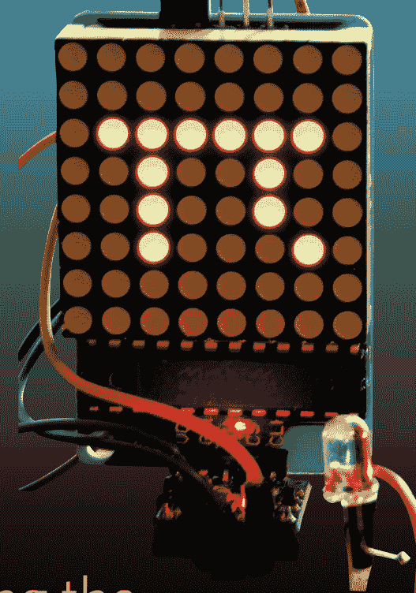

> 献给我的妻子和孩子们。

- 拍频振荡器 ................................................................ 67
- 总结 ................................................................................................ 103
- STL 迭代器 (STL Iterators) .............. 119
- 容器 `Container::at()`................ 120
- 初始化列表 (Initializer Lists) .............. 122
- 引用 (References) .............. 122
- 容器 `std::deque` .............. 125
- 嵌套容器 (Containers of Containers............... 126
- 字符串流 (String Streams) .............. 130
- 总结............... 131
- `libevent`............... 133
- `WebMain::start()`............... 135
- 服务器关闭 (Server Shutdown)................ 137
- 权限 (Permissions)................ 138
- 待事项 (To Do) .............. 139
- 包含文件 (Include File) ....................................................................................................... 142
- 类定义（部分 1）（Class Definition (Part 1) ....................................................................... 142
- `GPIO::get_error` ................................................................................... 145
- `GPIO::events_off` ................................................................................ 147
- `GPIO::write` ...................................................................................... 147
- `GPIO::clear_event` ............................................................................. 148
- `GPIO::alt_function` .......................................................................... 149
- `GPIO::set_drive_strength` ...................................................... 150
- `GPIO::config_clock` ............................................................ 152
- `GPIO::stop_clock` ............................................................... 155
- `GPIO::pwm_enable` ............................................................ 157
- `GPIO::pwm_write_fifo` ......................................................... 159
- `GPIO::pwm_fifo_empty` ....................................... 159

# 目录

- `GPIO::get_pwm_ratio`................................................................................................ 160
- `GPIO::pwm_status`.................................................................................................. 161

# 附录 C：类 GPIO 3 ................................................................................ 163

- 类定义（部分 3）（Class Definition (Part 3) ....................................................................... 163
- `GPIO::delay` .......................................................................................................... 164
- `GPIO::source_name` ............................................................................................................... 165
- `GPIO::gpio_alt_func` ............................................................................................................ 165

# 附录 D：类 MAX7219 ................................................................................ 167

- 包含文件 (Include File) ................................................................................................................. 167
- 类定义 (Class Definition) ................................................................................................ 168
- `MAX7219::enable` ................................................................................................................ 169
- `MAX7219::config_digits` ...................................................................................... 170
- `MAX7219::data` ......................................................................................................... 171
- `MAX7219::shutdown` ............................................................................................................ 171
- 初始化步骤 (Initialization Procedure) ................................................................ 172

## 附录 E：Matrix 类.................................................................................................................. 173

包含文件............................................................................................................................... 173

链接............................................................................................................................... 173

类定义 ................................................................................................................... 174

- `Matrix::Matrix` ................................................................................................................ 174
- `Matrix::Pi` ................................................................................................................... 175
- `Matrix::set_deflection`.................................................................................................. 177

## 附录 F：MTop 类与 Diskstat......................................................................................... 179

包含文件 ....................................................................................... 179

链接............................................................................................................................... 179

MTop 类定义 .......................................................................................... 179

- `MTop::MTop` .......................................................................................................... 180
- `MTop::sample` ....................................................................................................... 180
- `MTop::total_cpu_pct`............................................................................................... 181
- `MTop::memory_pct`.................................................................................. 181
- `MTop::swap_pct`...................................................................................................... 182

MTop 采样循环计时 ................................................................................ 182

Diskstat 类定义 ................................................................................ 183

- `Diskstat::Diskstat`........................................................................................ 183
- `Diskstat::pct_io`.................................................................................. 184

## 附录 G：其他 librpi2 类 ................................................................ 185

DMA 分配 ................................................................................................... 185

警告 .............................................................................................. 186

## 索引.......................................................................................................................... 187

# 关于作者

**Warren W. Gay** 从从小接触电子产品，从公立学校把废弃的电视机和收音机带回家。高中时期，他对为 IBM 1130 计算机编程产生了兴趣，这导致他的职业规划转向软件开发。在就读理森理工学院（Ryerson Polytechnical Institute）后，他享受了30多年的软件开发职业生涯，主要使用 C/C++ 进行编程。自1994年以来，Warren 一直作为开源贡献者编写 Linux，并在此后的各种 Unix 平台上进行专业化工作。

在就读理森之前，Warren 从零开始了一个英特尔 8008 系统，那是在 CP/M 系统时代，计算机还没有个人化。多年后，Warren 获得了高级业余无线电执照（呼号 VE3WWG），并操作无线电卫星。他业余无线电爱好的一个高点是在1991年与和平空间站（U2MIR）建立了数字联系。

Warren 工作于 Datablocks.net，这是一家企业级广告投放软件服务公司。他在那里 Linux 后端系统上编写 C++ 服务器解决方案。


# 致谢

我要感谢 Apress 的优秀同事们提供的想法、支持和耐心。特别感谢 Michelle Lowman 负责项目的运行，感谢 Mark Powers 指挥整个乐团。最后，同样重要的是，感谢乐团本身，音乐就在那里开始。

## 第 1 章

### 引言

树莓派 2 的引入开启了令人兴奋的新机遇。软件不再局限于单个 CPU 核心，而是可以在多个核心上执行。内存翻倍到 1 GB，提供了更大的磁盘缓存，并导致了更出 SD 卡性能。这还为运行更大的应用程序留出了空间。四个内置 USB 端口也有助于避免对 USB 集线器的需求。

底层某些事情发生了变化，例如用于外设的物理地址 `BCM2708_PERI_BASE` 从 `0x20000000` 变为 `0xF3F0000` 用于树莓派 2。这意味着为早期树莓派编写许多软件将无法工作。由于设备树（DT）的支持，在 Linux 中自动检测它现在变得简单。因此，包含了 `libgpi2` 类。

本书的主要目的是利用树莓派 2。为了实现这一目标，书中使得外设访问 GPIO 变得更加容易。只需几行代码，命令行工具就能让你列出 GPIO 状态并进行更改。C++ 库将使得访问 GPIO 和其他外设成为可能。

我认为读者应该使用一种不需要额外硬件的软件逻辑分析仪。为此，本书提供了一个基于软件的逻辑分析仪来查看所有 GPIO 输入输出并将事件记录到文件中。


本书选择 C++ 编程语言是为了让你的生活更简单。程序员不需要担心这一点，因为我保留了基础元素。过去十年中，标准化努力对 `g++` 和 `libc` 产生了非常积极的影响。而标准模板库（STL）的可用性为 `glibc` 编程提供了一个非常高效的环境。

我使用了混合方法来处理 C++ 代码，继续使用熟悉的 I/O（stdio）例程，如 `printf`，使得代码易于阅读和理解。我知道 C++ 人士会认为这本书是实用书籍而非计算机科学教材。特别感兴趣的是包含的工具和库 `libgpi2`。

## 概述

第 2 章介绍了一个简单的树莓派 2 构建项目。使用一小块板，你可以将你的树莓派 2 挂载在面包板上。这种组织方式非常有帮助。

# 第 1 章 引言

第 3 章介绍了一个“矩阵”构建项目。它使用 LED 矩阵产生一个可以提供每个核心实时利用率显示。它还显示了内存和 I/O 利用率。如果你不想构建这个项目，第 4 章和第 9 章涵盖了逻辑分析仪，它不需要额外硬件。`PiSpy` 逻辑分析仪能够查看所有 GPIO 输入输出并将事件记录到文件中。

第 2 章介绍了一个简单的树莓派 2 构建项目。使用一小块板，你可以将你的树莓派 2 挂载在面包板上。这种组织方式非常有帮助。

第 3 章介绍了一个“矩阵”构建项目。它使用 LED 矩阵产生一个可以提供每个核心实时利用率显示。它还显示了内存和 I/O 利用率。如果你不想构建这个项目，第 4 章和第 9 章涵盖了逻辑分析仪，它不需要额外硬件。`PiSpy` 逻辑分析仪能够查看所有 GPIO 输入输出并将事件记录到文件中。

第 5 章专门介绍 GPIO 命令。通过提供的支持，为各种类方法提供了易于遵循的文档和示例。

第 6 章引入了 `pwm` 工具，它可以显示或更改通用时钟（或 PWM）。

第 7 章通过检查脉宽调制（PWM）外设扩展了时钟。结合 `PiSpy` 探索了 `pwm` 工具及其选项。`PiSpy` 展示了不同设置的影响。

第 8 章查看 GPIO 是什么以及其制成的互补金属氧化物（CMOS）技术。电子学生会发现关于什么是 CMOS 以及如何避免接口陷阱的解释很有帮助。此外，解释了 CMOS 输入并简要说明静态保护方案。

第 9 章详细介绍了 `PiSpy` 逻辑分析仪，并描述了其应用的各种功能。

第 10 章查看 GPIO 输入，特别关注开关和按钮输入的去抖问题。

第 11 章是一个侧重于软件的章节。它提供了一种非常简单且实用的使用 C++ 和 STL 的方法。STL 为程序员在编程时间和可靠性方面提供了巨大收益。在本章中，我们查看了最流行的容器，并在处提供了示例代码片段。

第 12 章是多线程软件，用于在高效的服务器中利用所有 CPU 核心。服务器在后台基于 `libevent` 库，但使用了 C++ 类来提供非常简单的接口。这允许你用极少的主线代码构建和自定义自己的 Web 服务器。提供的 `web` 项目可以用于和扩展。

附录 A 到 C 文档了用于编程 GPIO 的 `libpi2` C++ 类。通过提供的支持，为各种类方法提供了易于遵循的文档和示例。

附录 D 和 E 描述了一些其他对处理矩阵或七段显示器的人有用的 C++ 类。附录 F 描述了与 `mqtt` 工具测量的系统性能指标相关的类。

附录 G 提供了关于 `libpi2` 中剩余一些高级类的额外信息。

你可能想要下载为本书编写的开源软件。它可以通过两个来源获取：

- [https://www.apress.com/9781484217382](https://www.apress.com/9781484217382)
- [https://github.com/ve3wwg/raspberry_pi2.git](https://github.com/ve3wwg/raspberry_pi2.git)

## 第一章 绪

开源软件之所以重要，是因为：

1. 它为你提供了若干实用工具：`gpi`, `pigpi`, `pipwm`, `mtop` 和 `PiSpy`。
2. 它包含了 `piweb` C++ 网页服务器项目。
3. 它提供了库 `libprpi2`，你可以将其用于你自己的 C++ 项目中。

如果你正在使用 `git` 来显示和控制源代码，请使用以下命令：

```bash
$ git clone https://github.com/ve3wwg/raspberry-pi2.git ./pi2
```

第二个参数告诉 `git` 将源代码安装到新的 `pi2` 子目录中。

`Gpio` 命令为你提供了一个第一级的 Unix 实用工具，用于显示和控制 GPIO 资源。该工具还包含一些实用的选项，可以使 GPIO 引脚闪烁，这对于检查到 LED 的接线非常有帮助。另一个选项允许你监控终端会话的输入，这样你就可以检查输入接线等。

`pigpi` 工具允许你显示和控制通用时钟（以及 PWM 时钟）。`pigpi` 和 `PiSpy` 也常在某些项目中配合使用。

`Pipwm` 允许你显示和控制 PWM 外设。`pipwm` 命令和 `PiSpy` 工具也用于让你控制 PWM 外设。

`PiSpy` 为你提供了一个 GPIO 逻辑分析仪。通过使用 DMA 的 Linux 驱动，`PiSpy` 用户 GPIO 数据可以以 2 MHz 或更低的速度捕捉。该工具会自动分配和释放它所需的 DMA 资源，以方便使用并维护系统完整性。

如果你选择使用第三章中的矩阵，你将能够使用提供的 `mtop` 命令实时可视化系统利用率。

由于树莓派 2 拥有四个 CPU 核心，`piweb` 项目演示了如何使用它们构建高性能 C++ 网页服务器。该服务器将调度全部四个 CPU 核心工作以应对足够的 Web 流量。然而，由于其 C++ 设计，很容易进行编程和增强以满足你自己的需求。

下载源码并将其解压到目录（建议目录 `~/pi2`）后，即可开始构建和安装过程。在这些说明中，我假设软件目录位于子目录 `~/pi2`。

1. 快速检查第 11 章，查看你是否需要下载新的 GNU 编译器。我希望在你读到这里时，C++11 已经包含在内。如果没有，下载并安装支持 C++11 的新版本 GNU 编译器也是件很容易的事。
2. `$ sudo apt-get install make`
3. `$ sudo apt-get install libevent-dev`（`piweb` 项目需要）
4. `$ sudo apt-get install cmake`（`PiSpy` 工具需要）
5. `$ sudo apt-get install help`（推荐）
6. `$ cd ~/pi2`
7. 可选：当重新构建时：`$ make clobber`
8. `$ make`
9. `$ sudo make install`

此过程处理了除 `PiSpy` 工具之外的所有软件。`PiSpy` 需要使用 Linux 内核可加载模块。出于这个原因，`PiSpy` 的安装有一个单独步骤：

1. 在构建 `PiSpy` 之前请查看第 4 章。
2. 可选：如果重新构建 `PiSpy`，请执行：`$ make pispy_clobber`
3. `$ make pispy`
4. `$ sudo make pispy_install`

默认情况下，顶层 `Makefile` 使用默认安装路径 `PREFIX=/usr/local`。这导致 `librpi2` 包含的文件被安装在 `/usr/local/include/librpi2`。库安装在 `/usr/local/lib/librpi2.a`。像 `gpio` 和 `pipwm` 等工具将安装在 `/usr/local/bin`。

如果你需要更改此项，请在执行 `make` 和 `install` 步骤之前导出 `PREFIX`。例如，如果你想将软件安装在 `/opt/local`，可以使用 `$ export PREFIX=/opt/local`。

在使用 `sudo` 时不要忘记同样的操作：

```bash
$ sudo -i
# export PREFIX=/opt/local
# make install
```

## 感谢

感谢购买本书并并让我引导你进行探索。这本书及其软件将为你的树莓派 2 带来许多小时的乐趣。

## 第二章

## 工作站

在对树莓派 2 进行简要介绍后，我们将查看一个自制的实验者工作站。这些信息旨在激发灵感，而不是作为必须遵守的指令。记住，你的树莓派不需要一直连接在工作站上。如果你需要它用于永久性项目，可以安全地将其移除并“重新利用”。

## 树莓派 2 到货

我的树莓派 2 从 element14.com 到达，在一个可爱的小盒子里，标签为“Raspberry Pi 2 Model B 1GB”。我非常期待它，主要是因为四核 CPU 和内存容量的翻倍意味着重大的升级。在盒子上看到这两点的确认，立即告诉我物品已发货了。

订购这个东西有些困难，因为大多数供应商只通过快递发货。例如在加拿大，快递公司在递送物品时会收取额外费用。他们称之为“海关代理费”。幸运的是，我从 adafruit.com 购买的，他们允许我通过美国邮政寄送。

它的包装盒和小册（见图 2-1）实际上没有提供任何实际价值，除了带给你一种你花钱买到了优质产品的温暖感觉。最棒的部分实际上是你收到了四个 CPU 核心和双倍的内存。

 *(注：原文无具体图，此处为占位符)* 它的包装盒和小册实际上没有提供任何实际价值，除了带给你一种你花钱买到了优质产品的温暖感觉。最棒的部分实际上是你收到了四个 CPU 核心和双倍的内存。

 树莓派 2 顶部

我的树莓  2 核心，内存倍内存内存  。 树莓派 2 核心，这非常棒。

 树莓派 2 核心

 树莓派 2 底部

 树莓派 2 顶视图 2

 树莓派 2 顶视图 3

 树莓派 2 顶视图 4

 树莓派 2 顶视图 5

 树莓派 2 顶视图 6

*(注：由于原文未提供具体图片路径，以上部分仅为根据语境的占位或逻辑说明)*

---

**翻译说明：**

- "The Raspberry Pi 2 Arrives" 翻译为 "树莓派 2 到货"。
- "Workstation" 翻译为 "工作站"。
- "customs brokerage fee" 翻译为 "海关代理费"。
- "repurposed" 翻译为 "重新利用"。
- 保留了所有技术术语和代码块格式。


`pigpi`工具允许你显示和控制通用时钟（以及 PWM 时钟）。`pigpi`和`PiSpy`也常在某些项目中配合使用。

`Pipwm`允许你显示和控制 PWM 外设。`pipwm`命令和`PiSpy`工具也用于让你控制 PWM 外设。

`PiSpy`为你提供了一个 GPIO 逻辑分析仪。通过使用 DMA 的 Linux 驱动，`PiSpy`用户 GPIO 数据可以以 2 MHz 或更低的速度捕捉。该工具会自动分配和释放它所需的 DMA 资源，以方便使用并维护系统完整性。

如果你选择使用第三章中的矩阵，你将能够使用提供的`mtop`命令实时可视化系统利用率。

由于树莓派 2 拥有四个 CPU 核心，`piweb`项目演示了如何使用它们构建高性能 C++ 网页服务器。该服务器将调度全部四个 CPU 核心工作以应对足够的 Web 流量。然而，由于其 C++ 设计，很容易进行编程和增强以满足你自己的需求。

下载源码并将其解压到目录（建议目录`~/pi2`）后，即可开始构建和安装过程。在这些说明中，我假设软件目录位于子目录`~/pi2`。

- 1. 快速检查第 11 章，查看你是否需要下载新的 GNU 编译器。我希望在你读到这里时，C++11 已经包含在内。如果没有，下载并安装支持 C++11 的新版本 GNU 编译器也是件很容易的事。

- 2. `$ sudo apt-get install make`

- 3. `$ sudo apt-get install libevent-dev`（`piweb`项目需要）

- 4. `$ sudo apt-get install cmake`（`PiSpy`工具需要）

- 5. `$ sudo apt-get install help`（推荐）

- 6. `$ cd ~/pi2`

- 7. 可选：当重新构建时：`$ make clobber`

- 8. `$ make`

- 9. `$ sudo make install`

此过程处理了除`PiSpy`工具之外的所有软件。`PiSpy`需要使用 Linux 内核可加载模块。出于这个原因，`PiSpy`的安装有一个单独步骤：

- 1. 在构建`PiSpy`之前请查看第 4 章。

- 2. 可选：如果重新构建`PiSpy`，请执行：`$ make pispy_clobber`

- 3. `$ make pispy`

- 4. `$ sudo make pispy_install`

默认情况下，顶层`Makefile`使用默认安装路径`PREFIX=/usr/local`。这导致`librpi2`包含的文件被安装在`/usr/local/include/librpi2`。库安装在`/usr/local/lib/librpi2.a`。像`gpio`和`pipwm`等工具将安装在`/usr/local/bin`。

如果你需要更改此项，请在执行`make`和`install`步骤之前导出`PREFIX`。例如，如果你想将软件安装在`/opt/local`，可以使用`$ export PREFIX=/opt/local`。

在使用`sudo`时不要忘记同样的操作：

```bash
$ sudo -i
# export PREFIX=/opt/local
# make install
```

## 感谢

感谢购买本书并允许让我引导你进行探索。这本书及其软件将为你的树莓派 2 带来许多小时的乐趣。

在对树莓派 2 进行简要介绍后，我们将查看一个自制的实验者工作站。这些信息旨在激发灵感，而不是作为必须遵守的指令。记住，你的树莓派不需要一直连接在工作站上。如果你需要它用于永久性项目，可以安全地将其移除并“重新利用”。

我的树莓派 2 从 element14.com 到达，在一个可爱的小盒子里，标签为“树莓派 2 型号 B 1GB”。我非常期待它，主要是因为四核 CPU 和内存容量的翻倍意味着重大的升级。在盒子上看到这两点的确认，立即告诉我物品已发货了。

订购这个东西有些困难，因为大多数供应商只通过快递发货。例如在加拿大，快递公司在递送物品时会收取额外费用。他们称之为“海关代理费”。幸运的是，我从 adafruit.com 购买的，他们允许我通过美国邮政寄送。

它的包装盒和小册（见图 2-1）实际上没有提供任何实际价值，除了带给你一种你花钱买到了优质产品的温暖感觉。最棒的部分实际上是你收到了四个 CPU 核心和双倍的内存。

开源软件之所以重要，是因为：

- 1. 它为你提供了若干实用工具：`gpi`、`pigpi`、`pipwm`、`mtop`和`PiSpy`。

- 2. 它包含了`piweb` C++ 网页服务器项目。

- 3. 它提供了库`libprpi2`，你可以将其用于你自己的 C++ 项目中。

如果你正在使用`git`来显示和控制源代码，请使用以下命令：

```bash
$ git clone https://github.com/ve3mwg/raspberry-pi2.git ./pi2
```

第二个参数告诉`git`将源代码安装到新的`pi2`子目录中。

`Gpio`命令为你提供了一个第一级的 Unix 实用工具，用于显示和控制 GPIO 资源。该工具还包含一些实用的选项，可以使 GPIO 引脚闪烁，这对于检查到 LED 的接线非常有帮助。另一个选项允许你监控终端会话的输入，这样你就可以检查输入接线等。

`pigpi`工具允许你显示和控制通用时钟（以及 PWM 时钟）。`pigpi`和`PiSpy`也常在某些项目中配合使用。

`PiSpy`为你提供了一个 GPIO 逻辑分析仪。通过使用 DMA 的 Linux 驱动，`PiSpy`用户 GPIO 数据可以以 2 MHz 或更低的速度捕捉。该工具会自动分配和释放它所需的 DMA 资源，以方便使用并维护系统完整性。

如果你选择使用第三章中的矩阵，你将能够使用提供的`mtop`命令实时可视化系统利用率。

由于树莓派 2 拥有四个 CPU 核心，`piweb`项目演示了如何使用它们构建高性能 C++ 网页服务器。该服务器将调度全部四个 CPU 核心工作以应对足够的 Web 流量。然而，由于其 C++ 设计，很容易进行编程和增强以满足你自己的需求。

## 软件安装

下载源码并将其解压到目录（建议目录`~/pi2`）后，即可开始构建和安装过程。在这些说明中，我假设软件目录位于子目录`~/pi2`。

- 1. 快速检查第 11 章，查看你是否需要下载新的 GNU 编译器。我希望在你读到这里时，C++11 已经包含在内。如果没有，下载并安装支持 C++11 的新版本 GNU 编译器也是件很容易的事。

- 2. `$ sudo apt-get install make`

- 3. `$ sudo apt-get install libevent-dev`（`piweb`项目需要）

- 4. `$ sudo apt-get install cmake`（`PiSpy`工具需要）

- 5. `$ sudo apt-get install help`（推荐）

- 6. `$ cd ~/pi2`

- 7. 可选：当重新构建时：`$ make clobber`

- 8. `$ make`

- 9. `$ sudo make install`

此过程处理了除`PiSpy`工具之外的所有软件。`PiSpy`需要使用 Linux 内核可加载模块。出于这个原因，`PiSpy`的安装有一个单独步骤：

- 1. 在构建`PiSpy`之前请查看第 4 章。

- 2. 可选：如果重新构建`PiSpy`，请执行：`$ make pispy_clobber`

- 3. `$ make pispy`

- 4. `$ sudo make pispy_install`

## 安装备注

默认情况下，顶层`Makefile`使用默认安装路径`PREFIX=/usr/local`。这导致`librpi2`包含的文件被安装在`/usr/local/include/librpi2`。库安装在`/usr/local/lib/librpi2.a`。像`gpio`和`pipwm`等工具将安装在`/usr/local/bin`。

如果你需要更改此项，请在执行`make`和`install`步骤之前导出`PREFIX`。例如，如果你想将软件安装在`/opt/local`，可以使用`$ export PREFIX=/opt/local`。

在使用`sudo`时不要忘记同样的操作：

```bash
$ sudo -i
# export PREFIX=/opt/local
# make install
```

## 感谢

感谢购买本书并允许让我引导你进行探索。这本书及其软件将为你的树莓派 2 带来许多小时的乐趣。

在对树莓派 2 进行简要介绍后，我们将查看一个自制的实验者工作站。这些信息旨在激发灵感，而不是作为必须遵守的指令。记住，你的树莓派不需要一直连接在工作站上。如果你需要它用于永久性项目，可以安全地将其移除并“重新利用”。

我的树莓派 2 从 element14.com 到达，在一个可爱的小盒子里，标签为“树莓派 2 型号 B 1GB”。我非常期待它，主要是因为四核 CPU 和内存容量的翻倍意味着重大的升级。在盒子上看到这两点的确认，立即告诉我物品已发货了。

订购这个东西有些困难，因为大多数供应商只通过快递发货。例如在加拿大，快递公司在递送物品时会收取额外费用。他们称之为“海关代理费”。幸运的是，我从 adafruit.com 购买的，他们允许我通过美国邮政寄送。

它的包装盒和小册（见图 2-1）实际上没有提供任何实际价值，除了带给你一种你花钱买到了优质产品的温暖感觉。最棒的部分实际上是你收到了四个 CPU 核心和双倍的内存。

最好用的笔外部是圆形的，并且由相当坚固的塑料制成。这支笔比我手里的要软一点。取出圆珠笔和墨水，丢掉端盖。使用小型切管钳（见图 2-6），从末端切下一小段来测试塑料硬度。如果你发现它太软，就尝试换一支笔。早些，我从酒店免费获得了一支，非常完美。我希望我有更多那种笔。


**图 2-6.** 小型切管钳

找一些长度足够穿过 PCB 并进入木材（3/4 英寸），且足够小能穿过 PCB 孔的螺丝。我的螺丝无法完全穿过 PCB，因此我不得不用钻头小心地削掉一些 PCB。我使用了一个刚好适合孔径的钻头，但通过稍微转动钻头，我获得了所需的少量额外间隙。不过，这一点要非常小心。任何暴力操作都可能损坏你的 Pi。

准备好木材并选好木螺丝后，确定所需的垫片长度。不要忘记考虑到 PCB 的厚度。在我的情况下，我选定的垫片长度约为 9 mm。图 2-7 显示我从笔上切下一个垫片。


图 2-7. 切割垫片

即使你以前从未用过切管钳，该操作也非常简单安全。将工件放在切刀之间，转动手柄拧紧。不要过度拧紧，只需紧到刀片在你旋转切管钳时能够切割即可。转几圈后，再拧紧一点。如果你使用的是硬塑料，切管钳最终会切掉一段。我使用的笔是软塑料，所以切管钳只是留下了圆环。等环切得足够深后，你可以用美工刀完成（下方垫一块废木进行切割）。

图 2-8 显示了立起的螺丝和垫片，让你直观地看到有多少螺丝会露出来。

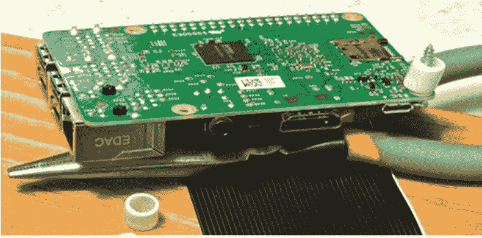

图 2-8. 露出的垫片和木螺丝

几乎完成的工作站如图 2-9 所示。树莓派 2 安装在左侧，所有接口都面向我。MicroSD 卡是从照片的背面插入的。MicroUSB 电源接口和 HDMI 连接位于左侧（木材末端）。这留下了右侧的 GPIO 2x20 针排用于连接面包板，我们还没有讨论过它。

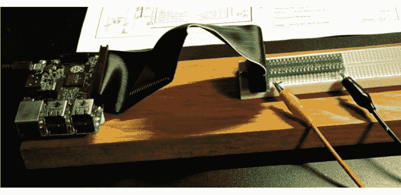

## 面包板排扩展 (Breadboard Breakout)

为了方便进行原型实验，我购买了一个适用于树莓派 2（以及 B+）的 T 型排扩展板。图 2-10 显示我使用的扩展板。

11

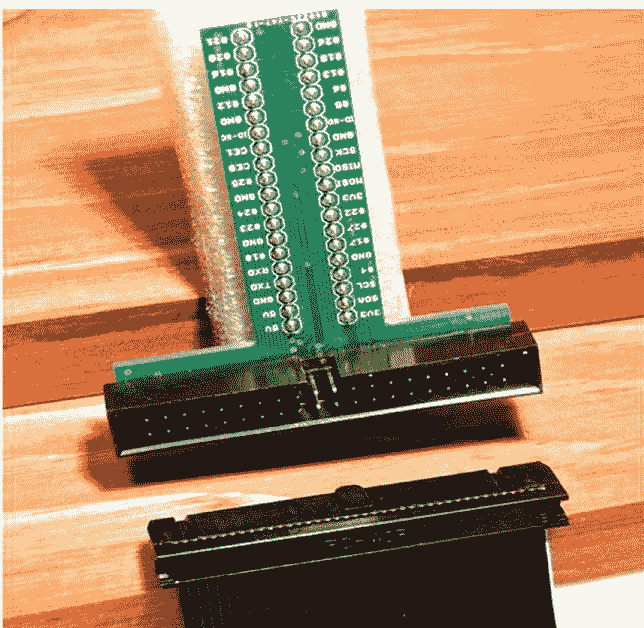

**图 2-10.** 树莓派 2 扩展板

注意键槽，它可以帮助你对齐电缆引脚方向。如果你使用没有这种键的电缆，那么对齐电缆，使标记的导线（图 2-10 中的白色）与插座的 1 号引匹配非常重要。接收插座上应该有一个小三角形标记 1 号引。

排线的另一端必须插入树莓派 2 的 J8 接口。因为那里没有键槽插座，所以正确对齐连接器非常重要。图 2-11 显示了连接器如何配合 J8。

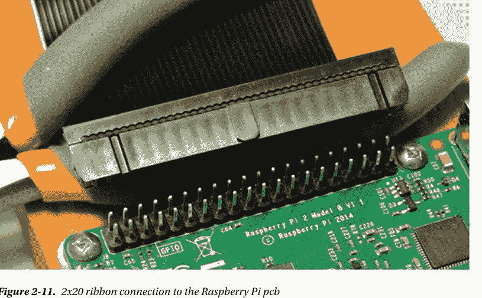

**图 2-11.** 连接到树莓派 PCB 的 2x20 排线

在图 2-11 中，你可以看到左侧的三角形。中间的凸起有助于确认方向是否正确。此引脚必须与图 2-3 右上所示带有方孔焊垫的引脚匹配。方孔垫标识了 1 号引。

一旦连接上扩展线，进行通电以双检所有部分都已插入。图 2-9 显示红色鳄鱼夹连接到扩展板的 +3.3V 引脚，黑色夹子连接到地。这些引线的另一端连接到数字万用表（DMM）。在不插 microSD 卡的情况下为树莓派供电，这样你就可以开关而不用担心损坏数据。我们只是想检查 +3.3V 从扩展板的哪里输出的。

如果方向正确，你会在万用表上读到 +3.3V。如果你得到的是 +5V（在本应出现 +3.3V 的地方），说明你的排线在某一端接反了。这些操作都很简单，但也很容易出错。

我的连接器可能需要扭转排线（我发现有些设计是不扭转的）。为了固定电缆，我本可以将电缆跨在 Pi 的 PCB 上或扩展板引脚上。我不喜欢这两种想法，所以我选择接受扭转的电缆。也许你的情况会有所不同。

此时值得提到工作站长度的选择。你的选择取决于你选择的扩展板尺寸。如果可能，选择长款扩展板；扩展连接器将占据大量的空间。

也许我有点儿“老派”，但我喜欢有串口的选项。通过 USB 转串口线，你可以与笔记本电脑进行通信。串口还允许在不使用 USB 的情况下与 Arduino/AVR 设备通信。最后，在配置允许的情况下，串口可以作为串口控制台使用。

我从 eBay 购买了转换器。商品标题为“MAX3232 RS232 串口转 TTL 转换模块 (DB9)”，花费了我 15 美元。由于包邮，很难找到理由自己制作这个。2-12 显示了该微型适配器的顶视图。

13

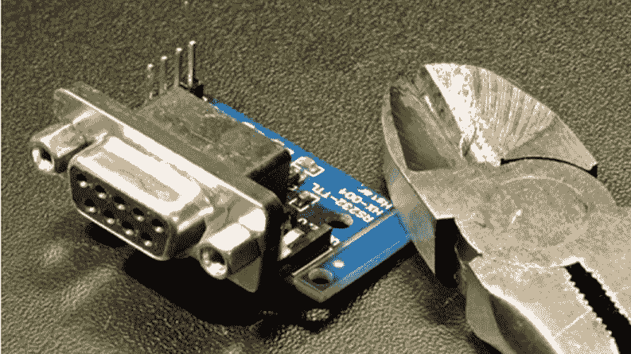

**图 2-12.** RS-232 转换器的顶视图

MAX3232 芯片设计工作电压为 +3.0V 到 5.5V（无负载时 1 mA）。只要从树莓派的 +3.3V 电源为此转换器供电，它就能安全地与树莓派的 GPIO 线交互。这种单元仅提供 RX 和 TX 数据线。如果你需要 RTS 等额外信号，请寻找支持它们的转换器。

图 2-12 背面的引脚如下：

- VCC（连接到 +3.3V）

- GND

- RX（连接到 Pi RX）

- TX（连接到 Pi TX）

2-13 显示了转换器的底部。使用尖嘴钳，我用废电线弯了一个钩。

14

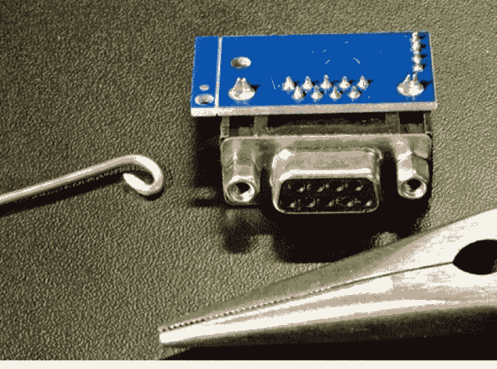

**图 2-13.** RS-232 转换器

你可能需要第三手将其焊接。足够的热量使焊锡渗透焊点，而不损坏 PCB。图 2-14 显示了完成后的工作，铜制的“翅膀”准备好安装。


**图 2-14.** 转换器上的铜翅膀

# 第 2 章 工作站

完成这些工作后，用一对木螺丝和垫圈将其安装在工作站上（图 2-15）就很简单了。我将转换器安装在工作站的背面，因为我对正面有计划（稍后会覆盖）。

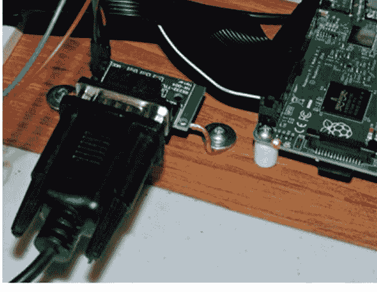

图 2-15. 安装好的 RS-232 转换器

## 面表

木材的好处在于是，只需少量规划就能轻松增加额外功能。图 2-16 说明了如何将一个 1 mA 面表添加到工作站中。我们稍后进行 PWM 实验时会用到它。

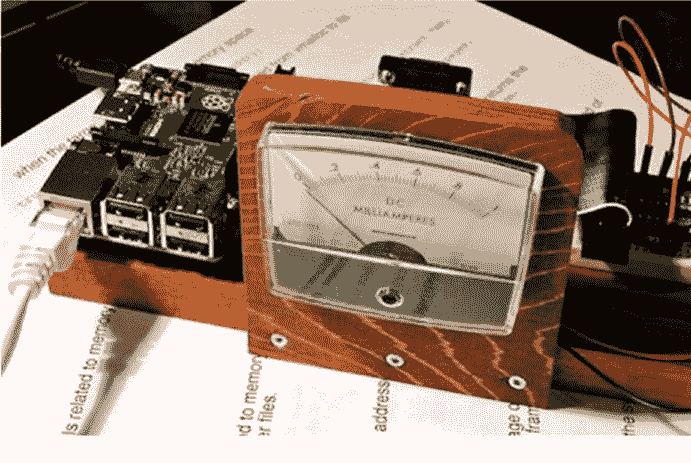

图 2-16. 工作站 1 mA 面板表计

该表在其的一个端子上串联焊接了一个 3.3K 电阻，以便 3.3V 即可提供满偏偏。图 2-17 显示了该电路。然后连接了两根杜邦线，以便根据需要将它们插入面包板进行实验。

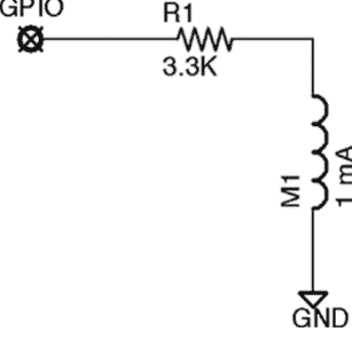

图 2-17. 1 mA 面板表计电路

## Arduino/AVR

如果你计划进行一些树莓派 2 和 Arduino（或 AVR）的组合实验，我建议你也为它准备类似的设备。图 2-18 显示了另一个带有 Arduino UNO 的面包板工作站。图中显示的电线仅仅来自正在进行中的实验。

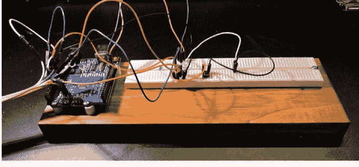

**图 2-18.** Arduino UNO 和面包板工作站

再次，使用垫柱安装 Arduino PCB。如果你没有 Arduino，仍然可以在面包板上直接使用 AVR 芯片。AVR 的优点在于，在不需要精度的情况下，它们可以在没有晶振的情况下运行。然而，Arduino PCB 确实节省了时间和面包板空间。

## 总结

本章旨在为你自己的树莓派 2 工作站提供灵感来源。通过一点计划和奇心，你可以设计出自己的工作站解决方案。该方案不需要非常复杂或复杂。保持组织良好就能获得更好的实验体验。

## 第 3 章

## 矩阵（CPU 利用率）


# 第 3 章 矩阵（CPU 占用率）

除了内存容量翻倍外，新款树莓派 2 的主要吸引力之一是四核心：四倍的脑力！在本章中，我们将查看几种可视化核心中存在的 CPU 活动的方法。

## LED 矩阵

市面上可以低价购买到 8×8 的红色 LED 矩阵阵列。为了方便驱动这些 LED，还有 MAX7219 LED 显示驱动 IC。你可以自己构建，但这些也可以作为组装或未组装的 PCB 套件购买。图 3-1 所示是在 eBay 上购买的组装版，价格为 2.24美元（免邮）。

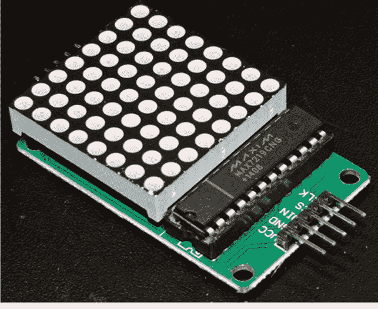

图 3-1. MAX7219 LED 矩阵 PCB

该 PCB 的连接如下：

- 1. VCC (4.0V 到 5.5V)
- 2. Gnd
- 3. DIN（数据输入）
- 4. CS（MAX7219 的负载）
- 5. CLK（串行时钟）

显然，VCC 对 GPIO 接口产生了一个问题，因为树莓派使用 3.3V 逻辑，且无法承受更高的电压。事实是 DIN、CS（即 MAX7219 的 LOAD）和 CLK 输入到 IC 内部。然而，Maxim 数据书中的 $V_{cc}$ 参数列为 +3.5V。即使在理想情况下，你的树莓派 GPIO 输出也不会达到 +3.3V。

## 电平转换器

然而，有一种非常好的、低成本且方便的解决方案：图 3-2 所示的 3V 转 5V 双向转换器。

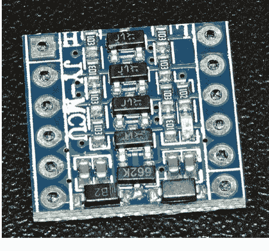

**图 3-2.** 3V 转 5V 电平转换器

图 3-2 所示的电平转换器是在 eBay 上 5.07美元购买（免邮），尽管可以更便宜（确保买的是双向的）。它们可能以不同的名称广告，但几乎总是会提到 I2C 或 IIC。

这些转换器的伟大之处在于它们可以在两个方向上工作，使其非常灵活（不要在非双向转换器上浪费时间）。3V 信号变化会反映在 5V 端，反之亦然。3-3 显示了我购买的电平转换器的底部。

底部的丝印有助于直观理解单元的工作原理。有几种不同类型的电平转换器，让我们注意以下几点。

丝印显示右侧的 +5V 端可以产生高达 150 mA 的 3V（图 3-3）。该转换器包含一个小型电压调节器，从 +5V 输入产生约 3V（或者带有齐纳二极管；我没能完成）。许多其他转换器没有这个 3V 生成功能。

作为测试，我向 5V 端添加了 +5V，GND 接地，在输出端测量到约 3.6V（无负载）。额外收获！此外，我发现一个小红 LED LED也亮了（PCB 顶侧）。

了解 +3V 输入很重要，因为电平转换器在此处工作良好（为 3V 端的高侧电阻供电）。如果没有此功能，你将需要将3V 输入连接到树莓派的 3.3V 输入，同时向另一侧提供 +5V。在我的情况下，+3V 已经在 PCB 上提供，并源自 +5V 输入。因此我们将 +5V 连接到 +5，但在这种情况下不要将 +3V 连接到超过 3.3V 的树莓派上。

对于其他不产生 +3V 电源的电平转换器，你需要从树莓派提供电源。在所有情况下，+5V 输入应连接到 3V 端，GPIO 从低到高会安全地导致靠近 5V 的变化。这些是双向转换器，反向工作方式相同，但我们的项目中不需要。

## 将 GPIO 连接到 MAX7219

矩阵 PCB 通过 MAX7219 IC 驱动 LED。通过电平转换器，我们现在可以将树莓派连接到该芯片。现在让我们查看 MAX7219 IC 的信号要求。

- DIN：此信号是串行输入 MAX7219 IC 的数据。数据在 CLK 信号上升沿进入芯片。高电平识别为 1 位，识别为 0 位。这在 CLK 上升之前必须至少稳定 25 ns。
- CLK：当信号从低变为高时，数据移入。该信号的操作频率不能超过 10 MHz。
- CS（PCB 上），LOAD：当 LOAD 信号从低变为高（MAX7219 的第 12 引脚）时，处理移入的最后 16 位数据。在数据位移入期间，LOAD 信号必须保持低电平（在时钟之前至少 25 ns）。

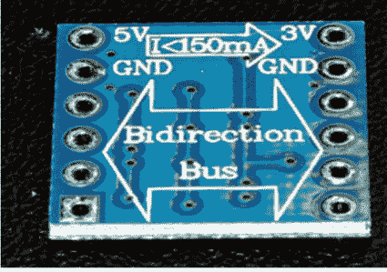

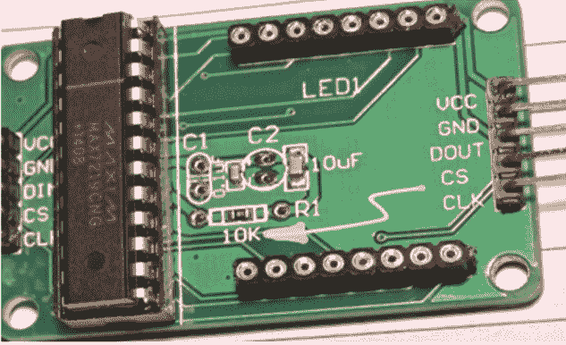

**图 3-5。** $R_{set}$ 在矩阵 PCB 上的位置 (R1 = 10K)

我购买的单元使用的 $R_{set}$（PCB 上的 $R_n$）值为 10K（见图 3-5 中的白色箭头）。拆除的 LED 矩阵零件号为 108AS。查阅该数据表可获得以下信息（这些参数随制造商而异）：

- 正向电流（电压）：2.1V 至 2.5V
- 正向电流：20 mA（其他数据表将其列为绝对最大值）

MAX7219 芯片在 70°C 时的功率限制约为 1066 mW。通过数据表和 LED 参数，我计算出这块 PCB 在最大亮度下是安全的，不会超过绝对限制（这是给读者的一个很好的数据表练习）。

查阅 MAX7219 数据表，你可能注意到 10K 的 $R_{set}$ 值设计用于在最大亮度下提供 40 mA（我们的 LED 限制为 20 mA）。然而，如果占空比不是 100%（连续），这就是安全的。当扫描八行 LED 时，某一行 LED 仅消耗 1/8 的功率。事实上，有一份数据表提到“正向电流为 100 mA [1]”。

与此联系，软件可以配置 MAX7219 IC 显示少于八个显示（通电时默认为一个）。如果你的软件有意或无意地执行这样做，请尽快纠正这种状况（移除矩阵 PCB 的 +5V）。由于显示的行数较少，每行 LED 的占空比为 1/8（即 12.5%），但可能是 100 分之一 1！软件可能会损坏硬件。

## MAX7219 命令

MAX7219 使用串行接口与微处理器建立接口。我们已经简要查看了 CLK、DIN 和 LOAD 这三个输入信号。CLK 信号不需要固定的时钟周期，因此我们可以说使用 GPIO 信号向 IC “位扫带（bit-bang）”所有信号。我们只需要确保某些事件发生得不过快。

设备的输入是一个 16 位字，其中最高位 (MSB) 首先移入。命令字的通用格式如表 3-1 所示。

**表 3-1。MAX7219 命令字格式**

| D15 | D14 | D13 | D12 | D11 | D10 | D9 | D8 | D7 | D6 | D5 | D4 | D3 | D2 | D1 | D0 |
|---|---|---|---|---|---|---|---|---|---|---|---|---|---|---|---|
| X | X | X | X | 地址/命令 | 数据 | | | | | | | | | | |

D15 是字的最高位，D0 是最低位 (LSB)。高位 D15 ... D12 被设备忽略（“不 care乎”用“X”表示），但在向设备移位数据时必须提供。位 D11 ... D8 指定行（或数字）的*地址*，否则指定显示命令的“指令”代码。可用数据在字的低八位中提供。

## 显示数据命令

当地址字段提供 1 到 8 的值（0b0001 到 0b1000）时，数据字段中的相关位驱动 LED（以两种模式之一进行）。见表 3-2。

**表 3-2。MAX7219 显示数字命令**

| D15 | D14 | D13 | D12 | D11 | D10 | D9 | D8 | D7 | D6 | D5 | D4 | D3 | D2 | D1 | D0 |
|---|---|---|---|---|---|---|---|---|---|---|---|---|---|---|---|
| X | X | X | 0b0001 到 0b1000 | 显示数据 | | | | | | | | | | | |

位 D7 ... D0 中包含的数据被解释为*数字*配置。每个数字可以在二进制编码十码 (BCD) 模式下运行，或者简单地作为单独位驱动器。在 BCD 模式下，仅使用低位 D3 ... D0，并根据字体映射映射到七段显示器代码。

在不在 BCD 模式下运行时，D7 ... D0 中的每个 1 位都会导致相应的驱动器开启。这是我们在矩阵上将使用的模式。

## 解码模式命令

表 3-3 所示的解码模式控制每个数字（LED 行）的配置。D7 ... D0 中的每个位都控制数字 7 到 0 的配置。当对应位持有 1 位时，该数字将生效 BCD 模式。0 位指定不进行任何显示映射。每个位 D7 ... D0 将按原样显示。

**表 3-3。MAX7219 解码模式命令**

| D15 | D14 | D13 | D12 | D11 | D10 | D9 | D8 | D7 | D6 | D5 | D4 | D3 | D2 | D1 | D0 |
|---|---|---|---|---|---|---|---|---|---|---|---|---|---|---|---|
| X | X | X | 0b1001 (0x09) | 解码模式 | | | | | | | | | |

在我们的项目中，我们将位设置为零以便发生 BCD 映射。

## 亮度命令

MAX7219 可以在软件控制下调整显示亮度。表 3-4 说明了亮度设置的格式，它影响整个显示。亮度值可以是 0（最小亮度 0b0000）到 15（全亮度 0b1111）。如果你计划显示一到三个数字（行），请使用此命令将亮度降低到低值。

| D15 | D14 | D13 | D12 | D11 | D10 | D9 | D8 | D7 | D6 | D5 | D4 | D3 | D2 | D1 | D0 |
|---|---|---|---|---|---|---|---|---|---|---|---|---|---|---|---|
| X | X | X | X | 0b1010 (0xA) | | X | X | | 亮度 | | |

## 扫描限制命令

设备显示的数字（行）通过表 3-5 所示的扫描限制命令配置。0 到 7 的值指定显示数字的数量分别为一到八。在你的项目中，我们将显示所有行，因此使用 0b111 (7)。如果你选择较少的数字（例如一到三个数字），你想大幅降低亮度以避免超过设备限制。数字越少，意味着每个数字或行的占空比越高。

**表 3-5。MAX7219 扫描限制命令**

| D15 | D14 | D13 | D12 | D11 | D10 | D9 | D8 | D7 | D6 | D5 | D4 | D3 | D2 | D1 | D0 |
|---|---|---|---|---|---|---|---|---|---|---|---|---|---|---|---|
| X | X | X | X | 0b111 (7) | | | | | | | |

## 关机命令

MAX7219 可以在软件控制下调整显示亮度。表 3-4 说明了亮度设置的格式，它影响整个显示。（等等，见下方修正）。表 3-3 所示的解码模式控制每个数字（LED 行）。D7 ... D0 中的每个位都控制数字 7 到 0 的配置。当对应位持有 1 位时，该数字将生效 BCD 模式。0 位指定不进行任何显示映射。每个位 D7 ... D0 将按原样显示。

**表 3-6。MAX7219 关机/启用命令**

| D15 | D14 | D13 | D12 | D11 | D10 | D9 | D8 | D7 | D6 | D5 | D4 | D3 | D2 | D1 | D0 |
|---|---|---|---|---|---|---|---|---|---|---|---|---|---|---|---|
| X | X | X | X | 0b1100 (0xC) | | X | X | X | | 关机 | |

设备显示的数字（行）通过表 3-5 所示的扫描限制命令配置。0 到 7 的值指定显示数字的数量分别为一到八。在你的项目中，我们将显示所有行，因此使用 0b111 (7)。如果你选择较少的数字（例如一到三个数字），你想大幅降低亮度以避免超过设备限制。数字越少，意味着每个数字或行的占空比越高。

与此联系，软件可以配置 MAX7219 IC 显示少于八个（通电时默认为一个）。如果你的软件有意或无意地执行这样做，请尽快纠正这种状况（移除矩阵 PCB 的 +5V）。由于显示的行数较少，每行 LED 的占空比为 1/8（即 12.5%），但可能是 100%！软件可能会损坏硬件。

## 测试模式

MAX7219 使用串行接口与微处理器建立接口。我们已经简要查看了 CLK、DIN 和 LOAD 这三个输入信号。CLK 信号不需要固定的时钟周期，因此我们可以说使用 GPIO 信号向 IC “位扫带（bit-bang）”所有信号。我们只需要确保某些事件发生得不过快。

设备的输入是一个 16 位字，其中最高位 (MSB) 首先移入。命令字的通用格式如表 3-1 所示。

D15 是字的最高位，D0 是最低位 (LSB)。高位 D15 ... D12 被设备忽略（“不 care乎”用“X”表示），但在向设备移位数据时必须提供。位 D11 ... D8 指定行（或数字）的*地址*，否则指定显示命令的“指令”代码。可用数据在字的低八位中提供。

## 无操作命令

无操作（NOP）命令（见表 3-8）起初看起来是一个很傻的操作，但 MAX7219 的设计允许工程师将其他 MAX7219 联起来形成更大的显示。要在不改变其他显示的情况下设置显示，需要使用 NOP 命令使设备不受影响。我们只使用一个驱动器，所以这对我们来说仅具有学术兴趣。但你，作为实验者，可能在自己的项目中需要它。

**表 3-8。MAX7219 无操作命令**

| D15 | D14 | D13 | D12 | D11 | D10 | D9 | D8 | D7 | D6 | D5 | D4 | D3 | D2 | D1 | D0 |
|---|---|---|---|---|---|---|---|---|---|---|---|---|---|---|---|
| X | X | X | X | 0b0000 (0x00) | | X | X | X | X | X | X | X | X |

## 矩阵信号

MAX7219 使用串行接口与微处理器建立接口。我们已经简要查看了 CLK、DIN 和 LOAD 这三个输入信号。CLK 信号不需要固定的时钟周期，因此我们可以说使用 GPIO 信号向 IC “位扫带（bit-bang）”所有信号。我们只需要确保某些事件发生得不过快。

图 3-6 显示了使用 GPIO 信号发送的一个命令的逻辑分析仪轨迹。

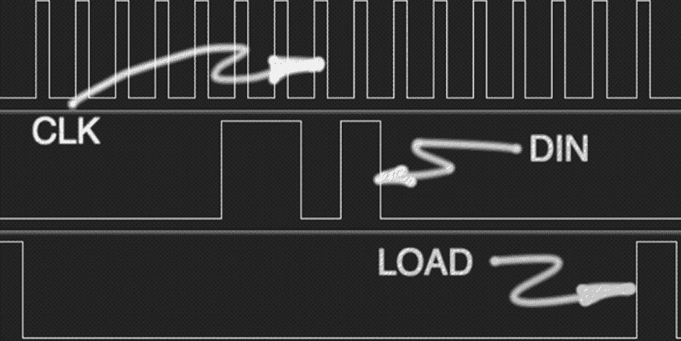

**图 3-6.** MAX7219 GPIO 命令信号示例

顶行显示时钟（CLK）脉冲。当 CLK 信号从低电变为高电平时，数据被时入设备。中间的轨迹显示了数据输入（DIN）信号。观察 CLK 的上升沿和 DIN 线的状态，我们可以看到加载的字字是 0b_0000_0110_1000_0000（添加下划线是为了提高可读性）。这是第 5 行的显示数据（地址高出一个），且数据中有一个 1 位 D7 从低电平变为高电平（图 3-6 的右下角）。当 LOAD 信号从低变高时，从设备移位寄存器的加载发生。

从图 3-6 中可以看出，LOAD 的低到高转换与最后一次时钟同时发生，但实际上它在时钟之后一个微秒或更多。根据 Maxim 的说明，LOAD 上升沿可以与 CLK 同时发生或在其后发生，但必须在下一个上升时钟到来*之前*发生。

## CPU 仪表

为了进一步增强 CPU 利用率显示，我们可以使用由 PWM 模式 GPIO 引脚驱动的 1 mA 盘式仪表。图 3-7 显示了原理图。

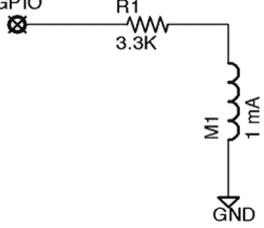

图 3-7. CPU 面板仪表连接

连接到 GPIO 13 后，不使用以下命令将产生偏转：

```
$ ppwm -g13 -i960 -m60 -s1 -Ap -M6 -S10 -c
```

此命令激活 gpio 13 上的 PWM (`-g13`)，以 20 kHz 运行 PWM 时钟 (`-i960`)，使用分频: 0 (`-m0`)，时钟 (`-s1`) 为 19.2 MHz，在 PWM 模式下 (`-Ap`)，在十个时钟中选择六个 (`-M6`)，并启动硬件外设 (`-c`)。配合安装的仪表和电阻 R1 并启动该命令，你应该能看到仪表偏转了 60%（即读取值为 0.6 mA）。更改 `-M` 值，如 `-M5` (50%)、`-M2` (20%)、`-M9` (90) 等。如果这些偏转有效，那么我们就可以准备好开启它们了。

## mtop 命令

`mtop` 命令所需的命令行选项会在你使用 `-h` 选项（h 代表帮助 help）时按需提供。选项 `-g` 用于指定你用于 CLK 信号的 GPIO 引脚（默认为 16）。选项 `-d` 指定用于向矩阵 DIN 信号的输出 GPIO 引脚（默认为 26）。最后，`-l` 选项指定为矩阵提供 LOAD 信号的 GPIO 引脚（默认为 21）。

`-m` 选项指定你想从指定的 GPIO 引脚驱动仪表（默认情况下不使用 GPIO 驱动仪表。由于仪表来自硬件 PWM 外设，可选的 GPIO 引脚有 12、13、18 或 19。）

```
$ mtop -h
用法: mtop [-options]
其中:
```

- `clk_gpio` 指定要使用的 CLK gpio 引脚 (16)
- `din_gpio` 指定要使用的 DIN gpio 引脚 (26)
- `load_gpio` 指定要使用的 LOAD gpio 引脚 (21)
- `meter_gpio` 指定用于仪表的 GPIO (无)

  仪表 GPIO 选择: 12, 13, 18 或 19

`mtop` 命令在矩阵中输出 8 列活动情况：

- CPU 1 利用率（最左侧）
- CPU 2 利用率
- CPU 3 利用率
- CPU 4 利用率
- 总内存利用率（包括磁盘缓存）
- 6&7 总 CPU 利用率（所有核心）
- 8 相对 I/O 活动（最右侧）

注意：

内存利用率可能由于磁盘缓存活动显示为 100%。这些内存会根据内核需要被回收供应用程序使用。


你可能想使用系统启动脚本启动`mtop`命令，以便它自动运行。另一方面，有时你可能将一个或多个 GPIO 引脚用于其他实验。你可以按需启动`mtop`命令并让它在后台运行：

```
$ mtop &
```

这假设它是按照默认的 GPIO 引脚接线的。如果你将仪表连接到`gpio 18`，你可以使用：

```
$ mtop -m 16 &
```

如果你杀掉`mtop`，矩阵在停止之前会闪烁一个 pi 符号（停止后保留 pi 符号）。在关闭系统时，`mtop`命令会被系统杀死，但并不总是能以显示 pi 符号的方式完成。系统倾向于尽快停止所有进程。

## 参考文献

[1] "8x8 点阵列 3mm 直径双色 LED 显示器", SURE Electronics. http://mail.rsgc.on.ca/~cdarcy/Datasheets/LE-MM103.pdf

# 第 4 章 安装内核

要安装并使用`pispy`逻辑分析仪工具，我们必须首先构建并安装内核可加载模块。此`rpidma`模块为`pisipy`工具提供了安全且自动访问 Pi DMA 外设及其中断的方法。

理想情况下，你“只需”编译模块本身并安装它。然而，内核可加载模块依赖于整个内核源码树的不同部分。此外，内核可加载模块必须与当前运行的内核版本匹配。你以前可以使用`modprobe -f`选项绕过限制，但现在无效了（它会静默失败）。这让我们回到了构建和安装新内核。

好消息是，Raspberry Pi 2 可以在大约 2 小时内无需交叉编译构建内核。这大大简化了整个流程。本章概述了让过程变得轻松并节省时间的每一个步骤。

## 总体流程

构建和安装新内核的总体步骤列在这里。

1. 下载内核源码。
2. 切换分支（参见“特定内核发布”章节）。
3. 准备并构建配置。
4. 编译内核。
5. 编译并安装模块。
6. 安装新内核。
7. 重启。

这个列表看起来有些吓人，但步骤简单易懂。一旦你准备好了 Raspberry Pi，剩下的步骤非常简单：

1. 构建`rpidma`模块。
2. 安装`rpidma`模块。
3. 重启加载`rpidma`。

一旦`rpidma`模块加载完成，你就可以看到结果了。

## 磁盘空间

对于此过程，建议你的 SD 卡至少有 8 GB。如果你使用的是较小的容量，你可能需要使用 USB 驱动器。本章概述的步骤假设你在根文件系统上操作。

## 下载源码

特定的内核分支可能很大。如果你不需要特定版本，下载的方法是使用以下命令（深度为一），这会在你的主目录下创建一个子目录：

```
$ cd
```

```
$ pwd
/home/pi
```

```
$ df . # 可用空间
文件系统 1K-块 使用% 挂载点
dev/root 7319248 4138492 2836724 60 %
```

```
$ git clone --depth 1 git://github.com/raspberrypi/linux.git
正在克隆 'linux'
计数: 计数对象: 51221, 完成。
计数: 压缩对象: 100% (48663/48663), 完成。
计数: 总 51221 (delta 40884), 重用 15514 (delta 19330), 包已用 0
接收对象: 100% (40884/40884), 138.53 MiB | 1.22 MiB/s, 完成。
解析 delta: 100% (40884/40884), 完成。
检查文件: 100% (48467/48467), 完成。
```

如果你漏了`--depth 1`选项，你下载的是整个历史。这将花费数倍的时间并占用更多磁盘空间。然而，省略`--depth`选项确实让你具备获取特定内核版本的能力（有点复杂）。请参见章末尾的“特定内核发布”章节获取更多信息。

让我们查看下载的分支：

```
$ ~/linux
```

```
$ git status
## 在分支 rpi-3.18.y 上
无要提交（工作目录干净）
$
```

## 树莓派工具

你还需要下载一些工具供以后使用。在等待内核源码下载时，可以在另一个终端会话中进行操作：

```
$ cd
```

```
$ git clone https://github.com/raspberrypi/tools.git
```

完成后，你可以根据需要选择删除不需要的内容。这些是我创建的子目录文件。我删除了其他文件以节省空间：

```
$ cd ~/
```

```
$ ls -F
configs/ mkimage/ sysdk usboot/
```

## 准备配置

现在必须准备内核源码并导入配置（当前目录为`~linux`）：

```
$ make mrproper
```

```
$ zcat /proc/config >.config
```

第二步涉及`zcat`，它将当前使用的内核选项解码并解压到`~linux/.config`文件中。这可以避免你尝试复制已有内容的麻烦。如果你下载的内核源码支持某些选项，稍后会询问你这些选项。

## 构建配置

此时，我们需要构建一个配置。这样做最方便的方法是使用`make oldconfig`目标。这避免了回答关于你正在使用的选项（来自`/proc/config`）的问题。然而，它会询问任何新选项。如果你愿意，按回车键接受默认值，这是安全的选择。

```
$ oldconfig
HOSTCC scripts/basic/fixdep
HOSTCC scripts/kconfig/conf.o
SHIPPED scripts/kconfig/conf.tab.c
SHIPPED scripts/kconfig/conf.lex.c
SHIPPED scripts/kconfig/hash.c
HOSTCC scripts/kconfig/conf.tab.o
HOSTLD scripts/kconfig/conf
scripts/kconfig/conf --oldconfig Kconfig
#
# configuration written to .config
#
```

如果你想在开始编译过程之前双重检查内核版本，可以执行：

```
$ make kernelversion
3.18.13
```

内核版本记录在顶层`Makefile`的前几行：

```
$ head -s Makefile
VERSION = 2
PATCHLEVEL = 18
SUBLEVEL = 13
EXTRAVERSION = =
NAME = Diseased Newt
```

现在是时候确保更新后的文件已物理写入 SD 卡了：

```
$ sync
```

## 内核编译

原始树莓派 B 型号编译内核需要很长时间（据报道需要 22 小时！）。然而，具有额外内存和四个 CPU 核心的 B 2 型号如果使用正确的`make`命令选项，可以在大约 2 小时内完成构建。

如果你已经安装并运行了`mtop`命令，现在是观察树莓派运行的绝佳时。你可以使用默认 GPIO 分配启动它，或添加命令行参数来指定你的 GPIO 布局。

```
$ mtop &
```

符号`&`允许`mtop`命令在你在当前终端会话运行时后台运行。图 4-1 显示了内核编译期间由`mtop`驱动的矩阵。四个 CPU 中的三个三个利用率为 100%（左侧四列），内存被充分利用（主要通过磁盘缓存），右侧列显示 SD 卡的 I/O 活动。倒数第二和第三列配对以显示总 CPU 利用率。

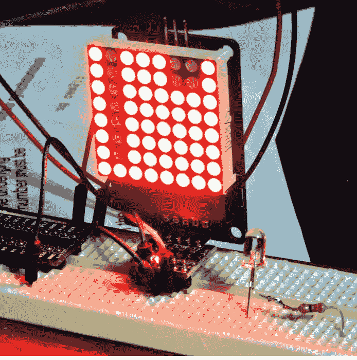

**图 4-1.** *内核编译期间 mtop 驱动的矩阵*

如果你还没有准备好运行 Matrix 的硬件，可以安装`htop`并运行而运行（在单独的会话中）：

```
$ sudo apt-get install htop
$ htop
```

由于你有四个 CPU 核心，Linux 内核构建过程可以利用这一点来加速。在构建过程中，会有某些进程因 I/O 或其他原因被阻塞的情况。

我建议你使用`make`选项`-j6`来构建内核。这告诉`make`运行六个并行的“make作业”而不是一个。这样，当进程在等待 I/O 时，核心可以处理其他已就绪的进程。

如果你忘记了`-j6`选项，构建将多花费好几个小时。所以，如果你忘记了，请按`^C`并带上该选项重启。构建过程将从上次中断的地方继续：

```
$ make -j6
scripts/kconfig/conf --oldconfig Kconfig
CHK include/config/kernel.release
UPD include/config/kernel.release
WRAP arch/arm/include/generated/asm/auxvec.h
WRAP arch/arm/include/generated/asm/bitsperlong.h
WRAP arch/arm/include/generated/asm/cputime.h
WRAP arch/arm/include/generated/asm/current.h
...
```

## 模块构建

现在内核已经编译，是时候构建并安装内核模块了。模块按如下编译（大约需要 5 分钟）：

```
$ make -j6 modules
CHK include/config/kernel.release
CHK include/generated/uapi/linux/version.h
CHK include/generated/utsrelease.h
make[1]: 'include/generated/mach-types.h' is up to date.
CALL scripts/checksyscall.sh
Building modules, stage z.
MODPOST 1328 modules
```

由于我们是交叉编译，可以通过以下方式安装模块：

```
$ make modules install
INSTALL arch/arm/crypto/aes-arm.ko
INSTALL arch/arm/crypto/aes-arm.ko
INSTALL arch/arm/crypto/shai-arm.ko
INSTALL arch/arm/crypto/shai-arm.ko
INSTALL arch/arm/crypto/sha512-arm-neon.ko
INSTALL arch/arm/crypto/sha512-arm-neon.ko
INSTALL arch/arm/lib/xor-neon.ko
INSTALL arch/arm/lib/xor-neon.ko
INSTALL arch/arm/oprofile/oprofile.ko
INSTALL arch/arm/oprofile/oprofile.ko
INSTALL crypto/ablk_helper.ko
INSTALL crypto/ablk_helper.ko
INSTALL crypto/arc4.ko
INSTALL crypto/arc4.ko
...
INSTALL /lib/firmware/keyspan_sda.fw
INSTALL /lib/firmware/keyspan_sda.fw
INSTALL /lib/firmware/keyspan_sda/xircom_pgs.fw
INSTALL /lib/firmware/keyspan_sda/xircom_pgs.fw
INSTALL /lib/firmware/cpia2/stv0672_vp4.bin
INSTALL /lib/firmware/cpia2/stv0672_vp4.bin
INSTALL /lib/firmware/yam/1200.bin
INSTALL /lib/firmware/yam/1200.bin
INSTALL /lib/firmware/yam/960.bin
INSTALL /lib/firmware/yam/960.bin
DEP 3.18.13-v7+
```

会话的最后一行确认了我们正在安装的内容。当我们检查`/lib/modules`目录时，看到一个带下划线的子目录已为`3.18.13-v7`创建：

```
$ ls /lib/modules
3.18.11-v7+ 3.18.13-v7+ 3.18.7+ 3.18.7-v7
```

## 安装内核

树莓派 2 内核的准备与之前的模型不同。现在使用一个新的工具`mknextimg`。内核可以在没有此调整的情况下使用，但将缺少设备树（DT）支持。使用`mknextimg`添加你的内核附加以提供 DT 支持。如果你在内核`.config`中禁用了 DT 支持，请跳过此步骤并使用`zimage`。

让我们首先确保更新后的文件已物理写入 SD 卡：

```
$ sync
```

```bash
root@raspy#boot# sync
root@raspy#boot# logout
$
```

## 重启

新的内核镜像和新模块已安装完毕。除非内核版本发生了重大跨越，否则你可能不需要升级固件，因此我们跳过了那一步。让我们重启并启动新内核：

```
$ sudo reboot
```

来自`root@raspy`(`pts/0`) 的广播消息 (2015年5月15日 星期五 22:47:56):

系统即刻正在重启！

在内核启动后，登录并检查内核版本：

```
$ uname -r
3.18.13-v7+
```

成功了！你也可以查看`dmesg`输出作为检查，看看是否出现了任何驱动程序问题。

## 从启动失败中恢复

如果你的新内核由于某些原因无法启动，请不要惊慌。我们留了一条退路，以便我们可以轻松恢复。`/boot`分区是一个 VFAT 分区，Windows 和 Mac OS X 都可以挂载。将 SD 卡插入你的台式电脑，只需将你的内核命名回原来的样子即可。在 Mac OS X 上，会话看起来可能所示：

```bash
$ cd /Volumes/untitled
$ mv kernel7.img kernel7.bad
$ mv kernel7.was kernel7.img
```

> **重要** 请确保你从台式电脑或笔记本电脑安全地弹出 SD 卡。如果你没有正确执行此操作，SD 卡上`/boot`分区未保存的更改将会丢失。

# 安装 rpidima 内核模块

我们现在终于可以完成开始时需要执行的任务：安装可加载内核模块`rpidima`。可以使用提供的`Makefile`进行编译和安装。

切换到你安装书籍软件的目录。假设它在你的`pi-p2`子目录下。根据需要替换下面的内容：

```bash
$ cd ~/pi2
```

现在制作`pissy`软件。这会检查`librpi2`库是否之前已经构建（在必要时对其进行编译），然后构建内核模块`rpidima`。在创建`rpidima.ko`后，`pissy`工具本身也会被编译：

```bash
$ make pissy
make -C ~/librpi2
make[1]: Entering directory '/home/pi/pi2/librpi2'
...
make[1]: Leaving directory '/home/pi/pi2/pissy'
LINUX@/home/pi/linux make -C /kmodules
make[1]: Entering directory '/home/pi/pi2/kmodules'
make[2]: Leaving directory '/home/pi/linux'
LD /home/pi/pi2/kmodules/rpidima/built-in.o
CC [M] /home/pi/pi2/kmodules/rpidima.o
Building modules, stage 2.
CC /home/pi/pi2/kmodules/rpidima.mod.o
LD [M] /home/pi/pi2/kmodules/rpidima.ko
make[2]: Leaving directory '/home/pi/linux'
make[2]: Entering directory '/home/pi/pi2/kmodules/test'
g++ -c -std=c89 -Wall -Wno-deprecated -I-/home/pi/pi2/test/.../include
g -O3 rpidima.cpp -o rpidima.o
g++ rpidima.o -o rpidima -L/home/pi/pi2/kmodules/test/.../lib -librpi2 -lrt -lmnsudo chmod root u rpidima
make[2]: Leaving directory '/home/pi/pi2/kmodules/test'
make[1]: Leaving directory '/home/pi/pi2/kmodules'
$
```

如果你的 Linux 源码安装在`~/pi/linux`以外的位置，请按如下方式在`LINUX=...`命令中指定它：

```bash
$ LINUX=~/someplace/linux make pissy
```

这将指示程序如何找到你的 Linux 源码。

要安装内核模块和`pissy`命令，请执行以下操作（当前目录为`~/pi/pi2`）：

```bash
$ make pissy_install
...
make -C ./kmodules install
make[1]: Entering directory '/home/pi/pi2/kmodules'
make: Entering directory '/home/pi/linux'
INSTALL /home/pi/pi2/kmodules/rpidma/rpidma.ko
DEPMOD 3.18.13-v7+
make: Leaving directory '/home/pi/linux'
```


为了让`rpidma.ko`在启动时自动加载，你必须编辑`/etc/modules`并向列表中添加该行：

```
rpidma
```

（并保存文件）。这将使得每次内核启动时都加载它。

或者，你可以按照以下方式手动加载它：

```bash
# cd /home/pi/pi2/kmodules/rpidma
# sudo insmod ./rpidma.ko
```

```bash
make[1]: leaving directory '/home/pi/pi2/kmodules'
install -p -oroot -groot -m111 /home/pi/pi2/pyspy/pyspy /usr/local/bin/
chmod u+s /usr/local/bin/pyspy

sync
```

现在让我们检查当前安装的内核是否可以“加载”该模块（切记在需要的地方使用`sudo`）：

```bash
$ cd ~/pi2/kmodules/rpidma
```

```bash
$ ls -l rpidma.ko
-rw-r--r-- 1 pi 8055 May 15 23:05 rpidma.ko
```

```bash
$ sudo insmod ./rpidma.ko
```

没有错误消息表示它已加载。让我们列出已加载的模块并在列表中查看`rpidma`（下划线部分）：

```bash
$ lsmod
Module Size Used by
rpidma 2113 0
snd_bcm2835 18376 0
...
```

它出现在列表中，我们知道它已准备好供`pyspy`使用。我们将在后续章节中解释并探索`pyspy`的用法，但现在让我们进行非常快速的测试。

```bash
$ pyspy -b1 -x -v
1 x 64k blocks allocated.
GPLEVO = 0x7E200034
DUMP of 1 DMA CBs:
CB # 0 @ phy addr 0x3DB4F000
```

# 第 4 章 安装内核

| 参数 | 值 |
| :--- | :--- |
| TI.INTEN | 1 |
| TI.TDMODE | 0 |
| TI.WAIT_RESP | 1 |
| TI.DEST_INC | 1 |
| TI.DEST_WIDTH | 0 |
| TI.DEST_DREQ | 0 |
| TI.DEST_IGNORE | 0 |
| TI.SRC_INC | 0 |
| TI.SRC_WIDTH | 0 |
| TI.SRC_DREQ | 0 |
| TI.SRC_IGNORE | 0 |
| TI.BURST_LENGTH | 0 |
| TI.PERMAP | 0 |
| TI.WAITS | 0 |
| TI.NO_WIDE_BURSTS | 1 |
| SOURCE_AD | 0x7E200034 |
| DEST_AD | 0x3DB4F020 |
| TXFR_LEN | 65504 |
| STRIDE | 0x00000000 |
| NEXTCONBK | 0x00000000 |

DUMP of 1 DMA CBs:

CB # 0 @ phy addr 0x3DB4F000

为了让`rpidma.ko`在启动时自动加载，你必须编辑`/etc/modules`并向列表中添加该行：

```
rpidma
```

（并保存文件）。这将使得每次内核启动时都加载它。

或者，你可以按照以下方式手动加载它：

```bash
# cd /home/pi/pi2/kmodules/rpidma
# sudo insmod ./rpidma.ko
```

## Linux 3.18.10

Signed-off-by: Sasha Levin <sasha.levin@oracle.com>

...

检查感兴趣的内核版本的日志。寻找`Makefile`中设置了所求发布版本的更改。使用复制和粘贴，注意该提交（commit）处指示的哈希值（hash number）（相应的哈希值位于内核版本行上方，即其下方）。将该哈希值保存在某个地方的文本文件中，因为我们的工作尚未结束。这标识了对你的内核版本进行更改的开始。保存版本 3.18.11 的提交哈希值。

```
commit f154a14e3efa5a47025d014da3f29396f03b1f74
```

再次检查`Makefile`的日志，但要找到相对于该提交之后的下一个更高版本的更改。如果我们寻找的是 3.18.11，那么寻找一个将发布设置为 3.18.12 的提交。通过复制和粘贴，将该提交哈希值保存为编号 2。在前面的示例中，它是这个哈希值：

```
commit 43f497a2035f33d4a2f766d20827c68e0437cd5d8
```

第二个哈希值实际上是在我们想要的提交之后的一个提交。在这两个提交之间，我们可能对源文件进行了更改。因此，现在我们必须检查这两个特定提交之间的的所有更改。你必须提交粘贴的提交哈希值 1 和 2，用两个点将它们隔开。为了简写下一个示例，我将找到那些哈希值是`000000000a`和`000000000b`：

```
$ git log 000000000a..000000000b | less
```

这将为你提供这两个提交之间的更改历史。你需要的是紧接在提交哈希值 2 之前的提交哈希值。这将为你提供你所寻找的内核版本的最后一次提交。以下是一个示例，感兴趣的哈希值带有下划线：

```
commit 43f497a2035f33d4a2f766d20827c68e0437cd5d8
Author: Sasha Levin <sasha.levin@oracle.com>
Date:   Apr 20 15:48:02 2015 -0400
```

## Linux 3.18.12

Signed-off-by: Sasha Levin <sasha.levin@oracle.com>

```
commit bc9432581714eba508f5187fb7dd005a82adf09
Author: Ameya Palande <ameya@gmail.com>
Date:   Feb 26 12:05:51 2015 -0800
```

mfd: kempld-core: Fix回调返回值的检查

- [ 上游提交`c8648508ebfc597058d2cd000b6c5391110264a167` ]

成功时，回调函数返回 0。因此，反转`if`条件检查，以便我们可以跳出循环。

# 第 4 章 安装内核

Cc: stable@vger.kernel.org

Signed-off-by: Ameya Palande <ameya@gmail.com>

Signed-off-by: Lee Jones <lee.jones@linaro.org>

Signed-off-by: Sasha <sasha.lehavin@oracle.com>

```
commit 5f40128362927a7689ac3d1d4f65
Author: Markos Chandras <markos.chandras@img.com>
Date:   Thu Mar 19 10:28:02 2015 +0000
```

mfd: kempld-core: Fix回调返回值的检查

- [ 上游提交`c8648508ebfc597058d2cd000b6c5391110264a167` ]

成功时，回调函数返回 0。因此，反转`if`条件检查，以便我们可以跳出循环。

## gp 命令

之前提到的工具之一是`gp`命令。该命令用于显示和控制您的 GPIO 引脚。要获取有关其用法的帮助，请使用`-h`选项（帮助）：

```
$ gp -h
```

用法: gp [-g gpio] [-options] [-h]

其中：

- `-g gpio` 选择要操作的 gpio
- `-i` 将 gpio 配置为输入
- `-o` 将 gpio 配置为输出
- `-a {0-s}` 切换到复用功能 n
- `-p {n|u}` 将上拉/下拉设置为无 (None)、上拉 (Up) 或下拉 (Down)
- `-s n` 设置 gpio 值为 1 或 0（非零即为 1）
- `-r` 读取 gpio 位
- `-x` 读取（类似于`-r`）但将返回值作为退出状态返回
- `-w` 读取所有 32 位（忽略`-g`选项）
- `-A` 读取 gpio 的复用功能设置
- `-b n` 闪烁 gpio 值 n 次（0=持续）
- `-m n` 监控 gpio 变化（n 秒）
- `-D` 显示所有 gpio 配置
- `-C` 显示 GPIO 与复用功能的图表
- `-R n` 设置 gpio 引脚压变率限制开启 (1) 或关闭 (0)
- `-H n` 设置 gpio 迟滞启用 (1) 或禁用 (0)
- `-S n` 设置 gpio 驱动强度（0=2 mA .. 7=16 mA）
- `-h` 此信息。

所有选项均按顺序执行。

示例：

```
$ gp -g12 -o -s1 -g13 -ir
```

将 gpio 12 (`-g12`) 设置为输出 (`-o`)，电平为 1 (`-s1`)，将 gpio 13 (`-g13`) 设置为输入 (`-i`) 并读取其值 (`-r`)。

注意：`-R`/`-H`/`-S`影响 gpio 组：0-27, 28-45 和 46-53。

不要被选项的数量所困扰。许多选项仅在特殊情况下使用。下文将通过简短的示例回顾这些选项的用法。

## 显示 GPIO 设置

一个非常实用的功能是简单地列出当前的 GPIO 设置清单。要做到这一点，请使用`-D`（显示）选项：

```
$ gp -D
```

| GPIO | ALTFUN | LEV | HYST | DRIVE | DESCRIPTION |
|---|---|---|---|---|---|
| 0 | Input | 1 | Y | 8 mA | 输入 |
| 1 | Input | 1 | Y | 8 mA | 输入 |
| 2 | Alto | 1 | Y | 8 mA | SDA1 |
| 3 | Alto | 1 | Y | 8 mA | SCL1 |
| 4 | Output | 0 | Y | 8 mA | 输出 |
| 5 | Input | 1 | Y | 8 mA | 输入 |
| 6 | Input | 1 | Y | 8 mA | 输入 |
| 7 | Alto | 1 | Y | 8 mA | GPIO_CE1_N |
| 8 | Alto | 1 | Y | 8 mA | GPIO_CEO_N |
| 9 | Alto | 0 | Y | 8 mA | GPIO_MISO |
| 10 | Input | 0 | Y | 8 mA | GPIO_MOSI |
| 11 | Alto | 0 | Y | 8 mA | GPIO_SCLK |
| 12 | Input | 0 | Y | 8 mA | 输入 |
| 13 | Input | 0 | Y | 8 mA | 输入 |
| 14 | Alto | 1 | Y | 8 mA | TXDO |
| 15 | Alto | 1 | Y | 8 mA | RXDO |
| 16 | Input | 1 | Y | 8 mA | 输入 |
| 17 | Input | 0 | Y | 8 mA | 输入 |
| 18 | Input | 0 | Y | 8 mA | 输入 |
| 19 | Input | 0 | Y | 8 mA | 输入 |
| 20 | Input | 0 | Y | 8 mA | 输入 |
| 21 | Input | 1 | Y | 8 mA | 输入 |
| 22 | Input | 0 | Y | 8 mA | 输入 |
| 23 | Input | 0 | Y | 8 mA | 输入 |
| 24 | Input | 0 | Y | 8 mA | 输入 |
| 25 | Input | 0 | Y | 8 mA | 输入 |
| 26 | Input | 1 | Y | 8 mA | 输入 |
| 27 | Input | 0 | Y | 8 mA | 输入 |
| 28 | Alto | 1 | Y | 16 mA | SDA0 |
| 29 | Alto | 1 | Y | 16 mA | SCL0 |
| 30 | Input | 0 | Y | 16 mA | 输入 |
| 31 | Output | 1 | Y | 16 mA | 输出 |

表头含义如下：

- 1. GPIO: gpio 引脚
- 2. ALTFUN: 输入、输出或复用功能 (Alt0–Alt5)
- 3. LEV: GPIO 引脚的当前电平
- 4. SLEW: Y=GPIO 压变率限制（否则为 N）
- 5. HYST: Y=输入具有迟滞（否则为 N）
- 6. DRIVE: 输出驱动电平，单位 mA（输出时）
- 7. DESCRIPTION: 配置功能的描述

未报告的一项设置是当前的上拉/下拉设置。这是是因为树莓派硬件不允许你读取当前设置（你可以更改它，但无法读回该设置是什么）。如果引脚上没有连接任何设备，有时可以推断出引脚的设置。我们稍后将看到一个示例。

## 将 GPIO 配置为输入

要将 GPIO 引脚更改为输入，可以使用`-g`选项指定 GPIO 引脚并提供`-i`选项。以下示例将 GPIO 引脚 4 设置为输入：

```
$ gp -g4 -i
```

你可以通过`-D`选项显示来验证其是否生效。

## 将 GPIO 配置为输出

同样，你可以将 GPIO 引脚配置为输出。以下示例将 GPIO 40 改为输出引脚：

```
$ gp -g4 -o
```

可以通过一系列选项更改多个 GPIO 引脚。以下命令将 GPIO 4 设置为输出，GPIO 26 设置为输出。

```
$ gp -g4 -o -g26 -o
```

## 将 GPIO 配置为复用功能

`-a`选项接受 0 到 5 的参数，对应 0 到 5 的复用功能。例如，要将 GPIO 16 配置为复用功能 5，使用：

```
$ gp -g16 -a5
```

注意，某些配置可能会导致问题。请见下一节。

## 复用功能表

下表将帮助你选择复用功能和 GPIO 引脚。为此，`gp`命令支持不同的复用功能：

| GPIO | 复用功能 |
|---|---|
| 0 | 输入 |
| 1 | 输入 |
| 2 | SDA1 (Alto) |
| 3 | SCL1 (Alto) |
| 4 | 输出 |
| 5 | 输入 |
| 6 | 输入 |
| 7 | GPIO_CE1_N |
| 8 | GPIO_CEO_N |
| 9 | GPIO_MISO |
| 10 | GPIO_MOSI |
| 11 | GPIO_SCLK |
| 12 | 输入 |
| 13 | 输入 |
| 14 | TXDO |
| 15 | RXDO |
| 16 | 输入 |
| 17 | 输入 |
| 18 | 输入 |
| 19 | 输入 |
| 20 | 输入 |
| 21 | 输入 |
| 22 | 输入 |
| 23 | 输入 |
| 24 | 输入 |
| 25 | 输入 |
| 26 | 输入 |
| 27 | 输入 |
| 28 | SDA0 |
| 29 | SCL0 |
| 30 | 输入 |
| 31 | 输出 |

## 配置上拉/下拉

输入引脚通常应该启用上拉或下拉电阻。否则，未连接引脚的电压会在高低电压之间“浮空”。这会导致不稳定。

`-p`（上拉）选项允许你配置此项。`-p`选项接受三个参数之一：

- n（无上拉）
- u（上拉）
- d（下拉）

以下示例将 GPIO 4 配置为输入，并应用下拉电阻：

```
$ gp -g4 -i -pd
```

## 设置 GPIO 输出

可以使用`gp`命令设置 GPIO 的输出电平。以下命令将 GPIO 4 设置为低电平 (0)：

```
$ gp -g4 -s
```

在此示例中，假设 GPIO 4 之前已配置为输出。注意，如果 GPIO 未配置为输出，仍然可以建立该值，只是该值不会出现在 GPIO 引脚上。

## 读取 GPIO 输入

`gp`命令可以读取 GPIO 输入。以下示例将 GPIO 4 配置为输入，配置下拉电阻，并读取出现在引脚上的输入：

```
$ gp -g4 -pd -ir
GPIO 4 = 0 (-r)
```

在此示例中（在我的树莓派上），GPIO 4 是未连接的。因为它被配置为输入并带有下拉电阻，因此读取到的输入为低 (0)。如果我们对这个未连接的 GPIO 使用上拉，我们应该能在引脚上读取到高电平 (1)：

```
$ gp -g4 -pu -ir
GPIO 4 = 1 (-r)
```

## 将 GPIO 值返回到 Shell

如果你正在编写 shell 脚本来读取 GPIO 值并根据结果采取操作，`-r`选项会很不方便，因为需要解析输出文本。`-x`选项与`-r`选项相同，不同之处在于它还会通过`gp command`的退出码（为 0 或 1）返回结果。注意这里 shell 变量`$?`的结果：

```
$ gp -g4 -pu -ix
GPIO 4 = 1 (-r)
$ echo $?
1
$ gp -g4 -pd -ix
GPIO 4 = 0 (-r)
$ echo $?
0
$
```

为了区分成功读取 GPIO 和命令执行失败，当命令失败时，会返回 2 或更高的退出码，如下所示：

```
$ gp -badddd
No gpio specified with -g (-b addddd)
$ echo $?
2
$
```

## 读取 32 个 GPIO

如果你需要一次性读取所有 32 个 GPIO 引，请使用`-w`选项（不需要`-g`选项）：

```
$ gp -w
GPIO: 0xB421C1EF (-w)
$
```

所有 GPIO 0 到 31 的结果将以十六进制的形式返回。GPIO 0 是该值的最低位，GPIO 31 是最高位。

## 读取 GPIO 复用功能


虽然你可以使用`-D`选项显示所有 GPIO 引，但你可能只想查看复用功能引（可能是通过 shell 脚本）：

```
$ gp -g16 -A
GPIO 16 : Alt5 (2)
$
```

此输出告诉我们 GPIO 16 配置为复用功能 5。括号中的值是用于配置 GPIO 的实际值（复用功能 5 的整数值为 2）。

## 闪烁输出 GPIO

有时在接接线时，我们不确定连接是否正确。`-b`选项允许我们“闪烁” GPIO 引脚的开启和关闭（高电平和低电平）。当 GPIO 引脚连接了 LED 时，这非常有帮助，如图 5-1 所示。计算出的电阻允许高达 10 mA，适用于近似电压 $V_F = 2V$ 的 LED。

```
$R = (V_{CC}-V_F) / 0.01 = 120$ ohms
```


图 5-1. GPIO 驱动 LED

`-b`选项假设 GPIO 已经配置为输出。该选项接受一个参数，表示闪烁的秒数。指定为零将使其一直闪烁直到按下 Control-C 为止。以下示例将 GPIO 4 配置为输出并使其闪烁：

```
$ gp -g4 -o -b
GPIO 4 = 1 (-b)
GPIO 4 = 0 (-b)
...
```

按下 Control-C 退出`gp`命令。

## 监控输入

使用带有`-m`选项的`gp`命令，可以监控一段时间的输入。`-m`选项接受一个表示秒数的参数。指定为零表示“永远”。图 5-2 展示了一个连接到 GPIO 引脚的示例按键开关。


图 5-2. 连接到输入的按键

此示例将 GPIO 4 配置为输入，配置了上拉电阻，并永久监控输入：

```
$ gp -g4 -i -pu -m
00000 GPIO 4 = 1
00001 GPIO 4 = 0
00002 GPIO 4 = 1
00003 GPIO 4 = 0
00004 GPIO 4 = 1
00005 GPIO 4 = 0
...
00026 GPIO 4 = 1
00027 GPIO 4 = 0
00028 GPIO 4 = 1
00029 GPIO 4 = 0
00030 GPIO 4 = 1
$
```

在这里我们看到了按键的结果，即按键将被配置的上拉电阻拉高的 GPIO 4 输入端接地。随着触点抖动，GPIO 输入读取到 1 和 0。

## 配置 GPIO 压变率（Slew Rate）

SoC 提供的 GPIO 引脚可以配置压变率限制（作为输出）。这是默认开启的。此配置影响分组的 GPIO 引脚：

- GPIO 0 到 27
- GPIO 28 到 45
- GPIO 46 到 53

该命令不支持 31 以上的 GPIO，因为这些由系统使用且不应更改。请谨慎使用此选项。什么是压变率限制？简单解释是，压变率限制输出在从低电平转换到高电平（或反之）时会变慢。这样做的好处之一是减少电磁干扰。使用`-g`选项在所需的组内选择任何 GPIO 号。以下示例演示了第一组的压变率限制（使用`-D`选项验证）：

```
$ gp -g2 -R
$ gp -g2 -D
```

```
GPIO ALTIFN SLEW DESCRIPTION
-------------------------------------------
0 Input 1 N 8 mA Input
1 Input 1 N 8 mA Input
2 Input 1 N 8 mA Input
3 Input 1 N 8 mA Input
4 Input 1 N 8 mA Input
5 Input 1 N 8 mA Input
6 Input 1 N 8 mA Input
```

注意 SLEW 列，对于 GPIO 0 到 27，所有的 Y 都变为了 N。要再次启用压变率限制，使用`-R`：

```
$ gp -g2 -R1
```

## 配置 GPIO 滞回（Hysteresis）

与压变控制类似，GPIO 引脚的滞回可以分组更改。滞回配置影响输入引脚（默认开启）。以下命令禁用第一组 GPIO 组的滞回：

```
$ gp -g2 -H -D
```

```
GPIO ALTIFN SLEW DESCRIPTION
-------------------------------------------
0 Input 1 Y 8 mA Input
1 Input 1 Y 8 mA Input
2 Input 1 Y 8 mA Input
3 Input 1 Y 8 mA Input
4 Input 1 Y 8 mA Input
5 Input 1 Y 8 mA Input
6 Input 1 Y 8 mA Input
...
24 Input 0 Y 8 mA Input
25 Input 0 Y 8 mA Input
26 Input 1 Y 8 mA Input
27 Input 0 Y 8 mA Input
28 Input 1 Y 16 mA SDA0
29 Input 1 Y 16 mA SCL0
30 Input 0 Y 16 mA Input
31 Input 1 Y 16 mA Output
```

# 第 5 章：GPIO 命令

要启用滞回，再次使用`-H1`：

```
$ -g2 -H1
```

什么是滞回？如果没有滞回，当电压跨越某个阈值时，输入信号会被处理为 1 或 0（例如 3.3V 的 50%，即 1.65V）。当信号从 0V 有意识地移动到 3.3V 时，如果它移动迅速，转换就会消除。但如果信号从 0V 缓慢上升并在 1.65V 附近停留一段时间，数字系统可能会将瞬间值解释为 0 或 1，直到信号显著高于 1.65V。这是因为电压水平在该水平上是模糊的。这为软件带来了噩梦。

添加滞回可以防止缓慢上升在低于高阈值（例如 2.3V）时被读取为 0。当信号最终到达该点时，数字输入将保持在 1 状态。如果信号回落到 2V 并在一段时间内保持，系统将保持 1。关于此主题的更多信息，请参考 [1]。

## 配置 GPIO 驱动电流

默认情况下，Raspberry Pi GPIO 引脚配置为 8 mA 输出。最小驱动由`-S`提供（2 mA），最大驱动为`-7`（16 mA）。以下示例将第一组的驱动改为 4 mA：

```
$ -g0 -s1 -D
```

```
GPIO ALTIFN SLE HYST DESCRIPTION
-------------------------------------------
0 Input 1 Y 8 mA Input
1 Input 1 Y 8 mA Input
2 Input 1 Y 8 mA Input
3 Input 1 Y 8 mA Input
4 Input 1 Y 8 mA Input
5 Input 1 Y 8 mA Input
6 Input 1 Y 8 mA Input
...
24 Input 0 Y 8 mA Input
25 Input 0 Y 8 mA Input
26 Input 1 Y 8 mA Input
27 Input 0 Y 8 mA Input
28 Input 1 Y 16 mA SDA0
29 Input 1 Y 16 mA SCL0
30 Input 0 Y 16 mA Input
31 Output 1 Y 16 mA Output
```

要将第一组改回 8 mA 默认，使用：

```
$ -g0 -s53
```

这是你希望谨慎使用的选项之一。Raspberry Pi 提供的 3.3V 电源剩余容量有限。在 Raspberry Pi B+ 和 Pi 2 之前的型号中指示为 50 mA。不确定 B+ 还是 Pi 2 拥有更多电流预算。

## 总结

在本章中，你学习了`gp`命令的所有用例。这个命令在你尝试操作时节省了宝贵的时间。闪烁和监控功能对于故障排除非常有帮助。`gp`命令进一步提供了从 shell 脚本管理 GPIO 的方便方法。

如果你阅读了命令行选项规范章节，你还学会了如何缩写序列以及指示选项结束的位置（当需要时）。这不仅将帮助你新安装的命令，也适用于通用的 Linux (Unix) 命令。

## 参考文献

+ [1] "Schmitt trigger," Wikipedia, 自由百科书。http://en.wikipedia.org/wiki/Schmitt_trigger.

# 第 6 章

## 通用时钟

树莓派有两个供终端用户的硬件时钟（其他时钟被预留或供系统使用）。这些可访问时钟之一用于脉冲宽度调制（PWM），这是第 7 章的主题。另一个在 Broadcom 术语中被称为 GPCLK0。

为了方便我们的探索，本书包含的软件提供了`piclk`命令。这避免了我们通过编写实验来执行剩余操作，并且也可以作为您使用的工具。

## piclk 命令

如果您安装了书中提供的软件，应立即可以使用`piclk`命令，其用法如下所示：

```bash
$ piclk -h
Usage: piclk [-g gpio] [-i divi] [-f divf] [-m mash] [-e 1:0] \
[-s src] [-q] [-z] [-D] [-v] [-h]
where:
```

```bash
-g gpio    由 gpio 选择的时钟 # (默认 4)
-i divi    idiv 分频器值 (5)
-f divf    divf 分频器值 (0)
-m mash    Mash 值 0-3 (0)
-e enable   在 gpio 上启用/禁用 (1)
-s src      选择时钟源
-q         不停止时钟 (与 -D 配合)
-z         停止时钟外设
-b         以 0.5 秒为间隔闪烁
-D         显示时钟设置
-v         详细模式
-h         此信息。
```

说明：

- 当启用时 (`-e1`)，时钟驱动 gpio 4。
- 默认值为 100 MHz (`-i5 -f0 -m0 -e1`)
- 默认在 gpio 引脚上启用 (`-e1`)
- 当使用`-z`时，大多数其他选项会被忽略。
- gpio 4 上的 GPCLK 需要 Altf (使用`-e1`)
- gpio 12 或 13 PWM 需要 Altf (使用`-e1`)
- gpio 18 或 19 PWM1 需要 Altf (使用`-e1`)
- GPCLK 输出为时钟 (C)，而 PWM 输出为信号 (P)
- gpio 引脚上的最大工作频率在无负载时约为 125 MHz，幅度约为 1.2v。
- 对于`-s`，src 应为以下之一：
  - 0 - 接地（无时钟）
  - 1 - 振荡器 (19.2 MHz)
  - 4 - PLLA (音频 ~393.216 MHz)
  - 5 - PLLC (1000 MHz，受超频影响）
  - 6 - PLLD (500 MHz，默认)
  - 7 - HDMI Aux (216 MHz?)

参见`pipwm`命令。

从此显示中，可以看到有很多选项。许多选项都有默认值，显示在括号中。

## 显示时钟设置

我最喜欢的选项之一是`-D`，它用于显示这两个用户可用时钟的当前状态：

```bash
$ piclk -D
CLOCK GPIO ALTFUN DIVI DIVF MAH ENAB SRC
--------------------------------------
GPCLK0 4 Alto C 5 0 0 Y PLLD
PWMWCLK 12 Input 0 0 1 N Gnd
PWMWCLK 13 Input 0 0 1 N Gnd
PWMWCLK 18 Input 0 0 1 N Gnd
PWMWCLK 19 Input 0 0 1 N Gnd
```

然而，此显示需要一些解释。在 CLOCK 列中显示了两个名称：

- 1. GPCLK0：通用时钟 0
- 2. PWMWCLK：PWM 时钟

另外，还有其他预留或系统使用的时钟。名为 PWMWCLK 的时钟是 PWM 外设使用的，我们在第 7 章中检查。它在列表中列出了四次，因为它与四个 GPIO 输出引脚上的 PWM 操作相关。请记住，PWM 外设只使用一个时钟，即 GPCLK0。

剩余的时钟是本章的主题。`piclk`命令通过指定 "GPIO" 引脚配置这两个时钟：

- 1. 选择 GPCLK0
- 2. 选择 PWMWCLK (用于 PWM0)
- 3. 选择 PWMWCLK (用于 PWM1)
- 4. 选择 PWMWCLK (用于 PWM0)
- 5. 选择 PWMWCLK (用于 PWM1)

# 第 6 章 通用模块

查看`gp -C`的输出表，我们看到了 PWM0 和 PWM1 访问的不同组合。我们还注意到 GPCLK0 仅出现在 GPIO 4（我们可以访问的）：

```bash
$ gp -C
```

| GPIO | ALTO | ALT1 | ALT2 | ALT3 | ALT4 | ALT5 |
|---|---|---|---|---|---|---|
| 0 | SDA0 | SA5 (reserved) | | | | |
| 1 | SCL0 | SA4 (reserved) | | | | |
| 2 | SDA1 | SA3 (reserved) | | | | |
| 3 | SCL1 | SA2 (reserved) | | | | |
| 4 | GPCLK0 | SA1 (reserved) | | | | ARM_TDI |
| 5 | GPCLK1 | SA0 (reserved) | | | | ARM_TDO |
| 6 | GPCLK2 | SOE N/SE (reserved) | | | | ARM_RTCK |
| 7 | SPI0_CEO_SNE | N (reserved) | | | | |
| 8 | SPI0_CEO_N | D0 (reserved) | | | | |
| 9 | SPI0_MISO | SD1 (reserved) | | | | |
| 10 | SPI0_MOSI | SD2 (reserved) | | | | |
| 11 | SPI0_SCLK | SD3 (reserved) | | | | ARM_TMS |
| 12 | PWM0 | SD4 (reserved) | | | | |
| 13 | PWM1 | SD5 (reserved) | | | | ARM_TCK |
| 14 | TXD0 | SD6 (reserved) | | | | TXD1 |
| 15 | RXD0 | SD7 (reserved) | | | | RXD |
| 16 | (reserved) | SD8 (reserved) | CTSO SPI1_CEO_N | | | CTS1 |
| 17 | (reserved) | SD9 (reserved) | RTSO SPI1_CEO_N | | | |
| 18 | PCM_CLK | SD10 (reserved) | BSCL SDA/MOSI | | | Ce_O |
| 19 | PCM_F5 | SD11 (reserved) | BSCL SCL/SCLK | SPI1_MISO | PWM1 |
| 20 | PCM_DIN | SD12 (reserved) | | | | GPCLK0 |
| 21 | PCM_DOUT | SD13 (reserved) | BSCL/CE_N SPI1_SCLK | GPCLK1 |
| 22 | (reserved) | SD14 (reserved) | | SD1_CLK ARM_TRST | | |
| 23 | (reserved) | SD15 (reserved) | | SD1_CMD ARM_TDO | | |
| 24 | (reserved) | SD16 (reserved) | | SD1_DATO ARM_RTCK | | |
| 25 | (reserved) | SD17 (reserved) | | SD1_DAT1 ARM_TCK | | |
| 26 | (reserved) | (reserved) | (reserved) | |1_ | | |
| 27 | (reserved) | (reserved) | | | | |
| 28 | (reserved) | (reserved) | | | | |
| 29 | (reserved) | (reserved) | | | | |
| 30 | (reserved) | (reserved) | | | | |
| 31 | (reserved) | (reserved) | | | | |

# 第6章 通用时钟

当 mash 值为零时，DIVI 分频器将产生精确的输出频率。然而，当你将 mash 值范围在 1 到 3 之间配置时钟时，你可以获得一些平均频率，如表 6-1 所示。

表 6-1. 平均输出频率

| MASH | 最小 DIVI | 最小频率 | 平均频率 | 最大频率 |
|---|---|---|---|---|
| 0 | 1 | Source/DIVI | Source/DIVI | Source/DIVI |
| 1 | 2 | Source/(DIVI + 1) | Source/(DIVI + DIVF/1,024) | Source/DIVI |
| 2 | 3 | Source/(DIVI + 2) | | Source/(DIVI - 1) |
| 3 | 4 | Source/(DIVI + 4) | | Source/(DIVI - 3) |

如果我们选择最低频率的时源（19.2 MHz），那么表 6-2 显示了当 DIVI = 42 时，mash 值之间的关系。

表 6-2. DIVI = 42时的 Mash 值

| MASH | DIVI | 最小频率 | 平均频率 | 最大频率 |
|---|---|---|---|---|
| 0 | 42 | 457.143 kHz | 457.143 kHz | 457.143 kHz |


| 1 | | 446.512 kHz | 417.482 to 457.143 kHz (`DIVF` = 4,095 to 0) | 457.143 kHz |
| --- | --- | --- | --- | --- |
| 2 | | 436.364 kHz | | 468.293 kHz |
| 3 | | 417.391 kHz | | 492.308 kHz |

## 确定 DIVI 和 DIVF

已知必须为目标频率选择`DIVI`和`DIVF`的值，那么计算它们的步骤是什么？为了说明这一点，让我们以生成一个 455 kHz 测试信号并注入到电台中频（IF）阶段的任务为例。[1] 我们如何选择`DIVI`和`DIVF`以获得最佳匹配？

步骤如下：

1. 用源频率除以所需频率来计算`DIVI`。
2. 如果步骤 1 中的数字是精确整数，则使用`MASH = 0`（不适用`DIVF`）并停止。
3. 否则，继续将`DIVI`向下取整到最近整数；即将`DIVI`设置为`floor(DIVI)`。
4. 根据源、频率和`DIVF`（见下方）计算`DIVF`。

我们的源将使用 19.200 MHz 的时钟频率。通过将源频率（19.2 MHz）除以目标频率计算`DIVI`：

```
DIVI = 19,200,000 / 455,000
= 42.198 (步骤 1)
= 42 (步骤 2)
```

由于步骤 1 中的`DIVI`值是小数，我们必须使用掩码和`DIVF`值来近似目标频率。根据之前的图表，我们知道平均频率由公式给出：

`Frequency = Source/(DIVI + DIVF/1,024)`

使用代数求解`DIVF`，我们得到公式：

`DIVF = 1024 × (Source/Frequency - DIVI)`

现在我们可以计算`DIVF`：

```
DIVF = 1,024 × (Source/Frequency - DIVI)
1024 × (19,200,000/455,000 - 42)
= 202.5
= 202 (整数)
```

将此`DIVF`代入平均频率公式中，我们可以检查计算结果：

```
Frequency = Source / (DIVI + DIVF/1,024)
= 19,200,000 / (42 + 2/1,024)
= 455.006 kHz
```

由于 455 kHz 的目标频率在 Mash 1 的频率范围（446.512 kHz-457.143 kHz）内，这将是最佳的近似值。当 mash 为零（无 mash）时，你将获得精确频率。否则，较低的掩码值提供了最佳近似。

## 拍频振荡器

如果你有一台便携式短波收音机，可能知道它无法接收连续波（CW，也称为摩斯密码）或旁带传输。你可能可以在刻盘上感应它，但接收效果不好（旁带传输听起来像鸭子叫）。这是因为消费级收音机缺乏所需的拍频振荡器（BFO）或旁带解调频率。

所有现代收音机都会将接收频率混频到中频，以便信号进行更具选择性的放大。一个常用的频率是 455 kHz（如我们之前的实验）。根据收音机的设计，你可能会使用不同的中频，如 10.7 MHz。其他其他使用的频率，但这些是最常见的。

CW 传输是最简单的通信形式。它只需要发射器提供一个频率的正弦波。这使得它非常节省频谱。信息通过点和划（以及更长的传输）开启和关闭发射器来编码。

在接收端，可以使用幅度调制（AM）收音机来解决一个问题。接收 CW 信号就像接收 AM 载波。当接收 CW 且发射器关闭（点和划之间）时，接收机会检测到信号缺失并增大增益。接收机会试图补偿可能会减弱或增强的无线接收。这就是为什么在点和划之间听到更多的噪声。但为什么没有音调呢？

要在 AM 收音机中实际听到音调，你需要另一个信号与它混频。这就是 BFO 起作用的地方。当两个信号在非线性电路中混合时，会产生额外的信号。如果最低频率是`F1`，最高频率是`F2`，那么将从原始两个输入产生额外的副产品。最强的四个信号如下：

- `F2 - F1`频率
- `F1`频率
- `F2`频率
- `F1 + F2`频率

还有其他强度递减的产品，但最有趣的副产品是 L-R 信号。假设掩码值提供了最佳近似。当 mash 为零（无 mash）时，你将获得精确频率。否则，较低的掩码值提供了最佳近似。

# 第 6 章 通用时钟

## GPIO 最大输出频率

Broadcom 文档指出：“通用时钟的最大工作频率在 1.2 V 下为 125 MHz，但如果 GPIO 引脚负载过重或具有电容负载，该频率将会降低。树莓派的 GPIO 驱动程序无法驱动更高频率的信号，即使内部时钟源具备这种能力。”

## RF 生成

pfm[3] 项目利用了`GPCLK0`能够在 FM 广播频范围内生成 RF 信号的事实。但在尝试此实验之前，你应该意识到，没有许可传输任何无线电信号都是非法的。

虽然有很多设备可以向 FM 收音机发射低功率信号，但这些设备都通过了测试和许可程序。全球范围内对无线传输的执行都有规定，后果可能包括没收计算机和无线设备，以及终身禁止持有无线电照。请记住，遵守法律是你的责任。

除此，如果你选择接受风险，还有一些你应该注意的事：

- 从 GPIO 4 输出的信号是方波。这意味着周围会辐射出许多谐波。如果你在 GPIO 4 上设置了 100 MHz，那么也会出现 200 MHz 以及更高倍数的信号，但幅度会降低。这些信号可能会对关键业务造成严重干扰。
- 永远不要在 GPIO 引脚上连接电线作为天线。在非法传输时，增加传输范围是一个糟糕的主意。
- 不连接天线线的其他原因还包括它可能会破坏你的 GPIO 输出驱动器（由于驻波等原因）。
- 最重要的是，不要在没有接地的情况下运行 GPIO！天线容易受到雷暴和其他源静电的影响。如果你这样做，你的 Pi 肯定会遭受损坏。如果没有充分的规划，你也会受到雷击的影响。

如果你遵循一些常识和预防措施，就可以相对安全地进行这个实验。

如果你有一个音响或 FM 收音机，你可以做什么来让天线靠近 Pi 呢？我从 FM 收音机连了一根线到来自 GPIO 4 的信号，这与 Pi 本身可能发射的其他信号没有区别，但收音机会看到信号增强。

使用时钟源 6 (500 MHz)，我们可以生成一个可以在 FM 收音机上听到的 100 MHz 信号。使用`pinck`命令，选择 GPIO 4 (`-g4`)，`DIVI = 5`(`-i5`)，mask = 0 (`-m0`)；启用 GPIO 输出时钟 (`-e1`)；选择时钟源 6 (`-s6`)，并闪烁 (`-b`)。为了让我看到并听到时钟开启或关闭，我在下面的会话中添加了详细选项 (`-v`)：

```
$ pinck -g4 -i5 -m0 -s6 -b -v
Clock started.
driving gpio 4.
Press Ctrl+C to quit..
Clock off (stopped: -g 4)
Clock on (running: -g 4)
Clock off (stopped: -g 4)
```

```
Clock on (running: -g 4)
Clock off (stopped: -g 4)
Clock on (running: -g 4)
Clock off (stopped: -g 4)
Quitting.
Clock on (running: -g 4)
Clock off (stopped: -g 4)
```

在程序运行期间，在你的音响或收音机上向上调或向下调到调频盘上的 100 MHz 点。根据你收音机的精度，你可能需要调谐来“找到信号”。你应该听到它每半秒切换到噪声状态一次。按 Ctrl-C 终止命令。

FM 收音机在接收到信号时会安静。收音机的噪声是因为缺少信号。如果你在 100 MHz 有一个强电台，请尝试不同的频率。使用本章中的程序计算新的`DIVI`（以及可选的`DIVF`）值。为了好玩，可以对 mask 和`DIVF`值进行实验。某些组合可以在收音机上产生有趣的声音。

## 总结

在本章中，我们探索了树莓派提供的通用时钟 (GPCLOCK)。探索并使用了书中的`pinck`命令来对时钟进行实验。最重要的一是，你学习了选择`DIVI`和`DIVF`参数的方法，以便你能够计算目标频率。我们还探索了将时钟作为 BFO（拍频振器），让你领略了无线电理论。最后，你看到可以在你的 FM 立体收音机上生成和接收无线电频率。这一切都证明了树莓派的灵活性。

## 参考文献

- [1] "Silicon Chip Online: Vintage Radio", Silicon Chip Online: Vintage Radio. http://www.walkingital.com/radio/trucchi_suggerimenti/article.html Accessed July 16, 2015.
- [2] "Frequencies of Musical Notes, A4 = 440 Hz", Frequencies of Musical Notes, A4 = 440 Hz. http://www.phy.mtu.edu/suits/notrefeqs.html Accessed July 16, 2015.
- [3] "Turning the Raspberry Pi into an FM Transmitter", Imperial College Robotics Society. http://www.icobotics.co.uk/wiki/index.php/Turning_Raspberry_Pi_Into_an_FM_Transmitter Accessed July 16, 2015.

# 第 7 章 脉宽调制

树莓派为终端用户提供了两个脉宽调制 (PWM) 外设。PWM 外设出意料地复杂，但这种复杂性源于它的灵活性。

为了对 PWM 外设进行实验，书中提供了`pipwm`命令。这避免了我们编写程序，并为通用用途提供了工具。

## pipwm 命令

如果你安装了书中提供的软件，`pipwm`命令应立即可用：

```
$ pipwm -h
Usage: pipwm [-options]
where:
  -a (a | p) 使用 PWM 算法或 MS (MS 为默认)
  -i divi    时钟整数分频 (190)
  -f divf     时钟分数分频 (0)
  -m mask    时钟掩码配置 (0)
  -s src      时钟源 (1)
  -g gpio   PWM 引脚 gpio (12)
  -b         串口模式 (默认 PWM 模式)
  -c         配置并启动 PWM 外设
  -t secs     运行 PWM 秒数
  -M m       PWM 比例值 (50)
  -S s        PWM 比例值 (50)
```

## 显示 PWM 设置

一个非常有用的选项是`-D`，用于显示 PWM 外设的当前状态。

```
$ pipwm -D
```

| CLOCK | GPIO | ALTFUN | DIVI | DIVF | MASH | SRC | M/P | E | S/P | R | I | F |
| --- | --- | --- | --- | --- | --- | --- | --- | --- | --- | --- | --- | --- |
| PWMCLK | 12 | Input | 960 | 0 | Y | | 0 | 100 | M/S | Y | O | D |
| PWMCLK | 13 | Input | 960 | 0 | Y | | 0 | 32 | PWM | N | O | D |
| PWMCLK | 18 | Alt5 | P | 960 | 0 | Y | | 0 | 100 | M/S | Y | O |
| PWMCLK | 19 | Input | 960 | 0 | Y | | 0 | 32 | PWM | N | O | D |

- `CLOCK`... 时钟名称
- `GPIO`... [`-g`:] 用于 PWM 输出的 GPIO 引脚
- `ALTFUN`... 当前复用功能状态
- `ON` P->PWM 时钟 (C=GPOCLK)
- `DIVI`... [`-i`:] 整数分频
- `DIVF`... [`-f`:] 时钟分数分频
- `MASH`... [`-m`:] 时钟掩码值 (0,1,2 或 3)
- `ENAB`... [`-c`:] 时钟启用
- `SRC`... [`-s`:] 时钟源
- `M`... [`-M`:] PWM M 和 S 参数的 M 值
- `S`... [`-S`:] PWM M 和 S 参数的 S 值
- `M/P`... [`-A`:] M/S 或 PWM 模式
- `E`... [`-c`:] PWM 启用
- `S/P`... [`-b`:] 串口或 PWM 数据
- `R`... [`-R`:] 空 FIFO 重复
- `S`... [`-z`:] PWM 的初始状态
- `I`... [`-i`:] 反相
- `F`... [`-F`] FIFO 启用 (F) 或数据 (D)

`CLOCK`列仅表示涉及 PWM 时钟（它实际上在两个 PWM 外设设备之间共享）。PWM0 外设设备通过 GPIO 12 或 18 访问，PWM1 则通过 13 和 19 访问。

虽然并非显而易见，但 GPIO 18 目前作为 PWM 输出运行（来自 PWM0）。

可以使用以下命令进行验证：

```
$ gp -C
GPIO    ALTO    ALT1    ALT2    ALT3    ALT4    ALT5
0       SDAO    SA5 (reserved) -       -       --
1       SCLO    SA4 (reserved) -       -       --
...snip...
18      PCM_CLK SD10 (reserved) BSCL SDA/MOSI SPI1_CEO_N PWM0
...snip...
31 (reserved) SA2     PCM_DOUT RTS0    -       TTS1
```

从此显示表中，我们了解到 GPIO 18 需要 ALT5 才能访问 PWM 外设设备。为 PWM 输出标记为 C 的列有两个值，如表 7-1 所示。

## 表 7-1. 列 C 输出可能的值

| C 值 | 说明 |
| --- | --- |
| - | 不在 PWM 外设模式 |
| C | 时钟（仅从 gpio 命令显示） |
| P | PWMx 外设设备 |

`DIVI`、`DIVE`和`MASH`值是第 6 章解释的 PWM 时钟分频值。`ENAB`列在时钟已启用时显示 Y。`SRC`表示时钟的振荡器源。`M`和`S`列表示来自 PWM 外设设备的标记值和空间值（而非其时钟）。`M/P`列表示 PWM 外设设备运行的模式，如表 7-2 所示。

## 表 7-2. M/P 值

| M/P | 说明 |
| --- | --- |
| M/S | 标记/空间 (Mark/Space) |
| PWM | 脉宽模式 |

如果 PWM 外设设备已启用，`E`列包含 Y。

`S/P`列表示外设处于哪种 PWM 模式，如表 7-3 所示。

## 表 7-3. S/P 值

| S/P 值 | 说明 |
| --- | --- |
| Ser | 串口数据模式 |
| PWM | 脉宽调制模式 |

`R`列表示上一个数据值是否应该重复（当需要数据时）。

AY 表示如果 FIFO 为空或未提供数据，应再次发送上次使用的值。

`S`列表示 PWM 外设设备的起始位值（0 或 1）。`I`列在数据反反开启时显示 Y，N 则表示正常极性。

最后一列`F`指示数据源，如表 7-4 所示。

## 表 7-4. F 值

| F 值 | 说明 |
| --- | --- |
| F | 数据写入 FIFO |
| D | 数据写入 PWM 外设设备 |

该命令还列出了图例，以及可以影响外设配置的选项（当不仅仅是显示信息时），如表 7-5 所示。

## 表 7-5. 配置参数

| 参数 | 选项 | 说明 |
| --- | --- | --- |
| GPIO | `-g gpio_pin` | 选择 PWM 外设设备 |
| DIVI | `-i divi` | 设置 PWM 时钟的`DIVI`参数 |
| DIVF | `-i divf` | 设置 PWM 时钟的`DIVF`参数 |
| MASH | `-m mash` | 设置 PWM 时钟的掩码参数 |
| ENAB | `-c` | PWM 时钟 |
| SRC | `-s src` | 选择 PWM 的振荡器源 |
| M | `-M Mark` | 为标记/空间 PWM 设置标记标记 |
| | `-space space` | 标记标记空间 PWM 信号设置空间值 |
| M/P | `-A arg` | 选择 M/s (m) 或 PWM 模式 (p) |
| E | `-no z option` | 启用 PWM 外设设备 |
| S/P | `-b` | 使用`-b`时序列化，否则 PWM 模式 |
| R | `-R` | 使用`-R`时重复 |


| S | `-Z n` | 信号初始状态为 n (0 或 1) |
| I | `-I` | 使用`-I`时反转信号 |
| F | `-F` | 使用`-F`时使用 FIFO |

为了完整起见，额外的选项显示在表 7-6 中。

## 表 7-6. 附加选项

| 选项 | 说明 |
| --- | --- |
| `-D` | 显示 PWM 外设设备状态信息（不执行配置） |
| `-v` | 详细：显示额外消息 |
| `-z` | 停止选择的 PWM 外设设备（通过 gpio 选项`-g`选择） |
| `-h` | 显示帮助信息 |

## PWM 模式

如果你关注或对树莓派 PWM 外设设备有一定的经验，你就知道有两种不同的适用模式：

- 1. M/S 和 PWM 模式
- 2. 串口或 PWM 数据

让我们仔细观察一下。

## M/S 和 PWM 数据模式

在 M/S 模式下，信号由标记（mark）和空间（space）周期组成。标记 (1) 信号以长度 M 发送，空间 (0) 信号以长度 S-M 发送（S 是整个周期的长度）。图 7-1 展示了 M 和 S 之间的关系（对于非反转信号）。


图 7-1. M/S 信号

值 S 指定整个周期的计数器值。值 M 决定了非反转信号高电 (1) 的时钟计数次数。一旦达到 M 计数，信号变为低电 (0)，直到达到 S 计数。

## M/P = M/S Mode (`-Am`)

从第 6 章知道，`DIVI`计数从 1.2 MHz 振荡器源产生100 kHz 时钟：

```
DIVI = clock_src / F = 1,200,000 / 100,000 = 192
```

使用`pwm`命令，我们将 PWM0 设置为此频率 (`-i192`)，指定 GPIO 12 (`-g12`)，使用`DIVF = 0`，掩码 0 (`-s1`)，模式 M/S (`-Am`)，初始状态为零 (`-0`)，启动时钟 (`-c`)。此外，我们将标记计数设置为 30 (`-M30`)，最大计数 100 (`-S100`)。通过 M 和 S 值，预计在 30% 的时间内看到信号：

```
$ pwm -g12 -i192 -f0 -s1 -Am -Z0 -c -M30
```

PWM 外设设备应该启动并运行。可以通过以下命令验证：

```
$ pwm -D
```

| CLOCK | ALT | DIV | MASH | ENAB | SRC | M/P | E | R | F |
| --- | --- | --- | --- | --- | --- | --- | --- | --- | --- |
| ... | | | | | | | | | | | |
| 12 | 192 | 0 | Y | Oscillator | M/S | Y | | | |
| 12 | 192 | 0 | Y | Oscillator | M/P | N | | | |
| 18 | 192 | 0 | Y | Oscillator | M/S | Y | | | |
| 19 | 192 | 0 | Y | Oscillator | M/P | N | | | |

检查 GPIO 12 行，我们看到`DIVI = 192`，`DIVF = 0`，`MASH = 0`，`ENAB = Y`，`SRC = Oscillator` (19.2 MHz)，`M/P = M/S`，`E = Y`，`S/P = PWM`，`S = 0`。这些显示参数与配置的 PWM0 一致。现在 PWM 外设设备正在工作，可以通过`pwm`查看：

```
$ pwm -b3
```

Captured: writing.vcd

> 第9章详细查看`pwm`。GtkWave 查看器在捕捉后会自动打开。点击左上标题为 Signal 的窗口将其高亮。这将导致信号轨迹出现在子窗口中。点击 gpio12（示例）并用鼠标将其拖到右侧的 Signals 窗口以显示其轨迹。最后，点击带有放大镜的图标以缩放信号范围。如果你使用`ssh`登录树莓派，一段时间后无法打开新窗口。注销重新登录可以解决这个问题；例如，`ssh -X pi`...

图 7-2 显示30% PWM 信号的`pwm`显示。

## 图 7-2. 30% PWM

这里的捕捉以毫秒注释。设置 PWM 参数后，我们知道输入时钟运行在100 kHz（周期为 10 us）。我们的 S 参数设置为 100，因此我们 PWM 信号的周期应该是 100 × 10 us，即 1 ms。

信号轨迹检查显示我们有三个高电 (1) 和剩余的七个低电 (0)。这些每个脉冲代表100 us。这代表一个30%的 PWM 信号。现在为了对比，让我们尝试80%的信号：

```
$ pwm -g12 -i192 -f0 -m0 -s1 -Am -Z0 -c -M80 -S100
```

使用`pwm`捕捉：

```
$ pwm -b3
```

Captured: writing.vcd

图 7-3 显示你应该看到的内容。


## 图 7-3. 80% PWM

显然，通过八个高电和两个低电，我们有一个80%的 PWM 信号。对于另一个实验，让我们反转 PWM 信号（添加选项`-I`）：

```
$ pwm -g12 -i192 -f0 -m0 -s1 -Am -Z0 -c -M80 -S100 -I
```

使用`pwm`捕捉：

```
$ pwm -b3
```

Captured: writing.vcd

图 7-4 显示你应该看到的内容。

| Signals | 波形 | | |
|---|---|---|---|
| Time gpio12 | 1 ms | 2 ms |

## 图 7-4. 反转的80% PWM 信号

反转的信号在八个脉冲内为低，在两个脉冲内为高。这清晰地说明了一个80%的 PWM 信号。我们为了方便选择了`S = 100`。如果我们选择`S = 10`和`M = 4`会怎样？这对信号（非反转）有什么影响？

# 第 7 章 脉宽调制

让我们验证一下 PWM 外设是否处于 PWM 模式：

```
$ pipwm -D
```

```
| CLOCK | GPIO | ALTF ON | DIV F MASH ENAB SRC | M S M/P E S/P R I F |
| :--- | :--- | :--- | :--- | :--- | :--- | :--- | :--- | :--- | :--- | :--- | :--- | :--- | :--- |
| PWMCLK | 12 | Alto P | 192 | 0 | 0 | Y Oscillator | 30 | 100 | P W Y P M N O D |
| PWMCLK | 13 | Input | -192 | 0 | 0 | Y Oscillator | 30 | 32 | P W N P M N O N D |
| PWMCLK | 18 | Input | -192 | 0 | 0 | Y Oscillator | 30 | 100 | P W Y P M N O D |
| PWMCLK | 19 | Input | -192 | 0 | 0 | Y Oscillator | 30 | 32 | P W N P M N O N D |
```

观察 GPIO 12 的那行，我们看到 M/P 列现在显示为 PWM 模式。让我们捕获信号并对其检查：

```
$ pispy -b3
```

已捕获：正在写入 capture.vcd

将你的结果与图 7-6 进行对比。

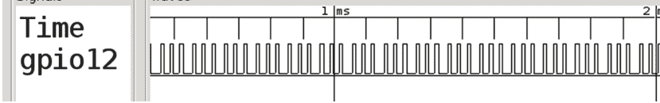

图 7-6。PWM 模式下的 30% PWM 信号

在此显示中，很难看出信号从哪里开始和结束。我们知道的是在所选参数下，一个完整周期的时间为 1 ms。如果我们将脉冲处于高电平的所有时间相加，并与低电平时间进行比较，我们会发现平均值约为 30%。现在让我们使用相同的参数尝试 80% 的信号（注意`-Ap`选项）：

```
$ pipwm -g12 -i192 -f0 -m0 -s1 -Ap -Z0 -c -M80 -S100
```

捕获输出：

```
$ pispy -b3
```

已捕获：正在写入 capture.vcd

将你的结果与图 7-7 进行对比。

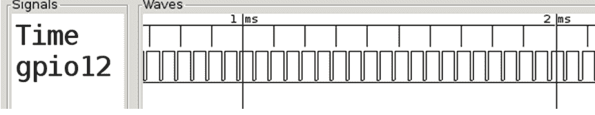

**图 7-7。** PWM 模式下的 80% PWM 信号

再次，我们得到了这样一个要点：如果对其进行平均处理，我们将看到该信号产生了 80% 的电平。总高电平时间似乎为 80%， 1 ms 周期内的总低电平时间似乎为 20%。

Broadcom 文档提供了关于 M/S 和 PWM 模式之间差异的更多信息[1]。在 PWM 模式下，“所需的序列应该尽可能分散分布 1 和 0，以便在任何时间段内循环都能最接近该值的近似。”这种模式可能最适合生成音频等模拟信号。

## 数据模式

在我们看过的示例中，我们根据 M 和 S 的值生成了稳定的 PWM 信号。也可以发送数据而不是固定值，这正是外设的串口（Serial）部分的意义所在。数据可以直接写入，也可以队列到 FIFO 中。但必须注意的是，FIFO 是由一对 PWM 外设共享的。这使得通过交替左右通道的数据来生成立体声音频成为可能。

虽然这是一个显而易见的选项，但其他信号应用也是可能的。例如，如果你想向像 AVR 设备这样的小型微控制器（MCU）发送单个曼彻斯特信号，你可以拆分 PWM 信号来传输数据。这对于单向（半双工）通信可能有用，在那种情况下，你希望保留 MCU 的串口通用异步收发传输器（UART）外设用于其他用途。

如果你对此感兴趣，鼓励你阅读 Broadcom 文档中更多关于 PWM 外设能力的内容[1]。此外，本书软件提供的 GPIO 类使得这变得更加容易。附录 B 关注 GPIO 类的 PWM 能力。

## 总结

在本章中，详细描述了`pipwm`，以便在你的工具箱中增加另一个树莓派 2 工具。如果你使用了 PiSpy 工具，你还获得了对 PWM 外设的实践经验。最后，我们查看了你在外设配置中的树莓派。树莓派上的 PWM 外设是一个非常有得的资源。

## 参考文献

- [1] "BCM2835 ARM Peripherals": http://www.farnell.com/datasheets/1521578.pdf. 访问于 2015 年 9 月 7 日。

## 第 8 章

## GPIO 接口物理学

随着树莓派的流行，许多没有电子基础的学生第一次探索 GPIO 接口。由于缺乏关键概念和理解，这有时会导致问题和局限性。

我相信通过适当的介绍可以很大程度上避免这种情况。本章将检查 GPIO 引脚作为输入和输出的电子特性（以及通常情况下与 CMOS 设备的接口）。我使用了 LTspice 对等效电路建模，以便电流和电压可以可视化地绘制，便于理解。本章将使你能够避免工作中的一些陷阱。

GPIO 引脚作为输入和输出的电子特性（以及通常情况下与 CMOS 设备的接口）

我相信通过适当的介绍可以很大程度上避免这种情况。本章将检查 GPIO 引脚作为输入和输出的电子特性（以及通常情况下与 CMOS 设备的接口）。我使用了 LTspice 对等效电路建模，以便电流和电压可以可视化地绘制，便于理解。本章将使你能够避免工作中的一些陷阱。

GPIO 引脚作为输入和输出的电子特性（以及通常情况下与 CMOS 设备的接口）

GPIO 引脚作为输入和输出的电子特性（以及通常情况下与 CMOS 设备的接口）

GPIO 引脚作为输入和输出的电子特性（以及通常情况下与 CMOS 设备的接口）

GPIO 引脚作为输入和输出的电子特性（以及通常情况下与 CMOS 设备的接口）

GPIO 引脚作为输入和输出的电子特性（以及通常情况下与 CMOS 设备的接口）

GPIO 引脚作为输入和输出的电子特性（以及通常情况下与 CMOS 设备的接口）

GPIO 引脚作为输入和输出的电子特性（以及通常情况下与 CMOS 设备的接口）

GPIO 引脚作为输入和输出的电子特性（以及通常情况下与 CMOS 设备的接口）

MOSFET 应用

图 8-1 展示了一个在 LTspice 中建模的电路，用于模拟 NMOS 晶体管行为。V1 供电，代表 +3.3V。电压 V2 代表一个栅（输入）信号，它将从初始水平 (+3.3V) 下降到地，然后上升下降。这让我们看到负载 R1 和 R2 的电流变化。

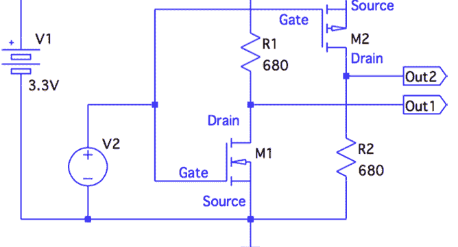

图 8-1。LTspice 测试电路

运行仿真并捕获栅电压 V2 以及电阻 R1 (`I(R1)`) 和 R2 (`I(R2)`) 中的电流，我们得到了图 8-2 所示的仿真输出。

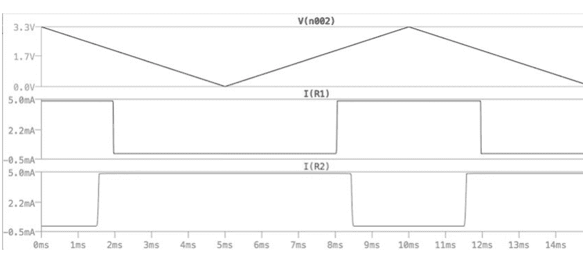

**图 8-2。** 图 8-1 电路的 LTspice 仿真

最初当 M1 和 M2 的栅电压为 +3.3V 时，电流 R1 为 5 mA，而`I(R2)`接近于零。实际上 M1 完全开启，而 M2 (PMOS) 完全关闭。在栅电压下降到 1.7 电平之前，NMOS M2 开启，`I(R2)`跳跃到 5 mA。不久后，M1 关闭，电流`I(R1)`降至接近零。随着时间的推移，我们看到这种状态保持稳定，直到栅电压再次越界上升。需要注意的重要点是，NMOS 晶体管从初始的“开启”变为“关闭”，而互补的 M2 PMOS 则从“关闭”变为“开启”。这发生在大约电压的一的一半。

CMOS 配置

在前面的节中，我们查看了 NMOS 和 PMOS 晶体管在栅极连接时的独立行为。我们注意到当一个开启时，另一个就会关闭，反之亦然。这种行为被利用在图 8-3 所示的 CMOS 配置中。

## 第8 章 GPIO 接口的物理学

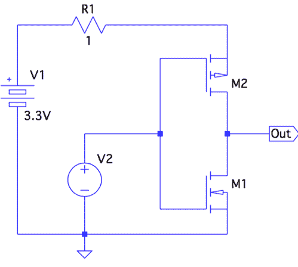

该电路的结构使得 NMOS 晶体管 (M1) 使用 PMOS 晶体管 (M2) 作为其负载。M2 同样使用 M1 作为其负载。在正常情况下，任何时刻只有 M1 或 M2 导电。仿真中包含了电阻 R1，以便我们测量电流流。图 8-4 显示了仿真结果。

图 8-3. CMOS 配置

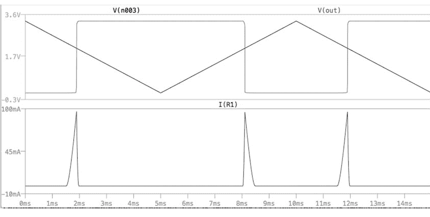

图 8-4. CMOS 开关切换

相同的输入信号被应用于 M1 和 M2 的栅极。在输出端（标记为 Out），我们看到电压从关闭切换到开启，M1 在大约 2 ms 处关闭，M2 开启。当信号在 8 ms 处变为高电平时，输出变为低电平，循环从 12 ms 处开始重复。这对 MOSFET 相当于一个反相器。当输入为高电平时，它们产生低输出电压；当输入变为低电平时，产生高输出电压。

注意 2 ms 处的电流尖峰 (`IR2`)，在此仿真中接近 100 mA。这比你在逻辑电路中看到的要得多。输入高电平时电路中过量充电是因为 MOSFET 组件的选择以及它们之间的匹配。然而然而值得注意的是，CMOS 电路在输出状态切换时确实会有电流尖峰。注意当输出状态切换时，尖峰在 8 ms 和 12 ms 处重复。

CMOS 电路的主要优势是当处于稳定状态时几乎没有电流流动。由于一个 MOSFET 关而另一个开，因此只有极少的电流从顶部流向底部。

## CMOS 输入

图 8-3 和 8-4 展示了 CMOS 配置最基本的方面。由于 MOSFET 使用电压激活的栅极，几乎没有电流流入输入。成对栅极对驱动电路几乎没有影响。

然而，如果 M1 和 M2 的栅极保持未连接，电压会在栅极上“浮空”。空气中的电荷可能会聚集在栅极导体上并带高电电。干燥天气下带电物体经过会在附近的浮空导体上感应出极高的电压。相反，电子可能会从栅极中移除，导致极正电荷，这同样具有破坏性。

如果电荷变得过负（正），当火花强制穿透时，MOSFET 与硅之间的隔离层就会损坏。这种穿孔会导致与硅连接，导致设备没有隔离的栅极。这就是为什么让 MOSFET 栅极保持未连接是一个坏习惯。在没有过高电压的情况下，未连接的栅极可能会聚集电荷并变成正电或负电，导致异常行为。上拉或下拉电阻通过强制栅极在被驱动前保持高或低电平来解决这个问题。

避免浮空栅极的另一个原因是避免大电流。回想图 8-4 所示的所有尖峰。如果你将输入保持在 +3.3V 和地之间的大一半处，M1 和 M2 都会严重导电。这不仅浪费能量，还可能导致永久损坏和过度过热。

如果你使用上拉或下拉电阻，就可以防止 GPIO 引脚浮空。这些上拉和下拉电阻的值应约为 50 k欧姆。这些值足以将输入保持在高或低逻辑电平，并提供高输入阻抗。但要注意，可能会配置没有上拉或下拉电阻的输入，除非有其他连接，否则输入将处于浮空状态。提供的`gp`命令`-p`允许你配置拉电阻。

### 输入保护

图 8-5 说明了如何保护 MOSFET 的输入栅极免受高电压的影响。使用了反偏二极管，有时还会使用电阻。（Dan Lancaster 在他的《CMOS CookBook》中列出了四个，但我们在这里关注一个）。由于二极管是反偏的（不导电），它们不会干扰电路的正常运行。电阻 R1（如果存在）通常是一个约为 500 欧姆的小值电阻。由于正常 CMOS 电路几乎没有电流，电路的运行就像电阻不存在一样。

## 第8 章 GPIO 接口的物理学

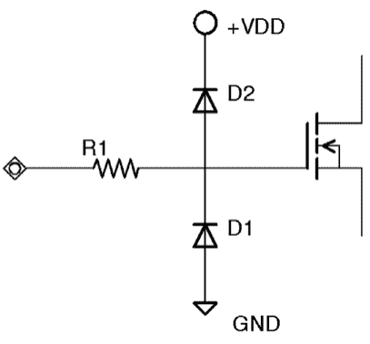

**图 8-5.** CMOS 输入保护二极管

如果输入变为负电，二极管 D1 开始导电并将电流分流到地（条件在约 -0.6 V 以上）。电阻 R1 限制电流流以避免损坏保护二极管。这是释放负静电荷的机制。同样，如果电压升高于 $V_{DD}$，电流将从输入经过 R1 流向 D2 到 $V_{DD}$（D2 导电开始于 $V_{DD}-0.5V$ 以上）。随着时间推移，R1 限制了通过 D2 的电流。这种简单的结构将 MOSFET 栅电压保持在 GND（$V_{DD}$ 减 0.6V 到加 0.6V）范围内。


从设计角度来看，你不应该依赖`R1`或`D1`来处理极端信号波。这些仅仅是为了防止电荷损坏设备。如果你在栅极限制以上或以下有杂乱的波动，你应该提供自己的信号处理。原因仅仅是二极管或电阻可能无法处理所需的电流水平。例如，Broadcom 不提供 GPIO 的处理规格。例如，CM 4000 系列芯片可以从 +3.3V 供电，其输入范围允许高达 +15V。

## CMOS 输出

图 8-3 展示了用于输出的 CMOS 对。在任何时刻只有`M1`或`M2`导电，当输入为低或高电平时。你可能有一个与 Raspberry Pi 连接的 CMOS 输出。在系统启动的 20 秒左右时间内，两个 CMOS 输出连接在一起。一旦 GPIO 被重新配置为输出，电阻仍然存在但没有实际影响（GPIO 输入不导电）。只有在信号变化时，由于分布电容的充电和放电产生极小的电流。当 GPIO 以高速率变化时使用低值`R1` (1k)。否则你可以可以使用高达 10k 欧姆的电阻作为`R1`。

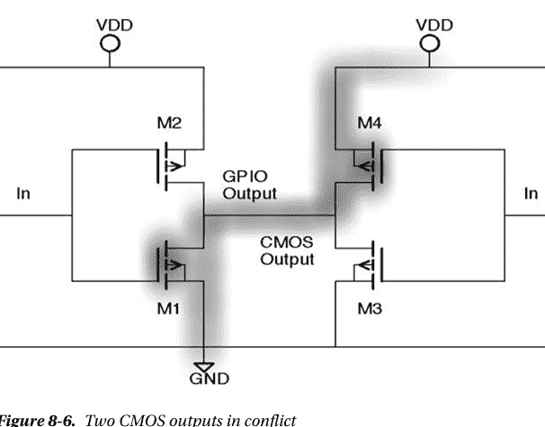

**图 8-6.** 输出冲突

使用电阻进行 GPIO 安全

# 表 8-2. 3.3V系统的 CMOS 电压

| 参数 | 电压 | 说明 |
| --- | --- | --- |
| $V_{IL}$ | $\leq 30\%$ 的 $V_{DD}$ / 当 $V_{DD} = 3.3V$ 时为 0.99V | 电压，输入低 (0) |
| $V_{IH}$ | $\geq 70\%$ 的 $V_{DD}$ / 当 $V_{DD} = 3.3V$ 时为 2.31V | 电压，输入高 (1) |

CMOS 器的`VDD`可以从 -3V 到 +18V；这使其非常适合连接各种设备，包括树莓派的 3.3V GPIO。从表 8-2 可以看出，$V_{IL}$ 和 $V_{IH}$ 的 CMOS 数值与树莓派略有不同。由于 CMOS 输入不需要电流驱动，只要电路没有负载，信号具有极高的兼容性。在没有额外负载的情况下，GPIO 或 CMOS 输出在低电平时几乎为 0 伏，在高电平时几乎为 +3.3V。这些都能轻松满足 $V_{IL}$ 和 $V_{IH}$ 参数。

由于 CMOS 门几乎不消耗电流，因此具有几乎无限制的扇出能力（扇出是指一个逻辑设备驱动其他设备输入的能力）。当你将逻辑信号与需要电流的负载相结合时，问题就会出现。

图 8-8 是 GPIO 输出驱动 CMOS 输入和 LED 的示例。喷涂线条表示 LED 亮起时的电流流（CMOS 输入不需要电流，只需要电压）。LED 可能会亮起，但由于 LED 对 GPIO 晶体管`M2`施加了负载，门电压电平可能会降低。CDXXX 设备至少需要 2.31V 才能识别逻辑 1（工作电压在 +3.3V 以上）。

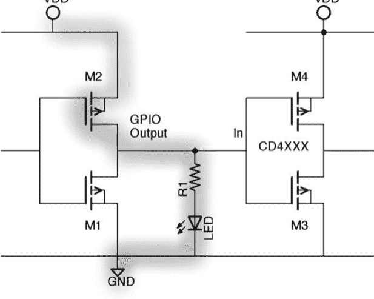

图 8-8. 结合驱动 CMOS 输入和 LED

这种问题往往潜伏在不耐心的人面前。只要稍加规划和洞察，这些问题就可以很容易避免。解决此问题的方法包括：

- 1. 增加 GPIO 输出驱动能力，以充分满足 CMOS 设备的`VIH`要求。
- 2. 增加`R1`的电阻以减少负载（这也会降低 LED 的亮度）。
- 3. 使用独立的 GPIO 线来驱动 LED。

## GPIO 驱动

树莓派（包括 B 2）具有以 2 mA 倍数可配置的输出驱动能力（这是最小驱动强度）。GPIO 作为输出、输入和驱动强度的灵活性通过复杂的 CMOS 晶体管配置来实现。在本章中，我们通过假设一种或另一种配置（输入或输出）来保持简单，这对于我们的需求已经足够了。我们只需要在软件中配置 GPIO，SoC 就会实现。

GPIO 输出驱动强度由`PADS`控制寄存器中的三个位自定义。我在图 8–9 中标记了`Drive0`、`Drive1`和`Drive2`。当`Drive0`具有一个 1 位时，会有额外的 2 mA 驱动帮助（总计 4 mA）。如果你将`Drive2`配置为 1 位，则会额外增加 8 mA 的驱动，总驱动能力为 12 mA。树莓派可以提供高达 16 mA 的总驱动。

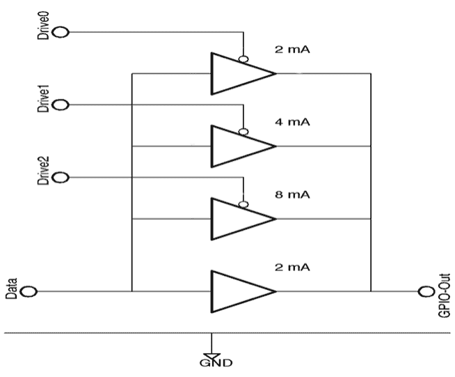

图 8-9. 可配置的 GPIO 输出

配置的 GPIO 驱动强度在 GPIO 组中配置：

- 1. GPIO 0 到 27（重置为 8 mA）
- 2. GPIO 28 到 45（重置为 16 mA）
- 3. GPIO 46 到 53（重置为 8 mA）

GPIO 组 2 和 3 影响内部系统组件，因此不允许更改它们。`gp`命令选项`-5`允许你更改组 1 和组 2 的驱动强度。

## CMOS 使用规则

如果没有对 GPIO 引脚和 CMOS 逻辑 IC 处理注意事项的简要说明，本章将是不完整的。Don Lancaster 在他的《Cook[3] 中列出了六条规则，但由于这里的读者不同，我将他的列表进行简写和改写如下：

- 1. 所有输入必须接地。将输入连接到 +VDD 或地。
- 2. 保护保护措施。不要依靠设备的保护二极管来修复粗糙的输入信号。
- 3. 在处理 GPIO/CMOS 引脚或连接到它们的电路时避免静电。

关于静电预防，Lancaster 说：

> 这些方法中的任何所有方法都能针对静电问题提供良好的电路保护。只要你在处理设备时足够小心，它们也能提供良好的电路外保护。大多数处理 MOS 设备的规则列表都过度了，引入的问题比解决的要多。要照顾 MOS 电路，在使用前用普通的小型焊接夹具将其固定在位，并用普通的烙铁将其焊接在到位。确保你的电路在离开 PCB 板的 MOS 引脚处有某种电阻。这就是你可能需要的全部预防措施了。[4]

此外，请记住成本和静电风险。应该更加关注 GPIO 引脚，因为它们是整个树莓派的一部分。CMOS 逻辑图，图 8-10 所示 a。

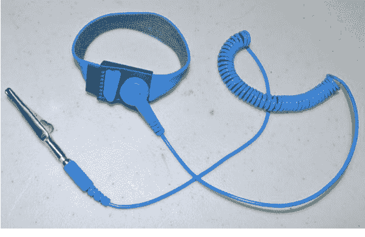

图 8-10. 防静电带

# 第 9 章

# PiSpy

在第 4 章中，我们看到树莓派 2 强大到可以编译自己的内核。这是为了安装`rpidma`驱动以便`spy`命令能够使用 DMA 进行采集。在本章中，我们将注意力转向`spy`工具本身并学习如何使用它。我们还对其工作原理进行了高层次观察。

## spispy 简介

`spispy`命令是一个 GPIO 数据采集工具。我们书中的很多工作涉及各种形式的 GPIO 输入和输出，但如果盲目编程 GPIO 引脚将是一件苦事。数字示波器允许你看到随时间变化的输入和输出。如果你以前用过示波器，也知道需要采集信号以便检查。这就是`spispy`所做的：它捕捉随时间变化的 GPIO 情况。

采集是操作的第一部分。`spispy`工具会自动调用`GtkWave`以图形化显示采集结果（你也可以手动调用`GtkWave`）。因为`spispy`采集从 0 到 3 的 GPIO，所以可以在`GtkWave`中选择感兴趣的引脚。

由于`GtkWave`是一个软件包，你可能需要安装它。如果输入`gtkwave`没有产生帮助信息，请安装它。

```bash
$ sudo apt-get install gtkwave
Reading package lists... Done
Building dependency tree
Reading state information... Done
```

## spispy 命令选项

`spispy`命令只有几个你经常使用的选项。大部分选项与触发有关，我们稍后查看。使用`-h`（帮助）选项调用`spispy`可以提供选项概述：

```bash
$ spispy -h
Usage: spispy [-b blocks] [-R gpio] [-F gpio] [-H gpio] [-L gpio] [-x] [-z]
where:
  -b blocks    采样多少 64k 块 (8)
  -R gpio      上升沿触发
  -F gpio      下降沿触发
  -H gpio      高电平触发
```

# 第 9 章 ■ PISPY

```
-L gpio    低电平触发触发
-T tries    重试触发尝试次数（默认 100）
-v         详细模式
-X         不执行 gtkwave
-Z         不压制 gtkwave 消息
-h         显示此信息。
```

注意事项：

+ * 只能指定一个`gpio`作为触发器，但可以将上升、下降、高电平和低电平信号组合使用。
* 若要使用所有默认值运行命令（不带任何选项），请用`--`替换任何选项。
* 如果`gtkwave`启动失败，请执行当前目录下的`.gtkwave.out`文件。

## 捕获长度 (Capture Length)

你做出的第一个决策是如何为数据采集数据。数据以 64K 字节为块进行采集。每个样本需要 4 字节（32 位），这意味着每个块中捕获了 16,384 个样本。使用非时钟的树莓派 2，采样速率约为 80.5 ns。关于此采样率的更多信息将在后文中介绍。

这意味着一个块的采集大约需要 1.3 ms。因此，如果你需要捕获一个 20 ms 的事件，你需要大约 20/1.3 = 16 个捕获块。

当未选择块数时，使用的默认选项是`-b1`：

```
$ pispy -b16
```

在选择捕获长度时，请意识到内存资源是从 GPU 临时借用的。。在树莓派 2 中，你必须拥有不受四个 CPU 核心及其缓存干扰的 DMA 内存。为了消除这个问题，`pispy`使用内核邮箱箱机制（kernel mailbox facility）从 GPU 分配内存。所分配的内存仅在捕获期间使用，随后会返回。然而，如果你的 GPU 内存已经短缺（可能是由于你的自定义配置），那么你就不希望内存块请求的大小溢出。

## 捕获分辨率 (Capture Resolution)

在前面的节中，我们注意到捕获速率约为 80.5 ns（接近 12.4 MHz）。然而，如果你进行实验，会发现你捕获到的最高采样率约为 1 MHz。这是由于 DMA 提供的采样率高于内部 GPIO 控制器的读取速率。DMA 外设对 GPIO 引脚进行了过采样。

系统的 DMA 被`pispy`用于尽可能快地捕获 GPIO 样本，这意味着它不是规律的。由于其他复杂的相互作用，CPU 对内存的访问可能会中断特定的 DMA 访问。然而，当以低于 2 MHz 的速率采样 GPIO 信号时，你不会察觉到这种轻微的不规则性。

## 详细选项 (Verbose Option)

命令的`-v`（详细）选项会报告关于 DMA 请求和中断等某些内部信息。以下是一个示例：

```
$ pispy -b1 -v
1 x 64k blocks allocated.
GPLEVO = 0x7E200034
DUMP of 1 DMA CBs:
CB # 0 @ phys addr 0x3DB62000
TI.INTEN : 1
TI.TMODE : 0
TI.WAIT_RESP : 1
TI.DEST_INC : 1
TI.DEST_WIDTH : 0
TI.DEST_DREQ : 0
TI.DEST_IGNORE : 0
TI.SRC_INC : 0
TI.SRC_WIDTH : 0
TI.SRC_DREQ : 0
TI.SRC_IGNORE : 0
TI.BURST_LENGTH : 0
TI.PERMAP : 0
TI.WAITS : 0
TI.NO_WIDE_BURSTS : 1
SOURCE AD : 0x7E200034
DEST_AD : 0x3DB62000
TXFR_LEN : 65504
STRIDE : 0x00000000
NEXTCONBK : 0x00000000
END DMA CB DUMP.
No triggers.
Interrupts.. 1 (1 blocks)
Captured: writing capture.vcd
exec /usr/bin/gtkwave -f captured.vcd
$
```

这些信息面向那些想要修改`pispy`的人员。然而，一个重要信息是中断次数（这里是 1）。每个 64k 块的捕获数据应该有一个中断。如果你没有看到，说明驱动程序没有正常工作。

## 选项 -x

默认情况下，`pispy`在`capture.vcd`文件写入（在你的当前目录中）后自动调用`gtkwave`。如果由于某些原因，你没有可 X Window 显示，你可能想告诉`pispy`不要尝试执行它。示例所示：

```
$ pispy -b1 -x
Captured: writing capture.vcd
$
```

## 触发器 (Triggers)

当你有一个连续波形时（例如 PWM 信号），你不需要触发器。你只需要捕获特定时间并显示信号即可。

对于其他类型的信号，有趣的事件之间可能存在数百毫秒。没有触发捕获的情况下，尝试捕获有趣的部分是挑战性的。

`pispy`工具支持有限形式的触发。触发选项类型如下：

- 在 GPIO 上升触发捕获 (`-R gpio`)
- 在 GPIO 下降触发捕获 (`-F gpio`)
- 在高电平 GPIO 上触发捕获 (`-H gpio`)
- 在低电平 GPIO 上触发捕获 (`-L gpio`)

需要可以组合这些选项（但仅限于同一个 GPIO）。限制是什么？DMA 捕获执行 GPIO 引脚的采样。这比尝试从软件执行更快且更可靠。我们设置好 DMA 控制并释放它，`pispy`执行以下操作来实现触发功能：

1. 设置 DMA 控制并开始捕获。
2. `pispy`等待第一个中断（第一个块已捕获）。
3. 当 DMA 继续运行（进行块捕获）时，`pispy`检查第一个块的触发事件。
4. 如果在第一个块中找到触发事件，则允许捕获运行到完成。
5. 否则，`pispy`终止当前的捕获。
6. 如果尝试次数未超过 (`-T`)，则从第 1 步重复。

由于此原因，触发器还必须使用`-T`选项提供尝试次数。下面的示例显示了尝试捕获 GPIO4 上的上升沿

```
$ pispy -b1 -R4 -T9
```

## GTWave

`gtkwave`命令用于显示写入名为`capture.vcd`文件的捕获内容。如果你从桌面运行`pispy`，或使用 X Window 会话运行`pispy`，`pispy`将调用`gtkwave`。如果你的 GPU 内存已经短缺（可能是由于你的自定义配置），你可能希望溢溢内存块请求的大小。示例所示：

```
$ pispy -b1 -x
Captured: writing capture.vcd
$
```

在运行`pispy`之前，请确保已安装`gtkwave`。

# 第 9 章 PISPY

这两者都不显而易见，但我看来它们应该是显而易见的。

随着年龄的增长，我们最终都会面临难以看清近物体或眼睛变小的问题。根据我视科医生办公室的视频，这是由于眼睛内的晶状体无法通过眼睛收缩来聚焦近物。晶状体变得坚硬且缺乏弹性。无论我们做什么，都可以通过敲击来使波形更加剧烈——增大 Signals 窗口的字体大小。字体大小的会导致波形随之增大。

在你的主目录下创建一个名为`.gtkwaverc`的文件。在文件中写入如下所示的行（根据你的任务进行修改）。该行配置了字体选择及其大小。以下是我在书中示例使用的设置：

```
$ cat ~/.gtkwaverc
fontsize_signals Monospace 20
```

此时，没有办法从 Waves 窗口中删除痕迹，但你可以通过高亮要删除的信号，然后使用 Edit（编辑）菜单来实现。选择 Cut（剪切），信号就会被移除。

## 简述 PiSpy

在本节中，我将向大家展示`pyspy`工作原理的鸟瞰图，因为详细描述它过于复杂。通过这个概述以及提供的源代码，内核程序员可以复用`librpi`中的类。

- `~/pips2/pyspy/pyspy.cpp`
- `~/pips2/librpi/*.cpp`
- `~/pips2/include/*.cpp`

`pyspy`命令使用了以下库：

- 1. Logic Analyzer (`#include "logana.hpp"`)
- 2. GPIO (`#include "gpio.hpp"`)
- 3. VCD_Out (`#include "vcdout.hpp"`)

GPIO 类在附录中描述。其他类可以由内核程序员使用。

使用`pyspy`程序捕捉并显示信号的基本步骤是：

1. 解析命令行。
2. 使用`LogicAnalyzer.open()`方法打开 mailbox。这会导致发生以下情况：
   1. 打开设备`/dev/rpidma`（由`rpidma.ko`提供的内核模块）。
   2. 根据使用的是 Raspberry Pi 2（ARMv7）还是之前的模块（ARMv6），确定内存偏移和标志。
   3. 创建访问 mailbox 的设备`/dev/logana`。
   4. 打开此驱动文件。
   5. 为 mailbox 分配页。
   6. 锁定内存。
   7. 根据选项`-b`获取 mailbox 的虚拟地址。
4. 访问 控制器的第一个控制块。
5. 调用`LogicAnalyzer`的`propagate()`方法将第一个控制块复制到其他内存块，进行必要的调整。
6. 如果使用了选项`-v`，则在终端上显示第一个控制块的状态。
7. `LogicAnalyzer.start()`方法启动 DMA 传输。
8. 如果有触发器，等待 DMA 中断发生。此捕捉块准备好扫描信号。
9. 如果在捕捉块中找到了触发条件，允许捕捉继续直到完成。
10. 否则，当前的 DMA 捕捉并重启。如果未找到触发器，循环将停止。
11. 如果使用了选项`-v`，DMA 状态将报告到终端。
12. 在这一点，捕捉完成并留在内存中。


接下来发生的是将捕捉的数据写入文件。使用的捕捉格式是`.vcd`（值变化 dump）。这种格式由 IEEE 标准 1364-1995 定义 [1]。`pyspy`工具创建`captured.vcd`文件，定义了`gpio0`到`gpio31`的信号，并写出定时信息。这些信息可以通过`gtkwave`命令加载并查看。在文件中捕捉数据后，除非指示了选项`-x`，否则`pyspy`将自动启动`/usr/bin/gtkwave`（因为`gtkwave`在启动时产生很多 GTK 信息）。

## 总结

在本章中，你学习了如何使用`pyspy`将 GPIO 信号捕捉到`captured.vcd`文件中，该文件通常很小。你还学习了如何操作`gtkwave`，这可能没那么明显。最后，`gtkwave`的自定义对某些非常有帮助。

下一章将介绍书中提供的命令。使用该命令，我们将通用 Raspberry Pi 工作并使用`pyspy`检查我们的工作。

## 参考文献

- [1] "Value Change Dump", Wikipedia. http://en.wikipedia.org/wiki/Value_change_dump

# 第 10 章

## 抖动

将按按钮连接到 GPIO 输入的想法看起来非常简单。只需使用按按钮、几个连接和一些简单的软件来读取 1 或 0，不是吗？毕竟它是数字输入，只有 1 和 0。这看起来很基础，但实际情况比这复杂得多。

实际情况违背直觉，是因为我们的思考和操作比数字电路慢。按下按钮的物理动作可能需要大约半秒，所以我们倾向于那样思考。另一方面，数字电路可以在相同的时间范围内响应百万次事件。

本章探索按按钮及其对电子输入带来的问题。对于 Raspberry Pi 制作者来说，这是使用 GPIO 输入时必须掌握的关键点。本章向学生介绍解决问题的简单硬件方案。

## 引言

图 10-1 显示了 GPIO 输入看到并读取的理想信号。休息时信号为低（读取为 0）。按下时，信号变为高电（1），只要按钮被按下，信号就保持高电。图 10-1 是 PiSpy 从采用去抖电路的按按钮捕捉的信号。


**图 10-1 理想的去抖按下**

图 10-2 显示了低质量按钮关闭的结果。你可以看到接触在时间 0 附近关闭，并随着金属触点的弹跳，多次变为高电和低电。很久之后，触点最终稳定下来。


**图 10-2 一对弹跳的按钮触点**

这里是阴险之处：按钮一直在改进，所以你可以把自己的按钮连接到 GPIO，它看起来可能运行正常，至少在某些时候是这样。

这是一个实验。将按钮连接到 +3.3V 线，另一个触点连接到 GPIO 19（或你选择的任意一个）。将 GPIO 19 (`-g19`) 配置为带有下拉电阻 (`-pd`) 的输入 (`-i`)，并通过读取 (`-r`) 进行验证：

```
$ gp -g19 -i -pd -r
GPIO 19 = 0
```

输出零确认了你的 GPIO 19 被拉低读取。当按钮连接到它时，另一端连接到 +3.3V，读取应变为高（1）。使用监控选项进行监控：

```
$ gp -g19 -m0
Monitoring..
00000 GPIO 19 = 0
00001 GPIO 19 = 1
00002 GPIO 19 = 0
```

如果你有良好的连接，可能在输出中看不到任何“弹跳”。这部分部分是因为运行`gp`命令的 Raspberry Pi 采样率较低（另一方面，使用 CMOS 计数器并将它们碰在一起）。这就是我的尝试结果：

```
$ gp -g19 -m0
Monitoring..
00000 GPIO 19 = 0
00001 GPIO 19 = 1
00002 GPIO 19 = 0
00003 GPIO 19 = 1
00004 GPIO 19 = 0
00005 GPIO 19 = 1
00006 GPIO 19 = 0
00007 GPIO 19 = 1
00008 GPIO 19 = 0
00009 GPIO 19 = 1
00010 GPIO 19 = 0
00011 GPIO 19 = 1
00012 GPIO 19 = 0
00013 GPIO 19 = 1
00014 GPIO 19 = 0
```

一次简单的鳄鱼夹接触就产生了 15 次开启和关闭事件。

## 瞬间去抖

在《Mastering the Raspberry Pi (Apress, 2014)》一书中，使用`CD4013`触发器电路对按钮或开关进行去抖。然而，对于按钮来说，触发器电路并不方便，因为它同时需要常开和常闭触点。这会导致更高的成本和额外的接线。

一种更简单且经济的解决方案如图 10-3 所示，使用了施密特触发器（本例中为`CD40106`）。按钮由`S1`表示，连接到电阻`R1`和电容`C1`。这些元件与`IC1A`的施密特触发作用共同，在`OUT`处产生清晰的去抖输出信号。由于它是一个反相器，在按下按钮时会产生输出。这种六路反相器的优势在于可以用一个的价格获得六个。


**图 10-3。** 瞬间按钮去抖电路

## 切换去抖

开关的购买和安装可能很昂贵。相比之下，按钮有时很廉价。如果你能够使用按钮来切换信号，你可以将按钮作为开关。图 10-4 展示了使用 CMOS 器`CD4049`可靠地实现此点的简单方法。


`CD4049`是一个简单的反相器，但结合`R2`和`C1`以及反馈电阻`R1`使用时，按钮 (`S1`) 可用于切换。输出可以从`IC1A`（引脚2）或`IC1B`（引脚4）获取。在使用图 10-4 所示的电路时，通常需要给用户提供某种反馈。如果 Raspberry Pi 应用在屏幕上显示了某些视觉反馈，则不需要进一步的操作。然而，如果没有这些信号，用户将不知道输入是开启还是关闭。图 10-5 显示了该问题的另一种解决方案，代价是更多的元件。在这个电路中，切换功能仍然由`IC1A`和`IC1B`提供。LED 由另一个反相器`IC2A`驱动，信号由`IC2B`驱动。如果你更喜欢，这些额外的反相器可以从`IC1`引出。


**图 10-5。** 带有缓冲和 LED 指示的切换按钮

该电路特别值得注意的是 LED是在没有限流电阻的情况下驱动的。通常需要一个限流电阻，这是一个良好的做法。在这里，你可以省略它，因为电路（用于 Raspberry Pi）将在 3.3V 下运行。此外，CMOS 输出将被`IC2A`能够提供的电流限制在 4mA 以内。因此，请确保为目的选择一个小电流 LED。

## MC1490

接触抖问题严重到需要专门为此设计的芯片。ON 半导体的数据表显示`MC1490`（也称为`CD4490`）是一个 CMOS 器件，可以在 0V 到 5V 之间工作。再次，3.3V 操作对于这些芯片相比其他逻辑门是理想的。

`MC1490`的工作原理是它以间隔采样输入。如果移位寄存器采样为零（按下），输出为低电平（0）。相反，如果移位寄存器采样为高（打开），输出变为高电平（1）。输入处的抖动在输出端被忽略。

图 10-6 显示了一个带有两个按钮的电路（一个用于去抖，等等）。`MC1490`内部带有上拉电阻，不需要外部电阻（用于静态处理）。


**图 10-6。** MC1490 接触消除器

采样频率由电容`C1`决定。数据手册提供了给定采样频率的公式。对于 15 Hz 的采样频率，ON 半导体提供的公式为 $15 = 6.5/C$，其中 $C$ 的单位为 $\mu F$。求解 $C_t$ 得到 $C_t = 6.5/15$，即 0.43 $\mu F$。下一个标准尺寸电容是 0.47 $\mu F$。因此，0.47 $\mu F$ 的电容应该产生 13.8 Hz 的采样频率。可能需要一些实验。请记住许多电容的公差高达 30%。

在自己的实验中，我没有那个，所以我尝试了 0.02 $\mu F$ 的电容。它产生了较高的采样频率，这会对故障更敏感，但证明了整体运行没有问题。

使用 PiSpy，我能够采样引脚 9。由于振荡频率较低，你需要较长的采样周期。我选择使用 48 来进行采集。查看图 10-7 中的波形，可以看到波形约为 32 ms。取其倒数得到大约 31.25 Hz 的频率（使用 0.02 $\mu F$ 的电容）。

```
$ pyspy -b48 -R19 -T9
Captured: writing.vcd
```


**图 10-7。** MC1490 的 OSC_out（引脚9）的 PiSpy 采集

要测试按钮动作，将按钮`S1`连接到图 10-6。将去抖后的`AO`连接到 GPIO 19。GPIO 19 启动为输入，但在建立连接之前，确保它通过`-i`处于输入模式（`-pu`添加上拉电阻，这应该是默认的）。

以下命令为 GPIO 19 插入输入 (`-i`) (`-g19`)，添加上拉电阻 (`-pu`)，并监控该 GPIO (`-m0`)。一旦`gp`命令开始监控，你就能够获得干净的按钮事件了。我的会话如下：

```
$ gp -g19 -pu -m0
Monitoring..
00000 GPIO 19 = 1
00001 GPIO 19 = 0
00002 GPIO 19 = 1
00003 GPIO 19 = 0
00004 GPIO 19 = 1
00005 GPIO 19 = 0
00006 GPIO 19 = 1
00007 GPIO 19 = 0
00008 GPIO 19 = 1
```

我使用的按钮在电气术语上是个真正的次品，但它的表现非常出色。图 10-8 展示了我在 Raspberry Pi 2 工作站末端的面包板测试。这个电路非常容易在面包板上搭建，你应该亲自尝试一下。它只需要 3.3V 电源（来自 Pi）、地、一个电容和一个按钮。输出直接连接到 GPIO 输入。


**图 10-8。** MC1490 按钮测试的面板设置

在购买此零件时，多买几个（建议买五个）。这种情况并不经常发生，但有时你会买到坏件（或者它会变成坏件）。当你准备就绪却发现零件是坏的时，最是最令人失望的。由于你将其连接到 Pi 的输入，请确保从 3.3V 电源为`MC1490`电（而不是 5V 电源）。

## 总结

CMOS 输入（包括树莓派的 GPIO 输入）在连接按钮、开关或继电器触点时需要进行机械去抖。如今制造的按钮工作得相当不错，但它们仍可能产生抖动的接触信号和释放信号。你可以预先消除墨菲定律（“如果任何事情可能出错，它就会出错”）。如果没有去抖后的输入，接口可能在你决定演示它之前可能一直运行得良好。

本章重点介绍了三种不同的去抖电路。我鼓励你在面包板上尝试所有的电路。虽然这个列表并不是详尽的，但这些电路应该很容易复制。

第一种使用施密特触发器产生去抖后的瞬时按下按钮输入的简单方法。它的模拟元件只需要电阻和一个电容。第二种电路很有趣，因为它允许你通过每次按下按钮切换输出将按钮作为开关使用。它的缺点是需要用户反馈，并且需要更多的组件。最后一种使用`MC14490`的电路可能是所有电路中最易用的。它只需要一个模拟元件（电容），并提供六个去抖后的输出。此外，其他`MC14490`芯片可以连接以使用第一个芯片的时钟输出，整个组只需要一个电容。

# 第 11 章

## C++ 快速入门

如果你已经熟悉 C 语言并对 C++ 有所了解，你可以通过阅读本章来提高你的 C++ 效率。这并不是一个 C++ 教程，而是一个快速入门指南，旨在消除使用标准模板库（STL）的恐惧。对历史和理论缺乏耐心的人会喜欢这种直接投入并开始的方法。当你看到在简单易懂的示例中使用 STL 时，那种恐惧和厌恶就会烟消云散。

## C++ 标准

在 20 世纪 90 代，我会避免使用 C++ 开发开源项目，因为旧项目在一年后无法编译，会出现编译器以前没有产生的所有新警告和错误。然而，你依赖 C 语言编译器，因为它是稳定的，规则不会不断改变。C 语言已经标准了。

今天，随着 C++ 11 标准的出现以及 GNU 对其的支持，我可以从其固有的效率中获益。Debian Linux 在较新的 GCC-4.7 编译器中支持 C++ 11（但你可能需要安装它）。

要检查已安装编译器的版本，请使用此命令：

```bash
$ g++ --version
g++ (Debian 4.6.3-14+rpi1) 4.6.3
Copyright (C) 2011 Free Software Foundation, Inc.
This is free software; see the source for copying conditions. There is NO warranty; not even for MERCHANTABILITY or FITNESS FOR A PARTICULAR PURPOSE.
```

你需要至少 4.7 版本才能获得 C++ 11 支持（在此之前可以使用对`c++0x`的有限支持，但这不够）。如果有必要，请使用此命令安装 4.7 版本（或更高版本）：

```bash
# sudo apt-get install g++-4.7
```

书中提供的`Makefile.incl`包含以下两行（参见`CXX`和`CXXSTD`定义）：

```makefile
head Makefile.incl
###############################################################
# librpiz/Makefile.incl
###############################################################
TOPDIR := $(dir $(CURDIR))$(word $(words $(MAKEFILE_LIST)),$(MAKEFILE_LIST))
CXX = $(shell ls /usr/bin/g++*- |tail -1)
CXXSTD =? c++11
PREFIX =? /usr/local
```

以`CXX =`开头的行通常会发现你的 Raspian Linux 系统上安装的最新`g++`版本。如果执行失败，请将其替换为硬编码的要使用的编译器的引用。例如，为了强制使用`g++4.7`，你可以使用`CXX = /usr/bin/g++-4.7`。早于`g++4.7`的不支持`-std=c++11`，我们需要。

## 从 C 到 C++

当你从 C 语言转向 C++ 时，一些情况会发生变化。微妙变化之一是 C 语言的结构与其他类型处于同一命名空间。考虑以下 C 语言示例`t.c`：

```c
#include <stdio.h>

int main(int argc, char **argv) {
    struct my_struct {
        int id;
    };
    typedef struct my_struct my_struct;
    struct my_struct a;
    struct my_struct b;

    a.id = 0;
    b.id = 1;

    return 0;
}
```

这个 C 程序可以正常编译和运行。注意`my_struct`与类型名`my_struct`是不同的（尽管它们最终使用相同的定义）。

当我们进入 C++ 领域，这段代码无法编译。如果我将文件`t.c`重命名为`t.cpp`并对其使用 C++ 编译器，会得到以下错误：

```text
t.cpp:9:12: error: using typedef-name 'my_struct' after 'struct'
t.cpp:8:30: error: 'my_struct' has a previous declaration here
```

这告诉我们在看到`typedef`行时，类型`my_struct`已经定义了。这证明了结构名和`typedef`名是相同的。在 C++ 中，结构名本身就了一个类型名。

## 类和结构体

C++ 中`struct`和类之间的唯一区别是成员的默认访问级别。在`struct`中，成员默认是公共的；在类中，它们是私有的。

```cpp
struct MyStruct {
    int id;
};

class MyClass {
    int id;
};
```

## 标准模板库

标准模板库（STL）提供了一系列模板类和函数。使用 STL 允许你编写高效且可复用的代码。常见组件包括：

- 容器：数据结构如`std::vector`、`std::list`和`std::map`。
- 算法：函数如`std::sort`、`std::find`和`std::count`。
- 迭代器：允许遍历容器元素的对象。

## 容器 std::vector

`vector`是最容易上手的容器。想想你平时在使用普通数组时会遇到的所有问题：

- 我应该把它弄多大？
- 最大尺寸是多少？
- 我需要调整它的大小吗？
- 我应该在哪里处跟踪它的动态大小（如果它可以调整大小）？
- 用完之后我记得释放动态存储空间吗？

当你使用`std::vector`容器时，所有这些问题都消失了。`std::vector`是一个封装数组的类，它管理着数组的内存空间和大小。

使用`vector`存储`int`类型，只需包含头文件并声明它。成员的类型由 C++ 模板角括号指定。

```cpp
#include <vector>
std::vector<int> myvec;
```

在首次构造时，`vector myvec`是空的。

要向`vector`添加一个`int`值，请使用`push_back`方法：

```cpp
myvec.push_back(99);
```


这在内部会调整存储数值的数组，使其足够容纳多一个值，并将该值添加其中。该内部数组的实际初始大小可能为 8，对象`myvec`知道其当前大小现在为 1。如果你继续添加值，当添加第 9 个值时，对象可能会内部将其容量翻倍到 16 以允许增长。你不需要担心这些细节。

要访问`myvec`的值，可以使用普通的下标语法：

```cpp
int first_value = myvec[0];
```

`std::vector`的棒之处在于，如果你添加更多值，你就不需要担心分配内存或调整数组大小。当对象`myvec`离开作用域时，得益于内置析构函数，与`myvec`关联的存储会自动释放。不再有内存泄漏了！

一旦你有了`vector`，通常需要遍历它；也就是说，像访问数组一样访问每个条目。对于`vector`，有两种方法可以实现这一点。第一种方法与 C 语言的方法几乎相同，使用下标。核心思想是从`myvec.size()`获取`vector`的当前大小：

```cpp
for ( size_t x=0; x<myvec.size(); ++x ) {
  printf("%d = %d\n", x,myvec[x]);
}
```

从这里你可以看到`std::vector`如何自然地取代了数组。模板参数允许你指定其他数据类型，你可以声明其他类型的对象，包括`struct`和`class`。我们还没有介绍过字符串，但 C++ 创建字符串数组的方法是：

```cpp
std::vector<std::string> myvec;
```

# 第 11 章 C++ 快速入门

我们稍后会检查字符串，以便保持对容器的关注。有时，你需要访问底层数组，以便将其传递给 C 语言函数。可以通过`myvec.data()`方法实现。假设你的 C 语言函数使用以下函数原型：

```cpp
extern void my_c_func(int *int_array, unsigned count);
```

可以通过以下方式将`myvec`的内容传递给该函数：

```cpp
my_c_func(myvec.data(),myvec.size());
```

`data()`方法确保`std::vector`的内部数组是连续的，并返回它的起始地址。我们还向函数提供了`myvec.size()`，以便函数知道数组的实际长度。需要注意的是，如果你从`vector`中添加或删除成员，内部数组可能会重新分配。因此，如果对`vector`对象发生了更改，你必须再次调用`data()`方法来重新获取实际数组地址。

## STL 迭代器

遍历`vector`的第二种方法涉及迭代器。这有时会让人们望而畏之，但请听我说。它们不仅容易理解，而且容易使用。我们还将看到 C++ 11 标准让它们的使用比之前更加简单。如果你的容器是`std::vector<int>`，那么迭代器就是`std::vector<int>::iterator`。换句话说，它与容器的声明相同，只是后面附加了`::iterator`。所以，到目前为止这并不坏，这只是语法问题。在概念上，你可以将迭代器想象成某种复杂的指针。它们确实指向某些东西（或指向“末尾”）。它们在你的平台（就你来说是树莓派 Linux）上是如何实现的应该被忽略。将它们作为概念性指针使用。所有容器都有以下方法来提供迭代器值：

- `container.begin()`
- `container.end()`

`begin()`方法返回指向容器中第一个条目的迭代器（如果有的话）。`end()`方法返回标记容器结束的迭代器表示。如果容器为空，则`begin()`返回的值与`end()`相同。现在让我们看看`myvec`冗长的 C++ 迭代器循环：

```cpp
for ( std::vector<int>::iterator it = myvec.begin(); it != myvec.end(); ++it ) {
  printf("myvec[] = %d\n",*it);
}
```

第一个迭代器在循环中用`myvec.begin()`的值初始化。只要迭代器不等于`end()`，循环继续。在循环底部，迭代器递增（`++it`），以便它指向容器中的下一个项目。在`for`循环内部，通过使用迭代器名称的星号（`*`）来访问`vector`条目，就像它是一个指针一样。迭代器的方法`operator*()`用于获取值。迭代器的方法`operator++()`用于移动到下一个项目。

## 初始化列表

Map（映射）通常用于查找表。C++ 11 标准提供了`initializer_list`支持，使得初始化这些表变得非常简单。以下是来自`librpi2`中`gpio.cpp`代码的片段：

```cpp
std::unordered_map<int, std::string> gpio_alto = {
{ 0, "SDA0" }, { 1, "SCL0" }, { 2, "SDA1" }, { 3, "SCL1" },
{ 4, "GCLK0" }, { 5, "GCLK1" }, { 6, "GCLK2" },
{ 7, "SPI_CE1_N" }, { 8, "SPI_CE0_N" }, { 9, "SPI_MISO" },
{ 10, "SPI_MOSI" }, { 11, "SCLK" }, { 12, "PWM0" },
{ 13, "PWM1" }, { 14, "TXDO" }, { 15, "RDO0" },
{ 16, "reserved" }, { 17, "reserved" }, { 18, "PCM_CLK" },
{ 19, "PCM_F5" }, { 20, "PCM_DIN" }, { 21, "PCM_DOUT" },
{ 22, "reserved" }, { 23, "reserved" }, { 24, "reserved" },
{ 25, "reserved" }, { 26, "reserved" }, { 27, "reserved" },
{ 28, "SDA0" }, { 29, "SCL0" }, { 30, "reserved" },
{ 31, "reserved" }; };
```

每一对值都初始化了 map 每个条目的键和值。这难道不方便吗？

## 遍历 Map

遍历 Map 和遍历`vector`一样简单。使用之前的`gpio_alto`map，我们可以通过以下方式进行遍历：

```cpp
for ( auto it = gpio_alto.begin(); it != gpio_alto.end(); ++it )
    printf("%d = '%s\n",it->first,it->second.c_str());
```

这里唯一的新点在于你必须使用`it->first`或`it->second`来访问感兴趣对中的键或值。

## 引用

让我们花点时间讨论 C++ 引用（references），因为它们经常与 STL 容器结合使用。让我们用结构体来说说明：

```cpp
struct s_client {
    int id;
    double balance;
    ...
};
s_client best_client;
```

这段代码声明了一个名为`best_client`的结构体`s_client`实例。现在我们为同一份数据声明一个指针和一个引用：

```cpp
s_client *ptr_client = &best_client;
s_client& ref_client = best_client;
```

# 第 11 章 C++ 快速入门

使用这两个变量，让我们修改`best_client`的余额：

```cpp
ptr_client->balance = 100.00; // best_client.balance == 100.00
ref_client.balance = 500.00; // best_client.balance == 500.00
```

指针（`ptr_client`）和引用（`ref_client`）物理上访问同一个名为`best_client`的存储单元。一个使用指针语法（`->`），另一个使用点（`.`）。引用变量具有一个特性：一旦建立就无法被“重新指向”。然而，指针变量可以随心所欲改变。引用提供的安全性非常有帮助。

现在让我们声明一个客户端 map，使用`int`作为客户端 ID 值的键：

```cpp
std::unordered_map<int, s_client> clients_map;
```

我们可以通过以下循环调整所有客户端的余额：

```cpp
for ( auto it = clients_map.begin(); it != clients_map.end(); ++it ) {
    it->second.balance -= some_adj;
}
```

这段代码可以编译并运行，但迭代器使得代码不够清晰。问题是`it->second`并没有标示你正在访问的数据类型。你必须查看`clients_map`的定义才知道`it->second`指的是`s_client`。

为了提高可读性，你可能会使用指针，但这仍然不是最优的：

```cpp
for ( auto it = clients_map.begin(); it != clients_map.end(); ++it ) {
    s_client *client = &it->second;
    client->balance -= some_adj;
}
```

现在你立即知道`it->second`指向`s_client`结构体。但指针语法`client->balance`等很笨拙。在大段代码中，存在指针被意外改变的危险。从效率的角度来看，我们仍然很好，因为这些类型会被编译器优化。

不过，我们可以通过使用 C++ 引用来改进：

```cpp
for ( auto it = clients_map.begin(); it != clients_map.end(); ++it ) {
    s_client& client = it->second;
    client.balance -= some_adj;
}
```

现在我们可以访问`client`的成员，就像它直接声明在循环内部一样。当然，在底层编译器使用了指针（这本质上就是引用的原理），但我们避免了使用指针语法。我们还获得了安全性，即`client`不指向其他任何地方（编译器不允许你改变它）。这些安全性在大段代码中是至关重要的。

这是使用引用容器的另一个应用。假设你想向 map 中添加一个新的`s_client`成员，且该结构很大。你可以按照下面的方式执行此操作，它是高效的：

```cpp
s_client new_client; // 临时结构体

new_client.id = 1234;
new_client.balance = ...;

clients_map[new_client.id] = new_client; // 将 new_client 拷贝到 map
```

这在栈上创建一个名为`new_client`的临时结构体。`new_client`的成员通过赋值语句填充。最后一步使用键`new_client.id`来访问已有的 map 条目或创建一个新的。然后数据结构`new_client`被拷贝到 map 中。

然而，如果你想避免拷贝，可以使用引用：

```cpp
s_client& client = clients_map[new_client.id];
client.id = new_client.id;
client.balance = new_client.balance;
```

## Map 与 Set

Set（集合）与 map 的区别在于它们不存储键值对。它们只存储唯一元素。在 set 中，元素本身就是键。

```cpp
std::set<int> my_set;
my_set.insert(10);
my_set.insert(20);
my_set.insert(10); // 这不会被添加
```

# 第 11 章 C++ 快速入门

迭代器，`cbegin()`和`cend()`方法。为了避免编译错误，请确保在声明引用时也应用了`const`（例如这里的`client`）。在这里使用`auto`隐藏了实际发生的情况，但`cbegin()`方法返回的是这种类型：

`std::unordered_map<int, std::client>::const_iterator`

如果`client`没有用`const`关键字声明，编译器将把该语句标记为错误（否则它会提示你可以修改它所引用的 map 条目）。如果循环中的任何部分尝试修改 map 条目，无论是通过引用`client`还是通过`iterator->second`引用，现在都会被编译器标记。通过这种方式，你安全地防止了 map 发生意外之外的

## 容器的容器 (Containers of Containers)

虽然简单的`map`已经很强大，但有时你需要一个更复杂的`map`。例如，假设你有一个数字 IC 的内存中数据库。对于 CD 系列，你可能拥有一组类似于表 11-1 中的值开始的数据集合。

表 11-1 数据集合中的值

| 部件号 | 描述 |
| :--- | :--- |
| 4000 | 双 3 输入 NOR 门 + 1 个 NOT 门 |
| 4001 | 四路 2 输入 NOR 门 |
| 4002 | 双 4 输入 NOR 门 |
| 4006 | 18 级移位寄存器 |
| 4007 | 双互补对 + 1 个 NOT 门 |
| 4008 | 4 位二进制全加法器 |
| 4009 | 六路反相缓冲器（被 4049 替换） |
| 4010 | 六路非反相缓冲器（被 4050 替换） |

一个简单的（有序）`map`可以使用以下声明：

```cpp
std::map<std::string,std::string> ic_map;
```

但现在你想向 map 中添加 7400 系列的部件，如表 11-2 所示。

表 11-2 需要添加的额外值

| 部件号 | 描述 | 数据表 |
| :--- | :--- | :--- |
| 7400 | 四路 2 输入 NAND 门 | HC/HCT |
| 7401 | 开漏极输出的四路 2 输入 NAND 门 | |
| 7402 | 四路 2 输入 NOR 门 | HC/HCT |
| 7403 | 开漏极输出的四路 2 输入 NAND 门 | |

这些有原始系列（74XX），以及 "HC" 和 "HCT"（本例）。CMOS 系列可以归类为 "CD"，我们如何安排 map 以按系列隔离这些部件？我们可以使用`std::map`作为 map 的类型：

```cpp
std::map<std::string, std::map<std::string,std::string>> ic_map;
```

> **警告** 有一个你需要注意的细微问题。在这个声明中，空格非常重要，以避免干扰编译器。考虑没有额外空格的相同声明：

```cpp
std::map<std::string,std::map<std::string,std::string>> ic_map;
```

在这个声明中，除了`ic_map`标记之前的`>>`运算符外，一切正常。某些编译器会在这里卡住，而另一些则可以处理。最好的办法是使用空格来解决这个问题。

第一个模板参数将访问设备系列。用于系列的键如下：

- "CD" 用于 4000 系列
- "74XX" 用于原始的 7400 系列
- "HC" 用于 74HCXX 系列
- "HCT" 用于 74HCTXX 系列

第二个模板参数将是值的类型，在这种情况下是另一个`map`。这个内部`map`将根据设备类型组织，并将描述作为值。让我们来看一个示例（目前，只需接受 C 字符串常量可以在许多预期`std::string`的地方使用的事实即可）。

要向这个多级 map 插入数据，简单的方法是如下：

```cpp
ic_map["CD"]["4010"] = "六路非反相缓冲器（被 4050 替换）";
```

第一个下标操作如果键值 "CD" 不存在，则会自动创建内部`map`。如果它存在，则引用其条目并可以订阅（允许我们向现有的 map 添加内容）。此操作可以拆分为两个步骤：

```cpp
std::map<std::string,std::string&> inner_map = ic_map["CD"];
```

这个`inner_map`引用可以访问部件条目：

```cpp
inner_map["4010"] = "六路非反相缓冲器（被 4050 替换）";
```

有时，最好像显示那样拆分这些操作。使用中间引用允许你避免对分类进行必要的重复循环。让我们修改示例数据库，使值变为一个`struct`：

```cpp
struct s_part_info {
    std::string desc;
    bool obsolete;
};
```

# 第 11 章 C++ 快速入门

```cpp
std::map<std::string, std::map<std::string,s_part_info> > ic_map;
std::map<std::string,s_part_info>& series = ic_map["CD"];

s_part_info& part = series["4010"];
part.desc = "六路非反相缓冲器（被 4050 替换）";
part.obsolete = true;

ic_map["CD"]["4010"] = {"非反相缓冲器（被 4050 替换）", false};
```

# 第 11 章 C++ 快速入门

使用`std::string`数组的巨大优势在于，你不需要担心字符串的最大尺寸（与必须提前指定大小的字符数组不同）。它的负面影响是会进行动态内存分配，导致对`malloc(3)`的调用。在应用程序对性能极其敏感的，你可能想要避免使用它。


## 字符串流 (String Streams)

我避免了讨论 C++ I/O，因为那需要专门开一个章节。对于许多程序员来说，从效率的角度来看，旧的 C 语言工具效果最好。使用 `printf()` 的 `"%.3f"` 格式将浮点数打印为三位小数，并对齐到 7 个列宽，这比完成相同任务所需的多次 C++ 方法调用要方便得多（转换和读取上都是如此）。尽管有这种偏见，你仍然应该熟悉：`std::stringstream`。该对象提供的格式化便利性可以增强甚至替换代码中的 `sprintf()` 调用。其中一个巨大的用处是，由于它的存在，你永远不会受限于预定义的缓冲区大小（如使用 `sprintf()` 时）。

考虑一个包含以下内容的代码片段：

- 一个目录变量（类型为 `char[]` 数组或 `std::string`），名为 `dir_name`。
- 一个子目录名（类型为 `char[]` 数组或 `std::string`），名为 `subdir`。
- 年、月、日作为 `int`，分别名为 `year`、`month` 和 `day`。

当前的任务是为日志文件构建路径。使用 `std::stringstream`，这可以很容易完成：

```cpp
std::string log_pathname;
{
    std::stringstream ss;

    ss << dir_name << "/" << subdir << "/"
        year << "-" << month << "-" << day << ".log";
    log_pathname = ss.str();
}
```

在这个代码片段中，我们在代码块内执行路径构建。一旦 `log_pathname` 在块的最后一行保存，该代码块就会丢弃 `ss`，而无需为最大尺寸分配任何缓冲区。注意 `str()` 方法将字符串流转换为可以赋值的 `std::string`。同样可以将 `std::string` 转换为 C 字符串，以便用于 `printf()`。

```cpp
printf("The log_pathname=%s\n", ss.str().c_str());
```

这个示例将 `ss` 转换为 `std::string`，然后可以调用其方法 `c_str()` 返回一个 C 字符串，用于 `printf()` 调用。链式调用有时可以提供一些强大的快捷方式。

## 预定义宏 (Predefined Macros)

宏对于必须具有可移植性的代码是有用的。但你知道可用哪些宏名称吗？使用某些编译器选项，你可以让 `grep` 列出它们。以下示例列出了系统中与关键字 "ARM"[1] 相关的宏。使用 `grep -i` 允许我们在忽略大小的情况下进行过滤。

```bash
$ /usr/bin/g++-4.7 -DM -E c++ /dev/null | grep -i ARM
#define __ARMEL 1
#define __FEATURE_UNALIGNED 1
#define __ARM_PCS_VFP 1
#define __ARCH_6 1
#define __arm 1
#define __ARM_EABI 1
#define __ARM_FEATURE_DSP 1
```

省略命令中的 `grep` 部分以获取完整的宏列表。例如，知道宏 `__arm__` 的存在允许你使用如下预处理器语句条件编译特定于 ARM 架构的代码：

```cpp
#ifdef __arm__
// 执行某些 ARM 特的操作
#endif
```

## 总结

到此为止，你应该已经对如何应用 STL 容器有了通用的理解。我们涵盖了你入门所需的主要基础。其余细节可以在 cplus.com 网站上阅读。在那里，你可以发现其他方法，如 `clear()`，它可以清空容器中的所有值。

## 参考文献

- [1] "C/C Tip: How to List Compiler Predefined Macros" http://nadeoftware.com/articles/2011/12/c_c_tip_how_list_compiler_predefined_macros. 访问于2015年8月4日。

# 第 12 章 多核 Web 服务器

鉴于树莓派 2 拥有四个强大计算能力的 CPU 核心，本章提供了一个可以利用所有这些核心的 Web 服务器项目。虽然该项目在后台使用了 C `libevent` 库，但一个良好的 C++ 类将 C API 封装在一个优雅的 C++ 包中。在本章中，我们将检查一个从零开始（基于 libevent）构建的快速且精简 Web 服务器。最重要的是，它可以轻松扩展以完成树莓派能做的任何事情。

## libevent

C `libevent` 库是一个流行的、经过时间考验的实现可移植 Web 服务器和客户端的库。主网站可以在 http://libevent.org/ 找到。

一个流行的 `libevent` 文站点是 http://www.wangafu.net/~nickm/libevent-2.0/doxygen/html/。

在页面底部的此 API 参考中，我们将利用任何事件、`.event` 和 `event/h.h`。

如果你访问 `event2/http.h` 链接，你会看到有很多可用的 C API 函数和宏。有了现有的库资源，从零开始构建 Web 服务器可能花费大量时间。

在本章中，我们查看一个非常易用的 `WebMain` C++ 类，使构建你自己的自定义 Web 服务器尽可能简单。你将获得按照你想要的方式进行构建的满足感。

## ClassMain

在你的源代码中，你将看到一些由类内部维护的数据成员：

```cpp
class WebMain {
    int                 backlog;             // 监听队列
    std::string         address;           // IPv4 地址
    int                 port;               // 监听端口
    int                 lsock;              // 监听 socket
    int                 threads;            // 工作线程数量
    std::vector<Worker*> workers;        // 指向工作线程的指针列表
    Worker::http_callback_t callback;   // HTTP 回调

public:
  WebMain();
  ~WebMain();
  void set_address(const char *address);
  void set_port(int port);
  void set_backlog(int backlog);
  void set_threads(int threads);
  void set_callback(Worker::http_callback_t cb);
  int start();
  void join();
  void shutdown();
};
```

这些成员是 `WebMain` 类的私有的，因此你不需要管理它们。保护方法 `listen_socket()` 也在内部使用。派生自 `WebMain` 的类如果需要可以使用它。

感兴趣的是公共方法。这些方法大部分都很直观。

- `set_address()` 设置 Web 服务器地址（默认是 "0.0.0.0"，适用于所有网络接口）。
- `set_port()` 配置服务器监听端口号（默认是 80）。
- `set_backlog()` 配置所需的网络队列（默认是 5000）。
- `set_threads()` 配置你希望激活的并行服务器线程数量（为 4）。
- `set_callback()` 注册每个新 HTTP 请求时调用的函数（无默认值：稍后）。

这些方法必须在启动服务器方法 `start()` 之前调用。一旦服务器启动，更改值将无效。但 `set_callback()` 有默认值，所以如果默认值可以，则不需要配置方法。

要请求关闭服务器可以调用 `shutdown()` 方法（由任何线程调用）。服务器关闭后，你应该调用 `join()` 方法等待线程完成，并释放工作线程使用的资源。

## WebMain::start()

在主程序调用 `start()` 方法之前，它会使用 `set_callback()` 注册一个回调函数。通过这种方式，在源模块 `piweb.cpp` 中找到 `http_callback()` 函数将代表处理请求的线程被调用。我们稍后会看到更多内容。

一旦调用了配置方法，`start()` 方法就会启动并运行服务器。基本步骤应用如下：

1. 根据配置的地址、端口和队列长度（backlog）值创建一个监听接字 (`lsock`)。
2. 忽略 Unix SIGPIPE 信号，这可能在网络 I/O 中发生。
3. 创建并启动每个配置好的工作线程来处理请求。这启动了服务器，它会迅速准备好提供服务。

整个主程序主要由处理选项和启动服务器。

```cpp
int
main(int argc
```

```cpp
if ( opt_errs ) {
    usage(argv[0]);
    exit(1);
}
```

```cpp
webmain.set_callback(http_callback);
rc = webmain.start();
if ( rc != 0 ) {
    fprintf(stderr,"%s: Starting webmain\n",strerror(-rc));
    exit(2);
}
```

```cpp
webmain.join();
return 0;
```

```cpp
// End piweb.cpp
```

`WebMain` 类处理了所有与接字和 `libevent` 调用相关的繁琐工作。

## 工作线程设计

剩余的 `libevent` 内容发生在 `worker class.cpp` 中。感兴趣的人可以查看 `worker.hpp` 中的类定义以及 `worker.cpp` 中的类实现。我们在本章中仅讨论其中的一些**亮点**。

默认情况下，`libevent` 结构不是线程安全的。有方法可以配置 `libevent` 以开启线程安全，但最好留给程序员来控制。这让我们能够控制真正需要多少线程安全性，并让服务器更高效。

为了避免竞态条件，每个工作线程都创建了自己的“事件基底”（`struct event_base`）。许多 `libevent` 处理依赖于此结构（参见 `worker::()`）。每个工作线程在同一个监听接字上监听连接。这允许任何线程接受下一个连接并将其添加到自己的事件基底中进行处理。已经在处理请求的线程将无法接受连接，因此具有天然的负载均衡效果。

工作线程基本上在 `dispatch()` 方法中的一个紧凑线程内循环：

```cpp
Worker::dispatch() {
    while (!shutdown) {
        event_base_loop(thread_base, EVLOOP_ONCE);
    }
}
```

基本上，一旦在线程自身的事件基底（命名为 `thread_base`）上触发了事件，就会触发一个调用并传递到我们之前看到的回调函数。在查看此之前，让我们看看 Web 服务器是如何被触发关闭的。

## 服务器关闭

工作线程面临的问题是如何让它对关闭事件做出响应。当服务器忙碌时，这不是问题，因为 `Worker::dispatch` 中的循环可以测试关闭标志（`shutdown`）。但当没有传入请求时，该标志位不会被测试！需要一个事件来唤醒 `base_loop()` 以退出。

解决这个问题的方法是创建一个匿名管道（参见 Linux API 的 `pipe(2)`）。然后我们将管道的读端添加到 `event_base`。当工作线程需要退出时（`shutdown`），我们只需向管道写入一个字节（通过 `Worker::request_shutdown()`）。这会唤醒 `base_loop()`。基底事件注册的回调会调用工作线程的 `notify_cb()` 回调，它会将 `shutdown` 成员设置为 `true`。在从此回调返回后，`base_loop()` 返回并在 `while` 循环的顶部测试关闭标志。

此过程关闭一个工作线程。要关闭整个服务器，关闭请求必须源自 `WebMain` 类。然后它可以对所有工作线程调用线程安全的关闭操作（任何线程写入关闭管道都是安全的）。

## HTTP 处理

当每个工作线程接收到 HTTP 请求时，它会进行一些开销处理并调用为 `WebMain` 注册的回调。通过这种方式，许多脏活工作在你使用请求之前就已经完成了。

基本处理如下所示（为了清晰起见略有删）：

```cpp
static void
http_callback(evhttp_request *req,const char *uri,const char *path,Worker& worker) {

    if ( strcmp(path,"/cpuinfo") == 0 ) {
        worker.add("<html><head><title>cpuinfo</title></head>\r\n");
        worker.add("<body><pre>\r\n");

        FILE *f = fopen("/proc/cpuinfo","r");
        if ( f ) {
            char inbuf[1024];

            while ( fgets(inbuf,sizeof(inbuf),f) != nullptr ) {
                char *cp = strchr(inbuf,'\n');
                if ( cp != 0 && size_t(cp - inbuf) < size_t(inbuf - 3 ) {
                    strcpy(cp,"\r\n");
                }
                worker.add(inbuf,strlen(inbuf));
            }
            fclose(f);
            worker.add("</pre></body>\r\n");
    } else {
        worker.send_reply(200,"OK\n");
    }
}
```

在这里我们测试给定的路径查看它是否匹配 "/cpuinfo"。如果是，我们将 Linux 的 `/proc/cpuinfo` 复制到正体中。`worker.add()` 方法类似于 `printf`。

在这里我们测试给定的路径查看它是否匹配 "/cpuinfo"。如果是，我们将 Linux 的 `/proc/cpuinfo` 复制到正体中。`worker.add()` 方法类似于 `printf`。

| GPIO | ALTFUN | LEV | HYST | DRIVE | DESCRIPTION |
|---|---|---|---|---|---|
| 0 | Input | 1 | Y | 8mA | |
| 1 | Input | 1 | Y | 8mA | |
| 2 | Alt0 | 1 | Y | 8mA | |
| 3 | Alt0 | 1 | Y | 8mA | |
| 4 | Input | 1 | Y | 8mA | |
| 26 | Output | 0 | Y | 8mA | |
| 27 | Input | 0 | Y | 8mA | |
| 28 | Input | 1 | Y | 16mA | |
| 29 | Input | 1 | Y | 16mA | |
| 30 | Input | 0 | Y | 16mA | |
| 31 | Output | 1 | Y | 16mA | |

## 多少线程？

默认情况下，`libevent` 结构不是线程安全的。有方法可以配置 `libevent` 以开启线程安全，但最好留给程序员来控制。这让我们能够控制真正需要多少线程安全性，并让服务器更高效。

## 待办

不，我没有忘记完成这一部分。这是你介入并进行更改的地方。一个好的起点是查看工作类并添加其他功能。例如，你可能想要解析请求到变量。

## 总结

本章展示了 C++ 程序可以很好地利用 C 库，同时提供清晰的接口。`piweb` 服务器还展示了如何让四个核心工作提供内容。最后，提供的源代码可以根据你的需要进行扩展和修改。这让 PiPower尽在掌握！

# 附录 A GPIO 类 1

GPIO 类为 C++ 程序处理树莓派 GPIO 硬件提供了一个非常简单的 API。使用此库类，你可以立即开始定义应用程序，而不是重写或适配代码。

此附录对于想要以下内容的人：

- 关于 librpi2 所需的文件和链接选项
- 使用并理解 `GPIO::GPIO` 类构造函数
- 配置 GPIO 为输入/输出或复用功能
- 配置 GPIO 上拉或下拉电阻
- 配置 GPIO 驱动能力、迟滞或速率
- 查询 GPIO 引脚的配置
- 读取或写入 GPIO 引脚
- 配置并读取引脚（或所有引脚）上的 GPIO “事件”

## 断言宏说明

在程序片段中，你经常会看到 C 语言断言宏的使用。其支持由以下文件提供：

```cpp
#include <assert.h>
```

该设施用于在意外发生输出信息性消息后强制中止。例如，如果期望返回代码 `rc` 成功，那么下面的断言宏是一种保护：

```cpp
int rc;
assert(!rc); // 如果 rc != 0 则中止
```

宏的参数表达式必须为真。否则，它被设计为向终端打印源模块名和行号，然后中止。这在那些你不预期会失败但仍需进行检查的地方非常有用。


如果你担心额外的 CPU 开销，可以通过定义以下宏来禁用该宏的效果：

```
#define NDEBUG
```

你可以在代码中执行此操作，也可以通过编译器命令行选项（`-NDEBUG`）实现。在定义了`NDEBUG`宏后，生产环境代码将不再调用额外的开销函数。通常这种开销非常微小，你也可以保留它以获得额外的保护。

## 头文件

使用`GPIO`类所需的头文件由以下提供：

```
#include <librpi2/gpio.hpp>
```

它安装在`/usr/local/include`（默认安装路径`PREFIX=/usr/local`），除非你在编译和安装时更改了`PREFIX`。在你自己的`Makefile`中，请确保在`g++`编译命令行中添加编译器选项`-I /usr/local/include`。如有必要，请添加编译器选项`-I /usr/local/include`。

## 与 GPIO 库链接

使用默认的编译和安装`PREFIX=/usr/local`时，你安装的`librpi2`库位于此处：

`/usr/local/lib/librpi2.a`

在链接你的程序时，请在`Makefile`的链接步骤添加选项`-L/usr/local/lib -lrpi2`。

## 类定义（部分 1）

在对`GPIO`类的介绍中，我将仅关注构造函数和直接相关的`GPIO`方法。这将使文档不那么混乱。其他附录将记录通过此类提供的其他函数。

```
Class GPIO {
    bool errcode;      // 如果 GPIO 打开失败，存储 errno

public:
    GPIO();
    ~GPIO();

    inline int get_error();      // 检查错误

    int configure(int gpio, IO io);      // 输入/输出
    int configure(int gpio, Pull pull);  // 无/上拉/下拉
    int configure(int gpio, Event event, bool enable);
    int events_off(int gpio);            // 禁用所有输入事件

    int read_event(int gpio);               // 读取事件数据
    int clear_event(int gpio);          // 重置 gpio 的事件

    int read(int gpio);                    // 读取 GPIO 数据到变量
    int write(int gpio, int bit);       // 写入 GPIO

    uint32_t read_events();                 // 读取所有 32 个 GPIO 事件
    uint32_t read();                    // 读取所有 32 GPIO 位

int alt_function(int gpio, int& io);
int get_drive_strength(
    int gpio,
    bool& slew_limited,
    bool& hysteresis,
    int& drive);
int set_drive_strength(
    int gpio,
    bool slew_limited,
    bool hysteresis,
    int drive);
};
```

## GPIO::GPIO 构造函数

在需要的地方，可以直接不带参数地实例化`GPIO`类。例如：

```cpp
#include <librpi2/gpio.hpp>
```

```cpp
int
main(int argc, char **argv) {
    GPIO gpio;
```

但你应该仔细规划放置地址，因为在构造时，`GPIO`类会在后台执行以下操作：

1. 锁定内部互斥锁（为了线程安全）
2. 确定物理 Broadcom 外设的基地址
3. 将 GPIO 外设寄存器映射到系统分配地址的内存中
4. 保存一些内存地址以允许访问寄存器
5. 解锁互斥锁

本质上，在执行互斥锁锁定后，代码会检查是否有另一个`GPIO`类实例（可能在另一个线程中）已经执行了此过程。如果已经执行，当前构造函数将直接使用已收集的信息。构造函数是线程安全的，允许你从应用程序的多个点实例化`GPIO`类。

然而，有一个特别说明：如果启动程序由于任何原因失败，系统错误代码（`errno`）将保存在类成员`errcode`中。构造函数不会返回任何状态信息，因此需要你来检查错误。以下是一个代码示例：

```cpp
#include <librpi2/gpio.hpp>

int
main(int argc, char **argv) {
    GPIO gpio; // 实例化 GPIO 类为 gpio

    if (gpio.get_error() != 0) {
        fprintf(stderr, "%s: GPIO\n", strerror(errno));
        exit(1);
    }
}
```

失败的常见原因是缺少权限。直接访问 GPIO 寄存器需要将物理寄存器映射到你的进程地址空间。这是一个特权操作，需要 root 权限。你可以通过执行以下操作为程序授予 root 权限：

```bash
$ sudo chmod root program
$ sudo chmod u+ program
```

如果你计划在代码多处使用 GPIO，可能希望将`GPIO`实例设置为全局而不是局部（如之前的示例所示）。如下代码片段所示：

```cpp
#include <librpi2/gpio.hpp>

GPIO gpio; // 全局声明

int
main(int argc, char **argv) {
    int rc;

    if ((rc = gpio.get_error()) != 0 ) {
        fprintf(stderr, "%s: GPIO\n", strerror(errno));
        exit(1);
    }
}
```

在这个示例中，请记住全局`gpio`实例在主程序启动之前就已经构造（并执行）。因此，如果发生问题，`gpio`对象将仅设置其内部的`errcode`。

## GPIO::get_error

本质上，在执行互斥锁锁定后，代码会检查是否有另一个`GPIO`类实例（可能在另一个线程中）已经执行了此过程。如果已经执行，当前构造函数将直接使用已收集的信息。构造函数是线程安全的，允许你从应用程序的多个点实例化`GPIO`类。

然而，有一个特别说明：如果启动程序由于任何原因失败，系统错误代码（`errno`）将保存在类成员`errcode`中。构造函数不会返回任何状态信息，因此需要你来检查错误。

## GPIO::configure

有三个重载`configure`方法：

- `int configure(int gpio, IO io)`
- `int configure(int gpio, Pull pull)`
- `int configure(int gpio, Event event, bool enable)`

第一个方法将引脚配置为输入或输出。第二个方法设置内部的上拉/下拉电阻。第三个方法启用或禁用特定的事件中断。

# 附录 A GPIO 类 1

第一个参数指定 GPIO 引脚，第二个参数指定输出的位值（低阶位）。要向 GPIO 引脚 19 写入 1 位，你可以编写代码：

```cpp
int rc;

rc = gpio.write(19,1);
if (rc != 0) {
    fprintf(stderr,"%s: GPIO ::write(19)\n",
           strerror(rc));
    exit(1);
}
```

虽然此方法目前没有返回错误，但未来可能会返回。例如，如果 GPIO 引脚超出范围，可能会返回`EINVAL`错误。目前尚未进行此项检查。

## GPIO::read_event

`read_event`的调用签名如下：

```cpp
int GPIO::read_event(int gpio)
```

该 GPIO 引脚必须配置为`GPIO::Input`以及你感兴趣的要配置事件（例如`GPIO::Rising`）。以下代码测试了是否发生了信号上升沿事件：

```cpp
int rc;

gpio.configure(23,GPIO::Input);
gpio.configure(23,GPIO::Rising);
```

```cpp
rc = gpio.read_event(23);
if (rc != 0) { // 是否发生了已配置的事件？
// 已配置的事件发生了...
```

需要注意的是，可以为该 GPIO 引脚配置多个事件。例如，你可以配置为同时接收`GPIO::Rising`和`GPIO::Falling`事件（在分开的调用中进行——不要使用“或”逻辑操作将它们合并）。当这样配置时，`read_event`方法将指示是否任一事件已发生（即状态已改变）。

GPIO 事件标志在从`read_event`方法返回时会被清除。注意，此方法没有返回错误。

## GPIO::clear_event

`clear_event`方法定义为：

```cpp
int GPIO::clear_event(int gpio)
```

此方法清除指示刚刚发生的事件（们）的标志。成功时返回零，如果出现问题则返回系统错误代码。

## GPIO::read_events

`read_events`方法声明为：

```cpp
uint32_t GPIO::read_events()
```

它返回所有 0 到 31 的 32 个 GPIO 引脚的标志。此调用不会重置任何事件标志。如果你需要重置一个或多个事件标志，请使用`GPIO::clear_event`方法。

## GPIO::alt_function

`alt_function`方法返回指定 GPIO 引脚的配置状态：

```cpp
int GPIO::alt_function(int gpio, GPIO::IO& io)
```

成功时返回零，失败时则返回系统错误代码。GPIO 引脚的配置状态通过引用参数`IO`返回。要测试 GPIO 引脚 19 是否被配置为输入，你可以：

```cpp
int rc;
GPIO::IO altfun;

rc = gpio::alt_function(19,altfun);
assert(rc); // 检查是否成功
if ( altfun == GPIO::Input ) {
    // 引脚被配置为输入
```

## GPIO::get_drive_strength

此方法允许程序员获取三个感兴趣的 GPIO 引脚信息：

1. 表示斜率限制（slew limit）开启的布尔值
2. 表示迟滞（hysteresis）开启的布尔值
3. 所指定引脚所属 GPIO 引脚组的驱动强度（范围 0 到 7）。

该方法返回错误指示器，同时通过引用参数传回感兴趣的值：

```cpp
int GPIO::get_drive_strength(
int gpio,
bool& slew_limited,
bool& hysteresis,
int& drive);
```

# 附录 A GPIO 类 1

注意，这些参数是分组应用到 GPIO 引脚的。要选择该组，请指定该组中的任意 GPIO 数字。例如，要获取`gpio`19（及其所在组）的值，你可以编写代码：

```cpp
int rc;
bool slew_limited, hysteresis;
int drive;

rc = gpio.get_drive_strength(19,slew_limited, hysteresis,drive);
assert(!rc);
if ( slew_limited )
...
if ( hysteresis )

printf("Drive strength is %d mA\n",2+drive*2);
```

值`drive`是范围从 0（2 mA）到 7（16 mA）的整数。方法在成功时返回零，发生问题时返回系统错误号。

## GPIO::set_drive_strength

你可以使用此方法设置驱动强度、斜率限制和迟滞：

```cpp
int set_drive_strength(int gpio,bool slew_limited,bool hysteresis,int drive);
```

此函数在成功时返回零，否则返回系统错误代码（`errno`）。如果你想禁用迟滞但保留`gpio`19（及其所在组）的其他值，你可以编写代码：

```cpp
int rc;
bool slew_limited, hysteresis;
int drive;

rc = gpio.get_drive_strength(19,slew_limited,hysteresis);
assert(!rc); // 确保此操作成功
// 禁用迟滞
rc = gpio.set_drive_strength(19,slew_limited,false,drive);
assert(!rc);
```

# 附录 B GPIO 类 2

库类`GPIO`提供了一个非常简单的 API，用于在 C++ 中树莓派硬件。使用此类，你可以立即定义应用程序，而无需重写代码。此附录对于想要以下操作的用户：

- 启动和停止通用时钟（General Purpose Clock）
- 配置 PWM 时钟
- 配置并启动 PWM 外设

有关包含链接的指令，请参附录 A。

## 类定义（部分 2）

在`GPIO`类的第二部分中，我将讨论适用于启动通用时钟和 PWM 外设的方法。在接下来，为了方便参考，我保留了基础的构造函数、析构函数和`get_error()`方法。所有其他方法已删除以提高可读性。

```cpp
class GPIO {
    bool err; // 如果 GPIO 失败则为 errno

public:
    GPIO();
    ~GPIO();

    inline int get_error(); // 检查错误

    int config_clock(
        int gpio,
        Source& src,
        unsigned& divi,
        unsigned& divf,
        unsigned& mash,
        bool& enabled
    );
};
```

# 附录 B GPIO 类 2

```cpp
// 时钟控制：GPIO 4, 12, 18, 13 或 19
int start_clock(
  int gpio,
  Source src,
  unsigned divi,
  unsigned divf,
  unsigned mash=0,
  bool enabled=true
);
```

```cpp
// PWM：GPIO 12 或 18, PWM1: GPIO 13 或 19
int pwm_configure(
  int gpio,
  PwmMode mode,
  bool repeat,
  int state,
  bool invert,
  bool fifo,
  PwmAlgo algorithm
);
```

```cpp
int pwm_control(int gpio,PWM_status&status);
int pwm_status(int gpio,PWM_status&status);
int pwm_ratio(int gpio,uint32_t m,uint32_t s);
int pwm_enable(int gpio,bool enable);
int pwm_clear_status(int gpio,const PWM_status&status);
int pwm_write_fifo(uint32_t *data,size_t n_words);
bool pwm_fifo_full(int gpio);
bool pwm_fifo_empty(int gpio);
```

```cpp
int get_pwm_ratio(int gpio,uint32_t m,uint32_t &s);
```

## GPIO::config_clock

此类方法返回所选通用时钟的信息。

```cpp
int config_clock(
  int gpio,
  Source& src,
  unsigned& divi,
  unsigned& divf,
  unsigned& mash,
  bool& enabled
);
```

参数`gpio`是输入参数，用于选择外设，参见表 B-1。

## 表 B-1 GPIO 与外设

| GPIO | 外设 |
| :--- | :--- |
| 4 | 通用时钟 0 |
| 12 | PWM 0 时钟 |
| 18 | PWM 0 时钟 |
| 13 | PWM 1 时钟 |
| 19 | PWM 1 时钟 |

`source`参数通过引用返回当前选钟的时钟源。表 B-2 说明了使用的 GPIO 常量。

## 表 B-2 GPIO 常量与时钟源

| GPIO::Source | 时钟源 |
| :--- | :--- |
| GPIO::Gnd | 地（禁用） |
| GPIO::Oscillator | 振荡器（19.2 MHz） |
| GPIO::PLLA | PLLA（音频 - 393.216 MHz） |
| GPIO::PLLC | 1000 MHz（随超频变化） |
| GPIO::PLLD | 500 MHz |
| GPIO::HDMI_Aux | HDMI Aux（216 MHz） |


返回的`div`和`interf`参数决定了时钟源的分频，从而影响频率。第6章概述了如何从这些值计算频率。`mash`参数是一个 0 到 3 的返回值，指示时钟信号如何变化。第6章描述了此参数的影响。最后，返回的布尔参数`enabled`表示时钟是否已启用（启动）。函数在失败时返回非零系统错误代码，成功时返回零。假设类`GPIO`已实例化为`gpio`，以下示例显示了如何查询通用时钟的当前设置：

```cpp
gpio gpio;
...
int rc;
GPIO::Source src;
unsigned divi, divf, mash;
bool enabled;

rc = gpio.config_clock(
    4, // 输入：通用时钟 GPIO
    src, // 输出：返回源
    divi, // 输出：返回 divi
    divf, // 输出：返回 divf
)
```

# 附录 B GPIO 类2

```
mask, // 输出: 返回掩码
enabled // 输出: 返回启用状态
);
```

`assert(!rc);`

## GPIO::start_clock

`start_clock()`类方法提供了一种便捷的方法来启动通用（General Purpose）或 PWM 时钟。否则，这是一个繁琐的过程，这在库模块`gpio.cpp`中该方法的实现中得到了证明。你可以避免所有的麻烦，转而调用此方法：

```
int start_clock(
int gpio,
Source src,
unsigned divi,
unsigned divf,
unsigned mask,
bool on_gpio=true
);
```

参数`gpio`选择外设的方式与`config_clock()`方法相同。参数`src`、`divi`、`divf`和`mask`决定了如何设置时钟外设。再次参考`config_clock()`以获取正确的输入值。参数`mask`在未提供时默认为零。参数`on_gpio`默认`true`，这意味着相关的`gpio`引脚被配置为输出。这种设计是为了为给定的`gpio`选择正确的复用功能，以便从外部看到时钟信号。如果你计划自己处理（使用附录 A 中文档说明的方法之一），请提供`false`。

需要注意的是，此方法会在等待时钟成功启动时阻塞一段时间。以下示例展示了通用时钟的启动：

```
GPIO gpio;

...

int rc;

rc = gpio.start_clock( // 启动通用时钟
4,
GPIO::Oscillator, // 19.2 MHz 源
5, // divi
0, // divf
0, // mask
true // 在 GPIO 4 上启用时钟
);
```

```
assert(!rc);
```

## GPIO::stop_clock

当你需要停止时钟外设时，使用`stop_clock()`方法。

```
int rc = gpio.stop_clock(int gpio);
```

时钟外设通过`gpio`数字选择（请查看`config_clock()`方法中的数值表）。如果成功，`stop_clock()`返回零，否则返回系统错误代码。

请注意，程序在返回调用者之前会等待状态成功改变，可能会存在延迟。

以下是停止通用时钟的示例：

```cpp
GPIO gpio;
...
int rc;

rc = gpio.stop_clock(gpio);
assert(!rc);
```

## GPIO::pwm_configure

`pwm_configure()`处理了启动所选 PWM 外设所需的若干步骤。启动该外设的过程非常复杂。这里有两个可用的 PWM 外设：

- 1. PWM0
- 2. PWM1

这两者共享同一个时钟（此时钟与通用时钟不同）。此方法执行以下通用步骤：

- 1. 禁用 DMA（如果之前使用过）
- 2. 禁用 PWM 外设
- 3. 执行短延迟
- 4. 清除外设错误标志
- 5. 配置 PWM 参数
- 6. 清空 FIFO
- 7. 执行另一个 10 µs 的延迟

在调用此方法之前，预计你已经通过`start_clock()`配置了 PWM 时钟，除非已经完成了此操作。调用签名如下：

```
int pwm_configure(
int gpio,
PwmMode mode,
bool repeat,
int state,
bool invert,
bool fifo,
PwmAlgo algorithm
);
```

函数成功时返回值为零，否则返回非零系统错误代码。

使用的 PWM 外设通过输入`gpio`选择。有效的`gpio`引脚见表 B-3。

## 表 B-3. GPIO 引脚及其外设

| GPIO | 外设 |
|---|---|
| 12 | PWM 0 时钟 |
| 18 | PWM 0 时钟 |
| 13 | PWM 1 时钟 |
| 19 | PWM 1 时钟 |

还假设你已经自己设置了`gpio`引脚的正确配置，或者已将其作为`start_clock()`的一部分。

`PwmMode mode`输入可以取表 B-4 所示的任意值（更多信息请见第 7 章）。

### 表 B-4. PwmMode 及其值

| GPIO::PwmMode | 说明 |
|---|---|
| GPIO::StartAddress | 序列化 PWM 数据 |
| GPIO::Pwm_Mode | 生成 PWM 信号 |

布尔输入参数`repeat`应用于使用 FIFO 输入数据时，取决于 FIFO 是否应该变为空。使用值`true`重复最后写入的值。`state`表示你所需的信号的起始状态。这应该是 0（低电）或 1（高电）。

如果你希望输出信号反反，布尔输入参数`invert`应为`true`。正常使用时请提供`false`。

布尔参数`fifo`为`true`时，表示你将从 FIFO 队列提供值。为`false`时，不使用 FIFO。

最后一个输入参数`algorithm`指明使用哪种 PWM 输出算法。这些总结在表 B-5 中。

## 表 B-5. 输入算法

| GPIO::PwmAlgo | 说明 |
|---|---|
| GPIO::PwmAlgorithm | 使用脉冲平均为 PWM 电平 |
| GPIO::MSAlgorithm | 使用 Mark/Space 信号生成 |

以下是一个示例：

```cpp
GPIO gpio;
int rc;
...
```

## GPIO::get_pwm_ratio

使用`get_pwm_ratio()`查询指定 PWM 外设当前配置的标志位（mark）和空间（space）整数值。

```
int get_pwm_ratio(int gpio, uint32_t m,uint32_t s);
```

成功返回 0，失败时返回系统错误代码。输入参数`gpio`选择 PWM 外设。参数`m`和`s`通过引用传递，并用于返回这两个值：

```
GPIO gpio;
int rc;
uint32_t m, s;

rc = gpio.get_pwm_ratio(18,m,s);
assert(!rc);
printf("PWMo=%u S=%u\n",
unsigned(m),
unsigned(s));
```

## GPIO::pwm_control

使用此方法调用控制寄存的内容：

`pwm_control(int gpio,s_PWM_control& control);`

调用成功返回 0，否则返回系统错误代码。控制状态结构定义如下：

```
struct s_PWM_control {
uint32_t PWEnX : 1; // 通道启用
uint32_t MODEX : 1; // 0=串行/1=PWM模式
uint32_t RTPX : 1; // FIFO中最后一个数据重复
uint32_t SBITX : 1; // 无传输时的状态
uint32_t POLAX : 1; // 1=反相输出
uint32_t USEFX : 1; // 1=FIFO /0=PWM_DATX
uint32_t MSENX : 1; // 0=PWM算法/1=M/S 传输
};
```

以下是查询 PWM0 控制设置的示例：

```
GPIO gpio;
GPIO::s_PWM_control ctrl;
int rc;

rc = gpio.pwm_control(18,ctrl);
assert(!rc);
printf("PWMo's FIFO is %s\n",ctrl.USEFX ? "used" : "not used");
```

## GPIO::pwm_status

`pwm_status()`方法根据输入参数`gpio`为 PWM 外设返回一个状态结构：

```
int pwm_status(int gpio,s_PWM_status& status);
```

`GPIO::s_PWM_status`的定义如下：

```
struct s_PWM_status {
    uint32_t  fifo : 1;          // FIFO 满标志
    uint32_t  fifo_empty : 1;     // FIFO 空标志
    uint32_t  fifo_werr : 1;      // FIFO 写错误标志
    uint32_t  fifo_rerr : 1;      // FIFO 读取错误标志
    uint32_t  gap_occurred : 1;   // 间隙发生标志
    uint32_t  bus_error : 1;      // 总线错误标志
    uint32_t  chan_state : 1;    // 通道状态
};
```

以下是测试 PWM0 是否发生总线错误的代码示例：

```
GPIO gpio;
GPIO::s_PWM_status sts;
int rc;

rc = gpio.pwm_status(18,sts);
assert(!rc);

if ( sts.bus_error != 0 )
    puts("PWM0 has a 'bus error'");
```

## 附录 C

### GPIO 类 类

本附录文档了`GPIO`类的静态方法调用，对于想要以下操作的人有用：

- 根据`gpio`确定 PWM 编号和复用功能
- 出配置原因延迟短时间
- 获取“外设基地址”值
- 获取`GPIO::Source`值的文本字符串
- 获取`GPIO::IO`值的文本字符串
- 为`gpio`编号和`GPIO::IO`值的组合返回描述性字符串

关于包含文件和链接的说明，请参见附录 A。

### 类定义 (第3部分)

在`GPIO`类的第三部分，我们将描述静态方法：

```
Class GPIO {
    bool    errcode;              // GPIO 打开失败时的 errno

public:
    GPIO();
    ~GPIO();

    inline int get_error();      // 测试错误

    // 静态方法
    static int pwm(int gpio,int& pwm,IO& altf);
    static void delay();
    static uint32_t peripheral_base();
    static const char *source_name(Source src);
    static const char *alt_name(IO io);
    static const char *gpio_alt_func(int gpio,IO io);
};
```

### 附录 C GPIO 类

## GPIO::pwm

此静态类方法根据输入的`gpio`编号返回所选 PWM 外设的复用功能：

```
static int pwm(int gpio,int& pwm,IO& altf);
```

示例代码比文字说明更清晰：

```
int rc, pwm;
GPIO::IO altf;

rc = GPIO::pwm(13,pwm,altf);
assert(!rc);
// pwm == 1 (Pwm1)
// altf == GPIO::Alt0
```

成功后`rc`将包含 0（或系统错误代码）。成功后`pwm`将填充 PWM 编号。`altf`返回 PWM 使用的复用功能。在示例 (`gpio=13`) 中，返回的是`GPIO::Alt0`。

## GPIO::delay

`GPIO::delay`静态类方法不接受参数。`GPIO`类使用此方法是因为 CPU 可以比某些外设响应更快：

```
static void delay();
```

目前实现如下，但如果 CPU 性能显著提升，可能会进行修改：

```
void
GPIO::delay() {
  for ( int i=0; i<150; i++) {
    asm("nop");
  }
}
```

由此可见`delay`是在循环内执行`nop`指令。使用示例为：

```
GPIO::delay();
```

## GPIO::peripheral_base

这是另一个内部使用的静态方法。该函数打开并读取 Linux 文件`/proc/device-tree/soc/ranges`来确定外设基地址：

- Raspberry Pi (0x20000000)
- Raspberry Pi 2 (0x3F000000)

方法不带参数并返回外设基地址：

```
static uint32_t peripheral_base();
```

在特定情况下，返回的值应该是上述值之一。当返回零时，表示过程失败。

## GPIO::source_name

此静态方法将`GPIO::Source`常量转换为可以打印的字符串：

```
static const char *source_name(Source src);
```

例如：

```
GPIO::Source src = GPIO::Oscillator;
const char *description = source_name(src);
printf("Source is %s\n", "Oscillator");
```

## GPIO::alt_name

此静态方法返回一个可以打印的描述性字符串。该方法接受`GPIO::IO`输入并返回描述性文本：

```
static const char *alt_name(IO io);
```

以下说明了调用：

```
GPIO::IO io = GPIO::Output;
const char *description = alt_name(io);
printf("io = %s\n", "Output");
```

## GPIO::gpio_alt_func

此静态方法为指定的`gpio`引脚和`GPIO::IO`设置调用描述性文本：

```
static const char *gpio_alt_func(int gpio, IO io);
```

示例如下：

```
int gpio_no = 20;
GPIO::IO io = GPIO::Alt4;
const char *desc = gpio_alt_func(gpio_no,io);
// 返回 desc = "SPI1_MOSI"
```

## 附录 D

### MAX7219 类

本附录文档了`MAX7219`类，以便与同名芯片进行通信，对于想要以下操作的人有用：

- 使用 MAX7219 (或 MAX721) 控制显示器
- 启用/禁用显示
- 显示测试图案
- 配置位数和解码模式
- 配置显示强度
- 驱动显示器

### 包含文件

在默认构建和安装路径`/usr/local`下，你安装的`librpi2`头文件位于`/usr/local/include`。在你的程序中使用：

```
#include <librpi2/max7219.hpp>
```

如有必要，添加编译器选项`-I/usr/local/include`。

## 链接

在默认构建和安装路径`/usr/local`下，你安装的`librpi2`库应该位于：`/usr/local/lib/librpi2.a`

在链接你的程序时，在`make`的链接阶段添加选项`-L/usr/local/lib -librpi2`。

## 类定义

下面展示了`MAX7219`类的公开（public）部分：

```
class MAX7219 {
    ..为了清晰起见隐藏了私有和保护部分...
public:
    MAX7219(int clk, int din, int load);

    int nop();              // 无操作
    int shutdown();         // 关机
    int test(bool on);      // 测试模式
    int enable();           // 启用正常运行

    int config_decode(int digit, bool decode); // 每位的解码模式

    int config_digits(int d_digits);         // 配置 1-8 位
    int config_intensity(int n);             // 配置强度 0-15

    int data(int digit, int din, int load);
};
```

### MAX7219::MAX7219

该类的构造函数需要参数：

`MAX7219::MAX7219(int clk, int din, int load);`

三个参数决定了 MAX7219 如何连接到 Raspberry Pi GPIO 引脚：

1. `clk`：连接到 MAX7219 CLK 输入（时钟）
2. `din`：连接到 MAX7219 DIN 输入（数据输入）


### 3. load：连接到 `MAX7219` `LOAD` 输入（脉冲）

在构造函数执行期间，会执行以下步骤（查看 `libripi` 子目录下的 `max7219.cpp`）：

1. `clk` `GPIO` 引脚配置为输出
2. `din` `GPIO` 引脚配置为输出
3. `load` `GPIO` 引脚配置为输出
4. `clk` 引脚设置为低电平 (`0`)
5. `din` 引脚设置为高电平 (`1`)
6. `load` 引脚设置为低电平 (`0`)

为 `max7219` 设备配置了一些默认时序。

作为此构造初始化的一部分，使用了 `GPIO` 类。然而，如果 `GPIO` 访问失败，构造函数不会返回任何错误指示。出于此原因，你应该在在此测试之前提前实例化 `GPIO` 类以确保成功（参见附录 A）。一旦一个 `GPIO` 实例成功，其他实例也将保证成功，因为它们共享公共资源。

下面给出了实例化的示例：

```cpp
GPIO gpio;

if ( gpio.get_error() != 0 ) { // 测试 GPIO 是否正常打开
    fprintf(stderr,"%s: GPIO!\n",strerror(errno));
}

MAX7219 max7219(16,26,21); // 实例化 max7219 设备
```

## `MAX7219::enable`

使用此方法启用 `MAX7219` 芯片。在供电和配置 `GPIO` 引脚的过程中，`GPIO` 可能会进入“关机”状态。

Maxim 数据手册警告道：

- 通常情况下，`MAX7219`/`MAX7221` 退出关机模式需要小于 `250us`。在关机模式下可以对显示驱动器进行编程，并且可以通过显示测试函数覆盖关机模式。

因此，在将设备从关机模式时，请留出时间。

原型如下：

```cpp
int MAX7219::enable();
```

如果 `GPIO` 操作失败，调用将返回错误（非零）。以下是一些示例代码：

```cpp
MAX7219 max7219(16,26,21);
int rc;
rc = max7219.enable();
assert(!rc);
```

## `MAX7219::config_intensity`

此方法控制 `MAX7219` 驱动输出的强度，范围从 `0` 到 `15`：

```cpp
int config_intensity(int n);
```

如果 `n` 超出范围，该方法返回 `EINVAL`。否则，返回 `0` 表示成功。在初始化显示器时，最好将其配置为最低强度，直到完全配置完毕，以避免烧毁 LED 字段或像素（取决于连接的设备）。这里是一个示例：

```cpp
MAX7219 max7219(16,26,21);
int rc;
rc = max7219.config_intensity(0); // 设置最低强度
assert(!rc);
```

## `MAX7219::config_digits`

在为驱动器设置低强度后，有必要选择位数。这同样重要，例如，如果设备目前只显示一个数字，显示电流将很大，因为没有其他数字可以进行路复用。以下显示了方法的调用签名：

```cpp
int config_digits(int n_digits);
```

调用返回 `0` 表示成功，否则返回系统错误代码。如果位数超出范围，则返回 `EINVAL`。

以下代码说明了如何选择使用使用的位数：

```cpp
MAX7219 max7219(16,26,21);
int rc;
rc = max7219.config_digits(8);
assert(!rc);
```

## `MAX7219::config_decode`

`MAX7219` 驱动芯片能够将 LED 作为单个数据位驱动，或将模式解码为七段显示器（带小数点）。要控制此功能，请使用：

```cpp
int config_decode(int digit,bool decode);
```

调用成功时返回 `0`，否则返回系统错误代码。

要设置设备不对特定数字进行解码（如我们在 Matrix 项目中所做），请使用下所示循环（针对八行）：

```cpp
MAX7219 max7219(16,26,21);
int rc;
for ( int dx=0; dx<=7; ++dx ) {
  max7219.config_decode(dx,0); // 无 BCD 解码
}
```

如果你正在绘制七段显示器，你可能对每个数字缩进使用芯片的段解码逻辑。将循环更改为：

```cpp
for ( int dx=0; dx<=7; ++dx ) {
  max7219.config_decode(dx,1<<dx); // 为数字 dx 解码 BCD
}
```

上述循环为需要解码的每个数字配置 `1` 位。

## `MAX7219::data`

要更改特定数字的显示数据，请使用 `data()` 方法：

```cpp
data(int digit, int data);
```

返回值为 `0` 表示成功，否则返回系统错误代码。数字从零开始选择，直到你配置的最大值。该芯片支持多到数字 `7`（对应八位显示）。数据由 `data` 参数显示。

当不使用 BCD 编码时，`data` 参数的整个 `8` 位映射到八个驱动器段（或单个 LED）。当使用 BCD 编码时，低 `4` 位用于段显示（映射关系参见 `MAX7219` 数据手册）。在 BCD 模式下，设置 `0x04` 将导致七段显示器显示不带小数点的 `4`。通过将位 `7` 设置为 `1` 来启用小数点。例如，`0x84` 显示带小数点的 `4`。

以下显示了一个示例：

```cpp
MAX7219 max7219(16,26,21);
int rc;
```

## `MAX7219::test`

此方法用于启用 `MAX7219` 芯片。在供电和配置 `GPIO` 引脚的过程中，`GPIO` 可能会进入“关机”状态。

Maxim 数据手册警告道：

- 通常情况下，`MAX7219`/`MAX7221` 退出关机模式需要小于 `250us`。在关机模式下可以对显示驱动器进行编程，并且可以通过显示测试函数覆盖关机模式。

因此，在将设备从关机模式时，请留出时间。

原型如下：

```cpp
int MAX7219::enable();
```

如果 `GPIO` 操作失败，调用将返回错误（非零）。以下是一些示例代码：

```cpp
MAX7219 max7219(16,26,21);
int rc;
rc = max7219.enable();
assert(!rc);
```

## `MAX7219::config_intensity`

此方法控制 `MAX7219` 驱动输出的强度，范围从 `0` 到 `15`：

```cpp
int config_intensity(int n);
```

如果 `n` 超出范围，该方法返回 `EINVAL`。否则，返回 `0` 表示成功。在初始化显示器时，最好将其配置为最低强度，直到完全配置完毕，以避免烧毁 LED 段或像素（取决于连接的设备）。这里有一个示例：

```cpp
MAX7219 max7219(16,26,21);
int rc;
rc = max7219.config_intensity(0); // 设置最低强度
assert(!rc);
```

## `MAX7219::config_digits`

在为驱动器设置低强度后，有必要选择位数。这同样重要，例如，如果设备目前只显示一个数字，显示电流将很大，因为没有其他数字可以进行路复用。以下显示了方法的调用签名：

```cpp
int config_digits(int n_digits);
```

调用返回 `0` 表示成功，否则返回系统错误代码。如果位数超出范围，则返回 `EINVAL`。

以下代码说明了如何选择使用的位数：

```cpp
MAX7219 max7219(16,26,21);
int rc;
rc = max7219.config_digits(8);
assert(!rc);
```

## `MAX7219::config_decode`

`MAX7219` 驱动芯片能够将 LED 作为单个数据位驱动，或将模式解码为七段显示器（带小数点）。要控制此功能，请使用：

```cpp
int config_decode(int digit,bool decode);
```

调用成功时返回 `0`，否则返回系统错误代码。

要设置设备不对特定数字进行解码（如我们在 Matrix 项目中所做），请使用下所示循环（针对八行）：

```cpp
MAX7219 max7219(16,26,21);
int rc;
for ( int dx=0; dx<=7; ++dx ) {
  max7219.config_decode(dx,0); // 无 BCD 解码
}
```

如果你正在绘制七段显示器，你可能对每个数字缩进使用芯片的段解码逻辑。将循环更改为：

```cpp
for ( int dx=0; dx<=7; ++dx ) {
  max7219.config_decode(dx,1<<dx); // 为数字 dx 解码 BCD
}
```

上述循环为需要解码的每个数字配置 `1` 位。

## `MAX7219::data`

要更改特定数字的显示数据，请使用 `data()` 方法：

```cpp
data(int digit, int data);
```

返回值为 `0` 表示成功，否则返回系统错误代码。数字从零开始选择，直到你配置的最大值。该芯片支持多到数字 `7`（对应八位显示）。数据由 `data` 参数显示。

当不使用 BCD 编码时，`data` 参数的整个 `8` 位映射到八个驱动器段（或单个 LED）。当使用 BCD 编码时，低 `4` 位用于段显示（映射关系参见 `MAX7219` 数据手册）。在 BCD 模式下，设置 `0x04` 将导致七段显示器显示不带小数点的 `4`。通过将位 `7` 设置为 `1` 来启用小数点。例如，`0x84` 显示带小数点的 `4`。

以下显示了一个示例：

```cpp
MAX7219 max7219(16,26,21);
int rc;
```

## `MAX7219::shutdown`

此方法用于启用 `MAX7219` 芯片。在供电和配置 `GPIO` 引脚的过程中，`GPIO` 可能会进入“关机”状态。

Maxim 数据手册警告道：

- 通常情况下，`MAX7219`/`MAX7221` 退出关机模式需要小于 `250us`。在关机模式下可以对显示驱动器进行编程，并且可以通过显示测试函数覆盖关机模式。

因此，在将设备从关机模式时，请留出时间。

原型如下：

```cpp
int MAX7219::enable();
```

如果 `GPIO` 操作失败，调用将返回错误（非零）。以下是一些示例代码：

```cpp
MAX7219 max7219(16,26,21);
int rc;
rc = max7219.enable();
assert(!rc);
```

## 类定义

`Matrix` 类的公共部分所示（请注意该类继承自 `MAX7219`，该类在附录 D 中介绍）：

```cpp
class Matrix : public MAX7219 {
    ...为了清晰起见已省略...
public:

    Matrix(int clk, int din, int dout, int load);
    ~Matrix();

    void set_meter(int gpio_pin); // 配置 1 mA 仪表表
    void set_deflection(double pct);// 设置仪表表偏转

    int display(int row, int v07); // 显示条形
    int Pi(0); // 绘制 Pi
};
```

# `Matrix::Matrix`

与 `MAX7219` 构造函数一样，此构造函数也需要参数：

```cpp
Matrix(int clk, int din, int load);
```

三个参数决定了 `Matrix` 如何连接到 Raspberry Pi 的 `GPIO` 引脚：

1. `clk`：这是连接到 `MAX7219` `CLK` 输入（时钟）的 `GPIO` 输出
2. `din`：这是连接到 `MAX7219` `DIN` 输入（数据输入）的 `GPIO` 输出
3. `load`：这是连接到 `MAX7219` `LOAD` 输入（负载脉冲）的 `GPIO` 输出

`Matrix` 构造函数会调用 `MAX7219` 构造函数来初始化设备（执行的设备初始化步骤参见附录 D）。

与 `MAX7219` 类一样，`Matrix` 构造函数的初始化部分也包含了 `GPIO` 类。然而，当 `GPIO` 访问失败时，构造函数不会返回任何错误指示（`GPIO` 需要 root 权限，这是失败的常见原因）。由于如此，你应该在实例化 `Matrix` 之前实例化 `GPIO` 类并测试其成功性（参见附录 A）。一旦一个 `GPIO` 实例成功，其他实例也将保证成功，因为它们共享公共资源。

以下是 `GPIO` 测试的示例：

```cpp
GPIO gpio;

if ( gpio.get_error() != 0 ) { // 测试 GPIO 是否打开成功
    fprintf(stderr, "%s: GPIO!%n", strerror(errno));
    exit(1);
}

Matrix matrix(16,26,21); // 实例化矩阵类
```

# `Matrix::display`

要在 `Matrix` 显示器上显示条形图行，请使用 `display()` 方法：

```cpp
int display(int row,int v07);
```

该函数在成功时返回零，在失败时返回系统错误代码。

`row` 参数选择矩阵行（`0` 到 `7`），而参数 `v07` 选择条形图的高度（`0` 到 `8`）。值 `0` 显示空行，而 `1` 到 `8` 之间的值将显示条形图中相应的 LED 像素数量。接面的示例说明了如何在第 `3` 行显示高度为 `4` 个 LED 像素的条形图：

```cpp
Matrix matrix(16,26,21);
int rc;

rc = matrix.display(3,4); // 第3行条形图高度为 4 像素
assert(!rc);
```

# `Matrix::Pi`

当 `mtop` 命令退出时，它会让 `Matrix` 显示器显示 π (Pi) 符号。这是通过调用 `Pi()` 方法实现的：

```cpp
int Pi();
```

该方法在成功时返回零，在失败时返回系统错误代码。示例所示：

```cpp
Matrix matrix(16,26,21);
int rc;

rc = matrix.Pi();
assert(!rc);
```

# 附录 E ■ 类 MATRIX

图 E-1 显示了 Pi 如何在显示器上形成：

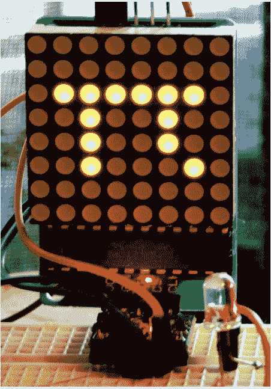

图 E-1 显示在 LED 矩阵上的 Pi

## `Matrix::set_meter`

如果你想让仪表表随总使用量移动，可以使用 `set_meter()` 方法为其配置 `GPIO` 引脚：

```cpp
void set_meter(int gpio_pin);
```

使用此方法，你可以配置用于 PWM 调制输出的 `GPIO` 引脚。然而，它必须是 PWM 引脚之一：

- `GPIO` `12` 或 `18` 用于 `PWM0`
- `GPIO` `13` 或 `19` 用于 `PWM1`

不返回错误代码。

## `Matrix::set_deflection`

`set_deflection()` 方法接受一个百分比（`0` 到 `100.0`）的浮点值，并调整 `PWMx` 外设以提供仪表表偏转。更多信息请参见第 3 章。

```cpp
void set_deflection(double pct);
```

以下方法调用将仪表表偏转设置为 `75%`：

```cpp
Matrix matrix(16,26,21);
int rc;
matrix.set_deflection(75.0);
```

# 附录 F

## 类 `MTop` 和 `Diskstat`

本附录文档了第 3 章 `mtop` 项目中使用的 `MTop` 和 `Diskstat` 类。它们用于收集信息并在 LED 矩阵上显示，例如：

- 通用 CPU 使用率（`MTop` 类）
- 通用磁盘 I/O 使用率（`Diskstat` 类）

## 包含文件

使用默认构建和默认安装 `PREFIX=/usr/local`，你安装的 `librpi2` 头文件应该位于 `/usr/local/include`。在你的程序中：

```cpp
#include <librpi2/mtop.hpp>
```

如有必要，请添加编译器选项 `-I/usr/local/include`。

## 链接

使用默认构建和默认安装 `PREFIX=/usr/local`，你安装的 `librpi2` 库应该位于此处：

```
/usr/local/lib
```

链接你的程序时，添加选项 `-L/usr/local/lib -lrpi2`

## `MTop` 类定义

`Matrix` 类的公共部分所示（注意该类继承自 `MAX7219`，该类在附录 D 中介绍）：

```cpp
class MTop {
    ...为了清晰起见已省略...
public:
    MTop();
```

# 附录 F MTOP 和 DISSTAT

`MTop` 类提供了一个默认构造函数来初始化对象：

```cpp
MTop();
```

# `MTop::sample`

每次调用 `sample()` 方法时，都会捕获 CPU 使用率。然而，在返回任何有效信息之前，必须调用此方法。原型如下：

```cpp
int sample(std::vector<double>& cpus);
```

值通过 `std::vector` 返回。`sample` 方法清空 `vector` 并根据 CPU 数量填充它。接面的代码示例：

```cpp
#include <vector>

Matrix mtop();
std::vector<double> cpus;

matrix.sample(cpus); // 初始采样

for (;;) {
    matrix.sample(cpus); // 返回差异
    // 此处应是处理 cpus 的逻辑，但在片段中缺失了
}
```

# `MTop::total_cpu_pct`


当在`sample()`方法之后立即调用`total_cpu_pct`方法时，会计算出总 CPU 使用率百分比（0 到 100）。这被`mtop`工具用于驱动总 CPU 仪表表，如第 3 章所述。该函数原型为：

```cpp
double total_cpu_pct() const;
```

该方法的用法示例所示：

```cpp
#include <vector>

Matrix matrix();
std::vector<double> cpus;
double total_pct;

matrix.sample(cpus); // 初始采样

for (;;) {
    matrix.sample(cpus); // 返回差异
    total_pct = total_cpu_pct();
}
```

# MTop::memory_pct

`memory_pct()`方法在调用时查看系统并确定系统内存使用率占可用内存的百分比。其目的是返回一个可以在矩阵显示器上显示的百分比。其调用签名简单为：

```cpp
double memory_pct();
```

其在采样循环中的用法所示：

```cpp
#include <vector>

Matrix matrix();
std::vector<double> cpus;
double total_pct, pct_memory;

matrix.sample(cpus); // 初始采样

for (;;) {
    matrix.sample(cpus); // 返回差异
    total_pct = total_cpu_pct();
    pct_memory = memory_pct();
}
```

*(注：由于用户提供的待翻译文本中存在严重的错乱和重复，上述译文已根据逻辑结构进行了整合与去重，确保符合文档工程师的连贯性要求)*

```cpp
for ( size_t cpu=0; cpu<cpus.size(); ++cpu ) {
    double pct_utilization = cpus[cpu];
    ...
}
```

# MTop:swap_pct

此对象方法用于以百分比形式确定调用时交换内存的使用量。其调用签名为：

```cpp
double swap_pct();
```

其在采样循环中的用法所示：

```cpp
#include <vector>

MTop mtop();
std::vector<double> cpus;
double total_pct, pct_memory, pct_swap;

mtop.sample(cpus);      //初始采样

for (;;) {
    mtop.sample(cpus);   // 返回采样差异
    total_pct = mtop.total_cpu_pct();
    pct_memory = mtop.memory_pct();
    pct_swap = mtop.swap_pct();

    for ( size_t cpu=0; cpu<cpus.size(); ++cpu ) {
        double pct_utilization = cpus[cpu];
        ...
    }
}
```

# MTop 采样循环计时

上面的采样循环没有显示`mtop`命令使用的延迟。如果你正在修改代码或编写你版本的`MTop`，以下是一个推荐的起始点：

```cpp
#include <vector>

MTop mtop();
std::vector<double> cpus;
double total_pct, pct_memory, pct_swap;

mtop.sample(cpus);      //初始采样
mswait(600);           // 延迟 600 ms

for (;;) {
    mtop.sample(cpus); // 返回采样差异
    total_pct = mtop.total_cpu_pct();
    pct_memory = mtop.memory_pct();
    pct_swap = mtop.swap_pct();

    for ( size_t cpu=0; cpu<cpus.size(); ++cpu) {
      double pct_utilization = cpus[cpu];
      ...
    }

    mswait(80); // 延迟 80 ms
}
```

你可以提供自己的延迟，或者复用`librpi2/piutils`文件提供的延迟：

```cpp
#include <librpi2/piutils.hpp>
```

可用的 C++ 函数有：

```cpp
void nswait(unsigned long ns); // 纳秒
void uswait(unsigned long us); // 微秒
void mswait(unsigned long ms); // 毫秒
```

# Diskstat 类定义

`Diskstat`类是一个允许调用者收集磁盘利用率统计的对象，如第 3 章中`mtop`命令所使用的那样。`Diskstat`类的公共部分所示：

```cpp
class Diskstat {
......为了清晰进行了省略...
public:
  Diskstat();
  double pct_io();
};
```

# Diskstat::Diskstat

默认构造函数仅为终端用户初始化对象的内部结构。其实例化示例如下：

```cpp
Diskstat diskstat; // 磁盘统计对象，准备就绪
```

# Diskstat::io

此方法计算发生的磁盘 I/O 量的百分比（0.0 到 100.0）。其调用签名简单为：

```cpp
double pct_io();
```

其用法示例所示：

```cpp
Diskstat diskstat;
double io_pct;
```

```cpp
io_pct = diskstat.pct_io(); // 获取百分比 I/O
```

没有 Linux 资源指示最大 I/O 可以是多少。因此，`Diskstat`类通过每次调用`pct_io()`方法来跟踪 I/O 使用情况。在采样时，如果遇到更多的 I/O 时间（以毫秒提供），对象将其记录为新的最大值。通过这种方式可以计算并返回 I/O 的百分比。

这种方法显而见的结果是早期的 I/O 读取将偏高，直到观察到更高的最大值。请记住，此功能用于`MTop`显示结果，而不是精确的计数。

# 附录 G

# 其他 librpi2 类

高级用户可能会发现其他`librpi2`类很有用。这些类被`PiSpy`应用直接或间接地使用：

- `librpi2/mailbox.hpp`: 内核信箱（Mailbox）设施
- `librpi2/dmam.hpp`: DMA 内存分配
- `librpi2/dma.hpp`: DMA 寄存器定义
- `librpi2/rpdma.hpp`: DMA 分配定义
- `librpi2/logana.hpp`: 逻辑分析器类
- `librpi2/vcdout.hpp`: VCD 信号输出类 (`VCD_Out`)

这些类对于普通用户来说相当高级。然而，它们是构建`PiSpy`工具的基石。

## DMA 分配

在 Linux 下，从用户态应用程序无法分配 DMA（至少对于树莓派而言）。`PiSpy`在 Linux 内核模块（本书提供）的帮助下成功分配了 DMA。驱动程序的源码位于：

- `knmodules/rpdma/rpdma.c`
- `include/rpdma.h`

一旦加载了`rpdma`内核模块，`PiSpy`就能将该模块作为`/dev/rpdma`打开。一旦驱动打开，将使用`ioctl(2)`调用来：

1. 请求（分配）DMA 通道
2. 释放之前分配的 DMA 通道
3. 查询已服务的 DMA 中断计数

`rpdma`内核模块能够调用函数执行 DMA 分配和释放，以便你可以将其用于用户目的。DMA 资源在 Linux 内核中是珍贵的。如果所有 DMA 通道都被用尽，内核将在某处停止。因此，当不再需要时释放任何分配的 DMA 至关重要。

# 附录 G 其他 librpi2 类

作为打开`/dev/rpdma`的一个副作用，应用程序（`PiSpy`）可能会崩溃并可靠地释放任何持有的 DMA 设施。这是因为当`/dev/rpdma`关闭时，驱动能够释放所有已打开的文件描述符。

# 警告

在内核模块上开发并与 DMA 外设一起时，可能会出现意外的崩溃和占用。导致的影响是你的更改没有刷新到 SD 卡。因此，在执行危险测试之前，应该先执行`sync`命令：

```bash
sync
```

这将系统写入任何未保存的更改。有时执行两次以确保。

# 索引

**A**
- 绝对最大值, 22–23
- 音频覆盖, 69
- 断言宏, 141-142
- 静电带, 93–94

**B**
- 振荡器 (BFO), 67-69

**C**
- `at()`方法, 120
- 语言, 114
- 类和结构体, 115
- 编译器, 131
- 容器, 126
- 初始化列表, 122
- 迭代映射, 122
- 有序和无序映射, 120
- 安全迭代器, 125
- 标准库, 115
- `std vector`, 118-119
- `deque`, 125
- 流类, 130
- 互补 (CMOS) 配置, 85-86
- 输入, 87
- 保护, 77
- MOSFET, 84-85
- 输出, 88-90
- 切换, 86
- 类型, 83
- 使用规则, 93-94

**D**
- DMA 分配, 185-186
- `Diskstat`类, 183
- 构造函数, 183
- `pct_io`, 184
- 分发方法, 136

**E, F**
- 去抖 (Debouncing), 144-150
- 瞬时去抖, 107
- 翻转去抖, 107

**G**
- 通用时钟 (GP0), 70-71
- `gpio`命令, 49
- `gpio`命令, 61-62
- 显示, 62-64
- 显示, 64-65
- 显示, 65-66
- 显示, 70
- 闪烁, 55
- 复用功能表, 52
- 配置为复用功能, 51
- 配置为输出, 51
- 配置驱动水平, 58
- 配置滞滞, 57
- 配置上拉/下拉, 52
- 配置斜率, 56
- 监控输入, 55
- 读取复用功能, 54
- 读取 32 GPIO 引脚, 54
- 读取输入, 53
- 返回值给 shell, 54
- 设置输出, 53
- 包含文件, 142
- 输入参数算法, 157
- 链接库, 142
- 外设, 153
- 引脚和外设, 156
- `PwmMode`和值, 156-157

**H, I, J**
- HTTP 处理, 137-138

**K**
- 内核加载模块, 42
- 构建配置, 33
- 编译内核模块, 36–37
- 编译内核, 34-36
- 磁盘空间, 32
- 下载源码, 32
- 安装内核, 37-39
- 安装`rpdma`模块, 40–42
- 树莓派工具, 33
- 重启, 39
- 启动失败覆盖, 39
- 特定版本, 43-46

**L**
- LED 矩阵, 19–20
- 电平转换器, 20–21
- `libilent`库, 133
- `librpi2`类, 185–186

**M**
- `Matrix`类
- 类定义, 174
- 构造函数, 174
- 显示方法, 175
- `Pij()`方法, 175–176
- `set_deflection()`, 177
- `set_method()`, 176
- 包含, 173
- 链接库, 173
- `Matrix` (CPU 利用率)
- 静态方法, 163
- `al_name`, 165
- 延迟, 164
- `gpio_alt_func`, 165
- `peripheral_base`, 164
- `pwm`, 164
- `source_name`, 165

## MAX7219 命令

- 解码模式, 24
- 显示数据, 24
- 单词格式, 23-24
- `mton`命令, 28-29

# MAX7219

- 类定义, 168
- `config_decode`, 170
- `config_digits`, 167
- `config_intensity`, 169
- 构造函数初始化, 168-169
- `datalog()`方法, 171
- 启用, 169
- `nop`命令, 172
- `shutdown`方法, 171
- `test`方法, 171
- 包含文件, 167
- 初始化置过程, 172
- 库链接, 167

# MAX7290 命令

- 显示数据, 24
- 强度命令, 25
- 与 GPIO 接口, 21-22
- n 操作 (Nop), 26
- 信号要求, 21
- `test`方法, 26
- 单词格式, 23-24
- 瞬时去抖, 101

# MTop 类

- 类定义, 179
- 构造函数, 180
- `memory_pct()`方法, 181
- `memory_pct()`方法, 181-182
- `sample()`方法, 180
- 采样循环时间, 182
- `swap_pct()`, 182-183
- `total_cpu_pct`, 181, 26-29

# 多核 web

- HTTP 解析, 137-138
- `libevent`库, 133
- 权限, 138
- 服务器关闭, 137
- `ithreads`, 139

# WebMain 类

- 数据成员, 134
- 定义, 133-134
- 公有方法, 134
- `start()`方法, 135-136
- `Worker`类, 136, 139

# N

NMOS 晶体管, 83

# O

开源软件, 3

# P, Q, R

- `pickl`命令, 61-62
- `pickl`工具, 3
- `pipwm`命令, 73-74
- `pipwm`工具, 3
- `PiSpy`
- 捕获长度, 96
- 捕获分辨率, 96
- 命令选项, 95
- `gitwave`波, 98, 101
- 简而言之 102
- Option x, 97
- 触发器, 88
- 详细选项, 97
- `PiSpy`逻辑分析仪工具。参见内核加载模块
- `PiSpy`工具, 3
- 安装步骤, 4
- PMOS 触发器, 84
- 脉宽调制方法 (PWM)
- 额外选项, 75
- CLOCK 列, 75
- 输出列, 75
- 配置参数, 76
- D 选项, 74
- 数值, 76
- 反相 80% PWM 信号, 80
- M/P 模式, 78, 80
- M/P 数值, 75
- M/S 模式, 77
- `pipwm`命令, 73-74
- 比例, 82
- 30% PWM 信号, 78-79, 81
- 40% PWM 信号, 80
- 80% PWM 信号, 79, 81-82
- M/S 信号, 75

# S, T

- `set_address()`方法, 134
- `set_backlog()`方法, 134
- `set_callback()`方法, 134
- `set_port()`方法, 134
- `set_threads()`方法, 134
- 软件安装, 3
- `start()`方法, 135-136

# U, V

Unix 命令行规范, 47-48

# W, X, Y, Z

- `Worker`类, 136, 139
- 工作站

### Arduino/AVR, 18
- 面包板扩展
- 2x20 排线
- 连接, 12–13
- T型扩展, 11–12
- 使用钢笔和管切割器切割垫柱, 8–10
- 最终设备, 11
- 垫柱和木螺丝凸出, 10
- 木件准备, 8
- 面板仪表, 16–17

### pcb
- 底视图, 7
- 顶视图, 6
- RS-232 转换器
- 底视图, 14–15
- 铜制安装翼, 15
- 安装, 16
- 引脚, 14
- 串口终端程序, 16
- 顶视图, 13–14
